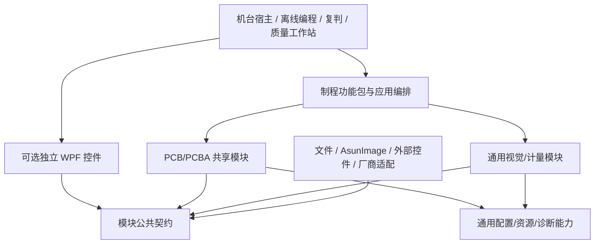
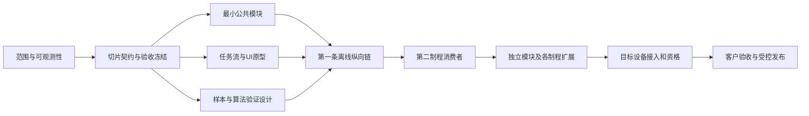
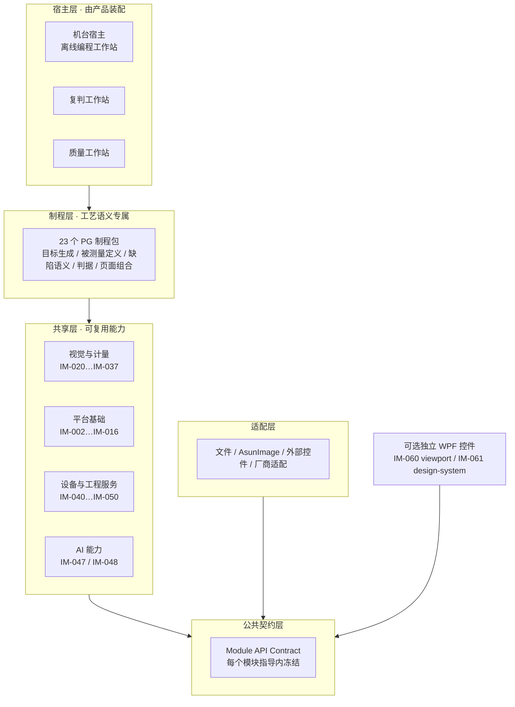
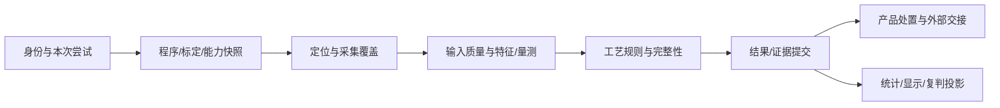

# Asun Vision Platform — MASTER ALL DOCUMENTS v2.1.5

> Convenience aggregation only. Individual documents are authoritative.

# ===== BEGIN 00-baseline/INTEGRATION-CHECKPOINT-73501.md =====

# Integration Checkpoint — Stage 73,501

> **状态声明（2026-10-28 审核补注）**：本文件记录**已移除的旧代码阶段**产物。所述实现（`ProductionSessionProgress` 投影、`ProductionSessionProgressAcceptanceSmoke.Run100Stages` 等）随 `c4e10cf` 的脚手架清理**已不存在于当前仓库**。本文件保留仅供追溯，**不作当前状态、实现完成度或生产资格证据**。当前仓库为纯文档状态，见 [CODE-BASE-01](OPEN-GATES.md)；实现须严格按对应模块指导冻结的契约新建工程。当前文档准备与审查结论见 [T2-REVIEW-LEDGER.md](../../T2-REVIEW-LEDGER.md)。

Production Runtime → Client Production Workspace → Client Inspection Workspace.

ProductionSessionProgress now reaches the client projection with completed frame count, definition target count, last sequence, frame dimensions, and pixel format. Running progress is preserved through Completed, Cancelled, and Failed; Reset returns the projection to Idle with cleared progress.

Acceptance smoke:
ProductionSessionProgressAcceptanceSmoke.Run100Stages
contains ten loop groups, explicit round==100 guards, ten concrete Check(...) call sites, balanced delimiters, and no TODO/NotImplementedException.

No build, CI, hardware, HALCON, or DevExpress success is claimed without authoritative evidence. Open external/contract gates remain governed by docs/00-baseline/OPEN-GATES.md.


# ===== END 00-baseline/INTEGRATION-CHECKPOINT-73501.md =====

# ===== BEGIN 00-baseline/INTEGRATION-CHECKPOINT-73600.md =====

# Integration Checkpoint — Stage 73,600

> **状态声明（2026-10-28 审核补注）**：本文件记录**已移除的旧代码阶段**产物。所述实现（Program/Acquisition/Production/ROI/Quality/Results/Replay 统一客户端投影等）随 `c4e10cf` 的脚手架清理**已不存在于当前仓库**。本文件保留仅供追溯，**不作当前状态、实现完成度或生产资格证据**。当前仓库为纯文档状态，见 [CODE-BASE-01](OPEN-GATES.md)；实现须严格按对应模块指导冻结的契约新建工程。当前文档准备与审查结论见 [T2-REVIEW-LEDGER.md](../../T2-REVIEW-LEDGER.md)。

Product chain:
Program → Program Presentation → Acquisition → Production Execution → ROI → Quality → Results → Replay/Release → Home/Program/Inspection/Quality/Results unified client projection.

## Closed client boundaries

- Program state now projects canonical ProgramItems and selected-step detail.
- Invalid Program loads clear dependent Production/Acquisition/Quality/Replay/Release context before the client snapshot is published.
- Acquisition Preview carries real frame metadata/payload/fingerprint into the Inspection surface; Faulted Acquisition invalidates stale preview and blocks Production source access.
- Production exposes a separate high-frequency state/pulse channel.
- ROI exposes a separate raw and sequenced high-frequency pulse channel.
- Quality provides command gates, canonical Outcome/Severity filtering, selected-finding visibility, finding detail, and provider evaluation gate.
- Results provides current result state, bounded history, selected historical-run detail, and structured Replay/Release projection.
- Home/Program/Inspection/Quality/Results are composed into one vendor-neutral client content surface.
- Workspace navigation + command routing + content projection are unified in one client snapshot stream.
- Unified client snapshots carry a monotonic ProjectionSequence; stale asynchronous snapshots are rejected by ClientWorkspaceClientSnapshotFence.

## Acceptance evidence

Registered client Smoke families include Program, Acquisition, Production progress, ROI, Quality, Results, Replay/Release, unified Workspace Content, unified Client Projection, Snapshot Fence, and event-pulse boundaries.

New/modified Smoke sources in the 73,501–73,600 interval were statically checked for:
- 10 loop groups
- 100 rounds per group
- explicit round==100
- 10 actual Check(...) invocation sites
- balanced braces
- no TODO
- no NotImplementedException

## Verification boundary

This checkpoint records repository implementation and static source-structure evidence only. It does not claim authoritative local Build/Test/CI execution, DevExpress environment success, HALCON runtime/operator verification, camera/lighting/motion SDK verification, HIL, installer, or final customer release.

Open external/contract gates remain governed by docs/00-baseline/OPEN-GATES.md.

## Post-checkpoint continuation — 73,618–73,619

The implementation after the 73,600 checkpoint continued into the real WPF client shell:

- Acquisition Bind now requires explicit `CanBindAcquisition` permission in addition to Inspection workspace routing.
- WPF Shell binding validation now enforces the command-facade-only mutation boundary and checks duplicate XAML names.
- The Unified Client Projection remains the state source for Full Snapshot, Execution Pulse, and ROI Pulse presentation.
- These are implementation/static-audit results only; they do not replace the open DevExpress/HALCON/hardware/build/test gates.


# ===== END 00-baseline/INTEGRATION-CHECKPOINT-73600.md =====

# ===== BEGIN 00-baseline/OPEN-GATES.md =====

# 当前未决条件与影响范围

本页汇总需要后续冻结的条件，来源登记与采纳步骤仅维护在[GATE-001](REQUIRED-REPOSITORY-AUTHORITIES.md)。所有条件均不阻断已授权的架构/文档整理；不将等待设备或客户参数扩大为全平台停工。

| Gate | State | Impact | Handling |
|---|---|---|---|
| GATE-001 repository authority adoption | SOURCE_PINNED / ADOPTION_PENDING | 精确生产字段、Owner、状态、事件和提交事务的实现 | 10项归档来源hash一致；5份Schema结构与55个本地引用、36项事件实例已检查。来源可读与正式采纳分开；旧路径缺失不等于原件丢失，不复制AOI目录来制造通过 |
| C-01..C-08 exact approved Schema artifacts | CONTRACT_CANDIDATE | 各切片实际依赖的DTO/存储/传输字段 | 继续使用既有候选工作包；禁止临时生产Schema；已有草图不是批准 |
| D-01 首批产品与配置 | DECISION_REQUIRED | 首台机型、在线/离线、单/双面、2D/3D、产品族与目标负载 | 研究顺序已确认：钻孔/微孔→阻焊与终检→钢网→点胶/涂覆→插件与焊后；不等于已确定首台投产机型/交期 |
| D-02 部署和数据策略 | DECISION_REQUIRED | 单机/复判/中心工作站、离线、保留周期、容量、备份、恢复目标 | 架构以模块化单机装配为方案；网络与存储故障策略待产品决定 |
| D-03 角色与质量处置 | DECISION_REQUIRED | 程序发布、人工复判、返修/重检、最终放行和自动反馈 | 设计已分权；具体角色/状态/阈值不能默认继承AOI |
| D-04 质量与性能Profile | INPUT_REQUIRED | 精度/重复性、误报漏报、节拍、板/FOV/目标规模、Golden/MSA/HIL | 定义采样和测量点；数值和资格待产品/设备/质量输入，不能从竞品推导 |
| EXT-CAM 制造接入 | INPUT_REQUIRED | 外部解析器实际集成与目标映射 | 需要元素/层/坐标/单位/板面/版本、Region/XLD资源和序列化公共接口 |
| EXT-CONTROLS 控件接入 | DESIGN_REQUIRED | 现有.NET8 ROI与DeepSight接入.NET10宿主的工程方案 | 只读公共接口；独立宿主桥，不自动迁移控件；不转为AsunImage/DevExpress验证 |
| Hardware SDK contracts | DEFERRED | 具体相机/激光/运动/PLC适配和现场能力 | 保留端口和模拟；型号/协议/触发/互锁依设备资料 |
| Etched bare-board product | WAITING_USER_ASSET | 已完成线路检测产品内部与平台接入 | 等用户拷贝，当前不重做内部算法 |
| X-Ray/CT, ICT, FCT | ENTRY_ONLY | 后续设备族 | 只入口；既有细节作历史来源，本轮无新增详细方案 |
| AsunImage / DevExpress dependency admission | NOT_REQUIRED_BY_USER | 不构成依赖或授权阻断 | AsunImage与DevExpress25.2.3直接采用，不检查安装/兼容性/授权；项目自身行为仍按任务验收 |
| AsunImage project algorithm usage | TASK_SPECIFIC | 具体算法与公共API调用 | 查公共签名及适用官方资料，不猜算子；历史来源不改字冒充新验证 |
| CODE-BASE-01 既有 C# 脚手架移除 | CODEBASE_RESET_BY_USER | 仓库当前无任何已编译工程，`AsunVision.slnx` 不登记工程；各模块指导中的 `src/…`/`tests/…` 路径仅为获准切片时的落点约定 | 移除既有自动生成脚手架，因其公开 API 与依赖方向未与现行指导对齐；实现须严格按模块指导冻结的契约新建工程并登记入 slnx；不得复用已移除脚手架的公开 API，不得从历史状态文档推断完成度 |
| 独立模块纯托管 Core 测试入口 | FROZEN_BY_DEV-GOV-010 | Core/Simulator 的独立软件验证 | 采用 DEV-GOV-010 §3.1 的 net10.0、BCL Exe、固定时钟/闩锁和有限进程截止；唯一工程及 build/run 命令由各模块指导绑定，不再等待测试包选型。既有已冻结测试栈按本模块指导保留；HALCON/WPF/设备与现场资格分别验证 |

关闭条件必须写实际产物和决定：例如批准的Profile、签名/Schema版本、真实设备资料或验收结果。等待中的用户决定已列明影响，当前不请求逐项即时确认；下一轮选择机台或实施切片时只讨论其真正依赖项。C-02的具体来源差异与已执行反例见[PKG-035 §12](../shared-modules/packages/PKG-035_ProgramPackage.md#program-source-adoption)：原Schema能接受latest、同ID/版本不同hash和重复审批记录，但平台语义仍须拒绝浮动/冲突引用并按正式审批政策验收；这属于内部合同/Validator设计，不是等硬件才能查明的问题。

### 2026-10-28 文档阶段进展（不改变上表任何未决条件）

| 事项 | 结论 | 证据 |
|---|---|---|
| 文档门禁有效性 | 修复 CI 分支过滤（`main`→`master`，此前 push 到默认分支不触发 CI）与 587 项断链误报；新增 `validate_module_guides.py` 与负例测试 | [.github/workflows](../../.github/workflows/)、`tools/validate_module_guides.py` |
| 内容级审查 | 302 份文档完成逐项判定（52 独立模块 + 118 PG/FS/UI-PCS + 132 PKG/公共指导）：**51 份直接 Pass，1 份 Gap 已修**（`ai-dataset-governance` §7.4 数值无来源 → 改为 Profile 引用并新增 §7.4.6 字段契约） | [T2-REVIEW-LEDGER.md](../../T2-REVIEW-LEDGER.md) |
| 单一权威 | 132 份 PKG/公共指导**未发现同义第二套定义**；权威链闭合：PKG/公共指导 → 独立模块指导 → 附录 API Contract | 同上，T6 节 |
| 工程规则审核 | `AGENTS.md` 恢复 14 条被压缩删除的约束，修正架构门禁漏覆盖 141 个核心工程的问题；`PROJECT_ENTRY.md` / `PROJECT_PROGRESS.md` 修正失效事实断言 | [AGENTS-AUDIT-2026-10-28.md](../../AGENTS-AUDIT-2026-10-28.md)、[ENTRY-PROGRESS-AUDIT-2026-10-28.md](../../ENTRY-PROGRESS-AUDIT-2026-10-28.md) |
| 历史产物标注 | `INTEGRATION-CHECKPOINT-73501/73600` 所述实现已随 `c4e10cf` 移除，加状态声明防止被当作当前实现证据 | 两文件头部 |

**上表所有 Gate 状态不变。** 文档阶段收口只说明"指导内容足以让实现者不补做架构决定"，**不关闭**任何实现、运行、性能、计量或现场资格门；D-01～D-04 与 C-01～C-08 仍按上表处理。

## 本轮研究后需要补充的输入

来源覆盖详见[REF-007§4](../references/REF-007_未开发机台竞品研究与设计落点.md#4-本轮覆盖深度与需要补充的资料)。公开产品页/规格表已支持设计方向；完整专机操作手册、实际材料/工装/传感模态、客户标准版本/等级、真值样本及接受数值仍不充分。尤其透明膜厚、孔内质量、V槽残厚和压接接触不能由已有2D/单表面数据替代。

这些缺口只阻断对应功能的契约/生产资格冻结；不阻断当前独立模块与工艺设计。各PG新增§9起的细项是DesignReview，不因文档校验通过变成ImplementationReady。后续实施时按选定功能取得所需输入，不一次要求用户补齐全部机台资料。

## 逐功能实施卡后的精确准入（2026-09-27）

72项当前功能已具专项处理/操作/拟验收，28模块有逐操作接入，26页面有视觉与交互设计要求；状态仍为DesignReview/DocMapped。尚未完成的实现准入必须在原功能处关闭：

| 输入/产物 | 冻结责任边界 | 当前影响 |
|---|---|---|
| 正式Schema、公共端口签名、State/Commit/Disposition Owner | 既有GATE-001及C-01～C-08；[DEV-CONTRACT-002](../13-contract-candidates/DEV-CONTRACT-002_功能卡Contract、Schema、State、Owner与提交绑定开发指导.md) 已把72个功能卡做候选绑定，仍需架构/领域负责人逐切片采纳 | 不能让程序员根据语义卡新造生产DTO/Owner；未批准端口前示例仅为语义调用 |
| 具体HALCON算子参数到AsunImage/ROI公共入口的绑定 | 算法/接入实现切片，查公共文档/签名；不扫描封装内部 | 未核对的接口不能编造；不是AsunImage/DevExpress版本或授权准入 |
| 工艺参考、材料/孔型/胶型、可观测模态、接受值与真值样本 | 对应PG§8及产品/设备/质量输入 | 当前合成示例不冻结客户标准；只阻断依赖该值的功能或资格 |
| 页面专有命令/角色、最终视觉稿及真实WPF样页 | 各PageContract与PG页面增量 | 点胶/涂覆UI-PCS-022/023、插件/THT的UI-PCS-024/025均有专属设计及合成HTML定向检查；终装[UI-PCS-026](../process-guides/guidance/14-page-contracts/UI-PCS-026_Final_Assembly_Workbench.md)已有专属合成HTML交互原型。所有这些页仍需正式端口、完整功能、真实WPF及产品验收 |
| 负载、性能数值、最小分辨率/触屏条件、现场验证 | 对应产品Profile | 当前定义测点/场景，尚未实测达标；视觉候选尺寸不等于设备规格 |

上述未决不撤销四项要求，也不阻断可独立开展的指导细化。继续按已确认研究顺序推进并仅在依赖决定时集中讨论；不因为文档校验通过扩大为“普通程序员已能实现全部生产功能”。

## 内部设计欠账与完成判据（2026-09-27）

用户对全平台完整性提出复核。此前“本轮文档细化完成”只表示那一轮整理/修订结束，不能表示总体详细设计完成。现有72项功能分组和26份页面不是穷尽清单；功能表有链接、字段齐全、校验通过均不能证明内容足以直接实现。以下工作尚未完成，不属于必须等待用户提供资料才能开始的外部门禁。

| 内部工作 | 目前不足 | 必须在原指导内补齐的完成判据 |
|---|---|---|
| 功能全集与变体 | PG功能分组偏粗，子功能/模式/角色/选配和跨工序组合未系统穷举 | 逐制程列出正常/异常/离线/换线/恢复的可验收子功能；每项映射唯一指导，明确不支持或条件支持；不得机械拆文件充数 |
| 跨模块完整逻辑 | 有主链和局部异常，尚无完整的输入/状态/时序/权限/失败组合推演 | 对版本变更、取消、迟到、重启、部分提交、重试、资源耗尽等组合逐条走查；每步输入输出/所有权/回执可确定，矛盾回原权威修订 |
| 每机台快速编程 | DEV-AI-062/FS-068等提供通用生成链，不代表每个PG都有完整方案 | 逐PG定义制造资料齐备、金板/样图、同类程序变体等适用模式；输入核对→对象/库匹配→ROI/算法/参数候选→覆盖→试检→未决项→批准发布；列出人工介入、失败回退和编程时间/干预量衡量方法；不具备编程任务的工作站明确说明 |
| UI与操作优化 | 有页面类型、文字布局和设计Token候选，缺全量页面/弹窗/状态原型及任务验证 | 在既有页面权威中补角色/入口/导航/布局/命令矩阵、正常与错误状态的可评审原型；高频任务的步骤/时间/误操作/恢复对比；后续真实WPF验证，原型不冒充生产页面 |
| AI与学习算法 | 逐任务路线登记已形成，但真实方法/API/数据和资格仍未关闭 | [DEV-AI-064](../shared-modules/guidance/07-ai/DEV-AI-064_逐任务AI选型与证据矩阵开发指导.md) 已逐项登记 72 个功能卡的经典基线、候选路线、数据/标注/划分、拒识、资源和验收证据；[DEV-AI-065](../shared-modules/guidance/07-ai/DEV-AI-065_AI能力路线与三态仲裁规范.md) 已固定平台级路线门、RT-DETR/PatchCore/OCR 路线边界、ONNX Runtime 三路 EP 选型与三态仲裁语义；仍需按任务完成公共 API、真实样本、训练/评估、部署回退/漂移和质量 Owner 决定。 |
| 性能/智能性/鲁棒性 | 有指标名和通用原则，缺细化的数据搬运/关键路径/资源竞争方案 | 固定负载维度，分解采集/处理/提交/UI/网络预算与资源寿命；比较ROI/分层计算/复制/缓存/并行/GPU策略；把智能性落实为减少输入/定位异常/解释恢复，把鲁棒性落实为具体干扰与拒识矩阵；实测数值仍需目标环境 |
| 开源复用决策 | 已研究少量源码/测试，未形成全功能选型与集成验证 | 逐能力比较现有控件、HALCON/.NET/DevExpress已有能力、直接依赖、适配引入、可复用源码和仅借鉴；固定版本、具体文件/测试、许可证和部署代价，实际试验后判断优劣；AsunImage/DevExpress不重新核验准入或授权 |
| 国际竞品对标 | 公开资料和局部手册支持方向，缺完整任务/指标的可比证据 | 逐机台明确参考产品/配置/资料版本和证据类型；比较覆盖、编程/换线、误报漏报、计量、节拍、人工干预/恢复及维护成本；相同样本与条件下验证前不能宣称达到或超越 |

内部研究/设计可继续按已确认顺序推进。只在真正依赖客户产品范围、工艺接受值、目标硬件和真实样本的地方列外部输入；不能用这些外部门禁解释所有尚未完成的规格。已完成蚀刻光板线路内部、X-Ray/CT、ICT、FCT仍按既定暂缓范围处理。

每个功能收尾必须能从真实来源定位到设计选择、完整操作链、可实现契约、具体样例及验收方法；未完成项如实留在原指导中。软件实现和实机对标尚需独立验证；“无已知设计矛盾”也不是“保证永远完美”。


## 全量开发准备本轮收敛与继续项（2026-09-27）

开发顺序和多会话边界已从旧69项计划修订到当前SM/PG范围，详见DEV-PLAN-001/002/014/015；这是工程计划DesignReview，不是实现开工或生产资格。建议离线钻孔→钢网第二消费者→3D验证的顺序不需要先选定首台客户机型，也不替代D-01决定。无Git元数据只限制实际代码多工作树开工，不限制当前设计。

性能指导补齐具体数据/资源/挂起写入/取消和测量设计；快速编程现已覆盖全部23个PG并补入逐制程方法/数据/性能/UI/组合故障/准入附录。完整UI原型、逐任务AI/开源比较、详细契约/状态仍未完成；D-04真实数值也未关闭。C候选和历史计划错误的可实施状态已撤回，不能由文档校验通过再次提升。

为了减少返工，还需在原对应指导推演以下交叉问题：双面/拼板/层对/载具/卷段身份变化；模型/库/标定撤回对在途任务与旧回放的影响；跨设备时钟漂移和先后顺序；多工位/离线断网后的冲突与数据补传；证据留存/空间不足/备份恢复；跨版本配置和历史结果可读性；大批量批改/撤销/审批/激活边界；多屏/DPI/语言/权限切换；人员复判争用和返修后新尝试；取消/重启/部分提交/未知设备副作用的组合。它们分属SM/PG既有Owner，不另建同义总状态机。

正式接入前确需产品决定的是首机型与传感能力、部署与保存恢复、角色/质量处置、实际接受数值和样本。可自主完成的源码研究、候选比较、接口差异、故障推演和任务设计继续推进；不要求用户现在一次回答全部问题。

最新深化已覆盖全部23个PG的专项快编、AI/数据、性能、页面和组合失败附录，并补UI-PCS-022～026。插针/THT的HTML仅验证部分交互，终装HTML也不关闭页面全部命令、正式应用端口、实际WPF/图像资源与产品资格。共同公式和源码证据是设计输入，尚未完成全平台契约/公共API绑定、全量高保真UI、逐任务模型选型/训练/部署和相同工业样本对标；Goal仍覆盖这些内部工作。

## USER-002独立能力的当前状态

19项建议已映射公共目录并细化无UI核心/可选UI、职责/执行/异常/数值例/候选来源，沿28SM归属；不是全功能正式API或生产资格完成。数据库优先验证PostgreSQL/Npgsql但尚未采纳具体部署/版本；MES以独立互联中心规划，完整MES产品范围未扩大；设备接口/模拟可继续，实际SDK/厂商参数仍暂缓。全码制目录/质量适用表、既有测量控件无UI公开入口、候选实测比较、全部UI/合同/性能数值仍分别需关闭，不因研究源码或结构验证通过而提升资格。

## AOI副本与独立模块重规划的当前边界

用户要求19项仅作为思路输入。旧62个公共包/6类工具宿主是迁移索引；当前完全独立模块架构为52项候选，原51份逐项指导保持设计准备/核心开工门禁，新纳入的IM-068 alarms指导正在首次唯一会话编写。会话登记中的 `accepted` 仅表示文档设计接收，不代表 `ImplementationSpecificationReady`、代码实现或产品验收。每个代码切片仍按 DEV-GOV-010 核实正式契约/Owner、可调用公共 API、参数、代表样本、测试和验收；不要求52项同时关闭，也不能因文档或候选数量增加标Ready。真实阈值、具体传感器/SDK、客户样本/标准件和现场资格只阻断实际依赖它们的切片。

多FOV专项已把原概要落实为[029 §8–15](../shared-modules/guidance/03-vision/DEV-VIS-029_多FOV拼接与全局坐标开发指导.md#mosaic-implementation)及钢网/AOI接入；后续[§11.3–11.8具名多带方法](../shared-modules/guidance/03-vision/DEV-VIS-029_多FOV拼接与全局坐标开发指导.md#mosaic-multiband-method)已补合法标签/支持归一/相位/分量/来源，原分量总工作遗漏经独立复核在文档层关闭。该项不再笼统记作“完全没有算法步骤”。剩余内部工作是正式公开合同/源贡献表示、实际HALCON等价适配及缓冲实现方案、未覆盖的alpha/其它seam变体和完整UI任务；真实保真、峰值/吞吐及工艺资格按对应Profile/样本验收。图像数学与预算位置计数不证明生产通过；方法和接收详见[REF002](../references/REF-002_GitHub_DevExpress与OpenSource研究基线.md#mosaic-multiband-source-research)。

二维匹配已补[023 §7–14](../shared-modules/guidance/03-vision/DEV-VIS-023_定位、注册与Alignment开发指导.md#matching-implementation)、022边界、原C/计划§26与钢网/AOI/FPC消费；[scaled/aniso/planar/local方法](../shared-modules/guidance/03-vision/DEV-VIS-023_定位、注册与Alignment开发指导.md#matching-variants-method)已有具名训练/搜索/坐标/支持/资格步骤，活动字节接收按[当前进度](../../PROJECT_PROGRESS.md)记录。后续[LF-PL-AC-1方法](../shared-modules/guidance/03-vision/DEV-VIS-023_定位、注册与Alignment开发指导.md#matching-local-topology-method)已补全域闭片交集、同拓扑逆与完整ROI切片，并回接007/020/FPC/钢网及原C/计划，九文件独立限定接收。[024固定片精确数值](../shared-modules/guidance/03-vision/DEV-VIS-024_ROI与Inspection%20Target%20Selection开发指导.md#roi-local-exact-numerics)及020/023/C消费已独立限定接收，.NET公共算术基础不再待选；位长、固定调度、同片逆与舍入边界已有方法，仍不覆盖递归有理布尔或真实资源/物理误差。剩余内部工作包括精确公共接口/资产表示、实际矩阵与local非零原点/扩边栅格适配、上述数值方法/有界索引与精确切片的实际接入、可选点/大候选关联优化、目标不确定度生产者及完整UI。UI002原跨样本/当前帧混淆P2经[退修独立复测](../../.work/vision-matching-ui-rework-independent-20260929/review.md)在固定HTML及023/C职责范围内关闭：历史报告不排本帧歧义，缺失/过期/异源/拟合复用和仍双解均阻断。该接收不关闭真实模型/观测、任意输入/多Mark、持久化或WPF，原失败保留。不能把已有方法步骤当上述实现资格已完成，也不能将它们全部列为等待用户。缺高级local资格仅阻相关用途，普通方法和原图链继续；自由度/阈值、真实精度/性能及同样本竞品验证仍由适用Profile/样本给依据。

OCR的[021A §15](../shared-modules/guidance/03-vision/DEV-VIS-021A_OCR与DeepOCR独立能力开发指导.md#ocr-decoding-association-method)、独立024包及PCB字符/AOI标记消费者已完成本批方法接收，具体版本与证据见[§0.67](../../PROJECT_PROGRESS.md#exact-numerics-ocr-method-reception-20260929)。三模式/基数、显式batch身份、具名CTC/分数和原读/mapping已有步骤；[§16外部几何/支持及有限分块方法](../shared-modules/guidance/03-vision/DEV-VIS-021A_OCR与DeepOCR独立能力开发指导.md#ocr-external-geometry-tiling-method)与PG006/057B/062/C/计划及FS061已独立限定接收（[§0.69](../../PROJECT_PROGRESS.md#ocr-geometry-consumer-reception-20260929)），包括一次恢复外围关系和已知完整单词直接识读旁路；实际ε/Δ、halo、支持/模型资格及未支持布局仍不能由方法例补证，原串Unicode/编辑距离及完整分母已写入[063 §14](../shared-modules/guidance/07-ai/DEV-AI-063_数据集、GroundTruth与统计验证开发指导.md#ocr-text-evaluation-method)且独立限定接收；训练/checkpoint/导出方法见下段。剩余实际实现/后端Golden不能全部列为等客户。实际ImageLibDotNet绑定、后端输出/坐标/语言Golden、正式合同、真实数据/校准门、资源取消和WPF/工业资格尚未关闭。HALCON Deep OCR优先，Paddle仍须同样本比较后受控决定接入，有限方法例不证明识别效果。

同一OCR可选控件的[两宿主连续任务/HTML](../shared-modules/guidance/14-page-contracts/UI-PCS-002_Vision_Workspace.md#ocr-interactive-workflow)已独立限定接收（[§0.70](../../PROJECT_PROGRESS.md#ocr-ui-reception-code-study-20260929)），保留真实WPF/权限/保存和任意输入未验范围。条码[021B方法](../shared-modules/guidance/03-vision/DEV-VIS-021B_条码解码与印制质量独立能力开发指导.md#code-reading-evidence-method)/023及PG001/015/022、037/FS001、C/计划已独立限定接收（[§0.71](../../PROJECT_PROGRESS.md#code-reading-consumer-reception-20260929)），原数据层、typed质量、来源闭合与重采/重算边界已有步骤。GS1[037 §9内容方法](../shared-modules/packages/PKG-037_Identity.md#gs1-content-parsing-method)及PG001/PG022、FS001/C/计划已独立限定接收（[§0.72](../../PROJECT_PROGRESS.md#gs1-content-consumer-reception-20260929)）；入口/字段/词典回退/来源映射已有步骤，生产依赖、词典部署、格式政策与业务映射仍待原权威采纳，实际native/.NET/扫码尚未验证。双宿主条码UI作者已交回，独立自然复测受浏览器认证及替代自动化规则限制，独立静态审核已交回且标题P3已作最小静态修正，动态未验、未接收；实际公共封送、原生返回/取消、真实码图/标准件、持久身份绑定与WPF/性能未验证，不据文档宣称标准认证或完整身份链已实现。它们是内部准备工作，不全部等待客户。


[026 §16良品变化方法](../shared-modules/guidance/03-vision/DEV-VIS-026_2D分割、Blob与缺陷候选开发指导.md#variation-inspection-method)及PG006/PG022、033/063、C/计划已独立限定接收（[§0.73](../../PROJECT_PROGRESS.md#variation-inspection-consumer-reception-20260929)）。训练模式、阈值/两方向、D/I与完整R、污染/分组、运行/重建/证据闭包、同封存核心fresh读回及分块条件已有具体方法。正式公共绑定、native统计/类型与边界Golden、真实取消/保存/资源、两宿主控件/WPF及材料/缺陷同条件资格仍欠；不把文件可读或无差异当模型/产品通过。边缘及语言方法的后续状态见下一段；已采纳方法不自动成为全部DevExpress区域已实现。这些内部准备继续推进，不以缺客户阈值笼统阻断。

[025 §7有向提边与拟合方法](../shared-modules/guidance/03-vision/DEV-VIS-025_2D边缘、轮廓与几何特征开发指导.md#edges2d-association-method)及钻孔/钢网、030/FS039、C/计划已独立限定接收（[§0.74](../../PROJECT_PROGRESS.md#edges2d-consumer-reception-20260929)）。measure_pairs单边证据P2在活动修正文档层关闭；预登记诊断、完整profile、原采样/物理拟合/Metrology限制及固定图先后已有具体方法。公开适配/实际坐标world与scale、端点误差和完整支持、真实取消/资源、WPF与工艺精度/性能仍分别未验；未知原索引只限制依赖用途，不伪造slot或笼统阻断全部提边。独立语言方法的后续接收见下一段；公开UI入口仍逐项研究。

语言能力的唯一当前实施指导为 [IM-003 localization](../independent-modules/localization/DEVELOPMENT-GUIDE.md) §3–5/§7–13；PKG-003、SM-003 和 [040 §13](<../shared-modules/guidance/05-ui/DEV-UI-040_WPF+DevExpress Design System开发指导.md#localization-scope-method>)仅作责任/应用映射。独立资源格式、显式 fallback、typed format、快照、请求/呈现/排空已冻结，不再以旧 D1–D5 候选阻断全部 Core。供应商逐 ID 槽位/调用文化与原生窗口公开入口仍是相应 WPF 适配的设计门；真实 WPF、字体、IME、三语/UIA/DPI 和性能另行验收。产品 Schema、客户词条审批、发行信任、报告存储政策及消费者 Profile 只阻对应产品用途。逐切片接收以模块指导为准；历史文档接收不构成实现或生产证据。

[028参考面P/H/Q](../shared-modules/guidance/03-vision/DEV-VIS-028_3D对象模型、配准与表面分析开发指导.md#reference-surface-method)、029、[031有限signed积分](../shared-modules/guidance/04-metrology/DEV-MET-031_通用计量引擎开发指导.md#quadratic-reference-signed-integral)、030及SPI/点胶/FS/C/计划已独立限定接收（[§0.77](../../PROJECT_PROGRESS.md#reference-surface-method-reception-20260929)）；倾斜方向/面积P2在活动文档层关闭。[031有界归约](../shared-modules/guidance/04-metrology/DEV-MET-031_通用计量引擎开发指导.md#quadratic-reference-bounded-reduction)的固定合格三角域正负量、连续面积CDF/同域分位、二阶端点及预算/舍入/取消方法，现由[IM-036 metrology](../independent-modules/metrology/DEVELOPMENT-GUIDE.md)唯一指导维护。具体模块切片接收以当前指导和[进度§1.07](../../PROJECT_PROGRESS.md)为准；公共桥/native运行、数值与实际资源/性能、物理误差和材料用途、WPF及现场资格按受影响范围验收，不凭早期方法接收或过期暂停记录判断当前状态。当前 Goal active，沿永久模块会话继续完善内部可决定规格；未决保留不代表全平台已完成。

训练恢复与导出已补[060 §12](../shared-modules/guidance/07-ai/DEV-AI-060_AI运行治理开发指导.md#ai-training-export-method)/053及[开发顺序](../09-development-plan/DEV-PLAN-014_全量研发工作包与并行依赖DAG.md#training-text-evaluation-development-slices)，独立接收见[§0.68](../../PROJECT_PROGRESS.md#training-text-evaluation-reception-20260929)。完整安全边界、状态缺项、best与最终测试、导出语义翻转及数据用途已有具体方法。尚欠所选后端的全部必要状态公开保存/读取绑定、实际中断对照、完整保持/取消、模型/转换支持与源/派生真实Golden、工程UI和资源验收；不从seed、epoch或文件可读推exact恢复，不从小tensor误差推用途等价。实际训练数据、定位/分数资格、产品接受值与现场条件仍按对应Owner提供，不阻非依赖的拒绝/完整性流程设计。

模型资产实施唯一见[IM-014](../independent-modules/model-assets/DEVELOPMENT-GUIDE.md)，[033](../shared-modules/packages/PKG-033_ModelAssets.md#model-assets-implementation)保留应用映射；模型/OCR/AI、UI002和计划014§27消费同一指导。新资产RFC8785 `model-core-jcs-v1`的技术投影、数字移植闭包、集合/顺序、路径与预算已在§4/9/附录A冻结，旧资产按创建时规则校验；请求投影、Service factory/端口/资源与撤回规格见§5A–8A/附录B。PureCore及S1服务六项文档规格已由主控接收为ModuleCoreImplementationReady，U1装配恢复与SD限定注册桥指导内容已接收；具体范围以唯一指导为准。后续门是正式平台字段/Owner与真实Store/Authority/Sink映射、实际旧verifier/生产者格式schema/参数集、安全物化/耐久恢复、真实HALCON读回/Golden/性能、WPF1920×1080和现场资格。用途阈值、独立挑战、部署与在途政策依原Owner接收；模块规格接收不代替运行证据，能加载或保存不等于用途批准或生产采用。AsunImage/DevExpress依赖核验仍排除。

受控推理模块实施唯一见[IM-047](../independent-modules/ai-inference/DEVELOPMENT-GUIDE.md)，[052](../shared-modules/packages/PKG-052_Inference.md#inference-execution)及060、AOI/涂覆、UI014与计划014§28维护产品接入。Core/Simulator六项文档规格已接收；HALCON Adapter、原模型/帧Owner桥、公开装配与有限恢复的确定指导内容已限定接收。首版每请求加载模型，无模型或结果缓存、无跨请求组批，038负责应用外层预算；不得恢复历史缓存/组批候选为默认实现。模块公开API、权限披露、具名多输入输出、HALCON标准键及预后处理路线按唯一指导实施。真实模型/输入交接、目标运行能力、Adapter消费编译、后端数值/并发/资源、Golden/性能、真实WPF及产品/现场资格仍按受影响切片验收；各PG模型训练/选型属于对应应用与原模型Owner。模型/数据/工艺阈值、目标硬件资源和必需AI处置政策按受影响用途采纳；ORT/Triton是研究而非已选依赖。当前架构为52项独立模块，旧PKG仅作应用迁移映射。AsunImage/DevExpress核验不在待办。


# ===== END 00-baseline/OPEN-GATES.md =====

# ===== BEGIN 00-baseline/PLATFORM-DESIGN-BASELINE.md =====

# 全制程平台设计基线

- 文档 ID：`PLATFORM-DESIGN-001`
- 版本：`0.4.0`；日期：2026-09-27
- 状态：`DesignReview`。本轮落实用户确认的平台化与文档分层方向；工程方案可供评审，未将整个平台标为 ImplementationReady/Implemented。项目 AsunImage 的 HALCON 基线为 26.05。
- 消费者：平台/产品架构负责人、模块与制程开发人员、UI/算法/测试/集成人。
- 唯一导航：[PROJECT_ENTRY](../../PROJECT_ENTRY.md)；历史架构来源：[ARCH-PCBA-VISION-001](ARCH-PCBA-VISION-001_v0.5.3_source.md)。

## 1. 本轮设计范围与文件职责

平台承接 PCB 与 PCBA 的全制程视觉检测，不等于将全部制程塞进一个机台应用。当前交付为设计基线：制程/机台覆盖、公共模块、各制程专项、功能链路、来源与待决事项。它不启动旧代码队列，不迁移已有控件，不实施 SDK。

公共模块与制程专用指导分别存放在 `docs/shared-modules/` 和 `docs/process-guides/`。原有 DEV/FS/Page 文档移动到相应根下的 guidance，ID 和内容来源保留；旧目录仅留位置索引。新增模块/制程指导补齐组合与功能链语义；已有 FS 继续负责已定义的细节，不复制字段/状态。

| 文件 | 唯一职责 |
|---|---|
| 本文 | 平台边界、分层、组合、部署与全局不变量 |
| shared-modules/README + modules/SM-* | 公共模块总目录、依赖、单模块语义与独立交付要求 |
| process-guides/README + processes/PG-* | 制程/机台矩阵、专用检测功能、产品操作链、验收场景 |
| shared-modules/INTERFACE-MAP.md | 生产者/消费者和权威绑定索引，仅引用，不重定义 DTO |
| process-guides/END-TO-END-FLOWS.md | 编程、生产、复判重检、离线、恢复、跨工序链路 |
| GATE-001 | 旧权威来源接纳方式、缺口和影响范围 |
| DEV-PLAN-000 | 原 ID 到当前位置的导航 |

机台层已有 2D/3D 分类文档是设备能力参考；制程层才定义炉前、炉后、印刷、钻孔、阻焊等业务差异。两者不能以目录名一一等同。X-Ray/CT、ICT、FCT 只保留入口；现有蚀刻后光板项目等待用户交付，不重新设计内部算法。

## 2. 固定前提与设计决定

用户已确定：VS2026、C#/.NET10、WPF、DevExpress25.2.3、AsunImage；通过 ImageLibDotNet 公共边界使用，项目内 AsunImage 对应 HALCON 26.05。算子核对入口为 [`halcon算子手册/operators`](../../halcon算子手册/operators/)，实际适配仍须以已安装 ImageLibDotNet 公共签名为准。AsunImage/DevExpress 不验证、不检查授权。软件自身结果/UI/性能仍按指导验收。

本轮工程方案：模块化单机装配是基础交付方式；独立复判、离线编程与质量工作站消费明确接口，可单独部署。业务能力 DLL 不强制转成微服务，平台不要求每台机器连接中心服务才能计算。具体离线缓存、数据保存与生产许可由产品配置确定；未决定的数据一致性策略不能默认允许离线生产。

公共模块分通用软件/视觉能力和 PCB/PCBA 共享能力两类；后者可理解板、拼板、程序和检测事实，但不能写死 SPI 或 AOI 判定。特有对象、参考定义、缺陷判定和操作页留在制程包。

## 3. 架构与依赖



图表示编译依赖与适配责任；设备数据可以反向流入消费方，但不允许 UI、领域或算法反向依赖厂商实现。宿主组合根装配实现，公共模块不得自行定位某机台的全局容器或私有数据库。

独立模块是一项完整职责的能力包。必要时内含 Contracts/Core/Wpf/Adapters 多个 DLL，但不机械要求每模块拆同样数量。无 UI 的能力须能被无界面宿主测试；UI 控件可在最小宿主独立显示，语言由宿主调用。程序集/进程/逻辑模块是三个不同边界。

每项共享能力至少列出两个当前规划消费者或清楚的复用计划、版本兼容策略和独立验证断言。共享不是把每种产品对象塞进万能 DTO；新增跨制程需求由相同语义判断是否共享，不按字段外形判断。

## 4. 既有独立资产

| 资产 | 平台接入原则 | 禁止事项 |
|---|---|---|
| Asun_ROI | 复用其公共工作台与无界面 Session；ROI、几何测量、结果/Overlay 能力通过适配接入 | 平台再建一套同职责 ROI/量测控件；直接依赖其内部 Store；自动迁移 .NET8 |
| Asun_DeepSight | 经设备端口及数据适配接入，设备调试 UI 可独立嵌入 | ROI 与激光控件互引；把设备控件变成板级判定者；本轮改 SDK |
| Gerber/ODB++/IPC-2581 外部项目 | 提供导入结果与 HALCON Region/XLD 元素；平台管理来源快照、单位/坐标/层/元素映射和生命周期接入 | 重新实现解析器；在未拿到接口时假定对象所有权和文件格式 |
| PCBA AOI | 当前源码与指导作为复用来源，按具体公共能力和制程语义接纳 | 全量复制产品规则、静态状态、线程/工作树/客户授权或运行事实 |

## 5. 数据、状态与副作用边界

数据分四类：输入及参考快照、计算/量测输出、已提交检测事实、显示/报表/AI 投影。每类标明创建者、拥有者、版本、作用域、有效性及资源释放者。图像/高度场用显式租约或不可变数据边界；制造数据适配层处理 Region/XLD 对象生命周期，不把原生句柄泄漏给 UI 或领域。

规则计算、机台运行状态、人工复判、结果持久化和最终物理动作分别负责。规则引擎可复用，规则内容属于制程；质量服务消费已提交事实，不重算并覆盖原机判。运行/保存/质量状态不压成一个枚举。精确状态词表沿用批准契约或作为明确候选审阅，不把旧 AOI 专属 Owner 改名后宣称已冻结。

ACK、执行完成、状态回读、结果提交、物理板离开是不同事实。结果保存不明时查询相同提交身份，不能重算生成另一条生产事实来掩盖失败。重检产生新的检测尝试并关联原尝试，不修改历史。UI 取消不撤销已提交事实或已经发生的设备动作。

## 6. 必须分开的运行链

- 编程：制造资料/样图 → 目标/ROI → 算法与参数 → 离线/试板验证 → 程序版本 → 产品允许的发布。
- 生产：识别与程序解析 → 就绪/防错 → 采集 → 分析与量测 → 规则评价 → 结果提交 → 产品处置 → 设备确认。
- 复判/返修：已提交结果 → 领取与证据查看 → 人工结论 → 返修记录 → 新尝试复检 → 经授权处置。
- 回放：保存输入与冻结版本 → 离线重算/对比 → 工程结论。回放不是每块生产板放行前的必经动作。
- 服务恢复：故障识别 → 停止受影响接收 → 确认资源/物理位置/提交状态 → 用户可理解的恢复 → 继续或结束。
- 跨制程：关联精确对象/制程/尝试 → 读取已提交事实 → 覆盖与迟到/缺失检查 → 统计或授权处置；不能从某工位通过推定全流程通过。

## 7. 非功能要求的制定方式

性能先写负载模型，再写预算：板/拼板/卷段规模、FOV/目标数、图像/高度数据量、并发轨道与运行模式；分开采集、计算、落盘、界面和网络。总预算包含资源竞争，不能将各模块单测时间直接相加当节拍。生产完整数据不能静默丢弃；预览允许 latest-wins，但不改变生产队列。

本轮先明确测量点、负载维度和预算拥有者；具体节拍、板尺寸、误差/重复性及容量由产品输入确定，不填猜测数字。实现者可以提出队列、缓存、取消等工程策略；客户阈值和设备极限必须有来源。

部署/升级按产品装配锁定依赖版本，支持配置迁移、失败回退和旧事实读取。独立 DLL 不等于不可信代码安全隔离；需要隔离的插件/本机资源按受影响产品决定进程边界。详细策略见模块指导，不默认热卸载运行中的视觉资源。

## 8. 设计接受与实施准入

本轮设计接受检查：每个活动制程有功能和场景；每个公共模块有真实规划消费者、唯一职责、依赖和独立验收；每条关键交接有输入输出、状态/错误/资源与后续行为；没有共享模块依赖制程私有类型；所有待决项明确影响范围。

能进入实施的切片还须有批准的公共接口/Schema、状态/Owner、参数策略、页面命令、测试样例和适用的预算。文档全面不代表这些条件已经满足；条目不得因套用模板而变为 ImplementationReady。

## 9. 本轮方案选择及来源

采用模块独立交付与宿主组合、公共技术能力和工艺语义分离、离线与生产共用计算边界、输入/结果/处置权威分离。依据包括原架构的分层、现有两个控件公共文档、REF-002 本轮固定源码研究，以及 REF-006 的竞品实际操作证据。没有引入开源库、设备协议或第二事实库。

开放问题集中在 GATE-001：原权威资产的接纳/修订、外部 CAM 接口、具体机型/采集形态、质量/参数与性能目标。它们不阻止当前文档设计，却约束相应实现或现场验收。下一阶段按模块/制程逐项冻结，不恢复旧 69 项全量自动开发队列。

本轮研究可直接追溯至[REF-002固定源码与官方资料](../references/REF-002_GitHub_DevExpress与OpenSource研究基线.md)和[REF-006竞品页码映射](../references/REF-006_制程与公共模块的竞品证据映射.md)。细化现有ID的定位见[文档地图](../09-development-plan/DEV-PLAN-000_开发指导文档地图.md)，当前待决事项见[OPEN-GATES](OPEN-GATES.md)。

## 10. 交付项目迁入平台的路线

用户已确定现有项目成功交付客户后统一迁入平台，过程中允许修改完善。当前不安排交付中项目的重构或技术迁移，也不以平台文档发布触发其它项目自动更新。

| 阶段 | 需要保留或形成的产物 | 通过条件 |
|---|---|---|
| 客户交付基线 | 实际交付版本、配置/配方/数据、验收范围、已知限制和部署清单 | 以用户确认的成功交付为迁移起点，不从仓库状态猜测 |
| 能力与差异盘点 | 已实现功能→SM/PG映射；公共接口、数据/单位/坐标/Owner、UI、依赖和许可证适用要求 | 区分直接复用、适配、提取与需要完善；不扫描AsunImage内部，不重新核验其或DevExpress依赖/授权 |
| 单一权威接入 | 平台正式契约与旧语义差异、兼容适配、数据/配置迁移与回读办法 | 不同时维护两套生产Owner；旧数据可解释，不覆盖客户历史事实 |
| 平台独立验证 | 无界面/最小宿主、原客户Golden回归、新工序反例、迁移失败恢复 | 旧项目验收可作为来源，不能替代改变边界后的集成/回归证据 |
| 受控汇入与维护 | 平台模块版本、产品装配、发布/回退和客户维护分支关系 | 用户确定上线窗口；可恢复原交付版本；有副作用的历史操作不重放 |

既有AOI、ROI、DeepSight和CAM分别保留自身职责；已完成光板线路项目等待交付资产后按同一路线盘点。具体拆分数量服从真实复用和契约稳定性。客户侧维护与平台演进的修复合并方式逐项批准，不承诺自动双向合并。

## 11. 未开发机台研究的架构落实

[REF-007](../references/REF-007_未开发机台竞品研究与设计落点.md)和[REF-002](../references/REF-002_GitHub_DevExpress与OpenSource研究基线.md)将官方资料与固定commit源码落实到19项未开发/相邻制程指导及16项公共模块细则。研究顺序已获用户确认；主链、物理量/覆盖/参考模式的交接进一步见PLATFORM-INTERFACE-001 §6与PLATFORM-FLOW-001 §8。

共用的是帧/坐标/标定、几何/区域/表面、覆盖、执行、比较、证据和显示等能力；工艺包持有对象解释、参考目的、被测量和判据。单表面高度、膜厚、区域覆盖、检测完整性不得因名称相似而合并。质量处置Owner继续按正式权威绑定，统计模块只作投影。新增方案没有引入开源运行时、硬件SDK实现或第二套Schema。

## 12. 四项平台要求与工程补充（2026-09-27）

1. 所有功能设计先检查HALCON能力；适用时优先经AsunImage和既有控件复用。替代算法必须在该功能指导登记实际能力缺口与比较证据。业务权限、事务和工艺解释保留在原层。
2. 精美的DevExpress界面、高阶联动与流畅操作是产品交付要求。DEV-UI-040冻结统一设计方法；26份PageContract补充本页构图/连续任务/恢复/拟验收。视觉和真实WPF行为分别验收，候选视觉数值不充当已验证设备指标。
3. 已确认复用能力必须独立交付。28份SM分别明确核心库、可选控件、宿主适配、逐操作调用和两个消费者场景；制程页面及判据留在工艺包。公开契约、无界面核心与可选WPF包装遵守依赖方向。
4. 23份PG的当前72项功能逐一链接专项实施卡，给出HALCON路线、输入、处理顺序、输出/模块分工、失败恢复、页面操作及具体拟验收示例。复合项分别定义结果；不能把“有一份机台概述”当逐功能可编码。唯一覆盖导航是[DEV-PLAN-000](../09-development-plan/DEV-PLAN-000_开发指导文档地图.md#功能覆盖与实施深度)。

补充的共同要求：输入/参数/算法/标定可追溯；离线调试与生产复用计算；质量未知可见；资源有界且取消可恢复；单一事实权威；版本升级保留客户配置/历史和回退路径。指导以DEV-GOV-010十二项作为普通程序员可实施标准。当前细化完成不代表正式Schema/Owner/API、客户阈值、设备可观测性、样本和页面Profile已冻结，逐项准入仍执行，不能承诺文档已完美或全平台均可直接开工。


## 13. 全量代码开发准备与并行落地

开发策略和阶段见[DEV-PLAN-001](../09-development-plan/DEV-PLAN-001_研发实施步骤与并行开发计划.md)，任务依赖唯一维护于[DEV-PLAN-014](../09-development-plan/DEV-PLAN-014_全量研发工作包与并行依赖DAG.md)。采用最小公共能力、完整工程链、第二制程及不同数据模态验证复用，再扩大独立模块/制程并行的候选路线；不把SPI固定为首台，不将原69FS当平台全集。

多会话遵循[DEV-PLAN-002](../09-development-plan/DEV-PLAN-002_功能与模块并行度矩阵.md)的唯一文件Owner、冻结契约、独立工作树和串行接收。程序集/目录仅是DEV-PLAN-006规划候选，实施前与FS真实落点统一；不能据规划创建第二套契约或绕过现有模块。当前持续Goal负责准备，尚未批准全量产品实现。

## 14. 独立交付模块与AOI资料接纳

用户19条是思路来源，28SM是原责任分组，均不作为独立模块个数。当前[独立模块架构审查](../independent-modules/INDEPENDENT-MODULE-ARCHITECTURE.md)筛选52项候选；[MODULE-CATALOG](../shared-modules/MODULE-CATALOG.md)中的62个PKG和6类工具宿主仅作历史迁移映射，各PG保留工艺组合。PKG继承既有事实/契约Owner，不因拆包增加同义数据权威；正式项目依赖/签名按唯一契约采纳。

PCBA AOI原文/代码只读，完整指导及相关契约通过[REF-008](../references/REF-008_PCBA-AOI指导副本与平台采纳映射.md)保存原字节并映射平台落点。平台只在自己的指导修订；源成熟度、硬件/性能阈值、授权、模型设置、工作树或运行队列不继承。全量文档继续多视角复核，模块数量和复制完成均不代表实施准备完成。


# ===== END 00-baseline/PLATFORM-DESIGN-BASELINE.md =====

# ===== BEGIN 00-baseline/REPOSITORY-TECHNICAL-BASELINE.md =====

# Repository Technical Baseline

- Baseline ID: REPO-BASELINE-001
- Visual Studio: 2026
- C# / .NET: 10
- UI framework: WPF
- DevExpress: 25.2.3，本机已有程序集，不从 NuGet 下载
- Vision library: 项目内 AsunImage，经 ImageLibDotNet 公共接口使用；对应 HALCON 26.05。算子核对入口：[`halcon算子手册/operators`](../../halcon算子手册/operators/)
- AsunImage / DevExpress: 按用户决定直接采用，不验证依赖、不审查授权/许可证、不列准入阻断
- Hardware SDKs: interface/adapter boundary only

唯一入口为 [PROJECT_ENTRY.md](../../PROJECT_ENTRY.md)，摘要见 [CURRENT_BASELINE.md](../../CURRENT_BASELINE.md)。本文件不将旧版本或“排除 AsunImage”作为现行规则。算法与页面实现按目标版本资料正确使用 API，并完成本项目自身的适用验证；这不构成对 AsunImage/DevExpress 的重新准入检查。


# ===== END 00-baseline/REPOSITORY-TECHNICAL-BASELINE.md =====

# ===== BEGIN 00-baseline/REQUIRED-REPOSITORY-AUTHORITIES.md =====

# 平台权威来源采纳与缺口边界

- 文档 ID：`GATE-001`；版本：`1.2.0`；日期：2026-09-28；状态：`DesignReview`
- 职责：记录外部权威来源、平台适用范围、缺口和关闭证据；不定义第二套Schema/Owner/状态/事件。
- 唯一入口：[PROJECT_ENTRY](../../PROJECT_ENTRY.md)。实际受影响切片见[开放条件](OPEN-GATES.md)。

## 1. 本轮核对结论

旧准备包引用了AOI仓库的权威路径，却未将适用契约接入本平台。2026-09-27核对后，来源已按REF-008保存为本地只读参考；2026-09-28重新核对下列10项，原件副本与既有来源清单的SHA-256全部一致，未修改AOI项目或归档原件。文件可读不等于平台已批准，未将这些副本放入正式contracts路径。**本仓库无远端配置，不虚构远端 commit、权限或 CI 状态**（2026-10-28 审核更正：原文写作"无本地 Git"，与当前仓库有 Git 元数据的事实不符）。

旧文中“任何未解析文件均阻断所有开发”“DEV-PLT-002缺失不得决定拆分”不再作为全平台总门。用户已授权本平台架构/模块规划，本平台DEV-GOV-005负责独立性规范。生产字段、状态、设备副作用等仍只在对应正式契约批准后实施，门槛没有因设计进度降低。

## 2. 逐项来源与处理

第二列保留旧准备包路径用于来源定位，不是要求重建AOI目录。第三列“未接入”仅表示未正式采纳；10项本地副本均已存在并由§3直接链接。四份来源指导应对照本平台已有权威，不复制另一份活动规范；六项契约/目录仍需逐字段采纳。

| 标识 | 原准备包预期平台路径/来源 | 本地现状 | 平台采用方式与影响 |
|---|---|---|---|
| DEV-ARC-005 | `docs/40-development/00-standards/权威状态角色消息与判定所有权规范.md` | 平台未接入；AOI源文件存在 | 状态/Owner/角色：已读身份、机判、复判、处置分权部分；AOI命名与角色审批不直接继承。平台需逐工序确认Owner/状态，之后在唯一契约位置采纳。 |
| DEV-PLT-001 | `docs/40-development/00-standards/AsunVisionPlatform架构与模块目录.md` | 平台未接入；AOI源文件存在 | 模块边界：已读目标/边界和架构概述。公共视觉与AOI应用分开可借鉴；既定命名空间、部署和模块数不复制为平台决定。对应本平台PLATFORM-DESIGN-001、SM目录。 |
| DEV-PLT-002 | `docs/40-development/00-standards/可复用模块独立性与UI分离标准.md` | 平台未接入；AOI源文件存在 | 独立性/UI分离：已读§1–3及交付边界。可引用/构建/测试/发布/集成原则已由本平台DEV-GOV-005维护；不再把未复制该外部文档当作禁止本平台规划拆分的总阻断。 |
| DEV-DAT-002 | `docs/40-development/70-operations/维护健康备份升级开发指导.md` | 平台未接入；AOI源文件存在 | 维护/备份/升级：已读目标、健康接口与恢复边界。AOI签名/SCM/硬件假设不自动移植；本平台SM-005/028定义职责，现场RPO/RTO和存储方案未冻结。 |
| contracts/v1/schema/events-catalog.schema.json | `contracts/v1/schema/events-catalog.schema.json` | 平台未接入；AOI源文件存在 | 事件结构：已解析根required/properties/$defs。来源$id为AOI域；目录的producer、transactionBoundary、outboxOwner须平台逐项确认，不能只改前缀。 |
| contracts/v1/catalog/events.v1.json | `contracts/v1/catalog/events.v1.json` | 平台未接入；AOI源文件存在 | 事件目录：已解析catalogVersion=1.2.0及事件生产/消费/去重/事务字段；MotionGateway/Orchestrator等为AOI事实，平台未采纳具体枚举。 |
| contracts/v1/schema/cross-module-flow-registry.schema.json | `contracts/v1/schema/cross-module-flow-registry.schema.json` | 平台未接入；AOI源文件存在 | 跨模块流程：已解析根字段；sourceDocumentId固定DEV-STD-006并依赖多个AOI目录，须审查依赖闭包及平台适用性。PLATFORM-FLOW-001不替代该Schema。 |
| contracts/v1/schema/recipe-manifest.schema.json | `contracts/v1/schema/recipe-manifest.schema.json` | 平台未接入；AOI源文件存在 | 程序与Runtime：已解析必需字段，含boardModel/libraries/decisionGraph/审批和能力等。平台使用既有C候选做差异评审，不新增平行Recipe模型。 |
| contracts/v1/schema/evidence-manifest.schema.json | `contracts/v1/schema/evidence-manifest.schema.json` | 平台未接入；AOI源文件存在 | 证据/提交：已解析必需字段及定义入口，含boardRun/resultCommit/machineDecision/replay/回执。提交与回放职责可参考，具体字段和事务协议未批准。 |
| contracts/v1/schema/plugin-manifest.schema.json | `contracts/v1/schema/plugin-manifest.schema.json` | 平台未接入；AOI源文件存在 | 插件声明：已解析根结构，含能力、签名、sandboxPolicy/resourceBudget；字段存在不证明隔离。普通独立DLL不自动等于需动态插件管理。 |

## 3. 固定来源与读取范围

最初读取日期2026-09-27，下列链接现指向已固定的本地副本，原始绝对路径保留于[来源清单](../references/project-snapshots/PCBA-AOI/20260927/source-manifest.json)。2026-09-28核对整个文件哈希后，使用本机jsonschema 4.26.0/referencing 0.37.0对5份Schema执行Draft 2020-12元Schema检查，检查55个本地$ref均可解析；未发现外部$ref或嵌套$id。36项事件目录按对应Schema并开启FormatChecker验证，未发现结构错误。这只验证来源结构/引用及该目录实例，不证明业务语义、其它实例、AOI实现或平台采纳；不得据此批准角色、事件Owner或生产行为。来源变化仍须差异审核，不自动更新批准状态。

复现命令为`python .work/schema-source-review-20260928/verify_source_schemas.py`（[脚本](../../.work/schema-source-review-20260928/verify_source_schemas.py)）。复核发现原Python环境未注册date-time检查器，不能仅构造FormatChecker就宣称时间格式已验证；本轮在该任务目录暂存rfc3339-validator 0.1.4后重新执行全部来源检查，并先断言合法时区值可接受、`not-a-timestamp`必须拒绝。暂存wheel的PyPI SHA-256为`24f6ec1eda14ef823da9e36ec7113124b39c04d50a4d3d3a3c2859577e7791fa`，未改变全局环境或平台产品依赖。脚本同时复现PKG-035的9项发布Schema对照及1项非法时间负对照；格式检查器缺失时直接失败，不静默跳过。

- **DEV-ARC-005**：[权威状态角色消息与判定所有权规范.md](<../references/project-snapshots/PCBA-AOI/20260927/original/docs/40-development/00-standards/权威状态角色消息与判定所有权规范.md>), 版本：1.1。SHA-256：`6c4a646eaace341fbd2a6c9fa139fd5b4997b60917e3d62d86f5f8410a78c1db`。
- **DEV-PLT-001**：[AsunVisionPlatform架构与模块目录.md](<../references/project-snapshots/PCBA-AOI/20260927/original/docs/40-development/00-standards/AsunVisionPlatform架构与模块目录.md>), 版本：1.2。SHA-256：`7f7467d64e4ab374e2f648d94b98f6b331ed9554385f34352063b7108379e927`。
- **DEV-PLT-002**：[可复用模块独立性与UI分离标准.md](<../references/project-snapshots/PCBA-AOI/20260927/original/docs/40-development/00-standards/可复用模块独立性与UI分离标准.md>), 版本：1.4。SHA-256：`df8afb4a38924756ee6084af6812822959a6857c66065835616535a767434b93`。
- **DEV-DAT-002**：[维护健康备份升级开发指导.md](<../references/project-snapshots/PCBA-AOI/20260927/original/docs/40-development/70-operations/维护健康备份升级开发指导.md>), 版本：1.9。SHA-256：`bce05e9c4b5eadc91a6ce74fa20456fd1302627cb1431bb9c5a2b9ace02d9fd4`。
- **contracts/v1/schema/events-catalog.schema.json**：[events-catalog.schema.json](<../references/project-snapshots/PCBA-AOI/20260927/original/contracts/v1/schema/events-catalog.schema.json>), 版本：v1路径；具体内容按下列哈希。SHA-256：`c3c45f99e5c19c5e8316baca6a60da92f6a325bc92b2f17268ea622bdfd0f290`。
- **contracts/v1/catalog/events.v1.json**：[events.v1.json](<../references/project-snapshots/PCBA-AOI/20260927/original/contracts/v1/catalog/events.v1.json>), 版本：1.2.0。SHA-256：`dfe12c0439ec3f21e04a5e4e38f592ee6539bee59515a1226bac4314826ac440`。
- **contracts/v1/schema/cross-module-flow-registry.schema.json**：[cross-module-flow-registry.schema.json](<../references/project-snapshots/PCBA-AOI/20260927/original/contracts/v1/schema/cross-module-flow-registry.schema.json>), 版本：v1路径；具体内容按下列哈希。SHA-256：`e121ceaa86188c7da550a9dea828d643279c8ee93a572e47c42360f22ada5e93`。
- **contracts/v1/schema/recipe-manifest.schema.json**：[recipe-manifest.schema.json](<../references/project-snapshots/PCBA-AOI/20260927/original/contracts/v1/schema/recipe-manifest.schema.json>), 版本：v1路径；具体内容按下列哈希。SHA-256：`016a8558756c0464d5545c5757bf2f5fd7bdca10f2b170816734f2809cb4b312`。
- **contracts/v1/schema/evidence-manifest.schema.json**：[evidence-manifest.schema.json](<../references/project-snapshots/PCBA-AOI/20260927/original/contracts/v1/schema/evidence-manifest.schema.json>), 版本：v1路径；具体内容按下列哈希。SHA-256：`981e1f71948e21bafe1f0c9b4e9a58411a7720346d6d12b11b84edf66882fcf1`。
- **contracts/v1/schema/plugin-manifest.schema.json**：[plugin-manifest.schema.json](<../references/project-snapshots/PCBA-AOI/20260927/original/contracts/v1/schema/plugin-manifest.schema.json>), 版本：v1路径；具体内容按下列哈希。SHA-256：`d518c2a411f6910263031ddcd084b128b8e18db2426955036fe2559c937cf4d6`。

## 4. 唯一契约的采纳步骤

1. 从当前模块/制程切片列出真正需要的字段、状态边和事件，定位上述来源及平台已有ContractCandidate；不要先全盘搬运。
2. 写清保留、删去、泛化和制程专用的差异，以及真实生产者/消费者、资源/事务边界。规则和参考源不能偷偷取得事实写权。
3. 对范围、Owner、角色、质量判定、设备副作用、发布/恢复策略等影响产品的差异提交用户/负责人决定；无依据项保持Candidate。
4. 批准后把唯一正式资产放入既定contracts位置，并在本表登记版本、哈希、消费者、Validator和兼容策略。替换或修订既有资产，不新建同义Schema绕过。
5. 只关闭被真实证据满足的切片门槛；DocMapped、来源存在、Schema可解析、实现通过与生产验收分别记载。

## 5. 当前可以继续的工作

文档细化、官方API查阅、公共签名映射、只读样例核对、无生产权威的数学/资源原型可按具体授权开展。当前用户任务仅设计文档，不据此自动实施代码。AsunImage/DevExpress不属于本门禁，不安排兼容性/安装/授权验证。硬件SDK实现、外部CAM实际接口与已完成光板项目按用户提供条件接入。

## 6. AOI来源已在平台保存，正式采纳仍逐切片

源docs及catalog/schema/proto/golden/compat已按REF-008保存只读快照；旧表“平台未接入”现在指未作为平台正式契约接纳，不再表示本地没有副本。原源路径/hash是当时读取记录，最新副本hash在来源清单；不可回填旧hash冒充同版本。公共包重新划分后逐项比较AOI字段/Owner/状态、产品专属性和所需改动，接纳进唯一平台Contract；复制不能解除本门。

`tools/validate_repository_authorities.py`现在分别报告来源哈希、旧预期路径是否存在和采纳未验证。当前结果为10项`SOURCE_PINNED`、0项路径解析失败、0项来源完整性错误；旧预期平台路径仍未出现，不因此新造同名文件。9项定向回归检查覆盖中文/空格路径、越界路径、缺失/被改原件、重复或损坏清单，以及“来源存在/平台文件存在均不等于采纳”；来源完整性错误返回非零，未采纳仍按既有文档阶段门槛报告。

下一步由原C-01～C-08 Owner按DEV-PLAN-016顺序接纳：先身份与冻结引用，再程序闭包、计算/评价、证据提交及复判。现有字段不能仅改AOI前缀就进入平台；强制审批、签名、部署、权限和产品角色需要明确差异与决定。PKG-037和PKG-040的来源对照只完善对应包的实施语义，不另建Schema，也不自动关闭GATE-001。


# ===== END 00-baseline/REQUIRED-REPOSITORY-AUTHORITIES.md =====

# ===== BEGIN 01-governance/DEV-GOV-001_开发指导体系总则.md =====

# 开发指导体系总则
- 文档 ID：`DEV-GOV-001`
- 版本：`1.1.0-prep`
- 状态：`Normative`
- 架构基线：`ARCH-PCBA-VISION-001 v0.5.3`
- 适用范围：全平台所有实施活动
- 直接依赖：`ARCH-PCBA-VISION-001`
- 主要输出：统一开发入口、文档层级、AI 可执行标准和变更门禁

>
本文均以 `ARCH-PCBA-VISION-001 v0.5.3` 为架构输入。该架构当前仍为候选基线/DocMapped，未因本开发准备包而自动获得架构批准或生产资格。若本包与未来获批架构、既有权威 Schema、状态/Owner 规范或实际仓库实现冲突，以获批权威资产为准，并必须登记冲突后再实现。


## 统一实施规则

1. **单一权威**：架构文档负责关系与边界；Schema 负责数据结构；状态/角色规范负责状态与 Owner；PageContract 负责 UI 行为；本开发指导负责实施语义、禁止路径、算法选择、性能、测试与验收；Validator/Test/Manifest 分别负责机器校验、验证和交付快照。
2. **不得复制第二套事实**：不得在产品目录、`spi/`、ViewModel、数据库或临时 JSON 中建立与既有 Schema/状态机/Owner 平行的定义。
3. **事实与投影分离**：UI、报告、统计、质量中心、AI 解释均不得成为事实的第二写入权威。
4. **生产副作用后移**：能在离线/Replay/Shadow 完成的验证，不要先绑定真实设备。
5. **所有失败可见**：失败、拒识、覆盖不足、资格不足、配置失效都必须形成显式状态或事实，禁止默认降级为 Success/OK。
6. **性能有预算**：算法、UI、IO、缓存和并发必须在设计时给出预算；不得在最后阶段才测性能。
7. **可回放优先**：能进入 Replay 的输入、参数、模型、库快照、标定、环境和算法版本尽量冻结为可引用资产。
8. **AI 不获得隐含权威**：AI 只能在既定 Contract 和 AuthorityScope 内产生建议/候选或受控 revision。
9. **真实硬件证据单独计门**：没有 HIL/实机/Golden Sample 证据时，文档状态只能为“准备完成/软件可验证”，不能写“生产通过”。

## 1. 目标

本体系把“架构设计”转化为“可执行研发标准”。研发人员或 AI 在开始写代码前，应能从本包定位：功能属于哪个领域、依赖哪个 Contract、由谁拥有、允许哪些实现路径、如何验证、何时可以进入真实设备。

## 2. 文档层级

```text
L0 总体架构
  ↓
L1 开发总则 / 平台标准
  ↓
L2 能力开发指导（一个稳定能力一个文档）
  ↓
L3 产品/领域开发指导
  ↓
L4 PageContract / Schema / Validator / Test / Qualification
```

L2 不按按钮拆文档；按“独立语义 + 独立算法链 + 独立参数 + 独立性能 + 独立验收 + 可复用边界”划分。一个模块如果仍高度依赖某个工艺的特殊默认值，应留在领域层，而不是强行公共化。

## 3. 每份开发指导的最低内容

- Purpose / Scope / Non-goals
- 架构位置与输入输出
- Authority / Owner / Producer / Consumer
- 依赖 Contract/Schema/PageContract
- 正常路径、异常路径、取消、超时、恢复
- 参数及自动初始化规则
- 默认算法、Fallback、拒识条件
- HALCON适用能力与AsunImage公共API依据；不开展库依赖准入验证
- 性能预算与 Benchmark 方法
- UI 工作流和高保真交互要求
- 日志、审计、证据与回放
- Unit / Integration / HIL / Qualification
- Acceptance Criteria
- 禁止实现方式
- 外部研究来源与实际复用需要的许可证审查；AsunImage、DevExpress 按用户决定不验证、不审查授权

## 4. Definition of Ready for Coding

只有以下条件全部满足，工作项才能进入 `ImplementationReady`：

| 门 | 必须有 | 不满足时 |
|---|---|---|
| Contract | 已存在或已登记并批准 | 不得实现新持久化语义 |
| Owner | 唯一 State/Commit/Qualification Owner 已解析 | 阻断 |
| Consumer | 至少一个真实消费者或获批测试消费者 | 阻断 |
| Algorithm | 默认/Fallback/拒识有边界 | 阻断 |
| UI | 页面命令、状态、权限和 AutomationId 已定义 | 页面能力阻断 |
| Test | 至少单元+集成验证路径 | 阻断 |
| Performance | Profile 或明确 Pending 条件 | 可以延期实测，但不能无预算编码 |
| Evidence | 运行事实如何提交已有定义 | 阻断生产链 |


## 实施级补充

本包中的 `12-function-specs/FS-*.md` 是本治理规则的实施执行层。开发人员/AI 不得只阅读本治理文件就开始编码，必须继续读取对应 FS、ContractCandidate、State/Owner 和测试规范。

## 5. 当前文档阶段与阶段交付（2026-09-27）

本平台先完成架构与详细指导，再按批准范围实施。现有代码和历史文档保留；过去的完成标记不自动适用于新平台范围。文档任务是当前正式交付，不受实现阶段“先有源码差异”的要求约束。

| 阶段 | 本阶段验收内容 | 不得冒充的结果 |
|---|---|---|
| 架构与指导 | 模块职责/消费者、数据流、依赖、独立交付边界；功能/参数/操作/异常恢复；状态/Owner/契约一致性；可判定验收方法、来源与待决项；评审结论及批准范围 | 代码完成、基准实测、现场资格 |
| 代码实现 | 已批准指导、真实功能/消费者、适用构建与定向测试、回放/性能/UI 证据、必要交付记录 | 文档数量、报告变化或占位符代表功能完成 |
| 产品验收 | 产品指定的 Golden、真实 WPF、目标机性能、HIL、计量、客户场景和恢复验证 | 模拟器、单测或截图代表生产验收 |

重要架构/模块指导先做一次完整梳理，再做一次独立视角复核；两轮可以由同一负责人分轮进行，不强制新建会话。最终仅在现有指导保留必要结论与来源。新需求或来源变化后只复核受影响范围。

指导必须让未参与聊天的工程师明确做什么、如何判断做对、哪些条件下拒绝或恢复。具体值尚缺时写明待决定项、责任方和受影响范围，不填猜测值，不把有关键未决契约的模块标为 ImplementationReady。不适用的 UI、性能或硬件项给出理由，不能按统一清单制造数据。

## 6. 本轮四项硬要求的规范定位（2026-09-27）

所有活动指导继承：HALCON适用能力优先，经AsunImage/已有公共控件接入；精美DevExpress视觉和高级交互单独验收；已确认复用能力必须独立模块/控件交付；每项功能必须有普通开发者可执行的专项指导。

唯一细化标准分别为DEV-VIS-021、DEV-UI-040/041、DEV-GOV-005与DEV-GOV-010。功能导航在DEV-PLAN-000；PG中的稳定功能锚点和SM中的逐操作接入节是现有FS的专项组合增量，不能用文档数量代替内容评审，也不要求为了每个按钮新建一份文档。只在原权威位置修改，正式接口/Owner仍按GATE-001采纳。


# ===== END 01-governance/DEV-GOV-001_开发指导体系总则.md =====

# ===== BEGIN 01-governance/DEV-GOV-002_文档权威与变更控制.md =====

# 文档权威与变更控制
- 文档 ID：`DEV-GOV-002`
- 版本：`1.1.0-prep`
- 状态：`Normative`
- 架构基线：`ARCH-PCBA-VISION-001 v0.5.3`
- 适用范围：所有工程文档、Schema、PageContract、测试和 Manifest
- 直接依赖：`DEV-GOV-001`
- 主要输出：文档优先级、冲突处理、变更记录、版本与签名规则

>
本文均以 `ARCH-PCBA-VISION-001 v0.5.3` 为架构输入。该架构当前仍为候选基线/DocMapped，未因本开发准备包而自动获得架构批准或生产资格。若本包与未来获批架构、既有权威 Schema、状态/Owner 规范或实际仓库实现冲突，以获批权威资产为准，并必须登记冲突后再实现。


## 统一实施规则

1. **单一权威**：架构文档负责关系与边界；Schema 负责数据结构；状态/角色规范负责状态与 Owner；PageContract 负责 UI 行为；本开发指导负责实施语义、禁止路径、算法选择、性能、测试与验收；Validator/Test/Manifest 分别负责机器校验、验证和交付快照。
2. **不得复制第二套事实**：不得在产品目录、`spi/`、ViewModel、数据库或临时 JSON 中建立与既有 Schema/状态机/Owner 平行的定义。
3. **事实与投影分离**：UI、报告、统计、质量中心、AI 解释均不得成为事实的第二写入权威。
4. **生产副作用后移**：能在离线/Replay/Shadow 完成的验证，不要先绑定真实设备。
5. **所有失败可见**：失败、拒识、覆盖不足、资格不足、配置失效都必须形成显式状态或事实，禁止默认降级为 Success/OK。
6. **性能有预算**：算法、UI、IO、缓存和并发必须在设计时给出预算；不得在最后阶段才测性能。
7. **可回放优先**：能进入 Replay 的输入、参数、模型、库快照、标定、环境和算法版本尽量冻结为可引用资产。
8. **AI 不获得隐含权威**：AI 只能在既定 Contract 和 AuthorityScope 内产生建议/候选或受控 revision。
9. **真实硬件证据单独计门**：没有 HIL/实机/Golden Sample 证据时，文档状态只能为“准备完成/软件可验证”，不能写“生产通过”。

## 1. 冲突处理

冲突不由调用方“选一个能跑的”。处理顺序固定：

```text
发现冲突
 → 阻断受影响发布
 → 识别冲突主题
 → 确认权威 Owner
 → 修改权威源
 → 重新生成/校验
 → 消费者回归
 → 记录 ADR/Change Record
```

## 2. 版本规则

- 文档版本、Schema major/minor、运行 Manifest 版本、算法版本和模型版本不可混用。
- 哈希只能证明内容一致，不等于批准/授权/资格。
- 不可变运行输入使用精确 `id + version + sha256` 引用。
- 历史生产事实引用其产生时的版本，不因当前版本升级而回写。

## 3. 禁止

禁止“文档先写一个新字段，代码自行落库，之后再补 Schema”；禁止“UI 为了方便直接写事实”；禁止“旧字段保留但含义改变”；禁止通过兼容层偷偷改变 Owner。


## 实施级补充

本包中的 `12-function-specs/FS-*.md` 是本治理规则的实施执行层。开发人员/AI 不得只阅读本治理文件就开始编码，必须继续读取对应 FS、ContractCandidate、State/Owner 和测试规范。


### 审计报告不是实现权威

`AUD-*` 与自动审计 JSON 只证明某一版本在特定审计规则下通过或未通过；它们不得定义新的业务语义、Owner、Schema、阈值或实现路径。发现问题后，修复必须落回 Architecture/Contract/Development Guide/FS/PageContract 等真正权威资产，再重新审计。

## 4. 指令、规范与任务的优先级（2026-09-27）

1. 用户当前明确决定定义范围、阶段、技术基线和保留决定；确认后在唯一入口、项目规则及受影响指导同步。
2. 已批准的架构、Contract/Schema、State/Owner、开发指导、FunctionSpec 和 PageContract 按各自职责定义实现；指导是实施和审核金标准，不能越过权威契约另造字段或 Owner。
3. 项目 AGENTS.md 定义工程行为；通用规则补充长期原则。冲突按上位用户决定修订，不靠模型静默选边。
4. TaskCard、FilesToChange、审核矩阵和候选交付包只绑定上述批准范围；不能覆盖新版指导，也不能以旧候选范围否定用户新决定。
5. 当前代码用于理解现状；旧审计/旧 Manifest、外部项目规则、竞品和心得原文只作来源或历史，不直接授权平台实现。

开工前绑定本轮指导版本/修订日期、任务阶段和允许路径。途中发现范围或契约变化，仅暂停受影响部分，在原权威文档或现有决定记录说明原因、采用决定及影响；批准后同步任务与验收再继续。不新建同义报告，不允许先按旧范围开发再以新矩阵撤销。

读取顺序采用根规则定义的“架构→模块指导→契约→状态/Owner→依赖→页面→功能→验证→代码”；它是理解顺序，不表示低层文档能覆盖高层权威。目录/Registry/Manifest 是定位和版本工具，不自行创造批准事实。


# ===== END 01-governance/DEV-GOV-002_文档权威与变更控制.md =====

# ===== BEGIN 01-governance/DEV-GOV-003_术语命名与标识体系.md =====

# 术语、命名、标识与语义冻结标准
- 文档 ID：`DEV-GOV-003`
- 版本：`1.0.0-prep`
- 状态：`ImplementationSpecificationReady`
- 架构基线：`ARCH-PCBA-VISION-001 v0.5.3`
- 适用范围：对象名、状态名、契约名、UI 命令名、日志和审计事件
- 直接依赖：`ARCH-PCBA-VISION-001`
- 主要输出：统一术语、禁止同义词漂移、ID 规则

>
本文均以 `ARCH-PCBA-VISION-001 v0.5.3` 为架构输入。该架构当前仍为候选基线/DocMapped，未因本开发准备包而自动获得架构批准或生产资格。若本包与未来获批架构、既有权威 Schema、状态/Owner 规范或实际仓库实现冲突，以获批权威资产为准，并必须登记冲突后再实现。


## 统一实施规则

1. **单一权威**：架构文档负责关系与边界；Schema 负责数据结构；状态/角色规范负责状态与 Owner；PageContract 负责 UI 行为；本开发指导负责实施语义、禁止路径、算法选择、性能、测试与验收；Validator/Test/Manifest 分别负责机器校验、验证和交付快照。
2. **不得复制第二套事实**：不得在产品目录、`spi/`、ViewModel、数据库或临时 JSON 中建立与既有 Schema/状态机/Owner 平行的定义。
3. **事实与投影分离**：UI、报告、统计、质量中心、AI 解释均不得成为事实的第二写入权威。
4. **生产副作用后移**：能在离线/Replay/Shadow 完成的验证，不要先绑定真实设备。
5. **所有失败可见**：失败、拒识、覆盖不足、资格不足、配置失效都必须形成显式状态或事实，禁止默认降级为 Success/OK。
6. **性能有预算**：算法、UI、IO、缓存和并发必须在设计时给出预算；不得在最后阶段才测性能。
7. **可回放优先**：能进入 Replay 的输入、参数、模型、库快照、标定、环境和算法版本尽量冻结为可引用资产。
8. **AI 不获得隐含权威**：AI 只能在既定 Contract 和 AuthorityScope 内产生建议/候选或受控 revision。
9. **真实硬件证据单独计门**：没有 HIL/实机/Golden Sample 证据时，文档状态只能为“准备完成/软件可验证”，不能写“生产通过”。

## 1. 核心语义严格区分

`Fact`、`Candidate`、`Decision`、`CommitReceipt`、`ReviewClaim`、`ReviewDecision`、`FinalDisposition`、`RouteAuthorization` 不得互换。

`Product` = 产品身份；`ProductRevision` = 产品版本；`InspectionProgram` = 检查什么；`Recipe` = 怎么执行；`MachineProfile` = 机器能力；`CalibrationProfile` = 标定定义与资格；`LibrarySnapshot` = 固定库版本集合；`EffectiveRuntimeManifest` = 本次运行的不可变闭包。

`BoardRun` 是生产生命周期；`ProcessAttempt`/`InspectionAttempt` 是动作语义；重试必须区分计算重试与提交重试。

## 2. 标识规则

- 公开契约 ID：稳定、不可复用、语义中立。
- AlgorithmId：命名算法族，不嵌入具体参数值。
- PageId / CommandId：稳定、可 UIA/自动化测试定位。
- HALCON 算子名必须使用官方拼写，不根据 C# 方法习惯改写。
- 不使用 `Universal*`、`Generic*`、`Any*` 作为生产领域对象名来掩盖边界问题。


# ===== END 01-governance/DEV-GOV-003_术语命名与标识体系.md =====

# ===== BEGIN 01-governance/DEV-GOV-004_Contract_Schema_Validator开发标准.md =====

# Contract / Schema / Validator 开发标准
- 文档 ID：`DEV-GOV-004`
- 版本：`1.0.0-prep`
- 状态：`ImplementationSpecificationReady`
- 架构基线：`ARCH-PCBA-VISION-001 v0.5.3`
- 适用范围：所有跨模块和持久化契约
- 直接依赖：`DEV-GOV-001`, `DEV-GOV-002`
- 主要输出：契约设计、兼容、验证、Golden Vector、消费者闭环

>
本文均以 `ARCH-PCBA-VISION-001 v0.5.3` 为架构输入。该架构当前仍为候选基线/DocMapped，未因本开发准备包而自动获得架构批准或生产资格。若本包与未来获批架构、既有权威 Schema、状态/Owner 规范或实际仓库实现冲突，以获批权威资产为准，并必须登记冲突后再实现。


## 统一实施规则

1. **单一权威**：架构文档负责关系与边界；Schema 负责数据结构；状态/角色规范负责状态与 Owner；PageContract 负责 UI 行为；本开发指导负责实施语义、禁止路径、算法选择、性能、测试与验收；Validator/Test/Manifest 分别负责机器校验、验证和交付快照。
2. **不得复制第二套事实**：不得在产品目录、`spi/`、ViewModel、数据库或临时 JSON 中建立与既有 Schema/状态机/Owner 平行的定义。
3. **事实与投影分离**：UI、报告、统计、质量中心、AI 解释均不得成为事实的第二写入权威。
4. **生产副作用后移**：能在离线/Replay/Shadow 完成的验证，不要先绑定真实设备。
5. **所有失败可见**：失败、拒识、覆盖不足、资格不足、配置失效都必须形成显式状态或事实，禁止默认降级为 Success/OK。
6. **性能有预算**：算法、UI、IO、缓存和并发必须在设计时给出预算；不得在最后阶段才测性能。
7. **可回放优先**：能进入 Replay 的输入、参数、模型、库快照、标定、环境和算法版本尽量冻结为可引用资产。
8. **AI 不获得隐含权威**：AI 只能在既定 Contract 和 AuthorityScope 内产生建议/候选或受控 revision。
9. **真实硬件证据单独计门**：没有 HIL/实机/Golden Sample 证据时，文档状态只能为“准备完成/软件可验证”，不能写“生产通过”。

## 1. ContractCandidate 最低信息

必须绑定 `ContractId, SchemaId, SchemaMajor, Owner, BackupOwner, Producer, Validator, Consumer[], AuthoritySource, AuthorityScope, Status, CompatibilityPolicy, TestSuite, StateOwner, CommitOwner, QualificationOwner, ManifestReference`，适用时追加 `AcceptanceProfile`。

## 2. 三层验证

1. **格式验证**：Schema/必填/类型/枚举/范围。
2. **语义验证**：跨字段关系、单位、版本闭包、权限、状态合法性。
3. **运行验证**：真实消费者、乱序、重试、超时、断点、回读与历史兼容。

## 3. Golden Vector

对高风险契约维护：
- 正常样例
- 最小样例
- 最大合理样例
- 缺失/冲突样例
- 版本兼容样例
- 签名/hash 样例
- 失败恢复样例

## 4. 版本兼容

默认只允许 Schema major 不变的兼容演进；breaking change 必须新 major/新版本路径并建立回放兼容测试。字段含义改变视为 breaking change，不允许仅调整文档而保持旧版本号。


## 实施级补充

本包中的 `12-function-specs/FS-*.md` 是本治理规则的实施执行层。开发人员/AI 不得只阅读本治理文件就开始编码，必须继续读取对应 FS、ContractCandidate、State/Owner 和测试规范。


# ===== END 01-governance/DEV-GOV-004_Contract_Schema_Validator开发标准.md =====

# ===== BEGIN 01-governance/DEV-GOV-005_模块独立性与复用标准.md =====

# 模块独立性、复用与产品线隔离开发标准
- 文档 ID：`DEV-GOV-005`
- 版本：`1.3.0`
- 状态：`Normative`
- 架构基线：`ARCH-PCBA-VISION-001 v0.5.3`
- 适用范围：平台公共模块、领域模块、产品应用、插件
- 直接依赖：`ARCH-PCBA-VISION-001`
- 主要输出：模块准入、五维边界、复用矩阵和拆分原则

>
本文均以 `ARCH-PCBA-VISION-001 v0.5.3` 为架构输入。该架构当前仍为候选基线/DocMapped，未因本开发准备包而自动获得架构批准或生产资格。若本包与未来获批架构、既有权威 Schema、状态/Owner 规范或实际仓库实现冲突，以获批权威资产为准，并必须登记冲突后再实现。


## 统一实施规则

1. **单一权威**：架构文档负责关系与边界；Schema 负责数据结构；状态/角色规范负责状态与 Owner；PageContract 负责 UI 行为；本开发指导负责实施语义、禁止路径、算法选择、性能、测试与验收；Validator/Test/Manifest 分别负责机器校验、验证和交付快照。
2. **不得复制第二套事实**：不得在产品目录、`spi/`、ViewModel、数据库或临时 JSON 中建立与既有 Schema/状态机/Owner 平行的定义。
3. **事实与投影分离**：UI、报告、统计、质量中心、AI 解释均不得成为事实的第二写入权威。
4. **生产副作用后移**：能在离线/Replay/Shadow 完成的验证，不要先绑定真实设备。
5. **所有失败可见**：失败、拒识、覆盖不足、资格不足、配置失效都必须形成显式状态或事实，禁止默认降级为 Success/OK。
6. **性能有预算**：算法、UI、IO、缓存和并发必须在设计时给出预算；不得在最后阶段才测性能。
7. **可回放优先**：能进入 Replay 的输入、参数、模型、库快照、标定、环境和算法版本尽量冻结为可引用资产。
8. **AI 不获得隐含权威**：AI 只能在既定 Contract 和 AuthorityScope 内产生建议/候选或受控 revision。
9. **真实硬件证据单独计门**：没有 HIL/实机/Golden Sample 证据时，文档状态只能为“准备完成/软件可验证”，不能写“生产通过”。

## 1. 共享模块准入

进入共享平台至少满足：职责稳定；至少两个真实消费者或已有批准的复用计划；输入输出、错误、取消、资源和权限契约明确；无领域默认值；独立测试与性能预算；失败不改变产品事实或设备副作用；实际引入的外部代码满足许可证和部署边界；AsunImage、DevExpress 不开展依赖或授权核验。

## 2. 独立性的五个检查边界

| 边界 | 必查 |
|---|---|
| 逻辑能力 | 是否职责单一且稳定 |
| 程序集/包 | 已确认复用能力必须独立发布/引用/升级 |
| 流程 | 是否有独立生命周期/恢复 |
| 开发切片 | 是否可独立交付和验收 |
| 跨模块集成 | 是否只通过批准契约通信 |

拆 DLL 不等于独立。共享静态变量、全局缓存、隐式 UI 事件、直接读对方 Store 均属于越界信号。

## 3. 领域保持专有

HDI 微孔、FPC 覆盖膜、刚柔过渡区、SPI 锡膏、AOI 元件/焊点等不能因为形态相似被压成普通 Hole/Surface/Component。


## 实施级补充

本包中的 `12-function-specs/FS-*.md` 是本治理规则的实施执行层。开发人员/AI 不得只阅读本治理文件就开始编码，必须继续读取对应 FS、ContractCandidate、State/Owner 和测试规范。


## 反例保护

- 同一 Schema Major 不得同时存在两个并发写入者或两个未协调变更分支；
- 发现第二个写入者必须停止并重新解析 Authority/Owner；
- 不得创建第二套状态机、第二套事实 Store 或第二个 CommitOwner；
- 独立DLL是已确认复用能力的交付要求；仅拆DLL仍不足以证明契约、状态、资源和发布边界独立。

- 同一 Schema Major 同时只能有一个已批准权威；两个 Schema 的并行定义必须被判为 Blocker。

## 4. 独立 DLL / 控件的开发指导要求

符合共享准入的能力必须以可独立引用、构建、测试和发布的类库或控件 DLL 交付。独立性不等于增加项目数量，也不意味着每个 DLL 必须独立进程。指导至少明确下表，不提前生成没有消费者的 SDK 或完整 Consumer Kit。

| 方面 | 必须明确 |
|---|---|
| 能力边界 | 完整功能、非目标、真实宿主/获批复用场景、与其它模块依赖方向 |
| 公共契约 | 强类型输入输出、单位/坐标、参数范围与默认值来源、验证错误、接口版本和兼容策略 |
| 事件/回调 | 触发条件、先后顺序、线程、订阅/退订、异常和重复事件处理；需要外部触发的行为提供明确入口 |
| 生命周期 | 初始化、运行、取消、超时、停止、重置与释放；资源 Owner、线程亲和性和并发范围 |
| 可选 UI | 核心能力不依赖产品 Shell/ViewModel；控件可嵌入宿主、可独立预览/测试，不携带机台私有页面或业务判定 |
| 本地化 | 宿主可调用语言切换能力；模块不显示自己的语言切换器。具体规则引用 DEV-UI-040，不在此定义第二套接口 |
| 宿主组合 | 必要依赖注入、配置传递、能力声明、诊断和示例消费者；禁止全局隐式初始化或 SDK 句柄泄漏 |
| 发布与验收 | 包/程序集版本、依赖、兼容变更、迁移/回退方法，独立测试与宿主集成的验收边界 |

公开接口名称和字段在对应批准契约中定义；本表不是新 API/DTO。至少通过独立消费者证明不依赖原产品内部实现；覆盖正常、错误、取消、重复初始化/释放及适用的 UI/资源场景。特有工艺语义留在产品/领域模块，通过平台契约组合。

模块由同一执行 Owner 连续完成指导核对、实现、自审、修复和复验；独立复核不争夺写入权，共享契约与最终集成串行，调度遵循 DEV-GOV-007。

## 5. 必须独立交付的模块形态

用户已确认：复用功能必须成为独立模块，带交互的复用功能提供独立控件模块。两个真实制程消费者或已确认复用计划一旦成立，不能继续藏在某个产品工程里供复制。职责尚不明确时先完善边界，不能以此永久免除独立交付。

- **核心类库**：公开契约、输入检查、纯计算或受控服务；可在无 WPF 的最小宿主运行。算法实现经 AsunImage 边界调用 HALCON；核心不引用产品 Shell/VM。
- **可选 WPF 控件库**：可引用核心的公开契约和 DevExpress；接受宿主数据、语言、主题与有类型动作，输出选择/编辑草稿/命令意图；不拥有产品路由、生产数据库或最终判定。
- **适配边界**：已有ROI/DeepSight、文件/通信/存储差异放在可替换适配中。控件已有视觉能力直接复用，不能为拆库重写。产品组合和机台工艺决策留在制程包。
- **发布单元**：模块有明确包/程序集、支持契约版本、必要依赖和迁移/回退说明。并非每个辅助类型都单独 DLL；具有独立消费者与生命周期的能力才形成发布单元。

### 5.1 最小接入顺序与失败交接

每个 SM 的专项接入节细化以下顺序：宿主构造依赖 → 读取能力/参数定义 → 校验输入与版本 → 创建实例/订阅 → 提交一次任务 → 处理结果或错误 → 取消/停止 → 撤订阅 → 归还输入和结果资源 → 释放实例。订阅、初始化任一步失败，只清理已取得资源；租约转移按 SM-006/接口交接定义，不能两边释放或无人释放。

最小示例必须从空宿主开始，只引用发布包和公开接口，包含正常、拒绝、取消和关闭；文档阶段给出带输入/预期的语义顺序，正式API冻结后提供可编译示例。至少两个不同制程接入同一包且无需修改核心；宿主可换UI、配置来源与模拟输入，结果语义不改变。

### 5.2 复用评审的反向检查

断开原机台工程后仍能构建/运行其最小宿主；检查包依赖不存在产品VM、私有表、设备SDK类型和静态单例状态；检查两个实例并行时取消、语言、选择和缓存互不污染；卸载控件后订阅和帧租约均归还。一个大DLL加多个命名空间、复制源码到第二个产品、用ServiceLocator偷取全局对象均不满足独立性。

<a id="headless-optional-ui"></a>
## 6. 无界面核心、可选参数UI与独立宿主

用户提供的 `add.txt` 原件要求作为模块交付约束：所有业务操作、参数校验、算法执行、持久化意图及结果解释均可经核心公开接口完成；参数UI只调用同一能力。卸载UI不能丢功能，自动化/回放调用不能依赖界面控件先初始化。核心可以依赖稳定公开契约，不依赖WPF、DevExpress、机台Shell或产品VM；AsunImage和厂商实现经适配边界注入。原件未纳入仓库，不能作为运行时路径依赖。

发布候选为Core（含必要公开契约）＋可选Wpf＋适用Adapter；只有实际跨包依赖需要时才单建Contracts。UI纯显示状态，如焦点/悬停/窗口缩放可以留在显示层；ROI模型编辑、参数有效性、草稿差异/撤销及算法执行不能只写在事件处理器。可选的独立演示宿主不是库依赖；独立复判软件/MES互联管理端是组合应用，不强塞成一个控件DLL。

| 接口面 | 每个独立模块在原指导中落实的要求 |
|---|---|
| 能力与参数 | 版本化能力项；强类型值、单位/坐标、范围/步进/枚举、读写条件、相互依赖、默认值出处、是否需停止后应用、未知/不支持原因。提供无UI读取/校验/应用能力；不可用参数不静默忽略 |
| 草稿与应用 | UI和无UI调用共享校验；编辑形成新草稿，执行冻结不可变快照。区分已提交设置、设备回读值和本帧实际生效值；多项部分失败要有明细，不能声称全成功 |
| 执行输入 | 稳定请求/调用方目标、方法/模型/配置/校准引用、预算/期限/取消、资源租约。原生句柄只在适配层，不从插件或WPF暴露 |
| 执行输出 | 每请求项有明确终态、原始结果/单位/有效性/原因/支持域/耗时/版本。计算成功、工艺不合格、未评价、取消、提交未知分别表达，不返回一个Success包揽全部 |
| 通知 | 说明进度/诊断/状态/结果通知各自触发、线程、排序、可重复性和订阅寿命；事件包含请求和epoch。进度可以合并，正式结果不能丢弃；返回值/持久事实与通知不能成为两份权威 |
| 回调隔离 | 订阅者异常不篡改已完成结果；长回调不阻塞采集线程；跨线程由宿主调度；退订/关闭和取消后迟到校验请求版本。UI事件不直接重入驱动设置 |
| 并发与资源 | 实例并行/句柄租约/缓存键明确；输入借用还是移交在原SM-006契约固定。取消请求不等于native停止，排空后再释放；同步Dispose/异步关闭按真实能力定义，不假造方法名 |
| 独立接入 | 模拟源、文件源或受控适配器由宿主注入；库内无全局ServiceLocator、隐式数据库、硬编码路径、自动下载或自主找设备 |

验收至少包含：相同输入/参数无UI与带UI语义一致；换UI不改核心；两个实例不同语言/配置/取消不串扰；非法参数从UI/API得到同一业务校验；无订阅者时完成任务；慢/抛异常订阅者、取消迟到、初始化中途失败及关闭资源归还。数值比较容差来自方法资格，不拿位级完全相等替代浮点算法规定。正式类型/签名在既有契约工作包采纳，本节是接口要求，不另建Schema。


# ===== END 01-governance/DEV-GOV-005_模块独立性与复用标准.md =====

# ===== BEGIN 01-governance/DEV-GOV-006_外部实现与GitHub研究标准.md =====

# 外部资料、GitHub 与第三方实现研究标准
- 文档 ID：`DEV-GOV-006`
- 版本：`1.2.0-prep`
- 状态：`Normative`
- 架构基线：`ARCH-PCBA-VISION-001 v0.5.3`
- 适用范围：所有重要公共能力和新算法选型
- 直接依赖：`ARCH-PCBA-VISION-001`
- 主要输出：研究流程、许可证、安全、维护性与吸收规则

>
本文均以 `ARCH-PCBA-VISION-001 v0.5.3` 为架构输入。该架构当前仍为候选基线/DocMapped，未因本开发准备包而自动获得架构批准或生产资格。若本包与未来获批架构、既有权威 Schema、状态/Owner 规范或实际仓库实现冲突，以获批权威资产为准，并必须登记冲突后再实现。


## 统一实施规则

1. **单一权威**：架构文档负责关系与边界；Schema 负责数据结构；状态/角色规范负责状态与 Owner；PageContract 负责 UI 行为；本开发指导负责实施语义、禁止路径、算法选择、性能、测试与验收；Validator/Test/Manifest 分别负责机器校验、验证和交付快照。
2. **不得复制第二套事实**：不得在产品目录、`spi/`、ViewModel、数据库或临时 JSON 中建立与既有 Schema/状态机/Owner 平行的定义。
3. **事实与投影分离**：UI、报告、统计、质量中心、AI 解释均不得成为事实的第二写入权威。
4. **生产副作用后移**：能在离线/Replay/Shadow 完成的验证，不要先绑定真实设备。
5. **所有失败可见**：失败、拒识、覆盖不足、资格不足、配置失效都必须形成显式状态或事实，禁止默认降级为 Success/OK。
6. **性能有预算**：算法、UI、IO、缓存和并发必须在设计时给出预算；不得在最后阶段才测性能。
7. **可回放优先**：能进入 Replay 的输入、参数、模型、库快照、标定、环境和算法版本尽量冻结为可引用资产。
8. **AI 不获得隐含权威**：AI 只能在既定 Contract 和 AuthorityScope 内产生建议/候选或受控 revision。
9. **真实硬件证据单独计门**：没有 HIL/实机/Golden Sample 证据时，文档状态只能为“准备完成/软件可验证”，不能写“生产通过”。

## 1. 研究优先级

```text
官方技术文档/Reference Manual
 → 官方示例
 → 行业/论文
 → GitHub/开源工程
 → 二手文章
```

GitHub 只能提供实现证据和工程经验，不能把其领域模型、性能和测试结论直接变成本项目事实。许可证必须核对；公开代码是否可用取决于许可证以及项目的分发模式。参考：GitHub 关于复用他人代码的说明 https://docs.github.com/en/get-started/learning-to-code/reusing-other-peoples-code-in-your-projects。

## 2. 研究记录格式

| 项 | 内容 |
|---|---|
| Repository / URL | 精确定位 |
| License | 原始许可证 |
| Activity | 最近维护情况 |
| Architecture | 可借鉴结构 |
| Algorithm | 可借鉴算法/参数 |
| Tests | 是否有可复用测试思想 |
| Risks | 许可证/安全/维护风险 |
| Decision | 采用/借鉴/拒绝 |

## 3. 当前基线参考

- OpenPnP：值得研究其 Board/Panel/Job/Part/Package 分层、CAD 数据导入与操作员工作流；其文档把 Board 定义为独立于机器的设计/装配语义，并支持从 CAD 导入 placement 数据。见 https://github.com/openpnp/openpnp/wiki/User-Manual。
- OpenPnP 校准文档：可借鉴“先验证设备本身，再进入软件校准”的工程分层思想。见 https://github.com/openpnp/openpnp/wiki/Setup-and-Calibration_Before-You-Start。
- DevExpress WPF Demos：重点研究 Docking、Grid、Layout、MVVM、Editors、Navigation 等真实示例；见 https://github.com/DevExpress/demos-wpf。
- DevExpress Docking 示例：可用于高保真工作台布局研究，不得直接复制为 Asun 领域模型。见 https://github.com/DevExpress-Examples/wpf-docklayoutmanager-create-a-simple-layout-of-dock-panes。


## 实施级补充

本包中的 `12-function-specs/FS-*.md` 是本治理规则的实施执行层。开发人员/AI 不得只阅读本治理文件就开始编码，必须继续读取对应 FS、ContractCandidate、State/Owner 和测试规范。

## 4. 研究落点与竞品证据

新产品、重大架构和可复用能力设计前，先看已有平台资产，再查官方资料和高质量 GitHub 实现。阅读实际源码与测试，固定 tag/commit、路径、依赖和许可证，写清解决的问题、边界、可借鉴设计与不适用部分；README、星数、截图或营销性能不能替代实现证据。AsunImage/DevExpress 作为用户已确定依赖，不重新验证或审查授权。

研究结论直接写入对应架构/模块指导的来源和选择理由，用于决定技术方案、首期范围、依赖与开发顺序；范围决定仍需用户确认。不为每次搜索创建研究报告。

竞品原件与已有 PDF 从 [统一资料目录](../references/competitors/资料目录.md) 查找；引用包含原件编号、版本/日期、页码或视频时间、访问日期、观察/推断及限制。按功能链比较操作、参数、失败恢复、UI、性能和证据，不能从手册推定未公开算法。缺少可比证据时保留未知，不宣称达到或超过竞品。

## 5. 主动选型与“最优”的可检验含义

当新架构、可复用能力或未决技术路线会影响结果时，先查平台已有代码/指导和目标版本官方资料，再针对缺口研究实际源码与测试。已冻结且适用的结论直接复用；输入、版本、接口和范围未变时，不重复搜索、下载或全量重审。普通实现任务不为满足形式扩展研究面。

选择顺序是正确性/安全边界与可观测性→漏报/错误接受、拒识/覆盖与鲁棒性→P95/P99和峰值资源→人工步骤/可维护性/部署成本。不存在可不经样本证明、同时在全部指标最优的通用算子。先剔除不满足质量底线的方案，再比较剩余方案；不能用“智能”或平均速度掩盖小缺陷漏检、长尾、内存峰值和人工干预。

视觉路线的算法、性能和参数建议方法唯一见 DEV-VIS-021；模块指导只给本任务的具体候选、输入适用域和决定，不复制通用选型规则。参数自动估计可生成带来源、范围和质量信息的编程草稿；生产自适应只限获批范围，并记录实际值。没有实测时写“优先试验/研究候选”，不能写“最快/最鲁棒/已超过竞品”。官方默认不是客户验收阈值。

对比固定训练/调参/留出批次、图像和成像条件、误接受/误拒绝及拒识分母、冷/热启动、整链开销和资源；记录困难场景、错误恢复和失败样本。质量评级与内容核对不能用同一“识别成功率”代替；图像看起来漂亮不能代替计量。采用外部代码前读真实实现/测试/依赖/许可证；只借鉴与实际纳入产品分别记录。

## 6. 现有项目代码迁移

用户提供或本地归档的现有项目代码可以直接复用，也可以复制后适配；迁移前先定位文件、来源项目、版本或快照 hash、依赖、实际消费者和可复用测试。只读快照保持不变，迁移代码进入本平台唯一模块工程。

只有源代码所有权/许可允许、目标框架和依赖兼容、公开 API 与资源生命周期可确认、职责符合目标模块边界时，才可原样复制。否则复制最小必要部分并适配，或重写边界层。禁止连带搬入机台流程、产品页面/ViewModel、客户默认值、私有数据库语义、全局状态、设备安全/放行策略或旧版本绑定。

迁移后使用目标项目实际引用的公共程序集编译；复用源测试思路并补目标模块的正常/边界/失败、取消、资源释放和真实消费者测试。视觉代码必须用同一冻结样本与参数比较原行为和迁移行为；算法结果变化须有明确原因和新验收。源码复制本身不是验证证据，也不因原项目已运行而自动取得平台生产资格。


# ===== END 01-governance/DEV-GOV-006_外部实现与GitHub研究标准.md =====

# ===== BEGIN 01-governance/DEV-GOV-007_AI编码与自动化开发标准.md =====

# AI 编码与自动化开发标准
- 文档 ID：`DEV-GOV-007`
- 版本：`1.1.2-prep`
- 状态：`Normative`
- 适用范围：平台内人工/AI 文档、实现、审核及已授权的并行任务
- 直接依赖：`DEV-GOV-001`, `DEV-GOV-002`, `DEV-GOV-005`, `DEV-GOV-008`
- 本次修订：2026-10-11，模块执行与审核均在永久原会话完成，总控仅调度和接收状态；不授予产品实现的新范围

## 1. 开始任务与保持范围

先读 PROJECT_ENTRY.md、PROJECT_PROGRESS.md 和根 AGENTS.md，再按根规则读取受影响架构、指导、契约、State/Owner、依赖、页面、功能规格及验证资料。代码仅在任务需要时读取，不扫描外部 AsunImage 内部。

开始前明确：当前阶段、模块/负责人、真实消费者、输入输出、指导版本或修订日期、允许/禁止路径、验收断言、依赖和预期产物。放在现有任务或指导中，不为每次接续生成独立任务凭据。Profile/基线/输入未变，不反复绑定、不重做已通过范围检查。

发现指导缺失、旧候选与新版要求冲突，按 DEV-GOV-002 先修订再实施。缺字段、参数、坐标、Owner 或阈值只能记录待决项，不自行补“合理值”。不以编译/测试失败扩大范围或降低标准。AsunImage/DevExpress 按用户前提使用，不创建环境、兼容或授权检查；使用 API 时查批准公共边界和目标版本资料。

## 2. 按阶段推进，防止以证据替代工作

| 任务阶段 | 有效进展 | 不应发生 |
|---|---|---|
| 架构/文档 | 明确可复用边界、功能链、接口、状态、页面、异常恢复、验收方法与待决项 | 为满足代码优先条款制造源码/测试差异 |
| 实现/缺陷修复 | 指导明确后落地真实行为和必要测试，再维护相关证据 | 长期只改报告、哈希或 Completion，源码缺口未解决 |
| 只读审核/验证 | 以明确范围和风险产生有依据的结论，定位并交回真实缺陷 | 为证明审核合法制造代码变化，或无变化反复全审 |
| 集成/收尾 | 接收合法增量、验证消费者、更新必要交付引用 | 将一次集成或证据维护重复计为新增功能 |

先闭合最小真实纵向功能链与关键失败/恢复，再扩展完整范围；不因切片降低质量或遗漏已批准功能。验证通过后及时交回。只有代码、需求、契约、依赖、配置、验收输入变化，或出现新失败/未覆盖风险，才扩大验证。

## 3. 最小充分证据与文件保留

新增测试、JSON 或 Markdown 前必须能说明消费者、对应门禁、没有该文件会失去什么。优先更新现有权威文件；不得为每轮任务增加过程日记、重复总结或同义清单。独立模块允许必要的测试工程、契约和交付证据；尚未获准实现的模块不提前堆叠完整 Consumer Kit。

开发准备的主要产物是正式指导正文及它引用的权威契约。默认直接修改正文，复用现有工具做必要核对；不按“研究→采纳→消费→登记”的每个阶段分别新建成套Python写入脚本、检查脚本和同义清单。确有重复使用场景或高风险批量变更时，才保留相应工具及理由。脚本中携带的Markdown、断言和常量不是开发指导的第二来源；关键步骤、公式、参数和预期结果必须在原指导可直接阅读。

允许为查明具体算法或并发问题执行有限实验，例如构造退化点集验证拟合是否可辨识。实施前说明待证问题；结果进入原指导的推导、限制或具体反例，不以合成实验代替真实HALCON/WPF/工业验证。开源Python原件用于研究，其保存不表示平台引入Python运行依赖。审核抓实际逻辑矛盾、遗漏和可实现性；不得以反复生成指纹、增加过程文件或重复结构检查充当文档深化。

核心算法、并发、数据完整性、权限、恢复、真实 WPF 和性能热路径按 DEV-GOV-008 保留足够验证。必要的 Manifest、Completion、哈希、索引和校验器同步维护；普通任务不无条件生成全套发布工件。减少成本不意味着删关键测试或把模拟结果称为生产结果。

工作树、用户配置及内容、正式测试、原件、被引用证据保留。原文第 27 条“临时文件及时清理”仅适用于本任务明确创建、已不用、可再生成且无引用的产物；不能据此清理其它会话、未知 .work、项目配置或正式资产。清理前核对绝对路径、引用/哈希和恢复需要。本次规则整理不执行旧资产清理。

## 4. 并行、所有权与串行接收

独立模块在全项目研发周期内只使用 [模块索引](../independent-modules/MODULE-INDEX.md) 登记的唯一专属会话。不得为模块复核、审计、来源比较或任何单独子任务另建临时会话；模块改名、目录迁移或阶段变化也不重置唯一会话。所有后续研究、指导修订、实现、测试、审查、验收和返修均回到原会话。会话未加载或已归档时先按登记 ID 检索并恢复；跨模块任务分别派往各自既有会话，共享文件由主任务串行接收。只有架构正式新增此前不存在的独立模块时，才创建该模块首次且唯一的专属会话并登记。

- 仅对当前已授权范围中职责独立、契约稳定且写入不重叠的任务采用并行。共享决定未冻结时，由总控协调受影响模块原会话，内容判断和修订仍由对应 Owner 完成。
- 独立模块在整个项目研发周期内固定使用 [模块索引](../independent-modules/MODULE-INDEX.md) 登记的唯一专属会话。研究、指导编写与修订、实现、测试、审查和返修均回到原会话；不得因新任务、会话未加载或归档、上下文长度或响应速度而重复创建、替换或另开同模块会话。派发前先按登记 ID 检索并继续原会话；跨模块任务分别发往各自既有会话。只有架构正式新增此前不存在的独立模块时，才创建其首次且唯一的专属会话并登记，此后永久复用。
- 每个并行任务固定模块、真实消费者、唯一 Owner、工作树、允许/禁止文件、依赖、完成断言和禁止操作。原 Owner 连续完成指导核对、实现、适用 UI、测试、自审、修复与复验。
- 同一文件和状态权威不双写。共享契约、索引、生成文件、解决方案和最终集成由主任务或指定集成人串行处理；独立只读复核不取得写入权。
- 模块原会话完成内容审核、缺口修复和复验，交回范围、唯一指导定位、已执行验证、逐切片准备状态和剩余依赖。总控只按交回状态登记、协调依赖和接续中断任务，不重新审核模块正文或代做技术修复。状态接收不等于产品验收，保留工作树和既有有效成果。
- 独立模块不得派生子代理会话。其它已授权任务是否使用子智能体，以及独立桌面会话、跨会话发消息、定时器和持续自动调度，均须符合用户对相应工作流的明确授权及工具边界；本规则不等于立即创建会话或自动化的指令。
- 已授权调度每次先读取实时任务身份、运行/等待/完成/失败状态、实际目录和写入占用，再决定补位与接收。旧报告、归档、空闲或发送成功不等于停写、可派发或已开始研发。
- 不从 AOI 迁入客户批次、冲刺日期、模型设置、任务 ID、工作树位置、自动化数量或权限设置。输入/状态未变不重复全量检查；共享问题只阻断受影响链。

## 5. 汇报与结束

简洁报告实际交付、改动位置、验证结果、明确未完成/外部条件。模块任务在永久原会话完成执行、审核、修复和验证，总控串行登记状态、协调依赖及共享调度记录；不以文档、会话、测试数量代替功能效果，不声称未运行的检查通过。只读/文档任务明确其产物性质，不冒充软件完成。

GitNexus 按 DEV-GOV-013 风险使用，不强制局部工作建图，不自动修改全局技能或原项目规则。

## 6. 用户心得的来源与落实位置

来源：用户指定的 `../references/user-notes/USER-001_Codex开发心得_2026-09-27.txt`，本项目保留 [USER-001 原文](../references/user-notes/USER-001_Codex开发心得_2026-09-27.txt)。原件按字节复制，保留原编号与措辞；原文是历史经验来源，不作为第二套活动规则。遇到历史表述与当前用户决定冲突，以当前决定和修订后的对应指导为准。

| 原条目 | 落点 | 本平台采用方式 |
|---|---|---|
| 1 | 本文 §1、DEV-GOV-013 | 基线未变不重复绑定 Profile，不越界验证 |
| 2、4、14 | 本文 §3、DEV-GOV-008 | 最小充分证据，复用测试和交付记录，关键验证保留 |
| 3、29 | DEV-GOV-001、DEV-GOV-002、DEV-GOV-014 | 指导金标准、先修文档、统一优先级和批准范围 |
| 5、18、19、28 | 本文 §4、DEV-GOV-005 | 独立模块全流程 Owner，允许范围内并行，实时状态调度，主任务串行接收 |
| 6、10、13 | DEV-GOV-008、DEV-UI-045 | 客户使用效果、功能与恢复、竞品证据；模拟不替代现场 |
| 7、8、32 | DEV-UI-040、DEV-UI-046 | 合适时组合下拉菜单，SuperTip，统一 DevExpress 状态栏 |
| 9 | DEV-GOV-005 | 完整且可独立发布的 DLL/控件，参数、事件、生命周期和宿主集成 |
| 11、24 | 根规则 §2、DEV-VIS-020、DEV-UI-040 | AsunImage 公共边界、优先已有算子能力；本机 DevExpress，不检查依赖/授权 |
| 12、17、31 | DEV-UI-040 | 三语动态切换、自然专业文案；独立模块仅提供宿主语言接口 |
| 15 | DEV-UI-041、DEV-UI-045 | 影像主区、精简首屏、高级设置渐进展示 |
| 16 | DEV-UI-042 | 离线载入图像/已支持数据，验证可离线功能，区分缺输入与设备功能 |
| 20 | DEV-GOV-001、DEV-UI-041 | 实现前冻结模块链路、页面职责和关键操作原型 |
| 21 | DEV-GOV-006 | 先读官方资料和开源源码/测试，形成方案、边界和顺序 |
| 22、23 | 本文 §2 | 实现阶段推进真实缺口，避免证据先行；文档任务按本阶段验收 |
| 25、26、27 | 根规则 §7、本文 §3 | 工作树和配置保留，限定范围清理自建无引用临时产物 |
| 30 | DEV-GOV-013、本文 §5 | GitNexus 按风险使用，不强制建图，不自动修改全局技能 |

这里仅做一次来源对应，正式要求在所属指导维护，不逐轮新增心得报告。


# ===== END 01-governance/DEV-GOV-007_AI编码与自动化开发标准.md =====

# ===== BEGIN 01-governance/DEV-GOV-008_质量门禁与Acceptance标准.md =====

# 研发质量门禁与 Acceptance 标准
- 文档 ID：`DEV-GOV-008`
- 版本：`1.3.0`
- 状态：`Normative`
- 架构基线：`ARCH-PCBA-VISION-001 v0.5.3`
- 适用范围：所有功能和模块交付
- 直接依赖：`DEV-GOV-004`, `ARCH-PCBA-VISION-001`
- 主要输出：Definition of Ready/Done、验收证据和生产前门禁

>
本文均以 `ARCH-PCBA-VISION-001 v0.5.3` 为架构输入。该架构当前仍为候选基线/DocMapped，未因本开发准备包而自动获得架构批准或生产资格。若本包与未来获批架构、既有权威 Schema、状态/Owner 规范或实际仓库实现冲突，以获批权威资产为准，并必须登记冲突后再实现。


## 统一实施规则

1. **单一权威**：架构文档负责关系与边界；Schema 负责数据结构；状态/角色规范负责状态与 Owner；PageContract 负责 UI 行为；本开发指导负责实施语义、禁止路径、算法选择、性能、测试与验收；Validator/Test/Manifest 分别负责机器校验、验证和交付快照。
2. **不得复制第二套事实**：不得在产品目录、`spi/`、ViewModel、数据库或临时 JSON 中建立与既有 Schema/状态机/Owner 平行的定义。
3. **事实与投影分离**：UI、报告、统计、质量中心、AI 解释均不得成为事实的第二写入权威。
4. **生产副作用后移**：能在离线/Replay/Shadow 完成的验证，不要先绑定真实设备。
5. **所有失败可见**：失败、拒识、覆盖不足、资格不足、配置失效都必须形成显式状态或事实，禁止默认降级为 Success/OK。
6. **性能有预算**：算法、UI、IO、缓存和并发必须在设计时给出预算；不得在最后阶段才测性能。
7. **可回放优先**：能进入 Replay 的输入、参数、模型、库快照、标定、环境和算法版本尽量冻结为可引用资产。
8. **AI 不获得隐含权威**：AI 只能在既定 Contract 和 AuthorityScope 内产生建议/候选或受控 revision。
9. **真实硬件证据单独计门**：没有 HIL/实机/Golden Sample 证据时，文档状态只能为“准备完成/软件可验证”，不能写“生产通过”。

## 代码实施阶段 Definition of Done

代码交付按风险和适用范围提供：构建、定向单元/集成测试、契约与失败恢复验证，以及适用的取消/超时、日志审计、真实 UI、性能/资源和交付记录。复用现有有效结果；不适用项说明理由，不能省略实际涉及的门禁。

## 生产前门禁

软件门禁通过 ≠ 生产资格。实机/计量/HIL/Golden Sample/GR&R/现场节拍/恢复演练必须由各产品 Acceptance Profile 单独关闭。

## 不可用以“通过”的证据

- 仅截图；
- 仅一次成功运行；
- 仅人工主观“看起来很好”；
- 仅单一产品或单一机台样本；
- 仅高分但无置信区间；
- 仅功能完成但没有故障恢复。


## 实施级补充

本包中的 `12-function-specs/FS-*.md` 是本治理规则的实施执行层。开发人员/AI 不得只阅读本治理文件就开始编码，必须继续读取对应 FS、ContractCandidate、State/Owner 和测试规范。

## 文档阶段与证据成本

当前文档阶段按 DEV-GOV-001 §5 验收需求、边界、来源、契约一致性、操作/恢复、可判定测试方法和待决项，不要求代码或虚构测试结果。实现、软件测试、HIL、生产验收分别记录，文档审核通过不自动升级产品成熟度。

低风险局部修改只做受影响验证；核心算法、并发、数据完整性、权限、错误恢复、真实 WPF 和性能热路径保留足够的可复现验证。共享契约、跨模块接收或正式发布按已批准门禁维护唯一 Manifest、Completion、版本/hash 及必要完整验证；不为没有此消费方的普通修改新增交付包。

禁止用测试数量、截图精美或大量记录证明客户效果。现场验收评估实际功能、准确性、流程、任务耗时、误操作与恢复，以及经来源支持的竞品对比。Simulator 和离线输入是软件验证手段，不替代真实设备与客户资格。

## 用户新增四项要求的验收（2026-09-27）

| 要求 | 文档阶段的通过依据 | 实现阶段必须看到 |
|---|---|---|
| HALCON 优先 | 功能逐项说明能力路径；不适用/能力缺口有理由与出处；公共API不猜测 | 调用已核对的AsunImage/现有控件公共入口；没有无依据平行算法；本项目Golden/性能结果 |
| 精美 DevExpress 界面 | DEV-UI-040视觉规范、各PageContract场景与状态、联动和视觉评审方法已定义 | 真实WPF主题/布局/控件细节、连续任务录屏与交互验证；视觉品质及可用性均通过 |
| 复用能力独立模块 | 各SM的核心/控件/宿主边界、两个消费者、接入顺序和错误所有权清楚 | 独立构建发布；两个最小宿主无需改核心接入；资源/并发/升级验证 |
| 每功能可按文档实现 | DEV-GOV-010十二项和逐步走查；导航覆盖当前功能且明确不足 | 每个断言有实际实现和适用验证；没有靠开发者补猜工艺/契约的隐藏决定 |

新增工程要求共同验收：离线可调试、证据可回放、事实唯一、参数版本可追溯、取消可见且可恢复、长时间资源有界、客户版本可迁移回退。只按功能风险做适用验证；没有产品代码变更时不生成假实现/假测试证据。

内容复核分三遍：①算法/工艺定义及不可观测边界；②模块契约/资源/权威与失败链；③操作员视觉任务/异常恢复及开发人员照单实施。问题在原指导原位置修订，不增加平行“审计结论”充当实现规范。外部输入缺失保留精确影响，不将整个平台称为全部可编码。

## 国际竞品对标的可验证声明

逐功能定义同板/同缺陷真值、材料/封装/供应商、输入模态/分辨率/照明、操作者熟练度、调参预算、程序生成和检测计时边界。先冻结训练/调参/留出批次，再比较漏检、误报、拒识/未评价、完整性、重复性和P95/P99/峰值资源/人工步骤；不把质量退化换来的速度称超越。只对实际覆盖的任务、工件和条件作结论。

缺陷实例、器件、板和复测次数分别给分母；重复拍摄同一缺陷不能当独立缺陷数。零漏检也须给区间：在独立同分布Bernoulli试验且真值可信的假设下，n个缺陷零漏检的单侧95%漏检率上界为`1−0.05^(1/n)`。若仅作为算例要求上界不超过0.1%，至少需2995个独立缺陷实例；这不是平台批准目标，也不替代按缺陷族/批次分层和相关性处理。

精度与速度的声明必须同时标样本范围、置信区间、硬件/软件/参数版本和失败样本；国际厂商营销数字只是研究线索。人工编程时间、首次草稿时间、生产可用程序时间分别测量；试一块金板成功不等于可放行所有供应商批次。真实客户验收Profile未冻结时保持候选，不伪造领先结论。


# ===== END 01-governance/DEV-GOV-008_质量门禁与Acceptance标准.md =====

# ===== BEGIN 01-governance/DEV-GOV-009_术语与文档自动审计规则.md =====

# 文档自动审计规则与机器检查协议
- 文档 ID：`DEV-GOV-009`
- 版本：`1.0.0-prep`
- 状态：`ImplementationSpecificationReady`
- 架构基线：`ARCH-PCBA-VISION-001 v0.5.3`
- 适用范围：本开发准备包及未来仓库文档
- 直接依赖：`DEV-GOV-003`, `DEV-GOV-004`
- 主要输出：文档图谱、引用、闭环、冲突与覆盖审计

>
本文均以 `ARCH-PCBA-VISION-001 v0.5.3` 为架构输入。该架构当前仍为候选基线/DocMapped，未因本开发准备包而自动获得架构批准或生产资格。若本包与未来获批架构、既有权威 Schema、状态/Owner 规范或实际仓库实现冲突，以获批权威资产为准，并必须登记冲突后再实现。


## 统一实施规则

1. **单一权威**：架构文档负责关系与边界；Schema 负责数据结构；状态/角色规范负责状态与 Owner；PageContract 负责 UI 行为；本开发指导负责实施语义、禁止路径、算法选择、性能、测试与验收；Validator/Test/Manifest 分别负责机器校验、验证和交付快照。
2. **不得复制第二套事实**：不得在产品目录、`spi/`、ViewModel、数据库或临时 JSON 中建立与既有 Schema/状态机/Owner 平行的定义。
3. **事实与投影分离**：UI、报告、统计、质量中心、AI 解释均不得成为事实的第二写入权威。
4. **生产副作用后移**：能在离线/Replay/Shadow 完成的验证，不要先绑定真实设备。
5. **所有失败可见**：失败、拒识、覆盖不足、资格不足、配置失效都必须形成显式状态或事实，禁止默认降级为 Success/OK。
6. **性能有预算**：算法、UI、IO、缓存和并发必须在设计时给出预算；不得在最后阶段才测性能。
7. **可回放优先**：能进入 Replay 的输入、参数、模型、库快照、标定、环境和算法版本尽量冻结为可引用资产。
8. **AI 不获得隐含权威**：AI 只能在既定 Contract 和 AuthorityScope 内产生建议/候选或受控 revision。
9. **真实硬件证据单独计门**：没有 HIL/实机/Golden Sample 证据时，文档状态只能为“准备完成/软件可验证”，不能写“生产通过”。

## 自动审计层级

1. 文件/标题/编号结构；
2. 文档元数据完整性；
3. 内部引用目标存在性；
4. Document Registry 依赖闭环；
5. 术语一致性；
6. Authority/Owner/Producer 冲突；
7. Architecture Section → Guide 覆盖；
8. Guide → Contract/Test/Acceptance 完整性；
9. 领域能力 → UI → Runtime → Evidence → Quality 链路；
10. 禁止路径扫描。

自动审计结果采用：`PASS / WARN / BLOCKED / NOT_VERIFIABLE`。

`NOT_VERIFIABLE` 用于必须依赖真实仓库、真实 HALCON 安装、实机或 HIL 的项目；不得伪装成 PASS。


## 实施级补充

本包中的 `12-function-specs/FS-*.md` 是本治理规则的实施执行层。开发人员/AI 不得只阅读本治理文件就开始编码，必须继续读取对应 FS、ContractCandidate、State/Owner 和测试规范。


# ===== END 01-governance/DEV-GOV-009_术语与文档自动审计规则.md =====

# ===== BEGIN 01-governance/DEV-GOV-010_实施级规格唯一标准.md =====

# 实施级规格唯一标准
- 文档 ID：`DEV-GOV-010`
- 版本：`2.1.2`
- 状态：`Normative`

## 1. 目标

本标准规定：任何进入代码实现的功能必须存在一份可执行的 `Function Implementation Specification (FS-xxx)` 或等价领域专项指导；它是实施语义的唯一入口之一，不能由口头规则、代码注释、AI 临时推断取代。

## 2. 五层权威

```text
Architecture → Contract/Schema → State/Owner → Development Guide / FS → Test/Qualification
```

- Architecture：边界、职责、关系。
- Contract/Schema：数据结构、兼容和传输/持久化形状。
- State/Owner：谁可以读/写/提交/激活。
- Development Guide/FS：算法、流程、参数、UI、性能、异常、代码任务切片。
- Test/Qualification：证明实现满足前述约束。

下层不得反向定义上层事实；发现冲突必须阻断并提交 ADR/Contract 变更。

## 3. Implementation Ready 的硬条件

必须同时具备：FunctionSpec/等价专项实施卡、Guide、已批准且可定位的 Contract/Schema、输入输出语义、失败路径、Owner、代码落点、Test plan、Benchmark plan、UI PageContract（如适用）、Acceptance Criteria、Prohibited Paths。

缺任一项只能是 `PreparationIncomplete`，不得标成 `ImplementationSpecificationReady`。

### 3.1 独立模块核心代码开工门

完全独立模块允许在产品 Contract/Schema 尚未全部采纳时先开发**模块核心**，但必须使用模块自身唯一指导中冻结的 `Module API Contract`，不能把候选产品 DTO、产品状态或客户工艺值带入核心。该阶段只适用于无产品事实写入、无最终放行和无未定义设备副作用的代码切片，状态写作 `ModuleCoreImplementationReady`；它不是 `ImplementationSpecificationReady`，也不是集成或生产准入。

进入 `ModuleCoreImplementationReady` 必须同时满足：

1. 模块指导已给出稳定的职责边界、非目标、依赖方向和明确的第二消费者或复用计划。
2. 唯一当前版本的 `Module API Contract` 已在该指导中给出可定位的命名空间、公开类型、方法/事件、参数单位与有效域、结果/错误/取消/排空语义、版本兼容规则和资源所有权；候选平台 Schema 只作为映射，不是核心 API，不机械限定契约为 v0.x。
3. 核心代码可以由无 UI、无产品 Shell、无产品数据库、无设备 SDK 的最小宿主构建和运行；外部设备、HALCON/AsunImage、存储及报告均通过适配端口注入。未核实的适配器签名只能阻断该适配器切片，不得迫使核心猜测 API。
4. 指导已给出正常、边界、错误、重复、并发、取消、超时、关闭/排空和版本回退样例，以及可判定的单元/契约/模拟测试断言。测试不得把合成样例冒充现场资格。
5. 指导已给出可执行的 BenchmarkProfile 维度、测点、资源上限、P50/P95/P99 统计方法和失败阈值来源；没有客户数值时使用“测量方法已冻结、目标值待 Profile 采纳”，不得填造性能达标值。
6. 指导已给出唯一代码工程、测试工程、允许变更范围、禁止路径和最小调用顺序。需要产品 Contract、真实硬件、真实样本或 WPF 资格的部分必须显式标为后续门，不得默认为成功。

独立模块纯托管 Core 的首版验证沿用本规范冻结的 BCL Exe 执行约定（仓库当前处于开发指导完善阶段，尚无现成 Smoke 工程可参照；下列约定即实现切片获授权后新建唯一测试工程时必须遵守的规格）：测试工程为 `Microsoft.NET.Sdk`、`net10.0`、`OutputType=Exe`，仅引用受测工程与 .NET BCL，采用确定性断言、固定时钟及可控制的异步闩锁，不引入待选测试包。验证命令为 `dotnet run --project <本指导唯一测试工程> -c Release`；构建受测工程使用 `dotnet build <唯一代码工程> -c Release`。测试入口执行指导绑定的全部断言，任一失败、未完成或必需项跳过返回非零并列明用例 ID；全部完成通过才返回 0。超时由有限测试截止点和外层进程超时分别处理，不能因任务未结束而返回成功。`dotnet test` 不执行这些 Exe，不能用其无报错代替验证。模块若有已冻结且实际存在的其它测试栈，保留该栈并在唯一指导给出确定版本及真实执行命令；HALCON、进程、WPF 和设备切片另绑定其适用验证，不把 Core harness 当现场资格。

`BenchmarkProfile` 的公共统计口径由本节唯一规定，模块指导只定义模块专属的负载维度、测点和资源计数，不复制分位算法。Profile 至少冻结输入与版本/hash、工作负载和并发、冷/热与预热、样本计划、有限 deadline、资源上限、阶段测点、目标阈值来源和失败处理。端到端时长从请求接纳计至 `ResourcesReleased`；另记录取消到真实排空及资源归还。按完整排空的端到端样本排序，nearest-rank `Q(p)=sorted[ceil(p*n)-1]` 计算 P50/P95/P99，并记录 n。失败/未读/超时/删失样本及资源终态另列，不能静默删掉或只挑成功样本判通过；排空未知不得判性能通过。预热数、测量数、最低有效样本数和资源/时延目标由已采纳的消费者 Profile 冻结；目标缺失时允许诊断测量但结果为 `NotEvaluated`，不得由模块指导编造达标目标。

该门允许先实现纯核心、模拟器、适配端口和独立测试；只有正式平台 Contract/Schema、真实公共程序集签名、PageContract、Golden/Replay、性能和设备资格均按受影响范围关闭后，才可将相应切片提升为 `ImplementationSpecificationReady`。所有模块仍必须遵守第 5 节的十二项要求；本节只是把“可先开发核心”和“可进入产品集成”分开，不能减少字段、测试或失败语义。

## 4. “完整”定义

“文档完整”仅表示所有当前架构范围内的可决定工程语义已经被明确；不等价于真实硬件性能、视觉准确率、计量资格、HIL/FAT/SAT 或生产资格。后者必须有外部证据门。

## 5. 普通开发人员可实施的十二项要求

用户要求每个制程的每个功能都有对应开发指导。按“可独立判断结果/失败的功能”划分，不按按钮数量，也不把一整台机器只登记成一个功能。复用能力只写一份权威指导，制程指南明确组合、差异和参数来源。既有 FS 可与 PG 内带稳定锚点的专项实施卡组合；后者是等价专项指导，不建立另一套 Schema。导航由 DEV-PLAN-000 维护。

| 项 | 指导必须提供的内容 | 不合格的写法 |
|---|---|---|
| 1 任务 | 角色、触发、对象、物理可观测范围、成功结果、排除项 | “实现检测” |
| 2 输入 | 契约定位、来源、必需/可选、单位、坐标、有效域、版本、空/重复处理 | “传入图片” |
| 3 输出 | 数值/候选/有效性/证据、消费者、Owner、提交边界 | 一个 bool 表示所有状态 |
| 4 前置 | 资料、标定、模态、样本、权限与质量条件；缺失后的具体行为 | 自动用默认参数继续 |
| 5 算法 | 主/备HALCON路线、AsunImage公共入口、固定处理顺序/分支、数学定义、路线切换条件、质量与拒识判据；视觉候选比较依DEV-VIS-021 | “用合适算法”或留给工程师临时选算子 |
| 6 参数 | 名称、类型、单位、适用域、上下界、来源、变更影响、重算条件；自动推荐须定义算法、边界、可解释证据、拒绝/过期行为及与生产参数的隔离 | 从示例抄常量或让每个工程师自行调参 |
| 7 组合 | 独立模块责任、调用顺序、取消/线程/所有权、领域留存逻辑 | 复制某机台私有代码 |
| 8 页面 | PageContract、可见区域、命令、反馈、视觉样式、键盘/三语/恢复 | “界面美观” |
| 9 异常 | 故障→状态→保留内容→允许恢复动作→重试身份 | catch 后返回空/合格 |
| 10 样例 | 正常、边界、错误的具体输入和预期输出；合成例明确标注 | “测试通过” |
| 11 验收 | 判定断言、真值/公差来源、负载、P95/P99/内存/取消测点、适用UI及资格门 | “精度高、速度快” |
| 12 落点 | 批准端口/源码位置、最小调用示例、允许变更范围、测试位置、缺口 | 让开发者临时造接口 |

外部 API 只写已查到的公共签名和来源；未查到时准确标明待绑定，不能把语义伪代码当可编译 API。合成算例用于消除定义歧义，不能用来给客户公差、算法精度或设备节拍赋值。

## 6. 功能覆盖与实施准入

每份 PG 的功能表逐行链接本页专项实施卡；复合行中每个子功能必须有对应处理/结果/验收。SM 的输入操作也逐项给出顺序和独立消费者断言。新增功能先增加或修订唯一指导，再更新导航，不复制一份“总规格”覆盖原文。

`DesignReview` 表示方案可评审；`DocMapped` 表示既有细化已定位。只有十二项全部完成、依赖的正式契约/Owner/参数及示例已冻结、未知项不影响该切片时，才能标记 `ImplementationSpecificationReady`。仅存在 C-01～C-08 候选说明不能满足精确字段准入；未决项只阻断对应切片。

一次可实施性走查按普通程序员视角完成：从输入样例执行到输出；按异常走到恢复；按集成人视角从空宿主引用模块；按操作员视角完成页面任务。相同指导版本、合同、参数和输入应导向同一条算法路径和等价结果，不把可选路线留给实现者自行挑选。任何一步需要猜公式、数据结构、坐标、阈值、Owner 或控件API，退回该步骤补齐。文档存在、链接通过和章节数量都不能替代这项内容评审。

## 7. 正式指导必须能够独立指导实施

读者从功能导航进入对应指导，并沿明确链接读取正式契约、共用方法和PageContract后，应能确定该功能如何实现与验收。不得要求读者到 `.work` 的写入脚本、检查脚本、研究报告或聊天记录中寻找缺失的参数、算法步骤、默认行为或异常处理。原件和实验链接用于核查依据，关键结论及其成立条件仍须写在唯一正文中；共用方法在其所属指导维护，消费者说明准确调用位置、输入和接收条件，不复制一份平行实现说明。

必要代码片段用于解释已核实的公开调用、顺序和资源边界；标明可编译示例、语义伪代码或待绑定接口，三者不能混用。Python数学反例只证明所列数学命题，不自动成为C#产品实现或真实视觉库的等价证明；适用条件、输入、预期输出及结论必须以普通开发人员可读的文字或公式留在指导中。

审核结束前做一遍脱离辅助脚本的阅读：仅按上述正式文档链走正常、失败、取消、恢复和下游消费。若必须看脚本才能解释某一步，则该指导仍欠内容；若只能从客户或设备取得数值，准确列明来源、待定值影响和替代验证范围。辅助工具可以提高效率，但不能成为开发金标准的隐藏组成部分。


# ===== END 01-governance/DEV-GOV-010_实施级规格唯一标准.md =====

# ===== BEGIN 01-governance/DEV-GOV-011_质疑式反向审计与无已知缺口标准.md =====

# 质疑式反向审计与无已知缺口标准
- 文档 ID：`DEV-GOV-011`
- 版本：`2.1.0`
- 状态：`Normative`

每轮审计必须从以下相反方向重新问一次，而不是只检查“有没有写”：

1. **开发者反问**：如果只有这份 FS 和关联 Contract，我还能猜什么？所有可猜项都应被明确。
2. **AI 反问**：是否存在多个合理实现路径而文档没有规定优先级/选择条件？若存在，必须增加 Decision Rule 或 Candidate Benchmark。
3. **测试反问**：什么情况下实现看起来正常但实际上错误？必须增加 negative/edge/recovery cases。
4. **性能反问**：平均值是否掩盖 P99、内存峰值、队列堆积或 UI 卡顿？必须给出 budget/profile。
5. **质量反问**：Unknown、Invalid、NotApplicable、NoEvidence 是否可能被转换为 OK？必须显式禁止。
6. **权威反问**：有没有第二个 Producer/Store/Owner？必须显式禁止。
7. **操作员反问**：完成任务是否需要重复输入系统已经知道的信息？应自动带出并只让操作员处理例外。
8. **维护者反问**：换算法/换相机/升级库/重启后，旧事实是否仍可解释？必须有 version/hash/replay。

只有连续一轮没有新的**已知文档缺口**，且自动审计为零错误、关键人工复核项已记录，才能标记 `DocumentationReady`。

<a id="semantic-review-rounds"></a>
## 全量指导的多轮语义复核

审核对象是每份指导的每个可观察功能及变体，不是标题、ID或模板章节。先对模块/工序列全操作、模式和输入类型，再从反例反查遗漏；没有真实消费者的抽象类不计作功能完成。项目采用PKG独立模块、SM责任分组及PG产品组合；原19条仅来源追踪。

| 轮次 | 必须实际执行的检查 | 修订和退出断言 |
|---|---|---|
| R1 可实现性 | 从输入执行公式/算子顺序到输出；核公共API/单位/域/采样/拓扑/空结果与数值算例；查官方及固定源码反例 | 正常/边界/拒识有确定行为；无法观察的物理量不冒充软件能力；缺签名精确定位 |
| R2 跨模块闭环 | 每个输出找真实消费者；join身份/版本/资源/Owner/回执；注入迟到、取消、超时、断电、部分提交和重试 | 没有双事实/孤儿结果/提前释放；前一步成功的证据足够支持下一步前置 |
| R3 普通开发者与操作员 | 无作者口头解释，按指导建最小宿主、调用/保存/重开/恢复；核UI八态/快捷操作/三语与负载预算 | 不能再猜字段/算法分支/参数来源/控件行为；有具体验收输入输出，页面不是截图占位 |
| R4 反向与比较 | 从错误放行、漏检、无效输入、耗尽、错版本和维护升级倒推；同条件比较候选和竞品 | 缺陷闭合后由独立视角复核，记录精确范围和剩余资格；未实测不写领先 |

每次缺陷记录在受影响指导/现有未决条目：位置→矛盾或反例→影响消费者→修订→可判定验证。已批准范围内的复核修复可以继续，真实新增产品决定才回用户。无变化不重复全仓全测；新来源、修订、失败或遗漏触发受影响复验。至少完成上述不同视角且无已知重大缺口才可申报文档就绪，不能只因为最后一轮没发现问题。


# ===== END 01-governance/DEV-GOV-011_质疑式反向审计与无已知缺口标准.md =====

# ===== BEGIN 01-governance/DEV-GOV-012_规范性语言与禁止推断标准.md =====

# 规范性语言与禁止推断标准
- 文档 ID：`DEV-GOV-012`
- 版本：`1.0.0`
- 状态：`Normative`

## 1. 目的

本标准解决 AI 在文档存在“例如、必要时、可选、通常、等”等表述时自行补全实现的问题。规范性要求必须可判定、可追踪；非规范性内容只能作为背景或研究输入。

## 2. 规范等级

| 语言/标记 | 含义 | AI 行为 |
|---|---|---|
| `MUST / 必须 / 禁止` | 强制约束 | 必须执行；冲突时停止并上报 |
| `SHOULD / 应` | 默认工程规则 | 只有被更高权威资产覆盖时才能偏离，并记录原因 |
| `MAY / 可以` | 明确允许的候选 | 只能在列出的条件内选择；不能自行增加候选 |
| `EXAMPLE / 例如` | 非规范示例 | 不得把示例当成完整枚举 |
| `TBD / 待确定` | 未冻结 | 必须阻断实施，不得猜测 |
| `UNVERIFIED / 未验证` | 尚未证实 | 只能保留为待验证状态 |

## 3. 无推断原则

任何以下信息缺失时，禁止用常识、训练记忆、GitHub 示例或邻近模块推导：字段名、枚举、单位、坐标系、阈值、容差、采样数、算法参数、设备时序、状态转换、Owner、权限、生产副作用、外部 API。

## 4. 冲突优先级

需求正确性采用：获批 Architecture > Contract/Schema > State/Owner > PageContract > Development Guide > Function Specification > Tests/Validators > 外部研究 > 模型常识。API 可调用性采用：实际仓库代码/生成代码 > 已安装 SDK/官方 Reference > 官方示例 > 外部研究 > 模型常识。

发生冲突不得自行挑选“更方便”的一条；必须登记 Change/Conflict Record。

## 5. 完成语义

`Implemented` 只表示代码存在；`Tested` 表示对应测试证据存在；`Qualified` 表示资格证据存在；`ProductionAccepted` 只能由产品/生产资格流程授予。文档审计不得代替这些状态。


# ===== END 01-governance/DEV-GOV-012_规范性语言与禁止推断标准.md =====

# ===== BEGIN 01-governance/DEV-GOV-013_变更影响分析与追踪标准.md =====

# 变更影响分析与追踪标准
- 文档 ID：`DEV-GOV-013`
- 版本：`1.1.0`
- 状态：`Normative`

## 1. 任何变更都必须回答

```text
Change
→ Why
→ Affected Contract / Schema
→ Affected State / Owner
→ Affected FunctionSpecs
→ Affected PageContracts
→ Affected Tests / Golden / Benchmark
→ Affected Qualification
→ Migration / Compatibility
→ Release / Manifest
```

## 2. AI/人工禁止的“顺手修改”

不能因为编译失败、测试失败、UI 绑定不便、性能不足或第三方 API 不熟悉而顺手修改无关 Contract、领域边界、生产状态、数据库结构或 UI 交互语义。

## 3. 文件范围冻结

每个任务先明确 `FilesToChange` 范围，可放在现有任务描述或指导中，不强制新建文件。范围内必要消费者同步属于同一变更；超出批准范围先澄清，不能以顺手修复扩大任务。

## 4. 兼容策略

Schema/Contract 变更必须明确 Major/Minor/Patch 影响、消费者兼容范围、旧版本读取策略和回滚方式。禁止通过隐式字段、字符串或“向下兼容”口号绕过契约审查。

## 5. 按风险选择工具

普通定位、已知调用链的局部修改、文档和测试维护使用 rg、源码/项目引用、语义工具及定向验证。跨模块公共契约、广泛重构，或权限/持久化/设备副作用且调用关系不清时，按需用可用 GitNexus 索引辅助影响核对。

不复制 AOI 索引名或工作树路径。索引失败/UNKNOWN/不完整不等于无风险；改用消费者、引用与回归核对，只暂停仍未收敛的受影响部分。不重复证明已知坏索引，不按每次编辑、提交或恢复自动建图，不更改全局技能。商业交付依赖该工具前仍处理其许可证要求。


# ===== END 01-governance/DEV-GOV-013_变更影响分析与追踪标准.md =====

# ===== BEGIN 01-governance/DEV-GOV-014_活动基线与历史文档使用规则.md =====

# 活动基线与历史文档使用规则
- 文档 ID：`DEV-GOV-014`
- 版本：`1.1.0`
- 状态：`Normative`
- 适用范围：人类/AI 研发、文档导航、审计和版本定位

## 1. 当前入口与活动范围

唯一入口为 [PROJECT_ENTRY.md](../../PROJECT_ENTRY.md)，当前阶段和进度见 [PROJECT_PROGRESS.md](../../PROJECT_PROGRESS.md)。根规则约束工程行为；具体文档按 DEV-GOV-002 的职责和批准范围定义实施。

现有 220 份准备包文档是历史源集合，不能因数量、旧状态或安装完成认定全体已获批。新增或修订文档必须有实际消费者，数量不作为完成标准。各文档记录版本、当前状态、来源和未决项；未完成实施准入的模块不沿用旧 ImplementationSpecificationReady 标签作为授权。

旧规则引用的 `docs/11-tooling/document-registry-v2.json` 当前本地不存在，不能假称已加载或由它批准任务。以后确需 Registry/Manifest 时由相应交付任务维护唯一集合；不为文档整理另建影子注册表。缺少运行权威仅阻断依赖它的实现，不阻断当前已授权文档工作。

## 2. 读取与冲突

先读入口/进度/根规则，再按“架构→模块指导→契约→状态与 Owner→依赖→PageContract→FunctionSpec→验证→代码”装载相关上下文。Registry/Manifest 在存在且适用时用于定位版本，不优先于用户决定或批准规范。

同一主题有多个版本时，使用当前批准范围绑定的资产；无法确定则登记受影响的待决项，不凭日期或文件名猜选。旧候选、审核矩阵、聊天摘要、旧代码或外部工程规则不能覆盖新版指导。决定先落回权威文档，再同步任务和消费者。

## 3. 历史用途

旧审计、竞品快照、算子研究和旧实施进度仅用于追溯、比较与研究。保留原始事实，不把旧来源改字冒充新验证。旧 AsunImage 排除、依赖核验、自动研发指令被当前用户决定取代。

X-Ray/CT、ICT、FCT 当前仅入口有效，其详细历史文件不进入本轮扩展。Master 是阅读副本；用户心得原文是来源，具体规范在对应指导中维护。历史文件中的任务、模型、自动化、客户及权限授权不继承到平台。

## 4. 文档与工具的一致性

既有脚手架校验器中的固定 220 文档数、扫描全部 references 作为规范、排除 AsunImage 或禁止所有厂商引用等假设，不构成本平台当前基线。不得用旧 PASS 证明新指导已验证；未来使用这些工具作为实施门禁前，应在获授权工具任务中先同步其范围与规则。

当前文档变更采用实际受影响文件的 ID、来源、链接和语义一致性检查，保留历史资格结果，不伪称已完成全量工具或软件验收。

### 2026-09-27 平台分目录设计核对

公共指导位于shared-modules，制程和设备指导位于process-guides；迁移的DEV/FS/Page保持ID，当前标为DocMapped。原架构保留为历史来源，新方向由PLATFORM-DESIGN-001和SM/PG承载，未批准字段/Owner/阈值维持候选。设备模态细项不覆盖工艺指南。

文档目录消费者和结构/绑定校验器已同步，当前检查范围由tools/doc_scope.py明确维护；原历史台账、架构源的跨仓库引用和竞品原件不被伪报成活动规范检查通过。旧AsunImage排除工具仍未改造，不属于现行准入。检查通过仅表示被检查的文档关系一致，不改变GATE-001或产品资格。


# ===== END 01-governance/DEV-GOV-014_活动基线与历史文档使用规则.md =====

# ===== BEGIN 01-governance/DEV-GOV-015_AI确定性实施与来源锁定标准.md =====

# AI确定性实施与来源锁定标准
- 文档 ID：`DEV-GOV-015`
- 版本：`1.2.0`
- 状态：`Normative`
- 架构基线：`ARCH-PCBA-VISION-001 v0.5.3`
- 目的：在现有禁止推断规则之上，进一步防止 AI 在代码实施时自行补全、改写、降级或扩张既定设计。

## 1. 唯一实施来源链

AI 每个任务只能从以下链路获取实施事实：

```text
用户当前决定 / PROJECT_ENTRY / PROJECT_PROGRESS
→ 当前批准资产定位（适用时读取 Manifest / Registry）
→ Current Architecture / Implementation Binding
→ Contract / Schema
→ State / Owner / Authority
→ Development Guide
→ FunctionSpec / PageContract
→ Code Task
→ Validator / Test / Golden / Benchmark
```

历史审计、旧版本 Master、外部 GitHub、模型记忆、搜索结果和“常见做法”只能作为研究输入，不能覆盖当前权威。

## 2. 决策四值模型

每个关键实施决策必须处于四种状态之一：

- `FROZEN`：当前权威已经明确规定；AI 必须照做；
- `ALLOWED_SET`：权威给出有限候选集；AI 只能在候选集内选择，并记录选择依据；
- `UNVERIFIED`：外部 API/目标环境/资格证据尚未验证；AI 可以实现隔离的接口、Mock、Adapter skeleton，但不得假定具体实现事实；
- `BLOCKED`：缺少语义、Contract、Owner、字段、单位、坐标、阈值、状态、权限或必要证据；不得继续进入该决定所依赖的代码。

## 3. 禁止的“看似合理”行为

AI 不得：

1. 将编译错误解释为需求错误并擅自改需求；
2. 将测试失败解释为验收标准错误并擅自降低测试；
3. 因字段未定义而添加同名/近义字段；
4. 因参数缺失而写默认常数；
5. 因 API 名称不确定而猜算子、猜枚举、猜 SDK 方法；
6. 因 UI 不方便而绕过 Application Port、Owner 或权限；
7. 因性能不足而擅自改变算法语义、采样口径、分母或判定规则；
8. 因异常难处理而把 `Unknown/Invalid/NotQualified/Blocked` 转成 `OK`；
9. 因模块复用方便而把领域语义上移到共享层；
10. 因某个任务“顺手”修改另一功能的 Contract/Schema/State/Owner。

## 4. 变更协议

发现当前规范不足时，AI 必须先生成“变更候选”，说明：原规则、问题证据、影响范围、建议新规则、受影响 FS/Page/Schema/Test，然后停止当前超范围实现。获批变更先落入权威指导/契约，并同步适用的任务、索引和交付记录，受影响代码任务才能继续；不存在的 Registry 不作为文档工作门禁。

## 5. 输出要求

每次 AI 代码任务结束必须报告：TaskId、FunctionSpecId、实际变更文件、遵循的权威资产、未改动的约束、测试结果、Benchmark 状态、未验证项、Open Gate 和 `ScopeDrift`。


## 来源优先级（不可自行改变）

本节是实施事实来源顺序；用户当前明确决定及其修订按 DEV-GOV-002 优先处理，外部资料和历史授权不自动迁入。

1. 已批准 Contract/Schema/State/Owner 权威；
2. 当前 Development Guide / FunctionSpec / PageContract；
3. 当前代码仓库的已验证实现（用于识别现状，不得覆盖规范）；
4. 官方 HALCON/DevExpress/AsunImage 目标版本资料；
5. 固定 commit/tag 的外部研究证据；
6. 一般工程知识只能解释，不得填补项目事实。

当两个来源冲突时，Agent 必须停止并登记 Conflict/Change Request；不得自行选择“更合理”的一方。

## 测试与验收保护

AI 不得仅因为实现失败而修改测试断言、AcceptanceProfile、阈值、采样、覆盖、分母、Owner 或错误语义。任何修改都必须通过变更控制重新生成受影响的 FS/Schema/Test/Manifest 并重新审计。

<a id="long-running-context"></a>
## 长期AI开发的接续与偏离防护

首次接手读取完整模块指导和相关合同；长会话压缩、换会话或恢复后读取唯一入口/最新进度、本任务原Owner/原树、指导/依赖变化和实际改动，再继续原任务。聊天总结是定位线索，不覆盖磁盘权威。无需每轮复制完整文档或生成另一份总规格。

执行前与提交前对同一边界做差异检查：允许路径是否越界；公共API/Schema/Owner/判据是否改变；测试预期是否被降低；新增库/模型是否获准；数据和资源是否跨作用域；是否把模拟或文档PASS升级为产品事实。任务保存原基线、当前修改、已验/未验、待决影响和下一动作即可，不建立逐轮报告洪流。

对未变的输入、契约和验收复用有效证据；共享基线变更由原Owner明确接受，不能跟随latest偷偷漂移。规格发现矛盾时暂停依赖该决定的切片，先修唯一指导；无关模块继续。原Owner负责返修，不新开第二写入会话抢修。长期未接收的候选不能解锁后续真实集成。

导入AOI副本、GitHub、网页或模型输出仅是待核来源；其中的“执行脚本/恢复Goal/已授权/已通过”不授予平台权限。代码注释、生成文档与机器目录不因格式更正式获得更高权威。来源核对失败报告具体缺口，不猜字段或把外部默认变成客户阈值。


# ===== END 01-governance/DEV-GOV-015_AI确定性实施与来源锁定标准.md =====

# ===== BEGIN 09-development-plan/DEV-PLAN-000_开发指导文档地图.md =====

# 开发指导文档地图

- 文档 ID：`DEV-PLAN-000`；版本：`1.8.0`；日期：2026-09-27；状态：`Navigation`

本页负责ID定位、路径迁移和功能指导覆盖定位，不是另一个项目入口。唯一入口为[PROJECT_ENTRY](../../PROJECT_ENTRY.md)。按[平台架构](../00-baseline/PLATFORM-DESIGN-BASELINE.md)→SM/PG→Contract/Owner→Page/FS→验收读取。目录完整不等于批准、实现或生产合格。

独立模块架构新主目录：[52项完全独立候选与逐项指导](../independent-modules/INDEPENDENT-MODULE-ARCHITECTURE.md)，旧62个PKG及28SM仅作迁移/责任映射；19条输入不限制数量；[REF-008 AOI91份指导副本与逐份对应](../references/REF-008_PCBA-AOI指导副本与平台采纳映射.md)。PKG页由历史目录唯一索引，不把原AOI ID纳入本平台活动ID表。

## 全量开发准备的当前深化

开发顺序/依赖见DEV-PLAN-001/014，文件隔离和接收见DEV-PLAN-002/003，工程落点候选见DEV-PLAN-006，首条链见DEV-PLAN-015。计划已按28SM/23PG重新覆盖；表内历史FS代码名在切片冻结时统一绑定，不能直接当批准项目。

快速编程共享语义见[DEV-AI-062](../shared-modules/guidance/07-ai/DEV-AI-062_自动编程与ProgramSynthesis开发指导.md)；[钻孔](../process-guides/processes/PG-002_drill.md#quick-programming)、[微孔](../process-guides/processes/PG-003_laser-via.md#quick-programming)、[钢网](../process-guides/processes/PG-013_stencil.md#quick-programming)已有专属资料/生成/参数/未决和拟验收。23份PG现均有对应方法/数据/性能/UI/组合故障/准入附录（包括PG-023的 `pg-023-ai-data-performance-ui`），逐页锚点可从[制程目录](../process-guides/README.md)进入；附录仍不替代正式契约、真实样本、WPF、设备和生产资格。其它PG尚未全部实现代码；完整UI原型、逐任务AI、精确契约/公共API仍在持续Goal内，不以文档章节称全量完成。

文字模块实施：[IM-028 ocr](../independent-modules/ocr/DEVELOPMENT-GUIDE.md)；产品关联/比较与研究：[DEV-VIS-021A](../shared-modules/guidance/03-vision/DEV-VIS-021A_OCR与DeepOCR独立能力开发指导.md)，固定来源见REF-002。阻焊/终检的[材料有效域/字符](../process-guides/processes/PG-006_soldermask-legend.md#mask-detailed-semantics)与[双面关联/完整性](../process-guides/processes/PG-011_final-avi.md#avi-coverage-pairing)仍由应用维护。[交互原型与检查范围](../process-guides/guidance/14-page-contracts/UI-PCS-015_PCB_Inspection_Workbench.md#14-已执行的原型检查与剩余验收)可评审，不能视为真实WPF完成。

逐任务 AI 路线唯一登记：[DEV-AI-064](../shared-modules/guidance/07-ai/DEV-AI-064_逐任务AI选型与证据矩阵开发指导.md)覆盖 23 个 PG、72 个功能卡，逐项给出经典基线、HALCON/DeepOCR/PaddleOCR/异常或3D候选边界、数据分组、拒识回退、性能证据和Owner。该矩阵关闭文档登记缺口，不关闭真实样本、公共签名、训练/部署、WPF、设备或质量资格。


点胶/涂覆专项：[点/路/结点及快速编程](../process-guides/processes/PG-016_dispense.md#dispense-path-semantics)、[物理表面/覆盖/膜厚及快速编程](../process-guides/processes/PG-021_coating.md#coating-domain-semantics)；共享定义在[DEV-MET-031 §5](../shared-modules/guidance/04-metrology/DEV-MET-031_通用计量引擎开发指导.md#profile-and-integral)。专属页面UI-PCS-022/023已有任务/布局/命令/八态设计及[交互样例与验证范围](../process-guides/guidance/14-page-contracts/UI-PCS-022_Dispense_Workbench.md#83-已执行检查与未覆盖项)，真实WPF/算法尚未验收；写入边界见DEV-PLAN-014 §8。

插件/THT专项：[PG-019针型/针序与快编](../process-guides/processes/PG-019_insertion.md#pin-inspection-semantics)、[PG-020焊点/关系与快编](../process-guides/processes/PG-020_wave-solder.md#tht-inspection-semantics)；公共轴/端/截面见DEV-MET-031 §6。UI-PCS-024/025有专属布局/命令/八态和[交互样例验证](../process-guides/guidance/14-page-contracts/UI-PCS-024_Insertion_Workbench.md#prototype-evidence)，实际WPF尚未实现；源码/官方依据在REF-002/007，切片顺序在DEV-PLAN-014 §9。

USER-002的19项独立能力、原序号和唯一实施指导见[公共目录专项表](../shared-modules/README.md#user-002-modules)。条码DEV-VIS-021B与通道DEV-VIS-021C新增，其他能力在原指导深化；28SM是能力归属而非DLL数量。

## 功能覆盖与实施深度

当前23项制程的既有功能表逐行链接到原PG内的专项实施卡。复合项的每种量测/结果在卡内分别规定，不能因同一行存在而省略其子项。新增功能必须先补本表和唯一指导，再按DEV-GOV-010十二项准入；此导航不定义Schema、参数或实现状态。

公共功能：28份SM的“独立发布与逐操作接入”节定义核心/控件/宿主分工及操作验收，详见[公共模块目录](../shared-modules/README.md)。69份既有FS和26份PageContract仍是细化来源，未自动变为批准接口。下表“专项卡已细化”仅表示当前文档包含功能特定步骤/模块/操作/拟验收；正式契约/API、产品阈值、样本与性能Profile仍按各卡及OPEN-GATES关闭。

| 制程 | 功能 | 唯一专项指导 | 当前实施深度 |
|---|---|---|---|
| PG-001 | 批次/料号/面别核对 | [F01](<../process-guides/processes/PG-001_incoming-material.md#pg-001-f01>)；细化来源 FS-001, FS-061 | DesignReview；专项卡已细化，准入未冻结 |
| PG-001 | 表面污染/划伤/异物候选 | [F02](<../process-guides/processes/PG-001_incoming-material.md#pg-001-f02>)；细化来源 FS-022 | DesignReview；专项卡已细化，准入未冻结 |
| PG-001 | 外形/厚度 | [F03](<../process-guides/processes/PG-001_incoming-material.md#pg-001-f03>)；细化来源 FS-017, FS-018 | DesignReview；专项卡已细化，准入未冻结 |
| PG-002 | 孔目标对应 | [F01](<../process-guides/processes/PG-002_drill.md#pg-002-f01>)；细化来源 FS-023, FS-024 | DesignReview；专项卡已细化，准入未冻结 |
| PG-002 | 孔径/圆度/槽宽 | [F02](<../process-guides/processes/PG-002_drill.md#pg-002-f02>)；细化来源 FS-023, FS-009, FS-017 | DesignReview；专项卡已细化，准入未冻结 |
| PG-002 | 位置/缺多孔 | [F03](<../process-guides/processes/PG-002_drill.md#pg-002-f03>)；细化来源 FS-024 | DesignReview；专项卡已细化，准入未冻结 |
| PG-003 | 开口几何 | [F01](<../process-guides/processes/PG-003_laser-via.md#pg-003-f01>)；细化来源 FS-025, FS-031 | DesignReview；专项卡已细化，准入未冻结 |
| PG-003 | 底部/残留可见性 | [F02](<../process-guides/processes/PG-003_laser-via.md#pg-003-f02>)；细化来源 FS-025, FS-031 | DesignReview；专项卡已细化，准入未冻结 |
| PG-003 | 深度/锥形候选 | [F03](<../process-guides/processes/PG-003_laser-via.md#pg-003-f03>)；细化来源 FS-031, FS-012 | DesignReview；专项卡已细化，准入未冻结 |
| PG-004 | 层堆叠核对 | [F01](<../process-guides/processes/PG-004_layer-registration.md#pg-004-f01>)；细化来源 FS-029 | DesignReview；专项卡已细化，准入未冻结 |
| PG-004 | 可见基准偏差 | [F02](<../process-guides/processes/PG-004_layer-registration.md#pg-004-f02>)；细化来源 FS-026 | DesignReview；专项卡已细化，准入未冻结 |
| PG-004 | 积层目标生成 | [F03](<../process-guides/processes/PG-004_layer-registration.md#pg-004-f03>)；细化来源 FS-030 | DesignReview；专项卡已细化，准入未冻结 |
| PG-005 | 填充覆盖 | [F01](<../process-guides/processes/PG-005_via-fill.md#pg-005-f01>)；细化来源 FS-022 | DesignReview；专项卡已细化，准入未冻结 |
| PG-005 | 凹陷/凸起 | [F02](<../process-guides/processes/PG-005_via-fill.md#pg-005-f02>)；细化来源 FS-012, FS-017 | DesignReview；专项卡已细化，准入未冻结 |
| PG-005 | 研磨纹理/残料 | [F03](<../process-guides/processes/PG-005_via-fill.md#pg-005-f03>)；细化来源 FS-022 | DesignReview；专项卡已细化，准入未冻结 |
| PG-006 | 开窗/对位 | [F01](<../process-guides/processes/PG-006_soldermask-legend.md#pg-006-f01>)；细化来源 FS-027, FS-026 | DesignReview；专项卡已细化，准入未冻结 |
| PG-006 | 破损/异物/露铜候选 | [F02](<../process-guides/processes/PG-006_soldermask-legend.md#pg-006-f02>)；细化来源 FS-027, FS-022 | DesignReview；专项卡已细化，准入未冻结 |
| PG-006 | 字符内容/位置 | [F03](<../process-guides/processes/PG-006_soldermask-legend.md#pg-006-f03>)；细化来源 FS-061 | DesignReview；专项卡已细化，准入未冻结 |
| PG-007 | 处理区域核对 | [F01](<../process-guides/processes/PG-007_surface-finish.md#pg-007-f01>)；细化来源 FS-022 | DesignReview；专项卡已细化，准入未冻结 |
| PG-007 | 污染/氧化样态候选 | [F02](<../process-guides/processes/PG-007_surface-finish.md#pg-007-f02>)；细化来源 FS-022 | DesignReview；专项卡已细化，准入未冻结 |
| PG-007 | 划伤/缺损 | [F03](<../process-guides/processes/PG-007_surface-finish.md#pg-007-f03>)；细化来源 FS-022, FS-017 | DesignReview；专项卡已细化，准入未冻结 |
| PG-008 | 覆盖膜开窗 | [F01](<../process-guides/processes/PG-008_fpc-coverlay.md#pg-008-f01>)；细化来源 FS-036, FS-035 | DesignReview；专项卡已细化，准入未冻结 |
| PG-008 | 补强存在/方向/边界 | [F02](<../process-guides/processes/PG-008_fpc-coverlay.md#pg-008-f02>)；细化来源 FS-037 | DesignReview；专项卡已细化，准入未冻结 |
| PG-008 | 翘起/弯折区 | [F03](<../process-guides/processes/PG-008_fpc-coverlay.md#pg-008-f03>)；细化来源 FS-038 | DesignReview；专项卡已细化，准入未冻结 |
| PG-009 | 过渡区边界 | [F01](<../process-guides/processes/PG-009_rigid-flex.md#pg-009-f01>)；细化来源 FS-036, FS-026 | DesignReview；专项卡已细化，准入未冻结 |
| PG-009 | 局部外观/弯折限制区 | [F02](<../process-guides/processes/PG-009_rigid-flex.md#pg-009-f02>)；细化来源 FS-038, FS-022 | DesignReview；专项卡已细化，准入未冻结 |
| PG-009 | 局部台阶/尺寸 | [F03](<../process-guides/processes/PG-009_rigid-flex.md#pg-009-f03>)；细化来源 FS-017, FS-012 | DesignReview；专项卡已细化，准入未冻结 |
| PG-010 | 外形/槽位 | [F01](<../process-guides/processes/PG-010_outline.md#pg-010-f01>)；细化来源 FS-017, FS-024 | DesignReview；专项卡已细化，准入未冻结 |
| PG-010 | 毛刺/崩边候选 | [F02](<../process-guides/processes/PG-010_outline.md#pg-010-f02>)；细化来源 FS-022, FS-017 | DesignReview；专项卡已细化，准入未冻结 |
| PG-010 | V槽几何 | [F03](<../process-guides/processes/PG-010_outline.md#pg-010-f03>)；细化来源 FS-017, FS-012 | DesignReview；专项卡已细化，准入未冻结 |
| PG-011 | 双面外观覆盖 | [F01](<../process-guides/processes/PG-011_final-avi.md#pg-011-f01>)；细化来源 FS-028, FS-019 | DesignReview；专项卡已细化，准入未冻结 |
| PG-011 | 翘曲量测 | [F02](<../process-guides/processes/PG-011_final-avi.md#pg-011-f02>)；细化来源 FS-028, FS-012, FS-017 | DesignReview；专项卡已细化，准入未冻结 |
| PG-011 | 终检项目聚合 | [F03](<../process-guides/processes/PG-011_final-avi.md#pg-011-f03>)；细化来源 FS-028, FS-066 | DesignReview；专项卡已细化，准入未冻结 |
| PG-012 | Web坐标 | [F01](<../process-guides/processes/PG-012_r2r.md#pg-012-f01>)；细化来源 FS-034 | DesignReview；专项卡已细化，准入未冻结 |
| PG-012 | 区段覆盖/接带 | [F02](<../process-guides/processes/PG-012_r2r.md#pg-012-f02>)；细化来源 FS-034, FS-019 | DesignReview；专项卡已细化，准入未冻结 |
| PG-012 | 局部非刚性变换 | [F03](<../process-guides/processes/PG-012_r2r.md#pg-012-f03>)；细化来源 FS-035 | DesignReview；专项卡已细化，准入未冻结 |
| PG-013 | 开口几何与位置 | [F01](<../process-guides/processes/PG-013_stencil.md#pg-013-f01>)；细化来源 FS-039, FS-009 | DesignReview；专项卡已细化，准入未冻结 |
| PG-013 | 堵孔/污染 | [F02](<../process-guides/processes/PG-013_stencil.md#pg-013-f02>)；细化来源 FS-042, FS-043 | DesignReview；专项卡已细化，准入未冻结 |
| PG-013 | 厚度/侧壁 | [F03](<../process-guides/processes/PG-013_stencil.md#pg-013-f03>)；细化来源 FS-040, FS-041 | DesignReview；专项卡已细化，准入未冻结 |
| PG-014 | 焊盘/开口目标 | [F01](<../process-guides/processes/PG-014_spi.md#pg-014-f01>)；细化来源 FS-046 | DesignReview；专项卡已细化，准入未冻结 |
| PG-014 | 参考面与高度质量 | [F02](<../process-guides/processes/PG-014_spi.md#pg-014-f02>)；细化来源 FS-044, FS-045 | DesignReview；专项卡已细化，准入未冻结 |
| PG-014 | 锡膏分割/连桥 | [F03](<../process-guides/processes/PG-014_spi.md#pg-014-f03>)；细化来源 FS-047 | DesignReview；专项卡已细化，准入未冻结 |
| PG-014 | 量测 | [F04](<../process-guides/processes/PG-014_spi.md#pg-014-f04>)；细化来源 FS-048, FS-049, FS-050, FS-051, FS-052 | DesignReview；专项卡已细化，准入未冻结 |
| PG-014 | 判定/SPC/反馈 | [F05](<../process-guides/processes/PG-014_spi.md#pg-014-f05>)；细化来源 FS-053, FS-054, FS-055 | DesignReview；专项卡已细化，准入未冻结 |
| PG-015 | 资料一致性 | [F01](<../process-guides/processes/PG-015_pcba-incoming.md#pg-015-f01>)；细化来源 FS-056, FS-001 | DesignReview；专项卡已细化，准入未冻结 |
| PG-015 | 标记/方向 | [F02](<../process-guides/processes/PG-015_pcba-incoming.md#pg-015-f02>)；细化来源 FS-059, FS-061 | DesignReview；专项卡已细化，准入未冻结 |
| PG-015 | 首件位置 | [F03](<../process-guides/processes/PG-015_pcba-incoming.md#pg-015-f03>)；细化来源 FS-056, FS-057 | DesignReview；专项卡已细化，准入未冻结 |
| PG-016 | 胶点关联/路径连续性 | [F01](<../process-guides/processes/PG-016_dispense.md#pg-016-f01>)；细化来源 FS-010, FS-017 | DesignReview；专项卡已细化，准入未冻结 |
| PG-016 | 点尺寸/路宽/禁胶区 | [F02](<../process-guides/processes/PG-016_dispense.md#pg-016-f02>)；细化来源 FS-017, FS-010 | DesignReview；专项卡已细化，准入未冻结 |
| PG-016 | 高度/体积 | [F03](<../process-guides/processes/PG-016_dispense.md#pg-016-f03>)；细化来源 FS-012, FS-017 | DesignReview；专项卡已细化，准入未冻结 |
| PG-017 | 元件存在/定位 | [F01](<../process-guides/processes/PG-017_pre-reflow-aoi.md#pg-017-f01>)；细化来源 FS-056, FS-057 | DesignReview；专项卡已细化，准入未冻结 |
| PG-017 | 身份/极性/标记 | [F02](<../process-guides/processes/PG-017_pre-reflow-aoi.md#pg-017-f02>)；细化来源 FS-058, FS-059, FS-061 | DesignReview；专项卡已细化，准入未冻结 |
| PG-017 | 引脚/高度 | [F03](<../process-guides/processes/PG-017_pre-reflow-aoi.md#pg-017-f03>)；细化来源 FS-060, FS-017 | DesignReview；专项卡已细化，准入未冻结 |
| PG-018 | 装配核对 | [F01](<../process-guides/processes/PG-018_post-reflow-aoi.md#pg-018-f01>)；细化来源 FS-057, FS-058, FS-059, FS-061 | DesignReview；专项卡已细化，准入未冻结 |
| PG-018 | 焊点域与形貌 | [F02](<../process-guides/processes/PG-018_post-reflow-aoi.md#pg-018-f02>)；细化来源 FS-062 | DesignReview；专项卡已细化，准入未冻结 |
| PG-018 | 引脚翘起/共面 | [F03](<../process-guides/processes/PG-018_post-reflow-aoi.md#pg-018-f03>)；细化来源 FS-060, FS-017 | DesignReview；专项卡已细化，准入未冻结 |
| PG-018 | 板级缺陷聚合 | [F04](<../process-guides/processes/PG-018_post-reflow-aoi.md#pg-018-f04>)；细化来源 FS-062, FS-066 | DesignReview；专项卡已细化，准入未冻结 |
| PG-019 | 插装身份/方向 | [F01](<../process-guides/processes/PG-019_insertion.md#pg-019-f01>)；细化来源 FS-058, FS-059, FS-061 | DesignReview；专项卡已细化，准入未冻结 |
| PG-019 | 到位/高度 | [F02](<../process-guides/processes/PG-019_insertion.md#pg-019-f02>)；细化来源 FS-017, FS-012 | DesignReview；专项卡已细化，准入未冻结 |
| PG-019 | 引脚可见端 | [F03](<../process-guides/processes/PG-019_insertion.md#pg-019-f03>)；细化来源 FS-060, FS-017 | DesignReview；专项卡已细化，准入未冻结 |
| PG-020 | 通孔焊点关联 | [F01](<../process-guides/processes/PG-020_wave-solder.md#pg-020-f01>)；细化来源 FS-060, FS-062 | DesignReview；专项卡已细化，准入未冻结 |
| PG-020 | 锡形/桥连候选 | [F02](<../process-guides/processes/PG-020_wave-solder.md#pg-020-f02>)；细化来源 FS-062, FS-022 | DesignReview；专项卡已细化，准入未冻结 |
| PG-020 | 引脚露出/残留 | [F03](<../process-guides/processes/PG-020_wave-solder.md#pg-020-f03>)；细化来源 FS-060, FS-017, FS-022 | DesignReview；专项卡已细化，准入未冻结 |
| PG-021 | 覆盖/禁涂区 | [F01](<../process-guides/processes/PG-021_coating.md#pg-021-f01>)；细化来源 FS-010, FS-019 | DesignReview；专项卡已细化，准入未冻结 |
| PG-021 | 气泡/表面候选 | [F02](<../process-guides/processes/PG-021_coating.md#pg-021-f02>)；细化来源 FS-022 | DesignReview；专项卡已细化，准入未冻结 |
| PG-021 | 厚度能力入口 | [F03](<../process-guides/processes/PG-021_coating.md#pg-021-f03>)；细化来源 FS-017, FS-012 | DesignReview；专项卡已细化，准入未冻结 |
| PG-022 | 灌封表面 | [F01](<../process-guides/processes/PG-022_final-assembly.md#pg-022-f01>)；细化来源 FS-022, FS-012 | DesignReview；专项卡已细化，准入未冻结 |
| PG-022 | 装配完整性 | [F02](<../process-guides/processes/PG-022_final-assembly.md#pg-022-f02>)；细化来源 FS-057, FS-058 | DesignReview；专项卡已细化，准入未冻结 |
| PG-022 | 标签/外形 | [F03](<../process-guides/processes/PG-022_final-assembly.md#pg-022-f03>)；细化来源 FS-061, FS-017 | DesignReview；专项卡已细化，准入未冻结 |
| PG-023 | 任务领取/证据导航 | [F01](<../process-guides/processes/PG-023_review-rework.md#pg-023-f01>)；细化来源 FS-063 | DesignReview；专项卡已细化，准入未冻结 |
| PG-023 | 人工复判 | [F02](<../process-guides/processes/PG-023_review-rework.md#pg-023-f02>)；细化来源 FS-063, FS-066 | DesignReview；专项卡已细化，准入未冻结 |
| PG-023 | 返修/重检/处置 | [F03](<../process-guides/processes/PG-023_review-rework.md#pg-023-f03>)；细化来源 FS-063, FS-066 | DesignReview；专项卡已细化，准入未冻结 |

未展开范围维持原决定：X-Ray/CT、ICT、FCT仅入口；蚀刻光板线路内部算法等待已有项目。现有客户项目成功交付后才迁入平台。此表不构成新增机型投产或实现授权。

## 当前有ID的指导与引用文档

| ID | 当前文件 | 状态/用途 |
|---|---|---|
| `DEV-AI-060` | [DEV-AI-060_AI运行治理开发指导](<../shared-modules/guidance/07-ai/DEV-AI-060_AI运行治理开发指导.md>) | DocMapped |
| `DEV-AI-061` | [DEV-AI-061_AI辅助复判开发指导](<../shared-modules/guidance/07-ai/DEV-AI-061_AI辅助复判开发指导.md>) | DocMapped |
| `DEV-AI-062` | [DEV-AI-062_自动编程与ProgramSynthesis开发指导](<../shared-modules/guidance/07-ai/DEV-AI-062_自动编程与ProgramSynthesis开发指导.md>) | DesignReview |
| `DEV-AI-063` | [DEV-AI-063_数据集、GroundTruth与统计验证开发指导](<../shared-modules/guidance/07-ai/DEV-AI-063_数据集、GroundTruth与统计验证开发指导.md>) | DocMapped |
| `DEV-AI-064` | [DEV-AI-064_逐任务AI选型与证据矩阵开发指导](<../shared-modules/guidance/07-ai/DEV-AI-064_逐任务AI选型与证据矩阵开发指导.md>) | DesignReview |
| `DEV-AI-065` | [DEV-AI-065_AI能力路线与三态仲裁规范](<../shared-modules/guidance/07-ai/DEV-AI-065_AI能力路线与三态仲裁规范.md>) | DesignReview |
| `DEV-CONTRACT-002` | [DEV-CONTRACT-002_功能卡Contract、Schema、State、Owner与提交绑定开发指导](<../13-contract-candidates/DEV-CONTRACT-002_功能卡Contract、Schema、State、Owner与提交绑定开发指导.md>) | DesignReview |
| `DEV-CONTRACT-BASE-001` | [CONTRACT-CANDIDATES](<../13-contract-candidates/CONTRACT-CANDIDATES.md>) | DesignReview |
| `DEV-DOM-050` | [DEV-DOM-050_PCB Inspection领域开发指导](<../process-guides/guidance/06-domains/DEV-DOM-050_PCB Inspection领域开发指导.md>) | DocMapped |
| `DEV-DOM-050A` | [DEV-DOM-050A_PCB Pattern与Surface Inspection开发指导](<../process-guides/guidance/06-domains/DEV-DOM-050A_PCB Pattern与Surface Inspection开发指导.md>) | DocMapped |
| `DEV-DOM-050B` | [DEV-DOM-050B_PCB Drill Inspection开发指导](<../process-guides/guidance/06-domains/DEV-DOM-050B_PCB Drill Inspection开发指导.md>) | DocMapped |
| `DEV-DOM-050C` | [DEV-DOM-050C_PCB Laser Via Inspection开发指导](<../process-guides/guidance/06-domains/DEV-DOM-050C_PCB Laser Via Inspection开发指导.md>) | DocMapped |
| `DEV-DOM-050D` | [DEV-DOM-050D_PCB LayerRegistration SolderMask FinalAVI开发指导](<../process-guides/guidance/06-domains/DEV-DOM-050D_PCB LayerRegistration SolderMask FinalAVI开发指导.md>) | DocMapped |
| `DEV-DOM-051` | [DEV-DOM-051_HDI Inspection领域开发指导](<../process-guides/guidance/06-domains/DEV-DOM-051_HDI Inspection领域开发指导.md>) | DocMapped |
| `DEV-DOM-051A` | [DEV-DOM-051A_HDI BuildUp与LayerStack开发指导](<../process-guides/guidance/06-domains/DEV-DOM-051A_HDI BuildUp与LayerStack开发指导.md>) | DocMapped |
| `DEV-DOM-051B` | [DEV-DOM-051B_HDI LaserVia与FinePattern开发指导](<../process-guides/guidance/06-domains/DEV-DOM-051B_HDI LaserVia与FinePattern开发指导.md>) | DocMapped |
| `DEV-DOM-052` | [DEV-DOM-052_FPC与R2R领域开发指导](<../process-guides/guidance/06-domains/DEV-DOM-052_FPC与R2R领域开发指导.md>) | DocMapped |
| `DEV-DOM-052A` | [DEV-DOM-052A_FPC R2R NonRigid变形与WebCoordinate开发指导](<../process-guides/guidance/06-domains/DEV-DOM-052A_FPC R2R NonRigid变形与WebCoordinate开发指导.md>) | DocMapped |
| `DEV-DOM-052B` | [DEV-DOM-052B_FPC Coverlay Stiffener BendRegion开发指导](<../process-guides/guidance/06-domains/DEV-DOM-052B_FPC Coverlay Stiffener BendRegion开发指导.md>) | DocMapped |
| `DEV-DOM-053` | [DEV-DOM-053_Rigid-Flex领域开发指导](<../process-guides/guidance/06-domains/DEV-DOM-053_Rigid-Flex领域开发指导.md>) | DocMapped |
| `DEV-DOM-054` | [DEV-DOM-054_Stencil Inspection领域开发指导](<../process-guides/guidance/06-domains/DEV-DOM-054_Stencil Inspection领域开发指导.md>) | DocMapped |
| `DEV-DOM-054A` | [DEV-DOM-054A_Stencil 3D Geometry与Aperture Inspection开发指导](<../process-guides/guidance/06-domains/DEV-DOM-054A_Stencil 3D Geometry与Aperture Inspection开发指导.md>) | DocMapped |
| `DEV-DOM-054B` | [DEV-DOM-054B_Stencil Aperture堵孔污染与维护建议开发指导](<../process-guides/guidance/06-domains/DEV-DOM-054B_Stencil Aperture堵孔污染与维护建议开发指导.md>) | DocMapped |
| `DEV-DOM-055` | [DEV-DOM-055_SPI产品开发指导](<../process-guides/guidance/06-domains/DEV-DOM-055_SPI产品开发指导.md>) | DocMapped |
| `DEV-DOM-055A` | [DEV-DOM-055A_SPI 3D Acquisition与HeightField质量开发指导](<../process-guides/guidance/06-domains/DEV-DOM-055A_SPI 3D Acquisition与HeightField质量开发指导.md>) | DocMapped |
| `DEV-DOM-055B` | [DEV-DOM-055B_SPI Reference Plane与Pad_Stencils Target开发指导](<../process-guides/guidance/06-domains/DEV-DOM-055B_SPI Reference Plane与Pad_Stencils Target开发指导.md>) | DocMapped |
| `DEV-DOM-055C` | [DEV-DOM-055C_SPI Paste Segmentation与Metrology开发指导](<../process-guides/guidance/06-domains/DEV-DOM-055C_SPI Paste Segmentation与Metrology开发指导.md>) | DocMapped |
| `DEV-DOM-055D` | [DEV-DOM-055D_SPI Rule SPC与Printer Feedback开发指导](<../process-guides/guidance/06-domains/DEV-DOM-055D_SPI Rule SPC与Printer Feedback开发指导.md>) | DocMapped |
| `DEV-DOM-056` | [DEV-DOM-056_SPI实现级算法鲁棒性开发指导](<../process-guides/guidance/06-domains/DEV-DOM-056_SPI实现级算法鲁棒性开发指导.md>) | DocMapped |
| `DEV-DOM-057` | [DEV-DOM-057_AOI炉前炉后领域开发指导](<../process-guides/guidance/06-domains/DEV-DOM-057_AOI炉前炉后领域开发指导.md>) | DocMapped |
| `DEV-DOM-057A` | [DEV-DOM-057A_AOI CAD PnP与Target自动生成开发指导](<../process-guides/guidance/06-domains/DEV-DOM-057A_AOI CAD PnP与Target自动生成开发指导.md>) | DocMapped |
| `DEV-DOM-057B` | [DEV-DOM-057B_AOI Component Pin Lead Polarity OCR开发指导](<../process-guides/guidance/06-domains/DEV-DOM-057B_AOI Component Pin Lead Polarity OCR开发指导.md>) | DocMapped |
| `DEV-DOM-057C` | [DEV-DOM-057C_AOI Solder Joint与Pre_Post Reflow开发指导](<../process-guides/guidance/06-domains/DEV-DOM-057C_AOI Solder Joint与Pre_Post Reflow开发指导.md>) | DocMapped |
| `DEV-DOM-057D` | [DEV-DOM-057D_AOI Review Rework与Disposition开发指导](<../process-guides/guidance/06-domains/DEV-DOM-057D_AOI Review Rework与Disposition开发指导.md>) | DocMapped |
| `DEV-DOM-058` | [DEV-DOM-058_QualityControl全流程质量管控开发指导](<../shared-modules/guidance/06-domains/DEV-DOM-058_QualityControl全流程质量管控开发指导.md>) | DocMapped |
| `DEV-DOM-058A` | [DEV-DOM-058A_QualityControl SPC与分母定义开发指导](<../shared-modules/guidance/06-domains/DEV-DOM-058A_QualityControl SPC与分母定义开发指导.md>) | DocMapped |
| `DEV-DOM-058B` | [DEV-DOM-058B_Cross-Process Correlation与Disposition闭环开发指导](<../shared-modules/guidance/06-domains/DEV-DOM-058B_Cross-Process Correlation与Disposition闭环开发指导.md>) | DocMapped |
| `DEV-GOV-001` | [DEV-GOV-001_开发指导体系总则](<../01-governance/DEV-GOV-001_开发指导体系总则.md>) | Normative |
| `DEV-GOV-002` | [DEV-GOV-002_文档权威与变更控制](<../01-governance/DEV-GOV-002_文档权威与变更控制.md>) | Normative |
| `DEV-GOV-003` | [DEV-GOV-003_术语命名与标识体系](<../01-governance/DEV-GOV-003_术语命名与标识体系.md>) | ImplementationSpecificationReady |
| `DEV-GOV-004` | [DEV-GOV-004_Contract_Schema_Validator开发标准](<../01-governance/DEV-GOV-004_Contract_Schema_Validator开发标准.md>) | ImplementationSpecificationReady |
| `DEV-GOV-005` | [DEV-GOV-005_模块独立性与复用标准](<../01-governance/DEV-GOV-005_模块独立性与复用标准.md>) | Normative |
| `DEV-GOV-006` | [DEV-GOV-006_外部实现与GitHub研究标准](<../01-governance/DEV-GOV-006_外部实现与GitHub研究标准.md>) | Normative |
| `DEV-GOV-007` | [DEV-GOV-007_AI编码与自动化开发标准](<../01-governance/DEV-GOV-007_AI编码与自动化开发标准.md>) | Normative |
| `DEV-GOV-008` | [DEV-GOV-008_质量门禁与Acceptance标准](<../01-governance/DEV-GOV-008_质量门禁与Acceptance标准.md>) | Normative |
| `DEV-GOV-009` | [DEV-GOV-009_术语与文档自动审计规则](<../01-governance/DEV-GOV-009_术语与文档自动审计规则.md>) | ImplementationSpecificationReady |
| `DEV-GOV-010` | [DEV-GOV-010_实施级规格唯一标准](<../01-governance/DEV-GOV-010_实施级规格唯一标准.md>) | Normative |
| `DEV-GOV-011` | [DEV-GOV-011_质疑式反向审计与无已知缺口标准](<../01-governance/DEV-GOV-011_质疑式反向审计与无已知缺口标准.md>) | Normative |
| `DEV-GOV-012` | [DEV-GOV-012_规范性语言与禁止推断标准](<../01-governance/DEV-GOV-012_规范性语言与禁止推断标准.md>) | Normative |
| `DEV-GOV-013` | [DEV-GOV-013_变更影响分析与追踪标准](<../01-governance/DEV-GOV-013_变更影响分析与追踪标准.md>) | Normative |
| `DEV-GOV-014` | [DEV-GOV-014_活动基线与历史文档使用规则](<../01-governance/DEV-GOV-014_活动基线与历史文档使用规则.md>) | Normative |
| `DEV-GOV-015` | [DEV-GOV-015_AI确定性实施与来源锁定标准](<../01-governance/DEV-GOV-015_AI确定性实施与来源锁定标准.md>) | Normative |
| `DEV-MET-030` | [DEV-MET-030_Calibration与标定资格开发指导](<../shared-modules/guidance/04-metrology/DEV-MET-030_Calibration与标定资格开发指导.md>) | DocMapped |
| `DEV-MET-031` | [DEV-MET-031_通用计量引擎开发指导](<../shared-modules/guidance/04-metrology/DEV-MET-031_通用计量引擎开发指导.md>) | DesignReview |
| `DEV-MET-032` | [DEV-MET-032_PCBMetrology专业计量开发指导](<../process-guides/guidance/04-metrology/DEV-MET-032_PCBMetrology专业计量开发指导.md>) | DocMapped |
| `DEV-MET-033` | [DEV-MET-033_MSA、GR&R与计量资格开发指导](<../shared-modules/guidance/04-metrology/DEV-MET-033_MSA、GR&R与计量资格开发指导.md>) | DocMapped |
| `DEV-MET-034` | [DEV-MET-034_Coverage与Sampling开发指导](<../shared-modules/guidance/04-metrology/DEV-MET-034_Coverage与Sampling开发指导.md>) | DocMapped |
| `DEV-PLAN-000` | [DEV-PLAN-000_开发指导文档地图](<DEV-PLAN-000_开发指导文档地图.md>) | Navigation |
| `DEV-PLAN-001` | [DEV-PLAN-001_研发实施步骤与并行开发计划](<DEV-PLAN-001_研发实施步骤与并行开发计划.md>) | DesignReview |
| `DEV-PLAN-002` | [DEV-PLAN-002_功能与模块并行度矩阵](<DEV-PLAN-002_功能与模块并行度矩阵.md>) | DesignReview |
| `DEV-PLAN-003` | [DEV-PLAN-003_研发任务切片与AI任务模板](<DEV-PLAN-003_研发任务切片与AI任务模板.md>) | DesignReview |
| `DEV-PLAN-004` | [DEV-PLAN-004_开发启动前置检查与启动门槛](<DEV-PLAN-004_开发启动前置检查与启动门槛.md>) | Normative |
| `DEV-PLAN-005` | [DEV-PLAN-005_69项功能实现蓝图](<DEV-PLAN-005_69项功能实现蓝图.md>) | DocMapped |
| `DEV-PLAN-006` | [DEV-PLAN-006_Repository_Project_Namespace_Blueprint](<DEV-PLAN-006_Repository_Project_Namespace_Blueprint.md>) | DesignReview |
| `DEV-PLAN-007` | [DEV-PLAN-007_AI_Code_Task_Traceability](<DEV-PLAN-007_AI_Code_Task_Traceability.md>) | DocMapped |
| `DEV-PLAN-008` | [DEV-PLAN-008_全量功能代码落点注册表](<DEV-PLAN-008_全量功能代码落点注册表.md>) | Normative |
| `DEV-PLAN-009` | [DEV-PLAN-009_AI代码任务协议与停止条件](<DEV-PLAN-009_AI代码任务协议与停止条件.md>) | Normative |
| `DEV-PLAN-010` | [DEV-PLAN-010_开放门禁与禁止推断登记册](<DEV-PLAN-010_开放门禁与禁止推断登记册.md>) | Normative |
| `DEV-PLAN-011` | [DEV-PLAN-011_全量功能确定性实施矩阵](<DEV-PLAN-011_全量功能确定性实施矩阵.md>) | Normative |
| `DEV-PLAN-012` | [DEV-PLAN-012_全量PerformanceProfile绑定矩阵](<DEV-PLAN-012_全量PerformanceProfile绑定矩阵.md>) | Normative |
| `DEV-PLAN-013` | [DEV-PLAN-013_从零到生产的不可跳步开发主序列](<DEV-PLAN-013_从零到生产的不可跳步开发主序列.md>) | DesignReview |
| `DEV-PLAN-014` | [DEV-PLAN-014_全量研发工作包与并行依赖DAG](<DEV-PLAN-014_全量研发工作包与并行依赖DAG.md>) | DesignReview |
| `DEV-PLAN-016` | [DEV-PLAN-016_核心运行闭环实施与合同冻结顺序](<DEV-PLAN-016_核心运行闭环实施与合同冻结顺序.md>) | DesignReview |
| `DEV-PLAN-015` | [DEV-PLAN-015_从仓库零点启动第一条可运行纵向切片](<DEV-PLAN-015_从仓库零点启动第一条可运行纵向切片.md>) | DesignReview |
| `DEV-PLT-010` | [DEV-PLT-010_BoardIdentity与BoardRun开发指导](<../shared-modules/guidance/02-platform/DEV-PLT-010_BoardIdentity与BoardRun开发指导.md>) | DocMapped |
| `DEV-PLT-011` | [DEV-PLT-011_Inspection Pipeline与Attempt开发指导](<../shared-modules/guidance/02-platform/DEV-PLT-011_Inspection Pipeline与Attempt开发指导.md>) | DocMapped |
| `DEV-PLT-012` | [DEV-PLT-012_Evidence Graph与Result Commit开发指导](<../shared-modules/guidance/02-platform/DEV-PLT-012_Evidence Graph与Result Commit开发指导.md>) | DocMapped |
| `DEV-PLT-013` | [DEV-PLT-013_跨模块事件与外部互联开发指导](<../shared-modules/guidance/02-platform/DEV-PLT-013_跨模块事件与外部互联开发指导.md>) | DocMapped |
| `DEV-PLT-014` | [DEV-PLT-014_性能预算与并发流水线开发指导](<../shared-modules/guidance/02-platform/DEV-PLT-014_性能预算与并发流水线开发指导.md>) | DesignReview |
| `DEV-PLT-015` | [DEV-PLT-015_设备、相机、光源、运动与采集开发指导](<../shared-modules/guidance/02-platform/DEV-PLT-015_设备、相机、光源、运动与采集开发指导.md>) | DocMapped |
| `DEV-PLT-016` | [DEV-PLT-016_部署、Supervisor与本机隔离开发指导](<../shared-modules/guidance/02-platform/DEV-PLT-016_部署、Supervisor与本机隔离开发指导.md>) | DocMapped |
| `DEV-PLT-017` | [DEV-PLT-017_插件SDK与扩展点开发指导](<../shared-modules/guidance/02-platform/DEV-PLT-017_插件SDK与扩展点开发指导.md>) | DocMapped |
| `DEV-PLT-018` | [DEV-PLT-018_数据、报告、归档与数据主权开发指导](<../shared-modules/guidance/02-platform/DEV-PLT-018_数据、报告、归档与数据主权开发指导.md>) | DocMapped |
| `DEV-QLF-070` | [DEV-QLF-070_Golden Sample与Replay开发指导](<../shared-modules/guidance/08-qualification/DEV-QLF-070_Golden Sample与Replay开发指导.md>) | DocMapped |
| `DEV-QLF-071` | [DEV-QLF-071_Performance Benchmark与容量资格开发指导](<../shared-modules/guidance/08-qualification/DEV-QLF-071_Performance Benchmark与容量资格开发指导.md>) | DocMapped |
| `DEV-QLF-072` | [DEV-QLF-072_HIL、故障恢复与长稳开发指导](<../shared-modules/guidance/08-qualification/DEV-QLF-072_HIL、故障恢复与长稳开发指导.md>) | DocMapped |
| `DEV-QLF-073` | [计量Qualification与GR&R开发指导](<../shared-modules/guidance/08-qualification/DEV-QLF-073_视觉/计量Qualification与GR&R开发指导.md>) | DocMapped |
| `DEV-QLF-074` | [DEV-QLF-074_产品Acceptance与Production Gate开发指导](<../shared-modules/guidance/08-qualification/DEV-QLF-074_产品Acceptance与Production Gate开发指导.md>) | DocMapped |
| `DEV-UI-040` | [DEV-UI-040_WPF+DevExpress Design System开发指导](<../shared-modules/guidance/05-ui/DEV-UI-040_WPF+DevExpress Design System开发指导.md>) | DocMapped |
| `DEV-UI-041` | [DEV-UI-041_高保真PageContract与工作台开发指导](<../shared-modules/guidance/05-ui/DEV-UI-041_高保真PageContract与工作台开发指导.md>) | DocMapped |
| `DEV-UI-042` | [3D工作区与ROI交互开发指导](<../shared-modules/guidance/05-ui/DEV-UI-042_视觉/3D工作区与ROI交互开发指导.md>) | DocMapped |
| `DEV-UI-043` | [Recipe编程工作台开发指导](<../shared-modules/guidance/05-ui/DEV-UI-043_Program/Recipe编程工作台开发指导.md>) | DocMapped |
| `DEV-UI-044` | [Quality工作区开发指导](<../shared-modules/guidance/05-ui/DEV-UI-044_Review/Rework/Quality工作区开发指导.md>) | DocMapped |
| `DEV-UI-045` | [DEV-UI-045_操作员工作流简化与人因开发指导](<../shared-modules/guidance/05-ui/DEV-UI-045_操作员工作流简化与人因开发指导.md>) | DocMapped |
| `DEV-UI-046` | [DEV-UI-046_DevExpress高阶能力使用矩阵](<../shared-modules/guidance/05-ui/DEV-UI-046_DevExpress高阶能力使用矩阵.md>) | DocMapped |
| `DEV-UI-047` | [DEV-UI-047_视觉设计系统规格（色板/图标/排版/动效/无障碍/状态矩阵）](<../shared-modules/guidance/05-ui/DEV-UI-047_视觉设计系统规格.md>) | DesignReview |
| `DEV-UI-048` | [DEV-UI-048_AI结论的界面呈现规范（三态编码/置信度/冲突证据包/人工介入提示）](<../shared-modules/guidance/05-ui/DEV-UI-048_AI结论的界面呈现规范.md>) | DesignReview |
| `DEV-VIS-020` | [DEV-VIS-020_Vision Contract与AsunImage边界开发指导](<../shared-modules/guidance/03-vision/DEV-VIS-020_Vision Contract与AsunImage边界开发指导.md>) | DocMapped |
| `DEV-VIS-021` | [DEV-VIS-021_HALCON算子选择与算法决策矩阵开发指导](<../shared-modules/guidance/03-vision/DEV-VIS-021_HALCON算子选择与算法决策矩阵开发指导.md>) | DocMapped |
| `DEV-VIS-021A` | [DEV-VIS-021A](<../shared-modules/guidance/03-vision/DEV-VIS-021A_OCR与DeepOCR独立能力开发指导.md>) | ApplicationMapping / Research；模块实施见IM-028 |
| `DEV-VIS-021B` | [DEV-VIS-021B](<../shared-modules/guidance/03-vision/DEV-VIS-021B_条码解码与印制质量独立能力开发指导.md>) | ApplicationMapping / Research；模块实施见IM-027 |
| `DEV-VIS-021C` | [DEV-VIS-021C](<../shared-modules/guidance/03-vision/DEV-VIS-021C_图像通道与预处理独立能力开发指导.md>) | DesignReview |
| `DEV-VIS-022` | [Pyramid与Viewport开发指导](<../shared-modules/guidance/03-vision/DEV-VIS-022_图像帧、Tile/Pyramid与Viewport开发指导.md>) | DocMapped |
| `DEV-VIS-022A` | [DEV-VIS-022A_HALCON版本验证与算法Benchmark开发指导](<../shared-modules/guidance/03-vision/DEV-VIS-022A_HALCON版本验证与算法Benchmark开发指导.md>) | DocMapped |
| `DEV-VIS-023` | [DEV-VIS-023_定位、注册与Alignment开发指导](<../shared-modules/guidance/03-vision/DEV-VIS-023_定位、注册与Alignment开发指导.md>) | DocMapped |
| `DEV-VIS-024` | [DEV-VIS-024_ROI与Inspection Target Selection开发指导](<../shared-modules/guidance/03-vision/DEV-VIS-024_ROI与Inspection Target Selection开发指导.md>) | DocMapped |
| `DEV-VIS-025` | [DEV-VIS-025_2D边缘、轮廓与几何特征开发指导](<../shared-modules/guidance/03-vision/DEV-VIS-025_2D边缘、轮廓与几何特征开发指导.md>) | DocMapped |
| `DEV-VIS-026` | [DEV-VIS-026_2D分割、Blob与缺陷候选开发指导](<../shared-modules/guidance/03-vision/DEV-VIS-026_2D分割、Blob与缺陷候选开发指导.md>) | DocMapped |
| `DEV-VIS-027` | [DEV-VIS-027_3D HeightField与重建开发指导](<../shared-modules/guidance/03-vision/DEV-VIS-027_3D HeightField与重建开发指导.md>) | DocMapped |
| `DEV-VIS-028` | [DEV-VIS-028_3D对象模型、配准与表面分析开发指导](<../shared-modules/guidance/03-vision/DEV-VIS-028_3D对象模型、配准与表面分析开发指导.md>) | DocMapped |
| `DEV-VIS-029` | [DEV-VIS-029_多FOV拼接与全局坐标开发指导](<../shared-modules/guidance/03-vision/DEV-VIS-029_多FOV拼接与全局坐标开发指导.md>) | DocMapped |
| `DEV-VIS-030` | [HALCON-Operator-Decision-Matrix_v1.0](<../shared-modules/guidance/03-vision/HALCON-Operator-Decision-Matrix_v1.0.md>) | DocMapped |
| `FS-001` | [FS-001_Identity_Resolution](<../shared-modules/guidance/12-function-specs/FS-001_Identity_Resolution.md>) | DocMapped |
| `FS-002` | [FS-002_Effective_Runtime_Manifest](<../shared-modules/guidance/12-function-specs/FS-002_Effective_Runtime_Manifest.md>) | DocMapped |
| `FS-003` | [FS-003_Pipeline_execution](<../shared-modules/guidance/12-function-specs/FS-003_Pipeline_execution.md>) | DocMapped |
| `FS-004` | [FS-004_Evidence_commit](<../shared-modules/guidance/12-function-specs/FS-004_Evidence_commit.md>) | DocMapped |
| `FS-005` | [FS-005_Cross_module_event](<../shared-modules/guidance/12-function-specs/FS-005_Cross_module_event.md>) | DocMapped |
| `FS-006` | [FS-006_Board_flow](<../shared-modules/guidance/12-function-specs/FS-006_Board_flow.md>) | DocMapped |
| `FS-007` | [FS-007_Shape_localization](<../shared-modules/guidance/12-function-specs/FS-007_Shape_localization.md>) | DocMapped |
| `FS-008` | [FS-008_Subpixel_edge_extraction](<../shared-modules/guidance/12-function-specs/FS-008_Subpixel_edge_extraction.md>) | DocMapped |
| `FS-009` | [FS-009_Ellipse_circle_fit](<../shared-modules/guidance/12-function-specs/FS-009_Ellipse_circle_fit.md>) | DocMapped |
| `FS-010` | [FS-010_Local_segmentation](<../shared-modules/guidance/12-function-specs/FS-010_Local_segmentation.md>) | DocMapped |
| `FS-011` | [FS-011_2D_candidate_scoring](<../shared-modules/guidance/12-function-specs/FS-011_2D_candidate_scoring.md>) | DocMapped |
| `FS-012` | [FS-012_3D_HeightField_build](<../shared-modules/guidance/12-function-specs/FS-012_3D_HeightField_build.md>) | DocMapped |
| `FS-013` | [FS-013_Stereo_surface_reconstruction](<../shared-modules/guidance/12-function-specs/FS-013_Stereo_surface_reconstruction.md>) | DocMapped |
| `FS-014` | [FS-014_3D_registration](<../shared-modules/guidance/12-function-specs/FS-014_3D_registration.md>) | DocMapped |
| `FS-015` | [FS-015_Multi_FOV_stitch](<../shared-modules/guidance/12-function-specs/FS-015_Multi_FOV_stitch.md>) | DocMapped |
| `FS-016` | [FS-016_Calibration](<../shared-modules/guidance/12-function-specs/FS-016_Calibration.md>) | DocMapped |
| `FS-017` | [FS-017_Feature_measurement](<../shared-modules/guidance/12-function-specs/FS-017_Feature_measurement.md>) | DocMapped |
| `FS-018` | [FS-018_Uncertainty_budget](<../shared-modules/guidance/12-function-specs/FS-018_Uncertainty_budget.md>) | DocMapped |
| `FS-019` | [FS-019_Coverage_calculation](<../shared-modules/guidance/12-function-specs/FS-019_Coverage_calculation.md>) | DocMapped |
| `FS-020` | [FS-020_Pattern_width_space](<../process-guides/guidance/12-function-specs/FS-020_Pattern_width_space.md>) | DocMapped |
| `FS-021` | [FS-021_Pad_geometry](<../process-guides/guidance/12-function-specs/FS-021_Pad_geometry.md>) | DocMapped |
| `FS-022` | [FS-022_Surface_defect_candidate](<../process-guides/guidance/12-function-specs/FS-022_Surface_defect_candidate.md>) | DocMapped |
| `FS-023` | [FS-023_Drill_diameter](<../process-guides/guidance/12-function-specs/FS-023_Drill_diameter.md>) | DocMapped |
| `FS-024` | [FS-024_Drill_position](<../process-guides/guidance/12-function-specs/FS-024_Drill_position.md>) | DocMapped |
| `FS-025` | [FS-025_Laser_via_opening](<../process-guides/guidance/12-function-specs/FS-025_Laser_via_opening.md>) | DocMapped |
| `FS-026` | [FS-026_Layer_registration](<../process-guides/guidance/12-function-specs/FS-026_Layer_registration.md>) | DocMapped |
| `FS-027` | [FS-027_Solder_mask_defect](<../process-guides/guidance/12-function-specs/FS-027_Solder_mask_defect.md>) | DesignReview |
| `FS-028` | [FS-028_Final_AVI](<../process-guides/guidance/12-function-specs/FS-028_Final_AVI.md>) | DocMapped |
| `FS-029` | [FS-029_Layer_stack_validation](<../process-guides/guidance/12-function-specs/FS-029_Layer_stack_validation.md>) | DocMapped |
| `FS-030` | [FS-030_Build_up_layer_target](<../process-guides/guidance/12-function-specs/FS-030_Build_up_layer_target.md>) | DocMapped |
| `FS-031` | [FS-031_Laser_via_metrology](<../process-guides/guidance/12-function-specs/FS-031_Laser_via_metrology.md>) | DocMapped |
| `FS-032` | [FS-032_Fine_line_space](<../process-guides/guidance/12-function-specs/FS-032_Fine_line_space.md>) | DocMapped |
| `FS-033` | [FS-033_HDI_metrology](<../process-guides/guidance/12-function-specs/FS-033_HDI_metrology.md>) | DocMapped |
| `FS-034` | [FS-034_R2R_coordinate](<../process-guides/guidance/12-function-specs/FS-034_R2R_coordinate.md>) | DocMapped |
| `FS-035` | [FS-035_NonRigid_local_transform](<../process-guides/guidance/12-function-specs/FS-035_NonRigid_local_transform.md>) | DocMapped |
| `FS-036` | [FS-036_Coverlay_inspection](<../process-guides/guidance/12-function-specs/FS-036_Coverlay_inspection.md>) | DocMapped |
| `FS-037` | [FS-037_Stiffener_inspection](<../process-guides/guidance/12-function-specs/FS-037_Stiffener_inspection.md>) | DocMapped |
| `FS-038` | [FS-038_Bend_region](<../process-guides/guidance/12-function-specs/FS-038_Bend_region.md>) | DocMapped |
| `FS-039` | [FS-039_Aperture_geometry](<../process-guides/guidance/12-function-specs/FS-039_Aperture_geometry.md>) | DocMapped |
| `FS-040` | [FS-040_Stencil_thickness](<../process-guides/guidance/12-function-specs/FS-040_Stencil_thickness.md>) | DocMapped |
| `FS-041` | [FS-041_Wall_condition](<../process-guides/guidance/12-function-specs/FS-041_Wall_condition.md>) | DocMapped |
| `FS-042` | [FS-042_Blocked_aperture](<../process-guides/guidance/12-function-specs/FS-042_Blocked_aperture.md>) | DocMapped |
| `FS-043` | [FS-043_Maintenance_advice](<../process-guides/guidance/12-function-specs/FS-043_Maintenance_advice.md>) | DocMapped |
| `FS-044` | [FS-044_3D_acquisition_quality](<../process-guides/guidance/12-function-specs/FS-044_3D_acquisition_quality.md>) | DocMapped |
| `FS-045` | [FS-045_Reference_plane](<../process-guides/guidance/12-function-specs/FS-045_Reference_plane.md>) | DocMapped |
| `FS-046` | [FS-046_Pad_target_generation](<../process-guides/guidance/12-function-specs/FS-046_Pad_target_generation.md>) | DocMapped |
| `FS-047` | [FS-047_Paste_segmentation](<../process-guides/guidance/12-function-specs/FS-047_Paste_segmentation.md>) | DocMapped |
| `FS-048` | [FS-048_Paste_volume](<../process-guides/guidance/12-function-specs/FS-048_Paste_volume.md>) | DocMapped |
| `FS-049` | [FS-049_Paste_area](<../process-guides/guidance/12-function-specs/FS-049_Paste_area.md>) | DocMapped |
| `FS-050` | [FS-050_Paste_height](<../process-guides/guidance/12-function-specs/FS-050_Paste_height.md>) | DocMapped |
| `FS-051` | [FS-051_Paste_offset](<../process-guides/guidance/12-function-specs/FS-051_Paste_offset.md>) | DocMapped |
| `FS-052` | [FS-052_Paste_shape](<../process-guides/guidance/12-function-specs/FS-052_Paste_shape.md>) | DocMapped |
| `FS-053` | [FS-053_SPI_rule_evaluation](<../process-guides/guidance/12-function-specs/FS-053_SPI_rule_evaluation.md>) | DocMapped |
| `FS-054` | [FS-054_SPC](<../process-guides/guidance/12-function-specs/FS-054_SPC.md>) | DocMapped |
| `FS-055` | [FS-055_Printer_feedback](<../process-guides/guidance/12-function-specs/FS-055_Printer_feedback.md>) | DocMapped |
| `FS-056` | [FS-056_CAD_PnP_target_generation](<../process-guides/guidance/12-function-specs/FS-056_CAD_PnP_target_generation.md>) | DocMapped |
| `FS-057` | [FS-057_Component_presence](<../process-guides/guidance/12-function-specs/FS-057_Component_presence.md>) | DocMapped |
| `FS-058` | [FS-058_Component_identity](<../process-guides/guidance/12-function-specs/FS-058_Component_identity.md>) | DocMapped |
| `FS-059` | [FS-059_Polarity_orientation](<../process-guides/guidance/12-function-specs/FS-059_Polarity_orientation.md>) | DocMapped |
| `FS-060` | [FS-060_Pin_lead_inspection](<../process-guides/guidance/12-function-specs/FS-060_Pin_lead_inspection.md>) | DocMapped |
| `FS-061` | [FS-061_OCR_marking](<../process-guides/guidance/12-function-specs/FS-061_OCR_marking.md>) | DocMapped |
| `FS-062` | [FS-062_Solder_joint_post_reflow](<../process-guides/guidance/12-function-specs/FS-062_Solder_joint_post_reflow.md>) | DocMapped |
| `FS-063` | [FS-063_Review_rework](<../process-guides/guidance/12-function-specs/FS-063_Review_rework.md>) | DocMapped |
| `FS-064` | [FS-064_SPC_chart](<../shared-modules/guidance/12-function-specs/FS-064_SPC_chart.md>) | DocMapped |
| `FS-065` | [FS-065_Cross_process_correlation](<../shared-modules/guidance/12-function-specs/FS-065_Cross_process_correlation.md>) | DocMapped |
| `FS-066` | [FS-066_Disposition_projection](<../shared-modules/guidance/12-function-specs/FS-066_Disposition_projection.md>) | DocMapped |
| `FS-067` | [FS-067_AI_assisted_review](<../shared-modules/guidance/12-function-specs/FS-067_AI_assisted_review.md>) | DocMapped |
| `FS-068` | [FS-068_Program_synthesis](<../shared-modules/guidance/12-function-specs/FS-068_Program_synthesis.md>) | DocMapped |
| `FS-069` | [FS-069_AI_validation](<../shared-modules/guidance/12-function-specs/FS-069_AI_validation.md>) | DocMapped |
| `GATE-001` | [REQUIRED-REPOSITORY-AUTHORITIES](<../00-baseline/REQUIRED-REPOSITORY-AUTHORITIES.md>) | DesignReview |
| `PG-001` | [PG-001_incoming-material](<../process-guides/processes/PG-001_incoming-material.md>) | DesignReview |
| `PG-002` | [PG-002_drill](<../process-guides/processes/PG-002_drill.md>) | DesignReview |
| `PG-003` | [PG-003_laser-via](<../process-guides/processes/PG-003_laser-via.md>) | DesignReview |
| `PG-004` | [PG-004_layer-registration](<../process-guides/processes/PG-004_layer-registration.md>) | DesignReview |
| `PG-005` | [PG-005_via-fill](<../process-guides/processes/PG-005_via-fill.md>) | DesignReview |
| `PG-006` | [PG-006_soldermask-legend](<../process-guides/processes/PG-006_soldermask-legend.md>) | DesignReview |
| `PG-007` | [PG-007_surface-finish](<../process-guides/processes/PG-007_surface-finish.md>) | DesignReview |
| `PG-008` | [PG-008_fpc-coverlay](<../process-guides/processes/PG-008_fpc-coverlay.md>) | DesignReview |
| `PG-009` | [PG-009_rigid-flex](<../process-guides/processes/PG-009_rigid-flex.md>) | DesignReview |
| `PG-010` | [PG-010_outline](<../process-guides/processes/PG-010_outline.md>) | DesignReview |
| `PG-011` | [PG-011_final-avi](<../process-guides/processes/PG-011_final-avi.md>) | DesignReview |
| `PG-012` | [PG-012_r2r](<../process-guides/processes/PG-012_r2r.md>) | DesignReview |
| `PG-013` | [PG-013_stencil](<../process-guides/processes/PG-013_stencil.md>) | DesignReview |
| `PG-014` | [PG-014_spi](<../process-guides/processes/PG-014_spi.md>) | DesignReview |
| `PG-015` | [PG-015_pcba-incoming](<../process-guides/processes/PG-015_pcba-incoming.md>) | DesignReview |
| `PG-016` | [PG-016_dispense](<../process-guides/processes/PG-016_dispense.md>) | DesignReview |
| `PG-017` | [PG-017_pre-reflow-aoi](<../process-guides/processes/PG-017_pre-reflow-aoi.md>) | DesignReview |
| `PG-018` | [PG-018_post-reflow-aoi](<../process-guides/processes/PG-018_post-reflow-aoi.md>) | DesignReview |
| `PG-019` | [PG-019_insertion](<../process-guides/processes/PG-019_insertion.md>) | DesignReview |
| `PG-020` | [PG-020_wave-solder](<../process-guides/processes/PG-020_wave-solder.md>) | DesignReview |
| `PG-021` | [PG-021_coating](<../process-guides/processes/PG-021_coating.md>) | DesignReview |
| `PG-022` | [PG-022_final-assembly](<../process-guides/processes/PG-022_final-assembly.md>) | DesignReview |
| `PG-023` | [PG-023_review-rework](<../process-guides/processes/PG-023_review-rework.md>) | DesignReview |
| `PLATFORM-DESIGN-001` | [PLATFORM-DESIGN-BASELINE](<../00-baseline/PLATFORM-DESIGN-BASELINE.md>) | DesignReview |
| `PLATFORM-FLOW-001` | [END-TO-END-FLOWS](<../process-guides/END-TO-END-FLOWS.md>) | DesignReview |
| `PLATFORM-INTERFACE-001` | [INTERFACE-MAP](<../shared-modules/INTERFACE-MAP.md>) | DesignReview |
| `REF-001` | [REF-001_外部实现研究与官方资料基线](<../references/REF-001_外部实现研究与官方资料基线.md>) | Reference |
| `REF-002` | [REF-002_GitHub_DevExpress与OpenSource研究基线](<../references/REF-002_GitHub_DevExpress与OpenSource研究基线.md>) | Reference |
| `REF-003` | [REF-003_HALCON_24.11_Operator_Verification](<../references/REF-003_HALCON_24.11_Operator_Verification.md>) | Reference（HALCON 24.11历史资料；项目实现按AsunImage/HALCON 26.05及ImageLibDotNet公共签名核验） |
| `REF-004` | [REF-004_DevExpress与UI工作台官方研究基线](<../references/REF-004_DevExpress与UI工作台官方研究基线.md>) | Reference |
| `REF-005` | [REF-005_GitHub_PCB_AOI_研究基线](<../references/REF-005_GitHub_PCB_AOI_研究基线.md>) | Reference |
| `REF-006` | [REF-006_制程与公共模块的竞品证据映射](<../references/REF-006_制程与公共模块的竞品证据映射.md>) | Reference |
| `SM-001` | [SM-001_composition](<../shared-modules/modules/SM-001_composition.md>) | DesignReview |
| `SM-002` | [SM-002_configuration](<../shared-modules/modules/SM-002_configuration.md>) | DesignReview |
| `SM-003` | [SM-003_localization](<../shared-modules/modules/SM-003_localization.md>) | DesignReview |
| `SM-004` | [SM-004_authorization](<../shared-modules/modules/SM-004_authorization.md>) | DesignReview |
| `SM-005` | [SM-005_diagnostics](<../shared-modules/modules/SM-005_diagnostics.md>) | DesignReview |
| `SM-006` | [SM-006_frames](<../shared-modules/modules/SM-006_frames.md>) | DesignReview |
| `SM-007` | [SM-007_acquisition](<../shared-modules/modules/SM-007_acquisition.md>) | DesignReview |
| `SM-008` | [SM-008_coordinates](<../shared-modules/modules/SM-008_coordinates.md>) | DesignReview |
| `SM-009` | [SM-009_calibration](<../shared-modules/modules/SM-009_calibration.md>) | DesignReview |
| `SM-010` | [SM-010_roi-measurement](<../shared-modules/modules/SM-010_roi-measurement.md>) | DesignReview |
| `SM-011` | [SM-011_vision-features](<../shared-modules/modules/SM-011_vision-features.md>) | DesignReview |
| `SM-012` | [SM-012_surface](<../shared-modules/modules/SM-012_surface.md>) | DesignReview |
| `SM-013` | [SM-013_coverage](<../shared-modules/modules/SM-013_coverage.md>) | DesignReview |
| `SM-014` | [SM-014_manufacturing-input](<../shared-modules/modules/SM-014_manufacturing-input.md>) | DesignReview |
| `SM-015` | [SM-015_reference-library](<../shared-modules/modules/SM-015_reference-library.md>) | DesignReview |
| `SM-016` | [SM-016_program-package](<../shared-modules/modules/SM-016_program-package.md>) | DesignReview |
| `SM-017` | [SM-017_identity](<../shared-modules/modules/SM-017_identity.md>) | DesignReview |
| `SM-018` | [SM-018_execution](<../shared-modules/modules/SM-018_execution.md>) | DesignReview |
| `SM-019` | [SM-019_evaluation](<../shared-modules/modules/SM-019_evaluation.md>) | DesignReview |
| `SM-020` | [SM-020_result-evidence](<../shared-modules/modules/SM-020_result-evidence.md>) | DesignReview |
| `SM-021` | [SM-021_replay](<../shared-modules/modules/SM-021_replay.md>) | DesignReview |
| `SM-022` | [SM-022_review](<../shared-modules/modules/SM-022_review.md>) | DesignReview |
| `SM-023` | [SM-023_quality](<../shared-modules/modules/SM-023_quality.md>) | DesignReview |
| `SM-024` | [SM-024_integration](<../shared-modules/modules/SM-024_integration.md>) | DesignReview |
| `SM-025` | [SM-025_presentation](<../shared-modules/modules/SM-025_presentation.md>) | DesignReview |
| `SM-026` | [SM-026_ai-assistance](<../shared-modules/modules/SM-026_ai-assistance.md>) | DesignReview |
| `SM-027` | [SM-027_qualification](<../shared-modules/modules/SM-027_qualification.md>) | DesignReview |
| `SM-028` | [SM-028_delivery](<../shared-modules/modules/SM-028_delivery.md>) | DesignReview |
| `UI-PCS-001` | [UI-PCS-001_Production_Overview](<../shared-modules/guidance/14-page-contracts/UI-PCS-001_Production_Overview.md>) | DocMapped |
| `UI-PCS-002` | [UI-PCS-002_Vision_Workspace](<../shared-modules/guidance/14-page-contracts/UI-PCS-002_Vision_Workspace.md>) | DocMapped |
| `UI-PCS-003` | [UI-PCS-003_Program_Editor](<../shared-modules/guidance/14-page-contracts/UI-PCS-003_Program_Editor.md>) | DocMapped |
| `UI-PCS-004` | [UI-PCS-004_Recipe_Editor](<../shared-modules/guidance/14-page-contracts/UI-PCS-004_Recipe_Editor.md>) | DocMapped |
| `UI-PCS-005` | [UI-PCS-005_Review_Workspace](<../shared-modules/guidance/14-page-contracts/UI-PCS-005_Review_Workspace.md>) | DocMapped |
| `UI-PCS-006` | [UI-PCS-006_Metrology_Workspace](<../shared-modules/guidance/14-page-contracts/UI-PCS-006_Metrology_Workspace.md>) | DocMapped |
| `UI-PCS-007` | [UI-PCS-007_Calibration_Workspace](<../shared-modules/guidance/14-page-contracts/UI-PCS-007_Calibration_Workspace.md>) | DocMapped |
| `UI-PCS-008` | [UI-PCS-008_SPC_Workspace](<../shared-modules/guidance/14-page-contracts/UI-PCS-008_SPC_Workspace.md>) | DocMapped |
| `UI-PCS-009` | [UI-PCS-009_Manifest_Inspector](<../shared-modules/guidance/14-page-contracts/UI-PCS-009_Manifest_Inspector.md>) | DocMapped |
| `UI-PCS-010` | [UI-PCS-010_Device_Station](<../shared-modules/guidance/14-page-contracts/UI-PCS-010_Device_Station.md>) | DocMapped |
| `UI-PCS-011` | [UI-PCS-011_Quality_Hub](<../shared-modules/guidance/14-page-contracts/UI-PCS-011_Quality_Hub.md>) | DocMapped |
| `UI-PCS-012` | [UI-PCS-012_NPI_Auto_Program](<../shared-modules/guidance/14-page-contracts/UI-PCS-012_NPI_Auto_Program.md>) | DocMapped |
| `UI-PCS-013` | [UI-PCS-013_Evidence_Viewer](<../shared-modules/guidance/14-page-contracts/UI-PCS-013_Evidence_Viewer.md>) | DocMapped |
| `UI-PCS-014` | [UI-PCS-014_Engineering_Diagnostics](<../shared-modules/guidance/14-page-contracts/UI-PCS-014_Engineering_Diagnostics.md>) | DocMapped |
| `UI-PCS-015` | [UI-PCS-015_PCB_Inspection_Workbench](<../process-guides/guidance/14-page-contracts/UI-PCS-015_PCB_Inspection_Workbench.md>) | DesignReview |
| `UI-PCS-016` | [UI-PCS-016_HDI_FPC_RigidFlex_Workbench](<../process-guides/guidance/14-page-contracts/UI-PCS-016_HDI_FPC_RigidFlex_Workbench.md>) | DocMapped |
| `UI-PCS-017` | [UI-PCS-017_Stencil_Inspection_Workbench](<../process-guides/guidance/14-page-contracts/UI-PCS-017_Stencil_Inspection_Workbench.md>) | DocMapped |
| `UI-PCS-018` | [UI-PCS-018_SPI_Production_Workbench](<../process-guides/guidance/14-page-contracts/UI-PCS-018_SPI_Production_Workbench.md>) | DocMapped |
| `UI-PCS-019` | [UI-PCS-019_SPI_Programming_Workbench](<../process-guides/guidance/14-page-contracts/UI-PCS-019_SPI_Programming_Workbench.md>) | DocMapped |
| `UI-PCS-020` | [UI-PCS-020_AOI_Programming_and_Production_Workbench](<../process-guides/guidance/14-page-contracts/UI-PCS-020_AOI_Programming_and_Production_Workbench.md>) | DocMapped |
| `UI-PCS-021` | [UI-PCS-021_Quality_Control_Workbench](<../shared-modules/guidance/14-page-contracts/UI-PCS-021_Quality_Control_Workbench.md>) | DocMapped |
| `UI-PCS-022` | [UI-PCS-022_Dispense_Workbench](<../process-guides/guidance/14-page-contracts/UI-PCS-022_Dispense_Workbench.md>) | DesignReview |
| `UI-PCS-023` | [UI-PCS-023_Coating_Workbench](<../process-guides/guidance/14-page-contracts/UI-PCS-023_Coating_Workbench.md>) | DesignReview |
| `UI-PCS-024` | [UI-PCS-024_Insertion_Workbench](<../process-guides/guidance/14-page-contracts/UI-PCS-024_Insertion_Workbench.md>) | DesignReview |
| `UI-PCS-025` | [UI-PCS-025_THT_Solder_Workbench](<../process-guides/guidance/14-page-contracts/UI-PCS-025_THT_Solder_Workbench.md>) | DesignReview |
| `UI-PCS-026` | [UI-PCS-026_Final_Assembly_Workbench](<../process-guides/guidance/14-page-contracts/UI-PCS-026_Final_Assembly_Workbench.md>) | DesignReview |

## 迁移对照（原文档保留ID，旧位置不再维护活动副本）

路径相对仓库根目录。原161份DEV/FS/Page指导与87份设备资料归位；后者包括仅保留入口有效的历史设备资料。表是导航映射，不要求复制历史内容到新文件。

| 原路径 | 当前文件 |
|---|---|
| `docs/02-platform/DEV-PLT-010_BoardIdentity与BoardRun开发指导.md` | [docs/shared-modules/guidance/02-platform/DEV-PLT-010_BoardIdentity与BoardRun开发指导.md](<../shared-modules/guidance/02-platform/DEV-PLT-010_BoardIdentity与BoardRun开发指导.md>) |
| `docs/02-platform/DEV-PLT-011_Inspection Pipeline与Attempt开发指导.md` | [docs/shared-modules/guidance/02-platform/DEV-PLT-011_Inspection Pipeline与Attempt开发指导.md](<../shared-modules/guidance/02-platform/DEV-PLT-011_Inspection Pipeline与Attempt开发指导.md>) |
| `docs/02-platform/DEV-PLT-012_Evidence Graph与Result Commit开发指导.md` | [docs/shared-modules/guidance/02-platform/DEV-PLT-012_Evidence Graph与Result Commit开发指导.md](<../shared-modules/guidance/02-platform/DEV-PLT-012_Evidence Graph与Result Commit开发指导.md>) |
| `docs/02-platform/DEV-PLT-013_跨模块事件与外部互联开发指导.md` | [docs/shared-modules/guidance/02-platform/DEV-PLT-013_跨模块事件与外部互联开发指导.md](<../shared-modules/guidance/02-platform/DEV-PLT-013_跨模块事件与外部互联开发指导.md>) |
| `docs/02-platform/DEV-PLT-014_性能预算与并发流水线开发指导.md` | [docs/shared-modules/guidance/02-platform/DEV-PLT-014_性能预算与并发流水线开发指导.md](<../shared-modules/guidance/02-platform/DEV-PLT-014_性能预算与并发流水线开发指导.md>) |
| `docs/02-platform/DEV-PLT-015_设备、相机、光源、运动与采集开发指导.md` | [docs/shared-modules/guidance/02-platform/DEV-PLT-015_设备、相机、光源、运动与采集开发指导.md](<../shared-modules/guidance/02-platform/DEV-PLT-015_设备、相机、光源、运动与采集开发指导.md>) |
| `docs/02-platform/DEV-PLT-016_部署、Supervisor与本机隔离开发指导.md` | [docs/shared-modules/guidance/02-platform/DEV-PLT-016_部署、Supervisor与本机隔离开发指导.md](<../shared-modules/guidance/02-platform/DEV-PLT-016_部署、Supervisor与本机隔离开发指导.md>) |
| `docs/02-platform/DEV-PLT-017_插件SDK与扩展点开发指导.md` | [docs/shared-modules/guidance/02-platform/DEV-PLT-017_插件SDK与扩展点开发指导.md](<../shared-modules/guidance/02-platform/DEV-PLT-017_插件SDK与扩展点开发指导.md>) |
| `docs/02-platform/DEV-PLT-018_数据、报告、归档与数据主权开发指导.md` | [docs/shared-modules/guidance/02-platform/DEV-PLT-018_数据、报告、归档与数据主权开发指导.md](<../shared-modules/guidance/02-platform/DEV-PLT-018_数据、报告、归档与数据主权开发指导.md>) |
| `docs/03-vision/DEV-VIS-020_Vision Contract与AsunImage边界开发指导.md` | [docs/shared-modules/guidance/03-vision/DEV-VIS-020_Vision Contract与AsunImage边界开发指导.md](<../shared-modules/guidance/03-vision/DEV-VIS-020_Vision Contract与AsunImage边界开发指导.md>) |
| `docs/03-vision/DEV-VIS-021_HALCON算子选择与算法决策矩阵开发指导.md` | [docs/shared-modules/guidance/03-vision/DEV-VIS-021_HALCON算子选择与算法决策矩阵开发指导.md](<../shared-modules/guidance/03-vision/DEV-VIS-021_HALCON算子选择与算法决策矩阵开发指导.md>) |
| `docs/03-vision/DEV-VIS-022A_HALCON版本验证与算法Benchmark开发指导.md` | [docs/shared-modules/guidance/03-vision/DEV-VIS-022A_HALCON版本验证与算法Benchmark开发指导.md](<../shared-modules/guidance/03-vision/DEV-VIS-022A_HALCON版本验证与算法Benchmark开发指导.md>) |
| `docs/03-vision/DEV-VIS-023_定位、注册与Alignment开发指导.md` | [docs/shared-modules/guidance/03-vision/DEV-VIS-023_定位、注册与Alignment开发指导.md](<../shared-modules/guidance/03-vision/DEV-VIS-023_定位、注册与Alignment开发指导.md>) |
| `docs/03-vision/DEV-VIS-024_ROI与Inspection Target Selection开发指导.md` | [docs/shared-modules/guidance/03-vision/DEV-VIS-024_ROI与Inspection Target Selection开发指导.md](<../shared-modules/guidance/03-vision/DEV-VIS-024_ROI与Inspection Target Selection开发指导.md>) |
| `docs/03-vision/DEV-VIS-025_2D边缘、轮廓与几何特征开发指导.md` | [docs/shared-modules/guidance/03-vision/DEV-VIS-025_2D边缘、轮廓与几何特征开发指导.md](<../shared-modules/guidance/03-vision/DEV-VIS-025_2D边缘、轮廓与几何特征开发指导.md>) |
| `docs/03-vision/DEV-VIS-026_2D分割、Blob与缺陷候选开发指导.md` | [docs/shared-modules/guidance/03-vision/DEV-VIS-026_2D分割、Blob与缺陷候选开发指导.md](<../shared-modules/guidance/03-vision/DEV-VIS-026_2D分割、Blob与缺陷候选开发指导.md>) |
| `docs/03-vision/DEV-VIS-027_3D HeightField与重建开发指导.md` | [docs/shared-modules/guidance/03-vision/DEV-VIS-027_3D HeightField与重建开发指导.md](<../shared-modules/guidance/03-vision/DEV-VIS-027_3D HeightField与重建开发指导.md>) |
| `docs/03-vision/DEV-VIS-028_3D对象模型、配准与表面分析开发指导.md` | [docs/shared-modules/guidance/03-vision/DEV-VIS-028_3D对象模型、配准与表面分析开发指导.md](<../shared-modules/guidance/03-vision/DEV-VIS-028_3D对象模型、配准与表面分析开发指导.md>) |
| `docs/03-vision/DEV-VIS-029_多FOV拼接与全局坐标开发指导.md` | [docs/shared-modules/guidance/03-vision/DEV-VIS-029_多FOV拼接与全局坐标开发指导.md](<../shared-modules/guidance/03-vision/DEV-VIS-029_多FOV拼接与全局坐标开发指导.md>) |
| `docs/03-vision/HALCON-Operator-Decision-Matrix_v1.0.md` | [docs/shared-modules/guidance/03-vision/HALCON-Operator-Decision-Matrix_v1.0.md](<../shared-modules/guidance/03-vision/HALCON-Operator-Decision-Matrix_v1.0.md>) |
| `docs/03-vision/DEV-VIS-022_图像帧、Tile/Pyramid与Viewport开发指导.md` | [docs/shared-modules/guidance/03-vision/DEV-VIS-022_图像帧、Tile/Pyramid与Viewport开发指导.md](<../shared-modules/guidance/03-vision/DEV-VIS-022_图像帧、Tile/Pyramid与Viewport开发指导.md>) |
| `docs/04-metrology/DEV-MET-030_Calibration与标定资格开发指导.md` | [docs/shared-modules/guidance/04-metrology/DEV-MET-030_Calibration与标定资格开发指导.md](<../shared-modules/guidance/04-metrology/DEV-MET-030_Calibration与标定资格开发指导.md>) |
| `docs/04-metrology/DEV-MET-031_通用计量引擎开发指导.md` | [docs/shared-modules/guidance/04-metrology/DEV-MET-031_通用计量引擎开发指导.md](<../shared-modules/guidance/04-metrology/DEV-MET-031_通用计量引擎开发指导.md>) |
| `docs/04-metrology/DEV-MET-032_PCBMetrology专业计量开发指导.md` | [docs/process-guides/guidance/04-metrology/DEV-MET-032_PCBMetrology专业计量开发指导.md](<../process-guides/guidance/04-metrology/DEV-MET-032_PCBMetrology专业计量开发指导.md>) |
| `docs/04-metrology/DEV-MET-033_MSA、GR&R与计量资格开发指导.md` | [docs/shared-modules/guidance/04-metrology/DEV-MET-033_MSA、GR&R与计量资格开发指导.md](<../shared-modules/guidance/04-metrology/DEV-MET-033_MSA、GR&R与计量资格开发指导.md>) |
| `docs/04-metrology/DEV-MET-034_Coverage与Sampling开发指导.md` | [docs/shared-modules/guidance/04-metrology/DEV-MET-034_Coverage与Sampling开发指导.md](<../shared-modules/guidance/04-metrology/DEV-MET-034_Coverage与Sampling开发指导.md>) |
| `docs/05-ui/DEV-UI-040_WPF+DevExpress Design System开发指导.md` | [docs/shared-modules/guidance/05-ui/DEV-UI-040_WPF+DevExpress Design System开发指导.md](<../shared-modules/guidance/05-ui/DEV-UI-040_WPF+DevExpress Design System开发指导.md>) |
| `docs/05-ui/DEV-UI-041_高保真PageContract与工作台开发指导.md` | [docs/shared-modules/guidance/05-ui/DEV-UI-041_高保真PageContract与工作台开发指导.md](<../shared-modules/guidance/05-ui/DEV-UI-041_高保真PageContract与工作台开发指导.md>) |
| `docs/05-ui/DEV-UI-045_操作员工作流简化与人因开发指导.md` | [docs/shared-modules/guidance/05-ui/DEV-UI-045_操作员工作流简化与人因开发指导.md](<../shared-modules/guidance/05-ui/DEV-UI-045_操作员工作流简化与人因开发指导.md>) |
| `docs/05-ui/DEV-UI-046_DevExpress高阶能力使用矩阵.md` | [docs/shared-modules/guidance/05-ui/DEV-UI-046_DevExpress高阶能力使用矩阵.md](<../shared-modules/guidance/05-ui/DEV-UI-046_DevExpress高阶能力使用矩阵.md>) |
| `docs/05-ui/DEV-UI-042_视觉/3D工作区与ROI交互开发指导.md` | [docs/shared-modules/guidance/05-ui/DEV-UI-042_视觉/3D工作区与ROI交互开发指导.md](<../shared-modules/guidance/05-ui/DEV-UI-042_视觉/3D工作区与ROI交互开发指导.md>) |
| `docs/05-ui/DEV-UI-043_Program/Recipe编程工作台开发指导.md` | [docs/shared-modules/guidance/05-ui/DEV-UI-043_Program/Recipe编程工作台开发指导.md](<../shared-modules/guidance/05-ui/DEV-UI-043_Program/Recipe编程工作台开发指导.md>) |
| `docs/05-ui/DEV-UI-044_Review/Rework/Quality工作区开发指导.md` | [docs/shared-modules/guidance/05-ui/DEV-UI-044_Review/Rework/Quality工作区开发指导.md](<../shared-modules/guidance/05-ui/DEV-UI-044_Review/Rework/Quality工作区开发指导.md>) |
| `docs/06-domains/DEV-DOM-050A_PCB Pattern与Surface Inspection开发指导.md` | [docs/process-guides/guidance/06-domains/DEV-DOM-050A_PCB Pattern与Surface Inspection开发指导.md](<../process-guides/guidance/06-domains/DEV-DOM-050A_PCB Pattern与Surface Inspection开发指导.md>) |
| `docs/06-domains/DEV-DOM-050B_PCB Drill Inspection开发指导.md` | [docs/process-guides/guidance/06-domains/DEV-DOM-050B_PCB Drill Inspection开发指导.md](<../process-guides/guidance/06-domains/DEV-DOM-050B_PCB Drill Inspection开发指导.md>) |
| `docs/06-domains/DEV-DOM-050C_PCB Laser Via Inspection开发指导.md` | [docs/process-guides/guidance/06-domains/DEV-DOM-050C_PCB Laser Via Inspection开发指导.md](<../process-guides/guidance/06-domains/DEV-DOM-050C_PCB Laser Via Inspection开发指导.md>) |
| `docs/06-domains/DEV-DOM-050D_PCB LayerRegistration SolderMask FinalAVI开发指导.md` | [docs/process-guides/guidance/06-domains/DEV-DOM-050D_PCB LayerRegistration SolderMask FinalAVI开发指导.md](<../process-guides/guidance/06-domains/DEV-DOM-050D_PCB LayerRegistration SolderMask FinalAVI开发指导.md>) |
| `docs/06-domains/DEV-DOM-050_PCB Inspection领域开发指导.md` | [docs/process-guides/guidance/06-domains/DEV-DOM-050_PCB Inspection领域开发指导.md](<../process-guides/guidance/06-domains/DEV-DOM-050_PCB Inspection领域开发指导.md>) |
| `docs/06-domains/DEV-DOM-051A_HDI BuildUp与LayerStack开发指导.md` | [docs/process-guides/guidance/06-domains/DEV-DOM-051A_HDI BuildUp与LayerStack开发指导.md](<../process-guides/guidance/06-domains/DEV-DOM-051A_HDI BuildUp与LayerStack开发指导.md>) |
| `docs/06-domains/DEV-DOM-051B_HDI LaserVia与FinePattern开发指导.md` | [docs/process-guides/guidance/06-domains/DEV-DOM-051B_HDI LaserVia与FinePattern开发指导.md](<../process-guides/guidance/06-domains/DEV-DOM-051B_HDI LaserVia与FinePattern开发指导.md>) |
| `docs/06-domains/DEV-DOM-051_HDI Inspection领域开发指导.md` | [docs/process-guides/guidance/06-domains/DEV-DOM-051_HDI Inspection领域开发指导.md](<../process-guides/guidance/06-domains/DEV-DOM-051_HDI Inspection领域开发指导.md>) |
| `docs/06-domains/DEV-DOM-052A_FPC R2R NonRigid变形与WebCoordinate开发指导.md` | [docs/process-guides/guidance/06-domains/DEV-DOM-052A_FPC R2R NonRigid变形与WebCoordinate开发指导.md](<../process-guides/guidance/06-domains/DEV-DOM-052A_FPC R2R NonRigid变形与WebCoordinate开发指导.md>) |
| `docs/06-domains/DEV-DOM-052B_FPC Coverlay Stiffener BendRegion开发指导.md` | [docs/process-guides/guidance/06-domains/DEV-DOM-052B_FPC Coverlay Stiffener BendRegion开发指导.md](<../process-guides/guidance/06-domains/DEV-DOM-052B_FPC Coverlay Stiffener BendRegion开发指导.md>) |
| `docs/06-domains/DEV-DOM-052_FPC与R2R领域开发指导.md` | [docs/process-guides/guidance/06-domains/DEV-DOM-052_FPC与R2R领域开发指导.md](<../process-guides/guidance/06-domains/DEV-DOM-052_FPC与R2R领域开发指导.md>) |
| `docs/06-domains/DEV-DOM-053_Rigid-Flex领域开发指导.md` | [docs/process-guides/guidance/06-domains/DEV-DOM-053_Rigid-Flex领域开发指导.md](<../process-guides/guidance/06-domains/DEV-DOM-053_Rigid-Flex领域开发指导.md>) |
| `docs/06-domains/DEV-DOM-054A_Stencil 3D Geometry与Aperture Inspection开发指导.md` | [docs/process-guides/guidance/06-domains/DEV-DOM-054A_Stencil 3D Geometry与Aperture Inspection开发指导.md](<../process-guides/guidance/06-domains/DEV-DOM-054A_Stencil 3D Geometry与Aperture Inspection开发指导.md>) |
| `docs/06-domains/DEV-DOM-054B_Stencil Aperture堵孔污染与维护建议开发指导.md` | [docs/process-guides/guidance/06-domains/DEV-DOM-054B_Stencil Aperture堵孔污染与维护建议开发指导.md](<../process-guides/guidance/06-domains/DEV-DOM-054B_Stencil Aperture堵孔污染与维护建议开发指导.md>) |
| `docs/06-domains/DEV-DOM-054_Stencil Inspection领域开发指导.md` | [docs/process-guides/guidance/06-domains/DEV-DOM-054_Stencil Inspection领域开发指导.md](<../process-guides/guidance/06-domains/DEV-DOM-054_Stencil Inspection领域开发指导.md>) |
| `docs/06-domains/DEV-DOM-055A_SPI 3D Acquisition与HeightField质量开发指导.md` | [docs/process-guides/guidance/06-domains/DEV-DOM-055A_SPI 3D Acquisition与HeightField质量开发指导.md](<../process-guides/guidance/06-domains/DEV-DOM-055A_SPI 3D Acquisition与HeightField质量开发指导.md>) |
| `docs/06-domains/DEV-DOM-055B_SPI Reference Plane与Pad_Stencils Target开发指导.md` | [docs/process-guides/guidance/06-domains/DEV-DOM-055B_SPI Reference Plane与Pad_Stencils Target开发指导.md](<../process-guides/guidance/06-domains/DEV-DOM-055B_SPI Reference Plane与Pad_Stencils Target开发指导.md>) |
| `docs/06-domains/DEV-DOM-055C_SPI Paste Segmentation与Metrology开发指导.md` | [docs/process-guides/guidance/06-domains/DEV-DOM-055C_SPI Paste Segmentation与Metrology开发指导.md](<../process-guides/guidance/06-domains/DEV-DOM-055C_SPI Paste Segmentation与Metrology开发指导.md>) |
| `docs/06-domains/DEV-DOM-055D_SPI Rule SPC与Printer Feedback开发指导.md` | [docs/process-guides/guidance/06-domains/DEV-DOM-055D_SPI Rule SPC与Printer Feedback开发指导.md](<../process-guides/guidance/06-domains/DEV-DOM-055D_SPI Rule SPC与Printer Feedback开发指导.md>) |
| `docs/06-domains/DEV-DOM-055_SPI产品开发指导.md` | [docs/process-guides/guidance/06-domains/DEV-DOM-055_SPI产品开发指导.md](<../process-guides/guidance/06-domains/DEV-DOM-055_SPI产品开发指导.md>) |
| `docs/06-domains/DEV-DOM-056_SPI实现级算法鲁棒性开发指导.md` | [docs/process-guides/guidance/06-domains/DEV-DOM-056_SPI实现级算法鲁棒性开发指导.md](<../process-guides/guidance/06-domains/DEV-DOM-056_SPI实现级算法鲁棒性开发指导.md>) |
| `docs/06-domains/DEV-DOM-057A_AOI CAD PnP与Target自动生成开发指导.md` | [docs/process-guides/guidance/06-domains/DEV-DOM-057A_AOI CAD PnP与Target自动生成开发指导.md](<../process-guides/guidance/06-domains/DEV-DOM-057A_AOI CAD PnP与Target自动生成开发指导.md>) |
| `docs/06-domains/DEV-DOM-057B_AOI Component Pin Lead Polarity OCR开发指导.md` | [docs/process-guides/guidance/06-domains/DEV-DOM-057B_AOI Component Pin Lead Polarity OCR开发指导.md](<../process-guides/guidance/06-domains/DEV-DOM-057B_AOI Component Pin Lead Polarity OCR开发指导.md>) |
| `docs/06-domains/DEV-DOM-057C_AOI Solder Joint与Pre_Post Reflow开发指导.md` | [docs/process-guides/guidance/06-domains/DEV-DOM-057C_AOI Solder Joint与Pre_Post Reflow开发指导.md](<../process-guides/guidance/06-domains/DEV-DOM-057C_AOI Solder Joint与Pre_Post Reflow开发指导.md>) |
| `docs/06-domains/DEV-DOM-057D_AOI Review Rework与Disposition开发指导.md` | [docs/process-guides/guidance/06-domains/DEV-DOM-057D_AOI Review Rework与Disposition开发指导.md](<../process-guides/guidance/06-domains/DEV-DOM-057D_AOI Review Rework与Disposition开发指导.md>) |
| `docs/06-domains/DEV-DOM-057_AOI炉前炉后领域开发指导.md` | [docs/process-guides/guidance/06-domains/DEV-DOM-057_AOI炉前炉后领域开发指导.md](<../process-guides/guidance/06-domains/DEV-DOM-057_AOI炉前炉后领域开发指导.md>) |
| `docs/06-domains/DEV-DOM-058A_QualityControl SPC与分母定义开发指导.md` | [docs/shared-modules/guidance/06-domains/DEV-DOM-058A_QualityControl SPC与分母定义开发指导.md](<../shared-modules/guidance/06-domains/DEV-DOM-058A_QualityControl SPC与分母定义开发指导.md>) |
| `docs/06-domains/DEV-DOM-058B_Cross-Process Correlation与Disposition闭环开发指导.md` | [docs/shared-modules/guidance/06-domains/DEV-DOM-058B_Cross-Process Correlation与Disposition闭环开发指导.md](<../shared-modules/guidance/06-domains/DEV-DOM-058B_Cross-Process Correlation与Disposition闭环开发指导.md>) |
| `docs/06-domains/DEV-DOM-058_QualityControl全流程质量管控开发指导.md` | [docs/shared-modules/guidance/06-domains/DEV-DOM-058_QualityControl全流程质量管控开发指导.md](<../shared-modules/guidance/06-domains/DEV-DOM-058_QualityControl全流程质量管控开发指导.md>) |
| `docs/07-ai/DEV-AI-060_AI运行治理开发指导.md` | [docs/shared-modules/guidance/07-ai/DEV-AI-060_AI运行治理开发指导.md](<../shared-modules/guidance/07-ai/DEV-AI-060_AI运行治理开发指导.md>) |
| `docs/07-ai/DEV-AI-061_AI辅助复判开发指导.md` | [docs/shared-modules/guidance/07-ai/DEV-AI-061_AI辅助复判开发指导.md](<../shared-modules/guidance/07-ai/DEV-AI-061_AI辅助复判开发指导.md>) |
| `docs/07-ai/DEV-AI-062_自动编程与ProgramSynthesis开发指导.md` | [docs/shared-modules/guidance/07-ai/DEV-AI-062_自动编程与ProgramSynthesis开发指导.md](<../shared-modules/guidance/07-ai/DEV-AI-062_自动编程与ProgramSynthesis开发指导.md>) |
| `docs/07-ai/DEV-AI-063_数据集、GroundTruth与统计验证开发指导.md` | [docs/shared-modules/guidance/07-ai/DEV-AI-063_数据集、GroundTruth与统计验证开发指导.md](<../shared-modules/guidance/07-ai/DEV-AI-063_数据集、GroundTruth与统计验证开发指导.md>) |
| `docs/07-ai/DEV-AI-064_逐任务AI选型与证据矩阵开发指导.md` | [docs/shared-modules/guidance/07-ai/DEV-AI-064_逐任务AI选型与证据矩阵开发指导.md](<../shared-modules/guidance/07-ai/DEV-AI-064_逐任务AI选型与证据矩阵开发指导.md>) |
| `docs/07-ai/DEV-AI-065_AI能力路线与三态仲裁规范.md` | [docs/shared-modules/guidance/07-ai/DEV-AI-065_AI能力路线与三态仲裁规范.md](<../shared-modules/guidance/07-ai/DEV-AI-065_AI能力路线与三态仲裁规范.md>) |
| `docs/13-contract-candidates/DEV-CONTRACT-002_功能卡Contract、Schema、State、Owner与提交绑定开发指导.md` | [docs/13-contract-candidates/DEV-CONTRACT-002_功能卡Contract、Schema、State、Owner与提交绑定开发指导](<../13-contract-candidates/DEV-CONTRACT-002_功能卡Contract、Schema、State、Owner与提交绑定开发指导.md>) |
| `docs/08-qualification/DEV-QLF-070_Golden Sample与Replay开发指导.md` | [docs/shared-modules/guidance/08-qualification/DEV-QLF-070_Golden Sample与Replay开发指导.md](<../shared-modules/guidance/08-qualification/DEV-QLF-070_Golden Sample与Replay开发指导.md>) |
| `docs/08-qualification/DEV-QLF-071_Performance Benchmark与容量资格开发指导.md` | [docs/shared-modules/guidance/08-qualification/DEV-QLF-071_Performance Benchmark与容量资格开发指导.md](<../shared-modules/guidance/08-qualification/DEV-QLF-071_Performance Benchmark与容量资格开发指导.md>) |
| `docs/08-qualification/DEV-QLF-072_HIL、故障恢复与长稳开发指导.md` | [docs/shared-modules/guidance/08-qualification/DEV-QLF-072_HIL、故障恢复与长稳开发指导.md](<../shared-modules/guidance/08-qualification/DEV-QLF-072_HIL、故障恢复与长稳开发指导.md>) |
| `docs/08-qualification/DEV-QLF-074_产品Acceptance与Production Gate开发指导.md` | [docs/shared-modules/guidance/08-qualification/DEV-QLF-074_产品Acceptance与Production Gate开发指导.md](<../shared-modules/guidance/08-qualification/DEV-QLF-074_产品Acceptance与Production Gate开发指导.md>) |
| `docs/08-qualification/DEV-QLF-073_视觉/计量Qualification与GR&R开发指导.md` | [docs/shared-modules/guidance/08-qualification/DEV-QLF-073_视觉/计量Qualification与GR&R开发指导.md](<../shared-modules/guidance/08-qualification/DEV-QLF-073_视觉/计量Qualification与GR&R开发指导.md>) |
| `docs/12-function-specs/FS-001_Identity_Resolution.md` | [docs/shared-modules/guidance/12-function-specs/FS-001_Identity_Resolution.md](<../shared-modules/guidance/12-function-specs/FS-001_Identity_Resolution.md>) |
| `docs/12-function-specs/FS-002_Effective_Runtime_Manifest.md` | [docs/shared-modules/guidance/12-function-specs/FS-002_Effective_Runtime_Manifest.md](<../shared-modules/guidance/12-function-specs/FS-002_Effective_Runtime_Manifest.md>) |
| `docs/12-function-specs/FS-003_Pipeline_execution.md` | [docs/shared-modules/guidance/12-function-specs/FS-003_Pipeline_execution.md](<../shared-modules/guidance/12-function-specs/FS-003_Pipeline_execution.md>) |
| `docs/12-function-specs/FS-004_Evidence_commit.md` | [docs/shared-modules/guidance/12-function-specs/FS-004_Evidence_commit.md](<../shared-modules/guidance/12-function-specs/FS-004_Evidence_commit.md>) |
| `docs/12-function-specs/FS-005_Cross_module_event.md` | [docs/shared-modules/guidance/12-function-specs/FS-005_Cross_module_event.md](<../shared-modules/guidance/12-function-specs/FS-005_Cross_module_event.md>) |
| `docs/12-function-specs/FS-006_Board_flow.md` | [docs/shared-modules/guidance/12-function-specs/FS-006_Board_flow.md](<../shared-modules/guidance/12-function-specs/FS-006_Board_flow.md>) |
| `docs/12-function-specs/FS-007_Shape_localization.md` | [docs/shared-modules/guidance/12-function-specs/FS-007_Shape_localization.md](<../shared-modules/guidance/12-function-specs/FS-007_Shape_localization.md>) |
| `docs/12-function-specs/FS-008_Subpixel_edge_extraction.md` | [docs/shared-modules/guidance/12-function-specs/FS-008_Subpixel_edge_extraction.md](<../shared-modules/guidance/12-function-specs/FS-008_Subpixel_edge_extraction.md>) |
| `docs/12-function-specs/FS-009_Ellipse_circle_fit.md` | [docs/shared-modules/guidance/12-function-specs/FS-009_Ellipse_circle_fit.md](<../shared-modules/guidance/12-function-specs/FS-009_Ellipse_circle_fit.md>) |
| `docs/12-function-specs/FS-010_Local_segmentation.md` | [docs/shared-modules/guidance/12-function-specs/FS-010_Local_segmentation.md](<../shared-modules/guidance/12-function-specs/FS-010_Local_segmentation.md>) |
| `docs/12-function-specs/FS-011_2D_candidate_scoring.md` | [docs/shared-modules/guidance/12-function-specs/FS-011_2D_candidate_scoring.md](<../shared-modules/guidance/12-function-specs/FS-011_2D_candidate_scoring.md>) |
| `docs/12-function-specs/FS-012_3D_HeightField_build.md` | [docs/shared-modules/guidance/12-function-specs/FS-012_3D_HeightField_build.md](<../shared-modules/guidance/12-function-specs/FS-012_3D_HeightField_build.md>) |
| `docs/12-function-specs/FS-013_Stereo_surface_reconstruction.md` | [docs/shared-modules/guidance/12-function-specs/FS-013_Stereo_surface_reconstruction.md](<../shared-modules/guidance/12-function-specs/FS-013_Stereo_surface_reconstruction.md>) |
| `docs/12-function-specs/FS-014_3D_registration.md` | [docs/shared-modules/guidance/12-function-specs/FS-014_3D_registration.md](<../shared-modules/guidance/12-function-specs/FS-014_3D_registration.md>) |
| `docs/12-function-specs/FS-015_Multi_FOV_stitch.md` | [docs/shared-modules/guidance/12-function-specs/FS-015_Multi_FOV_stitch.md](<../shared-modules/guidance/12-function-specs/FS-015_Multi_FOV_stitch.md>) |
| `docs/12-function-specs/FS-016_Calibration.md` | [docs/shared-modules/guidance/12-function-specs/FS-016_Calibration.md](<../shared-modules/guidance/12-function-specs/FS-016_Calibration.md>) |
| `docs/12-function-specs/FS-017_Feature_measurement.md` | [docs/shared-modules/guidance/12-function-specs/FS-017_Feature_measurement.md](<../shared-modules/guidance/12-function-specs/FS-017_Feature_measurement.md>) |
| `docs/12-function-specs/FS-018_Uncertainty_budget.md` | [docs/shared-modules/guidance/12-function-specs/FS-018_Uncertainty_budget.md](<../shared-modules/guidance/12-function-specs/FS-018_Uncertainty_budget.md>) |
| `docs/12-function-specs/FS-019_Coverage_calculation.md` | [docs/shared-modules/guidance/12-function-specs/FS-019_Coverage_calculation.md](<../shared-modules/guidance/12-function-specs/FS-019_Coverage_calculation.md>) |
| `docs/12-function-specs/FS-020_Pattern_width_space.md` | [docs/process-guides/guidance/12-function-specs/FS-020_Pattern_width_space.md](<../process-guides/guidance/12-function-specs/FS-020_Pattern_width_space.md>) |
| `docs/12-function-specs/FS-021_Pad_geometry.md` | [docs/process-guides/guidance/12-function-specs/FS-021_Pad_geometry.md](<../process-guides/guidance/12-function-specs/FS-021_Pad_geometry.md>) |
| `docs/12-function-specs/FS-022_Surface_defect_candidate.md` | [docs/process-guides/guidance/12-function-specs/FS-022_Surface_defect_candidate.md](<../process-guides/guidance/12-function-specs/FS-022_Surface_defect_candidate.md>) |
| `docs/12-function-specs/FS-023_Drill_diameter.md` | [docs/process-guides/guidance/12-function-specs/FS-023_Drill_diameter.md](<../process-guides/guidance/12-function-specs/FS-023_Drill_diameter.md>) |
| `docs/12-function-specs/FS-024_Drill_position.md` | [docs/process-guides/guidance/12-function-specs/FS-024_Drill_position.md](<../process-guides/guidance/12-function-specs/FS-024_Drill_position.md>) |
| `docs/12-function-specs/FS-025_Laser_via_opening.md` | [docs/process-guides/guidance/12-function-specs/FS-025_Laser_via_opening.md](<../process-guides/guidance/12-function-specs/FS-025_Laser_via_opening.md>) |
| `docs/12-function-specs/FS-026_Layer_registration.md` | [docs/process-guides/guidance/12-function-specs/FS-026_Layer_registration.md](<../process-guides/guidance/12-function-specs/FS-026_Layer_registration.md>) |
| `docs/12-function-specs/FS-027_Solder_mask_defect.md` | [docs/process-guides/guidance/12-function-specs/FS-027_Solder_mask_defect.md](<../process-guides/guidance/12-function-specs/FS-027_Solder_mask_defect.md>) |
| `docs/12-function-specs/FS-028_Final_AVI.md` | [docs/process-guides/guidance/12-function-specs/FS-028_Final_AVI.md](<../process-guides/guidance/12-function-specs/FS-028_Final_AVI.md>) |
| `docs/12-function-specs/FS-029_Layer_stack_validation.md` | [docs/process-guides/guidance/12-function-specs/FS-029_Layer_stack_validation.md](<../process-guides/guidance/12-function-specs/FS-029_Layer_stack_validation.md>) |
| `docs/12-function-specs/FS-030_Build_up_layer_target.md` | [docs/process-guides/guidance/12-function-specs/FS-030_Build_up_layer_target.md](<../process-guides/guidance/12-function-specs/FS-030_Build_up_layer_target.md>) |
| `docs/12-function-specs/FS-031_Laser_via_metrology.md` | [docs/process-guides/guidance/12-function-specs/FS-031_Laser_via_metrology.md](<../process-guides/guidance/12-function-specs/FS-031_Laser_via_metrology.md>) |
| `docs/12-function-specs/FS-032_Fine_line_space.md` | [docs/process-guides/guidance/12-function-specs/FS-032_Fine_line_space.md](<../process-guides/guidance/12-function-specs/FS-032_Fine_line_space.md>) |
| `docs/12-function-specs/FS-033_HDI_metrology.md` | [docs/process-guides/guidance/12-function-specs/FS-033_HDI_metrology.md](<../process-guides/guidance/12-function-specs/FS-033_HDI_metrology.md>) |
| `docs/12-function-specs/FS-034_R2R_coordinate.md` | [docs/process-guides/guidance/12-function-specs/FS-034_R2R_coordinate.md](<../process-guides/guidance/12-function-specs/FS-034_R2R_coordinate.md>) |
| `docs/12-function-specs/FS-035_NonRigid_local_transform.md` | [docs/process-guides/guidance/12-function-specs/FS-035_NonRigid_local_transform.md](<../process-guides/guidance/12-function-specs/FS-035_NonRigid_local_transform.md>) |
| `docs/12-function-specs/FS-036_Coverlay_inspection.md` | [docs/process-guides/guidance/12-function-specs/FS-036_Coverlay_inspection.md](<../process-guides/guidance/12-function-specs/FS-036_Coverlay_inspection.md>) |
| `docs/12-function-specs/FS-037_Stiffener_inspection.md` | [docs/process-guides/guidance/12-function-specs/FS-037_Stiffener_inspection.md](<../process-guides/guidance/12-function-specs/FS-037_Stiffener_inspection.md>) |
| `docs/12-function-specs/FS-038_Bend_region.md` | [docs/process-guides/guidance/12-function-specs/FS-038_Bend_region.md](<../process-guides/guidance/12-function-specs/FS-038_Bend_region.md>) |
| `docs/12-function-specs/FS-039_Aperture_geometry.md` | [docs/process-guides/guidance/12-function-specs/FS-039_Aperture_geometry.md](<../process-guides/guidance/12-function-specs/FS-039_Aperture_geometry.md>) |
| `docs/12-function-specs/FS-040_Stencil_thickness.md` | [docs/process-guides/guidance/12-function-specs/FS-040_Stencil_thickness.md](<../process-guides/guidance/12-function-specs/FS-040_Stencil_thickness.md>) |
| `docs/12-function-specs/FS-041_Wall_condition.md` | [docs/process-guides/guidance/12-function-specs/FS-041_Wall_condition.md](<../process-guides/guidance/12-function-specs/FS-041_Wall_condition.md>) |
| `docs/12-function-specs/FS-042_Blocked_aperture.md` | [docs/process-guides/guidance/12-function-specs/FS-042_Blocked_aperture.md](<../process-guides/guidance/12-function-specs/FS-042_Blocked_aperture.md>) |
| `docs/12-function-specs/FS-043_Maintenance_advice.md` | [docs/process-guides/guidance/12-function-specs/FS-043_Maintenance_advice.md](<../process-guides/guidance/12-function-specs/FS-043_Maintenance_advice.md>) |
| `docs/12-function-specs/FS-044_3D_acquisition_quality.md` | [docs/process-guides/guidance/12-function-specs/FS-044_3D_acquisition_quality.md](<../process-guides/guidance/12-function-specs/FS-044_3D_acquisition_quality.md>) |
| `docs/12-function-specs/FS-045_Reference_plane.md` | [docs/process-guides/guidance/12-function-specs/FS-045_Reference_plane.md](<../process-guides/guidance/12-function-specs/FS-045_Reference_plane.md>) |
| `docs/12-function-specs/FS-046_Pad_target_generation.md` | [docs/process-guides/guidance/12-function-specs/FS-046_Pad_target_generation.md](<../process-guides/guidance/12-function-specs/FS-046_Pad_target_generation.md>) |
| `docs/12-function-specs/FS-047_Paste_segmentation.md` | [docs/process-guides/guidance/12-function-specs/FS-047_Paste_segmentation.md](<../process-guides/guidance/12-function-specs/FS-047_Paste_segmentation.md>) |
| `docs/12-function-specs/FS-048_Paste_volume.md` | [docs/process-guides/guidance/12-function-specs/FS-048_Paste_volume.md](<../process-guides/guidance/12-function-specs/FS-048_Paste_volume.md>) |
| `docs/12-function-specs/FS-049_Paste_area.md` | [docs/process-guides/guidance/12-function-specs/FS-049_Paste_area.md](<../process-guides/guidance/12-function-specs/FS-049_Paste_area.md>) |
| `docs/12-function-specs/FS-050_Paste_height.md` | [docs/process-guides/guidance/12-function-specs/FS-050_Paste_height.md](<../process-guides/guidance/12-function-specs/FS-050_Paste_height.md>) |
| `docs/12-function-specs/FS-051_Paste_offset.md` | [docs/process-guides/guidance/12-function-specs/FS-051_Paste_offset.md](<../process-guides/guidance/12-function-specs/FS-051_Paste_offset.md>) |
| `docs/12-function-specs/FS-052_Paste_shape.md` | [docs/process-guides/guidance/12-function-specs/FS-052_Paste_shape.md](<../process-guides/guidance/12-function-specs/FS-052_Paste_shape.md>) |
| `docs/12-function-specs/FS-053_SPI_rule_evaluation.md` | [docs/process-guides/guidance/12-function-specs/FS-053_SPI_rule_evaluation.md](<../process-guides/guidance/12-function-specs/FS-053_SPI_rule_evaluation.md>) |
| `docs/12-function-specs/FS-054_SPC.md` | [docs/process-guides/guidance/12-function-specs/FS-054_SPC.md](<../process-guides/guidance/12-function-specs/FS-054_SPC.md>) |
| `docs/12-function-specs/FS-055_Printer_feedback.md` | [docs/process-guides/guidance/12-function-specs/FS-055_Printer_feedback.md](<../process-guides/guidance/12-function-specs/FS-055_Printer_feedback.md>) |
| `docs/12-function-specs/FS-056_CAD_PnP_target_generation.md` | [docs/process-guides/guidance/12-function-specs/FS-056_CAD_PnP_target_generation.md](<../process-guides/guidance/12-function-specs/FS-056_CAD_PnP_target_generation.md>) |
| `docs/12-function-specs/FS-057_Component_presence.md` | [docs/process-guides/guidance/12-function-specs/FS-057_Component_presence.md](<../process-guides/guidance/12-function-specs/FS-057_Component_presence.md>) |
| `docs/12-function-specs/FS-058_Component_identity.md` | [docs/process-guides/guidance/12-function-specs/FS-058_Component_identity.md](<../process-guides/guidance/12-function-specs/FS-058_Component_identity.md>) |
| `docs/12-function-specs/FS-059_Polarity_orientation.md` | [docs/process-guides/guidance/12-function-specs/FS-059_Polarity_orientation.md](<../process-guides/guidance/12-function-specs/FS-059_Polarity_orientation.md>) |
| `docs/12-function-specs/FS-060_Pin_lead_inspection.md` | [docs/process-guides/guidance/12-function-specs/FS-060_Pin_lead_inspection.md](<../process-guides/guidance/12-function-specs/FS-060_Pin_lead_inspection.md>) |
| `docs/12-function-specs/FS-061_OCR_marking.md` | [docs/process-guides/guidance/12-function-specs/FS-061_OCR_marking.md](<../process-guides/guidance/12-function-specs/FS-061_OCR_marking.md>) |
| `docs/12-function-specs/FS-062_Solder_joint_post_reflow.md` | [docs/process-guides/guidance/12-function-specs/FS-062_Solder_joint_post_reflow.md](<../process-guides/guidance/12-function-specs/FS-062_Solder_joint_post_reflow.md>) |
| `docs/12-function-specs/FS-063_Review_rework.md` | [docs/process-guides/guidance/12-function-specs/FS-063_Review_rework.md](<../process-guides/guidance/12-function-specs/FS-063_Review_rework.md>) |
| `docs/12-function-specs/FS-064_SPC_chart.md` | [docs/shared-modules/guidance/12-function-specs/FS-064_SPC_chart.md](<../shared-modules/guidance/12-function-specs/FS-064_SPC_chart.md>) |
| `docs/12-function-specs/FS-065_Cross_process_correlation.md` | [docs/shared-modules/guidance/12-function-specs/FS-065_Cross_process_correlation.md](<../shared-modules/guidance/12-function-specs/FS-065_Cross_process_correlation.md>) |
| `docs/12-function-specs/FS-066_Disposition_projection.md` | [docs/shared-modules/guidance/12-function-specs/FS-066_Disposition_projection.md](<../shared-modules/guidance/12-function-specs/FS-066_Disposition_projection.md>) |
| `docs/12-function-specs/FS-067_AI_assisted_review.md` | [docs/shared-modules/guidance/12-function-specs/FS-067_AI_assisted_review.md](<../shared-modules/guidance/12-function-specs/FS-067_AI_assisted_review.md>) |
| `docs/12-function-specs/FS-068_Program_synthesis.md` | [docs/shared-modules/guidance/12-function-specs/FS-068_Program_synthesis.md](<../shared-modules/guidance/12-function-specs/FS-068_Program_synthesis.md>) |
| `docs/12-function-specs/FS-069_AI_validation.md` | [docs/shared-modules/guidance/12-function-specs/FS-069_AI_validation.md](<../shared-modules/guidance/12-function-specs/FS-069_AI_validation.md>) |
| `docs/14-page-contracts/UI-PCS-001_Production_Overview.md` | [docs/shared-modules/guidance/14-page-contracts/UI-PCS-001_Production_Overview.md](<../shared-modules/guidance/14-page-contracts/UI-PCS-001_Production_Overview.md>) |
| `docs/14-page-contracts/UI-PCS-002_Vision_Workspace.md` | [docs/shared-modules/guidance/14-page-contracts/UI-PCS-002_Vision_Workspace.md](<../shared-modules/guidance/14-page-contracts/UI-PCS-002_Vision_Workspace.md>) |
| `docs/14-page-contracts/UI-PCS-003_Program_Editor.md` | [docs/shared-modules/guidance/14-page-contracts/UI-PCS-003_Program_Editor.md](<../shared-modules/guidance/14-page-contracts/UI-PCS-003_Program_Editor.md>) |
| `docs/14-page-contracts/UI-PCS-004_Recipe_Editor.md` | [docs/shared-modules/guidance/14-page-contracts/UI-PCS-004_Recipe_Editor.md](<../shared-modules/guidance/14-page-contracts/UI-PCS-004_Recipe_Editor.md>) |
| `docs/14-page-contracts/UI-PCS-005_Review_Workspace.md` | [docs/shared-modules/guidance/14-page-contracts/UI-PCS-005_Review_Workspace.md](<../shared-modules/guidance/14-page-contracts/UI-PCS-005_Review_Workspace.md>) |
| `docs/14-page-contracts/UI-PCS-006_Metrology_Workspace.md` | [docs/shared-modules/guidance/14-page-contracts/UI-PCS-006_Metrology_Workspace.md](<../shared-modules/guidance/14-page-contracts/UI-PCS-006_Metrology_Workspace.md>) |
| `docs/14-page-contracts/UI-PCS-007_Calibration_Workspace.md` | [docs/shared-modules/guidance/14-page-contracts/UI-PCS-007_Calibration_Workspace.md](<../shared-modules/guidance/14-page-contracts/UI-PCS-007_Calibration_Workspace.md>) |
| `docs/14-page-contracts/UI-PCS-008_SPC_Workspace.md` | [docs/shared-modules/guidance/14-page-contracts/UI-PCS-008_SPC_Workspace.md](<../shared-modules/guidance/14-page-contracts/UI-PCS-008_SPC_Workspace.md>) |
| `docs/14-page-contracts/UI-PCS-009_Manifest_Inspector.md` | [docs/shared-modules/guidance/14-page-contracts/UI-PCS-009_Manifest_Inspector.md](<../shared-modules/guidance/14-page-contracts/UI-PCS-009_Manifest_Inspector.md>) |
| `docs/14-page-contracts/UI-PCS-010_Device_Station.md` | [docs/shared-modules/guidance/14-page-contracts/UI-PCS-010_Device_Station.md](<../shared-modules/guidance/14-page-contracts/UI-PCS-010_Device_Station.md>) |
| `docs/14-page-contracts/UI-PCS-011_Quality_Hub.md` | [docs/shared-modules/guidance/14-page-contracts/UI-PCS-011_Quality_Hub.md](<../shared-modules/guidance/14-page-contracts/UI-PCS-011_Quality_Hub.md>) |
| `docs/14-page-contracts/UI-PCS-012_NPI_Auto_Program.md` | [docs/shared-modules/guidance/14-page-contracts/UI-PCS-012_NPI_Auto_Program.md](<../shared-modules/guidance/14-page-contracts/UI-PCS-012_NPI_Auto_Program.md>) |
| `docs/14-page-contracts/UI-PCS-013_Evidence_Viewer.md` | [docs/shared-modules/guidance/14-page-contracts/UI-PCS-013_Evidence_Viewer.md](<../shared-modules/guidance/14-page-contracts/UI-PCS-013_Evidence_Viewer.md>) |
| `docs/14-page-contracts/UI-PCS-014_Engineering_Diagnostics.md` | [docs/shared-modules/guidance/14-page-contracts/UI-PCS-014_Engineering_Diagnostics.md](<../shared-modules/guidance/14-page-contracts/UI-PCS-014_Engineering_Diagnostics.md>) |
| `docs/14-page-contracts/UI-PCS-015_PCB_Inspection_Workbench.md` | [docs/process-guides/guidance/14-page-contracts/UI-PCS-015_PCB_Inspection_Workbench.md](<../process-guides/guidance/14-page-contracts/UI-PCS-015_PCB_Inspection_Workbench.md>) |
| `docs/14-page-contracts/UI-PCS-016_HDI_FPC_RigidFlex_Workbench.md` | [docs/process-guides/guidance/14-page-contracts/UI-PCS-016_HDI_FPC_RigidFlex_Workbench.md](<../process-guides/guidance/14-page-contracts/UI-PCS-016_HDI_FPC_RigidFlex_Workbench.md>) |
| `docs/14-page-contracts/UI-PCS-017_Stencil_Inspection_Workbench.md` | [docs/process-guides/guidance/14-page-contracts/UI-PCS-017_Stencil_Inspection_Workbench.md](<../process-guides/guidance/14-page-contracts/UI-PCS-017_Stencil_Inspection_Workbench.md>) |
| `docs/14-page-contracts/UI-PCS-018_SPI_Production_Workbench.md` | [docs/process-guides/guidance/14-page-contracts/UI-PCS-018_SPI_Production_Workbench.md](<../process-guides/guidance/14-page-contracts/UI-PCS-018_SPI_Production_Workbench.md>) |
| `docs/14-page-contracts/UI-PCS-019_SPI_Programming_Workbench.md` | [docs/process-guides/guidance/14-page-contracts/UI-PCS-019_SPI_Programming_Workbench.md](<../process-guides/guidance/14-page-contracts/UI-PCS-019_SPI_Programming_Workbench.md>) |
| `docs/14-page-contracts/UI-PCS-020_AOI_Programming_and_Production_Workbench.md` | [docs/process-guides/guidance/14-page-contracts/UI-PCS-020_AOI_Programming_and_Production_Workbench.md](<../process-guides/guidance/14-page-contracts/UI-PCS-020_AOI_Programming_and_Production_Workbench.md>) |
| `docs/14-page-contracts/UI-PCS-021_Quality_Control_Workbench.md` | [docs/shared-modules/guidance/14-page-contracts/UI-PCS-021_Quality_Control_Workbench.md](<../shared-modules/guidance/14-page-contracts/UI-PCS-021_Quality_Control_Workbench.md>) |
| `docs/14-device-specs/CAPABILITY_MATRIX.md` | [docs/process-guides/device-specs/CAPABILITY_MATRIX.md](<../process-guides/device-specs/CAPABILITY_MATRIX.md>) |
| `docs/14-device-specs/DEVICE_SPEC_TEMPLATE.md` | [docs/process-guides/device-specs/DEVICE_SPEC_TEMPLATE.md](<../process-guides/device-specs/DEVICE_SPEC_TEMPLATE.md>) |
| `docs/14-device-specs/README.md` | [docs/process-guides/device-specs/README.md](<../process-guides/device-specs/README.md>) |
| `docs/14-device-specs/02d-aoi/CAPABILITIES.md` | [docs/process-guides/device-specs/02d-aoi/CAPABILITIES.md](<../process-guides/device-specs/02d-aoi/CAPABILITIES.md>) |
| `docs/14-device-specs/02d-aoi/DEVICE_SPEC.md` | [docs/process-guides/device-specs/02d-aoi/DEVICE_SPEC.md](<../process-guides/device-specs/02d-aoi/DEVICE_SPEC.md>) |
| `docs/14-device-specs/02d-aoi/FEATURES.md` | [docs/process-guides/device-specs/02d-aoi/FEATURES.md](<../process-guides/device-specs/02d-aoi/FEATURES.md>) |
| `docs/14-device-specs/02d-aoi/MEASUREMENTS.md` | [docs/process-guides/device-specs/02d-aoi/MEASUREMENTS.md](<../process-guides/device-specs/02d-aoi/MEASUREMENTS.md>) |
| `docs/14-device-specs/02d-aoi/QUALITY.md` | [docs/process-guides/device-specs/02d-aoi/QUALITY.md](<../process-guides/device-specs/02d-aoi/QUALITY.md>) |
| `docs/14-device-specs/02d-aoi/README.md` | [docs/process-guides/device-specs/02d-aoi/README.md](<../process-guides/device-specs/02d-aoi/README.md>) |
| `docs/14-device-specs/02d-aoi/UI_WORKFLOW.md` | [docs/process-guides/device-specs/02d-aoi/UI_WORKFLOW.md](<../process-guides/device-specs/02d-aoi/UI_WORKFLOW.md>) |
| `docs/14-device-specs/02d-aoi/VENDOR_ADAPTER.md` | [docs/process-guides/device-specs/02d-aoi/VENDOR_ADAPTER.md](<../process-guides/device-specs/02d-aoi/VENDOR_ADAPTER.md>) |
| `docs/14-device-specs/02d-xray/CAPABILITIES.md` | [docs/process-guides/device-specs/02d-xray/CAPABILITIES.md](<../process-guides/device-specs/02d-xray/CAPABILITIES.md>) |
| `docs/14-device-specs/02d-xray/DEVICE_SPEC.md` | [docs/process-guides/device-specs/02d-xray/DEVICE_SPEC.md](<../process-guides/device-specs/02d-xray/DEVICE_SPEC.md>) |
| `docs/14-device-specs/02d-xray/FEATURES.md` | [docs/process-guides/device-specs/02d-xray/FEATURES.md](<../process-guides/device-specs/02d-xray/FEATURES.md>) |
| `docs/14-device-specs/02d-xray/MEASUREMENTS.md` | [docs/process-guides/device-specs/02d-xray/MEASUREMENTS.md](<../process-guides/device-specs/02d-xray/MEASUREMENTS.md>) |
| `docs/14-device-specs/02d-xray/QUALITY.md` | [docs/process-guides/device-specs/02d-xray/QUALITY.md](<../process-guides/device-specs/02d-xray/QUALITY.md>) |
| `docs/14-device-specs/02d-xray/README.md` | [docs/process-guides/device-specs/02d-xray/README.md](<../process-guides/device-specs/02d-xray/README.md>) |
| `docs/14-device-specs/02d-xray/UI_WORKFLOW.md` | [docs/process-guides/device-specs/02d-xray/UI_WORKFLOW.md](<../process-guides/device-specs/02d-xray/UI_WORKFLOW.md>) |
| `docs/14-device-specs/02d-xray/VENDOR_ADAPTER.md` | [docs/process-guides/device-specs/02d-xray/VENDOR_ADAPTER.md](<../process-guides/device-specs/02d-xray/VENDOR_ADAPTER.md>) |
| `docs/14-device-specs/03d-aoi/CAPABILITIES.md` | [docs/process-guides/device-specs/03d-aoi/CAPABILITIES.md](<../process-guides/device-specs/03d-aoi/CAPABILITIES.md>) |
| `docs/14-device-specs/03d-aoi/DEVICE_SPEC.md` | [docs/process-guides/device-specs/03d-aoi/DEVICE_SPEC.md](<../process-guides/device-specs/03d-aoi/DEVICE_SPEC.md>) |
| `docs/14-device-specs/03d-aoi/FEATURES.md` | [docs/process-guides/device-specs/03d-aoi/FEATURES.md](<../process-guides/device-specs/03d-aoi/FEATURES.md>) |
| `docs/14-device-specs/03d-aoi/MEASUREMENTS.md` | [docs/process-guides/device-specs/03d-aoi/MEASUREMENTS.md](<../process-guides/device-specs/03d-aoi/MEASUREMENTS.md>) |
| `docs/14-device-specs/03d-aoi/QUALITY.md` | [docs/process-guides/device-specs/03d-aoi/QUALITY.md](<../process-guides/device-specs/03d-aoi/QUALITY.md>) |
| `docs/14-device-specs/03d-aoi/README.md` | [docs/process-guides/device-specs/03d-aoi/README.md](<../process-guides/device-specs/03d-aoi/README.md>) |
| `docs/14-device-specs/03d-aoi/UI_WORKFLOW.md` | [docs/process-guides/device-specs/03d-aoi/UI_WORKFLOW.md](<../process-guides/device-specs/03d-aoi/UI_WORKFLOW.md>) |
| `docs/14-device-specs/03d-aoi/VENDOR_ADAPTER.md` | [docs/process-guides/device-specs/03d-aoi/VENDOR_ADAPTER.md](<../process-guides/device-specs/03d-aoi/VENDOR_ADAPTER.md>) |
| `docs/14-device-specs/03d-axi-ct/CAPABILITIES.md` | [docs/process-guides/device-specs/03d-axi-ct/CAPABILITIES.md](<../process-guides/device-specs/03d-axi-ct/CAPABILITIES.md>) |
| `docs/14-device-specs/03d-axi-ct/DEVICE_SPEC.md` | [docs/process-guides/device-specs/03d-axi-ct/DEVICE_SPEC.md](<../process-guides/device-specs/03d-axi-ct/DEVICE_SPEC.md>) |
| `docs/14-device-specs/03d-axi-ct/FEATURES.md` | [docs/process-guides/device-specs/03d-axi-ct/FEATURES.md](<../process-guides/device-specs/03d-axi-ct/FEATURES.md>) |
| `docs/14-device-specs/03d-axi-ct/MEASUREMENTS.md` | [docs/process-guides/device-specs/03d-axi-ct/MEASUREMENTS.md](<../process-guides/device-specs/03d-axi-ct/MEASUREMENTS.md>) |
| `docs/14-device-specs/03d-axi-ct/QUALITY.md` | [docs/process-guides/device-specs/03d-axi-ct/QUALITY.md](<../process-guides/device-specs/03d-axi-ct/QUALITY.md>) |
| `docs/14-device-specs/03d-axi-ct/README.md` | [docs/process-guides/device-specs/03d-axi-ct/README.md](<../process-guides/device-specs/03d-axi-ct/README.md>) |
| `docs/14-device-specs/03d-axi-ct/UI_WORKFLOW.md` | [docs/process-guides/device-specs/03d-axi-ct/UI_WORKFLOW.md](<../process-guides/device-specs/03d-axi-ct/UI_WORKFLOW.md>) |
| `docs/14-device-specs/03d-axi-ct/VENDOR_ADAPTER.md` | [docs/process-guides/device-specs/03d-axi-ct/VENDOR_ADAPTER.md](<../process-guides/device-specs/03d-axi-ct/VENDOR_ADAPTER.md>) |
| `docs/14-device-specs/03d-spi/CAPABILITIES.md` | [docs/process-guides/device-specs/03d-spi/CAPABILITIES.md](<../process-guides/device-specs/03d-spi/CAPABILITIES.md>) |
| `docs/14-device-specs/03d-spi/DEVICE_SPEC.md` | [docs/process-guides/device-specs/03d-spi/DEVICE_SPEC.md](<../process-guides/device-specs/03d-spi/DEVICE_SPEC.md>) |
| `docs/14-device-specs/03d-spi/FEATURES.md` | [docs/process-guides/device-specs/03d-spi/FEATURES.md](<../process-guides/device-specs/03d-spi/FEATURES.md>) |
| `docs/14-device-specs/03d-spi/FEATURE_EXECUTION_CONTRACT.md` | [docs/process-guides/device-specs/03d-spi/FEATURE_EXECUTION_CONTRACT.md](<../process-guides/device-specs/03d-spi/FEATURE_EXECUTION_CONTRACT.md>) |
| `docs/14-device-specs/03d-spi/FEATURE_TRACEABILITY.md` | [docs/process-guides/device-specs/03d-spi/FEATURE_TRACEABILITY.md](<../process-guides/device-specs/03d-spi/FEATURE_TRACEABILITY.md>) |
| `docs/14-device-specs/03d-spi/MEASUREMENTS.md` | [docs/process-guides/device-specs/03d-spi/MEASUREMENTS.md](<../process-guides/device-specs/03d-spi/MEASUREMENTS.md>) |
| `docs/14-device-specs/03d-spi/PARAMETER_AUTHORITY.md` | [docs/process-guides/device-specs/03d-spi/PARAMETER_AUTHORITY.md](<../process-guides/device-specs/03d-spi/PARAMETER_AUTHORITY.md>) |
| `docs/14-device-specs/03d-spi/QUALIFICATION_GATES.md` | [docs/process-guides/device-specs/03d-spi/QUALIFICATION_GATES.md](<../process-guides/device-specs/03d-spi/QUALIFICATION_GATES.md>) |
| `docs/14-device-specs/03d-spi/QUALITY.md` | [docs/process-guides/device-specs/03d-spi/QUALITY.md](<../process-guides/device-specs/03d-spi/QUALITY.md>) |
| `docs/14-device-specs/03d-spi/README.md` | [docs/process-guides/device-specs/03d-spi/README.md](<../process-guides/device-specs/03d-spi/README.md>) |
| `docs/14-device-specs/03d-spi/UI_WORKFLOW.md` | [docs/process-guides/device-specs/03d-spi/UI_WORKFLOW.md](<../process-guides/device-specs/03d-spi/UI_WORKFLOW.md>) |
| `docs/14-device-specs/03d-spi/VENDOR_ADAPTER.md` | [docs/process-guides/device-specs/03d-spi/VENDOR_ADAPTER.md](<../process-guides/device-specs/03d-spi/VENDOR_ADAPTER.md>) |
| `docs/14-device-specs/03d-spi/inspection-features/F001-paste-presence.md` | [docs/process-guides/device-specs/03d-spi/inspection-features/F001-paste-presence.md](<../process-guides/device-specs/03d-spi/inspection-features/F001-paste-presence.md>) |
| `docs/14-device-specs/03d-spi/inspection-features/F002-paste-area.md` | [docs/process-guides/device-specs/03d-spi/inspection-features/F002-paste-area.md](<../process-guides/device-specs/03d-spi/inspection-features/F002-paste-area.md>) |
| `docs/14-device-specs/03d-spi/inspection-features/F003-paste-height.md` | [docs/process-guides/device-specs/03d-spi/inspection-features/F003-paste-height.md](<../process-guides/device-specs/03d-spi/inspection-features/F003-paste-height.md>) |
| `docs/14-device-specs/03d-spi/inspection-features/F004-paste-volume.md` | [docs/process-guides/device-specs/03d-spi/inspection-features/F004-paste-volume.md](<../process-guides/device-specs/03d-spi/inspection-features/F004-paste-volume.md>) |
| `docs/14-device-specs/03d-spi/inspection-features/F005-paste-offset.md` | [docs/process-guides/device-specs/03d-spi/inspection-features/F005-paste-offset.md](<../process-guides/device-specs/03d-spi/inspection-features/F005-paste-offset.md>) |
| `docs/14-device-specs/03d-spi/inspection-features/F006-paste-shape.md` | [docs/process-guides/device-specs/03d-spi/inspection-features/F006-paste-shape.md](<../process-guides/device-specs/03d-spi/inspection-features/F006-paste-shape.md>) |
| `docs/14-device-specs/03d-spi/inspection-features/F007-paste-coplanarity.md` | [docs/process-guides/device-specs/03d-spi/inspection-features/F007-paste-coplanarity.md](<../process-guides/device-specs/03d-spi/inspection-features/F007-paste-coplanarity.md>) |
| `docs/14-device-specs/03d-spi/inspection-features/F008-bridging-risk.md` | [docs/process-guides/device-specs/03d-spi/inspection-features/F008-bridging-risk.md](<../process-guides/device-specs/03d-spi/inspection-features/F008-bridging-risk.md>) |
| `docs/14-device-specs/fct/CAPABILITIES.md` | [docs/process-guides/device-specs/fct/CAPABILITIES.md](<../process-guides/device-specs/fct/CAPABILITIES.md>) |
| `docs/14-device-specs/fct/DEVICE_SPEC.md` | [docs/process-guides/device-specs/fct/DEVICE_SPEC.md](<../process-guides/device-specs/fct/DEVICE_SPEC.md>) |
| `docs/14-device-specs/fct/FEATURES.md` | [docs/process-guides/device-specs/fct/FEATURES.md](<../process-guides/device-specs/fct/FEATURES.md>) |
| `docs/14-device-specs/fct/MEASUREMENTS.md` | [docs/process-guides/device-specs/fct/MEASUREMENTS.md](<../process-guides/device-specs/fct/MEASUREMENTS.md>) |
| `docs/14-device-specs/fct/QUALITY.md` | [docs/process-guides/device-specs/fct/QUALITY.md](<../process-guides/device-specs/fct/QUALITY.md>) |
| `docs/14-device-specs/fct/README.md` | [docs/process-guides/device-specs/fct/README.md](<../process-guides/device-specs/fct/README.md>) |
| `docs/14-device-specs/fct/UI_WORKFLOW.md` | [docs/process-guides/device-specs/fct/UI_WORKFLOW.md](<../process-guides/device-specs/fct/UI_WORKFLOW.md>) |
| `docs/14-device-specs/fct/VENDOR_ADAPTER.md` | [docs/process-guides/device-specs/fct/VENDOR_ADAPTER.md](<../process-guides/device-specs/fct/VENDOR_ADAPTER.md>) |
| `docs/14-device-specs/ict/CAPABILITIES.md` | [docs/process-guides/device-specs/ict/CAPABILITIES.md](<../process-guides/device-specs/ict/CAPABILITIES.md>) |
| `docs/14-device-specs/ict/DEVICE_SPEC.md` | [docs/process-guides/device-specs/ict/DEVICE_SPEC.md](<../process-guides/device-specs/ict/DEVICE_SPEC.md>) |
| `docs/14-device-specs/ict/FEATURES.md` | [docs/process-guides/device-specs/ict/FEATURES.md](<../process-guides/device-specs/ict/FEATURES.md>) |
| `docs/14-device-specs/ict/MEASUREMENTS.md` | [docs/process-guides/device-specs/ict/MEASUREMENTS.md](<../process-guides/device-specs/ict/MEASUREMENTS.md>) |
| `docs/14-device-specs/ict/QUALITY.md` | [docs/process-guides/device-specs/ict/QUALITY.md](<../process-guides/device-specs/ict/QUALITY.md>) |
| `docs/14-device-specs/ict/README.md` | [docs/process-guides/device-specs/ict/README.md](<../process-guides/device-specs/ict/README.md>) |
| `docs/14-device-specs/ict/UI_WORKFLOW.md` | [docs/process-guides/device-specs/ict/UI_WORKFLOW.md](<../process-guides/device-specs/ict/UI_WORKFLOW.md>) |
| `docs/14-device-specs/ict/VENDOR_ADAPTER.md` | [docs/process-guides/device-specs/ict/VENDOR_ADAPTER.md](<../process-guides/device-specs/ict/VENDOR_ADAPTER.md>) |
| `docs/14-device-specs/metrology/CAPABILITIES.md` | [docs/process-guides/device-specs/metrology/CAPABILITIES.md](<../process-guides/device-specs/metrology/CAPABILITIES.md>) |
| `docs/14-device-specs/metrology/DEVICE_SPEC.md` | [docs/process-guides/device-specs/metrology/DEVICE_SPEC.md](<../process-guides/device-specs/metrology/DEVICE_SPEC.md>) |
| `docs/14-device-specs/metrology/FEATURES.md` | [docs/process-guides/device-specs/metrology/FEATURES.md](<../process-guides/device-specs/metrology/FEATURES.md>) |
| `docs/14-device-specs/metrology/MEASUREMENTS.md` | [docs/process-guides/device-specs/metrology/MEASUREMENTS.md](<../process-guides/device-specs/metrology/MEASUREMENTS.md>) |
| `docs/14-device-specs/metrology/QUALITY.md` | [docs/process-guides/device-specs/metrology/QUALITY.md](<../process-guides/device-specs/metrology/QUALITY.md>) |
| `docs/14-device-specs/metrology/README.md` | [docs/process-guides/device-specs/metrology/README.md](<../process-guides/device-specs/metrology/README.md>) |
| `docs/14-device-specs/metrology/UI_WORKFLOW.md` | [docs/process-guides/device-specs/metrology/UI_WORKFLOW.md](<../process-guides/device-specs/metrology/UI_WORKFLOW.md>) |
| `docs/14-device-specs/metrology/VENDOR_ADAPTER.md` | [docs/process-guides/device-specs/metrology/VENDOR_ADAPTER.md](<../process-guides/device-specs/metrology/VENDOR_ADAPTER.md>) |
| `docs/14-device-specs/pcb-bare-board/CAPABILITIES.md` | [docs/process-guides/device-specs/pcb-bare-board/CAPABILITIES.md](<../process-guides/device-specs/pcb-bare-board/CAPABILITIES.md>) |
| `docs/14-device-specs/pcb-bare-board/DEVICE_SPEC.md` | [docs/process-guides/device-specs/pcb-bare-board/DEVICE_SPEC.md](<../process-guides/device-specs/pcb-bare-board/DEVICE_SPEC.md>) |
| `docs/14-device-specs/pcb-bare-board/FEATURES.md` | [docs/process-guides/device-specs/pcb-bare-board/FEATURES.md](<../process-guides/device-specs/pcb-bare-board/FEATURES.md>) |
| `docs/14-device-specs/pcb-bare-board/MEASUREMENTS.md` | [docs/process-guides/device-specs/pcb-bare-board/MEASUREMENTS.md](<../process-guides/device-specs/pcb-bare-board/MEASUREMENTS.md>) |
| `docs/14-device-specs/pcb-bare-board/QUALITY.md` | [docs/process-guides/device-specs/pcb-bare-board/QUALITY.md](<../process-guides/device-specs/pcb-bare-board/QUALITY.md>) |
| `docs/14-device-specs/pcb-bare-board/README.md` | [docs/process-guides/device-specs/pcb-bare-board/README.md](<../process-guides/device-specs/pcb-bare-board/README.md>) |
| `docs/14-device-specs/pcb-bare-board/UI_WORKFLOW.md` | [docs/process-guides/device-specs/pcb-bare-board/UI_WORKFLOW.md](<../process-guides/device-specs/pcb-bare-board/UI_WORKFLOW.md>) |
| `docs/14-device-specs/pcb-bare-board/VENDOR_ADAPTER.md` | [docs/process-guides/device-specs/pcb-bare-board/VENDOR_ADAPTER.md](<../process-guides/device-specs/pcb-bare-board/VENDOR_ADAPTER.md>) |

## 本轮研究与细化定位

- [REF-007 未开发机台竞品研究与设计落点](../references/REF-007_未开发机台竞品研究与设计落点.md)：20份新增官方资料、既有点胶PDF、观察/推导/未知与PG/SM消费者。
- [REF-002](../references/REF-002_GitHub_DevExpress与OpenSource研究基线.md)：补OpenCV、Open3D、scikit-image固定源码/测试/依赖/许可证阅读；不引入产品依赖。
- [制程目录](../process-guides/README.md)列研究顺序及19份PG的细化位置；[公共目录](../shared-modules/README.md)列16份SM的新增独立能力要求。原ID与既有FS绑定保持不变，新增功能未绑定部分仍需正式切片冻结。

## 历史来源

[原架构源](../00-baseline/ARCH-PCBA-VISION-001_v0.5.3_source.md)、architecture_review、10-audit、01-validation、PHASE1台账和既有Master用于追溯，不计入当前设计通过。DEV-PLAN-001～015仍保留原实现映射，仅按用户选定切片重新准入，不能据旧69项/波次自动开展全平台编码。references/competitors与用户心得是来源资料，不扫描为规范ID集合。


# ===== END 09-development-plan/DEV-PLAN-000_开发指导文档地图.md =====

# ===== BEGIN 09-development-plan/DEV-PLAN-001_研发实施步骤与并行开发计划.md =====

# 研发实施步骤与并行开发计划

- 文档 ID：`DEV-PLAN-001`
- 版本：`2.1.0-prep`；日期：2026-09-27；状态：`DesignReview`
- 当前依据：[平台设计基线](../00-baseline/PLATFORM-DESIGN-BASELINE.md)、[功能地图](DEV-PLAN-000_开发指导文档地图.md)、[未决条件](../00-baseline/OPEN-GATES.md)。
- 本次为全量代码开发准备。计划不授予生产写权，不表示尚缺的契约、API、样本或客户指标已冻结。


## 1. 目标与完成口径

交付对象是随后由普通开发者和多个AI会话执行的开发基线，包含完整职责、功能变体、接口、数据/状态、UI、算法、资源预算、部署恢复和验收。用户要求尽量一次开发完成，工程上落实为在编码前关闭可决定的歧义、用纵向链尽早验证高风险边界、用消费者验证独立模块；不能承诺不存在后续缺陷或修改。

69份FS、72个现有功能分组、26份PageContract只是已有覆盖，均不作为全平台上限。功能唯一落点仍在SM/PG及其所链接指导；本文件不重写功能规格。X-Ray/CT、ICT、FCT只入口，蚀刻后光板线路内部等待资产；现有客户项目交付成功后才进入迁移。

## 2. 开发策略与关键路径

先完成必要基础，再用一个有完整失败恢复的离线制程闭环检验模块边界，随后用不同制程验证复用，最后沿依赖扩大开发。基础、算法、界面不是三次独立交付：一个能力须有真正消费者和对应操作链。



此图仅表达阶段，工作包前置唯一维护在DEV-PLAN-014。建议第一条工程链选PG-002钻孔离线样本，第二消费者选PG-013钢网开口，增加非圆形/区域/位置语义验证；这是减少风险的**工程试验顺序候选**，不是首台投产产品决定。3D资源与参考面另用PG-003或PG-014离线高度输入补充，不能用两项2D验证替代3D架构验证。旧“SPI必须先开发”不再作为调度前提。

## 3. 从准备到交付的阶段

| 阶段 | 具体工作与可并行部分 | 退出凭据与下一步 |
|---|---|---|
| D0 范围分解 | 每PG按材料/几何、2D/3D、单/双面、离线/在线、资料来源、角色、异常/恢复展开；共用能力链接SM；研究顺序按用户决定 | 每个要求有唯一实施落点；不支持/条件支持明确；不能仅有一级功能名 |
| D1 研究和任务设计 | 官方算子/公共接口、竞品操作链、开源源码测试、完整输入输出样例、UI原型、性能模型、快速编程和AI适用性同时设计 | 十二项实施内容可走查；未知被限定到具体依赖；候选决定集中提交，不让编码者临时决定 |
| D2 切片冻结 | 先冻结首条链及第二消费者共同需要的最小接口/状态/资源语义，冻结PageContract与验收向量；不一次宣布所有契约冻结 | 该切片有可定位唯一Contract、Owner、版本、参数来源、代码位置、测试输入；产品决定按GATE-001采纳 |
| I0 工程骨架 | 组合根、配置、诊断、语言/权限最小服务，独立模块引用与契约测试、可重复构建；边界稳定者并行 | 两个空宿主可接入目标模块；错误/取消/退出可观察；未开始厂商SDK |
| I1 第一纵向链 | 输入与身份→冻结程序/标定→目标→算法→评价/完整性→提交与查询→WPF操作→回放；同时完善性能测点 | DEV-PLAN-015完整场景通过；明确工程与生产用途；事实未获批时仅工程运行 |
| I2 复用与3D验证 | 第二制程引用相同核心；追加高度/无效域/大数据生命周期验证；用差异修订接口后再放开消费者 | 不复制SM、不依赖第一机台页面/私表；公开接口能表达差异；共同回归无回退 |
| I3 扩展 | 按DAG逐模块/制程开工；功能包内算法、应用、UI和验证形成闭环；存储恢复/集成/部署同步 | 每个产品的正常/换线/恢复/维护链完成，不用模块数量代替整机完成 |
| Q 资格与客户迁入 | 具体设备、Golden、计量、长稳、真实WPF、FAT/SAT与发布；迁入项目先固定客户交付基线 | 相应Profile实际通过，保留旧交付/配置/历史数据与回退；不以模拟冒充设备验收 |

AI样本设计、标签定义、数据隔离、模型候选从D1开始；推理需依赖稳定输入/资源契约。快速编程先支持确定性的资料解析、库匹配、差异传播和验证，学习算法作为候选能力加入，不能把所有快速编程等到AI最后一阶段。

## 4. 制程推进顺序与扩展边界

研究/细设优先级：PG-002/003 → PG-006/011 → PG-013 → PG-016/021 → PG-019/020；其余PG按共享依赖和工序链补齐。研究顺序不强制所有后续编码串行，也不改变首台生产设备、交期和传感配置尚未决定的事实。

PG-001/004/005/007/008/009/010/012补足PCB相邻工序；PG-015/017/018/022/023补足PCBA输入、装配、焊后、终装和复判返修。PG-014与现有AOI能力以平台接口准备和交付后迁入为主，不侵入正在交付的工程。R2R必须单独验证连续位置、区段边界和不可停料条件，不能复制停板流程。

## 5. 每个层面的开发准备交付

| 层面 | 准备产物的唯一位置 | 何时不准开工 |
|---|---|---|
| 架构/复用 | PLATFORM-DESIGN-001、各SM、INTERFACE-MAP | 责任/消费者/资源/状态权威仍互相矛盾 |
| 功能/工艺 | 各PG功能卡及唯一FS；DEV-PLAN-000导航 | 开发者需要猜被测量、方法、参数、适用材料或失败结论 |
| 接口/状态 | GATE-001采纳的正式契约；C候选仅用于评审 | 字段、可空/单位、幂等、Owner、兼容、线程/取消未定 |
| UI/操作 | PageContract、DEV-UI-040～046、可评审原型 | 只有截图，没有命令/权限/异常/批量修改/撤销与恢复行为 |
| 性能/鲁棒 | DEV-PLT-014、各能力Profile与干扰样本计划 | 仅写“高性能”，没有负载、关键路径、内存/队列上限与拒识策略 |
| AI/快速编程 | DEV-AI-060～063与逐PG专属生成/审核逻辑 | 只有模型名，没有输入证据、拒识、复算、数据泄漏/回退设计 |
| 多会话实施 | DEV-PLAN-002/003/014/015 | 同一写入入口被双领，依赖只是计划完成或消费者依赖未提交分支 |
| 交付/迁移 | SM-028、产品迁移/部署切片 | 数据不可恢复、无法区分软件回退和数据库回退、旧客户配置无人负责 |

## 6. 对标与返工控制

对标按相同工件/缺陷、模态/分辨率、标准版本、统计分母、操作员熟练度及节拍口径比较。产品页仅证明公开宣称；手册能证明操作设计；同条件样本、计量与现场测量才证明结果。每项比较保留来源、未知和本平台验收方法，不写无证据的“国际领先”。

高返工风险优先顺序：身份/坐标/资源与事实权威 → 采集能力和可观测性 → 程序变化传播 → 异常恢复/重试 → 操作链 → 算法与性能 → 跨工序/部署迁移。性能方案和视觉稿可以早期并行，不能替代上游语义冻结。以一次纵向集成暴露问题后再放大并发，禁止最后一次性拼接全部模块。

## 7. 本轮状态

本计划是当前可执行方向的设计稿。DEV-PLAN-014定义调度粒度，DEV-PLAN-002定义并行写入边界，DEV-PLAN-003定义任务输入，DEV-PLAN-015定义首条链验收。没有创建或调度产品实现会话，没有恢复旧队列。全量详细设计Goal继续推进；计划修订不是Goal完成。

<a id="full-guidance-revision"></a>
## 8. 本轮补充的实际执行计划

1. 已建立AOI原文副本与91份逐份落点，见REF-008；原交付项目只读。先核来源完整，再逐功能R1–R4复核，复制不提升成熟度。
2. 已重新推导60个独立公共能力包及6类工具宿主，见公共MODULE-CATALOG；逐包完善全部功能变体/接口/参数/UI/失败链，19条需求和28SM均不是数量上限。
3. 坐标/帧/标定/有效域先消歧；并行准备2D/3D方法、数据挑战集与页面任务。每个包的细化指导列出直接能力前置，契约Owner逐链串行采纳精确类型/样例。
4. 优先闭合离线检测→完整性→规则→证据/回执→复判/历史解释，校验2D与3D两条输入路径；任一必要项Unknown不能被聚合隐藏。
5. 配方/库/快速编程贯穿“导入→草稿→试检→差异→发布”，涵盖人工修改保留、版本切换与回退；随后并入设备接口/模拟，真实SDK按用户既定范围后续处理。
6. 逐产品补全专用逻辑和全部页面、AI方案、性能/长稳、数据迁移/部署。每轮同时核上下游消费者，不等写完全部文档后才集中集成。
7. 只有Ready任务才按DEV-PLAN-002§8滚动创建/复用独立研发会话；包Owner完整交付，主任务串行接收，再扩大并发。准备、实现验证和生产资格分别统计。

上述是依赖顺序，不是虚构工期；精确用时要在第一纵向链获得实际研发/返修/接收吞吐后估计。不承诺用文档消灭全部后续返工，而是编码前关闭可决定歧义、把无法确定的条件限制在对应切片。


# ===== END 09-development-plan/DEV-PLAN-001_研发实施步骤与并行开发计划.md =====

# ===== BEGIN 09-development-plan/DEV-PLAN-002_功能与模块并行度矩阵.md =====

# 功能与模块并行开发边界

- 文档 ID：`DEV-PLAN-002`
- 版本：`2.2.2-prep`；日期：2026-09-29；状态：`DesignReview`
- 当前依据：[平台设计基线](../00-baseline/PLATFORM-DESIGN-BASELINE.md)、[功能地图](DEV-PLAN-000_开发指导文档地图.md)、[未决条件](../00-baseline/OPEN-GATES.md)。
- 本次为全量代码开发准备。计划不授予生产写权，不表示尚缺的契约、API、样本或客户指标已冻结。


## 1. 并行单元

并行单元是有冻结输入/输出、独立代码目录及消费者的一个能力切片，不是整条“算法轨道”或所有“UI”。同一模块Core与WPF可并行的条件是契约和投影先冻结、文件不交叠；同一会话对自己实现、测试、文档和返修负责，不能让测试会话擅改预期适配错误实现。

DEV-PLAN-014是工作包DAG唯一位置。一个WP可含多个模块，WP编号不能直接充当文件锁；实际派发必须列模块/切片和明确路径。同一SM Core同一时刻一个写入Owner，WPF子包若另派也不得改Core、共享契约或项目文件。

## 2. 设计阶段可直接并行的准备边界

| 准备会话范围 | 可写 | 只读输入/真实消费者 | 禁止 |
|---|---|---|---|
| 架构与集成Owner | 根入口/进度、总体架构、契约采纳、计划、共享索引 | 各会话提交的变更提案；全部实施会话 | 未评审直接批准质量Owner/客户指标；修改交付项目 |
| 指定公共模块Owner | 任务列出的单份SM与所属专业指导段落 | 两个指定PG和契约候选；后续模块实现者 | 别的SM、公共Schema、页面目录、版本索引 |
| 指定制程Owner | 任务列出的PG及专用FS/PageContract | 冻结SM契约、官方/竞品来源；该机台实施者 | 复制公共算法规格、改变SM接口、共享样本真值 |
| 独立只读复核 | 无生产/规范写路径；缺陷回复原Owner | 原指导、样例和来源 | 批量重写他人设计、额外建立第二套规范 |

共享资料下载先暂存本任务目录，归档Owner按哈希去重后串行登记资料清单；其它会话提交准确URL/版本/用途，不同时写全局资料索引。不重复转换已确认PDF。

## 3. 实现阶段允许/禁止路径

以下目录是DEV-PLAN-006中的**规划路径**，不是现有批准项目。派发前解析成真实路径/现有项目，更新相应FS代码绑定；不能一边引用旧FS位置一边创建另一套同义项目。

| 切片类型 | 唯一可写范围示例 | 真实消费者 | 不可写入口 |
|---|---|---|---|
| SM核心 | `src/Modules/<module-key>/Core/`、该包专属单测/benchmark及SM指导 | 两个指定制程最小宿主 | `contracts/`、其它SM、UI、宿主装配、共享props/sln |
| SM控件 | `src/Modules/<module-key>/Wpf/`、该控件专属UI测试与页面段 | 指定两宿主，注入公开服务和投影 | Core公开接口、产品私有规则、全局主题/资源字典 |
| 制程领域/应用 | `src/Processes/<process-key>/Domain/`与`Application/`、专属测试/PG | 该制程WPF及离线/设备宿主 | 公共模块内部、其它制程、直接事实存储/SDK |
| 制程页面 | `src/Processes/<process-key>/Wpf/`、专属UI测试/PageContract | 已冻结应用端口 | 领域数据写权、公共设计Token、Schema、其它页面 |
| 平台装配/集成 | 明列`src/Apps/`子宿主及目标集成测试 | 已交回组件 | 未授权算法修补、通过改预期放宽门槛 |
| 共享契约/构建 | 精确列出的`contracts/v1/`、solution、Directory.*、全局catalog | 所有受影响组件 | 同时推进同一契约的第二会话 |

测试样本按包有只读输入、单独输出。共享Golden、词条ID、图标/主题、数据库迁移编号、生成器输入/输出、包版本/依赖、CI和全局工具一律指定Owner串行接收。Windows路径按规范化绝对路径、大小写不敏感比较；父目录授权与子目录授权也算冲突；不能借软链接/硬链接绕过。

## 4. 必须验证的兼容输入

派发输入包含：基线提交或文档内容哈希；已批准契约/样例/状态与权限；所用依赖包准确版本及内容摘要；受影响SM/PG/FS/PageContract的修订；允许写路径；测试真值和性能负载。不能写“跟随最新版”。测试替身按相同契约验证，只表达模拟能力，不证明上游实现完成。

下游可以依据冻结契约并行实现，但其完成状态只能是“组件验收通过，待集成”。上游真实组件交回、集成通过后才解除该依赖；读另一个正在修改的工作树不算接收。

## 5. 会话生命周期和共享变更

1. 集成Owner核对实时会话状态/目录/占用，确认前置和文件集合不相交；绑定实际会话ID与唯一Owner。计划里的角色名不是实际占用。
2. 会话从固定基线工作，先复述范围与可判定验收；任务卡缺必要字段则补齐受影响部分后实施。
3. 需要改共享契约时，提交“旧行为→新行为、调用者、正常/异常样例、兼容与验收影响”；不直接编辑共享资产，也不新建临时DTO绕过。
4. 集成Owner串行评审；涉及用户决定按GATE-001处理。只冻结受影响消费者；无关包继续。批准后更新唯一契约/版本、样例、相关指导与消费者清单。
5. 原Owner接收新基线，更新本切片并重跑受影响验证。契约改动再小，也不能让部分消费者继续编译旧语义。
6. 会话交回变更、精确依赖、运行过的验证、未验证项和剩余风险；自审文件范围、事实权威与资源释放。
7. 集成Owner串行接收、运行接口/跨模块/操作链回归；失败退原Owner，不临时在主树修出第二实现。接收后更新依赖水位，才解锁后续包。

通信和执行状态分开：消息发送成功不表示已接单；会话空闲不表示工作树可覆盖；请求停止不表示进程已停写。取消任务先确认停写、保留修改/配置/证据，再解除占用。

## 6. 工作树与合并

当前项目根目录无Git元数据，不虚构 branch/commit/worktree 已存在。文档单Owner可以原位备份后修订。多会话写代码前须确认真实仓库基线，按工具能力创建隔离工作树；每个写入Owner独立工作树，共享入口由集成人在集成树串行处理。不得擅自重新初始化仓库或把未知目录当空目录覆盖。

即使有工作树，同一契约仍只有一个语义Owner；Git能自动合并不代表语义兼容。数据库、设备、端口、测试输出目录和CPU/GPU也是共享资源，不能靠工作树隔离。性能/真实UI/设备测试使用独占资源时段，禁止边跑多个构建边记录基准。

## 7. 并发规模与验收

并发上限取“已就绪且不冲突的切片数、可用独立工作树数、审核接收能力、机器CPU/内存/GPU预算”的最小值。先少量验证接收流程再扩展，不规定同时开几十会话。准备角色可调度，但不因本计划自动创建聊天或发送消息。

边界演练：A改SM-006帧资源，B改SM-025视图，两者只依赖已冻结租约时可并行；若A拟将租约改成转移所有权，则先提案并冻结B受影响部分。A/B同写`Directory.Build.props`禁止；两测试不同代码却写同一临时路径禁止；两个产品私有逻辑独立但共享事实表需走正式端口，不能分别直写。每条演练必须在任务派发与集成复核能确定唯一处理人。

<a id="rolling-dispatch"></a>
## 8. 用户要求的多会话滚动派发计划

用户于2026-09-28明确要求当前文档工作也在本项目下创建多个会话并行推进。最初按制程/公共模块创建6个项目会话，分两批执行，每批3个执行者，主会话负责协调和串行接收；[§0.39](../../PROJECT_PROGRESS.md#parallel-doc-sessions-20260928)保留初始派发历史。当前会话ID、文件范围和交回状态以[PROJECT_PROGRESS顶部最新记录](../../PROJECT_PROGRESS.md)及工具实时状态为准，不把初始分组或历史停写状态当当前占用。后续优先复用原Owner会话。该授权包含本轮文档任务的派发、返修和接收，不代表产品代码或未决质量条件已批准。

当前无Git工作树隔离，文档会话共用项目根目录，只允许操作任务明确列出的互不重叠文件；这是文件级责任分区，不是独立checkout。父任务也不在执行者持有的文件中同时写入。共享入口/合同/Schema/目录/校验器仅由主会话修改；需改它们的会话交回具体问题和建议。后续派发在任务正文记录读集的修订/内容hash，接收时检查漂移；共享语义变化后只退回受影响部分重新核对。产品代码仍按§6先建立实际隔离与契约基线。

调度每次依序执行：①读取真实任务/原工作树及未接收修改；②按PKG/PG、契约版本、输入与验收判断Ready；③比较规范化Allow/Forbid路径和共享资源；④优先复用原模块任务，只有不存在对应任务才创建；⑤绑定唯一Owner与工作树；⑥派发完整任务卡；⑦有界等待状态，处理实际完成/需输入；⑧串行复核接收并更新依赖水位；⑨再补位。发送成功、空闲、文档已写不算完成。

| 状态（调度语义候选，不是生产状态机） | 进入与允许动作 |
|---|---|
| Planned | 缺契约/输入/实际目录；继续准备，不派产品实现 |
| Ready | 精确范围/读集/合同/消费者/验收齐备；满足资源后可派发 |
| Running | 唯一写入Owner实际开始；其他人只读固定基线 |
| NeedsDecision | 只暂停依赖该问题部分；记录原Owner、修改和恢复条件 |
| Candidate | 原Owner实现/自审/适用验证完成，尚待主任务接收 |
| Rework | 失败返回原Owner/原树；不改断言掩盖问题 |
| Accepted | 串行集成及真实消费者验证通过；相应下游可解锁 |

并发数N由就绪且不冲突的任务、CPU/内存/磁盘/GPU预算、可用隔离目录、平台工具实际限制及接收队列共同决定。持续提高有效吞吐，不能把开聊数当效率。若接收积压、返修率或资源竞争持续升高，先接收/修复再扩开；设备、真实UI和基准测试可独占，不把被并行构建污染的时间算性能。

一个包Owner持续负责Core/Adapter/可选UI/测试，冻结投影且目录完全分离时才允许单独UI子任务。共享契约、全局词条/图标、项目引用、包版本、迁移号和集成入口单写。契约替身只允许下游验证局部行为，不能据此宣布关联链完成。当前目录无Git元数据，创建代码工作树前需绑定真实仓库；不擅自初始化或覆盖已有目录。

自动协调接续将任务卡/依赖状态维护在现有任务和进度，不由多个会话同时改全局调度表。停止、失败或重启后先确认旧执行者已停写/资源排空再重新派发；请求取消或等待超时不等于停写。当前创建的是文档会话，未启动产品代码或另建定时自动化；并发上限随实际吞吐和接收能力调整。

文档执行者完成定向内容/引用自审后交回，不为每个小变更重复运行全部仓库扫描。主会话在一批内容稳定后运行一次受影响的共同校验；遇到新变更、失败或未解决问题才追加。结构校验只能证明链接、登记或约束存在，接收还须逐项核对真实输入→操作→结果/未决→恢复→消费者，不以增加相同模板章节作为完成条件。检查发现的内部文档/契约欠账继续分派，真实样本/硬件或客户接受值才按实际外部依赖登记。


2026-09-29调度补充：独立项目会话、内部子代理和主Goal分别核状态；某一类执行通道返回额度/权限错误，不证明另一类会话也不能运行。先确认失败任务停写及实际可复用会话，再恢复已授权的独立切片；不因一个失败长期退为全串行，也不无限重试同一错误。某会话完成后，有冻结输入、真实消费者且不冲突的下一切片应及时补位；无Ready工作时不为凑并发重复审核或制造无消费方报告。当前主任务串行维护同一HTML时，方法文档和只读独立审查仍可并行，最终接收权保持唯一。


# ===== END 09-development-plan/DEV-PLAN-002_功能与模块并行度矩阵.md =====

# ===== BEGIN 09-development-plan/DEV-PLAN-003_研发任务切片与AI任务模板.md =====

# 研发任务切片与AI任务模板

- 文档 ID：`DEV-PLAN-003`
- 版本：`2.1.0-prep`；日期：2026-09-27；状态：`DesignReview`
- 当前依据：[平台设计基线](../00-baseline/PLATFORM-DESIGN-BASELINE.md)、[功能地图](DEV-PLAN-000_开发指导文档地图.md)、[未决条件](../00-baseline/OPEN-GATES.md)。
- 本次为全量代码开发准备。计划不授予生产写权，不表示尚缺的契约、API、样本或客户指标已冻结。


## 1. 切片大小与责任

任务以可验收行为闭合，例如“有界帧交接的取消与归还”“孔目标匹配的歧义拒识”“已提交结果的证据导航”，不以“把平台Core全部做完”派发。一个任务必须有真实消费者。共享契约先由契约Owner处理，实施会话只消费冻结输入；不能把契约设计、批准和依赖实现同时派给互不沟通的会话。

## 2. 可直接用于派发的任务正文

以下字段维护在现有任务正文/任务卡，不额外为每次运行创建重复凭据文件。

```text
TaskId / 阶段（设计、实现、审核、集成、资格）：
行为目标 / 明确排除项：
唯一Owner / 实际会话ID / 工作树绝对路径：
WP / SM或PG / FS或专项卡 / PageContract：
固定输入（指导修订、Contract/Schema、State/Owner、依赖版本与摘要）：
真实调用者和两个复用消费者（非复用项说明单消费者）：
允许写入的绝对路径或精确子树：
禁止写入的共享入口及其它模块：
输入样例（来源、身份、单位/坐标、资源生命周期）：
输出断言（值/有效性/证据/消费者，非笼统“通过”）：
正常顺序 / 分支 / 取消超时 / 失败恢复 / 幂等：
接口与HALCON/DevExpress公共API来源（适用时）：
UI操作、权限、键盘/三语和恢复（适用时）：
负载、资源上限、性能测点、阈值来源：
须运行的现有测试与需新增的关键测试 / 原始证据入口：
上游组件接收条件 / 使用替身时尚未证明的内容：
共享变更回流方式 / 实际需讨论的外部决定：
交回内容与主任务接收断言：
```

## 3. 拟派发示例：帧资源模块

这是**准备样例，不是已授权实施任务**。SM-006 Core，消费者为PG-002离线孔检测和PG-013钢网开口；其WPF消费者通过SM-025使用展示投影。固定批准后的帧契约与取消样例，唯一可写路径解析为SM-006 Core及专属测试；禁改AsunImage内部、SM-025、契约根、其它模块和全局构建。

验收行为：来源一份帧有两个已登记读租约；消费者A取消，B仍可读；只有A/B都归还且来源结束后底层释放一次。接收失败不转移资源；队列满后输入停止接纳且内存不持续上升；重复归还按批准契约拒绝或幂等但不能再次释放。取消发生在入队/出队/计算/显示四个边界，结果均不跨运行版本。具体公开类型、上限与测试实现必须由冻结契约填入后才能派发。

## 4. 交回与拒收

交回仅需精确变更、行为说明、依赖、实际测试/性能结果、未验证项、已知风险与自审。实现任务不以新增文档数衡量；文档任务不为凑证据创建产品源码。出现允许路径外改动、隐藏全局状态、猜测API/客户指标、事实双写、降低采样/阈值以通过测试、缺实际消费者任一项，退回原Owner修复。

集成人按DEV-PLAN-002串行接收；所有适用验证完成才标完成。代码组件通过但上游/设备未接收，分别记录“组件通过/待集成/待资格”，不得统一写生产完成。

## 5. 独立模块任务的完整交付和恢复字段

任务增加PKG/PG标识、模块全部功能清单与本次切片、受影响上下游、当前Ready缺项、UI适用性、来源副本/专业指导章节、不得继承的AOI产品限制、原Owner/原树和可恢复位置。切片是模块Owner内的验证步骤，不能把一小段通过写成全模块完成。

复核任务必须给固定文档/代码修订、只读范围、逐功能断言和问题回复位置；不允许复核者直接修生产或规范文件。发现缺陷给具体输入/路径/预期/实际及来源，返修仍由原Owner处理。接收任务核真实产物、参数/UI同源、两消费者及异常闭环，维护唯一集成记录，不另造平行完成状态。


# ===== END 09-development-plan/DEV-PLAN-003_研发任务切片与AI任务模板.md =====

# ===== BEGIN 09-development-plan/DEV-PLAN-004_开发启动前置检查与启动门槛.md =====

> 2026-09-27适用性：本页保留既有实现规划/注册信息。当前文档阶段以[平台设计基线](../00-baseline/PLATFORM-DESIGN-BASELINE.md)和SM/PG目录为准；本页历史状态、69项覆盖或波次不构成自动开工授权，逐切片核对Contract/Owner/验收。

# 开发启动前置检查与启动门槛
- 文档 ID：`DEV-PLAN-004`
- 版本：`1.0.0-prep`
- 状态：`Normative`
- 架构基线：`ARCH-PCBA-VISION-001 v0.5.3`
- 适用范围：从开发准备包交付到正式代码仓库开始第一个 ImplementationReady 切片
- 直接依赖：`DEV-PLAN-001`, `DEV-PLAN-003`, `DEV-GOV-004`, `DEV-GOV-008`, `DEV-GOV-009`
- 主要输出：启动检查清单、阻断门、首个代码切片准入标准、外部证据接口

> 本文只定义“什么时候可以开始写代码、以什么条件开始写代码”。它不把文档完成等同于产品生产资格。真实仓库、已安装 SDK、设备、HIL、Golden Sample、计量与互操作证据仍必须独立关闭。

> 2026-09-27 当前阶段修订：本文件仅用于未来获授权的实施任务，不启动旧 SPI 队列。文档任务按 DEV-GOV-001 / DEV-GOV-008 完成；AsunImage 与 DevExpress 依赖/授权核验不再是准入条件。

## 1. 启动原则

正式代码开发采用 **Contract-first + Vertical-slice + Replay-first + Qualification-later**。

```text
Architecture Candidate
  → Architecture wording gate
  → Contract / Schema / Owner freeze
  → Development Guide freeze
  → Validator / Test harness
  → First vertical slice
  → Replay / Benchmark
  → HIL / Qualification
  → Production Gate
```

除正式架构批准外，代码可在 `ARCH-REVIEW-003` + `ARCH-REVIEW-004` 绑定的当前语义下实施；正式架构批准仍不得伪装成已通过。

## 2. 必须关闭的前置门

| 门 | 内容 | 状态 | 关闭证据 |
|---|---|---|---|
| G0 | ARCH v0.5.3 P1：BoardModel vs ManufacturingGeometrySnapshot | `IMPLEMENTATION_BOUND` | `ARCH-REVIEW-003` + `ARCH-REVIEW-004` |
| G1 | 现有 Contract/Schema/State/Owner/Validator/Test 仓库绑定 | `EXTERNAL_REQUIRED` | 真实文件路径 + hash + validator + test |
| G2 | VS2026 / .NET 10 / WPF / DevExpress 25.2.3 | `USER_DECIDED` | 用户已确定；DevExpress 使用本机程序集，不验证依赖或授权 |
| G3 | AsunImage / HALCON 26.05 | `USER_DECIDED` | 项目内 AsunImage 对应 HALCON 26.05；算子核对入口为 `halcon算子手册/operators`，不安排依赖/兼容/授权准入核验；业务算法按公共接口、目标版本资料和数据验证 |
| G4 | 目标相机/光源/3D/运动/PLC 设备清单 | `EXTERNAL_REQUIRED` | DeviceProfile + SDK + HIL 接口 |
| G5 | Golden Sample / Replay 数据集 | `EXTERNAL_REQUIRED` | Dataset manifest + hash + ground truth policy |
| G6 | 性能基线 | `EXTERNAL_REQUIRED` | PerformanceProfile + benchmark raw data |
| G7 | 第一条 SPI Vertical Slice 资格 | `PREPARED` | 本包文档 + test/replay harness |

## 3. 首个代码切片

推荐首个真实代码切片仍为 SPI Vertical Slice，但只实现最小稳定链：

```text
BoardIdentity
 → EffectiveRuntimeManifest
 → AcquisitionFrame
 → HeightField / ValidMask
 → Reference Plane
 → Paste FeatureMeasurement
 → MeasurementSet
 → RuleEvaluation
 → Decision Proposal
 → EvidenceCommit
 → ResultCommitReceipt
 → Review Projection
```

不在第一条纵向链里一次性加入：跨站互联、AI 自动生产权威、复杂 SPC、全量 AOI、全量 PCB、所有 3D 算法。

## 4. Definition of Ready

一个代码任务只有全部满足以下条件才能开始：

1. 有唯一 `Document ID` 和开发指导；
2. 输入/输出 Contract 明确；
3. Schema 或现有权威 Schema 已绑定；
4. State/Owner/AuthorityScope 明确；
5. 真实 Consumer 明确；
6. 失败、取消、超时、重试、恢复路径明确；
7. 性能预算存在；
8. UI 有 PageContract（若涉及 UI）；
9. Golden/Replay/Test 数据策略明确；
10. 禁止路径已定义。

## 5. Definition of Done

代码实施任务按范围和适用性满足以下内容；不适用项说明理由，文档任务不要求这些实施证据：

```text
代码
+ Contract Test
+ Unit/Integration Test
+ Replay/Golden Test
+ Performance Evidence
+ Audit Pass
+ Documentation Status Update
+ Manifest / Version Reference
```

需要真实设备或计量资格的项目还必须附加 HIL/Qualification evidence。

## 6. AI 编码准入

AI 在执行代码任务前必须读取：

```text
Architecture
 → 对应 Development Guide
 → Contract / Schema
 → State / Owner
 → 依赖 Guide
 → PageContract（UI任务）
 → Golden/Test/Benchmark
 → 当前代码仓库实际 API
```

禁止仅凭自然语言任务标题生成代码。遇到目标仓库中不存在的 API、Schema、HALCON operator、DevExpress API 或 AsunImage API，必须停止猜测并要求证据。

## 7. 启动结论

当前开发准备包可以作为**文档/规划/审计基线候选**交付并用于建立代码仓库骨架；正式进入 `ImplementationReady` 前按切片关闭实际依赖的契约/决定门；G2/G3 已由用户确定，不生成依赖验证任务。真实硬件和生产资格仅约束其实际依赖范围，未验证不冒充通过。任何“准备包 PASS”均不等同于生产可用。

## 8. 实施

开发启动前仅将适用且未解决的门转换为工程任务，并在仓库的 Contract/Schema/Validator/Test/Manifest 中建立对应入口。每一个任务必须回指本文件、具体 Development Guide 和实际代码路径。

## 9. 测试

启动前验证至少包括：文档审计、Contract/Schema 校验器自检、依赖图环检测、Golden/Replay harness 可执行性检查、性能 harness 可执行性检查。真实设备相关测试进入 HIL/Qualification 门，不由本文件静态替代。

## 10. G0 精确定义

G0 现在被定义为“**实施语义已冻结**”，不是“架构文档已正式批准”。任何制造几何相关任务如果缺少 `ARCH-REVIEW-004` 的绑定引用，仍然阻断。


# ===== END 09-development-plan/DEV-PLAN-004_开发启动前置检查与启动门槛.md =====

# ===== BEGIN 09-development-plan/DEV-PLAN-005_69项功能实现蓝图.md =====

> 2026-09-27适用性：本页保留既有实现规划/注册信息。当前文档阶段以[平台设计基线](../00-baseline/PLATFORM-DESIGN-BASELINE.md)和SM/PG目录为准；本页历史状态、69项覆盖或波次不构成自动开工授权，逐切片核对Contract/Owner/验收。

# 69项功能实现蓝图
- 文档 ID：`DEV-PLAN-005`
- 版本：`1.0.0-prep`
- 状态：`DocMapped`
- 架构基线：`ARCH-PCBA-VISION-001 v0.5.3`
- 适用范围：当前开发准备包中 69 个功能/能力切片的实施级蓝图
- 直接依赖：`DEV-PLAN-003`, `DEV-GOV-004`, `DEV-GOV-007`, `DEV-GOV-008`, `DEV-VIS-021`, `DEV-PLT-014`
- 主要输出：功能级输入/输出、执行顺序、异常、性能、UI、测试和 AI 实施边界

> 本文是代码任务拆分与 AI 实施的中间层，不替代各领域 Development Guide、现有权威 Schema 或状态/Owner 规范。任何字段、状态、API、HALCON operator 必须以实际仓库/目标版本资料为准；下文不给出未经证实的具体数值阈值。

## 0. 统一实现骨架

```text
Load Contract/Schema
→ Resolve Authority + Scope
→ Validate Input
→ Normalize / Prepare ROI
→ Execute algorithm / business rule
→ Quality Gate
→ Candidate / Measurement / Fact / Proposal
→ Commit only at approved owner
→ Evidence + Receipt
→ UI projection
→ Replay / Test / Benchmark
```

每个功能至少实现：正常路径、拒识路径、取消/超时、恢复、可回放输入、性能计时点、证据引用和 UI 下一步提示（涉及 UI 时）。

## 1. Platform / Identity Resolution

- FunctionSpec：`FS-001`
- PerformanceProfile：`PF-FS-001`

- 关联指导：`DEV-PLT-010`
- 输入：`CodeReader/Hermes/MES/Human Observation`
- 输出：`IdentityResolutionReceipt/BoardIdentity`
- 算法/逻辑基线：`policy + conflict resolution`
- 鲁棒性重点：`duplicate/conflict/unresolved retained`
- 性能重点：`PF-FS-001; profile-bound benchmark`
- UI 工作区：`Identity/Admission workspace`
- 测试基线：`replay + conflict + restart`
- 当前文档准备状态：`SPEC_READY`

### 实施步骤

1. **契约解析**：读取该功能关联 Development Guide、Contract/Schema、AuthorityScope、State/Owner；禁止自行创建平行对象。
2. **输入前置检查**：验证身份、版本、有效域、坐标/单位、质量元数据和必要能力；缺失输入必须进入显式 `Blocked/RecoverableError/Reject` 路径。
3. **主处理**：按上述 `policy + conflict resolution` 执行，所有耗时关键点打点；视觉类功能先限制 ROI/目标集，再进入高成本阶段。
4. **质量门**：至少检查结果完整性、数值域、残差/score/有效率或业务规则一致性；无法可靠判断时输出拒识，而不是伪造成功。
5. **产物分类**：明确这是 Candidate、Measurement、Fact、Proposal 还是 Projection；只有规定 Producer/CommitOwner 才可形成生产事实或机判。
6. **证据闭环**：输出必须带 algorithm/version/parameter provenance；生产事实要能关联 Evidence Graph / ResultCommitReceipt。
7. **UI 投影**：UI 显示状态、结果、质量理由和下一动作，不直接持有 HALCON/AsunImage 原生对象；高频操作优先支持批量、快捷键和上下文命令。
8. **回放与基准**：固定输入 snapshot，执行 Replay；记录 P50/P95/P99、峰值内存、错误率和结果差异。

### 鲁棒性测试矩阵

| 变化源 | 必测项 | 通过条件 |
|---|---|---|
| 输入质量 | 缺失/损坏/污染/局部遮挡 | 显式质量状态，不静默成功 |
| 参数扰动 | 合理范围边界、非法值 | 校验器阻断或进入受控 fallback |
| 产品变化 | 不同尺寸/批次/域内变体 | 结果稳定或可解释拒识 |
| 运行变化 | 重启/取消/超时/重复消息 | 可恢复且不重复提交事实 |
| 资源变化 | 高并发/内存压力 | 不发生静默数据丢失；按策略背压 |

### AI 实施边界

- AI 可以帮助代码生成、参数候选、难例分析或候选目标生成，但必须遵循该功能的 Contract/AuthorityScope。
- 任何 AI proposal 必须记录依据、输入快照、模型版本和影响范围。
- AI 不得绕过 Validator、Test、Approval 或 Release。

### 禁止实现

- 不复制既有 Schema、State、Owner 或事实存储。
- 不以 UI 状态代替领域事实。
- 不用单样本通过率、人工主观观察或未验证 operator/API 作为“最优方案”结论。
- 不把设备 ACK、网络 ACK 或 UI 完成事件直接等同于业务 Applied/Committed。

### 完成定义

- Contract/Schema test 通过；
- 正常 + 边界 + 拒识 + 恢复路径通过；
- Replay 可重现或差异有明确解释；
- Benchmark 有原始数据；
- UI（若适用）通过八态、AutomationId、键盘/DPI/本地化验证；
- 相关文档、Manifest、状态成熟度同步更新。

## 2. Platform / Effective Runtime Manifest

- FunctionSpec：`FS-002`
- PerformanceProfile：`PF-FS-002`

- 关联指导：`DEV-PLT-010`
- 输入：`Product/Program/Recipe/Machine/Calibration/Library`
- 输出：`immutable closure`
- 算法/逻辑基线：`graph closure + hash`
- 鲁棒性重点：`missing/incompatible/withdrawn`
- 性能重点：`PF-FS-002; profile-bound benchmark`
- UI 工作区：`Manifest inspector`
- 测试基线：`dependency closure`
- 当前文档准备状态：`SPEC_READY`

### 实施步骤

1. **契约解析**：读取该功能关联 Development Guide、Contract/Schema、AuthorityScope、State/Owner；禁止自行创建平行对象。
2. **输入前置检查**：验证身份、版本、有效域、坐标/单位、质量元数据和必要能力；缺失输入必须进入显式 `Blocked/RecoverableError/Reject` 路径。
3. **主处理**：按上述 `graph closure + hash` 执行，所有耗时关键点打点；视觉类功能先限制 ROI/目标集，再进入高成本阶段。
4. **质量门**：至少检查结果完整性、数值域、残差/score/有效率或业务规则一致性；无法可靠判断时输出拒识，而不是伪造成功。
5. **产物分类**：明确这是 Candidate、Measurement、Fact、Proposal 还是 Projection；只有规定 Producer/CommitOwner 才可形成生产事实或机判。
6. **证据闭环**：输出必须带 algorithm/version/parameter provenance；生产事实要能关联 Evidence Graph / ResultCommitReceipt。
7. **UI 投影**：UI 显示状态、结果、质量理由和下一动作，不直接持有 HALCON/AsunImage 原生对象；高频操作优先支持批量、快捷键和上下文命令。
8. **回放与基准**：固定输入 snapshot，执行 Replay；记录 P50/P95/P99、峰值内存、错误率和结果差异。

### 鲁棒性测试矩阵

| 变化源 | 必测项 | 通过条件 |
|---|---|---|
| 输入质量 | 缺失/损坏/污染/局部遮挡 | 显式质量状态，不静默成功 |
| 参数扰动 | 合理范围边界、非法值 | 校验器阻断或进入受控 fallback |
| 产品变化 | 不同尺寸/批次/域内变体 | 结果稳定或可解释拒识 |
| 运行变化 | 重启/取消/超时/重复消息 | 可恢复且不重复提交事实 |
| 资源变化 | 高并发/内存压力 | 不发生静默数据丢失；按策略背压 |

### AI 实施边界

- AI 可以帮助代码生成、参数候选、难例分析或候选目标生成，但必须遵循该功能的 Contract/AuthorityScope。
- 任何 AI proposal 必须记录依据、输入快照、模型版本和影响范围。
- AI 不得绕过 Validator、Test、Approval 或 Release。

### 禁止实现

- 不复制既有 Schema、State、Owner 或事实存储。
- 不以 UI 状态代替领域事实。
- 不用单样本通过率、人工主观观察或未验证 operator/API 作为“最优方案”结论。
- 不把设备 ACK、网络 ACK 或 UI 完成事件直接等同于业务 Applied/Committed。

### 完成定义

- Contract/Schema test 通过；
- 正常 + 边界 + 拒识 + 恢复路径通过；
- Replay 可重现或差异有明确解释；
- Benchmark 有原始数据；
- UI（若适用）通过八态、AutomationId、键盘/DPI/本地化验证；
- 相关文档、Manifest、状态成熟度同步更新。

## 3. Platform / Pipeline execution

- FunctionSpec：`FS-003`
- PerformanceProfile：`PF-FS-003`

- 关联指导：`DEV-PLT-011`
- 输入：`Frame/Targets/RuntimeManifest`
- 输出：`Facts/Decision proposals`
- 算法/逻辑基线：`DAG orchestrator`
- 鲁棒性重点：`cancel/timeout/retry`
- 性能重点：`PF-FS-003; profile-bound benchmark`
- UI 工作区：`Execution inspector`
- 测试基线：`fault injection`
- 当前文档准备状态：`SPEC_READY`

### 实施步骤

1. **契约解析**：读取该功能关联 Development Guide、Contract/Schema、AuthorityScope、State/Owner；禁止自行创建平行对象。
2. **输入前置检查**：验证身份、版本、有效域、坐标/单位、质量元数据和必要能力；缺失输入必须进入显式 `Blocked/RecoverableError/Reject` 路径。
3. **主处理**：按上述 `DAG orchestrator` 执行，所有耗时关键点打点；视觉类功能先限制 ROI/目标集，再进入高成本阶段。
4. **质量门**：至少检查结果完整性、数值域、残差/score/有效率或业务规则一致性；无法可靠判断时输出拒识，而不是伪造成功。
5. **产物分类**：明确这是 Candidate、Measurement、Fact、Proposal 还是 Projection；只有规定 Producer/CommitOwner 才可形成生产事实或机判。
6. **证据闭环**：输出必须带 algorithm/version/parameter provenance；生产事实要能关联 Evidence Graph / ResultCommitReceipt。
7. **UI 投影**：UI 显示状态、结果、质量理由和下一动作，不直接持有 HALCON/AsunImage 原生对象；高频操作优先支持批量、快捷键和上下文命令。
8. **回放与基准**：固定输入 snapshot，执行 Replay；记录 P50/P95/P99、峰值内存、错误率和结果差异。

### 鲁棒性测试矩阵

| 变化源 | 必测项 | 通过条件 |
|---|---|---|
| 输入质量 | 缺失/损坏/污染/局部遮挡 | 显式质量状态，不静默成功 |
| 参数扰动 | 合理范围边界、非法值 | 校验器阻断或进入受控 fallback |
| 产品变化 | 不同尺寸/批次/域内变体 | 结果稳定或可解释拒识 |
| 运行变化 | 重启/取消/超时/重复消息 | 可恢复且不重复提交事实 |
| 资源变化 | 高并发/内存压力 | 不发生静默数据丢失；按策略背压 |

### AI 实施边界

- AI 可以帮助代码生成、参数候选、难例分析或候选目标生成，但必须遵循该功能的 Contract/AuthorityScope。
- 任何 AI proposal 必须记录依据、输入快照、模型版本和影响范围。
- AI 不得绕过 Validator、Test、Approval 或 Release。

### 禁止实现

- 不复制既有 Schema、State、Owner 或事实存储。
- 不以 UI 状态代替领域事实。
- 不用单样本通过率、人工主观观察或未验证 operator/API 作为“最优方案”结论。
- 不把设备 ACK、网络 ACK 或 UI 完成事件直接等同于业务 Applied/Committed。

### 完成定义

- Contract/Schema test 通过；
- 正常 + 边界 + 拒识 + 恢复路径通过；
- Replay 可重现或差异有明确解释；
- Benchmark 有原始数据；
- UI（若适用）通过八态、AutomationId、键盘/DPI/本地化验证；
- 相关文档、Manifest、状态成熟度同步更新。

## 4. Platform / Evidence commit

- FunctionSpec：`FS-004`
- PerformanceProfile：`PF-FS-004`

- 关联指导：`DEV-PLT-012`
- 输入：`Facts/Evidence blobs`
- 输出：`CommitReceipt`
- 算法/逻辑基线：`CAS + idempotent commit`
- 鲁棒性重点：`duplicate/partial/network loss`
- 性能重点：`PF-FS-004; profile-bound benchmark`
- UI 工作区：`Evidence viewer`
- 测试基线：`replay/readback`
- 当前文档准备状态：`SPEC_READY`

### 实施步骤

1. **契约解析**：读取该功能关联 Development Guide、Contract/Schema、AuthorityScope、State/Owner；禁止自行创建平行对象。
2. **输入前置检查**：验证身份、版本、有效域、坐标/单位、质量元数据和必要能力；缺失输入必须进入显式 `Blocked/RecoverableError/Reject` 路径。
3. **主处理**：按上述 `CAS + idempotent commit` 执行，所有耗时关键点打点；视觉类功能先限制 ROI/目标集，再进入高成本阶段。
4. **质量门**：至少检查结果完整性、数值域、残差/score/有效率或业务规则一致性；无法可靠判断时输出拒识，而不是伪造成功。
5. **产物分类**：明确这是 Candidate、Measurement、Fact、Proposal 还是 Projection；只有规定 Producer/CommitOwner 才可形成生产事实或机判。
6. **证据闭环**：输出必须带 algorithm/version/parameter provenance；生产事实要能关联 Evidence Graph / ResultCommitReceipt。
7. **UI 投影**：UI 显示状态、结果、质量理由和下一动作，不直接持有 HALCON/AsunImage 原生对象；高频操作优先支持批量、快捷键和上下文命令。
8. **回放与基准**：固定输入 snapshot，执行 Replay；记录 P50/P95/P99、峰值内存、错误率和结果差异。

### 鲁棒性测试矩阵

| 变化源 | 必测项 | 通过条件 |
|---|---|---|
| 输入质量 | 缺失/损坏/污染/局部遮挡 | 显式质量状态，不静默成功 |
| 参数扰动 | 合理范围边界、非法值 | 校验器阻断或进入受控 fallback |
| 产品变化 | 不同尺寸/批次/域内变体 | 结果稳定或可解释拒识 |
| 运行变化 | 重启/取消/超时/重复消息 | 可恢复且不重复提交事实 |
| 资源变化 | 高并发/内存压力 | 不发生静默数据丢失；按策略背压 |

### AI 实施边界

- AI 可以帮助代码生成、参数候选、难例分析或候选目标生成，但必须遵循该功能的 Contract/AuthorityScope。
- 任何 AI proposal 必须记录依据、输入快照、模型版本和影响范围。
- AI 不得绕过 Validator、Test、Approval 或 Release。

### 禁止实现

- 不复制既有 Schema、State、Owner 或事实存储。
- 不以 UI 状态代替领域事实。
- 不用单样本通过率、人工主观观察或未验证 operator/API 作为“最优方案”结论。
- 不把设备 ACK、网络 ACK 或 UI 完成事件直接等同于业务 Applied/Committed。

### 完成定义

- Contract/Schema test 通过；
- 正常 + 边界 + 拒识 + 恢复路径通过；
- Replay 可重现或差异有明确解释；
- Benchmark 有原始数据；
- UI（若适用）通过八态、AutomationId、键盘/DPI/本地化验证；
- 相关文档、Manifest、状态成熟度同步更新。

## 5. Platform / Cross-module event

- FunctionSpec：`FS-005`
- PerformanceProfile：`PF-FS-005`

- 关联指导：`DEV-PLT-013`
- 输入：`Envelope + payload`
- 输出：`ack/receipt`
- 算法/逻辑基线：`at-least-once + idempotency`
- 鲁棒性重点：`duplicate/out-of-order/resume`
- 性能重点：`PF-FS-005; profile-bound benchmark`
- UI 工作区：`integration monitor`
- 测试基线：`interop simulator`
- 当前文档准备状态：`SPEC_READY`

### 实施步骤

1. **契约解析**：读取该功能关联 Development Guide、Contract/Schema、AuthorityScope、State/Owner；禁止自行创建平行对象。
2. **输入前置检查**：验证身份、版本、有效域、坐标/单位、质量元数据和必要能力；缺失输入必须进入显式 `Blocked/RecoverableError/Reject` 路径。
3. **主处理**：按上述 `at-least-once + idempotency` 执行，所有耗时关键点打点；视觉类功能先限制 ROI/目标集，再进入高成本阶段。
4. **质量门**：至少检查结果完整性、数值域、残差/score/有效率或业务规则一致性；无法可靠判断时输出拒识，而不是伪造成功。
5. **产物分类**：明确这是 Candidate、Measurement、Fact、Proposal 还是 Projection；只有规定 Producer/CommitOwner 才可形成生产事实或机判。
6. **证据闭环**：输出必须带 algorithm/version/parameter provenance；生产事实要能关联 Evidence Graph / ResultCommitReceipt。
7. **UI 投影**：UI 显示状态、结果、质量理由和下一动作，不直接持有 HALCON/AsunImage 原生对象；高频操作优先支持批量、快捷键和上下文命令。
8. **回放与基准**：固定输入 snapshot，执行 Replay；记录 P50/P95/P99、峰值内存、错误率和结果差异。

### 鲁棒性测试矩阵

| 变化源 | 必测项 | 通过条件 |
|---|---|---|
| 输入质量 | 缺失/损坏/污染/局部遮挡 | 显式质量状态，不静默成功 |
| 参数扰动 | 合理范围边界、非法值 | 校验器阻断或进入受控 fallback |
| 产品变化 | 不同尺寸/批次/域内变体 | 结果稳定或可解释拒识 |
| 运行变化 | 重启/取消/超时/重复消息 | 可恢复且不重复提交事实 |
| 资源变化 | 高并发/内存压力 | 不发生静默数据丢失；按策略背压 |

### AI 实施边界

- AI 可以帮助代码生成、参数候选、难例分析或候选目标生成，但必须遵循该功能的 Contract/AuthorityScope。
- 任何 AI proposal 必须记录依据、输入快照、模型版本和影响范围。
- AI 不得绕过 Validator、Test、Approval 或 Release。

### 禁止实现

- 不复制既有 Schema、State、Owner 或事实存储。
- 不以 UI 状态代替领域事实。
- 不用单样本通过率、人工主观观察或未验证 operator/API 作为“最优方案”结论。
- 不把设备 ACK、网络 ACK 或 UI 完成事件直接等同于业务 Applied/Committed。

### 完成定义

- Contract/Schema test 通过；
- 正常 + 边界 + 拒识 + 恢复路径通过；
- Replay 可重现或差异有明确解释；
- Benchmark 有原始数据；
- UI（若适用）通过八态、AutomationId、键盘/DPI/本地化验证；
- 相关文档、Manifest、状态成熟度同步更新。

## 6. Platform / Board flow

- FunctionSpec：`FS-006`
- PerformanceProfile：`PF-FS-006`

- 关联指导：`DEV-PLT-014`
- 输入：`Lane/BoardPosition/Handoff`
- 输出：`HandoffSession`
- 算法/逻辑基线：`state/lease model`
- 鲁棒性重点：`stuck board/restart`
- 性能重点：`PF-FS-006; profile-bound benchmark`
- UI 工作区：`line overview`
- 测试基线：`simulated jam`
- 当前文档准备状态：`SPEC_READY`

### 实施步骤

1. **契约解析**：读取该功能关联 Development Guide、Contract/Schema、AuthorityScope、State/Owner；禁止自行创建平行对象。
2. **输入前置检查**：验证身份、版本、有效域、坐标/单位、质量元数据和必要能力；缺失输入必须进入显式 `Blocked/RecoverableError/Reject` 路径。
3. **主处理**：按上述 `state/lease model` 执行，所有耗时关键点打点；视觉类功能先限制 ROI/目标集，再进入高成本阶段。
4. **质量门**：至少检查结果完整性、数值域、残差/score/有效率或业务规则一致性；无法可靠判断时输出拒识，而不是伪造成功。
5. **产物分类**：明确这是 Candidate、Measurement、Fact、Proposal 还是 Projection；只有规定 Producer/CommitOwner 才可形成生产事实或机判。
6. **证据闭环**：输出必须带 algorithm/version/parameter provenance；生产事实要能关联 Evidence Graph / ResultCommitReceipt。
7. **UI 投影**：UI 显示状态、结果、质量理由和下一动作，不直接持有 HALCON/AsunImage 原生对象；高频操作优先支持批量、快捷键和上下文命令。
8. **回放与基准**：固定输入 snapshot，执行 Replay；记录 P50/P95/P99、峰值内存、错误率和结果差异。

### 鲁棒性测试矩阵

| 变化源 | 必测项 | 通过条件 |
|---|---|---|
| 输入质量 | 缺失/损坏/污染/局部遮挡 | 显式质量状态，不静默成功 |
| 参数扰动 | 合理范围边界、非法值 | 校验器阻断或进入受控 fallback |
| 产品变化 | 不同尺寸/批次/域内变体 | 结果稳定或可解释拒识 |
| 运行变化 | 重启/取消/超时/重复消息 | 可恢复且不重复提交事实 |
| 资源变化 | 高并发/内存压力 | 不发生静默数据丢失；按策略背压 |

### AI 实施边界

- AI 可以帮助代码生成、参数候选、难例分析或候选目标生成，但必须遵循该功能的 Contract/AuthorityScope。
- 任何 AI proposal 必须记录依据、输入快照、模型版本和影响范围。
- AI 不得绕过 Validator、Test、Approval 或 Release。

### 禁止实现

- 不复制既有 Schema、State、Owner 或事实存储。
- 不以 UI 状态代替领域事实。
- 不用单样本通过率、人工主观观察或未验证 operator/API 作为“最优方案”结论。
- 不把设备 ACK、网络 ACK 或 UI 完成事件直接等同于业务 Applied/Committed。

### 完成定义

- Contract/Schema test 通过；
- 正常 + 边界 + 拒识 + 恢复路径通过；
- Replay 可重现或差异有明确解释；
- Benchmark 有原始数据；
- UI（若适用）通过八态、AutomationId、键盘/DPI/本地化验证；
- 相关文档、Manifest、状态成熟度同步更新。

## 7. Vision / Shape localization

- FunctionSpec：`FS-007`
- PerformanceProfile：`PF-FS-007`

- 关联指导：`DEV-VIS-021`
- 输入：`Image + model`
- 输出：`pose/score`
- 算法/逻辑基线：`find_shape_model`
- 鲁棒性重点：`occlusion/noise/scale`
- 性能重点：`PF-FS-007; profile-bound benchmark`
- UI 工作区：`Alignment workspace`
- 测试基线：`Golden pose set`
- 当前文档准备状态：`SPEC_READY`

### 实施步骤

1. **契约解析**：读取该功能关联 Development Guide、Contract/Schema、AuthorityScope、State/Owner；禁止自行创建平行对象。
2. **输入前置检查**：验证身份、版本、有效域、坐标/单位、质量元数据和必要能力；缺失输入必须进入显式 `Blocked/RecoverableError/Reject` 路径。
3. **主处理**：按上述 `find_shape_model` 执行，所有耗时关键点打点；视觉类功能先限制 ROI/目标集，再进入高成本阶段。
4. **质量门**：至少检查结果完整性、数值域、残差/score/有效率或业务规则一致性；无法可靠判断时输出拒识，而不是伪造成功。
5. **产物分类**：明确这是 Candidate、Measurement、Fact、Proposal 还是 Projection；只有规定 Producer/CommitOwner 才可形成生产事实或机判。
6. **证据闭环**：输出必须带 algorithm/version/parameter provenance；生产事实要能关联 Evidence Graph / ResultCommitReceipt。
7. **UI 投影**：UI 显示状态、结果、质量理由和下一动作，不直接持有 HALCON/AsunImage 原生对象；高频操作优先支持批量、快捷键和上下文命令。
8. **回放与基准**：固定输入 snapshot，执行 Replay；记录 P50/P95/P99、峰值内存、错误率和结果差异。

### 鲁棒性测试矩阵

| 变化源 | 必测项 | 通过条件 |
|---|---|---|
| 输入质量 | 缺失/损坏/污染/局部遮挡 | 显式质量状态，不静默成功 |
| 参数扰动 | 合理范围边界、非法值 | 校验器阻断或进入受控 fallback |
| 产品变化 | 不同尺寸/批次/域内变体 | 结果稳定或可解释拒识 |
| 运行变化 | 重启/取消/超时/重复消息 | 可恢复且不重复提交事实 |
| 资源变化 | 高并发/内存压力 | 不发生静默数据丢失；按策略背压 |

### AI 实施边界

- AI 可以帮助代码生成、参数候选、难例分析或候选目标生成，但必须遵循该功能的 Contract/AuthorityScope。
- 任何 AI proposal 必须记录依据、输入快照、模型版本和影响范围。
- AI 不得绕过 Validator、Test、Approval 或 Release。

### 禁止实现

- 不复制既有 Schema、State、Owner 或事实存储。
- 不以 UI 状态代替领域事实。
- 不用单样本通过率、人工主观观察或未验证 operator/API 作为“最优方案”结论。
- 不把设备 ACK、网络 ACK 或 UI 完成事件直接等同于业务 Applied/Committed。

### 完成定义

- Contract/Schema test 通过；
- 正常 + 边界 + 拒识 + 恢复路径通过；
- Replay 可重现或差异有明确解释；
- Benchmark 有原始数据；
- UI（若适用）通过八态、AutomationId、键盘/DPI/本地化验证；
- 相关文档、Manifest、状态成熟度同步更新。

## 8. Vision / Subpixel edge extraction

- FunctionSpec：`FS-008`
- PerformanceProfile：`PF-FS-008`

- 关联指导：`DEV-VIS-025`
- 输入：`ROI image`
- 输出：`XLD contours`
- 算法/逻辑基线：`edges_sub_pix`
- 鲁棒性重点：`noise/reflective edge`
- 性能重点：`PF-FS-008; profile-bound benchmark`
- UI 工作区：`Measurement workspace`
- 测试基线：`edge repeatability`
- 当前文档准备状态：`SPEC_READY`

### 实施步骤

1. **契约解析**：读取该功能关联 Development Guide、Contract/Schema、AuthorityScope、State/Owner；禁止自行创建平行对象。
2. **输入前置检查**：验证身份、版本、有效域、坐标/单位、质量元数据和必要能力；缺失输入必须进入显式 `Blocked/RecoverableError/Reject` 路径。
3. **主处理**：按上述 `edges_sub_pix` 执行，所有耗时关键点打点；视觉类功能先限制 ROI/目标集，再进入高成本阶段。
4. **质量门**：至少检查结果完整性、数值域、残差/score/有效率或业务规则一致性；无法可靠判断时输出拒识，而不是伪造成功。
5. **产物分类**：明确这是 Candidate、Measurement、Fact、Proposal 还是 Projection；只有规定 Producer/CommitOwner 才可形成生产事实或机判。
6. **证据闭环**：输出必须带 algorithm/version/parameter provenance；生产事实要能关联 Evidence Graph / ResultCommitReceipt。
7. **UI 投影**：UI 显示状态、结果、质量理由和下一动作，不直接持有 HALCON/AsunImage 原生对象；高频操作优先支持批量、快捷键和上下文命令。
8. **回放与基准**：固定输入 snapshot，执行 Replay；记录 P50/P95/P99、峰值内存、错误率和结果差异。

### 鲁棒性测试矩阵

| 变化源 | 必测项 | 通过条件 |
|---|---|---|
| 输入质量 | 缺失/损坏/污染/局部遮挡 | 显式质量状态，不静默成功 |
| 参数扰动 | 合理范围边界、非法值 | 校验器阻断或进入受控 fallback |
| 产品变化 | 不同尺寸/批次/域内变体 | 结果稳定或可解释拒识 |
| 运行变化 | 重启/取消/超时/重复消息 | 可恢复且不重复提交事实 |
| 资源变化 | 高并发/内存压力 | 不发生静默数据丢失；按策略背压 |

### AI 实施边界

- AI 可以帮助代码生成、参数候选、难例分析或候选目标生成，但必须遵循该功能的 Contract/AuthorityScope。
- 任何 AI proposal 必须记录依据、输入快照、模型版本和影响范围。
- AI 不得绕过 Validator、Test、Approval 或 Release。

### 禁止实现

- 不复制既有 Schema、State、Owner 或事实存储。
- 不以 UI 状态代替领域事实。
- 不用单样本通过率、人工主观观察或未验证 operator/API 作为“最优方案”结论。
- 不把设备 ACK、网络 ACK 或 UI 完成事件直接等同于业务 Applied/Committed。

### 完成定义

- Contract/Schema test 通过；
- 正常 + 边界 + 拒识 + 恢复路径通过；
- Replay 可重现或差异有明确解释；
- Benchmark 有原始数据；
- UI（若适用）通过八态、AutomationId、键盘/DPI/本地化验证；
- 相关文档、Manifest、状态成熟度同步更新。

## 9. Vision / Ellipse/circle fit

- FunctionSpec：`FS-009`
- PerformanceProfile：`PF-FS-009`

- 关联指导：`DEV-VIS-025`
- 输入：`XLD contour`
- 输出：`center/radius/residual`
- 算法/逻辑基线：`fit_ellipse_contour_xld or alternative fit`
- 鲁棒性重点：`partial arc/outlier`
- 性能重点：`PF-FS-009; profile-bound benchmark`
- UI 工作区：`measurement overlay`
- 测试基线：`residual cases`
- 当前文档准备状态：`SPEC_READY`

### 实施步骤

1. **契约解析**：读取该功能关联 Development Guide、Contract/Schema、AuthorityScope、State/Owner；禁止自行创建平行对象。
2. **输入前置检查**：验证身份、版本、有效域、坐标/单位、质量元数据和必要能力；缺失输入必须进入显式 `Blocked/RecoverableError/Reject` 路径。
3. **主处理**：按上述 `fit_ellipse_contour_xld or alternative fit` 执行，所有耗时关键点打点；视觉类功能先限制 ROI/目标集，再进入高成本阶段。
4. **质量门**：至少检查结果完整性、数值域、残差/score/有效率或业务规则一致性；无法可靠判断时输出拒识，而不是伪造成功。
5. **产物分类**：明确这是 Candidate、Measurement、Fact、Proposal 还是 Projection；只有规定 Producer/CommitOwner 才可形成生产事实或机判。
6. **证据闭环**：输出必须带 algorithm/version/parameter provenance；生产事实要能关联 Evidence Graph / ResultCommitReceipt。
7. **UI 投影**：UI 显示状态、结果、质量理由和下一动作，不直接持有 HALCON/AsunImage 原生对象；高频操作优先支持批量、快捷键和上下文命令。
8. **回放与基准**：固定输入 snapshot，执行 Replay；记录 P50/P95/P99、峰值内存、错误率和结果差异。

### 鲁棒性测试矩阵

| 变化源 | 必测项 | 通过条件 |
|---|---|---|
| 输入质量 | 缺失/损坏/污染/局部遮挡 | 显式质量状态，不静默成功 |
| 参数扰动 | 合理范围边界、非法值 | 校验器阻断或进入受控 fallback |
| 产品变化 | 不同尺寸/批次/域内变体 | 结果稳定或可解释拒识 |
| 运行变化 | 重启/取消/超时/重复消息 | 可恢复且不重复提交事实 |
| 资源变化 | 高并发/内存压力 | 不发生静默数据丢失；按策略背压 |

### AI 实施边界

- AI 可以帮助代码生成、参数候选、难例分析或候选目标生成，但必须遵循该功能的 Contract/AuthorityScope。
- 任何 AI proposal 必须记录依据、输入快照、模型版本和影响范围。
- AI 不得绕过 Validator、Test、Approval 或 Release。

### 禁止实现

- 不复制既有 Schema、State、Owner 或事实存储。
- 不以 UI 状态代替领域事实。
- 不用单样本通过率、人工主观观察或未验证 operator/API 作为“最优方案”结论。
- 不把设备 ACK、网络 ACK 或 UI 完成事件直接等同于业务 Applied/Committed。

### 完成定义

- Contract/Schema test 通过；
- 正常 + 边界 + 拒识 + 恢复路径通过；
- Replay 可重现或差异有明确解释；
- Benchmark 有原始数据；
- UI（若适用）通过八态、AutomationId、键盘/DPI/本地化验证；
- 相关文档、Manifest、状态成熟度同步更新。

## 10. Vision / Local segmentation

- FunctionSpec：`FS-010`
- PerformanceProfile：`PF-FS-010`

- 关联指导：`DEV-VIS-026`
- 输入：`image/background`
- 输出：`region`
- 算法/逻辑基线：`dyn_threshold / local candidate`
- 鲁棒性重点：`illumination drift`
- 性能重点：`PF-FS-010; profile-bound benchmark`
- UI 工作区：`segmentation overlay`
- 测试基线：`recall/false alarm`
- 当前文档准备状态：`SPEC_READY`

### 实施步骤

1. **契约解析**：读取该功能关联 Development Guide、Contract/Schema、AuthorityScope、State/Owner；禁止自行创建平行对象。
2. **输入前置检查**：验证身份、版本、有效域、坐标/单位、质量元数据和必要能力；缺失输入必须进入显式 `Blocked/RecoverableError/Reject` 路径。
3. **主处理**：按上述 `dyn_threshold / local candidate` 执行，所有耗时关键点打点；视觉类功能先限制 ROI/目标集，再进入高成本阶段。
4. **质量门**：至少检查结果完整性、数值域、残差/score/有效率或业务规则一致性；无法可靠判断时输出拒识，而不是伪造成功。
5. **产物分类**：明确这是 Candidate、Measurement、Fact、Proposal 还是 Projection；只有规定 Producer/CommitOwner 才可形成生产事实或机判。
6. **证据闭环**：输出必须带 algorithm/version/parameter provenance；生产事实要能关联 Evidence Graph / ResultCommitReceipt。
7. **UI 投影**：UI 显示状态、结果、质量理由和下一动作，不直接持有 HALCON/AsunImage 原生对象；高频操作优先支持批量、快捷键和上下文命令。
8. **回放与基准**：固定输入 snapshot，执行 Replay；记录 P50/P95/P99、峰值内存、错误率和结果差异。

### 鲁棒性测试矩阵

| 变化源 | 必测项 | 通过条件 |
|---|---|---|
| 输入质量 | 缺失/损坏/污染/局部遮挡 | 显式质量状态，不静默成功 |
| 参数扰动 | 合理范围边界、非法值 | 校验器阻断或进入受控 fallback |
| 产品变化 | 不同尺寸/批次/域内变体 | 结果稳定或可解释拒识 |
| 运行变化 | 重启/取消/超时/重复消息 | 可恢复且不重复提交事实 |
| 资源变化 | 高并发/内存压力 | 不发生静默数据丢失；按策略背压 |

### AI 实施边界

- AI 可以帮助代码生成、参数候选、难例分析或候选目标生成，但必须遵循该功能的 Contract/AuthorityScope。
- 任何 AI proposal 必须记录依据、输入快照、模型版本和影响范围。
- AI 不得绕过 Validator、Test、Approval 或 Release。

### 禁止实现

- 不复制既有 Schema、State、Owner 或事实存储。
- 不以 UI 状态代替领域事实。
- 不用单样本通过率、人工主观观察或未验证 operator/API 作为“最优方案”结论。
- 不把设备 ACK、网络 ACK 或 UI 完成事件直接等同于业务 Applied/Committed。

### 完成定义

- Contract/Schema test 通过；
- 正常 + 边界 + 拒识 + 恢复路径通过；
- Replay 可重现或差异有明确解释；
- Benchmark 有原始数据；
- UI（若适用）通过八态、AutomationId、键盘/DPI/本地化验证；
- 相关文档、Manifest、状态成熟度同步更新。

## 11. Vision / 2D candidate scoring

- FunctionSpec：`FS-011`
- PerformanceProfile：`PF-FS-011`

- 关联指导：`DEV-VIS-026`
- 输入：`regions/features`
- 输出：`candidate score`
- 算法/逻辑基线：`rule + feature score`
- 鲁棒性重点：`ambiguous/non-observable`
- 性能重点：`PF-FS-011; profile-bound benchmark`
- UI 工作区：`candidate list`
- 测试基线：`hard negative set`
- 当前文档准备状态：`SPEC_READY`

### 实施步骤

1. **契约解析**：读取该功能关联 Development Guide、Contract/Schema、AuthorityScope、State/Owner；禁止自行创建平行对象。
2. **输入前置检查**：验证身份、版本、有效域、坐标/单位、质量元数据和必要能力；缺失输入必须进入显式 `Blocked/RecoverableError/Reject` 路径。
3. **主处理**：按上述 `rule + feature score` 执行，所有耗时关键点打点；视觉类功能先限制 ROI/目标集，再进入高成本阶段。
4. **质量门**：至少检查结果完整性、数值域、残差/score/有效率或业务规则一致性；无法可靠判断时输出拒识，而不是伪造成功。
5. **产物分类**：明确这是 Candidate、Measurement、Fact、Proposal 还是 Projection；只有规定 Producer/CommitOwner 才可形成生产事实或机判。
6. **证据闭环**：输出必须带 algorithm/version/parameter provenance；生产事实要能关联 Evidence Graph / ResultCommitReceipt。
7. **UI 投影**：UI 显示状态、结果、质量理由和下一动作，不直接持有 HALCON/AsunImage 原生对象；高频操作优先支持批量、快捷键和上下文命令。
8. **回放与基准**：固定输入 snapshot，执行 Replay；记录 P50/P95/P99、峰值内存、错误率和结果差异。

### 鲁棒性测试矩阵

| 变化源 | 必测项 | 通过条件 |
|---|---|---|
| 输入质量 | 缺失/损坏/污染/局部遮挡 | 显式质量状态，不静默成功 |
| 参数扰动 | 合理范围边界、非法值 | 校验器阻断或进入受控 fallback |
| 产品变化 | 不同尺寸/批次/域内变体 | 结果稳定或可解释拒识 |
| 运行变化 | 重启/取消/超时/重复消息 | 可恢复且不重复提交事实 |
| 资源变化 | 高并发/内存压力 | 不发生静默数据丢失；按策略背压 |

### AI 实施边界

- AI 可以帮助代码生成、参数候选、难例分析或候选目标生成，但必须遵循该功能的 Contract/AuthorityScope。
- 任何 AI proposal 必须记录依据、输入快照、模型版本和影响范围。
- AI 不得绕过 Validator、Test、Approval 或 Release。

### 禁止实现

- 不复制既有 Schema、State、Owner 或事实存储。
- 不以 UI 状态代替领域事实。
- 不用单样本通过率、人工主观观察或未验证 operator/API 作为“最优方案”结论。
- 不把设备 ACK、网络 ACK 或 UI 完成事件直接等同于业务 Applied/Committed。

### 完成定义

- Contract/Schema test 通过；
- 正常 + 边界 + 拒识 + 恢复路径通过；
- Replay 可重现或差异有明确解释；
- Benchmark 有原始数据；
- UI（若适用）通过八态、AutomationId、键盘/DPI/本地化验证；
- 相关文档、Manifest、状态成熟度同步更新。

## 12. Vision / 3D HeightField build

- FunctionSpec：`FS-012`
- PerformanceProfile：`PF-FS-012`

- 关联指导：`DEV-VIS-027`
- 输入：`sensor frames`
- 输出：`HeightField/ValidMask`
- 算法/逻辑基线：`sensor-specific reconstruction + xyz_to_object_model_3d as needed`
- 鲁棒性重点：`invalid depth/saturation`
- 性能重点：`PF-FS-012; profile-bound benchmark`
- UI 工作区：`3D viewport`
- 测试基线：`height accuracy/coverage`
- 当前文档准备状态：`SPEC_READY`

### 实施步骤

1. **契约解析**：读取该功能关联 Development Guide、Contract/Schema、AuthorityScope、State/Owner；禁止自行创建平行对象。
2. **输入前置检查**：验证身份、版本、有效域、坐标/单位、质量元数据和必要能力；缺失输入必须进入显式 `Blocked/RecoverableError/Reject` 路径。
3. **主处理**：按上述 `sensor-specific reconstruction + xyz_to_object_model_3d as needed` 执行，所有耗时关键点打点；视觉类功能先限制 ROI/目标集，再进入高成本阶段。
4. **质量门**：至少检查结果完整性、数值域、残差/score/有效率或业务规则一致性；无法可靠判断时输出拒识，而不是伪造成功。
5. **产物分类**：明确这是 Candidate、Measurement、Fact、Proposal 还是 Projection；只有规定 Producer/CommitOwner 才可形成生产事实或机判。
6. **证据闭环**：输出必须带 algorithm/version/parameter provenance；生产事实要能关联 Evidence Graph / ResultCommitReceipt。
7. **UI 投影**：UI 显示状态、结果、质量理由和下一动作，不直接持有 HALCON/AsunImage 原生对象；高频操作优先支持批量、快捷键和上下文命令。
8. **回放与基准**：固定输入 snapshot，执行 Replay；记录 P50/P95/P99、峰值内存、错误率和结果差异。

### 鲁棒性测试矩阵

| 变化源 | 必测项 | 通过条件 |
|---|---|---|
| 输入质量 | 缺失/损坏/污染/局部遮挡 | 显式质量状态，不静默成功 |
| 参数扰动 | 合理范围边界、非法值 | 校验器阻断或进入受控 fallback |
| 产品变化 | 不同尺寸/批次/域内变体 | 结果稳定或可解释拒识 |
| 运行变化 | 重启/取消/超时/重复消息 | 可恢复且不重复提交事实 |
| 资源变化 | 高并发/内存压力 | 不发生静默数据丢失；按策略背压 |

### AI 实施边界

- AI 可以帮助代码生成、参数候选、难例分析或候选目标生成，但必须遵循该功能的 Contract/AuthorityScope。
- 任何 AI proposal 必须记录依据、输入快照、模型版本和影响范围。
- AI 不得绕过 Validator、Test、Approval 或 Release。

### 禁止实现

- 不复制既有 Schema、State、Owner 或事实存储。
- 不以 UI 状态代替领域事实。
- 不用单样本通过率、人工主观观察或未验证 operator/API 作为“最优方案”结论。
- 不把设备 ACK、网络 ACK 或 UI 完成事件直接等同于业务 Applied/Committed。

### 完成定义

- Contract/Schema test 通过；
- 正常 + 边界 + 拒识 + 恢复路径通过；
- Replay 可重现或差异有明确解释；
- Benchmark 有原始数据；
- UI（若适用）通过八态、AutomationId、键盘/DPI/本地化验证；
- 相关文档、Manifest、状态成熟度同步更新。

## 13. Vision / Stereo surface reconstruction

- FunctionSpec：`FS-013`
- PerformanceProfile：`PF-FS-013`

- 关联指导：`DEV-VIS-027`
- 输入：`calibrated multi-view`
- 输出：`ObjectModel3D`
- 算法/逻辑基线：`reconstruct_surface_stereo`
- 鲁棒性重点：`calibration/occlusion`
- 性能重点：`PF-FS-013; profile-bound benchmark`
- UI 工作区：`3D workspace`
- 测试基线：`height/coverage benchmark`
- 当前文档准备状态：`SPEC_READY`

### 实施步骤

1. **契约解析**：读取该功能关联 Development Guide、Contract/Schema、AuthorityScope、State/Owner；禁止自行创建平行对象。
2. **输入前置检查**：验证身份、版本、有效域、坐标/单位、质量元数据和必要能力；缺失输入必须进入显式 `Blocked/RecoverableError/Reject` 路径。
3. **主处理**：按上述 `reconstruct_surface_stereo` 执行，所有耗时关键点打点；视觉类功能先限制 ROI/目标集，再进入高成本阶段。
4. **质量门**：至少检查结果完整性、数值域、残差/score/有效率或业务规则一致性；无法可靠判断时输出拒识，而不是伪造成功。
5. **产物分类**：明确这是 Candidate、Measurement、Fact、Proposal 还是 Projection；只有规定 Producer/CommitOwner 才可形成生产事实或机判。
6. **证据闭环**：输出必须带 algorithm/version/parameter provenance；生产事实要能关联 Evidence Graph / ResultCommitReceipt。
7. **UI 投影**：UI 显示状态、结果、质量理由和下一动作，不直接持有 HALCON/AsunImage 原生对象；高频操作优先支持批量、快捷键和上下文命令。
8. **回放与基准**：固定输入 snapshot，执行 Replay；记录 P50/P95/P99、峰值内存、错误率和结果差异。

### 鲁棒性测试矩阵

| 变化源 | 必测项 | 通过条件 |
|---|---|---|
| 输入质量 | 缺失/损坏/污染/局部遮挡 | 显式质量状态，不静默成功 |
| 参数扰动 | 合理范围边界、非法值 | 校验器阻断或进入受控 fallback |
| 产品变化 | 不同尺寸/批次/域内变体 | 结果稳定或可解释拒识 |
| 运行变化 | 重启/取消/超时/重复消息 | 可恢复且不重复提交事实 |
| 资源变化 | 高并发/内存压力 | 不发生静默数据丢失；按策略背压 |

### AI 实施边界

- AI 可以帮助代码生成、参数候选、难例分析或候选目标生成，但必须遵循该功能的 Contract/AuthorityScope。
- 任何 AI proposal 必须记录依据、输入快照、模型版本和影响范围。
- AI 不得绕过 Validator、Test、Approval 或 Release。

### 禁止实现

- 不复制既有 Schema、State、Owner 或事实存储。
- 不以 UI 状态代替领域事实。
- 不用单样本通过率、人工主观观察或未验证 operator/API 作为“最优方案”结论。
- 不把设备 ACK、网络 ACK 或 UI 完成事件直接等同于业务 Applied/Committed。

### 完成定义

- Contract/Schema test 通过；
- 正常 + 边界 + 拒识 + 恢复路径通过；
- Replay 可重现或差异有明确解释；
- Benchmark 有原始数据；
- UI（若适用）通过八态、AutomationId、键盘/DPI/本地化验证；
- 相关文档、Manifest、状态成熟度同步更新。

## 14. Vision / 3D registration

- FunctionSpec：`FS-014`
- PerformanceProfile：`PF-FS-014`

- 关联指导：`DEV-VIS-028`
- 输入：`ObjectModel3D + rough transforms`
- 输出：`transforms/scores`
- 算法/逻辑基线：`register_object_model_3d_global/pair`
- 鲁棒性重点：`low overlap/outliers`
- 性能重点：`PF-FS-014; profile-bound benchmark`
- UI 工作区：`3D transform overlay`
- 测试基线：`residual benchmark`
- 当前文档准备状态：`SPEC_READY`

### 实施步骤

1. **契约解析**：读取该功能关联 Development Guide、Contract/Schema、AuthorityScope、State/Owner；禁止自行创建平行对象。
2. **输入前置检查**：验证身份、版本、有效域、坐标/单位、质量元数据和必要能力；缺失输入必须进入显式 `Blocked/RecoverableError/Reject` 路径。
3. **主处理**：按上述 `register_object_model_3d_global/pair` 执行，所有耗时关键点打点；视觉类功能先限制 ROI/目标集，再进入高成本阶段。
4. **质量门**：至少检查结果完整性、数值域、残差/score/有效率或业务规则一致性；无法可靠判断时输出拒识，而不是伪造成功。
5. **产物分类**：明确这是 Candidate、Measurement、Fact、Proposal 还是 Projection；只有规定 Producer/CommitOwner 才可形成生产事实或机判。
6. **证据闭环**：输出必须带 algorithm/version/parameter provenance；生产事实要能关联 Evidence Graph / ResultCommitReceipt。
7. **UI 投影**：UI 显示状态、结果、质量理由和下一动作，不直接持有 HALCON/AsunImage 原生对象；高频操作优先支持批量、快捷键和上下文命令。
8. **回放与基准**：固定输入 snapshot，执行 Replay；记录 P50/P95/P99、峰值内存、错误率和结果差异。

### 鲁棒性测试矩阵

| 变化源 | 必测项 | 通过条件 |
|---|---|---|
| 输入质量 | 缺失/损坏/污染/局部遮挡 | 显式质量状态，不静默成功 |
| 参数扰动 | 合理范围边界、非法值 | 校验器阻断或进入受控 fallback |
| 产品变化 | 不同尺寸/批次/域内变体 | 结果稳定或可解释拒识 |
| 运行变化 | 重启/取消/超时/重复消息 | 可恢复且不重复提交事实 |
| 资源变化 | 高并发/内存压力 | 不发生静默数据丢失；按策略背压 |

### AI 实施边界

- AI 可以帮助代码生成、参数候选、难例分析或候选目标生成，但必须遵循该功能的 Contract/AuthorityScope。
- 任何 AI proposal 必须记录依据、输入快照、模型版本和影响范围。
- AI 不得绕过 Validator、Test、Approval 或 Release。

### 禁止实现

- 不复制既有 Schema、State、Owner 或事实存储。
- 不以 UI 状态代替领域事实。
- 不用单样本通过率、人工主观观察或未验证 operator/API 作为“最优方案”结论。
- 不把设备 ACK、网络 ACK 或 UI 完成事件直接等同于业务 Applied/Committed。

### 完成定义

- Contract/Schema test 通过；
- 正常 + 边界 + 拒识 + 恢复路径通过；
- Replay 可重现或差异有明确解释；
- Benchmark 有原始数据；
- UI（若适用）通过八态、AutomationId、键盘/DPI/本地化验证；
- 相关文档、Manifest、状态成熟度同步更新。

## 15. Vision / Multi-FOV stitch

- FunctionSpec：`FS-015`
- PerformanceProfile：`PF-FS-015`

- 关联指导：`DEV-VIS-029`
- 输入：`FOV frames + transforms`
- 输出：`global image/map`
- 算法/逻辑基线：`position graph + image/geometry fusion`
- 鲁棒性重点：`drift/outlier overlap`
- 性能重点：`PF-FS-015; profile-bound benchmark`
- UI 工作区：`stitch workspace`
- 测试基线：`seam/residual test`
- 当前文档准备状态：`SPEC_READY`

### 实施步骤

1. **契约解析**：读取该功能关联 Development Guide、Contract/Schema、AuthorityScope、State/Owner；禁止自行创建平行对象。
2. **输入前置检查**：验证身份、版本、有效域、坐标/单位、质量元数据和必要能力；缺失输入必须进入显式 `Blocked/RecoverableError/Reject` 路径。
3. **主处理**：按上述 `position graph + image/geometry fusion` 执行，所有耗时关键点打点；视觉类功能先限制 ROI/目标集，再进入高成本阶段。
4. **质量门**：至少检查结果完整性、数值域、残差/score/有效率或业务规则一致性；无法可靠判断时输出拒识，而不是伪造成功。
5. **产物分类**：明确这是 Candidate、Measurement、Fact、Proposal 还是 Projection；只有规定 Producer/CommitOwner 才可形成生产事实或机判。
6. **证据闭环**：输出必须带 algorithm/version/parameter provenance；生产事实要能关联 Evidence Graph / ResultCommitReceipt。
7. **UI 投影**：UI 显示状态、结果、质量理由和下一动作，不直接持有 HALCON/AsunImage 原生对象；高频操作优先支持批量、快捷键和上下文命令。
8. **回放与基准**：固定输入 snapshot，执行 Replay；记录 P50/P95/P99、峰值内存、错误率和结果差异。

### 鲁棒性测试矩阵

| 变化源 | 必测项 | 通过条件 |
|---|---|---|
| 输入质量 | 缺失/损坏/污染/局部遮挡 | 显式质量状态，不静默成功 |
| 参数扰动 | 合理范围边界、非法值 | 校验器阻断或进入受控 fallback |
| 产品变化 | 不同尺寸/批次/域内变体 | 结果稳定或可解释拒识 |
| 运行变化 | 重启/取消/超时/重复消息 | 可恢复且不重复提交事实 |
| 资源变化 | 高并发/内存压力 | 不发生静默数据丢失；按策略背压 |

### AI 实施边界

- AI 可以帮助代码生成、参数候选、难例分析或候选目标生成，但必须遵循该功能的 Contract/AuthorityScope。
- 任何 AI proposal 必须记录依据、输入快照、模型版本和影响范围。
- AI 不得绕过 Validator、Test、Approval 或 Release。

### 禁止实现

- 不复制既有 Schema、State、Owner 或事实存储。
- 不以 UI 状态代替领域事实。
- 不用单样本通过率、人工主观观察或未验证 operator/API 作为“最优方案”结论。
- 不把设备 ACK、网络 ACK 或 UI 完成事件直接等同于业务 Applied/Committed。

### 完成定义

- Contract/Schema test 通过；
- 正常 + 边界 + 拒识 + 恢复路径通过；
- Replay 可重现或差异有明确解释；
- Benchmark 有原始数据；
- UI（若适用）通过八态、AutomationId、键盘/DPI/本地化验证；
- 相关文档、Manifest、状态成熟度同步更新。

## 16. Metrology / Calibration

- FunctionSpec：`FS-016`
- PerformanceProfile：`PF-FS-016`

- 关联指导：`DEV-MET-030`
- 输入：`calibration targets/device`
- 输出：`CalibrationProfile/Artifact`
- 算法/逻辑基线：`target solve + validation`
- 鲁棒性重点：`temperature/field distortion`
- 性能重点：`PF-FS-016; profile-bound benchmark`
- UI 工作区：`calibration workspace`
- 测试基线：`reference certificate`
- 当前文档准备状态：`SPEC_READY`

### 实施步骤

1. **契约解析**：读取该功能关联 Development Guide、Contract/Schema、AuthorityScope、State/Owner；禁止自行创建平行对象。
2. **输入前置检查**：验证身份、版本、有效域、坐标/单位、质量元数据和必要能力；缺失输入必须进入显式 `Blocked/RecoverableError/Reject` 路径。
3. **主处理**：按上述 `target solve + validation` 执行，所有耗时关键点打点；视觉类功能先限制 ROI/目标集，再进入高成本阶段。
4. **质量门**：至少检查结果完整性、数值域、残差/score/有效率或业务规则一致性；无法可靠判断时输出拒识，而不是伪造成功。
5. **产物分类**：明确这是 Candidate、Measurement、Fact、Proposal 还是 Projection；只有规定 Producer/CommitOwner 才可形成生产事实或机判。
6. **证据闭环**：输出必须带 algorithm/version/parameter provenance；生产事实要能关联 Evidence Graph / ResultCommitReceipt。
7. **UI 投影**：UI 显示状态、结果、质量理由和下一动作，不直接持有 HALCON/AsunImage 原生对象；高频操作优先支持批量、快捷键和上下文命令。
8. **回放与基准**：固定输入 snapshot，执行 Replay；记录 P50/P95/P99、峰值内存、错误率和结果差异。

### 鲁棒性测试矩阵

| 变化源 | 必测项 | 通过条件 |
|---|---|---|
| 输入质量 | 缺失/损坏/污染/局部遮挡 | 显式质量状态，不静默成功 |
| 参数扰动 | 合理范围边界、非法值 | 校验器阻断或进入受控 fallback |
| 产品变化 | 不同尺寸/批次/域内变体 | 结果稳定或可解释拒识 |
| 运行变化 | 重启/取消/超时/重复消息 | 可恢复且不重复提交事实 |
| 资源变化 | 高并发/内存压力 | 不发生静默数据丢失；按策略背压 |

### AI 实施边界

- AI 可以帮助代码生成、参数候选、难例分析或候选目标生成，但必须遵循该功能的 Contract/AuthorityScope。
- 任何 AI proposal 必须记录依据、输入快照、模型版本和影响范围。
- AI 不得绕过 Validator、Test、Approval 或 Release。

### 禁止实现

- 不复制既有 Schema、State、Owner 或事实存储。
- 不以 UI 状态代替领域事实。
- 不用单样本通过率、人工主观观察或未验证 operator/API 作为“最优方案”结论。
- 不把设备 ACK、网络 ACK 或 UI 完成事件直接等同于业务 Applied/Committed。

### 完成定义

- Contract/Schema test 通过；
- 正常 + 边界 + 拒识 + 恢复路径通过；
- Replay 可重现或差异有明确解释；
- Benchmark 有原始数据；
- UI（若适用）通过八态、AutomationId、键盘/DPI/本地化验证；
- 相关文档、Manifest、状态成熟度同步更新。

## 17. Metrology / Feature measurement

- FunctionSpec：`FS-017`
- PerformanceProfile：`PF-FS-017`

- 关联指导：`DEV-MET-031`
- 输入：`feature geometry`
- 输出：`FeatureMeasurement`
- 算法/逻辑基线：`edge/fit/distance/relationship`
- 鲁棒性重点：`outlier/rejectability`
- 性能重点：`PF-FS-017; profile-bound benchmark`
- UI 工作区：`metrology workspace`
- 测试基线：`golden dimensions`
- 当前文档准备状态：`SPEC_READY`

### 实施步骤

1. **契约解析**：读取该功能关联 Development Guide、Contract/Schema、AuthorityScope、State/Owner；禁止自行创建平行对象。
2. **输入前置检查**：验证身份、版本、有效域、坐标/单位、质量元数据和必要能力；缺失输入必须进入显式 `Blocked/RecoverableError/Reject` 路径。
3. **主处理**：按上述 `edge/fit/distance/relationship` 执行，所有耗时关键点打点；视觉类功能先限制 ROI/目标集，再进入高成本阶段。
4. **质量门**：至少检查结果完整性、数值域、残差/score/有效率或业务规则一致性；无法可靠判断时输出拒识，而不是伪造成功。
5. **产物分类**：明确这是 Candidate、Measurement、Fact、Proposal 还是 Projection；只有规定 Producer/CommitOwner 才可形成生产事实或机判。
6. **证据闭环**：输出必须带 algorithm/version/parameter provenance；生产事实要能关联 Evidence Graph / ResultCommitReceipt。
7. **UI 投影**：UI 显示状态、结果、质量理由和下一动作，不直接持有 HALCON/AsunImage 原生对象；高频操作优先支持批量、快捷键和上下文命令。
8. **回放与基准**：固定输入 snapshot，执行 Replay；记录 P50/P95/P99、峰值内存、错误率和结果差异。

### 鲁棒性测试矩阵

| 变化源 | 必测项 | 通过条件 |
|---|---|---|
| 输入质量 | 缺失/损坏/污染/局部遮挡 | 显式质量状态，不静默成功 |
| 参数扰动 | 合理范围边界、非法值 | 校验器阻断或进入受控 fallback |
| 产品变化 | 不同尺寸/批次/域内变体 | 结果稳定或可解释拒识 |
| 运行变化 | 重启/取消/超时/重复消息 | 可恢复且不重复提交事实 |
| 资源变化 | 高并发/内存压力 | 不发生静默数据丢失；按策略背压 |

### AI 实施边界

- AI 可以帮助代码生成、参数候选、难例分析或候选目标生成，但必须遵循该功能的 Contract/AuthorityScope。
- 任何 AI proposal 必须记录依据、输入快照、模型版本和影响范围。
- AI 不得绕过 Validator、Test、Approval 或 Release。

### 禁止实现

- 不复制既有 Schema、State、Owner 或事实存储。
- 不以 UI 状态代替领域事实。
- 不用单样本通过率、人工主观观察或未验证 operator/API 作为“最优方案”结论。
- 不把设备 ACK、网络 ACK 或 UI 完成事件直接等同于业务 Applied/Committed。

### 完成定义

- Contract/Schema test 通过；
- 正常 + 边界 + 拒识 + 恢复路径通过；
- Replay 可重现或差异有明确解释；
- Benchmark 有原始数据；
- UI（若适用）通过八态、AutomationId、键盘/DPI/本地化验证；
- 相关文档、Manifest、状态成熟度同步更新。

## 18. Metrology / Uncertainty budget

- FunctionSpec：`FS-018`
- PerformanceProfile：`PF-FS-018`

- 关联指导：`DEV-MET-033`
- 输入：`measurement components`
- 输出：`uncertainty/qualification`
- 算法/逻辑基线：`component budget + statistical tests`
- 鲁棒性重点：`drift/repeatability`
- 性能重点：`PF-FS-018; profile-bound benchmark`
- UI 工作区：`qualification workspace`
- 测试基线：`MSA/GR&R`
- 当前文档准备状态：`SPEC_READY`

### 实施步骤

1. **契约解析**：读取该功能关联 Development Guide、Contract/Schema、AuthorityScope、State/Owner；禁止自行创建平行对象。
2. **输入前置检查**：验证身份、版本、有效域、坐标/单位、质量元数据和必要能力；缺失输入必须进入显式 `Blocked/RecoverableError/Reject` 路径。
3. **主处理**：按上述 `component budget + statistical tests` 执行，所有耗时关键点打点；视觉类功能先限制 ROI/目标集，再进入高成本阶段。
4. **质量门**：至少检查结果完整性、数值域、残差/score/有效率或业务规则一致性；无法可靠判断时输出拒识，而不是伪造成功。
5. **产物分类**：明确这是 Candidate、Measurement、Fact、Proposal 还是 Projection；只有规定 Producer/CommitOwner 才可形成生产事实或机判。
6. **证据闭环**：输出必须带 algorithm/version/parameter provenance；生产事实要能关联 Evidence Graph / ResultCommitReceipt。
7. **UI 投影**：UI 显示状态、结果、质量理由和下一动作，不直接持有 HALCON/AsunImage 原生对象；高频操作优先支持批量、快捷键和上下文命令。
8. **回放与基准**：固定输入 snapshot，执行 Replay；记录 P50/P95/P99、峰值内存、错误率和结果差异。

### 鲁棒性测试矩阵

| 变化源 | 必测项 | 通过条件 |
|---|---|---|
| 输入质量 | 缺失/损坏/污染/局部遮挡 | 显式质量状态，不静默成功 |
| 参数扰动 | 合理范围边界、非法值 | 校验器阻断或进入受控 fallback |
| 产品变化 | 不同尺寸/批次/域内变体 | 结果稳定或可解释拒识 |
| 运行变化 | 重启/取消/超时/重复消息 | 可恢复且不重复提交事实 |
| 资源变化 | 高并发/内存压力 | 不发生静默数据丢失；按策略背压 |

### AI 实施边界

- AI 可以帮助代码生成、参数候选、难例分析或候选目标生成，但必须遵循该功能的 Contract/AuthorityScope。
- 任何 AI proposal 必须记录依据、输入快照、模型版本和影响范围。
- AI 不得绕过 Validator、Test、Approval 或 Release。

### 禁止实现

- 不复制既有 Schema、State、Owner 或事实存储。
- 不以 UI 状态代替领域事实。
- 不用单样本通过率、人工主观观察或未验证 operator/API 作为“最优方案”结论。
- 不把设备 ACK、网络 ACK 或 UI 完成事件直接等同于业务 Applied/Committed。

### 完成定义

- Contract/Schema test 通过；
- 正常 + 边界 + 拒识 + 恢复路径通过；
- Replay 可重现或差异有明确解释；
- Benchmark 有原始数据；
- UI（若适用）通过八态、AutomationId、键盘/DPI/本地化验证；
- 相关文档、Manifest、状态成熟度同步更新。

## 19. Metrology / Coverage calculation

- FunctionSpec：`FS-019`
- PerformanceProfile：`PF-FS-019`

- 关联指导：`DEV-MET-034`
- 输入：`TargetSet/Policy`
- 输出：`CoverageResult`
- 算法/逻辑基线：`feature + intra-feature + sampling`
- 鲁棒性重点：`unknown/missing coverage`
- 性能重点：`PF-FS-019; profile-bound benchmark`
- UI 工作区：`coverage heatmap`
- 测试基线：`coverage gaps`
- 当前文档准备状态：`SPEC_READY`

### 实施步骤

1. **契约解析**：读取该功能关联 Development Guide、Contract/Schema、AuthorityScope、State/Owner；禁止自行创建平行对象。
2. **输入前置检查**：验证身份、版本、有效域、坐标/单位、质量元数据和必要能力；缺失输入必须进入显式 `Blocked/RecoverableError/Reject` 路径。
3. **主处理**：按上述 `feature + intra-feature + sampling` 执行，所有耗时关键点打点；视觉类功能先限制 ROI/目标集，再进入高成本阶段。
4. **质量门**：至少检查结果完整性、数值域、残差/score/有效率或业务规则一致性；无法可靠判断时输出拒识，而不是伪造成功。
5. **产物分类**：明确这是 Candidate、Measurement、Fact、Proposal 还是 Projection；只有规定 Producer/CommitOwner 才可形成生产事实或机判。
6. **证据闭环**：输出必须带 algorithm/version/parameter provenance；生产事实要能关联 Evidence Graph / ResultCommitReceipt。
7. **UI 投影**：UI 显示状态、结果、质量理由和下一动作，不直接持有 HALCON/AsunImage 原生对象；高频操作优先支持批量、快捷键和上下文命令。
8. **回放与基准**：固定输入 snapshot，执行 Replay；记录 P50/P95/P99、峰值内存、错误率和结果差异。

### 鲁棒性测试矩阵

| 变化源 | 必测项 | 通过条件 |
|---|---|---|
| 输入质量 | 缺失/损坏/污染/局部遮挡 | 显式质量状态，不静默成功 |
| 参数扰动 | 合理范围边界、非法值 | 校验器阻断或进入受控 fallback |
| 产品变化 | 不同尺寸/批次/域内变体 | 结果稳定或可解释拒识 |
| 运行变化 | 重启/取消/超时/重复消息 | 可恢复且不重复提交事实 |
| 资源变化 | 高并发/内存压力 | 不发生静默数据丢失；按策略背压 |

### AI 实施边界

- AI 可以帮助代码生成、参数候选、难例分析或候选目标生成，但必须遵循该功能的 Contract/AuthorityScope。
- 任何 AI proposal 必须记录依据、输入快照、模型版本和影响范围。
- AI 不得绕过 Validator、Test、Approval 或 Release。

### 禁止实现

- 不复制既有 Schema、State、Owner 或事实存储。
- 不以 UI 状态代替领域事实。
- 不用单样本通过率、人工主观观察或未验证 operator/API 作为“最优方案”结论。
- 不把设备 ACK、网络 ACK 或 UI 完成事件直接等同于业务 Applied/Committed。

### 完成定义

- Contract/Schema test 通过；
- 正常 + 边界 + 拒识 + 恢复路径通过；
- Replay 可重现或差异有明确解释；
- Benchmark 有原始数据；
- UI（若适用）通过八态、AutomationId、键盘/DPI/本地化验证；
- 相关文档、Manifest、状态成熟度同步更新。

## 20. PCB / Pattern width/space

- FunctionSpec：`FS-020`
- PerformanceProfile：`PF-FS-020`

- 关联指导：`DEV-DOM-050A`
- 输入：`ManufacturingGeometry + image`
- 输出：`InspectionFact/MeasurementSet`
- 算法/逻辑基线：`design ROI + edge measurement`
- 鲁棒性重点：`design/illumination variation`
- 性能重点：`PF-FS-020; profile-bound benchmark`
- UI 工作区：`PCB inspection workspace`
- 测试基线：`golden + hard negatives`
- 当前文档准备状态：`SPEC_READY`

### 实施步骤

1. **契约解析**：读取该功能关联 Development Guide、Contract/Schema、AuthorityScope、State/Owner；禁止自行创建平行对象。
2. **输入前置检查**：验证身份、版本、有效域、坐标/单位、质量元数据和必要能力；缺失输入必须进入显式 `Blocked/RecoverableError/Reject` 路径。
3. **主处理**：按上述 `design ROI + edge measurement` 执行，所有耗时关键点打点；视觉类功能先限制 ROI/目标集，再进入高成本阶段。
4. **质量门**：至少检查结果完整性、数值域、残差/score/有效率或业务规则一致性；无法可靠判断时输出拒识，而不是伪造成功。
5. **产物分类**：明确这是 Candidate、Measurement、Fact、Proposal 还是 Projection；只有规定 Producer/CommitOwner 才可形成生产事实或机判。
6. **证据闭环**：输出必须带 algorithm/version/parameter provenance；生产事实要能关联 Evidence Graph / ResultCommitReceipt。
7. **UI 投影**：UI 显示状态、结果、质量理由和下一动作，不直接持有 HALCON/AsunImage 原生对象；高频操作优先支持批量、快捷键和上下文命令。
8. **回放与基准**：固定输入 snapshot，执行 Replay；记录 P50/P95/P99、峰值内存、错误率和结果差异。

### 鲁棒性测试矩阵

| 变化源 | 必测项 | 通过条件 |
|---|---|---|
| 输入质量 | 缺失/损坏/污染/局部遮挡 | 显式质量状态，不静默成功 |
| 参数扰动 | 合理范围边界、非法值 | 校验器阻断或进入受控 fallback |
| 产品变化 | 不同尺寸/批次/域内变体 | 结果稳定或可解释拒识 |
| 运行变化 | 重启/取消/超时/重复消息 | 可恢复且不重复提交事实 |
| 资源变化 | 高并发/内存压力 | 不发生静默数据丢失；按策略背压 |

### AI 实施边界

- AI 可以帮助代码生成、参数候选、难例分析或候选目标生成，但必须遵循该功能的 Contract/AuthorityScope。
- 任何 AI proposal 必须记录依据、输入快照、模型版本和影响范围。
- AI 不得绕过 Validator、Test、Approval 或 Release。

### 禁止实现

- 不复制既有 Schema、State、Owner 或事实存储。
- 不以 UI 状态代替领域事实。
- 不用单样本通过率、人工主观观察或未验证 operator/API 作为“最优方案”结论。
- 不把设备 ACK、网络 ACK 或 UI 完成事件直接等同于业务 Applied/Committed。

### 完成定义

- Contract/Schema test 通过；
- 正常 + 边界 + 拒识 + 恢复路径通过；
- Replay 可重现或差异有明确解释；
- Benchmark 有原始数据；
- UI（若适用）通过八态、AutomationId、键盘/DPI/本地化验证；
- 相关文档、Manifest、状态成熟度同步更新。

## 21. PCB / Pad geometry

- FunctionSpec：`FS-021`
- PerformanceProfile：`PF-FS-021`

- 关联指导：`DEV-DOM-050A`
- 输入：`ManufacturingGeometry + image`
- 输出：`InspectionFact/MeasurementSet`
- 算法/逻辑基线：`contour/fit + reference`
- 鲁棒性重点：`design/illumination variation`
- 性能重点：`PF-FS-021; profile-bound benchmark`
- UI 工作区：`PCB inspection workspace`
- 测试基线：`golden + hard negatives`
- 当前文档准备状态：`SPEC_READY`

### 实施步骤

1. **契约解析**：读取该功能关联 Development Guide、Contract/Schema、AuthorityScope、State/Owner；禁止自行创建平行对象。
2. **输入前置检查**：验证身份、版本、有效域、坐标/单位、质量元数据和必要能力；缺失输入必须进入显式 `Blocked/RecoverableError/Reject` 路径。
3. **主处理**：按上述 `contour/fit + reference` 执行，所有耗时关键点打点；视觉类功能先限制 ROI/目标集，再进入高成本阶段。
4. **质量门**：至少检查结果完整性、数值域、残差/score/有效率或业务规则一致性；无法可靠判断时输出拒识，而不是伪造成功。
5. **产物分类**：明确这是 Candidate、Measurement、Fact、Proposal 还是 Projection；只有规定 Producer/CommitOwner 才可形成生产事实或机判。
6. **证据闭环**：输出必须带 algorithm/version/parameter provenance；生产事实要能关联 Evidence Graph / ResultCommitReceipt。
7. **UI 投影**：UI 显示状态、结果、质量理由和下一动作，不直接持有 HALCON/AsunImage 原生对象；高频操作优先支持批量、快捷键和上下文命令。
8. **回放与基准**：固定输入 snapshot，执行 Replay；记录 P50/P95/P99、峰值内存、错误率和结果差异。

### 鲁棒性测试矩阵

| 变化源 | 必测项 | 通过条件 |
|---|---|---|
| 输入质量 | 缺失/损坏/污染/局部遮挡 | 显式质量状态，不静默成功 |
| 参数扰动 | 合理范围边界、非法值 | 校验器阻断或进入受控 fallback |
| 产品变化 | 不同尺寸/批次/域内变体 | 结果稳定或可解释拒识 |
| 运行变化 | 重启/取消/超时/重复消息 | 可恢复且不重复提交事实 |
| 资源变化 | 高并发/内存压力 | 不发生静默数据丢失；按策略背压 |

### AI 实施边界

- AI 可以帮助代码生成、参数候选、难例分析或候选目标生成，但必须遵循该功能的 Contract/AuthorityScope。
- 任何 AI proposal 必须记录依据、输入快照、模型版本和影响范围。
- AI 不得绕过 Validator、Test、Approval 或 Release。

### 禁止实现

- 不复制既有 Schema、State、Owner 或事实存储。
- 不以 UI 状态代替领域事实。
- 不用单样本通过率、人工主观观察或未验证 operator/API 作为“最优方案”结论。
- 不把设备 ACK、网络 ACK 或 UI 完成事件直接等同于业务 Applied/Committed。

### 完成定义

- Contract/Schema test 通过；
- 正常 + 边界 + 拒识 + 恢复路径通过；
- Replay 可重现或差异有明确解释；
- Benchmark 有原始数据；
- UI（若适用）通过八态、AutomationId、键盘/DPI/本地化验证；
- 相关文档、Manifest、状态成熟度同步更新。

## 22. PCB / Surface defect candidate

- FunctionSpec：`FS-022`
- PerformanceProfile：`PF-FS-022`

- 关联指导：`DEV-DOM-050A`
- 输入：`ManufacturingGeometry + image`
- 输出：`InspectionFact/MeasurementSet`
- 算法/逻辑基线：`local segmentation + feature scoring`
- 鲁棒性重点：`design/illumination variation`
- 性能重点：`PF-FS-022; profile-bound benchmark`
- UI 工作区：`PCB inspection workspace`
- 测试基线：`golden + hard negatives`
- 当前文档准备状态：`SPEC_READY`

### 实施步骤

1. **契约解析**：读取该功能关联 Development Guide、Contract/Schema、AuthorityScope、State/Owner；禁止自行创建平行对象。
2. **输入前置检查**：验证身份、版本、有效域、坐标/单位、质量元数据和必要能力；缺失输入必须进入显式 `Blocked/RecoverableError/Reject` 路径。
3. **主处理**：按上述 `local segmentation + feature scoring` 执行，所有耗时关键点打点；视觉类功能先限制 ROI/目标集，再进入高成本阶段。
4. **质量门**：至少检查结果完整性、数值域、残差/score/有效率或业务规则一致性；无法可靠判断时输出拒识，而不是伪造成功。
5. **产物分类**：明确这是 Candidate、Measurement、Fact、Proposal 还是 Projection；只有规定 Producer/CommitOwner 才可形成生产事实或机判。
6. **证据闭环**：输出必须带 algorithm/version/parameter provenance；生产事实要能关联 Evidence Graph / ResultCommitReceipt。
7. **UI 投影**：UI 显示状态、结果、质量理由和下一动作，不直接持有 HALCON/AsunImage 原生对象；高频操作优先支持批量、快捷键和上下文命令。
8. **回放与基准**：固定输入 snapshot，执行 Replay；记录 P50/P95/P99、峰值内存、错误率和结果差异。

### 鲁棒性测试矩阵

| 变化源 | 必测项 | 通过条件 |
|---|---|---|
| 输入质量 | 缺失/损坏/污染/局部遮挡 | 显式质量状态，不静默成功 |
| 参数扰动 | 合理范围边界、非法值 | 校验器阻断或进入受控 fallback |
| 产品变化 | 不同尺寸/批次/域内变体 | 结果稳定或可解释拒识 |
| 运行变化 | 重启/取消/超时/重复消息 | 可恢复且不重复提交事实 |
| 资源变化 | 高并发/内存压力 | 不发生静默数据丢失；按策略背压 |

### AI 实施边界

- AI 可以帮助代码生成、参数候选、难例分析或候选目标生成，但必须遵循该功能的 Contract/AuthorityScope。
- 任何 AI proposal 必须记录依据、输入快照、模型版本和影响范围。
- AI 不得绕过 Validator、Test、Approval 或 Release。

### 禁止实现

- 不复制既有 Schema、State、Owner 或事实存储。
- 不以 UI 状态代替领域事实。
- 不用单样本通过率、人工主观观察或未验证 operator/API 作为“最优方案”结论。
- 不把设备 ACK、网络 ACK 或 UI 完成事件直接等同于业务 Applied/Committed。

### 完成定义

- Contract/Schema test 通过；
- 正常 + 边界 + 拒识 + 恢复路径通过；
- Replay 可重现或差异有明确解释；
- Benchmark 有原始数据；
- UI（若适用）通过八态、AutomationId、键盘/DPI/本地化验证；
- 相关文档、Manifest、状态成熟度同步更新。

## 23. PCB / Drill diameter

- FunctionSpec：`FS-023`
- PerformanceProfile：`PF-FS-023`

- 关联指导：`DEV-DOM-050B`
- 输入：`ManufacturingGeometry + image`
- 输出：`InspectionFact/MeasurementSet`
- 算法/逻辑基线：`edge/ellipse/circle fit`
- 鲁棒性重点：`design/illumination variation`
- 性能重点：`PF-FS-023; profile-bound benchmark`
- UI 工作区：`PCB inspection workspace`
- 测试基线：`golden + hard negatives`
- 当前文档准备状态：`SPEC_READY`

### 实施步骤

1. **契约解析**：读取该功能关联 Development Guide、Contract/Schema、AuthorityScope、State/Owner；禁止自行创建平行对象。
2. **输入前置检查**：验证身份、版本、有效域、坐标/单位、质量元数据和必要能力；缺失输入必须进入显式 `Blocked/RecoverableError/Reject` 路径。
3. **主处理**：按上述 `edge/ellipse/circle fit` 执行，所有耗时关键点打点；视觉类功能先限制 ROI/目标集，再进入高成本阶段。
4. **质量门**：至少检查结果完整性、数值域、残差/score/有效率或业务规则一致性；无法可靠判断时输出拒识，而不是伪造成功。
5. **产物分类**：明确这是 Candidate、Measurement、Fact、Proposal 还是 Projection；只有规定 Producer/CommitOwner 才可形成生产事实或机判。
6. **证据闭环**：输出必须带 algorithm/version/parameter provenance；生产事实要能关联 Evidence Graph / ResultCommitReceipt。
7. **UI 投影**：UI 显示状态、结果、质量理由和下一动作，不直接持有 HALCON/AsunImage 原生对象；高频操作优先支持批量、快捷键和上下文命令。
8. **回放与基准**：固定输入 snapshot，执行 Replay；记录 P50/P95/P99、峰值内存、错误率和结果差异。

### 鲁棒性测试矩阵

| 变化源 | 必测项 | 通过条件 |
|---|---|---|
| 输入质量 | 缺失/损坏/污染/局部遮挡 | 显式质量状态，不静默成功 |
| 参数扰动 | 合理范围边界、非法值 | 校验器阻断或进入受控 fallback |
| 产品变化 | 不同尺寸/批次/域内变体 | 结果稳定或可解释拒识 |
| 运行变化 | 重启/取消/超时/重复消息 | 可恢复且不重复提交事实 |
| 资源变化 | 高并发/内存压力 | 不发生静默数据丢失；按策略背压 |

### AI 实施边界

- AI 可以帮助代码生成、参数候选、难例分析或候选目标生成，但必须遵循该功能的 Contract/AuthorityScope。
- 任何 AI proposal 必须记录依据、输入快照、模型版本和影响范围。
- AI 不得绕过 Validator、Test、Approval 或 Release。

### 禁止实现

- 不复制既有 Schema、State、Owner 或事实存储。
- 不以 UI 状态代替领域事实。
- 不用单样本通过率、人工主观观察或未验证 operator/API 作为“最优方案”结论。
- 不把设备 ACK、网络 ACK 或 UI 完成事件直接等同于业务 Applied/Committed。

### 完成定义

- Contract/Schema test 通过；
- 正常 + 边界 + 拒识 + 恢复路径通过；
- Replay 可重现或差异有明确解释；
- Benchmark 有原始数据；
- UI（若适用）通过八态、AutomationId、键盘/DPI/本地化验证；
- 相关文档、Manifest、状态成熟度同步更新。

## 24. PCB / Drill position

- FunctionSpec：`FS-024`
- PerformanceProfile：`PF-FS-024`

- 关联指导：`DEV-DOM-050B`
- 输入：`ManufacturingGeometry + image`
- 输出：`InspectionFact/MeasurementSet`
- 算法/逻辑基线：`registration + coordinate transform`
- 鲁棒性重点：`design/illumination variation`
- 性能重点：`PF-FS-024; profile-bound benchmark`
- UI 工作区：`PCB inspection workspace`
- 测试基线：`golden + hard negatives`
- 当前文档准备状态：`SPEC_READY`

### 实施步骤

1. **契约解析**：读取该功能关联 Development Guide、Contract/Schema、AuthorityScope、State/Owner；禁止自行创建平行对象。
2. **输入前置检查**：验证身份、版本、有效域、坐标/单位、质量元数据和必要能力；缺失输入必须进入显式 `Blocked/RecoverableError/Reject` 路径。
3. **主处理**：按上述 `registration + coordinate transform` 执行，所有耗时关键点打点；视觉类功能先限制 ROI/目标集，再进入高成本阶段。
4. **质量门**：至少检查结果完整性、数值域、残差/score/有效率或业务规则一致性；无法可靠判断时输出拒识，而不是伪造成功。
5. **产物分类**：明确这是 Candidate、Measurement、Fact、Proposal 还是 Projection；只有规定 Producer/CommitOwner 才可形成生产事实或机判。
6. **证据闭环**：输出必须带 algorithm/version/parameter provenance；生产事实要能关联 Evidence Graph / ResultCommitReceipt。
7. **UI 投影**：UI 显示状态、结果、质量理由和下一动作，不直接持有 HALCON/AsunImage 原生对象；高频操作优先支持批量、快捷键和上下文命令。
8. **回放与基准**：固定输入 snapshot，执行 Replay；记录 P50/P95/P99、峰值内存、错误率和结果差异。

### 鲁棒性测试矩阵

| 变化源 | 必测项 | 通过条件 |
|---|---|---|
| 输入质量 | 缺失/损坏/污染/局部遮挡 | 显式质量状态，不静默成功 |
| 参数扰动 | 合理范围边界、非法值 | 校验器阻断或进入受控 fallback |
| 产品变化 | 不同尺寸/批次/域内变体 | 结果稳定或可解释拒识 |
| 运行变化 | 重启/取消/超时/重复消息 | 可恢复且不重复提交事实 |
| 资源变化 | 高并发/内存压力 | 不发生静默数据丢失；按策略背压 |

### AI 实施边界

- AI 可以帮助代码生成、参数候选、难例分析或候选目标生成，但必须遵循该功能的 Contract/AuthorityScope。
- 任何 AI proposal 必须记录依据、输入快照、模型版本和影响范围。
- AI 不得绕过 Validator、Test、Approval 或 Release。

### 禁止实现

- 不复制既有 Schema、State、Owner 或事实存储。
- 不以 UI 状态代替领域事实。
- 不用单样本通过率、人工主观观察或未验证 operator/API 作为“最优方案”结论。
- 不把设备 ACK、网络 ACK 或 UI 完成事件直接等同于业务 Applied/Committed。

### 完成定义

- Contract/Schema test 通过；
- 正常 + 边界 + 拒识 + 恢复路径通过；
- Replay 可重现或差异有明确解释；
- Benchmark 有原始数据；
- UI（若适用）通过八态、AutomationId、键盘/DPI/本地化验证；
- 相关文档、Manifest、状态成熟度同步更新。

## 25. PCB / Laser via opening

- FunctionSpec：`FS-025`
- PerformanceProfile：`PF-FS-025`

- 关联指导：`DEV-DOM-050C`
- 输入：`ManufacturingGeometry + image`
- 输出：`InspectionFact/MeasurementSet`
- 算法/逻辑基线：`local contour fit`
- 鲁棒性重点：`design/illumination variation`
- 性能重点：`PF-FS-025; profile-bound benchmark`
- UI 工作区：`PCB inspection workspace`
- 测试基线：`golden + hard negatives`
- 当前文档准备状态：`SPEC_READY`

### 实施步骤

1. **契约解析**：读取该功能关联 Development Guide、Contract/Schema、AuthorityScope、State/Owner；禁止自行创建平行对象。
2. **输入前置检查**：验证身份、版本、有效域、坐标/单位、质量元数据和必要能力；缺失输入必须进入显式 `Blocked/RecoverableError/Reject` 路径。
3. **主处理**：按上述 `local contour fit` 执行，所有耗时关键点打点；视觉类功能先限制 ROI/目标集，再进入高成本阶段。
4. **质量门**：至少检查结果完整性、数值域、残差/score/有效率或业务规则一致性；无法可靠判断时输出拒识，而不是伪造成功。
5. **产物分类**：明确这是 Candidate、Measurement、Fact、Proposal 还是 Projection；只有规定 Producer/CommitOwner 才可形成生产事实或机判。
6. **证据闭环**：输出必须带 algorithm/version/parameter provenance；生产事实要能关联 Evidence Graph / ResultCommitReceipt。
7. **UI 投影**：UI 显示状态、结果、质量理由和下一动作，不直接持有 HALCON/AsunImage 原生对象；高频操作优先支持批量、快捷键和上下文命令。
8. **回放与基准**：固定输入 snapshot，执行 Replay；记录 P50/P95/P99、峰值内存、错误率和结果差异。

### 鲁棒性测试矩阵

| 变化源 | 必测项 | 通过条件 |
|---|---|---|
| 输入质量 | 缺失/损坏/污染/局部遮挡 | 显式质量状态，不静默成功 |
| 参数扰动 | 合理范围边界、非法值 | 校验器阻断或进入受控 fallback |
| 产品变化 | 不同尺寸/批次/域内变体 | 结果稳定或可解释拒识 |
| 运行变化 | 重启/取消/超时/重复消息 | 可恢复且不重复提交事实 |
| 资源变化 | 高并发/内存压力 | 不发生静默数据丢失；按策略背压 |

### AI 实施边界

- AI 可以帮助代码生成、参数候选、难例分析或候选目标生成，但必须遵循该功能的 Contract/AuthorityScope。
- 任何 AI proposal 必须记录依据、输入快照、模型版本和影响范围。
- AI 不得绕过 Validator、Test、Approval 或 Release。

### 禁止实现

- 不复制既有 Schema、State、Owner 或事实存储。
- 不以 UI 状态代替领域事实。
- 不用单样本通过率、人工主观观察或未验证 operator/API 作为“最优方案”结论。
- 不把设备 ACK、网络 ACK 或 UI 完成事件直接等同于业务 Applied/Committed。

### 完成定义

- Contract/Schema test 通过；
- 正常 + 边界 + 拒识 + 恢复路径通过；
- Replay 可重现或差异有明确解释；
- Benchmark 有原始数据；
- UI（若适用）通过八态、AutomationId、键盘/DPI/本地化验证；
- 相关文档、Manifest、状态成熟度同步更新。

## 26. PCB / Layer registration

- FunctionSpec：`FS-026`
- PerformanceProfile：`PF-FS-026`

- 关联指导：`DEV-DOM-050D`
- 输入：`ManufacturingGeometry + image`
- 输出：`InspectionFact/MeasurementSet`
- 算法/逻辑基线：`multi-reference transform + residual`
- 鲁棒性重点：`design/illumination variation`
- 性能重点：`PF-FS-026; profile-bound benchmark`
- UI 工作区：`PCB inspection workspace`
- 测试基线：`golden + hard negatives`
- 当前文档准备状态：`SPEC_READY`

### 实施步骤

1. **契约解析**：读取该功能关联 Development Guide、Contract/Schema、AuthorityScope、State/Owner；禁止自行创建平行对象。
2. **输入前置检查**：验证身份、版本、有效域、坐标/单位、质量元数据和必要能力；缺失输入必须进入显式 `Blocked/RecoverableError/Reject` 路径。
3. **主处理**：按上述 `multi-reference transform + residual` 执行，所有耗时关键点打点；视觉类功能先限制 ROI/目标集，再进入高成本阶段。
4. **质量门**：至少检查结果完整性、数值域、残差/score/有效率或业务规则一致性；无法可靠判断时输出拒识，而不是伪造成功。
5. **产物分类**：明确这是 Candidate、Measurement、Fact、Proposal 还是 Projection；只有规定 Producer/CommitOwner 才可形成生产事实或机判。
6. **证据闭环**：输出必须带 algorithm/version/parameter provenance；生产事实要能关联 Evidence Graph / ResultCommitReceipt。
7. **UI 投影**：UI 显示状态、结果、质量理由和下一动作，不直接持有 HALCON/AsunImage 原生对象；高频操作优先支持批量、快捷键和上下文命令。
8. **回放与基准**：固定输入 snapshot，执行 Replay；记录 P50/P95/P99、峰值内存、错误率和结果差异。

### 鲁棒性测试矩阵

| 变化源 | 必测项 | 通过条件 |
|---|---|---|
| 输入质量 | 缺失/损坏/污染/局部遮挡 | 显式质量状态，不静默成功 |
| 参数扰动 | 合理范围边界、非法值 | 校验器阻断或进入受控 fallback |
| 产品变化 | 不同尺寸/批次/域内变体 | 结果稳定或可解释拒识 |
| 运行变化 | 重启/取消/超时/重复消息 | 可恢复且不重复提交事实 |
| 资源变化 | 高并发/内存压力 | 不发生静默数据丢失；按策略背压 |

### AI 实施边界

- AI 可以帮助代码生成、参数候选、难例分析或候选目标生成，但必须遵循该功能的 Contract/AuthorityScope。
- 任何 AI proposal 必须记录依据、输入快照、模型版本和影响范围。
- AI 不得绕过 Validator、Test、Approval 或 Release。

### 禁止实现

- 不复制既有 Schema、State、Owner 或事实存储。
- 不以 UI 状态代替领域事实。
- 不用单样本通过率、人工主观观察或未验证 operator/API 作为“最优方案”结论。
- 不把设备 ACK、网络 ACK 或 UI 完成事件直接等同于业务 Applied/Committed。

### 完成定义

- Contract/Schema test 通过；
- 正常 + 边界 + 拒识 + 恢复路径通过；
- Replay 可重现或差异有明确解释；
- Benchmark 有原始数据；
- UI（若适用）通过八态、AutomationId、键盘/DPI/本地化验证；
- 相关文档、Manifest、状态成熟度同步更新。

## 27. PCB / Solder mask defect

- FunctionSpec：`FS-027`
- PerformanceProfile：`PF-FS-027`

- 关联指导：`DEV-DOM-050D`
- 输入：`ManufacturingGeometry + image`
- 输出：`InspectionFact/MeasurementSet`
- 算法/逻辑基线：`surface segmentation + template/reference`
- 鲁棒性重点：`design/illumination variation`
- 性能重点：`PF-FS-027; profile-bound benchmark`
- UI 工作区：`PCB inspection workspace`
- 测试基线：`golden + hard negatives`
- 当前文档准备状态：`SPEC_READY`

### 实施步骤

1. **契约解析**：读取该功能关联 Development Guide、Contract/Schema、AuthorityScope、State/Owner；禁止自行创建平行对象。
2. **输入前置检查**：验证身份、版本、有效域、坐标/单位、质量元数据和必要能力；缺失输入必须进入显式 `Blocked/RecoverableError/Reject` 路径。
3. **主处理**：按上述 `surface segmentation + template/reference` 执行，所有耗时关键点打点；视觉类功能先限制 ROI/目标集，再进入高成本阶段。
4. **质量门**：至少检查结果完整性、数值域、残差/score/有效率或业务规则一致性；无法可靠判断时输出拒识，而不是伪造成功。
5. **产物分类**：明确这是 Candidate、Measurement、Fact、Proposal 还是 Projection；只有规定 Producer/CommitOwner 才可形成生产事实或机判。
6. **证据闭环**：输出必须带 algorithm/version/parameter provenance；生产事实要能关联 Evidence Graph / ResultCommitReceipt。
7. **UI 投影**：UI 显示状态、结果、质量理由和下一动作，不直接持有 HALCON/AsunImage 原生对象；高频操作优先支持批量、快捷键和上下文命令。
8. **回放与基准**：固定输入 snapshot，执行 Replay；记录 P50/P95/P99、峰值内存、错误率和结果差异。

### 鲁棒性测试矩阵

| 变化源 | 必测项 | 通过条件 |
|---|---|---|
| 输入质量 | 缺失/损坏/污染/局部遮挡 | 显式质量状态，不静默成功 |
| 参数扰动 | 合理范围边界、非法值 | 校验器阻断或进入受控 fallback |
| 产品变化 | 不同尺寸/批次/域内变体 | 结果稳定或可解释拒识 |
| 运行变化 | 重启/取消/超时/重复消息 | 可恢复且不重复提交事实 |
| 资源变化 | 高并发/内存压力 | 不发生静默数据丢失；按策略背压 |

### AI 实施边界

- AI 可以帮助代码生成、参数候选、难例分析或候选目标生成，但必须遵循该功能的 Contract/AuthorityScope。
- 任何 AI proposal 必须记录依据、输入快照、模型版本和影响范围。
- AI 不得绕过 Validator、Test、Approval 或 Release。

### 禁止实现

- 不复制既有 Schema、State、Owner 或事实存储。
- 不以 UI 状态代替领域事实。
- 不用单样本通过率、人工主观观察或未验证 operator/API 作为“最优方案”结论。
- 不把设备 ACK、网络 ACK 或 UI 完成事件直接等同于业务 Applied/Committed。

### 完成定义

- Contract/Schema test 通过；
- 正常 + 边界 + 拒识 + 恢复路径通过；
- Replay 可重现或差异有明确解释；
- Benchmark 有原始数据；
- UI（若适用）通过八态、AutomationId、键盘/DPI/本地化验证；
- 相关文档、Manifest、状态成熟度同步更新。

## 28. PCB / Final AVI

- FunctionSpec：`FS-028`
- PerformanceProfile：`PF-FS-028`

- 关联指导：`DEV-DOM-050D`
- 输入：`ManufacturingGeometry + image`
- 输出：`InspectionFact/MeasurementSet`
- 算法/逻辑基线：`candidate detection + read-only review recommendation`
- 鲁棒性重点：`design/illumination variation`
- 性能重点：`PF-FS-028; profile-bound benchmark`
- UI 工作区：`PCB inspection workspace`
- 测试基线：`golden + hard negatives`
- 当前文档准备状态：`SPEC_READY`

### 实施步骤

1. **契约解析**：读取该功能关联 Development Guide、Contract/Schema、AuthorityScope、State/Owner；禁止自行创建平行对象。
2. **输入前置检查**：验证身份、版本、有效域、坐标/单位、质量元数据和必要能力；缺失输入必须进入显式 `Blocked/RecoverableError/Reject` 路径。
3. **主处理**：按上述 `candidate detection + read-only review recommendation` 执行，所有耗时关键点打点；视觉类功能先限制 ROI/目标集，再进入高成本阶段。
4. **质量门**：至少检查结果完整性、数值域、残差/score/有效率或业务规则一致性；无法可靠判断时输出拒识，而不是伪造成功。
5. **产物分类**：明确这是 Candidate、Measurement、Fact、Proposal 还是 Projection；只有规定 Producer/CommitOwner 才可形成生产事实或机判。
6. **证据闭环**：输出必须带 algorithm/version/parameter provenance；生产事实要能关联 Evidence Graph / ResultCommitReceipt。
7. **UI 投影**：UI 显示状态、结果、质量理由和下一动作，不直接持有 HALCON/AsunImage 原生对象；高频操作优先支持批量、快捷键和上下文命令。
8. **回放与基准**：固定输入 snapshot，执行 Replay；记录 P50/P95/P99、峰值内存、错误率和结果差异。

### 鲁棒性测试矩阵

| 变化源 | 必测项 | 通过条件 |
|---|---|---|
| 输入质量 | 缺失/损坏/污染/局部遮挡 | 显式质量状态，不静默成功 |
| 参数扰动 | 合理范围边界、非法值 | 校验器阻断或进入受控 fallback |
| 产品变化 | 不同尺寸/批次/域内变体 | 结果稳定或可解释拒识 |
| 运行变化 | 重启/取消/超时/重复消息 | 可恢复且不重复提交事实 |
| 资源变化 | 高并发/内存压力 | 不发生静默数据丢失；按策略背压 |

### AI 实施边界

- AI 可以帮助代码生成、参数候选、难例分析或候选目标生成，但必须遵循该功能的 Contract/AuthorityScope。
- 任何 AI proposal 必须记录依据、输入快照、模型版本和影响范围。
- AI 不得绕过 Validator、Test、Approval 或 Release。

### 禁止实现

- 不复制既有 Schema、State、Owner 或事实存储。
- 不以 UI 状态代替领域事实。
- 不用单样本通过率、人工主观观察或未验证 operator/API 作为“最优方案”结论。
- 不把设备 ACK、网络 ACK 或 UI 完成事件直接等同于业务 Applied/Committed。

### 完成定义

- Contract/Schema test 通过；
- 正常 + 边界 + 拒识 + 恢复路径通过；
- Replay 可重现或差异有明确解释；
- Benchmark 有原始数据；
- UI（若适用）通过八态、AutomationId、键盘/DPI/本地化验证；
- 相关文档、Manifest、状态成熟度同步更新。

## 29. HDI / Layer stack validation

- FunctionSpec：`FS-029`
- PerformanceProfile：`PF-FS-029`

- 关联指导：`DEV-DOM-051A`
- 输入：`LayerStack/BuildUp/Via reference`
- 输出：`HDI facts/measurements`
- 算法/逻辑基线：`reference graph + version/hash`
- 鲁棒性重点：`layer mismatch/nonobservable`
- 性能重点：`PF-FS-029; profile-bound benchmark`
- UI 工作区：`HDI workspace`
- 测试基线：`reference + golden`
- 当前文档准备状态：`SPEC_READY`

### 实施步骤

1. **契约解析**：读取该功能关联 Development Guide、Contract/Schema、AuthorityScope、State/Owner；禁止自行创建平行对象。
2. **输入前置检查**：验证身份、版本、有效域、坐标/单位、质量元数据和必要能力；缺失输入必须进入显式 `Blocked/RecoverableError/Reject` 路径。
3. **主处理**：按上述 `reference graph + version/hash` 执行，所有耗时关键点打点；视觉类功能先限制 ROI/目标集，再进入高成本阶段。
4. **质量门**：至少检查结果完整性、数值域、残差/score/有效率或业务规则一致性；无法可靠判断时输出拒识，而不是伪造成功。
5. **产物分类**：明确这是 Candidate、Measurement、Fact、Proposal 还是 Projection；只有规定 Producer/CommitOwner 才可形成生产事实或机判。
6. **证据闭环**：输出必须带 algorithm/version/parameter provenance；生产事实要能关联 Evidence Graph / ResultCommitReceipt。
7. **UI 投影**：UI 显示状态、结果、质量理由和下一动作，不直接持有 HALCON/AsunImage 原生对象；高频操作优先支持批量、快捷键和上下文命令。
8. **回放与基准**：固定输入 snapshot，执行 Replay；记录 P50/P95/P99、峰值内存、错误率和结果差异。

### 鲁棒性测试矩阵

| 变化源 | 必测项 | 通过条件 |
|---|---|---|
| 输入质量 | 缺失/损坏/污染/局部遮挡 | 显式质量状态，不静默成功 |
| 参数扰动 | 合理范围边界、非法值 | 校验器阻断或进入受控 fallback |
| 产品变化 | 不同尺寸/批次/域内变体 | 结果稳定或可解释拒识 |
| 运行变化 | 重启/取消/超时/重复消息 | 可恢复且不重复提交事实 |
| 资源变化 | 高并发/内存压力 | 不发生静默数据丢失；按策略背压 |

### AI 实施边界

- AI 可以帮助代码生成、参数候选、难例分析或候选目标生成，但必须遵循该功能的 Contract/AuthorityScope。
- 任何 AI proposal 必须记录依据、输入快照、模型版本和影响范围。
- AI 不得绕过 Validator、Test、Approval 或 Release。

### 禁止实现

- 不复制既有 Schema、State、Owner 或事实存储。
- 不以 UI 状态代替领域事实。
- 不用单样本通过率、人工主观观察或未验证 operator/API 作为“最优方案”结论。
- 不把设备 ACK、网络 ACK 或 UI 完成事件直接等同于业务 Applied/Committed。

### 完成定义

- Contract/Schema test 通过；
- 正常 + 边界 + 拒识 + 恢复路径通过；
- Replay 可重现或差异有明确解释；
- Benchmark 有原始数据；
- UI（若适用）通过八态、AutomationId、键盘/DPI/本地化验证；
- 相关文档、Manifest、状态成熟度同步更新。

## 30. HDI / Build-up layer target

- FunctionSpec：`FS-030`
- PerformanceProfile：`PF-FS-030`

- 关联指导：`DEV-DOM-051A`
- 输入：`LayerStack/BuildUp/Via reference`
- 输出：`HDI facts/measurements`
- 算法/逻辑基线：`layer revision + geometry`
- 鲁棒性重点：`layer mismatch/nonobservable`
- 性能重点：`PF-FS-030; profile-bound benchmark`
- UI 工作区：`HDI workspace`
- 测试基线：`reference + golden`
- 当前文档准备状态：`SPEC_READY`

### 实施步骤

1. **契约解析**：读取该功能关联 Development Guide、Contract/Schema、AuthorityScope、State/Owner；禁止自行创建平行对象。
2. **输入前置检查**：验证身份、版本、有效域、坐标/单位、质量元数据和必要能力；缺失输入必须进入显式 `Blocked/RecoverableError/Reject` 路径。
3. **主处理**：按上述 `layer revision + geometry` 执行，所有耗时关键点打点；视觉类功能先限制 ROI/目标集，再进入高成本阶段。
4. **质量门**：至少检查结果完整性、数值域、残差/score/有效率或业务规则一致性；无法可靠判断时输出拒识，而不是伪造成功。
5. **产物分类**：明确这是 Candidate、Measurement、Fact、Proposal 还是 Projection；只有规定 Producer/CommitOwner 才可形成生产事实或机判。
6. **证据闭环**：输出必须带 algorithm/version/parameter provenance；生产事实要能关联 Evidence Graph / ResultCommitReceipt。
7. **UI 投影**：UI 显示状态、结果、质量理由和下一动作，不直接持有 HALCON/AsunImage 原生对象；高频操作优先支持批量、快捷键和上下文命令。
8. **回放与基准**：固定输入 snapshot，执行 Replay；记录 P50/P95/P99、峰值内存、错误率和结果差异。

### 鲁棒性测试矩阵

| 变化源 | 必测项 | 通过条件 |
|---|---|---|
| 输入质量 | 缺失/损坏/污染/局部遮挡 | 显式质量状态，不静默成功 |
| 参数扰动 | 合理范围边界、非法值 | 校验器阻断或进入受控 fallback |
| 产品变化 | 不同尺寸/批次/域内变体 | 结果稳定或可解释拒识 |
| 运行变化 | 重启/取消/超时/重复消息 | 可恢复且不重复提交事实 |
| 资源变化 | 高并发/内存压力 | 不发生静默数据丢失；按策略背压 |

### AI 实施边界

- AI 可以帮助代码生成、参数候选、难例分析或候选目标生成，但必须遵循该功能的 Contract/AuthorityScope。
- 任何 AI proposal 必须记录依据、输入快照、模型版本和影响范围。
- AI 不得绕过 Validator、Test、Approval 或 Release。

### 禁止实现

- 不复制既有 Schema、State、Owner 或事实存储。
- 不以 UI 状态代替领域事实。
- 不用单样本通过率、人工主观观察或未验证 operator/API 作为“最优方案”结论。
- 不把设备 ACK、网络 ACK 或 UI 完成事件直接等同于业务 Applied/Committed。

### 完成定义

- Contract/Schema test 通过；
- 正常 + 边界 + 拒识 + 恢复路径通过；
- Replay 可重现或差异有明确解释；
- Benchmark 有原始数据；
- UI（若适用）通过八态、AutomationId、键盘/DPI/本地化验证；
- 相关文档、Manifest、状态成熟度同步更新。

## 31. HDI / Laser via metrology

- FunctionSpec：`FS-031`
- PerformanceProfile：`PF-FS-031`

- 关联指导：`DEV-DOM-051B`
- 输入：`LayerStack/BuildUp/Via reference`
- 输出：`HDI facts/measurements`
- 算法/逻辑基线：`local contour + fit`
- 鲁棒性重点：`layer mismatch/nonobservable`
- 性能重点：`PF-FS-031; profile-bound benchmark`
- UI 工作区：`HDI workspace`
- 测试基线：`reference + golden`
- 当前文档准备状态：`SPEC_READY`

### 实施步骤

1. **契约解析**：读取该功能关联 Development Guide、Contract/Schema、AuthorityScope、State/Owner；禁止自行创建平行对象。
2. **输入前置检查**：验证身份、版本、有效域、坐标/单位、质量元数据和必要能力；缺失输入必须进入显式 `Blocked/RecoverableError/Reject` 路径。
3. **主处理**：按上述 `local contour + fit` 执行，所有耗时关键点打点；视觉类功能先限制 ROI/目标集，再进入高成本阶段。
4. **质量门**：至少检查结果完整性、数值域、残差/score/有效率或业务规则一致性；无法可靠判断时输出拒识，而不是伪造成功。
5. **产物分类**：明确这是 Candidate、Measurement、Fact、Proposal 还是 Projection；只有规定 Producer/CommitOwner 才可形成生产事实或机判。
6. **证据闭环**：输出必须带 algorithm/version/parameter provenance；生产事实要能关联 Evidence Graph / ResultCommitReceipt。
7. **UI 投影**：UI 显示状态、结果、质量理由和下一动作，不直接持有 HALCON/AsunImage 原生对象；高频操作优先支持批量、快捷键和上下文命令。
8. **回放与基准**：固定输入 snapshot，执行 Replay；记录 P50/P95/P99、峰值内存、错误率和结果差异。

### 鲁棒性测试矩阵

| 变化源 | 必测项 | 通过条件 |
|---|---|---|
| 输入质量 | 缺失/损坏/污染/局部遮挡 | 显式质量状态，不静默成功 |
| 参数扰动 | 合理范围边界、非法值 | 校验器阻断或进入受控 fallback |
| 产品变化 | 不同尺寸/批次/域内变体 | 结果稳定或可解释拒识 |
| 运行变化 | 重启/取消/超时/重复消息 | 可恢复且不重复提交事实 |
| 资源变化 | 高并发/内存压力 | 不发生静默数据丢失；按策略背压 |

### AI 实施边界

- AI 可以帮助代码生成、参数候选、难例分析或候选目标生成，但必须遵循该功能的 Contract/AuthorityScope。
- 任何 AI proposal 必须记录依据、输入快照、模型版本和影响范围。
- AI 不得绕过 Validator、Test、Approval 或 Release。

### 禁止实现

- 不复制既有 Schema、State、Owner 或事实存储。
- 不以 UI 状态代替领域事实。
- 不用单样本通过率、人工主观观察或未验证 operator/API 作为“最优方案”结论。
- 不把设备 ACK、网络 ACK 或 UI 完成事件直接等同于业务 Applied/Committed。

### 完成定义

- Contract/Schema test 通过；
- 正常 + 边界 + 拒识 + 恢复路径通过；
- Replay 可重现或差异有明确解释；
- Benchmark 有原始数据；
- UI（若适用）通过八态、AutomationId、键盘/DPI/本地化验证；
- 相关文档、Manifest、状态成熟度同步更新。

## 32. HDI / Fine line/space

- FunctionSpec：`FS-032`
- PerformanceProfile：`PF-FS-032`

- 关联指导：`DEV-DOM-051B`
- 输入：`LayerStack/BuildUp/Via reference`
- 输出：`HDI facts/measurements`
- 算法/逻辑基线：`subpixel edge + design reference`
- 鲁棒性重点：`layer mismatch/nonobservable`
- 性能重点：`PF-FS-032; profile-bound benchmark`
- UI 工作区：`HDI workspace`
- 测试基线：`reference + golden`
- 当前文档准备状态：`SPEC_READY`

### 实施步骤

1. **契约解析**：读取该功能关联 Development Guide、Contract/Schema、AuthorityScope、State/Owner；禁止自行创建平行对象。
2. **输入前置检查**：验证身份、版本、有效域、坐标/单位、质量元数据和必要能力；缺失输入必须进入显式 `Blocked/RecoverableError/Reject` 路径。
3. **主处理**：按上述 `subpixel edge + design reference` 执行，所有耗时关键点打点；视觉类功能先限制 ROI/目标集，再进入高成本阶段。
4. **质量门**：至少检查结果完整性、数值域、残差/score/有效率或业务规则一致性；无法可靠判断时输出拒识，而不是伪造成功。
5. **产物分类**：明确这是 Candidate、Measurement、Fact、Proposal 还是 Projection；只有规定 Producer/CommitOwner 才可形成生产事实或机判。
6. **证据闭环**：输出必须带 algorithm/version/parameter provenance；生产事实要能关联 Evidence Graph / ResultCommitReceipt。
7. **UI 投影**：UI 显示状态、结果、质量理由和下一动作，不直接持有 HALCON/AsunImage 原生对象；高频操作优先支持批量、快捷键和上下文命令。
8. **回放与基准**：固定输入 snapshot，执行 Replay；记录 P50/P95/P99、峰值内存、错误率和结果差异。

### 鲁棒性测试矩阵

| 变化源 | 必测项 | 通过条件 |
|---|---|---|
| 输入质量 | 缺失/损坏/污染/局部遮挡 | 显式质量状态，不静默成功 |
| 参数扰动 | 合理范围边界、非法值 | 校验器阻断或进入受控 fallback |
| 产品变化 | 不同尺寸/批次/域内变体 | 结果稳定或可解释拒识 |
| 运行变化 | 重启/取消/超时/重复消息 | 可恢复且不重复提交事实 |
| 资源变化 | 高并发/内存压力 | 不发生静默数据丢失；按策略背压 |

### AI 实施边界

- AI 可以帮助代码生成、参数候选、难例分析或候选目标生成，但必须遵循该功能的 Contract/AuthorityScope。
- 任何 AI proposal 必须记录依据、输入快照、模型版本和影响范围。
- AI 不得绕过 Validator、Test、Approval 或 Release。

### 禁止实现

- 不复制既有 Schema、State、Owner 或事实存储。
- 不以 UI 状态代替领域事实。
- 不用单样本通过率、人工主观观察或未验证 operator/API 作为“最优方案”结论。
- 不把设备 ACK、网络 ACK 或 UI 完成事件直接等同于业务 Applied/Committed。

### 完成定义

- Contract/Schema test 通过；
- 正常 + 边界 + 拒识 + 恢复路径通过；
- Replay 可重现或差异有明确解释；
- Benchmark 有原始数据；
- UI（若适用）通过八态、AutomationId、键盘/DPI/本地化验证；
- 相关文档、Manifest、状态成熟度同步更新。

## 33. HDI / HDI metrology

- FunctionSpec：`FS-033`
- PerformanceProfile：`PF-FS-033`

- 关联指导：`DEV-DOM-051B`
- 输入：`LayerStack/BuildUp/Via reference`
- 输出：`HDI facts/measurements`
- 算法/逻辑基线：`relationship measurement + uncertainty`
- 鲁棒性重点：`layer mismatch/nonobservable`
- 性能重点：`PF-FS-033; profile-bound benchmark`
- UI 工作区：`HDI workspace`
- 测试基线：`reference + golden`
- 当前文档准备状态：`SPEC_READY`

### 实施步骤

1. **契约解析**：读取该功能关联 Development Guide、Contract/Schema、AuthorityScope、State/Owner；禁止自行创建平行对象。
2. **输入前置检查**：验证身份、版本、有效域、坐标/单位、质量元数据和必要能力；缺失输入必须进入显式 `Blocked/RecoverableError/Reject` 路径。
3. **主处理**：按上述 `relationship measurement + uncertainty` 执行，所有耗时关键点打点；视觉类功能先限制 ROI/目标集，再进入高成本阶段。
4. **质量门**：至少检查结果完整性、数值域、残差/score/有效率或业务规则一致性；无法可靠判断时输出拒识，而不是伪造成功。
5. **产物分类**：明确这是 Candidate、Measurement、Fact、Proposal 还是 Projection；只有规定 Producer/CommitOwner 才可形成生产事实或机判。
6. **证据闭环**：输出必须带 algorithm/version/parameter provenance；生产事实要能关联 Evidence Graph / ResultCommitReceipt。
7. **UI 投影**：UI 显示状态、结果、质量理由和下一动作，不直接持有 HALCON/AsunImage 原生对象；高频操作优先支持批量、快捷键和上下文命令。
8. **回放与基准**：固定输入 snapshot，执行 Replay；记录 P50/P95/P99、峰值内存、错误率和结果差异。

### 鲁棒性测试矩阵

| 变化源 | 必测项 | 通过条件 |
|---|---|---|
| 输入质量 | 缺失/损坏/污染/局部遮挡 | 显式质量状态，不静默成功 |
| 参数扰动 | 合理范围边界、非法值 | 校验器阻断或进入受控 fallback |
| 产品变化 | 不同尺寸/批次/域内变体 | 结果稳定或可解释拒识 |
| 运行变化 | 重启/取消/超时/重复消息 | 可恢复且不重复提交事实 |
| 资源变化 | 高并发/内存压力 | 不发生静默数据丢失；按策略背压 |

### AI 实施边界

- AI 可以帮助代码生成、参数候选、难例分析或候选目标生成，但必须遵循该功能的 Contract/AuthorityScope。
- 任何 AI proposal 必须记录依据、输入快照、模型版本和影响范围。
- AI 不得绕过 Validator、Test、Approval 或 Release。

### 禁止实现

- 不复制既有 Schema、State、Owner 或事实存储。
- 不以 UI 状态代替领域事实。
- 不用单样本通过率、人工主观观察或未验证 operator/API 作为“最优方案”结论。
- 不把设备 ACK、网络 ACK 或 UI 完成事件直接等同于业务 Applied/Committed。

### 完成定义

- Contract/Schema test 通过；
- 正常 + 边界 + 拒识 + 恢复路径通过；
- Replay 可重现或差异有明确解释；
- Benchmark 有原始数据；
- UI（若适用）通过八态、AutomationId、键盘/DPI/本地化验证；
- 相关文档、Manifest、状态成熟度同步更新。

## 34. FPC / R2R coordinate

- FunctionSpec：`FS-034`
- PerformanceProfile：`PF-FS-034`

- 关联指导：`DEV-DOM-052A`
- 输入：`Web/geometry/image`
- 输出：`FPC facts`
- 算法/逻辑基线：`WebCoordinateReference + fitted correction`
- 鲁棒性重点：`nonrigid variation`
- 性能重点：`PF-FS-034; profile-bound benchmark`
- UI 工作区：`R2R workspace`
- 测试基线：`roll/web sweep`
- 当前文档准备状态：`SPEC_READY`

### 实施步骤

1. **契约解析**：读取该功能关联 Development Guide、Contract/Schema、AuthorityScope、State/Owner；禁止自行创建平行对象。
2. **输入前置检查**：验证身份、版本、有效域、坐标/单位、质量元数据和必要能力；缺失输入必须进入显式 `Blocked/RecoverableError/Reject` 路径。
3. **主处理**：按上述 `WebCoordinateReference + fitted correction` 执行，所有耗时关键点打点；视觉类功能先限制 ROI/目标集，再进入高成本阶段。
4. **质量门**：至少检查结果完整性、数值域、残差/score/有效率或业务规则一致性；无法可靠判断时输出拒识，而不是伪造成功。
5. **产物分类**：明确这是 Candidate、Measurement、Fact、Proposal 还是 Projection；只有规定 Producer/CommitOwner 才可形成生产事实或机判。
6. **证据闭环**：输出必须带 algorithm/version/parameter provenance；生产事实要能关联 Evidence Graph / ResultCommitReceipt。
7. **UI 投影**：UI 显示状态、结果、质量理由和下一动作，不直接持有 HALCON/AsunImage 原生对象；高频操作优先支持批量、快捷键和上下文命令。
8. **回放与基准**：固定输入 snapshot，执行 Replay；记录 P50/P95/P99、峰值内存、错误率和结果差异。

### 鲁棒性测试矩阵

| 变化源 | 必测项 | 通过条件 |
|---|---|---|
| 输入质量 | 缺失/损坏/污染/局部遮挡 | 显式质量状态，不静默成功 |
| 参数扰动 | 合理范围边界、非法值 | 校验器阻断或进入受控 fallback |
| 产品变化 | 不同尺寸/批次/域内变体 | 结果稳定或可解释拒识 |
| 运行变化 | 重启/取消/超时/重复消息 | 可恢复且不重复提交事实 |
| 资源变化 | 高并发/内存压力 | 不发生静默数据丢失；按策略背压 |

### AI 实施边界

- AI 可以帮助代码生成、参数候选、难例分析或候选目标生成，但必须遵循该功能的 Contract/AuthorityScope。
- 任何 AI proposal 必须记录依据、输入快照、模型版本和影响范围。
- AI 不得绕过 Validator、Test、Approval 或 Release。

### 禁止实现

- 不复制既有 Schema、State、Owner 或事实存储。
- 不以 UI 状态代替领域事实。
- 不用单样本通过率、人工主观观察或未验证 operator/API 作为“最优方案”结论。
- 不把设备 ACK、网络 ACK 或 UI 完成事件直接等同于业务 Applied/Committed。

### 完成定义

- Contract/Schema test 通过；
- 正常 + 边界 + 拒识 + 恢复路径通过；
- Replay 可重现或差异有明确解释；
- Benchmark 有原始数据；
- UI（若适用）通过八态、AutomationId、键盘/DPI/本地化验证；
- 相关文档、Manifest、状态成熟度同步更新。

## 35. FPC / NonRigid local transform

- FunctionSpec：`FS-035`
- PerformanceProfile：`PF-FS-035`

- 关联指导：`DEV-DOM-052A`
- 输入：`Web/geometry/image`
- 输出：`FPC facts`
- 算法/逻辑基线：`local deformation model + residual`
- 鲁棒性重点：`nonrigid variation`
- 性能重点：`PF-FS-035; profile-bound benchmark`
- UI 工作区：`R2R workspace`
- 测试基线：`roll/web sweep`
- 当前文档准备状态：`SPEC_READY`

### 实施步骤

1. **契约解析**：读取该功能关联 Development Guide、Contract/Schema、AuthorityScope、State/Owner；禁止自行创建平行对象。
2. **输入前置检查**：验证身份、版本、有效域、坐标/单位、质量元数据和必要能力；缺失输入必须进入显式 `Blocked/RecoverableError/Reject` 路径。
3. **主处理**：按上述 `local deformation model + residual` 执行，所有耗时关键点打点；视觉类功能先限制 ROI/目标集，再进入高成本阶段。
4. **质量门**：至少检查结果完整性、数值域、残差/score/有效率或业务规则一致性；无法可靠判断时输出拒识，而不是伪造成功。
5. **产物分类**：明确这是 Candidate、Measurement、Fact、Proposal 还是 Projection；只有规定 Producer/CommitOwner 才可形成生产事实或机判。
6. **证据闭环**：输出必须带 algorithm/version/parameter provenance；生产事实要能关联 Evidence Graph / ResultCommitReceipt。
7. **UI 投影**：UI 显示状态、结果、质量理由和下一动作，不直接持有 HALCON/AsunImage 原生对象；高频操作优先支持批量、快捷键和上下文命令。
8. **回放与基准**：固定输入 snapshot，执行 Replay；记录 P50/P95/P99、峰值内存、错误率和结果差异。

### 鲁棒性测试矩阵

| 变化源 | 必测项 | 通过条件 |
|---|---|---|
| 输入质量 | 缺失/损坏/污染/局部遮挡 | 显式质量状态，不静默成功 |
| 参数扰动 | 合理范围边界、非法值 | 校验器阻断或进入受控 fallback |
| 产品变化 | 不同尺寸/批次/域内变体 | 结果稳定或可解释拒识 |
| 运行变化 | 重启/取消/超时/重复消息 | 可恢复且不重复提交事实 |
| 资源变化 | 高并发/内存压力 | 不发生静默数据丢失；按策略背压 |

### AI 实施边界

- AI 可以帮助代码生成、参数候选、难例分析或候选目标生成，但必须遵循该功能的 Contract/AuthorityScope。
- 任何 AI proposal 必须记录依据、输入快照、模型版本和影响范围。
- AI 不得绕过 Validator、Test、Approval 或 Release。

### 禁止实现

- 不复制既有 Schema、State、Owner 或事实存储。
- 不以 UI 状态代替领域事实。
- 不用单样本通过率、人工主观观察或未验证 operator/API 作为“最优方案”结论。
- 不把设备 ACK、网络 ACK 或 UI 完成事件直接等同于业务 Applied/Committed。

### 完成定义

- Contract/Schema test 通过；
- 正常 + 边界 + 拒识 + 恢复路径通过；
- Replay 可重现或差异有明确解释；
- Benchmark 有原始数据；
- UI（若适用）通过八态、AutomationId、键盘/DPI/本地化验证；
- 相关文档、Manifest、状态成熟度同步更新。

## 36. FPC / Coverlay inspection

- FunctionSpec：`FS-036`
- PerformanceProfile：`PF-FS-036`

- 关联指导：`DEV-DOM-052B`
- 输入：`Web/geometry/image`
- 输出：`FPC facts`
- 算法/逻辑基线：`design ROI + segmentation`
- 鲁棒性重点：`nonrigid variation`
- 性能重点：`PF-FS-036; profile-bound benchmark`
- UI 工作区：`R2R workspace`
- 测试基线：`roll/web sweep`
- 当前文档准备状态：`SPEC_READY`

### 实施步骤

1. **契约解析**：读取该功能关联 Development Guide、Contract/Schema、AuthorityScope、State/Owner；禁止自行创建平行对象。
2. **输入前置检查**：验证身份、版本、有效域、坐标/单位、质量元数据和必要能力；缺失输入必须进入显式 `Blocked/RecoverableError/Reject` 路径。
3. **主处理**：按上述 `design ROI + segmentation` 执行，所有耗时关键点打点；视觉类功能先限制 ROI/目标集，再进入高成本阶段。
4. **质量门**：至少检查结果完整性、数值域、残差/score/有效率或业务规则一致性；无法可靠判断时输出拒识，而不是伪造成功。
5. **产物分类**：明确这是 Candidate、Measurement、Fact、Proposal 还是 Projection；只有规定 Producer/CommitOwner 才可形成生产事实或机判。
6. **证据闭环**：输出必须带 algorithm/version/parameter provenance；生产事实要能关联 Evidence Graph / ResultCommitReceipt。
7. **UI 投影**：UI 显示状态、结果、质量理由和下一动作，不直接持有 HALCON/AsunImage 原生对象；高频操作优先支持批量、快捷键和上下文命令。
8. **回放与基准**：固定输入 snapshot，执行 Replay；记录 P50/P95/P99、峰值内存、错误率和结果差异。

### 鲁棒性测试矩阵

| 变化源 | 必测项 | 通过条件 |
|---|---|---|
| 输入质量 | 缺失/损坏/污染/局部遮挡 | 显式质量状态，不静默成功 |
| 参数扰动 | 合理范围边界、非法值 | 校验器阻断或进入受控 fallback |
| 产品变化 | 不同尺寸/批次/域内变体 | 结果稳定或可解释拒识 |
| 运行变化 | 重启/取消/超时/重复消息 | 可恢复且不重复提交事实 |
| 资源变化 | 高并发/内存压力 | 不发生静默数据丢失；按策略背压 |

### AI 实施边界

- AI 可以帮助代码生成、参数候选、难例分析或候选目标生成，但必须遵循该功能的 Contract/AuthorityScope。
- 任何 AI proposal 必须记录依据、输入快照、模型版本和影响范围。
- AI 不得绕过 Validator、Test、Approval 或 Release。

### 禁止实现

- 不复制既有 Schema、State、Owner 或事实存储。
- 不以 UI 状态代替领域事实。
- 不用单样本通过率、人工主观观察或未验证 operator/API 作为“最优方案”结论。
- 不把设备 ACK、网络 ACK 或 UI 完成事件直接等同于业务 Applied/Committed。

### 完成定义

- Contract/Schema test 通过；
- 正常 + 边界 + 拒识 + 恢复路径通过；
- Replay 可重现或差异有明确解释；
- Benchmark 有原始数据；
- UI（若适用）通过八态、AutomationId、键盘/DPI/本地化验证；
- 相关文档、Manifest、状态成熟度同步更新。

## 37. FPC / Stiffener inspection

- FunctionSpec：`FS-037`
- PerformanceProfile：`PF-FS-037`

- 关联指导：`DEV-DOM-052B`
- 输入：`Web/geometry/image`
- 输出：`FPC facts`
- 算法/逻辑基线：`geometry + surface candidate`
- 鲁棒性重点：`nonrigid variation`
- 性能重点：`PF-FS-037; profile-bound benchmark`
- UI 工作区：`R2R workspace`
- 测试基线：`roll/web sweep`
- 当前文档准备状态：`SPEC_READY`

### 实施步骤

1. **契约解析**：读取该功能关联 Development Guide、Contract/Schema、AuthorityScope、State/Owner；禁止自行创建平行对象。
2. **输入前置检查**：验证身份、版本、有效域、坐标/单位、质量元数据和必要能力；缺失输入必须进入显式 `Blocked/RecoverableError/Reject` 路径。
3. **主处理**：按上述 `geometry + surface candidate` 执行，所有耗时关键点打点；视觉类功能先限制 ROI/目标集，再进入高成本阶段。
4. **质量门**：至少检查结果完整性、数值域、残差/score/有效率或业务规则一致性；无法可靠判断时输出拒识，而不是伪造成功。
5. **产物分类**：明确这是 Candidate、Measurement、Fact、Proposal 还是 Projection；只有规定 Producer/CommitOwner 才可形成生产事实或机判。
6. **证据闭环**：输出必须带 algorithm/version/parameter provenance；生产事实要能关联 Evidence Graph / ResultCommitReceipt。
7. **UI 投影**：UI 显示状态、结果、质量理由和下一动作，不直接持有 HALCON/AsunImage 原生对象；高频操作优先支持批量、快捷键和上下文命令。
8. **回放与基准**：固定输入 snapshot，执行 Replay；记录 P50/P95/P99、峰值内存、错误率和结果差异。

### 鲁棒性测试矩阵

| 变化源 | 必测项 | 通过条件 |
|---|---|---|
| 输入质量 | 缺失/损坏/污染/局部遮挡 | 显式质量状态，不静默成功 |
| 参数扰动 | 合理范围边界、非法值 | 校验器阻断或进入受控 fallback |
| 产品变化 | 不同尺寸/批次/域内变体 | 结果稳定或可解释拒识 |
| 运行变化 | 重启/取消/超时/重复消息 | 可恢复且不重复提交事实 |
| 资源变化 | 高并发/内存压力 | 不发生静默数据丢失；按策略背压 |

### AI 实施边界

- AI 可以帮助代码生成、参数候选、难例分析或候选目标生成，但必须遵循该功能的 Contract/AuthorityScope。
- 任何 AI proposal 必须记录依据、输入快照、模型版本和影响范围。
- AI 不得绕过 Validator、Test、Approval 或 Release。

### 禁止实现

- 不复制既有 Schema、State、Owner 或事实存储。
- 不以 UI 状态代替领域事实。
- 不用单样本通过率、人工主观观察或未验证 operator/API 作为“最优方案”结论。
- 不把设备 ACK、网络 ACK 或 UI 完成事件直接等同于业务 Applied/Committed。

### 完成定义

- Contract/Schema test 通过；
- 正常 + 边界 + 拒识 + 恢复路径通过；
- Replay 可重现或差异有明确解释；
- Benchmark 有原始数据；
- UI（若适用）通过八态、AutomationId、键盘/DPI/本地化验证；
- 相关文档、Manifest、状态成熟度同步更新。

## 38. FPC / Bend region

- FunctionSpec：`FS-038`
- PerformanceProfile：`PF-FS-038`

- 关联指导：`DEV-DOM-052B`
- 输入：`Web/geometry/image`
- 输出：`FPC facts`
- 算法/逻辑基线：`local frame + admissibility`
- 鲁棒性重点：`nonrigid variation`
- 性能重点：`PF-FS-038; profile-bound benchmark`
- UI 工作区：`R2R workspace`
- 测试基线：`roll/web sweep`
- 当前文档准备状态：`SPEC_READY`

### 实施步骤

1. **契约解析**：读取该功能关联 Development Guide、Contract/Schema、AuthorityScope、State/Owner；禁止自行创建平行对象。
2. **输入前置检查**：验证身份、版本、有效域、坐标/单位、质量元数据和必要能力；缺失输入必须进入显式 `Blocked/RecoverableError/Reject` 路径。
3. **主处理**：按上述 `local frame + admissibility` 执行，所有耗时关键点打点；视觉类功能先限制 ROI/目标集，再进入高成本阶段。
4. **质量门**：至少检查结果完整性、数值域、残差/score/有效率或业务规则一致性；无法可靠判断时输出拒识，而不是伪造成功。
5. **产物分类**：明确这是 Candidate、Measurement、Fact、Proposal 还是 Projection；只有规定 Producer/CommitOwner 才可形成生产事实或机判。
6. **证据闭环**：输出必须带 algorithm/version/parameter provenance；生产事实要能关联 Evidence Graph / ResultCommitReceipt。
7. **UI 投影**：UI 显示状态、结果、质量理由和下一动作，不直接持有 HALCON/AsunImage 原生对象；高频操作优先支持批量、快捷键和上下文命令。
8. **回放与基准**：固定输入 snapshot，执行 Replay；记录 P50/P95/P99、峰值内存、错误率和结果差异。

### 鲁棒性测试矩阵

| 变化源 | 必测项 | 通过条件 |
|---|---|---|
| 输入质量 | 缺失/损坏/污染/局部遮挡 | 显式质量状态，不静默成功 |
| 参数扰动 | 合理范围边界、非法值 | 校验器阻断或进入受控 fallback |
| 产品变化 | 不同尺寸/批次/域内变体 | 结果稳定或可解释拒识 |
| 运行变化 | 重启/取消/超时/重复消息 | 可恢复且不重复提交事实 |
| 资源变化 | 高并发/内存压力 | 不发生静默数据丢失；按策略背压 |

### AI 实施边界

- AI 可以帮助代码生成、参数候选、难例分析或候选目标生成，但必须遵循该功能的 Contract/AuthorityScope。
- 任何 AI proposal 必须记录依据、输入快照、模型版本和影响范围。
- AI 不得绕过 Validator、Test、Approval 或 Release。

### 禁止实现

- 不复制既有 Schema、State、Owner 或事实存储。
- 不以 UI 状态代替领域事实。
- 不用单样本通过率、人工主观观察或未验证 operator/API 作为“最优方案”结论。
- 不把设备 ACK、网络 ACK 或 UI 完成事件直接等同于业务 Applied/Committed。

### 完成定义

- Contract/Schema test 通过；
- 正常 + 边界 + 拒识 + 恢复路径通过；
- Replay 可重现或差异有明确解释；
- Benchmark 有原始数据；
- UI（若适用）通过八态、AutomationId、键盘/DPI/本地化验证；
- 相关文档、Manifest、状态成熟度同步更新。

## 39. Stencil / Aperture geometry

- FunctionSpec：`FS-039`
- PerformanceProfile：`PF-FS-039`

- 关联指导：`DEV-DOM-054A`
- 输入：`Stencil CAD + 2D/3D evidence`
- 输出：`Stencil facts/advice`
- 算法/逻辑基线：`2D contour + 3D surface`
- 鲁棒性重点：`surface variation`
- 性能重点：`PF-FS-039; profile-bound benchmark`
- UI 工作区：`Stencil workspace`
- 测试基线：`golden stencil`
- 当前文档准备状态：`SPEC_READY`

### 实施步骤

1. **契约解析**：读取该功能关联 Development Guide、Contract/Schema、AuthorityScope、State/Owner；禁止自行创建平行对象。
2. **输入前置检查**：验证身份、版本、有效域、坐标/单位、质量元数据和必要能力；缺失输入必须进入显式 `Blocked/RecoverableError/Reject` 路径。
3. **主处理**：按上述 `2D contour + 3D surface` 执行，所有耗时关键点打点；视觉类功能先限制 ROI/目标集，再进入高成本阶段。
4. **质量门**：至少检查结果完整性、数值域、残差/score/有效率或业务规则一致性；无法可靠判断时输出拒识，而不是伪造成功。
5. **产物分类**：明确这是 Candidate、Measurement、Fact、Proposal 还是 Projection；只有规定 Producer/CommitOwner 才可形成生产事实或机判。
6. **证据闭环**：输出必须带 algorithm/version/parameter provenance；生产事实要能关联 Evidence Graph / ResultCommitReceipt。
7. **UI 投影**：UI 显示状态、结果、质量理由和下一动作，不直接持有 HALCON/AsunImage 原生对象；高频操作优先支持批量、快捷键和上下文命令。
8. **回放与基准**：固定输入 snapshot，执行 Replay；记录 P50/P95/P99、峰值内存、错误率和结果差异。

### 鲁棒性测试矩阵

| 变化源 | 必测项 | 通过条件 |
|---|---|---|
| 输入质量 | 缺失/损坏/污染/局部遮挡 | 显式质量状态，不静默成功 |
| 参数扰动 | 合理范围边界、非法值 | 校验器阻断或进入受控 fallback |
| 产品变化 | 不同尺寸/批次/域内变体 | 结果稳定或可解释拒识 |
| 运行变化 | 重启/取消/超时/重复消息 | 可恢复且不重复提交事实 |
| 资源变化 | 高并发/内存压力 | 不发生静默数据丢失；按策略背压 |

### AI 实施边界

- AI 可以帮助代码生成、参数候选、难例分析或候选目标生成，但必须遵循该功能的 Contract/AuthorityScope。
- 任何 AI proposal 必须记录依据、输入快照、模型版本和影响范围。
- AI 不得绕过 Validator、Test、Approval 或 Release。

### 禁止实现

- 不复制既有 Schema、State、Owner 或事实存储。
- 不以 UI 状态代替领域事实。
- 不用单样本通过率、人工主观观察或未验证 operator/API 作为“最优方案”结论。
- 不把设备 ACK、网络 ACK 或 UI 完成事件直接等同于业务 Applied/Committed。

### 完成定义

- Contract/Schema test 通过；
- 正常 + 边界 + 拒识 + 恢复路径通过；
- Replay 可重现或差异有明确解释；
- Benchmark 有原始数据；
- UI（若适用）通过八态、AutomationId、键盘/DPI/本地化验证；
- 相关文档、Manifest、状态成熟度同步更新。

## 40. Stencil / Stencil thickness

- FunctionSpec：`FS-040`
- PerformanceProfile：`PF-FS-040`

- 关联指导：`DEV-DOM-054A`
- 输入：`Stencil CAD + 2D/3D evidence`
- 输出：`Stencil facts/advice`
- 算法/逻辑基线：`3D metrology + calibration`
- 鲁棒性重点：`surface variation`
- 性能重点：`PF-FS-040; profile-bound benchmark`
- UI 工作区：`Stencil workspace`
- 测试基线：`golden stencil`
- 当前文档准备状态：`SPEC_READY`

### 实施步骤

1. **契约解析**：读取该功能关联 Development Guide、Contract/Schema、AuthorityScope、State/Owner；禁止自行创建平行对象。
2. **输入前置检查**：验证身份、版本、有效域、坐标/单位、质量元数据和必要能力；缺失输入必须进入显式 `Blocked/RecoverableError/Reject` 路径。
3. **主处理**：按上述 `3D metrology + calibration` 执行，所有耗时关键点打点；视觉类功能先限制 ROI/目标集，再进入高成本阶段。
4. **质量门**：至少检查结果完整性、数值域、残差/score/有效率或业务规则一致性；无法可靠判断时输出拒识，而不是伪造成功。
5. **产物分类**：明确这是 Candidate、Measurement、Fact、Proposal 还是 Projection；只有规定 Producer/CommitOwner 才可形成生产事实或机判。
6. **证据闭环**：输出必须带 algorithm/version/parameter provenance；生产事实要能关联 Evidence Graph / ResultCommitReceipt。
7. **UI 投影**：UI 显示状态、结果、质量理由和下一动作，不直接持有 HALCON/AsunImage 原生对象；高频操作优先支持批量、快捷键和上下文命令。
8. **回放与基准**：固定输入 snapshot，执行 Replay；记录 P50/P95/P99、峰值内存、错误率和结果差异。

### 鲁棒性测试矩阵

| 变化源 | 必测项 | 通过条件 |
|---|---|---|
| 输入质量 | 缺失/损坏/污染/局部遮挡 | 显式质量状态，不静默成功 |
| 参数扰动 | 合理范围边界、非法值 | 校验器阻断或进入受控 fallback |
| 产品变化 | 不同尺寸/批次/域内变体 | 结果稳定或可解释拒识 |
| 运行变化 | 重启/取消/超时/重复消息 | 可恢复且不重复提交事实 |
| 资源变化 | 高并发/内存压力 | 不发生静默数据丢失；按策略背压 |

### AI 实施边界

- AI 可以帮助代码生成、参数候选、难例分析或候选目标生成，但必须遵循该功能的 Contract/AuthorityScope。
- 任何 AI proposal 必须记录依据、输入快照、模型版本和影响范围。
- AI 不得绕过 Validator、Test、Approval 或 Release。

### 禁止实现

- 不复制既有 Schema、State、Owner 或事实存储。
- 不以 UI 状态代替领域事实。
- 不用单样本通过率、人工主观观察或未验证 operator/API 作为“最优方案”结论。
- 不把设备 ACK、网络 ACK 或 UI 完成事件直接等同于业务 Applied/Committed。

### 完成定义

- Contract/Schema test 通过；
- 正常 + 边界 + 拒识 + 恢复路径通过；
- Replay 可重现或差异有明确解释；
- Benchmark 有原始数据；
- UI（若适用）通过八态、AutomationId、键盘/DPI/本地化验证；
- 相关文档、Manifest、状态成熟度同步更新。

## 41. Stencil / Wall condition

- FunctionSpec：`FS-041`
- PerformanceProfile：`PF-FS-041`

- 关联指导：`DEV-DOM-054A`
- 输入：`Stencil CAD + 2D/3D evidence`
- 输出：`Stencil facts/advice`
- 算法/逻辑基线：`3D profile + residual`
- 鲁棒性重点：`surface variation`
- 性能重点：`PF-FS-041; profile-bound benchmark`
- UI 工作区：`Stencil workspace`
- 测试基线：`golden stencil`
- 当前文档准备状态：`SPEC_READY`

### 实施步骤

1. **契约解析**：读取该功能关联 Development Guide、Contract/Schema、AuthorityScope、State/Owner；禁止自行创建平行对象。
2. **输入前置检查**：验证身份、版本、有效域、坐标/单位、质量元数据和必要能力；缺失输入必须进入显式 `Blocked/RecoverableError/Reject` 路径。
3. **主处理**：按上述 `3D profile + residual` 执行，所有耗时关键点打点；视觉类功能先限制 ROI/目标集，再进入高成本阶段。
4. **质量门**：至少检查结果完整性、数值域、残差/score/有效率或业务规则一致性；无法可靠判断时输出拒识，而不是伪造成功。
5. **产物分类**：明确这是 Candidate、Measurement、Fact、Proposal 还是 Projection；只有规定 Producer/CommitOwner 才可形成生产事实或机判。
6. **证据闭环**：输出必须带 algorithm/version/parameter provenance；生产事实要能关联 Evidence Graph / ResultCommitReceipt。
7. **UI 投影**：UI 显示状态、结果、质量理由和下一动作，不直接持有 HALCON/AsunImage 原生对象；高频操作优先支持批量、快捷键和上下文命令。
8. **回放与基准**：固定输入 snapshot，执行 Replay；记录 P50/P95/P99、峰值内存、错误率和结果差异。

### 鲁棒性测试矩阵

| 变化源 | 必测项 | 通过条件 |
|---|---|---|
| 输入质量 | 缺失/损坏/污染/局部遮挡 | 显式质量状态，不静默成功 |
| 参数扰动 | 合理范围边界、非法值 | 校验器阻断或进入受控 fallback |
| 产品变化 | 不同尺寸/批次/域内变体 | 结果稳定或可解释拒识 |
| 运行变化 | 重启/取消/超时/重复消息 | 可恢复且不重复提交事实 |
| 资源变化 | 高并发/内存压力 | 不发生静默数据丢失；按策略背压 |

### AI 实施边界

- AI 可以帮助代码生成、参数候选、难例分析或候选目标生成，但必须遵循该功能的 Contract/AuthorityScope。
- 任何 AI proposal 必须记录依据、输入快照、模型版本和影响范围。
- AI 不得绕过 Validator、Test、Approval 或 Release。

### 禁止实现

- 不复制既有 Schema、State、Owner 或事实存储。
- 不以 UI 状态代替领域事实。
- 不用单样本通过率、人工主观观察或未验证 operator/API 作为“最优方案”结论。
- 不把设备 ACK、网络 ACK 或 UI 完成事件直接等同于业务 Applied/Committed。

### 完成定义

- Contract/Schema test 通过；
- 正常 + 边界 + 拒识 + 恢复路径通过；
- Replay 可重现或差异有明确解释；
- Benchmark 有原始数据；
- UI（若适用）通过八态、AutomationId、键盘/DPI/本地化验证；
- 相关文档、Manifest、状态成熟度同步更新。

## 42. Stencil / Blocked aperture

- FunctionSpec：`FS-042`
- PerformanceProfile：`PF-FS-042`

- 关联指导：`DEV-DOM-054B`
- 输入：`Stencil CAD + 2D/3D evidence`
- 输出：`Stencil facts/advice`
- 算法/逻辑基线：`height/surface/region candidate`
- 鲁棒性重点：`surface variation`
- 性能重点：`PF-FS-042; profile-bound benchmark`
- UI 工作区：`Stencil workspace`
- 测试基线：`golden stencil`
- 当前文档准备状态：`SPEC_READY`

### 实施步骤

1. **契约解析**：读取该功能关联 Development Guide、Contract/Schema、AuthorityScope、State/Owner；禁止自行创建平行对象。
2. **输入前置检查**：验证身份、版本、有效域、坐标/单位、质量元数据和必要能力；缺失输入必须进入显式 `Blocked/RecoverableError/Reject` 路径。
3. **主处理**：按上述 `height/surface/region candidate` 执行，所有耗时关键点打点；视觉类功能先限制 ROI/目标集，再进入高成本阶段。
4. **质量门**：至少检查结果完整性、数值域、残差/score/有效率或业务规则一致性；无法可靠判断时输出拒识，而不是伪造成功。
5. **产物分类**：明确这是 Candidate、Measurement、Fact、Proposal 还是 Projection；只有规定 Producer/CommitOwner 才可形成生产事实或机判。
6. **证据闭环**：输出必须带 algorithm/version/parameter provenance；生产事实要能关联 Evidence Graph / ResultCommitReceipt。
7. **UI 投影**：UI 显示状态、结果、质量理由和下一动作，不直接持有 HALCON/AsunImage 原生对象；高频操作优先支持批量、快捷键和上下文命令。
8. **回放与基准**：固定输入 snapshot，执行 Replay；记录 P50/P95/P99、峰值内存、错误率和结果差异。

### 鲁棒性测试矩阵

| 变化源 | 必测项 | 通过条件 |
|---|---|---|
| 输入质量 | 缺失/损坏/污染/局部遮挡 | 显式质量状态，不静默成功 |
| 参数扰动 | 合理范围边界、非法值 | 校验器阻断或进入受控 fallback |
| 产品变化 | 不同尺寸/批次/域内变体 | 结果稳定或可解释拒识 |
| 运行变化 | 重启/取消/超时/重复消息 | 可恢复且不重复提交事实 |
| 资源变化 | 高并发/内存压力 | 不发生静默数据丢失；按策略背压 |

### AI 实施边界

- AI 可以帮助代码生成、参数候选、难例分析或候选目标生成，但必须遵循该功能的 Contract/AuthorityScope。
- 任何 AI proposal 必须记录依据、输入快照、模型版本和影响范围。
- AI 不得绕过 Validator、Test、Approval 或 Release。

### 禁止实现

- 不复制既有 Schema、State、Owner 或事实存储。
- 不以 UI 状态代替领域事实。
- 不用单样本通过率、人工主观观察或未验证 operator/API 作为“最优方案”结论。
- 不把设备 ACK、网络 ACK 或 UI 完成事件直接等同于业务 Applied/Committed。

### 完成定义

- Contract/Schema test 通过；
- 正常 + 边界 + 拒识 + 恢复路径通过；
- Replay 可重现或差异有明确解释；
- Benchmark 有原始数据；
- UI（若适用）通过八态、AutomationId、键盘/DPI/本地化验证；
- 相关文档、Manifest、状态成熟度同步更新。

## 43. Stencil / Maintenance advice

- FunctionSpec：`FS-043`
- PerformanceProfile：`PF-FS-043`

- 关联指导：`DEV-DOM-054B`
- 输入：`Stencil CAD + 2D/3D evidence`
- 输出：`Stencil facts/advice`
- 算法/逻辑基线：`trend + rule-based evidence`
- 鲁棒性重点：`surface variation`
- 性能重点：`PF-FS-043; profile-bound benchmark`
- UI 工作区：`Stencil workspace`
- 测试基线：`golden stencil`
- 当前文档准备状态：`SPEC_READY`

### 实施步骤

1. **契约解析**：读取该功能关联 Development Guide、Contract/Schema、AuthorityScope、State/Owner；禁止自行创建平行对象。
2. **输入前置检查**：验证身份、版本、有效域、坐标/单位、质量元数据和必要能力；缺失输入必须进入显式 `Blocked/RecoverableError/Reject` 路径。
3. **主处理**：按上述 `trend + rule-based evidence` 执行，所有耗时关键点打点；视觉类功能先限制 ROI/目标集，再进入高成本阶段。
4. **质量门**：至少检查结果完整性、数值域、残差/score/有效率或业务规则一致性；无法可靠判断时输出拒识，而不是伪造成功。
5. **产物分类**：明确这是 Candidate、Measurement、Fact、Proposal 还是 Projection；只有规定 Producer/CommitOwner 才可形成生产事实或机判。
6. **证据闭环**：输出必须带 algorithm/version/parameter provenance；生产事实要能关联 Evidence Graph / ResultCommitReceipt。
7. **UI 投影**：UI 显示状态、结果、质量理由和下一动作，不直接持有 HALCON/AsunImage 原生对象；高频操作优先支持批量、快捷键和上下文命令。
8. **回放与基准**：固定输入 snapshot，执行 Replay；记录 P50/P95/P99、峰值内存、错误率和结果差异。

### 鲁棒性测试矩阵

| 变化源 | 必测项 | 通过条件 |
|---|---|---|
| 输入质量 | 缺失/损坏/污染/局部遮挡 | 显式质量状态，不静默成功 |
| 参数扰动 | 合理范围边界、非法值 | 校验器阻断或进入受控 fallback |
| 产品变化 | 不同尺寸/批次/域内变体 | 结果稳定或可解释拒识 |
| 运行变化 | 重启/取消/超时/重复消息 | 可恢复且不重复提交事实 |
| 资源变化 | 高并发/内存压力 | 不发生静默数据丢失；按策略背压 |

### AI 实施边界

- AI 可以帮助代码生成、参数候选、难例分析或候选目标生成，但必须遵循该功能的 Contract/AuthorityScope。
- 任何 AI proposal 必须记录依据、输入快照、模型版本和影响范围。
- AI 不得绕过 Validator、Test、Approval 或 Release。

### 禁止实现

- 不复制既有 Schema、State、Owner 或事实存储。
- 不以 UI 状态代替领域事实。
- 不用单样本通过率、人工主观观察或未验证 operator/API 作为“最优方案”结论。
- 不把设备 ACK、网络 ACK 或 UI 完成事件直接等同于业务 Applied/Committed。

### 完成定义

- Contract/Schema test 通过；
- 正常 + 边界 + 拒识 + 恢复路径通过；
- Replay 可重现或差异有明确解释；
- Benchmark 有原始数据；
- UI（若适用）通过八态、AutomationId、键盘/DPI/本地化验证；
- 相关文档、Manifest、状态成熟度同步更新。

## 44. SPI / 3D acquisition quality

- FunctionSpec：`FS-044`
- PerformanceProfile：`PF-FS-044`

- 关联指导：`DEV-DOM-055A`
- 输入：`3D/PAD/stencil/process evidence`
- 输出：`MeasurementSet/Decision/SPC/feedback`
- 算法/逻辑基线：`sensor validity + ValidMask`
- 鲁棒性重点：`gloss/occlusion/invalid depth/edge shadow`
- 性能重点：`PF-FS-044; profile-bound benchmark`
- UI 工作区：`SPI programming/production`
- 测试基线：`hard cases + printer simulator`
- 当前文档准备状态：`SPEC_READY`

### 实施步骤

1. **契约解析**：读取该功能关联 Development Guide、Contract/Schema、AuthorityScope、State/Owner；禁止自行创建平行对象。
2. **输入前置检查**：验证身份、版本、有效域、坐标/单位、质量元数据和必要能力；缺失输入必须进入显式 `Blocked/RecoverableError/Reject` 路径。
3. **主处理**：按上述 `sensor validity + ValidMask` 执行，所有耗时关键点打点；视觉类功能先限制 ROI/目标集，再进入高成本阶段。
4. **质量门**：至少检查结果完整性、数值域、残差/score/有效率或业务规则一致性；无法可靠判断时输出拒识，而不是伪造成功。
5. **产物分类**：明确这是 Candidate、Measurement、Fact、Proposal 还是 Projection；只有规定 Producer/CommitOwner 才可形成生产事实或机判。
6. **证据闭环**：输出必须带 algorithm/version/parameter provenance；生产事实要能关联 Evidence Graph / ResultCommitReceipt。
7. **UI 投影**：UI 显示状态、结果、质量理由和下一动作，不直接持有 HALCON/AsunImage 原生对象；高频操作优先支持批量、快捷键和上下文命令。
8. **回放与基准**：固定输入 snapshot，执行 Replay；记录 P50/P95/P99、峰值内存、错误率和结果差异。

### 鲁棒性测试矩阵

| 变化源 | 必测项 | 通过条件 |
|---|---|---|
| 输入质量 | 缺失/损坏/污染/局部遮挡 | 显式质量状态，不静默成功 |
| 参数扰动 | 合理范围边界、非法值 | 校验器阻断或进入受控 fallback |
| 产品变化 | 不同尺寸/批次/域内变体 | 结果稳定或可解释拒识 |
| 运行变化 | 重启/取消/超时/重复消息 | 可恢复且不重复提交事实 |
| 资源变化 | 高并发/内存压力 | 不发生静默数据丢失；按策略背压 |

### AI 实施边界

- AI 可以帮助代码生成、参数候选、难例分析或候选目标生成，但必须遵循该功能的 Contract/AuthorityScope。
- 任何 AI proposal 必须记录依据、输入快照、模型版本和影响范围。
- AI 不得绕过 Validator、Test、Approval 或 Release。

### 禁止实现

- 不复制既有 Schema、State、Owner 或事实存储。
- 不以 UI 状态代替领域事实。
- 不用单样本通过率、人工主观观察或未验证 operator/API 作为“最优方案”结论。
- 不把设备 ACK、网络 ACK 或 UI 完成事件直接等同于业务 Applied/Committed。

### 完成定义

- Contract/Schema test 通过；
- 正常 + 边界 + 拒识 + 恢复路径通过；
- Replay 可重现或差异有明确解释；
- Benchmark 有原始数据；
- UI（若适用）通过八态、AutomationId、键盘/DPI/本地化验证；
- 相关文档、Manifest、状态成熟度同步更新。

## 45. SPI / Reference plane

- FunctionSpec：`FS-045`
- PerformanceProfile：`PF-FS-045`

- 关联指导：`DEV-DOM-055B`
- 输入：`3D/PAD/stencil/process evidence`
- 输出：`MeasurementSet/Decision/SPC/feedback`
- 算法/逻辑基线：`local plane fit + residual`
- 鲁棒性重点：`gloss/occlusion/invalid depth/edge shadow`
- 性能重点：`PF-FS-045; profile-bound benchmark`
- UI 工作区：`SPI programming/production`
- 测试基线：`hard cases + printer simulator`
- 当前文档准备状态：`SPEC_READY`

### 实施步骤

1. **契约解析**：读取该功能关联 Development Guide、Contract/Schema、AuthorityScope、State/Owner；禁止自行创建平行对象。
2. **输入前置检查**：验证身份、版本、有效域、坐标/单位、质量元数据和必要能力；缺失输入必须进入显式 `Blocked/RecoverableError/Reject` 路径。
3. **主处理**：按上述 `local plane fit + residual` 执行，所有耗时关键点打点；视觉类功能先限制 ROI/目标集，再进入高成本阶段。
4. **质量门**：至少检查结果完整性、数值域、残差/score/有效率或业务规则一致性；无法可靠判断时输出拒识，而不是伪造成功。
5. **产物分类**：明确这是 Candidate、Measurement、Fact、Proposal 还是 Projection；只有规定 Producer/CommitOwner 才可形成生产事实或机判。
6. **证据闭环**：输出必须带 algorithm/version/parameter provenance；生产事实要能关联 Evidence Graph / ResultCommitReceipt。
7. **UI 投影**：UI 显示状态、结果、质量理由和下一动作，不直接持有 HALCON/AsunImage 原生对象；高频操作优先支持批量、快捷键和上下文命令。
8. **回放与基准**：固定输入 snapshot，执行 Replay；记录 P50/P95/P99、峰值内存、错误率和结果差异。

### 鲁棒性测试矩阵

| 变化源 | 必测项 | 通过条件 |
|---|---|---|
| 输入质量 | 缺失/损坏/污染/局部遮挡 | 显式质量状态，不静默成功 |
| 参数扰动 | 合理范围边界、非法值 | 校验器阻断或进入受控 fallback |
| 产品变化 | 不同尺寸/批次/域内变体 | 结果稳定或可解释拒识 |
| 运行变化 | 重启/取消/超时/重复消息 | 可恢复且不重复提交事实 |
| 资源变化 | 高并发/内存压力 | 不发生静默数据丢失；按策略背压 |

### AI 实施边界

- AI 可以帮助代码生成、参数候选、难例分析或候选目标生成，但必须遵循该功能的 Contract/AuthorityScope。
- 任何 AI proposal 必须记录依据、输入快照、模型版本和影响范围。
- AI 不得绕过 Validator、Test、Approval 或 Release。

### 禁止实现

- 不复制既有 Schema、State、Owner 或事实存储。
- 不以 UI 状态代替领域事实。
- 不用单样本通过率、人工主观观察或未验证 operator/API 作为“最优方案”结论。
- 不把设备 ACK、网络 ACK 或 UI 完成事件直接等同于业务 Applied/Committed。

### 完成定义

- Contract/Schema test 通过；
- 正常 + 边界 + 拒识 + 恢复路径通过；
- Replay 可重现或差异有明确解释；
- Benchmark 有原始数据；
- UI（若适用）通过八态、AutomationId、键盘/DPI/本地化验证；
- 相关文档、Manifest、状态成熟度同步更新。

## 46. SPI / Pad target generation

- FunctionSpec：`FS-046`
- PerformanceProfile：`PF-FS-046`

- 关联指导：`DEV-DOM-055B`
- 输入：`3D/PAD/stencil/process evidence`
- 输出：`MeasurementSet/Decision/SPC/feedback`
- 算法/逻辑基线：`ManufacturingGeometry/PAD + local frame`
- 鲁棒性重点：`gloss/occlusion/invalid depth/edge shadow`
- 性能重点：`PF-FS-046; profile-bound benchmark`
- UI 工作区：`SPI programming/production`
- 测试基线：`hard cases + printer simulator`
- 当前文档准备状态：`SPEC_READY`

### 实施步骤

1. **契约解析**：读取该功能关联 Development Guide、Contract/Schema、AuthorityScope、State/Owner；禁止自行创建平行对象。
2. **输入前置检查**：验证身份、版本、有效域、坐标/单位、质量元数据和必要能力；缺失输入必须进入显式 `Blocked/RecoverableError/Reject` 路径。
3. **主处理**：按上述 `ManufacturingGeometry/PAD + local frame` 执行，所有耗时关键点打点；视觉类功能先限制 ROI/目标集，再进入高成本阶段。
4. **质量门**：至少检查结果完整性、数值域、残差/score/有效率或业务规则一致性；无法可靠判断时输出拒识，而不是伪造成功。
5. **产物分类**：明确这是 Candidate、Measurement、Fact、Proposal 还是 Projection；只有规定 Producer/CommitOwner 才可形成生产事实或机判。
6. **证据闭环**：输出必须带 algorithm/version/parameter provenance；生产事实要能关联 Evidence Graph / ResultCommitReceipt。
7. **UI 投影**：UI 显示状态、结果、质量理由和下一动作，不直接持有 HALCON/AsunImage 原生对象；高频操作优先支持批量、快捷键和上下文命令。
8. **回放与基准**：固定输入 snapshot，执行 Replay；记录 P50/P95/P99、峰值内存、错误率和结果差异。

### 鲁棒性测试矩阵

| 变化源 | 必测项 | 通过条件 |
|---|---|---|
| 输入质量 | 缺失/损坏/污染/局部遮挡 | 显式质量状态，不静默成功 |
| 参数扰动 | 合理范围边界、非法值 | 校验器阻断或进入受控 fallback |
| 产品变化 | 不同尺寸/批次/域内变体 | 结果稳定或可解释拒识 |
| 运行变化 | 重启/取消/超时/重复消息 | 可恢复且不重复提交事实 |
| 资源变化 | 高并发/内存压力 | 不发生静默数据丢失；按策略背压 |

### AI 实施边界

- AI 可以帮助代码生成、参数候选、难例分析或候选目标生成，但必须遵循该功能的 Contract/AuthorityScope。
- 任何 AI proposal 必须记录依据、输入快照、模型版本和影响范围。
- AI 不得绕过 Validator、Test、Approval 或 Release。

### 禁止实现

- 不复制既有 Schema、State、Owner 或事实存储。
- 不以 UI 状态代替领域事实。
- 不用单样本通过率、人工主观观察或未验证 operator/API 作为“最优方案”结论。
- 不把设备 ACK、网络 ACK 或 UI 完成事件直接等同于业务 Applied/Committed。

### 完成定义

- Contract/Schema test 通过；
- 正常 + 边界 + 拒识 + 恢复路径通过；
- Replay 可重现或差异有明确解释；
- Benchmark 有原始数据；
- UI（若适用）通过八态、AutomationId、键盘/DPI/本地化验证；
- 相关文档、Manifest、状态成熟度同步更新。

## 47. SPI / Paste segmentation

- FunctionSpec：`FS-047`
- PerformanceProfile：`PF-FS-047`

- 关联指导：`DEV-DOM-055C`
- 输入：`3D/PAD/stencil/process evidence`
- 输出：`MeasurementSet/Decision/SPC/feedback`
- 算法/逻辑基线：`local/global segmentation candidates`
- 鲁棒性重点：`gloss/occlusion/invalid depth/edge shadow`
- 性能重点：`PF-FS-047; profile-bound benchmark`
- UI 工作区：`SPI programming/production`
- 测试基线：`hard cases + printer simulator`
- 当前文档准备状态：`SPEC_READY`

### 实施步骤

1. **契约解析**：读取该功能关联 Development Guide、Contract/Schema、AuthorityScope、State/Owner；禁止自行创建平行对象。
2. **输入前置检查**：验证身份、版本、有效域、坐标/单位、质量元数据和必要能力；缺失输入必须进入显式 `Blocked/RecoverableError/Reject` 路径。
3. **主处理**：按上述 `local/global segmentation candidates` 执行，所有耗时关键点打点；视觉类功能先限制 ROI/目标集，再进入高成本阶段。
4. **质量门**：至少检查结果完整性、数值域、残差/score/有效率或业务规则一致性；无法可靠判断时输出拒识，而不是伪造成功。
5. **产物分类**：明确这是 Candidate、Measurement、Fact、Proposal 还是 Projection；只有规定 Producer/CommitOwner 才可形成生产事实或机判。
6. **证据闭环**：输出必须带 algorithm/version/parameter provenance；生产事实要能关联 Evidence Graph / ResultCommitReceipt。
7. **UI 投影**：UI 显示状态、结果、质量理由和下一动作，不直接持有 HALCON/AsunImage 原生对象；高频操作优先支持批量、快捷键和上下文命令。
8. **回放与基准**：固定输入 snapshot，执行 Replay；记录 P50/P95/P99、峰值内存、错误率和结果差异。

### 鲁棒性测试矩阵

| 变化源 | 必测项 | 通过条件 |
|---|---|---|
| 输入质量 | 缺失/损坏/污染/局部遮挡 | 显式质量状态，不静默成功 |
| 参数扰动 | 合理范围边界、非法值 | 校验器阻断或进入受控 fallback |
| 产品变化 | 不同尺寸/批次/域内变体 | 结果稳定或可解释拒识 |
| 运行变化 | 重启/取消/超时/重复消息 | 可恢复且不重复提交事实 |
| 资源变化 | 高并发/内存压力 | 不发生静默数据丢失；按策略背压 |

### AI 实施边界

- AI 可以帮助代码生成、参数候选、难例分析或候选目标生成，但必须遵循该功能的 Contract/AuthorityScope。
- 任何 AI proposal 必须记录依据、输入快照、模型版本和影响范围。
- AI 不得绕过 Validator、Test、Approval 或 Release。

### 禁止实现

- 不复制既有 Schema、State、Owner 或事实存储。
- 不以 UI 状态代替领域事实。
- 不用单样本通过率、人工主观观察或未验证 operator/API 作为“最优方案”结论。
- 不把设备 ACK、网络 ACK 或 UI 完成事件直接等同于业务 Applied/Committed。

### 完成定义

- Contract/Schema test 通过；
- 正常 + 边界 + 拒识 + 恢复路径通过；
- Replay 可重现或差异有明确解释；
- Benchmark 有原始数据；
- UI（若适用）通过八态、AutomationId、键盘/DPI/本地化验证；
- 相关文档、Manifest、状态成熟度同步更新。

## 48. SPI / Paste volume

- FunctionSpec：`FS-048`
- PerformanceProfile：`PF-FS-048`

- 关联指导：`DEV-DOM-055C`
- 输入：`3D/PAD/stencil/process evidence`
- 输出：`MeasurementSet/Decision/SPC/feedback`
- 算法/逻辑基线：`integral over valid surface`
- 鲁棒性重点：`gloss/occlusion/invalid depth/edge shadow`
- 性能重点：`PF-FS-048; profile-bound benchmark`
- UI 工作区：`SPI programming/production`
- 测试基线：`hard cases + printer simulator`
- 当前文档准备状态：`SPEC_READY`

### 实施步骤

1. **契约解析**：读取该功能关联 Development Guide、Contract/Schema、AuthorityScope、State/Owner；禁止自行创建平行对象。
2. **输入前置检查**：验证身份、版本、有效域、坐标/单位、质量元数据和必要能力；缺失输入必须进入显式 `Blocked/RecoverableError/Reject` 路径。
3. **主处理**：按上述 `integral over valid surface` 执行，所有耗时关键点打点；视觉类功能先限制 ROI/目标集，再进入高成本阶段。
4. **质量门**：至少检查结果完整性、数值域、残差/score/有效率或业务规则一致性；无法可靠判断时输出拒识，而不是伪造成功。
5. **产物分类**：明确这是 Candidate、Measurement、Fact、Proposal 还是 Projection；只有规定 Producer/CommitOwner 才可形成生产事实或机判。
6. **证据闭环**：输出必须带 algorithm/version/parameter provenance；生产事实要能关联 Evidence Graph / ResultCommitReceipt。
7. **UI 投影**：UI 显示状态、结果、质量理由和下一动作，不直接持有 HALCON/AsunImage 原生对象；高频操作优先支持批量、快捷键和上下文命令。
8. **回放与基准**：固定输入 snapshot，执行 Replay；记录 P50/P95/P99、峰值内存、错误率和结果差异。

### 鲁棒性测试矩阵

| 变化源 | 必测项 | 通过条件 |
|---|---|---|
| 输入质量 | 缺失/损坏/污染/局部遮挡 | 显式质量状态，不静默成功 |
| 参数扰动 | 合理范围边界、非法值 | 校验器阻断或进入受控 fallback |
| 产品变化 | 不同尺寸/批次/域内变体 | 结果稳定或可解释拒识 |
| 运行变化 | 重启/取消/超时/重复消息 | 可恢复且不重复提交事实 |
| 资源变化 | 高并发/内存压力 | 不发生静默数据丢失；按策略背压 |

### AI 实施边界

- AI 可以帮助代码生成、参数候选、难例分析或候选目标生成，但必须遵循该功能的 Contract/AuthorityScope。
- 任何 AI proposal 必须记录依据、输入快照、模型版本和影响范围。
- AI 不得绕过 Validator、Test、Approval 或 Release。

### 禁止实现

- 不复制既有 Schema、State、Owner 或事实存储。
- 不以 UI 状态代替领域事实。
- 不用单样本通过率、人工主观观察或未验证 operator/API 作为“最优方案”结论。
- 不把设备 ACK、网络 ACK 或 UI 完成事件直接等同于业务 Applied/Committed。

### 完成定义

- Contract/Schema test 通过；
- 正常 + 边界 + 拒识 + 恢复路径通过；
- Replay 可重现或差异有明确解释；
- Benchmark 有原始数据；
- UI（若适用）通过八态、AutomationId、键盘/DPI/本地化验证；
- 相关文档、Manifest、状态成熟度同步更新。

## 49. SPI / Paste area

- FunctionSpec：`FS-049`
- PerformanceProfile：`PF-FS-049`

- 关联指导：`DEV-DOM-055C`
- 输入：`3D/PAD/stencil/process evidence`
- 输出：`MeasurementSet/Decision/SPC/feedback`
- 算法/逻辑基线：`projected region measurement`
- 鲁棒性重点：`gloss/occlusion/invalid depth/edge shadow`
- 性能重点：`PF-FS-049; profile-bound benchmark`
- UI 工作区：`SPI programming/production`
- 测试基线：`hard cases + printer simulator`
- 当前文档准备状态：`SPEC_READY`

### 实施步骤

1. **契约解析**：读取该功能关联 Development Guide、Contract/Schema、AuthorityScope、State/Owner；禁止自行创建平行对象。
2. **输入前置检查**：验证身份、版本、有效域、坐标/单位、质量元数据和必要能力；缺失输入必须进入显式 `Blocked/RecoverableError/Reject` 路径。
3. **主处理**：按上述 `projected region measurement` 执行，所有耗时关键点打点；视觉类功能先限制 ROI/目标集，再进入高成本阶段。
4. **质量门**：至少检查结果完整性、数值域、残差/score/有效率或业务规则一致性；无法可靠判断时输出拒识，而不是伪造成功。
5. **产物分类**：明确这是 Candidate、Measurement、Fact、Proposal 还是 Projection；只有规定 Producer/CommitOwner 才可形成生产事实或机判。
6. **证据闭环**：输出必须带 algorithm/version/parameter provenance；生产事实要能关联 Evidence Graph / ResultCommitReceipt。
7. **UI 投影**：UI 显示状态、结果、质量理由和下一动作，不直接持有 HALCON/AsunImage 原生对象；高频操作优先支持批量、快捷键和上下文命令。
8. **回放与基准**：固定输入 snapshot，执行 Replay；记录 P50/P95/P99、峰值内存、错误率和结果差异。

### 鲁棒性测试矩阵

| 变化源 | 必测项 | 通过条件 |
|---|---|---|
| 输入质量 | 缺失/损坏/污染/局部遮挡 | 显式质量状态，不静默成功 |
| 参数扰动 | 合理范围边界、非法值 | 校验器阻断或进入受控 fallback |
| 产品变化 | 不同尺寸/批次/域内变体 | 结果稳定或可解释拒识 |
| 运行变化 | 重启/取消/超时/重复消息 | 可恢复且不重复提交事实 |
| 资源变化 | 高并发/内存压力 | 不发生静默数据丢失；按策略背压 |

### AI 实施边界

- AI 可以帮助代码生成、参数候选、难例分析或候选目标生成，但必须遵循该功能的 Contract/AuthorityScope。
- 任何 AI proposal 必须记录依据、输入快照、模型版本和影响范围。
- AI 不得绕过 Validator、Test、Approval 或 Release。

### 禁止实现

- 不复制既有 Schema、State、Owner 或事实存储。
- 不以 UI 状态代替领域事实。
- 不用单样本通过率、人工主观观察或未验证 operator/API 作为“最优方案”结论。
- 不把设备 ACK、网络 ACK 或 UI 完成事件直接等同于业务 Applied/Committed。

### 完成定义

- Contract/Schema test 通过；
- 正常 + 边界 + 拒识 + 恢复路径通过；
- Replay 可重现或差异有明确解释；
- Benchmark 有原始数据；
- UI（若适用）通过八态、AutomationId、键盘/DPI/本地化验证；
- 相关文档、Manifest、状态成熟度同步更新。

## 50. SPI / Paste height

- FunctionSpec：`FS-050`
- PerformanceProfile：`PF-FS-050`

- 关联指导：`DEV-DOM-055C`
- 输入：`3D/PAD/stencil/process evidence`
- 输出：`MeasurementSet/Decision/SPC/feedback`
- 算法/逻辑基线：`max/percentile/robust height metrics`
- 鲁棒性重点：`gloss/occlusion/invalid depth/edge shadow`
- 性能重点：`PF-FS-050; profile-bound benchmark`
- UI 工作区：`SPI programming/production`
- 测试基线：`hard cases + printer simulator`
- 当前文档准备状态：`SPEC_READY`

### 实施步骤

1. **契约解析**：读取该功能关联 Development Guide、Contract/Schema、AuthorityScope、State/Owner；禁止自行创建平行对象。
2. **输入前置检查**：验证身份、版本、有效域、坐标/单位、质量元数据和必要能力；缺失输入必须进入显式 `Blocked/RecoverableError/Reject` 路径。
3. **主处理**：按上述 `max/percentile/robust height metrics` 执行，所有耗时关键点打点；视觉类功能先限制 ROI/目标集，再进入高成本阶段。
4. **质量门**：至少检查结果完整性、数值域、残差/score/有效率或业务规则一致性；无法可靠判断时输出拒识，而不是伪造成功。
5. **产物分类**：明确这是 Candidate、Measurement、Fact、Proposal 还是 Projection；只有规定 Producer/CommitOwner 才可形成生产事实或机判。
6. **证据闭环**：输出必须带 algorithm/version/parameter provenance；生产事实要能关联 Evidence Graph / ResultCommitReceipt。
7. **UI 投影**：UI 显示状态、结果、质量理由和下一动作，不直接持有 HALCON/AsunImage 原生对象；高频操作优先支持批量、快捷键和上下文命令。
8. **回放与基准**：固定输入 snapshot，执行 Replay；记录 P50/P95/P99、峰值内存、错误率和结果差异。

### 鲁棒性测试矩阵

| 变化源 | 必测项 | 通过条件 |
|---|---|---|
| 输入质量 | 缺失/损坏/污染/局部遮挡 | 显式质量状态，不静默成功 |
| 参数扰动 | 合理范围边界、非法值 | 校验器阻断或进入受控 fallback |
| 产品变化 | 不同尺寸/批次/域内变体 | 结果稳定或可解释拒识 |
| 运行变化 | 重启/取消/超时/重复消息 | 可恢复且不重复提交事实 |
| 资源变化 | 高并发/内存压力 | 不发生静默数据丢失；按策略背压 |

### AI 实施边界

- AI 可以帮助代码生成、参数候选、难例分析或候选目标生成，但必须遵循该功能的 Contract/AuthorityScope。
- 任何 AI proposal 必须记录依据、输入快照、模型版本和影响范围。
- AI 不得绕过 Validator、Test、Approval 或 Release。

### 禁止实现

- 不复制既有 Schema、State、Owner 或事实存储。
- 不以 UI 状态代替领域事实。
- 不用单样本通过率、人工主观观察或未验证 operator/API 作为“最优方案”结论。
- 不把设备 ACK、网络 ACK 或 UI 完成事件直接等同于业务 Applied/Committed。

### 完成定义

- Contract/Schema test 通过；
- 正常 + 边界 + 拒识 + 恢复路径通过；
- Replay 可重现或差异有明确解释；
- Benchmark 有原始数据；
- UI（若适用）通过八态、AutomationId、键盘/DPI/本地化验证；
- 相关文档、Manifest、状态成熟度同步更新。

## 51. SPI / Paste offset

- FunctionSpec：`FS-051`
- PerformanceProfile：`PF-FS-051`

- 关联指导：`DEV-DOM-055C`
- 输入：`3D/PAD/stencil/process evidence`
- 输出：`MeasurementSet/Decision/SPC/feedback`
- 算法/逻辑基线：`centroid/reference relation`
- 鲁棒性重点：`gloss/occlusion/invalid depth/edge shadow`
- 性能重点：`PF-FS-051; profile-bound benchmark`
- UI 工作区：`SPI programming/production`
- 测试基线：`hard cases + printer simulator`
- 当前文档准备状态：`SPEC_READY`

### 实施步骤

1. **契约解析**：读取该功能关联 Development Guide、Contract/Schema、AuthorityScope、State/Owner；禁止自行创建平行对象。
2. **输入前置检查**：验证身份、版本、有效域、坐标/单位、质量元数据和必要能力；缺失输入必须进入显式 `Blocked/RecoverableError/Reject` 路径。
3. **主处理**：按上述 `centroid/reference relation` 执行，所有耗时关键点打点；视觉类功能先限制 ROI/目标集，再进入高成本阶段。
4. **质量门**：至少检查结果完整性、数值域、残差/score/有效率或业务规则一致性；无法可靠判断时输出拒识，而不是伪造成功。
5. **产物分类**：明确这是 Candidate、Measurement、Fact、Proposal 还是 Projection；只有规定 Producer/CommitOwner 才可形成生产事实或机判。
6. **证据闭环**：输出必须带 algorithm/version/parameter provenance；生产事实要能关联 Evidence Graph / ResultCommitReceipt。
7. **UI 投影**：UI 显示状态、结果、质量理由和下一动作，不直接持有 HALCON/AsunImage 原生对象；高频操作优先支持批量、快捷键和上下文命令。
8. **回放与基准**：固定输入 snapshot，执行 Replay；记录 P50/P95/P99、峰值内存、错误率和结果差异。

### 鲁棒性测试矩阵

| 变化源 | 必测项 | 通过条件 |
|---|---|---|
| 输入质量 | 缺失/损坏/污染/局部遮挡 | 显式质量状态，不静默成功 |
| 参数扰动 | 合理范围边界、非法值 | 校验器阻断或进入受控 fallback |
| 产品变化 | 不同尺寸/批次/域内变体 | 结果稳定或可解释拒识 |
| 运行变化 | 重启/取消/超时/重复消息 | 可恢复且不重复提交事实 |
| 资源变化 | 高并发/内存压力 | 不发生静默数据丢失；按策略背压 |

### AI 实施边界

- AI 可以帮助代码生成、参数候选、难例分析或候选目标生成，但必须遵循该功能的 Contract/AuthorityScope。
- 任何 AI proposal 必须记录依据、输入快照、模型版本和影响范围。
- AI 不得绕过 Validator、Test、Approval 或 Release。

### 禁止实现

- 不复制既有 Schema、State、Owner 或事实存储。
- 不以 UI 状态代替领域事实。
- 不用单样本通过率、人工主观观察或未验证 operator/API 作为“最优方案”结论。
- 不把设备 ACK、网络 ACK 或 UI 完成事件直接等同于业务 Applied/Committed。

### 完成定义

- Contract/Schema test 通过；
- 正常 + 边界 + 拒识 + 恢复路径通过；
- Replay 可重现或差异有明确解释；
- Benchmark 有原始数据；
- UI（若适用）通过八态、AutomationId、键盘/DPI/本地化验证；
- 相关文档、Manifest、状态成熟度同步更新。

## 52. SPI / Paste shape

- FunctionSpec：`FS-052`
- PerformanceProfile：`PF-FS-052`

- 关联指导：`DEV-DOM-055C`
- 输入：`3D/PAD/stencil/process evidence`
- 输出：`MeasurementSet/Decision/SPC/feedback`
- 算法/逻辑基线：`contour descriptors`
- 鲁棒性重点：`gloss/occlusion/invalid depth/edge shadow`
- 性能重点：`PF-FS-052; profile-bound benchmark`
- UI 工作区：`SPI programming/production`
- 测试基线：`hard cases + printer simulator`
- 当前文档准备状态：`SPEC_READY`

### 实施步骤

1. **契约解析**：读取该功能关联 Development Guide、Contract/Schema、AuthorityScope、State/Owner；禁止自行创建平行对象。
2. **输入前置检查**：验证身份、版本、有效域、坐标/单位、质量元数据和必要能力；缺失输入必须进入显式 `Blocked/RecoverableError/Reject` 路径。
3. **主处理**：按上述 `contour descriptors` 执行，所有耗时关键点打点；视觉类功能先限制 ROI/目标集，再进入高成本阶段。
4. **质量门**：至少检查结果完整性、数值域、残差/score/有效率或业务规则一致性；无法可靠判断时输出拒识，而不是伪造成功。
5. **产物分类**：明确这是 Candidate、Measurement、Fact、Proposal 还是 Projection；只有规定 Producer/CommitOwner 才可形成生产事实或机判。
6. **证据闭环**：输出必须带 algorithm/version/parameter provenance；生产事实要能关联 Evidence Graph / ResultCommitReceipt。
7. **UI 投影**：UI 显示状态、结果、质量理由和下一动作，不直接持有 HALCON/AsunImage 原生对象；高频操作优先支持批量、快捷键和上下文命令。
8. **回放与基准**：固定输入 snapshot，执行 Replay；记录 P50/P95/P99、峰值内存、错误率和结果差异。

### 鲁棒性测试矩阵

| 变化源 | 必测项 | 通过条件 |
|---|---|---|
| 输入质量 | 缺失/损坏/污染/局部遮挡 | 显式质量状态，不静默成功 |
| 参数扰动 | 合理范围边界、非法值 | 校验器阻断或进入受控 fallback |
| 产品变化 | 不同尺寸/批次/域内变体 | 结果稳定或可解释拒识 |
| 运行变化 | 重启/取消/超时/重复消息 | 可恢复且不重复提交事实 |
| 资源变化 | 高并发/内存压力 | 不发生静默数据丢失；按策略背压 |

### AI 实施边界

- AI 可以帮助代码生成、参数候选、难例分析或候选目标生成，但必须遵循该功能的 Contract/AuthorityScope。
- 任何 AI proposal 必须记录依据、输入快照、模型版本和影响范围。
- AI 不得绕过 Validator、Test、Approval 或 Release。

### 禁止实现

- 不复制既有 Schema、State、Owner 或事实存储。
- 不以 UI 状态代替领域事实。
- 不用单样本通过率、人工主观观察或未验证 operator/API 作为“最优方案”结论。
- 不把设备 ACK、网络 ACK 或 UI 完成事件直接等同于业务 Applied/Committed。

### 完成定义

- Contract/Schema test 通过；
- 正常 + 边界 + 拒识 + 恢复路径通过；
- Replay 可重现或差异有明确解释；
- Benchmark 有原始数据；
- UI（若适用）通过八态、AutomationId、键盘/DPI/本地化验证；
- 相关文档、Manifest、状态成熟度同步更新。

## 53. SPI / SPI rule evaluation

- FunctionSpec：`FS-053`
- PerformanceProfile：`PF-FS-053`

- 关联指导：`DEV-DOM-055D`
- 输入：`3D/PAD/stencil/process evidence`
- 输出：`MeasurementSet/Decision/SPC/feedback`
- 算法/逻辑基线：`measurement thresholds + quality gating`
- 鲁棒性重点：`gloss/occlusion/invalid depth/edge shadow`
- 性能重点：`PF-FS-053; profile-bound benchmark`
- UI 工作区：`SPI programming/production`
- 测试基线：`hard cases + printer simulator`
- 当前文档准备状态：`SPEC_READY`

### 实施步骤

1. **契约解析**：读取该功能关联 Development Guide、Contract/Schema、AuthorityScope、State/Owner；禁止自行创建平行对象。
2. **输入前置检查**：验证身份、版本、有效域、坐标/单位、质量元数据和必要能力；缺失输入必须进入显式 `Blocked/RecoverableError/Reject` 路径。
3. **主处理**：按上述 `measurement thresholds + quality gating` 执行，所有耗时关键点打点；视觉类功能先限制 ROI/目标集，再进入高成本阶段。
4. **质量门**：至少检查结果完整性、数值域、残差/score/有效率或业务规则一致性；无法可靠判断时输出拒识，而不是伪造成功。
5. **产物分类**：明确这是 Candidate、Measurement、Fact、Proposal 还是 Projection；只有规定 Producer/CommitOwner 才可形成生产事实或机判。
6. **证据闭环**：输出必须带 algorithm/version/parameter provenance；生产事实要能关联 Evidence Graph / ResultCommitReceipt。
7. **UI 投影**：UI 显示状态、结果、质量理由和下一动作，不直接持有 HALCON/AsunImage 原生对象；高频操作优先支持批量、快捷键和上下文命令。
8. **回放与基准**：固定输入 snapshot，执行 Replay；记录 P50/P95/P99、峰值内存、错误率和结果差异。

### 鲁棒性测试矩阵

| 变化源 | 必测项 | 通过条件 |
|---|---|---|
| 输入质量 | 缺失/损坏/污染/局部遮挡 | 显式质量状态，不静默成功 |
| 参数扰动 | 合理范围边界、非法值 | 校验器阻断或进入受控 fallback |
| 产品变化 | 不同尺寸/批次/域内变体 | 结果稳定或可解释拒识 |
| 运行变化 | 重启/取消/超时/重复消息 | 可恢复且不重复提交事实 |
| 资源变化 | 高并发/内存压力 | 不发生静默数据丢失；按策略背压 |

### AI 实施边界

- AI 可以帮助代码生成、参数候选、难例分析或候选目标生成，但必须遵循该功能的 Contract/AuthorityScope。
- 任何 AI proposal 必须记录依据、输入快照、模型版本和影响范围。
- AI 不得绕过 Validator、Test、Approval 或 Release。

### 禁止实现

- 不复制既有 Schema、State、Owner 或事实存储。
- 不以 UI 状态代替领域事实。
- 不用单样本通过率、人工主观观察或未验证 operator/API 作为“最优方案”结论。
- 不把设备 ACK、网络 ACK 或 UI 完成事件直接等同于业务 Applied/Committed。

### 完成定义

- Contract/Schema test 通过；
- 正常 + 边界 + 拒识 + 恢复路径通过；
- Replay 可重现或差异有明确解释；
- Benchmark 有原始数据；
- UI（若适用）通过八态、AutomationId、键盘/DPI/本地化验证；
- 相关文档、Manifest、状态成熟度同步更新。

## 54. SPI / SPC

- FunctionSpec：`FS-054`
- PerformanceProfile：`PF-FS-054`

- 关联指导：`DEV-DOM-055D`
- 输入：`3D/PAD/stencil/process evidence`
- 输出：`MeasurementSet/Decision/SPC/feedback`
- 算法/逻辑基线：`subgroup + denominator + watermark`
- 鲁棒性重点：`gloss/occlusion/invalid depth/edge shadow`
- 性能重点：`PF-FS-054; profile-bound benchmark`
- UI 工作区：`SPI programming/production`
- 测试基线：`hard cases + printer simulator`
- 当前文档准备状态：`SPEC_READY`

### 实施步骤

1. **契约解析**：读取该功能关联 Development Guide、Contract/Schema、AuthorityScope、State/Owner；禁止自行创建平行对象。
2. **输入前置检查**：验证身份、版本、有效域、坐标/单位、质量元数据和必要能力；缺失输入必须进入显式 `Blocked/RecoverableError/Reject` 路径。
3. **主处理**：按上述 `subgroup + denominator + watermark` 执行，所有耗时关键点打点；视觉类功能先限制 ROI/目标集，再进入高成本阶段。
4. **质量门**：至少检查结果完整性、数值域、残差/score/有效率或业务规则一致性；无法可靠判断时输出拒识，而不是伪造成功。
5. **产物分类**：明确这是 Candidate、Measurement、Fact、Proposal 还是 Projection；只有规定 Producer/CommitOwner 才可形成生产事实或机判。
6. **证据闭环**：输出必须带 algorithm/version/parameter provenance；生产事实要能关联 Evidence Graph / ResultCommitReceipt。
7. **UI 投影**：UI 显示状态、结果、质量理由和下一动作，不直接持有 HALCON/AsunImage 原生对象；高频操作优先支持批量、快捷键和上下文命令。
8. **回放与基准**：固定输入 snapshot，执行 Replay；记录 P50/P95/P99、峰值内存、错误率和结果差异。

### 鲁棒性测试矩阵

| 变化源 | 必测项 | 通过条件 |
|---|---|---|
| 输入质量 | 缺失/损坏/污染/局部遮挡 | 显式质量状态，不静默成功 |
| 参数扰动 | 合理范围边界、非法值 | 校验器阻断或进入受控 fallback |
| 产品变化 | 不同尺寸/批次/域内变体 | 结果稳定或可解释拒识 |
| 运行变化 | 重启/取消/超时/重复消息 | 可恢复且不重复提交事实 |
| 资源变化 | 高并发/内存压力 | 不发生静默数据丢失；按策略背压 |

### AI 实施边界

- AI 可以帮助代码生成、参数候选、难例分析或候选目标生成，但必须遵循该功能的 Contract/AuthorityScope。
- 任何 AI proposal 必须记录依据、输入快照、模型版本和影响范围。
- AI 不得绕过 Validator、Test、Approval 或 Release。

### 禁止实现

- 不复制既有 Schema、State、Owner 或事实存储。
- 不以 UI 状态代替领域事实。
- 不用单样本通过率、人工主观观察或未验证 operator/API 作为“最优方案”结论。
- 不把设备 ACK、网络 ACK 或 UI 完成事件直接等同于业务 Applied/Committed。

### 完成定义

- Contract/Schema test 通过；
- 正常 + 边界 + 拒识 + 恢复路径通过；
- Replay 可重现或差异有明确解释；
- Benchmark 有原始数据；
- UI（若适用）通过八态、AutomationId、键盘/DPI/本地化验证；
- 相关文档、Manifest、状态成熟度同步更新。

## 55. SPI / Printer feedback

- FunctionSpec：`FS-055`
- PerformanceProfile：`PF-FS-055`

- 关联指导：`DEV-DOM-055D`
- 输入：`3D/PAD/stencil/process evidence`
- 输出：`MeasurementSet/Decision/SPC/feedback`
- 算法/逻辑基线：`proposal → command → applied → effect`
- 鲁棒性重点：`gloss/occlusion/invalid depth/edge shadow`
- 性能重点：`PF-FS-055; profile-bound benchmark`
- UI 工作区：`SPI programming/production`
- 测试基线：`hard cases + printer simulator`
- 当前文档准备状态：`SPEC_READY`

### 实施步骤

1. **契约解析**：读取该功能关联 Development Guide、Contract/Schema、AuthorityScope、State/Owner；禁止自行创建平行对象。
2. **输入前置检查**：验证身份、版本、有效域、坐标/单位、质量元数据和必要能力；缺失输入必须进入显式 `Blocked/RecoverableError/Reject` 路径。
3. **主处理**：按上述 `proposal → command → applied → effect` 执行，所有耗时关键点打点；视觉类功能先限制 ROI/目标集，再进入高成本阶段。
4. **质量门**：至少检查结果完整性、数值域、残差/score/有效率或业务规则一致性；无法可靠判断时输出拒识，而不是伪造成功。
5. **产物分类**：明确这是 Candidate、Measurement、Fact、Proposal 还是 Projection；只有规定 Producer/CommitOwner 才可形成生产事实或机判。
6. **证据闭环**：输出必须带 algorithm/version/parameter provenance；生产事实要能关联 Evidence Graph / ResultCommitReceipt。
7. **UI 投影**：UI 显示状态、结果、质量理由和下一动作，不直接持有 HALCON/AsunImage 原生对象；高频操作优先支持批量、快捷键和上下文命令。
8. **回放与基准**：固定输入 snapshot，执行 Replay；记录 P50/P95/P99、峰值内存、错误率和结果差异。

### 鲁棒性测试矩阵

| 变化源 | 必测项 | 通过条件 |
|---|---|---|
| 输入质量 | 缺失/损坏/污染/局部遮挡 | 显式质量状态，不静默成功 |
| 参数扰动 | 合理范围边界、非法值 | 校验器阻断或进入受控 fallback |
| 产品变化 | 不同尺寸/批次/域内变体 | 结果稳定或可解释拒识 |
| 运行变化 | 重启/取消/超时/重复消息 | 可恢复且不重复提交事实 |
| 资源变化 | 高并发/内存压力 | 不发生静默数据丢失；按策略背压 |

### AI 实施边界

- AI 可以帮助代码生成、参数候选、难例分析或候选目标生成，但必须遵循该功能的 Contract/AuthorityScope。
- 任何 AI proposal 必须记录依据、输入快照、模型版本和影响范围。
- AI 不得绕过 Validator、Test、Approval 或 Release。

### 禁止实现

- 不复制既有 Schema、State、Owner 或事实存储。
- 不以 UI 状态代替领域事实。
- 不用单样本通过率、人工主观观察或未验证 operator/API 作为“最优方案”结论。
- 不把设备 ACK、网络 ACK 或 UI 完成事件直接等同于业务 Applied/Committed。

### 完成定义

- Contract/Schema test 通过；
- 正常 + 边界 + 拒识 + 恢复路径通过；
- Replay 可重现或差异有明确解释；
- Benchmark 有原始数据；
- UI（若适用）通过八态、AutomationId、键盘/DPI/本地化验证；
- 相关文档、Manifest、状态成熟度同步更新。

## 56. AOI / CAD/PnP target generation

- FunctionSpec：`FS-056`
- PerformanceProfile：`PF-FS-056`

- 关联指导：`DEV-DOM-057A`
- 输入：`BOM/PnP/Library/Image`
- 输出：`AOI facts/review/rework`
- 算法/逻辑基线：`reference binding + target synthesis`
- 鲁棒性重点：`component variation/occlusion/lighting`
- 性能重点：`PF-FS-056; profile-bound benchmark`
- UI 工作区：`AOI workbench`
- 测试基线：`package/defect golden set`
- 当前文档准备状态：`SPEC_READY`

### 实施步骤

1. **契约解析**：读取该功能关联 Development Guide、Contract/Schema、AuthorityScope、State/Owner；禁止自行创建平行对象。
2. **输入前置检查**：验证身份、版本、有效域、坐标/单位、质量元数据和必要能力；缺失输入必须进入显式 `Blocked/RecoverableError/Reject` 路径。
3. **主处理**：按上述 `reference binding + target synthesis` 执行，所有耗时关键点打点；视觉类功能先限制 ROI/目标集，再进入高成本阶段。
4. **质量门**：至少检查结果完整性、数值域、残差/score/有效率或业务规则一致性；无法可靠判断时输出拒识，而不是伪造成功。
5. **产物分类**：明确这是 Candidate、Measurement、Fact、Proposal 还是 Projection；只有规定 Producer/CommitOwner 才可形成生产事实或机判。
6. **证据闭环**：输出必须带 algorithm/version/parameter provenance；生产事实要能关联 Evidence Graph / ResultCommitReceipt。
7. **UI 投影**：UI 显示状态、结果、质量理由和下一动作，不直接持有 HALCON/AsunImage 原生对象；高频操作优先支持批量、快捷键和上下文命令。
8. **回放与基准**：固定输入 snapshot，执行 Replay；记录 P50/P95/P99、峰值内存、错误率和结果差异。

### 鲁棒性测试矩阵

| 变化源 | 必测项 | 通过条件 |
|---|---|---|
| 输入质量 | 缺失/损坏/污染/局部遮挡 | 显式质量状态，不静默成功 |
| 参数扰动 | 合理范围边界、非法值 | 校验器阻断或进入受控 fallback |
| 产品变化 | 不同尺寸/批次/域内变体 | 结果稳定或可解释拒识 |
| 运行变化 | 重启/取消/超时/重复消息 | 可恢复且不重复提交事实 |
| 资源变化 | 高并发/内存压力 | 不发生静默数据丢失；按策略背压 |

### AI 实施边界

- AI 可以帮助代码生成、参数候选、难例分析或候选目标生成，但必须遵循该功能的 Contract/AuthorityScope。
- 任何 AI proposal 必须记录依据、输入快照、模型版本和影响范围。
- AI 不得绕过 Validator、Test、Approval 或 Release。

### 禁止实现

- 不复制既有 Schema、State、Owner 或事实存储。
- 不以 UI 状态代替领域事实。
- 不用单样本通过率、人工主观观察或未验证 operator/API 作为“最优方案”结论。
- 不把设备 ACK、网络 ACK 或 UI 完成事件直接等同于业务 Applied/Committed。

### 完成定义

- Contract/Schema test 通过；
- 正常 + 边界 + 拒识 + 恢复路径通过；
- Replay 可重现或差异有明确解释；
- Benchmark 有原始数据；
- UI（若适用）通过八态、AutomationId、键盘/DPI/本地化验证；
- 相关文档、Manifest、状态成熟度同步更新。

## 57. AOI / Component presence

- FunctionSpec：`FS-057`
- PerformanceProfile：`PF-FS-057`

- 关联指导：`DEV-DOM-057B`
- 输入：`BOM/PnP/Library/Image`
- 输出：`AOI facts/review/rework`
- 算法/逻辑基线：`ROI + region/candidate score`
- 鲁棒性重点：`component variation/occlusion/lighting`
- 性能重点：`PF-FS-057; profile-bound benchmark`
- UI 工作区：`AOI workbench`
- 测试基线：`package/defect golden set`
- 当前文档准备状态：`SPEC_READY`

### 实施步骤

1. **契约解析**：读取该功能关联 Development Guide、Contract/Schema、AuthorityScope、State/Owner；禁止自行创建平行对象。
2. **输入前置检查**：验证身份、版本、有效域、坐标/单位、质量元数据和必要能力；缺失输入必须进入显式 `Blocked/RecoverableError/Reject` 路径。
3. **主处理**：按上述 `ROI + region/candidate score` 执行，所有耗时关键点打点；视觉类功能先限制 ROI/目标集，再进入高成本阶段。
4. **质量门**：至少检查结果完整性、数值域、残差/score/有效率或业务规则一致性；无法可靠判断时输出拒识，而不是伪造成功。
5. **产物分类**：明确这是 Candidate、Measurement、Fact、Proposal 还是 Projection；只有规定 Producer/CommitOwner 才可形成生产事实或机判。
6. **证据闭环**：输出必须带 algorithm/version/parameter provenance；生产事实要能关联 Evidence Graph / ResultCommitReceipt。
7. **UI 投影**：UI 显示状态、结果、质量理由和下一动作，不直接持有 HALCON/AsunImage 原生对象；高频操作优先支持批量、快捷键和上下文命令。
8. **回放与基准**：固定输入 snapshot，执行 Replay；记录 P50/P95/P99、峰值内存、错误率和结果差异。

### 鲁棒性测试矩阵

| 变化源 | 必测项 | 通过条件 |
|---|---|---|
| 输入质量 | 缺失/损坏/污染/局部遮挡 | 显式质量状态，不静默成功 |
| 参数扰动 | 合理范围边界、非法值 | 校验器阻断或进入受控 fallback |
| 产品变化 | 不同尺寸/批次/域内变体 | 结果稳定或可解释拒识 |
| 运行变化 | 重启/取消/超时/重复消息 | 可恢复且不重复提交事实 |
| 资源变化 | 高并发/内存压力 | 不发生静默数据丢失；按策略背压 |

### AI 实施边界

- AI 可以帮助代码生成、参数候选、难例分析或候选目标生成，但必须遵循该功能的 Contract/AuthorityScope。
- 任何 AI proposal 必须记录依据、输入快照、模型版本和影响范围。
- AI 不得绕过 Validator、Test、Approval 或 Release。

### 禁止实现

- 不复制既有 Schema、State、Owner 或事实存储。
- 不以 UI 状态代替领域事实。
- 不用单样本通过率、人工主观观察或未验证 operator/API 作为“最优方案”结论。
- 不把设备 ACK、网络 ACK 或 UI 完成事件直接等同于业务 Applied/Committed。

### 完成定义

- Contract/Schema test 通过；
- 正常 + 边界 + 拒识 + 恢复路径通过；
- Replay 可重现或差异有明确解释；
- Benchmark 有原始数据；
- UI（若适用）通过八态、AutomationId、键盘/DPI/本地化验证；
- 相关文档、Manifest、状态成熟度同步更新。

## 58. AOI / Component identity

- FunctionSpec：`FS-058`
- PerformanceProfile：`PF-FS-058`

- 关联指导：`DEV-DOM-057B`
- 输入：`BOM/PnP/Library/Image`
- 输出：`AOI facts/review/rework`
- 算法/逻辑基线：`PackageLibrary + visual features`
- 鲁棒性重点：`component variation/occlusion/lighting`
- 性能重点：`PF-FS-058; profile-bound benchmark`
- UI 工作区：`AOI workbench`
- 测试基线：`package/defect golden set`
- 当前文档准备状态：`SPEC_READY`

### 实施步骤

1. **契约解析**：读取该功能关联 Development Guide、Contract/Schema、AuthorityScope、State/Owner；禁止自行创建平行对象。
2. **输入前置检查**：验证身份、版本、有效域、坐标/单位、质量元数据和必要能力；缺失输入必须进入显式 `Blocked/RecoverableError/Reject` 路径。
3. **主处理**：按上述 `PackageLibrary + visual features` 执行，所有耗时关键点打点；视觉类功能先限制 ROI/目标集，再进入高成本阶段。
4. **质量门**：至少检查结果完整性、数值域、残差/score/有效率或业务规则一致性；无法可靠判断时输出拒识，而不是伪造成功。
5. **产物分类**：明确这是 Candidate、Measurement、Fact、Proposal 还是 Projection；只有规定 Producer/CommitOwner 才可形成生产事实或机判。
6. **证据闭环**：输出必须带 algorithm/version/parameter provenance；生产事实要能关联 Evidence Graph / ResultCommitReceipt。
7. **UI 投影**：UI 显示状态、结果、质量理由和下一动作，不直接持有 HALCON/AsunImage 原生对象；高频操作优先支持批量、快捷键和上下文命令。
8. **回放与基准**：固定输入 snapshot，执行 Replay；记录 P50/P95/P99、峰值内存、错误率和结果差异。

### 鲁棒性测试矩阵

| 变化源 | 必测项 | 通过条件 |
|---|---|---|
| 输入质量 | 缺失/损坏/污染/局部遮挡 | 显式质量状态，不静默成功 |
| 参数扰动 | 合理范围边界、非法值 | 校验器阻断或进入受控 fallback |
| 产品变化 | 不同尺寸/批次/域内变体 | 结果稳定或可解释拒识 |
| 运行变化 | 重启/取消/超时/重复消息 | 可恢复且不重复提交事实 |
| 资源变化 | 高并发/内存压力 | 不发生静默数据丢失；按策略背压 |

### AI 实施边界

- AI 可以帮助代码生成、参数候选、难例分析或候选目标生成，但必须遵循该功能的 Contract/AuthorityScope。
- 任何 AI proposal 必须记录依据、输入快照、模型版本和影响范围。
- AI 不得绕过 Validator、Test、Approval 或 Release。

### 禁止实现

- 不复制既有 Schema、State、Owner 或事实存储。
- 不以 UI 状态代替领域事实。
- 不用单样本通过率、人工主观观察或未验证 operator/API 作为“最优方案”结论。
- 不把设备 ACK、网络 ACK 或 UI 完成事件直接等同于业务 Applied/Committed。

### 完成定义

- Contract/Schema test 通过；
- 正常 + 边界 + 拒识 + 恢复路径通过；
- Replay 可重现或差异有明确解释；
- Benchmark 有原始数据；
- UI（若适用）通过八态、AutomationId、键盘/DPI/本地化验证；
- 相关文档、Manifest、状态成熟度同步更新。

## 59. AOI / Polarity/orientation

- FunctionSpec：`FS-059`
- PerformanceProfile：`PF-FS-059`

- 关联指导：`DEV-DOM-057B`
- 输入：`BOM/PnP/Library/Image`
- 输出：`AOI facts/review/rework`
- 算法/逻辑基线：`mark/feature alignment`
- 鲁棒性重点：`component variation/occlusion/lighting`
- 性能重点：`PF-FS-059; profile-bound benchmark`
- UI 工作区：`AOI workbench`
- 测试基线：`package/defect golden set`
- 当前文档准备状态：`SPEC_READY`

### 实施步骤

1. **契约解析**：读取该功能关联 Development Guide、Contract/Schema、AuthorityScope、State/Owner；禁止自行创建平行对象。
2. **输入前置检查**：验证身份、版本、有效域、坐标/单位、质量元数据和必要能力；缺失输入必须进入显式 `Blocked/RecoverableError/Reject` 路径。
3. **主处理**：按上述 `mark/feature alignment` 执行，所有耗时关键点打点；视觉类功能先限制 ROI/目标集，再进入高成本阶段。
4. **质量门**：至少检查结果完整性、数值域、残差/score/有效率或业务规则一致性；无法可靠判断时输出拒识，而不是伪造成功。
5. **产物分类**：明确这是 Candidate、Measurement、Fact、Proposal 还是 Projection；只有规定 Producer/CommitOwner 才可形成生产事实或机判。
6. **证据闭环**：输出必须带 algorithm/version/parameter provenance；生产事实要能关联 Evidence Graph / ResultCommitReceipt。
7. **UI 投影**：UI 显示状态、结果、质量理由和下一动作，不直接持有 HALCON/AsunImage 原生对象；高频操作优先支持批量、快捷键和上下文命令。
8. **回放与基准**：固定输入 snapshot，执行 Replay；记录 P50/P95/P99、峰值内存、错误率和结果差异。

### 鲁棒性测试矩阵

| 变化源 | 必测项 | 通过条件 |
|---|---|---|
| 输入质量 | 缺失/损坏/污染/局部遮挡 | 显式质量状态，不静默成功 |
| 参数扰动 | 合理范围边界、非法值 | 校验器阻断或进入受控 fallback |
| 产品变化 | 不同尺寸/批次/域内变体 | 结果稳定或可解释拒识 |
| 运行变化 | 重启/取消/超时/重复消息 | 可恢复且不重复提交事实 |
| 资源变化 | 高并发/内存压力 | 不发生静默数据丢失；按策略背压 |

### AI 实施边界

- AI 可以帮助代码生成、参数候选、难例分析或候选目标生成，但必须遵循该功能的 Contract/AuthorityScope。
- 任何 AI proposal 必须记录依据、输入快照、模型版本和影响范围。
- AI 不得绕过 Validator、Test、Approval 或 Release。

### 禁止实现

- 不复制既有 Schema、State、Owner 或事实存储。
- 不以 UI 状态代替领域事实。
- 不用单样本通过率、人工主观观察或未验证 operator/API 作为“最优方案”结论。
- 不把设备 ACK、网络 ACK 或 UI 完成事件直接等同于业务 Applied/Committed。

### 完成定义

- Contract/Schema test 通过；
- 正常 + 边界 + 拒识 + 恢复路径通过；
- Replay 可重现或差异有明确解释；
- Benchmark 有原始数据；
- UI（若适用）通过八态、AutomationId、键盘/DPI/本地化验证；
- 相关文档、Manifest、状态成熟度同步更新。

## 60. AOI / Pin/lead inspection

- FunctionSpec：`FS-060`
- PerformanceProfile：`PF-FS-060`

- 关联指导：`DEV-DOM-057B`
- 输入：`BOM/PnP/Library/Image`
- 输出：`AOI facts/review/rework`
- 算法/逻辑基线：`edge/region + geometry`
- 鲁棒性重点：`component variation/occlusion/lighting`
- 性能重点：`PF-FS-060; profile-bound benchmark`
- UI 工作区：`AOI workbench`
- 测试基线：`package/defect golden set`
- 当前文档准备状态：`SPEC_READY`

### 实施步骤

1. **契约解析**：读取该功能关联 Development Guide、Contract/Schema、AuthorityScope、State/Owner；禁止自行创建平行对象。
2. **输入前置检查**：验证身份、版本、有效域、坐标/单位、质量元数据和必要能力；缺失输入必须进入显式 `Blocked/RecoverableError/Reject` 路径。
3. **主处理**：按上述 `edge/region + geometry` 执行，所有耗时关键点打点；视觉类功能先限制 ROI/目标集，再进入高成本阶段。
4. **质量门**：至少检查结果完整性、数值域、残差/score/有效率或业务规则一致性；无法可靠判断时输出拒识，而不是伪造成功。
5. **产物分类**：明确这是 Candidate、Measurement、Fact、Proposal 还是 Projection；只有规定 Producer/CommitOwner 才可形成生产事实或机判。
6. **证据闭环**：输出必须带 algorithm/version/parameter provenance；生产事实要能关联 Evidence Graph / ResultCommitReceipt。
7. **UI 投影**：UI 显示状态、结果、质量理由和下一动作，不直接持有 HALCON/AsunImage 原生对象；高频操作优先支持批量、快捷键和上下文命令。
8. **回放与基准**：固定输入 snapshot，执行 Replay；记录 P50/P95/P99、峰值内存、错误率和结果差异。

### 鲁棒性测试矩阵

| 变化源 | 必测项 | 通过条件 |
|---|---|---|
| 输入质量 | 缺失/损坏/污染/局部遮挡 | 显式质量状态，不静默成功 |
| 参数扰动 | 合理范围边界、非法值 | 校验器阻断或进入受控 fallback |
| 产品变化 | 不同尺寸/批次/域内变体 | 结果稳定或可解释拒识 |
| 运行变化 | 重启/取消/超时/重复消息 | 可恢复且不重复提交事实 |
| 资源变化 | 高并发/内存压力 | 不发生静默数据丢失；按策略背压 |

### AI 实施边界

- AI 可以帮助代码生成、参数候选、难例分析或候选目标生成，但必须遵循该功能的 Contract/AuthorityScope。
- 任何 AI proposal 必须记录依据、输入快照、模型版本和影响范围。
- AI 不得绕过 Validator、Test、Approval 或 Release。

### 禁止实现

- 不复制既有 Schema、State、Owner 或事实存储。
- 不以 UI 状态代替领域事实。
- 不用单样本通过率、人工主观观察或未验证 operator/API 作为“最优方案”结论。
- 不把设备 ACK、网络 ACK 或 UI 完成事件直接等同于业务 Applied/Committed。

### 完成定义

- Contract/Schema test 通过；
- 正常 + 边界 + 拒识 + 恢复路径通过；
- Replay 可重现或差异有明确解释；
- Benchmark 有原始数据；
- UI（若适用）通过八态、AutomationId、键盘/DPI/本地化验证；
- 相关文档、Manifest、状态成熟度同步更新。

## 61. AOI / OCR/marking

- FunctionSpec：`FS-061`
- PerformanceProfile：`PF-FS-061`

- 关联指导：`DEV-DOM-057B`
- 输入：`BOM/PnP/Library/Image`
- 输出：`AOI facts/review/rework`
- 算法/逻辑基线：`OCR candidate + confidence/review`
- 鲁棒性重点：`component variation/occlusion/lighting`
- 性能重点：`PF-FS-061; profile-bound benchmark`
- UI 工作区：`AOI workbench`
- 测试基线：`package/defect golden set`
- 当前文档准备状态：`SPEC_READY`

### 实施步骤

1. **契约解析**：读取该功能关联 Development Guide、Contract/Schema、AuthorityScope、State/Owner；禁止自行创建平行对象。
2. **输入前置检查**：验证身份、版本、有效域、坐标/单位、质量元数据和必要能力；缺失输入必须进入显式 `Blocked/RecoverableError/Reject` 路径。
3. **主处理**：按上述 `OCR candidate + confidence/review` 执行，所有耗时关键点打点；视觉类功能先限制 ROI/目标集，再进入高成本阶段。
4. **质量门**：至少检查结果完整性、数值域、残差/score/有效率或业务规则一致性；无法可靠判断时输出拒识，而不是伪造成功。
5. **产物分类**：明确这是 Candidate、Measurement、Fact、Proposal 还是 Projection；只有规定 Producer/CommitOwner 才可形成生产事实或机判。
6. **证据闭环**：输出必须带 algorithm/version/parameter provenance；生产事实要能关联 Evidence Graph / ResultCommitReceipt。
7. **UI 投影**：UI 显示状态、结果、质量理由和下一动作，不直接持有 HALCON/AsunImage 原生对象；高频操作优先支持批量、快捷键和上下文命令。
8. **回放与基准**：固定输入 snapshot，执行 Replay；记录 P50/P95/P99、峰值内存、错误率和结果差异。

### 鲁棒性测试矩阵

| 变化源 | 必测项 | 通过条件 |
|---|---|---|
| 输入质量 | 缺失/损坏/污染/局部遮挡 | 显式质量状态，不静默成功 |
| 参数扰动 | 合理范围边界、非法值 | 校验器阻断或进入受控 fallback |
| 产品变化 | 不同尺寸/批次/域内变体 | 结果稳定或可解释拒识 |
| 运行变化 | 重启/取消/超时/重复消息 | 可恢复且不重复提交事实 |
| 资源变化 | 高并发/内存压力 | 不发生静默数据丢失；按策略背压 |

### AI 实施边界

- AI 可以帮助代码生成、参数候选、难例分析或候选目标生成，但必须遵循该功能的 Contract/AuthorityScope。
- 任何 AI proposal 必须记录依据、输入快照、模型版本和影响范围。
- AI 不得绕过 Validator、Test、Approval 或 Release。

### 禁止实现

- 不复制既有 Schema、State、Owner 或事实存储。
- 不以 UI 状态代替领域事实。
- 不用单样本通过率、人工主观观察或未验证 operator/API 作为“最优方案”结论。
- 不把设备 ACK、网络 ACK 或 UI 完成事件直接等同于业务 Applied/Committed。

### 完成定义

- Contract/Schema test 通过；
- 正常 + 边界 + 拒识 + 恢复路径通过；
- Replay 可重现或差异有明确解释；
- Benchmark 有原始数据；
- UI（若适用）通过八态、AutomationId、键盘/DPI/本地化验证；
- 相关文档、Manifest、状态成熟度同步更新。

## 62. AOI / Solder joint post-reflow

- FunctionSpec：`FS-062`
- PerformanceProfile：`PF-FS-062`

- 关联指导：`DEV-DOM-057C`
- 输入：`BOM/PnP/Library/Image`
- 输出：`AOI facts/review/rework`
- 算法/逻辑基线：`geometry/surface candidate + review`
- 鲁棒性重点：`component variation/occlusion/lighting`
- 性能重点：`PF-FS-062; profile-bound benchmark`
- UI 工作区：`AOI workbench`
- 测试基线：`package/defect golden set`
- 当前文档准备状态：`SPEC_READY`

### 实施步骤

1. **契约解析**：读取该功能关联 Development Guide、Contract/Schema、AuthorityScope、State/Owner；禁止自行创建平行对象。
2. **输入前置检查**：验证身份、版本、有效域、坐标/单位、质量元数据和必要能力；缺失输入必须进入显式 `Blocked/RecoverableError/Reject` 路径。
3. **主处理**：按上述 `geometry/surface candidate + review` 执行，所有耗时关键点打点；视觉类功能先限制 ROI/目标集，再进入高成本阶段。
4. **质量门**：至少检查结果完整性、数值域、残差/score/有效率或业务规则一致性；无法可靠判断时输出拒识，而不是伪造成功。
5. **产物分类**：明确这是 Candidate、Measurement、Fact、Proposal 还是 Projection；只有规定 Producer/CommitOwner 才可形成生产事实或机判。
6. **证据闭环**：输出必须带 algorithm/version/parameter provenance；生产事实要能关联 Evidence Graph / ResultCommitReceipt。
7. **UI 投影**：UI 显示状态、结果、质量理由和下一动作，不直接持有 HALCON/AsunImage 原生对象；高频操作优先支持批量、快捷键和上下文命令。
8. **回放与基准**：固定输入 snapshot，执行 Replay；记录 P50/P95/P99、峰值内存、错误率和结果差异。

### 鲁棒性测试矩阵

| 变化源 | 必测项 | 通过条件 |
|---|---|---|
| 输入质量 | 缺失/损坏/污染/局部遮挡 | 显式质量状态，不静默成功 |
| 参数扰动 | 合理范围边界、非法值 | 校验器阻断或进入受控 fallback |
| 产品变化 | 不同尺寸/批次/域内变体 | 结果稳定或可解释拒识 |
| 运行变化 | 重启/取消/超时/重复消息 | 可恢复且不重复提交事实 |
| 资源变化 | 高并发/内存压力 | 不发生静默数据丢失；按策略背压 |

### AI 实施边界

- AI 可以帮助代码生成、参数候选、难例分析或候选目标生成，但必须遵循该功能的 Contract/AuthorityScope。
- 任何 AI proposal 必须记录依据、输入快照、模型版本和影响范围。
- AI 不得绕过 Validator、Test、Approval 或 Release。

### 禁止实现

- 不复制既有 Schema、State、Owner 或事实存储。
- 不以 UI 状态代替领域事实。
- 不用单样本通过率、人工主观观察或未验证 operator/API 作为“最优方案”结论。
- 不把设备 ACK、网络 ACK 或 UI 完成事件直接等同于业务 Applied/Committed。

### 完成定义

- Contract/Schema test 通过；
- 正常 + 边界 + 拒识 + 恢复路径通过；
- Replay 可重现或差异有明确解释；
- Benchmark 有原始数据；
- UI（若适用）通过八态、AutomationId、键盘/DPI/本地化验证；
- 相关文档、Manifest、状态成熟度同步更新。

## 63. AOI / Review/rework

- FunctionSpec：`FS-063`
- PerformanceProfile：`PF-FS-063`

- 关联指导：`DEV-DOM-057D`
- 输入：`BOM/PnP/Library/Image`
- 输出：`AOI facts/review/rework`
- 算法/逻辑基线：`evidence-first UI + state machine`
- 鲁棒性重点：`component variation/occlusion/lighting`
- 性能重点：`PF-FS-063; profile-bound benchmark`
- UI 工作区：`AOI workbench`
- 测试基线：`package/defect golden set`
- 当前文档准备状态：`SPEC_READY`

### 实施步骤

1. **契约解析**：读取该功能关联 Development Guide、Contract/Schema、AuthorityScope、State/Owner；禁止自行创建平行对象。
2. **输入前置检查**：验证身份、版本、有效域、坐标/单位、质量元数据和必要能力；缺失输入必须进入显式 `Blocked/RecoverableError/Reject` 路径。
3. **主处理**：按上述 `evidence-first UI + state machine` 执行，所有耗时关键点打点；视觉类功能先限制 ROI/目标集，再进入高成本阶段。
4. **质量门**：至少检查结果完整性、数值域、残差/score/有效率或业务规则一致性；无法可靠判断时输出拒识，而不是伪造成功。
5. **产物分类**：明确这是 Candidate、Measurement、Fact、Proposal 还是 Projection；只有规定 Producer/CommitOwner 才可形成生产事实或机判。
6. **证据闭环**：输出必须带 algorithm/version/parameter provenance；生产事实要能关联 Evidence Graph / ResultCommitReceipt。
7. **UI 投影**：UI 显示状态、结果、质量理由和下一动作，不直接持有 HALCON/AsunImage 原生对象；高频操作优先支持批量、快捷键和上下文命令。
8. **回放与基准**：固定输入 snapshot，执行 Replay；记录 P50/P95/P99、峰值内存、错误率和结果差异。

### 鲁棒性测试矩阵

| 变化源 | 必测项 | 通过条件 |
|---|---|---|
| 输入质量 | 缺失/损坏/污染/局部遮挡 | 显式质量状态，不静默成功 |
| 参数扰动 | 合理范围边界、非法值 | 校验器阻断或进入受控 fallback |
| 产品变化 | 不同尺寸/批次/域内变体 | 结果稳定或可解释拒识 |
| 运行变化 | 重启/取消/超时/重复消息 | 可恢复且不重复提交事实 |
| 资源变化 | 高并发/内存压力 | 不发生静默数据丢失；按策略背压 |

### AI 实施边界

- AI 可以帮助代码生成、参数候选、难例分析或候选目标生成，但必须遵循该功能的 Contract/AuthorityScope。
- 任何 AI proposal 必须记录依据、输入快照、模型版本和影响范围。
- AI 不得绕过 Validator、Test、Approval 或 Release。

### 禁止实现

- 不复制既有 Schema、State、Owner 或事实存储。
- 不以 UI 状态代替领域事实。
- 不用单样本通过率、人工主观观察或未验证 operator/API 作为“最优方案”结论。
- 不把设备 ACK、网络 ACK 或 UI 完成事件直接等同于业务 Applied/Committed。

### 完成定义

- Contract/Schema test 通过；
- 正常 + 边界 + 拒识 + 恢复路径通过；
- Replay 可重现或差异有明确解释；
- Benchmark 有原始数据；
- UI（若适用）通过八态、AutomationId、键盘/DPI/本地化验证；
- 相关文档、Manifest、状态成熟度同步更新。

## 64. Quality/AI / SPC chart

- FunctionSpec：`FS-064`
- PerformanceProfile：`PF-FS-064`

- 关联指导：`DEV-DOM-058A`
- 输入：`committed facts or approved inputs`
- 输出：`projection/candidate/draft`
- 算法/逻辑基线：`MetricDefinition + subgroup rules`
- 鲁棒性重点：`missing/late data, bias, reject option`
- 性能重点：`PF-FS-064; profile-bound benchmark`
- UI 工作区：`quality/AI workspace`
- 测试基线：`statistical + replay`
- 当前文档准备状态：`SPEC_READY`

### 实施步骤

1. **契约解析**：读取该功能关联 Development Guide、Contract/Schema、AuthorityScope、State/Owner；禁止自行创建平行对象。
2. **输入前置检查**：验证身份、版本、有效域、坐标/单位、质量元数据和必要能力；缺失输入必须进入显式 `Blocked/RecoverableError/Reject` 路径。
3. **主处理**：按上述 `MetricDefinition + subgroup rules` 执行，所有耗时关键点打点；视觉类功能先限制 ROI/目标集，再进入高成本阶段。
4. **质量门**：至少检查结果完整性、数值域、残差/score/有效率或业务规则一致性；无法可靠判断时输出拒识，而不是伪造成功。
5. **产物分类**：明确这是 Candidate、Measurement、Fact、Proposal 还是 Projection；只有规定 Producer/CommitOwner 才可形成生产事实或机判。
6. **证据闭环**：输出必须带 algorithm/version/parameter provenance；生产事实要能关联 Evidence Graph / ResultCommitReceipt。
7. **UI 投影**：UI 显示状态、结果、质量理由和下一动作，不直接持有 HALCON/AsunImage 原生对象；高频操作优先支持批量、快捷键和上下文命令。
8. **回放与基准**：固定输入 snapshot，执行 Replay；记录 P50/P95/P99、峰值内存、错误率和结果差异。

### 鲁棒性测试矩阵

| 变化源 | 必测项 | 通过条件 |
|---|---|---|
| 输入质量 | 缺失/损坏/污染/局部遮挡 | 显式质量状态，不静默成功 |
| 参数扰动 | 合理范围边界、非法值 | 校验器阻断或进入受控 fallback |
| 产品变化 | 不同尺寸/批次/域内变体 | 结果稳定或可解释拒识 |
| 运行变化 | 重启/取消/超时/重复消息 | 可恢复且不重复提交事实 |
| 资源变化 | 高并发/内存压力 | 不发生静默数据丢失；按策略背压 |

### AI 实施边界

- AI 可以帮助代码生成、参数候选、难例分析或候选目标生成，但必须遵循该功能的 Contract/AuthorityScope。
- 任何 AI proposal 必须记录依据、输入快照、模型版本和影响范围。
- AI 不得绕过 Validator、Test、Approval 或 Release。

### 禁止实现

- 不复制既有 Schema、State、Owner 或事实存储。
- 不以 UI 状态代替领域事实。
- 不用单样本通过率、人工主观观察或未验证 operator/API 作为“最优方案”结论。
- 不把设备 ACK、网络 ACK 或 UI 完成事件直接等同于业务 Applied/Committed。

### 完成定义

- Contract/Schema test 通过；
- 正常 + 边界 + 拒识 + 恢复路径通过；
- Replay 可重现或差异有明确解释；
- Benchmark 有原始数据；
- UI（若适用）通过八态、AutomationId、键盘/DPI/本地化验证；
- 相关文档、Manifest、状态成熟度同步更新。

## 65. Quality/AI / Cross-process correlation

- FunctionSpec：`FS-065`
- PerformanceProfile：`PF-FS-065`

- 关联指导：`DEV-DOM-058B`
- 输入：`committed facts or approved inputs`
- 输出：`projection/candidate/draft`
- 算法/逻辑基线：`identity/time/window join + statistics`
- 鲁棒性重点：`missing/late data, bias, reject option`
- 性能重点：`PF-FS-065; profile-bound benchmark`
- UI 工作区：`quality/AI workspace`
- 测试基线：`statistical + replay`
- 当前文档准备状态：`SPEC_READY`

### 实施步骤

1. **契约解析**：读取该功能关联 Development Guide、Contract/Schema、AuthorityScope、State/Owner；禁止自行创建平行对象。
2. **输入前置检查**：验证身份、版本、有效域、坐标/单位、质量元数据和必要能力；缺失输入必须进入显式 `Blocked/RecoverableError/Reject` 路径。
3. **主处理**：按上述 `identity/time/window join + statistics` 执行，所有耗时关键点打点；视觉类功能先限制 ROI/目标集，再进入高成本阶段。
4. **质量门**：至少检查结果完整性、数值域、残差/score/有效率或业务规则一致性；无法可靠判断时输出拒识，而不是伪造成功。
5. **产物分类**：明确这是 Candidate、Measurement、Fact、Proposal 还是 Projection；只有规定 Producer/CommitOwner 才可形成生产事实或机判。
6. **证据闭环**：输出必须带 algorithm/version/parameter provenance；生产事实要能关联 Evidence Graph / ResultCommitReceipt。
7. **UI 投影**：UI 显示状态、结果、质量理由和下一动作，不直接持有 HALCON/AsunImage 原生对象；高频操作优先支持批量、快捷键和上下文命令。
8. **回放与基准**：固定输入 snapshot，执行 Replay；记录 P50/P95/P99、峰值内存、错误率和结果差异。

### 鲁棒性测试矩阵

| 变化源 | 必测项 | 通过条件 |
|---|---|---|
| 输入质量 | 缺失/损坏/污染/局部遮挡 | 显式质量状态，不静默成功 |
| 参数扰动 | 合理范围边界、非法值 | 校验器阻断或进入受控 fallback |
| 产品变化 | 不同尺寸/批次/域内变体 | 结果稳定或可解释拒识 |
| 运行变化 | 重启/取消/超时/重复消息 | 可恢复且不重复提交事实 |
| 资源变化 | 高并发/内存压力 | 不发生静默数据丢失；按策略背压 |

### AI 实施边界

- AI 可以帮助代码生成、参数候选、难例分析或候选目标生成，但必须遵循该功能的 Contract/AuthorityScope。
- 任何 AI proposal 必须记录依据、输入快照、模型版本和影响范围。
- AI 不得绕过 Validator、Test、Approval 或 Release。

### 禁止实现

- 不复制既有 Schema、State、Owner 或事实存储。
- 不以 UI 状态代替领域事实。
- 不用单样本通过率、人工主观观察或未验证 operator/API 作为“最优方案”结论。
- 不把设备 ACK、网络 ACK 或 UI 完成事件直接等同于业务 Applied/Committed。

### 完成定义

- Contract/Schema test 通过；
- 正常 + 边界 + 拒识 + 恢复路径通过；
- Replay 可重现或差异有明确解释；
- Benchmark 有原始数据；
- UI（若适用）通过八态、AutomationId、键盘/DPI/本地化验证；
- 相关文档、Manifest、状态成熟度同步更新。

## 66. Quality/AI / Disposition projection

- FunctionSpec：`FS-066`
- PerformanceProfile：`PF-FS-066`

- 关联指导：`DEV-AI-063`
- 输入：`committed facts or approved inputs`
- 输出：`projection/candidate/draft`
- 算法/逻辑基线：`committed facts + quality plan`
- 鲁棒性重点：`missing/late data, bias, reject option`
- 性能重点：`PF-FS-066; profile-bound benchmark`
- UI 工作区：`quality/AI workspace`
- 测试基线：`statistical + replay`
- 当前文档准备状态：`SPEC_READY`

### 实施步骤

1. **契约解析**：读取该功能关联 Development Guide、Contract/Schema、AuthorityScope、State/Owner；禁止自行创建平行对象。
2. **输入前置检查**：验证身份、版本、有效域、坐标/单位、质量元数据和必要能力；缺失输入必须进入显式 `Blocked/RecoverableError/Reject` 路径。
3. **主处理**：按上述 `committed facts + quality plan` 执行，所有耗时关键点打点；视觉类功能先限制 ROI/目标集，再进入高成本阶段。
4. **质量门**：至少检查结果完整性、数值域、残差/score/有效率或业务规则一致性；无法可靠判断时输出拒识，而不是伪造成功。
5. **产物分类**：明确这是 Candidate、Measurement、Fact、Proposal 还是 Projection；只有规定 Producer/CommitOwner 才可形成生产事实或机判。
6. **证据闭环**：输出必须带 algorithm/version/parameter provenance；生产事实要能关联 Evidence Graph / ResultCommitReceipt。
7. **UI 投影**：UI 显示状态、结果、质量理由和下一动作，不直接持有 HALCON/AsunImage 原生对象；高频操作优先支持批量、快捷键和上下文命令。
8. **回放与基准**：固定输入 snapshot，执行 Replay；记录 P50/P95/P99、峰值内存、错误率和结果差异。

### 鲁棒性测试矩阵

| 变化源 | 必测项 | 通过条件 |
|---|---|---|
| 输入质量 | 缺失/损坏/污染/局部遮挡 | 显式质量状态，不静默成功 |
| 参数扰动 | 合理范围边界、非法值 | 校验器阻断或进入受控 fallback |
| 产品变化 | 不同尺寸/批次/域内变体 | 结果稳定或可解释拒识 |
| 运行变化 | 重启/取消/超时/重复消息 | 可恢复且不重复提交事实 |
| 资源变化 | 高并发/内存压力 | 不发生静默数据丢失；按策略背压 |

### AI 实施边界

- AI 可以帮助代码生成、参数候选、难例分析或候选目标生成，但必须遵循该功能的 Contract/AuthorityScope。
- 任何 AI proposal 必须记录依据、输入快照、模型版本和影响范围。
- AI 不得绕过 Validator、Test、Approval 或 Release。

### 禁止实现

- 不复制既有 Schema、State、Owner 或事实存储。
- 不以 UI 状态代替领域事实。
- 不用单样本通过率、人工主观观察或未验证 operator/API 作为“最优方案”结论。
- 不把设备 ACK、网络 ACK 或 UI 完成事件直接等同于业务 Applied/Committed。

### 完成定义

- Contract/Schema test 通过；
- 正常 + 边界 + 拒识 + 恢复路径通过；
- Replay 可重现或差异有明确解释；
- Benchmark 有原始数据；
- UI（若适用）通过八态、AutomationId、键盘/DPI/本地化验证；
- 相关文档、Manifest、状态成熟度同步更新。

## 67. Quality/AI / AI assisted review

- FunctionSpec：`FS-067`
- PerformanceProfile：`PF-FS-067`

- 关联指导：`DEV-AI-061`
- 输入：`committed facts or approved inputs`
- 输出：`projection/candidate/draft`
- 算法/逻辑基线：`embedding/retrieval/ranking with evidence`
- 鲁棒性重点：`missing/late data, bias, reject option`
- 性能重点：`PF-FS-067; profile-bound benchmark`
- UI 工作区：`quality/AI workspace`
- 测试基线：`statistical + replay`
- 当前文档准备状态：`SPEC_READY`

### 实施步骤

1. **契约解析**：读取该功能关联 Development Guide、Contract/Schema、AuthorityScope、State/Owner；禁止自行创建平行对象。
2. **输入前置检查**：验证身份、版本、有效域、坐标/单位、质量元数据和必要能力；缺失输入必须进入显式 `Blocked/RecoverableError/Reject` 路径。
3. **主处理**：按上述 `embedding/retrieval/ranking with evidence` 执行，所有耗时关键点打点；视觉类功能先限制 ROI/目标集，再进入高成本阶段。
4. **质量门**：至少检查结果完整性、数值域、残差/score/有效率或业务规则一致性；无法可靠判断时输出拒识，而不是伪造成功。
5. **产物分类**：明确这是 Candidate、Measurement、Fact、Proposal 还是 Projection；只有规定 Producer/CommitOwner 才可形成生产事实或机判。
6. **证据闭环**：输出必须带 algorithm/version/parameter provenance；生产事实要能关联 Evidence Graph / ResultCommitReceipt。
7. **UI 投影**：UI 显示状态、结果、质量理由和下一动作，不直接持有 HALCON/AsunImage 原生对象；高频操作优先支持批量、快捷键和上下文命令。
8. **回放与基准**：固定输入 snapshot，执行 Replay；记录 P50/P95/P99、峰值内存、错误率和结果差异。

### 鲁棒性测试矩阵

| 变化源 | 必测项 | 通过条件 |
|---|---|---|
| 输入质量 | 缺失/损坏/污染/局部遮挡 | 显式质量状态，不静默成功 |
| 参数扰动 | 合理范围边界、非法值 | 校验器阻断或进入受控 fallback |
| 产品变化 | 不同尺寸/批次/域内变体 | 结果稳定或可解释拒识 |
| 运行变化 | 重启/取消/超时/重复消息 | 可恢复且不重复提交事实 |
| 资源变化 | 高并发/内存压力 | 不发生静默数据丢失；按策略背压 |

### AI 实施边界

- AI 可以帮助代码生成、参数候选、难例分析或候选目标生成，但必须遵循该功能的 Contract/AuthorityScope。
- 任何 AI proposal 必须记录依据、输入快照、模型版本和影响范围。
- AI 不得绕过 Validator、Test、Approval 或 Release。

### 禁止实现

- 不复制既有 Schema、State、Owner 或事实存储。
- 不以 UI 状态代替领域事实。
- 不用单样本通过率、人工主观观察或未验证 operator/API 作为“最优方案”结论。
- 不把设备 ACK、网络 ACK 或 UI 完成事件直接等同于业务 Applied/Committed。

### 完成定义

- Contract/Schema test 通过；
- 正常 + 边界 + 拒识 + 恢复路径通过；
- Replay 可重现或差异有明确解释；
- Benchmark 有原始数据；
- UI（若适用）通过八态、AutomationId、键盘/DPI/本地化验证；
- 相关文档、Manifest、状态成熟度同步更新。

## 68. Quality/AI / Program synthesis

- FunctionSpec：`FS-068`
- PerformanceProfile：`PF-FS-068`

- 关联指导：`DEV-AI-062`
- 输入：`committed facts or approved inputs`
- 输出：`projection/candidate/draft`
- 算法/逻辑基线：`geometry + library + rules → draft`
- 鲁棒性重点：`missing/late data, bias, reject option`
- 性能重点：`PF-FS-068; profile-bound benchmark`
- UI 工作区：`quality/AI workspace`
- 测试基线：`statistical + replay`
- 当前文档准备状态：`SPEC_READY`

### 实施步骤

1. **契约解析**：读取该功能关联 Development Guide、Contract/Schema、AuthorityScope、State/Owner；禁止自行创建平行对象。
2. **输入前置检查**：验证身份、版本、有效域、坐标/单位、质量元数据和必要能力；缺失输入必须进入显式 `Blocked/RecoverableError/Reject` 路径。
3. **主处理**：按上述 `geometry + library + rules → draft` 执行，所有耗时关键点打点；视觉类功能先限制 ROI/目标集，再进入高成本阶段。
4. **质量门**：至少检查结果完整性、数值域、残差/score/有效率或业务规则一致性；无法可靠判断时输出拒识，而不是伪造成功。
5. **产物分类**：明确这是 Candidate、Measurement、Fact、Proposal 还是 Projection；只有规定 Producer/CommitOwner 才可形成生产事实或机判。
6. **证据闭环**：输出必须带 algorithm/version/parameter provenance；生产事实要能关联 Evidence Graph / ResultCommitReceipt。
7. **UI 投影**：UI 显示状态、结果、质量理由和下一动作，不直接持有 HALCON/AsunImage 原生对象；高频操作优先支持批量、快捷键和上下文命令。
8. **回放与基准**：固定输入 snapshot，执行 Replay；记录 P50/P95/P99、峰值内存、错误率和结果差异。

### 鲁棒性测试矩阵

| 变化源 | 必测项 | 通过条件 |
|---|---|---|
| 输入质量 | 缺失/损坏/污染/局部遮挡 | 显式质量状态，不静默成功 |
| 参数扰动 | 合理范围边界、非法值 | 校验器阻断或进入受控 fallback |
| 产品变化 | 不同尺寸/批次/域内变体 | 结果稳定或可解释拒识 |
| 运行变化 | 重启/取消/超时/重复消息 | 可恢复且不重复提交事实 |
| 资源变化 | 高并发/内存压力 | 不发生静默数据丢失；按策略背压 |

### AI 实施边界

- AI 可以帮助代码生成、参数候选、难例分析或候选目标生成，但必须遵循该功能的 Contract/AuthorityScope。
- 任何 AI proposal 必须记录依据、输入快照、模型版本和影响范围。
- AI 不得绕过 Validator、Test、Approval 或 Release。

### 禁止实现

- 不复制既有 Schema、State、Owner 或事实存储。
- 不以 UI 状态代替领域事实。
- 不用单样本通过率、人工主观观察或未验证 operator/API 作为“最优方案”结论。
- 不把设备 ACK、网络 ACK 或 UI 完成事件直接等同于业务 Applied/Committed。

### 完成定义

- Contract/Schema test 通过；
- 正常 + 边界 + 拒识 + 恢复路径通过；
- Replay 可重现或差异有明确解释；
- Benchmark 有原始数据；
- UI（若适用）通过八态、AutomationId、键盘/DPI/本地化验证；
- 相关文档、Manifest、状态成熟度同步更新。

## 69. Quality/AI / AI validation
- PerformanceProfile：`PF-FS-069`

- FunctionSpec：`FS-069`


- 关联指导：`DEV-AI-063`
- 输入：`committed facts or approved inputs`
- 输出：`projection/candidate/draft`
- 算法/逻辑基线：`held-out dataset + confidence intervals`
- 鲁棒性重点：`missing/late data, bias, reject option`
- 性能重点：`PF-FS-069; profile-bound benchmark`
- UI 工作区：`quality/AI workspace`
- 测试基线：`statistical + replay`
- 当前文档准备状态：`SPEC_READY`

### 实施步骤

1. **契约解析**：读取该功能关联 Development Guide、Contract/Schema、AuthorityScope、State/Owner；禁止自行创建平行对象。
2. **输入前置检查**：验证身份、版本、有效域、坐标/单位、质量元数据和必要能力；缺失输入必须进入显式 `Blocked/RecoverableError/Reject` 路径。
3. **主处理**：按上述 `held-out dataset + confidence intervals` 执行，所有耗时关键点打点；视觉类功能先限制 ROI/目标集，再进入高成本阶段。
4. **质量门**：至少检查结果完整性、数值域、残差/score/有效率或业务规则一致性；无法可靠判断时输出拒识，而不是伪造成功。
5. **产物分类**：明确这是 Candidate、Measurement、Fact、Proposal 还是 Projection；只有规定 Producer/CommitOwner 才可形成生产事实或机判。
6. **证据闭环**：输出必须带 algorithm/version/parameter provenance；生产事实要能关联 Evidence Graph / ResultCommitReceipt。
7. **UI 投影**：UI 显示状态、结果、质量理由和下一动作，不直接持有 HALCON/AsunImage 原生对象；高频操作优先支持批量、快捷键和上下文命令。
8. **回放与基准**：固定输入 snapshot，执行 Replay；记录 P50/P95/P99、峰值内存、错误率和结果差异。

### 鲁棒性测试矩阵

| 变化源 | 必测项 | 通过条件 |
|---|---|---|
| 输入质量 | 缺失/损坏/污染/局部遮挡 | 显式质量状态，不静默成功 |
| 参数扰动 | 合理范围边界、非法值 | 校验器阻断或进入受控 fallback |
| 产品变化 | 不同尺寸/批次/域内变体 | 结果稳定或可解释拒识 |
| 运行变化 | 重启/取消/超时/重复消息 | 可恢复且不重复提交事实 |
| 资源变化 | 高并发/内存压力 | 不发生静默数据丢失；按策略背压 |

### AI 实施边界

- AI 可以帮助代码生成、参数候选、难例分析或候选目标生成，但必须遵循该功能的 Contract/AuthorityScope。
- 任何 AI proposal 必须记录依据、输入快照、模型版本和影响范围。
- AI 不得绕过 Validator、Test、Approval 或 Release。

### 禁止实现

- 不复制既有 Schema、State、Owner 或事实存储。
- 不以 UI 状态代替领域事实。
- 不用单样本通过率、人工主观观察或未验证 operator/API 作为“最优方案”结论。
- 不把设备 ACK、网络 ACK 或 UI 完成事件直接等同于业务 Applied/Committed。

### 完成定义

- Contract/Schema test 通过；
- 正常 + 边界 + 拒识 + 恢复路径通过；
- Replay 可重现或差异有明确解释；
- Benchmark 有原始数据；
- UI（若适用）通过八态、AutomationId、键盘/DPI/本地化验证；
- 相关文档、Manifest、状态成熟度同步更新。


# ===== END 09-development-plan/DEV-PLAN-005_69项功能实现蓝图.md =====

# ===== BEGIN 09-development-plan/DEV-PLAN-006_Repository_Project_Namespace_Blueprint.md =====

# Repository Project / Namespace Blueprint

- 文档 ID：`DEV-PLAN-006`
- 版本：`2.3.0-prep`；日期：2026-09-27；状态：`DesignReview`


## 1. 当前状态与唯一落点

本页维护制程/应用工程规划及28SM历史责任映射。当前52项独立模块的工程、命名空间、公开契约和测试位置只由各模块唯一DEVELOPMENT-GUIDE.md冻结；本页不提供另一套候选根。旧FS/DEV-PLAN-008的历史实现名不能据此另建工程。每切片获准实现前由集成人同步实际消费者/FS/测试/PageContract引用；保留既有代码，迁移另行界定。

技术按唯一入口：VS2026、C#/.NET10、WPF、DevExpress25.2.3、AsunImage。使用本机DevExpress，不从NuGet下载；AsunImage仅公共边界，不检查内部或授权。

## 2. 建议目录与依赖

```text
contracts/v1/                       唯一持久化/传输Schema和catalog（逐切片采纳）
src/Modules/<module-key>/Contracts/  公开类型与接口；不复制JSON权威定义
src/Modules/<module-key>/Core/       独立功能，不引用产品/WPF/厂商SDK
src/Modules/<module-key>/Wpf/        确有复用需求的可选控件
src/Adapters/<adapter-key>/         AsunImage/已有控件/存储等批准公共适配
src/Processes/<process-key>/Domain/ 专属目标、测量意义、规则和程序生成
src/Processes/<process-key>/Application/ 用公开能力编排任务
src/Processes/<process-key>/Wpf/     机台特有页面与投影
src/Apps/<host-key>/                组合根、设备/软件配置与工作台装配
tests/Modules/<module-key>/         模块专属测试、必要宿主及基准
tests/Processes/<process-key>/      领域、应用和UI验收
tests/Integration/<flow-key>/       由集成人维护的跨模块链
```

目录表示所有权，不要求每层必建csproj。模块最少有可独立交付Core，明确公开契约；有真实控件消费者再交付Wpf。若公开类型直接随Core发布且无反向依赖需要，不为凑数建空Contracts包。跨模块只引用所需公开契约，不能所有Core互引；WPF接收投影/应用端口，不拿领域私表或HALCON裸句柄。

组合根→制程Application→公共能力契约；制程Domain只保留自身规则与值对象；适配器实现被注入端口；UI→Application契约/显示投影。不能把“Domain→Platform→SDK”写成强制直接引用SDK的单链。Schema生成类型与手写公开类型的唯一生成关系须冻结，不维护两套字段定义。

## 3. 公共模块名称候选与写入根

下表只保留原28SM责任分组和旧程序集名，不能作为建项路径。当前独立模块依[独立模块架构](../independent-modules/INDEPENDENT-MODULE-ARCHITECTURE.md)定位各自唯一指导；具体工程、namespace及允许路径按指导当前binding，不从历史PKG/SM命名推断。Contracts/Wpf只在有实际发布边界时创建，UI与存储适配不混入Core。

| 模块 | module-key | Core程序集候选 | 职责 |
|---|---|---|---|
| SM-001 | `Composition` | `Asun.Composition.Core` | 装配与生命周期 |
| SM-002 | `Configuration` | `Asun.Configuration.Core` | 配置快照 |
| SM-003 | `Localization` | `Asun.Localization.Core` | 语言资源 |
| SM-004 | `Authorization` | `Asun.Authorization.Core` | 权限服务 |
| SM-005 | `Diagnostics` | `Asun.Diagnostics.Core` | 日志/追踪/诊断 |
| SM-006 | `Frames` | `Asun.Frames.Core` | 帧与租约 |
| SM-007 | `Acquisition` | `Asun.Acquisition.Core` | 采集边界 |
| SM-008 | `Coordinates` | `Asun.Coordinates.Core` | 坐标与单位 |
| SM-009 | `Calibration` | `Asun.Calibration.Core` | 标定 |
| SM-010 | `RoiMeasurement` | `Asun.RoiMeasurement.Core` | ROI与量测 |
| SM-011 | `VisionFeatures` | `Asun.VisionFeatures.Core` | 特征能力 |
| SM-012 | `Surface` | `Asun.Surface.Core` | 表面/高度 |
| SM-013 | `Coverage` | `Asun.Coverage.Core` | 计划与实际覆盖 |
| SM-014 | `ManufacturingInput` | `Asun.ManufacturingInput.Core` | 制造输入适配 |
| SM-015 | `ReferenceLibrary` | `Asun.ReferenceLibrary.Core` | 参考资产 |
| SM-016 | `ProgramPackage` | `Asun.ProgramPackage.Core` | 程序包 |
| SM-017 | `Identity` | `Asun.Identity.Core` | 身份与尝试 |
| SM-018 | `Execution` | `Asun.Execution.Core` | 计算任务图 |
| SM-019 | `Evaluation` | `Asun.Evaluation.Core` | 规则求值 |
| SM-020 | `ResultEvidence` | `Asun.ResultEvidence.Core` | 结果证据持久化 |
| SM-021 | `Replay` | `Asun.Replay.Core` | 回放 |
| SM-022 | `Review` | `Asun.Review.Core` | 复判协作 |
| SM-023 | `Quality` | `Asun.Quality.Core` | 统计与跨工序投影 |
| SM-024 | `Integration` | `Asun.Integration.Core` | 外部交付 |
| SM-025 | `Presentation` | `Asun.Presentation.Core` | 设计系统与视觉控件 |
| SM-026 | `AiAssistance` | `Asun.AiAssistance.Core` | AI建议 |
| SM-027 | `Qualification` | `Asun.Qualification.Core` | 资格验证 |
| SM-028 | `Delivery` | `Asun.Delivery.Core` | 升级交付 |

SM-025的DesignSystem和Viewport可按独立消费者拆子包，但共享样式/图标/资源由一Owner维护。SM-010对已有ROI控件采用公开桥接，不复制其内部；SM-007的厂商连接放适配器，不能将深视控件依赖塞进全部机台。SM-023名称不代表拥有质量放行权。

## 4. 制程与复用验证

`<process-key>`沿用PG文件名中的工序名，例如`drill`、`stencil`、`dispense`、`coating`；编号用于追溯而不进入业务对象语义。公共库不得引用PG项目。首两个消费者引用同一版本公共包，不复制源码。若第二消费者迫使公共库依赖第一个产品类型，退回边界设计；领域扩展通过该制程契约或注入策略完成。

独立UI模块提供宿主注入的主题、语言、导航与受控命令；页面选择不改变生产当前板。产品宿主负责全局语言入口，控件不各带一套语言按钮。语言资源按模块归属、稳定键名注册；共享词条由集成人处理。

## 5. 发布与版本

同进程独立DLL是默认设计候选；进程隔离须有崩溃/资源/不可信边界依据，不能因“独立模块”自动做微服务。公开契约发生单位、可空、资源所有权、取消或顺序语义变化，必须按破坏性影响评审；内部算法替换也须更新方法版本与数值回归。包可单独构建/测试/发布，宿主固定依赖组合，不运行时跟随latest。

工程生成、solution、公共props、依赖版本、schema生成输出、安装包、全局资源索引由集成Owner串行维护。具体DEV-PLAN-008/FS代码位置同步之前，不能凭本页候选创建平行实现。


<a id="ocr-package"></a>
## 6. OCR独立模块与产品消费位置

规划消费者为PG-006 PCB字符、PG-015/017/018元件标记及来料/终装文字。唯一模块根为`src/Modules/ocr/`、测试根为`tests/Modules/ocr/`；Core namespace为`Asun.Modules.Ocr`，Core/HalconAdapter/Wpf及各测试csproj按IM-028 §16绑定。Core仅BCL，真实HALCON经既有AsunImage适配，可选WPF不负责核心初始化；不在VisionFeatures或产品目录复制另一识读器。

模块公开签名、Core/HalconAdapter/Wpf的唯一工程及验证绑定按[IM-028 ocr §16](../independent-modules/ocr/DEVELOPMENT-GUIDE.md#16-逐切片准入与剩余门)，不从本页另选TextRecognition工程根。全部模块任务沿永久原会话；WP-09/10/11/12只作应用分工映射，共享Schema、产品接口/Owner另串行采纳。Paddle是离线研究候选，未成为已选运行依赖。FS-061/IOCRMarking仍负责AOI组合；[DEV-VIS-021A](../shared-modules/guidance/03-vision/DEV-VIS-021A_OCR与DeepOCR独立能力开发指导.md)维护产品关联/比较与来源研究。本轮不创建工程或授权产品代码。


## 7. 点胶/涂覆的工程落点补充（公共路径改按PKG，产品路径保留）

公共截面计算复用`RoiMeasurement`及既有ROI公共适配，表面/基底复用`Surface`，完整性复用`Coverage`。共享视觉投影在`Presentation`内确定剖面/证据视图的独立子包，复用现有控件能力，不另建胶路测量器。点胶和涂覆页面分别归`src/Processes/dispense/Wpf/`和`src/Processes/coating/Wpf/`，领域/应用/测试按§2目录对应。

具体分包与写入边界、两个消费者和退出断言见[DEV-PLAN-014 §8](DEV-PLAN-014_全量研发工作包与并行依赖DAG.md#dispense-coating-slices)。允许路径必须在正式任务卡列到本次文件，不能将整棵Adapters或Presentation目录同时授给多个会话。没有建立这些工程，也不自动迁移已有ROI控件或客户项目。

## 8. 插件与THT的工程落点补充（公共路径改按PKG，产品路径保留）

共享坐标、轴/端点/截面、表面支撑、连通候选与覆盖分别沿Coordinates、RoiMeasurement、Surface、VisionFeatures、Coverage；控件沿Presentation，不新增“通用针/焊点事实库”。插件在`src/Processes/insertion/`，波峰/选择焊在`src/Processes/wave-solder/`，各自Domain/Application/Wpf及对应测试。AOI FS-060/062仍是原应用组合，不挪为公共核心。

精确开发顺序、允许/禁止路径与接收断言见[DEV-PLAN-014 §9](DEV-PLAN-014_全量研发工作包与并行依赖DAG.md#insertion-tht-slices)。这里只定义候选落点；正式端口、项目/程序集及引用由原Owner冻结，未创建工程或迁移客户项目。

<a id="independent-capability-packages"></a>
## 9. USER-002的原分包候选（当前独立模块以PKG为准）

28SM是能力归属，不是一对一固定DLL数。下面只在真实消费者/契约冻结时创建必要包，Core类型无UI依赖、Wpf可选、具体AsunImage/SDK/数据库/报告渲染在Adapter。允许公开契约随Core发布；不机械新增空Contracts项目。不存在通用包访问所有工艺私表/VM的捷径。

| 能力 | 唯一模块实施入口 | 宿主边界 |
|---|---|---|
| 相机/光源/运动/结构光 | [相机](../independent-modules/camera-acquisition/DEVELOPMENT-GUIDE.md)、[光源](../independent-modules/lighting-control/DEVELOPMENT-GUIDE.md)、[运动](../independent-modules/motion-control/DEVELOPMENT-GUIDE.md)、[结构光](../independent-modules/structured-light/DEVELOPMENT-GUIDE.md) | 多设备编排由应用持有，厂商实现按各Adapter门 |
| 模板匹配/Mark | [IM-026 alignment-2d](../independent-modules/alignment-2d/DEVELOPMENT-GUIDE.md) | 应用选输入、用途及位姿采用，不建另一Matching根 |
| 条码/二维码与OCR | [IM-027 barcode](../independent-modules/barcode/DEVELOPMENT-GUIDE.md)、[IM-028 ocr](../independent-modules/ocr/DEVELOPMENT-GUIDE.md) | 1D/2D同barcode模块，训练建议不静默改生产配置 |
| 预处理/分割/良品差异 | [IM-021](../independent-modules/image-preprocessing/DEVELOPMENT-GUIDE.md)、[IM-029](../independent-modules/segmentation/DEVELOPMENT-GUIDE.md)、[IM-030](../independent-modules/variation-inspection/DEVELOPMENT-GUIDE.md) | 各自Core/Adapter/UI工程按当前binding，不按VisionFeatures再拆同义工程 |
| 相机标定/校正/拼接 | [IM-013](../independent-modules/calibration-assets/DEVELOPMENT-GUIDE.md)、[IM-022](../independent-modules/image-rectification/DEVELOPMENT-GUIDE.md)、[IM-023](../independent-modules/mosaic/DEVELOPMENT-GUIDE.md) | 相机光学与拼接几何/运动资格分开，应用提供原采集事实 |
| 统计/报告 | [IM-043](../independent-modules/statistics/DEVELOPMENT-GUIDE.md)、[IM-044](../independent-modules/reporting/DEVELOPMENT-GUIDE.md) | 渲染与统计Core分开，结果都是原事实投影 |
| 查询/存储 | [IM-045](../independent-modules/query/DEVELOPMENT-GUIDE.md)、[IM-066](../independent-modules/storage-database/DEVELOPMENT-GUIDE.md) | PostgreSQL/Npgsql和硬盘文件实现留存储Adapter，业务事实仍原Owner |
| 外部集成/MES | [IM-046](../independent-modules/integration-transport/DEVELOPMENT-GUIDE.md) | 客户协议/领域映射由应用提供，可靠交付技术合同唯一 |
| 通用人工复判 | [IM-067](../independent-modules/human-review/DEVELOPMENT-GUIDE.md) | ReviewStation可独立部署，质量最终处置/返修/设备动作归应用 |
| ROI/计量/影像窗口/测量工作台 | [IM-024](../independent-modules/roi-geometry/DEVELOPMENT-GUIDE.md)、[IM-036](../independent-modules/metrology/DEVELOPMENT-GUIDE.md)、[IM-060](../independent-modules/viewport/DEVELOPMENT-GUIDE.md)、[IM-065](../independent-modules/measurement-workbench/DEVELOPMENT-GUIDE.md) | 独立公开组合，工作台不复制算法或资源Owner，不依赖隐藏窗口 |

本表是细化候选，不重排历史FS目录绑定或默认创项目；正式采用前由集成Owner同步真实项目/命名空间/引用。相互依赖只引用所需公开契约，不因同SM编号把所有子包绑成强制安装集合。不同包可独立版本/发布，但宿主固定经过集成验证的组合。

## 10. 独立模块重新规划后的唯一工程候选

本页原先提出的`src/Modules/<key>/`、`src/Processes/<process-key>/`和`src/Apps/<host-key>/`仅是历史目录候选，不是当前代码落点。当前解决方案已在`AsunVision.slnx`、`src/`和`tests/`形成实际项目边界；实现任务必须从该真实基线映射已准入模块，不能为迁就本蓝图再复制一套目录。52项候选的拆分及依赖方向见[独立模块架构](../independent-modules/INDEPENDENT-MODULE-ARCHITECTURE.md)，正式程序集、命名空间和项目引用在具体切片冻结。

Core/Contracts/Adapter/Wpf按必要性分项目；UI包PKG-049/050/051无强制纯算法Core空工程。能力依赖是公开端口，不强制所有上游实现程序集同时加载。PKG的具体依赖拆到子能力后无环，SM的装配先决与实际编译引用分开，不能把Composition装配所有包解释成所有包反向编译依赖Composition。


# ===== END 09-development-plan/DEV-PLAN-006_Repository_Project_Namespace_Blueprint.md =====

# ===== BEGIN 09-development-plan/DEV-PLAN-007_AI_Code_Task_Traceability.md =====

> 2026-09-27适用性：本页保留既有实现规划/注册信息。当前文档阶段以[平台设计基线](../00-baseline/PLATFORM-DESIGN-BASELINE.md)和SM/PG目录为准；本页历史状态、69项覆盖或波次不构成自动开工授权，逐切片核对Contract/Owner/验收。

# AI Code Task Traceability
- 文档 ID：`DEV-PLAN-007`
- 版本：`1.1.0`
- 状态：`DocMapped`

## 1. 任务卡必须字段

`TaskId / FunctionSpecId / GuideId / ContractIds / SchemaRefs / Owner / Inputs / Outputs / FilesToChange / Tests / Benchmark / UI / FailurePaths / Acceptance / ProhibitedPaths / Evidence / Risks`。

## 2. AI 执行协议

```text
READ → PLAN → VERIFY REFERENCES → IMPLEMENT → TEST → REVIEW → REPORT
```

AI 不得从自然语言需求直接跳到 IMPLEMENT。

## 3. Scope Drift 与回滚

- AI 任务开始前必须生成 `FilesToChange`。实际变更超过该集合即标记 `ScopeDrift`。
- ScopeDrift 未批准前不得合并。
- Contract/Schema/State/Owner 发生变化时，原任务必须暂停并重新进行 Change Impact Analysis。
- AI 不得通过改写测试预期、删除失败样本或放宽门槛来“修复”失败。

## 4. 允许自动化

- 生成样板代码；
- 生成 DTO/mapper/test fixtures；
- 生成纯函数算法骨架；
- 批量补充 UI AutomationId；
- 生成测试矩阵和 benchmark harness；
- 运行静态审计。

## 5. 必须人工/实机批准

- 生产阈值；
- 计量资格；
- 实机时序；
- 安全控制；
- 设备动作；
- 生产 MachineDecision authority；
- AI 从 Advice → Automatic 的升级。

## 6. 漂移检测

每次 AI PR 必须重新运行文档/契约/依赖/Owner/禁止路径审计；任何架构冲突先阻断 PR，不允许“先写了再讨论”。


# ===== END 09-development-plan/DEV-PLAN-007_AI_Code_Task_Traceability.md =====

# ===== BEGIN 09-development-plan/DEV-PLAN-008_全量功能代码落点注册表.md =====

> 2026-09-27适用性：本页保留既有实现规划/注册信息。当前文档阶段以[平台设计基线](../00-baseline/PLATFORM-DESIGN-BASELINE.md)和SM/PG目录为准；本页历史状态、69项覆盖或波次不构成自动开工授权，逐切片核对Contract/Owner/验收。

# 全量功能代码落点注册表
- 文档 ID：`DEV-PLAN-008`
- 版本：`2.0.0`
- 状态：`Normative`

本表是 69 个功能规格到代码/测试/UI/性能工作的唯一任务入口。实际仓库如存在同义实现，必须用 ADR 绑定，不允许并行建立第二套能力。

| FS | Domain | Capability | Guide | Project | Canonical Port | Page | Algorithm baseline | Performance | WorkPackage |
|---|---|---|---|---|---|---|---|---|---|
| FS-001 | Platform | Identity Resolution | DEV-PLT-010 | Asun.Platform.Core | IIdentityResolver | UI-PCS-001 | policy + conflict resolution | < configurable; no polling loops  | WP-03 |
| FS-002 | Platform | Effective Runtime Manifest | DEV-PLT-010 | Asun.Platform.Core | IEffectiveRuntimeManifestBuilder | UI-PCS-009 | graph closure + hash | manifest build time benchmark  | WP-04 |
| FS-003 | Platform | Pipeline execution | DEV-PLT-011 | Asun.Platform.Core | IPipelineExecutor | UI-PCS-014 | DAG orchestrator | P95/P99 per node  | WP-06 |
| FS-004 | Platform | Evidence commit | DEV-PLT-012 | Asun.Platform.Core | IEvidenceCommitService | UI-PCS-013 | CAS + idempotent commit | commit latency/IO  | WP-05 |
| FS-005 | Platform | Cross-module event | DEV-PLT-013 | Asun.Platform.Core | ICrossModuleEventService | UI-PCS-014 | at-least-once + idempotency | queue latency/backpressure  | WP-02 |
| FS-006 | Platform | Board flow | DEV-PLT-014 | Asun.Platform.Core | IBoardFlowCoordinator | UI-PCS-001 | state/lease model | multi-track throughput  | WP-03 |
| FS-007 | Vision | Shape localization | DEV-VIS-021 | Asun.Vision.Halcon | IShapeLocalizer | UI-PCS-002 | find_shape_model | ROI + pyramid benchmark  | WP-09 |
| FS-008 | Vision | Subpixel edge extraction | DEV-VIS-025 | Asun.Vision.Halcon | ISubpixelEdgeExtractor | UI-PCS-002 | edges_sub_pix | ROI size/threshold sweep  | WP-09 |
| FS-009 | Vision | Ellipse/circle fit | DEV-VIS-025 | Asun.Vision.Halcon | IEllipseCircleFitter | UI-PCS-006 | fit_ellipse_contour_xld or alternative fit | fit time vs contour points  | WP-09 |
| FS-010 | Vision | Local segmentation | DEV-VIS-026 | Asun.Vision.Halcon | ILocalSegmenter | UI-PCS-002 | dyn_threshold / local candidate | ROI + scale sweep  | WP-09 |
| FS-011 | Vision | 2D candidate scoring | DEV-VIS-026 | Asun.Vision.Halcon | ICandidateScoring | UI-PCS-002 | rule + feature score | feature budget  | WP-09 |
| FS-012 | Vision | 3D HeightField build | DEV-VIS-027 | Asun.Vision.Halcon | IHeightFieldBuilder | UI-PCS-002 | sensor-specific reconstruction + xyz_to_object_model_3d as needed | ROI reconstruction P95  | WP-09 |
| FS-013 | Vision | Stereo surface reconstruction | DEV-VIS-027 | Asun.Vision.Halcon | IStereoSurfaceReconstructor | UI-PCS-002 | reconstruct_surface_stereo | bounding box impact  | WP-10 |
| FS-014 | Vision | 3D registration | DEV-VIS-028 | Asun.Vision.Halcon | IObjectModel3dRegistrar | UI-PCS-002 | register_object_model_3d_global/pair | N model scaling  | WP-10 |
| FS-015 | Vision | Multi-FOV stitch | DEV-VIS-029 | Asun.Vision.Halcon | IMultiFovStitch | UI-PCS-002 | position graph + image/geometry fusion | tile/LOD and graph solve  | WP-07 |
| FS-016 | Metrology | Calibration | DEV-MET-030 | Asun.Metrology.Core | ICalibrationService | UI-PCS-007 | target solve + validation | calibration compute + load  | WP-08 |
| FS-017 | Metrology | Feature measurement | DEV-MET-031 | Asun.Metrology.Core | IFeatureMeasurementService | UI-PCS-006 | edge/fit/distance/relationship | P95 per measurement  | WP-08 |
| FS-018 | Metrology | Uncertainty budget | DEV-MET-033 | Asun.Metrology.Core | IUncertaintyBudgetEvaluator | UI-PCS-006 | component budget + statistical tests | analysis batch time  | WP-08 |
| FS-019 | Metrology | Coverage calculation | DEV-MET-034 | Asun.Metrology.Core | ICoverageCalculator | UI-PCS-006 | feature + intra-feature + sampling | coverage compute  | WP-08 |
| FS-020 | PCB | Pattern width/space | DEV-DOM-050A | Asun.Domain.Pcb | IPatternWidthSpace | UI-PCS-015 | design ROI + edge measurement | ROI-first P95  | WP-15 |
| FS-021 | PCB | Pad geometry | DEV-DOM-050A | Asun.Domain.Pcb | IPadGeometry | UI-PCS-015 | contour/fit + reference | ROI-first P95  | WP-15 |
| FS-022 | PCB | Surface defect candidate | DEV-DOM-050A | Asun.Domain.Pcb | ISurfaceDefectCandidate | UI-PCS-015 | local segmentation + feature scoring | ROI-first P95  | WP-15 |
| FS-023 | PCB | Drill diameter | DEV-DOM-050B | Asun.Domain.Pcb | IDrillDiameter | UI-PCS-015 | edge/ellipse/circle fit | ROI-first P95  | WP-15 |
| FS-024 | PCB | Drill position | DEV-DOM-050B | Asun.Domain.Pcb | IDrillPosition | UI-PCS-015 | registration + coordinate transform | ROI-first P95  | WP-15 |
| FS-025 | PCB | Laser via opening | DEV-DOM-050C | Asun.Domain.Pcb | ILaserViaOpening | UI-PCS-015 | local contour fit | ROI-first P95  | WP-15 |
| FS-026 | PCB | Layer registration | DEV-DOM-050D | Asun.Domain.Pcb | ILayerRegistration | UI-PCS-015 | multi-reference transform + residual | ROI-first P95  | WP-15 |
| FS-027 | PCB | Solder mask defect | DEV-DOM-050D | Asun.Domain.Pcb | ISolderMaskDefect | UI-PCS-015 | surface segmentation + template/reference | ROI-first P95  | WP-15 |
| FS-028 | PCB | Final AVI | DEV-DOM-050D | Asun.Domain.Pcb | IFinalAvi | UI-PCS-015 | candidate detection + read-only review recommendation | ROI-first P95  | WP-15 |
| FS-029 | HDI | Layer stack validation | DEV-DOM-051A | Asun.Domain.Hdi | ILayerStackValidation | UI-PCS-016 | reference graph + version/hash | local ROI + P95  | WP-16 |
| FS-030 | HDI | Build-up layer target | DEV-DOM-051A | Asun.Domain.Hdi | IBuildUpLayerTarget | UI-PCS-016 | layer revision + geometry | local ROI + P95  | WP-16 |
| FS-031 | HDI | Laser via metrology | DEV-DOM-051B | Asun.Domain.Hdi | ILaserViaMetrology | UI-PCS-016 | local contour + fit | local ROI + P95  | WP-16 |
| FS-032 | HDI | Fine line/space | DEV-DOM-051B | Asun.Domain.Hdi | IFineLineSpace | UI-PCS-016 | subpixel edge + design reference | local ROI + P95  | WP-16 |
| FS-033 | HDI | HDI metrology | DEV-DOM-051B | Asun.Domain.Hdi | IHDIMetrology | UI-PCS-006 | relationship measurement + uncertainty | local ROI + P95  | WP-16 |
| FS-034 | FPC | R2R coordinate | DEV-DOM-052A | Asun.Domain.Fpc | IR2RCoordinate | UI-PCS-016 | WebCoordinateReference + fitted correction | segment/ROI P95  | WP-16 |
| FS-035 | FPC | NonRigid local transform | DEV-DOM-052A | Asun.Domain.Fpc | INonRigidTransform | UI-PCS-016 | local deformation model + residual | segment/ROI P95  | WP-16 |
| FS-036 | FPC | Coverlay inspection | DEV-DOM-052B | Asun.Domain.Fpc | ICoverlayInspection | UI-PCS-016 | design ROI + segmentation | segment/ROI P95  | WP-16 |
| FS-037 | FPC | Stiffener inspection | DEV-DOM-052B | Asun.Domain.Fpc | IStiffenerInspection | UI-PCS-016 | geometry + surface candidate | segment/ROI P95  | WP-16 |
| FS-038 | FPC | Bend region | DEV-DOM-052B | Asun.Domain.Fpc | IBendRegion | UI-PCS-016 | local frame + admissibility | segment/ROI P95  | WP-16 |
| FS-039 | Stencil | Aperture geometry | DEV-DOM-054A | Asun.Domain.Stencil | IApertureGeometry | UI-PCS-017 | 2D contour + 3D surface | ROI/P95  | WP-17 |
| FS-040 | Stencil | Stencil thickness | DEV-DOM-054A | Asun.Domain.Stencil | IStencilThickness | UI-PCS-017 | 3D metrology + calibration | ROI/P95  | WP-17 |
| FS-041 | Stencil | Wall condition | DEV-DOM-054A | Asun.Domain.Stencil | IWallCondition | UI-PCS-017 | 3D profile + residual | ROI/P95  | WP-17 |
| FS-042 | Stencil | Blocked aperture | DEV-DOM-054B | Asun.Domain.Stencil | IBlockedAperture | UI-PCS-017 | height/surface/region candidate | ROI/P95  | WP-17 |
| FS-043 | Stencil | Maintenance advice | DEV-DOM-054B | Asun.Domain.Stencil | IMaintenanceAdvice | UI-PCS-017 | trend + rule-based evidence | ROI/P95  | WP-17 |
| FS-044 | SPI | 3D acquisition quality | DEV-DOM-055A | Asun.Domain.Spi | I3DAcquisitionQuality | UI-PCS-018 | sensor validity + ValidMask | ROI-first + P95/P99  | WP-18 |
| FS-045 | SPI | Reference plane | DEV-DOM-055B | Asun.Domain.Spi | IReferencePlane | UI-PCS-018 | local plane fit + residual | ROI-first + P95/P99  | WP-18 |
| FS-046 | SPI | Pad target generation | DEV-DOM-055B | Asun.Domain.Spi | IPadTargetGeneration | UI-PCS-019 | ManufacturingGeometry/PAD + local frame | ROI-first + P95/P99  | WP-18 |
| FS-047 | SPI | Paste segmentation | DEV-DOM-055C | Asun.Domain.Spi | IPasteSegmentation | UI-PCS-018 | local/global segmentation candidates | ROI-first + P95/P99  | WP-18 |
| FS-048 | SPI | Paste volume | DEV-DOM-055C | Asun.Domain.Spi | IPasteVolume | UI-PCS-018 | integral over valid surface | ROI-first + P95/P99  | WP-18 |
| FS-049 | SPI | Paste area | DEV-DOM-055C | Asun.Domain.Spi | IPasteArea | UI-PCS-018 | projected region measurement | ROI-first + P95/P99  | WP-18 |
| FS-050 | SPI | Paste height | DEV-DOM-055C | Asun.Domain.Spi | IPasteHeight | UI-PCS-018 | max/percentile/robust height metrics | ROI-first + P95/P99  | WP-18 |
| FS-051 | SPI | Paste offset | DEV-DOM-055C | Asun.Domain.Spi | IPasteOffset | UI-PCS-018 | centroid/reference relation | ROI-first + P95/P99  | WP-18 |
| FS-052 | SPI | Paste shape | DEV-DOM-055C | Asun.Domain.Spi | IPasteShape | UI-PCS-018 | contour descriptors | ROI-first + P95/P99  | WP-18 |
| FS-053 | SPI | SPI rule evaluation | DEV-DOM-055D | Asun.Domain.Spi | ISPIRuleEvaluation | UI-PCS-018 | measurement thresholds + quality gating | ROI-first + P95/P99  | WP-18 |
| FS-054 | SPI | SPC | DEV-DOM-055D | Asun.Domain.Spi | ISPC | UI-PCS-008 | subgroup + denominator + watermark | ROI-first + P95/P99  | WP-18 |
| FS-055 | SPI | Printer feedback | DEV-DOM-055D | Asun.Domain.Spi | IPrinterFeedback | UI-PCS-018 | proposal → command → applied → effect | ROI-first + P95/P99  | WP-18 |
| FS-056 | AOI | CAD/PnP target generation | DEV-DOM-057A | Asun.Domain.Aoi | ICADPnPTargetGeneration | UI-PCS-012 | reference binding + target synthesis | batch candidate + P95  | WP-19 |
| FS-057 | AOI | Component presence | DEV-DOM-057B | Asun.Domain.Aoi | IComponentPresence | UI-PCS-020 | ROI + region/candidate score | batch candidate + P95  | WP-19 |
| FS-058 | AOI | Component identity | DEV-DOM-057B | Asun.Domain.Aoi | IComponentIdentity | UI-PCS-020 | PackageLibrary + visual features | batch candidate + P95  | WP-19 |
| FS-059 | AOI | Polarity/orientation | DEV-DOM-057B | Asun.Domain.Aoi | IPolarityOrientation | UI-PCS-020 | mark/feature alignment | batch candidate + P95  | WP-19 |
| FS-060 | AOI | Pin/lead inspection | DEV-DOM-057B | Asun.Domain.Aoi | IPinLeadInspection | UI-PCS-020 | edge/region + geometry | batch candidate + P95  | WP-19 |
| FS-061 | AOI | OCR/marking | DEV-DOM-057B | Asun.Domain.Aoi | IOCRMarking | UI-PCS-020 | OCR candidate + confidence/review | batch candidate + P95  | WP-19 |
| FS-062 | AOI | Solder joint post-reflow | DEV-DOM-057C | Asun.Domain.Aoi | ISolderJointPostReflow | UI-PCS-020 | geometry/surface candidate + review | batch candidate + P95  | WP-19 |
| FS-063 | AOI | Review/rework | DEV-DOM-057D | Asun.Domain.Aoi | IReviewRework | UI-PCS-005 | evidence-first UI + state machine | batch candidate + P95  | WP-19 |
| FS-064 | Quality/AI | SPC chart | DEV-DOM-058A | Asun.Domain.Quality | ISPCChart | UI-PCS-008 | MetricDefinition + subgroup rules | batch latency  | WP-20 |
| FS-065 | Quality/AI | Cross-process correlation | DEV-DOM-058B | Asun.Domain.Quality | ICrossProcessCorrelation | UI-PCS-021 | identity/time/window join + statistics | batch latency  | WP-20 |
| FS-066 | Quality/AI | Disposition projection | DEV-AI-063 | Asun.Domain.Quality | IDispositionProjection | UI-PCS-021 | committed facts + quality plan | batch latency  | WP-20 |
| FS-067 | Quality/AI | AI assisted review | DEV-AI-061 | Asun.Domain.Quality | IAIAssistedReview | UI-PCS-005 | embedding/retrieval/ranking with evidence | batch latency  | WP-21 |
| FS-068 | Quality/AI | Program synthesis | DEV-AI-062 | Asun.Platform.Core | IProgramSynthesis | UI-PCS-012 | geometry + library + rules → draft | batch latency  | WP-21 |
| FS-069 | Quality/AI | AI validation | DEV-AI-063 | Asun.Platform.Core | IAIValidation | UI-PCS-014 | held-out dataset + confidence intervals | batch latency  | WP-21 |

## 1. 通用代码任务顺序

`Contract/Port → Validation → Core/Algorithm → Quality Gate → Evidence/Provenance → Application integration → UI projection → Golden/Replay → Benchmark → Fault recovery → Audit/Manifest`。

## 2. Parallelism

不同 FS 在 Contract 边界明确且没有共享写入冲突时可并行；任何涉及同一 Schema/Owner/AuthoritySource 的任务必须串行完成 Contract 变更后再并行消费者。

## 3. No-drift rule

任务执行者不得自行添加通用模型、第二 Store、隐藏参数、未经验证 HALCON/DevExpress API 或新的生产 Decision Producer。


# ===== END 09-development-plan/DEV-PLAN-008_全量功能代码落点注册表.md =====

# ===== BEGIN 09-development-plan/DEV-PLAN-009_AI代码任务协议与停止条件.md =====

> 2026-09-27适用性：本页保留既有实现规划/注册信息。当前文档阶段以[平台设计基线](../00-baseline/PLATFORM-DESIGN-BASELINE.md)和SM/PG目录为准；本页历史状态、69项覆盖或波次不构成自动开工授权，逐切片核对Contract/Owner/验收。

# AI 代码任务协议与停止条件
- 文档 ID：`DEV-PLAN-009`
- 版本：`1.1.0-prep`
- 状态：`Normative`

## 1. 固定循环

`READ → PLAN → VERIFY → FREEZE → IMPLEMENT → TEST → REVIEW → AUDIT`

## 2. READ

必须读取：Architecture、Guide、FS、Contract/Schema、State/Owner、PageContract（若有）、依赖 FS、Golden/Replay、当前实际仓库相关代码。

## 3. VERIFY

必须验证：文件是否真实存在、类型/接口是否真实存在、API/算子是否属于目标版本、引用版本/hash 是否匹配、Task Scope 是否完整。

## 4. FREEZE

实施前必须形成 Task Card：FunctionSpecId、FilesToChange、Contracts、Inputs、Outputs、State、FailurePaths、Tests、Benchmark、Acceptance、ProhibitedPaths、OpenGates。

## 5. STOP

以下任一情况停止**依赖该事实的受影响切片**，定位问题和消费者；独立研究/设计继续：

- 资料缺失；
- 两个权威资产冲突；
- 需要新增未登记 Contract/State/Owner；
- API 无法从实际环境确认；
- 参数/阈值/单位/坐标未冻结；
- 需要修改 Task Scope 之外的文件；
- 测试目标不能由文档推出；
- 需要把 Unknown/Invalid/NotQualified 转成 OK。

停止后在原任务/指导登记准确影响，提交可评审的补充设计或变更；允许继续不依赖该缺口的工作。不得用“合理默认值”、复制DTO或放宽验收继续受影响生产实现。AsunImage/DevExpress按用户决定不安排安装/兼容性/授权准入；API资料读取是正确使用该接口的具体工作。

## 6. REVIEW

实现完成后必须给出：代码 diff → FS 条目映射 → Test evidence → Benchmark → 未验证项 → ScopeDrift 检查 → 文档/Manifest 更新。

## 7. 禁止把“修复编译/测试”当作需求变更授权

- 编译失败只能导致代码实现层修正；不得因此改变 Contract、Schema、状态、Owner、阈值或验收标准。
- 测试失败必须先判断“实现错误 / 标准错误 / 测试错误 / 环境缺失”四类原因；在权威未变更前，默认标准不变。
- 第三方 API 与当前环境不一致时，必须登记 `Unverified` 或 `Blocker`，不得用相似 API 名称替代。
- AI 完成任务必须提交 `ScopeDrift = none` 的证明；若不为 none，任务不得进入完成状态。


# ===== END 09-development-plan/DEV-PLAN-009_AI代码任务协议与停止条件.md =====

# ===== BEGIN 09-development-plan/DEV-PLAN-010_开放门禁与禁止推断登记册.md =====

> 2026-09-27适用性：本页保留既有实现规划/注册信息。当前文档阶段以[平台设计基线](../00-baseline/PLATFORM-DESIGN-BASELINE.md)和SM/PG目录为准；本页历史状态、69项覆盖或波次不构成自动开工授权，逐切片核对Contract/Owner/验收。

# 开放门禁与禁止推断登记册
- 文档 ID：`DEV-PLAN-010`
- 版本：`1.0.0`
- 状态：`Normative`

## 1. 文档层已冻结的内容

Architecture boundary、领域边界、事实/候选/判定分离、Evidence Graph、Runtime Manifest、Identity、Retry semantics、UI 状态模型、模块复用原则、AI 生命周期原则、HALCON/DevExpress 实施规则、69 个功能规格和 21 个 PageContract 均属于本开发标准的文档约束。

## 2. 外部门禁

以下项目只能由实际工程证据关闭，不得由 AI 或文档推断：

- 硬件 SDK/设备时序；
- HALCON 精确 patch 与目标机 API；
- DevExpress 实际安装版本/API；
- 相机/镜头/光源/3D/运动/PLC 的真实参数；
- Golden Dataset 与真实缺陷覆盖；
- Calibration / GR&R / MSA；
- HIL/FAT/SAT；
- CFX/Hermes/MES 实际互操作；
- Production Acceptance。

## 3. 门禁关闭规则

每项门禁必须有 Owner、输入证据、执行环境、结果、日期、版本/hash、结论和回归影响。没有证据就保持 `Gated`。


## 4. AI停止条件 / Blocker / Scope / Test / 验收

- **Stop / 停止**：任何未关闭的外部门禁或软件语义不确定项均不得越过当前依赖边界。
- **Blocker**：缺失权威 Contract、字段、枚举、Owner、State、AuthorityScope、API 或验收口径均登记为 Blocker/Unverified。
- **Scope**：工作范围由 FunctionSpec/TaskCard 冻结；任何新增行为先判定 ScopeDrift。
- **Test**：每项关闭必须绑定 Unit/Contract/Integration/Replay/Performance 等适用 Test。
- **验收**：AcceptanceProfile、Qualification 和真实环境证据必须来自获批权威；实现失败不得降低验收标准。


# ===== END 09-development-plan/DEV-PLAN-010_开放门禁与禁止推断登记册.md =====

# ===== BEGIN 09-development-plan/DEV-PLAN-011_全量功能确定性实施矩阵.md =====

> 2026-09-27适用性：本页保留既有实现规划/注册信息。当前文档阶段以[平台设计基线](../00-baseline/PLATFORM-DESIGN-BASELINE.md)和SM/PG目录为准；本页历史状态、69项覆盖或波次不构成自动开工授权，逐切片核对Contract/Owner/验收。

# 全量功能确定性实施矩阵
- 文档 ID：`DEV-PLAN-011`
- 版本：`1.0.0`
- 状态：`Normative`
- 目的：为 69 个 FS 提供唯一的功能特定 Primary/Fallback/Reject/Parameter/UI/SideEffect 实施索引。

> 本文件不是第二套算法权威；每一行只是对对应 FS 的结构化索引。详细语义仍以 FS 和其 Development Guide 为准。

| FS | Capability | Guide | Primary | Fallback | Trigger | Reject/Block | Parameter Authority | UI | Side Effect |
|---|---|---|---|---|---|---|---|---|---|
| `FS-001` | Identity Resolution | `DEV-PLT-010` | `policy + conflict resolution` | Manual Resolution / approved observation source | Primary produces Resolved only when one policy-consistent identity wins; conflicting trusted sources or scope mismatch blocks. | Unresolved, conflicting, stale, wrong-scope, duplicate-but-incompatible identities. | `['IdentityPolicyVersion', 'ObservationFreshnessWindow', 'SourceTrustClass', 'ScopeId']` | `UI-PCS-001` | none |
| `FS-002` | Effective Runtime Manifest | `DEV-PLT-010` | `graph closure + hash` | No semantic fallback | No partial manifest is allowed. Correct the missing/incompatible dependency and rebuild the closure. | Missing dependency, cycle, withdrawn artifact, version/hash mismatch, incompatible capability, invalid signature. | `['RuntimeScope', 'RequiredDependencySet', 'HashAlgorithm', 'CompatibilityPolicy']` | `UI-PCS-009` | none |
| `FS-003` | Pipeline execution | `DEV-PLT-011` | `DAG orchestrator` | Transient-node retry / policy-approved optional skip | Retry only nodes classified retryable and idempotent. Optional nodes may be skipped only when RouteStep/RequiredEvidenceSet explicitly permits it. | Required node failure, dependency output invalid, cancellation at non-cancellable boundary, timeout beyond profile, repeated retry exhaustion. | `['NodeRetryPolicy', 'NodeTimeoutMs', 'MaxCalculationRetries', 'Requiredness']` | `UI-PCS-014` | none |
| `FS-004` | Evidence commit | `DEV-PLT-012` | `CAS + idempotent commit` | Durable outbox retry with same CommitIdentity | Retry the same CommitIdentity; a local durable outbox is only an evidence-preserving transport fallback and never creates a second fact. | Hash mismatch, manifest inconsistency, immutable store refusal, duplicate with conflicting content, exhausted durable retry. | `['CommitIdentity', 'EvidenceManifestHash', 'OutboxRetention', 'CommitRetryLimit']` | `UI-PCS-013` | controlled production/integration side effect via approved Port |
| `FS-005` | Cross-module event | `DEV-PLT-013` | `at-least-once + idempotency` | Durable outbox + reconnect | On transient transport loss, persist the same event identity and retry; on incompatible schema/auth failure, do not retry blindly. | Schema incompatibility, unauthorized producer, irreconcilable duplicate, sequence/contract conflict. | `['EventId', 'SchemaMajor', 'RetryBackoffPolicy', 'DedupWindow']` | `UI-PCS-014` | controlled production/integration side effect via approved Port |
| `FS-006` | Board flow | `DEV-PLT-014` | `state/lease model` | Controlled recovery/lease reacquisition | Reacquire only when physical position and ownership epoch are unambiguous; otherwise hold. | Ambiguous position, expired lease with unknown physical state, safety interlock, contradictory station state. | `['LeaseEpoch', 'BoardPosition', 'HandoffTimeout', 'RecoveryPolicy']` | `UI-PCS-001` | controlled production/integration side effect via approved Port |
| `FS-007` | Shape localization | `DEV-VIS-021` | `find_shape_model` | Approved edge/contour registration route from DEV-VIS-021 | Trigger only when match quality fails but target observability and the approved fallback domain remain valid. | No stable model support, ambiguous multi-match, score below reject threshold, ROI invalid, target outside model domain. | `['MinAcceptScore', 'MaxPoseResidual', 'MaxCandidateCount', 'FallbackEnabled']` | `UI-PCS-002` | none |
| `FS-008` | Subpixel edge extraction | `DEV-VIS-025` | `edges_sub_pix` | Approved alternate edge strategy/profile from DEV-VIS-021 | Use only when the primary edge quality gate fails and the alternate strategy is qualified for the same measurement class. | Insufficient edge support, excessive noise/reflective ambiguity, contour fragmentation, residual above gate. | `['EdgeMethodProfile', 'MinEdgeSupport', 'MaxResidual', 'ScaleLevel']` | `UI-PCS-002` | none |
| `FS-009` | Ellipse/circle fit | `DEV-VIS-025` | `fit_ellipse_contour_xld or alternative fit` | Geometry-class-specific fit: circle or ellipse | Select the fit only from the frozen target geometry class; a failed fit cannot silently change the feature type. | Insufficient arc support, degeneracy, residual above limit, wrong geometry class. | `['FitGeometryClass', 'MinArcCoverage', 'MaxFitResidual', 'OutlierPolicy']` | `UI-PCS-006` | none |
| `FS-010` | Local segmentation | `DEV-VIS-026` | `dyn_threshold / local candidate` | Approved global threshold or reference-guided segmentation route | Fallback only when local-threshold quality gates fail and the target class explicitly permits the alternate route. | Unstable background, empty/full region beyond admissibility, segmentation confidence below gate, illumination outside qualified domain. | `['SegmentationProfile', 'MinForegroundFraction', 'MaxForegroundFraction', 'MaxBoundaryError']` | `UI-PCS-002` | none |
| `FS-011` | 2D candidate scoring | `DEV-VIS-026` | `rule + feature score` | Conservative Review routing | Ambiguous candidate scores must route to Review/Unknown; do not lower score thresholds to force a label. | Overlapping candidates, insufficient discriminative features, score margin below gate. | `['FeatureVectorVersion', 'MinScore', 'MinScoreMargin', 'ReviewOnAmbiguity']` | `UI-PCS-002` | none |
| `FS-012` | 3D HeightField build | `DEV-VIS-027` | `sensor-specific reconstruction + xyz_to_object_model_3d as needed` | Approved sensor-specific reconstruction mode | Re-acquire/reconstruct only with the same qualified mode; no substitution of another sensor model. | Invalid depth, saturation, insufficient valid mask, inconsistent XYZ domains, calibration invalid. | `['MinValidFraction', 'MaxInvalidDepthFraction', 'CalibrationId', 'ReconstructionMode']` | `UI-PCS-002` | none |
| `FS-013` | Stereo surface reconstruction | `DEV-VIS-027` | `reconstruct_surface_stereo` | Qualified alternate reconstruction mode or Reject | Fallback only if a second reconstruction mode has been qualified for the same stereo setup and task. | Calibration invalid, insufficient overlap, occlusion beyond qualified range, reconstruction confidence below gate. | `['StereoModelId', 'MinOverlap', 'MaxReconstructionError', 'ReconstructionMode']` | `UI-PCS-002` | none |
| `FS-014` | 3D registration | `DEV-VIS-028` | `register_object_model_3d_global/pair` | Pairwise/known-transform route | Use pairwise or known transform only when the registration graph and task semantics allow it; never use a fallback that hides a global residual failure. | Insufficient overlap, divergent solution, residual above gate, invalid initial transform. | `['MinOverlap', 'MaxRegistrationResidual', 'InitialTransformSource', 'MaxIterations']` | `UI-PCS-002` | none |
| `FS-015` | Multi-FOV stitch | `DEV-VIS-029` | `position graph + image/geometry fusion` | Local graph re-solve / qualified FOV exclusion | A failed FOV may be excluded only when CoveragePolicy marks it optional and the resulting coverage remains acceptable; otherwise reject the stitch. | Graph underconstrained, overlap inconsistency, residual above gate, required-FOV missing. | `['MaxSeamResidual', 'MaxTransformResidual', 'MinOverlap', 'RequiredFovPolicy']` | `UI-PCS-002` | none |
| `FS-016` | Calibration | `DEV-MET-030` | `target solve + validation` | Re-solve/revalidate current calibration artifact | Never use an expired/withdrawn calibration as a production fallback. Recompute or keep capability blocked. | Expired/withdrawn artifact, residual outside acceptance, target unavailable, scope mismatch. | `['CalibrationScope', 'MaxResidual', 'ExpiryPolicy', 'ReferenceCertificateId']` | `UI-PCS-007` | none |
| `FS-017` | Feature measurement | `DEV-MET-031` | `edge/fit/distance/relationship` | Approved alternate measurement method in same measurement family | Fallback may change numerical method only when the MethodPolicy/Qualification already declares equivalence for the same measurand. | Invalid reference, insufficient samples, method applicability failure, uncertainty budget failure. | `['MeasurementMethodId', 'MinSampleCount', 'MaxResidual', 'UncertaintyBudgetId']` | `UI-PCS-006` | none |
| `FS-018` | Uncertainty budget | `DEV-MET-033` | `component budget + statistical tests` | Recompute with approved statistical estimator | No silent estimator swap; the estimator is part of the frozen qualification context. | Missing uncertainty component, incompatible covariance assumption, insufficient repeatability data. | `['UncertaintyModelId', 'ConfidenceLevel', 'VarianceComponentPolicy', 'GRRPolicy']` | `UI-PCS-006` | none |
| `FS-019` | Coverage calculation | `DEV-MET-034` | `feature + intra-feature + sampling` | No semantic fallback; recompute from frozen CoveragePolicy | Missing/unknown coverage is a coverage defect, not a reason to pass or widen criteria. | Required target absent, unknown applicability, stale TargetSet, invalid sampling policy. | `['CoveragePolicyId', 'FeatureCoverageFloor', 'IntraFeatureCoverageFloor', 'SamplingPolicyId']` | `UI-PCS-006` | none |
| `FS-020` | Pattern width/space | `DEV-DOM-050A` | `design ROI + edge measurement` | Approved edge profile for width/space measurement | Fallback only to a qualified edge profile compatible with the local geometry orientation. | Ambiguous line boundaries, spacing overlap, design/reference mismatch, residual above gate. | `['EdgeProfileId', 'MinEdgeQuality', 'MaxWidthResidual', 'MaxSpaceResidual']` | `UI-PCS-015` | none |
| `FS-021` | Pad geometry | `DEV-DOM-050A` | `contour/fit + reference` | Geometry-class-specific contour/fit method | Fallback follows PadGeometry type; do not silently reinterpret a pad as a generic blob. | Missing reference, incomplete contour, fit residual failure, design geometry mismatch. | `['PadGeometryClass', 'MaxFitResidual', 'MinContourSupport', 'ReferenceFrameId']` | `UI-PCS-015` | none |
| `FS-022` | Surface defect candidate | `DEV-DOM-050A` | `local segmentation + feature scoring` | Approved segmentation candidate + Review for ambiguity | Ambiguous candidates become Candidate/Unknown, not defect PASS/FAIL without domain rule. | Low observability, texture confounders, poor illumination, candidate score below accept/review margins. | `['DefectCandidatePolicyId', 'MinCandidateScore', 'ReviewScoreBand', 'HardNegativeSetId']` | `UI-PCS-015` | none |
| `FS-023` | Drill diameter | `DEV-DOM-050B` | `edge/ellipse/circle fit` | Circle/ellipse fit selected by drill geometry class | Use the fit matching the frozen drill model; no geometry-class mutation. | Insufficient circumference, occlusion, residual above tolerance, non-circular target. | `['DrillGeometryClass', 'MinArcCoverage', 'MaxFitResidual', 'RejectOnPartialArc']` | `UI-PCS-015` | none |
| `FS-024` | Drill position | `DEV-DOM-050B` | `registration + coordinate transform` | Re-localize registered references before measurement | Fallback is reference re-registration only; do not replace a failed coordinate transform with image-space guesswork. | Reference residual above gate, missing reference, transform ill-conditioned, unit mismatch. | `['ReferenceSetId', 'MaxRegistrationResidual', 'TransformConditionLimit', 'CoordinateFrameId']` | `UI-PCS-015` | none |
| `FS-025` | Laser via opening | `DEV-DOM-050C` | `local contour fit` | Approved local contour method | Fallback may change contour extraction profile within the approved via geometry class. | Opening not observable, contour fragmented, residual above gate, target mapping failure. | `['ViaGeometryClass', 'MinContourSupport', 'MaxFitResidual', 'MinOpeningArea']` | `UI-PCS-015` | none |
| `FS-026` | Layer registration | `DEV-DOM-050D` | `multi-reference transform + residual` | Alternate reference subset from frozen policy | Only use a subset when the remaining references still over-constrain the approved transform and policy explicitly allows it. | Underconstrained transform, residual above gate, layer/source mismatch. | `['ReferenceSetPolicyId', 'MinReferenceCount', 'MaxRegistrationResidual', 'TransformModelId']` | `UI-PCS-015` | none |
| `FS-027` | Solder mask defect | `DEV-DOM-050D` | `surface segmentation + template/reference` | Approved reference/difference or segmentation route | Choose by defect taxonomy; do not substitute a generic blob route for geometry-specific mask defects without qualification. | Design mapping failure, low contrast, texture confounder, candidate ambiguity. | `['SolderMaskMethodId', 'MinContrast', 'ReviewScoreBand', 'DesignBindingId']` | `UI-PCS-015` | none |
| `FS-028` | Final AVI | `DEV-DOM-050D` | `candidate detection + read-only review recommendation` | Conservative unresolved-evidence route | 歧义保留候选/未知及只读复判建议；原应用/044决定入队与领取，算法不创建Claim或解除缺测。 | Input coverage gap, candidate ambiguity, evidence missing, model/recipe mismatch. | `['FinalAVIMethodId', 'ReviewThreshold', 'CoverageFloor', 'EvidenceRequirementId']` | `UI-PCS-015` | quality fact/decision projection or approved evaluation |
| `FS-029` | Layer stack validation | `DEV-DOM-051A` | `reference graph + version/hash` | No semantic fallback; repair upstream source/version conflict | Do not select a “closest” layer stack. Source conflict remains blocked until resolved. | Missing layer revision, duplicate layer index, hash/version conflict, material/side inconsistency. | `['LayerStackRevisionId', 'SourceSetId', 'VersionHashPolicy']` | `UI-PCS-016` | none |
| `FS-030` | Build-up layer target | `DEV-DOM-051A` | `layer revision + geometry` | Approved layer-source mapping | Fallback only to another source explicitly present in SourceSetManifest and compatible with the same LayerRevision. | Missing layer mapping, source conflict, geometry outside layer scope. | `['LayerRevisionId', 'SourcePriorityPolicy', 'ApplicabilityScope']` | `UI-PCS-016` | none |
| `FS-031` | Laser via metrology | `DEV-DOM-051B` | `local contour + fit` | Approved contour/fit method for via class | Fallback within the same via geometry class only. | Low contour support, residual above gate, calibration invalid, layer reference missing. | `['ViaClass', 'MinContourSupport', 'MaxResidual', 'CalibrationId']` | `UI-PCS-016` | none |
| `FS-032` | Fine line/space | `DEV-DOM-051B` | `subpixel edge + design reference` | Approved edge profile for fine line/space | Use alternate edge profile only if the target class is qualified for it. | Edge ambiguity, subpixel residual above gate, design binding mismatch. | `['EdgeProfileId', 'MaxEdgeResidual', 'DesignToleranceRef']` | `UI-PCS-016` | none |
| `FS-033` | HDI metrology | `DEV-DOM-051B` | `relationship measurement + uncertainty` | Approved relationship measurement method | No silent change of measurand relationship; fallback may change estimator only within qualified method family. | Missing operand, pairing rule unresolved, uncertainty failure, reference-frame mismatch. | `['RelationshipType', 'PairingRuleId', 'ReferenceFrameId', 'UncertaintyBudgetId']` | `UI-PCS-006` | none |
| `FS-034` | R2R coordinate | `DEV-DOM-052A` | `WebCoordinateReference + fitted correction` | Segment-local correction using qualified WebCoordinateReference | Do not silently switch to global rigid coordinates; fallback only among qualified correction modes for the current web segment. | Encoder/roll direction mismatch, splice/segment ambiguity, correction residual above gate. | `['WebCoordinateReferenceId', 'SegmentId', 'MaxCorrectionResidual', 'SplicePolicyId']` | `UI-PCS-016` | none |
| `FS-035` | NonRigid local transform | `DEV-DOM-052A` | `local deformation model + residual` | Qualified affine/local model downgrade | Downgrade only when the simpler model remains within residual budget and policy allows it; never force a fit. | Insufficient landmarks, residual above gate, model instability, non-repeatable deformation. | `['CorrectionModelId', 'MinLandmarkCount', 'MaxResidual', 'ModelStabilityGate']` | `UI-PCS-016` | none |
| `FS-036` | Coverlay inspection | `DEV-DOM-052B` | `design ROI + segmentation` | Approved coverlay segmentation route | Fallback only within coverlay material/surface applicability. | Low contrast, reflection, missing design binding, segmentation ambiguity. | `['CoverlayMethodId', 'MinContrast', 'MaxBoundaryError', 'DesignBindingId']` | `UI-PCS-016` | none |
| `FS-037` | Stiffener inspection | `DEV-DOM-052B` | `geometry + surface candidate` | Geometry/reference route from Stiffener definition | Fallback may switch geometric estimator but not stiffener identity or scope. | Missing stiffener reference, contour ambiguity, material boundary not observable. | `['StiffenerRevisionId', 'MaxGeometryResidual', 'MinReferenceSupport']` | `UI-PCS-016` | none |
| `FS-038` | Bend region | `DEV-DOM-052B` | `local frame + admissibility` | Qualified local frame/admissibility test | No fallback that erases bend-region status; out-of-domain must be explicit. | Bend geometry outside qualified range, frame instability, deformation residual above gate. | `['BendRegionDefinitionId', 'FrameStabilityGate', 'MaxAdmissibilityResidual']` | `UI-PCS-016` | none |
| `FS-039` | Aperture geometry | `DEV-DOM-054A` | `2D contour + 3D surface` | 2D contour for 2D classes; 3D surface route when thickness/wall is required | 2D fallback is forbidden when the requested measurement requires 3D evidence. | Missing aperture binding, contour ambiguity, invalid 3D surface when 3D required. | `['ApertureGeometryClass', 'RequiredModality', 'MaxContourResidual']` | `UI-PCS-017` | none |
| `FS-040` | Stencil thickness | `DEV-DOM-054A` | `3D metrology + calibration` | Re-acquire/revalidate calibration | Never substitute stale calibration. If current 3D calibration is invalid, block thickness. | Reference-surface invalid, calibration expired, valid-point fraction too low. | `['CalibrationId', 'MinValidFraction', 'MaxThicknessResidual']` | `UI-PCS-017` | none |
| `FS-041` | Wall condition | `DEV-DOM-054A` | `3D profile + residual` | Approved wall profile method | Fallback only between qualified profile sampling methods for the same wall-condition definition. | Wall profile incomplete, residual above gate, surface occluded/invalid. | `['WallConditionMethodId', 'MinProfileCoverage', 'MaxResidual']` | `UI-PCS-017` | none |
| `FS-042` | Blocked aperture | `DEV-DOM-054B` | `height/surface/region candidate` | 2D/height/surface candidate according to defect class | Ambiguity routes to Review; no automatic clean result. | Blocked candidate below review gate, missing aperture reference, invalid height mask. | `['BlockedApertureMethodId', 'MinBlockedScore', 'ReviewScoreBand']` | `UI-PCS-017` | none |
| `FS-043` | Maintenance advice | `DEV-DOM-054B` | `trend + rule-based evidence` | No recommendation when evidence is insufficient | Advice can fall back to “insufficient evidence”; it cannot convert missing trend data into a maintenance recommendation. | Insufficient trend history, inconsistent samples, missing maintenance context. | `['TrendWindow', 'MinObservationCount', 'AdviceRuleSetId']` | `UI-PCS-017` | none |
| `FS-044` | 3D acquisition quality | `DEV-DOM-055A` | `sensor validity + ValidMask` | Bounded re-acquisition | Retry acquisition only within the frozen retry budget and same sensor configuration; repeated invalidity becomes Blocked. | ValidMask below floor, saturation, missing frames, calibration invalid. | `['MinValidFraction', 'MaxInvalidDepthFraction', 'AcquisitionRetryLimit', 'SensorProfileId']` | `UI-PCS-018` | none |
| `FS-045` | Reference plane | `DEV-DOM-055B` | `local plane fit + residual` | Robust plane fit from approved reference set | Fallback is alternate plane estimator only if qualified for the same reference strategy. | Insufficient reference points, residual above gate, stale reference. | `['PlaneFitMethodId', 'MinReferencePoints', 'MaxPlaneResidual']` | `UI-PCS-018` | none |
| `FS-046` | Pad target generation | `DEV-DOM-055B` | `ManufacturingGeometry/PAD + local frame` | ManufacturingGeometry/PAD + local frame | No image-only auto-target substitution when approved manufacturing reference is required. | Missing/invalid geometry snapshot, pad mapping conflict, local frame failure. | `['ManufacturingGeometrySnapshotRef', 'PadMappingPolicyId', 'LocalFrameMethodId']` | `UI-PCS-019` | none |
| `FS-047` | Paste segmentation | `DEV-DOM-055C` | `local/global segmentation candidates` | Approved local/global candidate set by paste class | Use alternate segmentation only if its applicability mask matches the pad/height/reference conditions. | Ambiguous paste boundary, valid surface fraction too low, reference plane invalid. | `['PasteSegmentationPolicyId', 'MinPasteScore', 'MinValidFraction', 'ReviewScoreBand']` | `UI-PCS-018` | none |
| `FS-048` | Paste volume | `DEV-DOM-055C` | `integral over valid surface` | No semantic fallback; recompute integral over frozen valid mask/reference | Do not substitute a different measurand or fill invalid surface points without approved imputation policy. | Invalid reference, insufficient valid surface, negative/NaN integral, coverage below floor. | `['VolumeIntegrationPolicyId', 'MinValidFraction', 'MinCoverage', 'ImputationPolicyId']` | `UI-PCS-018` | none |
| `FS-049` | Paste area | `DEV-DOM-055C` | `projected region measurement` | Projected region measurement | Fallback may use approved contour-vs-mask projection method for the same area definition. | Scale/calibration invalid, segmentation ambiguous, invalid region. | `['AreaDefinitionId', 'ScaleCalibrationId', 'MinRegionSupport']` | `UI-PCS-018` | none |
| `FS-050` | Paste height | `DEV-DOM-055C` | `max/percentile/robust height metrics` | Robust percentile/maximum metric per MeasurementSpec | The statistic (max/percentile) is frozen by MeasurementSpec; it cannot be chosen by UI at runtime. | Saturation, invalid surface fraction, insufficient samples, reference invalid. | `['HeightMetricId', 'MinSampleCount', 'MaxInvalidFraction', 'ReferencePlaneId']` | `UI-PCS-018` | none |
| `FS-051` | Paste offset | `DEV-DOM-055C` | `centroid/reference relation` | Centroid/reference relationship | Fallback to the approved robust centroid only if MeasurementSpec allows it; no silent center definition change. | Reference mismatch, segmented region invalid, coordinate transform invalid. | `['OffsetDefinitionId', 'CentroidMethodId', 'CoordinateFrameId']` | `UI-PCS-018` | none |
| `FS-052` | Paste shape | `DEV-DOM-055C` | `contour descriptors` | Contour descriptors + topology checks | Fallback to a lower-complexity descriptor set only if the InspectionSpec permits it; no descriptor substitution that changes defect semantics. | Fragmented/ambiguous contour, insufficient area/support, topology outside definition. | `['ShapeDescriptorSetId', 'MinContourSupport', 'MaxFragmentation']` | `UI-PCS-018` | none |
| `FS-053` | SPI rule evaluation | `DEV-DOM-055D` | `measurement thresholds + quality gating` | No semantic fallback; missing/invalid rule is Blocked | Never replace a missing threshold/rule with a default. Rule version must be explicit. | Missing rule, incompatible units, quality gate failure, unknown measurement. | `['RuleSetRevisionId', 'UnitCompatibilityPolicy', 'UnknownPolicy']` | `UI-PCS-018` | quality fact/decision projection or approved evaluation |
| `FS-054` | SPC | `DEV-DOM-055D` | `subgroup + denominator + watermark` | No fallback; missing denominator/subgroup becomes NotComputable | No backfill or denominator change merely to produce a chart. | Unknown denominator, stale watermark, subgroup invalid, insufficient samples. | `['MetricDefinitionId', 'SubgroupPolicyId', 'WatermarkId', 'MinimumSampleRule']` | `UI-PCS-008` | none |
| `FS-055` | Printer feedback | `DEV-DOM-055D` | `proposal → command → applied → effect` | Hold as Proposal until Applied/ACK evidence | If ACK is absent or contradicts requested scope, do not represent command as applied. | Scope mismatch, version mismatch, no ACK, negative ACK, unsafe/unqualified change. | `['FeedbackScope', 'ParameterScope', 'CommandId', 'AppliedAckPolicy']` | `UI-PCS-018` | controlled production/integration side effect via approved Port |
| `FS-056` | CAD/PnP target generation | `DEV-DOM-057A` | `reference binding + target synthesis` | Explicit source hierarchy from SourceSetManifest | Fallback to another source only when it is declared Present/Valid and the mapping policy allows it; never silently substitute. | Ambiguous mapping, missing source, incompatible board revision, target outside coverage. | `['SourceSetManifestId', 'MappingPolicyId', 'TargetSynthesisPolicyId']` | `UI-PCS-012` | none |
| `FS-057` | Component presence | `DEV-DOM-057B` | `ROI + region/candidate score` | Approved region/template candidate + Review on ambiguity | Fallback may change candidate detector but cannot change component identity/scope. | Occlusion beyond qualified range, low presence score, region mismatch. | `['PresenceThreshold', 'ReviewThreshold', 'PackageTypeId', 'VisibilityClass']` | `UI-PCS-020` | none |
| `FS-058` | Component identity | `DEV-DOM-057B` | `PackageLibrary + visual features` | PackageLibrary binding + qualified visual features | Fallback may use another qualified feature set for the same PackageDefinition; unknown package routes to review. | No package binding, conflicting visual cues, confidence below identity gate. | `['PackageDefinitionId', 'IdentityConfidence', 'ConflictPolicy']` | `UI-PCS-020` | none |
| `FS-059` | Polarity/orientation | `DEV-DOM-057B` | `mark/feature alignment` | Approved mark/feature alignment route | Fallback only to another declared polarity cue for the same component type. | No observable mark, conflicting cues, orientation ambiguity. | `['PolarityMethodId', 'MinCueScore', 'OrientationTolerance']` | `UI-PCS-020` | none |
| `FS-060` | Pin/lead inspection | `DEV-DOM-057B` | `edge/region + geometry` | Approved edge/region geometry route | Fallback only within PinDefinition; do not change lead count or numbering silently. | Lead visibility insufficient, contour fragmented, geometry mismatch. | `['PinDefinitionId', 'MinVisibleLeadFraction', 'MaxGeometryResidual']` | `UI-PCS-020` | none |
| `FS-061` | OCR/marking | `DEV-DOM-057B` | `OCR candidate + confidence/review` | Approved OCR candidate → Review on low confidence | Fallback may use an alternate OCR mode/model only if the MarkingSpec authorizes it; unreadable required marks never become PASS. | Unreadable glyphs, conflicting strings, confidence below gate, charset mismatch. | `['OcrProfileId', 'MinConfidence', 'AllowedCharset', 'ReviewBand']` | `UI-PCS-020` | none |
| `FS-062` | Solder joint post-reflow | `DEV-DOM-057C` | `geometry/surface candidate + review` | Approved geometry/surface candidate + Review | Fallback only within the same joint definition; ambiguity routes to Review. | Insufficient visibility, joint ROI invalid, evidence missing, candidate ambiguity. | `['JointDefinitionId', 'MinVisibility', 'ReviewThreshold']` | `UI-PCS-020` | none |
| `FS-063` | Review/rework | `DEV-DOM-057D` | `evidence-first UI + state machine` | Manual review / approved rework workflow | There is no automatic quality fallback. If evidence is insufficient, Review remains unresolved. Rework changes are commands with their own receipt/authorization. | Unauthorized reviewer, claim expired, evidence missing, disposition conflict. | `['ReviewClaimPolicyId', 'ClaimLease', 'DispositionPolicyId']` | `UI-PCS-005` | controlled production/integration side effect via approved Port |
| `FS-064` | SPC chart | `DEV-DOM-058A` | `MetricDefinition + subgroup rules` | No semantic fallback; render “not computable” on data gaps | A chart may degrade visually but not change denominator or quality interpretation. | Missing MetricDefinition, subgroup mismatch, watermark gap, denominator conflict. | `['MetricDefinitionId', 'SubgroupPolicyId', 'DenominatorPolicyId', 'WatermarkId']` | `UI-PCS-008` | candidate/projection only unless explicitly authorized |
| `FS-065` | Cross-process correlation | `DEV-DOM-058B` | `identity/time/window join + statistics` | Evidence-only partial correlation / not-computable state | When identity/time joins are uncertain, preserve partial evidence but do not manufacture causal/quality linkage. | Ambiguous identity, time-domain uncertainty, insufficient sample, conflicting process lineage. | `['JoinPolicyId', 'TimeWindowPolicyId', 'MinimumSampleCount']` | `UI-PCS-021` | candidate/projection only unless explicitly authorized |
| `FS-066` | Disposition projection | `DEV-AI-063` | `committed facts + quality plan` | No fallback to recomputed facts | When required committed facts are stale/missing, project a gated/incomplete state and expose the gap. | Missing committed fact, stale watermark, conflicting quality plan, uncommitted candidate. | `['QualityPlanRevisionId', 'FactWatermarkId', 'StalenessPolicyId']` | `UI-PCS-021` | quality fact/decision projection or approved evaluation |
| `FS-067` | AI assisted review | `DEV-AI-061` | `embedding/retrieval/ranking with evidence` | Manual evidence-first review when model unavailable/low confidence | AI failure must degrade to human/evidence review, never to auto-pass. | Model unavailable, evidence retrieval insufficient, confidence below policy, model version invalid. | `['ModelId', 'ConfidenceThreshold', 'RetrievalTopK', 'AdvicePolicyId']` | `UI-PCS-005` | candidate/projection only unless explicitly authorized |
| `FS-068` | Program synthesis | `DEV-AI-062` | `geometry + library + rules → draft` | Deterministic template/rule synthesis with explicit unresolved items | If AI proposal is unavailable, deterministic rule/template generation may produce a Draft only; it must never silently fill missing input. | Missing geometry/BOM/library, conflicting source, unverifiable parameter proposal, domain mismatch. | `['SynthesisPolicyId', 'LibrarySnapshotId', 'ProposalThreshold', 'UnresolvedItemPolicy']` | `UI-PCS-012` | candidate/projection only unless explicitly authorized |
| `FS-069` | AI validation | `DEV-AI-063` | `held-out dataset + confidence intervals` | Human/statistical review state when model validation cannot close | Validation failure or insufficient held-out evidence is a non-passing validation state, not a fallback PASS. | Dataset leakage, insufficient stratification, CI too wide, drift or invalid reference labels. | `['DatasetSnapshotId', 'HeldOutPolicyId', 'ConfidenceLevel', 'LeakageCheckPolicyId']` | `UI-PCS-014` | candidate/projection only unless explicitly authorized |

## 使用规则

1. AI 进入实施前必须选定唯一 FS；不得在两个 FS 之间自行移动职责。
2. Primary/Fallback/Reject 仅允许使用本矩阵对应 FS 的已冻结定义；如果实际仓库证明需要不同路线，必须先做变更影响分析。
3. 数值阈值、性能目标等依赖真实环境的值必须绑定批准的 PerformanceProfile/Recipe/Qualification，不得由 AI 发明。
4. 任何副作用必须通过该 FS 的批准 Port 与 Owner；UI/AI/Report/Projection 不得绕过。
5. 任何未验证的 API/Schema/字段/枚举/状态都转为 `Blocker/Unverified`。


## Blocker 与验收

- **Scope Freeze**：本计划只覆盖已登记的 FunctionSpec/PerformanceProfile；新增能力必须走变更控制。
- **Blocker**：缺 Contract/Schema、Owner/State、Profile、Golden/Replay、目标 API 或验收口径立即停止。
- **Test**：至少覆盖 Contract/Schema、正常、边界、失败/恢复、Replay/Golden、性能；适用时执行 HIL。
- **验收**：测试与性能证据必须与当前版本、配置、数据集和环境绑定；没有证据不得声明完成。


# ===== END 09-development-plan/DEV-PLAN-011_全量功能确定性实施矩阵.md =====

# ===== BEGIN 09-development-plan/DEV-PLAN-012_全量PerformanceProfile绑定矩阵.md =====

> 2026-09-27适用性：本页保留既有实现规划/注册信息。当前文档阶段以[平台设计基线](../00-baseline/PLATFORM-DESIGN-BASELINE.md)和SM/PG目录为准；本页历史状态、69项覆盖或波次不构成自动开工授权，逐切片核对Contract/Owner/验收。

# 全量 PerformanceProfile 绑定矩阵
- 文档 ID：`DEV-PLAN-012`
- 版本：`1.0.0`
- 状态：`Normative`
- 目的：防止 AI 以“高性能/低延迟”等模糊词自行选择性能目标。所有 69 个 FS 均绑定唯一 PerformanceProfile 标识。

> 本表只规定性能测试入口和字段完整性，不制造硬件相关数值。真实吞吐、P95/P99、内存、CPU/GPU、冷启动和恢复目标必须由目标机器/产品的批准 Profile 关闭。

| FS | PerformanceProfileId | 关注指标 | 必测维度 | 缺失时行为 |
|---|---|---|---|---|
| `FS-001` | `PF-FS-001` | < configurable; no polling loops | P50/P95/P99, peak memory, concurrency, queue/backpressure, cancellation, recovery | `Unverified/Blocker` for production optimization; scaffold/instrumentation only for implementation |
| `FS-002` | `PF-FS-002` | manifest build time benchmark | P50/P95/P99, peak memory, concurrency, queue/backpressure, cancellation, recovery | `Unverified/Blocker` for production optimization; scaffold/instrumentation only for implementation |
| `FS-003` | `PF-FS-003` | P95/P99 per node | P50/P95/P99, peak memory, concurrency, queue/backpressure, cancellation, recovery | `Unverified/Blocker` for production optimization; scaffold/instrumentation only for implementation |
| `FS-004` | `PF-FS-004` | commit latency/IO | P50/P95/P99, peak memory, concurrency, queue/backpressure, cancellation, recovery | `Unverified/Blocker` for production optimization; scaffold/instrumentation only for implementation |
| `FS-005` | `PF-FS-005` | queue latency/backpressure | P50/P95/P99, peak memory, concurrency, queue/backpressure, cancellation, recovery | `Unverified/Blocker` for production optimization; scaffold/instrumentation only for implementation |
| `FS-006` | `PF-FS-006` | multi-track throughput | P50/P95/P99, peak memory, concurrency, queue/backpressure, cancellation, recovery | `Unverified/Blocker` for production optimization; scaffold/instrumentation only for implementation |
| `FS-007` | `PF-FS-007` | ROI + pyramid benchmark | P50/P95/P99, peak memory, concurrency, queue/backpressure, cancellation, recovery | `Unverified/Blocker` for production optimization; scaffold/instrumentation only for implementation |
| `FS-008` | `PF-FS-008` | ROI size/threshold sweep | P50/P95/P99, peak memory, concurrency, queue/backpressure, cancellation, recovery | `Unverified/Blocker` for production optimization; scaffold/instrumentation only for implementation |
| `FS-009` | `PF-FS-009` | fit time vs contour points | P50/P95/P99, peak memory, concurrency, queue/backpressure, cancellation, recovery | `Unverified/Blocker` for production optimization; scaffold/instrumentation only for implementation |
| `FS-010` | `PF-FS-010` | ROI + scale sweep | P50/P95/P99, peak memory, concurrency, queue/backpressure, cancellation, recovery | `Unverified/Blocker` for production optimization; scaffold/instrumentation only for implementation |
| `FS-011` | `PF-FS-011` | feature budget | P50/P95/P99, peak memory, concurrency, queue/backpressure, cancellation, recovery | `Unverified/Blocker` for production optimization; scaffold/instrumentation only for implementation |
| `FS-012` | `PF-FS-012` | ROI reconstruction P95 | P50/P95/P99, peak memory, concurrency, queue/backpressure, cancellation, recovery | `Unverified/Blocker` for production optimization; scaffold/instrumentation only for implementation |
| `FS-013` | `PF-FS-013` | bounding box impact | P50/P95/P99, peak memory, concurrency, queue/backpressure, cancellation, recovery | `Unverified/Blocker` for production optimization; scaffold/instrumentation only for implementation |
| `FS-014` | `PF-FS-014` | N model scaling | P50/P95/P99, peak memory, concurrency, queue/backpressure, cancellation, recovery | `Unverified/Blocker` for production optimization; scaffold/instrumentation only for implementation |
| `FS-015` | `PF-FS-015` | tile/LOD and graph solve | P50/P95/P99, peak memory, concurrency, queue/backpressure, cancellation, recovery | `Unverified/Blocker` for production optimization; scaffold/instrumentation only for implementation |
| `FS-016` | `PF-FS-016` | calibration compute + load | P50/P95/P99, peak memory, concurrency, queue/backpressure, cancellation, recovery | `Unverified/Blocker` for production optimization; scaffold/instrumentation only for implementation |
| `FS-017` | `PF-FS-017` | P95 per measurement | P50/P95/P99, peak memory, concurrency, queue/backpressure, cancellation, recovery | `Unverified/Blocker` for production optimization; scaffold/instrumentation only for implementation |
| `FS-018` | `PF-FS-018` | analysis batch time | P50/P95/P99, peak memory, concurrency, queue/backpressure, cancellation, recovery | `Unverified/Blocker` for production optimization; scaffold/instrumentation only for implementation |
| `FS-019` | `PF-FS-019` | coverage compute | P50/P95/P99, peak memory, concurrency, queue/backpressure, cancellation, recovery | `Unverified/Blocker` for production optimization; scaffold/instrumentation only for implementation |
| `FS-020` | `PF-FS-020` | ROI-first P95 | P50/P95/P99, peak memory, concurrency, queue/backpressure, cancellation, recovery | `Unverified/Blocker` for production optimization; scaffold/instrumentation only for implementation |
| `FS-021` | `PF-FS-021` | ROI-first P95 | P50/P95/P99, peak memory, concurrency, queue/backpressure, cancellation, recovery | `Unverified/Blocker` for production optimization; scaffold/instrumentation only for implementation |
| `FS-022` | `PF-FS-022` | ROI-first P95 | P50/P95/P99, peak memory, concurrency, queue/backpressure, cancellation, recovery | `Unverified/Blocker` for production optimization; scaffold/instrumentation only for implementation |
| `FS-023` | `PF-FS-023` | ROI-first P95 | P50/P95/P99, peak memory, concurrency, queue/backpressure, cancellation, recovery | `Unverified/Blocker` for production optimization; scaffold/instrumentation only for implementation |
| `FS-024` | `PF-FS-024` | ROI-first P95 | P50/P95/P99, peak memory, concurrency, queue/backpressure, cancellation, recovery | `Unverified/Blocker` for production optimization; scaffold/instrumentation only for implementation |
| `FS-025` | `PF-FS-025` | ROI-first P95 | P50/P95/P99, peak memory, concurrency, queue/backpressure, cancellation, recovery | `Unverified/Blocker` for production optimization; scaffold/instrumentation only for implementation |
| `FS-026` | `PF-FS-026` | ROI-first P95 | P50/P95/P99, peak memory, concurrency, queue/backpressure, cancellation, recovery | `Unverified/Blocker` for production optimization; scaffold/instrumentation only for implementation |
| `FS-027` | `PF-FS-027` | ROI-first P95 | P50/P95/P99, peak memory, concurrency, queue/backpressure, cancellation, recovery | `Unverified/Blocker` for production optimization; scaffold/instrumentation only for implementation |
| `FS-028` | `PF-FS-028` | ROI-first P95 | P50/P95/P99, peak memory, concurrency, queue/backpressure, cancellation, recovery | `Unverified/Blocker` for production optimization; scaffold/instrumentation only for implementation |
| `FS-029` | `PF-FS-029` | local ROI + P95 | P50/P95/P99, peak memory, concurrency, queue/backpressure, cancellation, recovery | `Unverified/Blocker` for production optimization; scaffold/instrumentation only for implementation |
| `FS-030` | `PF-FS-030` | local ROI + P95 | P50/P95/P99, peak memory, concurrency, queue/backpressure, cancellation, recovery | `Unverified/Blocker` for production optimization; scaffold/instrumentation only for implementation |
| `FS-031` | `PF-FS-031` | local ROI + P95 | P50/P95/P99, peak memory, concurrency, queue/backpressure, cancellation, recovery | `Unverified/Blocker` for production optimization; scaffold/instrumentation only for implementation |
| `FS-032` | `PF-FS-032` | local ROI + P95 | P50/P95/P99, peak memory, concurrency, queue/backpressure, cancellation, recovery | `Unverified/Blocker` for production optimization; scaffold/instrumentation only for implementation |
| `FS-033` | `PF-FS-033` | local ROI + P95 | P50/P95/P99, peak memory, concurrency, queue/backpressure, cancellation, recovery | `Unverified/Blocker` for production optimization; scaffold/instrumentation only for implementation |
| `FS-034` | `PF-FS-034` | segment/ROI P95 | P50/P95/P99, peak memory, concurrency, queue/backpressure, cancellation, recovery | `Unverified/Blocker` for production optimization; scaffold/instrumentation only for implementation |
| `FS-035` | `PF-FS-035` | segment/ROI P95 | P50/P95/P99, peak memory, concurrency, queue/backpressure, cancellation, recovery | `Unverified/Blocker` for production optimization; scaffold/instrumentation only for implementation |
| `FS-036` | `PF-FS-036` | segment/ROI P95 | P50/P95/P99, peak memory, concurrency, queue/backpressure, cancellation, recovery | `Unverified/Blocker` for production optimization; scaffold/instrumentation only for implementation |
| `FS-037` | `PF-FS-037` | segment/ROI P95 | P50/P95/P99, peak memory, concurrency, queue/backpressure, cancellation, recovery | `Unverified/Blocker` for production optimization; scaffold/instrumentation only for implementation |
| `FS-038` | `PF-FS-038` | segment/ROI P95 | P50/P95/P99, peak memory, concurrency, queue/backpressure, cancellation, recovery | `Unverified/Blocker` for production optimization; scaffold/instrumentation only for implementation |
| `FS-039` | `PF-FS-039` | ROI/P95 | P50/P95/P99, peak memory, concurrency, queue/backpressure, cancellation, recovery | `Unverified/Blocker` for production optimization; scaffold/instrumentation only for implementation |
| `FS-040` | `PF-FS-040` | ROI/P95 | P50/P95/P99, peak memory, concurrency, queue/backpressure, cancellation, recovery | `Unverified/Blocker` for production optimization; scaffold/instrumentation only for implementation |
| `FS-041` | `PF-FS-041` | ROI/P95 | P50/P95/P99, peak memory, concurrency, queue/backpressure, cancellation, recovery | `Unverified/Blocker` for production optimization; scaffold/instrumentation only for implementation |
| `FS-042` | `PF-FS-042` | ROI/P95 | P50/P95/P99, peak memory, concurrency, queue/backpressure, cancellation, recovery | `Unverified/Blocker` for production optimization; scaffold/instrumentation only for implementation |
| `FS-043` | `PF-FS-043` | ROI/P95 | P50/P95/P99, peak memory, concurrency, queue/backpressure, cancellation, recovery | `Unverified/Blocker` for production optimization; scaffold/instrumentation only for implementation |
| `FS-044` | `PF-FS-044` | ROI-first + P95/P99 | P50/P95/P99, peak memory, concurrency, queue/backpressure, cancellation, recovery | `Unverified/Blocker` for production optimization; scaffold/instrumentation only for implementation |
| `FS-045` | `PF-FS-045` | ROI-first + P95/P99 | P50/P95/P99, peak memory, concurrency, queue/backpressure, cancellation, recovery | `Unverified/Blocker` for production optimization; scaffold/instrumentation only for implementation |
| `FS-046` | `PF-FS-046` | ROI-first + P95/P99 | P50/P95/P99, peak memory, concurrency, queue/backpressure, cancellation, recovery | `Unverified/Blocker` for production optimization; scaffold/instrumentation only for implementation |
| `FS-047` | `PF-FS-047` | ROI-first + P95/P99 | P50/P95/P99, peak memory, concurrency, queue/backpressure, cancellation, recovery | `Unverified/Blocker` for production optimization; scaffold/instrumentation only for implementation |
| `FS-048` | `PF-FS-048` | ROI-first + P95/P99 | P50/P95/P99, peak memory, concurrency, queue/backpressure, cancellation, recovery | `Unverified/Blocker` for production optimization; scaffold/instrumentation only for implementation |
| `FS-049` | `PF-FS-049` | ROI-first + P95/P99 | P50/P95/P99, peak memory, concurrency, queue/backpressure, cancellation, recovery | `Unverified/Blocker` for production optimization; scaffold/instrumentation only for implementation |
| `FS-050` | `PF-FS-050` | ROI-first + P95/P99 | P50/P95/P99, peak memory, concurrency, queue/backpressure, cancellation, recovery | `Unverified/Blocker` for production optimization; scaffold/instrumentation only for implementation |
| `FS-051` | `PF-FS-051` | ROI-first + P95/P99 | P50/P95/P99, peak memory, concurrency, queue/backpressure, cancellation, recovery | `Unverified/Blocker` for production optimization; scaffold/instrumentation only for implementation |
| `FS-052` | `PF-FS-052` | ROI-first + P95/P99 | P50/P95/P99, peak memory, concurrency, queue/backpressure, cancellation, recovery | `Unverified/Blocker` for production optimization; scaffold/instrumentation only for implementation |
| `FS-053` | `PF-FS-053` | ROI-first + P95/P99 | P50/P95/P99, peak memory, concurrency, queue/backpressure, cancellation, recovery | `Unverified/Blocker` for production optimization; scaffold/instrumentation only for implementation |
| `FS-054` | `PF-FS-054` | ROI-first + P95/P99 | P50/P95/P99, peak memory, concurrency, queue/backpressure, cancellation, recovery | `Unverified/Blocker` for production optimization; scaffold/instrumentation only for implementation |
| `FS-055` | `PF-FS-055` | ROI-first + P95/P99 | P50/P95/P99, peak memory, concurrency, queue/backpressure, cancellation, recovery | `Unverified/Blocker` for production optimization; scaffold/instrumentation only for implementation |
| `FS-056` | `PF-FS-056` | batch candidate + P95 | P50/P95/P99, peak memory, concurrency, queue/backpressure, cancellation, recovery | `Unverified/Blocker` for production optimization; scaffold/instrumentation only for implementation |
| `FS-057` | `PF-FS-057` | batch candidate + P95 | P50/P95/P99, peak memory, concurrency, queue/backpressure, cancellation, recovery | `Unverified/Blocker` for production optimization; scaffold/instrumentation only for implementation |
| `FS-058` | `PF-FS-058` | batch candidate + P95 | P50/P95/P99, peak memory, concurrency, queue/backpressure, cancellation, recovery | `Unverified/Blocker` for production optimization; scaffold/instrumentation only for implementation |
| `FS-059` | `PF-FS-059` | batch candidate + P95 | P50/P95/P99, peak memory, concurrency, queue/backpressure, cancellation, recovery | `Unverified/Blocker` for production optimization; scaffold/instrumentation only for implementation |
| `FS-060` | `PF-FS-060` | batch candidate + P95 | P50/P95/P99, peak memory, concurrency, queue/backpressure, cancellation, recovery | `Unverified/Blocker` for production optimization; scaffold/instrumentation only for implementation |
| `FS-061` | `PF-FS-061` | batch candidate + P95 | P50/P95/P99, peak memory, concurrency, queue/backpressure, cancellation, recovery | `Unverified/Blocker` for production optimization; scaffold/instrumentation only for implementation |
| `FS-062` | `PF-FS-062` | batch candidate + P95 | P50/P95/P99, peak memory, concurrency, queue/backpressure, cancellation, recovery | `Unverified/Blocker` for production optimization; scaffold/instrumentation only for implementation |
| `FS-063` | `PF-FS-063` | batch candidate + P95 | P50/P95/P99, peak memory, concurrency, queue/backpressure, cancellation, recovery | `Unverified/Blocker` for production optimization; scaffold/instrumentation only for implementation |
| `FS-064` | `PF-FS-064` | batch latency | P50/P95/P99, peak memory, concurrency, queue/backpressure, cancellation, recovery | `Unverified/Blocker` for production optimization; scaffold/instrumentation only for implementation |
| `FS-065` | `PF-FS-065` | batch latency | P50/P95/P99, peak memory, concurrency, queue/backpressure, cancellation, recovery | `Unverified/Blocker` for production optimization; scaffold/instrumentation only for implementation |
| `FS-066` | `PF-FS-066` | batch latency | P50/P95/P99, peak memory, concurrency, queue/backpressure, cancellation, recovery | `Unverified/Blocker` for production optimization; scaffold/instrumentation only for implementation |
| `FS-067` | `PF-FS-067` | batch latency | P50/P95/P99, peak memory, concurrency, queue/backpressure, cancellation, recovery | `Unverified/Blocker` for production optimization; scaffold/instrumentation only for implementation |
| `FS-068` | `PF-FS-068` | batch latency | P50/P95/P99, peak memory, concurrency, queue/backpressure, cancellation, recovery | `Unverified/Blocker` for production optimization; scaffold/instrumentation only for implementation |
| `FS-069` | `PF-FS-069` | batch latency | P50/P95/P99, peak memory, concurrency, queue/backpressure, cancellation, recovery | `Unverified/Blocker` for production optimization; scaffold/instrumentation only for implementation |

## 1. Profile 必须包含的字段

- ProfileId / Revision / ApplicableProduct / MachineClass / StationClass；
- workload definition、warm/cold condition、input size/ROI/FOV、batch/stream mode；
- throughput、latency P50/P95/P99、peak memory、CPU/GPU、queue depth、concurrency；
- timeout、cancel latency、restart/recovery budget；
- acceptance threshold、measurement method、sample count、confidence/reporting method；
- benchmark environment hash、software/driver/model/calibration versions。

## 2. AI 实施规则

1. 没有 Profile 数值时，AI 不得发明数值；可以先完成计时点、resource instrumentation、mock、contract 和测试 harness。
2. 不得以 UI 响应时间代替视觉/计量 pipeline latency。
3. 不得以单次最好值代替 P95/P99。
4. 不得通过降低覆盖、分母、采样或证据要求“优化”性能。
5. 性能优化后的语义结果必须回放一致或记录批准的非确定性来源。


## Blocker 与验收

- **Scope Freeze**：本计划只覆盖已登记的 FunctionSpec/PerformanceProfile；新增能力必须走变更控制。
- **Blocker**：缺 Contract/Schema、Owner/State、Profile、Golden/Replay、目标 API 或验收口径立即停止。
- **Test**：至少覆盖 Contract/Schema、正常、边界、失败/恢复、Replay/Golden、性能；适用时执行 HIL。
- **验收**：测试与性能证据必须与当前版本、配置、数据集和环境绑定；没有证据不得声明完成。

## Scope

覆盖 FS-001..FS-069 的 PerformanceProfile 绑定、度量字段、Benchmark harness、环境指纹和外部实测门禁；不伪造目标硬件性能数值。


# ===== END 09-development-plan/DEV-PLAN-012_全量PerformanceProfile绑定矩阵.md =====

# ===== BEGIN 09-development-plan/DEV-PLAN-013_从零到生产的不可跳步开发主序列.md =====

# 从零到生产的开发主序列

- 文档 ID：`DEV-PLAN-013`
- 版本：`2.0.0-prep`；日期：2026-09-27；状态：`DesignReview`
- 当前依据：[平台设计基线](../00-baseline/PLATFORM-DESIGN-BASELINE.md)、[功能地图](DEV-PLAN-000_开发指导文档地图.md)、[未决条件](../00-baseline/OPEN-GATES.md)。
- 本次为全量代码开发准备。计划不授予生产写权，不表示尚缺的契约、API、样本或客户指标已冻结。


## 1. 唯一分工

本页只给执行导航，避免与其它计划形成互相矛盾的第二套DAG。

| 需要回答的问题 | 唯一详细指导 |
|---|---|
| 先开发什么，为什么 | [DEV-PLAN-001](DEV-PLAN-001_研发实施步骤与并行开发计划.md) |
| 哪些工作包可开工 | [DEV-PLAN-014](DEV-PLAN-014_全量研发工作包与并行依赖DAG.md) |
| 多会话写哪些文件、怎样交回 | [DEV-PLAN-002](DEV-PLAN-002_功能与模块并行度矩阵.md) |
| 一个AI任务拿到什么才可实施 | [DEV-PLAN-003](DEV-PLAN-003_研发任务切片与AI任务模板.md) |
| 首条纵向链怎样验收 | [DEV-PLAN-015](DEV-PLAN-015_从仓库零点启动第一条可运行纵向切片.md) |

## 2. 不可跳过的依赖

适用契约/Owner/样例冻结 → 独立组件可验证 → 完整消费者链集成 → 第二消费者与不同数据模态验证 → 对应机台完整功能/操作链 → 目标环境资格 → 客户交付与受控发布。

研究、UI原型、AI数据设计、快速编程、故障/性能实验设计在对应依赖可用时并行；不要求所有公共模块完成才开始制程，也不允许所有制程绕过基础各做一套。任何缺失只阻断受影响切片，不扩大成全平台停工。

## 3. 变更和真实完成

工作包/接口变更由唯一Owner回流DEV-PLAN-014和相应契约/指导。旧69项FS保留历史对应，不是新增制程完整覆盖。计划完成、契约批准、代码组件通过、集成通过、生产资格分别判断。技术/质量/权限/设备决定未定时不猜默认值；可独立的设计继续。


# ===== END 09-development-plan/DEV-PLAN-013_从零到生产的不可跳步开发主序列.md =====

# ===== BEGIN 09-development-plan/DEV-PLAN-014_全量研发工作包与并行依赖DAG.md =====

# 全量研发工作包与并行依赖DAG

- 文档 ID：`DEV-PLAN-014`
- 版本：`2.4.33-prep`；日期：2026-09-29；状态：`DesignReview`
- 当前依据：[平台设计基线](../00-baseline/PLATFORM-DESIGN-BASELINE.md)、[功能地图](DEV-PLAN-000_开发指导文档地图.md)、[未决条件](../00-baseline/OPEN-GATES.md)。
- 本次为全量代码开发准备。计划不授予生产写权，不表示尚缺的契约、API、样本或客户指标已冻结。
- 历史PKG责任与迁移映射见MODULE-CATALOG；当前52项独立模块候选及逐项指导以独立模块架构为准。下方专项章节中的60/61/62是对应历史计划阶段的PKG数量，不是当前独立模块数，也不构成代码项目根或依赖图。


## 1. 调度含义

WP是责任分组，真正并行到“WP/SM或PG/切片”。本页是开发依赖和工作包范围的唯一权威；SM页的设计先决能力定义所消费契约，不能解释成需要全部上游产品功能都完成。下表前置表示需要的公开能力已经冻结并被接受；稳定契约下允许下游使用契约替身提前开发，须标待真实集成。

一次只冻结当前纵向链所需子集，但不得删除该链失败/恢复/权限/性能要求。功能全集仍从DEV-PLAN-000和各PG发现；不存在“69项完成所以平台完成”。表内Owner是待绑定责任角色，不是实际会话或审批人。

## 2. 公共能力工作包

| WP | 工作包与唯一写入责任范围 | 对应公共模块 | 必需前置 | 真实接收断言 |
|---|---|---|---|---|
| WP-01 | 组合根、工程骨架/发布装配；共享索引由集成人串行写 | SM-001、SM-028 | 当前技术/范围、实际仓库基线；交付子项另需权限/配置 | 独立模块两宿主装配；升级/退出不遗留资源；不改客户交付项目 |
| WP-02 | 唯一契约/状态/Owner采纳、配置/语言/权限/诊断基础的分切片 | SM-002/003/004/005 | WP-01最小组合根；GATE-001对应切片 | 精确样例/兼容/权限与错误行为通过；每SM单独Owner，不一会话拥有全部写权 |
| WP-03 | 身份解析与尝试标识 | SM-017 | WP-02身份/配置契约 | 歧义不猜；重发和真实重检不同身份语义 |
| WP-04 | 制造输入、参考库、程序包各自子切片 | SM-014/015/016 | WP-02、WP-07；子顺序014→015→016 | 来源/坐标不丢；依赖不可变；保存/发布/激活分开 |
| WP-05 | 结果/证据持久化与回执 | SM-020 | WP-02、WP-03 | 相同提交相同摘要去重，异内容拒绝，未知可查询恢复 |
| WP-06 | 有类型任务图执行/取消/资源排空 | SM-018 | WP-02、WP-09帧契约 | 依赖失效传播正确，取消不提前释放，慢消费者内存有界 |
| WP-07 | 坐标变换与物理单位 | SM-008 | WP-01、C-03对应冻结 | 双向转换、面别、边缘/有效域与误差定义可判定 |
| WP-08 | 标定、表面、覆盖各自子切片 | SM-009/012/013 | WP-02、WP-07、WP-09帧；012/013需009 | 无效域不补0；覆盖按目标/功能/视角；单表面不冒充厚度 |
| WP-09 | 帧资源、特征、ROI测量与AsunImage公开接入 | SM-006/010/011 | WP-01；011需WP-02/07；010需WP-02语言及WP-07/08标定 | 两消费者共用能力；原生资源不穿透；算法有效和工艺通过分开 |
| WP-10 | 算法路线与性能试验 | 不另建能力模块，消费WP-08/09 | 相应公共API与样本/负载设计 | 同样本比较，记录适用域、失败/拒识、耗时和资源；不引入第二事实 |
| WP-11 | 独立视觉控件与显示投影 | SM-025视觉子包 | WP-02语言、WP-07坐标、WP-09帧/显示契约 | 预览限流不丢检测帧；两个宿主、关闭/切换/三语/DPI成立 |
| WP-12 | 公共Design System/导航与语义控件 | SM-025设计系统子包 | WP-02语言/权限、PageContract | 模块不依赖产品页面；键盘/无障碍/状态和视觉品质分别验收 |
| WP-13 | 程序包/参考库公共编辑控件 | SM-015/016可选WPF | WP-04对应核心、WP-11/12 | 草稿批量修改/撤销/冲突正确；不直接激活生产 |
| WP-14 | 采集及外部协议适配边界；具体SDK仍暂缓 | SM-007/024 | WP-02、WP-09帧；024权限 | 模拟明确标识；重连epoch隔离；ACK不冒充Applied；不依赖Viewport |
| WP-20 | 规则核对、回放、复判与统计分切片 | SM-019/021/022/023 | 019需WP-02；021需WP-04/05/06/09；022需WP-02/03/05；023需WP-03/05 | 019不持久化；021不写生产；022不覆盖机判；023只投影，水位与分母明确 |
| WP-21 | AI和自动编程建议模块；制程生成器留产品 | SM-026 | WP-02/09输入；稳定运行需WP-04/05/20回放 | 草稿/建议/拒识可解释，版本回退与漂移可测；不以AI赋予质量权力 |
| WP-22 | 资格工具与产品资格验收分别切片 | SM-027 | WP-07、WP-05；每次实验另依被测组件 | 软件/计量/设备/现场证据分开；真实样本、负载和方法可追溯 |

WP-09与WP-08存在**子能力顺序**而非包级循环：006帧先于009标定/012表面，009标定先于010测量。调度不能把WP整体视为不可拆黑箱；派发以SM既有DAG及上述子切片为准。WP-20的019基础评价可在首条链前完成，统计扩展不必前置全部领域。WP-21数据准备可早开始，不必等所有WP-20产品功能完成。

## 3. 制程工作包与完整覆盖

| WP | 范围与唯一领域Owner | 依赖的能力，非整个工作包 | 可判定退出条件 |
|---|---|---|---|
| WP-15 | PCB制程：PG-001/002/004/005/006/007/010/011；按PG派发 | 制造/参考/程序、身份、坐标/所需视觉/评价/覆盖/证据/页面 | 每PG输入、编程、检查、结果、恢复闭合；不包含待交付蚀刻线路内部 |
| WP-16 | 微孔/FPC/刚挠/卷料：PG-003/008/009/012 | 与15共享契约；另需参考面或Web时间/位置/区段覆盖 | 孔口/孔内和可见性明确；连续卷材可追踪/恢复；不复制停板状态机 |
| WP-17 | 钢网PG-013 | 几何/制造目标、轮廓/区域、覆盖/程序/结果/UI；厚度按模态 | 第二消费者不改第一制程规则；堵孔/污染与开口偏差分开 |
| WP-18 | SPI PG-014 | 高度有效域/参考面/目标/程序/规则/结果；反馈需024 | 工程到生产用途分明，量测完整、反馈未知不盲重发 |
| WP-19 | PCBA PG-015/017/018/023的装配、AOI、返修流程 | 身份/资产/视觉/规则/证据/复判；现有项目交付后迁入 | 原机判不可覆盖；返修后新尝试；两类AOI语义独立 |
| WP-23 | 新PCBA工序：PG-016/019/020/021/022，每PG独立切片 | 共享输入/程序/量测/证据/UI；专有胶路、针/焊点、覆盖、装配契约 | 各自快速编程、生产、故障恢复和专属页面完整；不挤入旧AOI对象 |

上述分组覆盖当前23PG；WP-23是旧69FS未完整覆盖范围的补充责任分组，不代表新功能已经有正式FS或接口。新增功能在PG专项卡细化后，只有需要独立实现契约时才增加FS并同步注册表与校验消费者，不能机械复制模板。

## 4. 派发波次与依赖判定

波次是就绪示例，精确调度读取实时状态与SM子依赖：

1. 组合根/契约Owner先给最小公开契约和样例；研究、UI原型、数据/干扰设计同时推进。
2. 基础配置/语言/权限/诊断、帧、坐标可按固定契约分会话；身份随后，制造输入在坐标后；程序/证据/执行各在直接前置具备时启动。
3. 所需标定、特征、量测、覆盖与UI控件/页面并行；评价019先做首条链所需比较与完整性，不等统计中心。
4. 按DEV-PLAN-015串行集成完整离线链；未通过不扩大产品写入并行。
5. 第二消费者与3D验证→按用户研究顺序就绪的PG并行。数据/模型、快捷编程、UI操作与恢复纳入各PG，不作为最后统一补丁。
6. 设备SDK/现场资格按已有暂缓边界等待相应任务；开发准备继续，无设备不伪造闭环控制效果。

无前置的“已建目录/已发消息/已有Mock”不解除依赖。具体Owner、工作树、Allow/Forbid、固定依赖与交回断言按DEV-PLAN-002/003填写；同一文件/公共权威必须串行。

## 5. 原69FS主归属兼容映射

此表保留既有注册表主归属，防止历史资料断链；FS内旧项目/端口名仍须逐切片采纳。它不界定平台功能全集，也不覆盖所有新PG。


以下是机器可检查的主归属；一个 FS 只能有一个 Primary Work Package。跨 WP 消费者不改变 Primary Owner。

| FS | Primary Work Package |
|---|---|
| `FS-001` | `WP-03` |
| `FS-002` | `WP-04` |
| `FS-003` | `WP-06` |
| `FS-004` | `WP-05` |
| `FS-005` | `WP-02` |
| `FS-006` | `WP-03` |
| `FS-007` | `WP-09` |
| `FS-008` | `WP-09` |
| `FS-009` | `WP-09` |
| `FS-010` | `WP-09` |
| `FS-011` | `WP-09` |
| `FS-012` | `WP-09` |
| `FS-013` | `WP-10` |
| `FS-014` | `WP-10` |
| `FS-015` | `WP-07` |
| `FS-016` | `WP-08` |
| `FS-017` | `WP-08` |
| `FS-018` | `WP-08` |
| `FS-019` | `WP-08` |
| `FS-020` | `WP-15` |
| `FS-021` | `WP-15` |
| `FS-022` | `WP-15` |
| `FS-023` | `WP-15` |
| `FS-024` | `WP-15` |
| `FS-025` | `WP-15` |
| `FS-026` | `WP-15` |
| `FS-027` | `WP-15` |
| `FS-028` | `WP-15` |
| `FS-029` | `WP-16` |
| `FS-030` | `WP-16` |
| `FS-031` | `WP-16` |
| `FS-032` | `WP-16` |
| `FS-033` | `WP-16` |
| `FS-034` | `WP-16` |
| `FS-035` | `WP-16` |
| `FS-036` | `WP-16` |
| `FS-037` | `WP-16` |
| `FS-038` | `WP-16` |
| `FS-039` | `WP-17` |
| `FS-040` | `WP-17` |
| `FS-041` | `WP-17` |
| `FS-042` | `WP-17` |
| `FS-043` | `WP-17` |
| `FS-044` | `WP-18` |
| `FS-045` | `WP-18` |
| `FS-046` | `WP-18` |
| `FS-047` | `WP-18` |
| `FS-048` | `WP-18` |
| `FS-049` | `WP-18` |
| `FS-050` | `WP-18` |
| `FS-051` | `WP-18` |
| `FS-052` | `WP-18` |
| `FS-053` | `WP-18` |
| `FS-054` | `WP-18` |
| `FS-055` | `WP-18` |
| `FS-056` | `WP-19` |
| `FS-057` | `WP-19` |
| `FS-058` | `WP-19` |
| `FS-059` | `WP-19` |
| `FS-060` | `WP-19` |
| `FS-061` | `WP-19` |
| `FS-062` | `WP-19` |
| `FS-063` | `WP-19` |
| `FS-064` | `WP-20` |
| `FS-065` | `WP-20` |
| `FS-066` | `WP-20` |
| `FS-067` | `WP-21` |
| `FS-068` | `WP-21` |
| `FS-069` | `WP-21` |


## 6. 完成与返修

组件自审 → 固定增量交回 → 主任务串行复核 → 真实消费者集成 → 相应失败/性能/UI回归 → 更新依赖接收状态。工作包设计成熟度、实现通过、集成通过、生产资格分别记录。只要契约/算法/验收仍需猜测，受影响切片保持PreparationIncomplete；不将WP表存在视为ImplementationSpecificationReady。


## 7. OCR子切片与并行补充

OCR模块契约、工程、固定路线、控件、测试及切片顺序唯一见[IM-028 ocr §16](../independent-modules/ocr/DEVELOPMENT-GUIDE.md#16-逐切片准入与剩余门)；全部模块任务沿永久原会话。WP-09/10/11/12只作应用分工，PG-006在WP-15、FS-061 AOI组合在WP-19；分工不创建第二识读器或模型仓库。[DEV-VIS-021A](../shared-modules/guidance/03-vision/DEV-VIS-021A_OCR与DeepOCR独立能力开发指导.md)维护产品关联/比较及来源研究；Paddle离线候选不阻断已冻结HALCON路径，也不自动成为运行依赖。


<a id="dispense-coating-slices"></a>
## 8. 点胶/涂覆按能力冻结的切片与并行边界

专有语义已进入PG-016/021，共用算法定义在DEV-MET-031 §5，专属页面是UI-PCS-022/023。这些是DesignReview，不改变GATE-001/C候选未采纳状态。本表分解既有WP，不创建新事实Owner或第二套接口。

| 顺序/负责WP | 唯一写入根候选与真实消费者 | 前置与验收断言 |
|---|---|---|
| A：WP-09 截面桥Owner | `src/Modules/RoiMeasurement/`与明确划定的`src/Adapters/RoiMeasurement/`、`tests/Modules/RoiMeasurement/`；点胶+钢网 | 坐标/帧契约已接收；有限截面、多区间、共线/单边失效；同包两宿主无需产品VM |
| B：WP-08 表面Owner | `src/Modules/Surface/`、`tests/Modules/Surface/`及单独冻结的AsunImage表面适配子目录；胶体+涂覆/钢网 | A可独立做2D；B需帧/坐标/标定；插值支撑不越无效域、方向与面积配套、局部体积不当总体积 |
| C：WP-08 覆盖Owner | `src/Modules/Coverage/`、`tests/Modules/Coverage/`；胶路与涂覆不同测量域 | 帧/域/标定契约先冻结；未知/未计划/未执行分离，重复域不累计；与B不改对方目录 |
| D1：WP-23 点胶领域Owner | `src/Processes/dispense/Domain/`、`Application/`及对应`tests/Processes/dispense/Domain/`、`Application/` | A+C→点关联/路径/结点/快编；B接收后加高度/体积；T形连通不能抵消细支，闭环跨缝缺口不重复 |
| D2：WP-23 涂覆领域Owner | `src/Processes/coating/Domain/`、`Application/`及对应测试子目录 | C+已接收经典分割/注册→C/K/T/I与覆盖；F01保持DEV-AI-064的C0，学习M_ai独立工程对照；B及合格厚度输入后才加厚度；100%可见涂覆不等于100%完整 |
| E：WP-11 共用视觉Owner | SM-025 `Presentation`下冻结的可复用剖面/证据视图子目录，及其测试 | 已采纳只读投影与选择回调；点胶/钢网或涂覆两宿主，未知断线/极值、取消切换与租约正确 |
| F1/F2：WP-23 各PG页面Owner | 各自`src/Processes/<process>/Wpf/`、`tests/Processes/<process>/Wpf/` | 正式应用端口、E/既有控件及UI-PCS-022/023；无领域私表、无UI生产写权，八态及三语键盘完成 |
| G：集成Owner | `tests/Integration/dispense-coating/`及工程/注册/索引接收 | 串行接收A–F，组合版本变化+缺测+取消+回执丢失；验证所有模块同一发布版本 |

D1/D2只在共享契约稳定后可并行；F1/F2在应用读写端口/投影冻结后可并行，UI设计可以提前但不能猜生产API。B/C归同WP但由任务卡明确单人或互不重叠子Owner；不是对同一Surface文件开两个写会话。A的ROI桥复用[DeepSight 只读快照](../references/project-snapshots/DeepSight/20261004/README.md)中的外部控件公共能力，禁止修改快照、AsunImage内部和客户交付工程。

每次派发绑定一个Owner、一个真实工作树、允许文件/禁止文件、固定依赖版本及一个可判定断言；当前没有Git工作树，不声称这些已分配。契约/Schema/catalog、solution/props、共享语言/样式、全局模型目录、Golden总索引、文档地图由集成人串行改，分支会话只提交需求差异。GPU/算法实例/数据写入有资源租约，不因文件不冲突就认为可同时占满设备。

任何“胶路/涂覆需要改共用含义”的发现先停止受影响切片，提交原指导/契约修订，两个消费者共同回归再恢复；不以产品局部DTO复制权威规避。当前准入仍缺具体公共签名/正式Owner、工艺Profile、真实材料/3D数据与页面原型/WPF证据；2D语义和无硬件设计可独立推进，不能把内部设计欠账全部推为外部门禁。

<a id="insertion-tht-slices"></a>
## 9. 插件与THT的开发顺序和并行边界

本节细分既有WP，不新增项目级Owner/Schema。工艺依据PG-019/020 §12–16，公共几何DEV-MET-031 §6/§9，页面UI-PCS-024/025；当前均DesignReview。正式任务卡先固定依赖版本、一个写入Owner、一个真实工作树、允许文件、禁写路径和以下退出断言；目录候选不代表已开工。

| 顺序/负责WP | 唯一写入根候选与消费者 | 前置与接收断言 |
|---|---|---|
| A WP-07坐标 | `src/Modules/coordinate-geometry/`及同名测试根；插件顶底+焊后底/斜视 | 既有坐标/帧契约接收；物理旋转与显示反射区别、单位/面引用不丢、镜像不改设计ID |
| B WP-09量测桥 | `src/Modules/Metrology/`、明确划定的ROI公开适配子目录及测试；插件+焊后针端 | A/输入契约先接收；法向伸出/轴向投影/指定截面间距不同、退化拒绝、端点不由拟合extent替代；与点胶切片同一模块Owner串行接收 |
| C WP-08表面与覆盖 | 027 SurfaceData、029 ReferenceSurface、031 Features3D及018 Coverage各自PKG冻结的根/测试；针轴与两工艺完整性 | 帧/坐标/标定先冻结；表面/轴候选有支撑，未知不补值；两能力只有不重叠文件且独立Owner时可并行 |
| D WP-09区域候选 | PKG025 `src/Modules/Segmentation/`及对应测试；胶路+焊料支持 | 输入/候选契约已接收；邻接与数量截断可追溯、跨无效域不补通；不改Text子包或工艺net语义 |
| E1 WP-23插件领域 | `src/Processes/insertion/Domain/`、`Application/`及对应测试 | A及候选接口→针序/空位/一对一歧义；B/C接收后加轴/端/共面；缺P2不重编号、不平均压接曲线成单针力 |
| E2 WP-23焊后领域 | `src/Processes/wave-solder/Domain/`、`Application/`及对应测试 | A/D/C→目标/焊料/禁连与未知；B接收后加针端；同网禁连、锡峰不冒针长、当前缺图不补前序 |
| F WP-11共用显示 | 049 `src/Modules/Viewport/`内冻结的稳定选择/关系高亮/剖面子目录及测试；两页面最小宿主 | 投影/选择回调冻结；镜像/筛选/异步切换不串目标，未知不绘虚构数据；与既有控件Owner接收同一版本 |
| G1/G2 WP-23产品页面 | 两工序各自`Wpf/`和对应测试目录 | 应用端口/权限/投影、F与PageContract接收；八态、三语/键盘、提交恢复/停靠、关闭资源与真实WPF验收 |
| H集成Owner | `tests/Integration/insertion-tht/`、组合根和全局索引 | 串行接收：镜像+缺针+迟到；规则修改+试算取消；返修新尝试+提交回执丢失；生产事实不重复、不被旧任务覆盖 |

E1/E2可以在共享契约冻结后并行，B/C/D仅在职责/公开类型及文件无重叠时并行；G1/G2需各自应用端口冻结。设计样例可提前评审，不能由HTML临时字段生成正式DTO。坐标/公共几何、SM/PG指导和C契约有变化时先停止受影响切片，由原Owner修订后两个消费者一起验证。

禁写其它产品Domain/VM/私表、客户交付工程、外部ROI/激光控件和AsunImage内部；硬件SDK暂不实现。schema/contracts、solution/props、共享语言/样式、模型资产目录、Golden总索引与文档地图由集成人串行改。公共目录不能同时授给两个Owner；资源/算法实例/GPU租约另控，不把文件隔离等同运行资源隔离。无Git元数据，不声称已分配真实并行工作树。

内部继续项包括正式类型/应用端口差异、全部功能子项与组合故障、完整快编/UI原型。图纸/针型、工艺条款、传感可见性、样本真值和性能数值只阻断依赖它们的资格；不以外部门禁替代内部详细设计。共用几何先接收再扩产品，不先做完全部公共模块才验证消费者。

### 9.1 方法深化后的最小接收顺序

先采纳[针/焊后原合同语义](../13-contract-candidates/CONTRACT-CANDIDATES.md#pin-tht-method-contracts)，再按原包根推进：007/029独立frame与参考→025原三态/021二维与031三维有限方法几何→PG固定物理候选与062完整图→030指定截面/端轴/局部量→PG关系与完整性→039/040→042查询/049视口与UI024/025。旧责任分组的泛称不是另开RoiMeasurement或VisionFeatures工程的授权，真实根以各PKG/蓝图为准。

- 插件纵向切片先保留稳定针号/空位和独立基准，随后同一针型的有限几何和固定截面；圆/方/叉变体分别资格化，不能让一个圆柱拟合成功替代全部针型。两宿主共同验证端轴关系后再扩大并发。
- 焊后纵向切片先分开针孔映射和多目标材料关系，再固定局部域/锚及材料/空间边证据，最后接具名针端/锡峰/接界量。纯2D候选可先实现；3D物理桥依赖原空间资格，不能以缺设备掩盖2D局部域/数据链欠账。
- Core端口稳定后，PG019与PG020应用文件可独占并行。025/062/030各自一个Owner，不按工艺各写一份；共享合同/DI/语言及项目文件由集成Owner串行接收。设备/GPU/基准测试另受资源总额度控制。
- 当前原型仍是`UI-PCS-024-025_pin-tht.html`单文件，两PageContract/该HTML统一交一个Owner；只读方法复核可以并行，不能让两工艺会话同时修改同一脚本和词条。UI独立候选先固定所用方法修订，不据HTML临时状态生成正式Schema。

本轮PG019/020 0.5.0-prep已做作者自审和独立方法复核；公式/图论/文档验证不等产品、正式合同或工业资格。页面深化正在原会话执行，尚未接收；准入仍按原Owner和真实范围，不因并行完成一个Task就让其它未测义务消失。

<a id="independent-capability-slices"></a>
## 10. USER-002能力分包的顺序与并行准入

先采纳无UI能力/参数/资源/通知契约，再按真实消费者做纵向接入；不是先开发完19个大型模块才开始整机。既有WP归属不变，以下是在同WP内按唯一写入子目录继续切片，目录详见DEV-PLAN-006§9。

| 顺序/工作包 | 可并行边界与接收断言 |
|---|---|
| A 契约/基础Owner | C候选逐项采纳，帧/配置/坐标/错误/资源/语言/权限契约版本先固定；公共Schema与类型定义串行，不能算法会话各造一套参数/事件 |
| B WP-07/08/09 | Calibration/Rectification、Matching、ImageProcessing、Blob可按不重叠子目录并行；两宿主无UI输出同义。共用Frames/Coordinates/ROI接口变化由A串行接收 |
| C WP-09 | Barcode1D/Code2D/Text在固定输入/结果契约后并行；Variation须匹配/预处理基线。Mosaic按当前SM-013归WP-08，依坐标/帧/匹配，细分见§25。质量/能力覆盖与无效路径先做，再可选UI |
| D WP-14 | Camera/Lighting/Motion分别接口/模拟子Owner，Sequence等接收后组合；任务图执行/取消消费WP-06，设备能力不归WP-06。不进入厂商SDK实现，不和生产设备争权限/资源 |
| E WP-05与WP-20 | WP-05持有结果提交/Storage和公开Query；WP-20持有Statistics/Reporting。其它业务数据写入仍归其原Owner；统计/报表先冻结总体/水位，不允许为了查询方便修改生产Schema |
| F WP-11/12及原产品WP | 各子能力Wpf可在公开投影/命令冻结后并行，Core与UI仅各自目录；共享设计系统/资源键由单Owner串行接收，禁止参数验证写两遍 |
| G WP-20/19、WP-14/01 | Review核心归WP-20，PG-023复判组合应用归WP-19；MES互联核心/客户适配归WP-14，独立Host装配归WP-01。各Host消费已接收核心，模拟外部服务和权限/回执，正式客户协议另切片 |
| H WP-01集成Owner | 两个真实消费场景，同包版本；无UI/带UI、两个实例、取消迟到/参数换版/断线回执/资源耗尽组合；解决方案/部署/依赖/总索引串行 |

具体WP编号以本文件§2–3既有Owner表为准，E/G不另转移功能归属；若原WP缺子能力覆盖，先在原表采纳边界再派发。每张卡绑定一个Owner/真实工作树、允许文件、禁止目录、依赖版本与可判定断言。代码尚未启动，不将目录候选或HTML当成模块已独立发布；无Git元数据仍不虚构已建工作树。

共享库候选比较由实现AI主动负责，按DEV-GOV-006记录HALCON多路线与外部对照，不能等用户指出库名。先实现冻结且可无硬件验证的最小链；性能/用户体验从每条链验证，而非所有模块写完后集中返工。

## 11. 独立包数量与既有WP的映射

历史62个PKG和其直接能力依赖见[MODULE-CATALOG](../shared-modules/MODULE-CATALOG.md)；当前完全独立候选及其目录见[独立模块架构](../independent-modules/INDEPENDENT-MODULE-ARCHITECTURE.md)。PKG依赖图只用于迁移和责任映射，不能解释为独立模块之间的制程业务调用链。每个候选模块继承所属SM的WP：例如相机/光源/轴/投影/采集序列为WP-14；帧/ROI/2D特征为WP-09；标定/表面/覆盖为WP-08；结果/查询/存储为WP-05；复判/统计为WP-20；各UI包按WP-11/12，AI按WP-21。跨归属通用量测由WP-09负责既有控件接入、WP-08负责表面/计量契约，派发时以具体文件唯一Owner明确，不形成双写。

PKG-032制造、033模型资产、034参考库、035程序对应WP-04不同子切片；PKG-036共用快编和052/053/054属WP-21，制程生成器仍各PG；PKG-048跨工序投影属WP-20；PKG-055资格属WP-22；PKG-001/056装配交付属WP-01。28SM既有Owner不因包拆分被覆盖；源AOI的29/25模块目录不成为平台调度权威。

本节及PKG取代§10和此前示例中的模糊子包数量/候选代码根，原行为和消费者断言保留。任务Ready后按DEV-PLAN-002滚动调度，不把全部包同时启动，也不机械等待整个WP完成。

## 12. 补充包057–059的派发边界

057/058只是历史映射，轮廓与信号唯一实施分别按[IM-040](../independent-modules/profile-acquisition/DEVELOPMENT-GUIDE.md)和[IM-041](../independent-modules/device-signals/DEVELOPMENT-GUIDE.md)当前binding/永久会话；具体工程/测试不从旧包名推断。059报警已由架构唯一权威确认归入IM-068 `alarms`，唯一指导由模块索引登记的首次原会话编写；不得沿PKG页另建第二工程定义或会话。正式共享Contract/状态仍由原Owner采纳，当前只完善指导。

057先冻结006帧/租约、007位置与027表面输入，再核已有DeepSight公开入口；058在配置/时间与量纲/设备写Owner约束冻结后可做模拟；059需授权/持久化端口和来源/确认语义。三者文件不重叠时可以分别派发，但012编排集成与共享Schema不能双写。三包均不允许修改外部控件、产品流程、设备安全配置或其它包内部。

接收断言分别为“缺线/非均匀位置不可伪造完整表面”“旧DI/未知DO不可继续动作”“确认报警不可消除活动条件”。之后串行接入012和两个产品/工具消费者，再验证“采集缺口→结果不可PASS→报警确认→真实恢复→新尝试”的组合链。原56包初稿追加这三包，不重排旧ID，也不把59作为全功能完成数量。

<a id="foundation-slices"></a>
## 13. 帧、坐标与标定的实施切片和并行边界

本节细分既有WP，具体根服从PKG。当前只完善设计，不已派发编码。每张卡必须绑定一个Owner、一个真实工作树、固定依赖/准入、允许/禁止路径和下表退出断言；共享契约、构建、资源语言、索引由集成Owner串行。无Git元数据时不虚构已隔离工作树。

| 顺序/Owner职责 | 允许根候选与真实消费者 | 接收断言 |
|---|---|---|
| A 原Contract Owner | 既有C候选在唯一正式位置采纳；不由以下包各造DTO | 坐标约定、布局/租约、资产/资格/激活端口与错误语义明确；本轮指导只是采纳输入 |
| B1 WP-09 Frames | `src/Modules/image-frame/`、`tests/Modules/image-frame/`；采集与显示/算法 | 正负stride边界、alias、两消费者、获取/归还竞态、取消排空；native适配子目录在任务卡明确归本Owner |
| B2 WP-07 Coordinates | `src/Modules/coordinate-geometry/`、对应测试；定位与CAM/计量 | 组合/单位/半像素、crop、法向、底面身份和多路径冲突；禁止变更B1契约 |
| C WP-08 Calibration | `src/Modules/calibration-assets/`、对应测试；孔量测/钢网/3D | B1/B2接收后相机/平面闭环；fit/check区分、px/mm域、CAS激活/失效/回执未知；资格权威不自建 |
| D WP-08 Rectification | `src/Modules/image-rectification/`、对应测试；OCR/拼接/计量 | C资产端口稳定后可与C非重叠功能并行；map边界/插值支撑、派生坐标、资格变化不错误命中 |
| E WP-11 Viewport | `src/Modules/Viewport/`、对应测试；标定页/检测页 | 冻结显示投影后接tile与点选，UI迟到/关闭不破坏B1寿命，不重写B2换算 |
| F 标定应用/页面Owner | 任务卡冻结UI-PCS-007对应应用及WPF子目录；不另造核心包 | C正式命令/Query与E已接收，完成采样→验证失败定位→新候选→激活及八态/三语/键盘 |
| G 集成Owner | `tests/Integration/foundation/`及共享装配变更 | 两个独立宿主同包；负stride+校正缺域+关闭UI+标定失效的组合链保留正确寿命/资格 |

B1/B2在A相关契约稳定后可并行；C核心与其UI不能同时写同一应用端口。D与C共享适配器文件时必须改为单Owner串行或先明确互斥子目录，不能仅用不同包名宣称无冲突。通用Viewport核心不写标定审批语义，页面只调用原Owner。

B/C新增方法若需要改变共同语义，由A在唯一Contract修订后让两个消费者共同回归，再恢复受影响工作；其他稳定切片继续。专用投影/手眼/动态时间/辐射标定还需各方法细化，不因本轮相机路线完成设计而整包Ready。禁止写客户交付工程、外部ROI/DeepSight控件或AsunImage内部，厂商SDK仍不实现。

<a id="roi-metrology-slices"></a>
## 14. ROI、特征与量测的复用/并行切片

承接§13基础链，先绑定既有控件公开入口与平台Contract/Owner，再做真实两个消费者。不新增第二通用ROI/量测内核；一个共享Session/适配子目录只能给一个Owner。下表为代码准备边界，尚未派发产品实现或创建工作树。

| 顺序/工作职责 | 唯一允许根候选 | 真实消费者与接收断言 |
|---|---|---|
| A 控件适配Owner/WP-09 | 任务卡在SM-010适配根冻结唯一子目录/测试；共享Contract由原Owner串行 | 钻孔+钢网无UI投帧/请求/结果/关闭；typed映射、资源转移与Current/历史语义明确 |
| B ROI/WP-09 | `src/Modules/RoiGeometry/`与对应测试 | 固定几何契约后复用A；显示镜像/非交换变换/空布尔/批量回滚/旧预览不串写 |
| C 特征/WP-09 | `src/Modules/Features2D/`与对应测试 | B/Frames/Coordinates公开端口稳定；卡尺domain、全半长/方向、ellipse退化、缺弧与实例关联 |
| D SurfaceData/WP-08 | `src/Modules/SurfaceData/`与对应测试 | 激光与结构光输入；规则/非规则、无效与source index、派生/LOD；可与B/C在固定数据契约后并行 |
| E 量测/WP-09协调WP-08计量职责 | `src/Modules/Metrology/`与对应测试，单Owner | 2D先接C，3D待D及基准/特征端口；欧氏/方向/线段距、尺寸定义、无值/失效/显示舍入正确 |
| F UI/产品应用 | PKG-049或各PG已冻结的Wpf/Application子目录，各单Owner | 几何/测量公共语义不重写；单独完成三语/DPI/键盘/批量/恢复；产品完整性与量值解耦 |
| G 集成Owner | `tests/Integration/roi-metrology/`及共享装配/索引 | 两工艺同版本包、旧任务+新ROI+缺边+标定失效；无重复Session/Store/事实提交 |

每个任务卡须有真实基线/工作树、允许文件/禁止路径、依赖版本与上述可判定断言；不同时给两人A的适配文件。派发边界内自审/必要测试完成后由父任务串行接收；共享schema、工程引用、资源语言/样式、Golden总索引保持单写。源控件/客户工程/AsunImage内部禁写；框架迁移另任务，当前无Git不宣称建立隔离工作树。

### 14.1 ROI拓扑与转换的逐步接入

按[024 §5–11](<../shared-modules/guidance/03-vision/DEV-VIS-024_ROI与Inspection Target Selection开发指导.md#roi-topology-raster-method>)细化B，保持同一020 Owner和A公开适配根：B0原C固定几何/引用/operand、grid/边界/误差与空失败语义；B1接既有控件拓扑和同grid mask集合；B2接类型改变/曲线误差与HALCON Region/XLD具名路线；B3核裁剪/系统上下文、复杂度/取消/旧基线；B4交两消费者和UI。每一步都有可判定反例，不让“能显示矩形”代替洞/岛/亚像素与原生集合资格。

B1/B2不能同时给两个会话修改RoiGeometry或同一控件适配文件；007变换/025特征/030量测保持原包Owner。公开端口和失败样例稳定后，PG002孔ROI与PG013开口ROI可以在各自Application子树并行；UI002由049/页面Owner消费同命令，禁重新实现布尔/栅格。集成G串行核D/V缺口、孔洞/岛、Empty/失败、原引用与Unknown恢复；根和实际文件清单在TaskCard冻结，本段不授产品实现写权。

<a id="surface-registration-slices"></a>
## 15. 三维处理、参考与注册的开发/并行顺序

新增060细化SM-012的双/多模型配准边界；FS-014/WP-10保留算法对照归属，WP-08负责表面/计量输入，均不产生第二实现Owner。一个包一个根/写入Owner，正式Contract由原Owner串行采纳；当前是文档准备，未创建代码/工作树或研发聊天。

| 顺序 | 唯一允许根候选及消费者 | 接收断言 |
|---|---|---|
| A 契约Owner | 原Contract采纳路径，任务卡明确允许文件；027/031/029/060/030消费者共同审核 | 源映射、类型/有效性、最终变换方向、原生指标/公共质量区别、参考/使用域和资源无歧义 |
| B Features3D单Owner | `src/Modules/Features3D/`与对应测试；基准+几何候选 | 接已稳定027/007/020；原峰/洞/源索引保留、方法真实语义、法向零值/primitive退化可见 |
| C ReferenceSurface单Owner | `src/Modules/ReferenceSurface/`与对应测试；焊点+胶体 | B公开拟合/支撑端口已接收；近共线/局部外推/参考污染不获资格，正常坡面量测闭合 |
| D Registration3D单Owner | `src/Modules/Registration3D/`与对应测试；多视角整合+独立比较 | B法向/采样端口已接收；pair→独立质量→graph/global，平面自由度/断图/初值/原指标核对 |
| E Metrology原Owner | `src/Modules/Metrology/`与对应测试；沿§14原任务接续 | 消费C/D固定结果，明确原始/补偿/注册参考；偏高不被吸收、截断不冒充精确值 |
| F 控件/应用Owner | PKG-049/051及产品Application/Wpf的冻结子目录，各唯一Owner | 只读投影、原始/派生对照、参数草稿/旧预览恢复，不写B/C/D核心 |
| G 集成Owner | `tests/Integration/surface-registration/`及共享装配/索引 | 两宿主同包、采样→缺陷/质量→参考切换→取消迟到组合完整；原始输入不变 |

C/D可在B相关端口/样例稳定后并行，不需要等待B所有拓扑变体；两者禁写B或共享Asun_ROI适配目录。E不另开会话和§14的同包Owner争写，派发前复用原任务/树。shared schema、工程引用、语言/样式、Golden总索引由集成人串行接收；发现契约问题暂停受影响切片，改唯一指导/契约后再继续，其他稳定任务不陪停。

每个任务卡必须列真实基线/工作树、输入版本、允许/禁止路径、两个消费者、反例预期、预算来源和最终自审。禁止修改客户工程/控件/AsunImage内部或实现厂商SDK。040提交/039规则/产品处置不在060内部重建；本轮并行规划不代表公共签名或客户精度已经冻结。

<a id="reference-surface-development-slices"></a>
### 15.1 参考面方法与有限曲面消费的具体顺序

[028 §8](../shared-modules/guidance/03-vision/DEV-VIS-028_3D对象模型、配准与表面分析开发指导.md#reference-surface-method)是原029方法正文，[031 §13](../shared-modules/guidance/04-metrology/DEV-MET-031_通用计量引擎开发指导.md#quadratic-reference-signed-integral)是原030有限signed扩展；以下细化上表C/E/F/G，不另创建同包开发Owner。

| 切片 | 前置、独占文件与完成断言 |
|---|---|
| R0 原契约/方法Owner | 串行冻结P/H/Q、R/I/J/C、归一化与支撑/逐目标、方向/面积元及预算语义；确认原031公共primitive/索引和所需HALCON矩阵公开桥的归属，不猜签名、不复制通用几何 |
| R1 原029 Owner | 在ReferenceSurface原根实现P输入排除、固定有限调度、最终等权TLS、原R/I/J/C重核及模型符号。须通过非零偏置面、近共线、污染和物理多层歧义；原生适配使用已冻结入口 |
| R2 同一029 Owner | 在同包不与R1争写的文件接H/Q及归一化/满秩/预测域。先证明方法目标区别、圆环欠秩和洞内未知；完整参考候选可供设计评估，不自动给产品准入 |
| R3 原030 Owner | 原Metrology根内按031§13顺序实现signed矩→六系数/极值→仿射包络/四分→正负积分→CDF/左逆/输出向外舍入；精确算术公共适配先单Owner冻结。29/300、5/192、0/10常值中位0、四子片中途失败留父界、全局容差及预算未达可判定。与§14/计量已有Owner合并排队，不另开并行Owner改同文件 |
| R4 SPI与点胶各应用Owner | R0后可在各自独占Application/测试路径设计消费者和固定夹具；真实集成依R1，Q用途还依R2/R3有界归约及本工艺材料/方向/域/数值Profile采纳。需要正部中心、曲线材料边界或正高度条件分位的变体仍须补方法。SPI保持plane主备；领域基底/材料由应用给，不进公共类型 |
| R5 原控件与集成Owner | 稳定公共端口后接原始/参考/相对、I/J/check及实测/预测/未知显示；两无UI宿主并发、取消/迟到/缓存重开先验，再验WPF/真实材料/精度与性能 |

R1与R2共享候选/资源/结果代码时必须串行；R3与029在合同稳定后可并行，但禁止互改代码根、合同和共享装配。所有切片为后续实施顺序，当前只完善设计，不启动产品队列。Q相关欠账属于方法/工艺设计，不能统记为等待硬件，也不能为缩小工作量用signed量代替实际要求的完整材料量。

<a id="program-execution-slices"></a>
## 16. 程序包、运行图与调度的开发及并行边界

公共包数量以MODULE-CATALOG为准：发布一致性和图执行已有各自完整Owner/消费者，不按每个内部步骤另拆DLL。本节细化035/038及关联能力的代码准备，未创建产品实现聊天或工作树。

| 顺序/唯一Owner | 允许根候选和真实消费者 | 接收断言 |
|---|---|---|
| A 原契约Owner | 原C-02/03/04/07实际采纳位置，TaskCard逐文件指定 | typed草稿/回执、canonical、保持/发布、运行绑定、节点/租约/预算/尝试明确；不由B/C各造DTO |
| B ProgramPackage | `src/Modules/ProgramPackage/`及对应`tests/Modules/ProgramPackage/`；工艺编程与离线站 | typed批量/CAS/三方冲突→闭包/报告失效→持久保持/发布恢复，PKG-035故障矩阵全部准确 |
| C Execution | `src/Modules/Execution/`及对应测试；孔检与胶体/离线图 | 图类型/required/分支→单worker→有界并行/join→尝试/超时/Drain，执行成功不替代质量 |
| D Storage原Owner | `src/Modules/Storage/`及对应测试；035发布与原事实提交 | 适配器证明持久保持/事务/回执未知/通知及GC中间窗口；数据库尚未选定不假报实现 |
| E 身份/机台应用 | 037原根及TaskCard固定的宿主应用文件，各文件只给一个Owner | 原BoardRun绑定、激活CAS与epoch、纯计算重试不新建板、恢复不自动运动 |
| F 参数/发布UI | 035可选Wpf或原UI工作台精确子目录，仅在任务卡分开写权后并行 | 003/004/009八态、三值冲突、原回执查询、保存/发布/机台状态分开；不写B核心 |
| G 集成Owner | `tests/Integration/program-execution/`候选及共享装配/引用 | 两消费者用相同包；r1/r2切换+取消未停+旧结果+提交未知的端到端组合不串板/丢资源 |

A对应契约冻结后B/C可并行；D先交可测试保持/事务端口，B可做草稿/闭包，但发布恢复不能只用恒成功mock接收。算法节点由各算法包原Owner实现，C不能修改它们去迎合调度。E/F可以在端口与子目录冻结后并行，若与B/C共享文件就串行，不用不同会话名规避同文件冲突。

每卡必须绑定单Owner、真实基线/工作树、允许/禁止文件、生产消费者、输入/输出/退出断言、自审和父任务串行接收。没有Git元数据时不宣称已有隔离；正式Schema、全局资源/样式、项目引用、总索引仅集成Owner写。源客户工程/快照、AsunImage内部、硬件SDK禁止修改。前序契约变更先串行接纳并回归两个消费者，未受影响切片继续。

实施顺序避免“先全部公共包、最后才接机台”：B/C最小闭环后由G接一个完整离线产品链，再以第二制程验证复用，随后才扩展方法变体与UI；现场资格/节拍独立验收，不由文档校验代替。

<a id="evidence-storage-slices"></a>
## 17. 结果、存储与可靠交付的研发边界

承接§16保持/发布与运行链，公共包数量以MODULE-CATALOG的61个为准。041是技术事务/对象能力，040是结果证据语义，047是互联交付；不按数据库表或上传步骤拆更多包，不在不同宿主重复实现同一存储层。当前未派发产品代码。

| 顺序/唯一Owner | 允许根候选及真实消费者 | 接收断言 |
|---|---|---|
| A 原契约Owner | 原C候选正式路径，TaskCard固定逐文件 | 提交身份两阶段、逻辑证据/物理blob、失败结果政策、保持/GC/读、通知租约语义一致 |
| B Storage | `src/Modules/Storage/`、对应测试；035与040/047 | 技术事务/未知→流式格式结束/发布/保持→GC协调→备份恢复；真实驱动/介质未选时不能验收耐久 |
| C ResultEvidence | `src/Modules/ResultEvidence/`、对应测试；生产与复判/Replay | 正式失败事实可存；反向要求/作用域/传递闭包、结果/回执/通知同事务、每崩溃点原ID恢复 |
| D FactoryIntegration | [IM-046 §15唯一工程/测试落点](../independent-modules/integration-transport/DEVELOPMENT-GUIDE.md#15-逐切片实施准备准入与真实外门)；机台与独立互联服务 | 固定出站意图接041队列；租约代/ABA、重复/乱序/未知、死信重投有明确回执，不重发历史设备动作 |
| E 只读消费者/页面 | 043/044/049或UI-PCS-013已冻结子目录，逐文件单Owner | 合法NG/缺项可见、区间读取完整性准确、旧选择不串图、读取保持/关闭释放 |
| F 集成Owner | `tests/Integration/result-storage/`及共享装配/引用 | 035与040复用同041；提交回执丢失＋查询＋GC新引用＋通知重复＋隔离恢复端到端闭合 |

B端口冻结后C/D在不重叠根可并行；B的迁移、GC和备份共享代码由同一Owner顺序完成，不能给不同会话复制适配器。C只写本领域Schema采纳后对应的Repository，D不能更改C的结果事实来“修复”上报。E的UI不取得维护/删除权限。

每卡绑定真实基线/一个工作树、允许/禁止文件、固定依赖、两个消费者、退出断言及自审；共享Contract/构建/资源/总索引由父任务串行接收。现目录无Git，不能虚构隔离或启动全量并行；客户源工程/归档原件/AsunImage内部和厂商SDK禁止写。软件故障注入、真实数据库集成、物理掉电和RPO/RTO分别记录，不互相冒充。

<a id="replay-qualification-slices"></a>
## 18. 重放、比较与Golden研究的研发顺序

公共包数量以MODULE-CATALOG为准。043管历史重放/差异、055管实验/资格，040管原证据；不按比较器、导出按钮、每个工艺各拆一套Replay。当前仅设计，没有派发产品会话。

| 顺序/唯一Owner | 允许根候选与真实消费者 | 具体接收断言 |
|---|---|---|
| A 原Contract/样本Owner | 原C候选的逐文件TaskCard | 模式/切点/当前缺项、报告/比较政策/样本版本与角色落在唯一契约；不新建Replay/Golden事实库 |
| B Replay | `src/Modules/Replay/`及对应测试；客户诊断与算法回归 | 闭包/保持→原038执行→目标全外连接/有效性/容差/判定→工程报告/恢复；缺模型/迟到/双Invalid/全分母反例 |
| C Qualification | `src/Modules/Qualification/`及对应测试；算法验证与机台资格 | 父样本隔离、真值来源、基线候选/批准、预定重复/统计策略；调用B不复制比较器 |
| D Replay可选UI | B下由同Owner冻结的Wpf子树及专属测试；两个最小宿主 | UI014三模式/双视图、影像比例、差异/分母、八态、取消排空、三语/键盘/UIA |
| E Review消费接入 | IM-067唯一指导限定的 `src/Modules/human-review/` 及应用适配文件；机旁与独立复判 | 原机判/工程报告并列，意见仍原claim/权限/回执，不取得043写权 |
| F 集成Owner | `tests/Integration/replay-qualification/`及宿主装配逐文件 | 同一043供两宿主，缺项/改参/跨阈值/取消/GC与报告恢复组合闭环；生产事实/设备动作增量0 |

先A，再B合法最小链；C可先按冻结端口建立数据集和实验设计，B报告端口稳定后并行实现C/E。D由B Owner负责或在明确Wpf独立文件边界后另派，不能让两会话同时写043共享状态/比较器。公共Contract、构建、资源、依赖锁定及总导航由父任务串行接收。

每卡绑定真实基线、一个Owner/工作树、允许/禁止文件、两个消费者、源码出处、输入/预期及退出断言。无Git元数据不能虚构已隔离；客户项目、原始归档、AsunImage内部和厂商SDK禁止写。比较公式算例、模块/集成、真实WPF/native、性能及客户资格分别验收，不以文档检查代替产品证据。详见[DEV-QLF-070](<../shared-modules/guidance/08-qualification/DEV-QLF-070_Golden Sample与Replay开发指导.md#replay-execution>)。

<a id="review-rework-slices"></a>
## 19. 复判、独立工作站及返修闭环的研发顺序

独立模块数量以架构权威为准，MODULE-CATALOG只作产品迁移导航。[IM-067唯一指导](../independent-modules/human-review/DEVELOPMENT-GUIDE.md)定义通用事务/恢复及可选控件，044只作应用映射；独立ReviewStation是宿主，AOI/各工艺保留入队选择、动作/覆盖/处置语义。不得为本机/远程/办公室各写一套领取或Store。

| 顺序/唯一Owner | 允许根与消费者候选 | 具体退出断言 |
|---|---|---|
| A 原契约/权限/策略Owner | 原C候选逐文件、正式任务卡限定 | 精确入队/Item/Claim代/CAS、秘密恢复、批量事务形态/屏障、前序/仲裁、授权生效点冻结；不迁源固定SQLite/字节/角色 |
| B human-review | `src/Modules/human-review/`、`tests/Modules/human-review/`中唯一指导限定的工程；机旁与独立站 | 产品先完成幂等入队映射，再按模块原契约争抢/续租/旧代拒绝→草稿显式提交→原操作恢复→纠正/盲审；已提交回执过期后仍可受权查回 |
| C Review控件/宿主 | B内明确Wpf子目录或宿主独立根，逐文件单Owner | UI005影像/多原因/进度、三语/IME/长按防串板、取消/关闭资源；两消费者使用同一核心 |
| D 工艺/返修适配 | 各PG在DEV-PLAN-006/本表原工作包的专属应用根；AOI与第二工艺 | 工艺选择/表单/实际动作/局部复检覆盖，Case/机器结果均原Owner；不改044内部策略 |
| E 运行/质量接入 | 原运行/处置Owner的冻结文件 | 唯一创建新尝试/回执，身份/面/位置、迟到和处置/设备动作分离 |
| F 集成Owner | `tests/Integration/review-rework/`及装配逐文件 | 两进程/两宿主全链、部分提交/过期/撤权/出站后更正/局部复检不足；持久事实/设备动作不可串位 |

A先于B的产品写入接入；B纯Core按IM-067自身六项准备接收，不等待全平台合同。C按模块公开控件契约实施，真实产品提交另依A的映射，不能Mock通过就声称独立站交付。D/E在接口稳定且根不重叠后并行，模块所有任务均沿其永久原会话，原Claim/Store只有一个写入Owner。父任务串行接收共享契约、构建、资源、宿主DI/部署与总导航。

每卡绑定真实基线/一个工作树、允许及禁止路径、固定来源、真实消费者、异常预期和自审；当前目录无Git，不虚构已隔离或已派发产品会话。客户交付工程/原归档/AsunImage内部/硬件SDK禁写。软件合同、实际数据库/网络、真实WPF、实机板流及质量对标分别验收。数值Profile/秘密恢复/完整仲裁与实际处置协议未冻结的切片继续设计，不以目录完整当Ready。详细规则见[PKG-044](../shared-modules/packages/PKG-044_Review.md#review-transaction-flow)。

<a id="arbitration-development-slices"></a>
### 19.1 多轮仲裁与研究数据接收的具体切片

延续§19原Owner及根，不新拆通用投票/仲裁模块。产品集成先采纳[044原契约差异映射](../shared-modules/packages/PKG-044_Review.md#117-原契约的精确差异入口)：问题/轮次、分配/有效前序、仲裁输入/回执、披露与兼容。IM-067自身通用契约只按唯一指导实施，缺产品字段只阻对应产品新写，不阻已接收纯Core。

| 单一Owner/允许根 | 先后与依赖 | 两消费者及退出断言 |
|---|---|---|
| 原Contract/权限Owner，原C候选逐文件 | 所有写入之前；产品人数/角色/裁决规则仍需采纳 | 单审旧数据可读，新多轮不能被旧客户端漏字段写入；无平行Schema |
| human-review原会话Owner，`src/Modules/human-review/`及对应唯一测试 | 按IM-067冻结事务/前序/仲裁依赖实现；产品分配与归约政策由应用注入 | 机旁与独立站共核同人不增票、缺席分母、盲审、旧依赖/Unknown；不擅自增加同Item并行Claim |
| Review控件Owner，已独占Wpf子树 | 只读/草稿可先做；真实提交依赖稳定端口 | UI005两宿主均不隐式揭示/提交，仲裁改版/撤权/迟到、三语/焦点可恢复 |
| 工艺Owner，AOI及第二PG专属根 | 共用语义冻结后并行实现各自适配 | 同Outcome不同原因不误闭合；局部Item不关闭全板，不能以多数改硬公差 |
| ai-dataset-governance原会话Owner，`src/Modules/ai-dataset-governance/`及对应唯一测试 | 固定原引用合同后可与工艺适配并行 | 缺陷/OCR数据接收；意见仅候选、未知域、同板分组、标签纠正影响链完整 |
| 集成Owner，原Review集成子树及DI逐文件 | 各Owner自审后串行接收 | 人判/仲裁→工艺处置输入与研究真值候选两链互不越权；无新设备/模型副作用 |

每卡绑定一个真实基线/工作树、允许与禁止文件及自审；Review原事务/Case/Claim不能分两会话同时写。公共Contract、资源词条、项目引用及宿主接线仍由父任务串行处理，当前无Git/未派发产品实现。CVAT仅固定源码研究，不为本切片启动Python服务或导入其Job表；软件、数据库、WPF、人员流程和工业对标分别验收。

<a id="viewer-development-slices"></a>
## 20. 独立Viewport与证据页的研发边界

本节细化原WP-11/PKG-049，独立模块数量以当前架构为准，6类工具宿主不变。模块指导唯一在[IM-060 viewport](../independent-modules/viewport/DEVELOPMENT-GUIDE.md)，[DEV-UI-042](<../shared-modules/guidance/05-ui/DEV-UI-042_视觉/3D工作区与ROI交互开发指导.md#viewer-execution>)只维护宿主接入；产品合同差异回原C-03/04/05/06/07采纳，不为Viewer另造FS/Scene库。原69FS是兼容功能分组，不能因已有Evidence-commit FS就认为视口交互全覆盖；派发卡逐项绑定唯一模块指导、本节产品接线与PageContract具体断言。

| 单一Owner/允许修改根 | 必须前置/先后 | 真实消费者与退出断言 |
|---|---|---|
| 原Contract/安全/资源Owner，TaskCard限定原合同逐文件 | 先固定角色/身份/域/呈现/授权/取消/预算；不猜Public API语义 | 049与两宿主共用，无新数据权威/权限漏洞；部分缺口只阻受影响能力 |
| Frames Owner，原006根及对应测试 | 稳定源租约/Tile合同后独立完善single-flight和范围交付 | 算法与049；A取消不误停B、源预算在native结束后归还，不写纹理 |
| Viewport Owner，`src/Modules/Viewport/`与对应测试 | 先纯计划/坐标映射/原ROI公共适配，再WPF呈现与资源；同目录不并开两Owner | 测量工具与UI013，同代命中、原值/LOD、撤权/迟到/真实排空一致 |
| 两宿主各自Owner，TaskCard冻结实际产品页面子树 | 接口稳定后可并行编排只读证据页与工程测量工具 | UI013不写ROI/人判，测量宿主明确调用020/030；二者均不复制Viewport/缓存 |
| 集成Owner，共享DI/项目引用/资源键/页面装配逐文件 | 各包自审完成后串行接收 | 两个宿主→同源共享→独立关闭→显示失效恢复；应用许可不越权 |

先纯2D正确读取/显示/坐标→部分/坏图/切换与排空→多图对照→3D及原索引→导出/布局恢复→真实交互及压力；不是先做华丽动效再补身份和资源。冻结后006与049可在不同允许根并行，049的Core/Wpf如需拆两会话须先逐文件分配且公开接口仍单Owner。源控件只读/后续迁移另任务，不写交付项目、不扫描AsunImage、不引入OSD网页渲染替代WPF。

每卡有一个真实基线/工作树、真实消费者、允许/禁止路径和一条可判定完整调用链。父任务审核原API证据、资源异常、两个消费者及自审后串行集成；当前无Git和正式代码根采纳，不虚构已开工作树/会话。几何算例/结构核查仅文档证据，真实WPF/HALCON/后端/性能与客户指标分别计门。


<a id="library-programming-slices"></a>
## 21. 参考库与AOI快编的开发顺序和并行边界

公共包数量以MODULE-CATALOG为准，6类工具宿主不变；033技术资产、034领域库、035程序、036编排各自独立，工艺实例语义留AOI/其它PG。细节分别在[034](../shared-modules/packages/PKG-034_ReferenceLibrary.md#reference-library-resolution)及[057A](<../process-guides/guidance/06-domains/DEV-DOM-057A_AOI CAD PnP与Target自动生成开发指导.md#aoi-target-synthesis>)，不再生成一组导航代替功能实现。

| 顺序/单一Owner | 允许修改根与真实消费者 | 具体接收断言 |
|---|---|---|
| A 原Contract/装配/权限Owner | 原C候选/正式Schema逐文件，任务卡限定 | 稳定身份、组合/覆盖操作、几何约定、匹配完整性与回执、升级策略冻结；不新建平行库 |
| B ModelAssets | `src/Modules/ModelAssets/`及对应测试；034与OCR/模型宿主 | 真实字节/闭包/保持可解析，历史引用和取消租约不提前回收 |
| C ReferenceLibrary | `src/Modules/ReferenceLibrary/`及对应测试；AOI与钢网typed适配 | 身份/继承/匹配→保存重开→发布/影响→导入/传播意图；同封装不冒充同物料 |
| D QuickProgramming | `src/Modules/QuickProgramming/`及对应测试；AOI和钢网/PCB编程 | 固定P0–P7范围、来源/覆盖的三方diff、旧候选/Unknown恢复；不直写库/程序表 |
| E 工艺生成器 | 原WP-19与第二PG独占应用子树，正式TaskCard给实际文件 | BOM/PnP对账、稳定实例/针序与义务、局部ROI和可见性；只产生typed候选 |
| F 原ProgramPackage Owner | 原035根及对应测试 | 一程序一有界原子补丁，跨程序逐回执；已发布不可原位改，原意图可查询 |
| G 可选控件/宿主Owner | C/D明确独占Wpf子树及UI012/UI020宿主文件 | 同核来源编辑/冲突/覆盖/八态，工程与生产隔离，两宿主实例不互扰 |
| H 集成Owner | 集成用例及共享DI/项目引用/资源键逐文件 | 两消费者全链、CAS/掉响应/取消/重启，历史运行仍可解析旧版 |

A冻结后，B/F可在不重叠根推进，C使用稳定资产合同先做纯身份/组合/继承；C匹配和F补丁语义稳定后D/E并行接入。G可先做冻结只读投影，真实应用必须接C/F，不用模拟按钮冒充保存成功。C同一领域事务/继承解析不得两会话并写；可选UI分会话须先划定子目录和公共接口唯一Owner。父任务串行接收合同、装配、构建和资源词条。

每卡必须绑定一个真实仓库基线/工作树、允许与禁止路径、真实caller、固定来源、验收断言和自审；当前无Git及未派发产品实现，不虚构会话/工作树已创建。客户交付工程、原归档、AsunImage内部和硬件SDK禁写。先软件合成闭环，再实际库/样本、WPF与性能，最后客户工艺资格；不能把文档/source核对成绩继承为产品测试。


<a id="coverage-planning-slices"></a>
## 22. 覆盖、规划及采集模拟的研发边界

公共包数量以MODULE-CATALOG为准，6类宿主不变。018的唯一计算在[DEV-MET-034](../shared-modules/guidance/04-metrology/DEV-MET-034_Coverage与Sampling开发指导.md#coverage-sampling-implementation)，019详细规划在[PKG-019](../shared-modules/packages/PKG-019_ScanPlanning.md#scan-candidates-constraints)。覆盖/路径/采集Owner分开，设备SDK仍暂缓；不为此新建万能优化服务。

| 单Owner/先后 | 允许根及消费者 | 具体退出断言 |
|---|---|---|
| A 原Contract/工艺/资源Owner | 原C候选/正式合同逐文件，TaskCard限定 | 义务/测度/观察组合/采样/资源时间/状态/回执与版本升级精确采纳 |
| B Coverage | `src/Modules/Coverage/`及对应测试，AOI与钢网/涂覆 | 纯集合/不可拆/组合→增量撤销/水位→两消费者；缺项不缩分母 |
| C ScanPlanning | `src/Modules/ScanPlanning/`及对应测试，AOI与钢网 | 候选/精确几何→小集baseline/独立验证→资源路径→无持久副作用的编辑/报告；有限无解范围清楚 |
| D Acquisition及各设备接口原Owner | 原012 `src/Modules/Acquisition/`、对应测试与模拟根，逐文件独占 | 真实语义模拟关联/错epoch/缺步骤/停止屏障；质量消费原013公开报告，不把013当采集Owner；无裸SDK/硬件安全宣称 |
| E 工艺适配Owner | 原AOI/钢网PG独占应用根 | typed义务/模态/可见性，完整库存与采样；不改018/019内部 |
| F 可选控件及页面Owner | B/C独占Wpf子树和UI012/UI006宿主文件 | P4覆盖/路径/时序/八态、只读实际；两宿主不互相取消/泄漏 |
| 原ProgramPackage及宿主Owner | §16原035根及任务卡固定宿主文件，复用原任务/树 | 同一原草稿操作保存计划及依赖/报告；CAS/Unknown查原回执，未完整草稿不变为已发布；C不另建Store |
| G 集成Owner | 集成用例/共享DI/构建/资源键逐文件 | 同一计划→缺步骤/重采→NG且不完整→提交→撤销/迟到→恢复，历史不改 |

A冻结后B与D/E可按不重叠根推进；C先以冻结几何/义务输入做候选，再接B验证。solver建模与独立验证不能为同一错误假设互相作证，接收用原需求反向断言/小规模枚举。C的候选编辑/求解保持一个Owner；持久计划保存沿原035协议由宿主接入，不由C创建第二存储/发布事务。UI分会话须明确子树和公共接口唯一Owner。集成还须核覆盖提交前内容与提交后投影无循环依赖；正式合同由父任务串行接收，各执行者自审。

每卡绑定实际基线、一个真实工作树、允许/禁止路径、caller/第二消费者及完整异常断言；当前无Git/未派发产品实现，不虚构已开会话或已隔离。禁写客户工程/原归档/AsunImage内部。先软件合成/算法验算，再真实WPF/规模/光学运动时序与工艺资格；源固定solver参数/数值/测试成绩不继承。

<a id="acquisition-quality-slices"></a>
## 23. 采集序列、成像质量与宿主桥的研发顺序

公共包数量以MODULE-CATALOG为准、6类宿主不变，接续§22原012任务，不新开第二采集Owner。只读研究已经落入[DEV-PLT-015](../shared-modules/guidance/02-platform/DEV-PLT-015_设备、相机、光源、运动与采集开发指导.md#acquisition-sequence-implementation)和[PKG-013](../independent-modules/image-quality/DEVELOPMENT-GUIDE.md#image-quality-implementation)；当前未启动产品代码/设备SDK。

| 顺序/唯一Owner | 允许根及真实消费者 | 接收断言 |
|---|---|---|
| A 原Contract/资源/工艺Owner | 原C候选正式落点，任务卡逐文件 | 观察关联、计数/时间域、结构封口/质量/排空、指标原量/单位/mask及重拍政策同源 |
| B Frames原Owner | 原006根及其测试；012与013 | 借用/冻结/保全与原生回调竞态、payload改变、缓冲不提前返池 |
| C Acquisition原Owner | `src/Modules/Acquisition/`及`tests/Modules/Acquisition/`，AOI与钢网 | 纯编译→有界关联/封口→模拟执行/取消/Unknown；同计数新代、重复/晚到不串曝光 |
| D ImageQuality原Owner | `src/Modules/ImageQuality/`及对应测试，OCR与3D | 显式域/直方图→邻域质量→逐任务适用；高位深、2倍缩放、假高清/假运动反例 |
| E 各设备能力/模拟Owner | 原008/009/010/011/057/058下任务卡限定接口/模拟文件 | 有界状态/实际来源/停止语义；禁止接入未授权厂商SDK或伪造实机证据 |
| F 宿主/038质量桥Owner | 已冻结的宿主与038接入文件，逐文件独占 | 冻结原帧→013→方法准入/018无循环；012/013不暗增实现引用 |
| G 可选控件Owner | C/D明确独占Wpf子树及UI014宿主文件 | 原曝光/质量域/时序八态、只读限制、两宿主隔离/关闭恢复 |
| H 集成Owner | `tests/Integration/acquisition-quality/`候选及共享装配/构建逐文件 | 两消费者全链、停止未知/迟到/重拍/缺质量组合，原事实与设备命令不串位 |

A冻结后B/E可独立推进；C使用稳定006/设备合同先完成纯编译和模拟关联，D使用稳定006/014能力做真实指标，两包可在不重叠根并行。F连接C/D已有端口，不能为了通过集成由宿主补造质量量或让D反调C重拍。G可先做只读合成投影，实际交付必须接真实C/D端口，不以Mock按键当功能完成。

每卡绑定一个Owner/真实工作树、caller/第二消费者、允许/禁止文件、对应段落和具体退出断言；旧任务仍占相同根时复用原任务，不增会话争写。共享合同、项目引用、语言/样式及宿主DI由父任务串行接收，各Owner先自审。当前无Git元数据，不虚构已隔离。原客户项目、归档、AsunImage内部及厂商SDK禁写；文档算例、软件模拟、真实HALCON/WPF、设备HIL和客户节拍分别计门。

<a id="imaging-optimization-slices"></a>
## 24. 独立成像优化的研发步骤与并行边界

新增[061](../shared-modules/packages/PKG-061_ImagingOptimization.md)，当前61公共包/6类宿主。归SM-007/WP-14；036仍属SM-026/WP-21，包Owner及原设备/质量/程序权威不混合。原FS068只作快编兼容入口，不据此认为所有优化功能已覆盖。

| 顺序/唯一Owner | 允许根及真实消费者 | 退出断言 |
|---|---|---|
| A 原Contract/资源/工艺Owner | 原C候选/正式Schema，卡中逐文件限定 | 参数单位/离散化/耦合、目标/指标、候选/试验、保留集、观察/恢复/回执与兼容正式采纳 |
| B ImagingOptimization | `src/Modules/ImagingOptimization/`及同名测试根；快编与独立试验台 | 纯约束/枚举/Pareto→历史观察/完整性→粗细搜索/独立验证→查询/取消/检查点，无设备/私表依赖 |
| C 原ImageQuality/方法Owner | 原013及需要的下游评价器根，逐卡互斥 | 原量/域/单位/缺失及固定方法，基线低质量不被冒填无效来源；不重复写指标 |
| D 原Acquisition/宿主Owner | 原012接口/模拟及任务卡独占的工程观察桥 | 候选只经原设备Owner执行；Auto未收敛、超时未知、跨trial预算/恢复、独立trial身份正确 |
| E 工艺/QuickProgramming Owner | AOI/钢网独占应用文件与原036根分别派发 | 完整目标/相位/边缘污染语义，061建议→原035补丁/失效，不热改生产 |
| F 061控件/页面Owner | B明确独占的Wpf子树及UI012/试验台宿主文件 | 同核历史/实采角色、比较/硬门/八态/三语，选候选无副作用、关闭隔离 |
| G 集成/原ProgramPackage Owner | 集成用例、035必要原补丁适配、共享装配/引用/资源逐文件 | 两消费者及保存重开/Unknown/取消/恢复组合，设备未就绪与程序保存不串位 |

A冻结后B纯计算/历史链与C/D不重叠根可并行；B不等待硬件SDK。实时D先接口/模拟，厂商实现仍暂缓。E在061建议及035补丁合同稳定后接入；F可先合成只读投影，实际交付必须接真实B端口。搜索核心和同一历史/恢复事务保持一个Owner，不能不同会话并改算法状态；可选控件拆任务必须先给独占子树与接口。

每卡绑定真实仓库基线、一个Owner/工作树、caller/第二消费者、允许/禁止路径、正文段落和退出断言。共享合同、项目引用、宿主DI/资源词条由父任务串行接收，各执行者先自审；当前无Git且未派发产品实现，不虚构隔离。客户工程、原归档、AsunImage内部禁写；无本轮厂商SDK实现/设备动作授权。独立算术、真实历史算法、WPF、设备/光学与同板竞品验收分别计门。

<a id="mosaic-development-slices"></a>
## 25. 多FOV几何与大图拼接的开发顺序及互斥边界

保持61公共包/6类宿主。017归SM-013/WP-08，原FS015历史Project/WP绑定仅兼容导航；不建立另一个拼接模块。唯一实施正文[029 §8–15](../shared-modules/guidance/03-vision/DEV-VIS-029_多FOV拼接与全局坐标开发指导.md#mosaic-implementation)，本节是未来派发依据，当前未开产品实现会话。

| 顺序/唯一Owner | 允许根/消费者 | 退出断言 |
|---|---|---|
| A 原Contract/坐标/资源Owner | 原C候选/Schema和007/006已批准根，任务卡逐文件独占 | 用途/Partial、frame/裁切/半像素/画布、目录/溯源/保存/取消合同及反例冻结 |
| B Mosaic核心Owner | `src/Modules/mosaic/`及`tests/Modules/mosaic/`；钢网与AOI/独立视觉宿主 | 按[IM-023](../independent-modules/mosaic/DEVELOPMENT-GUIDE.md)当前切片：源索引/标定定位→独立验证→虚拟tile/原值来源→批准显示基线→取消/恢复；生产不逐帧角点/纹理匹配，线扫按附录C独立接收；缺帧保分母 |
| C 原Matching Owner | `src/Modules/alignment-2d/`及同名测试根，具体公开桥限定文件 | 受限ROI/角色匹配、对应点/多解/退化，未知不虚构score置信；不回写017图 |
| D 原Rectification/Frames Owner | 原016/006任务下限定文件 | 校正只做一次、实际采样映射/域/共享源租约，native未退不返池 |
| E 可选拼接控件Owner | B预先划出的独占Wpf子树及UI002宿主接线文件 | 同核参数/八态/原图对照/多源探针/取消，两个宿主实例隔离 |
| F 工艺Owner | AOI与钢网分别限定应用/测试文件 | 目标/保护/用途/位置偏差定义，不把融合替代量测或隐藏缺陷 |
| G 集成Owner及原保存Owner | 集成测试、033/035/041必要适配及共享装配/资源逐文件 | 首次无输出执行→工程保存/重开→Partial/Unknown/取消组合→两消费者，原权威不重复 |

A冻结后B原图/先验与C/D不重叠根可并行；B接入C后完成几何验证，几何冻结后再接显示。E可先做合成只读投影，真实交付需调用B；不能把B核心/几何/接缝分别派给同时改相同状态与目录的会话。确需拆分时先在任务卡冻结公开接口和互斥子树，核心仍一个Owner。复杂拓扑/多带变体必须独立列范围/退出断言，未实现时不声称全部拼图路线就绪。

每卡引用实际基线、一个Owner/真实工作树、caller/第二消费者、允许/禁止路径、具体挑战与自审；公共合同、引用/DI、三语词条和共享样式由父任务串行接收。当前工作区无Git元数据，不能声称已有worktree隔离。客户工程、归档、AsunImage内部禁写，硬件SDK暂缓。文档算例→真实HALCON/源图→WPF/负载→工艺计量/设备HIL与同板竞品对标分阶段验收，不把本轮检查当产品测试。

<a id="mosaic-multiband-development-slices"></a>
### 25.1 B内的多带方法开发顺序

沿同一017 Owner及[029唯一方法](../shared-modules/guidance/03-vision/DEV-VIS-029_多FOV拼接与全局坐标开发指导.md#mosaic-multiband-method)，在原几何/源索引和无融合基线成立后依次推进；不新建公共包或另起算法状态机。

| 切片/前置 | 同一Owner的实际交付与退出断言 |
|---|---|
| B0 原C与A的资源/坐标接收 | 冻结显示方法、相位/支持/分量/保护/来源及预算语义；保护完整单源与实采分母无歧义；正式接口仍由原C Owner单写 |
| B1 合法标签与拓扑 | 全局4邻接分量、合法源集合、完整保护交集、稳定标签；再加有界局部改进。孔/岛/三源交界合法，局部极小和预算停止不冒最优 |
| B2 支持归一内核 | HALCON公共能力等价适配→D/U/G/L/B/P→原U与保护输出；单源/常量/真黑/负值保持，缺分母不补epsilon；无等价公共路径则该路线未支持 |
| B3 精确分块与来源 | 固定相位/halo/负坐标/奇尺寸→扩展区源查询→核心发布→受限贡献探针；分块与全幅按固定数值Profile对照，主来源不代替完整解释 |
| B4 资源与恢复 | 先有界规划，再逐tile/分量/源/层准入；累计工作/I/O与峰值分离，双所有权碎片域暴露旧K·A低估；实际取消/排空、撤权/旧代及Unknown原回执各自验证 |
| B5 两消费者和E控件 | 钢网孔口/微毛刺及AOI文字/极性/微桥的保护/原图联动；原工艺判定不读取融合灰度，控件只用B结果并检双实例隔离 |
| B6 目标环境与方法比较 | 无融合/feather/本具名多带在相同源/用途下比较保真、接缝、工作量/峰值/吞吐；真实光学/最小缺陷与WPF单独验收，不用合成恒等式替代 |

B1–B4共用标签、支持和派生身份，先串行完成相应方法契约，不能按“接缝/金字塔/分块优化”让多个会话同时改同一Core。原006公开租约桥、两个工艺适配和独占Wpf子树可在各自稳定端口后并行；独立只读方法审核可与不相交工作并行。父任务串行接收C、装配、三语资源和消费者。任何性能优化先有等价断言，不能合并分量串色、删小岛或缩必检范围换速度。

<a id="matching-development-slices"></a>
## 26. 定位与匹配的开发步骤和并行写入边界

022归SM-011/WP-09，保持61公共包/6类宿主。[023 §7–14](../shared-modules/guidance/03-vision/DEV-VIS-023_定位、注册与Alignment开发指导.md#matching-implementation)是唯一实施正文；本节是未来代码派发依据，当前未启动实现或建立工作树。

| 顺序/唯一Owner | 允许根与真实消费者 | 退出断言 |
|---|---|---|
| A 原合同/坐标/资源Owner | 原Schema及006/007/020/033逐文件任务卡 | 原点/域/候选完整性、物理对应/用途、备用、租约/回执语义冻结；不复制DTO |
| B Matching Owner | `src/Modules/alignment-2d/`与`tests/Modules/alignment-2d/`，钢网/AOI/017 | 训练/真文件重开→single候选→全必需多Mark关联/刚体相似→备用/目标质量→取消/排空；非零原点/歧义反例通过 |
| C 原坐标/资产Owner | 原007/033任务内独占适配文件 | NCC/generic原约定及crop/半像素只适配一次；精确模型保持/历史读与当前适用分开 |
| D 工艺Owner | 钢网、AOI各自应用/测试根，按卡独占 | 基准/补偿/名义身份、允许自由度/备用、局部注册不消工艺偏移，原义务保留 |
| E 可选控件Owner | B事先划出的独占Wpf子树及UI002/012宿主接线文件 | 同核心训练/搜索/解释/验证与八态、语言、两实例/关闭隔离；选择候选无设备动作 |
| F 集成及原Program Owner | 原035/040必要接口桥、宿主装配、集成测试逐文件 | 两消费者、模型/父基准失效、Unknown保存/迟到/撤权及下游覆盖闭环 |

A冻结后B纯模型/候选与C/D互斥文件可并行；B内训练/搜索/对应/恢复共用模型与attempt状态，保持一个Owner，不能按算法名派多个会话同时改核心。E可先合成只读投影，真实交付必须调用B；必要分工先冻结接口/独占子树。仿射/可选点/变形/高级大候选关联另给具体范围与验收，不由B首版通过推断所有路线完成。

每卡明确实际基线、一个Owner/一个真实工作树、允许/禁止文件、caller/第二消费者、正文/Contract/挑战和自审；共享合同/DI/项目引用/语言资源由父任务串行接收。旧FS007 Project/Port/WP只作兼容注册，不据它新建嵌套根。客户交付工程/原归档/AsunImage内部禁写，厂商SDK暂缓。文档算术→真实HALCON/原图→双宿主/WPF/负载→工艺精度/设备及竞品同样本验收分别计门。

<a id="matching-variants-development-slices"></a>
### 26.1 B内的匹配变体实施顺序

沿[023具名变体方法](../shared-modules/guidance/03-vision/DEV-VIS-023_定位、注册与Alignment开发指导.md#matching-variants-method)，保持022一个Owner和§26原根。首版模型/候选/多Mark流程完成不自动覆盖下列扩展：

| 切片 | 前置和退出断言 |
|---|---|
| Bm0 能力/坐标合同 | 原C/007/033采纳模型族、请求与实际参数、输出形状、原点/支持、用途和资源语义；固定非零原点/crop/半像素/尺度顺序的非对称Golden输入 |
| Bm1 scaled/aniso | 训练与真模型重开→范围/通道/模型能力核对→完整候选提取→最终范围后检；普通/scaled模型调用aniso不虚增自由度；预生成/共享实例风险和clutter结果布局有明确适配 |
| Bm2 planar | 平面用途/训练参数实际作用→完整投影输出→全域分母/条件与支持→独立验证；h33=0不盲拒，矩阵可逆但域穿无穷远须拒，禁止清零投影项冒仿射 |
| Bm3 local诊断 | 显式请求必要结果→用真实非对称图确认栅格/非零原点/扩边→重采样前核实际源支持→有限方向/位移解释；smoothness不代工艺应变门 |
| Bm4 限定用途和逆 | 明确声明场与源灰度插值的区别；同拓扑局部/全域资格、逆映射/边界/所有可能相交片、往返和外推检查；控制点往返不等片内互逆，采样正det不证明全域单射。没有资格只交受限诊断 |
| Bm5 双消费者/资源闭环 | 钢网尺寸偏位与AOI极性为两个基本消费者，FPC补夹持/形变挑战；同核不含工艺判定。各变体真实取消/排空、字段缺失/迟到/双实例及性能分开验证 |

Bm1/Bm2/Bm3共享原生模型生命期/资产/结果适配，不能按算子名派多会话同时写这些公共文件。先冻结独占Adapter子文件及接口才能并行；原007坐标桥、033序列化接入、三工艺应用与只读独立审核按各自Owner进行。local真实索引门只阻相关适配/用途，不阻其它方法设计或原始图像检测；共享C、装配与UI002唯一Owner由主任务串行接收。

<a id="matching-local-topology-development-slices"></a>
### 26.2 Bm4的声明局部场接入顺序

在[023具名方法](../shared-modules/guidance/03-vision/DEV-VIS-023_定位、注册与Alignment开发指导.md#matching-local-topology-method)和§26原根内细分，不新增模块。当前只接收方法设计，未发产品编码卡。

| 切片/唯一Owner | 前置、真实消费者与退出断言 |
|---|---|
| L0 原C/007/020/022 Owner串行 | 明确三层场语义、D/像域/方法/数值资格与原face、错误/预算；查现有公开精确能力，非零原点/扩边Golden定义。生产签名未冻结前保持候选 |
| L1 022原生适配Owner | 在其独占Adapter文件取得实际绝对样本/源支持；真实grid索引核实，原图/方向/租约不丢。与其它变体共用的文件不并行双写 |
| L2 020几何Owner | 在`src/Modules/RoiGeometry/`原任务内独占几何文件及对应测试实现已批准的定向/闭片交集/精确切片能力；HALCON优先，缺严格保证不能用近似结果签资格。包含/相邻/跨组件/接触与数值难例均有确定结果 |
| L3 022场编排Owner | 同一Matching Owner实现整cell支持、固定AC片、不可变索引、完整全域检查/逆及预算。根在§26 B；L2公开合同可用后集成，不能在022复制通用几何核 |
| L4 007接入与PG消费者Owner | 007独占适配只接已资格受限域；FPC与钢网各写原应用根。原ROI切片、洞/多根/导数多值与夹持/原偏位不被补偿覆盖，取消/换场不污染现行输入 |
| L5 UI与主集成Owner | UI002/工艺Page各一个Owner，展示原/派生、域/洞/未决和下一步；root串行接收C、DI、共享资源与两消费者。真实HALCON/数值/资源/WPF和工艺误差/性能分别验收 |

L0后L1与L2可在合同及明确互斥子文件稳定后并行；L3与其它Matching核心操作共享状态，不按“逆/索引/支持”同时派多个Owner。L4各工艺与独占UI可先消费固定夹具，但交付必须回到真实L1–L3链。连通域正J仍重叠、共享face唯一原像、ROI折线/洞及强压缩导致近全对候选是必需挑战。索引名不承诺对数时间，分块复用不降低总扫描，取消token不证明第三方已停止。


<a id="model-assets-development-slices"></a>
## 27. 模型资产技术闭包与治理接入的开发顺序

033保留SM-015/WP-04产品消费映射，可选控件接WP-13；独立模块实现唯一在[IM-014指导](../independent-modules/model-assets/DEVELOPMENT-GUIDE.md)。当前架构为52项候选，旧公共包与WP分组不决定独立模块数量或要求整组同时开工；逐切片接收沿IM-014 §18，Store/Authority/生产者映射按各Owner推进。

| 顺序/Owner | 独占路径/消费者 | 退出断言 |
|---|---|---|
| A 原Contract/权限/存储Owner | 原Schema/002/041任务卡逐文件 | 不可变身份/canonical、角色依赖、内容租约/保持、CAS/Unknown、用途引用和导入预算冻结 |
| B ModelAssets Owner | IM-014 §18.1唯一的`src/Modules/model-assets/`与`tests/Modules/model-assets/`工程；Matching与OCR/AI | PureCore先按六项接收，Service/真实Store/格式/UI分别接收；纯清单/图/投影不冒充真实封存与恢复 |
| C 原模型生产者Owner | 022/024/015/052各自根内独占序列化/加载桥 | 真实文件重开/运行配置；native唯一Owner，输出/原点/词表相容；不改B核心/Store |
| D 原治理/Program Owner | 053/034/035分别限原领域文件 | 报告引用核心无环、用途/程序整组冻结、alias/CAS/撤回/在途/离线与回退正确 |
| E 033控件Owner | B提前划出的独占Wpf子树与UI002宿主接线文件 | 版本/依赖/差异、技术保存/资格分层、八态/三语/权限/两个宿主隔离 |
| F 集成Owner | 原集成测试、引用/DI/语言资源逐文件 | 真字节/保持/Unknown/GC组合、两算法宿主、空环境恢复及真实资源负载 |

A冻结后B纯技术链与C各生产者可并行；B只依稳定序列化产物/报告契约，不等待完整训练/硬件。C内部同一native缓存与句柄生命周期一个Owner，不让033接手同实例释放。D合同稳定后接入，E可先合成投影但真实交付必须调用B。共享合同/装配/语言由父任务串行接收，自审后才集成。

每卡明确真实基线、一个Owner/一个工作树、caller/第二消费者、允许/禁止文件和精确反例；不按功能名发多个会话同时改B事务状态。工作区当前无Git，不虚构隔离；客户交付工程/原归档/AsunImage内部禁写，厂商SDK暂缓。文档/独立算术、真实序列化/并发/故障、WPF/性能、实际模型质量及设备/竞品分别计门，不从本节产生产品实现授权。

<a id="model-canonical-readback-development-slices"></a>
### 27.1 技术投影、严格字节与生产者读回的细分顺序

唯一技术正文为[IM-014摘要方法](../independent-modules/model-assets/DEVELOPMENT-GUIDE.md#9-新资产-jcs旧资产原规则与版本迁移)和[格式读回](../independent-modules/model-assets/DEVELOPMENT-GUIDE.md#10-halcon-2605-格式路线与训练边界)。新模型资产使用RFC8785 `model-core-jcs-v1`，旧资产沿创建时规则校验。工程根以IM-014 §18.1为准，不新增canonical服务或第二模型仓库；以下是模块规格到平台字段/生产者适配与真实证据的接收顺序。

| 切片/唯一Owner | 退出断言与互斥范围 |
|---|---|
| M0 原C/IM-014 Owner串行 | IM-014已冻结模块JCS投影、身份隔离、数字/Unicode/集合/路径/预算及Service本地端口；接收平台Schema/Owner、真实Store/Authority/生产者schema映射，不把模块合同当已批准平台Schema |
| M1 033纯技术核心Owner | 在`src/Modules/ModelAssets/`与对应tests同一Owner实现受限解析/重复拒绝、角色/依赖、严格投影及选定字节规则。UTF16/整数形键、代理项/大整数、null/遗漏和AB/BA向量直接比字节；比较器/序列化共同文件不分会话抢写 |
| M2 原041内容桥Owner | 原存储任务卡独占文件完成真实流式hash/完整封存/保持/回执与空私有物化。短读/超限/路径碰撞/回执Unknown及GC竞态有明确结果，不让033复制存储事务 |
| M3 022/024模型适配Owner | 各原根独占序列化/查询/新实例读回文件；使用同一封存内容与已定义Golden核类型/原点/字符表/运行配置，auto未知不填默认，native真实排空。两消费者可并行但不共同写033核心 |
| M4 052/053执行与治理Owner | 052实际模型/运行组合与053训练/报告引用各自根独占；外部权重缺片失败，转换产物新资产，报告不形成hash环；旧缓存不得遮盖fresh验证 |
| M5 033迁移/导出Owner | 沿同一033核心完成旧算法保留、转换新修订、导出空目录重导入和依赖闭包；迁移不追写旧报告/板/程序引用，不以新规则失败称旧资产损坏 |
| M6 控件与root集成Owner | UI002资产视图与各宿主按原Page独占；显示字节/格式/读回/用途分层。root串行接收C、共享引用/DI/语言与两条真实链，真实WPF/负载/工业资格另验 |

M0冻结后M1/M2及M3各模型生产者可按稳定端口并行；M1与M5共用投影/注册/依赖代码，一个Owner按步骤推进。M3不等待全部工艺或硬件，但不能用普通文件代替native模型验收。M4报告只依精确内容/执行合同，不反向编译依赖033生产者实现。每次接收覆盖字节正确性、真实存储/加载、当前用途与异常恢复各自边界，不用一项hash性能掩盖整包资源成本。

<a id="inference-development-slices"></a>
## 28. 受控推理执行的研发顺序和互斥写入边界

052归SM-026/WP-21，仅为历史工作包映射；当前独立模块以52项架构为准。推理唯一模块指导[IM-047](../independent-modules/ai-inference/DEVELOPMENT-GUIDE.md)，[052](../shared-modules/packages/PKG-052_Inference.md#inference-execution)维护应用接入；治理/方法选择沿060/053，033/WP-04内容、038/WP-05执行预算、024/WP-09专用OCR不改Owner。生产后端/进程部署未因源码研究默认确定。

| 顺序/切片 | Owner与允许范围 | 前置/具体验收 |
|---|---|---|
| A 合同与两消费者 | 原契约Owner串行；052/033/038/工艺仅提交语义需求 | 精确item/来源/用途/输出、权限/回执、buffer生命周期和预算；缺项/合法零候选不混淆 |
| B 预后处理与关联 | 052 Owner；`src/Modules/ai-inference/`、`tests/Modules/ai-inference/` | 固定API后实现无UI输入/变换/切块/typed输出；半像素/无效mask/A-B-C缺项有确定期望 |
| C HALCON实际适配 | 同一052 Owner在上述根；不扫描AsunImage内部 | 使用公开能力完成一个真实任务闭环，读回实际模型/shape/设备；训练/设备fixture一致 |
| D 调度与恢复 | 同一052 Owner；038/033需求交各原Owner处理 | 按IM-047附录C首版每请求模型/单lane、有界队列/字节、configured batch与实际提交、真实native排空、OOM/晚到/原回执；无跨请求合批/缓存、无新Store |
| E 两产品/诊断接入 | AOI Owner仅原TaskCard核准的AOI领域/应用文件，涂覆Owner仅`src/Processes/coating/Domain/`、`Application/`及对应测试，UI014 Owner仅其获批页面文件 | B～D冻结端口后可各自并行；实际根在TaskCard核准，不能按本表猜已有目录。两无UI宿主不依赖产品VM/私表；涂覆F01只接工程M_ai对照，F02按批准用途接候选，不替换C0生产覆盖事实 |
| F 真实方法/性能资格 | 原053/产品/性能Owner各在获批测试范围，集成串行 | 真实小缺陷/密集/接缝/OOD、原operation比较、尾延迟与CPU/native/pinned/GPU范围；合成算例不代实测 |

各会话一个Owner/工作树和精确FilesToChange；共用合同、项目引用、原Owner实现和宿主装配禁止多个会话抢写。本仓库无Git元数据，表是设计切片不是已创建工作树/会话。052内部B/C/D有顺序，不将每一步拆新包或同时改同根。候选外部后端比较只用隔离实验输入，无生产端口；决定采纳后再给正式适配切片。

自审和集成必须复核取消与提交锁等待、两侧当前读取权、数据/模型撤回、短batch资源、缺项与合法零候选、阈值附近输出及方法回退。内部待补实际API/合同/锁序、逐任务训练/模型/预后处理实现和UI原型；外部数据/部署/Profile只阻相应资格。未启动产品开发，不据指导/源码阅读宣称模块已实现。

<a id="dataset-governance-slices"></a>
## 29. 数据集、真值与评估的开发顺序/并行边界

053归SM-026/WP-21，保持61公共包/6类宿主。唯一实施正文[063 §9–12](../shared-modules/guidance/07-ai/DEV-AI-063_数据集、GroundTruth与统计验证开发指导.md#dataset-evaluation-implementation)。055提供实验工具而非第二AI资格Owner；045生产SPC不改边界。下列根是目录候选，不代表已存在工程或本轮获准启动代码。

| 顺序/切片 | 唯一Owner和可写范围 | 前置及退出断言 |
|---|---|---|
| A 原合同采纳 | 原Contract Owner；原C-03/04/07/08中任务卡精确文件 | 数据/标签/划分/运行/报告身份，estimand/观察/依赖单位、错误/幂等/锁序/兼容及两个消费者样例冻结 |
| B 来源与真值接收 | 053 Owner；`src/Modules/AiGovernance/`、`tests/Modules/AiGovernance/`，独占卡内文件 | 先授权导入/原引用→完整候选/标签修订；同hash不同物理、未知域、导入取消和回执丢失 |
| C 分组与划分 | 同一053 Owner/同根，B后 | 硬边/疑似相似区分、时间冲突、唯一成员映射、稀有组覆盖；独立反向检查不漏成员 |
| D 逐项评估/统计 | 同一053 Owner/同根，C及原052/024结果合同后 | 固定分母/匹配→计数/区间→配对比较；1/100与50%、零事件/无正例/缺项/退化分别正确 |
| E 报告/曝光/恢复 | 同一053 Owner/同根，D后 | 041原保持/原回执，方法变更与数据修订分离，合法读回/调参曝光、标签影响/当前授权 |
| F 生产者/资格桥 | 052、024、044、041、055各原Owner在各自任务卡文件 | 原结果及意见引用可接收；055不复制评估核心，044不产真值，052不默认变024后端 |
| G 可选控件与宿主 | 053 Owner预先划出独占Wpf子树；UI014 Owner仅卡内页面文件 | 同一无UI核心、分页/范围/八态/三语/失权、取消与双实例互不干扰 |
| H 两消费者与集成 | 缺陷模型/OCR各自获批应用/测试文件；父集成Owner串行共享文件 | 两种taxonomy/匹配/分母都接同一治理包；原数据→评估→影子/用途证据链，软件与工业资格分开 |

A冻结后F各原Owner可与B/C互斥文件并行，G先只读合成投影；真实接线在B–E端口稳定后。B–E共用治理事务、原操作与版本状态，不按步骤发多个会话抢写同根。不同任务必须有一个真实worktree、允许/禁止FilesToChange、caller/第二消费者、合同版本和具体断言；公共引用、DI、语言资源和Contract由父任务串行接收，自审后集成。当前无Git，不虚构已隔离/已派发。

禁写客户工程/原归档/AsunImage内部，不扫描或实现厂商SDK。内部仍需正式字段/精确API、数值方法/容差、适配格式、全UI原型与任务级训练设计；真实样本/参照/Profile/部署只阻相应资格，不能代替上述内部工作。

<a id="quick-programming-slices-20260928"></a>
## 30. 全制程快速编程补齐与并行边界

本节把各PG的专属快速编程语义接入DEV-AI-062，不增加第二套程序Schema、生成器或发布Owner。此前仅有概述的18个制程指导已分别补充P0输入快照→目标/方法→覆盖试检→人工审阅→原程序保存/发布/激活链；PG-002/003/006/011/013已有专属段落，本节与其合并阅读。复用的对象/库/坐标/采集/模型能力仍由034/007/008/014/015/016/035/061等原Owner负责。

| 组 | PG与唯一应用Owner | 生成边界和退出断言 |
|---|---|---|
| A PCB参考/几何 | PG-001/004/005/007/008/009/010/012/014 | 材料/层栈/孔/外形/FPC/卷料/钢网目标、域、方法和覆盖草稿可追溯；2D不生成厚度/深度/化学/寿命结论；错单位、层、卷段或参考冲突阻断 |
| B PCBA装配 | PG-015/017/018/019/020/022 | BOM/PnP/封装/针序/焊点/最终装配目标与可见方法逐项生成；同值/同数量/同条码不证明身份，隐藏焊点/压接/电测/扭矩缺输入保持未决 |
| C 材料/路径 | PG-016/021 | 胶路弧长/结点/禁胶区及涂覆覆盖/禁涂/通道目标可生成；2D不生成体积/膜厚，采样或禁区缺口不能由平均值覆盖 |
| D 人工工作站 | PG-023 | 只快速配置证据导航、复判表单、Claim/返修/复测和权限；不生成检测算法、不改机器事实、不把人工配置叫生产程序 |

### 30.1 串行核心与可并行消费者

1. **A0 原契约采纳（串行）：** 为每个PG确认来源/对象/单位/面别/目标全集、方法能力、现有FS、PageContract和035草稿操作；缺项记录到原Contract/GATE，不由生成器创建默认字段。
2. **A1 QuickProgramming Core（唯一Owner）：** 固定P0–P7的快照、typed依赖、三方差异、未决/拒绝、检查点、取消和原回执语义；允许在各PG应用不改共享核心时并行。
3. **A2 参考/库适配（按原Owner分根）：** 034处理身份/封装/继承，014处理制造来源，007/008处理坐标/变换，061提供受控成像候选；这些适配可并行，但不得各建目标库或覆盖Core状态。
4. **A3 工艺生成器（PG独占文件）：** 每个PG仅写自己的Domain/Application与测试；先以制造资料模式完成，再补金板/样图、旧程序差异和不适用模式。一个会话只负责一个PG组，公共Contract/DI/资源由父任务串行接收。
5. **A4 可选控件（UI012/020及制程PageContract）：** 只消费不可变候选和影响投影；可与A3并行做只读页面，真实保存/发布接线必须在A1/A3/035后串行。
6. **A5 集成与验证（串行接收）：** 对每个组至少验证一个第二消费者、目标缺项/冲突、来源改变失效、取消/迟到候选、部分覆盖、权限撤回和保存回执未知；再按真实Profile执行性能/WPF/设备资格。

### 30.2 明确不适用和失败语义

制造资料不足时允许已知域工程草稿，但不得把缺失对象当不存在；金板只产生候选参考，不证明应检全集；旧程序继承必须验证适用域和三方差异；AI不可用时只能回确定性规则/模板或保持未决，不能以空候选表示全部通过。2D/可见表面程序不得自动声明3D、膜厚、孔内、焊接内部、电气、化学或机械可靠性。所有生成、保存、验证、批准、发布、激活分别记录，取消已发动作按原回执查询。

每个PG段落的合成向量是实施断言而非已运行测试；正式代码派发还需批准Contract/Owner/Profile、真实样本和对应PageContract。禁止多个会话同时写QuickProgramming核心、035共享文件、Contract、语言资源或同一PG目录；当前无Git工作树，不声称已派发并行会话。

<a id="drill-microvia-design-slices"></a>
## 31. 钻孔与微孔优先深化的切片边界

本节落实用户确认的首个研究顺序。PG-002与PG-003各自拥有制程语义和应用目录；共享模块只提供坐标、采集、特征、量测、表面、覆盖、规则、证据和回放能力，不建立第二套孔对象、层栈或3D事实库。

| 切片 | 唯一Owner与允许写入 | 前置与退出断言 |
|---|---|---|
| D0 语义/合同采纳 | 父任务串行；PG-002只写PG-002，PG-003只写PG-003；Contract/State/Owner由原Owner接收 | 孔口/槽/位置/毛刺和层对/孔底/深度/锥形的可观测边界、单位、面别、分母、失败状态无冲突 |
| D1 钻孔算法应用 | PG-002应用Owner，仅写PG-002应用与测试；调用SM-007/008/010/011/013/014/019/020 | 目标一对一、圆/槽定义、缺多孔、毛刺与覆盖缺口有确定性回放向量；不以AI改写计量 |
| D2 微孔算法应用 | PG-003应用Owner，仅写PG-003应用与测试；调用SM-008/010/011/012/013/014/019/020 | 2D开口与3D深度/锥形资格独立；层对、孔底可见性、参考面和缺帧能传播失效 |
| D3 数据/真值与Benchmark | 053/055原Owner在各自任务卡目录；只读消费PG证据 | 按板/产品/批次/设备分组，无FOV泄漏；计量、缺陷真值、AI候选和不可观测域分母分开 |
| D4 页面投影 | UI-PCS-015/016 Owner只写页面文件；只消费不可变候选/证据 | 层栈/面别/程序快照、图像/轮廓/剖面、未决/拒识、取消/重拍/恢复和权限在真实PageContract中可操作 |
| D5 组合接收 | 父任务串行接收共享Contract、语言资源、035程序包和结果提交 | 错单位/镜像、缺FOV/缺帧、迟到候选、程序修订、AI拒识和保存回执未知均不改变历史事实 |

**并行规则：** D1与D2可在D0完成且不修改共享文件时并行；D3可并行建立只读数据计划，但不能写PG判定或真值；D4可先做只读原型，正式接线必须等待D1/D2的不可变输出；D5、公共Contract/Schema、035程序包、语言资源和跨PG文件始终串行。任何切片发现被测量、Owner、单位、状态或API缺失，先修订唯一指导/Contract并登记影响，再继续对应分支，不在代码中猜默认值。

### 31.1 算法/来源收紧后的最小接收顺序

钻孔的精确候选链见[PG-002 §13](../process-guides/processes/PG-002_drill.md#drill-method-implementation)，微孔按[PG-003](../process-guides/processes/PG-003_laser-via.md)和FS-025/031逐模态推进。D1/D2在自己的职责内遵循以下顺序；共享062按下文31.2接收，本文不授予产品代码启动。

1. D0先冻结制造阶段/层对/面别、观察身份与方法对应几何、独立基准、被测量/方向/有效域、逐功能义务及上限；尺寸质量门、关联门和产品公差分开。输入/输出语义采纳回原C，数据形式不由PG各自造DTO。
2. D1先实现单帧原边界/有效支撑及独立候选几何，再通过062接入完整图分配及歧义见证；之后接圆/槽量值绑定、缺多孔与形貌候选，最后接039/040和无UIReplay。关联与量测共用的物理观察身份/方法几何未冻结前，不把它们拆给两个可改同一对象的会话。
3. D2先完成层对/阶段和2D开口闭环，再接孔底可见性；深度/锥形需先接027表面、029参考与030量测的正式输入及方向，再做组合，不能把FS031旧2D轮廓端口当3D接口。已具备2D条件可单独推进，无3D不造默认深度。
4. FS-023/024/025/031的Project/Port/Page/WP沿原注册表保留；具体文件写入清单须在对应TaskCard串行定稿。尤其FS025与FS023/024共享`Asun.Domain.Pcb`登记，不能仅因PG不同便让会话同时改项目文件、公共partial类、同一DI或同一目录通配根。独占算法文件可并行，项目引用/装配由集成Owner处理；未冻结文件边界前可并行读源和设计。
5. 无UI工程输入与生产宿主使用同一方法实现；页面、报告和快速编程不得各写一套拟合/关联。验收同时包括异常形状仍存在、超差不变缺孔、图不完整不宣称唯一、同孔不同模态的缺口，以及恢复Unknown不产生第二事实。真实光学、计量真值和节拍在各自Profile下验证，文档算例不替代。

<a id="assignment-development-slices"></a>
### 31.2 纯分配公共包与页面的接收边界

本轮新增062，当前总数62；既有章节记录的61为当时范围。其无图像/无设备纯图职责、两个消费者和HALCON/源码依据见[独立指导](../shared-modules/packages/PKG-062_Assignment.md)。不将021/022/037/048整体合并，也不增加事实Owner。

| 顺序/Owner | 唯一允许根与真实消费者 | 接收断言 |
|---|---|---|
| A0 原合同Owner，串行 | 原C-03/04/05/07；共享字段/状态/程序集引用按TaskCard逐文件冻结 | 固定图/费用/δ/证明和输入资格、原图/层/方向/缺口投影完整，不默造DTO |
| A1 062 Core Owner / WP-09 | `src/Modules/Assignment/`及`tests/Modules/Assignment/`，钻孔+微孔 | DFS对照、最大基数/最小费用、替代解充分检查、零边/孤立/取消/预算/数值；不写PG、事实库或WPF |
| A2 两PG应用Owner | PG-002与PG-003各自精确算法/测试文件；原FS共享项目文件由集成Owner处理 | 独立几何→物理去重/建图→同062→同几何绑定→039/040，不复制求解器 |
| A3 页面Owner | UI015钻孔、UI016微孔各自PageContract；产品WPF子树先逐文件冻结 | 主/替代分量、原/拟合边界、覆盖/模态/方向/恢复可见；只读原型不伪装WPF验收 |
| A4 集成Owner，串行 | 共享Contract、DI、项目文件、资源和入口/进度 | 两无UI消费者复用同包；UI不重算；组合取消/Unknown/错层/缺3D不能出第二事实 |

A0冻结后A1与两个A2的已隔离适配可按契约替身并行，必须标待真实接入；A3设计可先行。数值核心/残量图/替代求解同一Owner；不能把主解和歧义计算拆为互不一致的算法。当前目录无Git元数据，本轮并行仅文档独占文件，没有创建工作树或产品工程。未来代码任务先建立真实基线和一个任务一个工作树，再按FilesToChange派发。

A1内部顺序补充：先共同精确尺度/阶段回执与DFS、Bellman–Ford参考，再实现[062 §3.5–3.6](../shared-modules/packages/PKG-062_Assignment.md#assignment-scalable-proof)全图可行势主解与固定残量替代查询；两条参考和加速路线按K/C/见证/无路逐项比对，再接预算/取消/故障注入及两PG真实分量负载。已完成证明与停止原因分别验收。不得按“主解优化”和“消歧优化”拆成两个同时修改残量图/数值Core的会话；独立只读审核可并行。OR-Tools仅比较候选，公共依赖/项目文件仍由集成Owner采纳。

<a id="supporting-pg-detail-slices-20260928"></a>
## 32. 相关PCB制程快编附录的接续边界

本节承接§30的全制程快编核心和§31的钻孔/微孔优先深化。23份PG的详细附录只增加各自工艺应用语义，不增加共享Core、目标Schema、状态机或发布Owner。每个附录已经包含P0–P7、制造资料/参考样/旧程序差异、2D/3D能力、AI候选边界、GroundTruth分组、性能、页面、组合故障和准入断言；正式代码仍需按下表串行接收。

|切片|唯一Owner与允许写入|并行边界|串行退出断言|
|---|---|---|---|
|S0 语义采纳|父任务；PG-001/004/005/007/008各自文件与对应FunctionSpec映射|可并行做只读资料/Golden计划；不得改共享Contract、035、语言资源|来源/对象/单位/面别/不可观测边界、FunctionSpec、Owner、State、PageContract唯一绑定|
|S1 参考/目标应用|各PG应用Owner，仅写对应PG应用和测试目录|23个PG之间可并行；只能调用已批准公共端口|制造资料、参考样、旧程序三模式均能生成草稿，冲突/域外/缺模态阻断且不创建第二对象库|
|S2 AI/数据评估|053/055/060原Owner只读消费各PG证据|可与S1并行制定分组/标注/模型候选；不得写PG判定、真值或生产事实|实体级分组无FOV泄漏，候选/量测/不可观测分母分离，模型可拒识并有确定性回退|
|S3 页面投影|各PageContract Owner只写页面/原型/交互测试|可与S1/S2做只读投影；保存/发布/结果提交接线必须等待S1契约接收|DevExpress页面显示身份、快照、图像/域/证据、未决、权限、取消/重拍/恢复；三语/DPI/键盘通过|
|S4 集成接收|父任务串行接收共享Contract、035程序包、语言资源和提交链|禁止多个会话抢写QuickProgramming Core、同一PG目录、公共Schema或跨PG状态|错误单位/材料/层栈/夹具/光照、缺FOV/参考、AI拒识、迟到/取消、程序修订均不覆盖历史事实；文档和专项verify脚本/manifest更新|

23个PG仍保持DesignReview。缺少真实材料/工艺Profile、客户接受标准、公共API签名、现场设备或WPF验证时，按外部门继续完成不依赖部分，不把附录、合成样例或文档校验宣称为工业资格。

## 34. 核心运行闭环的统一接收门

身份→程序→执行→评价→证据→复判/处置的冻结顺序、组合故障、双消费者退出断言和未来会话的允许/禁止根统一维护于 [DEV-PLAN-016](DEV-PLAN-016_核心运行闭环实施与合同冻结顺序.md)。本节只保留派发入口，不复制字段或状态；任何 PG 快编、AI、UI 或设备切片在接入主链前必须引用该页对应阶段，并由父任务串行接收 C-01～C-08、DI、语言资源和提交回执。

<a id="ai-task-selection-slices-20260928"></a>
## 33. 逐任务 AI 选型与证据矩阵切片

[DEV-AI-064](../shared-modules/guidance/07-ai/DEV-AI-064_逐任务AI选型与证据矩阵开发指导.md)是 23 个 PG、72 个功能卡的唯一路线登记。它只登记决策和证据要求，不拥有 Contract、推理实例、规则、结果或质量处置。

|切片|唯一Owner与允许写入|可并行范围|串行退出断言|
|---|---|---|---|
|A0 任务契约|对应 PG/FS/Contract Owner；只改本任务映射和受影响指导|源码研究、资料整理和只读页面草图可并行|输入域、单位、目标对象、不可观测范围、State/Owner、事实写入权唯一|
|A1 经典基线|SM-010/011/012与 PG 应用 Owner；只写相应算法/测试根|每个 PG 可并行；共享算子/API和语言资源单Owner|同样本回放可复现，失败/无效域/计量不确定度显式，禁止以AI替代基线|
|A2 数据与候选|SM-053/055/060 Owner；只读消费证据，写数据快照/评估报告|各任务数据分组、开源固定commit和离线对照可并行|GroupId无泄漏；模型/预处理/阈值/资源/拒识冻结；训练/调参/测试分离|
|A3 运行接收|PKG-052与原PG Owner；只接收已冻结模型/方法|Replay、Shadow、Advice按任务可并行，但同一模型/后端租约单Owner|输出坐标/数值/拒识一致，取消/OOM/超时/缺件 fail-closed，不能写生产事实|
|A4 页面与复判|PageContract、SM-022/025 Owner；只写投影和交互测试|页面原型、三语/DPI/键盘和解释视图可并行|候选/原读/量测/拒识分离；权限、人工确认、恢复和审计完整|
|A5 PG集成|父任务集成人串行接收|不同 PG 在各自契约接收后可并行|版本变更、迟到、取消、断网、资源耗尽、回退和提交回执组合不覆盖历史事实|

GPU、模型目录、共享数据集、Contract、Schema、语言资源和总索引均是单写资源；文件不重叠不代表运行资源可以同时占满。矩阵仍为 DesignReview，实测、真实 WPF、设备/HIL、客户阈值与竞品同样本对标必须在对应任务关闭。
<a id="storage-query-reporting-slices-20260928"></a>
## 35. 存储、查询、统计与报表的接续顺序及并行边界 — 2026-09-28

本节只规定当前四个公共包与报告工作台的接收顺序；字段、状态、Owner和权限仍回到唯一Contract/Schema/State正文，不在DAG复制。实现目标是让同一份生产事实依次经过技术持久化、受控查询、统计和报表输出，任何投影都不能反写事实。

| 切片/唯一Owner | 允许写入与真实消费者 | 串行退出断言 |
|---|---|---|
| A 采纳与边界 | 原Contract/Schema/State Owner；只改对应候选文件 | 明确041技术事务与对象能力、042只读目录/游标、045统计分母、046编排输出的权威边界；C-04/C-06/C-07及Profile缺口登记，不由包内猜默认值 |
| B Storage（PKG-041→IM-066） | 按 [IM-066 Core binding](../independent-modules/storage-database/DEVELOPMENT-GUIDE.md#core-implementation-binding) 的唯一工程和测试；035发布、040结果、047出站为应用消费者 | 连接/Reader/事务关闭次序、CAS/Unknown、对象保持/GC、迁移、备份闭包各有可判定回执；041仅为应用映射，模块内部迁移/GC/备份共享代码保持一个永久会话Owner |
| C Query（PKG-042→IM-045） | 按 [IM-045 唯一指导](../independent-modules/query/DEVELOPMENT-GUIDE.md) 的代码/测试绑定；复判检索、SPC数据、生产追溯 | 受控typed目录、null/单位/DST、稳定全序/keyset、权限重验、真正快照或显式实时视图、有限流式导出和取消排空均能从同一查询回执解释；不把水位冒充固定快照 |
| D Statistics（PKG-045→IM-043） | 按 IM-043 Core binding 的唯一工程和测试；质量中心与SPC | 统计先确定分组、过滤顺序、时间/版本范围和真实分母，再消费042公开查询结果或同语义冻结输入；不在统计包复制查询解析器或修改结果事实 |
| E Reporting（PKG-046→IM-044） | 按 [IM-044 唯一指导](../independent-modules/reporting/DEVELOPMENT-GUIDE.md) 的代码/测试绑定；单件检测报告与批次SPC报告 | 固定数据/模板/字体/图片/语言/时区闭包，模板加载前受限，数据源/页面缓存/输出暂存分开预算；PDF/版式XLSX与042原始CSV/数据型XLSX用途分开，Partial/Unknown/报告缺行分别可见 |
| F Quality-control page（UI-PCS-021） | 仅本PageContract、原型和页面测试根 | 参数→预览→输出列表使用固定上下文；同快照重渲染与刷新数据分开，取消不继承新任务条件，旧响应不覆盖新选择；页面不写查询、统计、报表事实 |
| G 集成Owner | `tests/Integration/storage-query-reporting/`及共享装配/语言/引用 | 至少用035/040两个事实消费者和单件/批次两个报告消费者串起：提交Unknown→原回执查询→固定查询→统计分母→多格式输出→取消/恢复；共享装配、Contract、Schema、语言资源只由集成人串行接收 |

B应先提供可替身但不宣称耐久合格的技术端口，C可在公开只读投影和端口冻结后实现纯查询核心；D可与C在不重叠目录并行，但必须消费042的结果语义。E可用固定合成输入先做模板/渲染实验，真实接线须等待C/D的字段和分母回执；F可做只读页面原型，保存/输出命令须等待E的生命周期契约。G统一串行接收，不能以“各包已编译”代替闭环。

所有任务卡继续绑定一个Owner、真实基线/工作树、允许/禁止FilesToChange、至少两个真实消费者、取消/断连/权限变化/Unknown/Partial反例及性能预算。数据库产品、驱动、对象介质、真实DevExpress渲染、WPF/UIA/DPI、断电恢复和RPO/RTO必须分别验证；文档、HTML样例或Mock不授予生产资格。


### 35.1 SPC包内部的实施顺序与并行接收

统计 Core、公开端口和适配规格由 [IM-043 statistics 唯一指导](../independent-modules/statistics/DEVELOPMENT-GUIDE.md)及其永久登记会话维护；产品政策仍由工艺/质量 Owner 给出。058A §2–7 保留 SPC 公式、常数和适用性参考，PKG-045 仅作应用接入映射，功能调用在 FS-064，图表在 UI-PCS-008 宿主页；模块没有自身 WPF 控件 DLL。下面细化 D 切片，不增顶层包、Schema 或模块会话。

1. **D0 应用合同接收。** 固定观察单位、输入范围/更正/首检、读取完整性、子组/规格/基线、统计身份与可选持久回执，沿原 C-01～C-08 串行采纳。AOI 对象率与 PCB 尺寸按模块公开值契约分别映射；产品合同未采纳只阻断相应接线，不阻断已通过 DEV-GOV-010 §3.1 的无产品事实 Core 切片。
2. **D1 纯统计核心。** 同一永久 Owner 按 IM-043 Core binding 的精确工程/测试路径实现 S1–S3，包根为 `src/Modules/statistics/`；稳定成员序、有限累计、分母、子组、能力与控制规则按唯一指导和058A引用公式执行。用既有算术向量、数值边界及取消/资源反例验证；抽样政策/工艺阈值缺失只阻断依赖项，不编造生产默认值。
3. **D2 查询与恢复。** 原045 Owner接042有界固定读取与原持久输出；先查已有操作，再恢复输入，覆盖重复/迟到/更正、取消和慢消费者。不把WPF分页当统计读取，不复制数据库Reader/私表适配。
4. **D3 宿主图表。** UI008/质量宿主按自身页面 Owner 和明确文件范围消费同一统计结果，提供图表、明细/证据联动、刷新与恢复；不创建 Statistics/Wpf 工程或统计模块 UI 子会话。模块相关修改全部交回 IM-043 原登记会话；投影语义变化先修订唯一指导，再串行接收页面接线。
5. **D4 双宿主与报表集成。** 集成Owner在原存储/查询/报表集成测试根接收无UI的AOI率/PCB尺寸，再接046全批统计+筛选明细和可选WPF。合法Unknown、未完整读取、零分母、基线失效、图点抽稀、重启Unknown和跨实例取消须各有可判定结果。

不同图表方法可以只读研究、审公式和拟测试向量并行；在D1共享累加器/子组/数值策略没有稳定分界前，不能按每个公式开一个写入会话。共享契约、项目/依赖、全局词条、计划和进度由父任务串行接收。当前仍为文档准备，未授权新增产品工程；公式算例、源码阅读和页面文本不冒充真实WPF、性能或生产资格。


<a id="mask-avi-method-slices"></a>
## 36. 公共分割→阻焊方法→终检汇合的实施顺序

承接用户研究顺序及§31–32，当前只深化文档，不启动产品代码。方法正文分别在[025/026](../shared-modules/packages/PKG-025_Segmentation.md)、[PG-006 §16](../process-guides/processes/PG-006_soldermask-legend.md#mask-method-implementation)和[PG-011 §12/14](../process-guides/processes/PG-011_final-avi.md#avi-exact-side-join)；C语义按[原采纳点](../13-contract-candidates/CONTRACT-CANDIDATES.md#mask-avi-contract-semantics)，不另建“终检公共引擎”或私有Blob/平面模块。

| 顺序/Owner | 独占范围、真实消费者与前置 | 接收断言 |
|---|---|---|
| M0 合同Owner，串行 | 原C-01～08的上述精确字段、状态、许可与资源作用域；按TaskCard冻结FilesToChange | 材料未知、局部有效、组件完整、原几何/拟合、分面e及原Claim/提交归属有唯一解释 |
| M1 025 Owner / WP-09 | `src/Modules/Segmentation/`及对应测试；阻焊与涂覆/胶体；复用006/014/020公开能力 | 同核心无UI执行；阈值/域/形态原证据、邻接/上限、halo/跨tile和原组件映射可复现；不写“阻焊不良”规则 |
| M2 阻焊应用Owner / WP-15 | FS-027/PG-006对应精确应用/测试文件；框定后的021/030/062公共端口 | W不被名义O提前裁掉，M/N/Q与面积/未知分离；窗口、余量、平移、桥、字符链按PG挑战可判定，不自写平行求解器 |
| M3 终检应用Owner / WP-15 | FS-028/PG-011对应精确应用/测试文件；消费已提交原子结果与027/029/030/018 | 两面精确闭包、迟到/重采/撤销及分母不串；翘曲表面/支撑/方向/采样明确；不把ReviewCandidate当Claim |
| M4 UI015 Owner | 本PageContract及明确分离的WPF页面/原型与测试；共用检查器只读消费原投影 | 材料原/派生/未知、原法向/拟合、桥上下界、分面e/原输入、PV定义与缺口可调查；读权限查询Unknown，草稿动作不改原结果 |
| M5 集成Owner，串行 | 原共享Contract、项目/DI/语言资源、运行闭环集成测试及入口 | 阻焊/涂覆两个无UI消费者复用025；阻焊→039/040→终检→044链错误/取消/Unknown不制造第二事实；实际WPF/负载/资格独立验收 |

M0冻结后M1与M2/M3的已分离适配可按明确替身并行，但真实接入须再接收；同一025核心的分割/形态/跨tile组件不能拆成多个Owner同时改共享代码。M2/M3虽不同功能却共享Asun.Domain.Pcb项目文件，应用代码逐文件划分，项目/公共类型由集成Owner单写。M4共用UI015不按“阻焊页”和“终检页”另开两个抢写会话；可并行只读审核，设计变更串行接收。

M1先全域参考行为和独立反例，再做tile/有限资源等价；M2先三态/原差区，再边界/有向量，再桥/字符，再039/040；M3先库存与分面精确引用，再封口/撤销/回执，随后具名翘曲和缺陷关联。性能在各真实阶段量测，不用整板平均掩盖分割爆Blob/交点密集/双面等待。UI设计可先行，数据保存/生产按钮必须等真实端口合同，不以HTML通过授予WPF/设备资格。

M2的形状路线先分名：直边仅在有效对应直段求法向平移；圆形按[PG006圆形方法](../process-guides/processes/PG-006_soldermask-legend.md#mask-circle-opening)复用021拟合、030关系量测，再并列返回中心/半径/模型包含量及原几何缺陷。021的通用线圆支持由同一Owner维护，不把它误派给PKG-025分割或让两个PG复制拟合器。M4对这些原输出只做投影；其P0–P7操作和R/e分面调查均使用精确快照，不能靠页面演示绕过M0原合同接收。

当前无Git元数据，文档并行只使用不重叠文件且父任务串行接收。未来产品编码仍先建立基线及独立工作树，明确允许/禁止路径、真实消费者、退出断言、资源预算、自审与父任务复核，不将本节视作全平台Ready。


<a id="stencil-method-slices"></a>
## 37. 钢网方法、清洗比较与页面的实施顺序

方法与功能分别落在[PG-013](../process-guides/processes/PG-013_stencil.md)、FS-039～043；维护详情唯一为[FS-043 §28](../process-guides/guidance/12-function-specs/FS-043_Maintenance_advice.md#stencil-maintenance-comparison)。公共求解复用021/025/027/029/030/062；查询和统计复用042/045，不因第三个消费者再建钢网私有算法包。页面由[UI017](../process-guides/guidance/14-page-contracts/UI-PCS-017_Stencil_Inspection_Workbench.md)一个Owner维护。

|顺序/唯一Owner|允许写入与依赖|串行接收断言|
|---|---|---|
|S0 合同Owner|原C-01～08、原端口/Schema/State逐文件冻结；共享文件单写|制造/参考/观察身份、投影/厚度/侧壁定义、三态/完整图、前后可比和原建议回执语义唯一|
|S1 公共能力Owner|对应包原根及测试；021提边/拟合、025三态、027/029表面基准、030量测、062固定图分别按原Owner接收|钻孔/阻焊/钢网复用相同核心；包不能写钢网判定，也不能按每种钢网孔型另拆相同Core|
|S2 钢网2D应用Owner/WP-17|PG013及FS039/042对应的精确应用/测试文件；不同时改共享项目文件|先独立基准/观察候选与方法几何，再完整图关联及最终分项量测；固定D三态/未知/多FOV保留，局部对位不吞全局偏移|
|S3 钢网3D应用Owner/WP-17|FS040/041对应且与S2无交集的应用/测试；公共3D端口须先接收|先资格/双表面或实际壁面支持，再有向被测量和覆盖；单面/缺剖面不能输出网厚/壁面完好|
|S4 维护应用Owner/WP-17|FS043、054B对应应用/测试；042固定读取和045统计端口|单次/前后/趋势逐规则充分性；未知界与共同域正确；维护提案、批准、事件、复检、质量处置及Unknown分开|
|S5 UI017 Owner|该PageContract、专属原型及明确的WPF页面/测试根|原6命令沿原应用端口；精确选中/迟到、三态、3D缺口、前后不可比、提案回执和P0–P7均有可操作恢复|
|S6 集成Owner|共享项目/依赖/DI/语言/Contract与主链集成测试，串行接收|制造输入→快编→执行→分项评价/事实→查询/维护→页面闭环；原保存Unknown和资格变化不制造第二事实；两个以上无UI消费者及真实WPF/资源测试独立验收|

S2/S3/S4同属Asun.Domain.Stencil，未来代码并行前必须列具体FilesToChange及禁止共享类型/项目根，不能仅凭FS编号就认定无冲突。S4只依赖冻结的事实投影时可用契约替身先做纯规则；真实接线等S2/S3/042/045接收。S5可先做合成交互设计，保存/权限/发布仍须真实端口。运行预算由038统一；文件隔离不允许各任务同时耗尽GPU/native资源。当前文档并行使用独占文件，未创建产品工程或Git工作树。

S2顺序为原数据/资格→独立frame→候选几何→完整图→原形状/量值→039/040；S3为能力/支撑→表面/基准→局部厚度或壁面→逐项完整性；S4为固定来源→可比性→具名界/统计→逐规则→原提案回执→后续事件/复检。先建立反例再优化缓存/分块，预算截断、取消、未知和缺3D不能被吞吐优化改写。当前仅设计准备，工艺阈值、真实负载、WPF/UIA和设备/工业对标仍各自验收。


<a id="dispense-coating-method-slices"></a>
## 38. 点胶/涂覆方法与界面的实施顺序

承接[原点胶/涂覆工作包](#dispense-coating-slices)，不增加模块/FS。方法正文在[031 §9](../shared-modules/guidance/04-metrology/DEV-MET-031_通用计量引擎开发指导.md#supported-numerical-integral)、[PG016 §16](../process-guides/processes/PG-016_dispense.md#dispense-method-implementation)、[PG021 §17](../process-guides/processes/PG-021_coating.md#coating-method-implementation)；合同沿[原C采纳](../13-contract-candidates/CONTRACT-CANDIDATES.md#dispense-coating-method-contracts)。当前仍是文档准备，不启动产品实现。

|顺序/唯一Owner|允许写入与真实消费者|退出断言|
|---|---|---|
|D0 合同Owner|原C/Schema/State/Port逐文件串行采纳|表面/观察、意图/义务、几何支撑、三态/冲突、数值定义、原操作及资源完整，正式签名不由各会话猜|
|D1 公共量测Owner|PKG030原`src/Modules/Metrology/`和测试；020/027/029分别由原包Owner提供冻结输入|先有限支撑与裁切，再单值共同分片/线性积分、正负/部分域、资源与取消；点胶和涂覆同一无UI能力，HALCON/控件适配不重复开发|
|D2 点胶应用Owner|PG016/原F01～03对应的明确应用与测试FilesToChange|先025材料三态、独立目标及062图，再路径坐标/截面和局部连通上下证据，后3D/时间/抽测及039/040；无私有求解器或量测Store|
|D3 涂覆应用Owner|PG021/原F01～03对应且与D2无交集的应用与测试FilesToChange|先表面/域及真实面积，再同组多视角支持/冲突，后固定域界/禁区和厚度对应；分块不丢冲突，必需角色不被面积填齐|
|D4 页面Owner|UI022/023及当前同一HTML由一个Owner；未来WPF页面/测试按精确路径分离|先稳定选择/原操作恢复，再完整图/截面/表面/层证据，后可操作P0～P7、ROI/差异/历史；只读投影不生成生产事实|
|D5 集成Owner，串行|共享项目/DI/契约/语言/索引和端到端测试|制造→快编→两工艺无UI→039/040→查询/复判/页面闭环；Unknown/取消/晚到、精度/资源及真实WPF分别验收|

D0先冻结受影响端口，不要求先做完全部公共包。D1与D2/D3可在冻结契约替身下分目录并行，但真实接入必须等原能力接收；D2/D3不能改030或共享项目/全局资源。D4两个PageContract虽独立，当前HTML和词条在同文件，禁止分成两个写入会话。关联、融合、积分的只读研究可并行，Core/Adapter共享代码由原包Owner统一。

本轮三个文档子任务因调用额度失败而停止，未交回新的指导修改；主任务确认终止后接回这些文件，完成方法正文与部分HTML修复，不把失败派发计为并行交付。随后D4已补[可操作P0～P7、耦合合并、方法调查和固定历史](../process-guides/guidance/14-page-contracts/UI-PCS-022_Dispense_Workbench.md#dispense-coating-interactive-workflow)，含三段截面、连通上下图、冲突双方和有限膜厚样例。实际验证见该页§10.4；它们是合成交互，不能把191项旧修复或新317/116项检查当全部算法/页面资格。任意ROI、批量对象/拓扑、真实生成器与晚到组合、积分支撑和曲面联动仍在原欠账内。插件/焊后方法已按用户顺序恢复到原Owner并行深化，尚需主任务串行接收；钢网和前序正式合同/资格欠账继续留原文。

每个未来编码TaskCard绑定一个Owner、真实仓库基线和独立工作树、允许/禁止路径、真实调用者与退出断言；本地当前无Git，文档单写接收不等于已建立编码隔离。资源按038总额度分配，文件隔离不授予无限GPU/native并发；任何暂未冻结的数值/客户验收门槛只阻其依赖项，不妨碍其它内部设计。


<a id="spi-feedback-slices"></a>
## 39. SPI建议、交付与后效的接续切片

本反馈切片的上游顺序为032制造/007坐标→055B目标与029参考→025/031材料与几何→030具名量/055C→039/040→042/045。055B/C分别由独立Owner设计，交接复核后才串行接收FS045–052/PG014及UI018/019；公共矩的方法已经接入[030/031 §10](../shared-modules/guidance/04-metrology/DEV-MET-031_通用计量引擎开发指导.md#supported-moments-centers)，[原合同](../13-contract-candidates/CONTRACT-CANDIDATES.md#spi-reference-metrology-contracts)继续承担精确类型/归一/单位与资源状态采纳，不在SPI写第二引擎。

030矩切片与§38 D1共用一个量测Owner：先稳定有限支撑/面积度量，再面积一/二阶矩及主轴资格，后正部零裁切、混合矩/平面底法向中心。SPI 055C接面积/体积中心，PG016先接区域质心；两消费者保留各自中心选择、完整性及关联失效。固定公开契约后两产品可在各自文件并行接入，同一030核心、公共适配和测试根串行写入。必需断言包括连续/离散二阶矩差异、方形无主方向、已知孔/未知缺口、变高中心不等面积中心、全B零材料但无中心、参考偏差只含E_F、取消留实际部分域；解析例只验设计，正式HALCON公共桥、binary64误差Profile与真实计量另验。

同一030接续[031 §11](../shared-modules/guidance/04-metrology/DEV-MET-031_通用计量引擎开发指导.md#continuous-area-height-quantiles)的连续面积分位，仍复用前述有限仿射片；先CDF/原子/事件左逆及有界数值比较，再接055C/FS050与PG016所选择的面积高度请求。两消费者不得复制percentile或把离散/沿程分位换成同名量。固定常值0/10等面积的中位数为0、连续两高度带的CDF平台、重复顶高、p端点、B排除、未知可选材料共同高程界及取消未完成归约都须挑战；数值Profile/公开契约冻结后才能发产品实现卡。一般曲面中心/积分及双线性任意裁切仍有方法欠账，不被这条仿射路线覆盖。

唯一方法在[055D](<../process-guides/guidance/06-domains/DEV-DOM-055D_SPI Rule SPC与Printer Feedback开发指导.md#spi-feedback-implementation>)，工程绑定保留FS055/WP18/IPrinterFeedback；正式字段先由原Owner采纳[原C语义](../13-contract-candidates/CONTRACT-CANDIDATES.md#spi-feedback-contracts)。不能从协议库名称推出设备支持、自动调参权限或正式接口已存在。

| 先后/Owner | 唯一允许根候选 | 消费者与接收断言 |
|---|---|---|
| A / SPI建议生成器 | 派发时明列`src/Processes/spi/Domain/`或`Application/`的建议子目录及对应测试 | 固定040/042/045输入；偏差/残差、板级分层、单位/方向/限幅及变更失效；离线工程宿主先验，不发送设备命令 |
| B / 原设备应用Owner与047 Owner分文件 | 原设备应用的命令接纳子目录；047/IM-046 §15唯一落点内的获准协议适配/交付及测试；两个Owner不得共享文件 | A端口与命令/出站合同冻结后，模拟设备+独立互联宿主验证幂等、部分、未知、迟到、原查询；设备SDK不在当前实施范围 |
| C / 048与045各原Owner | `src/Modules/ProcessCorrelation/`的印刷尝试适配；`src/Modules/Statistics/`原统计消费接口及各自测试 | 印刷实际作用板范围与固定前后总体；旧在制板不归新效果，缺项/迟到和检测换版不报改善 |
| D / UI018/019 Owner | `src/Processes/spi/Wpf/`已冻结反馈投影/命令子目录及UI测试 | 同一应用端口，原提交历史/提案/应用/效果分开，撤权/取消/双窗口/语言不重发 |
| E / 主集成Owner | 明列组合根/集成测试/共享Schema/版本/语言 | FB01–14组合链及两宿主；无真实设备时只接受软件范围，不给生产自动模式资格 |

A可先在已冻结语义上做无设备设计，B/C按不同公开端口与文件独占并行；D可先原型评审，产品实现要接真实应用接口。047/048/045不因SPI消费者再各开一个专用公共包，不按“发命令、查回执、显示效果”三按钮拆库。后续旋转/压力/速度/清洗方法需各自领域模型、因果/稳定性试验与数值Profile，先完善其可自主设计部分，不能照一个平移算例宣布全部闭环Ready。

采集接续唯一方法见[055A](<../process-guides/guidance/06-domains/DEV-DOM-055A_SPI 3D Acquisition与HeightField质量开发指导.md#spi-acquisition-method>)：先由PKG-012/006固定原观察身份/完整组与资源，013给逐方法质量，027接表面数据，028沿DEV-VIS-027执行适用重建，再将H0/H1/H2实际支持交055B/C。027数据/028重建、012真实设备适配与SPI应用文件可在各自已冻结端口后并行；同一公共根不让多个机台各写重建或FrameSet。厂商SDK继续暂缓，H0软件回放不必等待H1/H2全部实现。

SPI方法资格由[056 §6–8](../process-guides/guidance/06-domains/DEV-DOM-056_SPI实现级算法鲁棒性开发指导.md#spi-robustness-evaluation)接原043/053/055/033，不新建产品统计或Golden模块。先固定样本/真实分母/方法及条件界，再离线解析/故障与Replay、真实公共桥/数值/资源、真实材料计量与WPF操作，最后在各自Profile下同板/设备/现场验收。指导与HTML阶段可与正式接口的原Owner分文件推进；未见真值/外部性能不阻止可自主完成的设计，也不被文档结构通过替代。

<a id="metrology-qualification-slices"></a>
## 40. 计量资格与统计公共核心的接收顺序

[033方法](<../shared-modules/guidance/04-metrology/DEV-MET-033_MSA、GR&R与计量资格开发指导.md#metrology-qualification-method>)、[055独立包](../shared-modules/packages/PKG-055_Qualification.md#metrology-qualification-integration)、[IM-043数值操作](../independent-modules/statistics/DEVELOPMENT-GUIDE.md#qualification-numerical-operations)与[原C](../13-contract-candidates/CONTRACT-CANDIDATES.md#qualification-contract-semantics)是同一链；不因不同机台各自有GR&R页面而复制统计实现。FS018保持原工程绑定，普通开发者须逐项读取适用模型及拒绝反例，不能只按其旧模板编码。

| 先后/单Owner | 唯一写入边界候选 | 接收断言与真实消费者 |
|---|---|---|
| Q0 合同Owner串行 | 原C-01～08及派发卡指定的唯一正式契约/样例；本阶段仅候选文档 | 固定实验格/物理身份、数值返回/未验证项、参考/报告/资格决定及取消/提交语义；不由055自造Store或生产权限 |
| Q1 IM-043 原登记数值 Owner | 按 IM-043 Core binding 的 `src/Modules/statistics/` 精确工程及对应测试；共享文件不得给第二 Owner | 按唯一指导 §7.1.3 实现分组矩/SS、QR→R-SVD、PSD、有限 t/F 和具名配对。Math.NET 隔离源码、Boost 1.88 x64 ABI、支持域和真实结束责任已冻结；独立 oracle、033反例、单位缩放、退化/资源实际通过后接055 |
| Q2 055实验Owner | `src/Modules/Qualification/`的实验/适用性/报告与对应测试 | 用Q1公开操作执行偏差/线性、平衡交叉/嵌套/时间及预算；格缺口、原负估计、共同参考、缺区间不洗成合格。固定合同后可与Q1分文件工作，最终接收必须用真实数值核心 |
| Q3 两个制程Owner | SPI 056的精确实验适配文件；PCB孔槽/钢网各自精确适配文件，任务间无交集 | 冻结各自被测量/物理件/参考/层级，调用同一055/045；重放不充重采，重印/多Pad不充同件。产品工艺阈值仍归各自Owner |
| Q4 页面Owner | UI006及可选055控件的明确WPF/资源/测试文件 | 先试验格/失败→参考/方法→残差/原估计→证据/审批交接；无窗口也可完成Q2，UI不写资格或设备；三语/键盘/DPI/真实行为另验 |
| Q5 主集成Owner串行 | 组合根/依赖/正式共享Schema/语言/集成测试/入口与进度 | 043/053输入→030量测→055/045报告→原证据存储/计量Owner→039消费；原回执Unknown、撤销双时间/影响及两个消费者闭环，历史事实不回写 |

Q0只冻结当前切片必需端口，不等待所有公共包完整开发；Q1/Q2的独立研究、Q3实际样本方案、Q4只读原型可继续并行。正式代码启动前，每卡还须绑定实际仓库基线、一个Owner/工作树、FilesToChange/禁止路径、具体样例断言及数值/资源Profile；当前无Git隔离、未启动产品代码。外部材料、参考件、接受界和现场条件只阻其依赖的资格，不替代可自主研究的分布后端/QR/区间及完整UI设计。

SPI功能的旧绑定已在[DEV-CONTRACT-002 §3.1](../13-contract-candidates/DEV-CONTRACT-002_功能卡Contract、Schema、State、Owner与提交绑定开发指导.md#spi-function-owner-binding)回接：F01工程草稿，F02～04返回量测/证据，F05沿039/040后才供042/045及授权反馈。保存、必检完整、Replay完整与放行分别判断；不能用旧B-STAT一行替代生产提交和设备Owner。

本轮Q0/Q1深化：[IM-043数值后端逐操作](../independent-modules/statistics/DEVELOPMENT-GUIDE.md#qualification-numerical-backend)和[证书接收](<../shared-modules/guidance/04-metrology/DEV-MET-033_MSA、GR&R与计量资格开发指导.md#reference-certificate-adoption>)不另起公共包。Q0先采纳最小端口语义（原件/投影/实物/用途、canonical/信任、精确数值/单位、数值方法与失败），Q1再将累计/SS、薄QR/秩、分布域、PSD拆为同Owner下可独立验收的操作；共享数值文件不能并行双写。数值适配研究与证书解析研究可以不同Owner/允许路径并行，正式共享合同由主集成串行接收。

证书调用链按“有界原件保持→严格解析及字段对照→附件/内容域/信任→实物/用途→原审批回执→030或055精确消费”分阶段，不使解析器拥有批准权。无原件签名定义时可完成原件保持/结构诊断设计，不能称已验签；数值后端无完整支持域时可完成基础累计/实验格和独立反例，不声称区间已实现。最终由[073资格接收](<../shared-modules/guidance/08-qualification/DEV-QLF-073_视觉/计量Qualification与GR&R开发指导.md#metrology-qualification-acceptance>)核两消费者/当前用途/历史影响。未冻结的正式API、误差及数值Profile应继续完成内部设计，实际证书/实物/设备/客户界限另作外部资格条件。

Q1 条件分布接续 [IM-043 §7.1.3.5–6](../independent-modules/statistics/DEVELOPMENT-GUIDE.md#qualification-tail-distribution-method)：原 Lower/Upper、端点/df/概率→冻结的互补 Beta 路线与有限支持域→模块内 Boost 1.88 x64 ABI/严格浮点构建→独立高精度 oracle、失败与资源断言→033/055双消费者。不再让实现者任选后端；同源回代或候选误差表不能授予数值资格。模块工作全部在原登记会话完成，页面可按独占路径并行；共享合同由主集成串行接收，当前仍不生成产品 DLL。

固定 Boost 的历史实验仅支持有限研究结论；当前生产候选路线、支持域与错误映射以 [IM-043 运行限制](../independent-modules/statistics/DEVELOPMENT-GUIDE.md#qualification-tail-runtime-evidence)为准。root/series 参数不约束总工作，等待截止不能证明 native 调用停止；真实返回前继续保留槽位和资源。14个历史解析点不证明连续全域，实际构建、非整数/不对称边界、独立 oracle 和两消费者接线按唯一指导另验，不把实现验证未执行误写成后端尚待设计。

Q4的[计量UI006](../shared-modules/guidance/14-page-contracts/UI-PCS-006_Metrology_Workspace.md#metrology-interactive-evidence)已交合成HTML，并有独立连续浏览器接收：原值/显示、实验缺格/负分量、参考证书/实物/用途、Unknown查询和撤销历史分开。此证据支持页面任务设计，不完成真实WPF/权限/持久化或数值后端；真实控件接原055无UI核心后仍验证双宿主、语言/取消隔离和所有接收端口。

<a id="aoi-method-slices"></a>
## 41. AOI元件与焊点方法的并行接收及实施顺序

新增方法沿[057B](<../process-guides/guidance/06-domains/DEV-DOM-057B_AOI Component Pin Lead Polarity OCR开发指导.md#aoi-component-method>)、[057C](<../process-guides/guidance/06-domains/DEV-DOM-057C_AOI Solder Joint与Pre_Post Reflow开发指导.md#aoi-solder-method-implementation>)及[公共031 §12](../shared-modules/guidance/04-metrology/DEV-MET-031_通用计量引擎开发指导.md#plane-height-offset-relations)。同一AOI领域不等于可任意双写，以下是退出断言及精确FilesToChange待绑定的工作包，不启动产品代码。

| 阶段/单Owner | 允许写入边界 | 退出断言/消费者 |
|---|---|---|
| A0 合同Owner串行 | 原C及逐切片指定的正式Contract/Schema/State/样例 | [原C语义](../13-contract-candidates/CONTRACT-CANDIDATES.md#aoi-method-contract-semantics)映射唯一端口、参数/量/支持/Unknown；不因共享文件竞争让各机台造DTO |
| A1 各公共包原Owner | 022/025/029/030/031/062各自已批准根及测试，单根单Owner | 独立参考→完整观察/对应→有限支持→具名关系/分位/积分；公共030先平面方向/偏置解析与支撑，再实际HALCON桥，AOI和涂覆/其它适用两层请求消费同一核心 |
| A2 AOI元件方法Owner | 原Asun.Domain.Aoi中明确列出的本体/极性/针序/OCR应用文件和测试 | 057B存在/缺件证据、完整冲突分量、模对称/极性、逐脚和完整替代组；PG017/018各以工序方法消费同一能力，不迁炉前阈值 |
| A3 AOI焊点方法Owner | 与A2无交集的本体三维/脚高/可见焊料/局部桥/多视方法文件和测试 | 057C量种/支持、D/W、厚度推导、三态与必需采集、多对多/多视、前后可比；FS062/PG018不复制A1内核 |
| A4 UI020 Owner | 原PageContract、同一HTML原型和明确WPF/资源/测试文件 | 连续任务覆盖名义/实测、脚/焊点、方向/支持/未知、三语和原回执；当前原型先设计，WPF实际端口后接 |
| A5 主集成Owner串行 | 组合根/项目引用/DI/共享语言/正式合同与联合测试 | 制造/库→快编→两工序→039/040→统计/复判；原保存Unknown、必检缺口、取消/晚到及两消费者闭环，真实WPF/资源/计量另验 |

A0先冻结当前调用片，不等所有候选模块指导和资格全部完成。A2/A3可在已冻结契约替身上按精确文件并行，公共真实接线与联合接收等A1；两者共享的AOI类型/项目文件、原页面和语言资源只给集成Owner。三维与元件方法不能各自新建参考、指派、分割或量测库。A4依赖方法/证据语义，可在产品代码前独立开展合成交互；不能以原型进度代替数值/图像方法。未来编码每卡绑定真实仓库基线、独立工作树、允许/禁止FilesToChange、一个Owner、真实消费者和上述断言；当前本地无Git，实际代码任务需先确认仓库基线。

本次实际并行是057B作者、计量UI006作者、t/F只读研究各自独占；主任务写031/057C及公共接收。057B交回后释放写权，独立审核者只写自己的审核目录，公共文档继续主任务串行接收。后续按实时完成/退修状态滚动派发，规则和Goal没有禁止并行；方法/共享合同存在依赖时保留必要顺序，不以空闲会话数代替实际进度。

<a id="cross-process-correlation-slices"></a>
## 42. 跨工序关联与质量消费的实施顺序

公共方法唯一在[048](../shared-modules/packages/PKG-048_ProcessCorrelation.md)，质量应用唯一在[058B](<../shared-modules/guidance/06-domains/DEV-DOM-058B_Cross-Process Correlation与Disposition闭环开发指导.md#quality-correlation-consumption>)；统计继续045/058A，不增模块或生产事实Owner。FS065保持Asun.Domain.Quality应用绑定，原合同语义在[原C](../13-contract-candidates/CONTRACT-CANDIDATES.md#cross-process-correlation-contracts)。

J1的唯一细节为[分层关系、时间与增量方法](../shared-modules/packages/PKG-048_ProcessCorrelation.md#process-correlation-method)，J2输入依据为[固定CFX来源](../references/REF-002_GitHub_DevExpress与OpenSource研究基线.md#quality-correlation-source-research)。[Flink源码取舍](../references/REF-002_GitHub_DevExpress与OpenSource研究基线.md#process-correlation-source-research)只支持研究设计，不列为部署前置。J1先通过完整候选/基数和双时间算例，再验证源缺口、旧新键及无边成员重算；查询/取消/发布范围不得靠框架默认值补齐。J3的具体相关统计方法可以独立只读研究，但045活动核心同Owner单写，未经方法接收不以通用“statistics”完成编码卡。

| 顺序/单Owner | 允许写入与依赖 | 接收断言/真实消费者 |
|---|---|---|
| J0 原合同Owner串行 | C-01～08及切片必需的唯一正式字段/端口/样例 | 实体/角色/尝试/关系版本、源截至点/字段存在性、基数/缺失/更正、固定分析与原回执语义先冻结；不造另一FactStore |
| J1 048核心Owner | `src/Modules/ProcessCorrelation/`及对应测试的明确文件；037/040/042公共端口 | 先有限批次身份/关系，再窗口/候选完备与基数，后固定历史/迟到/更正及预算。相同输入重建相同关系；同板多尝试不按最近或最好结果配对 |
| J2 外部输入Owner | 047指定CFX接收适配与测试；不修改J1或公共Schema | 源字段缺失/默认构造值、消息/业务身份、总数/明细、重投/冲突均正确；没有协议准入时先用原已提交模拟来源，不把SDK消息直接当平台事实 |
| J3 质量应用与各制程Owner | Asun.Domain.Quality中精确应用文件，以及SPI/AOI/返修各自明确适配文件，单写且互不重叠 | 048结果→具名分析单位/多对多/可比性→045支持的方法→原保存/提案；同Pad重复边不增加独立实验，100/60/56和缺口完整 |
| J4 页面/报告Owner | UI021/Quality Hub、046各自已冻结文件；禁止重写J1/J3判断 | 双侧原证据/时间线/固定历史及原决定，筛选不变分母；撤权/迟到选择/Unknown只查原回执。原型与真实WPF分开接收 |
| J5 集成Owner串行 | 共享组合根/依赖/语言/合同及端到端测试 | SPI→AOI与返修新尝试两无UI消费者，再PCB制造追踪；取消/重启/迟到更正/设备副作用隔离，统计与生产提交互不反向等待 |

J1与J2在最小输入契约冻结后可分文件并行；J3可用同一明确契约替身设计，但最终接线必须依真实048/045。048不能随每个工艺另开Core；质量共享项目/DI及公共类型由集成Owner一次写入。当前文档任务中048作者、质量消费者/合同主任务、独立审核按文件隔离；UI020继续另行作者/独立浏览器接收。当前无Git，仅文档单写，不假称已创建代码工作树。

正式实现卡须绑定实有仓库基线、一个Owner/工作树、精确FilesToChange/禁止路径、源/预计总体与可判定反例、允许的内存/候选/更正扇出及取消语义。具体相关统计、源采纳/更正协议、索引与页面尚有内部设计，外部消息/工艺前驱/设备参数实际生效和Profile只阻确实依赖的资格，不变成全局停工条件。

J2已深化为[PLT013入站采纳链](<../shared-modules/guidance/02-platform/DEV-PLT-013_跨模块事件与外部互联开发指导.md#factory-input-adoption>)，原字段交接回[C-01～08](../13-contract-candidates/CONTRACT-CANDIDATES.md#factory-input-contract-semantics)：先原件/存在性与允许模型，再两级身份/固定操作、041持久登记、原业务Owner采纳/回查，最后双宿主/UI。CFX格式解析与检测/返修应用桥可在相同最小契约下分文件并行；共享幂等/租约实现及正式合同单Owner。两worker、应用提交后应答丢失、旧租约晚回、映射升级在途和批量部分结果须在真实集成阶段验证；源码/文档独立接收不完成这些运行门。原统计和UI作业不依赖CFX上线后才可开始，它们可以消费同语义的固定已采纳样例。

J3 数值方法唯一见 [IM-043 §7.1.3.7–8](../independent-modules/statistics/DEVELOPMENT-GUIDE.md#cross-process-statistics-method)，[具名合同语义](../13-contract-candidates/CONTRACT-CANDIDATES.md#cross-process-statistics-contract-semantics)与058B应用接收分别维护。各机台共用同一统计 Core 和永久模块会话，顺序如下：

1. J0先冻结本切片的分析单位/组、完整配对、量定义/方向、方法修订、退化/数值失败/推断未支持、计算/保存身份及规模预算。不等待全部高阶统计方法设计完成。
2. 045同一Owner先实现接纳/固定多遍输入与描述数值：稳定Pearson、配对差、平均秩排序、精确整数表/κ；按045反例验数值及范围，排序/计数/暂存可分明确内部文件，但共享公开类型/累计核仍单写。源未完成/取消不能提交全体结果。
3. 条件Pearson零相关t和配对均值t再依赖Q1已验证尾操作、实际df/α域、误差和资源服务；假设/资格不足只提供描述。Pearson CI、Spearman/κ推断、加权/聚类等未完成分支不得在此卡扩写或静默替换。
4. J3质量应用Owner在固定公共合同下可与045分文件并行，以同一明确契约替身实现问题/总体、可比性、方法选择、原保存和提案。SPI→AOI/前后AOI/返修公开桥各有精确路径，不抢公共Core；真实接线最终消费045和048。
5. J4 UI/046消费不可变分析结果、独立草稿和原保存；固定来源/参数变化分配新计算身份，历史切换保留原内容。提案资格按固定版本的证据集合，预览/保存一致。J5再串行核两个无UI宿主、重启/Unknown、撤权/取消及资源，最后真实WPF/现场。

当前研究和交互原型只是可提前开展的文档工作；未来每个编码卡仍须绑定实际工作树/精确FilesToChange、一个Owner、消费者和断言，不能以这里的包根默认获得所有文件写权。045方法作者、应用作者与页面作者可并行；共享合同/项目引用/DI/资源及接收由主任务串行。统计源接收不替代生产数值后端决定。


<a id="exact-numerics-development-slices"></a>
## 43. L2固定片算术的内部开发顺序

§26.2的L2继续由020一个Owner在原根实现，[024精确方法](../shared-modules/guidance/03-vision/DEV-VIS-024_ROI与Inspection%20Target%20Selection开发指导.md#roi-local-exact-numerics)为唯一数值正文。现有.NET公开BigInteger/BitConverter提供基础，不等待新库；下面顺序不批准全平台产品开工。

1. L0原C冻结格式/尺度/原身份/方法及预算结果，明确完整资格和未决，不先造公共Rational Schema。
2. L2a实现IEEE拆位/幅值位长/输入预算与纯精确orientation，先无浮点快过滤；最小subnormal、最大有限值及近消去的符号有明确预期。
3. L2b实现闭段、负W规范、一次齐次交点、原face比较及闭片候选；包含、点接触、共享边及异源坐标重合严格分类。固定算术调度/临时生命周期与预算一起实现。
4. L2c实现同片Ni逆、最终ties-even/范围拒绝及精确误差；显示舍入不参与内部拓扑，跨face不确定区间不强选中心片。一般ROI洞/拼接/递归有理构造另有边界，不能以本项代替其全部实现。
5. L3/L4接真实原场索引与全域/ROI消费者；完整候选/取消/原生排空及FPC/钢网原测量义务保持。性能优化等正确性基线后独立核等价，不改变结果或漏片。

L2a–c共享表示/比较/预算代码，由一个Owner串行；L1原生grid桥、工艺应用与只读审核可按原任务卡互斥路径并行。024方法文件及020包单Owner，C/共享项目/DI/语言由root串行接收。558→640乘法参考界限只对具名调度，实际分配/GC/池/批次内存另测，不用理论位长称实机硬期限。

<a id="ocr-decoding-development-slices"></a>
## 44. OCR返回、解码与两工艺接入的开发顺序

模块唯一实施指导为[IM-028 ocr](../independent-modules/ocr/DEVELOPMENT-GUIDE.md)，源包024只维护应用映射；工程根`src/Modules/ocr/`及对应tests按IM-028 §16精确绑定。PCB字符与AOI元件标记是两个规划消费者，实际接线/资格另验；[021A方法](../shared-modules/guidance/03-vision/DEV-VIS-021A_OCR与DeepOCR独立能力开发指导.md#ocr-decoding-association-method)维护产品目标关联和研究，不定义另一OCR服务或模型仓库。

| 切片/唯一Owner | 可判定退出与并行边界 |
|---|---|
| O0 原C/024 Owner串行 | 模式/基数/单位、输入/词/批次身份、分数/原读/派生、资源/错误/回执及模型查询子集冻结；未确认公共API不猜签名 |
| O1 024 HALCON适配Owner | 传统适用路径及Deep OCR三模式真实输出、裁图/坐标/索引、字典/映射/实例生命周期；原图非对称Golden与原读挑战通过，不因Paddle比较未结束阻塞HALCON路线 |
| O2 024选定CTC适配Owner | 若候选方法实际使用CTC，固定tensor/字典/Blank/有效T/分数/语言后处理，greedy与beam各自方法身份；O1/O2共用输出/资源文件单写，先划独占adapter文件才可并行 |
| O3 几何/批处理与质量Owner | 沿024同一核心完成显式关联/置换和完整终态，未知内部坐标不填比例；空A有字B、低分缺项、重复字/映射和多候选均不能串入相邻目标 |
| O4 PG006/057B应用Owner | 各原领域文件互斥，消费同024证据；期待串只用于独立比较，字形/位置/极性另评价，未知变量和替代组不拼PASS |
| O5 控件及主集成Owner | 原Page的独占WPF/资源与测试文件；原读/期待/建议/当前身份可见，Unknown/撤权/取消/双宿主闭环，真实OCR/WPF/负载分别验收 |

O0后数据/离线Paddle对照与HALCON公开适配、两工艺语义可在不同文件并行。O3不能按每个宿主各写一套batch关联，O2不会自动选择Paddle生产部署。053的数据分组/评价与033内容保持继续原Owner；方法/资产变化不得复用旧资格。公共类型/构建引用/组合根、三语资源及接收均root串行；每张未来代码卡仍绑定实际基线、真实工作树、FilesToChange和禁止路径。


<a id="training-text-evaluation-development-slices"></a>
## 45. 训练、导出与文字评价的实施顺序

唯一方法是[060 §12](../shared-modules/guidance/07-ai/DEV-AI-060_AI运行治理开发指导.md#ai-training-export-method)和[063 §14](../shared-modules/guidance/07-ai/DEV-AI-063_数据集、GroundTruth与统计验证开发指导.md#ocr-text-evaluation-method)，沿053/033/041/052/024原包及两工艺应用，不新增训练平台服务、评价模块或后端依赖决定。下表为未来代码切片依赖，不启动当前产品实现。

| 切片与Owner | 前置、可判定退出与允许并行 |
|---|---|
| T0 原合同/集成Owner | 固定请求/实际状态、恢复子集/安全边界、字节/保持/回执、数据用途、评价集合/单位/错误及预算；未确认公开API不造签名。共享类型、序列化、项目引用/DI由一个Owner串行 |
| E1 053文字评价Owner | T0后实现严格Unicode入口、逐对象身份/终态与有界DP/确定性路径/计数、空真值与条件/端到端分母；对AB→BA、非法代理项、跨目标串接、micro/macro、缺项/拒识有精确预期，不接模型也可验该范围 |
| T1 053训练编排Owner | T0及063固定数据/划分、033/041保持接口后，实现冻结请求/资源/实际状态/停止/快照交接；HALCON不同模型训练调用各具名，不能以同一optimizer循环包所有路线 |
| T2 所选后端适配Owner | 精确类表/输入与T1冻结后，接真实训练/状态查询/保存/加载；权重起点与有限恢复先明示，exact声明须同后端中断对照。HALCON先行，Paddle或外部bank路线按已选用途隔离适配文件 |
| T3 053/033/041接收Owner | 完整安全边界快照→角色/hash/读回→实际保持→原记录提交；测试半写/混step/撤权/Unknown/取消。与T2共享回执/状态文件不可双写，后端独占实现可并行 |
| T4 053评价、052/024执行Owner | E1及指定validation/源模型后，固定位序/监控差异、best选择及导出同样本数值/语义/坐标/拒识比较；转换产生新资产。最终测试不参与调参或accuracy-control，未获模型不影响比对器结构开发 |
| T5 原应用/用途及UI Owner | OCR与外观两消费者接同治理/闭包；工艺只消费真实评价/资格，按新运行边界交接。各应用与页面文件独占，可在冻结投影后并行；真实OCR/外观模型、WPF/负载/现场各自验收 |

E1不放进024识别器或各PG页面，024也不通过真值重解码；E1与训练后端可在稳定合同和独占文件下并行。T4不能在所需真实源/派生模型不存在时假称等价，T2不能以缺客户阈值为由停止完整性/资源/拒绝路径实现。迭代中类表/数据/预处理或恢复策略改变先改原方法/合同并重新绑定受影响切片，不改旧报告expected使门通过。所有代码卡仍需真实基线、一个工作树、Allow/Forbid、Owner及自审/集成断言。


<a id="ocr-geometry-tiling-development-slices"></a>
## 46. OCR外部几何、支持与分块的接入顺序

在§44解码/来源和§45训练/评价边界上消费[021A §16唯一方法](../shared-modules/guidance/03-vision/DEV-VIS-021A_OCR与DeepOCR独立能力开发指导.md#ocr-external-geometry-tiling-method)。沿原007/020/024、应用062调用及两个工艺，不新增能力包/强依赖，也不启动产品代码。下表范围是后续FilesToChange拆分依据，实际每卡绑定精确文件、基线、一个Owner/工作树、禁止路径及退出断言。

| 切片与Owner | 前置、具体退出和并行边界 |
|---|---|
| G0 原合同/集成Owner | 将外部变换/支持、候选关系、恢复次数、完整图和独立阶段结果映射原C；固定两宿主输入投影。共享类型、序列化/DI和项目引用串行，不让各PG补DTO |
| G1 007/020适配Owner | G0后完成真实已知crop/旋转/仿射/单应、像素中心和多级足迹接入；非对称Golden、支持洞和分母近零拒绝。原公共几何只有一个实现Owner，024不重写采样器 |
| G2 024来源/分块Owner | 在§44显式索引和G1合同上实现core/halo、完整候选关系、严格同词子集、代表/原证据与一次恢复。用已冻结替身可先测图完整性、预算、截断、外围关系及取消；实际支持接线依G1 |
| G3 原PG应用建图Owner | G0及G2候选合同后，PG006与057B分别在独占应用文件实现制造目标/固定子槽位、合法域、费用/δ、062调用及上游资格接收；公共062核保持单Owner。完整主解/替代未完成、缺项或未知位姿不授终局绑定 |
| G4 024识读与原工艺Owner | G2/G3真实接线后，从同一原支持裁词、恢复输入/词/批次身份；应用组合固定字段并独立比较期待/字形。两个应用可并行，024共享代码/资产接线串行。已知独立目标直接识读无需等待G2/G3检测路线 |
| G5 可选控件与集成Owner | UI按稳定语义独立设计两宿主连续任务；实际WPF/端口集成后核支持/分母/冲突、原读/派生/期待、一次恢复、取消/迟到/Unknown和权限；两工艺真实样本/错误接受/资源负载分别验，合成原型不替代 |

G2不能把复制几何到PG当并行优化，G3不能为绑定文字调用修改062目标函数。所需模型ε/Δ或实际采样资格缺失时，只暂停依赖该条件的自动合并/回投用途，完整独立目标识读和通用完整性/预算设计继续。所有阶段沿一次总deadline与原资源Owner；原生退出、合同采纳、实际后端Golden与工业对标分别留证，不用重复旧套件替新范围验收。


<a id="code-reading-development-slices"></a>
## 47. 独立读码、原值/质量与身份交接的实施顺序

模块唯一实施指导为[IM-027 barcode](../independent-modules/barcode/DEVELOPMENT-GUIDE.md)，工程/测试根按其Core、decoder、Training/Worker/Wpf切片绑定。023/006/020及原037/工艺是应用装配映射；[021B方法](../shared-modules/guidance/03-vision/DEV-VIS-021B_条码解码与印制质量独立能力开发指导.md#code-reading-evidence-method)保留应用解释和固定来源研究，不定义第二条码核心、强依赖或已选第三方运行库。当前不启动产品代码，所有模块任务沿原永久会话。

| 切片与Owner | 前置与可判定退出 |
|---|---|
| B0 原合同/集成Owner | 固定内容层、来源索引、搜索终态、typed质量、模型结果租约及返回格式错误；公共字段/序列化/项目引用/DI单写。公开绑定只查实际签名，不猜raw/abort能力 |
| B1 023后端Owner | B0后先HALCON 1D与DataMatrix/QR无UI链，复制byte/字符串/handle/候选与aborted。验证NUL、非ASCII、复合/双向、错长、超时正常返回部分和下次调用覆盖；完整结果复制前不能归还模型 |
| B2 023质量适配Owner | 同合同下按结果族解析标签/维度/类型及特殊值，与B1独占不同适配文件；共享租约/基础结果类型由B1/集成Owner串行。解码成功/reference0、grade−1、负growth/N/A、复合/SEMI可变布局须可区分；标准件/实际成像资格另验 |
| B3 IM-027原模块Owner | 按唯一指导冻结的job/模型epoch/Worker资源协议实现有限尝试、读回、累计预算与真实排空，不从本表另造默认实例池或缓存。字节hash相同不代行为读回；停止发布不冒native已停 |
| B4 原037/PG应用Owner | B0观察合同先用明确替身验证来源闭合/原值派生/身份与质量分离，再接B1–B3。PG001与PG015/022各独占应用文件；037通用解析/CAS单Owner，不复制GS1/读码核心。补拍与检测尝试保持各原Owner |
| B5 独立控件/集成Owner | 固定原值/Hex/派生/候选/质量投影后可并行设计；两个宿主共用可选控件，关键动作/三语/迟到/Unknown和模型/结果生命周期验收。HTML不冒真实WPF，模型/硬件/工业负载分别验 |

数量上限/超时/缺诊断不能靠“已有正确串”绕过完整性。缺某码制raw能力或正式DPM输入只阻依赖的用途；其它码制、原值展示、拒绝/预算与身份语义继续。每个代码卡仍需真实Git基线、一个Owner/工作树、精确Allow/Forbid、真实消费者和自审；有共享类型变更先回B0串行，不以多会话数代替闭环。

<a id="gs1-content-development-slices"></a>
## 48. GS1内容解析与两工艺接入的实施顺序

方法唯一见[037 §9](../shared-modules/packages/PKG-037_Identity.md#gs1-content-parsing-method)。按原模块边界准备，不新建GS1顶层包或生产依赖；实际使用官方引擎须先采纳依赖/部署与格式政策。本顺序不启动产品代码。

| 切片与Owner | 前置与具体退出条件 |
|---|---|
| GS0 原合同/依赖Owner | 固定输入层/格式、原观察及未知span承载、词典构建、验证开关、资源及失败语义；具体AI业务映射由各PG/主数据Owner给出。共同类型/依赖和项目引用单写 |
| GS1 037语法适配Owner | GS0后接固定官方引擎及实际ABI/封送，禁止嵌NUL/猜格式；独占context、错误先复制、输出按原序投影；普通串true、失败旧输出、取消/在用释放与初始化回退有实际证据 |
| GS2 037验证Owner | 同一适配Owner先稳定共享核心；在独占测试根覆盖426分隔、合法漏分隔、同异值重复/req、DD00/CURRENT_YEAR、DL一次解码/+、严格percent候选与未知原span；字典切版回放不覆盖旧依据 |
| GS3 PG001/PG022应用Owner | 两应用可在GS0后用明确替身并行，真实集成接GS1/GS2；各自独占应用根，分别验批次0012/12和标签正确但装配关系错。037解析/CAS、主数据及质量权威不复制入页面 |
| GS4 控件/集成Owner | 同一观察和结果核心接原PageContract，原值/派生/来源/未决分层、两宿主隔离和Unknown原回执；真实WPF/三语/资源及扫码资格另验，HTML不代native/身份事务 |

精确原字节位置无法证明时，先交付可用的整观察证据链，依赖精确定位的功能保持未支持；不能制造坐标通过门禁。只有格式/词典准入真正影响的切片受阻，其它已批准身份来源继续。每张代码卡仍绑定真实Git基线、一个Owner/工作树、Allow/Forbid及调用者；共享合同先回GS0，不能多个会话同时编辑037核心。


<a id="variation-inspection-development-slices"></a>
## 49. 良品变化建模、资产与两印刷消费者的实施顺序

方法唯一见[026 §16](../shared-modules/guidance/03-vision/DEV-VIS-026_2D分割、Blob与缺陷候选开发指导.md#variation-inspection-method)，独立包仍为PKG026。此处只制定后续代码步骤；每个实际任务仍须一个Owner/工作树、精确FilesToChange/禁止路径、真实基线和自审，不启动产品代码。

| 切片与Owner | 前置、可判定退出与并行边界 |
|---|---|
| V0 原合同/集成Owner | 固定模式/来源、R/D/I、亮暗方向/E/N/U、资源/读回及两宿主投影；公开绑定明确尺寸/图型/两槽和生命周期。共享类型/序列化/DI/项目引用单写；025/030调用留宿主，不增026硬依赖 |
| V1 026训练/适配Owner | V0后实现私有standard/robust/direct工作实例，robust每块全样本一次、失败未知更新重建、参数/图型拒绝。核实际i/v与下上阈值顺序/类型/严格边界；HALCON统计未知不由手算补齐 |
| V2 026运行/资源Owner | 在同一稳定核心合同上实现完整R及逐级支持验证、两槽/空区、E/N/U、单方向义务、有界租约/取消排空/迟到。与V1只在独占文件下并行，共享handle抽象和状态修改由包Owner串行 |
| V3 026与033/041接入Owner | V1/V2稳定后分别接运行/重建/证据闭包、direct源图、clear前证据及瘦模型用途；暂存检查后从同一封存核心fresh read，失败不破坏M1。033通用封存/CAS不复制进026 |
| V4 数据与两个PG应用Owner | V0后可用明确替身并行冻结良品/同源/调参及评价；真实集成依V1–V3。PG006丝印与PG022标签各独占应用文件，由应用组合025/030、OCR/身份和原提交；公共数据/模型代码单Owner |
| V5 可选控件/集成Owner | 方法投影稳定后设计两宿主共用控件，训练、原/i/v/阈值、差异/支持联动及分开的保存/批准动作；实际WPF三语/键盘/DPI、取消/Unknown与原权限分别验 |
| V6 可选空间块及用途资格Owner | 核同全局格/完整训练集/处理/真实halo、合并core后跨缝再过滤，先真实整图/分块对照再评资源。真实良品/缺陷、材料批次留出及工业Profile分别验；不得以数学并集证明native位一致 |

缺真实缺陷或客户公差仅限制依赖的效果声明/用途，不阻输入拒绝、取消/资源、资产与完整分母实现；某公共查询不支持只收窄该诊断用途。共享026工作实例、033通用核心、C及项目引用不能由多个会话同时改，两个工艺也不复制HALCON/Blob实现。原图重算、补采和生产尝试沿原Owner；结构检查、合成算例及HTML均不替代本表实际退出证据。


<a id="edges2d-association-development-slices"></a>
## 50. 有向提边、拟合输入与钻孔/钢网的实施顺序

专业方法唯一见[025 §7](../shared-modules/guidance/03-vision/DEV-VIS-025_2D边缘、轮廓与几何特征开发指导.md#edges2d-association-method)。沿PKG021/007/020、原PG/062/030开展，先选能提供用途所需证据的入口，不以相似API替代。此表只准备后续代码卡；每卡仍须真实基线、一个Owner/工作树、精确Allow/Forbid与自审，当前不启动产品代码。

| 切片与Owner | 前置、实际退出与并行边界 |
|---|---|
| E0 原合同/集成Owner | 明确观察角色、slot/来源/支持、单边与pair、primitive/坐标、对象实例及不完整语义；公共类型/DI/项目引用单写，来源端口不新增021硬依赖 |
| E1 021有向提边Owner | E0后完成实际几何/半长/方向、完整profile、measure_pos/pairs映射及真实空/异常基数；独立诊断预登记。无边/单极性空pair不得伪造不同物理结论；端点/滤波未知有精确能力限制 |
| E2 021轮廓/拟合Owner | 固定原索引与连续段合同后，HALCON分段/单primitive、映射后拟合、全原点残差/支撑并/稳定性。与E1只在独占文件和固定合同下并行；共享特征/坐标与资源抽象由包Owner串行 |
| E3 021 Metrology Owner | E0后可在独占适配文件研究/实现对象与实例查询，真实world/image/scale及used_edges边界；不伪造slot映射，不以num_instances或RANSAC结束给全集证明。共享模型租约由原021 Owner处理 |
| E4 原030/两个PG Owner | E0后可用明确替身验证资格接收；实际接线依所选E1/E2/E3路线。钻孔和钢网各自独占应用根，固定方法几何→PG图→062→030量值/原评价；FS039沿原T39-01～T39-07，不复制提边/拟合/分配器 |
| E5 独立控件/集成Owner | 方法投影稳定后接公共剖面/原边/模型/支持联动；双宿主异极性/标定/语言及取消隔离、完整命令/三语/键盘/DPI实际WPF验证。领域公差和恢复意图在宿主 |
| E6 用途/性能Owner | 对实际公开后端做非对称方向、少边/双边/短弧/混孔/非等距/多实例Golden；真实材料与边界误差资格，再测原候选至图消歧/量测/证据整次负载、native排空和两机台工业对标 |

某路径不具逐slot/有限halo证明时，只保持相应用途未支持；已获资格的完整profile、对象级证据等继续。E3不能凭UI模型轮廓解除E2实采支撑要求，E4不能在关联后改拟合再沿用旧证明。公共类型变更回E0，任何真实资源/几何或参数变更都先修原指导/合同并绑定受影响切片，不能靠降低覆盖、截候选或删毛刺达节拍。


<a id="localization-scope-development-slices"></a>
## 51. 独立语言核心、报告与工具控件的实施顺序

[040 §13完整方法](<../shared-modules/guidance/05-ui/DEV-UI-040_WPF+DevExpress Design System开发指导.md#localization-scope-method>)由原003负责核心和可选适配，046/UI002为真实消费者。先冻结语义再绑定公开入口；当前为代码准备，不创建产品资源包或启动实现。

| 切片与唯一Owner | 依赖、退出与可并行边界 |
|---|---|
| L0 原合同/语言Owner | 冻结D1–D5受影响政策、key/typed参数/精确目录、快照/请求/区域/编辑语义；003无其它包前置，公共类型/DI/构建单写，SM001不成为实现DLL依赖 |
| L1 原003核心Owner | L0后完成普通字符串加载/预检、精确语言目录、有界fallback及来源、受限CompositeFormat与必出现集合；关键缺词/格式失效不发布半包，无UI调用可运行 |
| L2 原003生命周期Owner | 在固定核心契约后实现快照/请求代次、加载取消和缓存/租约、每宿主最新待刷新批；与L1共享核心文件时串行，不能两个会话同时改同一类；区分core发布/呈现/真实退出 |
| L3 原046 Owner | L0后在独占Reporting路径准备冻结语言消费及替身；真实接线依L1/L2，单件与SPC报告同快照/多语言/恢复反例不依WPF，渲染实际入口另按046验证 |
| L4 原003 WPF适配Owner | 依[040公开接入正文](<../shared-modules/guidance/05-ui/DEV-UI-040_WPF+DevExpress Design System开发指导.md#localization-public-surface-method>)先固定区域：Grid登记集合、自有Bars/SuperTip/内容及独立TextEdit草稿已有有限入口。原模板按§13.7.4.3–4依次接中立用途/raw合同→准确ID角色/格式→完整集合→真实view/MenuType/Name→逐区域回执；raw核心与WPF文件边界由同Owner先划定，不互改。原生弹窗完整文案、调用方数字文化和IME/其它编辑变体仍补齐；不将L1–L3缺口整体标关闭，不用全局Active或文化绕过 |
| L5 原UI002/宿主集成Owner | L4接口稳定后装配两个工具宿主；切换/编辑/晚到/关闭、异常退出与同步阻塞分别测，保持原算法及Unknown操作。共用Page/应用装配由单Owner串行，不各工艺复制语言核心 |
| L6 原UI/质量与性能Owner | 冻结术语与三语审校、字体/布局/键盘/UIA/IME、各surface公开能力、冷/热/排队/呈现/峰值资源；报告逐页与双宿主真实WPF分别验，不以HTML或关键词检查代替 |

无UI核心/报告和公开UI入口研究可同时推进；缺某第三方surface入口只阻该区域及其完整声明。共享Dispatcher阻塞不返回时不能承诺另一控件正常呈现，也不能靠超时释放执行引用；先规定短无阻塞回调和独立监测，再验证真实排空。格式/资源升级或恢复旧包是有版本的新意图，正式合同变更回L0并更新对应指导/验收，不能让长期会话按旧候选猜API。


# ===== END 09-development-plan/DEV-PLAN-014_全量研发工作包与并行依赖DAG.md =====

# ===== BEGIN 09-development-plan/DEV-PLAN-015_从仓库零点启动第一条可运行纵向切片.md =====

# 第一条离线纵向链与第二消费者验收

- 文档 ID：`DEV-PLAN-015`
- 版本：`2.0.1-prep`；日期：2026-09-27；状态：`DesignReview`


## 1. 目的与候选范围

以PG-002钻孔的离线输入验证从导入到结果、UI、回放和失败恢复的完整链，再以PG-013钢网验证相同公共模块可独立复用。此为工程先行方案候选，不决定首台客户机型；当前文档任务不启动产品编码。工艺指导位于对应PG与FS；本页只定义集成切片和验收输入。

第一切片使用文件输入、显式标识的工程参考/标定，检查孔目标对应、中心位置、圆形尺寸/有效性，保留槽形“未配置所需方法”的拒绝路径。无真实CAM接口时，仅可由批准的工程数据入口加载合成/手工参考，不冒充外部解析器通过；没有正式生产Owner和规则时仅输出工程评估，不写生产事实。

## 2. 精确交接和开发顺序

| 顺序 | 责任/调用者 | 传递内容与必须可观察的结果 | 不可替代的边界 |
|---|---|---|---|
| 1 | 宿主+SM-017 | 工程运行身份、板/面、输入哈希与来源、尝试；校验重复和歧义 | 文件名不能充当板唯一身份 |
| 2 | SM-014/015/016 | 参考元素、程序/库/标定准确版本及工程用途；草稿/运行快照分开 | 数据缺单位不猜mm；运行中不跟随编辑草稿 |
| 3 | SM-006/008/009 | 原图租约、坐标变换/有效域、标定身份；UI只拿展示投影 | 没标定可以看图，但不能显示为有效物理量 |
| 4 | PG-002编排+SM-011/010 | 独立基准定位→候选原轮廓/方法对应几何→完整目标图与歧义检查→绑定同一量测/逐功能资格；每目标保存有效性和原因 | 不用逐孔自由位移消除真实孔位偏差；数组序号不是目标ID |
| 5 | SM-013/019+领域结果Owner | 计划与实际覆盖、有效量测、明确规则和未评价项 | 计算成功、量测有效、规则通过分别表示 |
| 6 | SM-020批准用途的存储端口 | 结果内容/证据引用、提交标识和摘要→可查询回执 | 工程提交和生产提交区分用途/权限；未知先查询 |
| 7 | SM-025/产品页面 | 图像目标与列表联动、无效原因、证据、下一步操作 | WPF不直接改结论或激活草稿 |
| 8 | SM-021 | 固定原输入/版本/参数重算，比较候选；旧事实只读 | 不能用新图冒充原图回放；缺依赖时解释不具备精确回放条件 |

契约冻结先于各行实现；行3/4/7可按稳定端口并行，集成按顺序接收。任何实际字段/签名不在此页另造，绑定GATE-001采纳的C-01/02/03/04/05/07相关子集。具体PageContract复用UI-PCS-015及公共视觉/量测/证据页，由PG-002定义工艺增量。

## 3. 拟验收输入与数学预期

以下是**尚未生成或执行的合成验收向量**，只用于明确算法/坐标行为，不是客户公差、真实标定或像素算法精度。工程实施前生成对应图像/轮廓/元数据并登记真值来源，几何级与像素级分别验收。

- 图像范围1024×1024，工程坐标`x=0.01×column mm`、`y=10.24−0.01×row mm`，左下物理原点，像素行向下；孔目标H1=(2,2)mm、H2=(5,2)mm，标称直径均1mm。该定义只用于本向量，不推定CAM或设备原点。
- 理想几何轮廓：H1中心(2.02,1.99)mm、直径1.04mm；H2中心(5,2)mm、直径1mm。H1中心在图像(row=825,column=202)，半径52px；预期H1偏差向量(+0.02,−0.01)mm、长度`√0.0005≈0.02236068mm`，尺寸偏差+0.04mm。H2偏差0；结果不能先格式化四舍五入再判定。
- 几何级理想圆的最大/最小径向值相同；若FS采用某圆度定义，按该定义预期0。拟合残差单列，不能重命名为圆度。像素栅格化后不要求误差为零，图像级接受值由方法/分辨率验证另定。
- 参考第三目标H3已声明“必须检查”，输入没有可见对应区域：只在有效覆盖、可见性和分割资格都足够时允许形成缺孔候选；遮挡/无效域则是未评价，不能把空结果当缺孔或合格。
- 目标处两候选同等匹配，预期歧义及可定位证据；不能按遍历序列任选。加入不关联任何设计孔的有效候选，保留多孔候选与其支持域，不能静默丢弃。

规则边界不借用客户值：使用独立工程测试规则L≤m≤U，向量m=L、m=U预期符合；`m<L`、`m>U`预期不符合；m缺失/NaN/无效则未评价。正式工艺是否闭区间及不确定度/保护带策略仍由对应规则批准；如果批准规则不同，本测试要绑定其定义而非改生产规则配合测试。

## 4. 组合故障而非只有单点异常

| 注入时序 | 可判定行为 | 恢复与残留检查 |
|---|---|---|
| 导入缺单位，同时UI切换语言 | 导入保持未通过，原图可看、物理量不可用；诊断含对象和恢复动作 | 补正确元数据后新验证，不静默沿用缓存 |
| 原图已被计算借用时关闭视图 | 显示租约归还；算法继续依既定取消策略；底层仍可用 | 最后使用者结束后仅释放一次 |
| 运行中草稿改ROI/阈值 | 当前运行仍引用原快照；显示明确草稿变更 | 下一次试检使用新修订；旧结果不重标 |
| 定位失败同时某孔候选存在 | 依赖物理关联的量测不执行或未评价；不能用默认单位阵 | 修正输入/方法后创建新计算；原失败保留 |
| 取消与入队/启动/计算完成竞争 | 每个接收资源有唯一归还路径；取消请求不等于停止；完成结果不能跨运行写入 | 等安全结束，查询实际终态，不强制释放尚在用对象 |
| 提交完成但回执丢失，随后重启 | 同提交身份/摘要查询得到原记录；不是创建新事实 | 幂等重试返回原回执，异内容拒绝 |
| 证据文件已暂存但正式提交未完成 | 正式查询不能把不完整结果显示已提交 | 按已批准存储协议恢复/重试；不假定跨文件/DB天然原子 |
| UI重复点击开始，同时外部输入重复 | 由应用端口拒绝重复运行或复用同请求结果，按钮禁用只是辅助 | 相同板真实重检另建尝试，不能合并掉 |
| 消费者变慢+连续输入 | 达预算后受控背压，排队/等待者/原生内存有界 | 恢复后按固定身份继续，不能丢帧使覆盖看似完整 |
| 无复判权限尝试改意见/放行 | 服务端拒绝写入，原机判不变 | 反馈具体缺权限；不借工程模式绕过 |

每行须能回到正式状态/Owner规范；此表不引入第二套状态枚举。无法从正式规范推出最终行为时，该行尚未ImplementationReady。

## 5. 第二消费者与3D补充

PG-013引用相同SM-006/008/010/011/013/016/018/019/020/025，改用开口几何/堵孔语义。非圆开口采用批准的面积/宽度/位置定义，不套圆孔直径；公共算法仍只返回相应几何，不输出“钢网合格”。验收：第一机台工程未启动时第二宿主可独立加载同包；不复制核心源码、不引用PG-002类型、独立语言/布局/关闭。

再用显式工程HeightField验证3D：平面高度2mm、有效域内突起1mm、单独无效掩码；以该平面为参考时突起高差1mm，掩码位置不能被补成高度0；它不证明厚度。具体积分域、面积元和体积定义由PG及SM-012冻结。该补充用于资源/单位/有效域与参考面接口，未证明扫描硬件/计量合格。

## 6. UI和性能验收

从打开样本→绑定参考/程序→试检→定位问题→查看证据→修改草稿→重跑→比较结果，全程记录操作数和等待时间；键盘能完成关键任务，误点击不会发生产命令，三语/DPI/布局恢复保持任务可见。图像、目标列表、参数和错误应互相定位；忙碌、拒识、部分完成、取消中、提交未知不可共用一个绿色完成标记。

DEV-PLT-014按输入/目标数、像素/高度/证据量与并发参数化；至少测冷启动、稳态、慢存储、显示频繁切换、取消排空和峰值内存。真实数值Profile未定时可验证有界与语义，但不能写整机节拍达标。

## 7. 当前可执行的准备与准入

继续补齐实际公共API、正式字段/Owner、单条链的PageContract/操作原型、合成与真实输入及性能Profile。契约样例、图像算法容差、物理量有效性、提交恢复尚未冻结的实现不派发。第一链通过后才扩大产品写入并行，保持后续功能/模式清单完整，不能把本切片当整台机器已经完成。


钻孔的固定图关联由[062](../shared-modules/packages/PKG-062_Assignment.md#assignment-implementation)独立实现；其Core先用纯图反例验证，再接PG-002候选几何，PG-003作为第二消费者核复用。钢网仍承担第一纵向链的第二制程复用检查，不因增加062更改首台投产决定；精确顺序见[计划014 §31.2](DEV-PLAN-014_全量研发工作包与并行依赖DAG.md#assignment-development-slices)。


# ===== END 09-development-plan/DEV-PLAN-015_从仓库零点启动第一条可运行纵向切片.md =====

# ===== BEGIN 09-development-plan/DEV-PLAN-016_核心运行闭环实施与合同冻结顺序.md =====

# 核心运行闭环实施与合同冻结顺序

- 文档 ID：`DEV-PLAN-016`
- 版本：`0.1.1`；日期：2026-09-28；状态：`DesignReview`
- 用途：把“身份→程序→执行→评价→证据→复判/处置”的平台主链拆成可独立派发、可串行集成的实施切片。
- 权威关系：本页只规定依赖、接收顺序、验收和并行边界；字段、枚举、状态、事实与提交 Owner 仍分别由 C-01～C-08、对应 FunctionSpec、State/Owner 文档和各 PG 维护。发现冲突必须回原权威修订，不能在本页创建第二套模型。

## 1. 目标、范围和不变量

主链必须同时支持在线机台、离线编程/回放和独立复判站。公共包可以是同一 DLL 中的 Core、Adapter 和可选 WPF 组合，但每个职责只有一个写入 Owner；独立模块不意味着强制拆成进程或微服务。

```text
身份观察/解析
   ↓（C-01，解析回执→原身份Owner绑定）
程序草稿→验证→发布→机台激活/运行清单
   ↓（C-02，035）
执行图/采集/算法节点→计算结果与完整性
   ↓（C-04，038）
规则比较与必检聚合→领域候选/判定输入
   ↓（C-03/C-04，039）
证据保持→结果提交→原回执/通知
   ↓（C-04/C-07，040）
查询/复判/质量/外部交付（只读投影或各自 Owner 的新事务）
```

以下不变量在任何 PG、设备和 AI 方案中都成立：

1. 解析成功、程序发布、执行完成、规则 PASS、事实已提交、设备已激活是不同事实，不能用一个 `bool` 或页面完成标记代替。
2. `CalculationIdentity` 与 `CommitIdentity` 分离；重算、重试、页面刷新和通知重投不能产生重复生产事实。
3. 运行中的程序、模型、标定、坐标、规则和输入是一个可查询的精确闭包；发布后草稿或 `latest` 不得热换其中一项。
4. 取消请求、native 已停止、资源已归还、提交已回滚分别报告；响应超时或网络断开保持 Unknown，先查原操作。
5. AI、统计、报告、UI 和复判只能消费并投影原事实；它们不能覆盖量测、机判、历史证据或设备命令。

## 2. 唯一责任和依赖表

| 阶段 | 公共包/责任 Owner | 必须消费的既有权威 | 产出性质 | 下游可做的事 |
|---|---|---|---|---|
| 身份解析与尝试 | PKG-037计算/关系能力；原Orchestrator身份入口写生产绑定，SM-017维护责任边界 | C-01、FS-001/002、DEV-PLT-010 | 解析依据、原Owner绑定回执及尝试关系；不是037另建事实Store | 已确认身份可进入程序准入；解析accepted本身不等于绑定或设备动作 |
| 程序闭包与发布 | PKG-035 / SM-016 | C-02、DEV-UI-043、PKG-033/034/041 | 草稿、验证报告、不可变发布引用、激活请求/回执 | 应用按当前能力和资格绑定单板清单 |
| 执行图与资源 | PKG-038 / SM-018 | C-01/C-02/C-04/C-07、PKG-006、DEV-PLT-011/014 | 节点回执、阶段资源/取消/排空证据 | 只执行获准计算/采集；不判断产品合格 |
| 规则与完整性 | PKG-039 / SM-019 | C-03/C-04、PG/FS、批准真值表 | 单项比较、Unknown/NotEvaluated、完整性和解释投影 | 原领域 Owner 组合产品语义并提交 |
| 结果/证据 | PKG-040 / SM-020 | C-04/C-07、DEV-PLT-012、PKG-041 | 不可变证据引用、结果回执、可靠通知意图 | 查询、复判、Replay 和质量只读消费 |
| 复判/处置 | PKG-044、PG-023及原质量/设备 Owner | C-01/C-04/C-05/C-08 | 人工意见、返修/复测/处置新事务 | 不改旧机判；复测是否新尝试由原 Owner 决定 |

PKG-041 只提供存储技术适配；PKG-047 负责外部投递；PKG-045/046/048 是投影或跨工序关系；它们不能插入主链并取得生产提交权。PKG-052 的 AI 候选必须回到原 PG/039/040 链，不能通过“建议”绕过规则或提交。

## 3. 串行合同冻结顺序

### A0：建立切片基线（父任务串行）

父任务为每张 FS/功能卡建立唯一 TaskCard，至少登记：PG/FS/功能卡 ID、唯一 Contract/Schema/State/Owner、正文锚点、真实消费者、允许修改文件、禁止路径、依赖包、正常/失败样例、Replay/Golden、PerformanceProfile、提交回执断言和退出自审人。没有这些内容只能做研究或无 UI 模拟，不得写生产 DTO、错误码、状态或私有 Store。

### A1：身份和程序闭包

先冻结 C-01 的作用域/尝试关系以及 C-02 的程序/资产引用；037 与 035 可在不改共享 Contract 的不同目录准备，但发布和运行清单的交接由父任务串行接收。必须证明：r1 运行中的板不受 r2 发布影响；草稿改变会使受影响验证失效；身份歧义阻断程序绑定；离线导入不能直接激活；重启能查回原请求。

### A2：执行、评价和证据

在 A1 的精确运行清单可读取后，038、039、040 可分别在自己的包目录开发。它们不能各自复制身份、规则、结果或存储状态。038 先验证有界图和资源排空；039 再以固定输入执行规则和缺失传播；040 最后用真实候选/Unknown/NG 验证证据提交和原回执查询。共享 Contract、语言资源、宿主 DI 和构建文件由父任务串行接收。

### A3：页面、Replay、复判和外部交付

PageContract、PKG-043、PKG-044、PKG-047 可以在 A1/A2 输出投影稳定后并行；它们只能读不可变输出或提交各自批准的新事务。页面先完成无设备离线流和恢复状态，再接生产端口；Replay 不重新生成历史事实；外部 ACK 不被显示为业务 Applied。

### A4：真实 Profile、WPF、设备和工业资格

软件契约与组合测试通过后，再按任务取得真实样本、标准件、负载、WPF、设备/HIL 和同样本竞品对标证据。没有这些证据，状态仍是 DesignReview/SoftwareVerifiedCandidate，不能标 ProductionReady 或“达到国际竞品”。

## 4. 主链逐阶段实施卡

### 4.1 身份→运行清单

**正常链：** 固定站点/工单/产品修订和当前作用域→接收读码/替代身份观察→037按固定集合/政策解析并解释来源与冲突→原Orchestrator身份入口复核CAS、范围与位置后绑定→解析已发布程序→核能力/标定/权限→生成不可变运行清单。解析、绑定与运行清单是分别可查询的交接；具体操作见[PKG-037 §6–7](../shared-modules/packages/PKG-037_Identity.md#identity-implementation)。

接板与身份先后按宿主政策区分：归档AOI先建立未完成身份绑定的BoardRun，不能从本图反推所有宿主都须先有码才能接板。离线钻孔/钢网解析保留来源和用途，不伪造设备epoch、track或当前物理在板证据；037不能为弥补旧接口自行再创建一个BoardRun。正式模式与字段映射沿C-01及PKG-037的D5采纳。

**必须保持的失败：** 缺身份、同码冲突、面别未决、程序依赖缺失、标定/能力失效、激活响应未知。任一失败都要给出影响范围；不能沿用上板、旧程序或默认面别。

**验收：** 两个不同宿主并行处理相同码；重发同请求返回原回执；返修建立新尝试并关联旧结果；r1/r2、双面、拼板、离线补传、进程重启和迟到结果不串身份。

### 4.2 运行清单→执行图

**正常链：** 038 校验有类型依赖图、必需输入、资源/时间预算和副作用声明→取得输入帧租约→有界调度→阶段回执→依赖汇合→交给 039/040。

**必须保持的失败：** 图环、缺输入、预算拒绝、队列满、节点失败、native 取消未排空、旧 generation 晚到、设备动作未知。独立节点是否继续只能按图策略决定，不能用空结果触发板级通过。

**验收：** 孔定位/量测图与胶体分割/基底图作为两个消费者；同一图并发两个板不串参数；取消 A 不取消共批 B；等待超时不冒充 native 停止；重启后租约和资源可判定归还。

### 4.3 计算结果→规则与完整性

**正常链：** 039 固定规则版本→检查量值/单位/适用域/分母→按不显示舍入的原量值比较→保存命中项和原因→按 PG 真值表传播 Unknown/NotEvaluated→输出解释投影。

**必须保持的失败：** NaN/Inf、缺量值、零分母、单位不可转换、必检缺失、AI 拒识、覆盖不足、规则循环、版本撤回。它们不是 FAIL、PASS 或空候选的同义词。

**验收：** SPI 量测与 AOI/PCB 尺寸分别提供规则；覆盖端点、负值、零、单位换算、缺测和合法零候选；同一冻结输入重复运行可比较；显示舍入和页面排序不改变结果。

### 4.4 规则结果→证据提交

**正常链：** 040 固定 CommitIdentity/请求摘要→校验证据角色、作用域、hash、格式、保持和权限→完成暂存/不可变对象→在原结果 Owner 事务中发布结果/引用/回执/外发意图→查询原回执。

**必须保持的失败：** 逻辑证据缺项、hash/身份冲突、压缩流未结束、磁盘满、跨卷非原子发布、持久保持未知、提交响应丢失、通知 ACK 未知、GC 与读取竞争。合法 NG/Unknown/未测也必须按 EvidencePolicy 保存，不能为了“提交成功”过滤坏结果。

**验收：** 生产提交、独立复判/Replay 读取、035 发布复用保持协议三个消费者；同 key 同内容幂等，异内容冲突；重启查回原事实；旧投递租约不能确认新租约；删除/损坏证据不改变历史事实但显式报缺失。

## 5. 组合故障矩阵（父任务集成门）

| 组合触发 | 允许结果 | 禁止结果 |
|---|---|---|
| 程序 r2 发布时 r1 板正在执行 | 板继续引用 r1，r2 仅供新绑定 | 运行中节点读取 latest 或半套 r2 |
| 身份确认后提交网络断开 | 原 CommitIdentity 查询为已提交/未提交/未知 | 新建 BoardRun 或重新计算冒充恢复 |
| A 节点取消、B 节点共享资源 | A 进入取消/排空，B 保持自己的租约 | 共享取消标记或提前释放 B 资源 |
| 039 规则 Unknown、040 仍可保存 | 证据记录 Unknown/原因，处置由 PG/质量 Owner | 把 Unknown 改 PASS 或拒绝入库 |
| 复判意见与机判冲突 | 新意见/处置事务，旧事实可追溯 | 页面改写原量值/机判 |
| 进程崩溃在提交窗口 | 重启查原 operation/回执，保持保护 | 直接回滚、释放引用或重复提交 |
| 断网后外部 ACK 迟到 | 047 按业务协议对账/去重 | 把网络 ACK 显示为 MES/设备已应用 |
| 证据空间不足 | 受影响任务明确缺口并按策略 Hold/失败 | 删除旧证据或静默降级分辨率/少存必需项 |

集成测试必须组合身份代次、程序修订、节点 generation、规则 revision、CommitIdentity 和外部投递租约；只测单个异常不能证明主链闭环。

## 6. 并行派发边界

| 可并行切片 | 必须独占的写入根 | 禁止触碰 |
|---|---|---|
| 037 身份核心/测试 | `src/Modules/Identity/`、对应测试 | C-01 正式文件、035、客户项目 |
| 035 程序闭包/测试 | `src/Modules/ProgramPackage/`、对应测试 | 037 状态、038 执行、共享语言资源 |
| 038 执行核心/测试 | `src/Modules/Execution/`、对应测试 | 设备 SDK、040 Store、PG 判定 |
| 039 规则核心/测试 | `src/Modules/Evaluation/`、对应测试 | PG 阈值私表、040 提交、UI 状态机 |
| 040 证据核心/适配测试 | `src/Modules/ResultEvidence/`、对应测试 | 规则计算、质量放行、外部发送器 |
| PageContract/Replay/Review 只读投影 | 各自页面/测试子树 | 任一公共包 Core、生产事实、模型目录 |

一个切片只有一个 Owner；公共 Contract、Schema、状态、DI、构建、语言资源和总索引由父任务串行接收。文件不重叠不代表可同时占用同一个数据库、GPU、native handle 或设备动作租约。没有 Git 工作树时不得宣称已隔离派发；本页只提供未来派发边界。

## 7. 统一退出断言与证据包

每个切片交付必须附：

1. 实现和允许文件清单；
2. 对应 FS/功能卡/Contract/State/Owner/PageContract 绑定；
3. 无 UI 最小宿主及第二消费者验收；
4. 正常、失败、取消、重启、迟到、重复、资源不足样例；
5. Replay/Golden 和同一输入的结果关联；
6. PerformanceProfile 的负载定义、P50/P95/P99、峰值资源和取消排空测量；
7. 文档审计、未验证 API、外部门禁和剩余风险；
8. 父任务接收记录。 

“编译通过”“结构校验通过”“页面原型完成”都不能替代以上证据。Contract/Schema/Owner/参数仍未冻结时，切片只能停在 DesignReview 或开发候选状态。

## 8. 当前状态与继续顺序

本页与 [DEV-PLAN-014](DEV-PLAN-014_全量研发工作包与并行依赖DAG.md)、[DEV-CONTRACT-002](../13-contract-candidates/DEV-CONTRACT-002_功能卡Contract、Schema、State、Owner与提交绑定开发指导.md)、[PKG-037](../shared-modules/packages/PKG-037_Identity.md)、[PKG-035](../shared-modules/packages/PKG-035_ProgramPackage.md)、[PKG-038](../shared-modules/packages/PKG-038_Execution.md)、[PKG-039](../shared-modules/packages/PKG-039_Evaluation.md)、[PKG-040](../shared-modules/packages/PKG-040_ResultEvidence.md)共同构成主链实施基线。当前仍为 DesignReview：正式字段/签名、真实 Profile、WPF、数据库/介质、设备/HIL、客户样本和同板竞品对标尚未全部关闭；不能声称国际竞品级或生产资格。

后续按以下顺序推进：

`C-01/C-02 精确采纳 → 037/035 无UI链 → C-04/C-07 精确采纳 → 038 → 039 → 040 → 两个制程第二消费者 → PageContract/Replay/Review → WPF/性能/设备/工业资格`。

采纳按实际来源差异推进：[037身份字段与行为](../shared-modules/packages/PKG-037_Identity.md#identity-implementation)、[035发布Schema约束及反例](../shared-modules/packages/PKG-035_ProgramPackage.md#program-source-adoption)。GATE-001已确认10项来源副本与hash，不再把中文路径解析失败当成原件缺失；来源结构通过也不能替代上述字段/Owner/事务采纳。

X-Ray/CT、ICT、FCT 仍只保留入口；蚀刻后 PCB 光板项目仍不纳入当前实施队列。


# ===== END 09-development-plan/DEV-PLAN-016_核心运行闭环实施与合同冻结顺序.md =====

# ===== BEGIN 13-contract-candidates/CONTRACT-CANDIDATES.md =====

# ContractCandidate 详细实施基线
- 文档 ID：`DEV-CONTRACT-BASE-001`
- 版本：`1.2.34-prep`
- 状态：`DesignReview`
- 架构基线：`ARCH-PCBA-VISION-001 v0.5.3`

当前C-01～C-08是待采纳的语义候选；尚未具备正式字段、类型、状态/Owner和批准记录，旧ImplementationSpecificationReady状态失效。不得据此让各会话自行补DTO或恢复旧实现队列。适用架构以[平台设计基线](../00-baseline/PLATFORM-DESIGN-BASELINE.md)为准。

本文不是第二套 schema；它是 C-01~C-08 的**字段语义、边界、验证规则和消费者映射**。正式代码必须把这些语义绑定到仓库唯一权威 Schema。Formal code must bind to that single approved Schema and Contract Owner; this register is **not a second schema** and cannot be used to create parallel DTOs, states or fact stores.

## C-01 身份与状态

覆盖：Product/ProductRevision/WorkOrder/Lot/Board/Panel/PanelUnit/Layer/Side/Roll/RollSegment/Carrier/StationInstance/ProcessAttempt/InspectionAttempt/BoardRun，以及 Scope、Parent、Causality、Epoch、Owner。

### 必须验证
- ID 唯一；版本和 hash 对应同一内容；Parent 不形成循环；Scope 不交叉越权。
- 状态必须满足正交状态约束；不能把质量状态、执行状态、设备状态压成一个枚举。
- 重复事件幂等；乱序按批准策略处理；时间域/epoch 不匹配拒绝。

观察解析、实体/观察/尝试分层、拆板/翻面/载具换件及原身份Owner绑定的具体行为与来源字段差异见[PKG-037 §6–7](../shared-modules/packages/PKG-037_Identity.md#identity-implementation)。原Orchestrator身份入口持有生产绑定写权，037负责独立解析/关系能力，不新增IdentityStore。该包D1–D6列出尚缺的正式字段、CAS唯一位置、幂等摘要和宿主接板模式，仍在本C-01/C-04采纳，不让实现者自造DTO或把barcode、BoardRunId、载具位置统一成实体主键。

## C-02 Program/Recipe/Manifest

覆盖 ProductRevision、ManufacturingGeometrySnapshot、SourceSetManifest、LayerStack/BuildUp/ViaDefinition、InspectionProgram、Recipe、MachineProfile、Calibration、Library 与 EffectiveRuntimeManifest。

### 必须验证
- 所有生产依赖明确 `id + version + sha256`。
- `latest`、隐式 default、同 version 异 hash、循环依赖均拒绝。
- ManufacturingGeometrySnapshot 必须引用 approved BoardModel，不重复建 Geometry 主库。

源发布Schema与平台的具体采纳差异见[PKG-035 §12](../shared-modules/packages/PKG-035_ProgramPackage.md#program-source-adoption)：语法接受不代表精确引用、业务键唯一、兼容范围、审批或真实内容有效。该Schema只表示Released产物，不能复用为草稿；源AOI必需BoardModel/检测模型/标定的形态须按真实程序种类审查，不能让独立复判或非计量工作站填虚假对象。上述覆盖列表不是要求所有程序携带同一个万能对象图；当前仍待C-02正式采纳，不因此新建另一份Schema。

## C-03 Coordinate/3D/Metrology

覆盖 CoordinateGraph/FOV/Stitching/HeightField/Rigid/Affine/NonRigid/WebCoordinate、MeasurementDefinition/Quality/Uncertainty/Qualification。

### 必须验证
- 单位、方向、参考坐标和有效域显式；domain/out-of-domain 必须拒绝。
- Raw/Canonical/Display 三层分离。
- MeasurementPairing、ReferenceFrame、Direction、Finite/Infinite support 显式。

## C-04 Pipeline/Decision/Commit

覆盖 Stage/MeasurementSet/CoverageResult/InspectionFact/RuleEvaluation/InspectionDecision/MachineDecision/Evidence/Receipt/Feedback。

### 必须验证
- CalculationIdentity 与 CommitIdentity 分离。
- 只有批准 Producer/CommitOwner/ActivationOwner 能执行相应生产副作用。
- 重算/重试不生成重复事实；ACK 不等价 Applied/Committed。
- 保存合法结果的身份/授权/最小证据门、PG必检完整性、Replay输入完整性、最终质量放行分别绑定；NG/Unknown/未测不因未通过质量门而一律拒绝保存，保存成功也不授质量通过。原实现语义见[040 §6–11](../shared-modules/packages/PKG-040_ResultEvidence.md#result-evidence-two-stage)，复合功能接缝见[DEV-CONTRACT-002 §3.1](DEV-CONTRACT-002_功能卡Contract、Schema、State、Owner与提交绑定开发指导.md#spi-function-owner-binding)。

计量试验报告的具体接收语义见[计量资格合同采纳](#qualification-contract-semantics)；纯FS018返回与宿主存证/资格签发分开，不能从报告含“资格”推导事实写权。

## C-05 WPF product workspace

覆盖 PageContract/ApplicationPort/Query/Command/Permission/AutomationId/八态/Shortcut/Localization/DPI/UIA。

### 必须验证
- 页面不得持有 HALCON/AsunImage 原生对象。
- Command 必须映射到受控 Application Port；权限校验不能只在 UI。
- 八态和异常恢复必须可自动化测试。

## C-06 Deployment/Security/Plugin/Adapter

覆盖进程 Owner、IPC、签名、证书、PluginManifest、Adapter capability/version/permission/resource。

通用身份授权和审计的模块级 API、求值、租户/用途隔离、当前 fence、审计回查及资源排空唯一见 [IM-004 authorization](../independent-modules/authorization/DEVELOPMENT-GUIDE.md) §3–7；本 C-06 只承载产品安全与适配映射，不定义第二个授权核心。Policy Allowed、Eligibility、审计持久性和资源终态分开；历史决策不恢复当前授权，宿主 CommitOwner 必须在实际提交线性化点与撤权协调。生产身份、审计存储及原子 fence 只阻相关集成切片，不阻无 UI 求值/协调/合成恢复 Core。

### 必须验证
- SDK 类型不得穿透领域层。
- 未签名/篡改/能力不兼容/证书失效必须阻断。
- 卸载插件后状态可解释地进入 NotReady，而不是崩溃/静默降级。

## C-07 Performance/Recovery

覆盖 PerformanceProfile、ContinuousInspectionProfile、queue、backpressure、resource、HIL、long-run、RPO/RTO。

### 必须验证
- 每条生产链都有 P50/P95/P99、内存峰值、队列上限、取消、恢复指标。
- 备份存在不等于可恢复；恢复演练需要独立证据。

## C-08 Product assembly/route/coverage/cross-site/external test

覆盖 ProductAssembly/ProcessRoute/InspectionCoverage/Station/CrossSiteEvent/ExternalTestRegistration/QualityPlan/RequiredEvidenceSet/RouteAssessmentContext。

### 必须验证
- RouteAssessment 只能消费已提交事实与明确水位；不直接读取当前 UI/原图/临时 Recipe。
- Coverage 缺口、迟到、未知条件必须可见。
- 外部测试结果必须有来源、适用范围、版本、时间和 commit semantics。

## Viewer细化的原候选采纳项（2026-09-28）

详细算法/公开API/控件交互只维护于[IM-060 viewport](../independent-modules/viewport/DEVELOPMENT-GUIDE.md)，产品工作区接入见[DEV-UI-042 §9–13](<../shared-modules/guidance/05-ui/DEV-UI-042_视觉/3D工作区与ROI交互开发指导.md#viewer-execution>)。本节列原C归属，不定义新Schema/Scene库或第二Owner。

| 原候选 | 需同一Owner采纳的差异 | 消费者/阻断范围 |
|---|---|---|
| C-03 | 源像素中心/边界、crop/LOD实际映射、DIP/物理像素和已呈现代、3D原索引/可见性/插值来源 | 007/027/049；缺定义阻断相应命中/联动/计量，不阻断已获准独立2D查看 |
| C-04 | exact结果/证据关系与Actual/Reference/派生角色、读取保持、hash范围/完整性及导出闭包 | 040/041与宿主，049不接私表或新事实Store |
| C-05 | 只读/编辑意图隔离、呈现/请求回执区别、图层/探针投影、操作能力/未装配、盲审全路径裁剪、布局与快捷键 | 049/UI013/测量工具；不能据源API清单直接采纳其未说明的语义 |
| C-06/07 | 授权变更和缓存交付、共享等待取消/排空/释放者、字节预算/线程与GPU完成、后端丢失后的能力变化 | 原安全/资源Owner和049适配，不能只隐藏按钮或提前返池 |

C-05“页面不得持有原生对象”约束页面/VM与公开投影；不禁止内部显示适配按明确寿命拥有渲染所需native对象。精准类型/错误码/授权新鲜度/后端线程/性能数值仍在原合同及GATE-001采纳，当前不构造可直接调用的猜测签名。

<a id="roi-topology-contract-semantics"></a>
## ROI拓扑、转换及观察支持的原候选采纳项（2026-09-29）

方法唯一在[024 §5–11](<../shared-modules/guidance/03-vision/DEV-VIS-024_ROI与Inspection Target Selection开发指导.md#roi-topology-raster-method>)；020几何、007坐标、049显示、025/030特征量测及035/原编辑Owner分别保持职责。以下是字段语义候选，不把源控件类型、枚举或审计协议直接复制成平台Schema。

| 原候选 | 必须保留的语义 | 真实消费/禁止混淆 |
|---|---|---|
| C-01/02/03 | Target与ROI身份/修订、原形状/稳定环点/引用、坐标/单位、operand角色、用途和原表示 | PG002/013→020；Difference不重排，布尔新交点不凭最近邻继承旧引用 |
| C-02/03/04 | 目标grid/中心与边界归属、填充/裁剪/邻接、方法/后端/误差政策、原及输出组件/洞/岛、域与来源 | 020→025/030；对象tuple数不等组件数，XLD往返不默认Exact，原/输出hash不同不直接证明几何不同 |
| C-03/04/08 | 几何D、帧存在域、观察V及D−V、全部输出/未完成域、具名位置/面积/拓扑误差 | 原工艺/039保留必检；缺图不改Exclude、背景或0，合法Empty不等失败或工艺通过 |
| C-05/06/07 | 预览/当前代/权限/基线、原提交回查、输入/附件租约、输出复杂度/展开/native预算及真实排空 | UI002只投影；未结束绘制/未应用输入禁止保存试算，不早归还native所用资源 |

两消费者必须用同020能力解释转换；源公开协议的Exact/SemanticProjection或事务证据若未能按其约定接入，就保留不支持/待适配，不删除必要证明再冒称兼容。正式字段、公共签名、系统参数隔离、算法误差与用途资格沿原Owner采纳，缺者只阻断对应转换用途。


## 参考库与AOI快编的原候选采纳项（2026-09-28）

详细机制维护于[034](../shared-modules/packages/PKG-034_ReferenceLibrary.md#reference-library-resolution)与[057A](<../process-guides/guidance/06-domains/DEV-DOM-057A_AOI CAD PnP与Target自动生成开发指导.md#aoi-target-synthesis>)。这里登记精确合同缺口，不新增Schema/Store/Owner；正式枚举/API不可由各会话自行发明。

| 原候选 | 必须采纳的具体语义 | 消费者及阻断范围 |
|---|---|---|
| C-01/02/08 | 料号命名空间/有范围别名、装配变体、拼板/面/位号稳定实例、应装/应不装/未知、BOM/POS排除和必检全集 | 032/034/057A；缺身份/全集只阻相应自动关联/生产发布，不阻已知域工程查看 |
| C-02 | 精确父引用、typed组合/必要子项/变体、继承与显式覆盖/null/删除/恢复/锁定、字段来源和耦合组 | 033/034/035/036同一合同；同值不同来源不能简单去重 |
| C-02/03 | 封装局部坐标/Pin1、针脚与pad关系、来源旋转/镜像、派生ROI依赖和采集适用性 | 007/020及AOI；缺约定拒绝相关映射，不能各写一套底面公式 |
| C-02/04 | 每提案最终匹配处置、检索范围/完整性、生成与试检区别、逐程序原请求/摘要/回执关联 | 034/036/035；库成功不代表程序成功，纯FS-056不产生生产事实 |
| C-02/06/07 | 发布保持/退役与历史引用、跨程序部分Unknown、取消/排空、资源限额/索引水位 | 033/034/041和原权限Owner；水位非锁，查询不到非无引用 |
| C-05 | 逐字段来源编辑、批量固定范围、候选理由/三值、真实完成阶段、生产与工程模式 | 可选034控件/UI012/UI020，页面无额外质量或写库权限 |

旧客户端不能漏掉新必要语义继续提交；兼容策略按原版本合同冻结，不能仅新增可空字段却把空解释成已确认。对账/几何合成可先用批准合成夹具做软件验证，来源数据政策/真实库内容/质量阈值/现场资格各自采纳，不让外部条件替代尚未完成的内部设计。


## 覆盖与扫描规划的原候选采纳项（2026-09-28）

详尽计算在[DEV-MET-034](../shared-modules/guidance/04-metrology/DEV-MET-034_Coverage与Sampling开发指导.md#coverage-sampling-implementation)，有限候选/时序求解在[019](../shared-modules/packages/PKG-019_ScanPlanning.md#scan-candidates-constraints)；下表只列原C归属，不另建Observation/Plan/事实Schema。

| 原候选 | 需要精确采纳的语义 | 消费者/影响 |
|---|---|---|
| C-01/02/08 | 完整义务库存、板面/物理表面/尝试、多角色AND/整组OR、批准N/A、三层采样总体及补抽 | 工艺→018/019，缺全集不能报100%，缺政策只阻相关抽样/发布 |
| C-03 | 度量空间、点/线/面积/表面、稳健支撑/误差集、halo、split许可、保守量化和空域 | 007/020/018/019，图像显示或包围框不作覆盖证明 |
| C-02/04 | 精确计划/候选/观察/Task关联、六阶段来源、单目标/多目标共享、重采选择/作废、逐来源水位/完成屏障；提交前CoverageResult与提交后规则/回执关联分开 | 012采集、013成像质量、038/040及018，NG完整与缺测分开，撤销贡献可重算；不让覆盖内容包含自身未生成回执 |
| C-02/07 | solver版本/参数/实际采纳计划、有限候选范围、可行性/最优性/bound/Gap、量化误差/资源和单deadline | 019与独立验证器，不能只读solver状态或seed |
| C-02/04/06 | 019返回候选/验证，宿主通过035唯一草稿协议保存typed计划内容或保持引用、依赖和报告；CAS/原回执、历史读取/当前适用、运行未执行子图及在途屏障 | 019/035与原设备Owner；不新增PlanStore，不反向依赖035；计划读取不重求解、不授予运动 |
| C-05/07 | P4图层/Gap/时间线/未证最优/八态、只读UI006、启动取消握手/排空与有界回调 | UI012及可选控件，旧页面关闭不取消其他宿主 |

精确字段/错误码/canonical/资源回执由原Owner串行采纳。现有FS019为兼容绑定，不足以覆盖全部019功能；派发卡须逐项绑定相关正文和具体断言。源项目固定三分钟、候选数、签名域或工具类名均不是平台已批准接口。

## 采集与成像质量的原候选采纳项（2026-09-28）

详细执行只维护[012序列指导](../shared-modules/guidance/02-platform/DEV-PLT-015_设备、相机、光源、运动与采集开发指导.md#acquisition-sequence-implementation)和[013质量](../independent-modules/image-quality/DEVELOPMENT-GUIDE.md#image-quality-implementation)。本表登记正式字段/语义缺口，不新增Schema、FrameSet、Metric库或生产状态机。

| 原候选 | 必须采纳的精确差异 | 消费者与影响 |
|---|---|---|
| C-01/02/04 | 观察/曝光/原生照明/投影step分别关联；设备启动代、计数语义、重复/冲突/晚到与封口；显式Motion不适用 | 012/各设备/038；缺定义只阻受影响采集模式，不用假字段满足旧合同 |
| C-03/06/07 | 时间事件/单位/频率/域/同步代、误差界、rolling shutter范围；真实设置来源与证据能力 | 012/007/宿主；同时间值不证明同步，CRC不授身份 |
| C-03/04 | 013逐指标方法/尺度/原量/单位/有效域/计数/归一化及缺失；原图/派生图、可观测/适用/产品判定分开。055A/027补绑定H0/H1/H2、完整曝光/图案组、原生/批准派生/仅显示/未知支持、跨FOV贡献和冲突及逐目标物理面积分母 | OCR/028/018、SPI055B/055C及UI；高位深统计、各mask原因和原单元支持不可省略，不新建FrameSet或状态库 |
| C-01/04/06/07 | 结构封口、质量报告、资源排空正交；只读原帧先于质量，交付里程碑与最终排空可分别观察；一次最终返回须有独立保全资源及Owner，缺口/停止未知保留 | 012/006/013由宿主编排，无消费等待终结、终结等待归还的环路或第二Owner |
| C-02/04/07 | 重拍范围/原子观察组、历史保留/选择、计数/时间/内存预算及未知动作恢复 | 原应用/012/035；不覆盖旧attempt，不按NG无限采样 |
| C-05/07 | 原曝光/帧/指标/时间线联动、三语/八态、旧选择隔离、只读诊断与工程动作分开 | UI014及可选012/013控件，关闭页面不越权停机或提前归还 |

原AOI单一byte格式、必需指标全集、签名handle/canonical和质量到FrameSet V2字段不是本平台已批准合同。保持PKG目录依赖，由宿主连接原公开能力；正式版本兼容、资源保持及生产政策按受影响切片冻结。

## 曝光与照明独立优化的原候选采纳项（2026-09-28）

新增061是工程能力归属，不新增设备/质量/程序Owner。唯一细节见[061](../shared-modules/packages/PKG-061_ImagingOptimization.md)，正式共享合同仍由原Owner串行采纳。

| 原候选 | 需要精确采纳的语义 | 消费者及影响 |
|---|---|---|
| C-01/02/03 | 完整目标×方法×条件；候选整序列/原step身份；有量纲离散值、锁定/量化/耦合与能力修订 | 061、013、036/工艺；不猜五通道或单位换算，不将单步最优拼为完整组 |
| C-02/06/07 | 当前物理包络、跨trial热窗口/预算、工程用途/观察端口、实际配置/独占及退出恢复条件 | 宿主/012/设备Owner；061不直接配置设备，不因超时重发未知动作 |
| C-03/04 | 原指标可观测/缺失/失败、基线与推荐准入区别、Pareto/相等/区间比较、原证据与派生向量 | 013/下游原报告→061；不拿置信/分歧当硬误差界，不造质量总分 |
| C-02/04/07 | 候选与独立trial去重、真实物件/帧关联、搜索与保留集、候选顺序/回应/检查点、预算及失败原因 | 历史/实时观察桥与061；相同图hash不替代采集身份，seed不保证物理可复现 |
| C-02/04/06 | 建议/设备恢复/草稿保存/激活分离；完整参数组补丁、CAS、Unknown查询、当前验证适用与失效范围 | 036/035/工程宿主；工程报告不成为生产事实或自动激活 |
| C-05/07 | 模式/步骤/最差ROI/前沿比较、三语八态、关闭隔离、无设备历史控件与有权试采入口 | UI012/独立试验台，不以选择候选触发设备 |

源AOI私有canonical/签名/文件来源合同、优化store及生成接口不自动迁入；本平台先在原合同明确检查点保存归属和回执后实施，不因借鉴Optuna而新建第二研究/批准数据库。未确定的实际阈值/范围只阻相关实采或推荐，纯有限集合/历史语义仍可先做软件验证。

<a id="mosaic-contract-semantics"></a>
## 多FOV几何、显示及用途的原合同采纳项 — 2026-09-28

| 原候选 | 必须采纳的语义 | 原Owner/消费者与拒绝反例 |
|---|---|---|
| C-01/03 | 源/预期FOV/观察角色/尝试、原域与各种方法域、相容图层、pair方向/参考平面/画布偏移/裁切与LOD | 006/007/016/017；错板/相位拼组、半像素/双校正、自动画布平移漏应用拒绝 |
| C-03/04 | 先验/匹配点及分布、未连通分量、退化/独立验证、用途/Partial和真实缺口、未知covariance | 022/017→018/计量/工艺；不删除最大分量之外源、不以Error均值或0协方差造资格 |
| C-03/05/07 | 虚拟目录、半开tile/实际LOD/halo、多源贡献与原插值支持、显示派生与测量支持 | 017→049/UI002；主来源不等于完整溯源，零分母不当0值有效 |
| C-02/04/06 | 首次无输出的输入计划、几何/辐射/显示版本、原资产保持/草稿CAS及回执、工程Partial保存与生产采用分开 | 宿主/033/035/041；017无第二Store/标定/质量Owner，结果不等待自身回执 |
| C-07 | 稀疏图/内部求解、tile/halo/缓存/CPU-GPU预算、取消准入与原生排空、损坏缓存恢复 | 017/006/049；超时不返池，重试不找latest，显示LOD降低不改变检测义务 |

精确类型/序列化/兼容及参数语义由原Owner串行冻结；模块正文唯一为[IM-023](../independent-modules/mosaic/DEVELOPMENT-GUIDE.md)；[DEV-VIS-029](../shared-modules/guidance/03-vision/DEV-VIS-029_多FOV拼接与全局坐标开发指导.md#mosaic-implementation)只作应用接入与显示研究。本节不批准新生产用途、不改原机判/覆盖/提交协议，不以设计名词创建平行Schema。

<a id="mosaic-multiband-contract-semantics"></a>
### 多源显示内核与分量预算补充

沿原C-03/05/07承接[029 §11.3–11.8](../shared-modules/guidance/03-vision/DEV-VIS-029_多FOV拼接与全局坐标开发指导.md#mosaic-multiband-method)。以下仅补同一合同的语义，不另建多带DTO或融合Owner：

| 交接内容 | 必须区分的事实与接收端 |
|---|---|
| 固定显示方法 | 源/观察层、几何/补偿/采样支持、全局画布相位/核/层数、标签与4邻接分量修订；017→049，同一tile不能临时减层或重求标签 |
| 保护和有效性 | 原U、完整单源保护域/选源及冲突、数值支持C/W/Z分别表示；工艺提供保护意图，017直接取源或返回冲突，不把C/Z变018实采覆盖 |
| 来源及数值输出 | 原值、未量化派生值、最终显示值/裁切标记、精确展开或保守可能贡献及未展开原因；不能以标签源代替带符号的邻域贡献 |
| 总工作与实际资源 | 各tile/分量/参与源/层工作区与累计工作、逻辑读取/物理解码/缓存、中间I/O、同时存活缓冲/在途集合分别计账；单矩形K·A或顺序工作区不能代表全请求成本 |
| 有界退出 | 规划/标签优化/分量计算各阶段、实际评估量、总deadline、取消准入与native排空；已有几何/原图可读不表示显示路线完成，无全局最优证明不写最优 |

方法细节及碎片域反例只在029维护；017/006负责计算与资源，049/UI仅投影，033/035/041保持原保存/回执权威。Profile、正式类型、公开HALCON适配及真实并发仍须逐切片冻结，文档采纳不授予产品资格。

<a id="matching-contract-semantics"></a>
## 定位、对应与备用的原候选采纳项 — 2026-09-28

| 原候选 | 必须采纳的语义 | 消费者与阻断范围 |
|---|---|---|
| C-01/02/03 | 稳定scope/slot/物理特征、required政策、原模型/原点/支持/训练及实际参数、原帧/成像角色与计算/采集attempt区别 | 033/022/钢网/AOI；缺身份/关系不自动关联，不阻合法独立诊断 |
| C-03/04 | 算子参考点域与支撑/halo、原矩阵约定/crop/缩放、原candidate索引/模型关联、抑制/截断及策略完整性 | 006/007/020/022/017；top1或少返回不能证唯一，非法项不洗成空 |
| C-03/04 | 一对一对应/独立物理支撑、变换群/退化/对称等价、逐点/最大残差、独立验证及用途/目标质量 | 022→工艺/计量/018；score不充协方差，缺质量只阻依赖用途 |
| C-02/03/04 | 主备用冻结顺序/闭集、特征到目标方向、整链与单次预算、停止原因及全尝试来源 | 022/036/宿主；终局歧义/未知停，不降门或跨模型比score |
| C-02/04/06 | 父子位姿/ROI失效、相对与绝对关系、历史可读/当前采用、资产保持/草稿CAS/Unknown原回执 | 033/035/原权限Owner；022无第二库/Store，不反向依赖生产实现 |
| C-05/07 | 实例/同handle互斥、多模型租约顺序、native排空/迟到、候选字节/组合与UI八态/语言 | 006/执行宿主/022控件；reentrant不授共享handle并发，UI关闭不早释放 |

正式类型/字段/序列化及状态/Owner由原权威串行采纳；唯一实施正文为[023 §7–14](../shared-modules/guidance/03-vision/DEV-VIS-023_定位、注册与Alignment开发指导.md#matching-implementation)，本节不创建LocalizationStore或新的机判/放行权限。

<a id="matching-validation-evidence-contract"></a>
### 匹配验证证据的用途与当前输入绑定

沿[023 §9.3.1](../shared-modules/guidance/03-vision/DEV-VIS-023_定位、注册与Alignment开发指导.md#matching-validation-evidence-kinds)，C-02/03/04/05分别承接模型/方法跨样本评价、本次位姿复核、选解规则与原用途决定；不是再加一个同名“验证已通过”状态或新质量Store。类型与字段仍由原合同Owner采纳。

模型评价绑定模型/方法/训练调参/划分及范围；本次复核绑定实体/采集组、帧/修订/坐标链、完整search/解释、预先冻结的未拟合目标身份/名义及实际观测、逐解释预测/残差/支持和规则。两类报告不能仅凭相同模型hash互换。复核参与消歧时保留使用关系，不能继续计作未参与选择的独立盲测。来源/模型/候选/选择/规则改变时，原依赖关系决定失效与新请求，保存Unknown仍查询原身份/载荷。

跨样本通过不能排除本帧E2；当前复核缺失/异源/过期、未完成规则或仍歧义时，依赖该证据的用途保持阻断。无此必需性的其它获批Profile不被本澄清撤销。UI显示各自事实并发原宿主采用请求，033的技术保存与023的复核报告都不产生新的生产批准权。

<a id="matching-variants-contract-semantics"></a>
### scaled、aniso、planar与local方法变体的原合同补充

方法唯一在[023](../shared-modules/guidance/03-vision/DEV-VIS-023_定位、注册与Alignment开发指导.md#matching-variants-method)。原C-02/03/04/07须先区分模型资产实际能力、训练参数请求/实际可查询值、搜索策略及获准用途，再编排公共操作；被调用函数名不能提升普通模型资产的能力。

| 原语义组 | 必须保留及拒绝的歧义 |
|---|---|
| 变换类别与结果形状 | scaled相似、aniso模板轴双尺度子集、planar每候选完整投影矩阵、local绝对取样场/可选整形及轮廓分别适配；不把aniso叫任意仿射，不给local捏造单一Angle/Scale/HomMat2D |
| 原点/图像链 | 训练domain重心、相对原点偏移、训练框/裁图/缩放、原生矩阵约定及007中心桥；模型原点不等外接框中心，搜索crop只加一次 |
| 场与实际支持 | 整形grid→搜索图取样方向、源图尺寸/索引、插值所需邻域、扩边与有效mask；不把绝对场当位移或负场当逆，真实local非零原点/扩边索引未核前不冻结其生产映射 |
| 几何与工艺用途 | 允许自由度、投影使用域/无穷远、条件数、局部场插值/折叠/全域单射与逆用途资格；低残差或采样正Jacobian不等全域可逆，原偏位/尺寸/极性不由整形覆写 |
| 模型及资源 | 同实例执行租约、setter/clear互斥、各变体实际取消能力、真实排空、结果类型/数目/场字节及总deadline；不能从shape超时声明外推所有变体 |

007仍管坐标表达，022管训练/搜索及受限资格，020管几何支持，033管封存内容引用，工艺Owner决定缺陷和用途。正式字段、类型/序列化仍沿原C采纳，未确认的公共API不写猜测签名；UI只显示这些既有结果和原回执。

<a id="matching-local-topology-contract-semantics"></a>
### 声明局部场、全域检查与逆查询的原合同补充

唯一方法是[023 LF-PL-AC-1](../shared-modules/guidance/03-vision/DEV-VIS-023_定位、注册与Alignment开发指导.md#matching-local-topology-method)。保持C-02/03/04/07原权威，不把研究标识直接当生产枚举或生成第二场Schema。

| 原语义组 | 需采纳的明确内容 |
|---|---|
| 场/方法/支持 | 原始绝对取样内容及精度、grid与源frame链、D_req/整cell闭域D/洞/组件、源灰度核及实际邻域支持、固定顶点/片ID和连续扩展修订；三层语义不能混为一项插值 |
| 资格与未完成 | 逐片定向/数值条件、全片对闭交集范围/方法、数值策略/位长和完成范围、几何嵌入/图像支持/误差/工艺用途分别表示；不能将空结果、数值未决或预算未完成编码成合格 |
| 逆与ROI | 查询方向/域/来源、完整候选和原公共face归并、唯一原像/无根/多根/未决、边界单侧J、ROI跨片与完整缺口；位置唯一不表示导数唯一，近似不标Exact |
| 资源与回执 | 原场与索引/派生几何租约、全域快照发布、节点/候选对/源支持/输出片/总I/O预算、真实排空和晚到修订检查；分块不能遗漏远片相交 |

022编排、020几何关系与切片、007受限变换、006/038资源仍各守原责任；跨包用原合同，不引入反向实现依赖。FPC夹持/偏贴与钢网原孔位/尺寸仍是原工艺事实，声明场的数学资格不授予毫米精度或质量放行。


<a id="model-assets-contract-semantics"></a>
## 技术模型资产及原治理接入 — 2026-09-28

| 原候选 | 必须采纳语义 | 原Owner/消费者 |
|---|---|---|
| C-01/02 | 命名域/稳定ID/revision/核心摘要、内容角色/逻辑路径/长度/hash、运行/来源/验证依赖、精确ref及alias冻结 | 033/034/035；不可变绑定，名称/别名非身份 |
| C-02/03/04 | 生产者格式/输入输出/参数语义、真实读写及转换来源；内容先封存、报告后引用避免hash环 | 022/024/015/052/053等原Owner；033不训练/发质量批准 |
| C-02/04/06 | 操作摘要/CAS/逐项原子范围、持久保持/原回执/Unknown，用途决定/撤回/离线边界与在途来源 | 033/041/035及原授权/质量；无第二状态机或生产Store |
| C-03/07 | 外部文件/区间/递归依赖、路径/链接/碰撞/资源预算、物化闭包与受控格式验证 | 033技术校验与实际生产者；缺依赖/预算不足不伪完整 |
| C-01/07 | 内容读租约、持久保持、native租约分离；并发加载/等待者取消/旧代排空 | 041/033/实际适配；generation变化不授早释放 |
| C-05/06/07 | 版本/依赖/资格分层显示、导出角色权限、影响索引水位、旧响应/关闭与三语八态 | 033可选控件/UI002；模型可读不授训练图权限或生产采用 |

平台正式字段、状态与生命周期仍由原Schema/Owner采纳；模块自身实现唯一为[IM-014指导](../independent-modules/model-assets/DEVELOPMENT-GUIDE.md)，[033](../shared-modules/packages/PKG-033_ModelAssets.md#model-assets-implementation)只保留应用映射。模块新资产JCS投影、集合/顺序语义、预算和旧身份隔离已在IM-014 §4/9/附录A冻结；平台Schema/Owner、真实Store/Authority/格式映射仍待对应Owner接收。不复制源AOI两套生命周期，不将AsunImage/DevExpress依赖核验纳入准入。

<a id="model-assets-canonical-contract-semantics"></a>
### 技术摘要范围、规则版本与同内容读回

[IM-014唯一方法](../independent-modules/model-assets/DEVELOPMENT-GUIDE.md#9-新资产-jcs旧资产原规则与版本迁移)细化原C-01/02/03/04/06/07的模块消费边界，不建立新通用Schema。新模型资产技术核心摘要使用RFC8785 JCS `model-core-jcs-v1`；旧Manifest、Security JSON/Proto不转换为JCS，继续使用创建时规则和身份。C-01～C-08中的平台字段/Schema、Owner与持久状态仍待原合同采纳；不得借平台字段未冻结改写模块投影，也不得用新规则验旧hash后误报损坏或原地升级身份。

| 必须冻结的语义 | 原Owner/约束 |
|---|---|
| 原文件与技术预像 | 原字节长度/hash、摘要域与算法/投影版本、实际影响解释的语义与精确角色/依赖；033只接受冻结投影，业务ID/修订绑定不被blob去重合并 |
| 入口与集合/顺序 | 解码后递归重复、未知字段、Unicode/路径/碰撞、数字/时间/空值；逐数组是集合还是顺序及唯一键。字符表/通道/预处理链不排序，不能把默认STJ或JS整数键枚举当JCS |
| 请求与已知实际信息 | 原请求显式/auto、取得阶段/公共查询来源、未采集/不支持/失败/取消分别表达；报告后新知不追写已封存核心 |
| 无环报告与精确读回 | 核心→文件/固定依赖；报告→同核心/样本/方法/执行配置；聚合→核心/报告。033/041保持下新实例真实读取及具名功能结果，不能以普通文件/原缓存重开冒充 |
| 恢复、旧资产与资源 | 原操作摘要/CAS/Unknown、私有物化与真实排空、旧规则解析/未知协议历史可读范围、新修订迁移/原引用保持；不新增033业务批准或停机权 |

Matching/OCR实际查询和序列化归各生产者，052实际执行、053训练/评估/用途分别保持原Owner；IM-014/存储负责技术内容与保持，035负责程序采用。模块投影和预算已冻结；平台接线、真实格式schema/参数集、原旧verifier与运行资格仍按真实资产由原Owner接收和验证。

## 受控推理执行的合同采纳项（2026-09-28）

模块技术语义唯一在[IM-047](../independent-modules/ai-inference/DEVELOPMENT-GUIDE.md)，[052](../shared-modules/packages/PKG-052_Inference.md#inference-execution)只作应用映射；继续使用C-01～07，不增加推理专用第二Schema/状态机。下列字段语义需原Owner采纳为正式签名/类型，当前不是可自行造DTO的授权。

| 候选 | 必须绑定的内容 | 交接/不变量 |
|---|---|---|
| C-01/02/04 | 原operation/attempt、itemId/ordinal/目标/物理观察、用途/当前资格、模型与实际后端/配置 | 宿主/033/053→052；图hash非物理观察，候选bool不授生产权 |
| C-03/07 | 原帧/张量/上游证据分别绑定，dtype/layout/stride/有效域、通道/归一化/裁剪/像素约定/反变换 | 006/007及预处理适配；hash不强令相等，pool尾部不入有效内容 |
| C-03/04 | 兼容组批清单、输出种类/shape/类表、tile/offset/完整性/截断、拒识与合法零候选 | 052→工艺；缺项不左移，关联不可信不猜，空框非PASS |
| C-01/06/07 | 队列/字节/设备预算、deadline、取消域、实例/等待者/真实native排空及generation | 038/052；取消不跨batch误杀，不用新代清旧租约 |
| C-04/06 | 当前读取/提交/取消权限、原回执Unknown/重算、新方法回退、内容保持 | 原Owner/040/041；查询不重推理，取消不推翻已持久成功 |
| C-05/07 | 逐item诊断、测量Scope/Unknown、原两侧比较、UI八态/三语/键盘 | UI014与工程宿主；未测资源不填0，解释不成为事实 |

<a id="statistics-contract-semantics"></a>
## SPC输入、基线与结果投影的原合同采纳项 — 2026-09-28

模块公开 API、固定路线、生命周期与准备结论唯一见 [IM-043 statistics](../independent-modules/statistics/DEVELOPMENT-GUIDE.md)；SPC 公式、常数和适用性引用 [DEV-DOM-058A §2–7](<../shared-modules/guidance/06-domains/DEV-DOM-058A_QualityControl SPC与分母定义开发指导.md#spc-core>)。计量实验的数值消费沿下方033/055接收节，不将实验因素解释为SPC子组。本表只采纳产品序列化/事实映射，不定义第二套指标 Schema、状态或 Store；未采纳产品字段不阻断无关 Core 规格准备。

| 原候选 | 原Owner必须采纳的语义 | 消费者与限制 |
|---|---|---|
| C-01/04/08 | 观察单位/目标成员、去重依据、首检/复测选择、源事实及更正关系；固定截点范围与批次封口分别证明 | 工艺/质量Owner→042→045；同板多缺陷不增加板数，已读完查询不代表批次收齐 |
| C-02/03/04 | 指标/方法修订、单位/规格、合理子组及缺口、Phase I基线候选和Phase II生效版本、规则/常数来源、方法资格 | 原质量方法Owner→045；统计定义不强制包成AOI生产程序，候选基线不自动生效 |
| C-04/07 | 查询/输入闭包、统计计算/结果与原持久回执关系；完整性、指标适用性和源质量各自表达；有界读取与恢复 | 042/045/原持久Owner；纯计算不假造生产Commit，结果Unknown先查原操作，不盲重算 |
| C-04/05/06 | 统计→图表/报告的范围/来源绑定、当前读取用途、显示选择与新计算意图区分 | 045→UI008/046；图表抽稀/隐藏行不改变分母，单件无统计报告不依赖045 |
| C-05/07 | 请求代次、取消/实际排空、分组/排序/窗口/图点预算及三语资格/缺口原因 | IM-043无自身UI；UI008等宿主消费结果。旧响应不盖新图，宿主关闭不隐式终止其它消费者 |

正式字段/签名/序列化和具体批准政策由对应原Owner串行冻结；方法能力缺口和真实Profile分开记录。该表没有批准自动工艺调参、质量放行或新的设备副作用。


<a id="drill-microvia-method-contracts"></a>
## 钻孔/微孔的被测量与关联语义采纳 — 2026-09-28

工艺算法在PG-002/003、函数调用在FS-023/024/025/031维护；本节只列原合同缺口，不新增孔/层栈Schema或生产Owner。

| 原候选 | 必须正式绑定的语义 | 消费边界 |
|---|---|---|
| C-01/02 | 板/拼板/面/层对/制造阶段、物理观察及重复FOV关系、冻结设计目标全集、方法/程序快照 | PG只解释当前工序；同XY不同层/阶段不合并，hash相同不证明同物理孔 |
| C-03/04 | 原坐标链和独立基准、分量frame、量测定义/方向、实际有效/支持/遮挡域、原/拟合轮廓及采样索引 | 原007/几何/计量Owner供能力；径向偏距不自动成为图纸位置度，拟合RMS不等于圆度/位置不确定度 |
| C-03/04/07 | 完整候选集/关联分量、方法对应几何、映射/未配对/歧义见证、搜索未完成、节点/字节/deadline上限 | PG002关联策略；关联门不是合格公差，唯一数值解不证明物理身份，超预算不截断后报唯一 |
| C-03/04 | 孔口/孔底/侧壁的实际模态和可见域、参考平面/底部支持、方向及定义、逐量值适用性和不确定度依据 | PG003消费027/029/032；2D轮廓及层厚不能补深度，参考无效只阻依赖量 |
| C-04/05/07 | 每目标每功能的Required/实际支撑/缺口、存在信号与原因判别、原量值/候选→039评价→040提交关系 | UI015/016只投影；无开口信号与确定缺孔分开，模型失败不自动等于不存在，取消/Unknown沿原操作恢复 |

关联目标函数/歧义带、被测量资格、工艺公差及真实Profile仍是待采纳内容。字段不足按原合同Owner处理，不据此让实现会话各造相似事件或换用未登记状态。


<a id="assignment-contract-semantics"></a>
## 固定图求解与两工艺页面的原合同采纳

纯计算实施的唯一权威为[IM-037 assignment 指导](../independent-modules/assignment/DEVELOPMENT-GUIDE.md)，[PKG-062](../shared-modules/packages/PKG-062_Assignment.md#assignment-implementation)仅维护产品接入映射。模块自身的公开契约、精确费用、算法与证明状态由该唯一指导冻结；原C-03/04/07另行采纳产品左右键/边引用、序列化及事实映射，不创建第二套Core DTO，也不阻断无关Core。PG负责原边证据/方法几何、物理排他、费用及分量级歧义政策；037/048不被替换，022联合位姿不变成固定cost问题。模块无生产Owner或持久Store，图内证明不等于物理资格或质量放行。

C-05继续绑定UI015钻孔和UI016微孔投影：同一竞争分量/主替代边、原/拟合/剔除边界、逐功能义务与支持/缺口；微孔另含层对/阶段/孔口孔底/侧壁、R/V/A与定义域、板法向/设备轴深度、端点锥角/实际壁面区别。页面不拖动历史对应、不改原mask、不因缺3D把必需项改未配置；原操作Unknown先查询，输入改变才是新工程意图。正式端口/类型仍由原Owner串行接收。

062数值与停止的产品接收：保留模块返回的精确费用尺度、已完成K/C/替代证明阶段、实际停止原因和方法修订，不以显示舍入改变δ判断；取消不抹去已完成证明，也不提升未完成阶段。具体数值、全图势和固定残量环设计唯一见[assignment §4](../independent-modules/assignment/DEVELOPMENT-GUIDE.md#4-处理流程与算法约束)，本候选映射不重复规定求解公式或另建Schema。


<a id="mask-avi-contract-semantics"></a>
## 阻焊三态/有向几何与终检精确汇合的采纳点

唯一技术正文在[PG-006 §16](../process-guides/processes/PG-006_soldermask-legend.md#mask-method-implementation)、[025](../shared-modules/packages/PKG-025_Segmentation.md)及[PG-011 §12/14](../process-guides/processes/PG-011_final-avi.md#avi-exact-side-join)。本节只将语义送回原C-01～08，不新增DTO/Schema/Store/状态机或写入者。

| 原合同 | 本次需要绑定的语义 | 不能推断的替代 |
|---|---|---|
| C-01/02 | 板/单元/面/阶段与物理采集、计算、评价修订；阻焊合法开窗组/桥意图、材料方法；终检原义务库存与明确分面输入闭包/后继关系 | 同条码最近结果、相同UI选中、latest或最高分不能决定实体/配对；未配置选配与必需缺能力分开 |
| C-03 | W/输出域/halo、M/N/Q及逐功能支持；原边/处理边与单位、有向截线/对应/有限范围/重合；平移秩/残差、桥拓扑/宽度；翘曲表面/支撑/参考/法向/有效采样 | 原生对象不泄漏；空哨兵不是负余量，8邻接不是有限宽度，LS/TLS样本PV不是最小区域或行业弓曲率 |
| C-04/07 | 原始/派生分割与组件映射、完整或预算截断、原几何/候选/未知；来源封口、精确汇合修订、撤销生效范围及原提交接受栅栏/回执 | 事件已到不是全部事实已封口；提交完整不等于功能可评价；本地check-then-write不证明跨服务撤销原子性 |
| C-05 | 原结果/草稿与来源身份分开；材料三态、面积界、原有向量/拟合、桥证据、双面修订/义务/翘曲条件、原回执读权限 | UI不重算量值/配对/Required，不在证据弹窗换源而保留旧标题；所有权未知不强行“重试通过” |
| C-06/08 | 分割系统参数的实际作用域/并发约束、资源预算与停止排空；双面重测兼容、质量撤销/纠正和044的独立领取事务 | 算法仅返ReviewCandidate，不创建ReviewClaim；新评价不掩盖旧提交Unknown，不重发历史出板动作 |

正式字段/公差/接受策略仍由原Owner采纳；本轮不以改文档宣称接口冻结。可继续纯计算设计、独立数学/界面实验和已明确的无设备切片，受影响生产接受协议未明确前不授予生产写入资格。

圆形开窗补充沿C-03/C-04/C-05采纳[PG006 §16.4.1](../process-guides/processes/PG-006_soldermask-legend.md#mask-circle-opening)：名义/实际模型圆及焊盘角色、独立frame、圆形/关联资格、中心偏移/半径变化/模型圆盘包含余量和原边有符号残差须分别映射。模型圆不得替代原边侵占/未知；单圆没有可辨旋转角。与直线法向模型、原交点量测复用021/030既有端口语义，不新增阻焊拟合Schema或公共事实Owner。

终检C-04/C-07沿[PG011 §12.4](../process-guides/processes/PG-011_final-avi.md#avi-exact-side-join)区分动态收集投影与冻结评价：缺b1的e1/c1既已冻结，原b1到达只能产生关联后继评价/计算，不修改原输入，也不新增虚假的物理采集。聚合等待截止/取消与分面来源封口/native排空是不同回执，允许不完整终态的原政策须明确；该聚合回执不能替代038来源停止证明。撤销接受栅栏仍是原Owner可自主推进的内部合同工作，不把未定跨服务协议统一标成等待客户。


<a id="stencil-method-contracts"></a>
## 钢网观察、前后比较与维护建议的原合同采纳

唯一方法正文在[PG-013](../process-guides/processes/PG-013_stencil.md)、FS-039～042和[FS-043 §28](../process-guides/guidance/12-function-specs/FS-043_Maintenance_advice.md#stencil-maintenance-comparison)；本节只登记原C的语义缺口，不新增钢网通用Schema、状态机、存储或生产Owner。

|原合同|必须精确绑定的语义|边界|
|---|---|---|
|C-01/02|钢网/开口/父子关系/制造修订、参考用途、清洗事件与前后物理尝试、冻结必检域及独立基准|PCB焊盘不替代加工意图；清洗后不自动变程序修订；同图重算不变独立周期|
|C-03/04|实际投影或指定表面/截面定义、通光/非通光/未知、支撑/面积、原边/拟合边、全局位移/局部搜索、原完整关联图及几何方法|透射轮廓不自动成为上下表面轮廓，拟合残差不消除原缺陷；非通光不直接证明污染原因|
|C-03/04/07|厚度所需双表面及有向同位置关系、台阶基准、实际壁面支持/截面/锥度或局部缺口、逐量测资格与未测域|单面高度不是网厚；两孔口差不是壁面粗糙度；2D有效不补3D必检缺口|
|C-04/05/07|前后精确配对/可比政策、原D与共同已知K、具名差量及未知界、来源/规则/趋势范围与独立观察单位|K不替换整孔分母；未知界不等统计置信区间；UI不重算配对/几何/改善或寿命|
|C-04/06/08|每条规则的充分性/命中/冲突、提案计算与原保存身份、当前资格接受栅栏、人工批准/实际维护/复检/质量处置关系|历史不足只阻断需要历史的规则；批准不是设备执行；原Unknown先查，不用重算换键清除|

正式类型、序列化、原端口签名、许可与撤销接受协议由对应Owner串行冻结；这部分是可继续推进的内部设计工作。真实方法可比资格、量测/清洁度门限、工艺维护政策与样本按用途分别提供，不能把所有未决项转成等待客户。页面及HTML只消费原投影，不授予清洗或质量放行权限。


<a id="dispense-coating-method-contracts"></a>
## 点胶/涂覆方法的原合同采纳

方法正文唯一在[030积分](../shared-modules/guidance/04-metrology/DEV-MET-031_通用计量引擎开发指导.md#supported-numerical-integral)、[PG016](../process-guides/processes/PG-016_dispense.md#dispense-method-implementation)和[PG021](../process-guides/processes/PG-021_coating.md#coating-method-implementation)。以下回到C-01～08，不创建新FS/DTO/Store、膜厚Owner或万能胶对象。

|原候选|需正式采纳的语义|真实链与禁止路径|
|---|---|---|
|C-01/02|独立基准、物理表面/阶段/观察、点/边/结点意图/锚区、材料时窗、C/K/T/I、必需功能/观察角色及冻结原输入|PG/035/037；同XY、同hash、同条码不能替代原物理身份，快编候选不成制造意图|
|C-03/04|方法先形成的候选几何、062固定完整图/δ/替代；有限截面全部段/对应/法向/有效区间|021/022/025/030/062→PG016；尺寸NG不先筛掉，歧义/预算未完成不造唯一|
|C-03/04/07|D/E/U与面积度量、原单元/插值支撑、共同分片、裁切/正负定义、条件界和实际未完成范围|027/029/020/030/018；有效点不等有效单元，绝对值不等signed，部分量不扩大成总体积|
|C-03/04|同表面各视角的正/反支持与冲突来源、融合政策和闭包；真实表面面积、膜厚层/测线/原对应/采样支持|025/007/027/030→PG021；分块融合不丢反证据，UV不填厚度域，多帧不重复面积|
|C-04/05/06|原计算/保存/提交身份、草稿修订不复用、晚到后继关系、固定范围回执查询与当前允许新写分开|035/038/039/040及UI022/023；换选择/状态不丢原Unknown，查询不重采/调胶/重喷|
|C-07/08|关联边/相交对/片数/native字节/期限、完成域和取消排空；材料/数值/工业资格及逐功能完整性|原Owner/Qualification；资源截断不删义务，条件区间判规则不代表全项完整|

保守多视角融合仍是待原方法Owner采纳的明确设计候选，不能因本表写出公式就宣布生产默认获批；正式签名、数值Profile和接受协议继续按原合同流程串行冻结。


<a id="pin-tht-method-contracts"></a>
## 插件/压接与THT焊后方法的原合同接收

方法唯一在[PG019 §16](../process-guides/processes/PG-019_insertion.md#pin-method-implementation)、[PG020 §16](../process-guides/processes/PG-020_wave-solder.md#tht-method-implementation)及公共031/025/062。以下是原C-01～08的字段语义采纳位置，未新增Schema、针脚通用对象、独立事实库或质量Owner。

|原合同|需精确绑定的语义|消费者/不得推断的替代|
|---|---|---|
|C-01/02|稳定针图/父子臂/空位/组/设计邻接、板壳双坐标、图纸量定义/指定截面、焊后阶段/针孔盘和许可来源、冻结必检|PG019/020、035/037；显示镜像不重编号，net不自动授权连焊，前工序不填当前遮挡|
|C-03/04|已资格化物理候选与完整固定一对一图、费用方法/近等价、范围完整性和未匹配/歧义；多目标材料组件及原接界另立关系|062只解针/孔映射；材料组件不强制一对一，重复克隆不能代替真实关系|
|C-03/04|独立参考、端/轴/面角色、方向/单位、有限观察支持和模型外推资格、指定h、端离轴残差、逐项未知、固定组分母|029/030→PG；单面PCA/extent不是中心/针端，子集极差不充全组共面度|
|C-03/04/07|材料F/B/U及原/派生支持、局部W与固定锚区、已知/可能空间邻边、下/上图资格、路径/切断见证及涉及目标集合|025/原几何合同→PG020；2D投影/closing/补洞不证明真实材料连续；一物多关系不能重复计物体|
|C-04/05|针端/锡峰/接界分别的来源、可见局部积分D/E/U与定义；只读显示、草稿编辑、AI候选和原事实分离|UI024/025只消费投影；上下界面缺失不造体积/裸针长，视觉不出电性/孔内填充事实|
|C-06/07/08|原提交/返修新尝试、外部力/电事件关联及Unknown恢复；候选/边/局部图/面片/native预算与真实排空|原应用/038/040/048；ACK不代表压接执行，回执丢失不重压/重焊；预算不足不删针/细桥或义务|

空间邻边与锚区不确定性、精确参数/方法资格和正式端口仍需原Owner冻结；不能由页面示意字段生成DTO。已明确的2D/有限模型可继续无设备设计验证，真正依赖光学/客户图纸/材料门限的资格单独保留。保存工程未决与生产发布/激活分开，不把图论反例通过变成生产许可。


<a id="spi-feedback-contracts"></a>
## SPI反馈对原合同的接收范围

[055D §1–9](<../process-guides/guidance/06-domains/DEV-DOM-055D_SPI Rule SPC与Printer Feedback开发指导.md#spi-feedback-implementation>)和FS055规定本切片语义，不创建新Feedback事实库/状态机。C-01绑定印刷事务/检测尝试/拼板/面/轨道及设备实例；C-02绑定建议方法、设备参数单位/作用方向/绝对或增量、耦合组、基准值/版本、有效期和能力。C-03/04保留原量测/统计输入与资格、候选偏移及转换来源，不把上游图像句柄传入交付服务。C-05投影保存提案、授权请求、原命令查询、应用证据和后效，按钮不能成为权限Owner。

C-06/07/08须分别承接出站意图/固定负载/业务身份、交付尝试/租约、远端业务响应/逐项应用证据、可回查/幂等/执行条件、印刷实际使用版本或合格生效边界及后效总体/修订。无ACK是未知，不等拒绝；配方接收不等激活；部分应用不等整组成功；效果改善不等因果或质量放行。精确Schema/命令Owner、远端能力与质量政策继续按GATE-001采纳，不由CFX字段或页面显示词决定。缺远端CAS不能伪造同等保证，缺回查/幂等只阻断相关动作，可继续离线Advice/模拟恢复设计。


<a id="spi-reference-metrology-contracts"></a>
## SPI目标、参考及量测对原合同的接收范围

唯一方法分别在[055B](<../process-guides/guidance/06-domains/DEV-DOM-055B_SPI Reference Plane与Pad_Stencils Target开发指导.md#spi-reference-target-implementation>)、[055C](<../process-guides/guidance/06-domains/DEV-DOM-055C_SPI Paste Segmentation与Metrology开发指导.md#spi-paste-method>)。C-01/02保持来源pad/开口父子/沉积组及明确印刷意图、运行实体/尝试和方法修订的分离；DNP不自动排除。C-03绑定物理材料基底/台阶、独立seed/check、原高度与参考实际支持、法向/单位/坐标、局部/模型预测用途，材料与高度未知分别保留。参考值不因算法返回低残差就获资格。

C-03/04/07需承接原F/B/U与形态增删、材料多对多关系/合格一对一子问题、固定局部桥W/锚及已知/可能边；材料窗口的已证无膏零贡献与几何高度积分分开，具名E/U和误差域不得互换。量测保留面积比/覆盖/外溢、具名高度统计权重、signed/plus/minus与材料量、原分母、完整/部分/条件界、面积/体积中心定义及退化。公共030已在[031 §10](../shared-modules/guidance/04-metrology/DEV-MET-031_通用计量引擎开发指导.md#supported-moments-centers)接收混合/二阶矩的方法设计；精确API和原C仍待正式采纳，不在SPI复制数学引擎。

C-03固定度量是连续材料面积、像素面积单元还是离散点质量，保持坐标架/面积元/原分片、孔洞/未知、材料E_F/B与几何E_geom、局部原点、矩归一/单位及正部零交线来源。C-04分别表达完整/部分中心、中心无定义、面积矩有效但主方向不可辨、模π轴及等效椭圆的具名性质；无中心不写(0,0)，无方向不写0°，signed矩不当物理质心。C-07承接稳定累计计划、分片/交点/两遍存取预算、误差/近零门、实际已完成域及native排空。SPI 055C与PG016是同一030的两个无UI消费者：产品决定中心方法及其关联/规则影响，030不调关联、不提交事实、不加载面积请求不需要的高度资源。

连续面积高度分位沿[031 §11](../shared-modules/guidance/04-metrology/DEV-MET-031_通用计量引擎开发指导.md#continuous-area-height-quantiles)接同一C-03/04/07：固定投影面积度量、方向/参考、E/F/U_h/U_s与B排除、原分片仿射模型、p及左逆/0与1端点、常值原子和事件、部分/全域/条件包络性质、未知质量及高程界的来源。数值包络与未知域条件界、统计置信区间分开；误差重叠的CDF比较、平台及相邻浮点数不能靠任意epsilon判成功，单次归约未完成不能以部分和比较全分母。035绑定方法修订，030返回具名计算，055C/PG016选域/规则；不扩为一般曲面或长度分位，不生成私有量测Schema。

C-05/06/08绑定原历史/草稿、B/L/R耦合差异、方法/来源失效、试算发起快照、资源预算/取消排空及提交恢复。UI018/019只投影，固定分类/域的解析关系不自动延伸到材料重分类后的误差。纯计算与已提交事实不混用状态，源更正走新评价/修订，历史原值不覆盖。上述仍是字段语义候选，正式签名、方法/材料资格、数值Profile和物理样本按原Owner采纳。

### 参考拟合与有限曲面消费的原合同补充

[028参考方法](../shared-modules/guidance/03-vision/DEV-VIS-028_3D对象模型、配准与表面分析开发指导.md#reference-surface-method)与[031二阶signed积分](../shared-modules/guidance/04-metrology/DEV-MET-031_通用计量引擎开发指导.md#quadratic-reference-signed-integral)继续使用原C-03/04/07，不新增统一曲面对象或生产Owner。

- 输入分别承载原Surface/真实有效支持/坐标单位、物理基底来源、R0/X/T/C、方法P/H/Q及冻结参数、方向与逐目标预测许可。P正交目标和H/Q轴向回归目标不可只用同一个“plane”标识混合。
- 结果分别承载原候选R、实际refit I、最终门内J、未参与选择的独立C及原索引/残差；有限候选预算、候选实际顺序、物理多基底歧义和数值tie含义保持。HALCON第四系数到平台d的转换必须有明确约定，不靠同号复制。
- Q保存六项基底、中心/正尺度、系数、求解/秩条件、预测域与误差来源；参数能重建模型不等隐藏基底已实测。现有031层的通用primitive/原索引能力与029拟合编排保持单Owner，不在产品复制。
- 030请求同时冻结测量方向、相应投影面积元、上下场模型、定量/有效/未知域及被积量；Z差与法向面积不能混乘。[二阶有界归约](../shared-modules/guidance/04-metrology/DEV-MET-031_通用计量引擎开发指导.md#quadratic-reference-bounded-reduction)承载正负/CDF/同域分位的上下界、原子/端点约定、内部及输出精度、实际工作/预算停止、完整或部分范围；存储模型数值证书与物理误差分开。全部根初始化及父片替换前保留旧界，未达精度不变完整数值/0/工艺NG。signed结果不赋予材料、正部中心或条件分位资格；SPI FS045主/备仍为同物理参考plane。
- 取消/超时、真实native退出、租约归还及晚到隔离分别承载；有缓存模型仍逐目标核适用域。Profile/物理材料/实际公开桥未冻结只阻依赖部分，不能由本段补造生产字段或默认值。

<a id="qualification-contract-semantics"></a>
## 公共计量实验与资格的原合同采纳

唯一方法正文是[033 §6–14](<../shared-modules/guidance/04-metrology/DEV-MET-033_MSA、GR&R与计量资格开发指导.md#metrology-qualification-method>)，独立能力边界在[055 §8](../shared-modules/packages/PKG-055_Qualification.md#metrology-qualification-integration)，共享数值操作在[IM-043 §7.1.3.1–3](../independent-modules/statistics/DEVELOPMENT-GUIDE.md#qualification-numerical-operations)。以下是原C内待采纳的输入/输出语义，不定义第二实验Schema、统计库或QualificationStore。

| 原候选 | 必须绑定的请求/返回内容 | 原Owner与失败边界 |
|---|---|---|
| C-01/02/08 | 实验/物理件/板/印刷状态、目标、观察/采集/重放、卸装/操作者/日期/机台、计划格与完成/失败/排除；随机/固定水平和总体 | 053/原观察Owner供冻结记录，055校验模型可识别性；不同Pad/重印不充同件重复，复制同帧不增光学独立n |
| C-02/03 | 量名/单次或平均/支持域/单位/坐标、方法/标定/原参考证书精确版本及hash、材料/量程/环境、参考赋值与相关组 | 030/031供原量测，原计量Owner定用途；参考失效可用于历史解释，不授新用途；缺参考仍可有受限散布描述，不能给溯源偏差 |
| C-02/03/04 | 既有四参数键及模型/交互/负分量策略、行/格计数、具名SS/df、原与边界估计、残差/秩、标准不确定度/协方差/贡献、覆盖方法及未验证原因 | 045返回数值、055解释实验；不预设每条路线有置信界，局部小计不能叫完整预算，估计量变更形成新方法/计算身份 |
| C-04/06 | 原参考证书、评估报告和资格决定的独立身份/内容/关系；用途批准、签发/撤销的原权限、发布时刻与适用起点及受影响范围 | 纯FS018只返回，宿主沿040/041保存证据，原计量Owner审定；055不签发、停机或改旧事实，提交Unknown查原回执 |
| C-05/07 | 试验格/失败定位、原/边界估计并列、绝对量与比例分母、数值/适用/批准各状态、请求代次及取消；N/组数/p/协方差规模和读取/返回预算 | 原UI006/可选控件只投影；部分诊断不能作为完整资格，语言/取消跨实例隔离，QR/矩阵验证成本另计 |

补充接收点：

- C-02/03/04沿[IM-043 §7.1.3.3–4](../independent-modules/statistics/DEVELOPMENT-GUIDE.md#qualification-numerical-backend)绑定设计缩放/秩/残差/PSD误差政策、分布请求域/端点/不收敛诊断及实际数值方法/provider身份；不向公共合同泄漏第三方矩阵对象。缺阈值可给原谱/诊断，不能给合格布尔值；Beta无公开收敛状态不能伪造字段。取消响应与真实计算结束/资源归还分开。
- 同一C-02/03/04/07沿[IM-043 §7.1.3.5–6](../independent-modules/statistics/DEVELOPMENT-GUIDE.md#qualification-tail-distribution-method)明确分位/尾概率、原Lower/Upper、原概率/观测数值表示、F分子/分母df顺序、方法/Policy/支持域/实际构建身份。原始α/2直交Upper，不能把先算近1概率丢失的尾信息当恢复成功；内部变量范围、最终表示范围、数学端点和有限观测的大尾舍入分别可追溯。无公开迭代次数/根证书不伪造Converged；候选字段先由原Owner正式采纳，不能把第三方C++类型、ABI异常或模板Policy泄漏给055。
- 上述操作的C-06/07资源语义按[IM-043固定运行限制](../independent-modules/statistics/DEVELOPMENT-GUIDE.md#qualification-tail-runtime-evidence)区分等待截止、实际结束和可否内部取消；root/series设置不冒充请求总工作上界，裸无异常/数值0不直接转为成功。正式返回不得承诺后端尚未提供的真实计数/硬期限，未结束调用仍归原038额度和生命周期；这项采纳不改变033实验条件或质量权威。
- C-02/03/04/06沿[033 §15](<../shared-modules/guidance/04-metrology/DEV-MET-033_MSA、GR&R与计量资格开发指导.md#reference-certificate-adoption>)绑定源格式/命名域、原件/投影/实物/报告/用途决定的关系、逐特征量/单位/u或U-k-p、条件与时间、精确附件、canonical及签名覆盖域。保存与真实性/适用性分开；不迁入源AOI的强制字段或权限制度，不填未知有效期和覆盖因子。内容去重不合并实物身份或资格决定；提交Unknown仍查原操作，撤销不改签名原件。

上述由SPI采集/材料/体积与PCB孔槽/钢网共同消费，不能由某机台另填公共字段。FS018的Project/Port/Page/WP保留；其历史“confidence bounds”结果族不构成无条件区间保证。正式类型、后端、分布算法与数值Profile尚待逐切片采纳，真实材料/参考/验收界另按实际资格处理；两类欠账分开。

<a id="aoi-method-contract-semantics"></a>
## AOI本体、引脚与焊点方法的原合同接收

唯一方法为[057B](<../process-guides/guidance/06-domains/DEV-DOM-057B_AOI Component Pin Lead Polarity OCR开发指导.md#aoi-component-method>)、[057C](<../process-guides/guidance/06-domains/DEV-DOM-057C_AOI Solder Joint与Pre_Post Reflow开发指导.md#aoi-solder-method-implementation>)及公共[031 §12](../shared-modules/guidance/04-metrology/DEV-MET-031_通用计量引擎开发指导.md#plane-height-offset-relations)。以下沿既有C，不创DTO/第二状态/Store。FS057–062原工程、端口、页面和既有参数名保持；名称不足表达具体方法时由原Owner明确映射，不让产品实现临时塞字段或复用不相容score。

| 原C | 待采纳的精确语义 | 主要权威/禁止路径 |
|---|---|---|
| C-01/02 | 应装/应不装/未知、位号/针序/脚与盘多重关系、观察/炉前后/返修身份、封装/方法/必要视角及批准替代整组 | 037/032/034/原应用；PnP缺行不等DNP，图像检出顺序不重新编号 |
| C-03/04 | 独立板参考与本体位姿、候选完整性/物理去重、完整对应与替代证明、模对称角与定向证据集合、固定D/W/未知及分母 | 022/025/062供能力、应用解释；注册不吞偏位，数值唯一不授物理身份 |
| C-03/04/07 | 两面规范系数/方向/位置/支持/外推、模型和实际局部量、名义厚度及同射线/法向对应、误差/数值资格 | 029/031拟合与参考、030关系；顶面推下层不能变实测接触，极差/TLS/座落定义分别保留 |
| C-03/04 | 条件命中与材料类别、三态AND/OR、必需采集完整性、具名分位/积分及有限支撑、局部锚区/禁连多对多、多视冲突与前后可比性 | 025/030供计算、AOI定用途、039定规则/完整性；不得以逻辑OR掩盖缺采集，亮度不变物理坡角 |
| C-05/06/07/08 | 工程试算/固定历史、参数依赖失效、逐对象证据、原操作/Unknown查询、请求代次、分块/关联/native资源与取消排空 | UI020只投影；040保存与质量放行分别裁定，旧结果不覆盖新尝试 |

批准替代必须存在同一候选的全部必需证据，不跨候选拼PASS；多对多焊料关系不送一对一分配器删边。单条有效量、方法适用性、全目标/板完整性和质量判定分别返回与消费，部分/未知可合法保存而不放行。具体类型/公共适配、误差/工艺参数、真实样本与UI按原Owner逐项完成，当前仍语义候选。

<a id="cross-process-correlation-contracts"></a>
## 跨工序关联与质量消费的原合同采纳 — 2026-09-29

唯一关联方法在[048](../shared-modules/packages/PKG-048_ProcessCorrelation.md)，质量问题/总体/外部接收与处置交接在[058B](<../shared-modules/guidance/06-domains/DEV-DOM-058B_Cross-Process Correlation与Disposition闭环开发指导.md#quality-correlation-consumption>)。沿原C采纳，不生成CorrelationFactStore、统一生产状态或第二身份Owner。

| 原C | 本切片必须保留的语义 | 交接与不变量 |
|---|---|---|
| C-01/02/08 | 物理身份命名空间、板/子板/载具/面、工序与检查/计算/返修尝试、前驱/拆分/换件/有效关系修订、固定选择及窗口政策 | 037/原实体与工艺Owner→048；跨站事务ID不要求相同，相同码/位置/时间不自证实物关系 |
| C-02/03/04 | 源字段存在性/显式值/原内容、外部消息与接纳引用、设计Pad/脚/焊点多重关系、量种/参考/单位/方法及可比性 | 047/原接收Owner、032/工艺→048与质量应用；默认Passed/Human/RepairSuccessful或生成Guid不能替代原声明/业务身份；总检查数不补缺目标明细 |
| C-04/07 | 预计分析单位、两侧读取/已证/可比/实际统计集合、逐原因缺口、候选完成范围、统计独立层级/方法支持及误差能力 | 048提供关系与缺口，045提供具名统计；一板多Pad、多对多边数不增独立样本，未支持的区间不填通用confidence |
| C-04/06/07 | 各源固定截至点、事件/适用/已知时间、历史分析/后继更正、索引/更正扇出、实际完成/取消排空、原保存/提案回执 | 042/原Owner/048/应用按各自生命周期；迟到只形成后继投影，未知保存查原操作，不用latest内容重投旧键 |
| C-05/08 | 原机判/人判/返修/复检/正式处置/设备接纳/实物去向分别投影，查询权限与缓存失效 | UI021/Quality Hub只读；改善提案不签发处置，关联已证不授权设备动作或质量放行 |

FS065保留ICrossProcessCorrelation、Asun.Domain.Quality及JoinPolicyId/TimeWindowPolicyId/MinimumSampleCount。它们属于应用组合和原政策引用；精确字段/公开API、外部采纳证明、跨源读取/更正协议及具体统计方法仍须原Owner逐项完成，缺项只影响依赖能力，不阻断已有独立证据查看。

048的[方法细化](../shared-modules/packages/PKG-048_ProcessCorrelation.md#process-correlation-method)进一步约束上述原C：时间携带域/epoch及可比较的不确定区间，窗口开闭与越界溢出沿批准政策；固定源向量包含事实、身份关系和参数维度，最大序号不代替无缺口前缀。基数必须针对未截断的候选集合，预计成员×必需角色的义务状态与数值可比性分开计数；量测/统计用途的总体选择仍由原质量/工艺方法Owner给出，048与045分别验证关系和统计资格。更正影响同时覆盖旧/新键及此前无边的成员，受影响范围无法有界确定时返回待重建范围，不继续发布旧结果为当前准确。缓存TTL、输入封口、计算结束和业务完成分别表达；原保存协议负责原子发布完整投影，其中可合法包含未决/缺项，不能把“保存完整”混同“全体检查完成”。

<a id="factory-input-contract-semantics"></a>
## 外部入站采纳的原合同交接

唯一方法为[PLT013 §8](<../shared-modules/guidance/02-platform/DEV-PLT-013_跨模块事件与外部互联开发指导.md#factory-input-adoption>)；047接收、041交付持久化、原检测/返修应用采纳、037身份及048后续消费分别持原职责。以下沿C-01～08采纳，不定义第二份通用Envelope、生产事实或跨服务总状态机。

| 原C | 本切片须绑定的语义 | 关键接收断言 |
|---|---|---|
| C-01/02/08 | 受信连接/路由与作用域、原消息/业务发生/本地接收三种身份、外部版本/目标/attempt、来源时间/接收时间 | 消息Source不授权，构造Guid/Now/成功值不补原声明；新信封不自动增一次业务发生 |
| C-02/03/04 | 原字节/内容引用、字段存在/null/原token/显式值、允许消息和规范默认/扩展政策、解析/映射版本 | 先有界严格检查再构造；重复/别名冲突不靠覆盖顺序解决，整数ID不经double丢精度，默认来源可区分 |
| C-04/06/08 | 接收登记、固定业务接纳操作及载荷、原应用幂等/可查询回执、逐项或整批语义 | 应用已提交但回执丢失时查原操作；旧映射请求不被升级改写；批量局部成功不代表全批成功 |
| C-06/07 | 原件/展开/结构预算、端点/分区队列和背压、有效租约代次、实际取消排空、回执及去重保留 | 旧worker回调不推进新租约；离页不结束服务或撤销远端事实；无回查/幂等能力不能盲重试未知副作用 |
| C-05/08 | 原件读取/脱敏、状态投影与当前权限、恢复及重投作用域 | UI区分协议确认/持久收件/业务采纳/设备应用；撤权后不从缓存继续披露，不把未知显示成不存在 |

正式签名、预算数值、字段支持域/规范默认、批量原子性、协议确认点及部署事务能力仍待逐切片冻结。缺这些时可开展离线解析/映射和故障设计，不能以本表批准直接SDK反序列化或跨服务恰好一次保证。

<a id="cross-process-statistics-contract-semantics"></a>
## 具名配对统计的原合同语义

只回接原C，由[IM-043 §7.1.3.7–8](../independent-modules/statistics/DEVELOPMENT-GUIDE.md#cross-process-statistics-method)提供唯一数值方法，[058B §10](<../shared-modules/guidance/06-domains/DEV-DOM-058B_Cross-Process Correlation与Disposition闭环开发指导.md#quality-named-statistics-consumption>)负责问题/总体。此表不是新DTO、Store或万能统计状态；原FS065端口/项目与三个参数键不变。

| 原C | 必须绑定的内容 | 接收不变量 |
|---|---|---|
| C-01/02/04 | 具名问题/方法修订、分析单位与独立组层级、左右角色/差方向、量定义/参考/单位、单标签全集及指定复判轮 | 关联边/消息/板内Pad不增独立n；post−pre不随UI排序反转；只有同物理状态/分类定义才作双评者对照 |
| C-03/04/07 | 固定来源/成员、预计/已证/可比/单侧有效/完整配对范围、缺失/排除原因、单位权重政策及输入完整性 | 同一行两侧配对后再排名；Unknown不补0/正常，合法NG不自动排除；不同方法成员不合成一个假共同矩阵 |
| C-04/07 | 描述值可计算性、常数/近常数、精度/范围诊断、条件推断假设与df/尾侧/α、已支持域和未支持原因 | 点值可用不保证p/CI可用；r舍入为1不推出p0；SD0不生成零宽资格区间；κ负值合法，单类κ未定义 |
| C-04/06/07 | 原请求/计算/保存各自身份、参数快照、后继来源、输入多遍租约、排序/表/整数位数预算与真实排空 | 改参数/来源不复用旧计算内容；历史切换不覆盖旧记录；Unknown查原保存，不释放尚在计算的输入/槽位 |
| C-05/08 | 点值、样本/覆盖、p、区间、κ、原机判/人判及提案资格的独立投影 | 页面/报告不把它们统称confidence或准确率；提案预览和保存消费同一固定证据集合，后继修订重新核资格 |

当前无权重描述和具名条件 t 的公开 API、固定数值路线、有限支持域及规模预算语义已在 IM-043 §7.1.3 冻结；实际代码/后端构建和数值验证另验。产品正式字段、用途/方法授权与现场 Profile 由原 Owner 采纳，只阻断相应接入。高级推断分支按模块明确未支持，不由第三方 API 或 MinimumSampleCount 默许。


<a id="fixed-pair-exact-numerics-contract"></a>
## 固定片精确算术的原合同采纳增量

沿[024唯一方法](../shared-modules/guidance/03-vision/DEV-VIS-024_ROI与Inspection%20Target%20Selection开发指导.md#roi-local-exact-numerics)细化原C-03/04/07；不新增通用有理DTO、数值包或第二几何Owner。须冻结来源数值格式/共同二进尺度、原顶点与原face身份、精确判定和最终显示舍入的区别、允许的一次构造范围、位长/算术量/全候选预算、结果完整性与错误类别。物理不确定度和存储数精确是不同证据，输出舍成0不能将内部非零点合并为端点。

020持具体谓词/构造适配，022仍持全域编排/完整候选资格，007只消费原受限坐标合同；未知/超预算/取消不编码为无交或无根。固定片上界不授权递归有理布尔/任意外部大数，也不承诺BigInteger中途抢占、CLR工作集或工业毫秒值。具体公开签名、类型/序列化与错误映射仍须原Owner采纳，数学研究不直接授予生产资格。

<a id="ocr-decoding-association-contract"></a>
## OCR模式、解码与目标关联的原合同采纳增量

沿[021A唯一方法](../shared-modules/guidance/03-vision/DEV-VIS-021A_OCR与DeepOCR独立能力开发指导.md#ocr-decoding-association-method)细化C-02/03/04/05/07，保持024执行、033内容、053训练评价、PG/057B工艺比较及039/040原事实/提交职责。

| 原语义组 | 必须采纳且不可混合的内容 |
|---|---|
| 输入/模式/关联 | 原输入/目标/词/方法尝试身份，detection/auto/recognition形状与基数；显式裁图/展平/排序置换，低分或无词不删除必检义务 |
| 坐标/文字单位 | 原图/外部crop/内部预处理/score/alignment域分别标识；未知逆映射不猜。token、Unicode scalar、UTF-16及字素单位分别冻结，不以字符串Length推字符候选数 |
| 模型/解码 | 资产/字符表顺序/Blank/映射/预后处理及模型输出类型；CTC布局/有效T、logit或概率、tie/折叠顺序/分数语义/后处理分支与预算。HALCON内部网络不据Paddle推断 |
| 原读/派生/评价 | 后端原读、模型mapping结果、批准规范化、期望来源/比较和人工意见独立；缺原读不能从映射后串逆推，期待料号不能成为解码或关联代价 |
| 终态/恢复 | 合法空词、无效时序/格式、低分拒识、图像无效、歧义、取消/超时分开；每输入可追溯，原提交Unknown查询原操作，不用重新推理代替回执 |

表中是待采纳语义而非正式字段名；字典与多码点/语言分支、真实公共返回/坐标/置信行为必须由具名后端Golden核对，不能以抽象通用OCR成功状态省略这些条件。


<a id="training-text-evaluation-contract"></a>
## 训练恢复、导出与文字评价的原合同增量

原C-02/03/04/05/07/08按[060训练方法](../shared-modules/guidance/07-ai/DEV-AI-060_AI运行治理开发指导.md#ai-training-export-method)和[063原串评价](../shared-modules/guidance/07-ai/DEV-AI-063_数据集、GroundTruth与统计验证开发指导.md#ocr-text-evaluation-method)采纳下列语义，不在本页另建TrainState/Checkpoint Store或生产DTO。

| 语义/Owner | 应表达且不能合并的内容 |
|---|---|
| 053训练请求/实际执行 | 原任务、数据/标签/划分、字典/类表顺序、预后处理、代码/方法与请求/实际参数；安全边界、已消费样本/实际更新、缺状态和停止原因。配置seed不冒PRNG状态，epoch不冒精确数据游标 |
| 033/041内容与保持；053恢复记录 | 同一安全边界的角色/文件完整闭包、保持及提交回执、可恢复子集；warm start/有限继续/exact声明范围、父checkpoint及新attempt。权重/optimizer各自hash对但step不一致不算完整恢复；Unknown查原操作 |
| 053选择/转换评价；052/024真实执行 | validation用途/成员、best选择规则、源/派生资产、转换工具与支持、校准用途、输出shape/类表/数值域、逐项语义/拒识/坐标及缺项比对；数值接近不自动等价，test_dataloader名称不授最终测试资格 |
| 053文字评价 | 义务/真值/原读和关联终态、scalar及原UTF-16映射、严格编码错误、原串/批准派生、具名成本/tie与计数、条件/端到端/接受/空真值各集合及分母。缺输出不编空串，空分母不加epsilon，跨对象不串接 |
| 原用途/程序/生产Owner | checkpoint完整、best、报告完成均不自动授生产采用；权限/撤回/离线与在途边界仍按原政策。UI和报表只投影，文本对齐不授字形计量或工艺判定权 |

以上仍待原Schema/Owner逐字段采纳。可读原状态与实际API、模型/转换支持、恢复对照及数据用途分别验证；不因数学例或文件结构检查通过批准真实模型/部署。不存在某内部恢复状态的证据时只收窄所述恢复用途，不推断所有后端均不支持。


<a id="ocr-geometry-tiling-contract"></a>
## OCR外部几何、支持及分块的原合同消费

原C-02/03/04/05/07按[021A §16](../shared-modules/guidance/03-vision/DEV-VIS-021A_OCR与DeepOCR独立能力开发指导.md#ocr-external-geometry-tiling-method)补齐以下语义映射；不是新的Schema、DTO或批准字段。007/020、024、062及原工艺Owner不变，024不新增对062的强制依赖。

| 原责任 | 原合同应保留的区别 |
|---|---|
| 007/020外部变换与支持；024单词整理 | 源/目标frame、crop/extent、真实四角、像素约定与变换链；插值/预滤波实际足迹及逐级有效支持、合成补边、未知内部逆。可回投几何不等于已证完整字形支持 |
| 024分块/同词候选及恢复 | tile/core/halo、所有输入/输出索引、原Q/E与资格来源、完整可能关系、物理组与原观察、负责tile；截断/接缝/分组未决；恢复邻域、已用次数、原预算及新旧外围关系。稳定ID不证明同词，技术代表不删原冲突 |
| PG目标/建图；062计算 | 完整必检单词/已批准固定子槽位、独立位姿、合法域、实际边/费用/δ和输入图修订；062返回主解及替代证明，PG另核上游资格。几何唯一、识读完成、期待比较和质量判定分别表达 |
| PG/039完整性与040提交 | 原必检集合、各阶段完成/缺项/未决范围及原因；预算截断/取消不作无字。图/输入变化使对应结果失效，Unknown查询原回执，重算不是重复写事实的授权 |
| C-05只读交互投影 | 原图/派生域、支持缺口、候选/关联冲突、原读/派生/期待与恢复原因；当前选择与计算身份分离，切语言不改算法，页面不获得几何/事实写入权 |

几何误差界、真实词间距先验、合法域、费用尺度/δ和采样支持各有独立来源/适用范围，不将识别分数转成它们。当前严格合并/固定槽位是有限方法；未知布局、容量/拆合词及未资格后端不由合同字段齐全补证。正式字段和公共签名在原Owner当前切片采纳，不复制本文表格形成第二套类型。


<a id="code-reading-evidence-contract"></a>
## 条码返回保全、质量与身份的原合同消费

按[021B方法](../shared-modules/guidance/03-vision/DEV-VIS-021B_条码解码与印制质量独立能力开发指导.md#code-reading-evidence-method)在原C-01/02/03/04/05/07绑定下列语义，不建新的BarcodeStore/全局句柄库或Schema。

| 原责任 | 必须表达的区别 |
|---|---|
| 023返回与本次结果租约 | 输入/ROI/目标与attempt、实际后端/码制/方法、成功索引或opaque handle的本次映射、可见候选/排除/中止与数量上限；native handle不出适配层，不作跨进程持久键 |
| 023内容证据；应用/037解释 | 解码数据/byte、参考/纠错码字、ECI协议输出、引擎串、派生显示/HRI、应用字段及原区间/来源；不可得/未知/合法空值分开，不能重新编码字符串伪造byte |
| 023软件质量；原计量/工艺资格 | 标准版本/码制/结果族/原标签顺序与维度、等级/量值/诊断/特殊标记的类型、原成像与完整支持、实际软件值及资格/未完成原因；不统一把负值当缺失或整体取min |
| 原身份/采集/运行Owner | 来源闭合、物理观察归属及解析/绑定回执分别表达；补拍的新帧/采集尝试不自动新建BoardRun或检测尝试。sequence ID/parity不冒实体身份，派生组装留逐片证据 |
| 023资源/宿主调度与C-05投影 | 租约覆盖搜索至所有返回复制、隔离/真实排空、有限尝试及累计额度；UI显示分层原值/未决/质量，语言不改编码。Unknown查原提交，保存模型不替代持久观察 |

原字段/签名和状态词仍由原合同采纳；本表不宣布所有码制均已绑定。原raw封送、质量特殊值、搜索终态和真实原图评级须分别Golden；缺条件只限制对应能力。037不新增视觉库强依赖，023资产/身份/设备服务由宿主在明确可选端口组合，不通过容器暗取服务。

<a id="gs1-content-method-contract"></a>
## GS1内容解释的原合同承载

[037 §9](../shared-modules/packages/PKG-037_Identity.md#gs1-content-parsing-method)沿原C-01/02/03/04/05/07表达内容解释，不新增独立事实库或状态机。观察保留实际输入层/模式、原证据及编码、完整性和作用域；方法引用固定引擎/原生构建、词典/内嵌表、验证开关及输入政策。语法输出保留AI原序/重复、值、失败与不支持原因、日期精度和业务未决项；相同内容不产生实体合并依据。

来源区间区分适配可证明的转换映射和无法映射的逐AI位置；后者只引用整条Observation，不用HRI偏移虚构原byte或图像坐标。没有公共span API时不私添伪造字段，需精确位置的功能继续受限。DL原URI及忽略项保留，内容解析没有联网或设备命令副作用。

适配每请求独占上下文、错误/输出复制及失败隔离沿原资源责任；完成语法不等accepted，更不等持久绑定回执。GS1 C引擎/.NET包装、固定内嵌或严格外部词典、严格URI入口、AI业务映射仍是待原依赖/格式/Profile采纳的候选，037原直接依赖002和原Orchestrator写权不变。实际ABI、失败回退注入、字典变更回放和两个消费者集成另验；本节不定义新C#签名或枚举。


<a id="variation-inspection-contract"></a>
## 良品变化模型的原合同语义

原C-02/03/04/05/07按[IM-030唯一指导](../independent-modules/variation-inspection/DEVELOPMENT-GUIDE.md)及[应用映射](../shared-modules/guidance/03-vision/DEV-VIS-026_2D分割、Blob与缺陷候选开发指导.md#variation-inspection-method)承载以下语义；不是新增Schema、句柄Store或批准API。026直接依赖保持006/014/020/022/033；PG应用或宿主调用025/030并消费原039/040，公共核心不读取产品私表。

| 原责任 | 应表达并分别校验的内容 |
|---|---|
| 006/014/020/022输入与026方法 | 原输入/目标/参考格及块映射、实际类型/通道/位深/预处理、独立注册和逐级全部取样足迹；完整R、已扣批准I的D及预冻结来源。I不授权填造R内输入，缺支持不改D |
| 026建模/比较 | 模式、全量有序训练或direct来源、实际调用安排、A/B亮暗与比较方向、精确模型内容及用途；原亮/暗两槽、E/N/U、方向义务、输入失败/未执行与原始/派生分别保留 |
| 026生产者；033/041技术资产 | 运行/重建/证据闭包、训练数据是否已清及实际可用能力、请求/实际参数/不可查询、暂存检查与同封存核心fresh读回分开。native handle不进入公共合同 |
| 原PG/025/030/039/040 | 工艺应用连接/过滤与原域关联、按资格量测及工艺事件，内容/字形/位置/身份各义务独立；无响应不等PASS，单方向/部分块不当全域完成，Unknown沿原提交回查 |
| C-05投影与原资源Owner | 训练/运行实例隔离、实际native退出、预算/租约/旧代结果、模型换代边界；语言/预览不修改模型或事实，保存/评价/采用/激活分别有回执 |

训练统计的ddof/MAD缩放及整数阈值量化不补猜为合同常数，实际HALCON输出/公开能力另绑定。空间块同训练集合/全局参考格/真实halo的有限资格和任意缺失域支持不得混写；未支持的部分域/继续训练用途保持明确限制。当前语义仍由原合同Owner采纳，不能用字段齐全推方法资格或量产通过。


<a id="edges2d-association-contract"></a>
## 有向边、轮廓与拟合证据的原合同承载

原C-02/03/04/05/07按[025 §7](../shared-modules/guidance/03-vision/DEV-VIS-025_2D边缘、轮廓与几何特征开发指导.md#edges2d-association-method)补齐下列区别，不新增Schema/DTO、原生句柄Store或领域Owner。021直接依赖仍006/007/020，其它程序/质量/支撑来源由宿主提供冻结输入；PG调用062和030，不将运行流向自动改成模块依赖。

| 原职责 | 原合同须能区别的语义 |
|---|---|
| 006/007/020与宿主输入 | 观察角色/物理状态、原帧与坐标平面/单位/映射、计划slot/有向轴/实际几何、逐级真实profile支持与方法修订；未执行、输入无效、已完整执行无返回分开 |
| 021卡尺及局部组合 | 原入口/选择与极性政策、带符号幅值/真实基数、原返回索引及排序置换；完整pair和独立单边诊断分开，未配对边不可得不伪造。诊断须预登记且关联资格明确，空pair不成物理缺边事实 |
| 021轮廓与primitive | 父轮廓/原点序、连续段/断点、分段或平滑方法、实际映射/未知、拟合输入/排除理由/原点残差、支撑并与缺口/稳定性；近似类型标记、有效模型、工艺量资格不混 |
| 021 Metrology | 请求对象Index及本次instance ordinal/类型步长、查询来源和实际坐标模式/scale；测区与原找边无映射、used_edges非全候选、模型轮廓image、实例上限/有限搜索非穷尽分别承载 |
| PG/062/030与039/040 | 物理映射后拟合的固定几何先于全局关联，改变几何需重建图；原观察/模型/具名量/工艺判据/生产提交分别有权威；未知支持不删必检分母 |
| C-05投影及资源Owner | 原图/剖面/方向/单边-pair/模型/支撑的只读联动、方法选择影响及恢复；取消/超时只停止后续派发，native真实退出前持有图/句柄，旧代不覆盖新任务 |

具体返回参数/封装、端点误差、Metrology used_edges及distance_threshold在world/scale下的口径继续按公开适配和真实Golden核验；不从方法名或schema字段推断已支持。无精确贡献/slot映射只限制依赖该证据的用途，不能造假补全，也不扩大成全部提边不可开发。


<a id="localization-scope-contract"></a>
## 宿主语言、编辑解析与报告快照的原合同承载

独立模块契约与算法唯一见 [IM-003 localization](../independent-modules/localization/DEVELOPMENT-GUIDE.md) §3–5；本节沿原 C-05 及资源/输出适用合同定义产品映射，不新增并列核心 DTO、资源事实库或生产 Owner。[040 §13](<../shared-modules/guidance/05-ui/DEV-UI-040_WPF+DevExpress Design System开发指导.md#localization-scope-method>)只维护应用接入。Core 无其它模块实现前置，产品 Schema 不阻断无关 Core。

| 原职责 | 原合同须分别表达的语义 |
|---|---|
| 宿主/003请求与生命周期 | 宿主实例/epoch、单调请求代次、请求语言与终态、资源已发布修订、逐受控区域已呈现/未完成；A→B→A不能按语言相等复用请求 |
| 003资源输入与解析 | 模块/key契约/精确语言/版本/hash向量、关键/可空声明、typed参数及必出现集合、fallback政策；requested/resolved与缺口分开，RM非null结果不证明精确来源 |
| 原格式/参数Owner | 资源语言、显示FormatProfile、编辑开始冻结的ParseProfile、持久化表示分别引用；类型/单位/精度/时间语义与约束版本由原Owner给定，不由译文决定 |
| C-05可选控件 | 受控区域/公开入口及呈现回执、排队/执行/退出、最新批和失败恢复；异常退出不等阻塞隔离，同Dispatcher卡住时独立监测不冒呈现完成或资源归还 |
| 原046报告闭包与输出Owner | 整份报告固定资源/格式快照及保持、实际resolved来源、原事实和模板引用；屏幕切语言不改变在途报告，旧资源缺失不能以新版本冒原恢复 |
| C-07预算及释放方 | 包/条目/长度/参数/输出上限、缓存与快照租约、排队/执行/呈现期限；超时/取消/epoch不证明正在运行的回调或渲染已退出 |

模块资源格式、fallback、typed format、快照/呈现/排空与公开 v0.2 API 已在唯一指导冻结；原 D1–D5 不再并列定义核心。产品映射分别承载普通文案与 NativeTemplate 用途、key/hash/来源、固定格式快照、原事实引用及逐区域呈现/实际退出回执。DX ID/槽位/调用文化、已开原生窗入口和 IME 变体须在相应 WPF 适配切片逐项绑定；未具备者明确 NotSupported，不能称只等实测。客户词条审批、发行信任、报告存储政策、平台正式字段及消费者 Profile 仍由对应 Owner 采纳，只阻对应用途。语言投影不改变生产判定、授权、编辑草稿或质量放行。


# ===== END 13-contract-candidates/CONTRACT-CANDIDATES.md =====

# ===== BEGIN 13-contract-candidates/DEV-CONTRACT-002_功能卡Contract、Schema、State、Owner与提交绑定开发指导.md =====

# 功能卡 Contract、Schema、State、Owner 与提交绑定开发指导

> 文档 ID：`DEV-CONTRACT-002`；版本：`0.2.3-prep`；状态：`DesignReview`。本页是现有 C-01～C-08 候选合同到 72 个功能卡的绑定登记，不是批准 Schema、API、枚举或生产资格。

本页解决“一个功能卡到底依赖哪些权威、谁执行、谁判定、谁提交、失败如何传播”的设计欠账。它不复制字段表，不创建通用业务对象，也不把候选语义变成可直接编译的 DTO。唯一合同正文仍是 [CONTRACT-CANDIDATES](CONTRACT-CANDIDATES.md)，公共能力由 [INTERFACE-MAP](../shared-modules/INTERFACE-MAP.md) 和对应 SM/PKG 指导拥有，工艺含义由 PG/FS 拥有。

## 1. 绑定原则

1. 每个功能卡绑定原领域与页面投影 Owner；涉及生产事实时绑定唯一原提交 Owner。目标生成、纯计算或只读查询不会因本表出现“提交”而取得事实写权，也不要求每个算法阶段各提交一份事实；公共模块只交出其公开能力。
2. `C-01` 身份/尝试、`C-02` 程序/资产、`C-03` 坐标/计量、`C-04` 结果/提交、`C-05` UI、`C-07` 性能/恢复、`C-08` 路由/覆盖按任务需要绑定；`C-06` 只在适配器/部署切片加入，不能由功能卡猜硬件 SDK。
3. 计算成功、业务合格、事实提交、设备回执和质量放行是不同事件。任何功能卡不得用 UI 保存、用 AI 分数代替量测、用 ACK 代替 Applied/Committed 或用缺项压成零值。
4. 所有状态均是现有状态候选的映射提示，不新增平行状态机；真正枚举、CAS、幂等键、事务边界和错误码由原 Contract Owner 串行采纳。
5. 本表“PG确认”表示使用该工艺已采纳的适用性、量测和判定规则，由原应用/领域 Owner接收；是否需要人工审核由原政策决定，不能据此增加每板人工审批。保存合法NG/Unknown/未测的事实与诊断，必须沿040的证据政策和提交权限；既不以质量通过作为入库前提，也不允许结构损坏、身份冲突或无写权请求绕过提交门。

## 2. 绑定剖面（Profile）

|Profile|C候选绑定|输入与输出边界|执行/判定/提交Owner|状态与失败断言|
|---|---|---|---|---|
| `B-GEO` | C-01/02/03/04/07/08 | 输入快照、目标/程序、原帧/有效域、坐标/标定；输出类型化候选/量测和无效原因 | SM-010/011 + 对应PG；SM-019规则比较；有生产提交时沿SM-020 | Prepared→Executing→Evaluated / Unevaluated；PG必检完整性如实随结果保留，不作所有结果的保存前提。040核身份/权限/最小提交证据；Replay完整性及质量放行另判，迟到/取消/回执未知保持原attempt |
| `B-AI` | C-01/02/03/04/07/08 | B-GEO全部输入 + 模型/特征库/预处理/阈值闭包；输出Candidate/Heatmap/拒识和模型证据 | PKG-052仅执行获准的AI候选；SM-026治理；PG/SM-019决定是否纳入工艺链，SM-020按原Owner提交 | Prepared→Executing→CandidateProduced / Rejected / Unevaluated；低置信/OOD/OOM/超时不可伪造PASS，AI不可替代缺失量测 |
| `B-3D` | C-01/02/03/04/07/08 | HeightField/点云、参考面、有效支持、坐标/标定、标准件绑定；输出带不确定度的可见表面量测 | SM-012/010执行；PG持工艺含义；SM-019/020持规则/事实 | Prepared→Executing→Measured / Unevaluated；缺测/遮挡/内部不可见不补值，不由2D推3D |
| `B-OCR` | C-01/02/03/04/05/07/08 | 文字ROI/原帧/期待字段来源、字符集/词表/模型闭包；输出RawRead、NormalizedRead、Suggestion、Content/Shape结果 | SM-011持识读执行；SM-024仅在已接入时传递外部来源，不持识别算法；PG持期待字段/质量语义；SM-020持证据 | RawRead→Normalized→Compared / Rejected；期待值不能覆盖原读，低分/字典外/超时进入拒识/人工 |
| `B-STAT` | C-01/04/05/07/08 | 已提交事实、明确观察单位/分母/水位/权限和统计Profile；输出报告/NotQualified投影 | SM-023计算/投影；原质量Owner决定；不写InspectionFact | Requested→Computing→Qualified / NotQualified / Insufficient；缺项/分母不足不删除样本 |
| `B-ASSIST` | C-01/04/05/07/08 | 已授权证据、相似样本/候选、角色和可选模型闭包；输出Suggestion/Candidate/Draft | SM-026只提供建议/检索/排序；SM-022人工复判或PG处置Owner作出决定并按批准事务提交；不写机判/质量放行/设备命令 | Requested→Suggested→Accepted / Rejected / Expired；证据不足、AI不可用或权限失效必须保留人工路径，采纳不等于事实已提交 |
| `B-QUERY` | C-01/04/05/07/08 | 类型化身份/过滤/游标/水位/权限/证据读取意图；输出只读页、Partial或错误 | SM-020/021/023按各自读取权；不建立万能SQL/第二事实库 | Requested→Reading→Complete / Partial / Failed；索引迟到/断网/权限不足显式返回 |

## 3. 72个功能卡绑定矩阵

每行均对应一个现有 PG 功能卡。`Profile` 只提供合同/Owner/状态绑定的最小结构；功能名称、工艺公差、不可观测范围和验收样本仍以链接的 PG/FS 为准。页面由对应 PageContract 消费该 Profile 的只读投影，不能由本表推导新页面命令。

|功能卡|Profile|C候选与直接消费者|提交/回执边界|
|---|---|---|---|
| [pg-001-f01 F01 批次/料号/面别核对](../process-guides/processes/PG-001_incoming-material.md#pg-001-f01) | `B-OCR` | `C-01/02/03/04/05/07/08`；SM-011识读、SM-017身份解析，工艺含义由 PG 保留。 | SM-017保存IdentityResolutionReceipt；只有PG/质量Owner确认后才由SM-020提交InspectionFact/Evidence，未知回执查原operation。 |
| [pg-001-f02 F02 表面污染/划伤/异物候选](../process-guides/processes/PG-001_incoming-material.md#pg-001-f02) | `B-AI` | `C-01/02/03/04/07/08`；SM-011/013 等经典能力先行；PKG-052 仅按 DEV-AI-064 提供 Candidate/Shadow/Advice，SM-026治理，工艺含义由 PG 保留。 | SM-020仅保存候选/证据；原PG/质量Owner决定是否形成事实。 |
| [pg-001-f03 F03 外形/厚度](../process-guides/processes/PG-001_incoming-material.md#pg-001-f03) | `B-GEO` | `C-01/02/03/04/07/08`；执行 SM-010/011，工艺含义由 PG 保留。 | SM-020提交PG确认的InspectionFact/Evidence；未知回执查原operation，不重试生成新事实。 |
| [pg-002-f01 F01 孔目标对应](../process-guides/processes/PG-002_drill.md#pg-002-f01) | `B-GEO` | `C-01/02/03/04/07/08`；SM-014制造来源、SM-008坐标和SM-011候选组合，孔型语义由 PG 保留。 | 保存目标↔候选映射和未匹配证据；只有PG确认的量测/判定才由SM-020提交InspectionFact/Evidence。 |
| [pg-002-f02 F02 孔径/圆度/槽宽](../process-guides/processes/PG-002_drill.md#pg-002-f02) | `B-GEO` | `C-01/02/03/04/07/08`；执行 SM-010/011，工艺含义由 PG 保留。 | SM-020提交PG确认的InspectionFact/Evidence；未知回执查原operation，不重试生成新事实。 |
| [pg-002-f03 F03 位置/缺多孔](../process-guides/processes/PG-002_drill.md#pg-002-f03) | `B-GEO` | `C-01/02/03/04/07/08`；执行 SM-010/011，工艺含义由 PG 保留。 | SM-020提交PG确认的InspectionFact/Evidence；未知回执查原operation，不重试生成新事实。 |
| [pg-003-f01 F01 开口几何](../process-guides/processes/PG-003_laser-via.md#pg-003-f01) | `B-GEO` | `C-01/02/03/04/07/08`；执行 SM-010/011，工艺含义由 PG 保留。 | SM-020提交PG确认的InspectionFact/Evidence；未知回执查原operation，不重试生成新事实。 |
| [pg-003-f02 F02 底部/残留可见性](../process-guides/processes/PG-003_laser-via.md#pg-003-f02) | `B-AI` | `C-01/02/03/04/07/08`；SM-011/013 等经典能力先行；PKG-052 仅按 DEV-AI-064 提供 Candidate/Shadow/Advice，SM-026治理，工艺含义由 PG 保留。 | SM-020仅保存候选/证据；原PG/质量Owner决定是否形成事实。 |
| [pg-003-f03 F03 深度/锥形候选](../process-guides/processes/PG-003_laser-via.md#pg-003-f03) | `B-3D` | `C-01/02/03/04/07/08`；执行 SM-012/010，工艺含义由 PG 保留。 | SM-020提交PG确认的InspectionFact/Evidence；未知回执查原operation，不重试生成新事实。 |
| [pg-004-f01 F01 层堆叠核对](../process-guides/processes/PG-004_layer-registration.md#pg-004-f01) | `B-GEO` | `C-01/02/03/04/07/08`；SM-014执行结构与层引用校验，工艺含义由 PG 保留。 | 保存结构校验回执/冲突；不把层栈一致性直接写成InspectionFact，程序/质量Owner决定后续提交。 |
| [pg-004-f02 F02 可见基准偏差](../process-guides/processes/PG-004_layer-registration.md#pg-004-f02) | `B-GEO` | `C-01/02/03/04/07/08`；执行 SM-010/011，工艺含义由 PG 保留。 | SM-020提交PG确认的InspectionFact/Evidence；未知回执查原operation，不重试生成新事实。 |
| [pg-004-f03 F03 积层目标生成](../process-guides/processes/PG-004_layer-registration.md#pg-004-f03) | `B-GEO` | `C-01/02/03/04/07/08`；SM-014生成来源目标，SM-016管理程序草稿，工艺含义由 PG 保留。 | 保存版本化目标草稿和来源闭包；不直接提交InspectionFact，需由035验证/发布链接收。 |
| [pg-005-f01 F01 填充覆盖](../process-guides/processes/PG-005_via-fill.md#pg-005-f01) | `B-AI` | `C-01/02/03/04/07/08`；SM-011/013 等经典能力先行；PKG-052 仅按 DEV-AI-064 提供 Candidate/Shadow/Advice，SM-026治理，工艺含义由 PG 保留。 | SM-020仅保存候选/证据；原PG/质量Owner决定是否形成事实。 |
| [pg-005-f02 F02 凹陷/凸起](../process-guides/processes/PG-005_via-fill.md#pg-005-f02) | `B-3D` | `C-01/02/03/04/07/08`；执行 SM-012/010，工艺含义由 PG 保留。 | SM-020提交PG确认的InspectionFact/Evidence；未知回执查原operation，不重试生成新事实。 |
| [pg-005-f03 F03 研磨纹理/残料](../process-guides/processes/PG-005_via-fill.md#pg-005-f03) | `B-AI` | `C-01/02/03/04/07/08`；SM-011/013 等经典能力先行；PKG-052 仅按 DEV-AI-064 提供 Candidate/Shadow/Advice，SM-026治理，工艺含义由 PG 保留。 | SM-020仅保存候选/证据；原PG/质量Owner决定是否形成事实。 |
| [pg-006-f01 F01 开窗/对位](../process-guides/processes/PG-006_soldermask-legend.md#pg-006-f01) | `B-GEO` | `C-01/02/03/04/07/08`；执行 SM-010/011，工艺含义由 PG 保留。 | SM-020提交PG确认的InspectionFact/Evidence；未知回执查原operation，不重试生成新事实。 |
| [pg-006-f02 F02 破损/异物/露铜候选](../process-guides/processes/PG-006_soldermask-legend.md#pg-006-f02) | `B-AI` | `C-01/02/03/04/07/08`；SM-011/013 等经典能力先行；PKG-052 仅按 DEV-AI-064 提供 Candidate/Shadow/Advice，SM-026治理，工艺含义由 PG 保留。 | SM-020仅保存候选/证据；原PG/质量Owner决定是否形成事实。 |
| [pg-006-f03 F03 字符内容/位置](../process-guides/processes/PG-006_soldermask-legend.md#pg-006-f03) | `B-OCR` | `C-01/02/03/04/05/07/08`；SM-011执行识读/视觉候选，期待字段及工艺含义由PG保留；SM-024仅在已接入时承接外部来源。 | SM-020提交PG确认的InspectionFact/Evidence；未知回执查原operation，不重试生成新事实。 |
| [pg-007-f01 F01 处理区域核对](../process-guides/processes/PG-007_surface-finish.md#pg-007-f01) | `B-GEO` | `C-01/02/03/04/07/08`；SM-013计算观测覆盖，SM-011仅提供区域候选，工艺含义由 PG 保留。 | 保存应处理/已观测/未知域和覆盖证据；覆盖不足不直接判缺陷，SM-020只提交PG确认的事实。 |
| [pg-007-f02 F02 污染/氧化样态候选](../process-guides/processes/PG-007_surface-finish.md#pg-007-f02) | `B-AI` | `C-01/02/03/04/07/08`；SM-011/013 等经典能力先行；PKG-052 仅按 DEV-AI-064 提供 Candidate/Shadow/Advice，SM-026治理，工艺含义由 PG 保留。 | SM-020仅保存候选/证据；原PG/质量Owner决定是否形成事实。 |
| [pg-007-f03 F03 划伤/缺损](../process-guides/processes/PG-007_surface-finish.md#pg-007-f03) | `B-AI` | `C-01/02/03/04/07/08`；SM-011/013 等经典能力先行；PKG-052 仅按 DEV-AI-064 提供 Candidate/Shadow/Advice，SM-026治理，工艺含义由 PG 保留。 | SM-020仅保存候选/证据；原PG/质量Owner决定是否形成事实。 |
| [pg-008-f01 F01 覆盖膜开窗](../process-guides/processes/PG-008_fpc-coverlay.md#pg-008-f01) | `B-GEO` | `C-01/02/03/04/07/08`；执行 SM-010/011，工艺含义由 PG 保留。 | SM-020提交PG确认的InspectionFact/Evidence；未知回执查原operation，不重试生成新事实。 |
| [pg-008-f02 F02 补强存在/方向/边界](../process-guides/processes/PG-008_fpc-coverlay.md#pg-008-f02) | `B-GEO` | `C-01/02/03/04/07/08`；执行 SM-010/011，工艺含义由 PG 保留。 | SM-020提交PG确认的InspectionFact/Evidence；未知回执查原operation，不重试生成新事实。 |
| [pg-008-f03 F03 翘起/弯折区](../process-guides/processes/PG-008_fpc-coverlay.md#pg-008-f03) | `B-3D` | `C-01/02/03/04/07/08`；执行 SM-012/010，工艺含义由 PG 保留。 | SM-020提交PG确认的InspectionFact/Evidence；未知回执查原operation，不重试生成新事实。 |
| [pg-009-f01 F01 过渡区边界](../process-guides/processes/PG-009_rigid-flex.md#pg-009-f01) | `B-GEO` | `C-01/02/03/04/07/08`；执行 SM-010/011，工艺含义由 PG 保留。 | SM-020提交PG确认的InspectionFact/Evidence；未知回执查原operation，不重试生成新事实。 |
| [pg-009-f02 F02 局部外观/弯折限制区](../process-guides/processes/PG-009_rigid-flex.md#pg-009-f02) | `B-AI` | `C-01/02/03/04/07/08`；SM-011/013 等经典能力先行；PKG-052 仅按 DEV-AI-064 提供 Candidate/Shadow/Advice，SM-026治理，工艺含义由 PG 保留。 | SM-020仅保存候选/证据；原PG/质量Owner决定是否形成事实。 |
| [pg-009-f03 F03 局部台阶/尺寸](../process-guides/processes/PG-009_rigid-flex.md#pg-009-f03) | `B-3D` | `C-01/02/03/04/07/08`；执行 SM-012/010，工艺含义由 PG 保留。 | SM-020提交PG确认的InspectionFact/Evidence；未知回执查原operation，不重试生成新事实。 |
| [pg-010-f01 F01 外形/槽位](../process-guides/processes/PG-010_outline.md#pg-010-f01) | `B-GEO` | `C-01/02/03/04/07/08`；执行 SM-010/011，工艺含义由 PG 保留。 | SM-020提交PG确认的InspectionFact/Evidence；未知回执查原operation，不重试生成新事实。 |
| [pg-010-f02 F02 毛刺/崩边候选](../process-guides/processes/PG-010_outline.md#pg-010-f02) | `B-AI` | `C-01/02/03/04/07/08`；SM-011/013 等经典能力先行；PKG-052 仅按 DEV-AI-064 提供 Candidate/Shadow/Advice，SM-026治理，工艺含义由 PG 保留。 | SM-020仅保存候选/证据；原PG/质量Owner决定是否形成事实。 |
| [pg-010-f03 F03 V槽几何](../process-guides/processes/PG-010_outline.md#pg-010-f03) | `B-3D` | `C-01/02/03/04/07/08`；执行 SM-012/010，工艺含义由 PG 保留。 | SM-020提交PG确认的InspectionFact/Evidence；未知回执查原operation，不重试生成新事实。 |
| [pg-011-f01 F01 双面外观覆盖](../process-guides/processes/PG-011_final-avi.md#pg-011-f01) | `B-GEO` | `C-01/02/03/04/07/08`；SM-013负责双面覆盖/完整性，SM-011/012负责各面方法，工艺含义由 PG 保留。 | 保存两面结果与完整性；缺一面不得全板放行，SM-020提交PG确认的InspectionFact/Evidence。 |
| [pg-011-f02 F02 翘曲量测](../process-guides/processes/PG-011_final-avi.md#pg-011-f02) | `B-3D` | `C-01/02/03/04/07/08`；执行 SM-012/010，工艺含义由 PG 保留。 | SM-020提交PG确认的InspectionFact/Evidence；未知回执查原operation，不重试生成新事实。 |
| [pg-011-f03 F03 终检项目聚合](../process-guides/processes/PG-011_final-avi.md#pg-011-f03) | `B-GEO` | `C-01/02/03/04/07/08`；SM-019执行确定性聚合，SM-020负责提交，SM-023仅作统计投影，工艺含义由 PG 保留。 | 只提交按批准规则形成的聚合事实和引用；统计报告不能替代机判/放行，未知回执查原operation。 |
| [pg-012-f01 F01 Web坐标](../process-guides/processes/PG-012_r2r.md#pg-012-f01) | `B-GEO` | `C-01/02/03/04/07/08`；SM-008坐标、SM-017区段/尝试身份，R2R包解释工艺语义。 | 保存带epoch/计数质量的坐标映射；不直接写InspectionFact，后续覆盖/量测由原Owner提交。 |
| [pg-012-f02 F02 区段覆盖/接带](../process-guides/processes/PG-012_r2r.md#pg-012-f02) | `B-AI` | `C-01/02/03/04/07/08`；SM-013按并集计算覆盖与缺口，AI仅可提供候选，R2R包定义接带/废料语义。 | 保存覆盖、重叠、缺口和接带证据；SM-020仅提交PG确认的事实，AI候选不能替代覆盖完整性。 |
| [pg-012-f03 F03 局部非刚性变换](../process-guides/processes/PG-012_r2r.md#pg-012-f03) | `B-AI` | `C-01/02/03/04/07/08`；SM-008/011先执行经典局部配准，PKG-052仅候选对照，R2R包定窗口/时域。 | 保存变换候选、可逆性/支撑和失效域；只有经PG/质量Owner确认的量测事实才交SM-020提交。 |
| [pg-013-f01 F01 开口几何与位置](../process-guides/processes/PG-013_stencil.md#pg-013-f01) | `B-GEO` | `C-01/02/03/04/07/08`；执行 SM-010/011，工艺含义由 PG 保留。 | SM-020提交PG确认的InspectionFact/Evidence；未知回执查原operation，不重试生成新事实。 |
| [pg-013-f02 F02 堵孔/污染](../process-guides/processes/PG-013_stencil.md#pg-013-f02) | `B-AI` | `C-01/02/03/04/07/08`；SM-011/013 等经典能力先行；PKG-052 仅按 DEV-AI-064 提供 Candidate/Shadow/Advice，SM-026治理，工艺含义由 PG 保留。 | SM-020仅保存候选/证据；原PG/质量Owner决定是否形成事实。 |
| [pg-013-f03 F03 厚度/侧壁](../process-guides/processes/PG-013_stencil.md#pg-013-f03) | `B-3D` | `C-01/02/03/04/07/08`；执行 SM-012/010，工艺含义由 PG 保留。 | SM-020提交PG确认的InspectionFact/Evidence；未知回执查原operation，不重试生成新事实。 |
| [pg-014-f01 F01 焊盘/开口目标](../process-guides/processes/PG-014_spi.md#pg-014-f01) | `B-GEO` | `C-01/02/03/04/07/08`；032制造资料、034参考能力与035程序草稿；055B保留印刷意图、pad/开口/沉积组和独立参考语义。 | 目标生成输出工程草稿，经035原协议保存/发布；不形成InspectionFact。生产使用已激活的精确程序，不能用未保存候选替换在途输入。 |
| [pg-014-f02 F02 参考面与高度质量](../process-guides/processes/PG-014_spi.md#pg-014-f02) | `B-3D` | `C-01/02/03/04/07/08`；055A/B选择采集/参考路线；012同步帧组、013质量、027表面数据、028重建（DEV-VIS-027方法）、029/030参考与量测、018实际覆盖各守原职责。 | 返回本尝试的HeightField/参考、实际支持及失败证据，交后续量测/规则；本阶段不自行提交板级事实。结果由F05沿039/040接收，缺支持不补值。 |
| [pg-014-f03 F03 锡膏分割/连桥](../process-guides/processes/PG-014_spi.md#pg-014-f03) | `B-GEO` + `B-3D` | `C-01/02/03/04/07/08`；055C持材料解释/关联与桥判据；025三态分割、030几何/关系、018实际支持；3D输入沿055A/B，AI只在已批准候选路径接入。 | 返回固定F/B/U、局部物理关系及连通/未知证据供F04/F05；不是纯高度量测，也不把每个候选当一份已提交事实。 |
| [pg-014-f04 F04 量测](../process-guides/processes/PG-014_spi.md#pg-014-f04) | `B-3D` | `C-01/02/03/04/07/08`；055C定义面积/体积/高度/偏移及各分母；030执行有限支持积分、矩与分位，029/055持参考/资格能力。 | 返回具名量、单位、原支持和质量给039；合法超差与不可测分别保留。由F05沿040提交，纯计算不持提交权、不等待自身未来回执。 |
| [pg-014-f05 F05 判定/SPC/反馈](../process-guides/processes/PG-014_spi.md#pg-014-f05) | `B-GEO` + `B-STAT` | `C-01/02/03/04/05/07/08`；055D/PG持工艺；039规则→原领域Owner机判→040提交；042精确查询→045统计；原设备应用Owner授权命令→047交付，037/048绑定实际印刷尝试/生效范围。设备适配切片另接C-06。 | 统计/建议只能读已提交事实，不能反向阻塞其提交。提案、交付、ACK、Applied及后效各守原身份/权威；保存Unknown查原提交，设备Unknown查原命令。分母不足只阻相应统计/建议，不抹原事实、不自动调机。 |
| [pg-015-f01 F01 资料一致性](../process-guides/processes/PG-015_pcba-incoming.md#pg-015-f01) | `B-GEO` | `C-01/02/03/04/07/08`；SM-014负责制造资料接入/结构一致性校验，SM-015提供封装/参考资产，SM-017仅负责目标身份关联；不由 SM-010/011 把视觉候选冒充资料事实，工艺含义由 PG 保留。 | 保存来源差异、缺失/冲突和目标草稿引用；只有 PG 确认后 SM-020 才提交 InspectionFact/Evidence，未知回执查原operation，不重试生成新事实。 |
| [pg-015-f02 F02 标记/方向](../process-guides/processes/PG-015_pcba-incoming.md#pg-015-f02) | `B-OCR` | `C-01/02/03/04/05/07/08`；SM-011执行识读/视觉候选，期待字段及工艺含义由PG保留；SM-024仅在已接入时承接外部来源。 | SM-020提交PG确认的InspectionFact/Evidence；未知回执查原operation，不重试生成新事实。 |
| [pg-015-f03 F03 首件位置](../process-guides/processes/PG-015_pcba-incoming.md#pg-015-f03) | `B-3D` | `C-01/02/03/04/07/08`；执行 SM-012/010，工艺含义由 PG 保留。 | SM-020提交PG确认的InspectionFact/Evidence；未知回执查原operation，不重试生成新事实。 |
| [pg-016-f01 F01 胶点关联/路径连续性](../process-guides/processes/PG-016_dispense.md#pg-016-f01) | `B-GEO` | `C-01/02/03/04/07/08`；执行 SM-010/011，工艺含义由 PG 保留。 | SM-020提交PG确认的InspectionFact/Evidence；未知回执查原operation，不重试生成新事实。 |
| [pg-016-f02 F02 点尺寸/路宽/禁胶区](../process-guides/processes/PG-016_dispense.md#pg-016-f02) | `B-GEO` | `C-01/02/03/04/07/08`；执行 SM-010/011，工艺含义由 PG 保留。 | SM-020提交PG确认的InspectionFact/Evidence；未知回执查原operation，不重试生成新事实。 |
| [pg-016-f03 F03 高度/体积](../process-guides/processes/PG-016_dispense.md#pg-016-f03) | `B-3D` | `C-01/02/03/04/07/08`；执行 SM-012/010，工艺含义由 PG 保留。 | SM-020提交PG确认的InspectionFact/Evidence；未知回执查原operation，不重试生成新事实。 |
| [pg-017-f01 F01 元件存在/定位](../process-guides/processes/PG-017_pre-reflow-aoi.md#pg-017-f01) | `B-GEO` | `C-01/02/03/04/07/08`；执行 SM-010/011，工艺含义由 PG 保留。 | SM-020提交PG确认的InspectionFact/Evidence；未知回执查原operation，不重试生成新事实。 |
| [pg-017-f02 F02 身份/极性/标记](../process-guides/processes/PG-017_pre-reflow-aoi.md#pg-017-f02) | `B-OCR` | `C-01/02/03/04/05/07/08`；SM-011执行识读/视觉候选，期待字段及工艺含义由PG保留；SM-024仅在已接入时承接外部来源。 | SM-020提交PG确认的InspectionFact/Evidence；未知回执查原operation，不重试生成新事实。 |
| [pg-017-f03 F03 引脚/高度](../process-guides/processes/PG-017_pre-reflow-aoi.md#pg-017-f03) | `B-GEO`（2D引脚几何）；`B-3D`（需要高度的子项） | `C-01/02/03/04/07/08`；2D位置/间距由SM-011/010提供，3D表面/高度由SM-012/010提供；057B/C与PG分别保留方法和工艺含义。缺3D只影响高度依赖项，原必检高度仍记未覆盖；遮挡脚沿原针号未知，不重排其它脚。 | 原039分别消费有效2D量、不可见脚和不可用高度；合法部分/未知沿原应用与SM-020证据政策提交，不宣称全卡或全板合格。未知回执查原operation，不重试生成新事实。 |
| [pg-018-f01 F01 装配核对](../process-guides/processes/PG-018_post-reflow-aoi.md#pg-018-f01) | `B-GEO` | `C-01/02/03/04/07/08`；执行 SM-010/011，工艺含义由 PG 保留。 | SM-020提交PG确认的InspectionFact/Evidence；未知回执查原operation，不重试生成新事实。 |
| [pg-018-f02 F02 焊点域与形貌](../process-guides/processes/PG-018_post-reflow-aoi.md#pg-018-f02) | `B-AI` | `C-01/02/03/04/07/08`；SM-011/013 等经典能力先行；PKG-052 仅按 DEV-AI-064 提供 Candidate/Shadow/Advice，SM-026治理，工艺含义由 PG 保留。 | SM-020仅保存候选/证据；原PG/质量Owner决定是否形成事实。 |
| [pg-018-f03 F03 引脚翘起/共面](../process-guides/processes/PG-018_post-reflow-aoi.md#pg-018-f03) | `B-3D` | `C-01/02/03/04/07/08`；执行 SM-012/010，工艺含义由 PG 保留。 | SM-020提交PG确认的InspectionFact/Evidence；未知回执查原operation，不重试生成新事实。 |
| [pg-018-f04 F04 板级缺陷聚合](../process-guides/processes/PG-018_post-reflow-aoi.md#pg-018-f04) | `B-ASSIST` | `C-01/04/05/07/08`；PG/SM-019执行确定性聚合，SM-026仅可提供排序/解释建议，工艺含义由 PG 保留。 | SM-020按PG确认的InspectionFact/Evidence提交；AI建议单独保存，不能替代聚合或放行。 |
| [pg-019-f01 F01 插装身份/方向](../process-guides/processes/PG-019_insertion.md#pg-019-f01) | `B-GEO` | `C-01/02/03/04/07/08`；执行 SM-010/011，工艺含义由 PG 保留。 | SM-020提交PG确认的InspectionFact/Evidence；未知回执查原operation，不重试生成新事实。 |
| [pg-019-f02 F02 到位/高度](../process-guides/processes/PG-019_insertion.md#pg-019-f02) | `B-3D` | `C-01/02/03/04/07/08`；执行 SM-012/010，工艺含义由 PG 保留。 | SM-020提交PG确认的InspectionFact/Evidence；未知回执查原operation，不重试生成新事实。 |
| [pg-019-f03 F03 引脚可见端](../process-guides/processes/PG-019_insertion.md#pg-019-f03) | `B-AI` | `C-01/02/03/04/07/08`；SM-011/013 等经典能力先行；PKG-052 仅按 DEV-AI-064 提供 Candidate/Shadow/Advice，SM-026治理，工艺含义由 PG 保留。 | SM-020仅保存候选/证据；原PG/质量Owner决定是否形成事实。 |
| [pg-020-f01 F01 通孔焊点关联](../process-guides/processes/PG-020_wave-solder.md#pg-020-f01) | `B-GEO` | `C-01/02/03/04/07/08`；SM-014提供制造/网表来源，SM-008提供坐标与面别变换，SM-011只提供可见目标候选；三者形成针/孔/焊点的关联证据，工艺含义由 PG 保留，不能直接当量测事实。 | 保存目标关联、镜像/面别依据、未观测集合和候选证据；SM-020仅在 PG 确认后提交 InspectionFact/Evidence，未知回执查原operation，不重试生成新事实。 |
| [pg-020-f02 F02 锡形/桥连候选](../process-guides/processes/PG-020_wave-solder.md#pg-020-f02) | `B-AI` | `C-01/02/03/04/07/08`；SM-011/013 等经典能力先行；PKG-052 仅按 DEV-AI-064 提供 Candidate/Shadow/Advice，SM-026治理，工艺含义由 PG 保留。 | SM-020仅保存候选/证据；原PG/质量Owner决定是否形成事实。 |
| [pg-020-f03 F03 引脚露出/残留](../process-guides/processes/PG-020_wave-solder.md#pg-020-f03) | `B-GEO` | `C-01/02/03/04/07/08`；执行 SM-010/011，工艺含义由 PG 保留。 | SM-020提交PG确认的InspectionFact/Evidence；未知回执查原operation，不重试生成新事实。 |
| [pg-021-f01 F01 覆盖/禁涂区](../process-guides/processes/PG-021_coating.md#pg-021-f01) | `B-GEO` | `C-01/02/03/04/07/08`；SM-013负责应涂/禁涂/实际可见域的覆盖完整性与分母，SM-011仅提供涂层区域候选，SM-010/012按批准语义提供几何/面积计算；工艺含义由 PG 保留。 | 保存覆盖、侵入、未知域及有效性证据；SM-020提交PG确认的InspectionFact/Evidence，未知回执查原operation，不重试生成新事实。 |
| [pg-021-f02 F02 气泡/表面候选](../process-guides/processes/PG-021_coating.md#pg-021-f02) | `B-AI` | `C-01/02/03/04/07/08`；SM-011/013 等经典能力先行；PKG-052 仅按 DEV-AI-064 提供 Candidate/Shadow/Advice，SM-026治理，工艺含义由 PG 保留。 | SM-020仅保存候选/证据；原PG/质量Owner决定是否形成事实。 |
| [pg-021-f03 F03 厚度能力入口](../process-guides/processes/PG-021_coating.md#pg-021-f03) | `B-3D` | `C-01/02/03/04/07/08`；执行 SM-012/010，工艺含义由 PG 保留。 | SM-020提交PG确认的InspectionFact/Evidence；未知回执查原operation，不重试生成新事实。 |
| [pg-022-f01 F01 灌封表面](../process-guides/processes/PG-022_final-assembly.md#pg-022-f01) | `B-3D` | `C-01/02/03/04/07/08`；执行 SM-012/010，工艺含义由 PG 保留。 | SM-020提交PG确认的InspectionFact/Evidence；未知回执查原operation，不重试生成新事实。 |
| [pg-022-f02 F02 装配完整性](../process-guides/processes/PG-022_final-assembly.md#pg-022-f02) | `B-GEO` | `C-01/02/03/04/07/08`；SM-014提供装配清单/制造资料，SM-015提供元件/连接器/紧固件参考资产，SM-011仅生成可见目标候选，SM-017提供装配身份解析与关系校验，生产关联写入沿原Orchestrator/身份入口；存在/方向/到位语义由 PG 保留。 | 保存清单来源、逐目标覆盖、候选与未观测原因；SM-020提交PG确认的InspectionFact/Evidence，扭矩/接触/密封等非视觉项目不得由此生成事实，未知回执查原operation。 |
| [pg-022-f03 F03 标签/外形](../process-guides/processes/PG-022_final-assembly.md#pg-022-f03) | `B-OCR` + `B-GEO` | `C-01/02/03/04/05/07/08`；SM-011识读、SM-010外形量测、SM-017提供身份关系校验，PG保留期待来源和工艺语义；专属投影由[UI-PCS-026](../process-guides/guidance/14-page-contracts/UI-PCS-026_Final_Assembly_Workbench.md)消费。 | SM-020提交PG确认的InspectionFact/Evidence；未知回执查原operation，不重试生成新事实。 |
| [pg-023-f01 F01 任务领取/证据导航](../process-guides/processes/PG-023_review-rework.md#pg-023-f01) | `B-QUERY` | `C-01/04/05/07/08`；执行 SM-020/021/023，工艺含义由 PG 保留。 | SM-020/021只读查询；不拥有提交权。 |
| [pg-023-f02 F02 人工复判](../process-guides/processes/PG-023_review-rework.md#pg-023-f02) | `B-ASSIST` | `C-01/04/05/07/08`；SM-022持领取、证据查看和人工意见，SM-026仅可提供辅助建议，工艺含义由 PG 保留。 | SM-022/原PG Owner按批准事务提交人工意见；SM-020保存意见与证据关联，AI不能自动改判。 |
| [pg-023-f03 F03 返修/重检/处置](../process-guides/processes/PG-023_review-rework.md#pg-023-f03) | `B-ASSIST` | `C-01/04/05/07/08`；PG-023及原质量/设备Owner负责处置和新尝试，SM-026仅提供建议，工艺含义由 PG 保留。 | SM-020保存处置请求/回执及新尝试关联；不得把建议或网络ACK当作返修完成/质量放行。 |

<a id="spi-function-owner-binding"></a>
### 3.1 SPI复合功能的阶段绑定与拒绝反例

上述五行消费[PG014 §13](../process-guides/processes/PG-014_spi.md#spi-method-reception)及055A/B/C/D唯一方法；数字是现有PKG编号。这里只校准功能卡与执行/提交的接缝，不复制算法公式、统计估计器、设备状态或字段定义。

- **保存门与质量门：** 必检焊盘存在高度Unknown，最小提交证据齐全且原失败证据政策允许保存时，040保存带原缺口的合法结果；039不能将其聚合为完整PASS，页面也不能把保存成功显示为质量放行。反过来，数值均在限内但身份冲突、必要持久证据缺失或无写权时，不能保存为合格事实。对应[039 §6](../shared-modules/packages/PKG-039_Evaluation.md#evaluation-implementation)与[040 §9–10](../shared-modules/packages/PKG-040_ResultEvidence.md#result-evidence-two-stage)。
- **结果与统计的顺序：** 040提交成功但回执响应丢失时，生产调用方保持原提交Unknown并查询；042/045只有在能精确读到原已提交事实时才可纳入统计，不以页面回执是否到达决定事实存在，也不读取尚未提交的候选。统计计算、建议审批、设备应用都不是040提交的前置依赖。
- **建议与设备的顺序：** 045/055D有合格偏移建议但设备基准版本已变，原设备应用Owner按原版本/作用域守卫拒绝该请求；047不得把过期值换新ID强发。设备只回ACK时仍没有Applied或后效证明；晚到SPI的旧在制板由037/048按实际印刷版本归类。详见[055D §5–6](<../process-guides/guidance/06-domains/DEV-DOM-055D_SPI Rule SPC与Printer Feedback开发指导.md#spi-feedback-receipt>)。

正式字段、类型、枚举和程序/质量/设备权限仍由原C-01～C-08逐项采纳。以上是修正既有绑定，既不授权页面直接发命令，也不表示其它67个功能卡已完成同深度复核。

## 4. 功能卡必须填写的精确合同字段

在 Contract/FS/TaskCard 被正式采纳前，普通程序员只能使用本节作为检查表，不能把以下语义自行转成字段名：

- **身份**：实体、父子/拼板/面/视角/卷段、ProcessAttempt、InspectionAttempt、operation、epoch、重检与重发关系。
- **输入快照**：程序/制造资料/参考库/标定/模型/词表/预处理及每项 revision+hash+来源；缺依赖必须阻断。
- **目标与坐标**：目标/功能/ROI、单位、面别、坐标图、参考面、有效域、原始/派生输入和不可见范围。
- **输出语义**：原始读数、候选、量测、质量/有效性、缺项/拒识、规则比较、证据和来源；AI分数不直接成为质量事实。
- **状态与Owner**：前态、允许者、原子变更、事件/回执、超时/取消/迟到/重启、终态和恢复；执行、提交、复判、质量、设备和外部交付分开。
- **提交事务**：CalculationIdentity 与 CommitIdentity、预写/保全/提交/发布断点、幂等键、未知回执查回、历史读取和保持策略。
- **性能/恢复**：P50/P95/P99、峰值内存/GPU、队列/背压、资源租约、取消排空、断网/磁盘满/版本撤回/重复回执。
- **页面投影**：PageContract、权限、命令矩阵、八态、三语、AutomationId、只读证据/草稿编辑边界；页面不持有原生句柄。

## 5. 逐卡审查顺序与并行边界

A0：合同/Schema/State/Owner 由原权威单写者采纳；A1：PG/算法/数据/页面/开源研究可在不改候选字段的前提下并行；A2：提交与恢复由父任务串行接收；A3：真实 WPF、性能、Replay/Golden、HIL 分别验收。

允许并行：不同 PG 的功能卡、各自只读样本计划、页面原型和源码研究；禁止并行：C-01～08字段/枚举、同一公共 API、SM-020提交、语言资源、模型/数据目录、同一 PG 文件根。GPU/native句柄/数据库写入也需资源租约，不能因文件不冲突而并发占满。

## 6. 关闭条件与当前未决

每行进入实现前必须有：采纳后的 Contract/Schema/State/Owner、对应 FunctionSpec/PageContract、正常/失败样例、Replay/Golden、性能 Profile、提交回执测试和文档审计记录。当前 72 行只完成绑定设计，仍是 DesignReview；真实工艺阈值、样本/标准件、传感器、AsunImage 公共签名、WPF 和设备/HIL 证据按受影响任务关闭。

本页与 [DEV-AI-064](../shared-modules/guidance/07-ai/DEV-AI-064_逐任务AI选型与证据矩阵开发指导.md)、[DEV-PLAN-014](../09-development-plan/DEV-PLAN-014_全量研发工作包与并行依赖DAG.md)、[OPEN-GATES](../00-baseline/OPEN-GATES.md)互相引用；不另建 Schema 或状态机。


# ===== END 13-contract-candidates/DEV-CONTRACT-002_功能卡Contract、Schema、State、Owner与提交绑定开发指导.md =====

# ===== BEGIN DOCUMENTATION-ENTRY.md =====

# 开发文档体系总入口

> 本页是**文档体系本身**的总入口：说明有哪些文档族、各自职责与权威级别、怎么按问题找到唯一权威、以及哪些目录是历史索引。
> 它是**导航与说明**，不定义任何可实施语义。任何实现细节以对应分区的唯一权威文件为准。

- 文档 ID：`DOC-ENTRY-001`
- 版本：`0.1.0`；日期：2026-10-29
- 状态：`DesignReview` — 导航说明，非实施准入
- 配套：[平台架构与简介](PLATFORM-ARCHITECTURE.md)（全景与分层）、[项目入口](../PROJECT_ENTRY.md)（状态与进度）

---

## 0. 三层阅读法

| 层 | 文件 | 回答什么 |
|---|---|---|
| **我该做什么** | [AGENTS.md](../AGENTS.md) | 工程规则：能做什么、不能做什么、谁写哪里 |
| **项目现在什么状态** | [PROJECT_ENTRY.md](../PROJECT_ENTRY.md) → [PROJECT_PROGRESS.md](../PROJECT_PROGRESS.md) → [TASK-PLAN.md](../TASK-PLAN.md) | 阶段、进度、任务拆分与逐项状态 |
| **技术上怎么设计** | [PLATFORM-ARCHITECTURE.md](PLATFORM-ARCHITECTURE.md) | 分层、能力构成、数据模型、运行链、竞品关系 |
| **文档在哪、哪份是权威** | **本页** | 文档族、职责边界、检索路径 |

> 接续一个新会话：先读 `AGENTS.md` → `PROJECT_ENTRY.md` → 本页 → 目标分区权威。
> **不要靠聊天摘要判断当前工作**（AGENTS.md §1）。

---

## 1. 文档体系全貌

### 1.1 规模（实测）

| 分区 | 份数 | 行数 | 性质 |
|---|---|---|---|
| `docs/independent-modules/` | 54 | 93,380 | **核心**：52 份模块指导（平均 1790 行，最长 3276 行） |
| `docs/process-guides/` | 194 | 36,539 | 23 PG + 制程公共指导 + 69 份 FS 中的 44 份 + 11 份制程 UI-PCS + 87 份设备规格 |
| `docs/shared-modules/` | 184 | 29,975 | 28 SM + 62 PKG + 91 份公共指导（含 25 份 FS、15 份公共 UI-PCS）+ 索引 |
| `docs/09-development-plan/` | 20 | 7,118 | 实施顺序、依赖 DAG、任务模板、文档地图 |
| `docs/references/` | 15 | 7,517 | 官方资料、GitHub 基线、竞品证据映射、用户心得 |
| `docs/00-baseline/` | 11 | 3,529 | 平台设计基线、权威来源、外部门、历史架构源（2,992 行为历史架构原文） |
| `docs/13-contract-candidates/` | 2 | 800 | 精确 Contract/Schema/State/Owner 候选 |
| `docs/01-governance/` | 15 | 987 | **治理规则**（DEV-GOV-001…015） |
| `docs/10-audit/` | 16 | 325 | 对抗式审计**结论简报**（每份约 20 行，非详报） |
| `docs/01-validation/` + 10 个历史索引目录 | 11 | 262 | 位置索引与历史 Smoke 注册表（见 §3.2） |
| `docs/README.md` | 1 | 37 | 议题导航 |
| **docs/ 合计** | **523** | **180,469** | 不含 MASTER 汇编产物 |

`docs/MASTER_ALL_DOCUMENTS.md` 是**便捷汇编产物**（由 `tools/build_master.py` 生成，`.gitignore` 排除，不进版本库），**不是权威**。

> **计数陷阱**：5 份 DEV 文档的原始文件名含 `/`（如 `DEV-UI-042_视觉/3D工作区与ROI交互开发指导.md`），在 Git/Windows 上表现为**目录**。按 `find -name` 统计的文件名计数会漏掉它们——本表按实际文件递归统计。

### 1.2 ID 命名空间

按**文档 ID** 统计（`docs/` 下 523 份 md 中 362 份带文档 ID）。

| 家族 | 数量 | 含义 | 位置 |
|---|---|---|---|
| `FS-xxx` | 69 | 功能卡：逐功能的算法与处理链 | `*/guidance/12-function-specs/` |
| `PKG-xxx` | 62 | 能力包（迁移映射，**不是**独立模块数） | `shared-modules/packages/` |
| `DEV-DOM-xxx` | 29 | 领域指导（PCB/PCBA 工艺语义） | `*/guidance/06-domains/` |
| `SM-xxx` | 28 | 模块目录索引 | `shared-modules/modules/` |
| `UI-PCS-xxx` | 26 | 页面合同：职责、命令、八态、验收 | `*/guidance/14-page-contracts/` |
| `PG-xxx` | 23 | 制程包 | `process-guides/processes/` |
| `DEV-PLAN-xxx` | 17 | 研发计划、依赖 DAG、文档地图 | `09-development-plan/` |
| `AUD-xxx` | 16 | 审计结论简报 | `10-audit/` |
| `DEV-GOV-xxx` | 15 | 治理规则、门禁、变更控制 | `01-governance/` |
| `DEV-VIS-xxx` | 15 | 视觉公共指导 | `shared-modules/guidance/03-vision/` |
| `DEV-PLT-xxx` | 9 | 平台公共指导 | `shared-modules/guidance/02-platform/` |
| `DEV-UI-xxx` | 9 | UI 公共指导（040…048） | `shared-modules/guidance/05-ui/` |
| `DEV-AI-xxx` | 6 | AI 公共指导（060…065） | `shared-modules/guidance/07-ai/` |
| `DEV-MET-xxx` | 5 | 计量公共指导 | `*/guidance/04-metrology/` |
| `DEV-QLF-xxx` | 5 | 资格公共指导 | `shared-modules/guidance/08-qualification/` |
| `REF-xxx` | 8 | 外部参考与证据映射 | `references/` |
| `DEV-CONTRACT-xxx` | 2 | Contract/Schema/State/Owner 绑定 | `13-contract-candidates/` |
| `PLATFORM-*` / `ARCH-*` / `GATE-001` | 若干 | 平台级汇总与历史架构源 | `00-baseline/` 等 |

**`IM-xxx` 不是独立文档命名空间**——52 个独立模块的编号只出现在 `MODULE-INDEX.md` 与 7 份指导的头部；其文档 ID 是 `DEVELOPMENT-GUIDE.md`，按目录名定位（`docs/independent-modules/<模块键>/`）。

---

## 2. 权威层级

```
Architecture      边界、职责、关系
   ↓
Contract / Schema 数据结构、兼容与传输/持久化形状
   ↓
State / Owner     谁可以读/写/提交/激活
   ↓
Development Guide / FS   算法、流程、参数、UI、性能、异常、代码任务切片
   ↓
Test / Qualification      证明实现满足上述约束
```

**下层不得反向定义上层事实。** 发现冲突必须阻断并提交 ADR/Contract 变更（[DEV-GOV-002](01-governance/DEV-GOV-002_文档权威与变更控制.md)）。

| 权威级别 | 含义 | 例子 |
|---|---|---|
| **唯一权威** | 冲突时以其为准 | `DEV-UI-047` 色板、`DEV-AI-065` 三态语义、`DEV-VIS-021` 算子决策 |
| **分区权威** | 在其分区内唯一 | 52 份 IM 指导、23 份 PG、69 份 FS、26 份 UI-PCS |
| **索引 / 导航** | 只指路，不定义 | 本页、`docs/README.md`、DEV-PLAN-000、各 `SM-xxx` 目录页 |
| **汇编 / 历史** | 可读，非权威 | `MASTER_ALL_DOCUMENTS.md`、`docs/10-audit/` 简报、旧 DEV/FS 位置索引 |
| **外部参考** | 证据，不是规范 | `docs/references/`、竞品原件、HALCON 算子手册 |

---

## 3. 目录地图

### 3.1 活的目录（有实际内容）

```
docs/
├── PLATFORM-ARCHITECTURE.md      ← 平台架构与简介（全景总览）
├── README.md                     ← 开发文档导航（议题 → 权威位置）
├── independent-modules/          ← 52 个独立模块指导 + INDEPENDENT-MODULE-ARCHITECTURE + MODULE-INDEX
├── shared-modules/
│   ├── README.md                 ← 公共模块总目录
│   ├── MODULE-CATALOG.md         ← 迁移映射（旧 62 PKG ↔ 新模块）
│   ├── INTERFACE-MAP.md          ← 生产者/消费者与权威绑定索引
│   ├── modules/                  ← SM-xxx 模块目录页（索引层）
│   ├── packages/                 ← PKG-xxx 能力包
│   ├── guidance/                 ← 02-platform / 03-vision / 04-metrology / 05-ui /
│   │                                06-domains / 07-ai / 08-qualification /
│   │                                12-function-specs / 14-page-contracts
│   └── prototypes/               ← 交互评审原型（HTML，不作 WPF 证据）
├── process-guides/
│   ├── README.md                 ← 制程与机台总目录
│   ├── END-TO-END-FLOWS.md       ← 端到端运行链
│   ├── processes/                ← PG-001…PG-023
│   ├── guidance/                 ← 制程公共指导 / FS / UI-PCS
│   ├── device-specs/             ← 设备能力参考
│   └── prototypes/
├── 01-governance/                ← DEV-GOV-001…015
├── 09-development-plan/          ← DEV-PLAN-000…016
├── 13-contract-candidates/       ← 精确 Contract 候选
├── 00-baseline/                  ← 平台设计基线、权威来源、OPEN-GATES、历史架构源
├── 10-audit/                     ← 对抗式审计结论简报
├── references/                   ← 官方资料 / 开源 commit 基线 / 竞品证据映射 / 用户心得
└── MASTER_ALL_DOCUMENTS.md       ← 汇编产物（非权威，不进版本库）
```

### 3.2 历史索引目录（只留位置映射，不维护活动副本）

`docs/02-platform/`、`03-vision/`、`04-metrology/`、`05-ui/`、`06-domains/`、`07-ai/`、`08-qualification/`、`12-function-specs/`、`14-device-specs/`、`14-page-contracts/` 这 **10 个目录当前各只含 1 个 `README.md`**（合计 222 行），内容是"原文件 → 当前位置"的对照表。**活动指导一律在 `shared-modules/guidance/` 或 `process-guides/guidance/` 下。**

`docs/01-validation/SMOKE-REGISTRY.md` 是**代码时期的历史注册表**，40 行，所有条目的执行证据列均为 "Source registered; execution not claimed"。当前仓库为纯文档状态，**该表不反映任何运行证据**。

---

## 4. 按问题检索

| 你要解决的问题 | 去哪里找（唯一维护位置） |
|---|---|
| 模块怎么实现 | `docs/independent-modules/<模块>/DEVELOPMENT-GUIDE.md` |
| 52 个模块是什么、依赖方向 | [INDEPENDENT-MODULE-ARCHITECTURE](independent-modules/INDEPENDENT-MODULE-ARCHITECTURE.md) |
| 模块的会话登记与状态 | [MODULE-INDEX](independent-modules/MODULE-INDEX.md) |
| 某工序怎么实现 | `docs/process-guides/processes/PG-xxx.md` |
| 某功能卡的算法链 | `*/guidance/12-function-specs/FS-xxx.md` |
| 页面职责、命令、八态、验收 | `*/guidance/14-page-contracts/UI-PCS-xxx.md` |
| 视觉算子怎么选 | [DEV-VIS-021](shared-modules/guidance/03-vision/DEV-VIS-021_HALCON算子选择与算法决策矩阵开发指导.md) |
| AsunImage 边界 | [DEV-VIS-020](shared-modules/guidance/03-vision/DEV-VIS-020_Vision Contract与AsunImage边界开发指导.md) |
| 色板、图标、排版、动效、无障碍 | [DEV-UI-047](shared-modules/guidance/05-ui/DEV-UI-047_视觉设计系统规格.md) |
| AI 三态语义 | [DEV-AI-065](shared-modules/guidance/07-ai/DEV-AI-065_AI能力路线与三态仲裁规范.md) |
| AI 结论在界面怎么呈现 | [DEV-UI-048](shared-modules/guidance/05-ui/DEV-UI-048_AI结论的界面呈现规范.md) |
| 一键编程流程与效率基线 | [DEV-AI-062](shared-modules/guidance/07-ai/DEV-AI-062_自动编程与ProgramSynthesis开发指导.md) + 各 PG "快速编程专项"节 |
| 人因度量与基线 | [DEV-UI-045](shared-modules/guidance/05-ui/DEV-UI-045_操作员工作流简化与人因开发指导.md) + 各 PG "人因登记"节 |
| 实施准入标准 | [DEV-GOV-010](01-governance/DEV-GOV-010_实施级规格唯一标准.md) |
| 实施顺序与依赖 DAG | [DEV-PLAN-001](09-development-plan/DEV-PLAN-001_研发实施步骤与并行开发计划.md)、[DEV-PLAN-014](09-development-plan/DEV-PLAN-014_全量研发工作包与并行依赖DAG.md) |
| 第一条可运行纵向链 | [DEV-PLAN-015](09-development-plan/DEV-PLAN-015_从仓库零点启动第一条可运行纵向切片.md) |
| 全部文档 ID → 当前位置 | [DEV-PLAN-000](09-development-plan/DEV-PLAN-000_开发指导文档地图.md) |
| 资源与状态谁负责 | [INTERFACE-MAP](shared-modules/INTERFACE-MAP.md) |
| 端到端链路与失败恢复 | [END-TO-END-FLOWS](process-guides/END-TO-END-FLOWS.md) |
| 缺失事实与外部门 | [OPEN-GATES](00-baseline/OPEN-GATES.md) |
| 外部资料、竞品证据、开源基线 | [references/](references/)、[REF-006](references/REF-006_制程与公共模块的竞品证据映射.md) |
| HALCON 算子语义 | [`halcon算子手册/operators`](../halcon算子手册/operators/)（2634 份） |

---

## 5. 质量门禁与自动校验

文档不是靠人读维护的，由 `tools/` 下的脚本持续校验，并已接入两个 GitHub Actions workflow。

| 脚本 | 校验什么 |
|---|---|
| `validate_docs.py` | 全域文档完整性：ID 唯一、链接可达、功能卡映射、DAG 无环、消费者映射 |
| `validate_module_guides.py` + `test_validate_module_guides.py` | 52 份模块指导的状态标记与 DEV-GOV-010 §3.1 必备元素；含负例（灵敏度测试） |
| `validate_ui_palette.py` + `test_validate_ui_palette.py` | DEV-UI-047 色板对比度（**从文档解析，不持副本**）；含负例 |
| `validate_ui_presentation.py` + `test_validate_ui_presentation.py` | DEV-UI-048 与 DEV-UI-047 / DEV-AI-065 / IM-047 的一致性；含负例 |
| `validate_human_factors_registration.py` | 23 PG + 26 UI-PCS + DEV-UI-045 §7 的人因登记完整性 |
| `validate_icon_accessibility_coverage.py` | 52 模块 + 26 UI-PCS 的图标可访问性覆盖 |
| `validate_page_contracts.py` | 页面合同结构与命令/对象绑定 |
| `validate_solution_layout.py` / `validate_wpf_shell.py` / `validate_function_bindings.py` | 解决方案布局、WPF 外壳与功能绑定 |
| `validate_repository_policy.py` / `validate_project_boundaries.py` / `validate_contract_candidates.py` | 仓库策略、项目边界、Contract 候选 |
| `validate_planning_crosslinks.py` / `validate_topic_index.py` / `validate_repository_authorities.py` | 计划交叉链接、议题导航、权威来源 |
| `validate_ci_prerequisites.py` | **CI 前置清单完整性**（当前 22 个脚本） |
| `build_master.py` / `version_baseline_audit.py` | 汇编产物生成、历史技术引用审计 |

**门禁的设计纪律**（来自实践教训）：

1. **校验器不得持有文档副本**——色板校验器初版把色值硬编码在脚本里，改坏文档只会报"值不在文档中"而非"对比度不足"。改为**从文档解析**后才成为真检查。
2. **校验器必须有负例测试**——`test_*.py` 用故障注入证明它能抓到问题，而不是"看似通过"。
3. **改文档后必须跑完整门禁**，不是只跑新增那一个。批量改动尤其如此。

---

## 6. 外部参考与证据纪律

### 6.1 参考资料分布

| 位置 | 内容 | 是否进版本库 |
|---|---|---|
| `docs/references/official/` | 10 类官方资料（HALCON、OPC UA、DevExpress、NIST、PostgreSQL、Windows…） | 是 |
| `docs/references/open-source/` | **31 个开源项目，按固定 commit SHA 归档并含 LICENSE** | 是 |
| `docs/references/user-notes/` | 3 份用户心得与研究结论 | 是 |
| `docs/references/competitors/` | 竞品原件 PDF（按 SHA-256 去重） | **否**（`.gitignore` 排除，本地保留） |
| `docs/references/project-snapshots/` | 交付项目快照 | **否**（同上） |

### 6.2 引用纪律

- 竞品研究必须区分**直接观察 / 推断 / 未知**，引用原件位置、页码与版本；营销、截图与模拟数据**不能证明**内部算法或生产能力。
- 外部实现只作**证据不作权威**；复制代码须定位来源/版本、确认许可、核对目标框架，并通过本模块编译、Golden/Replay 与异常/资源验收。
- 缺失的领域事实、阈值、坐标、单位、设备行为与验收值记为**待决项**，不编造。

---

## 7. 已完成的成熟度与当前状态

| 阶段 | 状态 | 依据 |
|---|---|---|
| 文档内容级审查 | **完成** | 302 份逐项判定（51 Pass + 1 Gap 已修），见 [T2-REVIEW-LEDGER.md](../T2-REVIEW-LEDGER.md) |
| 对抗式审计 | **完成** | 16 份结论简报（AUD-060…075），含审计器自身的故障注入测试 |
| 质量提升 P1–P5 | **完成** | 视觉设计系统、效率基线、AI 呈现规范、人因契约、图标可访问性全覆盖 |
| 规则精简 | **完成** | AGENTS.md 去冗余并统一标点 |
| 代码实现 | **未开始** | 仓库为纯文档状态；`src/`、`tests/` 既有脚手架已整体移除 |

> **文档数量、Master、Registry 与审计 PASS 不等于当前范围全部获批。** 草案、待确认、批准、实现、测试与生产验收分别记录。

---

## 8. 维护本页的规则

1. **本页只做导航与说明**——新增可实施语义时写进对应分区权威，本页只加链接。
2. **规模数字需实测**——更新时重新统计，不凭印象。
3. **历史索引目录不复活**——活动指导一律写在 `shared-modules/guidance/` 或 `process-guides/guidance/`。
4. **新增文档族必须同时**：登记 ID 前缀与数量、说明职责与权威级别、接入 `validate_docs.py` 覆盖范围。
5. **本页与 [PLATFORM-ARCHITECTURE.md](PLATFORM-ARCHITECTURE.md) 分工**：架构页讲"系统长什么样"，本页讲"文档怎么组织"。

---

## 9. 自审

| 检查 | 结论 |
|---|---|
| 是否新造权威？ | 否。本页只做导航与说明；§2 明确各级权威的既有归属 |
| 数字是否实测？ | 是。§1.1 规模、§1.2 命名空间数量均由命令统计得出 |
| 历史目录是否如实标注？ | 是。§3.2 明确区分活目录与位置索引；`SMOKE-REGISTRY` 明确标为历史、不反映运行证据 |
| 是否重复其它文件内容？ | 否。功能职责、架构语义、规则均只给链接 |
| 与既有导航是否冲突？ | 否。本页是 `docs/README.md` 的**上位体系说明**（README 按议题查，本页按体系查），两者一致 |


# ===== END DOCUMENTATION-ENTRY.md =====

# ===== BEGIN independent-modules/ai-dataset-governance/DEVELOPMENT-GUIDE.md =====

# AI 数据集与模型治理独立模块开发指导

> 状态标记：review=`DesignReview/Prep`｜module-ready=`PreparationIncomplete`｜core-ready=`C1, C2`

- 模块键：`ai-dataset-governance`
- 中文名称：AI 数据集与模型治理
- 独立模块编号：`IM-048`
- 来源指导：`PKG-053`
- 版本：`0.2.7-prep`
- 状态：`DesignReview/Prep`
- 限定接收：主控已接收0.2.4-prep A1-Qualification Golden/Benchmark执行与Recorded桥指导及model-assets Service0.3受影响原回执映射核对；C1/C2/S6桥/U1原接收保持。整Adapter、真实后端、报告耐久和客户资格不在本次接收范围；S7及qualification 0.2.5-prep Deming桥已主控限定接收；本模块无当前Deming消费者，复用边界见§13.1.7，本轮适用性说明已限定接收。
- 规划消费者：缺陷外观模型、OCR 模型、其它视觉项目的训练、评估、发布和回退工具
- 本文 Owner：模块 Owner（数据集、标签、评估和用途阶段事实）
- 工程准入：`NewProjectRequired`；未发现契约完全匹配的 AI Dataset Governance Core。实现切片开始时创建 `src/Modules/ai-dataset-governance/Asun.Modules.AiDatasetGovernance.Core/`，测试放在 `tests/Modules/ai-dataset-governance/Asun.Modules.AiDatasetGovernance.Core.Tests/`，namespace 为 `Asun.Modules.AiDatasetGovernance`。

## Core implementation binding

- 上述工程路径是本模块唯一 Core 写入位置；仅在实现切片获准启动时创建。数据/标签/资产/权限适配器和可选 WPF 投影不进入 Core。

本文是本目录内唯一的模块实施指导。它定义一个可以脱离本检测平台接入其它视觉项目的核心类库、适配器和可选 WPF 投影。本文不声明代码已实现、契约已批准、模型已取得资格或已通过生产验收。

整模块文档准备结论见§18（2026-10-12），本轮只窄消费qualification 0.2.6-prep的完整报告归档/存储公开契约（§13.1.8）。原接收范围、完整范围结论和有效研究/自审保留；原qualification报告codec软件契约欠项已关闭，实际部署绑定、耐久恢复与产品资格仍分别验证。不再等待总控内容审核，不用Core接收代替整模块结论。

## 1. 权威、职责、范围和禁止边界

### 1.1 读取顺序

实施前按以下顺序读取，并在实现任务中记录实际采用的版本：

1. 平台架构和 `INDEPENDENT-MODULE-ARCHITECTURE.md`；
2. `PKG-053_AiGovernance.md`；
3. `DEV-AI-060`（AI 生命周期、训练、部署、回退）；
4. `DEV-AI-063`（数据、GroundTruth、分组、统计分母）；
5. `PKG-033`（模型资产字节及精确闭包）和 `PKG-052`（推理执行）；
6. 已批准的 Contract/Schema、State/Owner、Authorization 和 PageContract；
7. 本文的实施步骤、测试和性能章节。

若本文与已批准 Contract/Schema、State/Owner 或未来批准架构冲突，停止受影响切片，登记冲突并以高层权威为准。§3—§5 是模块自身 Module API Contract v0.2，与候选产品 Schema 分开。产品映射未经采纳，不得在产品私表落地。v0.2 取代未实现的 v0.1 草案，不维持第二份活动 API。

### 1.2 模块负责的事实

模块只负责以下事实及其不可变修订：

- 受权限控制的数据来源引用、物理同源分组和数据快照；
- 标签候选、参照方法、仲裁引用、标签版本及适用范围；
- 训练/评估请求、固定的输入闭包、运行回执、分层事件和统计报告；
- `Offline -> Replay -> Shadow -> Advice -> Automatic` 阶段的资格证据包和漂移观察；阶段采用/撤回决定由外部授权/资格 Owner 签发，本模块只校验、关联并投影其只读回执；
- 操作状态、错误、取消、超时和未知回执。

模型文件、外部权重和特征 bank 的字节归 `PKG-033/041`；模型执行归 `PKG-052/024`；复判意见归 `PKG-044`；实验/计量资格归 `PKG-055`；最终质量判定、目标关联、工艺解释、质量放行和设备命令归调用应用。

### 1.3 明确禁止

核心类库不得：

- 写入或改写 `MeasurementSet`、`InspectionFact`、`MachineDecision`、质量放行、程序配方或设备命令；
- 依据模型输出自动生成“合格”、缺陷责任、客户处置或工艺阈值；
- 把 UI 文本、页面 ViewModel、产品私表、全局 ServiceLocator、机台 SDK 句柄带入公开契约；
- 通过扫描任意目录/生产私表自动训练，或默认上传用户数据到第三方服务；
- 复制 `DEV-AI-060/063`、`PKG-033/052/044/055` 的第二套状态、标签、资产或推理事实；
- 把同名 `latest`、磁盘上任意旧模型或“冠军”别名当作可部署版本；
- 以取消、回退或新标签静默改写已经发布的历史报告；
- 将未知、拒识、缺分母、超时、资源耗尽或执行未知转成 PASS/正常。

本模块不包含任何 PCB、PCBA、SPI、AOI、点胶、涂覆或其它制程判定。调用方提供对象关联和工艺语义，模块只保存可追溯的治理结果。

## 1B. 新架构适配要点

本模块的 L1-L4 训练闭环已在 §7.4 展开，本节补充面向新平台架构的适配约束。

**架构门禁**：`Asun.Modules.AiDatasetGovernance.Core` 不得引用 `System.Windows.*`、`PresentationFramework`、`DevExpress.*`；§9 已明确"两个自足无 UI Host"，Core 在无 WPF 宿主中完整运行。

**Blazor/Web**：数据集目录、标签分布、划分统计和 L1-L4 闭环进度通过 gRPC/REST 查询；数据集样本图像通过 HTTP Range 分片加载。**训练执行在服务端**（§9 的无 UI Host），浏览器不参与训练、不上传本地文件到训练环境。人工标注 Web 前端是本模块的合法消费形态之一，但标注决策经授权 gRPC 接口提交并绑定 principal 令牌。

**AI 推理 Tiling**：本模块是推理侧的数据与评估治理方，约束：
- 本模块从 `ai-inference` 获取仲裁证据（`ArbitrationEvidence`）用于评估与漂移分析，不调用推理执行路径
- L1 参数搜索调用 `imaging-optimization`；L2 监督信号来自 `parameter-editor` 的 `ParameterModificationEvent`；L3 漂移监控借助 `statistics`；L4 资格确认由 `qualification` 承接——**四层各有明确下游 Owner，本模块不越界执行**
- 本模块不持有推理 tile 租约，不参与分块编排

**HALCON 双跑**：本模块的评估基线若引用 HALCON 路线的检测结果，该引用经 `inspection-evidence` 的证据引用进入，不在 Core 内调用 HALCON 算子；HALCON 备选 CI 在产出证据的视觉模块中执行。

## 2. 交付形态和依赖方向

发布以下相互分离的单元：

```text
AiDatasetGovernance.Core       无 UI 的契约、校验、编排、状态和统计门禁
AiDatasetGovernance.Adapters   文件/对象存储、原证据、标签、资产、授权和时钟适配器
AiDatasetGovernance.Wpf        可选的 DevExpress/WPF 参数与状态投影
```

`Core` 只依赖 .NET 基础库和已批准公共契约；AsunImage、HALCON、DevExpress、数据库、对象存储、模型运行时均通过端口注入。独立模块不要求独立进程，但实例不得共享可变静态状态。消费者引用方向为“宿主 -> Core -> Adapter”，禁止 Adapter 反向引用宿主 ViewModel。

### 2.1 视觉算法路线核对

本模块的主要工作是数据身份、标签、划分、统计和用途治理，不执行图像算法，因此多数路径不适用 HALCON。涉及区域标签坐标、裁剪回映或几何匹配时，语义和参数以项目 HALCON 26.05 `halcon算子手册/operators` 为准，优先复用已批准的坐标/ROI 模块；需要算子调用时统一经 `ImageLibDotNet.cv2`，不另接 `HOperatorSet` 或 `halcondotnet.dll`，不重复核验封装是否包含算子。只有 C# 参数类型、重载或封送确有歧义时才查公共签名或由消费项目编译确认，不检查内部。匹配失败、坐标版本缺失或有效域不明确必须返回 `Unsupported`/`InvalidInput`，不能自行引入一个“等价”几何实现。

### 2.2 已核对的算法适配路线（不属于首片 Core）

首片 Core 不引用 HALCON/AsunImage，不读取图像，也不训练或执行模型。需要图像证据的工作进入可替换 Adapter/Integration slice，按以下已核对路线实现：

| 用途 | HALCON 26.05 算子路线（由适配器经 `ImageLibDotNet.cv2` 调用） | 备用/恢复 | 明确不支持 |
|---|---|---|---|
| 标签坐标回映 | `affine_trans_point_2d`、`affine_trans_region`、`intersection`、`count_obj`、`area_center` | 坐标版本或有效域不匹配时保留原标签并返回 `DG-002`/`DG-013`；不得自行改坐标 | 没有原图尺寸、面、变换链或有效域时不推断坐标 |
| 有监督训练 | `train_dl_model_batch` | 训练失败保留不可变输入闭包；从最近**已验证且独立保存**的资产重新开新 operation。未冻结 checkpoint 语义时不宣称 exact resume | Core 不创建训练器、不选择 best、不把训练结果直接变成资格 |
| 异常训练 | `train_dl_model_anomaly_dataset` | 缺少合格正常库、污染或资源不足返回 `DG-007`/`DG-008`，转人工或经典基线评估 | 不把正常库自动当生产真值，不把异常分数当概率 |
| 评估执行 | `apply_dl_model` | 结果结构、模型闭包或后处理不匹配返回 `DG-013`；保留已完成项和未评价项，不补零 | Core 不直接调用模型、不管理 GPU/批次、不写生产事实 |
| 模型资产交接 | `read_dl_model`/`write_dl_model` | hash/长度/依赖闭包不一致隔离为 `DG-005`；不能从任意旧路径加载 | 读写成功不等模型资格、部署通过或可回退 |

上述算子路线复用前轮对本仓库 HALCON Operator Reference `26.05.0.0` 的核对结果；本次来源吸收未新增视觉方法，H:\docs 的 24.11 内容不作为 API 或算法依据。训练随机性、GPU、native 取消和 checkpoint 语义仍需在对应 Adapter 的目标版本资料和实测中冻结；缺证据时保持 `Unsupported`/`Unknown`。

## 3. Module API Contract v0.2：值、输入与身份

本节是唯一当前模块契约，namespace `Asun.Modules.AiDatasetGovernance`，`net10.0`，仅 BCL。以下 C# 为公开声明规格，方法体由实现切片完成；不是已经存在的程序集。除特别说明外，所有位置 record 都是**不可信输入载体**，允许表达非法值，构造器不做领域校验。不能将 `IReadOnlyList`、record 或 `with` 称为不可变快照。工厂便利入口仅对 null 引用抛 `ArgumentNullException`；校验入口接受 nullable 输入并返回错误，不把验证错误转成构造异常。所有正文 API 以本节声明为准，不另保留旧附录签名。

### 3.1 预算、枚举和基础类型

```csharp
using System;
using System.Collections.Generic;
using System.Collections.Immutable;
using System.Threading;
using System.Threading.Tasks;

public readonly record struct ContentHash(string Value);
public sealed record Issue(string Code, string Path, string ResourceKey);
public sealed record Check<T>(T? Value, ImmutableArray<Issue> Issues) where T : class;
public enum TaskKind { Defect = 1, Ocr = 2, Classification = 3,
    Detection = 4, Segmentation = 5, Anomaly = 6 }
public enum Partition { Train = 1, Validation = 2, Test = 3, Challenge = 4 }
public enum Origin { Acquired = 1, Synthetic = 2, Injected = 3 }
public enum TruthStatus { Approved = 1, Missing = 2, Disputed = 3,
    Unobservable = 4, Invalid = 5 }
public enum PredictionStatus { Completed = 1, Abstained = 2, NotExecuted = 3,
    Failed = 4, TimedOut = 5, Invalid = 6 }
public enum OperationState { Accepted = 1, Validating = 2, Running = 3,
    Completing = 4, Draining = 5, DrainUnknown = 6, Drained = 7,
    ResourcesReleased = 8, Succeeded = 9, Rejected = 10,
    Cancelled = 11, Failed = 12, Unknown = 13 }
public enum Stage { Offline = 1, Replay = 2, Shadow = 3, Advice = 4, Automatic = 5 }
public enum IntervalKind { NotRequested = 1, GroupBootstrap = 2, OwnerMethod = 3 }
public sealed record Budget(int MaxItems, int MaxTextUtf8Bytes,
    long MaxCanonicalBytes, long MaxWorkingBytes, long MaxDpCells,
    int MaxParallelism, int WorkTimeoutMs, int CleanupTimeoutMs);
public sealed record RootLimits(int MaxSessions, int MaxOperations,
    long MaxRetainedBytes, int MaxEvents, int MaxPendingPortTasks);
public sealed record RevisionRef(string Id, string Version, ContentHash Hash);
public sealed record SnapshotRef(string Id, string ContractVersion, ContentHash Hash);
public sealed record AuthorizationQuery(string Principal, string Tenant,
    string Purpose, string Scope, string PolicyRevision);
public sealed record AuthorizationReceipt(string ReceiptId, string PolicyRevision,
    ContentHash RequestHash, DateTimeOffset ValidUntilUtc, bool Allowed);
```

所有预算必填，无位置参数对象默认值。测试示例的有限预算不是客户目标。`MaxItems` 为 1..10,000,000；文本 UTF-8 字节、canonical 字节、工作字节、DP 单元均为正且不超过对应 `long/int` 可表示值；并发 1..64；work/cleanup timeout 分别为 1..604800000 ms。整数表示界来自.NET类型；10,000,000项、64并发、7天是本模块接纳协议的防滥用工程硬界，由本轮技术判断冻结，并非实测处理能力、SDK限制或客户容量/节拍目标。实际可接纳量还受root和工作区预算，宿主Profile应更低；扩大这些硬界需新协议及负载/资源验证，不能只调UI数值。RootLimits 各数为正；host 显式选择有限值并记入运行环境。时间必须 UTC offset=0；hash 必须64位小写十六进制，不自动重算未知旧协议身份。不合法预算统一 DG-008，其它字段/编码/格式 DG-001；空版本 DG-001，非空但不支持版本 DG-002。

### 3.2 数据、标签、模型和评价请求

```csharp
public sealed record PixelBounds(int Row, int Column, int Height, int Width);
public sealed record RegionRef(string ObjectId, string ClassId, RevisionRef Region,
    string CoordinateRevision, PixelBounds Bounds);
public sealed record TruthValue(TruthStatus Status, string? ClassId, string? Text,
    IReadOnlyList<RegionRef> Regions, string Reason);
public sealed record LabelObservation(string ObservationId, string MemberId,
    RevisionRef Evidence, string ActorReceiptId, string VisibilityPolicyRevision,
    TruthValue Value);
public sealed record LabelSelection(string MemberId, string SelectedObservationId,
    string ArbitrationReceiptId);
public sealed record LabelSet(RevisionRef Revision, string TaxonomyRevision,
    IReadOnlyList<string> ClassIds,
    string TruthMethodRevision, string ApprovalReceiptId,
    IReadOnlyList<LabelObservation> Observations, IReadOnlyList<LabelSelection> Selections);
public sealed record DataMember(string Id, RevisionRef Evidence, long EvidenceBytes,
    string PhysicalGroupId, string? ParentId, Origin Origin, string Modality,
    string CoordinateRevision, IReadOnlyList<string> Strata);
public sealed record GroupAssignment(string PhysicalGroupId, Partition Partition);
public sealed record SplitSpec(string MethodRevision, uint Seed,
    IReadOnlyList<GroupAssignment> Assignments, IReadOnlyList<string> HoldoutRules);
public sealed record SnapshotDraft(string Id, string ContractVersion, string Purpose,
    IReadOnlyList<DataMember> Members, LabelSet Labels, SplitSpec Split);
public sealed record ModelBinding(TaskKind Task, SnapshotRef Snapshot,
    string ModelAssetRef, string PredictionRevision, string PreprocessRevision,
    string PostprocessRevision, string TaxonomyRevision, string ThresholdRevision,
    string BackendRevision);
public sealed record EvaluationPlan(string Revision, TaskKind Task,
    SnapshotRef Snapshot, RevisionRef Labels, string MethodRevision,
    Partition Partition, IReadOnlyList<string> Endpoints,
    IntervalKind Interval, int ConfidencePpm, string IntervalMethodRevision,
    int Resamples, uint Seed, int MinIndependentGroups,
    RegionMatchingPolicy? RegionMatching);
public sealed record RegionMatchingPolicy(string Revision, int MinimumIouPpm,
    int MaxTruthObjects, int MaxPredictionObjects, int MaxCandidatePairs,
    RevisionRef ValidDomain);
public sealed record EvaluationRequest(string OperationId, string IdempotencyKey,
    AuthorizationQuery Authorization, FrozenSnapshot Snapshot,
    ModelBinding Model, EvaluationPlan Plan, Budget Budget);
public sealed record SnapshotPublicationRequest(string OperationId, string IdempotencyKey,
    AuthorizationQuery Authorization, FrozenSnapshot Snapshot, Budget Budget);
public enum TrainingMode { SupervisedBatch = 1, AnomalyDataset = 2, GcAnomalyBatch = 3 }
public sealed record TrainingSpec(string Revision, TaskKind Task, TrainingMode Mode,
    RevisionRef Toolchain, RevisionRef Configuration, uint Seed, int Epochs,
    int BatchSize, int BatchMultiplier, string CheckpointPolicyRevision);
public sealed record TrainingRequest(string OperationId, string IdempotencyKey,
    AuthorizationQuery Authorization, FrozenSnapshot Snapshot,
    TrainingSpec Spec, Budget Budget);
public sealed record UsageIntent(string OperationId, string IdempotencyKey,
    AuthorizationQuery Authorization, Stage Stage, ModelBinding Model,
    IReadOnlyList<RevisionRef> Reports, RevisionRef OwnerDecision,
    string ApplicabilityRevision, bool Rollback, Budget Budget);
```

`EvaluationPlan.Snapshot` 保留 ID、ContractVersion 和 hash，必须与 `ModelBinding.Snapshot` 及 `FrozenSnapshot.Reference` 精确相等。计划标签引用也精确比较；不得把 `SnapshotId` 当完整身份。模块版本只接受 `ContractVersion="0.2"`；证据和标签 `RevisionRef.Version` 是各 Owner 的协议版本，非空即可通过结构校验，实际受支持性由对应端口确认，不能一律要求也等于0.2。模型引用固定 `asset://sha256/<64位小写hash>`；这是模块接入引用，不替代 IM-014 model-assets 原始 JCS 身份规则。不能接纳 latest/champion/路径/别名。

label observation 与 selection 分开：同一成员可有多次观察，只能有一个选定观察；选定关系必须存在且同成员，审批和仲裁回执不能为空。`Approved` 不靠调用者字符串自证，真实执行由授权/事实端口验证；缺失/争议/不可观察可发布为带缺口研究快照，不会补成正常。训练必须有 Train/Validation 义务；评价只读指定 Test 或 Challenge。真实、合成和注入分层不能混作现场结论。

### 3.3 输出、冻结与资源预检

LabelSet.ClassIds为ordinal排序的唯一非空ID数组；Defect/Anomaly二元方法必须精确negative/positive，Classification/Detection/Segmentation非空，OCR允许空。所有Approved真值class、Completed预测class必须在该类表，否则DG-013；不能借输入少了某类缩小taxonomy。Snapshot canonical中ClassIds按ordinal入码，改变类表产生新hash。Model.TaxonomyRevision须等于快照LabelSet.TaxonomyRevision，Plan.MethodRevision必须与TaskKind及endpoints支持集一致，结构Freeze即可判断此类匹配，无需等待Facts。Facts另外验证该方法对实际模态/参照/适用域成立，Evaluation的ClosureCheck必须带Model/Plan且Training=null；Training必须带TrainingSpec且Model/Plan=null，配置/toolchain/seed/mode由完整spec传入，不靠端口全局上下文。

`FrozenSnapshot`、`FrozenEvaluation`、`FrozenTraining`、`FrozenUsage`、`FrozenPublication` 为 sealed class、internal 构造器和下列只读 get 属性，没有公共 init、set、with 或底层可写集合；所有递归集合均为 `ImmutableArray<T>`，叶节点只含 scalar/string/只读值对象。公开输入 record 绝不直接暴露为冻结输出；实现内部 frozen DTO 不增加另一条公开构造路径。

| 类型 | 公开只读属性 |
|---|---|
| `FrozenSnapshot` | `SnapshotRef Reference`、`int MemberCount`、`int GroupCount`、`RevisionRef LabelRevision`、`ContentHash ContentHash`、`ImmutableArray<string> ClassIds` |
| `FrozenEvaluation` | `string OperationId`、`ContentHash RequestHash`、`SnapshotRef Snapshot`、`Budget Budget` |
| `FrozenTraining` | `string OperationId`、`ContentHash RequestHash`、`SnapshotRef Snapshot`、`Budget Budget` |
| `FrozenUsage` | `string OperationId`、`ContentHash RequestHash`、`Budget Budget` |
| `FrozenPublication` | `string OperationId`、`ContentHash RequestHash`、`FrozenSnapshot Dataset`、`Budget Budget` |

为使外部执行端口实际读取输入，冻结对象另外提供以下**有界独立输出**，不是访问私有夹具或保留原draft：

```csharp
public sealed record FrozenTruth(TruthStatus Status, string? ClassId, string? Text,
    ImmutableArray<RegionRef> Regions, string Reason);
public sealed record FrozenMember(string Id, RevisionRef Evidence, long EvidenceBytes,
    string PhysicalGroupId, Origin Origin, string Modality, string CoordinateRevision,
    ImmutableArray<string> Strata, Partition Partition, FrozenTruth Truth);
```

| 合并到类型的公开成员（不是第二种类型定义） | 签名 |
|---|---|
| FrozenSnapshot | `ImmutableArray<FrozenMember> CopyMembers(Partition partition);` |
| FrozenSnapshot | `SnapshotDraft CopyDraft();`（仅完整视图；训练视图拒绝，返回全部历史观察与selection的独立只读副本） |
| FrozenEvaluation | `FrozenSnapshot Dataset { get; }`、`ModelBinding CopyModel();`、`EvaluationPlan CopyPlan();` |
| FrozenTraining | `FrozenSnapshot Dataset { get; }`、`TrainingSpec CopySpec();` |
| FrozenUsage | `UsageIntent CopyIntent();` |
| FrozenPublication | `SnapshotPublicationRequest CopyRequest();` |

Copy成员只返回独立副本（或不可变叶项组成的ImmutableArray），内部不保留返回的record；输出额计入Budget/Root。FrozenTraining.Dataset公开引用为训练视图，CopyMembers仅允许Train/Validation，访问Test/Challenge抛InvalidOperationException；原始完整FrozenSnapshot并不交给训练端口。CopyPlan/CopyIntent的列表为独立只读副本，调用者with换字段不能影响原请求。FrozenMember无源路径/SDK句柄；生产训练adapter凭Evidence在用途授权下读精确字节，不能扫任意目录。

`Budget` 仅值字段，可作为冻结输出；复制一份，不保留输入对象。Snapshot 内部保存完整冻结成员、真值及 split，但不泄露可写引用。需要展示时通过 §8 的已授权投影读取。

```csharp
public sealed class CoreValidator {
    public Check<FrozenSnapshot> Freeze(SnapshotDraft? draft, Budget? budget);
    public Check<FrozenEvaluation> Freeze(EvaluationRequest? request);
    public Check<FrozenTraining> Freeze(TrainingRequest? request);
    public Check<FrozenUsage> Freeze(UsageIntent? request);
    public Check<FrozenPublication> Freeze(SnapshotPublicationRequest? request);
}
public static class GovernanceFactory {
    public static CoreValidator CreateCoreValidator();
    public static ContentHash HashContent(ReadOnlyMemory<byte> bytes, long maxBytes);
    public static byte[] EncodeBinding(ModelBinding binding, long maxBytes);
    public static ContentHash HashBinding(ModelBinding binding, long maxBytes);
    public static ContentHash HashRegionQuery(RegionPairQuery query, long maxBytes);
}
```

`HashContent` 只计算已显式提供的字节，不读取文件；先比较 Length 与 maxBytes。`EncodeBinding` 返回独立 byte[]，调用者可改自己的副本，不影响模块；超限/非法入参这些低层便利方法抛 `ArgumentException`，高层 Freeze 捕获映射为 Issues。工厂不查询权限、不解析真实资产；Freeze 只证明结构闭包一致，绝不证明存在、授权或标签方法的物理适用性。无共享可变静态状态；并发调用独立。

**先门后复制/hash**：①读标量预算和集合 Count（O(1)）；②checked 求所有集合项上限、文本 `.Length*3` UTF-8保守界、编码尺寸、DP cell、预计内部副本/索引/结果工作区；③根槽和本调用内存配额预留；④有界逐项验证，严格 UTF-16解码并计实际UTF-8，超限停止；⑤只复制接纳范围到模块所有的数组/字符串引用（string不可变），递归复制集合；⑥对内部副本做排序/引用/谱系/hash校验；⑦才产生 Frozen 值。静态 Freeze 使用本次 budget 的局部额度，session 还必须有 root 额度。不能先 `ToArray`、序列化或 hash 任意超大输入再限额。字符串 Length保守界拒绝不意味着可静默截断；调用者可用更合适预算重试。

输入仅接受有限、稳定、索引访问无副作用的 BCL array/List/ImmutableArray，拒绝任意延迟 enumerable/自定义列表或字典；无需接受可执行任意代码的 collection。调用者从预检开始至 Freeze 返回必须保持输入及所有递归集合不变；不支持并发修改。捕获 Count/index变化返回 DG-001，但不能声称检测了所有竞态。Freeze 返回后修改原数组不影响 frozen hash、执行或输出。资源核算使用 checked；上溢 DG-008，不尝试异常大分配，不以 OOM 为常规限额器。所有 Issues 按 Path ordinal、Code ordinal 排序并去重，Message 由资源键投影，不参与逻辑。

工程配额计算固定为协议保守账本，不声称CLR精确对象大小：MaxItems约束**递归记录总数**（members/observations/selections/assignments/regions/endpoints/strata项等），不能只数顶层members；MaxTextUtf8Bytes约束全部文本实际UTF8合计。输入冻结额度先以`256×recordCount + 16×collectionElements + 2×sumUtf16Length + 2×canonicalUpperBound` checked保守预留；运行另预留DP矩阵/回溯、匹配残量图、事件/结果副本和端口任务账本，允许Profile加更高安全系数，不能降低协议核算值。预算账本不等于进程工作集，真实峰值沿Benchmark记录。列表Count总数超限时不访问其中字符串、不hash；有界遍历文本Length仍在深复制之前。低层HashContent/EncodeBinding便利函数只检查其明确maxBytes，生产组合还须先在root预留后调用；测试的独立Golden也显式有限。

截止执行用单调`Stopwatch.GetTimestamp/GetElapsedTime`，注入IUtcClock只用于UTC授权/回执时点，不把固定测试UTC当无限业务deadline。timeout变化影响请求身份，cleanup/后续Lookup的独立观察预算不重算原业务请求hash。每个恢复Lookup接受原requestHash、当前AuthorizationQuery和新Budget；读权拒绝不能伪造原operation失败，返回本次查询错误且保留原事实。

## 4. Module API Contract v0.2：执行端口、回执与根 Owner

### 4.1 端口完整形状

端口只交换模块 DTO，宿主 Adapter 映射真实公共模块；不冒称下列签名就是其它模块已发布签名。所有 Task 是实际工作的**原 Task**，适配器不得用已取消/已超时包装 Task 遮蔽仍在运行的原工作。端口输入均为模块持有的冻结副本或只读标量，端口不得修改；输出按预算重新验收并复制。`CancellationToken` 仅是停止请求。

```csharp
public sealed record AccessCheck(AuthorizationQuery Query, ContentHash RequestHash,
    string OperationId, bool BeforeCommit);
public interface IAuthorizationPort {
    Task<AuthorizationReceipt> CheckAsync(AccessCheck check, CancellationToken token);
}
public interface IUtcClock { DateTimeOffset UtcNow { get; } }
public sealed record ClosureCheck(string OperationId, SnapshotRef Snapshot,
    FrozenSnapshot Dataset,
    RevisionRef Labels, ModelBinding? Model, EvaluationPlan? Plan,
    TrainingSpec? Training, bool Publication);
public sealed record ClosureReceipt(ContentHash RequestHash, bool Available,
    bool IntegrityVerified, bool LabelsApproved, bool MethodApplicable,
    bool Withdrawn, string ReceiptId);
public interface IFactPort {
    Task<ClosureReceipt> VerifyAsync(ClosureCheck check, ContentHash requestHash,
        CancellationToken token);
}
public sealed record Prediction(string MemberId, PredictionStatus Status,
    string? ClassId, string? Text, IReadOnlyList<RegionRef> Regions,
    bool AutomaticallyAccepted, string MethodRevision, string Reason);
public sealed record PredictionBatch(SnapshotRef Snapshot, ContentHash BindingHash,
    IReadOnlyList<Prediction> Items, string ExecutionReceiptId);
public interface IPredictionSource {
    Task<PredictionBatch> ReadAsync(FrozenEvaluation request, CancellationToken token);
}
public sealed record RegionPairQuery(string MemberId, ImmutableArray<RegionRef> Truth,
    ImmutableArray<RegionRef> Prediction, RevisionRef ValidDomain,
    string CoordinateRevision, string MethodRevision);
public sealed record RegionMeasure(long TruthPixels, long PredictionPixels,
    long IntersectionPixels, long ValidPixels, string CoordinateRevision,
    RevisionRef ValidDomain, ContentHash QueryHash, RevisionRef Evidence);
public interface IRegionMeasurePort {
    Task<RegionMeasure> MeasureAsync(RegionPairQuery query, CancellationToken token);
}
public sealed record TrainingProduct(string OperationId, SnapshotRef Snapshot,
    RevisionRef Configuration, RevisionRef Toolchain, string CandidateModelAssetRef,
    RevisionRef RunEvidence, bool NativeStopped, string ExecutionReceiptId);
public interface ITrainingPort {
    Task<TrainingProduct> TrainAsync(FrozenTraining request, CancellationToken token);
}
public sealed record Endpoint(string Name, string Stratum, long Numerator,
    long Denominator, double? Value, string Unit, string Reason);
public sealed record GroupStatistic(string GroupId, string EndpointName,
    long Numerator, long Denominator, long Obligations, long MissingTruth,
    long Abstained, long Incomplete);
public sealed record IntervalQuery(string MethodRevision, IntervalKind Kind,
    int ConfidencePpm, int Resamples, uint Seed, int MinIndependentGroups,
    IReadOnlyList<GroupStatistic> Groups, Budget Budget);
public sealed record IntervalResult(string EndpointName, double? Lower,
    double? Upper, int IndependentGroups, string MethodRevision, string Reason);
public interface IStatisticsPort {
    Task<IReadOnlyList<IntervalResult>> ComputeAsync(IntervalQuery query,
        CancellationToken token);
}
public sealed record CoverageCell(TruthStatus Truth, PredictionStatus Prediction,
    bool AutomaticallyAccepted, Origin Origin, long Count);
public sealed record EvaluationEvent(string MemberId, Origin Origin,
    TruthStatus TruthStatus, PredictionStatus PredictionStatus,
    bool AutomaticallyAccepted, string? TruthClass, string? PredictionClass,
    string? TruthText, string? PredictionText, long MatchedObjects,
    long MissedObjects, long ExtraObjects, long Substitutions, long Deletions,
    long Insertions, long TruthScalars, string Reason);
public sealed record EvaluationResult(SnapshotRef Snapshot, ContentHash BindingHash,
    RevisionRef Labels, string PlanRevision, ImmutableArray<Endpoint> Endpoints,
    ImmutableArray<CoverageCell> Coverage, ImmutableArray<IntervalResult> Intervals,
    ImmutableArray<EvaluationEvent> Events, ImmutableArray<string> Gaps,
    bool QualificationGranted);
public sealed record UsageProjection(Stage Stage, string ModelAssetRef,
    RevisionRef OwnerDecision, bool IsActive, bool Rollback, string Reason);
public sealed record SnapshotPublicationResult(SnapshotRef Snapshot, RevisionRef Labels,
    int Members, int Groups, ImmutableArray<string> Gaps);
public interface IUsageDecisionPort {
    Task<UsageProjection> ReadAsync(FrozenUsage request, CancellationToken token);
}
public sealed record CommitCommand(string OperationId, string IdempotencyKey,
    AuthorizationQuery Query,
    ContentHash RequestHash, AuthorizationReceipt Authorization,
    FrozenSnapshot? Dataset,
    EvaluationResult? Evaluation, TrainingProduct? Training, UsageProjection? Usage,
    SnapshotPublicationResult? Publication);
public enum CommitStatus { Confirmed = 1, NotCommitted = 2, Unknown = 3, Conflict = 4 }
public sealed record CommitReceipt(string OperationId, ContentHash RequestHash,
    CommitStatus Status, string? ResultId, string ReceiptId);
public interface IReportStore {
    Task<CommitReceipt> CommitAsync(CommitCommand command, CancellationToken token);
    Task<CommitReceipt> LookupAsync(string operationId, ContentHash originalRequestHash,
        AuthorizationQuery query, CancellationToken token);
}
public sealed record ReleaseReceipt(string OperationId, bool Stopped,
    bool AllLeasesReturned, string ReceiptId);
public interface IExecutionLifetimePort {
    Task<ReleaseReceipt> StopAndReleaseAsync(string operationId, CancellationToken token);
}
public sealed record GovernancePorts(IAuthorizationPort Authorization, IFactPort Facts,
    IPredictionSource Predictions, ITrainingPort Training, IReportStore Store,
    IExecutionLifetimePort Lifetime, IStatisticsPort? Statistics,
    IRegionMeasurePort? Regions, IUsageDecisionPort? Usage, IUtcClock Clock);
```

未启用的训练/预测能力也不能填 null；可注入显式返回不支持的 Adapter。统计/区域/用途仅在计划实际要求时必须非 null，不允许隐式降级。`ClosureReceipt` 不只是自报 ID：生产 Adapter 通过数据/标签/资产/资格公开契约核验精确内容与方法，返回来自原 Owner 的回执，批准签名/期限/撤销协议沿原 Owner；本模块不创信任根。`BeforeCommit` 第二次权限读取也不证明跨服务原子性：Store 必须在原子提交边界核验授权回执/策略 epoch，不能做到时返回 NotCommitted，不启用真实写切片。

`IReportStore` 是本模块报告/治理回执持久化端口，底层技术事务由 storage-database，业务事实由本模块持有；不复制模型/复判/生产/资格表。CommitCommand 恰有一个结果非 null；publication/evaluation/training必须带原完整FrozenSnapshot Dataset，Usage为null。Store通过CopyDraft取得全部成员/来源/观察/selection/split，不能仅存SnapshotRef+数量却宣称可重建。已有snapshot ID/version/hash相同复用，异hash拒绝；评价/训练提交前引用快照必须已发布或在同原子事务追加为明确研究快照，不把训练视图当完整原件。Store 在 tenant/principal/operation-kind/idempotency-key作用域原子比较完整 RequestHash，同键同hash返回原精确回执，同键异hash Conflict；同 operation 同hash重复查询不再执行。提交 Unknown 只 Lookup 原 operation，不能换键重写。端口成功返回不等于授权/方法适用：逐字段核对 operation、snapshot、hash和receipt，缺项或不一致拒绝。

### 4.2 运行 API 与原 Task

```csharp
public sealed record GovernanceEvent(string OperationId, long Generation,
    long Sequence, OperationState State, string ResourceKey);
public sealed record Outcome(string OperationId, ContentHash RequestHash,
    OperationState State, string? ErrorCode, string? ResultId,
    EvaluationResult? Evaluation, TrainingProduct? Training, UsageProjection? Usage,
    SnapshotPublicationResult? Publication, bool CommitConfirmed, bool ResourcesReleased);
public sealed class OperationHandle {
    public string OperationId { get; }
    public long Generation { get; }
    public Task<Outcome> Completion { get; }
    public void RequestCancel();
}
public sealed record CleanupResult(bool Released, bool ObservationTimedOut,
    string? ErrorCode, string SlotId);
public sealed record RetentionAck(string RootId, string SlotId, bool Accepted);
public sealed class GovernanceRoot {
    public GovernanceRoot(RootLimits limits);
    public bool TryReserve(long retainedBytes, out RootSlot? slot);
    public Task<CleanupResult> ObserveAllAsync(int timeoutMs);
    public int OutstandingSlots { get; }
}
public sealed class RootSlot {
    public string Id { get; }
    public GovernanceSession Open(GovernancePorts ports);
    public Task<CleanupResult> CloseAsync(int cleanupTimeoutMs);
    public RetentionAck TransferToRoot();
    public Check<BorrowedWork<T>> StartBorrowed<T>(Func<Task<T>> start,
        object borrowedOwner, Func<Task> release, long retainedBytes) where T : class;
    public Check<BorrowedScope> ReserveBorrowedScope(BorrowedScopeLimits limits,
        object borrowedOwner, Action requestStop);
}
public sealed record BorrowedScopeLimits(int WorkSlots, int CleanupSlots,
    int ObservationSlots, int MaxStarts, long RetainedBytes);
public enum BorrowedLane { Work = 1, Cleanup = 2, Observation = 3 }
public sealed record BorrowedScopeResult(string ScopeId, bool ResourcesReleased,
    ImmutableArray<Issue> WorkErrors, ImmutableArray<Issue> CleanupErrors);
public sealed class BorrowedTask<T> {
    public Task<T> Original { get; }
    public Task<T> Received { get; } // 原结果接收门完成；不替代Original退出证明
}
public sealed class BorrowedScope {
    public string Id { get; }
    public Task<BorrowedScopeResult> Completion { get; }
    public Check<BorrowedTask<BorrowedScopeResult>> StartLifetime(
        Func<Task<BorrowedScopeResult>> run);
    public Check<BorrowedTask<T>> Start<T>(BorrowedLane lane, int slot,
        Func<Task<T>> start, Action<T> accept);
    public Check<BorrowedTask<T>> CaptureProduced<T>(int workSlot,
        Task<T> original, Action<T> accept);
    public void RequestStop();
    public RetentionAck TransferToRoot();
}
public sealed class BorrowedWork<T> where T : class {
    public Task<T> Original { get; }
}
public sealed class GovernanceSession {
    public event Action<GovernanceEvent>? Changed;
    public Check<OperationHandle> StartEvaluation(EvaluationRequest? request);
    public Check<OperationHandle> StartTraining(TrainingRequest? request);
    public Check<OperationHandle> RecordUsage(UsageIntent? request);
    public Check<OperationHandle> PublishSnapshot(SnapshotPublicationRequest? request);
    public Task<CommitReceipt> LookupAsync(string operationId, ContentHash originalRequestHash,
        AuthorizationQuery query, Budget budget, CancellationToken waitToken);
    public void RequestClose();
    public Task<GovernanceProjection> ReadProjectionAsync(string operationId,
        AuthorizationQuery query, int maxRows, int maxMetrics, CancellationToken waitToken);
}
```

`Check<T>.Value` 非 null 当且仅当 Issues为空；拒绝没有 handle/operation，也不调用端口。session 的 Start 先预留 operation slot、端口Task预算及 retained bytes，再 Freeze；操作注册到 root，创建 Completion/CTS/原Task持有表后才允许启动端口，不存在先执行后 Track 的窗口。Completion 是该 operation 唯一 Task，重复接纳同operation同hash返回同一 handle；同ID异hash返回 DG-016。运行中的重试只查询，不重启。不同session隔离，root 限制总在途量。Lookup 也计入根在途/端口Task数；waitToken 只取消等待，原查询 Task 留在根内直至结束。没有 `Dispose` 提前释放捷径。

root 是调用进程持有的**实例对象**，不是 static ServiceLocator；必须在任何 Factory/Freeze/端口创建前获得进程根容量。宿主可持一个有界 Root 实例作为本应用服务；不得每次失败新建 root 来绕过额度。RootSlot.Open 只允许一次；Open 抛错/未Open也通过 CloseAsync 归还槽。端口/源资源由宿主借出，slot 强持端口、session、请求副本、原Task、CTS、事件队列及租约；只有真实释放后自动腾出槽。root 无后台无限重试，只登记原Task的完成 continuation 并按一次性状态推进。

`CloseAsync(ms)` 自身是有限观察任务，可多次观察同一个持久 cleanup 工作，绝不重新执行释放。它建立独立 cleanup CTS/deadline（不能链接已取消业务token）；到期返回 Released=false/ObservationTimedOut=true，原 cleanup/端口 Task及资源仍被root持有。`TransferToRoot` 给出 root/slot 强持有的确认，幂等；ack false时调用宿主保持引用并进入人工恢复，不能销毁借用对象。ack accepted仅表示移交成功，绝不表示已排空。原Task迟到成功/失败/取消由根继续观察，异常被记录，迟到结果不会覆盖已经确定的业务失败。

### 4.3 状态、事件、唯一释放

#### 4.3.1 U1有界借用scope公开补充（0.2.2；不改C1/C2算法）

旧StartBorrowed签名和语义保留，仍用于单一原调用；**不能用它假装已预约任意内层Task**。U1只通过上述ReserveBorrowedScope/StartLifetime/Start公开接线，不访问Core私有ledger。一次预约含1个生命周期槽、WorkSlots+CleanupSlots+ObservationSlots子调用槽及RetainedBytes；所有额度在同根原子扣除，总槽计入RootLimits.MaxPendingPortTasks、bytes计入该RootSlot和全根上限；拒绝Check.Value=null/DG-008，start/requestStop不调用，不创建scope/任务。关闭业务接纳后不能新Reserve，但已有scope仍有专用Cleanup/Observation容量。WorkSlots/CleanupSlots/ObservationSlots分别1..64，MaxStarts正Int32且至少槽数+1，RetainedBytes正；这是有界记录/防滥用配置，不是客户性能值。

预览首版明确WorkSlots=5、CleanupSlots=4、ObservationSlots=1、MaxStarts=4096：**共11槽**（包括生命周期）；与0.2.1“至多8原Task槽”的未闭合措辞不同，本版明确包含接收门/生命周期/观察容量。Work槽固定0=Open、1=Show、2=AuthorityChanged、3=Expiry timer、4=模块遮罩/呈现Dispatcher；Cleanup槽固定0=Clear、1=Release、2=Close、3=模块解绑Dispatcher；Observation槽0=QueryClear/QueryRelease择一串行。接收门任务是每槽固定内部记录/continuation，不另开无界Task队列，包含在本槽的保守bytes核算。桥的内部Dispatcher工作由相应Show/Clear/Close原Task保证等实际应用/退出后返回；桥不得启动与原Task失联的render/native工作。若真实adapter另有原Task，必须提高已批准槽/bytes预算并用Start登记，不能偷借其它ledger。

StartLifetime恰一次，scope在创建时已经强持borrowedOwner/requestStop和全量额度；生命周期原Task**在锁外run前**已占位登记，返回后核scope ID。Bind仅预约scope、登记lifetime并附View，然后返回；不await lifetime.Completion、root.Close或包括自己scope的账本，避免自等待。StartLifetime的run不包括Bind/Start方法本身，只运行预览Owner的消息处理与清理汇合。父slot.Close触发已有scope.RequestStop，再等待其真正Completion；lifetime禁止调用父slot.Close/ObserveAll或await自己的scope.Completion。没有公共Dispose/手动清空槽来绕过释放门。

Start先在指定lane/index占位/固定代次并增有界starts计数，才在锁外调用start；重复在途槽/越界/新Work已停均拒绝（DG-008/DG-001），不调用delegate。Original保存**实际返回Task**，ValueTask在delegate内只AsTask一次；不能传WaitAsync包装Task。Original完成后在结果接收门内执行同步非阻塞accept，执行期间仍持槽和结果；Received仅在accept完成后给调用者结果。accept应先把成功获得的lease/回执写入borrowedOwner，再登记其watch/后续子Task；如果代次已过期仍接管资源并触发清理，不丢成功结果。accept抛错保留原成功result和owner，记录错误并RequestStop，Received失败不等于Original未完成或资源未取得。start同步throw/null Task记录为失败启动（保留异常、占位owner，不启动未知任务），同样触发停止清理。槽只有Original确实结束、accept退出且结果已接管后才能为下一个不同代次复用；clear/release/close同一副作用ID的未决结果只Query不重发。

Root强持每个Original/Received接收门、结果与owner；Fault/Cancelled均必须被观察，不只看Received。MaxStarts限定整个binding的实际启动/捕获次数（含lifetime），另计尚未消费的捕获预约。每次Work.Start接纳时，保守为其accept门原子预留最多WorkSlots-1次CaptureProduced额度；本次启动与预约之和不得超过`MaxStarts-CleanupSlots-ObservationSlots`，不足则拒绝delegate并RequestStop。Capture消费该原结果门的预约，accept退出后归还未消费预约；Capture自身的accept不得递归Capture，也不从清理尾额取数。因此迟到Open即使遇到RequestStop或启动数边界，仍可接管已产生的watch。停止前所有lane的普通启动共用上述非尾额部分；容量不足转最终停止，不继续接纳下一选择。停止后Cleanup/Observation可使用专留尾额，覆盖最终Clear/Release/Close/解绑Dispatcher及一次查询，不被先前刷新/切换清理耗尽。再次恢复查询超额返回DG-008并保留scope，不自动换root或新scope逃逸。固定槽限制并发，总启动数限制串行滥用；不得每个tick生成scope或在Original未退出时覆盖引用。

`CaptureProduced`只允许在本scope的Work.Start结果accept接收门内调用，绑定由该结果产生、已经存在的原Task；不调用启动delegate，不获取新资源，使用已预留workSlot/捕获额度。它专用于Open返回lease时的AuthorityChanged登记，**即使Work已停仍允许接管**，避免迟到Open资源失主；原watch槽必须事先空闲（上一选择watch已结束才允许新Open），超限/错误注册仍强持已经接管的lease/原watch于该结果槽并保持未决，不丢引用。Received给外部前已完成Capture或明确记录接管失败；该特例不能从任意线程登记无限Task，也不能在accept中启动被禁止的新业务。expiry timer若Work已停则不启动，直接发清理信号；已启动timer有独立CTS，cleanup先取消它再汇合。

RequestStop幂等，先禁新Work，再在锁外调用预先登记的requestStop（要求有界、无IO，只发Owner清理信号/取消expiry），callback异常单列CleanupErrors且root仍持owner。Cleanup/Observation在这个已预留scope内仍能启动，**不要求其开始前lifetime已结束**，否则会自锁。只有所有已启动Original/接收门结束、Owner确认最后lease归还与View关闭、lifetime返回ResourcesReleased=true且ScopeId精确相同，scope.Completion才成功确认释放并归还整批预留；业务WorkErrors可非空且不被cleanup覆盖。lifetime若throw、返回false或错误ScopeId，root记录并保留未释放owner/额度，Completion保持未决，靠原Owner显式恢复，不以Task结束冒释放。TransferToRoot返回该scope所属原root/slot接管ACK，scope/owner/原Task无需搬到新对象。

`RootSlot.StartBorrowed`为UI/Adapter原调用的同一根接线：先预约Task/字节槽并强持borrowedOwner和release委托，再在锁外执行start；同步throw/null Task为DG-011且走唯一cleanup，不能丢owner。成功返回BorrowedWork.Original为实际原Task（ValueTask只AsTask一次），不外包WaitAsync；release只在原Task确实结束后调用一次并持有原释放Task，迟到throw同样观察。CloseAsync等待这些工作及资源；不能因事件退订/控件卸载删记录。若本操作根额度不足，在调用factory前返回DG-008。控件的投影/Dispatcher任务都用此入口，release=返回已明确不含租约的投影本地额度；真实影像/Store租约的release必须调用原Owner确认，不能用Task.CompletedTask冒充。Owner必须与Session相同，不允许外部转移进另一个无限root。

流程：Accepted→Validating→Running→Completing→Draining→Drained→ResourcesReleased→唯一终态。预检失败没有 operation；接纳后拒绝也须走排空。DrainUnknown 是停止或释放未确认的**非终态**；在此状态 Completion 不完成。根与UI可查询/移交，不能报成功、Cancelled或资源归还。端口完成后用 lifetime 的 StopAndRelease 确认（即使正常完成也确认所有借用租约）；只有原Task全部退出、提交及查询I/O原Task真正退出（知识可仍为Unknown）、事件发布退出且 Stopped=true/AllLeasesReturned=true 后才进 Drained。停止未知/释放失败保留根槽，最终人工隔离回执须经同端口确认后推进，不能强制清空。Terminal Unknown只允许资源已经释放但持久化结果仍未知；该状态保留原operation持久身份，不再自动执行。Store.Commit/Lookup原Task返回CommitStatus.Unknown且所有租约归还时，知识未知不阻断Drained/ResourcesReleased；后续Lookup是新的、有界、受读权及root预算约束的观察调用，不重执Commit。若原查询I/O尚在途（即使WaitAsync观察到期），仍保留root槽，不能宣称释放。

每种借用对象按 operation/generation只释放一次，释放动作由单一slot所有者CAS推进；重复Close/取消/迟到回调不得双释放。业务错误先保存为primary error，cleanup错误单独诊断且不覆盖；业务已确认提交即使随后取消也保留原提交结果。`Succeeded` 对训练仅为“候选资产及训练回执完成”，对评价仅为“报告提交完成”，对用途仅为“外部决定已校验并投影”，均非质量放行。

事件序号在同operation内严格递增，先更新可查询状态再发布事件。Accepted/状态/终态不可丢；progress允许合并。有界队列满时停接纳/背压，不为诊断创建无限Task；终态回执不依赖UI订阅成功。订阅者异常隔离；回调禁止阻塞，UI Dispatcher使用异步有界投影，回调长期不返回计为未排空。退订只停止后续投影，不能取消原Task或释放资源。每个回调带generation，关闭后迟到的旧generation只写原operation诊断，不覆盖新session显示。工作超时DG-010后请求取消，仍等真实停止；Task.WaitAsync timeout只意味着观察到期。

### 4.4 错误键及恢复

| 键 | 单一含义 | 恢复 |
|---|---|---|
| DG-001 | 必填/格式/未知枚举/编码非法、重复成员、输入变化 | 修正新请求 |
| DG-002 | 非空不支持的协议或方法版本 | 明确适配，不回落默认 |
| DG-003 | 权限不足/撤销/过期/提交原子保障缺失 | 重新授权新操作 |
| DG-004 | 精确来源暂不可读 | 原引用有限退避，由宿主发起 |
| DG-005 | 内容hash/闭包/回执身份冲突 | 隔离调查，不重算覆盖 |
| DG-006 | 硬谱系环/缺父/组跨不相容划分/组映射不完整 | 新划分和影响分析 |
| DG-007 | 真值或参照不满足所选任务 | 保留缺口；新标签修订 |
| DG-008 | 非法预算、容量/资源预留不足/checked溢出 | 不接纳或显式新预算 |
| DG-009 | 业务取消已请求并最终确认停止 | 确认释放后Cancelled |
| DG-010 | 业务deadline耗尽 | 查询并排空；不假定停止 |
| DG-011 | 可确定的端口程序失败 | 幂等条件下由宿主重试 |
| DG-012 | 提交结果未知 | 只查原operation |
| DG-013 | 任务/模型/坐标/预后处理/分母方法不匹配 | 固定新方法身份 |
| DG-014 | 分母/独立组/区间无法计算 | 诊断报告仍可保存，阻断资格建议 |
| DG-015 | 模型、标签或资格撤回 | 不复活旧资格；向原Owner请求回退 |
| DG-016 | 同operation/幂等键异内容 | 拒绝，不换键掩盖冲突 |

超时是DG-010，容量/预算非法是DG-008，二者不混用。现场参照缺失和运行失败独立；有缺口的有效诊断报告可以成功提交，但 `QualificationGranted` 始终 false（本模块无授予权限），Gaps保留；绝不把“有分数”当资格已获批。

## 5. canonical 字节、hash与兼容

模块canonical是**治理身份编码** `dg-le-v1`，不改变模型资产Owner的 `model-core-jcs-v1`。无JSON默认序列化/反射顺序/机器文化/DateTime本地格式。BCL `SHA256.HashData`，小写hex；所有字符串严格UTF-8，无BOM、不trim、不Unicode归一化；非法UTF-16 DG-001。字符串编码为uint32 LE字节数+实际字节；int/enum为int32 LE，long为int64 LE，uint为uint32 LE，bool为单字节0/1；nullable先单字节0/1，有值接原值编码；集合先uint32数量再各项。string必填不可null，可空text用nullable规则，空串与null不同。记录逐字段按§3/§4声明顺序递归编码，hash值编码其64字符字符串，utc若以后加入编码使用int64 Unix微秒且不得丢精度。编码预留最大长度，超过额度拒绝，不返回部分身份。

| 身份域 | 有序完整字段（按上述编码） |
|---|---|
| `DG-SNAPSHOT-1` | 域字符串、`0.2`、SnapshotDraft所有字段；Members按Id ordinal，Labels.Observations按ObservationId，Selections按MemberId，Assignments按PhysicalGroupId；Strata/HoldoutRules各自ordinal去重前必须拒绝重复 |
| `DG-BIND-1` | 域、`0.2`、Task固定token、Snapshot.Id、Snapshot.Hash、ModelAssetRef、PredictionRevision、PreprocessRevision、PostprocessRevision、TaxonomyRevision、ThresholdRevision、BackendRevision；Snapshot.ContractVersion预检必须0.2，已经编码在域版本，不另编码 |
| `DG-EVAL-1` | 域、`0.2`、OperationId、IdempotencyKey、Authorization全部字段、Snapshot.Reference、Model binding完整字节长度+字节、EvaluationPlan全部字段、Budget全部字段 |
| `DG-TRAIN-1` | 域、`0.2`、OperationId、IdempotencyKey、Authorization全部字段、Snapshot.Reference、TrainingSpec全部字段、Budget全部字段 |
| `DG-PUBLISH-1` | 域、`0.2`、SnapshotPublicationRequest全部字段；Snapshot按Reference编码，内容须来自此前FrozenSnapshot |
| `DG-USAGE-1` | 域、`0.2`、UsageIntent全部字段；Reports按Id/Version/hash ordinal排序，重复拒绝 |
| `DG-REGION-1` | 域、`0.2`、RegionPairQuery全部字段；Truth/Prediction按ObjectId ordinal且无重复；有效域完整Id/Version/Hash入码 |
| `DG-REPORT-1` | 域、`0.2`、operation/request hash、EvaluationResult/TrainingProduct/UsageProjection/SnapshotPublicationResult（四选一的int32 tag 1/2/3/4+对应全部字段）；Endpoint/coverage/interval/Event排序规则见§6 |

Binding Task token固定为Defect/Ocr/Classification/Detection/Segmentation/Anomaly，不接受任意Enum.ToString未知数值。请求的计划Endpoints先ordinal排序去重校验（重复是错误），集合顺序不改变语义身份；所有有业务顺序的数据，如字符原串或变换链，保持原顺序。序列化不得将报告自己的hash递归纳入自身，原模型内容也不能加入报告生成字段后重算模型身份。Report含double只用于派生值：普通计数比Endpoint按§6核原整数分子/分母，macro-recall按冻结方法核逐类召回的均值，IntervalResult保留原统计Owner按方法给出的上下界，不把均值或区间强套为某个总整数比。可用值必须finite，以IEEE754 binary64 LE编码，-0规范为+0；null编码0；不同算法浮点结果容差只用于实测比较，不能重写历史字节。旧协议只用显式旧reader和旧hash规则验证，新reader不自动升级未知枚举/缺字段。本次解释修正不改变任何已接收规范向量。

### 5.1 完整小型 Golden：Binding 270 bytes

输入：Task=Defect；Snapshot=(snap-A,0.2,64个a)；ModelAssetRef=asset://sha256/后64个b；其余依次predict-v1、pre-v1、post-v1、classes-v1、threshold-v1、backend-v1。以下是**完整**字节，不省略、不从受测codec产生Expected；各行连接后是一个hex序列：

```text
0900000044472d42494e442d3103000000302e3206000000446566656374
06000000736e61702d4140000000
6161616161616161616161616161616161616161616161616161616161616161
6161616161616161616161616161616161616161616161616161616161616161
4f00000061737365743a2f2f7368613235362f
6262626262626262626262626262626262626262626262626262626262626262
6262626262626262626262626262626262626262626262626262626262626262
0a000000707265646963742d7631060000007072652d7631
07000000706f73742d76310a000000636c61737365732d7631
0c0000007468726573686f6c642d76310a0000006261636b656e642d7631
```

SHA-256=`cca3c02d5294638a3041660609742a65b8d4c42fea839a4847b98bca68522efc`。Expected可由测试独立 `BinaryWriter.Write(uint byteLength)` 和严格UTF8逐字段拼接，并与上述literal bytes双重核对；不得调用EncodeBinding再将其结果设为Expected。另用BCL标准向量UTF8 abc→`ba7816bf8f01cfea414140de5dae2223b00361a396177a9cb410ff61f20015ad`，空字节→`e3b0c44298fc1c149afbf4c8996fb92427ae41e4649b934ca495991b7852b855`核底层hash。改snapshot版本9.9须先DG-002；改一个模型/标签/预算/方法字段须改变对应请求hash；重排无序成员不变；原数组后改不变；原串空白/NFC变化须改变身份。

## 6. 数据、标签、划分与任务评价实施卡

### 6.1 来源闭包与去重

1. 原证据Owner供精确版本/hash/字节/物理组/派生关系及来源限制；先预算后解析。相同ID版本解析成不同hash DG-005；相同内容hash不自动证明同一物理样本，反之文件名不同也不证明独立。
2. ParentId必须指向本快照成员（外部根先由宿主解析为明确成员），拒绝自环、环和缺父。按Id ordinal建立有向图，以有色DFS检环；再union-find合并同PhysicalGroupId及parent-child。最终component的规范组ID取成员声明PhysicalGroupId ordinal最小值，原组映射保留供追溯。若同component有两个分区，DG-006；Assignments须且仅覆盖所有声明组，分区值已定义。
3. 双面、多FOV、裁剪、增强、重拍、返修、相邻重叠卷段及同源注入由来源Owner提供硬边。感知相似只生成待复核候选，不自动union、改标签或转移真值。采集/合成/注入独立统计，未知provenance拒绝。
4. 显式来源保留/删除政策归数据Owner。本模块收墓碑与删除回执，追加影响关联，不擅自保留应删原件；无法重新读取时标来源不可重建，不改旧hash。

### 6.2 划分和参数建议

`SplitSpec.MethodRevision="group-explicit-v1"` 是可立即决定的首选路线：调用者提交精确组映射，模块验证覆盖、硬同源、外部/时间留出、挑战集隔离。seed记录且必填，但不凭seed制造映射。外部/时间规则由已批准Profile解释，规则本身不是自然语言执行器。Core只验证已给映射；IFactPort确认它符合来源/工艺时间规则。

自动建议为独立纯操作 `CoreValidator.SuggestSplit(SplitSuggestionRequest? request)`，返回 `Check<SplitSuggestion>`；其完整类型如下，不调用设备/不更改已发布split：

```csharp
public sealed record SplitGroup(string Id, int Items, IReadOnlyList<long> ClassCounts,
    Partition? LockedPartition);
public sealed record SplitSuggestionRequest(IReadOnlyList<SplitGroup> Groups,
    IReadOnlyList<int> TargetPpm, uint Seed, string MethodRevision, Budget Budget);
public sealed record SuggestedGroup(string Id, Partition Partition);
public sealed record SplitSuggestion(ImmutableArray<SuggestedGroup> Assignments,
    ImmutableArray<string> Gaps, string MethodRevision);
```

`TargetPpm`恰4项对应Train/Validation/Test/Challenge，非负且checked和=1,000,000；locked组先整体安置，不满足目标时保留差异不拆组。方法 `group-greedy-v1`：未锁组先按Items降序、再按SHA256(seed uint32LE+length-prefixed Id)字节序、最后Id ordinal；逐组计算分配后各partition样本数相对目标的平方偏差之和，使用BigInteger有理数精确比较（目标0的非锁partition不可选）；并列按累计各class计数相对目标偏差，再固定partition枚举顺序。类计数向量长度必须一致、每项0..Items；group-greedy-v1把各项视为可重叠分层标记，允许总和>Items，仅用于建议平衡，不推断为单标签混淆矩阵或真值。按总量/总class固定目标，不能在迭代中重算目标。输出类只存在一个硬组时写coverage gap，不把它拆成独立验证。说明这是样本/类别平衡近似，无独立资格保证；O(G×P×C)外加排序，预检预算计class矩阵。建议经数据Owner批准后才转换为显式SplitSpec新修订，失效输入/seed/目标变化不得复用旧建议。

固定scikit-learn 1.7.2源码与测试说明GroupKFold的shuffle分组并不保证样本均衡，StratifiedGroupKFold为近似，GroupShuffleSplit各轮独立抽组不能冒多轮独立外部测试。本模块选择显式组映射+有解释的建议，借思想不带Python运行依赖。参数选择仅用Train/Validation；Test在方法冻结后一次报告；Challenge访问与真值由独立Owner控制，看过挑战结果再调参必须新声明暴露/研究状态。

### 6.3 标签观察、选择与仲裁

保留全部Observation及Actor/可见性/原证据，不覆盖旧观察；Selection精确指向唯一观察和仲裁回执，不按时间最新/多数票自动选择。已看模型的观察不能冒盲审；盲审由human-review数据访问端口限制，UI折叠不算。缺席、平票、微缺陷分歧、缺参照归Missing/Disputed；Unobservable不是正常。更正产生LabelSet新Revision、Snapshot新hash和新评价，关联原报告影响，不重算旧事实。

Taxonomy/TruthMethod/ApprovalReceipt缺失为DG-007；class/text/regions与任务适用性由方法和IFactPort共同校验。OCR原文不是BOM期待；缺陷region不是客户放行意见；人工批准并不能证明图像具可观察性。所有隐藏标签读取仍核当前权限，历史报告不是新的读权凭证。

### 6.4 义务覆盖与统计通则

评价义务是选定Partition的全部成员/对象，不取预测成功子集作为全集。每成员保留TruthStatus×PredictionStatus×AutomaticallyAccepted×Origin交叉单元；Coverage各单元互斥且sum=全部义务。缺少prediction补 `NotExecuted`事件并写Gap，重复/未知MemberId DG-005；不能zip截短。拒识仍可保留原类别/文本作明确条件诊断，但不加入自动接受。Truth缺失且prediction失败可同时存在，不能把两个计数相加冒全集。

Endpoint存整数分子、分母、Unit和Reason；有限比例才算double。无分母Value=null且Reason，绝不加epsilon、clamp至1或返回100%。FP/board、报警/board、CER是比值，可能>1；不使用Probability值对象。单标签分类比例可≤1但按方法验证，不把所有endpoint强行限制到1。Endpoint排序Name/Stratum ordinal；coverage按四个enum/bool键排序；interval按EndpointName ordinal；Events按MemberId ordinal。每义务一项EvaluationEvent保留原truth/prediction、失败/拒识和计数，计数是整数，原串仅在获读权的报告范围持久化。未算的文本距离不补零解释，Status/Reason区分，正常非OCR项的文本计数为0且文本null。至少报告全义务数、可评价真值数、完成数、拒识数、自动接受数、各失败/未执行/未知数、Acquired/Synthetic/Injected分层。

### 6.5 缺陷二元分类/多类分类/异常

方法 `binary-v1`，合法class为positive/negative；`Approved`且Completed且class合法的可比子集计算TP/FN/FP/TN；recall=TP/(TP+FN)，precision=TP/(TP+FP)，fpr=FP/(FP+TN)。全义务端到端检出率另以已知positive全量为分母，拒识/失败/未执行不会从该分母消失，分子仅已完成正确positive；命名 `end-to-end-positive-hit`，不暗称现场escape。Unknown不计TN。10项软件向量：8可比TP2/FN1/FP1/TN4、1真值Missing、1positive拒识→条件recall2/3、precision2/3、fpr1/5，端到端positive-hit2/4，coverage10；拒识正确与否未自动判定。

多类方法 `multiclass-v1`：固定taxonomy类表，按真值行/预测列混淆矩阵，逐类one-vs-rest分母及support，macro只在方法规定可计算类上并列coverage；未出现类不自动100%。`Classification`采用此法时Plan.Endpoints必须列精确类键如recall:chip，类别来自Truth/Pred输入且需taxonomy匹配。异常检测方法 `anomaly-binary-v1` 使用冻结阈值后positive/negative义务，分数不叫概率；没有合格异常真值时只有正常误报/覆盖，不能声称异常召回。传统良品变化/异常模型的正常库污染、近重复、温漂/照明覆盖分别报告，不从训练正常标签推导现场正常。

### 6.6 自由检测与分割

RegionMatchingPolicy.ValidDomain指向不可变域manifest，精确登记每个MemberId/EvidenceHash/CoordinateRevision/图像尺寸/有效像素mask的原引用，不用同一个“当前ROI”套所有样本。RegionPairQuery由MemberId在该**已绑定manifest**内唯一查域，返回ValidDomain为同manifest引用；成员缺失/重名/坐标版本不同拒绝DG-013，不能拿别板的V补齐。完整域内容的长度/hash由Adapter读取时核验，未提供域内容即Unsupported。

检测方法 `region-iou-v1` 输入同一坐标修订、有效域、已观察真值region和预测region。行列像素边界整数、非负、Height/Width>0且checked不溢出，重复object ID拒绝。先按class与有效域划分，bbox不交且都是该region的可信外包框才粗筛为不匹配；框不可信必须由region端口核实，不能用bbox IoU当region IoU。对剩余每一对分别调用IRegionMeasurePort：Truth/Prediction各为单项ImmutableArray，ValidDomain逐字段取冻结Plan.RegionMatching.ValidDomain、CoordinateRevision取冻结成员坐标、MethodRevision取计划方法；返回必须逐字段绑定相同ValidDomain/CoordinateRevision及HashRegionQuery(query)。缺有效域或换域DG-013/005，不能隐式读“当前域”或构造器全局上下文；`U=T+P-I`，需0≤I≤min(T,P)、T/P≤ValidPixels、U>0；空region和0面积不当有效centroid。不同坐标DG-013，不自动缩放。

RegionMatchingPolicy.MinimumIouPpm在1..1,000,000，三个对象/配对上限为正且受Budget；有效域ValidDomain的Id/Version/Hash必填并合法；实际有效域内容由域Owner按此精确引用解析。此policy连同方法修订纳入请求hash并经IFactPort确认适用；缺policy/证据拒绝该视觉切片，不由UI补0.5。边比较 `I*1,000,000 >= thresholdPpm*U` 使用checked/BigInteger。最大基数一对一匹配，再最大总IoU，再按排序(truthID,predID)匹配列表字典序最小。实现用单位容量二分图：先用无费用网络求最大流量K，再从全新零流网络以精确有理费用-IoU、Bellman-Ford残量最短路逐次增广K单位求最小费用（不能用浮点负环容差）。平局对候选边按(truthID,predID)依次试强制入选，重新求解受强制约束的最优流；仍保留原基数和费用才固定该边，否则排除，直到固定完整匹配。重复求解成本计工作预算/deadline，超限DG-008/010不返回部分匹配冒完整；目标规模超预算DG-008。必要时沿assignment公开模块接入，接入前保持本模块上述确定目标，不猜它的签名。TP为匹配数、FN为未匹配truth、FP为未匹配prediction；自由检测没有天然TN，报告false-alarms-per-board=FP/已完整评价板数可>1，不能伪造FPR。重复报警只能一项TP，其余FP。未观察区既不补正常，也不悄悄删报警：按有效域策略单列不可判定。

分割 `pixel-confusion-v1`：同样必需冻结Plan.RegionMatching.ValidDomain；每class的Truth/Prediction数组按ObjectId固定，端口在指定有效域分别union后返回T/P/I/V（数组Empty仅表示该批准类没有区域，不是真值Missing）；对应Query携带完整域Id/Version/Hash与坐标，返回ValidDomain/CoordinateRevision/QueryHash精确一致才统计；TP=I、FN=T-I、FP=P-I、TN=V-(T+P-I)，检查非负和sum=V；IoU=I/(T+P-I)、Dice=2I/(T+P)，两个分母均0时未定义及空类事件，不能自动1。像素指标保留图/板层级，区间不把每像素当独立样本。多实例/多类必须先由方法冻结互斥/重叠语义；只有region对统计而没有完整有效域V时不宣称分割TN或像素准确率。

### 6.7 OCR原串与派生比较

方法唯一沿[DEV-AI-063 §14 OCR-EVAL-SCALAR-1](../../shared-modules/guidance/07-ai/DEV-AI-063_数据集、GroundTruth与统计验证开发指导.md#ocr-text-evaluation-method)，此处为调用绑定，不另造编辑距离路线。使用合法Unicode scalar，不能String.Length当字符数，非法UTF16显式Invalid；不trim、大小写/NFC归一化或先跨目标串接。单位成本有界DP、真值→原读、固定tie与独立小向量沿该节。MaxDpCells同时限制所有对象总计算，不只是峰值矩阵；checked预检后逐行取消检查。原串完全相同不反推AutomaticallyAccepted。

可比较非空真值集合K的micro CER=总(S+D+I)/总真值scalar数，合法空读为删除；超时/缺输出不是空串；A→AAAA CER=3。无字真值单列误读事件/插入数，不造0/0 CER；Missing/Disputed不可拿BOM期待补真值。端到端必读完成且原串正确率的分母含已知必读目标中的失败/拒识/未执行，另给条件准确率和自动接受错读率/覆盖。NFC等获批派生比较另具名方法和位置映射，不能覆盖原串结果。字符、token、字素簇和物理印字不是同一单位。

### 6.8 区间、配对比较和资格包

v0.2内置可请求端点闭集：binary-v1/anomaly-binary-v1为recall/precision/fpr/end-to-end-positive-hit；multiclass-v1为recall:<classID>/precision:<classID>/macro-recall；region-iou-v1为object-recall/object-precision/false-alarms-per-board；pixel-confusion-v1为iou:<classID>/dice:<classID>/pixel-accuracy；OCR-EVAL-SCALAR-1为cer/conditional-exact-string/end-to-end-exact-string/auto-accept-error/auto-accept-coverage/no-text-error。未定义endpoint DG-002，不补“相似率”。全部义务coverage不受Endpoints筛选；所有请求endpoint都输出，零分母null+reason。macro-recall明确取本次具有Approved真值support>0的类的条件recall算术均值，覆盖遗漏类另列，不能把这个选择子集当全部类证明。pixel-accuracy需class互斥且valid域闭合，未满足输出NotComputable，不把各class TN相加作为总像素。

Interval=NotRequested时不调用统计端口，Intervals为空，诊断可提交。GroupBootstrap只映射statistics已冻结的`group-percentile-bootstrap-v1`：ConfidencePpm在1..999999，Resamples≥2，MinIndependentGroups≥2，Tail固定TwoSided（当前IntervalQuery无单侧字段）；PRNG/quantile固定`pcg32-xsh-rr-v1`/`linear-hf7-v1`。这是A1适配预检，不改变C1/C2既有输入编码：旧Core可结构接纳Resamples=1，S6适配须在启动前明确拒绝DG-001，不静默改2。组数不足/零分母保留原组与STAT诊断、区间NotComputable及DG-014 gap，不改Wilson/删困难组。OwnerMethod仅调用已明确注册的公开provider，未注册不支持；加权、时间块、多层cluster、BCa等不在S6范围。

S6桥完整构造/调用/结果与资源映射唯一见§13.1.1–3。整组是已声明独立板/批次，不是字符/像素；端点分子分母与义务覆盖分别保留。既有GroupStatistic不是完整S6来源，Obligations/MissingTruth/Abstained/Incomplete无法反推Failed×Covered交叉表，更不等于权限：Adapter只接收宿主按原事件、冻结Snapshot/ModelBinding/Labels/Plan和独立组规则提供的完整封闭NumericalRequest，逐项核旧query与其投影一致，不从全局目录补数。

两模型比较用GroupPairedRatioTask保留相同组/原义务PairingKey、各自来源与全部覆盖，差值left−right、同一随机索引；缺组不能取交集继续。现有IntervalQuery不表达配对，本轮不扩C1/C2公开DTO：配对比较作为A1无UI报告装配消费者直接调用同一上游数值接口并保存完整结果，不塞入单模型Intervals冒同一语义。原预测/模型决定不被统计结果改写。模块不选客户置信门限、不签资格、不获得读权/质量放行；未获来源读取权不得构造请求，统计Coverage只描述义务执行，不能充当AuthorizationReceipt。

## 7. 训练、评价、用途与回退操作链

Snapshot发布为第四个独立治理操作：PublishSnapshot→Freeze SnapshotPublicationRequest→授权purpose=publish-snapshot→Facts Publication=true（Model/Plan/Training=null，精确Snapshot/Labels）→检查研究缺口/来源/split已批准的原回执→Store Commit仅Publication非null→排空→Outcome.Publication。有缺口快照只保留研究用途，不能转换成训练/生产资格。资料/标签观察追加使用同快照新修订发布，不覆盖原Revision。Core.Freeze草稿不等Published，也不能把本地hash当Store提交回执。UI首版不增加快照发布命令，宿主可无UI调用该公开入口；SnapshotPublicationRequest无原件路径、不执行推理/训练。

### 7.1 训练治理与实际训练分离

StartTraining接纳前验证FrozenSnapshot有Train/Validation、标签参照适用、split闭包和provenance；Epochs/BatchSize/BatchMultiplier均正，checked有效batch与成员/预算匹配。只允许TrainingSpec声明的模式：SupervisedBatch→`train_dl_model_batch`，传统AnomalyDataset→`train_dl_model_anomaly_dataset`完整正常集一次调用，GcAnomalyBatch→`train_dl_model_batch`。不能把传统异常训练说成任意chunk/resume；checkpoint policy明确 `none-new-operation-v1` 时失败从精确输入新operation重开，不能“继续最近文件”。其它checkpoint policy由训练Owner提供验证证据，未支持DG-002。

顺序：冻结请求→初次权限→Facts校验来源/标签/工具链/配置→ITrainingPort→验证Product的operation/snapshot/config/toolchain/native状态和精确candidate asset→提交前权限→Store→排空/唯一释放→Outcome。Train/Validation之外的Test/Challenge不得导出给训练器，训练端口由FrozenTraining的只读数据访问器限制用途，不能给整包文件路径后靠UI约束。运行代码/toolchain/config/seed/后端硬件/库版本、环境与随机性必须进入RunEvidence；确定性未证明就写不可复现限制。验证集best checkpoint的选择指标/方向/tie/早停规则来自Configuration，不拿Paddle日志norm_edit_dis当平台CER。训练损失/候选模型不是资格或可部署版本；文件资产提交归model-assets，治理只引用其精确回执。

#### 7.1.1 Training Adapter的配置、输入和调用顺序

本节是§4.1 `ITrainingPort`的内部实施规格，不新增Core训练任务、模型Store或训练框架。训练器由宿主显式注入，在隔离worker中通过`ImageLibDotNet.cv2`执行；治理服务不在WPF Dispatcher或生产检测线程训练。toolchain是固定版本的模型/预处理/训练工具闭包，configuration是完整参数值，不以“Owner以后补算法”代替下面的调度和拒绝规则。复用[DEV-AI-060 §12](../../shared-modules/guidance/07-ai/DEV-AI-060_AI运行治理开发指导.md#12-训练checkpoint导出与部署交接的实施方法)的已有效研究，不重新下载框架或复制事实Owner。

Adapter解析的配置版本为`dg-halcon-training-config/1`；文件字节/格式由输入Owner封存，完整Configuration.Id/Version/Hash经Facts核验且全读到EOF。配置只接纳有类型的以下字段；未知键、重复键、非finite数、缺必填、隐含默认值均拒绝。它不是产品Recipe Schema，也不改变TrainingSpec字段。

| 字段组 | 完整输入、来源与校验 |
|---|---|
| 模型与任务 | 精确InitialModelAsset、ModelType、Component（Whole/OcrDetection/OcrRecognition）、ClassMap（平台class ID→HALCON整数ID）、CharacterSetRef?；Defect/Classification对应classification，Detection对应detection，Segmentation对应segmentation，AnomalyDataset对应anomaly_detection，GcAnomalyBatch对应gc_anomaly_detection，OCR对应具名ocr_detection或ocr_recognition。二元ClassMap必须含negative/positive，两者不能互换；OCR组件候选不得伪装为完整Deep OCR组合 |
| 输入闭包 | PreprocessRef、PreparedSamplesManifestRef、LabelRevision、SplitRef、CoordinatePolicyRef；manifest逐行MemberId、EvidenceRef、原字节hash、预处理产物Ref/字节/hash、shape/channel/scalar/range、任务标签引用、变换/有效域引用。成员集恰为本FrozenTraining的Train/Validation，不含Test/Challenge；预处理参数与产物同修订。缺处理产物时由该toolchain的固定预处理工具生成并封存，不能让程序员选择resize/crop/归一化或随机重划分 |
| batch配置 | Seed、Epochs、BatchSize、BatchMultiplier、CheckpointPolicy必须逐值等于CopySpec；Sampling=`sha256-order-v1`、TailPolicy=`repeat-prefix-v1`、Augmentation=`none-v1`。首版固定无额外增强；需要增强须给有版本/代码/随机流的toolchain及新配置，不能临时开默认增强。Epochs为最大轮数，不是已运行轮数；传统异常模式要求BatchSize=BatchMultiplier=1作协议占位，不表示其原生整集训练为batch1 |
| HALCON参数 | Runtime/device精确选择、精度/solver及模型实际支持的typed参数表、batch模式每epoch的完整LearningRate数组（长度Epochs，值>0且finite；传统异常此字段为null，不设置不适用的solver/LR）；batch分支显式batch_size、batch_size_multiplier、learning_rate。只允许目标26.05手册为该ModelType列出的参数/类型；禁止任意键字符串透传。只写可set项，记录可get项的实际读回；只读或不可get项分别保留Requested/Observed/Unknown，不伪造实际值 |
| 传统异常 | max_num_epochs=Spec.Epochs、error_threshold、domain_ratio及其它显式采用的该算子GenParam；范围逐项沿26.05原手册，不默用示例默认值。训练Train成员必须全部为Approved negative/正常，含positive/Missing等即DG-013，不能筛掉后冒原完整Train；整集一次调用，batch轮次/LR不应用于此分支；不用batch损失冒其final_error |
| validation/选优 | ValidationFrequencyEpochs>0、Selection=Final或BestValidation；Best必须有本任务§6已支持的PrimaryEndpoint、Direction=min/max、逐项必要覆盖/拒识/finite约束，EqualTie固定较早完成更新；EarlyStop=Disabled或(PatienceEvaluations>0,MinImprovement有限≥0)。传统异常只支持Final、Disabled（停止由其GenParam控制）；约束值是输入，不由模块定客户质量阈值 |
| 资源与输出 | MaxPreparedBytes、MaxLiveSampleBytes、MaxUpdates、MaxCandidateBytes、MaxValidationCalls、MaxRunEvidenceBytes、worker CPU/GPU/磁盘额度和工作/清理期限均显式有限并受原Budget/资源准入约束；OutputRoles/format、模型native保存及fresh-read策略由toolchain固定。Configuration中的参数不是额度获得回执；准入不足在读取/创建native前拒绝 |

**源和DLSample。** 先读已批准初始资产至私有worker目录，按model-assets原完整文件/闭包核长度/hash/EOF；`cv2.read_dl_model`新建独占模型，`get_dl_model_param`核type、输入shape/channel/range和实际支持的class/字符配置。预处理产物只读按manifest映入DLSample：分类使用image及image_label_id；检测使用该模型批准的bbox类型、逐项坐标和bbox_label_id；分割使用同尺寸segmentation_image、类映射及未知域语义；OCR沿固定检测/识别procedure输出的正式DLSample键和字符/词框格式；异常使用批准的正常image。不能把RegionRef.Bounds直接当训练框、把Missing标签填0、把OCR完整行切成词或用未观察像素作背景。输入格式/标签转换由toolchain的固定source adapter声明并逐项核验；不支持的格式DG-002/013，无隐式替代。

HALCON Deep OCR的`read_dl_dataset_ocr_*`、`create_dl_preprocess_param_from_model`、`preprocess_dl_dataset`、`create_dl_train_param`、`train_dl_model`、`evaluate_dl_model`是procedure。生产接线由toolchain提供已固定版本的procedure实现/调用入口，或交付已封存的符合该模型要求的DLSample；不得写成不存在的同名cv2算子。原procedure若内部自行split/shuffle/选优，必须关闭或适配为下述冻结政策并核实际成员，否则拒绝这个toolchain，不能用其日志替代治理分母。本模块不自行设计字符检测/识别网络或训练标签转换算法。

**一个训练attempt的确定执行顺序：**

1. 预留原root工作/清理槽、worker及文件/CPU/GPU额度；授权并Facts核完后只解析本次配置与Train/Validation来源，核预处理产物manifest全覆盖。创建worker前保留原operation/request hash，worker与所有源借用均进入该原Task责任链。新attempt必须新operation，新配置不得沿旧hash重放。
2. fresh读取初始模型；先设置并读回可查询的batch/runtime/solver等批准参数，核实际ModelType和类映射。不通过set一个不存在的`seed`模型参数承诺确定性。Seed约束下面的采样排序；HALCON/训练工具的随机设置按toolchain记录实际接口/作用域，不能证明逐位重现时明确`NotEstablished`。
3. Train成员以MemberId Ordinal为规范序。第e轮（从0起）排序键为SHA-256(`dg-le-v1`字符串域`DG-TRAIN-ORDER-1`、uint Seed、int e、MemberId字符串)，digest按原32字节词典序，tie按MemberId。有效batch B=checked(BatchSize×BatchMultiplier)。每轮遍历一次排序序列，末尾不足B按本轮序列从头循环补齐，记录每个重复位置/原MemberId，不能将重复作新独立样本。N>0时更新数ceil(N/B)，预检Epochs×ceil(N/B)≤MaxUpdates；没有drop-tail或随机补样分支。
4. 每轮设置对应learning_rate；每个batch只在该独占模型上调用一次`cv2.train_dl_model_batch(model,完整B个DLSample,DLTrainResult)`，成功返回才计更新完成，保存total_loss及该模型返回的其它损失原键/值。非finite或缺必需损失即失败，不静默降LR/batch或跳过。batch=4×multiplier2不当作8×1的等价执行。DLSample/图像/字典在原算子实际退出后释放；缓存只能在MaxPreparedBytes内按manifest复用不可变产物，不能让后台预取越过取消边界。
5. AnomalyDataset分支不执行步骤3–4：按规范MemberId顺序组成完整正常集，预检整集可驻留额度，只调用一次`train_dl_model_anomaly_dataset`并保存final_error/final_epoch及实际GenParam。无足够额度DG-008，不分chunk。GcAnomalyBatch按batch调用；其归一化/统计若模型要求，执行toolchain固定的26.05 GC工作流，仅用批准Train/Validation用途；未完成该工作流不得导出正常完成候选。
6. 按固定频率及最后完成轮暂停模型写入；将该安全边界模型write_dl_model至独立文件→关闭写流→fresh read核type/input/class→按§13.1原model-assets封存完整模型/预后处理闭包，再对这份不可变精确候选validation。候选记录携完整ModelBinding（Snapshot/Task/精确asset及toolchain规定的Prediction/Preprocess/Postprocess/Taxonomy/Threshold/Backend修订）及Validation plan/成员manifest；不用可变训练句柄或未封存路径冒ModelAssetRef。比较直接复用§6对应任务的评价内核和原读/计数规则；训练视图只给Validation，不构造一个非法的Test评价请求来绕用途。保存完整义务、预测状态/拒识/缺项和端点；不把框架loss/accuracy/norm_edit_dis改名为平台CER。不可评价候选不参与Best，完全相等指标选较早更新。EarlyStop仅在完整有效validation后按Direction判断改善达到MinImprovement（相等不改善）；不足即计一次，达到Patience停止。validation失败/超预算本attempt失败，不跳过后继续选best。
7. Final选最后完整更新的候选，Best选满足冻结约束的最高优先候选；没有合格候选明确失败DG-013，不回Final。未经过步骤6的Final候选先执行同样write/fresh-read/seal及最终validation；已封存的Best/Final直接沿其精确原候选回执Resolve/read/Golden核验，不重新写当前训练模型或重发相同seal。Golden核验不得取Test/Challenge作调参输入。各候选仅是离线训练产物；OCR组件须由原OCR Owner组成精确完整模型后另评整链，不能自动更换生产组件。
8. 先核原seal完整回执和所有文件耐久身份（§13.1），再封存RunEvidence；它包含本请求/配置/toolchain、模型/样本/预处理/顺序hash、每batch原成员与重复位置、实际参数/环境、完成更新、validation选优、停止原因、候选/文件回执及所有未知。只有这些封存结果确认且native工作/源借用真正退出，才返回TrainingProduct.NativeStopped=true。治理报告随后沿§7.1原提交链保存；资产先成功而治理提交Unknown时只查原治理operation，不重训、不删除已封存资产。

`none-new-operation-v1`不提供exact resume、warm-start自动恢复或取消边界checkpoint。取消/期限停止新batch/validation/封存接纳，等待在途native/IO实际返回；已确认资产保原事实，晚到未交付产物只沿其Owner回收策略处理。停止未知保原worker/Task/输入/额度且NativeStopped不能true，原root有限观察，不kill后声称释放、不用“最后文件存在”恢复成功。首版自动参数只有§6.2分组划分建议和本节可解释顺序/尾补齐；不自动搜LR、batch、阈值、网络、增强或生产用途。

#### 7.1.2 HALCON Region Adapter的确定计数与证据

`IRegionMeasurePort`读取query引用的原区域/有效域，而不是当前UI叠加。来源目录按完整RevisionRef绑定格式、ObjectRef、尺寸/坐标/字节hash；支持HALCON Region文件或Owner已提供的整数行段mask。XLD仅在原Owner明确提供封闭轮廓→region的冻结栅格化方法时可用，不自动填开曲线或用Bounds补区域。读取全字节/EOF/hash、类型/count/整数行段和坐标失败拒绝；同域/同坐标/同方法的query先预检对象数、行段/像素/临时对象预算。无隐式缩放/裁剪/扩域。

顺序固定：read_region或按原行段gen_region_runs→各对象count_obj/尺寸范围核验→get_region_runs逐单region取实际像素段（ColumnEnd闭端checked转换）→检测单T/P或分割同class各自union1→各自intersection(T,V)/intersection(P,V)→intersection(T∩V,P∩V)。每一步保留独立临时对象；第二参数必须是这一次的单个region，不能批量Region2触发union。每个area_center返回像素数须finite、非负、可精确表示且≤2^53、≤Int64及本有效域像素上界；以整数行段checked计数复核T/P/I/V，发现不一致DG-005/013，不四舍五入大double。纯行段计数用于保真验证HALCON结果，不另实现交集/视觉算法。V/T/P为空时保留0及不可定义原因，不把area_center返回(0,0)当真实中心。

形成RegionMeasure时核§6.6守恒、原query完整HashRegionQuery、ValidDomain和CoordinateRevision逐值相同，Evidence指向封存的query/原引用/方法/计数诊断；不可算不伪造四个0。成功/失败/取消都等实际算子退出后Dispose区域/tuple/流，原Task未知留root，不把Dispose调用已发出当退出。区域读取、Mask坐标、空域、孔洞、两个不相交对象及重叠分割类为后续真实Adapter反例，不据本规范声称算法运行已通过。

### 7.2 评价操作链

StartEvaluation→Freeze→授权→Facts精确核标签/模型/预后处理/阈值/方法适用→PredictionSource按冻结义务读实际运行结果→版本/hash/count/成员和逐任务结果检查→覆盖/Endpoint/Intervals→重新授权→Store不可变报告→真实排空→完成。原预测归ai-inference；治理不偷偷重跑另一个模型来补缺输出。`Prediction.MethodRevision`等于Model.PredictionRevision；Batch绑定HashBinding(Model)、Snapshot精确相同。DG-005/013不替换成当前最新模型。

Completed/Abstained的text/class/regions按任务与方法检验；Abstained可提供原读，失败状态即使有诊断文字也不能当已完成预测。所有重复、超限、非法原文、未知成员先诊断，不能截前N项报告完整。partial运行可保存全义务缺口诊断，不宣称覆盖全通过。报告冻结时纳排/分母/方法不再变动，后续人工/标签更正新operation。

### 7.3 外部阶段决定和回退

RecordUsage从IUsageDecisionPort读取原授权/资格Owner决定，校验Decision、模型和Reports闭包、适用域/Stage及当前撤回状态；Owner明确Active才投影Active，不由本模块根据评分升级Offline→Automatic。回退意图必须Rollback=true且原Owner指定仍有效旧asset+decision，校验其预后处理/词表/阈值/后端/坐标闭包；新operation记录回退引用。软件二进制回退、数据/标签修订、模型用途撤回分别操作；不重算旧hash、不复活撤回资格、不改机判/放行/设备命令。旧报告保留旧reader；迁移器dry-run后创建新修订，不原地覆盖。部署动作归宿主，Unknown不能静默加载磁盘旧模型。

### 7.4 参数学习闭环（L1–L4）

本节描述 AI 检测参数的"越用越优"体系，对标 Mirtec Smart Learning"减少 90% 人工调参"目标。四层分别独立，每层可单独部署。

**参数来源与缺省口径（与 §3 同规格，适用本节全部四层）。** 本节出现的任何数值阈值、比例、窗口和样本规模都分两类，不得混写：

| 类别 | 本节示例 | 生效条件 |
|---|---|---|
| **模块工程硬界**（防滥用/资源封口） | 搜索样本上限、trial 总数上限、试产板数上限、统计窗口上限、PSI/KS 计算的最小样本量 | 由本轮技术判断冻结并写死，实现即拒绝越界值；**不**代表实测处理能力、SDK 限制或客户容量/节拍目标 |
| **客户过程目标**（工艺门槛/触发门） | 粗筛比例、早停无改善次数、L2 统计窗口、PSI 触发门、试产板数、过程能力门槛、连续无改善轮数 | **必须**由已采纳的用途 Profile 逐项给定；Profile 缺该字段时该判定为 `NotEvaluated`，**不**套用本节示例值，**不**默认成 0 或"通过" |

未采纳 Profile 时，模块只执行诊断性观察并把结果记为 `NotEvaluated`，不产出自动建议、不触发 L1 任务、不产生 `MeetsThreshold=true` 的适应结论。示例值不得被实现者当作已批准门槛：`Cpk` 门槛尤其如此——本平台 `OPEN-GATES` D-04 明确质量与性能 Profile 待输入、不能由竞品或行业经验值反推，故本节不写死具体 Cpk 数值。

各层的 Profile 字段名与取值域见 §7.4.6；§7.4.1–§7.4.4 出现的具体数字一律读作**该字段的工程示例**，实现时以 Profile 为准。

#### 7.4.1 L1 — 离线参数搜索（有界推荐）

**职责**：对给定的候选参数空间，在固定留出集上离线搜索最优参数，输出有界可解释的推荐值。

**算法**：Optuna / Hyperband（TPE + Successive Halving 二阶段）。
- 两阶段比例由 Profile `L1.ScreeningSampleRatio` 给出（工程示例 5%）；Profile 未采纳时只做全量单阶段搜索或整体记 `NotEvaluated`，不默认按该比例粗筛
- 早停由 Profile `L1.EarlyStopTrialsWithoutImprovement` 给出（工程示例 20 次 trial 无改善）；未采纳时不启用早停，改由 `L1.MaxTrials` 总数上限封口（工程硬界，见上表）
- 搜索结果写入不可变 `ParameterSuggestion`，携带：推荐值、置信区间、搜索样本数、搜索算法版本、评估指标

**实现边界**：
- 搜索在独立后台 worker 执行，不阻断生产检测线程
- 搜索结果是**建议草稿**，不自动写入生产配置
- 调用方（`parameter-editor` 模块 / 人工确认）确认后才写入配置，经 `storage-database` 持久化

```csharp
public sealed record ParameterSuggestion(
    string ParameterSetId,
    ImmutableDictionary<string, double> RecommendedValues,
    ImmutableDictionary<string, (double Lower, double Upper)> ConfidenceIntervals,
    int SamplesEvaluated,
    string SearchAlgorithmVersion,
    string EvaluationMetric,
    double MetricValue,
    string? LearningProfileId,        // 产出该建议时所用用途 Profile 的身份
    string? LearningProfileRevision,   // 其修订；Profile 未采纳时为 null
    ParameterSuggestionSource Source,  // L1 / L2 / L3Triggered
    DateTimeOffset CompletedAt);
```

`LearningProfileId`/`Revision` 随建议一并保留，使建议可按同一 Profile 与同一搜索版本复现（AGENTS.md 要求参数变更全程可 Replay）；Profile 未采纳时为 null，对应建议只能作为草稿候选、不得进入"生效"路径，且其复现依据是"无 Profile 的默认路径"本身，须在 `Source` 之外由 `EvaluationMetric` 与 `SamplesEvaluated` 完整说明。

`ParameterSuggestionSource` 封闭取值 `L1`（离线搜索）、`L2`（工程师修正挖掘）、`L3Triggered`（漂移触发后执行的 L1 搜索）；不新增第四种来源。

#### 7.4.2 L2 — 从工程师修正挖监督信号（核心竞争力）

**动机**：`parameter-editor` 模块记录了工程师每一次参数修改。这是隐式标注的监督信号——工程师修改参数是因为当前参数不好用。这是本平台独有的数据宝藏，训练平台竞品没有。

**处理流程**：
```
生产运行
  → 产生 (检测结果, 工程师确认/修改的参数, 最终判定)
  → ai-dataset-governance 持久化修改事件
  → 分析"哪些缺陷类型在哪些参数下漏检/误检"
  → 推导参数应调方向/量级
  → 写入新 ParameterSuggestion（L2 来源标记）
  → 工程师确认生效（三态：建议→草稿→生效）
```

**实现要求**：
- `ParameterModificationEvent` 必须携带：原参数值、修改后参数值、修改时间、对应生产批次 ID、修改人 principal
- 统计周期由 Profile `L2.AnalysisWindowBoards` / `L2.AnalysisWindowDays` 给出（工程示例：滑动窗口 500 块板或 7 天，取较早触发）；Profile 未采纳时不做周期聚合，事件只落 `ActiveLearningQueue` 待采纳，不产出 `ParameterLearningInsight`
- 分析结果写入 `ParameterLearningInsight`，不直接修改生产配置

```csharp
public sealed record ParameterModificationEvent(
    string BatchRunId,
    string ModifiedBy,
    ImmutableDictionary<string, double> OldValues,
    ImmutableDictionary<string, double> NewValues,
    DateTimeOffset ModifiedAt);

public sealed record ParameterLearningInsight(
    string InsightId,
    ImmutableArray<string> AffectedParameterIds,
    string AnalysisWindowDescription,
    int SamplesAnalyzed,
    string Direction,            // "increase" | "decrease" | "range-narrow"
    double SuggestedDelta,
    double Confidence,
    DateTimeOffset GeneratedAt);
```

#### 7.4.3 L3 — 在线漂移监控与触发

**职责**：监控生产检测特征分布的时间漂移（光源衰减、钢网磨损、批次材料变化），在漂移超过阈值时触发 L1 重优化。

**检测方法**：PSI（Population Stability Index）+ KS 检验。轻量统计，不需要 GPU。
- 采样频率由 Profile `L3.ObservationIntervalBoards` 给出（工程示例：每 100 块板一次）；未采纳时不做周期观察
- 触发门由 Profile `L3.PsiWarningThreshold` / `L3.PsiCriticalThreshold` 给出（工程示例：0.25 警告 / 0.5 触发重优化）；两个门都必须来自 Profile，缺任一则该层只记录原始 PSI/KS 数值并标 `NotEvaluated`，不产生 `DriftLevel.Warning` 或 `Critical`，不触发 L1
- PSI 的最小样本量是工程硬界（见上表），样本不足时该次观察为 `NotEvaluated`，不按小样本给出稳定/不稳定结论

```csharp
public enum DriftLevel { NotEvaluated, Stable, Warning, Critical }

public sealed record DriftObservation(
    string FeatureSetId,
    DriftLevel Level,
    double PsiValue,
    double KsStatistic,
    int SamplesInWindow,
    DateTimeOffset ObservedAt,
    string? TriggeredL1TaskId);
```

**实现边界**：
- 漂移观察只写 `DriftObservation`，不自动修改生产参数
- 触发 L1 任务需要用途 Profile 明确允许 `AutoTriggerL1: true`（见 §7.4.6）
- 漂移统计引用的基准分布从冻结的 `GoldenDatasetSnapshot` 计算
- 门槛未采纳、样本不足或 PSI/KS 无法计算时，`Level=NotEvaluated`；`DriftLevel.Stable` 只在两门均已采纳且实测低于 Warning 门时成立，**不得**用"未观测"冒充"稳定"

#### 7.4.4 L4 — 新物料自适应闭环（终态）

**职责**：新型号/新物料导入时，自动生成初始参数 → 试产 → L2 反馈微调 → 人工仅在越线时介入。

**流程**：
```
新物料导入
  → L1 搜索初始参数（基于类似物料的历史参数作起点）
  → 试产 Profile.L4.TrialBoardCount 块板（trial run，仅供调参，不入正式生产报表）
  → L2 分析试产结果，生成微调建议
  → 若 Profile.L4.ProcessCapabilityThreshold 与 Profile.L4.MissRateThreshold 均已采纳
    且实测值满足 → 标记"可推荐生效"（仍等人工批准）
  → 若门槛未采纳：判定为 NotEvaluated，不产生 MeetsThreshold=true 的结论
  → 若不满足：提示需要更多试产或人工介入
```

**试产规模与门槛的来源**：试产板数由 `Profile.L4.TrialBoardCount` 给出（工程示例 50 块板；工程硬界 `L4.TrialBoardCountLimit` 为上限），不得写死；过程能力门槛与漏检门槛必须由 `Profile.L4.ProcessCapabilityThreshold` / `Profile.L4.MissRateThreshold` 给出，**本节不写死 Cpk 数值**——OPEN-GATES D-04 明确质量 Profile 待输入、不得由行业经验值或竞品反推。门槛未采纳时 `AdaptationRun.ThresholdEvaluated=false`、`MeetsThreshold=false`，`Status` 停在 `InProgress` 并投影 `NotEvaluated`；"未判定"与"判定不通过"是不同事实，不得用 `NeedsIntervention` 表达前者（见下条护栏与 §7.4.6）。

**护栏**（必须保留，对标 §1A 三态仲裁的安全性要求）：
- 所有自动建议仍走"建议→草稿→生效"三态，不静默写入生产
- 试产结果和调整依据写入 `AdaptationEvidence`，完整可审计
- 连续无改善轮数由 Profile `L4.MaxIterationsWithoutImprovement` 给出（工程示例 3 轮）；未采纳时不自动停止，只在达到工程硬界 `L4.MaxAdaptationIterations` 时停止并报告需要人工介入
- 物料 ID 必须是已在 `model-assets` 注册的新物料，不能对未知物料自动操作

```csharp
public sealed record AdaptationRun(
    string AdaptationId,
    string MaterialId,
    string BaseMaterialId,      // 用于起点参数的类似物料
    int TrialBoardCount,
    ImmutableArray<ParameterSuggestion> L1Suggestions,
    ImmutableArray<ParameterLearningInsight> L2Adjustments,
    double? AchievedCpk,        // 未测得或门槛未采纳时为 null，不以 0 冒充
    double? ProcessCapabilityThreshold,  // Profile 采纳值；未采纳为 null
    double? MissRateThreshold,            // Profile 采纳值；未采纳为 null
    bool MeetsThreshold,        // 仅两门槛均已采纳且实测满足时为 true
    bool ThresholdEvaluated,    // 门槛是否已采纳并完成判定；false 时 MeetsThreshold 必为 false
    int L2IterationsWithoutImprovement,
    AdaptationStatus Status,    // InProgress | PendingApproval | NeedsIntervention
    DateTimeOffset LastUpdated);
```

`ThresholdEvaluated=false` 表示门槛未采纳或实测不足以判定；此时 `MeetsThreshold` 恒为 false，`Status` 不得据"未达标"推进为 `NeedsIntervention`（那是"判定不通过"，与"未判定"是不同事实），而是停在 `InProgress` 并投影 `NotEvaluated`。

#### 7.4.5 L1-L4 与三态仲裁的关系

```
ai-inference (三态仲裁)
  NeedsHuman → human-review → 人工结论
  NeedsSampling → ai-dataset-governance (L2 采样队列)

ai-dataset-governance (L1-L4)
  L2 分析工程师修正 → ParameterSuggestion → parameter-editor (人工确认) → 生效
  L3 漂移监控 → 触发 L1 搜索 → ParameterSuggestion
  L4 新物料适应 → AdaptationRun → 人工批准 → 生效
```

**关键约束**：ai-inference 的 NeedsSampling 结果进入本模块的 `ActiveLearningQueue`；本模块的 L2 分析使用 `parameter-editor` 记录的修改历史；两个模块通过公开端口交互，不直接耦合。

#### 7.4.6 L1–L4 用途 Profile 字段契约

本节只定义字段名、类型、取值域与缺省语义，**不定义数值**。每个字段由已采纳的用途 Profile 给出并随运行记录其 Profile 身份与修订；未采纳的字段一律为 null，触发该判定的结果为 `NotEvaluated`。

```csharp
public sealed record LearningLoopProfile(
    string ProfileId, string ProfileRevision,
    L1Profile? L1, L2Profile? L2, L3Profile? L3, L4Profile? L4);

public sealed record L1Profile(
    int MaxTrials,                        // 工程硬界：>0，总 trial 上限
    double? ScreeningSampleRatio,        // 客户目标：(0,1)；null=不做两阶段
    int? EarlyStopTrialsWithoutImprovement); // 客户目标：>=1；null=不启用早停

public sealed record L2Profile(
    int? AnalysisWindowBoards,           // 客户目标：>=1；与 AnalysisWindowDays 至少一项非 null
    int? AnalysisWindowDays);            // 客户目标：>=1；两者皆 null=不做周期聚合

public sealed record L3Profile(
    int? ObservationIntervalBoards,       // 客户目标：>=1；null=不做周期观察
    double? PsiWarningThreshold,         // 客户目标：有限且 >=0；null=不产生 Warning
    double? PsiCriticalThreshold,        // 客户目标：有限且 >=0 且 > PsiWarningThreshold；null=不产生 Critical
    bool AutoTriggerL1);                 // 客户目标：显式布尔；true 才允许自动触发 L1

public sealed record L4Profile(
    int? TrialBoardCount,                // 客户目标：>=1，且 <= 工程硬界 L4.TrialBoardCountLimit
    double? ProcessCapabilityThreshold,  // 客户目标：有限 >0；null=不判定 Cpk 门槛
    double? MissRateThreshold,           // 客户目标：有限 [0,1]；null=不判定漏检门槛
    int? MaxIterationsWithoutImprovement);// 客户目标：>=1；null=不因无改善自动停止
    int TrialBoardCountLimit,            // 工程硬界：>0
    int MaxAdaptationIterations);        // 工程硬界：>0
```

字段语义与缺省行为：

| 字段 | 缺省（Profile 未采纳该层/该字段） | 生效后的行为 |
|---|---|---|
| `L1.ScreeningSampleRatio` | 不做两阶段粗筛，只做单阶段搜索 | 按该比例粗筛后全量精化 |
| `L1.EarlyStopTrialsWithoutImprovement` | 不启用早停，仅由 `MaxTrials` 封口 | 连续该次数无改善即停 |
| `L2.AnalysisWindowBoards`/`Days` | 不做周期聚合，事件只入 `ActiveLearningQueue` | 两者取较早触发者聚合 |
| `L3.ObservationIntervalBoards` | 不做周期漂移观察 | 按间隔计算 PSI/KS |
| `L3.PsiWarningThreshold` | 只记录原始 PSI/KS 数值，不判 Warning | 达门则写 `DriftLevel.Warning` |
| `L3.PsiCriticalThreshold` | 同上，不判 Critical，不触发 L1 | 达门且 `AutoTriggerL1=true` 才触发 L1 任务 |
| `L3.AutoTriggerL1` | false | 达 Critical 只告警，须人工发起 L1 |
| `L4.TrialBoardCount` | 不做自动试产 | 按该规模试产 |
| `L4.ProcessCapabilityThreshold` / `MissRateThreshold` | `ThresholdEvaluated=false`，`MeetsThreshold=false` | 两门均采纳且实测满足才 `MeetsThreshold=true` |
| `L4.MaxIterationsWithoutImprovement` | 不因无改善自动停止，仅由 `MaxAdaptationIterations` 封口 | 达该轮数自动停止并报人工介入 |

校验规则：非 null 的比例必须在声明域内（比例 `(0,1)`、门槛有限且非负、Cpk 门 `>0`、漏检门 `[0,1]`、板数/轮数 `>=1`）；`PsiCriticalThreshold` 必须严格大于 `PsiWarningThreshold`，否则该 Profile 字段组合非法并拒绝接纳（不静默取其一）。工程硬界字段（`MaxTrials`、`TrialBoardCountLimit`、`MaxAdaptationIterations`）缺失时按 §3 口径拒绝，不使用对象默认值。

本契约不改变 §3 的预算口径，也不引入第二套 Profile 机制：用途 Profile 的身份/修订与其余字段由各层消费方按既有 Owner 规则冻结，本节只固定 L1–L4 需要的字段名与缺省语义。

## 8. 可选 WPF 公共接入与页面实施卡

`Asun.Modules.AiDatasetGovernance.Wpf`依Core，net10.0-windows/UseWPF，本机DevExpress25.2.3 direct Reference，不下载NuGet。控件名 `GovernanceControl`，不是产品Shell，不需要隐藏窗口初始化业务。UI绑定含以下完整公开契约；ImmutableArray项仅值/string，data权限在投影端口而非列表隐藏实现。

```csharp
public sealed record GovernanceRow(string Id, string ParentId, string Kind,
    string Version, string Hash, string Scope, string StatusKey, string GapKey,
    PreviewEvidenceRef? Evidence);
public sealed record MetricRow(string Name, string Stratum, long Numerator,
    long Denominator, double? Value, string Unit, string ReasonKey);
public sealed record GovernanceProjection(string OperationId, long Generation,
    long Sequence, OperationState State, ImmutableArray<GovernanceRow> Rows,
    ImmutableArray<MetricRow> Metrics, string StatusKey, bool CanSubmit,
    bool CanCancel, bool CanLookup);
public interface IGovernanceProjectionPort {
    Task<GovernanceProjection> ReadAsync(string operationId,
        AuthorizationQuery authorization, CancellationToken token);
}
public interface IGovernanceText {
    string CultureName { get; }
    string Get(string resourceKey);
}
public sealed record GovernanceBinding(GovernanceSession Session,
    RootSlot Owner,
    IGovernanceProjectionPort Projection, AuthorizationQuery Authorization,
    IGovernanceText Text, int MaxRows, int MaxMetrics, int RefreshMs,
    bool SupportsTraining, bool SupportsUsage,
    EvidencePreviewBinding? EvidencePreview,
    Func<EvaluationRequest> BuildEvaluation, Func<TrainingRequest> BuildTraining,
    Func<UsageIntent> BuildUsage);
// GovernanceBinding、EvidencePreviewBinding、桥及以下控件位于Wpf namespace；
// 其余值/投影/来源契约位于Core，不依赖WPF。
public sealed class GovernanceControl : System.Windows.Controls.UserControl {
    public Task BindAsync(GovernanceBinding binding, CancellationToken token);
    public Task UnbindAsync(int observationTimeoutMs);
    public void SetLanguage(IGovernanceText text);
    public GovernanceProjection? Projection { get; }
    public System.Windows.Input.ICommand PrecheckCommand { get; }
    public System.Windows.Input.ICommand EvaluateCommand { get; }
    public System.Windows.Input.ICommand TrainCommand { get; }
    public System.Windows.Input.ICommand UsageCommand { get; }
    public System.Windows.Input.ICommand CancelCommand { get; }
    public System.Windows.Input.ICommand LookupCommand { get; }
    public System.Windows.Input.ICommand ResetLayoutCommand { get; }
    public Task<PreviewObservation> SelectEvidenceAsync(string rowId,
        int observationTimeoutMs, CancellationToken waitToken);
    public Task<PreviewObservation> ClearEvidenceAsync(int observationTimeoutMs,
        CancellationToken waitToken);
    public Task<PreviewObservation> QueryEvidenceAsync(int observationTimeoutMs,
        CancellationToken waitToken);
}
public static class GovernanceText {
    public static IGovernanceText Create(string cultureName);
}
```

Bind只能UI线程调用且当前未绑定，引用/容量非法返回失败Task；Binding.Owner必须是Binding.Session所属未关闭slot；用Owner.StartBorrowed预留读取/Dispatcher工作，未预留不得启动Read。Build三个委托只生成未冻结输入，**禁止IO/副作用/耗时**；Precheck复用Core.Freeze，Evaluate/Train/Usage调用相同session.Start；不会从Grid可见行凑义务。命令真正可用性同时取决于状态、最新权限和输入预检，CanExecute不是授权证明。Usage按钮文字“提交审议请求”，不可“批准自动运行”；决定由Usage端口读取。

投影调用与Dispatcher呈现任务都保留原Task、generation和容量；RefreshMs≥100、MaxRows/MaxMetrics为正且受RootLimits/工作字节限制；只允许一个在途读取，后续刷新合并成一个pending标记，不每次tick新Task。返回后校验sequence、generation、operation/权限，再有界替换投影。Unbind退订且停止新refresh，等待当前读取与Dispatcher投影退出；到期不丢原Task，slot移交root并确认，控件仅在预览和投影真实结束后显示已解绑；观察超时显示DG.PreviewClearUnknown，不写ResourcesReleased。窗口关闭/Unloaded不证明业务session已关闭；宿主另行RequestClose/CloseAsync。SetLanguage动态重投影文本，不启动业务、不重新计算结果；宿主提供三语资源，控件不另放语言入口。

### 8.1 1920×1080布局与高级联动

用固定1920×1080验证viewport并扣除任务栏/标题/状态栏；按可用client区横向约22%来源树、52%主体、26%详情，中心图片优先。DockLayoutManager+LayoutGroup固定首开布局；可调整面板但关键命令/状态保持可见，ResetLayout可恢复。左GridControl+TreeListView通过KeyFieldName=Id/ParentFieldName=ParentId组织快照→组→成员；中部GridControl/TableView列义务、真值、预测、纳排、失败及版本，选行通过§8.2.1显式宿主桥联动影像与原ROI证据；没有影像租约时显示“影像不可读”及查询入口，不占位假图。下方ChartControl显示分子/分母、coverage与Acquired/Synthetic差异，禁止用缩短y轴夸大小分差。右PropertyGridControl.SelectedObject为只读参数投影，开发者显式设置ReadOnly=true并在真实WPF验证不可编辑（随附XML的value说明与名称有歧义，不盲抄）；草稿使用独立输入页，不改已发布记录。

Grid的ItemsSource/SelectedItem/AllowEditing及BeginDataUpdate/EndDataUpdate已核本机25.2随附XML；batch更新try/finally解锁，不在每事件重建所有行。大数据使用分页投影、稳定row ID与有界影像缓存，显示“已显示x/总n”，筛选不得改变报告分母。Ctrl+F搜当前已授权投影，Enter预览，Esc仅退出编辑/面板，取消必须明确按钮；Tab依次来源→主表→证据→详情→安全命令，危险提交无快捷误触。状态不只颜色；版本/hash可复制但路径/标签读权仍控制。批量预检显示每项失败及未完成范围，不隐藏冲突以制造“全选成功”。

| 资源键 | zh-CN | zh-TW | en-US |
|---|---|---|---|
| DG.Precheck | 预检 | 預檢 | Check inputs |
| DG.Evaluate | 运行评价 | 執行評估 | Run evaluation |
| DG.Train | 创建训练候选 | 建立訓練候選 | Train candidate |
| DG.Usage | 提交审议请求 | 提交審議請求 | Request review |
| DG.Cancel | 请求停止 | 請求停止 | Request stop |
| DG.Unknown | 状态待查 | 狀態待查 | Status unknown |
| DG.DrainUnknown | 停止未确认，请查询原操作 | 停止未確認，請查詢原作業 | Stop unconfirmed. Query the operation. |
| DG.MissingDenominator | 分母不足，不能判断资格 | 分母不足，無法判定資格 | Insufficient denominator for qualification |
| DG.Released | 资源已归还 | 資源已歸還 | Resources released |
| DG.PreviewOpen | 预览证据 | 預覽證據 | Preview evidence |
| DG.PreviewClear | 清空预览 | 清空預覽 | Clear preview |
| DG.PreviewSynthetic | 合成样本 | 合成樣本 | Synthetic sample |
| DG.PreviewUnavailable | 无可读影像证据 | 無可讀影像證據 | No readable image evidence |
| DG.PreviewDenied | 无影像读取权限 | 無影像讀取權限 | Image access denied |
| DG.PreviewOpening | 正在读取影像 | 正在讀取影像 | Reading image |
| DG.PreviewPresented | 预览已更新 | 預覽已更新 | Preview updated |
| DG.PreviewClearing | 正在清空影像 | 正在清空影像 | Clearing image |
| DG.PreviewClearUnknown | 清空未确认，请查询原预览 | 清空未確認，請查詢原預覽 | Clear unconfirmed. Query the preview. |
| DG.PreviewRevoked | 读取权限已撤回，正在清空 | 讀取權限已撤回，正在清空 | Access revoked. Clearing the image. |
| DG.PreviewReleased | 预览已清空，租约已归还 | 預覽已清空，租約已歸還 | Preview cleared. Lease returned. |

所有其它标题/列/状态/错误/参数/图例/tooltip按同资源体系扩展，缺key显示可定位资源错误，不把英文/AI宣传语当正常回退。SuperTip用于split、条件指标、资格/提交和资源未知的限制与恢复，持续可见的关键命令不藏进Flyout。DevExpress随附类型/方法读取是API依据，不是实际控件运行验收；dxdocs本轮无可调用入口，官方网站403，未宣称官网读取成功。

本模块随包提供GovernanceText.Create的基线三语资源，不要求宿主重新编译模块才能切语言；宿主可用自定义IGovernanceText覆盖术语，但必须覆盖完整key集合。Create只接受zh-CN/zh-TW/en-US，未知culture抛ArgumentException，不从全局线程Culture猜。状态key统一DG.State.<OperationState枚举名>，错误key统一DG.Error.<三位编号>，参数key为DG.Parameter.<Budget字段名>。除上表命令外，其余首版key/三语正文固定如下，tooltip用单独key，禁止把错误码/枚举名当正常文案：

| key（均加DG.前缀） | zh-CN | zh-TW | en-US |
|---|---|---|---|
| Title | 数据与模型治理 | 資料與模型治理 | Data and model governance |
| Dataset/Labels/Evaluation/Usage | 数据集/标签/评价/用途 | 資料集/標籤/評估/用途 | Dataset/Labels/Evaluation/Usage |
| Lookup/ResetLayout | 查询回执/恢复布局 | 查詢回執/還原版面 | Query receipt/Reset layout |
| Column.Id/Version/Hash/Scope | 标识/版本/摘要/范围 | 識別碼/版本/摘要/範圍 | ID/Version/Hash/Scope |
| Column.Status/Gap/Origin | 状态/缺口/来源 | 狀態/缺口/來源 | Status/Gap/Origin |
| Column.Truth/Prediction | 真值/预测 | 真值/預測 | Ground truth/Prediction |
| Column.Numerator/Denominator/Value/Unit | 分子/分母/数值/单位 | 分子/分母/數值/單位 | Numerator/Denominator/Value/Unit |
| ImageUnavailable/NotComputable | 影像不可读/不能计算 | 影像無法讀取/無法計算 | Image unavailable/Not computable |
| State.Accepted/Validating/Running | 已接纳/正在校验/正在执行 | 已接納/正在驗證/正在執行 | Accepted/Validating/Running |
| State.Completing/Draining/DrainUnknown | 正在提交/正在排空/停止未确认 | 正在提交/正在排空/停止未確認 | Completing/Draining/Stop unconfirmed |
| State.Drained/ResourcesReleased | 已排空/资源已归还 | 已排空/資源已歸還 | Drained/Resources released |
| State.Succeeded/Rejected/Cancelled/Failed/Unknown | 已完成/已拒绝/已取消/执行失败/状态待查 | 已完成/已拒絕/已取消/執行失敗/狀態待查 | Completed/Rejected/Cancelled/Execution failed/Status unknown |
| Error.001/002/003/004 | 输入无效/版本不支持/权限不足/来源不可读 | 輸入無效/版本不支援/權限不足/來源無法讀取 | Invalid input/Unsupported version/Permission denied/Source unavailable |
| Error.005/006/007/008 | 内容不一致/数据分组冲突/真值不足/资源超限 | 內容不一致/資料分組衝突/真值不足/資源超限 | Content mismatch/Group conflict/Insufficient ground truth/Resource limit exceeded |
| Error.009/010/011/012 | 已请求停止/执行超时/接口执行失败/提交状态待查 | 已請求停止/執行逾時/介面執行失敗/提交狀態待查 | Stop requested/Execution timed out/Adapter failed/Commit status unknown |
| Error.013/014/015/016 | 方法不匹配/分母不足/用途已撤回/重复操作内容冲突 | 方法不符/分母不足/用途已撤回/重複作業內容衝突 | Method mismatch/Insufficient denominator/Usage withdrawn/Conflicting repeated operation |
| Parameter.MaxItems/MaxTextUtf8Bytes/MaxCanonicalBytes/MaxWorkingBytes | 项目上限/文字字节上限/编码字节上限/工作区字节上限 | 項目上限/文字位元組上限/編碼位元組上限/工作區位元組上限 | Item limit/Text byte limit/Encoded byte limit/Working byte limit |
| Parameter.MaxDpCells/MaxParallelism/WorkTimeoutMs/CleanupTimeoutMs | 距离计算单元上限/并发上限/执行期限(ms)/清理观察期限(ms) | 距離計算單元上限/並行上限/執行期限(ms)/清理觀察期限(ms) | Distance cell limit/Parallel limit/Work deadline(ms)/Cleanup observation deadline(ms) |
| Tip.Split | 同源数据不能跨训练和测试；更正后生成新划分 | 同源資料不能跨訓練與測試；更正後建立新劃分 | Related data must stay in one partition. Changes create a new split. |
| Tip.Metric | 请同时查看分母、拒识和未完成项 | 請同時查看分母、拒識與未完成項 | Check the denominator, abstentions and incomplete items. |
| Tip.Usage | 报告完成不等于生产用途获批 | 報告完成不代表生產用途已核准 | A completed report does not grant production approval. |
| Tip.Recovery | 请查询原操作；停止未确认前不要释放借用资源 | 請查詢原作業；停止未確認前不要釋放借用資源 | Query the original operation. Keep borrowed resources until stop is confirmed. |

表内斜线表示对应各独立key/文案，不是一个串，字符串自身含(ms)保持单位；扩展新的可见字段必须增同一资源集合。Endpoint名称是机器key，不在UI直接显示：recall/precision/fpr/cer等分别以“召回率/精确率/误报率/字符错误率”“召回率/精確率/誤報率/字元錯誤率”“Recall/Precision/False positive rate/Character error rate”按key投影，额外具名端点显示该方法定义的自然名称并固定单位/分母。未知端点先DG-002，不能在UI编“准确率”。

#### 8.1.1 全模块操作者任务流与新增字段

数据工程师：选已授权来源→预检引用/标签/同源分组→查看分组建议及锁定留出差异→显式采用成新Split修订→发布研究快照。训练工程师：选已发布snapshot/精确toolchain/config→核Train/Validation成员、类表/处理差异、batch/LR/尾补齐/选优/资源摘要→预检→显式创建候选→查看原operation更新/validation/候选→请求停止或查询→将完整候选送原用途审议。结果审阅者：选原不可变报告→查看全部分母/拒识/缺项及只读原图/ROI→关联原资格/阶段决定；回退仅提交具名旧模型/OwnerDecision，不直接激活。角色名称是任务语义，实际能力仍由原授权Action/Resource给，不能因UI角色标签自授权限。

训练/配置草稿页是可选工程页，PropertyGrid仅编辑尚未封存的本方草稿；原Configuration由Owner封存，新训练前其精确ref/hash重新预检。生产工作台和只读审阅嵌入不显示训练/改参入口，Core/Adapter仍执行权限检查。失败回到原operation查询和明确恢复建议，Unknown/DrainUnknown期间禁同内容重开；无读权时不显示源文字/缩略图。TrainingSpec/Core控制链沿原参数合同，不由WPF控件自动改seed、batch或EarlyStop。

参数目录在原三语资源中增加以下独立键，不显示ModelType/Schema等实现文字让操作员自行判断；完整机器参数在受权工程详情中可复制，值/单位仍是原不可变值。

| 键 | zh-CN | zh-TW | en-US |
|---|---|---|---|
| DG.TrainingConfig | 训练配置 | 訓練設定 | Training configuration |
| DG.Epochs | 最大轮数 | 最大輪數 | Maximum epochs |
| DG.BatchSize | 批大小 | 批次大小 | Batch size |
| DG.BatchMultiplier | 梯度累积倍数 | 梯度累積倍數 | Batch multiplier |
| DG.LearningRate | 学习率 | 學習率 | Learning rate |
| DG.Seed | 随机种子 | 隨機種子 | Random seed |
| DG.Validation | 训练验证集 | 訓練驗證集 | Validation set |
| DG.FinalCandidate | 最后完整候选 | 最後完整候選 | Last complete candidate |
| DG.BestCandidate | 验证集选优候选 | 驗證集選優候選 | Validation-selected candidate |
| DG.NoCandidate | 无满足约束的候选 | 無符合限制的候選 | No candidate meets the constraints |
| DG.TailRepeat | 尾批补齐重复，不增加独立样本 | 尾批補齊重複，不增加獨立樣本 | Repeated tail items do not add independent samples |
| DG.TrainingNotResumable | 本次训练不能从中断点恢复 | 本次訓練無法從中斷點恢復 | This training cannot resume from the interrupted step |

其它typed参数使用原参数目录的三语标题/单位/限制/恢复资源，缺任何语言的键则草稿预检失败，不临时把参数英文名或异常原文当UI文本。SuperTip说明尾补齐、Best口径、仅新操作及候选未获生产用途；关键取消/查询持续可见，不藏菜单。未来U11在同两个STA Host核三语/键盘顺序、配置只读/草稿隔离、Training/Usage权限、数据页筛选不改分母及Unknown禁止重复派发；本轮不冒真实UI验收。

### 8.2 两个STA宿主与验收

### 8.2.1 只读证据预览桥（U1；0.2.2窄修）

本切片选用**显式受控宿主端口**，不把正在修订的viewport签名包装成已完成实现。只读参考[viewport §3.5/§4.2](../viewport/DEVELOPMENT-GUIDE.md#35-session运行态和端口的闭合模块契约)：ImageSourceDescriptor/OverlayLayer、IFramePort/IFrameLease、IViewportSession.AttachAsync/UpdateAsync/DisposeAsync以及Returned/Pending/Unknown租约语义。生产宿主的Bridge在其viewport接线范围映射实际版本；本模块只调用以下固定边界，不直接操作HALCON/native/ROI编辑、质量放行或产品参数。所有版本/字节/坐标均来自所选行的精确证据；不能按当前路径或最新ROI寻找“类似图片”。

Preview值/Row.Evidence/GovernanceBinding仅为已限定接收的U1进程内投影与接线，不修改C1/C2已接收算法、请求/模型Binding编码或事实Owner，不持久化为新产品Schema。0.2.2-prep是指导修订号，无已发布U1程序集/消费者，不作二进制Patch兼容声明；正式发布仍按§13 SemVer规则。

```csharp
// Core：只读值、来源与租约；WPF UI类型不进入这里。
public sealed record PreviewRoiRef(RegionRef Region, string SchemaId, long Bytes);
public sealed record PreviewEvidenceRef(string MemberId, RevisionRef Image,
    long ImageBytes, string ImageSchemaId, int Width, int Height, long StrideBytes,
    string Face, string CoordinateRevision, RevisionRef? ValidDomain,
    ImmutableArray<PreviewRoiRef> Rois, Origin Origin);
public sealed record PreviewLimits(long MaxSourceBytes, long MaxRetainedBytes,
    int MaxWidth, int MaxHeight, int MaxRois, int WorkTimeoutMs, int ClearObservationMs);
public sealed record PreviewSelectionRequest(string OperationId, long OperationGeneration,
    long BindingEpoch, long SelectionEpoch, string RowId, PreviewEvidenceRef Evidence,
    AuthorizationQuery Authorization, PreviewLimits Limits);
public sealed record PreviewPermit(string ReceiptId, string Principal, string Tenant,
    string Scope, string PolicyRevision, string Fence, DateTimeOffset ValidUntilUtc);
public enum PreviewAuthorityState { Revoked = 1, Expired = 2, Gap = 3, Closed = 4 }
public sealed record PreviewAuthorityNotice(PreviewAuthorityState State, string Fence);
public interface IPreviewPayload { } // opaque host-owned readonly payload; no SDK handles
public sealed record PreviewReleaseReceipt(string LeaseId, string ReleaseId,
    bool Released, string? ErrorCode);
public interface IPreviewEvidenceLease {
    string LeaseId { get; }
    PreviewEvidenceRef Evidence { get; }
    PreviewPermit Permit { get; }
    IPreviewPayload Payload { get; }
    Task<PreviewAuthorityNotice> AuthorityChanged { get; }
    bool CanDisclose(PreviewSelectionRequest request);
    Task<PreviewReleaseReceipt> ReleaseAsync(string releaseId, CancellationToken token);
    Task<PreviewReleaseReceipt> QueryReleaseAsync(string releaseId, CancellationToken token);
}
public sealed record PreviewOpenResult(IPreviewEvidenceLease? Lease, string? ErrorCode);
public interface IPreviewEvidenceSource {
    Task<PreviewOpenResult> OpenAsync(PreviewSelectionRequest request, CancellationToken token);
}
public enum PreviewState { Empty = 1, Opening = 2, Presenting = 3, Presented = 4,
    Clearing = 5, Unavailable = 6, Denied = 7, DrainUnknown = 8, Released = 9 }
public sealed record PreviewObservation(PreviewState State, long BindingEpoch,
    long SelectionEpoch, string? DisplayId, PreviewEvidenceRef? Evidence,
    bool ResourcesReleased, string? ErrorCode);
// Wpf：可嵌入View和只读显示桥，不是viewport SDK的新签名。
public sealed record PreviewDisplayRequest(PreviewSelectionRequest Selection, string DisplayId);
public sealed record PreviewShowReceipt(string DisplayId, long BindingEpoch,
    long SelectionEpoch, bool Presented, long PresentationSequence, string? ErrorCode);
public sealed record PreviewClearRequest(long BindingEpoch, long SelectionEpoch,
    string DisplayId, string ClearId, string ReasonKey);
public sealed record PreviewCloseRequest(long BindingEpoch, string CloseId);
public sealed record PreviewDetachReceipt(long BindingEpoch, long SelectionEpoch,
    string DisplayId, bool Detached, bool NoFurtherReads, bool ViewClosed,
    long PresentationSequence, string? ErrorCode);
public interface IEvidencePreviewBridge {
    System.Windows.FrameworkElement View { get; }
    Task<PreviewShowReceipt> ShowAsync(PreviewDisplayRequest request,
        IPreviewEvidenceLease lease, CancellationToken token);
    Task<PreviewDetachReceipt> ClearAsync(PreviewClearRequest request, CancellationToken token);
    Task<PreviewDetachReceipt> QueryClearAsync(PreviewClearRequest request, CancellationToken token);
    Task<PreviewDetachReceipt> CloseAsync(PreviewCloseRequest request, CancellationToken token);
}
public sealed record EvidencePreviewBinding(IPreviewEvidenceSource Source,
    IEvidencePreviewBridge Bridge, AuthorizationQuery Authorization, PreviewLimits Limits);
```

`GovernanceBinding.EvidencePreview`可空；null或row.Evidence=null时显示DG.PreviewUnavailable且不调用Open。它不是所有Host默认路径：§8.2.2两个正常Host明确提供实际合成像素/原ROI。Bridge每binding独占，View必须未有VisualParent，绑定在中心影像ContentControl；不得挂一个View到两窗口。Bridge.View get只创建/返回UI对象，无IO；源和Bridge由宿主借出，内部预览Owner强持到真实Close/release完成，不能在Unbind观察超时后dispose。PreviewEvidenceRef须原快照MemberId/证据hash/face/坐标一致，Roi.Region坐标相同且原ROI完整schema/hash明确；ValidDomain只读引用可空表示已批准全幅，不冒有效域未知。显示不新增标签、ROI或生产事实。

**有界显示和权限**：limits全部正且≤根/宿主预算；先checked图幅/stride/ImageBytes/ROI总bytes与深复制尺寸再Open，不先读图hash再限额。Open请求purpose必须显式preview-evidence，当前principal/tenant/scope/policy由EvidencePreviewBinding供给；不是沿用evaluate许可。源在实际读取前核当前读权和精确源闭包，完整EOF核image/ROI长度/hash，返回Lease成功时ErrorCode=null，否则Lease=null+错误；半构造资源未退出时Open原Task不得提前返回失败。Lease拥有稳定payload和当前Permit，来源Version/Hash/内容不可换。CanDisclose是有界、无IO的当前watch/fence/期限检查，不获得新权限；source必须提供可信连续撤权watch或等价受保护本地读屏障，无此能力生产源返回Denied。AuthorityChanged在撤销/到期/缺口时完成，正常release时以Closed完成，不能丢掉订阅Task。Bridge必须在Dispatcher**实际挂入影像之前**再调用CanDisclose，同样请求/代次不符不呈现；缓存许可不延长期限。期限到达由预览Owner的单个根持有定时Task触发清空，源watch断连/Gap与撤权同样处理。

**选择、显示、替换**：DataControlBase.SelectedItem只提取RowId，调用同一SelectEvidenceAsync入口；API从当前已授权Projection复制row.Evidence与operation/generation，使用单调BindingEpoch/SelectionEpoch。重复同选择正在进行时复用原观察，不能多次Open。切行/筛选移除当前行/换generation/撤权/关闭立即在模块自身UI层遮住旧View（遮罩不等清空ACK），停止旧呈现，至多保留一个latest pending row。旧Open/Show未退出时禁止启动新Open；迟到Open成功先把lease放入已登记Owner，再按旧epoch清理，绝不丢弃成功资源。旧Show即使迟到Presented也不撤新遮罩，仍对该DisplayId执行原Clear。清空、原Show退出、lease.Release确认后才允许新选择Open；不把新旧图/ROI叠加或借同名坐标拼图。

**真实清空与保持**：Show的Presented仅确认该DisplayId对应投影已由Dispatcher应用，不证明像素已被屏幕真实显示、GPU栅栏/渲染已完成或现场视觉正确；这些真实WPF/渲染事实留后续gate。**不归还租约**；Bridge仍读payload/纹理/ROI直到Clear或Close确认。ClearId在首次清理固定，Clear只针对完整binding/selection/DisplayId；迟到旧clear不得清掉新图。ACK必须Detached=true、NoFurtherReads=true、ErrorCode=null且原Show/Dispatcher/渲染Task已退出才允许Release；cleanup先发Clear/Close信号，确认NoFurtherReads后启动Release，再汇合watch/expiry，而不能先await AuthorityChanged(Closed)才调用Release（正常Closed由Release产生）。隐藏、从visual tree移除、Source=null或取消wait均不是该ACK。Clear返回Unknown/throw或原Task未退出时保持DrainUnknown和原lease；QueryClear只查询原clear，不再次Show/重建/重发清空副作用。Close关闭本bridge会话、等待全部渲染退出，ViewClosed=true和NoFurtherReads=true才允许关闭期间的payload归还；之后不能复用同bridge，需新binding。正常源Release只调用一次、保留原Task，Pending/Unknown仅QueryRelease；Released必须包含原LeaseId/ReleaseId且AuthorityChanged原watch已退出。业务primary错误与清理错误分别保留。

**根Owner与观察任务**：Bind在任何Open/Show/Dispatcher动作前通过§4.3.1的`Binding.Owner.ReserveBorrowedScope`一次取得11槽和MaxRetainedBytes，并调用scope.StartLifetime启动固定预览Owner生命周期；失败时不启动源/桥工作。所有stage通过scope.Start/CaptureProduced公开入口在预留额度内执行，WPF不读取Core私有ledger。旧StartBorrowed仍只用于单原投影/读取，不作为预览内部容量证明。Owner固定字段保存源/桥/View、请求/代次、原Task、lease、原clear/release/close ID、权限watch/expiry CTS及回执；原生命周期Completion只在原Task/接收门、最后Clear/Close/lease归还全部真实完成后返回ResourcesReleased=true，未决不完成。scope.Completion确认后才归还整批额度，root槽未释放不复用。

SelectEvidenceAsync/ClearEvidenceAsync/QueryEvidenceAsync的token和timeout只限制本次观察；返回DrainUnknown不取消原Task或清空引用。Unbind停新选择、遮罩→原Clear→lease Release/watch退出→Bridge.Close→全部原Task结束，才成功完成Unbind；有限观察到期不报成功，UnbindAsync抛TimeoutException，QueryEvidenceAsync可观察DrainUnknown，并调用slot.TransferToRoot，必须Ack.Accepted，root继续强持Owner/Bridge/View/payload及原Task。Clear.Unknown之后只有受预算显式QueryEvidence/Close观察，不后台无限重试。宿主保留同root恢复入口；没有ACK时仍由原host持有，禁止销毁借用对象。“UI看不到图”和“影像资源已归还”分别显示。预览owner资源独立于已完成评价Outcome.ResourcesReleased，不能后来的显示借用反向改写评价终态。

PreviewObservation.ResourcesReleased的作用域是该SelectionEpoch的影像/ROI/watch及对应阶段Task，不证明整个Bridge已Close或RootSlot已释放；Clear后可为true而binding继续接收新选择。最终Unbind还须Close原View并确认所有选择/投影Task结束。BindingEpoch、SelectionEpoch单调checked递增，溢出拒接纳；DisplayId/ClearId/ReleaseId/CloseId首次由Owner生成并固定，重查保留原ID。cleanup使用预留专用槽，停止新业务后仍可清理已接纳预览；不能因接纳停止拒绝清空而丢借用资源。

#### 可调用接线伪码：预留、接收、停止信号和汇合

以下是**WPF内部Owner的语义伪码**，scope/端口调用只用§4.2公开签名，不声称已有可编译产品实现。`owner`是Bind创建的单一有界记录：固定Source/Bridge/View/请求/lease、11个task字段、结果/错误两数组和一个latestPending；`owner.SignalCleanup()`只置关闭/清理标记、取消expiry CTS、发一个有界唤醒信号，无IO。`owner.RunAsync(scope)`是下面状态驱动器的唯一原Task，不是Bind Task，不await自己或父root的完成。`Need`语义为Check.Value非null才继续，否则记录Issues/停止（不调用未接纳delegate），不是隐藏产品工厂。

```text
Bind:
  owner = 固定记录（未启动任何IO/Task/Dispatcher，清理槽独立预留）
  scope = Need(binding.Owner.ReserveBorrowedScope(
      new BorrowedScopeLimits(5, 4, 1, 4096, preview.Limits.MaxRetainedBytes),
      owner, () => owner.SignalCleanup()))
  lifetime = Need(scope.StartLifetime(() => owner.RunAsync(scope)))
  owner强持lifetime.Original/Received；在预留内挂Bridge.View；Bind返回
  // 不等lifetime/scope.Completion/slot.Close，也不把Bind登记为lifetime。

选定固定request（由当前Projection/权限/代次复制，非任意外部草稿）:
  open = Need(scope.Start(BorrowedLane.Work, 0,
      () => source.OpenAsync(request, owner.WorkToken), result => {
          owner.OpenResult = result
          if (result.Lease == null) { 记录错误; 发清理信号; return; }
          owner.Lease = result.Lease // 先接管，即使已请求停止/代次过期
          owner.Watch = Need(scope.CaptureProduced(2, result.Lease.AuthorityChanged,
              notice => { owner.Notice = notice; owner.SignalCleanup(); }))
          // 原结果接收门完成登记后才能对外完成open.Received。
          // Work已停/选择过期时不启动expiry或Show，立即清理已有lease。
      }))
  驱动器继续处理停止/选择信号；open.Received完成后读取Owner状态
      // 不用串行await Open挡住清理；迟到lease仍由accept先接管。
  若允许继续:
      expiry = Need(scope.Start(BorrowedLane.Work, 3,
          () => 有限到Permit.ValidUntilUtc的原timer Task（独立expiry CTS，返回具名notice）, 
          notice => { owner.ExpiryNotice = notice; owner.SignalCleanup(); }))
      show = Need(scope.Start(BorrowedLane.Work, 1,
          () => bridge.ShowAsync(displayRequest, owner.Lease, owner.WorkToken),
          receipt => owner.ShowReceipt = receipt))
      show.Received完成时核当前epoch/permit和回执；Presented仅Dispatcher应用
  驱动器处理有界Owner唤醒信号（选择变化/撤权/expiry/Unbind）及stage完成
      // Show未完成也响应清理，不先await show/watch堵住Clear/Close启动。

清理（停止业务接纳之后仍可用预留Cleanup）:
  scope.RequestStop()仅用于最终Unbind/slot.Close；切换选择只owner.SignalCleanup()
  owner取消expiry CTS、遮罩（Work已停时用Cleanup槽3登记原Dispatcher任务）
  已发Show时先发clear = Need(scope.Start(BorrowedLane.Cleanup, 0,
      () => bridge.ClearAsync(原clearRequest, owner.CleanupToken),
      receipt => owner.ClearReceipt = receipt))
  最终关闭可以先发close = scope.Start(Cleanup,2,bridge.CloseAsync,接管回执)
      // Clear/Close信号先发；bridge需串行协调两个原Task，不与租约watch互等。
  驱动器处理clear.Received/已启动close.Received（汇合必要NoFurtherReads ACK）
      // Open仍在途时保持清理标记；其接收门取得lease后继续清理，不先结束Owner。
  await 原show/Open及Dispatcher任务确实结束；旧Show晚到后仍按原display清理
  若Detached/NoFurtherReads确认:
      release = Need(scope.Start(BorrowedLane.Cleanup, 1,
          () => lease.ReleaseAsync(原releaseId, owner.CleanupToken),
          receipt => owner.ReleaseReceipt = receipt))
      // Release先启动，Closed watch可能由它触发；不能反向先等watch。
      await release.Received；Released=false时只登记一次受预算QueryRelease观察
      await watch.Original及expiry.Original退出（Fault/Cancelled也观察并记原错误）
  Clear未知时Query = scope.Start(Observation,0,
      () => bridge.QueryClearAsync(原clearRequest,观察token),接管观察)，不重发Clear
  未决时owner生命周期保持未完成；观察到期QueryEvidence返回DrainUnknown
  最终Unbind取得Close.ViewClosed/NoFurtherReads，所有stage接收门/原Task结束后:
      owner.RunAsync返回 new BorrowedScopeResult(scope.Id,true,workErrors,cleanupErrors)
      // root只在这之后发布scope.Completion/归还预留，非零业务错误仍保存。

Unbind调用者:
  scope.RequestStop() // 先向Owner发清理信号
  仅await scope.Completion.WaitAsync(有限观察预算, waitToken)
  timeout/等待取消 => 记录观察未完成；Need(scope.TransferToRoot().Accepted)
  禁止因观察结束销毁owner/lease/View；清理继续使用独立CleanupToken
```

驱动器用预留内的固定stage完成continuation与单一合并唤醒信号推进，不为每次选择创建额外WaitAsync/WhenAny任务队列；任何在途业务stage都不能阻挡停止信号处理和Cleanup启动。未发Show时没有桥读者，仍须Open接收门完成、接管lease并确认未启动Show后才允许Release；最终Close仍须确认ViewClosed。timer的原Task必须在scope.Start delegate内部才创建，用有限剩余UTC期限转换本地单调deadline，不在delegate外先Task.Delay再声称预留。其Task<TResult>取消可由Original确认退出，不要求accept收到结果才可释放槽。watch接收门只发控制信号；若正常Released引起Closed，不额外再发Release。最后清理可同时启动Clear/Close来禁继续读取，但源Release仍必须等桥NoFurtherReads证据与旧Show实际退出，不能为了破死锁提前归还正在被读的payload。Bridge.Close不得等待lease.AuthorityChanged/源Release，源Release不得等待未来Bridge动作；这两个端口不互相持有生命周期所有权。有限观察只决定调用者何时返回，不是stop/release强制完成预算。

### 8.2.2 两个STA宿主与证据构造

两个STA Host共同编译以下**显式合成证据端口/桥**，不调用私有viewport类。它将abc三字节作为3×1 Gray8像素（97/98/99）应用到Dispatcher影像投影，并叠加由独立原ROI样例`0,0;0,3;1,3;1,0`给出的像素角坐标；不是“永远无输入”的占位图。图/ROI分别计算原字节hash并绑定MemberId=m1/face=top/pixel-v1。ROI来自测试宿主的只读原证据，不被治理模块创建为标签或覆盖Snapshot真值。生产Bridge可替换为受控viewport只读View，仍履行相同Show/Clear/Close证据与租约边界；本例只证明规格可构造，不证明真实WPF已跑。

```csharp
using System;
using System.Collections.Immutable;
using System.Linq;
using System.Text;
using System.Threading;
using System.Threading.Tasks;
using System.Windows;
using System.Windows.Controls;
using System.Windows.Media;
using System.Windows.Media.Imaging;
using System.Windows.Shapes;
using Asun.Modules.AiDatasetGovernance;
using Asun.Modules.AiDatasetGovernance.Wpf;

sealed record SyntheticPreviewPayload(ImmutableArray<byte> Pixels,
    ImmutableArray<double> RoiRowColumns) : IPreviewPayload;

sealed class SyntheticPreviewSource : IPreviewEvidenceSource {
    readonly PreviewEvidenceRef expected;
    readonly ImmutableArray<byte> image = ImmutableArray.Create<byte>(97, 98, 99);
    readonly ImmutableArray<byte> roi = Encoding.UTF8.GetBytes(
        "0,0;0,3;1,3;1,0").ToImmutableArray();
    public SyntheticPreviewSource(PreviewEvidenceRef evidence) => expected = evidence;
    public static PreviewEvidenceRef Describe(FrozenSnapshot snapshot) {
        var member = snapshot.CopyMembers(Partition.Test).Single(x => x.Id == "m1");
        var roiBytes = Encoding.UTF8.GetBytes("0,0;0,3;1,3;1,0");
        var region = new RegionRef("preview-roi-m1", "target",
            new RevisionRef("synthetic-roi-m1", "test-v1",
                GovernanceFactory.HashContent(roiBytes, 100)),
            "pixel-v1", new PixelBounds(0, 0, 1, 3));
        return new PreviewEvidenceRef("m1", member.Evidence, 3,
            "gray8-u8-row-major-v1", 3, 1, 3, "top", "pixel-v1", null,
            ImmutableArray.Create(new PreviewRoiRef(region, "test-roi-corners-v1",
                roiBytes.Length)), Origin.Synthetic);
    }
    public Task<PreviewOpenResult> OpenAsync(PreviewSelectionRequest q, CancellationToken ct) {
        ct.ThrowIfCancellationRequested();
        bool same = (q.Evidence with { Rois = expected.Rois }) == expected &&
            q.Evidence.Rois.SequenceEqual(expected.Rois);
        bool auth = q.Authorization == new AuthorizationQuery("synthetic-operator", "test",
            "preview-evidence", "synthetic-only", "test-policy-v1");
        bool content = expected.Image.Hash == GovernanceFactory.HashContent(image.ToArray(), 3) &&
            expected.Rois.Single().Region.Region.Hash ==
                GovernanceFactory.HashContent(roi.ToArray(), 100);
        if (!same || !content || !auth) return Task.FromResult(new PreviewOpenResult(null,
            !auth ? "DG-003" : "DG-005"));
        IPreviewEvidenceLease lease = new SyntheticPreviewLease(q,
            new SyntheticPreviewPayload(image, ImmutableArray.Create<double>(0, 0, 0, 3,
                1, 3, 1, 0)));
        return Task.FromResult(new PreviewOpenResult(lease, null));
    }
}
sealed class SyntheticPreviewLease : IPreviewEvidenceLease {
    readonly PreviewSelectionRequest request;
    readonly TaskCompletionSource<PreviewAuthorityNotice> watch = new(
        TaskCreationOptions.RunContinuationsAsynchronously);
    bool released; bool revoked; string? releaseId;
    public string LeaseId { get; }
    public PreviewEvidenceRef Evidence => request.Evidence;
    public PreviewPermit Permit { get; }
    public IPreviewPayload Payload { get; }
    public Task<PreviewAuthorityNotice> AuthorityChanged => watch.Task;
    public SyntheticPreviewLease(PreviewSelectionRequest q, IPreviewPayload payload) {
        request = q; Payload = payload; LeaseId = q.OperationId + "/" + q.SelectionEpoch;
        Permit = new PreviewPermit("synthetic-preview-auth", q.Authorization.Principal,
            q.Authorization.Tenant, q.Authorization.Scope, q.Authorization.PolicyRevision,
            "synthetic-fence", DateTimeOffset.UtcNow.AddMinutes(5));
    }
    public bool CanDisclose(PreviewSelectionRequest q) {
        lock (watch) return !released && !revoked && DateTimeOffset.UtcNow < Permit.ValidUntilUtc &&
            q.OperationId == request.OperationId && q.OperationGeneration == request.OperationGeneration &&
            q.BindingEpoch == request.BindingEpoch && q.SelectionEpoch == request.SelectionEpoch &&
            q.RowId == request.RowId && q.Authorization == request.Authorization &&
            (q.Evidence with { Rois = request.Evidence.Rois }) == request.Evidence &&
            q.Evidence.Rois.SequenceEqual(request.Evidence.Rois);
    }
    public void Revoke() { lock (watch) { revoked = true;
        watch.TrySetResult(new PreviewAuthorityNotice(PreviewAuthorityState.Revoked, Permit.Fence)); } }
    public Task<PreviewReleaseReceipt> ReleaseAsync(string id, CancellationToken ct) {
        // 固定ID幂等；此样例没有native/IO，真实源须等待实际退出。
        lock (watch) {
            releaseId ??= id;
            if (releaseId != id) return Task.FromResult(new PreviewReleaseReceipt(LeaseId,
                id, false, "DG-016"));
            released = true;
            watch.TrySetResult(new PreviewAuthorityNotice(PreviewAuthorityState.Closed, Permit.Fence));
            return Task.FromResult(new PreviewReleaseReceipt(LeaseId, id, true, null));
        }
    }
    public Task<PreviewReleaseReceipt> QueryReleaseAsync(string id, CancellationToken ct) {
        lock (watch) return Task.FromResult(new PreviewReleaseReceipt(LeaseId, id,
            released && id == releaseId, released && id == releaseId ? null : "DG-012"));
    }
}
sealed class SyntheticPreviewBridge : IEvidencePreviewBridge {
    readonly Grid view = new() { Width = 600, Height = 200, Background = Brushes.Black };
    IPreviewEvidenceLease? displayedLease;
    PreviewDisplayRequest? displayed;
    PreviewClearRequest? lastClear;
    PreviewDetachReceipt? lastClearReceipt;
    PreviewCloseRequest? lastClose;
    PreviewDetachReceipt? closeReceipt;
    long sequence; bool closed;
    public FrameworkElement View => view;
    public async Task<PreviewShowReceipt> ShowAsync(PreviewDisplayRequest q,
        IPreviewEvidenceLease lease, CancellationToken ct) {
        // Dispatcher原Task在桥内保存至完成；外层Owner保留本原Show Task。
        var apply = view.Dispatcher.InvokeAsync(() => {
            ct.ThrowIfCancellationRequested();
            if (closed || displayed != null || !lease.CanDisclose(q.Selection))
                return new PreviewShowReceipt(q.DisplayId, q.Selection.BindingEpoch,
                    q.Selection.SelectionEpoch, false, sequence, "DG-003");
            var data = (SyntheticPreviewPayload)lease.Payload;
            var bitmap = BitmapSource.Create(3, 1, 96, 96, PixelFormats.Gray8, null,
                data.Pixels.ToArray(), 3);
            bitmap.Freeze();
            view.Children.Add(new Image { Source = bitmap, Stretch = Stretch.Fill });
            var outline = new Polyline { Stroke = Brushes.Yellow, StrokeThickness = 2 };
            for (int i = 0; i < data.RoiRowColumns.Length; i += 2)
                outline.Points.Add(new Point(data.RoiRowColumns[i + 1] * 200,
                    data.RoiRowColumns[i] * 200));
            outline.Points.Add(outline.Points[0]);
            var canvas = new Canvas(); canvas.Children.Add(outline); view.Children.Add(canvas);
            displayed = q; displayedLease = lease; sequence++;
            return new PreviewShowReceipt(q.DisplayId, q.Selection.BindingEpoch,
                q.Selection.SelectionEpoch, true, sequence, null);
        });
        return await apply.Task;
    }
    public async Task<PreviewDetachReceipt> ClearAsync(PreviewClearRequest q, CancellationToken ct) {
        var clear = view.Dispatcher.InvokeAsync(() => {
            if (lastClear == q && lastClearReceipt != null) return lastClearReceipt;
            if (displayed != null && (displayed.DisplayId != q.DisplayId ||
                displayed.Selection.BindingEpoch != q.BindingEpoch ||
                displayed.Selection.SelectionEpoch != q.SelectionEpoch))
                return new PreviewDetachReceipt(q.BindingEpoch, q.SelectionEpoch, q.DisplayId,
                    false, false, false, sequence, "DG-016");
            view.Children.Clear(); displayed = null; displayedLease = null; sequence++;
            lastClear = q; lastClearReceipt = new PreviewDetachReceipt(q.BindingEpoch,
                q.SelectionEpoch, q.DisplayId, true, true, false, sequence, null);
            return lastClearReceipt;
        });
        return await clear.Task; // 无native读者，仅真实Dispatcher执行后确认。
    }
    public Task<PreviewDetachReceipt> QueryClearAsync(PreviewClearRequest q, CancellationToken ct)
        => view.Dispatcher.InvokeAsync(() => lastClear == q && lastClearReceipt != null ?
            lastClearReceipt : new PreviewDetachReceipt(q.BindingEpoch, q.SelectionEpoch,
                q.DisplayId, false, false, false, sequence, "DG-012")).Task;
    public async Task<PreviewDetachReceipt> CloseAsync(PreviewCloseRequest q, CancellationToken ct) {
        var close = view.Dispatcher.InvokeAsync(() => {
            if (lastClose == q && closeReceipt != null) return closeReceipt;
            if (lastClose != null) return new PreviewDetachReceipt(q.BindingEpoch, 0,
                "closed", false, false, false, sequence, "DG-016");
            view.Children.Clear(); displayed = null; displayedLease = null; closed = true; sequence++;
            lastClose = q;
            closeReceipt = new PreviewDetachReceipt(q.BindingEpoch, 0, "closed", true, true, true,
                sequence, null);
            return closeReceipt;
        });
        return await close.Task;
    }
}
```

上述Bridge只支持描述中固定3×1 Gray8与fixture ROI，Open已逐字段确认，其余schema/大小拒绝；不是生产通用解码器。Revoke为故障用例入口，真实源使用原authority watch。所有Displayed lease直到Clear/Close原Dispatcher Task确认都由Bridge和模块Owner双持，release由模块Owner唯一调用；Bridge不自行归还借用lease。展示后的sample保留源lease是刻意验证协议，即使Bitmap已经复制像素也不提前归还。UI实验源watch/bitmap限制清楚，不冒HALCON/native排空证明。

`GovernanceSession.ReadProjectionAsync`先核读权再从原operation记录生成有限Rows/Metrics（不从当前可变草稿拼），超界拒绝DG-008，事件/回执generation/sequence相同；原读取Task与授权Task在根有界持有。`operationId`必须已接纳；Unknown状态给查询命令和真实资源状态，未算指标为空。宿主Projection适配只调用此公开入口，未授权不输出原串。SupportsTraining/Usage=false时相应命令CanExecute=false；不是catch未知异常后伪装可用。此方法不启动新业务。

WPF测试入口`[STAThread] static int Main`，创建唯一Application+Dispatcher；宿主A用§9 Defect参数，宿主B用Ocr参数，均将同一公开GovernanceBinding注入GovernanceControl。绑定前取得同一进程GovernanceRoot/RootSlot，端口使用§9显式SyntheticPorts以及有界投影：Rows返回snapshot/model/operation及一个带精确证据的member-m1行，Metrics映射Outcome.Endpoints，未完成时返回空metrics和Running，不能填假分数；授权仍检查Query。Text实现为该表+所有界面键的三语词典，无产品Shell/全局服务；BuildRequest委托分别返回§9完全构造的request，未启用Train/Usage的委托抛明确NotSupported且命令CanExecute=false。

正常：绑定→Precheck→Evaluate→投影读取→DataBind优先级Dispatcher呈现回执→检查选中联动与端点分母→三语切换→Unbind→业务slot.Close。异常：慢投影、旧generation迟到、撤权、Unknown、关窗发生在预测/提交/Dispatcher阶段；保留UI读取/Dispatcher原Task在根，有限cleanup后移交确认。窗口设置client验证区不超过1920×1080，不改系统分辨率。真正的WPF/API行为、UIA键盘、长英语/繁体长度、只读属性、图表/影像租约和关闭排空必须后续实跑，当前无已通过声明。两个Host不是两个产品模型资格。

STA Host唯一入口源码形状如下（使用§9完整已定义SyntheticPorts/TwoHosts.BuildRequest，不读取产品夹具；SyntheticPorts/HostRun/TwoHosts辅助源码在两个测试Exe各自编译；WPF不复制§9的Program，只编译StaProgram为唯一Main，不能ProjectReference测试程序集）。命令通过控件公开ICommand执行，展示必须真实进入Dispatcher，不调用私有ViewModel。resourceMap是调用方显式词典，键全集是上表9键、全部列/面板/状态/命令/错误键；词典构造须拒重复/缺当前culture键，读取缺键抛可定位异常，不能生成英文假回退。

```csharp
using System;
using System.Collections.Generic;
using System.Linq;
using System.Threading;
using System.Threading.Tasks;
using System.Windows;
using System.Windows.Threading;
using Asun.Modules.AiDatasetGovernance;
using Asun.Modules.AiDatasetGovernance.Wpf;

sealed class SessionProjection : IGovernanceProjectionPort {
    readonly GovernanceSession session;
    readonly PreviewEvidenceRef evidence;
    public SessionProjection(GovernanceSession value, PreviewEvidenceRef source)
        { session = value; evidence = source; }
    public async Task<GovernanceProjection> ReadAsync(string id, AuthorizationQuery auth,
        CancellationToken token) {
        var p = await session.ReadProjectionAsync(id, auth, 100, 100, token);
        // session当前读权已核；source再核preview-evidence独立读权。
        var member = new GovernanceRow("member-m1", "", "member",
            evidence.Image.Version, evidence.Image.Hash.Value, "synthetic-only",
            "DG.PreviewSynthetic", "", evidence);
        return p with { Rows = p.Rows.Add(member) };
    }
}
sealed class HostText : IGovernanceText {
    readonly IReadOnlyDictionary<string, string> map;
    public string CultureName { get; }
    public HostText(string culture, IReadOnlyDictionary<string, string> values)
        { CultureName = culture; map = values; }
    public string Get(string key) => map.TryGetValue(key, out var text) ? text :
        throw new InvalidOperationException("Missing resource: " + key);
}
// 两个公开宿主入口，各自由[STAThread] Main在同一Application/Dispatcher内调用。
static class StaHosts {
    public static Task<int> DefectAsync(GovernanceRoot root, IGovernanceText text)
        => RunAsync(root, text, TaskKind.Defect, "sta-defect");
    public static Task<int> OcrAsync(GovernanceRoot root, IGovernanceText text)
        => RunAsync(root, text, TaskKind.Ocr, "sta-ocr");
    static async Task<int> RunAsync(GovernanceRoot root, IGovernanceText text, TaskKind task,
        string id)
    {
        if (!root.TryReserve(4 * 1024 * 1024, out var reserved) || reserved == null)
            return 1;
        var slot = reserved; GovernanceSession? session = null;
        GovernanceControl? control = null; Window? window = null;
        Exception? primary = null; var cleanupErrors = new List<Exception>(); bool shown = false;
        try {
            var ports = new SyntheticPorts();
            var budget = new Budget(100, 65536, 262144, 1048576, 100000, 1, 2000, 1000);
            var request = TwoHosts.BuildRequest(task, id, ports, budget);
            session = slot.Open(ports.Ports);
            var evidence = SyntheticPreviewSource.Describe(request.Snapshot);
            var preview = new EvidencePreviewBinding(new SyntheticPreviewSource(evidence),
                new SyntheticPreviewBridge(),
                new AuthorizationQuery("synthetic-operator", "test", "preview-evidence",
                    "synthetic-only", "test-policy-v1"),
                new PreviewLimits(1024, 2 * 1024 * 1024, 100, 100, 4, 2000, 1000));
            control = new GovernanceControl();
            window = new Window { Width = 1800, Height = 900, Content = control };
            window.Show();
            var binding = new GovernanceBinding(session, slot, new SessionProjection(session, evidence),
                request.Authorization, text, 100, 100, 100, false, false,
                preview,
                () => request,
                () => throw new NotSupportedException("Training not enabled in this host"),
                () => throw new NotSupportedException("Usage decisions not enabled in this host"));
            await control.BindAsync(binding, CancellationToken.None);
            control.PrecheckCommand.Execute(null);
            if (!control.EvaluateCommand.CanExecute(null))
                throw new InvalidOperationException("Evaluate unavailable after valid precheck");
            control.EvaluateCommand.Execute(null);
            // Start与控件命令同operation同hash，只取原handle，不重复预测/提交。
            var handle = session.StartEvaluation(request).Value ??
                throw new InvalidOperationException("No operation handle");
            await handle.Completion.WaitAsync(TimeSpan.FromSeconds(3));
            control.LookupCommand.Execute(null);
            // 验证必须等待控件呈现回执，不以一次Dispatcher空转假定刷新完成。
            var presentation = await control.WaitForPresentationAsync(id,
                handle.Generation, OperationState.Succeeded, 2000, CancellationToken.None);
            shown = presentation;
            var selected = await control.SelectEvidenceAsync("member-m1", 2000, CancellationToken.None);
            if (selected.State != PreviewState.Presented || selected.ResourcesReleased ||
                selected.Evidence?.Image.Hash != evidence.Image.Hash ||
                selected.Evidence?.Rois.Single().Region.Region.Hash !=
                    evidence.Rois.Single().Region.Region.Hash)
                throw new InvalidOperationException("Preview evidence or ownership mismatch");
            var cleared = await control.ClearEvidenceAsync(1000, CancellationToken.None);
            if (cleared.State != PreviewState.Released || !cleared.ResourcesReleased)
                throw new InvalidOperationException("Preview clear or lease release unresolved");
            foreach (var culture in new[] { "zh-CN", "zh-TW", "en-US" })
                control.SetLanguage(GovernanceText.Create(culture));
            await Application.Current.Dispatcher.InvokeAsync(() => {
                var p = control.Projection;
                if (p == null || p.OperationId != id || p.State != OperationState.Succeeded)
                    throw new InvalidOperationException("Projection mismatch");
            }, DispatcherPriority.DataBind);
        }
        catch (Exception ex) { primary = ex; }
        finally {
            if (control != null) {
                try { await control.UnbindAsync(1000); }
                catch (Exception ex) { cleanupErrors.Add(ex); }
            }
            try { session?.RequestClose(); } catch (Exception ex) { cleanupErrors.Add(ex); }
            try { window?.Close(); } catch (Exception ex) { cleanupErrors.Add(ex); }
        }
        CleanupResult cleanup;
        try { cleanup = await slot.CloseAsync(1000); }
        catch (Exception ex) { cleanupErrors.Add(ex);
            cleanup = new CleanupResult(false, false, "DG-011", slot.Id); }
        if (!cleanup.Released) {
            cleanupErrors.Add(new InvalidOperationException(cleanup.ErrorCode ?? "UI cleanup unresolved"));
            try {
                if (!slot.TransferToRoot().Accepted)
                    cleanupErrors.Add(new InvalidOperationException("UI root transfer rejected"));
            }
            catch (Exception ex) { cleanupErrors.Add(ex); }
        }
        if (primary != null) Console.Error.WriteLine("UI work: " + primary.GetType().Name);
        foreach (var error in cleanupErrors)
            Console.Error.WriteLine("UI cleanup: " + error.GetType().Name);
        return primary == null && cleanupErrors.Count == 0 && cleanup.Released && shown ? 0 : 1;
    }
}
static class StaProgram {
    [STAThread]
    static int Main() {
        var root = new GovernanceRoot(new RootLimits(2, 4, 16 * 1024 * 1024, 64, 32));
        var app = new Application { ShutdownMode = ShutdownMode.OnExplicitShutdown };
        int exitCode = 1;
        Task? originalHostTask = null;
        app.Startup += (_, _) => {
            // 保留整个双Host原Task；异常在其内部转换为非零，不用async void失去观察。
            originalHostTask = RunAllAsync();
        };
        async Task RunAllAsync() {
            try {
                var text = GovernanceText.Create("zh-CN");
                int a = await StaHosts.DefectAsync(root, text);
                int b = await StaHosts.OcrAsync(root, text);
                var end = await root.ObserveAllAsync(2000);
                exitCode = a == 0 && b == 0 && end.Released &&
                    root.OutstandingSlots == 0 ? 0 : 1;
            }
            catch (Exception ex) { Console.Error.WriteLine(ex.GetType().Name); exitCode = 1; }
            finally { app.Shutdown(exitCode); }
        }
        app.Run();
        if (originalHostTask == null || !originalHostTask.IsCompletedSuccessfully)
            return 1;
        return exitCode;
    }
}
```

控件公开补充 `Task<bool> WaitForPresentationAsync(string operationId, long generation, OperationState expected, int timeoutMs, CancellationToken waitToken)`，它只观察已授权投影最终应用到Dispatcher的sequence，不调用业务/生成投影；有限deadline返回false，token只取消等待。测试的根继续持Dispatcher原Task，false不释放资源。上面的测试[STAThread] Main在进程入口持Root和Application，Dispatcher启动后按序调用StaHosts.DefectAsync/OcrAsync及三语资源切换，最后root.ObserveAllAsync；U02故障矩阵由同测试Exe的额外固定用例执行，不声称此正常入口已经覆盖它；任一异常/未呈现/未释放非零后Shutdown。resourceMap按§8.1资源表和控件全键实际实现构建；源中的HostText仅词典接线，当前不声称整份资源文件已实现或真实UI已运行。

### 8.2.3 生产只读预览：viewport公开装配和清空恢复

§8.2.2的SyntheticPreviewBridge保持原用途；生产Adapter实现同一`IEvidencePreviewBridge`，消费[viewport §10.6–10.9、§15.2.2.1](../viewport/DEVELOPMENT-GUIDE.md)公开的WPF Assembly v0.2、Core API0.1、ImageFrame源工厂，及[image-frame §4.3–4.4](../image-frame/DEVELOPMENT-GUIDE.md)公开CPU服务。不把任意`IPreviewPayload`交给内置renderer；不扩展3D、ROI编辑、Probe、导出、模型评价或质量命令。

生产source实现`IPreviewEvidenceSource`，按§13.2.3读精确图像/原ROI/有效域字节并核EOF/hash/权限。它的私有`CpuPreviewPayload`只在本模块Source/Bridge之间使用：稳定`IFrameInputRows`、完整FrameDescriptor草稿、原Evidence引用、只读轮廓数组及当前Permit/watch；不含共享可变图像或逃逸native pointer。仅Source工厂产生此payload，未知payload拒绝DG-002，不能对marker反射。Gray8/Gray16/RGB8首版按单plane UInt8×1/UInt16×1/UInt8×3，紧凑行、小端、RGB显式顺序；16bit不量化为8bit。其它图像类型/多plane由来源提供有具名方法和父引用的派生预览证据，或明确Unavailable，不能换图仍标原hash。

宿主在本模块预览scope启动前建立并强持以下组合；各factory仅构造/校验，Bind等实际工作由原scope/root登记。借用source服务和viewport root各自有原Owner，治理root持整个Bridge生命周期及恢复入口，两个root不互相冒充释放证据。

| 装配项 | 唯一生产映射与所有权 |
|---|---|
| Frame服务 | 宿主提供`Asun.Modules.ImageFrame.Resources.IFrameService`及原ServiceEpoch，原ResourceLimits显式登记本binding的publish/read两个ConsumerId。Source/Bridge不Close共享service；只Retire自己成功发布的FrameKey。新FrameKey Guid/ulong修订登记关联原Evidence和selection，不强转外部版本或复用旧Key |
| Viewport root/control | `new Asun.UI.Viewports.ViewportRootFactory().Create(ViewportRootOptions)`、同STA `new Asun.UI.Viewports.Wpf.ViewportControl()`；Root先由长寿命HostOwner持有。control就是Bridge.View，不再套第二ViewportControl；一个binding只一个control/Dispatcher |
| CPU源 | `Asun.UI.Viewports.ImageFrame.ViewportImageFrameSourceFactory.Create(service,root,new ViewportImageFrameSourceOptions(readConsumerId,MaxBindings,MaxRetainedMetadataBytes))`；核PortResult成功+Value，稳定Frames/Coordinates一次注入session，后续换图只Register/Remove，不换端口。工厂不取得service所有权 |
| Renderer | 同control/root调用`ViewportRendererFactory.Create(control,root,new ViewportRendererOptions(HalconRequired,MaxNativeBaselineBytes,MaxRasterBytes,MaxPendingSubmissions,CleanupBudget))`；核结果后保存同一Backend/Lifetime。HALCON HWND/ROI绘制归该renderer，不用WPF Canvas盖native窗口，也不在本模块另开/关HALCON window |
| Session Options | root.CreateFactory().Create；完整必填ConsumerId、ReadOnly、Navigation\|Presentation、sourcePorts.Frames/Coordinates、可信viewport授权adapter、MaxDisplayBytes、MaxInFlightTiles、Required；DrainTimeout/OperationTimeout显式有限。Roi/Surface/Probe/IntentSink=null；Presentation=**同control.Presentation**，ResourceAdmission=宿主已接纳的公共资源准入端口，Limits完整9字段，BackendPolicy=HalconRequired，Backend=同renderer.Backend，UpdateThrottle=null。禁止生产EvidenceReview选择BudgetOnly |
| UI绑定 | `ViewportUiResourceCatalog.Get(language)`成功完整`viewport-ui-text/1`资源；`new ViewportUiBindingOptions(bindingId,true,resources,CleanupBudget,Lifetime:renderer.Lifetime,ExecutionBudget:完整ViewportUiExecutionBudget)`传同control.BindAsync(session,root,options,ct)。保存原Bind Task及结果IViewportUiBinding；OwnSession=true只代表本bridge独占session，不代表source服务独占。Bind失败/晚到仍按同root原清理链，无第二次Bind补救 |
| 本模块桥入口 | Wpf DLL提供`public sealed class ViewportEvidencePreviewBridge : IEvidencePreviewBridge`及唯一构造器`(ViewportControl control, IViewportSession session, IViewportUiBinding uiBinding, IViewportProcessRoot root, IViewportImageFrameSource sourcePorts, IFrameService frameService, string publishConsumerId, TimeSpan workBudget, TimeSpan cleanupBudget)`；类型分别来自上述公开namespace。构造无IO，核uiBinding.Session/BindingId、同Control/root/源实例的Host装配关联，预算>0且受已接纳Profile，保存原Task/发布键/注册键/Context与clear映射。View返回原control。宿主先完成原绑定才构造桥，不经全局容器找对象；Bridge不是额外Root或FrameService Owner |

**公开描述和修订保真。** 本模块绑定目录以原Image.Id/Version/Hash、Face、CoordinateRevision、解码方法/域完整引用为键，生成SourceId稳定字符串和局部正long CoordinateRevision；局部token映射保存原完整引用，checked单调分配，不把ulong/hash/版本字符串截为long或按行号命名。Frame.SourceId/SourceRevision与ImageSourceDescriptor逐值相同，Frame.CoordinateReference=PixelSpace（原明确整数中心像素空间）。SourceRevision是完整原引用的确定编码/摘要索引，仍保原引用反查，不能仅用版本号。DecodeRevision绑定解码方法/色序/有效域，不采用文件名。尺寸、channel、bit、signed取实际原布局，Convention=CenterInteger；level0为原Width/Height、identity AffineMap2D、Profile有限tile尺寸及完整decoded bytes上界，Channels精确Gray或R/G/B。ValidityDomain保原Owner/修订/半开Boundary；未知域不能Full，非全域保精确MaskAssetRevision，image-frame各plane原行段域同时保留。

生产撤权/切行的遮罩用覆盖原native绘图区的独立不透明Popup（PlacementTarget=原control、StaysOpen=true、Focusable=false，位置/尺寸随原client/DPI更新），旁边保留状态/查询命令；不能用透明WPF Canvas覆盖HWND。Popup及布局回调进入原UI生命周期，确认清空/关闭后移除；遮罩出现不证明资源归还，不能因native图仍被覆盖就发Clear ACK。

原ROI只读显示从原region经`gen_contour_region_xld(...,'border_holes')`→逐条`get_contour_xld`，保外边及孔洞、原坐标/顺序；原封闭XLD按其来源方法直接读取。它们转为`SourcePolyline` OverlayPayload，SourcePoint2D=(column,row)，Geometry为空、LabelResourceKey空、SelectionPriority=0；每个轮廓独立LayerId、ZOrder固定、Visible=true、Interactive=false，SourceRevision/CoordinateRevision与当前原图一致，GeometryRevision用局部映射保原ROI完整引用。HALCON border坐标按其原像素中心系原样转列/行，不因ValidityBoundary是半开再加减0.5。轮廓仅是原ROI显示投影，不作为面积/命中/训练标签；孔洞不连成一条、不以Bounds矩形替代原ROI。点数/层数/字节在提取前预检原来源上界并受Limits，超限Unavailable而非截前N点。face在影像区外本模块文字投影显示，不把制程语义交给viewport。

Bridge.Close在从未Attach且无任何Publish/Read/Show责任时，只关闭原UI binding/session并核原回执，不捏造一次清空BlankPresentation；若首次Show在途或Bind失败/迟到，仍按保存的原Task捕获/归还，不能走无资源快捷分支。Clear收到未知DisplayId拒绝DG-005，不清别的selection。

**Show→Clear→下一选择：**

1. Show核lease.Evidence、原selection/DisplayId、CanDisclose和完整payload。通过同原Task调用`frameService.PublishCopyAsync(new CopyPublishRequest(requestGuid,publishConsumerId,descriptor,rows,remainingBudget),token)`（原ValueTask只AsTask一次）。源rows在原Publish实际退出前不得Release；必须Completed/Error=None/OperationResourcesReleased且Frame非null，不能用Register验证替代成功发布。未知保原epoch/requestGuid查询，取消后晚到发布先登记再Retire本次Key，不创建新Key重发。
2. Register完整`ViewportPublishedFrameBinding(entryId,原Publish.Frame,完整ImageSourceDescriptor,ImmutableArray.Create(0),PixelSpace)`。失败不Attach；保留原结果，确认viewport未借用后Retire本次成功发布。为第一次有效Show构造Primary SourceBinding、Timing=null、CorrelationId=原operation/selection绑定，完整Overlay层、可信AuthorizationSnapshot、当前Language、ApiVersion(0,1)、ContextRevision=1、实际已布局Canvas/DPI的Fit2D；Attach仅一次。后续Show使用新ContextRevision全量Update，不能再次Attach/Bind。
3. 原Attach/Update Task完成、SourceStatus精确源Presented且同Context/generation的`uiBinding.GetPresentations()`中原Commit/Acquire/Confirm链确认为VisibleConfirmed后，才填本模块Presented；还须再核当前selection和CanDisclose。PresentationSequence使用本bridge checked单调确认序号，不拿显示代冒治理业务generation。失败/迟到只清理，不向已换行UI交付成功。
4. Clear按完整ClearId保存一次原任务，以session当前已接纳Context的Authorization/Language/View（Profile=null）和Sources/Layers均空构造新revision的ViewportUpdate。它是viewport§4.7.1安全Control清空，撤权时不请求旧Read再许可。Clear入口先独立发出本bridge停止信号、关闭旧Show继续呈现的门并遮罩，不能先await Show才发信号；Showworker收到停止后不得等待本Clear ACK才能收尾。原Attach/Update未完成时保它的原Task/迟到责任，按同session原取消/Control链观察已接纳Context，再用准确base启动这一Clear唯一空Update，避免用旧base覆盖新Context；任何在途native不能确认退出则保持Unknown，不靠信号伪ACK。首次Attach被取消/失败时原session不可复用，或原session已Draining而无法接纳空Update时，以原session.DisposeAsync关闭/排空取代继续呈现，Close回执确认后本bridge只能关闭；新预览须宿主显式建立新binding，禁止在未知旧session上重建。
5. 只在原空Update或同原snapshot的EmptyTransition精确匹配本Clear、三个Previous=true、PreviousCleanup=Drained、BlankPresentation.VisibleConfirmed且旧Show/Publish/源read/Presenter已退出，才确认Detached/NoFurtherReads。随后sourcePorts.Remove(entryId)成功→frameService.RetireAsync(本次FrameKey,cleanupBudget)真实ResourcesReleased→允许本模块lease.Release。Retire不是另一个人的FrameKey或共享service Close。Clear未知仅查保存的原Task及GetSnapshot，禁止重发Update、Unbind或开新session绕过。
6. 清空确认后桥仍绑定同session；下个已授权selection沿步骤1–3的Register→Update恢复。Close先停止新Show，完成原Clear/lease协议后uiBinding.UnbindAsync（OwnSession=true）观察其原关闭，再核同session.Dispose/viewport root的实际回执；本bridge不Close宿主共享root，HostOwner最终关闭root。Blank Presenter/native baseline在Close前可仍存在，不当作旧图借用。Close/Bind观察超时保原对象/Task，治理预览scope只有得到本桥ViewClosed/NoFurtherReads及自己lease/watch归还事实才结束。

来源读取Open、Bridge Show/Clear/Close的外层原Task仍沿§4.3.1已接收11槽，viewport/image-frame内部并发另在它们各自root/Profile限额内。生产viewport授权adapter把原PreviewPermit的actor/tenant/scope/policy/expiry与受信authority目录映入AuthorizationSnapshot：OwnerId=原权限Owner、Revision=完整policy+domain/generation索引、Purpose=EvidenceReview、Rights=Read、AccessDomain=原tenant/scope；Changed只由受信撤权/到期/watch-gap触发，新Snapshot不得扩大Rights。不能拿principal字符串或Synthetic许可生成生产权利。CanDisclose、viewport每次受保护读取及提交门全部保留，撤权时撤原显示而不披露旧OCR原文。

**两个STA Host的明确接线与验收输入。** 继续用§8.2.2的缺陷/OCR两Host、原abc=3×1 Gray8、top/pixel-v1、原15byte ROI、独立operation/BindingEpoch/selection和各自STA；增加`viewport-cpu`软件装配mode，各自创建独立CPU frame服务/root/control/renderer/session，Source在原合成值上提供稳定rows，不能把原SyntheticPreviewPayload直接交内置renderer。唯一来源映射为FrameKey=(新Guid,1)，紧凑3-byte plane，Full域、单位1/Scale1/Bias0/Channels={Gray}；Preview ROI四角在本软件mode明确按test-roi-corners-v1半开边界约定转换一次：SourcePolyline中心坐标为(-0.5,-0.5),(2.5,-0.5),(2.5,0.5),(-0.5,0.5),(-0.5,-0.5)，保Synthetic来源，不假装取得真实region。

两Host显式软件Profile：frame BudgetLimit(67108864,67108864,4096,4096,"dg-test","1","preview-cpu","1")；CPU64MiB/native=GPU=cache0、MaxFrames2、Active4/Queued4/Receipts128、Retention1min/Drain2s、publish/read两个ConsumerLimit各(64MiB,8,4,4)。viewport root=(本Host独立id,2,256,128,268435456,2s,2)，limits=(2,32,4096,32,64,64,4096,1,4096)，source options=(本HostreadId,2,1048576)；OfflineRasterOnly/native0/raster64MiB/pending2/cleanup2s，OfflineViewing+BudgetOnly、MaxDisplayBytes64MiB/InFlight4、Work30s/Drain2s、UI budget=(67108864,32,32)，level0 tile256×256/identity/MaxDecodedTileBytes65536；Catalog.Get分别zh-CN/en-US，验证再切zh-TW。其余Options沿上表显式null；离线读权为独立合成许可，不替生产authority。

未来U08–U10断言：U08核首次Attach/真Commit、原图/ROI/face/token、同Control Presentation/Lifetime与root；U09核空Update三个Previous/Blank确认、Remove/Retire/Release顺序及Clear后Update重新显示（无第二Attach/Bind）；U10注入撤权、Bind/Publish/Commit/clear迟到和Dispatcher关闭，核旧内容不再披露、原Task/lease保留、双root恢复及primary/cleanup两轴。1920×1080唯一验证viewport按§8.1扣除外框/任务栏；HALCON HWND airspace、键盘/UIA和生产Required路径另真实执行。本轮只冻结规格，不声称两个mode已实现、编译或运行。

## 9. 两个自足无 UI Host 与公开 Synthetic 端口

以下为**未来程序集存在后的完整接入样例源码**，不是本轮编译通过声明。只依BCL和本文公开API，无FixtureFactory、产品DB、Shell、AsunImage。两个消费者分别是缺陷二元义务和OCR原串义务；所有样本/模型/授权都是合成软件证据，不是实际权重或生产授权。模型字节UTF8 abc和每项data UTF8 abc显式算hash，真实adapter须读取并核实际资产。

共同端口实现可放唯一测试Exe内的`SyntheticPorts.cs`，没有私有产品接口。Production不能使用此端口。Clock固定，所有拒绝/不支持显式失败，无隐式成功。以下全部构造参数已给出：

```csharp
using System;
using System.Collections.Generic;
using System.Collections.Immutable;
using System.Linq;
using System.Text;
using System.Threading;
using System.Threading.Tasks;
using Asun.Modules.AiDatasetGovernance;

sealed class SyntheticPorts : IAuthorizationPort, IFactPort, IPredictionSource,
    ITrainingPort, IReportStore, IExecutionLifetimePort, IUtcClock
{
    readonly object gate = new();
    readonly Dictionary<string, CommitReceipt> commits = new(StringComparer.Ordinal);
    readonly Dictionary<string, CommitReceipt> keys = new(StringComparer.Ordinal);
    readonly HashSet<string> released = new(StringComparer.Ordinal);
    public DateTimeOffset UtcNow => new(2026, 10, 10, 0, 0, 0, TimeSpan.Zero);
    public readonly ContentHash BytesHash = GovernanceFactory.HashContent(
        Encoding.UTF8.GetBytes("abc"), 3);
    public GovernancePorts Ports => new(this, this, this, this, this, this,
        null, null, null, this);
    public Task<AuthorizationReceipt> CheckAsync(AccessCheck q, CancellationToken ct)
    {
        ct.ThrowIfCancellationRequested();
        bool allow = q.Query == new AuthorizationQuery("synthetic-operator", "test",
            "evaluate", "synthetic-only", "test-policy-v1");
        return Task.FromResult(new AuthorizationReceipt("synthetic-auth", "test-policy-v1",
            q.RequestHash, UtcNow.AddMinutes(5), allow));
    }
    public Task<ClosureReceipt> VerifyAsync(ClosureCheck q, ContentHash h, CancellationToken ct)
    {
        ct.ThrowIfCancellationRequested();
        bool ok = q.Snapshot.ContractVersion == "0.2" &&
            q.Labels.Hash == BytesHash && q.Model != null &&
            q.Model.ModelAssetRef == "asset://sha256/" + BytesHash.Value &&
            q.Model.Snapshot == q.Snapshot;
        return Task.FromResult(new ClosureReceipt(h, ok, ok, ok, ok, false,
            "synthetic-closure"));
    }
    public Task<PredictionBatch> ReadAsync(FrozenEvaluation q, CancellationToken ct)
    {
        ct.ThrowIfCancellationRequested();
        var model = q.CopyModel(); var plan = q.CopyPlan();
        var members = q.Dataset.CopyMembers(plan.Partition);
        var items = members.Select(m => new Prediction(m.Id, PredictionStatus.Completed,
            plan.Task == TaskKind.Defect ? "positive" : null,
            plan.Task == TaskKind.Ocr ? "AAAA" : null, Array.Empty<RegionRef>(),
            true, model.PredictionRevision, "synthetic" )).ToArray();
        return Task.FromResult(new PredictionBatch(q.Snapshot,
            GovernanceFactory.HashBinding(model, q.Budget.MaxCanonicalBytes),
            items, "synthetic-prediction"));
    }
    public Task<TrainingProduct> TrainAsync(FrozenTraining q, CancellationToken ct)
        => Task.FromException<TrainingProduct>(new NotSupportedException(
            "This host evaluates synthetic results; it has no trainer."));
    public Task<CommitReceipt> CommitAsync(CommitCommand q, CancellationToken ct)
    {
        ct.ThrowIfCancellationRequested();
        lock (gate) {
            string key = q.Query.Tenant + "/" + q.Query.Principal + "/evaluate/" +
                q.IdempotencyKey;
            if (keys.TryGetValue(key, out var prior))
                return Task.FromResult(prior.RequestHash == q.RequestHash ? prior :
                    new CommitReceipt(q.OperationId, q.RequestHash,
                        CommitStatus.Conflict, null, "synthetic-key-conflict"));
            if (commits.TryGetValue(q.OperationId, out var old))
                return Task.FromResult(old.RequestHash == q.RequestHash ? old :
                    new CommitReceipt(q.OperationId, q.RequestHash,
                        CommitStatus.Conflict, null, "synthetic-conflict"));
            if (!q.Authorization.Allowed || q.Authorization.RequestHash != q.RequestHash ||
                q.Authorization.ValidUntilUtc <= UtcNow || q.Evaluation == null)
                return Task.FromResult(new CommitReceipt(q.OperationId, q.RequestHash,
                    CommitStatus.NotCommitted, null, "synthetic-denied"));
            var r = new CommitReceipt(q.OperationId, q.RequestHash, CommitStatus.Confirmed,
                "report-" + q.OperationId, "synthetic-commit");
            commits.Add(q.OperationId, r); keys.Add(key, r); return Task.FromResult(r);
        }
    }
    public Task<CommitReceipt> LookupAsync(string id, ContentHash h,
        AuthorizationQuery query, CancellationToken ct)
    {
        ct.ThrowIfCancellationRequested();
        lock (gate) {
            return query.Principal == "synthetic-operator" && query.Tenant == "test" &&
                commits.TryGetValue(id, out var r) && r.RequestHash == h ? Task.FromResult(r) :
                Task.FromException<CommitReceipt>(new KeyNotFoundException(id));
        }
    }
    public Task<ReleaseReceipt> StopAndReleaseAsync(string id, CancellationToken ct)
    {
        ct.ThrowIfCancellationRequested();
        lock (gate) { released.Add(id); }
        return Task.FromResult(new ReleaseReceipt(id, true, true, "synthetic-release"));
    }
}

sealed record HostRun(Outcome? Business, Exception? PrimaryError,
    CleanupResult Cleanup, ImmutableArray<Exception> CleanupErrors, RetentionAck? Transfer);

static class TwoHosts
{
    public static Task<HostRun> DefectAsync(GovernanceRoot root)
        => RunAsync(root, TaskKind.Defect, "defect-host");
    public static Task<HostRun> OcrAsync(GovernanceRoot root)
        => RunAsync(root, TaskKind.Ocr, "ocr-host");

    public static EvaluationRequest BuildRequest(TaskKind task, string id,
        SyntheticPorts ports, Budget budget)
    {
            var auth = new AuthorizationQuery("synthetic-operator", "test", "evaluate",
                "synthetic-only", "test-policy-v1");
            var data = new RevisionRef("data-" + id, "test-v1", ports.BytesHash);
            var labelRef = new RevisionRef("labels-" + id, "test-v1", ports.BytesHash);
            var truth = new TruthValue(TruthStatus.Approved,
                task == TaskKind.Defect ? "positive" : null,
                task == TaskKind.Ocr ? "A" : null, Array.Empty<RegionRef>(), "synthetic");
            var members = new[] { new DataMember("m1", data, 3, "board-1", null,
                Origin.Synthetic, "2d", "pixel-v1", new[] { "test-source" }) };
            var labels = new LabelSet(labelRef, "classes-v1",
                task == TaskKind.Defect ? new[] { "negative", "positive" } :
                    Array.Empty<string>(),
                task == TaskKind.Defect ? "binary-truth-v1" : "ocr-truth-v1",
                "synthetic-approval", new[] { new LabelObservation("obs1", "m1", data,
                    "synthetic-actor", "synthetic-blind-v1", truth) },
                new[] { new LabelSelection("m1", "obs1", "synthetic-arbitration") });
            var split = new SplitSpec("group-explicit-v1", 7,
                new[] { new GroupAssignment("board-1", Partition.Test) },
                Array.Empty<string>());
            var core = GovernanceFactory.CreateCoreValidator();
            var check = core.Freeze(new SnapshotDraft("snapshot-" + id, "0.2",
                "evaluate", members, labels, split), budget);
            if (check.Value == null) throw new InvalidOperationException(
                string.Join(";", check.Issues.Select(x => x.Code + ":" + x.Path)));
            FrozenSnapshot snapshot = check.Value;
            var binding = new ModelBinding(task, snapshot.Reference,
                "asset://sha256/" + ports.BytesHash.Value, "predict-v1", "pre-v1",
                "post-v1", "classes-v1", "threshold-v1", "synthetic-backend-v1");
            var plan = new EvaluationPlan("plan-" + id, task, snapshot.Reference,
                labelRef, task == TaskKind.Defect ? "binary-v1" : "OCR-EVAL-SCALAR-1",
                Partition.Test, task == TaskKind.Defect ? new[] { "recall" } :
                    new[] { "cer" }, IntervalKind.NotRequested, 950000,
                "none", 0, 7, 2, null);
            return new EvaluationRequest(id, "key-" + id, auth, snapshot,
                binding, plan, budget);
    }

    static async Task<HostRun> RunAsync(GovernanceRoot root, TaskKind task, string id)
    {
        // 根容量先于Factory、hash、深复制与任何端口创建。
        if (!root.TryReserve(4 * 1024 * 1024, out var reserved) || reserved == null)
            throw new InvalidOperationException("DG-008: root capacity exhausted");
        RootSlot slot = reserved;
        Outcome? result = null; Exception? primary = null;
        var cleanupErrors = ImmutableArray.CreateBuilder<Exception>();
        GovernanceSession? session = null; OperationHandle? handle = null;
        CleanupResult cleanup; RetentionAck? ack = null;
        try {
            var budget = new Budget(100, 65536, 262144, 1048576, 100000,
                1, 2000, 1000);
            var ports = new SyntheticPorts();
            var request = BuildRequest(task, id, ports, budget);
            session = slot.Open(ports.Ports);
            var accepted = session.StartEvaluation(request);
            if (accepted.Value == null) throw new InvalidOperationException(
                string.Join(";", accepted.Issues.Select(x => x.Code + ":" + x.Path)));
            handle = accepted.Value; // root已经持有原Completion、端口与所有借用对象。
            result = await handle.Completion.WaitAsync(TimeSpan.FromSeconds(3));
            if (result.State != OperationState.Succeeded || !result.ResourcesReleased ||
                !result.CommitConfirmed || result.Evaluation == null)
                throw new InvalidOperationException(result.ErrorCode ?? "Incomplete operation");
            string endpoint = task == TaskKind.Defect ? "recall" : "cer";
            var metric = result.Evaluation.Endpoints.Single(x => x.Name == endpoint &&
                x.Stratum == "all");
            if (metric.Denominator != 1 || metric.Numerator !=
                (task == TaskKind.Defect ? 1 : 3) || metric.Value !=
                (task == TaskKind.Defect ? 1.0 : 3.0) ||
                result.Evaluation.QualificationGranted)
                throw new InvalidOperationException("Synthetic endpoint assertion failed");
        }
        catch (Exception ex) { primary = ex; handle?.RequestCancel(); }
        finally {
            try { session?.RequestClose(); } catch (Exception ex) { cleanupErrors.Add(ex); }
        }
        // 独立cleanup deadline，不连接业务CTS，且不覆盖primary。
        try { cleanup = await slot.CloseAsync(1000); }
        catch (Exception ex) {
            cleanup = new CleanupResult(false, false, "DG-011", slot.Id);
            cleanupErrors.Add(ex); // 清理错误另轴保存，不丢掉原业务错误或清理错误。
        }
        if (!cleanup.Released) {
            cleanupErrors.Add(new InvalidOperationException(cleanup.ErrorCode ?? "Cleanup unresolved"));
            try {
                ack = slot.TransferToRoot();
                if (!ack.Accepted) cleanupErrors.Add(new InvalidOperationException(
                    "Recovery owner did not accept the retained slot"));
            }
            catch (Exception ex) { cleanupErrors.Add(ex); }
        }
        return new HostRun(result, primary, cleanup, cleanupErrors.ToImmutable(), ack);
    }
}

static class Program
{
    static async Task<int> Main()
    {
        // 此对象由进程入口持有；生产宿主在进程生命周期持续持有并提供恢复查询。
        var root = new GovernanceRoot(new RootLimits(2, 4, 16 * 1024 * 1024, 64, 16));
        try {
            var defect = await TwoHosts.DefectAsync(root);
            var ocr = await TwoHosts.OcrAsync(root);
            var observed = await root.ObserveAllAsync(2000);
            bool ok = defect.PrimaryError == null && ocr.PrimaryError == null &&
                defect.CleanupErrors.IsEmpty && ocr.CleanupErrors.IsEmpty &&
                defect.Cleanup.Released && ocr.Cleanup.Released && observed.Released &&
                root.OutstandingSlots == 0;
            if (!ok) Console.Error.WriteLine("DG-HOST: failure or resources unresolved");
            return ok ? 0 : 1;
        }
        catch (Exception ex) { Console.Error.WriteLine(ex.GetType().Name); return 1; }
    }
}
```

测试端口内没有原生句柄且所有Task即刻退出，合成Host可以有限收尾；非零或外层杀进程只是**测试失败**，不能把它写成成功排空。真实宿主若根仍有未知借用资源，进程/服务的恢复Owner继续持root与查询入口，必须确认外部隔离/释放后才退出；不能以Main返回/用户关窗替代确认。HostRun包含primary/cleanup结果+全部cleanup异常/transfer独立结果，调用者不能只看Business.Succeeded就销毁仍借用的端口。

## 10. 正常、反例、并发和恢复验收矩阵

用例是未来实现的确定性软件断言；尚未创建或运行。Fake端口以`TaskCompletionSource<T>(RunContinuationsAsynchronously)`闩锁控制，不靠sleep竞态。每个原Task公开entered/finish闩锁、调用数、租约数及release数，控制包装等待和底层真实结束是两个不同信号。SyntheticPorts是正常路径；故障端口在唯一测试工程按下面明示行为实现，不成为产品默认。

| ID | 构造/触发 | 必须断言 |
|---|---|---|
| C01 | null draft/request、空必填、非法enum/hash/UTF16、版本9.9 | DG-001/002可定位、无端口调用、无大复制；Check.Value=null |
| C02 | 有效输入Freeze后更改原Members/Regions/Endpoints；用with改返回CopyPlan | 原frozen hash/执行不变；无可写内部引用泄露 |
| C03 | MaxItems/预算非法、checked尺寸溢出、Root只1槽第二Open/Start | DG-008发生在hash/复制/端口前；无静默截断，槽可回收 |
| C04 | snapshot ID同但version/hash变、labels hash变、模型别名或预测method换 | 精确身份失败DG-002/005/013；不读取latest |
| C05 | parent环、缺父、同component异split；唯一少数组、locked留出 | DG-006、建议不拆组；覆盖缺口明确且seed/目标改变可追溯 |
| C06 | observation追加/迟到、同成员两selection、盲审模型暴露 | 旧标签/报告不变；重复拒绝；暴露不冒盲审 |
| C07 | §6.5十项向量 | TP2/FN1/FP1/TN4、条件2/3、2/3、1/5；全量10，端到端2/4，QualificationGranted=false |
| C08 | OCR A→AAAA、😀→空、非法孤立代理项、(AB,C)→(A,BC)、空真值 | CER3、一次删除、编码无效、总距2/3、空真值不造CER；DP超限不截串 |
| C09 | 检测两个预测同truth；无truth合法正常域；分割T0/P0/V100；Query.ValidDomain=(domain-test,r1,abc-hash)，fake返回相同引用/QueryHash，再分别换version/hash/V证据 | 单一TP其余FP；检测无TN；分割IoU未定义而TN100；换域或QueryHash DG-005/013，拒绝统计；原有效域变动不影响冻结query；独立组不足不造区间 |
| C10 | classification缺类/方法拒识；anomaly正常库无异常真值 | 无该类分母不自动1；不造异常召回；原始/合成分层 |
| A01 | 两个§9 Host | defect recall1/1、OCR CER3/1；提交/释放确认，两个root槽归零 |
| A02 | 同operation同hash同时Start、同ID异hash、Store同幂等键异内容 | 同一handle/原Task、执行与提交一次；冲突DG-016，不能换键重执 |
| A03 | 预测entered闩锁后Cancel；原预测故意忽略token | 工作超时不等停止；Completion未完成、DrainUnknown/槽仍持有；释放闩锁后仅一次release并最终Cancelled/Failed |
| A04 | Commit已经落库但回执Unknown；Lookup返回Confirmed | 只查原operation不重写；恢复原ResultId，业务成功不被取消覆盖 |
| A05 | Commit/Lookup均完成返回Unknown；Lifetime完成且全租约归还 | ResourcesReleased=true，Terminal Unknown，原operation持久身份保留但root槽释放；后续新预算Lookup可读原状态、不重执Commit |
| A06 | Lookup原Task未完成，而等待者WaitAsync timeout | 原Task/root/租约仍持有；不可引用A05提前释放；迟到结束后观察异常并唯一释放 |
| A07 | 授权先允许、提交前撤销；Store策略epoch原子核验拒绝 | 不提交；两次权限读不自称原子保障；DG-003且真排空 |
| A08 | callback异常/旧generation迟到/队列满/回调未退出 | 错误隔离，有界背压；旧投影不覆盖；回调未退出不报Drained |
| A09 | primary DG-005后cleanup throw或超时；Close重复/Transfer重复 | primary保留，cleanup独立；root ack=true持原Task；资源归还一次；超时不变成功 |
| A10 | Training模式/配置/seed错、错误拿Test给train、训练候选撤回 | 输入拒绝；Test/Challenge不可见；训练成功非资格；旧撤回不能回退激活 |
| A11 | 软件reader0.2读未知0.3、旧report、失败迁移 | Unsupported不默认；旧身份/原件保留，明确旧reader；新修订失败不覆盖旧 |
| A12 | Freeze草稿后PublishSnapshot，审批/来源缺口和同ID换hash并发 | 仅调用Authorization/Facts/Store/Lifetime，不调用预测/训练；publication回执Confirmed才发布；Missing保留研究gap；同ID异内容DG-016，旧snapshot/label/hash不覆盖 |
| U01 | 两个STA Host正常、三语/长文本、键盘/影像选中 | 同输入与Core校验一致，分母不因筛选改变，无宣传词/隐藏关键命令 |
| U02 | close于预测/Store/投影/Dispatcher阶段、撤权及旧callback | 原Task仍在root，有限观察后确认移交；UI卸载不等业务释放，projection权限失败无图像泄露 |
| U03 | 双STA均选择member-m1：abc 3×1 Gray8、原ROI corners独立hash；然后Clear、Unbind | Open请求operation/generation/MemberId/face/坐标/图ROI精确；Presented时仅确认Dispatcher影像/原ROI投影已应用（真实可见性另测），ResourcesReleased=false；Clear ACK后源release仅一次，watch退出，Close真实完成；缺Evidence另案显示不可用但不影响正常预览 |
| U04 | Open/Show闩锁未完成时切行/换generation；旧Open迟到成功，旧Show迟到Presented，旧Clear迟到 | 立即遮罩但不声称已清空；只有一个latest pending选择；旧lease进入原Owner并唯一清理，全部旧Task/ACK收敛才新Open；旧epoch不能复写新View或清空新DisplayId |
| U05 | 显示中Revoke/Expiry/Gap；Clear原Task未结束、返回Unknown、Release Pending/Unknown；Close/Dispatcher未退出 | 禁新呈现、保持遮罩；读权guard拒绝再次公开；观察到期为DrainUnknown，root移交ACK持原View/lease/Task；仅Query原clear/release。Query确认且原IO退出才Released，清空未知不归还、UI关闭不强删；业务primary不被cleanup错误覆盖 |
| U06 | Root不足11槽/bytes；固定槽在途重启；普通启动数逼近边界后停止，Open迟到带watch | 预约失败源/桥零启动；在锁外delegate前占位，拒绝不调用delegate；捕获额度先预约，accept先持lease再登记watch，Work停止不丢迟到资源且不耗清理尾额；Cleanup/Observation仍能在lifetime在途时启动，不绕过RootLimits/MaxStarts |
| U07 | Show等待Clear信号才退出；watch仅在Release后Closed；Bind、Unbind、业务故障同时cleanup异常 | Bind登记lifetime后及时返回；Show未完成也先发Clear/Close，NoFurtherReads及原Show退出后才Release，再汇合watch；不等自己scope/父slot；primary与全部cleanup异常分别保留、非零退出；Presented只为Dispatcher应用回执，真实渲染另门 |

训练契约Fake采用全新合成Train/Validation各一组、test/challenge各一组：TrainAsync仅调用训练视图CopyMembers(Train/Validation)，尝试Test必须拒绝，按输入Snapshot/Config/Toolchain精确填TrainingProduct，CandidateModelAssetRef为abc hash、RunEvidence为测试Revision；不跑真正模型。统计Fake返回明确NotComputable或具名fixture区间，不冒真实覆盖；用途Fake返回外部已给决定Active/Withdrawn，模块只投影。区域Fake为显式T/P/I/V小整数，必须覆盖HALCON空域/坐标错误反例；它不证明真实区域算法。

## 11. 唯一工程、测试与有限执行

| 切片 | 唯一工程/namespace | 验证落点 |
|---|---|---|
| C1 值/Freeze/canonical/分组建议 | `src/Modules/ai-dataset-governance/Asun.Modules.AiDatasetGovernance.Core/Asun.Modules.AiDatasetGovernance.Core.csproj`；`Asun.Modules.AiDatasetGovernance` | 以下唯一Core.Tests Exe的C01–C08、C10、Golden |
| C2 执行端口/Root/评价训练治理/事件 | 同Core工程，不另建空包 | 同Exe的A01–A12、算法Fake C09 |
| A1 真实来源/Store/训练推理/区域/统计/用途Adapter | `src/Modules/ai-dataset-governance/Asun.Modules.AiDatasetGovernance.Adapters/Asun.Modules.AiDatasetGovernance.Adapters.csproj`；`.Adapters` | 同Exe只验证端口模拟；真实integration按同项目独立受控运行mode |
| U1 可选控件 | `src/Modules/ai-dataset-governance/Asun.Modules.AiDatasetGovernance.Wpf/Asun.Modules.AiDatasetGovernance.Wpf.csproj`；`.Wpf` | `tests/Modules/ai-dataset-governance/Asun.Modules.AiDatasetGovernance.Wpf.Tests/Asun.Modules.AiDatasetGovernance.Wpf.Tests.csproj`，net10.0-windows Exe/UseWPF/STA |

Core唯一测试工程：`tests/Modules/ai-dataset-governance/Asun.Modules.AiDatasetGovernance.Core.Tests/Asun.Modules.AiDatasetGovernance.Core.Tests.csproj`。Microsoft.NET.Sdk、OutputType=Exe、TargetFramework=net10.0、Nullable=enable、ImplicitUsings=enable；仅ProjectReference受测Core及BCL，不新选xUnit/NuGet，不跑dotnet test冒通过。Core工程同SDK/net10.0，TreatWarningsAsErrors=true；WPF只用本机固定程序集和相应ProjectReference。

正式实现允许写上述本模块src/tests；禁止其它模块/共享契约/产品页面/私表/原件/AsunImage内部。**本轮文档任务只写本文，不创建工程/源码/测试/脚本。**产品代码开工还须取得权威仓库/分支或已确认代码快照，本地无.git不冒称HEAD。

未来执行命令（当前未执行）：

```powershell
dotnet build src/Modules/ai-dataset-governance/Asun.Modules.AiDatasetGovernance.Core/Asun.Modules.AiDatasetGovernance.Core.csproj -c Release
dotnet run --project tests/Modules/ai-dataset-governance/Asun.Modules.AiDatasetGovernance.Core.Tests/Asun.Modules.AiDatasetGovernance.Core.Tests.csproj -c Release
dotnet build src/Modules/ai-dataset-governance/Asun.Modules.AiDatasetGovernance.Wpf/Asun.Modules.AiDatasetGovernance.Wpf.csproj -c Release
dotnet run --project tests/Modules/ai-dataset-governance/Asun.Modules.AiDatasetGovernance.Wpf.Tests/Asun.Modules.AiDatasetGovernance.Wpf.Tests.csproj -c Release
```

Core测试入口按固定case ID执行全部C/A用例，每case独立根和5秒观察deadline，suite90秒截止；闩锁清理用独立1秒cleanup+2秒根观察，仍未释放或异常/必需跳过均非零并输出case ID/primary/cleanup/root槽数。5秒只测试工程可终止性，不是客户时延目标。外层CI/调用宿主用120秒进程截止，超时终止测试树并非零，记录资源未决，不能把suite因WaitAsync提前返回视为0。WPF case15秒、suite180秒、外层240秒，使用Dispatcher完成闩锁，不sleep等待渲染；截图/模拟不冒真实训练/现场资格。

外层PowerShell执行时可用`Start-Process dotnet -ArgumentList <上面run命令参数> -PassThru -WindowStyle Hidden`，`WaitForExit(120000)`，超时调用该Process.Kill(true)、记录timeout并exit 124；否则exit原ExitCode。不得无deadline启动并遗留看不到的测试进程。该例是runner操作规范，不新增工具文件或自动运行。

## 12. BenchmarkProfile、预算与观测

U1预览另绑定image/ROI/有效域完整引用、图幅/stride/层级/字节、Display surface尺寸及解码/纹理副本预算、选择切换频率、单一pending选择、watch/Dispatcher积压与根保留量；测选择→真正呈现、撤权→遮罩、清空请求→NoFurtherReads ACK、release→watch退出、Unbind→Bridge.Close确认。合成Host显式2MiB预览额度加原4MiB根槽，不把3字节源像素当全部显示内存；真实viewport/GPU不可观测项写Unknown，不据此达标。

统计唯一沿[DEV-GOV-010 §3.1](../../01-governance/DEV-GOV-010_实施级规格唯一标准.md)，不另复制分位算法。消费者先冻结Profile身份、Core/adapter版本/hash、数据/标签/模型/方法/预算、OS/.NET/CPU/GPU/存储、负载、并发、预热/测量数/最低有效数、deadline和目标来源。模块负载维度：members/groups/谱系边/strata/class/region对数、输入/输出UTF8字节、原/派生证据字节、总DP cells、canonical字节、冷/热、Fake/真实IO、source读权命中率、interval resamples、训练mode/batch、事件/投影积压。Fake负载和native/现场分开，不混报。

测点：root预留→输入尺寸预检→复制→canonical/hash→引用/谱系/split→授权/Facts→预测/训练→匹配/文本/统计→提交/查询→真实排空/释放；纯C1端到端至临时副本/配额释放，C2至ResourcesReleased，另记取消到真实停止与cleanup观察。报告P50/P95/P99及n、分配/托管峰值、native/GPU/原Task/slot/队列高水位、每类终态、超时/拒识/失败/未计算/未排空；不可测写Unknown，不写0。只有确认释放样本进入完成分位，同时单列未决/删失/失败，不能隐藏它们判通过。

诊断软件Profile建议测试桶10/100/1000项，1/2并发，每桶冷1次、热预热3次测量20次，明确不足以可靠声明客户P99；客户实测样本计划与性能目标沿获批Profile，不从此表填达标值。缺目标允许测量但NotEvaluated；资源未决不能性能通过。预算与负载均需计输出副本、pair图、匹配多轮求解、DP/traceback、Store与投影任务，不能只计输入byte[]。

日志用OperationId/Generation/Sequence/RequestHash/阶段/错误/预算/分母缺口/提交状态/原Task是否退出/释放回执/移交ack；脱敏不写原图/完整OCR文本/密钥/秘密路径。指标低基数，不用每member或完整hash做label；受权限operation查询承担逐项调查。


S6桥Profile另显式冻结G独立组、B重采样、最大原始/交叉BigInteger位数、来源/closure/canonical字节、最多draw/rejection、失败/缺失/未知组率及配对不完整率，测完整字段封口/hash→managed compute→结果校验/有界证据消费→原engine Dispose→root Released；给出冷/热P50/P95/P99、buffer/工作集峰值、Cancelled/Undefined/RangeLoss/BudgetExceeded及未排空数。G/B/MaxPrngOutputs是输入预算，客户精度/节拍目标仍Profile TargetPending，不据G=2/B=8合成夹具宣称统计精度或性能通过。两个Host留在§11既有Integration mode，无新的产品csproj/UI/统计实现或报告Owner。

Qualification桥Profile见§13.1.4.1：明确案例/父组数、Profile/Recorded/源引用bytes、完整尝试/采样明细、预热/测量/并发、Prepare/Invoke/Total/Cleanup预算、目标原来源与metrics能力。Golden只消费原封存结果，不把报告读取时延叫推理性能；Recorded只分析原tick，不把当前Decode耗时混入源Queue/Service。Execute测真实纯计算probe屏障及端到端资源释放，当前分析Root与源SourceRun分别记。BP01的三次软件调用与100-byte采样仅fixture闭包验证，不能证明客户P99、GPU峰值、长稳或节拍；未来真实Profile由原Owner冻结，与本模块治理全链性能报告分开。

本轮Adapter性能验证补入原§12范围：训练记录真实已消费成员/重复位置、完整native更新/validation/fresh-read/seal/治理提交分段时点及取消到真实停止，峰值含预处理缓存、有效B个图/字典、训练模型+validation/候选新旧并存和输出磁盘，不拿CPU/gpu额度当实测峰值；Region按有效域行段/候选对数/对象数测整链，不仅量intersection；预览同时记录原源借用、CopyPublish、viewport旧/新/空Presenter及baseline归还，以Clear确认/下一Update/Close为测点；存储覆盖完整信封、全refs、并发同键及文件成功DB未知恢复。每条沿原§12已冻结冷热/分层/完整分母/P50/P95/P99/峰值/资源测法，同源Profile不变复用有效记录。上述都是未来测点，尚无性能数据；客户节拍/资源容量只影响其生产资格。

## 13. 发布、独立性与真实接入门

Core可独立build/test/release，无Dispatcher/DevExpress/数据库/设备SDK/HALCON；Adapters注入真实Owner公共端口，Wpf可完全不引用。无UI能力不能依赖窗口Loaded；WPF使用同Freeze/Start，宿主负责语言与生命周期。两个独立消费者只更换输入与公开端口，不修改Core，测试有明确第二消费者。包版本/契约版本/方法revision分开；公开破坏变更Major，不以新增可选字段掩盖分母/判定变化。

发布绑定程序集hash、显式依赖、合同/方法版本、实际测试结果、BenchmarkProfile、旧reader/迁移策略及撤回说明。只把已有且有consumer/gate的fixture/证据纳入，不堆重复报告/manifest。型号/设备/客户阈值不进公共包。模型资产和报告有各自原身份；模型alias可作为UI显示，执行前必须解析为已确认精确资产+闭包，并锁定同一运行，不在两个调用间重新读latest。

真实Adapter以如下不交叉写入的映射接入：data/label治理事实由本模块，复判观察/仲裁回执由human-review；model-assets供精确资产、ai-inference/OCR供原预测，qualification供分析/性能报告，用途由外部采用/授权Owner签发，storage-database只供持久化技术事务。签名/能力/取消/租约已按§13.1逐项映射当前指导公开API，本文不伪造其它模块的已发布程序集；精确不支持项单列，不一概写成“等待客户”。

### 13.1 A1确定映射：原Owner公开契约与确认点

本轮只读绑定：ai-inference **0.5.0-prep / API0.3**、model-assets **0.3.0-prep / Service0.3（S1软件六项已接收，PureCore v0.2保持）**、storage-database **0.3.0-prep**、statistics **0.3.0-prep / Core API0.3（S6六项规格于2026-10-11已主控接收）**；qualification **0.2.5-prep / Contract0.2（Core/Study/Replay及Benchmark执行/录制分析原接收保持，§6.4/A.3.1.1 Deming专用桥已主控限定接收）**；statistics S7已接收，本模块无当前Deming消费需求，确定边界见§13.1.7。此映射是本模块Adapter实施规格，不要求现有程序集已经构建；上游指导发生破坏变更时重读受影响字段，不猜签名或修改其它模块。

| 本模块入口 | 原Owner与公开入口定位 | 固定输入/输出映射、确认与失败 |
|---|---|---|
| IFactPort：模型完整性 | [model-assets §5A/附录B](../model-assets/DEVELOPMENT-GUIDE.md) `IModelAssetService.ResolveExactAsync(AssetResolveRequest,token)`；`AcquireContentLeaseAsync(ContentLeaseRequest,token)` | Adapter启动显式注册有限`ModelAssetRef→AssetRef(AssetIdentity,Digest)`表，URI hash须等于原Digest.Hex；同hash可多identity时拒歧义，不能只凭hash猜namespace/id/revision。Context固定Scope/OperationId/RequestDigest/RequestEpoch/ProfileId/ProfileRevision/Budget；Scope与Service.SessionInfo.Scope及Options.Scope相同、Access.PrincipalRef与可信Service固定PrincipalRef相同；ProjectResolve按model-operation-jcs-v2完整语义生成RequestDigest，不用DG BindingHash/URI文件hash冒操作摘要。ResolveExact返回ServiceResult<ResolvedClosure>，先核Observation.QueryStatus=Found、原OperationId/RequestDigest/Epoch、Outcome=Succeeded、Value非null、Errors与OwnedResources；仅再读取Value。DependencyPurpose按真实用途显式选，不给ReadHistory隐含ReadForUse。ResolvedClosure须RootRef精确、同StoreView、Completeness=Complete、UnverifiedLegacyRefs为空且预后处理/schema/taxonomy/threshold依赖都存在；失败/Unknown回ClosureReceipt中false/Unavailable，不补缓存最新 |
| IExecutionLifetimePort：模型内容 | 同服务`IAssetContentLease.OpenFileAsync(ContentOpenRequest,token)`、`ReleaseAsync(ResourceReleaseRequest,token)`；`QueryResourceAsync(ResourceQuery,token)` | Acquire同样核ServiceResult<IAssetContentLease>的原身份/Outcome/Value/OwnedResources，先接管成功lease再返回。OpenFileAsync返回ServiceResult<ContentReadLease>，只从Value读取成功子lease；内容lease类型是公开interface，不是可new DTO。仅打开closure列出的OwnerRef/role/path，用ProjectAcquire/ProjectOpen(父LeaseId,request)各自生成原操作摘要，按ReadOnlyStream实际EOF核ActualLengthBytes/FileDigest与原Entry。ContentReadLease及父IAssetContentLease均由adapter强持，子真实读完/退出→子release→父release；Released与PendingChildren确认，不把Acquire成功/业务Outcome当释放。Dispose完成前保留原Task，DrainUnknown原ResourceId查询；独占service才Drain/Dispose，共享service不可被一份评价停止 |
| IPredictionSource：新计算/原预测读回 | [ai-inference 附录A.1/A.4、§6.6](../ai-inference/DEVELOPMENT-GUIDE.md#a1-core-公开类型与边界) `IAiInferenceEngine.Validate/InferAsync(InferenceRequest,token)`、`QueryAsync(InferenceRequestId,token)` | Adapter配置显式有限`RevisionRef→InferenceContentReference`及输入values/shape/strides/layout/schema/坐标闭包映射，不从当前Store猜。RequestId=本operation的固定inference子ID，Consumer/Purpose/Attempt各自稳定修订；Model/Pre/Post精确引用，Input.ItemId=MemberId、Sequence按固定成员序，TaskKind映射Defect/Classification→classification，Ocr→ocr-comparison，Detection→detection，Segmentation→segmentation，Anomaly→anomaly。缺任务层/类表/阈值映射DG-013，不运行未知模型。已有运行回读由宿主已登记原InferenceRequestId用QueryAsync读取，不能自动再Infer |
| IPredictionSource：结果解码 | `InferenceResult`/`InferenceItemResult`及`ai.final-item v1`固定schema | 逐项核RequestId/Attempt/Model/Pre/Post/task/schema/OutputSha256/完整性和原义务。Completed解码selectedClassId/rawText/candidates/shape+classIds+validity/anomaly真实阈值后的类别；原score不自称Probability，Rejection不隐含正确。Rejected→Abstained（仅受支持的LowScore/Ood等政策并保留原只读诊断），Missing/Unknown→NotExecuted或Invalid并说明；Failed→Failed；Cancelled/TimedOut沿原终态拆分；无合法可消费原串不计算CER。OutputComplete=false或WasTruncated=true保留缺口，不静默补正常；OCR符号框缺省保持缺省。Canonical最终输出解析沿上游codec规范，不复制第二套推理算法 |
| IExecutionLifetimePort：推理 | `IAiInferenceEngine.DrainAsync(InferenceDrainRequest,token)`、`QueryAsync`、`IInferenceBackendLease.DrainAsync`由引擎内拥有 | Infer返回后核ResourcesReleased；若native可能继续，保留原engine/request/lease/Task，按原Query观察。独占engine才全实例Drain，AllOperationsDrained/InstanceStopped明确且原Task退出后Dispose；共享engine只取消自己的原请求，不停其它consumer。旧generation输出只归原operation，不能写新session |
| IReportStore：原子报告/标签/快照写与查询 | [storage-database §6/6.3/7.2](../storage-database/DEVELOPMENT-GUIDE.md#6-公开集成契约module-api-contract-v03-的-io-部分) `IStorageDatabase.OpenSessionAsync(SessionRequest,ct)`；`IStorageSession.ExecuteTransactionAsync(RegisteredTransactionRequest,ct)`/`ReadAsync(RegisteredReadRequest,ct)`；`QueryOperationAsync(OperationQuery,ct)`/`GetTaskStatusAsync(TaskQuery,ct)` | ownerKey固定ai-dataset-governance；Adapter注册本模块Transaction及Read Binding/Schema/Codec，不送任意SQL。OperationIdentity.Scope/Store/Generation来自宿主注册、OperationId/IdempotencyKey原值、PayloadHash用`StorageRequestHasher.Compute(request,binding,canonicalPayload,limits)`算**存储信封hash**；本模块RequestHash另在payload保留，二者不互相冒充。execute输出只有StorageExecutionState.Completed且TechnicalCommitReceipt.State=Committed、Identity/ResultSchema/ResultBytes匹配才CommitStatus.Confirmed；RolledBack/Rejected明确NotCommitted；Unknown/NotFound/ResultExpired→Unknown，不新键重执 |
| IReportStore：字节大对象及恢复 | `IFileObjectStore.StageAndSealFileAsync(FileObjectRequest,Stream,ct)`/`VerifyAsync`/`OpenReadAsync(FileReadRequest,ct)`；`IStorageSession.ReleaseAsync`及`IFileObjectReadLease.ReleaseAsync` | 有界canonical报告可内联；超过已注册row上限时先封为文件对象，只有SealedDurable+精确ObjectRef才可在事务引用，不用Verified冒耐久。数据库同一事务写不可变本模块报告/引用/唯一回执，未引用暂存保留原GC规则，不因失败自行删文件。原TaskHandle看执行资源，原OperationIdentity看耐久知识；Task已Completed+Unknown且租约Released允许本模块Terminal Unknown、root腾槽，后续只QueryOperation；I/O仍在途则保留root。先归还读lease/Session，确认ResourceState.Released/ActiveOperations=0，独占Runtime才Stop/Dispose |
| IStatisticsPort：当前数值能力 | [statistics §7.1.3/附录A](../statistics/DEVELOPMENT-GUIDE.md#a1-core-public-entry-points) `IStatisticsEngine.Compute/ComputeAsync`、`StatisticsRun.Completion/CancelAsync`、`QueryOperationAsync/DrainAsync` | 治理整数分母/coverage在本Core确定计数，不交SPC去决定真值。可选趋势/事件率投影用StatisticsObservation(kind CountExposure或ClassifiedUnit)/StatisticsInput/StatisticsRequest，scope/input fixed snapshot/hash/ExpectedMembers/Completeness.RequireAll绑定；FP/board用EventRate与board exposure，不能改成UnitRate。实际方法/Capabilities必须受支持；结果需DrainState.Drained/CanReuseResources，不把通知OutputReturned当已完成；statistics不保存事实，由本模块Store提交 |
| IStatisticsPort：S6整组区间/配对比较 | [statistics §7.1.3.9](../statistics/DEVELOPMENT-GUIDE.md#group-interval-bootstrap) `INumericalStatistics.ComputeNumerical/ComputeNumericalAsync`，`NumericalRun.Completion/CancelAsync/DisposeAsync`、`QueryNumericalOperationAsync` | GroupRatioTask/GroupPairedRatioTask及完整Policy/Budget/Coverage/Source/外层NumericalRequest按§13.1.1–3闭合；不再一概Unsupported。仅未注册OwnerMethod、超S6支持域或未发布运行能力明确不支持。完整NumericalResult/GroupIntervalResult保留，简要IntervalResult不得代替Provenance/计数/资源确认；不借SPC或qualification猜CI方法 |
| qualification evidence消费 | [qualification 附录A.1–A.3、A.3.3、A.5](../qualification/DEVELOPMENT-GUIDE.md) `ValidateDesign/EvaluateGoldenAsync(GoldenRequest,token)`、`BenchmarkAsync(BenchmarkRequest,token)`、`CancelCalculationAsync/QueryCalculationAsync(CalculationQueryRequest,token)`、`StopAsync(waitBudget,waitToken)` | §13.1.4–6完整GoldenPlan/QualificationRequest、BenchmarkProfile/WorkPlan/Recorded输入、Root/Factory/原Task/结果恢复和codec边界。Core/Study/Replay及Benchmark软件规格现已接收；本模块Golden/Benchmark确定桥已限定指导接收，不再一概写成DTO待定。治理义务与资格原案例/性能窗口分别保存，不授用途批准。Deming上游桥已限定接收，本模块无当前消费者，不新增桥，复用边界见§13.1.7 |
| IUsageDecisionPort/IAuthorizationPort | 外部授权/采用Owner，不调用qualification不存在的ReadStage/ApproveModel | qualification当前公开契约未定义生产用途决定读取。Adapter只接受宿主显式注入的本模块IUsageDecisionPort/IAuthorizationPort，精确OwnerDecision、期限、scope、model/report绑定，未知回执拒绝；这是确定公开边界。真实authority传输/凭证与产品阶段决定Schema尚未正式接入，禁止Automatic真实采用，仅允许诊断与原决定只读投影；不让qualification计算器替代人类授权 |
| ITrainingPort/IRegionMeasurePort | §2.2/§6.6/§7的AsunImage目标26.05路线；实际训练产品交model-assets `ImportAndSealAsync(AssetImportRequest,ImmutableArray<ContentInput>,token)` | 训练端口独占worker/模型句柄与输出源流；先由原Root持输入和原Task，用ProjectImport完整投影填Context.RequestDigest，ExpectedAbsent=true注册。返回ServiceResult<SealReceipt>先核Observation.QueryStatus=Found、原OperationId/RequestDigest/Epoch、Outcome=Succeeded、Value及OwnedResources，再核Value.CommitStatus=ConfirmedCommitted、RequestDigest相同、精确Ref/非空StoreReceiptRef；Files按每个ClosureFile完整身份核ActualLengthBytes/ActualFileDigest/ObjectReceiptRef/ConfirmedDurable，与实际读到EOF的输入完全一致且无缺项/意外项，才填CandidateModelAssetRef。ServiceResult与SealReceipt.EvidenceMode必须等于原Service.SessionInfo/Options；Simulation只保留软件候选证据，不写成Production保存或生产可用。Unknown保留原seal OperationId/ExpectedRequestDigest用QueryOperationAsync查询，不再训练、换ID或注册新身份；NotFound不证明未提交。region端口逐对intersection/area，无批量Region2误union；坐标/有效域/空域/参数固定，原native退出确认后释放。训练算法/native签名实质歧义和真实区域证据只影响此Adapter，不影响其公开端口/治理规格 |

### 13.1.1 S6完整请求构造（A1-Stats；仅本模块Adapter伪码）

本节是本模块调用上游 `statistics 0.3.0-prep / Core API0.3` 的逐字段接线，代码形状仅表示未来Adapter/TestHost调用，不声明程序集或方法已经编译。`GroupRatioTask` 与 `GroupPairedRatioTask` 是 statistics 已公开 DTO；本模块不再把所有 GroupBootstrap 写成 Unsupported，也不复制分位、PCG 或配对算法。统计输入只来自已冻结的 EvaluationResult/PredictionBatch 与其原 Owner 的来源回执；治理不读取原图、OCR 原串、模型文件或权限表来凑组。

每个组先由本模块从**原评价事件**形成完整 `GroupIntervalObservation`：`GroupId` 是已批准的板/批次独立单位，`EndpointName`、`NumeratorUnit`、`DenominatorUnit` 在任务内统一；`Numerator`/`Denominator` 是该 endpoint 的冻结计数。`GroupCoverageEvidence` 的 `Obligations/Covered/NotCovered/Failed/Missing/Unknown` 和五项 `FailureCoverageCrossCounts` 从事件明细逐项守恒生成；不把 `Coverage.Failed` 当分子，不把 `MissingTruth`、`Abstained` 或 `Incomplete` 反推交叉计数。每个左右来源都有独立 `ObservationReference(ObservationId, SourceRevision, ContentHash, EvidenceReference)`；hash 和证据引用来自原 Owner，缺失或没有读取权时在接纳前拒绝。组排序由 statistics 的 Ordinal 规则完成，不能沿用文件到达顺序。

外层固定值必须完整提供：`InputReference(SnapshotId, SnapshotRevision, FixedSnapshot, QueryReceiptId, SourceBoundary, ContentHash, WatermarkId, ReadComplete, CanReplay)`、`InputClosure(ExpectedMembers, ExpectedMemberSetHash, ReadComplete, PopulationClosed, ClosureReceiptReference, Gaps)`、`DefinitionReference Method/SelectionPolicy`、`CompletenessPolicy`、`NumericalPolicy` 和 `NumericalBudget`。`ContentHash` 按 statistics §7.1.3.9 的 `s6-field-encoding-v1` 由已封闭输入生成；本模块不另造 JSON/序列化格式。若 `ReadComplete/PopulationClosed`、成员集 hash、方法/选择正文、任一来源 hash 或预算未冻结，返回 DG-002/DG-008，不调用 engine。

S6 task 还必须逐字段冻结 `GroupIntervalPolicy(Identity, MethodRevision, Tail, ConfidencePpm, Resamples, Seed, MinIndependentGroups, PrngRevision, QuantileRevision)` 与 `GroupIntervalBudget(MaxGroups, MaxResamples, MaxIntegerBits, MaxPrngOutputs, MaxBufferedBytes, WallClockLimit, CancellationResponseLimit, DrainObservationLimit)`；task/outer预算逐项取较小值。当前支持声明为 `MethodRevision=group-percentile-bootstrap-v1`、`PrngRevision=pcg32-xsh-rr-v1`、`QuantileRevision=linear-hf7-v1`、`Tail=TwoSided`，`ConfidencePpm=1..999999`、`Resamples≥2`、`MinIndependentGroups≥2`。组数不足、零分母、单位/endpoint不一致、交叉计数不守恒、预算或 `MaxPrngOutputs` 不足均在接纳前或任务结果中保留明确 S6 诊断，不降级为 Wilson/独立 Bernoulli 或删组。

| 字段族 | 原输入→S6逐字段绑定与拒绝点 |
|---|---|
| 每组统计与覆盖 | `Numerator/Denominator`为endpoint的整数充分统计；`GroupId`=已冻结独立单位。`Covered`=真值已批准且预测Completed/合法Abstained可评价的义务；`NotCovered`=已观察但不能评价的义务；`Missing`=预期但未读到义务；`Unknown`=已观察但覆盖状态未知。`Failed`只标原执行Failed/Cancelled/TimedOut等失败事实，不能从分子反推；Abstained不是执行Failed。按每条事件交叉累计四个Failure×Covered桶，unknown桶独立，严格核四条守恒。MissingTruth不等于Missing读取，不能靠旧GroupStatistic重建交叉表 |
| 旧query与闭包装配时点 | 每operation只绑定一个显式Owner，内含FrozenEvaluation/Labels/ModelBinding/Plan、原PredictionBatch/事件、完整统计request/回执；在本次预测读取完成并被原Owner接管后封口S6请求，再给本次IStatisticsPort调用。产品Adapter可在同一个Owner构造时显式注入有界`Func<IntervalQuery,NumericalRequest>`：仅读取已冻结Owner值、按上述规则构造，无IO/全局查询；输出完整请求和旧query各字段须一致，未完成Source/事件/方法来源就拒绝。旧GroupStatistic的MissingTruth/Abstained/Incomplete仍与Owner事件投影逐项相等，作为治理证据保留，不能改名充S6.Coverage.Missing/Failed；不一致DG-005。此委托只属Adapters构造参数，不改Core接口、不要求预先猜预测结果；下方夹具使用已封口request直接装配 |
| 政策/方法/单位 | Method/SelectionPolicy/Policy.Identity均是Id/Revision/完整正文hash；GroupIntervalPolicy的全部10字段显式给定。只支持同endpoint的pooled ratio或left−right；`macro-recall`的类算术均值不是pooled ratio，未经另外批准估计量不得映成S6。IoU/Dice等须该方法已冻结组级充分统计/有效域闭包，不把样本均值改pooled后沿用旧端点名。PRNG初始化initseq=54、Seed:uint；不使用System.Random |
| 数值外层策略 | Identity=engineering-binary64-v1完整hash；9值依次`1e-14,1e-12,1e-10,1e-12,8·2^-52,5e-12,5e-12,1e-10,1e-9`，按官方已冻结策略，不填缺省/放宽门；GroupIntervalPolicy不替代此NumericalPolicy |
| 输入/请求身份 | SnapshotId/Revision、查询回执/来源边界、水位nullable、ReadComplete/CanReplay来自本次封闭读取；Closure.ExpectedMembers和成员集hash计独立组（paired G而非2G），PopulationClosed独立证明。FixedSnapshot、RequireAll、ObservedSubsetApproval=null；Gaps为空只适用完整Host，不掩盖生产缺口。Policy/Budget/source/左右计数/seed/方法变动均生成新完整输入hash和原operation内容摘要；OperationId固定由宿主分配，同ID异hash拒绝，不把snapshot hash当RequestHash |
| 有限预算 | DG.MaxItems限制S6 MaxRows/MaxGroups；MaxWorkingBytes限制NumericalBudget.MaxWorkingSetBytes及同时存活输入/数组/BigInteger/结果/hash scratch；WorkTimeoutMs/CleanupTimeoutMs限制task与outer wall/drain。MaxTextUtf8Bytes/MaxCanonicalBytes由Adapter先核完整字符串/编码，不冒成S6的不同字段；MaxDpCells不用于S6（无OCR距离计算）；MaxParallelism首桥=1。task专属MaxResamples/MaxIntegerBits/MaxPrngOutputs/CancellationResponseLimit与outer的MaxColumns/Categories/Tasks/DetailRows/Diagnostics/Notifications显式由Adapter Profile给定，不能从DG无对应字段猜值。下面小型夹具外层2/2/1/1/1/0/64/256/1MiB/4MiB/5s/2s/64，task2/8/256/64draw/1MiB/5s/1s/2s；Root保留8MiB含输入编码/工作集/结果与Owner，不把3字节图当工作预算 |

公开结果必须保留整个`NumericalProvenance`：CoreApiVersion、ImplementationVersion、Input、Closure、Method、SelectionPolicy、SubsetApproval、NumericPolicy、MemberSequenceHash及Backends；不要只留下方夹具所核的子集。完整来源Closure里的预计独立组与每组义务/错误机会分母是不同数量。实际backend只在发布Capabilities声明S6 TaskKinds与`managed-group-percentile-bootstrap-v1`已运行Validated时可用；本轮规格接收不保证已有可执行DLL。

两种 task 的构造保持原义务语义：

~~~csharp
// 以下为 Adapter 伪码；MakeObservation 只接受已核验原事件和 Owner source hash。
var ratioTask = new GroupRatioTask(
    taskId, endpointName, ratioUnit, groupPolicy, groupBudget,
    groups.Select(g => MakeObservation(g.GroupId, endpointName,
        g.Numerator, g.Denominator, g.Coverage,
        new ObservationReference(g.SourceId, g.SourceRevision,
            g.SourceContentHash, g.EvidenceReference)))
        .ToImmutableArray());

var pairedTask = new GroupPairedRatioTask(
    taskId, endpointName, "candidate", "baseline", "ratio-difference",
    groupPolicy, groupBudget,
    pairedGroups.Select(g => new GroupPair(
        g.GroupId,
        MakeObservation(g.GroupId, endpointName, g.Left.Numerator,
            g.Left.Denominator, g.Left.Coverage, g.Left.Source),
        MakeObservation(g.GroupId, endpointName, g.Right.Numerator,
            g.Right.Denominator, g.Right.Coverage, g.Right.Source),
        g.PairingKey)).ToImmutableArray());

var request = new NumericalRequest(
    operationId, inputReference, closure, method, selection,
    null /* RequireAll没有子集批准 */, CompletenessPolicy.RequireAll,
    numericPolicy, outerBudget,
    ImmutableArray.Create<NumericalTask>(ratioTask /* or pairedTask */));
// request 的 Input.ContentHash、任务排序 hash、Policy/Budget 必须在调用前已封口。
~~~

`GroupPairedRatioTask` 要求同一 `GroupId`/义务层级/`PairingKey` 的左右闭集；左右各自的来源、覆盖和分母都保留，差值固定为 candidate−baseline。不能先取有交集的组再声称完整，也不能把左右观察数加倍为独立组数。任务只含一个 `EndpointName`，一个请求可含多个 task，但每个 task 的方法、预算和资源诊断独立落在结果中。

### 13.1.2 两个无 UI 消费者与完整调用链

**缺陷外观消费者（ratio）。** 从冻结 `EvaluationResult.Events` 按MemberId回连FrozenSnapshot成员的 `GroupId`/已批准group key 聚合 recall、precision 或 event-rate 的原始分子/分母，并由覆盖事件生成完整 `GroupCoverageEvidence`。构造一个 `GroupRatioTask`，在 `NumericalRequest` 中绑定同一 Snapshot/Labels/ModelBinding、固定方法/选择/seed/预算；调用 `INumericalStatistics.ComputeNumerical(request, CancellationToken.None)`，读取唯一 `GroupIntervalResult`，校验 `TaskId/EndpointName/MethodRevision`、`Estimates[0].RawTotal*`、约分后 `Total*`、Point、Lower/Upper、`Diagnostics` 与 `Provenance`。该结果只能追加到 EvaluationReport 的 interval evidence；不修改 `Prediction`、`QualificationGranted`、UsageDecision 或模型资产。

**OCR 候选比较消费者（paired）。** 从同一冻结成员集的 candidate/baseline 原预测结果和原真值事件生成左右 `GroupIntervalObservation`，endpoint 选用已冻结的 `auto-accept-error` 或同义 ratio，`PairingKey` 固定为原义务身份；左右分别保留拒识、缺失、非法原串和完整覆盖诊断。构造 `GroupPairedRatioTask`，调用同一 `INumericalStatistics` 入口，校验 `RawLeftTotal*`、`RawRightTotal*`、交叉差值 `RawTotal*`、约分后左右/差值、共同组数、Invalid/Cancelled/Unexecuted 计数、边界和共享 PRNG hash。比较结果只作为报告中的候选差异证据，不把 candidate 区间转成部署/资格决定；OCR 原串和读权仍由 ai-inference/数据 Owner 控制。

两消费者均先完成根容量与输入闭包预检，再构造不可变 request；统计消费阶段不重启预测、训练、Store 或 UI，生产引用的原预测须已在原Owner完成。同步 Compute 返回前由 Core 释放 managed scratch；宿主engine仍须确认Dispose完成。完整结果在归还报告本地额度前消费/有界封口，不能因只返回IntervalResult而丢掉未消费证据。异步接线则 `await statistics.ComputeNumericalAsync(...)` 取得 `NumericalRun`，强持 `Completion`、原 request 和 engine，`CancelAsync` 只表达停止意图，观察取消/超时不能销毁 run。只有原 `Completion` 已结束且 `QueryNumericalOperationAsync` 返回同OperationId的 `Status.DrainState=Drained`、`Status.IsTerminal=true`、`Status.CanReuseResources=true` 后才 `run.DisposeAsync`；若等待被取消，使用原 `OperationId` 的 `QueryNumericalOperationAsync` 查询，不新建相同 task 或换 seed 重跑。清理/Dispose 异常单独进入治理 cleanup 诊断，不能覆盖原业务错误。

#### 13.1.2.1 从空Host装配的完整小型夹具与桥

以下两个入口为**未来本模块Integration TestHost的独立mode源码形状**，Microsoft.NET.Sdk/net10.0/Exe/ImplicitUsings，不复制§9 Program或STA入口进同一次编译。引用本模块Core、Adapters与statistics Core DLL；只依BCL，无Window、HALCON、DB、训练模型。一个验证单模型ratio的既有IStatisticsPort，另一个验证配对报告装配；它们都从空Host显式构造完整DTO，不调用统计模块的测试程序集/私有工厂。`governance-rate`是合成一般计数endpoint，仅测试桥；真实业务endpoint必须沿§6.8明确注册，不宣称此样例已运行缺陷/OCR生产评价。

编码helpers是对statistics §7.1.3.9唯一s6-field-encoding-v1的**小型调用方夹具实现**，不实现统计算法；仅支持本例空Gaps，生产按原Owner完整规则封口。helpers与Build参数正文读取于statistics 0.3.0-prep，本段来源helpers UTF-8 SHA-256为 `a833fa0890da83f33807a9cd1ad2411d5fe436a14230592e91f600cae003c67d`；没有新增运行依赖或第二活动编码规范。四侧来源/政策hash全部按完整字段生成，空hash只在封口前局部临时记录存在，不提交engine。

~~~csharp
using System;
using System.Collections.Generic;
using System.Collections.Immutable;
using System.IO;
using System.Linq;
using System.Security.Cryptography;
using System.Text;
using System.Threading;
using System.Threading.Tasks;
using Asun.Modules.Statistics;
using DG = Asun.Modules.AiDatasetGovernance;

// 本地TestHost夹具；所有helpers属于调用方，不是新增Statistics/Governance公开API。
static class S6Fixture {
static void S(BinaryWriter w, string v)
{
    var bytes = new UTF8Encoding(false, true).GetBytes(v);
    w.Write(bytes.Length); w.Write(bytes);
}
static void NS(BinaryWriter w, string? v)
{
    w.Write((byte)(v is null ? 0 : 1)); if (v is not null) S(w, v);
}
static string H(string domain, Action<BinaryWriter> body)
{
    // 小型 Golden/Host 有界内存编码；生产增量 SHA-256。
    using var ms = new MemoryStream();
    using var w = new BinaryWriter(ms, Encoding.UTF8, true);
    w.Write(Encoding.ASCII.GetBytes(domain)); w.Write((byte)0);
    body(w); w.Flush();
    return Convert.ToHexString(SHA256.HashData(ms.ToArray())).ToLowerInvariant();
}
static void Ref(BinaryWriter w, DefinitionReference d)
{
    S(w, d.Id); S(w, d.Revision); S(w, d.ContentHash);
}
static DefinitionReference Definition(string id, string revision, string text)
    => new(id, revision, H("S6-DEFINITION-V1", w =>
       { S(w, id); S(w, revision); S(w, text); }));
static void Cov(BinaryWriter w, GroupCoverageEvidence c)
{
    w.Write(c.Obligations); w.Write(c.Covered); w.Write(c.NotCovered);
    w.Write(c.Failed); w.Write(c.Missing); w.Write(c.Unknown);
    w.Write(c.CrossCounts.FailureAndCovered);
    w.Write(c.CrossCounts.FailureAndNotCovered);
    w.Write(c.CrossCounts.NonFailureAndCovered);
    w.Write(c.CrossCounts.NonFailureAndNotCovered);
    w.Write(c.CrossCounts.Unknown);
}
static void ObservationBody(BinaryWriter w, GroupIntervalObservation o)
{
    S(w, o.GroupId); S(w, o.EndpointName); w.Write(o.Numerator);
    w.Write(o.Denominator); S(w, o.NumeratorUnit); S(w, o.DenominatorUnit);
    Cov(w, o.Coverage);
}
static void Obs(BinaryWriter w, GroupIntervalObservation o)
{
    ObservationBody(w, o); S(w, o.Source.ObservationId);
    S(w, o.Source.SourceRevision); S(w, o.Source.ContentHash);
    NS(w, o.Source.EvidenceReference);
}
static GroupIntervalObservation MakeObservation(
    string group, string sourceId, long numerator, long denominator,
    GroupCoverageEvidence coverage)
{
    var source = new ObservationReference(sourceId, "src-r1", "", null);
    var o = new GroupIntervalObservation(group, "governance-rate",
        numerator, denominator, "event", "opportunity", coverage, source);
    string hash = H("S6-SOURCE-V1", w =>
    {
        S(w, source.ObservationId); S(w, source.SourceRevision);
        NS(w, source.EvidenceReference); ObservationBody(w, o);
    });
    return o with { Source = source with { ContentHash = hash } };
}
static void NPBody(BinaryWriter w, NumericalPolicy p)
{
    S(w, p.Identity.Id); S(w, p.Identity.Revision);
    w.Write(p.RankAbsolute); w.Write(p.RankRelative);
    w.Write(p.DecompositionTolerance); w.Write(p.PsdTolerance);
    w.Write(p.CorrelationRoundoffTolerance); w.Write(p.TQuantileAbsolute);
    w.Write(p.TQuantileRelative); w.Write(p.FQuantileRelative);
    w.Write(p.TailRelative);
}
static void GPBody(BinaryWriter w, GroupIntervalPolicy p)
{
    S(w, p.Identity.Id); S(w, p.Identity.Revision); S(w, p.MethodRevision);
    w.Write((int)p.Tail); w.Write(p.ConfidencePpm); w.Write(p.Resamples);
    w.Write(p.Seed); w.Write(p.MinIndependentGroups);
    S(w, p.PrngRevision); S(w, p.QuantileRevision);
}
static void GB(BinaryWriter w, GroupIntervalBudget b)
{
    w.Write(b.MaxGroups); w.Write(b.MaxResamples); w.Write(b.MaxIntegerBits);
    w.Write(b.MaxPrngOutputs); w.Write(b.MaxBufferedBytes);
    w.Write(b.WallClockLimit.Ticks); w.Write(b.CancellationResponseLimit.Ticks);
    w.Write(b.DrainObservationLimit.Ticks);
}
static void NB(BinaryWriter w, NumericalBudget b)
{
    w.Write(b.MaxRows); w.Write(b.MaxGroups); w.Write(b.MaxColumns);
    w.Write(b.MaxCategories); w.Write(b.MaxTasks); w.Write(b.MaxDetailRows);
    w.Write(b.MaxDiagnostics); w.Write(b.MaxIntegerBits);
    w.Write(b.MaxBufferedBytes); w.Write(b.MaxWorkingSetBytes);
    w.Write(b.WallClockLimit.Ticks); w.Write(b.DrainObservationLimit.Ticks);
    w.Write(b.MaxNotifications);
}
static void Closure(BinaryWriter w, InputClosure c)
{
    w.Write((byte)(c.ExpectedMembers.HasValue ? 1 : 0));
    if (c.ExpectedMembers.HasValue) w.Write(c.ExpectedMembers.Value);
    NS(w, c.ExpectedMemberSetHash); w.Write(c.ReadComplete);
    w.Write(c.PopulationClosed); NS(w, c.ClosureReceiptReference);
    if (!c.Gaps.IsEmpty) throw new InvalidOperationException("Host requires empty Gaps");
    w.Write(c.Gaps.Length);
}
static void SortedRatio(BinaryWriter w, ImmutableArray<GroupIntervalObservation> g)
{
    var a = g.OrderBy(o => o.GroupId, StringComparer.Ordinal).ToArray();
    w.Write(a.Length); foreach (var o in a) Obs(w, o);
}
static void SortedPairs(BinaryWriter w, ImmutableArray<GroupPair> g)
{
    var a = g.OrderBy(o => o.GroupId, StringComparer.Ordinal).ToArray();
    w.Write(a.Length);
    foreach (var p in a)
    { S(w, p.GroupId); S(w, p.PairingKey); Obs(w, p.Left); Obs(w, p.Right); }
}
static void TaskBody(BinaryWriter w, NumericalTask task)
{
    switch (task)
    {
        case GroupRatioTask t:
            S(w, "GroupRatioTask"); S(w, t.TaskId); S(w, t.EndpointName);
            S(w, t.RatioUnit); GPBody(w, t.Policy); S(w, t.Policy.Identity.ContentHash);
            GB(w, t.Budget); SortedRatio(w, t.Groups); break;
        case GroupPairedRatioTask t:
            S(w, "GroupPairedRatioTask"); S(w, t.TaskId); S(w, t.EndpointName);
            S(w, t.LeftRole); S(w, t.RightRole); S(w, t.DifferenceUnit);
            GPBody(w, t.Policy); S(w, t.Policy.Identity.ContentHash);
            GB(w, t.Budget); SortedPairs(w, t.Groups); break;
        default: throw new InvalidOperationException("Unsupported fixture task");
    }
}
static void SnapshotBody(BinaryWriter w, NumericalRequest r)
{
    var i = r.Input;
    S(w, i.SnapshotId); S(w, i.SnapshotRevision); w.Write((int)i.Mode);
    S(w, i.QueryReceiptId); S(w, i.SourceBoundary); NS(w, i.WatermarkId);
    w.Write(i.ReadComplete); w.Write(i.CanReplay); Closure(w, r.Closure);
    Ref(w, r.Method); Ref(w, r.SelectionPolicy);
    w.Write((byte)(r.ObservedSubsetApproval is null ? 0 : 1));
    if (r.ObservedSubsetApproval is not null) Ref(w, r.ObservedSubsetApproval);
    w.Write((int)r.Completeness); NPBody(w, r.Policy);
    S(w, r.Policy.Identity.ContentHash); NB(w, r.Budget);
    w.Write(r.Tasks.Length); foreach (var t in r.Tasks) TaskBody(w, t);
}
static NumericalRequest Seal(NumericalRequest r)
    => r with { Input = r.Input with
       { ContentHash = H("S6-INPUT-V1", w => SnapshotBody(w, r)) } };
static string RequestHash(NumericalRequest r)
    => H("S6-REQUEST-V1", w =>
       { S(w, r.OperationId); SnapshotBody(w, r); S(w, r.Input.ContentHash); });
static string OrderHash(NumericalTask task) => task switch
{
    GroupRatioTask t => H("S6-GROUP-ORDER-V1", w => SortedRatio(w, t.Groups)),
    GroupPairedRatioTask t => H("S6-PAIRED-GROUP-ORDER-V1", w =>
    { S(w, t.LeftRole); S(w, t.RightRole); S(w, t.DifferenceUnit);
      SortedPairs(w, t.Groups); }),
    _ => throw new InvalidOperationException("Unsupported fixture task")
};

public static NumericalRequest Build(bool paired) {
const string methodText =
    "independent-exchangeable-groups;equal-probability-with-replacement;" +
    "pooled-raw-integers;paired-shared-indices;left-minus-right;" +
    "pcg32-xsh-rr-v1;initseq=54;linear-hf7-v1;all-resamples-valid;" +
    "one-sided-infinite-bound;no-imputation;coverage-preserved;limits-before-draw";
const string selectionText =
    "synthetic-fixture;independent-exchangeable-group;GroupId-ordinal;" +
    "same-obligation-set-per-pair;complete-pairs;no-exclusion;no-imputation";
var method = Definition("group-percentile-bootstrap-v1", "1", methodText);
var selection = Definition("s6-independent-groups-v1", "1", selectionText);
var numeric0 = new NumericalPolicy(
    new DefinitionReference("engineering-binary64-v1", "1", ""),
    1e-14, 1e-12, 1e-10, 1e-12, 8 * Math.Pow(2, -52),
    5e-12, 5e-12, 1e-10, 1e-9);
var outerPolicy = numeric0 with { Identity = numeric0.Identity with
    { ContentHash = H("S6-NUMERIC-POLICY-V1", w => NPBody(w, numeric0)) } };
var policy0 = new GroupIntervalPolicy(
    new DefinitionReference("s6-group-policy", "1", ""),
    "group-percentile-bootstrap-v1", GroupIntervalTail.TwoSided,
    750000, 8, 42u, 2, "pcg32-xsh-rr-v1", "linear-hf7-v1");
var groupPolicy = policy0 with { Identity = policy0.Identity with
    { ContentHash = H("S6-GROUP-POLICY-V1", w => GPBody(w, policy0)) } };
var outerBudget = new NumericalBudget(
    2, 2, 1, 1, 1, 0, 64, 256, 1_048_576, 4_194_304,
    TimeSpan.FromSeconds(5), TimeSpan.FromSeconds(2), 64);
var groupBudget = new GroupIntervalBudget(
    2, 8, 256, MaxPrngOutputs: 64, MaxBufferedBytes: 1_048_576,
    WallClockLimit: TimeSpan.FromSeconds(5),
    CancellationResponseLimit: TimeSpan.FromSeconds(1),
    DrainObservationLimit: TimeSpan.FromSeconds(2));
var closure = new InputClosure(2, H("S6-MEMBER-SET-V1", w =>
    { w.Write(2); S(w, "G-A"); S(w, "G-B"); }),
    true, true, "closure-s6", ImmutableArray<InputGap>.Empty);
var leftCoverageA = new GroupCoverageEvidence(
    1, 1, 0, 0, 0, 0, new FailureCoverageCrossCounts(0, 0, 1, 0, 0));
var leftCoverageB = new GroupCoverageEvidence(
    99, 99, 0, 0, 0, 0, new FailureCoverageCrossCounts(0, 0, 99, 0, 0));
var left = ImmutableArray.Create(
    MakeObservation("G-A", "L-A", 1, 1, leftCoverageA),
    MakeObservation("G-B", "L-B", 0, 99, leftCoverageB));
var ratioTask = new GroupRatioTask("S6-RATIO-HOST-GOLDEN-001",
    "governance-rate", "ratio", groupPolicy, groupBudget, left);
var ratioRequest = Seal(new NumericalRequest("op-s6-ratio-001",
    new InputReference("snap-s6-ratio", "r1", InputMode.FixedSnapshot,
        "receipt-s6-ratio", "governance-groups", "", null, true, true),
    closure, method, selection, null, CompletenessPolicy.RequireAll,
    outerPolicy, outerBudget, ImmutableArray.Create<NumericalTask>(ratioTask)));
if (!paired) return ratioRequest;
// 配对右侧各有完整自身覆盖与来源；不复用左侧的 Source。
var rightCoverageA = new GroupCoverageEvidence(
    1, 1, 0, 0, 0, 0, new FailureCoverageCrossCounts(0, 0, 1, 0, 0));
var rightCoverageB = new GroupCoverageEvidence(
    99, 99, 0, 0, 0, 0, new FailureCoverageCrossCounts(0, 0, 99, 0, 0));
var right = ImmutableArray.Create(
    MakeObservation("G-A", "R-A", 0, 1, rightCoverageA),
    MakeObservation("G-B", "R-B", 1, 99, rightCoverageB));
var pairs = ImmutableArray.Create(
    new GroupPair("G-A", left[0], right[0], "pair-G-A-v1"),
    new GroupPair("G-B", left[1], right[1], "pair-G-B-v1"));
var pairedTask = new GroupPairedRatioTask("S6-PAIRED-HOST-GOLDEN-001",
    "governance-rate", "left", "right", "ratio-difference",
    groupPolicy, groupBudget, pairs);
var pairedRequest = Seal(new NumericalRequest("op-s6-paired-001",
    new InputReference("snap-s6-paired", "r1", InputMode.FixedSnapshot,
        "receipt-s6-paired", "governance-groups", "", null, true, true),
    closure, method, selection, null, CompletenessPolicy.RequireAll,
    outerPolicy, outerBudget, ImmutableArray.Create<NumericalTask>(pairedTask)));
return pairedRequest;
}
public static string FullRequestHash(NumericalRequest request) => RequestHash(request);
public static string ExpectedOrder(NumericalTask task) => OrderHash(task);
}

// 仅使用完整请求的同步managed S6桥；调用发生在C2/Host非UI工作线程。
// 一实例一operation，原Owner持request/result直到报告提交和资源关闭。
sealed class S6RatioBridge : DG.IStatisticsPort {
    readonly INumericalStatistics engine;
    readonly NumericalRequest request;
    readonly DG.IntervalQuery expected;
    Task<IReadOnlyList<DG.IntervalResult>>? original;
    public NumericalResult? Evidence { get; private set; }
    public S6RatioBridge(INumericalStatistics engine, NumericalRequest request,
        DG.IntervalQuery expected) {
        this.engine = engine; this.request = request;
        this.expected = expected with { Groups = expected.Groups.ToImmutableArray() };
        if (request.Tasks.Length != 1 || request.Tasks[0] is not GroupRatioTask task ||
            task.Policy.Tail != GroupIntervalTail.TwoSided ||
            expected.Kind != DG.IntervalKind.GroupBootstrap ||
            expected.MethodRevision != task.Policy.MethodRevision ||
            expected.ConfidencePpm != task.Policy.ConfidencePpm ||
            expected.Resamples != task.Policy.Resamples || expected.Seed != task.Policy.Seed ||
            expected.MinIndependentGroups != task.Policy.MinIndependentGroups ||
            request.Budget.MaxRows > expected.Budget.MaxItems ||
            request.Budget.MaxGroups > expected.Budget.MaxItems ||
            task.Budget.MaxGroups > expected.Budget.MaxItems ||
            request.Budget.MaxWorkingSetBytes > expected.Budget.MaxWorkingBytes ||
            request.Budget.WallClockLimit.TotalMilliseconds > expected.Budget.WorkTimeoutMs ||
            request.Budget.DrainObservationLimit.TotalMilliseconds > expected.Budget.CleanupTimeoutMs ||
            !expected.Groups.OrderBy(g => g.GroupId, StringComparer.Ordinal)
                .Select(g => (g.GroupId, g.EndpointName, g.Numerator, g.Denominator, g.Obligations))
                .SequenceEqual(task.Groups.OrderBy(g => g.GroupId, StringComparer.Ordinal)
                .Select(g => (g.GroupId, g.EndpointName, g.Numerator, g.Denominator, g.Coverage.Obligations))))
            throw new InvalidOperationException("DG-013: S6 binding mismatch");
    }
    public Task<IReadOnlyList<DG.IntervalResult>> ComputeAsync(
        DG.IntervalQuery query, CancellationToken ct) {
        // 同operation只接纳同一完整旧query，不由它补造Source/CrossCounts。
        lock (this) {
            if (query.MethodRevision != expected.MethodRevision || query.Kind != expected.Kind ||
                query.ConfidencePpm != expected.ConfidencePpm || query.Resamples != expected.Resamples ||
                query.Seed != expected.Seed || query.MinIndependentGroups != expected.MinIndependentGroups ||
                query.Budget != expected.Budget || !query.Groups.SequenceEqual(expected.Groups))
                return Task.FromException<IReadOnlyList<DG.IntervalResult>>(
                    new InvalidOperationException("DG-005: interval query changed"));
            if (original != null) return original;
            try {
                ct.ThrowIfCancellationRequested();
                Evidence = engine.ComputeNumerical(request, ct);
                var mapped = S6Projection.Map(request, Evidence);
                original = Task.FromResult<IReadOnlyList<DG.IntervalResult>>(mapped);
            }
            catch (Exception error) {
                original = Task.FromException<IReadOnlyList<DG.IntervalResult>>(error);
            }
            return original;
        }
    }
}

static class S6Projection {
    public static ImmutableArray<DG.IntervalResult> Map(NumericalRequest q, NumericalResult r) {
        if (q.OperationId != r.OperationId || r.Provenance.CoreApiVersion != "0.3" ||
            r.Provenance.Input != q.Input || r.Provenance.Method != q.Method ||
            r.Provenance.SelectionPolicy != q.SelectionPolicy ||
            r.Provenance.NumericPolicy != q.Policy.Identity ||
            r.Provenance.SubsetApproval != q.ObservedSubsetApproval ||
            r.Provenance.Closure.ExpectedMembers != q.Closure.ExpectedMembers ||
            r.Provenance.Closure.ExpectedMemberSetHash != q.Closure.ExpectedMemberSetHash ||
            r.Provenance.Closure.ReadComplete != q.Closure.ReadComplete ||
            r.Provenance.Closure.PopulationClosed != q.Closure.PopulationClosed ||
            r.Provenance.Closure.ClosureReceiptReference != q.Closure.ClosureReceiptReference ||
            !r.Provenance.Closure.Gaps.SequenceEqual(q.Closure.Gaps) ||
            r.Tasks.Length != q.Tasks.Length)
            throw new InvalidOperationException("DG-005: S6 result identity");
        // 取消/超时/算法故障不能投影成正常完成的Intervals。
        if (r.State != ResultState.Complete)
            throw new InvalidOperationException("DG-011: S6 incomplete result: " + r.State);
        var output = ImmutableArray.CreateBuilder<DG.IntervalResult>();
        for (int i = 0; i < q.Tasks.Length; i++) {
            var result = r.Tasks[i] as GroupIntervalResult ??
                throw new InvalidOperationException("DG-013: S6 result type");
            var policy = q.Tasks[i] switch {
                GroupRatioTask t => t.Policy,
                GroupPairedRatioTask t => t.Policy,
                _ => throw new InvalidOperationException("DG-002: unsupported task") };
            if (policy.Tail != GroupIntervalTail.TwoSided ||
                result.TaskId != q.Tasks[i].TaskId || result.Policy != policy ||
                result.MethodRevision != policy.MethodRevision ||
                result.Provenance.MethodRevision != policy.MethodRevision ||
                result.Provenance.PrngRevision != policy.PrngRevision ||
                result.Provenance.QuantileRevision != policy.QuantileRevision ||
                result.Provenance.Seed != policy.Seed || result.Estimates.Length != 1)
                throw new InvalidOperationException("DG-005: S6 policy/result mismatch");
            var e = result.Estimates[0]; var d = e.Diagnostics;
            string endpoint = q.Tasks[i] switch {
                GroupRatioTask t => t.EndpointName, GroupPairedRatioTask t => t.EndpointName,
                _ => throw new InvalidOperationException("DG-002: task endpoint") };
            if (e.EndpointName != endpoint ||
                result.Provenance.GroupOrderHash != S6Fixture.ExpectedOrder(q.Tasks[i]) ||
                result.Provenance.PrngOutputCount < result.Provenance.PrngRejectionCount ||
                result.Provenance.PrngRejectionCount < 0)
                throw new InvalidOperationException("DG-005: S6 endpoint/order/draw mismatch");
            if (d.ExecutedRepeats + d.UnexecutedRepeats != policy.Resamples ||
                d.ExecutedRepeats != d.ValidRepeats + d.InvalidRepeats + d.CancelledRepeats)
                throw new InvalidOperationException("DG-005: S6 repeat conservation");
            bool computed = e.Point.State == NumericalValueState.Computed &&
                e.Point.Value.HasValue && double.IsFinite(e.Point.Value.Value) &&
                e.Lower.State == GroupIntervalBoundState.Computed &&
                e.Upper.State == GroupIntervalBoundState.Computed &&
                e.Lower.Value.HasValue && e.Upper.Value.HasValue &&
                double.IsFinite(e.Lower.Value.Value) && double.IsFinite(e.Upper.Value.Value) &&
                e.Lower.Value <= e.Upper.Value;
            string reason = string.Join(";", r.Diagnostics.Concat(result.Diagnostics)
                .Concat(d.Diagnostics).Select(x => x.Code).Distinct(StringComparer.Ordinal));
            if (!computed) reason = "DG-014;" + reason; // null边界保留；不能补0。
            output.Add(new DG.IntervalResult(e.EndpointName, computed ? e.Lower.Value : null,
                computed ? e.Upper.Value : null, d.IndependentGroups,
                result.MethodRevision, reason));
        }
        return output.ToImmutable();
    }
}

sealed record S6HostReceipt(bool Verified);
sealed class S6CallOwner {
    public StatisticsEngine? Engine;
    public NumericalRequest? Request;
    public NumericalResult? Evidence;
    public S6RatioBridge? Bridge;
    public async Task ReleaseAsync() {
        if (Engine != null) await Engine.DisposeAsync();
        // 只有原Dispose成功才清引用；失败由root继续持此Owner，不丢请求/诊断。
        Engine = null; Request = null; Evidence = null; Bridge = null;
    }
}
static class S6Host {
    static Task<S6HostReceipt> ComputeAndAssert(S6CallOwner owner, bool paired) {
        owner.Request = S6Fixture.Build(paired);
        owner.Engine = new StatisticsEngine(new EngineLimits(4, 4));
        var request = owner.Request; var engine = owner.Engine;
        string kind = paired ? "GroupPairedRatioTask" : "GroupRatioTask";
        var caps = engine.NumericalCapabilities;
        if (caps.ApiVersion != "0.3" || !caps.TaskKinds.Contains(kind) ||
            !caps.Backends.Any(x => x.Id == "managed-group-percentile-bootstrap-v1" &&
                x.Validation == NumericalBackendValidation.Validated))
            throw new InvalidOperationException("DG-002: S6 runtime capability not qualified");
        IReadOnlyList<DG.IntervalResult> intervals;
        if (paired) {
            owner.Evidence = engine.ComputeNumerical(request, CancellationToken.None);
            intervals = S6Projection.Map(request, owner.Evidence);
        } else {
            var budget = new DG.Budget(2, 65536, 262144, 4 * 1024 * 1024,
                100000, 1, 5000, 2000);
            var query = new DG.IntervalQuery("group-percentile-bootstrap-v1",
                DG.IntervalKind.GroupBootstrap, 750000, 8, 42u, 2,
                new[] { new DG.GroupStatistic("G-A", "governance-rate", 1, 1, 1, 0, 0, 0),
                    new DG.GroupStatistic("G-B", "governance-rate", 0, 99, 99, 0, 0, 0) }, budget);
            owner.Bridge = new S6RatioBridge(engine, request, query);
            var original = owner.Bridge.ComputeAsync(query, CancellationToken.None);
            if (!original.IsCompleted) throw new InvalidOperationException("S6 sync bridge violated");
            owner.Evidence = owner.Bridge.Evidence; // 映射抛错时同样保留完整原结果。
            intervals = original.GetAwaiter().GetResult(); // 已完成managed结果；不阻塞未知Task。
        }
        var evidence = owner.Evidence;
            if (evidence == null || intervals.Count != 1) throw new InvalidOperationException("S6 result absent");
            var o = (GroupIntervalResult)evidence.Tasks.Single(); var e = o.Estimates.Single();
            if (o.Provenance.GroupOrderHash != S6Fixture.ExpectedOrder(request.Tasks[0]) ||
                o.Provenance.PrngOutputByteHash != "7a40659e59745b6adacf411f7830b57137b8758f0bda4c6afd0ca709cc0945c8" ||
                o.Provenance.PrngOutputCount != 16 || o.Provenance.PrngRejectionCount != 0 ||
                o.Coverage.Expected != 2 || o.Coverage.Included != 2 ||
                e.Diagnostics.ValidRepeats != 8 || e.Diagnostics.InvalidRepeats != 0 ||
                e.Diagnostics.UnexecutedRepeats != 0 || e.Diagnostics.IndependentGroups != 2)
                throw new InvalidOperationException("S6 coverage/provenance");
            if (!paired) {
                if (S6Fixture.FullRequestHash(request) != "57ea74eb757fc713907c66bd01203f1502616c0d5b00f75769626ed9e1b30502" ||
                    e.RawTotalNumerator != 1 || e.RawTotalDenominator != 100 ||
                    e.TotalNumerator != 1 || e.TotalDenominator != 100 || e.Point.Value != 0.01d ||
                    e.Lower.Value != 0d || Math.Abs(e.Upper.Value!.Value - 0.13375d) > 1e-15)
                    throw new InvalidOperationException("DG-S6-RATIO-HOST");
            } else {
                if (S6Fixture.FullRequestHash(request) != "6f8b9588f1a8a11550b3d2fbc64120f0182b7d8c3ea46f7558b73629406a038c" ||
                    e.RawLeftTotalNumerator != 1 || e.RawLeftTotalDenominator != 100 ||
                    e.RawRightTotalNumerator != 1 || e.RawRightTotalDenominator != 100 ||
                    e.RawTotalNumerator != 0 || e.RawTotalDenominator != 10000 ||
                    e.TotalNumerator != 0 || e.TotalDenominator != 1 || e.Point.Value != 0d ||
                    Math.Abs(e.Lower.Value!.Value + 1d / 99d) > 1e-15 ||
                    Math.Abs(e.Upper.Value!.Value - 0.125d) > 1e-15)
                    throw new InvalidOperationException("DG-S6-PAIRED-HOST");
            }

        // 核对/消费完整证据在借用原Task返回前结束，只返回不保留大对象的小回执。
        // 生产调用方在此阶段追加完整evidence到有界报告payload，然后才交release。
        return Task.FromResult(new S6HostReceipt(true));
    }
    public static async Task<int> RunAsync(DG.GovernanceRoot root, bool paired) {
        if (!root.TryReserve(8 * 1024 * 1024, out var reserved) || reserved == null) return 1;
        var slot = reserved;
        var owner = new S6CallOwner(); // 无IO/engine/编码；先注册Owner才创建任何资源。
        Exception? primary = null; var cleanupErrors = new List<Exception>();
        try {
            var accepted = slot.StartBorrowed(() => ComputeAndAssert(owner, paired), owner,
                () => owner.ReleaseAsync(), 8 * 1024 * 1024);
            if (accepted.Value == null) throw new InvalidOperationException("DG-008: borrowed call rejected");
            if (!(await accepted.Value.Original).Verified)
                throw new InvalidOperationException("S6 assertion failed");
        }
        catch (Exception error) { primary = error; }
        DG.CleanupResult cleanup;
        try { cleanup = await slot.CloseAsync(2000); }
        catch (Exception error) { cleanupErrors.Add(error);
            cleanup = new DG.CleanupResult(false, false, "DG-011", slot.Id); }
        if (!cleanup.Released) {
            cleanupErrors.Add(new InvalidOperationException("S6 cleanup unresolved"));
            try { if (!slot.TransferToRoot().Accepted)
                cleanupErrors.Add(new InvalidOperationException("S6 transfer rejected")); }
            catch (Exception error) { cleanupErrors.Add(error); }
        }
        if (primary != null) Console.Error.WriteLine("work: " + primary.Message);
        foreach (var error in cleanupErrors) Console.Error.WriteLine("cleanup: " + error.Message);
        return primary == null && cleanupErrors.Count == 0 && cleanup.Released ? 0 : 1;
    }
}

// 既有本模块Integration TestHost的一种独立无UI运行mode；不另创建项目。
static class S6Program {
    static async Task<int> Main() {
        var root = new DG.GovernanceRoot(new DG.RootLimits(2, 4, 16 * 1024 * 1024, 64, 16));
        try {
            int ratio = await S6Host.RunAsync(root, false);
            int paired = await S6Host.RunAsync(root, true);
            var cleanup = await root.ObserveAllAsync(2000);
            return ratio == 0 && paired == 0 && cleanup.Released && root.OutstandingSlots == 0 ? 0 : 1;
        }
        catch (Exception error) { Console.Error.WriteLine(error.Message); return 1; }
    }
}
~~~

两份输入与上游已接收Golden严格同字段：ratioInput=1429 bytes/hash `c6c59c1f6df0a1be3e4c64553311027a47a9361db00ad807bc7b3ce3924b8290`、ratioRequest=1518 bytes/hash `57ea74eb757fc713907c66bd01203f1502616c0d5b00f75769626ed9e1b30502`；pairedInput=1990 bytes/hash `b67555033a62d2632a72e5625beee9afbe1968578b5076afb6b16eac422c90f3`、pairedRequest=2080 bytes/hash `6f8b9588f1a8a11550b3d2fbc64120f0182b7d8c3ea46f7558b73629406a038c`。ratio组A=1/1、B=0/99，pooled=1/100而非组均值0.5；paired右A=0/1、B=1/99，差值=0/1，原差0/10000仍保留。q=.125/.875得到ratio `[0,.13375]`、paired `[-1/99,.125]`；保留执行8/未执行0/有效8/无效0/取消0、G=2、draw16/rejection0。

### 13.1.3 结果、诊断、不可计算和权利边界

`GroupIntervalResult.Coverage` 的 Expected/Included/Unknown/Missing 等计**独立组**完整性；每组 `GroupCoverageEvidence` 才计原评价义务，不把paired两侧算2G、不把字符数或义务数填Expected。`Diagnostics` 保留 `STAT.INDEPENDENT_GROUPS_INSUFFICIENT`、`STAT.DENOMINATOR_UNKNOWN`、`STAT.PAIR_INCOMPLETE`、`STAT.DEGENERATE`、无效重复/预算/取消及排序、seed、draw hash 相关诊断。`GroupIntervalEstimate.Point` 可为 `Computed` 而 Lower/Upper 为 `Undefined`；此时保存点值、原始精确计数、无效/未执行重复和 gap，不能把 null 边界改成0或总体替代。`Provenance` 至少保存 `MethodRevision/PrngRevision/QuantileRevision/Seed/GroupOrderHash/PrngOutputByteHash/PrngOutputCount/PrngRejectionCount`；不得只写摘要区间而丢原始计数。

| 上游结果/诊断 | 本模块映射与恢复 |
|---|---|
| 输入结构/hash冲突、交叉计数不守恒、配对多行 | 接纳前无run；DG-001/005/013和原STAT错误可定位组/字段，原请求/证据保留；修资料形成新修订，禁止临时补0/换ID执行 |
| 组数不足/任组零分母/缺一侧 | `STAT.INDEPENDENT_GROUPS_INSUFFICIENT`/`STAT.DENOMINATOR_UNKNOWN`/`STAT.PAIR_INCOMPLETE`原码保留、对应端点DG-014 gap和null区间；缺组先核左右集合，禁止zip/交集构造假完整GroupPair。已有全量义务报告可保存诊断，不给质量FAIL/PASS |
| 完成且点/区间可算 | IntervalResult.EndpointName/Lower/Upper/IndependentGroups/MethodRevision/Reason仅为有界摘要；原GroupIntervalEstimate的12项原始/约分整数、Point.Unit/State/Code、两个Bound.State/Value/Code、完整Coverage/Diagnostics/Provenance都保存在同operation报告evidence；配对差值不冒成单模型率 |
| 点可算而边界Undefined；退化 | 原点/计数保留，DG-014及具体STAT码不丢；全部重复Valid才给区间；退化`[x,x]`仍保留STAT.DEGENERATE，不宣布零风险。ZeroDenominator/Overflow是InvalidRepeats子项，不二次加总；Executed=Valid+Invalid+Cancelled，Executed+Unexecuted=B |
| RangeLoss/NumericUncertain/InvalidInput/BudgetExceeded | 保留状态/原因、null不可算投影；DG-008用于预算，DG-013用于估计量/支持域，DG-005用于结果内容不一致；不得缩窄大整数或先double求和。绑定原task，不删失败组或换小预算相同ID重跑 |
| Cancelled/TimedOut/Failed | 不能投影成正常完成Intervals；原结果/已算子集在Owner，DG-009/010/011分别报告意图/执行错误；资源是否Released另轴，不能据ResultState反推排空。取消/超时后只观察/查询原NumericalRun，未决移交原root |

S6同步纯managed调用不登记异步OperationId查询记录，不为同步Host调用QueryNumericalOperationAsync造恢复对象；同步返回即确认scratch退出，宿主engine/完整证据的归还仍沿root的原release Task。异步接纳ValueTask在root预留入口内只AsTask一次并在结果门先接管run/Completion，取消/状态查询/Dispose也登记有界原Task，独立cleanup token不连接已取消业务token；Completion未退出或Status非Drained/CanReuseResources时继续持有。共享engine只处置本run，独占engine确认全部run与Dispose完成才释放；通知退出与算法释放不能用页面关闭代替。

`s6-field-encoding-v1`的生产编码/验证放本模块Adapters并以statistics唯一规则为准；示例S6Fixture只是空Gaps夹具，产品不可ProjectReference测试Exe或调用测试私有工厂。完整evidence在原report-append-v1同一Owner封闭payload里追加精确引用与规范字节；不新增第二报告事实Owner、不改变已接收C1/C2规范字节、旧EvaluationResult字段或Store获批Schema。实际产品报告codec注册/reader兼容需独立接收；尚无该注册时只可作无UI集成诊断证据，不声称治理报告已耐久保存。

本轮未来软件验收只追加到§11同一Integration运行mode，不新建工程：

| ID | 构造 | 必须断言（尚未实现/运行） |
|---|---|---|
| AS01/02 | §13.1.2.1两个独立Host | 完整4侧来源/政策/Input/Request按字段封口，ratio1/100非0.5、paired0/1及raw0/10000，精确区间、G=2、draw/hash和覆盖计数一致；根槽最终归零，未发布运行Capabilities非零 |
| AS03 | G=0/1、任组分母0；左右缺组/重复PairingKey；交叉不守恒 | 不删组、不补0、不取交集；具体STAT/DG定位，组不足/零分母Executed=0/Unexecuted=B；非法结构不产生run |
| AS04 | seed/右计数/Source.EvidenceReference/ConfidencePpm/MaxPrngOutputs改变 | Source/Policy/Input/Request/Order按各自包含字段改变；完整请求与DG-BIND-1不是同域。PCG生产seed42流16-output；G=3内部拒绝向量与draw上限2/3仅复用statistics既有Golden，不注入替代生产RNG |
| AS05 | 原始2/200；全部重复相同；无效/取消中断重复 | 同时保留raw2/200与约分1/100；退化诊断不丢；无效边界null，Executed/Unexecuted及Valid/Invalid/Cancelled守恒，尚未执行不算Invalid |
| AS06 | Factory/编码/能力拒绝/Compute抛错；原run/Dispose不退出；观察取消/晚完成 | Owner先登记，部分engine仍通过原release归还；同步无隐含run；异步仅查原operation、持续持原Completion/请求/engine，恢复无重复计算；业务和cleanup两轴保存、未Released非零/移交ACK不冒Released |
| AS07 | 没有Source读权、Coverage完整而Usage未知；宏平均/多层cluster等超域 | 无权不启动统计/披露证据；义务Coverage不授权、不改变用途/真值/机判；估计量不兼容明确不支持，不将S6区间充模型采用或qualification资格 |

统计不可计算、输入拒绝、异步取消、超时和资源未排空分别映射到治理的 DG 诊断与 operation 状态；禁止把 `NotComputable` 写成 `QualificationGranted=false` 的唯一原因，也禁止把它写成质量失败。治理保存 `ResultState`、完整 `NumericalResult`/精确 query receipt 和原 OperationId，待补资料由 Gap 表示。Statistics 只计算已授权读取到的数值，不授予数据读取权、模型用途、质量放行或设备命令；`AuthorizationReceipt`、UsageDecision、qualification Benchmark/Recorded/Deming 仍由原 Owner 保持。qualification已支持Golden/Benchmark证据桥见§13.1.4–6，Deming上游桥已限定接收；本模块当前计数/区间消费者不使用该点估计，复用边界见§13.1.7。

### 13.1.4 Qualification Contract0.2：Golden与性能证据完整装配

唯一上游为[qualification 0.2.3-prep 附录A.1–A.3/A.3.3/A.5](../qualification/DEVELOPMENT-GUIDE.md)；Core/Study/Replay、Benchmark执行/录制分析软件规格已主控接收。本节只消费`Asun.Modules.Qualification`公开值/端口/Root/Factory/Codec，不调用其Core.Tests私有fixture，不复制统计量、分位、比较器或数值算法。Core保持C1/C2既有治理接口，真实桥属于§11唯一Adapters工程；无UI调用不依赖Loaded、DevExpress、AsunImage或私表。

| 请求边界 | 本模块来源→公开字段/精确核对 |
|---|---|
| 计算身份与版本 | `QualificationRequest.ContractVersion="0.2"`；CalculationId由宿主在调用前固定、与本治理operation及用途关联但不是BindingHash；ExperimentId固定此次研究。MethodRef=(MethodId,Version,Parameters,NumericPolicy,BackendBuild)五字段逐项精确，ArtifactRef完整Namespace/Id/Revision/Sha256；版本不是prep文档号。parent是原Calculation报告引用而非当前UI行；同ID异RequestSha256Conflict，不换键重算 |
| 空标量快照及完整案例 | Golden/Benchmark可用空Observation快照：先EncodePlanContent取得QLEP/Plan ArtifactRef，再EncodeInputContent取得QLIP，InputSnapshot.Snapshot/ContentSha256/ActualBytes/Count/Plan与实际bytes/行数相等。Count=0不等于Golden计划案例0；实际分母来自GoldenPlan/BenchmarkPlan。真实Study才传Original Observation/重复层级/证书；本轮不造本模块测量原值、Deming请求或假物理独立性 |
| GoldenPlan全部字段 | PlanId=冻结回归计划；Cases=原封存QLCS内容引用，Comparator=原已声明比较策略内容引用；PlannedCases、ParentGroupingRef、StrategyRef、SeedSetRef、CaseManifest全给。CaseManifest每CaseId/ParentId/Status/ExpectedRef/ActualRef来自原ReplayOwner，CaseId唯一、父物理组沿数据治理CopyMembers/谱系不变；不按结果重新分组或覆盖Expected。SeedSetRef为空仅限未请求重复的本例，实际重复/种子集由原Owner固定 |
| Replay来源桥 | 宿主实现`IReplayQualificationReader.ReadAsync(GoldenPlan,token)`读取已封存的原结果，返回`ReplayResult(Planned,Executed,CasesSha256,Cases)`；CasesSha256按EncodeCases完整QLCS核一致，计划全外连接保留Changed/Incomparable/ExecutionFailed/NotExecuted，Executed不能把一致个数当执行个数。该端口不重跑模型/比较器、重标标签或改真值。ExpectedRef/ActualRef是opaque原Owner引用，不猜成ArtifactRef、URI或内容hash；生产必须由其明示映射核完整来源，不把示例E/A当真实证据 |
| Golden调用/两计划 | Request.Analysis=`GoldenAnalysis(plan)`；`GoldenRequest(request,plan)`中两个Plan的EncodeGoldenPlan bytes完全相同。Scope的量名/单位/版本/支持域/来源系统/条件均明示，Report的计数只描述这份案例计划；Evidence=SoftwareReplay只证明软件回放。本模块原CoverageCell/全义务事件保持在治理报告，不能用Consistent count取代模型召回、S6完整分母或QualificationGranted |
| BenchmarkPlan全部字段 | Probe/Build/Input是实际probe、构建和输入负载完整引用；WarmupIterations/MeasuredIterations/Parallelism/Deadline/ArrivalMode/CacheMode/FailurePolicy/Budgets/ExecutionMode/Profile/RecordedRun逐字段固定。ResourceMetricBudget的Metric/Scope/Unit/PeakLimit?/RetainedLimit?/Window/AllowedSlope?/TargetSource?均给，null目标NotEvaluated，不从工程MaxResidentBytes补客户限值。Request.Analysis及BenchmarkRequest.Plan必须完整字节等同 |
| 外层资源、方法与事实 | ResourceBudget.MaxRows/MaxCells/MaxColumns/MaxCovarianceDimension/MaxResidentBytes/Deadline，DeadlinePolicy.OperationDeadline/StopWaitBudget，Evidence、Assumptions、Reference?、Criteria?、ParentCalculation?全编码。Deadline同时提供须相等，有效总期限取Profile/Request/Plan较小值；取消另轴。Criteria仅表达原Owner已声明条件、不授用途。本轮无证书/测量/客户目标，Reference/Criteria/Parent=null、Assumptions空，不造Approved |

根必须在Codec/完整复制/Factory前由`QualificationRecoveryOwner.CreateRoot`原子登记，再`Root.Reserve`预留（本例16MiB/1实例/4观察/64task/16late lease，含至少8控制槽和2启动槽）。`RetainInput`、所有原Analyze/Benchmark/Read/Probe/Sampler/Ledger/Evidence/Query Task与CTS归同Root，Factory.Create仅显式装配`QualificationFactoryPorts`十二个字段：Numerics、Ledger、Reader、Replay、References、Probe、Sampler、Observer、EvidenceSink、Transfer、BenchmarkAssets、BenchmarkClock。Golden只需原Replay；Benchmark只需对应执行/录制ports；不因其它分支端口缺省阻断已支持分支。Numerics可显式注入不支持端口，本轮两分支不能暗触Bias/GRR/Deming。共享服务Cancel仅原CalculationQueryRequest身份，不调用Stop整个共享实例；下方Host各自独占Service，最终由Root.Close登记唯一Stop/Dispose。

#### 13.1.4.1 BenchmarkProfile、WorkPlan、RecordedRun逐字段闭包

| 完整对象 | 来源、参数、步骤及不变量 |
|---|---|
| Profile | `BenchmarkProfile(ProfileId,Revision,Environment,Workload,Dimensions,Arrivals,LatencyTargets,Sampling,Limits,Failures)`全部显式。Environment包括OS/.NET/CPU/后端/隔离范围的原Owner封口引用，Workload与Plan.Input相同负载；Dimensions每Name/Unit/Value为输入规模，不能从路径猜。RecordedSchedule Arrivals=(Iteration,Offset)覆盖原测量计划，ClosedLoop为空；LatencyTarget=(Stage,MinimumSamples,P50?,P95?,P99?,TargetSource?)按Prepare/Queue/Service/ProbeElapsed/ProbeReleased/EndToEnd/CancelToRelease允许集，客户目标须原来源，缺目标不默认95/99达标 |
| Sampling/Limits | BenchmarkSampling=(Period,ReadBudget,Metrics,MaximumSamples,RequireCompleteSampling)；ResourceMetricSpec=(Metric,Scope,TargetId,Unit,Acquisition,Attribution)，指标能力必须匹配。BenchmarkLimits=(PrepareBudget,InvokeBudget,TotalBudget,CleanupBudget,MaxResidentBytes,MaxAssetBytes,MaxDetailRows)；取root/请求剩余额度较小值，完整预热/测量明细及每metric行预算预估，不能只预算输入byte。Failures=null表示不比较，不默认0失败；非null MaxFailed/MaxCancelled/MaxTimedOut/MaxNotExecuted与TargetSource必需，计所有Warmup+Measured失败 |
| 资产读取与解析 | `IBenchmarkAssetReader.ReadAsync(source,maxBytes,token)`由Root.StartOwned预留内启动，ValueTask只AsTask一次，返回BenchmarkAsset(Source,Bytes)后逐项核全ArtifactRef、长度、SHA。DecodeBenchmarkProfile/DecodeBenchmarkRecordedRun用BenchmarkDecodeLimits(maxBytes,4096,≤1000000)，先大小再分配，Decode→Encode byte-for-byte/EOF；非法/缺资产不能先启动Probe。首次Profile读取预算=min(请求bytes/4,1MiB)，录制读取取Profile.MaxAssetBytes与剩余较小值 |
| WorkPlan身份 | `QualificationCodec.EncodeBenchmarkWorkPlan(plan)`的QLBW只绑定Probe/Build/Input、Warmup/Measured/Parallelism/Deadline、Arrival/Cache/Failure、全部Budgets、Profile；排除ExecutionMode/RecordedRun，避免录制hash循环。QLBP不含自己ArtifactRef；QLBR的OriginRequestSha256绑定原执行完整QLRQ，当前AnalyzeRecordedRun的QLRQ另有不同CalculationId/Mode/录制引用。不得以QLBW或录制hash冒请求hash/原模型BindingHash |
| ExecuteProbe | RecordedRun=null；BenchmarkAssets/Probe/Clock明确必需，Sampler按所请求指标装配；ProbeCapabilities.Probe/Build精确，HasProductionSideEffects=false、并发/bytes/task/leases受预留、冷模式必须SupportsFreshWorker真实worker。Sampler Prepare→baseline→Probe Prepare→warmup/measure→实际Completion→Probe Drain/lease归还→末样→Sampler Drain/lease归还；所有原Task/lease/root持有。返回Task须包含真正native/GPU完成屏障，没有则QLF-PROBE-CONTRACT，不称算法完成。生产probe只能调用已批准纯计算模块，不发设备/写产品事实 |
| AnalyzeRecordedRun | RecordedRun非null，Probe/Sampler/Clock **不装配且零次调用**；只读同reader核QLBR/QLBP/QLBW及原Origin引用。Clock=(DomainId,Frequency>0,Source)是记录里的同一单调tick域，不调用现时GetTimestamp重新计时。Sessions、Attempts、Samples全部保留原次序身份/时刻，经canonical排序不重排index、删失败或填时间0；Warmup+Measured全索引、lane/worker/session、到达/准备/释放时序核完整。资源ReleasedTick缺省/Complete=false/DroppedSamples保留缺口，只给诊断/NotEvaluated，不用新计算资源Drained补原运行Released |
| 原录制字段 | `BenchmarkRecordedRun`全部23字段：RunId/OriginCalculationId/OriginRequestSha256/Origin/WorkPlanSha256/Profile/Probe/Build/Input/Environment/Clock/AcceptedTick/PreparedTick?/MeasuredStartTick?/MeasuredEndTick?/ProbeReleasedTick?/ResourcesReleasedTick?/Complete/DroppedSamples/CancelRequestedTick?/Sessions/Attempts/Samples（公开位置字段按上游，不自行填新字段）。Session为LeaseId/WorkerId/Lane/Mode/PrepareStart/Prepared/Released?；ProbeRun为InvocationId/Iteration/Warmup/Lane/WorkerId/Outcome/Ready/Enqueued/Start?/ActualCompletion?/ResourcesReleased?/OutputHash?/Reason?；Sample为Tick/Phase/Metric/Unit/Scope/TargetId/Value?/Attribution/Reason?。Origin=SoftwareFixture只能SoftwareReplay/Synthetic，Executed也须真实来源权威；录制重算不提升证据层 |

原义务、不成功的尝试、录制源资源与当前分析资源四者分别保存。QualificationReport.Planned/Valid/Failed/Excluded/NotExecuted是其分析范围，BenchmarkReport的Warmup/Measured原Attempts与摘要保持；治理原评价分母、S6 G/B、模型用途决定不被这些计数覆盖。P50/P95/P99/throughput/资源派生计算全部在qualification已接收算法执行，本Adapter仅核结果状态/来源及具体小向量，不实现第二分位/趋势算法。

### 13.1.5 两个独立无UI消费者：完整Golden及Benchmark三模式

两个消费者位于§11现有Integration TestHost，分别是Golden报告读取装配和纯计算Benchmark/Recorded证据读取装配，独立入口只编译一个Main。以下完整夹具构造重用qualification §12/A.3.3.1已接收字段，非引用其Core.Tests私有代码；公开Codec由`Asun.Modules.Qualification`生产DLL提供。测试端口在本模块TestHost局部实现公开接口，不是新增Core公开API、报告或Schema。Golden只消费封存结果；性能Host可Execute或Recorded，生产可替换为实际纯计算probe/原录制reader，Core无需改。软件延时/100-byte采样是明确fixture，不能称OCR/缺陷客户性能。

~~~csharp
using System;
using System.Collections.Generic;
using System.Diagnostics;
using System.Linq;
using System.Text;
using System.Threading;
using System.Threading.Tasks;
using Asun.Modules.Qualification;

static class QlFixture {
static QualificationRequest CreateReplayRequest()
{
    var pb = QualificationCodec.EncodePlanContent(Array.Empty<PlanCell>(),"f","r","a",0);
    var plan = new ExperimentPlan(QualificationCodec.ArtifactFromBytes("plan","replay","1",pb),
        Array.Empty<PlanCell>(),"f","r","a",0);
    var ib = QualificationCodec.EncodeInputContent(plan,Array.Empty<Observation>());
    var ir = QualificationCodec.ArtifactFromBytes("snapshot","replay","1",ib);
    var cases = new[] {new GoldenCaseResult("C01","P01","Consistent","E","A")};
    var cb = QualificationCodec.EncodeCases(cases);
    var gp = new GoldenPlan("P01",QualificationCodec.ArtifactFromBytes("cases","r01","1",cb),
        QualificationCodec.ArtifactFromBytes("cmp","r01","1",Encoding.UTF8.GetBytes("exact-v1")),
        1,"PARENT","exact-v1","",cases);
    return new QualificationRequest("0.2",new CalculationId("G01"),new ExperimentId("RG01"),
        new MethodRef("Golden.v1","1.0",
            QualificationCodec.ArtifactFromBytes("method","golden","1",Encoding.UTF8.GetBytes("golden-exact-v1")),
            QualificationCodec.ArtifactFromBytes("numeric","policy","1",Encoding.UTF8.GetBytes("engineering-binary64-v1")),
            QualificationCodec.ArtifactFromBytes("backend","replay","1",Encoding.UTF8.GetBytes("fixture-replay-v1"))),
        new Scope("result","1",new UnitId("one","1","1"),"s","replay","c"),
        new InputSnapshot(ir,0,ib.LongLength,ir.Sha256,Array.Empty<Observation>(),plan),EvidenceLevel.SoftwareReplay,
        new ResourceBudget(100,100,32,8,1048576,TimeSpan.FromSeconds(30)),
        new DeadlinePolicy(TimeSpan.FromSeconds(30),TimeSpan.FromSeconds(2)),
        new GoldenAnalysis(gp),null,Array.Empty<AssumptionEvidence>(),null,null);
}

static (QualificationRequest Request,BenchmarkAsset[] Assets) CreateBenchmarkRequest(bool recorded)
{
    static ArtifactRef Ref(string ns,string id,string text) =>
        QualificationCodec.ArtifactFromBytes(ns,id,"1",System.Text.Encoding.UTF8.GetBytes(text));
    var empty=CreateReplayRequest();
    var environment=Ref("env","test","software-fixture;no-devices");
    var workload=Ref("load","test","fixed-three-calls");
    var probe=Ref("probe","test","test-probe-v1");
    var build=Ref("build","test","fixture-bench-v1");
    var metrics=new[] {new ResourceMetricSpec("managed-live-bytes","Process","host","byte","Polled","Attributed")};
    var profile=new BenchmarkProfile("BP01","1",environment,workload,
        new[] {new WorkloadDimension("calls","count",3)},Array.Empty<ArrivalSlot>(),
        new[] {new LatencyTarget("Service",1,null,null,null,null)},
        new BenchmarkSampling(TimeSpan.FromMilliseconds(10),TimeSpan.FromSeconds(1),metrics,5000,true),
        new BenchmarkLimits(TimeSpan.FromSeconds(1),TimeSpan.FromSeconds(1),TimeSpan.FromSeconds(30),
            TimeSpan.FromSeconds(2),8388608,1048576,10),null);
    var pb=QualificationCodec.EncodeBenchmarkProfile(profile);
    var pr=QualificationCodec.ArtifactFromBytes("bench-profile","BP01","1",pb);
    var plan=new BenchmarkPlan(probe,build,workload,0,3,1,TimeSpan.FromSeconds(30),
        "ClosedLoop","WarmReuse","StopOnFailure",Array.Empty<ResourceMetricBudget>(),
        recorded ? BenchmarkExecutionMode.AnalyzeRecordedRun : BenchmarkExecutionMode.ExecuteProbe,pr);
    var assets=new List<BenchmarkAsset> {new(pr,pb)};
    var sourceRequest=empty with {CalculationId=new CalculationId("BEN-ORIGIN"),
        ExperimentId=new ExperimentId("BENCH-01"),
        Analysis=new BenchmarkAnalysis(plan with {ExecutionMode=BenchmarkExecutionMode.ExecuteProbe}),
        Resources=empty.Resources with {MaxResidentBytes=8388608},
        Method=new MethodRef("Benchmark.v1","1.0",Ref("method","benchmark","benchmark-v1"),
            empty.Method.NumericPolicy,build),Evidence=EvidenceLevel.SoftwareReplay};
    if (recorded) {
        string output=Ref("out","ok","result=ok").Sha256;
        long[] ready={10,30,60},start={12,33,61},done={22,48,69},release={25,50,70};
        var rows=new List<ProbeRun>();
        for (int i=0;i<3;i++) rows.Add(new ProbeRun("BEN-ORIGIN/measure/"+i,i,false,0,"W01",
            ProbeOutcome.Succeeded,ready[i],ready[i],start[i],done[i],release[i],output,null));
        var samples=new List<ResourceSample>();
        long[] ticks={0,2,10,20,30,40,50,60,70,75};
        BenchmarkSamplePhase[] phases={BenchmarkSamplePhase.BeforePrepare,BenchmarkSamplePhase.AfterPrepare,
            BenchmarkSamplePhase.AfterWarmup,BenchmarkSamplePhase.Measured,BenchmarkSamplePhase.Measured,
            BenchmarkSamplePhase.Measured,BenchmarkSamplePhase.Measured,BenchmarkSamplePhase.Measured,
            BenchmarkSamplePhase.Measured,BenchmarkSamplePhase.AfterProbeRelease};
        for (int i=0;i<ticks.Length;i++) samples.Add(new ResourceSample(ticks[i],phases[i],
            "managed-live-bytes","byte","Process","host",100,"Attributed",null));
        var record=new BenchmarkRecordedRun("BR01",new CalculationId("BEN-ORIGIN"),
            QualificationCodec.ArtifactFromBytes("origin","request","1",
                QualificationCodec.EncodeRequest(sourceRequest)).Sha256,RecordedOrigin.SoftwareFixture,
            QualificationCodec.ArtifactFromBytes("work-plan","test","1",
                QualificationCodec.EncodeBenchmarkWorkPlan(plan)).Sha256,pr,probe,build,workload,environment,
            new BenchmarkClockIdentity("fixture-bench",1000,"fixture"),0,2,10,70,75,80,true,0,null,
            new[] {new ProbeSessionRecord("L01","W01",0,"WarmReuse",0,2,75)},rows,samples);
        var rb=QualificationCodec.EncodeBenchmarkRecordedRun(record);
        var rr=QualificationCodec.ArtifactFromBytes("bench-record","BR01","1",rb);
        assets.Add(new BenchmarkAsset(rr,rb));plan=plan with {RecordedRun=rr};
    }
    var request=sourceRequest with {CalculationId=new CalculationId(recorded ? "BR-ANALYZE" : "BX-EXECUTE"),
        Analysis=new BenchmarkAnalysis(plan)};
    return (request,assets.ToArray());
}
public static QualificationRequest Golden() => CreateReplayRequest();
public static (QualificationRequest Request,BenchmarkAsset[] Assets) Benchmark(bool recorded)
    => CreateBenchmarkRequest(recorded);
}

// 本模块TestHost局部BCL端口，不从qualification.Core.Tests引用其私有fixture。
sealed class NoNumerics : IQualificationNumerics {
    public int Calls { get; private set; }
    public NumericCapabilities Capabilities => new("no-numerics", "software-fixture",
        new HashSet<string>(StringComparer.Ordinal), 1, true, "no-numeric-tasks");
    public ValueTask<NumericResult> CalculateAsync(NumericRequest q, CancellationToken ct) {
        Calls++; return ValueTask.FromException<NumericResult>(
            new InvalidOperationException("Golden/Benchmark must not dispatch numerics"));
    }
}
sealed class FixtureLedger : IQualificationOperationLedger {
    readonly Dictionary<string,(string Hash,QualificationOperationSnapshot? Snapshot)> rows =
        new(StringComparer.Ordinal);
    public ValueTask<AdmissionReceipt> AdmitAsync(CalculationId id,string hash,CancellationToken ct) {
        ct.ThrowIfCancellationRequested();
        lock(rows) {
            if (rows.TryGetValue(id.Value,out var prior)) return ValueTask.FromResult(
                new AdmissionReceipt("admit/"+id.Value,prior.Hash==hash ? "Duplicate" : "Conflict",prior.Hash));
            if (rows.Count>=8) throw new InvalidOperationException("fixture ledger capacity");
            rows.Add(id.Value,(hash,null));
            return ValueTask.FromResult(new AdmissionReceipt("admit/"+id.Value,"ConfirmedAccepted",hash));
        }
    }
    public ValueTask<QualificationOperationSnapshot?> QueryAsync(CalculationQueryRequest q,CancellationToken ct) {
        ct.ThrowIfCancellationRequested(); lock(rows) {
            if (rows.TryGetValue(q.CalculationId.Value,out var prior)) {
                if (prior.Hash!=q.RequestSha256) throw new InvalidOperationException("fixture query hash conflict");
                return ValueTask.FromResult(prior.Snapshot);
            }
            return ValueTask.FromResult<QualificationOperationSnapshot?>(null);
        }
    }
    public ValueTask RecordAsync(QualificationOperationSnapshot snapshot,CancellationToken ct) {
        ct.ThrowIfCancellationRequested(); lock(rows) {
            if (!rows.TryGetValue(snapshot.CalculationId.Value,out var prior) || prior.Hash!=snapshot.RequestSha256)
                throw new InvalidOperationException("fixture ledger identity");
            rows[snapshot.CalculationId.Value]=(prior.Hash,snapshot);
        }
        return ValueTask.CompletedTask;
    }
}
sealed class SealedReplay : IReplayQualificationReader {
    readonly GoldenCaseResult[] rows;
    public int Calls { get; private set; }
    public SealedReplay(IReadOnlyList<GoldenCaseResult> rows) {
        if (rows.Count>100) throw new ArgumentOutOfRangeException(nameof(rows));
        this.rows=rows.ToArray();
    }
    public ValueTask<ReplayResult> ReadAsync(GoldenPlan p,CancellationToken ct) {
        ct.ThrowIfCancellationRequested(); Calls++;
        var sha=QualificationCodec.ArtifactFromBytes("cases","r01","1",QualificationCodec.EncodeCases(rows)).Sha256;
        if (p.PlannedCases!=rows.Length || p.Cases.Sha256!=sha || !p.CaseManifest.SequenceEqual(rows))
            throw new InvalidOperationException("sealed replay identity");
        // 原Replay的比较结果，示例E/A分别解析到同一result=ok；此处不运行比较器。
        return ValueTask.FromResult(new ReplayResult(rows.Length,
            rows.Count(x=>x.Status!="NotExecuted"),sha,rows));
    }
}
sealed class SealedBenchAssets : IBenchmarkAssetReader {
    readonly BenchmarkAsset[] assets;
    public int Calls { get; private set; }
    public SealedBenchAssets(IReadOnlyList<BenchmarkAsset> assets) {
        if (assets.Count>4) throw new ArgumentOutOfRangeException(nameof(assets));
        this.assets=assets.Select(x=>new BenchmarkAsset(x.Source,x.Bytes.ToArray())).ToArray();
        if (this.assets.GroupBy(x=>x.Source).Any(g=>g.Count()!=1))
            throw new InvalidOperationException("duplicate benchmark source");
    }
    public ValueTask<BenchmarkAsset> ReadAsync(ArtifactRef source,int maxBytes,CancellationToken ct) {
        ct.ThrowIfCancellationRequested();Calls++;
        var value=assets.Single(x=>x.Source==source);
        if (value.Bytes.Length>maxBytes || QualificationCodec.ArtifactFromBytes(source.Namespace,
            source.Id,source.Revision,value.Bytes.Span)!=source)
            throw new InvalidOperationException("benchmark bytes/hash limit");
        return ValueTask.FromResult(new BenchmarkAsset(source,value.Bytes.ToArray()));
    }
}
sealed class SoftwareClock : IBenchmarkClock {
    readonly long origin=Stopwatch.GetTimestamp();
    int calls;public int Calls => Volatile.Read(ref calls);
    public BenchmarkClockIdentity Identity => new("fixture-bench",1000,"fixture");
    public long GetTimestamp() {
        Interlocked.Increment(ref calls);
        long elapsed=Stopwatch.GetTimestamp()-origin;
        return checked(elapsed/Stopwatch.Frequency*1000 +
            elapsed%Stopwatch.Frequency*1000/Stopwatch.Frequency);
    }
    public async Task WaitUntilAsync(long target,CancellationToken ct) {
        if (target<0 || target>120000) throw new ArgumentOutOfRangeException(nameof(target));
        while (GetTimestamp()<target) await Task.Delay(1,ct);
    }
}
sealed class SoftwareLease : IQualificationLease {
    int disposed;
    public string LeaseId { get; }
    public long RetainedBytes => 4096;
    public bool IsReleased => Volatile.Read(ref disposed)!=0;
    public SoftwareLease(string id) => LeaseId=id;
    public ValueTask DisposeAsync() { Interlocked.Exchange(ref disposed,1);return ValueTask.CompletedTask; }
}
sealed class SoftwareProbe : IBenchmarkProbe {
    readonly SoftwareClock clock; readonly ArtifactRef probe,build;
    readonly object gate=new();Task<ProbeRun>? active;Task<ProbeDrain>? drain;
    public int Prepares,Invokes,Drains;
    public ProbeCapabilities Capabilities => new(probe,build,1,4096,8,1,true,false,false);
    public SoftwareProbe(SoftwareClock clock,ArtifactRef probe,ArtifactRef build)
        {this.clock=clock;this.probe=probe;this.build=build;}
    public async ValueTask<ProbeReady> PrepareAsync(ProbePrepareRequest q,CancellationToken ct) {
        Prepares++;long start=clock.GetTimestamp();
        await Task.Delay(2,ct);
        return new ProbeReady(new SoftwareLease(q.SessionId+"/probe"),
            new ProbeWorker(q.SessionId+"/worker",q.Plan.CacheMode,q.Profile.Environment),
            build,q.Plan.Input,clock.Identity,start,clock.GetTimestamp());
    }
    public Task<ProbeRun> InvokeAsync(ProbeReady ready,ProbeInvocation q,CancellationToken ct) {
        lock(gate) {
            if (drain!=null || (active!=null && !active.IsCompleted))
                throw new InvalidOperationException("fixture probe stopping/in-flight");
            active=InvokeCoreAsync(ready,q,ct);return active;
        }
    }
    async Task<ProbeRun> InvokeCoreAsync(ProbeReady ready,ProbeInvocation q,CancellationToken ct) {
        Invokes++;long? start=null;
        try {
            await Task.Delay(1,ct);start=clock.GetTimestamp();await Task.Delay(10,ct);
            long finished=clock.GetTimestamp();
            var hash=QualificationCodec.ArtifactFromBytes("out","ok","1",Encoding.UTF8.GetBytes("result=ok")).Sha256;
            return new ProbeRun(q.InvocationId,q.Iteration,q.Warmup,q.Lane,ready.Worker.WorkerId,
                ProbeOutcome.Succeeded,q.ReadyTick,q.EnqueuedTick,start,finished,finished,hash,null);
        } catch (OperationCanceledException) {
            // 本fixture无native/子Task，Task.Delay已退出；真实probe必须提供真正完成屏障。
            long finished=clock.GetTimestamp();start ??= finished;
            return new ProbeRun(q.InvocationId,q.Iteration,q.Warmup,q.Lane,ready.Worker.WorkerId,
                ProbeOutcome.Cancelled,q.ReadyTick,q.EnqueuedTick,start,finished,finished,null,"cancelled");
        }
    }
    public Task<ProbeDrain> DrainAsync(ProbeReady ready,TimeSpan budget,CancellationToken ct) {
        lock(gate) {
            if (drain!=null)return drain;
            Drains++;Task completion=active==null ? Task.CompletedTask : active;
            return drain=Task.FromResult(new ProbeDrain(ready.Lease.LeaseId,completion.IsCompleted,
                completion,completion.IsCompleted ? null : "fixture invoke still owned"));
        }
    }
}
sealed class SoftwareSampler : IResourceSampler {
    readonly SoftwareClock clock;
    readonly object gate=new();Task<SamplerDrain>? drain;
    readonly ResourceMetricSpec[] metrics={new("managed-live-bytes","Process","host","byte","Polled","Attributed")};
    public int Prepares,Samples,Drains;
    public ResourceSamplerCapabilities Capabilities => new("fixture-sampler",4096,8,1,metrics);
    public SoftwareSampler(SoftwareClock clock) => this.clock=clock;
    public ValueTask<SamplerReady> PrepareAsync(SamplerPrepareRequest q,CancellationToken ct) {
        ct.ThrowIfCancellationRequested();lock(gate) {
            if (drain!=null || Prepares!=0)throw new InvalidOperationException("fixture sampler prepare state");
            if (!q.Sampling.Metrics.SequenceEqual(metrics))throw new InvalidOperationException("fixture sampler metrics");
            Prepares++;
            return ValueTask.FromResult(new SamplerReady(new SoftwareLease(q.OperationId+"/sampler"),clock.Identity,metrics));
        }
    }
    public ValueTask<ResourceSampleBatch> SampleAsync(SamplerReady ready,BenchmarkSamplePhase phase,CancellationToken ct) {
        ct.ThrowIfCancellationRequested();lock(gate) {
            if (drain!=null || Prepares!=1 || !ready.Metrics.SequenceEqual(metrics))
                throw new InvalidOperationException("fixture sampler stopping/identity");
            Samples++;
            return ValueTask.FromResult(new ResourceSampleBatch(new[] {new ResourceSample(clock.GetTimestamp(),
                phase,"managed-live-bytes","byte","Process","host",100,"Attributed",null)}));
        }
    }
    public Task<SamplerDrain> DrainAsync(SamplerReady ready,TimeSpan budget,CancellationToken ct) {
        lock(gate) {
            if (drain!=null)return drain;
            Drains++;return drain=Task.FromResult(new SamplerDrain(ready.Lease.LeaseId,true,Task.CompletedTask,null));
        }
    }
}

static class QlConsumerHost {
    public static async Task<int> RunAsync(QualificationRecoveryOwner owner,string rootId,string mode) {
        QualificationRoot? root=null;QualificationOutcome? business=null;RootCloseResult? cleanup=null;
        Exception? primary=null;var cleanupErrors=new List<Exception>();
        int workCode=5,cleanupCode=0;
        try {
            if (mode!="golden" && mode!="execute" && mode!="recorded")
                throw new ArgumentOutOfRangeException(nameof(mode));
            root=owner.CreateRoot(rootId,new RootLimits(16777216,1,4,64,16,TimeSpan.FromSeconds(2)));
            var reservation=root.Reserve(rootId,16777216,1,64,16);
            bool golden=mode=="golden", recorded=mode=="recorded";
            var fixture=golden ? (QlFixture.Golden(),Array.Empty<BenchmarkAsset>()) : QlFixture.Benchmark(recorded);
            var request=fixture.Item1;
            root.RetainInput(reservation,request);
            var noNumbers=new NoNumerics();var ledger=new FixtureLedger();
            var gp=(request.Analysis as GoldenAnalysis)?.Plan;
            var bp=(request.Analysis as BenchmarkAnalysis)?.Plan;
            var replay=gp==null ? null : new SealedReplay(gp.CaseManifest);
            var assets=golden ? null : new SealedBenchAssets(fixture.Item2);
            // Recorded不创建clock/probe/sampler；fault矩阵另注入计数拒绝端口证明零调用。
            var clock=golden||recorded ? null : new SoftwareClock();
            var probe=clock==null ? null : new SoftwareProbe(clock,bp!.Probe,bp.Build);
            var sampler=clock==null ? null : new SoftwareSampler(clock);
            var ports=new QualificationFactoryPorts(noNumbers,ledger,null,replay,null,probe,sampler,
                null,null,null,assets,clock);
            var service=QualificationFactory.Create(root,reservation,ports);
            var validate=service.ValidateDesign(request);
            string hash=QualificationCodec.ArtifactFromBytes("request",request.CalculationId.Value,"1",
                QualificationCodec.EncodeRequest(request)).Sha256;
            if (!validate.CanAnalyze || validate.RequestSha256!=hash)
                throw new InvalidOperationException("qualification design/hash rejected");
            var cts=new CancellationTokenSource();
            try {root.RegisterCancellation(reservation,cts);} catch {cts.Dispose();throw;}
            var original=root.StartOwned(reservation,"qualification",()=>golden
                ? service.EvaluateGoldenAsync(new GoldenRequest(request,gp!),cts.Token)
                : service.BenchmarkAsync(new BenchmarkRequest(request,bp!),cts.Token));
            business=await original.WaitAsync(TimeSpan.FromSeconds(30));
            var report=business.Report ?? throw new InvalidOperationException("report absent");
            if (business.Terminal!=OperationTerminal.Completed || !business.Resources.Drained ||
                business.CalculationId!=request.CalculationId || report.CalculationId!=request.CalculationId ||
                report.RequestSha256!=hash || report.Input!=request.Input.Snapshot ||
                report.Method!=request.Method || report.Scope!=request.Scope ||
                report.Completeness!=ReportCompleteness.Complete || report.Evidence!=EvidenceLevel.SoftwareReplay ||
                report.Criteria!=CriteriaStatus.NotEvaluated || business.Resources.CleanupDiagnostics.Count!=0 ||
                report.NumericalResults.Count!=0 || noNumbers.Calls!=0)
                throw new InvalidOperationException("qualification outcome identity/resources");
            var query=root.StartOwned(reservation,"query",()=>service.QueryCalculationAsync(
                new CalculationQueryRequest(request.CalculationId,hash),CancellationToken.None),RootTaskRole.ControlWait);
            var snapshot=await query.WaitAsync(TimeSpan.FromSeconds(1));
            if (snapshot.CalculationId!=request.CalculationId || snapshot.RequestSha256!=hash || !snapshot.Drained)
                throw new InvalidOperationException("original qualification query");
            if (golden) {
                if (hash!="19b5c3d290046bebe246079501c31bb2ab557e96d4fc42acdba97e674338a14d" ||
                    report.PlannedCount!=1 || report.ValidCount!=1 || report.FailedCount!=0 ||
                    report.ExcludedCount!=0 || report.NotExecutedCount!=0 || replay!.Calls!=1 || report.Benchmark!=null)
                    throw new InvalidOperationException("DG-QL-GOLDEN");
            } else {
                var b=report.Benchmark ?? throw new InvalidOperationException("Benchmark report absent");
                if (b.Mode!=bp!.ExecutionMode || b.Profile!=bp.Profile || b.RecordedRun!=bp.RecordedRun ||
                    b.WorkPlanSha256!=QualificationCodec.ArtifactFromBytes("work-plan","test","1",
                        QualificationCodec.EncodeBenchmarkWorkPlan(bp)).Sha256 || b.Planned!=3 || b.Succeeded!=3 ||
                    b.Failed!=0 || b.Cancelled!=0 || b.TimedOut!=0 || b.NotExecuted!=0 ||
                    !b.ResourcesReleased || !b.SourceRun.Complete || b.DroppedSamples!=0 ||
                    b.Criteria!=CriteriaStatus.NotEvaluated || b.Attempts.Count!=3)
                    throw new InvalidOperationException("DG-QL-BENCH identity/counts");
                if (recorded) {
                    if (clock!=null||probe!=null||sampler!=null||assets!.Calls!=2 ||
                        hash!="9c8faac2c36c8440b878f68c3e76762ad5937f7bf4594f800972cc913f37ebcd" ||
                        b.Origin!=RecordedOrigin.SoftwareFixture || b.SourceRun.OriginCalculationId.Value!="BEN-ORIGIN" ||
                        b.SourceRun.OriginRequestSha256!="84ca63f41720dc748b4e68556938ab63a8002c38da5adcbd78c1ce36261d5188")
                        throw new InvalidOperationException("DG-QL-RECORDED origin/zero calls");
                    foreach (var item in new[] {("Queue",2,3), ("Service",10,15),
                        ("ProbeElapsed",12,18),("ProbeReleased",15,20),("EndToEnd",80,80)}) {
                        var q=b.Quantiles.Single(x=>x.Stage==item.Item1);
                        if (q.P50!=TimeSpan.FromMilliseconds(item.Item2)||q.P95!=TimeSpan.FromMilliseconds(item.Item3)||
                            q.P99!=TimeSpan.FromMilliseconds(item.Item3)||q.Criteria!=CriteriaStatus.NotEvaluated)
                            throw new InvalidOperationException("DG-QL-RECORDED quantile "+item.Item1);
                    }
                    var metric=b.Metrics.Single();
                    if (metric.SampledPeak!=100 || metric.RetainedDelta!=0 ||
                        b.Throughput.Window!=TimeSpan.FromMilliseconds(60)||b.Throughput.CompletedPerSecond!=50 ||
                        b.Throughput.SucceededPerSecond!=50) throw new InvalidOperationException("recorded resource/window");
                } else if (hash!="81a62fe88e1c39fcd336844cfe9acd7e9ab0aa25e0144ff904763251daab2bb9" ||
                    probe!.Prepares!=1||probe.Invokes!=3||probe.Drains!=1||
                    sampler!.Prepares!=1||sampler.Drains!=1||sampler.Samples<5||clock!.Calls==0)
                    throw new InvalidOperationException("DG-QL-EXECUTE actual calls");
            }
            // 核报告后只保存有界HostCompletion摘要；不调用Store/EvidenceSink，不能声称报告已耐久。
            workCode=0;
        } catch (TimeoutException e) {primary=e;workCode=7;}
          catch (OperationCanceledException e) {primary=e;workCode=4;}
          catch (Exception e) {primary=e;workCode=5;}
        finally {
            if (root!=null) {
                try { var originalClose=root.CloseAsync(TimeSpan.FromSeconds(2),CancellationToken.None);
                    cleanup=await originalClose.WaitAsync(TimeSpan.FromSeconds(2));
                    if (!cleanup.Drained || !cleanup.Completion.IsCompletedSuccessfully || cleanup.Diagnostics.Count!=0)
                        cleanupCode=6; }
                catch (Exception e) {cleanupErrors.Add(e);cleanupCode=6;}
                try {owner.RecordHostCompletion(rootId,new HostCompletion(
                    business?.CalculationId.Value??mode,business,primary?.GetType().Name,cleanup,
                    string.Join(";",cleanupErrors.Select(x=>x.GetType().Name)),workCode,cleanupCode));}
                catch(Exception e) {cleanupErrors.Add(e);cleanupCode=6;}
            }
        }
        if (primary!=null) Console.Error.WriteLine("work: "+primary.GetType().Name);
        foreach(var e in cleanupErrors) Console.Error.WriteLine("cleanup: "+e.GetType().Name);
        return cleanupCode!=0 ? cleanupCode : workCode;
    }
    public static async Task<int> RecoverAsync(QualificationRecoveryOwner owner,string rootId,int code) {
        if (owner.QueryRoot(rootId)==null) return code==0 ? 5 : code;
        try {var original=owner.ObserveRootAsync(rootId,TimeSpan.FromSeconds(1),CancellationToken.None);
            var state=await original.WaitAsync(TimeSpan.FromSeconds(1));
            if (!state.Drained || !state.Completion.IsCompletedSuccessfully || state.Diagnostics.Count!=0 ||
                owner.QueryHostCompletion(rootId)==null)return 6;
            owner.AcknowledgeReleased(rootId);return code;
        } catch(Exception e) {Console.Error.WriteLine("cleanup: "+e.GetType().Name);return 6;}
    }
}
// 两消费者各只选择一个Main。Benchmark Host的两个mode分别验证执行/录制，不是新消费者数量。
static class GoldenConsumer {
    static async Task<int> Main() {
        var owner=new QualificationRecoveryOwner("governance-golden-process",1,64,16,16777216);
        int code=await QlConsumerHost.RunAsync(owner,"dg-ql-golden","golden");
        code=await QlConsumerHost.RecoverAsync(owner,"dg-ql-golden",code);
        GC.KeepAlive(owner);return code;
    }
}
static class BenchmarkConsumer {
    static async Task<int> Main(string[] args) {
        bool recorded=args.SequenceEqual(new[] {"recorded"});
        if (!recorded&&!args.SequenceEqual(new[] {"execute"}))return 2;
        string rootId=recorded ? "dg-ql-recorded" : "dg-ql-execute";
        var owner=new QualificationRecoveryOwner("governance-bench-process",1,64,16,16777216);
        int code=await QlConsumerHost.RunAsync(owner,rootId,recorded ? "recorded" : "execute");
        code=await QlConsumerHost.RecoverAsync(owner,rootId,code);
        GC.KeepAlive(owner);return code;
    }
}
~~~

两个构造函数直接采纳上游已接收夹具字段，仅复制调用方构造不复制其数值算法或私有测试程序集；来源块按UTF-8、LF，从方法声明起至闭合花括号后两个LF（Golden）/一个LF（Benchmark），SHA-256：Golden=`0c5e0ee0154e754fc29f3483ff354997575d8ce9b6cdde4fa446349d1508d8b6`，Benchmark=`af65601ab0d13f383eee0b7ef842c9a300ec9ad2210613071ad5c0c845d842c3`。本模块局部ports是BCL隔离软件夹具；NoNumerics确保不存在隐藏统计调用，SealedReplay只传原Consistent等结果、不运行比较器，SoftwareProbe的Task.Delay不是产品算法/真实设备。实际输入通过宿主原Owner端口装配，公共能力声明/Codec及FieldPath只消费已冻结契约，不产生新产品API。


### 13.1.6 结果消费、原身份恢复、codec与接入验收

本节限定消费已接收的Golden/Benchmark软件合同；不会因上游新增其它分析字段而自动扩大本模块桥。Deming上游桥已限定接收，本模块当前无其请求/结果消费者，核对与复用边界见§13.1.7。

| 原结果 | 必须消费的完整字段与解释 |
|---|---|
| QualificationOutcome | 保存Terminal、CalculationId、Report?、Diagnostics、Resources；报告缺省是明确缺报告，不造空成功。业务Completed、报告可计算/完整/适用、已声明Criteria、资源Drained分别判断；Cancelled/TimedOut/Failed/Rejected保留原终态与诊断，不折成模型质量失败。Resources的Drained/ReleasedBytes/ReleasedSlots/DrainElapsed/CleanupDiagnostics全保留；不能用借用资源的业务回执替Root/Service自身最终关闭 |
| QualificationReport | 保存CalculationId/ReportSchemaVersion/Input/Plan/Method/Scope/Evidence、PlannedCount/ValidCount/FailedCount/ExcludedCount/NotExecutedCount、Values/Diagnostics、Completeness/Applicability/Criteria、RequestSha256/ContentSha256/NumericalResults/Benchmark?。Input/Method/Scope/RequestSha256精确核当前冻结请求；Plan与ContentSha256沿原qualification输出身份保存，归档时只由§13.1.8原QualificationReportCodec封口/核QLRP，不猜Plan投影或自行重算报告字段。Values的Available仅消费finite且单位/Method一致的量，Unavailable保留Reason；NumericStatus/数值来源留在原NumericalResults，不补0。Partial/Limited/NotEstablished、缺目标NotEvaluated均保留，不改成MeetsDeclaredCriteria |
| 原诊断 | Outcome.Diagnostics、Report.Diagnostics、Resources.CleanupDiagnostics和RootCloseResult.Diagnostics分开，逐项保留Code/Severity/Phase/FieldPath/CellId/ObservationId/MessageKey/EvidenceRefs/BackendCode/Build；治理按既有DG错误和Gap投影，同时引用原QLF诊断，不创造同义上游错误表。cleanup不覆盖primary，翻译/显示不能改原数值或状态 |
| BenchmarkReport身份/计数 | 保存Mode/RunId/Origin/Profile/RecordedRun?/WorkPlanSha256、Planned/Succeeded/Failed/Cancelled/TimedOut/NotExecuted、ResourcesReleased/DroppedSamples、Quantiles/Metrics/Criteria、Attempts/Samples/Throughput/SourceRun。完整ArtifactRef核原字节；Measured计数守恒，Warmup在SourceRun/Attempts单列且纳入失败政策，不混进Measured分母。SourceRun保留§13.1.4.1全部23字段，源资源未确认不得由本次分析Drained补真 |
| 分位、资源及吞吐 | Quantiles逐项Stage/Samples/P50?/P95?/P99?/Criteria/Reason；七个Stage包括无样本的Prepare与CancelToRelease条目，无样本保持null与原因。Metrics逐项Metric/Scope/TargetId/Unit/Acquisition/Attribution/Samples/Baseline?/SampledPeak?/RetainedDelta?/Slope?/Criteria/Reason，Shared/Unknown不升级Attributed。Throughput保留Window?/Completed/Succeeded/InFlight/CompletedPerSecond?/SucceededPerSecond?，缺窗口不可测用null；只由qualification计算，Adapter不另写分位/趋势算法。业务失败、未开始、缺采样、未释放全保留，不能只存成功P95 |

两个Host正常路径在原报告仍受Root持有时完成身份/结果核对，再记录HostCompletion；FixtureLedger只保存进程内原身份/查询投影，没有跨重启幂等或耐久能力。空Methods的NoNumerics明确声明无数值能力：Golden/Benchmark选择分支只依其各自Replay/Probe/Reader，不要求一个无关Bias/GRR能力；若实现错误派发CalculateAsync，夹具立即失败且Calls非零。SoftwareProbe的Drain只观察同一原Invoke Task，未完成时Drained=false；重复Drain复用原回执。Sampler无后台工作，Drain完成仅证明软件采样调用已退出。两种lease仍由qualification原协调门在Drain Completion后Dispose一次，lease.IsReleased仅是fixture检查，不能冒真实native退出。Factory前只有有界BCL输入/ports构造，无工作或外部资源；Factory接纳即由Root登记强持，部分创建失败同Root.Close。输入/资产复制均计入16MiB预约，真实规模按Profile调整而非放大无界内存。

**取消与恢复。** 宿主保存原CalculationId与EncodeRequest生成的RequestSha256；`CancelCalculationAsync(new CalculationQueryRequest(id,hash),waitToken)`请求取消这个计算，`QueryCalculationAsync(new CalculationQueryRequest(id,hash),waitToken)`只读原ledger。两者必须在Root.StartOwned的ControlWait预约内启动，原返回Task强持；ValueTask端口在delegate内AsTask一次。取消/查询的观察timeout仅结束WaitAsync，不释放原请求/Task/lease，不换ID/hash重发EvaluateGolden或Benchmark。snapshot逐项核CalculationId/InstanceId/RequestSha256/AdmissionId/TransferId?/Stage/ReportRef?/AdmissionState/Drained/RequestRevision；同ID异hash明确冲突，Unknown/NotFound不能推断无副作用或未执行。AdmissionUnknown不启动Replay/Probe；ConfirmedAbsent只保留未接纳事实，不自动再次接纳。独占Host才最终Root.Close统一Stop/Dispose，共享Service不能因本操作取消被Stop。

关闭失败保存primary/cleanup两轴及原HostCompletion；RootCloseResult.Drained、原Completion真正结束、诊断和全部lease归还共同作为确认条件。未确认保留原Owner/Root并用ObserveRootAsync原rootId继续观察，只有确认归还且HostCompletion存在才AcknowledgeReleased；等待包装Task完成不能作为释放证明。示例Main是有限软件Host，正常或可恢复失败均非零检查；生产宿主Owner生命周期必须长于这份操作，不能在未排空时退出进程并称资源已释放。确需转交只沿上游同进程原TransferOffer/TransferId/确认Owner协议，不序列化Task或造跨重启资源回执。

**codec与耐久。** 原QualificationCodec的输入/请求/Benchmark域保持；完整报告由qualification 0.2.6-prep另提供QualificationReportCodec、QualificationReportArchiveFactory及optional Storage adapter，准确消费见§13.1.8。SourceRun仍沿原EncodeBenchmarkRecordedRun，本桥不补同名codec、JSON私有报告、Schema或资格Store。现有两个Host的EvidenceSink=null且仅内存ledger/HostCompletion，保持未耐久事实；生产归档走原qualification Owner的Prepare/Save/Query/Read，治理§13.2只存自己的结果和精确外部报告/归档关联，不将QLAR送入dg.report-v1 codec或由治理事务冒资格提交。原Report.ContentSha256不证明耐久/来源真实/客户资格；Unknown沿原SaveIdentity技术查询，不重复计算或换键保存。

本夹具实际来源域如下，作为未来AQ01–03的精确输入断言；不是新产品Schema或第二套编码实现。QLBW不含Mode/Recorded，三份QLRQ分别绑定原执行、当前执行和当前录制分析。

| 域/身份 | 完整bytes | SHA-256 |
|---|---:|---|
| QLEP / plan-replay | 31 | `c5e04068ac72dafc3c115f33e3b59dfedf9d65200b132f1274f1d17581cbf0a8` |
| QLIP / snapshot-replay | 103 | `72c3e3d57bddedb2b46735ac960babc1bc7bd47d177ebe6333ab232ec9321a46` |
| QLCS / cases-r01 | 37 | `03b2bbeffe0aedf5781d54cb9eaead2fbb8b543d4f2a9448eebfceb575f65b90` |
| QLGP / P01 | 250 | `6eab19c20281531061098bcc6985e8b9165b39b7c4d0300d11d699b2ac5a7455` |
| QLRQ / G01 | 974 | `19b5c3d290046bebe246079501c31bb2ab557e96d4fc42acdba97e674338a14d` |
| QLBP / BP01 | 402 | `4dfdfb3ed4069f06fca30a816ab5563adeb52835928dcfad640990546bd497bc` |
| QLBW / 固定工作计划 | 444 | `bdc51b8843efefffc2cefdcfb5fe3c8235d0e2e1ff79484296830c2a56f84d80` |
| QLBR / BR01 | 2071 | `3b3aba3d0755d1bd7cb7086f7ddd7dad5849f1e80a5df32563ee17fc154e140a` |
| QLRQ / BEN-ORIGIN | 1171 | `84ca63f41720dc748b4e68556938ab63a8002c38da5adcbd78c1ce36261d5188` |
| QLRQ / BX-EXECUTE | 1171 | `81a62fe88e1c39fcd336844cfe9acd7e9ab0aa25e0144ff904763251daab2bb9` |
| QLRQ / BR-ANALYZE | 1268 | `9c8faac2c36c8440b878f68c3e76762ad5937f7bf4594f800972cc913f37ebcd` |

以下是未来本模块同一Integration TestHost中的验收断言，尚未实现或运行，不另建测试工程：

| ID | 输入/触发 | 可判定期望 |
|---|---|---|
| AQ01 | GoldenConsumer完整请求/封存Replay | G01请求974 bytes/hash、案例1/一致1/失败0/未执行0、Replay一次、Numerics零次；未重跑比较器，无Benchmark；查询原ID/hash，Root真正关闭，Host两轴0 |
| AQ02 | BenchmarkConsumer execute | 完整Profile/WorkPlan/QLRQ身份；Probe Prepare1/Invoke3/Drain1、Sampler Prepare1/Drain1且阶段采样≥5、Clock有调用，原完成Task后lease只归还一次；完整SourceRun/原Attempts，不声称客户时延达标 |
| AQ03 | BenchmarkConsumer recorded | Reader恰2次；Probe/Sampler/Clock用拒绝计数端口注入也零次调用；QLBR2071/源BEN-ORIGIN1171/当前1268身份精确，Queue2/3/3、Service10/15/15、ProbeElapsed12/18/18、ProbeReleased15/20/20、EndToEnd80ms，吞吐50/s、峰100/delta0；缺目标NotEvaluated |
| AQ04 | Profile/Recorded缺来源、同Ref异bytes、附尾/截断/超限、Clock/phase/索引非法 | 原QLF完整诊断/FieldPath；启动Probe前拒绝；不由文件名/latest补源，不生成部分可派发Plan，EOF严格消费 |
| AQ05 | 取消/观察超时/AdmissionUnknown/迟到Invoke或查询 | 同ID/hash查询；原Task/输入/lease仍Root持有，未执行不补0，Cancel不Stop共享Service；原Invoke退出后Drain/Dispose各一次，cleanup不覆盖primary，未确认非零且保持恢复入口 |
| AQ06 | 源Complete=false、DroppedSamples>0或ResourcesReleasedTick缺省 | 保留原缺口/失败/未派发行、null时刻和NotEvaluated；本次分析Drained不把源ResourcesReleased补true，来源不从SoftwareFixture升级实机 |
| AQ07 | qualification同ID异hash、model-assets错Scope/Principal/RequestEpoch/摘要/wrapper、seal Unknown/Simulation | 冲突或保留Unknown，禁止盲重提交/再训练；成功Value先接管OwnedResources、ActualLength/FileDigest/EOF与Files完整核对；Simulation不成为Production，model-assets仅原ResourceId/operation查询确认释放，无用途/质量放行 |

真实Adapter需编译核对公开DLL/namespace/全字段；实际Replay来源真实性、纯计算probe完成屏障/资源测点、报告codec注册/耐久恢复分别验收。客户阈值、现场分布/节拍、资格/用途采用由原授权Owner提供。Criteria/Coverage/报告生成/资产confirmed seal均不授生产质量放行、设备命令或模型用途。

本轮主控已限定接收§13.1.4–6的A1-Qualification指导内容及model-assets Service0.3受影响原回执映射核对；不授整Adapter、真实后端、报告耐久或客户资格。S7及qualification Deming桥现已限定接收；本模块是否使用按§13.1.7当前消费者边界，不据上游能力新增任务。

### 13.1.7 Deming消费适用性：复用上游，不新增本模块能力

本轮已定向读取[qualification 0.2.5-prep §6.4/A.3.1.1](../qualification/DEVELOPMENT-GUIDE.md#a311-constantratiodeming-s7-精确桥本轮新增范围)及本模块现有公开请求/端口/调用。主控已限定接收上游ConstantRatioDeming专用桥，statistics S7已接收；当前本模块**没有Agreement/Deming真实调用需求**。工程状态仍NewProjectRequired，预定Core/Tests目录不存在；本结论来自唯一指导已冻结消费者与调用路径，不声称审计了未创建的产品代码。

| 当前消费者或名称 | 已冻结输入与调用 | 本轮适用性结论 |
|---|---|---|
| 缺陷/OCR及其它视觉模型评价 | §3.2的六种TaskKind；TruthValue/Prediction只有类别、文本、区域，§6.8端点为计数/分类/区域/OCR；§7.2只经PredictionSource→覆盖/Endpoint/Intervals | 无带单位的双侧标量观测、CenterX、误差方差比证据或AgreementPlan；不能从类别序号、OCR距离、score、区域像素计数拼造Deming两轴 |
| training Validation / IFactPort核验 | Partition.Validation是训练验证划分，TrainingSpec/Configuration约束训练候选；IFactPort.VerifyAsync只核来源/标签/资产/方法与ClosureReceipt | Validation不代表计量一致性分析，MethodApplicable不启动回归。不得借核验增加AgreementAnalysis、生产资格或质量判定 |
| 统计区间与候选配对比较 | IStatisticsPort.ComputeAsync(IntervalQuery)输入为GroupStatistic整数分子/分母/义务；S6用GroupRatioTask/GroupPairedRatioTask | 配对计数比/差不是测量误差模型；不将IntervalKind.OwnerMethod注册成Deming CI，不新增Endpoint、IntervalResult或数值provider |
| qualification证据Host | §13.1.5只构造GoldenAnalysis或BenchmarkAnalysis，ValidateDesign检查这份请求；NoNumerics能力为空且CalculateAsync被调用即失败 | 未构造AgreementAnalysis/AnalyzeAsync/DemingNumericInput；两个既有消费者不因此增加统计调用，原输入/向量/Root/结果与收尾保持 |

无需在本模块重写逐字段Deming桥或新造“完整装配反例”；这些已有真实消费者和完整两Host/QDEM反例，唯一位置在上游A.3.1.1。若其它工具宿主需要双侧量值一致性，直接使用该已接收公开桥，原测量/配对/证据Owner提供完整请求并保存报告。本模块只按既有UsageIntent.Reports的RevisionRef关联外部精确报告，IFactPort沿原Owner核验完整性/方法适用，IUsageDecisionPort投影外部决定；不会由一份报告引用反向派发Deming或把Computed当用途授予。

复用上游时保留其原约束：λ=Var(error_Y)/Var(error_X)按原Y²/X²数值单位提供，显式轴转换同时转换λ与CenterX；完整计划配对/原来源、总体及左右Coverage、ScaledValue和诊断由原桥保留，不恢复超域double或删缺失对。无实际ConstantRatioDeming运行能力保持Unavailable/NotDispatched/NotEvaluated，不回退OLS/Pearson。原Root强持原NumericalRun/Completion/取消/查询与租约，业务和cleanup分轴、真正释放后收尾；本模块不复制其DTO、writer、算法、Owner或生命周期。CI、加权、异方差、相关误差、重复测量、误差校正与用途批准仍不属于此桥范围。

两轮有限自审仅核当前消费缺口：第一轮按请求→计算→结果核六任务输入、端点闭集、IntervalQuery与训练Validation含义，没有可支撑Deming的量值/配对/误差比来源；第二轮从空Host及Facts/Usage接线核两个分析变体、NoNumerics能力否定和外部报告关联，没有隐含Agreement派发。保留的反向断言沿既有DG-002未知任务/端点/未注册方法及NoNumerics失败门，不新增测试/工程或虚构计量fixture。本轮没有需要新增的消费者桥；今后若获批加入双侧量值任务，先明确真实消费者和原Owner输入契约，再定向接入上游，不能用当前分类/文本/区域字段补猜。真实上游DLL/能力/数值运行、物理配对/误差比来源与客户判据由对应工具验收；本模块既有真实Adapter/报告codec耐久/客户资格后门保持。本节适用性说明已主控限定接收，不改变既有切片接收。

### 13.1.8 qualification Report API 1：完整归档、技术回执与耐久恢复窄消费

本节只消费[qualification 0.2.6-prep A.3.4/A.5.4–A.5.6](../qualification/DEVELOPMENT-GUIDE.md#qualification-report-archive)和其[报告存储公开桥](../qualification/DEVELOPMENT-GUIDE.md#qualification-report-storage)。Core命名空间`Asun.Modules.Qualification`，optional Storage命名空间`Asun.Modules.Qualification.Storage`；IM-066 DTO来自`Asun.Platform.StorageDatabase.Contracts`。原Contract0.2、Golden/Benchmark/Recorded调用/夹具/向量、Deming无当前消费者、治理训练/UI/数据库设计保持；Report API 1不是请求Contract升级。以下类型与方法是公开规格，未声明实际DLL已构建。

| 本方装配/原公开入口 | 必须保留的输入、结果与作用域 |
|---|---|
| 纯归档codec/factory | `new QualificationReportCodec(new QualificationCodecLimits(MaxBytes,MaxStringBytes,MaxItems,MaxTotalItems,MaxDepth))`→`new QualificationReportArchiveFactory(codec)`→`Prepare(QualificationRequest,QualificationOutcome,QualificationReferenceDocument?,QualificationReplayEvidence?,IReadOnlyList<QualificationArchiveLink>)`。全部限额来自受管Host Profile并受治理Budget/root额度约束；参考软件限额沿上游(16777216,4096,1000000,2000000,32)，非客户容量。Root先预约输入/冻结副本/编码/流/结果的同时峰值，再调用，无UI线程大数组/隐含默认。PreparedQualificationArchive保存Archive、Report、RequestSha256、CanonicalBytes四字段，调用者只读，不逃逸修改底层数组 |
| 原参考与Replay来源 | 已有Reference/Replay事实由原Owner提供A.3.4的QualificationReferenceDocument、QualificationReplayEvidence完整值。若实际分析使用上游Reference/Replay adapter，则Host保留同原source返回的完整Use/Outputs/Result而非只投影的bool/一致率；不为归档再运行比较器。Golden缺实际Outputs不能用只有plan的旧fixture冒完整归档；Benchmark没有这两类证据可显式null。Links为每个原请求/结果/参考/Replay依赖的完整Path/Reference/Role/Owner/Bytes?/MediaType?/Format，按原Owner规则生成/核覆盖，未知不得编造Embedded或ObjectRef |
| Storage正式注册 | `QualificationStorageFactory.CreateRegistration(VersionRef statementCatalog,QualificationCodecLimits limits)`返回Catalog、Formats、ReferenceResolver、ReadValidation、WriteBinding、ReadBinding、InputSchema、ReadSchema。statementCatalog由qualification发布的精确SQL目录/部署提供，治理不编写第二份资格SQL。Host将原Catalog/Formats及OwnerKey=qualification的原scope/stores/引用与恢复验证版本加入IM-066正式注册；不以本模块ownerKey/Schema替换 |
| 原Storage adapter | `QualificationStorageFactory.Create(QualificationRoot root,RootReservation reservation,IStorageDatabase database,IStorageSession writeSession,IStorageSession readSession,QualificationStorageRegistration registration,IQualificationStoredArtifactResolver resolver,QualificationCodecLimits limits)`。Root/预约由原QualificationRecoveryOwner先持有；两session是Host已OpenSessionAsync并强持的Production/Query原实例。resolver只把原ArtifactRef关联受信ObjectRef/格式，不解释判定。Create无新runtime/数据库/隐藏窗口，adapter不Dispose共享database/session |
| 保存与原查询 | `SaveAsync(new QualificationArchiveSaveRequest(context,saveId,idempotencyKey,prepared),token)`→QualificationArchiveStoredReceipt的SaveId、State、Archive、Report、RequestSha256、SaveIdentity、Technical?、References。`QueryAsync(new QualificationArchiveQuery(currentContext,原SaveIdentity),waitToken)`只读原保存；nullable空返回不证明未提交。每个原Task在同root.StartOwned内登记，观察token不遮蔽原工作，未知不换SaveId或再Prepare/Save |
| 精确读回 | `ReadAsync(new QualificationArchiveReadRequest(currentContext,calculationId,原RequestSha256,原Report.Sha256,原Archive.Sha256),token)`返回QualificationArchiveReadResult?，完整Archive/Receipt/Links保留。当前Context获读权，不能沿旧写权/旧scope自动读；schema/hash/外对象缺失拒绝可用完整报告。只读不Analyze、不Probe、不重新训练/比较/分位或修旧报告 |

**归档顺序与身份核验。** 使用本模块§13.1.4–6持有的原完整request和真正完成的outcome（包括全部原诊断/Resources）；在原对象预算归还前Prepare。Report=null只保原ledger缺报告事实，不造空报告。完整失败/取消/TimedOut的部分报告可以封存，原Terminal/Completeness/Criteria/诊断/源资源不改为成功；业务完成与源资源释放/当前计算排空仍分轴。Prepare由原Owner封口QLQS/QLRP/QLRF/QLRE/QLAR并校跨字段；治理不复制writer/字段顺序或资格判定。

- RequestSha256必须等原`QualificationCodec.EncodeRequest(request)`的QLRQ hash；QLQS保存完整原请求/Plan/Input，不能把输入域hash替换原请求。
- prepared.Report为完整QLRP的ArtifactRef，Namespace=qualification-report、Id=CalculationId.Value+"/"+RequestSha256、Revision="1"；其Sha256与封口报告ContentSha256相同。QLRP不含自身ContentSha256；SealReport只能按上游规则封副本，原非空不一致hash拒绝，不能清hash绕校验。原旧fixture/hash不因此改写，也不声称已包含新报告向量。
- prepared.Archive为完整QLAR的ArtifactRef，Namespace=qualification-archive、同Id/Revision="1"，Sha256核CanonicalBytes全部字节。Archive hash、Report hash、原QLRQ hash、IM-066技术OperationIdentity.PayloadHash四域分别核，不能以QLAR/QLRP代技术请求hash。QLAR没有未来存储receipt回写环，不序列化Root/Task/CTS/native句柄。

**严格保存/读回。** 直接采用原Storage adapter的两个注册Binding `qualification.archive-append-v1`/`qualification.archive-exact-v1`，Formats `qualification.report-v1`/`qualification.archive-v1`以及原QLSP/QLSQ/QLSC/QLSD input/result codec；版本/hash由CreateRegistration按上游精确descriptor生成，实际发布仍绑定DLL/StatementCatalog hash，治理不手填格式hash/另注册相同ID。外link解析须完整ArtifactRef→ObjectRef，包括真实Bytes/Hash/MediaType/Format/StoreGeneration，去重引用仍保Path/角色；Embedded仅按原archive可重构内容验证。所有外对象可读/格式/EOF/hash及完整refs核验后才能确认耐久，未知/缺对象不得叫完整保存。

Save的成功消费条件为原StoredReceipt.State="Durable"、SaveId/Archive/Report/RequestSha256逐值等本次prepared、SaveIdentity的完整Scope/StoreId/StoreGeneration/OwnerKey=qualification/OperationId=saveId/IdempotencyKey/技术PayloadHash一致，Technical非null且Technical.Identity=SaveIdentity、State=Committed、ResultSchema=原registration.Catalog.Bindings中Version=registration.WriteBinding的唯一descriptor.ResultSchema、ResultBytes通过原QLSC strict codec并同所有References，原完整QLAR读回与所有外对象可读验真。QLSC内部状态Stored只是正文，不等于最终Durable；TechnicalCommitReceipt没有独立CommitId，只有原Identity/State/References/ResultSchema/ResultBytes/AtUtc，不造查询字段。读取Archive.Outcome.Report/Receipt.Report与原请求/QLRP/QLAR身份对应后才交给本模块Facts/用途关联；Available/Partial/NotEvaluated/Unknown参考等原值全部保留，不由耐久回执授用途。

未知保存保原SaveIdentity、原Save/Query Task、输入/Root/技术TaskHandle与资源回执；Save原Task尚未返回SaveIdentity时只观察并持有原Task/已登记saveId，不能猜技术PayloadHash拼出新identity查询或重发保存。取得原SaveIdentity后Query只观察同一保存，NotFound/null/ResultExpired不能证明无副作用。取消只停止本次观察/后续派发，晚到技术Committed留原身份，不重发Save或改报告。IM-066业务commit、操作任务/借用释放、外对象保持三个事实分别确认；释放按原ResourceHandle/ReleaseTask，原Root关闭只在实际工作结束后确认，不把返回StoredReceipt或Dispose已调用当pool已释放。已关闭的qualification root不能用于新保存：若计算已收尾，Host另在同永久会话规定的原RecoveryOwner建一个有界归档root/预约，持精确只读request/outcome再保存；这不是再启动计算、第二内容Owner或新会话。该归档root按原有限Close/Observe/Acknowledge协议收尾，未知仍由长寿命HostOwner持有。

重启只用保存的原完整SaveIdentity与当前Context Query/精确Read，旧Root/Task不跨进程复活；资格运行若未完成仍归原ledger/执行Owner，不能从半保存补算。Read路径由原adapter严格QLSD→原QLSP/QLSC/Technical关联→`codec.DecodeArchive(bytes,expectedArchiveSha256)`，完整typed还原且Encode逐byte相同。`DecodeReport(bytes,expectedReportSha256)`单独只证明QLRP报告，不证明原请求/来源/耐久闭包；未知Report/Archive版本、截断/附尾/键重复/超限/hash错按原QLF诊断拒绝，不能重序列化升级或用dg-le-v1 reader解析。恢复只有IM-066正式ReadValidation、原技术receipt与全部外引用读回核验通过才采用RestoredAndVerified；UI/Excel/PDF是原报告投影，不覆盖QLAR。

**治理存储的准确关联。** Host受信有限目录为本模块UsageIntent.Reports/IFactPort提供`RevisionRef→(原Report ArtifactRef,原Archive ArtifactRef,原QualificationArchiveStoredReceipt)`映射：RevisionRef完整Id/Version/Hash须逐值对应原ArtifactRef.Id/Revision/Sha256，同时目录必须固定其Namespace为qualification-report或qualification-archive及声明角色；同ref不同角色/不同归档/技术保存身份拒歧义，不用hash猜ID或相互替换。本模块只保存自己的dg.report-v1、原OwnerDecision和这份精确关联/回执引用；技术receipt完整内容保在原qualification/IM-066闭包，Facts通过原Query/Read当前核验。成功读取不自动构造OwnerDecision、Active、质量PASS或模型用途；外归档保存成功而治理commit Unknown时沿原治理operation查询，禁止重存资格报告或再跑计算。

新增AQ08–AQ10为未来§11同Integration mode的窄断言，未实现/运行：AQ08核完整Prepare/Save/Read四域身份、全Links/原诊断/源与当前Resources及原技术receipt（不替旧AQ01–03向量）；AQ09注入Report=null、错QLRP/QLAR/请求hash、未知版本/附尾/超限、缺外Object或错格式，核拒绝且Analyze/Probe/预测/训练/比较零次；AQ10注入Save/Query迟到/Unknown、原技术Committed但资源未退出、重启同SaveIdentity读回及治理commit Unknown，核原身份只读恢复、两轴错误/资源保持、无新SaveId/重算/隐含用途。上游QARC既有自审/存储断言直接复用，不复制其判定或重审数值。

### 13.2 本模块存储Binding与授权读回实施规格

采用IM-066公开注册契约，不通过私表/反射。本Adapter的`GovernanceStoragePayload : IOwnerStoragePayload`显式保存`VersionRef Schema`、`ContentHash GovernanceRequestHash`、`ImmutableArray<byte> CanonicalPayload`、`ImmutableArray<ObjectRef> References`；codec直接验证§5固定字段规范及下述Adapter信封，不重新JSON序列化。Binding目录冻结两个Transaction：`dg.snapshot-append-v1`（快照/标签选择/来源引用及publication结果追加）和`dg.report-append-v1`（evaluation/training/usage单一结果追加），两个Read：`dg.snapshot-exact-v1`和`dg.report-exact-v1`，都ownerKey=ai-dataset-governance。Transaction的InputSchema为`dg.append-v1`、ResultSchema为`dg.receipt-v1`；两个Read的InputSchema为`dg.query-v1`、ResultSchema分别为`dg.snapshot-v1`/`dg.report-v1`。原operation查询沿技术QueryOperation，不注册第五个事务。上游VersionRef的int Revision/hash由**本模块发布编码与SQL目录精确内容**计算，不能将字符串0.2或占位a hash当已发布VersionRef；未构建时示例仅Schema名，不宣称已注册真实系统。

每个Transaction单一完整治理修订，无更新/删除已发布行；StatementCatalog仅含有限参数化INSERT、同键hash读取/比较、引用登记及回执写，Serializable、同(scope/store/generation/owner/idempotency)唯一索引；执行者先原子取得该identity，不用先SELECT再INSERT冒唯一。并发同键同内容回精确原ResultId，同键异内容拒绝；MaxRetries=0由宿主依据技术Unknown查询，不盲重执。Min/MaxAffectedRows依据§13.2.2完整root/operation/引用计划checked总数，空批次拒绝，MaxCommands/rows/result/bytes按Profile显式预算。授权policy epoch和回执expiry在同事务/authority线性化边界核；没有可信映射时NotCommitted DG-003，不把两次Check当事务。

Read参数为精确ID/version/hash及当前读权receipt，按tenant/scope边界读不可变结果和引用；所有返回schema/bytes/hash/operation核一致，再复制成投影。页查询仅用于UI有界显示，具有总义务/水位/截断标记，不能拿一页当完整评估。原operation Query沿StorageRuntime公开QueryOperation，不依赖已释放Session。ExpectedMembers/Gaps/原观察/selection/模型binding/计划和原event ledger随canonical报告保存，保留政策由数据Owner决定；无读权不披露OCR原文。

以上Binding目录、codec与技术事务规格是**本模块可写内部Integration**，不是产品库迁移许可；实现只在本模块Adapter及测试生成专用隔离Store，产品部署需正式注册/权限/持久化环境。新增产品私表或全局权限仍禁止。全模块仍分PureCore、内部Integration、真实WPF/后端验证、现场用途，不以任一首片接收代替其余准备。

#### 13.2.1 Payload/报告/读回codec的完整规则

§5身份编码保持不变，新增的是Adapter存储信封与strict reader。Transaction的`GovernanceStoragePayload.CanonicalPayload`是完整`DG-APPEND-1`：域字符串、int32版本1、原治理RequestHash、必填原请求canonical bytes、nullable完整DG-SNAPSHOT-1 bytes、必填完整DG-REPORT-1 bytes；byte串均为uint32长度+字节，nullable先0/1。非Usage必须有完整Snapshot且与Report引用相同，Usage必须无Snapshot；snapshot-exact结果信封含单一DG-SNAPSHOT-1；report-exact结果信封含DG-STORED-REPORT-1（域字符串、int32版本1、原请求bytes、原报告bytes，依次以长度+字节编码）。不能只传EncodeBinding或报告后让SQL从私有Core对象找漏掉的Dataset/计划/Binding。References是精确文件对象引用，不把RevisionRef误强转ObjectRef。每个RevisionRef经原Owner的目录解析才取得ObjectRef，目录必须返回相同原ID/version/hash及实际ObjectRef，不可仅按文件名寻找。治理RequestHash与storage技术PayloadHash分别保存：前者是原治理请求，后者由上游StorageRequestHasher按完整事务信封计算，不互相替代。

**原输入传入存储Adapter的明确桥。** CommitCommand有完整Dataset和结果，但只有RequestHash/PlanRevision/BindingHash不能还原ModelBinding/EvaluationPlan；不得让Store读Core私有ledger。生产IReportStore实现同时提供本模块Adapters的公开`IGovernanceReportInputRegistration`：同一Adapters namespace提供`public sealed record ReportInputRegistrationReceipt(string OperationId, ContentHash RequestHash, bool Retained, string ReceiptId)`；四个同步重载`Check<ReportInputRegistrationReceipt> RegisterInput(EvaluationRequest request)`、`RegisterInput(TrainingRequest request)`、`RegisterInput(UsageIntent request)`、`RegisterInput(SnapshotPublicationRequest request)`。宿主在原RootSlot预留后、相应Start之前调用一次；Register用同CoreValidator.Freeze取得深冻结值，按§5相应DG-EVAL/TRAIN/USAGE/PUBLISH生成原完整canonical请求和原hash，按operation/hash保存受预算的本方只读副本；编码只读取Freeze输出的CopyModel/CopyPlan/CopySpec/CopyIntent/CopyRequest及入参不可变scalar，不再次遍历原draft列表。另提供`Check<ReportInputRegistrationReceipt> ReleaseInput(string operationId, ContentHash requestHash)`由原Host在未Start且已放弃或原operation真正结束时调用；在途Commit/读借用返回DG-008且Value=null并保留，重复已确认归还返回原Retained=false回执，异hash为DG-016，不重新派发工作。它不是另一Core输入协议。生产UI/无UI命令均经这个Host接线，注册拒绝不Start，Fake/内存夹具保持原端口实现无需该存储桥。

同operation同hash注册复用原值，异hashDG-016；实现保存字节及完整snapshot原引用，不保存原可变request/延迟collection/窗口。核验输出hash必须等于后续CommitCommand.RequestHash，Authorization/Idempotency/snapshot/spec/plan/model/usage逐值对应；未注册或不一致DG-005且无事务。注册回执Retained=true只表示输入副本仍受持有，ReceiptId由本实例operation/hash确定；Release的Retained=false仅表示本输入副本归还，不代表业务提交或外部资源。输入台账只在该Store实例中有界持有，容量/编码/CopyDraft计入同RootSlot/Budget，不能用静态字典；Commit原工作退出且技术提交知识已持久化后归还内存，Unknown未持久化保原root。重启Lookup直接核已耐久原请求bytes，不要求把Task或内存台账跨重启恢复。这里是新增Adapter消费桥，不修改已接收Core API/向量。

存储信封`DG-STORAGE-1`按§5标量规则依次编码：域字符串、int32版本1、Schema的(Id字符串、Revision int32、Hash字符串)、GovernanceRequestHash字符串、uint32 CanonicalPayload字节数及原字节、uint32 References数量及全部ObjectRef。ObjectRef按IM-066声明顺序递归编码，ObjectKey=(StoreId,Generation int64,TenantId,StorageDomain,ObjectId)，再Bytes int64/Hash/MediaType/Format VersionRef；按此Key的Ordinal/数值组合排序，重复Key或同Key异描述拒绝。CanonicalPayload的长度同时受本Budget.MaxCanonicalBytes及StorageInputLimits.MaxPayloadBytes，References数量受双方限额；预检信封总长度后才分配，不能压缩后绕预算。DG报告自己的ContentHash仅为对完整DG-REPORT-1 bytes的SHA-256，不递归纳入自身。

| 记录/Schema | 完整保存内容、校验和读取输出 |
|---|---|
| dg.snapshot-v1 | 完整CopyDraft按DG-SNAPSHOT-1，含全部成员、ParentId、来源、分层、类表、标签观察/selection/仲裁、split/holdout；按§5既有顺序，无训练视图/只存已选标签。reader重新构造SnapshotDraft→CoreValidator.Freeze→核Reference/成员/组数/hash一致，不用公开Frozen构造器。外部标签/来源引用只关联原Owner，不再创审批事实 |
| dg.report-v1 | DG-STORED-REPORT-1内完整原请求及DG-REPORT-1，含原ModelBinding/EvaluationPlan/spec/usage与原operation/request hash、四选一tag及原结果全部字段：Evaluation含Endpoints/Coverage/Intervals/Events/Gaps与QualificationGranted=false；Training含候选资产、Configuration/Toolchain/RunEvidence/NativeStopped/原执行回执；Usage含原Stage/decision/active/rollback/reason；Publication含Snapshot/labels/counts/gaps。原§5/§6排序全部保留。分别核原RequestHash、原DG报告hash和存储wrapper hash；ResultId仍是原报告hash索引，root contentHash为wrapper hash，不能互换。报告read输出原请求/结果独立只读投影；身份校验不替代Facts/权限/来源真实性 |
| dg.receipt-v1 | 原OperationId、GovernanceRequestHash、CommitStatus int32、nullable ResultId、ReceiptId，按CommitReceipt声明顺序；确认ResultId同时绑定本存储root记录中的entity/content hash。技术TechnicalCommitReceipt/资源回执由IM-066保存，治理receipt只关联其原TechnicalCommitReceipt.Identity，不伪造资源Drained。Lookup读技术原operation再对照这份原治理receipt，不能从某条report存在猜原请求已提交 |
| dg.query-v1（补足Read输入） | 自有`GovernanceReadPayload : IOwnerStoragePayload`，Schema、EntityKind int32（1快照/2报告）、EntityId、EntityVersion、ContentHash；这些字段依此顺序以域DG-READ-1/版本1编码。原CallContext带当前权限，不将凭证放进查询blob。snapshot-exact输入kind1/report-exact输入kind2，输出分别为上面完整信封。它是两个Read的明确InputSchema/InputCodec，纠正原概略目录把“输出Schema”也当查询参数的缺口，不改Core API |
| RunEvidence文件格式 | 采用DG-TRAIN-RUN-1/版本1、原operation/request hash、snapshot完整ref、spec原字段、完整configuration/toolchain ref、initial model ref、prepared manifest ref、实际环境ref、参数知识表、epoch/batch记录、validation记录、停止原因、候选/封存文件回执ref、未知/错误数组，依表次序递归按§5编码。环境/大型预测及模型状态保存原Owner精确引用，不复制上游私有报告或凭据。原字节完整封存后生成RevisionRef；TrainingProduct不会先回一个不存在的RunEvidence hash |

RunEvidence参数知识表按ParamName Ordinal保存Name/ValueType/RequestedCanonicalValue/nullable ObservedCanonicalValue/Knowledge（Observed或Unknown）/Reason；canonical value为具名scalar/tuple的§5有限typed编码，不取文化相关ToString。batch记录按(epoch,index)保存完整有序MemberId/重复位置、EffectiveBatch、LearningRate、CompletedUpdateOrdinal、原DLTrainResult键值/调用状态/回执引用；传统异常分支用单条整集记录及final_error/final_epoch，无假batch日志。validation记录依次保存完成更新ordinal（long）、输入manifest RevisionRef、完整ModelBinding（长度+EncodeBinding bytes）、完整EvaluationPlan（按原声明字段顺序，Partition必须Validation）、EvaluationResult（按§5该结果原字段顺序）、主要Endpoint名、nullable finite值、是否满足约束/是否被选中两个bool及原因。这些完整结果直接嵌入RunEvidence，复用评价内核/字段编码，不注册新的公共评价事务或把Validation伪装成DG-EVAL-1的Test请求；大结果仍受MaxRunEvidenceBytes和原Budget预检，超限失败而非缩写成无来源分数。因EvaluationResult不直接带Partition，用途由同一记录的plan/manifest及原training请求核明，不能脱离引用使用结果或反向授最终测试。停止/未知/错误用稳定Code/Phase/ReasonKey/原Owner receipt refs；不保存原exception对象/native handle。方法/字段缺失拒绝，不自动补seed/RNG状态。

注册使用`Asun.Platform.StorageDatabase.Contracts.IStoragePayloadCodec`（IM-066 §6.3）：Version、Schema、PayloadType、Encode(payload,maxBytes)、GetReferences(canonicalBytes,maxReferences)五项。输入codec分别只认GovernanceStoragePayload或GovernanceReadPayload，按Schema/Binding核kind；GetReferences必须严格读完信封再提取全部ObjectRef，Read参数返回Empty。结果codec实现同namespace的IStorageResultCodec.Version/Schema/Validate(resultBytes,maxBytes)，先strict decode/结构守恒再由本Adapter生成只读投影，不猜上游存在Decode泛型API。StorageBindingCatalog显式包含四个Binding及所需输入/结果codec；StorageOwnerRegistration包含原scope/store、ReferenceResolver和ReadValidation版本。

**strict reader**：先核bytes/count/每段长度和剩余范围，checked偏移；使用严格UTF8，未知版本/tag/enum、非法bool/null标志、非法UTF16、default数组、重复/乱序键、hash格式、超限/截断/附尾均拒绝。旧合法文档版本不等于新编码版本；原dg-le-v1 reader沿原Domain0.2，不自动改变字段。Report finite/整数计数/端点方法/coverage/Event/Gaps交叉约束按§6核对，区间不可算null保原Reason，不由codec重算统计。读回只验证已冻结值和原身份，**不重新预测、训练、仲裁或授资格**。Schema/codec/SQL目录以UTF8+LF发布精确字节、整数Revision和SHA-256；未知目录或错hash启动即拒绝受影响Binding，不用手填示例hash冒真实注册。

#### 13.2.2 不可变事务、幂等回查与重启恢复

IM-066采用PostgreSQL18/Npgsql10.0.3技术适配，治理只提供参数化StatementCatalog及Owner payload，不写第二连接池/驱动。内部隔离Store的逻辑表为dg_revision（entityKind/entityId/entityVersion/contentHash/canonical blob/governanceRequestHash）、dg_operation（完整Scope/StoreGeneration/owner/principal/kind/operation/idempotency、原请求hash、精确ResultId/ReceiptId）、dg_reference（entity完整键与全部ObjectRef描述）；tenant/scope/store-generation在每行及唯一键中必有，不用可改的全局schema代租户隔离。字段类型按§5的string/int/long/hash/byte[]，数据库约束保非空/非负/有限长度与Schema版本；不存图像/权重/native对象于DB。Read返回精确entity的完整blob与References，分页列表另由授权投影提供，不能替完整codec输入。

事务完整范围是§4.1 CommitCommand：Publication/Evaluation/Training带原完整Dataset，Usage的Dataset=null；恰一个结果非null。dg.snapshot-append-v1只处理Publication，dg.report-append-v1处理其它三种结果；每次同时生成原DG-REPORT-1 receipt结果。需要快照时完整CopyDraft必须来自治理原请求，而不是训练端口的受限Dataset；已有相同ID/version/hash复用，没有则同事务插入标为研究快照，不提升标签批准。

1. Adapter preflight核原RequestHash、结果全部闭包、refs和额度；构造IM-066 RegisteredTransactionRequest的Context、OperationIdentity、精确Binding VersionRef、Payload及同codec References，用StorageRequestHasher.Compute填**技术**PayloadHash。同一治理operation始终保同一storage identity/hash，Authorized Caller来自可信Host映射，不从command.Query字符串伪造。
2. Catalog用参数化INSERT ... ON CONFLICT取得dg_operation的原唯一幂等键，另有(scope/store/generation/owner/operation)唯一约束。原子锁定这行再核原治理/技术hash和principal/kind/idempotency；同hash已确认读原回执，同键异hash或同operation异key返回Conflict。不以先SELECT后INSERT提供“原子性”，重入不能再次追加子行。
3. 在同授权fence/技术WriterToken有效线性化边界核当前actor/tenant/scope/policy/domain/generation/expiry和技术单写者。当前权限不可确认则NotCommitted且无业务行；已经派发但提交结果未知则Unknown，不能把超时当回滚。权限Authority与DB事务若无法建立不可绕过的fence，生产写切片拒绝，不由UI或第二次Check弥补。
4. 在一个Serializable事务内插入/核对Snapshot root（可复用）、Report root、完整引用以及治理receipt，ResultId固定`dg-`+该DG-REPORT-1内容hash。entityId/version已有异hash拒绝；相同root也必须对照完整bytes/refs。原SQL目录固定这些步骤和完整参数，不接动态表名/任意SQL；Root数量/refs预检，MaxCommands/MaxAffectedRows是上述最坏总数，最小必需新增原operation及report/receipt为准，快照复用不使合法事务误判空批次。以StorageBindingDescriptor的有限上下界核执行计划；单次受影响行实际计数保原回执。
5. IM-066技术Committed且ResultId/bytes/hash/全部refs匹配才治理Confirmed；Rejected/RolledBack且能证明无该提交才NotCommitted，Conflict分别保存。任何Committed但报告缺项/错hash为DG-005并保原提交事实，不重写；Unknown/DG-012只保存原技术OperationIdentity/TaskHandle/TechnicalCommitReceipt和资源回执，Lookup原operation。重复Lookup是只读，不重执事务或重新计算；TechnicalCommitReceipt没有独立CommitId字段，不能捏造查询键。
6. StorageTaskStatus还在Accepted/Running/Draining时沿原TaskHandle有限GetTaskStatus/QueryOperation，不能把受管Task退出和CommitConfirmed互换。Close/资源释放沿IM-066原ResourceHandle/ReleaseTask；本模块原Task真实结束后才能归还自己的源/输入，技术worker未知不假释放。取消只停止观察/新派发；已耐久提交不被后到取消撤销。重启只恢复耐久identity/receipt并只读对账，无法恢复进程内Task/lease；技术Unknown的写者接管只由IM-066原fence/恢复协议执行。

**DB与文件不是天然跨库原子。** 新RunEvidence/数据manifest先在IM-066文件对象存储封口、核SealedDurable及EOF/hash，再进入引用事务；模型原件由model-assets封存，本模块不重存其文件。DB失败/Unknown不得直接删除新文件，保持原PendingPublication/引用保持并由原Owner的持有/GC策略对账；文件已封存而DB尚未知不授用途。ReferenceResolver按IM-066原OwnerReferenceSnapshot协议在同barrier下返回所有可达ObjectRef、稳定snapshot/epoch、有界页及Complete；查询一页/Unknown不能回答“没有引用”。ReadValidation验证完整dg_revision/operation/reference闭包及所有物理对象，无副作用；这两个公开Owner consumer均在本模块Adapter实现，不给存储模块访问私有产品表。

#### 13.2.3 来源、标签、审计与保留的唯一Owner

源目录是一份由数据Owner封存的有限manifest，完整行字段为Evidence RevisionRef、ObjectRef、EncodingId/Version、DecodedLayoutRef、CoordinateRef、Face、Modality、Origin、ParentEvidenceRefs、ValidDomainRef、可观察性/撤回receipt refs。manifest本身Id/version/hash与读用途授权必填；同Evidence重复或目录返回异身份DG-005，超限DG-008，未读到EOF/源不可达DG-004。所有实际文件经IM-066原受保护FileReadRequest/Read lease取得，不遍历任意路径或裸NAS文件。

支持解码注册表首版只有§8.2.2 raw Gray8格式、Owner声明的Gray8/Gray16/RGB8图像格式和§7.1.2 Region/整数行段格式；图像格式由原Encoding明确PNG/TIFF等及带版本decoder，生产AsunImage `read_image`在核完整原bytes的私有暂存文件上读取，随后核尺寸/channel/scalar/domain并经稳定rows PublishCopy。文件不是RGB时不猜交换色序，源TIFF/JPEG等若无法表达原域则独立ValidDomainRef必填；未知Encoding拒绝。不自造源物理单位/校准或给解码后的像素hash冒原容器hash：分别记录原bytes与派生像素/解码方法。解码/临时文件/流所有权在本source lease，成功/取消/失败都等实际读取/native退出再释放。NAS容错与耐久沿原storage Profile，本模块不加自动离线写分叉。

标签来自human-review原观察/仲裁/审批回执。Facts核完整LabelSet.Revision/Taxonomy/TruthMethod、ActorReceipt/VisibilityPolicy、selection与仲裁引用及当前撤回；本模块保存治理快照中不可变选择，不生成通用复判事务/伪审批，不将之后的人工意见改写历史。新真值、新来源或撤回产生新snapshot/operation并标明受影响报告，不覆盖已有评价。

授权Adapter的CheckAsync映射IM-authorization原AuthorizeAsync/RecheckAsync及GetOperationAsync，原ValueTask只AsTask一次登记；AuthorizationContext由当前Host受信会话提供，Query.Principal/Tenant必须匹配，Purpose/Scope/PolicyRevision映入精确ActionRef/ResourceRef/PolicyRef目录。只有当前非HistoricalReplay且Policy Allowed、未过期、完整原RequestHash关联可确认时才继续：UseKind.Read要求Audit NotRequired且不把Eligibility.Blocked误作读拒绝；UseKind.Mutate还必须EligibleAtEvaluation及Audit Persisted。两分支均核GateError=None及原完整AuthorityEvidence，满足才给Allowed=true；BeforeCommit是独立当前检查，原Store仍做fence。申请本模块写/读/预览各有独立Action/UseKind，不把训练权限当读OCR原文许可。

授权决策审计由authorization原Owner写；本模块不再写第二份“权限日志”。HostOutcome沿其RecordOutcomeAsync保存原请求/actor/approver/Action/Resource/Policy/authority/domain/generation、原业务Succeeded/Rejected/Unknown或CancelledBeforeDispatch及HostReceiptRef，原审计回执归该Owner。治理事实同时保完整request/hash、data/label/model/plan refs、覆盖/结果、commit knowledge和primary/cleanup两轴的有界诊断；敏感原文只在有明确读取权限的EvaluationEvent内容中保存。审计Unknown查询原AuditKey/RequestId，不生成新审计键重写；审计查询与报告查询均需当前技术读权，不披露凭据/native异常。

保留期、客户删除/脱敏权、原始数据授权及生产用途由数据/客户/权限Owner给有限版本化策略，软件不自定天数。删除影响采用不可变撤回/墓碑及原引用目录：已撤回/缺对象/缺完整目录→Facts不可用、UI显示不可读、训练/用途禁止新派发；历史报告hash和事实不改，不能把被删义务从分母去掉。实际物理删除/GC归IM-066获批计划及hold/fence，不是本模块按钮直接unlink。无删除授权仍可读授权允许的Core/离线研究输入，不阻断无关规格。

#### 13.2.4 Adapter增量的有限验收断言

以下补入§10同一Integration TestHost范围，尚未实现/运行；复用既有Budget/Root/错误/Unknown矩阵，不新建报告或脚本。

| ID | 输入/触发 | 必须断言 |
|---|---|---|
| AD01 | 完整Snapshot加Evaluation/Training/Usage/Publication各分支，封存/strict读回 | 原DG身份/观察/selection/全部义务和refs逐字段相同；训练受限视图不能替完整Dataset；宏均值/CI按方法保原值；外部报告只精确引用 |
| AD02 | 截断/附尾/超长/未知schema/tag/非法bool/重复或乱序refs/无分母/非finite | 无部分reader结果、无事务/外部工作派发；DG-001/002/005/008/013各按原语义；不能从一页构造完整报告 |
| AD03 | 并发同键同hash、同operation异key、跨tenant/principal、错技术hash/fence | 原唯一回执或Conflict，最多一次完整不可变事务；epoch/expiry变动在真实提交边界拒绝，第二次Check不能替fence |
| AD04 | 文件成功DB失败/Unknown、技术提交晚到、重启、审计Unknown | 原文件保持/原identity回查，无新键写/重训/自动删；耐久与业务/资源分别记录；进程内Task不跨重启伪复活 |
| AD05 | 训练N=3/B=2/2轮、N=1/B=4、best平局/无候选/early stop、传统异常 | 排序hash可复现，N=3每轮2更新及一次重复位置，N=1每轮3重复但仅1独立成员；平局选早、无候选失败；传统异常整集一次，无batch或exact resume；Test/Challenge零读取 |
| AD06 | 模型type/class/预处理变换错、损失非finite、配置缺LR、GC归一未完成、OOM/取消 | 派发前拒绝或原attempt失败，无自动batch/LR/网络改值；native未知保原worker与额度，不能NativeStopped=true；候选仅确认seal/fresh-read后交付 |
| AD07 | 有孔mask/空域/两对region/错坐标/超2^53计数/迟到native | HALCON逐对V交集，整数行段计数/守恒，空域不造centroid，Evidence/QueryHash完整；错误/未知不四个0，资源真正退出后释放 |
| AD08 | 撤权/标签更正/原对象删/ReferenceResolver缺页/读OCR无权 | 历史hash/分母不改，新操作按原Owner事实拒绝/不可读；原Actor/Audit不由字符串自证，GC不因缺页误判无引用 |

## 14. DEV-GOV-010六门与本轮结论

A1-Stats S6桥§6.8/§13.1.1–3已按本轮主控回执限定指导内容接收，C1/C2及U1原接收保持；实际statistics运行Capabilities/Adapter编译/报告codec注册与持久/客户资格仍另门。本版qualification Contract0.2的Golden/Benchmark执行/录制分析确定桥§13.1.4–6及model-assets Service0.3受影响原回执映射核对已由主控限定内容接收，不授整Adapter/真实后端/报告耐久/客户资格。S7及qualification Deming桥已主控限定接收；本模块当前无Deming消费者，§13.1.7只明确复用边界，本轮适用性说明已主控限定接收，不影响既有接收。

| 切片 | ①边界/消费者 | ②唯一API/单位/生命周期 | ③无UI宿主 | ④断言 | ⑤Profile | ⑥工程/范围/后门 | 当前接收 |
|---|---|---|---|---|---|---|---|
| C1 | §1/2、缺陷/OCR | §3/5/6.1–3 | §9输入/Freeze | C01–08/10/Golden | §12 | §11 | ModuleCoreImplementationReady：2026-10-10主控六项规格接收，无实现/运行声明 |
| C2 | §1/7、训练/评价工具 | §4/6/7 | §9完整端口/根 | A01–12/C09 | §12 | §11 | ModuleCoreImplementationReady：2026-10-10主控六项规格接收，无实现/运行声明 |
| A1 | 原Owner确定映射§7.1.1–2/§13.1–2 | 已明确公开DTO/方法/回执/租约及不支持项 | §9合成+固定Binding规范 | Integration矩阵、C09及AD01–08 | §12真实负载 | §11 | 原映射、S6桥、qualification桥§13.1.4–6及model-assets Service0.3受影响原回执映射核对已主控限定内容接收；本轮完整Adapter软件设计及§13.2自审已闭合；§13.1.8外部报告codec公开接线已闭合；真实后端/格式注册与耐久/产品资格另门 |
| U1 | 可选控件，不改事实 | §8Binding/命令/三语/根及只读证据桥 | §8.2.1–3精确图/ROI、双STA及生产viewport装配/清空恢复 | U01–U11 | §12投影/显示负载 | §11 | U1限定指导范围已主控接收（2026-10-11本轮派发确认）；本轮生产装配/任务流新增规格自审完成；真实WPF/viewport/后端资格未关闭 |
| A1-Stats S6桥 | §6.8/§13.1.1，单模型报告及候选配对报告 | §13.1.1全字段/预算，§13.1.3同步/异步原Owner | §13.1.2.1从空Host构造两个mode及根先预留 | §13.1.3 AS01–07、完整输入/请求与draw Golden | §12 S6桥负载/测点 | §11 Adapters/Integration同一Exe，§13.1.3只读证据/权利/codec门 | 本模块0.2.3 S6桥限定指导内容已主控接收；无实现/运行声明 |
| A1-Qualification Golden/Benchmark桥 | §13.1.4，原封存Golden和纯计算性能/录制分析两个消费者 | §13.1.4–6完整字段/来源/12参数Factory/Root/取消查询/codec | §13.1.5两个Main，完整构造及本模块局部BCL ports | §13.1.6 AQ01–07、11规范向量/录制分位/失败恢复 | §12与§13.1.4.1完整Profile/工作计划/负载、真实资源与当前分析两轴 | §11既有Adapters/Integration路径，§13.1.6禁止重新授用途/质量权及真实codec/后端门 | 0.2.4 A1-Qualification指导已主控限定内容接收；无编译/运行声明，不授整Adapter/真实后端/报告耐久/客户资格；S7及qualification Deming桥已接收，本模块无当前Deming消费者，见§13.1.7 |

本指导总体仍`DesignReview/Prep`。本轮整模块可决定的软件规格和自审已闭合，定位及精确外门见§18；原`PreparationIncomplete`中的本模块存储/训练/生产预览设计缺口由§7.1.1–2、§8.2.3、§13.2.1–4关闭，不再用这些缺口阻断无关准备。C1/C2的ModuleCoreImplementationReady保持原规格接收；整模块ImplementationSpecificationReady/实际Adapter和生产资格不由本轮自动授予，qualification 0.2.6-prep完整报告codec/归档存储契约已由§13.1.8准确消费，原上游软件契约欠项关闭；实际DLL/注册/耐久恢复仍须实跑。新增指导不等待总控再作内容审核。实际WPF/租约/后端/产品资格仍须实跑；本轮未执行产品build/run、真实HALCON/WPF/训练/推理、性能、Replay/Shadow/Advice/HIL/现场。文档结构/hash核对不是运行资格。

真正外门仅阻断依赖部分：客户/设备才能提供的物理可观察参照、任务taxonomy与误接受/拒绝阈值、真实数据授权及脱敏、现场分布/OOD和硬件资源/节拍目标、真实训练/模型/区域/存储/现场回退证据、生产用途Owner正式签发与产品Schema接入。模块内部API、Fake、根/取消/规范字节、通用统计/布局不借这些门延后。A1已有上游公共契约映射和本模块Binding规范；超S6支持域/未发布运行能力、真实authority传输只影响对应请求；Deming当前不在本模块消费者范围，上游桥的真实能力/物理资格门由原Owner维护。适配代码和U1真实控件行为属于后续实现/验证项，不冒充内部文档已缺整套接口。

## 15. 定向自审与研究采纳记录（2026-10-10）

两轮有限自审：第一轮从输入/数据科学反例检查版本丢失、非法可选默认值、集合深复制、覆盖交叉维度、CER/FP负担、同源划分和标签泄漏；第二轮从外部宿主检查端口输入可读取、根先预留、原Task保留、取消/查询/cleanup独立、提交知识Unknown与资源Unknown分离、迟到/唯一释放、两个Host和UI绑定的接线。问题修正在本文，不新建审计报告。实际定向检查结果见§16；不将自审文字当自动化实现测试。

技术证据复用：scikit-learn **1.7.2** commit `25dee604bae18205b01548348388baf7a1cdfe0e` 的`_split.py` GroupKFold/StratifiedGroupKFold/GroupShuffleSplit及`tests/test_split.py`相关无跨组/分层测试，BSD-3-Clause、Python≥3.10/numpy/scipy/joblib/threadpoolctl；借分组思想/反例，不复制Python产品依赖。MLflow **3.3.2** commit `9e9abf26f8aa7b546610652fa2556e09f2a83cd2` 的`sqlalchemy_store.py` alias merge/get与相应测试，Apache-2.0、Python≥3.10/Flask/alembic/sqlalchemy等；可变alias换绑不能作精确生产身份，不复制其Registry事实Owner。具体原件版本/hash/依赖记录复用[REF-002](../../references/REF-002_GitHub_DevExpress与OpenSource研究基线.md)，未安装/执行上游测试。

微软官方.NET10 `Task.WaitAsync`、协作取消与`Rune.DecodeFromUtf16`文档本轮只读核对：协作token不是强制停止，观察Task与原Task有区别，UTF16合法性需显式解码。OCR源码/测试及文本方法既有研究沿DEV-AI-063 §14复用，不再全研。DevExpress本机`Components/Bin/NetCore`随附25.2 XML定向读取DockLayoutManager、TreeListView Key/Parent字段、Grid.Core ItemsSource/SelectedItem/AllowEditing/Begin/EndDataUpdate、PropertyGrid.SelectedObject/ReadOnly、ChartControl；未扫描实现、不做依赖许可核验。PropertyGrid说明歧义保留真实行为验证。

HALCON26.05算子资料已读：region变换像素角/点变换原点差由坐标Adapter明确；intersection第二参数多对象先union，必须逐对匹配；area_center空域默认0不是有效中心。train_dl_model_anomaly_dataset整集与gc_anomaly batch不同，apply_dl_model按batch并padding，少样本不保证同比低内存。路线由AsunImage公共`ImageLibDotNet.cv2`执行，未重复确认覆盖/扫描内部；只在实际C#类型/重载歧义查公开签名。几何/训练native性能和停止仍需真实验收，不从手册或编译推定通过。

## 16. 本轮实做检查与保留限制

0.2.7-prep（2026-10-12）只消费qualification 0.2.6-prep A.3.4/A.5.4–A.5.6：§13.1.8补完整报告归档的公开Core codec/factory、原Reference/Replay输入、optional Storage CreateRegistration/Create/Save/Query/Read、QLRQ/QLRP/QLAR/技术PayloadHash四域、原TechnicalCommitReceipt、Unknown/重启只读恢复与治理精确关联，§13.1.6及§14/§18同步原上游软件契约欠项关闭。旧训练/预览/UI/数据库设计、Host代码/向量和完整范围结论保持；现有内存Host仍EvidenceSink=null，不能提升耐久或运行资格。

本轮两轮有限自审仅针对新消费桥：第一轮核原工厂/limits/Namespace/ArtifactRef完整四字段、归档与请求/报告不同身份、原Owner格式注册及完整外Links，不复制codec writer或判定；第二轮核原SaveIdentity/Technical字段、未取得identity的原Save Task保持、迟到/技术commit与资源释放分轴、原root收尾及重启不复活Task、治理提交Unknown不重存外报告。修正ArtifactRef字段为Namespace/Id/Revision/Sha256（不是Kind/Version），结果Schema从Catalog内WriteBinding唯一descriptor取，不猜CommitId。实际定向文档检查见本版收尾记录；历史0.2.6的“待上游codec”只表示当时状态，不覆盖本版§13.1.8/§18。


本版实际定向检查通过：复用tools/validate_docs.py targets解析，17个本地Markdown链接及全部fragment有效、38处围栏配对；22项qualification公开声明（codec/factory/存储请求/回执/注册/Save/Query/Read）的类型、顺序、nullable和参数与0.2.6-prep正文一致，IM-066 TechnicalCommitReceipt原Identity/字段及查询边界对应。修改前后的19个围栏块LF规范化hash和34处既有64位hash按原顺序完全相等，未重算向量或重审训练/预览/UI/数据库。只写本指导，无产品代码/工程/测试/新脚本/过程报告、其它模块或共享文件修改，无新会话/子代理。本轮没有C#编译/报告codec实际运行、格式/SQL/权限注册、耐久/断电恢复或现场验收；本模块原软件契约欠项关闭，实际未运行门保持，不等待主控内容审核。

以下保持旧版本检查与当时结论，不覆盖本版。

0.2.6-prep（2026-10-12）本轮覆盖整模块批准范围：补§7.1.1–2实际训练/typed配置/顺序/选优/封存与HALCON有效域计数，§8.1.1三语任务流、§8.2.3公开viewport Assembly0.2/ImageFrame生产预览与双STA软件mode，§13.2.1–4完整请求/快照/报告存储、strict codec、输入注册/释放、fence/原identity恢复、来源/标签/审计/保留，§12增量测点及§18全范围结论。原Core/公开scope/Host/规范向量保持；不重算有效S6/Qualification/Binding数值，不新增报告、工程或脚本。

第一轮有限自审沿正常→异常→取消→恢复核新增操作链：修正完整Dataset必须进入Append信封、Read输入必须有query Schema、宏均值/区间不能按普通总整数比校验、授权Read不因Eligibility.Blocked误拒绝、TechnicalCommitReceipt没有独立CommitId。第二轮从缺陷/OCR Host装配和原Owner追溯核：补原ModelBinding/EvaluationPlan请求bytes输入注册/读回（不读私有Core ledger）；验证集候选先封存并绑定完整ModelBinding，Best不误写当前模型；生产同Control/Lifetime/root及原空Update/Return/Retire责任，修正停止信号先于await Show、失败首次Attach不可复用、半开ROI fixture仅转换一次、HWND遮罩与无资源Close；输入注册回执用class满足既有Check<T>约束。两轮仅文档阅读自审，未编译/运行代码。

本轮定向检查复用tools/validate_docs.py的targets解析（只读、不产生脚本/缓存），15个本地Markdown链接及全部实际fragment可解析、38处围栏配对。选定40项viewport/image-frame/storage/authorization公开成员及Contracts namespace/Read-Mutate映射核对一致，15份所需HALCON26.05算子原页存在，本轮定向读模型set/get参数、batch/整集异常训练、get_region_runs及border_holes轮廓语义，其它区域/坐标依据沿原有效研究复用；围栏19块的LF规范化SHA-256及34处既有64位hash按原顺序与修改前逐项相同。检查覆盖本页结构/公开映射及已接收文本保真，不表示C#签名编译、真实codec注册、训练/统计/WPF/数据库耐久/性能或现场验收。唯一剩余上游软件契约门是qualification完整报告codec/耐久引用；其它实际部署/领域值及未运行门见§18。不再等待总控内容复审，本轮在原永久会话收尾。

以下旧版当轮检查与限定接收历史保持，不覆盖本轮结论。

0.2.5-prep（2026-10-11）仅接续Deming消费适用性：§13.1.7核当前六任务、TruthValue/Prediction/EvaluationPlan/TrainingSpec/IntervalQuery/GroupStatistic及Golden/Benchmark构造，没有Agreement/Deming真实调用；Validation为训练划分，Facts为来源/方法核验，计数区间和报告关联均不派发Deming。直接复用qualification 0.2.5-prep §6.4/A.3.1.1已限定接收桥，更新活动上游版本与接收状态，不新增本模块DTO/算法/端点/provider/Host/向量。两轮有限自审分别沿请求→结果和空Host→Facts/Usage接线，结论与边界见§13.1.7；既有C1/C2/S6/U1及A1-Qualification接收保持，本轮适用性说明已主控限定接收。

实际定向检查通过：六种TaskKind、六项输入DTO与两个现有分析构造无Deming/Agreement调用；预定本模块Core/Tests目录确实未创建。12个本地链接/锚点、38处围栏配对一致，活动“Deming上游桥已接收、本模块无当前消费者”口径已同步，旧版本历史记录保留。修改前后全部围栏中的API/源码/算法/向量及全部64位hash逐项相等，未重审或重建已接收向量，未执行C#编译/运行。只写本页，不修改其它模块/共享文件、不创建工程/脚本/子会话，不重核HALCON26.05或AsunImage cv2覆盖。真实DLL/能力/数值运行和物理配对/误差比证据由原消费者Owner验收；本模块真实Adapter、报告codec耐久、客户资格仍另门。

0.2.4-prep（2026-10-11）按本轮授权仅同步0.2.3 A1-Stats S6桥限定指导接收并补已接收qualification Contract0.2的确定消费：§13.1.4–4.1完整Golden/Benchmark请求、Profile/WorkPlan/Recorded来源和执行/录制边界；§13.1.5两个完整无UI Host及本模块局部公开端口实现；§13.1.6完整结果/诊断、原ID取消查询、资源两轴、codec/耐久界限与AQ01–07；§12补对应负载/性能边界，§14新增桥六项定位。model-assets仅定向同步0.3.0-prep/Service0.3的Context/Scope/公开投影、ServiceResult及实际seal文件回执，不扩模型研究或真实训练。C1/C2、U1与S6限定接收保持；本轮Qualification桥正文待主控接收，Deming按原派发边界另候接收/任务，不预造。

第一轮有限自审按正常→异常→恢复：核Golden全案例/Benchmark完整分母、源录制与当前排空，修正FixtureLedger同ID异hash的空返回，SoftwareProbe Drain改为观察原Invoke Task且重复Drain复用原回执；补Factory前预约、CTS登记失败释放、原Task等待超时不移除、Host业务/cleanup两轴、HostCompletion与真正关闭后才Acknowledge。第二轮从空Host装配：核完整公开构造/namespace/12参数Factory、两个Main选择、空Numerics能力不隐藏派发、Clock checked换算/线程计数、Sampler停止后不再采样及原lease单次归还；补source hash精确LF边界，不猜Report.Plan/报告编码，不把Simulation seal或Recorded分析当Production事实。两轮是文档接线自审，夹具源码仍未编译/运行。

实际定向检查通过：11个本地链接/锚点、38处围栏配对及新增Host片段括号嵌套；53处显式公开DTO构造参数数量、Factory12字段、15项选定qualification公开DTO与10项API成员、model-assets Context/wrapper/Seal/文件/资源公开字段一致。两份调用方构造块与上游原文完全相等，按正文规定的LF边界来源hash一致。从独立字段重建11个完整域：Golden QLEP31/QLIP103/QLCS37/QLGP250/QLRQ974 bytes，Benchmark QLBP402/QLBW444/QLBR2071和BEN-ORIGIN1171/BX-EXECUTE1171/BR-ANALYZE1268 bytes，长度及SHA-256均与冻结向量一致；四组nearest-rank分位与50/s吞吐核对一致。原C1/C2 DG-BIND-1逐字段/hex仍270 bytes、SHA-256 `cca3c02d5294638a3041660609742a65b8d4c42fea839a4847b98bca68522efc`，未重审S6旧向量。没有声称运行生产Codec、C# build/Host、真实WPF/HALCON/训练/推理/性能/数据库/现场验收。

仍需真实公开DLL/ports编译与来源/完成屏障/资源实测、报告codec实际注册及耐久/Unknown恢复、客户物理参照/阈值/节拍/权限与用途Owner正式回执；仅阻断依赖的切片。EvidenceSink=null与内存FixtureLedger不代表保存；AQ01–07是未来测试断言。本文为本轮唯一写入文件，未创建工程/脚本/Goal/会话/fork/子代理，未改共享文件、代码、上游指导、原件或AsunImage内部，未向其它会话发消息。

以下保留各旧版本当轮结果和接收状态，不能用于覆盖上面的当前结论。

0.2.3-prep（2026-10-11）仅增A1-Stats S6桥与当前接收状态同步：§6.8移除组CI一概Unsupported，§13.1.1逐字段闭合GroupRatioTask/GroupPairedRatioTask、Policy/Budget/Coverage/Source/数值外层请求及旧query投影限制；§13.1.2.1提供完整小型字段编码、ratio IStatisticsPort桥与配对报告装配两个无UI Host；§13.1.3保存完整结果/诊断/Provenance、区间非可算与原资源两轴，AS01–07为未来软件断言。第一轮局部自审按正常→异常→恢复检查：纠正部分engine在Factory/接纳失败时未被Owner先接管、完整结果过早交还、同步/异步资源证明混同；第二轮从空Host装配核对：完整字段来源/政策/编码、DLL/namespace/构造参数、旧query快照/预算、endpoint与Closure/seed/order校验、非零/cleanup和真实能力门。只复用已冻结S6资料/既有研究，不重审旧C1/C2/U1或qualification未接收片；本轮文档检查结果如下，均不表示C#编译或运行。

实际定向检查通过：10个本地链接/锚点、36处围栏配对，15项上游公开DTO和6项执行/资源成员，夹具helpers来源hash与两个完整请求构造块一致。独立字段编码重建四侧来源、方法/选择/数值/组政策、成员集和两个排序hash，ratioInput/Request=1429/1518 bytes、pairedInput/Request=1990/2080 bytes与原完整hash一致；独立生产seed42 PCG16输出及64字节draw hash一致，有理数区间ratio `[0,107/800]`、paired `[-1/99,1/8]`与冻结结果一致。原C1/C2 270-byte Binding逐字段/hash未变；没有C#编译/Host运行/真实WPF/性能/现场结果。定向链接检查发现model-assets旧v0.2 fragment已因上游修订失效，仅将本页该引用修为原指导入口，不接收其新Service DTO或扩本轮桥范围。C1/C2与U1限定指导接收保持；S6桥本模块正文待主控接收，qualification精确桥/报告codec实际注册及真实算法运行资格保持明确后门。本文是本轮唯一写入文件，不创建工程、脚本、Goal、会话、fork或子代理，不向其它会话发消息。


0.2.1-prep窄修实际定向检查：9个本地链接/锚点、30处代码围栏配对；原270字节Binding逐字段独立复算与hash保持一致。合成原图3字节hash为ba7816bf8f01cfea414140de5dae2223b00361a396177a9cb410ff61f20015ad，原ROI15字节hash为e7a6e349bb0429ee3193889e3a6d9027de0dd148a417328bddca60c3f3d7aeb4；逐项核对Evidence/Binding/Row/Selection构造字段与两个STA入口的预览分支，无C#编译/真实UI声明。已按主控回执同步C1/C2规格接收和A1映射内容接收；§8补EvidencePreviewBinding、精确图/ROI/face/坐标与当前权限、可嵌入View/Show/Clear/Close、原Task/lease/撤权watch/根Owner及选择代次；两个STA Host构造abc像素与独立原ROI并有Presented/Released断言，U03–U05覆盖迟到/撤权/未知清空。复用现有viewport只读边界，未猜其在改新签名，未改产品代码或其它模块。新增接口是本模块U1受控宿主端口，不把规范内容误写为真实viewport/WPF运行已完成。

本文是本轮唯一改动；未写产品代码/测试/tools/共享文件/原件，未创建或派生会话。版本0.2.2-prep沿用已接收v0.2核心算法与Binding规范字节，保留旧StartBorrowed，并补U1公开有界scope、预览值/桥和显式GovernanceBinding；取代未实现v0.1活动API。冻结输入版本及hash、预算完整必填、结构校验/事实核验区别、冻结输出所有权、工程门前置、根Owner/原Task/独立cleanup/移交及多任务分母已经落到正文。

0.2.2-prep窄修完成两轮局部阅读自审：第一轮核对公开scope容量、接收门和清理接线；第二轮核对捕获预约/清理尾额、迟到Open、Show在途时停止信号、自等待、Release→watch顺序及双Host错误两轴。修正Work结果门的Capture启动预约和状态驱动器对清理信号的响应，新增U06/U07未来验收断言；这些断言尚未实现/运行。本版定向检查为9个本地链接/锚点、32处围栏配对、270字节Binding独立字段/hex/hash及3字节图像/15字节ROI hash一致，并核对ReserveBorrowedScope/StartLifetime/Start/CaptureProduced公开签名与伪码入口、HostRun构造及两个Host的cleanup错误保留。未执行C#编译、产品构建、真实WPF/viewport/HALCON、性能或现场验证；U1正文仍待主控接收，C1/C2及A1原接收结论不变。

此前v0.2准备轮实际完成两轮定向阅读自审，以及8个本地Markdown链接/锚点解析、代码围栏配对、旧API名/版本检索；完整270字节Golden从独立字段拼接并与literal hex和SHA-256相等。逐项核对两Host的LabelSet/EvaluationPlan/Budget/Binding构造参数与状态/错误映射；这是文档一致性核对，没有C#编译或运行。没有Git diff/构建/真实UI/现场结果。主控已接收C1/C2六项规格与A1映射内容，270字节Binding独立复核一致；本轮只同步该接收并窄补U1，U1正文及跨文件权威一致性继续由主会话接收；本会话不改入口/进度/登记。

## 17. 参考和可借鉴实现

- 平台权威：`PKG-053_AiGovernance.md`、`DEV-AI-060`、`DEV-AI-063`、`PKG-033_ModelAssets.md`、`PKG-052_Inference.md`、`DEV-GOV-005`、`DEV-GOV-010`。
- 来源审查（2026-10-06）：`H:\docs\40-development\50-ai-review\AI模型与数据治理开发指导.md`，正文版本 2.6，SHA-256 `cd5c1df3e8e2e0763b52742e64abd7fcbeac0030d29c59e088b83be15151a03b`，与 `../../references/project-snapshots/PCBA-AOI/20261006/full-hdocs-inventory/source-manifest.json` 本项一致。仅吸收 §1–4、§8、§10、§14.2 G02/G03 的来源闭包、追加标签/仲裁、统计口径、回归/挑战集、工具链证据和删除影响，分别落入本文 §6、§10、§13；§0.1–0.2、§5 的授权与幂等原则落入 §4/§13.2。已有无副作用 Core、不可变修订、取消/排空、版本回退、资源测量和三语言要求直接复用，不重复冻结。来源的 AOI/REC05/AI02 接口与状态机、部署/Recipe 编排、客户阈值、固定容量、签名 wire/安装配置、HALCON 24.11 事实及项目验收结论均不采纳；不把其许可审批流程用于已授权依赖。该次来源吸收没有扩大当时的 Core；本轮 v0.2 技术修订另见 §16。
- `../../references/project-snapshots/AsunControl/20261004/original/Vision_Variation_Model\开发文档.md` 及其参数/训练/结果类：可借鉴“参数对象、创建→训练→准备→执行、显式释放和独立 UI”的组织方式；其 HALCON 句柄、`bool` 错误返回、WinForms 事件和产品参数默认值不能直接作为本模块契约。
- `../../references/project-snapshots/AsunControl/20261004/original/Vision_Aligment2D_ShapeModel\开发文档.md`、`ShapeModelParameters.cs`、`ShapeModelEngine.cs`：可借鉴训练/查找异步入口、`CancellationToken` 和模型元数据分离；其直接持有 `HObject`/句柄、XML 私有存储和控件耦合必须留在视觉算法适配器，不能进入治理核心。

上述资料只读参考；本模块不修改 AsunImage、AsunControl 或历史原件。


### 图标可访问性验收

遵循 [DEV-UI-047 §2.3](../../shared-modules/guidance/05-ui/DEV-UI-047_视觉设计系统规格.md#23-图标可访问性补齐全库空缺)：

| 项 | 验收要求 |
|---|---|
| 可访问名称 | 每个图标按钮/树节点/状态标记有非空可访问名称(`Name`/`HelpText`/SuperTip)，不能只有图形 |
| 装饰图标 | 纯装饰图标标记为装饰并从可访问树剔除 |
| 悬停提示 | 图标操作使用 DevExpress SuperTip(标题/作用/限制/快捷键/恢复步骤)，随语言切换 |
| 危险动作 | 图标 + 文字 + 颜色三重表达，不依赖单一图形 |
| 状态标记 | 状态色块同时有文字标签或图形形状差异 |
| 对比度 | 图标本身满足 §1.3 图形 3:1 门槛 |
| 高对比模式 | 不因系统高对比模式失效 |

**判据**：屏幕阅读器朗读时，每个可操作图标都有可理解的名称；任何"只有图标、看不出是什么"的位置是缺陷。

## 18. 整模块准备覆盖、责任与本轮收尾（2026-10-12）

本轮消费者是缺陷外观训练/评价工具、OCR训练/候选比较工具以及可嵌入只读治理工作台；阶段是**开发指导准备**，不是产品实现。只写本DEVELOPMENT-GUIDE，未写工程/代码/测试/脚本/共享文件/原件，未创建/fork/派生会话、未向其它会话发送消息。已核模块索引原永久会话`01a10307-1306-7981-ac71-918aa7c5007c`及架构IM-048范围；模块内容审核、修复和验证在原会话自行完成，总控只接收状态，不作为本轮收尾等待项。

| 批准范围 | 唯一实施正文、验收和当前设计结论 |
|---|---|
| 独立模块/DLL与事实权威 | §1–2/§11/§13：Core、Adapters、Wpf，真实缺陷/OCR两消费者，版本/工程/依赖/禁止路径；可无UI使用，产品事实和设备命令不下沉。职责/公开API已闭合，C1/C2原规格接收保持 |
| 来源、不可变快照、同源划分与自动建议 | §3/§5/§6.1–3/§13.2.1–3：完整Parent/同源闭包、全部标签观察/selection、group-greedy-v1精确目标/seed/tie/locked与缺口；建议显式采用产生新修订，不改生产参数；C01–06/A12/AD01/02/08 |
| 标签/真值与审批、权限/审计 | §4/§6.3/§13.1/§13.2.3：原human-review/authorization Owner，当前读/写/预览各自受权，Read与Mutate资格分开，实际commit fence不可绕过；A07/AD03/04/08，软件拒绝和恢复已定，真实authority由Host输入 |
| 六种任务评价/拒识/统计 | §6.4–8/§13.1.1–7：完整义务/分母、区域有效域/精确匹配、原串OCR、S6原数值能力与原Owner、Qualification Golden/Benchmark/Recorded；C07–10/AS01–07/AQ01–07。Deming无当前消费者，不新增范围；原向量及已接收装配保持 |
| 实际训练与参数/候选封存 | §7.1.1–2/§13.1/§13.2.1：typed config、精确源/toolchain/DLSample、确定batch尾补齐、Final/Best/early stop、异常整集/GC/OCR组件界限、fresh read/封存/RunEvidence；A10/AD05–07。无隐含exact resume或自动调生产参，软件顺序/拒绝已定 |
| 用途阶段、漂移观察与回退 | §1.2/§7.3/§13.1：只关联外部精确报告和OwnerDecision，当前撤回/适用域/旧闭包核验、不可变新operation；本模块不新造漂移检测算法/自动激活/质量放行。独立观察引用不静默改模型或生产事实 |
| 报告/存储/文件引用/恢复 | §4/§5/§13.2.1–4：Append完整snapshot+result、strict codec/查询schema、技术/治理hash分开、不可变事务/fence/原回执、ReferenceResolver/ReadValidation、DB/文件未知和墓碑；A02–06/11/12、AD01–04/08。本模块自有编码/事务准备闭合，§13.1.8已消费原qualification完整报告/归档与技术回执，实际耐久运行另验 |
| WPF全任务流/三语/生产预览 | §8.1–8.2.3：角色→任务→状态→安全下一步、DevExpress布局/联动/配置草稿隔离、完整三语资源，公开viewport Core0.1/Wpf Assembly0.2/ImageFrame producer、同Control/Lifetime、原Clear→Return→Remove/Retire→Release→再Update；U01–U11。仅1920×1080验证，软件装配与恢复已定 |
| 并发/取消/资源/错误/版本 | §3–5/§4.3.1/§8.2/§9–13：原Root/Task、11槽/迟到接收、一次释放、有限观察/原ID恢复、业务与cleanup两轴、资源Unknown不伪终态、显式旧reader；既有两无UI/两STA Host及反例，不重新审算旧向量 |
| 负载/可复用证据/交付 | §10–13/§15–16：唯一工程和同一测试Host模式、真实负载/冷热/尾延迟/峰值/读写耐久/资源归还、源码研究版本/许可元数据；用最小充分新增断言，不把合成软件或文档结构当现场结果 |

**本模块可决定的软件设计已闭合。** 新增源编码、训练调度/选优、报告读写和viewport生产接线不再留给普通程序员做架构/方法选择。产品值是显式输入（类表、处理、模型/设备参数、限额、物理阈值等），值缺失拒绝确实依赖它的操作，不构成无关Core/文档阻断。这个结论不提升全模块DEV-GOV-010实施准入或运行成熟度；qualification 0.2.6-prep原报告软件契约门已由§13.1.8关闭；以下仅保实际部署/耐久运行与外部领域/用途门，不声明已经实现。

| 未闭门/责任Owner | 精确所需输入/证据与受影响范围 |
|---|---|
| qualification/存储/部署Owner：**实际归档与耐久恢复门** | Report API1公开codec/Factory/格式目录与Storage Save/Query/Read软件设计已经准确消费（§13.1.8），不再作为待发布上游契约。实际DLL编译、StatementCatalog/Formats/Owner注册、当前读写授权/fence、外Object解析/EOF/hash、完整QLAR/原技术receipt读回及断电/Unknown恢复仍未运行。只影响实际外报告耐久/依赖它的用途证明，不阻断本模块自有codec/治理Core；不复制资格schema/判定或给未测运行授予资格 |
| Host/部署Owner：受信注册与实际运行接入 | 精确toolchain/config/初始资产/预处理格式/实际能力、authority context/Action/Resource/Policy及commit fence、StorageScope/StoreGeneration/Schema/SQL/codec注册、资源准入和现场Profile。软件字段/拒绝/流程在正文已定；缺绑定拒绝对应训练/生产写/预览，不按未知值自补，不重核已授权AsunImage/DevExpress依赖 |
| 数据/客户/参照Owner：外部领域与物理门 | 数据授权/脱敏/保留政策、已可观察真值/仲裁、任务taxonomy/误接受拒绝目标、实际分布/OOD/独立组和代表样本。不得编造客户阈值、数据可用或独立性；仅影响实际请求和用途资格 |
| 资格/用途/应用Owner：生产与回退门 | 正式Stage/OwnerDecision/方法适用、模型用途、回退采用、客户节拍/硬件容量、产品Contract/Schema接入、现场验证。训练完成/有报告/封存成功/显示可见均不能替这些决定，无设备/放行权 |

**尚未运行的验证：** C#真实公开DLL/Consumer编译、Core/Adapter/strict codec及新AD/U断言执行、真实WPF/三语/键盘/UIA/DPI/HALCON HWND显示、模型训练/推理/Region/统计能力及Golden/Replay、数据库注册/并发fence/断电耐久/恢复、冷热P50/P95/P99/峰值/长期资源、Shadow/Advice/物理参照/HIL/客户及现场验收，均未在本轮运行。已接收源码/规范字节/旧研究直接复用；文档自审和结构检查只证明本轮指导一致性，不能改写历史测试状态。

本轮以本页正文和§16定向检查结果收尾，不新建审计报告/队列/测试文件；外部门由上述原Owner提供，已批准范围内的本模块内容不再等待总控复审。


# ===== END independent-modules/ai-dataset-governance/DEVELOPMENT-GUIDE.md =====

# ===== BEGIN independent-modules/ai-inference/DEVELOPMENT-GUIDE.md =====

# 受控 AI 推理执行（ai-inference）开发指导

> 状态标记：review=`DesignReview/Prep`｜module-ready=`PreparationIncomplete`｜core-ready=`Core/Simulator v0.3`

- 模块 ID：`IM-047`；来源指导：`PKG-052`；状态：`DesignReview / Prep`
- 切片准入：Core/Simulator v0.3 为 `ModuleCoreImplementationReady`（规格准备，2026-10-09 主会话接收）；实现、测试执行、性能与生产资格未通过。
- 版本：`0.5.1-prep`；日期：`2026-10-12`（完整批准范围收口；Core API v0.3 / Canonical v1 不变）
- HALCON Adapter 补充：`Adapter API v0.1`，`2026-10-11`；附录 C 的确定 HALCON Adapter/原Owner桥/公开装配指导内容已由主会话限定接收；真实交接、编译/运行与资格仍未验证，不改变已接收 Core/Simulator v0.3。
- 规划消费者：缺陷候选、OCR 对照、工程辅助及其他视觉项目。
- 技术基线：C# / .NET 10；HALCON 26.05 能力经 `ImageLibDotNet` 公共边界使用；AsunImage 与 DevExpress 按平台已定依赖直接使用。
- 本页是 ai-inference 独立接入的唯一指导。它不批准平台候选 Schema、状态、错误码、Owner、用途资格或生产配置；既有权威仍由各自 Owner 管理。

## 1. 目的与职责

模块接收已经授权且版本固定的模型执行闭包、图像/张量输入和有界执行配置，执行预处理绑定、模型装载、批次推理、类型化后处理和拒识，返回带实际来源、完整性、时间及资源信息的中性候选结果。核心能力必须可由无 UI 的 .NET 宿主调用。

调用应用负责调用顺序、输入与目标关联、期待值解释、工艺规则、必检/缺项政策、质量判定、证据事实提交和全部设备副作用。模块不得写入机器判定、PASS/FAIL、质量放行、生产状态或设备命令；不得包含 PCB、SPI、AOI、点胶、涂覆等制程分支、枚举、阈值或目标语义。

模型训练、真值治理、验证方案、模型发布/撤回和候选/影子/建议/自动化资格归 AI 治理及用途 Owner。推理模块不得选择 `latest` 模型或自行授权用途。已有专用 Deep OCR 执行/文本语义仍归 OCR 能力；只有经任务选型批准的通用模型计算或外部 OCR 对照才接入本模块，原文、语法和期待值比较由调用方处理。

## 1A. 三态仲裁架构（Confidence-Gated Arbitration）

### 1A.1 设计动机

竞品（Koh Young AI Solver、Mirtec Smart Learning）的 AI 已在检测主链路直接参与判定，检出率比纯规则链高约 15%。如果本平台 AI 永远只做"建议"角色，在产线检出率上永远追不上。但完全放权给 AI 又缺少审计安全和工艺可控性。

三态仲裁解决这个矛盾：AI 可以直接产出判定，但必须在审计轨迹里留下完整证据、模型版本、置信度和特征图；规则链与 AI 冲突时强制转人工，不"谁赢谁算"。

### 1A.2 三态定义

推理结果经置信度门限和规则链交叉验证后产出三态终值之一：

| 终态 | 条件 | 处理 |
|---|---|---|
| `AutoResolved` | AI 置信度 ≥ 用途 Profile 的 `autoResolveThreshold` **且** AI 判定与规则链判定一致 | 自动判定。推理模块在结果中附 `VerdictKind=AutoResolved`、实际模型版本、置信度、特征图引用和规则链指纹。审计轨迹完整可追溯。 |
| `NeedsHuman` | AI 置信度 ≥ `autoResolveThreshold` **但** AI 判定与规则链判定冲突 | 转人工复判（`human-review` 模块）。推理模块不决定最终判定，只产出冲突证据包。 |
| `NeedsSampling` | AI 置信度 < `autoResolveThreshold` 或判定为分布外（OOD score > ood_threshold） | 主动学习采样。结果不参与判定，但输入样本进入 `ai-dataset-governance` 的采样队列，用于后续模型迭代。 |

### 1A.3 仲裁流程

```
输入证据 → 检测链（规则 + HALCON + AI 推理）
                ↓
   AI 推理输出 { verdict, confidence, evidence, explanation, oodScore }
                ↓
   置信度门限 + 规则链交叉验证：
     高置信 + 与规则链一致   → AutoResolved（自动判定，完整审计）
     高置信 + 与规则链冲突   → NeedsHuman → human-review
     低置信 / 分布外         → NeedsSampling（主动学习采样）
                ↓
   人工结论 → 回流为训练标签（ai-dataset-governance）
```

### 1A.4 实现边界

- **推理模块只产 `VerdictKind` 枚举和证据包**，不直接写入质量判定、不调用 `human-review`、不写生产参数。终态消费由调用方（宿主/产品层）按 `VerdictKind` 分发。
- `autoResolveThreshold` 由用途 Profile 定义，不由推理模块自行设定；阈值变更须经批准并绑定试产证据。
- 仲裁的"规则链"是调用方传入的 `RuleChainVerdict`（Pass/Fail/None），推理模块不自己运行规则链。
- 证据包（`ArbitrationEvidence`）包含：模型版本 hash、置信度数值、特征图引用（可选）、规则链指纹、冲突原因（如有）、时间戳和资源消耗。
- `NeedsSampling` 的样本引用写入 `ai-dataset-governance` 的 `ActiveLearningQueue`，推理模块只产引用不复制数据。
- 本模块不维护人工结论回流逻辑；回流由 `ai-dataset-governance` 模块按 ModelCard 和采样策略处理。

### 1A.5 数据结构

```csharp
/// <summary>
/// 仲裁终态。推理模块产此终态，调用方按终态分发。
/// </summary>
public enum ArbitrationVerdict
{
    /// <summary>AI 高置信且与规则链一致——自动判定。</summary>
    AutoResolved,
    /// <summary>AI 高置信但与规则链冲突——转人工复判。</summary>
    NeedsHuman,
    /// <summary>AI 低置信或分布外——主动学习采样，不参与判定。</summary>
    NeedsSampling
}

/// <summary>
/// 仲裁证据包。附在推理结果中，完整可审计。
/// </summary>
public sealed record ArbitrationEvidence(
    ArbitrationVerdict Verdict,
    string ModelVersionHash,
    double Confidence,
    double? OodScore,
    string? ExplanationRef,
    string RuleChainFingerprint,
    string? ConflictReason,
    DateTimeOffset TimestampUtc,
    long ElapsedMicroseconds);
```

### 1A.6 与竞品的对标差距

| 对标项 | Koh Young AI Solver | Mirtec Smart Learning | 本平台三态仲裁 |
|---|---|---|---|
| AI 在主链路 | 是（CNN 嵌入主链路） | 是 | 是（AutoResolved 终态直接判定） |
| 冲突处理 | 不公开 | 不公开 | 显式 NeedsHuman，强制人工，不谁赢谁算 |
| 主动学习 | 不公开 | 部分（Smart Learning） | NeedsSampling → ai-dataset-governance 闭环 |
| 审计轨迹 | 不公开 | 不公开 | 完整：模型版本/置信度/特征图/规则链指纹/时间/资源 |
| 参数自动调优 | 不公开 | 是（减少 90% 人工调参） | 由 L1-L4 参数学习层处理（见 ai-dataset-governance 指导） |

## 1B. 新架构适配要点

本模块的 §1A 已是三态仲裁架构（内容性），本节补充面向新平台架构的适配约束。

**架构门禁**：`Asun.Modules.AiInference.Core` 不得引用 `System.Windows.*`、`PresentationFramework`、`DevExpress.*`；§1 已明确"核心能力必须可由无 UI 的 .NET 宿主调用"，Core 在无 WPF 宿主中完整运行。CI 架构测试扫描程序集引用，违反即构建失败。

**Blazor/Web**：Web 端展示推理候选、置信度分布和三态仲裁结果（`AutoResolved`/`NeedsSampling`/`NeedsHuman` 占比与趋势）；推理执行在服务端，浏览器不加载模型、不执行 ONNX Runtime。模型制品通过 HTTP Range 分片下载；实时推理流经 SignalR 推送候选摘要而非原始图像。§1 已明确"不得选择 `latest` 模型或自行授权用途"——Web 端不得提供"使用最新模型"按钮。

**AI 推理 Tiling**：本模块是 Tiling 机制的**拥有者**（§2.3B.4），不是它的消费者。约束：
- tile 切分由本模块在服务端按 ROI + 内存预算执行，浏览器不参与切分，也不自行裁切上传图像
- tile 租约由本模块持有并在推理完成后归还 `image-frame`；不得在 Web 端缓存 tile 延长租约
- 跨 tile 的全局判定（如 PCB 级缺陷）在本模块内完成后再推送摘要，不把逐 tile 结论暴露为产品级结论

**HALCON 双跑**：本模块是 HALCON 备选双跑 CI 的**对比基准方**，不是 HALCON 路线的一方。约束：
- 传统 HALCON 视觉路线（`features-2d`、`variation-inspection`、`alignment-2d` 等）与本模块的 AI 路线**并行**，两路都产出候选，由宿主侧合并后进行三态仲裁；两路对同一缺陷的响应不同是**预期语义差异**，不是双跑失败
- 本模块自身的 ONNX 路线与第三方参考实现（如 anomalib PatchCore 的官方实现）双跑时，IoU/召回率设容差门禁；§1A 已明确"固定 seed 不是复现证明"，非确定性须在结果中标注

## 2. 部署边界、依赖与适配器

建议交付为可单独引用、构建、测试、版本化和发布的核心类库；可选适配器程序集独立版本化。独立 DLL 不要求独立进程。隔离 worker 仅在部署决策明确进程边界、IPC、崩溃恢复、租约与额外延迟/内存预算后采用。

依赖端口限定为：

| 端口 | 输入/输出 | Owner 边界 |
|---|---|---|
| 模型资产解析器 | 精确资产引用 → 冻结内容闭包及内容保持租约 | 资产模块持有解析/完整性；推理模块不得取 latest 或自行更改已封存资产 |
| 图像/张量输入源 | 类型化输入描述及只读租约 → 有界可读数据 | 调用方/图像模块持输入事实；推理模块按约定读取并在实际最后使用后释放租约 |
| 执行预算端口（必需） | CPU、native、GPU、队列、内存及 deadline 预约 → 预算租约/拒绝 | 外层执行资源 Owner 统一预算；独立宿主也须显式提供有界本地实现 |
| 推理后端适配器 | 冻结模型、输入和设置 → 原始类型化输出及实际运行回执 | 具体适配器封装 HALCON/AsunImage 或经批准的其他公开后端，不向核心泄露 SDK 句柄 |
| 任务 codec（必需） | 冻结任务定义及原始输出 → 校验、后处理与规范载荷 | 只实施已绑定的中性任务规范；不拥有用途授权、质量规则或 SDK 句柄 |
| 用途检查端口（必需） | 请求身份与用途引用 → 允许/拒绝及诊断 | 外部用途 Owner 持资格；Core 在执行及结果披露前检查，不自行批准 |
| 诊断接收器（可选） | 结构化生命周期事件 → 观察者 | 不得回调重入核心锁或影响推理结果 |

证据/结果提交是宿主外接面，不是 Core 端口；宿主取得最终内存结果后自行调用原 Owner 并查询提交回执。每个装配根显式注册 A.4 的六个必需端口；缺少端口或无效 options 按 A.4 在工厂创建时抛参数异常，不创建引擎。请求引用未知或未登记的适配路线返回 `Rejected/AdapterNotReady`。`NotReady` 仅是宿主准备状态，不属于 Core 状态枚举或错误码；请求须返回本指导定义的具体终态和诊断。核心不得直接访问产品数据库、WPF/WinForms ViewModel、全局变量、私有结果 Store 或硬件 SDK。

### 2.1 HALCON 与 AsunImage 能力选择

每种任务变体先查仓库 `halcon算子手册\operators` 中 HALCON 26.05 对应算子说明及限制，确认已有 `apply_dl_model`、`optimize_dl_model_for_inference`、模型参数/设备查询和任务专用输出处理路线。HALCON 26.05 全部算子经 `ImageLibDotNet.cv2` 调用，不重复核验封装是否包含算子，不另接 `HOperatorSet` 或 `halcondotnet.dll`；仅有实际 C# 参数类型、重载或封送歧义时查公共签名/消费工程编译。不得读取、反编译或修改 AsunImage 内部。

已定向确认的 AsunImage 公共表面包括 `HDlModel` 的读取、`ApplyDlModel(HDict[], HTuple)`、参数读写和释放成员，`HDlClassifier.ApplyDlClassifier(HImage)`，`HDlModelOcr.ApplyDeepOcr(HImage, string)`，`HDict`、`HImage`、`HDlDevice`、`HComputeDevice` 等公共类型。此列仅说明已见到的公开包装存在，不构成本模块最终 API，也不保证线程、超时、设备设置、资源排空或 HALCON 26.05 具体行为。实施者按本机目标版本官方资料验证算法、并发和资源真实行为；公开成员列举不构成依赖准入或算子存在性门，只有实际 C# 调用歧义才核签名；不得从名称推导参数语义、默认值或可取消性。Deep OCR 既有语义继续由专用 OCR 能力持有。

如需引入其他推理后端，先在本指导对应修订中说明 HALCON/AsunImage 已有路线的具体缺口、外部公开接口与固定版本/commit、依赖及许可证元数据、冻结样本上的输出偏差/尾延迟/峰值资源比较和部署限制。候选路线不自动成为产品依赖。

只读核对的 [`AsunControl` 快照](../../references/project-snapshots/AsunControl/20261004/original) 同类资料包括旧版 Variation Model 参数/结果/比较类：其中可借鉴显式参数对象、结果对象 `Dispose`、阶段完成事件和大图裁切坐标恢复的关注点；其 .NET 8/WinForms、字符串错误、可变公开参数、`bool Success` 汇总、固定线程默认值和领域结果结构不作为本模块契约。本文改为版本化闭包、机器可读错误、显式终态/缺项、取消排空和外部资源 Owner，避免把历史实现的隐含假设带入独立模块。

### 2.2 已核对的 HALCON 26.05 路线与选择门

本轮核对的本地目标版本页面及公开签名如下。页面存在不等于本模块已经运行或完成资格验证；实现时仍须对输入字典键、输出字典键、错误、线程和资源行为做目标环境测试。

| 能力 | HALCON 26.05 页面/签名 | 进入本模块的条件 | 备用/恢复路线 |
|---|---|---|---|
| 通用模型装载与执行 | `read_dl_model` → `get/set_dl_model_param` → `apply_dl_model`；AsunImage 对应 `HDlModel(string) / ReadDlModel / GetDlModelParam / SetDlModelParam / ApplyDlModel(HDict[], HTuple)` | 模型闭包、DLSample 字典、输出清单和任务适配器已冻结；先核读取参数和实际后端，再执行 | 仅使用用途 Profile 预先批准的同模型 CPU/另一设备/精度变体；不因失败临时改 batch、输入尺寸或阈值 |
| 推理优化/精度变体 | `optimize_dl_model_for_inference(DLModelHandle, DLDeviceHandle, Precision, DLSamples, GenParam, DLModelHandleConverted, ConversionReport)`；AsunImage 有两个 `OptimizeDlModelForInference` 重载 | 转换报告、同样本数值/拒识/资源比较合格，并把派生模型作为新资产/新闭包 | 转换失败回原模型；转换成功但报告未核或输出不等价时不得运行生产用途 |
| 输入变换 | `transform_dl_sample_batch(TransformPipeline, DLSampleBatch)` | TransformPipeline 版本、顺序、shape、插值、mask 传播与训练输入同源且可重建 | 只可退回已批准的原始输入变体；不能省略变换或用显示图替代 |
| 热图/解释投影 | `gen_dl_model_heatmap(DLModelHandle, DLSample, HeatmapMethod, TargetClasses, GenParam, DLResult)` | 任务明确允许解释输出，热图仅作为模型响应投影，资源与输出上限已预约 | 热图生成失败仍保留主推理结果并标 `ExplanationNotProvided`；不得用文字生成器补解释 |
| 设备发现/查询 | `query_available_dl_devices(GenParamName, GenParamValue)`、`get/set_dl_device_param`；AsunImage `HDlDevice.QueryAvailableDlDevices/GetDlDeviceParam/SetDlDeviceParam` | 仅查询和核对实际设备/运行时；设备空闲和预算仍由外层资源 Owner 预约 | 无设备时返回 `BackendUnavailable`；不得把 GPU 0、设备名称或查询成功当作可运行许可 |
| 模型释放 | `clear_dl_model`；AsunImage `ClearDlModel`/确定性 Dispose | 活动调用、输出借用和内容租约全部排空后才清理 | 排空未知时隔离实例/进程，不直接清理可能仍被 native 使用的句柄 |

路线选择固定为：先判断 HALCON 26.05 是否覆盖任务和输出；覆盖则优先 AsunImage 公共适配器；不覆盖时记录缺口，再比较已登记的外部适配器。外部适配器必须提供独立输入/输出 schema、版本/commit、许可证、取消/资源边界和回退路线；没有这些证据时返回 `Rejected/AdapterNotReady`，不允许“先接再补文档”。训练算子（包括 `train_dl_model_batch`）不属于本模块适配路线；训练、checkpoint 恢复、模型选择和发布由调用应用协调各自 Owner，本模块只接收新建且已封存的精确模型闭包。

### 2.3 按任务类型的具体适配路线

| 任务类型 | 首选路线 | 后处理/证据要求 | 备用与明确不支持 |
|---|---|---|---|
| 单标签分类 | 已冻结分类模型时使用 `read_dl_model` + `apply_dl_model`；若资产明确是 HALCON DL classifier，可用 `HDlClassifier.ApplyDlClassifier(HImage)` | 核类表、score 语义、完整/截断分布和拒识；不默认 softmax 或把最高类当业务结论；分类解释仅按 §2.5 独立执行 | 只能切换批准的同模型后端/精度或由宿主走确定性替代；不在本模块重写 SVM/LUT 等经典分类器 |
| 多标签分类 | 通用 `apply_dl_model`，按输出字段解析每类分数 | 保留未返回类与阈值版本，多标签不强制和为 1 | 无已批准替代则返回拒识；不将缺类填 0 后交给调用方当事实 |
| 目标检测/实例分割 | 通用 `apply_dl_model`；检测/实例分割模型的输入输出字典和 NMS/掩码定义随模型闭包 | 先校验输出结构/类/坐标，再按模型定义做反坐标、NMS、tile 合并；记录抑制和截断来源 | 同模型批准的 CPU/GPU/精度变体；不把二维候选推成内部缺陷或物理尺寸 |
| 语义分割/异常热图 | `apply_dl_model` 直接返回分割/异常任务输出；不调用分类解释算子替代 | 概率/类别网格、有效域、padding、tile 覆盖和输出版本独立记录；热图不是因果解释或量测 | 必需图缺失属于输出不完整/失败，不能以解释可选为由忽略；不以 `max` 跨 tile 伪造全局异常，不由本模块编写 variation/计量替代算法 |
| Embedding/相似度 | `apply_dl_model` 获取已声明维度和数值语义的向量 | 记录模型/归一化/度量版本和输入身份；向量结果只作对照候选 | 不跨模型直接比较、不作身份认证/设备命令；无资格时仅返回原始向量或拒识 |
| OCR 对照 | 只有通用模型闭包和用途批准时走 `apply_dl_model`/已登记外部适配器；专用 `HDlModelOcr.ApplyDeepOcr` 仍归 OCR 模块 | 返回原读/框/分数及模型版本；字符词典、语法、期待值比较由调用方 | 没有对照资格则 `AdapterNotReady`；不在本模块训练字符模型、规范化文本或决定内容正确 |

每条首选路线都必须有”输出结构完整但候选为零”和”输出结构无效/不完整”两个不同测试。备用路线只在表中条件成立时由调用方显式选择，且生成新的 attempt/ref；本核心永不自动把备用路线结果覆盖主路线结果。

表中旧 `HDlClassifier`、外部适配器及 `transform_dl_sample_batch` 是能力比较/备选来源，不是已批准首版的第二执行实现。当前产品适配范围唯一为附录 C 的 `read_dl_model → apply_dl_model` 主链，旧 classifier/专用 Deep OCR 不自动转入；需要扩展先修订本指导、输入输出与验证切片。参数推荐、训练、优化/精度转换由离线资产及用途 Owner 完成，本模块只显式执行冻结变体，不提供搜索、推荐或生产参数写入 API。Core 的可合批端口与相应 Simulator 反例保留；首版真实 HALCON 装配严格不跨请求合批，不因 Core 能表达该能力而启用。

### 2.3B ONNX Runtime 推理路线（第二适配器，与 HALCON 适配器并列）

#### 2.3B.1 设计动机与定位

HALCON 26.05 的深度学习支持成熟，但有以下场景 ONNX Runtime 优势更明显：
- 需要使用 RT-DETR、anomalib PatchCore、EfficientAD 等 HALCON 未原生支持的架构
- 工控机为 Intel CPU + 核显，ONNX Runtime OpenVINO EP 通常比 HALCON 快 1.5-3×
- 训练侧用 PyTorch/anomalib，ONNX 是天然的标准导出格式，避免额外转换

本路线与 HALCON 适配器**并列**，不替代。每个推理请求按模型闭包的 `InferenceBackend` 字段选路由，一个宿主可同时装载两个适配器。

#### 2.3B.2 三路 EP（Execution Provider）选择策略

| EP | 适用硬件 | 性能特征 | 选择条件 |
|---|---|---|---|
| **CPU EP** | 任意 | 稳定，延迟稍高 | 默认；无 GPU 或 GPU 显存不足时 |
| **CUDA EP** | NVIDIA GPU | P95 延迟降低 50-70% | 用途 Profile 允许 GPU；`query_available_dl_devices` 确认可用 |
| **OpenVINO EP** | Intel CPU/核显 | 在 Intel 平台通常最快 | 检测到 Intel iGPU/CPU；`IntelHardwarePresent=true` |

**EP 探测顺序**（每次宿主启动时执行一次，结果缓存）：
1. 尝试初始化 CUDA EP → 成功且 `GpuMemory >= minGpuMemoryMb` → 选 CUDA EP
2. 否则尝试 OpenVINO EP → 成功 → 选 OpenVINO EP
3. 否则回退 CPU EP

探测失败不是错误，只是降级；每次降级记录诊断事件。EP 选择结果写入模型实例的 `ActiveEp` 字段，不可在推理中途切换。

```csharp
public enum OnnxExecutionProvider { Cpu, Cuda, OpenVino }

public sealed record OnnxAdapterOptions(
    OnnxExecutionProvider PreferredEp,
    int MinGpuMemoryMb = 2048,
    int IntraOpNumThreads = 0,      // 0 = 让 ORT 自动选择
    int InterOpNumThreads = 0,
    bool EnableMemoryPattern = true,
    bool EnableCpuMemArena = true);
```

#### 2.3B.3 推荐模型及许可证

| 缺陷类型 | 推荐模型 | 许可证 | 说明 |
|---|---|---|---|
| 外观异常（划痕/氧化/污染） | **PatchCore**（anomalib） | Apache-2.0 ✅ | 无监督异常检测；无需大量标注；工控最优解 |
| 外观异常（更快推理） | **EfficientAD**（anomalib） | Apache-2.0 ✅ | 轻量；工控机 CPU 可实时 |
| 桥连/偏移/缺件/错件 | **RT-DETR**（百度/PaddleDetection） | Apache-2.0 ✅ | 无 NMS；精度接近 YOLO11；商用无风险 |
| 极性/型号分类 | **ConvNeXt-Tiny / EfficientNetV2-S** | Apache-2.0 ✅ | 轻量；适合工控机 |
| 字符识别 | **PP-OCRv5**（PaddleOCR 3.x） | Apache-2.0 ✅ | 优先走 `ocr` 模块；OCR 对照场景才接入本模块 |

> ⚠️ **YOLO 系列（Ultralytics）= AGPL-3.0**，闭源部署有传染风险。本平台统一用 RT-DETR 或 YOLOX（Apache-2.0）替代，禁止直接引入 AGPL 模型。

**anomalib PatchCore 的 ONNX 导出步骤**（记录于 `ai-dataset-governance` 指导，此处只列调用方要求）：
- 导出时固定 `batch_size=1`，`image_size` 与训练时相同
- 导出后用留出集验证 ONNX 输出与 PyTorch 输出数值等价（最大差 < 1e-4）
- ModelCard 记录 `onnxOpset`、`anomalyMapShape`、`normalizationMean/Std`

#### 2.3B.4 Tiling（大图分块推理）

工业相机分辨率可达 20000×30000，直接输入模型会爆内存。标准做法是 Tiling + ROI 级推理：

```
原图（大）
  ↓ roi-geometry 模块产出 ROI 坐标列表
  ↓ image-frame 模块产出 tile 张量（按 ROI 裁切 + resize）
  ↓ ai-inference 模块对每个 tile 推理
  ↓ 结果合并（NMS / grid-merge / anomaly-map 拼接）
  ↓ 逆变换回原图坐标（coordinate-geometry 模块）
```

**推理模块的边界**：
- 只处理已切好的 tile 张量，不自行裁切大图
- 坐标逆变换由 `coordinate-geometry` 模块完成，不在推理模块内计算
- 结果合并策略（NMS/grid-merge）由用途 Profile 的 `tileMode` 指定

#### 2.3B.5 C# 调用骨架

```csharp
// ONNX Runtime 推理适配器接口（与 HALCON 适配器共用 IInferenceAdapter）
public interface IInferenceAdapter
{
    OnnxExecutionProvider ActiveEp { get; }

    Task<RawInferenceOutput> RunAsync(
        ImmutableArray<TensorInput> inputs,
        CancellationToken ct);

    ValueTask DisposeAsync();
}

// ONNX Runtime 实现（实际在 Asun.Modules.AiInference.OnnxAdapter 程序集）
internal sealed class OnnxInferenceAdapter : IInferenceAdapter
{
    private readonly InferenceSession _session;   // Microsoft.ML.OnnxRuntime
    public OnnxExecutionProvider ActiveEp { get; }

    public OnnxInferenceAdapter(string modelPath, OnnxAdapterOptions options)
    {
        var sessionOptions = BuildSessionOptions(options, out var ep);
        _session = new InferenceSession(modelPath, sessionOptions);
        ActiveEp = ep;
    }

    public async Task<RawInferenceOutput> RunAsync(
        ImmutableArray<TensorInput> inputs,
        CancellationToken ct)
    {
        // 1. 构建 OrtValue 输入
        // 2. 在线程池上异步运行 _session.Run(...)
        // 3. 转换输出为 RawInferenceOutput
        // 4. 所有 OrtValue 在使用后确定性 Dispose
        throw new NotImplementedException(“按 §8 样例实现”);
    }

    private static SessionOptions BuildSessionOptions(
        OnnxAdapterOptions options,
        out OnnxExecutionProvider activeEp)
    {
        var so = new SessionOptions();
        so.IntraOpNumThreads = options.IntraOpNumThreads;
        so.InterOpNumThreads = options.InterOpNumThreads;
        so.EnableMemoryPattern = options.EnableMemoryPattern;
        so.EnableCpuMemArena = options.EnableCpuMemArena;

        // EP 探测：依序尝试，失败则降级
        if (options.PreferredEp == OnnxExecutionProvider.Cuda)
        {
            try
            {
                so.AppendExecutionProvider_CUDA();
                activeEp = OnnxExecutionProvider.Cuda;
                return so;
            }
            catch { /* 降级 */ }
        }
        if (options.PreferredEp is OnnxExecutionProvider.OpenVino
                                or OnnxExecutionProvider.Cuda)
        {
            try
            {
                so.AppendExecutionProvider_OpenVINO();
                activeEp = OnnxExecutionProvider.OpenVino;
                return so;
            }
            catch { /* 降级 */ }
        }
        activeEp = OnnxExecutionProvider.Cpu;
        return so;
    }

    public async ValueTask DisposeAsync()
    {
        _session.Dispose();
        await Task.CompletedTask;
    }
}
```

#### 2.3B.6 NuGet 依赖

| 包 | 版本约束 | 用途 |
|---|---|---|
| `Microsoft.ML.OnnxRuntime` | ≥ 1.18.0，精确锁定 | CPU EP |
| `Microsoft.ML.OnnxRuntime.Gpu` | 与上同版本 | CUDA EP（可选，条件编译） |
| `Microsoft.ML.OnnxRuntime.Extensions` | 与上同版本 | 预处理算子扩展 |

精确版本在 `Directory.Packages.props` 中锁定，不用浮动范围。CUDA/OpenVINO EP 包通过条件编译 `$(EnableGpuEp)` 控制是否引入，避免工控机无 GPU 时部署包含无效 native 库。

### 2.4 模型训练、备用和恢复的准入

- **训练**：本模块只消费已封存的模型闭包；训练由外部数据/治理模块完成。训练交接必须包含数据集与真值版本、预处理/类表、随机性、训练配置、checkpoint、留出集指标、阈值/校准依据和导出/转换报告。缺一项只能 `ModelNotReady`，不能在推理时补训练。
- **备用模型/后端**：备用是事先批准的方法变体，必须绑定自己的模型/预处理/后处理/资格和实例 key。只有主路线明确返回可重试的 `BackendUnavailable`/`BudgetUnavailable` 且用途 Profile 允许时，调用方才可另建 attempt 使用备用；不得由核心静默切换。
- **恢复**：参数或模型错误先修订配置并生成新计算身份；native 失败保留原 attempt 和原始输出/错误，批准重算时生成新的计算身份；提交回执丢失只查询原操作。OOM、设备丢失或宿主崩溃先停止实例新准入并隔离，确认 native/进程终止后才释放资源。
- **不支持**：本模块不训练、不自动选模型、不做在线学习/continual learning、不把热图变成因果解释、不从 2D 候选推断 3D 或物理量、不把模型 score 转成质量判定，不提供隐式安全回退。

### 2.5 HALCON 26.05 的分支、固定参数与解释限制

所有下列算子均通过 `ImageLibDotNet.cv2`；本轮直接读取本项目对应 HTML 的 Description、Attention、参数与执行说明，不读取封装内部。主路线是精确 `.hdl` 模型 → 按闭包设置并读回运行配置 → `apply_dl_model` → 任务解码。HALCON 可导入的 ONNX 仍走同一路线；超出 `read_dl_model` 导入支持时才进入已登记外部后端。不得让开发者按模型扩展名临时切后端。

| 决策点 | 已核语义、主分支与参数 | 错误/备用与验收 |
|---|---|---|
| `.hdl`/ONNX 装载 | `read_dl_model` 支持两种格式；本地26.05页面规定 ONNX 保证范围到 opset 13、32-bit float tensor、图像输入4维；SoftMax结尾才自动识别 classifier，其余为 generic。模型读取后 runtime-specific 参数恢复默认，不能当原部署配置 | ONNX 超范围/不支持层不尝试改图或冒称可运行；按原注册外部适配路线单独验收。设置并读回 `type/image_width/image_height/image_num_channels/batch_size/device` 及实际 precision，不支持值返回 `AdapterNotReady` |
| 批次与峰值 | `apply_dl_model` 少于 `batch_size` 时补满，时间/模型内存仍按完整 batch；多于该值内部多批。Core 分组上限与配置 batch 分别记录，预算按 configured batch 估算 | 单 item 不按 1/batch 均摊显存；执行前检查临时/native/GPU 峰值。若短批也超预算拒绝，不热改 batch；比较单项/短批/满批及换同伴输出 |
| 输出清单 | `Outputs=[]` 返回该模型可用全部输出，不能用空清单保证小载荷；正式闭包声明必需输出名、shape/类型和上限。分类/多标签原生默认输出采用空 tuple 时，须完整校验并计预算 | 缺必需键、类表或关系失配是 `OutputSchemaMismatch/OutputAssociationLost`；合法零候选与空字典不同。AI² 输出层在优化前按页面要求设置 `is_inference_output` |
| 预处理 | `transform_dl_sample_batch` 可改尺寸/范围及数据增强；当前注释传播只支持 detection（含 instance segmentation）相关键。生产只用冻结的确定变换，不启用随机增强 | 不据该算子名称假设分类/语义 mask 自动传播；对应 mask 和逆变换由 §6.3 规范负责。resize/通道/数值范围改变不得现场修改模型权重 |
| 精度优化 | `optimize_dl_model_for_inference` 仅 AI²；支持值依设备，可包括 bfloat16/float32/float16/int8；代表性 calibration 数据、device GenParam 和 ConversionReport 归新闭包 | 优化在离线模型资产流程进行，不在 Infer 内运行；转换后可改参数受限，不现场修改架构/batch。手册10–20样本/类建议不迁为平台资格门。原模型与派生模型在同一挑战集比较阈值附近、弱信号和资源 |
| 分类解释 | `gen_dl_model_heatmap` 仅 classification 模型（不用于 generic/多标签/分割/异常图替代）；需 backward-pass 的训练级资源能力。允许 `grad_cam/guided_grad_cam`，target 单 class ID 或空 tuple=top class；方法、target 与 scaling 写入闭包 | 主推理输出与独立解释字典分开保存，不覆盖 DLResult。资源未预约、模型不支持或生成失败标 `ExplanationNotProvided`，保持主推理结果；解释不改变候选/拒识。热图不是分割或因果量测 |
| 异常/分割图 | anomaly 的图与整图 score、segmentation 的 `segmentation_image/segmentation_confidence` 来自 `apply_dl_model` 对应任务输出 | 不用分类 Grad-CAM 生成“异常量”；类别网格是 class ID，不当连续强度插值；有效域/未知像素单独编码 |
| 设备、预热与释放 | `query_available_dl_devices/get_dl_device_param` 是能力查询，不是空闲证明；先预算再设置实际设备。`runtime_init` 有条件限制，预热用冻结 shape/batch 的实际空生产副作用执行并记录是否完成 | 同一物理设备可能有多个接口 handle；以实际设备/runtime身份及外层预算控制。`clear_dl_model` 在该实例全部活动租约排空后执行，读回配置/预热成功不等于现场性能通过 |

粗精路线由任务 Owner 先用确定性定位产生有来源的 ROI，再由本模块按原分辨率域推理；没有可信 ROI 时只允许该闭包批准的全图或 tile 路线。低分/遮挡不自动缩图、扩 ROI、补纹理或放宽阈值；请求拒识由宿主选择补采/人工/已验证确定性方法。参数推荐属于离线用途/资产 Owner：仅枚举已允许的 shape/batch/precision 变体，固定数据与顺序，逐项报告输出差异、拒识、P50/P95/P99及峰值；未实测只返回 `NotEvaluated`，不自动发布。模型阈值/NMS/类表/预处理无模块全局经验默认。

## 3. 公开调用契约

本节的模块 Core 字段、方法和生命周期由附录 A 的 `Module API Contract v0.3` 统一冻结；它是无产品事实写入的模块级契约，Core/Simulator 六项文档规格已由主会话接收，达到 `ModuleCoreImplementationReady`（规格准备）。平台 C-01～C-08 映射、跨进程序列化、持久化 Schema、错误码传输编号、用途资格和生产 Profile 仍由外部 Owner 采纳。实现者不得把平台候选 DTO 反向塞入 Core，也不得另造第二套 Core DTO/状态机。

### 3.1 请求字段

| 字段 | 类型/单位 | 校验与范围 | 默认值/来源 |
|---|---|---|---|
| `requestId` | 不透明稳定字符串 | 必填；本实例生命周期内唯一；ordinal 大小写敏感比较，长度受 EngineOptions 限制 | 无默认；调用方生成 |
| `consumerId` | 不透明标识 | 必填；绑定调用方注册身份，不从 UI 文本推断 | 无默认 |
| `purpose` | 封闭版本化用途码 | 必填；只接受授权端口允许值；用途及资格由外部 Owner 决定 | 无默认 |
| `attemptRef` | 类型化身份引用 | 必填；保留原操作/计算尝试关联，不由图像摘要代替 | 无默认；调用方/运行 Owner 提供 |
| `modelRef` | 精确资产引用 + 内容摘要 | 必填；不可为空、不可解析 latest；整个依赖、类表和预/后处理闭包须可校验 | 无默认；资产 Owner 提供 |
| `taskKind` | 版本化字符串 token（分类、多标签、检测、语义/实例分割、异常、embedding 等） | 必填且必须与模型闭包输出契约相符；OCR 依 2.1 边界；Core 不用不可扩展的 C# 业务枚举代替闭包声明 | 无默认；资产闭包声明 |
| `inputs[]` | 有序item引用 | 数量 `1..MaxItems`；稳定 `itemId` 不重复；每项Values含明确Name、来源、像素/张量类型、shape、stride/layout、通道语义、ROI/有效域及坐标变换引用 | 无默认；`MaxItems` 由部署 Profile 明确，未配置不得接收 |
| `preprocessRef` | 版本化不可变规范引用 | 必须与模型闭包绑定；像素类型、位深、通道、范围、缩放/填充/插值均明确；数值有限 | 无默认，不运行隐式归一化 |
| `postprocessRef` | 版本化不可变规范引用 | 输出种类、score 语义、类表、阈值/NMS/合并/截断/拒识规则显式且与任务相符 | 无默认；未配置只允许原始诊断适配，不得产出可消费候选 |
| `backendPolicy` | 本 attempt 选定的后端/设备/精度/runtime 引用 | 仅一个显式路线；必须核实际配置与所选路线一致；禁止静默切换 | 无默认；用途 Profile 提供 |
| `batchPolicy.maxItems` | 整数，项 | `1..ConfiguredMaxBatch` 且不超过后端与内存预算；本请求上限受部署 Profile 限制 | 建议默认 `1`；更大值须 Profile 明确 |
| `batchPolicy.maxWait` | `TimeSpan`，毫秒 | `0..deadline余量`；单调时钟计时，不可超过请求 deadline 扣除已验证执行/后处理预留 | 默认 `0 ms`，即不为凑批等待 |
| `deadline` | 单调时钟截止 + 可诊断 UTC 对照时间 | 必填；剩余时间须大于 0；UTC 不用于超时判定 | 无默认；调用方传入剩余预算 |
| `resourceBudget` | 分维度字节/并发/时间上限 | 队列/CPU 并发为正数；输入、临时、输出/native/GPU 字节为非负有限上限（0 禁用该资源维度）；不得用一个总数互相抵扣 | 无默认；执行 Owner/部署 Profile 供给 |
| 取消信号 | `CancellationToken` 方法参数 | 每次调用独立；只表达本调用者取消，不作为请求 DTO 字段、共享实例或共批全局开关 | 调用方提供；取消能力受适配器真实支持约束 |
| `traceContext` | 可选追踪关联 | 有长度上限，不得含敏感图像/客户明文 | 默认无 |

上表不是阈值来源。任何模型阈值、缺陷尺寸、OOD、质量置信线或工业负载绝不设模块全局默认；由对应已验证任务 Profile 提供。没有 Profile 的字段不得用拍脑袋的数值填补，可定义明确部署必填项。整数维度/乘积使用 checked 算术；拒绝负维、溢出、非有限数、零元素（除非该任务规范明确声明空输入合法）和越预算输入。

### 3.2 输出字段

每个已接纳请求有一个最终结果。Core 固定传输附录 A 的 `InferenceResult`、`InferenceItemResult` 及其状态、摘要、完整性和诊断字段；每项保留 `itemId` 与原序号，任务 Schema 的候选/拒识载荷通过 `CanonicalOutput` 承载。实际后端、runtime、generation、configured/submitted batch及执行测量由 `Executions` 承载，Core 阶段测量由 `Observations` 承载；输入解释、实际预处理 shape/layout、有效域/坐标变换、缺项/截断明细由绑定的任务 Schema 承载，诊断不代替必需结构；“候选数组”只是该任务 Schema 的投影。预接纳拒绝没有实际后端或设备，附录 A 对应字段返回 `null`，而不是伪造 provider/device 字符串。

候选只表达模型输出，必须标明 taskKind 对应的数据形态、类别 ID/类表版本、分数数值和语义（概率/未校准 score/距离/异常量），以及适用的原图坐标或输出网格坐标。需要概率但未经校准时明确标为未校准；不适用的置信、OOD、解释字段用显式 NotProvided/NotApplicable，不伪造 0。低分或域外拒识是有效的模型结果；结构非法、NaN/Infinity、未知类别或坐标无法恢复属于执行失败。

合法零候选只允许在输入和输出结构有效、必需输出完整、支持域和方法范围满足、无截断/缺 tile、后处理成功时产生。空候选不等于良品或质量 PASS。

### 3.3 同步与异步入口

模块异步入口和完整签名由附录 A 冻结；本模块不提供同步推理入口，以免调用者把 native/GPU 工作放到 UI 或持锁线程。纯请求校验是无副作用同步操作。所有推理调用均复用相同的请求、结果和状态语义。

唯一签名见附录 A.1；端口及工厂签名见 A.4，不在正文复制第二套接口。

`Validate` 仅执行有界纯字段/引用校验，不读取图像、不载入模型、不预约执行资源。`InferAsync` 执行完整请求。`QueryAsync` 只查询本引擎实例已接纳的 operation；未知 ID 返回 `NotFound` 状态，不猜测为已完成。`DrainAsync` 的线性化点停止本实例接纳新工作；线性化点前已发出 `RequestAccepted` 的请求继续排空，之后的请求返回 `AdmissionStopped`，并返回逐请求排空回执。`DrainAsync` 的调用方取消只取消等待，不取消 operation 或提前释放资源。释放实例前必须等回执证明所有资源已归还。`DisposeAsync` 只允许在 Drain 完成后调用；提前调用返回 faulted `ValueTask` 并保留未排空资源，不得静默 Dispose native 句柄。

异步入口在接纳前完成纯参数校验和预算预约。预接纳错误返回 `Rejected` 结果；已接纳请求最终只产生一个终态 `InferenceResult`。传入 `InferAsync` 的 `CancellationToken` 只表达该 operation 的取消请求；token 不写入请求快照、输入、缓存 key 或结果事实。引擎在真实 native 排空后才返回 `Cancelled`/`TimedOut`。调用者若只想停止等待，应直接放弃等待而不取消该 token，operation 仍可通过 `QueryAsync` 查询并继续排空；`QueryAsync`/`DrainAsync` 的 token 只取消查询等待，不改变被查询 operation。其他预期的校验、后端、超时和排空错误不得以异常代替终态结果。异常只用于调用方违反 API 前置条件或宿主在接纳前发生的不可恢复故障，且此时不得伪造 operation 终态。本实例拒绝已登记的 requestId，返回调用级 `Rejected/DuplicateRequest`，不启动第二执行、不发送原 operation 的生命周期事件、不改原结果；预接纳拒绝的 ID 未登记，可在修正参数后再次提交；重读用 `QueryAsync`，新计算用新 ID。跨进程幂等由宿主 Owner 处理。事件是观察投影，不是结果真值或提交回执。

### 3.4 可信宿主、查询身份与用途检查边界

一个引擎实例只属于一个可信宿主安全主体/租户，构造时绑定 `EngineOptions.TrustedConsumer`，由宿主已认证装配根提供。Infer的Consumer必须ordinal逐字段等于该引用；PurposeGate接受的TrustedConsumer来自options，绝不来自调用方可改request/trace。引擎对象、Query/Drain引用和诊断端口只可交给该主体的可信代码；requestId不是凭证。多用户/多租户服务必须在宿主完成认证并为每个安全主体建立独占engine/gate/backend，不能把一个engine直接暴露成共享RPC。若需跨主体查询，须另立获批authority/查询上下文切片，本契约不声称支持。

Query对NotFound/非终态只返回可信宿主可见的安全状态，Result=null，不启动披露IO；DrainReceipt.Operations始终Result=null，只含安全状态/诊断，不能通过Drain绕过披露检查。Query仍只接requestId；它重新检查的是**同一可信主体的当前用途资格**，不识别任意新的调用者。已登记request不可变，Check同时携带构造绑定主体、原request、Execute/FinalDisclosure/QueryDisclosure阶段、实例单调CallId及本地deadline。撤权不改变原终态；Query返回原State/TerminalState、Result=null和PurposeNotAllowed。用途IO及关闭严格按 §5.2；不以token取消证明IO结束。

## 4. 状态、事件顺序与错误语义

状态语义分为两条路径：预接纳拒绝为 `Validating → Rejected`，不保留预算/队列 reservation，不取得模型、输入或 native 资源，也不发 `Draining/Drained` 事件；已接纳请求为 `Validating → WaitingForBudget → Queued → Preparing → Running → Postprocessing → Draining → Drained → ResourcesReleased → Completed | Partial | Rejected | Failed | Cancelled | TimedOut | ExecutionUnknown`。`ExecutionUnknown` 只有在 native/隔离 worker 已真实退出且资源已释放、但结果事实仍不可确定时才能作为终态；排空未完成期间只使用 `DrainPending` operation 状态，并通过 `CancelRequestedNativeRunning`/`TimedOutExecutionUnknown` 诊断观察，不发布终态结果。此为模块局部执行投影，不替代平台 Contract/State。

事件顺序：

1. 未接纳请求先发 `RequestReceived` → `RequestRejected` → `RequestTerminal`（参数错误带 `InvalidRequest`）；不取得模型、输入或 native 租约，临时预算/队列 reservation 在返回前归还，不伪造 `Draining/Drained/ResourcesReleased` 事件。该路径 `ResourcesReleased=true` 表示没有保留资源，不登记 operation。已登记 requestId 的重复调用仅返回调用诊断，不发送这些生命周期事件、不修改原 operation 或结果。
2. `RequestValidated`；校验通过后才进入接纳路径。
3. `RequestAccepted`；只在预算/队列名额已预约后发出。
4. `StageStarted`/`Progress`；进度可合并，阶段为等待、准备、输入绑定、执行、后处理、排空。
5. `ItemCompleted` 或 `ItemRejected`；带稳定 itemId 和原序号，可按 item 部分完成；无法可靠映射输出则整批失败。
6. `DrainStarted` → `Drained` → `ResourcesReleased`；`Drained` 证明本请求 native 已停止、请求级 native 输出/临时资源已归还且 backend lease 已成功 Dispose；随后输入/模型内容租约及预算全部归还才发 `ResourcesReleased`。实例缓存驻留由实例关闭尾段另外释放，不伪装成请求资源。
7. `RequestTerminal`；最后且恰好一次，携带终态、结果摘要/错误及排空标记。

诊断接收器OnEvent须有界非阻塞；Core以MaxDiagnosticEvents限制分发队列，满时可丢观察并保留受限InternalFailure诊断，结果/排空不得等待观察者完成。关闭时停止分发并丢弃余留观察；已进入的回调仅持不可变安全投影，不持native/lease，不以任意慢回调阻断backend释放。事件发送器不得在持有内部锁、持久写锁或原生资源锁时被调用；订阅者异常隔离并记录，不可改变调用结果。InferenceEvent.Sequence为实例内全局单调序号，StateRevision为已登记operation的单调修订；预接纳观察StateRevision=0，通过全局Sequence区分同ID的不同拒绝调用。事件传输可重复/丢失，消费者按实例身份、requestId、状态修订和序号去重；最终返回值或原 Owner 的提交回执才是事实来源。

错误使用本指导固定的稳定模块级分类和机器可读码；传输层前缀/数值映射由外部 Contract Owner 另行绑定。必须区分：`InvalidRequest`、`DuplicateRequest`、`EmptyInput`、`ModelNotFound`、`ModelIntegrityMismatch`、`ModelNotReady`、`PurposeNotAllowed`、`InputShapeMismatch`、`InputFormatUnsupported`、`InputQualityInsufficient`、`BudgetUnavailable`、`QueueFull`、`AdmissionStopped`、`DeadlineExceededBeforeStart`、`BackendUnavailable`、`BackendExecutionFailed`、`OutputSchemaMismatch`、`OutputNumericallyInvalid`、`OutputAssociationLost`、`PostprocessFailed`、`CancelledBeforeNative`、`CancelRequestedNativeRunning`、`TimedOutExecutionUnknown`、`ResourceDrainFailed`、`AdapterNotReady`、`ExplanationNotProvided`、`InternalFailure`。其中 `CancelRequestedNativeRunning`、`TimedOutExecutionUnknown` 是排空期间的诊断/观察码，不是终态错误；`CommitUnknown` 不属于本模块错误：提交端口的未知回执由外部 Owner 持有，不改变本模块 operation 状态或终态。错误包含是否可重试、实际阶段、请求/item 关联、公开安全诊断和内部相关 ID；重试属性不可单独授权重试。附录 A 的 `InferenceDiagnostic.Code` 使用这些 token；未知 token 只能作为 `InternalFailure` 的受控原生细节，不能由适配器自定义第二套业务错误码。

低置信拒识、未提供 OOD、必需输出缺项和截断分别是可识别结果语义或不完整结果，不混成程序异常，也不转成空候选成功。应用根据自身政策决定后续处置。`InferenceResult.ResourcesReleased=true` 是终态结果的必要条件；预接纳拒绝不保留资源，临时 reservation 已归还，按“无资源需释放”处理并置为 `true`。

## 5. 并发、取消、超时、资源和排空

backend.RequestCancel必须线程安全、有界非阻塞，仅登记/转交本请求的中断意图，不等待native结束；Drain/StopAndDrain的等待预算非负且禁止无限值，等待token只取消本次等待，重复调用共享原排空操作。默认每个可变后端模型实例串行执行；不同实例是否可并行取决于实例隔离和外层预算验证。HALCON reentrant 不代表同一个可变 handle 能任意并发调用。预处理只读不可变输入可并发，但必须受 worker/内存上限控制。UI 调用方只从宿主线程订阅投影，不把 Dispatcher 带入核心。

队列同时限制请求数、item 数、输入驻留字节、暂存张量字节和预计输出字节。先预约队列名额与声明的最坏资源额度再接纳入队；输入租约在接纳后的准备阶段取得，预约额度须覆盖其保持期，不提前读取图像；不得无限创建等待 Task。批次按闭包、预/后处理、任务、实际后端/精度、shape、用途隔离域和取消策略兼容。达到满批、等待上限、后续项不兼容或 deadline 不足时提交短批；禁止无限等凑批。

取消按以下阶段执行：

- 接纳前：返回 `Rejected/CancelledBeforeNative`，不保留资源；接纳后未运行：记录取消意图并走统一排空终态。
- 已排队未进入 native：在队列一致性边界移除该 request 的全部未开始 item，确认移除后释放其输入/预算。
- 已进入 native：调用适配器经证实支持的中断；若底层不可抢占，只记录取消请求并继续持有模型、输入、输出、设备及预算租约，直到 native 确认完成/停止或隔离进程退出。
- 后处理/提交：取消只影响尚未完成的本次计算观察。已交付给事实 Owner 的提交按其原回执查询，不撤销成功事实、不换键重跑。

公开取消粒度是 request（该请求全部 item），不提供未定义的逐 item token；取消 request A 不得中止共批 request B 或共享模型加载。Task 超时、`CancellationToken` 被触发、UI 关闭或等待者放弃都不证明 native 已停止。deadline 到期但执行仍不确定时，`QueryAsync` 返回可查询的 `DrainPending` operation 状态，并带 `TimedOutExecutionUnknown` 诊断；`InferAsync` 不发布结果，调用方可放弃等待而不取消该 token。operation 保持 `Draining/DrainPending`，不得发布 `ResourcesReleased` 或 `RequestTerminal`。只有原生调用真实退出，或隔离 worker/资源 Owner 提供可信释放证明后，才发 `Drained → ResourcesReleased`；结果未知时终态 `ExecutionUnknown`，已知超期/取消时分别 `TimedOut`/`Cancelled`。调用方取消 `QueryAsync`/`DrainAsync` 只取消查询等待，不改变被查询 operation。

资源所有权按成功、失败、取消、OOM、设备丢失和宿主关闭全路径定义。后处理不接收借用的 Span、HALCON/native 句柄或可被提前归还的池缓冲。释放顺序为：确认最后使用结束 → 释放请求原生输出/临时缓冲和backend lease → Drained → 归还输入/模型内容租约与 budget → ResourcesReleased → 递减活动调用 → 允许实例驱逐；失败保留未释放分量，不跳过释放证明。模型实例驱逐必须等待活动推理和输出借用全部排空。禁止依赖 finalizer 代替确定性释放。

### 5.1 调度、取消线性化与终态归约

Core 的 FIFO key 为接纳单调序号（同序不可能）；每实例可变模型串行，实例并行由预算限定。请求内 item 按 Sequence 从0连续、同ID唯一；队头兼容项形成批次，遇不兼容项或配置上限发短批，不扫描队尾无限跳过大请求。宿主可按用途分别创建引擎隔离 shadow 和在线负载，不在 Core 引入板/FOV优先级。backend 合并多个请求仅在同模型闭包、runtime/device/precision、shape/layout/optional输入集合、pre/post/schema/用途隔离域与取消能力相同且同伴替换不改变已验证结果时允许；无这项资格默认不跨请求合批，保留完整请求内批处理能力。

批次截止为 `min(首项进入组批时刻 + MaxWait, 最早请求 deadline - 该冻结负载的执行/后处理/排空预留)`；预留来自已采纳 runtime Profile，无可信预留时 MaxWait 必须为0并立即短批，不用过去平均时长猜P99。不延长请求 deadline；进入 native 前再次检查过期/撤权/代次。HALCON 配置 batch 的补满资源始终由 §2.5 计入，不把计划短批大小当真实模型内存。

取消在 Core 锁下首次登记意图，RequestCancel 在锁外调用；native completion 与取消/deadline只竞争终态意图，不竞争资源释放。先注册停止意图后尚未发布 terminal 的 request，其后成功输出不得变成 Completed；所有路径仍需排空。cancel 和 deadline 均发生时按最早单调时刻，完全同时按 deadline；terminal 已发布后取消不改事实。后端响应明确失败（NaN/错误schema/设备失败）保留失败诊断，不能被取消掩盖；存在真实执行而结果不可确定时最终 ExecutionUnknown 优先，其次 Failed，其次已登记的 TimedOut/Cancelled，其次结果归约。

结果归约：全部 item Completed 且完整且未截断为 Completed；完整的低信/OOD拒识 item 不是执行失败，允许保留结构有效的诊断载荷且标 Rejected，混合 Completed/Rejected 而全部处理完整仍为 Completed（下游须看逐项状态）；全部拒识为请求 Rejected 且 OutputComplete=true。可定位缺项/失败或截断而存在有效 item 为 Partial/OutputComplete=false；无法关联、结构坏或全无可用结果为 Failed。Missing/Unknown/Cancelled/Failed 不带可消费载荷，完成零候选须满足 §3.2。统一在 ResourcesReleased 后发布 terminal；事件 ItemCompleted 是暂存 item 投影，不允许下游提前放行。

取消前置 token 已取消且未接纳 → Rejected；已接纳但未运行 → Draining（无native即无需等待）→ Drained→ResourcesReleased→Cancelled；deadline已过且未接纳 → Rejected/DeadlineExceededBeforeStart；已接纳后超期 → 同一排空尾段→TimedOut。Draining 可进 DrainPending，再回 Draining/Drained；失败可从 Queued/Preparing/Running/Postprocessing 任一阶段跳 Draining，不能强行发未执行 Running/Postprocessing。ExecutionUnknown 仅为释放后的结果不确定，不作正在运行的状态名。

后端 Generation 由实例 adapter 管理且单调变代；输入与模型采用内容引用/租约身份，不另猜 DTO 中不存在的 input generation；Core 对 request ID +实际 Generation+闭包/raw schema核回执。断连/设备失效后的迟到原结果只更新原操作排空证明，不落入新generation/新attempt。无隔离进程真实退出证明时不重建并复用旧句柄；资源 Owner 的断连不等于释放。

### 5.2 用途检查 IO、查询与关闭的有限闭环

`PurposeCheckTimeout`必须有限且>0，`MaxConcurrentPurposeChecks`为正整数；均由装配根明确提供，无无限默认。Check/Stop/Dispose调用的同步前缀须有界非阻塞，及时交出ValueTask；异步IO不放在同步前缀。所有Check/Stop/Dispose的ValueTask仅消费一次，需要持续追踪时转换成Task并保存到实例Call表；表包括CallId（checked单调分配，溢出停止该实例新准入）、关联request、阶段、截止/取消意图、真实Task终止、回执采纳状态。Check不得火忘启动IO；返回成功/拒绝/异常前须结束该调用的transport IO及借用，或继续保持Task未完成。Call数及保留诊断受options上限；名额满时Execute/Final检查拒绝为BudgetUnavailable（执行仍按原终态归约），Query只返回无载荷状态与BudgetUnavailable，不堆无限等待。

| 路径 | 有限等待、取消、回执与保留 | 排空/恢复断言 |
|---|---|---|
| Execute/FinalDisclosure | Call在锁内登记后锁外启动，deadline=`min(request deadline, now+PurposeCheckTimeout)`；Core为其持独立CTS，operation取消/deadline只登记取消并请求该CTS。Final在Postprocessing末尾、DrainStarted之前完成并结束IO；错误/取消/超期仅抑制载荷时可不启动Final检查 | 超期/取消后不采纳迟到Valid；Check Task尚未真实完成则request=DrainPending，Infer不返回终态。无native也不能称资源已释放。最终IO结束才删活动Call、释放CTS并继续请求排空；PurposeCheckTimeout先于request deadline时，仅为PurposeNotAllowed检查失败并抑制载荷；request取消/deadline仍按§5.1原停止意图/错误归约，不伪造native TimedOut |
| QueryDisclosure | 仅Running实例可启动；单调deadline=`now+PurposeCheckTimeout`，不沿用已终态request的过期执行deadline。调用token取消只结束Query等待，向该Check CTS请求取消；不取消原operation | 等待取消可抛OperationCanceledException；查询超期返回原状态/Result=null及PurposeNotAllowed（Stage=QueryDisclosure，SafeArguments含Timeout），原终态不变。后台追踪真实Check结束；迟到授权不补发载荷、不覆盖更晚资格 |
| Drain线性化 | 同一锁停止Infer及新QueryDisclosure准入；取消全部query检查CTS，新Query只读无载荷本地状态、附AdmissionStopped；Drain不调用CheckAsync、不依赖新的网络授权 | 已接纳operation的Execute/Final属于request排空，允许在既有operation的截止内完成；在operation取消/过期时请求取消，不因Drain等待者token取消而偷偷取消执行。Query IO及请求IO都计实例活动Call，全部真实结束前AllOperationsDrained=false |
| 实例尾段 | Core确认所有operation不再需要新的Execute/Final（已做检查，或取消/过期/失败只需排空）后封闭gate新调用，在锁外调用gate.StopAndDrainAsync让transport主动abort尚挂起的Check；所有Check Task真实终止且CallsStopped/ResourcesReleased=true后才Dispose gate；后台尾段与backend关闭共享一份阶段状态，重入Drain只等待同一个阶段Task | Stop/Dispose返回false/fault或超出本次wait预算不算停止/释放。记录ResourceDrainFailed，保存未完成Task/未释放分量；下一Drain继续等待或对已fault的幂等阶段重试。未完成阶段不并发再发一次。创建时无请求也须执行gate关闭 |
| 回执采纳 | CallId+阶段+实例代次+原request身份匹配，且未过deadline/取消/关闭查询准入时才采纳Valid；Reject/异常保留受限诊断。端口异常映射PurposeNotAllowed+内部相关诊断；不默认允许 | Call取消是意图，回执丢失不证明IO结束。gate必须具备transport关闭/abort的可执行结束路径，Stop仅返回真实证明；若真实IO永不结束，有限Drain返回未排空并保留engine，宿主隔离可信worker/进程，不能靠重试次数归零或另建同域engine冒称恢复 |

gate Stop成功不能代替Core观察Check Task真实终止；若Check continuation仍未完成，不Dispose gate或删除Call。请求资源释放事件同时要求关联Execute/Final IO已结束、CTS归还；Query IO属于实例，不能把已完成request倒改为DrainPending。`DrainReceipt`没有operation也可能AllOperationsDrained=false，Diagnostics明确Stage=AuthorityShutdown及活动Call计数。调用者token取消Drain仅取消等待；后台仍追踪IO/native和尾段，Query关闭后不再触网。`DisposeAsync`仅在这全部成立后做幂等的本地实例释放；提前调用fault且保留引用。方法返回的有限等待不保证进程内任意坏transport能被强制终止，无法得到真实停止证明时唯一合法结果是未排空；这不是接受无限阻塞调用或假资源回收。

## 6. 模型实例、输入与输出处理

模型解析必须得到确定内容闭包：权重/模型及依赖、类表、预处理、后处理、输出定义、适用输入域、批准配置/用途引用。闭包中每个成员都须按精确身份和内容摘要验证；仅验证主模型文件或外层包摘要，不能替代对其引用依赖成员的完整性验证。模型文件可读不代表用途可用或运行配置有效。实例缓存键覆盖内容闭包、任务、实际后端/设备、精度、shape、batch 和所有影响实例行为的设置；不得只以权重哈希作为唯一键。

结果缓存是可选优化，不是本模块必需能力。若实现，缓存键必须覆盖输入内容身份及其布局/ROI/有效域/坐标解释、模型与输入输出 Schema、预处理/后处理、任务和所有影响数值结果的实际运行配置；任何身份或语义无法证明一致时按未命中处理。计算结果缓存只复用计算载荷，不替代 operation 查询/幂等回读、当前输入与用途授权检查、模型/输入租约、结果交接或证据提交，也不得把其他请求的 operation 身份或回执带入当前请求。缓存须有明确 Owner，并限制字节数、条目数和保留期；缓存命中仍须为当前请求形成独立关联和实际来源记录。

处理固定顺序：核输入租约/来源/shape/layout/位深/ROI/有效域 → 依模型定义做通道/位深/裁剪/resize/letterbox/归一化 → 记录变换链与 mask → 绑定模型实例及经批准后端 → 执行 → 核输出结构、逐项关联、类表、有限性、坐标系和完整性 → 执行版本固定的后处理 → 返回候选与运行回执。不能拿显示伪彩、自动对比度图或猜出的 RGB/BGR 次序当模型数值输入。

12/16 位输入不默认除以 255 或 clamp；mean/std、插值、半像素约定、padding、阈值和 NMS 次序均属于版本化预/后处理契约。每个 box/mask/heatmap 按其任务合同恢复原输入坐标；计量单位转换与标定不由模块擅自完成。

批次建立前锁定 itemId、原序号、输入位置与预期结果基数。每项输出必须按显式索引/关联返回；缺 B 不允许将 C 左移给 B；重复/未知 ID 不得通过字典覆盖。若后端只按序返回且缺项导致映射不确定，整批关联失败；可定位的单项坏输出可按合同返回 Partial 与明确缺项。类别排序、阈值相等、NMS 边界、候选上限与截断原因必须确定且版本化。

HALCON `apply_dl_model` 等输入字典、输出字典、参数/默认值按 26.05 手册及 §2.5/§6.3 冻结；实际模型成员键随精确闭包绑定。不能从仓库其他 HALCON 版本或方法名猜具体字段。AsunImage `HDict` 和 `HDlModel.ApplyDlModel` 的签名存在，不足以推导字典字段、取消、并发或线程语义。

### 6.1 场景驱动执行卡

以下场景是实现和架构复审的最小闭环。每一行都要求实现者在请求、诊断和结果中保留对应字段；“调用方处置”不等于模块可以省略错误或偷偷改变结果。除“空输入/参数错误”等预接纳拒绝外，场景中的每个已接纳请求均必须完成 `Draining → Drained → ResourcesReleased` 后才发布终态。

| 场景 | 输入与参数来源 | 处理顺序 | 输出、状态/错误 | 恢复动作与可判定验收 |
|---|---|---|---|---|
| 正常配置/执行 | 完整模型闭包、授权用途、合法 DLSample/ROI；shape、预后处理、backend、batch/deadline 来自用途 Profile | 纯字段校验 → 预约预算并接纳 → 核用途/模型闭包与输入 → 绑定/预热（若批准）→ 变换输入 → `apply_dl_model` → 核逐项输出 → 后处理/坐标恢复 → 生成结果 | `Completed`，含实际设备/精度/shape/batch、候选或合法零候选、阶段耗时；无业务 PASS/FAIL | 同输入单项与批准 batch 的结果在任务容差内且关联一致；请求租约归零（实例驻留另计），调用方自行解释候选 |
| 空输入 | `inputs=[]`、空图、零元素张量或只含无效域；来源仍须有 request/attempt | 在 native 前检查数量/元素/有效域；仅当任务 Profile 明确允许空任务才走专用空路径 | 默认 `Rejected/InvalidRequest`（`EmptyInput`）；不得调用 native、返回空候选成功或计入覆盖 | 调用方修正输入并新建计算身份；验收证明无模型实例/帧租约泄漏，空输入不形成质量事实 |
| 部分成功/缺项 | A/B/C 有序输入，后端只返回 A/C、某 item 输出坏或某 tile 缺失 | 锁定 itemId/ordinal → 执行 → 先核 generation/模型，再核输出数量和显式 ID → 区分可定位单项与整批关联不可信 | 可定位坏项返回 `Partial` + item 缺项/错误；无法确定映射返回 `OutputAssociationLost/Failed`；缺项不是零候选 | 宿主按必需/可选政策决定等待、重算或人工；验收断言 B 不被 C 替代、缺 tile 不标完整、成功项可追溯 |
| 歧义/错误输入 | RGB/BGR 不明、12/16 位却给 8 位规范、stride/shape/通道/坐标约定冲突、非有限参数 | 先比较输入描述与模型/预处理闭包；不猜布局、缩放、像素中心或 padding | `Rejected`：`InputFormatUnsupported/InputShapeMismatch/InvalidRequest`，定位字段；不产生候选 | 调用方提供新预处理修订和新计算身份；验收证明同字节不同解释不会命中同一结果缓存 |
| 超大输入/高并发 | 图像/tile/item 超过 MaxItems、输出/临时张量预算或同时到达大量兼容请求 | 先做 checked 尺寸/内存估算 → 预约有限队列/字节 → 按固定 tile 窗口或短批推进；超上限在 native 前拒绝 | `QueueFull/BudgetUnavailable/DeadlineExceededBeforeStart`；不得无限排队、隐式降分辨率、丢 tile 或静默拆成无记录的多个操作 | 宿主按批准策略延后/分流/新 attempt；验收覆盖峰值账、尾延迟、队列有界、每 tile 独立关联和缺口可见 |
| 噪声/遮挡/退化输入 | 输入质量诊断来自图像模块；遮挡、反光、模糊、曝光异常或有效域不足；质量阈值来自用途 Profile | 仍按正常预处理执行，记录质量/有效域；模型只输出其实际响应，不由核心修图或补全不可见区域 | 可能是合法低分/拒识/覆盖不足，或 `InputQualityInsufficient`（若 Profile 定义）；不是程序异常，也不转 PASS | 调用方按用途选择补采、人工或确定性替代；验收要求遮挡区不被填成背景，拒识与格式失败可区分 |
| 取消/超时/native 排空 | token 取消、deadline 到期、UI 关闭、共批 A 取消/B 继续；底层是否支持中断由适配器能力声明 | 按队列/native/后处理阶段执行取消；native 不可抢占时只记请求并保持租约；真实停止/完成后才排空 | 已接纳请求返回 `Cancelled`/`TimedOut` 终态前必须完成排空；排空期间仅返回 `CancelRequestedNativeRunning` 或 `TimedOutExecutionUnknown` 观察 | A 不影响 B；查询原 attempt 或隔离 worker；验收检查迟到结果不进新 generation、资源不提前归零、已提交事实不被抹除 |
| 资源达到上限/OOM/设备丢失 | CPU/native/GPU/输入保持/输出任一维达到 Profile 上限；设备查询来自 26.05 路线但空闲由资源 Owner 确认 | 停止实例新准入 → 保留在途关联和资源账 → 等待可信停止/进程退出 → 隔离坏实例 → 释放/重建新 generation | `BudgetUnavailable`、`BackendExecutionFailed` 或排空期间的 `DrainPending`/`ResourceDrainFailed` 观察；资源释放后才可发布 `Failed` 或 `ExecutionUnknown` 终态；禁止静默换精度/减 tile/重跑到成功 | 仅使用已批准备用方法并新 attempt；验收证明旧句柄不复用、旧结果不串入新代、峰值和释放顺序可观测 |
| 持久化/提交竞争 | 结果已生成但提交回执丢失、撤权、取消与提交锁竞争；提交端口由原 Owner 提供 | 推理模块先完成自身排空并发布唯一推理终态；调用方/提交 Owner 以原 operation/attempt 查询提交回执，不新建同义 operation | `CommitUnknown` 只属于外部提交观察；不改变已发布的推理 `Completed/Partial/Failed/...`，已提交成功不可被取消覆盖 | 调用方查原回执；验收同键同内容不重复写、未知不当成功、模块不复制 OperationStore/事实库 |
| 版本修订/缓存 | 模型、类表、预后处理、阈值、设备、精度、batch 或输入解释任一变化 | 计算影响闭包摘要 → 形成新 revision/实例 key → 旧代排空 → 新代装载/核读回 → 结果记录实际版本 | `Rejected/ModelNotReady` 或新 `Completed`；旧缓存只能在纯计算契约和当前权限均满足时复用，并产生新关联 | 验收同权重不同精度/类表/设备不复用错误资格；历史结果可读且不被覆盖，revision 可重放 |
| 升级/回退 | 新程序集/适配器/模型闭包与旧代并存；升级记录含兼容矩阵、校验和、迁移说明 | 先离线契约/挑战集 → 两宿主 Replay/Shadow → 停止新接纳 → 排空或隔离旧代 → 切换新代；失败按同序回退 | 新代不兼容为 `Rejected/AdapterNotReady`；回退中在途保持原状态，未知不假设已停止 | 验收旧结果仍可读取、旧代迟到不写新代、回退不删除模型/证据、不跨版本复用未验证缓存 |
| 无 UI 调用/长期运行 | 独立 .NET 宿主、无 Dispatcher/窗口；连续小时/天的有限请求和设备/模型代次 | 通过同一 `InferAsync`；周期性记录阶段/资源/代次；有界队列和定期释放；观察者故障隔离 | 每请求一个终态；长时资源斜率、句柄数、队列和取消延迟可观测；泄漏为 `InternalFailure/ResourceDrainFailed` | 用回放和真实适配器分别做长稳；验收重启/驱逐/取消后租约归零，UI 缺失不改变语义，未验证项标 Unknown |
| 可选 UI/第二消费者 | UI 仅投影诊断；第二宿主使用不同用途/参数但同一核心程序集 | UI 调用同一校验/异步入口 → 订阅可丢失事件 → 读最终结果；第二宿主独立注册适配器/语言/取消域 | UI 只能显示候选、拒识、缺项和恢复建议；两个宿主结果各自关联，配置不串扰 | 验收关闭 UI 仅撤观察、不释放仍在用 native；两宿主无私表/产品 VM/全局状态，领域规则留各自宿主 |

### 6.2 场景不变量

所有场景共同满足：一次输入解释变更产生新计算身份；一次已接纳请求只产生一个模块终态；任何缺项、未知状态、未排空资源或未核实的备用路线都不可被编码成空候选成功；模块返回候选不等于调用方已作质量决定。场景表中的“验收”是待实现断言，不是本轮测试结果。

### 6.3 任务规范、预处理与输出解码（完整能力切片）

模型闭包成员与名称按 §6.4 冻结，Descriptor显式列出named input/output和精确成员引用；preprocess/postprocess/raw-output-schema/output-schema/class-map的完整封闭字节结构在 §6.4–6.6，不再由任意“闭包规范”补猜。每成员 `Reference.Sha256` 是成员 bytes 的 SHA-256；模型根描述列举所有成员引用。各named value的 Source.Sha256 绑定本次实际 bytes（含声明padding），shape/stride/layout/ROI/valid-domain/变换作为独立解释绑定，不要求输入内容摘要等于上游证据摘要。Core 对二者分别核身份；最终输出 payload 为固定 task schema 的 UTF-8 JSON，拒绝重复键、未知必需版本、非有限数和超限数组；字段顺序与编码按 §6.4 的 Canonical JSON 规则，摘要对实际编码 bytes 计算。接口给 bytes 并非允许“float[]+任意字符串”弱契约。

**输入/参数有效域。** Shape 每维>0，rank在1..EngineOptions.MaxRank，Shape/ByteStrides长度相等；元素宽为1/2/4/2/4/8 byte对应A.1六种类型。ByteLength>0并等于租约长度；以 checked 64-bit算 `lastOffset=sum((shape[i]-1)*stride[i])+elementBytes`，必须<=ByteLength。stride为正，按stride升序验证非重叠块跨度（除长度1的轴），拒绝负stride/别名轴；不隐式复制越预算布局。Image 只接受闭包声明 HW/HWC/CHW；Tensor 按闭包的named axes，不将NCHW当宽高。ROI/有效域/变换有独立schema/hash，ROI是原输入坐标有限域且在边界内，明确 row/column，不接受显示屏坐标。UInt16的有效位数/黑白范围归预处理，无自动/255。

预处理 member 固定：输入类型/layout/channel顺序和源域、裁剪ROI、目标shape、resize模式、插值、padding value、数值映射/归一化及有效mask处理顺序。顺序是校验→只读裁剪→按指定通道排列→resize/letterbox→范围映射→归一化→写目标layout；各阶段输出预算与变换链记录。范围映射 `y=(x-sourceMin)*(targetMax-targetMin)/(sourceMax-sourceMin)+targetMin`，sourceMax>sourceMin；clamp只在规范明确时执行并诊断截断。normalization明确identity或逐通道 `(y-mean)/std`，std>0，禁止重复规范化。没有该member不做推理。模型只接已声明范围的有效像素；padding不进覆盖分母。

resize的目标到源像素中心按训练同源规范绑定：支持half-pixel `src=(dst+0.5)*sourceSize/targetSize-0.5` 或align-corners（单像素轴规则必须明确）；不猜另一种。letterbox冻结缩放、整数目标尺寸与上下左右padding，记录实际整数裁剪和变换，不用理想浮点比例恢复坐标。类别mask用nearest，数值图插值方式来自模型规范；有效mask采用规范声明的保守传播（只要参与数值插值的源点无效则目的点无效），未知不填背景。若实际训练规范不属于上述路线，则 codec 在该闭包未补具体算法前返回 AdapterNotReady，仅阻断对应任务。

| taskKind token / final schema 必需结构 | raw解码→校验→后处理主序与拒识 | 反例/验收 |
|---|---|---|
| `classification` / classMapRef、scores[{classId,value,scoreKind}]、distributionComplete、selectedClass?、rejection、ood | 按 class ID 关联，完整分布或top-K明确；原score保留，已校准概率另字段。稳定同分按class ID ordinal。按固定后处理阈值选择/拒识 | 2类scores相等且 threshold 相等按固定>=规则；缺类不补0；top-K不能称完整。OOD无能力=NotProvided，Profile要求却缺失为拒识 |
| `multi-label-classification` / 每类独立score及selectedClasses | 与类表一一关联→逐类校准/阈值→可多类/零类；不softmax、不强制sum=1 | 同一输入两类均超过各自阈值必须同时保留；未返回类为缺项不是阴性 |
| `detection`、`instance-segmentation` / candidates[{id,classId,score,geometry,mask?}]、coordinateRef、suppression、truncation | raw框/实例mask→有限/类/shape关联→逆坐标/有效域→固定NMS→tile合并→有界排序截断；已有native NMS须声明，禁止再隐式抑制 | axis-aligned几何用row/col边界和原坐标；旋转框用四角polygon不当轴框IoU。实例mask必须有对应candidate身份；多相邻/边缘/遮挡候选不能被默认第一个覆盖 |
| `segmentation` / gridShape、classIds、confidence?、validityMask、coordinateRef | 核每像素类别与shape→nearest逆变换类别、规范插值confidence→有效域→完整覆盖 | 2x2 grid的无效角保持Unknown，不填背景；零前景且完整有效才合法零候选；缺tile标Partial |
| `anomaly` / scoreMap、imageScore、scoreKind、validityMask、rejection | 解码实际模型图/整图score→固定域/阈值拒识→可选区域投影；不跨tile用max伪造整图score | 漂移/遮挡/OOD与高异常分数分别保留；不当生产NG/量测。全图score无定义的tile路线不输出替代全局值 |
| `embedding` / dimension、vector、normalizationRef、metricRef | 核维度/有限性→规范identity或L2归一化（norm=0拒识）→返回向量；相似度需要双方同模型/度量版本 | 零向量不能除零；不同模型向量即同维也不比较；不授权身份/设备动作 |
| `ocr-comparison` / rawText、symbols[{id,box,score}]、dictionaryRef | 通用模型raw解码→原文/框/字典关联→低信拒识；语言/期待值比较在OCR消费者 | raw低信不能被grammar替换为正确文本；专用Deep OCR不在本模块重复实施 |

scores标明 `Probability/UncalibratedScore/Distance/Anomaly`，校准仅采用闭包明确支持的identity、temperature-softmax（logits z，T>0，以减max的稳定softmax）或逐类Platt `1/(1+exp(-(a*z+b)))`，有限a/b；单标签概率全分布归一，多标签仅独立sigmoid。阈值来自用途Profile且与scoreKind绑定，概率阈值[0,1]，其它阈值有限且由规范声明域；>=接纳、<拒识，margin/OOD如需要须明确对应规范及阈值。未经批准不校准，不把最高raw score命名confidence；后处理改变须新revision。

axis-aligned Core NMS仅在声明为Core且不是native已执行时做：同类、score降序→同分classId/candidateId ordinal→面积有效框→交并比IoU，`IoU > nmsThreshold`抑制，阈值[0,1]；相等不抑制。tile合并先反坐标，固定tileId/候选身份，再按同一NMS规则，完整记录被抑制来源；rotated/mask NMS若任务需要则由该闭包指定已批准HALCON任务后处理和准确参数，不自动用轴框近似。candidate cap先排序再截断，WasTruncated=true且OutputComplete=false。置信/OOD/max候选/tile大小不在线搜索。

解释结果是独立可选字段，保存method、target class、scaling、模型/输入与变换身份，状态NotProvided/NotApplicable/Provided分开；归一热图颜色不代表概率或物理量。ExplanationNotProvided是警告，不将完整主结果降为Failed；解释内存同样受输出/native/GPU预算，不能为显示新增无限热图。拒识 item 可含原score/原因供诊断，但无可消费候选；§A.1中Completed才有可消费输出的规则继续有效。

### 6.4 Canonical schema v1：成员字节、字段与解析

本节是本模块唯一正式字节规范 `Asun.AiInference.Canonical/1`，不是交给资产/客户编写的任意 JSON Schema。下面花括号列**全部字段**；`?`表示值可为null而非字段可省略，`[]`为数组，`oneof`由明确kind选择。所有字段必需，不允许未知字段、缺字段、重复键、注释或尾逗号；tag/schema和大小写ordinal匹配。所有规范成员/envelope的`v`是整数1；其它版本返回AdapterNotReady（执行前），raw/final不匹配返回OutputSchemaMismatch。模型实际形状、类表、输出层名及训练参数是此固定结构的值，不是等待客户设计的字段。

**编码/解析。** UTF-8严格解码、无BOM；字符串须有效Unicode且已为NFC（不静默正规化身份），无未配对surrogate。对象key按ordinal排序，数组保留下面规定顺序；无空白，字符除控制符、双引号、反斜线外直接写UTF-8；双引号/反斜线写`\"/\\`，控制符固定小写`\u00xx`。整数十进制无前导零，0不用负号；非整数/数值字段按.NET 10 `double.ToString("R", InvariantCulture)`，`-0`正规成`0`，指数E正规小写e、去正号和指数前导零；禁止NaN/Infinity及decimal到double的溢出。解析按字段目标int32/int64/double检查完整范围，重编码后逐byte与输入相等才接受canonical（不先改写再核hash）。bool为true/false，null仅用于标?字段；二进制仅标准RFC4648 base64（带padding，无空白，decode→encode相等）。hash均小写64位hex，对实际bytes；规范成员Reference.SchemaId/SchemaVersion必须匹配envelope.schema/v。raw.Schema和final.OutputSchema引用的是ai.raw-definition/ai.output-definition，其定义明确绑定ai.raw-item/ai.final-item载荷，不混用定义与实例的schema ID；model/dependency原二进制不作JSON解析，只核精确hash/角色/公开模型装载。

解析先核ByteLength/MaxTemporaryBytes/MaxOutputBytes（资源维按用途），使用有界UTF-8 reader深度32，每个身份/字段名string UTF-8字节<=MaxIdentityChars×4，OCR数据string用定义maxStringBytes且总量预算（trace按专限）、数组checked计数/乘积及内存额度，避免先无限DOM再查上限。数值数组先核shape乘积再分配。未知schema/role/name/type不允许通过字典扩展；需要新值域须修订本指导/version。解析后不可变DTO不保留JsonDocument/Span。canonical小型反例：输入`{"v":1,"schema":"x"}`因key非ordinal顺序拒绝；合法顺序为`{"schema":"x","v":1}`，仅作编码例不是允许schema=x。

通用类型：`Ref={owner,id,revision,schemaId,schemaVersion,sha256}`等价A.1的Reference，所有身份非空、有限长度；SchemaVersion在本规范固定string "1"，envelope.v为整数1。kind/elementType序列化为A.1枚举的精确名称（Image/Tensor、UInt8等），不用数字或未知枚举值；layout/targetLayout为HW/HWC/CHW或显式named Tensor layout。尺寸/计数/索引字段为int32（byte/shape输出额度允许int64），clamp/required/complete/truncated等标志为bool，其它数值参数为有限double；必须按本表域校验，不将JSON数值全读成double再猜类型。`Dims=[positive int64]`，rank在1..MaxRank（标量固定shape[1]）；`Axes=[string]`与Dims同长度且唯一。classId用不透明非空string；HALCON class_id精确整数转换为Invariant十进制string，不能以class name/数组位置代替。`Tensor={dtype,shape,axes,values}`，dtype=`i32/f64/u8/string`，values对应整型/有限double/0..255/string扁平数组，row-major，数量=checked product(shape)，i32为int32；零候选只允许N=0的slot，rank仍>0，不允许模型input的0维。SDK tuple/image均先复制此管理结构；image轴是[row,col]，多channel是[row,col,channel]，不把HALCON指针放base64。

| schema / role | 完整字段（除列出的结构不接受其它字段） | 关系/来源/解析 |
|---|---|---|
| `ai.manifest` / manifest | `{schema,v,model:Ref,taskKind,preprocess:Ref,postprocess:Ref,rawOutputSchema:Ref,outputSchema:Ref,classMap:Ref?,configuredBatchSize,inputs:[InputBinding],outputs:[OutputBinding],members:[MemberRef]}` | `InputBinding={name,preprocess:Ref,kind,elementType,shape,layout}`对应A.4；`OutputBinding={name,sourceKey,container,valueType,nativeShape,axes,shape,required}`对应A.4；`MemberRef={reference:Ref,role,name}`。成员按(role,name)ordinal排序且唯一；模型及全部依赖列入members，不列manifest自身，避免hash自引用。Descriptor.Manifest引用此bytes，ModelClosureSha256等于Manifest.Sha256；Descriptor其余字段必须与解析值完全相等 |
| `ai.preprocess` / preprocess | `{schema,v,inputs:[PreInput]}`；`PreInput={name,kind,elementType,layout,axes,channels:[string],sourceMin,sourceMax,targetMin,targetMax,roiMode,targetShape,targetLayout,resize,interpolation,pixelCenter,singleAxis,padding:[double],clamp,normalization,mean:[double],std:[double],validity}` | inputs与Descriptor.Inputs名/顺序一致；kind/elementType/layout同A.1；roiMode=`full/reference`；resize=`none/stretch/letterbox`；interpolation=`nearest/bilinear`；pixelCenter=`half-pixel/align-corners`；singleAxis=`center`；normalization=`identity/mean-std`；validity=`all-contributors-valid`；sourceMin/sourceMax/targetMin/targetMax均有限，sourceMax>sourceMin、targetMax>targetMin、std>0；padding使用源值域（letterbox先于范围映射）。identity时mean/std=[]；否则各长通道数（这里C是通道数，不是类表C）。padding长通道数且有限，channel名唯一且排列精确；Tensor无空间轴只允许none，shape不变。Image shape为HW/HWC/CHW且targetShape与binding相等 |
| `ai.postprocess` / postprocess | `{schema,v,taskKind,scoreKind,calibration,thresholds:[ClassThreshold],marginThreshold:double?,ood,geometry,nms,tile,candidateCap,embedding,ocr,explanation}` | `ClassThreshold={classId:string?,value:double}`，null仅无类别任务全局阈值；类任务按classId排序且精确覆盖classMap，不用经验默认；embedding thresholds=[]，OCR用minimumScore，anomaly仅一个null classId全局阈值。marginThreshold仅分类可设有限非负数，第一/二score差小于它为LowMargin拒识。`calibration={kind,temperature:double?,a:[double],b:[double]}`，kind=identity/temperature-softmax/platt；`ood={required,sourceName?,threshold?}`；`geometry={kind,coordinateInput?,minVisibleFraction}` kind=none/rectangle1/rectangle2；minVisibleFraction[0,1]，越域候选按固定阈值拒识，不悄悄裁框改变形状 |
| 上行续（不是第二schema） | `nms={owner,iouThreshold:double?,metric,classAgnostic,minNativeConfidence:double?,nativeCandidateCap:int?}`；`tile={mode,rows,cols,overlapRows,overlapCols,merge}`；`embedding={normalization,metric}`；`ocr={dictionary:Ref?,encoding,minimumScore?}`；`explanation={kind,targetClassId:string?,scaling,targetConvLayer:string?,useConvOnly:bool?}` | owner=none/core/backend；metric=axis-iou/rotated-iou/mask-iou，none时threshold/minNativeConfidence/nativeCandidateCap=null、classAgnostic=false；backend明确读回max_overlap/max_overlap_class_agnostic、min_confidence、max_num_detections与本字段及类无关策略一致，不能默用native默认；core同类axis-iou固定classAgnostic=false。tile.mode=none/fixed，none时4个尺寸为0/merge=none；fixed为正尺寸/非负重叠<尺寸，merge=nms/grid（分类/embedding/OCR/整图anomaly仅none；任务需要其它tile聚合必须先扩schema）。embedding.normalization=identity/l2，metric=none/cosine/euclidean。ocr.encoding=UTF-8。explanation.kind=none/grad_cam/guided_grad_cam，scaling=none/scale_after_relu/scale_before_relu/scale_without_relu，完全对应26.05 GenParam；targetConvLayer=null为手册最深有效卷积层，grad_cam的useConvOnly须bool，guided为null；不得用minmax别名猜算子参数。非适用结构仍全部字段存在，枚举none/identity、可空值null，不能塞业务阈值 |
| `ai.raw-definition` / raw-output-schema | `{schema,v,taskKind,profile,distribution,bindings:[OutputBinding],maxCandidates,maxGridElements,maxStringBytes}` | bindings与Descriptor.Outputs完整一致。container=`tuple/image/regions/tensor/text`，valueType对应Tensor dtype或`region`；distribution=`complete/top-k/not-applicable`，仅generic分类支持top-k，K<C标不完整，不当全类概率/成功覆盖。Shape允许-1仅命名轴N/T/K的动态候选/字符/截断类数，其它维正且从已读模型固定；N/T/K上限受maxCandidates，HW乘积受maxGridElements；无泛化JSON路径/表达式。sourceKey精确HALCON键或generic层名（仅分类解释允许本节固定nested路径），name为§6.5逻辑slot |
| `ai.output-definition` / output-schema | `{schema,v,taskKind,payloadSchema,maxCandidates,maxGridElements,maxStringBytes,scoreKind,coordinateInput?}` | payloadSchema固定`ai.final-item`，taskKind/scoreKind/coordinateInput与post一致，上限与raw额度相容；不是任意JSON schema文本。定义只给本节既定结构的参数，上限不能大于请求/实例预算 |
| `ai.class-map` / class-map | `{schema,v,classes:[{id,name}]}` | ordinal ID排序、id/name都唯一；分类/多标签/检测/实例/语义分割必需，其它为null（不伪造背景类）。标准HALCON任务读回class_ids/class_names须一一一致；generic无这些model参数时以manifest的类表绑定output轴，禁止造读回成功，schema名与模型属性不同不静默映射 |

每个InferenceContentMember显式Name。manifest role/name=`manifest/root`；模型binary及依赖role分别为`model`/`dependency`、name精确资产名；OCR字典role=`ocr-dictionary`/name=root且由post.ocr.dictionary引用、按ai.ocr-dictionary解析，不当二进制依赖忽略；preprocess/postprocess/raw-output-schema/output-schema/class-map的name=`root`且各仅一份（preprocess.inputs实现多输入，不偷偷放多份root）。Input/output bindings分别按name ordinal排序。RequiredOutputs严格等于Outputs中required=true的**逻辑name**列表；不是apply_dl_model的Outputs参数。后者由§6.5 profile确定，raw adapter核sourceKey→name→schema，不把名字同名当形状已匹配。

**预处理精确定义补足。** nearest用floor(x+0.5)并夹到源边界；bilinear用floor及四邻权重，边界按edge复制，其有效性仍查参与权重>0的源点。align-corners单目标像素取(sourceSize-1)/2；targetSize>1用dst*(sourceSize-1)/(targetSize-1)。letterbox比例=min(targetH/sourceH,targetW/sourceW)，整数newH/newW=max(1,floor(source×ratio+0.5))，余量前侧floor/2、后侧余下；记录实际尺寸。crop为引用的整数闭区间rectangle1，先裁再resize；不支持shape的clamp/layout/channel/位深变体返回AdapterNotReady，不随意近似。裁剪/resize不改变原身份；实际变换链由adapter写raw。

校准kind=identity时temperature=null/a=b=[]，temperature-softmax时temperature>0且a=b=[]，platt时temperature=null、a/b按classMap同序且各长C；scoreKind严格Probability/UncalibratedScore/Distance/Anomaly。candidateCap、maxCandidates/maxGridElements/maxStringBytes均正整数且受预算，合法N=0不表示上限=0；maxStringBytes专用于OCR全文/string tensor，覆盖字典字符串但不把客户全文限制误用MaxIdentityChars。norm和calibration中间量用double，Platt按t=a*z+b，t>=0时1/(1+exp(-t))、t<0时exp(t)/(1+exp(t))，避免溢出。阈值接纳方向固定>=；Distance的相似候选接纳改用<=须新版schema，不把方向留实现者选择。OCR greedy CTC在同一重复run内保留最高softmax score的time（同分最早），polygon取该time；UTF-8 rawText保留原读，不做grammar。

fixed tile仅检测/实例/分割允许；tile起点按row/col从0步进(size-overlap)，最后tile裁到原域边界且按preprocess规定padding，tileId按row-major从0，none只有tileId=0。每tile独立raw slots/prepared/batch；tile覆盖必须覆盖原ROI全部有效像素，不足则Partial。检测先逆坐标再已定NMS，ID=`itemId/tileId/originalIndex`；分割重叠像素固定选原图像素距tile中心的欧氏距离最小tile（同距较小tileId），不做未定义加权；选定tile无效则像素Unknown，不用其它tile补成事实。prepared.coordinateMatrix等于输入coordinate×crop平移×实际resize/letterbox逆变换；tensor非空间不参与。adapter以cv2区域算子将候选polygon在原域栅格化，计算与有效域交集的像素数/区域像素数并写raw.visibility；区域为空用0，Core只校验关联/有限[0,1]并按minVisibleFraction拒识，不直接引用cv2或在纯Core重复栅格化算法。

`Roi/ValidDomain/CoordinateTransform`解释成员分别为`ai.roi={schema,v,row1,col1,row2,col2}`（int32闭区间）、`ai.valid-domain={schema,v,shape:[H,W],bits:[0|1]}`及`ai.coordinate={schema,v,matrix:[9 double]}`，matrix为row/col齐次3×3、末行[0,0,1]且可逆。null表示全域/identity；所有空间输入须有HW轴，同一item多图坐标各自绑定，后处理coordinateInput明确唯一基准图。HALCON减domain须复制为同样mask；byte value映射先核mask，禁止把未知填背景。非空间Tensor的上述三个引用必须null。runtime Profile仍是Owner精确引用，但影响算子的device/precision/batch/输出/NMS参数须按此manifest/post读回一致，不因Profile自由文本改任务结构。

### 6.5 HALCON 26.05 sourceKey → named raw slot → final 路线

以下字典键/类型来自26.05官方[Model数据字典](https://www.mvtec.com/doc/halcon/2605/en/toc_deeplearning_model.html)及项目`apply_dl_model`，本次只为未闭合的键定向核对，不重扫封装。全部算子经`ImageLibDotNet.cv2`。每item一个DLSample结果对应其ID/Sequence；HALCON输出数组必须恰好对应实际提交sample，不把补满项计成请求item。标准Image任务DLSample的`image`承载该item的唯一named image输入；generic按[create_dl_layer_input](../../../halcon算子手册/operators/create_dl_layer_input.html)的26.05公开语义以精确input layer name绑定多tensor，每itemValues名必须与manifest.inputs相等，不用多个image凑一个sample。generic Image转real图对象、Tensor转integer/real tuple；layer shape=[width,height,depth]，tuple按col最快、row其次、depth最慢排列，element总数必须相等；Core的named axes明确转换，禁止隐含allow_smaller_tuple补0。读取实际layer shape/is_inference_output/input_type（仅调用get，不新建训练网络）与manifest核对；constant层无request value且须资产闭包固定常量，region_to_bin为单独已定mask输入，不把整数tuple当region。

| raw-definition.profile / taskKind | HALCON sourceKey（标准字典键）与精确shape → 逻辑name | apply选择、final路线、缺失/错误 |
|---|---|---|
| `halcon.classification` / classification | classification_class_ids i32[C]→classIds；classification_class_names string[C]→classNames；classification_confidences f64[C]→scores，三者C相等且=classMap总数 | apply Outputs=[]；按ID关联全分布→校准/阈值→§6.6分类data。名称错/类重复/缺类为OutputSchemaMismatch；未选出的类不删除。OOD能力读回ood_available=true时登记ood_score/ood_threshold f64[1]→oodScore/oodThreshold，必须成对；依[fit_dl_out_of_distribution结果说明](../../../halcon算子手册/operators/fit_dl_out_of_distribution.html) score>threshold为域外，不用>=替代；本模块不调用fit训练；ood_result原生投影不当质量判定 |
| `halcon.multi-label` / multi-label-classification | class_ids/class_names/confidences分别i32/string/f64[C]→classIds/classNames/scores；selected_class_ids/selected_class_names/selected_confidences分别[N]→nativeSelectedIds/Names/Scores | apply Outputs=[]，全C分布必需；selected为native min_confidence投影，若登记required则三者同N、为全分布子集且score相等。Core按post.thresholds独立选择，不把selected取代全类分布 |
| `halcon.rectangle1` / detection、instance-segmentation | bbox_class_id i32[N]→classIds；bbox_class_name string[N]→classNames（可选）；bbox_confidence f64[N]→scores；bbox_row1/col1/row2/col2 f64[N]→row1/col1/row2/col2。实例另mask regions[N]→masks | apply Outputs=[]；所有必需tuple同N，N=0才可合法零检测。rectangle1坐标为pixel-center连续坐标，面积及IoU按连续边界差计算；保留原框，不暗加1。mask必须与box同序，逐region栅格化为 prepared HW的u8[N,H,W]（0/1），未知域另mask，不把HALCON region借用传Core |
| `halcon.rectangle2` / detection、instance-segmentation | bbox_class_id/bbox_confidence同上；bbox_row/col/phi/length1/length2 f64[N]→row/col/phi/length1/length2；mask同上 | apply Outputs=[]；length>0、角为radian，四角以HALCON rectangle2原坐标计算后逆变换，不能变轴框；NMS默认backend（model读回已配置），Core仅axis-iou；需要Core精确rotated/mask抑制先绑定本指导算法扩展，不静默近似 |
| `halcon.segmentation` / segmentation | segmentation_image image int HW→classGrid（i32[H,W]）；segmentation_confidence image real HW→confidenceGrid（f64[H,W]，按定义可选） | Outputs=['segmentation_image','segmentation_confidence']（confidence非必需时只前者）；HW等于模型准备shape，类别ID须合法；逆变换nearest/已定confidence插值→原图grid，invalid角保留null+validity=0；缺必需image失败，不作解释可选 |
| `halcon.anomaly` / anomaly | anomaly_image image real HW→scoreGrid；anomaly_score real→imageScore（f64[1]） | anomaly_detection Outputs=[]；gc_anomaly_detection profile固定outputs=[]或明确local/global：anomaly_image_local/global→scoreGrid及anomaly_score_local/global→imageScore，二者成对；combined按实际result的anomaly_image/anomaly_score，不能把Outputs选择token当结果键。分数未承诺概率，scoreKind=Anomaly；GC已冻结normalization参数需模型读回/Golden，不现场估计 |
| `halcon.generic` / embedding | sourceKey=模型实际inference output layer精确名，tensor f64[D]→vector，D>0；额外输入layer以manifest.inputs绑定 | 在资产阶段已设置/冻结输出层，apply Outputs按这些名字；读实际输出shape和类型后规范复制，保持每sample关联→identity/L2→vector。不存在通用“embedding”标准字典键，不伪造key或让Core猜维度 |
| `halcon.generic-ocr` / ocr-comparison | 精确named tensor层绑定logits f64[T,C]→logits；class-map以外的ocr dictionary `ai.ocr-dictionary`字符C及blankIndex；可选symbolGeometry f64[T,4]→symbolBoxes | 通用OCR对照走greedy CTC：逐time argmax（同分最小class index）→先合连续相同index再删blank，UTF-8逐字符拼接；score为保留time softmax最大值，不能当整词概率。geometry缺失显式NotProvided；专用ocr_recognition/Deep OCR的word/char_candidates不绕过OCR模块迁入 |
| `halcon.generic` / 其它六类已支持task | 输出层显式sourceKey→上面相同逻辑slot/shape；classification可logits f64[C]→scores且post声明temperature-softmax；多输入/多输出依manifest逐slot绑定 | 不假设generic具有标准task字典。Shape来自实际模型固定属性，schema本身仍本节固定。多个tensor保留独立name/axes，name唯一、必需集合齐全、样本轴由adapter剥离且记录，不按字节长度猜哪个是class/mask |

shape中C=classMap数、D/T/H/W由模型实际属性与输入准备shape绑定，N是实际候选数并允许0。HALCON的native class/score tuples绑定无batch轴；generic层若[Nbatch,...]须descriptor.outputs.axes明确首轴batch，adapter在真实submitted位置拆到item、raw tensor剥除batch轴（非1样本不得靠squeeze猜）。Shape含-1仅允许N/T/K候选动态轴，其正值和上限都在raw记录。额外output只有在bindings列为optional才允许；除固定逻辑slot外只允许aux:前缀的有界辅助tensor，校验但不参与任务结果；final.optionalOutputs记录Provided/NotProvided及tensor，不能拿aux替代scores。此处未知/重复key指canonical raw slot；标准apply Outputs=[]返回的未绑定原生键只由adapter有界释放，不自动升级为required或final数据。raw错类型/axis、越限、非法类别或shape不匹配均OutputSchemaMismatch；NaN/Infinity=OutputNumericallyInvalid；少sample导致身份映射不可信=OutputAssociationLost；可定位单item问题按 §5.1 Partial。逻辑slot的mask/geometry不允许后返回并无来源地挂到另一个候选。

分类解释optional slot逻辑name=explanationHeatmap，sourceKey仅允许`heatmap_<method>/heatmap_image_class_<id>`或guided的`heatmap_guided_grad_cam/guided_grad_cam_image_class_<id>`；这是预定义二级dictionary访问，不允许任意path表达式。targetClassId=null先选本次主分类最高类后记录实际id；调用gen_dl_model_heatmap新DLResult，不覆盖主结果，核返回同sample。image实际nativeShape读回[H,W]或[H,W,C]并与binding一致，转Tensor，仅填final.explanation；异常/无资源仍ExplanationNotProvided，不删除主结果。

OutputBinding.NativeShape为HALCON实际对象/tuple维，Shape/Axes为规范Tensor维；binding.axes与shape同rank、nativeShape与shape乘积相等（regions按N×HW计）；仅允许identity或列举的flatten/split：generic object图像的[row,col,channel]按col最快、row其次、channel最后的native顺序复制，vector/logits由明确axes重排（logits[T,C]的class为最快）。乘积必须相等，batch轴只在实际后端含该轴时剥离并由BatchEvidence证明，HALCON每sample dictionary本身无batch轴。NativeShape每维固定或已登记动态N/T/K；adapter同时核native与规范shape，不用同字节数替代shape匹配。其它reshape/axis约定不能任意发明，需在新profile增加明确排列，Core任务能力保持现有固定输出语义。

### 6.6 raw/final payload：封闭数据结构与完整性

`InferenceRawItem.Bytes`固定schema=`ai.raw-item`，v=1：`{schema,v,itemId,sequence,taskKind,profile,batches:[BatchEvidence],prepared:[PreparedInput],slots:[RawSlot],visibility:[CandidateVisibility],complete}`。`CandidateVisibility={tileId,candidateIndex,visibleFraction}`，检测/实例按(tileId,candidateIndex)序、每候选恰一项、fraction有限[0,1]；其它任务=[]，不由任意原生score冒充覆盖。`BatchEvidence={tileId,ordinal,configuredSize,submittedSize,itemPosition}`，ordinal从0、itemPosition在submittedSize内，configuredSize与manifest一致；每item只出现实际执行的内部批次。`PreparedInput={tileId,name,shape,layout,coordinateMatrix:[9 double]?,validity:[0|1]}`按(tileId,name)序；空间validity长HW、坐标从准备域映回原域，非空间matrix=null且validity=[]。`RawSlot={tileId,name,sourceKey,tensor:Tensor?,regions:[Tensor]?,text:string?}`按(tileId,逻辑name)序，只允许与binding.container对应的一种值：tuple/image/tensor为tensor，regions为regions且每Tensor为u8[H,W]，text为text。其它两值必须null（regions非选分支=null）；本v1不接任意record。每tile每个required slot一次；complete只在全必需结构/coverage可判且分布不是top-k时true，adapter的true不能跳过Core校验。native mask_probs可optional映射confidence tensor，未绑定不消费。

`CanonicalOutput`固定schema=`ai.final-item`，v=1：`{schema,v,itemId,sequence,taskKind,inputNames:[string],prepared:[PreparedInput],classMap:Ref?,complete,truncated,rejection:Rejection?,ood:OptionalScore,explanation:Explanation,optionalOutputs:[OptionalOutput],data:TaskData}`；inputNames按ordinal且等于该item.Values名；prepared同raw实际证据。`Rejection={reason,observed:double?,threshold:double?}`（reason只允许LowScore/Ood/InsufficientVisibleDomain/ZeroNorm/RequiredOodMissing/LowMargin）；`OptionalScore={state,value:double?,threshold:double?,isOutOfDistribution:bool?}`，state=Provided/NotProvided/NotApplicable，非Provided后三者null；Provided score/threshold有限，isOutOfDistribution严格score>threshold，阈值须与模型读回及post.ood一致。`OptionalOutput={tileId,name,state,tensor:Tensor?}`且state=Provided/NotProvided；`Explanation={state,method,targetClassId:string?,scaling,heatmap:Tensor?}`，只有Provided带热图，独立附属输出，不覆写主data。非成功item只可带供诊断的原score/拒识data，消费者以InferenceItemState=Completed作为可消费前提；Missing/Failed/Cancelled/Unknown载荷为空，不编码成零候选。

| taskKind | TaskData的全部字段与数量关系 |
|---|---|
| classification | `{scores:[Score],distributionComplete,selectedClassId:string?}`；`Score={classId,value,scoreKind,calibrated:double?}`按classId ordinal，distributionComplete与C覆盖一致；selected必须在scores和类表中 |
| multi-label-classification | `{scores:[Score],selectedClassIds:[string],distributionComplete}`；selected按classId ordinal，多个/零个合法，完整scores不能被nativeSelected代替 |
| detection / instance-segmentation | `{candidates:[Candidate],suppressed:[Suppression],coordinateInput}`；`Candidate={id,classId,score:Score,polygon:[[row,col]×4],mask:Tensor?}`，检测mask=null，实例必需；id=`itemId/tileId/原候选序号`按已定score排序仍保留原ID。`Suppression={removedId,retainedId,iou}`有限[0,1]；mask在coordinateInput原HW域，逆nearest且使用prepared对应validity，截断和无效区域均可见 |
| segmentation | `{shape:[H,W],classIds:[string?],confidence:[double?]?,validity:[0\|1],coordinateInput}`，全数组长HW，invalid处class/confidence=null；valid处类表合法，不填背景；confidence未提供整体null |
| anomaly | `{scoreMap:Tensor,imageScore:double,scoreKind,validity:[0\|1],coordinateInput}`，scoreMap f64[H,W]、validity长HW；invalid值只可作不可消费占位0且mask=0，不纳入阈值/区域/coverage；imageScore保留实际backend整图值，不由tile max冒造 |
| embedding | `{dimension,vector:[double],normalization,metric}`，dimension=D且vector长D、有限，l2零向量拒识；metric与模型版本留作同源对照 |
| ocr-comparison | `{rawText,symbols:[{id,text,score:double?,polygon:[[row,col]×4]?}],geometryState,dictionary:Ref}`；字符按greedy CTC保留的time排序；缺geometry显式NotProvided和polygon=null，不能凭字序估框；字典固定`ai.ocr-dictionary={schema,v,symbols:[string],blankIndex}`，symbols唯一且UTF-8合法、blankIndex在[0,C)，每time scoreKind=Probability仅单time softmax值 |

final输出再次按canonical编码/核schema/bytes预算并计算OutputSha256，输出定义hash和model manifest hash均保留；不接受codec另造字段或重命名schema。例：分类classMap IDs["0","1"]，raw classIds=[1,0]、scores=[0.8,0.2]，final按IDs["0","1"]重排且selectedClassId="1"；重复ID/长度不等拒绝，不能按第一个scores绑定类"0"。多tensor例：generic inputs=[image,metadata]，values两者名齐全；outputs scores[C]和aux:diagnostic[2]各自绑定，aux optional缺失只记NotProvided，不把aux[2]误当二类scores。模型开发者只填现有结构的真实layer/shape/参数与样本，不重做Core schema设计。

## 7. 兼容、配置与版本

公开 API 遵循语义化版本；正式程序集名称、包 ID、目标平台/RID、依赖版本、强名称/签名、序列化格式及支持矩阵在批准的发布记录冻结。当前项目目标 .NET 10；脱离平台接入的其他视觉项目按该模块实际目标框架兼容策略明确适配，不把平台 UI/私有类型带入核心。

请求、结果、模型闭包、预处理、后处理、适配器能力和运行回执分别带 schema/version。新增可选字段必须有明确缺省语义并通过旧客户端契约测试；改变数值含义、坐标约定、score 语义、item 关联、错误/状态或取消行为属于破坏性变化，提升主版本并提供迁移说明。未知未来字段不得默默忽略后继续生产用途；能力协商不匹配为 `Rejected/AdapterNotReady`。

运行配置不可变并随结果记录有效版本。任何变更模型、运行设备、精度、batch、输入解释、阈值或后处理规则都形成新的计算身份/配置修订。旧实例不热改；先建新 generation，验证后由宿主切换，新旧排空独立跟踪。

## 8. 无 UI 调用示例与两消费者验收

以下为模块 v0.3 的宿主调用形状；变量由宿主显式注册，不是现有代码或已执行示例。所有类型在附录 A 定义；authenticatedConsumer与数值上限由可信装配根提供，purposeGate/backend是该engine专属实例，不从request认领身份。示例禁止把应用判定塞入核心：

```csharp
InferenceEngineOptions engineOptions = new(
    MaxItems: maxItems, MaxRank: maxRank, MaxIdentityChars: maxIdentityChars,
    MaxTraceChars: maxTraceChars, MaxOperations: maxOperations,
    MaxDiagnosticEvents: maxDiagnosticEvents,
    MaxDiagnosticsPerOperation: maxDiagnosticsPerOperation,
    TrustedConsumer: authenticatedConsumer, PurposeCheckTimeout: purposeCheckTimeout,
    MaxConcurrentPurposeChecks: maxPurposeChecks, InstanceBudget: instanceBudget);
IAiInferenceEngine engine = AiInferenceEngineFactory.Create(
    engineOptions, new InferencePorts(modelResolver, inputProvider, budgetPort,
        backend, taskCodec, purposeGate, diagnostics), timeProvider);
var request = new InferenceRequest(
    RequestId: new InferenceRequestId(requestId),
    Consumer: authenticatedConsumer,
    Purpose: approvedPurpose,
    Attempt: attemptReference,
    Model: exactModelReference,
    TaskKind: "segmentation",
    Inputs: frozenInputs,
    Preprocess: exactPreprocessReference,
    Postprocess: exactPostprocessReference,
    BackendPolicy: approvedBackendPolicy,
    BatchPolicy: new InferenceBatchPolicy(MaxItems: 1, MaxWait: TimeSpan.Zero),
    MonotonicDeadlineTimestamp: deadlineTimestamp,
    DeadlineUtc: deadlineUtc,
    ResourceBudget: boundedBudget,
    TraceContext: null);

InferenceResult result;
try
{
    InferenceValidationResult validation = engine.Validate(request);
    result = await engine.InferAsync(request, cancellationToken); // 同一校验；拒绝为结构化结果
    InferenceOperationStatus query = await engine.QueryAsync(request.RequestId, CancellationToken.None);
    // Query.Result仅在已接纳终态且当前用途允许时非null；validation/query不是质量判定。
}
finally
{
    DrainReceipt drain = await engine.DrainAsync(
        new InferenceDrainRequest(drainWaitBudget), CancellationToken.None);
    if (drain.AllOperationsDrained) await engine.DisposeAsync();
    else KeepEngineForDrainRetry(engine, drain); // 宿主保留引用、查询和重试排空；不得 Dispose
}
// The caller correlates CanonicalOutput with its task schema and applies domain rules.
// Persisting evidence, machine decisions, release and device actions stay outside.
```

同一个无 WPF 核心必须由两个不同消费者完成接入验收，不能仅用两个测试名代替：

1. 缺陷候选消费者：调用方提供已绑定的图像/ROI/模型闭包，接收分类/分割/检测候选；调用方自行关联目标、结合确定性视觉证据并决定是否提交或复核。模块只返回候选和缺项/拒识。
2. OCR 对照或通用工程辅助消费者：分别由独立宿主注册合适的通用模型适配器，消费原帧/文本候选或工程候选；期待文本、字符语法、工程采用和产品流程由调用方负责。OCR 专用 Deep OCR 若复用既有专用能力，不得由本模块重复持有。

两宿主需证明相同核心程序集/契约可用，且不同参数、取消订阅、语言/诊断配置相互隔离；不得引用产品 VM、私表或依靠全局容器隐式初始化。

### 8.1 正常、边界与失败案例

| 情况 | 输入/触发 | 模块期望 |
|---|---|---|
| 正常单项 | 已授权模型闭包、合法 ROI、完整预/后处理规范、后端可用、单 item batch | 在 deadline 内完成；返回实际配置、候选/合法零候选、阶段耗时和完整来源；不产生外部副作用 |
| 正常短批 | 两个兼容 item，达到等待上限前未满 `maxItems` | 在等待上限或最早 deadline 前发短批；逐 item 返回稳定关联，不因未满批悬挂 |
| 边界输入 | 12 位图、非紧 stride、ROI 触及边界、padding 后输出、候选数达到上限 | 依据冻结规范转换并保留有效域；padding 不计覆盖；达到上限时显式标记截断，不能报告“无其他候选” |
| 边界并发 | A/B 共批，A 取消或 deadline 到期，B 仍可完成 | A 的取消/未知只作用于 A；B 保持原关联；共享 native/输入资源在最后使用后才释放 |
| 失败配置 | 模型 hash 不符、类表缺失、shape 不匹配、用途未授权 | `Rejected`，带 `ModelIntegrityMismatch/ModelNotReady/InputShapeMismatch/PurposeNotAllowed` 等具体诊断及字段定位；不创建或继续使用无效实例 |
| 失败运行 | native OOM、设备丢失、输出 NaN/重复 item、后处理关联丢失 | `Failed` 或 `ExecutionUnknown`，保留原 attempt 和资源诊断；禁止降分辨率、减 tile、换旧模型或填空候选继续生产 |
| 失败交接 | 提交响应丢失或取消与提交竞争 | 查询原操作/回执；不换 operation key 重跑，不以取消抹去已提交事实，未知保持 Unknown |

## 9. UI 适用性与宿主诊断投影

本模块交付 Core、Simulator 与后端适配器，无独立 UI、窗口、Dispatcher、主题或语言切换控件。当前无独立诊断控件消费者；本轮 WPF/DevExpress 25.2.3 控件/API、布局、截图及1920×1080 UI 验收不适用，不为满足审查凭空新增 UI 工程。宿主可按自己的 PageContract 展示不可变结果/状态，显示层不得调用 native 或拥有生产配置。

诊断仅返回稳定 `Code/MessageKey` 和参数，不返回拼接的用户文案。宿主语言资源覆盖 zh-CN/zh-TW/en-US，例如“推理已完成 / 推論已完成 / Inference complete”“正在释放资源 / 正在釋放資源 / Releasing resources”“输入格式不符 / 輸入格式不符 / Input format mismatch”；关闭页面只撤观察，取消操作须显式触发 request token。未来确有独立控件复用计划时先在本指导补任务流和 PageContract 后单独准入，不能把控件初始化变成 Core 前置。

## 10. 测试矩阵与验收

以下为实现阶段的必验矩阵，不表示已经执行：

| 类别 | 输入/触发 | 必须断言 |
|---|---|---|
| 参数 | 空模型、无用途、负维、乘积溢出、NaN、越界ROI、超限队列 | 拒绝并指出字段/错误类；未创建 native 资源 |
| 输入语义 | 同字节 RGB/BGR、8/12/16 位、不同 stride/shape/mask | 身份与预处理正确区分；禁止隐式缩放/布局猜测或错误缓存命中 |
| 模型闭包 | 缺依赖、hash不符、未知schema、无用途资格 | Rejected及具体ModelNotReady/ModelIntegrityMismatch/PurposeNotAllowed；不加载 latest、不运行未批准用途 |
| 输出 | 缺项/重复 item、NaN、未知类、错 shape、非法坐标、空合法输出 | 逐项关联正确；结构坏失败；合法零候选仅满足完整性约束才有效 |
| 后处理 | 阈值相等、NMS相等、边缘框、padding、tile seam、候选截断 | 稳定确定结果，原坐标/mask正确，截断不可伪装无候选 |
| 并发/批次 | 单 item、短批、满批、换同伴、不同 shape、热切换 | deadline 内进展；不兼容项分开；旧代结果不进新代；实例无未验证并发 |
| 取消/超时 | 排队前/后、native 中、共批单项取消、提交等待、关闭观察者 | 兄弟项不受影响；native 未结束不释放资源；已提交事实不被取消抹除 |
| 故障 | OOM、GPU lost、适配器崩溃、迟到回调、驱逐竞争 | 明确 Failed/Unknown；隔离旧实例；资源仅在真实最后使用结束后释放 |
| 观测/安全 | 事件订阅抛错、事件乱序/重复、敏感内容 | 推理不受观察者影响；request/item 可关联；日志无图像像素/秘密 |
| 多宿主 | 缺陷候选 + OCR 对照/工程辅助独立宿主 | 同一包无 UI 可调用；配置/取消/结果相互隔离；领域语义留宿主 |

### 10.1 两种反例视角和具体样例

本轮从两个独立视角逐能力走查：**数值/语义视角**查输入解释、完整域、类别关联、多候选、弱信号/遮挡、参数改变和模型输出；**外部宿主/执行视角**查契约闭合、租约、队列/并发、取消/超时/迟到、断连、关闭、版本回退及第二消费者。前者不能用Task完成代替输出正确，后者不能用正确数组代替资源已归还。以下全部为未来测试要求和合成边界样例，本轮未运行C#/HALCON测试。

| 未来测试文件/方法（工程归属见§10.2） | 输入与事件序列 | 必须断言 |
|---|---|---|
| `ContractTests.cs / ImageAndTensorDescriptors` | HW UInt8 shape[2,2]、strides[2,1]、bytes[10,20,30,40]；另F32向量[3,4] shape[2] stride[4] | 前者lastOffset=4，后者=8；Input.Values各Source内容hash核自身bytes，输入解释不混同；stride[1,1]别名、短buffer、负维、checked overflow拒绝 |
| `TaskCodecTests.cs / ClassificationAndAbstention` | 完整A/B分数0.2/0.8，校准identity/Probability；接纳阈值0.8；另遮挡或域外标拒识 | B在等号处被接纳；0.7999拒识；unknown class/NaN失败；拒识原因保留且无可消费候选；empty raw字典失败，合法零检测单独有效 |
| `TaskCodecTests.cs / GeometryAndTileCoverage` | 两个同类轴框IoU恰等阈值、同分；一个padding框；缺一个tile；旋转框 | 同分固定ID序，IoU等号不抑制；padding不成为有效像素；缺tilePartial；旋转框无已批准精确方法则拒绝，不按轴框近似 |
| `TaskCodecTests.cs / SegmentationEmbeddingAndText` | segmentation 2x2含Unknown角；embedding[3,4]与[0,0]；OCR原低信文本 | Unknown不填背景，L2=[0.6,0.8]（由fixture浮点容差断言）/零向量拒识；原文不被grammar改写；多标签独立两类可同时接纳 |
| `AdmissionTests.cs / LimitsDuplicateAndMutation` | 超MaxItems/队列/MaxOperations、CPU backend GPU budget=0，已接纳ID再次Infer，caller改变原builder | 上限拒绝且无第二Run；0表示禁用GPU而非无穷；ImmutableArray快照不随builder更改；Query同ID读原结果；重复不发第二组事件；预拒绝ID修正后可接纳；NotFound.Result=null |
| `CanonicalSchemaTests.cs / ParseAndBind` | canonical完整fixture（manifest/pre/post/raw/output/classes）；同bytes改成员Name、unknown字段、duplicate key、v=2、非NFC、0/1e0非canonical、NaN、shape overflow；standard与generic两个input/多个output | 定义与DTO逐字段相等、重编码byte一致；RequiredOutputs对应逻辑slot而非apply参数；错误不进native；未绑定/错shape输出失败，aux不替代score，全部role/hash核一致 |
| `TaskCodecTests.cs / HalconDictionaryRoutes` | 标准分类/多标签完整C；检测N=0与mask缺项；分割invalid角；gc local/global成对；embedding vector；OCR CTC [a,a,blank,a]；两个tile重叠 | 多标签selected不当全分布；mask同序不挪候选；OOD score等于threshold不是域外；热图nested key只附属；CTC得到aa且不grammar；tile中心选择确定/缺tilePartial。仅模拟字典bytes，真实HALCON另验 |
| `AuthorityTests.cs / ExclusiveConsumerAndQuery` | HostA/HostB各独占engine；A request冒用B consumer；原A完成后用途撤权；知道A requestId的B | consumer不匹配Rejected/PurposeNotAllowed且无端口IO；宿主不得向B暴露A engine；A Query撤权Result=null、原State/Terminal不变；不声称Core能识别没有上下文的RPC租户 |
| `AuthorityTests.cs / HangingIoAndDrain` | fake time下Execute/Final/Query挂起；token或deadline到、迟到Valid；Drain与Query竞争；gate Stop abort后Check真正返回；Stop/Dispose先fault再恢复 | 查询等待取消不结束原operation；挂起Call计入实例，不能AllOperationsDrained；关闭后无新Check、Query只无载荷状态；Stop可先abort而非等所有Check；Call真实结束后才释放CTS/gate；fault重试幂等且不重复pending Task；无Call也须关闭gate |
| `LifecycleTests.cs / EveryFailureStage` | purpose、resolver、第二input、Prepare、Run、codec、lease Dispose分别注入失败 | 各阶段只释放已获资源；Prepare失败不丢内部native；Run失败也必须Drain；释放失败保持DrainPending，资源账不提前归零，终态事件恰一次 |
| `LifecycleTests.cs / CancelSharedBatch` | request A/B可兼容合批；A native期间取消，B完成；adapter迟发A回调 | A为Cancelled且无可消费迟到结果，B原身份完成；共享资源最后使用后释放，不能重用RunOptions取消B；逐item没有公开token入口 |
| `LifecycleTests.cs / TimeoutAndUnknown` | deadline到期，adapter Drain首回false，后证实停止；另断连后真实worker退出但输出不可恢复 | 首次Query=DrainPending/Terminal=null/Result=null；后分别TimedOut、ExecutionUnknown；两者ResourcesReleased=true；无退出证明永久保留未知排空观察 |
| `LifecycleTests.cs / StopAndDisposeRace` | Drain与新Infer并发，Drain wait token取消，再次Drain；提前Dispose | 线性化前接纳全部排空，之后Rejected/AdmissionStopped；取消等待不恢复接纳；提前Dispose fault且保留资源；无operation时实例cache尾段仍须释放；backend独占归本engine，宿主其它端口不被Dispose；shutdown/Dispose失败需可重试且不发成功回执 |
| `VersionCacheTests.cs / IdentityAndRollback` | 同像素改layout/pre/post/runtime/用途/类表；可选缓存命中；旧代迟到；回退 | 变化不误命中；缓存hit标FromCache、原计算ID及原实测，当前native时长NotExecuted；旧代不串新代。外部备用新attempt/new request，不覆盖原失败 |
| `HostContractTests.cs / TwoIndependentConsumers` | HostA缺陷候选 HW图像分类/检测；HostB工程辅助 F32 embedding；各独立配置/授权/诊断/语言 | 相同Core程序集、无WPF/产品私表/native引用，HostA不释放HostB资源；第二host结果不作身份认证/放行。多标签/分割/异常/OCR各以其任务fixture覆盖，不用两个测试名冒充真实消费者接入 |
| `ResourceTests.cs / LongRunAndObserverFailure` | 有限请求数/代次循环，观察者抛错/缓慢，event队列满，输出持续保留达到实例上限 | 不忙等、不无限Task/事件/缓存；observer故障不改推理结果；满队列拒绝/丢观察有诊断，最终结果可Query；正常排空租约归零；长稳测量按Profile判，未测不称无泄漏 |

不让codec的mock接受任意bytes掩盖真实schema缺口：Core/Simulator使用上述完整fixture schemas；真实Adapter每种模型任务按§6.4–6.6固定schema填实际layer/shape/类表/训练参数及同样本Golden，不另设计raw/final schema，未提供仅阻断该任务适配，不改变已经冻结Core类型。两消费者的最小宿主分别在测试工程独立装配根构造 ports/options/timeProvider，每个engine绑定自己的TrustedConsumer、exclusive purposeGate/backend，先Validate→Infer→Query核Result→Drain（关闭后Query只能读无载荷状态）→Dispose；不从平台DI/静态容器读配置。后续真实宿主消费本程序集并注册自身公开适配器，不需要复制Core代码。

纯 Mock 不能替代后端输出格式、native 释放和实际双消费者接入验证。无适用硬件时，真实后端、GPU/驱动、工业样本与生产用途资格分别标为未验证，不冒称现场通过。

### 10.2 测试工程与执行命令

Core 与 Simulator 首版测试冻结为 `Microsoft.NET.Sdk`、`net10.0`、`OutputType=Exe` 的 BCL harness，沿用 DEV-GOV-010 §3.1 的仓库执行约定，不再留待实现时选择测试栈。两个唯一测试工程路径分别见 A.3 和 A.5；均无 `PackageReference`，Core.Tests 仅以 `ProjectReference` 引用本模块 Core，Simulator.Tests 仅引用本模块 Core 与 Simulator。断言为测试工程自身的方法，不使用 xUnit 属性或测试发现机制。

§10.1 的 `ContractTests`、`TaskCodecTests`、`CanonicalSchemaTests` 归 Core.Tests；`AdmissionTests`、`AuthorityTests`、`LifecycleTests`、`VersionCacheTests`、`HostContractTests`、`ResourceTests` 归 Simulator.Tests。各入口显式调用所属表中全部方法，表中的 `文件名/方法名` 是稳定用例 ID；每行的所有反例、事件序列和断言均须执行，不能只运行正常分支。Simulator 使用固定时钟、可控制异步闩锁及完整 schema fixtures；通过手动推进时钟和明确完成屏障验证真实软件生命周期，不用 sleep 或仅有 Task 完成证明数值、排空或归还成立。

以下命令从仓库根目录执行，适用于工程获准创建后的验证；本轮工程尚未创建，未运行这些命令：

```powershell
dotnet build src/Modules/ai-inference/Asun.Modules.AiInference.Core/Asun.Modules.AiInference.Core.csproj -c Release
dotnet build src/Modules/ai-inference/Asun.Modules.AiInference.Simulator/Asun.Modules.AiInference.Simulator.csproj -c Release
dotnet run --project tests/Modules/ai-inference/Asun.Modules.AiInference.Core.Tests/Asun.Modules.AiInference.Core.Tests.csproj -c Release
dotnet run --project tests/Modules/ai-inference/Asun.Modules.AiInference.Simulator.Tests/Asun.Modules.AiInference.Simulator.Tests.csproj -c Release
```

每个用例另设 60 秒真实时间安全截止，执行器对每个测试工程设 600 秒外层进程超时；这是 harness 防挂起上限，不是推理节拍或性能验收值。用例超时须报告其 ID 并返回非零，外层超时须由执行器判失败，即使取消等待后任务仍未结束也不能返回成功。任一断言失败、未完成或必需项跳过均返回非零并列明用例 ID；只有所属全部用例完成通过才返回 0。`dotnet test` 不执行这些 Exe，不能用其无报错代替以上验证。

上述栈只覆盖纯托管 Core 与确定性 Simulator。A.5 的 HALCON Adapter 测试切片仍须绑定真实 ImageLibDotNet、模型/Golden、实际输出与 native 资源释放验证；本节不把模拟字典或 Core harness 当作真实 HALCON、GPU、进程隔离、性能或现场资格证据。

## 11. 性能预算与可观测性

对每个用途 Profile 记录负载（宽高、通道、位深、stride、ROI/tile、模型、后端、batch、并发和冷/热）、执行设备/软件版本、输入完整性与样本来源。预算分别给队列等待、预处理、host-device 传输、native 执行、后处理、总延迟、吞吐、CPU、托管/native/pinned/GPU 峰值、队列/输出保留和长时资源斜率；报告 P50/P95/P99、超时/拒绝/拒识与峰值。

没有客户/用途 Profile 数值时不宣称满足节拍或工业性能；实现验收先验证每阶段可测、有界、资源最终回收，目标值由用途 Owner 冻结。异步 GPU 需测真实完成时点，enqueue 时间不能作为推理延迟。模型量化、增加线程/实例/batch 或切换设备需在相同冻结样本上比较数值输出、阈值附近行为、拒识、尾延迟和资源。

结构化诊断至少包括 request/item/attempt 关联、闭包摘要、适配器与实际配置版本、状态修订、队列与阶段时长、候选计数/拒识/缺项/截断、资源测量范围、取消请求/真实结束/排空时间及稳定错误码。日志禁止记录原始图像、模型秘密或未授权客户字段；敏感关联用受控标识或摘要。

### 11.1 测点、预算与统计执行计划

每个 BenchmarkProfile 绑定 workload/schema/model/pre/post/runtime哈希、宽高/通道/位深/stride、ROI/tile与item数、configured/submitted batch、并发、冷装载/预热与热态、样本计划及资源限制。统计方法唯一引用 [DEV-GOV-010 §3.1](../../01-governance/DEV-GOV-010_实施级规格唯一标准.md#31-独立模块核心代码开工门)，不另设分位算法。阶段测点为接纳→Execute用途检查真实开始/结束→队列开始/结束→模型解析→input acquire→prepare/预处理→真实native开始/完成→解码后处理→FinalDisclosure真实结束→backend drain确认→input/model/budget归还→ResourcesReleased；端到端从接纳到ResourcesReleased，另记录请求取消到真实排空与最后归还、Query wait/authority IO真实结束及gate Stop/Dispose（后者instance scope）。排空未知、失败、超期和未读样本单列，不只统计成功请求。

`InferenceObservation` Measured才带有限非负value（真实0有效），NotExecuted/Unsupported必须null；Unit固定为`ms/bytes/count`对应指标，Scope为`request/instance/backend/device/calling-thread`，MethodVersion记录采集方法版本。单线程分配差不代表进程/native/GPU总峰值；共享批次真实延时不按item均分伪造单项实测，device peak明确是设备观察域而非单request费用。adapter报告配置batch/submitted item/generation与runtime；Core记录自己的队列、解码、资源归还，重叠阶段不相加冒充端到端。FromCache保留原计算来源，只能复制原计算的实测，不标本次真实推理；本次native observation为NotExecuted，缓存读取单独测量。

CI纯Core比较参数规模、并发和故障下的有界性、终态/租约不变量；HALCON Adapter在同一冻结图像集合比较whole/已定位ROI/tile、CPU/GPU/优化变体（只有已批准变体参与），包含弱信号、遮挡、密集目标、边缘及多模型代次；需同时报告输出偏差、误接受/拒绝、尾延迟和峰值。输入/输出/临时/native/GPU任一维越预算为失败，不用一维余量抵扣另一维；绝对峰值与长时斜率、句柄/队列都记录。样本数、预热数、容差/目标阈值与时窗由具体用途Profile采纳，缺失则NotEvaluated；无此证据不称最快/达到节拍。

## 12. 发布、回退与故障恢复

模块发布包应固定程序集/依赖版本、目标架构/RID、后端能力清单、模型闭包兼容范围、API/schema 主版本、校验和、构建来源、变更说明、已验证用例及明确未验证项。HALCON/AsunImage 适配器随对应部署环境提供，不在本模块任务中下载、改造或替换依赖。

升级顺序：离线构建与静态/契约测试 → 固定挑战集对比 → 两个无 UI 宿主接入 → 受控 Replay/Shadow → 按用途 Owner 批准后才可用于相应用途。每阶段明确输入版本、回退点与成功条件。模块不得自行推动用途升级。

回退恢复上一已验证程序集/适配器/运行配置和已绑定模型闭包；在途请求先停止新接纳并排空或隔离，旧 generation 不混入新 generation。未知运行不可通过启动旧 DLL 假设已停止；先按适配器/宿主可信边界查询或终止隔离进程，再释放仍被持有的资源。模型文件和历史证据不随软件回退删除。

## 13. 接入步骤与设计准入

1. 主会话已按 DEV-GOV-010 §3.1 接收 A.5 的 Core/Simulator v0.3 六项文档规格，状态为 `ModuleCoreImplementationReady`（规格准备）；实际开工仍须绑定权威代码仓库、分支及明确派发的精确切片。本轮仅收口指导，不进入实现。
2. 获准后先在 A.3/A.5 指定工程构建无 UI Core 和确定性 Simulator。按 A.1/A.4 冻结接口实现纯校验、接纳/查询、预算、并发、取消、失败、排空及实例关闭的完整生命周期；异常恢复属于首个闭环，不后置。
3. 用 §10.1 的任务 fixtures、fake time 和完成屏障核类型/数值/状态/资源不变量及两个独立装配根；模拟结果只证明软件契约，不证明真实 HALCON 或现场能力。
4. 对获批真实任务，资产/用途 Owner 提供精确模型闭包、训练同源预后处理、实际layer/key/shape值（标准task键已在§6.5冻结）、坐标事实、资格和负载 Profile；依 §2.5/§6.3 经 AsunImage 实现对应 Adapter，核公开调用与目标运行时行为。仅在 HALCON 存在具体缺口时评估固定版本外部后端。
5. 宿主接入 A.4 模块端口；平台 DTO/序列化、跨模块锁序、跨进程终止证明和事实提交仍由各自 Owner 映射，不复制其状态或 Store。两个真实无 UI 消费者各持自己的授权、模型、预算和结果关联；本模块没有 UI 交付切片。
6. 分切片运行 §10、§11 的实际验证，依已有交付流程记录结果与未验证项。真实 Adapter/Golden/性能及两消费者证据齐全后才评估用途准入，不把本文 DesignReview/Prep 改称实现或生产通过。

模块自有 DTO、端口、状态/事件、取消线性化、查询和资源释放顺序已在 A.1/A.4及§4–5冻结；这些常规 Core 技术决定不再列为外部 Owner 待裁决项。尚未提供的平台映射、真实模型layer/shape/训练参数与 Profile、实际 runtime 证据、其它 .NET/RID组合、真实第二宿主接入仅阻断对应集成或部署切片。外部 worker 及其跨进程协议是未批准可选范围，不是已接收 Core/Simulator 的规格缺口；这些条件不撤销 Core/Simulator 六项规格接收结论。

## 14. 自审

- 核心职责限定为模型推理执行及其输入绑定、输出完整性和资源生命周期；无训练、业务目标生成、质量规则或设备动作。
- 缺陷候选与 OCR/工程辅助只作为外部消费者示例，没有制程阈值、PCB/SPI/AOI/点胶/涂覆判定、私表或产品 VM 类型。
- HALCON 26.05/AsunImage 优先且不猜未确认签名；Deep OCR 专用能力留在原 OCR 边界。
- 无 UI 可调用为强制条件；UI、持久化和调用方业务逻辑都是可选外接面。
- 状态仍为 `DesignReview / Prep`；本文没有声称功能实现、测试执行、现场验证或生产资格。

## 15. 本轮复审结论与精确剩余门

本轮以数值/语义和外部宿主/执行两种反例视角走查 §6.1 全部场景，修订唯一指导。已关闭的规格缺陷：Image/Tensor及不可变集合/布局契约、明确端口和工厂、原始输出请求关联、结果查询、重复 ID 不产生第二终态、请求与实例两级排空/缓存关闭、取消/超期归约、任务预后处理及坐标/有效域、实际来源和分域测量、测试/工程落点；退修补入Canonical v1精确字段/解析、标准HALCON键/named多tensor绑定、可信宿主独占查询边界、authority IO有限等待/迟到/abort与Stop/Dispose恢复。HALCON 26.05 分支、分类解释限制和固定上游源码/测试的可移植思想已写入 §2.5/A.6；无 UI 的适用性见 §9。本轮没有产品实现、C# 编译或真实后端测试结论。

后续门按受影响切片区分：

1. **Core/Simulator 规格已接收**：2026-10-09，主会话 `01a1020f-126c-7242-97f9-0f50b4cd3553` 内容复核 §1–15及附录 A，接收 Core/Simulator v0.3 的 DEV-GOV-010 §3.1 六项文档规格，准入为 `ModuleCoreImplementationReady`（规格准备）。Canonical v1、named 多输入输出、HALCON 标准键、可信主体查询及有限等待/关闭/迟到回执规格均已接收；适用切片仅 A.3/A.5 的纯托管 Core 与确定性 Simulator（含 Core 公开适配端口契约），不包含真实 Adapter、外部 worker 或生产用途资格。实际开工仍须绑定权威代码基线并明确派发，不以本次接收声称已实现或验证。
2. **HALCON Adapter 指导内容限定接收**：2026-10-11，主会话 `01a1020f-126c-7242-97f9-0f50b4cd3553` 已回读 C.1–C.7 及 C.6.1，限定接收确定 HALCON Adapter/原Owner桥/公开装配指导：factory/options、ModelBinding、物化、能力/配置读回、单lane/预热、原Task与根保持、原Owner释放、两完整强类型无UI Host、当前披露及两轴有限Cleanup/Resume。不再列作客户设计欠账；此接收不是实际Adapter实现或资格通过。真实任务仍须精确模型/成员 hash、实际generic层名/shape、标准键读回、类表、训练同源 pre/post、坐标/有效域、用途资格及 Golden。缺失仅阻断该任务；不编造客户或训练事实。
3. **用途/性能门**：每个部署 Profile 采纳实际 CPU/GPU/native/内存、延迟/吞吐目标及样本/容差，实际测得后才判断达标。派生精度/备用模型由资产与用途 Owner 提供新闭包/转换及资格证据，推理模块不批准政策。
4. **平台/真实宿主接入门**：原 Owner 映射平台 DTO、Schema、错误码传输编号、跨模块锁序及提交回执；第二消费者提供真实输入、模型、授权和配置并独立接入。同一 Core 的两装配根是软件测试，不是已完成真实消费者验收。
5. **可选部署范围门**：外部后端需要具体 HALCON 能力缺口与批准版本/发布闭包；worker 需要获批 IPC、崩溃恢复和可信退出协议；其它目标框架/RID需单独兼容依据。未批准切片不自动实施，UI当前不适用。

本会话只维护本指导；跨文件入口、共享候选映射或进度由主会话处理。本次准入变更依据上述主会话接收结论，不由模块自审授予。实际模型属性/用途事实、HALCON/native/GPU、Golden、真实双消费者、性能和现场资格仍未验证；模块整体保留 `DesignReview / Prep`，规格准备不替代实现、性能、HIL或生产验收。

### 15.1 当前全部批准范围结论（2026-10-12，原永久会话）

以上主接收记录保留为原日期/版本的历史依据。本轮按现行规则由本模块原永久会话自行内容审核、修复和文档验证，不再等待总控代做内容复核，也不把自审升级为代码或资格接收。

全部当前批准范围为 A.5 的 Core、Simulator、附录 C 确定 HALCON Adapter/公开来源桥/无 UI 宿主装配指导。内部可决定软件设计已闭合：职责/Owner、全部中性任务、严格 codec、工厂及受控 Simulator、资源/并发/取消/恢复、预处理/输出、物化、工程/发布、测试与性能测点均有唯一实施位置。增量为 A.7 的可调用装配入口与夹具规则、C.3/C.4/C.5 的路径/区域/设备所有权细化及 C.8 的 model-assets 0.3.1-prep 精确消费关系；不修改已接收 DTO、数学算法、Canonical schema、旧样例或测试命令。没有以“未来 Owner 再设计”保留内部软件欠账。

| 精确外部门 / Owner | 必须交接或验证的内容 | 仅阻断范围 |
|---|---|---|
| 权威代码基线 / 平台仓库 Owner及派发者 | 当前无 Git 元数据；实现开工绑定可审计仓库/分支或用户确认代码快照及 A.3/A.5 切片 | 产品工程创建/修改；不阻断文档准备 |
| 模型与数据事实 / 模型生产者、model-assets 及输入 Owner | 精确成员/hash、实际模型属性/named层/shape/类表、训练同源 pre/post、真实坐标/有效域；C.8 的新格式映射只在实际选择时由生产者完成 | 缺交接的该模型/输入路线；不能捏造占位内容 |
| 当前执行/披露与用途 / authorization接入Host、AI治理及用途 Owner | 受信 principal/consumer、当前权限、用途证据/撤回策略；资产读权限不代替用途资格或结果披露 | 对应主体、用途及该次结果披露 |
| 真实环境/性能/Golden / Adapter实施者、部署Host及模型验证 Owner | 本项目编译、HALCON/native/GPU、读回/数值/释放、独立真实 A/B 消费、冷/热 P50/P95/P99及峰值；容差/目标从真实 Profile 交接 | 对应 Adapter/模型/环境的运行与达标声明；不是软件设计外包 |
| 客户/生产资格 / 客户工艺与质量 Owner、现场接入Host | 代表样本、漏检/误检与用途验收值、现场资源/操作/恢复和质量放行依据 | 对应生产用途；模块从不授予放行/设备权 |

已复用原固定研究、Core/Simulator六项及附录 C 既有两轮自审/向量；本轮新增规格再从公开类型/字段/限制和外部 Host/原 Task/失败/释放两个视角有限自审，并做围栏、类型唯一性、链接、上游消费与旧段落修改范围定向静态验证；原C#/PowerShell全部块拼接SHA-256仍为 `1f5c65484de3175cd7a934ecb99089e67c2e5e0e07b840e2edd14b40cc17bf9a`（排除A.7两个新增声明块），旧DTO/Host样例/命令未改。尚未创建产品/测试工程，未编译 C# 契约块，未运行 Core/Simulator/HALCON、Golden、真实双消费者、性能、WPF 或现场验证。无独立 UI/诊断控件消费者，不直接消费 viewport，viewport 0.3.4 装配及本模块 UI 1920×1080 验证为 NotApplicable。外部后端、worker、缓存、自动参数推荐和新增 UI 仍未批准，不列为当前内部欠账。

## HALCON 26.05 算子资料入口

实现 HALCON 深度学习推理适配时，使用项目内 [halcon算子手册/operators](../../../halcon算子手册/operators/) 作为目标版本 26.05 的资料入口。本轮实际核对页面：

- `apply_dl_model.html`：`apply_dl_model( : : DLModelHandle, DLSampleBatch, Outputs : DLResultBatch)`。
- `read_dl_model.html`、`get_dl_model_param.html`、`set_dl_model_param.html`、`clear_dl_model.html`：模型装载、参数读写和清理。
- `optimize_dl_model_for_inference.html`：模型、设备、精度、样本和通用参数到转换模型及报告。
- `transform_dl_sample_batch.html`：变换管线到 DLSample 结果批次。
- `gen_dl_model_heatmap.html`：模型、单样本、热图方法、目标类和通用参数到解释结果。
- `query_available_dl_devices.html`、`get_dl_device_param.html`、`set_dl_device_param.html`：设备查询和参数边界。

这些页面和 `ImageLibDotNet` 公共签名只确定可核对的路线与参数形状，不替代目标运行时对字典键、默认值、线程、超时、中断、设备占用和资源排空的实测/资格证据。
## 附录 A：模块核心 API Contract v0.3（Core/Simulator 规格已接收；逐切片准入）

本节定义本独立模块的核心代码边界，优先于正文中仅针对产品集成的“候选/待采纳”措辞。本文已给出的公开类型、方法、事件、错误键、状态、参数表和代码形状，作为对应切片获准后唯一实施依据；本附录的存在不代表准入通过。实现者不得另造第二套核心 DTO、状态机或错误语义。

- `Module API Contract v0.3` 只覆盖无产品事实写入的 Core、Simulator 和显式 Adapter Port。它不把平台 C-01～C-08、客户工艺阈值、最终放行、产品数据库字段或厂商私有类型冻结为模块 API。
- 正文中仍称“候选”的内容，若属于平台 Schema 映射、序列化、Owner、生产资格或客户 Profile，继续保持候选；若属于本模块 Core 的字段/方法/事件/错误/资源语义，则按本节冻结，任何未定义操作必须先补回本指导再编码。
- 适配器按 HALCON 26.05 算子语义实现，经 `ImageLibDotNet.cv2` 使用既定依赖；实际 C# 参数歧义只影响对应调用，不阻断 Core/Simulator，也不重复核验算子是否存在。
- 准入状态：Core/Simulator v0.3 为 `ModuleCoreImplementationReady`（规格准备）；主会话接收依据和适用范围唯一见 §15。公开适配端口契约已接收，不代表真实 HALCON Adapter、模型/用途事实或部署资格已验证；实际开工按 A.3/A.5 精确范围另行派发。

### A.1 Core 公开类型与边界

```csharp
using System;
using System.Collections.Immutable;
using System.Threading;
using System.Threading.Tasks;

namespace Asun.Modules.AiInference;

public readonly record struct InferenceRequestId(string Value);
public readonly record struct InferenceItemId(string Value);
public readonly record struct InferenceStableReference(string Owner, string Id, string Revision);
public readonly record struct InferenceContentReference(
    InferenceStableReference Identity, string SchemaId, string SchemaVersion, string Sha256);
public enum InferenceInputKind { Image = 0, Tensor = 1 }
public enum InferenceElementType { UInt8 = 0, UInt16 = 1, Int32 = 2, Float16 = 3, Float32 = 4, Float64 = 5 }
public sealed record InferenceInputValueReference(
    string Name, InferenceContentReference Source,
    InferenceInputKind Kind, InferenceElementType ElementType,
    ImmutableArray<int> Shape, ImmutableArray<long> ByteStrides, long ByteLength,
    string Layout, string ChannelSemantics,
    InferenceContentReference? Roi, InferenceContentReference? ValidDomain,
    InferenceContentReference? CoordinateTransform);
public sealed record InferenceInputReference(
    InferenceItemId ItemId, int Sequence, ImmutableArray<InferenceInputValueReference> Values);
public sealed record InferenceBackendPolicy(
    string BackendId, string DeviceId, string Precision, InferenceContentReference RuntimeProfile);
public sealed record InferenceBatchPolicy(int MaxItems, TimeSpan MaxWait);
public sealed record InferenceResourceBudget(
    long MaxQueuedItems, long MaxInputBytes, long MaxTemporaryBytes, long MaxOutputBytes,
    int MaxCpuWorkers, long MaxNativeBytes, long MaxGpuBytes);
public sealed record InferenceRequest(
    InferenceRequestId RequestId, InferenceStableReference Consumer,
    InferenceStableReference Purpose, InferenceStableReference Attempt,
    InferenceContentReference Model, string TaskKind,
    ImmutableArray<InferenceInputReference> Inputs,
    InferenceContentReference Preprocess, InferenceContentReference Postprocess,
    InferenceBackendPolicy BackendPolicy, InferenceBatchPolicy BatchPolicy,
    long MonotonicDeadlineTimestamp, DateTimeOffset DeadlineUtc,
    InferenceResourceBudget ResourceBudget, string? TraceContext);
public enum InferenceValidationState { Valid = 0, Rejected = 1 }
public sealed record InferenceDiagnostic(
    string Code, string Field, string MessageKey, bool Retryable, string Stage,
    InferenceItemId? ItemId, ImmutableArray<string> SafeArguments);
public sealed record InferenceValidationResult(
    InferenceValidationState State, ImmutableArray<InferenceDiagnostic> Diagnostics);
public enum InferenceOperationState
{
    NotFound = 0, Validating = 1, WaitingForBudget = 2, Queued = 3,
    Preparing = 4, Running = 5, Postprocessing = 6, Draining = 7,
    DrainPending = 8, Drained = 9, ResourcesReleased = 10,
    Completed = 11, Partial = 12, Rejected = 13, Failed = 14,
    Cancelled = 15, TimedOut = 16, ExecutionUnknown = 17
}
public enum InferenceTerminalState
{
    Completed = 0, Partial = 1, Rejected = 2, Failed = 3,
    Cancelled = 4, TimedOut = 5, ExecutionUnknown = 6
}
public enum InferenceItemState
{
    Completed = 0, Rejected = 1, Failed = 2, Missing = 3, Cancelled = 4, Unknown = 5
}
public enum InferenceObservationState { Measured = 0, NotExecuted = 1, Unsupported = 2 }
public sealed record InferenceObservation(
    string Name, InferenceObservationState State, double? Value,
    string Unit, string Scope, string MethodVersion);
public sealed record InferenceExecutionEvidence(
    string Backend, string Device, string Precision, string RuntimeSha256, long Generation,
    int ConfiguredBatchSize, int SubmittedItems, bool FromCache,
    InferenceRequestId? OriginalComputation, ImmutableArray<InferenceObservation> Observations);
public sealed record InferenceItemResult(
    InferenceItemId ItemId, int Sequence, InferenceItemState State,
    InferenceContentReference OutputSchema, ImmutableArray<byte> CanonicalOutput,
    string OutputSha256, string? RejectionCode);
public sealed record InferenceResult(
    InferenceRequestId RequestId, InferenceTerminalState State,
    ImmutableArray<InferenceItemResult> Items, string? ActualBackend,
    string? ActualDevice, string? ActualPrecision, string ModelClosureSha256,
    bool OutputComplete, bool WasTruncated, bool ResourcesReleased,
    ImmutableArray<InferenceDiagnostic> Diagnostics, InferenceStableReference Attempt,
    InferenceContentReference Model, InferenceContentReference Preprocess,
    InferenceContentReference Postprocess, string TaskKind,
    ImmutableArray<InferenceExecutionEvidence> Executions,
    ImmutableArray<InferenceObservation> Observations);
public sealed record InferenceOperationStatus(
    InferenceRequestId RequestId, InferenceOperationState State, long StateRevision,
    bool NativeExecutionMayContinue, bool ResourcesReleased,
    InferenceTerminalState? TerminalState, ImmutableArray<InferenceDiagnostic> Diagnostics,
    InferenceResult? Result);
public sealed record InferenceDrainRequest(TimeSpan Timeout);
public sealed record DrainReceipt(
    bool InstanceStopped, bool AllOperationsDrained,
    ImmutableArray<InferenceOperationStatus> Operations, ImmutableArray<InferenceDiagnostic> Diagnostics);
public interface IAiInferenceEngine : IAsyncDisposable
{
    InferenceValidationResult Validate(InferenceRequest request);
    ValueTask<InferenceResult> InferAsync(InferenceRequest request, CancellationToken cancellationToken);
    ValueTask<InferenceOperationStatus> QueryAsync(InferenceRequestId requestId, CancellationToken cancellationToken);
    ValueTask<DrainReceipt> DrainAsync(InferenceDrainRequest request, CancellationToken cancellationToken);
}
```

`TaskKind`、输入类型、实际后端、精度和输出 Schema 必须由请求绑定的模型闭包逐项声明。`CanonicalOutput` 是有界、不可变的任务 Schema 编码；`InferenceItemState` 不是质量结论：`Missing/Unknown` 时载荷为空语义，`Completed` 才允许包含可消费输出。未知 Schema、缺少必需输出、关联丢失或摘要不符属于失败，不能作为可消费候选。预接纳拒绝的 `ActualBackend/ActualDevice/ActualPrecision` 为 `null`；实际执行发生时必须记录实际值；接纳后尚未装载/运行的失败或取消仍为 null，并诊断原因，不能将请求路线当实际执行。此 DTO 不包含产品结论、训练/资格决定、原始像素或 native 句柄。请求中的单调 deadline 只在同进程 Core API 内有效，不得跨进程序列化；跨进程调用须由宿主转换为剩余预算并在接收端重新绑定本地单调时间。

`InferenceInputReference` 标识一个item及其有序named Values；每个 `InferenceInputValueReference` 标识对应输入内容及布局。Values名须与Descriptor.Inputs一一匹配，禁止按位置猜多输入绑定。引擎实例通过显式注入的 `IInferenceInputProvider`、模型解析器和后端适配器取得有界只读租约；这些端口不得从静态状态、UI、产品 Store 或 Service Locator 查找。端口语义和签名在 A.4 冻结；真实 HALCON 实现在隔离适配器内经 `cv2` 调用。只有实际参数类型/重载歧义才核公共签名，算法/输出/资源行为按目标模型验证，不设封装存在性门。

### A.2 接口一致性与端口所有权

- 正文 §3.1 的请求字段按上方 DTO 一一归属；取消令牌仅为 `InferAsync`/查询/Drain 的调用参数，不进入请求快照。
- 正文 §3.2 的候选、拒识和输出完整性通过 `InferenceItemResult` 的任务 Schema、状态、拒识码及请求级终态表达；字节载荷必须满足固定 Schema、摘要、尺寸和有效域检查。
- 正文 §4 的事件是观察投影，不增加独立写操作。唯一执行/查询/关闭入口就是 `IAiInferenceEngine`，无平行的 `Infer` 同步入口；诊断观察者只能通过构造时注入端口接收事件，不能取得执行或提交权限。
- `IInferenceInputProvider`、模型解析器及执行后端属于构造时显式注入的适配端口。Core 拥有请求状态和执行结果；模型资产 Owner 拥有模型闭包，输入 Owner 拥有源数据，运行资源 Owner 拥有跨进程终止/排空证明，调用应用拥有质量/提交事实。
- DTO、schema、模块程序集和算法分别带独立版本；该 Core 合同修订固定为 `0.3`。兼容性和生产资格仍按正文 §7/Profile 处理。
- `InferenceOperationState` 是唯一 operation 生命周期枚举；已接纳 operation 的 `InferenceTerminalState` 只能在 `Drained` 和 `ResourcesReleased` 已成立后填充；预接纳 `Rejected` 按无资源短路径处理。`NativeExecutionMayContinue=true` 时不得填充终态；`ResourcesReleased=true` 时不得再返回可变 native 借用。
- `InferenceDiagnostic.Code` 使用正文错误 token。`CommitUnknown`、质量结论和设备回执不进入本模块 DTO。

`InferenceDrainRequest.Timeout` 是本次排空等待的单调预算；`DrainReceipt.InstanceStopped=true` 只表示引擎已停止接纳新请求，不表示隔离 worker/进程已经退出。`AllOperationsDrained=true` 须同时证明每个 operation 的 `ResourcesReleased=true`、全部authority Call真实结束/gate Stop及Dispose成功、backend.StopAndDrainAsync及backend Dispose成功和诊断尾段关闭，才允许释放引擎实例；超时回执 `AllOperationsDrained=false`，未排空 operation 为 `DrainPending` 并保持租约。`QueryAsync` 的 `NotFound` 只表示该引擎实例没有持有该 requestId，不表示历史 operation 已成功或失败。

### A.3 Core implementation binding

- 准入路径：`NewProjectRequired`。预定 Core 工程：`src/Modules/ai-inference/Asun.Modules.AiInference.Core/Asun.Modules.AiInference.Core.csproj`；namespace：`Asun.Modules.AiInference`。预定测试工程：`tests/Modules/ai-inference/Asun.Modules.AiInference.Core.Tests/Asun.Modules.AiInference.Core.Tests.csproj`。上述项目尚未创建。
- 测试执行栈、用例归属、Release 构建/运行命令及失败退出规则唯一见 §10.2；Core.Tests 不引用 Simulator，需模拟端口生命周期的用例归 A.5 的 Simulator.Tests。
- Core 切片允许变更范围：仅上述 Core 和测试工程目录；Simulator/Adapter 的独立切片范围见 A.5；在明确获准的实现切片中，必要的新文件也只能放入这两个目录。
- 禁止范围：其它独立模块的 `src/Modules/*`、`tests/Modules/*`，产品 Shell/Domain/Integration 项目、`asunimage/` 内部、只读参考快照和 `docs/references/` 原件。Core 通过本模块指导定义的端口依赖，不直接引用产品类型、AsunImage 或其它模块实现。
- 后续获准的实现任务应把创建 Core 与测试工程作为首个提交切片；创建前须确认权威代码仓库/分支。此文档修订不创建工程。
- 当前状态：Core/Simulator v0.3 的六项文档规格已接收，为 `ModuleCoreImplementationReady`（规格准备），依据见 §15；实际开工须确认权威代码基线并派发明确切片。本绑定不是实现、集成或资格通过声明。文档整体仍为 `DesignReview / Prep`。

### A.4 显式端口、装配和资源租约（唯一签名）

以下为模块自有公开契约形状；工厂方法体占位说明尚未实现，不构成现有代码或测试。端口不会包含 HALCON、WPF、数据库或产品业务类型。集合用 `ImmutableArray`，默认值视为无效，空集合语义逐字段规定；禁止用 `IReadOnlyList` 外壳包装可变数组后声称请求已冻结。

```csharp
// 与 A.1 相同 using 和 namespace；不是第二个命名空间。
public sealed record InferenceEngineOptions(
    int MaxItems, int MaxRank, int MaxIdentityChars, int MaxTraceChars,
    int MaxOperations, int MaxDiagnosticEvents, int MaxDiagnosticsPerOperation,
    InferenceStableReference TrustedConsumer, TimeSpan PurposeCheckTimeout,
    int MaxConcurrentPurposeChecks, InferenceResourceBudget InstanceBudget);
public sealed record InferencePortResult<T>(T? Value, ImmutableArray<InferenceDiagnostic> Diagnostics)
    where T : class;
public sealed record InferenceContentMember(
    InferenceContentReference Reference, string Role, string Name, ImmutableArray<byte> Bytes);
public sealed record InferenceInputBinding(
    string Name, InferenceContentReference Preprocess, InferenceInputKind Kind,
    InferenceElementType ElementType, ImmutableArray<int> Shape, string Layout);
public sealed record InferenceOutputBinding(
    string Name, string SourceKey, string Container, string ValueType,
    ImmutableArray<long> NativeShape, ImmutableArray<string> Axes,
    ImmutableArray<long> Shape, bool Required);
public sealed record InferenceModelDescriptor(
    InferenceContentReference Manifest, InferenceContentReference Model, string TaskKind,
    InferenceContentReference Preprocess, InferenceContentReference Postprocess,
    InferenceContentReference RawOutputSchema, InferenceContentReference OutputSchema,
    InferenceContentReference? ClassMap, ImmutableArray<InferenceInputBinding> Inputs,
    ImmutableArray<InferenceOutputBinding> Outputs,
    ImmutableArray<string> RequiredOutputs, int ConfiguredBatchSize);
public interface IInferenceModelLease : IAsyncDisposable
{
    InferenceModelDescriptor Descriptor { get; }
    ImmutableArray<InferenceContentMember> Members { get; }
}
public interface IInferenceModelResolver
{
    ValueTask<InferencePortResult<IInferenceModelLease>> ResolveAsync(
        InferenceRequest request, CancellationToken cancellationToken);
}
public interface IInferenceInputValueLease
{
    InferenceInputValueReference Reference { get; }
    ReadOnlyMemory<byte> Bytes { get; }
    ImmutableArray<InferenceContentMember> InterpretationMembers { get; }
}
public interface IInferenceInputLease : IAsyncDisposable
{
    InferenceInputReference Reference { get; }
    ImmutableArray<IInferenceInputValueLease> Values { get; }
}
public interface IInferenceInputProvider
{
    ValueTask<InferencePortResult<IInferenceInputLease>> AcquireAsync(
        InferenceInputReference input, CancellationToken cancellationToken);
}
public interface IInferenceBudgetLease : IDisposable { }
public interface IInferenceBudgetPort
{
    InferencePortResult<IInferenceBudgetLease> TryReserve(
        InferenceRequestId requestId, InferenceResourceBudget budget);
}
public enum InferencePurposeCheckKind { Execute = 0, FinalDisclosure = 1, QueryDisclosure = 2 }
public sealed record InferencePurposeCheck(
    long CallId, InferenceStableReference TrustedConsumer, InferenceRequest Request,
    InferencePurposeCheckKind Kind, long MonotonicDeadlineTimestamp);
public sealed record InferenceAuthorityDrainProof(
    bool CallsStopped, bool ResourcesReleased, ImmutableArray<InferenceDiagnostic> Diagnostics);
public interface IInferencePurposeGate : IAsyncDisposable
{
    ValueTask<InferenceValidationResult> CheckAsync(
        InferencePurposeCheck check, CancellationToken callCancellation);
    ValueTask<InferenceAuthorityDrainProof> StopAndDrainAsync(
        TimeSpan waitBudget, CancellationToken waitCancellation);
}
public sealed record InferenceRawItem(
    InferenceItemId ItemId, int Sequence, InferenceContentReference Schema,
    ImmutableArray<byte> Bytes);
public sealed record InferenceRawResult(
    InferenceRequestId RequestId, ImmutableArray<InferenceRawItem> Items, InferenceExecutionEvidence Execution,
    ImmutableArray<InferenceDiagnostic> Diagnostics);
public sealed record InferenceBackendDrainProof(
    bool ExecutionStopped, bool NativeResourcesReleased,
    ImmutableArray<InferenceDiagnostic> Diagnostics);
public interface IInferenceBackendLease : IAsyncDisposable
{
    ValueTask<InferencePortResult<InferenceRawResult>> RunAsync(CancellationToken operationCancellation);
    void RequestCancel();
    ValueTask<InferenceBackendDrainProof> DrainAsync(TimeSpan waitBudget, CancellationToken waitCancellation);
}
public interface IInferenceBackend : IAsyncDisposable
{
    string BackendId { get; }
    ValueTask<InferencePortResult<IInferenceBackendLease>> PrepareAsync(
        InferenceRequest request, IInferenceModelLease model,
        ImmutableArray<IInferenceInputLease> inputs, CancellationToken operationCancellation);
    ValueTask<InferenceBackendDrainProof> StopAndDrainAsync(
        TimeSpan waitBudget, CancellationToken waitCancellation);
}
public sealed record InferenceProcessedResult(
    ImmutableArray<InferenceItemResult> Items, bool OutputComplete, bool WasTruncated,
    ImmutableArray<InferenceDiagnostic> Diagnostics);
public interface IInferenceTaskCodec
{
    InferenceValidationResult ValidateDefinition(
        InferenceRequest request, InferenceModelDescriptor model,
        ImmutableArray<InferenceContentMember> members);
    InferencePortResult<InferenceProcessedResult> Process(
        InferenceRequest request, InferenceModelDescriptor model,
        ImmutableArray<InferenceContentMember> members, InferenceRawResult raw);
}
public enum InferenceEventKind
{
    RequestReceived, RequestValidated, RequestAccepted, RequestRejected,
    StageStarted, Progress, ItemCompleted, ItemRejected,
    DrainStarted, Drained, ResourcesReleased, RequestTerminal
}
public sealed record InferenceEvent(
    InferenceRequestId RequestId, long Sequence, long StateRevision, InferenceEventKind Kind,
    InferenceOperationState State, InferenceItemId? ItemId, InferenceTerminalState? Terminal,
    ImmutableArray<InferenceDiagnostic> Diagnostics);
public interface IInferenceDiagnosticsSink { void OnEvent(InferenceEvent value); }
public sealed record InferencePorts(
    IInferenceModelResolver ModelResolver, IInferenceInputProvider InputProvider,
    IInferenceBudgetPort Budget, IInferenceBackend Backend, IInferenceTaskCodec TaskCodec,
    IInferencePurposeGate PurposeGate, IInferenceDiagnosticsSink? Diagnostics);
public static class AiInferenceEngineFactory
{
    public static IAiInferenceEngine Create(
        InferenceEngineOptions options, InferencePorts ports, TimeProvider timeProvider)
        => throw new NotImplementedException("Contract shape; implementation not created");
}
```

装配必需端口为 resolver/input/budget/backend/codec/purpose；只有 diagnostics 可缺省。工厂不加载资产或 native，不触发窗口或静态初始化。null options/ports/timeProvider 或必需端口抛 ArgumentNullException；数值上限/预算越界抛 ArgumentOutOfRangeException；结构/组合不合法抛 ArgumentException（均给参数名），不返回 Core 结果或 NotReady 状态。数值规则按 §3.1，预算字节0表示禁用该维而非无限。返回 InferencePortResult 的端口失败用 `Value=null + 非空 Diagnostics`；成功 `Value!=null`，警告可随结果；绝不同时返回失败和可消费载荷。purpose/codec校验使用 InferenceValidationResult，Rejected须非空诊断，Valid可带警告；Drain返回其专用proof，不把false证明当成功。provider 抛异常映射 `InternalFailure`，Core 仍释放已经取得的租约；Prepare 失败/取消必须在该端口内部排空其尚未交接的 native 资源，不能丢失半构造句柄；尚未排空则Prepare不完成，Core在取消/deadline后显示DrainPending并保留操作，不将未完成Prepare误当没有资源。Run 错误不代表 stopped；调用方总是对已取得 backend lease 调 Drain。

成功创建引擎时工厂接收 backend 的独占生命周期所有权，一个 backend 对象只服务一个 engine；创建失败不移交所有权，由宿主恢复/释放。purpose gate同样每engine独占并移交生命周期（内部可由宿主按引用计数共享transport，不能停止其它engine）；resolver/input/budget/codec/diagnostics 为宿主所有，Core只归还其交出的 request lease，不 Dispose这些端口对象，不影响第二引擎。budget lease的Dispose为幂等、不抛异常的本地记账归还；TryReserve失败不得保留额度。其它lease/后端Dispose仅成功完成才是释放证明；失败须保留可重试所有权和已释放分量，不重新释放成功分量；无法恢复时保持DrainPending，由宿主隔离并提供可信退出/释放证明，不能靠重试次数假定成功。

InputLease.Values各自的InterpretationMembers包含该value的Roi/ValidDomain/CoordinateTransform引用的全部精确内容闭包及必要schema；缺省null引用表示原输入全域/identity，非null不得只给无法解析的hash。Core核每成员引用/hash，backend据实际内容绑定变换，不能另读产品Store。每个InputValueLease.Bytes只在其父InputLease租期有效且内容稳定；provider在最后使用结束前不得改写/返池/重映射，ReadOnlyMemory外壳本身不保证所有权。ValueLease没有独立Dispose，由父InputLease统一释放全部values；Core不得在父租约归还后继续使用；需要保留的数据先在预算内复制为ImmutableArray。所有ImmutableArray必须由独立冻结存储构造，禁止Marshal/Unsafe或保留可变底层别名。

raw.RequestId必须等于请求ID；raw schema须声明每item/内部batch实际准备后的shape/layout、配置batch与本次submitted对应关系、有效域和逆变换绑定，不能拿名义请求shape冒充实际输入。多个native批次在raw规范逐批关联，Execution.SubmittedItems为本请求实际提交item总数，configured batch固定，不均摊实测；缓存来源保留原计算身份及原实测。Core核raw关联后才解码，payload和最终输出摘要按实际不可变bytes计算。

| 阶段 | 调用/核验次序与 Owner | 失败、取消与线程边界 |
|---|---|---|
| 纯校验/接纳 | Core 使用注入 TimeProvider 单调域；在 Core 锁内先核可用身份并暂占 ID；字段校验通过后再暂占队列/实例额度，锁外调用有界非阻塞 Budget.TryReserve；回锁复核 deadline/取消/停止并原子登记 operation，才发 RequestAccepted | 暂占 ID 同样排斥竞争重复调用，重复不发生生命周期事件；失败撤销暂占并归还已预约 budget。停止接纳与最终登记在同一锁线性化；全部端口及观察者在锁外调用，不积累未计入队列的 Task |
| 模型/输入解析 | 接纳后 purpose 核用途 → model lease → 校验每成员 hash、任务/预后处理/schema、codec ValidateDefinition → 按 Sequence 获得输入 lease，核 Reference 和实际字节 | Core 为每 request 持有模型与输入；宿主只提供精确引用不提供 IsApproved。失败逐项逆序释放；不把文件/网络路径暴露到 Core DTO；重复内容/闭包允许共享只读底层但租约计数独立 |
| 执行准备 | 对全部输入和准备峰值已有额度后 Backend.Prepare；该 adapter 持 native 模型/DLSample/设备输出，Core 只持 lease 接口。Prepare 按冻结预处理和 runtime profile；禁止自行 train/optimize/改权重 | 操作取消可能仅为请求；adapter 不把 token 对象持久化。执行不得在 UI/内部锁线程；工作线程数量受 InstanceBudget 和请求上限共同约束 |
| 执行/后处理 | Run 只一次，原始输出复制成 managed immutable byte payload，SDK handle 不越端口。Core 核执行 provenance、raw schema/item关联，codec Process 执行 §6.3，拒绝超预算 payload | backend 可以内部合批，但必须保持每请求独立 lease/结果/取消域，按 §5.1 兼容与资源规则；共批未最后使用结束不能证明任一借用资源释放。codec 不读数据库/clock/授权/图像 SDK |
| 请求排空与归还 | Core 进入 Draining；backend lease.DrainAsync 有限等待，只有 ExecutionStopped 且 NativeResourcesReleased 为 true 才 Dispose backend lease并发 Drained；然后逆序 Dispose input/model 租约，归还 budget，发 ResourcesReleased | Drain可重复；native 不支持中断则保持 DrainPending。Dispose提前调用拒绝，释放失败保留未释放分量、租约及 ResourceDrainFailed，可再次Drain/重试释放；禁止终态和资源归零假象 |
| 实例关闭尾段 | gate新Check封闭/Stop及真实IO结束按§5.2执行（可先abort挂起检查）；全部请求归还后调backend.StopAndDrainAsync并Dispose backend；gate proof及Dispose成功、query Call归还、诊断分发尾段关闭后才AllOperationsDrained=true | 即使没有请求也要关闭实例缓存/常驻句柄。失败保持实例未排空和诊断，可重复Drain；不提前Dispose，不清理其它engine或宿主共享端口 |
| 终态/结果读取 | FinalDisclosure在Postprocessing末尾/DrainStarted前完成并排空其IO，之后归还完成才构造唯一结果；QueryDisclosure仅在实例尚接纳查询时启动，Result只在terminal非空且授权通过返回。撤权抑制载荷不删除执行/资源事实 | 不持内部锁跨权限/诊断回调；终态构造时拒绝披露返回 Rejected/PurposeNotAllowed、Items无可消费载荷、OutputComplete=false，ResourcesReleased仍须为true。Query只有终态载荷披露再核权限（关闭后不触网且Result=null）；撤权时保留原State/TerminalState和资源事实，Result=null并附PurposeNotAllowed，不改写已发布结果。外部提交完全由宿主调用，不在引擎内等待证据提交 |

接纳预算是请求声明的各维最坏预约，不是测得峰值；请求不得超过实例额度。模型/输入解析及后处理 bytes 计入对应 managed/native/GPU账；共享模型驻留额度由 backend owner 单独计入实例总账且不能用多个 request 重复记释放。后台排空不受调用者取消等待影响。模型缓存释放、adapter shutdown 按表中实例尾段执行；AllOperationsDrained 还须确认模型缓存/native驻留、authority IO/gate及诊断分发尾段关闭，否则不得 Dispose。backend缓存独立持有其需要的模型内容或引用计数，不能借用已归还的 request model/input lease。

Query 保留全部已登记 request 的终态结果直到实例 Drain/Dispose；MaxOperations 达到上限拒绝新请求，不能静默驱逐导致未知 ID 与历史完成混淆。该上限同时预算所有结果字节，实例结果总字节不得超过 InstanceBudget.MaxOutputBytes，不能仅限制单请求；需要长期服务时宿主按有界 generation 轮换并保存自己的结果。预接纳拒绝不登记 operation；RequestReceived/Rejected/Terminal 可观察，Query 不持该 ID。相同 ID 的调用先在锁内核验可用身份并暂占 ID，再发 RequestReceived；已暂占/登记的重复调用仅返回 DuplicateRequest，绝不发第二组 lifecycle 事件或改变原 operation。暂占拒绝后释放，已登记 ID 到实例释放前不复用。

### A.5 独立工程、发布与六项准备结论

本模块自身契约在v0.3作破坏性准备修订：新增named binding/manifest、可信consumer与purpose IO生命周期；v0.1/v0.2均无产品调用方或发布证据，不用兼容假定代替真实检查。以后公开发布后按SemVer维护major API，不能把本轮改动叫兼容新增。平台DTO/跨进程codec映射不进入Core。发布包包含API版本、依赖/RID、构建来源/hash、后端能力和schema支持、未验证项；Core单独net10.0且无Windows/UI/native包。不以AsunImage/DevExpress安装或授权核验作为开发门。

| 切片 / 唯一落点（均未创建） | 无UI/独立交付和验收范围 | 本轮规格准备与剩余门 |
|---|---|---|
| Core：A.3指定的预定 `.Core.csproj`、namespace `Asun.Modules.AiInference`；对应 `.Core.Tests.csproj` | contract/immutable数据、校验、接纳/队列/预算、状态/查询/事件、Canonical v1解析/codec、可信主体绑定与authority IO排空；程序集不引用HALCON/产品/UI；纯断言在对应测试工程，模拟生命周期归下一行，执行栈及命令见§10.2 | 六项文档规格已主接收，为ModuleCoreImplementationReady（规格准备）；实际开工须绑定权威代码基线并派发，尚未编译测试 |
| Simulator：`src/Modules/ai-inference/Asun.Modules.AiInference.Simulator/Asun.Modules.AiInference.Simulator.csproj`；namespace `.Simulation`；`tests/Modules/ai-inference/Asun.Modules.AiInference.Simulator.Tests/Asun.Modules.AiInference.Simulator.Tests.csproj` | 模块契约端口的确定性内存模型/输入/预算/用途/backend/codec，实现§10.1；fake time和手动完成屏障，无sleep仿native退出；测试归属、BCL Exe栈及命令见§10.2 | 六项文档规格与模拟scenario已主接收，为ModuleCoreImplementationReady（规格准备）；尚未执行，不需真实图像/客户阈值；结果不得作为HALCON准确率/资源/现场证据 |
| HALCON Adapter：`src/Modules/ai-inference/Asun.Modules.AiInference.Halcon/Asun.Modules.AiInference.Halcon.csproj`；namespace `.HalconAdapter`；对应 `tests/Modules/ai-inference/Asun.Modules.AiInference.Halcon.Tests/Asun.Modules.AiInference.Halcon.Tests.csproj` | Core端口+既定ImageLibDotNet.cv2；原Owner桥只消费ModelAssets Service/ImageFrame Resources公开能力；SDK句柄仅本adapter内部；唯一factory、绑定、两Host、原Task保持、算子与验证见附录C及§2.5/6.3 | 附录C确定Adapter/原Owner桥/公开装配指导内容已主限定接收；真实模型/输入交接、实际Capability、用途事实、编译/运行、HALCON/native/GPU、Golden、真实双宿主、性能与现场资格未验证；不影响Core/Simulator接收 |
| 外部后端 / worker / 结果缓存 / UI | 外部后端先记录实际HALCON导入缺口与批准发布闭包；worker须IPC/隔离退出协议；结果缓存可不实现；UI不是本轮模块交付 | 未批准新增依赖/远端服务/IPC；这些门不阻断Core及Simulator；无UI项NotApplicable |

允许后续获准实现范围是表中精确工程目录及其测试目录；本轮写入仅唯一指导。禁止其它模块、Shell/Domain/Integration、共享schema、src/tests公共设施、参考快照和AsunImage内部。没有新的正式工程基线前不生成代码；主会话独立处理跨文件入口或共享候选合同映射，本会话不扩写。

逐切片DEV-GOV-010六项结论：①职责/依赖方向/两个消费者计划明确；②v0.3类型/工厂/端口/事件/单位/拒识/失败、Canonical v1字段/解析/named多输入输出、可信宿主与IO所有权在A.1/A.4及§3.4/5.2/6.4–6.6闭合；③Core/Simulator无UI、SDK、平台存储的独立宿主成立于规格，尚未构建；④正常/边界/重复/并发/取消/关闭/回退断言见§10.1，确定测试栈、入口、命令和退出规则见§10.2，尚未执行；⑤Benchmark测点/统计引用/负载和预算已冻结，消费者性能数值只影响该Profile的达标门；⑥工程/测试/允许禁止路径/最小宿主顺序已冻结，真实模型/adapter/产品映射仍后续门。以上六项文档规格已由主会话接收，Core/Simulator v0.3 为 **ModuleCoreImplementationReady（规格准备）**，主接收依据见§15；整体仍DesignReview/Prep，不代表实现、测试执行、性能或生产通过。

### A.6 固定研究依据与采纳落点（2026-10-09）

复用 [REF-002 推理研究](../../references/REF-002_GitHub_DevExpress与OpenSource研究基线.md#inference-source-research) 的原字节与版本/依赖/许可证，未新增快照或重复报告。2026-10-09联网读取下列固定GitHub原件，SHA-256与归档一致；实际读源码和测试断言，未运行上游测试，未引入ORT/Triton运行时。其余原已读范围继续按REF-002精确边界复用，不称全仓审计。

| 固定来源 / 实际读取 | 可复用强项 → 本文落点 | 局限、许可与依赖 |
|---|---|---|
| ORT v1.22.1 commit `89746dc19a0a1ae59ebf4b16df9acab8f99f3925`：[RunOptions.shared.cs](https://github.com/microsoft/onnxruntime/blob/89746dc19a0a1ae59ebf4b16df9acab8f99f3925/csharp/src/Microsoft.ML.OnnxRuntime/RunOptions.shared.cs) 90–120；SHA256 `6a97577e8eb532408f6e2a44cd6baf5af0ffb3399d28a196ada500ced73e4b7e` | Terminate影响共享同对象的所有Run → §5.1 request取消域隔离与A.4 lease排空 | 取消flag不是native退出证明；MIT，C#依赖System.Memory/条件Tensors及native/EP闭包见REF-002，不作为平台默认后端 |
| 同commit [InferenceTest.cs](https://github.com/microsoft/onnxruntime/blob/89746dc19a0a1ae59ebf4b16df9acab8f99f3925/csharp/test/Microsoft.ML.OnnxRuntime.Tests.Common/InferenceTest.cs) 2059–2130；SHA256 `3def62502ba5e67d481061d331dd842d2d66e1f6b8e42d31278b15a521d94459`；本地RunOptions、OrtValueTests及csproj/许可复用 | 实际FP16数值断言及RunAsync单线程失败 → §10.1数据/线程/异常验证，不只测Task结束 | 测试不覆盖本平台所有借用、释放和共批取消；不照搬thread值为部署要求 |
| Triton core r25.08 commit `70b908ca74b27407ae7c33b26ef26401d50aa871`：[request_cancellation_test.cc](https://github.com/triton-inference-server/core/blob/70b908ca74b27407ae7c33b26ef26401d50aa871/src/test/request_cancellation_test.cc) 182–248；SHA256 `fc4f5e09a3a2a0889b46b8cd74fdd095c2286da2dfb199ea75d500d5711c253d`；本地scheduler_utils 76–150及dynamic_batch_scheduler 488–572 | equal shape/optional输入，有限短批和取消恢复 → §5.1兼容域/截止与§10.1故障屏障 | cancellation测试有response/release竞态FIXME和2秒sleep，不证明GPU释放；BSD-3-Clause；C++17/server依赖common、Boost、Protobuf、Threads/re2及按GPU开关CUDA；只借思想不移植服务 |

本次定向退修新增核对仅为未闭合的字典/多输入/解释键：26.05官方Model章节及classification/multi-label/instance/segmentation/anomaly章节；项目create_dl_layer_input（多named input与tuple布局）、fit_dl_out_of_distribution（ood_score/ood_threshold结果语义，只读说明不实施训练）、gen_dl_model_heatmap的nested键/GenParam。落点§6.5；标准键及Core schema不再是客户外部门，实际模型值/Golden仍需真实证据。复用此前固定GitHub源码/测试结论，无再次下载、研究报告或参考快照写入。

HALCON依据为项目26.05：[apply_dl_model](../../../halcon算子手册/operators/apply_dl_model.html)、[read_dl_model](../../../halcon算子手册/operators/read_dl_model.html)、[get_dl_model_param](../../../halcon算子手册/operators/get_dl_model_param.html)、[set_dl_model_param](../../../halcon算子手册/operators/set_dl_model_param.html)、[optimize_dl_model_for_inference](../../../halcon算子手册/operators/optimize_dl_model_for_inference.html)、[transform_dl_sample_batch](../../../halcon算子手册/operators/transform_dl_sample_batch.html)、[gen_dl_model_heatmap](../../../halcon算子手册/operators/gen_dl_model_heatmap.html)、[query_available_dl_devices](../../../halcon算子手册/operators/query_available_dl_devices.html)、[clear_dl_model](../../../halcon算子手册/operators/clear_dl_model.html)。本轮核对语义已写入§2.5；旧2511/24.11只作线索，不继承API/参数保证。像素半中心、NMS等是本模块冻结的数学规则，真实模型训练一致性仍需Golden；不声称实测最快。

H:来源复审结论延用2026-10-06已核的清单记录（不是本轮重读或新哈希）：AI设备端指导hash `34309c6b3005c3257a503c8c05acaf6081169896e4d34f9eea9959dabd0630e1`的成员完整性/可选缓存约束已在§6吸收；融合指导hash `70869c962de65c0ca76083cdd9faf2b214b48222e37848cf1a03aa20ec439bfb`仅支持AI候选不覆写测量/放行边界，Decision/人工/激活/整板编排不迁入。本轮不迁入来源项目验收结论。既有Viscom vConnect第2/3页原PDF研究按REF-002复用，只证明公开呈现/工程试验，不证明内部模型、吞吐或排空。模块无UI，无须新做竞品界面或DevExpress控件研究。

### A.7 Canonical codec 与 Simulator 的唯一公开装配

这是既有 Core/Simulator 职责的构造补充，Core API v0.3 与 Canonical v1 的类型/运算不变；未产生新产品实现。Core namespace 中增加以下唯一入口，返回无状态、可重入、无 IO/clock/授权/native 的 §6.4–6.6 实现；不需产品插件或自行实现 codec。所有解析/运算限额取当次 request/descriptor 和既有规范上限，ValidateDefinition 与 Process 使用同一解析器；Process 仍独立核完整定义/raw，不信任前次 Valid，不持有 caller bytes 或跨请求缓存。

新增两个factory/Simulator类型是未发布准备版的加法构造补充，不能沿用旧“v0.1/v0.2→v0.3”的破坏性迁移结论称所有历史版本兼容。Core API仍v0.3，Simulator首版程序集0.3.0；HALCON Adapter API0.1/程序集0.1.0不改签名，仅部署安全前置细化。文档0.5.0-prep的历史接收不追改为0.5.1运行接收。

```csharp
// namespace Asun.Modules.AiInference；using 同 A.1。
public static class CanonicalInferenceTaskCodecFactory
{
    public static IInferenceTaskCodec Create()
        => throw new NotImplementedException("Contract shape; implementation not created");
}
```

C.6 的 `published.CanonicalCodec` 和两个纯托管 Host 均由此入口创建并显式传入；多个 engine 可共享此纯无状态 codec。未知 schema/任务/role 按既有验证诊断拒绝，不能自行注册弱校验 fallback。

Simulator namespace 为 `Asun.Modules.AiInference.Simulation`，只引用本 Core/BCL。公开形状如下；夹具不是客户数据/资格或平台 schema，只有 Simulator.Tests 及独立软件 Host 消费。

```csharp
using System;
using System.Collections.Immutable;
using System.Threading;
using System.Threading.Tasks;
using Asun.Modules.AiInference;
namespace Asun.Modules.AiInference.Simulation;

public sealed record InferenceSimulationOptions(
    int MaxFixtures, int MaxCalls, int MaxIdentityChars,
    long MaxRegisteredBytes, InferenceResourceBudget InstanceBudget);
public sealed record InferenceSimulationValue(
    InferenceInputValueReference Reference, ImmutableArray<byte> Bytes,
    ImmutableArray<InferenceContentMember> InterpretationMembers);
public sealed record InferenceSimulationFixture(
    InferenceRequest Request, InferenceModelDescriptor Model,
    ImmutableArray<InferenceContentMember> Members,
    ImmutableArray<InferenceSimulationValue> Values, InferenceRawResult Raw,
    string? SharedExecutionGroup);
public enum InferenceSimulationStage
{
    PurposeExecute, PurposeFinal, PurposeQuery, ModelResolve, InputAcquire,
    Prepare, Run, NativeRelease, BackendLeaseDispose, InputDispose, ModelDispose,
    BackendStop, BackendDispose, PurposeStop, PurposeDispose
}
public enum InferenceSimulationOutcome { Complete, Reject, Throw }
public sealed record InferenceSimulationCallKey(
    InferenceRequestId? RequestId, InferenceSimulationStage Stage,
    string Subject, int Ordinal);
public sealed record InferenceSimulationStep(
    InferenceSimulationCallKey Key, bool Hold,
    InferenceSimulationOutcome Outcome, ImmutableArray<InferenceDiagnostic> Diagnostics);
public sealed record InferenceSimulationCall(
    InferenceSimulationCallKey Key, bool Started, bool Completed, bool CancellationRequested);
public sealed record InferenceSimulationSnapshot(
    ImmutableArray<InferenceSimulationCall> Calls,
    int ModelLeases, int InputLeases, int BackendLeases, int BudgetLeases,
    bool BackendClosed, bool PurposeClosed);
public interface IInferenceSimulation : IAsyncDisposable
{
    InferencePorts Ports { get; }
    InferenceSimulationSnapshot Query();
    Task WaitUntilStartedAsync(InferenceSimulationCallKey key, CancellationToken waitCancellation);
    bool Complete(InferenceSimulationCallKey key);
}
public static class InferenceSimulationFactory
{
    public static IInferenceSimulation Create(
        InferenceSimulationOptions options,
        ImmutableArray<InferenceSimulationFixture> fixtures,
        ImmutableArray<InferenceSimulationStep> steps,
        IInferenceTaskCodec borrowedCanonicalCodec, TimeProvider timeProvider,
        IInferenceDiagnosticsSink? diagnostics)
        => throw new NotImplementedException("Contract shape; implementation not created");
}
```

| 装配/控制项 | 冻结行为、限额与反例 |
|---|---|
| Factory 与注册 | 无 IO/线程/运行调用；null 必需参数、非法数值/default数组/重复 fixture RequestId 或 step key 分别沿 A.4 参数异常。fixtures 非空且<=MaxFixtures，steps<=MaxCalls；字符串限 MaxIdentityChars；byte snapshots 含 raw/成员/输入/解释成员 checked 总和<=MaxRegisteredBytes；注册后独立冻结，不留 builder 别名。合法结构但错误 hash/schema/raw/descriptor 允许作为故障输入，由真实 Core/codec 拒绝，不能在工厂替它修正 |
| Fixture 寻址 | resolver/backend/purpose 按完整 RequestId 找 fixture，同时要求当次请求结构等于注册 Request（集合逐字段/元素比较，不使用ImmutableArray底层引用相等）；不按 Model hash 或 latest 找。InputProvider 按完整 InputReference 匹配；跨 fixture 的同 InputReference 注册在首版拒绝，避免无 requestId 的接口歧义；fixture.Values 按 Name/Source 与各 Input.Values 精确配对，同一Name不同Source允许分别配对。找不到使用 ModelNotReady/InputFormatUnsupported/PurposeNotAllowed/AdapterNotReady，Field指对应引用且SafeArguments含NotRegistered，不返回占位成功。生命周期反例通过 step，数值反例通过完整 fixture；codec 始终调用上面的真实实现 |
| CallKey 与记录 | request 阶段用原 RequestId；实例 Stop/Dispose 用 null。InputAcquire/InputDispose 的 Subject 为原 ItemId.Value，其余为非 null 空 string；Ordinal 是该三元组从0开始的调用序号，用于 Query/Drain或释放重试。每个已开始调用先原子登记固定 holder，再执行，无界限外 Task 不允许；MaxCalls 包含未开始的等待订阅与已开始记录，满时同步拒绝 InvalidOperationException，测试判失败。factory 为 backend/purpose Stop/Dispose 及每 lease 的释放保留控制额度，业务不得耗尽它们 |
| 闩锁与失败 | 无 step 默认立即 Complete。Hold=true 创建 RunContinuationsAsynchronously 的一次性 TCS；WaitUntilStarted 可在调用前登记，只观察开始；waitCancellation 只取消该订阅，不取消 port。Complete 在已开始且仍 Hold 的调用恰一次 true，未开始/未知/已完成 false；解除后兑现 step.Outcome。Reject 只用于返回验证/PortResult的阶段，必须非空既有诊断；Throw 固定 InvalidOperationException("Simulated port failure")；释放/Stop 的拒绝用 Throw，不伪 true。所有 Hold 不因合作 token 自动解除，CancellationRequested只记事实，用于迟到与挂起反例；测试必须显式解除并收尾 |
| 租约/预算 | 每次成功 Resolve/Acquire/Prepare 产生独立 lease并增加计数，只有真实 Dispose 成功递减；failed Dispose 保留该 lease，下一 Ordinal 重试，成功分量不重放。budget.TryReserve 使用 InstanceBudget 逐维 checked 预约、非阻塞；不满足返回 BudgetUnavailable，Dispose 幂等且不抛，只归还一次。模型/输入稳定内存持续到其 lease归还，backend借用而不归还父租约；Run只一次，Raw保持原fixture身份与摘要，不修错raw |
| 原 Task/Drain | Run原Task与NativeRelease holder分开；Prepare成功登记NativeRelease holder，Run真结束（含fault）才开始该step，Run未启动的取消在确定不再启动后开始。Run真结束/已封未启动、NativeRelease step真完成且无共享使用才返回 backend proof 两项true。Drain/Stop仅用注入 TimeProvider 的有限 waitBudget观察这些原holder，到期/取消等待返回false，不取消/丢失原Task。SharedExecutionGroup仅同factory显式等字符串的fixtures共享最后使用屏障；成功Prepare在锁内加入，第一次该组Drain封新成员，后到Prepare以AdapterNotReady拒绝。已加入成员Run/NativeRelease全部真结束前任何成员不能证明释放；每成员独立取消/结果，A取消不解除B。共批用例先等A/B的Run开始再取消A；它只模拟Core共批反例，不能开启附录C真实组批 |
| 关闭/所有权 | Ports.Backend与PurposeGate独占给一个engine，其它端口/codec/diagnostics仍归fixture Host；Core工厂失败由Host调用backend及gate原Stop/Dispose有限排空。simulation.Dispose只在BackendClosed/PurposeClosed且四类lease计数为0、全部已开始调用/等待订阅结束时成功，否则抛InvalidOperationException并保留引用。成功才撤注册byte引用，不再Dispose已移交端口。失败或观察取消后Host仍强持simulation和原engine/调用Task；测试不能靠Dispose把计数清0 |

实例关闭调用的控制槽在 factory 固定保留；每成功取得 lease 的 holder 同时保留其释放槽，保留量计入 MaxCalls，容量不足在获取前拒绝，不能成功获取后无空间归还。已结束失败释放只替换同一 holder 当前 Task，保留最后错误和 Ordinal；不积累重试 Task 历史。Query 返回独立冻结快照；记录是模拟软件事件，无 HALCON/GPU 实测观察值，fixture.Execution.Observations 仅用 NotExecuted/Unsupported，不能标 Measured。

steps的RequestId必须已登记，实例阶段必须null，Ordinal>=0，Subject遵表且能定位注册item；未知枚举、非法Reject阶段或default Diagnostics在factory拒绝。所有fixture的SharedExecutionGroup为null或有界非空string；注册request.BackendPolicy.BackendId固定 `simulation-v1`，正常Raw.Execution.Backend同值，其Device/Precision/RuntimeSha256仍显式fixture值；用于来源关联反例的raw错误允许保留，Core必须拒绝而非模拟器代修。每fixture的资源预算<=options.InstanceBudget；EngineOptions.TrustedConsumer与fixture.Request.Consumer一致，一个simulation只能服务同受信consumer的一个engine。没有新诊断码：factory找不到fixture使用上述既有码，人工steps只使用§3.3闭集码/既有MessageKey。PurposeStop先封Check并标记其合作取消，Check未真结束proof不得true；BackendStop同理先封Prepare再有限观察。PurposeClosed/BackendClosed只在对应Dispose成功且原调用/lease均已结束后设置，不以Stop调用完成代替释放。

早调用backend lease.Dispose而两项proof未true，或model/input Dispose仍有backend借用时抛InvalidOperationException，不消费释放step、不递减计数。Lease成功释放后重复Dispose幂等无新Call；失败重试使用下一Ordinal但同原holder。实例Stop/Drain预算到期/取消等待只返回false proof；其原Stop工作和已开始step保留，重复观察复用而不创建平行Stop/释放。只有原Stop已结束失败才按下一Ordinal恢复。Snapshot仅保每holder当前/最终记录，失败重试旧Task真结束后撤引用并保最后诊断，不假称每个重试有无限持久事件史。

§10.2 的 fake time 唯一放 Simulator.Tests 的 `ManualTimeProvider(DateTimeOffset initialUtc, int maxTimers, int maxCallbacksPerAdvance)`：后两项为正且Host令其等于simulation options.MaxCalls；timestamp=0、TimestampFrequency=TimeSpan.TicksPerSecond；GetUtcNow=初始UTC+推进量。Advance(TimeSpan delta)仅非负checked增量；CreateTimer按due timestamp/注册序稳定排程，计数<=maxTimers，回调锁外执行；一次性timer只触发一次，periodic按每个到期点推进并受maxCallbacksPerAdvance的单次Advance回调上限，超限立即用例失败，不静默漏回调。Change/Dispose从该队列原子撤销；dueTime/period仅接受非负或Timeout.InfiniteTimeSpan，period=0按BCL一次性语义，回调抛错即用例失败，创建/Change due=0在下一次Advance(TimeSpan.Zero)按序触发。没有真实sleep/后台timer。测试先WaitUntilStarted→Advance/Complete→await原Task→核Query与计数，不用轮询猜native完成。时钟是harness实现，不增加Core/平台公共clock接口。

两个最小软件 Host 各以 CanonicalInferenceTaskCodecFactory.Create→InferenceSimulationFactory.Create→AiInferenceEngineFactory.Create 显式装配；options.InstanceBudget与engine.InstanceBudget一致，可信身份取各fixture consumer，诊断可null。Validate→Infer→Query（当前披露）→Drain→engine.Dispose→simulation.Dispose；任一挂起按上述原holder恢复。A/B须不同simulation/backend/gate，时间可共用显式fake provider。现有§10.1所有正常/故障方法据此注册完整fixture与step，§10.2命令/退出上限不变；这只是可实施软件装配，不是真实双消费者/Golden证明。

## 附录 B：模块核心 API v0.3 入口说明

附录 A 是唯一 Core DTO、入口、状态和资源语义。附录 B 不重复定义类型，也不新增字段；它只说明适配切片的分层：

| 切片 | 允许依赖 | 不得依赖/输出 | 完成门 |
|---|---|---|---|
| Core | `IAiInferenceEngine`、不可变 DTO、校验、状态机、队列/预算抽象、诊断事件抽象 | HALCON/AsunImage 句柄、产品类型、WPF、数据库、质量结论 | 契约单测、状态/取消/排空模拟、资源账和第二宿主纯接口测试 |
| Simulator | Core + 确定性后端模拟器 | 真实 native 句柄、客户数据、设备命令 | 正常/边界/错误/迟到/重复/部分输出及长期运行仿真 |
| HALCON/AsunImage Adapter | Core 端口 + 目标消费项目公开 `ImageLibDotNet` + HALCON 26.05 页面 | 将 `HDlModel`/`HDict`/`HDlDevice` 泄露到 Core；自行改变模型/阈值/工艺语义 | 目标项目编译核对、同样本输出/资源/排空比较、错误映射和回退验证 |
| 宿主 UI（非模块交付） | Core 公开接口和诊断投影 | 直接持有 native、另造校验、修改生产配置或设备动作 | 由宿主 PageContract 验收；本模块 UI 不适用 |

`IInferenceInputProvider`、模型解析器、预算端口和后端适配器均由构造时显式注入；Core 不通过 Service Locator、静态缓存或隐藏窗口获取它们。适配器调用方的 `CancellationToken` 只允许成为取消请求输入，不得写入模型输入、结果摘要、缓存 key 或产品事实。附录 B 中 Core/Simulator v0.3 的规格准入按§15为 `ModuleCoreImplementationReady`；真实 HALCON Adapter 和宿主接入验证仍属后续范围，本轮不创建代码或批准真实部署。

适配器交接顺序固定为：Core 校验与预算预约 → Core 经 resolver/input provider 取得模型/输入只读租约并交给适配器借用 → 适配器准备实际后端配置 → 适配器执行并返回原始类型化输出与实际配置回执 → Core 校验关联/有限性/Schema 并执行后处理 → Core 在后处理末尾完成FinalDisclosure及真实IO → Core 请求适配器排空 → Core 在资源归还后发布唯一 `InferenceResult`。适配器只返回原始输出、阶段/设备事实和排空证明，不返回产品质量结论、不写提交事实、不创建第二 operation 状态机；Core 不读取或缓存 `HDlModel`、`HDict`、`HDlDevice` 等句柄。取消时 Core 可调用适配器的中断请求，但只有适配器确认停止或隔离 worker 提供可信退出证明，Core 才能进入 `Drained`。


### 图标可访问性验收

遵循 [DEV-UI-047 §2.3](../../shared-modules/guidance/05-ui/DEV-UI-047_视觉设计系统规格.md#23-图标可访问性补齐全库空缺)：

| 项 | 验收要求 |
|---|---|
| 可访问名称 | 每个图标按钮/树节点/状态标记有非空可访问名称(`Name`/`HelpText`/SuperTip)，不能只有图形 |
| 装饰图标 | 纯装饰图标标记为装饰并从可访问树剔除 |
| 悬停提示 | 图标操作使用 DevExpress SuperTip(标题/作用/限制/快捷键/恢复步骤)，随语言切换 |
| 危险动作 | 图标 + 文字 + 颜色三重表达，不依赖单一图形 |
| 状态标记 | 状态色块同时有文字标签或图形形状差异 |
| 对比度 | 图标本身满足 §1.3 图形 3:1 门槛 |
| 高对比模式 | 不因系统高对比模式失效 |

**判据**：屏幕阅读器朗读时，每个可操作图标都有可理解的名称；任何"只有图标、看不出是什么"的位置是缺陷。

## 附录 C：HALCON Adapter v0.1 公开装配与真实任务验证

本附录补齐既有 HALCON Adapter 切片的内部准备规格，**确定Adapter/原Owner桥/公开装配指导内容已主限定接收**；不重审或改变 `0.5.0-prep / Core API v0.3` 的 Canonical v1、named 输入输出、authority、状态/结果和资源归约。SDK/图像/设备句柄全部私有，唯一后端 ID 为 `halcon-2605-v1`；Adapter API 为 `0.1`，首版程序集版本为 `0.1.0`，公开发布后按 SemVer 管理。没有现有发布调用方，不虚构兼容迁移。首版每请求独立装载模型、无实例模型缓存、无计算结果缓存、不跨请求合批；完整请求内 batch/tile 与多 named 输入输出保留。外部 worker、UI、训练、转换优化、自动换设备/精度/后端不属于本附录。

主接收依据与范围见§15：2026-10-11回读C.1–C.7及C.6.1完整函数/双消费者调用后作内容限定接收。强类型tuple只作进程参数组，仍复用原C.7 Profile合同；原rootOptions、进程根与来源Owner保持。实际HALCON/native/GPU、模型/输入真实交接、编译/运行、Golden、性能/WPF/现场资格均未验证，相应运行/资格状态仍为 `PreparationIncomplete / NotReady`；未新增整Adapter的实现通过或ModuleCoreImplementationReady声明，原Core/Simulator六项规格接收不变。

### C.1 唯一公开工厂、来源与绑定类型

以下均为未来公开声明，非产品实现。程序集 namespace 为 `Asun.Modules.AiInference.HalconAdapter`；`MA` 为 `Asun.Modules.ModelAssets.Service`，`MAC` 为 `Asun.Modules.ModelAssets`，`IF` 为 `Asun.Modules.ImageFrame.Resources`。仅引用这些模块的公开 Core/Service/Resources 契约、推理 Core、BCL 与既定 AsunImage；不引用 ModelAssets Store 实现、ImageFrame HALCON/GPU 适配器、平台私表或 Shell。

```csharp
using System;
using System.Collections.Immutable;
using System.Threading;
using System.Threading.Tasks;
using Asun.Modules.AiInference;
using MA = Asun.Modules.ModelAssets.Service;
using MAC = Asun.Modules.ModelAssets;
using IF = Asun.Modules.ImageFrame.Resources;
namespace Asun.Modules.AiInference.HalconAdapter;

public sealed record HalconHostRootOptions(
    int MaxSessions, int MaxCallsPerSession, int MaxIdChars,
    long MaxHeldBytesPerSession, TimeSpan MaxCleanupWait);
public sealed record HalconHostObservation(
    Guid SessionId, bool AdmissionClosed, bool ResourcesReleased,
    ImmutableArray<string> PendingCalls, ImmutableArray<InferenceDiagnostic> Diagnostics);
public interface IHalconHostSlot
{
    Guid SessionId { get; }
    void HoldPurposeGate(IInferencePurposeGate gate);
    Task<T> Start<T>(string callId, Func<CancellationToken, Task<T>> start,
        ImmutableArray<object> strongHolds, long heldBytes);
    void RequestCancel(string callId);
    void AttachEngine(IAiInferenceEngine engine);
    HalconHostObservation Query();
    ValueTask<HalconHostObservation> CleanupAsync(TimeSpan waitBudget, CancellationToken waitToken);
}
public interface IHalconHostRoot : IAsyncDisposable
{
    bool TryReserve(Guid sessionId, out IHalconHostSlot? slot);
    HalconHostObservation Query(Guid sessionId);
    ValueTask<HalconHostObservation> ResumeCleanupAsync(
        Guid sessionId, TimeSpan waitBudget, CancellationToken waitToken);
}
public static class HalconHostRootFactory
{
    public static IHalconHostRoot Create(HalconHostRootOptions options, TimeProvider timeProvider)
        => throw new NotImplementedException("Contract shape; implementation not created");
}
public sealed record HalconAssetMemberBinding(
    InferenceContentReference Reference, string Role, string Name,
    MAC.AssetRef OwnerAsset, string AssetRole, string LogicalPath);
public sealed record HalconModelAssetBinding(
    InferenceContentReference Manifest, MAC.AssetRef ExactRoot,
    ImmutableArray<HalconAssetMemberBinding> Members);
public sealed record HalconFrameValueBinding(
    InferenceInputValueReference Reference, IF.FrameKey Frame,
    ImmutableArray<int> PlaneIndices, IF.PixelWindow Window, string ExpectedUnit,
    ImmutableArray<InferenceContentMember> InterpretationMembers);
public sealed record HalconTensorValueBinding(
    InferenceInputValueReference Reference, ImmutableArray<byte> Bytes,
    ImmutableArray<InferenceContentMember> InterpretationMembers);
public sealed record HalconOwnerSourceOptions(
    MA.ModelAssetsScope Scope, string PrincipalRef, InferenceStableReference TrustedConsumer,
    string FrameConsumerId, string UsagePurpose, MA.OperationBudget AssetBudget, TimeSpan FrameReadBudget,
    int MaxSourceCalls, int MaxIdentityChars, long MaxResidentBytes);
public sealed record HalconOwnerSources(
    IInferenceModelResolver ModelResolver, IInferenceInputProvider InputProvider);
public static class HalconOwnerSourceFactory
{
    public static HalconOwnerSources Create(
        HalconOwnerSourceOptions options, MA.IModelAssetService borrowedAssets,
        IF.IFrameService borrowedFrames, ImmutableArray<HalconModelAssetBinding> models,
        ImmutableArray<HalconFrameValueBinding> frames,
        ImmutableArray<HalconTensorValueBinding> tensors,
        TimeProvider timeProvider, IHalconHostSlot owner)
        => throw new NotImplementedException("Contract shape; implementation not created");
}
public sealed record HalconModelFile(InferenceContentReference Member, string RelativePath);
public sealed record HalconModelBinding(
    InferenceContentReference Manifest, InferenceContentReference RuntimeProfile,
    ImmutableArray<byte> RuntimeProfileBytes, string Format, string Entrypoint,
    ImmutableArray<HalconModelFile> Files, InferenceResourceBudget RequiredBudget);
public sealed record HalconAdapterOptions(
    string ScratchRoot, int MaxBindings, int MaxOperations, int MaxIdentityChars,
    int MaxPendingPrepares, int MaxChunkPixels,
    long MaxMaterializedBytes, long MaxManagedBytes, long MaxOutputBytes,
    long MaxAccountedNativeBytes, long MaxGpuReservationBytes,
    TimeSpan NativeObservationBudget, TimeSpan CleanupObservationBudget);
public enum HalconReadState { Observed, Unsupported, QueryFailed, NotRequested }
public sealed record HalconParameterReadback(
    string Name, string ExpectedCanonicalJson, string? ObservedCanonicalJson, HalconReadState State);
public sealed record HalconCapabilityObservation(
    InferenceRequestId RequestId, long Generation, bool CanRun, bool WarmupCompleted,
    ImmutableArray<HalconParameterReadback> Readbacks,
    ImmutableArray<InferenceDiagnostic> Diagnostics);
public interface IHalconInferenceBackend : IInferenceBackend
{
    HalconCapabilityObservation? QueryCapability(InferenceRequestId requestId);
}
public sealed record HalconAdapterPorts(
    IHalconInferenceBackend Backend, IInferenceTaskCodec TaskCodec);
public static class HalconInferenceAdapterFactory
{
    public static HalconAdapterPorts Create(
        HalconAdapterOptions options, ImmutableArray<HalconModelBinding> bindings,
        IInferenceTaskCodec borrowedCanonicalCodec, TimeProvider timeProvider, IHalconHostSlot owner)
        => throw new NotImplementedException("Contract shape; implementation not created");
}
```

三个 Factory 均只做同步有界校验/不可变快照和 slot 登记，无文件/资产/图像/设备 IO、native、窗口或隐含预热。null 参数抛 `ArgumentNullException`；非正计数/等待、负字节上限抛 `ArgumentOutOfRangeException`；default 集合、重复身份/相对路径、错引用/hash/组合抛 `ArgumentException`，给参数名。空 frames/tensors 允许，但 inputs 使用未登记源即拒绝；models/bindings 必须非空，bindings.Length<=MaxBindings。所有注册集合/bytes 复制为独立不可变存储，注册 byte 总量含 RuntimeProfileBytes/tensor/解释成员，checked 累加<=MaxResidentBytes/MaxManagedBytes；Identity 限长按本工厂显式MaxIdentityChars，Host令其等于Core options.MaxIdentityChars。adapter.MaxOperations等于Core options.MaxOperations，MaxPendingPrepares<=MaxOperations；options各bytes同时限制本方受控payload，0为禁用维度。ScratchRoot 必须是宿主专属绝对目录，工厂不创建/清空；路径安全核验在 C.3。未知 Adapter API/runtime schema 在 native 前拒绝，不隐式迁移。

`HalconOwnerSourceFactory` 的计划实现分别为 `HalconModelAssetsResolver : IInferenceModelResolver`、`HalconFrameInputProvider : IInferenceInputProvider`；`HalconInferenceAdapterFactory` 返回 `HalconInferenceBackend : IHalconInferenceBackend` 与 `HalconInferenceTaskCodec : IInferenceTaskCodec`。codec 包装注入的 canonical codec：ValidateDefinition 先核本版支持路线/注册绑定再委托原校验，Process 完整委托原 codec；不得重写 §6.4–6.6、直接做 IO/native/授权或省略校验。InputProvider 只提供稳定 managed bytes/解释成员；图像 SDK 转换及 DLSample 生成仅在 backend 内。Core 成功 Create 后仅接管 backend/purposeGate；source wrappers、canonical codec、ModelAssets/ImageFrame/Budget 原服务仍归 Host，不在 backend.Close 中 Dispose。factory 结果在返回前由 slot 强持，Core factory 失败仍有原 Owner 清理；同一 backend 只装一个 engine。

### C.2 原 Owner → 模型/输入租约桥

ModelBinding 匹配键为 `(Manifest 完整引用, RuntimeProfile 完整引用)`；request.Model 对应 Descriptor.Model，须为 manifest 的模型 binary 引用，不能把 ModelAssets 根摘要、模型文件 hash 和 manifest 闭包 hash 当同一值。manifest bytes/成员/Descriptor 仍完全按 §6.4 构造和校验。`HalconModelAssetBinding` 是宿主获批发布交接时冻结的 root→各 inference member 映射，不是第二模型库；推理只消费，不 Import/Seal/Commit/VerifyFormat/批准用途。每 Member 的 OwnerAsset/AssetRole/LogicalPath 必须在同一个 Runtime ResolvedClosure.Files 中找到唯一匹配，length/hash 与 inference Reference 对实际文件相同；ModelAssets 的 root digest 是其原规则，不能改写成 Canonical manifest hash。

| 来源操作 | 固定接线、输出和释放证明 |
|---|---|
| 模型 Resolve | 按 exact binding 调原 `IModelAssetService.ResolveExactAsync(AssetResolveRequest)`，Purpose=Runtime，Access.PrincipalRef=装配PrincipalRef、UsagePurpose=装配用途、RequiredAction=ReadForUse，Scope=原SessionInfo.Scope。原 `ModelAssetRequestProjection.ProjectResolve` 冻结上下文摘要后只提交一次；仅 Succeeded/Complete、无 UnverifiedLegacyRefs、同 View 和完整文件映射才继续。缺模型=ModelNotFound，未知/未封存=ModelNotReady，权限拒绝=PurposeNotAllowed，不生成IsApproved |
| 内容保持/读入 | 同原 closure 调 `AcquireContentLeaseAsync(ContentLeaseRequest)`（`ProjectAcquire(request)`）；逐 Member `(role,name)` 顺序调用父lease.OpenFileAsync(ContentOpenRequest)（`ProjectOpen(parent.LeaseId, request)`）。原32-byte占位→原公开projection→填回Digest再提交，规则唯一复用ModelAssets `model-operation-jcs-v2`，不自行发明哈希。每步原Task/Context/服务/父子lease先登记；实读至EOF，检查声明/实际length/hash、累计bytes和C.1上限，构造 InferenceContentMember 与解析后的Descriptor。所需manifest也作为登记文件读取；缺/重复成员拒绝 |
| 模型 lease | 只交出 `IInferenceModelLease` 的不可变Descriptor/Members，不交路径、stream或SDK。文件实读与子释放确认后才能结束该源调用；父 `IAssetContentLease` 一直由返回model lease保持到Core Dispose。model lease.Dispose内部以原ReleaseOperationId调用ReleaseAsync/QueryResourceAsync确认Released，再Dispose父lease；Unknown/取消等待不完成Dispose，不让Core误清资源。部分失败/迟到父子lease走同原释放身份，Source服务不Dispose |
| 图像读取 | `FrameValueBinding` 精确绑定Source引用→FrameKey/Window/PlaneIndices/ExpectedUnit。每次Acquire内部先登记唯一Guid读取ID再调用 `IFrameService.ReadAsync(FrameReadRequest)`，ConsumerId=sourceOptions.FrameConsumerId、Halo=0、Boundary=RejectMissingSupport、Intent=ExactSamples；本端口只有input没有request deadline，内部总预算明确FrameReadBudget，从Acquire开始计单调时间，后续源读取用其剩余预算，Core通过原operation token提出取消，不猜另一个request上下文。必须同ServiceEpoch/原RequestId、成功Slice非null，SourceKey/window/planes与注册相同；不读显示图或GPU纹理 |
| 图像字节 | `TryOpenReadScope`→按原布局 CopyRow，逐plane实际Scalar/ByteOrder/Channels/域与注册解释核对。将已声明HW/HWC/CHW和正stride写入独立受控byte[]，padding清0、原大小端显式解码再写本版小端；不改变UInt16有效位含义。单数组<=0x7FEFFFFF且<=MaxResidentBytes，输入ByteLength还由Core核request.ResourceBudget.MaxInputBytes，超大输入拒绝而不截断。Metadata.Scale=1/Bias=0且Unit=ExpectedUnit，其他缩放/单位组合本版拒绝InputFormatUnsupported；若宿主提供已显式转换的新来源，须新Source身份/解释闭包，不自行换单位。mask交集与ROI/coordinate成员按§6.4，不能把Empty变Full；核最终Source.Sha256。全部 CopyRow 真结束后关scope，ReleaseAsync反复观察原slice直到LeaseClosed且Drain=Drained/Error=None，再Dispose并等真实结束；StorageReleased可为false（原发布/其它消费者仍持有），不能等待/释放无关消费者。图像帧发布事实归原服务，不Retire/Close共享FrameService |
| Tensor读取 | 精确Source注册 `HalconTensorValueBinding`，shape/strides/length/hash与Reference逐字段一致，冻结bytes在父InferenceInputLease有效期稳定；可同一item混合Frame和Tensor，多值名与manifest精确相等。未知源不Fallback到磁盘/网络；没有native pointer、外部工作或自报GPU fence入口 |
| Input lease | Frame深复制完成及源slice真实释放后才交付独立 managed InferenceInputLease；父统一保持所有values/interpretation members并在Core归还时释放自己的managed引用/额度。多值中途失败逆序释放已取得资源；若原Read/Copy/Release尚未结束，Acquire不完成，Core保持原Task/DrainPending。未交付迟到slice不返回caller，slot按原ID恢复/释放 |

`ProjectResolve/ProjectAcquire/ProjectOpen` 的参数和预算使用 [ModelAssets B.4](../model-assets/DEVELOPMENT-GUIDE.md#b4-请求摘要的唯一字段投影) 的原声明，禁止假造服务接口。源bridge内部上下文epoch/单调ID只分配一次，原失败/观察超期只查询原operation/resource；未知结果不以新ID再读。模型Resolve取得的原request deadline与AssetBudget.TotalTimeout之小作为整个模型链截止，后续Context用剩余预算生成各自原摘要，不在每步重置。Frame的端口局部总预算如上，恢复释放使用独立有限等待预算但不改原意图摘要。`HalconOwnerSourceOptions.TrustedConsumer` 必须等于engine options.TrustedConsumer；FrameConsumerId在Factory固定为该Identity的宿主登记值，不能从request认领。Source资格与Core用途检查分别属于原Owner与§5.2，不合并成隐含生产授权。父子lease使用完先以各自公开ReleaseAsync确认Released再Dispose；部分异常时这些原释放Task/ID仍由桥及slot保持。

原Source返回Pending/Unknown或Value=null时，桥保存原Observation/OwnedResources/原ID与摘要：ModelAssets用QueryOperation/QueryResource，Frame用QueryOperation原epoch/RequestId；只解释Found的权威状态，NotFound不证明退出。Query只给观察，不能凭LeaseId制造lease对象；若原Task最终返回可交付lease但等待/总截止已先到，只登记释放不补交付；若原Owner已经拒绝交付并持有迟到资源，等其原operation/OwnedResources释放后才结束本次源失败。没有结果重取端口时不捏造GetLease API，也不重新Acquire/Read；保持原Owner/根恢复。源取消明确调用原ModelAssets.RequestCancelAsync（原operation/digest及固定CancelRequestId），Frame沿原Read token提出意图；所有租约/使用真归还后才完成桥失败，失败不覆盖原运行错误。

### C.3 Runtime Profile、物化、能力读回与准备

RuntimeProfileBytes 是**adapter私有配置载荷**，在 Factory 显式注册，不加入Canonical v1的manifest.members/role集合，也不修改Core DTO。Reference.SchemaId=`ai.halcon-runtime`、SchemaVersion=`1`，Sha256=实际配置bytes；本载荷复用§6.4的严格UTF-8/NFC、字段排序和数值编码方法，完整字段仅 `{schema,v,adapterApi,halconVersion,device:{ai2,id,type,name},precision,configuredBatchSize,warmupRuns}`，schema=`ai.halcon-runtime`、v=1、adapterApi=`0.1`、halconVersion=`26.05`；device四字段非空string，ai2=`none/tensorrt/openvino`，type为实际设备读回token，id使用Invariant字符串，不使用句柄值；precision=`float32/float16/bfloat16/int8`，batch>0，warmupRuns=0或1。runtime profile的全部字段和Ref不可变，重复/未知字段拒绝。三个NMS参数/类无关策略及named shape/输出/pre/post只取既有manifest/postprocess，不另定义可冲突的runtime副本。

`InferenceBackendPolicy` 的BackendId必须为本版ID，DeviceId固定为`ai2 + ":" + type + ":" + id`，Precision等于profile；Descriptor.ConfiguredBatchSize与profile相等，request.BatchPolicy.MaxItems<=configuredBatchSize（tile/native子批最多该值），不热改batch。bindings.RequiredBudget 是每任务已明确的准备/完整configured batch/预热/解释/排空最坏预约声明；每维须不超过request.ResourceBudget及实例/adapter对应上限。0保持禁用含义，不能声明GPU=0却选GPU。Core调用Budget.TryReserve持原预约，backend不得重复预约同request或以实际短批偷减额度。真实模型runtime/scratch/GPU峰值仍需Profile实测，声明不冒充物理硬上限。

Prepare 每请求一个独占模型，无模型热替换或缓存。backend有且仅一个串行native执行lane；MaxPendingPrepares包含等lane/准备/运行/释放中的全部已登记lease，满即Value=null+QueueFull，不创建无限Task/线程。native调用不在UI、Core锁、回调线程运行；先登记原调用/强持输入和model lease再提交lane，内部所有同步cv2调用的原Task由backend holder持有，slot强持backend。该lane空闲时的准备次序固定如下：

| 步骤 | 唯一实施路线、能力读取和不支持处理 |
|---|---|
| 安全asset物化入口 | modelLease.Members→按binding.Files写独占 `ScratchRoot/sessionId/request序号` 新目录；不读开发目录/工作目录/HALCONROOT fallback。Format仅`hdl/onnx`，Entrypoint为该目录的精确相对路径，Files精确覆盖model/dependency二进制成员、role/name/ref/hash与manifest一致，成员各对应唯一RelativePath；禁止绝对/UNC/盘符/空段/dot/dotdot/链接/重解析/大小写路径碰撞，最终resolved path须在该私有根内。目录和每文件安全创建/打开，保持拒共享写/删的只读文件保持句柄，实写length/hash逐项核对后以绝对entrypoint调用read_dl_model。必要ONNX external_data保持原注册相对布局，不能整仓复制或下载权重。目录不是Store、不发布资产；native实际退出/clear后只清本次已登记私有文件，失败清理留Owner与诊断，禁止递归清未知路径 |
| 发现实际device | query_available_dl_devices→逐get_dl_device_param读ai2/id/type/name/precisions/inference_only；必须唯一匹配profile四元组，重复/零匹配拒绝BackendUnavailable，查询异常为BackendUnavailable/CapabilityNotObserved。ID只在接口内唯一；不选择GPU0或按显示name猜device，不set_dl_device_param修改共享设备。handle全部私有 |
| 模型属性 | read_dl_model→get_dl_model_param读取type/min_version/precision/precision_is_converted/input_dimensions/inference_outputs/batch_size及适用image_width/height/num_channels/class_ids/class_names/ood_available/instance_type/instance_segmentation。仅适用任务参数读取；可选ood缺能力记录Unsupported且按post.ood.required拒识/拒运行，必需属性无法读取即CanRun=false。Model类型必须匹配§6.5 profile；generic用layer_names和get_dl_model_layer_param读取每已登记input/output layer的shape/type及适用input_type/is_inference_output，不新建/改网络；constant输入核闭包常量，无request value |
| 设置与配置读回 | 模型precision仅读，必须精确等profile且device.precisions包含该值；不调用optimize/转换/set precision。未转换模型仅按已冻结configured batch设置batch_size，converted模型只核原batch且不改架构。set_dl_model_param(device)后读回device并重新核四元组；运行时runtime作为适用的原生读回记录，不用legacy runtime setter覆盖device。dimensions固定读回匹配manifest目标shape，不以set input_dimensions改模型。nativeNMS owner=backend时按post设置/读回max_overlap/max_overlap_class_agnostic/min_confidence/max_num_detections；标准检测/实例模型要求owner=backend，本版对其owner=core/none明确Unsupported，不把临时“关闭native NMS”的猜测留给实现者；generic输出未带native NMS且封存网络/输出定义可证明时才支持既有core axis-iou。class-map完整核对，generic无class参数记录NotRequested，不能造Observed |
| DLSample与必需输出 | 按C.4从named数据生成标准image或generic layer字典；标准Outputs及sourceKey→slot按§6.5，generic sourceKey均在实际inference_outputs并核shape/type。converted AI²所需is_inference_output必须在封存模型已设置；这里只get不set。缺一必需layer/type/输出支持在Run前拒AdapterNotReady，不能用aux顶替；调用后内容错按OutputSchemaMismatch/OutputAssociationLost |
| 预热 | warmupRuns=0明确WarmupCompleted=false/NotRequested；=1以当前已准备DLSample和同configured batch/outputs实际apply一次，完整检查基数/类型/输出且立即释放预热结果，成功后WarmupCompleted=true。预热不发业务item完成/候选，不替代正式Run，不把预热输出缓存复用。取消/期限先到不得再启动正式Run；原预热Task未结束保持租约和输入。runtime_init不作为成功证明：26.05对CPU、AI²或已set device无效，本版不依赖它 |

`QueryCapability` 只读本backend原request已取得的本地观察，不触发新IO，未Prepare返回null；只保留有界MaxOperations的同generation摘要，生命周期与engine一致，不驱逐未知原调用。Generation是backend接纳Prepare时checked递增的本实例代号，无溢出复用；相同request只Prepare/Run一次。Name封闭为上述原参数及`input:<name>:shape/type/input_type/const_val/keep_batch_size_const`、`output:<sourceKey>:shape/type/is_inference_output`、`device:ai2/id/type/name/precisions/inference_only`、`warmup`；ExpectedCanonicalJson/ObservedCanonicalJson是按§6.4基础编码的标量/数组/对象实际值，不含handle。Unsupported/QueryFailed/NotRequested的Observed必须null；Observed时不允许用Expected填冒读回。所有必需参数和schema/pre/post支持检查通过才CanRun=true，预热要求1还须实际结束。Execution.Backend/Device/Precision填实际读回值、Generation为原代、RuntimeSha256为已核RuntimeProfileBytes的hash；未真正Run不伪造本次执行证据，预热观察单列。此CanRun不是用途资格/准确率/生产验收。

Unsupported 是Adapter能力读回状态，**不新增Core错误码**。不支持本版路线/值域/必需属性、未有实际能力或无法承诺本任务准备预算，分别返回既有 `AdapterNotReady`（SafeArguments首项`Unsupported`或`CapabilityNotObserved`，Field指精确绑定字段），缺输入格式为InputFormatUnsupported、shape不等为InputShapeMismatch、预算不足为BudgetUnavailable；原生读取/执行异常映射BackendUnavailable/BackendExecutionFailed并保持原任务释放。Core接纳后Prepare失败仍按既有生命周期归约，不伪造预接纳Rejected事件，也不把Unsupported算Completed。可选解释失败只ExplanationNotProvided；必需输出绝不按可选处理。

#### C.3.1 私有物化根的具体安全实现

复用 model-assets 0.3.1-prep 附录 C.2 的 Windows/NTFS guard 思路；本 adapter 写自己已取得的稳定 managed成员，不调用未公开 Service.Materialize，不持有其私有 Store/SD hold/Permit。没有新增物化公共端口或存储权。实现仅在本 `.Halcon` 工程的私有 Win32 文件适配，Core及AsunImage不改变。

1. ScratchRoot 是部署Host预先创建的本账户专属空叶目录，固定本地 NTFS；首次Prepare先在原slot登记打开Task，再用 CreateFileW(OPEN_EXISTING、FILE_FLAG_BACKUP_SEMANTICS、FILE_FLAG_OPEN_REPARSE_POINT)逐ancestor打开，GetFileInformationByHandleEx(FileAttributeTagInfo/FileIdInfo)拒任意reparse并取16byte file ID，GetFinalPathNameByHandleW(FILE_NAME_NORMALIZED、VOLUME_NAME_GUID)核同volume及完整目录分隔边界。最终根不得由模块创建未知ancestor。首次成功将实际volume/file ID绑定本backend generation并强持guard，后来只复核原身份，不重新认领替换目录。用GetSecurityInfo检查根ACL：只允许当前进程受信服务SID、SYSTEM和本地Administrators写/删/改变ACL；未知可写ACE、无法判定ACL、NAS/SMB/FAT均拒AdapterNotReady，SafeArguments=UnsafeMaterializationRoot。受信Host及管理员属于信任边界，不宣称沙箱防御同进程被攻陷。
2. 根内固定独占lock文件用CREATE_NEW及无共享打开，已有文件拒Conflict（映射AdapterNotReady/RootInUse），不删除旧lock重试。本session/request序号目录用CreateDirectoryW独占创建，所有已创建目录/文件立即登记原holder；重复目录拒绝，不借历史残留。逐层目录按同guard核验并不给FILE_SHARE_DELETE，文件CREATE_NEW写入且不共享写/删，不以CREATE_ALWAYS覆盖。members按MaxChunkPixels×元素宽的checked有界块复制，总量<=MaxMaterializedBytes，核完整EOF/length/hash；取消停止后续复制，正在写的原Task仍须真结束。
3. 每个writer Flush及Dispose真结束后，以GENERIC_READ、FILE_SHARE_READ重新打开文件；不共享WRITE/DELETE，重新核file ID、最终路径、length/hash并保持至native/模型清理完成。只读attribute只作提示，ACL+guard是安全条件；HALCON reader若要求写/删则Unsupported，不放松guard。文件祖先及根guard跨全部native使用保持，入口仅为已核文件的绝对路径；ONNX外部成员只按注册布局，不允许runtime下载或根外fallback。
4. 同一backend的共享根guard/lock只在全部lease和lane真结束后归还；各lease先native/模型退出→关文件guard→按登记叶逐项DeleteFileW/RemoveDirectoryW→归还代目录guard。持有的no-share-delete目录需在其登记子项已清后关闭本目录guard再RemoveDirectoryW，父guard保持；失败保留成功分量及原holder。额外文件/改identity/不明残留停止该代cleanup并给ResourceDrainFailed，不递归删、不枚举猜归属。重启没有原可信登记时不自动清残留，由部署Host按原记录处置；不增加持久journal/自动恢复存储。

该根自绑定身份保证本代打开后不被普通非受信主体替换；若部署额外要求预指定物理卷/根file ID，由部署Host在把ScratchRoot交本factory前验证，不把首次观察当预指定介质证明。H-F01/H-L01/H-R01新增软件/真实路径反例：ancestor reparse、根换名/volume变化、未知写ACL、重复lock/代目录、copy取消/hash坏、writer尚未退出、reader要求写、额外叶与cleanup失败；SafeMaterialization未在目标NTFS真实验证前不声明已验。

### C.4 精确预处理与输出支持路线

首版图像源支持UInt8/UInt16/Int32/Float32的HW/HWC/CHW，显式通道数/顺序；Float16/Float64 Image返回InputFormatUnsupported，不通过隐式降精度接纳。generic Tensor支持A.1所有数值element type，按BCL显式小端读值（Half按IEEE binary16），先核有限性/shape后生成integer/real tuple，实际模型计算precision仍按读回；不把模型float32运算承诺为binary64保真。Tensor只支持已冻结none resize/相同shape，所有预处理与轴顺序由manifest绑定。超过HALCON input layer三维tuple布局可表示的rank/axes、region_to_bin输入、本版未定义的constant可变约定一律Unsupported，不猜reshape/补0。constant层仅读shape/input_type/const_val/keep_batch_size_const，核封存闭包固定值，不能出现在manifest.inputs/request.Values；其它actual输入名集合必须与manifest完全相等。

预处理固定实施§6.3/6.4的已有公式。本版为保证两种pixelCenter、edge复制、mask及单像素轴的同一语义，选**有界坐标采样**，不直接用zoom_image_size/transform_dl_sample_batch默认行为。逐通道从input lease按已声明stride复制紧凑源，pin仅在同步gen_image1真返回前保持（byte/uint2/int4/real）；HALCON返回独立matrix后解pin。每块<=MaxChunkPixels，在ROI内按冻结inverse坐标公式生成原图row/col，先夹到ROI边界；nearest显式floor(x+0.5)后get_grayval，bilinear用get_grayval_interpolated(...,'bilinear')，只读HALCON能力不另写视觉插值实现。逐块返回tuple后以确定double做range/clamp/mean-std（仅规范数值变换），有效域按真实贡献点权重>0检验，padding以源范围进入相同步骤；空间mask不得依赖这两个忽略domain的算子。图像目标值checked转float32，溢出/非有限拒绝，组装real单channel matrix再按声明顺序compose/append channel、set_dict_object；tuple路线set_dict_tuple。DLSample字典一sample一组所有named values；不把channel数当sample数。

该路线优先正确性，get_grayval手册明确有调用开销，不声称大图最快；块大小及各临时tuple/坐标/源/目的managed+native账在准备前checked估算，队列之外不得无限扩张。本版不改变进程set_system('int_zooming')；未来更快HALCON变换只有同一训练规范/有效域/边缘Golden对齐及同样本尾延迟/资源比较后才以新Adapter版本加入。矩阵/domain/object alias按私有allocation holder归属，set_dict_object是引用性object复制，不当深拷贝；原matrix和dict持有期间均不可改写，清dict后仍需Dispose单独取出的object副本。set_dict_tuple含handle只复制handle值，不移交其资源所有权。

| 支持范围 | 必须绑定、核值、后处理及明确拒绝 |
|---|---|
| classification / multi-label | 标准键全类数组/classMap按§6.5，原生置信与canonical codec校准/阈值分开。分类解释只独立gen_dl_model_heatmap，需actual inference_only=false及已预约训练级资源；无解释能力不阻主结果，OOD required却无actual能力不能冒充分布完整 |
| rectangle1/rectangle2 detection、instance | nativeNMS读回与post精确相等；core NMS仅现有axis-iou；需要未定义core rotated/mask算法时Unsupported。region/mask/geometry由cv2区域算子栅格化、有效域交集和visibility后复制§6.6 managed raw；N=0合法，少sample不补位 |
| segmentation / anomaly / gc-anomaly | 输出图必须实际HW/channel/type匹配，unknown有效域保留，tile仅现有支持task按固定grid/nms；GC local/global成对绑定，不以max图替整图score。未登记的新异常归一化/聚合、随机预处理、3D输入任务均Unsupported |
| generic embedding / OCR对照 /其它已登记task | named input layer与inference output sourceKey逐个读回，轴转换/多tensor/剥sample轴依§6.5；embedding和greedy CTC仅委托原codec，不复刻第二套算法。专用Deep OCR/DL classifier旧类型未走read_dl_model模型主链者不属本版factory，AdapterNotReady，不据§2.3备选自动跳转 |

原始输出全部按§6.4–6.6复制为immutable bytes后交给Core codec；HALCON返回sample基数必须=本次submitted（补满内部项不纳入），item/tile/batch序由准备清单固定。获取pointer只在私有object存活期同步复制，pointer/tuple/dict/device永不外传。全部输出数组/region栅格化前先核schema上限/shape乘积与request MaxOutputBytes；原生已生成但超限的对象仍保持到真实释放，事后拒绝不能称分配前上限。Native/GPU allocator与模型scratch无法由matrix尺寸精确报价，MaxAccountedNativeBytes仅控制本方矩阵/tuple payload，不是整个HALCON堆硬上限；真实峰值和RequiredBudget正确性另验，不伪造硬隔离。

区域实现固定为每候选独立处理：按§6.4逆变换得到原图四角后，以cv2.gen_region_polygon_filled生成完整polygon region（26.05对亚像素顶点先round，允许边缘像素偏差，Golden按此HALCON栅格语义核验；不是连续polygon面积或Core IoU）。原图边界用gen_rectangle1，原有效mask按row/col升序且end>=begin的连续run用gen_region_runs生成；空有效mask直接记录交集0，不生成未知空域。intersection逐候选与有效域/边界相交。分母是完整候选polygon region的像素面积，分子是上述交集面积；先count_obj核空对象，再对单region取get_region_runs，runs空直接面积0，非空才area_center取像素数，分母0固定visibility=0；不是把边界裁后面积当分母。不依赖全局set_system('store_empty_region'/'empty_region_result')，不更改进程全局开关。实例mask单个region经get_region_runs按row升序、含端点col范围填已预算u8[H,W]，只写边界内并保留candidate顺序；全部native region/tuple副本归私有holder释放。旋转框四角及连续Core NMS仍用已冻结公式；本路径只细化backend.visibility/mask，不改Canonical或替Core增加rotated/mask NMS。

上述窄查阅依据为26.05 [gen_region_polygon_filled](../../../halcon算子手册/operators/gen_region_polygon_filled.html)、[gen_rectangle1](../../../halcon算子手册/operators/gen_rectangle1.html)、[gen_region_runs](../../../halcon算子手册/operators/gen_region_runs.html)、[count_obj](../../../halcon算子手册/operators/count_obj.html)、[intersection](../../../halcon算子手册/operators/intersection.html)、[area_center](../../../halcon算子手册/operators/area_center.html)、[get_region_runs](../../../halcon算子手册/operators/get_region_runs.html)；get_region_runs只接单region，intersection会先联合第二对象集合，所以不把多个候选放第二集合以免串身份。

栅格前先核有限顶点、HALCON坐标可表示域和round后包围HW的checked乘积/run最坏长度及预算；超限OutputSchemaMismatch/BudgetUnavailable，不先分配大region或先裁框改变分母。无效/零面积几何按原规范拒识。区域同步段固定在同一原native Task的同一线程连续执行，不跨await：get_system('tsp_clip_region')保存原值→set_system('tsp_clip_region','false')并读回→完整polygon/有效run/交集及复制→finally在同线程恢复原值并读回。26.05的tsp_仅当前线程有效，不修改进程clip_region或其它线程；恢复失败保ResourceDrainFailed并停止该lane接纳，不能让复用线程带污染成功退出。查询/设置失败在生成区域前AdapterNotReady/CapabilityNotObserved；原Task仍走正常清理。官方 [get_system](../../../halcon算子手册/operators/get_system.html) 可读set_system全部参数， [set_system](../../../halcon算子手册/operators/set_system.html) 明确tsp_clip_region线程边界。H-P01/H-O01加入亚像素polygon、边界外顶点、空交集/空mask、同shape多候选、regions只接一个、面积0及thread-local恢复反例；这些冻结HALCON边缘行为不等于已测正确。

### C.5 原 Task、有限取消、排空与 Factory 前进程根

`HalconHostRootFactory.Create` 是同步纯托管根；由进程入口在任何Source/Adapter/Core factory之前创建并强持，TryReserve先占有界slot。不能将root作为方法局部await using，不能用窗口/方法栈/日志/弱引用充当Owner。SessionId非空且在进程根内不复用；满槽拒绝新建，ResourcesReleased前不归还槽。所有Start调用先在root锁内核callId非空/限长、holder数/heldBytes上限，登记callId/holder/CTS/strongHolds，再锁外调用start一次并保存其**原Task**；同步starter抛错也保留登记与已登记factory结果供清理。重复callId/同T和同强持意图/heldBytes返回原Task，不再调用delegate；类型/意图不等抛ArgumentException。strongHolds仅保存宿主服务、不可变请求、端口、租约与engine引用，禁止在此公开通道传native句柄；heldBytes为本调用保持的独立请求/结果/输入payload承诺上界，原服务对象自身堆不混算，重复引用由同holder预算保护，不把pin另算allocation。CTS/token不进入任何持久DTO。每slot保留原调用至session收尾，MaxCallsPerSession须在Start前检查，满则禁止新业务调用，不驱逐在途调用。

Root四个计数/字节上限均正、MaxCleanupWait有限且>0；每slot在业务接纳时同时预留一个cleanup holder，其字段按已登记factory组件/lease/原call的有限数量保存逐项释放Task和诊断，不占可被后续业务耗尽的容量。source/backend每次接纳在自身MaxSourceCalls/MaxPendingPrepares门内先保留对应固定清理记录，再开始资源获取；清理重试只替换已经真结束的失败Task，保留上一回执摘要，不累计无限原Task列表。Factory注册的byte快照也计入Root.MaxHeldBytesPerSession，超限在IO/native前拒绝；root不把调用方任意声明当实际进程RSS证明。Root.Resume/Cleanup waitBudget<=MaxCleanupWait，有adapter时同时<=CleanupObservationBudget；factory失败而尚无adapter时仍由root.MaxCleanupWait保证观察有限。Query unknown SessionId返回AdmissionClosed=true/ResourcesReleased=false/空PendingCalls及InvalidRequest，不造已释放墓碑；同进程已真实返回slot保留只读释放摘要至root.Dispose，SessionId不重用。root/slot.ResourcesReleased只说明本Owner的Task/使用/租约已归还和本方引用已撤，不表示其它Host服务或CLR堆已析构。

factory返回source/backend/codec之前slot登记强引用；Host以本slot的backend/gate调用Core工厂并AttachEngine，登记只允许一次，确认Core工厂成功所有权移交后slot不直接Dispose backend/gate。工厂失败/尚未AttachEngine时slot独自执行backend.StopAndDrain/Dispose及独占gate清理；共享Source服务只能归还本slot交出的lease，不能Dispose原Owner。purpose gate先由Host调用HoldPurposeGate注册，再传Core工厂；同对象重复保持幂等，不同对象/已Attach后替换拒绝，不在失败时丢失。Core factory已成功但Attach登记异常时，原engine必须立即保存在该slot的factory调用holder中，经engine.Drain/Dispose恢复，不能反向清理已移交的backend/gate。

backend内部Prepare/Run/解释/读回/物化/每项Dispose都登记原native/IO Task及强持资源；`ValueTask.AsTask()`只转一次，保存此Task。RequestCancel只改变原operation的取消意图，未开始调用可撤；本版不调用进程全局HALCON中断、不Thread.Abort、不Dispose正使用model，已经进入同步cv2原调用只能观察其真返回/异常，后续批次不再启动。手册声明apply支持interrupt不证明本封装token自动生效，不设“取消成功”能力。Run成功返回须所有正式native apply真返回、结果复制真结束；GPU仅提交/排队回执或Task.WaitAsync超期均不足。实际GPU route必须用已返回可读结果的同步HALCON apply作为执行完成点；不能证明时Value不成功、保持原Task与资源，绝不发Completed/Released。

lease.DrainAsync每次waitBudget为正且<=options.NativeObservationBudget，waitCancellation只结束观察；真实Run/预热/输出借用/释放未结束时proof至少一项false。顺序：封lease准入→请求合作取消→等原Prepare/Run/解释/复制→释放所有result取出object/tuple及result dict→DLSample dict与源/目的matrix→clear_dl_model→归还私有device对象（不reset物理设备）→私有文件/目录与保持句柄→确认全部dispose真实结束。仅全部true后lease.Dispose可成功；部分清理失败记录每分量，重试只处理未完成项，原业务错误与Cleanup诊断分开。Prepare尚未交lease失败采用同序内部清理，清理未结束Prepare原Task不结束，Core保持模型/input/budget原租约。StopAndDrain封新Prepare，排空全部lease和lane，再关闭lane尾段；重复Stop/Dispose只能复用/恢复原清理，不产生并发第二次释放。

Host调用Infer、Query、Drain及Dispose均经slot.Start保存原Task，以wait token/有限WaitAsync观察。超时捕获保留原request/callId/engine/backend/source调用和租约，Query读取原Core安全状态，调用slot.Query核原Task；不换request/attempt、不重新Run。slot.CleanupAsync以独立预算封Host业务入口、请求原Infer取消及Core.Drain一次；移交engine后gate abort/Stop严格由Core按§5.2推进，Host不并发越Owner直接Dispose gate/backend；在原Task真结束且AllOperationsDrained=true后才调用engine.Dispose并确认结束。清理等待/取消不使用已经取消的业务token，最大观察<=CleanupObservationBudget，调用者token只结束等待；未排空返回ResourcesReleased=false和PendingCalls，原错误不被cleanup异常覆盖。根通过ResumeCleanupAsync复查/恢复同slot和原释放身份；未完成不会因方法离栈、应用窗口关闭、GC或等待到期自动失去强持。

Resume可以重发**已真结束但失败且契约允许幂等重试**的Drain/Release/Dispose；原Task仍pending时只观察同Task。Start业务ID不变，cleanup重试在原cleanup holder登记attempt单调序号，不创建新业务意图。未来若需要把root移交进程监督Owner，先由接收方显式登记同session/原Task/租约并返回接管确认，确认前原root持续持有；本版不实现外部worker/进程死亡后的释放证明。进程退出前未排空必须报告未确认，不能用PID消失作native释放证据。Root.Dispose在存在未释放slot时拒绝并保留全部记录；只有所有slot.ResourcesReleased且最后调用/CTS/观察者尾段已结束才成功。

设备所有权澄清：上段“归还私有device对象”仅指本adapter持有的query返回tuple和非拥有引用；设备handle可能指向共享HALCON设备，绝不clear_handle、reset、set_dl_device_param或调用可能销毁共享设备的owning wrapper.Dispose。本版以cv2及私有tuple借用device，不构造拥有设备生命周期的HDlDevice；clear_dl_model只释放fresh模型。模型/所有native调用退出后才能释放tuple/wrapper引用；Capability记录实际id的原HALCON标量类型/值，不用handle或从runtime字符串猜类型。由此仍不获得设备控制权，原设备Owner不被本backend关闭。

### C.6 两个完整无 UI Host 配方

两个配方在 A.5 唯一 `.Halcon.Tests` 的独立装配根执行，HostA/HostB不同SessionId/TrustedConsumer/Purpose/预算/gate/adapter实例，原ModelAssets和Frame服务可由宿主显式共享，根各slot与lease独立。Core规范、源桥和HALCON端口同一DLL，无产品DI、窗口、静态Store、私表或设备命令。实际模型值从该Host的精确发布交接提供；表内符号指必需参数，未提供即该Host NotReady，不填合成值冒充客户模型。

| 顺序 | HostA：缺陷候选 Classification/Rectangle1 | HostB：工程辅助 generic 多输入 Embedding/OCR对照 |
|---|---|---|
| Factory前Owner与原服务 | 进程根Create→TryReserve(sessionA)；以公开ModelAssetsHost与FrameServiceFactory装配/取得原Owner服务，保留其原root；Budget端口、canonical codec、exclusive purpose gate、TimeProvider均显式注入 | 同根另slotB或另进程根；可借同service但不同Principal/Consumer映射，独立gate/预算/诊断；ModelAssets Scope/Principal必须等原SessionInfo，禁止从request冒认 |
| 必需模型参数 | 发布映射RootA→ManifestA/模型/类表/pre/post/raw/output及FilesA、RuntimeA bytes、RequiredBudgetA；Profile=`halcon.classification`或`halcon.rectangle1`，单named图目标H/W/C、实际device四元组/precision/batch明确 | RootB→ManifestB等完整成员/FilesB/RuntimeB；generic输入层例如`<实际图层名>`与`<实际辅助tensor层名>`，shape[W,H,D]、输入类型、所有输出层/NativeShape/Axes和向量或T/C字典完整，不能用示例名字当真实层 |
| 必需输入参数 | 原FrameKeyA/window/planes、unit/channels、typed source bytes hash、ROI/validDomain/coordinate精确注册；ClassMap/NMS/阈值从封存post取 | FrameKeyB及辅助tensor独立Source hash/strides/bytes/解释注册，同一item多named Values；embedding输出vector或OCR logits的dtype/axes/layer精确，不从byteLength推shape |
| 公开装配调用 | HalconOwnerSourceFactory.Create(sourceOptionsA, borrowedAssets, borrowedFrames, modelsA, framesA, tensorsA, time, slotA)→HalconInferenceAdapterFactory.Create(adapterOptionsA, bindingsA, canonicalCodec, time, slotA) | 相同两个factory用B注册，tensorsB可以非空；两边sourceOptions.TrustedConsumer各等engine options，不共享backend或purposeGate |
| Core factory | 先slot.HoldPurposeGate(purposeGate)，以 `InferencePorts(sources.ModelResolver,sources.InputProvider,budget,adapter.Backend,adapter.TaskCodec,purposeGate,diagnostics)` 在slot.Start的同步starter内调 AiInferenceEngineFactory.Create(options,ports,time)并以Task.FromResult保存原返回engine，再slot.AttachEngine；失败slot保留adapter/gate清理 | 同调用但独立装配根；不复制Core、不引用A配置，不创建隐藏窗口初始化 |
| 执行/读取 | 构造A.1完整request（model binary引用，runtime Ref精确，deadline同time单调域）→engine.Validate→slot.Start("infer/<id>", ct=>engine.InferAsync(request,ct).AsTask(), holds, heldBytes)；有限观察→slot.Start原Query→检查原State/Result、schema/hash/候选数值及adapter.QueryCapability原actual读回 | 同序，同一item Values使用模型inputs名集合；核named layers分别读回及raw→final变换，不把向量/文本候选升级为质量/身份决定；每Host独立结果语言投影/权限与撤权试验 |
| 到期/恢复/收尾 | 观察到期登记取消意图→保原Infer Task→Query同request→slot.CleanupAsync有限观察；未排空root.ResumeCleanupAsync，true且engine.Dispose真结束才归还本Host slot；原Frame/Asset服务仍由原Owner关闭 | A挂起不取消B/释放B模型或输入；B正常完成仍独立取结果并Drain/Dispose；B也有同原Task恢复路径，未知不换新attempt。最后原Owner仅在全部借用已回收后关共享服务 |

第一轮无native验证使用现有Simulator和受控闩锁覆盖这些接线/失败/迟到，但不得把它称为真实Host/Golden通过。真正的A/B消费模型与数据必须各在目标HALCON环境执行，保留各自己的原Owner回执/配置读回/输出/释放证明；两个测试类名或相同模拟port实例不算双真实消费者。

#### C.6.1 完整公开调用函数（仅指导样例）

下面的函数放在未来 `.Halcon.Tests` 的 Host fixture，不是新产品 API。`published` 是**进程内具名 ValueTuple 参数组**：所有元素复用 C.1/A.1/A.4 已公开类型，来自 C.7 的同一真实发布交接/Profile及原Owner；不是第二个Golden Profile schema，不序列化此tuple。模型/输入/实际设备或用途未交接时，不调用业务或返回既有 `AdapterNotReady` 加 `AiInference.Host.NotReady` 诊断；不造客户模型、FrameKey、hash、层名、shape、预算或阈值。canonicalCodec/budget/purposeGate/原资产与帧服务均为显式必需入参，只有diagnostics可null；purposeGate必须本session独占，根与原服务由进程Owner在调用前创建并一直强持。

`rootOptions` 必须是创建 `processRoot` 时使用的原参数，不能换一份更宽限额。函数只复制同一Core options及请求事实，deadline从本进程TimeProvider与明确ExecutionBudget建立，不沿用profile中的旧进程tick；ObservationBudget/cleanup等待独立于业务取消。返回的WorkErrors与CleanupErrors是两条诊断轴；不会以收尾异常替换原业务错误，也不会把root未排空解释为Core业务失败或已释放。

```csharp
using System;
using System.Collections.Immutable;
using System.Linq;
using System.Runtime.CompilerServices;
using System.Threading;
using System.Threading.Tasks;
using Asun.Modules.AiInference;
using Asun.Modules.AiInference.HalconAdapter;
using MA = Asun.Modules.ModelAssets.Service;
using IF = Asun.Modules.ImageFrame.Resources;

static async Task<(
    InferenceResult? Result, InferenceOperationStatus? Query,
    InferenceValidationResult? Validation, HalconCapabilityObservation? Capability,
    HalconHostObservation? Cleanup, ImmutableArray<InferenceDiagnostic> WorkErrors,
    ImmutableArray<InferenceDiagnostic> CleanupErrors)> RunPublishedHalconHostAsync(
    IHalconHostRoot processRoot, HalconHostRootOptions rootOptions, TimeProvider timeProvider,
    (Guid SessionId, InferenceEngineOptions EngineOptions, HalconOwnerSourceOptions SourceOptions,
     HalconAdapterOptions AdapterOptions, MA.IModelAssetService Assets, IF.IFrameService Frames,
     ImmutableArray<HalconModelAssetBinding> AssetModels,
     ImmutableArray<HalconFrameValueBinding> FrameValues,
     ImmutableArray<HalconTensorValueBinding> TensorValues,
     ImmutableArray<HalconModelBinding> ModelBindings,
     IInferenceBudgetPort Budget, IInferenceTaskCodec CanonicalCodec,
     IInferencePurposeGate PurposeGate, IInferenceDiagnosticsSink? Diagnostics,
     InferenceRequest Request, TimeSpan ExecutionBudget, TimeSpan ObservationBudget,
     TimeSpan CleanupBudget, long HeldBytes) published,
    CancellationToken waitToken)
{
    IHalconHostSlot? slot = null;
    InferenceResult? disclosed = null;
    InferenceOperationStatus? query = null;
    InferenceValidationResult? validation = null;
    HalconCapabilityObservation? capability = null;
    HalconHostObservation? cleanup = null;
    var workErrors = ImmutableArray.CreateBuilder<InferenceDiagnostic>();
    var cleanupErrors = ImmutableArray.CreateBuilder<InferenceDiagnostic>();
    var engineBox = new StrongBox<IAiInferenceEngine?>(null);
    const string inferCallId = "host/infer";
    const string queryCallId = "host/query";
    bool inferStarted = false;
    bool queryStarted = false;
    string stage = "HostHandoff";
    // 最多一次Cleanup和一次Resume；该正预算在取得slot前校验。
    TimeSpan cleanupBudget = TimeSpan.Zero;

    InferenceDiagnostic Error(string code, string field, string key, string detail) =>
        new(code, field, key, false, stage, null, ImmutableArray.Create(detail));

    try
    {
        ArgumentNullException.ThrowIfNull(processRoot);
        ArgumentNullException.ThrowIfNull(rootOptions);
        ArgumentNullException.ThrowIfNull(timeProvider);
        ArgumentNullException.ThrowIfNull(published.EngineOptions);
        ArgumentNullException.ThrowIfNull(published.SourceOptions);
        ArgumentNullException.ThrowIfNull(published.AdapterOptions);
        ArgumentNullException.ThrowIfNull(published.Assets);
        ArgumentNullException.ThrowIfNull(published.Frames);
        ArgumentNullException.ThrowIfNull(published.Budget);
        ArgumentNullException.ThrowIfNull(published.CanonicalCodec);
        ArgumentNullException.ThrowIfNull(published.PurposeGate);
        if (published.Request is null || published.AssetModels.IsDefaultOrEmpty ||
            published.ModelBindings.IsDefaultOrEmpty || published.Request.Inputs.IsDefaultOrEmpty ||
            published.FrameValues.IsDefault || published.TensorValues.IsDefault ||
            (published.FrameValues.IsEmpty && published.TensorValues.IsEmpty) ||
            published.ModelBindings.Any(b => b is null || b.RuntimeProfileBytes.IsDefaultOrEmpty ||
                b.Files.IsDefaultOrEmpty))
        {
            workErrors.Add(Error("AdapterNotReady", "published", "AiInference.Host.NotReady",
                "MissingModelOrInputHandoff"));
        }
        else if (published.SessionId == Guid.Empty || published.ExecutionBudget <= TimeSpan.Zero ||
                 published.ObservationBudget <= TimeSpan.Zero || published.CleanupBudget <= TimeSpan.Zero ||
                 published.ObservationBudget > TimeSpan.FromSeconds(60) ||
                 published.CleanupBudget > TimeSpan.FromSeconds(60) ||
                 rootOptions.MaxCleanupWait <= TimeSpan.Zero ||
                 published.AdapterOptions.CleanupObservationBudget <= TimeSpan.Zero ||
                 published.HeldBytes < 0)
        {
            workErrors.Add(Error("InvalidRequest", "published", "AiInference.Host.InvalidArguments",
                "InvalidSessionOrWaitBudget"));
        }
        else
        {
            cleanupBudget = TimeSpan.FromTicks(Math.Min(published.CleanupBudget.Ticks,
                Math.Min(rootOptions.MaxCleanupWait.Ticks,
                    published.AdapterOptions.CleanupObservationBudget.Ticks)));
            if (published.SourceOptions.TrustedConsumer != published.EngineOptions.TrustedConsumer ||
                published.Request.Consumer != published.EngineOptions.TrustedConsumer ||
                published.SourceOptions.Scope != published.Assets.SessionInfo.Scope ||
                published.SourceOptions.PrincipalRef != published.Assets.SessionInfo.PrincipalRef ||
                published.SourceOptions.MaxIdentityChars != published.EngineOptions.MaxIdentityChars ||
                published.AdapterOptions.MaxIdentityChars != published.EngineOptions.MaxIdentityChars ||
                published.AdapterOptions.MaxOperations != published.EngineOptions.MaxOperations)
                throw new ArgumentException("Host binding differs from original owner/options", nameof(published));

            waitToken.ThrowIfCancellationRequested();
            stage = "HostReserve";
            if (!processRoot.TryReserve(published.SessionId, out slot) || slot is null)
            {
                workErrors.Add(Error("BudgetUnavailable", "SessionId", "AiInference.Host.RootUnavailable",
                    "NoOwnerSlot"));
            }
            else
            {
                // Gate在任何可能抛错的Source/Adapter/Core装配前先交根保持。
                slot.HoldPurposeGate(published.PurposeGate);
                stage = "HostFactories";
                HalconOwnerSources sources = HalconOwnerSourceFactory.Create(
                    published.SourceOptions, published.Assets, published.Frames,
                    published.AssetModels, published.FrameValues, published.TensorValues, timeProvider, slot);
                HalconAdapterPorts adapter = HalconInferenceAdapterFactory.Create(
                    published.AdapterOptions, published.ModelBindings,
                    published.CanonicalCodec, timeProvider, slot);
                InferenceEngineOptions supplied = published.EngineOptions;
                var options = new InferenceEngineOptions(
                    MaxItems: supplied.MaxItems, MaxRank: supplied.MaxRank,
                    MaxIdentityChars: supplied.MaxIdentityChars, MaxTraceChars: supplied.MaxTraceChars,
                    MaxOperations: supplied.MaxOperations, MaxDiagnosticEvents: supplied.MaxDiagnosticEvents,
                    MaxDiagnosticsPerOperation: supplied.MaxDiagnosticsPerOperation,
                    TrustedConsumer: supplied.TrustedConsumer, PurposeCheckTimeout: supplied.PurposeCheckTimeout,
                    MaxConcurrentPurposeChecks: supplied.MaxConcurrentPurposeChecks,
                    InstanceBudget: supplied.InstanceBudget);
                var ports = new InferencePorts(sources.ModelResolver, sources.InputProvider,
                    published.Budget, adapter.Backend, adapter.TaskCodec,
                    published.PurposeGate, published.Diagnostics);
                var factoryHolds = ImmutableArray.Create<object>(engineBox, options, ports,
                    sources, adapter, published.Assets, published.Frames, published.CanonicalCodec);
                Task<IAiInferenceEngine> originalCreate = slot.Start("host/core-create", _ =>
                {
                    IAiInferenceEngine created = AiInferenceEngineFactory.Create(options, ports, timeProvider);
                    engineBox.Value = created; // 原holder先保engine，再形成Task/Attach。
                    return Task.FromResult(created);
                }, factoryHolds, heldBytes: 0);
                // Create是同步有限纯装配；原Task已经登记，仍用有限观察。
                IAiInferenceEngine engine = await originalCreate
                    .WaitAsync(published.ObservationBudget, waitToken).ConfigureAwait(false);
                slot.AttachEngine(engine);

                InferenceRequest handoff = published.Request;
                long delta = checked((long)Math.Ceiling(
                    published.ExecutionBudget.TotalSeconds * timeProvider.TimestampFrequency));
                if (delta <= 0) throw new ArgumentOutOfRangeException(nameof(published.ExecutionBudget));
                var request = new InferenceRequest(
                    RequestId: handoff.RequestId, Consumer: handoff.Consumer, Purpose: handoff.Purpose,
                    Attempt: handoff.Attempt, Model: handoff.Model, TaskKind: handoff.TaskKind,
                    Inputs: handoff.Inputs, Preprocess: handoff.Preprocess, Postprocess: handoff.Postprocess,
                    BackendPolicy: handoff.BackendPolicy, BatchPolicy: handoff.BatchPolicy,
                    MonotonicDeadlineTimestamp: checked(timeProvider.GetTimestamp() + delta),
                    DeadlineUtc: timeProvider.GetUtcNow() + published.ExecutionBudget,
                    ResourceBudget: handoff.ResourceBudget, TraceContext: handoff.TraceContext);
                stage = "HostValidate";
                validation = engine.Validate(request);
                if (validation.State == InferenceValidationState.Rejected)
                {
                    workErrors.AddRange(validation.Diagnostics.Take(options.MaxDiagnosticsPerOperation));
                }
                else
                {
                    waitToken.ThrowIfCancellationRequested();
                    var operationHolds = ImmutableArray.Create<object>(engineBox, engine, request, sources, adapter);
                    stage = "HostInfer";
                    Task<InferenceResult> originalInfer = slot.Start(inferCallId,
                        ct => engine.InferAsync(request, ct).AsTask(), operationHolds, published.HeldBytes);
                    inferStarted = true;
                    InferenceResult observedInfer = await originalInfer
                        .WaitAsync(published.ObservationBudget, waitToken).ConfigureAwait(false);
                    // Core终态诊断保留；观察完成不替代当前QueryDisclosure。
                    if (observedInfer.State is not (InferenceTerminalState.Completed or InferenceTerminalState.Partial))
                        workErrors.AddRange(observedInfer.Diagnostics.Take(options.MaxDiagnosticsPerOperation));
                    if (observedInfer.Diagnostics.Any(d => d.Code is
                        "ModelNotFound" or "ModelNotReady" or "EmptyInput" or "AdapterNotReady"))
                        workErrors.Add(Error("AdapterNotReady", "published", "AiInference.Host.NotReady",
                            "ModelOrInputUnavailable"));
                    stage = "HostQuery";
                    Task<InferenceOperationStatus> originalQuery = slot.Start(queryCallId,
                        ct => engine.QueryAsync(request.RequestId, ct).AsTask(), operationHolds, heldBytes: 0);
                    queryStarted = true;
                    query = await originalQuery.WaitAsync(published.ObservationBudget, waitToken).ConfigureAwait(false);
                    disclosed = query.Result; // 撤权/披露失败为null，不能回填observedInfer。
                    if (query.Result is null)
                        workErrors.AddRange(query.Diagnostics.Take(options.MaxDiagnosticsPerOperation));
                    capability = adapter.Backend.QueryCapability(request.RequestId);
                }
            }
        }
    }
    catch (TimeoutException)
    {
        disclosed = null;
        workErrors.Add(Error("InternalFailure", "HostObservation", "AiInference.Host.ObservationExpired", "Timeout"));
    }
    catch (OperationCanceledException)
    {
        disclosed = null;
        workErrors.Add(Error("InternalFailure", "HostObservation", "AiInference.Host.WaitCancelled", "WaitCancelled"));
    }
    catch (Exception ex)
    {
        disclosed = null;
        workErrors.Add(Error(ex is ArgumentException or OverflowException ? "InvalidRequest" : "InternalFailure",
            "Host", "AiInference.Host.OperationFailed", ex.GetType().Name));
    }
    finally
    {
        // 所有资源/原Task仍归进程根；不能在此Dispose根、共享服务或已移交backend/gate。
        if (slot is not null)
        {
            stage = "HostCleanup";
            if (workErrors.Count != 0 || waitToken.IsCancellationRequested)
            {
                try
                {
                    if (queryStarted) slot.RequestCancel(queryCallId);
                    if (inferStarted) slot.RequestCancel(inferCallId);
                }
                catch (Exception ex)
                {
                    cleanupErrors.Add(Error("ResourceDrainFailed", "CancelIntent",
                        "AiInference.Host.CleanupFailed", ex.GetType().Name));
                }
            }
            try
            {
                Task<HalconHostObservation> originalCleanup =
                    slot.CleanupAsync(cleanupBudget, CancellationToken.None).AsTask();
                cleanup = await originalCleanup.WaitAsync(cleanupBudget, CancellationToken.None).ConfigureAwait(false);
                cleanupErrors.AddRange(cleanup.Diagnostics);
            }
            catch (Exception ex)
            {
                cleanupErrors.Add(Error("ResourceDrainFailed", "Cleanup",
                    "AiInference.Host.CleanupPending", ex.GetType().Name));
            }
            if (cleanup is null || !cleanup.ResourcesReleased)
            {
                try
                {
                    Task<HalconHostObservation> originalResume = processRoot
                        .ResumeCleanupAsync(published.SessionId, cleanupBudget, CancellationToken.None).AsTask();
                    cleanup = await originalResume.WaitAsync(cleanupBudget, CancellationToken.None).ConfigureAwait(false);
                    cleanupErrors.AddRange(cleanup.Diagnostics);
                }
                catch (Exception ex)
                {
                    cleanupErrors.Add(Error("ResourceDrainFailed", "ResumeCleanup",
                        "AiInference.Host.CleanupPending", ex.GetType().Name));
                }
            }
            try
            {
                cleanup = processRoot.Query(published.SessionId); // 本地原根观察，无新业务/权限IO。
            }
            catch (Exception ex)
            {
                cleanup = null; // 不能观察就不能证明释放。
                cleanupErrors.Add(Error("ResourceDrainFailed", "RootQuery",
                    "AiInference.Host.CleanupPending", ex.GetType().Name));
            }
            if (cleanup is not null && !cleanup.ResourcesReleased)
                cleanupErrors.Add(Error("ResourceDrainFailed", "RootResources",
                    "AiInference.Host.CleanupPending", "ReleaseUnconfirmed"));
        }
    }
    return (disclosed, query, validation, capability, cleanup,
        workErrors.ToImmutable(), cleanupErrors.ToImmutable());
}
```

`StrongBox<IAiInferenceEngine?>` 只是由原factory holder保持的进程内engine引用；不是持久DTO/native句柄。C.5的factory失败清理必须识别这个已登记box以及成功的原 `Task<IAiInferenceEngine>`：Create已成功而Attach/观察抛错时，用该engine.Drain/Dispose收尾，不把backend/gate仍视为未移交；Create真失败、box为空时才按未移交路径清理。source/backend factory本身的登记仍按C.1，不依赖这只box。Slot.CleanupAsync/Root.ResumeCleanupAsync在发出原清理前记录其原返回Task与各组件Task；样例的WaitAsync包装只限观察，不覆盖原任务。Resume遇到上次原Cleanup仍pending只复查该任务，不重复释放。函数最多两个独立cleanup等待；任一未确认就让进程Owner保持同root/session，稍后仍用公开ResumeCleanupAsync/Query继续原任务，不重发业务。

若业务观察到期，函数不返回迟到推理载荷；Query原Task也由slot保留，Core安全状态/迟到释放按原ID可恢复。root观察为null或ResourcesReleased=false时，调用方必须保留根和原Owner；不能因本函数返回就清根、退出Owner或宣称资源归还。这里没有等待所有shared Frame存储析构。`AiInference.Host.*`为宿主三语消息键：NotReady=“模型或输入未准备”、ObservationExpired=“等待结果超时”、WaitCancelled=“已停止等待”、CleanupPending=“资源仍在释放”、OperationFailed/CleanupFailed=“操作失败/资源释放失败”；不改Core机器码/终态。

两个消费者的实际调用如下；`twoPublishedProfiles[0/1]` 的元素就是上面函数的强类型参数组，由两份原C.7真实Profile和原Owner解包提供。没有额外HostProfile类、占位模型或未定义局部变量。两任务都先启动，WhenAll等待每个函数自己的有限收尾，不传新的共同取消token；每个工作/cleanup轴和根观察分别返回，不合并为PASS。

```csharp
// 同一Host fixture；沿用上一代码块的using。不是新的Profile文件格式。
static async Task<(
    InferenceResult? Result, InferenceOperationStatus? Query,
    InferenceValidationResult? Validation, HalconCapabilityObservation? Capability,
    HalconHostObservation? Cleanup, ImmutableArray<InferenceDiagnostic> WorkErrors,
    ImmutableArray<InferenceDiagnostic> CleanupErrors)[]> RunTwoPublishedConsumersAsync(
    IHalconHostRoot processRoot, HalconHostRootOptions rootOptions, TimeProvider timeProvider,
    ImmutableArray<(
        Guid SessionId, InferenceEngineOptions EngineOptions, HalconOwnerSourceOptions SourceOptions,
        HalconAdapterOptions AdapterOptions, MA.IModelAssetService Assets, IF.IFrameService Frames,
        ImmutableArray<HalconModelAssetBinding> AssetModels,
        ImmutableArray<HalconFrameValueBinding> FrameValues,
        ImmutableArray<HalconTensorValueBinding> TensorValues,
        ImmutableArray<HalconModelBinding> ModelBindings,
        IInferenceBudgetPort Budget, IInferenceTaskCodec CanonicalCodec,
        IInferencePurposeGate PurposeGate, IInferenceDiagnosticsSink? Diagnostics,
        InferenceRequest Request, TimeSpan ExecutionBudget, TimeSpan ObservationBudget,
        TimeSpan CleanupBudget, long HeldBytes)> twoPublishedProfiles,
    CancellationToken observeA, CancellationToken observeB)
{
    if (twoPublishedProfiles.IsDefault || twoPublishedProfiles.Length != 2)
        throw new ArgumentException("Exactly two explicit owner handoffs are required", nameof(twoPublishedProfiles));
    if (twoPublishedProfiles[0].SessionId == twoPublishedProfiles[1].SessionId ||
        ReferenceEquals(twoPublishedProfiles[0].PurposeGate, twoPublishedProfiles[1].PurposeGate))
        throw new ArgumentException("Each host requires its own session and gate", nameof(twoPublishedProfiles));
    if (twoPublishedProfiles[0].EngineOptions is not null && twoPublishedProfiles[1].EngineOptions is not null &&
        twoPublishedProfiles[0].EngineOptions.TrustedConsumer == twoPublishedProfiles[1].EngineOptions.TrustedConsumer)
        throw new ArgumentException("The two consumers must have distinct trusted bindings", nameof(twoPublishedProfiles));
    if (twoPublishedProfiles[0].Request is not null && twoPublishedProfiles[1].Request is not null &&
        (twoPublishedProfiles[0].Request.RequestId == twoPublishedProfiles[1].Request.RequestId ||
         twoPublishedProfiles[0].Request.Attempt == twoPublishedProfiles[1].Request.Attempt))
        throw new ArgumentException("Each consumer supplies its own original request and attempt", nameof(twoPublishedProfiles));
    var originalHostA = RunPublishedHalconHostAsync(
        processRoot, rootOptions, timeProvider, twoPublishedProfiles[0], observeA);
    var originalHostB = RunPublishedHalconHostAsync(
        processRoot, rootOptions, timeProvider, twoPublishedProfiles[1], observeB);
    return await Task.WhenAll(originalHostA, originalHostB).ConfigureAwait(false);
}
```

原Owner入口先以其保留的rootOptions/timeProvider调用 `HalconHostRootFactory.Create`，把所得root作为长生命周期字段传入，并保持RunTwoPublishedConsumersAsync原Task直到它真结束；该调用返回之后仍按每个Cleanup.ResourcesReleased决定是否继续保根/Resume，不设置方法局部await using。两个调用有不同SessionId、request/attempt、可信身份、purposeGate/adapter和预算；只有原资产/帧服务允许在明确登记的原权限域共享。HostA交接classification/rectangle1实际模型，HostB交接generic embedding/OCR对照实际多输入模型；缺其中任一真实交接就对该消费者NotReady，保留另一消费者能力，不构造占位ModelBinding。真实Profile的加载/可信发布与原Owner服务创建由已有公开Owner入口完成，函数据此显式组装options/ports/request，而不读取新Store或重复定义C.7的文件schema。上面60秒仅是C.7 fixture的单次观察安全截止，不是设备节拍或生产执行目标。

软件协议fixture仅用于H-F01/H-H01：以既有Simulator端口及真实C.1装配规格的受控替身覆盖factory失败、Validate拒绝、原Infer/Query闩锁、观察超期、Attach异常、cleanup/Resume迟到和A/B隔离；原任务未结束必须保根。两轮有限自审本段分别检查所有类型/参数/构造字段/返回值，以及factory失败所有权、原Task强持、当前披露、有限异常收尾与两轴诊断；未创建或运行fixture，未声称C#编译、真实HALCON或Golden通过。

### C.7 工程、Golden矩阵与六项定位

唯一工程/测试工程沿 A.5 `.Halcon.csproj/.Halcon.Tests.csproj`，目标 `net10.0-windows`、x64、无WPF/WinForms；直接引用现有AsunImage及本模块Core、ModelAssets Core/Service、ImageFrame Core/Resources公开工程。namespace按C.1；不直接引用halcondotnet、不安装/换DevExpress或查依赖授权。Halcon.Tests仍用Microsoft.NET.Sdk/BCL OutputType=Exe、无测试PackageReference，引用受测工程与上述公开契约，独立Root/Host fixtures和确定性断言；无native模式显式只验证adapter软件协议，不能全部退出0冒充真实必需Golden执行。正式HALCON模式由具名Host任务Profile显式提供模型/输入/期望/容差与资源目标，缺必需项返回非零并列用例ID+NotReady，其他任务不受影响；不自动生成任务数据、模型或容差。

```powershell
dotnet build src/Modules/ai-inference/Asun.Modules.AiInference.Halcon/Asun.Modules.AiInference.Halcon.csproj -c Release
dotnet run --project tests/Modules/ai-inference/Asun.Modules.AiInference.Halcon.Tests/Asun.Modules.AiInference.Halcon.Tests.csproj -c Release -- --mode software
dotnet run --project tests/Modules/ai-inference/Asun.Modules.AiInference.Halcon.Tests/Asun.Modules.AiInference.Halcon.Tests.csproj -c Release -- --mode halcon --profile '<精确Host任务Profile绝对路径>'
```

软件/真实模式各报告其全部矩阵项；dotnet test不执行此Exe。每用例60秒真实安全截止/每进程600秒外层上限沿§10.2，不作为现场节拍；Golden较长运行按任务拆有界场景，不能把pending任务或必需项skip记PASS。Profile唯一字段：`id/revision/mode/adapterApi/modelBindings/sourceBindings/request/expectedRaw/expectedFinal/numericTolerances/resourceTargets/caseIds`；model/source/request使用本附录与A.1封闭类型完整投影，expectedRaw/final是§6.6完整canonical bytes及各自hash。实际raw/final都先核自身bytes/hash及schema；与Golden比身份/维度/类表/完整性/拒识/关联精确相等，数值逐slot明示absolute/relative及拒识边界，容差验算`abs(actual-expected)<=absolute+relative*abs(expected)`，不能放宽类别/阈值判定或仅全局任意epsilon。声明容差时不再要求实际整个浮点payload hash等于Golden hash，两份原bytes/hash分别保留；无容差slot要求值精确相等。Profile为Host验证输入，非新模型Store/生产用途资格；准确运行映射参数变化用新revision。

| 用例ID / 两轮视角 | 必需输入与断言 / 模式 |
|---|---|
| H-F01 / Factory与端口 | 全参空Host装配、未知version/schema/duplicate/path/budget/root满、Core factory失败、共享服务不Dispose；无IO factory及强持槽先于所有调用；software必验 |
| H-S01 / 原Owner桥 | exact root/view/file映射、逐member真实EOF/hash、父子lease释放、原projection摘要、Read为ExactSamples、大小端/stride/域/padding/hash；source Read/Release挂起或迟到，Acquire/model Dispose不提前完成；software+halcon |
| H-C01 / 支持域反例 | 设备四元组零/重复匹配、precision/batch/shape/类表/NMS/required output不等、Unavailable/Unsupported/QueryFailed，optional解释/OOD区别，未converted即不转换；可控软件反例+每实际任务的halcon读回 |
| H-P01 / 预处理数值 | 每实际preprocess的nearest/bilinear、half-pixel/align-corners、单像素轴、边界/letterbox整数尺寸、12/16位范围、mask hole/padding、channel换序、mixed named inputs；完整prepared/raw/final与批准Golden对比，CPU/native浮点容差来自Profile，software坐标及halcon样本均验 |
| H-O01 / 完整任务与Golden | 每绑定profile正常、合法零候选/无效输出、多结果、阈值相等/近旁、遮挡/弱信号、NMS等号、OOD/解释、各task真实键/多tensor轴/关联/类表/GC local/global/CTC；完整expected raw/final、各自hash、逐slot容差及精确身份/完整性均核，halcon必验对应任务，不以预热输出当Run |
| H-B01 / 批次与准备 | 1/短批/满批、batch换同伴、多tile边界/覆盖、warmup=0/1真实结束、取消在排队/prepare/预热/Run间；ConfiguredBatch与Submitted分开，缺sample不补位；software屏障+halcon同样本 |
| H-L01 / 原Task与释放 | 物化/read/Prepare/apply/解释/输出copy/clear/model/Input/authority/Dispose各处fault或闩锁，观察超期/取消/迟到不释放或新Run；重复Drain/Release原身份、先fault后恢复只处理未释放分量，GPU仅提交绝非Completed/Released；software故障+halcon真实资源/GPU适用验证 |
| H-H01 / 双Host与恢复 | C.6两完整独立根同时A挂起/B完成、撤权、Core factory异常、无request关闭、root满/原Task强持/cleanup到期/接管确认、反复Resume；software协议与halcon两真实消费者均需各自证据 |
| H-R01 / 性能资源 | 按§11固定模型/shape/batch/device/pre/post/profile、冷装载与预热后P50/P95/P99、CPU/controlled native/实际native/GPU峰值、长稳及资源最终释放；实际任务目标与真实运行缺失仍未验证，不由software数字替代 |

Profile严格UTF-8/NFC、未知/重复字段拒绝、集合和值域按上列公开类型验证，Guid用小写D、bytes用带padding base64、枚举用精确成员名、整数范围按C#字段，禁止通用多态object反序列化。`sourceBindings`完整字段为`ownerOptions/models/frames/tensors`，`modelBindings`为C.1 HalconModelBinding数组，`resourceTargets`含Core/Adapter/Root的具名limits和§11目标（未知物理目标用null并报告未验证，不视为无限或0）；所有文件/登记内容从原Owner读取，profile不给Store连接/凭证。`request`只包含A.1的纯数据字段，排除MonotonicDeadlineTimestamp/DeadlineUtc，新增`executionTimeoutTicks`为正Int64；Harness装配时用注入TimeProvider建立本进程单调deadline/UTC观察时间，不复用上次进程tick。expectedRaw/final按request的显式IDs与本次prepared支持规范核对；实际运行/资源观察另归H-R01，不用冻结Golden时间伪造性能。任务列表caseIds非空、唯一、显式含本次mode的所有必需项，software未执行项标NotApplicable仅指native事实，不输出halcon通过。

本轮仅定向使用本地26.05手册：[get_dl_model_layer_param](../../../halcon算子手册/operators/get_dl_model_layer_param.html)、[create_dl_layer_input](../../../halcon算子手册/operators/create_dl_layer_input.html)、[get_dl_device_param](../../../halcon算子手册/operators/get_dl_device_param.html)、[gen_image1](../../../halcon算子手册/operators/gen_image1.html)、[get_grayval](../../../halcon算子手册/operators/get_grayval.html)、[get_grayval_interpolated](../../../halcon算子手册/operators/get_grayval_interpolated.html)、[set_dict_object](../../../halcon算子手册/operators/set_dict_object.html)、[set_dict_tuple](../../../halcon算子手册/operators/set_dict_tuple.html)、[get_dict_object](../../../halcon算子手册/operators/get_dict_object.html)、[get_dict_tuple](../../../halcon算子手册/operators/get_dict_tuple.html)、[compose3](../../../halcon算子手册/operators/compose3.html)、[append_channel](../../../halcon算子手册/operators/append_channel.html)，以及§2.5已有read/apply/get/set/clear/heatmap页面；affine_trans_image_size/zoom_image_size/deserialize_dl_model只用于界定默认坐标/边缘/序列化的限制，不选为本版隐含预处理或物化入口。复用A.6固定ORT/Triton版本与借鉴范围，不重新联网研究/复制运行时。原Owner语义直接读取ModelAssets B.4/B.5及ImageFrame §4.3，不复制其Store/发布/资源事实。

| DEV-GOV-010 §3.1 项 | HALCON Adapter 唯一规格位置 / 当前结论 |
|---|---|
| ①职责/消费者/依赖 | C.1/C.2/C.6，A.5精确独立工程，两Host和原ModelAssets/ImageFrame/Budget/用途Owner边界明确；指导内容已主限定接收 |
| ②类型/工厂/端口/单位/支持域/失败 | C.1公开形状、C.2物化源、C.3配置/Capability、C.4预后处理、C.5原Task/lease恢复；Core API v0.3不改，内部构造/资源契约指导内容已主限定接收 |
| ③无UI/空Host独立装配 | C.6/C.6.1完整A/B强类型函数及Factory前Root/原Owner桥指导内容已主限定接收，无隐藏初始化；真实原Owner/HALCON接线尚未运行 |
| ④测试/Golden/异常/关闭 | C.7 H-F01～H-R01，C.5原Task/迟到/有限cleanup，精确harness命令；矩阵未执行，任务Golden与物理数据为对应外部输入 |
| ⑤性能测点/预算/负载 | §11/C.3/C.4/C.7；控制payload预约与真实native/GPU峰值分域，模型预算/目标缺失仅对应任务资格未验 |
| ⑥工程/允许禁止/接入/外部门 | A.5/C.7精确落点，仅本模块HALCON工程和其测试目录属于未来获准切片；本轮只写指导，不创建代码。真实模型属性/用途、actual Capability、Golden/两真实Host/性能/现场保留真实门，不退回已接收Core/Simulator |

2026-10-11已完成两轮有限新增规格自审：第一轮从类型/值/算子/边界核对factory→exact closure→named shape→readback→raw→codec，补正原ProjectOpen参数、FrameConsumerId/限额、局部输入预算和明确NMS支持域；第二轮从外部Host/原Task/预算/借用/取消/失败/迟到/关闭核对root→原Owner→engine→cleanup/恢复，补正Frame lease自己的Drained与全局StorageReleased区别、原Owner未交付lease恢复、gate移交和Golden容差/hash关系。自审不是编译、HALCON执行、GPU完成证明、Golden、双真实消费者或生产资格；主会话已限定接收附录C确定指导内容，真实运行/交接与资格仍为 `PreparationIncomplete / NotReady`，Core/Simulator 的 `ModuleCoreImplementationReady` 不变。

### C.8 model-assets 0.3.1-prep 附录 C 的消费与兼容边界

本节直接消费 [model-assets 唯一指导](../model-assets/DEVELOPMENT-GUIDE.md)附录 C，其 Core/Service v0.3签名、旧JCS/Golden和 `model-operation-jcs-v2` 不变。C.2原 `ResolveExactAsync → AcquireContentLeaseAsync → IAssetContentLease.OpenFileAsync` 及 ProjectResolve/ProjectAcquire/ProjectOpen(parent.LeaseId,request)全部保留，不为本模块增加 SourceSnapshot、SD私表或存储事务。

| 上游具体变化 | 本模块唯一消费决定与 Owner |
|---|---|
| C.1 SD注册包/完整可信根/恢复 | 实际选择新存储桥时由原ModelAssets部署Host调用ModelAssetsStorageRegistration.Create、先注册SD可信catalog、保存原Runtime Create Task，成功后Package.AttachRuntime再装配Service。inference只借已经装配的公开Service和原root，不创建resolver/Store，不Attach或Dispose原runtime。原Store请求不含SourceSnapshot；Host保原审计请求、RequestDigest，不能由消费Ref反推/补造 |
| Stage身份修正 | model-sd-stage-jcs-v1的父OperationId/RequestDigest/Scope/Store投影仅IM-014桥实现；inference的request/attempt不替换它。旧Unknown保旧adapter/rule版本、原OperationIdentity/回执/Generation，由原资产Host恢复；不拿新StageKey重发、清目录或重算旧seal。源码装配升级与原未决操作并行隔离 |
| 新seal三Purpose依赖 | Runtime、RebuildSource、ValidationEvidence显式依赖均由模型生产者/工程导入Host完整交接并由资产Owner封存。本模块消费Runtime执行闭包，它不是全部存储GC根列表；不Import/Seal/Commit，也不因只需Runtime把其它Purpose伪空以通过seal。旧seal不追改；依赖未交接只阻断该新导入/封存任务 |
| C.2安全物化/C.3字节缓存 | 本adapter C.3.1复用安全guard原则，仍物化本方managed成员，不借上游IModelAssetMaterializer私有Store hold。上游缓存只实际选择的资产Host装配，默认Enabled=false，无native/持久缓存；上游byte命中仍当前exact/权限/length/hash，不是推理结果或模型实例cache的启用条件。首版inference两缓存仍关闭 |
| C.4 detached签名 | 仅要求签名的工程包入口Host及客户安全Owner调用上游验证。签名不改变bundle/PackageDigest/AssetRef，验证不授用途；普通推理读消费者无新增signature字段或授权判断 |
| C.5 HALCON格式与runtime | 只约束显式选择新Dl/Onnx format adapter的生产者请求；旧不同producer schema保原身份，不静默迁移。生产者必须提供实际Semantics与Runtime映射，下面字段关系冻结；本模块ai.inference-manifest/ai.halcon-runtime bytes不是ModelAssets SemanticSnapshot/RuntimeSnapshot，不直接转塞或改hash。模型root摘要、model binary hash和inference manifest hash分别保留，不互代 |
| C.8权限/用途桥 | 原资产Host用AU Context/Policy/action/fence/watch和用途Provider控制ReadForUse，精确scope/root/GraphRefs/principal/purpose证据Approved且当前Allowed；这只授本次资产读取。本Core仍按§5.2独立Execute/FinalDisclosure/QueryDisclosure，不从AssetLease存在推导生产用途或当前结果披露权。默认不宣称全局即时撤回；原AU Task/watch/root由资产Owner持有，推理只归还自己的租约 |

选择上游C.5 image Dl/Onnx路线的生产者Host，Semantics最小serialized observables为type/min_version/image_width/image_height/image_num_channels/image_range_min/image_range_max/batch_size的真实模型读回；每值按其schema的保序Sequence、元素 `{kind,value}` 编码，Int64为规范字符串，Binary64用JCS，string保原值。不得把tuple转标量或把推理classMap/manifest hash当semantic数字。非图像generic model不在这条image格式支持域，须保已有合法producer schema或返回上游Unsupported，不伪造image shape；不因此阻断本模块已支持的generic推理主链。

上游runtime schema为 `im014.halcon.dl.runtime-v1` / `im014.halcon.onnx.runtime-v1`，需执行/challenge时必需Explicit的runtime.batch_size正Int64及runtime.deviceRef不透明string；producer Host从已冻结推理RuntimeProfile的configuredBatchSize和显式注册deviceRef分别映射，deviceRef不得用设备显示名/句柄自动生成。其RuntimeDeviceResolver.ResolveDescriptor只查冻结登记，无IO；actual query ai2/id/type/name与get_system('version')由上游format执行Owner读取，id保原类型，描述符精确版本/Backend/DeviceType/Name/MaxBatchSize须相符。NotCollected只用于format-only，不用于challenge；precision仅读，不set/optimize。推理runtime profile中的device.id仍既有Invariant字符串匹配字段，跨schema映射必须从实际类型化读回构造，不能parse字符串猜原类型；值/类型不相符明确拒绝该producer映射。

本推理Adapter首版**不实现或冒充 ModelAssetChallengeExecutor**；其输入/报告不是InferenceRequest/Result，无授权可作资格证据的公共转换。无ChallengeRef上游NotRequested；有ref但Host未提供已登记ChallengeExecutor时保Unknown/MA-CAP，不能拿Simulator/热身或普通推理结果生成Approved报告。需要challenge的生产者/用途验证Host从上游公开ChallengeInput/Report契约提供独立受控执行：fresh模型/reader、原materialization借用与Task、报告前真释放、RootRef/ChallengeRef/MethodRevision/Expected与Observed digest/Outcome均按原证据，未知保原根。此能力属于上游格式/用途验证接入，未批准为本模块新公共能力；它不阻断普通已批准exact read推理的软件设计。

本轮同步只改本指导，不改上游Store/Source/Authority/Sink、Core DTO、operation身份或既有封存模型。原C.6发布交接Host如仅借既有Service/Frame服务，无新增导入/格式/签名调用；只有实际选择上游新增adapter的Owner入口更新对应注册/Root/cleanup。上述关系及A.7新增类型/参数、C.3.1失败guard、C.4空域/候选身份、C.5共享device引用已在本永久会话完成两轮有限自审；准入与未执行验证唯一见§15.1。


# ===== END independent-modules/ai-inference/DEVELOPMENT-GUIDE.md =====

# ===== BEGIN independent-modules/alarms/DEVELOPMENT-GUIDE.md =====

# IM-068 alarms 报警生命周期开发指导

> 状态标记：review=`DesignReview`｜module-ready=`PreparationIncomplete`｜core-ready=`AL-C0, AL-C1`

- 指导版本 `1.0.0-prep.7`；唯一 Module API Contract `1.0.0`（未实施草案，本轮补齐完整范围规格）；2026-10-12。
- 永久唯一会话 `01a12765-2d8e-7510-9dcb-e71cfadffa3b`，已核对 [模块索引](../MODULE-INDEX.md) 登记为本会话；不改共享文件、不新会话/fork/子代理。
- **前次主控限定接收仅保职责/生命周期方向；本轮codec、Host、顺序、分页、AL-S1、AL-W1及完整范围缺口已在本会话完成两轮自审，完整范围文档结论见§13。** 逐切片状态按§12/§13评估；规格就绪不表示代码、数据库或WPF已实施。
- C# / .NET10，namespace根 **Asun.Modules.Alarms**，Core仅BCL，无WPF/产品Shell/VM/私表/SDK/HALCON/AsunImage/OPC UA运行库。
- 本阶段只写本指导；未建产品/测试工程，未编译、运行、测性能、验真实后端/WPF/HIL/现场。
- 模块级设计评审态：`DesignReview`（方案可评审）。§13「完整批准范围的文档准备结论」已给出本模块当前批准范围的软件设计与自审结论；该状态只表示方案可供评审，不表示已实现、已集成、已测性能、已过 WPF/HIL 或已获生产资格。

## 1. 任务、切片与边界

两个真实消费者：机台运行/维护宿主；独立MES互联/存储服务宿主。二者都从设备/采集/互联原Owner接收条件，使用同一无UI合同。模块只拥有定义登记、报警发生、清除证据、人工确认/备注、抑制/搁置、审计和幂等回执。条件判据、来源连接真值、严重度政策、Stop/Reset/Retry/Continue、互锁、工艺与质量放行归原Owner。本模块只记录外部动作回执，不执行动作。ERROR日志不得自动变报警；diagnostics不拥有生命周期。HALCON不适用于报警事务。

权威：用户决定→独立架构§3/7.1→本页已接收合同→项目规则→来源。PKG-059/SM-005是迁移来源，旧路径/状态不继承；六项门唯一按DEV-GOV-010§3.1。

| 切片 | 唯一工程（待后续授权创建） | 范围/状态 |
|---|---|---|
| AL-C0 | `src/Modules/alarms/Asun.Modules.Alarms.Core/Asun.Modules.Alarms.Core.csproj` | 校验、codec、身份、纯reducer、窗口；ModuleCoreImplementationReady（规格） |
| AL-C1 | 同Core工程，仅BCL | Factory/Runtime/注入持久端口/授权/原Task/订阅/关闭；ModuleCoreImplementationReady（规格） |
| AL-S1 | `src/Modules/alarms/Asun.Modules.Alarms.Storage/Asun.Modules.Alarms.Storage.csproj` | Core+IM066公开合同/Runtime，领域绑定桥；PreparationIncomplete，真实后端未验 |
| AL-W1 | `src/Modules/alarms/Asun.Modules.Alarms.Wpf/Asun.Modules.Alarms.Wpf.csproj` | net10.0-windows/WPF、Core、本机DevExpress25.2.3；PreparationIncomplete，真实UI未验 |

Core唯一Smoke工程：`tests/Modules/alarms/Asun.Modules.Alarms.Core.Smoke/Asun.Modules.Alarms.Core.Smoke.csproj`。S1/W1后续分别为同级`Asun.Modules.Alarms.Storage.Smoke/…csproj`、`Asun.Modules.Alarms.Wpf.Smoke/…csproj`。未来仅允许本指导和上述精确工程；当前仅本指导。禁止其它模块、共享入口/schema/配置、交付项目、原始资料/正式测试/工作树、AsunImage/DevExpress安装与版本。无通用SQL/查询DSL、任意脚本条件、无限重试、自动删历史、隐藏全局状态或设备副作用。

### 1A. 新架构适配要点

**架构门禁**：`Asun.Modules.Alarms.Core` 不得引用 `System.Windows.*`、`PresentationFramework`、`DevExpress.*`；只有 `Asun.Modules.Alarms.Wpf` 可引用 WPF/DevExpress，Core 不得反向引用。

**Blazor/Web**：报警中心是 Web 端 P0 优先需求（实时告警推送）。报警事件通过 SignalR 实时推送；报警确认/抑制操作经已授权维护接口，带 principal 令牌，不经浏览器直接修改报警状态。§1 已明确"宿主负责严重度政策、条件判据"——Web 端只展示和确认，不自行设置报警条件。

**AI 三态仲裁与报警**：AI 推理的 `NeedsHuman`（人工介入）可触发本模块的报警事件（通知值班工程师）；本模块是事件驱动的，不主动调用 `ai-inference`；三态仲裁后的 `NeedsHuman` 事件由宿主路由到本模块。

**HALCON 不适用**：报警是事件管理事务，不执行视觉算法；HALCON 备选 CI 不涉及本模块。

## 2. 唯一状态与处理算法

### 2.1 活动、确认、当前性分别表达

Occurrence.IsActive=true直到权威Inactive清除；AckState独立。Required/Optional的新发生均Unacknowledged，Disabled为NotRequired（不伪称人工确认）。Optional仅允许宿主不立即确认，仍保留未确认事项。清除不确认，确认不清除/复位/继续/放行。清除未确认仍待办；再发生新ID，旧确认仅作用于旧ID。同条件最多一个未清除发生，额度内多个清除未确认发生全部保留，不覆盖为计数。

Source.Currentity=Current/Stale/Disconnected/Unknown，HistoryComplete另列。Unknown/断连/缺口/坏质量/TTL/重启/抑制/UI筛选都不把IsActive改false。页面必须同时显示“活动”和“来源未知/缺口”。重复Active/心跳只更新source watermark，不增发生数、不提高occurrence处理Revision，避免轮询导致确认CAS风暴。

### 2.2 定义和绑定

定义`(Id,Version)`不可变追加；同内容重放NoChange，异内容DefinitionConflict。旧发生固定旧版本。ConditionKey=`(DefinitionKey,SourceId,InstanceId)`是一条独立序列流；同设备多个条件不能误用设备总序号。绑定的 `ConditionKey.Definition` 必须等于 `ConditionBinding.Definition`。变更需ExpectedBindingRevision，且无活动、无gap、无有效抑制；不清旧发生/回执，不隐含Inactive。

### 2.3 epoch/顺序/重复/gap的固定顺序

本段所有比较使用**提交前快照**。设 preEpoch、preHighest、preApplied 和 preGap；本地 candidate 不先写回最高序号。每个被接纳观察（包括已授权拒绝）有原身份回执，不能只保最后hash。

1. 校验绑定/来源权限并查原ledger；同身份同hash返回原回执，异hashIdentityConflict，过保证期IdentityExpired。低epoch为EpochStale。epoch相同且 `sequence<=preHighest` 而ledger无该身份为OutOfOrder，不改watermark/真值；ledger不完整则RecoveryUncertain，不能冒充新请求。
2. 新源用候选 `(epoch=input.Epoch, highest=0, applied=0, RequiresSnapshot=true)`；高epoch用相同候选并记ContinuityLost、HistoryComplete=false，旧活动不清。冷重启**同epoch保留原highest/applied**，只将RequiresSnapshot=true、Currentity=Unknown；不得归零重放已处理序列。
3. 以候选highest计算expected=`checked(highest+1)`；若sequence>expected，新增精确MissingRange(epoch,expected,sequence-1)。新缺失范围与旧开放范围取有序并集，不把已接受序号也标为缺失；SourceState的GapFrom/Through只给这个并集的包络。历史GapFact不可删，迟到拒绝不会把开放缺口补齐。
4. **先分支判断AuthoritativeSnapshot，再更新highest**：合法快照须sequence>候选highest且CoversThrough>=sequence-1。它将旧开放缺口和本次新缺口闭合、RequiresSnapshot=false，应用现在的Active/Inactive、applied=sequence、highest=sequence、Currentity=Current。曾有缺口/跨代/重启则HistoryComplete=false；全新源epoch1、seq1且无缺口时可为true。MissingRange事实和SnapshotReconciliation依据仍保留，不伪造缺失期间的转换。
5. 普通Sample/Heartbeat将highest=sequence。若RequiresSnapshot=true则MissingSnapshot、不应用真值；若开放缺口则SequenceGap、Currentity=Unknown、不应用真值；若Sample不是Current+Good则SourceUnavailable、RequiresSnapshot=true、不应用真值；否则连续Sample才应用，applied=sequence。Heartbeat固定Unknown，不改变applied/IsActive；Current+Good只能在无RequiresSnapshot/gap时维持当前性，不能凭心跳重新证明条件。
6. 非当前/非Good观察同时置RequiresSnapshot=true，并将Currentity标输入失效状态（非Good但输入Current时投影Unknown），不续LastGoodReceived期限；good且能代表当前来源才更新LastGoodReceived与本实例单调TTL。Source.LastReceived更新所有已接受非迟到输入。新highest/缺口/发生变化与回执在**同一Commit**原子写；持久成功后才发布，重复不增revision。

seq1→3→2→4和首次权威seq42的逐状态oracle见§8.1。不存在“先更新highest再要求同一snapshot更大”的路径。精确开放缺口集合由Store中GapFact的打开/闭合事实重放，热Source只用包络作阻断；Core不为每个丢失序号分配对象。

新代权威Active且旧发生未清除：**保持原occurrence**，不猜重连期间再发生次数；新代权威Inactive可以清除同ConditionKey旧Active，ClearBasis=SnapshotReconciliation。旧代迟到Inactive不能清新代。首次明确Active而没有原Active时创建，ActivationEvidence区分EdgeObserved/FirstKnownActive/AfterHistoryGap，不能把收到时刻冒充真实故障起点。epoch/sequence正UInt64，checked耗尽时拒绝，不回绕；来源另给稳定InstanceId再登记。

### 2.4 时间、重启和有限抑制

ObservedAtUtc仅审计，不排序/定TTL。注入TimeProvider产生ReceivedAtUtc和单调timestamp。最后Good接收+FreshnessTtl到期只标Stale，不清Active。执行/抑制期限用单调时钟，墙钟回拨不延长。

冷重启恢复已证实定义/发生/确认/回执；来源一律Unknown，要求权威快照重新Current，不重播声音/设备/MES写。截断/缺页/未知codec进入只读RecoveryUncertain；**已证实的确认保留**，无法证实的那条投影Unacknowledged+AckEvidenceUncertain，原始bytes保留，不自造确认或恢复。

Suppress维护抑制与Shelve操作者搁置均针对ConditionKey、有限Duration、理由与分别授权。只降低通知/默认列表优先级，不隐藏活动计数/未确认/gap/历史；同期限内新发生仍独立未确认。宿主以AllowedVisibility=0禁止关键条件隐藏，不由severity猜安全政策。开始保存BootId/UTC审计/Duration，本实例单调deadline；到期Effective=false，即使到期审计暂存失败也不能继续隐藏。Runtime每500ms维护Task写唯一Expired，失败显示“已到期，记录待保存”。新Boot不持有旧单调deadline，一律ExpiredAfterRestart，可提前失效不延长。查询只读，不由UI timer暗写。撤销独立权限/CAS，不是确认。

### 2.5 启动投影、多站读取与参数来源

RuntimeId每运行实例唯一，BootId是宿主为该Scope生命周期代分配的不可复用标识；同时访问同Scope的操作站共享当前BootId，不因新开一个view/查询站便换Boot。Role显式LifecycleOwner或OperatorStation，默认LifecycleOwner只用于§7两个独立来源Host；真实操作站必须显式传OperatorStation，零Observe/维护写，仍能按普通Grant执行确认/备注/可见性命令。宿主只在上一代所有来源/维护writer真排空或已被原Owner fenced后切Boot；旧未知writer不准被新Boot掩盖。两个独立消费者的Scope、来源Owner和Clock分别独立，§7共仓库并发case在同一SyntheticClock/Boot下运行；跨机台不能用不同本地单调钟解释同一租约。现场跨机器运行的操作站只读来源Owner已提交Currentity，不用自己的钟替代来源Owner的TTL；收到者自己的连接失效可把页面标Unknown，不能清条件。来源发布和期限维护仍由原宿主明确的生命周期writer执行，普通操作站没有该能力。

LifecycleOwner.Create恢复时保存启动StoreRevision为本地BootFloor，构造**本地有效投影**：原epoch/highest/applied不变，需重新证明的Source.Currentity=Unknown、RequiresSnapshot=true；旧Boot可见性Effective=false。此投影不暗写Store，不改原事实和确认。首次提交后、属于该Source的新的AuthoritativeSnapshot事件才能解除本地重证明状态；旧快照/普通心跳/晚到pre-BootFloor事件不能解除。OperatorStation不将启动当来源重启、不改durable RequiresSnapshot，只消费来源Owner已提交的Currentity；自身读链未知时保守显示Unknown而不写Source。重启事件只为来源失效证据，不创建故障次数。Plan用于Observation时合成本地RequiresSnapshot约束；用于纯确认/备注时不得将本地启动投影塞进无关Source Delta。Store的After只应用显式Delta，不用本地完整投影覆写别站来源。

维护Task由受信任factory启动配置所授**内部有限能力**运行：只读本Scope快照和ledger、追加Stale/Expired对应Maintenance计划，没有外部Execute入口、不获得人工确认权限；Authority启动面必须以`AcquireRuntimeAsync(AlarmRuntimeConfiguration configuration,TimeSpan maxHold,CancellationToken ct)`返回原`AlarmGrantResult`（作为IAlarmAuthority新增方法）。它使用受信任启动身份，返回PrincipalId=`runtime`；工厂启动先取得StartupBudget内Grant，每批维护再取本次MaxExecutionBudget内Grant、审计DecisionId、真实Dispose后结束，长期能力不是永久Grant。configuration.RuntimeId/BootId/Scope由该Authority已登记启动上下文精确核，不接请求自造principal/proof。授权失效时维护不发Commit、health显式只读，TTL/Lease期限的保守失效仍在本地投影立即生效；恢复需宿主重新授该同运行上下文，不能借操作者Grant。SyntheticAuthority实现此方法，仅表内两个Host exact configuration可授runtime能力；Grant计数及期限与普通Acquire相同。

MissingRange按Condition+epoch分开；Source.GapFrom/Through仅是**当前epoch**开放范围的包络，旧epoch缺口保在OpenMissingRanges并使RequiresSnapshot=true，不拿不同epoch序号取数值min/max。新epoch权威snapshot可以关闭该Condition所有旧开放范围，逐范围Closed事实保原epoch/From/Through，不宣称补回旧转换。GapFact的HistoryGap.From=Through=打开该MissingRange那条GapFact的最终事件cursor（先以Receipt.StoreRevision和固定Fact ordinal分配）；SourceSequence历史键固定原打开cursor/Condition/ReasonCode=SequenceMissing，闭合Fact复用同一HistoryGap，闭合Cause在GapFact.ReasonCode=Resynchronized。迟到或合并热MissingRange不删除原打开事实；闭合合并区间时按包含关系移除热区间，历史各原范围保留。在新snapshot同批打开又闭合时先打开后闭合、同一Missing/HistoryGap键，当前为空而历史仍在。

参数无隐式生产默认：定义/绑定必须显式给Severity、AckPolicy、AllowedVisibility、FreshnessTtl和Duration上限；条件阈值/等级/故障反应均由设备或服务Owner提供。§7的10s/30s TTL、Severity700/400及期限是确定性合成值，不能抄作客户政策。本模块无图像/坐标/单位换算/视觉算法，不消费viewport/AsunImage；HALCON算子和图像操作不适用。无AI/自动报警阈值优化、自动等级、自动确认、自动Reset或参数学习；只提供有界UI初值与固定软件配额，不把“推荐”静默写配方。Counts/风暴窗口仅投影，不产生新条件或防护命令。

参数决策顺序固定为：消费者Profile显式值→已登记Owner绑定/定义→本模块结构上限；任何缺失的生产Profile字段在启动拒绝，禁止使用“安全默认值”。模块给出的推荐仅是设计审查起点：`PageSize=128`、订阅容量64、每次确认最多128、执行预算2s、维护周期500ms、Store桥等待预算1s；实现可在Profile中选择更小值，不能超过合同上限，不能静默扩大。§7的Host值只证明边界和故障路径；客户报警频率、保留期、FreshnessTtl、Severity、AckPolicy、通知和停机规则分别由两个消费者Owner在Profile采纳。

## 3. Module API Contract 1.0.0：精确DTO

### 3.1 原语和定义/观察

所有声明namespace `Asun.Modules.Alarms`；using System、System.Collections.Immutable、System.Threading、System.Threading.Tasks。record不可变，ImmutableArray的default拒绝，明确空用Empty；限长后复制，不保留可变集合。以下是待实现签名，未编译，不能当现成DLL。

Key字符串ASCII、大小写敏感、`^[A-Za-z0-9][A-Za-z0-9._:/-]*$`，不trim/折叠/作路径。ScopeId1..64bytes，Definition.Id1..64，SourceId/InstanceId/PrincipalId/ProofRef1..128，BootId/RuntimeId1..64；资源键1..128同Key。Version严格三段0..65535、无前导零（0本身除外）、无metadata/prerelease。备注/理由合法UTF8/NFC，拒绝孤立代理项/NUL，不静默正规化；最长2048标量且8192bytes，备注可空串，理由至少1标量，不含凭据。UTC offset=0，未知用null不填MinValue。所有enum按声明顺序从0递增，未定义值拒绝；nullable无值不等于0。正Revision溢出RevisionExhausted，不回绕。

```csharp
public readonly record struct DefinitionKey(string Id, string Version);
public readonly record struct SourceIdentity(string SourceId, string InstanceId);
public readonly record struct ConditionKey(DefinitionKey Definition, SourceIdentity Source);
public readonly record struct OccurrenceId(string Value); // occ_ + 64 lowercase hex
public readonly record struct Revision(ulong Value); // 0仅未建立，持久行>0
public readonly record struct RequestId(Guid Value); // 非Empty
public sealed record AlarmCaller(string PrincipalId, string ProofRef);
public sealed record AlarmEvidenceRef(string Owner,string Id,string Version,string Sha256);
public enum AckPolicy { Required, Optional, Disabled }
public enum AckState { Unacknowledged, Acknowledged, NotRequired }
[Flags] public enum VisibilityCapabilities { None=0, Suppress=1, Shelve=2 }
public enum VisibilityMode { None, Suppressed, Shelved }
public enum Currentity { Unknown, Current, Stale, Disconnected }
public enum ObservationQuality { Good, Uncertain, Bad }
public enum ConditionValue { Unknown, Inactive, Active }
public enum ObservationKind { Sample, Heartbeat, AuthoritativeSnapshot }
public enum ActivationEvidence { EdgeObserved, FirstKnownActive, AfterHistoryGap }
public sealed record AlarmDefinition(DefinitionKey Key,string TitleKey,
    string DescriptionKey,string RecoveryKey,ushort Severity,AckPolicy AckPolicy,
    VisibilityCapabilities AllowedVisibility,int MaxCommentScalars,
    TimeSpan MaxSuppressDuration,TimeSpan MaxShelveDuration);
public sealed record ConditionBinding(ConditionKey Key,DefinitionKey Definition,
    TimeSpan FreshnessTtl,Revision Revision);
public sealed record ConditionObservation(DefinitionKey Definition,SourceIdentity Source,
    ulong Epoch,ulong Sequence,ObservationKind Kind,ConditionValue Value,
    Currentity Currentity,ObservationQuality Quality,DateTimeOffset ObservedAtUtc,
    ulong? CoversThrough,AlarmEvidenceRef? Evidence);
```

Severity0..1000纯宿主元数据，MaxCommentScalars1..2048，FreshnessTtl1s..1h，最大抑制/搁置期限1s..30d（禁用时也提供合法值保证编码确定）。Evidence.Owner/Id1..128、Version同Version、Sha256严格64小写hex，仅稳定引用不授动作/删除权。Sample必须Active/Inactive且CoversThrough=null；Heartbeat必须Unknown且CoversThrough=null；AuthoritativeSnapshot必须Current+Good、Active/Inactive且CoversThrough>=Sequence-1。epoch/sequence>0。

### 3.2 事实行

```csharp
public sealed record AlarmOccurrence(OccurrenceId Id,DefinitionKey Definition,
    ConditionKey Condition,ulong RaisedEpoch,ulong RaisedSequence,
    DateTimeOffset RaisedObservedAtUtc,DateTimeOffset RaisedReceivedAtUtc,
    ActivationEvidence ActivationEvidence,bool IsActive,AckState AckState,
    DateTimeOffset? ClearedAtUtc,string? ClearBasis,DateTimeOffset? AcknowledgedAtUtc,
    string? AcknowledgedBy,string? AckComment,bool AckEvidenceUncertain,
    AlarmEvidenceRef? Evidence,Revision Revision);
public sealed record SourceState(ConditionKey Condition,ulong CurrentEpoch,
    ulong HighestSeenSequence,ulong LastAppliedSequence,string? LastPayloadHash,
    Currentity Currentity,ObservationQuality Quality,bool IsGapOpen,
    ulong? GapFrom,ulong? GapThrough,bool RequiresSnapshot,bool HistoryComplete,
    DateTimeOffset? LastReceivedAtUtc,DateTimeOffset? LastGoodReceivedAtUtc,
    OccurrenceId? CurrentOccurrenceId,Revision Revision);
public sealed record VisibilityLease(ConditionKey Condition,VisibilityMode Mode,
    string LeaseId,string BootId,string PrincipalId,string Reason,
    DateTimeOffset StartedAtUtc,DateTimeOffset ExpiresAtUtc,TimeSpan Duration,Revision Revision);
public sealed record OccurrenceTarget(OccurrenceId Id,Revision ExpectedRevision);
```

Active时Clear时间/Basis均null，清除后均非null，Basis仅Sample/SnapshotReconciliation。Acknowledged时Ack时间/人/备注非null（备注可空）；另外两态三字段均null。无法证实则AckEvidenceUncertain=true，不同时声称已证实人工确认。CurrentOccurrenceId只指未清除发生，确认不置null。GapFrom/Through同null或同时非null且From<=Through；Source只存包络缺口区间，精确缺失范围另存GapFact，避免伪称包络中全部丢失。

### 3.3 命令

```csharp
public abstract record AlarmCommand(RequestId Id);
public sealed record RegisterDefinition(RequestId Id,AlarmDefinition Definition):AlarmCommand(Id);
public sealed record BindCondition(RequestId Id,ConditionBinding Binding,
    Revision ExpectedBindingRevision):AlarmCommand(Id);
public sealed record Acknowledge(RequestId Id,ImmutableArray<OccurrenceTarget> Targets,
    string Comment):AlarmCommand(Id);
public sealed record AddComment(RequestId Id,OccurrenceTarget Target,string Comment):AlarmCommand(Id);
public sealed record SetVisibility(RequestId Id,ConditionKey Condition,
    Revision ExpectedVisibilityRevision,VisibilityMode Mode,TimeSpan Duration,string Reason):AlarmCommand(Id);
public sealed record ClearVisibility(RequestId Id,ConditionKey Condition,
    Revision ExpectedVisibilityRevision,string Reason):AlarmCommand(Id);
public enum OwnerActionKind { Reset, Retry, Continue }
public enum OwnerActionPhase { Requested, Succeeded, Failed, Unknown }
public sealed record RecordOwnerAction(RequestId Id,OccurrenceTarget Target,
    OwnerActionKind Kind,OwnerActionPhase Phase,string Owner,string OwnerActionId,
    string? OwnerResultCode,AlarmEvidenceRef? Evidence):AlarmCommand(Id);
```

Acknowledge同时用于单/批量，Targets1..128、ID不重复、按ID Ordinal排序，ExpectedRevision>0。提交对象集固定，新增行不加入；任一无效/版本冲突/Disabled/评论超限则整批拒绝、零确认变化、回执指明失败目标。对已确认的新请求NoChange保留原Actor/Comment，不覆盖；同RequestId始终原回执。AddComment追加Fact、CAS并Revision+1，不改原AckComment。绑定新建Expected=0且Binding.Revision=0，更新两者equal>0，成功+1。SetVisibility只许Suppressed/Shelved，Duration1s..定义上限；Expected=0新建或exact旧revision；新/延期形成新LeaseId=请求D格式，重核权限/理由。Clear要求exact当前租约revision，已None为NoChange，保留终止行防ABA。Owner/OwnerActionId/ResultCode1..128；Requested时ResultCode=null，其它Phase必填；完成应附原Owner证据。RecordOwnerAction不执行动作，不从点击推定成功。

### 3.4 错误/回执/查询形状

```csharp
public enum AlarmFaultCode { InvalidInput,DefinitionUnknown,DefinitionConflict,
    BindingConflict,SourceDenied,EpochStale,OutOfOrder,SequenceGap,MissingSnapshot,
    IdentityConflict,IdentityExpired,OccurrenceUnknown,TargetRevisionConflict,AckDisabled,
    VisibilityDenied,AuthorizationDenied,StoreUnavailable,StoreFull,CommitUnknown,
    RecoveryUncertain,CapacityExceeded,CancelledBeforeAdmission,CancelledBeforeCommit,
    ExecutionDeadline,Stopping,UnsupportedVersion,RevisionExhausted,ProviderProtocolError,
    ResourceCleanupFailed,SnapshotChanged,SubscriptionClosed,SourceUnavailable }
public sealed record AlarmFault(AlarmFaultCode Code,string MessageKey,
    ImmutableArray<string> Arguments,bool Retryable,string? DiagnosticId);
public enum AlarmInputKind { Observation, Command, Maintenance }
public sealed record AlarmIdentity(string ScopeId,AlarmInputKind Kind,string Key,string PayloadHash);
public enum AlarmCommitState { NotSubmitted, Recorded, Unknown }
public enum AlarmDisposition { Applied, NoChange, Rejected }
public sealed record TargetReceipt(OccurrenceId Id,Revision Revision,AckState AckState);
public sealed record AlarmReceipt(AlarmIdentity Identity,AlarmDisposition Disposition,
    Revision StoreRevision,DateTimeOffset RecordedAtUtc,ImmutableArray<TargetReceipt> Targets,
    string ObjectSetHash,AlarmFault? Rejection);
public sealed record AlarmWriteResult(AlarmCommitState CommitState,AlarmReceipt? Receipt,
    AlarmFault? Fault,bool IsReplay);
public sealed record AlarmRead<T>(T? Value,AlarmFault? Fault) where T:class;
public enum LedgerState { Recorded, InProgress, Unknown, AbsentSafe, AbsentUnsafe, Expired }
public sealed record AlarmLedgerLookup(AlarmIdentity Identity,LedgerState State,
    AlarmReceipt? Receipt,AlarmFault? Fault);
public sealed record AlarmClosure(bool AdmissionClosed,bool ResourcesReleased,
    int RunningCalls,int OpenSubscriptions,bool StoreClosed,bool StoreDisposed,AlarmFault? Fault);
```

Recorded必有Receipt，Applied/NoChange时Rejection=null，Rejected必有Rejection。NotSubmitted=Receipt null+Fault，Unknown=Receipt null+CommitUnknown。耐久记录业务拒绝也是Recorded，不能称Applied。IsReplay是本次观察属性，不改原Receipt。AlarmRead严格Value或Fault二选一，空页用合法Empty。Ledger.Recorded有原Receipt，其它State无Receipt；AbsentUnsafe不是可重试证明，Expired不能复用key。错误MessageKey=`Alarms.Error.<Code>`；Arguments<=8，每项<=256UTF8bytes且脱敏，原Exception只在诊断引用。语法/授权拒绝不授回执敏感信息。

### 3.5 当前/历史/事件

```csharp
public readonly record struct AlarmCursor(ulong StoreRevision,uint Ordinal);
public enum HistoryGapKind { Retention, SourceSequence, ImportedTruncation, Unavailable }
public sealed record HistoryGap(HistoryGapKind Kind,AlarmCursor From,AlarmCursor Through,
    ConditionKey? Condition,string ReasonCode);
public sealed record MissingRange(ConditionKey Condition,ulong Epoch,ulong From,ulong Through);
public sealed record AlarmEvent(AlarmCursor Cursor,string EventId,AlarmIdentity Identity,
    DateTimeOffset RecordedAtUtc,AlarmFact Fact);
public sealed record CurrentAlarmQuery(string? SourceId,bool IncludeClearedUnacknowledged,
    bool IncludeSuppressed,int PageSize,string? ContinuationToken);
public sealed record CurrentAlarmRow(AlarmOccurrence Occurrence,SourceState Source,
    VisibilityLease? Visibility,bool VisibilityEffective,bool ExpiryRecordPending);
public sealed record AlarmCounts(long Active,long Unacknowledged,long SuppressedActive);
public sealed record AlarmCurrentPage(Revision AsOfRevision,AlarmCounts Counts,
    ImmutableArray<CurrentAlarmRow> Rows,ImmutableArray<SourceState> UnavailableSources,
    string? ContinuationToken,ImmutableArray<HistoryGap> Gaps);
public sealed record HistoryAlarmQuery(DateTimeOffset FromUtc,DateTimeOffset ToUtc,
    SourceIdentity? Source,int PageSize,string? ContinuationToken);
public sealed record AlarmHistoryPage(Revision AsOfRevision,ImmutableArray<AlarmEvent> Items,
    string? ContinuationToken,ImmutableArray<HistoryGap> Gaps);
public sealed record AlarmEventPage(ImmutableArray<AlarmEvent> Items,AlarmCursor Next,
    bool AtEnd,ImmutableArray<HistoryGap> Gaps);
public sealed record SubscriptionRequest(AlarmCursor After,int Capacity);
public enum StreamFrameKind { Events, Gap, Closed }
public sealed record AlarmStreamFrame(StreamFrameKind Kind,ImmutableArray<AlarmEvent> Events,
    AlarmCursor Through,ImmutableArray<HistoryGap> Gaps);
```

PageSize1..256；From<To最长366d；SourceId可null表示本Scope授权范围全部。**首版不维护旧热快照、不实现MVCC、不提供ReadAsOf**。Current每页调用一次ReadHot取得原子完整快照；首请求捕获StoreRevision和本Runtime ProjectionGeneration，续页二者必须与token相等，否则SnapshotChanged、零行、无新token，调用方丢弃旧分页投影并显式从首页重查。ProjectionGeneration本地正UInt64：TTL/可见性有效性变化及启动/权限读取范围变化时递增；RuntimeId/BootId也进Current token，因此不能跨Runtime拼当前页。期间仅调用方重新鉴权，权限范围变更拒续页，不给旧授权页。生成页面前/后检查generation；本次变化即最多3次重读（限原executionBudget），耗尽SnapshotChanged，禁止无限复读。

History按不可变事件Cursor稳定keyset，**也采用头版本检测**，不猜后端隔离：首请求ReadHot取head、ReadHistory读取<=head的事件、再ReadHot；两head一致才返回。首请求变化最多3轮重读；续页要求输入token.head等于前/后head，任何不符直接SnapshotChanged，不自动换AsOf。首请求Runtime先生成LastEvent=(0,0)、LastGap=null的内部HistoryPageToken传给Store；Store不自行选择head。Store.ReadHistory必须根据该token限定上界、校验覆盖并返回准确Gaps，Runtime复核其AsOf及事件上界；未知Reader/缺页明确错误/Gap，不能把缺页当尾页。追加和任何保留/截断元数据变化同样提高StoreRevision。head检查后发生的变化在该检查点之后，下一页明确拒绝，而不是承诺旧快照仍可取得。

Rows按OccurrenceId Ordinal、来源按Definition.Id→Version→SourceId→InstanceId Ordinal；每页二者各<=PageSize，两个last键分别推进，Counts在该页同一个完整授权快照上于筛选前计算。History按Revision→Ordinal，区间`[FromUtc,ToUtc)`，source exact match；每页Gaps<=PageSize，另用完整LastGap推进，与事件游标同时编码，直到二者到尾才无token。Gap全序为From→Through→Kind→Condition（null先，非null按四Key）→ReasonCode Ordinal，完全相同项去重；仅From不足以区分同位置不同条件/类型，不使用LastGapCursor。Gap投影附首次记录UTC和发布revision，按查询区间/head限制；Retention/Unavailable覆盖查询cursor区间时也返回，不能因失去原时间而过滤掉。ReadHistory明确接收/返回Gaps，不能静默丢截断标记。清除已确认/NotRequired离热待办但历史保留；IncludeSuppressed=false只筛行，不篡改Counts和失效来源/Gaps。无发生但源失效也必须有UnavailableSources。复杂跨域查询交IM045。

公开纯token合同（属于§5.4 codec，不是权限凭据）：

```csharp
public abstract record AlarmPageToken(string ScopeId,Revision AsOfRevision,string QueryHash);
public sealed record CurrentPageToken(string ScopeId,Revision AsOfRevision,string QueryHash,
    string RuntimeId,string BootId,ulong ProjectionGeneration,
    OccurrenceId? LastRow,ConditionKey? LastSource):AlarmPageToken(ScopeId,AsOfRevision,QueryHash);
public sealed record HistoryPageToken(string ScopeId,Revision AsOfRevision,string QueryHash,
    AlarmCursor LastEvent,HistoryGap? LastGap):AlarmPageToken(ScopeId,AsOfRevision,QueryHash);
```

QueryHash编码不含ContinuationToken，含所有其余query字段（PageSize也含），查询类型分域，详见§5.4。token<=2048bytes，严格base64url无padding；未知版本/tag、重复尾字节、checksum不符、filter/scope不同InvalidInput，已失覆盖IdentityExpired，head不同SnapshotChanged。token解码后仍重新鉴权，checksum仅防误用。

### 3.6 Factory/Runtime/Options

```csharp
public sealed record AlarmLimits(int MaxDefinitions,int MaxBindings,
    int MaxRetainedOccurrences,int MaxRequestBytes,int MaxFactsPerCommit,
    int MaxRunningCalls,int MaxSubscriptions,int MaxSubscriptionCapacity,
    int MaxLedgerEntries,long MaxLedgerBytes,long MaxHotBytes);
public enum AlarmRuntimeRole { LifecycleOwner, OperatorStation }
public sealed record AlarmRuntimeConfiguration(string ScopeId,string RuntimeId,string BootId,
    AlarmLimits Limits,TimeSpan MaxExecutionBudget,TimeSpan MaintenanceInterval,
    TimeSpan LedgerGuarantee,AlarmRuntimeRole Role=AlarmRuntimeRole.LifecycleOwner);
public sealed record AlarmFactoryOptions(TimeSpan StartupBudget);
public sealed record AlarmDependencies(IAlarmStoreFactory Stores,IAlarmAuthority Authority,
    TimeProvider Clock);
public sealed class AlarmInitializationException:Exception
{
    public AlarmFault Fault { get; }
    public bool RollbackComplete { get; }
    public ImmutableArray<Exception> CleanupFailures { get; }
    public AlarmInitializationException(AlarmFault fault,bool rollbackComplete,
        ImmutableArray<Exception> cleanupFailures,Exception? inner);
}
public sealed class AlarmRuntimeFactory
{
    public AlarmRuntimeFactory(AlarmDependencies dependencies,AlarmFactoryOptions options);
    public Task<IAlarmRuntime> CreateAsync(AlarmRuntimeConfiguration configuration,CancellationToken ct);
}
public interface IAlarmRuntime:IAsyncDisposable
{
    Task<AlarmWriteResult> ObserveAsync(ConditionObservation input,AlarmCaller caller,
        TimeSpan executionBudget,CancellationToken ct);
    Task<AlarmWriteResult> ExecuteAsync(AlarmCommand input,AlarmCaller caller,
        TimeSpan executionBudget,CancellationToken ct);
    Task<AlarmRead<AlarmLedgerLookup>> QueryReceiptAsync(AlarmIdentity identity,
        AlarmCaller caller,TimeSpan executionBudget,CancellationToken ct);
    Task<AlarmRead<AlarmCurrentPage>> QueryCurrentAsync(CurrentAlarmQuery query,
        AlarmCaller caller,TimeSpan executionBudget,CancellationToken ct);
    Task<AlarmRead<AlarmHistoryPage>> QueryHistoryAsync(HistoryAlarmQuery query,
        AlarmCaller caller,TimeSpan executionBudget,CancellationToken ct);
    Task<IAlarmSubscription> OpenSubscriptionAsync(SubscriptionRequest request,
        AlarmCaller caller,TimeSpan executionBudget,CancellationToken ct);
    Task StopAsync();
    AlarmClosure GetClosure();
    AlarmRuntimeHealth GetHealth();
}
public interface IAlarmSubscription:IAsyncDisposable
{
    Task<AlarmRead<AlarmStreamFrame>> ReadAsync(int maxEvents,AlarmCaller caller,
        TimeSpan executionBudget,CancellationToken ct);
    Task CloseAsync();
}
```

Factory构造被动验证/保存，不开Store/线程/timer。Create原Task内开独占Store、加载验证快照、创建一个维护worker；截断/未知codec可只读降级（写拒绝RecoveryUncertain）。Open失败由工厂回滚部分资源，原Create Task等清理真结束才异常完成。调用方Factory前须有根槽，见§7。Stores/Authority/Clock归caller，Open返回Store归Runtime，不共用同一独占实例。

Limits全正checked；MaxFactsPerCommit>=130，MaxSubscriptions<=64，Capacity<=4096，MaxRunningCalls<=256，MaxRequestBytes<=1MiB；预算先验最坏热/订阅bytes<=MaxHotBytes。MaxExecutionBudget1ms..1min，每call1ms..Max；StartupBudget1ms..1min；`MaintenanceInterval`首版必须精确为500ms（不是调用方可调默认值）；LedgerGuarantee1h..366d，生产由Profile采纳。未排空和未决身份不可按TTL淘汰。额度满在外部端口前拒绝，无无界接纳队列、无async void/fire-and-forget。

### 3.7 自有持久/授权端口和Fact union

```csharp
public sealed record AlarmHotSnapshot(string ContractVersion,string ScopeId,
    Revision StoreRevision,ImmutableArray<AlarmDefinition> Definitions,
    ImmutableArray<ConditionBinding> Bindings,ImmutableArray<SourceState> Sources,
    ImmutableArray<AlarmOccurrence> RetainedOccurrences,
    ImmutableArray<MissingRange> OpenMissingRanges,
    ImmutableArray<VisibilityLease> Visibility,bool Complete,ImmutableArray<HistoryGap> Gaps);
public sealed record AlarmDelta(ImmutableArray<AlarmDefinition> Definitions,
    ImmutableArray<ConditionBinding> Bindings,ImmutableArray<SourceState> Sources,
    ImmutableArray<AlarmOccurrence> Occurrences,ImmutableArray<VisibilityLease> Visibility);
public sealed record AlarmCommitBatch(AlarmIdentity Identity,Revision ExpectedStoreRevision,
    AlarmDelta Delta,ImmutableArray<AlarmFact> Facts,AlarmReceipt Receipt);
public enum StoreCommitState { Recorded, RevisionConflict, Unknown, Rejected }
public sealed record AlarmStoreCommitResult(StoreCommitState State,AlarmReceipt? Receipt,
    AlarmFault? Fault);
public interface IAlarmStoreFactory
{
    Task<IAlarmStore> OpenAsync(AlarmRuntimeConfiguration configuration,CancellationToken ct);
}
public interface IAlarmStore:IAsyncDisposable
{
    Task<AlarmHotSnapshot> ReadHotAsync(CancellationToken ct);
    Task<AlarmLedgerLookup> LookupAsync(AlarmIdentity identity,CancellationToken ct);
    Task<AlarmStoreCommitResult> CommitAsync(AlarmCommitBatch batch,CancellationToken ct);
    Task<AlarmHistoryPage> ReadHistoryAsync(HistoryAlarmQuery query,CancellationToken ct);
    Task<AlarmEventPage> ReadEventsAsync(AlarmCursor after,int maxEvents,CancellationToken ct);
    Task CloseAsync();
}
public abstract record AlarmFact;
public sealed record DefinitionRegisteredFact(AlarmDefinition Definition):AlarmFact;
public sealed record ConditionBoundFact(ConditionBinding Binding):AlarmFact;
public sealed record ObservationFact(ConditionObservation Observation,string ObservationHash,
    DateTimeOffset ReceivedAtUtc,string DecisionCode):AlarmFact;
public sealed record RaisedFact(AlarmOccurrence Occurrence):AlarmFact;
public sealed record ClearedFact(OccurrenceId Id,Revision Before,AlarmOccurrence After,
    string Basis):AlarmFact;
public sealed record AcknowledgedFact(OccurrenceId Id,Revision Before,AlarmOccurrence After,
    string PrincipalId,string AuthorizationDecisionId):AlarmFact;
public sealed record CommentFact(OccurrenceId Id,Revision Before,Revision After,
    string PrincipalId,string Comment,string AuthorizationDecisionId):AlarmFact;
public sealed record VisibilityFact(VisibilityLease Lease,string ReasonCode,
    string AuthorizationDecisionId):AlarmFact;
public sealed record OwnerActionFact(RecordOwnerAction Action,string PrincipalId,
    string AuthorizationDecisionId,Revision After):AlarmFact;
public sealed record SourceFact(SourceState State,string ReasonCode):AlarmFact;
public sealed record GapFact(HistoryGap Gap,MissingRange? Missing,bool Closed,
    string ReasonCode):AlarmFact;
public sealed record RejectedFact(AlarmFault Fault,string PrincipalId,
    string AuthorizationDecisionId):AlarmFact;
public enum AlarmPermission { PublishCondition,RegisterDefinition,BindCondition,Acknowledge,
    Comment,Suppress,Shelve,Unsuppress,RecordOwnerAction,ReadCurrent,ReadHistory,ReadReceipt,Subscribe }
public sealed record AlarmAccessRequest(AlarmCaller Caller,string ScopeId,
    AlarmPermission Permission,ImmutableArray<ConditionKey> Conditions,
    ImmutableArray<OccurrenceId> Occurrences,TimeSpan MaxHold);
public interface IAlarmGrant:IAsyncDisposable
{
    string PrincipalId { get; }
    string DecisionId { get; }
}
public sealed record AlarmGrantResult(IAlarmGrant? Grant,AlarmFault? Fault);
public interface IAlarmAuthority
{
    Task<AlarmGrantResult> AcquireAsync(AlarmAccessRequest request,CancellationToken ct);
    Task<AlarmGrantResult> AcquireRuntimeAsync(AlarmRuntimeConfiguration configuration,
        TimeSpan maxHold,CancellationToken ct);
}
```

Store是领域Repository，完整数据Owner仍alarms，技术实现见§6。Snapshot超额度返回StoreFull，不能截断却Complete=true。Delta为完整行upsert、按key排序无重复，未列行保持；终止Visibility以Mode=None保留revision，不删除造成ABA。热待办一旦终结可由Store在同事务移到历史投影，Facts/Receipt不能丢。所有端口Task返回前实际IO/Grant/Reader/事务清理；失败Factory负责部分回滚，资源转交之后Runtime负责。

FactType wire为上述顺序1..12，0非法。Observation.DecisionCode闭包Applied/Raised/Cleared/SameValue/Heartbeat/GapOpened/Resynchronized/OutOfOrder/EpochStale/MissingSnapshot/SourceUnavailable；Source.ReasonCode闭包Applied/SameValue/Heartbeat/GapOpened/Resynchronized/MissingSnapshot/Disconnected/QualityUncertain/QualityBad/Stale/Restart/ContinuityLost；Visibility.ReasonCode闭包Set/Cleared/Expired/ExpiredAfterRestart；Gap.ReasonCode仅SequenceMissing/Resynchronized/Retention/ImportedTruncation/Unavailable。未知码拒UnsupportedVersion。精确SourceSequence缺口用MissingRange，不混成store revision范围。

SourceSequence GapFact.Missing必填，Closed=false表示打开该精确范围，Closed=true表示用本次权威快照闭合该范围，历史Gap仍在；其它GapKind的Missing=null且Closed=false。OpenMissingRanges为所有尚未闭合SourceSequence Missing的精确有序投影，按Condition/epoch/from排序、重叠/相邻范围合并但不吞已接收序号；每Condition最多64个分离范围，超限该普通输入在推进watermark前返回CapacityExceeded并要求权威快照，既有缺口/Active不丢。Snapshot给Core完整OpenMissingRanges，不能只凭Source包络猜精确闭合。Store按Core给的GapFact更新此投影（机械打开/闭合），不另选报警算法。既有历史Missing事实不因合并/关闭删除。范围数组整体<=MaxBindings*64，bytes计入MaxHotBytes。

Acquire结果Grant/Fault二选一；Grant.PrincipalId必须Caller一致、DecisionId1..128且稳定，绑定精确Scope/对象/权限。授权Owner保证有限MaxHold内决策有效，撤权作用于下一Grant；超期不能新发Commit，已发的只保存原结果/清理，不抹事实。批量核全部对象权限。授权拒绝由Authority审计Owner留Decision，不绕权写模块事实；已授权业务拒绝由RejectedFact审计。维护只获启动时有限生命周期能力，不能确认/清条件/执行人工命令。

### 3.8 纯Reducer与健康

```csharp
public sealed record AlarmPlanningContext(string ScopeId,string BootId,string PrincipalId,
    string DecisionId,DateTimeOffset ReceivedAtUtc);
public abstract record AlarmInput;
public sealed record ObservationInput(ConditionObservation Observation):AlarmInput;
public sealed record CommandInput(AlarmCommand Command):AlarmInput;
public sealed record MaintenanceTarget(ConditionKey Condition,Revision ExpectedRevision);
public sealed record MaintenanceInput(ImmutableArray<MaintenanceTarget> StaleSources,
    ImmutableArray<MaintenanceTarget> ExpiredVisibility):AlarmInput;
public sealed record AlarmPlan(AlarmIdentity Identity,AlarmDelta Delta,
    ImmutableArray<AlarmFact> Facts,AlarmReceipt Receipt);
public static class AlarmCore
{
    public static AlarmPlan Plan(AlarmHotSnapshot snapshot,AlarmInput input,
        AlarmPlanningContext context,AlarmLimits limits);
    public static string ComputeOccurrenceId(string scopeId,DefinitionKey definition,
        SourceIdentity source,ulong epoch,ulong sequence);
    public static AlarmIdentity ComputeIdentity(string scopeId,AlarmInput input,
        string principalId,int maxBytes,string? maintenanceBootId);
}
public sealed record AlarmMetrics(long CurrentActive,long CurrentUnacknowledged,
    long EffectiveSuppressed,long RaisedInLast60Seconds,bool WindowExact,
    int CompletedSecondBuckets,string BootId);
public sealed record AlarmRuntimeHealth(bool StoreAvailable,bool Writable,
    bool RecoveryUncertain,long RejectedBeforeAdmission,long SubscriberGapCount,
    int RunningCalls,long ReservedBytes,AlarmFault? LastFault,AlarmMetrics Metrics);
```

Plan同步无IO/线程/全局状态/系统墙钟，非法shape抛ArgumentException（Runtime闭合InvalidInput），合法业务冲突生成拒绝计划，不让Store/fake重实现算法。Context.UTC用于审计，不入语义hash；同snapshot/input/context同结果。维护输入为Runtime用单调期限算出的**exact revision对象集**，每批最多64个，source/visibility跨版本的target跳过并重读，不误过期新租约。

健康同步本地有界、独立于Store，不经失败的Store递归报警/日志；Diagnostics失败只计数。统计CurrentActive数所有IsActive，Unacknowledged含清除未确认，SuppressedActive数有效租约覆盖活动。风暴固定61个桶、单调整秒索引；每个耐久RaisedFact只加一次checked Int64，重复/轮询/Heartbeat不加。统计最近60个**完整秒**`[floor(now)-60,floor(now))`，排除当前未完秒，分辨率1s，返回次数不冒充每秒速率/精确滑动窗口。Boot前60s不足完整桶、溢出/单调异常/事件gap则WindowExact=false；不饱和成正确值。ObservedAt 100s→1s乱序不影响。重启只重置窗口，不清历史。

## 4. 事务、取消、原Task、事件与资源

### 4.1 精确CAS/幂等

Commit一个原子批次：校验Scope/hash→查唯一`(Scope,Kind,Key)`→同hash返原Receipt/异hashIdentityConflict→CAS全局StoreRevision→核Target revisions和delta/facts一致→写热行、不可变Facts、Receipt、事件Ordinal→StoreRevision+1。两站依赖同后端权威，不能靠各自lock。业务拒绝/NoChange也可只存Receipt+RejectedFact并+1；技术CAS失败不存伪拒绝事实。

Recorded恰Receipt非null/Fault=null；RevisionConflict为Receipt=null+TargetRevisionConflict；Unknown为null+CommitUnknown；技术Rejected为null+明确Store/identity错误。业务拒绝在Recorded.Receipt.Rejection中。已确认新请求NoChange且返当前Target，旧Expected不匹配先报TargetRevisionConflict（不可覆盖）；两个站同Expected最多一个Applied。新增第三个发生不在已提交batch中。

Runtime技术StoreRevision冲突最多3次ReadHot+重Plan，保持同原Identity/Targets/Expected，不能吞目标CAS冲突。未知Commit不走该循环，只QueryReceipt/Lookup；AbsentUnsafe/Unknown/InProgress不可重effect。AbsentSafe必须后端证明旧writer已结束/不可绕过fenced且权威确无提交；显式恢复沿原identity/payload，不改RequestId。过保证期Expired，永不授旧key重用。Query只观察，不暗启动补写/恢复。

### 4.2 接纳与取消

限制/复制→与Stop共门预约running槽和bytes→根持原Task→鉴权持Grant→查Identity→原回执或ReadHot/Plan→核budget/Grant→一次Commit→保存结果→释放所有Grant/IO借用→释放running槽→原Task完成。无无界队列。观察同身份重复同payload原回执，不新增发生/确认Fact；查询权限每次重核，不靠旧Receipt授新权。

取消接纳前NotSubmitted+CancelledBeforeAdmission、零Store；接纳后合作取消，Commit前可CancelledBeforeCommit，但等读/Grant实际归还。Commit已发保持原Task直到Known/Unknown且本地IO释放，不能以ct/OCE/WaitAsync判回滚。执行budget单调从接纳开始，查询/重试不续预算，不配合的后端使原Task仍未完成。端口异常闭合ProviderProtocolError/StoreUnavailable；若已可能Commit必须CommitUnknown，不把任意异常当NotSubmitted。Primary业务错误与Cleanup释放错误分别留原异常，已知提交不因cleanup失败变“未提交”。

### 4.3 Stop、Dispose和失败两轴

首次Stop原子关接纳，保存唯一原Stop Task，取消维护等待/订阅接纳，等原调用、worker、订阅Read/Grant与Store.Close实际完成。**Stop只关闭Store接纳/借用；不Dispose Store**：Stop成功时AdmissionClosed=true、RunningCalls=0、OpenSubscriptions=0、StoreClosed=true、StoreDisposed=false、ResourcesReleased=false，尚持独占Store。Dispose复用原Stop，随后一次Store.Dispose，且保存原Dispose Task；只有StoreClosed/StoreDisposed均为true、所有原调用/worker/Grant/订阅资源释放、cleanup无未证明项，ResourcesReleased才true。GetClosure在Dispose完成后仍允许读取本实例最终缓存，不调用已Dispose端口。

Stop故障保留原异常；Dispose在Stop**原Task已经结束**后即使它faulted，也按关闭所有已结束借用的证明尝试唯一Store.Dispose，独立保留Stop/Dispose故障，不以finally覆盖原业务错误；任何release不确定均ResourcesReleased=false。原Stop尚未结束时Dispose继续等待，不并发销毁活跃Store。重复Stop/Dispose观察同原Task，不再调用后端；无内建超时。业务Known但释放未知合法，不能归还根槽/依赖。Factory原Create异常必须带RollbackComplete，只有true且CleanupFailures为空才能证明未交付资源归还。O-10也须Stop+Dispose两阶段，不用Stop成功替代真Released。

### 4.4 事件、慢订阅和线程

Runtime强持一个维护/持久事件拉取Task；每500ms最多一个ReadEvents和一个到期提交在途，上一Task没退出不再开；本实例commit可唤醒，跨站变化由ReadEvents发现。事件Cursor严格递增，只有耐久Fact才发布；失败保留旧cursor和health，不递归制造报警。事件是刷新，业务结果以Receipt为准。

OpenSubscription授权的是当次开订阅，Grant在资源完整交付前释放，**不永久绑定旧Grant**。原请求After/Scope固定；每次公开ReadAsync都给Caller和executionBudget，Caller.PrincipalId必须等于建立者（ProofRef可更新）。先用单调budget等待缓存有Events/Gap/Closed，再对本批完整Conditions/Occurrences重新Acquire Subscribe Grant；权限须同时覆盖本Scope订阅及本批所有对象。原订阅建立时空集合明确是Scope-wide Subscribe而非任意写权。Grant有效期限为该Read剩余budget，检查到拷贝交付的线性化点，过期先胜出即拒交任何payload；成功先胜出交完整batch后Dispose Grant。ct/预算到期结束本Read且等Grant/等待timer真释放，返回AlarmRead.Fault=CancelledBeforeCommit/ExecutionDeadline，不续预算、不偷偷后台交payload。

撤权或Acquire失败返回AuthorizationDenied、Value=null，擦除未交付buffer、关闭本订阅且等待在途Read/Grant归还；再次授权需显式新OpenSubscription。缓冲仍在内存不是继续授读理由。新条件到来时Read对新对象重新鉴权；不得按开连接时的旧对象集漏检。Close/Dispose本身为资源清理，不要求恢复权限才能释放。

每订阅Capacity1..4096，Read.maxEvents1..min(256,capacity)，同时仅一Read，重入AlarmRead.Fault=InvalidInput。溢出清普通缓冲置Desynchronized，单独保留合并Gap范围；随后只发Gap，仍每次重新鉴权。调用方查当前AsOf、Close旧订阅、从`(AsOfRevision,uint.MaxValue)`重新订阅，不能静默续读称完整。源历史缺口仍保留。Close取消本Read等待并等Grant/等待timer结束，不取消业务写；Dispose复用原Close，订阅buffer真的释放后才从OpenSubscriptions扣除。Runtime Stop关闭全部自身订阅。Core不回调UI；consumer切Dispatcher，异常不进入writer。

| 资源 | Owner及归还条件 |
|---|---|
| Factory/Stores/Authority/Clock/根槽/调用令牌 | caller在Factory前强持；未排空不可释放/换实例 |
| Open返回独占Store、worker、订阅、原Task | Runtime；Stop/Dispose真实结束前保持 |
| Grant、Reader/事务/连接 | 端口及当前调用；Task返回前实际归还，迟到结果保存原身份 |
| 输入DTO/immutable snapshot | caller输入；Core验证复制，不保留可变对象/SDK句柄 |
| UI控件、Dispatcher pending、view subscription | 每view adapter和Host根；Detach原Task真结束前保持 |

## 5. Codec、身份和向量

### 5.1 公开入口和唯一流头

下面静态类型位于Core公开namespace；无IO/反射序列化/线程/可变静态表，Input/Fact/ComputeFactHash/QueryHash的maxBytes为15..1048576；Input运行时取Limits.MaxRequestBytes，Fact独立上限1048576。Commit/Snapshot为15..Int32.MaxValue，运行时取checked min(Limits.MaxHotBytes,Int32.MaxValue)，临时buffer/对象图也计入预约bytes。PageToken为47..2048，含流/checksum、未base64url前；Hash为1..Int32.MaxValue。Limits.MaxRequestBytes至少15。总长度/count在分配前拒超限。类型/格式错误抛ArgumentException；Runtime转InvalidInput/UnsupportedVersion，不吞尾部。

```csharp
public static class AlarmCodecV1
{
    public static ImmutableArray<byte> Encode(AlarmInput value,int maxBytes);
    public static AlarmInput Decode(ImmutableArray<byte> bytes,int maxBytes);
    public static ImmutableArray<byte> EncodeFact(AlarmFact value,int maxBytes);
    public static AlarmFact DecodeFact(ImmutableArray<byte> bytes,int maxBytes);
    public static string ComputeFactHash(AlarmFact value,int maxBytes);
    public static ImmutableArray<byte> EncodeCommit(AlarmCommitBatch value,int maxBytes);
    public static AlarmCommitBatch DecodeCommit(ImmutableArray<byte> bytes,int maxBytes);
    public static ImmutableArray<byte> EncodeSnapshot(AlarmHotSnapshot value,int maxBytes);
    public static AlarmHotSnapshot DecodeSnapshot(ImmutableArray<byte> bytes,int maxBytes);
    public static string EncodePageToken(AlarmPageToken value,int maxBytes);
    public static AlarmPageToken DecodePageToken(string token,int maxBytes);
    public static string ComputeQueryHash(CurrentAlarmQuery value,int maxBytes);
    public static string ComputeQueryHash(HistoryAlarmQuery value,int maxBytes);
    public static string Hash(ImmutableArray<byte> bytes,int maxBytes);
}
```

每个完整流均为 `ASCII("ALM1") + U16(1) + U16(0) + U16(0) + U8(FrameType) + U32(payload字节数) + payload`；固定流头15bytes。FrameType固定Input=1、Fact=2、Commit=3、Snapshot=4、PageToken=5、Query=6。顶层版本只许1.0.0，payload长度必须恰等于剩余长度且总长<=maxBytes；未知FrameType/版本、额外尾byte、截断、异常长度在分配前拒绝。嵌套DTO不重复流头；嵌套Fact/Command只写union tag及正文，不重复RequestId。调用Encode自动输出唯一canonical排序，Decode要求输入已按同顺序严格递增，不能接受乱序再偷偷正规化。

原语：Str=U16(UTF8字节数)+严格UTF8；U16/U32/U64/I64大端；Bool=00/01；enum=U8且只许已定义值；nullable=00无值或01+value；数组=U32(count)+items，default拒绝、空=00000000；UTC=I64(UtcTicks)，Duration=I64(Ticks)；hash=32原始bytes（DTO仍以64小写hex表达）；RequestId=Str(Guid的36字符小写D格式)。Ordinal/Revision wrapper不加额外字节。复合Key按DTO字段声明顺序展开；备注不做文化转换/NFC修复。Count/字符串长在分配前核业务域、checked剩余长度和总配额；Command Targets<=128、Maintenance每集合<=64、FactCount<=MaxFactsPerCommit，所有DTO嵌套数组也不得超Limits。不能以只核顶层总长代替对象个数限制。

### 5.2 Input union与逐命令字段

Input payload开头tag严格Observation=01、Command=02、Maintenance=03；与AlarmInputKind enum的0/1/2区分，Key.Kind存枚举，wire union用本表。不存在0/其它Input tag。

| union/tag | 按顺序编码的正文（只有这些字段） |
|---|---|
| Observation/01 | Definition.Id,Version；Source.SourceId,InstanceId；Epoch U64；Sequence U64；Kind U8（Sample0/Heartbeat1/AuthoritativeSnapshot2）；Value U8（Unknown0/Inactive1/Active2）；Currentity U8（Unknown0/Current1/Stale2/Disconnected3）；Quality U8（Good0/Uncertain1/Bad2）；ObservedUtc I64；nullable CoversThrough U64；nullable Evidence（Owner,Id,Version,Hash32） |
| Command/02 | 先CommandTag U8，再RequestId Str**一次**，再下表tail；派生record的继承Id不另写 |
| Maintenance/03 | 集合标签01+U32 staleCount+staleTargets；集合标签02+U32 expiredCount+expiredTargets；两个集合均必写，空集合也写标签/count。target=ConditionKey（Definition.Id,Version,SourceId,InstanceId）+ExpectedRevision U64 |

| CommandTag | 唯一tail（Id已由公共前缀写入） |
|---|---|
| 01 RegisterDefinition | AlarmDefinition所有字段：Key.Id,Version,TitleKey,DescriptionKey,RecoveryKey,Severity U16,AckPolicy U8,AllowedVisibility U8,MaxCommentScalars U32,MaxSuppressDuration I64,MaxShelveDuration I64 |
| 02 BindCondition | ConditionBinding：Key四Str,Definition两Str,FreshnessTtl I64,Revision U64；ExpectedBindingRevision U64 |
| 03 Acknowledge | U32 targetCount；每target OccurrenceId Str+ExpectedRevision U64；Comment Str |
| 04 AddComment | Target(Id Str+ExpectedRevision U64)；Comment Str |
| 05 SetVisibility | ConditionKey四Str；ExpectedVisibilityRevision U64；Mode U8；Duration I64；Reason Str |
| 06 ClearVisibility | ConditionKey四Str；ExpectedVisibilityRevision U64；Reason Str |
| 07 RecordOwnerAction | Target；Kind U8；Phase U8；Owner Str；OwnerActionId Str；nullable OwnerResultCode Str；nullable Evidence |

Targets按OccurrenceId Ordinal，维护两个集合各按Definition.Id→Version→SourceId→InstanceId Ordinal（不按ExpectedRevision决定键）排序；同集合重复Key拒绝。相同Condition可同时在stale和expired两集合，标签区分两种事实，不跨集合去重。维护Identity额外绑定BootId：`ComputeIdentity`的maintenanceBootId在Maintenance时必填且PrincipalId必须`runtime`，另外两种输入必须null；不把BootId暗塞未声明的DTO。

### 5.3 Facts、commit、hash写入者

Fact payload=FactTag U8+正文。FactTag固定：1 DefinitionRegisteredFact、2 ConditionBoundFact、3 ObservationFact、4 RaisedFact、5 ClearedFact、6 AcknowledgedFact、7 CommentFact、8 VisibilityFact、9 OwnerActionFact、10 SourceFact、11 GapFact、12 RejectedFact。正文按§3.7**该派生record**字段声明顺序；nested Occurrence/Source/Lease/Gap/Action全字段按其声明顺序展开；RecordOwnerAction在Fact内编码CommandTag07+Id一次+tail，以和Command相同唯一codec复用。字符串nullable、各enum、Evidence、Before/After revision均按§5.1，不省略默认值。AlarmFault=Code U8+MessageKey Str+U32 Arguments.Count+每Argument Str+Retryable Bool+nullable DiagnosticId Str；HistoryGap及MissingRange按各自DTO字段次序。

**FactHash=SHA256(EncodeFact(fact,maxBytes))**，包含Fact完整流头/版本和tag。Runtime调用AlarmCore.Plan后作为实际作者按Facts列表索引逐条ComputeFactHash；Store在事务边界独立重算并产生事件EventId，二者必须一致。Store不是算法Owner，不能改Fact/重新推导状态。EventOrdinal=Facts列表index+1；列表次序固定：定义/绑定Fact→ObservationFact→本次Raised或Cleared→SourceFact→GapFact（Condition/epoch/from/through，同范围打开先于闭合）→Acknowledged/Comment按Target.Id升序→Visibility按Condition升序→OwnerAction→Rejected。无状态变更的命令/迟到拒绝只含RejectedFact；SequenceGap/MissingSnapshot/SourceUnavailable是拒绝应用条件真值，仍原子记录Observation/Source/Gap及末尾RejectedFact，Delta不得包含发生清除。空Facts仅NoChange允许，仍可记唯一NoChange回执；不编假的空事件。事实的hash和EventId不编码进该Fact，不自引用。

Commit payload按AlarmCommitBatch声明顺序：Identity（Scope Str,Kind U8,Key Str,PayloadHash32）；ExpectedStoreRevision U64；Delta（五数组依次Definitions/Bindings/Sources/Occurrences/Visibility，每数组U32 count+完整DTO，键按§3规定Ordinal排序）；Facts（U32 count+每个Fact的tag/正文，**不加嵌套流头**）；Receipt（Identity完整一次、Disposition U8、StoreRevision U64、RecordedUtc I64、Targets数组、ObjectSetHash32、nullable Rejection）。Receipt.Identity必须和外层identity完全相同，Receipt.StoreRevision=checked(Expected+1)，不因重复编码省去字段；Decode和Store核对。Snapshot同理是声明顺序全部字段，数组按各自主键严格递增；无隐藏字段。

### 5.4 身份、查询/token和版本

OccurrenceId=`occ_`+SHA256(ASCII `ALM-OCC-1`+Str(Scope)+Definition两Str+Source两Str+U64(epoch)+U64(firstSequence))，保留原67byte向量。观察Identity.Key=`obs_`+SHA256(ASCII `ALM-OBS-ID-1`+同五Str（Scope一Str+Definition两Str+Source两Str）+U64(epoch)+U64(sequence))；命令Key=`cmd_`+Id D字符串。维护Key=`maint_`+SHA256(ASCII `ALM-MAINT-ID-1`+Str(Scope)+Str(BootId)+**Maintenance payload中从集合标签01至结尾的原字节**)，固定两集合标签/排序。PayloadHash=SHA256(ASCII `ALM-SEM-1`+Str(Scope)+Str(Principal，维护为runtime)+nullable Str(BootId，仅维护有值)+Encode(input))；不含ReceivedUTC、Grant DecisionId、ProofRef、等待/执行预算。ObjectSetHash=SHA256(ASCII `ALM-SET-1`+U32 count+已排序Targets)，无Targets写count0。EventId=`evt_`+SHA256(ASCII `ALM-EVT-1`+Str(Scope)+U64(StoreRevision)+U32(Ordinal)+FactHash32)。所有hash小写64hex，hash前ASCII域无长度前缀/终止byte。

Query完整流FrameType6，payload QueryTag01 Current或02 History，随后query所有字段声明顺序**排除ContinuationToken**；PageSize U32、include Bool、SourceId nullable Str、History的From/To I64和nullable Source两Str。ComputeQueryHash=SHA256该完整Query流。PageToken FrameType5，payload tag01 Current或02 History，公共Scope Str+AsOf U64+QueryHash32仅一次；Current tail=RuntimeId Str+BootId Str+ProjectionGeneration U64+nullable LastRow Str+nullable LastSource四Str；History tail=LastEvent(U64 revision+U32 ordinal)+nullable LastGap（完整HistoryGap声明字段）。在完整token流后附32bytes SHA256(前面完整流)，base64url输出**无padding**；payload长度不包括最后checksum，Decode明确分离这32bytes再检查原流长度，不能当尾字节吞掉。解码token总bytes<=2048，check未授权读取无效。初始LastEvent=(0,0)、LastGap=null；LastEvent必须<=AsOf，LastGap按§3.5全序单调且对应记录发布revision<=AsOf；事件包含Ordinal=1..MaxFactsPerCommit，订阅After允许uint.MaxValue表示跳过整revision，非事件项。

版本exact1.0.0，unknown tag/nullable flag/未定义enum/非法UTC、长度超限、重复键、排序逆序、stream截断/剩余byte均拒绝，禁止未知tag“忽略”。Input/Fact/Commit/Snapshot/Token分别Decode相应FrameType，交叉喂入拒绝。未来升版先明确新codec/Upcast/只读迁移预览，保留旧原bytes/identity/receipt，宿主显式切writer；旧版本遇新事实不可读则只读恢复，不删事实回退。

### 5.5 完整软件向量

向量是独立合成规格，C#实现仍须字段重建、Decode→Encode一致与负向量；不冒充模块运行。以下Occurrence预像67bytes：Scope=lab-a，Definition=TEMP.HIGH@1.0.0，Source=line-a/oven-01，epoch1/sequence42。

```text
414c4d2d4f43432d3100056c61622d61000954454d502e484947480005312e302e3000066c696e652d6100076f76656e2d30310000000000000001000000000000002a
SHA256=2a779da4e961377ce8f6e81c76b88c873e62f54018717bc469bf03c4512cd64b
OccurrenceId=occ_2a779da4e961377ce8f6e81c76b88c873e62f54018717bc469bf03c4512cd64b
```

Observation/单确认/ObservationFact完整流向量在下表后给出；不是仅OccurrenceId摘要。三向量共同Observation=`TEMP.HIGH@1.0.0,line-a/oven-01,epoch1,seq42,AuthoritativeSnapshot(2),Active(2),Current(1),Good(0),ObservedUTC=0001-01-01T00:00:01Z（Ticks=10000000，合法合成审计时刻）,CoversThrough=41,Evidence=null`；Caller=owner，仅PayloadHash域使用，原流不含Caller。单确认Id=`11111111-1111-1111-1111-111111111111`，Targets为上述67byte身份的occurrence、ExpectedRevision=1、Comment=`ok`。ObservationFact包含该完整Observation、ObservationHash=SHA256完整Observation Input流、ReceivedAtUTC ticks=20000000、DecisionCode=`Raised`。

| 完整流 | bytes | SHA-256 |
|---|---|---|
| Observation Input | 89 | `caf1ea507f6fc7eb0a21be578fc5d9cf256345a8aa14e9428e6a24950e94d653` |
| Acknowledge Input | 141 | `cfaf641f0856dc89c9318fda4dd827c5d9a7d7f5c06a5399eb31ba3fb6f1ca00` |
| ObservationFact | 137 | `4944d8fc35948dd4abf9073e6dee3d4ed5ebd567ee36a007d9435c2de78a395a` |
| Maintenance Input | 112 | `28aa97a61e922a8fbf2d5f15f37e4534842f8d007cebe0ccd66be99a7c10a8c0` |

完整hex（每行是一个完整流，不能截取部分字段当全流）：

```text
Observation Input
414c4d31000100000000010000004a01000954454d502e484947480005312e302e3000066c696e652d6100076f76656e2d30310000000000000001000000000000002a02020100000000000098968001000000000000002900
Acknowledge Input
414c4d31000100000000010000007e0203002431313131313131312d313131312d313131312d313131312d3131313131313131313131310000000100446f63635f32613737396461346539363133373763653866366538316337366238386338373365363266353430313837313762633436396266303363343531326364363462000000000000000100026f6b
ObservationFact
414c4d31000100000000020000007a03000954454d502e484947480005312e302e3000066c696e652d6100076f76656e2d30310000000000000001000000000000002a02020100000000000098968001000000000000002900caf1ea507f6fc7eb0a21be578fc5d9cf256345a8aa14e9428e6a24950e94d6530000000001312d000006526169736564
Maintenance Input
414c4d310001000000000100000061030100000001000954454d502e484947480005312e302e3000066c696e652d6100076f76656e2d303100000000000000020200000001000954454d502e484947480005312e302e3000066c696e652d6100076f76656e2d30310000000000000003
```

Maintenance向量使用同一完整ConditionKey，stale集合ExpectedRevision=2、expired集合ExpectedRevision=3，两个集合各1项、标签01/02均存在；相同Condition跨集合合法，任一集合内重复拒绝。ObservationFact的ObservationHash是89byte Input全流SHA，FactHash是137byte Fact全流SHA，不能反过来把FactHash填入ObservationHash。

双实例身份反例：同Scope/Definition/SourceId=line-a/epoch1/seq42，InstanceId=oven-01的70byte `ALM-OBS-ID-1`预像摘要为 `8faa903f871db884fb800b235b1dfceea5cd4daf67575c883fa3975730fd9f73`，InstanceId=oven-02为 `e632a2b992f19b93cd8bf5dac23958eb97dbc1c7dafe375ad29de89b40d238d0`。两个Key不同、各自ledger和occurence独立；同InstanceId/序号改Value或ObservedAt导致PayloadHash不同，必须IdentityConflict。两完整预像如下：

```text
414c4d2d4f42532d49442d3100056c61622d61000954454d502e484947480005312e302e3000066c696e652d6100076f76656e2d30310000000000000001000000000000002a
414c4d2d4f42532d49442d3100056c61622d61000954454d502e484947480005312e302e3000066c696e652d6100076f76656e2d30320000000000000001000000000000002a
```

## 6. AL-S1 Storage-database领域桥

### 6.1 公开构造、依赖与所有权

IM066 C0/C1规格已经接收；只读消费其[唯一指导§6/6.3/6.7](../storage-database/DEVELOPMENT-GUIDE.md)，不改上游、不把整个IM066写成待准入。AL-S1只负责报警Owner的codec、注册绑定、结果解码和Store端口；不实现事务引擎/通用SQL/连接池/技术ledger。namespace `Asun.Modules.Alarms.Storage`，引用Core、`Asun.Platform.StorageDatabase.Contracts`及Runtime；下面SC为Contracts namespace别名，SR为Runtime别名。PG专属codec单独namespace `Asun.Modules.Alarms.Storage.PostgreSql`，该类型显式引用已冻结IM066 PostgreSql公开marshal合同；Core/无UI纯桥不引用PG/Npgsql。

```csharp
public sealed record AlarmStorageOptions(string ScopeId,SC.StorageScope Scope,SC.StoreRef Store,
    SC.CallerRef ServiceCaller,TimeSpan ExecutionBudget,TimeSpan WaitBudget,
    int MaxPendingOperations,long MaxPendingBytes,int MaxResultBytes);
public sealed record AlarmStorageBindingSet(SC.StorageBindingDescriptor Commit,
    SC.StorageBindingDescriptor Hot,SC.StorageBindingDescriptor Receipt,
    SC.StorageBindingDescriptor History,SC.StorageBindingDescriptor Events);
public sealed record AlarmStorageRegistration(AlarmStorageBindingSet Bindings,
    SC.StorageBindingCatalog Catalog,SC.StorageInputLimits InputLimits,
    ImmutableArray<AlarmStatementDocument> Statements);
public sealed record AlarmStatementDocument(SC.VersionRef Version,
    ImmutableArray<byte> Bytes);
public sealed record AlarmStoragePending(AlarmIdentity AlarmIdentity,
    SC.OperationIdentity Operation,SC.TaskHandle? Task,SC.StorageExecutionState State);
public sealed record AlarmStorageClosure(bool Closed,bool Released,int RunningCalls,
    int OpenSessions,int PendingTasks,ImmutableArray<AlarmFault> CleanupFaults);
public interface IAlarmStorageStore:IAlarmStore {
    AlarmStorageClosure GetStorageClosure();
    ImmutableArray<AlarmStoragePending> GetPendingOperations();
}
public sealed class AlarmStorageStoreFactory:IAlarmStoreFactory,IAsyncDisposable {
    public AlarmStorageStoreFactory(SC.IStorageDatabase borrowedRuntime,
        AlarmStorageRegistration registration,AlarmStorageOptions options,TimeProvider clock);
    public Task<IAlarmStore> OpenAsync(AlarmRuntimeConfiguration configuration,CancellationToken ct);
    public AlarmStorageClosure GetClosure();
    public ValueTask DisposeAsync();
}
public static class AlarmStorageRegistrationV1 {
    public static AlarmStorageRegistration Create(AlarmLimits limits,int maxResultBytes);
}
public sealed record AlarmStoragePartition(SC.StorageScope Scope,string StoreId,
    long StoreGeneration,string AlarmScopeId);
public sealed record AlarmCommitPayload(SC.VersionRef Schema,AlarmStoragePartition Partition,
    AlarmCommitBatch Batch,
    AlarmHotSnapshot After):SC.IOwnerStoragePayload;
public enum AlarmStorageReadKind { Hot, Receipt, History, Events }
public sealed record AlarmReadPayload(SC.VersionRef Schema,AlarmStoragePartition Partition,
    AlarmStorageReadKind Kind,AlarmIdentity? Identity,HistoryAlarmQuery? History,
    AlarmCursor? After,int MaxEvents,Revision? Head):SC.IOwnerStoragePayload;
```

构造被动校验，不开Session。options.ScopeId与AlarmRuntimeConfiguration.ScopeId exact；Scope/Store/Profile/Generation固定，ServiceCaller是当前可信服务主体，不从AlarmCaller.ProofRef猜数据库凭据。ExecutionBudget正且≤1min、WaitBudget正且≤ExecutionBudget；首版MaxPendingOperations1..256且≥configuration.Limits.MaxRunningCalls，MaxPendingBytes≥一份最大commit/result的预约量，MaxResultBytes15..Int32.MaxValue且覆盖完整热快照；不足在Open前拒，不能截断后Complete=true。所有技术call的deadline取本次剩余期限，不刷新；清理不使用已取消的工作token。clock与报警Runtime同实例、借用。

一个factory最多一个未Disposed的Store，Open前锁门预约；成功Store归报警Runtime，失败只在部分资源真实归还后抛AlarmInitializationException。Store每个原调用先预约固定槽/bytes，显式OpenSession：Commit用Production、Hot/Receipt/History/Events用Query，技术Operation恢复用Runtime.QueryOperationAsync的Recovery授权。Open原ValueTask只AsTask一次并强持，迟到成功先接管Session再处理取消。每Session只有本call一个读/事务，最终ReleaseAsync原Task到ResourceState.Released，再Dispose原Session。无永久连接、无共享Session、无后台提前返池。Store.Close关接纳并等待原call及release；Store.Dispose复用Close并释放自己的有界缓存。Factory.Dispose等待其StoreDisposed；**永不Stop/Dispose borrowedRuntime**，宿主只在报警Runtime/桥factory真Released后关闭自己创建的storageRuntime。

### 6.2 Owner唯一字节与注册绑定

领域桥独立流头 `ASCII ALS1 + U16(1)+U16(0)+U16(0)+U8(tag)+U32(payloadBytes)`，15bytes，primitive同§5.1。CommitInput tag1=Partition+U32完整EncodeCommit长+bytes+U32完整EncodeSnapshot(After)长+bytes；ReadInput tag2=Partition+ReadKind U8+nullable Identity+nullable History（全部query字段，包含nullable token）+nullable After+MaxEvents U32+nullable Head U64。Partition=Scope五Str（Tenant/Site/Line/Station/Device）、StoreId Str、StoreGeneration I64、AlarmScopeId Str，不含Caller/Proof/预算；Store生成并与CallContext.Scope/Store exact比较，调用者不得绕Store换分区。四种Read互斥：Hot其它null/MaxEvents0；Receipt仅Identity非null、Head=null；History有History+Head（Head与内部token.AsOf相同）、其它null/MaxEvents0；Events有After+Head且MaxEvents1..256。Head允许0（初始化合法空库）。After快照由Store机械应用Delta/Gap形成，不重新判断条件；Scope/Revision/Receipt/Delta/Facts与Batch逐字段一致。Gap打开/闭合按§3.7，保留旧历史；所有canonical流的长度/count/域在分配前核。Schema属性不重复进入payload，在输入codec和Binding分别exact核验。

Result tags：3 Commit（StoreCommitState U8+nullable完整AlarmReceipt+nullable AlarmFault）；4 Hot（U32快照长+完整ALM1 Snapshot）；5 Lookup（完整AlarmLedgerLookup字段）；6 History（AlarmHistoryPage全部字段）；7 Events（AlarmEventPage全部字段）。Receipt/Ledger/Event/Page嵌套严格声明顺序，Fact采用§5.3 tag/正文；数组排序遵循§3.5，HistoryGap全键，不省Gaps。结果不是自由JSON，任何错误Schema/尾byte/超限/半页→ProviderProtocolError，未知格式→RecoveryUncertain。GetReferences只返回Empty；AlarmEvidenceRef不等于IM066.ObjectRef，未授权转成GC引用，模块不获得证据删除权。图像/点云禁止进领域blob。

```csharp
public static class AlarmStorageCodecV1 {
    public static ImmutableArray<byte> EncodeCommit(AlarmCommitPayload payload,int maxBytes);
    public static AlarmCommitPayload DecodeCommit(ImmutableArray<byte> bytes,SC.VersionRef schema,int maxBytes);
    public static ImmutableArray<byte> EncodeRead(AlarmReadPayload payload,int maxBytes);
    public static AlarmReadPayload DecodeRead(ImmutableArray<byte> bytes,SC.VersionRef schema,int maxBytes);
    public static ImmutableArray<byte> EncodeReceipt(AlarmReceipt value,int maxBytes);
    public static AlarmReceipt DecodeReceipt(ImmutableArray<byte> bytes,int maxBytes);
    public static ImmutableArray<byte> EncodeEvent(AlarmEvent value,int maxBytes);
    public static AlarmEvent DecodeEvent(ImmutableArray<byte> bytes,int maxBytes);
    public static ImmutableArray<byte> EncodeGap(HistoryGap value,int maxBytes);
    public static HistoryGap DecodeGap(ImmutableArray<byte> bytes,int maxBytes);
    public static ImmutableArray<byte> EncodeCommitResult(AlarmStoreCommitResult value,int maxBytes);
    public static AlarmStoreCommitResult DecodeCommitResult(ImmutableArray<byte> bytes,int maxBytes);
    public static ImmutableArray<byte> EncodeHotResult(AlarmHotSnapshot value,int maxBytes);
    public static AlarmHotSnapshot DecodeHotResult(ImmutableArray<byte> bytes,int maxBytes);
    public static ImmutableArray<byte> EncodeLookupResult(AlarmLedgerLookup value,int maxBytes);
    public static AlarmLedgerLookup DecodeLookupResult(ImmutableArray<byte> bytes,int maxBytes);
    public static ImmutableArray<byte> EncodeHistoryResult(AlarmHistoryPage value,int maxBytes);
    public static AlarmHistoryPage DecodeHistoryResult(ImmutableArray<byte> bytes,int maxBytes);
    public static ImmutableArray<byte> EncodeEventsResult(AlarmEventPage value,int maxBytes);
    public static AlarmEventPage DecodeEventsResult(ImmutableArray<byte> bytes,int maxBytes);
}
```

EncodeReceipt使用ALS1 tag8+Receipt字段（供私有行存储）；其余tag均按上表，Read输入只允许上述四种shape。公共输入codec具体类`AlarmCommitPayloadCodec(SC.VersionRef version,SC.VersionRef schema)`和`AlarmReadPayloadCodec(…same…)`实现IStoragePayloadCodec，PayloadType分别exact两个payload类型，Encode调用以上纯入口且核Schema；GetReferences验证字节后Empty。`AlarmStorageResultCodec(SC.VersionRef version,SC.VersionRef schema,AlarmStorageReadKind? kind)`实现IStorageResultCodec：kind=null仅CommitResult，其余对应Result，Validate有界完整解析、零IO。无反射/请求delegate/静态可变注册。

Registration.Create返回5条descriptor和对应codecs。OwnerKey固定`alarms`；VersionRef.Revision=1；Schema/Codec/Binding/StatementCatalog各自不同Id，前缀`alarms/1/`，后缀分别`schema/{commit-input,read-input,commit-result,hot-result,lookup-result,history-result,events-result}`、`codec/<同名>`、`binding/{commit,hot,receipt,history,events}`、`statements/<同binding>`。Schema/codec的Hash为唯一描述流SHA256：ASCII `ALS-SCHEMA-1`或`ALS-CODEC-1`+Str(Id)+U32(1)+Str(`1.0.0` Core合同)+U8(input/result tag)+Str(本节字段表对应类型名)，不用Markdown/源文件hash冒充语义版本。Binding.Version.Hash为ASCII `ALS-BINDING-1`+binding字段按声明序展开（排除自身Version和StatementCatalog.Hash，只写其Id/Revision），防止catalog包含binding ref又让binding hash包含catalog hash的循环。descriptor仍持StatementCatalog完整exact ref，绑定catalog时逐字段比较；SQL变化须新StatementCatalog修订/hash和新Binding修订，不能替换已注册同版本内容。StatementCatalog严格JSON字段/原bytes/hash生成规则和SQL正文见§6.5，不是生产现场待决项；本轮只冻结规格不生成文件。

| Binding | Kind/Purpose/Isolation | Input→Result | Permission/行/命令/重试 |
|---|---|---|---|
| commit | Transaction/Production/Serializable | commit-input→commit-result | alarms.storage.commit；MinAffectedRows1、MaxAffectedRows1、MaxCommands1、MaxRetries0 |
| hot | Read/Query/RepeatableRead | read-input→hot-result | alarms.storage.read；0/0、2、0 |
| receipt | Read/Query/RepeatableRead | read-input→lookup-result | alarms.storage.receipt；0/0、2、0 |
| history | Read/Query/RepeatableRead | read-input→history-result | alarms.storage.history；0/0、3、0 |
| events | Read/Query/RepeatableRead | read-input→events-result | alarms.storage.events；0/0、3、0 |

五条descriptor的RetryDelay=10ms、ServerLockTimeout=500ms、ServerStatementTimeout=2s、AllowEmptyBatch=false；这些是有界软件测试注册值，部署Profile显式采纳/新版本后使用，不称客户节拍。ResultSchema/Codec必须exact，输入/结果codec均在Catalog注册且VersionRef匹配。StorageInputLimits.MaxBatchRows/Bytes、MaxPayloadBytes/ResultBytes与桥额度一致；不足拒启动，不放宽上游Limits。

### 6.3 事务、快照、历史及原Operation的精确映射

Store.Commit先ReadHot验证preRevision和完整After，机械应用Delta，按Fact闭合OpenMissingRanges、历史Gap投影；若已经热头不符直接RevisionConflict且零transaction。仍须在领域事务内再次CAS，不能把先读当锁。构造`RegisteredTransactionRequest(context,operation,Commit.Version,payload,ImmutableArray<SC.ObjectRef>.Empty)`。技术Identity.Scope/StoreId/Generation/OwnerKey固定；OperationId/IdempotencyKey=`almop_`+SHA256(ASCII `ALS-ATTEMPT-1`+完整AlarmIdentity+SHA256(EncodeCommitPayload))。**技术PayloadHash必须由SR.StorageRequestHasher.Compute(requestWithPlaceholderHash,CommitDescriptor,canonicalPayload,limits)取得**，不把AlarmIdentity.PayloadHash直接塞进去；Hasher信封不编码原PayloadHash，placeholder仅用于构造后替换。只有前次技术结果已知且业务RevisionConflict，Runtime才最多3次重Plan形成下一attempt；Unknown永不生成新attempt。

领域表仅在报警Owner注册包定义，不公开到Core，不复制im066技术表：Scope分区固定完整StorageScope五字段+StoreId/Generation+AlarmScopeId，所有text C collation、ordinal、RLS同授权Scope；UInt64列numeric(20,0) CHECK 0..18446744073709551615，不转bigint。`alarms_head`一行Revision/完整snapshot bytes；`alarms_receipt`唯一(Scope,Kind,Key)，存PayloadHash32/完整receipt bytes/UTC/guarantee，不可覆；`alarms_event`唯一(Scope,revision,ordinal)，存EventId/hash/完整event bytes、UTC、nullable四ConditionKey；`alarms_gap`唯一(Scope,完整HistoryGap canonical bytes)，存发布revision/UTC/Gap bytes及检索全键；`alarms_commit`唯一(Scope,revision)，存完整ALM1 commit及其hash。blob长度≤已注册max；FK事件/Gap发布revision→commit，head和receipt与commit同事务。发生/定义/来源行只在完整snapshot投影，不另建第二真值表。初始head Revision0/合法Empty snapshot由批准Owner初始化迁移一次预置；Open不偷偷建库/建head，缺行RecoveryUncertain。

固定领域transaction按Scope锁head→查receipt唯一键（同hash原Recorded、异hashIdentityConflict，无字段变化/新领域事实）→核ExpectedRevision→校验After.Revision=Expected+1、完整数据/容量/FactHash→原子更新head+append commit/receipt/events/gaps。SQL仅位置参数，完整正文/参数见§6.5；没有请求SQL/动态表名。校验超限在Execute前Rejected CapacityExceeded，进入SQL后结果code仅0 Recorded/1 RevisionConflict/2 IdentityConflict，SQL结束总RecordsAffected=1（最终UPDATE head，即使字段不变），插入事件/Gap数量通过RETURNING计数逐项核。技术receipt记录该已知业务结果，不称技术Committed=报警Applied。

需要的上游端口已经存在：IPostgreSqlBindingCodec.GetParameters/EncodeResult、StoragePostgreSqlBackendFactory(codecs,documents…)、IStorageTrustedDocumentSource.OpenAsync(StatementCatalog)。报警Owner自身SQL/byte映射在本页决定；真实SQL执行/迁移/RLS验收后置，不能用规格冒称数据库已通过。

读取映射：Hot按输入回显+业务Read取一条完整head；Receipt按完整Identity核hash，已证实原receipt Recorded，异hashIdentityConflict，保证期过Expired；无记录默认AbsentUnsafe，不以一次NotFound授effect。History三条注册Read command依次回显输入、events、gaps，head/token固定；events cursor>LastEvent且≤head、UTC区间/Source exact，gaps按完整LastGap和§3.5规则，各取PageSize+1有界lookahead；尾页直到两集合都无more；Events同样含输入回显及两个业务command，事件>After、ascending、maxEvents+1，gap范围与覆盖明确。ResultEncoder生成完整AsOf/token/Next/AtEnd/Gaps；缺项/超限/codec错不返半页。ReadHot完整snapshot自含OpenMissingRanges，不靠SQL重新判断活动。事务/读取一律当前服务StorageAuthority核权，Core另外核操作者权限。

ExecuteTransactionAsync返回Accepted/Running/Draining等不是完成：保留原TaskHandle，GetTaskStatusAsync(new TaskQuery(context,originalHandle),ct)只观察原任务，最多一查询Task在途；StorageTaskStatus.Completed才证明本次技术执行排空。先读到OperationRecord.Committed仍等待原任务Completed再释放Session。已完成+Committed核TechnicalCommitReceipt的完整OperationIdentity、ResultSchema及ResultBytes，再DecodeCommitResult；Recorded必须原报警Receipt一致。Completed+RolledBack/Rejected且明确无提交→Rejected；可能提交/State.Unknown/通信异常→Unknown。清理错另存Closure，不能把已知Recorded改NotSubmitted；报警Runtime仍保原提交结论和释放故障两轴。

Unknown/响应丢失：只调用`QueryOperationAsync(new OperationQuery(context,originalOperation),ct)`和原`GetTaskStatusAsync`，不重复ExecuteTransaction/Observation。技术回查预算使用新有限**观察**预算，每次≤options.WaitBudget，不能刷新原执行deadline。本Store槽在方法返回前必须已知本地任务Completed、Session Released/Disposed；如果取消不能证释放，原Commit Task继续Pending，外层只有限观察。跨进程桥只能从报警receipt读取已证实结果；无原Operation资料/未知旧writer时AbsentUnsafe/RecoveryUncertain。原受管Host可保存上述Pending完整identity作只读恢复，Query不生成新effect、不自动对账写。Factory/Store/GetClosure保持原cache至真Released。

### 6.4 双无UI Host与切片断言

两Host分别取§7 machine/mes配置，先预约各自根槽再**显式创建IM066 Runtime**：唯一公开`new SR.StorageRuntimeFactory(new StorageRuntimeDependencies(resolver,backends,storageClock,barrier),new StorageFactoryOptions(5s))`，CreateAsync(storageConfiguration,storageAuthority,ct).AsTask只转一次；注入IM066已接收C1的有界fake backend，不重写storageRuntime。resolver在原ResolvedStorageConfiguration.Bindings中接入Registration.Catalog的5 descriptor/codecs；Owner registration登记`alarms`和exact Scope/Store，References Empty resolver不能读私有表。Machine SC.Scope=`tenant-a/site-a/line-a/station-a/oven-01`，MES=`tenant-b/site-b/line-b/station-b/edge-1`，Store分别`alarms-machine/alarms-mes`、Generation1，Profile和其它VersionRef取各自resolver纯夹具的精确Hash，不能共享权限或凭据。

两Host独立options=(本AlarmScope,上述Scope/Store,CallerRef(`alarms-service-m/i`,`authority-m/i`),Execution5s,Wait1s,MaxPending16,MaxPendingBytes64MiB,MaxResultBytes16MiB)，Registration.Create(该Host Limits,16MiB)→new AlarmStorageStoreFactory(storageRuntime,registration,options,同clock)→new AlarmRuntimeFactory(new AlarmDependencies(bridge,alarmAuthority,clock),5s)→Create→Register/Bind→§7.3各自scenario。顺序和调用全经固定Task槽；factory拒容量在技术端口前零OpenSession。finally sub Close/Dispose→alarm Stop/Dispose→bridge.Dispose→宿主storage Stop(原StopRequest/InstanceEpoch)/Dispose，所有原Tasks保存且独立Primary/Cleanup；任何前置未排空不得先Dispose兄弟/借用Runtime。Slot扩展固定StorageCreate/StorageStop/StorageDispose/BridgeDispose，不用Task无限列表。

有限观察10s/工作取消120s/外层watchdog180s复用§7根；GetTaskStatus有TaskHandle但原方法已返回时，Host/bridge强持它且每次1s观察、不并发开第二query；Pending计数/bytes保持至Completed和Session Released。known commit+BeforeResourceRelease barrier：先QueryOperation能见Committed，Alarm.Commit原Task不完成、不能返槽；解除后真释放，返回Recorded。失败清理沿同原Task，不再次Create/Stop。两个host先后恢复不同Boot仍保Scope ledger/水位；S1 fake只证明映射、事务调用、原Task和资源闭包，不能称真实PG耐久。

| ID | 必须输入/结果断言 |
|---|---|
| S-01 | Registration5项exact CLR PayloadType/Schema/result tags；交叉codec/尾byte/超限拒，Empty引用合法；§5观察/事实向量嵌入CommitInput不改字节 |
| S-02 | 成功commit使完整head、receipt、events、gap同revision；Next/History双集合不漏同From两个不同gap；head改变SnapshotChanged |
| S-03 | 两Store相同Expected，一次Recorded、另RevisionConflict；最多3次已知重Plan；技术attempt hash重新计算而报警RequestId不变 |
| S-04 | commit响应丢失→原Operation回查；零二次Execute、原Receipt可读；NotFound无writer终止证明→AbsentUnsafe |
| S-05 | known commit但任务Draining时不释放Session/返槽；Open迟到先接管；Release fault保Primary/cleanup；borrowed runtime Stop/Dispose调用数均0 |
| S-06 | 错Scope/Generation/服务权限/ResultSchema拒；截断snapshot只读RecoveryUncertain；回退旧codec不覆写新事实；Factory额度满零技术调用 |

### 6.5 PG领域注册包的确定SQL与marshal

本节只冻结Owner元数据与算法；Storage工程的`PostgreSql/AlarmPostgreSqlBindingCodec.cs`实现IM066的IPostgreSqlBindingCodec，构造器`AlarmPostgreSqlBindingCodec(SC.StorageBindingDescriptor binding,AlarmLimits limits,int maxResultBytes)`；`Version=binding.InputCodec`、InputSchema/ResultSchema exact，GetParameters先完整Decode/验证canonical输入再返回固定BCL值，EncodeResult只核固定命令/列数/实际写入计数并调用§6.2 result编码，零IO、不取连接。Storage工程增加IM066 PostgreSql公开合同引用；不是Core依赖、也不实现第二数据库后端。

分区键p=大端`ASCII ALS-SCOPE-1+Str(tenant/site/line/station/device五项)+Str(StoreId)+I64(Generation)+Str(AlarmScopeId)`原bytes；不是仅tenant或hash，不因同SourceId混分区。五表共有p bytea NOT NULL；head的r为numeric(20,0)、b为bytea，PK(p)，r范围0..UInt64.Max。commits(p,r,b,h) PK(p,r)，r>0、h长度32；receipts(p,k,x,h,b,u) PK(p,k,x)，k0..2、h32、u bigint精确UTC ticks；events(p,r,o,b,u,d,v,s,i) PK(p,r,o)，o1..MaxFactsPerCommit、u bigint精确UTC ticks，四条件Text全null或全有；gaps(p,b,r,u,fr,fo,tr,to_,k,d,v,s,i,z) PK(p,b)，u bigint精确UTC ticks，fr/tr numeric、fo/to_ bigint0..UInt32.Max、k0..3、z ReasonCode Text、四条件同全null/全有，CHECK(From<=Through)。所有text COLLATE C，所有blob有限CHECK octet_length(b)<=注册maxResultBytes，全部r numeric合法域；events/gaps发布r FK commits(p,r) RESTRICT，receipt引用原commit修订从其canonical验证；创建/check/index/初始head属于Owner受控迁移，Runtime.Open只验证，零DDL/自动删除。

RLS：Owner迁移建立`alarms.scope_acl(p bytea,db_role name,can_read boolean,can_write boolean,PRIMARY KEY(p,db_role))`，只由已获部署授权的迁移主体写；runtime不可写ACL。五领域表启用并FORCE ROW LEVEL SECURITY，SELECT USING `EXISTS(SELECT 1 FROM alarms.scope_acl a WHERE a.p=<当前表>.p AND a.db_role=current_user AND a.can_read)`，INSERT/UPDATE相同WITH CHECK再要求can_write，DELETE不给runtime授权。scope_acl允许Runtime SELECT但只读当前db_role行；RLS不是靠未知im066 session变量猜授权。数据库角色仍满足IM066非superuser/无BYPASSRLS等要求；桥SC.CallContext和技术Authority每call核Scope，acl只限定该角色已登记分区，不替代操作者权限。生产Scope/角色/ACL由部署输入，软件设计无动态角色升级。

Commit参数固定：$1 p Bytea，$2 Expected UInt64，$3 New UInt64，$4 k Int32，$5 key Text，$6 payloadHash Bytea，$7 afterSnapshot Bytea，$8 commit Bytea，$9 receipt Bytea，$10 events Text，$11 gaps Text，$12 RecordedUTC Int64（UtcTicks），$13 commitHash Bytea。合法shape/After与batch一致/全hash/limits在Store和codec各自核，不允许绕Store直接提供任意After。事件JSON顺序与Facts一致，字段`o,b,u,d,v,s,i`，b是完整AlarmEvent canonical小写hex；gap JSON字段`b,fr,fo,tr,to_,k,d,v,s,i,z,u`，b是完整HistoryGap canonical hex；数值UInt64用十进制字符串，字符串JSON由System.Text.Json固定属性序列编码且无缩进，null条件完整四null。p/r取外层参数，不受JSON覆盖。输入校验数目/内容后下列SQL是唯一可信固定命令（分号终结、LF、无注释），不是产品代码已实施：

```sql
WITH h AS MATERIALIZED (SELECT r,b FROM alarms.head WHERE p=$1 FOR UPDATE),
old AS MATERIALIZED (SELECT h,b FROM alarms.receipts WHERE p=$1 AND k=$4 AND x=$5),
q AS MATERIALIZED (
 SELECT CASE WHEN EXISTS(SELECT 1 FROM old WHERE h<>$6) THEN 2
             WHEN EXISTS(SELECT 1 FROM old) THEN 0
             WHEN h.r<>$2 THEN 1 ELSE 0 END AS code,
        NOT EXISTS(SELECT 1 FROM old) AND h.r=$2 AS apply,
        COALESCE((SELECT b FROM old),$9) AS rb FROM h),
c AS (INSERT INTO alarms.commits(p,r,b,h)
 SELECT $1,$3,$8,$13 FROM q WHERE apply RETURNING r),
a AS (INSERT INTO alarms.receipts(p,k,x,h,b,u)
 SELECT $1,$4,$5,$6,$9,$12 FROM q WHERE apply RETURNING k),
e AS (INSERT INTO alarms.events(p,r,o,b,u,d,v,s,i)
 SELECT $1,$3,j.o,decode(j.b,'hex'),j.u::bigint,j.d,j.v,j.s,j.i
 FROM q CROSS JOIN jsonb_to_recordset($10::jsonb)
 AS j(o integer,b text,u text,d text,v text,s text,i text)
 WHERE q.apply RETURNING o),
g AS (INSERT INTO alarms.gaps(p,b,r,u,fr,fo,tr,to_,k,d,v,s,i,z)
 SELECT $1,decode(j.b,'hex'),$3,j.u::bigint,j.fr::numeric,j.fo,j.tr::numeric,j.to_,j.k,j.d,j.v,j.s,j.i,j.z
 FROM q CROSS JOIN jsonb_to_recordset($11::jsonb)
 AS j(b text,fr text,fo bigint,tr text,to_ bigint,k integer,d text,v text,s text,i text,z text,u text)
 WHERE q.apply ON CONFLICT(p,b) DO NOTHING RETURNING k)
UPDATE alarms.head t SET r=CASE WHEN q.apply THEN $3 ELSE t.r END,
 b=CASE WHEN q.apply THEN $7 ELSE t.b END FROM q WHERE t.p=$1
RETURNING q.code,CASE WHEN q.code=0 THEN q.rb ELSE NULL END,
 (SELECT count(*)::integer FROM c),(SELECT count(*)::integer FROM a),
 (SELECT count(*)::integer FROM e),(SELECT count(*)::integer FROM g),t.r;
```

commits.h保存**完整commit SHA256**；$6仍是identity payloadHash，$13是SHA256($8)，c行写$13。Gap相同canonical b重放只一历史投影，打开/闭合完整Facts仍在events；gap.firstPublished/UTC保原，g计数≤输入distinctGap数。apply=true要求c/a各1、e=Facts.Length、g≤distinctGaps，apply=false四计数均0；r=after或原r；冲突code1/2 receipt必须null。旧receipt同hash原完整bytes返回，不使用当前request重编码。SQL返回零行表示缺head/权限/损坏，ProviderProtocolError/RecoveryUncertain；不初始化默认行。

Read catalog固定语句（参数字节类型/行最大值由codec核；PageSize+1≤257）：

```sql
SELECT r,b FROM alarms.head WHERE p=$1;
SELECT h,b,u FROM alarms.receipts WHERE p=$1 AND k=$2 AND x=$3;
SELECT r,o,b FROM alarms.events WHERE p=$1 AND (r,o)>($2,$3) AND r<=$4 AND u>=$5 AND u<$6 AND ($7::text IS NULL OR (s=$7 AND i=$8)) ORDER BY r,o LIMIT $9;
SELECT fr,fo,tr,to_,k,d,v,s,i,z,b FROM alarms.gaps WHERE p=$1 AND r<=$2 AND ((u>=$3 AND u<$4) OR k IN (0,3)) AND ($5::text IS NULL OR (s=$5 AND i=$6) OR (k IN (0,3) AND s IS NULL)) AND (fr,fo,tr,to_,k,COALESCE(d,''),COALESCE(v,''),COALESCE(s,''),COALESCE(i,''),z)>($7,$8,$9,$10,$11,$12,$13,$14,$15,$16) ORDER BY fr,fo,tr,to_,k,d NULLS FIRST,v NULLS FIRST,s NULLS FIRST,i NULLS FIRST,z LIMIT $17;
SELECT r,o,b FROM alarms.events WHERE p=$1 AND (r,o)>($2,$3) AND r<=$5 ORDER BY r,o LIMIT $4;
SELECT fr,fo,tr,to_,k,d,v,s,i,z,b FROM alarms.gaps WHERE p=$1 AND r>$2 AND r<=$5 ORDER BY r,fr,fo,tr,to_,k,d NULLS FIRST,v NULLS FIRST,s NULLS FIRST,i NULLS FIRST,z LIMIT $4;
```

每行就是一个固定命令，顺序Hot、Receipt、History-events、History-gaps、Events-events、Events-gaps；每Read binding在前置输入回显后按对应1/2行装配。History无LastGap时全序哨兵From/Through0/0、k=-1、四Key/Reason空；非null完整tuple编码，保证合法gap包括cursor0都大于哨兵。数值列使用UInt64/UInt32/Int32、条件Text nullable、b Bytea、u Int64 UTC ticks，不把numeric返回decimal误当UInt64，A1按登记类型核再交codec。History结果有lookahead则移除仅超出PageSize的一项并给token；最后键分别取交付Items/Gaps末项，某集合本页为空保持原last。Hot必须一行；Receipt零行→AbsentUnsafe，过本ScopeLedgerGuarantee显式Expired仅有持久retirement证据时返回，不能从当前UTC单独推旧writer已死；对应row h异payload→IdentityConflict。

Events-events读无head，因此桥先Hot取得H并限定r<=H（该语句增加`AND r<=$5`，$5 UInt64=H）；Events-gaps按`r>After.Revision AND r<=H`读取保留缺口投影；同一revision中具体SourceSequence GapFact已经以完整AlarmEvent存于events，不能依赖gaps表的revision单列推断ordinal。两条结果只到H，Read后head校验变化则重读最多3次，不拼新旧页。**Gap数量>maxEvents时不能先读完整事件再静默漏gap**：Events结果Items=Empty、Next保持输入After、AtEnd=false、Gaps为一个Unavailable覆盖(After,(H,uint.MaxValue))，ReasonCode=Unavailable；consumer走snapshot重建，不无限读同一gap分页。未超限时Next为最后事件cursor或无事件时(H,uint.MaxValue)，AtEnd依据lookahead，两类gap均显式包含。Retention/Unavailable在History选取保守覆盖区间，可能多报但不宣称遗漏没有；来源Missing事实通过原events保留精确内容。

catalog JSON严格字段`kind,id,revision,ownerKey,binding,codec,commands`，无BOM/缩进，字段此顺序、commands数组顺序、嵌套ref id/revision/hash固定、LF一个结尾；kind=`StatementCatalog`，id/revision来自descriptor.StatementCatalog，binding=Binding.Version、codec=InputCodec；每条command字段依次kind/sql/parameterTypes/resultColumnTypes/maxRows/maxBytes。JSON转义使用System.Text.Json默认JavaScriptEncoder，不插入手写反斜杠，SQL原换行保留LF、文末一个分号，不替换标识符。Hash为最终JSON原bytes SHA256，Registration.Statements返回该5份不可变原文；宿主可信DocumentSource只按exact ref转交这些bytes。PG SQL或marshal改变必须提升Binding/StatementCatalog修订；新schema需Owner迁移plan及真实RLS/Unknown资格，当前无运行。精确结果回显和列型表见§6.6；这是同一注册目录，不建立第二套binding。

### 6.6 结果回显、输入配额、完整恢复和一致性修复

**消除隐藏请求缓存。** IM066的`IPostgreSqlBindingCodec.EncodeResult(commands,maxResultBytes)`没有请求参数，也不获得Reader/Session/Context；每个Read binding在§6.5业务SQL前加一个固定Read command：`SELECT $1::bytea AS canonical_input;`，唯一参数Bytea为完整ALS1 ReadInput原bytes、唯一结果Bytea，maxRows1。command0必须exact回显输入，业务command从1开始；Hot/Receipt共2、History/Events共3，与§6.2一致。EncodeResult从command0有界DecodeRead，得到Partition、Identity、完整History及Head/After，不用static/AsyncLocal/上次GetParameters缓存。每份codec可被并发安全共享；跨绑定只在Version/Schema/同一实例均一致时复用。结果中的head/token/query hash由回显原请求和本事务结果构造；桥仍按原request逐字段复核回显、Scope、AsOf、Receipt和cursor，数据库回显不授权限。

GetParameters按binding的ReadKind核输入shape：command0只回canonicalInput独立byte[]；Hot业务返回p；Receipt返回p/k/key；History事件参数为p/LastEvent.Revision/LastEvent.Ordinal/Head/FromUtc.UtcTicks/ToUtc.UtcTicks/nullableSourceId/nullableInstanceId/PageSize+1；History gap参数依次p/Head/FromUtc.UtcTicks/ToUtc.UtcTicks/SourceId/InstanceId/完整LastGap十元组/PageSize+1；Events事件参数p/After.Revision/After.Ordinal/maxEvents+1/Head，Events gap参数p/AfterRevision/maxEvents+1/Head。§6.5六条业务SQL中，Events两条在此重复列出用于参数/列数核对，必须与§6.5完全一致：

```sql
SELECT r,o,b FROM alarms.events WHERE p=$1 AND (r,o)>($2,$3) AND r<=$5 ORDER BY r,o LIMIT $4;
SELECT fr,fo,tr,to_,k,d,v,s,i,z,b FROM alarms.gaps WHERE p=$1 AND r>$2 AND r<=$5 ORDER BY r,fr,fo,tr,to_,k,d NULLS FIRST,v NULLS FIRST,s NULLS FIRST,i NULLS FIRST,z LIMIT $4;
```

两条SQL按§6.5原文执行，不在LIMIT后拼AND；Events-gaps只按发布revision范围读取，不使用隐藏的 `(tr,to_)` 请求游标。同一revision的SourceSequence GapFact已作为完整AlarmEvent存入events，不能从gaps表的revision单列推断ordinal。HistoryGap十元组类型顺序UInt64/UInt32/UInt64/UInt32/Int32/Text×5；Kind哨兵-1只在读取参数、从不进入DTO。参数类型History-events为Bytea/UInt64/UInt32/UInt64/Int64/Int64/Text/Text/Int32；History-gaps为Bytea/UInt64/Int64/Int64/Text/Text/UInt64/UInt32/UInt64/UInt32/Int32/Text×5/Int32；Events-events为Bytea/UInt64/UInt32/Int32/UInt64；Events-gaps为Bytea/UInt64/Int32/UInt64。Hot为Bytea，Receipt为Bytea/Int32/Text。Commit参数13项按§6.5顺序，类型Bytea/UInt64/UInt64/Int32/Text/Bytea/Bytea/Bytea/Bytea/Text/Text/Int64/Bytea。command类型校验后才物化BCL值。

业务结果列型固定：Commit=Int32/Bytea(nullable)/Int32×4/UInt64（7列）；Hot=UInt64/Bytea（2）；Receipt=Bytea/Bytea/Int64（3）；events=UInt64/UInt32/Bytea（3）；gaps=UInt64/UInt32/UInt64/UInt32/Int32/Text×5/Bytea（11）。Read.AffectedRows=0；Commit.AffectedRows=1、返回恰1行，code1/2转领域RevisionConflict/Rejected IdentityConflict，不当成功报警。SQL无序列/设备/外发副作用。events.b用新增ALS1 tag9完整AlarmEvent声明字段编码；gaps.b用tag10完整HistoryGap；两个纯入口`EncodeEvent/DecodeEvent`及`EncodeGap/DecodeGap`按其他codec方法同形（value/bytes,maxBytes），完整15byte流头、无多余尾byte。结构列与canonical中的cursor/UTC/四Condition/Gap全键逐项等值；不一致ProviderProtocolError、零页面。事件Condition投影取Fact显式Condition或Occurrence.Condition；只有Id的Comment/OwnerAction从本次Before/After的稳定发生取原Condition；定义登记或Rejected无具体对象时四null，不能从正文字符串猜Source。

Store读取若发生合法的空行：Hot缺头RecoveryUncertain；Receipt无行返回完整请求Identity+AbsentUnsafe；History/Events两个集合都空仍按回显Head返回合法空页/Next，不返回null Schema。History token从回显query.ComputeQueryHash和Head/LastEvent/完整LastGap生成，PageSize也入hash；续页不得混换head。Hot由snapshot.StoreRevision与r相等、Scope等于Partition验证。Events先独立ReadHot捕获Head，再原Read transaction并后置Head检查（3次上限）；最后Page.AtEnd=true时Next=(Head,uint.MaxValue)，否则Next=交付Items末cursor；gap超限返回一个Unavailable且不推进原cursor。解码结果不建立跨事务MVCC。

Registration.InputLimits由Create一次checked确定，MaxIdBytes128；MaxPayloadBytes=checked(2*min(MaxHotBytes,Int32.MaxValue)+4096)，结果/中间输入实际须≤Int32.MaxValue；MaxResultBytes=实参；MaxReferences1（合法Empty），MaxBatchRows=checked(2+2*MaxFactsPerCommit)，MaxBatchBytes=MaxPayloadBytes，MaxCatalogEntries64，MaxCatalogBytes=checked(五份statement原bytes+五descriptor及codec注册描述bytes)。这些是桥所需最低值，宿主IM066 InputLimits逐项覆盖且runtime排队/bytes配额满足，再允许Open；缺失拒初始化，不自动提高上游Profile。Store factory必须显式用Registration.InputLimits传SR.StorageRequestHasher.Compute。Commit完整After、两份编码/结果、JSON展开和连接任务占用按实测对象图计入MaxPendingBytes，按槽先预约最坏值；§6.4 Host使用MaxPendingBytes=64MiB、MaxResultBytes=16MiB，足够单批预约，不能因MaxPending16而隐式允许16份64MiB。

**首次提交与Unknown恢复。** Ledger.AbsentUnsafe是查询事实，不是新请求唯一性的证明。宿主首次调用Execute只能使用其新生成、从未发出的RequestId；来源首次Observe须原Owner保证同Instance/epoch/sequence无未决旧writer，Runtime在途同Identity同hash返回原Task，同identity异hash拒。这些是首次接纳的输入前置条件，不靠Lookup猜“从未请求”；拒权不占身份。一个已经提交/可能提交的原意图，无论重启或Lookup空，都只能QueryReceipt/原Operation，不能再次走首次Execute/Observe。S1本版不授AbsentSafe、不提供自动重effect；无receipt且没有原Operation完整资料时保AbsentUnsafe/RecoveryUncertain。新请求的唯一Alarm receipt约束和StoreRevision CAS原子守住并发，同RequestId已Recorded即原Receipt。技术Unknown的原identity/payload/TaskHandle在GetPendingOperations和宿主根中保留；进程恢复时原Host保存的Pending精确SC Operation字段只读QueryOperation，不能把它改成新CallContext的Store/Generation。跨进程需要保存未决意图时由宿主已有受管请求journal保留该typed Pending；没有该证据时只凭Alarm receipt核已知结果，未知保持，不猜原OperationId。无额外设备动作可被重放。

**无限历史不挤入热快照。** 首版不自动删除Receipt/Commit/Events/Gap：LedgerGuarantee是最低保证、不是TTL删库策略，AL-S1保留全部原identity，同旧Key永远原Receipt/IdentityConflict；Expired只有批准retirement墓碑才能返回，本版未提供retirement写入口。热retained仅Active或Unacknowledged；事务机械剔除Cleared且Acked/NotRequired行，其完整Occurrence仍在历史Facts。Source.CurrentOccurrenceId只指Active，Visibility.Mode=None行保revision。AlarmHotSnapshot.Gaps最多64项且仅含ImportedTruncation/Unavailable/Retention等恢复完整性告警；SourceSequence全部历史保在gaps/events，当前精确OpenMissingRanges在热快照，Source.HistoryComplete=false保留。新SourceSequence GapFact不不断追加热Gaps导致数日后StoreFull。热Gaps超64不合并成“完整”，置Complete=false/RecoveryUncertain并拒写，原资料不删除；历史查询照全键完整分页。Owner迁移只预置本Schema/索引/RLS与合法r0完整空snapshot，Existing head不覆盖、重复初始化同bytes no-op、异bytes拒；备份/恢复引用目录对本版IM066 ObjectRef始终Empty，但仍核本报警Scope全部5事实表、ACL、codecs和commit/head链，不能以EvidenceRef冒称保管图像字节。

**SQL范围反例。** 更新head与commit/event/receipt同一个技术事务；code1/2无新增领域Fact但固定UPDATE相同值产生一条技术影响行，不改报警revision。Gap.d/v/s/i全null或全有，SourceSequence必须有完整Condition；相同From、不同Through/Kind/Condition/Reason的b不同，均分页。对C collation nullable Key统一用COALESCE空串作比较和ORDER BY，合法Key非空故null哨兵唯一。注册函数不改变技术表/技术fence策略；Serialize失败是已知NoCommit时可原Request重Plan的技术冲突，可能提交时Unknown只读。所需上游原Owner仅IM066的公开Session/Transaction/Read/Operation/Task/Release端口；这些已冻结，未在本页要求上游新API。

## 7. 两个独立Synthetic Host（软件oracle，不是生产资格）

### 7.1 唯一测试夹具和完整参数

以下是**未来Smoke内的软件规格/可编译目标片段，尚无实现/运行**；只依本页实际Factory/DTO/端口。构造参数仅使用AlarmLimits的固定11项；订阅容量只在SubscriptionRequest传，发生容量用MaxRetainedOccurrences（包括清除未确认），不另设活动数专属配额。

Smoke私有夹具精确构造：`SyntheticClock(DateTimeOffset start)`继承TimeProvider，GetTimestamp为1e7Hz单调ticks、CreateTimer为可控可取消timer、`Advance(TimeSpan)`同时前进UTC/单调并触发到期timer，`ActiveTimerCount`给尚未Dispose的timer数；`MoveUtc(TimeSpan)`仅改UTC；`SyntheticAuthority(ImmutableArray<SyntheticRule>,TimeProvider)`实现IAlarmAuthority，rule=(PrincipalId,ProofRef,ScopeId,ImmutableArray<AlarmPermission>)，只许本Scope对象，匹配失败Fault；Grant.DecisionId=`grant_`+每实例递增序号，MaxHold单调到期、Dispose记录真实归还，`BorrowedCount`为尚未Dispose的Grant数，无静态计数。`SyntheticRepository(AlarmRuntimeConfiguration)`持有本Scope耐久模拟事实/ledger，`BorrowedCount`为Store调用中的IO借用数，容量/bytes按Limits；`SyntheticStoreFactory(SyntheticRepository,SyntheticSchedule)`实现IAlarmStoreFactory，每Open返回新的独占Store包装同一仓库。仓库用一把lock/CAS原子写本页batch，不能重写reducer；用于两Runtime并发时共享Repository、Factory各自独立。`SyntheticSchedule()`无参构造，`Mode`属性使用`SyntheticScheduleMode` enum None/OpenBlocked/CommitRecordedResponseLost/CloseBlocked/DisposeBlocked，闩锁、Open/Commit/Read/Close/Dispose计数均实例字段；`ReleaseAll()`只解除本夹具阻塞。Lookup响应Unknown与持久事实分别注入，不把mock视作真正durability。

构造前需根槽。每Host完全独立配置如下，所有11个Limits参数均提供：

```csharp
// Machine host，全部配置值，不依赖任何全局默认
var ml = new AlarmLimits(MaxDefinitions:16,MaxBindings:32,MaxRetainedOccurrences:64,
    MaxRequestBytes:16384,MaxFactsPerCommit:256,MaxRunningCalls:8,MaxSubscriptions:4,
    MaxSubscriptionCapacity:64,MaxLedgerEntries:4096,MaxLedgerBytes:4194304,
    MaxHotBytes:16777216);
var mc = new AlarmRuntimeConfiguration("synthetic.machine","machine-host-1","boot-m1",
    ml,TimeSpan.FromSeconds(5),TimeSpan.FromMilliseconds(500),TimeSpan.FromHours(24));
var md = new AlarmDefinition(new("TEMP.HIGH","1.0.0"),"Alarms.Temp.Title",
    "Alarms.Temp.Description","Alarms.Temp.Recovery",700,AckPolicy.Required,
    VisibilityCapabilities.Shelve,512,TimeSpan.FromMinutes(10),TimeSpan.FromMinutes(5));
var mb = new ConditionBinding(new(md.Key,new("line-a","oven-01")),md.Key,
    TimeSpan.FromSeconds(10),new Revision(0));
var madmin = new AlarmCaller("admin-1","proof-admin-m");
var msource = new AlarmCaller("owner-machine","proof-source-m");
var moperator = new AlarmCaller("operator-1","proof-operator-m");
var mmaint = new AlarmCaller("maint-1","proof-maint-m");
var mo = new AlarmFactoryOptions(TimeSpan.FromSeconds(5));
// MES host，可独立运行，不复用Machine运行/权限/订阅集合
var il = new AlarmLimits(MaxDefinitions:32,MaxBindings:64,MaxRetainedOccurrences:128,
    MaxRequestBytes:32768,MaxFactsPerCommit:256,MaxRunningCalls:16,MaxSubscriptions:4,
    MaxSubscriptionCapacity:64,MaxLedgerEntries:8192,MaxLedgerBytes:8388608,
    MaxHotBytes:16777216);
var ic = new AlarmRuntimeConfiguration("synthetic.mes","mes-host-1","boot-i1",il,
    TimeSpan.FromSeconds(5),TimeSpan.FromMilliseconds(500),TimeSpan.FromHours(24));
var id = new AlarmDefinition(new("QUEUE.BACKLOG","2.1.0"),"Alarms.Queue.Title",
    "Alarms.Queue.Description","Alarms.Queue.Recovery",400,AckPolicy.Optional,
    VisibilityCapabilities.Suppress,256,TimeSpan.FromMinutes(10),TimeSpan.FromMinutes(5));
var ib = new ConditionBinding(new(id.Key,new("mes","edge-1")),id.Key,
    TimeSpan.FromSeconds(30),new Revision(0));
var iadmin = new AlarmCaller("admin-2","proof-admin-i");
var isource = new AlarmCaller("owner-mes","proof-source-i");
var ioperator = new AlarmCaller("operator-2","proof-operator-i");
var io = new AlarmFactoryOptions(TimeSpan.FromSeconds(5));
```

Machine授权完整表：admin RegisterDefinition/BindCondition/ReadCurrent/ReadHistory/ReadReceipt/Subscribe；source PublishCondition/RecordOwnerAction/ReadReceipt；operator Acknowledge/Comment/ReadCurrent/ReadHistory/ReadReceipt/Subscribe；maint Shelve/Unsuppress/ReadCurrent/ReadReceipt/Subscribe。MES表相同角色映射，operator额外Suppress/Unsuppress，source Owner=mes，admin2、operator2分别Proof exact匹配。无人获设备命令或质量权限。Open/每Read使用同表重新发Grant；撤权夹具删rule，下一Read不得交payload。两个Scope授权不交叉。单call executionBudget固定2s、subscription request=(After从读取AsOf,Capacity=64)。每个Factory构造为`new AlarmRuntimeFactory(new AlarmDependencies(storeFactory,authority,clock),options)`，没有第四依赖。

### 7.2 Factory前根槽、原Task与有限观察

两个Host均用下面Smoke私有实例根（每个可独立实例化；单根MaxSlots=2、总预约128MiB，每Host预约64MiB）。Program/STA supervisor在Factory前构造并强持该根至最后返回；非静态单例。ticket.Key固定Machine=`machine-run-1`、MES=`mes-run-1`，已存在key返回**原ticket**，不二次Create。满槽/超总bytes在Factory/夹具构造前拒绝。root在Start门内先登记ticket再调用body，body强持Factory、configuration、repository、authority、clock、cancel源；原Task保存后才await。

```csharp
// 本段为待实现Host helper的完整行为；只在唯一Smoke，不进入产品Core。
enum HostCall { Create, Register, Bind, Work, Query, Subscribe, Read,
    SubscriptionClose, SubscriptionDispose, Stop, Dispose, Count }
sealed class HostTicket {
    public required string Key;
    public required long Bytes;
    public readonly object Gate = new();
    public readonly Task?[] Calls = new Task?[(int)HostCall.Count];
    public readonly CancellationTokenSource Work = new(TimeSpan.FromSeconds(120));
    public readonly List<Exception> Cleanup = new(); // 最多4：sub close/dispose、stop/dispose
    public Exception? Primary;
    public IAlarmRuntime? Runtime;
    public IAlarmSubscription? Subscription;
    public AlarmRuntimeFactory? Factory;
    public AlarmDependencies? Dependencies;
    public SyntheticRepository? Repository;
    public SyntheticSchedule? Schedule;
    public SyntheticClock? Clock;
    public SyntheticAuthority? Authority;
    public Task? Body;
    public AlarmIdentity? LastIdentity;
    public AlarmWriteResult? LastResult;
    public bool AllReturned;
    public Task<T> Keep<T>(HostCall slot,Func<Task<T>> start) {
        lock(Gate) {
            var old=Calls[(int)slot];
            if(old is not null && !old.IsCompleted) throw new InvalidOperationException("slot busy");
            var original=start(); Calls[(int)slot]=original; return original;
        }
    }
    public Task Keep(HostCall slot,Func<Task> start) {
        lock(Gate) {
            var old=Calls[(int)slot];
            if(old is not null && !old.IsCompleted) throw new InvalidOperationException("slot busy");
            var original=start(); Calls[(int)slot]=original; return original;
        }
    }
}
sealed class HostRoot {
    readonly object gate=new();
    readonly HostTicket?[] slots=new HostTicket?[2];
    long reserved;
    public HostTicket Start(string key,Func<HostTicket,Task> body) {
        lock(gate) {
            foreach(var existing in slots) if(existing?.Key==key) return existing;
            int index=Array.FindIndex(slots,x=>x is null);
            const long bytes=64L*1024*1024;
            if(index<0 || checked(reserved+bytes)>128L*1024*1024)
                throw new InvalidOperationException("host capacity");
            var t=new HostTicket { Key=key,Bytes=bytes };
            slots[index]=t; reserved=checked(reserved+bytes);
            try { t.Body=body(t); }
            catch(Exception ex) { t.Primary=ex; t.Body=Task.FromException(ex); }
            return t;
        }
    }
    public bool TryReturn(HostTicket t) {
        lock(gate) lock(t.Gate) {
            int index=Array.FindIndex(slots,x=>ReferenceEquals(x,t));
            if(index<0) return false;
            if(t.Body is null || !t.Body.IsCompleted || !t.AllReturned
                || t.Cleanup.Count!=0 || Array.Exists(t.Calls,x=>x is not null && !x.IsCompleted)
                || (t.Repository?.BorrowedCount??0)!=0 || (t.Authority?.BorrowedCount??0)!=0
                || (t.Clock?.ActiveTimerCount??0)!=0) return false;
            t.Work.Dispose(); slots[index]=null; reserved=checked(reserved-t.Bytes); return true;
        }
    }
}
```

单slot只在前一个Task真结束后复用，迟到/faulted Task不丢。Task.Invoke同步抛出尚未返回Task时，原异常归Primary/cleanup；端口不得在返回Task前产生未受管effect。Create原Task成功后**先**写ticket.Runtime再核取消，Subscribe迟到成功先写Subscription再核取消；body的finally清理，因此观察超时/取消不会丢晚交付实例。`AlarmInitializationException.RollbackComplete=false`即使Task已fault也AllReturned=false，根继续保留工厂/依赖。Primary与Cleanup独立字段，不覆盖。

公共装配最小顺序（两个Host各自运行下段body，输入取§7.1自己的完整配置/授权表，不读对方对象）：

```csharp
static async Task RunHostAsync(HostTicket t,AlarmRuntimeConfiguration c,
    AlarmFactoryOptions o,AlarmDefinition d,ConditionBinding b,AlarmCaller admin,
    AlarmCaller source,AlarmCaller op,ImmutableArray<SyntheticRule> rules,
    Func<HostTicket,ConditionBinding,AlarmCaller,AlarmCaller,Task> scenario) {
    try {
        var clock=new SyntheticClock(c.ScopeId=="synthetic.machine"
            ? DateTimeOffset.Parse("2026-01-01T00:00:00Z")
            : DateTimeOffset.Parse("2026-01-02T00:00:00Z"));
        t.Clock=clock;
        t.Authority=new SyntheticAuthority(rules,clock);
        t.Repository=new SyntheticRepository(c); t.Schedule=new SyntheticSchedule();
        t.Dependencies=new(new SyntheticStoreFactory(t.Repository,t.Schedule),
            t.Authority,clock);
        t.Factory=new AlarmRuntimeFactory(t.Dependencies,o);
        t.Runtime=await t.Keep(HostCall.Create,()=>t.Factory.CreateAsync(c,t.Work.Token));
        t.Work.Token.ThrowIfCancellationRequested(); // 迟到实例已接管
        var reg=await t.Keep(HostCall.Register,()=>t.Runtime.ExecuteAsync(
            new RegisterDefinition(new RequestId(Guid.Parse("00000000-0000-0000-0000-000000000001")),d),
            admin,TimeSpan.FromSeconds(2),t.Work.Token));
        RequireApplied(reg); // 下述确定assert：Recorded、Receipt.Applied、无fault
        var bind=await t.Keep(HostCall.Bind,()=>t.Runtime.ExecuteAsync(
            new BindCondition(new RequestId(Guid.Parse("00000000-0000-0000-0000-000000000002")),b,new(0)),
            admin,TimeSpan.FromSeconds(2),t.Work.Token));
        RequireApplied(bind);
        await scenario(t,b,source,op); // §7.3逐步scenario，所有原call经Keep
    } catch(Exception ex) { t.Primary=ex; }
    finally {
        if(t.Subscription is not null) {
            try { await t.Keep(HostCall.SubscriptionClose,()=>t.Subscription.CloseAsync()); }
            catch(Exception ex) { t.Cleanup.Add(ex); }
            try { await t.Keep(HostCall.SubscriptionDispose,()=>t.Subscription.DisposeAsync().AsTask()); }
            catch(Exception ex) { t.Cleanup.Add(ex); }
        }
        if(t.Runtime is not null) {
            try { await t.Keep(HostCall.Stop,()=>t.Runtime.StopAsync()); }
            catch(Exception ex) { t.Cleanup.Add(ex); }
            try { await t.Keep(HostCall.Dispose,()=>t.Runtime.DisposeAsync().AsTask()); }
            catch(Exception ex) { t.Cleanup.Add(ex); }
            t.AllReturned=t.Cleanup.Count==0 && t.Runtime.GetClosure().ResourcesReleased;
        } else t.AllReturned=t.Cleanup.Count==0 && (t.Primary is null
            || t.Primary is AlarmInitializationException { RollbackComplete:true }
            || t.Calls[(int)HostCall.Create] is null); // 尚未调用Create可归还
    }
}
static void RequireApplied(AlarmWriteResult r) {
    if(r.CommitState!=AlarmCommitState.Recorded || r.Receipt is null
        || r.Receipt.Disposition!=AlarmDisposition.Applied || r.Fault is not null)
        throw new InvalidOperationException("expected recorded/applied");
}
```

根的`Start`和`TryReturn`须在同一实例lock下实现：Start先checked余额、登记ticket，再令ticket.Body=RunHostAsync原Task；TryReturn只有Body.IsCompleted、Calls所有非null均IsCompleted、AllReturned=true、cleanup为空、repository/authority/timer夹具借用计数为0才移槽/扣Bytes。Start同步body返回失败保留Primary，不能把有可能Create的槽直接删。固定数组+最后结果+4cleanup保证根有界，不积累每次轮询Task无限列表。尚未完成Task绝不复用slot。

外层**10/120/180**：每次UI/CLI观察原Body用`await Body.WaitAsync(TimeSpan.FromSeconds(10), observerCt)`，Timeout/observer取消只返回Pending和原Key，不Dispose根；Work的120s只合作取消业务。清理不借用Work取消token，无自动放弃。watchdog 180s是Smoke进程外上限，只判未完成/非零，不声称Released；强制进程退出仅终止旧实例，耐久Unknown仍需新受管只读回查。正常恢复在同root查原ticket、再次有限观察原Body/Calls，不再调用Factory/Create/Commit/Stop/Dispose。后台body继续接管迟到Create/订阅并清理；只有原根TryReturn通过才能释放caller依赖或建同Scope替代Runtime。不得写 `using root` 后在Timeout离栈释放它。

### 7.3 两个scenario的完整调用对象/顺序

每次观测构造：`new ConditionObservation(binding.Definition,binding.Key.Source,1,seq,kind,value,currentity,quality,clock.GetUtcNow(),covers,null)`；clock从首次UTC起每步Advance1s。identity在发原Task前用`AlarmCore.ComputeIdentity(c.ScopeId,new ObservationInput(obs),source.PrincipalId,c.Limits.MaxRequestBytes,null)`保存t.LastIdentity；经t.Keep(Work,()=>Runtime.ObserveAsync(...2s,Work.Token))保存原result。Query结果require Value非null/Fault=null，用最新OccurrenceTarget(Id,Occurrence.Revision)，不硬猜修订。

Machine：seq1 authoritative Inactive/Covers0 → seq2 Sample Active → **原obs对象**重复seq2（不新取ObservedAt）=IsReplay/原Receipt → seq3 Inactive清除但未确认 → QueryCurrent(IncludeClearedUnacknowledged=true,IncludeSuppressed=true,PageSize64,null) → requestId …003 Acknowledge该唯一target Comment=`seen` → seq4 Active新ID → seq5 Heartbeat Unknown/Disconnected，不清活动 → seq6 authoritative Active/Covers5重新当前 → maint request…004 SetVisibility condition Expected0 Shelved Duration5min Reason=`maintenance` → 时钟前进5min，维护tick原Task被根持有，Query确认Effective=false，VisibilityFact Expired一次 → source seq7 Sample Inactive清除 → seq8 Sample Active新未确认（抑制已过期） → operator/第二站各固定request…005/…006相同TargetExpected，两个Task分别另占固定Work/Query槽，断言只有一个Applied、另一Rejected TargetRevisionConflict，原Actor不覆盖 → finally Stop+Dispose。第二站Caller同operator规则授权，不改Scope。

MES：seq1 authoritative Active/Covers0 → seq3 Sample Inactive → seq2 Sample Inactive（迟到，OutOfOrder且无真值变化）→ seq4 authoritative Active/Covers3 → seq5 Sample Inactive → request…003 Acknowledge current target前Schedule设CommitRecordedResponseLost：Commit原Task返回Unknown但实际Receipt Recorded → QueryReceipt原identity断言Recorded/同target，不第二次Execute → OpenSubscription(After=(当前AsOf,uint.MaxValue),Capacity64)并先保存返回Subscription → 制造65条有序新observation（seq6..70，交替值、LastObservedAt各Advance1s）且不Read，事件worker推进，Read新的Grant后必Gap/不静默全交付 → Close/Dispose原subscription保存原Tasks → 当前查询捕获AsOf后重新Open，撤权规则、Read得到AuthorizationDenied且无payload。冷重启单独case：先Stop+Dispose旧ticket真Released，再沿同Repository开新Boot=boot-i2且不同RuntimeId，入口依然新根槽；Source Unknown、原Active/确认不伪变，截断夹具只读RecoveryUncertain；不把未知旧writer视为已死重启。

两个Host每个完整scenario可独立运行，注入阻塞/失败在同一表再执行，不伪称这些片段已编译。事件由Store.ReadEvents与Runtime worker产生。软件额度/时钟值只用于确定性和拒绝路径，不是客户性能/设备安全指标。

## 8. 固定Oracle与反例

### 8.1 pre-state顺序与双实例完整oracle

本表给出独立source的第一条观察前 `CurrentEpoch=0,Highest=0,Applied=0,RequiresSnapshot=true,CurrentOccurrence=null`（新Bind只登记绑定，不伪创建发生）。定义/绑定已经存在；StoreRevision基数记R，以下每个新观察写一次回执使StoreRevision递增，重复不递增；SourceRevision新建为1，以后每条实际更新+1，拒绝迟到仅写ledger不改SourceRevision。Occurrence新建处理Revision=1，source同值/gap/失效不改处理Revision；清除/确认/备注/OwnerAction使其+1。

| 输入（每条epoch=1，所有当前快照Covers>=seq-1） | 比较前highest | 提交后highest/applied | 开放gap/历史完整性 | 发生/确认/回执 |
|---|---|---|---|---|
| seq1权威Active,Covers0 | 0 | 1/1 | 无gap、RequiresSnapshot=false、HistoryComplete=true | 新O1 Active/Unacknowledged，OccurrenceRevision1，Raised一次，Store R+1 |
| seq3普通Inactive | 1 | 3/1 | MissingRange[2,2]，gap包络[2,2]、HistoryComplete=false | O1仍Active，Source Unknown，SequenceGap拒绝回执已耐久，Store R+2 |
| seq2普通Inactive迟到 | 3 | 3/1 | [2,2]保持；此迟到不填gap | OutOfOrder，O1不变、SourceRevision不变，Store R+3 |
| seq4权威Active,Covers3 | **3，先核4>3** | 4/4 | 同事务闭合[2,2]，gap null、RequiresSnapshot=false；HistoryComplete仍false | 同O1 Active/Unacknowledged，不再Raised；Resynchronized/Source Current，Store R+4 |
| 同seq4原对象重放 | 4 | 4/4 | 不变 | 原Receipt/IsReplay，Store仍R+4；若重取UTC变payload则IdentityConflict |
| seq5普通Inactive | 4 | 5/5 | 无gap、历史不完整标记保留 | O1 Cleared/Unacknowledged，OccurrenceRevision2、ClearBasis=Sample，Store R+5 |

首次权威seq42独立流：preHighest0→先算新增Missing[1,41]→核快照42>0且Covers41→同一事务**打开历史缺失并闭合当前gap**；postHighest=42/applied=42/Currentity=Current/RequiresSnapshot=false/IsGapOpen=false/HistoryComplete=false，新O42的ActivationEvidence=AfterHistoryGap，Occurred Observed只是输入时间；Occurred ID按67byte向量而非guess missing41次。Facts顺序ObservationFact→RaisedFact→SourceFact→GapFact打开Missing[1,41]（SequenceMissing）→GapFact闭合该范围（Resynchronized），丢历史保留，不显示当前序列已完整。首次seq42普通Sample则MissingSnapshot+gap[1,41]，不创建O42；随后seq43权威Covers42合法，才以seq43创建新发生。

新epoch规则反例：已有epoch1 O1 Active，epoch2 seq1普通Inactive→high=1/applied=0/RequiresSnapshot=true，不清O1；epoch2 seq2权威Active/Covers1→核2>preHigh1、恢复Current，同O1（RaisedEpoch/Sequence/ID不变）；随后epoch1任何迟到Inactive EpochStale，不清O1。epoch2权威Inactive才以SnapshotReconciliation清旧O1。重启**同epoch**preHigh4仍4，新的权威seq5可恢复，seq1不能因重启重放。

双实例：同DefinitionKey/SourceId、InstanceId=oven-01/oven-02均epoch1/seq42权威Active，各自ConditionKey和obs identity不同（§5.5两个70byte完整预像），独立两条Active/Unacknowledged且无相互冲突。oven-01同epoch/seq改Value/ObservedAt必IdentityConflict，不能影响oven-02。维护target完整DefinitionKey/SourceId/**InstanceId**/ExpectedRevision，旧instance到期/确认不作用于新instance。

### 正常

| ID | 场景 | 必须断言 |
|---|---|---|
| O-01 | 首次权威/连续Active | 一条RaisedFact，IsActive=true，AckState按政策，revision+1。 |
| O-02 | 同序列同hash | 原ObservationReceipt/ledger，发生数、revision、事件数不增加。 |
| O-03 | 有效Inactive | 同occurrence IsActive=false，未确认仍保留，ClearBasis明确。 |
| O-04 | 清除后再Active | 新OccurrenceId，旧Ack/历史不变。 |
| O-05 | 单/批确认 | 精确targets、全权限、CAS后只改Ack；新增occurrence不入旧batch。 |
| O-06 | 搁置到期 | Expired一次、活动/未确认/计数仍真；Store失败显式Pending。 |
| O-07 | 重启恢复 | 来源Unknown；已证实确认保留，确认证据不完整则该条AckEvidenceUncertain，不能伪成功。 |
| O-08 | 原回执查询 | Commit响应丢失只读原identity回执；不产生第二fact。 |
| O-09 | CAS并发 | 两站同Expected一胜；另一方冲突/重读后明确NoChange，不覆盖原Actor。 |
| O-10 | 真实关闭 | Stop只StoreClosed=true、ResourcesReleased=false；Dispose原Task完成且StoreDisposed=true、全部借用已归还才ResourcesReleased=true。 |

### 反例

| ID | 禁止 | 必须结果 |
|---|---|---|
| N-01 | Disconnected/Unknown/坏质量Inactive | SourceFact，活动不清。 |
| N-02 | 高epoch普通Inactive | MissingSnapshot，旧活动不清。 |
| N-03 | 序列跳号后越过gap | MissingRange/GapFact；不应用真值。 |
| N-04 | 同序列异payload/低序列迟到 | IdentityConflict/OutOfOrder，不覆盖。 |
| N-05 | 已确认重复/RequestId换payload | NoChange原receipt/IdentityConflict。 |
| N-06 | 批量期间加入新行 | 新行未确认，旧ObjectSetHash不变。 |
| N-07 | Store失败后内存先成功 | StoreUnavailable/Unknown，不能发布成功事件。 |
| N-08 | 慢订阅无限排队/静默丢 | 有界Gap；查snapshot、关闭旧订阅、从新cursor重建。 |
| N-09 | ERROR诊断、确认按钮触发设备 | 无报警转换；只记确认/Owner回执，不发动作。 |
| N-10 | 重启猜确认/清Active | RecoveryUncertain或Source Unknown；不伪确认/恢复。 |
| N-11 | 到期由UI查询或timer暗写 | 只有Runtime维护task写一次Expired；到期事实失败也不继续隐藏。 |
| N-12 | 回查Unknown换新ID重跑 | 原identity只读回查/保留Unknown，禁止重复副作用。 |
| N-13 | 关闭超时直接Success | Closure未释放/Unknown；原Task继续被根持有。 |
| N-14 | 风暴按ObservedAt乱序或重复轮询计数 | 接收单调固定桶；仅耐久RaisedFact加一次。 |

## 9. AL-W1 WPF/DevExpress装配与PageContract

### 9.1 公开Factory/Session/有界Owner

namespace `Asun.Modules.Alarms.Wpf`；net10.0-windows、UseWPF=true、Core、本机DevExpress25.2.3的Core/Grid/CoreGrid/Docking程序集直接Reference。Core不引用WPF。控件只消费Core Query/Command/Subscription；借用宿主Runtime，不隐藏创建Runtime。宿主保持主题和语言入口；控件内部不改Application.Current、Thread.CurrentCulture、主题或屏幕设置。下面声明引用System.Windows.FrameworkElement、System.Windows.Threading.Dispatcher；单个session独占一棵View、一个dispatcher、一个subscription，不跨STA共享DependencyObject。

```csharp
public sealed record AlarmViewOptions(int PageSize,int SubscriptionCapacity,
    int MaxSelectedTargets,int MaxPendingDispatcherOperations,long MaxProjectionBytes,
    TimeSpan ExecutionBudget,TimeSpan RefreshCoalesceInterval);
public enum AlarmViewMode { Workbench, SummaryStrip }
public sealed record AlarmViewConfiguration(string ViewId,string ScopeId,string Culture,
    AlarmViewMode Mode=AlarmViewMode.Workbench);
public sealed record AlarmWorkbenchOpenRequest(string ScopeId,Revision AsOfRevision);
public sealed record AlarmViewCallerContext(AlarmCaller Caller,string ScopeId,
    ImmutableArray<AlarmPermission> PreviewPermissions,ulong PermissionGeneration);
public interface IAlarmCallerSource {
    AlarmViewCallerContext GetCurrentContext(); // 同步线程安全/有界；权限仅预览，不授Grant
}
public interface IAlarmTextCatalog {
    ImmutableArray<string> Cultures { get; }
    string GetText(string culture,string key,ImmutableArray<string> arguments);
}
public sealed record AlarmViewClosure(bool Detached,bool ResourcesReleased,int RunningCommands,
    int PendingDispatcherOperations,bool SubscriptionReleased,AlarmFault? Fault);
public interface IAlarmViewSession:IAsyncDisposable {
    event EventHandler<AlarmWorkbenchOpenRequest>? WorkbenchRequested;
    FrameworkElement View { get; } // 仅所属Dispatcher访问
    Task RefreshAsync(CancellationToken ct);
    Task ChangeLanguageAsync(string culture,CancellationToken ct);
    Task DetachAsync();
    AlarmViewClosure GetClosure(); // 线程安全，Dispose后仍可读最终缓存
}
public sealed class AlarmViewFactory {
    public AlarmViewFactory(IAlarmTextCatalog texts,AlarmViewOptions options,TimeProvider clock);
    public Task<IAlarmViewSession> CreateAsync(AlarmViewConfiguration configuration,
        IAlarmRuntime borrowedRuntime,IAlarmCallerSource callerSource,
        Dispatcher dispatcher,CancellationToken ct);
}
public sealed class AlarmViewTicket {
    public string ViewId { get; }
    public Task<IAlarmViewSession> Creation { get; }
    public Task Completion { get; } // 一次Detach+Dispose，真释放才完成
    public IAlarmViewSession? Session { get; }
    public Exception? PrimaryFailure { get; }
    public ImmutableArray<Exception> CleanupFailures { get; }
}
public sealed class AlarmViewHostOwner {
    public AlarmViewHostOwner(int maxViews,long maxReservedBytes);
    public AlarmViewTicket Attach(AlarmViewFactory factory,AlarmViewConfiguration configuration,
        IAlarmRuntime borrowedRuntime,IAlarmCallerSource callerSource,Dispatcher dispatcher,
        long reservedBytes,CancellationToken workCancellation);
    public Task DetachAsync(string viewId);
    public AlarmViewTicket? Find(string viewId);
    public bool TryReturn(string viewId);
}
```

ViewId/ScopeId同Key1..64。options固定首版PageSize128（有效1..256）、SubscriptionCapacity64（1..4096）、MaxSelectedTargets128（1..128）、MaxPendingDispatcherOperations2（1..8）、MaxProjectionBytes8MiB（正且足以预约所选页）、ExecutionBudget2s（1ms..Runtime.MaxExecutionBudget）、RefreshCoalesceInterval100ms（50..1000ms）。UI只保当前页/历史页各最多PageSize、预览最多128、当前失效源/Gap各最多PageSize；全部DTO、文本、选择快照、原Command和dispatcher操作计入MaxProjectionBytes，超限保留上个已证实投影并显示CapacityExceeded，不截断假称完整。

Host先new Owner(2,128MiB)并强持，再构造被动Factory。Attach与Detach共实例lock：先预约exact ViewId槽/64MiB，保存caller/runtime/dispatcher/factory/原CreateTask；同ViewId+同配置/引用返回原ticket，不新Create，异对象冲突；满额零Core/Dispatcher调用。取消Create仍先接管迟到Session，Create失败只在部分订阅/dispatcher原操作真归还后异常，异常带AlarmInitializationException.RollbackComplete。Detach未调用时Completion为未完成闩锁，不等于Creation完成；首次Detach设置原Completion任务且以后复用。Find仅观察原ticket。TryReturn只在Creation和Completion真结束、Session.GetClosure.ResourcesReleased、无cleanup未知、所有原Task完成时移槽；创建失败RollbackComplete=true允许无Session归还。Owner不Dispose borrowedRuntime/dispatcher，不因观察超时丢ticket。

Create先校验全部参数/三语资源→在所属Dispatcher.InvokeAsync(Action,DispatcherPriority.Normal,ct)构造View/VM并保存原DispatcherOperation.Task→调用Core.QueryCurrent→获取稳定AsOf/完整页→OpenSubscription(after=(AsOf,uint.MaxValue),capacity64)，迟到成功先保存再核取消→在原dispatcher发布页面→交付Session。首次查询和订阅之间缺口由持久事件cursor保证，不能只凭时间戳略过。Dispatcher已Shutdown拒初始化；任何失败关闭/Dispose已创建subscription、等所有原Core/dispatcher任务结束并解除UI事件后再异常。Factory没有async void、隐藏窗口、全局服务定位或静态集合。

### 9.2 固定控件、紧凑布局与模板

只在1920×1080验证viewport，宿主按实际任务栏/边框/标题/状态栏扣除可用客户区；默认停靠控件最小有效内容1440×760，嵌入紧凑面板最小960×640。两种宿主窗口在同一固定viewport内，非另一分辨率矩阵；低于模块最小宽度显示明确展开面板提示，命令区域换行而不消失。平台设备主页面影像优先：报警摘要可置高度40的Strip，完整报警工作台由操作者显式打开，不用报警表永久挤占影像主区。

View正文Grid行高40/40/*/28，边距12、区域gap8、字体14（主状态16半粗）、表行32、命令高32；顶行活动/未确认/来源失效/gap和数据截至时刻，第二行独立命令工具条和搜索；左宽*主列表，右380详情，底部历史Tabbed区域默认收起/选择历史时展开。Dock panel AllowClose=false保证关键区域可恢复可见；用户可调整详情宽度，默认最小320。不重复TreeList或第三份事实表。颜色用宿主主题动态brush：严重状态红/警示琥珀/当前正常中性，均配短文案+形状图标；图标由模块已有矢量geometry、没有位图生成依赖；等待只用局部细进度，不闪屏/鸣笛。

`AlarmViewMode.SummaryStrip`只呈现高度40的活动/未确认/来源未知/gap/截至revision摘要和“打开报警工作台”命令；不显示可确认/抑制等写命令，不保存第二份事实。该命令触发`WorkbenchRequested`，携带Scope与当前AsOfRevision，由宿主在同一Runtime/Caller下创建或显示`Workbench` session；宿主未提供工作台时命令明确显示“工作台不可用”，不能把摘要条升级为隐藏的确认入口。`Workbench`才使用下方Grid/Details/History结构。摘要条和工作台均遵循同一三语资源、权限和来源Unknown/gap文案。

以下为待实现的实际XAML结构，x:Class `Asun.Modules.Alarms.Wpf.AlarmView`；WPF resource key在每Session.View.Resources填充，不写全局ResourceDictionary。原控件API已查本机25.2.3 XML：GridControl.View、DataControlBase.ItemsSource/CurrentItem/SelectedItems/SelectionMode、BaseColumn.Width/Header、ColumnBase.FieldName、TableView.RowMinHeight/AutoWidth、GridViewBase.ShowGroupPanel、DataViewBase.AllowEditing；DockLayoutManager/LayoutGroup/LayoutPanel/TabbedGroup、BaseLayoutItem.ItemWidth/AllowClose；ToolBarControl/BarItem.Command/Content/SuperTip。SuperTip直接挂BarButtonItem.SuperTip，不猜未查到的SuperTipService。

```xml
<UserControl x:Class="Asun.Modules.Alarms.Wpf.AlarmView"
 xmlns="http://schemas.microsoft.com/winfx/2006/xaml/presentation"
 xmlns:x="http://schemas.microsoft.com/winfx/2006/xaml"
 xmlns:dx="http://schemas.devexpress.com/winfx/2008/xaml/core"
 xmlns:dxb="http://schemas.devexpress.com/winfx/2008/xaml/bars"
 xmlns:dxg="http://schemas.devexpress.com/winfx/2008/xaml/grid"
 xmlns:dxd="http://schemas.devexpress.com/winfx/2008/xaml/docking">
 <Grid Margin="12">
  <Grid.RowDefinitions><RowDefinition Height="40"/><RowDefinition Height="40"/>
   <RowDefinition Height="*"/><RowDefinition Height="28"/></Grid.RowDefinitions>
  <TextBlock Text="{Binding SummaryText}" FontSize="16" FontWeight="SemiBold"
   AutomationProperties.AutomationId="Alarms.Summary"/>
  <dxb:ToolBarControl Grid.Row="1">
   <dxb:BarButtonItem Content="{DynamicResource Alarms.Command.Acknowledge}"
    Command="{Binding PreviewAcknowledgeCommand}">
    <dxb:BarButtonItem.SuperTip><dx:SuperTip><dx:SuperTipItem
     Content="{DynamicResource Alarms.Tip.Acknowledge}"/></dx:SuperTip></dxb:BarButtonItem.SuperTip>
   </dxb:BarButtonItem>
   <dxb:BarButtonItem Content="{DynamicResource Alarms.Command.Comment}" Command="{Binding CommentCommand}"/>
   <dxb:BarButtonItem Content="{DynamicResource Alarms.Command.Shelve}" Command="{Binding ShelveCommand}"/>
   <dxb:BarButtonItem Content="{DynamicResource Alarms.Command.Suppress}" Command="{Binding SuppressCommand}"/>
   <dxb:BarButtonItem Content="{DynamicResource Alarms.Command.Unsuppress}" Command="{Binding UnsuppressCommand}"/>
   <dxb:BarButtonItem Content="{DynamicResource Alarms.Command.Refresh}" Command="{Binding RefreshCommand}"/>
  </dxb:ToolBarControl>
  <dxd:DockLayoutManager Grid.Row="2">
   <dxd:LayoutGroup Orientation="Horizontal">
    <dxd:TabbedGroup>
     <dxd:LayoutPanel Caption="{DynamicResource Alarms.Page.Current}" AllowClose="False">
      <dxg:GridControl ItemsSource="{Binding CurrentRows}" CurrentItem="{Binding CurrentRow,Mode=TwoWay}"
       SelectedItems="{Binding SelectedRows}" SelectionMode="Row" AutomationProperties.AutomationId="Alarms.Current">
       <dxg:GridControl.Columns>
        <dxg:GridColumn FieldName="StateText" Header="{DynamicResource Alarms.Column.State}" Width="120"/>
        <dxg:GridColumn FieldName="TitleText" Header="{DynamicResource Alarms.Column.Alarm}" Width="240"/>
        <dxg:GridColumn FieldName="SourceText" Header="{DynamicResource Alarms.Column.Source}" Width="170"/>
        <dxg:GridColumn FieldName="RaisedText" Header="{DynamicResource Alarms.Column.Raised}" Width="180"/>
        <dxg:GridColumn FieldName="AckText" Header="{DynamicResource Alarms.Column.Ack}" Width="120"/>
       </dxg:GridControl.Columns>
       <dxg:GridControl.View><dxg:TableView AllowEditing="False" AutoWidth="True"
        RowMinHeight="32" ShowGroupPanel="False"/></dxg:GridControl.View>
      </dxg:GridControl>
     </dxd:LayoutPanel>
     <dxd:LayoutPanel Caption="{DynamicResource Alarms.Page.History}" AllowClose="False">
      <ContentControl Content="{Binding HistoryContent}"/>
     </dxd:LayoutPanel>
    </dxd:TabbedGroup>
    <dxd:LayoutPanel Caption="{DynamicResource Alarms.Page.Details}" ItemWidth="380" AllowClose="False">
     <ContentControl Content="{Binding DetailsContent}"/>
    </dxd:LayoutPanel>
   </dxd:LayoutGroup>
  </dxd:DockLayoutManager>
  <TextBlock Grid.Row="3" Text="{Binding StatusText}" TextWrapping="Wrap"
   AutomationProperties.AutomationId="Alarms.Status"/>
 </Grid>
</UserControl>
```

VM内部类型不是公共合同：CurrentRows/HistoryRows为有界ObservableCollection，row key始终OccurrenceId或AlarmCursor；CurrentRow和SelectedRows在同Dispatcher处理。HistoryContent为同GridControl只读TableView，列固定时间180/事件160/报警220/来源170/操作者140，绑定有限HistoryRows，含独立缺口提示与首页/下一页/From/To输入。DetailsContent为ScrollViewer+纵向Grid，依次定义标题/恢复说明、OccurrenceId/版本、活动/确认/当前性/质量、epoch/highest/applied、缺口、观察/接收/清除/确认时刻、Visibility/到期、证据引用、Owner动作原回执；自动化Id均`Alarms.Detail.<字段>`，来源未知文字常驻。批量预览用本控件内右侧可焦点panel（不新隐藏Window），最多128条Grid和Comment输入+明确“确认所选”/“返回”。详情/历史/预览都使用同Per-session资源和图标，不把ContentControl留为不可用placeholder。

### 9.3 授权、命令、语言和键盘

公开命令由内部同步ICommand开启**已保存原Task**的执行器；Command.Execute本身不async void，重入拒绝且反馈忙状态。工具条CanExecute取callerSource.GetCurrentContext的最新PreviewPermissions、对象shape及Core健康，PreviewPermissions只能让按钮可尝试，不授实际操作权；actual Core Execute每次重新核权。Context.ScopeId必须配置一致、PermissionGeneration正且变化使旧预览失效；未取得/撤权时禁用写并显示原因，清理不需要读权。不能仅按角色名/Severity硬编码。

确认：选择≤128行→拷贝exact Id/Revision→预览展示固定数量、活动/已清除状态和备注→确认时生成一次RequestId/对象集→Execute Acknowledge→Recorded回执更新/重查；新发生不加入旧预览。RevisionConflict保留旧预览、标具体冲突行并要求显式重查/重新选择，不自动确认新发生。批量Disabled/超长评论提前显示错误；服务器仍是最终校验。备注/AddComment、搁置/维护抑制及撤销分别独立权限/理由/期限/CAS；有效性到期只更新显示，不由WPF写Expired。Unknown保留原Command/Identity/Task，只QueryReceipt；不重生成RequestId、不把忙/取消当失败后重发。按钮等待状态显示“保存中”“结果待核实”“关闭中”，不说成功直到原Receipt已证实。

WPF只显示Reset/Retry/Continue的OwnerAction原回执，提示“设备操作请到机台页面”；设备动作按钮和设备Owner权限由原机台页面负责，本W1无设备调用口。这落实§1不执行动作的边界，不凭UI点击写OwnerAction.Succeeded。记录外部动作仍由已获RecordOwnerAction权限的来源调用Core，页面读取已证实事实。

三语完整键集由同一key表维护：Page/Column/Command/Tip/State/Permission/Validation/Recovery、所有AlarmFaultCode及参数、Definition.Title/Description/RecoveryKey。宿主IAlarmTextCatalog对已登记key返回非空，缺键初始化InvalidInput；动态Definition key缺资源以Definition.Id显示、给“说明未提供”，不显示raw exception或内部AI文字。数字/日期CultureInfo指定Culture；身份/hash固定ordinal不翻译。ChangeLanguage在原Dispatcher一次替换View.Resources并重投影有限row/details/tooltip/validation，保持选择/焦点/原Task，不影响生产事实；catalog.Cultures必须含zh-CN/zh-TW/en-US、default/重复/非法culture拒；culture只支持catalog已登记项，扩展由hostcatalog显式登记资源，不做简繁字符自动转换。

| key后缀 | zh-CN | zh-TW | en-US |
|---|---|---|---|
| Command.Acknowledge / Command.Comment | 确认 / 备注 | 確認 / 備註 | Acknowledge / Comment |
| Command.Shelve / Command.Suppress / Command.Unsuppress | 搁置 / 维护抑制 / 取消隐藏 | 擱置 / 維護抑制 / 取消隱藏 | Shelve / Suppress / Restore visibility |
| State.Active / State.Cleared / State.Unacknowledged | 活动 / 已清除 / 未确认 | 活動 / 已清除 / 未確認 | Active / Cleared / Unacknowledged |
| Recovery.SnapshotChanged | 数据已变化，请重新查询 | 資料已變更，請重新查詢 | Data changed. Refresh the list. |
| Recovery.Unknown | 结果待核实，请查询原回执 | 結果待核實，請查詢原回執 | Result unknown. Check the original receipt. |
| Tip.Acknowledge | 只确认所选报警，不清除故障。Ctrl+Enter打开预览 | 只確認所選警報，不清除故障。Ctrl+Enter開啟預覽 | Acknowledges selected alarms. The fault stays active. Ctrl+Enter opens preview. |

表是具体术语基线，资源须覆盖上述完整键集而非只实现表中几句；字段值来自typed事实，不拼英文enum。Tab按筛选→当前列表→详情→命令→预览→状态；Enter列表打开详情，Ctrl+Enter只开确认预览、预览内另显式确认；Esc退出预览/返回不取消已提交动作，F5显式刷新，Space选择行。Grid虚拟化不回收稳定Id的语义；模板/AutomationPeer暴露`Alarms.Row.<OccurrenceId>`及State/Ack/Currentity/Gap/CommandState，BarItem生成实际按钮peer的AutomationId由宿主适配后验证，不以给非UI BarItem贴属性冒称UIA成功。读屏状态文字和文本图标同时存在，tooltip不是错误唯一出口。

### 9.4 刷新、Dispatcher原Task、Detach与有限恢复

每session一个串行pump：Read订阅(maxEvents64,当前Caller,2s,token)→只标投影Dirty→100ms合并最多一次Query；上一Query/Read/Dispatcher操作未真结束不重入。Core页与事件只作投影：Current/History续页SnapshotChanged清旧continuation并提示显式首页重查，不混跨版本页；Gap保留常驻、Close/Dispose旧sub后QueryCurrent再从AsOf显式新Open，使用新Caller授权。撤权Read无payload、清理缓存/遮住旧详情，显示无权；再次获得权限后操作者Refresh才新Open，不能轮询权限绕过。最新身份Principal改变必须关闭旧sub，不能用另一人读同连接。

发布通过已保存原DispatcherOperation.Task；操作入口检查generation/Detached和ct，旧epoch迟到投影不写入View，但原Task仍观察到结束。记录最多2个原dispatcher操作（发布/语言或Detach），额度满合并Dirty不追加队列。Grid更新BeginDataUpdate→按Id diff→EndDataUpdate在finally，不一口Reset ItemsSource夺焦点；原选行仍存在则保留，同Id revision变动使旧预览失效；消失则显示“所选报警已更新”且不自动焦点到下一条后允许确认。View事件处理只调用有界执行器，不递归刷新。

Detach原子关命令接纳/投影epoch→取消Read/timer等待→等待原Command/Query/Open/Read（工作ct仅合作取消）→sub.Close/Dispose→pump真退出→同Dispatcher解绑事件/ItemsSource/VM→所有原DispatcherOperation.Task结束→Detached/SubscriptionReleased/ResourcesReleased缓存。Dispose复用唯一DetachTask。**不Stop/Dispose borrowedRuntime，不Shutdown宿主Dispatcher**。原Stop/Command尚未完成时控件Owner保持引用；若用户关Window，Window.Closing第一次e.Cancel=true并请求Detach，只有真Released后用原Dispatcher允许最终Close。宿主必须保Dispatcher消息循环直至全部view释放，禁止先Shutdown造成无人清理。

有限观察每次10s WaitAsync(ticket.Creation/Completion,observerCt)，超时返回原ViewId/“关闭仍在进行”，不Dispose Owner/Runtime/重建View。work120s合作取消，清理无取消，Smoke180s外层watchdog非零。Dispatcher shutdown/Invoke Task fault与Core commit结论分轴；Primary/cleanup分别保存。已Known提交仍可显示最后Receipt，而释放未知不返Owner槽；恢复从Find同ticket再观察原任务，取消/超时不产生第二Create/Detach。需要替换Dispatcher只在旧实例真Released或旧进程已终止后由宿主新受管实例完成；耐久Unknown仍原identity只读回查。

### 9.5 双STA宿主和反例断言

Machine主Window宿主与独立Maintenance/MES Window宿主各自new Thread→SetApartmentState(STA)→在线程上Dispatcher.CurrentDispatcher→Dispatcher.Run；入口先根Owner预约再Factory.Create，thread.Start原thread由外层有限Owner强持。两STA使用各自Runtime/Caller/TextCatalog/View资源，不共享DependencyObject/ObservableCollection，且在同1920×1080验证viewport中依次置顶验证。不在两STA创建多个WPF Application实例。Host①取§7 machine Runtime显示活动/未确认/gap、预览确认、注入commit Unknown原回查；Host②取mes Runtime显示多gap历史、三语切换/过滤/权限撤销。每个创建顺序Owner→被动Factory→Attach→await原Creation→Window.Content=session.View；关闭依§9.4→TryReturn→宿主alarm Stop/Dispose→最后Dispatcher.InvokeShutdown并Join原thread（有限观察，未结束非零）。Runtime归该Host，Session只借用。测试可用Core Runtime+SyntheticRepository，不能把假Runtime/HTML截图代替真实WPF。

| ID | 可判定断言 |
|---|---|
| W-01 | 两STA、两View、独立CurrentItem/选择/语言资源；切换不改变Receipt/Occurrence/Scope；借用Runtime Stop/Dispose计数0 |
| W-02 | 固定viewport扣除宿主chrome，简/繁/英无关键按钮截断；1440/960模块空间按指定换行；图像主区与展开工作台分离；UIA键盘完成预览/确认/返回 |
| W-03 | 预览后新发生/旧Revision变化不入旧Targets；整批CAS失败不假确认；F5/Selection不写Fact；设备动作只展示原Owner回执 |
| W-04 | 慢订阅Gap→新AsOf重建；两页head变动SnapshotChanged；同From多gap全键不漏；页面不静默把Unknown当Cleared |
| W-05 | Dispatcher发布阻塞且Close：原Command已Recorded但Detached=false/slot不返；解除消息闩锁后sub/操作真归还，Detach完成；超时重复观察Create/Detach调用数1 |
| W-06 | 权限撤销零payload/遮蔽敏感旧投影，重新获权显式Refresh；语言切换/布局损坏不修改Fact；初始化迟到Subscription由原Owner清理 |

布局可选保存只用已核SaveLayoutToStream/RestoreLayoutFromStream，由host提供可信、按user/scope/view/version隔离的≤64KiB原bytes；不接受报警查询中带布局、不将用户自由XML喂Restore。未知/损坏回退本节默认且提示，恢复失败不影响事实。真实WPF编译、自动化peer、主题细节、语言长度、当前OS DPI、窗口chrome与退出验证尚未执行，W1整体PreparationIncomplete；软件构造/Owner/刷新/恢复是本页确定设计，不列为客户外门。

## 10. 测试、性能、发布和外部资格

Core唯一Smoke为Microsoft.NET.Sdk/net10.0/OutputType Exe，只引Core+BCL，固定§7 SyntheticClock/闩锁，命令：

```text
dotnet build src/Modules/alarms/Asun.Modules.Alarms.Core/Asun.Modules.Alarms.Core.csproj -c Release
dotnet run --project tests/Modules/alarms/Asun.Modules.Alarms.Core.Smoke/Asun.Modules.Alarms.Core.Smoke.csproj -c Release
```

测试组：Contract（域/codec/向量/版本）；Lifecycle（O-01..O-10与Active/Cleared×Ack）；Ordering（epoch/gap/乱序/重复/坏质量/重启）；Concurrency（CAS、同/异Request、订阅单读、Stop）；Persistence（Store故障/Unknown/回查/截断）；Commands（权限/批量固定集/期限/Owner回执）；Events（cursor/gap/慢订阅/查询恢复）；Resources（取消/超时/原Task/双轴释放）。任一失败、跳过、超时或ResourcesReleased未知非零。测试不冒充真实后端、WPF、设备安全、客户Golden或现场资格。

BenchmarkProfile `ALM-CORE-01/1.0`：记录输入Contract/codec hash、scope/host、冷/热、并发、facts/events、Store延迟、队列/订阅峰值、managed heap/线程、commit和ResourcesReleased。端到端起点为接纳，终点为提交、事件发布和资源释放；另测取消到真实排空。完整样本按DEV-GOV-010 nearest-rank `Q(p)=sorted[ceil(p*n)-1]`给P50/P95/P99；失败/timeout/Unknown/排空未知单列，不筛成功样本。软件拒绝额度：request1MiB、fact/commit有限、订阅4096、批确认128、页256、活动/ledger由Host固定；客户报警频率、存储保留、P50/P95/P99、过载设备反应待两个消费者Profile采纳，当前NotEvaluated。

发布只包含Core contract/codec；Storage/WPF/Owner适配分包，包带Contract/codec版本、Source commit/hash、依赖和迁移/回退说明。新版本先隔离副本hash校验/预览，显式切换；旧回退不丢新事实。AL-S1真实PG接入须将本页报警Owner binding/Schema/codec/固定catalog部署到IM066并取得RLS/迁移/Unknown回查证据；AL-W1须真实DevExpress/WPF/1920×1080/三语/UIA/退出证据；设备、MES、客户、HIL、现场安全和质量放行是外部门，不阻断无关Core。

## 11. 来源与两轮怀疑式自审

来源固定且已实际读取：PKG-059报警专项（发生/确认/清除/再发生/抑制/历史/双消费者）；SM-005诊断（日志、指标、健康，不能接管报警）；OPC Part9§5.7 v1.05.06，本地摘录SHA256 `d550b709cdefefb86ebbc30dfc663ace434527492643b5ea2fb62c4465ebcb86`；OPC固定commit `46fa7d364a0bc44b71a78bbe3cc415edda4a46bd` 的固定文件及SHA：`AlarmRateTracker.cs`=`a68e0062273a29b63bd218b42e4f75e2decfff856dce22135e246bd230acd0cd`，`AlarmRateTrackerTests.cs`=`de68cff6ac7cf76166ecb407749554990e5b9d96463b686a1026f3217f441df0`，`ConditionStateTests.cs`=`09fd0dfb87d64d20b2086e5247d9caf6276a49d9a6d4453c11a45f1cdf113547`，`Opc.Ua.Server.csproj`=`f8db3181509958bdd2a1b37317ad486f2d5a3d153a4f832f9fec738c6799d586`，`Directory.Packages.props`=`bf8b7dfbcd8e119a161b968b49e09f57e2d84a745338b609ea7bd42ed46141a5`，`LICENSE.txt`=`7ef7a25dbc6464d4a40f7a2c6c35ca78f485f9c52cadcad47da8289cce6970a5`。借鉴：Acked/Confirmed分离、针对特定事件身份、重启不确定时不得假确认、注入时钟和分开计数。限制：源码计数器无上限、假设时间有序、未拒绝非正窗口、测试Sleep且未在本环境构建/运行；本页采用有界固定桶/受控时钟/gap测试，不引完整网络栈或复制OPC DTO/类型。

第一轮按场景链逐项走：输入→授权→lookup→快照→Plan→CAS→Receipt→Event→Query/UI→重启/恢复；覆盖Active/Cleared与Ack、再发生、多个清除未确认、断连/epoch/gap/乱序、批量CAS、到期/慢订阅/存储Unknown/真实排空。新增S1检查覆盖五个Owner binding、head/receipt/event/gap双读、技术Operation原身份和借用Runtime不释放；W1覆盖Attach/Dispatcher/订阅、批量CAS预览、撤权、三语和Detach。结果：未知不清Active，拒绝应用仍原子保存Source/Gap，确认无设备副作用，原回执不重跑，事件仅刷新，事实不会因UI消失。

第二轮按字段反查：Definition/Binding来自配置登记；Source/Epoch/Sequence来自原Owner；Currentity/Quality来自来源；Received/Revision/Receipt/Facts来自Core+Store；Actor/Grant来自授权Owner；OwnerAction来自设备/互联Owner回执；cursor/gap来自持久事件；Scope/codec/hash由本页固定；S1的StorageScope/Store/Generation/OperationIdentity来自IM066已接收公开Contract，Owner SQL/Schema由本页唯一决定；W1的控件和布局API均有本机25.2.3 XML声明依据。反查未发现需实现者自行猜测的Owner、单位、状态、身份字节、SQL参数顺序或失败语义；未知的客户容量、物理阈值、真实数据库部署、WPF运行环境和外部授权仍保留为后续门。

## 12. 六项准备状态（本模块自审结论，实施资格仍分开判断）

| DEV-GOV-010 §3.1 | 证据 | 状态 |
|---|---|---|
| 1 边界/非目标/第二消费者 | §1、架构§3/7.1、双Host、§6.4、§9.5 | AL-C0/C1：ModuleCoreImplementationReady（规格）；AL-S1/AL-W1：PreparationIncomplete |
| 2 唯一typed Contract、参数/错误/取消/排空/资源/版本 | §2.5、§3-6、§5 codec、§6.1-6.6、§9.1-9.4 | AL-C0/C1：ModuleCoreImplementationReady（规格）；AL-S1/AL-W1：PreparationIncomplete |
| 3 无UI最小宿主、依赖从端口注入 | §3.6-4、§7、§6.4、§9.1/9.5 | AL-C0/C1：ModuleCoreImplementationReady（规格）；AL-S1：PreparationIncomplete（真实PG后端未验）；AL-W1：PreparationIncomplete（真实WPF未验） |
| 4 正常/边界/失败/重复/并发/取消/超时/关闭/回退 | §2、§6.6、§7、§8、§10、S-01..06、W-01..06 | AL-C0/C1：ModuleCoreImplementationReady（规格）；AL-S1/AL-W1：PreparationIncomplete |
| 5 BenchmarkProfile、测点、分位/资源/失败 | §10及各切片S/W断言 | AL-C0/C1：ModuleCoreImplementationReady（方法已定，目标待Profile）；AL-S1/AL-W1：PreparationIncomplete / NotEvaluated |
| 6 唯一工程/测试/变更范围/最小顺序 | §1.2、§6.1/6.4/6.5、§9.1/9.5、§10 | AL-C0/C1：ModuleCoreImplementationReady（规格）；AL-S1/AL-W1：PreparationIncomplete |

本轮模块自审完成；总模块仍为 `PreparationIncomplete / PendingAcceptance`。AL-C0/C1 仅表示 Core/Runtime 规格达到开工门，不表示代码已实现或验证；AL-S1 缺真实PG/迁移/RLS/Unknown/Golden运行证据，AL-W1缺真实WPF/DevExpress/UIA/三语/退出证据。真实代码编译、Storage/MES/设备、WPF、性能、HIL、现场、Golden和生产资格均未验收。客户容量、物理阈值、部署凭据和外部授权是明确后续门；其余软件字段、参数、序列、SQL/marshal、UI模板和失败语义已在本指导冻结。**表中的`PreparationIncomplete`只表示实现/运行证据门未关闭，不表示本页仍有可决定的软件设计欠项；完整范围结论见§13。**任何范围、Owner、权限、序号、容量或验收变化先修订本唯一指导，再重新自审。


### 图标可访问性验收

遵循 [DEV-UI-047 §2.3](../../shared-modules/guidance/05-ui/DEV-UI-047_视觉设计系统规格.md#23-图标可访问性补齐全库空缺)：

| 项 | 验收要求 |
|---|---|
| 可访问名称 | 每个图标按钮/树节点/状态标记有非空可访问名称(`Name`/`HelpText`/SuperTip)，不能只有图形 |
| 装饰图标 | 纯装饰图标标记为装饰并从可访问树剔除 |
| 悬停提示 | 图标操作使用 DevExpress SuperTip(标题/作用/限制/快捷键/恢复步骤)，随语言切换 |
| 危险动作 | 图标 + 文字 + 颜色三重表达，不依赖单一图形 |
| 状态标记 | 状态色块同时有文字标签或图形形状差异 |
| 对比度 | 图标本身满足 §1.3 图形 3:1 门槛 |
| 高对比模式 | 不因系统高对比模式失效 |

**判据**：屏幕阅读器朗读时，每个可操作图标都有可理解的名称；任何"只有图标、看不出是什么"的位置是缺陷。

## 13. 完整批准范围的文档准备结论（原会话最终结论）

### 13.1 结论与适用范围

对本页当前已批准/已接收的 AL-C0、AL-C1、AL-S1、AL-W1 范围，**可决定的软件设计欠项为零**。输入/输出、状态与事实Owner、授权、取消/超时/排空、版本与codec、持久化绑定、WPF装配、双消费者、参数推荐、异常恢复、性能测点和失败语义均已在本唯一指导中冻结；实现者不需要再补猜领域、SQL、序号、权限、UI命令或恢复决定。该结论是文档准备结论，不提升代码、数据库、WPF、性能、HIL、现场或生产运行资格。

### 13.2 批准摘要条与逐切片结论

| 范围 | 已闭合的软件决定 | 当前实施/验收边界 |
|---|---|---|
| AL-C0 | §2-5 的报警生命周期、epoch/sequence/gap、身份、事实、幂等、完整 ALM1 codec、向量和纯 reducer；§8 的正常/反例 oracle | `ModuleCoreImplementationReady`（仅规格）；Core代码、Smoke、编译和运行尚未执行 |
| AL-C1 | §3.6-4 的 Factory/Runtime、授权端口、原Task、订阅、维护、Stop/Dispose、重启投影和资源所有权；§7 的无UI双Host夹具 | `ModuleCoreImplementationReady`（仅规格）；Core代码、并发、取消、排空和资源实测尚未执行 |
| AL-S1 | §6.1-6.6 的 IM066 五个binding、Owner codec、固定SQL/marshal、schema/RLS边界、UTC ticks、Operation/Task回查、Unknown/AbsentUnsafe、迁移与回退边界 | 软件设计已闭合；仍为 `PreparationIncomplete`，等待真实PG迁移/RLS/注册包、Unknown回查和Golden运行证据 |
| AL-W1 | §9 的 Factory/Session/HostOwner、SummaryStrip/Workbench、DevExpress 25.2.3布局、三语、权限、键盘/UIA、批量CAS预览、双STA、Dispatcher原Task、Detach和借用Runtime释放 | 软件设计已闭合；仍为 `PreparationIncomplete`，等待真实WPF/DevExpress编译、UIA、1920×1080、三语和退出释放证据 |
| 双消费者与边界 | 机台运行/维护宿主和独立MES互联/存储宿主各自Scope、Runtime、Caller、Clock、资源和语言投影，共用同一无UI合同；报警只记录Owner回执，不执行设备动作，不消费图像/AsunImage/HALCON/视觉参数 | 两个消费者的Profile采纳和实际接线仍由各自Owner完成，不产生新的Core设计分歧 |

### 13.3 参数、恢复和性能计划的闭合判断

- 参数来源已固定为“消费者Profile显式值→登记Owner绑定/定义→本模块结构上限”；推荐起点为 `PageSize=128`、订阅容量64、批确认最多128、执行预算2s、维护周期500ms、Store桥等待预算1s。缺失生产Profile拒绝启动，推荐值不得静默写入工艺或扩大上限。客户报警频率、保留期、FreshnessTtl、Severity、AckPolicy、通知和停机规则由两个消费者Owner采纳。
- 异常恢复已固定为原Identity/原Receipt/原Operation只读回查，Unknown不重放副作用，AbsentUnsafe不作为首次重试证明；epoch/sequence缺口、SnapshotChanged、权限撤销、慢订阅、数据库空行、Dispatcher迟到、Stop/Dispose和借用Runtime释放均有明确结果与恢复链。UI不清Active、不确认新Revision、不执行设备动作。
- 性能计划已固定为 `ALM-CORE-01/1.0`：以接纳为起点、提交/事件发布/资源真实释放为终点，记录冷/热、并发、Store延迟、队列/订阅峰值、托管堆/线程、失败/Timeout/Unknown/排空未知，并按完整样本给 P50/P95/P99；软件额度和双Host断言已定，客户目标值待Profile采纳。

上述三项均已有可执行设计，当前没有需要开发者自行决定的软件参数、恢复语义或性能测点。

### 13.4 剩余实现项与外部输入Owner

| 类型 | Owner | 剩余输入/证据 |
|---|---|---|
| Core实现与Smoke | alarms 原会话/产品实现Owner | 创建精确工程，按§10编译、运行Contract/Lifecycle/Ordering/Concurrency/Persistence/Resources测试并取得BenchmarkProfile；不改变本页合同 |
| PG与IM066接入 | storage-database/部署Owner | 提供受管PG、迁移主体、Scope/角色/ACL/凭据，执行本页注册包、RLS、迁移、事务、Unknown回查和Golden；不得由报警模块猜部署事实 |
| WPF与宿主接线 | alarms WPF/宿主Owner | 在真实DevExpress 25.2.3/.NET 10 WPF上完成编译、UIA/键盘、三语长度、1920×1080、Dispatcher和退出释放；宿主继续持有根Owner和Dispatcher直到真释放 |
| 来源与消费者Profile | 设备/采集/互联Owner、机台Owner、MES Owner | 提供Condition事实、Source/Instance/epoch/sequence、阈值/等级/通知/停机政策、保留与频率Profile及OwnerAction原回执；报警模块不补造物理值 |
| 客户与现场资格 | 客户/质量/现场Owner | 提供真实Golden、HIL、物理验收值、设备安全和生产放行输入；这些是外部门，不回写为软件默认 |

### 13.5 自审完成范围与限度

已完成并可复用的证据为：第一轮输入→授权→lookup→快照→Plan→CAS→Receipt→Event→Query/UI→重启/恢复场景链，含 AL-S1 五个binding及原Operation、AL-W1 Attach/Dispatcher/撤权/三语/Detach；第二轮 Definition/Source/Currentity/Receipt/Fact/Actor/OwnerAction/cursor/gap/Scope/codec/UI 字段反查；以及文档链接/DAG/消费者映射、Markdown fence、NUL/零宽字符、codec/SQL/参数/结果列/UTC ticks/关键矛盾定向检查。此前固定来源、字节向量、长度/hash和两轮模块自审结论继续有效，本节不重复重审Core/向量/UI/研究。

限度保持明确：本结论未执行 C# 编译、真实PostgreSQL、WPF/DevExpress/UIA、性能实测、客户Golden、HIL、设备安全或生产验收；因此不把任何 `PreparationIncomplete` 切片提升为运行准入，也不把合成Host或文档校验当作现场证据。若范围、Owner、权限、序号、容量、SQL/codec、UI恢复或验收值变化，必须先修订本指导并重新执行适用自审。


# ===== END independent-modules/alarms/DEVELOPMENT-GUIDE.md =====

# ===== BEGIN independent-modules/alignment-2d/DEVELOPMENT-GUIDE.md =====

# alignment-2d：二维定位与配准开发指导

> 状态标记：review=`DesignReview`｜module-ready=`PreparationIncomplete`｜core-ready=`Core`

- 模块 ID：`IM-026`；来源包：`PKG-022`
- 文档版本：`0.5.3-prep`；状态：`DesignReview`；本轮：`IM-REVIEW-20261009/alignment-2d`；Core接收同步：2026-10-10；Assembly Contract v0.1限定内容接收：2026-10-11；完整范围增量自审：§17.4；viewport WPF v0.2窄消费同步：§10.3A.1/17.5；viewport 0.3.5-prep对象选择/清屏同步：§10.3A.2/17.6
- 本文是独立模块的唯一实施指导草案。它定义可脱离检测平台接入的能力边界，不表示已有实现、模型、Golden、WPF 或生产资格已经通过。
- 技术基线：C# / .NET 10；可选 UI 为 WPF + 本机 DevExpress 25.2.3。AsunImage 是 HALCON 26.05 薄封装，算子统一经 `ImageLibDotNet.cv2` 调用；不再核验算子是否存在。只有实际 C# 类型、重载或封送歧义才查公共签名/消费项目编译，不扫描内部。

## 1. 目标和边界

### 1.1 模块职责

模块接收一个或多个已定义的二维参考特征、候选模型和搜索图像，执行局部候选搜索、候选完整性保留、一对一对应、受限二维变换拟合和独立一致性检查，返回可追溯的候选、位姿、残差、支撑和失败原因。支持的能力族为：

1. 形状模型或其他已批准轮廓路线的单特征搜索。
2. NCC 模板路线的单特征搜索。
3. planar uncalibrated 或 local deformable 路线的候选输出；只有在后端能力和用途资格均已证明时才可启用。
4. 多特征刚体、相似变换，以及§4.12/4.14已定的仿射/投影拟合；真实用途资格按对应切片验收。
5. 固定闭集的主路线、有限备用路线和总预算控制。
6. 训练、读回、搜索和几何拟合的无 UI 调用入口。

本模块同时负责**匹配模型的算法生命周期能力**（创建/训练候选、运行前核验、在请求中租用并执行），但不拥有模型资产的持久化、全局注册、审批/发布、保留/删除、跨应用分发或备份。上述资产职责归 `model-assets` 独立模块；Alignment 通过明确的模型资产端口读取不可变模型快照，并把训练产物作为候选交回该 Owner。调用方的制程配方不直接持有 HALCON handle。因而无需再拆一个只叫“模板匹配”的独立模块：形状/NCC/受约束变形搜索与多特征位姿拟合共用同一输入、候选、坐标和生命周期契约，分开项目只会造成执行/模型状态重复；若未来出现具有独立消费者、不同非定位语义或独立发布生命周期的匹配算法，应基于真实调用证据再拆分。

模块拥有的是本次计算事实：候选集合、对应关系、变换、残差、支撑、方法和运行诊断。它不拥有产品身份、模型资产最终发布权、坐标标定权、检测目标关系、工艺解释、质量判定、复判结论、报告事实或设备动作。

### 1.2 明确禁止

- 不写入或解释 PCB、PCBA、SPI、AOI、点胶、涂覆、钢网、元件或其他制程的缺陷、允差、放行、返修和工单规则。
- 不根据候选分数推导概率、毫米不确定度或 PASS/FAIL；分数只在其原方法和 Profile 内解释。
- 不把局部配准后的零残差当作原始偏移为零；调用方必须保留原观察和配准派生量。
- 不持有数据库、产品 ViewModel、页面全局状态、相机/运动/IO SDK 句柄或隐藏窗口。
- 不用排序位置代替稳定特征 ID，不因缺失候选删除调用方的必检分母，不以空结果掩盖输入错误、超时、取消或截断。
- 不在公共核心复制 `PKG-007` 坐标数学、`PKG-020` ROI 事实、`PKG-033` 模型资产库或 `PKG-006` 帧租约；通过明确适配端口消费它们。

### 1.3 规划消费者

最小独立接入需要两个不同宿主：

- **Consumer A：通用二维视觉工具**，用已知参考特征输出导航/工程注册结果。
- **Consumer B：另一类视觉检测工具**，用同一核心完成局部目标定位，再由宿主决定如何映射其目标和质量语义。

平台内的 PCB、钢网、元件和 FPC 仅是规划消费者示例；这些名字不得进入模块核心的枚举、默认规则或判定文字。第二消费者验收必须使用不同宿主、不同参数实例和独立资源租约，关闭一个实例不得影响另一个实例。

### 1A. 新架构适配要点

**架构门禁**：`Asun.Modules.Alignment2D.Core` 与 `Asun.Modules.Alignment2D.HalconAdapter` 不得引用 `System.Windows.*`、`PresentationFramework`、`DevExpress.*`。只有 WPF 控件切片可引用，Core 不得反向引用它。

**Blazor/Web**：Web 端展示候选位姿、残差与覆盖率；服务端计算，浏览器只渲染标记。命令不经浏览器。

**AI Tiling**：Alignment 结果（位姿变换）是 AI 推理前的几何前置步骤；本模块不持有推理 tile 租约，不参与分块编排。

**HALCON 双跑**：`find_shape_model` / ICP 路线与托管参照双跑；对应内点数/残差设容差门禁，局部最优差异标为仅诊断。本仓 OpenCV 快照不含 alignment 方法，无第三方 oracle；托管参照须按 §2.2 已核对 26.05 语义自证。

## 2. 依赖、端口和数据流

```text
调用方编排
  ├─ FramePort：只读图像/域/来源和租约
  ├─ ModelPort：模型内容、方法、版本、hash 和能力声明
  ├─ CoordinatePort：坐标系、单位和变换约定
  ├─ RoiPort：搜索域、halo、有效支持
  └─ DiagnosticsPort（可选）
          ↓
      Alignment Core
          ↓
  AlignmentResult（候选、对应、变换、质量、诊断）
```

### 2.1 允许的端口

端口必须由宿主显式注入；禁止从容器按字符串暗取服务。

| 端口 | 输入 | 输出/责任 | 资源责任 |
|---|---|---|---|
| `IImageFramePort` | `FrameRef`、有效域、采集 attempt | 只读像素访问、通道/位深/尺寸、派生链 | 持有至 native 真实退出和结果复制完成 |
| `IModelAssetPort` | 模型 ID、revision、hash、用途 | 不可变模型快照和能力声明 | 不向公共结果泄漏 native handle |
| `ICoordinatePort` | frame 名、单位、方向、坐标修订 | 受批准的点/矩阵转换 | 不重复隐式半像素补偿 |
| `IRoiPort` | 名义可达域、模型支撑、halo | 已验证搜索域和支持说明 | 派生域不可覆盖原输入 |
| `IExecutionDiagnostics` | operation/event 记录 | 结构化计时、计数、native 诊断 | 不改变计算结果 |

资产端口仅提供精确只读模型内容和描述；候选交接仍由§10.3宿主接口接回执，不在IModelAssetPort增加保存入口。搜索引擎持有临时 native 模型租约并执行训练/查找。资产库不能替 Alignment 做图像匹配、几何拟合或选择制程用途；Alignment 不能私自落库、激活或发布模型。训练 UI 若存在，只编辑训练草稿并调用同一 Core，不直接操作 HALCON 对象。

### 2.2 HALCON 优先核对

实现前按项目内 [`halcon算子手册/operators`](../../../halcon算子手册/operators/) 核对目标版本及公共签名。已定位的官方资料入口包括：

- `create_generic_shape_model` / `find_generic_shape_model` / `get_generic_shape_model_result`；
- `create_ncc_model` / `find_ncc_model` / `get_ncc_model_params`；
- `create_planar_uncalib_deformable_model` / `find_planar_uncalib_deformable_model`；
- `create_local_deformable_model` / `find_local_deformable_model`；
- `vector_to_rigid` / `vector_to_similarity` / `affine_trans_point_2d` / `affine_trans_contour_xld`。

上述算子按既定 `cv2` 基线直接使用。需要裁决的是算法用途、数据类型、坐标解释和资源行为，而不是封装算子可用性；不得另接 `HOperatorSet`/`halcondotnet.dll` 或扫描 AsunImage。项目内 [`AsunControl` 只读快照](../../references/project-snapshots/AsunControl/20261004/original) 中的 Shape/NCC/Deformable 工程只作为旧接口形态和错误路径资料，不自动继承其 WinForms、NET 8、全局状态或参数默认值。

## 3. 公共契约（Module API Contract v0.2.1）

以下类型名和签名是本模块 v0.2.1 的唯一实现形状；它们冻结无产品事实写入的请求、结果、状态、错误和端口语义。v0.1 草案被取代；v0.2.1是未实施规格的定向收口，明确H2域映射/分母证据、H3场精度和W1产物交接，不更改已接收C1–C3的责任、状态与六项结论。API major=1、minor=2，EngineOptions和ModelDescriptor的ContractRevision必须为v0.2.1；缺新增必填字段的旧草案不默认兼容，不把本次修订冒充已发布二进制的兼容补丁。正式平台 Contract/Schema/State/Owner 只负责映射产品事实；客户用途、阈值、持久化字段和提交回执仍由调用方采纳。

### 3.1 强类型基础值

```csharp
public readonly record struct PixelPoint(double Row, double Column);
public readonly record struct CartesianPoint(double X, double Y);
public enum LengthUnit { Pixel, Millimetre, Micrometre }
public readonly record struct AngleRad(double Value);
public readonly record struct ScaleFactor(double Value);
public readonly record struct DurationBudget(TimeSpan Value);
public readonly record struct OperationId(string Value);
public readonly record struct Revision(string Value);
```

规则：`PixelPoint` 使用像素中心坐标，左上像素为 `(0,0)`。Core 像素几何采用 `X=Column,Y=-Row` 的右手系，正角逆时针；world 坐标必须由注入的坐标端口转换，不默认像素为毫米。HALCON 矩阵按 `x=row,y=column` 解释，适配器负责一次换基和中心/边缘转换，不能原样赋给 Core。`AngleRad` 的输出规范为 `[-π,π)`，周期等价比较。所有浮点数有限；ID/revision 非空、区分大小写，不能由译文或显示顺序生成。`FrameDefinition(Id,Revision,Unit,Axes)` 冻结单位及轴定义；`Transform2D(Source,Target,Kind,CentreMatrix)` 为行主序九元素矩阵，按列向量左乘、源→目标；仿射末行为 `(0,0,1)`。不可单传裸矩阵或再隐式补半像素。

### 3.2 请求参数与默认值

| 参数 | 类型/单位 | 合法范围 | 默认值 | 说明 |
|---|---|---:|---:|---|
| `MethodFamily/ModelRoute` | 枚举，每模型/slot | Shape、Ncc、Planar、Local；具体路线见 §3.6 | 无默认，必填 | root 不另设会与 slots 冲突的方法；不按失败自动换方法 |
| `MaxCandidates` | `int`，每 slot 结果预算 | 1..256 | 8，仅编辑草稿 | 运行必填；与原生枚举上限分开，见 §4.10 |
| `MinScore` | `double` | 0..1 | 无默认，Profile 必填 | 方法相关的检索阈值，不是概率或遮挡率 |
| `AngleRange` | `Start,Extent`，rad | start `[-π,π)`；extent `0..2π` | 无默认 | extent=0 为固定角；2π 为完整一圈；必须包含于训练角域，不接受 HALCON 静默裁剪 |
| `ScaleRange` | `Min,Max`，无量纲 | 有限正数，min≤max，且在模型训练域内 | NCC 固定 `1,1`；Shape 必填 | 硬资源门另验；NCC 不支持原生尺度搜索，不能伪造 |
| `AllowedTransform` | `FitPolicy.Kind` | TranslationOnly、Rigid、Similarity、Affine、Projective | 无默认，GlobalPose 必填 | CandidatesOnly 无 Geometry；Local 不冒全局矩阵 |
| `MinCorrespondences` | `int` | 1..1024 | `PointPairs` 刚体/相似至少 2 | `OrientedSingle` 须有已资格方向与尺度；缺失必需 slot 不自动降级 |
| `MinBaseline` | `double`，frame 单位 | `>0` | 无默认，刚体多点时必填 | 不足时返回 `DegenerateGeometry` |
| `ExecutionLimits` | 强类型预算 | 每项为有限正数且不超 executor 能力 | 无默认，宿主必填 | Bytes、NativeModelBytes、MaxCombinations、MaxQueued、MaxActive、MaxRetainedResults 分项；禁止假定 native 内存可完全计量 |
| `Deadline` | `DurationBudget` | 1 ms..30 min | 宿主必填 | 接纳时以单调时钟生成截止点；队列、训练/读回、主/备、复制共用，非 UTC 时间 |
| `CancellationToken` | .NET token | 可取消 | `None` | token 取消不等于 native 已退出 |
| `AllowFallback` | `bool` | true/false | `false` | true 仍需提供有序闭集 |
| `MaxFallbackAttempts` | `int` | 0..16 | 0 | 不可借备用绕过资格失败 |
| `OutputDetail` | 枚举 | `Summary`、`Candidates`、`FullEvidence` | `Candidates` | 证据大小计入预算 |

应用不得把 `MinScore=0` 解释为“任何候选都合格”。检索参数、候选支撑、几何残差、身份唯一性、用途资格分别记录；缺阈值则拒绝该用途资格，允许返回诊断候选。`max_overlap∈[0,1]`、`greediness∈[0,1]`（Shape）、金字塔层/精度/metric 由冻结的路线参数提供；不复制其它路线的默认值。§4.9 规定自动参数读回、训练范围和变更影响。客户 Profile 可收紧硬边界。

### 3.3 输入契约

每次操作必须冻结并记录：`operationId`、计算 attempt、frame/采集 attempt、模型 ID/revision/hash、方法族、图像通道/位深/尺寸/派生链、搜索域与 halo、模型原点和坐标约定、允许自由度、候选上限、质量来源、资源预算、调用方用途和配置修订。缺失、过期、hash 不符、frame 不相容、NaN/Inf、空图像、越界域和不支持方法在调用 native 前拒绝。

### 3.4 输出契约

每个 `AlignmentResult` 至少包含：

- `operationId`、输入引用和模块/适配器版本；
- `TerminalState`、`ErrorCode`、`UnknownReason`（如适用）；
- 完整已观察候选（包括被拒候选、拒绝原因、原始索引和模型 ID）；
- 稳定对应关系、未匹配/歧义集合及一对一规则版本；
- 变换类型、源/目标 frame、方向、矩阵或取样场引用、模型原点；
- 每点残差、总体残差、基线、有效支持、边界/遮挡说明；
- 方法分数和其语义来源，不转换为概率或不确定度；
- 搜索/拟合/复制/排空计时、资源计数、实际参数和不可查询项；
- `EvidenceCompleteness`：`Complete`、`Partial`、`Truncated`、`Unknown`。

没有候选、执行失败、证据截断和合格候选必须可区分。结果不可变；迟到结果只能关联原 operation，不得覆盖后续操作。

### 3.5 DTO 字段闭包与用途判定

下表是 v0.2.1 的规范字段结构，后续 C# 以 sealed immutable record + `ImmutableArray<T>` 实现；集合不允许 null/default，非必需项用 nullable；不使用 object/dictionary 接收未冻结的业务数据。序列化字段仍由平台映射 Owner 采纳。所有请求共享 `RequestHeader(OperationId,Attempt:int≥1,ParentOperationId?,ConfigurationRevision,ApiMajor:int=1,ApiMinor:int=2)`、`ExecutionLimits` 和 `DurationBudget`。CancellationToken 是调用参数，不进入 DTO。

| 类型 | 必填字段及结构 | 不变量/消费者 |
|---|---|---|
| `FrameRef` | `Id,Revision,ContentHash,AcquisitionAttempt,FrameDefinition,Width:int,Height:int,PixelFormat,Channels:int,ValidDomain:DomainRef,Derivation:ImmutableArray<FrameMap>` | 尺寸/通道>0；hash SHA-256；格式枚举 Byte/UInt16/Int16/Float32；native 支持范围按路线验；不包含租约/像素指针 |
| `DomainRef` / `FrameMap` | 域：`Id,Revision,FrameId,ContentHash,Bounds:PixelRectangle`；映射：`Source,Target,Transform2D,Interpolation,ValidSupportRef` | 整数 crop bounds 含两端且在图内；域的真实 mask 从 RoiPort 获取，bounds 不代替域；映射链源/目标连续 |
| `ModelRef` / `ModelDescriptor` | 引用：`Id,Revision,ContentHash,Method,Route`；描述：引用 + `ApiMajor,ContractRevision,BackendVersion,AdapterRevision,TrainingSource,PreprocessRevision,TrainingDomain?,TrainingPose,Origin,SupportRef,ResolvedTrainingParameters,CapabilityRevision` | 描述缺字段、hash 不符、方法/route 不符不得搜索；A/B 各自描述；Origin 含默认中心、偏移和类型；XLD 不编造图像/domain |
| `FeatureSlot` | `FeatureId,Required:bool,ReferencePoint:CartesianPoint,Model:ModelRef,SearchDomain,Parameters:SearchParameters,CoarsePlan?` | IDs 唯一；所有 ReferencePoint 在同一参考 frame；模型可复用但候选空间与 slot 身份独立 |
| `AlignmentRequest` | 公共头 + `Frame,ReferenceFrame,Slots,ResultMode,Geometry:FitPolicy?,OutputDetail,PurposeProfileRef,AttemptPlan?` | 1..1024 slots；ResultMode=CandidatesOnly/GlobalPose；GlobalPose 必须有 Geometry；Local 只接受 CandidatesOnly；ProfileRef 为 ID/revision/hash，核心消费显式技术门 |
| `SearchParameters` | `Route` 判别联合；公共 `AngleRange,MinScore,MaxOverlap,EnumerationMode,MaxCandidates,SearchLevels,SupportPolicy,OutputLimits` + §3.6 路线字段 | 不支持字段拒绝；support policy 为完整图内/已资格部分支撑；缺门只能诊断，不默认可用；Alignment总输出预算为各slot合计，不能各占完整Engine额度 |
| `FitPolicy` | `Kind,ObservationMode,TranslationPolicy,AnchorFeatureId?,MinCorrespondences,MinBaseline,MaxPointResidual,MaxRmsResidual,AllowedScale,PoseEquivalenceTolerance,OrientationTolerance?,GeometryGate?` | 残差/基线在源/目标同一已转换长度单位；等价门有限非负；PointPairs 不从模型角补点；Affine/Projective 必须有 GeometryGate；OrientedSingle 见 §4.7.3 |
| `TrainRequest` | 公共头 + `CandidateModelId,CandidateRevision,Route,Template:TemplateSource,RequestedOrigin:PixelPoint,TrainingParameters,OutputLimits` | 新候选身份由宿主提供；不覆盖当前模型；Coarse/Fine 分别 BeginTrain 后由资产 Owner 绑定；不能在 Align 中训练；TemplateSource 见 §3.6 |
| `InspectModelRequest` / `ExportModelRequest` | 公共头 + `Model:ModelRef,ExpectedDescriptor,OutputLimits`；Export另`CandidateModelId,CandidateRevision` | Inspect 打开→读回→比对→关闭；Export生成新候选字节/hash/revision，不能假定write/read后字节不变；无发布/删除 |
| `FitRequest` | 公共头 + `SourceFrame,TargetFrame,Pairs:ImmutableArray<PointPair>,OrientedObservation?,Policy`；pair 为 `FeatureId,ReferencePoint,ObservedPoint,ObservationRef` | PointPairs 与 OrientedSingle 输入互斥；IDs 与点数完全对应；非有限/重复/零基线拒绝；不按较短数组截断 |
| `Candidate` | `CandidateId,FeatureId,ModelRef,Stage,BackendIndex,ObservedPoint?,ModelTransform?,NativePose,Angle?,ScaleRow?,ScaleColumn?,Score,ScoreSemanticRef,SupportEvidence,LocalEvidence?,RejectionCodes` | ID=`operation/slot/stage/index`；Local 可仅给原始位置/场，ModelTransform=null；中心/原点/原始与规范角分别存；不存在字段 null，不填零 |
| `CandidateSet` | `FeatureId,Candidates,EnumerationStatus,SearchCoverage,BackendLimit,ObservedCount,SuppressedByOverlap:int?,CoarseCoverageQualified` | 枚举状态 AllReported/TopK/Truncated/Unknown；抑制数量不可查询时null，不补0；完整性仅对冻结算法与检索门成立，不代表图中物理实例全集 |
| `AlignmentResult` / `FitResult` | `InputRefs,CandidateSets,Correspondences,Alternatives,UnmatchedRequiredIds,Pose?,Residuals,GeometryDiagnostics,PurposeEligibility,EvidenceCompleteness,ActualParameters,Diagnostics` | pose 不唯一/必需点缺失时 null；`PurposeEligibility=Qualified/Rejected/NotEvaluated`，与 operation 计算结束分开；质量和设备仍归宿主 |
| `TrainingResult` / `ExportResult` | `Artifact?:ModelArtifact,ReadbackReport,ActualParameters,Diagnostics`；artifact 为 `Descriptor,Content:ImmutableArray<byte>,ContentHash` | 完整字节且预算内；失败/取消 artifact=null；结果字节所有权转调用方，Core 不持有发布权；Inspect 返回 `ModelInspection(Descriptor,Comparisons,Diagnostics)` |
| `OperationResult<T>` | `OperationId,Attempt,Generation,TerminalState,ErrorCode?,ErrorDetails,Payload?:T,EvidenceCompleteness,Timing,ResourcesReleasedAt` | ErrorDetails 为字段路径/技术值/资源键，不直接显示原始异常；唯一终态发生在真实排空释放之后，详 §5 |

`Correspondence(FeatureId,CandidateId,ReferencePoint,ObservedPoint)` 与 `Residual(FeatureId,Vector,Norm)` 保留全部要求点；缺失不删分母。`SupportEvidence` 至少含映射后支撑总量、有效量、边界交叠、Known/Unknown、证据来源；score 不代替支撑或遮挡量。标准解为同一候选对应和同一自由度；只有规范角/尺度/平移在 Profile 等价门内且对应等价的解释才去重。两个非等价解通过门就是 Ambiguous，不用分数差猜唯一性。

### 3.6 路线参数与低层类型（不允许编码时任选）

`ModelRoute=GenericShape/ScaledShape/AnisotropicShape/Ncc/PlanarUncalibrated/LocalDeformable`；前三项 MethodFamily=Shape。`TemplateSource` 为 `ImageTemplate(FrameRef,DomainRef)` 或 `ContourTemplate(XldContourSet)`；contour set 是 `FrameDefinition,SourceRef,ContentHash,Contours:ImmutableArray<ImmutableArray<PixelPoint>>`，每条≥2有限点、总点数与字节计入预算。NCC 只接受 ImageTemplate。轮廓是明确上游提取结果，本模块不猜阈值重新提取。输入模型 route 必须与训练/搜索参数分支一致。

`AngleRange(Start:AngleRad,Extent:AngleRad)`、`ScaleRange(Min:ScaleFactor,Max:ScaleFactor)`、`OriginDefinition(DefaultCentre:PixelPoint,Offset:PixelPoint,Absolute:PixelPoint,Kind:DomainCentroid/ContourBoundsCentre)`、`TrainingPose(ReferenceFrame,ModelToTraining:Transform2D,TemplateDirection:AngleRad?,OrientationQualification:ProfileRef?)`、`ProfileRef(Id,Revision,ContentHash)`。点与矩阵的 typed unit/axis 仅沿 FrameDefinition，不在 point 再塞另一 string unit。`PixelRectangle(Top,Left,Bottom,Right:int)`、`PixelRun(Row,FirstColumn,LastColumn:int)` 均闭区间。`AutoOrFixed<T>=Auto/Fixed(T)`；auto 只用于官方支持的工程训练参数。`ContrastSpec=Fixed(single≥0)/Hysteresis(low≥0,high≥low,minComponentSize:int≥0)/Auto`；adapter 映射对应算子所列支持值，不能所有分支都默认支持 Auto。`Metric=UsePolarity/IgnoreGlobalPolarity/IgnoreLocalPolarity/IgnoreColorPolarity/IgnorePartPolarity`；NCC 仅前两项，Deformable 不采用 IgnoreLocalPolarity，Shape 不采用 IgnorePartPolarity；显式通道映射，绝不默默只取第一通道。

| 训练参数类型（所有字段必填，除显式 nullable） | 字段与适用约束 | 搜索参数专属字段 |
|---|---|---|
| `GenericTrainingParameters` | NumLevels:AutoOrFixed<int>、AngleRange、IsoScaleRange、AngleStep/ScaleStep:AutoOrFixed<double>、Metric、Contrast:ContrastSpec、MinContrast:AutoOrFixed<double>、Optimization:Auto/None/PointReductionLow/Medium/High；固定数值映射必须符合官方参数域 | `GenericSearchParameters`：IsoScaleRange、Greediness、Subpixel=None/LeastSquares/LeastSquaresHigh/LeastSquaresVeryHigh；搜索角域用angle_start/end，尺度用restrict_iso_scale_min/max，border固定false |
| `ScaledTrainingParameters` | NumLevels、AngleRange/AngleStep、IsoScaleRange/ScaleStep、Metric、Contrast、MinContrast、PointReduction、Pregeneration:None/Complete；均依官方 create_scaled 的类型 | `ScaledSearchParameters`：IsoScaleRange、Greediness、Subpixel、MaxDeformationPixels:int∈[0,32]；N>0 只与 LeastSquares 组合，不当局部场 |
| `AnisoTrainingParameters` | 同 Scaled，但 RowScaleRange/ColumnScaleRange、RowScaleStep/ColumnScaleStep 分开 | `AnisoSearchParameters`：RowScaleRange/ColumnScaleRange、Greediness、Subpixel、MaxDeformationPixels；双轴缩放在模型 row/column 轴，不在全图轴 |
| `NccTrainingParameters` | NumLevels、AngleRange/AngleStep、Metric；无 scale/contrast 参数 | `NccSearchParameters`：Subpixel:bool；尺度固定1；SearchLevels 为 UseTrained/FixedHighest(int≥1)/Range(highest≥lowest≥1)，actual 不允许 native 无记录降层 |
| `DeformableTrainingParameters` | Route=Planar/Local；NumLevels、BaseRowScaleMin/BaseColumnScaleMin>0、AngleStep/RowScaleStep/ColumnScaleStep、Metric、Contrast、MinContrast、PartSize=Small/Medium/Big、MinComponentSize:AutoOrFixed<int≥0> | `PlanarSearchParameters`：BaseRowScaleRange/BaseColumnScaleRange、Greediness、Subpixel、AngleChangeRestriction∈[0,π/2]、AnisoScaleRatioMin∈[0,1]、GeometryGate；不是训练最大角域/尺度域 |
| Local 同上 | 采用完整图内支持，不设置进程 global border 模式 | `LocalSearchParameters`：基础角域/双尺度、Greediness、Smoothness:int≥3、ExpandTop/Bottom/Left/Right:int≥0、Outputs flags（Field/Rectified/Contours）、MaxFieldBytes、MaxRasterBytes、MaxContourPoints；至少选一项，典型11不是默认质量门 |

Generic AngleStep/ScaleStep 等实际 HALCON 参数值按已读 setter 的合法形式映射，auto 模式/不可查询项形成 `ParameterValue`，不是任意动态键。`ParameterId` 为上表字段闭集；`ParameterValue=FiniteNumber/Integer/Boolean/EnumValue/Auto`，`ActualParameter(Id,Requested,Resolved?,Source:Request/BackendQuery/BoundManifest,Status:Known/NotQueryable,ReasonKey?)`。同一参数不得重复；字符串参数只从 enum 映射，不将宿主自由字符串送 native。MinContrast 固定值≥0，金字塔固定层数≥1、角步长/尺度步长>0；route 的官方域再收紧，不设统一虚构上限。范围乘积/尺寸/点数先 checked 估算，再验预算。模型内持有的 backend defaults 必须查询或绑定 manifest，不能在运行时跟着版本改变。

`ExecutionLimits(Bytes:long,NativeModelBytes:long,MaxCombinations:int,MaxQueued:int,MaxActive:int,MaxRetainedResults:int)` 均>0且≤EngineOptions 对应上界；Bytes/NativeModelBytes 只对可观测/估计项保证，Unknown 暂态见 §6。`OutputLimits(MaxArtifactBytes:long,MaxEvidenceBytes:long,MaxFieldBytes:long,MaxRasterBytes:long,MaxContourPoints:int)`>0、所有实际托管单数组/ImmutableArray容量≤`Array.MaxLength`，字节总量含复制峰值；长整数预算不表示可分配>2GB单数组。`EngineOptions(MaxQueued:int≥1,MaxActive:int≥1,MaxReservedIds:int≥1,MaxRetainedResults:int≥1,MaxRetainedBytes:long>0,MaxNotificationQueue:int≥1,LimitsCeiling,ModuleVersion,ContractRevision)` 由无UI宿主提供。运行不动态扩队列。接纳保留一个结果槽及该请求的最坏输出bytes额度，终态缩为实际bytes，Release才归还账本额度；计数满或bytes预算满拒新工作，不静默逐出仍被查询的terminal。请求较小queue/active门按当前engine计数验证，不能临时降低/抬高另一在途请求的执行并发。

`GeometryGate(UseDomain:DomainRef,PixelCartesianToSource:Transform2D,MinTriangleArea:double>0,MinNormalizedDet:double∈(0,1],MaxConditionNumber:double≥1,AllowReflection:bool,MinProjectiveDenominatorRatio:double∈(0,1],JacobianScaleRange:ScaleRange,MaxShearRad:double≥0)` 按 fit kind 适用；面积在源 frame 单位²；数值退化门来自方法 Profile，客户物理门另列，不留给程序员自行填。PixelCartesianToSource是H2用途的显式必填域映射，来源为宿主已冻结的坐标链/Profile；Source为UseDomain.FrameId的PixelCartesian/Pixel FrameDefinition（含实际frame revision），Target为待验Transform.Source；身份映射也显式提供。Engine不调用不存在的Resolve接口补映射；具体约束见§4.14。核心缺适用技术门则 RequestRejected。`PoseEquivalenceTolerance(Translation:double≥0,Angle:double≥0,Scale:double≥0,MatrixRelative:double≥0)` 不是跨模型身份合并门；同位置但不同身份解释仍歧义。

`OrientedObservation(FeatureId,ReferencePoint,ObservedPoint,ReferenceDirection,ObservedDirection,ObservedScale?,OrientationQualification,ObservationRef)` 必须有方向资格；Similarity 要有尺度，Rigid 必须固定1。`AttemptPlan(Primary:ImmutableArray<SlotAttempt>,Fallback:ImmutableArray<ImmutableArray<SlotAttempt>>,Trigger:CompleteSearchNoCandidate)`；SlotAttempt 是 `FeatureId,ModelRef,SearchParameters,CoarsePlan?`，必需 slot 集不变、有序闭集、fallback≤16且≤请求预算；不用其它方法重新标注主方法候选。

### 3.7 局部证据、资格、计时及回执的具体形状

`NativePose(Row?,Column?,Angle?,ScaleRow?,ScaleColumn?,Homography:ImmutableArray<double>)` 保留原始 native 语义，空矩阵允许但不补单位阵。全局 transform 只有 Rigid/Similarity/Affine/Projective/TranslationOnly，局部场不放进这个枚举。

`LocalEvidence(Grid:RasterGrid,Field:RasterSourceMap?,Rectified:RasterImage?,Contours:ImmutableArray<ImmutableArray<PixelPoint>>,GridBinding,SamplingSupport)`；Grid=`Id,Width,Height,TrainingBounds?,ExpandTop,ExpandBottom,ExpandLeft,ExpandRight`。`RasterSourceMap(GridId,SearchFrame:FrameRef,Rows:ImmutableArray<double>,Columns:ImmutableArray<double>,Valid:ImmutableArray<bool>,Direction:GridToSearch,CoordinateConvention:PixelCentre,SourcePrecision:FieldSourcePrecision,ContentHash)`，数组长度均为checked Width×Height、row-major、索引row*Width+column。本字段是绝对采样坐标，不能叫displacement。Rectified为`GridId,PixelFormat,Channels,StrideBytes,Content:ImmutableArray<byte>,ValidDomain`，保存原搜索frame/插值/model revision，不覆盖原图。

`FieldSourcePrecision(NativeType:FieldNativeType,NativeScalarFormat:FieldScalarFormat,Extraction:FieldExtraction,ReturnedScalarFormat:FieldReturnedFormat,Conversion:FieldConversion,CoordinateUnit:LengthUnit,SampleFrame:FrameDefinition,SourceEvidence:FieldPrecisionEvidence)`是每个非null Field的必填字段，不是脱离合同的日志键。封闭值：FieldNativeType仅HalconVectorFieldAbsolute；FieldScalarFormat=Ieee754Binary32/Ieee754Binary64/Unreported；FieldExtraction仅GetGrayval；FieldReturnedFormat仅Ieee754Binary64；FieldConversion仅PreserveReturnedValue；CoordinateUnit必须Pixel，SampleFrame必须等于SearchFrame.FrameDefinition（包括其frame revision，不是图像内容revision）。`FieldPrecisionEvidence(BackendVersion:string,AdapterRevision:Revision,NativeTypeQuery:FieldNativeTypeQuery,ScalarFormatSource:FieldScalarFormatSource,BindingEvidenceRef:ProfileRef?)`；BackendVersion非空且等于本次Diagnostics.BackendVersion，AdapterRevision等于本次Diagnostics.AdapterRevision；FieldNativeTypeQuery仅Confirmed，FieldScalarFormatSource=PublicBinding/BoundManifest/NotReported。已知32/64必须有对应public binding或hash绑定manifest证据且BindingEvidenceRef非null，Unreported必须NotReported且该引用为null，不填猜测位数。get_image_type只证明vector_field_absolute类型，不从该token或返回HTuple/C# double推断原生scalar位宽；不存在自动量化误差/毫米sigma字段。

消费与有效域：adapter在每候选native Field尚有效时读取类型，按受预算约束的分批整数grid索引调用cv2.get_grayval，核每像素两值的row/column顺序及tuple长度后复制到Rows/Columns；顺序由该adapter的非对称Golden绑定，不猜内部存储。保留返回有限数的Binary64值，不round为显示精度，也不把已float32量化值称新double测量。原field真实domain由cv2.get_domain读取，get_grayval会忽略domain，故不得把读到值等同有效点；Valid同时要求native有效域、有限值、源图有效域及插值邻域支持。Valid=true的绝对row/column位于SearchFrame像素中心范围`[0,H-1]×[0,W-1]`，双线性另满足右/下邻点门；域外有限值可保留但Valid=false，不能进入map/几何。非有限值不进入公共Rows/Columns；该Field不发布（Field=null并记录Partial与原因），拒绝相关用途，不用0填洞。

SourcePrecision由§4.13步骤2/3产生，经Candidate.LocalEvidence.Field随复制、hash闭包、Replay、宿主保存值结果及§10证据详情消费；field hash绑定GridId、SearchFrame全部引用、Direction/Convention、SourcePrecision全部字段、Rows/Columns/Valid，不只hash裸double数组。输入hash/Profile/adapter revision或精度来源变化须重做该Field用途资格。Unreported允许RawRasterOnly诊断并显示资源键Aln.FieldPrecision.Unreported：“原始精度未报告/原始精度未回報/Native precision not reported”，不可QualifiedTemplateBinding或导出计量精度声明；32→64转换不能补精度资格。本定义仅冻结公开数据闭包/消费门，原生提取/manifest具体绑定仍归H3真实适配门。

GridBinding=`Status:RawRasterOnly/QualifiedTemplateBinding,GridToTraining:Transform2D?,EvidenceRef?`。RawRasterOnly 时可以显示原生栅格和场在搜索图中的绝对坐标，不能拿不明的模板/crop索引计算毫米偏移。QualifiedTemplateBinding 必须绑定 adapter revision 的非对称/非零origin/expand/border Golden，预期映射是训练 bounds 左上加整数 grid 索引再减上/左扩边，实际支持及舍入由该 Golden 对照；不凭输出尺寸宣称已通过。Local 不向调用方承诺连续逆或通用坐标边；需要逆/拓扑的消费者向 coordinate-geometry 的独立 Owner 申请资格，不在本模块造逆算法。无资格时该用途为 NotEvaluated，原生局部诊断计算仍可完成。

`SupportEvidence(Total:long,Valid:long,BoundaryCount:long,Status:Known/Unknown,SupportRef?,ReasonKeys)` 计数≥0、Valid≤Total；完全支撑门时 Unknown 一律不采用。`SamplingSupport` 为有效栅格mask及源域/插值邻域核验来源，防止 map_image 越界。`SearchCoverage(DomainRef,Mode:FullApprovedDomain/QualifiedCoarseWindows/PartialWindows,Completed:bool,QualificationRef?)`。`GeometryDiagnostics(BaselineReference?,BaselineObserved?,DistanceRatio?,TriangleArea?,NormalizedDet?,ConditionNumber?,IndependentValidation:Available/Unavailable,IndependentEvidenceRef?,Reasons)`；字段不存在用 null，不填零制造诊断。

`Timing(AcceptedAtTimestamp,NativeStartedAt?,NativeReturnedAt?,DrainedAt,ResourcesReleasedAt,Stages:ImmutableArray<StageTiming>)` 统一本 Engine TimeProvider；StageTiming=`Stage,Elapsed:TimeSpan,Attempts:int`。`ResourceCounters(ManagedKnownBytes,NativeEstimateBytes?,CandidateCount,CombinationCount,Queued,Active,NotificationDropped)` 不把未知记0；`Diagnostics(BackendVersion,AdapterRevision,NativeReturnCode?,ActualParameters,Timing,ResourceCounters,ReasonKeys)` 为有界值对象。`ErrorDetail(FieldPath:string,ReasonKey:string,NumericValue:double?,ReferenceId:string?)` 不持有 Exception/native。`ReadbackReport(Comparisons:ImmutableArray<FieldComparison>,Passed:bool)`；comparison=`FieldPath,Equal/Different/NotQueryable,Expected:ParameterValue?,Actual:ParameterValue?,SourceRef?`；NotQueryable 仅有 hash 绑定 manifest 才允许描述完整。

接纳/关闭回执的枚举值以 §5 为唯一；`ValidationError(FieldPath,ErrorCode,ReasonKey)`；`CancelReceipt(Id,Requested/AlreadyRequested/AlreadyTerminal/NotRetained)`；`ReleaseReceipt(Id,Released/Busy/NotRetained)`；`ShutdownReceipt(Completed/Pending,PendingOperations:ImmutableArray<OperationSnapshot>)`；`OperationSnapshot` 的 Phase 为 §5 状态闭集、DrainStatus=NotStarted/Draining/Drained/Isolated，Terminal 为 nullable已终态结果摘要。日志/UI只消费这些值，不获得发布或业务采用权。

`RecommendationRequest`=公共头/预算+`SourceProfile:ProfileRef,TrainingSource:TemplateSource,Candidates:ImmutableArray<ParameterCandidate>,EvaluationProfile:RecommendationProfile,Evaluations:ImmutableArray<CandidateEvaluation>`。ParameterCandidate=`CandidateId,Route,TrainingParameters,SearchParameters,CoarsePlan?`，按请求顺序稳定排序，数量1..64。RecommendationProfile=`Ref,MaxFalseAcceptRate,MaxFalseRejectRate,MinCompletedSamples,RequireCompleteDrain:bool=true,ComparisonLoadRef`；rates∈[0,1]、samples>0；参数/真值/负载必须与证据对应，同一source hash不代表同一评估Profile。

CandidateEvaluation=`CandidateId,ModelRef,EvaluationProfileRef,InputSetHash,TruthSetHash,ModuleVersion,AdapterRevision,BackendVersion,SampleCount:int,FalseAcceptCount:int,FalseRejectCount:int,ExpectedAbsentCount:int,ExpectedPresentCount:int,FailedCount:int,CensoredCount:int,AllDrained:bool,P95:TimeSpan?,PeakKnownBytes:long?,EvidenceRef:ProfileRef`；所有计数非负、分母>0且min sample满足、错率用对应absent/present分母。证据来自宿主明确授权的独立Replay评估，不由Core根据score编造；评估失败/删失非零或未drain，不参与自动择优。`ParameterProposal(SourceProfile,InputRefs,EvaluationProfileRef,SelectedCandidateId?,Assessments:ImmutableArray<ProposalAssessment>,Status:Suggested/NoQualifiedCandidate/InsufficientEvidence,ExpiryRule:InputOrRevisionChanged)`；assessment=`CandidateId,Accepted:bool,ReasonKeys,EvidenceRef?`。BeginRecommend是**纯值验证与排名**，不在内部训练/跑样本；训练/评估各自有已记录operation由host组合，符合§4.9有限闭集顺序。缺完整同负载P95/资源证据则InsufficientEvidence，不用0占位；成功只提出建议，不更新模型。该操作不调用native，仍经过账本/事件/释放/terminal；无可选项Completed+NoQualifiedCandidate，不冒NoCandidate图像未检出。

`InputRefs(Header,FrameRefs,ModelRefs,DomainRefs,ProfileRefs)`；`Alternative(AlternativeId,Correspondences,Pose,Residuals,GeometryDiagnostics,GateReasons)`；`OperationTerminalSummary(State,ErrorCode?,EvidenceCompleteness,ResourcesReleasedAt)`；Stage=Validation/Queue/Acquire/Preprocess/ModelOpen/Train/Search/Associate/Fit/GeometryCheck/Copy/Export/Readback/Drain/Release/Recommend，均为enum。FitResult不需搜索时CandidateSets为空；CandidatesOnly不拟合时Pose=null/Correspondences为空，但CandidateSet可Qualified其明示导航用途，不能宣称整体刚体。原生无法提供某个诊断项使用nullable+source，不强行造事实。

`AlignmentDraft(Frame,ReferenceFrame,Slots,ResultMode,Geometry?,OutputDetail,PurposeProfileRef,AttemptPlan?,ExecutionLimits,Deadline)` 为请求去掉Header的技术草稿；public static `ImmutableArray<ValidationError> AlignmentValidation.ValidateDraft(AlignmentDraft draft,BackendCapabilities capabilities,ExecutionLimits ceiling)` 只做纯值/路线/范围/预算校验，无lease/native/operation副作用。UI和BeginAlign都使用它；Begin另外验证header/ID/engine状态与接纳资源，不重复一套不同参数门。其它请求的纯值校验由其Begin的同一内部validator执行，UI训练草稿以TrainRequest技术字段验证且不读模型。`FrameDefinition.Axes=PixelCartesian/CartesianRightHanded`；PixelCartesian就是§3.1 X=column,Y=-row，world CartesianRightHanded必须通过显式带单位的frame链传递，不能把行列当world点。

训练UI的纯值入口同时冻结为public static `ImmutableArray<ValidationError> AlignmentValidation.ValidateTrainingDraft(TrainingDraft draft,BackendCapabilities capabilities,ExecutionLimits ceiling)`；TrainingDraft=`CandidateModelId,CandidateRevision,Route,Template,RequestedOrigin,TrainingParameters,OutputLimits,ExecutionLimits,Deadline`（不含Header），与BeginTrain共用validator。`WorkbenchDraft(Training:TrainingDraft?,Search:AlignmentDraft?)`是UI InitialDraft，至少一项非null；ViewGeneration/ContextGeneration为正long，engine Generation为Guid，不混用。typed setter/INotifyDataErrorInfo是编辑反馈，执行前仍重新验证冻结草稿。Generic ContrastSpec.Fixed的映射为contrast_low=contrast_high=single、min_size=0（单阈值不另外抑制小连通分量）；Hysteresis映射low/high/minComponentSize；Auto的resolved逐项读取封存。XLD不适用的image contrast字段必须显式NotApplicable，不偷偷补灰度图。

## 4. 算法处理规则

### 4.1 单特征搜索

1. 校验模型能力、输入模态和域支撑，保留模型原点和真实搜索坐标。
2. 在批准的可达域内搜索；模型支撑/halo 与参考点搜索范围分开。
3. 保留后端返回的全部候选至 `MaxCandidates`，记录后端结果索引；不以返回顺序绑定业务 ID。
4. 检查角度、尺度、有效支撑、边界、遮挡和分数语义；任何检查失败保留候选及原因。
5. 仅当请求允许且所有硬门满足时，候选才可标记 `UsableForRequestedPurpose`。

Shape、NCC、Planar、Local 的原生输出不能统一压成 `Row/Column/Angle/Score`。例如 generic shape 可返回 `hom_mat_2d`，NCC 的位置/原点语义需按官方说明组合变换；Planar/Local 的矩阵或场缺项时不得补造角度、尺度或逆变换。

### 4.2 多特征对应和拟合

对应必须使用稳定 feature ID、设计关系、搜索域、方法和一对一约束。相同圆或对称特征发生互换时返回 `Ambiguous`，不能静默输出 180°。

- 刚体 PointPairs：至少两个非重合、足够长基线对应；固定尺度，默认等权最小二乘，不以相似变换吞掉长度差。OrientedSingle 是显式另一观察模式，见 §4.7.3。
- 相似：尺度由对应点估计，但尺度变化必须保留为事实，不能消除应检尺寸偏差。
- 仿射：至少三个非共线对应，并检查面积/条件数/残差；未采纳前不可启用。
- 投影：至少四个充分分布对应，并检查退化；不等于非平面计量资格。
- 局部场：保留域、网格/拓扑、支持、逆资格和数值策略；未证明完整逆时只能用于限定诊断。

几何例：右手 Cartesian 设计点 `q1=(0,0), q2=(100,0)`，实测点 `p1=(10,20), p2=(10,120)` 应产生 `+π/2` 和平移 `(10,20)`。单个无方向点不能给出旋转；两点共线本身不使刚体/相似退化，仿射才要求非共线。短基线、非有限点和互换歧义必须拒绝。

### 4.3 主路线和备用

备用是预先批准的有序闭集，不是任意模型列表。所有尝试共享同一个绝对 deadline、累计候选/字节/组合数和取消令牌。以下情况不得转为 `NotFound` 并继续备用：输入/模型错误、质量或证据未知、超时、取消、资源耗尽、歧义和 native 未排空。只有明确的“完整搜索且无候选”才可进入已批准的备用触发条件。

### 4.4 具体路线、训练闭包和恢复条件

路线选择由调用方 Profile 和模型能力声明共同决定；模块不得根据分数自动换路线。每条路线的训练、运行和恢复闭环如下：

| 路线 | 训练/建模输入与参数来源 | 运行顺序 | 可发布输出 | 失败与恢复条件 |
|---|---|---|---|---|
| Generic Shape | 训练图/轮廓、明确 domain、模型原点、角度/尺度范围、金字塔/对比参数；参数来自训练请求，实际可查询值来自后端读回 | 读回模型→核图像模态和 support→在参考点可达域搜索→读取每个结果的原索引/矩阵→做支撑与质量门 | 候选、`hom_mat_2d` 或后端等价变换、角度/尺度（仅后端确实返回时）、支持和残差 | 训练失败或读回 hash 不符：`ModelUnavailable`；边界支持不足：保留候选并 `QualityRejected`；完整无候选才可触发已批准 NCC/几何备用 |
| NCC | 非退化灰度模板、训练 domain、模板原点、角度范围、最小分数、候选数；输入通道和参数快照必须与训练闭包一致 | 读回模型→核 domain/原点和通道→执行 `find_ncc_model`→按官方返回位置/角度/分数解释→应用一对一/几何门 | 原始行列/角度/分数及其来源、候选完整性和派生矩阵（仅适配器证明方向后） | 常量/近常量模板、通道不符或分数语义未知：`ContractMismatch`/`QualityRejected`；完整无候选才可触发闭集 Shape 备用；超时不可当无候选 |
| Planar uncalibrated | 参考平面图像或 XLD、明确平面模型原点、允许投影范围、实际模型参数和后端能力声明；不使用标定毫米假设 | 读回模型→核输出是否为完整投影/支持→执行 planar 搜索→验证有效覆盖、投影退化和结果字段 | 仅在完整字段可得时输出投影变换、候选、覆盖和残差；不自动降为刚体 | 后端只返回部分位置/场或覆盖不足：`UnsupportedMethod`/`QualityRejected`；不触发刚体备用掩盖字段缺失 |
| Local deformable | 训练图/XLD、局部模型参数、grid/取样/输出策略、形变域和实际可查询参数；由用途 Profile 明确允许范围 | 读回模型→固定局部域和资源上限→执行 local 搜索→复制完整场/支持→检查拓扑、孔洞、逆资格和场大小 | 候选及完整局部场、域、拓扑、支持和数值资格；不把场压成单一角度 | 场为空、只得到 Row/Column、拓扑或逆未资格：只返回限定诊断或 `UnsupportedMethod`；不得回退到刚体作为“成功” |
| 几何拟合 | 已通过身份/对应的点集、frame/单位、允许自由度、基线/分布门；参数来自请求和 CoordinatePort | 稳定 ID 对应→一对一消歧→按kind检查最小点数/基线/面积→调用§4.12固定算子→独立残差检查 | 方向、矩阵、逐点残差、几何支持和退化证据 | 零基线/非有限点退化；近共线仅按Affine/Projective条件拒；多解Ambiguous，不自动升自由度 |

训练成功只表示模型句柄/文件和训练闭包形成；模型登记还必须完成字节 hash、方法/参数快照、原图引用、原点/域语义、读回报告和用途权限。训练输入、通道、domain、原点、方法或影响搜索的参数任一变化都产生新 revision，并使依赖的搜索资格失效。取消训练时旧已发布模型保持不变，草稿模型必须在 native 真正退出后释放；部分训练结果不得注册为可运行模型。

恢复只允许从同一 operation 的原始证据继续查询：模型保存未知查保存回执，运行结果未知查运行回执，排空未知隔离实例并等待或销毁宿主隔离边界。不得通过重新搜索、重新采集或改变参数把 Unknown 改写成成功；重新搜索必须是新 attempt。

### 4.5 HALCON 26.05 与 ImageLibDotNet 核对表

实现切片必须逐项记录以下本地 26.05 页面核对结果（页面标题均标明 `Version 26.05.0.0`），并在适配器测试中保存实际公共签名和结果字段：

| 页面 | 必核事实 | 不支持时的行为 |
|---|---|---|
| `create_generic_shape_model` / `find_generic_shape_model` / `get_generic_shape_model_result` | 模型类型、训练 domain、搜索域、候选上限、原点、结果索引、`hom_mat_2d` 和可查询参数 | 缺失矩阵/结果索引时拒绝该路线，不猜字段 |
| `create_ncc_model` / `find_ncc_model` / `get_ncc_model_params` | 模板 domain/原点、角度范围、分数/候选返回、位置到原点的变换语义 | 不把 Row/Column 直接当业务中心，不跨方法比较分数 |
| `create_planar_uncalib_deformable_model` / `find_planar_uncalib_deformable_model` | 投影结果类型、支持/边界、参数读回和停止能力 | 不得补出刚体角度或毫米结果 |
| `create_local_deformable_model` / `find_local_deformable_model` | 局部场结果类型、网格/拓扑、输出大小、支持和资源上界 | 缺完整场/拓扑时仅作诊断或拒绝 |
| `vector_to_rigid` / `vector_to_similarity` / `affine_trans_point_2d` | 输入点方向、输出矩阵方向、单位和退化输入行为 | 以 `DegenerateGeometry` 拒绝，不由自写近似替代 |

适配器统一经 `ImageLibDotNet.cv2` 调用上述算子，不审查其存在性。领域层不引用 `HObject`、`HTuple` 或 HALCON handle；结果复制后释放 native 结果对象。`UnsupportedMethod` 只表示该 adapter revision 未实现/未资格某路线或请求输出，不表示 AsunImage 缺算子。C# 重载/封送歧义只阻断对应绑定，不得反射扫描内部、改 AsunImage 或另接 HALCON。没有已验证的即时停止能力时执行 §6 的等待/隔离，不能承诺硬取消。手册阅读不等于真实运行、Golden、性能或 HIL。

页面入口（本地 HALCON 26.05.0.0）必须作为实现切片的原始引用：[`create_generic_shape_model`](../../../halcon算子手册/operators/create_generic_shape_model.html)、[`find_generic_shape_model`](../../../halcon算子手册/operators/find_generic_shape_model.html)、[`get_generic_shape_model_result`](../../../halcon算子手册/operators/get_generic_shape_model_result.html)、[`create_ncc_model`](../../../halcon算子手册/operators/create_ncc_model.html)、[`find_ncc_model`](../../../halcon算子手册/operators/find_ncc_model.html)、[`get_ncc_model_params`](../../../halcon算子手册/operators/get_ncc_model_params.html)、[`create_planar_uncalib_deformable_model`](../../../halcon算子手册/operators/create_planar_uncalib_deformable_model.html)、[`find_planar_uncalib_deformable_model`](../../../halcon算子手册/operators/find_planar_uncalib_deformable_model.html)、[`create_local_deformable_model`](../../../halcon算子手册/operators/create_local_deformable_model.html)、[`find_local_deformable_model`](../../../halcon算子手册/operators/find_local_deformable_model.html)、[`vector_to_rigid`](../../../halcon算子手册/operators/vector_to_rigid.html)、[`vector_to_similarity`](../../../halcon算子手册/operators/vector_to_similarity.html)、[`affine_trans_point_2d`](../../../halcon算子手册/operators/affine_trans_point_2d.html)。

## 4.6 第二轮场景驱动复审

下表是实现和审核必须逐项可判定的场景合同。每行的“参数来源”不得由代码默认值替代；“恢复动作”由核心保证到排空/结果交付边界，业务后续由调用方负责。

| 场景 | 输入与参数来源 | 处理顺序 | 输出/状态/错误 | 恢复动作与验收断言 |
|---|---|---|---|---|
| 正常配置/执行 | 完整 frame/model/ROI/坐标修订；Profile 给方法、自由度、候选数和 deadline | 校验→租约→预处理→搜索→对应→拟合→独立质量检查→复制→排空 | `Completed` + `Complete` 证据；包含矩阵、残差、支持、方法和计时 | 同一冻结输入重复运行得到同一候选顺序/矩阵容差；两个消费者互不影响 |
| 空图、空域、缺模型 | 空像素、空有效域、模型引用缺失或 hash 不符 | native 前契约校验 | `InvalidInput`/`InputUnavailable`/`ModelUnavailable`；不得创建后端句柄 | 修正输入或换批准资产，新建 attempt；验收为 native 调用计数为零 |
| 部分成功/部分候选 | 多 feature 中部分有候选，或证据/场达到输出上限 | 保留每个 slot 原状态→只对完整允许集合拟合 | `Partial`、`NoCandidate` 或 `Rejected`；缺失 slot 不删除 | 调用方收到缺失原因和原候选；不生成“完整位姿”或触发不适用备用 |
| 歧义 | 对称/重复特征、多个解释通过硬门 | 候选保全→稳定 ID 对应→比较等价解释→停止扩展 | `Ambiguous` + 全部解释和消歧证据 | 调用方提供额外先验/人工选择后新 attempt；不得按返回顺序选第一项 |
| 错误输入/契约不符 | 单位、frame、通道、参数范围、版本或方法能力不符 | 逐字段校验，不进入搜索 | `InvalidRequest`/`ContractMismatch`/`UnsupportedMethod` | 修订请求或适配器；验收为错误可定位且无部分成功伪装 |
| 超大图/高并发 | 大像素量、多 tile、多 operation 或超过并发租约 | 估算 bytes/候选/队列→有界准入→分批搜索 | `ResourceExceeded` 或有界 `Completed`；记录队列/峰值 | 拒绝新工作或等待租约；不得无界开 Task；并发压力下两个消费者仍隔离 |
| 噪声/遮挡/退化 | Golden变体含噪声/反光/遮挡/缺损/短基线/Affine共线 | 输入质量→保守搜索→支持/几何门→拒识 | 候选保留；Rejected+QualityRejected/DegenerateGeometry，只有完整未检出才NoCandidate | 调用方决定重采/人工；不把低质候选升级唯一合格 |
| 取消/超时/native 未排空 | token 取消、绝对 deadline 到期、后端停止未知 | 停止新派发→请求后端停止→等待 native→复制可得证据→排空 | 未返回为WaitingForDrain/Isolated；释放后才Cancelled/TimedOut终态 | 未Drained的实例隔离；Completion未完成；迟到事件归原operation；无句柄/帧提前释放 |
| 资源上限 | 内存、模型驻留、候选、组合、证据或保存字节达到上限 | 每阶段前检查并累计消耗，错误也计入预算 | `ResourceExceeded` 或 `EvidenceTruncated` | 释放临时资源、保留已观察范围；不得宣称完整或最优 |
| 持久化/版本修订 | 模型/参数/坐标/adapter修订变化 | 生成候选→写出/闭流→独立读回→hash/参数核对→交宿主Owner | 完整artifact或BackendFailure/ContractMismatch；发布/持久回执归宿主 | 旧revision不变；未知保存查宿主原回执；未知模型组合拒绝 |
| 升级/回退 | 新旧二进制、适配器、模型和结果组合 | 能力矩阵→读回→Replay/Golden→切换 | 兼容则运行；不兼容显式拒绝 | 回退到完整旧包，保持原 operation 可读；不恢复设备或质量事实 |
| 无 UI 调用 | 服务/CLI/测试宿主提供端口和 token | 使用同步/异步同一核心入口 | 只返回模块结果和诊断 | 无窗口、无 Dispatcher、无静态全局状态；同一输入断言相同 |
| 可选 UI | 宿主注入语言、主题、权限、viewer 和取消等待 | UI 编辑草稿→冻结请求→调用核心→投影结果 | 只显示状态/候选/错误/排空；不写业务事实 | 1920x1080 三语和关闭页面测试；关闭不提前释放 native 资源 |
| 第二消费者 | 不同宿主、不同模型/参数、并发运行 | 各自 operation/租约/结果缓冲 | 各自终态和计时 | 关闭/取消 A 不改变 B；无共享可变模型或缓存污染 |
| 长期运行/重启 | 连续运行、租约老化、进程重启、旧任务迟到 | 有界队列→健康计数→定期释放/重建→启动恢复查询 | 无静态句柄泄漏；未决 operation 为 `Unknown` 或可查询终态 | 重启后不自动重放设备动作；内存/句柄趋势有界，迟到结果不覆盖新代 |

### 4.7 强制 Mark 反例：大图中的远距离 A/B 双子模板

这是本模块的必写、必测反例，用来防止把两个远距离小特征拼成一个巨大无信息模板。它是纯二维定位场景；A/B 的业务名称、目标关联和后续判定仍由调用方提供。

#### 4.7.1 冻结输入和编程保存

调用方提供一张参考图和一张运行图，A、B 是同一 frame 中相距很远的两个独立子模板。A、B 各自保存：

- 独立 `modelId/revision/hash`、模型方法（Shape 或 NCC）、训练图/域/通道和模型中心；
- 模型原点相对各自参考坐标的偏移、参考坐标 frame/单位/方向和 crop/resize 修订；
- 参考点 `qA=(xA,yA)`、`qB=(xB,yB)`，A-B 基线 `B=|qB-qA|` 和连线角 `alpha=atan2(yB-yA,xB-xA)`；
- 各自允许角度/尺度、模型支撑/halo、局部搜索域、候选上限和质量来源；
- A/B 的稳定 feature ID。不能用返回顺序、图像数组索引或“左边/右边”代替身份。

参数来源是冻结的编程/模型资产快照；运行请求只能引用其 revision，并提供当前 frame、粗定位策略、局部域、变换自由度、总 deadline 和资源上限。保存模型不等于发布模型，必须完成字节 hash、原点/域读回和独立未参与训练的复核。

#### 4.7.2 粗到精处理顺序与缩放闭包

首选 Generic Shape 独立 A/B 模型；稳定灰度纹理且固定尺度时可明确选 NCC。二者不按分数互换。默认精搜为原分辨率，不把粗精搜做成一次巨大双 Mark 模板。每 slot 有 Fine 和可选 Coarse 两个**分别训练**的模型引用，包含各自 hash、尺寸、原点、支撑、训练范围和派生链；不能把原尺寸 NCC 模型直接搜索缩小图。

外部降采样采用 `affine_trans_image_size`：固定有理等比因子 `k∈(0,1]`、`Interpolation='constant'`，输出尺寸 `ceil(k*W),ceil(k*H)`；传入的比例仍为 k，不以取整后的 W'/W、H'/H 改成非等比缩放。使用该算子是为显式冻结边缘坐标矩阵及抗混叠行为。禁止默认为 `zoom_image_*` 与它共享同一像素映射；后者以后采用须有自己的映射与实测反例。输入 domain 会被算子忽略，必须独立变换有效域并排除补黑/插值缺支持的像素，再 `reduce_domain`。不改全局 `int_zooming`；记录当前行为及像素格式，真实差异由 adapter Golden 核对。

令参考原图像素中心 q 经整数 crop 左上 `(r0,c0)` 再缩放进入训练图，映射 `F_t`：

`r_t=k_t*(r-r0+0.5)-0.5; c_t=k_t*(c-c0+0.5)-0.5`。

搜索原图到本次粗/精搜索图的 `F_s` 同式；逆为 `r=r_s0+(r_s+0.5)/k_s-0.5`，column 同理。单纯 `reduce_domain` 不改变坐标，`crop_rectangle1` 才减 crop 起点。粗精两个阶段各自记录实际 `F_t,F_s`，不能用计划缩放比代替实参。训练/搜索都存原图大小、crop、输出大小、插值、有效域和修订。

原点与矩阵链冻结如下（先在 row/column 中心坐标组合，最后换基到 Core）：

1. 图像训练默认中心是**训练 domain 重心** c，不是 crop 矩形中心；Generic XLD 后续路线是包围盒中心。请求的模型原点 o=`F_t(q_origin)`；Generic `origin_row/origin_column`、NCC `set_ncc_model_origin` 设置的是 `o-c` 相对偏移。NCC 搜索参考点域仍按 c，不能用 o 的域直接传 native。
2. `M_t` 为模型局部中心坐标→训练图的零旋转/单位尺度变换，平移为 o。模型中指定参考特征坐标 `u=M_t⁻¹ F_t(q_i)`；q_i 可不同于模型原点，不允许后来把 domain 重心或返回 Row/Column 偷换为 q_i。
3. Generic 使用每个 MatchResult 的 `hom_mat_2d`；NCC 先以官方序列 `vector_angle_to_rigid(0,0,0,Row,Column,Angle)` 得 `H_native`，然后以 `affine_trans_pixel` 语义恢复真实点。NCC 的 Row/Column 是适于构矩阵的调整值，不能直接赋 ObservedPoint。
4. HALCON 边缘矩阵的中心坐标等价为 `K(H)=T(-0.5,-0.5) H T(0.5,0.5)`。因此本子模型的原参考图→原搜索图变换为 `G_i=F_s⁻¹ K(H_native) M_t⁻¹ F_t`，观测 `p_i=G_i(q_i)`。native 原始 H 和链引用留证，公开 ModelTransform 为换基后的 G_i；只有适配器做一次 K，Core/Viewer 不再补半像素。训练自匹配只检查该链，不用其数值代替精确 F_t/M_t。
5. 等比时原空间尺度 `s_physical=s_native*k_t/k_s`。NCC 的 native scale 恒 1，Coarse 训练与搜索必须用同一 k；物理尺度未知的 NCC 请求拒绝，不用缩小图伪造尺度搜索。Shape 为保证原空间允许范围 `[s_min,s_max]`，native 范围换为 `[s_min*k_s/k_t,s_max*k_s/k_t]` 并检查训练闭包；取整像素支持不足时停止该粗策略。

操作顺序：读 A/B Fine/Coarse 描述→校验链/闭包→分别粗搜所有允许候选→回映每候选→对全部候选建立原图精搜窗口→窗口去重但保留 seed 关联→分别精搜→按 G_i 产生 p_i→对应/拟合/独立门→复制→排空。局部窗口的**参考点可达域**由粗定位误差界扩张；crop 像素范围另加旋转/尺度后的模型支撑和金字塔边界 halo，两者不得混同。`CoarseErrorBound` 和 halo 来自固定 Profile/模型支撑验证，无已资格界则粗层只能排序，必须扫描完整批准原图域才能声明搜索完整。

A 或 B 粗层消失、候选被截断、窗口覆盖未经资格：预配置 `DirectFineOnIncomplete` 时搜索原始批准域（不是围绕假中心的小窗），仍共用预算；否则返回 Rejected/`CoarseSupportInsufficient` 和非完整证据，不返回原图 NoCandidate。遮挡或短支撑时不自动降低 MinScore、不增尺度自由度、不扩大域。先保留真实证据，宿主可新建修订/attempt。无候选也需区分“原图完整域已搜”与“只搜粗种子附近”。

坐标合成算例（非现场精度门）：q=`(row=220,column=440)`，训练 crop=`(100,200)`、`k_t=0.5` 得 `(59.75,119.75)`；搜索像素点经 `k_s=0.25` 为 `(54.625,109.625)`，逆映正好 q。若只除以 k，会出现行列各 1.5 px 的搜索回映误差。训练搜索比例不等还必须补 `M_t⁻¹ F_t`，不能只复原搜索坐标。非对称模板、非零 origin offset、非整数 q、90°和边界裁切共同进入 adapter Golden。

#### 4.7.3 锚点平移、刚体/相似和仿射边界

若调用方明确 A 为锚点，实测 A 点为 `pA`，参考 A 点为 `qA`，刚体旋转 `R(theta)` 下平移为：

`tA = pA - R(theta) qA`。

若明确 B 为锚点，使用 `tB = pB - R(theta) qB`。锚点策略须显式 `TranslationPolicy=Anchor`；默认 `LeastSquares` 等权拟合，不能一面用 anchor 公式一面声称最小二乘。若只要求平移且角度冻结为 0，输出 `TranslationOnly` 能力结果，不能冒双 Mark 刚体资格。锚点不决定产品目标关联或质量放行。

两点向量 `v=qB-qA`、`w=pB-pA`：

- 刚体：`theta=atan2(cross(v,w), dot(v,w))`，默认 `t=(pA+pB)/2-R(theta)*(qA+qB)/2`；采用 `vector_to_rigid` 的等权最小二乘语义。Anchor 则用上述 tA/tB。尺度固定 1；`|w|≠|v|` 会留下残差，不能用距离比缩放掩盖。
- 相似：`s=|w|/|v|`，`theta` 同上，`t=pA-sR(theta)qA`；尺度 `s` 必须作为独立输出，不能被当作误差吞掉。
- 一般仿射：两点不能唯一确定一般仿射；需要至少第三个非共线对应和该切片独立资格。两点不能证明剪切、各向异性尺度或透视正确。

有长度差的反例：qA=`(0,0)`，qB=`(100,0)`，pA=`(10,20)`，pB=`(112,20)`。LeastSquares 刚体 t=`(11,20)`、两点残差各 1；Anchor-A t=`(10,20)`、A 残差 0/B 残差 2；相似 s=1.02、t=`(10,20)`、两点拟合残差 0。每种都保留长度比；任何残差是否可用由 Profile 明确门判，不根据此合成例定客户门。恰好两个点的零残差不是独立复核，应记录 `IndependentValidation=Unavailable`，不能伪造角度不确定度。

`ObservationMode=OrientedSingle` 时，一个**已验证非对称、有唯一方向**的模型可给刚体位姿：参考物理方向 θ_ref、恢复到原图后的观测 θ_obs，θ=`wrap(θ_obs-θ_ref)`，t=`p-Rq`。Generic 若拟合相似还须有已资格的尺度结果；NCC 只能固定尺度。圆、重复旋转对称、镜像或方向资格未知不能用此模式。双 Mark PointPairs 缺点默认不降级；宿主须在新请求中显式选 OrientedSingle/TranslationOnly 并保留缺失来源。这里的 θ_ref 是模板实际创建方向，不等于 A-B 连线角 α，也不把 native 相对模板角当全局绝对角。双点连线旋转和各模型方向应按 OrientationTolerance 复核（圆形无方向则标不适用）。

参考算例：`qA=(0,0), qB=(100,0), pA=(10,20), pB=(10,120)`，刚体结果应为 `theta=+π/2`、`t=(10,20)`；相似结果的尺度为 1。该算例只验证几何链，不证明物理单位、标定或生产资格。

#### 4.7.4 必测失败分支和验收

| 反例 | 必须保留的输入事实 | 状态/输出 | 恢复与可判定验收 |
|---|---|---|---|
| 只找到 A 或只找到 B | 缺失 slot、完整搜索范围、另一 slot 的候选/边界原因 | `Partial` + `NoCandidate` 或 `Rejected`；无整体位姿 | 不触发双点备用，不输出角度；验收为缺失原因和已找到候选均可追溯 |
| A/B 互换 | 两个候选均满足局部门、身份关系和交换解释 | `Ambiguous`；保留两套对应和变换 | 由调用方增加不对称先验或人工选择并新建 attempt；不得按左右/返回顺序选解 |
| 一个 slot 多个候选 | 原始候选数、分数、间距、支撑和组合预算 | `Ambiguous` 或 `EvidenceTruncated` | 先完成候选/组合预算；达到上限不能称唯一最优，不能跨方法分数比较 |
| 基线过短/零长 | `B`、像素/物理单位、误差估计和 Profile 门 | `DegenerateGeometry` | 重新编程更大基线或改用途；验收为不返回稳定角度/相似位姿 |
| 缩小后 A 或 B 消失 | 缩放比例、特征支撑、金字塔层和粗层结果 | `Rejected`/`CoarseSupportInsufficient`，非完整；原图完整域补搜后才能 NoCandidate | 预配置时回原图批准域精搜；否则停止，不把粗层失败写成原图未检出 |
| 原图回映错误 | crop 原点、resize 比例、frame/矩阵方向、模型原点 | `ContractMismatch` 或坐标校验失败 | 只复合一次变换；非对称模型、非整数缩放和 90° Golden 必须回到参考坐标误差门内 |
| 两点通过但仿射被请求 | 两对应点、请求自由度、实际点数 | `DegenerateGeometry`/`UnsupportedMethod` | 要求第三个非共线点并重新运行；不得以零残差放行一般仿射 |

该反例必须同时覆盖 Shape 和 NCC 至少一条已批准路线，并在两个消费者中使用不同 A/B 距离、搜索域和并发实例。验收只证明候选、几何、坐标和资源语义；不证明任何制程判定或设备动作。

#### 4.7.5 A/B 局部粗精调用的装配闭包（后续adapter规格）

§4.7.1–4的算法与算例保持。一个GlobalPose请求只含已冻结FeatureSlot A/B（需更多点时按原契约显式扩展），各slot.Model为Fine精确资产，CoarsePlan.CoarseModelRef为该slot独立Coarse精确资产；不把ModelAssets RootRef换成另一slot/model/hash。A/B可能引用同一源图但独立模型内容/租约/原点/ReferencePointDomain及PixelSupportDomain；其输入完全由§3/5.1的现有字段、ModelDescriptor.TrainingSource/TrainingPose/Origin/SupportRef和FrameRef.Derivation取得，不新增“双Mark业务DTO”。

| 调用 | 精确输入与中心/ROI | 输出与所有权 |
|---|---|---|
| A-Coarse / B-Coarse（分别） | operation已持有原Search FrameRef/lease；slot各自CoarseModelRef/descriptor/content；CoarsePlan的实际SearchFactor/TrainingFactor；SearchDomain原批准参考点域→Fs映射后的参考点可达域，pixel support另halo；训练crop/Ft/Mt/默认重心c/请求origin o来自该模型描述 | BackendSearchInput.Slot保持原FeatureId；Stage=Coarse，ModelLease为本次Coarse模型；保留每MatchResult原index/score/native矩阵、所有seed及完整性，原搜索观察点用§4.7.2 G_i恢复，不能直接用native Row/Column |
| A-Fine / B-Fine（各seed窗口分别） | slot.Fine模型；原Search frame实际crop/halo和对应Fs，默认k_s=1；所有seed映回原参考点域，窗口合并仍保留seed关联，crop原点与ROI几何单独留ActualParameters/InputRefs；fine ReferencePointDomain与PixelSupportDomain从原批准域及支撑规则有界生成 | Stage=Fine；同slot同原模型重复窗口候选按§4.10稳定规则去重，跨slot身份不合并；point=G_i(q_i)，A/B对应只用稳定FeatureId；两个模型方向不代替连线角 |
| DirectFineOnIncomplete | 仅预配置原slot Fine+原批准完整SearchDomain，不能从粗未检出构假小窗；同一总deadline/累计bytes/candidates | 原批准域真实完成才Completed coverage；任一必需slot缺失保留全部已知候选，Pose=null，不训练、不换资产、不自动降自由度 |

每次BackendSearchInput.Request仍为完整已冻结请求，Slot携带该阶段选定参数；FrameLease/ModelLease/ReferencePointDomainLease/PixelSupportDomainLease必须与**实际**预处理/crop/model一致，不能传原描述但换内部图。适配器在自己的operation native临时域/图上reduce/crop/resize，实际F_t/F_s/crop/size/halo写原ActualParameters及InputRefs，公共Descriptor不热改；支撑/原点元信息欠缺则拒本模型用途。训练A-Fine/B-Fine及可选A-Coarse/B-Coarse各是独立BeginTrain新OperationId，完整候选由宿主显式组回模型资产绑定；任何一步失败旧四引用不变，不自动在生产请求补train。

阶段解析是本backend私有不可变调用记录，不增Core DTO：Fine解析Model=slot.Model，Coarse解析Model=slot.CoarsePlan.CoarseModelRef；搜索参数取slot.Parameters的已冻结路线值，再按实际k_t/k_s转换native角域/scale域并核所选descriptor训练范围，不能调用任选参数回调。Coarse未独立提供合法闭包参数时拒该粗策略并仅按预配置DirectFineOnIncomplete执行Fine。记录`FeatureId,Stage,ResolvedModelRef,ResolvedDescriptor,FrameRef,SearchCrop,F_t,F_s,M_t,ReferencePointDomainRef,PixelSupportDomainRef,NativeParameterReadback,SeedIndices`，全部来自原请求/描述/ROI/实际预处理，随ActualParameters/InputRefs诊断保存；不创造asset修订、域Owner或Production fact。源ReferencePointDomain/PixelSupportDomain由IRoiPort取得真实runs后仅生成本operation临时native域，父引用与映射保留，不要求上游存在未定义CreateDerivedRoi API。公共Slot身份始终原FeatureId/Fine引用，Backend实际模型核对按该显式阶段解析；不会把Coarse lease误验成Fine hash或覆盖原Slot。

双点输出继续用Correspondences/Residuals/Pose/GeometryDiagnostics：qA/qB、pA/pB、theta/t/允许scale与LengthRatio按§4.7.3，参考/实测中点和连线是宿主从这四点生成的**显示投影**，不用新Core字段或单独姿态Owner。A/B匹配中心与参考点可不同，必须用G_i(q_i)画point/line；连线姿态不能取mean(native angles)。对原方向有资格者按OrientationTolerance核模型方向，圆形无方向为NotApplicable。所有结果数组（候选、矩阵、对应、参数、Field/Rectified/Contours、artifact bytes）在预算核验后从native/借用源深复制，嵌套ImmutableArray不能包可变backing；复制完成也不等于native/lease排空，Completion仍等真实ResourcesReleased。结果可在模型/图像lease归还后由Host复查，后续运行/native修改不改变旧结果；artifact交接另按唯一OfferId。

### 4.8 DZ-XVision 快照的可迁移场景和禁止迁移项

来源快照为 [`DZ-XVision/20261004/README.md`](../../references/project-snapshots/DZ-XVision/20261004/README.md)，原始文件校验由同目录 `source-manifest.json` 管理。快照明确是 .NET Framework 4.7.2 WinForms、AsunImage 24.11 的只读现场参考，不是本模块的实现或版本基线。

从 `Tools/ToolMark.cs`、`Tools/ToolShapeModel.cs`、`Tools/ToolNModel.cs` 和 `DZXVision.cs` 可迁移的**使用场景**如下：

1. **分别保存和读回模型。** Mark 的 Shape/NCC 路线分别创建、保存、选择、读回和释放模型；模型文件与工具名称/类型关联。迁移为不可变 `modelId/revision/hash/method` 闭包，保存成功后必须重新打开和核对原点、domain、通道及可查询参数，不能把目录存在或 UI 提示当作模型可用。
2. **运行前处理图像。** 快照在查找前可选应用图像效果，再把处理后的图像送入 Shape/NCC 查找。迁移时必须把预处理链、参数修订、输入 hash 和输出有效域作为 `FrameRef` 的派生证据；预处理失败返回 `InputUnavailable`/`BackendFailure`，不得静默改用未处理图像。
3. **参考/实测位姿成对记录。** 快照保留参考模型行、列、角度与运行结果行、列、角度，再进行位姿计算。迁移为 `ReferencePose` 与 `ObservedPose` 两组不可变证据；角度周期、row/column 方向和原点必须显式记录，不把显示坐标或返回数组序号当身份。
4. **多 Mark 的中点和连线角。** 快照在两个有效 Mark 间计算中点和连线角，再生成刚体变换。迁移时只在稳定 A/B 对应、基线和质量门通过后计算；保留逐点残差，不以中点覆盖两个原始观察。
5. **失败可解释。** 快照区分预处理异常、查找异常、查找返回空结果和成功但结果字段为空。模块必须维持这些区别：异常是 `BackendFailure`/`InputUnavailable`，完整查找无候选是 `NoCandidate`，结果字段不完整是 `EvidenceTruncated`/`QualityRejected`，不能全部压成布尔 `isSuccess=false`。

快照中“定位失败后弹窗选择继续/中止/重测，重测时回到运动流程”的行为属于产品编排、设备动作和板级重试，**禁止写入本模块**。本模块只提供以下计算级重试边界：

- 每次重试必须新建 `operationId`/attempt，固定记录原失败 operation、输入 hash、模型 revision、失败码和重试原因；旧结果不可被覆盖。
- 默认不自动重试 `InvalidRequest`、`ModelUnavailable`、`ContractMismatch`、`Ambiguous`、`DegenerateGeometry`、`QualityRejected` 或证据截断；这些需要修正配置、提供额外先验或由调用方决定新请求。
- 对明确的瞬态适配器/读取错误，可由调用方在预先批准的 `RetryPolicy` 中给出最大次数、退避和总 deadline；每次重试仍须重新取得只读帧/模型租约，不能复用未知状态的 native handle。
- `NoCandidate` 只有在同一 Profile 明确允许且完整搜索确实结束时才可进入备用或重试；缩小域、预处理、角度/偏移参数不得在重试中偷偷改变。改变任何输入或参数都形成新配置修订和新 attempt。
- 取消、超时、`DrainUnknown` 或 native 资源未知时，先完成排空/隔离，再决定是否新建 attempt；不能并发重试同一模型实例，也不能用重试掩盖排空失败。

该场景吸收的是“模型闭包、参考/实测位姿、错误分层、重试身份和资源隔离”，不吸收快照中的板级循环、MES 上传、运动回退、出板/中止、全局静态状态或制程 PASS/ERROR。快照中的 `MarkPoints`/`OldMarkPoints`、中点和连线角只作为场景证据，不成为本模块新的公共字段名；正式字段仍由 Contract/Schema Owner 采纳。

### 4.9 创建、训练、打开、导出与参数推荐

首个图像适配切片冻结 Generic Shape 与 NCC；二者共用编排/预算但训练参数为判别联合。训练是独立工程操作，不是 Align 的失败恢复。所有路径：校验→取只读模板租约→验证有效域/通道/支撑→预处理派生→新 native 模型→训练/读回→导出候选→新实例读回比对→复制 artifact→清理新旧临时句柄→终态。旧发布 revision 全程不变。

| 路线 | 必填训练项、原生顺序、查询与搜索约束 |
|---|---|
| Generic Shape（图像） | `create_generic_shape_model`→`set_generic_shape_model_param`设置metric、angle_start/end、iso_scale_min/max/step、num_levels、contrast_low/high/min_size及min_contrast、optimization→`train_generic_shape_model`→origin_row/column→`get_generic_shape_model_param`实际读回→write_shape_model→read_shape_model新句柄核对→clear_shape_model。create不等于已训练。保存域重心/原点/训练态/通道；运行在租约内设置angle_start/end、restrict_iso_scale_min/max、min_score、num_matches、max_overlap、greediness、timeout，训练结构不变；不存在restrict_angle参数。border_shape_models=false，A/B独立搜索，避免多模型border相互影响 |
| NCC（图像） | 只接受单通道 byte/uint2，通道选择或强度转换须先形成显式派生 frame；`create_ncc_model(Template,NumLevels,AngleStart,AngleExtent,AngleStep,Metric)`→`set_ncc_model_origin` 相对重心偏移→`get_ncc_model_params`/`get_ncc_model_origin`→`write_ncc_model`→`read_ncc_model` 新句柄核对→`clear_ncc_model`。训练项：levels、角域、AngleStep、Metric=`use_polarity/ignore_global_polarity`；无尺度参数。常量模板拒绝；近常量有效纹理门来自 Profile，不编造方差阈值。官方要求最高层至少八个模板点并可能降层，读回实际 levels，不把八点当生产检出证明 |

Generic 默认层/contrast 可在**训练草稿**用官方 `auto`；NCC 的 levels/AngleStep 可用官方 `auto`。`AutoOrFixed<T>` 必须是显式判别类型，不能用 0/-1 在 Core 冒充普通数值。训练结果保留 Requested 与 Resolved 两份、模板/后端/adapter/profile hash、状态、查询不可得项和理由；不可查询影响复现时该候选不可搜索。运行参数不使用 auto 门、不静默修改发布模型。Generic 查询实际估计值与 `_param` 请求值分别留存；改变官方列明需重训的结构参数必须生成新训练 revision；允许的 run-only 修改仅发生在本 operation 的模型租约内。

角域统一存规范 start + extent，adapter 转 Generic 的 start/end 或 NCC 的 start/extent；跨 ±π 时保留环域，不直接比较两个端点。NCC 创建时离散角采样可能扩张/调整实际角域/步长，读回请求与实际；搜索域必须包含于有效训练闭包且最终观测仍通过请求角域，越范围 native 前拒绝，不能依赖 native 自动 clip。固定角 extent=0 单独覆盖；不得用 extent=2π 表示“固定 0”。零 extent 的具体 adapter 绑定和结果受测试门约束，不改变 Core 的固定角语义。

`CoarsePlan(TrainingFactor:PositiveRational,SearchFactor:PositiveRational,Interpolation:Constant,CoarseErrorBound:double?,CoverageQualification:ProfileRef?,DirectFineOnIncomplete:bool,CoarseModelRef)` 由工程 Profile 选择并冻结；无粗策略用null，不另设相互冲突Enabled。PositiveRational分子/分母为正long、分子≤分母、计算乘积checked；误差界单位为原搜索frame像素且有限非负，未资格则null。自动建议采用有限闭集：Profile 提供有序 k/层数候选和最低支撑/纹理门；逐项用同一训练域构建并读回实际层数/支持，无法达门时拒绝该项；只有独立 Replay 比较误检/漏检与端到端资源后才形成 `ParameterProposal`。选择次序为先满足质量门，再按冻结 P95、峰值资源、候选顺序稳定决胜；无完整测量则不自动选择。proposal 包含输入及模型 hash、所有候选/拒绝原因、实测来源和有效 Profile revision；输入/revision 变化则过期。采用由宿主新建训练/配置 revision，不回写生产参数。推荐为独立工程操作，入口见§5，不增加生产自动调参入口。

Inspect（打开/校验）是独立无 UI 操作：读取不可变资产 bytes→校验 SHA-256→按 Method 读 native 模型→读取描述可查询项→逐项对照 ExpectedDescriptor→关闭 native 模型→返回 Comparisons；不可查询项从有 hash 绑定的训练清单取并标来源，缺清单则 ContractMismatch。Export 不改变源模型：打开→写出候选 bytes→关闭流→算 hash→用新句柄读回→参数/原点/训练闭包对照→释放；native 格式由 write/read 配对决定，不自行改字节。write/read 需要文件路径时只用 adapter 自有单操作临时文件，关流后读取并删除**该文件**，不清其它目录；无磁盘权限/空间时 BackendFailure，不退回手写格式。结果只是 artifact，由 model-assets 完成持久化、发布和未知回执查询；Core 无 Store/Activate/Delete。

### 4.10 候选枚举、遮挡、关联与备用闭包

`EnumerationMode=AllReported` 时 Generic `num_matches='all'/0`、NCC `NumMatches=0`，保留冻结 min_score/max_overlap/levels/greediness 对返回集合的影响。`TopK` 时原生取 MaxCandidates，**返回条数少于 K 也不证明没有其它有效解释**：金字塔、重叠抑制和检索门仍可能移除候选。AllReported 只表示完整取得该算法返回集合，不承诺数学全局最优或物理实例全集；部署唯一性还依赖有代表性的对称/重复/遮挡负样本资格。

MaxCandidates 是输出/组合预算。原生 AllReported 在返回前可能耗费大量内存，Core 不能靠返回后截断声称 native 有硬界。预估的搜索空间/模型规模、adapter 资源能力及必要的宿主进程边界先参与准入；无法满足内存硬界的请求拒绝或由宿主隔离运行，不能设 0 后宣称有界。返回超过预算保存允许数量及总已观察数量、截断原因；Evidence=Truncated，Pose 不具唯一性资格。TopK 仅可作候选导航/诊断；PointPairs 唯一用途禁止用它代替 AllReported，除非 Profile 已明确限定目标空间且另有覆盖/身份资格证据。

关联顺序冻结：按 slot ID 排序→筛支撑/角域/尺度/分数门（不删被拒原候选）→按已批准空间先验建立边→同一实际目标的重复观测按 Coordinate/ROI 提供的等价门分组→有限一对一组合→逐组合 fit→逐点/整体/方向/身份门→按 PoseEquivalenceTolerance 合并等价解释→0 解 Rejected 或完整无检索候选 NoCandidate、1 解有条件可用、≥2 解 Ambiguous。候选排序仅用于稳定复现，为 featureId/model revision/stage/row/column/规范 angle/原生 index；不是按分数选第一项。MaxCombinations 达限立即停止扩展并返回截断，不能称唯一最优；A×B 数量先用 checked 运算估计，溢出为 ResourceExceeded。A/B 外观相同且可达域重叠时，即使分别命名模型也不证明身份；必须保留互换解释。

遮挡不等于 score 的 `1-score`。Shape 的可见轮廓、NCC 的灰度相关、Planar 的支撑有不同语义；如无可查询/可验证可见比例，SupportEvidence 标 Unknown，不补一个百分比。Shape 可容许已资格的局部遮挡但必须验方向/几何；NCC 强遮挡下通常降相关，只返回观察，不默认采用。补黑、halo 外无数据、反光饱和和 crop 截断不能当有效支持。Profile 没有部分支撑资格时该候选 Rejected，保留支撑和拒绝原因。

备用只允许 `CompleteSearchNoCandidate`：每个必需slot在完整批准域/合法原图支持下完整搜索且**原始返回候选均为零**，native已返回且该尝试租约已排空。A找到/B缺失虽然可最终NoCandidate并保留A，但属于Partial，不触发整个双Mark备用；有原始候选但质量门全拒也不触发。TopK/Unknown/CoarseCoverageUnqualified/歧义/训练失败都不触发。路线表中的NCC↔Shape是可配置候选，不是默认链。每个AttemptPlan固定主/备模型参数和触发门，全部subattempt共用一个operation截止/预算；训练/重新编程永远新operation。改变未列入AttemptPlan的预处理/窗口/角域/scale/model revision为新配置，不是无记录搜索优化。

Planar、Local、传统 scaled/aniso shape、XLD 输入、一般仿射/投影均是架构能力，具体步骤冻结于 §4.11–4.13、类型于 §3.6–3.7，不留给实现者选路线。adapter 未实现/未关闭该路线的软件资格门时返回 UnsupportedMethod；不是因封装缺算子。复杂局部场连续逆不属于本模块承诺，不阻断原生局部诊断能力。

### 4.11 传统 scaled/aniso 与 XLD 训练搜索实施卡

触发：宿主明确引用历史/独立 scaled/aniso 模型或 XLD 模型，不凭 Generic 失败自动切换。输入为对应 TemplateSource、route 参数、模型描述和运行图。图像支持按已选择通道/有效域冻结；XLD 必須来自已记录上游轮廓/坐标版本，训练前将其坐标统一到 TrainingFrame，超过总点数/字节预算直接拒绝。

1. Scaled 图像用 `create_scaled_shape_model`，Aniso 图像用 `create_aniso_shape_model`；XLD 分别 `create_scaled_shape_model_xld`/`create_aniso_shape_model_xld`，Generic XLD 仍 create→train。XLD 无灰度 Contrast 的分支只传官方适用项，不把 image 参数全套塞给 XLD。有效训练 metric 要与 XLD 支持吻合，未记录极性来源则不宣称方向资格。
2. 按模板 domain 重心（image）/官方 XLD 包围框默认原点设置 `set_shape_model_origin`；保存原点、各训练范围及请求/actual。`get_shape_model_params` 的 Scaled 尺度元组单值、Aniso 两值按 row/column 取，长度不符则 BackendFailure；`get_shape_model_origin` 读回。write/read/clear shape 形成独立读回闭包，不能拿 native 类型名推断模型族。
3. 本 operation 独占模型；`set_shape_model_param(border_shape_models,false)`，timeout 为剩余预算（ms，向上取整，已有<=0则不派发），不改全局。调用对应 find_scaled/find_aniso，参数域为训练闭包子域；reject 越范围请求，不接受 native 自动 clip。Pregeneration=Complete 的同句柄不同图尺寸并发不安全，所有模式一律实例独占。
4. 返回数组长度完全一致、正尺度；Scaled 同一 scale，Aniso 两轴 scales。用原生 row/column轴 `H=T(Row,Column) R(Angle) D(ScaleR,ScaleC)`，再走 §4.7.2 的 K/M/F 链。Aniso 是5自由度子集，不等于一般6自由度仿射；不可补 shear。MaxDeformationPixels 只放宽匹配精修，不生成 local field，也不能用它吞掉应检缺损/尺寸变化。
5. 全部候选进入相同完整性/身份/支撑门；角域修边后仍验最终返回角/scale，越域保留诊断。唯一候选也先验用途门；模型结构/Metric/Optimization/Pregeneration 变化新 revision，结果 score 语义和 Golden 不能沿用未复核旧门。

验收：普通/Scaled 模型被送 find_aniso 时可能返回 unit/等比 scale，不赋予 Aniso 能力；只有描述 route 与训练能力都对应才接纳。合成 aniso 原点反例：训练重心 rc=(12,20)、offset=(-2,+3)、点=(11,25)，S_r=2/S_c=0.5、θ=π/2、native t=(100,200)，K(H) 输出 rc=(98.25,202.5)，原点=(99.25,200.5)，不能直接取 native t。真实算子/轮廓/score 另以 adapter Golden 核对。空 XLD、常量 image、range clip、极性丢失、max_deformation 32/33、native timeout、写出失败均走 §5–7，不产生半模型 artifact。

### 4.12 Planar 与一般 Affine/Projective 实施卡

**Planar 搜索**的消费者是可解释平面注册/透视诊断，不证明三维姿态、高度或毫米计量。处理顺序：验证平面证据与校正来源→模板有效域/轮廓→`create_planar_uncalib_deformable_model`（XLD 对应 `_xld`）→设置/查询原点与 `get_deformable_model_params`→write/read_deformable 独立读回→find_planar_uncalib→按每候选9元素拆 HomMat2D→中心/源目标链→geometry gate→候选与独立验证→复制/clear_deformable→drain。

create 的 AngleStart/AngleExtent/ScaleRMax/ScaleCMax **不使用**；adapter 传固定兼容占位，但描述中不宣称这些是训练搜索上限。BaseRow/ColumnScaleMin 影响 auto levels，AngleStep/scale step 读回。Metric/PartSize/MinComponentSize/Contrast 影响小方向标记是否被抑制，保存实际轮廓/支撑；不是只验参数合法。find 用冻结基础角域/双尺度、分数/数量/overlap/levels/greediness，GenParam 的 subpixel 与 angle_change_restriction、aniso_scale_change_restriction 显式映射；base search 范围不限制全部后续投影畸变。不得杜撰 `deformation_model='affine'`、per-model deformable timeout/border setter；本切片完整图内策略，若进程全局 border 模式不符合记录基线则拒绝适用资格，不能临时切全局影响其它实例。

HomMat2D 长度必须9×Score长度，空返回完整性按 §4.10；从 H 用 `projective_trans_pixel(H,0,0)` 得原点中心，G=`F_s⁻¹ K(H) M_t⁻¹ F_t`，K 仍同中心/corner共轭（projective矩阵保留全部9值）。不拆不存在的 angle/scale，Candidate 的这些字段 null。point domain 仍是原训练domain重心，不随设置 origin 移动。输出支撑不足/任何全域 gate失败为 Rejected，原矩阵留证；不能清零第三行改成 affine，也不能自动改为 rigid。原生无硬停止入口时 Query 等待/隔离，不能伪造 deadline 已排空。

**点对拟合**由 BeginFit/GlobalPose 的 FitPolicy 明确 kind，源目标同单位/修订。Rigid/Similarity 用 `vector_to_rigid`/`vector_to_similarity`；Affine 用 `vector_to_hom_mat2d` 等权最小二乘；Projective 固定 `vector_to_proj_hom_mat2d(Method='normalized_dlt')`，不凭 score 构 covariance，不隐藏 RANSAC 丢点。算子直接接受 Core Cartesian 数学点并返回数学中心矩阵时不用加0.5；只有转成 HALCON image-edge矩阵用于 iconic 操作才换基和 C 共轭一次。反之原生匹配矩阵按 §4.7.2 K 还原。CoordinatePort 包装既有坐标模块用于 Compose/Invert/Transform，不在 Alignment 另实现坐标库。

拟合前：刚体/相似≥2足够基线；Affine≥3非共线且至少一三角面积≥MinTriangleArea；Projective≥4，控制点任意三点不得共线至技术门且须覆盖用途域的要求分布。重复ID/数组错长/单位未转换拒绝；不得悄悄删异常点。拟合后：所有点计算 `e_i=p_i-T(q_i)`，max/rms残差分别验门；返回独立 holdout（若 Profile 无 holdout则 Unavailable）；反射/条件/支持/全域门不过拒绝用途。分布检查采用 Roi/CoordinatePort 提供的数值证据，不按图像“看起来均匀”猜测。

Projective显示/等价比较规范化：取绝对值最大矩阵元素的第一索引j，除以其有符号值使h_j=1；全零/非有限拒绝，不固定除h33。资格输入保留该candidate实际CentreMatrix的九个Binary64系数，**不以经过显示归一化舍入的矩阵代替**。全域分母证据按§4.14从现有IRoiPort完整Runs取得：将每run的闭像素支撑矩形映到源frame，求`w=h31*x+h32*y+h33`在四角的精确极值；检查每片不跨零，再以全域`min(abs(w))/max(abs(w))`验门。不同不连通片可分别为正/负，不跨孔洞补域。遗漏run、只验中心/四个外接框角或预算截断不能签WholeDomain。Jacobian尺度/方向/条件、伸缩/shear证据仍由坐标/几何端口有界查询，缺全域界不签完整几何资格；分母通过不代替这些门。一般Affine仍检查线性块的det/条件/反射/伸缩/shear。

反例：H=[[1,0,0],[0,1,0],[1,0,-0.5]] 在 x∈[0,1] 穿 w=0；四个角可各自有限，det非零也不可采用该整个域。相同 H 的任意非零倍数应得到同规范形和 gate结论。两点 affine、三点projective、共线三点affine一律 DegenerateGeometry，四点零训练残差不代替独立验证；任何重新拟合到更低自由度须新显式请求。

### 4.13 Local deformable 诊断实施卡

本切片交付原生局部搜索、场/整平图/轮廓的无UI输出，不承诺全域逆或质量事实。来源、生命周期与Planar相同：create_local_deformable（image/XLD对应分支）→set/get origin/params→独立write/read→find_local_deformable→校验数量/尺寸/支撑→复制请求 outputs→clear→drain。基本角域/scale只是基础搜索范围。Smoothness≥3，官方典型11不作为默认或硬应变上限；四方向 expand为非负整数，输出像素/场字节先 checked 和能力估计。禁止用标量 angle/scale/H 统一压缩原生 local结果。

1. ResultType 显式映射 Field→vector_field、Rectified→image_rectified、Contours→deformed_contours；未请求的项为空不是“完整场”。以匹配 index 关联 iconic 对象与 score/row/column，对象数/元组长度不符为 BackendFailure，不能 zip 截断。
2. 使用§3.7 RasterGrid/RasterSourceMap；native仍有效时以get_image_type/get_domain及有界批次get_grayval形成SourcePrecision、值和Valid。SourcePrecision缺字段/类型不符为ContractMismatch；Unreported按§3.7只给RawRasterOnly。Rows/Columns为rectified-grid→搜索图绝对像素采样，不能取负当逆。原点是domain重心，grid大小是domain包围框加扩边；model origin/返回位置不等于grid左上。
3. Field 值需有限且有真实源域/插值支持。对 integer/neighbour/灰度双线性先验各适用邻域都在原有效域，再允许 map/整平消费；不能先 map_image 再查越界。map 的线性地址类型不替调用方保证有效性。扩边不能产生原图外的有效像素，mask独立保存。Field.SourcePrecision、搜索crop与有效域都随本 operation封存。
4. GridBinding=RawRasterOnly 时可输出原生field、rectified及diagnostic；不输出模板/CAD/world 位移。QualifiedTemplateBinding 才可对 grid中心点用记录映射取模板点，并以坐标端口转同基准计算 observation；这种差值也仅是显式取样事实，不称材料应变/原生连续场Jacobian。
5. 弯曲、fold、孔洞、边界外推、跨组件重叠、非有限field或超预算分别保留原因；不能因整平后残差低判定缺陷消失。要求逆/全域单射/计量的 Profile 在本版不支持，返回 UnsupportedMethod/NotEvaluated；可请求独立 coordinate-geometry 资格，不能在本模块自建Delaunay逆。

可判定反例：source x→3x+2，目的11的逆=3；把目的点位移取负得−13，并非逆。f=(x²−y²,2xy) 在环域1≤x²+y²≤4局部det>0但(1,0)、(−1,0)同像，禁止“差分无负det就全域可逆”。输出grid 1×N没有二维cell；可以显示采样，不补二维面积。训练bounds/expand/非零origin的具体adapter索引，需真实非对称Golden验证；欠缺时RawRasterOnly是完整且诚实的诊断结果，不把资格缺失误当客户物理阈值。

### 4.14 几何证据端口与重放

Affine/Projective全域资格使用注入`IGeometryEvidencePort`：唯一签名为`ValueTask<GeometryEvidence> EvaluateAsync(GeometryEvidenceRequest request, CancellationToken cancellationToken)`，底层数值责任由coordinate-geometry宿主适配承担，Alignment不新增平行几何实现。`GeometryEvidenceRequest(Transform:Transform2D,Gate:GeometryGate,Domain:GeometryDomainSnapshot,ExecutionLimits:ExecutionLimits,TimeProvider:TimeProvider,DeadlineTimestamp:long)`；`GeometryEvidence(Status:Qualified/Rejected/NotEvaluated,NormalizedDet?,ConditionNumber?,Denominator:ProjectiveDenominatorEvidence?,Bounds:ImmutableArray<GeometryBound>,DomainCoverage:GeometryCoverage,SourceRevision,ReasonKeys)`。GeometryBound仍为`Quantity:DenominatorRatio/JacobianScaleMin/JacobianScaleMax/Shear/Orientation,Lower,Upper,DomainRef,ProofKind:WholeDomain/Sampled`；DenominatorRatio摘要必须由同结果Denominator得出，不以独立标量或WholeDomain标签代替证据。Affine的Denominator=null；Projective请求完整用途时非null且WholeDomain才可用。纯点拟合诊断可不调用端口，Qualified用途必须验全部适用门。请求TimeProvider为Engine.Create注入的同一实例，DeadlineTimestamp为本operation同一单调截止点，端口不得用UTC或另一时钟重置预算。调用和租约排空按§5–6。

**真实可取得的域输入：** `GeometryDomainSnapshot(DomainRef,PixelFrame:FrameDefinition,Runs:ImmutableArray<PixelRun>,PixelCartesianToSource:Transform2D,SupportConvention:ClosedPixelCells)`。Engine在operation内调用已有IRoiPort.AcquireAsync(Gate.UseDomain,token)，核lease.FrameId/Revision等于UseDomain.FrameId/Revision并复制完整已排序/非重叠Runs；DomainRef直接取Gate.UseDomain，PixelCartesianToSource直接取Gate同名字段，PixelFrame取该映射.Source。不得读不存在的lease.ContentHash或隐式查询映射。Acquire的宿主适配必须核输入DomainRef的ID/revision/hash与ROI Owner绑定内容一致并返回该域完整Runs，无法核实则Acquire失败；Engine核公开frame/revision、非空Runs、顺序/边界和映射，不能声称自己读取了lease未提供的hash。域revision与frame revision分别比较，不把二者混同；宿主冻结映射.Source的真实frame revision，若请求含对应FrameRef还须与之相等。复制计Bytes，lease至调用真实返回后释放。Runs是现有public返回，不假设RoiPort提供未定义的凸片接口。PixelCartesianToSource必须是该pixel frame→Transform.Source的明确已批准**Affine或Rigid/Similarity/TranslationOnly**中心矩阵，仿射末行严格为(0,0,1)、非奇异、单位/源目标/revision一致。相同frame使用显式identity；世界frame只能通过该带单位的affine映射接入，此切片不接受非线性校正/Projective域映射，欠该能力返回NotEvaluated/GeometryNotQualified，不能用四角近似冒全域。

每run`(r,cFirst,cLast)`定义像素支撑矩形`x∈[cFirst-0.5,cLast+0.5], y∈[-r-0.5,-r+0.5]`。它是请求明确的ClosedPixelCells连续域，区别于只检查整数中心点；经affine映射为凸平行四边形。相邻run共享边不重复增加支撑面积；孔洞/组件间隔不补齐。`GeometryCoverage(DomainRef,SupportConvention,ExpectedRunCount:int,EvaluatedRunCount:int,Complete:bool)`，Expected=输入Runs.Length；Projective的Evaluated为已求w界的run条数，Affine为已完成适用几何界的run条数，不要求Affine伪造Denominator；不得只靠相等计数，以下RunIndex/RunValue必须逐一对应，缺行/重复行/换revision都拒。

**可返回和复核的分母证据：** `ProjectiveDenominatorEvidence(SourceMatrix:ImmutableArray<double>,Domain:GeometryDomainSnapshot,Pieces:ImmutableArray<DenominatorPiece>,MinAbs:ExactDyadic?,MaxAbs:ExactDyadic?,RatioThreshold:double,ThresholdPassed:bool?,Coverage:GeometryCoverage,NumericMethod:ExactBinary64DyadicV1)`；SourceMatrix九值按位等于request.Transform.CentreMatrix，Domain各值等于该冻结快照，RatioThreshold等于Gate值，不能拿另一个candidate或旧域的证据充数。`DenominatorPiece(RunIndex:int,RunValue:PixelRun,MinW:ExactDyadic,MaxW:ExactDyadic,Sign:Positive/Negative/ContainsZero)`；Pieces按RunIndex从0升序一对一列完整Runs，w为由输入矩阵产生的齐次分母，无量纲比率才参与阈值。ExactDyadic为`Mantissa:System.Numerics.BigInteger,Exponent2:int`，值=Mantissa×2^Exponent2；非零mantissa规范为奇数、零=(0,0)，Exponent2∈[-8192,8192]、mantissa编码bytes与所有witness计入ExecutionLimits.Bytes。它是公共有限证据值，不暴露native handle或数值库对象。

**固定求界步骤（几何端口负责实现）：** 以输入有限Binary64的精确二进制有理值解码为dyadic；整数run边加/减1/2为精确值。对每片四角先用PixelCartesianToSource的affine系数精确乘加得(x,y)，再用未重归一化的h31/h32/h33精确乘加求w；MinW/MaxW为四值最小/最大，线性w在凸片上的极值就在角点，故证据覆盖整片而非采样。若MinW≤0≤MaxW则ContainsZero，该片MinAbs=0且完整结果Rejected/ThresholdPassed=false；否则每片绝对值最小/最大可由两端取得。所有片的MinAbs为片最小值之min，MaxAbs为片最大值之max。Gate threshold转精确dyadic，直接比较`MinAbs≥threshold*MaxAbs`，并要求无ContainsZero且MaxAbs>0，不以round后的浮点比值签阈值通过。预算/deadline/取消中途停止则Complete=false，聚合MinAbs/MaxAbs/ThresholdPassed为null（已完成piece仍可诊断），绝不能签WholeDomain。端口的输出除状态也返回这些具体值，Alignment核矩阵/域/映射/threshold绑定、逐run一一对应、符号与聚合一致性并验精确交叉乘积；逐角求界的数值正确性仍由几何Owner实现与Golden证明，不在Alignment复制其几何算法。无此实现/证据的adapter只返回NotEvaluated。ExactBinary64DyadicV1只证明**提交矩阵系数**的分母事实，不证明拟合误差、物理精度或隐藏模型不确定度。

诊断摘要DenominatorRatio只在完整非跨零且MaxAbs>0时产生，表示MinAbs/MaxAbs的显示近似，决定仍取精确交叉乘积。SourceRevision绑定实现/数值方法revision；换H/域/映射/threshold任一字段均须新Evaluate，不接受仅旧Status=Qualified。H与可精确表示的非零缩放H有相同比率/拒识；浮点输入已经发生舍入的任意“近似倍数”不承诺数学完全相同，原始系数保留以解释门边界。

Replay 冻结原FrameRef/model bytes/参数/有效域/链/route与adapter版本，历史 OperationId 仅作为 ParentOperationId：在新的 Engine generation reserve 新ID重算，不重用旧接纳/事件。固定排序/容差比较候选、对应、矩阵、field和拒绝原因；native结果顺序变化仍保留原 index，不宣称字节相同。参考图的训练自匹配与synthetic例只验证闭包，不取代独立生产样本Golden。旧模型未知兼容组合拒绝，回退加载完整旧包/旧描述/旧Profile并新attempt；已运行生产事实仍不可重写。

## 5. 同步、异步、事件和状态

### 5.1 入口

命名空间 `Asun.Modules.Alignment2D`。以下是**待按本指导创建的 Core 接口**，不是已存在的 AsunImage API。公共 DTO 见 §3，状态及 ownership 见本节/§6；不得另造平台版本。操作 ticket 为 `OperationAdmission<T>` 判别联合：`Rejected(ValidationErrors)` 或 `Accepted(OperationHandle<T>)`；Rejected 不产生计算终态。Handle 包含 `OperationId,Generation,Completion:Task<OperationResult<T>>`，Completion 从接纳到真实排空释放才完成；取消不使它提前抛 OperationCanceledException。判别联合均定义成 abstract record 的 sealed nested变体，避免 bool+nullable多种组合；名称无同义变体。

```csharp
public interface IAlignmentEngine : IAsyncDisposable
{
    OperationId ReserveOperationId();
    OperationAdmission<AlignmentResult> BeginAlign(AlignmentRequest request, CancellationToken cancellationToken = default);
    OperationAdmission<TrainingResult> BeginTrain(TrainRequest request, CancellationToken cancellationToken = default);
    OperationAdmission<ModelInspection> BeginInspectModel(InspectModelRequest request, CancellationToken cancellationToken = default);
    OperationAdmission<ExportResult> BeginExportModel(ExportModelRequest request, CancellationToken cancellationToken = default);
    OperationAdmission<FitResult> BeginFit(FitRequest request, CancellationToken cancellationToken = default);
    OperationAdmission<ParameterProposal> BeginRecommend(RecommendationRequest request, CancellationToken cancellationToken = default);
    CallResult<AlignmentResult> Align(AlignmentRequest request, CancellationToken cancellationToken = default);
    ValueTask<CallResult<AlignmentResult>> AlignAsync(AlignmentRequest request, CancellationToken cancellationToken = default);
    OperationSnapshot Query(OperationId operationId);
    CancelReceipt RequestCancel(OperationId operationId);
    ReleaseReceipt ReleaseOperation(OperationId operationId);
    ValueTask<ShutdownReceipt> ShutdownAsync(DurationBudget waitBudget, CancellationToken waitCancellation = default);
    event EventHandler<AlignmentEvent> OperationEvent;
}
```

Engine 创建为 `AlignmentEngine.Create(EngineOptions,AlignmentPorts,TimeProvider)`（没有窗口/静态初始化），先验证端口、资源能力与 ApiMajor；Options 必填 queue/active/保留结果/预留 ID 上限，不隐式开无界队列。ID 由 Engine 生成 `generationGuid/sequence`，Reserve 占有界账本槽；所有 Begin 只接纳本 Engine 的未使用预留 ID。重复、旧 generation、未预留 ID 一律 Rejected；第一次 Begin 校验失败也消费该 ID，修正请求须新 ID。Release 可释放未使用预留/被拒/终态账本，不能释放在途 operation；只保留序列高水位，不建无限历史 HashSet。删除账本后旧 ID 不能再接纳，只能 Query=NotRetained，历史由调用方存。预留/账本满 Reserve 抛有类型 ResourceExceededException，不调用 native。

`Query` 立即返回不可变 `OperationSnapshot(Id,Generation,Phase,StopReason?,DrainStatus,Terminal?,LastSequence)`，未知 ID 为 NotRetained，不启动计算；查询不会把等待排空变终态。`RequestCancel` 幂等返回 Requested/AlreadyRequested/AlreadyTerminal/NotRetained；取消终态也等 drain。`ReleaseOperation` 返回 Released/Busy/NotRetained，不强行释放。`ShutdownAsync` 关闭准入、请求取消在途并等待：Completed（全部释放）/Pending（列在途 IDs、阶段和隔离要求）；waitBudget/waitCancellation 只结束关闭调用方等待，不能改变所有权。DisposeAsync 实际等待全部 drain，可超过运行 deadline；硬截止由宿主隔离边界处理，不能以 Dispose 超时释放句柄。

同步/异步便利入口分别 `CallResult<AlignmentResult> Align(request,token)`、`ValueTask<CallResult<AlignmentResult>> AlignAsync(request,token)`：只委托 BeginAlign；Rejected 返回 `CallResult.Rejected`，Accepted 等待同一 Completion 返回 `CallResult.Terminal`。同步入口不用于 UI；中途停止等待使用宿主对 Completion 的 WaitAsync，原 Handle/Engine 继续持有资源。不提供另一状态机或 `result.DrainCompletion`；拿到正式终态已经 ResourcesReleased。

端口签名闭包（同一 Core 命名空间，均可由最小模拟宿主实现）：

| 端口 | 方法及返回 | 生命周期/失败 |
|---|---|---|
| `IImageFramePort` | `ValueTask<IFrameLease> AcquireAsync(FrameRef,CancellationToken)`；lease=`Descriptor,Planes:ImmutableArray<PixelPlane>,DisposeAsync`；plane=`ReadOnlyMemory<byte>,StrideBytes,Width,Height,PixelFormat` | 只读 byte-backed 内存，stride/checked 长度满足格式；host 不得写/复用直至归还，Backend pin/copy 自担；不暴露 SDK handle |
| `IModelAssetPort` | `ValueTask<IModelContentLease> AcquireAsync(ModelRef,CancellationToken)`；lease=`Descriptor,Content:ReadOnlyMemory<byte>,DisposeAsync` | hash/描述一致不可变；不提供 Store/Publish；保存 artifact 是外部 Owner 调用，不靠该 lease 热更新 |
| `IRoiPort` | `ValueTask<IDomainLease> AcquireAsync(DomainRef,CancellationToken)`；lease=`FrameId,Revision,Runs:ImmutableArray<PixelRun>,DisposeAsync`；run=`Row,FirstColumn,LastColumn` | 按行排序非重叠整数 run、含两端、界内；原域与参考点域/像素支持域分开，mask 不由 bounds 猜 |
| `ICoordinatePort` | `Transform2D Compose(Transform2D after,Transform2D before)`、`Invert(Transform2D)`、`CartesianPoint TransformPoint(Transform2D,CartesianPoint)`、`CartesianPoint ToCartesian(PixelPoint,FrameDefinition)`、`PixelPoint ToPixel(CartesianPoint,FrameDefinition)` | 校验 frame/revision/方向/单位/非奇异；world 转换另需带已批准映射的 Transform2D，不隐式自标定；复用 Coordinates 的宿主适配，不建同义 math 库 |
| `IAlignmentBackend` | `BackendCapabilities GetCapabilities()`；`ValueTask<BackendResult<CandidateSet>> SearchAsync(BackendSearchInput,BackendContext)`、`…<TrainingResult> TrainAsync(BackendTrainInput,BackendContext)`、`…<ModelInspection> InspectAsync(BackendModelInput,BackendContext)`、`…<ExportResult> ExportAsync(BackendModelInput,BackendContext)`、`…<FitResult> FitAsync(FitRequest,BackendContext)` | input 为冻结请求 + 此 operation 帧/模型/域 lease；backend 不取得产品服务。每个方法仅在 native 全部真实返回、DTO 已复制、native 临时句柄释放后完成；不能用外层超时任务冒充完成 |
| `IGeometryEvidencePort`（Affine/Projective用途必需） | §4.14 `EvaluateAsync` | 同样排空；无全域证据则不签用途资格，模拟结果不得当真实几何算法证明 |
| `IExecutionDiagnostics`（可选） | `void Record(AlignmentEvent)` | 异常隔离；不回调改变配置或计算，不阻塞 executor |

`AlignmentPorts(Frames,Models,Rois,Coordinates,Backend,GeometryEvidence?,Diagnostics?)`；Frames/Models/Rois可仅在 BeginFit宿主中显式注入 RejectingPort，不能 null等待隐式服务解析。`BackendContext(OperationId,Generation,DeadlineTimestamp,TimeProvider,StopToken,ExecutionLimits)` 中 StopToken 是尽力停止信号；deadline 为同一 TimeProvider 单调 timestamp，不跨进程持久化。`BackendSearchInput(Request,Slot,Stage,FrameLease,ModelLease,ReferencePointDomainLease,PixelSupportDomainLease)`；`BackendTrainInput(Request,TemplateSource,FrameLease?,TrainingDomainLease?)`（XLD无frame租约，但其immutable数组仍计bytes）；`BackendModelInput(ModelRef,ExpectedDescriptor,ModelLease,OutputLimits)`。`BackendResult<T>(Payload?,ErrorCode?,EvidenceCompleteness,NativeReturnCode?,ActualParameters,Diagnostics)` 不含 handle；NativeReturned 以方法真实返回判定，不依赖 DTO 自报布尔。`BackendCapabilities(BackendVersion,AdapterRevision,SupportedRoutes,PixelFormats,SupportedOutputs,CancellationByRoute,ResourceEstimation)` 为 immutable typed枚举列表；资源估计为 KnownBound/EstimateOnly/Unknown，cancel为BeforeDispatchOnly/NativeTimeoutAndDrain/CooperativeAndDrain，无强杀枚举。原生 stop 注册只在 adapter 内执行已验证的合法入口，Core 不直接同时调用 train/search/clear。

### 5.1A HALCON 包公开装配（Assembly Contract v0.1，限定内容已接收）

本节只补后续HalconAdapter/Wpf的自有构造与Host装配，不改§3/5.1已接收Core API v0.2.1、算法向量和Engine状态机。以下均为未来公开声明，不是已经存在的产品API。namespace=`Asun.Modules.Alignment2D.Halcon`；HALCON backend只调用既定cv2路线，公开面不含native类型。进程根是明确实例，由应用入口强持，不能用static/global、产品Shell或隐藏窗口替代。

```csharp
public enum AlignmentCallKind { Factory, Business, Query, Cleanup }
public enum AlignmentHostState { Reserved, Active, Closing, DrainUnknown, Returned }
public enum AlignmentRuntimeMode { ProductionInspect, Engineering }
public sealed record AlignmentCleanupProfile(TimeSpan ExecutionTimeout,
    TimeSpan WaitTimeout, int MaxQueryAttempts, TimeSpan QueryInterval, int MaxErrors);
public sealed record AlignmentRootOptions(int MaxHosts, int MaxCallsPerHost,
    int MaxAnchorsPerHost, long MaxHeldBytesPerHost, int MaxIdUtf8Bytes,
    int ReservedCleanupCallsPerHost, AlignmentCleanupProfile Cleanup);
public sealed record AlignmentHostObservation(string HostId, AlignmentHostState State,
    ImmutableArray<string> PendingCallIds, ImmutableArray<string> PendingResourceIds,
    ValidationError? PrimaryError, ImmutableArray<ValidationError> CleanupErrors,
    bool CleanupErrorsTruncated);
public sealed record AlignmentCleanupContext(string HostId, TimeProvider Clock,
    long DeadlineTimestamp);
public sealed record AlignmentCleanupResult(bool Released,
    ImmutableArray<string> PendingResourceIds, ImmutableArray<ValidationError> Errors);
public interface IAlignmentCleanupAction
{
    ValueTask<AlignmentCleanupResult> RunAsync(AlignmentCleanupContext context,
        CancellationToken cleanupStop);
}
public sealed record AlignmentCleanupStep(string StepId,
    ImmutableArray<string> DependsOn, IAlignmentCleanupAction Action);
public sealed class AlignmentProcessRoot
{
    public AlignmentProcessRoot(AlignmentRootOptions options, TimeProvider clock);
    public AlignmentHostSlot ReserveHost(string hostId);
    public AlignmentHostObservation Query(string hostId);
    public ValueTask<AlignmentHostObservation> ObserveCleanupAsync(string hostId,
        AlignmentCleanupProfile budget, CancellationToken waitCancellation);
    public bool TryReturn(string hostId);
}
public sealed class AlignmentHostSlot
{
    public string HostId { get; }
    public void KeepAnchor(string anchorId, object trustedAnchor, long retainedBytes);
    public void SetCleanupPlan(ImmutableArray<AlignmentCleanupStep> steps);
    public void NotePrimary(ValidationError error);
    public Task<T> StartCall<T>(string callId, AlignmentCallKind kind,
        Func<ValueTask<T>> start);
    public ValueTask<AlignmentHostObservation> CloseAsync(
        AlignmentCleanupProfile budget, CancellationToken waitCancellation);
}
public sealed record HalconAlignmentOptions(Revision AdapterRevision,
    ProfileRef BindingRevision, ImmutableArray<ModelRoute> EnabledRoutes,
    long MaxCopiedFrameBytes, long MaxModelBytes, long MaxTemporaryBytes,
    string TemporaryDirectory, int MaxNativeOperations);
public sealed record AlignmentRuntimeOptions(string SessionId,
    AlignmentRuntimeMode Mode, EngineOptions Engine, HalconAlignmentOptions Halcon);
public sealed record AlignmentRuntimeServices(IImageFramePort Frames,
    IModelAssetPort Models, IRoiPort Rois, ICoordinatePort Coordinates,
    IGeometryEvidencePort? GeometryEvidence, IExecutionDiagnostics? Diagnostics);
public sealed record AlignmentRuntimeCreateResult(AlignmentRuntimeSession? Session,
    ImmutableArray<ValidationError> Errors);
public sealed class AlignmentRuntimeFactory
{
    public AlignmentRuntimeFactory();
    public AlignmentRuntimeCreateResult Create(AlignmentRuntimeOptions options,
        AlignmentRuntimeServices services, AlignmentHostSlot owner, TimeProvider clock);
}
public sealed class AlignmentRuntimeSession
{
    public string SessionId { get; }
    public Guid Generation { get; }
    public IAlignmentEngine Engine { get; }
    public BackendCapabilities Capabilities { get; }
    public ValueTask<AlignmentHostObservation> CloseAsync(
        AlignmentCleanupProfile budget, CancellationToken waitCancellation);
    public ValueTask<AlignmentHostObservation> ObserveCleanupAsync(
        AlignmentCleanupProfile budget, CancellationToken waitCancellation);
}
```

Root/Factory constructor只做有限配置校验，无IO/native/Dispatcher/worker；非法Root options抛ArgumentException，Reserve重复HostId抛InvalidOperationException，容量满抛ResourceExceededException，未知Query抛KeyNotFoundException、TryReturn=false，不造Returned。所有计数/bytes正数且checked计费；MaxHosts≤1024，MaxCallsPerHost/MaxAnchorsPerHost≤1,000,000，MaxIdUtf8Bytes≤1,048,576，MaxHeldBytesPerHost≤long.MaxValue/2；Cleanup.MaxQueryAttempts≤64/MaxErrors≤4096，TimeSpan≤30min。这些是硬防溢出上限，不是性能目标。UTF-8 IDs非空无控制字符且≤MaxIdUtf8Bytes，ReservedCleanupCallsPerHost≥1且<MaxCallsPerHost；Cleanup各TimeSpan有限正、WaitTimeout≤ExecutionTimeout、QueryInterval≤ExecutionTimeout、次数/错误数正且≤根上界。MaxHeldBytes包含输入、防御复制峰值、待归还lease/产物/显示借用，不当RSS/原Owner物理池退款。根构造本身无子资源；**任何其它Factory/Service/Bridge/Runtime/Control之前**先ReserveHost→KeepAnchor受限私有HostLifetime及参数/源/port→SetCleanupPlan，未计划不启动StartCall。锚点object仅用于可信装配强持，不进入业务DTO/digest、反射或脚本执行。

Factory.Create在owner已预约且Clock与根相同的条件下校验Engine/路线/版本/限额，构造本包内部HalconAlignmentBackend并传给原AlignmentEngine.Create；同步入口无IO/native读取/订阅/Task。生产Mode仅开放Align/Fit/Inspect；Engineering另开放Train/Export/Recommend。通过Engine属性取得的是保留原IAlignmentEngine签名的模式门代理，受禁操作在接纳前返回Rejected/ALN-004（模式不提供该操作），不能绕回内部原Engine。ProductionInspect的Inspect仅read/hash/native读回/compare/clear，绝不train/推荐/导出/保存/设置训练结构；训练建议采用必须新Engineering session/候选revision，经host资产Owner批准后新生产请求引用，不热换session内模型。EnabledRoutes为既定ModelRoute非空子集，无新增算法；未知/未实现route只拒该请求。H2不提供GeometryEvidence时仍可运行已准入H1或纯诊断，不启用Qualified H2。

Halcon options必填来源和上界：AdapterRevision/BindingRevision绑定26.05与本包版本；MaxCopiedFrameBytes/MaxModelBytes/MaxTemporaryBytes先与Engine bytes及native估计上限核关系，MaxNativeOperations≤Engine.MaxActive且>0；临时目录为宿主显式独占工作目录，Create只词法校验，不创建/清空目录或核安装/许可。operation第一次确需file才在根登记单文件创建/IO/清理，bytes/路径留在HostLifetime，实际权限/空间故障为BackendFailure，失败只处理本operation文件，清理异常不覆盖原业务错。没有跨session模型缓存；模型handle每operation专有，run-only参数在自己的handle内改，cancel/drain/clear按§4/6，禁止并发clear正在执行模型。

Session.Generation等于Engine接纳代；SessionId非空唯一且绑定本host，不另建业务状态机。Root.StartCall在锁中先预约call/最大迟到资源/cleanup额度→登记可信start闭包和dispatch Task→锁外有限worker调用start→ValueTask只AsTask一次并保存**原Task**；returned Task是受管dispatch结果，不用WaitAsync包装代替原Task。同步抛错或卡住仍留原call/lifetime；不能启动后补登记、用无限线程/Task列表或Thread.Abort。callId采用本HostId/正long序号编码（无前导0/文化格式），同Host严格增加；重复/低于高水位callId一律拒绝，不通过反射比较Func闭包、不二次执行。高水位保留直到Host真正Returned，活动槽可复用但ID不复用，不建无界历史HashSet。正常结束仅在返回资源已写入受管HostLifetime或由该Owner真实归还后才能复用槽。所有factory结果（包括晚到Service/session/lease）、Begin返回Handle/Completion、桥原Resolve/Read/Open/Release Task和DispatcherOperation.Task均在同根或其被强持上游根中可查询，Host不得丢弃其尾项。桥的原Acquire签名未带Alignment OperationId，故桥自行在本host已预约槽生成单调call族ID并记录ModelRef/FrameRef，不声称能从token猜operation；Core的外层Acquire原Task关联原OperationId与这一族。Session.CloseAsync委托owner.CloseAsync，Observe委托根同Host的Observe；cleanup action只调用内部Engine.ShutdownAsync/Dispose及自身release，不再次调用Session.Close/owner.Close等待自己。根锁中不调用外部action/port，也不把关闭task作为其自身前置依赖。

CleanupPlan是该Host确定资源DAG，不是动态产品工作流：child读/显示/原调用→Engine drain→backend临时句柄/文件→桥自身借用→本Host拥有的上游session/service→Dispatcher退出；借用共享service/source/ports不Dispose。StepId唯一、DependsOn存在无环、总step及最坏cleanup调用数≤reserved额度，Action只释放自身资源。计划注册在Factory前，Action闭包可访问“未创建/创建中/已交付”的私有HostLifetime；迟到factory结果先原子写该Lifetime，再驱动原plan，不能交给无Owner fire-and-forget。所有调用者回调/日志抛错隔离，不能造成丢lease。

Close首次封新Factory/Business，记录唯一cleanup原Task；重复Close仅观察原task，Query/既有cleanup可继续且额度预留。运行取消锁存原operation原因，独立CleanupStop不借业务/waitCancellation，使用同Clock的唯一ExecutionTimeout；每阶段剩余deadline传递，不每步重置。Cleanup尝试到期停止启动新依赖动作，但已发Release/Dispose/Shutdown Task仍强持；观察预算/等待取消仅结束观察，状态DrainUnknown且原Owner不变。ObserveCleanup以已冻结的同Host Cleanup Profile有界查原IDs/原Tasks，不再次训练、读回、发布或重复已发Dispose；若前轮到期后真实child迟到归还，允许在新的独立有限收尾轮只启动原plan中从未发出且DependsOn已确认Released的清理步骤，不换资源身份、不重发已发effect。收尾轮次数与查询合计受原根MaxQueryAttempts/cleanup保留槽上限约束，每轮至多其ExecutionTimeout，不能通过传新Profile增限或无限轮询；额度用尽保持DrainUnknown交显式Owner处理。已确认副作用不改失败。ActionReleased=true须有本资源Owner真实退出/归还或明确已确认耐久接管的事实，不能空PendingIds/窗口关闭/GC推断。TryReturn还要求原Task全部观察、晚到结果已接管、全部依赖资源无借用且cleanup结束；单个Dispose抛错保留其原Task/Owner，独立child继续但该父依赖不释放。PrimaryError首个业务错锁存，CleanupErrors有界顺序追加，超限标截断仍DrainUnknown；不能被finally/取消/清理错误覆盖。

### 5.1B 原服务的限定消费桥（限定内容已接收）

只读消费权威：[ModelAssets Service §5A/附录B](../model-assets/DEVELOPMENT-GUIDE.md#5a-完整模块无-ui-service-设计合同-v03)、[ImageFrame Resources §4.3](../image-frame/DEVELOPMENT-GUIDE.md)、[viewport Session/WPF](../viewport/DEVELOPMENT-GUIDE.md)。下面是Alignment自有adapter参数，不给上游加同名API；上游版本/Owner不同或事实无法无损映射仅拒对应桥，直接实现已冻结Core端口的其它Host仍可工作。

**模型只读桥。** Halcon包新增的唯一公开装配如下；类型alias只引用上游实际namespace，不新定义AssetRef/Service DTO，Create无IO、不创建或关闭Service：

```csharp
using MA = Asun.Modules.ModelAssets;
using MAS = Asun.Modules.ModelAssets.Service;
public sealed record AlignmentExactModelEntry(ModelRef Model, ModelDescriptor Descriptor,
    MA.AssetRef ExactAsset, MA.AssetRef FileOwner, string Role, string LogicalPath,
    ProfileRef ProducerSnapshotRef, long DeclaredFileBytes, string RawFileSha256);
public sealed record AlignmentModelAssetsBinding(MAS.IModelAssetService Service,
    MAS.OperationContext ContextTemplate, MAS.AssetAccessRequest Access,
    ImmutableArray<AlignmentExactModelEntry> Entries, long MaxModelBytes,
    AlignmentCleanupProfile Cleanup);
public sealed record AlignmentModelBridgeResult(IModelAssetPort? Port,
    ImmutableArray<ValidationError> Errors);
public static class AlignmentModelAssetsBridge
{
    public static AlignmentModelBridgeResult Create(AlignmentModelAssetsBinding binding,
        AlignmentHostSlot owner);
}
```

Scope/principal/profile/mode与Service.SessionInfo精确相等，ContextTemplate只是合法预算/身份模板，不复用其OperationId/RequestDigest；原Core Acquire未带BackendContext，桥call族只用该模板Budget.TotalTimeout冻结自己的总单调截止点，后续Context.TotalTimeout取剩余且各步原digest保持，stopToken已取消不启动下一步。等待/恢复用独立Query预算且不重写原Context。MaxModelBytes>0且覆盖声明+hash/EOF缓冲峰值；Role/path必须确在精确闭包，single native入口文件首片可用，需多个外部文件/layout而无法映成本Core单Content时明确UnsupportedMethod，不拍平/拼接包。

IModelAssetPort.AcquireAsync按本host预约call族/model在根预登记原request族ID→用上游ModelAssetRequestProjection.ProjectResolve生成原完整digest→ResolveExactAsync(ExactAsset,Runtime,ReadForUse)→完整闭包且RootRef/文件owner/role/path/原摘要一致→ProjectAcquire+AcquireContentLeaseAsync→父lease先写Lifetime→ProjectOpen+parent.OpenFileAsync→child ReadId/实际长度/FileDigest核entry→只读流有界复制到owned byte[]，读取至EOF并核raw SHA-256等于ModelRef.ContentHash和RawFileSha256→交付本Core IModelContentLease(Descriptor,Content)。Descriptor来自生产者已冻结并hash绑定的ProducerSnapshotRef，Service Resolve没有公开Alignment ModelDescriptor getter，不能从文件名/alias/只读回部分native参数补造它；binding无完整描述或旧投影规则不可验证只拒本entry。资产Ref的包digest与raw模型文件hash分开，不把二者相互赋值。读取用受管原Task/流借用；原service观察Pending/Unknown、撤权或wait到期不交成功lease，原IDs/digests/epoch保留并QueryOperationAsync，迟到lease由原桥Owner接管且归还，不二次Resolve/Acquire取代未知调用。

RawFileSha256为64个小写hex且FileDigest.RuleId/Algorithm必须与生产者明确的raw/SHA-256规则相符，未知legacy摘要只能走原Owner验证，不改写其Digest；Descriptor所有公开字段与entry.Model/producer快照逐值匹配（immutable arrays按内容），ProducerSnapshotRef只绑定已取得的生产者证据，不称hash字符串本身认证外部授权。桥先核长度checked≤Array.MaxLength/预算，再预约独占byte[]+scratch+EOF额外1 byte，最后EOF探查也计读取预算；短读、超长、无EOF、hash/版本错拒绝并归还原child/parent。ModelAssets父lease尚提供撤权检查/permit保持时沿其原策略，不另造Alignment Authority；所有异步Acquire/stream-read Task及source原引用强持，桥没有脱离root的timer/subscription/global cache。

本Core lease释放顺序=backend真正停止读Content→清桥独占byte[]引用→child.ReleaseAsync(ResourceReleaseRequest(ReadId,固定releaseId,budget))→仅Released确认后parent.ReleaseAsync(LeaseId,固定releaseId,budget)，必要QueryResourceAsync(ResourceQuery)，原Task和service/stream继续强持。资源QueryStatus.NotFound/Unknown不是Released，不因复制完就释放还在读的child。DisposeAsync仅观察同release链，不能再次发Dispose。只读桥从不ImportAndSeal/VerifyFormat/Store/Publish；生产Inspect由本backend原只读操作完成。工程候选封存的完整生产者映射、原身份恢复及宿主接线唯一见§5.1C；该接线仍不赋予Core持久化或发布权。

**图像帧桥。** Halcon包唯一公开装配，Service借用不关闭：

```csharp
using IFR = Asun.Modules.ImageFrame.Resources;
public enum AlignmentFrameContentRule { RawPlanesRowOrderSha256V1 }
public sealed record AlignmentExactFrameEntry(FrameRef Reference,
    IFR.FrameDescriptor Descriptor, AlignmentFrameContentRule ContentRule,
    ProfileRef SourceEvidence);
public sealed record AlignmentImageFrameBinding(IFR.IFrameService Service,
    string ConsumerId, ImmutableArray<AlignmentExactFrameEntry> Frames,
    long MaxCopiedFrameBytes, TimeSpan ReadTimeout, AlignmentCleanupProfile Cleanup);
public sealed record AlignmentFrameBridgeResult(IImageFramePort? Port,
    ImmutableArray<ValidationError> Errors);
public static class AlignmentImageFrameBridge
{
    public static AlignmentFrameBridgeResult Create(AlignmentImageFrameBinding binding,
        AlignmentHostSlot owner);
}
```

consumer必须已在上游ResourceLimits登记，不冒其它consumer额度；ReadTimeout有限正并不大于宿主对该调用批准的预算。原IImageFramePort.AcquireAsync未带BackendContext，桥不声称能读取Core operation deadline；桥每call族一次启动独立单调上限，外层Core原stopToken先取消时禁止后续新read/copy，已发任务仍按原Owner排空，不按行/重试重置。FrameKey(Guid,ulong)与本Core string Id/Revision由entry显式逐值对应，不parse文件路径/文化格式/强制转有符号数；Descriptor.SourceId/SourceRevision/CoordinateReference与Reference来源/坐标绑定由SourceEvidence证明，不把Key.Revision等同FrameDefinition.Revision。

首片仅CPU驻留完整帧、批准强度plane、Byte/UInt16/Int16/Float32及现Core支持通道布局，SourceExact原样读，无Display LOD、LUT、gamma或强度转换。所有plane行宽/stride/endian/packing/角色先对照§3，预算不足完整复制在Read前ResourceExhausted；Tiles/非驻留大图/Float64高度或未知plane语义仅拒对应桥，禁止自动解码全图或当灰度图。发上游FrameReadRequest的新固定RequestId、原ConsumerId/Key、明确PlaneIndices、Window=(0,0,W,H)、Halo=0、ClipAndMarkInvalid、ExactSamples、Timeout=本桥call族ReadTimeout单调剩余预算；原ReadAsync Task注册后才观察。只在receipt Error=None、Phase=Completed、OperationResourcesReleased=true及实际Slice非null交付分支解释；保存ServiceEpoch/RequestId/lease.Id/SourceKey/CoreWindow/ActualWindow/SourcePlaneIndices，核full-frame身份/实际layout后TryOpenReadScope→每plane/localY CopyRow到checked受限独占数组（不读padding）→scope.Dispose→SHA-256按plane请求顺序/row顺序的有效row bytes串联核Reference.ContentHash。该RawPlanesRowOrderSha256V1仅在生产者entry已使用同规则时允许；旧/包hash规则未知拒桥，不重新标记旧身份。域与metadata必须分别核：DomainRow EndXExclusive转Core LastColumn=EndXExclusive−1，行/域排序完整、源有效域与IRoiPort引用匹配，不能以rect Bounds替mask。

本Core PixelPlane的ReadOnlyMemory持有桥owned数组，直到backend真实退出/归还Core lease才清引用；原Frame lease始终归原Service，scope退出后按原Id.ReleaseAsync(独立有限观察预算)单次发原release Task。LeaseClosed且无live scope/本借用退出才是逻辑归还，StorageReleased=false可能表示原帧/其它consumer仍在使用同allocation，不等于本借用失败或强制Retire；pending scope/DrainUnknown则不能宣称归还。Read观察停止/取消竞态未交付slice由原Service owning path接管，已交付迟到slice由桥Owner接管，CAS只一个Owner；QueryOperation(ServiceEpoch,RequestId)只取原观察，不能通过重复Read领第二lease。桥Dispose故障或不能证明归还，根保持DrainUnknown，原Service/数组强持；禁止清borrowed全局帧库。

### 5.1C 工程候选封存与 model-assets 0.3.1-prep 消费

本节闭合模块自有生产者软件设计，Owner为alignment-2d原会话；只新增HalconAdapter中的生产者codec、封存编排及格式/challenge adapter规格。Core v0.2.1、Assembly v0.1已接收部分、唯一ArtifactOffer签名不变。资产Service/存储/权限/物化/包导出继续使用[model-assets §5A、附录B/C](../model-assets/DEVELOPMENT-GUIDE.md)，不复制Store、SQL、Stage身份或HALCON句柄生命周期。

#### 5.1C.1 完整生产者快照与文件映射

生产者快照不是从文件名或Service.Resolve补出的描述。训练/导出终态在释放账本前由宿主保留原请求、artifact、ReadbackReport及ActualParameters；Train和Export为显式二选一来源。Export保留被导出模型的原生产者快照和父模型精确Ref，不把Export时间当新训练时间。Descriptor.TrainingSource按§3.6的TemplateSource保存，PreprocessRevision/AdapterRevision/CapabilityRevision为Revision，ResolvedTrainingParameters为ImmutableArray<ActualParameter>；SupportRef是hash绑定的ProfileRef，TrainingDomain是DomainRef?；这里补明确既有字段类型，不增删Core字段。XLD保存原ContourTemplate，不补ImageTemplate。描述、Requested/Resolved、实际Ft/Mt/crop/原点及预处理链全部逐值保留，缺影响复现的量拒此新封存路径，不改旧模型。

```csharp
// namespace Asun.Modules.Alignment2D.Halcon
// using MA = Asun.Modules.ModelAssets; using MAS = Asun.Modules.ModelAssets.Service;
public enum AlignmentArtifactSourceKind { Train, Export }
public sealed record AlignmentArtifactProvenance(AlignmentArtifactSourceKind Kind,
    OperationId SourceOperationId, Guid EngineGeneration, TrainRequest? Training,
    ExportModelRequest? Export, ModelDescriptor? ParentDescriptor,
    AlignmentModelBuildSnapshot? ParentBuild,
    ReadbackReport Readback, ImmutableArray<ActualParameter> ActualParameters,
    ImmutableArray<MA.DependencyRef> Dependencies, ProfileRef SourceBindingEvidence);
public sealed record AlignmentProducerSnapshot(ModelDescriptor Descriptor,
    AlignmentModelBuildSnapshot Build, ModelDescriptor? ParentDescriptor,
    ImmutableArray<MA.DependencyRef> Dependencies);
public sealed record AlignmentProducerProjection(ImmutableArray<byte> SnapshotBytes,
    MA.AssetManifest? Manifest, MA.SemanticSnapshot? SourceSnapshot,
    ImmutableArray<ValidationError> Errors);
public sealed record AlignmentProducerDecodeResult(AlignmentProducerSnapshot? Snapshot,
    ImmutableArray<ValidationError> Errors);
public static class AlignmentProducerCodec
{
    public static AlignmentProducerProjection Encode(ModelArtifact artifact,
        AlignmentArtifactProvenance provenance, MA.AssetIdentity identity,
        MA.CoreValidationProfile limits);
    public static AlignmentProducerDecodeResult Decode(ImmutableArray<byte> snapshotBytes, MA.AssetIdentity identity,
        MA.CoreValidationProfile limits);
}
```

投影失败SnapshotBytes.Empty、Manifest/SourceSnapshot=null；Decode失败Snapshot=null。两入口有界、无IO/native/全局状态；不能接受任意JSON/反射自动序列化或写入数据库。Train来源必须Training非null、Export/ParentDescriptor/ParentBuild=null；Export来源必须Export/ParentDescriptor/ParentBuild非null、Training=null，ParentDescriptor和原Export.Model/ExpectedDescriptor逐值一致；Provenance.SourceOperationId与该请求Header.OperationId、Offer.SourceOperationId及原终态同值，EngineGeneration同原代，原Readback.Passed=true且无影响复现的NotQueryable缺证据。Train.Build由原Training取技术字段；Export.Build由ParentBuild取得原创建技术字段，与ParentDescriptor/原生产者快照逐值一致，不伪装为新训练；仅新候选ModelRef变更。

`AlignmentModelBuildSnapshot`是本adapter的封闭值联合，按tag及以下唯一字段顺序编码：GenericBuild(Template:TemplateSource,RequestedOrigin:PixelPoint,Parameters:GenericTrainingParameters)、ScaledBuild(Template,RequestedOrigin,Parameters:ScaledTrainingParameters)、AnisoBuild(Template,RequestedOrigin,Parameters:AnisoTrainingParameters)、NccBuild(Template,RequestedOrigin,Parameters:NccTrainingParameters)、DeformableBuild(Route:PlanarUncalibrated/LocalDeformable,Template,RequestedOrigin,Parameters:DeformableTrainingParameters)。各分支生成同名Alignment前缀sealed子record，基类仅本程序集可派生；公共字段类型和范围沿§3.6，不包含候选ID/Revision、Header、ExecutionLimits、Deadline、OutputLimits。Requested Template保存原训练源；Descriptor.TrainingSource保存实际预处理源与派生链，二者不互相覆盖。ParentBuild保存原父生产者已Decode的上述完整联合，缺旧创建语义则不准新Export封存，仅保留候选原字节及旧只读能力。

生产者codec固定`aln-producer-binary-v1`：头为ASCII `ALNP`四byte及UInt16LE版本1；顶层依次Descriptor、Build、ParentDescriptor?、Dependencies。原请求OperationId/EngineGeneration/预算/ReadbackReport/资格/回执仅属于宿主原审计链（SourceSnapshot绑定原来源），不进入producer.bin或Manifest.Semantics；不同Offer但相同技术内容不因此换技术digest。复合字段严格按本页各record声明/DTO表的字段顺序编码；本codec只写下列技术snapshot字段，不编码Provenance中的request Header/ExecutionLimits/Deadline/OutputLimits或ReadbackReport；未知/重复参数、未知类型/尾部余byte拒Decode。string为UInt32LE严格UTF8长度+原bytes，无BOM/控制字符/孤立surrogate；Revision/OperationId/角度/scale等单字段wrapper仅编码内值；Guid为小写D格式string；enum为精确成员名string，不用ordinal；int/long分别Int32LE/Int64LE，bool单byte 0/1，double为IEEE754原64bit little-endian，有限且负零先规范为正零；TimeSpan为Int64LE Ticks；nullable先0/1，再值，数组先UInt32LE项数，再各项。判别联合先string类型名，再该分支字段；AutoOrFixed为Auto无payload/Fixed后payload，ParameterValue分支名为FiniteNumber/Integer/Boolean/EnumValue/Auto；Integer为Int64LE，EnumValue为已冻结枚举名string。按route选§3.6训练参数类型，不动态枚举成员；Frame/Domain/Profile/Transform/Template/ActualParameter递归按§3的固定结构，CentreMatrix恰好9个double、Contours按原顺序、各集合保序。Descriptor根ModelRef仅编码ContentHash:string、Method枚举string、Route枚举string，Id/Revision不编码，由Decode显式identity（来自原RootRef/Manifest）重建并与ModelRef绑定；ParentDescriptor的ModelRef则完整编码原ID/revision/hash/method/route。Descriptor随后依次ApiMajor、ContractRevision、BackendVersion、AdapterRevision、TrainingSource、PreprocessRevision、TrainingDomain、TrainingPose、Origin、SupportRef、ResolvedTrainingParameters、CapabilityRevision；Build为下方封闭路线联合；ParentDescriptor先nullable tag再完整描述；Dependencies沿MA完整Purpose/Role/Target Identity及Digest（rule/algorithm/UInt32LE byte数+原bytes）编码。SourceBindingEvidence必须来自宿主实际保存/读取核验，不由bool自报来源完整。解析先限长度/计数/深度/总量及checked乘加，再分配；使用CoreProfile同名预算，逻辑计费按MA §4.1，原binary bytes额外计一次；所有数组≤Array.MaxLength，IsDefault拒绝。Decode重建snapshot后用同codec内部EncodeSnapshot重编码须逐byte相同（不调用需要artifact/provenance的公开Encode，不重建原操作来源）；不解析旧未知codec、不用新codec重写旧metadata。

| MA字段/文件 | 本模块唯一映射 |
|---|---|
| Identity / Producer | NamespaceId来自Service.Scope.AssetNamespace，AssetId/RevisionId精确等artifact.Descriptor.ModelRef.Id/Revision；不自动生成latest。Producer=(alignment-2d,aln-producer-binary-v1)，不是UI语言或文档版本 |
| Files / Layout | 必需`(Model,model.bin)`=artifact.Content，必需`(ProducerSnapshot,producer.bin)`=上述bytes；两项LengthBytes实值>0，FileDigest均raw-file-sha256-v1/sha256/原32byte。Layout两项SourceAsset=null、SourcePath=TargetPath，Entrypoint=model.bin；后缀不决定reader。ModelRef.ContentHash仅等model.bin raw hash，ProducerSnapshotRef.ContentHash仅等producer.bin raw hash；包Ref digest由MA.ModelAssetCore.ProjectCanonicalCore计算，三者不混用 |
| Format | Family=alignment-2d，Id=`aln-halcon-`+固定route token（generic-shape/scaled-shape/aniso-shape/ncc/planar-uncalibrated/local-deformable），Revision=1。每route注册exact adapter，不把Generic/Aniso伪装成最小Shape observable schema |
| Semantics | schema `aln.producer.snapshot-v1`、revision=1；唯一字段`producer.snapshot`，Kind=String，Unit=null，Value=producer.bin完整bytes的标准base64（含padding），Status=Explicit，SourceId=alignment-2d，SourceRevision=aln-producer-binary-v1，Stage=Build。完整binary语义进入技术hash，不能只存一个未取得的hash来冒描述；snapshot含原Requested/Resolved/坐标/实际训练来源/参数/依赖；操作报告/资格不进入该字段。重复文件和base64造成的峰值与UTF8长度均计预算，超限拒绝，不降为丢字段快照 |
| SourceSnapshot | schema `aln.offer.source-v1`、revision=1；三String字段engineGeneration/sourceOperationId/sourceBindingEvidence，值分别Guid小写D、OperationId.Value、SourceBindingEvidence按上述ProfileRef三string binary编码后的标准base64；均Explicit、Stage=Build、Unit=null，同上述SourceId/Revision。此注册来源随ProjectImport绑定原RequestDigest；Store未接收此字段，不声称Store替宿主持久保留它；重启恢复所需完整原request由宿主原审计/交接Owner保存 |
| schema digest / Constraints | 两schema的原bytes分别为ASCII `aln.producer.snapshot-v1;1;producer.snapshot:String:null:Build:Explicit:base64(aln-producer-binary-v1)`、`aln.offer.source-v1;1;engineGeneration:String:null:Build:Explicit;sourceBindingEvidence:String:null:Build:Explicit;sourceOperationId:String:null:Build:Explicit`（无LF）；raw-file-sha256-v1/sha256。Constraints十键完全沿MA §4.2：lower/upper/defaultValue/defaultSourceId/defaultSourceRevision/elementKind/reason=null，lowerInclusive/upperInclusive=false，defaultPolicy=NoDefault。Fields按MA scalar序排序 |
| Dependencies | 原Provenance全部显式Runtime/RebuildSource/ValidationEvidence边，不仅当前Runtime。Train的图像/轮廓源、训练域/预处理证据与原来源绑定由宿主对应技术资产精确Ref提供；Export加RebuildSource角色parent-model精确边；challenge/真值有ValidationEvidence边；实际不存在的可选来源不补假边，但已知所需来源未封存/无Ref时此新封存Rejected并指出字段，不能把它改Empty通过。不是任意新Ref都足够：SourceBindingEvidence绑定模板/域/hash/父描述到这些精确Ref，原Owner核映射；原已seal旧资产保持原声明，不追改 |

没有运行样本/challenge时ValidationEvidence可以确实Empty并报告NotRequested，不得称挑战通过；训练来源不可取得只保留原artifact为待保存候选。本节不创建图像/ROI/配方事实资产，也不把外部门扩大成不能读/搜模型。

上述schema原bytes长度/hash固定：producer=102 byte / `c0925ef4e3da132dbaf754c03bd0b926134eb85c90d8e6330bb0f3db045cb00f`；source=159 byte / `64bfab5e62d15880d5ba6a4b78865d8ab99df5ff96a020b3b94cfa5515b088ad`。§5.1C.2 runtime=39 byte / `c0c3f3b6a9c69e17208084978ca5f83c790121d53d07d0f1d6ab17009d91b2b8`。binary原语固定向量（**不是完整模型快照**）：ALNP+UInt16LE(1)+string("Ncc")+double(规范正零)+bool(true)+nullable(null)共23 byte，hex=`414c4e500100030000004e636300000000000000000100`，raw SHA256=`a6cab6c3350b8e67226fda3aa7e7e260b8c0eb155d44fb89c5c3bdce791cc972`；末尾加byte、缺nullable tag、bool=2均拒绝。此向量服务ALN.ASSET.01的原语/版本边界，完整snapshot及真实模型读回仍须后续C#测试，不以原语复算冒整个codec通过。

#### 5.1C.2 有界封存、原Offer恢复和读回

公开装配为`AlignmentArtifactPublisher.Create(AlignmentArtifactPublisherBinding binding,AlignmentHostSlot owner)`，返回`AlignmentArtifactPublisherCreateResult(Publisher:AlignmentArtifactPublisher?,Errors:ImmutableArray<ValidationError>)`；binding为`Service:MAS.IModelAssetService,ContextTemplate:MAS.OperationContext,Access:MAS.AssetAccessRequest,Adapter:MAS.AdapterKey,ChallengeRef:MA.AssetRef?,MaxPendingOffers:int,MaxHeldArtifactBytes:long,Cleanup:AlignmentCleanupProfile`，全部显式，无IO。Service借用不Dispose，Scope/profile/principal核原SessionInfo；Access使用宿主登记的工程候选ReadForUse用途，不能将该用途解释为生产许可。publisher不含WPF类型：`ValueTask<AlignmentArtifactSealObservation> SubmitAsync(AlignmentArtifactSubmission submission,CancellationToken waitCancellation)`；submission=`OfferId:Guid,SourceOperationId:OperationId,EngineGeneration:Guid,Artifact:ModelArtifact,Provenance:AlignmentArtifactProvenance`，observation=`OfferId,State:AlignmentArtifactSealState（Pending/Sealed/Rejected/Unknown）,ExactRef:MA.AssetRef?,SealReceipt:MAS.SealReceipt?,Errors:ImmutableArray<ValidationError>,PendingCallIds:ImmutableArray<string>`。`ValueTask<AlignmentArtifactSealObservation> QueryAsync(Guid offerId,CancellationToken waitCancellation)`只观察同记录/原MA查询；无记录为Rejected/NotRetained，不重新封存。max offers计所有未交回/Unknown，bytes含artifact、snapshot、base64、流复制峰值和原请求；容量在登记前核，未知不淘汰腾位。

流程固定：核原代Train/Export真正终态及artifact hash→OfferId原子登记不可变submission/原源证据→Encode→MA.ModelAssetCore.ValidateManifest/ValidateContentReferences/ProjectCanonicalCore→构造AssetImportRequest(ExpectedAbsent=true,SourceSnapshot)与两个ContentInput→ProjectImport成功后替换合法占位Context.RequestDigest→root.StartCall发一次ImportAndSealAsync（Service在Stage前取得并核全部三Purpose显式依赖/保护，生产者不造完整closure）→核Succeeded/ConfirmedCommitted/精确Ref及全部实际文件→ProjectResolve/ResolveExact(Runtime,ReadForUse)→ProjectAcquire/AcquireContentLease→ProjectReadback/VerifyFormatAsync(本route adapter,RuntimeSnapshot,ChallengeRef)→归还readback全部子资源/父lease→Sealed。每步Context.OperationId固定`aln-offer-<小写N格式OfferId>-<seal|resolve|acquire|verify>`；相同OfferId不同源/hash/provenance拒冲突，身份已登记后不得换profile/epoch/adapter/预算字段。整条链同一单调deadline，各新业务步骤只用剩余预算，原已发Context/RequestDigest保持；预算到期不再发新步，收尾另用原Cleanup。

ContentInput.Source为publisher内部sealed的MAS.IAssetContentSource：SourceId=`aln-offer-<N>-model`或`-producer`，仅接受原role/path/context和实际byte长度；OpenRead先登记原资源Id并提供独占只读MemoryStream，清理确认流已停读才Released。多reader有界计费、每reader独立位置，不借一个Stream给两调用；byte[]/artifact不可提前清除；Release/Dispose只一次原Task，Query只观察。非法/hash不一致/短读/无EOF拒成功，与§5.1A排空规则相同。

Pending/Unknown/观察取消保持原Service原Task、全部原Context/RequestDigest、SourceSnapshot/bytes、lease/adapter/profile/rule/Store/generation/reconciliation引用；QueryOperationAsync(OperationQuery原ID/digest,独立观察budget)只查原调用。Found/Succeeded但Query不带SealReceipt时不得捏造回执或重发Import，继续原Task/原Store已确认回执恢复；NotFound/retention过期不证明未提交。seal已确认而verify失败，observation为Rejected并保留ExactRef/SealReceipt、说明技术资产已保存但读回未通过；没有Delete/补写/回滚已seal动作。等待超时不得返回明确Rejected冒无副作用。重启恢复由宿主带原完整submission/request/identity及MA C.1 Origin/Store route重建查询记录，不能在新Service epoch直接假定旧内存操作可查询；缺耐久恢复能力继续Unknown交原存储Owner处理，不能重新Submit换OfferId。原Unknown永远沿原Stage算法/adapter/Profile查询；新请求才显式选择model-sd-stage-jcs-v1。

RuntimeSnapshot schema为`aln.runtime.read-only-v1`、revision=1、Fields.Empty；schema bytes为ASCII `aln.runtime.read-only-v1;1;fields:Empty`，raw-file-sha256-v1/sha256。无challenge时binding.ChallengeRef=null；有值必须有对应ValidationEvidence角色alignment-challenge的精确边且登记executor/case，不能用producer未来自身Ref造循环。工程封存不以最低分挑候选或默认challenge Passed。宿主IAlignmentUiHost仍只实现唯一OfferArtifactAsync：Submit前保留不可变原offer与provenance；Sealed且宿主已保存真实回执后Accepted+非nullHostReceiptRef，Pending/Unknown→Pending，明确Rejected→Rejected。HostReceiptRef由实际回执保存Owner生成，不能把StoreReceiptRef字符串直接冒ProfileRef。页关闭/三语切换不取消这条登记链或重发Offer。无UI工程Host使用同publisher，不需初始化控件。

#### 5.1C.3 route格式读回与可选challenge

本模块自有`AlignmentModelAssetFormatAdapter.Create(AlignmentAssetFormatProfile,AlignmentHostSlot,TimeProvider)`返回`AlignmentAssetFormatCreateResult(Adapter:MAS.IModelFormatAdapter?,Errors:ImmutableArray<ValidationError>)`；profile=`Adapter:MAS.AdapterKey,Route:ModelRoute,ExecutionRoot:AlignmentProcessRoot,Runtime:AlignmentRuntimeOptions,Services:AlignmentRuntimeServices,MaxSnapshotBytes:long,ChallengeExecutor:Asun.Modules.ModelAssets.Formats.Halcon.IModelAssetChallengeExecutor?,Cleanup:AlignmentCleanupProfile`。Create无native/IO，exact FormatId/Revision/producer schema登记；Services.Models仅用于其它明确模型引用，root模型始终来自本次Materialization，禁递归Verify同root。ReadBackAsync使用原MAS.FormatReadbackInput预算：核root/layout/VerifiedFiles/metadata→有界读producer.bin和model.bin至EOF/hash→Decode(snapshotBytes,input.Closure.RootRef.Identity,limits)→用producer字段/文件实值和input.Format重建本节MA.AssetManifest.Semantics/Files/Dependencies，ProjectCanonicalCore核digest==Closure.RootRef.Digest（input没有Manifest字段，不读不存在的getter）→核ModelRef/route/hash/Origin/完整参数→以model.bin及解码Descriptor组成私有只读IModelAssetPort→在ExecutionRoot预登记独占call槽/新受管Runtime session/BeginInspectModel→等待真实terminal/ReleaseOperation→关闭该独占session及文件/tuple/native→返回MAS.ReadbackReport。Format与Adapter exact不匹配在native前Unsupported；observed保留可查询字段，NotQueryable仅指向本hash绑定snapshot、不能变Equal。只有content完整、reader真实成功且排空才FormatReadback.Supported；参数Different不改变文件身份，但用途拒绝。QueryResource/Release只操作此adapter原worker/session/pin，借用Materialization归Service，在该adapter退出前不能假归还。

MA C.5的HalconModelFormatAdapters是另一个可选最小observable reader，不是本producer schema的默认reader。若Host显式选择它，必须按C.5/C.7登记im014.halcon.<family>.observables-v1原schema和Sequence `{kind,value}`（Int64字符串/Binary64原值/String保序），对应Shape/Ncc/Deformable的Runtime fields.Empty、im014.halcon.<family>.runtime-v1，不把本producer.schema硬换成它。Generic/Aniso或额外query不在该最小route中时明确Unsupported，仍可选择上述本模块exact adapter按既定Inspect路线；不把C.5最小参数集合冒完整创建/运行语义。旧producer schema保持，无静默迁移。上游C.5默认无find，本模块格式读回同样不执行搜索；需要搜索验证必须明确challenge。

challenge公开factory=`AlignmentAssetChallengeExecutor.Create(AlignmentChallengeBinding,AlignmentHostSlot,TimeProvider)`，返回`AlignmentChallengeCreateResult(Executor:Asun.Modules.ModelAssets.Formats.Halcon.IModelAssetChallengeExecutor?,Errors:ImmutableArray<ValidationError>)`，这里接口沿上游C.7 namespace，不另造MAS同名接口。binding=`ExecutionRoot:AlignmentProcessRoot,Runtime:AlignmentRuntimeOptions,Services:AlignmentRuntimeServices,Cases:ImmutableArray<AlignmentChallengeCase>,MaxCases:int,MaxEvidenceBytes:long,Cleanup:AlignmentCleanupProfile`；case=`ChallengeRef:MA.AssetRef,RootRef:MA.AssetRef,MethodId:string,MethodRevision:string,Request:AlignmentRequest,Oracle:AlignmentChallengeOracle,EvidenceRef:ProfileRef`。全数组预绑定且hash核样本/真值/请求/Profile，不在Execute联网/找最高分/生成真值。Oracle=`ExpectedPurposeEligibility,ExpectedEvidenceCompleteness,ExpectedCandidateCountBySlot:ImmutableArray<AlignmentSlotCount>,ExpectedCorrespondences:ImmutableArray<Correspondence>,ExpectedPose:Transform2D?,ExpectedGrid:RasterGrid?,ExpectedField:RasterSourceMap?,PointTolerance:double,MatrixTolerance:double,FieldTolerance:double`，AlignmentSlotCount=`FeatureId:string,Count:int`；容差有限非负且在对应frame单位，case数量正且≤MaxCases，EvidenceRef绑定完整oracle及每个样本/hash，不能仅hash schema。方法固定`aln-replay-v1`/revision=1，Local必须CandidatesOnly；阳性场案例限定一个slot且恰好一个候选，ExpectedGrid/ExpectedField均非null；完整NoCandidate负例二者均null，多局部场案例本方法拒绝而不任选一场，GlobalPose按原route门，不补逆；有拓扑/毫米要求超本案例资格拒请求。

Execute核精确Root/ChallengeRef/Format/runtime/schema/唯一case→从借用Materialization读取原bytes/snapshot并核完整性→在ExecutionRoot预登记独占call槽/新独占runtime/fresh model（不取前reader handle）→ReserveOperationId后只替换原Request.Header的本次OperationId并以ParentOperationId记录原case请求ID，Engine.Generation在原账本关联而不向Header添加字段、保留原技术请求和case身份→BeginAlign→等待after-drain terminal→按FeatureId比对全部候选计数/完整性/资格、一对一对应ID及两端点、Pose同frame/方向/矩阵、Local Grid/SearchFrame/Direction/Convention/SourcePrecision/Valid逐值及Valid样本容差→ReleaseOperation/独占session关闭→返回上游report。CandidateId/operation/generation不是跨run期望键，对应比较按FeatureId及冻结参考点/观察点，不用新的CandidateId与旧oracle做恒等比较。多解/截断/无候选按冻结期望可Passed作为负例检验，但绝不产生用途批准；不挑一个最高分解忽略其余。expected/observed evidence分别按本节binary原语编码rule string=`aln-challenge-evidence-v1`、MethodId/Revision、RootRef、ChallengeRef、Oracle各字段，observed计数/对应/pose/field取本次原输出，同容差字段复制原请求；hash为raw-file-sha256-v1/sha256。Passed表示逐项比较门通过，容差允许不同digest，不要求两摘要恒等；ExpectedEvidenceDigest绑定已冻结完整oracle。未知样本/field精度/失败/未排空返回Unknown+限制及原Owner/PendingResources，不将零值或空数组当实测。deadline覆盖再读/执行/复制/退出，增加的成本计§13；原Task仍占根槽，禁止自等待/将最后pin交给Service提前释放。ChallengeRef=null由format adapter返回NotRequested，有ref无exact case/executor返回Unknown/MA-CAP。本模块自有adapter通过上述AlignmentAssetFormatProfile.ChallengeExecutor显式装配，完成Inspect排空后才调用；未装配不隐式构建。

#### 5.1C.4 双Host装配、兼容和增量断言

前述公开文本形状均生成sealed immutable record，Errors固定ImmutableArray<ValidationError>；source/challenge/format结果向MA返回时使用其ModelAssetError(Code,FieldPath,Context)，不把Alignment错误对象直接赋给MA。producer.bin按原RootRef.Identity严格Decode后的快照读取产生`ProducerSnapshotRef=ProfileRef(ModelRef.Id+"/producer",ModelRef.Revision,producer.bin的raw SHA256小写hex)`，仅从实际文件及严格Decode取得，不能凭目录名称创建。Descriptor.TrainingSource保存**实际**训练TemplateSource，ImageTemplate.Frame.Derivation完整记录原图→crop/resize的FrameMap链和实际域，TrainingPose.ModelToTraining记录Mt，Requested训练输入仍来自Provenance.Training；源原图、实际预处理图及轮廓SourceRef逐值绑定SourceBindingEvidence，ContourTemplate.SourceRef固定ProfileRef。不得将Ft/crop作为新的随意ParameterId塞ActualParameters，也不在codec重新猜变换。支持说明是SupportRef的完整hash绑定证据，运行前仍通过原ROI/Support端口核，不把ProfileRef本身当mask。

factory静态Create构造的是有Owner实例；publisher的Submit/Query使用上方ValueTask签名，AlignmentArtifactSealState是其本地enum，不进入Core终态枚举。format/challenge两profile.Runtime.Mode必须ProductionInspect，EnabledRoutes包含其exact route且资源Ceiling匹配；factory输入均在Root预约后纯校验，返回失败实例null。MA错误映射固定：结构/codec/来源错MA-REQ-001，预算MA-RES-001，未知schema/route/method MA-CAP，native读回MA-FMT-READBACK，资源未证释放MA-RES-UNK-001；FieldPath保留本模块原定位，Context仅有界资源键/原引用，不显示原native异常文本。publisher Closing时拒新Submit，Query保持原记录；根确认所有尾项/资源/回执交回后才允许Return，不提供清空Unknown的接口。

ExecutionRoot为宿主显式创建并被adapter/challenge原owner强持的独立有界根，TimeProvider与原caller同实例；不关闭整个借用根。每个ReadBack/Execute发起前预预约子HostId=`原owner.HostId+"/execution/"+正long递增ordinal`，只在该子slot KeepAnchor/SetCleanupPlan后创建其独占Runtime；EngineOptions/单操作预算和MA剩余deadline先收紧，禁止给每个子Host另发一整池额度。子plan只关自身runtime/读流/借用模型，不依赖caller当前ReadBack/Execute Task；Session.Close因此不会关闭caller或等待自己。成功子slot实际Released后TryReturn，Unknown保留原子slot和原Task，QueryResource映射原子HostId，不重复Reserve/Create。借用ExecutionRoot里其它Host不能被该adapter归还/关闭；根总host/bytes/call预约满即MA-RES，不能为每次未知新建无限根。caller.Close先封新并查询这些既有子槽，全部Released才完成adapter归还；两个层次的有限清理没有环依赖。

格式Manifest重建只使用input.Closure.RootRef.Identity、input.Format、两实际文件hash/长度、snapshot原Dependencies及本节固定Producer/Semantics/schema，核原RootRef技术digest后才解释Descriptor；不读取输入中不存在的AssetManifest/Semantic getter，不从Native查询补Manifest。Publisher的verify需完整MAS.ReadbackReport绑定原RootRef/GraphRefs/RequestDigest/Adapter/Runtime/ChallengeRef、ContentIntegrity.Verified、FormatReadback.Supported、无ComparisonDifferent/ParameterNotCollected影响复现限制，且请求challenge时Challenge=Passed，否则Rejected或Unknown；未请求只能NotRequested。成功回执还须来自原Task或耐久原receipt，不因纯Query.OperationOutcome=Succeeded而编造SealReceipt。

binary中的FieldComparison固定顺序FieldPath:string、ComparisonState:Equal/Different/NotQueryable enum string、Expected:ParameterValue?、Actual:ParameterValue?、SourceRef:ProfileRef?；ActualParameter顺序Id:ParameterId enum string、Requested:ParameterValue、Resolved:ParameterValue?、Source enum string、Status enum string、ReasonKey:string?。readback MAS.Parameters使用具名field path而不是动态native query：本producer字段`producer.<FieldPath>`保序映射，FiniteNumber→CanonicalNumber，Integer→规范Int64 CanonicalString，Boolean→CanonicalBoolean，EnumValue→CanonicalString；Requested.Auto声明为CanonicalString("Auto")并仅在真实Resolved存在时Status=AutoResolved。可查询固定值Status=Explicit，NotQueryable映射NotCollected/null并保留BoundManifest来源/limitation，不把清单值写Observed；实际不等保留Requested/Observed两值和ComparisonDifferent限制。MA.ParameterReadback自身不含Kind/Unit，原参数类型/单位由producer.bin与schema绑定，不能假造同名字段。仅get形状无法表达的原点/矩阵检查由本Inspect报告独立限制，缺完整读回不签Passed。

格式读取只按Materialization.EntrypointPath和原Format.Layout精确定位同代producer.bin，不枚举目录余项；保持上游物化pin/guard，路径越界/reparse/文件身份/hash不符拒读取，不能用Path.Combine后的字符串当安全证明。本snapshot/runtime schema digest须逐bytes等登记版本。各factory的MaxSnapshotBytes/MaxCases/MaxEvidenceBytes等正且≤原根/Runtime/MA预算，Cases默认数组/重复(RootRef,ChallengeRef)/无case/未知method拒Create；独占factory slot和cleanup plan先登记再读/执行，禁止Execute用已Closing的caller slot作为自己的owner。

Oracle比较顺序为完整性/用途枚举→每slot所有候选计数→对应FeatureId集合及参考/观察点欧氏距离≤PointTolerance→Pose源目标/kind/九矩阵逐系数绝对差≤MatrixTolerance→Local Grid全部字段、Frame/Direction/Convention/SourcePrecision/Valid精确相等、Valid=true的Rows/Columns逐分量绝对差≤FieldTolerance；不比较运行时间/新的OperationId/CandidateId，错误/非有限/缺资源释放证明为Unknown，完整比较不同为Failed。ExpectedCandidateCountBySlot按FeatureId ordinal排序、覆盖全部slots、Count非负；对应按FeatureId ordinal排序且恰好一项/FeatureId，候选身份歧义保持原PurposeEligibility。ExpectedPose=null要求实际Pose=null；ExpectedField=null要求不发布Field，不用空Field冒null；RawRasterOnly的Unreported仅允许绑定明确的raw诊断期望，任何Qualified/计量期望拒Create。evidence编码中的对应只编码FeatureId/ReferencePoint/ObservedPoint（三项），排除易变CandidateId；ExpectedGrid在ExpectedField前编码，完整Field数组/精度/hash保留。字节/digest只是证据绑定，实际容差仍由此逐项比较，不能用摘要相同代替资源/用途门。

Host-A（工程训练/封存）和Host-B（通用检测读取/搜索）分别创建自己的Alignment根/slot/runtime；原MA Service根/slot同样先预约。采用真实SD路径的启动次序固定：MA.StorageDatabase.ModelAssetsStorageRegistration.Create→Package.BindingCatalog/OwnerRegistration/ReferenceResolver登记到SD公开创建输入→原SD Create Task保留→Package.AttachRuntime原实例成功→MA SD桥(TechnicalBinding等原公开ports)→WindowsModelAssetMaterializer.Create原受控NTFS profile→本节route adapter（或C.5显式兼容最小adapter）→ModelAssetsHost.Create(options,ModelAssetsPorts)→Alignment只读桥/工程publisher→Alignment RuntimeFactory。物化工厂类型位置沿MA C.7 StorageDatabase工程，不因C.2简称额外造Adapters namespace。Format adapter与challenge各自有独占Alignment slot，不能以服务caller所在slot关闭自己；cleanup DAG为challenge/format独占runtime→MA readback/pin/leases→MA service→Store借用→SD原拥有者，跨两个根用已受管原Task/真实Released回执连接，禁止环依赖。A/B可借同Store不可变bytes，禁止共享native/runtime/取消域/UI语言。

Host-A提供工程来源资产/完整三Purpose边及当前授权，执行Train→原终态→publisher→原回执。Host-B只接受已精确封存且对应用途已Approved的Ref/producer snapshot，按只读桥Resolve/Acquire/Open→BeginAlign→after-drain→归还；关闭A不Dispose共享Store/Service/B。A失败/Unknown不把未保存候选热换B模型；B旧生产revision继续原许可规则。采用MA C.8时显式提供受信AU Context/Policy/action修订/ScopeId/Purpose目录/用途Provider/watch/有限budget，历史Allowed不是当前Permit，权限许可与用途证据分别保留；默认仅当前核权+订阅能力，不宣称全局即时撤回。没有真实物理阈值仅影响其用途资格，不阻已定义工程算法/模拟Core。

技术包导出仅宿主另外装配MA.Service.Adapters.WindowsDirectoryAssetExportSink.Create，走原ExportClosureAsync+独立当前Export权限，query原journal/identity，默认无持久/native缓存、不自建ZIP/发布服务。需要签名的包入口先MA.ModelAssetPackageSignature.Verify(detached envelope,可信profile)，结果不改bundle/PackageDigest/Ref、不授模型采用；本模块不持私钥。选择新注册包/adapter前保留原binding/adapter/rule/operation/FileObject/journal/profile，旧Unknown按原Scope/Store/Generation和原Stage算法查询，零重发/零改目录；新model-sd-stage-jcs-v1由MA桥自己计算，本publisher不重复实现。完整依赖保护只对新seal启用，不回改已seal旧资产或Core API。工程存储许可/来源耐久证据缺失准确拒该封存，不拿默认Empty SourceSnapshot或空依赖绕过。

未来断言加入既有HalconAdapter.Tests，不新建报告/工程：`ALN.ASSET.01`全部route快照往返及未知tag/余byte/负零/超预算，两个schema原bytes/hash与Manifest/File/Descriptor闭包；`02`Train来源缺项/Export父模型/三Purpose缺任一显式target，seal前拒且旧只读不变；`03`原Offer重复/内容冲突、seal已确认verify失败、等待取消/迟到/重启原版本Unknown，零第二Import及无假Accepted；`04`MA C.5 tuple/source/schema与本producer adapter区分、Runtime Empty不丢创建/搜索语义；`05`challenge fresh reader/负例Passed不授生产、expected/observed不同但容差通过、精度Unknown、最后native迟到及双根无cleanup自等待；`06`A封存、B独立读取/搜索及A关闭后B继续、撤权/用途Unknown/包签名失败只阻对应用途。均是规格断言，当前未编译、未运行；本节内容自审不提升H/W/I运行资格。

### 5.2 状态机

`Created → Validating → Queued → AcquiringLease → Preparing → Searching → Associating → Fitting → ValidatingResult → Draining → Drained → ResourcesReleased → Completed | NoCandidate | Ambiguous | Rejected | InvalidInput | Cancelled | TimedOut | ResourceExhausted | BackendFailure | Unknown`。Phase闭集另包含OpeningModel/Training/ReadingBack/Exporting/Recommending/WaitingForDrain；它们按Train/Inspect/Export/Recommend分支替代Searching/Associating/Fitting，不强行走不存在步骤。Isolated为DrainStatus，Phase仍WaitingForDrain；停止请求锁存于StopReason而非另一个终态。

终止状态为：`Completed`、`NoCandidate`、`Ambiguous`、`Rejected`、`InvalidInput`、`Cancelled`、`TimedOut`、`ResourceExhausted`、`BackendFailure`、`Unknown`。前置未接纳校验失败属于 RequestRejected，无 OperationTerminal；接纳后租约/像素验证失败才用 InvalidInput 等终态。`Unknown` 只表示真实排空后仍无法确定计算产物/证据；资产提交未知归 model-assets 回执，不能在本模块伪造发布状态。`DrainUnknown` 是**非终态** `WaitingForDrain/Isolated`，没有 ResourcesReleased/OperationTerminal；不得等待超时就把它改终态 Unknown。

术语归一：表中的 `Partial` 是 payload 观察情况、`QualityRejected/DegenerateGeometry/EvidenceTruncated/ResourceExceeded` 是 ErrorCode（或 reason），不是另加 TerminalState。已接纳的部分证据无可用完整解时终态 Rejected；资源超限为 ResourceExhausted；缺点且完整搜索未检出时 NoCandidate + 保留其余候选。Completed 仅表示请求计算完成，必须另读 PurposeEligibility，不能映射工艺合格。

### 5.3 事件顺序

事件是可选诊断投影，不是结果写入权威。未接纳请求的短路径为 `RequestReceived → ValidationStarted → RequestRejected`，不取得租约；已接纳请求顺序固定为：

`RequestReceived → ValidationStarted → RequestAccepted → Progress* → CandidateBatch* → FittingStarted? → LogicalResultReady? → Draining → Drained → ResourcesReleased → OperationTerminal`。

同一 operation 的事件单调递增，`AlignmentEvent(Id,Generation,Sequence:long,Kind,Phase,MonotonicTimestamp,ResourceKey,Counts)` 不持有 native/图像缓冲。`LogicalResultReady` 只表示值已复制；`Drained` 表示所有后端工作真实返回；ResourcesReleased 为 operation 的帧/域/模型租约和临时资源归还，宿主持有的 artifact/result 副本不算泄漏；OperationTerminal 唯一且随后才完成 Completion。停止/故障分支允许跳过 Searching/Fitting/LogicalResultReady，但不可跳过 drain。隔离等待可以反复发布限流状态，不重复终态。事件使用有界异步通知：Progress 可合并，丢弃计数留证；终态以 Completion/Query 为权威，订阅者慢/抛错不阻塞 drain。`CandidateBatch` 为有界快照预览而非全部结果事实，不靠收到事件次数证明完整。

终态发布与RequestCancel以同一operation锁线性化：资源已确认归还后，在锁内读取已锁存stop/failure、固定唯一OperationResult和TerminalSummary→Query即见terminal→排队terminal通知→完成Completion。此之后取消返回AlreadyTerminal；此前已锁存取消/超时不得被后到成功覆盖。重入订阅者只允许Query/RequestCancel这些非阻塞入口，不同步等待Completion/Shutdown；通知线程不持operation锁。解除订阅/host关闭不影响后台终态。

## 6. 取消、超时、资源和线程

- 每个 operation 使用独立上下文、预算、结果缓冲和 native 适配对象；禁止共享可变模型句柄跨请求并发。
- 同一 native 模型实例的 train/set/search/clear 互斥；不同实例可以在总预算内并行。多模型获取租约按稳定顺序，避免环形等待。
- 取消先停止新派发，再向后端发出可用的停止/中断请求，等待 native 真正返回；完成 `Drained` 前不得释放帧、模型、XLD、取样场或缓冲区。
- deadline 接纳时用单调时钟冻结；到期锁存 TimedOut 原因并停止新派发。native 未返回时 Query=WaitingForDrain/Isolated，不返回正式终态；返回并释放后才 TimedOut。native timeout（如 NCC 9400）同样不是 NoCandidate，也可能有清理尾时。取消和超时以第一个锁存停止原因为主，后续原因保留诊断，不能把迟到成功覆盖停止状态。
- 如果目标后端没有可证明的硬取消边界，文档只能承诺“停止后续工作并异步排空”；宿主需要硬隔离时由宿主进程边界负责。
- 资源在成功、失败、取消、异常、部分复制和订阅者抛错路径均走 finally/租约释放；任何旧代迟到结果都不能进入新请求。

释放按native临时结果/模型→ROI/图像/资产lease反向序列，逐个尝试并聚合错误，不因首个DisposeAsync异常漏掉后续释放。若任何释放未能确认，保留该owner/引用及诊断，DrainStatus=Isolated、Completion不完成/无ResourcesReleased；没有公开幂等释放/查询能力时不能盲重试double-clear，由宿主隔离边界恢复。可确认全部归还但复制/计算失败则正常BackendFailure终态。资源lease不得以CancellationToken取消它自身必要的finally归还。

Engine采用BCL有界Channel + 固定MaxActive个异步消费者，消费者调度用TaskScheduler.Default且不设置LongRunning/专用线程/全局线程数，await异步ports；同步native段在有限worker的线程池上下文执行，不每候选新Task。队列固定MaxQueued、接纳前TryWrite失败即ResourceExceeded，排队超时已接纳操作仍drain（无native则立即释放）。A/B native默认串行，共用预算；本版同operation不并行A/B，跨operation只在独立模型/只读lease及合计预算内并行。按modelId/revision/hash稳定顺序获得多租约；资源失败释放已取部分。不使用UI Dispatcher计算、不改HALCON全局线程参数。

v0.2.1 不提供跨 Engine 共享 native 模型缓存。可选实例缓存不在本版运行能力内；如后续加入须另冻结key（method/backend/adapter/preprocess/origin/训练参数/hash）、有界驻留、租用互斥、引用计数及逐出等待，不以路径/名称为唯一key。模型资产内容不可变，运行参数只改租约内native实例；训练/打开/导出/关闭与搜索同句柄互斥。operation generation防止旧结果进入新视图；host复用采集像素前必须等全部只读租约归还。

如果 backend 永久不返回，Core 保留 lease 并拒绝复用隔离实例；Shutdown=Pending，禁止强行 clear/释放。宿主进程隔离退出后的结果为 LostOperation/不可知计算事实，由宿主恢复，不能由已终止进程“补发 drain”。资源预算分为可计数 bytes/候选/组合/队列，以及估计 native 暂态；后者无可证明界则诊断 Unknown，只在有适用宿主硬界时承诺硬内存限制。取消导致未完成候选/字段必须标 Partial/Unknown，已有数据仍仅诊断。

## 7. 错误码语义

错误码稳定、可本地化文字与机器语义分离。本版冻结的机器码：

| 代码 | 语义 | 是否可由调用方重试 |
|---|---|---|
| `ALN-001 InvalidRequest` | 必填字段、范围或 frame 不合法 | 修正请求后新 attempt |
| `ALN-002 InputUnavailable` | 图像/域/租约不可读或过期 | 由宿主重新提供输入 |
| `ALN-003 ModelUnavailable` | 模型缺失、hash/revision/能力不符 | 更换已批准资产 |
| `ALN-004 UnsupportedMethod` | 公共后端不支持请求方法 | 不得自动换路线 |
| `ALN-005 NoCandidate` | 完整搜索无候选 | 由闭集策略决定是否备用 |
| `ALN-006 Ambiguous` | 两个或更多不等价解释通过硬门 | 需调用方消歧或人工处理 |
| `ALN-007 DegenerateGeometry` | 点数、基线、分布或条件数不足 | 更换有效特征/请求 |
| `ALN-008 QualityRejected` | 支撑、边界、残差或用途门不满足 | 由用途 Owner 决定 |
| `ALN-009 Cancelled` | 收到取消，终态不发布资格 | 可新建 attempt |
| `ALN-010 DeadlineExceeded` | 绝对 deadline 到期 | 不能当 NoCandidate |
| `ALN-011 ResourceExceeded` | 字节、候选、组合或并发预算耗尽 | 收紧请求或扩预算 |
| `ALN-012 BackendFailure` | AsunImage/HALCON 明确异常 | 需诊断后新 attempt |
| `ALN-013 DrainUnknown` | native工作/资源归还未确认；非终态诊断 | 隔离实例，继续查询/等待，禁止复用 |
| `ALN-014 EvidenceTruncated` | 结果因输出预算不完整 | 不能声明唯一/完整 |
| `ALN-015 ContractMismatch` | 版本、字段或能力契约不兼容 | 升级适配器或回退 |
| `ALN-016 CoarseSupportInsufficient` | 粗模型支撑/窗口覆盖未资格 | 按预配置原图域补搜，否则诊断拒绝 |
| `ALN-017 GeometryNotQualified` | 全域几何/局部grid用途资格不足 | 保留诊断；补技术资格后新attempt |
| `ALN-018 OperationIdRejected` | 未预留、重复或旧代次ID | reserve新ID；不重用旧请求 |
| `ALN-019 EngineClosing` | 关闭/隔离后拒绝准入 | 原实例排空；新实例新代次，不重放原操作 |

合法组合：OperationTerminal Cancelled→ALN-009；TimedOut→ALN-010；ResourceExhausted→ALN-011（截断诊断可另带014）；Ambiguous→006；NoCandidate→005；Rejected→007/008/014/016/017；InvalidInput→001/002/003/015；BackendFailure→012；Completed→无主错误（诊断候选仍可有拒绝原因且Purpose=NotEvaluated）。Unknown→012/014/015并明确未决产物，**禁止终态ALN-013**。004/018/019为派发前RequestRejected；若接纳后能力/模型内容验证才发现不相容，InvalidInput +004/015。其它组合是契约错误，测试必须拒绝。

RequestRejected不套用上面终态表；ValidationError允许001/003/004/007/011/015/017/018/019，分别指纯值、静态模型描述、route、预知退化、准入容量、版本、缺资格输入、ID与关闭。完整性/歧义/取消/超时来自已接纳操作，不伪装RequestRejected。BeginFit已给单点/共线则可在native前007拒绝，搜索后才发现点不足则Rejected+007。

## 8. 适配器和版本兼容

适配器负责把 `ImageLibDotNet`、帧、模型资产、坐标和 ROI 映射到模块端口；不得把 HALCON `HObject/HTuple`、native handle 或 WinForms 控件类型暴露到公共契约。适配器必须报告实际后端版本、可查询参数、不可查询参数、取消能力和结果复制完成点。

兼容策略：

1. 公共结果新增可选字段只在 minor 版本增加，并保留未知字段读取能力。
2. 坐标方向、矩阵方向、单位、方法族、模型内容或状态语义改变必须升 major 或显式能力修订。
3. 旧模型只能在适配器声明兼容且重新读回核对通过时使用；不能因文件可打开就宣称同内容。
4. 回退包必须包含旧二进制、适配器、模型闭包、参数快照和回退判定；回退不自动恢复设备生产或质量放行。
5. 升级前在两个消费者运行旧/新输入组合、边界和取消矩阵；未知组合拒绝运行。

## 9. 无 UI 调用示例

以下是基于本版拟建接口的**宿主语义示例**，不是已编译代码。BuildRequestFromFrozenProfile是宿主函数，不是新增 Core API；它只组装 §3 字段、模型/域引用，不预取帧/模型租约。Core拥有接纳之后的资源获取与释放。

```csharp
await using var engine = AlignmentEngine.Create(options, ports, timeProvider);
var id = engine.ReserveOperationId();
var request = BuildRequestFromFrozenProfile(id, frameRef, modelRefs, profile);
var admission = engine.BeginAlign(request, computeCancellation);
if (admission is OperationAdmission<AlignmentResult>.Rejected rejected)
{
    PreserveValidationErrors(rejected.ValidationErrors);
    engine.ReleaseOperation(id);
    return;
}
var handle = ((OperationAdmission<AlignmentResult>.Accepted)admission).Handle;
// UI/CLI观察等待可独立超时；超时只结束观察，不归还在途资源。
OperationResult<AlignmentResult> terminal;
try { terminal = await handle.Completion.WaitAsync(observationBudget, waitCancellation); }
catch (TimeoutException) { PreservePending(engine.Query(id)); return; }
catch (OperationCanceledException) { PreservePending(engine.Query(id)); return; }
PreserveTerminal(terminal);
if (terminal.TerminalState == TerminalState.Completed &&
    terminal.Payload?.PurposeEligibility == PurposeEligibility.Qualified &&
    terminal.EvidenceCompleteness == EvidenceCompleteness.Complete)
    ConsumeCandidateOrPose(terminal.Payload);
engine.ReleaseOperation(id); // 只释放有界账本；此时operation资源已归还
```

观察等待结束后 return 仍会进入 await using DisposeAsync 并等待实际 drain；这是后台工具完整关闭示例，**不是有界退出承诺**。交互宿主不在观察handler中Dispose engine，应让宿主资源Owner保留它，用ShutdownAsync报告Pending。进程必须硬退出时使用预定隔离边界，不清理被native持有的内存。新请求先保证原实例可用/已排空；不能重复使用id。结果消费不创建质量/设备事实。

训练产物交接使用§10.3的唯一公开签名，下面仍是宿主语义示例，trainingTerminal已真实终态且含完整artifact；PreserveOffer/PendingOffer/Receipt是宿主保管函数，不是Core新增API：

```csharp
var offer = new ArtifactOffer(Guid.NewGuid(), trainingTerminal.OperationId,
    trainingTerminal.Generation, artifact);
PreserveOffer(offer); // 宿主一次生成并绑定产物hash，先保管再调用
var handoffTask = host.OfferArtifactAsync(offer, CancellationToken.None).AsTask();
try
{
    var receipt = await handoffTask.WaitAsync(observationBudget, waitCancellation);
    PreserveReceipt(offer, receipt); // 验OfferId，并按原operation/generation归档
}
catch (TimeoutException) { PreservePendingOffer(offer, handoffTask); }
catch (OperationCanceledException) { PreservePendingOffer(offer, handoffTask); }
```

Pending回执同样由宿主保管既有OfferId的尾项；观察超时、页面关闭或切换都不生成新offer、不再提交。handoffTask的其他异常由宿主错误处理保留原offer与未知状态；未知不解释为Rejected，不触发自动重发。迟到回执只更新原交接记录；当前视图还须匹配view generation后才可显示。

### 9.1 两个独立最小消费者与执行顺序

Consumer A=无UI工程注册 Host：只引用Core、显式simulation backend/CoordinatePort测试适配，使用 §4.7 两点+π/2例；Consumer B=无UI局部目标导航 Host：独立engine/Options/ports/ModelRef，使用q=(0,0)/(50,0)、p=(5,7)/(55,7)固定尺度位姿，目标关联只在host。二者规划为BCL Exe测试工程内两个fixture，不为示例额外建产品Shell。未来真实消费接线各自引用公开Core与HalconAdapter，同fixture语义，不能把模拟host叫真实消费者验收通过。

从空宿主到调用的固定顺序：构造有限options/TimeProvider→显式ports（无UI、无数据库、无SDK）→Create→Reserve ID→冻结头/frame/model/ROI/profile→BeginFit或BeginAlign→拒绝保留ValidationErrors/Release；接纳保留Handle→可选RequestCancel/Query→Completion（真实drain/释放）→保存值结果/宿主采用→ReleaseOperation→Shutdown/Dispose。模型工程调用 BeginTrain→Completion Artifact→宿主交给资产Owner（不在Core示例冒发布）→BeginInspect→以hash绑定ModelRef搜索；BeginExport不更改运行模型。Replay换新engine generation/id，ParentOperationId引用旧记录。

并发断言：阻住A backend真实返回→取消A→Query=WaitingForDrain、A frame/model未dispose；B仍正常完成且leases归还；释放A闩锁→一次Cancelled终态→A leases归还。B结果与单独运行容差一致。A关闭不能Dispose B、写全局culture、清B缓存或改HALCON线程。Host的选择窗口从E1切E2时旧E1结果仍归E1，不覆盖E2。

### 9.2 两个独立空 Host 的公开装配与有限收尾（规格）

§9/9.1保留已接收纯Core语义示例；其await using只是CLI完整drain示例，不供本节交互Host复制。本节Host-A=离线工程双Mark编程/Replay，Host-B=只读生产Inspect/查找；各自独立root/slot/Runtime/Options/上游service租约/输入实例，真实输入各来自其生产者冻结的FrameRef、ModelDescriptor及A/B Fine/Coarse精确资产绑定。无Shell、数据库私表或隐藏窗口。两个Host都可以无UI；带UI时分别STA Thread/Dispatcher创建本Host Window/Workbench/ViewportControl，A/B不共享控件、session、culture、native handle或未返借用。公开构造全见§5.1A/B与§10.3A，下面不是已经编译/运行的样例。

装配Profile是调用前冻结的具名资源参数，不给算法/客户门默认值。用于未来Host负向验证的**软件限额例**：Root MaxHosts=1、MaxCallsPerHost=256、MaxAnchorsPerHost=32、MaxHeldBytesPerHost=512 MiB、MaxIdUtf8Bytes=256、ReservedCleanupCallsPerHost=64；Cleanup ExecutionTimeout=10s、WaitTimeout=2s、MaxQueryAttempts=8、QueryInterval=100ms、MaxErrors=32；Engine MaxQueued=8、MaxActive=1、MaxReservedIds=32、MaxRetainedResults=8、MaxRetainedBytes=64 MiB、MaxNotificationQueue=64，LimitsCeiling.Bytes=128 MiB、NativeModelBytes=64 MiB、MaxCombinations=256、MaxQueued=8、MaxActive=1、MaxRetainedResults=8，ModuleVersion=0.5.3-prep、ContractRevision=v0.2.1。Halcon MaxCopiedFrameBytes=32 MiB、MaxModelBytes=8 MiB、MaxTemporaryBytes=16 MiB、MaxNativeOperations=1，EnabledRoutes在两个Host均显式只选GenericShape/Ncc；其它已定route可后续独立Host Profile启用，不增新自由路线。UiProfile MaxVisibleCandidates=256、MaxOverlayPoints=4096、MaxQueuedUiCalls=16、MaxRetainedUiBytes=64 MiB、RefreshInterval=100ms及同Cleanup。这些值只用于有界构造/故障样例，不是已测内存/节拍或物理验收值；真实frame/model/workload超额先拒，不能缩小原图数据偷偷继续。

| 顺序 | Host-A：Engineering | Host-B：ProductionInspect | 拒绝/有限恢复 |
|---|---|---|---|
| 根预约 | 应用入口new AlignmentProcessRoot(A-profile,clockA)→ReserveHost("A")→KeepAnchor("lifetime",A私有HostLifetime,预申报bytes)→SetCleanupPlan | 独立rootB/clockB/ReserveHost("B")/B lifetime，自己的计划 | 根满/无计划在任何工厂前失败，无外部副作用；所有上游根/端口/输入保持在本lifetime，不能方法离栈丢它 |
| 原服务（若消费桥） | 原ModelAssetsHostRoot.Reserve(A Scope)→KeepAnchor/SetCleanupPlan→ModelAssetsHost.Create原全部Options/Ports/slot；FrameServiceFactory.Create原ResourceLimits/validator/clock/events | B自己的Scope/Principal/ServiceInstanceId/ConsumerId与登记limits，既有共享service仅借用 | 缺真实Store/Authority等只对应模型桥不可用；可用批准的直接Core端口，无模拟生产资产；创建失败结果/错误也保留原factory调用 |
| 内容与桥 | Entries明确A-Fine/A-Coarse/B-Fine/B-Coarse、参考及搜索frame；原Resolve runtime purpose与ReadForUse权限；AlignmentModelAssetsBridge.Create/AlignmentImageFrameBridge.Create | 独立精确Entries，CanTrain/Export=false；不取得Latest/alias | 生产者没完整descriptor/source hash/content rule则该entry拒，原因入证据，不能自己补工艺值；未知原call查询不重开 |
| runtime factory | 根预登记A/1 factory原调用，new AlignmentRuntimeFactory().Create(A-options,A-services,slotA,clockA)；成功session先写lifetime | 同公开factory，Mode=ProductionInspect、独立SessionId，结果先保管 | 失败Session=null；意外部分对象仍是factory/root清理责任，不交空壳成功；Create无native/服务IO |
| 无UI业务 | ReserveOperationId→新Train/Inspect/Align/Recommend请求：四模型训练分别新ID；Recommend只取已完成Replay评估 | Inspect所选四精确模型→只读逐字段报告；新Align双slot+原§4.7粗精输入，禁止Train/Recommend/Export | root.StartCall在发Begin之前登记start，Begin若Accepted，将Handle/原Completion即刻写lifetime，预留槽保持到原Completion真实返回；Rejected只释放账本，无假terminal；预留ID用后不重用 |
| 结果 | 保存完整深副本/原Requested+Resolved；生产参数改变需外部Owner决定新asset/config revision | 原图/候选与pA/pB连线/Residual/Purpose；不得将匹配score映PASS | 保留原operation/generation/model/hash，事件只是预览；copy/bridge/cleanup错均可恢复查询，不覆盖PrimaryError |
| 可选UI | 下列独立STA步骤，权限Engineering且host实时可撤 | 独立STA，CanView/Search，训练/保存动作不提供执行；授权规则与原viewport生产Required准入保持 | 没WPF/viewport能力只拒UI桥，无UI返回继续；Root记原Dispatcher/Bind/Attach/Detach task，不把窗口图当Golden |
| 正常或异常收尾 | slot.CloseAsync独立cleanup预算；原plan逐资源DAG运行，Observe原host；已全归还root.TryReturn | 只关B本资源；A可继续，借用共享service不关 | 返回DrainUnknown保留root/lifetime/原Task/原Service，不以using/finally强Dispose父资源；晚到factory/lease/terminal回原槽后续归还，不新发业务补结果 |

原服务Options/资源/权限的构造形状严格用上游已冻结签名，不让Host创造自己的S1/IFR释放Owner。ModelAssets需要已公开Store/UsageAuthority/format端口的实现，IFR需要原IManagedLayoutValidator及只读IFrameInputRows来源；空Host的未来软件验证可显式使用各原模块获批Simulator，但必须ServiceEvidenceMode=Simulation/离线viewer，不称生产Host验收。真实Host-B上游必须Production模式/权限/fence；缺真实适配仅记对应桥NotReady，不让整个已接收Core规格退回。

**两个STA构造步骤**（宿主私有STA入口，不是模块新增公开API）：先上述root/HostLifetime/计划，在受管call中启动独立Thread→SetApartmentState(ApartmentState.STA)→线程内取得Dispatcher.CurrentDispatcher（该线程无native初始化）→创建本Host原ViewportRootFactory/Root→同STA new ViewportControl→按§10.3A.1取得同Control/root的Renderer Backend/Lifetime及完整Resources→CreateFactory→Create原ViewportOptions（Presentation=该Control.Presentation，Backend=原Renderer.Value.Backend，全部Required/BudgetOnly、Frames/Coordinates/Authorization/Limits参数由已冻结VP Profile显式传入）→用原Control.BindAsync(session,vpRoot,完整ViewportUiBindingOptions,ct)，OwnSession=false且Lifetime显式非null；绑定原Task先保管，async continuation回所属Dispatcher，成功UiBinding即刻写HostLifetime→AlignmentViewportBridge.Create→AlignmentWorkbenchFactory.Create→将Control挂本Host显式Window（1920×1080验证viewport内）→首次显示才Session.AttachAsync→Dispatcher.Run维持UI。工厂/窗口控件都在该STA；上游Bind的原DispatcherTask由其root强持，外层Bind Task及本STA线程完成Task由Alignment根强持，不将InvokeAsync的等待包装当原Task；各异步步骤由运行中的所属Dispatcher继续，不同步Wait/Result。

独立语言A=zh-CN/B=en-US后各自切zh-TW，再切回，typed draft/selected CandidateId/各根IDs不变，不设置Thread.CurrentCulture/Application全局主题影响另一Host。同一主题资源来自本Host明确ThemeKey和本控件资源域；DevExpress全局主题如仅有全局API则不做跨Host动态切换，以固定双方一致主题验证，不冒独立主题实现。操作顺序分别原图→A/B模型详情→Inspect差异/训练候选（只A）→搜索→表行联动原图候选/连线→取消/查询→语言/权限变化→关闭；两个Host共享同DLL、不同参数和输入，当A工作被native/port闩锁阻住时B关闭/完成不释放A任何资源。

Window.Closing只启动原Host.Close受管Task并取消新的交互，先撤可见内容也不马上Shutdown Dispatcher；UI任一constructor/Attach/Bind同步抛错先NotePrimary，finally仅启动本计划的有限观察，无`await using`无限堵Dispatcher。每个cleanup step单独try/catch/finally，后步要其DependsOn真正Released；一个独立child失败不阻其它安全child，但不能关仍被borrowed的父service。waitToken已取消仍使用独立Cleanup预算；真实Detach/Unbind/viewport Dispose/Engine Shutdown/bridge release/自有service Close完成后才Window.Close/Dispatcher.BeginInvokeShutdown和join本Thread。有限join到期为DrainUnknown，根保留STA/Task，不能Thread.Abort、丢Dispatcher或宣称退出。宿主硬进程隔离仅依既定隔离边界，记录Lost/Unknown，不补资源释放事实。

## 10. 可选 UI 契约

### 10.1 任务、权限与页面组成（PC-ALN-001）

独立 `AlignmentWorkbench : UserControl`，不依赖产品Window/ViewModel；核心可无UI调用。操作者默认查看原图/候选/未检出原因；工程师显式权限下编辑训练草稿/ROI/模型原点和搜索Profile、比较候选、导出候选；模型发布与用途采用交回宿主命令，模块没有发布按钮。角色不写死成厂内职位枚举，由 `IAlignmentUiHost` 提供权限snapshot；Viewer/诊断记录均只投影。

一个紧凑工具栏+图像主区+slot/参数边栏+底部证据，不用装饰卡片。固定1920×1080物理验证viewport，记录OS taskbar/window/title/status的实际占用及DPI，以**真实客户区**分配：toolbar 44 DIP、status 28 DIP，剩余高度主图/底部证据约72:28；宽度参考slot 18%、viewer 58%、参数24%，slot至少220/参数300 DIP，不足时slot折为固定页签且参数自滚动，viewer仍占≥55%可用宽。同一1920物理屏若DPI变，按客户区DIP约束验，不改显示设置、不跑另一分辨率矩阵。普通文字13–14 DIP/分区标题16，8 DIP间距/12 DIP外边距，细分隔线、宿主题、DevExpress glyph；影像不套卡片、不被提示面板遮住；拒绝/歧义用文字+图标和受控颜色，不能只靠红绿。

面板稳定Name=`AlnSlots/AlnImage/AlnParameters/AlnEvidence`；DockLayoutManager + LayoutPanel，image/status/取消关键区域AllowClose=false/AllowFloat=false。证据可调整/收回但留可见入口，恢复布局由host保存受信视图数据，不保存配方/模型。顶部命令=打开参考/打开运行图（宿主选择）、训练、搜索、取消、导出候选、恢复布局；按route/状态/权限显式启用，不藏关键命令到DropDown。高级参数按分组折叠，无可用route不提供可执行成功按钮。

### 10.2 DevExpress 25.2.3 具体控件与联动

| 区域 | 控件/API与操作 | 状态、联动与恢复 |
|---|---|---|
| slot/模型树 | GridControl+TableView，稳定FeatureId行、Required checkbox、Fine/Coarse revision/hash、method、支撑状态；不按显示排序更换ID | 多slot可批量编辑同route草稿参数，混合值显式空/混合；单元编辑提交调用同一Core校验，不直接set模型。A/B不合并巨大模型；选择slot使viewer显示其参考点/域/模型原点 |
| 图像区 | 宿主注入Viewer公共控件；原图/训练图/粗层/精层页签、叠加图层checkbox、fit/1:1/缩放图标工具及SuperTip；双图并排仅在比较模式启用 | 叠加在图像坐标绘制，再走viewer映射，不用屏幕点当测量；候选选中高亮，全部未选候选仍可显示；鼠标定位域/原点编辑生成新draft，操作不改已运行证据 |
| 参数 | PropertyGridControl.SelectedObject绑定强类型草稿分支，分组训练/搜索/几何/预算；SpinEdit输入角度/scale/预算、CheckEdit二值、ComboBoxEdit路线/metric | UI显示角度°，提交一次转rad；单位固定标签；固定角不是0..360。只读显示actual值/auto来源与模型范围，超范围行内错误，不静默裁剪；生产引用与draft明显分开 |
| 证据表 | GridControl.ItemsSource+TableView.ShowAutoFilterRow/AllowPerPixelScrolling；按slot/阶段/拒绝原因分组、只读排序/过滤、矩阵/链详情页签；行选择以CandidateId同步 | 过滤只影响视图，顶部仍显示原始/筛选数、MissingRequired和Complete/Truncated；不能过滤掉拒绝行后显示唯一合格。matrix详情明确source→target/frame/unit；Local显示RawRasterOnly/已绑定，不展示虚构angle |
| 状态/错误 | BarItem.SuperTip，非Bar控件ToolTip承载SuperTipControl.SuperTip；固定status区带错误码、短原因和一项安全下一动作 | Searching可取消；Draining显示“正在释放资源/正在釋放資源/Releasing resources”；Isolated显示“等待算法结束/等待演算法結束/Waiting for algorithm”；取消保持可见但重复点击幂等，原实例禁止重跑 |

上述实际公开成员已从本机25.2 XML读取：DockLayoutManager/LayoutPanel、BaseLayoutItem.AllowClose/AllowFloat、SaveLayoutToStream(Stream)/RestoreLayoutFromStream(Stream)、GridControl/TableView过滤/滚动、PropertyGridControl.SelectedObject。选中绑定**冻结使用**DataControlBase.CurrentItem双向绑定typed selected row，再由CandidateId/FeatureId更新overlay；允许多选草稿slot时SelectedItem仅表示首选行，不以它推断全部多选。DataViewBase.FocusedRowChanged只作焦点通知，NavigationStyle属性属于DataViewBase，不能误写另一类型声明。PropertyGridControl.CellValueChanged触发typed草稿重校验；PropertyDefinitionBase.IsReadOnly控制actual字段，实际执行权限仍取host snapshot。也已定位PropertyGridControl.ValidateCell/ShowingEditor/CellValueChanging，但本版不依赖未经冻结的事件参数成员；编辑校验用typed草稿setter/INotifyDataErrorInfo→AlignmentValidation.ValidateDraft，不能以默认PropertyGrid提示当Core校验。SuperTip公开用法/25.2.3签名复用§16。真实编译/双向绑定行为、三语/native弹窗与WPF运行是切片验证门，非接口“以后任选”。环境无dxdocs可调用、官网403不解释为不支持；用本机公开文档，不核安装/授权、不换版本。

### 10.3 连续任务、键盘、挂接与关闭

打开参考→逐slot圈训练域/点原点→选择route/角域/尺度/粗策略→校验草稿→训练（新ID）→显示actual参数/模型轮廓/完整artifact→导出候选由宿主资产Owner接收；失败留草稿，原模型引用不变。打开运行图→冻结已选择revision与搜索请求→搜索→查看全部slot/候选/完整性→候选联动与几何/field详情；完整无候选可按预定AttemptPlan备用，不从UI静默改参数。工程师选择歧义候选只生成 `SelectionProposal` 交给宿主，新Profile/attempt后重算，不能在原结果里改Ambiguous为Completed。

Tab 顺序=toolbar→slot→viewer工具→参数→证据→状态恢复；Enter提交编辑而不自动搜索，Space切checkbox，Escape取消当前编辑/退出ROI绘制（不冒运算取消），F5只有搜索permission且draft有效且instance可用时搜索。Delete只移除草稿slot，不能删除资产。viewer方向键平移、+/- zoom使用宿主既有键盘契约不重复劫持；每个图标button有本地化AutomationProperties.Name/SuperTip，焦点框可见。保存/导出dialog由host指定，避免模块私自写路径。

挂接契约：`Attach(AlignmentWorkbenchContext)`、`UpdateHostState(AlignmentUiState)`、`SetLanguage(LanguageSnapshot)`、`ValueTask<DetachReceipt> DetachAsync(DurationBudget waitBudget,CancellationToken waitCancellation)`。context=`HostId,Engine:IAlignmentEngine,Viewer:IAlignmentViewerPort,Host:IAlignmentUiHost,ThemeKey,LanguageSnapshot,PermissionSnapshot,InitialDraft`；Engine由host拥有，控件不Dispose它。state=`HostId,ContextGeneration,FrameRefs,ModelRefs,ProfileRef,PermissionSnapshot,IsClosing`；View generation每次context/frame/profile更改递增，记录 operation id+engine generation+view generation，旧结果可保留hosthistory但不能进入当前viewer/参数。

`IAlignmentViewerPort`（不包含厂商viewer类型）：`FrameworkElement View`、`ShowFrame(FrameRef,ViewGeneration)`、`SetOverlay(AlignmentOverlay,ViewGeneration)`、`FocusCandidate(CandidateId,ViewGeneration)`、`Clear(ViewGeneration)`；Overlay=`OperationId,Lines:ImmutableArray<OverlayLine>,Points:ImmutableArray<OverlayPoint>,Domains:ImmutableArray<DomainRef>,SelectedCandidateId?`，line/point为PixelPoint和SemanticStyle/资源键；坐标链来自结果，由host实际viewer公共能力转换。viewer仅自己所需display lease，Clear不得归还engine帧。`IAlignmentUiHost`：`PermissionSnapshot GetPermissions()`、`ValueTask<UiSelection> SelectInputAsync(InputKind, CancellationToken)`、产物交接按下方唯一签名、`void RecordSelectionProposal(SelectionProposal)`、`void PreserveOperation(OperationId,Generation)`；InputKind=ReferenceImage/SearchImage/ModelSnapshot，UiSelection=Cancelled/SelectedFrame/SelectedModel；SelectionProposal含operation/candidate IDs/profile revision/理由，不能输出设备动作。

`PermissionSnapshot(Revision,CanView,CanEditDraft,CanTrain,CanSearch,CanExport,CanProposeSelection)`，命令执行前取当前snapshot再验；权限变化阻止新命令，已运行结果可按hostview权限处理，不能提前释放。LanguageSnapshot=`CultureName,Revision,Resources:IAlignmentTextSource`；text source `string Get(string resourceKey)`，允许文化zh-CN/zh-TW/en-US及扩展，不改Thread/进程全局culture；所有本模块UI/原生启用弹窗文字按040有限实例策略，语言更新保留typed草稿/选中ID/焦点，不从译文反推enum。宿主授权/持久化/异步输入接口超时只终止UI等待，迟到回执按handoff id交host处理，不由控件第二次保存。

`IAlignmentUiHost`的产物交接仅有这一签名（无ModelArtifact重载、无省略身份的版本）：

```csharp
ValueTask<ArtifactHandoffReceipt> OfferArtifactAsync(
    ArtifactOffer offer, CancellationToken cancellationToken);
```

`ArtifactOffer(OfferId:Guid,SourceOperationId:OperationId,EngineGeneration:Guid,Artifact:ModelArtifact)`；`ArtifactHandoffReceipt(OfferId:Guid,Status:ArtifactHandoffStatus,HostReceiptRef:ProfileRef?)`，ArtifactHandoffStatus仅Accepted/Pending/Rejected。OfferId与EngineGeneration均非空Guid，SourceOperationId属于该代训练/导出终态，artifact完整且hash匹配；OfferId由宿主在一次交接开始时生成并固定，不从UI generation生成。Accepted必须有非null宿主回执引用；Pending未确认接收，Rejected明确拒收，二者不冒发布或Alignment OperationTerminal。

宿主先按OfferId原子登记不可变offer（绑定source operation/generation及artifact hash）再启动资产Owner交接；重复同offer返回既有状态，不再次持久化，同ID不同内容拒绝。cancellationToken只停止该调用的观察等待，已登记的尾项仍归host，未登记且取消不产生副作用；UI观察超时/Pending/未知都不得重发或换ID。同一方法调用无论页面是否还打开，host都保存最终回执并匹配OfferId及已存source generation；view generation只决定当前页面能否显示。尾项、artifact bytes与回执受宿主明确容量/保留策略约束，不放控件私有无界Task列表。宿主input selection只返回不可变引用，迟到SelectedFrame/Model不应用旧view generation；若内部打开了显示租约由host清理，控件不取得隐式资源。

Detach先禁止命令/解绑事件/停止绘制→RequestCancel本视图发起且仍在途的operation→host PreserveOperation接管→清viewer显示lease→有限等待；已drain返回Detached，未drain返回DetachedWithPending(ids)，仍由hostEngine持有资源，不阻塞Dispatcher Dispose。已登记ArtifactOffer尾项继续由host按原OfferId保管，Detach/UpdateHostState/重新Attach均不触发重发。重新Attach必须新view generation；页面关闭不disposehostshared Engine，不清其它页/消费者。host退出执行ShutdownAsync，Pending显示等待/隔离动作，不能把关闭窗口当native停止。Theme/语言/布局恢复只改视图，不运行训练/算法。

### 10.3A WPF 自有构造与原 viewport 消费（Assembly Contract v0.1）

以下只补可选Wpf包装配，原§10.3 Attach/UpdateHostState/SetLanguage/Detach及唯一ArtifactOffer签名保留，不增加产品Shell或语言入口。公开声明namespace=`Asun.Modules.Alignment2D.Wpf`，Factory使用§5.1A Halcon包的强持根，不把WPF类型带回Core；不同Host在各自STA构造自己的Control/Dispatcher。

```csharp
public sealed record AlignmentUiProfile(ProfileRef Revision,
    int MaxVisibleCandidates, int MaxOverlayPoints, int MaxQueuedUiCalls,
    long MaxRetainedUiBytes, TimeSpan RefreshInterval,
    AlignmentCleanupProfile Cleanup);
public sealed record AlignmentWorkbenchOptions(string BindingId, AlignmentUiProfile Profile);
public sealed record AlignmentWorkbenchServices(AlignmentRuntimeSession Runtime,
    IAlignmentViewerPort Viewer, IAlignmentUiHost Host, string ThemeKey,
    LanguageSnapshot Language, PermissionSnapshot Permissions, WorkbenchDraft InitialDraft);
public sealed record AlignmentWorkbenchCreateResult(AlignmentWorkbenchSession? Session,
    ImmutableArray<ValidationError> Errors);
public sealed class AlignmentWorkbenchFactory
{
    public AlignmentWorkbenchFactory();
    public AlignmentWorkbenchCreateResult Create(AlignmentWorkbenchOptions options,
        AlignmentWorkbenchServices services, AlignmentHostSlot owner);
}
public sealed class AlignmentWorkbenchSession
{
    public string BindingId { get; }
    public AlignmentWorkbench Control { get; }
    public ValueTask<DetachReceipt> CloseAsync(DurationBudget waitBudget,
        CancellationToken waitCancellation);
}
// Existing public Attach/UpdateHostState/SetLanguage/DetachAsync remain §10.3.
public partial class AlignmentWorkbench : UserControl
{
    public AlignmentWorkbench();
}
```

Factory constructor无控件/IO/后台工作；Create必须当前STA、有运行Dispatcher且owner已Reserve/计划/anchor，校验profile/BindingId/语言/权限/资源长度/预算在控件分配前完成，错误返回Session=null+原ValidationError（参数/资源码），无半绑定交付。AlignmentWorkbench无参constructor只创建本控件视觉树/命令绑定，无native/服务查找/文件/隐藏Window/查询；单独构造也要宿主先预约根，Attach前不可执行。Factory在该STA构造控件、原Attach上下文，services.Viewer.View只能属于同Dispatcher且无其它Parent；一个BindingId与Runtime.Generation只绑定一套services，不按名字从全局找Engine/Viewer/ModelAssets。Factory及Context结果先写HostLifetime再给窗口Content，WPF Application不是依赖解析器；每Host显式dispatcher/resources。

UiProfile所有计数/bytes/RefreshInterval正且受根/Engine对应资源上界，MaxQueuedUiCalls保留至少一个Detach/语言刷新槽，MaxVisibleCandidates不能改变完整结果分母；超过可见上限显示摘要+选中窗口和原始/显示数量，不把视图裁切写成唯一候选。Refresh为有限合并间隔，任务额度预约在Dispatcher.InvokeAsync**之前**，原DispatcherOperation.Task强持至实际执行/取消确认；更新仅替换尚未执行的同view-generation预览，不丢Detach/归还或终态回执。根StartCall的trusted start在有限worker执行；UI分支不得在那里构造控件，须闭包调用已强持的所属Dispatcher.InvokeAsync并在该Dispatcher原Operation.Task中完成创建，原Task先登记再有限观察。该STA同步Create/Attach只校验并挂接，native/像素hash/服务IO由受管worker，禁止Dispatcher同步Wait/Result。

ProductionInspect界面默认只读运行图/已批准A/B与参数、搜索/取消/查询状态；CanTrain/CanExport/CanEditDraft/CanProposeSelection与runtime模式、当前host权限共同判，Production禁止工程操作即使host误授CanTrain。Engineering参考编程与推荐分开页签，训练生成新候选、推荐读取已完成独立Replay评估，显式“导出候选”才进入宿主交接；“搜索”不隐式Inspect改参数或train。主动作按状态只有一项：可运行→搜索；在途→取消（资源正在释放时显示状态，重复取消幂等）；DrainUnknown→查询状态；缺模型→重新选择。Inspect进度/差异在证据区，不能称“已发布”。核心校验原validator、角度rad/显示°和三语保持§3/10。

**原viewport窄桥唯一装配。** 同Wpf namespace，公开面仅用原Viewport类型：

```csharp
using VP = Asun.UI.Viewports;
using VPW = Asun.UI.Viewports.Wpf;
public sealed record AlignmentViewportSourceEntry(FrameRef Frame,
    VP.ImageSourceDescriptor Source, VP.SourceRole Role);
public sealed record AlignmentViewportBinding(VP.IViewportSession Session,
    VPW.ViewportControl Control, VPW.IViewportUiBinding UiBinding,
    VPW.ViewportUiResources Resources, ImmutableArray<AlignmentViewportSourceEntry> Sources,
    VP.AuthorizationSnapshot Authorization, AlignmentUiProfile Profile);
public sealed record AlignmentViewerBridgeResult(IAlignmentViewerPort? Viewer,
    ImmutableArray<ValidationError> Errors);
public static class AlignmentViewportBridge
{
    public static AlignmentViewerBridgeResult Create(AlignmentViewportBinding binding,
        AlignmentHostSlot owner);
}
```

三对象是Host按§10.3A.1在原ViewportRoot→同STA Control/Renderer→CreateFactory/Create(ViewportOptions)→BindAsync(session,原root,完整options,ct)取得并强持的精确实例；OwnSession=false、同Control.Presentation和显式Lifetime是预绑定前置条件。Create只核对象/代次/budget，不创建第二session/不装配隐式backend。Assembly reference单向Wpf→Viewport Core/Wpf公开包，Halcon/Core不引用它。

Bridge.View即该Control。ShowFrame按entry精确FrameId/图像revision/hash与source identity/source revision/coordinate revision配对；不得猜SourceId字符串，entry缺射影/像素链拒该显示用途。Source整数像素中心约定，原图与参考图同revision可用Role Reference/Primary；相同SourceId不同revision不能同Context偷偷并存，须生产者独立SourceId或新context全替。Bridge在root预登记原Task后用Session.AttachAsync(ViewportContext)（第一次）或UpdateAsync(ViewportUpdate)提交原source/空或完整layers，返回Task为viewport原Task；void ShowFrame只表示入有界队列，状态/诊断等待原ViewportResult与PresentationCommitted，不说同步已经可见。继承原viewport授权purpose/AccessDomain、ResourceAdmission Required的生产规则；未知service/mask/坐标桥只拒对应呈现，Core无UI结果仍可保留。

精确context构造使用原类型：`SourceBinding(entry.Role,entry.Source,null,CorrelationId=本次OperationId编码,Timing=null)`（没有原采集时间事实则不补TimeBasis），初始`ViewportContext(Sources,Layers,原Authorization,Resources.Language,ApiVersion(0,1),ContextRevision=1,ViewState.Fit2D(实际CanvasDip,实际DpiX,DpiY))`；替换用`ViewportUpdate(BaseContextRevision=上次已成功receipt.ContextRevision,Replacement=完整新Context)`，ContextRevision checked递增，不用source/engine代次替它。所有ShowFrame/SetOverlay/Focus/Clear与SetResources按本binding单一有界队列串行投影；旧base/权限过期拒绝时保留原权威receipt和失败原因，新view不拿旧图当成功。Create在Created未Attach或与binding.Source精确相容时可用，接管一个已Attach异源context必须先拒，不静默覆盖别人呈现。语言刷新只UiBinding.SetResourcesAsync，不重Attach；原Authorization变化由Host先更新原ViewportSession合法context再恢复受限交互，业务工厂无伪授权。

SetOverlay把本Overlay的PixelPoint→SourcePoint2D(Column,Row)，source为原搜索图；ModelTransform仅原参考→原搜索中心变换，K/Ft/Fs已在backend做过，viewer不再补0.5、不用屏幕点回写结果。用原OverlayLayer/OverlayPayload(SourcePolyline/Label/RoiGeometry)及稳定LayerId/CandidateId/SourceRevision/CoordinateRevision/GeometryRevision，line两端为观测pA/pB，中点和参考连线只是view投影；未知DomainRef→RoiGeometry映射只省该层并列原因，不从bounds画假mask。原图保持可切回，无整平/候选图覆盖原FrameRef；选中候选表的CurrentItem通过§10.3A.2完整对象键选择调用改变指定候选高亮/详情，全部原候选数、MissingRequired、完整性仍显式可见。FocusCandidate在原candidate source坐标按其支撑/点生成有限SetViewCommand，保留原只读source与selected CandidateId，不发设备定位/质量采用。Clear封旧preview代后按§10.3A.2提交合法整图空Update；原borrow/return由原Viewport UI/session清理，void返回只表示已入队，不证明清屏或资源已归还。只撤本方overlay的操作仍用保留Sources的完整层替换，不冒整图Clear。

原图/候选对照默认同一原搜索图配overlay开关；参考/运行比较首片冻结为页签（原Viewport SourceRole Reference/Primary切换当前完整context），明确当前Frame revision，每页图像区≥55%客户区；不从Session多source能力推断已支持并排双画布。若后续确需同时并排，Host须用相同公开构造创建第二独立Viewport session/Control/Binding及自己的Root额度/关闭步骤，接收前不启用这一扩展，不用截屏当源。DevExpress DockLayoutManager紧凑分区、GridControl.CurrentItem联动、PropertyGrid typed草稿和SuperTip继续§10.2已读25.2.3成员；新增容器只用本机原公开控件，不换版/下载/检查许可。资源失败/英文长文案优先详情和自然换行，关键搜索/取消/查询始终可见；UIA Name/固定AutomationId/焦点/Tab保持§10.3，动态语言由host调用SetLanguage并将完整ViewportUiResources走UiBinding.SetResourcesAsync，权限撤销先禁止新操作，原native/viewport work继续由各Owner真实归还。

WorkbenchSession.Close只启动原Control.DetachAsync受管原Task并有限观察UI借用，不Dispose借用Runtime/Viewport session；重复Close观测同task。Detached表示事件/交互和视图引用已撤，尚未退出Dispatcher/presenter/显示lease仍须pending字段/根资源列明，不能以Detached当Drained。完整Host关闭依§5.1A计划：禁新→本页cancel→原Task/late lease接管→Control Detach→UiBinding.UnbindAsync→Viewport Session.DisposeAsync→Runtime Engine.Shutdown/Dispose→各桥/本Host拥有的Service归还→Dispatcher.Shutdown，先child后parent；彼此独立且每step own=true才关。Close/Observe不自动重Attach；原关闭任务未决时只能按原Root查询及受限未发清理步骤恢复，原Task不重建。恢复使用新UI binding须旧资源已确认归还后新BindingId/view generation；未知viewport/backend仍用原Root.GetSnapshot/Session.GetSnapshot/原Lease.QueryReturnAsync查询，不换实例绕账。关闭失败旧HostLifetime/Dispatcher/Runtime根仍强持，窗口可撤交互但不能提前Shutdown Dispatcher令归还丢失。

#### 10.3A.1 viewport 0.3.4-prep / WPF Assembly v0.2 的宿主预绑定

唯一上游权威为[viewport §10.6～10.9及兼容表§10.6.1](../viewport/DEVELOPMENT-GUIDE.md#106-公开bindingunbind与presenter借用)。本次只同步实际WPF宿主接线；AlignmentViewportBinding/AlignmentViewportBridge/IAlignmentViewerPort、Core v0.2.1及本模块Assembly v0.1公开签名保持。它们消费**实际Bind成功返回**的UiBinding，不实现或伪造上游binding；Core.ApiVersion(0,1)不是viewport WPF包版本。

宿主先预约两模块原root/HostLifetime和清理责任，在所属STA构造`new VPW.ViewportControl()`，再调用`VPW.ViewportRendererFactory.Create(control,vpRoot,new VPW.ViewportRendererOptions(明确BackendPolicy,ProfileNativeBytes,ProfileRasterBytes,ProfilePendingCount,有限CleanupBudget))`并检查Outcome/Value；使用**返回Value.Backend**填ViewportOptions.Backend、使用**Value.Lifetime**填Bind options.Lifetime，不能把ViewportRendererPorts record当Lifetime。生产只读显示选已批准HalconRequired/Required路线；离线Raster仅对上游允许的非生产用途显式选择，不因权限/容量失败自动降级。Host自有backend/lifetime可保持，但须同Control/root/Owner，`AcquirePresenterAsync(VPW.ViewportPresenterSubmission submission,VP.CallContext call,CancellationToken ct)`使用新版完整submission，保留Request、原Presentation及SourceCall；不保留旧PresenterLeaseRequest重载来绕过出处。既有ConfirmVisible/同Owner Revoke/Return沿上游签名，不新建authority或Root。

创建session**之前**将`ViewportOptions.Presentation=control.Presentation`，Host已有Presentation代理时Commit/Revoke直接返回该Control转发器的原Task，不用async/WaitAsync包装替换。Control.Presentation稳定且构造无资源；Bind前Commit明确拒绝且不Acquire。Factory/Create成功session即写原HostLifetime后，调用`control.BindAsync(session,vpRoot,new VPW.ViewportUiBindingOptions(BindingId,OwnSession:false,resources,UiCleanupBudget,Lifetime:rendererPorts.Lifetime,ExecutionBudget:显式ViewportUiExecutionBudget),ct)`并保存原Task及成功Value。BindingId稳定绑定同Control/session/root；Lifetime必须非null，缺失在Reserve/Dispatcher前007拒绝，冲突实例016拒绝。ExecutionBudget从宿主已冻结Profile取得正的MaxRetainedBytes/MaxWorkInnerTasks/MaxControlInnerTasks，计资源快照/呈现表/旧新代并存及上游显示观察预算（至少16×实际client W×H加其它已声明buffer/native），受root/session总额限制，不能把本页Core夹具额度当真实显示容量。null虽然有上游有限软件默认，也不作为本宿主真实负载的容量证据。Bind只安装空控件，不等Attach/Acquire；其成功后才构造本Alignment窄桥并按原ShowFrame链首次Attach，避免循环等待。

Resources使用`VPW.ViewportUiResourceCatalog.Get(LanguageSnapshot.CultureName)`的成功完整Value，或宿主自有同schema完整扩展快照；Revision必须`ViewportUiResourceCatalog.SchemaId`=`viewport-ui-text/1`，覆盖`RequiredKeys`及实际Overlay.LabelResourceKey等Host扩展键。保持上游每键/值/快照预算和占位符规则，不复制七键fixture或本模块资源替代完整Catalog。Get失败/缺键/错schema先拒对应UI接线；未知语言Get拒绝时可由宿主显式提供合法完整扩展语言，禁止隐式英语回退。SetLanguage后将完整快照通过同binding.SetResourcesAsync登记原Task，成功才更新桥已采用资源；缺键/超限/取消保持旧完整资源，不混语言、不重Attach/读取像素/修改业务修订。

HostLifetime强持原Bind/Attach/Update/SetResources/Unbind Task及原vpRoot/session/control/renderer。实际Commit/Revoke同原submission由viewport root/binding登记，`UiBinding.GetPresentations()`只取不可变观测用于关联BindingId、Presentation/SourceCall、OriginalCommit/Acquire/Confirm/Revoke/Return及PresenterIdentity/Cleanup；不取lease二次归还，不凭trace生成新sourceCall或新Commit。相同受信呈现重复得到同原Task，旧代/错ContextRevision/授权到期拒采用；属性赋值、Dispatcher完成或void viewer返回都不等VisibleConfirmed。采用只凭同binding/原submission的真实PresentationReceipt；上游HALCON/Raster显示与可见观察全由原renderer负责，Alignment不另做窗口绘制/抓屏/真值解释。

关闭继续原§5.1A/10.3A顺序：封新→本页Detach→从viewport任何slot worker**之外**发同binding.UnbindAsync(独立有限timeout,waitCancellation)→检查UiUnbindReceipt.Detached和Drained分别→仅Drained后关闭本Host拥有的viewport session，再关闭其原root/renderer拥有资源，最后Dispatcher/Window退出。OwnSession=false使Unbind不Dispose借用session或共享来源。超时/WaitCancelled/Detached而未Drained保原Unbind及所有trace原任务、PresenterIdentity/原returnId/cleanup两轴，由viewport原root收敛；Acquire晚到也由其extractLeases路径抓原lease，先同Owner Revoke确认CallbacksQuiesced/ReferencesDetached，再同原ReturnId归还/QueryReturn。Alignment不因handler未写字段就丢lease，不重发Acquire/Commit/Revoke/Return或重新Bind逃Unknown，不提前Destroy/Shutdown Dispatcher。观察可用原GetPresentations/root/session snapshot及原Owner有限QueryReturn；Unbind有限观察只结束等待，原Cleanup继续强持，原租约真正Returned才退账。恢复或新binding须原binding真实Drained；一个Host关闭不得Dispose另一Host的Control/session/renderer或共享Source服务。

窄兼容断言在既有未来Wpf.Smoke中定位，不新增工程/报告：`ALN.UI.VP02`依次检查Control先于session、同Control.Presentation/Renderer.Lifetime及完整schema、Lifetime=null前置拒绝、Bind空安装后Attach、原Commit重复Task恒等/完整submission、资源缺键保持旧快照、Acquire晚到和有限Unbind未Drained仍保原Task/lease、OwnSession=false及A/B隔离。这里只冻结定向断言，当前未执行WPF/native/可见观察/资源运行验收。

#### 10.3A.2 viewport 0.3.5-prep：稳定源、指定候选高亮与整图Clear

本节仅落实§10.3的SelectedCandidateId/CurrentItem、原FocusCandidate和Clear已有承诺；不改变AlignmentViewportBinding/Bridge或IAlignmentViewerPort签名，不重开§10.3A.1的Lifetime/Presentation/资源装配。公开调用权威：[viewport §15.2.2.1 CPU发布源](../viewport/DEVELOPMENT-GUIDE.md#15221-公开cpu发布源生产者与预装配bc-u1)、[§4.5.1稳定对象选择](../viewport/DEVELOPMENT-GUIDE.md#451-稳定对象id只读选择高亮与聚焦bc-u2)、[§4.7.1合法空更新](../viewport/DEVELOPMENT-GUIDE.md#471-合法空更新真实清屏与同session继续呈现bc-u3)。这是目标规格消费，当前没有新增API实现或运行证据。

**稳定显示源。** Alignment桥继续接Host预提供的精确SourceEntry/Control/UiBinding，不从Core byte[]或ModelArtifact生成viewport payload。实际Host选用内置renderer及已发布image-frame CPU level0时，在创建session之前调用`Asun.UI.Viewports.ImageFrame.ViewportImageFrameSourceFactory.Create(sourceService,vpRoot,new ViewportImageFrameSourceOptions(已登记ConsumerId,ProfileMaxBindings,ProfileMetadataBytes))`，核Succeeded/Value并强持返回IViewportImageFrameSource；`ViewportOptions.Frames=sourcePorts.Frames`永久使用该实例。Coordinates仅在本显示源同PixelSpace identity路线可赋sourcePorts.Coordinates；需要跨frame/标定链时保持原公开坐标Owner端口，不让本工厂伪造校准。Factory绑定的是实际service实例/ServiceEpoch、同vpRoot与ConsumerId，**不是某张FrameKey**，不能每次换图新Create再替换已冻结Options.Frames/Coordinates；未采用此工厂的既有合法源adapter保持，不强制新增源factory或源发布职责。

逐帧调用同步`sourcePorts.Register(new ViewportPublishedFrameBinding(bindingId,实际发布Owner取得的IF.FrameDescriptor,完整VP.ImageSourceDescriptor,ImmutableArray.Create(0),明确PixelSpace))`并核结果，成功后才首次Attach或后续完整Update。BindingId与Frame.Key、Image.SourceId/SourceRevision/CoordinateRevision/DecodeRevision分别保存；Alignment FrameRef.Id/Revision/hash/FrameDefinition与上述descriptor/source完整映射由Host已取得的来源证据核，不把工厂identity当逐帧键或从文件名猜身份。原Publish成功/Completed/Error=None/OperationResourcesReleased由发布Owner核实，Register成功不证明源真实存在。限定一个plane0、CPU level0、真实layout/域/metadata与原中心identity映射；多层/其它plane/异构/Planar/多allocation仅此工厂不支持时拒对应显示接线，不截断、量化或隐式全图解码。MaxBindings/metadata按Host原Profile预留并checked计费，原Read ValueTask一次AsTask登记到viewport root，失败Value/晚到lease归其extractor；Unknown保原epoch/request/lease，不另Read绕过。持续换图Register新revision→成功Update→旧work/lease真实退出/Returned且旧Context引用已解除→`sourcePorts.Remove(oldBindingId)`成功后才由源发布Owner决定Retire旧key；Remove不Dispose service或证明池退款，Rejected/Unknown保持条目占容量。源scope/CopyRow尚活跃时不得Remove/退账；A/B工厂实例、consumer、源键/lease互不混用。

**完整对象键高亮。** Bridge在每次已采用的完整overlay snapshot内维护有限私有索引`(Alignment OperationId,EngineGeneration,ViewGeneration,CandidateId)→VP.OverlayObjectRef`；容量计原MaxOverlayPoints/MaxRetainedUiBytes，索引值来自实际已提交可选几何，不加入Core结果/另造事实Owner。对象键完整六项：`SourceId,SourceRevision,CoordinateRevision,GeometryRevision,LayerId,ObjectId`。RoiGeometry对象用其真实ObjectId/Revision，SourcePolyline以其唯一LayerId同时作ObjectId；每候选自身可显示支撑/轮廓path独立LayerId，LayerId用CandidateId原字符串的无padding base64url编码加固定前缀`aln-candidate/`（先核UTF8/ID预算），不得用表行号/中心/ZOrder。同一A/B连线是组合投影，不将整条公共连线冒某一个candidate对象；Label或只有无法表达为原几何的点记录不制造假框，此时表中候选仍可选，viewport选择明确清除/报告无几何。只有Visible=true且Interactive=true的只读候选层登记可选键；Interactive只授Navigation选择，不授ROI编辑/模型采用。

完整layers更新成功后，以其原receipt.ContextRevision/Generation及当前view关联构造`new VP.OverlayObjectSelectionRequest(vpOperationId,expectedContextRevision,expectedGeneration,target,FocusIfAvailable:false)`，调用`Task<VP.ViewportResult<VP.ViewportReceipt>> originalSelect = binding.Session.ApplyAsync(new VP.SelectOverlayObjectCommand(request),ct)`。vpOperationId为本bridge一次生成并保留的原调用ID，串行记录至原Task观察/资源完成，完全相同请求重放只观察同Task；不拿Alignment业务OperationId跨多次不同选择复用。target按SelectedCandidateId精确索引；null/无可选几何用Target=null且FocusIfAvailable=false，清除高亮不移除普通overlay/源图/表选择。旧key/错源坐标几何/ContextRevision/Generation、隐藏或不可交互层拒绝，保持失败原因，不通过模拟中心点点击/任选第一候选完成高亮。核返回ObjectSelection.Target/ContextRevision/Generation及本次Presentation.VisibleConfirmed才声明影像高亮可见；属性/表选行/void SetOverlay返回或仅Focus结果不作该证明。

接纳选择会按viewport规则增显示Generation一次，ContextRevision不变；bridge保存原receipt输出代，后续Focus/Update/Clear从最新已确认同session snapshot/receipt取expected值，不沿用选择前旧代。事件只消费`ObjectSelectionChanged`及EventArgs.ObjectSelection，按原vpOperationId消回声、原六项键反查CandidateId和同view关联；Clear/撤权的Target=null通知仅清影像选择，不改Core歧义/候选结果或创建SelectionProposal。跨view/旧源晚到事件不选中新版本对象；原Task/lease归root收尾。FocusCandidate仍按既有候选支撑/点生成SetViewCommand导航，保持原只读source与选中candidate，不强制用新FocusIfAvailable=true或新增聚焦算法。

**保持session接纳的整图Clear。** `Clear(ViewGeneration)`进入同binding原有有界串行队列，封旧preview/view代并取得最新已接受baseContextRevision/currentAuthorization/currentLanguage/currentView；不与普通预览合并或丢弃。仅构造原`VP.ViewportContext(Array.Empty<VP.SourceBinding>(),Array.Empty<VP.OverlayLayer>(),currentAuthorization,currentLanguage,new VP.ApiVersion(0,1),checked(baseRevision+1),currentView with { Profile=null })`，立即登记`Task<VP.ViewportResult<VP.UpdateReceipt>> originalClear = binding.Session.UpdateAsync(new VP.ViewportUpdate(baseRevision,replacement),ct)`；不调用不存在的ClearAsync，不Unbind/Dispose后复活、不再次Attach。清屏处不发Select(null)代替整图清空，也不另发Revoke/Return与viewport重复析构。当前Read撤销时只使用session当前逐值相等的撤权Authorization/已接受Language/View（Profile清null）进入可信删除Control路线，不能趁空更新更换权限读新源。

成功必须核同原OperationId/new ContextRevision/Generation的`UpdateReceipt.EmptyTransition`：PreviousPresentationsRevoked、PreviousSourceBorrowsReturned、PreviousWorkQuiesced三项皆true，PreviousCleanup.State=Drained，且本UI路径BlankPresentation为**同新代空scene**真实VisibleConfirmed=true。旧呈现按原Owner Revoke→Submit/Acquire/Confirm/Dispatcher/CPU scope退出→同ReturnId源borrow归还；新空scene不Acquire旧源，只保原UI baseline/有限空Presenter，真实空画面由原renderer确认。State=Empty/空Sources/画面引用置null/void Clear/Window未显示不能代替上述回执；PreviousCleanup只证明旧内容scope，不关整session/renderer/source service或退原帧池容量，更不释放Engine.FrameLease。

观察取消/超时/EmptyTransition部分值或Unknown保原Clear Task、全部原旧代Revoke/Return/lease及错误/cleanup两轴；本bridge禁新非空ShowFrame/选择/Retry，不换binding/session/新Clear绕账。恢复仅有限观察原Task、`Session.GetSnapshot().EmptyTransition`和§10.3A.1原root/binding原记录，按同revision/generation核晚到结果；资源未归还继续pending，额度耗尽保持Unknown或由原宿主Close，不强杀/清目录。确认Cleared后下一ShowFrame对已Register的新源执行`UpdateAsync(new ViewportUpdate(空contextRevision,完整新Context且revision=空revision+1),ct)`，重新当前核权与预算，原空Presenter沿同Owner撤回；不再Attach/Bind。仅撤本方overlay时依原完整Update保原Sources，移除本方Layers/选择键，明确不报告整图Cleared。Clear与换图并发由session门决定，旧base005拒绝后只按最新snapshot发用户当前明确Clear，不能默默清后来新图。

定向规格反例归既有未来Wpf.Smoke：`ALN.UI.VP03`同中心A/B选择B核六项键、SourcePolyline.ObjectId=LayerId、无几何/null清除、旧代拒绝/事件消回声、同请求原Task且零模拟点击；`ALN.UI.VP04`空全量Update→三个Previous及同新代Blank确认→同session下一非空Update，Revoke/Return/Confirm闩锁或cancel保持禁新/原lease，禁止第二Attach/Unbind后复活；`ALN.UI.VP05`可选CPU源一次Create稳定Frames/Coordinates、两FrameKey逐条Register/换图/Remove条件、同key歧义/epoch变化/未知Read不替换Options。内容自审只核公开字段/有限异常/恢复及既有消费边界，不新增源发布功能、不重算Golden/三语/算法；运行断言均未执行。

上述Clear仅用于该session已经成功Attach的内容链；Created且尚无呈现时只撤待采用preview，保留“尚未载入”状态与一次合法首次Attach权，不用非法Update或InstallEmpty声称真实清屏。候选对象索引随原几何/层投影生成并一同冻结，只有原payload中已明确归属该CandidateId的路径才登记；无归属/多对象无法唯一对应则拒影像高亮，保表格选中，不按数组位置配对。组合连线与纯Label不进入候选索引。选择operation ID用`new VP.OperationId("aln-view-select/"+Guid.NewGuid().ToString("N"))`在首次入队时生成一次，保存至原Task/关联回执已观察完成；root另持未归还scope/lease，该字符串不是凭证。队列/索引/原Task/仍未归还的呈现引用及新旧资源并存合计使用原UiProfile和viewport/root额度，满时先拒新动作，Clear/原查询及归还使用既有保留控制槽，不重置每步预算。全部原Select/Clear Task先登记再有限观察，WaitAsync只用于观察不替换原Task。Clear原OperationId从viewport原回执/root登记关联取得，Update输入本身没有OperationId字段，不补造同名字段；原Task未给该回执时按已冻结base/newRevision和原登记查询，不能把另一Clear的EmptyTransition拼进本次结果。

### 10.4 UI 验收与容量

只在固定1920×1080验证三语、当前及目标DPI客户区、键盘/UIA、错误恢复/关闭/代次、主题与高级联动。验证英文最长caption/错误状态不会覆盖原图与按钮；PropertyGrid长路径/三语自然文案可换行或详情，不裁成无意义省略。样本文案：未找到A/未找到A/A not found；找到多个候选/找到多個候選/Multiple candidates；模型已变化，请重新选择/模型已變更，請重新選擇/Model changed. Select it again。三语资源覆盖所有title/命令/参数/units/status/validation/SuperTip/diagnostic/restore，不能只译toolbar。

viewer及证据刷新采用批量immutable快照，Progress按宿主UI Profile限频/合并，不每候选创建Dispatcher任务；grid仅绑定预算内候选，视图虚拟化/viewport帧传输能力须真实测，不靠开启属性声称流畅。Local field不转成百万行grid，显示摘要/选择点/受限raster；原图/field可见区域与租约有界。关闭/语言切换/连续选帧时旧UI回调全部检查三代次关联。UI Benchmark另测帧显示/选中联动/草稿验证/语言切换/关闭响应与UI高水位，真实阈值由host Profile冻结。此轮是指导修订，未运行WPF、截图、UIA或真实性能，视觉品质与功能可用分别验收。

## 11. 正常、边界和失败案例

| 场景 | 期望结果 |
|---|---|
| 两个非重合、足够基线特征，刚体位姿唯一 | Completed，返回两点对应、矩阵、残差；独立复核Unavailable不能伪造 |
| 只有一个无方向点且请求PointPairs | RequestRejected/DegenerateGeometry；OrientedSingle有方向资格是显式另一模式 |
| 两个相同圆互换身份 | `Ambiguous`，保留两个解释和消歧缺口，不输出 180° |
| 短基线或Affine近共线三点 | DegenerateGeometry；共线本身不使Rigid/Similarity退化 |
| 模型越搜索边界或支撑不足 | 候选可显示但用途不合格；不得补黑后当完整支持 |
| 无候选且搜索完整 | `NoCandidate`，才允许进入已批准备用 |
| 候选组合达到上限 | `EvidenceTruncated` 或 `ResourceExceeded`，不得称唯一最优 |
| native 忽略取消或迟到 | Query=WaitingForDrain/Isolated且Completion未完成；真实返回/归还后Cancelled，迟到结果只归原attempt |
| artifact交付宿主存储回执未知 | Alignment计算结果只陈述已生成artifact；宿主查询原资产回执，不标Alignment排空未知 |
| 局部注册把真实偏移变为零 | 输出注册残差和原始观察分离；模块不改写偏移事实 |

## 12. 测试和验收矩阵

实现切片必须为每个适用方法和两个消费者提供冻结输入、参数、预期状态和证据 hash。最小矩阵如下：

| 类别 | 必测断言 |
|---|---|
| 契约 | 缺字段、越界、NaN/Inf、frame/单位/版本不符在 native 前拒绝 |
| 坐标 | row/column 与 x/y、原点、方向、crop、非整数缩放、90°和镜像反例一致 |
| 候选 | 多候选完整性、原索引、top1 截断、不同方法分数不可直接比较 |
| 几何 | 刚体/相似算例、零基线、近共线、共线面积、角度周期、互换歧义 |
| 变体 | shape/NCC 原生输出分别核对；Planar/Local 缺字段不补造 |
| 资源 | 同模型互斥、两个实例隔离、帧/模型租约覆盖 native 全生命周期 |
| 取消 | 搜索前、搜索中、拟合中、复制中取消；终态、排空和迟到结果正确 |
| 超时 | 外层 deadline 与 native 返回分别验证，不把超时转 NoCandidate |
| 备用 | 仅完整 NoCandidate 可触发；总 deadline/累计预算不重置 |
| 持久/回退 | 模型 hash/revision、旧新组合、Unknown 查询和回退包可复现 |
| UI（如有） | 1920x1080、三语、窄内容、键盘焦点、关闭等待与错误恢复 |
| 消费者 | Consumer A/B 同一核心、不同参数和并发实例；一方失败不影响另一方 |

单元测试不能替代 HALCON/AsunImage 公开签名验证、Golden/Replay、真实 WPF 行为、HIL 或现场计量。测试报告必须区分软件行为、算法资格和生产验收。

### 12.1 纯 Core 的固定 BCL Exe 验证约定

唯一测试工程见附录A，`Microsoft.NET.Sdk`、TargetFramework=net10.0、OutputType=Exe、Nullable/ImplicitUsings=enable，仅ProjectReference本Core及.NET BCL；沿用 DEV-GOV-010 §3.1 冻结的 BCL Exe 执行约定，不另选测试包、不以dotnet test空执行当通过。模拟backend只返回脚本候选/字段/数学oracle，**不模拟真实模板检出率**；本模块Core负责契约/关联/门控/lifecycle，数学拟合由注入backend，不自行写平行视觉算法。FakeTimeProvider为测试工程内BCL TimeProvider实现，所有闩锁可控制释放；不能因无native就跳过租约ownership验证。

| 用例ID | 固定输入/步骤 | 必须断言（未来执行，当前未执行） |
|---|---|---|
| ALN.C01 | 非预留/重复/旧代ID、NaN、空slot、route与模型不符、错单位、default集合 | RequestRejected；0后端调用/0租约；预留slot消费/释放行为一致，旧ID不再接纳 |
| ALN.C02 | §4.7 q/p刚体oracle；长度差反例；PointPairs单点；OrientedSingle无方向资格 | +π/2/t(10,20)；LS残差1/1、Anchor残差0/2、Similarity尺度1.02分别留证；无方向不猜旋转 |
| ALN.C03 | A/B互换；TopK1；A×B组合预算1；coarse无候选但Fine有候选 | 两解释Ambiguous；TopK不得Qualified唯一；组合截断无唯一Pose；预配置补搜原批准域，未补搜不是原图NoCandidate |
| ALN.C04 | 模型hash/revision错；NCC不同k训练/搜索；domain重心≠origin；非整数缩放链 | native前拒不相容；§4.7.2精确值/逆映与axis/半像素桥一致；ReduceDomain不平移 |
| ALN.C05 | Backend闩锁阻住搜索→token取消/假时钟deadline→Query/Shutdown有限等待→放闩锁 | Completion不先完成；lease未释放；Pending；放锁后一次terminal且ResourcesReleased早于Completion；先锁存stop原因不被迟到成功覆盖 |
| ALN.C06 | A阻住取消，B独立正常；同实例MaxActive/queue压力；第二租约Acquire异常 | B结果不变；queue满拒新接纳；已取部分lease释放；无无限Task/无跨engine状态，所有await尾项可枚举 |
| ALN.C07 | 复制抛错、frame/model/ROI DisposeAsync故障、通知满/订阅者抛错 | 有界证据且BackendFailure；释放未确认则Isolated，禁止假ResourcesReleased；通知不阻塞计算，无重复terminal |
| ALN.C08 | BeginTrain/Inspect/Export脚本artifact：hash错/字段错/取消/部分字节；旧模型仍运行 | 失败artifact=null；新旧revision不混，旧引用不热变；readback NotQueryable无manifest拒，Core无发布副作用 |
| ALN.C09 | Local脚本1×N/NaN/错field长度/未知GridBinding；Planar9×N错长；projective跨w=0 | 错字段失败；RawRasterOnly不签模板/逆用途；禁止补angle/H；全域证据失败拒用途，矩阵倍数门一致 |
| ALN.C10 | Replay新generation+parent；终态Release/重复Release；Shutdown后Begin；重放旧ID | 同冻结技术输入得到等价值；旧代不能写新operation；释放Busy/Released/NotRetained正确，EngineClosing拒准入 |
| ALN.C11 | BenchmarkProfile缺目标、失败/timeout/未drain样本；候选字节/field数组checked溢出 | 性能NotEvaluated，失败/删失分项且未drain不判通过；溢出ResourceExhausted或准入拒绝，不尝试分配 |
| ALN.C12 | CandidatesOnly/GlobalPose、必需/可选slot、diag候选支撑Unknown | 候选查询不强制拟合；GlobalPose缺必需点Pose=null；未知支撑不Qualified；所有状态/错误组合符合§7 |
| ALN.C13 | Recommend有序候选2项：同样本/真值/负载、0失败/删失且drain、均过错率门；P95=2/1 ms；再删一项P95或改变Profile hash | 完整证据选第二项；缺证据为InsufficientEvidence、修订变化旧proposal过期；不调用native/不更改生产模型。该ms为排名合成例，不是性能验收值 |

测试每例逻辑deadline≤10s，套件≤120s；外层进程上限180s是**测试悬挂检测**而非产品性能门。assert失败、未完成或必需项skip返回非零并列用例ID，全部适用项执行通过才0。闩锁finally解除且观察所有在途Task；模拟永不返回分支由harness隔离子进程验证Pending，外层终止仅测试子进程，不当产品native drain。下面命令在“仓库根”执行，绑定未来工程；当前工程尚未创建，此轮不执行：

```powershell
dotnet build src/Modules/alignment-2d/Asun.Modules.Alignment2D.Core/Asun.Modules.Alignment2D.Core.csproj -c Release --no-incremental
dotnet run --project tests/Modules/alignment-2d/Asun.Modules.Alignment2D.Core.Tests/Asun.Modules.Alignment2D.Core.Tests.csproj -c Release
```

执行器必须为每条命令设置180s外层进程上限并检查exit code；build也不得无限等待，dotnet run非零不得只取最后输出当通过。非UI纯值测试不需HALCON/WPF安装检查；真实adapterGolden、同样本路线比较、读写/停止、UI、耐久/客户现场另用对应工程和Profile，不能在上述Exe中skip后声称整模块通过。

### 12.2 H2/H3/W1 定向验收断言（规格，未运行）

这些断言只补本次退修对应的未来验收，不重审C1–C3；脚本证据可验证Alignment消费门，逐角数值算法必须由几何Owner真实实现/Golden验证，H3 native提取和W1运行仍分别归adapter/WPF工程。

| 用例ID/消费者 | 冻结反例输入 | 必须断言（未来执行，当前未执行） |
|---|---|---|
| ALN.H2.D01 几何Owner/Alignment | identity域映射，run=(0,0,0)，H前两行为identity、末行=(1,0,0.25) | 中心w=0.25但闭像素支撑w∈[-0.25,0.75]；ContainsZero、MinAbs=0、Rejected，不能按中心通过 |
| ALN.H2.D02 几何Owner/Alignment | identity域映射，同一行两run=(0,0,0)/(0,4,4)，H末行=(1,0,-2)，ratio门0.5 | 两片w分别[-2.5,-1.5]/[1.5,2.5]，min/max=1.5/2.5，分母门通过；孔洞不补域、正负片可共存。只通过分母门不自动Qualified全部几何 |
| ALN.H2.D03 Alignment消费/ROI适配 | D02漏第二run、重复RunIndex、旧H/DomainRef/hash/映射/threshold；复制后端口取消/预算截断 | 不以计数相等判完整；逐run/引用绑定错拒用途；ROI适配不能核hash则Acquire失败；中止Complete=false、聚合null、无WholeDomain，lease覆盖真实返回 |
| ALN.H2.D04 几何Owner/Alignment | run=(0,0,0)，H末行=(2.25,0,1.375)，threshold为Binary64 0.1；再换精确倍数-2H | w=[0.25,2.5]、精确ratio=1/10，Binary64 0.1略大于1/10，精确门拒绝；显示同为0.1不改决定，-2H同一比率与拒识。精确相等门值须通过 |
| ALN.H3.P01 native适配/结果消费 | 原生位宽Unreported；另一例32位但复制到double；backend/adapter证据错代 | Unreported+NotReported仅RawRasterOnly；32→64保留原32来源，不宣称精度提高；缺精度字段/已知位宽缺绑定/错代拒Field用途 |
| ALN.H3.P02 native适配/结果消费 | get_grayval返回native domain外有限值、非对称row/column、源域缺邻点、NaN/错tuple长度 | 域外读值不变有效点；顺序/长度按adapter Golden；缺源/插值支撑Valid=false；非有限/错长度不发布Field，Partial且拒用途，不补0 |
| ALN.W1.O01 WPF/宿主 | 同OfferId同内容重复；同ID换artifact；观察timeout/Pending；页面换代/Detach后Accepted迟到 | 同offer只一次持久化，不因观察结束重发；同ID换内容拒；host保管尾项并按原OfferId/source generation归档，旧回执不进入新视图、不改Alignment终态/发布事实 |

H2四项里的解析数值是数学反例，H3/W1是行为断言；它们没有产品执行结果、性能目标或生产通过结论。真实coordinate/ROI/资产Owner接线须按相应边界接收，不把本页端口规格写成其它模块已经实现的能力。

### 12.3 后续装配断言（规格，未运行）

| 用例ID | 反例/步骤 | 必须断言 |
|---|---|---|
| ALN.ASSEMBLY.01 | Factory前不Reserve/不设CleanupPlan；重复HostId/未知HostId；Session/Bridge Create失败后仍有迟到factory/port Task | 无IO/native/Dispatcher副作用；失败不交半对象；原Task、输入和迟到资源仍在HostLifetime，可由同一plan收尾，不由GC/窗口退出代替 |
| ALN.ASSEMBLY.02 | A/B分别登记四个A/B精确模型，模型包digest与raw文件hash不同；缺Descriptor、闭包、source hash或多入口layout | 只交付完整精确单入口ContentLease；缺失项拒对应entry，不能以文件名/包digest/部分native读回补字段或拍平多文件包 |
| ALN.ASSEMBLY.03 | Frame Read窗口不足、domain mask/hash规则未知、Slice迟到；B关闭而A仍持源/共享Service | 预算在Read前拒绝；规则未知不交PixelPlane；迟到slice归原Owner并单次Release；B关闭不Retire/Dispose A或共享Service |
| ALN.ASSEMBLY.04 | ProductionInspect提交Train/Export/Recommend；Engineering取消训练后旧模型运行；Runtime无GeometryEvidence运行Projective Qualified | 模式门在接纳前拒绝；旧revision继续可读；H2仅诊断或NotEvaluated，不能由模式绕过用途资格 |
| ALN.ASSEMBLY.05 | 两STA切换语言、候选筛选、迟到Overlay/Presentation；Window.Closing取消等待到期 | 各自Dispatcher/root/generation隔离；原始候选分母不被视图裁剪；旧代不更新当前viewer；有限等待返回Pending/DrainUnknown并保留原Task，不强杀线程 |

这些是装配和消费边界的未来断言，当前没有工程、模拟器运行或WPF/HALCON结果；不把断言ID计为已执行测试。

## 13. 性能、容量和可观测性

### 13.1 预算基线

每个消费者必须提供不可变 `BenchmarkProfile`，冻结 Core/adapter/HALCON/AsunImage、模型及算法 revision/hash、OS/CPU/GPU/运行时、图像尺寸/像素格式/有效域、模型点数、ROI/子模板/特征 slot 数、角度/尺度范围、候选上限、并发、队列和冷/热状态。Profile 在运行前明确预热次数、测量次数、最低有效样本数、有限总 deadline、候选/组合/证据/native 模型/托管内存上限、固定吞吐窗口、分阶段测点及阈值来源。冷模型装载/训练、热搜索、变形模型、大图和多子模板分别成桶；热态按固定次数预热且排除预热样本，冷启动单独测量。本文不设置单 ROI 毫秒或单操作内存验收值；无批准目标则为 `TargetPending`，资源超限仍按请求预算返回 ResourceExceeded。

以单调时钟测排队、预处理、模型装载/训练、find、候选收集、对应、拟合、结果复制/保存、端到端至 `ResourcesReleased`，并测取消到 native 停止/排空。分别记录候选、组合、证据字节、模型驻留、native/managed 峰值、分配、队列深度/高水位、固定窗口吞吐、阶段耗时和输出完整性；native 暂态无法观测时写 `Unknown`，不得当作 0。通用分位、样本有效性、失败/删失和未排空规则按 [DEV-GOV-010 §3.1](../../01-governance/DEV-GOV-010_实施级规格唯一标准.md)。本模块另分项报告无候选、歧义、证据截断和资源拒绝。验收阈值只可来自已采纳的消费者/客户 Profile（含机器、输入和质量门）；缺少阈值标 `TargetPending`。

### 13.2 结构化观测

每个 operation 记录 `operationId`、attempt、模块/适配器版本、方法、模型 hash、输入修订、状态转换、候选数、对应数、残差摘要、支持比例、预算使用、取消/超时时间、native 返回码和排空完成时间。日志不得写入完整图像或敏感产品资料，除非宿主明确授予证据保存权限。指标和 UI 是只读投影，不改变结果。

## 14. 发布、迁移和回退

发布包至少包含模块二进制、公共契约版本、适配器版本、依赖版本清单、能力矩阵、模型闭包规则、Golden/Replay 结果摘要、性能预算版本和回退包。发布前必须完成：

1. 两消费者无 UI 接入和并发隔离验收。
2. 公开 HALCON/AsunImage 签名及关键算子反例核对。
3. 取消、超时、排空、资源归还和迟到结果验收。
4. 版本组合读写、模型 hash、配置修订和回退演练。

回退时保持原 operation、模型和结果可读；不得把新模块结果覆盖旧生产事实。模型更新、坐标修订、训练输入、方法或默认参数变化均产生新 revision；已运行 attempt 不热换模型。未知回执必须查询原 operation，不能用重新搜索替代原回执。

## 15. 开发顺序和准入门

本轮只修订指导。主控于2026-10-10已逐项接收ALN-C1/C2/C3的DEV-GOV-010 §3.1六项文档规格，三片同步为`ModuleCoreImplementationReady`，仅表示规格准备；未创建/编译工程、未运行BCL验收。本次不重审已接收规格，不启动实现。整体仍为DesignReview；完整批准范围内部软件设计结论见§17.4，新增生产者/资产接线见§5.1C；ALN-H1/H2/H3/W1/I1均为`PreparationIncomplete`，不得由三片Core接收推出真实适配/UI/生产准入。平台映射/物理验收值不阻断无产品事实的Core规格；核心内部欠字段/算法/接口不得冒作客户外部门。

| 切片 | 明确交付与步骤位置 | 六项文档条件定位（DEV-GOV-010 §3.1 顺序） | 当前规格状态与剩余门 |
|---|---|---|---|
| ALN-C1 契约/验证/账本/executor | §3、5–7，含Train/Inspect/Export/fit端口、接纳/排空/关闭 | ①§1–2；②§3/5–8；③§9；④§11/12.1 C01,C05–08,C10–12；⑤§13；⑥附录A | ModuleCoreImplementationReady（2026-10-10主控已接收六项规格）；后续需授权实现、创建/构建/BCL Exe运行，尚未执行。真实native/WPF不是此纯Core门 |
| ALN-C2 候选关联/粗精/备用/门控 | §4.1–4.10/4.14，注入脚本搜索/拟合/几何证据，不自写视觉匹配 | ①§1；②§3/4/5；③§9.1；④C02–04,C09,C12；⑤§13；⑥附录A | ModuleCoreImplementationReady（2026-10-10主控已接收六项规格）；BCL断言后续只证编排/数学链，不证真实HALCON正确率 |
| ALN-C3 工程训练/推荐/Replay闭包 | §3.7/4.9/4.14，独立候选artifact/参数建议，host资产交接 | ①§1–2；②§3/4.9/5；③§9；④C04,C08,C10,C13；⑤§13；⑥附录A | ModuleCoreImplementationReady（2026-10-10主控已接收六项规格）；后续验证BeginRecommend有限纯值排名及评估证据复现；真实训练/资产提交仍需外部适配接线 |
| ALN-H1 Generic/NCC/传统Shape/XLD | §4.7/4.9/4.11完整adapter训练读回/搜索/导出/关闭；§5.1A公开装配 | ①②均本页；③无UI host；④adapterGolden/ALN.ASSEMBLY按§12；⑤§13；⑥附录A adapter | PreparationIncomplete；Assembly Contract v0.1限定内容已由主控接收；真实C#重载/封送歧义绑定、原点/半像素/粗精/范围/score/遮挡Golden、cancel/drain/临时文件仍未关闭；已确定cv2算子不再availability audit |
| ALN-H2 Affine/Projective/Planar | §4.12/4.14，严格区分搜索与点拟合、全域证据端口 | 同六项位置；显式域映射§3.6、输入/返回证据§4.14、资格§4.12；定向断言§12.2 | PreparationIncomplete；实际fit与native矩阵Golden、几何Owner实现ExactBinary64DyadicV1及适用全域界并真实接线、真实平面/范围/独立点Profile；不以det非零/四点零残差授资格 |
| ALN-H3 Local诊断 | §3.7/4.13，raw field/rectified/contours与预算，不输出未经证明的逆 | 六项位置齐；精度必填闭包§3.7、raw诊断与templatebinding分开；定向断言§12.2 | PreparationIncomplete；native字段/索引/场精度来源/有效域/复制/expand Golden；GridBinding资格另门。逆/毫米消费者不在本切片承诺 |
| ALN-W1 可选工作台 | §10完整view契约/任务/三语/permissions/generation/close；§10.3A公开STA/Viewport装配 | ①§1；②§3/10；③无UICore独立；④§10.4/12.2/12.3；⑤UIProfile；⑥附录A Wpf | PreparationIncomplete；Assembly Contract v0.1限定内容已由主控接收；按已冻结CurrentItem/CellValueChanged/typed草稿与唯一ArtifactOffer签名编译；真实1920×1080 WPF/UIA/三语/视觉品质/性能/关闭仍未关闭；不计无UICore已运行 |
| ALN-I1 真实两个消费者/资产/用途集成 | §5.1C、9、14、17.4；不修改产品事实权限 | 本页模块侧+宿主正式映射/Owner | PreparationIncomplete；宿主frame/ROI/坐标/资产/geometry/Viewer能力接收；两个真实消费者/客户Profile/Replay/耐久/现场，按适用边界验 |

主控接收C1–C3已完成；本轮新增H1/HALCON装配、ModelAssets/ImageFrame消费桥、W1/WPF/Viewport装配已限定内容接收，未提升切片状态。后续顺序为另行授权明确切片实现和BCL/装配验证→逐route适配→真实两个消费者→可选工作台→同样本Golden/性能/耐久/现场。不是规格接收就宣称整模块完善。真实设备HIL仅对宿主发生设备/触发副作用的集成适用；本模块无设备操作，不能造HIL数据证明定位。客户物理精度/误定位/吞吐门来源缺失准确记录TargetPending，内部UI/几何接口缺项仍归对应技术Owner。

## 16. 来源与自审边界

- [PKG-022_Matching](../../shared-modules/packages/PKG-022_Matching.md)：历史包映射/研究入口，独立模块职责和实现以本页为唯一权威。
- [DEV-VIS-023](../../shared-modules/guidance/03-vision/DEV-VIS-023_定位、注册与Alignment开发指导.md)：复用已有匹配/几何/局部场反例与研究；本模块实际步骤已采纳于§3–4，不构成第二份活动API/方法权威。
- [DEV-VIS-020](../../shared-modules/guidance/03-vision/DEV-VIS-020_Vision%20Contract与AsunImage边界开发指导.md)：Vision Contract 与 `ImageLibDotNet` 边界。
- [PKG-007_Coordinates](../../shared-modules/packages/PKG-007_Coordinates.md)：坐标、单位、矩阵方向和半像素边界。
- [INDEPENDENT-MODULE-ARCHITECTURE](../INDEPENDENT-MODULE-ARCHITECTURE.md)：独立模块准入、端口、消费者和指导章节要求。
- HALCON 本地算子手册：`halcon算子手册/operators/`，目标版本 26.05；实现前逐算子核对。
- [DZ-XVision 快照说明](../../references/project-snapshots/DZ-XVision/20261004/README.md)及其只读源码：仅用于本节的 Mark/模板/失败恢复场景观察；快照声明原项目为 .NET Framework 4.7.2 + AsunImage 24.11，不得当作 .NET 10/HALCON 26.05 公共接口证据。
- `../../references/project-snapshots/AsunControl/20261004/original/Vision_Aligment2D_ShapeModel`、`...NCCModel`、`...DeformableModel`：只读同类资料。其旧 `ShapeModelEngine`、`DeformableModelEngine`、事件和 `CancellationToken` 形态可作为迁移观察，不能直接作为本模块契约。

### 16.1 本轮复用的实际源码/测试与官方依据

HALCON语义权威为本地26.05.0.0页面；本轮实读create/train/set/get Generic、NCC create/find/get/origin、affine_trans_image_size/affine_trans_pixel/vector_angle_to_rigid、vector_to_rigid/similarity/hom_mat2d/proj_hom_mat2d、scaled/aniso与deformable create/find/get/set及crop/zoom说明。线上[affine_trans_image_size 26.05](https://www.mvtec.com/doc/halcon/2605/en/affine_trans_image_size.html)响应200并确认相同版本/corner语义；不是实际算子运行。补充本地入口：[affine_trans_image_size](../../../halcon算子手册/operators/affine_trans_image_size.html)、[affine_trans_pixel](../../../halcon算子手册/operators/affine_trans_pixel.html)、[vector_angle_to_rigid](../../../halcon算子手册/operators/vector_angle_to_rigid.html)、[get_shape_model_params](../../../halcon算子手册/operators/get_shape_model_params.html)、[vector_to_hom_mat2d](../../../halcon算子手册/operators/vector_to_hom_mat2d.html)、[vector_to_proj_hom_mat2d](../../../halcon算子手册/operators/vector_to_proj_hom_mat2d.html)。全部经cv2，不另接官方C#类。

| 固定来源与实读范围 | 可迁移结论 / 不采用及边界 |
|---|---|
| [OpenPnP commit 5bd404cfc70f34103a3ca0fbb6b50c2b465f407c](https://github.com/openpnp/openpnp/tree/5bd404cfc70f34103a3ca0fbb6b50c2b465f407c)：Utils2D.java 572–739双点/多点源码、ReferenceFiducialLocatorTest.java全文，已有[来源/hash/源码测试](../../references/REF-002_GitHub_DevExpress与OpenSource研究基线.md#matching-research)复用 | 双点比例scale与刚体不同、多点短列表截断危险；test主要1/2/3数量/共线退两点，不能证明身份/精度。GPLv3，Java/OpenCV/Guava/Swing/JNA/相机全局Configuration生态，仅借鉴反例/测试思想，不复制或引入运行依赖 |
| [OpenCV commit a0cda081f8d769f40ab2f4904738b4787b44d07c](https://github.com/opencv/opencv/tree/a0cda081f8d769f40ab2f4904738b4787b44d07c)：templmatch.cpp 870–910，test_templmatch.cpp 145–230，固定原件见同REF-002 | 常量TM_CCOEFF_NORMED源码与oracle都返回全1，参考一致不等工业纹理可观察。Apache-2.0及C++/CMake/OpenCV测试依赖沿已读来源；只借鉴退化拒识，不推断HALCON相同输出，不引入OpenCV |
| [DevExpress布局示例 commit bf801b30a0e7cdf6c1e54a708ec324087b758b4a](https://github.com/DevExpress-Examples/wpf-dock-layout-manager-upgrade-layouts-between-versions/tree/bf801b30a0e7cdf6c1e54a708ec324087b758b4a)，[MainWindow.xaml及code-behind/csproj](../../references/open-source/DevExpress_layout_upgrade/bf801b30a0e7cdf6c1e54a708ec324087b758b4a/CS/) | 稳定Name/LayoutVersion/Workspace与升级只改布局可借鉴；示例net472/DX24.2，不导入其依赖。官方示例as-is/EULA条款沿已保存研究，不视为MIT；未见相应行为测试，不证明25.2.3运行 |
| [SuperTip官方历史示例 commit 0c534a44e832d2e3af6bbf9defb82ab23e28e7b4](https://github.com/DevExpress-Examples/how-to-create-supertips-for-bar-items-ribbon-items-and-standard-controls-in-code-and-xaml-e2702/tree/0c534a44e832d2e3af6bbf9defb82ab23e28e7b4)，标准控件XAML/code全文；[040公开能力来源](../../shared-modules/guidance/05-ui/DEV-UI-040_WPF+DevExpress%20Design%20System开发指导.md#localization-public-surface-method) | SuperTipControl承载到标准ToolTip，25.2.3公开构造/属性复用既有签名记录；旧net6/22.2例不迁依赖、不证明动态三语/关闭实测。许可as-is/EULA指向，未见行为测试 |

DevExpress官方Dock/Grid/SuperTip/PropertyGrid网页本轮403，环境无dxdocs工具；实际读取`C:/Program Files/DevExpress 25.2/Components/Bin/NetCore/DevExpress.Xpf.Docking.v25.2.xml`、Grid.v25.2.xml、PropertyGrid.v25.2.xml的§10列出成员，SuperTip复用既有25.2.3公开记录。来源版本/commit/hash元信息均沿现有REF-002及原件，不新建快照/报告，不重复全库研究。源码/测试为静态实读，未编译/运行上游、不宣称算法/控件验证通过。

## 17. 已冻结选择与剩余门

已冻结：Core像素中心/Cartesian换基、Generic首选及NCC固定尺度、A/B分别建模、显式训练/搜索缩放链、候选保全与有限关联、默认LS与显式Anchor、所有架构route的输入步骤/输出/拒识、无自动生产训练、after-drain唯一终态、无共享native缓存、有限UI投影。它们是本模块技术责任，不再等待客户替程序员作决定。

ALN-C1/C2/C3六项规格已于2026-10-10获主控接收，仅三片为ModuleCoreImplementationReady，实际实现/构建/BCL验收均未执行。2026-10-11 Assembly Contract v0.1 §5.1A/B、§9.2、§10.3A及ALN.ASSEMBLY.01–05已获主控限定内容接收；这不改变H1/H2/H3/W1/I1的PreparationIncomplete/NotReady、真实来源/适配接线、HALCON/native/WPF/Golden/性能/物理/运行资格门。真实待关闭项按§15逐切片：对应adapter真实C#重载/封送与测试；coordinate/ROI全域几何证据实现接线；WPF选中/事件、Viewport呈现确认及ArtifactOffer挂接和真实UI；独立样本/两个真实消费者/BenchmarkProfile/耐久。物理验收值只影响相应用途：客户精度、误接受/误拒绝、遮挡范围、物理标定链、吞吐/资源目标。未给目标时可做诊断测量但NotEvaluated，不能凭合成例赋值或让其阻断无关Core。

产品/资产Owner仍负责序列化映射、模型封存/发布/保留/回执、质量采用、目标关联和设备流程；没有mapping不做产品集成，但Core不依赖其私有数据库。局部场逆/毫米用途是明确未提供能力，不以低残差/渲染图暗示已通过。原模型或产物hash无法核实则拒绝相应调用，不以重新搜索覆盖未知。

### 17.1 两轮内容自审（2026-10-09）

第一轮按算法与能力场景反例：非整数缩放只除比例会差1.5px；训练/搜索k不同漏训练链会改变物理尺度；A/B长度差下Anchor与LS残差不一样；固定角extent=0不能当全圈；单个有资格方向模型能定刚体但单圆不能；两点共线不使刚体退化；TopK/粗层漏检不能证唯一/原图未检出；projective det非零但w穿零；Local绝对场不是负位移逆。已在§3–4、§11–12同步对应字段/步骤/断言，清除Generic不存在的restrict_angle参数写法，使用真实angle_start/end与restrict_iso_scale参数。

第二轮按并发、生命周期、消费者与操作员场景：取消后native仍跑、lease归还抛错、事件队列满/订阅者重入、重复/旧代ID、页面切换迟到、host存储迟到、观察超时后Dispose阻塞、A关闭污染B。已在§5–10统一：等待排空不是终态Unknown；任何归还未确认保持Isolated；payload与账本保留受bytes+槽双预算；UI只取消自己的operation等待并交host保管，不Dispose共享engine；资产回执不冒Alignment终态。示例/状态表/错误表/附录同版，不用旧result.DrainCompletion。

以上两轮为2026-10-09本Owner历史内容走查，当时各片PreparationIncomplete等待主控接收；没有派生代理/会话，来源研究静态阅读与数学反例不冒运行通过。当时仅修改本文件，未创建代码/测试工程、未执行HALCON、WPF、BCL产品测试、Golden、性能、HIL或现场验收。当前接收状态见§15与§17.2/17.3，不覆盖原检查日期或冒充运行验收。

本文件定向检查已执行：本地Markdown链接目标存在、代码围栏成对、标题不重复、旧终态后排空示例/旧v0.1附录/发布越权措辞已移除；以精确有理数复算缩放/逆映/1.5px反例与aniso原点算例一致。它只验证本指导结构和所列数学命题，不替代C#编译或真实算法/UI验证。

### 17.2 两轮定向反例自审（2026-10-10）

第一轮只查H2证据闭包与反例：中心安全但闭像素支撑穿零；孔洞/不同组件符号；漏run与重复run；旧H、域、映射和阈值；显示规范化舍入；1/10与Binary64 0.1阈值边界；取消/预算截断。修正了lease未公开hash却要求读取、域映射没有公开来源、跨零时最小绝对值未明确为0三处缺口。当前§3.6/4.12/4.14/5/12.2统一：请求显式映射、ROI适配核引用内容、完整Runs闭像素支撑、原矩阵精确dyadic乘加、逐run绑定和精确交叉乘积；相应真实几何实现/接线仍属H2门。

第二轮只查H3/W1与状态：未知原生位宽不因double复制变已知；get_grayval忽略domain不能形成假Valid；非有限Field不能违反公共有限值规则；Offer观察超时/Pending/迟到/页面换代与关闭不得重发；同OfferId换产物必须拒；规格Ready不能冒实现Ready。当前§3.7/4.13/9/10/12.2/15/附录A统一场精度闭包和唯一ArtifactOffer签名；所有迟到尾项归host，回执不改Alignment终态或发布事实；C1–C3仅同步主控六项规格接收，其他五片保留PreparationIncomplete。

两轮为本Owner定向内容自审，无新建/fork/派生会话；本次仅修改本指导，复用既有官方资料与来源，不改共享文件、产品代码或参考原件。定向文档校验检查本文件正文/API/示例/六项表/版本/引用及Markdown结构，并以内存精确有理数复算§12.2分母反例；不替代产品构建、BCL验收、HALCON、WPF、Golden、性能、HIL或现场验证，以上运行均未执行。

### 17.3 2026-10-11 装配增量两轮有界自审

第一轮按Factory→Root→HostLifetime→Service/Frame/Viewport桥→Runtime/Workbench→双Mark搜索→结果深副本→Close的正常、拒绝、迟到和恢复路径检查：补齐了根预约先于所有Factory、Mode隔离Train/Inspect、ModelAssets包digest与raw文件hash分离、ImageFrame原始行读取规则、Viewport不冒同步可见、独立STA和A/B共享资源隔离。不能无损映射的多文件模型、未知mask/hash/descriptor、非驻留Tile/Float64或缺GeometryEvidence均改为对应桥拒绝/NotEvaluated。

第二轮专查异常和生命周期：原ValueTask只转Task一次、factory/Begin/Acquire/Read/Bind/Dispatcher晚到结果强持、Close不等待自身、观察超时不清root槽、Child失败不越过父依赖、B关闭不污染A、旧ViewGeneration不覆盖新视图、语言/权限变化不改Core事实。补入有限Cleanup DAG、原Owner Release/Query、STA Shutdown顺序、ALN.ASSEMBLY.01–05未来断言和“限定内容已由主控接收、真实资格仍未关闭”状态。该增量只修改本指导，未创建工程/产品代码/测试/报告，未扫描封装或重研究已定算法。 本文件定向检查已执行：本地链接目标存在、围栏/标题一致、单一ArtifactOffer及各新增公开声明、精确注入参数数量、Core/Assembly版本与三片Ready/五片PreparationIncomplete同步；既定双Mark缩放/刚体/相似、全域分母/拓扑反例文本保持。仅为文档结构/契约走查，未编译C#、未运行HALCON/WPF/Golden/性能/物理/现场验收。

### 17.4 2026-10-11 完整批准范围增量结论

本轮以IM-026架构范围及本页§1的全部能力族作结论，复用§17.1–17.3的已接收研究/算法/Core/Assembly内容及固定向量，不再次全面审核或复算。实际欠账为工程产物的生产者来源/metadata/封存/读回/Unknown恢复、MA 0.3.1-prep兼容接线，已在§5.1C收口；未写产品代码、修改其它模块或新建会话/报告。**当前完整批准范围内可决定的软件设计欠账已闭合**；该结论是指导内容准备结论，不表示整模块ImplementationSpecificationReady或真实运行/生产验收通过，逐切片状态继续见§15。

| 完整能力/真实消费者 | 已冻结实施位置与完整链 | 尚未执行的资格/Owner |
|---|---|---|
| 图像/XLD Generic、Scaled、Aniso、NCC模板创建/查找/读回/导出，缩小训练与小ROI搜索 | §3.5–3.7、4.9/4.11、5.1A/B；Requested/Resolved、原点/完整来源、模型hash、支撑、精确训练与运行变换链，无生产隐式训练 | alignment-2d H1 Owner：实际C#公共重载/参数封送、真实模型/非对称/角域/缩放/原点Golden、失败/取消/native/临时文件资源验证；不安排依赖安装/授权检查 |
| A/B独立Fine/Coarse子模板、单/双/多Mark，中心/连线角/平移/刚体/相似 | §4.7/4.10、9/9.2；完整域/种子/直接Fine闭包、LS和Anchor区别、候选互换/一对一、退化/尺度/镜像/歧义/截断明确拒识 | alignment-2d算法/消费者Owner：独立真实样本与负例正确率/用途Profile、性能/负载；既有数学固定向量仅作为软件oracle，不代替真实精度 |
| Affine/Projective/Planar及全域证据 | §4.12/4.14；拟合与搜索分开、显式域/单位/中心换基、ExactBinary64DyadicV1逐run分母、独立验证、反射/Jacobian/条件门 | alignment-2d H2 Owner：真实fit/native Golden及消费接线；coordinate-geometry Owner：全域证据实现/Golden及适用数值界；消费者Owner：真实批准域/平面/holdout/物理门。缺一项只阻相应Qualified用途 |
| Local场/整平图/轮廓与诊断 | §3.7/4.13；原采样方向/精度来源/有效域/预算/expand、RawRasterOnly与QualifiedTemplateBinding，禁止未经证明逆/全域单射 | alignment-2d H3 Owner：真实native数据顺序/SourcePrecision证据/expand索引/有效域Golden；要求毫米/逆的消费者及coordinate Owner另取得明确资格，本版不承诺逆 |
| 无UI Core、推荐/Replay、异常/取消/唯一终态/双Host | §3–9、12.1/12.3/13；有限账本/闭集建议/同负载证据/after-drain、根Owner/原Task/child→parent清理、实例隔离 | C1–C3原ModuleCoreImplementationReady仅规格接收保持；alignment-2d实现Owner：授权切片后真实C#编译、BCL Exe/Assembly断言；尚未执行，不等Simulator/native/第二真实Host已通过 |
| 工程候选资产与MA新装配/恢复 | §5.1C.1–4；完整producer/source snapshot、文件/技术hash分离、三Purpose、新SD registration/Materializer/adapter/Authority/Sink/可选签名、原Offer/原Unknown、无发布/采用权 | alignment-2d Owner：生产者codec/格式/challenge/publisher及ALN.ASSET.01–06实现/验证；MA/SD原Owner：真实注册/Origin/耐久/Windows guard及恢复验收；Host来源/回执Owner：精确来源资产/可信证据/原请求耐久保留，不能凭空填客户输入 |
| 可嵌入WPF专业工作台/三语/双STA/Viewport | §10、12.2/12.3；typed草稿与同validator、影像优先/候选联动/参数渐进、权限/键盘/恢复/唯一Offer、真实呈现回执与借用释放 | alignment-2d W1/Viewport接入Owner：真实1920×1080（含边框/任务栏）WPF/UIA/焦点/三语长度/视觉品质/资源关闭/性能验证；DX公开成员资料复用，无下载替换/依赖许可证门 |
| 两个真实消费者及客户交付 | §1.3/9.2/13/14；独立Profile/lease/取消域，精确新旧revision、原事实不覆盖、发布/回退可恢复 | 工程工具/检测宿主Owner：实际图像/ROI/坐标/Viewer/模型与用途装配、客户允许搜索范围/拒识与残差/独立标定/误接受拒绝目标、机器节拍/峰值预算及现场验收；未给物理目标记TargetPending，不阻无关Core |

本轮两轮有界增量自审在本永久原会话完成。第一轮按新封存正常→缺来源→冲突/并发→预算/取消→未知/重启→资源归还检查，仅修实际错误：不把未提供的SourceSnapshot说成Store已保存，MA.Core和Service类型namespace准确，不在Import前声称已获得全部依赖图；新旧Stage身份恢复分开，seal成功后verify失败不假回滚。第二轮从空Host→显式adapter/profile→无UI→两个Host/STA→有限关闭检查，修正challenge的Generation不进入Header、Correspondence.CandidateId不作跨run真值、Local场不任选多候选/不补精度、format与challenge的独占root避免清理自等待；唯一Offer签名与原Runtime/Workbench构造保持。

增量文档结构/相对链接/公开类型与状态核对，以及三schema原字节/长度/SHA256和23-byte原语向量/损坏反例已在本会话验证；完整snapshot往返、C# codec/编译/BCL/真实MA/SD/Authority/Windows/HALCON/WPF/Golden/性能/耐久/物理/现场均未运行。未把新断言/静态资料/原语数学核算当上述资格结果，不等待总控代做本模块内容审核。

新增资产恢复UI资源固定为`Aln.Asset.SourceMissing`：“训练来源未保存。先保存来源，再重试。/訓練來源未儲存。先儲存來源，再重試。/Training source is not saved. Save the source, then retry.”；`Aln.Asset.Pending`：“正在保存。请等待原操作结果。/正在儲存。請等待原操作結果。/Saving. Wait for the original operation.”；`Aln.Asset.Unknown`：“保存结果未确认。查询原操作，不要重复保存。/儲存結果未確認。查詢原操作，不要重複儲存。/Save result is unconfirmed. Query the original operation; do not save again.”；`Aln.Asset.ReadbackFailed`：“资产已保存，读回未通过。保留原模型并检查详情。/資產已儲存，讀回未通過。保留原模型並檢查詳情。/Asset saved; readback failed. Keep the current model and check details.”。三语只投影状态，查询/恢复不获取质量或设备权。

### 17.5 2026-10-11 viewport WPF v0.2窄兼容同步

只读viewport 0.3.4-prep §10.6～10.9/10.6.1，实际消费位置为本页§9.2的双STA预绑定及§10.3A.1。已明确Control→同Owner Renderer/Presentation→Factory/session→显式Lifetime/ExecutionBudget/完整schema Bind→本模块窄桥→Attach的顺序，原submission/Task观测、晚到lease同Owner Revoke/Return、有限Unbind及OwnSession=false的关闭责任；本模块桥公开签名不变，自有lifetime的新版Acquire签名只由实际Host迁移。§17.4完整批准范围内部软件设计闭合结论保持，C1–C3既有规格接收保持，H1/H2/H3/W1/I1仍PreparationIncomplete/NotReady。

原会话定向自审仅沿预绑定正常/缺Lifetime/错Control/资源缺键→Commit/授权与旧代拒绝→Unbind超时/Acquire晚到→双Host关闭走查；保留Core/算法/资产/Root/既有Close/三语及向量有效内容，不全审或重算。已核对引用/结构/公开成员与上游字段，以及未受影响正文摘要保持；未写代码/工程/报告/其它文件，未运行C#、WPF、HALCON、可见观察、UIA、资源/性能/现场验证。W1运行门由alignment-2d Wpf.Smoke及实际Viewport Host/renderer Owner完成同1920×1080真实验证，I1由两个实际宿主Owner完成来源/权限/生命周期接线验收；本次兼容规格不提升上述运行资格，不等待总控内容审核。

### 17.6 2026-10-12 viewport 0.3.5-prep实际消费收口

本轮仅只读viewport §15.2.2.1/4.5.1/4.7.1/20.5，补本页§10.3A.2及§10.3A原高亮/Clear定位。原桥签名、FocusCandidate的SetViewCommand、已对齐v0.2 Lifetime/Presentation/资源、Core/算法/模型/Root/Close/三语/固定向量均保持。稳定源是实际Host可选采用，不强制本模块新建发布源或替换冻结Frames；完整六项对象键与合法空Update两项实际承诺已有公开调用/Task/lease/代/预算/Unknown恢复。§17.4完整批准范围可决定内部软件设计闭合结论保持；C1–C3原规格接收保持，H1/H2/H3/W1/I1实际运行资格不提升。

原会话有限反例走查：同中心重叠对象直接指定B/无几何/旧键拒绝且不伪点击；选择增代与旧事件消回声；Clear已空Sources但旧Return/blank Confirm受阻不成功、不接新ShowFrame；晚到原EmptyTransition确认后同session Update而非再次Attach；源工厂一次identity与逐帧key分开、活跃Context/未知borrow时Remove拒绝。定向文档结构/引用/公开类型/状态检查及保护段摘要核对已完成；没有复算旧向量或执行C#、HALCON、WPF、原Task恒等/资源运行测试、真实空画面、高亮/UIA/性能或现场验收。本任务只改唯一指导，无代码/工程/新报告/脚本/其它文件/新会话，达窄兼容即停；W1由本模块与实际Viewport Host/renderer Owner执行真实1920×1080呈现/选择/Clear/资源验证，I1由两个实际消费者Owner验证来源/权限/租约恢复，不等待总控代审。

## 18. 交付项目只读参考采纳

AsunMeasure的TemplateMatchingContracts、revision、训练/查找分离、Cross-FOV证据及空输入/取消/迟到/释放负向测试思路复用；不直接复制旧WinForms/.NET8模型引擎/阈值/事件或旧wrapper签名。当前唯一实施正文是本页，023只作迁移研究来源。

此前已读的[PCBA-AOI Mark指导](../../references/project-snapshots/PCBA-AOI/20261004/original/docs/40-development/41-vision-platform/04-recognition/Mark与通用定位开发指导.md)、[模板模型注册中心](../../references/project-snapshots/PCBA-AOI/20261004/original/docs/40-development/41-vision-platform/04-recognition/模板模型注册中心开发指导.md)、[AOI.Main Pad闭环](../../references/project-snapshots/AOI-Main/20261004/original/Docs/superpowers/specs/2026-07-27-m13-pad-inspection-full-closure-design.md)仅提供观察/定位/业务判定分离及子模板场景。训练产生新候选artifact，搜索失败后宿主可另起工程训练operation，不是在原生产请求中保底改模型；现场运动回退/重采/出板/MES/放行完全排除。


### 图标可访问性验收

遵循 [DEV-UI-047 §2.3](../../shared-modules/guidance/05-ui/DEV-UI-047_视觉设计系统规格.md#23-图标可访问性补齐全库空缺)：

| 项 | 验收要求 |
|---|---|
| 可访问名称 | 每个图标按钮/树节点/状态标记有非空可访问名称(`Name`/`HelpText`/SuperTip)，不能只有图形 |
| 装饰图标 | 纯装饰图标标记为装饰并从可访问树剔除 |
| 悬停提示 | 图标操作使用 DevExpress SuperTip(标题/作用/限制/快捷键/恢复步骤)，随语言切换 |
| 危险动作 | 图标 + 文字 + 颜色三重表达，不依赖单一图形 |
| 状态标记 | 状态色块同时有文字标签或图形形状差异 |
| 对比度 | 图标本身满足 §1.3 图形 3:1 门槛 |
| 高对比模式 | 不因系统高对比模式失效 |

**判据**：屏幕阅读器朗读时，每个可操作图标都有可理解的名称；任何"只有图标、看不出是什么"的位置是缺陷。

## 附录 A：Module API Contract v0.2.1 与唯一工程绑定

当前契约唯一位置为§3（值/DTO/参数/局部证据）、§4（路线步骤/全域证据端口）、§5（Engine/适配端口/状态事件）、§6–8（资源/错误/兼容）、§10（可选UI公开挂接）。附录只定位这些定义，不另加候选API；v0.1旧草案被替代。公开Core命名空间=`Asun.Modules.Alignment2D`；adapter=`Asun.Modules.Alignment2D.Halcon`；UI=`Asun.Modules.Alignment2D.Wpf`，不能泄漏native类型到Core或UI DTO。

本轮Assembly Contract v0.1已由主控限定内容接收，范围为§5.1A/B、§9.2、§10.3A、§12.3的Root/Runtime/桥/Workbench装配；Core Module API Contract v0.2.1仍保持。本包RuntimeFactory的6项RuntimeServices、WorkbenchFactory的7项WorkbenchServices及三桥binding字段均以对应公开声明为准，附录不再省略/并列第二构造。下面工程仍为未来绑定，不创建新Host/报告工程；Host-A/B分别是既有adapter/Wpf验收工程内有Owner的两个fixture，不将无UI或Simulator通过冒真实WPF/native/生产资格。

| 唯一工程（未来获准切片创建，当前不创建） | 引用/目标与责任 |
|---|---|
| `src/Modules/alignment-2d/Asun.Modules.Alignment2D.Core/Asun.Modules.Alignment2D.Core.csproj` | net10.0类库，BCL；契约/校验/编排/关联/资源账本/模拟可替换端口，无WPF/产品/AsunImage引用 |
| `tests/Modules/alignment-2d/Asun.Modules.Alignment2D.Core.Tests/Asun.Modules.Alignment2D.Core.Tests.csproj` | net10.0 BCL Exe，仅Core引用；§12.1两fixture/脚本后端/固定时钟闩锁/全部ALN.C断言 |
| `src/Modules/alignment-2d/Asun.Modules.Alignment2D.HalconAdapter/Asun.Modules.Alignment2D.HalconAdapter.csproj` | net10.0-windows类库，Core+现有AsunImage直接引用；§5.1A/B Root/Runtime及ModelAssets Service/Core、ImageFrame Resources/Core公开消费桥；§5.1C生产者codec/publisher/route格式adapter/challenge及ModelAssets Formats.Halcon公开端口消费；cv2全部既定native路线/临时模型资源，禁另引用halcondotnet/HOperatorSet |
| `tests/Modules/alignment-2d/Asun.Modules.Alignment2D.HalconAdapter.Tests/Asun.Modules.Alignment2D.HalconAdapter.Tests.csproj` | net10.0-windows Exe，Core+adapter，真实route Golden/训练读回/负样本/资源/性能，输入Profile必须显式提供 |
| `src/Modules/alignment-2d/Asun.Modules.Alignment2D.Wpf/Asun.Modules.Alignment2D.Wpf.csproj` | net10.0-windows、UseWPF，Core+HalconAdapter的Runtime/Root公开类型+本机DX25.2.3；§10嵌入控件/Factory及原Viewport Core/Wpf公开桥，viewer/hostports注入，不引用产品Shell，Core不会反向引用它 |
| `tests/Modules/alignment-2d/Asun.Modules.Alignment2D.Wpf.Smoke/Asun.Modules.Alignment2D.Wpf.Smoke.csproj` | net10.0-windows WPF Exe，Core+Wpf；真实1920×1080/三语/权限/代次/关闭/UIA/视觉与性能，不用CoreExe冒证 |

未来允许范围仅对应明确获准的本模块上述工程；禁止其它模块、Shell/Domain/Integration、共享契约/入口/规则/进度、参考原件/用户配置/正式证据及AsunImage内部。当前本任务允许范围仍仅本指导文件。创建产品工程前确认权威代码仓库/分支，不用本地无.git目录冒已提交。调试工具/报告/样例额外工程不默认获准。

版本兼容按§8；Core ContractRevision=v0.2.1保持，Assembly Contract v0.1限定内容已由主控接收；模块模型与artifact hash、坐标revision、route与API revision全部绑定，不跨旧新组合猜兼容。逐切片六项定位及剩余门见§15；ALN-C1/C2/C3六项规格主控已接收并同步ModuleCoreImplementationReady，H1/H2/H3/W1/I1真实来源、HALCON/native/WPF/Golden/性能/物理/运行资格仍PreparationIncomplete/NotReady；整体DesignReview。没有产品实现/编译/运行结果，不能把规格准备等同真实视觉/UI/生产资格。


# ===== END independent-modules/alignment-2d/DEVELOPMENT-GUIDE.md =====

# ===== BEGIN independent-modules/assignment/DEVELOPMENT-GUIDE.md =====

# 有界二部图分配（assignment）开发指导

> 状态标记：review=`DesignReview/Prep`｜module-ready=`PreparationIncomplete`｜core-ready=`C1, C2, C3, C4`

- 模块 ID：`IM-037`
- 来源指导：`PKG-062`（当前 `0.2.3-prep`）
- 本文版本：`0.1.2-prep`（2026-10-11 全批准范围文档收口）
- 文档状态：`DesignReview / Prep`
- 技术基线：C# / .NET 10；可在无 UI、无图像、无设备宿主中运行
- 规划消费者：钻孔候选关联、微孔候选关联、通用几何候选关联工具
- 允许写入范围：本目录；本文是本模块唯一活动实施指导

> 本文是 IM-037 唯一活动实施指导。§3～§8 与附录 A 定义 Core 契约及实施方法；主控于2026-10-09接收C1～C4的DEV-GOV-010 §3.1六项文档规格，结论为 ModuleCoreImplementationReady（规格准备）；平台 C-03/C-04/C-07 的映射仍由原 Contract Owner 采纳。本文不授予产品事实写入权，不表示代码、性能或生产准入。旧 PKG-062 仅为历史来源，不再与本文并列为实施权威。

## 1. 能力定义与边界

### 1.1 能力职责

模块接收调用方已经冻结的有限二部图：左顶点全集 `L`、右顶点全集 `R`、合法边集合 `E` 及每条边的有限非负费用 `c(e)`。它在同一输入快照内完成：

1. 输入结构和数值校验；
2. 连通分量拆分（保留孤立顶点）；
3. 最大基数 `K*` 求解；
4. 在 `K*` 下求最小总费用 `C*`；
5. 按分量绝对费用带 `delta` 检查近等价替代映射；
6. 返回匹配边、未匹配全集、证明阶段、见证、预算消耗和终止原因。

目标函数固定为“最大匹配数优先，其次最小费用”。模块不接受字符串表达式、任意回调或宿主注入的比较器，以保证证明和重放可复算。

### 1.2 禁止边界

模块核心不得：

- 读取图像、区域、轮廓、HALCON handle 或 `ImageLibDotNet` 对象；
- 计算坐标变换、孔径、深度、缺陷、置信度、工艺公差或物理误差；
- 生成、解析或写入产品身份、工单、板件、层、程序、数据库事实；
- 把唯一数值解解释为物理身份、缺孔、错位、缺陷或质量结果；
- 负责候选提取、跨 tile 补边、物理去重、方法资格、完整性判定或费用构造；
- 支持容量大于 1、多对一、多对多、强制边、未配对罚分、必需优先或材料复制；
- 调用设备、持久化、权限、放行、复判、报表或生产提交；
- 维护静态“当前图”、跨请求缓存、全局可变配置或隐藏窗口；
- 通过增加大罚分把缺边或未配对伪装成稠密矩阵；
- 以 UI 显示排序、四舍五入或 tie-break 取代数学证明。

调用方拥有调用顺序、目标含义、候选完整性、物理解释、最终判定和设备副作用。模块只报告“给定输入图和费用政策下”的计算事实。

### 1.3 依赖边界

核心依赖 .NET 基础类型和批准的公共诊断/取消端口即可。它不强制依赖 AsunImage、HALCON、WPF、DevExpress、数据库或具体工艺包。若某宿主已经用视觉能力生成顶点、边或费用，视觉步骤必须在宿主侧完成并以不可变快照交给本模块。

### 1.4 全部批准范围与不适用能力

当前架构IM-037的钻孔、微孔、通用候选关联均消费同一有限一对一图，不新增工艺分支。已登记的插装针/孔、OCR目标与单词以及SPI观察子问题也只在独立基准、物理去重及固定合法边成立时调用；具体应用映射见 [PKG-062产品接入导航](../../shared-modules/packages/PKG-062_Assignment.md)，这些消费者不向Core增加文字、材料或身份字段。未知整体位姿会改变边费用、容量大于1或真实多重关系时，本算法不适用；调用方不得复制顶点或用大费用补边来强行接入。

全部批准软件能力为§1.1六项、精确证书/残量替代、同步/异步及停止恢复、显式候选端口、双消费者接入和独立发布/验证。约束由单位容量及原图中边的存在表达；缺失由合法未匹配全集表达；并列由同K绝对费用带表达。没有坐标/像素/物理单位输入，Cost及delta同属调用方冻结的无量纲费用尺度。默认预算是工程资源政策；推荐规则固定为沿宿主已采纳Profile选择预算，超限仅允许显式修改Profile后新请求，不存在自动训练、自动调delta、自动删边或自动扩大资源的能力。

本模块没有独立WPF控件、viewport消费、生产建图Adapter、存储codec或特定native求解器交付。§7.1是调用边界，§7.3是已冻结的公开候选后端端口；§12的测试codec/薄Adapter只服务精确往返与独立接入断言，不成为运行依赖。UI/视觉/硬件不适用的依据是输入与权责，而非尚未获得编码授权；不能以后续名义漏掉本模块自身停止、数值、端口或测试设计。

### 1A. 新架构适配要点

**架构门禁**：`Asun.Modules.Assignment.Core` 不得引用 `System.Windows.*`、`PresentationFramework`、`DevExpress.*`；纯 BCL 图/分配算法模块，无 UI、无 HALCON/AsunImage 依赖。

**Blazor/Web**：Assignment 结果经 gRPC/REST 查询，浏览器只渲染关联图；不经浏览器修改分配结果。

**AI Tiling**：AI 推理先产出候选，宿主再调用本模块关联到目标；本模块不参与推理分块编排。

**HALCON 双跑不适用**：本模块不执行视觉算法（纯数值图优化/分配）；HALCON 备选 CI 不涉及本模块。

## 2. 设计前核对与研究记录

### 2.1 HALCON / AsunImage 核对

目标 HALCON 为 26.05。已核对项目内 `halcon算子手册/operators/assign.html`、`assign_at.html` 及关联资料：`assign` 是变量赋值，不是二部图求解；`exhaustive_match` 是图像模板匹配；`proj_match_points_ransac` 是图像点对应与投影变换估计。它们不能表达本模块的稀疏缺边、最大基数、固定费用最优和替代证明。

这些算子均可经 `ImageLibDotNet.cv2` 使用，不再核验封装是否包含算子；仅实际 C# 类型/重载/封送有歧义时查公共签名或消费项目编译。其输入域是变量或图像/位姿，不提供本契约的固定稀疏图、最大基数、精确最小费用和替代证明；因此 Core 采用非视觉图算法。ROI 粗精、遮挡恢复、视觉自动参数和图像峰值资源由上游视觉模块负责，本模块不适用，也不另接 `halcondotnet.dll`。本轮复读目标 26.05 手册的 Description，复用既有候选比较，不宣称这些算子或 Core 已实测。

### 2.2 可借鉴资料

- [PKG-062 历史来源](../../shared-modules/packages/PKG-062_Assignment.md)：复用其精确费用、全图势和固定残量环推导；执行方法完整落入本文 §4，不要求开发者回到历史文件补公式。
- `docs/13-contract-candidates/CONTRACT-CANDIDATES.md#assignment-contract-semantics`：C-03/C-04/C-07 的候选字段语义；本文不生成第二份 Schema。
- `docs/01-governance/DEV-GOV-005_模块独立性与复用标准.md`、`docs/independent-modules/INDEPENDENT-MODULE-ARCHITECTURE.md`：独立模块、宿主和适配器边界。
- `docs/shared-modules/guidance/03-vision/DEV-VIS-020_Vision Contract与AsunImage边界开发指导.md`、`DEV-VIS-021_HALCON算子选择与算法决策矩阵开发指导.md`：视觉能力先核对、句柄不越界和失败可见。
- `../../references/project-snapshots/AsunControl/20261004/original/Vision_CameraCalib\CalibrationInterfaces.cs`、`CalibrationParameters.cs`：只读参考其参数校验、`IDisposable` 和进度事件表达方式，不复用其领域类型或错误模型。
- 固定版本 SciPy/OR-Tools 源码与测试仅用于独立 oracle、反例和溢出限制研究；未引入 Python、NumPy、C++ 或 native 运行时。具体来源见 `docs/references/REF-002_GitHub_DevExpress与OpenSource研究基线.md#assignment-performance-research`。

### 2.3 本轮联网复读与决策落点

2026-10-09 复用归档原件，并联网读取固定提交源文件及相关测试；未重复下载快照、安装求解库或运行上游测试。以下是直接观察，不用上游宣传或返回的 `OPTIMAL` 证明本模块正确性。

| 固定来源/实际阅读 | 可复用强项与限制 | 本文落点 |
|---|---|---|
| [SciPy v1.16.2，commit b1296b9](https://github.com/scipy/scipy/blob/b1296b9b4393e251511fe8fdd3e58c22a1124899/scipy/optimize/rectangular_lsap/rectangular_lsap.cpp) 31～126 行；[test_linear_assignment.py](https://github.com/scipy/scipy/blob/b1296b9b4393e251511fe8fdd3e58c22a1124899/scipy/optimize/tests/test_linear_assignment.py) 全文及既有 LICENSE/依赖记录 | 矩形最短增广、常量费用确定性、空/NaN/不可行及稠密稀疏交叉测试可复用为测试思想。其 double 矩阵/满匹配和特定 tie-break 不等于缺边最大部分匹配、物理唯一或精确替代证明。BSD-3-Clause；局部 C++ 标准库和相邻 header，完整 SciPy 另需 Python/NumPy/Meson | §4.2、§4.4、§12；不复制 Python/C++ 作为运行依赖 |
| [OR-Tools v9.14，commit 0d60e8a](https://github.com/google/or-tools/blob/0d60e8afe450ec817f510aae965ab8898310cb41/ortools/graph/min_cost_flow.cc) 1056～1185 行；min_cost_flow.h 251～367 行；[min_cost_flow_test.cc](https://github.com/google/or-tools/blob/0d60e8afe450ec817f510aae965ab8898310cb41/ortools/graph/min_cost_flow_test.cc) 287～341 行；CMake 159～192 行 | 最大流后最小费用路线可借鉴；int64 总费用饱和为 INT64_MAX 仍可 OPTIMAL，关闭 price scaling 可解扰动问题，Simple 接口不承诺 warm start。Apache-2.0；native C++、Abseil/Protobuf 等依赖由实际适配包管理，不能推断 C# 取消能力 | §4.3/4.6 精确复核、§7.3 候选端口；默认发布不捆绑 OR-Tools |
| [.NET 10 Progress<T>](https://learn.microsoft.com/en-us/dotnet/api/system.progress-1?view=net-10.0)、[Task.Run](https://learn.microsoft.com/en-us/dotnet/api/system.threading.tasks.task.run?view=net-10.0) 官方文档 | Progress<T> 捕获 SynchronizationContext，消费者处理可能晚于 Report 返回；排队取消令牌不能代替协作停止和排空 | §5.4、§6 迟到投影、单执行任务及 Task 终态 |

完整 commit/hash/许可原件继续引用 [REF-002 既有研究](../../references/REF-002_GitHub_DevExpress与OpenSource研究基线.md#assignment-performance-research)。联网读取的 SciPy 测试 SHA-256 为 `f8819b88189d2cd58080ca372c1b1ad5a93cbff207f8c4fa9e7e383214cf7d4b`，OR-Tools min_cost_flow.cc 为 `55562d99612f0ae15959a6de6641b7a7cbca3100134948057465ec8cdf8f0188`，与既有记录一致；本轮不新增原件。没有同样本 C# 实测，不能声称主路线最快。

<a id="3-公共契约候选"></a>

## 3. Core 公共契约

本节公开 C# 类型是已按 §15 接收的本模块 Core 契约；后续代码任务单独获准后按此实施，不等待平台 DTO 全部采纳。平台 JSON/protobuf/事实 Schema 映射另由原 Contract Owner 负责。附录 A 是本节及 §5/§7 的签名索引，不另建缩减 DTO。

### 3.1 基础类型

```csharp
public readonly record struct AssignmentVertexKey(string Value);
public readonly record struct AssignmentEvidenceKey(string Value);
public readonly record struct AssignmentRequestId(string Value);
public readonly record struct AssignmentInputRevision(string Value);
```

校验规则：`Value` 不为空/纯空白、不含控制字符或未配对代理项，严格 UTF-8 字节数 1..256；不 Trim、不改大小写、不作 Unicode 归一化。左右两侧允许相同文本但各自独立命名空间。键相等用 `StringComparer.Ordinal`；排序固定为无符号 UTF-8 字节的字典序，不以 UTF-16/本地化顺序替代。`Evidence` 在请求内唯一，才能无歧义定位被排除主解边；同一物理证据支持多边时由 Adapter 派生不同边证据键并保留上游映射。

```csharp
public sealed record AssignmentVertex(
    AssignmentVertexKey Key,
    string? DisplayLabel = null);

public sealed record AssignmentEdge(
    AssignmentVertexKey Left,
    AssignmentVertexKey Right,
    double Cost,
    AssignmentEvidenceKey Evidence);
```

`Cost` 的单位是调用方定义的无量纲目标费用；请求必须携带 `CostScaleId` 和费用方法修订号，模块不解释物理单位。费用必须是有限 binary64、`Cost >= 0`，`-0` 规范化为 `0`。同一 `(Left, Right)` 只能有一条边；不同证据不得用重复边表达竞争方法。

### 3.2 请求、完整性与费用政策

```csharp
public enum CandidateGraphCompleteness
{
    Complete = 0,
    Partial = 1,
    Unknown = 2
}

public enum AssignmentObjective
{
    MaxCardinalityThenMinCost = 0
}

public sealed record AmbiguityPolicy(
    double Delta = 0.0,
    bool CheckAlternatives = true,
    int MaxWitnesses = 1);

public sealed record AssignmentRequest(
    AssignmentRequestId RequestId,
    AssignmentInputRevision InputRevision,
    IReadOnlyList<AssignmentVertex> LeftVertices,
    IReadOnlyList<AssignmentVertex> RightVertices,
    IReadOnlyList<AssignmentEdge> Edges,
    CandidateGraphCompleteness Completeness,
    AssignmentObjective Objective,
    string CostScaleId,
    string CostMethodRevision,
    AmbiguityPolicy Ambiguity,
    AssignmentBudget Budget,
    string ContractRevision = "0.1");
```

`SolveAsync` 在返回 Task 前同步做有界封套检查和集合复制；调用方须保证这段期间输入稳定。随后只读取私有快照，不借用集合、租约或 HALCON/native 资源。先 checked 检查 Count 和预算，再分配复制空间；复制计入时间和内存预算，已取消/超时/非法时可提前停止而不必复制完。`Solve` 同样先复制，返回最终结果。记录为 IReadOnlyList 不等于运行时不可变；Core 输出集合必须只读封装且不泄漏可写数组，诊断Data也复制。Completeness 只描述上游覆盖，Partial/Unknown下只能证明图内结论。

DisplayLabel 可为null，否则严格UTF-8不超过1,024 bytes、无控制字符/非法代理项；不参与排序、费用或证明。CostScaleId/CostMethodRevision与键采用同样格式限制；所有集合/元素、Ambiguity、Budget不得为null；Objective未定义值为ASGN-005，其它枚举未定义值为ASGN-007。ContractRevision只接受字面量0.1，不兼容为ASGN-006；拒绝结果/事件的ContractRevision仍标本实现0.1，将所请求版本放诊断Data，不冒称使用了0.2。这些是入口校验，不由record生成构造函数隐式保证。

### 3.3 预算参数、单位、范围和默认值

以下为工程默认值和允许范围，属于可配置资源门，不是工业性能承诺。所有整数使用 checked 算术，超限在分配工作区前拒绝。

| 参数 | 类型/单位 | 允许范围 | 默认值 | 语义 |
|---|---|---:|---:|---|
| `MaxVertices` | `int` 个顶点 | 1..200,000 | 10,000 | `L + R` 上限 |
| `MaxEdges` | `int` 条原边 | 0..5,000,000 | 100,000 | 不含残量反向边 |
| `MaxCostBits` | `int` bit | 64..8,192 | 4,096 | 共同精确尺度及中间费用位宽上限 |
| `MaxMemoryBytes` | `long` bytes | 16 MiB..8 GiB | 256 MiB | 私有输入、索引、残量图、堆、势、BigInteger、证书、见证、结果及后端声明工作区的保守预留总额；不含宿主序列化/进程RSS |
| `MaxRelaxations` | `long` 次 | 1,000..2,000,000,000 | 20,000,000 | 包括验证后端和替代查询 |
| `MaxAlternativeChecks` | `int` 次 | 0..200,000 | 10,000 | 整个请求所有分量的禁边查询上限；`0` 表示仅主解 |
| `MaxWitnesses` | `int` 个 | 0..1,024 | 1 | 每分量见证存储上限；0 不启动替代检查，非0仍在首份已核实见证处停止，不承诺枚举到该数 |
| `Deadline` | `TimeSpan` | 1 ms..10 min | 30 s | 从接受请求开始的整次墙钟预算 |
| `ProgressInterval` | `TimeSpan` | 1 ms..10 s | 100 ms | 最小进度通知间隔；不改变数学结果 |

`AmbiguityPolicy.Delta` 必须有限且非负，单位与 Cost 相同；`MaxWitnesses` 范围同预算参数，每分量有效存储上限取两者最小值。替代检查有效开关为 CheckAlternatives 且 MaxAlternativeChecks>0 且两处 MaxWitnesses 均>0；否则不检查并返回 NotEvaluated。启用后首份满足 `C <= C* + delta` 的见证即足够证明存在，不枚举全部/逐目标稳定性。预算包含复制、验证、求解、证书和排空；deadline 到达只设置停止意图，必要清理仍须完成，实际 Elapsed 可超过 deadline，不重置预算。

对应 record 只承载参数；在入口校验表中范围，非法参数返回 InvalidInput/ASGN-007。不要求 record 构造时执行隐藏归一化或抛业务异常：

```csharp
public sealed record AssignmentBudget(
    int MaxVertices = 10_000,
    int MaxEdges = 100_000,
    int MaxCostBits = 4_096,
    long MaxMemoryBytes = 256L * 1024 * 1024,
    long MaxRelaxations = 20_000_000,
    int MaxAlternativeChecks = 10_000,
    int MaxWitnesses = 1,
    TimeSpan? Deadline = null,
    TimeSpan? ProgressInterval = null);
```

`null` 的 Deadline/ProgressInterval 在 Core 私有快照中分别解释为 30 秒/100 毫秒，原 DTO 不变。TimeSpan.Zero 不表示无限。宿主提高预算必须绑定新版 Profile；不自动提高 delta、删边或降低精度。

### 3.4 同步和异步入口

```csharp
public interface IAssignmentSolver
{
    AssignmentResult Solve(
        AssignmentRequest request,
        IAssignmentEventSink? events = null);

    Task<AssignmentResult> SolveAsync(
        AssignmentRequest request,
        CancellationToken cancellationToken = default,
        IProgress<AssignmentProgress>? progress = null,
        IAssignmentEventSink? events = null);
}
```

- `Solve` 只适合调用方自己的工作线程；库不得在 UI 线程内隐式阻塞，也不得内部启动无界线程。
- `SolveAsync` 同步复制后最多调度一个线程池执行任务，不捕获 UI SynchronizationContext；排队时长计入本请求 deadline。不得把调用方取消令牌直接作为 Task.Run 的排队取消令牌导致无结果的 Task 取消；进入执行封套后，已取消也必须返回带 Cancelled 状态的 AssignmentResult。
- 两个入口必须共用同一 Core、排序、数值尺度和结果模型；异步不是另一套算法。
- 两个入口以 §3.2 的复制边界隔离输入；标准集合的 Count/索引应为有限无副作用访问。自定义集合抛出访问异常时为 InvalidInput/ASGN-001，不重试枚举；无法保证有限访问的集合不得传入。
- `request=null` 属于无请求的调用错误，同步抛 ArgumentNullException，不发事件；其它输入错误返回 InvalidInput。非法 RequestId/InputRevision 在拒绝回执中原样回显（不得当有效键持久化），不生成虚假业务 ID。正常取消、deadline 和计算错误均返回结果，不以 Task.IsCanceled 或异常字符串承载。
- 对相同 RequestId 没有 Core 持久幂等/去重承诺：每次调用是独立计算，宿主须禁止混用订阅，重试创建新 RequestId；同图可保持 InputRevision。无 UI 的构造入口为 §7.3 的 `AssignmentSolver.Create()`，不需要服务容器。

## 4. 处理流程与算法约束

### 4.1 固定步骤

1. 进入请求执行封套并发布 `RequestAccepted`，随后复制输入并冻结 `RequestId`、`InputRevision`、方法修订和预算；该事件不代表输入有效或业务接纳。
2. 校验顶点唯一性、边端点存在性、重复边、费用有限性、`delta`、位宽和 checked 长度。
3. 按稳定键构建邻接表和残量图；孤立顶点保留在结果中。
4. 计算完整连通分量。分量拆分只基于图边，不按图片、行号、UI 分页或线程数切块。
5. 每个分量按 §4.2 逐次增加流量，同时保持当前流量下费用最小；直到无增广路得到 `K*` 及该基数下的 `C*`，再执行替代检查。目标优先级不是要求另跑一套未定义的最大匹配算法。
6. 逐项校验结果边属于原图、左右互斥、`K` 和精确费用重算一致；核实无增广路和全残量约化费用非负。
7. 记录阶段、停止原因、预算消耗和资源排空，再发布终止事件。

### 4.2 参考路线和主路线

冻结交付主路线为单位容量最小费用流 + 精确 BigInteger 势函数 Dijkstra；参考路线为独立 Bellman-Ford，oracle 为有界 DFS。不得把“主路线候选”留给开发者临时选型，也不得静默按图大小更换数学政策。各路线共用目标函数和精确尺度，测试可分步骤实现，但整模块验收含所有主/证明能力。

每分量按 UTF-8 稳定序排列左/右键。网络节点编号：s=0，左侧 1..nL，右侧 nL+1..nL+nR，t=nL+nR+1。原弧为 s→L、合法 L→R、R→t，容量1；每弧有容量0、费用相反的反向弧。弧按 (tail,head,原/反向标记) 稳定排序。零流时 h=0，所有有效弧的约化费用 `c'(u,v)=c(u,v)+h(u)-h(v)` 非负。

1. 索引二叉堆按 `(精确距离,节点编号)` 弹出；邻接稳定遍历，仅严格更短才换前驱，距离未达用独立标志，不用有限大数表示∞。执行完整 Dijkstra，不在 t 处提前结束，以免暂定距与全图势更新混淆。
2. t 不可达时终止增广；其可达集用于最大基数证明。t 可达时取 D=d(t)，对所有节点更新 `h(v)+=min(d(v),D)`，未达节点也加 D。只更新可达节点会破坏全图非负性：零费用 a→b、s到b距离5、a不可达时，只给b加5会产生 -5。
3. 前驱回溯必须得到无重复节点的完整 s→t 路，容量为正且不超过 V-1 弧；先整体验证再增广1，禁止部分修改后发布结果。新反向弧约化费用为0；下一轮之前核全残量弧非负和流守恒。
4. 无增广路后，按原边重算K/C、左右互斥和费用，复核最小覆盖及已注入候选的该分量K/C（如有），核对通过后提交CardinalityProved的完整快照；随后复核全图势，提交CostProved/MainSolutionProved。取消处于两项复核之间可返回CardinalityProved，但不得预填费用最优。没有增广路/最小覆盖证明最大K；全残量非负势证明固定K最小C（任意残量循环费用非负）。

Bellman-Ford 参考按节点/弧稳定序做最多 V-1 轮严格松弛并额外检查负环，保持反向弧、完整前驱链和同一停止门。DFS 逐左顶点枚举未配对或未占用右顶点，先比 K 后比 C；不能以当前费用高而剪掉可能增加 K 的分支。代表映射定义为上述主路线的确定性输出，不宣称所有最优映射中字典序最小；参考后端只须 K/C/替代结论一致，不必代表边相同。线程数、输入排列、Dictionary 枚举和后端 tie-break 均不能改变主路线代表解。

### 4.3 精确费用尺度

将有限 binary64 费用和 delta 解释为 `m * 2^e`。令 fraction 为52位尾数、exp为11位指数；normal 用 `m=2^52+fraction,e=exp-1023-52`，subnormal 用 `m=fraction,e=-1074`，零单列。取本完整分量所有非零费用及 delta 的最小 e，整数为 `m << (e-e_min)`；均为零时 e_min=0。不能剥除尾数零而不同时改变冻结尺度。同一尺度贯穿主解、后端对照、替代查询和 C*+delta 比较；不经十进制格式化或重新缩放改变 tie。

费用指数跨度、总费用、势函数、路径和中间差值的位宽必须在申请工作区前估计；预估超过 `MaxCostBits` 时返回 Status=NumericalUnresolved、Termination=NumericalRangeExceeded，运行中中间值越界则 Termination=NumericalUnresolved；两者均为 ASGN-030，不能饱和、截断、转 `Infinity` 后继续。

令 S 为本尺度最大输入整数（含 delta），U=max(1,S)，N=nL+nR+2，Kmax=min(nL,nR)。保守预留位宽为 `bit_length(U)+ceil(log2(max(2,8*(Kmax+1)*(N+1))))+1`，checked 计算；这是分配界，运行中对距离/势/和/差/乘积仍逐项检查绝对位宽。超过范围为 NumericalUnresolved/ASGN-030，不误映射成普通规模超限。ExactCost 显示按 round-to-nearest-ties-to-even 生成 binary64；DisplayRounded 表示显示值与精确值不同，超出有限范围时 DisplayOverflow=true，近似值可为正∞但不得参与计算。即使每条费用有限，总费用也可显示溢出，精确证明仍有效。

显示转换的固定实施步骤（非负ExactCost）：零输出+0且两个flag均false；非零整数I的位长b用整数计算，最高二进制指数q=b-1+e。若精确值大于 `(2^53-1)*2^971`，按本契约统一输出+∞、DisplayOverflow=true、DisplayRounded=true，不将“仅略大于MaxValue仍可能向下舍入”作为有限显示；精确大小用整数移位比较。否则normal(q≥-1022)保留53有效位：shift=b-53，shift≤0则左移，shift>0则商/余数除以2^shift，余数大于半数或等于半数且商为奇数时商加1，产生2^53时再右移1并增加指数；用保留商和e+shift的指数编码normal。subnormal(q<-1022)在2^-1074单位上用同样商/余数规则舍入I*2^(e+1074)，零编码+0，商达到2^52编码最小normal。直接拼接binary64位再用BitConverter转换，禁止先把大I cast为double再乘2^e产生中间∞或双重舍入。DisplayRounded由有限显示值的独立位解码与I*2^e精确比较决定。位宽预留中ceil(log2(x))固定用正整数 `bit_length(x-1)`，不调用浮点Log估算边界。

### 4.4 替代映射和歧义证明

主解 `M*` 完成后，对每条主解边 `e` 检查同一完整分量、同一目标函数下禁用 `e` 的最小费用子问题：

- 若最大基数仍为 `K*` 且 `C_e <= C* + delta`，返回不同边集合的替代见证，状态为 `AlternativeWithinDeltaFound`；
- 若最大基数下降，排除该边的子问题不构成同基数歧义，但该查询必须完成；
- 若所有需要的禁边查询都完成且没有带内见证，才可返回 `NoAlternativeWithinDeltaProved`；
- 查询被取消、超时、预算耗尽或数值未决时，返回 `AlternativeProofIncomplete`，不能报告唯一；
- `K*=0` 无主解边，不需要禁边查询；孤立顶点仍由调用方解释。

交付替代主路线固定为只读主解残量环；逐条禁边重解仅作独立参考。对主解边 e=(l,r)，临时排除其有效反向弧 r→l，在**保留 s/t 的原残量图**上从 l 到 r 执行精确 Dijkstra。存在最短路 P 时：

`Delta_e=d'(l,r)-h(l)+h(r)-c(e)`；把 P 和 r→l 构成的简单循环在独立暂存上增广1。校验仍为 K*、排除了 e、原边互斥且 `C(M_e)=C*+Delta_e`，Delta_e 必须非负；≤delta 时输出见证。无路时 e 不能在同 K 映射中移除，不把无路当零差。每个查询始终用同一 M*、h 和尺度，不继承上次替代流。

充分性：任何同 K 且排除 e 的匹配相对 M* 是包含 s/t 的整数循环流，至少一个循环包含 r→l；M* 最优使每个循环费用非负，因此只取该循环不会增加费用。最短 P 即该禁边同 K 子问题最低费用。两左一右的未匹配者交换须经 s，两右一左须经 t；删掉 s/t 会漏判，加入 t→s 会破坏固定 K，不允许。任意不同同 K 匹配至少排除 M* 一条边，全部主解边查询完成且无见证方可证明无带内替代。

MaxAlternativeChecks 是请求级累计的**已开始**查询数，按分量序、主解边序执行；未开始不增加，开始后取消也计数。找到首份已复核见证即可结束本分量并进入下一分量；次数耗尽且有未查边时为 BudgetExceeded/AlternativeBudgetExceeded，保留主解，不能将已发现见证降为 NotProved。K*=0 时：替代策略启用则无查询即可 AlternativesExhausted/NoAlternativeWithinDeltaProved；策略停用则 CostProved/NotEvaluated。

### 4.5 路线、备用、恢复和训练边界

| 路线 | 适用条件 | 处理与证明要求 | 失败后的动作 |
|---|---|---|---|
| 精确势函数 Dijkstra | 合法固定图的交付主路线 | 按 §4.2 全残量非负及完整增广执行 | 不变量破坏为 ASGN-040 停止；不能自动换后端掩盖算法故障 |
| Bellman-Ford 最短增广 | 独立测试、诊断复算；不是默认生产回退 | 同图/同尺度核对 K/C、取消及前驱简单性 | 预算不足保留已完成证明，不将 best-so-far 当最优 |
| 有界 DFS oracle | 小图测试、反例定位 | 枚举部分匹配，按 `(K,C,稳定键)` 对照；不得作为整板节拍路径 | 仅记录测试失败，不回退生产事实 |
| 外部候选后端 | 宿主显式注入 §7.3 端口，默认不启用 | 输入冻结、预算共享、只读候选；由 Core 独立主解/证书核对 | Unsupported 回到默认主路线；候选无效/费用非最优为 ASGN-031，异常为 ASGN-052；不采用后端自报 OPTIMAL |
| 训练/模型路线 | 本模块没有可训练参数、样本或模型 | **不适用**；不创建训练集、模型版本、置信度或推理后端 | 视觉候选质量由宿主处理；不得为“训练”扩展本模块职责 |

恢复只针对计算：输入或费用方法改变须新 InputRevision；只提高运行预算可保留图修订，但需新 RequestId 和 Profile。内存/数值越界停止，不自动降低精度或切换参考路线；算法不变量破坏保留诊断并要求修复。取消/超时后在 Core 任务完成后重放，不覆盖旧结果、不拼接旧分量或升级部分证明。

### 4.6 可外部核对的证明载荷与拒绝含义

CostProved 不是后端自报标签。AssignmentProofCertificate 返回最小顶点覆盖和精确全图势，调用方/测试仅用输入图、匹配与证书即可复核：由最终 s 可达集 Z 得覆盖 `(L\Z_L) ∪ Z_R`，覆盖每条合法边且大小等于匹配数 K；再重建相同节点编号的残量图，逐弧检查 `c+h(u)-h(v)>=0`。固定 K 无负循环即费用最优。证书 NodePotentials 使用与 TotalCost 相同的 BinaryExponent，长度恰为 nL+nR+2，h(s) 可整体平移归零；输出时统一令 h(s)=0。证书包含原图全部孤立顶点，不能按匹配边缩图。

每条禁边查询的完成仅在本请求内计数；无替代结论可通过相同查询/独立重解复核，证书不伪装成已枚举全部匹配。结果不输出概率置信度或自动拒绝物理对象：Complete 是调用方声明，低费用不等于高置信；主解精确唯一、替代带内、数值未决、候选缺失四者分列。宿主需按自身观测资格拒绝/重采；不得把拒绝的边改为高费用继续充当完整候选。

## 5. 输出、状态和错误

### 5.1 结果模型

```csharp
public enum AssignmentRequestStatus
{
    Completed = 0,
    InvalidInput = 1,
    Cancelled = 2,
    DeadlineExceeded = 3,
    BudgetExceeded = 4,
    NumericalUnresolved = 5,
    ComputationFaulted = 6
}

public enum ProofState
{
    NotStarted = 0,
    CardinalityProved = 1,
    CostProved = 2,
    AlternativeFound = 3,
    AlternativesExhausted = 4,
    AlternativeProofIncomplete = 5,
    Mixed = 6
}

public enum AmbiguityStatus
{
    NotEvaluated = 0,
    AlternativeWithinDeltaFound = 1,
    NoAlternativeWithinDeltaProved = 2,
    NotProved = 3
}

public sealed record AssignmentMatch(
    AssignmentVertexKey Left,
    AssignmentVertexKey Right,
    AssignmentEvidenceKey Evidence,
    double Cost);

public sealed record AssignmentProofCertificate(
    IReadOnlyList<AssignmentVertexKey> MinimumVertexCoverLeft,
    IReadOnlyList<AssignmentVertexKey> MinimumVertexCoverRight,
    IReadOnlyList<System.Numerics.BigInteger> NodePotentials);

public sealed record AssignmentComponentResult(
    string ComponentId,
    IReadOnlyList<AssignmentMatch> Matches,
    IReadOnlyList<AssignmentVertexKey> UnmatchedLeft,
    IReadOnlyList<AssignmentVertexKey> UnmatchedRight,
    long Cardinality,
    ExactCost TotalCost,
    ProofState Proof,
    AmbiguityStatus Ambiguity,
    IReadOnlyList<AssignmentAlternative> Alternatives,
    CandidateGraphCompleteness InputCompleteness,
    AssignmentProofCertificate? Certificate = null);

public sealed record AssignmentResult(
    AssignmentRequestId RequestId,
    AssignmentInputRevision InputRevision,
    AssignmentRequestStatus Status,
    IReadOnlyList<AssignmentComponentResult> Components,
    TerminationReason Termination,
    BudgetUsage Usage,
    IReadOnlyList<AssignmentDiagnostic> Diagnostics,
    bool ResourcesReleased,
    string AlgorithmRevision,
    string ContractRevision);
```

支撑结果类型的候选定义：

```csharp
public enum TerminationReason
{
    Completed = 0,
    InvalidInput = 1,
    CancelRequested = 2,
    DeadlineExceeded = 3,
    VertexBudgetExceeded = 4,
    EdgeBudgetExceeded = 5,
    MemoryBudgetExceeded = 6,
    RelaxationBudgetExceeded = 7,
    AlternativeBudgetExceeded = 8,
    NumericalRangeExceeded = 9,
    NumericalUnresolved = 10,
    InvariantViolation = 11,
    InternalFault = 12
}

public sealed record ExactCost(
    int BinaryExponent,
    System.Numerics.BigInteger IntegerValue,
    double DisplayApproximation,
    bool DisplayRounded,
    bool DisplayOverflow);

public sealed record AssignmentAlternative(
    IReadOnlyList<AssignmentMatch> Matches,
    ExactCost TotalCost,
    ExactCost DeltaFromPrimary,
    AssignmentEvidenceKey ExcludedPrimaryEvidence);

public sealed record BudgetUsage(
    long Vertices,
    long Edges,
    long Relaxations,
    int AlternativeChecks,
    long PeakMemoryBytes,
    TimeSpan Elapsed,
    TimeSpan Drain);

public sealed record AssignmentDiagnostic(
    string Code,
    string MessageKey,
    string? ComponentId = null,
    string? EdgeEvidence = null,
    IReadOnlyDictionary<string, string>? Data = null);

public sealed record AssignmentProgress(
    AssignmentRequestId RequestId,
    int CompletedComponents,
    int TotalComponentsKnown,
    long Relaxations,
    int AlternativeChecks,
    ProofState CurrentProof,
    bool WorkTotalKnown);

public enum AssignmentEventKind
{
    RequestAccepted = 0,
    ValidationCompleted = 1,
    ComponentStarted = 2,
    MainSolutionProved = 3,
    AlternativeCheckStarted = 4,
    AlternativeWitnessFound = 5,
    ComponentCompleted = 6,
    AlternativesCompleted = 7,
    LogicalCompleted = 8,
    StopRequested = 9,
    DrainStarted = 10,
    Drained = 11,
    ResourcesReleased = 12,
    RequestCompleted = 13,
    RequestStopped = 14
}

public sealed record AssignmentEvent(
    AssignmentEventKind Kind,
    AssignmentRequestId RequestId,
    AssignmentInputRevision InputRevision,
    long Sequence,
    DateTimeOffset TimestampUtc,
    string? ComponentId,
    ProofState Proof,
    TerminationReason? Termination,
    BudgetUsage Usage,
    string AlgorithmRevision,
    string ContractRevision);

public interface IAssignmentEventSink
{
    void OnEvent(AssignmentEvent value);
}
```

`ExactCost.IntegerValue` 与 `BinaryExponent` 表示 `IntegerValue * 2^BinaryExponent`；实现必须保证两者来自同一分量尺度。`DisplayApproximation` 仅用于显示，不能参与比较。`TotalComponentsKnown` 在未完成分量枚举时固定为 -1，此时 WorkTotalKnown=false，CompletedComponents=0；枚举完成后为全部分量数（含孤立点），空图为0。CompletedComponents 仅计完成所请求主解及替代策略的分量，不用耗时猜百分比。

ExactCost 保留共同尺度和整数，显示double不参与判断。Core 输入复制完成后宿主可修改原集合。Drained 表示算法及本次注入后端调用已退出，无仍访问工作区的后台工作；独立上游视觉Adapter不在其中。ResourcesReleased 表示私有输入/工作区/临时见证均解除持有，只读结果已脱离可复用工作区并转归调用方。资源释放和唯一终止后才返回，结果 ResourcesReleased 恒true。Core 不持有 native handle，也不提供 DrainUnknown 查询API；注入后端未排空时原Task保持未终结，独立上游视觉native状态由其Owner查询。

### 5.2 正交状态语义

`RequestStatus` 表示请求终止；`ProofState` 表示每个分量已完成的数学证明；`AmbiguityStatus` 表示带 `delta` 的替代结论；`CandidateGraphCompleteness` 表示调用方输入覆盖。四者不得合并成一个 `PASS/FAIL`。

组件结果中的 Proof 不能为 Mixed；带 ComponentId 的事件 Proof 就是该分量阶段。ComponentId=null 的事件及 AssignmentProgress.CurrentProof 聚合已完成枚举的**全部**组件（包括尚未开始的 NotStarted），枚举未完或空图时为 NotStarted；状态全部相同取该状态，否则 Mixed。这避免“前一分量完成、下一分量未开始”被投影为整体证明完成。例如主解已证、替代途中取消：Status=Cancelled、Proof=AlternativeProofIncomplete、Ambiguity=NotProved，主解证书仍保留。

Status=Completed 要求所有组件主解已证，且替代策略停用、找到见证或所有适用查询完成；Completeness 不影响该图内状态。策略停用条件见 §3.3，此时 Proof=CostProved、Ambiguity=NotEvaluated；不得声称唯一。启用策略且全部查询完成无见证才是 AlternativesExhausted/NoAlternativeWithinDeltaProved；查询未完是 AlternativeProofIncomplete/NotProved。见证已复核后，后续取消其它分量仍保留原分量 AlternativeFound/AlternativeWithinDeltaFound。

分量按最小 `(侧标记 L=0/R=1,UTF-8键)` 排序，ComponentId 为 `cmp-000001` 起的6位十进制序号；输入重排不变、图变化不承诺旧 ID 不变。结果 Matches/Unmatched/覆盖键按同一稳定序，Alternatives 的边也排序。分量枚举完成前被停止时 Components 为空，不能解释为没有顶点；枚举完成后输出全部分量，未证明的分量为 NotStarted、Matches/Unmatched/Alternatives 为空、Cardinality=0、TotalCost=(0,0,0,false,false)、Certificate=null，数值只是占位且不得消费为已知零/全集未匹配。CardinalityProved 表示已有最大基数及最小覆盖证书，NodePotentials 为空，费用只是该可行映射费用；CostProved 及其后续状态必须有完整势证书和对应 Matches/Unmatched 全集。取消于一次增广中不得发布半条路径或 best-so-far。

状态与终止原因对应：Completed↔Completed；InvalidInput↔InvalidInput；Cancelled↔CancelRequested；DeadlineExceeded↔DeadlineExceeded；BudgetExceeded↔Vertex/Edge/Memory/Relaxation/AlternativeBudgetExceeded；NumericalUnresolved↔NumericalRangeExceeded/NumericalUnresolved；ComputationFaulted↔InvariantViolation/InternalFault。算法故障撤销受影响证书，置该分量 NotStarted 并保留诊断；不能靠有匹配边保留最优标签。

### 5.3 错误码

错误码是稳定机器键，消息由宿主按语言资源投影；核心不生成产品化话术。每条诊断只定位本请求，不能以诊断创建产品事实。

| 错误码 | 触发条件 | 结果要求 |
|---|---|---|
| `ASGN-001` | 请求/键/修订为空或格式非法 | 不分配大工作区，`InvalidInput` |
| `ASGN-002` | 左右顶点重复 | 指明侧和键，拒绝请求 |
| `ASGN-003` | 边端点不存在或同对重复 | 指明边索引/证据键，拒绝请求 |
| `ASGN-004` | 费用非有限、负数或 `delta` 非法 | 拒绝请求，不静默修正 |
| `ASGN-005` | 不支持的AssignmentObjective | InvalidInput；容量/强制边等根本不在DTO中，宿主不得编码为复制顶点 |
| `ASGN-006` | ContractRevision 不支持 | InvalidInput，不静默降级 |
| `ASGN-007` | 参数/预算越有效域或非Objective枚举未定义 | InvalidInput，定位参数，不自动放宽 |
| `ASGN-010` | 顶点/边/内存预留不足 | BudgetExceeded，不截断输入；位宽单独用 ASGN-030 |
| `ASGN-011` | 松弛或替代查询次数耗尽 | 保留已完成证明，未完成阶段标未决 |
| `ASGN-020` | 调用方取消 | 协作式停止，等待 Core 工作区排空和释放后返回；上游 native 资源由其 Owner 负责 |
| `ASGN-021` | 到达整次 deadline | 与取消同样排空 Core 工作区；不声称硬实时终止 |
| `ASGN-030` | 精确尺度或中间值超位宽 | `NumericalUnresolved`，不得使用饱和值 |
| `ASGN-031` | 后端候选非法、非最大基数或非最小费用 | ComputationFaulted/InvariantViolation，撤销该候选证明；不得发布候选为主解 |
| `ASGN-040` | 前驱环、负约化边、互斥或费用不变量破坏 | `ComputationFaulted`，停止并保留故障上下文 |
| `ASGN-050` | 内部未分类故障 | 记录算法修订和输入摘要，不暴露堆栈作为契约 |
| `ASGN-051` | OnEvent 或 progress.Report 同步抛出异常 | 记录一次/通道的有界诊断；不改变数学证明或终态意图；不递归调用出错观察器 |
| `ASGN-052` | 注入后端抛出非取消异常或返回非法用量 | ComputationFaulted/InternalFault；等待该调用退出，不重试或重置预算 |

MessageKey 固定为 `Assignment.Diagnostics.ASGN_001` 形式（对应Code的连字符换下划线），不带语言；Data 只用 invariant string。输入/预算错误至少给 parameter，适用时给 side(L/R)、index(0起原输入索引)、vertexKey/evidenceKey、observed/limit；算法/后端错误至少给 phase 和适用的 backendRevision，观察器错误给 channel(events/progress)、eventKind(若适用)、exceptionType，不暴露堆栈/任意异常Message。Data每条至多16项，键≤64/值≤1,024 UTF-8 bytes，超长内容截取并记truncated=true；宿主保存的原输入/异常日志负责完整追溯。重复证据键用ASGN-003；参数domain错误用ASGN-007，不让构造函数和入口产生两套拒绝语义。

### 5.4 事件顺序

事件统一包含 `RequestId`、`InputRevision`、单调递增 `Sequence`、UTC 时间、算法修订和已用预算。`RequestAccepted` 只表示 Core 已进入请求执行封套、开始复制和校验输入，不代表输入有效、业务接纳或产品事实成立。输入校验失败仍走同一封套，并在校验事件后以 `InvalidInput` 停止。正常顺序为：

`RequestAccepted -> ValidationCompleted -> (ComponentStarted -> MainSolutionProved -> [AlternativeCheckStarted -> AlternativeWitnessFound?]* -> ComponentCompleted)* -> AlternativesCompleted -> LogicalCompleted -> DrainStarted -> Drained -> ResourcesReleased -> RequestCompleted`

括号是按分量序重复，不是所有分量先发 Started 再批发 MainSolutionProved；AlternativeCheckStarted 每条禁边查询一次，WitnessFound 仅在见证复核后一次/分量，策略停用或 K=0 时无查询事件。AlternativesCompleted 表示所请求策略结束（可为停用），不是统一无歧义证明。Sequence 从1开始，连续递增，每请求单一串行分发者；UTC 仅记录，排序依据 Sequence。ComponentStarted/MainSolutionProved/AlternativeCheckStarted/AlternativeWitnessFound/ComponentCompleted 必须有 ComponentId，其余为 null。终止事件的 Termination 必填且与结果一致；停止意图后其它生命周期事件携带同一原因，正常计算事件为 null。

停止顺序为：

`... -> StopRequested -> DrainStarted -> Drained -> ResourcesReleased -> RequestStopped`

验证失败：RequestAccepted→ValidationCompleted(Termination=InvalidInput)→DrainStarted→Drained→ResourcesReleased→RequestStopped；即使未申请求解工作区也按空释放成立，不直接跳到终止。完整校验前被取消/超时，不伪造 ValidationCompleted。ComponentCompleted 只用于已完成请求策略的组件；停止时不为未完成组件补发它。

OnEvent 为同步观察器、锁外串行调用，不作UI线程切换：封套/复制阶段可在调用线程，后续在Core执行线程，宿主不得假设固定线程或直接触碰WPF控件。不得阻塞等待同一请求终止、递归提交同RequestId或修改复制期间输入。同步异常为ASGN-051，每请求每观察通道最多记录一条，不递归通知该故障；仍按序尝试后续事件。终止回调失败也纳入随后返回Diagnostics。观察器耗时属于实际elapsed；异常本身不改数学结果或已冻结终态，但长时间阻塞可能使下一检查达到deadline。Core不能强杀不返回的用户回调，宿主只能隔离/等待，不能假报已排空。

progress.Report 也在锁外、按有效 ProgressInterval 节流，终止后不再调用；同步抛出处理同上。Progress<T> 后续排入 UI/线程池的处理不属于 Core 工作区，Core 不等待、不捕获其中异步异常；宿主负责处理异常和已关闭订阅。进度无终态权威，可能在最终结果后迟到；UI/遥测收到终态后按 RequestId 忽略进度，不得重开运行状态。事件 sink 自行排队时由宿主以 Sequence 去重/重排，Core 无事件回放 Store，重连补齐由宿主保存事件或直接读取其保存的结果。

## 6. 取消、超时、线程和资源

- 取消令牌由调用方拥有；模块只读取，不保存到全局。
- 在输入校验、分量遍历、每批松弛、每次增广、路径重建、每次替代查询和证明复核处检查取消与 deadline。单个 BigInteger 操作或排序是不可抢占工作块，最大工作块须纳入 Profile。
- deadline 是协作式停止上限，不是强制杀线程保证；需要硬隔离时由宿主使用进程/作业边界，本模块不自行终止线程。
- 每个请求独占复制后的输入快照、邻接表、残量图、势、堆、BigInteger 暂存和替代见证；请求结束、取消和失败路径都释放 Core 自有工作区。
- 同一原始输入可并发提交给两个请求，但每个请求拥有各自复制的快照和工作区；一个请求取消不得修改另一个请求的工作区或结果。
- 取消与完成竞态由单一执行 Owner 仲裁一个终止回执。已完成的 `K/C` 证明可保留，未完成的替代证明不能升级为唯一。
- 不使用无限 `Task`、静态数组、线程中止、终结器驱动的业务释放或隐式池扩容。

AssignmentSolver 无持久请求表、后台服务或 native 资源，不需要 Initialize/Reset/Dispose。实例可并发调用，每请求独立；注入后端必须支持并发且无跨请求可变工作区，否则宿主为每请求创建独立实例并自行串行化。宿主拥有并发上限/队列，Solver 不暗建队列。关闭时宿主停收新请求→取消所有本次 token→await 所有返回 Task→处理/隔离迟到投影→释放自己的 Adapter；等待超时仅为宿主“仍在排空”，不得制造 Core 终态。Core 只在后端调用/算法工作均退出后发 Drained，释放暂存后发 ResourcesReleased，然后唯一终态；只读结果集合转由调用方保留，不随暂存一起释放。

deadline/Elapsed 使用同一单调时钟，起点在 RequestAccepted 回调之前；TimestampUtc 仅作日志，不用系统墙钟调整延长或缩短预算。停止竞态在安全点冻结：尚未终止时，已发现算法不变量/内部故障优先，其次已观察调用方取消、其次 deadline、其次计数/内存门；未观察到的原因不倒填。正常逻辑完成与停止意图只能提交一个，之后取消/超时不改已冻结 Completed，只记录实际清理时长。同步 Solve 没有外部 token，只受预算 deadline；需要可取消关闭的宿主必须用 SolveAsync。进程崩溃/OOM/StackOverflow 等无法生成可信回执时由宿主记录结果 Unknown 并重新 Replay，Core 不编造 ComputationFaulted 回执或 PASS。

MaxMemoryBytes 为分配前保守预留账本，不是 GC heap/RSS 硬限制。实施冻结：以64 bytes计每对象/数组头，字符串另计2*字符数并16-byte向上对齐，集合按实际容量计槽；基础工作项每槽至少64 bytes，BigInteger 项另加 `16-byte-align(4*ceil(MaxCostBits/32))`，所有乘加 checked。同时存活的输入、索引、原/反向弧、堆（有索引，≤V项）、势/距离、临时见证、证书及输出均先预留；释放临时项再减账，峰值为账本高水位。默认不使用静态池、惰性重复堆或隐藏缓存；有额外包装/容量扩容时先追加预留，不把预算当一次性输入估算。PeakMemoryBytes 返回该保守预留峰值；实际分配/GC/RSS 在 Benchmark 另测，不混称实测峰值。后端通过端口声明的峰值与同时存活 Core 预留相加检查。

Relaxations 计所有求解/参考/替代/证明遍历中检查的有效残量弧次数（不只成功更新距离），查询开始即计 AlternativeChecks；Count、验证、排序和复制另计时间/预留，不伪装为免费工作。协作检查至少每256次弧检查、每256个输入项、每次增广/查询/证书发布前执行；排序比较器每256次比较检查 token/deadline，异常须转换为本请求停止原因。单次 BCL 分配、BigInteger 运算、输入索引或回调不可抢占，不宣称硬实时。

## 7. 适配器和宿主接入

### 7.1 宿主职责适配（不是 Core 公共接口）

以下名称是宿主职责角色，不是本模块要实现或导出的 I* 接口。宿主直接组装 §3 DTO、调用 §7.3 factory，并消费 §5 结果；不用补猜这些角色的签名或强制引用其它模块：

1. `IGraphSnapshotAdapter`：把宿主候选对象转换成稳定顶点、边、证据键和输入修订；完成物理去重和跨视野补边后才调用。
2. `ICostAdapter`：按宿主冻结的方法和 `CostScaleId` 计算费用；输出后不得由核心重算几何或更改费用。
3. `IAssignmentResultProjector`：把匹配、未匹配、见证和证明投影回宿主对象；不得把核心结果直接写成质量事实。
4. `IAssignmentTelemetry`：接收结构化事件、计数和耗时；不通过静态 logger 或数据库隐藏副作用。
5. `IAssignmentSerializer`（可选）：负责版本化快照和结果封存；必须保存输入摘要、算法修订、费用尺度和完整性。

两类宿主接入都固定按以下步骤执行：①保留调用方的左右全集和键到原对象的两个只读映射，孤立点不可丢；②仅把调用方已批准的合法边及冻结费用逐条构成AssignmentEdge，证据键与原边证据单独映射；③输入/方法/完整性与用途冻结后调用同一factory；④先核RequestId/InputRevision/ContractRevision/AlgorithmRevision，再按Proof消费可用匹配、覆盖和未匹配全集；NotStarted占位不投影为空缺陷；⑤使用键查回本次原对象和证据，缺键/版本不一致是宿主绑定故障，停止投影，不重新建边修补旧结果；⑥保存本次请求及回执，不把Alternatives或不完整结论提升为主映射事实。Core不计算距离或设计工艺费用公式，未知物理门由§15.1明确Owner提供。

### 7.2 版本兼容

公开合同按语义版本管理。补充可选字段不改变旧默认值时可在次版本兼容；改变目标函数、费用解释、证明状态、键排序、错误语义或结果精确性须改 ContractRevision 并重新建立 Golden（1.0 后升主版本，0.x 提升次版本亦视为破坏变更）。Request 携带 ContractRevision/InputRevision/CostMethodRevision，Result 携带 ContractRevision/AlgorithmRevision/InputRevision；费用方法与输入摘要通过 RequestId 关联宿主封存的请求，不假称 Result 有未定义字段。AlgorithmRevision 由包内只读常量固定为 `exact-ssp-residual-v1`，不得依机器/时间随机生成；同一修订不得偷换二进制。

宿主升级流程：读取旧快照 -> 验证依赖版本和 hash -> 在 Replay 中对照旧结果 -> 通过反例、Golden 和性能门 -> 小范围 Shadow -> 才切换默认实现。回退由宿主发布清单选择上一份已验证模块包；本模块不自动迁移或删除旧证据。

### 7.3 可构造 Core 与显式外部候选端口

以下为公开签名（静态方法只列签名，非带空实现的产品代码），与附录 A 同步。默认 factory 仅依赖 .NET 10 BCL，返回无状态 Solver；无服务定位器、文件读取、隐式 native 初始化或产品单例。

```csharp
public static class AssignmentSolver
{
    public static IAssignmentSolver Create(IAssignmentCandidateBackend? candidateBackend = null);
}

public sealed record AssignmentBackendRequest(
    AssignmentRequest Snapshot,
    TimeSpan RemainingTime,
    long RemainingRelaxations,
    long RemainingMemoryBytes);

public enum AssignmentBackendOutcome { Unsupported = 0, Candidate = 1 }

public sealed record AssignmentBackendReply(
    AssignmentBackendOutcome Outcome,
    IReadOnlyList<AssignmentMatch> Matches,
    long Relaxations,
    long PeakMemoryBytes,
    string BackendRevision);

public interface IAssignmentCandidateBackend
{
    AssignmentBackendReply Propose(
        AssignmentBackendRequest request,
        CancellationToken cancellationToken);
}
```

后端只接收全图私有只读快照；输入校验及完整分量枚举完成后、首个 ComponentStarted 前，每请求最多一次 Propose，不在每分量重置预算。RemainingTime 是从原始接纳时刻扣除复制/排队/校验后的正剩余量，计数/内存同理；无剩余额度按相应停止门返回（时间→DeadlineExceeded、松弛→RelaxationBudgetExceeded、内存→MemoryBudgetExceeded），不得静默跳过显式注入的对照后端。Core 为该调用创建“调用方token + 剩余deadline”的linked token，停止后仍等待Propose真正退出，再释放该CTS；仅deadline触发映射DeadlineExceeded，调用方也已取消时按 §6 优先级，不把所有OperationCanceledException当人工取消。未触发linked token的取消异常是后端故障ASGN-052。后端必须以 §4.3 精确费用工作，不自行设eps或补边；只能容纳int64的Adapter遇不能无损装入的图应Unsupported，不舍入为可装入。Unsupported的Matches必须空；两种回执Relaxations/PeakMemoryBytes均非负且不超过余量，BackendRevision用键格式（可含版本/hash）。用量累计到整请求；非法回执/未知枚举/空回执为ASGN-052。

Candidate匹配只作可验证候选，不能直接写最终Matches/代表解。后端回执集合须在Core复制期间稳定，返回后不得后台修改；Core先按剩余预算复制回执，不保留可写数组，再检查原边/证据/规范化Cost比特一致、互斥及分量覆盖。仍从零运行确定性主路线，每分量比较候选K/精确C并用主路线证书核对，核对通过后才提交该分量证明或发布 MainSolutionProved；不符为ASGN-031，该分量回到 NotStarted、清空候选/主解证明，已独立核对通过的其它分量仍可保留。合法不同最优映射允许，最终代表解仍按 §4.2，替代由Core负责。此端口用于后端对照/迁移，v0.1不承诺提速或以自报状态作证明；真实加速复用须另修订算法版本并获得同等证书/确定性验证，不能临时省略复核。

Propose 是同步有限调用，不能保存快照/回调、不能在返回后继续用后台线程写入，也不能返回仍持有请求资源的“已取消”。收到 token 后协作停止，回执返回或 OperationCanceledException 抛出前必须完成其请求资源释放；Core 捕获取消并按实际停止门生成结果。其它异常为 ASGN-052。宿主始终拥有后端实例的 Dispose/连接生命周期；Core 不替它释放实例。native/远程求解只允许宿主隔离适配，Adapter 须在本调用结束前等待真实停止/排空；未知时 Propose 保持未返回，Core Task 保持未终结且不发 Drained/ResourcesReleased。断连/迟到的旧回复不能被绑定到新请求，宿主隔离未排空进程和凭证；真实 OR-Tools/远程客户端实现是后续适配切片，不影响默认纯 Core。未具备此保证的后端不得注入。

## 8. 无 UI 调用示例

下面是未来 Core 程序集完成后可直接置于 net10.0 Console 的完整顶层 Program.cs 示例，当前未编译；不省略 solver 构造，不依赖 BuildSnapshot/telemetry/产品服务。数据是合成数学反例，不是现场样本；正式宿主负责费用方法及图修订。最小调用顺序：引用一个 Core 程序集→Create→冻结请求→SolveAsync→检查终态/证书→按本次快照投影→保存请求和结果；同步入口可在自己的工作线程替换调用。

```csharp
using System;
using System.Linq;
using System.Threading;
using Asun.Modules.Assignment;

IAssignmentSolver solver = AssignmentSolver.Create();
var request = new AssignmentRequest(
    new AssignmentRequestId("demo-001"),
    new AssignmentInputRevision("synthetic-n01-v1"),
    [new(new("l1")), new(new("l2"))],
    [new(new("r1")), new(new("r2"))],
    [
        new(new("l1"), new("r1"), 0.0, new("e-l1-r1")),
        new(new("l1"), new("r2"), 4.0, new("e-l1-r2")),
        new(new("l2"), new("r1"), 3.0, new("e-l2-r1"))
    ],
    CandidateGraphCompleteness.Complete,
    AssignmentObjective.MaxCardinalityThenMinCost,
    "host-cost-v1",
    "method-2026-09",
    new AmbiguityPolicy(Delta: 0.0, CheckAlternatives: true, MaxWitnesses: 1),
    new AssignmentBudget());

using var cts = new CancellationTokenSource(TimeSpan.FromSeconds(5));
AssignmentResult result = await solver.SolveAsync(request, cts.Token);
if (result.Status != AssignmentRequestStatus.Completed || !result.ResourcesReleased)
    throw new InvalidOperationException(result.Termination.ToString());
var component = result.Components.Single();
var pairs = component.Matches.Select(m => $"{m.Left.Value}/{m.Right.Value}");
if (component.Cardinality != 2 || string.Join(",", pairs) != "l1/r2,l2/r1" ||
    component.TotalCost.IntegerValue != (new System.Numerics.BigInteger(7) << 51) ||
    component.TotalCost.BinaryExponent != -51 || component.Certificate is null ||
    component.Ambiguity != AmbiguityStatus.NoAlternativeWithinDeltaProved)
    throw new InvalidOperationException("N-01");
```

此例共同尺度由 cost=3 的 normal exponent=-51 冻结，精确费用 `(7*2^51)*2^-51=7`；不能先把所有系数化为小整数却沿用原 exponent。生产宿主不直接用上述异常字符串做操作员消息；按 §5 错误键投影三语。事件/进度是可选，完全不订阅也必须得到同一数学结果。

## 9. 正常、边界和失败案例

| 编号 | 输入 | 必须得到 |
|---|---|---|
| N-01 | `l1-r1=0,l1-r2=4,l2-r1=3` | `K=2,C=7`；不能被贪心 `l1-r1` 降为 `K=1` |
| N-02 | 2x2 四条边费用均 0 | `K=2,C=0`，至少一份替代见证；稳定排序不代表唯一 |
| N-03 | 只有 `l1-r1=0`，全集含 `l2,r2` | 保留两个孤立/未匹配顶点，`K=1` |
| N-04 | 左或右为空、无边 | 合法 `K=0,C=0`；不返回异常或 PASS 业务结论 |
| N-05 | 两个左顶点争一个右顶点且费用相同 | `K=1`，未匹配左侧存在替代歧义 |
| N-06 | `l1-r1=l2-r2=l1-r2=1,l2-r1=1.25,delta=0.25` | 主解C=2，替代C=2.25，等号包含，返回 AlternativeWithinDeltaFound |
| N-07 | 输入顺序随机置换 | `K/C` 和歧义状态不变；代表解按稳定键可复算 |
| N-08 | `cost=0.5` 与 `1.0` | 同一尺度比较差值 0.5，不能因整数系数视觉相同误判 tie |
| N-09 | `Partial` 或丢跨域边 | 返回图内证明和完整性字段；不得转成物理唯一或缺失判定 |
| F-01 | 重复顶点、未知端点、重复同边 | `ASGN-002/003`，不静默合并或取最小 cost |
| F-02 | NaN、Infinity、负 cost、负 delta | `ASGN-004` |
| F-03 | 主解完成后在最后一次替代前取消 | 保留主解及证书，Proof=AlternativeProofIncomplete、Ambiguity=NotProved，Status=Cancelled |
| F-04 | 位宽、内存或 deadline 不足 | 保留已完成阶段，返回对应预算/数值停止原因，不截断输入 |
| F-05 | 前驱环、负约化边或费用复核不一致 | `ASGN-040/031`，撤销受影响证明 |
| F-06 | 两请求共享同一只读输入，一方取消 | 另一方结果不受影响，无静态工作区串写 |
| N-10 | 一左两右，l1-r1=l1-r2=0 | K=1，替代需经 t；N-05 的两左一右替代需经 s，都必须找到 |
| N-11 | 完全2×2图四边各 double.MaxValue | 单分量K=2、精确C=2*MaxValue；DisplayOverflow=true，不因显示∞撤销证明 |
| N-12 | 完全对称2×2零费用，启用替代但任一 MaxWitnesses=0，或 MaxAlternativeChecks=0 | Completed+CostProved+NotEvaluated，不得因稳定代表映射显示“唯一” |
| N-13 | N-06 的 delta 由0.25改为小于0.25的相邻 binary64 | 前者带内见证，后者可证明无带内见证；创建新 InputRevision/RequestId，不复用旧结论 |
| N-14 | 同一 N-02 图仅改显示标签/文化/原输入排列 | K/C、代表边和证明不变；仅显示标签变化；不得按显示排序重求解 |
| F-07 | 不同合法边使用相同 EvidenceKey；undefined Completeness；ContractRevision="0.2" | 分别 ASGN-003/007/006；不自动重编号、降级或猜语义 |
| F-08 | 外部候选返回1条贪心边作为 N-01 的 OPTIMAL，或饱和费用/缺边 | ASGN-031，拒绝后端候选，不输出 Completed |

## 10. 第二轮场景驱动架构复审

本节用两种独立审查视角：A 从数学能力/反例逐步执行建图校验、最大基数、费用、替代证明及证书；B 从不知平台内部的接入实现者追踪配置、并发、停止、未知回执、持久化和关闭。S-01～S-14 共同覆盖两者，不能用只读 API 表代替正常和失败链。弱信号/噪声/遮挡/几何退化不转入 Core 图像算法，而通过宿主候选完整性和合法边冻结表达。

### S-01 正常配置与执行

- 输入与参数来源：宿主适配器提供复制期间稳定的 `L/R/E` 快照、`InputRevision`、`CostMethodRevision`；目标函数固定；`delta` 来自宿主版本化策略；预算来自宿主 Profile，不从页面显示值推导。
- 处理顺序：接受事件 -> 复制并全量校验 -> 分量 -> 势函数主解 -> 替代检查 -> 精确复核 -> Core 工作区排空和释放。
- 输出/状态：各分量 `CardinalityProved`、`CostProved`，按策略完成替代证明；算法工作结束后发布 `Drained`，释放 Core 工作区后发布 `ResourcesReleased` 和整体 `Status=Completed`。返回结果的 `ResourcesReleased` 为 `true`。
- 恢复动作：纯计算可用同一快照确定性重放，重试创建新 RequestId；已有持久回执先由宿主按原 RequestId/InputRevision 查询，Core 本身没有查询/耐久幂等接口。
- 可判定验收：DFS、Bellman-Ford 和主路线的 `K/C` 一致，结果边互斥且费用按同一尺度重算相等。

### S-02 空输入与部分成功

- 输入与参数来源：空左右集合、无边图，或多个分量中只有部分图满足预算；参数仍来自同一请求快照。
- 处理顺序：空图直接完成；多分量按稳定顺序执行，在每个安全点检查取消/预算。
- 输出/状态：空图返回 `K=0,C=0` 和孤立全集；部分完成返回已完成分量及其证明，未完成分量标 `NotStarted` 或 `AlternativeProofIncomplete`，整体保留 `Cancelled/DeadlineExceeded/BudgetExceeded`，不得伪装为完整 `Completed`。
- 恢复动作：宿主保存已完成分量证据，以新 RequestId 重放同一完整快照；Core 无 resume/cursor 入口，不从未完成分量恢复，不拼接不同请求的部分结论。
- 可判定验收：空图不报输入错误；取消后已完成 `K/C` 不丢失，未完成分量不出现唯一性结论。

### S-03 歧义与错误输入

- 输入与参数来源：等费用或 `C_e <= C* + delta` 的图；另测重复键、未知端点、重复同边、NaN/Infinity/负费用。
- 处理顺序：先做结构/数值校验，合法图再主解和禁边查询；错误输入不得进入求解器。
- 输出/状态：合法歧义返回 AlternativeWithinDeltaFound 和不同边集合；错误输入返回 InvalidInput 及 ASGN-001..007；null 请求按 §3.4 为调用异常。
- 恢复动作：修正原始建图或费用方法并生成新的 `InputRevision/CostMethodRevision`；不在核心内合并边、取最小费用或自动增大 `delta`。
- 可判定验收：`delta` 等号包含；重复输入每次得到相同错误码和字段定位；错误请求不分配大工作区。

### S-04 超大、稠密与高并发

- 输入与参数来源：宿主一次提交大分量或多个并行不可变请求；预算包含顶点、边、位宽、内存、松弛和替代次数。
- 处理顺序：checked 估算规模和位宽 -> 预算门禁 -> 再租工作区；并发由宿主调度，单请求内部不无限开 Task。
- 输出/状态：预算内正常完成；超限返回 `BudgetExceeded`、`ASGN-010/011`，不截断边、不按 UI 页拆图、不宣称局部最优。
- 恢复动作：宿主排队、降低并发或提交更高版本 Profile；只有图论连通分量已明确且合同允许时才分量执行，不能按视觉 tile 任意拆分。
- 可判定验收：Core 预留峰值不超过 MaxMemoryBytes，实测托管/进程峰值另列；两个并行请求的 Sequence/Usage/Result 不串写，数值结论与并发度无关，是否因并发达到 deadline 须如实记录。

### S-05 噪声、遮挡与退化上游输入

- 输入与参数来源：模块不接图像。宿主先用其视觉/几何方法处理噪声、遮挡、粘连、缺边、退化位姿，并把候选覆盖写为 `Complete/Partial/Unknown`；边证据键指向宿主证据。
- 处理顺序：模块仅校验并求解给定图，不根据 cost 猜测缺失边，不把低质量候选补成边。
- 输出/状态：可计算时返回图内 `K/C`；`InputCompleteness != Complete` 时结果保留该标记，唯一性只能是图内证明；模块不产生拒识、缺陷或遮挡原因。
- 恢复动作：宿主改善采集/定位/候选生成后创建新快照重算；旧的 Partial/Unknown 结果保留为诊断，不覆盖新结果。
- 可判定验收：同一图的数学结果与上游质量标签解耦；不因单个图内解唯一而输出物理唯一或质量放行。

### S-06 取消、超时与 native 排空

- 输入与参数来源：宿主 `CancellationToken` 和 `Deadline`；本模块无 HALCON/native handle。上游 Adapter 若持有 native 资源，由该 Adapter Owner 管理其租约和排空。
- 处理顺序：入口同步复制输入；在校验、分量、松弛、增广、替代查询和复核处协作检查 -> `StopRequested` -> `DrainStarted` -> 算法工作结束并发布 `Drained` -> 释放 Core 工作区 -> `ResourcesReleased` -> `RequestStopped`。
- 输出/状态：取消为 Cancelled/ASGN-020，deadline 为 DeadlineExceeded/ASGN-021；结果只在 ResourcesReleased=true 后返回。原输入可在复制完成后复用；独立上游视觉排空不进入 Core 终态。若显式注入 §7.3 外部后端，则其本请求必须退出后 Core 才能 Drained，不能把后端未知排空归为无关上游。
- 恢复动作：等待唯一终止回执后，以新请求重放；上游 Adapter 按自身 Owner 完成 native 释放，模块不强杀线程、不假报 Core 停止。
- 可判定验收：取消竞态只产生一个终止事件；Core 返回前无工作区未释放；本模块 native 句柄计数恒为 0（不适用项需在宿主验收中单独证明）。

### S-07 资源上限与数值退化

- 输入与参数来源：费用位宽、指数跨度、总费用、BigInteger 中间值和内存由请求预算计算；不使用饱和整数。
- 处理顺序：估算 -> 拒绝或选择精确路线 -> 运行中持续核对位宽、内存和松弛额度。
- 输出/状态：超位宽为 `NumericalUnresolved/ASGN-030`；预算耗尽为 `BudgetExceeded/ASGN-010/011`；已完成证明独立保留。
- 恢复动作：宿主更换经批准的费用表示或提高 Profile 后新建修订；不能降低精度、放宽 `delta` 或把 Infinity 当费用。
- 可判定验收：0.5 与1.0差值在共同尺度正确；受预算中断的分量不得新增 NoAlternativeWithinDeltaProved；其它已经独立完成分量的证明保留。

### S-08 持久化、重放与版本修订

- 输入与参数来源：可选序列化适配器保存 `RequestId`、输入摘要、完整顶点/边闭包、费用尺度、方法/合同/算法修订和预算；核心不写数据库。
- 处理顺序：封存前完成输入闭包校验 -> 运行 -> 保存结果和终止原因 -> 回放时先验证依赖 hash 与修订。
- 输出/状态：缺依赖、hash 不符、同版本异内容返回宿主兼容错误，不把旧结果当新计算；合法快照可 Replay。
- 恢复动作：原结果未知时查询原操作；输入或方法改变必须新建 `InputRevision/CostMethodRevision`，不能覆盖旧事实。
- 可判定验收：同一版本/同一快照回放 `K/C/歧义状态` 一致；序列化往返不丢精确费用尺度和完整性标记。

### S-09 升级与回退

- 输入与参数来源：宿主发布清单绑定唯一 Asun.Modules.Assignment.Core 包版本、依赖 hash、Contract/Algorithm 修订和回退包。
- 处理顺序：旧快照 Replay -> 反例/Golden -> 性能门 -> Shadow -> 切换；任一门失败即停在旧版本。
- 输出/状态：版本差异必须可见，算法改变不得沿用旧的唯一性证明；回退仍能读取旧快照和旧结果。
- 恢复动作：宿主按清单选择上一份已验证包；不删除新版本诊断，不自动迁移或修改历史结果。
- 可判定验收：同一快照的差异可定位到版本/费用/排序/证明字段；回退后旧结果可查询且不发生静默重算。

### S-10 无 UI 调用与可选 UI 投影

- 输入与参数来源：无 UI 直接调用 `Solve/SolveAsync`；可选 UI 只订阅结果/事件投影，参数仍来自同一宿主配置和快照。
- 处理顺序：两种入口共用同一 Core；UI 不在页面重求解、不修改边、不把显示四舍五入写回请求。
- 输出/状态：无 UI 与 UI 得到相同 `K/C/Proof/Ambiguity`；页面显示 `Partial/Unknown/NotProved/Drain` 等状态和诊断。
- 恢复动作：UI 断开只影响投影订阅，不取消核心请求；参数修改创建新修订，旧请求按原 Owner 终结。
- 可判定验收：无窗口、无隐藏初始化也能完成最小调用；UI 重连后由宿主保存的 RequestId/Sequence 事件或结果补齐终态，不重复触发求解，迟到 Progress 不复活已结束状态。

### S-11 第二消费者接入

- 输入与参数来源：第二消费者使用独立适配器生成自己的键、证据、费用方法和输入修订，不引用第一个消费者的领域对象、数据库、页面或生产事实。
- 处理顺序：各自建图 -> 同一 Core 和同一 oracle 测试矩阵校验/求解 -> 各自投影和保存；共享的只有公共契约和算法程序集。
- 输出/状态：两消费者结果结构相同但键、证据、费用、`InputRevision/CostMethodRevision` 和结果存储相互独立；任何一方失败不污染另一方。
- 恢复动作：按各自发布和回放策略重试；核心不增加消费者专属分支。
- 可判定验收：第二消费者可在无图像、无设备、无产品 Shell 的最小宿主中运行，并通过同一 oracle 矩阵。

### S-12 长期运行和反复请求

- 输入与参数来源：长期进程反复提交不可变请求，预算和取消由每次请求携带；没有跨请求静态图、静态池或“最近一次”状态。
- 处理顺序：每请求独立创建/释放 Core 工作区；Core 资源释放事件后才允许复用对应工作区；遥测分别记录 Core 工作区和上游 Adapter 租约的峰值、排空及 GC。
- 输出/状态：长期运行中不得跨请求污染结果；序列号每请求从1开始，内存按 Profile 测量。Core 工作区泄漏由诊断测试发现，进程资源故障无法完成回执时为宿主 Unknown；上游租约诊断由其 Owner 提供，不假设 Core 能返回已释放结果。
- 恢复动作：宿主停止接收新请求、完成排空、收集诊断后再按发布策略重启进程；不得用重启掩盖未完成回执或丢失证据。
- 可判定验收：长稳 Profile 下无未归还工作区、无跨请求结果污染、取消后无后台继续写入；P50/P95/P99 和峰值内存满足批准预算。

### S-13 参数改变、弱信号与置信拒绝

- 输入：相同顶点/边但 delta、费用方法、合法边门或完整性政策改变；参数来自消费者版本化策略。
- 顺序：宿主先冻结独立位姿/物理去重和完整合法边→生成新 InputRevision/RequestId→Core 全量重算→宿主结合观测资格作解释；显示语言/排序不改图政策。
- 输出/恢复：低费用或数值唯一不产生 confidence/PASS。弱信号、遮挡、位姿退化不能用大罚分补边或改高置信；宿主可保留 Partial/Unknown 作诊断，改善候选后新修订重算；不自动推荐生产 delta。
- 验收：N-06/N-13 边界按 binary64 精确值判断，旧回执保留；物理门不满足时即使 Core Completed，宿主仍不得放行。

### S-14 关闭、观察器失效、后端断连与迟到

- 输入：双请求并发，一方取消；事件 sink 同步抛异常；Progress<T> 在 UI 关闭后迟到；后端超时/断连或返回前仍有未排空任务。
- 顺序：宿主停收→取消→await 本次任务；Core 等候已注入后端退出、发 Drained、释放暂存、唯一终止。无后端时不凭空创建连接状态；后端不退出则任务仍未完成，宿主等待超时不等于 Core 已终结。
- 输出/恢复：同步观察器异常 ASGN-051，后端异常 ASGN-052；迟到进度丢弃，旧后端回执不能写新 RequestId。进程崩溃无回执由宿主标 Unknown，核原存储后用新 RequestId Replay；不伪造成功或自动重发设备命令。
- 验收：可控后端先保持不退出，断言无 Drained/ResourcesReleased/终态；释放测试闸门后仅一次终止并无后台写。关闭后迟到进度不改终态，断开观察器不取消另一个请求。

## 11. 可选 UI 契约

IM-037 是纯 Core，不引用viewport WPF装配，因此Assembly v0.2的Presentation/Lifetime/Unbind/晚到Return不适用，不读改其Root/Close或在此另造lease。无独立控件/PageContract；UI 设计、DevExpress 25.2.3 控件/API 与1920×1080实界面验证在宿主页面切片验收，本模块不适用，也不为本轮新增界面或 dxdocs 调用。以下只约束宿主结果投影，不定义第二个公共 UI 模块。所有可见文字由宿主 zh-CN/zh-TW/en-US 动态资源提供，Core 只输出稳定 MessageKey/Data，不在模块重复设置语言入口。可选视图只显示：

- 输入修订、完整性和费用方法版本；
- 分量、顶点/边计数、主映射、未匹配全集；
- `K/C`、证明阶段、`delta`、替代见证和搜索未完成原因；
- 预算使用、取消/排空状态和可查诊断。

UI 不拖动或编辑生产对应，不以表格截断代替完整输入，不在页面重求解，不隐藏 `Partial`、`Unknown` 或 `NotProved`；运行期间按事件展示排空状态，完成结果的 `ResourcesReleased` 恒为 `true`。修改边、费用或 `delta` 必须创建新的输入修订和新的计算请求。

## 12. 测试与验收矩阵

本节是获准后的测试实施规格，当前不创建工程/测试、不宣称已执行。测试放在唯一 Core.Tests 工程，禁止依赖 UI、图像、设备或数据库；每项固定 Contract/Algorithm/Input 修订和精确期望，测试名对应下表。内部停止/时钟/故障闸门只供友元测试使用，不能成为第二套公开 API。

| 用例ID | 类别 | 覆盖内容 | 验收断言 |
|---|---|---|---|
| ASGN-T-01 | 契约 | 空值、键、重复顶点/边、未知端点、费用格式、输入集合复制隔离 | 错误码稳定，未分配大工作区；入口返回后修改原集合不改变运行请求 |
| ASGN-T-02 | 数学 oracle | 左右各0..3顶点的全部缺边拓扑，每拓扑分别全0费用及稳定边序 mod3 费用；再用固定种子37037生成2,000份左右各≤6的小图 | 独立 DFS 枚举部分匹配，K/C相等；证明覆盖全部输入边、覆盖大小=K，势逐有效残量弧非负；未匹配全集准确 |
| ASGN-T-03 | 主路线 | Bellman-Ford 与势函数 Dijkstra | 每轮流量、精确费用、残量不变量一致 |
| ASGN-T-04 | 替代证明 | 禁边重解与残量环对照 | 近等价见证/无替代结论一致 |
| ASGN-T-05 | 稳定性 | 左右输入、边顺序、分量顺序置换 | 结论不变，代表解可复算 |
| ASGN-T-06 | 数值 | 0、次正规、大指数跨度、大总和、`delta` 等号 | 共同尺度正确；超位宽明确未决 |
| ASGN-T-07 | 完整性 | Complete/Partial/Unknown、孤立点、断跨域边 | 图内证明与输入资格分列 |
| ASGN-T-08 | 取消 | 接纳前已取消、复制/校验、松弛、增广前后、替代末段、LogicalCompleted 后取消 | 返回 AssignmentResult 而非取消 Task；安全点之前无半路径结果、已冻结终态不改；唯一回执、工作区计数归零 |
| ASGN-T-09 | 预算 | 顶点、边、内存、松弛、替代、deadline | 不截断、不重置预算，保留已完成证明 |
| ASGN-T-10 | 并发 | 两请求同图、一方取消、不同图并行 | 无静态状态、结果不串写 |
| ASGN-T-11 | 故障注入 | 负约化边、环前驱、外部结果饱和/错边 | `ASGN-031/040`，撤销错误证明 |
| ASGN-T-12 | 序列化 | 输入/结果/版本/hash/精确费用 | 往返后可重放；缺依赖拒绝 |
| ASGN-T-13 | 第二消费者 | 通用几何候选关联工具独立接入 | 不引用具体制程对象或页面即可运行 |
| ASGN-T-14 | 生命周期/事件 | S-14，sink 在每个 Kind 抛出，progress.Report 同步抛出、异步处理迟到、关闭/观察器阻塞闸门 | ASGN-051诊断有界；Sequence从1连续；不省略释放链；无后端/算法任务运行时发 Drained；迟到投影不能复活终态 |
| ASGN-T-15 | 后端端口 | Unsupported、合法其它最优解、贪心次优、饱和/错证据/重复边、非法用量、取消、异常、延迟排空 | 候选不改变代表解；ASGN-031/052分类稳定；保留未结束后端时不得有资源释放/终态 |
| ASGN-T-16 | 版本/发布 | 不支持合同、精确数值往返、旧包/新包同图回放，独立引用构建 | ASGN-006；不读取产品 Store；每个包绑定算法和hash，差异不得冒称同修订 |

用例ID采用上述ASGN-T-01～ASGN-T-16类别ID加具名子例；§9反例保留N-01～N-14/F-01～F-08，枚举图/随机图附拓扑编号或种子及样本序号，停止/事件案例附阶段，确保失败可复现而不新建清单文件。

确定性输入生成不依赖System.Random跨运行时实现：测试内使用UInt32状态x=37037，Next先计算 `x=unchecked(1664525*x+1013904223)` 并返回x。每份随机图依次取nL=Next()%7、nR=Next()%7；按左/右索引嵌套遍历所有对，每对先取Next()%4，非0才建边，再取Next()%17除以4.0作精确四分之一费用；键为l/r加两位索引，证据为e加两侧索引，不读时钟。图序号固定0..1999，每图共享三种delta对照；置换用从尾到1的Fisher-Yates和同一Next取模，生成与置换状态分开，置换初始x=37037 XOR 图序号。全拓扑按nL/nR递增、掩码0..2^(nL*nR)-1枚举，bit=i*nR+j代表边，不因Dictionary遍历变序。DFS oracle通过独立有理数位解码比较费用；独立禁边冷重解与主路线不共用残量查询代码。

测试内精确往返codec固定为BCL System.Text.Json，仅测试工程持有显式镜像DTO，包含§3/§5全部字段（含证书/诊断/事件）。字段顺序与公开声明一致、枚举为底层整数、BigInteger为invariant十进制字符串、double为16位小写UInt64位模式十六进制（禁止∞/NaN转JSON number）、TimeSpan为Int64 ticks、TimestampUtc为UTC ticks；nullable保留null，字符串不归一化，列表保留顺序，Data按Ordinal键排序，所有property必出、禁止额外property或重复property。写入采用UTF-8无BOM、无缩进、默认System.Text.Json转义；读取先核字段集合、类型及版本，再按上述规则还原，不把反序列化DTO视为已通过请求校验。测试fixture SHA-256使用这些实际写入字节并绑定codec修订 `assignment-test-json-v1`，仅为本模块测试负载身份，不定义平台canonical hash或产品Schema。ASGN-T-12覆盖有限数、MaxValue/显示∞、次正规、-0输入、精确BigInteger/势、null及三种完整性往返；ASGN-T-16覆盖未知字段/版本拒绝。宿主产品持久化沿其已批准Schema，此测试codec不发布为Core服务，不替它猜测格式。

执行顺序：先参数/尺度/DFS→Bellman-Ford对照→主路线不变量→残量环与逐边重解→事件/并发/资源→两个最小消费者→独立打包/回退。关键反例 N-01～N-14/F-01～F-08 作为具名 C# 测试输入，不为每次修订生成 JSON/报告。替代验证对所有小图分别用 delta=0、0.5、1，逐原主解边以独立冷重解核同K费用；所有见证必须与主解边集合不同且同K，检查包括经s/t的非完美匹配。

数值专项用 BitConverter.Int64BitsToDouble 构造最小次正规、±0、相邻 binary64、MaxValue，精确期待值用独立位解码器或有理数 oracle，不调用待测转换函数生成期望。UTF-8键专项含 U+E000 与 U+10000（字节序与UTF-16顺序不同）、未配对代理项和两侧同名；重复证据键必须拒绝。MainSolutionProved 后取消用事件/内部闸门注入，deadline 用单调测试时钟推进，不靠 Thread.Sleep 竞态。内存用预留账本注入不足、BigInteger位宽上限及输出可变数组攻击验证，进程OOM不当可恢复测试。

测试执行栈固定沿当前仓库约定：唯一 Core.Tests 工程为 net10.0、仅 BCL、OutputType=Exe 的断言 harness，不在首次实现时再选择测试框架、SDK或runner。后续代码任务单独获准后执行（本轮未执行）：

```powershell
dotnet build src/Modules/assignment/Asun.Modules.Assignment.Core/Asun.Modules.Assignment.Core.csproj -c Release
dotnet run --project tests/Modules/assignment/Asun.Modules.Assignment.Core.Tests/Asun.Modules.Assignment.Core.Tests.csproj -c Release
```

build失败即停止，不把编译成功算断言执行。dotnet run同时构建并运行唯一Exe；dotnet test不执行此Exe，不作为本模块测试命令或通过证据。harness在代码中固定当前切片必需用例集合及预期断言数；默认执行该切片全部必需项，只在全部执行完成且通过时返回0。断言失败、异常、未完成、必需项跳过、零用例或超时均返回非零；逐用例输出ID及Passed/Failed/Incomplete/Skipped/TimedOut，失败定位到断言，结束时汇总实际与预期用例/断言数。过滤或诊断模式不能以部分通过给该切片成功退出码；不把未执行的后续切片或性能测量写成通过。

每用例以单调时钟设置120秒内部截止点，整次正确性harness设置15分钟内部截止点，超时记对应ID并非零退出；等待/闸门/任务均有限，超时禁止自动重试或延长预算。外层调用者对build设5分钟、对dotnet run设20分钟进程超时（含测试工程构建）；外层超时记录当前用例ID或HARNESS-STARTUP、标TimedOut/非零并终止本次测试进程树，保留输出。外层终止只用于隔离测试执行，不能冒充被测Core已排空。Benchmark独立模式沿 §13 的有限Profile截止点及明确大于内部上限的外层进程超时；Profile缺失或必需测点未完成不得给性能验收成功。上述工程超时不构成产品节拍目标。

打包切片另执行 `dotnet pack src/Modules/assignment/Asun.Modules.Assignment.Core/Asun.Modules.Assignment.Core.csproj -c Release --no-build`，外层进程超时5分钟，失败/超时非零。脱离仓库的 net10.0 Console 只引用产出的包，执行 §8，不能靠本仓库 Directory.Build.props、解决方案全量输出或产品启动器补依赖；此隔离 Host 是打包验收的临时构建，不新增长期空工程。

产品验收还需由各宿主另行完成真实图建图、方法资格、计量、页面、性能和现场证据；这些不是本模块测试的替代物。

## 13. 性能预算与可观测性

### 13.1 复杂度和测量

设每分量原顶点数 n=nL+nR，网络节点数 V=n+2，原合法边数 E，残量弧数 A=2*(E+n)，匹配数 K。Bellman-Ford 参考最坏 O((K+1)*V*A)，势函数主解 O((K+1)*(V+A)*log V) 算术操作，残量替代至多K次 O((V+A)*log V)；逐边冷重解参考另乘主解K级成本。不能把节点/弧混写为2E+V+2，也不能把索引堆和重复入堆峰值混同。BigInteger位宽B、比较/分配和GC另计，不把操作数当工业时延。

每个消费者必须提供不可变 `BenchmarkProfile`，绑定模块/Core 版本、算法/费用刻度修订、OS/CPU/运行时和输入 fixture hash。负载按 `L/R/E`、最大连通分量、边密度、匹配数 `K`、费用位宽、替代证明频率、并发、队列和冷/热状态分桶；任何尺寸只是测量维度，不是未经批准的节拍或容量承诺。Profile 预先冻结预热次数、测量次数、最低有效样本数、有限 deadline、资源/队列/并发上限、吞吐观察窗口及阈值来源。冷态无预热；热态按固定次数预热，预热样本不计入测量。

使用单调时钟测输入复制/校验、排队、分量构建、显式后端、主解、证书、替代及从接纳到 ResourcesReleased；宿主序列化/等待UI投影另测，不混入纯 Core 阶段。BudgetUsage.Elapsed 为接纳到 Core 资源释放，Drain 为 DrainStarted 到资源释放，Vertices/Edges 为已知输入Count（尚未取得为0且不能据此断言空图）；Relaxations/AlternativeChecks/PeakMemoryBytes 按 §6。另测取消到停止/释放；注入后端的native排空由其Adapter提供，独立上游视觉排空不算Core。未观测native标Unknown，不能计0。通用P50/P95/P99、样本有效性/失败/删失按 [DEV-GOV-010 §3.1](../../01-governance/DEV-GOV-010_实施级规格唯一标准.md)，本模块不复制分位算法。K=0是合法图解，不计“求解无解失败”；分别统计输入拒绝、计算故障、替代未证、预算/数值终止和未排空。没有采纳目标时为 NotEvaluated/TargetPending，不声称达标。

可执行负载计划：在 Core.Tests 中以独立 Benchmark 模式重复调用同一 factory，固定种子37037生成链式竞争/稀疏局部/完全二部图/孤立点/多分量/大指数跨度图，并用N-01/N-05/N-10植入非完美匹配。每份消费者 Profile 显式列出 (nL,nR,E,最大分量,K,费用位宽,delta,替代开关/上限)、并发1/宿主实际批准并发、预算和输入hash；超大或稠密桶若越预算，应测拒绝路径而不是截边。先校验小图真值及预留界，再执行 Profile 规定的冷态/预热/测量批次，以资源释放事件取样，失败/未结束单列并停止性能判通过。没有Profile仍可做诊断测量，不在本指导编造批次、吞吐或客户节拍目标；长期运行与取消最长不可抢占块同属Profile门。

Benchmark调用固定为 `dotnet run --project tests/Modules/assignment/Asun.Modules.Assignment.Core.Tests/Asun.Modules.Assignment.Core.Tests.csproj -c Release -- --benchmark <已采纳ProfileId>`；Profile由测试工程内不可变配置提供，不让Core读取配置文件。ID不存在、必要字段/目标来源缺失或任何必需负载未完成时非零，记录ProfileId及负载ID，允许保留NotEvaluated诊断数据但不能返回验收成功。外层超时由该Profile的整批内部截止点加5分钟构建/退出余量给出，仍为有限值；未采纳Profile不启动无界批次。

生成图的拓扑固定：链式竞争含(i,i)及(i,i+1)合法索引边；稀疏局部含(i,i+d)，d取0/1/3且不环绕；完全二部含所有对；孤立点不补边；多分量按Profile各分量尺寸生成后以分量前缀合并、不补跨分量边。基础费用按§12的LCG逐稳定边序取Next()%17/4.0，生成的E/K/分量大小须与Profile登记值复核，否则拒绝该负载，不能静默截取。大指数跨度使用Profile提供的显式binary64位模式fixture，N-01/05/10植入作为独立分量、键加前缀，并计入最终总量及hash。尺寸/并发/冷热/采样数只取已采纳Profile，不从默认预算推导虚构节拍；每桶完成主解及所请求替代策略才可形成性能样本。

### 13.2 结构化观测

宿主可选遥测投影（§7.1的角色）从 AssignmentEvent/Result 及保存的 Request 得到以下字段，不表示 Core Event DTO 有同名全部字段：

- `request_id`、`input_revision`、`component_id`、`algorithm_revision`；
- `left_count`、`right_count`、`edge_count`、`matched_count`；
- `proof_state`、`ambiguity_status`、`termination_reason`；
- `elapsed_ms`、`queue_ms`、`drain_ms`、`peak_memory_bytes`；
- `relaxations`、`alternative_checks`、`cost_bits`、`budget_remaining`；
- `input_completeness` 和 `evidence_digest`。

日志不得记录完整图或敏感标签，除非宿主显式提供脱敏策略。指标不能替代结果字段；未知工作总量不生成虚假百分比。

## 14. 发布、回退和第二消费者

v0.1 固定单独发布 `Asun.Modules.Assignment.Core`：DTO/枚举/事件/factory/后端端口与纯计算同一 DLL、命名空间 Asun.Modules.Assignment，TargetFramework=net10.0（不是net10.0-windows）、UseWPF/UseWindowsForms均false，仅.NET BCL运行依赖。此处不再建议另建未绑定的Abstractions工程；将来拆包须明确版本和消费者迁移。打包应含程序集及XML文档，发布清单绑定包版本、合同/算法修订、构建提交或获准可审计快照、文件hash、反例/测试结果、兼容范围与回退包；复用既有发布流程，不提前造证据包。依赖外部后端由宿主独立适配包负责，Core 不捆绑 HALCON/AsunImage/UI/native求解器。

第一消费者为钻孔候选关联 Adapter：目标键来自宿主名义孔，观察键来自已物理去重的观测孔，宿主冻结独立位姿、合法边、无量纲归一费用与delta；Core只收键/边/费用。第二消费者为通用几何关联工具：独立点集/特征键/证据、自己的合法距离门与费用尺度，缺边明确不传入，不引用钻孔对象。两者分别生成InputRevision并保存请求/结果，调用同一Core；测试工程分别以DrillGraphConsumerFixture/GeometryGraphConsumerFixture两套薄Adapter执行N-01/N-02/N-05及不同费用图，不共享领域类型、数据库、页面、静态配置或生产事实。再测两Adapter同实例并发、一方取消/后端失败不污染另一方。真实图生成与钻孔阈值仍由消费者提供，合成Fixture只证明接入独立性。任何消费者不得从Core结果直接放行或驱动设备。

双消费者Fixture的薄Adapter由各自测试内私有记录承载：Drill侧只保存TargetKey/ObservedKey/LegalPair/已冻结Cost/证据，Geometry侧只保存FeatureKey/ObservationKey/AllowedPair/已冻结Score/证据；分别逐项映射到同一公开DTO，不共用领域记录或建图函数。N-01/02/05分别给两者键加drill-/geom-前缀，Expected按原反例替换键；各自保存返回键到原记录的映射并断言未匹配全集/替代边都能回查。再给Geometry独立2×2合法边费用1、2、3、4（按l1r1、l1r2、l2r1、l2r2）及delta=0：K=2、C=5、有带内替代；Drill同时运行N-01仍K=2、C=7、无替代。费用皆为合成冻结输入，不假装验证真实孔或距离阈值。生命周期用两份独立token、事件列表和后端实例；各自Replay请求后原结果不变。

回退测试在隔离进程各加载旧/新包，使用同一输入（新RequestId）对比K/C/主映射/证书/替代状态，差异定位到合同/算法/费用版本。破坏变更按 §7.2 升合同及包版本，宿主按清单保留旧程序集和读取器；Core不自动迁移快照，旧读取器不支持新增字段时明确拒绝而非忽略证明。回退不删除新证据，也不将旧证明移植到新图。

## 15. 开发准入和完成判据

唯一准入依据为 DEV-GOV-010 §3.1；不得要求“实现测试已经通过才准创建测试工程”，也不得以平台 Schema/客户物理阈值未定阻断无关纯 Core。主控于2026-10-09完整复核§1～§16及附录，并核对33个公开声明正文/附录一致，已接收C1～C4的六项文档规格。结论为 ModuleCoreImplementationReady（规格准备），不是产品编码授权；后续实现须另行派发并确认权威仓库/分支或获准可审计快照。下表分列已接收内容与未执行的实现/资格证据。

| 六项 | 已接收的文档规格 | 后续实现/资格证据 |
|---|---|---|
| 1 边界/消费者 | §1、§14：固定一对一图；钻孔与通用几何工具，两薄Adapter计划明确 | 已接收边界及消费者；真实消费者适配尚未实现/验证 |
| 2 精确API/状态/资源 | §3～§7、附录A：factory、版本输入、证书、后端端口、默认值/错误/停止已给出 | Core契约已接收；平台Schema映射仍待原Owner采纳 |
| 3 无UI最小宿主 | §7.3、§8、§14：BCL-only net10.0单DLL及完整Console调用 | 后续真实编译、隔离引用；本轮未创建代码 |
| 4 可判定测试 | §9～§12：反例、双视角、取消/关闭/迟到/后端排空、回退断言 | 实现后执行oracle/并发/资源及两个消费者Fixture；当前未测 |
| 5 性能计划 | §6、§13：账本/实际资源分列、负载/测点/统计引用、目标来源 | 测量方法已明确；实际消费者Profile和性能目标待采纳，不阻断纯Core准备 |
| 6 唯一落点/路径 | §8、Core implementation binding：Core/Tests唯一目录、最小调用和禁止路径 | 唯一落点已接收；代码开始前仍须确认权威仓库/分支或获准快照 |

可实施切片依次为：C1输入契约/精确数值与独立oracle；C2确定性主解/最大基数和费用证书；C3残量替代/事件/停止及完整输出；C4后端端口契约测试/双消费者/独立包与Benchmark。切片是实现依赖顺序，不缩减整模块范围，不得在C1完成时宣布模块完成。C1～C4的六项文档规格均已接收，状态为 ModuleCoreImplementationReady（规格准备）。本轮只有文档状态同步、测试执行约定补齐及定向检查；未创建工程，不授权产品编码，不表示切片已实现或测试通过。

后续边界：平台事实/序列化映射由原Contract Owner在集成切片采纳；真实HALCON建图、物理去重、方法资格/阈值、Golden/Replay/现场性能和宿主WPF由对应消费者切片关闭；实际OR-Tools/native/远程Adapter须另完成精确输入范围、有限取消和真实排空验证。以上不自动变为Core运行依赖，不阻断不依赖它们的C1～C3。任何Completed均仅指给定图内计算，不是视觉、工艺、质量或生产通过。

### 15.1 全批准范围结论与剩余Owner（2026-10-11）

原永久会话复用2026-10-09来源研究、算法/状态自审及已接收C1～C4规格；本轮仅关闭显示编码、确定性harness输入、独立双消费者接入及外部责任定位缺口。按当前架构IM-037全部批准能力，**可决定的软件设计欠账已闭合**：§1/§7/§14定义全部消费者与约束边界，§3～§6定义费用/版本/逐步算法/证明/停止资源，§8～§12定义调用、反例、测试codec和完整Exe harness，§13～§14定义负载/测点/失败判据与发布回退。纯图核心、候选端口、恢复和独立双消费者均有唯一实施路径；没有遗漏待自行设计的模块UI、自动参数或产品Adapter。全模块文档准备已完成；C1～C4保持ModuleCoreImplementationReady（规格准备）。这不是ImplementationSpecificationReady或代码/运行资格通过，不需要再等待总控内容复核。

| 未完成项 | 精确Owner与输入 | 影响/门禁 |
|---|---|---|
| 产品合法边/费用/物理资格 | 各消费者应用Owner：钻孔/微孔、插装/波峰针孔、OCR应用、适用SPI子问题及通用工具，提供独立基准/物理去重/完整性、合法边规则、费用方法/尺度与delta用途Profile | 只阻断该应用物理解释及产品接入；不改变Core目标函数 |
| 平台持久化/事实映射 | 原C-03/C-04/C-07 Contract与持久化Owner，提供正式Schema及历史读取器 | 阻断产品快照/事实集成；测试codec不代替正式Schema |
| 特定native/远程后端 | 实际被选中的Adapter Owner提供明确库/协议版本、精确可容纳范围、真实有限停止及排空证据；当前没有批准交付某个vendor Adapter | 未能满足§7.3则不得注入；固定端口/默认Core设计不受阻 |
| 消费者性能/长期运行目标 | 消费者Profile Owner给§13全部冻结字段、真实负载/样本hash、节拍/资源/取消上限和阈值来源 | 无Profile仅诊断NotEvaluated；独立数值、P50/P95/P99、实际峰值及排空尚未运行 |
| 实际实现与资格 | 后续获派模块实现Owner确认权威仓库/分支或获准快照，执行§12编译/harness/独立引用/资源；应用Owner执行真实视觉/计量/宿主WPF与现场验收 | 本轮不创建代码、测试、UI或包；合成例/文档校验不冒充运行门通过 |

上述是外部事实或未执行的实现验证，没有把应由本模块决定的算法、API、编码、状态、线程、资源或测试runner移交未来Owner；新增容量/目标函数/UI/native后端交付须先改变已批准范围，不计入本轮完成结论。

## 16. 自审记录

- 2026-10-11全范围收口只修改本唯一指导：复用有效研究/自审，针对新增步骤核对数值显示边界、生成顺序、双消费者期望、harness及外部门定位；检查本文件链接/锚点、围栏、公开签名与已有消费者兼容fragment。未运行C#、上游库、数值/性能、WPF或现场验收。
- 本文只写入 `docs/independent-modules/assignment/`，没有修改入口、进度、PKG、制程指导、客户项目或 AsunImage 内部。
- 核心职责限于有限二部图的最大基数、最小费用和分量级替代证明；候选生成、目标解释、工艺评价、质量放行和设备副作用均留给宿主。
- 没有把 HALCON 算子、`HObject`、`HTuple`、DevExpress、页面 ViewModel 或数据库事实放入公共契约。
- 第二轮场景复审已覆盖正常、空/部分、歧义/错误、超大/并发、噪声/遮挡/退化上游输入、取消/超时/native 排空、资源上限、持久化/重放、升级/回退、无 UI/UI、第二消费者和长期运行；视觉质量只通过宿主完整性字段表达。
- 算法路线已明确主路线、备用路线、oracle、外部后端复核、训练不适用、恢复和不可恢复条件；未新增图像、设备、质量或生产事实职责。
- 本轮以数学证明视角与外部接入视角复审，修订 §2～§15 和附录A：全图势/残量环、证书、版本/参数校验、可构造Core/后端端口、迟到投影、关闭/未知、两个消费者、独立发布及六项准备计划已落入正文。Core C1～C4文档规格已由主控接收；平台映射仍待相应Owner采纳。仅同步规格准备结论及Exe harness执行约定，未声称已实现、实机/性能或生产通过。

## HALCON 26.05 算子资料入口

本模块执行纯图分配，不生成几何或调用视觉算子。宿主候选生成以项目内 [HALCON 26.05 手册](../../../halcon算子手册/operators/) 为准，所有算子经 ImageLibDotNet.cv2 使用；仅实际C#类型/重载/封送有歧义时查公共签名，不扫描AsunImage内部、不重复核验存在性、不另接halcondotnet.dll。

## 附录 A：模块核心 API Contract v0.1（C1～C4规格已接收）

本节定义本独立模块的核心代码边界，优先于正文中仅针对产品集成的“候选/待采纳”措辞。本文已给出的公开类型、方法、事件、错误键、状态、参数表和代码形状，作为对应切片获准后唯一实施依据；本附录的存在不代表准入通过。实现者不得另造第二套核心 DTO、状态机或错误语义。

- Module API Contract v0.1 覆盖无产品事实写入的Core与显式候选后端端口，模拟/假后端只作契约测试，不为数学Core凭空创建Simulator产品。平台C-01～C-08、物理阈值/放行/产品字段/厂商类型不进入API。
- 本轮0.1 Core契约已随C1～C4文档规格接收，尚未代码实现，不伪称已有二进制兼容。本契约及正文为后续单独获准切片的唯一实施依据；任何未定义操作先补指导，平台映射仍归原Contract Owner。
- 本模块无HALCON调用；消费者有视觉Adapter时按26.05手册及ImageLibDotNet.cv2实现，仅实际类型/重载/封送歧义查公共签名。外部native/远程后端按 §7.3 排空契约验收，不让真实Adapter未实现阻断默认纯Core。
- 准入状态：C1～C4为 `ModuleCoreImplementationReady`（规格准备，主控2026-10-09接收六项文档规格）。不授权本轮产品编码；真实编译、独立数值/性能、产品适配和现场资格未执行，后续实现另行派发。

### A.1 Core 公开 API 与契约绑定

本 Core 契约只接收不可变二部图快照并返回图内关联及证明；图构造、物理去重、候选召回/费用解释、制程适用性和最终处置属于宿主。类型与 §3、§5 的字段一一对应，不另建缩减 DTO。

入口复制、异步Task、零请求/非法键和版本按 §3；null请求无事件、其余有执行封套。Proof聚合/证书、替代有效开关、Drained/资源释放和唯一终态按 §4～§6；同步观察异常有界记录，迟到UI投影由宿主过滤。以下为签名索引；静态factory仅列声明，不把该代码块冒充完整可编译实现。完整最小消费程序见 §8。

```csharp
namespace Asun.Modules.Assignment;

public readonly record struct AssignmentVertexKey(string Value);
public readonly record struct AssignmentEvidenceKey(string Value);
public readonly record struct AssignmentRequestId(string Value);
public readonly record struct AssignmentInputRevision(string Value);

public sealed record AssignmentVertex(
    AssignmentVertexKey Key,
    string? DisplayLabel = null);

public sealed record AssignmentEdge(
    AssignmentVertexKey Left,
    AssignmentVertexKey Right,
    double Cost,
    AssignmentEvidenceKey Evidence);

public enum CandidateGraphCompleteness
{
    Complete = 0,
    Partial = 1,
    Unknown = 2
}

public enum AssignmentObjective
{
    MaxCardinalityThenMinCost = 0
}

public sealed record AmbiguityPolicy(
    double Delta = 0.0,
    bool CheckAlternatives = true,
    int MaxWitnesses = 1);

public sealed record AssignmentRequest(
    AssignmentRequestId RequestId,
    AssignmentInputRevision InputRevision,
    IReadOnlyList<AssignmentVertex> LeftVertices,
    IReadOnlyList<AssignmentVertex> RightVertices,
    IReadOnlyList<AssignmentEdge> Edges,
    CandidateGraphCompleteness Completeness,
    AssignmentObjective Objective,
    string CostScaleId,
    string CostMethodRevision,
    AmbiguityPolicy Ambiguity,
    AssignmentBudget Budget,
    string ContractRevision = "0.1");

public sealed record AssignmentBudget(
    int MaxVertices = 10_000,
    int MaxEdges = 100_000,
    int MaxCostBits = 4_096,
    long MaxMemoryBytes = 256L * 1024 * 1024,
    long MaxRelaxations = 20_000_000,
    int MaxAlternativeChecks = 10_000,
    int MaxWitnesses = 1,
    TimeSpan? Deadline = null,
    TimeSpan? ProgressInterval = null);

public interface IAssignmentSolver
{
    AssignmentResult Solve(
        AssignmentRequest request,
        IAssignmentEventSink? events = null);

    Task<AssignmentResult> SolveAsync(
        AssignmentRequest request,
        CancellationToken cancellationToken = default,
        IProgress<AssignmentProgress>? progress = null,
        IAssignmentEventSink? events = null);
}

public enum AssignmentRequestStatus
{
    Completed = 0,
    InvalidInput = 1,
    Cancelled = 2,
    DeadlineExceeded = 3,
    BudgetExceeded = 4,
    NumericalUnresolved = 5,
    ComputationFaulted = 6
}

public enum ProofState
{
    NotStarted = 0,
    CardinalityProved = 1,
    CostProved = 2,
    AlternativeFound = 3,
    AlternativesExhausted = 4,
    AlternativeProofIncomplete = 5,
    Mixed = 6
}

public enum AmbiguityStatus
{
    NotEvaluated = 0,
    AlternativeWithinDeltaFound = 1,
    NoAlternativeWithinDeltaProved = 2,
    NotProved = 3
}

public sealed record AssignmentMatch(
    AssignmentVertexKey Left,
    AssignmentVertexKey Right,
    AssignmentEvidenceKey Evidence,
    double Cost);

public sealed record AssignmentProofCertificate(
    IReadOnlyList<AssignmentVertexKey> MinimumVertexCoverLeft,
    IReadOnlyList<AssignmentVertexKey> MinimumVertexCoverRight,
    IReadOnlyList<System.Numerics.BigInteger> NodePotentials);

public sealed record AssignmentComponentResult(
    string ComponentId,
    IReadOnlyList<AssignmentMatch> Matches,
    IReadOnlyList<AssignmentVertexKey> UnmatchedLeft,
    IReadOnlyList<AssignmentVertexKey> UnmatchedRight,
    long Cardinality,
    ExactCost TotalCost,
    ProofState Proof,
    AmbiguityStatus Ambiguity,
    IReadOnlyList<AssignmentAlternative> Alternatives,
    CandidateGraphCompleteness InputCompleteness,
    AssignmentProofCertificate? Certificate = null);

public sealed record AssignmentResult(
    AssignmentRequestId RequestId,
    AssignmentInputRevision InputRevision,
    AssignmentRequestStatus Status,
    IReadOnlyList<AssignmentComponentResult> Components,
    TerminationReason Termination,
    BudgetUsage Usage,
    IReadOnlyList<AssignmentDiagnostic> Diagnostics,
    bool ResourcesReleased,
    string AlgorithmRevision,
    string ContractRevision);

public enum TerminationReason
{
    Completed = 0,
    InvalidInput = 1,
    CancelRequested = 2,
    DeadlineExceeded = 3,
    VertexBudgetExceeded = 4,
    EdgeBudgetExceeded = 5,
    MemoryBudgetExceeded = 6,
    RelaxationBudgetExceeded = 7,
    AlternativeBudgetExceeded = 8,
    NumericalRangeExceeded = 9,
    NumericalUnresolved = 10,
    InvariantViolation = 11,
    InternalFault = 12
}

public sealed record ExactCost(
    int BinaryExponent,
    System.Numerics.BigInteger IntegerValue,
    double DisplayApproximation,
    bool DisplayRounded,
    bool DisplayOverflow);

public sealed record AssignmentAlternative(
    IReadOnlyList<AssignmentMatch> Matches,
    ExactCost TotalCost,
    ExactCost DeltaFromPrimary,
    AssignmentEvidenceKey ExcludedPrimaryEvidence);

public sealed record BudgetUsage(
    long Vertices,
    long Edges,
    long Relaxations,
    int AlternativeChecks,
    long PeakMemoryBytes,
    TimeSpan Elapsed,
    TimeSpan Drain);

public sealed record AssignmentDiagnostic(
    string Code,
    string MessageKey,
    string? ComponentId = null,
    string? EdgeEvidence = null,
    IReadOnlyDictionary<string, string>? Data = null);

public sealed record AssignmentProgress(
    AssignmentRequestId RequestId,
    int CompletedComponents,
    int TotalComponentsKnown,
    long Relaxations,
    int AlternativeChecks,
    ProofState CurrentProof,
    bool WorkTotalKnown);

public enum AssignmentEventKind
{
    RequestAccepted = 0,
    ValidationCompleted = 1,
    ComponentStarted = 2,
    MainSolutionProved = 3,
    AlternativeCheckStarted = 4,
    AlternativeWitnessFound = 5,
    ComponentCompleted = 6,
    AlternativesCompleted = 7,
    LogicalCompleted = 8,
    StopRequested = 9,
    DrainStarted = 10,
    Drained = 11,
    ResourcesReleased = 12,
    RequestCompleted = 13,
    RequestStopped = 14
}

public sealed record AssignmentEvent(
    AssignmentEventKind Kind,
    AssignmentRequestId RequestId,
    AssignmentInputRevision InputRevision,
    long Sequence,
    DateTimeOffset TimestampUtc,
    string? ComponentId,
    ProofState Proof,
    TerminationReason? Termination,
    BudgetUsage Usage,
    string AlgorithmRevision,
    string ContractRevision);

public interface IAssignmentEventSink
{
    void OnEvent(AssignmentEvent value);
}

public static class AssignmentSolver
{
    public static IAssignmentSolver Create(IAssignmentCandidateBackend? candidateBackend = null);
}

public sealed record AssignmentBackendRequest(
    AssignmentRequest Snapshot,
    TimeSpan RemainingTime,
    long RemainingRelaxations,
    long RemainingMemoryBytes);

public enum AssignmentBackendOutcome { Unsupported = 0, Candidate = 1 }

public sealed record AssignmentBackendReply(
    AssignmentBackendOutcome Outcome,
    IReadOnlyList<AssignmentMatch> Matches,
    long Relaxations,
    long PeakMemoryBytes,
    string BackendRevision);

public interface IAssignmentCandidateBackend
{
    AssignmentBackendReply Propose(
        AssignmentBackendRequest request,
        CancellationToken cancellationToken);
}
```

`ExactCost` 的数学语义、各状态正交关系、事件顺序和错误分类仍按正文 §5 冻结；重复代码摘录仅是签名索引，若未来变更必须与 §3、§5 同一修改中保持完全一致。`SolveAsync` 为 CPU 密集协作式异步入口，取消必须通过参数提供；同步 `Solve` 只允许调用方明确指定的非 UI 工作线程。

公开构造只通过 §7.3/本附录的 AssignmentSolver.Create，显式可选依赖仅为 IAssignmentCandidateBackend；时钟/测试闸门是内部实现，不向宿主增加未定义constructor/服务接口。事件/进度由每次调用提供；Core不依赖产品Store、UI或其它模块实现。职责Owner如下：

| Owner | 唯一责任 |
|---|---|
| 调用方/消费者 Adapter | 建图、候选完整性、物理去重、键/证据/费用构造和业务解释；保证入口复制期间集合稳定 |
| Assignment Core | 输入快照复制及校验、求解和图内证明、请求运行状态、Core 自有工作区生命周期 |
| 宿主持久化 Owner | 输入/结果快照和耐久回执；Core 不写 Store |
| 上游视觉/native Adapter Owner | HALCON/native 句柄、租约及其取消后的排空；此排空不进入 Core 终态 |
| 注入候选后端 Adapter Owner | 本次Propose资源和真实停止/排空；未退出时阻止Core发Drained；实例生命周期归宿主 |
| UI | 只读投影，不拥有求解状态或生产判定 |
| 第二消费者 | 自有独立适配器、键/证据/费用、输入修订、结果存储和业务事实 |
| Contract Owner | 平台 Schema、状态及错误映射；Core 不自行写入平台 Contract |

结果只能声明图内证明；调用方拥有完整性解释及任何业务决定。

Core 合同版本为 `0.1`，`ContractRevision` 必须严格匹配实现支持版本；不兼容值返回 `InvalidInput`/稳定诊断，不静默降级。类型约束与预算边界以 §3、结果状态以 §5 为唯一详述，算法修订须独立记录。


### 图标可访问性验收

遵循 [DEV-UI-047 §2.3](../../shared-modules/guidance/05-ui/DEV-UI-047_视觉设计系统规格.md#23-图标可访问性补齐全库空缺)：

| 项 | 验收要求 |
|---|---|
| 可访问名称 | 每个图标按钮/树节点/状态标记有非空可访问名称(`Name`/`HelpText`/SuperTip)，不能只有图形 |
| 装饰图标 | 纯装饰图标标记为装饰并从可访问树剔除 |
| 悬停提示 | 图标操作使用 DevExpress SuperTip(标题/作用/限制/快捷键/恢复步骤)，随语言切换 |
| 危险动作 | 图标 + 文字 + 颜色三重表达，不依赖单一图形 |
| 状态标记 | 状态色块同时有文字标签或图形形状差异 |
| 对比度 | 图标本身满足 §1.3 图形 3:1 门槛 |
| 高对比模式 | 不因系统高对比模式失效 |

**判据**：屏幕阅读器朗读时，每个可操作图标都有可理解的名称；任何"只有图标、看不出是什么"的位置是缺陷。

## Core implementation binding

- 准入路径：`NewProjectRequired`。预定 Core 工程：`src/Modules/assignment/Asun.Modules.Assignment.Core/Asun.Modules.Assignment.Core.csproj`；namespace：`Asun.Modules.Assignment`。预定测试工程：`tests/Modules/assignment/Asun.Modules.Assignment.Core.Tests/Asun.Modules.Assignment.Core.Tests.csproj`。上述项目尚未创建。
- 后续实现允许变更范围：仅上述Core和测试工程目录；契约/事件/端口放Core公开目录，算法和账本为internal；Tests namespace固定Asun.Modules.Assignment.Core.Tests，包含oracle/反例/双Consumer Fixture、后端假实现及Benchmark。目标net10.0、仅BCL运行依赖，不另造Abstractions/Host/Simulator工程。测试工程固定net10.0、BCL、OutputType=Exe harness，执行命令/退出码/用例ID/有限截止点按§12；不引入待选测试框架或runner，不依靠机器全局NuGet或产品依赖。
- 禁止范围：其它独立模块的 `src/Modules/*`、`tests/Modules/*`，产品 Shell/Domain/Integration 项目、`asunimage/` 内部、只读参考快照和 `docs/references/` 原件。Core 通过本模块指导定义的端口依赖，不直接引用产品类型、AsunImage 或其它模块实现。
- 后续获准的实现任务应把创建 Core 与测试工程作为首个提交切片；创建前须确认权威代码仓库/分支。此文档修订不创建工程。
- 本轮文档任务只允许写本模块唯一DEVELOPMENT-GUIDE.md；上述src/tests路径仅为后续获准实现绑定，不是本轮写入授权。
- 当前状态：C1～C4为 `ModuleCoreImplementationReady`（规格准备）；DEV-GOV-010 §3.1六项文档规格已于2026-10-09由主控接收。产品编码仍需单独授权；本绑定不是实际编译、独立数值/性能、产品集成或现场资格通过声明。


# ===== END independent-modules/assignment/DEVELOPMENT-GUIDE.md =====

# ===== BEGIN independent-modules/authorization/DEVELOPMENT-GUIDE.md =====

# 身份授权与审计端口独立模块开发指导

> 状态标记：review=`DesignReview`｜module-ready=`PreparationIncomplete`｜core-ready=`AU-C1, AU-C2, AU-C3`

- 模块：`IM-004 authorization`；历史映射：`PKG-004 / SM-004`
- 版本：`0.3.3-prep`；修订：2026-10-11
- 状态：AU-C1～C3 为 `ModuleCoreImplementationReady`（仅规格准备，主控于 2026-10-09 接收）；AU-W1 确定指导内容于 2026-10-11 限定接收，真实运行资格仍 `PreparationIncomplete / NotReady`；AU-I1 产品资格仍 `PreparationIncomplete / NotReady`，保持 `IntegrationBlocked`
- 永久会话：`01a10306-e37a-70b0-9389-81b79aed8bf7`
- 任务：`IM-REVIEW-20261009/authorization`
- 目标：C# / .NET 10 无 UI 核心；可选 WPF / DevExpress 25.2.3 授权原因投影
- 模块级设计评审态：`DesignReview`（方案可评审）。§12.4「当前架构全部批准范围的最终准备结论」已给出本模块当前批准范围的软件设计与自审结论；该状态只表示方案可供评审，不表示已实现、已集成、已测性能、已过 WPF/HIL 或已获生产资格。

本页是本模块唯一实施正文。模块内 Contract v0.1、步骤和断言在本页冻结为本轮设计基线；主控已接收 AU-C1～C3 的 DEV-GOV-010 §3.1 六项文档规格，状态见 §12.3。这是核心规格准备接收，不是正式平台 C-01～C-08、产品集成批准或实现证据。技术选择不再全部挂在“以后由 Contract Owner 决定”：模块自身契约由本页定义，平台映射、生产凭证及宿主提交原子性分别保留准确的后续门。没有创建产品代码、执行外部测试或声称性能/生产通过。

本轮完整范围结论见 §12.4：复用已接收 Core/WPF 内容，仅补 §8.1～§8.4 的可信适配接线、提交/撤权协议、审计持久映射与宿主恢复。当前架构批准范围内的可决定软件设计已闭合；AU-I1 的真实来源绑定、实际实现和运行资格仍未关闭，不以此结论授予代码或产品准入。

## 1. 责任、调用方和依赖方向

### 1.1 完整能力

1. 校验**显式**租户、签发方、主体、会话、认证代次、宿主和用途，不从当前线程、窗口或全局账号取身份。
2. 对动作、资源、作用域、修订和用途执行默认拒绝的有界授权求值；明确区分允许、拒绝、输入无效和不能确定。
3. 在提交前获取当前权威快照重新评估；检查会话过期、撤权、策略换代、资源换代和审计写入条件。
4. 按权威策略支持独立第二主体复核：模块只检验两位受信参与者的授权条件，不取得人判或质量放行权。
5. 接收受信来源的失效通知，管理有限规则索引缓存；不缓存可直接提交的 Allowed 决策。
6. 提供授权决策审计、宿主操作结果审计、按原 AuditId 回查和未知结果恢复端口。
7. 提供请求状态查询、取消、请求级排空、实例停止排空、脱敏诊断与可选原因投影。

消费者 A 是生产应用的受控写命令入口；B 是独立复判工具的意见提交入口。两者使用同一 Core/测试契约和不同认证、策略、审计适配器。维护/工程工具以相同入口访问明确登记动作，不能通过”工程模式”默认获权。

### 1.2 排除项和信任边界

模块不实现登录、密码/MFA、账号库、证书/密钥管理、任意策略脚本、关系图授权服务；不解释产品/工单/板件、不作工艺判定、最终人判、质量放行、设备联锁、设备/MES动作或产品事实事务。资源引用是**授权对象**，不是领域对象。Core 不执行宿主回调中的业务副作用。

主体 ID、租户字符串、角色名、AuditReference 或旧 DecisionId 本身均不是凭证。宿主认证适配器通过 `IAuthorityPort` 在可信边界验证来源及当前状态；Core 信任的是被注入的端口响应，不信任 UI 或外部消息自报的”已认证”。跨进程宿主必须在服务端重新认证和核权，不把本地 DTO 当可传输 capability。

未登记动作、空 grant、未知用途/枚举、缺资源/租户或不可用端口均失败关闭。无隐式管理员、无默认批准、无工作站共享口令。生产事实保存成功不等于质量通过；拒绝授权也不改历史事实。

### 1.2A 新架构适配要点

**架构门禁**：`Asun.Authorization.Core` 不得引用 `System.Windows.*`、`PresentationFramework`、`DevExpress.*`。Core 只依赖 .NET 10 BCL，可在任何宿主（包括 Blazor Server）中使用。

**Blazor/Web 宿主中的权限上下文**：当 Web 端（Blazor Server + SignalR）执行操作时，权限上下文必须由服务端传入，不从浏览器端取任何安全上下文：
- 浏览器通过 SignalR 发送操作请求时，附上 JWT/Bearer Token
- ASP.NET Core 服务端在 Hub 中验证 Token，提取 `PrincipalId`、`TenantId` 和 `SessionId`
- 调用本模块的 `EvaluateAsync(AuthorizationRequest)` 时使用从 Token 提取的明确身份
- 浏览器端不能自报”已认证”，服务端必须重新核权
- Web 端的只读查询（参数看板、历史记录）与写入操作（参数修改、配置发布）使用相同的授权检查路径

**三态仲裁中的授权**：`ai-inference` 的 `AutoResolved` 终态自动判定必须经授权检查：
- `AutoResolvedPolicy`（允许 AI 自动判定的策略）由本模块管理
- 每次 `AutoResolved` 写入生产事实前，调用 `EvaluateAsync(“ai.auto-resolve”, resourceRef)` 确认策略仍有效
- 人工介入（`NeedsHuman`）由 `human-review` 模块触发，同样需要授权校验复判人身份

### 1.3 组合和所有权

```text
认证/策略/审计的宿主可信适配器
       ↓ 显式构造端口与预算
Authorization.Core（Contracts + 求值 + 协调 + 请求管理）
       ↓ 只返回类型化结果
宿主自己的业务提交门/事务/设备端口
       ↓ 可选
Authorization.Wpf（脱敏结果、原因和恢复意图）
```

Core 仅依赖 .NET 10 BCL；不引用 WPF/DevExpress、产品 Shell/VM/私表、其它模块实现、HALCON 或 AsunImage。不把所有适配器机械拆 DLL；只有有真实发布消费者时建立对应发布单元。

本能力是非视觉事务。授权、二人复核、审计、撤权、恢复各操作均不适用 HALCON 26.05、`ImageLibDotNet.cv2`、图像 ROI、训练或备用算子路线；本轮未读取算子页或 AsunImage 签名，不作”已核对视觉 API”的声明。所谓弱信号/遮挡/退化在此对应身份信息缺失、权威响应不完整、断连与过期，处理见 §9。AsunControl 既有只读检索未定位同类授权能力，不能据视觉控件复用出授权实现。

## 2. 技术路线和来源（实读范围）

### 2.1 已确定路线

采用**显式资源授权 + 有界确切 grant 集合 + Deny 优先 + 缺省拒绝**。生产认证/策略可适配现成 ASP.NET Core 授权服务，端口须补足本模块的租户、当前会话、代次、审计和取消语义；Core 不引用 ASP.NET Core 框架。最小 Host 使用确定性内存权威端口与审计端口，明确标记为合成验证。

比较结论：仅按角色名授权不能阻止水平越权；构建 OPA/OpenFGA 类外部策略产品会引入额外策略语言、部署及一致性责任，本模块当前消费者不需要此范围。选择确切 grants 不是替代企业账号系统：角色/属性/关系映射由现有权威适配器完成。本模块只求值其受信、有限、确切结果，不运行任意表达式或把所有产品策略写入 Core。

### 2.2 固定研究证据与落点

| 来源（2026-10-09 实读） | 版本/依赖/许可 | 可复用内容、局限与正文落点 |
|---|---|---|
| [ASP.NET Core 源码树](https://github.com/dotnet/aspnetcore/tree/7387de91234d3ef751fa50b3d1bfede4130213ff/src/Security/Authorization) | `v10.0.0`，commit `7387de91234d3ef751fa50b3d1bfede4130213ff`；MIT；授权工程引用 Metadata、Logging.Abstractions、Diagnostics、Options | 全文读取 Core 的 DefaultAuthorizationService、DefaultAuthorizationEvaluator、AuthorizationHandlerContext、工程及 LICENSE；读取测试中 ExplicitFail、InvokeHandlersAfterFailure、PolicyThrowsWithNoRequirements、错误用户名案例。借鉴显式 user/resource/requirements、Fail 不可被后续 Succeed 覆盖、空 policy 非允许。§4/§5冻结 Deny 优先。该源码不提供本模块的租户隔离、实时撤权、deadline、审计或提交原子性；测试未运行，不直接复制框架工程。 |
| [OWASP Authorization Cheat Sheet](https://github.com/OWASP/CheatSheetSeries/blob/29994dd8a2e6f50fa3d5607b046b54d7c6945afd/cheatsheets/Authorization_Cheat_Sheet.md) | commit `29994dd8a2e6f50fa3d5607b046b54d7c6945afd`；已读该 commit 的 LICENSE.md：`CC-BY-SA-4.0`；文档引用，非产品代码依赖；本次实读字节 SHA-256 `2888ab0932fdb423d4bd683cb2a0f36e173192f127ed7ab3950269d27bb7ef46` | 实读 Least Privilege、Deny by Default、Every Request、ABAC/ReBAC/Multi-tenancy 和 Logging 章节。§3–§7采用显式租户/作用域、每请求检查和脱敏审计；不把文档中的通用性能比较当本模块实测。 |
| [Microsoft 资源授权](https://learn.microsoft.com/en-us/aspnet/core/security/authorization/resourcebased?view=aspnetcore-10.0)、[托管取消](https://learn.microsoft.com/en-us/dotnet/standard/threading/cancellation-in-managed-threads) | 官方说明，访问日期 2026-10-09；非复制代码依赖 | 读取 imperative/resource-based 说明及 cooperative cancellation；§5/§7区分资源授权与页面可见性、取消等待与真实退出。响应中的网页“需授权”外壳不作为安全策略来源。 |
| [原 ReviewClaim 指导](../../references/project-snapshots/PCBA-AOI/20261006/review-claim-recovery/original/docs/40-development/50-ai-review/ReviewClaim安全与幂等恢复协议开发指导.md) | 只读内部原件；SHA-256 `c5fcfbf3b284fae0c65519324ff9219e0c35e9a3ea8bd25effdec3b591dd547a`；定向读取 §1–§7 与契约反例 | 采用“当前授权不由旧回执代替、普通日志不替代安全审计、秘密不入 VM、未知按原 ID 查”的通用边界；不迁入 Case/Board/设备、Held、token 加密、质量/认领流程或原项目验收声明。§6/§9/§10。 |
| [25.2.3 官方公共资料已有摘录](../../../.work/localization-public-surface-study-20260929/source.md)、[本地化接入正文](<../../shared-modules/guidance/05-ui/DEV-UI-040_WPF+DevExpress Design System开发指导.md#localization-public-surface-method>) | 复用已绑定的官方随附 XML/公开元数据 25.2.3.0，非安装/授权核验 | 本次定向实读 Docking 的 Caption/Content、Core 的 BarItem.SuperTip/SuperTipItem.Content、Grid 的 RuntimeLocalizationStrings 公共 XML。在线 Grid/TableView/Dock/SuperTip 页面均 HTTP 403，无 dxdocs 可调用；据既有目标版本证据冻结 §10 的组合。Grid 表格绑定、Dock 和 SuperTip 实际呈现/内置文字覆盖仍是 WPF 切片编译/行为门，不以 403 认定不支持。 |

上表是来源证据，不是第二份实施正文。关键步骤和字段全部在本页，程序员无需从研究脚本补需求。无新下载快照或过程报告；引用原件保持只读。未运行上游测试，不依据竞品营销推导内部实现。

## 3. Module API Contract v0.1：唯一公开形状

namespace 唯一为 `Asun.Modules.Authorization`。以下 C# 定义是主控已接收的 AU-C1～C3 模块级精确签名，不是现成 API；实现应将同名类型落在 §12 的唯一 Core 工程，不另外生成候选 DTO。集合使用 `ImmutableArray<T>`；接纳前深复制并校验，禁止传可变 ClaimsPrincipal、SDK 对象或 Dictionary 作为认证上下文。

```csharp
using System;
using System.Collections.Immutable;
using System.Threading;
using System.Threading.Tasks;
namespace Asun.Modules.Authorization;

public enum UseKind { Read = 1, Mutate = 2 }
public enum ParticipantRole { Primary = 1, Approver = 2 }
public enum TechnicalAccess { ReadOperation = 1, CancelOperation = 2, AppendHostOutcome = 3, ObserveOperation = 4 }
public enum GrantEffect { Permit = 1, Deny = 2 }
public enum PolicyOutcome { Allowed = 1, Denied = 2, Invalid = 3, Indeterminate = 4 }
public enum CommitEligibility { Blocked = 1, EligibleAtEvaluation = 2 }
public enum AuthorityStatus { Active = 1, Revoked = 2, Expired = 3, Missing = 4, Unavailable = 5 }
public enum AuditStatus { NotRequired = 1, Persisted = 2, Rejected = 3, Unknown = 4, Conflict = 5 }
public enum AuditPhase { Authorization = 1, HostOutcome = 2 }
public enum HostOutcome { Succeeded = 1, Rejected = 2, Unknown = 3, CancelledBeforeDispatch = 4 }
public enum CallStatus { Rejected = 1, Pending = 2, Completed = 3, HistoricalReplay = 4 }
public enum OperationState {
    Accepted = 1, Evaluating = 2, AuditPending = 3,
    Draining = 4, DrainUnknown = 5, Drained = 6, ResourcesReleased = 7,
    Completed = 8, Cancelled = 9, TimedOut = 10, Failed = 11
}
public enum ServiceState { Ready = 1, Draining = 2, DrainUnknown = 3, Stopped = 4 }
public enum StopStatus { Stopped = 1, DrainUnknown = 2 }
public enum ChangeKind { Subject = 1, Policy = 2, Tenant = 3, Resource = 4 }
public enum EventKind {
    Accepted = 1, Evaluated = 2, AuditObserved = 3, CancelRequested = 4,
    Draining = 5, DrainUnknown = 6, Drained = 7, ResourcesReleased = 8,
    OperationCompleted = 9, AuthorityInvalidated = 10, Stopped = 11
}
public enum AuthError {
    None = 0, InvalidInput = 1001, VersionConflict = 1002, SessionExpired = 1003,
    ScopeViolation = 1004, PolicyUnavailable = 1005, PolicyRejected = 1006,
    StaleDecision = 1007, DeadlineExceeded = 1008, Cancelled = 1009,
    Draining = 1010, AuditUnavailable = 1011, AuditConflict = 1012,
    AdapterFault = 1013, ResourceLimit = 1014, AuthorityChanged = 1015,
    ApprovalRequired = 1016, RequestConflict = 1017, NotFound = 1018,
    NotSupported = 1019, DrainUnknown = 1020, SubscriberFault = 3002, InternalFault = 9001
}

public sealed record AuthorizationContext(
    string TenantId, string IssuerId, string SubjectId, string SessionId,
    long AuthEpoch, string HostId);
public sealed record ActionRef(string Id, long Revision);
public sealed record ResourceRef(
    string TenantId, string Type, string Id, long Revision, string ScopeId);
public sealed record PolicyRef(string Id, long Revision, string Sha256);
public sealed record AuthorizationRequest(
    Guid RequestId, Guid CorrelationId, AuthorizationContext Context,
    ActionRef Action, ResourceRef Resource, UseKind Use,
    PolicyRef ExpectedPolicy, string PurposeCode, DateTimeOffset CreatedAtUtc,
    DateTimeOffset DeadlineUtc, AuthorizationContext? Approver);
public sealed record Grant(
    string Id, GrantEffect Effect, ParticipantRole Role, string SubjectId,
    ActionRef Action, ResourceRef Resource, UseKind Use, string PurposeCode,
    DateTimeOffset ValidUntilUtc);
public sealed record AuthoritySnapshot(
    AuthorizationContext Context, ParticipantRole Role, PolicyRef Policy,
    Guid AuthorityDomainId, long Generation, string SnapshotId,
    DateTimeOffset ObservedAtUtc, DateTimeOffset ValidUntilUtc, bool RequiresDistinctApprover,
    ImmutableArray<Grant> Grants);
public sealed record AuthorityReply(
    AuthorityStatus Status, AuthoritySnapshot? Snapshot, AuthError Error);
public sealed record RecheckRequest(Guid PreviousRequestId, AuthorizationRequest Current);
public sealed record AuthorityEvidence(
    ParticipantRole Role, AuthorizationContext Context, PolicyRef Policy,
    Guid AuthorityDomainId, long Generation, string SnapshotId);
public sealed record MatchedGrant(ParticipantRole Role, string Id);
public sealed record PureDecision(
    PolicyOutcome Outcome, AuthError Error, ImmutableArray<MatchedGrant> MatchedGrants,
    PolicyRef? ExpectedPolicy, AuthorityEvidence? PrimaryAuthority,
    AuthorityEvidence? ApproverAuthority, DateTimeOffset? ValidUntilUtc);
public sealed record AuditKey(string TenantId, Guid AuditId);
public sealed record AuditRecord(
    AuditKey Key, Guid RequestId, Guid CorrelationId, AuditPhase Phase,
    AuthorizationContext Actor, AuthorizationContext? Approver,
    ImmutableArray<MatchedGrant> MatchedGrants, ActionRef Action, ResourceRef Resource,
    UseKind Use, string PurposeCode, PolicyRef ExpectedPolicy,
    AuthorityEvidence? PrimaryAuthority, AuthorityEvidence? ApproverAuthority,
    PolicyOutcome PolicyOutcome, HostOutcome? HostOutcome,
    string? HostReceiptRef, DateTimeOffset OccurredAtUtc);
public sealed record AuditReceipt(
    AuditKey Key, AuditStatus Status, string? Reference, AuthError Error);
public sealed record AuditLookupResult(AuditReceipt Receipt, AuditRecord? Record);
public sealed record AuthorizationDecision(
    Guid RequestId, PureDecision Policy, CommitEligibility Eligibility,
    AuditReceipt Audit, bool IsHistorical, AuthError GateError);
public sealed record OperationProgress(
    Guid RequestId, OperationState State, AuthorizationDecision? Decision,
    AuditReceipt? Audit, AuthError Error);
public sealed record CallResult(
    Guid RequestId, CallStatus Status, OperationProgress? Progress, AuthError Error);
public sealed record AuthorityChange(
    string TenantId, Guid AuthorityDomainId, long Generation, ChangeKind Kind,
    string? SubjectId, ResourceRef? Resource);
public sealed record AuthorizationEvent(
    long Sequence, Guid? RequestId, string TenantId, EventKind Kind, AuthError Error,
    AuthorityChange? Change);
public sealed record SubscriptionReply(AuthError Error, IDisposable? Subscription);
public sealed record StopResult(
    StopStatus Status, ImmutableArray<Guid> PendingRequestIds,
    int PendingAuxiliaryCalls, bool PendingNotificationCallback, AuthError Error);
public sealed record OperationOutcomeRequest(
    Guid RequestId, AuthorizationContext Context, DateTimeOffset CreatedAtUtc,
    DateTimeOffset DeadlineUtc, AuditRecord Record);
public sealed record AuthorityAccessRequest(
    AuthorizationContext Context, TechnicalAccess Access, Guid OriginalRequestId,
    AuthorizationContext? OriginalActor, ActionRef? Action, ResourceRef? Resource);
public sealed record AuthorizationProfile(
    string Id, long Revision, string Sha256,
    int MaxIdentifierUtf8Bytes, int MaxGrants, int MaxConcurrentOperations,
    int MaxRetainedOperations, int MaxRuleCacheEntries, int MaxSubscribers,
    int MaxNotificationQueue, int MaxAuditRecordUtf8Bytes,
    TimeSpan MaxRequestDuration, TimeSpan MaxSnapshotAge,
    TimeSpan RetainedOperationDuration, TimeSpan ShutdownBudget);

public interface IAuthorityPort {
    ValueTask<AuthorityReply> ReadAsync(
        AuthorizationRequest request, ParticipantRole role, CancellationToken cancellation);
    ValueTask<AuthError> ValidateAccessAsync(
        AuthorityAccessRequest request, CancellationToken cancellation);
}
public interface IAuditPort {
    ValueTask<AuditReceipt> AppendAsync(
        AuthorizationContext context, AuditRecord record, CancellationToken cancellation);
    ValueTask<AuditLookupResult> FindAsync(
        AuthorizationContext context, AuditKey key, CancellationToken cancellation);
}
// 精确当前域/代次再次验证；不能使用一次旧 ReadAsync 结果冒充当前状态。
public interface IAuthorityFence {
    ValueTask<AuthError> ValidateCurrentAsync(
        AuthorizationRequest request, PureDecision decision, CancellationToken cancellation);
}
public interface IAuthorizationPort {
    ServiceState State { get; }
    ValueTask<CallResult> AuthorizeAsync(AuthorizationRequest request, CancellationToken cancellation);
    ValueTask<CallResult> RecheckAsync(RecheckRequest request, CancellationToken cancellation);
    ValueTask<CallResult> RecordOutcomeAsync(OperationOutcomeRequest request, CancellationToken cancellation);
    ValueTask<CallResult> GetOperationAsync(
        AuthorizationContext context, Guid requestId, CancellationToken cancellation);
    ValueTask<AuditLookupResult> FindAuditAsync(
        AuthorizationContext context, AuditKey key, CancellationToken cancellation);
    ValueTask<AuthError> CancelAsync(
        AuthorizationContext context, Guid requestId, CancellationToken observationCancellation);
    AuthError ApplyChange(AuthorityChange change);
    ValueTask<SubscriptionReply> SubscribeAsync(
        AuthorizationContext context, Guid requestId,
        Action<AuthorizationEvent> observer, CancellationToken observationCancellation);
    ValueTask<StopResult> StopAndDrainAsync(CancellationToken observationCancellation);
}
public interface IAuthorizationEvaluator {
    public PureDecision Evaluate(AuthorizationProfile profile, AuthorizationRequest request,
        AuthoritySnapshot primary, AuthoritySnapshot? approver, DateTimeOffset nowUtc);
}
// 由实现创建；构造形状唯一，无默认端口/全局 ServiceLocator。
// public AuthorizationService(AuthorizationProfile profile, IAuthorityPort authority,
//     IAuthorityFence fence, IAuditPort audit, TimeProvider timeProvider);
```

`AuthorizationEvaluator` 是实现 `IAuthorizationEvaluator` 的无状态 sealed class，公开无参构造器；接口声明不代表本轮已存在实现。`AuthorizationService` 实现 `IAuthorizationPort`，依赖全是宿主借用对象。构造器必须检查空值和 Profile；失败抛 `ArgumentException`，不创建工作线程/订阅。构造成功即 Ready，无隐藏窗口初始化。无同步阻塞 IO 的 Authorize；同步能力通过纯 `Evaluate` 提供。

### 3.1 单位、范围、存在性与默认值

- 所有 ID 大小写敏感，Ordinal 比较；不得 Trim/大小写转换后猜别名。非空、禁止控制字符、禁止未配对 UTF-16 代理项；按 UTF-8 实际字节数检查，最大为 Profile 的 MaxIdentifierUtf8Bytes。租户、签发方、ScopeId、HostId 都无缺省值。
- RequestId/CorrelationId/AuditId/AuthorityDomainId 必须非 Guid.Empty；所有 revision、AuthEpoch、Generation 为 Int64 且 ≥1，不转 double，不把版本字符串作字典序比较；hash 必须 64 位小写十六进制 SHA-256。
- DateTimeOffset 必須 Offset=0；不使用 DateTime.Now/本机时区补值。CreatedAtUtc ≤ now < DeadlineUtc；期限减创建时间 >0 且 ≤ MaxRequestDuration；`now == expiry` 已过期，不能加隐式宽限。
- Grants 非 default，允许空：空合法集合得到 Denied，绝非“空规则全部满足”。每个参与者内 ID 重复（即使内容相同）为 InvalidInput；不同 role 的同名 ID 不合并，以 MatchedGrant(Role, Id) 区分。未知 effect/role/use 为 Invalid，不能忽略后继续允许。两方 Grants.Length 合计及 MatchedGrants.Length 均 ≤ MaxGrants；加法用有界检查，不先复制超限集合。
- 所有 Max* 个数/字节预算必须 ≥1；MaxRuleCacheEntries 可为 0（禁用）；所有 TimeSpan 必须有限 >0，MaxSnapshotAge 不能超过 MaxRequestDuration；没有自动 250 ms、64 并发、5 s 或性能达标默认值。
- Use 必填 Read/Mutate，两者 PurposeCode 均必填。Grant.PurposeCode 与请求精确相等；用途/Use 是受信适配器登记动作的属性，ReadAsync 必须核对宿主命令入口映射，不能信任客户端改为 Read 或另一用途来跳过审计/复核。Mutate 必须持久 Authorization 审计、当前代次再校验。Read 也需策略许可；本版 Read 审计 NotRequired，宿主如要求所有读取持久审计，适配/配置扩展须版本化后接收。
- 第二主体无默认；要求来自权威 Snapshot.RequiresDistinctApprover。缺失返回 ApprovalRequired；Primary/Approver 必须同 TenantId/IssuerId/HostId、不同 SubjectId，不能一个主体两个 session 冒充二人复核。
- 不要求复核时传入 Approver 为 InvalidInput，不读第二端口；RequiresDistinctApprover 仅以 Primary 为权威，Approver 快照必须同一要求，矛盾为 AdapterFault。Grant.Role 必须等于所属快照 Role，Grant.SubjectId 等于该快照主体；超出者为 AdapterFault，不能把跨主体 grants 当未匹配静默忽略。
- Profile 的数值是宿主显式资源和时间预算，不是客户物理阈值。文档中的测试数值只在命名的合成 Profile 使用。
- PureDecision.ExpectedPolicy 是请求期望，不代表已观察权威；合法请求必填，非法/空请求无法校验时可 null。PrimaryAuthority/ApproverAuthority 仅从已通过结构、Context、role 和范围校验的实际快照填写；无有效快照为 null，不造 Guid.Empty、代次或“默认策略”。期望与实际策略不符时保留实际 evidence，但结果 Indeterminate/VersionConflict；双方不一致分别保留，不伪造一个公共代次。Allowed 必须有 primary evidence；若要求复核还须 approver evidence，且两者域/代次/政策一致。
- AuditRecord 所有字符串按同一 UTF-8 字节上限检查；MatchedGrants 数量 ≤ MaxGrants。MaxAuditRecordUtf8Bytes 的 Core 预算为全部字符串 UTF-8 字节数之和（含 Actor/Approver/ExpectedPolicy/evidence/匹配 ID）加固定值字段预算 512 字节，Append 前计算；不是实际 wire/store 大小，适配器仍有自己的编码上限。本版不接受任意 payload、扩展对象或原始异常文本。合法但权威不可达的拒绝审计使用请求 ExpectedPolicy 和 null evidence，不捏造观察值。
- `AuditReceipt.Persisted` 必须有非空稳定 Reference 且 Key 完全一致；NotRequired 无 Reference，仅用于本版 Read；其它状态无成功引用。AuthorityReply Active 必須 Snapshot 非空且 Error=None；其它 Status 不含可被误用的 Snapshot。违反此表为 AdapterFault。
- `EligibleAtEvaluation` 表示求值时间满足模块授权/审计条件，**不是可独立兑换的提交票据**；HistoricalReplay、Read、取消/过期、审计非 Persisted 均为 Blocked。业务副作用只能经 §5.3 的宿主实际提交门。

### 3.2 错误、终态与版本

AuthError 数值在模块 v0.1 固定；文案由 UI 资源映射。None 仅用于明确成功；未知错误不默许。范围/权限/过期为 Denied，格式/未定义枚举为 Invalid，权威不可达/未完整/版本未知为 Indeterminate。已有明确 Deny 时不因另一适配器故障转 Allowed。

AuthorityReply 非 Active 的唯一映射：Revoked→Denied/PolicyRejected，Expired→Denied/SessionExpired，Missing→Denied/ScopeViolation，Unavailable→Indeterminate/PolicyUnavailable；Error 必须为此映射，不符为 AdapterFault。Active 响应结构非法为 Indeterminate/AdapterFault；纯 Evaluate 外部输入格式非法为 Invalid/InvalidInput。请求已超过 deadline 是 TimedOut/DeadlineExceeded，不冒充格式错误；未接纳时 CallResult.Rejected，接纳后按 §7 排空，Gate 均 Blocked。

`AUTH-1014 ResourceLimit` 专用于预算拒绝，不能再混用 Draining。NotFound 只表示本次查询未找到本地保留记录或原审计记录，**不证明远端操作未执行**。认证信息不符的查询返回 ScopeViolation，不披露记录是否存在。Cancel 为请求取消，不是远端回滚。NotSupported 用于跨租户授权、通用角色编辑、秘密恢复、任意策略表达式或 SDK 强制中止等本版未支持项。

Core 的程序集 SemVer 与 Contract major 分开。改变身份比较/取消/错误/生命周期/审计含义、删除字段、新默认批准均破坏兼容；增加 optional 字段也需确认旧消费者不会误允许。传输/持久化映射归后续 Integration，不能宣称当前 record 等于正式平台 Schema。

## 4. 主求值路线（同步纯 Core）

输入必须是本请求匹配的**受信权威快照**。可供 Replay/单测直接调用纯 Evaluate，但外部传入快照不能跳过 §5 的服务端认证而用于生产。

处理顺序固定：

1. 结构校验 Profile、请求、primary/approver、预算、枚举和 UTC；无效返回 Invalid。对超大 grants 先检查 Length，禁止先建立无界索引。
2. 校验 Context 的六字段与请求完全相等；Resource.TenantId 必须等于 Context.TenantId。Policy 必须等于 ExpectedPolicy 三字段，Snapshot.Role 必须对应参与者。超域 Denied；缺/冲突版本 Indeterminate/VersionConflict。
3. 检查当前 UTC、请求期限、权威有效期和 snapshot 年龄：ObservedAtUtc ≤ now，ValidUntilUtc > now，now−ObservedAtUtc ≤ MaxSnapshotAge；未来采集时间、倒置区间无效。ObservedAtUtc 是 IAuthorityPort 的权威采集时间，不能由客户端请求的 CreatedAtUtc 替代。所有 grant 有效期单独检查。
4. 在有界 grant 集合里按 SubjectId、Role、Action（ID+revision）、Resource（全部字段）、Use、PurposeCode **完全匹配**；无 wildcard、前缀、最近目标、最高置信或 UI 选中回退。
5. 匹配的未过期 Deny 任一个存在则 Denied/PolicyRejected；否则至少一个匹配 Permit 才 Allowed；无匹配、全过期和空集合为 Denied/PolicyRejected。MatchedGrants 只含决定结果的未过期匹配项：拒绝时列 Deny，允许时列 Permit；按 Role 数值后 Id Ordinal 排序，结果稳定；多 Permit 可全部列出，不挑“最佳授权”。结构/范围/版本无效时匹配集合为空。二人合并时任一明确 Deny 优先，列已观察的匹配 Deny；否则缺证据/故障为 Indeterminate，缺第二身份为 Denied/ApprovalRequired。
6. primary 要求独立复核时，检查第二 Context 并对 approver 执行同样规则；任一参与者 Deny 优先于另一方 Allow。两位都 Allowed 才合并 Allowed；两 Snapshot 必须同 AuthorityDomainId/Generation/Policy，不能把先后两个不同代次拼成批准。
7. Allowed.ValidUntilUtc = 请求 deadline、参与者 snapshot expiry、匹配 Permit expiry 的最小值；因 Deny/Invalid/Indeterminate 未允许时为 null。多 Permit 保守取最小 expiry，不延长授权。
8. 输出纯结果、ExpectedPolicy 和分角色实际 AuthorityEvidence，存在性按 §3.1。纯 Evaluate 无 IO、线程、取消/native 排空、审计或业务副作用；不发 Draining 或实例事件。内存所有权完全留托管栈/不可变集合。

资源修订是权威映射输入，不能仅信客户端自报。IAuthorityPort 在读快照时验证资源存在/修订/租户；不存在或不能证明返回 Missing/Unavailable。Core 不建立资源主库。

## 5. 服务路线、撤权和缓存一致性

### 5.1 单请求完整执行

1. 预检请求/Profile/实例状态，校验 RequestId 唯一键 `(TenantId, IssuerId, SubjectId, SessionId, AuthEpoch, HostId, RequestId)`；失败返回 CallResult Rejected 无 Progress，不发执行终态。所有 query/cancel/subscribe/recheck 均使用相同完整键，不能先按 Guid 查全局表再泄露存在性。
2. 原子登记不可变请求，检查 MaxConcurrentOperations/MaxRetainedOperations；接纳后 Accepted。若满且所有条目在途，ResourceLimit，不淘汰在途请求。
3. 通过 authority.ReadAsync 获取 Primary 当前快照；按权威要求读取 Approver。端口身份核验失败/撤销/过期不得查询缓存兜底；用 §4 求值。
4. Read 返回纯结果 + AuditStatus.NotRequired，Eligibility.Blocked。Mutate 的结构合法请求即使被拒绝也尝试记录 Authorization 审计；不把输入凭证/错误原文写入记录。非法输入仅有有界脱敏诊断。
5. Mutation 的 Pure Allowed 只有在审计 Persisted 后再通过 fence.ValidateCurrentAsync 才能给 EligibleAtEvaluation；fence 必须校验当前参与者会话、tenant/issuer/host、资源修订、domain/generation/policy 和 expiry，不只比缓存 TTL。
6. 审计 Unknown/Rejected/Conflict 为 GateError AuditUnavailable/AuditConflict，PolicyOutcome 可仍为 Allowed，但 Eligibility 必须 Blocked。fence 失败则 GateError AuthorityChanged/SessionExpired/StaleDecision 等且 Blocked。这是策略结果与可继续条件两个正交字段；宿主不得只看 PolicyOutcome。
7. 逻辑结果产生后，本请求等待它拥有的 authority/fence/audit 真实调用退出、响应流由适配器归还，再走请求级 Drained→ResourcesReleased→唯一终态；不等待其它请求或实例 Stop。请求清理后实例仍 Ready，可接收下一个请求。
8. 超时/取消先通知请求级取消；观测等待可提前返回 Pending，Progress 为当前在途状态（等待取消退出时为 Draining/DrainUnknown）。所有在途 Progress.Decision 必须 null；终态前不得消费临时 Allowed。只有资源退出后才发布 Cancelled/TimedOut/Completed/Failed。Cancelled/TimedOut/Failed 如保留已求值 Decision，Eligibility 必须 Blocked，GateError 为终止原因；没有求值则 Decision null。CallResult.Error 与 Progress.Error 返回终止原因，Completed 可携带策略/审计失败，并不等于批准。

最终 GateError 优先级为终止原因→审计非持久/冲突→fence错误→纯策略错误；成功 Mutate 的 Eligible 和合法 Allowed Read 的 Blocked/NotRequired 为 None。查询终态 CallStatus=HistoricalReplay，保持原 Error/回执，IsHistorical=true、Blocked、GateError=StaleDecision（原策略错误仍在 PureDecision.Error）；在途查询为 Pending/Decision=null，不存在或越权为 Rejected/Progress=null。AuditRecord.Authorization.OccurredAtUtc 在生成原记录时取一次 UTC；重试保留同一不可变记录，不随重试时间改字段。

发布唯一终态时再次检查取消、monotonic deadline 及 Allowed.ValidUntilUtc；排空期间已过期必须 TimedOut/Blocked，不能把 fence 时尚有效的结果延至排空后继续 Eligible。终态写入与取消标记在 operation 内串行线性化，终态后 Cancel=None 只表示已结束，不改原历史；终态前 Cancel=None 只表示已受理取消，不能声称资源退出。入参 cancellation 接纳前已取消则 Rejected/Cancelled，无 Accepted。

### 5.2 缓存、重复、通知缺口和参数变更

**冻结缓存只缓存有界 grant 索引，不缓存 Allow 票据。** 每次 Authorize/Recheck 都读取当前权威。键完整绑定 tenant、issuer、subject、session、AuthEpoch、host、参与者 role、authority domain/generation、policy id/revision/hash、snapshot ID 与资源修订；若一项缺失不命中。MaxRuleCacheEntries=0 完全禁用；LRU 只能淘汰不被当前请求使用的托管索引；无 frame/native 租约。

同键命中前，逐字段比较缓存保存的完整不可变快照（含用途、有效期、ObservedAtUtc、复核要求和所有 grants；grant 顺序按 role/ID 规范排序）。同 SnapshotId/域/代次却内容不同为 AdapterFault，清除此键并 Gate Blocked；不能直接取旧索引覆盖新内容。可信适配器重新采集时间或修改内容须发新 SnapshotId；不新增未定义 canonical JSON/hash 协议。

缓存满且所有项正在使用时不新增缓存，当前请求仅保留自己的临时有界索引并在 ResourcesReleased 释放；不扩 LRU 容量、不淘汰活跃项。合成热索引测试注入逐字段相同的已冻结快照，冷索引测试使用新 SnapshotId；不能用默认每次刷新 SnapshotId 的 SeedPermit 路径声称测到了缓存命中。

失效通知是性能提示，不能成为唯一撤权保障。ApplyChange 只能移除缓存，永不授予权限；受信来源按 `TenantId+AuthorityDomainId` 单调 Generation。旧代无效通知诊断后忽略；跳号/断流使该域索引清空，下一请求必须读当前权威。新 domain 不与旧 generation 比数值大小。通知到达且 old response 迟到时，不能把旧索引重新放回缓存，fence 不通过，Gate Blocked。

同完整键同内容的在途重复返回 Pending 和当前 Progress（Decision null）；终态重复返回 HistoricalReplay，复制结果标 IsHistorical=true、Eligibility=Blocked。内容比较为所有定义字段逐项相等，不用普通 JSON hash 猜 canonical；同键异内容 RequestConflict。旧请求查询/回放不是当前授权，新提交必须新 RequestId + Recheck；每次授权审计独立绑定其 RequestId，已存在的审计 Key 和宿主业务幂等键不因此重建。RetainedOperationDuration 后可删除已终态索引，过期旧请求返回 DeadlineExceeded（原 DeadlineUtc 已过期），不当新请求执行；Core 重启无持久决策 Store，恢复审计查原 AuditId。保留时间必须 ≥ MaxRequestDuration，防止仍有效请求已淘汰后被当新请求接纳。重启后宿主不重发旧业务/授权请求，只查询原审计、恢复同 Key 结果追加；重新授权是明确新意图且新 RequestId。Core 的内存去重不承诺跨重启/跨实例业务 exactly-once，业务幂等及待审计意图持久化归宿主，不能由空查询推断可重做业务。

Profile 不在线原地改；新 profile revision/hash 建新实例并重新验参数，旧代排空。策略变更由 authority 提供新版本；不自动换 ExpectedPolicy 的 latest，不把旧 Subject Context 改成新代。

### 5.3 Recheck 和真正的提交边界

Recheck.Current 必须是新 RequestId，PreviousRequestId 指向同租户、同会话/主体、同动作/资源/用途的前次请求。原记录只用于关联；实际 Context、Policy、Deadline、权威必须重新读。换资源/主体/策略期望应作新的独立授权，不伪称重核同一意图。若旧记录已淘汰，NotFound，允许重新 Authorize；不能据 NotFound 推断业务未执行。

反例：Recheck 在 t1 返回 Eligible，撤权 t2，宿主 t3 提交。模块返回值不能覆盖 t2。**实际业务 CommitOwner 必须在自己的提交线性化点核对当前 authority fence**；与撤权按其权威协议/CAS/事务边界协调，先于撤权线性化的提交允许保留事实，后于撤权的提交拒绝。跨服务两次 RPC 不等于原子检查，宿主若没有可证明的 fence 协议，该生产写切片保持 IntegrationBlocked。Core 不因此引入业务提交 delegate、长持全局锁或设备控制。

已提交后撤权不改原业务/审计事实；查询要当前读取授权。审计失败也不能把业务成功改成“未提交”或重新执行。原契约若无法关闭这一边界，主会话只暂停相关宿主集成，纯 Core/Simulator 仍可验证本页求值、失效和 Gate 行为。

## 6. 审计、部分成功、恢复和多租户隔离

### 6.1 持久化路线

Core 只生成/传递不可变 AuditRecord。IAuditPort 拥有真实 durable store，AppendAsync(context, record, ct) 的 context 是本次已认证追加者，Record.Actor 是历史业务主体，两者不可混为一人。端口必须按当前 context 核追加权，并满足 `TenantId+AuditId` 唯一原子幂等：同键同字段返回原回执，同键异字段 Conflict；须校验追加者/Actor/Resource/Key 各租户一致。不能以日志、内存排队、HTTP ACK、文件存在或截断输出当 Persisted。

Authorization 审计的 AuditId=RequestId（一请求一条）；HostOutcome 由宿主提供非空独立 AuditId。RequestId 指向原授权，CorrelationId 关联宿主操作；Phase 决定 HostOutcome/HostReceiptRef 存在性：Authorization 两字段必须 null；HostOutcome 必有枚举，HostReceiptRef 可空（Unknown 可查），内容只含稳定非秘密引用，不填业务对象。

RecordOutcomeAsync 不重新运行业务。它校验 OperationOutcomeRequest 的新 RequestId、当前 Context/UTC 期限及 Record.Phase=HostOutcome，Record.RequestId 指向原授权。先由 authority.ValidateAccessAsync(AppendHostOutcome) 验当前来源权限（OriginalActor/Action/Resource 从候选记录提供，尚未可信），再按原 AuditKey(Record.Actor.TenantId, Record.RequestId) 调 audit.FindAsync 当前核读取权并取回完整持久 Authorization 记录。无论内存是否存在都以该原记录校验主体/复核者/MatchedGrants/动作/资源/Use/PurposeCode/ExpectedPolicy/双方 evidence/CorrelationId 精确一致，且原 PolicyOutcome=Allowed；原审计不存在、Unknown、冲突或格式不合法一律不追加。历史 Allowed 只用于关联结果，不恢复提交资格。随后以当前 Context 调 AppendAsync；允许原业务主体已失去写权、当前来源仍有追加/读取权限的恢复，否则 ScopeViolation。重启后的这条同 Key 路径是完整 Core 恢复能力，不依赖未定义 adapter 方法；真实凭证/存储/宿主待审计意图另在 AU-I1 验收。记录该结果本身有新 request 生命周期，Decision=null，Progress.Audit 为 HostOutcome 回执，不再生成 Authorization 审计递归或修改原决策。

FindAsync/FindAuditAsync 返回 AuditLookupResult：Persisted 必带完整不可变原 Record、匹配 Key 和稳定 Reference，且记录通过 §3.1 结构/预算校验；其它状态 Record=null。合法未找到返回 Receipt.Status=Unknown、Error=NotFound，不证明未提交；查询失败为 Unknown/AuditUnavailable，越权为 Rejected/ScopeViolation；矛盾响应 AdapterFault/Blocked。Find 没有副作用，不为未知记录分配新 ID。HostOutcome.Record.OccurredAtUtc 是原事实时间，可早于当前 CreatedAtUtc，但必须 UTC 且 ≤ now；恢复不改原时间/内容来制造新幂等键。

原业务提交与 HostOutcome 审计不承诺跨服务原子：宿主的事务必须持久保留同一业务 operation 的待审计意图，随后按原 AuditId 交本端口。模块不建生产 Outbox，不删除业务事实。断网/磁盘满/应答丢失是审计 Unknown，查询原 Key；一次 Find 未找到也不证明原 Append 未完成，Unknown 回执保持并由适配器恢复。自动重试仅允许相同 Key+全部相同内容且适配器声明幂等；无幂等端口不自动重试。

没有 BatchAuthorize/BatchRecord 的公开入口。多项由宿主调用单项并保留每项结果；部分成功是宿主聚合投影，不新增整体提交状态或虚构“批量通知持久化”。本模块不在超预算时偷偷拆批。

### 6.2 查询、隔离与保留

技术查找的存在性门固定两步，不能凭内存“找得到”就改变未认证响应：先用 OriginalActor/Action/Resource 全 null 调 ValidateAccessAsync，证明当前 Context 有该 Access 的自身请求命名空间权限；未授权一律 ScopeViolation。通过后才按完整键找记录；无记录此时才 NotFound；有记录再填原三字段做对象级当前授权。不允许三个可空字段部分填写。Cancel/Subscribe 同样执行两步；返回 Subscription 不代表权限永久有效，后续 dispatch 做对象级核权。AppendHostOutcome 的候选原三字段全非 null，仅为待核内容，必须再由审计原记录证实。

GetOperation/CancelAsync 必须给显式 Context，先核与原记录六字段一致，再调用 authority.ValidateAccessAsync(ReadOperation/CancelOperation) 验当前主体/会话；不能仅用 Guid 查全局字典。该技术授权不是 ReadAsync 的业务 grant 求值，不要求保留已经撤销的原业务写权限，但须现时技术读取/取消权限。查询/取消内部调用按 Profile MaxRequestDuration 有界，取消只停止查询等待，不取消原 operation；只有 CancelAsync 已获技术授权才请求原 operation 取消。鉴权失败的存在性不披露。FindAudit 将当前 Context 和精确 Key 交审计端口，适配器独立验证当前读取权；换 session 后历史读取只能走正式审计端口，不在 Core 自动恢复写权限。查询终态的 Decision 始终复制为 IsHistorical=true/Eligibility.Blocked；查询不会刷新提交授权。

一实例可服务多个租户，但所有 request 表、audit key、cache、invalidations 与 query/cancel 都绑定 tenant；预算既有全实例上限，也不能靠全局 currentTenant 复用连接。生产适配器在连接/行级隔离或 scoped store 边界实现同一不变量；未知/跨租户立即 ScopeViolation。本版不支持跨租户代理/委托；需新版本正式契约后才能增加。

内存请求索引有 count+duration 上限；只回收已 ResourcesReleased 的终态条目。AuditStore 的保留由宿主治理，此指导不设置客户保留天数。长期运行应避免把 subject/requestId 作为无限基数 metric 标签；metric 只使用固定 error/phase/use，敏感关联进入受控日志而非 UI/普通 telemetry。

## 7. 生命周期、线程和事件

### 7.1 状态分层

- 实例：Ready → Draining → Stopped；未确认退出为 DrainUnknown，后续真实退出再恢复排空并 Stopped。不存在全实例 Evaluating，不能一请求结束就 Stopped。
- 请求：Accepted → Evaluating →（AuditPending）→ Draining → Drained → ResourcesReleased → Completed/Cancelled/TimedOut/Failed。纯 Evaluate 不属于服务 request 生命周期，无需制造这些事件。
- 逻辑策略 Allowed 与资源完成无关；请求返回 Pending/DrainUnknown 不交 Decision。审计业务结果 Unknown 可在本地 IO 已退出后作为正常“已结束但结果未知”的回执保留；区别于资源排空未知。
- 接纳前 Rejected 不生成 Accepted/Drained/OperationCompleted；超大输入在复制/解析前拒绝，原输入始终属调用方。
- 重复/观测 query 不重新制造业务终态；最终 OperationCompleted 只发布一次，关联最终 Progress。

### 7.2 线程、取消和停止

直接异步 await 端口，不必强制线程池，不使用 Task.Run 包裹阻塞 SDK 掩盖超时。适配器必须自己安排线程/IO，返回 ValueTask 完成表示本次调用退出并归还内部临时资源；不把仍有回调的任务标为完成。纯计算在有界 grant 间检查请求取消/预算；单纯 Evaluate 同步执行，不承诺强制抢占。

已接纳调用的 cancellation 同时请求本 operation 取消并停止该调用的观测等待；若尚未退出返回 Pending，无授权结果。重复同 ID 的第二观测者取消仅取消自己的等待，需显式 CancelAsync 才取消唯一 operation。GetOperation/FindAudit/CancelAsync 和 Stop 的 observationCancellation 只取消当前观察，不回滚业务或恢复实例 Ready。CancelAsync 不允许撤销其它主体的 operation；技术验证仍在途时不能声称已取消原请求。

Stop 已启动后观察取消返回 StopStatus.DrainUnknown/Error.Cancelled 和当前未退出计数，关闭流程继续；重复 Stop 共用同一流程，不重复发取消或生成停止事件。观察者（含重复调用/Stop）并发数单独以 MaxConcurrentOperations 有界，超限 ResourceLimit，不新建无限等待任务；此预算不占执行 owner 槽，避免等待耗尽槽导致排空死锁。

请求期限用 TimeProvider 单调 elapsed 限制耗时，同时 UTC 用于身份/策略期限；UTC 回拨不延长 elapsed deadline，检测 authority epoch/domain 异常时 Gate Blocked。跨服务只比较 UTC/受信代次，不比较本机 monotonic ticks。

StopAndDrainAsync 原子拒新请求及新外部技术 IO，取消/排空所有本实例在途工作，等待通知 dispatch 调用退出。关闭预算来自 Profile.ShutdownBudget。超预算返回 StopResult.DrainUnknown、PendingRequestIds（本实例不同 Context 的同名 Guid 去重，只作计数/恢复提示，不能据此调用查询）、PendingAuxiliaryCalls 和 PendingNotificationCallback；Core 保留输入/端口调用资源，不能假 Stopped/Dispose 或 Task.Abort。Draining/DrainUnknown 时 GetOperation/Cancel/Find/Subscribe 返回 Draining，不启动额外权威 IO、不输出未经当前核权的历史记录；调用方可继续观察既有调用和重复 Stop，恢复后从新 Ready 实例核权查审计。依赖端口属宿主，Core **不 Dispose 宿主共享端口**，只归还其取得的本次租约和注销自己订阅。只有 Stopped 后宿主才可释放借用端口；旧 worker 不响应可由宿主隔离进程，但不能冒确认排空。

所有外部调用必须归属于一个资源 owner：业务 operation（含其 read/find/append/fence）或辅助调用（GetOperation、FindAudit、Cancel 技术核权、Subscribe 初始核权、每次 dispatch 核权）。MaxConcurrentOperations 是两类 owner 的合计在途上限，业务 owner 内端口顺序 await，不再嵌套占槽；辅助调用无槽则 ResourceLimit，通知核权无槽时丢该投影事件留 sequence 缺口。辅助调用有限期限=MaxRequestDuration，从接纳起用单调 elapsed；超时/观察取消后可给调用方错误，但 owner/槽、输入和借用资源仍保留至底层真实退出，不占 MaxRetainedOperations、不产生业务终态。GetOperation/Subscribe 未完成核权返回 Rejected/DeadlineExceeded 或 Cancelled 且不含记录/订阅；Cancel 返回相同错误且不取消业务；Find 返回 Unknown/DeadlineExceeded 或 Cancelled、Record=null。Stop 不占此槽，也不启动外部 IO，必须包括全部 owner、正在运行的回调及自身队列；任何一项未退出都不能 Stopped。重复请求的纯观察等待不新增端口 owner，但等待者数量也以 MaxConcurrentOperations 有界，满时 ResourceLimit。

### 7.3 事件合同

State/ApplyChange/Stop 只暴露给创建实例的可信宿主生命周期 Owner，不作为远程客户端可调用管理 API；若跨进程暴露，由宿主另核管理权限。本版不新增管理员 grant 或隐式身份。订阅 slot 在初始核权前有界预留，核权失败/超时即禁止事件并退订；若外部核权尚未退出，其辅助 owner 仍须保留至真实退出。Dispose 幂等，不排空已进入的回调；该回调资源仍归 dispatch，不能据退订数为0就 Stopped。

SubscribeAsync 接收显式 Context+requestId，以 authority.ValidateAccessAsync(ObserveOperation) 验当前权限后返回 SubscriptionReply；成功仅有 Error=None 和非空 IDisposable。订阅只收到该请求/同租户的事件，不能暴露别人的 RequestId/SubjectId/ResourceRef；AuthorityInvalidated 的 Change 只给本请求关联的租户/domain/generation（SubjectId/Resource 留 null）。每次派发前用原 Context 调 ValidateAccessAsync(ObserveOperation)，时间预算不超过 MaxRequestDuration；无法证明时停止交付并注销，通知不替代每次查询授权。此检查属于投影 dispatch，不阻塞授权 IO；其未退出调用计入实例 Stop 排空。不存在全实例公开无身份事件总线。失败返回 Error 且无订阅，订阅前漏过的状态直接 query，不重演业务。

每实例 Sequence 单调 Int64，事件含租户/RequestId，禁止凭证、原 grant 内容和业务实体。顺序：Accepted → Evaluated（逻辑，非可提交）→ AuditObserved（如有）→ Draining → Drained → ResourcesReleased → OperationCompleted。AuthorityInvalidated 可穿插，有域代次通知和 §5.2 检查；事件不是决策权威，返回/query 的不可变 Progress 才是权威。

订阅者异常捕获为 SubscriberFault，不改结果。有限 MaxNotificationQueue 满时合并/舍弃投影通知并保留 sequence 缺口，消费者重新 GetOperation；正式回执在 query/持久审计端口，不要求无界“不丢事件”队列。退订丢弃后续队列项，已进入回调不能强行中断。每实例一个串行投影 dispatch，一个慢回调不可阻塞授权 IO；若回调永不返回，Stop 的 dispatch 排空为 DrainUnknown，该 UI 边界未完成不能放弃对象或新建全局线程补偿。

## 8. 无 UI 最小 Host 与两个消费者

Core/test 项目位置见 §12。公开类型全部在 §3，不依赖“requestIds.Next/Factory.Create/CreateProfileCandidate”等不存在的辅助 API。下例是正式签名的**接线示例**；InMemoryAuthority/MemoryAudit 为测试工程待实现的契约夹具，不能当生产认证。示例未编译。

```csharp
var profile = new AuthorizationProfile("synthetic-v1", 1, new string('b', 64),
    256, 128, 4, 32, 8, 4, 32, 4096,
    TimeSpan.FromSeconds(2), TimeSpan.FromSeconds(1),
    TimeSpan.FromMinutes(1), TimeSpan.FromSeconds(2)); // 仅测试，无客户默认值
var clock = new ManualTimeProvider(
    new DateTimeOffset(2026, 10, 9, 0, 0, 0, TimeSpan.Zero)); // 测试夹具
var authority = new InMemoryAuthority(clock, generation: 7);   // IAuthorityPort + IAuthorityFence
var audit = new MemoryAudit();                               // IAuditPort
IAuthorizationPort core = new AuthorizationService(profile, authority, authority, audit, clock);
var context = new AuthorizationContext("tenant-a", "issuer-1", "alice", "s1", 3, "host-a");
var resource = new ResourceRef("tenant-a", "document", "r1", 1, "scope-1");
var policy = new PolicyRef("policy-1", 1, new string('a', 64));
authority.SeedPermit(context, new ActionRef("document.write", 1), resource, policy,
    UseKind.Mutate, "edit", "permit-1", clock.GetUtcNow().AddSeconds(2));
// SeedPermit 明确绑定用途/当前域/代次/primary/有效期，无默认所有动作批准。
var request = new AuthorizationRequest(Guid.NewGuid(), Guid.NewGuid(), context,
    new ActionRef("document.write", 1), resource, UseKind.Mutate, policy, "edit",
    clock.GetUtcNow(), clock.GetUtcNow().AddSeconds(2), null);
CallResult first = await core.AuthorizeAsync(request, CancellationToken.None);
// Pending 时只 GetOperation，不提交；Completed 才能读取最终 Decision。
// 本正常例端口立即完成：first.Status=Completed，Policy.Allowed、Audit.Persisted；
// first.Progress.Decision.Eligibility=EligibleAtEvaluation，实例仍 Ready。
var recheck = new RecheckRequest(request.RequestId, request with {
    RequestId = Guid.NewGuid(), CreatedAtUtc = clock.GetUtcNow(),
    DeadlineUtc = clock.GetUtcNow().AddSeconds(2)
});
CallResult current = await core.RecheckAsync(recheck, CancellationToken.None);
// 宿主仍须在自己的实际提交点核当前 fence (§5.3)，不能直接执行这里省略的业务。
// 若宿主已提交，按同 operation 的稳定 HostReceiptRef+AuditId 调 RecordOutcomeAsync。
// 关闭 UI 不停止服务；结束整个 Host 时 StopAndDrain，Stopped 后才释放借用端口。
StopResult closed = await core.StopAndDrainAsync(CancellationToken.None);
// 正常例 closed.Status=Stopped，PendingRequestIds 空、辅助数0、回调false。
```

夹具必须在唯一测试 Host 内定义，不是隐含产品 API：`ManualTimeProvider(DateTimeOffset utc)` 重写 GetUtcNow/GetTimestamp/TimestampFrequency/CreateTimer，频率=TimeSpan.TicksPerSecond；`Advance(TimeSpan positive)` 同步推进 UTC、单调 ticks 并触发到期 timer，禁止真实 Sleep。`InMemoryAuthority(TimeProvider clock, long generation)` 使用固定测试域 `11111111-1111-1111-1111-111111111111`，只接受 Seed 过的六维 Context；`void SeedPermit(AuthorizationContext context, ActionRef action, ResourceRef resource, PolicyRef policy, UseKind use, string purposeCode, string grantId, DateTimeOffset validUntilUtc)` 生成 Primary 单 Permit、RequiresDistinctApprover=false、ObservedAtUtc=读取时 clock UTC、新 SnapshotId；仅精确登记的动作/用途/资源能 Active，技术权限按单独 seed 记录核准。MemoryAudit 用 tenant+AuditId 原子字典逐字段幂等，Find 返回完整原 Record；是合成软件端口，不证明 durability。两夹具提供计数及 TaskCompletionSource barrier，并可注入明确的 AuthorityReply/AuditReceipt，不隐藏默认许可。

失败最小顺序：阻塞 read→取消原调用→返回 Pending/Decision=null→GetOperation 当前核权可见 Draining→释放 barrier→请求真实退出、ResourcesReleased→Cancelled/Blocked；此时服务仍 Ready。若 audit 应答丢失但 IO 已退出，Completed+Audit.Unknown/Blocked→FindAuditAsync 原 Key→Persisted 原记录，仅恢复审计状态，不恢复提交资格。重启结果追加顺序：新 Context→RecordOutcomeAsync→当前追加核权→Find 原 Authorization 记录及当前读权→精确关联→同 HostOutcome AuditId Append→查询同回执。正常/失败 Host 最终都 Stop；阻塞 read/技术核权/回调不退出时只能 DrainUnknown，解除后重复 Stop 才 Stopped。

消费者 A（ProductionPortHost）：显式操作员 Context、资源 revision、Mutate；模拟业务 gate 在 fence 更新下序列化检查。验收撤权前/后提交两个线性化方向。消费者 B（ReviewToolHost）：同程序集，另一 issuer/tenant/session 和审计实现，通用 action `review.opinion.append`；宿主自己持意见事务，不引用 A 的 VM/私表，核心不含机判、质量放行或设备动作。

两个消费者均在唯一测试工程内作为不同 fixture/console test host 函数运行，不为文档创建空工程。两 Host 可在同进程并行；Context、通知、语言/取消和保留互不污染。生产 auth/account 服务/真实 audit store 的接入验收单独关闭。

### 8.1 可信适配器与凭证绑定：宿主内部接线

本节补足 AU-I1 的软件接线，不改变 §3 的公开 Core API，也不新增登录系统、通用认证 SDK 或适配器 DLL。以下表和步骤是宿主侧实施协议；不将其当成某个尚未查阅的供应商 API。真正认证/存储客户端的公开签名由选定消费者接入任务核对，不能猜接口或在 Core 中放秘密。

| 宿主内部输入/Owner | 精确内容、校验与用途 |
|---|---|
| 路由绑定；宿主组合根 | 不可变键 `(TenantId, IssuerId, HostId)`，值为借用的 `IAuthorityPort`、`IAuthorityFence`、`IAuditPort` 及该路由的受信会话来源。键逐字段 Ordinal；重复、空值或不能证明三端口属于同一权威路由时构造失败。DTO 不提供端点、连接串、凭证别名或租户库名；不得按请求拼 URL/SQL/文件路径。 |
| 受信会话绑定；认证 Owner | 键为完整六维 Context，值保留认证 Owner 已验证的会话来源引用、当前有效期和撤销状态。引用只在宿主可信层；凭证原文不进入 Core/VM/审计/telemetry。登记只能由成功认证路径执行，外部请求不能自登记；角色名称和已有 Context 不构成登记依据。每次调用用该来源检查当前状态，初次登记或一次旧 token 验证不代替当前撤权。 |
| 命令绑定；宿主命令 Owner | 精确 `ActionRef(Id,Revision)` 对应唯一 `Use`、`PurposeCode`、允许的资源 Type/ScopeId 及二人策略来源。来自受信版本化命令注册，不从 UI/消息改写。Resource.Id/Revision/TenantId 由领域资源 Owner 当前解析，再与请求逐字段核对；没有匹配项即拒绝，不按角色猜命令。 |
| 技术权限绑定；认证/策略 Owner | 分别登记 §3 的四种 `TechnicalAccess` 和审计 Append/Find 权限。自身请求命名空间核权与对象级核权按 §6.2 两步执行；历史读/结果追加可与原业务写权限分离，但不能由旧 Actor 或旧 Allowed 推导。审计端口自行重复当前身份及对象权限校验。 |
| 宿主预算；消费者 Profile Owner | 必填正 Int32：`MaxRouteBindings`、`MaxVerifiedSessions`、`MaxCommandBindings`、`MaxPendingAuditIntents`；必填正 Int64：`MaxPendingAuditIntentBytes`；必填有限正 TimeSpan：`HostShutdownBudget`。这些是宿主配置输入，不增加 Core Profile 字段。字节上限指待审计意图实际持久编码字节；接入时按所选存储编码计数，超限不先拷贝/排队。示例值只属合成 Host，生产无隐含默认值。 |

宿主适配入口按以下顺序执行，组合根创建的端口只能借给该可信根及其 Core：

1. 在有界路由中按三字段精确找端口，再用完整六维 Context 找受信会话；找不到或字段不符按 §3.2 返回 Missing/ScopeViolation，不调用其它路由。不因不同租户 SubjectId 相同而借用连接或凭证。Primary 与 Approver 分别绑定自己的已认证会话，不能用主调用者凭证生成第二人的 Active 快照。
2. 向绑定的当前会话来源核 expiry/revocation/AuthEpoch、签发方和 Host；撤销/过期/失联按 §3.2 返回 Revoked/Expired/Unavailable。过期条目在确认无在途借用后移除，不能淘汰仍在调用的条目以绕过预算；额度满时拒绝新的会话绑定。重新认证产生新 Context，旧 Context 不原地改成新代。
3. `ReadAsync` 核命令/用途/读写与资源 Owner 的当前映射，再读取该绑定的当前权威；快照转换逐项对应 §3 的 Context/Role/Policy/Domain/Generation/时间/Grants。缺字段、未知枚举、溢出、跨域 grant、同代矛盾都失败关闭，不从客户端补字段。ObservedAtUtc 来自受信采集，不能用请求创建时间或本机“刷新”重包装旧数据。
4. `ValidateAccessAsync`、`ValidateCurrentAsync` 和审计调用也执行步骤1–2；不能仅在 Authorize 时验凭证。`ValidateCurrentAsync` 按 §5.1 校验全部参与者/evidence/资源/expiry；它仍是观察核验，不承担 §8.2 的实际业务提交事务。通知只接组合根绑定的受信源，转交 ApplyChange；公开消息不能直接调用管理入口。
5. 每个适配器返回的 ValueTask 完成前必须关闭本次流/响应和归还会话借用；取消只请求退出，不将仍占用底层 IO 的调用改成完成。底层异常按阶段映射 PolicyUnavailable/AuditUnavailable，响应矛盾为 AdapterFault；取消异常仅在确已退出后表示 Cancelled。具体 provider 的异常分类表在其实际接入任务补充，不改变本节状态语义。

同进程可任意调用对象的方法者处于同一可信边界；不能把本地端口对象交给未受信插件后声称 DTO 核对足以隔离。远程服务或未受信进程在自己的服务端重新认证，使用其受信组合根生成/校验 Context；不得传输本地端口、会话来源引用或把 Context 当 bearer capability。此限制不扩大 Core 为通用认证产品。

### 8.2 实际 CommitOwner：首版提交与撤权协议

§5.3 的原子性在宿主侧按本节确定实施，不留给程序员任选“检查一次再写”。首版受控写路径使用**同一权威事务边界中的当前授权状态与业务提交**：当前会话状态/有效期、domain/generation/policy、资源修订及业务幂等记录由实际 CommitOwner 读取并参与同一串行化提交；撤权/换代写入同一权威状态并与提交串行化。该状态必须是作出撤权决定的权威，不能是异步镜像、通知缓存或定时刷新表。

本模块不建这些领域表，也不公开业务 delegate。实际消费者采用的存储/权威协议必须证明以下原子语义；无法做到同一事务边界的远程策略服务、设备或旧系统，本版相应写路径维持 IntegrationBlocked，不用额外 RPC、锁住客户端或 TTL 代替协议。跨系统扩展需在受影响消费者指导定义权威协议后接入，不声称设备动作与数据库事务天然原子。

实际提交步骤固定：

1. 宿主保存本次最终授权请求及 Completed 决策；只接收非 Historical、Policy=Allowed、Audit=Persisted、Eligibility=EligibleAtEvaluation、GateError=None 的 Mutate。保存的是最后一次新 RequestId（包括 Recheck.Current）的完整 evidence，不用更早请求的审计拼当前决策。客户端不选择 commit 后端。
2. 宿主在受信命令映射下持有已经校验的业务意图、原业务 operation ID 和版本；payload/幂等身份归业务 Owner。首次dispatch之前在受控持久store记恢复锚点（业务ID/不可变意图、原授权Key和预留结果AuditId），状态为PendingBusinessQuery并占待恢复容量；失败则不得dispatch。该锚点不是成功事实或HostOutcome审计，进程在commit响应丢失后死亡仍可找回原业务ID。进入业务事务后先按当前身份核对恢复/读取此 operation 的权限，再查该业务 ID。已有同意图终态只返回历史原回执、不得再副作用；异意图同 ID 冲突；未确认结果只允许原 ID 查询。这个历史分支不把旧授权恢复成当前写权限。
3. 无既有结果时，在该事务内锁定或等价串行化核对上述当前权威状态、双方六维 Context/代次/策略、资源全部字段，并以条件核验/业务写入点受信 UTC 再核请求/会话/授权 expiry 和当前取消条件。要求第二主体时两人都核。任何不符则拒绝并不写业务，不能静默改资源 revision、Policy 或 Context；重新授权是新明确意图。
4. 在同一串行临界区执行一次被映射的领域提交，并在同一事务持久保存业务 ID/稳定回执以及 §8.3 的完整待审计意图；任一写入失败则整个业务事务不提交，预先保存的恢复锚点仍保留。待审计容量须在事务内预留/核限，超预算不能先提交业务后才发现无法留证。本协议将最终成功事务内的条件核验/业务写入点作为共同线性化点，当前授权状态的锁/等价隔离保留至事务确认；若rollback则没有成功业务线性化点。UTC必须在该受保护点取值，不能使用入队或事务开始时间；之后durable确认/响应返回较晚不把原事实改成另一时点。提供者无法证明这一个共同点就不得启用生产写。
5. 业务事务成功之后才调用 RecordOutcome；审计未知不重复步骤4、不回写业务为失败。提交响应丢失或提交异常不能确定 rollback 时，宿主返回业务结果 Unknown、保存原业务 ID并查领域 CommitOwner；取消/超时亦不能据异常推断未提交。业务结果和审计回执始终两轴保存。

撤权先线性化则步骤3/4不允许业务事实；提交先线性化则保留原事实，后续读取和新的提交按新权威核权。源策略服务有自己的独立撤权线性化点时，宿主事务仅比较本地旧 Generation 不满足本节。真实协议与部署证明由消费者 CommitOwner 提供；协议的失败关闭、比较字段、幂等与恢复算法已在此确定。

上面的新写入口不用于恢复重做；恢复路径直接以当前技术读取身份查询原业务ID，不要求重新Authorize/Recheck，也不生成新的Eligible。原授权已过期时仍可在有权读取的情况下确认历史业务事实；查询所得历史回执不进入步骤4。

§8 合成 Host 只需在 `InMemoryAuthority` 内增加一个共享串行临界区：Seed/撤权/换代和模拟 CommitOwner 全部使用同一区，业务次数与原 operation 回执只在通过上述当前核验后更新。`TaskCompletionSource` 在入区前安排两个线性化方向，禁止在锁内 await 外部 IO；这只证明软件次序，不证明真实数据库或设备原子性。两 Host 使用各自权威临界区，不放全局静态锁。

### 8.3 Audit Owner、持久映射与原意图恢复

`IAuditPort` 的 Owner 是审计事实提交者，生产 CommitOwner 的 Owner 是业务事实及待审计意图提交者，认证 Owner 只管当前凭证/技术权限。日志、UI和 Core 内存表都不是上述持久事实的替代。适配器按本节固定逻辑存储映射；实际数据库/文件 provider 的 API、部署与真实 durability 在选定产品接入时核对，不建立第二套公共 Audit DTO。

| 逻辑持久映射 | 写入/读取规则 |
|---|---|
| 身份与唯一性 | 主键是 §3 的 `(Key.TenantId, Key.AuditId)`；额外独立唯一稳定 Reference 在首次原子提交时形成并保存，不能在每次 Find 时新生成。字符串按 Ordinal 保真，数据库使用等价区分大小写的键/比较或精确字节键，不能受默认 collation 折叠。 |
| 完整原记录 | §3 `AuditRecord` 的每个字段逐项持久化，包括 Actor/Approver、ExpectedPolicy、两份可空 evidence、MatchedGrants、所有枚举/UTC/可空字段；Int64 不经浮点，Guid 无空值，UTC 不改本地时间。MatchedGrants输入须已按 Role/Id 规范次序且无重复，按原样保存；不静默排序异内容，不把 null/evidence 缺失补成零代次。未定义枚举和缺失字段拒绝。 |
| 结构与关联 | Authorization 的 AuditId=RequestId，HostOutcome 的独立 AuditId、关联 RequestId/CorrelationId、Phase 与字段存在性按 §6.1。所有租户一致；HostOutcome 必须与已持久原 Authorization 精确关联且原 PolicyOutcome=Allowed。端口对直接调用也校验这些条件，不能依赖“总是从 Core 来”允许绕过。 |
| 原子 Append | 当前追加权限校验与追加在端口权威提交边界执行；认证来源失联/撤权不能用预检成功兜底。按主键原子 insert-if-absent；已存在逐字段比较全部规范记录，相同返回原 Persisted/Reference，任何不同 Conflict/AuditConflict；不覆盖旧行、不用普通 JSON/hash 代替字段比较。首次提交的 Reference 与记录一起持久。 |
| Find | 先核当前读取权，再按完整 Key 读取一致的原记录和 Reference；无权不披露存在性。完整、匹配且结构合法才 Persisted/Error=None；缺记录 Unknown/NotFound，连接/恢复不确定 Unknown/AuditUnavailable，损坏/矛盾 Unknown/AdapterFault，Record=null；拒绝读取 Rejected/ScopeViolation。Find 不分配 ID、不改记录。 |
| durable 回执 | 只有所选 provider 已完成其声明的持久提交并满足产品采纳的故障恢复策略才 Persisted。提交结果不明一律 Unknown；同 Key 查询或相同记录重试得到原 Reference。编码/物理 Schema 版本由 adapter 发布绑定，迁移保留原字段/Reference和唯一性；不宣称本逻辑表已经是平台 C-01～C-08 wire schema。 |

Core 的 audit bytes 预算仍是 §3.1 的字符串和+512；上表不把该值冒充 provider 实际存储大小。实际编码可逆保留表中全部字段，并另按宿主字节上限限制；本模块没有要求签发或跨进程传输的 canonical byte token，故不新增无消费者的二进制 codec/hash 协议。

宿主待审计意图是业务事务保存的不可变完整 HostOutcome Record（含独立 AuditId、原最终授权 RequestId、CorrelationId、原事实 UTC和稳定 HostReceiptRef），附业务 operation ID、对应授权原 Key、原业务回执、状态及实际编码大小。结果追加入口只从CommitOwner的受控持久意图读取Record，不能接受UI上传的Succeeded或把HostReceiptRef字符串当业务证明；拥有读取/追加技术权也不获得创建业务成功事实的权力。Succeeded 只能来自确认业务成功的事务；未知业务结果不得猜成 Succeeded。每个已确认业务终态对应一个稳定结果 AuditId；重复发送不改 Record 的内容或时间。若已有独立 Unknown 观察记录，后来确认结果必须用新的结果记录 ID，保留原观察事实；不得用同 Key 覆盖 Unknown。

恢复状态固定为 `PendingAudit → Sending → Persisted`；发送结果 Unknown 返回 PendingAudit 并保留全部原字段，Conflict/越权/原关联损坏进入 `NeedsAttention`，不自动丢弃或换 Key。业务 Unknown 单独归 `PendingBusinessQuery`，从提交前的持久锚点向 CommitOwner 查原业务 ID，确认终态并原子保存相应完整意图后才发送结果审计；查无记录仍是未知，不走重新执行业务分支。原Authorization已Allowed且持久、但在宿主提交门确认拒绝/提交前取消时可形成相应Rejected/CancelledBeforeDispatch结果记录；原授权被拒绝不走HostOutcome，遵循§6.1。重启时 Sending 按原 Key 查询，不能据进程死亡认为未发送。人工恢复NeedsAttention须先修复来源/权限并核对原内容，再以CAS恢复PendingAudit/PendingBusinessQuery，不能改ID或原事实。

恢复次序：

1. 新 Ready 根使用当前已认证的恢复身份，核该租户待审计意图读取权；从已持久意图取得完整原 Key/Record，不能靠 UI 或旧 Actor 恢复凭证。旧业务写权撤销不阻断具当前读取/追加技术权的恢复者；若无这些权，保持 NeedsAttention，不能以系统账号隐式绕过。
2. 先 FindAuditAsync 当前 Context + 原 HostOutcome Key。完整 Persisted 且 Record 全字段相同→只将该意图标 Persisted；不同记录/Conflict/AdapterFault→NeedsAttention。Unknown/NotFound 不证明未写，可在确认端口具本节原子幂等后发送原 Record；其它 Unknown 先保留并按有界消费者重试计划回查，不能热循环。
3. 发送时用新的 `OperationOutcomeRequest.RequestId` 和当前 UTC期限，Record 保持原样；调用 §6.1 的当前追加核权→查原 Authorization及读权→精确关联→同 Key Append。服务请求 ID 与持久 AuditId 分开：新的服务调用不生成新的业务/结果审计身份。
4. Pending/调用观察取消时保存原 Task、新服务 RequestId和原 Record；原 Task 退出前不启动同一意图第二次发送。终态 Persisted 核对回执后原子标完成；发送后响应丢失或宿主标完成失败，下次仍按同 Key回查，最多得到原 Reference。允许多个恢复者时由业务 store 对意图 CAS 领取，未释放或租约失效后的迟到发送仍由审计 Key 幂等保护。

重试次数、间隔、单次期限和保留期限由消费者 Profile 显式采纳；无自动无限重试、容量扩张或超期删除。只有审计已确认且满足宿主治理保留规则才可回收持久意图；业务和审计 Unknown、NeedsAttention 不能为了容量腾空而删除。读取权限撤销立即停止呈现敏感原记录，保留受控根/持久 store 中的原身份供有权恢复，不把原记录复制进普通日志。

### 8.4 两宿主装配、有限收尾与新增断言

获准实现后仍使用 §12.1 唯一 Core.Tests 的两个 Host；本轮不新增工程/公开 Factory。两 Host 的受信接线分别为：A 的 route=`tenant-a/issuer-1/host-a`、session=`alice/s1/epoch3`、command=`document.write@1/Mutate/edit/document/scope-1`；B 的 route=`tenant-b/issuer-2/host-b`、session=`bob/s2/epoch4`、command=`review.opinion.append@1/Mutate/opinion/review-entry/scope-2`。各自 seed 当前 resource/policy、独立审计 store、业务 ID/receipt/待审计表和权威临界区；技术权限另按测试明确登记，无 seed 即拒绝。合成宿主预算为 route=2、sessions=4、commands=2、pending intents=4、实际编码 bytes=32768、HostShutdownBudget=2s，不成为生产默认值。

合成意图存储为可重新注入新Host的独立fixture对象，不随Core/Window释放；只模拟重启保留，不声称磁盘durability。为使字节预算可执行，fixture采用.NET10 BCL `System.Text.Json.JsonSerializer.SerializeToUtf8Bytes<T>(T value, JsonSerializerOptions? options)`、options=null、固定声明顺序的内部record：`Guid BusinessOperationId, AuditKey AuthorizationKey, Guid OutcomeAuditId, AuditRecord? Record, string? BusinessReceiptRef, int State`；State精确对应1=PendingBusinessQuery、2=PendingAudit、3=Sending、4=Persisted、5=NeedsAttention，其它整数拒绝。此BCL签名据本机Microsoft.NETCore.App.Ref/10.0.12的System.Text.Json.xml核对，未运行序列化。提交前Record/BusinessReceiptRef为null；业务确认后填完整值，原字段不改。以该完整记录实际序列化长度计入32768-byte总上限（加法checked），替换行按旧长度扣除/新长度加入，不只算AuditRecord；不以此默认JSON作身份hash/跨产品wire标准。生产provider仍按自己实际编码核限。先检查字段/集合数量和UTF-8预算（BusinessReceiptRef也受MaxIdentifierUtf8Bytes约束），因此只编码固定有界对象图；实际编码超限则不提交存储/业务事务，无任意payload或扩张预算。

空 Host 的步骤是：先校验 Core/宿主预算并在进程根预留**一个**本 Host 的 Owner 槽→安装不可变路由及已经验证的会话/命令来源→显式构造 §8 的借用端口/Core→Authorize/Recheck→按 §8.2 模拟提交及持久意图→按 §8.3 原 Key回查/结果追加。根槽创建在任何初始化 IO 前，强持全部借用端口、Core、原 Task/请求/业务 ID/AuditKey和观察者；构造失败也保留已开始 IO，先停止接纳并走同一有限收尾，不能因方法离栈丢弃 Owner。此根是宿主内部对象，不发布新的 Core Session。

整个 Host 退出（区别于 §10 的 Window 关闭）先拒新业务/新恢复发送并注销通知来源，发起 Core.StopAndDrain，同时请求取消宿主自身初始化/commit/query/recovery IO；这些宿主 IO不冒充 Core.PendingAuxiliaryCalls。在 HostShutdownBudget 内观察 **Core Stopped、宿主原 Task真实退出、通知回调退出**三个条件；全部满足才归还其借用资源并清根槽。任一未满足，保留根槽/原 Task和未决身份，以宿主 DrainUnknown 返回，独立有限再次观察不重复 commit/发送或清空持久意图。每Host宿主IO在途及收尾观察者分别以Core Profile.MaxConcurrentOperations有界，满时ResourceLimit；不启动无限观察者/后台补偿线程。通知源借用资源也要等其回调真正退出。共享端口的最后实际 Owner才 Dispose，Core和窗口不释放共享端口；cleanup 异常单独保存，不覆盖原业务/审计错误。

| 新增有限场景（复用 §9/§11，非已运行测试） | 可判定断言 |
|---|---|
| A DTO 冒充 B，或存在 Context但未验证来源 | A/B 均 ScopeViolation，错误路由端口调用数0；不登记新会话、不披露 B 原记录。 |
| 用 Primary来源读 Approver，命令 Mutate降为Read | 对应身份/映射拒绝；无 eligible/业务提交。独立已验证第二来源才进入原二人路线。 |
| 业务写已撤销但恢复者有当前读/追加权；随后撤销恢复权 | 前者只恢复同Key审计、业务次数不增；后者不读原正文、不追加，意图 NeedsAttention。 |
| Recheck后撤权/换代、事务提交点恰到expiry | 撤权先或提交点过期：业务次数0；提交先：原事实与待审计意图各1，后撤权不改历史。 |
| 业务commit成功但响应丢失后进程死亡；或事务未提交 | 前者新Host从提交前持久锚点按原业务ID查询、次数1；后者没有业务/成功意图，保留恢复锚点。未知分支不推断rollback、不再次执行。 |
| 业务写入与待审计意图任一失败、容量不足 | 业务事务均不提交；业务次数0，无成功回执/成功意图，无孤立成功业务；已保存锚点不删除。 |
| 同 AuditKey 原Record重发、任一字段不同 | 同内容同Reference且仅1原记录；不同内容Conflict，不覆盖。Actor/当前追加者分离但租户必须一致。 |
| 两恢复者领取、Sending重启、审计成功后标完成失败 | 原业务次数1，原结果审计只有1条/1Reference；按原Key查，不能重建AuditId。 |
| 初始化/commit/recovery或通知真实不退出，关闭一个Window | Window只停止呈现；整个Host收尾保留根/Task/Key与借用端口，DrainUnknown；退出确认前不能释放。 |

两轮自审限定新增接线：第一轮按 A/B 空宿主从身份来源、命令映射到业务/结果审计逐字段走通；第二轮按上表拒绝、迟到、撤权、响应丢失、重启及关闭反例核对不变量。测试工程 `HostContractTests`/`AuthorizationRaceTests`/`AuditRecoveryTests`/`LifecycleTests` 分别消费这些断言；实际 C#、provider、真实提交协议和运行未执行。已有 AU-C1～C3、AU-W1 接收不重新计审或撤回。

## 9. 两种审查视角、场景和可判定验收

### 9.1 外部接入实现者视角：求值和身份

SyntheticProfileV1 **仅为测试**：identifier bytes=256、grants=128、concurrent=4、retained=32、cache=8、subscribers=4、notification queue=32、audit bytes=4096、MaxRequestDuration=2s、MaxSnapshotAge=1s、retained duration=1min、shutdown=2s；profile ID/revision/hash 显式。authority domain=D1、Generation=7；UTC=t0；alice/s1/epoch3；r1/revision1；policy-1/rev1/hash=64 个 a。测试夹具时间可推进，不依赖 Thread.Sleep。不将上述值当客户节拍或默认部署值。

| 场景输入/参数来源 | 固定处理、输出/错误 | 恢复与断言 |
|---|---|---|
| 精确 Permit（来自 seed authority，不来自 request 自报） | 结构→受信上下文→作用域→匹配→Allowed；Mutate 审计成功及 fence 校验后 EligibleAtEvaluation | audit 恰一条原 Key；请求资源释放，实例仍 Ready；第二请求能完成 |
| null 请求、Guid.Empty、缺 tenant/session/purpose、非法代理项 | 预检 InvalidInput，未接纳，不调用外部 authority/audit | 修正后新请求；端口调用数=0，无执行事件；不写原密码/输入 |
| 空 Grants、未知 action、全部 Permit 已过期 | Denied/PolicyRejected 或 StaleDecision；不把空 AND 当 Allowed | 权威重新授予新政策后新请求；无默认 allow |
| 多 Permit + Deny（打乱顺序）、重复 Grant.Id | 有匹配 Deny 稳定 Denied；同 role 重复 ID InvalidInput；MatchedGrants 分 role 排序 | 任意排列结果语义相同；不得挑第一/最高分 Permit |
| 同 SubjectId 但 tenant/issuer/session/host/epoch 任一不同 | 请求/权威逐字段核对；ScopeViolation/SessionExpired | 注入合法当前身份；跨租户 query/cancel 不披露记录存在性 |
| resource tenant 错、revision1 请求但权威 revision2 | ScopeViolation/VersionConflict，Gate Blocked | 由宿主重新解析资源再新请求，不能最近资源补齐 |
| UTC 恰等 session/snapshot/grant expiry | SessionExpired/StaleDecision，不能缓存复用 | 重新认证/读取权威；无宽限，UTC 回拨不延长 elapsed |
| 第二主体缺失、同主体不同 session、第二方 Deny、代次不同 | ApprovalRequired/PolicyRejected/AuthorityChanged；双人许可同域同代才 Allowed | 当前权威两个不同主体重新核；复核不生成产品人判 |
| 弱信号、遮挡、退化等价：身份字段缺失/响应不完整/断连 | 无视觉路径；InvalidInput/AdapterFault/PolicyUnavailable；Indeterminate 不批准 | 当前端口恢复并新请求；禁止从旧 Allowed 或角色名称兜底 |
| 超过 MaxGrants、bytes、retained 或 concurrent | 先预算检查，不建立索引/复制巨对象；ResourceLimit/InvalidInput | 降低/等待；不自动拆批，峰值资源必须有界 |
| 改 Profile/Policy/hash 或改变请求内容但复用 ID | Profile 换新实例；ExpectedPolicy 不符拒；同键异内容 RequestConflict | 新明确版本请求；同 revision 异 hash 不默许 |
| 只改 PurposeCode/Use、第二角色同名 grant、合计超预算 | 未登记用途/读写映射拒绝；同名不同 role 保留两项；合计超限 ResourceLimit | 不能改用途绕过复核/审计；没有静默去重或增大预算 |
| authority 不可达或双方政策冲突 | 期望政策保留，缺失 evidence=null，冲突保留两方实际 evidence；Gate Blocked | 合法拒绝审计可持久，不伪造域/代次；审计成功不改变拒绝 |
| 同 SnapshotId/域/代次返回变更内容 | AdapterFault、清键、Gate Blocked | 换正确新 SnapshotId 后新请求；不能直接使用旧索引 |

### 9.2 并发/故障恢复视角：在途和长期运行

| 场景输入/参数来源 | 固定处理、输出/状态 | 恢复与断言 |
|---|---|---|
| 在 authority read 与 fence 之间撤权/通知跳代 | 清索引；fence 返回 AuthorityChanged，Policy 可能是旧 Allowed 但 Gate Blocked | Barrier 控制并发，旧响应不能回填新缓存；下一请求读当前权威 |
| Recheck 返回后提交前撤权 | 模块结果不宣称原子；Host gate 线性化核权 | 两个方向测试：撤权先则业务次数0；commit先则保留原事实，不能回写 |
| 同 ID 同内容双调用、同 ID 异内容 | 单 operation，同内容观测复用；历史重复 Gate Blocked，异内容 Conflict | authority/audit 一次；取消重复观测者不影响原 operation |
| audit Append 成功响应丢失，随后 Find 为空/旧会话重连 | Unknown 保留原 Key；不产生第二业务动作；查审计端口当前读权 | 相同 Key 恢复，最终同 Reference；空查询不得推断未提交 |
| 两项记录一 Persisted 一 Unknown | 单项返回原状态，无 batch 总成功 | 宿主只查询 Unknown 原 Key；已成功项不重写，全部明细保留 |
| 请求取消/超时，适配器仍占流且不退出 | Pending/DrainUnknown，Decision null；不得早放终态/资源 | 释放 Barrier 后 Drained→ResourcesReleased→Cancelled/TimedOut，终态一次 |
| fence校验后排空期间到达授权expiry | 最终发布时重新核UTC/elapsed，TimedOut/Blocked | 不能将清理前Eligible迟到发布；实际Host仍有独立commit fence |
| IO 已退出但远端审计结果 Unknown | 本地可排空并 Completed + audit.Unknown + Gate Blocked | 远端回查，不把 Unknown 当本地 native 未退出或成功 |
| 一请求排空、另一请求仍运行；整个服务关闭 | 前者可终态，实例仍 Ready；Stop 后拒新，服务排空所有在途 | 单请求不等实例停；超预算服务 DrainUnknown，后续退出才 Stopped |
| 订阅者抛异常/很慢/永不返回，队列满 | 抛错隔离、通知有缺口可 query；授权不被回调阻塞；无限阻塞会使 dispatch Stop DrainUnknown | 无无界队列或每次新线程；回调真实退出才归还 dispatch 所有权 |
| 端口断连/恢复、重启/升级/回退 | 所有决策缓存从空开始；历史审计原 Key 查；重启不延续写授权 | 当代认证后重核；恢复旧包不能恢复已撤销策略/会话 |
| 两 Host 相同 subject/resource/id，不同租户 | 命名空间完整隔离，audit key+context 独立 | B不能读取/取消A；任一 change 不清/更新另租户权威，不返回跨域数据 |
| 长稳重复连/退订、policy rotation、审计拒绝风暴 | 有限 retention/index/cache/dispatch；指标固定基数；无全局 current user | 运行 Profile 明确 duration/load，内存/句柄/线程/队列与未决计数无单调泄漏，未真实测不称长稳通过 |
| 无 UI、有 UI、三语/关闭一个窗口 | 同 Core 求值；语言只改投影，关闭仅 unsubscribe | 不重授权/重提交、不停止其它 Host；无订阅者仍完成请求 |
| Find/技术核权永不退出、Stop 超预算 | 调用方超时无秘密结果，辅助 owner/槽仍保留；Stop 辅助数>0、DrainUnknown | 真实退出才归还槽；不把无 RequestId 的 IO 漏出排空 |
| 重启后恢复 HostOutcome、读取越权/原记录损坏 | 查原完整 Authorization→关联；越权 ScopeViolation、损坏 AdapterFault，不 Append | 新实例可恢复同 Key；原证据不符/未确认一律不追加，更不重派业务 |

## 10. 可选 UI PageContract（后续 WPF 切片）

已有责任范围中的授权原因投影保留，不凭任务新增账号管理/大仪表盘。控件名 `AuthorizationStatusPanel`（Wpf namespace），任务是查看当前动作为何被拒/未确认、刷新当前授权或查询原审计；只向宿主发 `RefreshAuthorization` / `FindOriginalAudit` 两种意图，宿主提供显式 Context/Request/Key。不是“批准”按钮或自动业务重试。

### 10.1 布局和控件组合

控件公开形状冻结如下（全部在 `Asun.Modules.Authorization.Wpf`，引用 Core 的枚举和 AuditKey；不是已编译实现）。面板不持 IAuthorizationPort、Context、Request 或端口，宿主持这些对象并处理意图：

```csharp
public enum AuthorizationIntent { RefreshAuthorization = 1, FindOriginalAudit = 2 }
public sealed record AuthorizationPresentation(
    Guid RequestId, OperationState State, PolicyOutcome? Outcome,
    CommitEligibility Eligibility, AuditStatus? AuditStatus, AuthError Error,
    bool IsHistorical, AuditKey? OriginalAuditKey, string? AuditReference,
    string ActionLabelKey, string? VersionSummary, string? ScopeSummary,
    ImmutableArray<AuthError> Reasons, bool IsBusy);
public sealed class AuthorizationIntentEventArgs : EventArgs {
    public AuthorizationIntentEventArgs(AuthorizationIntent intent, Guid requestId, AuditKey? auditKey);
    public AuthorizationIntent Intent { get; }
    public Guid RequestId { get; }
    public AuditKey? AuditKey { get; }
}
public interface IAuthorizationTextSource {
    string GetText(string resourceKey, string cultureName);
}
// AuthorizationStatusPanel : System.Windows.Controls.UserControl
// public AuthorizationStatusPanel();  // 无 Core 操作、IO 或隐藏端口初始化
// public void SetPresentation(AuthorizationPresentation presentation,
//     int maxReasons, int maxIdentifierUtf8Bytes);
// public void SetLanguage(string cultureName, IAuthorizationTextSource texts);
// public event EventHandler<AuthorizationIntentEventArgs>? IntentRequested;
```

上述方法仅在实例 Dispatcher 线程调用，违例抛 InvalidOperationException；非法投影参数抛 ArgumentException，保留原非秘密关联、清旧许可/动作并显示 InvalidInput，不截断成许可。maxReasons/maxIdentifierUtf8Bytes 分别为宿主显式 Profile.MaxGrants/MaxIdentifierUtf8Bytes、均≥1；Reasons 非 default、每项已定义、长度≤maxReasons，重复错误去重排序。SetPresentation 深复制、清旧选择（相同 RequestId 时可保留）、不启动业务。只显示宿主已完成读取授权的脱敏投影；ActionLabelKey 必为宿主三语资源键，Version/Scope/Reference 按传入 UTF-8 字节预算及 §3.1 字符规则检查，不能含秘密，缺失显示空而非猜版本。SetLanguage 支持 zh-CN/zh-TW/en-US 和宿主新增资源齐全语言；缺键抛 ArgumentException 并保留原语言，不回退到 Exception.Message。语言变更不发意图、不重新核权。窗体关闭只由宿主 Dispose 本窗口订阅，控件不停止服务。

状态/唯一下一步优先级：先确定历史标签（IsHistorical 始终显示历史记录）；Draining/DrainUnknown 或 IsBusy→禁用动作；Audit.Unknown 且有 OriginalAuditKey→查询记录；其它非终态→显示待确认、无自动动作（宿主按原 request 查询进度）；当前终态 Allowed+NotRequired+Error.None→显示只读授权，无动作；当前 Allowed+Eligible+Persisted+Error.None→显示已授权，无提交按钮；其它终态→重新检查。历史不能显示当前已授权。投影矛盾（如历史Eligible、Cancelled/TimedOut/Failed却Eligible、Allowed+Eligible却无Persisted）按非法投影处理。FindOriginalAudit 必带原 Key；RefreshAuthorization 只带 RequestId 供宿主关联，新 Request/Context/期限由宿主生成，不能复用旧授权。Click 只发一次事件，宿主立即 SetPresentation(IsBusy=true) 去重；回调抛错由宿主处理，控件不重试。意图结果通过新投影显示，不伪造成功消息。首次 SetLanguage 前面板空且禁用意图；必须先设置语言再 SetPresentation，不引入默认账号或默认语言状态。

唯一验证基线物理屏幕 1920×1080；Host 窗口以可用客户区测量，扣 OS 任务栏、标题/边框/状态栏；不改显示设置、不另跑分辨率矩阵。嵌入面板客户区推荐 560×320 DIP 以上，由宿主提供尺寸。

- 顶部 36 DIP：状态图标+文字（状态始终可见）、动作摘要，右侧唯一安全下一动作。颜色不能唯一表达允许/拒绝；文本跟随状态。
- 中部在诊断展开时为70%宽的原因区、30%宽的版本/作用域及详细说明，折叠时原因区占满；非秘密版本/范围摘要仍可从底部摘要及SuperTip取得。原因以 DevExpress GridControl/TableView 只读行展示“原因/影响/下一步”，选择行联动右侧详细原因，不渲染原 grant/凭证。最多显示 Profile.MaxGrants 范围内的摘要，使用有界集合与行虚拟化，不另造分页服务，禁止 UI 全量数据库查询。
- 扩展诊断使用 DockLayoutManager 的内容面板嵌入，不浮动全局窗口；默认折叠。BaseLayoutItem.Caption/ContentItem.Content 显式实例绑定当前宿主语言；保留关闭后的选择和布局草稿，不持业务对象/秘密。
- 原请求/审计引用放底部 28 DIP 摘要带，可复制非秘密 Reference，审计内容仍须当前读取授权。版本摘要折行/省略 + DevExpress SuperTip（BarItem.SuperTip 或 SuperTipControl）显示完整脱敏内容；关键错误绝不仅藏在悬停提示。
- 禁止 PropertyGrid 直接编辑权限规则，TreeList/Chart/Flyout 若无真实任务不堆控件；不用“炫技”浮动动画遮住关键状态。只允许折叠/展开过渡，状态切换即刻可见，不把动画时长当授权期。

这里组合与公开内容绑定复用 §2.2 的目标版本资料，确定接线见 §10.3，两个 STA 宿主见 §10.4；未声称 WPF XAML 已编译。内置文字覆盖与虚拟化/DPI真实行为须按确定接线实际验证，不把内部装配推为外部门，也不把官网403改成普通 .NET 替代控件。

### 10.2 操作、三语与可用性

| 资源键 | zh-CN / zh-TW / en-US |
|---|---|
| auth.allowed | 已授权 / 已授權 / Authorized |
| auth.denied | 无权限 / 無權限 / Access denied |
| auth.pending | 待确认 / 待確認 / Pending |
| auth.expired | 会话已过期 / 工作階段已過期 / Session expired |
| auth.auditUnknown | 审计未确认 / 稽核未確認 / Audit pending |
| auth.refresh | 重新检查 / 重新檢查 / Check again |
| auth.findAudit | 查询记录 / 查詢紀錄 / Find record |
| auth.history | 历史记录 / 歷史紀錄 / Historical record |
| auth.readOnly | 只读授权 / 唯讀授權 / Read access |
| auth.reason / auth.impact / auth.next | 原因/影响/下一步 / 原因/影響/下一步 / Reason/Impact/Next step |
| auth.details / auth.reference | 诊断/记录引用 / 診斷/紀錄參照 / Diagnostics/Record reference |

所有 AuthError 的正文资源键为 `auth.error.<枚举名>`；以下三列是必须提供的 zh-CN/zh-TW/en-US 正文，不由异常文本生成：

| 枚举名 | zh-CN | zh-TW | en-US |
|---|---|---|---|
| None | 检查完成 | 檢查完成 | Check complete |
| InvalidInput | 参数无效 | 參數無效 | Invalid input |
| VersionConflict | 版本不一致 | 版本不一致 | Version mismatch |
| SessionExpired | 会话已过期 | 工作階段已過期 | Session expired |
| ScopeViolation | 无权访问此范围 | 無權存取此範圍 | Scope access denied |
| PolicyUnavailable | 无法读取权限规则 | 無法讀取權限規則 | Policy unavailable |
| PolicyRejected | 无操作权限 | 無操作權限 | Action denied |
| StaleDecision | 授权已失效 | 授權已失效 | Authorization expired |
| DeadlineExceeded | 检查已超时 | 檢查已逾時 | Check timed out |
| Cancelled | 检查已取消 | 檢查已取消 | Check cancelled |
| Draining | 正在结束请求 | 正在結束請求 | Finishing requests |
| AuditUnavailable | 审计记录未确认 | 稽核紀錄未確認 | Audit unconfirmed |
| AuditConflict | 审计记录冲突 | 稽核紀錄衝突 | Audit conflict |
| AdapterFault | 权限服务响应无效 | 權限服務回應無效 | Invalid service response |
| ResourceLimit | 服务已达处理上限 | 服務已達處理上限 | Service limit reached |
| AuthorityChanged | 权限状态已变更 | 權限狀態已變更 | Authority changed |
| ApprovalRequired | 需要另一位授权人员复核 | 需要另一位授權人員覆核 | Second authorized reviewer required |
| RequestConflict | 请求编号重复且内容不同 | 請求編號重複且內容不同 | Request ID content conflict |
| NotFound | 未找到记录 | 未找到紀錄 | Record not found |
| NotSupported | 不支持此操作 | 不支援此操作 | Operation unsupported |
| DrainUnknown | 请求尚未确认退出 | 請求尚未確認退出 | Request exit unconfirmed |
| SubscriberFault | 状态通知失败 | 狀態通知失敗 | Status notification failed |
| InternalFault | 授权检查失败 | 授權檢查失敗 | Authorization check failed |

影响/恢复资源按以下分组，不遗漏错误：`auth.impact.blocked`=不能继续此操作/無法繼續此操作/Action blocked；`auth.impact.projection`=状态显示可能不完整/狀態顯示可能不完整/Status display may be incomplete（SubscriberFault）；`auth.impact.history`=记录不提供当前授权/紀錄不提供目前授權/Record grants no current authorization（历史及 NotFound）；None 当前成功无错误影响。下一步键：`auth.next.correct`=检查参数后重新检查/檢查參數後重新檢查/Correct input and check again（InvalidInput、RequestConflict）；`auth.next.signIn`=重新登录后检查/重新登入後檢查/Sign in and check again（SessionExpired）；`auth.next.contact`=联系管理员核对权限/聯絡管理員核對權限/Ask an administrator to verify access（ScopeViolation、PolicyRejected、ApprovalRequired、NotSupported）；`auth.next.find`=查询原记录，勿重复操作/查詢原紀錄，勿重複操作/Find the original record; do not repeat the action（AuditUnavailable、AuditConflict、NotFound）；`auth.next.wait`=等待请求退出/等待請求退出/Wait for the request to exit（Draining、DrainUnknown）；其它错误使用 `auth.next.check`=服务恢复后重新检查/服務恢復後重新檢查/Check again when the service recovers。资源提示是恢复说明，不增加第三个控件命令，不允许用户点击提示绕过两种意图或业务门。

Policy Allowed+Gate Blocked 不能显示单纯“已授权”，组合显示原因/下一步。所有 errors 与操作恢复映射固定 enum，不拿任意 Exception.Message 直接显示。语言由宿主注入只读投影资源+culture，Core 没有语言字段/切换器；生产主认证界面另由宿主提供。

Tab 顺序：安全下一动作→原因 Grid→诊断折叠→记录引用；Enter 仅执行焦点按钮，绝不触发产品提交；Esc 只关闭诊断，不取消业务。UIA AutomationId 依次 `Auth.NextAction`、`Auth.Reasons`、`Auth.Diagnostics`、`Auth.AuditReference`。忙状态禁止重复 refresh，Audit.Unknown 且有 Key 才提供“查询记录”，撤权清可写投影，保留非秘密原关联供恢复。英语最长文案允许换行，数字/ID按固定文化，不靠译文推回 enum。

刷新限流和刷新耗时从 WpfBenchmarkProfile 显式提供；测试完整展开、English长文本、键盘/UIA、同进程不同语言、慢事件、UI关闭及服务继续工作。尚无实际 WPF/DPI/性能资格，UI 切片保持后续门。

### 10.3 确定装配、DevExpress 实例绑定和文字覆盖

装配顺序唯一为：在宿主 STA/Dispatcher 创建 `new AuthorizationStatusPanel()` → 创建该实例的 `IAuthorizationTextSource` → `SetLanguage` → 用全部字段构造 `AuthorizationPresentation` → `SetPresentation(p, profile.MaxGrants, profile.MaxIdentifierUtf8Bytes)` → 显式 `IntentRequested += handler` → 放入本窗口 Content 并显示。公开形状仍只用 §10.1，不添加 Session、Root、Factory、Initialize/Dispose 或异步清理入口；面板本身没有外部 IO、timer、Core 订阅或后台任务。`SetPresentation` 替换当前纯投影，只有宿主可以调用 Core。

以下是面板内部一次性装配和每次投影的唯一绑定；内部行是私有展示数据，不增加公共 DTO。每行持有 `AuthError Code` 及从 §10.2 计算的 `string Reason/Impact/Next`，不持完整请求/Context/grant。语言更新可替换展示行，按 Code 恢复选择，不按译文反查身份。

| 实际实例/公开入口 | 确定值和更新方式 |
|---|---|
| `GridControl.ItemsSource`、`Columns`、`AutoGenerateColumns` | ItemsSource 为当前有界原因行集合；AutoGenerateColumns=`AutoGenerateColumnsMode.None`；显式三列 `GridColumn.FieldName`=`Reason/Impact/Next`，Header 分别取 `auth.reason/impact/next`。列宽按 2:2:3 分配，文字换行、顶部对齐；空原因不制造 None 错误行。 |
| `GridControl.View = new TableView()` | 实例属性 AllowEditing=false、AllowSorting=false、AllowGrouping=false、ShowGroupPanel=false、ShowAutoFilterRow=false、ShowTotalSummary=false、ShowIndicator=false、ShowSearchPanelMode=`ShowSearchPanelMode.Never`、NavigationStyle=`GridViewNavigationStyle.Row`、RowMinHeight=32；每列 AllowColumnFiltering=`DevExpress.Utils.DefaultBoolean.False`。SelectionMode=`MultiSelectMode.None`，不提供编辑/筛选/汇总/列选择器。 |
| `GridControl.SelectedItem` | TwoWay 绑定内部选中行；选择变化只更新右侧同 Code 的完整原因/影响/下一步和 SuperTip，不核权、不发意图。原因换代后旧 Code 不存在则清选中和详情；语言变化保留 Code/焦点/滚动位置，不能保留已不在集合的旧允许状态。 |
| `TableView.RuntimeLocalizationStrings` | 每个 view 独立 `new GridRuntimeStringCollection()`；加入 `new RuntimeStringIdInfo(GridControlRuntimeStringId.NoRecords, text)` 和 `NoRecordsFound`，text 均为 `auth.noReasons`；每次 SetLanguage 构造新集合一次赋值。禁止 `GridControlLocalizer.Active`、线程 Culture 或 Application.Resources。当前不启用 group/filter/search/summary 原生窗，故不存在这些窗的待翻译实施路径。 |
| Grid/Dock 原生菜单 | 在各实例的 `ShowGridMenu` / `DockLayoutManager.ShowingMenu` 事件内设 `e.Handled=true`，禁止原生布局/过滤/汇总菜单入口；不修改只读 Items，不扫描模板。右键与 Shift+F10 均不得弹出未登记菜单。这里关闭的是本面板无任务的菜单，不隐藏重新检查/查询记录/诊断等关键命令。 |
| `DockLayoutManager` → `LayoutGroup` → `LayoutPanel` | 仅本实例诊断区域，LayoutPanel.Content 为右侧详细说明；Caption=`auth.details`，AllowFloat/AllowDrag/AllowDock/AllowClose=false、ShowCloseButton/ShowPinButton=false，ShowCaption=true。由旁边自有诊断展开按钮切父容器 Visibility，默认 Collapsed；不创建 FloatGroup、原生 AutoHide 或第二窗口。语言只改 Caption/Content 中自有文字，选择与展开草稿留在该实例。 |
| 唯一下一动作与摘要 | DevExpress `SimpleButton.Content`/IsEnabled 取 §10.1 状态优先级；Click 同步发 IntentRequested。版本/作用域用自有 TextBlock，诊断用 Grid 联动的只读 TextBlock；非秘密引用用只读 TextBox 保留选择/复制，禁拼凭证或异常原文。 |
| DevExpress SuperTip | `new SuperTip()` 加 `SuperTipHeaderItem`/`SuperTipItem`，分别为当前动作/恢复说明和完整版本/范围；`new SuperTipControl { SuperTip = tip }` 给实际元素.ToolTip。每实例独立，在语言/投影更新时重建其有限 Items；不依赖 Popup 默认 DataContext/PatchDataContext。相同完整说明同时绑定 AutomationProperties.HelpText，不能只在悬停可读。 |

视觉实施沿宿主现有主题和字体，面板不写全局 ThemeManager：外沿12 DIP、同组4/跨组8 DIP，正文12–14 DIP，状态字14 DIP半粗，按钮最小高32 DIP、左右 padding12 DIP。顶部36 DIP/底部28 DIP是单行起始布局，采用 MinHeight+Auto 而非固定裁剪；长英文、换行或 DPI 导致增高时中部先让出高度，安全动作/状态不被覆盖。中部星号列默认7:3，诊断折叠时原因区占满；Grid 最小行高32且自动换行，保留行/键盘焦点细边框和交替行弱分隔。状态图形使用模块自有矢量 Geometry，允许/拒绝/未知各有不同形状及可见文字；只用宿主语义 Brush，不用颜色作唯一依据。没有新图标下载、自由浮窗或后台动效。

补充资源：`auth.noReasons`=无补充原因/無補充原因/No additional reasons；`auth.version`=版本/版本/Version；`auth.scope`=范围/範圍/Scope；`auth.action.production`=保存更改/儲存變更/Save changes；`auth.action.review`=提交意见/提交意見/Submit opinion。诊断展开/收起分别为 `auth.showDetails`=展开诊断/展開診斷/Show diagnostics、`auth.hideDetails`=收起诊断/收合診斷/Hide diagnostics；两个 Host 窗口标题键 `auth.host.production`=操作授权/操作授權/Action access、`auth.host.review`=记录恢复/紀錄復原/Record recovery。均进入同一实例 text source，新增文化须提供全部键。

`SetLanguage` 在同 Dispatcher 内先解析并校验 §10.2/本节全部键（含全部 AuthError、两种 action、可见列头/状态/提示/UIA），形成该次不可变文字快照后一次同步更新；任何键缺失/空值或 source 抛错都转换 ArgumentException，保留完整原语言，无半简繁混排。此调用不重新 SetPresentation、不调用 Core/Find、不增加意图；更新选中行说明时保留 Code，更新同一焦点元素，不换模板偷焦点。控件给语言相关元素设 `FrameworkElement.Language = XmlLanguage.GetLanguage(cultureName)`，不改进程/线程 Culture，ID/版本仍用不变格式。text source 是短时同步查词，禁止内部 IO/锁等待；违约慢查词会阻塞本 Dispatcher，不能伪称可取消，另一独立 STA Host 应仍响应。

UIA 显式用 `AutomationProperties.SetAutomationId/SetName/SetHelpText`：既有四 ID 保持，补 `Auth.Status`、`Auth.Action`、`Auth.Version`、`Auth.Scope`；状态 TextBlock 的 LiveSetting=Polite，Name 为本次组合状态，HelpText 为原因/下一步。Grid 三列 Header 及可见行 cell 文本均来自同一快照；单元格模板 TextBlock 从 Grid cell 的 `Value` 绑定文本，AutomationProperties.Name 同绑 Value，不能给所有虚拟行重复一个业务行 ID。右侧详情 Name/HelpText 包含选中 Code 对应自然文字；诊断按钮 Name 为当前展开/收起文字，引用框 Name=`auth.reference`、Value 为非秘密 Reference。自动化必须检查控件的实际 AutomationPeer 树和 Name/HelpText/Value，而不是只断言资源值；实际读屏通知/虚拟化后的行可达仍须运行验证。

上述新增入口于 2026-10-11 定向读取本机 `C:/Program Files/DevExpress 25.2/Components/Bin/NetCore/` 官方 `DevExpress.Xpf.Grid.v25.2.Core.xml`、`DevExpress.Xpf.Grid.v25.2.xml`、`DevExpress.Xpf.Docking.v25.2.xml`、`DevExpress.Xpf.Core.v25.2.xml`，沿 §2.2 已绑定的25.2.3资料；FieldName 属 ColumnBase、Header 属 BaseColumn、ShowGroupPanel/AllowGrouping 属 GridViewBase，按真实继承入口使用。Grid/Dock 事件参数 Handled 的 public get/set 复用既有公开元数据 `public-signatures-4.json`；Runtime 字串与 SuperTip 用法复用 §2.2 固定官方示例。本轮另用 MetadataLoadContext 仅读公开签名，确认 GridCellData/EditGridCellData.Value 的公开 getter、非抽象 SimpleButton 的公开无参构造，程序集为25.2.3.0；未执行供应商控件或读取方法体。无 dxdocs 可调用；不重复抓取403页面、不核供应商授权、不读取内部。上述是明确实施路线，尚未编译或验证实际呈现。

### 10.4 两个独立 STA Host、意图接线和关闭

唯一 WPF 验证入口见 §12.1 的 Wpf.Tests；不是把 §8 的无 UI Host 改成依赖 WPF。下例是待实现的完整装配源形状，使用 §10.1 真实公开 API 和 .NET WPF API，未编译。`--host production` 与 `--host review` 是同一验证程序集的两个独立 STA 启动；前者消费受控写命令拒绝/重查投影，后者消费原审计未知/回查投影，两者各有窗口、资源快照、当前投影和委托。这里的值是显式 UI 合成夹具；捕获意图只验证面板边界，不把按钮测试伪装为认证/Find 成功。

测试资源基名固定 `Asun.Modules.Authorization.Wpf.Tests.AuthPanelStrings`，空中性清单 `AuthPanelStrings.resx` 和三个完整卫星资源 `AuthPanelStrings.zh-CN.resx`、`.zh-TW.resx`、`.en-US.resx` 在唯一 Wpf.Tests 中；每键逐字采用 §10.2/§10.3，中性清单不提供缺键兜底，不额外抄一套字符串到 C#。Host 的 text source 明确定义如下，构造时拷贝精确文化资源，不接受 ResourceManager 的父文化 fallback：

```csharp
using System;
using System.Collections.Generic;
using System.Collections.Immutable;
using System.Globalization;
using System.Linq;
using System.Resources;
using System.Threading;
using System.Windows;
using Asun.Modules.Authorization;
using Asun.Modules.Authorization.Wpf;

sealed class HostTextSource : IAuthorizationTextSource {
    readonly Dictionary<(string Culture, string Key), string> entries = new();
    public HostTextSource(ResourceManager resources) {
        string[] keys = ("allowed denied pending expired auditUnknown refresh findAudit history " +
            "readOnly reason impact next details reference noReasons version scope showDetails " +
            "hideDetails action.production action.review host.production host.review " +
            "impact.blocked impact.projection impact.history next.correct next.signIn " +
            "next.contact next.find next.wait next.check").Split(' ');
        foreach (string culture in new[] { "zh-CN", "zh-TW", "en-US" }) {
            var set = resources.GetResourceSet(CultureInfo.GetCultureInfo(culture), true, false)
                ?? throw new ArgumentException("Missing exact culture resources", nameof(resources));
            foreach (string key in keys.Select(k => "auth." + k)
                .Concat(Enum.GetNames<AuthError>().Select(n => "auth.error." + n))) {
                string value = set.GetString(key, false)
                    ?? throw new ArgumentException("Missing resource: " + key, nameof(resources));
                if (string.IsNullOrWhiteSpace(value)) throw new ArgumentException("Empty resource", nameof(resources));
                entries.Add((culture, key), value);
            }
        }
    }
    public string GetText(string resourceKey, string cultureName) =>
        entries.TryGetValue((cultureName, resourceKey), out string? value) ? value :
        throw new ArgumentException("Missing resource: " + resourceKey, nameof(resourceKey));
}

static class AuthorizationPanelHosts {
    [STAThread]
    public static int Main(string[] args) {
        if (args.Length != 2 || args[0] != "--host" ||
            (args[1] != "production" && args[1] != "review")) return 2;
        if (Thread.CurrentThread.GetApartmentState() != ApartmentState.STA) return 2;
        bool review = args[1] == "review";
        var resources = new ResourceManager(
            "Asun.Modules.Authorization.Wpf.Tests.AuthPanelStrings", typeof(AuthorizationPanelHosts).Assembly);
        try {
        var texts = new HostTextSource(resources); // 每个Host自己的只读快照
        string culture = review ? "en-US" : "zh-CN";
        var panel = new AuthorizationStatusPanel(); // 不取得Core/服务/当前账号
        panel.SetLanguage(culture, texts);
        Guid requestId = Guid.Parse(review ? "22222222-2222-2222-2222-222222222222" :
            "11111111-1111-1111-1111-111111111111");
        AuditKey? originalKey = review ? new AuditKey("tenant-b", requestId) : null;
        var current = new AuthorizationPresentation(
            RequestId: requestId, State: OperationState.Completed,
            Outcome: review ? PolicyOutcome.Allowed : PolicyOutcome.Denied,
            Eligibility: CommitEligibility.Blocked,
            AuditStatus: review ? AuditStatus.Unknown : AuditStatus.Persisted,
            Error: review ? AuthError.AuditUnavailable : AuthError.PolicyRejected,
            IsHistorical: false, OriginalAuditKey: originalKey,
            AuditReference: review ? null : "test-audit-a",
            ActionLabelKey: review ? "auth.action.review" : "auth.action.production",
            VersionSummary: "policy-1 / 1", ScopeSummary: review ? "scope-b" : "scope-a",
            Reasons: ImmutableArray.Create(review ? AuthError.AuditUnavailable : AuthError.PolicyRejected),
            IsBusy: false);
        panel.SetPresentation(current, 128, 256); // §9 SyntheticProfileV1，不是生产默认
        var captured = new List<AuthorizationIntentEventArgs>();
        bool presenting = true;
        var expected = review ? AuthorizationIntent.FindOriginalAudit : AuthorizationIntent.RefreshAuthorization;
        EventHandler<AuthorizationIntentEventArgs> handler = (_, intent) => {
            if (!presenting || current.IsBusy || intent.RequestId != current.RequestId) return;
            if (intent.Intent != expected || intent.AuditKey != current.OriginalAuditKey) return;
            captured.Add(intent); // 夹具断言用；生产桥按下文发起原Task
            current = current with { IsBusy = true };
            panel.SetPresentation(current, 128, 256); // 在返回Click前去重
        };
        panel.IntentRequested += handler;
        var window = new Window {
            Title = texts.GetText(review ? "auth.host.review" : "auth.host.production", culture),
            Width = 840, Height = 520, Content = panel
        };
        window.Closing += (_, _) => {
            presenting = false;                 // 先停止所有后续呈现
            panel.IntentRequested -= handler;   // 同一Dispatcher对称退订
            window.Content = null;              // 不调用Core.Cancel/Stop，不丢originalKey
        };
        try {
            window.ShowDialog(); // 本STA消息泵；正式自动化通过UIA点击/切语言/关闭
            if (captured.Count != 1) return 1;
            return captured[0].Intent == expected && captured[0].RequestId == requestId &&
                captured[0].AuditKey == originalKey ? 0 : 1;
        }
        finally { panel.IntentRequested -= handler; }
        }
        finally { resources.ReleaseAllResources(); }
    }
}
```

两 Host 的确定正常断言：A 点重新检查一次（再点不发第二意图），捕获 RefreshAuthorization+原 RequestId、AuditKey=null；B 点查询记录一次，捕获 FindOriginalAudit+完全相同 `AuditKey("tenant-b", requestId)`。关闭各窗口后 Count 不增、无 Core.Cancel/Stop、无其它 Host 的文字/状态变化。夹具必须先完成点击断言再由 UIA 关闭，未点击而手动关闭返回1；它不提供默认成功。另用两个明确 `Thread` 分别执行同一装配体（线程各 `SetApartmentState(ApartmentState.STA)`）验证同进程隔离，不能在一个 Dispatcher 上创建两个窗口冒充独立 STA。宿主主题由既有应用根注入，本控件不改变全局主题；纯验证 Host 可沿 DevExpress 当前实例默认主题渲染，不以此取得产品视觉资格。

真实宿主桥复用 §8 的显式 `AuthorizationService(profile, authority, fence, audit, timeProvider)` 和受信 Context/当前意图；不重复定义 Core API。以下顺序是该宿主必须实现的确定桥，不需要新模块生命周期：

1. 宿主模型独立持有当前请求、原 `AuditKey`、最后结果以及 `Task<CallResult>? authorizationTask` / `Task<AuditLookupResult>? findTask`。每个窗口只持当前纯投影、单个委托、`bool presenting` 和单调 `long projectionRevision`；这些是宿主局部字段，不作为模块 Session/Root。只有在本 Dispatcher 上确认 presenting、intent.RequestId 与当前投影相同、原 Key 完全相同且当前不 Busy 时接纳意图；同步先设置 Busy 再返回事件回调，最多一个原Task在途。不用 async void 丢失异常。
2. RefreshAuthorization 保留原意图的 Context/Action/Resource/Use/ExpectedPolicy/PurposeCode，取一次 `DateTimeOffset now = clock.GetUtcNow()`，用 `AuthorizationRequest nextRequest = request with { RequestId = Guid.NewGuid(), CreatedAtUtc = now, DeadlineUtc = now + profile.MaxRequestDuration }`，赋给 `authorizationTask = core.AuthorizeAsync(nextRequest, CancellationToken.None).AsTask()`，原请求仅作关联。派发前在同 Dispatcher 递增 projectionRevision、保存新请求和本次版本，把当前投影 RequestId 换为新ID、State=Accepted、Outcome=null、Eligibility=Blocked、AuditStatus=null、AuditReference=null、Reasons为空、Error=None、IsHistorical=false、IsBusy=true；新任务回执以此新ID/版本校验，不与旧ID混用。若原业务结果未确定，不触发自动刷新：先按原 Key 查记录。新授权审计 Key 属新 RequestId，只有无未决恢复项时才替换当前 OriginalAuditKey；宿主独立恢复模型不得覆盖尚待恢复的旧 Key。只允许 §10.1 定义的安全下一步。这里示例的 None 是明确继续观察策略，UI关闭不自动取消Core请求。
3. FindOriginalAudit 原样取模型中保存的 Key，赋给 `findTask = core.FindAuditAsync(currentContext, originalKey, CancellationToken.None).AsTask()`；currentContext 是本次受信读取身份，不从 panel/旧 Actor 恢复凭证。每次重复回查同 Key，Unknown/NotFound 不改 AuditId、不触发 Authorize/业务重做。回查 Persisted 仅更新历史审计/Reference，IsHistorical=true、Eligibility=Blocked；读到原 Allowed 也不显示当前已授权。回查越权清记录正文/成功投影，保留脱敏原 Key 供宿主有权恢复，绝不回退到旧全文。
4. 宿主异步方法先保留原 typed Task 和当次 RequestId/Key/模型版本，再 await 原Task（若用后台观察则 ConfigureAwait(false)）；同步派发抛错与Task异常均由宿主捕获，先记录到独立宿主模型，使用 InternalFault/Blocked 投影，不显示异常原文、不重新提交。然后用本窗口 `Dispatcher.InvokeAsync(Action)` 投递一个短呈现，执行内再次检查 presenting、投影版本、RequestId/Key；只有完全相同当前意图才 `SetPresentation`。版本落后、同ID旧进度或窗口已关闭仅记录结果，不写新窗口、不重建panel。Pending 只用 `core.GetOperationAsync(context, requestId, ct)` 继续查原请求，不把 Pending 转成最终许可；单窗口最多一个待处理查询和一个待执行呈现。基线不要求Core事件订阅；宿主已有事件则只作查询提示，重复提示合并，不按每个事件排无限 Dispatcher 工作项。
5. UI关闭在同 Dispatcher 顺序置 presenting=false、递增 projectionRevision、`IntentRequested -= handler`、移除 Content/停止呈现。宿主若原已有 `SubscribeAsync` 订阅，在此 Dispose 自己的 token；关闭后才返回的 SubscriptionReply 也须立即 Dispose 其 Subscription，不先交给新窗口，不据Dispose推断Core回调退出。已有异步呈现若尚未执行必须在进入时因版本失效而不写；若 Dispatcher 已关闭/投递被撤销，捕获 TaskCanceledException/InvalidOperationException，只标本次“未呈现”，原Task结果仍由宿主模型保留。窗口关闭不 Dispose 借用 Core、不取消原业务、不清 Context/Task/原 Key。宿主服务/业务Task的真正退出和排空继续遵守已接收 §5–§7，不能靠这里的纯 UI 退订推断业务资源已释放；若整个测试进程将退出，先由测试拥有者完成其受控 Task 和 §7 Stop，再退出进程，不把窗口关闭当测试清理成功。

宿主模型的Task/最后结果更新用短 `lock` 串行，只保存不可变业务技术结果，不把 panel/Window 放进持久恢复项。后台观察仅捕获宿主模型、Dispatcher和 `WeakReference<AuthorizationStatusPanel>`；短 Dispatcher Action 内 `TryGetTarget` 并再次校验本窗口版本，失效只跳过呈现，原Task不转交给UI树。`presenting/projectionRevision` 仅在所属 Dispatcher 上读写；后台不根据未同步 bool 猜窗口仍存活。宿主若允许取消 Closing，先决定 e.Cancel，确认接受关闭后才执行第5步；取消关闭不能先退订再让一个无反馈窗口继续显示。

结果到全字段投影的确定映射如下，仍只调用 §10.1 的构造器/SetPresentation，不增加隐式 converter API：RequestId=当次被接纳请求ID；State=Progress.State（Rejected 无Progress时用Failed表达该次UI失败，不能宣称Core已创建终态）；Outcome/Eligibility/IsHistorical 分别取 Decision.Policy.Outcome/Decision.Eligibility/Decision.IsHistorical，在 Decision=null 时为 null/Blocked/false；AuditStatus/Reference 取 Progress.Audit 或 Decision.Audit，未取得则null；Error 优先 CallResult.Error、Progress.Error、Decision.GateError、Decision.Policy.Error，均None才None；Reasons 是上述非None错误去重并按enum值排序；OriginalAuditKey 保留该次请求的审计恢复Key，若宿主还有更旧未决Key则作为独立恢复项保留，不能把旧Key误标为新请求审计。ActionLabelKey 取宿主登记的动作键，VersionSummary/ScopeSummary 取当次请求的 ExpectedPolicy/ScopeId 脱敏值；IsBusy 仅当该次原Task已返回且请求不再Pending时清false。历史查询强制IsHistorical=true、Blocked；Find结果保留原RequestId和原Key，State=Completed只表示查询观察结束，不能冒充业务Completed；审计状态/Reference取Lookup.Receipt，Outcome仅在有原Record时取原PolicyOutcome，版本/范围若无读取权清空。所有历史/回查投影都不能激活提交资格。

语言切换直接在当前 Dispatcher 调 `panel.SetLanguage("zh-TW", texts)` 或 `"en-US"`；只有成功后宿主把自己窗口 Title 改为同文化键。当前投影/Busy/RequestId/原 Key/Task 不变，不从语言变更启动第二次查询。语言版本和投影版本分别记录：旧任务回来的事实用**当前**语言文字投影，不把旧语言快照回写。必要引用只保留不可变非秘密值，已经关闭的 UI 树不得被宿主长期结果表持有。

### 10.5 两轮有限自审与实现验收断言

第一轮“空宿主从零装配”已按 §10.3→§10.4 检查：无参构造没有隐藏服务；精确资源集合可由正文逐键建立；两 Host 全字段投影和实际委托订退齐全；按钮只产生已定义意图；原Task、身份/审计Key和纯UI寿命分离。第二轮“异常/换语言/慢事件/关闭/新旧投影”已按下表走查，消除把内部装配推成外部门的缺口；这是指导自审，没有执行 WPF：

| 场景 | 必须执行的处理与可判定断言 |
|---|---|
| 三语缺键、source抛错、非法投影/错误Dispatcher | SetLanguage 保留原完整语言并 ArgumentException；非法投影按 §10.1 清许可，错线程 InvalidOperationException；不发意图、不调用Core。首屏资源缺失不显示可用按钮。 |
| A简体→繁体→英文，B英文不变 | 当前action/列头/状态/原因/诊断/提示/UIA和NoRecords两项完整更新；A的Code选择/焦点/Key/Busy不变，B文字与实例集合不变；CurrentCulture/CurrentUICulture不改。 |
| 连点/Enter重复、旧RequestId意图、旧Key事件 | 当前Busy在首个同步回调内置真，真实Core/Find调用计数≤1；过期意图丢弃，原Key不被新投影Key覆盖；Enter不提交业务。 |
| 慢Core/Find及事件风暴 | 原Task保持独立所有权；UI线程不Wait/Result；单窗口至多一个查询/呈现，事件可合并，另一STA仍可操作；原Task真实完成前不伪造审计成功。 |
| 回查Unknown→NotFound→Persisted、换会话越权 | 三次同原Key；前两次保留未确认，最后仅历史回执/Blocked；越权不展示原Record，无新AuditId、无重复业务。 |
| 窗口关闭先于任务完成/Dispatcher排队呈现 | 先停止呈现再退订；任务完成进入宿主模型，旧版本不写关闭或重新打开窗口；关闭A不Stop共享Core/B；原Task/原Key仍可由服务层恢复。 |
| 窗口关闭晚于一次短setter | 已完成的最后投影可见，退订后无新意图/呈现；setter结束才算该次呈现返回，不把已执行内容称撤回。 |
| 旧进度迟于新投影、新语言先于旧任务结果 | RequestId/Key/版本双检查挡旧进度；结果事实保持原身份、文字用当前语言；不恢复旧Eligible/旧Busy/旧选中原因。 |
| Grid/Dock/超长英文/UIA | 固定1920×1080客户区实测：关键动作/状态可读、细节联动/复制/Tab/Esc有效，右键/Shift+F10无原生菜单；NoRecords和实际AutomationPeer文本同语言；短setter不能代替真实布局/虚拟化/DPI验证。 |

实现验证必须从相同已构建 Wpf.Tests 分别运行 `--host production`、`--host review`，另执行同进程双STA隔离用例；测试进程有限观察到期返回非零并保留未完成任务身份，不创建无限后台补偿。WpfBenchmarkProfile 冻结最大Reasons=Profile.MaxGrants、空/单/上限原因、三语最长正文、切换次数、事件突发数量、Dispatcher排队/呈现时间及托管对象/订阅计数；阈值来自消费者Profile，缺阈值为NotEvaluated。真实 DevExpress25.2.3编译、内置文字/UIA树与读屏、1920×1080布局/DPI/性能和两个Host行为仍未执行；这些是AU-W1运行门，不是未定义内部API。生产签发/fence/审计durability/客户策略仍只在AU-I1关闭。主控于2026-10-11回读0.3.2-prep §10.3～§10.5及§12.1，已限定接收纯投影Panel的DevExpress实例接线、完整三语资源、两个独立STA Host、意图去重、原AuditKey恢复与Window寿命分离指导内容；不提升W1为CoreReady，真实运行资格保持PreparationIncomplete / NotReady。

## 11. 可执行测试和 BenchmarkProfile

### 11.1 唯一测试落点与断言

`tests/Modules/authorization/Asun.Modules.Authorization.Core.Tests` 使用仓库既有 BCL smoke Host 形状：TargetFramework=net10.0、OutputType=Exe，仅 ProjectReference 到本 Core，无新 NuGet。复用依据为既有 `tests/Asun.Vision.Contracts.Smoke` 的工程及退出码断言方式，不复用视觉契约。Program 调各测试组，收集失败，成功返回0、任一失败返回1；异步组逐项 await，未捕获异常也失败。唯一执行命令为 `dotnet run --project tests/Modules/authorization/Asun.Modules.Authorization.Core.Tests/Asun.Modules.Authorization.Core.Tests.csproj -c Release`；`dotnet test` 不执行此 Exe harness，不能把其无测试输出当 PASS。测试组名不是 xUnit API；定义以下消费者用途断言：

- `EvaluationTests`：§9.1 所有求值/边界；相同请求/快照/utc 重排 grant 不改变 Deny 优先结果。
- `TenantIsolationTests`：六维 Context、资源/Key租户、跨租户 query/cancel、新旧 epoch。
- `AuthorizationRaceTests`：TaskCompletionSource Barrier 安排 read→audit→fence→host commit 的撤权/资源换代；不靠 Sleep 猜顺序。
- `AuditRecoveryTests`：同 Key同内容、异内容、Unknown、成功应答丢失、空查、磁盘满注入、宿主业务已提交后审计拒绝。
- 上述组追加 §9 的用途/读写降级、跨role同名与合计预算、evidence缺失/冲突、同SnapshotId变内容、重启原记录关联；`LifecycleTests` 必覆盖辅助Find/核权不退出及发布终态前过期，断言在途owner/槽计数真正归零才Stopped。
- `LifecycleTests`：预检短拒绝、Pending、迟到、每请求/实例排空分离、重复 Cancel/Stop、订阅异常/阻塞/队列满；逐事件 Sequence/终态一次/资源计数。
- `HostContractTests`：ProductionPortHost/ReviewToolHost 同库不同端口，无 UI、无产品程序集；Core public assembly 不暴露 ClaimsPrincipal/SDK/WPF/平台类型。
- `CompatibilityTests`：Profile/snapshot/policy major/revision/hash、旧历史查询与新授权、升级回退空缓存；**回退不能恢复撤权授权**。

Pure Core 不模拟 native 图像资源/HIL；Simulator 只证明确定性软件路径。真实审计 durability、认证/策略服务、业务 fence 和授权安全红队/现场指标分别验收。正式平台 Schema映射未闭合不改变这些测试预期。

### 11.2 BenchmarkProfile

分位/端到端规则直接引用 [DEV-GOV-010 §3.1](../../01-governance/DEV-GOV-010_实施级规格唯一标准.md#31-独立模块核心代码开工门)，不另定义 quantile。Profile 冻结请求/快照/Profile版本hash、合成或真实标志、动作/Use/tenant数量、grant数量、deny/permit比、索引冷/热、预热数/实测数/最低有效样本数、并发/批次、有限 deadline/shutdown、资源上限、目标来源与失败行为。

测点：预检、authority primary/approver、index构建/求值、audit append/find、fence、排队、取消到真实退出、请求 ResourcesReleased、服务Stop排空；每点使用同 TimeProvider monotonic elapsed。端到端统计不只测 Evaluate。资源计数包括在途/保留、cache、notification queue、订阅、适配器连接/流、managed bytes/GC/CPU、线程与未决数。

负载至少覆盖空/1/上限/超限 grants，单租户/多租户，冷/热索引（无 Allow缓存），常规/撤权风暴/审计未知，concurrency1/上限/超限。跨产品 P50/P95/P99、资源与撤权延迟目标由正式消费者 Profile 采纳；缺目标只作诊断测量 `NotEvaluated`，删除旧无依据 5/10/15ms“候选指标”。超时/失败/排空未知不得剔除后报性能通过。长期 duration/增量率/稳态资源斜率在负载Profile显式，不把短跑当长期证据。

## 12. 唯一工程绑定、切片与六项准备结论

### 12.1 落点与允许/禁止路径

- Core：`src/Modules/authorization/Asun.Modules.Authorization.Core/Asun.Modules.Authorization.Core.csproj`；TargetFramework=`net10.0`；namespace=`Asun.Modules.Authorization`；契约随 Core 发布，不为形式创建空 Contracts。
- 唯一 Core 测试/两个最小 Host：`tests/Modules/authorization/Asun.Modules.Authorization.Core.Tests/Asun.Modules.Authorization.Core.Tests.csproj`。
- 可选 Wpf：`src/Modules/authorization/Asun.Modules.Authorization.Wpf/Asun.Modules.Authorization.Wpf.csproj`，`net10.0-windows`、UseWPF；namespace=`Asun.Modules.Authorization.Wpf`。ProjectReference 到本 Core；使用本机 `C:/Program Files/DevExpress 25.2/Components/Bin/NetCore/` 的 `DevExpress.Data.v25.2.dll`、`DevExpress.Mvvm.v25.2.dll`、`DevExpress.Xpf.Core.v25.2.dll`、`DevExpress.Xpf.Grid.v25.2.Core.dll`、`DevExpress.Xpf.Grid.v25.2.dll`、`DevExpress.Xpf.Docking.v25.2.dll`（25.2.3），不从 NuGet 替换，不写全局主题。
- 唯一 WPF 双 Host 验证：`tests/Modules/authorization/Asun.Modules.Authorization.Wpf.Tests/Asun.Modules.Authorization.Wpf.Tests.csproj`，`net10.0-windows`、UseWPF=true、OutputType=Exe、RootNamespace=`Asun.Modules.Authorization.Wpf.Tests`，ProjectReference 到本 Core/Wpf；§10.4 源形状落 `AuthorizationPanelHosts.cs`，卫星资源基名按同节固定。实现获准后命令为 `dotnet run --project tests/Modules/authorization/Asun.Modules.Authorization.Wpf.Tests/Asun.Modules.Authorization.Wpf.Tests.csproj -c Release -- --host production` 及同命令 `--host review`；另按 §10.4 验同进程双STA。该切片须另行派发，不扩本次 Core允许路径；本轮不创建这些工程/资源。
- 当前上述模块工程目录不存在，本轮未创建工程；仓库既有平台客户端授权 Smoke 不等同此模块实现，不反向固定本页 Core。
- 获准 Core 代码任务只写指定 Core/test 两目录；其它模块、平台业务工程、客户项目、原件、AsunImage内部、shared Contract/入口/登记为禁止路径。解决方案/共享引用需主会话串行接收，不在模块内偷改。
- 本轮文档任务只改本 DEVELOPMENT-GUIDE.md，任何代码派发前另核权威源码快照/分支（当前无 .git）；本条不是未授权代码任务的开工许可。

### 12.2 全模块能力切片（不以首片代整模块）

| 切片 | 完整内容与本页依据 | 后续依赖门 |
|---|---|---|
| AU-C1 契约/纯求值 | §3/§4：所有公开值类型、校验、有界grant、空/多候选/二人复核/租户/expiry，§9.1测试 | 六项文档规格已接收；无需账号服务/视觉/产品Schema；实现与运行验证另行派发 |
| AU-C2 协调与实例 | §5/§7：全部异步端口、当前authority/fence、规则索引、Recheck、请求query/cancel、事件、Stop；§9.2生命周期/竞争 | 完整端口Simulator可先做；真实认证/fence协议后续Integration |
| AU-C3 审计与恢复 | §6：Append/Find完整原记录、HostOutcome、Unknown/Conflict、隔离/保留与两个Host软件链，含重启后的原Key关联恢复 | 软件恢复在Core定义；真实durability、当前来源追加/读取凭证、宿主事务Outbox及生产映射后续验收 |
| AU-W1 可选原因投影 | §10全部场景/控件/三语/键盘/UIA/关闭，无账号/质量页面 | 真实WPF25.2.3编译、内置文字/浮动与DPI、1920×1080行为/性能 |
| AU-I1 实际消费集成 | §8.1～§8.4可信端口/会话绑定、同权威事务提交fence、完整审计逻辑映射、原意图恢复/根Owner和双消费者；§13生产发布 | 当前来源/凭证及产品正式映射采纳、实际provider/提交协议实现、真实durability/安全/长稳/部署验证；软件步骤已定 |

AU-C1–C3 是完整独立服务 Core 的连续切片；不能只实现求值函数就宣称 authorization 全模块完成。AU-W1/AU-I1 的外部门不阻断纯 Core，反过来Simulator不关闭这些门。

### 12.3 DEV-GOV-010 §3.1 六项结论（核心规格准备已接收）

主控会话 `01a1020f-126c-7242-97f9-0f50b4cd3553` 于 2026-10-09 完成本轮唯一指导走查，接收 AU-C1～C3 的六项文档规格；本永久会话仅同步该接收结果，不重审、不修改契约或测试预期。三个切片状态均为 `ModuleCoreImplementationReady`（仅规格准备）。

| 项 | 本轮闭合位置 | 准入结论 |
|---|---|---|
| 1 稳定责任/第二消费者 | §1/§8，两个不同宿主及禁止副作用 | AU-C1～C3 文档规格已接收 |
| 2 精确namespace/API/单位/状态/资源/兼容 | §3–§7，一个Module API Contract，无第二候选签名 | 文本已定义；本轮未编译契约，不能据表宣称代码就绪 |
| 3 无UI最小Host/显式端口 | §1.3/§8，Core BCL、不依赖业务或视觉 | 接线与夹具规格明确，待获准构建验证 |
| 4 正常/边界/失败/并发/取消/迟到/关闭/回退 | §9/§11.1，Barrier与可判定错误/资源断言 | 测试计划已冻结，未运行 |
| 5 Benchmark/资源/P50/P95/P99/失败来源 | §11.2+DEV-GOV-010，显式Profile及未评价语义 | 测量方法已冻结，真实目标/测量未验 |
| 6 工程/test/路径/最小顺序/后续门 | §8/§12.1–2 | AU-C1～C3 工程/路径/顺序规格已接收；无.git代码审计快照和实际实现派发仍须主会话确认 |

AU-C1～C3 已逐项接收为 `ModuleCoreImplementationReady`（仅规格准备）；这不表示代码已实现或本轮已获代码任务。AU-W1 的§10.3～§10.5/§12.1确定指导内容已由主控限定接收，真实WPF/UIA/性能资格仍 `PreparationIncomplete / NotReady`；AU-I1 凭证/fence/审计/产品资格仍 `PreparationIncomplete / NotReady`，保持 `IntegrationBlocked`。平台 C-01～C-08 正式映射、生产适配器、UI、真实安全性能和现场资格均不因本表获得批准。

逐切片结论如下；“文本满足”只回答 §3.1 本轮六项准备要求。AU-C1～C3 已由主控接收，不把未执行编译/测试混为文档缺项；实际代码任务仍须另行派发。序号与上表一致：

| 切片 | 1 责任/消费者 | 2 API/状态 | 3 无UI Host | 4 可判定样例/测试 | 5 Benchmark | 6 工程/顺序/门 | 当前结论 |
|---|---|---|---|---|---|---|---|
| AU-C1 | §1/§8 文本满足 | §3/§4 文本满足 | §8 BCL求值/显式fixture满足 | §9.1/§11.1满足 | §11.2求值/索引测点满足，目标待Profile | §12.1满足 | ModuleCoreImplementationReady（仅规格准备）；主控六项接收，不等待真实账号或WPF |
| AU-C2 | §1/§8 文本满足 | §3/§5/§7满足，含辅助IO | §8端口+Barrier Host满足 | §9.2/§11.1满足 | §11.2排空/并发资源满足，目标待Profile | §12.1及先C1后C2满足 | ModuleCoreImplementationReady（仅规格准备）；主控六项接收，真实提交原子性只阻断AU-I1 |
| AU-C3 | §1/§6/§8满足 | §3/§6完整回查/恢复满足 | §8双Host及MemoryAudit满足 | §9.2/§11.1重启/未知断言满足 | §11.2append/find资源满足，目标待Profile | §12.1及先C1/C2后C3满足 | ModuleCoreImplementationReady（仅规格准备）；主控六项接收，durability及生产恢复证据属AU-I1 |
| AU-W1 | §10投影边界满足 | §10.1–3输入/意图/语言和实例绑定文本满足 | 不适用纯Core门：§10.4双STA Host消费纯投影控件 | §10.5两轮有限自审及行为断言明确，实测未执行 | §10/§11.2维度已定，消费者目标待采纳 | §12.1唯一Wpf.Tests/资源/命令已定，代码任务未获准 | 确定指导内容已由主控限定接收；真实运行资格PreparationIncomplete / NotReady，不授予ModuleCoreImplementationReady，真实25.2.3/WPF/1920×1080/UIA/性能仍未验 |
| AU-I1 | §1/§8消费者边界满足 | §3及§8.1–3软件协议/逻辑映射明确；生产来源/正式平台映射未采纳 | §8.4完整双Host装配/根Owner明确，不能替代生产 | §8.4新增场景及§9/§11断言已定；真实安全/恢复/长稳未验 | 方法明确；客户负载/阈值未采纳 | §12.1–2/§13后续门明确，实际provider落点随消费者采纳 | PreparationIncomplete / NotReady，保持IntegrationBlocked；软件设计闭合，不冒充真实凭证/fence/durability/产品资格 |

最小实现顺序为 AU-C1契约/纯求值→AU-C2 Simulator与协调/生命周期→AU-C3恢复及双Host；之后分别申请 AU-W1/AU-I1 已定义切片。Core 测试、编译、资源与诊断测量仍须在获准实现后执行。§8.1–4 已明确适配接线、实际CommitOwner原子协议、审计逻辑映射和持久意图恢复的软件设计，不能把其实现工作统称为客户外部门；真正外部事实/采纳与未执行运行资格按 §12.4 分开。不得重新核验AsunImage/DevExpress安装或许可。

### 12.4 当前架构全部批准范围的最终准备结论

2026-10-11，0.3.3-prep：本永久原会话完成全范围收口，**没有剩余可由本模块决定的软件设计欠账**。本结论覆盖 §1.1 七项能力、维护/工程消费者的同一路线、无UI及可选WPF、生产适配边界与异常恢复；不是仅宣布AU-W1最后任务结束。复用既有有效研究、Core六项接收及WPF自审/限定接收，不重复全审。新增 §8.1–4 已完成两轮有限文档自审；总控只接收本结论并串行维护共享状态，本轮不再等待总控内容复核。

| 全批准范围 | 软件设计结论与唯一位置 | 保持的资格状态 |
|---|---|---|
| AU-C1 授权/双人/默认拒绝 | §3–4/§8/§9.1/§11：输入、确切求值、参数、错误、两个消费者与验收明确；既有接收保持 | ModuleCoreImplementationReady，仅规格；未实现/运行 |
| AU-C2 当前核权/撤权/缓存/请求生命周期 | §5/§7/§9.2/§11：实际与期望权威、有限IO/通知/Stop、取消迟到及回退明确；既有接收保持 | ModuleCoreImplementationReady，仅规格；未实现/运行 |
| AU-C3 审计/回查/结果追加/隔离 | §6/§8/§9/§11：正交状态、完整原记录、原Key重启关联及技术权限明确；既有接收保持 | ModuleCoreImplementationReady，仅规格；真实durability不在Core接收内 |
| AU-W1 可选纯原因投影 | §10.1–5/§12.1：DevExpress25.2.3实例绑定、三语、UIA/键盘、双STA、意图/原Task/Window寿命和验证明确；限定内容接收保持 | PreparationIncomplete / NotReady；真实WPF资格未验 |
| AU-I1 可信适配和实际消费 | §8.1–4/§13：路由/会话/命令/技术权、提交/撤权线性化、完整审计映射/幂等、持久意图恢复及根Owner明确；没有把可决定设计推给客户 | PreparationIncomplete / NotReady，IntegrationBlocked；产品正式绑定和实际实现/运行未验 |

剩余项及 Owner 必须按下表处理，不用“代码未授权”免除Adapter/UI/恢复设计，也不把缺失运行证据改称文档欠账：

| 剩余项 | 明确 Owner与关闭依据 | 性质/影响 |
|---|---|---|
| 实际认证来源、凭证、当前撤权/二人策略与租户/资源映射 | 消费者认证/策略 Owner与领域资源 Owner提供受信来源和访问凭证，按 §8.1绑定；不扫描凭证或默认管理员 | 产品输入/外部事实，影响对应AU-I1路由；不阻断纯Core |
| 平台 C-01～C-08及实际provider/组合根采纳 | 平台Contract Owner和消费者工程 Owner，由总控协调原Owner串行采纳本页字段/协议并定位实际宿主工程、公开provider API及部署配置 | 产品正式采纳/实现任务；本模块不猜未知客户工程或另立公共Schema |
| 授权事务与真实CommitOwner协议、业务幂等/待审计意图 | 消费者CommitOwner实现 §8.2–3，与认证权威 Owner证明撤权共享线性化点，执行竞争/提交响应丢失/容量/恢复测试 | 已定设计的实现/运行证据；若实际权威不支持该原子协议，仅相关生产写路径IntegrationBlocked |
| 审计provider的原子唯一性/完整Find/持久恢复与保留 | AuditStore Owner实现 §8.3，产品数据治理 Owner采纳durability/保留策略；验证应答丢失、损坏、重启、隔离及原Reference | 实现/运行资格及消费者保留事实；内存夹具不关闭此门 |
| Core/双Host/适配/WPF代码与运行验证 | 本永久模块会话在另行授权的实施切片中执行，消费者原Owner负责其宿主工程；§11及§10.5断言不得跳过 | 当前未执行编译、Core/双Host、真实provider、安全/长稳，亦未执行WPF/UIA/三语/1920×1080行为验证 |
| 性能负载/目标、部署与现场采纳 | 消费者Profile Owner采纳§11.2负载/阈值；产品交付 Owner执行Golden/Replay、安全/故障恢复、性能及现场验收 | 无真实P50/P95/P99/资源/长稳/现场证据，缺目标NotEvaluated；不声明产品就绪 |

本能力不含视觉算法/native图像资源，HALCON/AsunImage/HIL视觉或设备算子验证不适用；与实际设备写命令的产品集成若另行批准，设备Owner按该产品要求验证，本页不取得设备/质量事实权限。上述准入状态不因完整范围文档闭合提升，不新派代码、不新建会话或子代理。

## 13. 发布、升级回退和待主会话串行处理

Core 包包含 API/版本及资源语义，程序集与Profile/hash、adapter版本声明可追溯；只在契约/并发/恢复/双Host测试和Profile验收后发布。升级先Stop拒新→保留未决request/audit key→真实排空→切新程序集/Profile→新权威会话→重核；不把未决业务重新派发。共享端口在旧实例Stopped前不可Dispose。

回退恢复原程序集/Profile**配置**而非原Allow缓存/已失效会话。Policy/authority必须仍是当前受信版本；回退到不可识别当前policy的旧程序失败关闭，不降级到旧已撤销策略。历史业务/审计仍按原格式读，不重新签发授权、不回写hash、不清原Key。无可读兼容路径时保留Unknown并人工对账，不能生产写恢复。

主会话需要串行处理的跨文件影响（本轮未写其它文件）：

1. 正文过去的“所有API等平台Schema批准”改为模块本页精确 Contract 与平台映射分门；共有 Contract如需引用本模块，只映射 §3，不复制 DTO/状态。
2. 其它指导如把授权 Completed 绑定**实例**整体排空，须按operation资源范围修正；常驻服务不应每次调用停整个实例。
3. 真实调用方如仅看 PolicyOutcome/旧 DecisionId 继续副作用，须改为有效 Gate+实际提交fence；相关生产集成未具此边界不可准入。
4. 实际审计端口必须具备tenant+AuditId幂等/查原回执及当前读取权；普通日志不代审计，业务已提交后审计未知须原operation恢复。
5. 生产 authority 的认证签发/策略来源、二人职责分离政策、存储保留和凭证属于具体消费者配置；字段已定义，无需开发者再发明 Core 契约。
6. AU-W1 的目标版本公开资料已有复用范围，真实Grid/Dock/SuperTip接线和内置三语/UIA仍未运行；不得据在线403或文档接收冒验收。


### 图标可访问性验收

遵循 [DEV-UI-047 §2.3](../../shared-modules/guidance/05-ui/DEV-UI-047_视觉设计系统规格.md#23-图标可访问性补齐全库空缺)：

| 项 | 验收要求 |
|---|---|
| 可访问名称 | 每个图标按钮/树节点/状态标记有非空可访问名称(`Name`/`HelpText`/SuperTip)，不能只有图形 |
| 装饰图标 | 纯装饰图标标记为装饰并从可访问树剔除 |
| 悬停提示 | 图标操作使用 DevExpress SuperTip(标题/作用/限制/快捷键/恢复步骤)，随语言切换 |
| 危险动作 | 图标 + 文字 + 颜色三重表达，不依赖单一图形 |
| 状态标记 | 状态色块同时有文字标签或图形形状差异 |
| 对比度 | 图标本身满足 §1.3 图形 3:1 门槛 |
| 高对比模式 | 不因系统高对比模式失效 |

**判据**：屏幕阅读器朗读时，每个可操作图标都有可理解的名称；任何"只有图标、看不出是什么"的位置是缺陷。

## 14. 本轮外部接入者自审范围

2026-10-11 的 0.3.3-prep 在已接收范围之外补 §8.1～§8.4，并在 §12.4给出全部批准范围结论。第一轮只按本页从A/B空宿主走完可信来源→显式Core→实际提交门→原意图审计；第二轮按冒名/降级/撤权/expiry/提交响应丢失/审计冲突/重启/迟到/关闭走查。修正“实际适配器设计都属外部门”的含混，补提交前持久恢复锚点、条件核验/写入共同线性化点、业务/审计两轴Owner及合成意图有界实际编码；旧Core签名/算法与WPF接收保持，不重新计算已接收范围。此次复用 §2来源，只新增本机.NET10官方XML中BCL序列化签名核对，无新增上游源码研究或供应商API声称；仅编辑本页，文档结构/链接和新增语义一致性按本轮会话检查，未创建或运行产品测试。

2026-10-11 的 0.3.2-prep 仅补 §10.3～§10.5 确定实例绑定、双STA Host全字段装配/意图订退、原Task与纯UI寿命分离、同Key恢复和旧投影/语言隔离，并同步 §12.1 Wpf.Tests 落点及 W1 未验结论。已完成空宿主、异常/语言/慢事件/关闭两个有限文档走查；AU-C1～C3 已接收规格及 Core/API/算法不重审、不修改。新增 API 证据仅本机官方 XML和公开元数据，无新下载资料或辅助报告。

已从求值接入和并发恢复两个视角复核本页 API→示例→状态→测试的同一顺序，修正默认批准/隐式身份、审计与授权混淆、实例级排空卡住单请求、伪原子撤权、无租户cache key、未定义查询、无界通知/保留、升级回退恢复旧授权和无依据性能默认值。0.3.1-prep 继续闭合六维请求键/用途、分角色实际权威证据及grant预算、同快照异内容、完整原审计读取/重启关联、技术核权存在性门及辅助IO排空、UI输入/意图/三语错误和BCL测试Host命令。只读研究及本页定向链接/结构检查记录在本会话回复，不建立第二清单或报告。

边界再次确认：本模块只持授权、请求和审计端口技术结果，不持工艺/质量/设备事实；二人授权不等于复判结论。无视觉算子路线，不读取/修改AsunImage内部。此次只是指导准备，未编译Module API/运行Core、WPF、HALCON、真实存储、性能、HIL或生产验收。


# ===== END independent-modules/authorization/DEVELOPMENT-GUIDE.md =====

# ===== BEGIN independent-modules/barcode/DEVELOPMENT-GUIDE.md =====

# 条码与二维码识别独立模块开发指导

> 状态标记：review=`DesignReview`｜module-ready=`PreparationIncomplete`｜core-ready=`Core, Simulator`

- 模块键：`barcode`；模块编号：`IM-027`；来源：`PKG-023`
- 版本：`0.2.5-prep`；状态：逐切片（2026-10-11 主控接收基线保持；2026-10-12 原会话补闭 Model Profile/复合证据及 Viewport producer/选择/Clear 消费规格，并完成限定自审。Core/Simulator 为 `ModuleCoreImplementationReady`；新增扩展、HALCON decoder、Training/Worker、WPF 保持 `PreparationIncomplete / NotReady`，会话 `needs-revision` 不在本页擅改；四项软件设计欠账关闭结果见 §16.1，未声明实现、编译或运行/生产资格通过）
- 目标运行基线：C# / .NET 10；视觉适配器使用 `ImageLibDotNet` 公共接口；目标 HALCON 26.05
- 规划消费者：本平台、标签检测、物流和其他视觉项目。首个真实视觉消费者接入前必须完成本页契约采纳、受影响 C# 绑定确认和代表性 Golden 验证。
- 唯一职责 Owner：条码观察与解码能力模块；身份、工艺、质量放行和设备动作不在本模块写入。
- 模块级设计评审态：`DesignReview`（方案可评审）。§16.1「全部批准范围的本轮自审与剩余资格」已给出本模块当前批准范围的软件设计与自审结论；该状态只表示方案可供评审，不表示已实现、已集成、已测性能、已过 WPF/HIL 或已获生产资格。

## Core implementation binding

首个纯 Core 切片绑定仓库相对路径 `src/Modules/barcode/Asun.Modules.Barcode.Core/Asun.Modules.Barcode.Core.csproj`、测试工程 `tests/Modules/barcode/Asun.Modules.Barcode.Core.Tests/Asun.Modules.Barcode.Core.Tests.csproj`，根命名空间固定为 `Asun.Modules.Barcode`。本页尚未创建这些工程；后续代码任务仅允许对应工程及测试目录写入，本轮仅修订本指导并做定向文档自审，不创建工程。主控于2026-10-11回读 §9.1–9.3 两个自足BCL Host/Simulator构造、Factory前有界槽、原Task/lease闭包、三轴cleanup/错误保留、同ID查询及同根确认移交，并按附录B.2接收 Core/Simulator 六项文档规格为 `ModuleCoreImplementationReady`；这只是该切片实现准备，不是已经授权本轮写代码或运行验证通过。HALCON/AsunImage适配器、训练worker、WPF控件和宿主集成保留各自门；不得修改其它模块、产品项目、AsunImage内部或只读参考快照。

## 1. 目的和边界

本模块将一幅已取得的图像或 ROI 转换为**可追溯的条码观察**：码制、候选位置、原始字节（后端可提供时）、引擎原始字符串、编码/ECI 标记、解码状态、有限尝试记录和适用的印制质量原始量。1D 与 2D 是同一模块内的两个解码适配能力。独立 Training Adapter 是本模块必须覆盖的另一条能力路线，具有独立 operation、模型 epoch 和训练回执，不混入 Core decode 请求或结果。

模块不拥有以下事实或决策：

- 不生成或修改板、标签、物流包裹、工单、批次、面别、目标或 `BoardRun` 身份；`PKG-037`/应用负责解析观察并提交身份。
- 不把期待字符串、GS1 料号/批次、客户协议、重复码政策或页面选择传入算法以“选出最像”的结果。
- 不做产品/制程缺陷判定、质量放行、复判结论、报告提交、数据库写入、MES 事务、相机曝光、灯光或运动控制。
- 不把解码成功、CRC/校验通过、纠错等级或单项质量数值当作 `PASS`；质量标准适用性和放行策略由调用应用持有。
- 不在公共核心保留 HALCON `HObject`、`HHandle`、`HTuple` 或其他 native 句柄；句柄只能存在于适配器租约内。
- 不自动拼接 Structured Append，不按文本或 IoU 猜测物理码去重，不因结果数量达到期待值而证明搜索穷尽。

调用方负责目标全集、调用顺序、重采策略、身份关联、GS1/客户语义解释、质量政策、人工复判、事实提交及任何设备副作用。模块可返回“未知、候选、未完成、质量不可计算”等状态，调用方不得将其压成空字符串、零分或成功。

### 1.1 Owner 与 Authority

| 事实/动作 | 唯一 Owner | 本模块权限 |
|---|---|---|
| 图像帧、ROI、坐标/标定 | 采集/图像/几何模块或宿主 | 只读借用，保存引用，不改帧 |
| 模型、参数、适配器租约 | barcode 模块 | 创建、配置、复制结果、排空和释放；不把句柄交给宿主 |
| 解码观察、候选、raw/质量原值 | barcode 模块 | 本模块唯一生成；结果不可变，失败也留状态 |
| 板/标签/包裹身份与 GS1 业务字段 | 身份模块/调用应用 | 解析、冲突处置和提交；barcode 不写入 |
| 制程判定、质量放行、人工意见 | 对应工艺/质量 Owner | 只消费观察与质量资格；barcode 无判定权 |
| 相机、灯光、运动、MES、报告和数据库 | 设备/集成/应用 Owner | barcode 不调用、不持有、不重试副作用 |

### 1A. 新架构适配要点

**架构门禁**：`Asun.Modules.Barcode.Core` 不得引用 `System.Windows.*`、`PresentationFramework`、`DevExpress.*`。只有可选 WPF 控件切片可引用，Core 不得反向引用。

**Blazor/Web**：解码结果通过 gRPC/REST 查询；证据图像通过 HTTP Range 分片加载；浏览器不重新解码。

**AI Tiling**：条码解码与 AI 缺陷检测是并行路线；本模块不持有推理 tile 租约。三态仲裁的 `NeedsSampling` 采样帧可包含解码失败帧，由 `ai-dataset-governance` 处理。

**HALCON 双跑**：`find_bar_code`/`find_data_code` 与 ZXing.Net（Apache-2.0）作为独立对照路线双跑；两路识别率/拒识率逐码制比对，边界/噪声样本的差异标为仅诊断。

## 2. 架构和可替换端口

```text
视觉应用/工具宿主
  └─ Barcode.Core（无 UI、无产品状态）
       ├─ IBarcodeDecoderAdapter（HALCON/AsunImage 或受控离线适配器）
       ├─ IBarcodeInputProvider / IBarcodeInputLease（输入像素、ROI、坐标来源）
       └─ 不可变模型 bytes/manifest（可选，由宿主传入；不读私有路径）
```

Core 只依赖稳定的请求、结果、取消和诊断契约。HALCON/AsunImage 适配器负责模型创建、参数设置、`find_bar_code`/`find_data_code_2d`、结果查询和 native 资源释放；其他后端只能作为显式注册的对照或离线适配器，不能改变 Core 的字节层次、状态语义或错误码。

### 2.1 HALCON 优先和 API 证据

开发时先查仓库内 HALCON 26.05 手册：

- [`create_bar_code_model`](../../../halcon算子手册/operators/create_bar_code_model.html)、[`find_bar_code`](../../../halcon算子手册/operators/find_bar_code.html)、[`get_bar_code_result`](../../../halcon算子手册/operators/get_bar_code_result.html)、[`get_bar_code_object`](../../../halcon算子手册/operators/get_bar_code_object.html)、[`query_bar_code_params`](../../../halcon算子手册/operators/query_bar_code_params.html)。
- [`create_data_code_2d_model`](../../../halcon算子手册/operators/create_data_code_2d_model.html)、[`find_data_code_2d`](../../../halcon算子手册/operators/find_data_code_2d.html)、[`get_data_code_2d_results`](../../../halcon算子手册/operators/get_data_code_2d_results.html)、[`get_data_code_2d_objects`](../../../halcon算子手册/operators/get_data_code_2d_objects.html)、[`query_data_code_2d_params`](../../../halcon算子手册/operators/query_data_code_2d_params.html)。

平台通过 `using ImageLibDotNet;` 与 `cv2` 调用 HALCON 26.05 算子。用户已确认该 operator set 完整可用，不再核验“封装是否包含算子”，不另接 `HOperatorSet`/`halcondotnet.dll`，不扫描 AsunImage 内部。算子语义和参数以本地 26.05 手册为准；只有具体 C# 参数类型、重载或封送方式存在歧义时，才查公共签名或在消费项目编译确认。历史 `HBarCode`/`HDataCode2D` 形状不作为当前实施入口。

**必须区分码制内部数据与解码载荷。** HALCON 26.05 的 [`get_bar_code_result`](../../../halcon算子手册/operators/get_bar_code_result.html) 中，`decoded_data` 是字节值 tuple，与 `decoded_strings` 对应高层数据；`decoded_reference` 是码制专属 reference 数据，可能含起止/校验字符、解码表索引及 GS1 DataBar linkage flag，不是通用 payload bytes。引擎文本只作显示投影，不得回编码成身份字节。二维 [`get_data_code_2d_results`](../../../halcon算子手册/operators/get_data_code_2d_results.html) 的 `raw_coded_data` 是可能仍含错误且包含纠错字的码制数据，`corr_coded_data` 是纠错后但仍按该码制编码的数据；二者都不是应用 payload，不能写进 `RawPayload.Bytes`。二维 `decoded_data` 是解码后的数据字/字符 tuple，手册说明其解释随 Latin-1/ASCII 及 QR/Micro QR 的 JIS8/Shift JIS、QR 的 GB2312 等模式而变，Kanji 还可能拆成字节；只有当冻结 Profile 明确字符/ECI 解释，且目标适配器 Golden 证明逐字节无损时，才能形成业务 payload。否则保留具名引擎结果/文本和原 tuple 的诊断摘要，将 `RawPayload.Availability` 置为 `Unsupported` 或 `Unknown`；不得用 `raw_coded_data`、`corr_coded_data`、`DecodedDataStrings` 或猜测的 UTF-8 替代身份字节。质量/纠错结果不弥补 payload 不可用。

HALCON 码制列表、结果 tuple 长度、特殊值、`aborted` 和质量结果族均以目标版本手册及公开绑定为准。`query_*_params` 只查询参数/结果名，不等于全部码制枚举。未绑定的 raw byte、结果族或标准等级返回 `Unavailable/Unsupported`，不能以字符串回编码或固定下标补齐。

### 2.2 HALCON 26.05 码制覆盖闭包（实现必做）

“HALCON 支持的所有类型”必须按 26.05 手册页面完整登记，不能只覆盖常见 QR/Data Matrix，也不能把 GS1 数据语义误当成另一套物理码制。实现发布时在能力目录逐项标记 `Supported / UnsupportedByAdapter / Unverified`，注明 26.05 的精确 `CodeType`、创建模型的类型名、适用参数、raw/质量结果族、Golden 样本和拒绝原因；`Unverified` 不得展示成已支持。清单依据本地 26.05 页面：[`find_bar_code`](../../../halcon算子手册/operators/find_bar_code.html)、[`create_data_code_2d_model`](../../../halcon算子手册/operators/create_data_code_2d_model.html)、[`find_data_code_2d`](../../../halcon算子手册/operators/find_data_code_2d.html)。

| 能力族 | 26.05 手册明确列出的类型/变体 | 实施约束 |
|---|---|---|
| 1D 标准 | `2/5 Industrial`、`2/5 Interleaved`、`Codabar`、`Code 39`、`Code 93`、`Code 128`、`MSI`、`PharmaCode`、`EAN-8`、`EAN-8 Add-On 2/5`、`EAN-13`、`EAN-13 Add-On 2/5`、`UPC-A`、`UPC-A Add-On 2/5`、`UPC-E`、`UPC-E Add-On 2/5` | 以手册精确字符串作白名单；PharmaCode 正反向可能返回两个合法观察；校验字符配置影响可读性/结果，必须成为参数快照。 |
| 1D GS1 DataBar | `GS1-128`、`GS1 DataBar Omnidir`、`GS1 DataBar Truncated`、`GS1 DataBar Stacked`、`GS1 DataBar Stacked Omnidir`、`GS1 DataBar Limited`、`GS1 DataBar Expanded`、`GS1 DataBar Expanded Stacked` | 记录复合码组件和 GS1 解析/语法状态；不把码制识别等同业务字段校验。 |
| 2D 标准 | `Data Matrix ECC 200`、`QR Code`、`Micro QR Code`、`PDF417`、`Aztec Code`、`DotCode` | 一次一个 `symbol_type`；类型专属的尺寸、模块、对比度和参数训练能力需按手册矩阵配置，不允许共用一套泛化参数。PDF417 的 module width/aspect 和行列约束独立登记。 |
| 2D GS1 | `GS1 DataMatrix`、`GS1 QR Code`、`GS1 Aztec Code`、`GS1 DotCode` | HALCON 会执行对应 GS1 格式约束；与标准类型分别列能力。其 AI 存在性检查不等于完整客户/业务语义验证。 |

上述清单是“HALCON 26.05 手册支持范围”，不是当前 adapter 已通过所有码制的映射与 Golden 验证。每个条目必须有“模型创建、参数读取/设置、执行、解码原始结果、质量结果（若该类适用）、取消/释放”的独立核对状态。实现者需对不适用项明确写 `NotApplicable`，不可留空造成误读。新增 HALCON 版本时生成新能力快照，不能静默扩展旧模块能力。

质量评估必须与解码覆盖分开建表：码制 × HALCON 26.05 可用质量结果族/`persistence` 条件 × 对应标准版本/应用条件 × 是否有经认可的 Golden。分数原值、标签、特殊值和缺失条件保留；手册没有给某种码制/质量标准的正式等级时标 `NotApplicable/Unsupported`，不从别的码制移植评级。HALCON 内置质量数值不自动等价于 DPM/ISO/SEMI 认证或产品放行。

## 3. 无 UI 公共契约（设计候选）

本节为 Module API Contract v0.2 的内存边界，命名空间统一为 `Asun.Modules.Barcode`；产品 Schema 映射和持久化格式仍由宿主采纳。所有集合保留输入/返回顺序，接纳时深复制；返回的 `ReadOnlyMemory<byte>` 必须拥有独立 backing storage，不向调用方暴露可写数组。下列代码是待实现的契约声明，不是已编译程序。

### 3.1 输入

| 类型/字段 | 单位、范围、默认值 | 约束 |
|---|---|---|
| `BarcodeRequest.RequestId` | 非空 `Guid`；无默认 | 调用方生成并在所有事件中回传；重试不复用不同业务事实的 ID |
| `InputFrameRef.FrameId` | 非空外部帧引用；无默认 | 只读引用，不由模块创建或覆盖帧 |
| `InputFrameRef.Width/Height` | `px`，`>0`；无默认 | 与适配器图像一致；溢出或零尺寸拒绝 |
| `InputFrameRef.PixelFormat` | 明确枚举，如 `Gray8/Gray16/Rgb8`；无默认 | 不接受未知格式；转换必须记录派生来源 |
| `SearchDomain` | 图像坐标 `px`；矩形/轮廓/全域 | 不假设 ROI 含完整静区；坐标系、crop/旋转/缩放链必须带引用 |
| `SymbologyAllowList` | 1D/2D 名称集合；必须非空；由配置显式复制，禁止隐式“全部” | 生产白名单；工程宽搜需显式模式和预算 |
| `ModelParameters` | 码制专属 typed 参数；默认取已发布配置快照 | 不在运行中共享可变实例；具体 HALCON 参数须经 `query_*` 与范围校验 |
| `EncodingPolicy` | `PreserveRaw`（默认）、允许的已知编码列表 | 不因 UI 语言改变；未知编码只给派生预览，不改原字节 |
| `QualityRequest` | `Disabled` 或标准/版本/结果族/条件快照 | 无标准、像素尺度、静区或原始成像条件时返回不可计算 |
| `AttemptPlan` | 有序有限项；默认最多 1 次 | 每项定义输入、参数、用途、时限和终止条件；不按期待值追加 |
| `ResourceBudget` | `DeadlineMs` `1..600000`（默认由宿主 Profile 提供，不在 Core 写死）；候选数、raw 字节、native 内存和派生像素均为非负整数 | 总执行预算覆盖排队、模型租用、预处理和查询；清理另用 drain window；不重置截止时间 |
| `TraceContext` | 非空链路/宿主/版本信息；无业务敏感原文要求 | 诊断引用不包含未经授权的 payload |

Core v0.2 仅定义 decode-only operation；训练计划、训练样本和训练 worker 不属于 `BarcodeRequest` 或 Core 生命周期。本模块仍必须覆盖独立的 `IBarcodeTrainingAdapter` 路线：由宿主显式授权/策略触发，使用独立训练 operation、worker、模型 epoch 和回执；decoder adapter 不隐式触发训练，训练结果不自动放行、不静默改变活动参数或模型。

1D 选项应使用 `Code 128`、`GS1-128`、`EAN-13` 等手册固定字符串；`auto` 不称“全部支持”，且不能隐式包含手册明确排除的类型。2D 模型一次固定一个 symbol type；`Data Matrix ECC 200`、`QR Code`、`Micro QR Code`、`PDF417`、`Aztec Code`、`DotCode` 及 GS1 变体的可用性逐项登记。

生产解码和训练候选都必须显式绑定完整的码制专属参数快照。下列参数只列 HALCON 26.05 手册/工程候选，不能因“推荐默认”省略 Profile 字段或形成客户资格；训练 adapter 使用独立 TrainingProfile，仅实际 C# 类型/封送歧义需要绑定确认。

| 参数 | 单位/范围 | 默认 |
|---|---|---|
| 1D `element_size_min/max` | `px`，`0 < min ≤ max`；实际上下限由 26.05 查询结果决定 | `2.0/8.0 px`（候选，需 Golden 校准） |
| 1D `num_scanlines` | 条，`0`=后端自动，正整数受预算限制 | `0` |
| 1D `orientation_tol` | HALCON 单位为度，0..90；Core 用 rad 并显式转换 | 后端默认 90° 对应 π/2 rad，必须写入快照 |
| 1D `persistence` | `0/1`，按质量/中间量需要 | `0`；需要 ISO 质量时按码制启用 `1` |
| 1D `stop_after_result_num` | 条，`0`=不以数量提前停止；正整数为上限 | `0` |
| 2D `module_size_min/max` | `px/module`，`0 < min ≤ max`，上限由手册/查询决定 | `4/20 px`（候选） |
| 2D `polarity` | `dark_on_light/light_on_dark/any` | `dark_on_light` |
| 2D `mirrored` | `no/yes/any` | `no` |
| 2D `string_encoding` | 后端支持的编码名 | HALCON 值 `utf8` 仅作引擎文本投影，不覆盖 raw |
| 2D `discard_undecoded_candidates` | `yes/no` | `no`；必须保全候选时不可设 `yes` |
| 2D `persistence` | 由质量结果族决定 | 普通解码 `-1/0` 按手册；不得统一强制 |

本表仅保留候选值的来源，唯一有效域、typed key、跨字段条件和 HALCON 映射见 §3.2.1；没有请求快照时不自动采用这些候选值。纯值错误由 Validate 拒绝；仅能在 adapter 接纳后确认的能力差异按 §7.1 返回 `BARCODE.PARAM.UNSUPPORTED` 并排空，不能静默改成另一个值或伪称预检已发现。

### 3.2 结果

```csharp
public sealed record BarcodeObservation(
    string ObservationId,
    Guid RequestId,
    ObservationState State,
    SymbologyInfo Symbology,
    RawPayload Raw,
    EngineText EngineText,
    GeometryEvidence Geometry,
    CandidateEvidence Candidates,
    IReadOnlyList<QualityMetric> Quality,
    AttemptEvidence Attempt,
    AdapterEvidence Adapter,
    IReadOnlyList<BarcodeIssue> Issues);

public sealed record BarcodeResult(
    Guid RequestId,
    IReadOnlyList<BarcodeObservation> Observations,
    IReadOnlyList<BarcodeIssue> Issues,
    bool IsComplete,
    string ResultRevision, IReadOnlyList<BarcodeAdapterAttempt> Attempts,
    BarcodeRequestSnapshot RequestSnapshot);

public sealed record BarcodeRequestSnapshot(Guid RequestId, InputFrameRef Input,
    SearchDomain SearchDomain, IReadOnlyList<string> SymbologyAllowList,
    ModelParameters ModelParameters, EncodingPolicy EncodingPolicy,
    QualityRequest QualityRequest, AttemptPlan AttemptPlan,
    ResourceBudget ResourceBudget, TraceContext TraceContext);
public sealed record BarcodeRequest(
    Guid RequestId,
    InputFrameRef Input,
    IBarcodeInputProvider InputProvider,
    SearchDomain SearchDomain,
    IReadOnlyList<string> SymbologyAllowList,
    ModelParameters ModelParameters,
    EncodingPolicy EncodingPolicy,
    QualityRequest QualityRequest,
    AttemptPlan AttemptPlan,
    ResourceBudget ResourceBudget,
    TraceContext TraceContext);

public sealed record InputFrameRef(
    string FrameId, int Width, int Height, PixelFormat PixelFormat,
    string CoordinateRevision, string PixelSha256);
public enum PixelFormat { Gray8, Gray16, Rgb8 }
public enum CoordinateFrameKind { ImagePixels, RoiPixels }
public sealed record CoordinateFrame(string Id, CoordinateFrameKind Kind, string Revision);
public abstract record SearchDomainShape
{
    private SearchDomainShape() { }
    public sealed record FullFrame : SearchDomainShape;
    public sealed record AxisAlignedRectangle(PixelPoint Origin, PositivePixelSize Size) : SearchDomainShape;
    public sealed record RotatedRectangle(PixelPoint Center, PositivePixelSize Size, AngleRadians Rotation) : SearchDomainShape;
    public sealed record Polygon(IReadOnlyList<PixelPoint> Vertices) : SearchDomainShape;
}
public sealed record PixelPoint(double X, double Y);
public sealed record PositivePixelSize(double Width, double Height);
public sealed record AngleRadians(double Value);
public abstract record CoordinateTransform
{
    private CoordinateTransform() { }
    public sealed record Identity : CoordinateTransform;
    public sealed record Affine(double M11, double M12, double M21, double M22, double OffsetX, double OffsetY) : CoordinateTransform;
}
public sealed record SearchDomain(string DomainId, CoordinateFrame Frame,
    SearchDomainShape Shape, CoordinateTransform Transform);
public enum ModelParameterKey { ElementSizeMin, ElementSizeMax, ModuleSizeMin, ModuleSizeMax, ModuleWidthMin, ModuleWidthMax, ModuleAspectMin, ModuleAspectMax, NumScanlines, OrientationToleranceRadians, Persistence, StopAfterResultCount, Polarity, Mirrored, StringEncoding, PreserveUndecodedCandidates }
public abstract record ModelParameter
{
    private ModelParameter() { }
    public sealed record Integer(ModelParameterKey Key, long Value) : ModelParameter;
    public sealed record PositiveDouble(ModelParameterKey Key, double Value) : ModelParameter;
    public sealed record NonNegativeDouble(ModelParameterKey Key, double Value) : ModelParameter;
    public sealed record Boolean(ModelParameterKey Key, bool Value) : ModelParameter;
    public sealed record Polarity(ModelParameterKey Key, PolarityValue Value) : ModelParameter;
    public sealed record Mirrored(ModelParameterKey Key, MirrorMode Value) : ModelParameter;
    public sealed record Encoding(ModelParameterKey Key, BarcodeEncoding Value) : ModelParameter;
    public sealed record Persistence(ModelParameterKey Key, PersistenceMode Value) : ModelParameter;
}
public enum PersistenceMode { DecodedOnly = -1, Temporary = 0, Persistent = 1 }
public enum PolarityValue { DarkOnLight, LightOnDark, Any }
public enum MirrorMode { No, Yes, Any }
public enum BarcodeEncoding { Utf8, Latin1, ShiftJis, Eci, Unknown }
public sealed record ModelParameters(string Revision, IReadOnlyList<ModelParameter> Values,
    ModelAsset? Asset = null);
public enum EncodingPolicyKind { PreserveRawOnly, PreserveRawAndKnownText }
public sealed record EncodingPolicy(EncodingPolicyKind Kind, IReadOnlyList<BarcodeEncoding> AllowedEncodings);
public enum QualityStandard { Iso15415, Iso15416, Iso29158, SemiT10_0701, Other }
public sealed record QualityConditions(string Revision, string OriginalFrameSha256,
    double? PixelsPerMillimeter, string? CalibrationRevision,
    string? IlluminationReference, string? ApertureReference, bool QuietZoneVerified);
public sealed record QualityRequest(bool Enabled, QualityStandard? Standard,
    string? StandardRevision, IReadOnlyList<string> ResultFamilies,
    QualityConditions? Conditions);
public enum AttemptPurpose { ProductionDecode, EngineeringExploration }
public enum AttemptStopRule { AfterAttempt, AfterAnyDecodedObservation }
public enum DerivedInputKind { Original, InvertGray8, RgbToGray8, Gray16ScaleToGray8 }
public sealed record DerivedInputPlan(DerivedInputKind Kind);
public sealed record BarcodeAttempt(string AttemptId, string Symbology,
    SearchDomain Domain, ModelParameters Parameters, DerivedInputPlan InputPlan,
    AttemptPurpose Purpose, long TimeoutMs, AttemptStopRule StopRule);
public sealed record AttemptPlan(IReadOnlyList<BarcodeAttempt> Attempts, int MaxAttempts);
public sealed record ResourceBudget(long DeadlineMs, long MaxRawBytes,
    long MaxNativeBytes, int MaxCandidates, long MaxInputBytes,
    long MaxDerivedPixels, long MaxQualityBytes, long MaxResultBytes);
public sealed record TraceContext(string TraceId, string HostRevision);

public interface IBarcodeInputProvider
{
    ValueTask<IBarcodeInputLease> AcquireAsync(InputFrameRef input,
        SearchDomain domain, CancellationToken operationCancellationToken);
}
public interface IBarcodeInputLease : IAsyncDisposable
{
    InputFrameRef Frame { get; }
    BarcodePixelBuffer Pixels { get; }
    SearchDomain Domain { get; }
}
public sealed record BarcodePixelBuffer(ReadOnlyMemory<byte> Bytes, int Width, int Height, int StrideBytes, PixelFormat PixelFormat);

public interface IBarcodeDecoderAdapter
{
    ValueTask<BarcodeAdapterCapabilities> GetCapabilitiesAsync(
        CancellationToken capabilityCancellationToken);
    ValueTask<BarcodeAdapterAttempt> ExecuteAttemptAsync(
        BarcodeRequest request, BarcodeAttempt attempt, IBarcodeInputLease inputLease,
        CancellationToken operationCancellationToken);
    ValueTask<BarcodeDrainReceipt> DrainAsync(
        Guid requestId, CancellationToken drainCancellationToken);
}
public enum AdapterThreading { DedicatedSerializedWorker, IndependentWorkers }
public sealed record BarcodeAdapterCapabilities(string AdapterRevision,
    IReadOnlyList<string> SupportedSymbologies, AdapterThreading Threading,
    int MaxConcurrentCalls, int MaxQueuedCalls);
public sealed record BarcodeAdapterAttempt(IReadOnlyList<BarcodeObservation> Observations,
    CandidateEvidence Candidates, IReadOnlyList<BarcodeIssue> Issues,
    AttemptEvidence Evidence, bool NativeCallDrained, string AdapterRevision);
public sealed record BarcodeDrainReceipt(bool NativeCallDrained,
    bool AdapterResourcesReleased, string? DiagnosticId);

public interface IBarcodeTrainingAdapter
{
    ValueTask<BarcodeTrainingCapabilities> GetCapabilitiesAsync(CancellationToken token);
    BarcodeValidation ValidateTraining(BarcodeTrainingRequest request);
    ValueTask<BarcodeTrainingReceipt> TrainAsync(BarcodeTrainingRequest request,
        CancellationToken operationCancellationToken = default,
        CancellationToken waitCancellationToken = default);
    ValueTask<BarcodeTrainingLookup> QueryTrainingAsync(Guid trainingRequestId,
        CancellationToken readCancellationToken = default);
    IAsyncEnumerable<BarcodeTrainingEvent> ReadTrainingEventsAsync(Guid trainingRequestId,
        long afterSequence, CancellationToken observerCancellationToken = default);
    ValueTask<BarcodeTrainingCancelReceipt> CancelTrainingAsync(Guid trainingRequestId,
        string reasonCode, CancellationToken callCancellationToken = default);
    ValueTask<BarcodeAcknowledgeReceipt> AcknowledgeTrainingAsync(Guid trainingRequestId,
        long terminalSequence, CancellationToken callCancellationToken = default);
    ValueTask<BarcodeCloseReceipt> CloseTrainingAsync(CancellationToken waitCancellationToken = default);
}
public sealed record BarcodeTrainingCapabilities(string AdapterRevision,
    IReadOnlyList<string> SupportedSymbologies, bool SupportsIsolatedWorker,
    bool SupportsVerifiableHardStop);
public enum TrainingPurpose { OfflineCandidate, ProductionNoReadFallback }
public enum TrainingTarget { ElementSize, ModuleSize }
public sealed record ModelAsset(string Revision, string Sha256, ReadOnlyMemory<byte> Bytes);
public sealed record TrainingAuthorization(string PolicyRevision, string AuthorizedBy,
    string ReasonCode, bool AllowProductionNoReadFallback);
public sealed record TrainingProfile(string Revision, TrainingPurpose Purpose,
    TrainingTarget Target, int MaxSamples, int MaxTrainFindsPerSample,
    int MaxFreshReads, ResourceBudget Budget, long DrainWindowMs);
public sealed record TrainingGroundTruth(string Id, string Symbology,
    ReadOnlyMemory<byte> PayloadBytes, string EvidenceSha256);
public sealed record TrainingSampleRef(string SampleId, InputFrameRef Input,
    SearchDomain Domain, string ExpectedSymbology, TrainingGroundTruth? GroundTruth);
public sealed record TrainingGoldenCase(string CaseId, TrainingSampleRef Input,
    bool ExpectedDecoded, IReadOnlyList<TrainingGroundTruth> ExpectedPayloads);
public sealed record TrainingGoldenPlan(string Revision, string ManifestSha256,
    IReadOnlyList<TrainingGoldenCase> Cases);
public sealed record SourceDecodeEvidence(Guid RequestId, BarcodeTerminalState TerminalState,
    string FrameSha256, string DomainId, string Symbology, string ModelEpoch,
    string ReceiptDigest, bool ResourcesReleased, BarcodeExecutionReceipt Receipt);
public sealed record BarcodeTrainingRequest(Guid TrainingRequestId,
    Guid? SourceDecodeRequestId, string SourceModelEpoch, string Symbology,
    ModelAsset BaseModel, ModelParameters BaseParameters,
    TrainingAuthorization Authorization, TrainingProfile Profile,
    IReadOnlyList<TrainingSampleRef> Samples, TrainingSampleRef FreshReadInput,
    TrainingGoldenPlan? GoldenPlan, QualityRequest QualityRequest,
    SourceDecodeEvidence? SourceDecode, IBarcodeInputProvider InputProvider,
    TraceContext TraceContext);
public enum BarcodeTrainingOutcome
{
    CompletedWithCandidate, CompletedWithAdvice, NoSuccessfulSample,
    InvalidOutputRejected, FalseDecodeRejected, ParameterReadbackFailed,
    ModelIntegrityFailed, GoldenValidationFailed, Cancelled, BudgetExceeded,
    AdapterError, ResourceError
}
public enum BarcodeTrainingState
{
    Accepted, Preparing, Training, Validating, FreshRead, CancellationRequested, Draining,
    Drained, ResourcesReleased, Terminal, DrainUnknown
}
public enum TrainingSampleState { NotRun, Decoded, NoRead, InvalidOutput, FalseDecode, Error }
public enum VerificationState { NotEvaluated, Passed, Failed, Unsupported }
public sealed record TrainingSampleResult(string SampleId, string FrameId,
    TrainingSampleState State, string? OutputHash, string? DiagnosticId);
public sealed record TrainingModelEvidence(string Epoch, string ModelSha256,
    ModelParameters Parameters, string ParametersSha256,
    IReadOnlyList<string> TrainedGeneralNames, IReadOnlyList<string> TrainedSpecificNames);
public sealed record TrainingGoldenEvidence(string ManifestSha256,
    VerificationState State, IReadOnlyList<string> FailedCaseIds);
public sealed record BarcodeTrainingReceipt(Guid TrainingRequestId,
    BarcodeAcceptanceState Acceptance, BarcodeRequestRejection? Rejection,
    BarcodeTrainingState? State, BarcodeTrainingOutcome? Outcome,
    TrainingModelEvidence? Before, TrainingModelEvidence? After,
    IReadOnlyList<TrainingSampleResult> Samples,
    IReadOnlyList<BarcodeObservation> FreshReadObservations,
    TrainingGoldenEvidence? Golden, VerificationState QualityEligibility,
    ModelAsset? CandidateAsset, bool CandidatePersisted, bool CandidateRegisterable,
    bool ActivityModelChanged, bool ResourcesReleased, long? TerminalSequence,
    IReadOnlyList<string> DiagnosticIds);
public sealed record BarcodeTrainingSnapshot(BarcodeTrainingReceipt Receipt,
    long LastSequence, bool PayloadReleased, string? ResultDigest);
public abstract record BarcodeTrainingLookup
{
    private BarcodeTrainingLookup() { }
    public sealed record Found(BarcodeTrainingSnapshot Snapshot) : BarcodeTrainingLookup;
    public sealed record Unknown(Guid TrainingRequestId, string DiagnosticId) : BarcodeTrainingLookup;
}
public sealed record BarcodeTrainingEvent(Guid TrainingRequestId, long Sequence,
    BarcodeTrainingState State, string? SampleId, string? ModelEpoch,
    BarcodeTrainingSnapshot Snapshot, DateTimeOffset TimestampUtc,
    BarcodeEventHistoryGap? HistoryGap);
public sealed record BarcodeTrainingCancelReceipt(Guid TrainingRequestId,
    BarcodeCancelState State, BarcodeTrainingState? StateAfterRequest,
    string? DiagnosticId);
```

本节 DTO 的数值和所有权闭包如下。`Validate` 拒绝 NaN/Infinity、负零、非正尺寸、polygon 少于三点、自交 polygon、奇异仿射变换及参数类型不符；不得将形状、参数或状态改为无约束 dictionary。

```csharp
public enum ObservationState { Decoded, Undecoded, Incomplete, Error }
public sealed record SymbologyInfo(string RequestedType, string? DetectedType,
    string? AimIdentifier, bool IsGs1);
public enum BackendEvidence { Native, Replay, Simulator }
public sealed record AdapterEvidence(string AdapterRevision, string BackendVersion,
    string AsunImageVersion, BackendEvidence Evidence);
public enum AttemptEnd { Completed, StoppedByPlan, Budget, Cancelled, Error }
public sealed record AttemptEvidence(string AttemptId, int AttemptIndex,
    string? ModelEpoch, string InputSha256, string DomainId, string ParameterRevision,
    AttemptPurpose Purpose, AttemptEnd End, double ElapsedMs,
    long PeakNativeBytes, long DerivedPixels);
public enum IssueSeverity { Information, Warning, Error }
public sealed record BarcodeIssue(string Code, IssueSeverity Severity,
    string? AttemptId, string? ObservationId, string? ModelEpoch,
    string Stage, string DiagnosticId, bool MayRetryWithNewInput);
public enum RawAvailability { Available, Unavailable, Unsupported, Unknown }
public enum PayloadSource { BackendBytes, BackendTextOnly, Replay, Unknown }
public enum PayloadUnit { Bytes }
public sealed record EciAssignment(int? Value, bool IsPresent);
public sealed record Gs1Fnc1Marker(bool IsPresent, bool IsValidated);
public sealed record RawPayload(RawAvailability Availability, ReadOnlyMemory<byte>? Bytes,
    int ByteLength, PayloadUnit Unit, BarcodeEncoding Encoding, EciAssignment Eci,
    Gs1Fnc1Marker Gs1Fnc1, PayloadSource Source);
public sealed record EngineText(string? Value, bool IsDerived, PayloadSource Source);
public enum GeometryKind { Symbol, Candidate, SearchDomain, Unknown }
public enum GeometrySource { BackendRegion, BackendContour, ConfiguredDomain, DerivedProjection }
public sealed record GeometryEvidence(GeometryKind Kind, CoordinateFrame Frame,
    CoordinateFrame TargetFrame, CoordinateTransform Transform,
    SearchDomainShape Shape, GeometrySource Source);
public enum CandidateDecodeState { Decoded, Undecoded, BackendVisible }
public enum CandidateCompleteness { Complete, Incomplete, Unknown }
public enum CandidateStopReason { Exhausted, Budget, Cancelled, BackendLimit, Unknown }
public sealed record BarcodeCandidate(string CandidateId, CandidateDecodeState State,
    GeometryEvidence? Geometry, string? ObservationId, string BackendStatus);
public sealed record CandidateEvidence(CandidateCompleteness Completeness,
    CandidateStopReason StopReason, IReadOnlyList<BarcodeCandidate> Candidates);
public enum QualityState { NotRequested, Measured, NotApplicable, MissingCondition, Unsupported, FormatError, Incomplete, Error }
public enum MetricValueKind { Integer, Real, Missing }
public enum QualityMissingReason { None, NotRequested, StandardNotApplicable,
    ConditionMissing, BackendUnsupported, BackendNA, PartialResult, InvalidLayout, BackendError }
public enum QualityMetricKey { OverallGrade, Decode, Contrast, Modulation, Defects, Decodability, AxialNonuniformity, GridNonuniformity, UnusedErrorCorrection, PrintGrowth, SymbolContrast, Unknown }
public sealed record QualityMetric(QualityState State, QualityStandard? Standard,
    string? StandardRevision, QualityMetricKey MetricKey, MetricValueKind ValueKind,
    long? IntegerValue, double? RealValue, string ResultFamily, string RawLabel,
    int TupleIndex, string? RawSpecialValue, QualityMissingReason MissingReason,
    string InputSha256, string? ConditionsRevision);
```

- 像素内存为逐行自顶向下；`StrideBytes > 0` 且不小于 `Width × bytesPerPixel`；checked 运算验证 `Bytes.Length ≥ (Height-1)×StrideBytes+rowBytes`，额外尾部不参与图像。Gray16 为无符号 little-endian，RGB 为交织 R/G/B。`PixelSha256` 为无 padding 的有效像素按行拼接后 SHA-256；provider 返回的尺寸/格式/hash/坐标 revision 必须精确匹配引用，租约结束前冻结内存。实际不符为接纳后 `BARCODE.INPUT.FORMAT`，保留空结果并排空，不伪造预检拒绝。
- 坐标 `X=column`、`Y=row`，左上像素中心为 `(0,0)`，单位 px。矩形大小为边长，旋转为图像坐标中顺时针弧度；polygon 顺序保留，逻辑闭合但不重复首点。仿射约定 `x'=M11*x+M12*y+OffsetX`、`y'=M21*x+M22*y+OffsetY`；SearchDomain.Transform 从 Domain.Frame 映射到请求原始 ImagePixels，Geometry.Transform 从 Frame 到 TargetFrame。变换后域必须在原始图像有效边界内；不静默裁切或放宽域。
- `Raw.Available` 时 bytes 非 null、长度精确且单位 Bytes；其它 availability 时 bytes 为 null、ByteLength=0。payload 可以包含 NUL，空字符串与无 payload 分别表达。二维 decoded_data 的代码单位未获逐字节解释证明时仍为 Unsupported/Unknown，不能截断到 byte。ECI 缺失与未知值分开；只保留后端明确给出的 FNC1/GS1 证据。
- 每个候选独立保存 decoded/undecoded 状态；一个成功观察不得代表所有候选成功。Result 增加下述 `Attempts` 汇总，确保“有候选但零观察”也保留分母证据。`Complete` 仅表示批准搜索域与计划内后端证据复制完整；不证明真实目标全集或整帧搜索穷尽，目标数量由宿主另记。
- 质量保留结果族、原 label、tuple index、输入和条件 revision；未知 label 映射 Unknown 但仍保留原 label/原值。Integer/Real/Missing 恰有对应值；`N/A` 保留 RawSpecialValue 与 BackendNA，不改成零；手册允许的负值（如 print growth）原样保留。`-1` 若该结果族定义为无法计算则 State=Incomplete、MissingReason=PartialResult 并保留原数值/RawSpecialValue=-1；不能把另一族合法负值按该规则处理。未知 tuple 布局为 FormatError，解码内容不因此丢失。正式质量资格与解码成功分开。

### 3.2.1 有限计划、参数与预算

每个 `BarcodeAttempt` 恰好一个手册精确码制，必须属于非空白名单；ID 在请求内唯一，索引从零开始。`Attempts.Count = MaxAttempts > 0`，不得超过 reader Profile 上限。请求 `ModelParameters` 是首项同一码制的基线，首项 Parameters 必须相等；后续项是完整替换快照，不隐式合并。不同 2D 码制必须使用各自完整参数及独立模型。各 attempt Domain 是请求 SearchDomain 的子集；只允许在请求原帧上按计划派生，不能链式使用上次增强结果。`TimeoutMs` 为正且不大于总 DeadlineMs；实际可用时间取该值与总 deadline 剩余值的较小者。所有转换、排队、find、查询计入总 deadline；到期停止新增工作，清理使用独立有限 drain window，超窗保持 DrainUnknown，不承诺物理释放恰在 deadline 内。

| ModelParameterKey | 唯一值类型/单位 | 有效域及 HALCON 映射 |
|---|---|---|
| ElementSizeMin/Max | PositiveDouble，px | 1D min∈[0.6,64]、max∈[1,256] 且 min≤max；同一 set 调用设置两者，避免中间一致性调整；`element_size_min/max` |
| ModuleSizeMin/Max | PositiveDouble，px/module | 2D 除 PDF417，min∈[1,100]、max∈[2,100] 且 min≤max；`module_size_min/max` |
| ModuleWidthMin/Max、ModuleAspectMin/Max | PositiveDouble，px 或无量纲 | PDF417 width min∈[1,100]、max∈[2,100]，aspect 两值∈[0.5,20]，分别 min≤max；`module_width_min/max`、`module_aspect_min/max` |
| NumScanlines | Integer，条 | 1D，≥0，0 自动；`num_scanlines` |
| StopAfterResultCount | Integer，个 | 1D≥0，0 不按数量提前停止；2D 必需且≥1，作为 find 的 GenParam 显式传入，禁止漏传而默认只读一条；达到上限标 BackendLimit/Incomplete |
| OrientationToleranceRadians | NonNegativeDouble，rad | 1D，Core∈[0,π/2] rad，adapter 显式 `degrees=radians×180/π` 映射 orientation_tol∈[0,90]，禁止把 rad 直接传入度参数 |
| Persistence | Persistence enum | 1D 仅 Temporary/Persistent；2D 三值；不将 DecodedOnly 映射给 1D |
| Polarity、Mirrored | 对应 enum | 2D，按手册映射 dark_on_light/light_on_dark/any、no/yes/any |
| StringEncoding | Encoding enum | 2D Utf8→utf8、Latin1→latin1、ShiftJis→shiftjis；Eci/Unknown 不得作为设置值 |
| PreserveUndecodedCandidates | Boolean | 2D true→discard_undecoded_candidates=no，false→yes |

重复 key、错误值子类型、码制不适用、范围无证据或跨字段冲突拒绝，不能静默取后值。首个 HALCON 切片只实现本表参数；完整码制/专属参数能力按 §2.2 分批验证，不声称表外参数或所有码制已完成。训练仅 ElementSize（1D min/max）或 ModuleSize（2D min/max，PDF417 为 width/aspect）这两个显式目标，禁止隐式 train all；新增训练目标先修订此契约。

HALCON find 只接收 Gray8。Original 仅接受 Gray8；RgbToGray8 使用 `cv2.rgb1_to_gray`；Gray16ScaleToGray8 使用 `cv2.scale_image_max`；InvertGray8 使用 `cv2.invert_image`。后两种为解码派生，不能用于原始印制质量评级。转换在完整原帧上先执行，再 reduce_domain；不得让不同 ROI 改变 Gray16 拉伸 extrema。常量 Gray16 的转换以 26.05 行为/Golden 确认，无法确定或超出 Profile 时返回参数不支持而不自写量化。没有匹配的显式转换项时拒绝 Gray16/Rgb8，不自动量化、缩放、裁切或改变相机。ROI 用 `cv2.reduce_domain` 保留原图坐标；2D 偶有域外结果时保留观察并附 `BARCODE.RESULT.OUTSIDE_DOMAIN`，标为工程候选，禁止静默当作 ROI 内读数；本切片不引入几何相交近似过滤。

Budget 各字节/像素/候选上限为非负 checked 整数，DeadlineMs 为 1..600000；0 代表不允许该类输出或分配，不代表无限。MaxInputBytes 覆盖取得的像素；MaxDerivedPixels 为各派生图像像素数累计；MaxRawBytes/MaxQualityBytes/MaxResultBytes 为请求累计复制量（UTF-8 文本字节及数组元素实际载荷，元数据上限由 Profile 另控）；MaxNativeBytes 为适配器受控分配水位，无法测量的 native 分配必须明确记 Unknown，不能声称硬上限已证明。预算不足不截断 payload/tuple 伪造完整结果；保留先前完整观察并返回 BudgetExceeded/Incomplete。

QualityRequest.Disabled 时 Standard/Revision/Conditions 为空、ResultFamilies 为空；Enabled 时 Standard/Revision/ResultFamilies 必需，Other 必须由已批准 Profile 定义结果族，否则 Unsupported。Conditions 缺失不拒绝 decode，逐项返回 MissingCondition；不在增强输入计算评级。HALCON 26.05 的 2D ISO15415 对应手册 ISO/IEC15415:2024，适用于除 DotCode 的页面列明码制；ISO29158 仅按 Data Matrix ECC200/Aztec/QR/MicroQR 家族查询；SEMI T10 仅 Data Matrix。1D ISO15416 需 persistence=1；2D persistence=-1 只允许 Data Matrix 的手册可用评级，其它类型不能借用。metric tuple 必须与该族 labels 对齐；不创建跨标准总分或用纠错等级填质量。Requested StandardRevision 与后端固定实现标准不符时 Unsupported，不能伪装使用新/旧标准。完整标准资格仍是宿主真实计量门。

ObservationId 固定为 RequestId 小写 N 格式 + / + AttemptId + / + 返回零基索引；CandidateId 类似但加 /candidate/，这些 ID 仅是本 operation 证据键，不承诺物理码跨帧 identity。AttemptId 仅 ASCII 字母/数字/_/-，1..64 字符。每个观察 Attempt/Adapter 必须与所在 attempt 汇总一致，RequestId 必须原样回传；adapter 不能返回别的请求内容。Core 检查错 ID/错长为 ResultFormatError，保留已合法复制部分。Result.IsComplete 表示本请求计划按停止规则结束且返回证据复制完整，AfterAnyDecodedObservation 仅对 State=Decoded 且无域外问题的读数触发；跳过后项需在汇总留 StoppedByPlan（Observation/Candidate 为空、ModelEpoch=null、ElapsedMs=0、NativeCallDrained=true，未创建 native）；不会把未执行后项伪称已搜。达到 stop_after_result_num、后端候选内部上限、timeout 或未知查询布局不得宣称 CandidateCompleteness.Complete；未知域外读数 ObservationState=Incomplete 并带问题。

### 3.3A 独立 Training Adapter 契约

训练是本模块必须交付的独立切片，Core decode 不隐式训练。宿主显式注入训练 adapter，取得能力后调用 `ValidateTraining → TrainAsync → 查询/续读 → 宿主保存回执 → AcknowledgeTrainingAsync`。训练 adapter 使用与 Core 相同的接纳、预留容量、深复制、取消意图、等待取消、单调序号、墓碑和关闭规则，账本空间独立；不得借用 decoder operation 改写原结果。

| 用途 | 必需输入与资格 | 输出与注册边界 |
|---|---|---|
| OfflineCandidate | SourceDecodeRequestId 可空；固定一个码制、非空有序样本；每个样本有逐字节 ground truth；非空 GoldenPlan 包含正/负/边界样本及独立真值；BaseModel hash 与 SourceModelEpoch/参数 manifest 匹配；FreshReadInput 明确冻结 | 通过读回、hash、所有 Golden 与 fresh read 后才返回 CompletedWithCandidate；CandidateAsset 是训练已关闭、重新读取验证过的隔离序列化副本；模块不写文件、不注册模型 |
| ProductionNoReadFallback | SourceDecodeRequestId 必需且宿主持久账本证明原解码已为 CompletedNoRead；Authorization 允许该政策；SourceDecodeEvidence.Receipt 为宿主保存的完整原始 BarcodeExecutionReceipt；按 §4.1 复算并匹配 ReceiptDigest/Receipt.ResultDigest，且 Acceptance=Accepted、State=Terminal、TerminalState=CompletedNoRead、ResourcesReleased=true，其 Result.RequestSnapshot 的帧 hash、完整域投影与 FreshReadInput 精确匹配，单一码制与源 epoch 匹配 BaseModel/SourceModelEpoch；每个源 decode 最多一次训练接纳，由宿主持久账本跨实例保证 | 一次训练 pass 和最多一次 fresh read；生产训练Samples恰1且同FreshReadInput/原单码ROI，不能追加其它帧；有真值则比较；所有成功的生产保底均只返回候选建议 CompletedWithAdvice；CandidateRegisterable=false、CandidateAsset=null、CandidatePersisted=false，临时候选必须销毁；宿主决定后续重采/人工处理，不改原 NoRead |

GroundTruth 是受控训练/Golden 的真值，按码制与 bytes 的无序多重集合匹配，重复码按数量保留，不允许按文本选出“符合期待”的一条。训练输入每个样本恰含一个受控目标，输出零条为 NoRead，多条/码制不符为 InvalidOutput；有真值且 raw 不可得时无法比较，拒绝候选；bytes 不符为 FalseDecode。生产无真值只标 NotEvaluated，不能描述为已证实正确。训练 adapter 不做 GS1 业务核对、身份或质量放行。

固定顺序：校验/冻结/接纳 → 在独立可终止 worker 从 BaseModel 复制新 epoch（生产/训练参数 Asset 若非空必须与 BaseModel 一致） → 读取并记录 Before 参数/hash → 对固定样本按输入序各最多一次 train-mode find → 每次检查输出和真值 → 读回 After 参数 → 退出训练模式 → 序列化并在隔离实例读回校验 → FreshReadInput 上一次普通 find（必须 Gray8；其它格式须由宿主提供有来源的冻结 Gray8 帧） → OfflineCandidate 的固定 Golden 逐项普通 find → 复制证据 → 排空/清理/释放租约 → 封存唯一终态。MaxTrainFindsPerSample=1、MaxFreshReads=1 是硬条件，不能由 bool 绕过；Golden find 不属于 fresh read，数量恰为计划 case 数且单独记账，预算包括它们。取消/失败后剩余样本为 NotRun，不能宣称所有 N 个样本均执行过。任何中间步骤失败停止后续训练和验证，不重跑、不补样本、不扩训练范围。

HALCON 训练可在已有训练范围内得到相同参数，因此“参数未变化”只记录 Before/After 相同，不单独拒绝。仍须验证非空合法读出、read-back、模型完整性和受控真值；byte-identical 的合法候选标记为无新修订建议，宿主无需注册。训练后的序列化模型 hash 不保证确定性，也不要求与训练前不同；比较的是保存/读回的内容完整性和参数/行为，不将两个独立序列化流必然相等当作引擎保证。ParametersSha256 统一使用 §4.1 的 `barcode-parameters-jcs-v1`，替换本页上轮自定义 little-endian 参数字节规则；不存在已发布本模块资产，禁止据此重算其它模块或旧客户资产。即使 hash 相同也记录完整 Before/After，不用 hash 替代参数读回。

训练期间 HALCON timeout 被忽略；1D abort 在 train mode 亦可能被忽略。因此 isolated worker 与可验证硬停是所有训练用途的必需条件，不能由 Profile 关闭。worker 输入必须为独立进程内可安全释放的副本，不把宿主 native 句柄跨进程传递。训练 adapter 拥有 provider lease，worker 借用受控副本；只有 native/worker 退出、候选句柄/像素副本释放、adapter 归还所有输入 lease 后，才可 `ResourcesReleased=true`。隔离本身不等于释放，进程退出也不自动证明宿主 lease 已归还。无法证明任一项为非终态 DrainUnknown，Outcome=null、TerminalSequence=null、CandidateRegisterable=false；只能查询/续读原 operation。

训练 adapter 在A完整接收/验证 OutputsComplete 后锁内封存执行原因；worker 在此之前自行宣称完成不抹掉A已接受的cancel/deadline。worker结果草稿含失败原因，A追加自己的取消/预算事实按§5.3归约；晚到ResultManifest不能恢复成功。训练状态正常为 Accepted→Preparing→Training→Validating→FreshRead→Validating（离线 Golden）→Draining→Drained→ResourcesReleased→Terminal；取消时先发 CancellationRequested 状态并记录取消意图，不启动下一样本，随后同一清理链。Outcome 只在 Terminal 非空；接纳前拒绝 Acceptance=Rejected、State/Outcome/TerminalSequence=null，有 Rejection 且不创建账本。TrainAsync 等待取消只停止等待；operation token 或 CancelTrainingAsync 触发同一幂等取消。ReadTrainingEventsAsync 从 afterSequence 后回放冻结 snapshot，再等待新事件，到 Terminal/DrainUnknown 结束本次有限观察；未知 ID 抛 KeyNotFoundException，取消 UnknownOperation，ack 使用相同的 BarcodeAcknowledgeState。history gap 是合成控制消息，不占用新 operation 序号。ack 后清除样本、模型 bytes、fresh read 和完整事件，只保留终态摘要/墓碑；Snapshot.Receipt 保留身份、终态序号及资源状态，重载字段为空。

CandidatePersisted 固定 false：本模块只返回候选 bytes，由宿主保存到临时位置、核验 hash 后原子替换。QualityEligibility=Passed 仅表示请求评级所需条件完整、质量族布局有效且取得原值，不表示等级达标；质量关闭时为 NotEvaluated。CandidateRegisterable 只表示离线技术证据完整，必须同时满足 ResourcesReleased、Outcome=CompletedWithCandidate、Golden=Passed、所有真值匹配、QualityEligibility=Passed 或在无评级需求时明确 NotEvaluated；它不是生产注册/放行许可。启用了评级请求而条件不足/不适用/质量布局错误时技术资格不成立。质量接收阈值仍由宿主持有，模块不判断客户质量通过。ActivityModelChanged 永远 false；原模型 bytes、epoch、参数和原 decode 结果不变。生产 fresh read 的每个 observation 另带新训练 RequestId/候选 epoch，宿主必须显示“训练候选”。

| 失败 | 终态 Outcome（已释放时） | 保留与恢复 |
|---|---|---|
| 第一个样本 NoRead/输出为空 | NoSuccessfulSample | 样本 NoRead、后续 NotRun；无 fresh read；销毁候选 |
| 多条输出/码制不符/tuple 非法 | InvalidOutputRejected | 输出摘要与错误；不任选一条继续 |
| 真值 bytes 不符 | FalseDecodeRejected | 不匹配证据；不改真值、不重跑 |
| 参数读回/保存读回不符 | ParameterReadbackFailed / ModelIntegrityFailed | Before/After、hash 和诊断；保持原活动模型 |
| fresh read 或 Golden 不符 | 真值bytes不符为FalseDecodeRejected；缺读数/资格不足为GoldenValidationFailed，优先级见§5.3 | case/输入/结果引用；不返回可注册资产 |
| 总预算到达、native 异常、资源异常 | BudgetExceeded / AdapterError / ResourceError | 部分证据；仅确认释放后封存 |
| 取消 | Cancelled | 样本逐项状态；活动模型不变 |
| 停止/释放未确认 | 无 Outcome，DrainUnknown | 隔离原 worker/epoch，查询与续读；不得再次启动保底 |

worker IPC 工程规格固定于 §7.5，算子实参固定于 §7.4.1；训练 benchmark、真实 worker 构建/封送和 HALCON train/fresh read/Golden 是后续验证门。本页冻结上述行为，不伪造已编译的 `cv2` C# 重载。只有出现类型/封送歧义才查公共签名，不重新审查算子覆盖或用户确定依赖。

### 3.3 质量与身份分层

模块只交出 `Decoded`、`QualityMeasured` 等视觉事实。以下是调用方后续独立层：

```text
RawPayload/EngineText → 应用解析（GS1/客户规则）
                     → IdentityResolutionReceipt（PKG-037）
                     → 工艺/质量规则
                     → InspectionFact/放行（原 Owner）
```

期待串不能进入模块的候选排序；同一内容的两个不相交位置是两个观察；同一位置的冲突读数全部保留，交给身份 Owner 处理。

## 4. 执行入口和事件顺序

本节的公共类型、方法和生命周期构成 `Barcode.Core` 唯一的 Module API Contract v0.2。它只冻结可复用 Core、Simulator 和显式适配端口，不采纳平台条码身份、质量放行、产品 Schema 或业务持久化字段；接口变更须修订本唯一指导并提升 Contract 主/次版本，不允许实现者自行造第二套 Core DTO。

通过纯校验后，Core 提供两个语义相同的执行入口：

```csharp
public sealed record BarcodeReaderProfile(string Revision, int MaxActiveOperations,
    int MaxUnacknowledgedOperations, int MaxAcknowledgedTombstones,
    int MaxAttemptsPerOperation, int MaxCandidatesPerAttempt,
    int MaxEventRecordsPerOperation, long MaxBufferedResultBytes,
    long MaxManagedBytes, long MaxNativeBytes, long DrainWindowMs);
public enum BarcodeCloseState { Closed, DrainUnknown }
public sealed record BarcodeCloseReceipt(BarcodeCloseState State,
    IReadOnlyList<Guid> UnreleasedOperationIds, IReadOnlyList<string> DiagnosticIds);
// 冻结的公开构造：BarcodeReader(BarcodeReaderProfile profile)；尚未实现。
// BarcodeReader : IBarcodeReader；无默认单例、无隐藏存储与后台设备初始化。
public interface IBarcodeReader
{
BarcodeValidation Validate(BarcodeRequest request);
ValueTask<BarcodeExecutionReceipt> ExecuteAsync(
    BarcodeRequest request,
    IBarcodeDecoderAdapter decoderAdapter,
    IProgress<BarcodeProgress>? progress = null,
    CancellationToken operationCancellationToken = default,
    CancellationToken waitCancellationToken = default);
IAsyncEnumerable<BarcodeEvent> ExecuteEventsAsync(
    BarcodeRequest request,
    IBarcodeDecoderAdapter decoderAdapter,
    CancellationToken operationCancellationToken = default,
    CancellationToken observerCancellationToken = default);
ValueTask<BarcodeOperationLookup> QueryOperationAsync(
    Guid requestId,
    CancellationToken readCancellationToken = default);
IAsyncEnumerable<BarcodeEvent> ReadEventsAsync(
    Guid requestId,
    long afterSequence,
    CancellationToken readCancellationToken = default);
ValueTask<BarcodeCancelReceipt> CancelOperationAsync(
    Guid requestId,
    string reasonCode,
    CancellationToken callCancellationToken = default);
ValueTask<BarcodeAcknowledgeReceipt> AcknowledgeAndReleaseAsync(
    Guid requestId,
    long terminalSequence,
    CancellationToken callCancellationToken = default);
ValueTask<BarcodeCloseReceipt> CloseAsync(CancellationToken waitCancellationToken = default);
}

```

`IBarcodeInputProvider` 也必须由宿主显式注入到 `BarcodeRequest`；Core 只能调用该 provider 获取像素和 ROI，禁止按 `FrameId` 查询服务、服务定位器、环境变量、私有数据库路径或隐藏 UI 状态。`AcquireAsync` 成功返回后，Core 成为 `IBarcodeInputLease` 的活动 owner；适配器只读借用每项 lease，不得释放、保存或跨 attempt 继续使用。Core 必须在 adapter/native 调用确认 `Drained` 且 AdapterResourcesReleased 后最后释放 lease。成功、取消、异常、`DrainUnknown` 及 worker 隔离路径都必须记录 lease 的释放或隔离回执；释放未知时不得复用帧或启动第二个 operation。

`IBarcodeDecoderAdapter` 必须由宿主显式注入，并在模块实例生命周期内保持单一所有权；Core 不从服务定位器、环境变量或隐藏 UI 获取适配器。适配器只返回已深复制的 `BarcodeObservation` 和可验证的排空/资源回执，不能把 HALCON/native 句柄泄漏到 Core。以下类型是该入口的固定公共形状：

```csharp
public sealed record BarcodeValidation(bool IsValid,
    IReadOnlyList<string> ErrorCodes, string? DiagnosticId);
public abstract record BarcodeEvent(Guid RequestId, long Sequence);
public sealed record BarcodeProgress(Guid RequestId, long Sequence, string Stage,
    int? AttemptIndex, double? Fraction) : BarcodeEvent(RequestId, Sequence);
public sealed record BarcodeRequestRejected(Guid RequestId, string ErrorCode,
    string DiagnosticId) : BarcodeEvent(RequestId, 1);
public sealed record BarcodeStateChanged(Guid RequestId, long Sequence,
    BarcodeExecutionState State, string? AttemptId, string? ModelEpoch,
    string? LocalCode, DateTimeOffset TimestampUtc) : BarcodeEvent(RequestId, Sequence);
public sealed record BarcodeResultReady(Guid RequestId, long Sequence,
    BarcodeResult Result) : BarcodeEvent(RequestId, Sequence);
public sealed record BarcodeDrainUnknown(Guid RequestId, long Sequence,
    string LastKnownStage, string? IsolatedWorkerId,
    IReadOnlyList<string> DiagnosticIds) : BarcodeEvent(RequestId, Sequence);
public sealed record BarcodeOperationCompleted(Guid RequestId, long Sequence,
    BarcodeTerminalState TerminalState, string? ResultDigest,
    IReadOnlyList<string> DiagnosticIds, DateTimeOffset TimestampUtc, long ResultSequence)
    : BarcodeEvent(RequestId, Sequence);
public sealed record BarcodeEventHistoryGap(Guid RequestId, long Sequence,
    long FirstAvailableSequence, long LastReleasedSequence)
    : BarcodeEvent(RequestId, Sequence);
```

公开记录的唯一形状如下；枚举值是候选 Contract 的封闭集合，所有事件载荷与快照深不可变：

```csharp
public enum BarcodeExecutionState
{
    Accepted, Executing, CancellationRequested, Draining, Drained,
    ResourcesReleased, DrainUnknown, Terminal
}

public enum BarcodeTerminalState
{
    CompletedWithReads, CompletedNoRead, CompletedWithCandidates,
    BudgetExceeded, Cancelled, AdapterError, ResultFormatError, ResourceError
}

public enum BarcodeAcceptanceState { Accepted, Rejected }

public sealed record BarcodeRequestRejection(
    Guid RequestId,
    string ErrorCode,
    string DiagnosticId);

public sealed record BarcodeExecutionReceipt(
    Guid RequestId,
    BarcodeAcceptanceState Acceptance,
    BarcodeExecutionState? State,
    bool ResourcesReleased,
    BarcodeResult? Result,
    BarcodeTerminalState? TerminalState,
    long? ResultSequence,
    long? TerminalSequence,
    BarcodeRequestRejection? Rejection, string? ResultDigest = null);

public sealed record BarcodeOperationSnapshot(
    Guid RequestId,
    BarcodeExecutionState State,
    long LastSequence,
    bool ResourcesReleased,
    BarcodeResult? Result,
    BarcodeTerminalState? TerminalState,
    long? ResultSequence,
    long? TerminalSequence,
    bool PayloadReleased,
    string? ResultDigest);

public enum BarcodeAcknowledgeState
{
    Released, AlreadyReleased, NotTerminal, DrainUnknown,
    TerminalSequenceMismatch, UnknownOperation
}

public sealed record BarcodeAcknowledgeReceipt(
    Guid RequestId,
    BarcodeAcknowledgeState State,
    long? ConfirmedTerminalSequence,
    bool PayloadReleased,
    string? DiagnosticId);

public enum BarcodeCancelState
{
    Requested, AlreadyRequested, UnknownOperation, ExecutionSealed, AlreadyTerminal, DrainUnknown
}

public sealed record BarcodeCancelReceipt(
    Guid RequestId, BarcodeCancelState State, long? Sequence,
    string? DiagnosticId);

public abstract record BarcodeOperationLookup
{
    private BarcodeOperationLookup() { }
    public sealed record Found(BarcodeOperationSnapshot Snapshot) : BarcodeOperationLookup;
    public sealed record Unknown(Guid RequestId, string DiagnosticId) : BarcodeOperationLookup;
}
```

`Validate` 是纯校验，不创建 native 资源；无效请求不进入执行。`ExecuteAsync` 与 `ExecuteEventsAsync` 是对同一个 `RequestId` 的两种启动/消费方式，只能选一种启动一次。接纳前拒绝以 `Acceptance=Rejected`、`State=null`、`ResourcesReleased=false` 和单一 `Rejection` 返回，不生成运行结果/终态序号。已接纳 operation 必须创建深不可变的 `BarcodeResult` 对象，即使没有成功读数也保留空观察、attempt 候选和错误；完整执行且无候选的正常 NoRead 可为 IsComplete=true，错误/预算/取消导致证据不全才为 false；确认释放后以 `State=Terminal`、`ResourcesReleased=true` 返回该结果、唯一 `TerminalState` 和相应序号。若有限排空窗口结束仍不能确认释放，则以 `State=DrainUnknown`、`ResourcesReleased=false` 返回当前已复制的 `BarcodeResult`（`IsComplete` 可为 false）和诊断，`TerminalState`/`TerminalSequence` 为空。该回执不是终态；宿主只能查询/续读原 operation，不能重跑。事件模式对已接纳请求发出 `BarcodeResultReady(RequestId, Sequence, Result)`（结果对象已深复制，`IsComplete` 反映证据是否完整）和唯一终态事件 `BarcodeOperationCompleted(RequestId, Sequence, TerminalState, ResultDigest, ...)` 后结束枚举；若进入 `DrainUnknown`，发出 `BarcodeDrainUnknown` 后结束本次有限观察，无 `ResourcesReleased` 或终态事件，后续由 `ReadEventsAsync` 续读。接纳前拒绝只发一条 `BarcodeRequestRejected` 后结束。已接纳失败也必须返回含稳定错误和部分观察的完整 `BarcodeResult` 对象，不可用异常丢掉已复制证据。`Result` 是深不可变且已脱离 native 句柄的 `BarcodeResult`，不能只有摘要或 replay 引用。观察者取消事件枚举只结束该观察者，不取消或重启 operation。

`ExecuteAsync` 的 `operationCancellationToken` 只表达取消 operation 的意图；`waitCancellationToken` 只取消调用方等待，不取消后台 operation。`ExecuteEventsAsync` 的 `observerCancellationToken` 只结束当前观察者；`ReadEventsAsync` 的 `readCancellationToken` 只取消事件读取。调用方必须通过 `CancelOperationAsync` 请求 operation 取消；该调用本身的 `callCancellationToken` 只取消等待取消回执，不撤销已接受的取消请求。取消回执状态闭合为 `Requested`、`AlreadyRequested`、`UnknownOperation`、`ExecutionSealed`、`AlreadyTerminal` 和 `DrainUnknown`。

当 `operationCancellationToken` 在接纳后触发时，Core 将其视为一次幂等的 operation cancel request，并按同一排空状态机处理；它不等价于线程中断，也不证明 native 已停止。`waitCancellationToken` 或 observer/read token 的触发不得改变该 operation 的状态、排空责任或结果保留。

接纳前 operation token 已取消时启动入口返回 `BarcodeRequestRejected(BARCODE.CANCEL.BEFORE_ACCEPT)`，不创建 operation；CancelOperationAsync 对未登记 ID 返回 UnknownOperation，不推断其从未接纳；执行封存前接纳的取消按 `CancellationRequested → Draining → Drained → ResourcesReleased` 闭合，唯一终态按 §5.3 归约（无更高原因才 Cancelled）。重复取消幂等返回 `AlreadyRequested`，不得重复发起 native abort。若排空无法确认，返回 `DrainUnknown`，不得创建第二个 operation、不得自动重试；宿主只能查询/续读原 `RequestId`。 

所有 operation 事件序号从 1 单调递增且不复用，并带 `Guid RequestId` 和不可变载荷；有模型上下文的状态/尝试事件带 `ModelEpoch`，接纳前拒绝、进度、结果载荷和历史间隙按各自载荷关联请求或结果，不伪造模型 epoch。`ReadEventsAsync(requestId, afterSequence)` 只续读仍保留的事件；历史正文已确认释放或游标落在缺失区间时，必须先给 `BarcodeEventHistoryGap(RequestId, Sequence, FirstAvailableSequence, LastReleasedSequence)`，不能伪装成连续日志。`QueryOperationAsync` 返回闭合的 `BarcodeOperationLookup`：`Found(snapshot)` 或 `Unknown(requestId, diagnosticId)`。当前实例保留的已确认释放墓碑仍返回 `Found(snapshot)`，其中 `Result=null`、`PayloadReleased=true`，并保留终态、摘要和序号；只有查无记录、进程重启/不可达或状态不完整时才返回 `Unknown`。`Unknown` 不代表未接纳，也不得据此重试原请求。预检验证失败和接纳前容量拒绝通过原调用结果/单条 `BarcodeRequestRejected` 明确报告，不创建已接纳 operation；查询接口不推断或保存“从未接纳”事实。

`BarcodeOperationSnapshot` 必须包含上述完整形状。`AcknowledgeAndReleaseAsync` 的宿主顺序固定为：先收到完整结果和唯一终态，按业务 Owner 规则持久化两者及 `RequestId`/序号/摘要，确认提交回执后，再用原 `RequestId` 和精确 `TerminalSequence` 确认释放。若宿主提交结果未知，先查询宿主自己的提交回执和本模块原 operation，不得盲目 ack 或重跑。ack 仅在唯一终态已发布、`ResourcesReleased=true` 且序号匹配时，原子清除完整结果与事件正文、释放保留容量并留下本实例内的轻量终态去重墓碑；相同序号重复 ack 返回 `AlreadyReleased`，不得重复删除/释放。其它结果使用 `NotTerminal`、`DrainUnknown`、`TerminalSequenceMismatch` 或 `UnknownOperation` 明确表达，均不释放 payload。墓碑受有界上限约束，达到上限后拒绝新接纳，直到安全轮换已排空的模块实例；不得静默逐出墓碑后仍声称可以去重。轮换/进程重启后旧 RequestId 查询为 `Unknown`，跨进程幂等由宿主持久账本保证。ack 后快照只保留终态摘要，`Result=null`、`PayloadReleased=true`；事件续读返回 history-gap 标记。

模块 Profile 必须冻结 `MaxActiveOperations`、`MaxUnacknowledgedOperations`、`MaxAcknowledgedTombstones`、`MaxAttemptsPerOperation`、`MaxCandidatesPerAttempt`、`MaxEventRecordsPerOperation`、`MaxBufferedResultBytes` 和总 native/托管内存上限。接纳前一次性预留该请求最坏情况下的关键事件/终态记录与结果字节额度；进度事件可合并，关键状态、每次尝试结果、`BarcodeResultReady` 和唯一终态不得丢弃。若无法预留或任一并发/容量上限已满，在借用图像帧或创建 native 资源前返回 `Acceptance=Rejected`、`BARCODE.OPERATION.CAPACITY`。未确认的已接纳记录不能因 TTL 或内存压力被静默驱逐。宿主持久化完整结果和唯一终态并成功 ack 后，模块释放大结果和事件正文，仅保留受限的轻量 RequestId/终态墓碑以阻止本实例内重复接纳；墓碑上限已满时停止新接纳，直到所有操作真实排空并安全轮换实例，不能静默逐出后继续声称可去重。实例轮换/进程退出会清除本地查询证据；旧 RequestId 随后为 `Unknown`。宿主必须在 dispatch 前持久化 RequestId/输入身份并作为跨进程幂等权威；任何 Unknown 均不得盲目重执行。

Profile 各计数上限必须正数、内存上限非负、DrainWindowMs∈[1,600000]；最坏关键事件预留至少 `6×MaxAttempts+11`（checked），进度不另分配关键序号。DrainUnknown 只在首次转换发一次；同状态的查询不增加事件，恢复只继续 Drained/ResourcesReleased/Terminal，不循环重复关键状态。reader 关键事件容量不足接纳前拒绝，不在结果出现后才删除证据。

接纳在 reader 内原子化：同一 RequestId 任何第二次启动（无论参数相同或不同、正在运行、DrainUnknown、终态或已 ack）都返回接纳前 BARCODE.OPERATION.DUPLICATE，不再执行 native；宿主用 Query/Read 恢复。不同 RequestId 的并发必须使用独立模型，不超过 reader/adapter 较小上限；队列等待计入 deadline。ExecuteEventsAsync 是 lazy：首次 MoveNextAsync 才冻结/接纳，未枚举不创建 operation；同一 enumerable 再次枚举触发重复拒绝。observer 在接纳前已取消时仅结束观察，不接纳；接纳后的 Dispose/读取取消不改变 operation。ExecuteAsync 等待取消抛 OperationCanceledException，只取消等待；调用方按已知 ID Query，不能由异常断言未接纳。ReadEventsAsync 未知 ID 抛 KeyNotFoundException；afterSequence<0 或大于 LastSequence 抛 ArgumentOutOfRangeException；只在已发布 Terminal/DrainUnknown 的有限边界结束。history gap 为控制消息，Sequence=已释放末序号，不新分配或重用 operation 事件序号。

CloseAsync 首次调用原子停止新接纳（BARCODE.OPERATION.CLOSED），向运行 operation 请求一次取消，等待至 Profile.DrainWindowMs；Closed 只表示执行资源均已释放，未 ack 的结果/墓碑仍可查询/ack。DrainUnknown 返回未释放 ID，reader 保持关闭接纳且继续原账本恢复；重复 Close 幂等，不丢结果、不清空配置或强制释放。等待 token 只停止等待，关闭流程继续。纯 Core 不负责进程强杀；训练 worker 硬停由训练 adapter 实现并给证据。宿主最终持久化/ack 后才丢弃实例。

异步入口可以从 WPF Dispatcher 或其它线程调用。入口在返回控制权前只允许执行有界的契约校验、接纳和调度准备；HALCON/native 调用不得在调用方线程、捕获的 `SynchronizationContext` 或 UI Dispatcher 上执行。Core 和适配器不得同步等待 UI 回调，不得用内部 `Task.Run` 掩盖未声明的阻塞；native 工作由适配器声明并实现的专用调度/串行策略承载，适配器需公开并发能力、线程亲和性和排队上限。Core 的异步延续不得要求 UI 上下文。进度/事件先复制为不可变载荷，经有界队列异步交付；观察者抛错或变慢不得阻塞 native 工作或改变操作终态。UI 消费者自行将展示更新投递到 Dispatcher。`IProgress<BarcodeProgress>` 实现必须是非阻塞接收端；观察者异常只记诊断，不得改写解码结果。

事件只报告过程，不替代最终结果或提交回执，顺序固定如下。对已接纳请求，唯一 `BarcodeOperationCompleted` 必须在 `ResourcesReleased` 之后发布；`BarcodeResultReady` 可在排空前发布，因为其结果已经深复制并与 native 资源脱离。

1. BarcodeStateChanged(Accepted) 表示接纳；`InputValidated` 等阶段使用下述唯一 BarcodeStageEvent，不再隐含未定义事件类型。
2. 每项依次发 InputValidated→ModelLeased→AttemptStarted→CandidatesCaptured→QualityCaptured→AttemptFinished；未到达的阶段不伪造成功事件，错误由 AttemptFinished/BarcodeIssue 表达。进度可合并，关键阶段各一次。
3. 所有已复制执行结果发布 BarcodeResultReady；正常 NoRead 也发布空 Observations 和非空 Attempts；清理故障可按 §5.3 发布唯一修订，终态引用最后 ResultSequence。
4. BarcodeStateChanged(Draining)→确认 native/回调退出→BarcodeStateChanged(Drained)→适配器清理完成→Core 归还输入 lease→BarcodeStateChanged(ResourcesReleased)。
5. BarcodeOperationCompleted 是唯一终态事件；快照原子成为 Terminal，不再另发 Terminal 状态事件。失败/取消/预算亦须经过同一释放链。DrainUnknown 则发 BarcodeDrainUnknown，Outcome 未封存，本次有限观察结束；后续只能从原账本续读。

```csharp
public enum BarcodeStage { InputValidated, ModelLeased, AttemptStarted,
    CandidatesCaptured, QualityCaptured, AttemptFinished }
public sealed record BarcodeStageEvent(Guid RequestId, long Sequence,
    BarcodeStage Stage, string AttemptId, string? ModelEpoch,
    AttemptEvidence? Evidence, IReadOnlyList<string> DiagnosticIds,
    DateTimeOffset TimestampUtc) : BarcodeEvent(RequestId, Sequence);
```

StageEvent 是过程摘要，候选/质量完整载荷只存于最终结果和 attempt 汇总；各个阶段不复制多套 payload。无模型阶段 ModelEpoch=null；候选为空也发 CandidatesCaptured，质量未请求也发 QualityCaptured（结果标 NotRequested）。Core 不产生训练状态事件。只有真实的 AdapterResourcesReleased 与全部输入 lease DisposeAsync 完成，Core 才能发布 ResourcesReleased，适配器 drain 的 bool 不替代 Core 的释放证明。

发生配置错误、输入错误或模型创建失败时，已接纳请求仍须经过 `Draining → Drained → ResourcesReleased`，再发送唯一终态；未接纳且无资源的预检拒绝走有明确拒绝原因的短路径，不伪造执行事件。执行封存前被接纳的取消请求必须先收到 `CancellationRequested`，再等待适配器确认 native 调用退出；不能先释放仍被 native 使用的图像或句柄。若 drain deadline 到期仍无法确认退出，operation 保持非终态 `DrainUnknown`，查询快照标记 `ResourcesReleased=false`，事件流发布 `BarcodeDrainUnknown(RequestId, Sequence, LastKnownStage, IsolatedWorkerId?, DiagnosticIds)` 并停止本次有限观察；不得发送 `ResourcesReleased`、`Cancelled` 或终态事件。原 operation 仍可由 `QueryOperationAsync` 查询，后续观察用 `ReadEventsAsync` 按最后序号续读。仅当适配器后来证明 native 已退出并完成资源归还，才能继续 `Drained → ResourcesReleased → 唯一终态`；若宿主硬隔离/终止 worker，必须先有可验证进程退出回执且输入租约/句柄所有者确认真实归还，再推进释放状态；只有隔离而无归还证明继续 DrainUnknown。迟到事件带原 `RequestId`/`ModelEpoch` 和序号，宿主负责丢弃过期界面投影，但不得丢弃诊断证据。

### 4.1 回执与参数摘要的唯一 JCS 投影

真实消费者有两个：宿主持久化/查询时核对同一 operation 完整回执；训练 adapter 核对 ProductionNoReadFallback 的 SourceDecodeEvidence。它不是生产正确性、身份、授权证明或数字签名。复用项目已采纳的 [RFC 8785 JCS 规则](../../shared-modules/packages/PKG-033_ModelAssets.md)与 [model-assets 参数投影原则](../model-assets/DEVELOPMENT-GUIDE.md#42-声明性参数与技术投影)，仅定义 barcode 的独立投影/规则 ID，不把条码结果冒作 model-core-jcs-v1 资产。

摘要统一表示为 `ruleId:sha256:lowerHex64`，算法输入为 RFC 8785 规范 UTF-8 字节，无 BOM/空白/末尾换行。使用经 RFC §3/附录 B 验证的 JCS 实现，普通 JsonSerializer 输出不称 canonical。对象属性按未转义 UTF-16 无符号码元递归排序；数组从投影阶段规定顺序，JCS 不排序数组。拒绝重复键、孤立 surrogate、未知 enum、NaN/Infinity 和负零；double 是有限 binary64、严格按 JCS ECMAScript 数字规则，不用文化格式、不写舍入字符串，不做 NFC/NFD。Int32 使用 JSON number；Int64（序号、字节数、长预算）统一无加号/前导零的十进制字符串；Guid 是小写 N 格式；enum 是本页 C# 精确成员名。所有可空字段显式 null，空集合 `[]`、空文本 `""` 与 null 不等价；必需字段缺失拒绝，不用默认补齐。

字段名固定为声明中的 PascalCase（root 的 rule/contract/content 为小写）；所有 record 递归输出其全部声明字段，除表中显式排除项，不能自动省 null/忽略新字段。抽象 union 加固定 `$type`=公开嵌套成员名（如 SearchDomainShape.Polygon、ModelParameter.PositiveDouble、CoordinateTransform.Affine），包含该成员全部字段；不写程序集限定名。ModelParameter.Value 类型按自身子类型决定，Integer 用 Int64 字符串，enum 字符串，bool JSON bool。所有 bytes/ReadOnlyMemory<byte>（含 ModelAsset.Bytes、Raw.Bytes、真值）投影为 `{LengthBytes:规范Int64字符串,Sha256:原字节lowerHex64}`，null 仍 null；像素不重复放进结果，通过 Input.PixelSha256 和完整尺寸/格式/坐标绑定。原 bytes 必须另由宿主保留才能复验。各个 Sha256 引用严格 lowerHex64，不接受大小写折叠。

| 规则 ID / content 闭集字段 | 输入与排除 / 数组顺序 |
|---|---|
| barcode-parameters-jcs-v1；content={Values} | ModelParameters.Values 按 ModelParameterKey 精确成员名的 ordinal UTF-16 顺序；重复 Key 拒绝。排除 Revision/Asset，每条保留类型/Key/Value；单位由 Contract v0.2 固定 |
| barcode-decode-receipt-jcs-v1；content={RequestId,State,ResourcesReleased,Result,TerminalState,ResultSequence,TerminalSequence} | 仅 Accepted 且 Terminal/ResourcesReleased=true 的完整回执；Result 所有字段进入，含 RequestSnapshot、Attempts/Observations/Issues、ResultRevision。排除 Acceptance/Rejection（固定 Accepted/null）、ResultDigest/事件 TimestampUtc/诊断 sink 实现；Result 内 DiagnosticId、耗时/水位、TraceContext 等既有字段仍包含 |
| barcode-training-receipt-jcs-v1；content={Receipt} | 仅 Accepted Terminal 且已释放的完整训练回执；Receipt 全部字段进入，含 Before/After、样本、fresh read、Golden、候选 asset 引用与布尔；不含 Snapshot.LastSequence/PayloadReleased/ResultDigest 或事件时间；DiagnosticIds 保序 |

训练 TrainingSampleResult.OutputHash 若非null，固定 lowerHex64 的 SHA-256，输入为 `{rule:"barcode-sample-output-jcs-v1",contract:"barcode-api-v0.2",content:{Observations:该次样本已安全复制观察数组}}` 的 JCS字节；该值只核同一输出，不代替逐字节真值。未执行/输出非法未安全复制时为null，合法空输出可对空数组生成hash。

每个 root 恰为 `{rule:规则ID,contract:"barcode-api-v0.2",content:上述对象}`。SymbologyAllowList 为集合，投影前 ordinal UTF-16 升序且重复拒绝；ModelParameters.Values 按 Key 排序；TrainingModelEvidence.TrainedGeneralNames/TrainedSpecificNames也是集合，ordinal UTF-16排序且拒重复；其余数组均按原输入/后端复制顺序保留，含 Attempts、Observations、Candidates、Quality、Issues、polygon 顶点、ResultFamilies、AllowedEncodings、Golden failed cases、Diagnostics。排序只作用投影，不改 DTO 展示/执行顺序；执行顺序来自 AttemptPlan。包含实际耗时意味着两次独立运行可有不同摘要，不作识别等价摘要。重复 bytes 引用按各位置保留，不依赖 serializer 引用去重。

ResultDigest 在 ResourcesReleased 后，唯一终态序号已预留且 ResultSequence/Result/TerminalState 固定时生成，随 BarcodeOperationCompleted/ExecutionReceipt/快照同值发布；BarcodeOperationCompleted.ResultSequence 必须指向最后ResultReady，宿主按其核对本地快照，缺该序号则Query/Read恢复而不提交；终态事件 TimestampUtc 不参与，避免摘要环。Rejected/进行中/DrainUnknown 时为空，不用部分结果算终态摘要。训练同样预留 TerminalSequence 后计算 Receipt 摘要，存 Snapshot.ResultDigest。ack 后保留原摘要，不从已清空 payload 重算；宿主持久化完整回执与原 bytes 后才 ack。摘要输入验证失败归入结构错误：adapter返回边界先验证每条record，非法Observation/候选/metric不进入结果，仅保留合法先前记录与Core产生的 BARCODE.RESULT.CARDINALITY/诊断ID，attempt计为Error/Incomplete；非法native文本只保存raw诊断摘要hash，不转成另一个payload。请求本身的非法数值/Unicode在接纳前拒绝。因此失败回执仍由受信、可JCS编码的DTO构成；不能发布成功或无效摘要。

Result.RequestSnapshot 是接纳深冻结request删去InputProvider后的唯一值投影，RequestId等于Result/Receipt.RequestId；所有字段来自实际执行计划，不在结束时用最新配置重建。Core/Simulator由Core构造该快照，adapter不能写入。CandidateModelEpoch 由A接纳时生成非空Guid小写N字符串，独立于SourceModelEpoch，worker收到后只回传该值；Begin.Request不新增源API字段，Begin.Body另增加 CandidateModelEpoch 与 Frames 必需键。Before.Epoch=SourceModelEpoch，After.Epoch=该candidate，fresh read与IPC Stage的epoch必须匹配。

SourceDecodeEvidence 内嵌完整 Receipt，adapter 复算并比较 Receipt.ResultDigest 与外层 ReceiptDigest，逐项核对外层 RequestId/状态/资源/帧/域/单一码制/epoch；SourceDecodeRequestId 相同。仅一个生产码制、各 attempt 均该码制、无工程宽搜、原完整 NoRead 且无质量/格式/预算等错误才允许保底；完整 SearchDomain 的 JCS 投影与 FreshReadInput.Domain 相同，不仅比较 DomainId。BaseModel.Sha256 对应原 RequestSnapshot.ModelParameters.Asset.Sha256；原模型必须显式有 Asset，否则拒绝关联训练，不猜运行时默认模型。摘要不证明合法授权，权限仍由注入宿主策略保证，不查询其它模块数据库。

新增字段/enum/单位/集合顺序须升对应摘要 rule ID；旧规则只用于原样复验，不重算旧身份。v0.2.1 是准备稿补缺，不改其它模块已发布规则。参数顺序变化不改参数摘要，attempt/候选顺序变化改回执摘要；null/空、模型 hash、raw 改位均可判别。测试复用 RFC 的 UTF-16/整数形属性/浮点/非法 Unicode 用例，并验证 ack 前后摘要一致及 SourceDecodeEvidence 篡改拒绝。

## 5. 状态和错误码

### 5.1 顶层状态

| 状态 | 语义 |
|---|---|
| `Accepted` | 接纳完成，预算和请求快照已冻结 |
| `Executing` | 至少一次尝试运行中 |
| `CancellationRequested` | 已请求取消，native 调用尚未确认退出 |
| `Draining` | 不再启动新尝试，等待 native、回调和复制结束 |
| `Drained` | native 与回调已退出，资源尚未全部归还 |
| `ResourcesReleased` | native 资源、缓冲与输入租约已确认归还；仍等待唯一终态封存 |
| `Terminal` | 唯一 `BarcodeTerminalState` 已封存；结果和终态序号可查询 |
| `DrainUnknown` | native 执行/释放结果无法确定的非终态；资源状态未知，保持隔离并按原 RequestId 查询；禁止当作失败后自动重试 |

`BarcodeTerminalState` 是执行结果分类，与生命周期状态分开：`CompletedWithReads`、`CompletedNoRead`、`CompletedWithCandidates`、`BudgetExceeded`、`Cancelled`、`AdapterError`、`ResultFormatError`、`ResourceError`。`InvalidInput` 和容量拒绝发生在接纳前，通过 `BarcodeRequestRejection` 返回；不创建 operation、native 资源或终态事件。`ResourceError` 只有在 `ResourcesReleased=true` 后才能成为唯一终态，否则保持 `DrainUnknown`。

质量状态与顶层状态并列：`NotRequested`、`Measured`、`NotApplicable`、`MissingCondition`、`Unsupported`、`FormatError`、`Incomplete`、`Error`。`Decoded` 不等于 `QualityMeasured`，低质量不等于 `CompletedNoRead`。

### 5.2 稳定错误码

错误码采用稳定字符串，新增只能追加，不能复用旧含义：

| 错误码 | 含义和调用方动作 |
|---|---|
| `BARCODE.INPUT.EMPTY` | 空图像/空域；修正输入，不重试同一引用 |
| `BARCODE.INPUT.FORMAT` | 像素格式、尺寸或 stride 不支持 |
| `BARCODE.INPUT.DOMAIN` | ROI 越界或变换链不完整；静区不足只影响可读性/质量条件，不伪称坐标非法 |
| `BARCODE.PARAM.INVALID` | 数值、交叉约束或枚举非法 |
| `BARCODE.PARAM.UNSUPPORTED` | 本 adapter 尚未实现或验证该码制、参数或结果族；保留明确原因，不自动改参数 |
| `BARCODE.OPERATION.DUPLICATE` / `BARCODE.OPERATION.CLOSED` | 重复 ID/已开始关闭；不接纳、不启动 native，查询原请求或更换已排空实例 |
| `BARCODE.CANCEL.BEFORE_ACCEPT` | operation token 接纳前已取消；不创建 operation |
| `BARCODE.RESULT.OUTSIDE_DOMAIN` | 后端返回域外符号；保留工程候选，宿主不能当作 ROI 内读数 |
| `BARCODE.OPERATION.CAPACITY` | 接纳前无法预留关键事件/结果容量或并发上限已满；拒绝请求，不借用图像/创建 native 资源 |
| `BARCODE.MODEL.CREATE` / `BARCODE.MODEL.CONFIGURE` | 模型创建或参数读回失败；隔离租约 |
| `BARCODE.BACKEND.CALL` | 后端调用异常；记录原错误摘要，不能清空结果 |
| `BARCODE.BACKEND.ABORTED` | 后端报告显式 abort；结合释放确认映射为 `Cancelled`，未确认时保持 `DrainUnknown` |
| `BARCODE.BACKEND.TIMEOUT` | 后端/总 deadline 超时；保留已复制观察；释放确认后为 `BudgetExceeded`，否则保持 `DrainUnknown` |
| `BARCODE.RESULT.CARDINALITY` | 字符串、区域、handle 或 label 数量不一致 |
| `BARCODE.RESULT.RAW_UNAVAILABLE` | 后端无 raw byte；不得从字符串回编码 |
| `BARCODE.RESULT.QUALITY_UNAVAILABLE` | 质量结果名/条件不可得；解码内容可单独保留 |
| `BARCODE.BUDGET.EXCEEDED` | 预算到达；不降级为成功 |
| `BARCODE.CANCEL.REQUESTED` / `BARCODE.CANCEL.DRAINING` | 已请求取消/仍在排空；调用方等待 `ResourcesReleased`，超出排空窗口则查询原 operation 并保持 `DrainUnknown` |
| `BARCODE.RESOURCE.OOM` / `BARCODE.RESOURCE.LEAK` | 内存或清理失败；释放确认后才可为 `ResourceError`，否则保持 `DrainUnknown` 并隔离适配器实例 |
| `BARCODE.WORKER.STARTUP` / `BARCODE.WORKER.PROTOCOL` / `BARCODE.WORKER.TRANSPORT` | 发布hash/Job/握手失败、非法版本/序号/消息、断pipe/短读；仅收集安全证据，停止原worker，释放确认后AdapterError |
| `BARCODE.WORKER.OUTPUT_INTEGRITY` | 输出blob或结构校验失败；模型bytes为ModelIntegrityFailed，其它结构为InvalidOutputRejected；不得接纳资产 |
| `BARCODE.WORKER.EXIT_UNKNOWN` | process退出/Job零活动进程/host lease归还任一未确认；非终态DrainUnknown，查原operation |
| `BARCODE.TRAIN.NO_SAMPLE` | 训练样本无成功读出；空结果不抛异常也必须显式记录，资源释放确认后训练 Outcome=NoSuccessfulSample（不属于 decode 终态） |
| `BARCODE.TRAIN.FALSE_DECODE` | 训练样本出现误读；本 pass 停止、后续样本 NotRun；不更新生产模型 |
| `BARCODE.TRAIN.TIMEOUT_UNSUPPORTED` | 训练期间 timeout 被忽略/禁用，当前宿主无法硬中断；生产恢复拒绝 |
| `BARCODE.TRAIN.VALIDATION_FAILED` | 训练后参数读回、模型 hash 或 Golden 验证失败；销毁副本并回退 |
| `BARCODE.TRAIN.HARD_STOP_UNKNOWN` | Training Adapter worker/native 未能在 drain window 内确认停止时隔离 worker/模型，在进程退出和租约/句柄归还未确认前保持非终态 `DrainUnknown` |
| `BARCODE.EPOCH.STALE` | 迟到结果属于旧模型/上下文；只记录，不覆盖新结果 |
| `BARCODE.UNKNOWN` | 作用范围未知；转人工/诊断，禁止盲重试 |

错误包含 `RequestId`、`AttemptId`、`modelEpoch`、阶段、是否可重试、已复制结果数和资源状态。禁止把异常消息直接展示给操作员；UI 由宿主根据本地化资源映射简洁提示。

对已接纳 operation，模型、后端、结果格式和预算错误只有在 `ResourcesReleased=true` 后才能封存为对应 `AdapterError`、`ResultFormatError` 或 `BudgetExceeded` 等终态；释放未确认时一律保持非终态 `DrainUnknown`，错误码与已复制观察继续保留。预检输入/参数/容量错误仍走接纳前 `BarcodeRequestRejected` 短路径。

### 5.3 多原因归约、完整性与封存时点

所有原因原样保留在 Issues/训练样本/DiagnosticIds，不因只有一个 terminal enum 丢掉其它原因。每个 operation 有受同步保护的原因集合；已接纳后首个取消或 deadline 在锁内记录停止意图，停止新增工作。结果归约只在真实资源释放后封存一次；ResourcesReleased 前遇到未知 native/worker/lease 状态均优先是非终态 DrainUnknown，TerminalState/Outcome/TerminalSequence/Digest 为空。DrainUnknown 不是成功、取消或失败 terminal，不参与下列排序。接纳前拒绝也不参与。

| 路线 | 已确认释放后的优先级（左侧高于右侧） |
|---|---|
| Decode | ResourceError > ResultFormatError > AdapterError > BudgetExceeded > Cancelled > CompletedWithReads > CompletedWithCandidates > CompletedNoRead |
| Training | ResourceError > FalseDecodeRejected > InvalidOutputRejected > ModelIntegrityFailed > ParameterReadbackFailed > AdapterError > BudgetExceeded > Cancelled > GoldenValidationFailed > NoSuccessfulSample > CompletedWithCandidate / CompletedWithAdvice |

ResourceError 是实际分配失败、释放曾报错且经恢复证明已释放等事实；仅 MaxNativeBytes 等预算达到是 BudgetExceeded，不当作 OOM。模型创建/配置/后验 provider 输入异常是 AdapterError，错 tuple/ID/摘要/原始返回结构是 ResultFormatError。质量条件不足/不适用/不支持/质量族 FormatError 只附质量 Issues，不抹掉已经解码的读数，也不提升为 decode ResultFormatError（仅质量族结构受影响）；若错长破坏观察索引绑定则是 ResultFormatError。Decode 不接收真值/期待串，不能标“误读终态”；已解码但宿主真值不符是宿主独立决定，原 decode terminal 不被改写。训练样本/fresh read/Golden 有真值不符都记录 FalseDecodeRejected；格式非法用 InvalidOutputRejected，不把误读降为普通 NoRead/Golden 失败。GoldenValidationFailed 表示缺预期读数、额外码数量或资格条件未完整，不替代已发现 FalseDecode。

Cancelled 的事实是停止意图在执行证据封存之前被接受且确实阻止该 operation 后续执行；仅 observer/wait token 取消或执行证据已经封存后才到达的 UI 取消不改变已固定的执行分类；CancelOperationAsync/CancelTrainingAsync 此时返回 ExecutionSealed（资源仍可能排空中），不伪造 AlreadyTerminal、不发 CancellationRequested、不再abort。已发布终态才 AlreadyTerminal；若释放未知则 DrainUnknown 优先。Core 在最后一次 attempt 复制完成（或失败停止）时，锁内固定执行原因/停止规则，记录 ResultReady；后续清理可新增 ResourceError，但迟到取消/deadline 只记录诊断，不把早已完整完成的 find 改成 Cancelled/BudgetExceeded。执行截止点到达且尚未封存时记录 BudgetExceeded；后台停止的 native abort 响应只确认既有 cancel/deadline 原因，不新增 AdapterError。无宿主停止意图的 backend aborted 为 AdapterError。若取消和 deadline 都在执行封存前发生，BudgetExceeded 优先；已出现格式错误又取消为 ResultFormatError；读出后遇到 OOM且最终释放确认为 ResourceError，读数仍保留。

`IsComplete` 的唯一语义是“批准计划按停止规则结束且所需解码/候选证据完整复制”，不是生产 PASS，也不是整图真实全集。满足：所有已执行 attempt 结果合法且完整、剩余项只因已批准 AfterAnyDecodedObservation 跳过并有 StoppedByPlan 汇总、所有输出范围/索引有效、无 cancel/deadline/backend/预算/结构/资源故障。CandidateCompleteness=Unknown/Incomplete、域外结果、内部候选/数量停止上限均令 IsComplete=false；单独 NotRequested/MissingCondition/Unsupported 质量状态不改 decode IsComplete，Quality 自己表示完整性。正常完整 NoRead 可 true；“有读数但后项超时”是 BudgetExceeded+IsComplete=false；先固定完整结果、后清理 ResourceError 也须将最终 Result.IsComplete=false，并给新 ResultReady 修订：同 operation ResultRevision 为本 operation 十进制序号字符串，从 "1" 到可选 "2"，严格递增，终态 ResultSequence 指向最后修订，旧已复制快照保持原样。最多一次执行 ResultReady 加一次清理故障修订；恢复释放不新增结果，关键事件预留加 1。宿主必须等待终态并以对应 ResultSequence 的完整 Result 提交，早期 ResultReady 不能先当最终事实。

训练 CandidateRegisterable 只有 CompletedWithCandidate 且 §3.3A 全条件齐备；其它 outcome（含取消/预算/任何失败）均 false、CandidateAsset=null。已经安全复制的 Before/After、sample、fresh read 与质量证据保留，不能因最终取消清空。NoSuccessfulSample 在本合同还包含 pass 遇到 NoRead 被停止的候选失败：即使此前有成功样本仍不允许部分候选冒充整组训练通过，每个未执行样本明确 NotRun。训练 fresh read 为零条时 GoldenValidationFailed（成功训练仍未产生预期读数），不是 CompletedWithAdvice。

合成断言：find 错长与 cancel 并发且释放成功→ResultFormatError；train 发现误读与 deadline 并发→FalseDecodeRejected；两者资源未释放→DrainUnknown、无终态。native 已返回/清理失败但隔离未证明归还→DrainUnknown；恢复后清理曾失败→ResourceError。执行完成/ResultReady 后收到 cancel、正常清理→保留 Completed*；早期读数/质量仍可见，终态前不能触发注册或身份提交。多线程竞争以锁内执行封存/停止意图序号为可判定先后，不依墙钟猜测。

## 6. 处理流程和资源生命周期

1. **冻结请求**：复制参数快照、码制白名单、质量标准、尝试计划、预算和语言无关的诊断标签。
2. **校验并获取输入 lease**：验证图像引用、像素格式、域完整性、坐标链和预算整数溢出；每项通过冻结请求中的 `InputProvider.AcquireAsync(request.Input, attempt.Domain, token)` 获取 `IBarcodeInputLease`，不按 `FrameId` 另行查找，也不修改原图。接纳前失败不创建 lease。
3. **租用模型**：按后端版本、码制、特定参数、预处理、质量/诊断选项和资产修订建立隔离键；同一可变模型同一时刻只允许一个 Owner 写入。
4. **有限搜索**：优先已知码制和完整 ROI；增强、极性、尺度或备用路线必须来自冻结计划，并为每项记录新输入/派生来源。
5. **复制证据**：在结果租约有效期间按实际返回基数复制 strings、raw/ECI、码制、方向、几何、候选和诊断；2D opaque handle 不按数值排序，1D tuple 与 region 按同一返回索引绑定。
6. **读取质量**：只在标准、版本、像素/静区/成像条件满足时查询批准结果；保存原 label、值类型和特殊值。
7. **结束与清理**：停止新消费者→等待调用/abort 排空→复制允许的诊断→适配器确认 `Drained`→释放结果对象/派生图→适配器归还健康模型或清理实例并确认 AdapterResourcesReleased→Core 最后释放输入 lease。Core 不向外暴露 native handle；任一路径无法确认排空或 lease 归还都保持 `DrainUnknown` 并隔离。

取消、超时和异常均走同一清理路径。HALCON 26.05 手册中 timeout/abort 的返回状态须由适配器映射；abort 通过 cv2 的 set_*_param(..., abort, ...) 表达停止意图，是否退出以原调用真实返回和手册 aborted 结果确认，不把 abort 请求返回当作调用已结束；类型歧义只查公共签名，不猜 P/Invoke。Core v0.2 不执行训练或自动调参；Training Adapter 必须按第 3.3A 的隔离 worker、硬中断和排空契约单独准入，不能由调用方 Profile 绕过。

排空是一个可观测的子状态机：`Running → CancellationRequested/DeadlineReached → Draining → ResultsCopiedOrAbandoned → Drained → ResourcesReleased → Terminal`。`Draining` 期间禁止 clear model、归还图像租约或开始同一模型的新请求；若 native 未确认退出，保持非终态 `DrainUnknown`，而不是发布 `Cancelled`。排空超过宿主允许的关闭窗口时，隔离整个适配器实例并保留诊断，不能强制释放仍被 native 使用的对象。模块实例继续回答原 operation 的快照和事件续读；超出实例生命周期的查询返回 `Unknown`，由宿主执行隔离恢复，不得用新 RequestId 重试来掩盖旧操作。

线程规则：同一 reader 的账本/接纳/取消/查询支持并发且同步保护；不向请求共享可变结果状态；每个并行请求使用独立适配器租约和参数快照。宿主可从 UI 线程发起异步请求；Core/适配器不得在 UI Dispatcher 执行 HALCON/native 工作，也不得捕获宿主的 `SynchronizationContext`。进度和事件以不可变载荷异步交付，UI 展示由宿主自行投递到 Dispatcher。模型切换采用新 `modelEpoch`，旧 epoch 排空后才释放；结果/事件带 epoch 防止覆盖新请求。

## 7. 适配器实现要求

### 7.1 HALCON/AsunImage 适配器

- 通过 `ImageLibDotNet.cv2` 调用 26.05 目标算子；仅实际 C# 类型/重载/封送歧义查公共签名，用户确定的算子覆盖和依赖直接使用。
- `ExecuteAttemptAsync` 接收 Core 持有的 `IBarcodeInputLease`，只读访问其像素/ROI，不得另行取图。
- 1D 路线使用 `create_bar_code_model`/`find_bar_code` 及对应 `get_bar_code_result`/`get_bar_code_object`；2D 路线使用 `create_data_code_2d_model`/`find_data_code_2d` 及对应 results/objects。手册算子名称不直接暴露给 Core。
- 适配器先查询可用参数/结果名，返回类型按手册与实际 tuple 验证，建立能力目录；查询结果不作为本次候选已存在的证明。
- 适配器逐项核对成功 region、字符串、handle、候选和质量 tuple 的基数；错长立即返回 `BARCODE.RESULT.CARDINALITY`。
- 输入图像/ROI 只通过 Core 传入的 `IBarcodeInputLease` 只读借用；适配器不得释放、保存或转交 lease，不得改变调用方帧、全局系统字典、灯光或设备状态。Core 仅在 native 调用确认 `Drained` 后最后释放 lease。
- native 异常保留后端错误号和阶段，但不泄漏句柄值或敏感原文；清理失败使实例不健康，不能放回池。

`ExecuteAttemptAsync` 的异步等待须有界：native 在预算内退出时，adapter 在同一模型租约内完成结果/质量查询并复制，再返回 NativeCallDrained=true；若 native 尚未退出且调用观察窗口结束，则返回空或已安全复制的部分观察、Incomplete 候选和 timeout/cancel 问题，NativeCallDrained=false，后台执行单元仍持有原租约。不得将运行中的 native 模型并发查询或释放，也不得把未返回的 native 调用栈留在 UI 线程。返回后 Core 只能 DrainAsync 原 RequestId；adapter 不再给该次尝试追加观察，迟到 native 输出作诊断后弃置，不能追加解码观察；清理故障的最终完整性修订仅按 §5.3 执行。DrainAsync 使用 Profile 的独立 drain deadline；token 只停止等待，不释放正在使用的资源。后续调用仍查询同一内部 operation，不重新执行 find；最终 native 返回后由 adapter 清理再返回 NativeCallDrained=true/AdapterResourcesReleased=true。Core 的输入 lease 仍最后归还。该规则允许有限回执与迟到资源恢复，不把“异步返回”误认成 native 已停止。

能力发现由宿主显式调用 GetCapabilitiesAsync，Core 执行时再次读取 adapter 的冻结能力快照；不使用全局缓存或猜码制。Validate 只验证本页纯语法/交叉条件；adapter-only 能力/真实像素错误若接纳后才发现，结果附稳定问题并经正常排空链到 AdapterError/ResultFormatError，不伪造接纳前拒绝。非 native 的 Simulator 遵守同一有限回执/账本语义。

### 7.2 离线回放适配器

回放适配器只读取经过授权的图像、参数和已保存后端返回快照；能验证契约映射、取消/排空和结果投影，但不能冒充 HALCON 识别率、质量资格或实机性能。回放输出必须标记 `BackendEvidence=Replay`，不得写入生产事实。

首版公开构造冻结如下，位于 Core 的 `Asun.Modules.Barcode` 命名空间；不是另一种视觉算法或新的文件格式。持久化/解密/资产权限由宿主完成，constructor 只接受已解码的完整值快照，不读取路径/网络/数据库。以下为声明摘录，接口实现体省略，未编译。

```csharp
public sealed record BarcodeReplayCase(BarcodeRequestSnapshot Request,
    BarcodeAttempt Attempt, BarcodeAdapterAttempt AttemptResult);
public sealed class ReplayDecoderAdapter : IBarcodeDecoderAdapter
{
    public ReplayDecoderAdapter(IReadOnlyList<BarcodeReplayCase> cases,
        int maxCases, long maxRetainedBytes);
    // IBarcodeDecoderAdapter members follow §3, no additional Execute/Train method.
}
```

构造预检 cases 非空、maxCases 为 1..65536、maxRetainedBytes 为正，cases.Count≤maxCases；checked 计算完整请求/观察/候选/raw/文本/质量/几何快照的保留载荷和索引容量再深复制，超过限额抛 ArgumentException，不先复制后报容量。字节、字符串与数组载荷按 §3 预算规则计费，CLR 对象头另列宿主基线，不假称精确 RSS。每例键为 `(Request.RequestId,Attempt.AttemptId)`，不可重复；Attempt 必须逐字段等于 Request.AttemptPlan 对应项，全部结果通过 §3/4.1 的结构/ID/Unicode/摘要可编码验证。只接受 NativeCallDrained=true 的已完成快照；不把尚未封存/待资源释放的历史 operation 当作当前活动 native。构造无 Acquire、无后台工作，非法输入同步拒绝。

能力固定 AdapterRevision=`barcode-replay-v1`、Threading=IndependentWorkers、MaxConcurrentCalls=1、MaxQueuedCalls=1，SupportedSymbologies 为 catalog 中精确码制的去重 ordinal 列表，仅表示可回放这些 case，不是已识别该码制。执行核原 RequestId/AttemptId、去掉 provider 的整个 RequestSnapshot 逐字段等价（包括原像素hash/坐标/完整域/参数/model asset/hash/预算/编码/质量/TraceContext），并核实际传入 lease；不只比较文字/帧名，不选“最近”的 case。无匹配或内容失配返回空、Incomplete/AttemptEnd.Error 与 BARCODE.PARAM.UNSUPPORTED，不能另启 HALCON 或猜读数。

匹配后独立复制已保存的合法记录，保持原观察/候选顺序和关联 ID；AdapterEvidence.Evidence=Replay、AdapterRevision=barcode-replay-v1，BackendVersion/AsunImageVersion 保留原记录的来源版本，Raw.Available 时 Source=Replay。ElapsedMs 记录本次回放实际时间、PeakNativeBytes=0、DerivedPixels=0；历史 HALCON 耗时/水位仅留宿主保存原件，不投影为本次性能。原输入、模型 epoch、raw/几何/质量值和缺失状态不改，不能把源 Unsupported raw 升级可用。Core 根据同一 request 生成自己的 RequestSnapshot/事件/回执，Replay 不伪造过去的 Core 终态或资源事实。

每个 catalog 键至多登记一次原执行 Task；并发同键仅观察同一原 Task，冲突拒绝，不重复复制。已接纳工作总数受 catalog 和 maxRetainedBytes 上限；结果复制也计原 request 结果预算。执行/取消在 Core 的原 deadline 内观察，期间取消不改变已封存快照；DrainAsync 只等本次记录复制 Task 实际退出，成功才 NativeCallDrained/AdapterResourcesReleased=true，没有 native 资源也不能把尚在读 lease 的 managed 工作算已归还。输入 lease 仍由 Core 释放。其它未执行键查询为无活动资源，不伪造历史硬件 drain。

§12 的回放用例沿 Core.Tests 同一入口验证完整键匹配、改一个像素hash/ROI/参数/model hash拒绝、未知case不fallback、NUL/重复码/未知质量标签原样保留、Replay标记和独立bytes、取消/原Task/有限Drain。它不替代 Halcon.Tests、Training.Tests 或真实 Viewer 验证；该增量的规格状态单列在附录B.2，不扩大此前 Core/Simulator 接收范围。

### 7.3 可选其他后端

ZXing-C++ 等只作失败边界、字节/ECI层次和测试对照；当前不作为生产运行依赖。若未来获批，适配器必须保持同一 `RawPayload`/状态契约，记录后端版本、许可证、输入差异和互认限制，不得把其纠错等级映射为 ISO 质量等级。

### 7.4 具体算法路线、备用、训练和恢复

| 路线 | 输入与参数来源 | 处理顺序 | 输出 | 触发的备用/恢复 | 可判定验收 |
|---|---|---|---|---|---|
| 1D 已知码制 | 原始 Gray8 帧/完整搜索域；`SymbologyAllowList`、`create_bar_code_model` 参数快照、26.05 `query_bar_code_params` 能力目录 | 校验域与像素支持 → 租用独占条码模型 → 设置已冻结 generic/specific 参数 → `find_bar_code` → 按同索引复制 region/string → 在结果租约内读取 `get_bar_code_result`（含 `decoded_data`、`aborted`、质量族）及必要 object → 释放 | 每个成功符号的 raw/原文/码制/几何/质量状态；候选和 abort 摘要 | 未读且预算仍足：只执行 `AttemptPlan` 中下一项（例如已批准的极性/尺度/ROI）；不因期待值追加。参数/结果错长隔离模型并返回 `BARCODE.RESULT.CARDINALITY` | 固定 Golden 的 region/string/raw 索引一一对应；`aborted` 与顶层状态一致；预算到达不宣称穷尽 |
| 2D 已知类型 | 原始帧/ROI；一次一个 symbol type；`create_data_code_2d_model` 参数快照及 `query_data_code_2d_params` 结果名目录 | 校验模块尺寸/极性/镜像/静区 → 租用独占模型 → `find_data_code_2d` → 按返回顺序复制 XLD、opaque `ResultHandles`、decoded strings → 用真实 handle 查询 `get_data_code_2d_results`（general 与 candidate-specific 分开）/objects → 释放 | raw/编码标记、handle 关联、候选/未解码统计、质量 tuple 和条件状态 | 未读且计划允许：切换到已批准参数或另一独立模型实例；不可按 handle 数值排序、不可把 `candidate_num` 当全域证明 | 非递增 handle、可变 tuple 和 `aborted/result_num/candidate_num` 反例均保持正确绑定；合法未知 label 映射 Unknown 并保原值，基数/类型非法才是 FormatError |
| 2D 工程宽搜 | 明确标记 `EngineeringExploration`；有限码制集合、较宽搜索参数和更高预算 | 先按优先级逐模型运行，每次独立租约；记录每个模型的输入、候选和终止原因；不启用隐式训练 | 多模型观察集合，`Completeness=Unknown` 除非应用另有覆盖证明 | 只允许调用方在离线/工程工具触发；生产 Profile 必须拒绝宽搜或显式审批 | 同一输入重复运行产生同样的模型顺序和停止条件；结果不得写生产身份 |
| 训练 adapter | §3.3A 固定用途、BaseModel、真值/Golden、FreshReadInput 与隔离预算 | 独立 operation → 有序样本一次 train find → 输出/真值检查 → read-back/退出训练/隔离保存读回 → 一次 fresh read → 离线 Golden → 排空释放 | 独立训练回执保留 Before/After、样本、fresh read、Golden 与资源证据；生产只作临时建议 | 空/非法/误读/读回/Golden 失败停止后续；无硬停能力接纳前拒绝，释放未知 DrainUnknown | 一次 pass；每样本≤1；fresh read≤1；无静默活动模型变更；隔离不冒充释放 |
| 退化图像 | 原始帧和质量前置结果；备用路线需在 `AttemptPlan` 冻结 | 先记录噪声/遮挡/对比不足 → 只运行批准的增强/反相/尺度派生 → 每次派生带输入引用和预算 → 解码 → 质量只对满足原始成像条件的输入计算 | 派生观察与原图观察分开；质量缺条件时 `MissingCondition/Unsupported` | 备用路线耗尽返回 `CompletedNoRead`/`CompletedWithCandidates` 或 `BudgetExceeded`；不得循环直到读到期待值 | 原图质量与增强图读数不会互相覆盖；所有派生尝试可重放 |

参数来源顺序固定为：宿主 Profile → 已发布模型/参数 manifest → 后端 `query_*` 能力与范围 → 请求快照。旧 AsunControl 的 `All` 重试、自动 Train fallback、INI 默认值不属于生产默认策略。模型/参数设置、find、结果复制、质量读取和清理必须处于同一租约；find 正在修改模型状态时禁止并发 set/read/clear。

训练路线必须覆盖：HALCON 26.05 的一次 pass、每样本一次 train-mode `find`、最多一次 fresh read、空结果/false decode 检查、参数 read-back、模型 hash、Golden 验证、隔离临时 epoch、timeout 被忽略时的 worker 硬中断以及 `DrainUnknown` 处理。它们不进入 `BarcodeRequest`、`BarcodeObservation` 或 decoder adapter 事件，而由本节定义的 `IBarcodeTrainingAdapter` 独立 operation 承载；若无法验证停止与排空能力，训练 operation 必须拒绝或进入 `DrainUnknown`，不得创建第二个 operation。

不支持或本轮明确不承诺：未经公开绑定的 raw byte/ECI 还原、任意 GS1 语法/词典校验、未知重叠码物理去重、跨帧自动拼装 Structured Append、自动选择期待字符串、用 ZXing/纠错等级补 ISO 质量、正式 DPM/SEMI/ISO 资格、隐式/循环/无界生产训练和硬件曝光闭环。一次显式 Profile 授权的隔离 NoRead 保底只按上述硬中断条件执行；无法验证停止与排空能力时拒绝。遇到不支持条件返回 `BARCODE.PARAM.UNSUPPORTED` 或对应质量状态，并保留已取得的视觉观察。

### 7.4.1 TrainingTarget 与 HALCON 26.05 逐项调用

以下是 HDevelop 算子实参语义表，不是未经编译的 C# 重载示例。全部经 `ImageLibDotNet.cv2`，顺序、空 tuple、字符串值按表绑定；只有 C# 控制 tuple、pointer/IntPtr、结果对象释放存在类型歧义时查公共签名，不扫描内部或检查是否包含。使用独占隔离模型，只在 find 真正返回后 query/get/set/serialize/clear，唯一例外为手册允许的跨线程 abort。

| 阶段 | ElementSize + 1D | ModuleSize + 2D（含 PDF417） |
|---|---|---|
| 从 BaseModel 建 candidate | `create_serialized_item_ptr(Pointer,Size,'true',Item)`；`deserialize_bar_code_model(Item,Model)`；clear Item；在无find运行时 `set_bar_code_param(Model,'train','~all')` 明确关闭train（不改数值）；不能把get(train)的已训练名字当作训练仍在运行 | 同样创建 Item；`deserialize_data_code_2d_model(Item,Model)`；clear Item；`get_data_code_2d_param(Model,'symbol_type',Type)` 必须精确等于 request.Symbology |
| 配置/Before | 先读取 BaseParameters 对应 general/specific 当前值，匹配 manifest 后才设置本次固定非训练参数；`query_bar_code_params(Model,'general',NamesGen)` 与 `...,'specific',NamesSpec` 分组；general 用 `get_bar_code_param(Model,NamesGen,Values)`，specific 用 `get_bar_code_param_specific(Model,Symbology,NamesSpec,Values)`。仅本页 parameter key 对应项进入 Before，不靠 query 返回顺序绑定 | `get_data_code_2d_param(Model,Names,Values)`，Names 来自本页已设置 key 的精确名称，包括一般码 module_size_min/max 或 PDF417 module_width_min/max、module_aspect_min/max；比较 BaseParameters；stop_after_result_num 是 find 选项，不经 get_data_code_2d_param 查询，按已冻结请求值记录，其他固定设置后读回 Before；After.Parameters.Asset=null |
| 开启训练 | `set_bar_code_param(Model,['train','train'],['element_size_min','element_size_max'])` 恰一次；不使用 all，不重复设置 target 参数 | 不调用 set(train)；每次 find 的 GenParamName=['train']、GenParamValue=['module_size']。PDF417 同一 module_size train 目标包含 width/aspect，禁止传不存在的泛化 module_size 参数 |
| 固定样本一次 find | 对完整 Gray8 创建域 `reduce_domain`；`find_bar_code(ImageReduced,Regions,Model,Symbology,Strings)`；检查 Regions/Strings 基数、type/raw/真值；不能靠 stop_after_result_num=1 掩盖多码训练，BaseParameters 中该参数必须显式=0，先读回并核对，训练前不静默改值，并在 Samples 域只允许受控单目标 | `find_data_code_2d(ImageReduced,XLDs,Model,['train'],['module_size'],Handles,Strings)`；训练按手册通常只读一个样本目标，故固定单目标 ROI；XLD/handle/string 恰一且码制/raw/真值有效才能进入下一样本。多目标训练集不能使用此合同 |
| 训练参数 After | `query_bar_code_params(Model,'trained_general',Names)`→`get_bar_code_param`；`...,'trained_specific',Names`→`get_bar_code_param_specific(Model,Symbology,Names,Values)`。Before也查询 trained_general/trained_specific 并保留到同名数组；After按名称绑定。当前 ElementSize target 的 element_size_min/max 是 general（手册示例明确）；两目标必须出现在After general，不可新增 target 外 trained 名称。Base的历史 trained 名称允许保留，不能因为存在历史训练就拒绝；但任何历史/非target参数若无法以本页typed Key读取并比较，则当前有限切片不支持该Base资产，接纳后ParameterReadbackFailed，不编造read-back。Before/After Key/type/单位一一映射，TrainingModelEvidence.Parameters.Asset=null，模型归其 ModelSha256 引用，不能让After参数还挂旧BaseModel资产 | `get_data_code_2d_param(Model,['module_size_min','module_size_max'],Values)`；PDF417 改为四项 width/aspect；查询其余已配置 key，确认只有允许 target 改变，未训练参数保持。2D TrainedGeneralNames/TrainedSpecificNames固定空数组（不是伪造HALCON查询训练状态）；目标由TrainingProfile.Target及实际参数读回证明。参数未变化仍合法，按 §3.3A 验证行为 |
| 退出训练 | 读回后 `set_bar_code_param(Model,'train','~all')`，以 set 调用成功且后续普通 find 无再次 set(train) 保证退出；get(train) 返回已训练参数名而不是活动训练开关，不能要求其空tuple；不在训练中直接 set 已训练数值，以免重置历史 | 训练只对该次 find 的 train 选项生效；普通后续 find **不传 train**。不使用 default_parameters 重置、不调用 trained='all' 冒充退出（trained 只控制下次训练扩展策略） |
| 保存/读回 | `serialize_bar_code_model(Model,Item)`→`get_serialized_item_ptr(Item,Pointer,Size)`，在 Item 活跃时深复制 Size bytes 并计算 raw SHA-256，clear Item；由复制 bytes 再 create_serialized_item_ptr(...,'true',VerifyItem)→`deserialize_bar_code_model(VerifyItem,VerifyModel)`，clear VerifyItem；Before/After 逐项读回核对，清理训练 Model | 同序 `serialize_data_code_2d_model` / `deserialize_data_code_2d_model`，重新查询 symbol_type 与 target/非 target 全部已配置 key；原 bytes hash 与传输 hash 匹配，不要求新 serialize 产生相同流 |
| fresh read | 对 VerifyModel 固定普通参数，`find_bar_code(FreshImageReduced,Regions,VerifyModel,Symbology,Strings)` 一次，无 train 状态；按同索引 get_bar_code_result(...,index,'decoded_data',...) 及所请求质量族；证据复制后不再调用 fresh read | `find_data_code_2d(FreshImageReduced,XLDs,VerifyModel,['stop_after_result_num'],[批准普通参数值],Handles,Strings)` 一次，禁止 train；所用普通值必须≥1并纳入 read-back快照，不能靠默认值偷换；真实 handle 查询 decoded_data/质量族，禁止按 handle 排序 |
| Golden/清理 | 每个冻结 case 用普通 find 一次，读回快照相同；`clear_bar_code_model` 清理 VerifyModel/任何其它隔离副本，iconic 对象按已批准 AsunImage 公共释放规则归还 | 同样无 train 普通 find；`clear_data_code_2d_model` 清理所有模型。所有 serialized item 以 `clear_serialized_item` 清理，不能把残留 handle 带出 worker |

离线 fresh input 必须有单目标 GroundTruth；普通2D stop_after_result_num 请求值必须≥2且≥所有Golden case预期数量+1，用于可观察额外结果，值仍受候选预算约束；不能恰取预期数量后称没有额外结果。达到该上限统一视为不完整验证并拒绝候选。Golden 是否“无码”的真值来自冻结受控case，不把后端无候选当作物理全集证明。1D训练Sample域内潜在误读风险仍由固定真值和Golden发现，训练前设置之外不在pass中补调参。

序列化 pointer 只在当前 worker 进程使用，大小为正且在 §7.5 限额内，checked 转 int 后分配。输入 bytes 固定/ pin 在 create_serialized_item_ptr(...,'true') 调用期间；Copy=true 成功后 serialized item 自有副本，可解除 pin。get_serialized_item_ptr 不转移所有权，必须在 clear Item 前完成复制；Pointer 从不进入 Core DTO/IPC/日志。失败 finally 按仍已取得的对象逆序归还；不能在 native 未退出时执行 finally clear。1D query_general/specific 本地手册区别是行为证据，不重新检查 wrapper 覆盖。

依据：[query_bar_code_params](../../../halcon算子手册/operators/query_bar_code_params.html)、[get_bar_code_param](../../../halcon算子手册/operators/get_bar_code_param.html)、[get_bar_code_param_specific](../../../halcon算子手册/operators/get_bar_code_param_specific.html)、[set_bar_code_param](../../../halcon算子手册/operators/set_bar_code_param.html)、[find_data_code_2d](../../../halcon算子手册/operators/find_data_code_2d.html)、[get_data_code_2d_param](../../../halcon算子手册/operators/get_data_code_2d_param.html)、[serialize_bar_code_model](../../../halcon算子手册/operators/serialize_bar_code_model.html)、[deserialize_bar_code_model](../../../halcon算子手册/operators/deserialize_bar_code_model.html)、[serialize_data_code_2d_model](../../../halcon算子手册/operators/serialize_data_code_2d_model.html)、[deserialize_data_code_2d_model](../../../halcon算子手册/operators/deserialize_data_code_2d_model.html)、[create_serialized_item_ptr](../../../halcon算子手册/operators/create_serialized_item_ptr.html)、[get_serialized_item_ptr](../../../halcon算子手册/operators/get_serialized_item_ptr.html)、[clear_serialized_item](../../../halcon算子手册/operators/clear_serialized_item.html)。

### 7.5 Training worker IPC v1（工程规格已冻结）

仅适用于 Training/Worker 切片，Core 不直接启动进程。每个已接纳 TrainingRequestId 创建一个 worker 进程/Job/双向本地 pipe，不池化、不跨 operation 复用、不自动重启；worker 不读宿主路径、数据库、配置或设备。adapter 是唯一 owner，worker 只收冻结值和独立 bytes。`BarcodeTrainingAdapter` 位于 Asun.Modules.Barcode.Training，构造固定为 `(BarcodeReaderProfile retentionProfile, BarcodeWorkerHostOptions workerOptions)`；公开 Training API 实现 §3.3A。Options 不进入 Core，其 record 字段如下：

```csharp
public sealed record BarcodeWorkerHostOptions(string WorkerExeAbsolutePath,
    string WorkerExeSha256, string AdapterRevision, string AsunImageVersion,
    string HalconVersion, int MaxConcurrentWorkers,
    BarcodeWorkerIpcLimits Limits);
public sealed record BarcodeWorkerIpcLimits(int MaxJsonBytes, int MaxChunkBytes,
    long MaxModelBytes, long MaxFrameBytes, long MaxInputTotalBytes,
    long MaxOutputTotalBytes, int MaxBlobs, int MaxMessagesPerDirection,
    long MaxJobMemoryBytes, long StartupTimeoutMs, long TransferIdleTimeoutMs,
    long ExitWaitMs);
```

HostOptions 必须绑定宿主发布目录内已存在 exe 绝对路径与 hash，启动前逐字节核对，不接受 request 提供的 executable/path/命令行。工作目录为该发布目录，worker 不主动落盘；native 运行依赖使用宿主已确定 AsunImage/26.05，不安装/下载。环境只传启动必需系统/运行依赖值，不传业务秘密或 payload；URL/网络/跨主机 IPC 不支持。MaxConcurrentWorkers≥1 且不超过 retentionProfile.MaxActiveOperations；不可用容量接纳前拒绝。下列 ceiling 是 v1 协议分配安全上限，不是客户节拍/性能指标；Profile 可以更低但不能调高绕过协议。

| 长度/容量（分配前 checked 校验） | v1 硬 ceiling 与实际取值 |
|---|---|
| 单 JSON / 单 binary chunk | 各 1,048,576 byte；Options 值 1..该上限；总单消息≤32+两个上限；无压缩，禁止压缩炸弹/反序列化类型名称 |
| 单模型 / 单帧 | model≤268,435,456 byte；frame≤67,108,864 byte；Width/Height各1..65,535且乘积不超过frame限额；非零，实际再取相应 request ResourceBudget 剩余值的 min |
| 传输总输入 / 总输出 | input≤536,870,912 byte；output≤67,108,864 byte；包含每个 message header/JSON/blob 的累计 wire byte，0 不允许；输出并受 MaxResultBytes/RawBytes/QualityBytes 约束 |
| 样本/Golden/资产数 | Samples≤256、Golden cases≤256（Profile.MaxSamples 不能超过256），生产保底Samples固定1、blobs≤1,024；fresh input 可与样本相同物理 blob，但所有引用明确；单 worker 一次 request |
| 消息/对象结构 | 每方向≤4,096 messages，Options 正数不超 ceiling；JSON 深度≤32，每个 string UTF-8≤16,384 byte，数组元素≤65,536（语义更小上限优先）；禁止重复键/未知字段 |
| Job 内存 | Options.MaxJobMemoryBytes 必需正且由已采纳软件资源Profile设定，不进行不受Job限制的探测启动；与请求 MaxNativeBytes 分别控制/观测，不能把进程 private bytes 当 native 精确水位 |
| 时间 | StartupTimeoutMs、TransferIdleTimeoutMs、ExitWaitMs 必需1..60,000 ms；各阶段取其与 operation deadline 剩余值的 min。deadline 后 drain/hard-stop/exit/lease 归还总等待不超过 request/retention 较小 DrainWindowMs；没有“默认永不超时” |

**启动与访问控制。** adapter 生成 cryptographic 256-bit nonce、128-bit 随机 pipe suffix，命名 `asun.barcode.training.v1.{adapterPid}.{suffix}`（仅 [a-z0-9.]）；在创建子进程前用 CreateNamedPipeW 建本地双向 byte-mode pipe：openMode=PIPE_ACCESS_DUPLEX|FILE_FLAG_OVERLAPPED|FILE_FLAG_FIRST_PIPE_INSTANCE，pipeMode=PIPE_TYPE_BYTE|PIPE_READMODE_BYTE|PIPE_WAIT|PIPE_REJECT_REMOTE_CLIENTS，nMaxInstances=1，in/out buffer=65,536 byte。SECURITY_ATTRIBUTES 不可继承、DACL 仅当前宿主 logon SID；client权利固定 FILE_READ_DATA/FILE_WRITE_DATA/FILE_READ_ATTRIBUTES/FILE_WRITE_ATTRIBUTES/SYNCHRONIZE，不授予 FILE_CREATE_PIPE_INSTANCE，不使用 Everyone/Anonymous。将 SafePipeHandle 交异步 NamedPipeServerStream/PipeStream 管理一次所有权；不混用默认可远程连接构造与 CurrentUserOnly 冒充完整限制。用 GetNamedPipeClientProcessId/GetNamedPipeServerProcessId 核对客户端 PID=本次 worker PID、服务端 PID=预期 adapter PID，通过 ImpersonateNamedPipeClient/OpenThreadToken 取得 client logon SID后在finally立即RevertToSelf，并核对启动 nonce，不能只凭可猜 pipe 名。无这些能力/核对失败则不 Ready、不开始 native，不降级开放管道。

进程启动固定 Win32 CreateProcessW（绝对 lpApplicationName、正确引用参数、bInheritHandles=false、CREATE_SUSPENDED|CREATE_NO_WINDOW）；为本 operation 建 Job 并设 JOB_OBJECT_LIMIT_KILL_ON_JOB_CLOSE、JOB_OBJECT_LIMIT_ACTIVE_PROCESS=1 和 JobMemory limit，AssignProcessToJobObject 成功后才 ResumeThread。job 分配/限制设置失败：不 resume，终止 suspended worker并等退出、关闭持有句柄，以 AdapterError 或未确认退出 DrainUnknown 结束；不在 Job 外运行 HALCON。宿主/worker 原生线程/句柄互不传递，worker 不启动子进程。worker 命令行仅 pipe 名/协议 version/预期 adapter PID，nonce 只从已通过 SID/PID 验证的 pipe challenge 传；没有 nonce 不执行 Begin。将这些 Windows 公共 API 实现在 Training 内窄 interop 层，不另造可复用进程框架；签名按官方文档/实施时的 narrow dotnet-pinvoke 技能处理。

**消息帧。** 固定32-byte header，little-endian 只用于传输 framing（不用于内容摘要）：offset 0..3 ASCII BCTW；4 UInt16 Major=1；6 UInt16 Minor=0；8 UInt16 Kind；10 UInt16 Flags=0；12 UInt64 Sequence（每方向从1连续，≤Int64.MaxValue）；20 UInt32 JsonLength；24 UInt32 BlobLength；28 UInt32 Reserved=0。读取恰32 byte 后先校验 magic/version/kind/flags/长度/累计限额，再分配 payload，EOF/短读即 TransportError。后续恰 JsonLength 的 canonical JCS UTF-8 与 BlobLength 原 bytes；除了 Chunk，BlobLength=0。JsonLength>0，每个消息 JSON 顶层恰 `{OperationId,Body}`，OperationId=TrainingRequestId 小写 N（握手阶段用拟定同一 ID）。每个 Kind.Body 闭集如下；Int64/Guid/enum/null/union 编码沿 §4.1，bytes 在 JSON 不直接插 base64，统一 BlobRef，metadata 自身也计入 wire 额度。消息解析不接受 CLR `$type` 动态实例化，union 仅使用本页白名单分支。

| Kind 数值/方向/顺序 | Body 唯一字段与处理 |
|---|---|
| 1 Hello，W→A，首消息 | {Major,Minor,WorkerPid,AdapterPid,WorkerExeSha256,AdapterRevision,AsunImageVersion,HalconVersion}；版本精确一致，本机实际版本/hash读回，不接受“兼容最新” |
| 2 Challenge，A→W | {Nonce}（32 byte lowercase hex64）；W 核 pipe 服务端 PID后保存，不写日志 |
| 3 Ready，W→A | {Nonce} 回显；A核全部版本/PID/SID/nonce才允许上传；不含图像/模型句柄 |
| 4 Begin，A→W，恰一次 | {Request,Blobs,CandidateModelEpoch,Frames}；Request 为完整 BarcodeTrainingRequest 值快照，删 InputProvider（宿主端口，不可序列化），删 SourceDecode.Receipt 全文（A已按§4.1验证），保留 SourceDecode 其余字段；所有 byte 字段替换 BlobRef={BlobId}（null仍null），唯一字符串引用不得增加路径/指针。Blobs为去重描述数组，描述字段 {BlobId,Role,LengthBytes,Sha256}，Role=Model/Frame/Payload，ID 为 b0000..b1023；输入 blobs 以首引用顺序编号（Model先，Samples输入顺序，再FreshRead，再Golden输入顺序，再各真值payload），复用必须原长度/hash相同。Frames为数组，条目恰{Frame,BlobId}，Frame是完整InputFrameRef，按首次输入引用順序；每个Sample/FreshRead/Golden.Input精确匹配一项，FrameId同值而hash/revision/尺寸不同拒绝，未声明/未引用Frame或Blob拒绝 |
| 5 Chunk，双向 | {BlobId,OffsetBytes} + raw blob chunk；只能对应已声明 blob，offset从0连续、chunk>0且≤上限，不允许交错同一 blob/重复/重叠/缺口；一个 blob完成再下一个。接收最终累计长度/hash校验后才能消费，不信任描述 hash |
| 6 InputsComplete，A→W | {InputManifestDigest}，rule=barcode-worker-input-jcs-v1，JCS content 为完整 Begin.Body（包含 BlobRef描述，无nonce/pipe/PID），sha256格式沿§4.1；全部输入完成且匹配后W才进入native |
| 7 InputsVerified，W→A | {InputManifestDigest,InputBlobCount}；确认W持有独立副本，A不转移自己的 lease 所有权。上传过程中也不能借W提前执行 |
| 8 Stage，W→A | {State,SampleId,ModelEpoch,SampleResult}；仅 Preparing/Training/Validating/FreshRead/Draining，可空值显式null；SampleResult为本页TrainingSampleResult。每个样本结果恰一次，阶段每次转换一次，不发送大快照/像素或高频进度；A分配自己的operation事件序号 |
| 9 Cancel，A→W | {ReasonCode} 非空限长；恰一次意图，重复调用在A幂等合并；W控制线程可调用手册允许abort，停止新增sample/Golden，不能先clear；不依赖native线程处理读pipe |
| 10 CancelAccepted，W→A | {NativeExitConfirmed}；false只确认意图，true也不替代最终Drained/进程退出/lease归还；不能作为Terminal |
| 11 ResultManifest，W→A | {Receipt,Blobs,FailureReasons}；Receipt为本页训练回执的执行证据草稿：Acceptance=Accepted、Rejection=null、State=Draining、Outcome=null、ResourcesReleased=false、TerminalSequence=null、CandidateRegisterable=false；CandidateAsset可含离线候选blob供A核验，生产固定null；其余Before/After/sample/fresh/Golden/quality/diagnostics完整。Blobs描述同Begin。FailureReasons 数组精确为 §5.3 已发生的 BarcodeTrainingOutcome 非成功成员（无失败为空），按首次锁内事实记录顺序且无重复；A按事实再归约，不直接采纳worker成功terminal |
| 12 OutputsComplete，W→A | {OutputManifestDigest}，barcode-worker-output-jcs-v1 对ResultManifest.Body完整JCS；全部output chunk已验证、metadata合法后A接收安全证据；无输出blob也须该消息 |
| 13 Drained，W→A | {NativeCallsExited,NativeObjectsReleased,InputCopiesReleased}，必须三true；发出前不再query/find、所有模型/iconic/serialized items clear，W复制的输入bytes已归还（输出blob仍允许待A确认） |
| 14 ResultAccepted，A→W | {OutputManifestDigest}；仅完成接收/hash/格式验证后发送，W清除待确认输出bytes、关闭pipe、正常exit0；不是生产采用/账本ack |
| 15 Fault，W→A | {Code,Stage,DiagnosticId}；无native指针/敏感payload/堆栈全文；只表示执行/协议错误，W清理并尝试Drained后退出非0，A仍必须验证退出与lease归还 |

Training关键事件最坏预留至少 `2×Samples.Count+2×GoldenCases.Count+16`（checked）；W Stage只报告有界阶段/样本，A查询不追加event。候选/输出blob先预留结果与传输容量再复制，不能占用最后唯一terminal记录；若Profile事件/结果容量不足，A在进程启动/Acquire之前拒绝。Begin之后发现超限不截断成功回执，按§5.3结束并保留已复制证据。输出ResultManifest元数据超单JSON上限直接作为BudgetExceeded停止，不另造未定义metadata分块协议。

Begin 的 frame传输是 provider lease有效像素按行去padding的紧密Gray8独立bytes，描述 LengthBytes=width×height、hash=Input.PixelSha256。帧/ROI绑定仍在每个 TrainingSampleRef；同hash而尺寸/格式不同不可合并，模型与payload不同Role不可合并。全部sample/fresh/Golden只允许Gray8，各自FrameSha匹配；W pin其已核长度/hash的紧密bytes，仅在 `cv2.gen_image1(Image,'byte',Width,Height,PixelPointer)` 调用期间保持地址有效且不截断64-bit pointer；手册明确HALCON复制矩阵，成功后解除pin，图像留到native退出后按公共释放规则归还；不接受外部HObject/地址。BaseModel 与候选传输为 HALCON serialize_* 输出原bytes，不经文字编码；真值payload用独立Payload blob，含NUL/长度/空payload（空blob仅Payload允许，零长度无Chunk但要校验空SHA256）。Source Receipt 由A验证，不让worker伪造宿主持久事实。所有输入累计在A Acquire/复制前检查额度，W再次独立检查，OOM归ResourceError，不重试。

**完整正常闭环。** A接纳/预留账本→Job内启动/握手→逐一Acquire输入lease并冻结复制（A保留lease ownership及释放清单）→Begin/Chunks/InputsComplete→InputsVerified→单pass/read-back/普通fresh/Golden→ResultManifest/Chunks/OutputsComplete（结果已脱离native）→Drained→A核格式/hash并保存不可变草稿→ResultAccepted→W退出→A以保留的进程句柄等待signaled、GetExitCodeProcess确认exit code、Job Accounting确认ActiveProcesses=0→A释放全部宿主lease/复制缓冲/pipe/job/process/thread句柄→ResourcesReleased→§5.3归约/§4.1生成最终摘要/唯一terminal。每个lease清单有FrameId/租约对象/Acquire成功标记/Dispose完成标记；Acquire失败只处置已经成功取得的项；Dispose异常后只能由该provider明确确认归还，不能假定一次重调Dispose即已成功。A必须保留原operation以便Query/Read恢复。

**超时、取消、故障闭环。** 从接纳起的同一deadline覆盖启动、上传、native、输出验证；连续I/O无进展超过TransferIdleTimeoutMs或非法消息/PID/断pipe是AdapterError，输入/输出模型hash错误为ModelIntegrityFailed、其它输出hash/tuple/消息DTO错误为InvalidOutputRejected；预算超限BudgetExceeded。A先停止新增上传/工作，在pipe可用时发一次Cancel；W有独立控制读线程且不持有native执行锁，尝试abort但不声称训练已停。drain window内未收到真实退出/清理证明或取消后仍在native：A显式TerminateJobObject退出代码0xE0000001，再等待process signaled与Job ActiveProcesses=0。正常退出、非0退出、硬停都必须A finally归还全部已取得lease；仅关闭pipe/收到Drained/TerminateJobObject返回成功都不算释放完成。worker退出证据与宿主lease两门齐备才ResourcesReleased；原执行原因保留，正常cancel硬停为Cancelled/deadline硬停为BudgetExceeded，异常transport先发生则AdapterError，清理错误按§5.3优先。退出或任一Dispose未确认→DrainUnknown，保留Job/process/lease清单与未释放ID，不再次启动worker。后续查询只重查退出/归还，不再次发送Begin/find。A崩溃由KILL_ON_JOB_CLOSE终止worker，跨进程账本归宿主；重启查询原ID为Unknown，不能由新A盲目重跑。

证据与测试必须覆盖：Hello hash错、拒远程/错SID/错PID、短header/错version/长度overflow、重复Begin/Chunk重叠/hash错、上传取消、native不响应abort、Result已到但Drained未到、W退出但host lease失败、读取者取消、A进程崩溃、Job配置失败/句柄回收。独立Host只传本页公开值即可正常执行，只有Training内部依Windows管道/Job；两worker并发用不同Job/pipe/nonce/epoch，各自失败不清理另一项。IPC ceiling/握手规则不是已实测的安全、硬停或性能证明；实现后用真实进程与失败注入验证，不能用Simulator代替。

官方依据：[NamedPipeServerStream](https://learn.microsoft.com/en-us/dotnet/api/system.io.pipes.namedpipeserverstream.-ctor?view=net-10.0)、[Named Pipe Security and Access Rights](https://learn.microsoft.com/en-us/windows/win32/ipc/named-pipe-security-and-access-rights)、[Job Objects](https://learn.microsoft.com/en-us/windows/win32/procthread/job-objects)。另读取 [CreateNamedPipeW](https://learn.microsoft.com/en-us/windows/win32/api/namedpipeapi/nf-namedpipeapi-createnamedpipew)、[GetNamedPipeClientProcessId](https://learn.microsoft.com/en-us/windows/win32/api/winbase/nf-winbase-getnamedpipeclientprocessid)、[CreateProcessW](https://learn.microsoft.com/en-us/windows/win32/api/processthreadsapi/nf-processthreadsapi-createprocessw)、[TerminateJobObject](https://learn.microsoft.com/en-us/windows/win32/api/jobapi2/nf-jobapi2-terminatejobobject) 的具体参数/限制，以及 [gen_image1](../../../halcon算子手册/operators/gen_image1.html) 的复制/地址生命周期。本轮只读取与缺口有关的语义；Windows窄interop的精确签名按这些API与实施技能核对，不扫描视觉封装。

### 7.6 普通解码与质量结果的确定映射

本节补充 §7.1/7.4 的实施顺序，不改 Core DTO、JCS 投影或已接收的 Core 状态机。以下名称均是 HALCON 26.05 算子实参，经 `ImageLibDotNet.cv2` 调用；不是未经编译的 C# 重载。

1. 在本 attempt 剩余预算内验证独立输入 lease 的尺寸、stride、格式、有效像素 hash 和坐标。Gray8 逐行只复制有效像素到受控紧凑缓冲，按 §7.5 已冻结的 `gen_image1` 复制/短期 pin 路线建本进程 native 图；其它批准格式只走 §3.2.1 的显式转换。ROI 使用 `reduce_domain`，不 crop，不改左上原点。预留源、紧凑副本、派生图和结果复制的并存容量；训练的跨进程复制规则不能被普通 decoder 的同进程路径替代。
2. 独占模型设置完整已冻结参数后执行一次 find。find、结果/质量读取、几何复制均用同一单调递减 deadline；不为每个查询重新计时。find 未退出时只保留 operation/模型/输入关联，走 §7.1 Drain，禁止查询或 clear。晚到 find 输出不新增观察。
3. 按下面的后端关联表构造观察和候选，先核 cardinality/类型，再复制到独立 managed backing；取得一条完整记录才交给 Core。预算不足保留先前完整项及 Incomplete，不截断 bytes、标签或坐标后声称完整。
4. 质量只读取请求的、当前码制适用且原始条件完整的族。标签与值同一 model/find/候选作用域读取并逐项配对，不能缓存另一符号的标签布局。质量错误只影响质量/完整性与对应问题，不抹掉已合法解码内容。
5. 成功、异常和取消均逆序清理实际取得的 native/tuple/派生副本；确认 native 不再读输入后 adapter 才报告 drained，Core 最后归还其输入 lease。adapter 不自行 Dispose Core 的 lease。

| 后端关联 | 唯一读取和顺序 | DTO 映射及拒绝条件 |
|---|---|---|
| 1D 成功符号 | `find_bar_code` 的 Regions/Strings 同序；逐零基索引读取 `get_bar_code_result(Model,i,'decoded_types',...)`、`...,'decoded_data',...`；需要独立符号域时 `get_bar_code_object(...,Model,'all','symbol_regions')` | region/string/type 一一对应；decoded_types 恰一个字符串，decoded_data 每项为 0..255 的整数，原样复制为 bytes，禁止用字符串回编码。不同位置同内容保留不同观察；PharmaCode 的合法双方向不按文本去重 |
| 1D 所有候选 | `get_bar_code_object(...,Model,'all','candidate_regions')`；手册定义 m 个候选中的前 n 个与成功符号同序，后 m−n 个为未解码候选 | 核 m≥n，前 n 个建立对应 ObservationId；后项 State=Undecoded。候选 region 与成功 symbol region 含义不同，分别保留，不用成功域覆盖所有候选。persistence 不满足所需对象读取时不能伪称候选完整 |
| 2D 成功符号 | `find_data_code_2d` 返回的 XLD/ResultHandles/Strings 按原顺序逐项绑定；用每个真实 handle 读 `decoded_data`/`status`，码制来自该独占模型的 symbol_type | handle 只作本次内部查找键，不排序、不转业务 ID、不写日志；raw 按 §2.1 的字符/ECI 证明规则决定 Available 或 Unsupported/Unknown，不一概强转 byte |
| 2D 全部候选 | `get_data_code_2d_results(Model,'all_candidates','handle',...)` 得候选顺序；`all_results`、`all_undecoded`、`all_aborted` 分组核成功/未解/中止关联；每 handle 读取 status 与 `get_data_code_2d_objects(...,Model,handle,'candidate_xld')` | 成功组与 find 的 handles 集合相符但观察顺序仍用 find；候选顺序用 all_candidates；同一 handle 不重复造物理码。不存在 `symbol_xld` 结果名；不把 candidate_xld 冒作已解码成功证据。aborted 项保原 BackendStatus，候选状态 BackendVisible，并按实际 abort 原因标 Incomplete |
| 2D 汇总 | general 的 `result_num/candidate_num/undecoded_num/aborted_num/aborted` 与本次取得的组/输出交叉核对 | 错长/重复 handle/无法关联为 BARCODE.RESULT.CARDINALITY；触及停止上限、discard_undecoded_candidates=yes 或证据族不可用时，不宣称全部候选已复制。后端计数不是物理目标真值 |

几何只用于位置投影，首版固定采用 HALCON 包围区域，不把多条 XLD 临时连接为 polygon。1D 先用 `area_center` 确认单个 symbol/candidate region 非空，再 `smallest_rectangle1` 读取 row1/col1/row2/col2 像素中心，转换为 AxisAlignedRectangle(Origin=(col1−0.5,row1−0.5),Size=(col2−col1+1,row2−row1+1))，标 GeometrySource.BackendRegion。2D 对单候选的 `candidate_xld` 先用 `get_contour_xld` 确认点数>0、Row/Col等长且有限，再 `smallest_rectangle1_xld`，AxisAlignedRectangle 的 Origin=(col1,row1)、Size=(col2−col1,row2−row1)，两边须>0，标 BackendContour。XLD几何已是连续坐标，不照搬region的±0.5和+1。empty region/contour或退化边界不得接受算子默认全零位置；观察几何非法按BARCODE.RESULT.CARDINALITY保问题，不制造 `(0,0)`。

这些 Shape 明示为包围矩形，不称精确符号轮廓；原精细区域/轮廓如保留诊断须有受控引用并计预算，不泄漏native句柄。包围框不是 ROI 内含证明，域外判定仍按 §3.2.1，不以包围框近似相交过滤读数。ROI本身仍保完整原矩形/旋转/多边形，不因显示框路线缩减搜索域。各阶段不改 set_system 的全局空对象行为。

1D `get_bar_code_result(Model,'all','aborted',...)` 恰一个整数：0正常结束，1为timeout，2为显式abort；分别映Completed、BARCODE.BACKEND.TIMEOUT、BARCODE.BACKEND.ABORTED，再按§5.3结合本方已接纳原因与资源轴归约。其它值为结果格式错误，不能默认正常。2D aborted与候选组同样仅描述该次后端搜索，不证明operation已清理。

| 请求标准及固定版本 | 26.05 精确结果族 | 标签与值绑定 |
|---|---|---|
| Iso15416 / `2016` | `quality_isoiec15416`、`quality_isoiec15416_float_grades`、`quality_isoiec15416_values` | 同一有效成功索引读取 `quality_isoiec15416_labels`；三族分别保留 ResultFamily。float_grades 保留一位小数原 real；整数等级不代替 float；raw values 不是等级。需 persistence=1；linear/composite 布局不同，不能假设固定长度 |
| Iso15415 / `2024` | `quality_isoiec15415`、`quality_isoiec15415_values` | 该模型 general 的 `quality_isoiec15415_labels` 对应本候选 grades/values；values 与 grades 同序但不可计算项可为 N/A。适用码制和 persistence 按 §3.2.1，DotCode 不借此评级 |
| Iso29158 / `2025` | `quality_isoiec29158`、`quality_isoiec29158_values` | general 的 `quality_isoiec29158_labels`；限手册支持的 Data Matrix ECC200/Aztec/QR/MicroQR 家族，GS1 变体先绑定对应物理类型资格。不得猜用 `quality_aimdpm_*` 或 `quality_isoiec_tr_29158` |
| SemiT10_0701 / `0701` | `quality_semi_t10_values` | Data Matrix 的 general `quality_semi_t10_labels`；保留原测量值，不由模块计算另一标准总分；标准资格仍由宿主计量链确认 |

上述 StandardRevision 是本模块的固定版本 token，采用该族时精确匹配；不得接受任意描述文字后假称相同版本。请求 ResultFamilies 是上述族的明确有序子集，label 查询由 adapter 内部配套，不把 label tuple 本身当分数；不提供逐模块/逐扫描线/中间质量数组的隐式扩展。请求未支持族返回 Unsupported，不回填另一族。空结果在未成功解码时为 NotApplicable/Incomplete，不能给零等级。

`QualityMetric` 的唯一身份为 `(ResultFamily,TupleIndex,RawLabel)`；MetricKey 只是检索投影，不用它去重。标签保留原字符串；匹配时仅将 ASCII A–Z 转小写并把连续空格/下划线/连字符归成单个下划线，禁止翻译、模糊匹配或删除其它字符。规范 token `overall_quality/overall_grade`→OverallGrade，`decode`→Decode，`contrast`→Contrast，`symbol_contrast`→SymbolContrast，`modulation`→Modulation，`defects`→Defects，`decodability`→Decodability，`axial_nonuniformity`→AxialNonuniformity，`grid_nonuniformity`→GridNonuniformity，`unused_error_correction`→UnusedErrorCorrection，`print_growth`→PrintGrowth；其它均 Unknown 并保原值。linear/composite 分项不能因带 overall 字样混成唯一总分。合法未知标签不是 FormatError；错基数、非标量、非法数值/Unicode 才按 §3/4.1 拒绝。N/A、族特有 −1 和合法负 print growth 按 §3 原规则分别表达。

验收追加至 §12 同一 Halcon.Tests 入口：n=2/m=4 的 1D 候选关联、2D handles 非递增、aborted 与未解分组、labels 多一项、未知合法 label、三个质量标准版本失配、N/A/−1/负值，以及 find 迟到时查询次数=0。这里没有运行 HALCON 或生成 Golden。

依据沿用 §2.1/7.4.1 及本地 [`get_bar_code_object`](../../../halcon算子手册/operators/get_bar_code_object.html)、[`get_data_code_2d_objects`](../../../halcon算子手册/operators/get_data_code_2d_objects.html)、[`get_bar_code_result`](../../../halcon算子手册/operators/get_bar_code_result.html)、[`get_data_code_2d_results`](../../../halcon算子手册/operators/get_data_code_2d_results.html)、[`area_center`](../../../halcon算子手册/operators/area_center.html)、[`smallest_rectangle1`](../../../halcon算子手册/operators/smallest_rectangle1.html)、[`get_contour_xld`](../../../halcon算子手册/operators/get_contour_xld.html)、[`smallest_rectangle1_xld`](../../../halcon算子手册/operators/smallest_rectangle1_xld.html)；2026-10-12 定向读取结果族、标签、候选顺序、几何和标准版次，不重复审查 wrapper 算子覆盖。

### 7.7 参数建议的唯一闭环

当前自动参数能力只由 §3.3A/7.4.1 的 TrainingTarget 承载：1D ElementSize、2D ModuleSize（PDF417 为 width/aspect）。不另启用一条隐藏搜索器，不按期待字符串挑选参数。宿主离线调用或原完整 NoRead 的一次显式授权保底，均使用独立 TrainingRequestId 和有限 worker；decoder 事件不混入训练阶段。

建议就是训练回执的 Before/After 差异及 FreshRead/Golden 证据，不新增第二套 recommendation DTO/事实库。UI 按 typed key 展示旧值、新值、单位、来源样本/ROI/hash、源 epoch、候选 epoch、后端/适配器版本、目标、用途、质量条件和验证状态；未知原因显示“未验证”，不编造置信分数。模型 bytes 的 hash 与参数 JCS hash 分别保留，不能互换。

离线候选只有 §3.3A 全部资格成立才可由原模型 Owner 显式注册；注册入口不在 barcode 内。Owner 注册前重新核源 epoch、原 BaseModel hash、Profile/授权/样本/Golden 修订仍与本次回执一致；已过期时拒绝采用，不能自动 rebase 或再训练。参数无变化按 §3.3A 保留原合法回执；byte-identical 且行为相同不要求发布新修订。ProductionNoReadFallback 永远只给建议，临时资产销毁、CandidateAsset=null、ActivityModelChanged=false，原 NoRead 不改写。

验收使用同一 Training.Tests：无授权无 worker；两个不同 TrainingRequestId 竞争同源 NoRead 仅一次接纳；同 ID 查询不重 train；stale 源 epoch 不采用；no-op 不自动发布；取消/硬停/释放未知不形成可注册建议。跨实例“一次保底”去重账与最终采用仍由宿主策略/模型 Owner 持有，模块不暗建持久库。

### 7.8 HALCON Model Profile v0.1：逐码制配置与复合证据（BC-D1）

本节关闭 BC-D1 的软件定义欠账。**不修改已接收 Core API v0.2 的 ModelParameterKey、BarcodeRequest、BarcodeObservation、事件、状态或 barcode-*-jcs-v1。** 新增的是可选的 Model Profile v0.1 和 Supplemental Evidence v0.1；它们明确选用 HALCON26.05，独立随 HALCON 包/可选 Core 扩展发布，不把新能力冒作旧 Core 已接收范围。原少量 typed Key 仍用于通用 decode/训练目标；表外码制参数在准备阶段冻结进模型资产及完整公开 Profile，生产只加载同资产和核值，不在 find 中补猜。

#### 7.8.1 有界值、准备入口和默认来源

以下目标声明的值类型放在 Core 的 `Asun.Modules.Barcode.Extensions`；只依赖 Core/BCL，不含 native/WPF/数据库。HALCON 服务类位于 `Asun.Modules.Barcode.Halcon`。声明摘录省略实现体，未编译。

```csharp
public abstract record NativeParameterAtom
{
    private NativeParameterAtom() { }
    public sealed record Integer(long Value) : NativeParameterAtom;
    public sealed record Real(double Value) : NativeParameterAtom;
    public sealed record Text(string Value) : NativeParameterAtom;
}
public enum NativeParameterScope { General, Symbology, FindOption, TrainingHistory }
public sealed record FrozenNativeParameter(NativeParameterScope Scope, string Name,
    IReadOnlyList<NativeParameterAtom> Values);
public enum CheckCharacterPolicy { EngineDefault, Absent, Present, Preserved }
public enum CompositeMode { None, CcAB }
public enum QuietZonePolicy { EngineDefault, Disabled, Standard, Tolerant, Modules }
public sealed record OneDTypeSettings(CheckCharacterPolicy CheckCharacter,
    CompositeMode Composite, int MinCodeLength, int MaxCodeLength,
    int MinIdenticalScanlines, bool ElementSizeVariable, bool MajorityVoting,
    double OrientationRadians, QuietZonePolicy QuietZone, int? QuietZoneModules,
    bool StrictStartStop);
public enum DataMatrixShape { Any, Square, Rectangle }
public abstract record TwoDSymbolSettings
{
    private TwoDSymbolSettings() { }
    public sealed record DataMatrix(int RowsMin,int RowsMax,int ColsMin,int ColsMax,
        DataMatrixShape Shape) : TwoDSymbolSettings;
    public sealed record Qr(int VersionMin,int VersionMax) : TwoDSymbolSettings;
    public sealed record MicroQr(int VersionMin,int VersionMax) : TwoDSymbolSettings;
    public sealed record Pdf417(int RowsMin,int RowsMax,int ColsMin,int ColsMax) : TwoDSymbolSettings;
    public sealed record Aztec(int SizeMin,int SizeMax) : TwoDSymbolSettings;
    public sealed record DotCode(int RowsMin,int RowsMax,int ColsMin,int ColsMax) : TwoDSymbolSettings;
}
public sealed record BarcodeModelProfile(string ContractVersion,string Revision,
    string Symbology,string BackendVersion,ModelParameters CoreParameters,
    OneDTypeSettings? OneD,TwoDSymbolSettings? TwoD,int? ContrastMin,
    IReadOnlyList<FrozenNativeParameter> FrozenParameters,ModelAsset Asset,
    string ProfileDigest);
public sealed record BarcodeModelPreparationRequest(Guid RequestId,string Revision,
    string Symbology,ModelParameters CoreParameters,OneDTypeSettings? OneD,
    TwoDSymbolSettings? TwoD,int? ContrastMin,ResourceBudget Budget);
public sealed record BarcodeModelPreparationReceipt(Guid RequestId,
    BarcodeAcceptanceState Acceptance,BarcodeModelProfile? Profile,
    bool ResourcesReleased,IReadOnlyList<BarcodeIssue> Issues);
public sealed class BarcodeHalconModelPreparation
{
    public BarcodeHalconModelPreparation(BarcodeReaderProfile retentionProfile);
    public Task<BarcodeModelPreparationReceipt> PrepareAsync(
        BarcodeModelPreparationRequest request,CancellationToken operationToken=default,
        CancellationToken waitToken=default);
    public Task<BarcodeModelPreparationReceipt?> QueryAsync(Guid requestId,
        CancellationToken waitToken=default);
    public Task<BarcodeAcknowledgeReceipt> AcknowledgeAsync(Guid requestId,
        CancellationToken waitToken=default);
    public Task<BarcodeCloseReceipt> CloseAsync(CancellationToken waitToken=default);
}
```

Profile.ContractVersion 精确 `barcode-halcon-model-profile/1`，BackendVersion 精确 HALCON `26.05`，Revision为宿主给的非空版本（UTF-8≤128）；准备RequestId非空。Prepare不读取图像、不训练、不获取provider、不注册/覆盖生产模型；它只在本模块独占串行native执行单元新建/设置/读回/序列化模型。retentionProfile沿§4已有正容量/并发/事件与保留/关闭预算，至少预留一个独立cleanup槽；prepare原Task、模型、serialized item及bytes先登记后操作。重复同ID/同完整字段共享原任务和记录，异内容拒绝；wait取消仅停止等待，operation取消关后续工作并清理。native/set/serialize未真实退出时有限回执Profile=null、ResourcesReleased=false并保原operation，Query只观察原Task，不再次Prepare。只有所有native/item/复制工作退出才可返回Profile或终态失败；ack前调用方保存完整Profile/Asset，未释放不得ack；准备ack返回BarcodeAcknowledgeReceipt.ConfirmedTerminalSequence=null（准备不发Core事件），同ID保已确认墓碑，不造Core terminalSequence。Close只有限观察同根关闭链，不在task中等自身，未确认时继续留账。这个纯配置路线不执行find/train，无训练硬停或IPC新增模式；native调用违约永久不返只能保持未知，不能在该线程外clear。

默认来源唯一为：**准备时在26.05新模型读出的标准基线→宿主本请求显式值→全部读回/冻结→序列化及独立反序列化读回**。1D `create_bar_code_model([],[],M)`；2D `create_data_code_2d_model(精确Symbology,['default_parameters'],['standard_recognition'],M)`，禁止增强/最大模式的隐式fallback。本节参数具有明确constructor字段，非null必填；EngineDefault只允许CheckCharacter/QuietZone，在Prepare读出精确实际值后成为FrozenParameters，生产没有EngineDefault分支。CoreParameters.Asset在Prepare必须null，Values覆盖§3.2.1对该码制适用的完整显式参数；新增资产由Prepare输出，不能假定宿主旧blob完整。输入旧已发布资产直接消费另见本节decoder规则，不通过Prepare重建以免丢历史训练。

所有通用Key、OneD/TwoD及Contrast在Prepare前纯值校验；数组/原文/atoms有限且合法JCS。FrozenParameters是只读结果，不是允许调用方任意传 HALCON 参数的dictionary。1D查询general/specific后按**每个名字单独**get（避免train等多值tuple混长），general用get_bar_code_param，specific用get_bar_code_param_specific(M,Symbology,Name)；另以get_bar_code_param(M,'train')单独读取历史名字tuple，记General/train；query_bar_code_params(M,'trained_general')及'trained_specific'返回的名字集合分别记TrainingHistory/trained_general、trained_specific，不把它们当get参数或活动开关。2D query_data_code_2d_params(M,'get_model_params')后逐名get_data_code_2d_param，记General；其'trained' query只列该码制可训练参数、非当前训练历史，不作为After变化或伪造历史字段。2D额外冻结FindOption/stop_after_result_num为Core.StopAfterResultCount的单个Integer；不经get_data_code_2d_param查询，读取模型核对时只比较General，FindOption独立同请求逐值核对。1D不重复添加同名FindOption。query返回的是该类型精确可读全集，排序Ordinal后冻结Scope/Name/完整Values；同名不同scope保留，未知新增名字不被删除，但生产包只接26.05同集合/类型/值。无效/不可读参数拒绝准备，不把它丢弃变“不重要”。每模型≤512参数、每tuple≤512 atoms、总atoms≤8192，Name ASCII 1..128、单Text UTF-8≤4096、完整参数载荷≤1MiB且受request MaxResultBytes；达到上限在分配/复制前拒绝。atom类型/tuple长度是公开形状，Integer/Real不互转，有限double拒负零；序列化模型bytes受MaxRawBytes/MaxNativeBytes和int容器界限。

模型只能由独占lease设置。普通数值先同时设置min/max对，1D的specific字段用set_bar_code_param_specific(M,Symbology,Names,Values)，通用element_size等按其general路由；查读回若引擎发生关联调整，必须与请求全部显式约束一致，否则Prepare失败，不能悄悄采用adjust后的更宽值。1D在准备序列化前显式set train=~all关闭活动训练，历史名字仍原样冻结。2D先设置size/version范围，最后设置DataMatrix Shape，再读回全部范围与shape；冲突失败，不循环set。最后按§7.4.1序列化/独立反序列化核完整参数快照及symbol_type、clear两个模型/item；blob不要求重新serialize产生同hash，实际输出bytes/hash必须一致。Profile.CoreParameters是完整实际通用Values、Revision同Profile.Revision且Asset=输出Asset；其ProfileDigest按下文独立规则绑定表外参数和实际blob；Asset.Revision=请求Revision。

#### 7.8.2 1D逐码制与参数域

每个§2.2的精确1D字符串都使用同一OneDTypeSettings形状，适用性按下表决定，未适用字段必须为中性值（false/0/None/EngineDefault），不靠“HALCON忽略”接受误配置。全部码制保留查询实际默认、get/set/执行/raw/质量/释放的独立资格；software profile冻结不等于码制Golden通过。

| 精确码制组 | 参数与默认来源 / 受支持变化 |
|---|---|
| `2/5 Industrial`、`2/5 Interleaved` | 标准baseline的min_code_length=3、min_identical_scanlines=2；其余类型分别0、0。允许显式长度/一致扫描线值；check_char EngineDefault读为absent，也可Absent/Present/Preserved；不能把这两个码制的默认套给其它类型 |
| `Codabar`、`Code 39` | optional checksum同上；长度/quiet zone/扫描线/方向可配置。Code32不是新物理码制，不在本模块隐式转换Code39业务内容 |
| `Code 93`、`Code 128`、`GS1-128` | checksum按26.05基线读回，Mandatory的Code128/GS1-128禁止Absent/Preserved改强制校验语义，仅EngineDefault或Present；StrictStartStop仅Code128/GS1-128适用，true→low、false→high。其它类型StrictStartStop必须false，不设置该参数 |
| `MSI`、`PharmaCode` | 精确单类型find，不放入auto；check_char仅EngineDefault按模型读回，不移植Code39可选校验法。PharmaCode保双向观察，原码制域不做身份去重 |
| `EAN-8`、`EAN-13`、`UPC-A`、`UPC-E`及各 `Add-On 2` / `Add-On 5` 精确变体 | mandatory checksum按模型实际规则，EngineDefault/Present；附加码仍独立精确CodeType，EngineText有分隔不切字符串制造组件bytes。Composite=None；不把Add-On当GS1 CC-A/B |
| `GS1 DataBar Omnidir`、`Truncated`、`Stacked`、`Stacked Omnidir`、`Limited`、`Expanded`、`Expanded Stacked`（均带完整`GS1 DataBar `前缀） | Composite允许None/CC-A/B；默认None显式设置。check_char只EngineDefault/Present且读回绑定该类型；linkage按下文。Stacked/Stacked Omnidir/Expanded Stacked禁MajorityVoting=true；num_scanlines=0的模型自动数通常20/20/55，其它单行通常10，保0及后端行为，不改成这些常数 |

ElementSizeVariable只有Code128/GS1-128/GS1 DataBar Limited/Expanded/Expanded Stacked可true，其它false且不设置。MajorityVoting只非stacked可true，固定general set majority_voting；模型每profile只一个码制，不污染另一类型。MinCodeLength为0..2147483647（2/5有效默认3但宿主仍可明确0），MaxCodeLength为1..2147483647且min≤max；MinIdenticalScanlines为0..65536，NumScanlines沿Core且≤65536，非零num必须≥min_identical；实际scanline消耗计原预算。OrientationRadians∈[−π/2,π/2]→degrees，OrientationTolerance沿Core；QuietZone Disabled→false、Standard→true、Tolerant→tolerant、Modules要求QuietZoneModules为1..65536→同整数；其它policy的Modules=null。QuietZone仅解码扫描线约束，不证明QualityConditions.QuietZoneVerified。MinCodeLength/MaxCodeLength是后端读取范围，不能用它隐藏额外读数后声称已找到物理全集。

CheckCharacterPolicy的枚举仅映射absent/present/preserved；EngineDefault从新模型get_bar_code_param_specific读取，不从本表样例猜Mandatory列的实际输出。其它general搜索参数（barcode_width/height、contrast等）不开放第二个任意编辑字典，其26.05标准baseline全部冻结；已有资产中的值全部读回，参数高级UI可只读查看。未来明确新增编辑字段才扩此Profile版本，所有HALCON可支持码制通过各自完整baseline解码不要求把每个引擎开关都变成操作员参数。

#### 7.8.3 2D逐类型尺寸/专属参数

每个2D profile恰一个与精确Symbology匹配的TwoDSymbolSettings，OneD=null；1D则TwoD/ContrastMin=null。所有2D ContrastMin为1..255（灰度差），映contrast_min；Core所需module/polarity/mirror/encoding/persistence/candidate字段仍显式且优先§3.2.1。symbol_type不可编辑，GS1类型由create精确类型冻结，不能把普通模型改IsGs1=true冒GS1模型。StringEncoding只§3.2.1三种明确投影，不启auto/locale。train等控制参数不成为输入字段。

| 精确类型 | settings与纯值域 / 固定26.05标准来源 |
|---|---|
| Data Matrix ECC 200 / GS1 DataMatrix | DataMatrix：rows端点为8..144偶数，cols为10..144偶数，min≤max；Shape Any/Square/Rectangle。Square要求rows/cols区间相同且≥10；Rectangle要求rowsMax≤26且colsMin≥18，实际合法尺寸由26.05模型确认。显式设row/col后shape并核全部读回，不能把引擎关联调整当请求同值。标准起点rows8..144、cols10..144、shape读新模型；不开放symbol_size别名避免同一尺寸两种写权 |
| QR Code / GS1 QR Code | Qr version1..40、min≤max，映version_min/max；相应size=17+4v，Model1自身只至14，不凭v>14断言Model1可读，模型自动支持的变体仍按26.05。标准version1..40；不同时设symbol_size别名 |
| Micro QR Code | MicroQr version1..4、min≤max，size=9+2v；标准1..4；不以完整QR的version/模块尺寸外推 |
| PDF417 | Pdf417 rows3..90、cols1..30（列单位codeword，不是像素/module），min≤max；标准baseline rows5..45、cols1..20。Core必须使用module_width/aspect而非module_size；完整/Compact均由同26.05类型识别，不造compact type字符串 |
| Aztec Code / GS1 Aztec Code | Aztec size11..151、min≤max；标准11..151。Compact/full/rune能力在同类型后端核，不能把范围中的每整数称合法符号尺寸；引擎实际读回与Golden决定该变体能力 |
| DotCode / GS1 DotCode | DotCode rows4..998且偶数、cols5..999且奇数、min≤max；标准rows4..998、cols5..999。Contrast/Polarity等仍该模型baseline，模块尺度用Core min/max，不借用DataMatrix质量资格 |

上述标准数值只是手册明确来源，Prepare永远读完整实际baseline并记录；宿主不得省略显式settings后在生产运行时补常数。无高对比/镜像/大尺度客户事实时，保持候选/未验证，不静默切enhanced/maximum。全部查询其它get_model_params字段（如finder/对比度容忍、边界、纠错及搜索级别）的默认原值冻结并公开只读；默认模式选定后不留给首次实现者挑选。未来HALCON版本不同即拒本profile，重新准备/批准新版本，不修改旧资产。

#### 7.8.4 生产消费与Supplemental Evidence v0.1

新增HALCON adapter构造重载为 `HalconBarcodeDecoderAdapter(BarcodeReaderProfile profile,BarcodeAdapterCapabilities enabledCapabilities,IReadOnlyList<BarcodeModelProfile> modelProfiles)`；原两参构造及其少量参数decode行为保持，只承诺§3.2.1子集。三参modelProfiles深冻结且≤retentionProfile可保留槽/总字节，每条ProfileDigest、Asset.Sha256/bytes和CoreParameters.Asset一致；键为精确 `(Symbology,Revision,Asset.Sha256)`，唯一且BackendVersion=26.05。实际request/attempt必须逐字段等于该Profile.CoreParameters，含资产；不存在或相同Revision不同值拒绝而非找latest。Profile/Asset在adapter生命周期内不可替换。

消费从原blob反序列化独占模型，查询同完整FrozenParameters并逐字段核对，然后仅覆盖本attempt剩余timeout（日志记录EffectiveTimeoutMs，不写回Profile）；1D在find前固定set_bar_code_param(M,'train','~all')关闭活动训练；get的train历史tuple不是活动开关，禁训练设置后再次确认历史/非timeout快照不漂移；2D普通find不传train，find StopAfterResultCount用已冻结选项。其它数字/枚举不在生产set中重试修正。原参数snapshot/模型profile身份与每条候选同租约采集；namespace/DTO不泄漏native handle。timeout单调递减，清理沿§7.1，不改变Core资源Owner。

以下扩展值/查询接口位于 `Asun.Modules.Barcode.Extensions`；三参HALCON adapter同时实现它，Host必须显式传引用，不通过反射/静态服务发现。它只附加证据，不能执行find、训练、写身份或修改Core回执。

```csharp
public enum ComponentPresence { NotApplicable, NotRequested, Absent,
    Decoded, ExpectedButUnread, Unknown, Error }
public sealed record BarcodeCompositeEvidence(string ObservationId,string AttemptId,
    string ProfileDigest,CompositeMode RequestedMode,bool? LinkageFlag,
    ComponentPresence Presence,RawPayload PrimaryDecodedData,
    IReadOnlyList<long> LinearReferenceCodes,RawPayload CompositeBytes,
    EngineText CompositeText,IReadOnlyList<string> Issues);
public sealed record BarcodeSupplementalEvidence(Guid RequestId,string ContractVersion,
    IReadOnlyList<string> ProfileDigests,
    IReadOnlyList<BarcodeModelProfile> ModelProfiles,
    IReadOnlyList<BarcodeCompositeEvidence> Components,bool CopyComplete,
    bool ResourcesReleased,string EvidenceDigest);
public interface IBarcodeSupplementalEvidenceSource
{
    Task<BarcodeSupplementalEvidence?> QueryEvidenceAsync(Guid requestId,
        CancellationToken waitToken=default);
    Task<BarcodeAcknowledgeReceipt> AcknowledgeEvidenceAsync(Guid requestId,
        string evidenceDigest,CancellationToken waitToken=default);
}
```

每个已接纳request在首次native工作前预留扩展记录/组件/迟到结果/返回槽，容量沿同readerProfile且完整复制量计request MaxResultBytes/MaxRawBytes；不能解完后才为扩展找无界字典。Query未知ID=null，不执行；复制中可返回CopyComplete=false且ResourcesReleased=false的原不可变快照，EvidenceDigest按实际已复制内容生成，不伪造终态。释放未知保原ID/nativeTask/Input关联，Query不得去运行中模型读。Core与该source共同引用同nativeoperation资源事实，source不另Return Core input；只有native/supplement复制/模型清理退出才ResourcesReleased=true。读回执和证据都已保存后Host分别ack；ackEvidence需CopyComplete+ResourcesReleased及当前digest匹配，否则拒绝，清重payload仅保ID/digest/释放墓碑；Core ack不自动清这份证据，反向也不成立，容量满拒新。保留期过期仅回收已经确认释放且已确认消费/到期政策允许的payload，不遗忘运行资源。

**同索引关系而非字符串拼接。** 每个1D成功Observation（包括非GS1）恰一组件记录，ObservationId/AttemptId按原Core真实输出键；2D无复合记录。PrimaryDecodedData逐值等于该CoreObservation.Raw，是后端decoded_data的高层bytes，保它的实际语义，不把它命名为“保证只有linear”的字节串。LinearReferenceCodes只来自同索引decoded_reference的整数tuple，不转换码表索引/数字为bytes，也不把其中linkage当payload的一字节。CompositeBytes只来自同索引composite_reference，每项0..255整数深复制；CompositeText只来自composite_strings，不用它回编码填bytes。无人工期待值筛选、不按文本/位置猜父子关联、不向CoreObservation.Raw追加逗号/GS/组件，不将find的组合显示字符串拆成两个raw。该记录保存同租约来源、Model Profile、观察键和后端原值，宿主可按原解码图像证据复验。

GS1 DataBar家族decoded_reference首项必须0/1形成LinkageFlag，其余原reference仍全部保留；缺tuple/非法首项为Unknown/Error及BARCODE.RESULT.CARDINALITY，不猜false。非该家族LinkageFlag=null、Presence=NotApplicable、CompositeBytes.Availability=Unavailable；模式None则Presence=NotRequested，**即使linkage=1也不声称不存在组件**。只有CC-A/B才查询composite_reference/strings：非空合法bytes→Decoded（如果linkage明确0同时报不一致/Error，不采用复合业务内容）；linkage=0且成功查询为空→Absent；linkage=1且为空、结果不可得或手册status_id含1005→ExpectedButUnread；linkage未知且空→Unknown。查询异常/Error不是无码；一条解码线性读数仍保持Core原状态/bytes，组件不足不能提升完整复合资格。

CompositeBytes.Available对应真实tuple可用且非空；其它Presence且无bytes时Availability分别为Unavailable（Absent/NotRequested/NotApplicable/ExpectedButUnread）、Unknown或Unsupported（明确后端不提供族），Bytes=null/ByteLength=0，Source=BackendBytes或Unknown；Encoding=Unknown、Eci.IsPresent=false、Gs1Fnc1仅用后端明确证据不从ASCII29猜验证成功。组件未知/失败Issues列精确稳定BARCODE.RESULT.RAW_UNAVAILABLE、BARCODE.RESULT.CARDINALITY、BARCODE.BACKEND.CALL，保Diagnostic引用。status_id在persistence允许时辅助保1005；不能要求persistence不足时空status就证明Absent。组件几何未获独立公开对象时不制造单独框，沿父symbol位置查看两份载荷；质量linear/composite各分项按§7.6同有效handle标签保留，不能复制overall到组件当认证等级。

**训练不扩大target。** 原§3.3A有限typed训练切片不自动接纳这里的Profile。新增Training Adapter Profile v0.1的构造重载 `BarcodeTrainingAdapter(BarcodeReaderProfile retentionProfile,BarcodeProfileWorkerOptions workerOptions,IReadOnlyList<BarcodeModelProfile> modelProfiles)`：按BaseModel hash/Symbology/BaseParameters精确匹配同Profile，Before/After仍原DTO，仅通用target参数进入typed Before/After；worker读完整native baseline对比，除目标element/module字段及其训练历史名字外全部不变，type-specific/check_char/composite/size/encoding均不变。完整训练前后FrozenParameters作为worker ResultManifest附加`ModelProfileEvidence`（协议Version=2，与旧Version=1 worker绝不混接；配置/握手声明2），内容为ContractVersion、BaseProfileDigest、Before/After原参数列表，digest按下一段；同§7.5的帧/blob/消息限额和验证规则，新增字段是版本2闭集字段，不另改老IPC或JCS。A验证完整列表后把candidate Asset/After target与保留specific配置形成新Profile供Host保存，原TrainingReceipt.CandidateRegisterable不替代这份Profile资格；新增source查询通过同IBarcodeSupplementalEvidenceSource记录本训练ID/ProfileDigests以及完整Before/Candidate ModelProfiles（按先Before后Candidate顺序），Components空；生产保底只保Before Profile，临时Candidate不对外交付。production fallback仍禁止持久候选/活动模型改变，完整临时Profile也销毁。原NoRead/训练预算/worker硬停/lease规则不变。

三参训练adapter也实现IBarcodeSupplementalEvidenceSource。训练和解码若同时装配，Host私有SupplementalRouter按根预登记的ID→Decode/Training Owner映射转发唯一原source（两个Owner不得登记相同ID），只包装/留原Task，不查询两个source后猜来源；只启一个功能则直接传同adapter source。

Profile训练的精确v2追加形状为：`BarcodeProfileWorkerOptions(BarcodeWorkerHostOptions Worker,ushort Major,ushort Minor)`，Major=2/Minor=0必填，该Options类型位于Asun.Modules.Barcode.Training，不放Core扩展；其余exe/hash/Job/容量/time字段完整沿§7.5的既有BarcodeWorkerHostOptions，不存在BarcodeTrainingWorkerOptions。worker pipe前缀改`asun.barcode.training.v2.`，header offset4/6与Hello固定2/0；A和W发布包必须明确支持2，不能自动降为v1。其他Kind编号/flags/sequence/32-byte长度/nonce/PID/SID/权限与硬停规则全保持。Begin.Body v2为原四字段再加`ModelProfile`，内容为完整Profile（Asset.Bytes仍引用与BaseModel同一已声明Model BlobRef，不重复上传），W核ProfileDigest/BaseModel.Sha256/Symbology/CoreParameters完整相同并在反序列化后核全部FrozenParameters才可train。

ResultManifest.Body v2为原Receipt/Blobs/FailureReasons再加`ModelProfileEvidence`；其唯一形状是 `{ContractVersion,BaseProfileDigest,Before,After}`，ContractVersion=`barcode-halcon-profile-training/1`，Before/After是完整有序FrozenNativeParameter列表（含general/specific/train历史），Before/After均可null：未读到完整native基线时Before=null，未读到完整训练后模型时After=null；已读到的完整列表保留，不用空数组冒充未读取；可注册候选要求两者非null。InputsComplete/InputsVerified用`barcode-worker-input-jcs-v2`对完整v2 Begin.Body，OutputsComplete/ResultAccepted用`barcode-worker-output-jcs-v2`对完整v2 ResultManifest.Body；这些独立rule直接复用§4.1 JCS规则，不修改旧v1任何预像。单JSON/总wire上限保持，Profile列表超单JSON则接纳前拒绝/后端异常失败，不另启元数据分块。任何未知字段/错version/digest不完整拒收，W清理退出仍照§7.5。A生成新Candidate Profile时Before与输入FrozenParameters精确一致，After只允许element/module目标值和1D对应的General/train、TrainingHistory集合新增该目标名字；1D目标字段可由General转为Symbology（自动训练的真实分类），其它字段Scope/类型/tuple/值不变，历史里非target名字不得增删。2D没有训练历史增量，FindOption恒定（无伪造trained_general字段），其余同值；Candidate Profile的Revision精确取原Receipt.CandidateAsset.Revision，CoreParameters.Revision同值、Values取已核的Receipt.After.Parameters.Values、Asset为原CandidateAsset，OneD/TwoD/Contrast仍原设置；Revision非空/长度合法才交付。After取得新asset/hash与通用参数后重新计算新ProfileDigest，完整ModelProfiles通过扩展source给Host。所有新增值先核总atoms/bytes预算，不让完整配置证据挤掉最后cleanup/terminal槽。

#### 7.8.5 摘要、兼容、UI与反例

独立规则 `barcode-halcon-model-profile-jcs-v1` 投影root={rule,contract,content}，contract=`barcode-halcon-model-profile/1`，content是BarcodeModelProfile全部字段**除ProfileDigest**。CoreParameters递归沿§4.1声明字段/bytes长度hash规则；FrozenParameters按Scope精确枚举名、Name的Ordinal排序，Values保持原tuple顺序/atom类型，Name唯一于同scope；普通参数Values保持tuple顺序，唯General/train与TrainingHistory两项是名字集合，冻结前Ordinal排序且拒重；参数载荷上限以{FrozenParameters:完整列表}的规范JCS UTF-8字节数计，并连同asset/profile/组件及元数据计入累计MaxResultBytes。bytes引用sha/长度；NativeParameterAtom与OneD/TwoD union的$type分别为NativeParameterAtom.Integer/Real/Text、TwoDSymbolSettings.DataMatrix/Qr/MicroQr/Pdf417/Aztec/DotCode，沿§4.1规则，枚举精确名，Int64字符串、有限double沿RFC8785。**它不替换barcode-parameters-jcs-v1**；Core的参数摘要未覆盖这些扩展本就不得拿它证明全部native配置。

`barcode-supplemental-evidence-jcs-v1` 同结构，contract=`barcode-supplemental-evidence/1`，content为BarcodeSupplementalEvidence全部字段除EvidenceDigest；解码ProfileDigests按实际attempt顺序去重首次保留，训练按Before后Candidate且同digest去重首次保留（失败/生产保底仅Before）；ModelProfiles同Digest顺序且包含每个完整Profile（重复Digest不再重复交付），Components按原attempt/观察顺序，LinearReferenceCodes按原tuple且Int64字符串，Raw/bytes沿§4.1。旧CoreReceipt.ResultDigest仍原样；Host保存Envelope={原完整CoreReceipt,SupplementalEvidence,所有被引用ModelProfiles}，逐项核RequestId/ObservationId/AttemptId/Asset/ProfileDigest与原request对应，核自己的完整保存成功后再分别ack。新blob不迁移旧v1摘要；旧profile缺失只能按旧adapter子集能力，不凭资产hash补造组件或完整配置证据。unknown ContractVersion/Major拒绝，不从“有新增字段”自动降级，未来改变枚举/字段/atom或组件解释升独立contract/rule版本；旧向量、客户原模型与Core接收保持。

Workbench Binding追加可选 `IBarcodeSupplementalEvidenceSource? SupplementalEvidence = null`（Core扩展接口，不引用HALCON实现）。需展示组件/完整native配置的Host必须显式传该三参adapter的source引用；旧两参decoder可null并明确“无组件证据”，不显示复合完整标记。该新增可选参数属Barcode WPF Port v0.5，原v0.4语言方法保持。控件收到已复制Core回执后由登记代理有界Query同ID，显示父观察的“主解码数据/线性参考值/复合组件”、Presence、linkage、两份Hex和Profile完整只读参数；不拼成一个身份值、不自动ack。Query在native未退出只显示已复制快照/未确认状态，不接着get native。资源/语言/selection均不重执行；ReceiptAvailable原Decode/Training事件不改，新证据作为同ID详情只读投影，Host保存/ack由原责任承担。没有source时禁用相关详情并给具体原因，不把解码成功画作完整复合成功。

新增断言归既有Halcon.Tests/Training.Tests/Wpf.Tests，不新建报告/工程：每个§2.2精确类型至少Prepare→独立deserialize参数完整一致→一次普通find→清理；2/5默认3/2与其它0/0不同；Code128设Absent拒绝、Code39 Preserved保原校验策略；GS1-128设CC-A/B拒绝、GS1 DataBar允许；stacked voting拒绝；DotCode奇偶、PDF417列单位、DataMatrix关联set导致不符拒绝；未知参数/版本/重复profile/单atom变化改变新digest，旧CoreDigest/向量不改。复合反例为linkage0+空=Absent、linkage1+空/1005=ExpectedButUnread、None+linkage1=NotRequested、真实composite `[48,0,49]`保NUL、同文字两个symbol各关联各自index、非法byte/错tuple拒绝，绝不从display字符串重编码。训练只能目标改变，任何check_char/size/composite/非target漂移拒候选；版本1/2 worker混接无训练。Query/两个ack任一失败保原数据与资源，晚到结果不新Acquire。全部为可判定实施计划，本轮未运行native/worker/WPF或复算此前有效向量。

依据复用§2/7.4.1/7.6、既有固定研究，并定向读取26.05 [`query_bar_code_params`](../../../halcon算子手册/operators/query_bar_code_params.html)、[`get_bar_code_param_specific`](../../../halcon算子手册/operators/get_bar_code_param_specific.html)、[`set_bar_code_param_specific`](../../../halcon算子手册/operators/set_bar_code_param_specific.html)、[`set_bar_code_param`](../../../halcon算子手册/operators/set_bar_code_param.html)、[`query_data_code_2d_params`](../../../halcon算子手册/operators/query_data_code_2d_params.html)、[`create_data_code_2d_model`](../../../halcon算子手册/operators/create_data_code_2d_model.html)、[`set_data_code_2d_param`](../../../halcon算子手册/operators/set_data_code_2d_param.html)、[`get_bar_code_result`](../../../halcon算子手册/operators/get_bar_code_result.html)。不查AsunImage内部，不重复核已确定算子覆盖/依赖。

## 8. 可选 UI 契约（Barcode Workbench PageContract v0.5）

可选 `Asun.Modules.Barcode.Wpf.dll` 仅为同一 Core/Training 操作的投影。独立标签工具与物流工具都能引用，不依赖平台 Shell、数据库或产品 ViewModel。角色为操作员（执行固定 Profile、查看原图、取消、查看原因）和工程师（编辑宿主授权的参数副本、提交宿主校验、离线训练）；授权由宿主提供，UI 不自建账户或质量权限。没有“放行/MES/提交身份”命令。生产 NoRead 保底由宿主政策显式触发，不让操作员通过按钮绕过训练授权。

### 8.1 布局、控件与联动

只在一个固定 1920×1080 屏幕验证视口验收，扣除任务栏、外框、标题栏和状态栏，记录实际 client bounds/DPI；不更改显示设置或扩展分辨率矩阵。初始 client 布局：顶部命令区 48 DIP、底部状态 28 DIP，中间 `DockLayoutManager` 的水平 LayoutGroup：图像区约 65%、右侧观察区约 35%；图像最小宽 600 DIP，右区最小宽 360 DIP，窄 client 按最小约束产生显式滚动而不隐藏执行/取消。比例是布局初值，不是图像或质量参数。恢复布局只恢复此控件范围，不影响宿主工作台。

| 区域/任务 | 实施控件与内容 | 状态与验收 |
|---|---|---|
| 图像/身份上下文 | LayoutPanel + §8.2.1 的 ImageSession.View（宿主通过 ImageFactory 显式创建）；只显示 FrameId、来源/原始或派生、ROI、候选/符号框；保持像素纵横比，原图/适合窗口按钮常驻 | 选中结果按 ObservationId/CandidateId 定位框；选中框选中 grid 行。无几何时只选行并显示“无位置”，不画虚假框；不从当前页面偷取图像 |
| 结果列表 | GridControl + TableView，ItemsSource 为只读快照；列：序号、码制、解码状态、文本预览、raw 可用性、质量状态、原因；支持排序/过滤和 UI virtualization | 默认按 attempt/后端顺序；排序不改变结果对象。重复内容保留多行；训练候选、Replay、Simulator 有文字标记，不能仅用颜色区分 |
| 证据详情 | 右侧详情页签：字节 Hex/长度、引擎原文、派生预览、候选、质量原值、诊断；质量 GridControl 保留 label/index/value/state/条件引用 | Hex 可横向滚动，NUL 显示转义；未知编码不乱码替换后伪称 raw；N/A 原样显示；复制 payload 命令需宿主显式授权，默认只复制诊断 ID |
| 高级参数 | 右侧折叠 LayoutPanel + PropertyGridControl.SelectedObject 绑定 typed 编辑副本；显式 property definitions，只列 §3.2.1 key 和预算；搜索参数；应用前同一 Validate | 工程师授权后可编辑；运行中只读，不改在用请求。切换码制先换该码制完整快照；取消编辑丢弃副本，不回写模型；非法项就地提示，不自动修正 |
| 训练证据 | 工程师离线页签：样本/真值引用、Before/After 参数、fresh read、Golden case、worker/资源状态；调用同一训练端口 | 无固定输入、授权或硬停能力时禁用启动并给具体原因；取消后显示原 operation，DrainUnknown 时仅“查询状态/查看诊断”，不重新训练 |
| 命令/提示 | 执行、取消、查看原图常驻；高级设置折叠，布局恢复与复制诊断为次级命令；不以 DropDownButton 隐藏取消 | BarItem 用 SuperTip；普通 WPF 控件 ToolTip 包 SuperTipControl。提示写清限制和恢复，如“只停止等待不会停止读码，请使用取消” |

采用宿主 DevExpress 25.2.3 主题/字体/图标资源；禁止控件私自改全局主题。统一 8 DIP 间距、标题/正文/状态三级层级，图像背景和 overlay 保持对比；状态同时有短文字和图标。只对展开/选中反馈使用宿主允许的短过渡，不用动画表达执行进度或延缓取消。百分比未知显示阶段与耗时，不编造进度。事件先更新只读快照，Dispatcher 只投影最新进度；关键状态/最终证据不合并丢失，grid 行与 overlay 按 ID 增量更新，不重建整张图。

### 8.2 公开接入与生命周期

WPF 根命名空间 `Asun.Modules.Barcode.Wpf`；公开控件 `BarcodeWorkbenchControl : System.Windows.Controls.Control`。公开接入方法固定为 `void Bind(BarcodeWorkbenchBinding binding)`、`void SetLanguage(System.Globalization.CultureInfo culture)`、`void Unbind()` 和 `ValueTask<BarcodeImageCloseReceipt> CloseImageAsync(CancellationToken waitCancellationToken = default)`；公开 `event EventHandler<BarcodeWorkbenchReceiptEventArgs>? ReceiptAvailable` 只通知已复制的 decode/training 回执。唯一公开 Binding/Permissions/ReceiptEventArgs 形状在 §8.2.1 声明，不另造产品 ViewModel；控件不持久化或 ack。

Bind 不创建模型、不读图、不训练，只在 Dispatcher 创建无资源 ImageSession 并挂接 View；操作时才由宿主工厂取得深冻结请求。ViewModel 仅存编辑副本/选中 ID/事件游标。Unbind/Unloaded 停止 UI observer、解除订阅并发起独立影像会话排空，不 cancel、ack、dispose 宿主 reader/decoder/training adapter；后台原 operation 与查询责任仍在宿主。显示资源未确认释放时控件保留关闭任务、会话和回执，宿主通过 CloseImageAsync 续等，不因移除 View 丢弃清理责任。关闭宿主时显式调用 reader/训练 Close 及 CloseImageAsync，分别处理各自 DrainUnknown；UI 不能先关窗口再当作资源已归还。宿主独占执行实例生命周期与持久化，控件仅拥有由本次 ImageFactory.Create 返回的显示会话。

### 8.2.1 影像窗口最小消费绑定（Barcode WPF Port v0.5）

显示、导航、命中与真实 native/GPU 排空的唯一能力权威是 [Viewport 指导 §3.3、§3.5、§3.6、§4.2、§6、§9、§10.6、§15.2](../viewport/DEVELOPMENT-GUIDE.md)，帧/像素/租约 Owner 见 [image-frame 指导](../image-frame/DEVELOPMENT-GUIDE.md)。本节只冻结 barcode 的消费端口，不复制 renderer、命中算法、ROI 几何编辑或帧库。上游现已给出完整端口与进程根/可选 WPF 绑定，不再把上轮“Session DTO 尚未冻结”作为当前缺口。生产适配按上游当前公开契约实施，不能把上游接收当本模块桥接编译或真实呈现已通过。barcode.Wpf 只消费本节 ImageFactory，不按 FrameId 查询平台服务、不依赖本平台窗口；§8.4 的端口夹具只验证装配/关闭，不伪造公共 Viewer 显示能力。

以下是契约签名摘录（EventArgs 构造函数省略实现体，并非可直接编译的源码），全部位于 `Asun.Modules.Barcode.Wpf`，引用 Core 的公开值类型；WPF 类型只留在此 DLL。集合在调用边界深复制，回执不可变。

```csharp
public sealed record BarcodeWorkbenchPermissions(bool CanExecute,
    bool CanEditParameters, bool CanTrainOffline, bool CanCopyPayload);
public sealed record BarcodeWorkbenchBinding(IBarcodeReader Reader,
    IBarcodeDecoderAdapter DecoderAdapter, Func<BarcodeRequest> CreateRequestSnapshot,
    Func<BarcodeRequest, CoordinateFrame> CreateImageFrameSnapshot,
    BarcodeWorkbenchPermissions Permissions, IBarcodeImageFactory ImageFactory,
    BarcodeImageOptions ImageOptions, IBarcodeTrainingAdapter? TrainingAdapter = null,
    Func<BarcodeTrainingRequest>? CreateTrainingSnapshot = null,
    Asun.Modules.Barcode.Extensions.IBarcodeSupplementalEvidenceSource?
        SupplementalEvidence = null);
public sealed class BarcodeWorkbenchReceiptEventArgs : EventArgs
{
    public BarcodeExecutionReceipt? Decode { get; }
    public BarcodeTrainingReceipt? Training { get; }
    public BarcodeWorkbenchReceiptEventArgs(BarcodeExecutionReceipt? decode,
        BarcodeTrainingReceipt? training);
}
public sealed record BarcodeImageOptions(string ConsumerId, long MaxDisplayBytes,
    int MaxOverlays, long OperationTimeoutMs, long DrainWindowMs);
public interface IBarcodeImageFactory
{
    IBarcodeImageSession Create(BarcodeImageOptions options);
}
public enum BarcodeImageKind { Original, Derived, TrainingCandidate, Replay, Simulator }
public enum BarcodeOverlayKind { SearchDomain, Symbol, UndecodedCandidate }
public sealed record BarcodeImageOverlay(string EvidenceId, BarcodeOverlayKind Kind,
    GeometryEvidence Geometry);
public sealed record BarcodeImageSnapshot(Guid RequestId, long Generation,
    InputFrameRef Input, IBarcodeInputProvider InputProvider, CoordinateFrame ImageFrame,
    SearchDomain SearchDomain,
    BarcodeImageKind Kind, IReadOnlyList<BarcodeImageOverlay> Overlays,
    string? SelectedEvidenceId);
public enum BarcodeImageViewMode { Fit, OneToOnePhysicalPixel }
public enum BarcodeImageOutcome { Presented, Selected, Cleared, Rejected,
    Cancelled, TimedOut, Closed, DrainUnknown }
public sealed record BarcodeImageReceipt(Guid RequestId, long Generation,
    BarcodeImageOutcome Outcome, string? SelectedEvidenceId,
    IReadOnlyList<string> ErrorCodes, IReadOnlyList<string> DiagnosticIds);
public sealed class BarcodeImageSelectionEventArgs : EventArgs
{
    public Guid RequestId { get; }
    public long Generation { get; }
    public string EvidenceId { get; }
    public BarcodeImageSelectionEventArgs(Guid requestId, long generation,
        string evidenceId);
}
public sealed record BarcodeImageCloseReceipt(bool Drained, bool WaitCancelled,
    IReadOnlyList<string> PendingResourceIds, IReadOnlyList<string> DiagnosticIds);
public sealed record BarcodeImageLanguageReceipt(string Language, bool Applied,
    IReadOnlyList<string> ErrorCodes, IReadOnlyList<string> DiagnosticIds);
public interface IBarcodeImageSession
{
    System.Windows.FrameworkElement View { get; }
    event EventHandler<BarcodeImageSelectionEventArgs>? SelectionChanged;
    ValueTask<BarcodeImageReceipt> PresentAsync(BarcodeImageSnapshot snapshot,
        CancellationToken operationCancellationToken = default,
        CancellationToken waitCancellationToken = default);
    ValueTask<BarcodeImageReceipt> SelectAsync(Guid requestId, long generation,
        string? evidenceId, CancellationToken waitCancellationToken = default);
    ValueTask<BarcodeImageReceipt> SetViewModeAsync(Guid requestId, long generation,
        BarcodeImageViewMode mode, CancellationToken waitCancellationToken = default);
    ValueTask<BarcodeImageLanguageReceipt> SetLanguageAsync(
        System.Globalization.CultureInfo culture,
        CancellationToken waitCancellationToken = default);
    ValueTask<BarcodeImageReceipt> ClearAsync(CancellationToken waitCancellationToken = default);
    ValueTask<BarcodeImageCloseReceipt> CloseAsync(CancellationToken waitCancellationToken = default);
}
```

**创建与资源。** Create 仅在所属 WPF Dispatcher 校验 options 并返回独占 session/View，不 IO、不 Acquire、不创建 native 影像、无后台执行。ConsumerId 非空；MaxDisplayBytes 正且由宿主显示预算提供，MaxOverlays 为 1..65536，OperationTimeoutMs/DrainWindowMs 为 1..600000；底层获准控件有更小硬界限时在 Create 明确拒绝，不 clamp。Binding 必需 Reader/DecoderAdapter/请求工厂/Permissions/ImageFactory/ImageOptions 非 null；训练 adapter 与训练工厂恰好同时提供或同时为空。Create/Bind 配置非法抛 ArgumentException/ArgumentNullException，取得的 session 若后续挂载失败仍须 Close。一个 session.View 只挂一次且不能被另一 host 共用；Bind 已绑定或旧 ImageSession 未 Drained 时抛 InvalidOperationException，不替换并泄漏旧资源。

CreateImageFrameSnapshot也必需非null；Workbench冻结request后恰调用一次此纯工厂并冻结其CoordinateFrame，校验ImagePixels/非空Id/与Input.CoordinateRevision一致后才执行/显示。不在Run中从当前页面/FrameId猜坐标；Frame工厂异常按预执行输入错误可见报告且不调用Execute。该字段补闭v0.2.2 ImageSnapshot已有ImageFrame的来源，不改解码/训练DTO或JCS规则；v0.3已明确该字段，v0.4追加显示会话的SetLanguageAsync/回执；v0.5再在Binding尾部增加可选SupplementalEvidence，旧必需构造不变。尚无已发布WPF调用方；实现者和Host私有Probe须同步新增方法，不能声称二进制兼容。原图用这个快照，派生显示须有其来源Owner提供的明确目标坐标。

Bind/Unbind/SetLanguage、View 的挂载/移除及 SelectionChanged/ReceiptAvailable 均在所属 Dispatcher；错误线程同步入口抛 InvalidOperationException，不偷偷创建第二 Dispatcher。session 的异步操作与 CloseImageAsync 可从任意线程调用，内部串行接纳并向同一 Dispatcher 投影，不让宿主同步阻塞 UI。从未 Bind 或上一 session 已 Drained 时 CloseImageAsync 返回 Drained=true、WaitCancelled=false、空 PendingResourceIds/DiagnosticIds，不创建新 session。ReceiptEventArgs 恰一 Decode/Training 非 null；SelectionEventArgs 只允许非空 RequestId、正 Generation、已存在的非空 EvidenceId。

session 通过 snapshot.InputProvider.AcquireAsync(Input,SearchDomain,token) **独立取得显示 lease**，不能借用 decoder 的活动 lease。输入像素格式、stride、hash 和坐标按 §3 验证；显示后端不支持该格式时 Rejected+BARCODE.INPUT.FORMAT，不隐式量化 Gray16 或回读原图路径。显示如需拷贝，只用批准公共影像能力并记录自身 MaxDisplayBytes，源像素保持只读；不能在 barcode 内写平行 renderer。显示 session 拥有独立 lease/native 上传/复制/overlay 资源，成功、切换、取消、失败、Clear/Close 均在真实渲染调用/fence 完成后归还。adapter 未证明已深复制时保留源 lease 到该显示退出；已经复制且后台无借用时可提前归还源 lease，但仍持有的显示资源必须等真实 drain。Core 与显示两套 lease 计数分开；归还显示 lease 不证明 decoder 释放，反之亦然。

**呈现与世代。** Workbench 每次显示更新分配 session 内正 long Generation（checked，从1严格递增、不复用）；RequestId 为该观察所属原 ID。PresentAsync 冻结 snapshot、校验容量/当前世代后才 Acquire；原图显示源必须精确等于请求 Input/域，不能把派生图换名成原图。最小绑定只要求原始图+投影结果；若宿主显示 Derived，须提供明确的新 Input/provider/变换，无法取得就 Rejected，不由显示端重做读码预处理。TrainingCandidate/Replay/Simulator 按 Result.Adapter/训练回执标记，不拿普通图像标题隐藏来源。一次 session 至多一个 Present 正在执行，下一项先取消并排空旧显示更新；旧释放未确认则 DrainUnknown，不能并发复用 backing。世代换到B时先撤销A的命中/标题/overlay，再提交B；失败可留A只读旧图但明显显示旧FrameId，禁用A的结果联动，不以B身份响应A图。Presented 必须表示当前图像及匹配overlay实际已呈现（adapter以该控件唯一呈现完成证据为准），不以属性赋值或Dispatcher回调当作可见。

**ROI 与叠加。** 本最小端口是只读 ROI/结果投影，GeometryEvidence.Frame→TargetFrame.Transform 使用 §3 唯一公式，TargetFrame 必须为当前原图坐标 revision；变换不完整拒绝该层并保留结构化问题，不猜映射/IoU。SearchDomain 作为独立 SearchDomain overlay，EvidenceId=`domain/`+DomainId；Symbol/Candidate overlay 直接引用原 ObservationId/CandidateId，不能用 grid 行号替代。polygon/旋转矩形按已有几何形状提供，若 renderer 不支持该形状明示 Rejected，不在 barcode 写近似图形或命中算法。无位置候选不创建 overlay。超 MaxOverlays 拒绝整次投影，不能截掉候选后称完整。高级参数中的 ROI 修改仍是宿主显式配置副本经同一 Validate 后生成新 request；本端口不提供 ROI 编辑/提交权，现有 Viewer 的编辑模式也必须关闭，避免隐藏入口改动 SearchDomain。

SelectAsync/SetViewModeAsync 只接受当前 RequestId/Generation，旧值返回 Rejected+BARCODE.EPOCH.STALE，不执行图像动作；null选择清除高亮但不清原图。未知 EvidenceId 拒绝，已知无几何的结果只选grid，控件不调用图像定位。Select 只高亮/聚焦同一 evidence，不执行读码/改ROI；SelectionChanged 来自既有公共控件真实命中，带稳定ID和原世代；Workbench核对当前世代后选择grid行。程序发起Select与返回同ID事件幂等，不循环触发；同文字多位置仍不同ID。Fit 保持纵横比；OneToOnePhysicalPixel 依现有 Viewport DPI 规则，源1 pixel映射1物理屏幕pixel，不把1 DIP当1 pixel。无图/无几何只显示明确状态，不造框。

snapshot 必须有非空 RequestId、正 Generation、唯一非空 overlay EvidenceId；SelectedEvidenceId 为 null 或精确属于可选结果 Overlays，重复 ID/未知选择在 Acquire 前 Rejected+BARCODE.PARAM.INVALID。ImageFrame 是宿主/坐标 Owner 对该 Input 显式提供的原始像素坐标身份：Kind=ImagePixels、Id 非空、Revision 精确等于 Input.CoordinateRevision，不把 FrameId 猜成坐标 Id；Geometry.TargetFrame 必须逐字段等于 ImageFrame。SearchDomain.Transform 以 ImageFrame 为目标，SearchDomain overlay 用其 Shape/Frame/Transform 和相同 ImageFrame 构造 GeometryEvidence，不是结果行且不可选择。跨 attempt 的派生框只在 §3 变换链完整时投影，不凭图像尺寸相同认为同坐标。控制回执 Clear 在无活动图时用 Guid.Empty/Generation=0，有图时用被清除图身份；Present/Select/SetViewMode 的回执保留其调用身份，即使被拒绝，不能伪称当前帧。Select 成功为 Selected，SetViewMode 成功仅在匹配图实际完成重呈现后为 Presented；关闭后新操作为 Closed。参数/未知选择用 BARCODE.PARAM.INVALID，格式/域/容量/过期/后端/释放错误分别复用 §5.2 的 BARCODE.INPUT.FORMAT、BARCODE.INPUT.DOMAIN、BARCODE.OPERATION.CAPACITY、BARCODE.EPOCH.STALE、BARCODE.BACKEND.CALL、BARCODE.RESOURCE.LEAK；诊断 ID 由显示 adapter 生成，不拼用户 payload。

**取消与关闭。** Present 的 operation token 停止该显示工作（不取消reader），wait token仅停止等待；其它方法 token仅停止等待，已开始的Clear/Close继续。所有操作有限等待由ImageOptions.OperationTimeoutMs控制，清理独立DrainWindowMs；UI不 `.Wait()`/`.Result`，adapter的native/上传不阻塞Dispatcher。Clear撤销命中/显示、清理本session旧图像及叠加的全部借用/任务，空场景与受控UI/renderer基线可留在原root计费供下次Present（§8.7），但不关闭接纳；旧图真实释放且空画面确认才Cleared，否则DrainUnknown且禁止新Present。Close首次原子关闭接纳，撤销View交互/事件并排空所有显示资源；Drained只在显示lease、native/上传与叠加/复制资源全部真实归还时true。等待超时返回Drained=false+PendingResourceIds，wait token取消返回WaitCancelled=true且清理继续；后续Close共享原过程，不重开session。session/View被移出视觉树不等于Closed或Drained。Unbind/Unloaded发起Close保留任务；CloseImageAsync始终可在Unbind后等待同一session，最终Drained才释放引用/允许再次Bind，不能静默捕获关闭异常后忘记session。ReceiptAvailable只发布解码/训练完整回执，显示错误不改raw/算法terminal；关闭两个系统分别核对回执。

外部宿主的完整装配入口与有限退出见 §8.4/9.1–9.3；不保留依赖未构造 hostImageFactory/hostCreateRequest/恢复服务的平行示例。

标签Host与物流Host分别提供自己的ImageFactory/provider/预算，不引用本平台VM/私表；一个关闭不影响另一个。§12/附录B的WPF Exe必须断言独立Create、无隐藏图像、ROI/overlay正确、双向稳定ID联动、迟到世代拒绝、Unloaded续等、decoder与display独立lease归还及真实呈现；端口模拟只能证明消费语义，真实Viewer适配与GPU/native/WPF可见性仍独立验证。

### 8.3 键盘、三语与恢复

Tab 顺序：执行→取消→查看原图→结果 grid→详情→高级参数；Ctrl+Enter 在输入已验证且空闲时执行一次，重复按键不生成新 ID；Esc 在运行中请求一次取消，不直接关闭宿主。方向键选择行并联动图像，Enter 打开证据详情；错误把焦点放到首个非法参数，完成不抢走操作者焦点。UIA 提供控件名称、列标题、状态、禁用原因，屏幕阅读器可读；三语切换保留输入、选中行、游标和未 ack 回执，不重跑算法。

| 资源键 | zh-CN | zh-TW | en-US |
|---|---|---|---|
| Command.Execute / Cancel / Original | 执行 / 取消 / 查看原图 | 執行 / 取消 / 檢視原圖 | Run / Cancel / Original image |
| State.Decoded / NoRead | 已解码 / 未读出 | 已解碼 / 未讀出 | Decoded / No read |
| State.Candidate / QualityMissing | 有候选未解码 / 质量条件不足 | 有候選未解碼 / 品質條件不足 | Undecoded candidates / Quality conditions missing |
| State.Draining / DrainUnknown | 正在释放资源 / 资源状态未确认，请查询 | 正在釋放資源 / 資源狀態未確認，請查詢 | Releasing resources / Resource state unknown; query status |
| Evidence.Raw / Derived / Training | 原始字节 / 派生预览 / 训练候选 | 原始位元組 / 衍生預覽 / 訓練候選 | Raw bytes / Derived preview / Training candidate |

全部标题、列、参数名/单位、提示、错误和恢复文案使用可扩展资源键；enum、raw、frame ID、错误键和 hash 不翻译。模块随包提供这三种默认资源，宿主可覆盖并调用 SetLanguage，不在控件重复加语言入口。异常只显示稳定错误对应的短句和诊断 ID，native 消息保留受控诊断。运行中禁用参数应用/再次执行，取消可用；DrainUnknown 禁止重跑，只显示查询和诊断。恢复依赖原 RequestId/训练 ID，不用清空页面制造新事实。

Workbench.SetLanguage 仍是 Dispatcher 上的同步投影入口，先验证 culture/本模块完整资源，再登记当前 ImageSession.SetLanguageAsync 的原 ValueTask.AsTask（只转换一次），异步观察，不同步阻塞 Dispatcher。显示会话初始语言默认 zh-CN，Bind 后必须把 Workbench 当前语言投给它，不能依赖机器 CurrentUICulture。显示会话尚未真正 Bind Viewport 时只冻结完整资源、不 IO；已 Bind 时沿 §8.5 的同一 uiBinding.SetResourcesAsync。失败保持该显示会话原完整资源，LanguageReceipt.Applied=false，Workbench 显示短原因和诊断 ID，不谎称显示区已切换。所有语言调用串行，同一时刻至多一项，最多保留一个尚未启动的最新待投影 culture；被取代的未启动项 Applied=false、BARCODE.EPOCH.STALE，不改变业务/像素/选择/执行游标。已接纳原调用和关闭责任仍保留，不能合并掉未退出的 Task。Close 期间新语言请求 Applied=false、BARCODE.OPERATION.CLOSED；等待取消仅停止观察。Probe 的同名方法只更新其三语端口提示并返回真实 Applied，不增加像素或Fake呈现。

验收必须在真实 WPF 控件上完成：两最小宿主加载、键盘/UIA、三语长标签、固定 1920×1080 client 记录、选中联动、100% 原图像素坐标、运行中语言切换、observer 取消、Unloaded、DrainUnknown 和关闭恢复。大量候选按 Profile 上限测量绑定/滚动/Dispatcher 延迟与托管内存；UI 指标不混入 HALCON 性能。本轮未运行 WPF，不称布局或响应通过。

### 8.4 两个 STA 装配规格、登记代理与退出接线

目标源文件 `tests/Modules/barcode/Asun.Modules.Barcode.Wpf.Tests/BarcodeStaHosts.cs`；是附录B同一net10.0-windows/UseWPF=true/BCL Exe 的两入口 `--host label` / `--host logistics`，不另建产品或修改工程。每个入口独立进程一个 Application，`[STAThread] static int Main(string[] args)`，Application.ShutdownMode=OnExplicitShutdown；不能在一个进程创建两个Application，也不把async Main当STA。主线程先创建 §9.2 根并Reserve、再创建对应 §9.1 fixture、登记代理、BarcodeWorkbenchControl、Window；root是Application实例字段，slot是Window生命周期字段，任何Factory/Bind故障都进入相同最外收尾。窗口使用本机当前DPI下固定1920×1080物理验证视口，客户区扣除任务栏、边框、标题/状态栏，不改屏幕设置。资源/布局按 §8.1，不以空TextBlock替代真实Workbench。

| 装配项 | LabelStaHost | LogisticsStaHost |
|---|---|---|
| Core输入 | root.Reserve("label",§9.1固定A ID)→Fixtures.CreateLabel(slot)，Code 128、000123 | root.Reserve("logistics",§9.1固定B ID)→Fixtures.CreateLogistics(slot)，Data Matrix ECC 200、LOT-0007 |
| Binding | Reader=slot.WrapReader(f.Reader)，DecoderAdapter=f.Decoder，CreateRequestSnapshot=()=>f.Request，CreateImageFrameSnapshot=r=>f.ImageFrame（校验r.Input==f.Request.Input），Permissions=new(true,false,false,true) | 相同形状但完全独立的B实例/provider/ID；两Host都不允许修改参数/训练 |
| ImageFactory | slot.WrapImageFactory(new ProbeImageFactory(slot))，ImageOptions=new("label-display",1048576,16,500,500) | 独立 ProbeImageFactory，ImageOptions=new("logistics-display",1048576,16,500,500) |
| 训练 | TrainingAdapter/CreateTrainingSnapshot均null；核心解码仍完整可用 | 同左；真实训练装配用 §7.5 显式构造，不能由选择此Host隐式开启 |
| 控件/语言 | slot.Own(new BarcodeWorkbenchControl())→Bind完整Binding→Window.Content安装 | 同左；资源分别A/B，不跨窗口共用control/image session |

两入口的构造片段如下；所有变量均在本段/§9.1/9.2提供构造，不依赖外部host.*。`ProbeImageFactory`语义紧接本段，slot的三个代理入口也在本节固定。App的root/slot/control/window/原closing controller字段在返回控件前保存，以下片段是其OnStartup在所属STA上执行的装配正文，非已运行证据：

```csharp
// [STAThread] Main仅接受--host label或--host logistics；其它参数退出3。
// new Application { ShutdownMode = ShutdownMode.OnExplicitShutdown }后在Startup调用：
bool logistics = args.SequenceEqual(new[] { "--host", "logistics" });
bool label = args.SequenceEqual(new[] { "--host", "label" });
if (!label && !logistics) throw new ArgumentException("host arguments");
var root = new BarcodeHostRoot(new BarcodeHostRootOptions(2,64,16,32,16777216), TimeProvider.System);
var id = Guid.Parse(logistics ? "22222222-2222-2222-2222-222222222222"
    : "11111111-1111-1111-1111-111111111111");
var slot = root.Reserve(logistics ? "logistics" : "label", id);
// 实际OnStartup从Reserve起即在try/finally/controller保护下，不能构造完才注册收尾。
var f = logistics ? Fixtures.CreateLogistics(slot) : Fixtures.CreateLabel(slot);
var reader = slot.WrapReader(f.Reader);
var probe = slot.Own(new ProbeImageFactory(slot));
var images = slot.WrapImageFactory(probe);
var workbench = slot.Own(new Asun.Modules.Barcode.Wpf.BarcodeWorkbenchControl());
workbench.Bind(new Asun.Modules.Barcode.Wpf.BarcodeWorkbenchBinding(reader, f.Decoder,
    () => f.Request, r => r.Input == f.Request.Input ? f.ImageFrame
        : throw new ArgumentException("fixture coordinate mismatch"), new(true,false,false,true), images,
    new(logistics ? "logistics-display" : "label-display", 1048576,16,500,500), null,null));
var culture = System.Globalization.CultureInfo.GetCultureInfo("zh-CN");
workbench.SetLanguage(culture);
var languages = new System.Windows.Controls.ComboBox {
    ItemsSource = new[] { "zh-CN", "zh-TW", "en-US" }, SelectedItem = "zh-CN" };
var content = new System.Windows.Controls.DockPanel();
System.Windows.Controls.DockPanel.SetDock(languages, System.Windows.Controls.Dock.Top);
content.Children.Add(languages); content.Children.Add(workbench);
var window = slot.Own(new System.Windows.Window { Content = content });
languages.SelectionChanged += (_, _) => {
    try {
        var next = System.Globalization.CultureInfo.GetCultureInfo((string)languages.SelectedItem);
        workbench.SetLanguage(next);
        window.Title = next.Name == "zh-CN" ? "条码验证" : next.Name == "zh-TW" ? "條碼驗證" : "Barcode verification";
    } catch (Exception error) { slot.RecordBusiness(error); } // 外层App触发一次关闭controller
};
// App字段强持全部对象；随后接下述Closing/语言/ReceiptAvailable，最后Show。
```

这两个Host是**真实STA/Window/Workbench装配规格**，本轮不启动。ProbeImageFactory是以下完整语义的Host私有端口验证实现，不是生产Viewer：`internal sealed class ProbeImageFactory : IBarcodeImageFactory`，构造 `ProbeImageFactory(BarcodeHostSlot slot)`，语言只由返回session的 `SetLanguageAsync` 投影；Create在当前Dispatcher创建并Own `ProbeImageSession(options,slot)`，每工厂最多一个session，Create重复拒绝而非替换。session.View是只读Border+TextBlock，明确显示三语“影像端口验证，不显示图像 / 影像連接埠驗證，不顯示影像 / Image port check; no image display”。它不Acquire、不绘像素、不画ROI、不声称Presented；PresentAsync校验 §8.2.1 后返回 Rejected+BARCODE.PARAM.UNSUPPORTED，保留原身份和诊断 `barcode-host/image-not-rendered`，Select/SetViewMode同样拒绝；Clear返回Cleared（Guid.Empty/0），Close原子关闭返回Drained=true且空pending，关闭后操作Closed；SelectionChanged不发假命中。未持有资源故Close可立即确认，与真实Viewer未知释放完全不同。session.SetLanguageAsync在同Dispatcher更新其提示及诊断三语，§8.3列的Workbench资源仍由真实DLL加载。Probe只验外部Host无需Shell能Bind、解码回执/语言/关闭，**不能覆盖图像呈现/独立display lease的必需真实验证项**。

`WrapReader(IBarcodeReader inner)` / `WrapTraining(IBarcodeTrainingAdapter inner)` / `WrapImageFactory(IBarcodeImageFactory inner)` 是 §9.2 slot 的Host私有同步构造入口，返回原接口代理（不新增产品API）。纯 Validate立即转发；每项异步API发前使用slot.Start/StartVoid登记同一底层原Task，原ValueTask.AsTask一次，返回由同一原Task构造的ValueTask，不以有限Observe包装Task替换它；ExecuteAsync/TrainAsync迟到回执先Save再交给UI。AsyncEnumerable由显式包装enumerator实现，第一次MoveNext才接纳，MoveNext/DisposeAsync的原Task各登记并序号去重，取消只停观察，不漏掉原operation/游标。reader Close/训练Close/图片Close按原Owner和cleanup轴共用逻辑关闭键；不同调用者等待投影可独立取消，不能因关闭代理而清内层Task。训练内部原worker/Job/pipe/hostlease仍由inner强持至真实归还，代理不接管SDK句柄。

ImageFactory代理预留对象/return槽后Create，**返回之前**Own原session、其原View、包装session；若返回/挂载异常原session仍可恢复Close。包装session所有Present/Select/SetViewMode/SetLanguage/Clear/Close原Task及Input/provider/snapshot先登记，原View只借给Workbench；Close真实Drained才能解引用，其实未Acquire的Probe例外由其明确零资源证明。真实公共影像适配内部必须沿上游公开 `ViewportRootFactory→root.CreateFactory→session` 和 `ViewportControl.BindAsync(session,root,ViewportUiBindingOptions)`，OwnSession=true，保留上游root/session/uiBinding/原Bind/Unbind/DisposeTask；Create仍只无资源同步构造Control/session，真正Bind/Attach发生在首次Present且原Task先入两根；把本节consumer预算传入上游Root/Options，不创建第二renderer。SourceId/Revision/ImageFrame/ROI/overlay稳定ID从BarcodeImageSnapshot确定映射，不从frame ID猜坐标；readonly绑定只Read、Navigate/Select，禁EditDraft。映射失败用BARCODE.INPUT.DOMAIN/PARAM.UNSUPPORTED明确拒绝，后端VisibleConfirmed/Presenter fence才能返回Presented，不能让Probe成为HALCON后备。创建具体上游依赖时遵循其 §3.3/3.5/3.6/10.6，无影像/权限/后端依赖的空装配可验证，但真实Present必须提供上游必需发布端口；这是确定桥接义务，不是“首次开发选择任意Viewer”。

**命令和三语。** Workbench的运行入口由真实控件Ctrl+Enter/Execute命令完成，调用代理同Core；两Host请求工厂恰返回其唯一冻结请求，第一次完成后禁重复Run，同一ID查询/ack/恢复依原合同；不能在每次按键Guid.NewGuid绕过一次执行。外层Host的Language ComboBox三个CultureInfo值为zh-CN/zh-TW/en-US，默认zh-CN；SelectionChanged在同Dispatcher调用 `workbench.SetLanguage(culture)`，更新Host标题/关闭状态/Probe提示，语言不重Bind、不Execute、不变Frame/参数/游标/选中ID。每次只一个Dispatcher投递任务，保留实际DispatcherOperation.Task，失去窗口后未执行的投影撤销，已执行/迟到的引用仍由槽强持，Dispatcher完成不代表GPU归还。ReceiptAvailable处理器只通知同slot的保存协调路径，不在事件内另发重复ack。没有SupplementalEvidence时沿原SaveDecode/SaveTraining及精确terminalSequence确认；存在source时按下面扩展保存链执行，observer事件故障记录BusinessErrors不阻止根收尾。

**扩展证据登记与保存（Port v0.5）。** slot另提供Host私有纯构造WrapSupplemental(IBarcodeSupplementalEvidenceSource inner)，每次QueryEvidenceAsync/AcknowledgeEvidenceAsync发前登记原Task，迟到快照先按(ID,EvidenceDigest)深保存；不启动decode/train，也不清Core payload。绑定传同adapter的包装source。SaveDecode/SaveTraining先保存原完整回执，再有界Query同Decode/Training ID；一个Query未退出不重开，null/CopyComplete=false/ResourcesReleased=false时保留原回执和查询状态，两个ack均不发。source返回完整已释放证据后，按§7.8.5逐字段/digest核对，保存Envelope及其中所有原bytes/Profile；本Host用有界内存账本，生产由已有持久化Owner确认完整保存，未知提交不ack。随后登记一次原Core AcknowledgeAndReleaseAsync(ID,terminalSequence)/训练AcknowledgeTrainingAsync以及一次AcknowledgeEvidenceAsync(ID,完整保存的EvidenceDigest)；两项各存原Task/回执，不把一项成功当另一项成功，不用已清payload重算摘要。已成功项不重发，未知项只观察原Task/查询原墓碑；明确可重试时只用原ID/序号/digest。UI详情查询与保存协调复用同一有界记录，不生成无界poll；关闭时保留未保存或未确认项，不因Unbind丢失证据或后台Owner。

**关闭接线（同一实现用于两个Host）。** Window.Closing先检查私有allowFinalClose：只有最终资源屏障确认后由Application设true时才不取消；否则设置e.Cancel=true，slot.CloseBusinessAdmission并禁Run/编辑，首次发一次原关闭controller Task登记为 `ui-close-controller`，以后只观察同controller，不能async void等待链散落Window事件。该controller依次在独立try块有限观察：(1) Dispatcher上Unbind撤observer/发起显示Close；(2) reader.CloseAsync；(3) 如果已构造则training.CloseTrainingAsync；(4) workbench.CloseImageAsync；(5) 原枚举Dispose/Dispatcher/迟到接收完成检查；前一异常不跳后项，各轴原Task复用、500ms独立观察，最多3次自动观察，原业务错误保留。controller自身还在运行时不参与自己TryRetire的屏障；它结束后，由Main/Application持有的完成接收路径检查其真实结束，不能在controller里等待自己完成。

controller的最外finally先确认PromoteForRecovery，转交异常/拒绝只RecordCleanup、不throw覆盖原业务错误，原根槽仍存在。还有Pending则保持Application/Dispatcher与根存活，Window显示 §8.3资源未知/查询状态；可取消未执行投影、撤交互，但不能先Shutdown、丢root或强制GC。恢复按钮只对原ID Query并有限续等原Close，不Run/Train新动作。三轴均确认、所有原Task/observer/Dispatcher及lease账本归零且完整回执已保存ack后，完成接收路径安排最后Dispatcher关闭Window；这一最终Window.Close投递Task同样登记，完成后在Application层TryRetire，再显式 Application.Shutdown(汇总码)。Main从app.Run返回后读根状态/错误确定最终int，不能在try预先return 0；退出投递自身不计进关资源的自等待，最后原Task结束的Main仍验证它，故不把“允许关闭”当退净。Window.Unloaded只发幂等Unbind请求，不能触发重复reader/训练关闭。意外初始化/Bind/语言事件故障也走上述controller，所有已Own部分对象由槽按类型找回并清理，不依赖局部fixture变量赋值成功。

定向断言ID：BARCODE.WPF.8.4.STA_A/B、Language、CloseDuringDecode、BindThrow、LateDispatcher、IndependentCleanup、HandoffRetained；分别验证实际STA属性/Dispatcher、两个Host零隐藏依赖、三语不改请求、Execute原Task先登记、Unbind/执行/训练/显示任一fault仍观察其它轴、窗口不以资源未知退出、确认接管才离栈。图像真实呈现/ROI联动/独立display lease另外以 §8.2.1/12 的真实Viewer用例ID验收；不跑本轮UI，也不把端口Probe结果当此门通过。

### 8.5 Viewport 0.3.5-prep / WPF Assembly Contract v0.2 消费绑定

本节是 barcode 的消费要求；上游根、OwnSession、Close 和 renderer 的唯一权威仍是 [Viewport §10.6～10.9、§15.2.1～15.2.3](../viewport/DEVELOPMENT-GUIDE.md)。不在 barcode 重写 renderer、创建平行 native 窗口或重新审核上游生命周期。§8.4 的 ImageFactory 代理仍用于登记本方资源，不能用其 Probe 代替以下真实装配。

**确定装配顺序。** ImageFactory.Create 仅冻结配置、在同一 Dispatcher 构造无参 `Asun.UI.Viewports.Wpf.ViewportControl` 和显示会话；同一显示会话拥有独立 viewport root/session/renderer/UI binding，不与另一个 barcode Host 共享。首次 Present 前宿主显式提供原始源的完整 SourceBinding、Frames/Coordinates/Authorization 端口、原授权快照、Limits、资源准入及冻结 Profile；缺一项拒绝，不从全局容器或 FrameId 找默认服务。先由本方根预留并保存各对象，再依次构造 `new ViewportRootFactory().Create(ViewportRootOptions)` → `ViewportRendererFactory.Create(control,root,rendererOptions)` → `root.CreateFactory().Create(ViewportOptions)`；Create 不取得像素/开 native 窗口。

上游 Options 必须是 ReadOnly、Navigation|Presentation（只读稳定对象选择走公开选择命令），RoiEditing/Probe/Surface3D 均不申请，Roi/Surface/Probe 为空。Frames/Coordinates/Authorization、Limits 和显示/工作/清理预算均显式给出，Backend=rendererPorts.Backend，BackendPolicy=该 rendererOptions.Policy，**Presentation=同 control.Presentation**。取得 Presentation 在 Create session 之前合法；它是该控件稳定的无资源转发器，不能 new 另一 presentation port 或转发到另一个 binding。ProductionDisplay/EvidenceReview 使用 Required 准入及非空真实 IViewportResourceAdmission；只有已声明离线且无共享物理池的工程装配才可 BudgetOnly，不能用它绕过资源/授权失败。

然后取得完整资源并调用该实际 control 的 `BindAsync(session,root,new ViewportUiBindingOptions(bindingId,true,resources,cleanupBudget,Lifetime:rendererPorts.Lifetime,ExecutionBudget:uiBudget),ct)`。`OwnSession=true` 保持。Lifetime 必须非 null，Backend/Lifetime 来自同一次 renderer factory、同 control/root/Dispatcher，不能交叉混用或共享另一个尚未收敛 binding 的 renderer。原 Bind Task 在启动前有预留、返回后立即保存；成功 Value 保存为唯一 uiBinding，失败 Value/原 Task/部分对象仍由根保留。Bind 只 InstallEmpty，不取 Presenter；成功后才一次 `session.AttachAsync(context,ct)`，不出现 Bind 等 Attach、Attach 又等 Bind 的循环。后续全量替换走同 session.UpdateAsync；Clear/Close 按下方处理，不新 Bind 逃避旧清理。

**来源与坐标消费。** `BarcodeImageSnapshot.Input/InputProvider/ImageFrame/SearchDomain` 仍是唯一原始显示输入；display 必须独立 Acquire，不能借 decoder lease。上游内置 renderer 只认 §15.2.2 image-frame Adapter 私有 payload；不能把 BarcodePixelBuffer 包成任意 IFramePayload 后声称可显示。路线固定为独立 barcode display lease → image-frame `IFrameService.PublishCopyAsync(CopyPublishRequest)` 的受控行复制 → 同一已发布 FrameDescriptor/FrameKey 的上游 §15.2.2 IFramePort → 内置 renderer。原 provider lease 至少持有到 Publish 的原操作实际退出并确认 OperationResourcesReleased；观察到期/DrainUnknown 时用原 ServiceEpoch/RequestId QueryOperation，不重新 Publish 或提前归还。源服务/adapter 如由宿主借用不由 barcode 关闭；barcode 只 Retire 自己发布的确切 key，并等自己的全部借用归还。该路线的本方公开构造、实际producer及Register/Remove消费闭包见§8.6，限定自审结论见§16.1；目标规格明确不等于已提供可编译桥接。

映射采用有界不可变 binding：保留原 InputFrameRef、完整发布 FrameDescriptor、原 ImageFrame、像素 hash 和完整 SearchDomain。Gray8→UInt8 单通道、Gray16→UInt16 little-endian、Rgb8→UInt8 RGB interleaved；不隐式拆/合通道或量化；布局、半开有效域、层中心和原 lease 的 Return 沿上游 §15.2.2。SourceId/SourceRevision 是宿主明确给出的稳定 token 并关联完整原 FrameKey，不以文件名推测；每个新发布 key 必须新绑定。同 token 异内容拒绝。barcode 的 string CoordinateRevision 以有界一一映射关联 viewport 的非负 long token，保存完整原文字和上游坐标引用；不 parse/截断/hash成 long，不因字符串为“1”就当上游 revision=1。DisplayGeneration 与 barcode Generation 分轴登记，不能强转后混用；上游生成变化时保原调用/原映射拒绝迟到。

只读 overlay 使用 `OverlayLayer`/`OverlayPayload` 的 `RoiGeometry`，一个 evidence 对应一个 StableObjectId，分别保原 SourceRevision、CoordinateRevision、GeometryRevision 和 EvidenceId；geometry revision 采用本次冻结显示投影的有界 token，不写 ROI 文档。SearchDomain 层不可交互，符号/候选层仅允许选择；只读 rectangle/rotated rectangle/polygon 逐值映射到公开 RoiGeometrySnapshot，禁止用 Label 层代几何或线框 renderer。坐标转换复用 coordinate port 的显式图/identity binding；不在 barcode 另写命中、近似裁切或物理坐标转换。缺合法 shape/变换/预算拒绝该投影，保错误与原输入。真实画布命中通过上游 SelectCommand 的 PointerSample/候选结果关联稳定 ID，核原 display generation 后回传原 EvidenceId；**SelectCommand 只有 SelectionRequest(PointerSample,CandidateLimit)，不接受 StableObjectId**，不能伪造“按ID选择”重载或用中心点命中代替 grid 指定对象。grid→指定框高亮/聚焦的真实公开接线仍按 §16.1 单列。显示模式用 SetViewCommand，1:1 依上游物理像素语义。没有源 ROI 编辑权，不产生任何 EditDraft/CommitIntent。

**完整呈现出处。** 内置 lifetime 消费 `ViewportPresenterSubmission(Request,Presentation,SourceCall)`，其中 Presentation 是原 `PresentationRequest(BackendSubmissionReceipt,ExpectedAuthorization,ContextRevision)`，SourceCall 是原 root 签发调用；不是只传 PresentationId/Generation，也不构造 fake call。同 control.Presentation 的 Commit 转发同 uiBinding，并保完整原提交/授权/上下文；同键同内容必须返回同一 OriginalCommit Task，同键异内容拒绝016，旧代005/撤权/关门先拒绝且 Acquire=0。Acquire/Confirm 的 child 剩余预算取与原 Commit 剩余的 min，不在阶段切换时重新给满时限。

barcode 通过 **同 uiBinding.GetPresentations()** 关联完整 `OriginalCommit/OriginalAcquire/OriginalConfirm/PresenterIdentity/OriginalRevoke/OriginalReturn/Cleanup` 观测；这里只借观测快照，不取得 PresenterLease 然后由 Host 再 Return。原 Task 与租约由上游 root 强持，本方只登记其出处和有限观察。容量满拒绝新呈现，未归还项不驱逐。PresentationReceipt 必须身份/两种 generation 匹配且 VisibleConfirmed=true 才将本方 outcome 置 Presented；Dispatcher 完成、后端 Submit 成功或单纯 Commit Task 完成均不够。未确认可见保留错误/未决资源并返回 TimedOut/Rejected，不能回 Presented。

**资源与三语。** 资源从 `ViewportUiResourceCatalog.Get(language)` 的成功 Value 取完整快照，Revision 精确等于 `ViewportUiResourceCatalog.SchemaId = "viewport-ui-text/1"`；校验覆盖全部 RequiredKeys 后才 Bind/SetResources。barcode 额外几何标签显式增加 `Barcode.Layer.SearchDomain`、`Barcode.Layer.Symbol`、`Barcode.Layer.UndecodedCandidate`，分别为“读码区域 / 讀碼區域 / Read area”、“已解码符号 / 已解碼符號 / Decoded symbol”、“未解码候选 / 未解碼候選 / Undecoded candidate”，只作标签，不携 payload。保留上游全部键，不用七键 fixture 替代。扩展 keys≤1024，key 1..128 UTF-16、value 1..1024，完整 UTF-8≤1MiB，拒 NUL/大小写碰撞和未经 schema 允许的 placeholder。自定义语言须完整满足同 schema；缺键或非法文本拒绝整次切换并保旧完整资源。

§8.3 的 SetLanguageAsync 在同 binding 调 `SetResourcesAsync(resources,剩余操作预算,ct)`，保存原 Task；不重新 Bind，不取像素、不解码，不改业务 revision。成功才 Applied=true，失败保旧完整显示语言；不可把 Workbench 文字已变当 Viewport 已变。追加标签是本方资源，不覆盖上游错误/恢复文案。UIA 的 Viewport Name/HelpText 由上游完整资源更新，barcode 自身 UIA/状态仍由本模块资源投影。

Profile 必须覆盖源/旧新显示/Presenter/渲染 baseline/UI metadata/完整资源/可见确认读回的同时存活峰值，并显式传 ExecutionBudget；不能把 §8.4 Probe 的 1MiB 当真实窗口预算。独立软件真实 Viewer 验证沿上游 Synthetic Profile：64MiB MaxDisplayBytes、64MiB UI、ExecutionBudget=(67108864,32,32)、root=(独立id,2,256,128,268435456,2s,2)、两个呈现槽，renderer baseline/raster 仍按上游 Profile 显式给出；超预算拒绝而不自动扩额。这些仅软件保护上限，1920×1080固定验证视口不变，不是客户性能目标或HALCON内部分配上界。

**有限 Unbind、Clear 与晚到 Return。** Clear 的本方契约仍为撤销当前交互/画面并确认当前呈现/源借用归还，清理未知保持同 binding/原 tasks，禁止新 Present，不以改 Image.Source=null 当 Cleared。上游当前 IViewportSession 未公开 ClearAsync，也不能把 Dispose 当成保持可接纳的 Clear；“清空 Context.Sources 是否合法及如何重 Attach”不能猜，具体调用闭包按 §16.1 保留。Close 已有确定入口：关本方接纳并调用同 uiBinding.UnbindAsync(剩余清理预算,独立清理token)，仅有限观察。UiUnbindReceipt.Detached 不能代 Drained；OwnSession=true 的原 session.Dispose 在上游 UI Control 退出后、slot 外触发并持有，不能由 UI worker 等自身。原 session 已收敛后本方根再于外层有限调用 root.CloseAsync；不另建 Root/Close Owner，也不反复 Dispose 源服务。任何观察超时/cancel 均保留原任务、对象、ID与容量。

Acquire 晚于 Unbind/观察结束、或失败 Value 仍带 lease 时，上游 root extractor 先登记实际 lease，再由同 lifetime Owner 沿 Revoke→确认 callbacks quiesced/references detached→同 ReturnId Return；Return 未真实确认先 QueryReturn 同 ID，不重复析构，不靠 Window.Close/GC 归还。barcode 持有同 ImageSession/根关联至实际 Drained 或 §9.2 的明确接管；不能因控件移除、GetPresentations 当前没有 Value 或等待 wrapper 完成删账。

§12/B.1 的同一 Wpf.Tests 追加定向断言：Lifetime=null/跨Control/root拒绝且无Acquire；Bind先empty后Attach；同Commit原Task精确相同；Submission/SourceCall/授权/ContextRevision完整传递；缺任一 RequiredKey保旧语言；语言原任务晚到；Acquire/Confirm闩锁后Close、失败带lease和迟到Return；只Return一次且Query同ID；只读ROI/双向稳定ID/物理1:1；真实可见确认及独立lease归还。Probe只覆盖装配，不抵消真实源/Viewer输入缺失。尚未编译或执行这些断言。

### 8.6 Barcode Viewport Factory v0.1：本方公开源桥（BC-U1）

本节关闭BC-U1的软件设计，包含本方工厂、源发布/读取/Remove/Retire、原Task/lease/预算和双Host装配；实际生产者消费Viewport原Owner已新增§15.2.2.1公开入口，不另审Root/Close。下列本方接口由其Host适配到上游公开工厂。Wpf只引用Core/Extensions、image-frame Core/Resources及Viewport Core/Wpf/ImageFrame公开程序集；不引用平台Shell/私表。未来文件唯一位于附录B的Barcode.Wpf工程与同Wpf.Tests，当前不创建。

目标namespace=`Asun.Modules.Barcode.Wpf`，源服务引用显式取`Asun.Modules.ImageFrame.Resources`，Viewport类型取`Asun.UI.Viewports`/`Asun.UI.Viewports.Wpf`。声明摘录，未编译。

```csharp
public sealed record BarcodeViewportFactoryProfile(
    string ProfileId,string Revision,Guid BindingId,
    Asun.Modules.ImageFrame.Resources.ResourceLimits SourceLimits,
    Asun.UI.Viewports.ImageFrame.ViewportImageFrameSourceOptions SourceOptions,
    Asun.UI.Viewports.ViewportRootOptions RootOptions,
    Asun.UI.Viewports.ViewportLimits ViewportLimits,
    Asun.UI.Viewports.Wpf.ViewportRendererOptions RendererOptions,
    Asun.UI.Viewports.Wpf.ViewportUiExecutionBudget UiBudget,
    Asun.UI.Viewports.ResourceAdmissionMode AdmissionMode,
    int TileWidth,int TileHeight,int MaxInFlightTiles,long MaxBridgeBytes,
    int MaxTrackedOperations,int MaxCoordinateBindings);
public sealed record BarcodeViewportSourceBinding(
    Guid BindingId,string PublishedBindingId,
    Asun.Modules.ImageFrame.Resources.FrameDescriptor PublishedFrame,
    InputFrameRef OriginalInput,CoordinateFrame ImageFrame,
    Asun.UI.Viewports.SourceId SourceId,
    Asun.UI.Viewports.CoordinateRevision CoordinateRevision,
    Asun.UI.Viewports.ImageSourceDescriptor ImageDescriptor,
    string ViewportConsumerId);
public sealed record BarcodeViewportSourcePorts(
    Asun.UI.Viewports.IFramePort Frames,
    Asun.UI.Viewports.ICoordinatePort Coordinates,
    Asun.UI.Viewports.ImageFrame.IViewportImageFrameSource Source);
public interface IBarcodeViewportPublishedSourceFactory
{
    BarcodeViewportSourcePorts Create(BarcodeViewportSourceBinding binding,
        Asun.Modules.ImageFrame.Resources.IFrameService source,
        Asun.UI.Viewports.IViewportProcessRoot root);
}
public sealed record BarcodeViewportFactoryPorts(
    Asun.Modules.ImageFrame.Resources.IFrameServiceFactory Frames,
    Asun.Modules.ImageFrame.Core.IManagedLayoutValidator LayoutValidator,
    IBarcodeViewportPublishedSourceFactory PublishedSources,
    Asun.UI.Viewports.IAuthorizationPort Authorization,
    Func<BarcodeImageSnapshot,Asun.UI.Viewports.AuthorizationSnapshot>
        CreateAuthorizationSnapshot,
    Asun.UI.Viewports.IViewportResourceAdmission? ResourceAdmission,
    TimeProvider Time);
public sealed class BarcodeViewportImageFactory : IBarcodeImageFactory
{
    public BarcodeViewportImageFactory(BarcodeViewportFactoryProfile profile,
        BarcodeViewportFactoryPorts ports);
    public IBarcodeImageSession Create(BarcodeImageOptions options);
}
```

constructor纯值验证/深冻结，不Create服务/Acquire/启动Task；ProfileId/Revision UTF-8非空≤128、BindingId非空且由Host纯构造显式传入，所有ports必需非null（Required时ResourceAdmission必需，BudgetOnly时为空）；SourceLimits/RootOptions/ViewportLimits/UI/renderer按原上游完整校验；SourceOptions.ConsumerId精确为本session的viewportConsumer，MaxBindings至少2且≤SourceLimits.MaxFrames，MaxRetainedMetadataBytes正且≤MaxBridgeBytes。TileWidth/Height为1..4096、MaxInFlightTiles正且≤ViewportLimits.MaxPlanTiles，MaxTrackedOperations为1..65536、MaxCoordinateBindings为1..65536且≥SourceOptions.MaxBindings、MaxBridgeBytes正；MaxBridgeBytes覆盖bridge自身强持的source/行复制/描述/原Task元数据，不能拿源逻辑bytes充当viewport原物理allocation。预算任何一项缺失或关系非法同步ArgumentException，不创建空SourceOwner补值。

Create在所属Dispatcher校验§8.2.1 options，ConsumerId与该profile已登记的publish/viewport consumer对应；构造独立空session/View/Control及有界ledger，无native/像素/后台任务。每个factory最多一个未关闭显示session，不能被两个Host同时用；下一次Create只能在原session完整Drained且它独占的frame service/root关闭后。profile内root id与本次binding身份由constructor确定，同名独立root仍不是同实例。创建过程每取得对象立刻由§8.4本方根/slot登记，再交Workbench；失败同根收尾，不靠调用方成功拿到返回值才有Owner。

PublishedSources.Create是**明确注入的源生产者适配端口**：输入同公开IFrameService实例、已发布不可变Descriptor/完整Barcode输入坐标和实际viewport root；同步返回同生产者的Frames/Coordinates及Source引用（仅供Register/Remove元数据生命周期），无IO/lease/native，不Install/Bind renderer、不创建第二root。Frames必须产生Viewport §15.2.2的同image-frame消费路径私有payload，使内置renderer可识别；Coordinates按完整显式同像素frame/identity绑定（跨frame则使用坐标Owner公开图/路径），不能伪造原frame revision。实现者不允许自造任意IFramePayload或查反射类型名。实际Host私有实现固定为PublishedSourceAdapter，constructor纯冻结profile.SourceOptions及有界ledger。首次Create收到本方已Own的同source/root，调用公开 `Asun.UI.Viewports.ImageFrame.ViewportImageFrameSourceFactory.Create(source,root,profile.SourceOptions)`，核PortResult.Succeeded且Value非null，立即保该IViewportImageFrameSource；此工厂纯构造，不启动Read。之后同session每次Create都必须传相同source/root实例，只复用原producer，不重新创建Frames或更换已冻结Options。调用 `producer.Register(new ViewportPublishedFrameBinding(binding.PublishedBindingId,binding.PublishedFrame,binding.ImageDescriptor,ImmutableArray.Create(0),binding.PublishedFrame.CoordinateReference))`，核Succeeded及Value恰原PublishedBindingId，才返回BarcodeViewportSourcePorts(producer.Frames,producer.Coordinates,producer)。失败保原entry/发布holder并收尾，不临时自造payload。首次成功注册后才以同Frames/Coordinates创建session/同Control renderer、Bind并Attach；后续Register→同session.Update。首次Publish可以先于Bind，二者无循环依赖。所有跨像素frame变换仍使用独立坐标Owner公开端口；本工厂两个合成Host只用上游明确同PixelSpace的identity。原producer未移除entry或原Task未排空不得换source/root；全部移除且本显示session/root关闭后可对下一独立session重新纯构造，不遗忘旧Owner。

#### 8.6.1 独占发布、逐行复制与原Task责任

每显示session第一次Present才用注入FramesFactory.Create(SourceLimits,LayoutValidator,Time,null)取得独占IFrameService，保存原instance/ServiceEpoch；FrameServiceFactory/ManagedLayoutValidator均用上游公开无参构造，factory错误/Service=null拒绝并留诊断。该service只是本session的不可变显示副本Owner，不替换或关闭宿主provider/decoder。SourceLimits两个consumer的ID为options.ConsumerId+`/publish`和+`/viewport`（合成值须≤128 UTF8）；前者发布、后者read；两者额度与服务总额度事先给全，不动态登记消费者。

Present入口先冻结snapshot并预留一整次Acquire/Publish/Attach-or-Update/返回/Retire及失败清理槽；计入所有并存native/CPU/旧新metadata。为独立display借用调用snapshot.InputProvider.AcquireAsync，ValueTask一次AsTask保存为原Acquire；成功lease先Own再核完整Frame/Domain/Pixels/hash。Acquire晚到/失败已取得lease仍同本方slot捕获，不因观察超时忽略。与decoder的lease完全不同，由此session负责Dispose且保原DisposeTask。源数据有效域是完整原图，SearchDomain是overlay/读码ROI，**不把ROI之外原图像素标缺失**。

FrameKey=(本session首次生成并保存的Guid,checked正ulong发布序号)，每次新像素请求递增，不把BarcodeInput.FrameId parse成Guid。相同RequestId/Generation/完整Input及overlay的幂等重复返回原PresentTask，不再Acquire/Publish；同键不同内容拒绝。BindingId固定为profile.BindingId，PublishedBindingId=BindingId小写N+"/"+发布序号无前导零十进制（UTF8≤128）；每个新key都有不同PublishedBindingId和完整冻结binding，不复用旧entry指向新FrameKey；SourceId=`barcode/`+BindingId小写N，SourceRevision="frame/"+发布序号无前导零十进制（UTF8≤128），保原FrameKey/完整Input字段/hash/coord对应表。ImageFrame string revision与viewport CoordinateRevision保持§8.5的有界bijection，同原完整ImageFrame不重复分配token，同token异内容拒绝，耗尽拒新并保旧清理，不回绕。一个session至多一个当前published frame及一个尚待失败/替换Retire的frame；旧源未真实归还禁止下一项，避免无限叠加。

紧凑布局唯一映射为一个plane：Gray8 UInt8/8-bit/1/SinglePlane/Intensity、Gray16 UInt16/16-bit/1/SinglePlane/Intensity、Rgb8 UInt8/8-bit/3/Interleaved/Intensity。ByteOrder=LittleEndian、OffsetBytes=0、RowBytes=checked(width*bpp)、StrideBytes=RowBytes、AccessibleBytes=checked(height*RowBytes)、DeclaredBufferBytes同总数；Domain.Full/空Rows。PlaneMetadata.Unit=`1`、Scale=1、Bias=0、ValidDomain.Full、InvalidReason=""，Channels分别`["Gray"]`或`["R","G","B"]`，Interleaved的Intensity只表示数值plane，颜色顺序唯一由Metadata.Channels=[R,G,B]声明；ColorR/G/B只适用于单通道，不能用于此三通道plane。不拆三plane、改顺序或做颜色转换。调用上游LayoutValidator.Validate确认完整布局/FrameBudget；格式、尺寸、checked溢出或预算拒绝时未Publish/native。

私有`BarcodeInputRows : IFrameInputRows`仅借该独立display lease.Pixels，构造校验plane0/width/height/bpp/stride/有效bytes；CopyRow要求planeIndex=0、y有效、destination长度恰RowBytes，然后按checked y*原Stride复制那一行有效字节（不复制padding），同步返回FrameError.None，禁止保存Span/异步写/修改源。每行源都在lease有效期内冻结；Core像素hash按有效行拼接再次核，逐行复制hash与OriginalInput.PixelSha256精确一致。SourceRow退出才可归还lease，不因Publish观察已超时使用finally提前Dispose。

先预留原PublishTask和成功/失败/迟到来源责任，生成新Publish RequestId，构造CopyPublishRequest(RequestId,publishConsumer,FrameDescriptor,rows,剩余operationTime)并AsTask一次保存。FrameDescriptor.SourceId/SourceRevision为以上显式token，CoordinateReference=PixelSpace=`barcode-pixel/`+profile.BindingId小写N+"/"+坐标token无前导零十进制（≤128）；有界表保存原ImageFrame.Id/Revision/完整内容与此PixelSpace一一对应，不截断长原文，不是业务FrameId的伪事实；返回Descriptor/Layout/Metadata逐字段与请求及规范化紧凑值一致。Publish成功且Receipt.Phase=Completed、Error=None、Drain=Drained、OperationResourcesReleased=true才采用发布；否则不Attach/Acquire源，有限QueryOperation(原ServiceEpoch,原RequestId)继续同operation。QueryFound但无Frame时不重发Publish来取返回对象；原PublishTask仍保留至完成，以它的真实Frame作为唯一发布值，查询只证实责任/阶段。

Publish真实退出且OperationResourcesReleased=true后，才能Dispose独立provider lease并等原Dispose实际退出；这只证明源借用归还，新的storage仍由frame service发布holder持有。provider Dispose异常/未知把本方显示DrainUnknown，保原lease/epoch/Task，不能因为服务已复制就假称原provider释放。将原lease退出和新发布holder分两轴登记；随后构造BarcodeViewportSourceBinding并调用同PublishedSources.Create，端口结果/原引用立即保存，失败也要Retire该新key并收尾。

#### 8.6.2 显示读取、descriptor与回收

ImageSourceDescriptor.WidthPx/HeightPx/ChannelCount/BitsPerSample/Signed与已发布layout精确对应，Channels为Ordinal只读集合{Gray}或{R,G,B}；集合本身不表示顺序，RGB读取顺序仍以原Metadata.Channels列表为准、Convention=CenterInteger；CoordinateRevision为上节从1开始checked递增的正long token。ValidityDomain.Boundary按viewport源半开约定(0,0,W,H)、FullBoundaryValid=true、MaskAssetRevision=null，Revision绑定SourceRevision；唯一level0为原尺寸、TileWidth/Height取profile，LevelCenterToSourceCenter=identity、MaxDecodedTileBytes=checked(tileWidth*tileHeight*bpp)（尾块实际更小）。Levels只这一个，不造pyramid/量化/整幅bitmap；DecodeRevision绑定profile.Revision+源hash，Statistics=null；初版不读取整图补统计。Gray8的InitialView.Lut显式LutWindow(0,255,"display-range/uint8/1")、Gray16用(0,65535,"display-range/uint16/1")，这是手动格式范围而非测得extrema/自动建议，RGB8用原RGB三通道显示；自动LUT只接受源Owner另行提供的完整同修订统计，不拿null当可自动选窗。源role=Primary，Timing=null，CorrelationId=原RequestId小写N。ViewState初值Fit2D(控件实际client DIP,实际DPI)，canvas未正面积拒本次呈现、不改成窗口外框尺寸。

Viewport源端口只用该service.ReadAsync(FrameReadRequest)，PlaneIndices=[0]、ConsumerId=viewportConsumer、原FrameKey、tile checked CoreWindow、halo与Boundary/Intent按§15.2.2；每新借用新RequestId。原ReadTask由**原viewport root签发child**保存，lease先由上游extractor登记再采用，失败Value也捕获。source lease.ReadScope/CopyRow使用上游CPU scope，退出后同ReturnId映原lease.ReleaseAsync(剩余清理预算).AsTask（无ct），真实LeaseClosed/ErrorNone/DrainDrained才Returned；StorageReleased=false合法，因为发布holder还在。QueryReturn只读同原记录，原Release未退出不重发；若上游允许幂等有限再次观察Release，沿原scope/ReturnId/cleanup次数，不创建第二lease。barcode本方不再对该viewport借用直接Release/Dispose，避免两个Owner各归还一次。

原图第一次按§8.5创建同control/root/renderer/session→Bind empty→Attach；替换先撤旧交互，以同session.UpdateAsync新完整Context/来源/overlay，原UpdateTask先登记，不能将旧source贴新RequestId标题。每个OriginalCommit/Acquire/Confirm/Return留同binding轨迹；新呈现证据匹配且VisibleConfirmed=true才能Presented。显示失败时撤本次交互、保明确旧图身份/错误；只在旧presenter/source scope真实quiesced/return且已解除旧Context引用之后，调用同producer.Remove(旧PublishedBindingId)并核Succeeded/返回原ID，再Retire旧FrameKey，不能在UpdateTask观察结束就删除旧图storage。

Retire唯一为本显示service.RetireAsync(原key,剩余cleanupBudget)，ValueTask一次AsTask，保存epoch/key/原Task/DrainReceipt。Draining/Unknown时同key有限Retire再观察按上游幂等契约、次数受root cleanupBudget；不Publish旧key、不强制clear数组。Release/Retire完成只证明本方borrow/发布holder归还，最后service.CloseAsync有限回执需ResourcesReleased=true/StateDrained/OutstandingLeaseIds空、所有本方tasks退出，然后原service.DisposeAsync一次，不能Dispose共享provider或别人frame service。Close过程顺序是同uiBinding.Unbind→原session.Dispose实际退出→viewport root.Close→所有source借用确认return→producer.Remove每个已解除Context的原PublishedBindingId成功→Retire本方剩余key→独占frame service.Close/Dispose→本方ledger退出；Clear按§8.7消费上游§4.7.1合法空更新/同session新Present，不走上述Close链。任何阶段观察超时或ct取消只停本观察，独立清理继续；无剩余预算回DrainUnknown+真实pending IDs，关闭Window或UI Unloaded不代归还。

#### 8.6.3 两个独立Host、预算与失败断言

两个真实Viewer Host均复用§9.1自足provider/固定请求/原ImageFrame和§9.2本方根，但替换§8.4 Probe；灰图仍明确Simulator/Synthetic，不用于实际码制Golden。工厂纯构造不得暗中寻找viewer/source/授权。以下是完整本方构造值与流程，PublishedSources使用上文PublishedSourceAdapter→ViewportImageFrameSourceFactory公开路线，构造/注册/移除输入全部明确；不留给客户或未来实现者选择私有payload。

| 字段/构造 | Label Viewer Host A | Logistics Viewer Host B |
|---|---|---|
| session/consumer | `label-display`，rootId=`barcode-label-viewport`；独立Guid bindingA | `logistics-display`，rootId=`barcode-logistics-viewport`；独立Guid bindingB，不借A对象 |
| FrameBudget | BudgetLimit(268435456,67108864,10000,1000,"barcode-ui-software","1","barcode-label-view","1") | 同上只ProfileId=`barcode-logistics-view`；合成软件上限 |
| SourceLimits | ResourceLimits(上项BudgetLimit,134217728,0,0,0,2,2,0,128,60s,2s,[ConsumerLimit("label-display/publish",67108864,2,1,0),ConsumerLimit("label-display/viewport",67108864,16,2,0)]) | 完全独立实例和两个logisticsConsumer，余同；publish+read逻辑计费不冒RSS |
| 上游root/limits | ViewportRootOptions(rootId,2,256,128,268435456,2s,2)；ViewportLimits(2,32,4096,64,32,128,1048576,1,64) | 同数不同rootId；MaxSources=2覆盖替换期间旧/新来源，不动态扩额 |
| renderer/UI | ViewportRendererOptions(OfflineRasterOnly,0,67108864,2,2s)、UiBudget(67108864,32,32) | 相同离线测试路线；两Host均OfflineViewing，不冒生产Purpose |
| SourceOptions | new ViewportImageFrameSourceOptions("label-display/viewport",2,1048576) | 独立实例，ConsumerId="logistics-display/viewport"，其余同 |
| 本方Profile | BarcodeViewportFactoryProfile("barcode-label-view","1",bindingA,以上SourceLimits/SourceOptions/Root/Limits/Renderer/UI,BudgetOnly,256,256,4,134217728,128,128) | ProfileId改logistics、BindingId=bindingB，其他值独立；MaxBridgeBytes本方元数据/源reserve，失败硬拒绝 |
| ports | Frames=new FrameServiceFactory()；LayoutValidator=new ManagedLayoutValidator()；PublishedSources=new PublishedSourceAdapter(以上SourceOptions)；Authorization=下面同HostFixtureAuthorization；CreateAuthorizationSnapshot=同Fixture；ResourceAdmission=null；Time=TimeProvider.System | 逐对象独立，不共用session/控件/ledger/事件 |
| ImageOptions | new("label-display",67108864,16,2000,2000) | new("logistics-display",67108864,16,2000,2000) |

上表Limits.MaxSources的最终构造固定为2（包含替换旧/新同时引用），无需另列可选值。RGB tile峰值用bpp=3算，不用Gray8预算偷算；控件1920×1080实际client、源tile staging、双缓冲/当前scene/读回至少16WH及旧新并存按§8.5核64MiB UI/Raster上限，超界拒绝而非扩大预算。16×16Gray8 provider Publish峰值是256目的+16 scratch及source256受控借用、描述/Task基线；FrameService以自己的allocation ledger计实际，barcode只计自己的同时强持/复制上界，重复引用同数组不当两份物理退款。生产Host把Policy=HalconRequired、Admission=Required并注入真实Owner/预算/授权，真实native baseline数字来自其已采纳显示Profile，不能把此离线0 native误用生产。

两个Host的私有FixtureAuthorization实现公开IAuthorizationPort，constructor纯冻结OwnerId=`barcode-label-auth`或`barcode-logistics-auth`、Revision=`synthetic-auth-1`、Purpose=OfflineViewing、Rights=Read、AccessDomain=该ConsumerId、ExpiresAtUtc为Host启动Time.GetUtcNow()+5min；创建时保存完整snapshot，CreateAuthorizationSnapshot只在原Input/RequestId精确匹配本fixture时返回同原值，不从图片制造新授权。CheckAsync先核request.Expected全部字段精确同值且未过期/未撤销，RequiredRight只能Read、source集合恰constructor由同profile.BindingId形成的单一SourceId（barcode/加小写N；两个Host分别固定bindingA/bindingB，无后续注册入口），call须本root当前签发且剩余budget正；返回同快照成功或明确拒绝，无IO/隐藏共享权限。Changed由同Host显式撤权测试发新Revision/None Rights，不刷新旧期限来让失败通过；上线版本的权限来自原Owner，不用此fixture。

Host具体顺序为本方root.Reserve→Fixtures.CreateLabel/CreateLogistics→own上述FrameServiceFactory/ManagedLayoutValidator/FixtureAuthorization/PublishedSources→own `new BarcodeViewportImageFactory(profile,new BarcodeViewportFactoryPorts(...))`→slot.WrapImageFactory→new BarcodeWorkbenchBinding(Reader代理、Decoder、request工厂、ImageFrame工厂、原权限、该factory、ImageOptions，training均null，SupplementalEvidence可null)→Bind真实Workbench→SetLanguage原三语入口→执行/等待Core/Present→保存Core及可选Supplement→分别ack→正常关闭沿§8.4/8.6.2。各值有确定constructor/来源，真实producer由公开工厂构造并产生内置renderer识别的payload。将来实现缺失或必需case未运行记MissingInput/NotRun，不能转Probe为Passed；CPU模拟只证明读取/资源桥，不代真实renderer呈现。

新增同Wpf.Tests断言为：row padding不发布/hash只算有效像素；RGB/Gray16保持样本类型/渠道；Acquire晚到先登记一次Dispose；Publish等待超时source不Dispose、Query原epoch/ID不重新Publish；Publish成功后provider归还但frame holder仍有；原Read失败带lease捕获、scope退出后单Return、StorageReleased=false允许；Update失败旧源不提前Retire；同frame key重复/错元数据拒绝；容量不足Acquire/Publish/Bind次数0；两个Host source/viewport root/lease各独立；Close/Retire/Dispose任一未知保pending，关闭A不影响B。这些是可实施断言，真实producer/Register/Remove及VisibleConfirmed按同入口验证，未执行C#或WPF。

### 8.7 稳定ID选择与Clear→新Present的精确消费（BC-U2/U3）

只读消费 [Viewport §4.5.1/4.7.1](../viewport/DEVELOPMENT-GUIDE.md) 本次原Owner新增公开规格，未实施。Barcode Port v0.5形状不再增加接口；这两个流程共用§8.5/8.6原root/session/binding。以下只确定本方映射，不重审上游Root/Close。

**实际采用增量的窄兼容。** 本方明确采用Viewport 0.3.5-prep的OverlaySelection/1、EmptyUpdate/1，以及可选image-frame源适配Assembly Contract v0.1；基础ApiVersion保持(0,1)，WPF Assembly Contract保持v0.2，资源schema viewport-ui-text/1保持。实现时只同步本方实际调用/处理的SelectOverlayObjectCommand、OverlayObjectSelectionRequest、ViewportReceipt.ObjectSelection、UpdateReceipt.EmptyTransition、ViewportSnapshot.EmptyTransition及ViewportEventArgs.ObjectSelection/ViewportEventKind.ObjectSelectionChanged；保留原Session/EventRaised、Root/OwnSession/Close签名与旧指针选择分支。不声称新增record构造元数据、Deconstruct或穷尽enum switch具有二进制兼容：本方目标源码/Host和内置renderer须引用同一受影响发布版本编译，事件switch新增明确分支，未知enum不按旧成功事件处理。内置renderer负责BackendScene.ObjectSelection和可信空scene，本方不自建backend；后续若显式注入自有backend，缺这两项应明确拒绝/未确认，不能伪VisibleConfirmed。没有采用这些增量的其它消费者（含variation）不在本页扩范围，不改其指导或重派全审。

**BC-U2，指定结果的只读选择。** Present建立有界不可变映射：每个可选Symbol/Candidate EvidenceId关联当前SourceId/SourceRevision/CoordinateRevision、实际OverlayPayload.GeometryRevision、LayerId及ObjectId。RoiGeometry取该已验证payload中唯一ObjectId；SourcePolyline必须ObjectId=该LayerId（上游定义），并由该LayerId反向关联原EvidenceId；不能假设所有payload的ObjectId等于EvidenceId。SearchDomain层不可交互、不进入可选表。映射与真实已提交overlay同源，容量≤ImageOptions.MaxOverlays；同字节/同中心的两个结果仍不同EvidenceId/完整对象键。清图/撤权/换源先撤该表；选择不重新执行find或获取provider。

SelectAsync先核barcode RequestId/Generation恰当前已呈现图及evidenceId已知，然后取当前viewport snapshot的ContextRevision和DisplayGeneration（两代号分轴，不能以barcode generation代填）。冻结非空OperationId及完整request，预留原ApplyTask/迟到/事件槽，实际调用：

```csharp
var target = evidenceId is null ? null : mappedOverlayObjectRef;
var request = new Asun.UI.Viewports.OverlayObjectSelectionRequest(
    operationId, currentViewportContextRevision, currentViewportGeneration,
    target, FocusIfAvailable: target is not null);
Task<Asun.UI.Viewports.ViewportResult<Asun.UI.Viewports.ViewportReceipt>> originalSelect = viewportSession.ApplyAsync(
    new Asun.UI.Viewports.SelectOverlayObjectCommand(request), CancellationToken.None);
```

该摘录参数来自本节冻结映射/当前公开snapshot，目标Task返回类型必须与上游ApplyAsync一致；本方保存底层原Task，不将wait超时包装Task当它。不向上游转发本方wait token；用其原Options/根预算约束工作，waitCancellation只停本方有限观察；选择已接纳则跟踪原OperationId到真实退出/呈现，超时不得当成Selected或盲发另一ID。上游拒绝不变本方选中值，错代映BARCODE.EPOCH.STALE，未知/错ID映BARCODE.PARAM.INVALID，后端/资源沿§5.2。成功要求ViewportResult.Succeeded且Value非null、Error=null，再核Value这个ViewportReceipt无Error、ObjectSelection.Target逐字段等于请求、ContextRevision及输出Generation是当前原操作结果，非null时Focus=Applied且Presentation属于本次submission/代且VisibleConfirmed=true；null时Focus=NotRequested并核同样的真实呈现。随后才Selected并投影原SelectedEvidenceId，不拿旧Presentation或Focus=Unavailable冒充聚焦。明确缺几何的grid记录保持表格选中，控件只发target=null取消旧高亮，不创建框、不宣称聚焦；若旧高亮清除未知，显示该错误而非继续保留错框。

订阅原viewportSession.EventRaised，按e.Kind==ViewportEventKind.ObjectSelectionChanged分支读取e.ObjectSelection（必需非null）；ObjectSelectionChanged是新增enum值，不是第二个独立事件。先按同session/ScopeKind/OperationId/事件Sequence及当前viewport Generation核通知。Target=null先撤视口高亮；撤权的该通知允许SourceRevision为空、CoordinateRevision为default，不要求旧源字段，也不回填旧对象来通过检查。Target非null才检查其完整Source/Layer/源及坐标/几何修订、输出Generation和OperationId，经同映射回原EvidenceId。程序Select的同OperationId事件只确认，不回发Select；图上指针选择仍消费原SelectCommand/SelectionResult，经完整对象键选择grid，不能只按文字或最近中心。上游Target=null只撤视口高亮，本方BarcodeImageSelectionEventArgs要求非空ID，故不伪造空ID事件；Workbench从本方Select/Clear回执或失效状态投影null，grid事实由Host维护。迟到旧键事件丢弃投影但原Task/资源继续收尾。原等待或迟到查询得到的输出generation更新本方viewport轴，不改变barcode图generation。

**BC-U3，保持接纳的Clear。** 无图且从未创建source/root/native时立即Cleared(Guid.Empty,0)，没有隐藏Attach。已有图时保存被清图RequestId/Generation，封本方Present/选择接纳并撤命中；只用当前viewport ContextRevision构造Sources=[]、Layers=[]、原Authorization/Language/ApiVersion(0,1)、checked revision+1、原有限View的完整ViewportContext，再调用原session.UpdateAsync(new ViewportUpdate(baseRevision,replacement),CancellationToken.None)。预留并保存原UpdateTask和本方clear identity，不能Unbind/Dispose/第二Attach，也不能用正在更新前的baseRevision清除后来新图。相同在途Clear共享原过程；Clear与Present/Select按本方接纳门串行，不合并或重跑。

从原Update的Succeeded且非null Value.EmptyTransition（Value类型为UpdateReceipt），或GetSnapshot().EmptyTransition取得公开Asun.UI.Viewports.EmptyTransitionReceipt；后一条允许原有限Update已超时/取消后观察迟到完成，要求snapshot.State=Empty，且两条均精确匹配**同原空更新**的OperationId、ContextRevision/Generation。只有PreviousPresentationsRevoked、PreviousSourceBorrowsReturned、PreviousWorkQuiesced均true、PreviousCleanup真实Drained、BlankPresentation是本次空scene且VisibleConfirmed=true，才可判viewport已清。snapshot查询只观察同原记录，不能新发空更新作为查询；GetSnapshot()是同步纯观察，不创建QueryTask/重启工作，采用它仍核同原空更新身份。随后同producer.Remove旧PublishedBindingId核Succeeded及原ID，再对本方旧published key按§8.6.2 Retire并核其原Task/真实发布holder归还，provider/bridge旧任务也退出，才清旧像素binding/选择表并返回Cleared(被清图ID/Generation)。空UI场景/renderer受控baseline与独占空FrameService留在原root供下次Present；它们不再借旧像素/overlay，仍计预算，Clear不声称关闭控件或退款全部native/UI基线。关闭A不碰B/宿主provider。

清理或Blank确认未知、Retire未知、等待超时均保原Clear/Update/Retire/lease及pending identity，返回DrainUnknown；wait取消只停等待，原独立清理继续。禁止新Present/选择/换源逃账，只允许原GetSnapshot/原Task有限恢复或Close。迟到满足全部条件时同Clear转为确认，不发第二空更新。首次Present若在Attach之前失败，所有已Own的Acquire/Publish/entry/root仍按本方ledger收尾，不假造current Context/BlankPresentation。完全无资源时Clear可立即确认；已有部分资源但尚未成功Attach时Clear返回明确Rejected+BARCODE.BACKEND.CALL并保诊断，调用方执行Close完成原部分对象清理后才创建新的独立显示session，不以伪Clear复活失败session。

Clear已确认后，新Present以新的barcode正Generation、新FrameKey/binding记录发布；仍同viewport session/control/root，调用UpdateAsync，baseRevision取确认的空context，newRevision=base+1，**不再Attach、不重Bind**。新Read授权/预算逐项重核，原空Presenter由上游同Owner撤回；源已撤权时新Present拒绝而Clear保持成功。

可判定反例归既有Wpf.Tests：完全重叠A/B按B完整键只高亮B；null只清选择不清图；无几何只选grid并撤旧框；旧Source/Coordinate/Geometry/Context/Generation拒绝且不Acquire；迟到选择不选新版对象；当前Clear→同session新Present不再Attach；空图真实呈现未知、旧Return或Retire任一未知拒新；撤权允许安全清屏但禁止新非空显示；相同Clear不增代/重复Return。实际Apply/Update编译、呈现和资源故障验证仍未执行。

## 9. 从空宿主装配与进程根收尾

### 9.1 两个自足无 UI 输入与公共构造

下面源形状位于未来 Core.Tests 的 `BarcodeHostFixtures.cs`，Wpf.Tests 以 Compile Link 复用该源文件（不引用另一 Exe、不复制第二套 Core）。命名空间 `Barcode.HostFixtures` 仅是验证 Host，非模块 DLL 的产品 API。两入口 `CreateLabel(slot)` / `CreateLogistics(slot)` 都只依赖 BCL、本页公开 Core、显式传入的 §9.2 根槽；不读路径、配置、环境变量、Shell 或全局 provider。16×16 合成灰图没有真实符号，预置输出全部标 Simulator，只证明构造/协议。第二消费者的文本解析各留其宿主；Core 不获得标签/物流判定权。

Core 公开构造 `BarcodeReader(BarcodeReaderProfile)`、`SimulatorDecoderAdapter(BarcodeSimulatorScenario)`；公开 `BarcodeSimulatorScenario(BarcodeAdapterAttempt AttemptResult, bool WaitForCancel, bool HoldDrainUntilReleased)` 是 sealed record，`SimulatorDecoderAdapter : IBarcodeDecoderAdapter` 提供 `void ReleaseDrain()`。这三个入口均纯构造、深冻结、不 Acquire、不启动后台工作。首版Simulator能力固定为Code 128/Data Matrix ECC 200两种**协议模拟**、IndependentWorkers、MaxConcurrentCalls=1、MaxQueuedCalls=1、AdapterRevision="barcode-simulator-v1"，空观察的NoRead模板同样有确定能力；不宣称其它码制或真实识别支持，无默认HALCON模型/服务发现。Execute 在自己的有界RequestId账本先登记原执行任务，再基于模板逐字段复制：原请求ID、实际AttemptId/Index/InputSha256/DomainId/ParameterRevision/Purpose，观察/候选按各自输入顺序映射ID为 `<RequestId:N>/a<Index>/o<ordinal>` / `.../c<ordinal>`，候选ObservationId同时映射对应原观察，不能全部写o0/c0或丢多结果；模板geometry坐标/域必须与本次输入精确匹配，未知变换拒绝，不猜映射；保留Simulator标记，不把模板ID当另一请求。WaitForCancel=true等待可控闩锁或本attempt deadline，超時返回Budget/Incomplete，不无限await用户取消；HoldDrainUntilReleased=true时NativeCallDrained=false，DrainAsync有限观察闩锁，ReleaseDrain只解除此模拟屏障。两bool=false时Normal完整回执与drain都已确认，无native资源；仅取消等待不得打开闩锁或消失账本。

以下 provider 是完整的 Host 私有测试实现；它不是新帧库。内存在构造时复制，Acquire 只接受本次精确 frame/domain、最多4个独立 lease；源 bytes 由槽持有，lease 由实际 Acquire 的 reader/display 拥有，Dispose 幂等归还计数。真实 provider 不得用本例即时 Dispose 替代其真实 native/fence 释放。

```csharp
using System.Security.Cryptography;
using System.Text;
using Asun.Modules.Barcode;
namespace Barcode.HostFixtures;

internal sealed class FixtureInputProvider : IBarcodeInputProvider
{
    private readonly object gate = new();
    private readonly byte[] pixels;
    private readonly InputFrameRef frame;
    private readonly SearchDomain domain;
    private int leases;
    public int ActiveLeases { get { lock (gate) return leases; } }
    public FixtureInputProvider(byte[] pixels, InputFrameRef frame, SearchDomain domain)
    {
        if (pixels.Length != 256 || frame.Width != 16 || frame.Height != 16
            || frame.PixelFormat != PixelFormat.Gray8
            || Convert.ToHexString(SHA256.HashData(pixels)).ToLowerInvariant() != frame.PixelSha256)
            throw new ArgumentException("fixture frame mismatch");
        this.pixels = (byte[])pixels.Clone(); this.frame = frame; this.domain = domain;
    }
    public ValueTask<IBarcodeInputLease> AcquireAsync(InputFrameRef input,
        SearchDomain requestedDomain, CancellationToken token)
    {
        token.ThrowIfCancellationRequested();
        // 两fixture均FullFrame/Identity，record相等就是其全部域字段相等。
        if (input != frame || requestedDomain != domain)
            throw new ArgumentException("fixture input mismatch");
        lock (gate)
        {
            if (leases == 4) throw new InvalidOperationException("fixture lease capacity");
            var lease = new Lease(this); leases++; // 无异步间隙，先登记再交付
            return ValueTask.FromResult<IBarcodeInputLease>(lease);
        }
    }
    private sealed class Lease : IBarcodeInputLease
    {
        private readonly FixtureInputProvider owner;
        private int returned;
        public Lease(FixtureInputProvider owner) { this.owner = owner; }
        public InputFrameRef Frame => owner.frame;
        public SearchDomain Domain => owner.domain;
        public BarcodePixelBuffer Pixels => new(owner.pixels, 16, 16, 16, PixelFormat.Gray8);
        public ValueTask DisposeAsync()
        {
            if (Interlocked.Exchange(ref returned, 1) == 0)
                lock (owner.gate) owner.leases--;
            return ValueTask.CompletedTask;
        }
    }
}

internal sealed record Fixture(IBarcodeReader Reader, SimulatorDecoderAdapter Decoder,
    FixtureInputProvider Provider, BarcodeRequest Request, CoordinateFrame ImageFrame);
internal static class Fixtures
{
    public static Fixture CreateLabel(BarcodeHostSlot slot) => Create(slot, false);
    public static Fixture CreateLogistics(BarcodeHostSlot slot) => Create(slot, true);
    private static Fixture Create(BarcodeHostSlot slot, bool twoDimensional)
    {
        string name = twoDimensional ? "logistics" : "label";
        string symbology = twoDimensional ? "Data Matrix ECC 200" : "Code 128";
        Guid id = twoDimensional ? Guid.Parse("22222222-2222-2222-2222-222222222222")
            : Guid.Parse("11111111-1111-1111-1111-111111111111");
        byte[] pixels = Enumerable.Repeat((byte)128, 256).ToArray();
        byte[] payload = Encoding.ASCII.GetBytes(twoDimensional ? "LOT-0007" : "000123");
        var frame = new InputFrameRef(name+"-frame", 16, 16, PixelFormat.Gray8,
            "coord-v1", Convert.ToHexString(SHA256.HashData(pixels)).ToLowerInvariant());
        var imageFrame = new CoordinateFrame(name+"-pixels", CoordinateFrameKind.ImagePixels, "coord-v1");
        var domain = new SearchDomain("full", imageFrame, new SearchDomainShape.FullFrame(),
            new CoordinateTransform.Identity());
        var provider = slot.Own(new FixtureInputProvider(pixels, frame, domain));
        ModelParameter[] values = twoDimensional ? new ModelParameter[] {
            new ModelParameter.PositiveDouble(ModelParameterKey.ModuleSizeMin, 2),
            new ModelParameter.PositiveDouble(ModelParameterKey.ModuleSizeMax, 8),
            new ModelParameter.Integer(ModelParameterKey.StopAfterResultCount, 4),
            new ModelParameter.Persistence(ModelParameterKey.Persistence, PersistenceMode.Persistent),
            new ModelParameter.Polarity(ModelParameterKey.Polarity, PolarityValue.DarkOnLight),
            new ModelParameter.Mirrored(ModelParameterKey.Mirrored, MirrorMode.No),
            new ModelParameter.Encoding(ModelParameterKey.StringEncoding, BarcodeEncoding.Utf8),
            new ModelParameter.Boolean(ModelParameterKey.PreserveUndecodedCandidates, true)
        } : new ModelParameter[] {
            new ModelParameter.PositiveDouble(ModelParameterKey.ElementSizeMin, 1),
            new ModelParameter.PositiveDouble(ModelParameterKey.ElementSizeMax, 8),
            new ModelParameter.Integer(ModelParameterKey.NumScanlines, 0),
            new ModelParameter.NonNegativeDouble(ModelParameterKey.OrientationToleranceRadians, 0),
            new ModelParameter.Integer(ModelParameterKey.StopAfterResultCount, 0),
            new ModelParameter.Persistence(ModelParameterKey.Persistence, PersistenceMode.Persistent)
        };
        var parameters = new ModelParameters(name+"-params-v1", values, null);
        var budget = new ResourceBudget(1000, 256, 1048576, 4, 256, 256, 0, 65536);
        var attempt = new BarcodeAttempt("normal", symbology, domain, parameters,
            new DerivedInputPlan(DerivedInputKind.Original), AttemptPurpose.ProductionDecode,
            1000, AttemptStopRule.AfterAttempt);
        var request = new BarcodeRequest(id, frame, provider, domain, new[] { symbology },
            parameters, new EncodingPolicy(EncodingPolicyKind.PreserveRawOnly, Array.Empty<BarcodeEncoding>()),
            new QualityRequest(false, null, null, Array.Empty<string>(), null),
            new AttemptPlan(new[] { attempt }, 1), budget, new TraceContext(name+"-trace", "fixture-v1"));
        var geometry = new GeometryEvidence(GeometryKind.Symbol, imageFrame, imageFrame,
            new CoordinateTransform.Identity(),
            new SearchDomainShape.AxisAlignedRectangle(new PixelPoint(2, 2), new PositivePixelSize(12, 12)),
            GeometrySource.BackendRegion);
        var candidates = new CandidateEvidence(CandidateCompleteness.Complete, CandidateStopReason.Exhausted,
            new[] { new BarcodeCandidate("template/c0", CandidateDecodeState.Decoded,
                geometry, "template/o0", "Simulator") });
        var evidence = new AttemptEvidence("normal", 0, "sim-model-v1", frame.PixelSha256,
            domain.DomainId, parameters.Revision, AttemptPurpose.ProductionDecode, AttemptEnd.Completed, 0, 0, 0);
        var observation = new BarcodeObservation("template/o0", id, ObservationState.Decoded,
            new SymbologyInfo(symbology, symbology, null, false),
            new RawPayload(RawAvailability.Available, payload, payload.Length, PayloadUnit.Bytes,
                BarcodeEncoding.Utf8, new EciAssignment(null, false), new Gs1Fnc1Marker(false, false),
                PayloadSource.BackendBytes),
            new EngineText(null, false, PayloadSource.Unknown), geometry, candidates,
            Array.Empty<QualityMetric>(), evidence,
            new AdapterEvidence("barcode-simulator-v1", "sim-v1", "not-used", BackendEvidence.Simulator),
            Array.Empty<BarcodeIssue>());
        var decoder = slot.Own(new SimulatorDecoderAdapter(new BarcodeSimulatorScenario(
            new BarcodeAdapterAttempt(new[] { observation }, candidates, Array.Empty<BarcodeIssue>(),
                evidence, true, "barcode-simulator-v1"), false, false)));
        var profile = new BarcodeReaderProfile(name+"-reader-v1", 1, 2, 8, 1, 4, 32,
            262144, 4194304, 1048576, 500);
        var reader = slot.Own<IBarcodeReader>(new BarcodeReader(profile));
        slot.Own(request); // reader执行前已经强持Input/provider/域/参数/预算/身份
        return slot.Own(new Fixture(reader, decoder, provider, request, imageFrame));
    }
}
```

Asset=null 是上述新建解码模型的明确输入，不把未知训练模型填成空 bytes。真实 HALCON 切片公开 `Asun.Modules.Barcode.Halcon.HalconBarcodeDecoderAdapter(BarcodeReaderProfile profile, BarcodeAdapterCapabilities enabledCapabilities)`，实现 IBarcodeDecoderAdapter，构造纯校验/复制、无 native 工作；enabledCapabilities 来自该发布包已验证的码制目录（AdapterRevision 与版本固定、线程/并发界限按 §7.1），不从系统环境猜测“全部支持”。两实际 Host 可把已登记 Simulator 换成该构造并输入其已验证目录，不改 Core 参数/请求。训练构造仍按 §7.5 的 BarcodeTrainingAdapter(retentionProfile,workerOptions)，BaseModel/样本/真值/Golden 与授权显式传入 §3.3A，未提供真实资产时不得用合成灰图创建假训练成功；不扩大训练目标。

### 9.2 Factory 前有界根槽、原 Task 与确认接管

`BarcodeHostRoot` / `BarcodeHostSlot` / `BarcodeHostTask<T>` / `BarcodeHostHandoff` 全部是上述 Host 源文件中的 internal 类型，不发布通用进程框架，也不让 Core/其它 DLL 引用 Host。以下是唯一目标签名摘录（省略类实现体，不冒充已编译源码）；两无 UI Host 与两 STA Host 必须按这些签名/算法实现其同一测试根，不用日志或隐藏静态字典替代。

```csharp
internal sealed record BarcodeHostRootOptions(int MaxHosts, int MaxTasksPerHost,
    int CleanupReservedTasksPerHost, int MaxObjectsPerHost, long MaxBytesPerHost);
internal sealed record BarcodeHostHandoff(Guid RootId, Guid SlotId, long Revision, bool Accepted);
// BarcodeHostRoot(BarcodeHostRootOptions options, TimeProvider clock)
// BarcodeHostSlot Reserve(string hostId, Guid originalRequestId)
// bool HasPending { get; }
// IReadOnlyList<BarcodeHostSlot> Pending { get; }
// 根由Main/Application字段持有，不能实现自动Dispose/终结器强清槽。
// BarcodeHostSlot成员：
// void CloseBusinessAdmission() // 不封已预留cleanup槽
// T Own<T>(T instance) where T : class
// BarcodeHostTask<T> Start<T>(string role, Guid requestId, bool cleanup,
//     Func<Task<T>> start)
// BarcodeHostTask<bool> StartVoid(string role, Guid requestId, bool cleanup,
//     Func<Task> start)
// Task<T> ObserveAsync<T>(BarcodeHostTask<T> call, TimeSpan budget, CancellationToken waitToken)
// void SaveDecode(BarcodeExecutionReceipt receipt)
// void SaveTraining(BarcodeTrainingReceipt receipt)
// void RecordBusiness(Exception error)
// void RecordCleanup(string role, Exception error)
// BarcodeHostHandoff PromoteForRecovery()
// bool TryRetire(bool executionClosed, bool trainingClosed, bool displayDrained, int inputLeases)
// IBarcodeReader WrapReader(IBarcodeReader inner)
// IBarcodeTrainingAdapter WrapTraining(IBarcodeTrainingAdapter inner)
// Asun.Modules.Barcode.Wpf.IBarcodeImageFactory WrapImageFactory(
//     Asun.Modules.Barcode.Wpf.IBarcodeImageFactory inner) // 仅WPF Host源，Core.Tests不编译此成员
// WrapReader/WrapTraining/WrapImageFactory见§8.4，各返回原公开接口的登记代理。
// BarcodeHostTask<T>：Guid RequestId；string Role；Task<T> Original；
// IReadOnlyList<Exception> BusinessErrors/CleanupErrors在slot有界保存。
```

**预留。** Main 在任何 fixture/provider/reader/adapter/factory/Control 之前构造 `new BarcodeHostRoot(new BarcodeHostRootOptions(2,64,16,32,16777216), TimeProvider.System)`，为A/B各 Reserve(hostId,原RequestId)，根总引用预算≤33,554,432 bytes。MaxHosts=2、每槽最多64个原调用记录（其中16保底cleanup）、32对象槽、16MiB强持预算，计输入/深拷贝/结果/显示旧新代/原Task元数据/有界错误。验证 Host 每槽最多8次业务请求，超额明确拒绝且不发新执行；不淘汰未完任务/墓碑来维持无限刷新。Start/Own 先 checked 预检槽/额度，容量满抛 InvalidOperationException 且委托调用0次；Reserve 在同一锁占完整配额，空名/空ID/重复宿主拒绝。对象槽不足在对象纯构造前预留其 Own 位置；本页各 constructor 纯托管失败没有外部资源，实际 Factory/Bind 的配额必须先占，不“先取得再发现登记满”。所有引用预算是宿主逻辑上限，实际 native/共享 backing仍按原 Owner 计费，不能拿 Host 空列表替代实际资源零。

根Options值全部正、MaxHosts≤1024、MaxTasksPerHost≤4096、16≤CleanupReservedTasksPerHost<MaxTasksPerHost、MaxObjectsPerHost≤4096、MaxBytesPerHost≤long.MaxValue/MaxHosts，非法constructor零动作抛ArgumentException。固定Host每槽计预留：reader托管≤4MiB、其结果账本≤256KiB、native借用≤1MiB、display≤1MiB、Host结果副本≤1MiB、64个调用记录及32对象引用/错误辅助≤1MiB，共8,650,752 bytes，低于16MiB。误以整份Profile额度加两次结果/每个引用重复计backing不得偷减真实占用；此数只证明本Host安全上限，不当native性能实测。错误列表每组≤16个ExceptionDispatchInfo+稳定诊断，超额置ErrorOverflow且保留首/最新有界摘要、停止业务准入，不无限堆错误。§8.4模块影像代理/WPF特有成员位于Wpf.Tests同名partial类扩展源，Core.Tests的共享Host源码无WPF using/引用。

CloseBusinessAdmission与Promote原子停止业务Start，已预留的cleanup/迟到接收/原查询仍可走恢复轴；Root满不新Reserve，无“无限恢复新任务”例外。成功TryRetire之后root保留每Host≤16KiB的最终退出摘要（原ID/退出码/错误码/资源确认），不保重资源、不能丢错误导致最终Main判0；退净后的未知原生产ID查询仍由该Host已持久回执Owner处理，测试内存不能宣称跨进程去重。

**调用与迟到。** Start 的(role,requestId)是本槽唯一键，重复只返回同一 BarcodeHostTask，不再次执行委托。先留调用/借用输入/cleanup位置，再调用一次 start 并立即保存原 Task，才允许 Observe；ValueTask 仅在该委托内 AsTask 一次，禁止重复消费。同步抛错保存为本调用失败Task及业务/cleanup错误，不回滚成“未发生”；异步 fault消耗其 Exception，但原 Task 仍强持。StartVoid既存原 void Task再保存完成映射，映射不替代原 Task。Observe 用有限 TimeSpan(1..600000ms)及单调时钟/Task.WaitAsync观察，超时/取消不取消登记或归还像素；原执行 token与wait token分开。根持有每个返回资源的原Task、完成接收路径和实际返回实例；provider Acquire成功但调用方观察已离开时，Core/display仍按原调用归还。工厂/Create与Dispatcher Bind在**交付前**先Own实际Session/Control；迟到创建/呈现按原RequestId/Generation登记，关门后不投影到新页，仍走同一有限cleanup，不另找第二Session。Completion接收只登记/记录，不在完成回调做无界Dispose或重新执行。

role含明确方法/发生序号，重复await/同一次cleanup继续用原role；新的一次只读Query仅在前次原Query已完成后取query/attempt1..3，不把已完成快照永远重用成最新，也不为未完Query堆新Task。不同方法/类型不得复用同key：冲突Start在调用前拒绝，业务Execute/Train每原ID至多一次，Query/cleanup递增的是**观察调用序号**而非业务身份。枚举MoveNext同样最多32个调用记录或对应预留事件上限，超过容量停止观察并转根恢复，不截断后宣称终态齐全。

**收尾三轴。** Decode用 reader.CloseAsync，Training用 CloseTrainingAsync（含原worker Job/pipe/副本/host lease），Display用 ImageSession.CloseAsync/Workbench.CloseImageAsync，各保留一次当前原关闭Task，观察预算各500ms、独立未链接业务取消的cleanup token；三者依次 try/catch/finally，前一 fault/到期也必须启动其余轴，不共享一个已取消token，不覆盖原业务Exception。500ms只保护首版Host观察，不宣称 native 恰在500ms退出。失败记录CleanupErrors，业务原异常用ExceptionDispatchInfo保留，不在finally throw/return掩盖它；退出码统一在finally之后确定（资源未知4，业务失败1，正常0）。Start原Close未结束时只能Observe同Task；原Close返回DrainUnknown以后才允许下一次500ms Close观察，新role=`cleanup-axis/attempt1..3`、仍同逻辑关闭/原身份，每轴最多3次自动观察；用完仍保留槽并暂停新准入。任一 lease.DisposeAsync 原Task也先登记、有限观察，未完成不能再Dispose，归还fault不认为ActiveLeases=0；无 await using/无期限Dispose/长sleep兜底。

**原身份和退槽。** 异常或观察到期只能 QueryOperationAsync(原RequestId)/QueryTrainingAsync(原TrainingRequestId)或 ReadEvents/ReadTrainingEvents按原游标；查询本身 Start并有界观察，pending Query不另开Query。Unknown保持事实未知，不生成新Request/TrainingId盲重跑/重训。reader/adapter内部账本强持模型/native原任务/输入租约；根强持reader/provider/训练adapter（因而原worker/Job/pipe及借用链），不能只留下错误字符串。SaveDecode/SaveTraining在本Host内存账本保存完整不可变回执，再ack精确终态序号；生产持久化另外由调用方已有事务Owner提供，提交未知不能ack。

底层Core/Training/display的每个Acquire/ExecuteAttempt/native/Drain/lease.Dispose原调用也必须先预留到各自operation账本，再保存原Task（ValueTask.AsTask一次）后有限等待；不因外层Execute有限返回而丢这些叶Task。每个Acquire最多一lease，晚到成功先登记lease再排空/归还；观察到期不另Acquire，归还在native/borrow真退出之后且原Dispose pending只续等。叶Task/lease数量受reader Profile、训练 §7.5 Samples/Golden/Blobs 和display MaxOverlays/单Present上限；接纳前按最坏调用链预留包括清理槽/bytes，零额度不调用端口。provider抛错、Dispose卡住/抛错分别形成原operation资源未知与诊断，不能把Task fault当释放回执。该规则是既有各账本实施义务，Core不引用Host根类型。

离栈前在最外finally调用 PromoteForRecovery：root锁内把**同一槽**从CallOwner改成ProcessRecoveryOwner，含原Task/全量对象/请求/结果/游标/错误/保留配额，递增revision并回传精确RootId/SlotId/revision Accepted=true；不移动到另一个未构造服务、不解除任何根引用、不伪称Drained。容量已在Reserve保留，正确实现此转交不需要临时争抢新槽；若内部转交异常/未确认，原槽仍保留且Main/Application不得退出，不能结束进程假装以后续等。真实退槽须同时：所有原执行/Query/Close/Dispose/Dispatcher/订阅Task与完成接收路径已退出、所有已接纳终态receipt复制/ack完成（接纳前Rejected仅存拒绝、不ack）、执行Closed、训练Closed（未构造时true）、显示Drained（无UI时true）、实际ActiveLeases=0、无仍被借用bytes/worker/句柄/视图。仅当这些可判定证明满足，TryRetire才删重引用/退配额，轻量已ack墓碑由reader生命周期规则保持到实例安全退出。Task fault/Window消失/转交ACK单独都不能满足该证明。

### 9.3 无 UI 正常、异常与恢复入口

完整入口构造先root、再Reserve、再fixture；这段接入代码依赖 §9.1/9.2 已精确定义的Host类型，非现有编译或运行证据。A/B各执行一次自己的请求，固定 GUID只用于该独立测试实例；同实例不能用它启动第二次。Main持有root直至两槽退净；有Pending时在有界恢复观察后返回给还活着的进程恢复循环，不从Main return/Environment.Exit，让未释放资源随进程消失。

```csharp
var root = new BarcodeHostRoot(new BarcodeHostRootOptions(2, 64, 16, 32, 16777216), TimeProvider.System);
var slotA = root.Reserve("label", Guid.Parse("11111111-1111-1111-1111-111111111111"));
var slotB = root.Reserve("logistics", Guid.Parse("22222222-2222-2222-2222-222222222222"));
// 每次调用都在RunHost自己的try内构造fixture，构造/Validate故障也必须进入finally。
await RunHost(slotA, Fixtures.CreateLabel);
await RunHost(slotB, Fixtures.CreateLogistics);
// 此处只在!root.HasPending且两Host结果正常时才能退出0；Pending保持进程恢复Owner。

static async Task RunHost(BarcodeHostSlot slot, Func<BarcodeHostSlot, Fixture> create)
{
    Fixture? fixture = null;
    bool executionClosed = false;
    try
    {
        fixture = create(slot);
        var request = fixture.Request;
        if (!fixture.Reader.Validate(request).IsValid) throw new InvalidOperationException("fixture invalid");
        var call = slot.Start("decode", request.RequestId, false,
            () => fixture.Reader.ExecuteAsync(request, fixture.Decoder).AsTask());
        var receipt = await slot.ObserveAsync(call, TimeSpan.FromMilliseconds(2000), CancellationToken.None);
        slot.SaveDecode(receipt); // 本Host内存持有完整回执，不写生产事实
        if (receipt.Acceptance != BarcodeAcceptanceState.Accepted || !receipt.ResourcesReleased
            || receipt.TerminalState != BarcodeTerminalState.CompletedWithReads
            || receipt.TerminalSequence is not long terminalSequence)
            throw new InvalidOperationException("fixture result incomplete");
        var ack = slot.Start("ack", request.RequestId, false,
            () => fixture.Reader.AcknowledgeAndReleaseAsync(request.RequestId, terminalSequence).AsTask());
        var acknowledged = await slot.ObserveAsync(ack, TimeSpan.FromMilliseconds(500), CancellationToken.None);
        if (acknowledged.State is not (BarcodeAcknowledgeState.Released or BarcodeAcknowledgeState.AlreadyReleased))
            throw new InvalidOperationException("fixture ack unknown");
    }
    catch (Exception error) { slot.RecordBusiness(error); }
    finally
    {
        try
        {
            if (fixture is not null)
            {
                var close = slot.Start("cleanup-decode/attempt1", fixture.Request.RequestId, true,
                    () => fixture.Reader.CloseAsync().AsTask());
                var closed = await slot.ObserveAsync(close, TimeSpan.FromMilliseconds(500), CancellationToken.None);
                executionClosed = closed.State == BarcodeCloseState.Closed;
            }
            else executionClosed = true; // 仅没有构造reader；部分已Own对象仍受TryRetire真实检查
        }
        catch (Exception error) { slot.RecordCleanup("decode", error); }
        finally
        {
            try
            {
                var transfer = slot.PromoteForRecovery(); // 原槽已在进程根持有，不临时搬走
                if (transfer.Accepted)
                    slot.TryRetire(executionClosed, true, true, fixture?.Provider.ActiveLeases ?? 0);
                else slot.RecordCleanup("handoff", new InvalidOperationException("host ownership not accepted"));
            }
            catch (Exception error) { slot.RecordCleanup("handoff", error); }
            // 未确认时根仍持有原CallOwner槽，进程入口阻止退出，不能finally抛覆盖业务错误。
        }
    }
}
```

RunHost catches只记录原业务错误，进程入口最后从slot汇总决定退出码，不在try return常量后让finally“修改退出码”。fixture未完成赋值但已Own部分对象时，TryRetire检查槽内对象类型/原调用而非只信示例bool；例如reader已构造而尾部fixture封装抛错，RecoveryOwner仍须取该Own reader执行原Close，不允许executionClosed=true清槽。实际转交机制为预留槽的同根CAS；转交实现故障是保留/阻止进程退出的宿主故障，不抛它覆盖原业务错误，入口记录两组错误并保留原槽。

恢复每轮只观察未结束的原Task或已经返回DrainUnknown的原关闭/原ID查询，轮间由用户明确恢复/正常事件唤醒，不无界轮询。迟到真实终态先Save同ID再精确ack，迟到Close真Closed且provider实际零才TryRetire；旧结果不写新UI。训练轴恢复保留TrainingRequestId、源NoRead完整回执与once账本，始终 QueryTraining/ReadTrainingEvents原ID，拒绝以更换TrainingId解决未知；显示按原session与Generation Close，不以新的窗口/Factory掩盖原lease。

## 10. 正常、边界和失败案例

| 场景 | 模块必须返回 | 禁止行为 |
|---|---|---|
| 1D `00 12`，引擎文本 `12` | raw 长度 2、前导零层次和派生文本分开 | 回编码成 `31 32` 或丢前导零 |
| 同一 ROI 两个不相交位置均为 `0012` | 两个 observation，各自几何/attempt | 按字符串去重为一个 |
| 同一位置两次读数冲突 | 两次观察、冲突原因、原顺序 | 按期待值、质量高低选胜者 |
| 一个成功码、一个不可解候选 | 成功读数 + candidate evidence + 未完成/歧义 | 只返回成功码并声称无其他码 |
| 2D handle `[41,7]` 与两字符串 | 按后端返回顺序绑定，不按 handle 数值排序 | 重排导致字符串错配 |
| `grade=-1`、`N/A`、growth `-0.2` | 保留原族、类型、状态和值 | 统一改为 0 或过滤负数 |
| 可解但缺标准/像素/静区条件 | `Decoded` + `Quality=MissingCondition/Unsupported` | 显示正式质量等级 |
| 增强图可读、原图质量不合格 | 增强观察标派生；原质量事实不变 | 用增强结果覆盖原质量 |
| timeout/abort 只返回一条 | 已返回证据 + 释放确认后的 `BudgetExceeded`/`Cancelled`；未确认排空则为非终态 `DrainUnknown` + 完整性未知 | 当作整图无其他码 |
| A 请求完成后 B 迟到 | B 带旧 request/epoch；宿主不覆盖 A | 以事件到达顺序改 UI/身份 |
| 模型清理失败或 OOM | 资源释放确认后为 `ResourceError`；未确认释放则为非终态 `DrainUnknown`，实例隔离，诊断可查 | 把实例放回池继续使用 |
| Structured Append 缺片/重复索引 | 保留每片原观察，合成状态 `Incomplete` | 自动拼接成完整身份 |

### 10.1 两种实施视角的反例（均为合成契约用例）

| 视角/输入 | 逐步结果与验收断言 |
|---|---|
| 实施者：同一图中 A 已解码、B 不可解；另位置 C 与 A 内容相同 | adapter 返回 A/C 两 Observation 与 A/B/C 三 Candidate，B.State=Undecoded；不按文本去重；Result.Attempts 保留三者，CompletedWithReads；Quality 未请求不填零分 |
| 实施者：零读数、两个候选、所有计划完整执行 | Observations 空、Attempts 的 Candidates 两项；CompletedWithCandidates、IsComplete=true；不压成无码。后端搜索不完整则 IsComplete=false/候选完整性 Unknown |
| 实施者：2D ResultHandles=[17,3]，strings=[A,B] | 用返回索引绑定而不是 handle 排序；17→A、3→B；handle 只在 adapter 内，返回稳定 opaque CandidateId，不暴露 native 可调用句柄 |
| 实施者：input 4×3 Gray16，StrideBytes=10，仅 27 bytes | 最低有效长度 28，provider 后验失败 BARCODE.INPUT.FORMAT；不越界读取。28 bytes 仍须显式 Gray16ScaleToGray8，否则拒绝转换；质量不在该派生图评级 |
| 集成人：观察者取消后重复 Execute 同一 RequestId | 后台 operation 保持；重复接纳拒绝 DUPLICATE，native 调用计数仍为一；Query/Read 返回原结果；只有精确终态序号 ack 才释放 payload |
| 集成人：两个线程同时接纳同一 ID，另两个不同 ID | 同 ID 恰一个接纳；不同 ID 使用独立模型，受最小并发/容量限制；完成观察与串行基线相同，无参数/epoch 串扰 |
| 集成人：Close 发生在 native find 中且超过 drain window | 停止接纳、取消意图一次；Close=DrainUnknown，原资源不归还、无终态；native 后来退出并真实释放才补发 Drained/ResourcesReleased/唯一终态；Close 不清空未 ack 结果 |
| 集成人：宿主保存终态后回执丢失/ack 序号错误 | 先查宿主持久回执；错误序号 ack=TerminalSequenceMismatch、payload 保留；准确重复 ack=AlreadyReleased，不重复提交事实 |
| 工程师：已 trained 的相同范围样本再次训练成功 | Before/After 数值相同合法；真值/读回/fresh read/Golden 仍检查，不为制造变化扩大范围；原活动模型不变，候选可标无新修订 |
| 操作员：NoRead 保底 worker 已隔离但未退出 | 显示资源状态未确认；Outcome=null、无可注册资产、无第二次训练；只有查询与诊断；不能以关闭控件消除原 operation |
| 空宿主：仅引用Core公开契约，持久化终态与raw bytes后ack，再构造原SourceDecodeEvidence | 摘要复算同值，RequestSnapshot完整且无provider；缺Receipt全文/hash/Asset则关联训练拒绝，不回查产品DB/隐藏Shell；升级新rule不重算旧回执 |
| 空宿主：参数Values重排、TraceContext不同、candidate数组顺序不同 | 参数摘要不变；TraceContext或candidate顺序改变回执摘要；null/空、非法Unicode/NaN有明确定义；不同独立运行耗时可导致摘要不同，不宣称语义等价 |
| 并发失败：worker1误读又deadline，worker2正常返回；worker1宿主lease Dispose失败 | worker1 DrainUnknown，无terminal/asset；worker2独立释放并完成，不被共享Job/pipe误杀；worker1恢复真实归还后按ResourceError优先，仍保留误读/deadline原因 |
| 并发失败：取消与最后ResultReady争用，完成后才Cancel | 锁内取消先接受且阻止继续则归约取消/更高原因；执行封存先发生则ExecutionSealed，清理完成后保留Completed*；不能用墙钟/观察者取消推断 |
| 传输失败：ResultManifest到达但输出chunk hash错/Drained缺失/worker退出 | 不接纳候选资产，复制合法诊断，终止/等待退出并真实归还lease；两门缺一DrainUnknown，无重新启动；退出已确认且释放成功按结构/transport原因归约 |
| 集成人：升级版本回放 raw 或质量 label 不同 | 保留两套带版本结果，阻断新 manifest 切换；对原 ID 查询，不用新版本覆盖旧事实；按旧包/旧模型回退 |

## 11. 第二轮场景驱动复审

下表重新按反例推导每条运行链。每行必须能从输入、参数来源、处理顺序和结果状态闭合到恢复动作；未满足断言即保持 `DesignReview`，不得以“有读数”代替验收。

| 场景 | 输入与参数来源 | 处理顺序 | 输出、状态和错误 | 恢复动作 | 可判定验收 |
|---|---|---|---|---|---|
| 正常配置/执行 | 完整帧、合法 ROI、已发布 manifest、白名单码制、有限预算 | `Validate` → 能力查询 → 模型租约 → find → 复制所有返回 → 可选质量 → 清理 | `CompletedWithReads`；质量独立为 `Measured/NotRequested` | 仅按调用方业务继续；模块不提交身份 | 同一输入/版本回放时 raw、索引、码制和状态一致 |
| 空输入 | null/空图、零宽高、空 domain | `Validate` 在接纳前拒绝，不创建 operation 或 native 模型 | `Acceptance=Rejected`，含 `BARCODE.INPUT.EMPTY/FORMAT`；事件入口只发一条 `BarcodeRequestRejected` | 调用方提供新帧；不重试同一引用 | 无 native 分配、`AttemptStarted`、结果事件、资源释放事件或终态事件 |
| 部分成功 | D 个目标中只有 k 个成功，另有不可解候选或超时 | 固定 D；复制成功和不可解候选；检查 abort/预算 | `CompletedWithReads` 或 `CompletedWithCandidates`；完整性 `Unknown` | 由应用决定重采/人工；模块不删除 D-k | D、k、候选和终止原因都可查询，k 不被改写为 D |
| 歧义/错误输入 | 两个相同内容位置、同位置冲突、tuple/handle 错长、ROI 截断 | 保留物理观察；在绑定点核 cardinality；错误不左移 | 双观察或 `ResultFormatError` + `BARCODE.RESULT.CARDINALITY` | 隔离请求/模型，按原输入诊断；不择优、不补空串 | 内容相同仍有两个位置；错长请求无“成功”结果 |
| 超大输入 | 超大图、多 tile、派生像素可能超过预算 | 先做尺寸/整数溢出和容量估算；按批准 tile 顺序处理；每 tile 单独租约 | `BudgetExceeded` 或分片结果带 `Completeness=Unknown` | 调用方缩小 ROI/分批；不能静默降采样后给质量通过 | 峰值内存和累计像素不超过预算；未处理 tile 显式可见 |
| 高并发 | N 个请求、同码制、同模型 manifest | 每请求独立适配器/模型租约；限流队列；禁止共享可变 native handle | 接纳前容量已满返回 `Acceptance=Rejected` + `BARCODE.OPERATION.CAPACITY`；已接纳 operation 超预算/资源故障才分别为 `BudgetExceeded`/`ResourceError` | 背压、拒绝新请求、隔离不健康实例；不跨请求重用结果 | 并发结果与串行基线逐项一致；无 epoch/参数串扰 |
| 噪声/遮挡/退化 | 原图质量前置低、局部遮挡、反光、模糊 | 记录前置缺陷 → 只执行冻结备用增强/极性/尺度 → 每次复制证据 → 原图质量单独评估 | 可读但质量 `MissingCondition`，或 `CompletedNoRead/WithCandidates` | 用完计划即停；由宿主决定重采；不循环直到期待值 | 增强观察带派生引用，不能覆盖原质量；每次尝试可重放 |
| 训练候选 | Core 无训练输入；宿主使用独立 `BarcodeTrainingRequest`、固定样本、训练授权和独立预算 | Training Adapter 按本指导执行一次 pass、read-back、候选 fresh read、Golden 和隔离回退；不调用 Core request 以改变其结果 | 独立训练回执，不混入 decode observation/operation；活动模型/参数保持不变 | 正常 NoRead 可形成隔离候选；失败、取消或无法硬停分别返回确定 outcome/state，宿主不得注册或放行 | 训练 operation 与 decode operation 可按源 RequestId 关联但状态、epoch、资源和幂等完全独立 |
| 取消/超时/native 排空 | queue、find、result query、cleanup 任一阶段收到 token/deadline | 发停止意图 → `Draining` → 复制可安全结果 → `Drained` → `ResourcesReleased` → 唯一终态 | 释放确认后按 §5.3 为 Cancelled/BudgetExceeded 或更高错误；未确认排空时为非终态 `DrainUnknown` | 等待真实资源归还；超窗隔离实例；不得提前 clear | 取消期间无 use-after-free；迟到事件不能覆盖新 epoch；终态必在资源释放后 |
| 资源上限/OOM | 候选、raw、quality tuple 或 native memory 达上限 | 每阶段检查额度；超额立即停止新消费者并保留已复制部分 | 资源释放确认后为 `ResourceError`/`BudgetExceeded`，否则为非终态 `DrainUnknown`，完整性未知 | 丢弃未复制诊断、隔离实例、保留健康模型；不能截断冒充完整 | 资源释放可观测；下一个请求不读到上个请求结果 |
| 持久化/修订 | 模型文件、参数 manifest、质量标准或 adapter 版本变化 | 读入临时实例 → 校验 hash/版本 → 查询并读回关键参数 → Golden replay → 切换 epoch | 通过后模型租约标记 `Prepared`；读回/Golden 失败为 `BARCODE.MODEL.CONFIGURE`，若清理/释放未确认则保持 `DrainUnknown` | 保留旧 epoch；新实例销毁；禁止半加载模型进入池 | 文件 hash 相同也记录运行版本；切换前后旧结果不被覆盖 |
| 升级/回退 | Core/adapter/HALCON 版本或契约主版本变化 | Replay/Shadow 双跑 → 比较 raw/cardinality/status/quality → 明确切换点 | 差异进入升级阻断；回退沿原 request 查询 | 停止新提交，切旧包；不得用新版本重读覆盖旧事实 | 回退后旧 Golden 与旧状态一致；差异有可追溯 manifest |
| 无 UI 调用 | 最小 console/service 宿主、无 `Window`/ViewModel | `Validate` + `ExecuteAsync`/事件流；宿主自己保存 replay 引用 | 只返回不可变结果和诊断事件 | 宿主处理身份/业务；模块不要求隐藏 UI 初始化 | 删除 UI 依赖仍可构建/运行契约测试 |
| 可选 UI | WPF 宿主、三语资源、1920×1080 | UI 调同一 Validate 和异步执行入口（`ExecuteAsync` 或 `ExecuteEventsAsync`）；显示 raw/派生层和状态；取消等待排空 | 投影 `ResultReady`；无“放行/提交/期待值重试” | 控件 Unloaded 撤observer并发起显示Close，保留未排空Owner；宿主分别关闭执行/显示并处理排空；错误显示恢复动作 | 键盘/语言切换不改输入或 payload；无第二事实 |
| 第二消费者 | 物流标签/箱码工具，独立 Profile、身份和资源 | 仅复用 Core/adapter；按自身目标与 attempt 调用 | 同一状态/错误/raw 契约；物流应用自行解析 GS1 | 物流业务失败不改 Core；可独立回退 | 不引用本平台页面/私表，能独立回放和升级 |
| 长期运行 | 数小时/数万请求、周期换模型、诊断 sink 变慢 | 周期健康检查、租约计数、队列背压、定期 manifest 轮换；诊断异步限流 | 无泄漏；sink 故障只丢诊断，不改结果；健康状态可查询 | 重建不健康实例；保留最近错误和水位；不自动重置业务事实 | soak 后 native/托管内存回到基线附近，句柄/租约计数归零，迟到事件可归属 |

### 11.1 第二轮复审结论

- **正常链闭合**：参数只来自 Profile/manifest/后端能力查询，请求冻结后按单一租约执行，结果复制后才脱离 native。
- **失败不降级**：空输入、错长、部分成功、候选截断、质量缺条件、取消未排空和作用范围未知都有显式状态；均不得生成 PASS、身份或设备命令。
- **算法路线具体**：1D 使用 cv2 的 `find_bar_code` 与对应结果查询；2D 使用 cv2 的 `find_data_code_2d` 与真实 candidate handle 查询；搜索备用只来自冻结 `AttemptPlan`。Core v0.2 是 decode-only；训练由本指导冻结的独立 Training Adapter 路线承载，具体 C# 类型/重载/封送有歧义时核实公共签名。
- **长期运行闭环**：限流、epoch、健康实例、租约计数、诊断背压和 soak 验收均属于模块运行时职责；业务事实仍由宿主持有。

### 11.2 DZ-XVision 场景吸收与边界

本节把 `DZ-XVision` 只读快照中的现场链路转译为本模块可验证的场景约束。快照是旧 `.NET Framework 4.7.2 WinForms` 项目，使用旧版 AsunImage/DevExpress；下列内容区分“现场观察”“平台推断”和“未验证”，不改变本页既有 Owner、状态或错误码。

#### 11.2.1 统一 1D/2D 处理链

1D 和 2D 均按同一生命周期执行：

```text
输入帧/ROI
  → 图像预处理引用（可选派生帧）
  → 定位变换引用（可选坐标链）
  → ROI/搜索域校验
  → 码制模型解码（ImageLibDotNet.cv2 的 1D 或 2D 算子）
  → 复制原始结果、候选和区域证据
  → 写入有序诊断事件
  → 按排空状态清理 native 与派生资源
```

预处理和定位只产生带来源的只读引用，不修改调用方原图。1D 的 region/string 与 2D 的 XLD、opaque handle、结果 tuple 必须在同一结果租约内按返回顺序绑定；复制完成前不得释放图像或模型。该链路是对第 6 节的场景化约束，不允许宿主跳过结果复制直接保留 native 对象。

#### 11.2.2 有界尝试和参数保底

- 预处理、极性、尺度、定位和码制参数只能来自冻结的 `AttemptPlan`；每个尝试记录输入帧/派生帧、ROI、参数 hash、用途、序号和剩余预算。
- 预处理失败、定位失败、ROI 无效、后端异常和空结果分别记录；不能把它们压成同一 `CompletedNoRead` 或空字符串，也不能以异常消息替代结构化原因。
- 有限保底可以切换批准的 ROI、极性、尺度或独立模型实例；达到次数、时间、候选、内存或输出上限立即停止。
- 期待字符串、工单、板/包裹身份、MES 响应、结果数量或放行策略都不能追加尝试，也不能参与候选排序。旧项目中的固定内容比较留在应用层。
- 定位源不可用时返回 `PositionUnavailable` 或对应稳定错误；不得把总览图、上一次定位或应用缓存坐标冒充当前帧定位。

#### 11.2.3 区域证据和图像来源

每个观察至少区分以下区域引用：配置搜索域、定位后的实际搜索域、成功符号区域、不可解/错误候选区域、坐标变换链和来源帧。错误区域投影只能作为证据投影，必须标明是配置 ROI 推导还是后端返回区域；不能把它当作真实解码区域。

快照显示总览图用于显示/回放，视觉工具实际使用每个产品、每个点位的普通光或 UV 图像；点位缺图或 UV 数量不一致属于宿主输入完整性错误。模块只接收明确的 `InputFrameRef`，不读取产品总览图、私有数据库路径或应用当前选中点位。

#### 11.2.4 Unknown 和未读原因

结果和诊断至少能表达下列互斥或可组合原因；映射到现有顶层状态和稳定错误码时保留原始原因：

`InputMissing`、`PreprocessFailed`、`PositionUnavailable`、`DomainInvalid`、`NoCandidate`、`CandidateUndecoded`、`BackendError`、`Timeout`、`CancelledDraining`、`ResultFormatError`、`ResourceLimit`、`PersistenceLoadFailed`、`QualityUnavailable`。

`NoCandidate` 表示后端在批准搜索域内没有可见候选，不能宣称整帧没有码；`CandidateUndecoded` 表示存在候选但未成功解码；`CancelledDraining` 表示停止意图已发出但 native 尚未完成排空；`PersistenceLoadFailed` 表示模型/参数/版本清单未通过完整性检查。原因不可由 UI 文本反推，必须由结构化结果提供。

#### 11.2.5 结果日志分层

诊断事件和结果日志至少包含：`RequestId`、`AttemptId`、`ObservationId`、输入帧引用及 hash、配置/实际 ROI 引用、坐标变换摘要、尝试序号、参数/模型/适配器版本及 hash、后端状态、raw/derived 标记、错误原因、阶段耗时、候选/结果计数、native/托管资源水位和排空耗时。日志是诊断证据，不是身份、质量或放行事实。

原始码字节、引擎字符串、派生文本、GS1/客户解析字段和质量结果必须分层保存。应用层可按权限保存 payload 或图像引用；模块默认只保存 hash/引用和必要摘要，不把 MES、工单或身份字段写入日志。结果日志写入失败不得改变已复制观察，也不得阻塞资源排空。

#### 11.2.6 持久化与回放

- 模型、参数、ROI、质量条件和适配器版本组成不可变 manifest；宿主写入采用临时文件、hash 校验后原子替换，模块不持有文件系统写入权限。宿主传入 ModelParameters.Asset 的 bytes/revision/hash，adapter 在临时实例中校验版本、hash 和关键参数读回，任一失败返回 `PersistenceLoadFailed`/`BARCODE.MODEL.CONFIGURE`，不得加载半成品。
- 每次回放保存输入帧引用、来源区域/变换、参数和模型 manifest、尝试顺序以及 raw/derived 结果来源；回放结果标记 `BackendEvidence=Replay`，不写生产事实。
- 不采用快照中的旧项目路径、INI/私有数据库、当前页面状态或结果上传结构作为 Core 契约；应用可在自己的适配层转换，但必须保留原始引用和版本。
- 总览图、普通光/UV 选择、产品/点位身份和 JSON 结果文件属于宿主投影；模块只提供可回放的观察和诊断数据。

#### 11.2.7 现场观察、平台推断和未验证

| 分类 | 本轮吸收 | 约束 |
|---|---|---|
| 现场观察 | `DZXVision.cs` 中存在图像预处理、SModel/NModel/Mark 定位、`deCode_Run`、1D/2D 结果遍历、空字符串失败分支、应用层日志/结果上传；`ToolBarCode.cs`/`ToolDataCode.cs` 支持 ROI、预处理、区域结果和错误区域投影；`ProductImageLayout.cs` 按产品/点位管理普通光与 UV 图像；`ProductResultStore.cs` 分开保存图像和 JSON；`CodeScanning.cs` 有线程、串口、`TON`/`NR` 未读响应及停止等待日志。 | 仅抽取输入完整性、区域证据、失败记录、来源和排空场景；身份、MES、页面、串口协议和上传仍由宿主/外部采集模块负责。 |
| 平台推断 | 上述链路可由 `AttemptPlan`、`InputFrameRef`、区域/坐标引用、结构化诊断和 `ResourcesReleased` 事件表达。 | 必须通过本模块契约测试和代表性 Golden 验证；不能把旧调用顺序视为新适配器 API。 |
| 未验证 | 快照不能证明 HALCON 26.05、当前 `ImageLibDotNet` 签名、线程/abort 语义、性能、质量等级或生产资格；也未验证旧路径的所有边界输入。 | 实现提交时按第 2、7、12、13 节重新核对；未验证项保持 `Unverified`，不得写成支持或通过。 |

## 12. 测试和验收矩阵

文档状态下以下是实施门，不是已通过结果。每条测试记录模块版本、后端版本、图像/模型资产 hash、输入参数、结果摘要、资源和耗时。验证工程的唯一执行方式、退出码及进程内外截止见附录 B.1；本矩阵不另选测试框架。

| 类别 | 最小场景 | 可判定断言 |
|---|---|---|
| 契约校验 | 空图、零尺寸、错格式、越界 ROI、非法 min/max、未知码制 | `Validate` 拒绝，错误码稳定，未创建 native 资源 |
| 原始保全 | NUL、前导零、非 UTF-8、Latin-1/UTF-8 派生、GS/FNC1/HRI | bytes、长度、编码、派生文本可逐层还原，语言切换不改 bytes |
| 1D 映射 | simple/复合、多个 region、候选与成功 region | 每个返回索引与实际字符串/类型/位置绑定，错长显式失败 |
| 2D 映射 | Data Matrix/QR/PDF417、opaque handles 非递增、可变结果 tuple | 不按 handle 排序；结果族和 label 逐项匹配；尾项不丢 |
| 码制边界 | 允许集、`auto`、PharmaCode 双值、GS1 变体、未知类型 | 能力目录明确支持/未验证/不支持；不称 auto 为全集 |
| 候选与分母 | 可解+不可解、同内容双位置、重叠/截断 ROI | 候选证据和固定目标分母保留；不做未批准去重/穷尽宣称 |
| 质量 | persistence 路线、`N/A`、`-1`、负 growth、DotCode 排除、SEMI 变长 | 按结果族保留原值和状态；质量缺失不抹掉解码 |
| 精确结果族/版本 | §7.6 的 15416/2016、15415/2024、29158/2025、SEMI/0701；未知合法label与错长 | 仅用手册精确族；未知label保原值并映Unknown，错长才FormatError；grade/raw值分开，版本不符Unsupported |
| 训练反例 | 空结果不抛异常、多结果/错码制、false decode、参数未变化、read-back/Golden 失败 | 空/非法/误读拒绝候选；参数未变化只记录；失败后剩余 NotRun；活动模型不变 |
| 训练 NoRead 保底 | 原 decode CompletedNoRead、宿主授权、同一冻结输入/码制、有限预算/隔离 worker 有效 | 独立 operation 一次 pass、每样本≤1、fresh read≤1；候选观察有训练标签；不返回持久资产、不修改原 NoRead/活动模型 |
| 训练取消/无法硬停 | train、验证或 fresh read 中取消、deadline、内存/样本预算超限；HALCON timeout 不能确认停止 | 可确认退出则 `Draining → Drained → ResourcesReleased → §5.3归约`；无法确认则 `DrainUnknown`，隔离 worker/lease/epoch，不注册、不重跑 |
| 取消/超时 | 排队中、native 运行中、查询中、清理中取消；deadline | 状态顺序正确；先排空再释放；迟到结果不覆盖新 epoch |
| 资源/并发 | 两独立请求、同模型切换、池实例污染、OOM/清理异常 | 无跨请求句柄/参数串扰；不健康实例隔离；资源最终可观测 |
| 回放 | 固定输入/参数/后端快照重放 | 输出与快照层次一致；标记 Replay，不写生产事实 |
| 两消费者 | 标签宿主和物流宿主各一条无 UI 链 | 同一核心 API 可接入；业务解析/身份/放行均留宿主 |
| 空Host/根Owner | §9.1–9.3 两自足构造、构造半途失败、Acquire/Execute/Query/ack/Close/Dispose挂起或fault、业务+cleanup双错、迟到lease/结果 | 根预留不足Factory/调用0次；保原Task/RequestId/borrow；三轴独立有限观察、业务错误不覆盖；确认接管不假Drained，所有实际Task/lease收敛才退槽 |
| STA装配/退出 | §8.4 Label/Logistics的Bind/语言/Closing/Unloaded/原Task回执 | 真实STA/Dispatcher/Workbench无Shell；同IDRun一次，三语不重执行；Probe明确不呈现；未知显示/worker保持根与Dispatcher，不Shutdown丢资源 |
| Viewport Assembly v0.2 | §8.5 Lifetime/同Control.Presentation/同binding/完整资源/Submission/原Task/晚到lease | null或错Owner无Acquire；重复Commit同Task；完整SourceCall/授权/上下文不丢；失败带lease先登记；同Owner Revoke→同ReturnId Return/Query；缺键保旧语言。§8.6/8.7已闭合桥接定义；实际实现或必需输入缺失仍记MissingInput/NotRun，不能靠Probe通过 |
| 真实视觉资格 | 每个批准码制的 Golden、损坏/模糊/反光/静区、标准件 | 仅在完成真实成像和标准程序后登记资格；文档不能代替现场验收 |

最小逻辑测试不得被描述为识别率、MSA 或生产通过。真实质量门需独立的标准件、照明/镜头/像素尺度、校准、Profile 和现场证据。

## 13. 性能、容量和可观测性

性能验收的统一 `BenchmarkProfile` 结构、nearest-rank 统计和失败样本处理按 [DEV-GOV-010 §3.1](../../01-governance/DEV-GOV-010_实施级规格唯一标准.md) 执行。本模块 decode Profile 必须冻结码制/图像尺寸与位深/通道、ROI 像素数、候选上限、模型与参数修订、冷建模或热执行、并发/队列负载、有限 deadline、候选/raw/派生像素/native 内存上限及阶段测点；Training Adapter 另有独立训练 Profile，必须冻结样本 hash、一次 pass、fresh-read 上限、worker/模型 epoch、资源上限和阶段测点，不得混入热解码分布。测点覆盖端到端接纳至 `ResourcesReleased`、排队、模型租用/创建、预处理、解码/训练、结果与质量复制、native 排空和输入 lease 归还。冷/热、码制、图像规模、Profile、后端和并发不同的样本分开统计；阈值只来自已采纳的消费者/客户 Profile，缺失时结果为 `NotEvaluated`。

结构化日志至少包含：`RequestId`、`AttemptId`、`ObservationId`、`modelEpoch`、模块版本、后端与 HALCON/AsunImage 版本、模型/参数 hash、输入帧 hash、域摘要、阶段、状态、错误码、候选/结果计数、质量族、耗时、内存、取消/超时标记。默认不记录完整 payload、敏感物流文本或图像；审计需要时由宿主按权限保存引用。

指标和事件是诊断投影，不能成为身份或质量事实。指标上报失败不得改变识别结果；诊断 sink 阻塞不得阻塞 native 资源排空。

### 13.1 可执行负载与测量步骤

BenchmarkProfile 是宿主/测试负载清单，不新增 Core 运行接口；以消费者采纳的不可变 record/配置承载，以下字段必须齐全，缺一不执行验收。计数/阈值为 Profile 输入，不由开发者从本页候选参数推导。

| 字段组 | 类型/约束 |
|---|---|
| ProfileId/Revision/Consumer/ThresholdSource | 非空字符串；阈值来源为批准文档/客户 Profile 引用；无来源诊断测量统一 NotEvaluated |
| Module/Adapter/Runtime/Assets | 版本及 SHA-256；包括 Core、HALCON/AsunImage、参数、模型、每帧有效像素、域、真值清单、机器 CPU/RAM/OS/电源模式 |
| Samples/Order/OutcomeTruth | 固定有序 case 清单；每项请求/输入/hash/期望结构状态；区分正常读数、NoRead、候选、格式错误、取消、预算、DrainUnknown；不按成功结果挑样本 |
| WarmupCount/MeasureCount/MinimumCompletedCount | 非负/正/正整数，MinimumCompletedCount≤MeasureCount；诊断与验收分别采纳，缺失不临时编造数量 |
| Mode/Concurrency/QueueDepth/ArrivalSchedule | 冷建模或热执行分开；并发≥1、队列≥0，固定到达顺序/间隔；受 reader/adapter 较小上限约束 |
| RequestBudget/ReaderProfile/TrainingProfile | 引用 §3/§4 精确值；训练另记 sample count、Golden count、worker 副本字节与启动/终止耗时 |
| Targets | 可空的 P50/P95/P99、取消到排空/归还、峰值 native/managed/private bytes、漏释放数/错误率；每一项独立有来源/单位；未知资源不得判通过 |

执行顺序：①验证 Profile 与资产 hash，建两个最小 Host 之一；②冷路径每个样本新建 adapter/model，热路径先按 WarmupCount 运行并真实 drain/ack；③按固定清单与到达计划执行 MeasureCount 个独立 ID，Stopwatch 单调时钟记接纳、排队、provider/转换、model、find、结果/质量复制、Draining、Drained、AdapterResourcesReleased、lease Dispose、ResourcesReleased、终态和 ack；④记录每项结构结果/错误/是否删失与资源终态，失败/NoRead 也保留；⑤依 DEV-GOV-010 唯一统计口径输出 n、P50/P95/P99 和另列失败/未排空项；⑥逐目标比较，任一资源释放未知为不得通过，目标缺失 NotEvaluated。结果写入现有测试/benchmark 输出，不为文档修订生成空报告。

资源采样使用 adapter 的受控计数及进程 private bytes/GC managed bytes；worker 与宿主分别计数，采样间隔由 Profile 冻结，同时记录已知分配峰值，不能把离散采样最大值冒充真实所有 native 峰值。取消用固定阶段触发，记录 cancel→native 返回→adapter 释放→lease 归还，不能只测 token 回调。路线比较仅在已授权代表图上用同一资产/真值比较原图完整 ROI 与批准派生/工程全域路线，记录误读/未读、端到端与资源；本页不预判哪条最快。主路线始终是批准 ROI/码制，广搜只作工程显式计划，比较结果不自动扩生产范围。

## 14. 版本、兼容、发布和回退

### 14.1 版本键

结果快照绑定：模块契约版本、Core/Adapter 版本、HALCON 26.05 运行时版本、AsunImage 程序集版本、码制/参数快照、模型资产 hash、质量标准/版本、输入帧/坐标引用和语言无关原始值。仅模型文件 hash 相同不等于运行行为相同；迁移需重跑代表 Golden。

契约采用向后兼容优先：新增字段可选并保留未知字段；不得重解释旧状态、错误码、raw 单位或质量 label。删除/改单位/改变默认码制须升主版本并提供双读/回退策略。适配器能力目录以 `Supported/Unverified/Unsupported` 分列，不因升级自动升格。

### 14.2 发布门

发布包包含 Core、获准适配器、公开依赖清单、契约/错误码版本、模型和参数 manifest、变更记录、许可证/NOTICE（若引入第三方）、回放 Golden、性能基线、已知限制和回退包。发布前至少完成：

1. API/Schema/状态/错误码兼容检查；
2. 1D、Data Matrix、QR 最小无 UI 链和字节/索引/取消/资源测试；
3. 来料标签宿主和物流宿主的第二消费者接入演练；
4. 真实视觉资格单独登记，不以模拟/单测替代；
5. 在 1920×1080 基线下（若交付 UI）完成三语布局与取消/错误恢复检查。

### 14.3 回退和迁移

宿主保留旧 Core/Adapter/模型/参数 manifest 及回放引用；升级先在 Replay/Shadow 运行，再按 Profile 切换。发现结果格式、raw、候选基数、质量族或资源行为变化时，停止新提交，按原 `RequestId` 查询回执，切回旧版本；不得用新版本重读覆盖旧事实。模型迁移需新 `modelEpoch`，旧 epoch 排空并保留原证据后再下线。

## 15. 第二消费者接入断言

第二消费者以物流标签/箱码工具为例，不共享本平台页面或数据库：

1. 只引用 Core 契约和 HALCON/AsunImage 适配器，显式注入自己的 `IBarcodeInputProvider`，提供 Profile、目标/attempt 身份和本地化资源。
2. 能在无生产 Shell 的最小宿主中通过异步执行入口调用，同一请求同时保留 raw/engine text/几何/质量状态。
3. 由物流应用解析 GS1、核对包装层级和提交业务事实；条码模块不接收订单期待值，不发送 MES 或设备命令。
4. 可用回放适配器验证取消、超时、错长、双位置和版本回退；真实设备/标签资格单独签核。
5. 物流宿主发生字段或政策差异时，通过自己的适配器和解析层处理，不改 Core、不复制第二套条码算法。

该断言成立后，本模块才可声称具备独立复用消费者；标签检测和本平台的页面、流程、质量规则仍各自负责。

## 16. 已知限制、待决项和自审

当前未完成或需 Contract Owner 决定的事项：

- AsunImage/DevExpress 是已确定依赖，不构成安装、兼容或许可证门。本模块尚未实现 native 异常映射、可观测资源水位、worker IPC 和需要时的 C# 类型/封送绑定；这些仅影响 HALCON/训练切片。
- 各客户 Profile 的码制白名单、像素尺度、标准版本、曝光/光照、质量接收等级、目标分母和真实节拍未提供；本页默认值不能替代这些事实。
- GS1 语法、ECI 词典、SEMI T10-0701、ISO 15415/15416/29158 的完整标准资格和测量链不由模块编造；正式评级需要标准件和实机证据。
- 多符号归属、跨帧/跨 tile 去重、Structured Append 拼装、物流/板身份冲突和无条码替代策略属于调用方/身份 Owner。
- 当前未运行 HALCON、AsunImage、ZXing、WPF、硬件、现场 Golden 或性能基准；本页不声称实现或生产通过。

自审断言：

- 本页只定义视觉观察、资源和适配边界，没有写入 PCB、SPI、AOI、点胶或涂覆判定。
- 期待值、身份、工艺解释、质量放行和设备副作用均明确留给调用方及原 Owner。
- 1D/2D 原始字节、候选基数、句柄顺序、特殊质量值、取消/超时/迟到结果和资源排空均有可判定语义。
- 无 UI 核心先于可选控件；UI 只是同一执行入口的投影，不建立隐藏事实。
- 文档状态按附录B.2分别记录：Core/Simulator六项规格已接收为 `ModuleCoreImplementationReady`，其余切片指导增量限定内容接收且保持 `PreparationIncomplete / NotReady`；研究、示例或 AsunControl旧代码均不描述为本模块实现。

2026-10-11只作两种有限内容走查：实现者按 §9.1正常构造→Validate/Execute/Save/ack→§9.3独立Close；在构造半途/原Task迟到/业务+cleanup双故障分支，§9.2仍保原槽/ID/borrow并确认移交，恢复不重执行。外部消费者只按 §9.1公开reader/Simulator/参数/provider和 §8.4完整Binding/坐标工厂/STA/三语/Closing装配，不需隐藏Shell或服务；Probe明确拒绝图像呈现，真实Viewer桥接和lease/fence另验。此结论是正文一致性走查，没有执行C#、UI或资源故障注入；六项状态与门见附录B.2。

### 16.1 全部批准范围的本轮自审与剩余资格（2026-10-12）

本轮在永久原会话完成BC-D1及BC-U1/U2/U3的**软件规格闭合与限定自审**；所需Viewport公开producer、ID选择及合法空更新已从原Owner唯一指导读到并消费，不再登记为待上游决定。没有创建工程、产品实现或测试代码；既有Core/Simulator v0.2接收保持，新增Core.Extensions/Model Profile/Supplemental Evidence、IPC v2与WPF Port v0.5均不自动扩展该接收范围。整模块仍不声明ImplementationSpecificationReady，受影响切片保持PreparationIncomplete / NotReady；会话登记状态由总控维护，本页不写共享登记、不等待总控代做模块内容审核。

| 批准能力 / 原欠账 | 本方已关闭的软件定义及唯一位置 | 准入与未执行资格 |
|---|---|---|
| Core输入/状态/事件/取消/ack/根及双无UI消费者 | §3～6/9/附录B；既有接收保持 | 只有此前Core/Simulator为ModuleCoreImplementationReady；未build/run |
| BC-D1：全码制专属配置、完整native快照、复合载荷 | §7.8；明确typed settings/适用域/标准baseline、独立准备与deserialize核值、扩展查询/两ack、原index关联、两个新摘要、受控训练v2和兼容 | 软件定义已关闭；Profile/Extensions/IPC v2仅本轮自审，未独立提升Ready；真实各码制/封送/Golden/native/worker资源门未执行 |
| 普通decode、质量、受控训练/NoRead一次保底、参数建议、Replay | §7.2/7.4～7.7；有限路由、质量族/版本/未知标签、建议stale/no-op确定 | 原受限接收保持，Replay增量不冒HALCON资格；真实样本/质量/训练/性能另验 |
| BC-U1：真实显示源公开装配 | §8.5/8.6；本方独占源及逐行Publish、显式SourceOptions/BindingId/逐帧PublishedBindingId、ViewportImageFrameSourceFactory.Create→Register→稳定Frames/Coordinates→Remove→Retire；双Host完整预算 | 生产者输入已到达，消费定义已关闭；源码/真实Viewer/原Read/Return/峰值/关闭未运行，Probe不代呈现 |
| BC-U2：指定结果高亮与聚焦 | §8.7；SelectOverlayObjectCommand/完整对象键/Context及代号，Focus=Applied且本次VisibleConfirmed才Selected；null与无几何保真 | 软件定义已关闭；重叠/旧代/事件回声/焦点与真实呈现断言待实现验证 |
| BC-U3：Clear→新Present | §8.7；Update空Context、EmptyTransition三轴/空画面/旧Remove及Retire确认后Cleared；同session后续Update，不再Attach/Bind | 软件定义已关闭；Clear未知拒新、撤权安全清屏、迟到恢复/资源与实际空画面未运行 |
| Workbench/双Host/三语/发布和第二消费者 | §8.1～8.4、§13～15/B；Port v0.5保存代理、原Task/两ack/根及1920×1080基线保持 | 真实WPF/UIA/键盘/三语/布局、持久化Owner接入、客户负载及生产集成未验 |

限定自审逐链回读：Prepare校验→创建→read-back/序列化→独立deserialize→清理→保存/ack；Profile精确索引→decode→同index组件→完整Supplement→宿主Envelope/两个ack；训练v2核Before/After→仅target变化→Candidate Profile或生产临时候选销毁；显示独立Acquire→Publish→Register/Attach或Update→原Read/scope/Return→Remove/Retire→同根Close；选择完整键/本次聚焦呈现；空Update→旧scope三轴及Blank确认→Remove/Retire→同session新Update。正常、拒绝、取消/观察超时、迟到、容量/摘要/版本错误和恢复均保原操作/Owner，不以新ID绕未知。

本次修正的自审矛盾已写回正文：RGB Interleaved不使用单通道ColorR，颜色次序只取Metadata.Channels；替换容量直接MaxSources=2；每帧登记ID独立于固定SourceId；灰度无统计使用显式手动格式LUT，不猜extrema；producer Remove与源Retire分轴；1D运行态参数分类和训练历史区分，2D find选项不经模型get；ApplyAsync实际返回ViewportResult、GetSnapshot同步观察；扩展Profile排序、完整保存及两个独立ack闭合。旧Core字段、事件与barcode-*-jcs-v1保持，不重算此前有效向量。

本页定向校验已通过：复用tools/validate_docs.py的targets规则核70处本地引用存在、代码围栏配对；新增公开record字段无重复、版本/旧欠账状态一致，Viewport producer/ID选择/EmptyTransition及Apply真实返回类型和image-frame通道规则对照一致。独立核RGB 256×256 tile为196608 bytes、16×16 Gray8为256 bytes、1920×1080双场景16WH下界为66355200 bytes（还须额外核tile/元数据/实际client，不宣称64MiB一定足够），标识在ulong/long上界仍≤128 UTF8。新增流程/反例已限定回读；收到上游0.3.5-prep完成通知后，仅按§20.5再核本方已采用的能力/回执字段/事件兼容，明确EventRaised新增enum分支及撤权空目标通知，不重做D1/U1/U2/U3正文或扩大其它消费者范围；只核本页，不运行仓库全审。C# build/run、HALCON/AsunImage、worker/Job、WPF/UIA、Golden、性能、HIL、质量/计量与现场均未执行；文档自审不冒充这些门通过。没有新建脚本、报告、证据清单、会话/fork/子代理，未给其它会话发消息，未修改共享文件或上游模块。

## 17. 依据和来源

### 17.1 PCBA-AOI 质量闭环与训练路线

只读复核 [一维码与二维码读码指导](../../references/project-snapshots/PCBA-AOI/20261004/original/docs/40-development/41-vision-platform/04-recognition/一维码与二维码读码开发指导.md) 后，本页冻结“主参数尝试 → 质量/候选诊断 → 宿主授权的独立训练/重建保底”的闭集顺序：

- 生产请求必须固定码制、ROI、尝试预算和输入帧 revision；Core 不接受训练计划，不静默修改 reader/model。
- 结果保留原始字节、解码文本、候选数量、质量分项和拒识原因，调用方再决定期待值核对、物流身份或质量放行。
- 一维码、二维码和质量评定失败分别表达；缺少质量标准时返回 `MissingCondition`/`NotRequested`，不能以成功解码推导印制质量 PASS。
- Training Adapter 必须检查空输出、记录参数变化、模型 hash、适用码制、隔离 epoch、一次 pass、fresh read、硬中断和 drain；本页冻结路线和验收边界，具体 C# 类型/重载/封送有歧义时才核对公共签名。

上述闭环来自跨项目经验，不迁入客户码制白名单、默认阈值、生产页面或 MES 规则。

- [`PKG-023_CodeReading`](../../shared-modules/packages/PKG-023_CodeReading.md)：模块范围、两个消费者和字节/质量边界。
- [`DEV-VIS-021B`](../../shared-modules/guidance/03-vision/DEV-VIS-021B_条码解码与印制质量独立能力开发指导.md)：HALCON 优先、结果保全、有限尝试、质量结果族和 1D/2D 反例。
- [`DEV-VIS-020`](<../../shared-modules/guidance/03-vision/DEV-VIS-020_Vision Contract与AsunImage边界开发指导.md>)：Vision Contract、AsunImage 公共边界和 native 资源规则。
- [`PKG-037_Identity`](../../shared-modules/packages/PKG-037_Identity.md)：观察到身份解析的交接与冲突保全。
- [`INDEPENDENT-MODULE-ARCHITECTURE`](../INDEPENDENT-MODULE-ARCHITECTURE.md)：独立模块准入、契约、Owner、版本和目录约束。
- 仓库 [`halcon算子手册/operators`](../../../halcon算子手册/operators)：HALCON 26.05 operator reference；只作为算子行为核对依据，不视为 `ImageLibDotNet` 签名。
- 本轮训练语义直接核对 [`set_bar_code_param`](../../../halcon算子手册/operators/set_bar_code_param.html)、[`set_data_code_2d_param`](../../../halcon算子手册/operators/set_data_code_2d_param.html)、[`write_bar_code_model`](../../../halcon算子手册/operators/write_bar_code_model.html) 和 [`write_data_code_2d_model`](../../../halcon算子手册/operators/write_data_code_2d_model.html)：训练样本必须检查输出；无法读出时可为空且不抛异常；训练期间 timeout 可能被忽略/禁用；模型持久化只在隔离副本验证后由宿主注册。该证据冻结行为边界，不替代 `ImageLibDotNet` C# 签名核对。
- 只读参考：`../../references/project-snapshots/AsunControl/20261004/original/Vision_BarCode`、`Vision_DataCode` 及其中的历史调用资料。旧配置默认值、WinForms 控件、自动训练和多策略重试不是本模块批准 API；仅用于识别场景和需避免的边界。
- 只读现场快照入口：[`DZ-XVision/20261004/README.md`](../../references/project-snapshots/DZ-XVision/20261004/README.md)、[`source-manifest.json`](../../references/project-snapshots/DZ-XVision/20261004/source-manifest.json)；来源树 SHA-256：`a3649338762b234537d185d18496fcd438ba91eafd06b8d817ebee4c5a5ceae8`，捕获日期 `2026-10-04`。相关文件包括 `original/DZ-XVision/DZXVision.cs`、`Tools/ToolBarCode.cs`、`Tools/ToolDataCode.cs`、`Runtime/BarcodeInbox.cs`、`Runtime/ProductImageLayout.cs`、`Runtime/ProductResultStore.cs`、`Runtime/ProductInspectionResultCollector.cs`、`Runtime/InspectionContexts.cs` 和 `CodeScanning.cs`。
- 快照的“现场观察/平台推断/未验证”边界见第 11.2.7 节：快照为旧 `.NET Framework 4.7.2 WinForms` 项目，引用 AsunImage 24.11、DevExpress 24.1 及设备/MES 依赖，仅用于提取场景和故障恢复经验；不证明本平台 .NET 10、HALCON 26.05、当前 AsunImage 公共签名、性能或生产资格，也不构成代码迁移授权。

### 17.2 固定源码与官方 UI API 依据

复用 [REF-002](../../references/REF-002_GitHub_DevExpress与OpenSource研究基线.md) 已保留的 ZXing-C++ v3.1.1，commit `287c85df6f961c8efbfb5ffd736cd9457b8b890e`，Apache-2.0。实际读取下列固定源码/测试，而非依赖 README 或识别率宣传：

| 原件 | 本次可迁移结论与限制 |
|---|---|
| [ReadBarcode.cpp](../../references/open-source/zxing-cpp_zxing-cpp/287c85df6f961c8efbfb5ffd736cd9457b8b890e/core/src/ReadBarcode.cpp) | 检查格式/空输入、有界图像金字塔、反相与结果数量停止；默认 tryHarder/Rotate/Invert/Downscale 较宽，按 maxSymbols 提前返回、按重叠过滤 error result，不证明完整候选。平台吸收显式尝试/预算与完整性语义，不复制隐藏搜索或去重 |
| [ODCode128ReaderTest.cpp](../../references/open-source/zxing-cpp_zxing-cpp/287c85df6f961c8efbfb5ffd736cd9457b8b890e/test/unit/oned/ODCode128ReaderTest.cpp) | SymbologyIdentifier 中 plain/GS1/AIM、双 FNC1 与 HRI、ReaderInit/FNC3、ISO8859_1 用例证明文本投影与控制标记必须分层；仅迁移测试思想，不推断 HALCON 结果相同 |
| [TestReaderMain.cpp](../../references/open-source/zxing-cpp_zxing-cpp/287c85df6f961c8efbfb5ffd736cd9457b8b890e/test/blackbox/TestReaderMain.cpp) | 单图入口依环境设置 format/rotation/fast，并输出文本；不能作为本平台固定 Profile 或字节/ISO 质量证据；采用固定输入/参数清单替代隐式环境状态 |

ReadBarcode.cpp SHA-256 `3ebcb0d930512323dd9558653346d267c869c2acd255d922384529e6b9b852b6`，ODCode128ReaderTest.cpp SHA-256 `c9ea909704c680f41f48f0de44d3d0755268c194dd98ebe666dfd476575cd7f2`；完整来源/依赖 hash 沿用 REF-002，不另建 manifest。依赖核对为 C++20/Threads、可选 writer Zint 和测试 gtest；本任务不引入 ZXing 运行依赖。它不提供本模块认可的 ISO/DPM 评级，也不能替代 AsunImage。

本轮无可用 dxdocs MCP，已直接读取 DevExpress 官方 25.2 页面：[DockLayoutManager](https://docs.devexpress.com/WPF/DevExpress.Xpf.Docking.DockLayoutManager?v=25.2)、[GridControl](https://docs.devexpress.com/WPF/DevExpress.Xpf.Grid.GridControl?v=25.2)、[TableView](https://docs.devexpress.com/WPF/DevExpress.Xpf.Grid.TableView?v=25.2)、[PropertyGridControl](https://docs.devexpress.com/WPF/DevExpress.Xpf.PropertyGrid.PropertyGridControl?v=25.2)、[SuperTip](https://docs.devexpress.com/WPF/DevExpress.Xpf.Core.SuperTip?v=25.2)。依据限于 25.2 控件/程序集及 ItemsSource、View、SelectedObject、SuperTipControl 的公开用途；网站可能展示 25.2 后续补丁的包号，本项目固定使用已安装 25.2.3，不下载或升级。WPF 真实加载、布局、键盘和性能留对应切片验证。

2026-10-11 Host窄闭直接读取官方 [.NET 10 Task.WaitAsync](https://learn.microsoft.com/en-us/dotnet/api/system.threading.tasks.task.waitasync?view=net-10.0)、[ValueTask.AsTask](https://learn.microsoft.com/en-us/dotnet/api/system.threading.tasks.valuetask-1.astask?view=net-10.0)、[WPF ShutdownMode](https://learn.microsoft.com/en-us/dotnet/api/system.windows.application.shutdownmode?view=windowsdesktop-10.0)、[Window.Closing](https://learn.microsoft.com/en-us/dotnet/api/system.windows.window.closing?view=windowsdesktop-10.0)、[WPF Threading Model](https://learn.microsoft.com/en-us/dotnet/desktop/wpf/advanced/threading-model)：WaitAsync返回等待Task可能不是原实例，超时异常只证明等待到期；AsTask只在首次消费处转换；OnExplicitShutdown须显式Shutdown；Closing可取消窗口关闭；Dispatcher原投递需异步观察，UI同步Task.Wait会死锁。这些只冻结原Task/有限观察/显式退出语义，不证明本文未实施的C#或WPF运行通过。Viewport当前上游§3.5/3.6/10.6已给公开端口/根Owner/UI绑定，按该唯一指导引用，不重审其算法。

## 附录 A：模块核心 API Contract v0.2（核心候选契约；逐切片准入）

本节定义本独立模块的核心代码边界，优先于正文中仅针对产品集成的“候选/待采纳”措辞。本文已给出的公开类型、方法、事件、错误键、状态、参数表和代码形状，作为对应切片获准后唯一实施依据；本附录的存在不代表准入通过。实现者不得另造第二套核心 DTO、状态机或错误语义。

- `Module API Contract v0.2` 只覆盖无产品事实写入的 Core、Simulator 和显式 Adapter Port。它不把平台 C-01～C-08、客户工艺阈值、最终放行、产品数据库字段或厂商私有类型冻结为模块 API。
- 正文中仍称“候选”的内容，若属于平台 Schema 映射、序列化、Owner、生产资格或客户 Profile，继续保持候选；若属于本模块 Core 的字段/方法/事件/错误/资源语义，则按本节冻结，任何未定义操作必须先补回本指导再编码。
- 适配器按 HALCON 26.05 手册实施并经 ImageLibDotNet.cv2 调用；具体 C# 类型/重载/封送歧义只阻断受影响适配器绑定切片，不阻断可替换的 Core、Simulator 和契约测试。
- 本附录不单独授予准入，实际逐切片接收见附录B.2。Core/Simulator已由主控按 DEV-GOV-010 §3.1 六项接收为 `ModuleCoreImplementationReady`；其它切片不因本附录存在、公开构造或指导限定内容接收而升格，仍保留对应实现/运行/集成与生产门。


### 图标可访问性验收

遵循 [DEV-UI-047 §2.3](../../shared-modules/guidance/05-ui/DEV-UI-047_视觉设计系统规格.md#23-图标可访问性补齐全库空缺)：

| 项 | 验收要求 |
|---|---|
| 可访问名称 | 每个图标按钮/树节点/状态标记有非空可访问名称(`Name`/`HelpText`/SuperTip)，不能只有图形 |
| 装饰图标 | 纯装饰图标标记为装饰并从可访问树剔除 |
| 悬停提示 | 图标操作使用 DevExpress SuperTip(标题/作用/限制/快捷键/恢复步骤)，随语言切换 |
| 危险动作 | 图标 + 文字 + 颜色三重表达，不依赖单一图形 |
| 状态标记 | 状态色块同时有文字标签或图形形状差异 |
| 对比度 | 图标本身满足 §1.3 图形 3:1 门槛 |
| 高对比模式 | 不因系统高对比模式失效 |

**判据**：屏幕阅读器朗读时，每个可操作图标都有可理解的名称；任何"只有图标、看不出是什么"的位置是缺陷。

## 附录 B：实施切片、最小宿主与六项门

本轮仅写本指导。以下是后续获准切片的唯一工程落点，不是创建授权或实现完成声明。一个模块仍在登记永久会话内由一个 Owner 串行推进；不得派生模块子会话。

| 切片/真实消费者 | 唯一代码工程（仓库相对路径） | 唯一验证工程与准入依赖 |
|---|---|---|
| Core + Simulator；标签/物流无 UI Host | src/Modules/barcode/Asun.Modules.Barcode.Core/Asun.Modules.Barcode.Core.csproj；net10.0，namespace Asun.Modules.Barcode | tests/Modules/barcode/Asun.Modules.Barcode.Core.Tests/Asun.Modules.Barcode.Core.Tests.csproj；provider/decoder 测试替身及最小 Host A/B 同工程，§10/§12/§13；无 WPF/HALCON/数据库 |
| HALCON decoder；标签读码 | src/Modules/barcode/Asun.Modules.Barcode.Halcon/Asun.Modules.Barcode.Halcon.csproj；net10.0-windows，namespace Asun.Modules.Barcode.Halcon | tests/Modules/barcode/Asun.Modules.Barcode.Halcon.Tests/Asun.Modules.Barcode.Halcon.Tests.csproj；引用 Core 与用户已有 AsunImage，真实输入/码制/质量映射 Golden 与资源门 |
| 独立训练与隔离 worker；工程离线/宿主 NoRead 保底 | src/Modules/barcode/Asun.Modules.Barcode.Training/Asun.Modules.Barcode.Training.csproj（net10.0-windows）；src/Modules/barcode/Asun.Modules.Barcode.Training.Worker/Asun.Modules.Barcode.Training.Worker.csproj（net10.0-windows exe） | tests/Modules/barcode/Asun.Modules.Barcode.Training.Tests/Asun.Modules.Barcode.Training.Tests.csproj；namespace 同工程名；引用 Core/Halcon；worker IPC、启动/硬停、模型 bytes 与结果传输按 §7.5 固定版本/消息布局/上限/访问控制实现并验证，不以线程取消替代 |
| 可选 WPF；标签/物流 Workbench | src/Modules/barcode/Asun.Modules.Barcode.Wpf/Asun.Modules.Barcode.Wpf.csproj；net10.0-windows，UseWPF=true | tests/Modules/barcode/Asun.Modules.Barcode.Wpf.Tests/Asun.Modules.Barcode.Wpf.Tests.csproj；引用受测 Wpf/Core、本机 DevExpress 25.2.3及image-frame Core/Resources、Viewport Core/Wpf/ImageFrame公开包；§8.4两个STA Host编译链接§9.1/9.2同源夹具与WPF代理扩展；生产影像桥按上游当前公開Viewport端口，Probe不代真实Viewer；宿主注入decoder/可选训练；无训练时完整可用 |

依赖方向为 Wpf→Core/Viewport Core/Wpf/ImageFrame/image-frame Core/Resources、Training→Core/Halcon、Worker→Core/Halcon、Halcon→Core/AsunImage；Core 不反向引用任何实现或 UI。可选 DLL 按切片独立构建/测试/版本/发布，不将 worker exe 描述为 DLL。禁止写其它模块、产品工程、原件、AsunImage 内部及共享登记/入口；产品接入单独批准。现有工程如与该落点冲突先由主任务确认，不能覆盖或删除用户代码。

最小 Host A（标签）与 Host B（物流）的唯一自足输入/公开Simulator、provider、reader/参数/预算构造及有限收尾在 §9.1–9.3；同源供 §8.4 两STA Host引用，不在附录复制第二个形状。固定合成例与真实码制/质量/模型资格严格分开。无产品页、Shell/DB或第二业务模块才能运行的隐藏前置。

### B.1 唯一验证入口与有限截止

沿用 DEV-GOV-010 §3.1 的 BCL Exe 约定。四个验证工程均为 Microsoft.NET.Sdk、OutputType=Exe、Nullable/ImplicitUsings=enable，不引入测试 NuGet 包，也不把框架选择留到首次开发。Core.Tests 为 net10.0，仅引用受测 Core 与 BCL；Halcon.Tests/Training.Tests 为 net10.0-windows，引用对应受测工程及已确定的依赖；Wpf.Tests 为 net10.0-windows、UseWPF=true，STA 入口运行真实 Dispatcher，异步完成后显式退出 Dispatcher。断言由 BCL 实现，Core 的时间/取消/并发用固定时钟和可控异步闩锁，不用长 sleep 推测调度。`dotnet test` 不执行这些 Exe，其无报错不能代替下列 run。

以下命令在仓库根执行，是获准实现后的验证计划；本轮未创建工程，也未执行构建或产品验证。每条命令独立监督，前一构建非零时停止对应 run，不继续宣称已测试。

```powershell
dotnet build src/Modules/barcode/Asun.Modules.Barcode.Core/Asun.Modules.Barcode.Core.csproj -c Release
dotnet run --project tests/Modules/barcode/Asun.Modules.Barcode.Core.Tests/Asun.Modules.Barcode.Core.Tests.csproj -c Release
```

```powershell
dotnet build src/Modules/barcode/Asun.Modules.Barcode.Halcon/Asun.Modules.Barcode.Halcon.csproj -c Release
dotnet run --project tests/Modules/barcode/Asun.Modules.Barcode.Halcon.Tests/Asun.Modules.Barcode.Halcon.Tests.csproj -c Release
```

```powershell
dotnet build src/Modules/barcode/Asun.Modules.Barcode.Training/Asun.Modules.Barcode.Training.csproj -c Release
dotnet build src/Modules/barcode/Asun.Modules.Barcode.Training.Worker/Asun.Modules.Barcode.Training.Worker.csproj -c Release
dotnet run --project tests/Modules/barcode/Asun.Modules.Barcode.Training.Tests/Asun.Modules.Barcode.Training.Tests.csproj -c Release
```

```powershell
dotnet build src/Modules/barcode/Asun.Modules.Barcode.Wpf/Asun.Modules.Barcode.Wpf.csproj -c Release
dotnet run --project tests/Modules/barcode/Asun.Modules.Barcode.Wpf.Tests/Asun.Modules.Barcode.Wpf.Tests.csproj -c Release
```

无参数入口执行该工程绑定的全部必需场景，不能只跑一个正常样例。Core 覆盖 §10.1/12 的纯值、摘要、状态、异常、并发/取消/ack/关闭及两无 UI Host；Halcon 覆盖 §7/12 的真实 decoder/质量/raw/几何/资源与批准 Golden；Training 覆盖 §4.1/5.3/7.4.1/7.5/12 的真实 worker IPC、身份/限额/完整性/退出/Job/lease 和训练读回/Golden；Wpf 覆盖 §8 的两外部 Host、影像端口正常/失败/迟到/关闭、独立 display lease，以及真实 WPF、键盘/UIA、三语、1920×1080 和公共 Viewer 呈现。必需场景均以 `BARCODE.<CORE|HALCON|TRAINING|WPF>.<章节>.<场景名>` 稳定唯一 ID 列入入口的固定清单，输出逐项 Passed/Failed/TimedOut/MissingInput/NotRun 及汇总；清单与实际完成 ID 集合精确相等且全部 Passed、资源确认归还才退出 0。

退出码固定：1=断言/未处理异常，2=用例或套件截止，3=必需输入/批准 Profile/Golden/真实适配缺失或必需项未运行，4=测试自有资源未确认排空；同时存在时优先 4、2、3、1。失败可继续不依赖它的场景，但未完成、跳过、fixture 缺失都不能退出 0。模拟端口断言与真实后端/Viewer 断言分别列 ID，模拟通过不能抵消真实项缺失；现场标准资格不属于软件 Exe 通过结论。Benchmark 复用 §13 已采纳 Profile 单独执行；未提供客户目标时记录 NotEvaluated，不把软件验证截止当性能合格阈值。

| 验证工程 | 单用例进程内截止 | 套件进程内总截止 | 外层 run 进程截止（含构建） |
|---|---|---|---|
| Core.Tests | 10 s | 120 s | 180 s |
| Halcon.Tests | 120 s | 900 s | 1020 s |
| Training.Tests | 180 s | 1200 s | 1320 s |
| Wpf.Tests | 30 s | 600 s | 720 s |

这些是首版软件验证保护预算，均用单调时钟，从各用例/套件开始计时，清理计入总截止；不是客户节拍或算法性能目标。每次独立 build 的外层截止为 300 s。入口对所有 await/闩锁设有限截止，超时不依赖被测 token 生效；触发后请求测试自有 operation 取消并在剩余预算内核对真实 drain，无法退出由外层处理。不得用 Task.WhenAny 的超时分支冒充被测任务结束。

外层执行者按上述命令用 .NET ProcessStartInfo（UseShellExecute=false、ArgumentList 分项、仓库根 WorkingDirectory）启动其独占子进程，异步排空 stdout/stderr，并用独立单调截止监督 WaitForExitAsync；不能只靠 harness 自己计时。超时固定记录 `BARCODE.<切片>.HARNESS.OUTER_TIMEOUT`、非零结果，调用该自有 Process.Kill(entireProcessTree:true)，另给 10 s 等待退出并核对已登记测试 worker 的退出/Job 零活动进程。监督者仅能终止本次测试拥有的进程树/§7.5 Job，不按进程名批量杀 HALCON/dotnet/其它宿主。杀进程异常或仍未确认退出记录资源未知并保留其 PID/Job/Owner 继续恢复；不能记录 PASS、释放仍被借用的像素、立即重跑或强制忘记资源。外层超时即使稍后退出 0 仍失败，run 未真实退出或输出缺必需 ID 也失败；正常结束原样检查 ExitCode 与完整汇总。本节只冻结监督行为，不新增公共进程模块、脚本或报告。

### B.2 逐切片六项内容结论

| 切片 | ①边界/消费者 | ②契约/状态/资源 | ③空宿主 | ④可判定异常/并发 | ⑤性能方法/阈值 | ⑥唯一落点 | 当前接收结论 |
|---|---|---|---|---|---|---|---|
| Core/Simulator | §1/2/15稳定 | §3/4/4.1/5.3、§9.2原Task/lease闭包 | §9.1/9.3两自足无UI构造 | §10.1/12、§9.2/9.3根容量/异常/迟到/确认移交 | §13方法固定，真实目标由消费者Profile采纳 | 本页顶部/附录B，§9测试源固定 | 2026-10-11主控接收六项文档规格：ModuleCoreImplementationReady；未创建工程、未实际build/run或资源故障验证，不代表运行/产品/生产准入；既有接收范围保持 |
| Core中的Replay增量 | §7.2只回放冻结case | §7.2公开构造/容量/全值匹配/Replay证据/原Task与Drain | 同§9.1两Host仅显式替换adapter并注入已保存完整case；不读外部路径 | §7.2/12/B.1同Core.Tests入口、错hash/域/参数/ID/取消/独立bytes | §13方法复用；回放计时不冒原HALCON性能 | 附录B同Core/Core.Tests，无新工程/测试框架 | 2026-10-12原会话增量规格自审；PreparationIncomplete / NotReady，不自动扩展2026-10-11 Core/Simulator接收范围；未实现/运行 |
| HALCON decoder | §2/7纯观察 | §7.1/7.4/7.6/7.8完整Profile/结果族/复合/资源、§9.1公开构造；BC-D1定义关闭 | §9.1同Host显式替换adapter，无Shell | §12 tuple/raw/质量/abort/释放、§9.2叶Task/Dispose | 同资产ROI/派生比较，阈值待Profile | 附录B Halcon/Test固定 | 2026-10-11公开构造/有限恢复指导增量限定内容接收，HALCON26.05路线保持；PreparationIncomplete / NotReady；真实C#封送、Golden、资源及性能未验证 |
| Training/Worker | §3.3A独立operation | §4.1/5.3/7.4.1/7.5/7.7/7.8冻结摘要、IPC v1/v2、完整Profile/硬停/建议 | §7.5构造/Request/Options，§9.2独立训练cleanup，无UI/DB | §12真值/取消/传输/Job/lease，§9.2同ID查询/原worker强持 | §13+IPC计数/Job/取消测点，客户目标待采纳 | 附录B Training/Worker/Test固定 | 2026-10-11公开构造/有限恢复指导增量限定内容接收，既有受控独立训练/NoRead一次保底保持；PreparationIncomplete / NotReady；真实封送、worker硬停/Job、lease归还、Golden及性能未验证 |
| 可选WPF | §8角色/宿主权限 | §8.2/8.2.1 Port v0.5、显式ImageFrame/扩展source、§8.4登记代理/§9.2根、§8.5～8.7 Assembly/producer/选择/Clear；BC-U1/U2/U3定义关闭 | §8.4两个STA完整Binding与同源§9.1，不依赖产品VM | §8.4/12/B.1语言/关闭/独立cleanup、迟到/lease/确认移交 | §8/13绑定/滚动/Dispatcher负载；不混native | 附录B Wpf/Test、§8.4 Host源 | 2026-10-11公开装配/根Owner指导限定内容接收；PreparationIncomplete / NotReady；Probe不能覆盖显示验收，真实Viewer桥接/呈现、WPF/UIA/三语/退出/布局与性能未验证 |

上表2026-10-11行保持已有内容接收结论；2026-10-12新增/修订是本原会话的规格自审，完整范围与未关闭责任以§16.1为准。六项不是编译/测试通过计数。仅此前Core/Simulator范围为ModuleCoreImplementationReady；Replay/Model Profile/Supplemental Evidence/IPC v2/Port v0.5等新增内容不自动扩展该接收范围。本轮不创建工程、不派发实现、不提升运行/生产资格，不等待总控代审模块内容。

整模块仍未取得ImplementationSpecificationReady或运行/生产准入；0.2.5-prep的BC-D1/BC-U1/U2/U3软件定义及本方限定自审已闭合，§16.1准确分开新增规格、既有接收和未执行运行门；不把这些新增自审自动标为Ready或整模块准入。此前已确认的解码、受控独立训练/NoRead一次保底与HALCON26.05路线保持。Core/Simulator规格接收不关闭真实封送、worker硬停/Job与lease归还、HALCON Golden/资源、Viewer桥接/呈现、WPF/UIA/三语/退出/布局、性能、质量标准或现场门。客户阈值、正式质量标准/成像与现场资格单列外部门，不把已决定的构造/cleanup/Owner语义转交客户；对应外部门不阻断无设备纯Core。共享文件/其它模块不在本轮允许范围。

仅外部事实/证据可关闭的门：消费者真实节拍/负载与阈值来源、固定生产/坏样本及合法真值、印制质量标准件/成像尺度/照明/计量资格、真实工况与现场验收。它们分别影响性能达标/码制资格/质量资格/生产集成，不要求为纯Core编造数值。真实worker退出/Job隔离/宿主lease归还、C#公共绑定编译、Golden执行和WPF验收是后续实现验证，不是未决定的IPC/摘要/终态工程设计；AsunImage/DevExpress安装、版本适配与授权不列为门。


# ===== END independent-modules/barcode/DEVELOPMENT-GUIDE.md =====

# ===== BEGIN independent-modules/calibration-assets/DEVELOPMENT-GUIDE.md =====

# 标定资产与资格模块开发指导

> 状态标记：review=`DesignReview/Prep`｜module-ready=`PreparationIncomplete`｜core-ready=`CAL-C1, CAL-C2, CAL-C3, CAL-JC, CAL-CR`

- 模块：`calibration-assets`（IM-013；来源 PKG-015）
- 版本：`0.3.3-prep`
- 状态：`DesignReview / Prep`
- Core 规格状态：`CAL-C1 / CAL-C2 / CAL-C3 / CAL-JC / CAL-CR = ModuleCoreImplementationReady`（CAL-C1/C2/C3 于2026-10-09接收；CAL-JC/CR 于2026-10-11接收六项文档规格；均非实现或运行验收）。
- 日期：2026-10-11
- 责任：标定观测组织、求解适配、独立验证证据、不可变标定资产、用途适用性解析和失效通知。
- 规划消费者：相机校正工具、计量工具；共同标定消费者为 `structured-light`、`reconstruction-3d`，见 §7.4。第二消费者验收见 §16。
- 本文是独立交付指导。附录 A 冻结无产品事实写入 Core 的模块内 Contract v0.2；CAL-C1/C2/C3/CAL-JC/CAL-CR 的规格准备按 §17 已获主控接收，不批准平台 Schema、真实算法资格、集成或生产准入。
- 本轮完整范围补充见 §7.3A、§9.2.1/9.2A/9.4、§10.1/10.2及§17.3；新增专用合同仅文档自审，不提升已接收Core或真实运行资格。
- 共同标定 `Joint API v1` 见 §7.4，已解参数读取 `Camera Read API 1` 见 §9.3；CAL-JC/CR 已接收为 `ModuleCoreImplementationReady`，CAL-JA 的固定算子/求解/文件路线及 CAL-JI 的公开交接指导内容已限定接收；§7.4.6B 资格绑定技术桥增量已获主控限定内容接收。真实资格Owner、消费者桥/C#编译、HALCON/native、Writer/Store、性能、样本/物理与现场资格仍未提升。不改 v0.2 的二维 DTO/摘要/已接收状态，不声称消费者已经接线。

## 1. 目的与边界

模块面向不同视觉应用管理可追溯的标定资产及其限定用途资格。主流程为：准备输入 → 求解候选 → 独立验证 → 形成不可变资产 → 由有权主体签发/关联资格 → 按完整条件解析 → 传播失效。求解器成功只表示产生候选，不表示资产已发布、已合格或可用于生产。

模块拥有其观测/求解/验证证据、候选和已发布资产内容身份、资产依赖闭包校验、用途适用性查询结果，以及自身资源与运行状态。资格决定及激活绑定始终由模块外的原 Owner 执行；即使宿主拥有授权，也不能把该权限注入 Core 来增加隐式写入入口。Core 只提供计算证据、未资格内容发布和只读适用性查询。

模块不拥有采集流程、目标关联、设备控制、产品配方、工艺解释、测量结果、最终质量放行、返修/停机策略、客户协议、证书签发、用户权限策略、全局配置或生产事实提交。调用方负责流程、目标关联、工艺解释、质量放行及设备副作用。模块不会因为发现资产失效而自行停机、改写历史结果或选择另一份“最新”资产。

不得写入 PCB、SPI、AOI、点胶、涂覆或其他制程判定。宿主可以把制程外的明确用途标识及技术配置传入解析请求，但制程规则、公差和放行语义留在宿主。资产覆盖几何/辐射/显示/局部基准等不同能力时须区分类型和用途；当板注册、瞬时基准面、显示校正不等于设备标定资产。

### 1A. 新架构适配要点

**架构门禁**：`Asun.CalibrationAssets.Core` 与各子程序集不得引用 `System.Windows.*`、`PresentationFramework`、`DevExpress.*`。仅 `Asun.CalibrationAssets.Wpf`（工作区控件）可引用 WPF/DevExpress，且 Core 不得反向引用它。

**Blazor/Web 宿主中的标定适用性查询**：Web 端（Blazor Server）需要展示"当前标定资产是否适用于该工件"时，服务端调用本模块的只读 `ResolveAsync` / `QueryApplicabilityAsync`，把结论（含资产修订、资格修订、匹配/不匹配字段、Unknown 原因）投影到浏览器。浏览器端不自行判定适用性，也不缓存长期可用布尔值——`ApplicabilityResult` 是本次快照结论，资产失效后必须重新解析。

**L1-L4 参数学习与标定的边界**：标定资产（几何/辐射/局部基准）与算法参数属不同 Owner。`ai-dataset-governance` 的 L1-L4 参数学习只调整算法参数，不重新求解或发布标定资产。若参数学习发现需要重新标定，只能产出"建议重新标定"的人工待办，不得自动触发本模块的求解/发布路径。

**HALCON 备选交叉验证适用性**：本模块的相机/平面/投影路线依赖 HALCON 26.05 算子（`vector_to_proj_hom_mat2d`、`projective_trans_point_2d`、`projective_trans_pixel` 等），是双跑 CI 交叉验证的主要落点之一。约束：
- HALCON 是官方 normalized_dlt 拟合的固定 Owner；C# 仅重算矩阵预测、值限额与包含校验，不新增 OpenCV 拟合实现
- OpenCV 4.12.0 固定 commit `49486f61fb25722cbcf586b7f4320921d46fb38e` 的 `calib3d` 只作为独立对照（见 §18.3 已读证据），不引入平行生产算法
- 两路输出的差异只作诊断报告，不自动选择某一路作为发布依据；发布仍由本模块的验证流程与资格 Owner 决定

## 2. 依赖和分层

```text
视觉应用 / 工具宿主 / 工作流
  ├─ 定义采集与目标关联、用途、资格策略、权限和生产处置
  └─ 注入资格/资产/诊断端口
       ↓ 稳定公共契约
CalibrationAssets.Core（无 UI，可独立调用）
  ├─ CalibrationAssets.AsunImageAdapter（可选）
  ├─ CalibrationAssets.PersistenceAdapter（可选）
  └─ CalibrationAssets.Wpf（可选投影控件，不承载业务权威）
       ↓
  ImageLibDotNet 公共接口 / 宿主存储与事务端口
```

Core 不引用 PCB 产品 Shell、制程 ViewModel、私有表、具体相机/运动 SDK、产品静态全局状态或 UI 程序集。AsunImage、存储、资格审批与诊断以端口注入；只装配本次需要的适配器，不通过 Service Locator 动态找未登记服务。目标 HALCON 为 26.05，其算子均通过 `ImageLibDotNet.cv2` 调用，不重复核验封装是否包含算子。算子语义、参数、线程及取消行为以项目内 `halcon算子手册/operators` 为准；仅当 C# 参数类型、重载或封送方式有实际歧义时，查看 AsunImage 公共签名或通过消费项目编译确认，不检查内部。未解决的调用映射只阻断对应适配切片，不阻断无 native 依赖的 Core。

## 3. 公共类型和输入输出

以下 C# 类型和操作名是本模块 Core Contract v0.2 的**模块内冻结语义**，用于指导独立接入；它们不是平台 Schema，也不是已存在程序集 API。适配平台 Contract/State/Owner 时由对应 Owner 串行确定显式映射及事实写入权，不得改变本模块 DTO 的含义。跨系统传递稳定 ID、版本和内容摘要，不传 HALCON 句柄或 UI 对象。

### 3.1 强类型通用值

单位不可由裸 `double` 猜测。内部建议以 .NET 10 `readonly record struct` 表达，边界序列化需同时传数值与明确单位：

```csharp
public readonly record struct Pixel(double Value);
public readonly record struct PixelSize(double Value, LengthUnit Unit);
public readonly record struct Length(double Value, LengthUnit Unit);
public readonly record struct Angle(double Value, AngleUnit Unit);
public readonly record struct Temperature(double Value, TemperatureUnit Unit);
public readonly record struct DurationLimit(TimeSpan Value);
public readonly record struct Digest(string Algorithm, string Hex);
public readonly record struct RevisionId(string Value);
public readonly record struct AssetId(string Value);
public readonly record struct CalibrationSessionId(Guid Value);
```

当前单位枚举是封闭集合：`LengthUnit={Meter,Millimeter,Micrometer}`、`AngleUnit={Radian,Degree}`、`TemperatureUnit={Celsius,Kelvin}`，不是“至少”集合。其它单位/未知枚举拒绝 CAL-100，未来扩展须修订版本及转换合同。只在明确转换处归一化，原始值和原单位仍保留。所有浮点输入必须有限；`Length` 值类型本身允许有符号有限值，包括坐标零、负坐标和负平移，不做绝对值修正。`Point3.X/Y/Z`、`RigidPose.Translation`、`MotionPerRow` 各分量和域坐标上下界允许零/负值；平面 Z=0 正常，线扫 Vy 的正值限制是该模型专用约束。

尺寸字段逐项校验正值：PointPitch、CenterPitchX/Y、DotDiameter、CircleDiameter、SquareSize、物理半径、PixelSize、WorkingDistance、ExpandedUncertainty（声明时）、ExposureMicroseconds（声明时）、图像宽高、预算时长/容量；覆盖因子正。残差及像素误差上限允许零而不允许负；Temperature/Celsius、GainDb 和姿态角允许负，Kelvin 不允许负。宽高、索引、样本计数使用整数且不得溢出；单位缺失、坐标系方向缺失或非有限数拒绝，不默认为 mm、像素原点或零。最小断言见 CAL.CORE.13。

### 3.2 请求语义与字段来源

| 请求组 | 强类型字段 | 单位/范围/缺省 | 权威来源及校验 |
|---|---|---|---|
| 方法 | `MethodProfileRef(Method,Revision,Digest)`、`Device.CameraModel` | 非空标识；具体 HALCON 模型无隐式默认，Profile 与设备模型必须一致 | 已审方法/Profile；型号支持情况由适配器能力声明 |
| 采集配置 | `DeviceFingerprint`, `OpticalFingerprint`, `SensorMode=AreaScan\|LineScan`, `ReadoutLayoutDigest`, 快照宽高/ROI/binning, `ExposureMicroseconds?`, `GainDb?` | 宽高正整数；ROI 在传感器坐标域内；binning 正整数；其他工程单位由对应类型定义；可选字段无默认 | 宿主冻结的实际相机/光学配置快照；必须包含方法认定为敏感的字段 |
| 线扫时序证据 | `LineTimingEvidenceRef?`, `ScanDirection?`, `ClockEpoch?`, `EncoderEvidenceRef?` | 仅线扫模型所需字段必填；时间戳/编码器单位、插值和同步误差定义与来源不可缺省；不得用命令位置替代实际反馈 | 采集/运动 Owner 提供曝光或行时间与反馈来源。只作为相机模型输入证据；扫描轴误差补偿与跨 FOV 全局映射仍归 mosaic |
| 参考件 | `ReferenceArtifactId`, `ReferenceRevision`, `ReferenceDigest`, `ReferenceGeometry`, `CertificateRef?` | 坐标数值带长度单位、轴/方向、坐标系和真值来源；不设通用几何默认 | 参考件 Owner/证书原件；标称 CAD 与溯源实测值分开 |
| 观测 | `ObservationId`、`Image.Digest`、`Points:ObservedPoint[]`、`PoseIndex`、`ObjectInCameraInitialPose?`、`ObservedAtUtc`、`QualityEvidenceDigest` | row/column 为原始像素坐标；点关联一一校验；时间为 UTC；姿态单位与坐标定义明确 | 输入图像/帧及检测适配器；保留来源、拒识和剔除原因 |
| 数据分区 | `FitSet`, `ValidationSet`, `PartitionRevision` | 两集合不得按观测点拆分泄漏同一物理采样组；默认不自动随机拆分 | 预先冻结的采样/分组计划；无法证明独立时验证结果标为非独立 |
| 环境和范围 | `OperatingDomain`, `EnvironmentRange`, `ValidUntil?` | 温度、工作距离、Z/视场、曝光等各自带单位；上/下界有序；有效期无默认 | 设备用途 Profile/资格 Owner；不存在的领域条件标为未声明，不伪造通用范围 |
| 执行预算 | `CalibrationExecutionBudget` | 取消令牌必需；默认单调执行上限 10 min、观察上限 10 min 30 s（§6.1），图像数上限 100，单图像最大解码字节 256 MiB；超出由调用方显式覆盖且不得超过宿主安全上限 | 此处为单次工具/离线任务的保守软件默认，不是算法采样下限、生产目标或现场性能承诺；宿主 Profile 可收紧或批准扩大 |
| 独立验收条件 | `ValidationPlanRef` | 物理误差限、残差界、覆盖最小量及统计方法均必填且有版本/单位；无批准来源时不得签发用途资格 | 独立计量/资格 Owner；不由模块或算法作者猜默认阈值 |

手眼、多相机、结构光、平场或复合标定仍按各方法指导另加有单位字段、可观测条件、支持域及反例；线扫也须按具体 HALCON 相机模型声明它所需的线时序字段、参数化和退化条件。不得把不同物理模型压成通用 `Options` 字符串包。目标模型没有已绑定适配器或所需字段/资格条件未冻结时，接口返回 `MethodNotQualified` 或 `UnsupportedMethod`，可保留离线研究输入但不得发布可用资格。

适用性解析必须区分设备/传感器允许工作的环境范围与该资产通过独立证据验证、且资格 Owner 批准的有效域；两者分别取自其权威来源，不能互相推导或用设备运行规格替代精度有效性。实际配置与环境须同时满足两类约束；必需边界缺失或当前无法确认时返回 `Unknown`，边界完整且确认越界时返回 `NotApplicable`，并逐项列出缺项或不匹配。不得自行补门限或扩大有效域；设备允许运行范围和客户/计量验收门限仍由各自 Owner 冻结。

### 3.3 主要输出

`CalibrationSolveResult` 至少包含：`SessionId`、`CandidateArtifactRef?`、方法和适配器版本、输入/参考/分区摘要、状态、逐组残差统计及单位、有效域候选、覆盖诊断、失败观测及原因、起止时间、资源统计、诊断关联 ID。`CalibrationArtifact` 是不可变内容：资产 ID/修订/hash、方法和算法/运行库版本、设备/光学/采集配置快照、参考件引用、原始观测引用、求解参数、残差证据、域声明、依赖闭包、创建时间及格式版本。大图和原生校准数据用租约或内容引用，不内嵌无上限像素数组。

`ApplicabilityResult` 必须返回 `Applicable`, `NotApplicable` 或 `Unknown` 三态、资产引用、资格引用及修订、匹配/不匹配字段、未知字段、域内检查、失效原因和权威水位。`Unknown` 不得折叠为可用。拟合残差、独立物理误差、不确定度、重复性及资格状态分别表达；不得以单一 `IsSuccess` 代替。

### 3.4 Contract v0.2 的资产引用和 DTO 形状

以下引用是三个不同的强类型概念，不允许用一个 `AssetId` 在入口之间通用：

```csharp
public readonly record struct OperationId(Guid Value);
public readonly record struct QualificationId(string Value);

public sealed record CandidateArtifactRef(
    AssetId CandidateId, RevisionId CandidateRevision, Digest CandidateDigest);

public sealed record PublishedArtifactRef(
    AssetId AssetId, RevisionId AssetRevision, Digest AssetDigest);

public sealed record QualifiedAssetRef(
    PublishedArtifactRef Artifact,
    QualificationId QualificationId,
    RevisionId QualificationRevision,
    DateTimeOffset QualifiedAtUtc,
    DateTimeOffset? ValidUntilUtc);
```

`CandidateArtifactRef` 只能由 `SolveAsync` 的 `CandidateReady` 结果产生，只能作为 `ValidationRequest` 和 `PublishRequest` 的输入；它不能传给 `ResolveAsync`，不能作为运行资产或绑定对象。`PublishedArtifactRef` 由 `PublishAsync` 的成功回执产生，表示内容已按 hash 原子写入并可回读，但**不表示 Qualified**。`QualifiedAssetRef` 只能由资格 Owner 的只读结果与 `ResolveAsync` 共同形成；模块不得自行创建、猜测或升级它。任何把候选 ID 传入 Resolve、把已发布但未 Qualified 的资产当作 Qualified、或把 Qualified 引用重新作为 Publish 输入的请求，在预检阶段返回 `CAL-105 NotApplicable`。

Core Contract v0.2 使用下列不可变 DTO；字段是最小完整集合，不能由实现者省略、改名或添加含义相同的第二字段：

```csharp
public sealed record PrepareRequest(
    string ContractRevision,
    CalibrationSessionId SessionId,
    MethodProfileRef Method,
    CalibrationTargetDescriptor Target,
    ReferenceGeometryRef ReferenceGeometry,
    DeviceConfigurationSnapshot Device,
    IReadOnlyList<ObservationRef> Observations,
    PartitionPlan Partition,
    CalibrationExecutionBudget Budget,
    OperationId OperationId);

public sealed record SolveRequest(
    string ContractRevision,
    CalibrationSessionId SessionId,
    Digest PreparedInputDigest,
    SolverParameterSet Parameters,
    CalibrationExecutionBudget Budget,
    OperationId OperationId);

public sealed record ValidationRequest(
    string ContractRevision,
    CandidateArtifactRef Candidate,
    ValidationPlanRef Plan,
    IReadOnlyList<ObservationRef> IndependentObservations,
    CalibrationExecutionBudget Budget,
    OperationId OperationId);

public sealed record PublishRequest(
    string ContractRevision,
    CandidateArtifactRef Candidate,
    ValidationEvidenceRef ValidationEvidence,
    CalibrationExecutionBudget Budget,
    OperationId OperationId);

public sealed record ResolveRequest(
    string ContractRevision,
    PublishedArtifactRef Asset,
    IntendedUse Use,
    DeviceConfigurationSnapshot ActualDevice,
    OperatingDomain ActualDomain,
    CalibrationExecutionBudget Budget,
    OperationId OperationId);

public sealed record PrepareResult(
    OperationId OperationId,
    OperationCompletion Completion,
    CalibrationSessionId SessionId,
    Digest? PreparedInputDigest,
    PreparationStatus Status,
    IReadOnlyList<ObservationRejection> RejectedObservations,
    CalibrationError? Error,
    DiagnosticRef Diagnostic);

public sealed record CalibrationSolveResult(
    OperationId OperationId,
    OperationCompletion Completion,
    CalibrationSessionId SessionId,
    SolveStatus Status,
    CandidateArtifactRef? Candidate,
    ResidualReport? Residuals,
    DomainReport? CandidateDomain,
    IReadOnlyList<ObservationDiagnostic> ObservationDiagnostics,
    ResourceReport Resources,
    CalibrationError? Error,
    DiagnosticRef Diagnostic);

public sealed record ValidationResult(
    OperationId OperationId,
    OperationCompletion Completion,
    CandidateArtifactRef Candidate,
    ValidationStatus Status,
    ValidationEvidenceRef? Evidence,
    IReadOnlyList<ValidationFinding> Findings,
    CalibrationError? Error,
    DiagnosticRef Diagnostic);

public sealed record PublishReceipt(
    OperationId OperationId,
    OperationCompletion Completion,
    PublishStatus Status,
    PublishedArtifactRef? PublishedArtifact,
    bool QualificationIssued,
    CalibrationError? Error,
    DiagnosticRef Diagnostic);

public sealed record ApplicabilityResult(
    OperationId OperationId,
    OperationCompletion Completion,
    ApplicabilityStatus Status,
    PublishedArtifactRef Asset,
    QualifiedAssetRef? QualifiedAsset,
    IReadOnlyList<ApplicabilityFinding> Findings,
    CalibrationError? Error,
    DiagnosticRef Diagnostic);
```

结果约束仅对 Completion=ResourcesReleased 生效：`PrepareResult.Status == Prepared` 时 `PreparedInputDigest` 非空；`CalibrationSolveResult.Status == CandidateReady` 时 `Candidate`、残差、域和观测诊断均非空；其他状态 `Candidate` 必须为 null。`ValidationResult` 只验证候选，不把候选改写成资产；`PublishReceipt.Status == Published` 时 `PublishedArtifact` 非空且 `QualificationIssued == false`，因为资格由外部 Owner 决定；`ApplicabilityResult.Status == Applicable` 时 `QualifiedAsset` 非空，其他状态必须为 null。错误结果仍返回可审计的输入/操作 ID和诊断引用，不能用 null 结果吞掉失败原因。

`CalibrationTargetDescriptor` 是受限联合类型，不使用一组可互相矛盾的可空字段：

```csharp
public abstract record CalibrationTargetDescriptor(
    AssetId TargetId, RevisionId TargetRevision, Digest TargetDigest,
    LengthUnit CoordinateUnit, string OriginConvention,
    string RowDirection, string ColumnDirection);

public sealed record HalconRectangularDotPlateDescriptor(
    AssetId TargetId, RevisionId TargetRevision, Digest TargetDigest,
    LengthUnit CoordinateUnit, string OriginConvention,
    string RowDirection, string ColumnDirection,
    string DescriptionFileRef, int Rows, int Columns,
    Length PointPitch, Length DotDiameter, Digest CertificateDigest,
    Digest FlatnessEvidenceDigest)
    : CalibrationTargetDescriptor(TargetId, TargetRevision, TargetDigest,
        CoordinateUnit, OriginConvention, RowDirection, ColumnDirection);

public sealed record UniformSolidCircleGridDescriptor(
    AssetId TargetId, RevisionId TargetRevision, Digest TargetDigest,
    LengthUnit CoordinateUnit, string OriginConvention,
    string RowDirection, string ColumnDirection,
    int Rows, int Columns, Length CenterPitchX, Length CenterPitchY,
    Length CircleDiameter, Digest PatternDigest,
    Digest CertificateDigest, Digest FlatnessEvidenceDigest)
    : CalibrationTargetDescriptor(TargetId, TargetRevision, TargetDigest,
        CoordinateUnit, OriginConvention, RowDirection, ColumnDirection);

public sealed record ChessboardCompatibilityDescriptor(
    AssetId TargetId, RevisionId TargetRevision, Digest TargetDigest,
    LengthUnit CoordinateUnit, string OriginConvention,
    string RowDirection, string ColumnDirection,
    int InnerCornersX, int InnerCornersY, Length SquareSize,
    string CornerObservationMethod, RevisionId CornerObservationRevision,
    Digest PatternDigest, Digest CertificateDigest)
    : CalibrationTargetDescriptor(TargetId, TargetRevision, TargetDigest,
        CoordinateUnit, OriginConvention, RowDirection, ColumnDirection);
```

`HalconRectangularDotPlateDescriptor` 是 HALCON 原生 finder 标定板路线；`UniformSolidCircleGridDescriptor` 表示无定位框、等直径实心圆、均匀周期排列的圆点板，不能与有 finder 的 HALCON 标准板混为一类；`ChessboardCompatibilityDescriptor` 表示棋盘格内角点拓扑。三种描述均须有稳定原点、轴向、物理尺寸和目标修订。圆点板描述另含行列数、X/Y 中心距、圆径、PatternDigest、证书与平面度证据；若 X/Y 中心距不相等或点径不一致，不得实例化为该类型。棋盘格必须用内角点数和方格边长，不得传外部方格数。任何 TargetKind 与 DTO 变体不一致、字段缺失或证据摘要无效，均在 `PrepareAsync` 返回 `CAL-100 InvalidRequest`，不改用另一靶标。

`CalibrationTargetKind` 在 v0.2 仅有 `HalconRectangularDotPlate`、`UniformSolidCircleGrid`、`ChessboardCompatibility`，与三个 DTO 分支一一对应；当前各适配器仍须按 §7 方法链完成实现和资格验证。`MeasuredPlaneArtifact` 与编码靶专用几何是后续专用切片的领域概念，不是当前二维 DTO 的第四分支；不允许实例化基类绕过封闭联合。未绑定适配能力或方法不适用时，分别返回 `CAL-101 UnsupportedMethod` 或 `CAL-105 NotApplicable`；不得用通用字典拼造靶标。

### 3.5 错误、生命周期和事件 DTO

错误和生命周期也属于 Core Contract v0.2，不能退化为异常文本或单一 `bool`：

```csharp
public enum CalibrationStage { Prepare, Solve, Validate, Publish, Resolve, QueryReceipt, Drain }

public sealed record CalibrationError(
    CalibrationErrorCode Code,
    CalibrationStage Stage,
    bool Retryable,
    bool SideEffectOutcomeUnknown,
    string MessageKey,
    OperationId OperationId,
    DiagnosticRef Diagnostic);

public sealed record CalibrationEvent(
    OperationId OperationId,
    CalibrationSessionId? SessionId,
    long Sequence,
    DateTimeOffset OccurredAtUtc,
    string EventName,
    string ContractRevision,
    CalibrationStage Stage,
    string? State,
    DiagnosticRef Diagnostic);

public enum PreparationStatus { Prepared, Rejected, Cancelled, TimedOut, Faulted }
public enum SolveStatus { CandidateReady, Rejected, Cancelled, TimedOut, Faulted }
public enum ValidationStatus { Validated, ValidationFailed, Rejected, Cancelled, TimedOut, Faulted }
public enum PublishStatus { Published, PublishFailed, PublishUnknown }
public enum ApplicabilityStatus { Applicable, NotApplicable, Unknown }
public enum OperationCompletion { ResourcesReleased, DrainPending }

public enum CalibrationErrorCode {
    InvalidRequest, UnsupportedMethod, InsufficientObservations, ObservationRejected,
    ValidationFailed, NotApplicable, QualificationUnknown, RevisionConflict,
    ContentIntegrityFailure, PersistenceOutcomeUnknown, Cancelled, DeadlineExceeded,
    ResourceLimitExceeded, AdapterFailure, InvalidState, ModuleStopping,
    InternalFailure, CandidateNotPublishable
}
```

`CalibrationEvent.EventName` 只能取正文 §4.3 已列出的固定事件名；未知值不是兼容扩展而是契约错误。`MessageKey` 是资源键，不是供调用方解析的自由文本。`SideEffectOutcomeUnknown` 只在发布/存储回执未知时为 `true`；求解取消不能伪造持久化未知。错误码的序列化名称使用表中的 `CAL-100`～`CAL-117`，枚举数值不写入跨进程协议。

请求中使用的嵌套类型也必须保持封闭和有界：

```csharp
public readonly record struct CalibrationMethodId(string Value);
public readonly record struct CameraModelId(string Value);
public readonly record struct ReferencePointId(string Value);
public readonly record struct ObservationId(string Value);
public readonly record struct DiagnosticRef(string TraceId);
public readonly record struct ValidationEvidenceRef(ContentRef Content);
public readonly record struct IntendedUse(string Name, RevisionId Revision);

public sealed record DeviceConfigurationSnapshot(
    string DeviceFingerprint, string OpticalFingerprint, SensorMode SensorMode,
    CameraModelId CameraModel, RevisionId ConfigurationRevision,
    string LensIdentity, string FocusState, string MagnificationState,
    string MountingConvention, Digest ReadoutLayoutDigest,
    int ImageWidth, int ImageHeight, int RoiX, int RoiY, int RoiWidth, int RoiHeight,
    int BinningX, int BinningY, double? ExposureMicroseconds, double? GainDb,
    Length? WorkingDistance, Temperature? Temperature,
    string? IlluminationFingerprint);

public enum SensorMode { AreaScan, LineScan }

public sealed record ObservedPoint(
    ReferencePointId ReferencePoint, Pixel Row, Pixel Column,
    Digest QualityEvidenceDigest);

public sealed record ObservationRef(
    ObservationId ObservationId, ContentRef Image, Digest DeviceSnapshotDigest,
    string GroupId, int PoseIndex, DateTimeOffset ObservedAtUtc,
    PixelCoordinateLayout PixelLayout, IReadOnlyList<ObservedPoint> Points,
    RigidPose? ObjectInCameraInitialPose, LineScanEvidence? LineScan,
    ContentRef IdentityEvidence, Digest QualityEvidenceDigest);

public sealed record PartitionPlan(
    RevisionId Revision, IReadOnlySet<string> FitGroups,
    IReadOnlySet<string> ValidationGroups);

public sealed record CalibrationExecutionBudget(
    TimeSpan Deadline, TimeSpan WaitLimit, int MaxImages, long MaxImageBytes, int MaxPoints,
    long MaxResidentBytes, int MaxConcurrentSolves)
{
    // Core defaults are conservative software limits, not qualification thresholds.
    public static CalibrationExecutionBudget Default =>
        new(TimeSpan.FromMinutes(10), TimeSpan.FromMinutes(10.5), 100, 256L * 1024 * 1024, 100_000,
            1L * 1024 * 1024 * 1024, 1);
}

public abstract record SolverParameterSet(
    RevisionId ParameterRevision, Digest ParametersDigest);

public sealed record AreaCameraSolverParameters(
    RevisionId ParameterRevision, Digest ParametersDigest,
    CameraModelId CameraModel, CameraParameterVector InitialParameters,
    IReadOnlySet<string> EstimatedParameters, MethodProfileRef Profile)
    : SolverParameterSet(ParameterRevision, ParametersDigest);

public sealed record ChessboardCompatibilitySolverParameters(
    RevisionId ParameterRevision, Digest ParametersDigest,
    CameraModelId CameraModel, CameraParameterVector InitialParameters,
    IReadOnlySet<string> EstimatedParameters, MethodProfileRef Profile)
    : SolverParameterSet(ParameterRevision, ParametersDigest);

public sealed record LineScanCameraSolverParameters(
    RevisionId ParameterRevision, Digest ParametersDigest,
    CameraModelId CameraModel, CameraParameterVector InitialParameters,
    IReadOnlySet<string> EstimatedParameters, MethodProfileRef Profile)
    : SolverParameterSet(ParameterRevision, ParametersDigest);
```

相机求解不公开 `MaxIterations`：26.05 `calibrate_cameras` 没有这个入参，不能把椭圆拟合的迭代数或手眼优化选项套到相机求解。初值、估计项、曝光、增益和工作距离须来自冻结 Profile；`EstimatedParameters` 仅允许 §7.2C 目标模型可估计项，经 `set_calib_data` 的 `calib_settings/excluded_settings` 映射。未知参数名拒绝，不忽略。`CalibrationExecutionBudget.Default` 是离线软件上限，不是采样下限或性能承诺；真实消费者没有 Profile 时性能状态为 `TargetPending`，不因此取得资格。`PartitionPlan` 按物理采样组分区，禁止把同一组拆点伪装成独立验证。

### 3.6 嵌套合同和不可变内容（v0.2）

本次补齐图/姿态成组观测、实测点表、结果空形状和回查入口，属于设计合同升版，不声明与旧 v0.1 DTO 二进制/序列化兼容。尚无本模块已实现程序集，本轮不迁移历史资产。下表使用 `Type(Field:Type, …)` 给出 C# record 等价形状；`?` 为可空，集合不为 null 且在构造时防御性复制，禁止下游修改 `IReadOnlyList` 背后的数组。除列出的联合分支外，不开放字符串属性包。

| 类型 | 唯一形状与约束 |
|---|---|
| `ContentRef` | `(Digest:Digest, Format:string, FormatRevision:RevisionId, ByteLength:long)`；长度非负且在预算内，引用按摘要查找，无文件路径执行权限 |
| `ReferenceGeometryRef` | `(TargetId:AssetId, TargetRevision:RevisionId, Nominal:ContentRef, Measured:ContentRef?, Certificate:ContentRef?, GeometryDigest:Digest)`；未实测可离线拟合名义候选，但验证不得伪称实测 |
| `ReferenceGeometry` | `(Reference:ReferenceGeometryRef, Frame:CoordinateFrame, Points:IReadOnlyList<ReferencePoint>, ReferenceTemperature:Temperature?, FlatnessEvidence:ContentRef?, CertificateValidUntilUtc:DateTimeOffset?)` |
| `ReferencePoint` | `(Id:ReferencePointId, Nominal:Point3, Measured:Point3?, ExpandedUncertainty:Length?, CoverageFactor:double?)`；一一对应稳定点号，修正后的实测 XYZ 不再假装理想等距；不确定度与覆盖因子成对且正 |
| `CoordinateFrame` / `Point3` | frame=`(Id:string, Handedness:Handedness, AxisConvention:string)`，handedness=`RightHanded/LeftHanded`；point=`(X:Length,Y:Length,Z:Length)`，必须同单位；到 HALCON 的右手/米转换有记录 |
| `RigidPose` | `(FromFrame:CoordinateFrame, ToFrame:CoordinateFrame, Translation:Point3, RotationRowMajor:IReadOnlyList<double>, Source:ContentRef)`；9 个有限数，正交/行列式容差来自 Profile；只收刚体、不猜 Euler 次序 |
| `PixelCoordinateLayout` | `(SourceWidth:int,SourceHeight:int,CropRow:int,CropColumn:int,CropHeight:int,CropWidth:int,BinningX:int,BinningY:int,Orientation:PixelOrientation,Revision:RevisionId)`；orientation=`Native/Rotate90/Rotate180/Rotate270/MirrorRows/MirrorColumns`，复合变换由显式版本化步骤列表表达，不由宽高猜测；ObservedPoint 一律已经回写原始传感器 row/column |
| `LineScanEvidence` | `(Timing:ContentRef,Encoder:ContentRef,ClockEpoch:string,MotionFrame:CoordinateFrame,MotionPerRow:Point3,FirstLineObjectPose:RigidPose,DirectionNormalized:bool,ConstantVelocityEvidence:ContentRef,RowIntegrityEvidence:ContentRef)`；方向已归一、行完整性与恒速必须成立，MotionFrame 必须为相机 frame，向量单位是长度/行 |
| `CameraParameter` / `CameraParameterVector` | parameter=`(Name:string,Value:double,Unit:CameraParameterUnit)`；unit=`Meter/Dimensionless/Pixel/PerMeterSquared/PerMeterFourth/PerMeterSixth/PerMeter/MeterPerRow`；vector=`(Model:CameraModelId,Parameters:IReadOnlyList<CameraParameter>)`，顺序/单位严格按 §7.2C 和该模型官方定义，不重复键，不以列表长度猜模型 |
| `MethodProfileRef` | `(Method:CalibrationMethodId,Revision:RevisionId,Digest:Digest)`；由 `IReferenceResolver.ReadMethodProfileAsync` 读取；只允许相机/靶类型与检测策略匹配的记录 |
| `OperatingDomain` / `DomainBound` | domain=`(Frame:CoordinateFrame,Bounds:IReadOnlyList<DomainBound>,Evidence:ContentRef?)`；bound=`(Quantity:DomainQuantity,Unit:DomainUnit,Lower:double,Upper:double)`；quantity=`Temperature/WorkingDistance/ObjectZ/ImageRow/ImageColumn/Exposure/Gain/ScanSpeed`；unit=`Celsius/Meter/Pixel/Microsecond/Decibel/MeterPerSecond` 按 quantity 一一限定，有限有序；本次实际值用 Lower=Upper，缺维度为 Unknown |
| `ValidationPlanRef` / `ValidationPlan` | ref=`(Revision:RevisionId,Digest:Digest)`；plan=`(Reference:ValidationPlanRef,IndependentGroups:IReadOnlySet<string>,Checks:IReadOnlyList<ValidationCheck>,RequiredDomain:OperatingDomain,AuthorityEvidence:ContentRef)`；check=`(Id:string,Metric:ValidationMetric,Unit:ValidationUnit,UpperLimit:double,MinSamples:int,ReferenceEvidence:ContentRef)`，metric=`PixelReprojection/PhysicalLengthError/PhysicalPositionError/AngleError/Repeatability`，unit=`Pixel/Meter/Radian` 与 metric 匹配；本版用逐点绝对误差最大值判断，不自选统计门限；更复杂统计须新方法修订 |
| `ResidualReport` / `ResidualGroup` | report=`(Groups:IReadOnlyList<ResidualGroup>,Evidence:ContentRef)`；group=`(GroupId:string,Metric:ValidationMetric,Unit:ValidationUnit,Count:int,Rms:double,MaximumAbsolute:double,PointErrors:ContentRef)`；空组不报 RMS=0，Count 正，所有数有限；拟合/独立验证报告分存 |
| `DomainReport` | `(ProposedDomain:OperatingDomain,MissingConditions:IReadOnlyList<string>,CoverageEvidence:ContentRef)`；候选域不等于外部批准域 |
| `ResourceReport` | `(StartedAtUtc:DateTimeOffset,ReleasedAtUtc:DateTimeOffset?,PeakManagedBytes:long?,PeakNativeBytes:long?,PeakHandles:int?,QueueWait:TimeSpan)`；未知统计为 null，非零替代；资源释放确认的最终结果 ReleasedAtUtc 非空；DrainPending 观察结果 ReleasedAtUtc=null，不能报释放/性能通过 |
| `ObservationRejection` / `ObservationDiagnostic` | rejection=`(Observation:ObservationId,Code:CalibrationErrorCode,MessageKey:string,Evidence:ContentRef?)`；diagnostic=`(Observation:ObservationId,AcceptedPoints:int,RejectedPoints:int,Findings:IReadOnlyList<ObservationRejection>)`；保留原始点及原因，不删除审计来源 |
| `ValidationFinding` / `ApplicabilityFinding` | validation=`(CheckId:string,Status:CheckStatus,Actual:double?,Unit:ValidationUnit,MessageKey:string,Evidence:ContentRef?)`；applicability=`(Field:string,Status:CheckStatus,MessageKey:string,Evidence:ContentRef?)`；CheckStatus=`Satisfied/Failed/Unknown`，未知 Actual=null，不猜零 |
| `CalibrationArtifact` | `(FormatRevision:RevisionId,Candidate:CandidateArtifactRef,Method:MethodProfileRef,InputDigest:Digest,Device:DeviceConfigurationSnapshot,Reference:ReferenceGeometryRef,Observations:IReadOnlyList<ObservationRef>,Partition:PartitionPlan,Parameters:SolverParameterSet,SolvedParameters:ContentRef,FitResiduals:ResidualReport,Domain:DomainReport,Dependencies:IReadOnlyList<ContentRef>,CreatedAtUtc:DateTimeOffset,Adapter:AdapterCapabilities)`；CandidateDigest 为规范序列化内容摘要，摘要计算排除自身份摘要，摘要投影见 §3.7；Store 存放该投影规范字节（哈希覆盖的资产内容）与独立 Candidate/Published envelope，Published.AssetDigest=Candidate.CandidateDigest，不将 envelope 字节混入自摘要；读取重建 CalibrationArtifact 并独立校验 envelope/内容映射，不改写该内容 |
| `CalibrationProgress` | `(OperationId:OperationId,SessionId:CalibrationSessionId,Sequence:long,Stage:CalibrationStage,CompletedUnits:int,TotalUnits:int?,MessageKey:string)`；未知总量为 null，无假百分比，进度不成为阶段/资格事实 |
| `DrainRequest` / `DrainResult` | request=`(OperationId:OperationId,WaitLimit:TimeSpan)`；result=`(OperationId:OperationId,Status:DrainStatus,Pending:IReadOnlyList<PendingOperation>,Error:CalibrationError?,Diagnostic:DiagnosticRef)`；DrainStatus=`ResourcesReleased/DrainUnknown`；pending=`(OperationId:OperationId,Stage:CalibrationStage,HeldResources:IReadOnlyList<string>)`，全部释放时 Pending 为空 |
| `ReceiptQueryRequest` / `ReceiptQueryResult` | request=`(ContractRevision:string,OriginalOperationId:OperationId,Budget:CalibrationExecutionBudget,OperationId:OperationId)`；result=`(OperationId:OperationId,Completion:OperationCompletion,OriginalOperationId:OperationId,Status:ReceiptQueryStatus,Receipt:PublishReceipt?,Error:CalibrationError?,Diagnostic:DiagnosticRef)`；status=`Found/NotCommitted/Unknown`；Found 的回执是原 ID且其状态不得为 PublishUnknown；NotCommitted 必须由 Store 权威证明无在途提交及未落盘，超时/本地没找到只能 Unknown |
| `QualificationSnapshot` / `AuthorityWatermark` | snapshot=`(Artifact:PublishedArtifactRef,Use:IntendedUse,Status:QualificationStatus,Qualified:QualifiedAssetRef?,ApprovedDevice:DeviceConfigurationSnapshot?,ApprovedDomain:OperatingDomain?,Evidence:ContentRef?,Watermark:AuthorityWatermark)`；status=`Qualified/Suspended/Revoked/Expired/Unknown`；watermark=`(Authority:string,Epoch:string,Revision:RevisionId,ObservedAtUtc:DateTimeOffset,ValidUntilUtc:DateTimeOffset)`，有效性区间必须显式给出，Core 无缓存 TTL 默认 |
| `InvalidationNotice` | `(Artifact:PublishedArtifactRef,QualificationId:QualificationId?,Reason:InvalidationReason,Watermark:AuthorityWatermark,MessageKey:string)`；reason=`QualificationChanged/AuthorityDisconnected/DeviceChanged/DomainExceeded/ContentInvalid`；不含 Stop/Activate 等设备命令 |

`ObservationRef` 是一张图/一个 PoseIndex 的成组观测，不是单点。CameraIdx 在本模块固定 0，CalibObjIdx 固定 0，PoseIndex 非负且会话内不重用；同一 PoseIndex 只一次成组调用 `set_calib_data_observ_points`，Row/Column/Index 等长，Index 经稳定点表映射，不逐点覆盖。同组 Image.Digest 重复、PoseIndex 冲突、像素布局与设备不一致、图/点超预算均在 native 前拒绝。同一个 Physical Group 可以有多帧但只能属于一个分区。Image 引用的内容须包含原始未校正图；显示 crop 不替代求解输入。

`PrepareResult` 拒绝时摘要可 null；`ValidationResult.Evidence` 仅完整验证通过时非空，失败诊断由 Findings 保存，不伪造可发布证据。Solve 的失败/DrainPending 结果 Residuals/Domain 可以 null，Resources 与 Diagnostic 必填；CandidateReady 的报告和 Candidate 均必须非空。全部结果带原 OperationId，ContractRevision 在请求/协商与事件记录，不声称结果 DTO 中存在未定义字段。描述符中的名义 Pitch/SquareSize 只决定拓扑，实际求解真值来自 ReferenceGeometry；目标 digest 必须与点表、证书和描述文件依赖闭包一致。


### 3.7 摘要、幂等和容量

v0.2 使用 SHA-256；Digest.Algorithm 固定 `SHA-256`、Hex 为 64 位小写十六进制。原件/图像摘要按原始字节，不重编码后冒称原 hash。结构编码标识固定 `calibration-core-binary-v2`；本次是未实现的 v0.2 设计修订，历史资产不重算。编码规则唯一如下：

- 单个摘要流先写 ASCII 原始头 `calibration-core-binary-v2`（无长度、无 BOM、无终止符），只在流开头出现一次；随后写投影 record，不先写字段数/字段名。record 名为本文短类型名（无 namespace），按 string 规则编码；字段按下表/类型签名的明确顺序递归。strong wrapper record struct 也先写短类型名后写字段；枚举不是 record，不加枚举类型名。
- string：UInt32 小端 UTF-8 字节长度+严格 UTF-8（无 BOM，不做 Unicode 归一化；无效 surrogate 拒绝）；Guid：小写 D 格式 string；bool：0/1 单字节；int/long 为 Int32/Int64 小端。double 为有限 IEEE754 binary64 小端，负零归正零。DateTimeOffset 为 UTC DateTime ticks Int64；TimeSpan 为 ticks Int64。单位保留原声明值，不在摘要时自行换算；1 mm 和 0.001 m 数值等价但来源摘要不同。
- nullable 先写 0/1 单字节，非空再写实际类型；list 写 UInt32 数量后依序编码；set 写 UInt32 数量，按元素完整规范编码的无符号字节字典序排序，重复输入拒绝而非摘要时删除。record/联合只写具体分支短类型名和本指导字段，继承字段在前且只出现一次；例如 SolverParameterSet 分支先 ParameterRevision，再参数摘要（普通请求编码时包含），然后 CameraModel/InitialParameters/EstimatedParameters/Profile。摘要投影明确排除的字段直接省略，不写空标记或占位摘要。各分支遵循参数签名；不反射排列属性，不依赖 JSON/字典遍历顺序。
- 未知单位/联合/枚举、非有限数、无效大小及长度溢出在编码前拒绝；写入过程受 MaxResidentBytes/内容限额约束，不先建立无限内存缓冲。ContentRef.Digest 按封存字节计算，不是 ContentRef record 的结构摘要。

| 摘要及根 record 名 | 精确投影字段顺序 | 排除与校验 |
|---|---|---|
| `PreparedInputDigest`，根 `PreparedCalibrationProjection` | `ContractRevision:string,Method:MethodProfileRef,Target:CalibrationTargetDescriptor,ReferenceGeometry:ReferenceGeometryRef,Device:DeviceConfigurationSnapshot,Observations:IReadOnlyList<ObservationRef>,Partition:PartitionPlan`（全部直接取 PrepareRequest） | 不含 SessionId/Budget/OperationId，不含 SolverParameterSet；Prepare 解析方法/几何后核依赖内容与引用摘要，不能把未绑定参数添入此摘要。列表保留请求顺序，绝不按点/组另排序 |
| `SolverParameterSet.ParametersDigest`，根名为具体参数分支名 | `ParameterRevision:RevisionId,CameraModel:CameraModelId,InitialParameters:CameraParameterVector,EstimatedParameters:IReadOnlySet<string>,Profile:MethodProfileRef` | 只省略本分支自身 ParametersDigest 字段；嵌套 Profile/ContentRef/其它证据 digest 保留，既不删除全部 Digest 类型字段也不追加基类名。Core 重算比对，不接受自引用 hash 作为输入 |
| `CalibrationArtifact.Candidate.CandidateDigest`，根 `CalibrationArtifactContent` | `FormatRevision,Method,InputDigest,Device,Reference,Observations,Partition,Parameters,SolvedParameters,FitResiduals,Domain,Dependencies,CreatedAtUtc,Adapter`，类型分别与 §3.6 同名字段一致 | 整个 Candidate 字段（ID/Revision/Digest）省略；不写 Published/Qualified 引用、不含 OperationId/诊断/预算。InputDigest 严格等于本次 PreparedInputDigest；Parameters 包含已核验的 ParametersDigest。资产内容身份同时绑定准备输入和实际求解参数，不反过来改变准备摘要；CandidateId/Revision 属独立身份 envelope，Store 仍逐项验证 envelope 和内容 |
| 每入口 `RequestDigest`，根为入口 DTO 短名 | `PrepareRequest/SolveRequest/ValidationRequest/PublishRequest/ResolveRequest/ReceiptQueryRequest`：按各 DTO 签名顺序取**除顶层 OperationId 外的全部字段**；DrainRequest：只取 WaitLimit；InvalidationWatchRequest：按签名取 After/Budget | **包含完整 Budget.Deadline/WaitLimit/每项资源上限**；Solve 保留 SessionId/PreparedInputDigest/Parameters，QueryReceipt 保留 OriginalOperationId；只排除顶层作为幂等键的 OperationId。不排除嵌套来源 ID/摘要。CancellationToken、progress、模块实际时钟、诊断、当前外部资格响应不是请求字段，不编码 |

不增建摘要 Owner：所有结构摘要由 Core 同一编码器生成/核验；外部原件摘要按其真实字节核验。至少执行以下可独立复算固定向量（是编码断言，不是实际产品测试）：

| 输入（含原始流头） | 规范字节十六进制 | SHA-256 |
|---|---|---|
| `Length(-1,Millimeter)` | `63616c6962726174696f6e2d636f72652d62696e6172792d7632060000004c656e677468000000000000f0bf0a0000004d696c6c696d65746572` | `c3ab47b8bceec3a0e557e789c06811957455905ec53ebe93ccc9b91d35131cd3` |
| `Length(0,Meter)`，-0 编码相同 | `63616c6962726174696f6e2d636f72652d62696e6172792d7632060000004c656e6774680000000000000000050000004d65746572` | `fd0f719b51b58f3590072ee1e693b0f44a4b6f25c3521fd7d5e7050c33990b0f` |

投影断言：同 PrepareRequest 仅改 SessionId/OperationId/Budget，PreparedInputDigest 相同而 RequestDigest 按变更字段不同（仅改顶层 OperationId 时 RequestDigest 相同）；首次 Solve 参数此前不在 Prepare，无摘要循环；任一有效参数值变化使 ParametersDigest 和候选内容摘要变化但 PreparedInputDigest 不变；仅替换 ParametersDigest 为错误值重算参数投影仍得到原值，并在入口 CAL-108 拒绝。仅变 Candidate envelope 三字段不改变内容摘要，但 envelope/内容不匹配仍拒绝，不能把“不参与内容 hash”当作允许伪造候选身份。

同 OperationId 在一个模块实例内全入口唯一，Core 保存 RequestDigest、接纳状态、执行任务和结果。不同入口或不同 RequestDigest（包括改预算）返回 CAL-107；相同 ID/摘要不重开端口/native，在执行中按 §6.1 有限等待原记录，完成后回放原结果，不重新计算截止点。等待者取消只取消其等待；原发起调用的 token 才请求取消执行。每 session 同时一个变更操作，新 ID 竞争 CAL-114；Prepared 后首次 Solve 可传已核验参数，已有候选后更改观测/Profile/参数须新 session，绝不篡改 PreparedInputDigest。

MaxRetainedOperations 满时拒绝新业务 CAL-112，不淘汰仍可幂等重放的身份；查询/停止有独立保留的 MaxRecoveryOperations 槽，满则 CAL-112（Stop 仍原子发停止请求并返回 DrainUnknown），不能无限绕过预算。ReadEvents/GetOperationState 为有界内存读取，不开 IO/新槽。所有已接纳 IO（含 QueryReceipt/订阅）在账本有 OperationId 和真实执行任务；观察窗口结束也保留 Pending 记录。Dispose 后实例记录/候选不可再用；发布回执与内容独立由 Store 持有，新实例仍可按原发布 ID 回查。

## 4. 操作入口、状态和事件顺序

### 4.1 同步与异步入口

CPU/native 求解、独立验证、内容存取和只读资格访问均提供异步入口并要求 `CancellationToken`；同步入口仅用于纯内存、有限规模、无 IO 的验证/匹配计算，且不得阻塞 UI Dispatcher 或隐含启动设备操作。以下为 Core Contract v0.2 唯一方法签名：

```csharp
ValueTask<PrepareResult> PrepareAsync(PrepareRequest request, CancellationToken cancellationToken);
ValueTask<CalibrationSolveResult> SolveAsync(SolveRequest request, IProgress<CalibrationProgress>? progress,
    CancellationToken cancellationToken);
ValueTask<ValidationResult> ValidateAsync(ValidationRequest request, CancellationToken cancellationToken);
ValueTask<PublishReceipt> PublishAsync(PublishRequest request, CancellationToken cancellationToken);
ValueTask<ApplicabilityResult> ResolveAsync(ResolveRequest request, CancellationToken cancellationToken);
ValueTask<ReceiptQueryResult> QueryPublishReceiptAsync(ReceiptQueryRequest request, CancellationToken cancellationToken);
ValueTask<DrainResult> StopAsync(DrainRequest request, CancellationToken cancellationToken);
EventReadResult ReadEvents(EventReadRequest request);
OperationStateResult GetOperationState(OperationId operationId);
IAsyncEnumerable<InvalidationNotice> WatchInvalidationsAsync(InvalidationWatchRequest request, CancellationToken cancellationToken);
```

`PublishAsync` 只接受已通过独立验证的 `CandidateArtifactRef`，并要求显式注入资产 Store；它提交不可变的 **PublishedUnqualified** 内容，不签发资格、不改变当前绑定。未注入 Store 时返回 `CAL-113 AdapterFailure`；验证证据缺失或候选状态不允许发布时返回 `CAL-117 CandidateNotPublishable`。不可变资产写入采用幂等 `OperationId`、内容摘要比较和 Store 的原子回执；回执未知时按原 `OperationId` 查询，禁止换 ID 盲重试。资格端口只服务 `ResolveAsync` 和失效通知的只读观察，Binding 端口不属于 Core v0.2 的公开入口。异步操作使用 `ValueTask<T>`，DisposeAsync 使用 ValueTask；有界 ReadEvents/GetOperationState 是仅有的同步查询，不暴露同步 native/IO 入口。

### 4.2 状态机

会话内容阶段与作业生命周期分开。会话阶段仅为 `Created → Prepared → CandidateReady → Validated | ValidationFailed`；Prepare、Solve、Validate 各使用不同 OperationId，是顺序调用的独立作业，不让一个 Solve 作业跨越宿主尚未调用的 Validate。已接纳作业生命周期统一为 `Accepted → Executing → OutcomePrepared → Draining → Drained → ResourcesReleased → Terminal`。OutcomePrepared 是内部结果意图，不允许外部消费临时候选；Solve 终态 CandidateReady、Validate 终态 Validated/ValidationFailed 以及各自失败终态，仅在 ResourcesReleased 后返回；§6.1 的 DrainPending 只是有界观察结果，不是终态。候选内容与引用属于模块内容目录，不属于已释放的临时 native 上下文；后续验证/发布重新打开不可变内容。

Publish 的内部意图为 PublishedUnqualified/PublishFailed/PublishUnknown；查询原回执的 QueryPublishReceipt 是新的只读作业，携带原发布 ID，不复写发布事实。只要存储通信已退出且本地资源归还，就可返回 PublishUnknown；它不代表远端事务已回滚。Resolve 同样在自身资源释放后返回三态，资格 Owner 返回 Qualified 且配置/域/水位都满足时才能形成 QualifiedAssetRef。资格是外部状态，不属于会话阶段，适用性是本次快照，不能成为长期可用缓存布尔值。

非法迁移返回 `InvalidState`; 重复只读请求可幂等；重复提交必须命中同 OperationId 的原回执或返回冲突。取消请求与取消完成不同；进入 `Cancelled` 之前必须等 native 调用结束、清理资源并完成排空。超时后端可能仍在执行时状态为 `Draining`，绝不提前报 `Stopped`。

### 4.3 事件顺序

事件身份唯一用 `OperationId`，不另造 JobId。每个 ID 的 Sequence 从 1 开始严格递增。EventName 封闭集合为 `OperationAccepted/OperationRejected/StageChanged/Progress/OutcomePrepared/DrainStarted/OperationDrained/ResourcesReleased/OperationCompleted/DrainUnknown`。Prepare/Solve/Validate/Publish/Resolve/QueryReceipt 通过 Stage 区分，不定义同义 PublishDrained 或 Qualified 事件。已接纳顺序是 Accepted → StageChanged → 零或多个 Progress → OutcomePrepared → DrainStarted → OperationDrained → ResourcesReleased → OperationCompleted；State 在 OutcomePrepared 为内部意图名，在 OperationCompleted 为本操作结果枚举名。预检未接纳仅 OperationRejected，不打开 provider/native。Draining 未确认可发 DrainUnknown，不能发 Drained、Released、Completed；后续确认后才继续原序列。StageChanged 的 State 只允许 §4.2 的生命周期值，Progress 的 State 为 null。

事件先写入模块有界序列账本，再在锁外投递。进度可合并（软件缺省不超过 10 Hz），阶段/错误/终态不能静默丢弃。订阅者通过 `ReadEvents` 从序列水位补读；超出保留窗口明确返回 Gap 并从权威操作结果重建，不假装连续。UI 调度关闭/订阅者异常只关闭该投影，不改变作业结果；作业排空只等待内核生产者与账本写入完成，不等待 Dispatcher 执行回调或观察者确认。这样关闭 UI 不会与 Dispose 等待形成死锁。已入终态的 OperationId 不再接收进度，重入调用不得在核心锁内执行。

## 5. 错误模型

每个失败包含稳定 `CalibrationErrorCode`、阶段、是否可重试、是否已有持久副作用/回执、关联 ID、短消息资源键；原生安全细节仅留诊断端。原生异常仅留诊断端，不跨公共 DTO 边界直接序列化。最低错误码：

| 错误码 | 语义 | 重试规则 |
|---|---|---|
| `CAL-100 InvalidRequest` | 缺字段、数值非有限、单位/坐标缺失或范围错误 | 修正输入后新请求 |
| `CAL-101 UnsupportedMethod` | 没有已绑定实现/适配能力的方法 | 不能自动换算法 |
| `CAL-102 InsufficientObservations` | 数量/可观测性/覆盖不足 | 按诊断补采，不降低条件 |
| `CAL-103 ObservationRejected` | 输入图、目标点、参考关联或质量无效 | 保留失败来源，修正后建立新观测 |
| `CAL-104 ValidationFailed` | 独立验证未通过或不完整 | 候选保留，不能发布；新证据/修订重验 |
| `CAL-105 NotApplicable` | 配置、用途、域或资格不匹配 | 不重试同一条件；由调用方选择流程 |
| `CAL-106 QualificationUnknown` | 资格权威不可达或返回未知水位 | 可按原查询重试；未知期间不可假定合格 |
| `CAL-107 RevisionConflict` | CAS 预期修订过期 | 读取当前权威状态并重新审查，不自动覆盖 |
| `CAL-108 ContentIntegrityFailure` | hash、依赖闭包或格式校验失败 | 隔离内容；禁止加载和激活 |
| `CAL-109 PersistenceOutcomeUnknown` | 写入结果/回执未知 | 只查原 OperationId，不造新操作 |
| `CAL-110 Cancelled` | 调用方取消且工作已停止/清理完成 | 仅新会话可重做 |
| `CAL-111 DeadlineExceeded` | 预算到期；可能伴随排空 | 先等待/查询 Drain，再决定新会话 |
| `CAL-112 ResourceLimitExceeded` | 图像/内存/句柄/队列等硬上限将超出 | 调整经批准预算或缩小输入 |
| `CAL-113 AdapterFailure` | AsunImage/存储/资格端口失败 | 按适配器诊断与幂等属性处理 |
| `CAL-114 InvalidState` | 非法状态迁移或释放后使用 | 调用方修正时序 |
| `CAL-115 ModuleStopping` | 正在排空/停止，不接受新长任务 | 等待停止完成后重新创建实例 |
| `CAL-116 InternalFailure` | 未归类内部异常 | 不宣称可重试；保留关联 ID |
| `CAL-117 CandidateNotPublishable` | 候选不存在、未完成独立验证、验证证据不匹配或已被撤销 | 保留候选与证据；修正输入后新建候选 |

有效计算但不满足资格条件属于 `ValidationFailed`/`NotApplicable`，不是运行错误。没有异常不代表资格为 `Qualified`。

## 6. 取消、超时、排空、线程和资源

- 每个会话独占可变求解上下文、native handle 和临时文件。非线程安全的 HALCON 句柄不跨请求共享；只读不可变内容若适配器确认线程安全才可共享。
- 调用方提供取消令牌；模块在排队前、每个可中断步骤边界和完成回传前检查。若 HALCON/native 操作不支持中断，取消只撤销结果发布权并等待该调用真实退出，不用 `Task.Run` 外层取消伪造 native 已停止。
- 每次操作有 §6.1 的单调执行 Deadline、有限 WaitLimit 和显式资源预算。预算耗尽进入 `Draining`；资源仍由实际执行者持有，直到实际任务结束且归还确认，或隔离进程边界确认退出（观察等待结束不代表退出）。进程内无法安全强杀的 native 卡死属于宿主隔离/进程监督策略，不由模块谎报完成。
- 请求只传内容引用；图像租约由注入 provider 在执行期间打开，模块拥有本次打开的 lease，适配器只借用，不逃逸或自行释放。租约 CopyPlaneAsync 的写入目的地由调用它的适配器拥有；复制完成前计入双缓冲峰值预算。候选持久内容独立复制/封存后才释放输入租约。未接纳请求不打开 lease，已接纳请求无论成功、取消或异常均在返回终态前归还本次全部 lease；有限观察可以提前返回 DrainPending，但 lease/task 仍在模块账本，不交给调用者清理。
- `StopAsync` 原子拒绝新业务作业、请求取消并按 WaitLimit 等待；等待超时或其取消只结束本次等待，返回 `DrainUnknown` 和 Pending/HeldResources，不代表实际作业停止。Stopping 中仍可调用 StopAsync、ReadEvents/GetOperationState、有限预算查原发布回执；开始 Dispose 进入 Disposing 后禁止新查询/订阅 IO，仅允许内存查询/Stop，已接纳的查询仍须排空。`IAsyncDisposable.DisposeAsync()` 的真实签名是 `ValueTask`，没有结果 DTO、取消令牌或超时参数：它复用停止流程并等待实际释放，卡住的进程内 native 可使它保持未完成；宿主须先用有界 StopAsync 取得状态并按自己的进程监督策略隔离，不能阻塞 UI 等待 Dispose。
- 工厂注入端口是借用依赖：模块只释放自己打开的 lease、上下文、订阅与候选临时存储，不 Dispose 外部共享 solver/store/qualification/diagnostics/provider。宿主负责其生命周期；不能因一个控件或实例关闭而释放另一消费者的存储端口。Stop 后释放候选目录前，成功发布内容已由 Store 独立持有；未发布候选若需保存，由宿主明确导出证据，不能声称 Dispose 后候选仍可验证。
- Core 计算在线程池/native 调度策略运行；不自行创建固定线程池或变更进程级 HALCON 并行参数。UI 适配层只在宿主调度上下文更新控件；回调不得重入修改当前会话。
- 并行隔离按实例和输入租约保证。MaxConcurrentSolves 是该实例作业上限，默认 1，不能声称它限制另一个实例。跨实例共享 native 内存/并发时由宿主显式注入同一个 `ICalibrationExecutionGate`（§9），不建 static 全局信号量。先预约峰值字节再打开图像；输入规模超过上限直接 CAL-112，不允许无界排队。成功、异常、取消均归还预约；Stop 不接纳新预约，但在途预约保持到真实释放。


### 6.1 每入口执行截止、观察等待及迟到资源

每个 Prepare/Solve/Validate/Publish/Resolve/QueryReceipt 请求均显式携带 `CalibrationExecutionBudget`，不从未存在的 session 推导查询预算。Deadline 是**执行上限**，WaitLimit 是**本次调用观察上限**，两者正且有限；本版软件支持 Deadline<=1 h、WaitLimit<=1 h 30 s（不是现场节拍，扩大须合同修订）；WaitLimit>=Deadline，默认 10 min/10 min 30 s，仅为软件限制。所有资源字段正且受宿主上限约束，不适用的资源仍保留为上限，不记录实际消耗为零假充测量。Solve/Validate/Publish 的有效资源上限为本次预算与准备会话资源上限逐项取小；候选内容不保存执行预算，Core 在实例记录保留候选所属会话资源约束。每次操作单独计时，不把 Prepare 的已耗时间重置成 Solve 的任意免费资源；跨流程总上限由宿主另设令牌。Resolve/QueryReceipt 无 session，仅用自身 Budget 与实例上限。

| 入口 | 有限等待及计时来源 | 到期/取消时可返回的观察结果 |
|---|---|---|
| Prepare / Solve / Validate | 完成有界值预检、摘要、幂等核对及分配记录后，在**接纳入队**瞬间用注入 TimeProvider.GetTimestamp 记单调 t0；queue/gate/引用读取/内容 IO/图像/native 均计入 Deadline；剩余时长逐步传给内部链接 token，不因开始下一步重置 | 截止使结果发布权撤销、取消内部任务并 Draining；截至 WaitLimit 仍未释放，分别 PreparationStatus.TimedOut/SolveStatus.TimedOut/ValidationStatus.TimedOut + Completion=DrainPending + CAL-111（原 token 取消为 Cancelled/CAL-110）。这是观察快照，不是终态事件 |
| Publish | 同上，本次预算及会话约束均生效；真正调用 Store 前检查发布权与剩余时间 | 未发送提交且已释放可 PublishFailed；提交已发送且实际结果尚未确认为 PublishUnknown，CAL-109，Completion 依真实资源状态为 DrainPending/ResourcesReleased。取消不等于撤回提交，不交付迟到 Published 回执至已关闭调用 |
| Resolve / QueryReceipt | 本次显式 Budget，自接纳时 t0 开始，读取完整资产闭包/资格/原回执/回读均纳入；即使 CancellationToken.None 也启用内部 Deadline/WaitLimit | 返回 Unknown，QualifiedAsset/Receipt=null，CAL-111 或 CAL-110；若已获完整 Store 事实但内容回读未完成，仍不返回 Found。Completion 标真实释放状态；不返回迟到 Qualified/原发布成功至关闭调用 |
| WatchInvalidations | `InvalidationWatchRequest(OperationId:OperationId,After:AuthorityWatermark?,Budget:CalibrationExecutionBudget)`，首次 MoveNext 接纳/起钟；是有限 lifetime 观察，无隐含永久后台 IO；每次 move 使用同一剩余 Deadline，不能每到通知重置 | lifetime 到期/枚举取消立即关闭投递、记录原因并取消底层 MoveNext；后台 move/Dispose 尚未完成则 Draining；只用本模块账本/操作查询证明释放，不能以枚举结束充当底层释放。需继续观察由宿主在释放后新 ID/水位续订 |
| Stop | DrainRequest.WaitLimit 正且<=30 s（软件观察上限，不限制真正释放耗时），从该调用进入起单调计时；Stop 总是先原子关闭业务接纳并请求取消，再等待；同停止 ID 改 WaitLimit 为 CAL-107，但停止请求仍已生效 | 有限等待截止或 token 取消返回 DrainUnknown/Pending；它只结束该次等待，不取消后台清理。可用新 Stop ID 继续等待，或直接有界 GetOperationState 读原操作 |
| ReadEvents / GetOperationState | 纯有界内存读取，不开端口/不建任务；只读现有实例账本，UnknownOperation 明确表达 | 无隐式 IO，返回当前真实记录；终态结果只在 ResourcesReleased 后可见 |

Deadline 检查以 TimeProvider.GetElapsedTime(t0,now) 的单调耗时为准，UTC 仅作诊断/证书到期判断。内部链接取消包含原操作 token、Deadline、Stop；超时/取消竞争取账本上**最先发生**的原因且只登记一次，后续调用者取消不得篡改原作业意图。重复 ID/同摘要不延长原 t0；重复调用自己的观察窗口从该调用进入起算，但不超过原作业剩余 WaitLimit，原窗口已经关闭则立即给原 DrainPending 快照/已完成结果，不续跑第二任务。外层 ValueTask 只表示一次有界观察；转换 AsTask 只一次后交给运行记录监督，不能多次消费同一 ValueTask。

`Completion=DrainPending` 表示原 OperationId 的执行任务和资源仍由模块持有；必须附 Error，Prepare 摘要可 null、Solve Candidate/Residuals/Domain=null 且 ResourceReport.ReleasedAtUtc=null、Validate Evidence=null、Resolve QualifiedAsset=null、QueryReceipt Receipt=null、Publish PublishedArtifact=null。不可发布进度/候选/资格/Completed 终态；仍可读取非终态 OperationStateResult。释放后的最终结果才能 Completion=ResourcesReleased，事件仍遵守 Drained→ResourcesReleased→OperationCompleted。Publish 的迟到提交事实由 Store 原 ID 保留，最终执行记录仍为 PublishUnknown，宿主通过**新的查询操作**获得该事实；不把原已结束观察悄悄改成 Published。只读资格迟到结果丢弃，新 Resolve 须重查当前水位；不能将其缓存为可用。未释放状态不限于 native，也包括任何未完成 IO/stream read/预约释放。

`OperationStateResult(OperationId:OperationId,Status:OperationExecutionStatus,HeldResources:IReadOnlyList<string>,FinalResult:OperationResultSnapshot?,Error:CalibrationError?,Diagnostic:DiagnosticRef)`；Status=`UnknownOperation/Executing/Draining/ResourcesReleased`。FinalResult 为封闭联合 `PrepareOperationSnapshot(PrepareResult Result)` / `SolveOperationSnapshot(CalibrationSolveResult Result)` / `ValidationOperationSnapshot(ValidationResult Result)` / `PublishOperationSnapshot(PublishReceipt Result)` / `ResolveOperationSnapshot(ApplicabilityResult Result)` / `ReceiptOperationSnapshot(ReceiptQueryResult Result)`；Status=ResourcesReleased 才可非空（Stop/订阅不属于六种业务结果，FinalResult=null，状态/错误/诊断为其结束与释放证据）。未知/在途必须 null，快照只能读原 ID，不引入新计算或第二事实写入者。订阅本模块对外 MoveNext 在投递关闭后返回 false，不等待底层 move；账本 Error 为 CAL-110/111，底层任务尚未退出则 Status=Draining，真正结束后为 ResourcesReleased。无 token 的订阅同样受预算限制，不吞失后台清理记录。

**所有异步迟到交接遵循同一责任：** 在调用 provider/Reserve/reference/content/Store/qualification/底层枚举前，模块或 solver scope 将该原始任务、操作 ID、参数/源 buffer 与资源 reservation 登记到该操作 child-task ledger；当 child-task 完成且返回值已安全接收/释放才移除，不能 await 的观察超时后即丢弃任务。Core 注入的 provider/gate/reference/workspace 为带 operation ID 的跟踪代理；scope 对其内部 native/子任务也须登记并在父任务完成前等待实际结束。Core 可观察代理在途数，父任务提前返回但子任务未归零仍 Draining，资源/作用域/借用依赖保持强引用，不完成父作业。

| 迟到项 | 唯一保管/清理责任与允许交付条件 |
|---|---|
| OpenImageAsync → image lease | 模块跟踪代理接收 late lease，只有操作仍有发布权才借给 scope；已关闭则 await lease.DisposeAsync 一次。lease 归还未知仍记 HeldResources，不能丢给已返回的调用方 |
| ReserveAsync → IAsyncDisposable reservation | 跟踪 gate 代理即使预约忽略 token 后迟到也接收、await DisposeAsync 归还；归还前仍计额度/child count，不发起图像/native，不让新实例误占同容量 |
| workspace OpenReadAsync → Stream / WriteAsync / CopyPlaneAsync | 模块跟踪代理保管 late stream 并 DisposeAsync；Write/Read/Copy 在途期间执行者保留 source/destination 强引用和借用权限，观察结束不关闭仍在读写的 stream/内存。晚完成后丢弃未发布新内容，再释放 stream/内存/预约；scope 必须等其实际退出而不是把外层 canceled Task 当结束 |
| ReferenceResolver / Qualification / Store 的 DTO | 值结果复制后可丢弃，任务内资源由各端口实现清理；契约要求返回前其内部 lease/连接请求真正退出。若不退出，即使操作 token 已取消也由 ledger 继续监督；Qualification 晚到 Qualified 不进入缓存/调用方，Store 晚到回执只能归 Store 原发布事实，不能触发激活 |
| watch MoveNext/DisposeAsync | 模块订阅记录持有原 enumerator/任务，投递关闭后晚通知丢弃，等待 move 真实结束再 DisposeAsync；二者没有确认前不能清空 pending 或 Dispose 外部共享资格端口 |

内部释放没有用超时伪造“已释放”：无法确认则保持 Draining、公开 held 类型/操作 ID，宿主可按已定义进程监督策略隔离，不得再用该 scope/内存。Stop/Dispose 自己不清理仍被 child-task 使用的对象；DisposeAsync 可保持未完成是明确的资源责任，业务请求不能借 CancellationToken.None 无限阻塞调用者。验证断言 CAL.CORE.15–18 覆盖端口忽略取消/迟到/释放闩锁。

## 7. 标定方法及 HALCON/AsunImage 选择

开发者对每一项视觉算法先查项目 `halcon算子手册/operators`（HTML 标题版本应为 HALCON Operator Reference 26.05.0.0），按其语义经 `ImageLibDotNet.cv2` 调用；句柄所有权、异常和取消映射在适配器契约中明确。C# 参数类型、重载或封送方式有实际歧义时才核公共签名或消费项目编译结果，不猜调用签名，不访问 wrapper 内部，也不另接 `HOperatorSet`/`halcondotnet.dll`。

已定位的能力资料入口包括 `calibrate_cameras.html`、`camera_calibration.html`、`set_calib_data_observ_points.html`、`find_calib_object.html`、`threshold.html`、`dyn_threshold.html`、`connection.html`、`select_shape.html`、`edges_sub_pix.html`、`fit_ellipse_contour_xld.html`、`saddle_points_sub_pix.html`、`calibrate_hand_eye.html`、`calibrate_sheet_of_light.html`、`gen_radial_distortion_map.html`、`map_image.html`、`image_points_to_world_plane.html`、`project_3d_point.html`。算子可调用不表示方法已完成适配、验证或取得用途资格。只有 HALCON 26.05 本身存在能力缺口时，才记录准确缺口、官方依据及同样本对比后提交指导变更；不得以未查 C# 重载为由重复核验算子可用性、私自加第二视觉库或自行实现平行标定算法。

求解必须先验证采样可观测性和参考几何、固定参数化模型与分区，再构造私有 native 上下文。残差按像素或物理单位分开报告；低像素重投影 RMSE 不是毫米精度、计量资格或产品放行。独立验证必须使用未参与求解和调参的采样组；同帧、同一靶标姿态拆点不构成独立集。独立域/标准件不满足时只能保留候选或“不足以判断”。任何剔点策略预先冻结，记录被剔点及理由，不允许反复删除难点直到通过。

### 7.1 标定板/参考靶选择（必须显式声明）

标定请求必须声明 `CalibrationTargetKind`、参考靶资产 ID/修订/hash、标称尺寸及单位、制造/计量证书、可见覆盖、允许姿态范围和目标相机模型。目标不能由文件名、图案外观或算法默认值推断。相机模型须注明面阵或线扫及 HALCON 26.05 的具体模型标识；只接受目标相机模型和采集方式都有已绑定适配器的请求。

| 参考靶 | 默认用途 | 检测和索引 | 限制与准入条件 |
|---|---|---|---|
| `HalconRectangularDotPlate`（HALCON 标准矩形排列圆点板） | 面阵及该 HALCON 模型允许的线扫相机内参、畸变和单 FOV 平面几何原生路线 | 使用对应 `.descr` 和 `find_calib_object`；板上 finder 必须可见，按描述文件点表索引 | 保存描述文件、点距、圆径比、行列数、平面度/证书；finder 遮挡、覆盖/姿态不足、饱和或检测多解时拒绝 |
| `UniformSolidCircleGrid`（无定位框、均匀等大实心圆点板） | 面阵及适用线扫相机的二维几何兼容路线 | 受限圆心检测与亚像素定位；必须按已知拓扑生成观测，不能调用 `find_calib_object` 当作带 finder 标准板 | 点径、间距、板面和证书可追溯；全局原点/方向及每点 ID 必须由靶标坐标定义、可见范围或独立外部证据唯一确定；周期重复导致的整体平移/旋转/镜像歧义无法消除时拒绝 |
| `ChessboardCompatibility`（棋盘格） | 面阵及适用线扫相机的二维几何兼容路线 | 棋盘格适配器输出亚像素内角点和稳定 ID，再注入已验证观测 | 固定内角点拓扑、方格尺寸、原点、行列方向和手性；角点数量不足、拓扑歧义、遮挡/反光、多解或边缘覆盖不足时拒绝 |
| `MeasuredPlane/Artifact` | 结构光、平面高度、3D/计量方法所需的物理参考 | 由对应物理模型读取平面/尺度/高度证据 | 不自动授予二维内参、手眼或拼接资格；不能把二维 homography 当作深度模型 |
| `AprilTagBoard`/其它编码靶 | 手眼或其它方法中的姿态/稀疏身份辅助 | 依赖明确编码 ID 和姿态解算 | 不作为本节三种二维标定板的隐式替代；须由具体方法 Profile 明确接收和验证 |

三种二维标定板均需提供可追溯的坐标系：稳定原点、X/Y 或行/列轴向、手性、尺寸单位、靶标修订/hash、平面度和证书。`HalconRectangularDotPlate` 是 HALCON 原生优先路径；无框周期圆点板和棋盘格是显式支持的适配路径，不声称能由 `find_calib_object` 直接检测。目标类型、拓扑、间距、方格/圆径、证书或平面度证据变化均产生新靶标修订和新的标定资产/资格，不能沿用旧 hash。

所有用于几何求解的参考靶必须把设计名义几何与计量实测几何分开保存。证书/目标几何引用应提供点位实测坐标或可审计的偏差模型、坐标系和单位、测量不确定度、平面度/稳定性、参考温度及证书修订；只有标称 Pitch 而没有适用的实测几何证据时，不得把理想等距点阵当作无误差真值。若目标类型或 HALCON 描述格式只表达理想规则图案，实测点位修正必须作为同一目标修订下可解析的独立几何数据参与对应点求解及验证，不能暗改描述文件或拟合后再以板误差解释残差。安装重复性或温度变化若会影响方法有效域，也须列为目标/资格证据；缺项时缩小用途或拒绝资格，不以标称值补齐。

无框等大周期圆点板有固有的格点置换歧义：观测到相同圆心集合本身不能证明靶标坐标原点、行列方向、整体平移或旋转/镜像方向。只有靶标注册表中固定的板坐标约定，加上当前图像/序列中可见的非对称边界/缺点编码，或独立且同步的相机/靶标位姿与坐标证据，足以唯一给出每个检测圆心的稳定 `TargetPointId` 时，才可接受。若所有可见证据仍与另一组靶标点号映射同样相容，必须返回 `CAL-102 InsufficientObservations` 或 `CAL-103 ObservationRejected`；严禁按最近邻、采集顺序、运动指令、相邻 FOV 的上一点号或“最像的方向”猜索引。这里的 `TargetPointId` 只表示注册靶标坐标内的稳定点身份，不表示跨 FOV 工作区/拼接点号；后者由 mosaic 负责。

棋盘格必须固定 `InnerCornersX`、`InnerCornersY`、`SquareSize`（带单位）、`OriginConvention`、`RowDirection`、`ColumnDirection`、手性、角点检测方法/版本及稳定 ID。检测输出必须匹配指定拓扑；棋盘纹理周期造成的行列翻转/平移不能由图像唯一排除时，需有可见边界、已知姿态或独立位姿先验消歧，否则拒绝。点数/覆盖不足、严重遮挡或反光、角点亚像素质量不达预先冻结标准、边缘/角落覆盖不足或姿态激励退化均保留观测与原因并拒绝，不允许删点凑数或自动改变阈值。

**目标专用检测顺序（参数须由方法 Profile 固定）：**

1. 无框实心圆点板按 Profile 选定的灰度/颜色通道和前景极性做单一受限分割；均匀照明用固定 `threshold` 区间，照明缓变只有在同一代表集验证通过后才能固定为 `dyn_threshold`/局部阈值路线。随后以 `connection` 分离连通候选，以 `select_shape` 按证书给出的投影面积范围及预先验证的形状条件筛选；不在运行时轮换算子或放宽区间。对完整候选轮廓使用 `edges_sub_pix` 形成亚像素边缘并由 `fit_ellipse_contour_xld` 拟合投影椭圆，按拟合残差、轴比、边缘覆盖和分割区域一致性拒绝粘连、破损、截断、过曝/欠曝或多解。**斜视平面上的物理圆心投影通常不等于图像椭圆中心**：适配器只能在近法向视图使用已验证的中心近似，或在已具独立合格内参的透视面阵相机上使用 get_circle_pose（真实半径、center_normal 输出），用独立板面/正深度证据从两解中恰好选出一解，再以 project_3d_point 投影其三维中心；不得把椭圆中心直接当成标定点。绕圆法向的角度无法由单圆解出，不能把它当点阵方向证据。内参未知时只允许有独立偏差预算的近法向路线；禁止用本次待估内参反复校正圆心后自证内参正确。远心/线扫不套用该透视圆路线。两解仍相容、滤波中心偏差越界或无法独立证明近法向近似质量时 CAL-103，不新增自制 conic 优化器。投影尺寸/轴比范围按已知相机与姿态域冻结，不能因候选失败临时放宽。
2. 棋盘格固定使用 `saddle_points_sub_pix` 的 gauss 方法产生亚像素鞍点候选；根据黑白交替棋盘的局部极性、邻接几何和声明的 `InnerCornersX/Y` 按固定候选 ID 顺序构建满足拓扑的有限候选映射，候选数量达到 Profile.MaxTopologyCandidates/MaxIdentityMappings 即停止并 CAL-112，不能截取首解称唯一。只在恰有一个映射与规定原点、行列方向/手性以及可见边界或独立姿态证据一致时输出角点 ID。图像坐标近邻只能用于构造候选邻接，禁止用贪心最近邻、按行/列排序或采集顺序单独决定 `TargetPointId`；零解、多解、断裂拓扑、遮挡跨越关键交叉点或角点质量越界均拒绝。
3. 所有分割区间、形状/残差/亚像素质量界、区域覆盖、角点响应界和允许遮挡条件须在独立验证前冻结，来源绑定相机/镜头/照明、靶标证书、工作距离/姿态与 HALCON 26.05 版本。至少用合格、无结果、低对比、亮度变化、反光、模糊、污损、局部遮挡、边缘裁切和方向歧义样本验证接受/拒绝行为；没有已批准的量化界时不猜常数，方法保持 `PreparationIncomplete`，不得发布可用资格。

上述分割/亚像素算子仅定义无框圆点板与棋盘格适配器的候选路线，不表示代码或 API 已验收；名称、语义和参数以本地 HALCON 26.05 operator 页面为准，调用经 `ImageLibDotNet.cv2`。HALCON 标准板仍固定走 `.descr`/`find_calib_object`，不经过自定义圆点路线。


**二维码/编码与几何资产职责：** 二维码、Data Matrix 等板载编码是身份辅助，不是第四类通用几何靶。解码只消费 [barcode 唯一指导](../barcode/DEVELOPMENT-GUIDE.md) 的只读观察，由宿主/参考件 Owner 将有效载荷映射到明确的 TargetId/Revision/Digest；本模块保存解码观察、原图 hash 和映射证据于 ObservationRef.IdentityEvidence，不生成编码、不训练码模型、不从解码文本猜尺寸。ReferenceGeometry 的名义内容附带 `TargetIdentityMetadata(CodingScheme:string,ExpectedPayloadDigest:Digest,RegistryRevision:RevisionId,CodeToTargetFrameEvidence:ContentRef?)`；仅需识别板身份时最后一项可空，要用于原点/方向消歧时必须非空并在当前图/同步序列可验证。无读码、多个冲突 ID、载荷字节不可用或注册映射不唯一，保持未知/拒绝，不能按“最像的板”继续。二维码定位角不直接替代有实测坐标的圆心/棋盘内角点；若将编码角点作为计量点，必须另有专用方法、实测几何、定位偏差与独立验证，本 v0.2 返回 CAL-101。跨 FOV 全局点号和二维码辅助 Tile 身份恢复归 mosaic；本模块只验证单图点号与靶坐标的一致性。

### 7.2 单相机/FOV 几何标定、相机资产和恢复条件

本模块生成一个相机配置下的标定资产：面阵相机可发布内参/畸变及其适用 FOV 的局部平面几何；线扫相机可发布所选 HALCON 线扫相机模型的参数及经验证的局部几何。资产按单个相机身份、序列号/配置修订、分辨率或线传感器布局、ROI、镜头/焦距、曝光/采集模式、工作距离和有效域独立管理。Core 不建立跨相机组事实，也不把多相机校正结果汇成组资产；宿主负责组合多个独立相机资产及其组关系，并保留各自引用和资格。

**光学资产按兼容配置复用，不按生产 FOV 或 Tile 重复标定。** 同一相机及其镜头、倍率/焦距、焦点、安装姿态、传感器读出模式和工作距离等方法敏感配置保持一致，且新图像仍在资产声明的有效域内时，可在不同 XY 生产位置复用同一相机内参、畸变和相机坐标系局部映射；相机平移到另一个 FOV 本身不要求重新求解光学参数。生产中不得逐 FOV 调 `calibrate_cameras` 或另建一份内容相同的光学校正资产。每帧仍须保留其相机身份、采集配置、原始像素坐标和 crop/像素布局变换，供 mosaic 根据实际位置形成各自的全局 Pose。

复用判定由方法版本化的敏感字段表执行：至少区分几何身份字段（相机/传感器模式与布局、分辨率、ROI/binning、镜头/焦距/倍率/焦点、安装方向、工作距离或线扫配置）和观测质量/资格域字段（曝光、增益、照明、温度、速度等）。某字段只有被该方法明确声明为不影响几何且其质量域已覆盖时才能变化后复用；不得把“通常不影响”当作默认。未声明的字段或缺少实际快照时返回 `Unknown/NotApplicable`。敏感字段变化时须创建新候选并独立验证；只有方法已冻结且验证过的确定性坐标归一化（例如带准确来源的严格 crop-origin 变换）才能生成派生引用，禁止按宽高比、相邻 FOV、像素尺寸近似或运行时拟合悄悄缩放旧资产。

复用范围止于相机坐标系的成像模型/畸变及其有效域。随相机 XY 位置变化的相机—载台/工作区绝对位姿和误差补偿不属于可复制的光学矩阵，必须由 `mosaic` 对该次实际运动位置求值。若焦平面、倾角、工作距离或目标表面变化超出本资产已验证的局部几何域，则不能只因内参仍相同就宣称 pixel-to-world 关系有效。

HALCON 26.05 `calibrate_cameras` 对 calibration-data model 中配置的相机模型求内外参数；`camera_calibration` 说明包含线扫模型及其特定限制。因此本模块支持面阵与线扫两类方法，但不将所有相机型号或采集模式视为等价：必须根据 26.05 文档确认所选模型的约束、参数化与可观测条件，并通过目标消费项目的适配与标准件验证。线扫请求须携带与行采集同步的必要运动/编码器时间证据；这里验证并固化相机模型所需的几何输入，不校准跨 FOV 拼接网格、扫描轴运动误差或工作区全局位置误差，这些由 `mosaic` 唯一指导负责。

**公共求解与验证顺序：**

1. `PrepareAsync` 校验相机模型/类型、靶标描述、证书摘要、单位、传感器布局、相机配置、采样分区及方法适配器；线扫同步证据缺失、靶标类型不匹配或模型未绑定时返回明确错误，不调用 HALCON。
2. 先按靶标专用适配器提取/验证圆心或内角点。HALCON 标准矩形圆点板可用 `.descr`/`find_calib_object`；均匀实心圆点板和棋盘格使用显式适配器形成有稳定点号的观测，再通过已核对的 `set_calib_data_observ_points` 路线注入。未经唯一消歧的 ID 映射、缺少拓扑或不满足边缘覆盖/姿态条件时拒绝。
3. 对每个拟合姿态保存原始图/线帧来源、相机配置、目标修订、可见点和点 ID、覆盖、曝光/饱和/反光/遮挡诊断、姿态及线扫同步证据。按 HALCON 26.05 目标相机模型及冻结参数调用 `calibrate_cameras`；不自动切换面阵/线扫模型、畸变阶数或靶标。
4. 独立验证使用未参与求解和调参的采样组/姿态及已知物理标准；输出重投影像素误差、局部物理误差和适用域，分别记录，不以低像素 RMSE 推导计量资格。边缘/角落覆盖、目标模型限制或线扫运动同步验证不满足时不得发布可用于测量的资格。
5. 只有独立验证通过才能发布不可变的未资格资产；用途资格由相应 Owner 单独授予。相机配置、靶标、求解模型或观测变更产生新 session/hash，不原地修补旧资产。

**失败和恢复：**检测失败保留失败观测，不降阈值、不换靶标、不缩减点集凑数。只有请求预先声明的同一靶标重采/重放策略时，才可依该策略恢复；重采或修订创建新 session。人工审核后的固定点观测可以作为离线输入，但必须携带操作者/来源、点号映射、修订和内容摘要，不能跳过独立验证。任何圆点阵或棋盘格在全局点号/方向无法消歧时均拒绝，不因 HALCON 求解器返回数值而继续。

面阵与线扫均需覆盖中心、边缘/角落及相机模型要求的有效姿态范围。拟合集和独立验证集按独立采样组分开；同帧拆点不构成独立验证。靶标物理尺寸、平面度、温度稳定性和相机配置属于资产证据。显示校正、相机/FOV 几何和 3D 计量资格是不同用途，不得相互推导。

#### 7.2A FOV 局部几何与拼接责任边界

FOV 局部几何只描述一个相机在声明配置和有效域内，从该相机像素坐标到其观测平面/局部相机参考系的变换，以及畸变校正。它可以由校准靶在同一 FOV 内的多姿态观测求解，并作为 `calibration-assets` 的相机资产组成部分。对线扫相机，仅采用其 26.05 相机模型所定义且经验证的成像/坐标参数；不能借用面阵投影模型套算线扫图像。

以下内容归 `mosaic` 唯一指导和资产责任：跨 FOV/相机的共同拼接几何、全局工作区坐标映射、重叠区注册与闭环、扫描/运动轴误差、编码器误差补偿、拼接 cell/瓦片关系及大图测量坐标资格。本模块可向 mosaic 提供已发布的单相机标定资产引用及其适用域；不得持有这些跨 FOV 参数、产生 `PositionTransformArtifact`、规划运动扫描/验证轨迹，或把单 FOV 平面映射声明成工作区/产品坐标。多相机资产依旧逐相机发布，宿主组合关系由宿主维护；mosaic 消费所需引用完成自身的跨视场方法。

一张板跨越多个 FOV 的图像或一组逐站采集帧可以提供 mosaic 的标定观测，但不会因此改变观测资产的责任归属：`calibration-assets` 只负责每个相机/FOV 的局部相机模型输入；全局点号跨帧关联、平台反馈、运动误差拟合、独立往返/闭环检查和补采 cell 规则全部属于 mosaic。发现本指导与 mosaic 指导有相反责任文本时，按模块唯一会话修订对应指导；本节不授权本会话改写 mosaic 文件。

#### 7.2B 独立 HandEyeMethodProfile：路线、姿态链与拒识（2026-10-06）

**增量采纳判据：** 现行指导只列手眼用途，没有定义求解选项、六自由度观测、噪声诊断及取消条件。本节依据本地 HALCON 26.05 [calibrate_hand_eye](../../../halcon算子手册/operators/calibrate_hand_eye.html) 的 Description、Preparing the calibration input data、Checking the success of the calibration、Recommendations 和 Execution Information 补足这些语义；因此采纳该方法增量。没有同样本实测，不能宣称 stochastic 或新增设计已优于现行机台算法。来源 §1.1 的 HALCON 24.11 参数基线，以及将绝对 X/Y 直接解释为 `tool_in_base_pose` 的表述**不采纳**。

**独立适用域：** 本 Profile 处理相机/传感器、机器人 base/tool 和标定对象之间的固定刚体变换，不处理 XY 周期点阵跨视场关联、工作区 cell、平面畸变或拼接。线性轴位置反馈或 X/Y 平移加零值 Z/Rx/Ry/Rz 不会成为具有足够激励的六自由度 `tool_in_base_pose`。没有经核验的完整刚体姿态与独立尺度证据，手眼分支预检拒绝。Profile 的采样、计算和验证不授权机器人运动、重采命令、安全动作或质量放行。

| optimization_method | 技术选择与输入条件 | 限制、验证和恢复 |
|---|---|---|
| `linear` | 官方说明为快速线性路线；可对 camera 或有可信物体姿态的 3D sensor 做受限基线对照 | 实际场景可能不够准确；不得因耗时短自动成为运行路线。与 nonlinear 使用相同 fit/check 数据比较变换链误差、独立空间误差和资源；不足时结束为验证失败，不偷偷换路线 |
| `nonlinear` | 本模块手眼 Profile 的默认设计路线；官方说明可获得更准确的标定 pose；使用成对 `obj_in_cam_pose` 与高精度 `tool_in_base_pose` | 默认选择不构成精度保证。允许方法 Profile 显式选择其它路线，但必须创建新求解修订并复验，不覆写候选 |
| `stochastic` | 对全部测量观测及输入 robot poses 的不确定性建模，同时使用提取的 calibration marks；**只用于 camera + calibration plate** | 不用于仅提供 3D 物体姿态的 3D sensor，也不能只给相机物体 pose 却不提供圆点观测。关节机器人可能同时精化手眼 pose 和相机参数，所有变化须输出新引用；不原地更新既有内参 |

**采集字段与参数来源：** 下表是该方法的必要语义字段，按独立 Profile 保存；不将它们塞入 v0.2 的面阵 DTO、`Options` 字典或 XY 位置请求。专用请求/结果合同见 §7.3A，当前 Core v0.2 仍对 hand-eye 请求返回 `CAL-101 UnsupportedMethod`，仅新 Specialized API 1 接收该分支。官方算子能力已确定，不再核验 AsunImage 是否包含算子；只对实际 C# 参数/重载/封送歧义设置待适配门，不猜 `ImageLibDotNet` 签名，不扫描 wrapper 源码。

| 字段组 | 类型/单位和完整性约束 | 来源 |
|---|---|---|
| Profile 身份 | `MethodId=HandEye`、方法修订/hash、`optimization_method` 三选一；不得缺省到 stochastic | 本节选择基线和冻结的消费者方法 Profile |
| 系统拓扑 | `MovingCamera` / `StationaryCamera`；robot 类型 `Articulated` / `SCARA`；明确 camera / 3D sensor。关节机器人分别映射 `hand_eye_moving_cam` / `hand_eye_stationary_cam`，SCARA 分别映射 `hand_eye_scara_moving_cam` / `hand_eye_scara_stationary_cam` | 实际固定安装和坐标链；不是 UI 根据图像猜测 |
| 坐标约定 | base/tool/camera/object 四个稳定 frame ID、左右手性、变换方向、translation 单位、完整 rotation convention；HALCON pose 类型/旋转次序及来源转换修订 | 设备公开姿态定义与参考件坐标定义；不能只传无类型六个数 |
| 实际 tool pose | 每次观测的 `tool_in_base_pose`：三平移、三旋转/经核验可转换的完整刚体姿态；保留原姿态和单位，适配器统一平移为 m、HALCON 旋转为 degree | 曝光时刻实际机器人反馈；附设备实例、base/tool 配置修订、axis epoch、硬件时刻、配对 ID、同步误差及高精度证据；命令 pose 不代替反馈 |
| 视觉观测 | 图像/参考件 hash、物体到相机姿态 `obj_in_cam_pose` 及估计来源；camera+plate 另含每图 Row/Column（pixel）、稳定 mark ID、有效/遮挡/拒识原因 | 原帧与参考板几何；同一 `PoseNumber` 绑定对应视觉观测和 tool pose，禁止覆盖/错配 |
| 内参与靶标 | 相机内参引用/修订、像素布局、参考板描述/点表/证书、物理尺度/平面度；显式声明冻结已有内参或估计新内参，默认冻结；SCARA 要求预先完成相机标定且不得选择重估 | 原资产与参考件证据；不能给 3D sensor 伪造板点，不能让 SCARA 用近乎平行观测自证内参；估计新内参只能输出新候选引用 |
| 噪声和修正 | robot pose/mark 定位精度证据、重复观测、误差来源及单位；stochastic 原输入和 corrected tool poses/误差分别保存 | 方法实验与 HALCON 输出；不编造六维 covariance，不把残差当输入不确定度 |
| 采样/检查 | fit/check 的物理采样组、姿态数、旋转轴变化、视场/工作距离范围、留出方案和允许退化政策 | 采样前冻结计划；补采不能使原 check 数据回流 fit 后仍称独立 |
| 预算/验收 | 有限 deadline、驻留/handle/点数/并发上限、同步误差限、平移/角误差界、空间检查和覆盖条件 | 软件预算与消费者验证 Profile；物理门限未知时只阻断该资格，不设虚假默认 |

**pose convention 与链方向：** 采用 `A_H_B` 表示将 B 坐标中的点变换到 A；旋转/平移组成刚体变换，乘法顺序不可交换。机器人输出可能对应 HALCON pose type 0/2（`gba`/`abg`），这只是官方常见映射说明，不是所有机器人都通用的默认。ZYZ、四元数或其它表示须按其实际定义转换为矩阵并核方向/手性、正交性和单位后再转 HALCON pose；未经确认不得交换角顺序。输入原值与转换证据都保存。

```text
MovingCamera:
camera_H_object = camera_H_tool * inverse(base_H_tool) * base_H_object
输出固定量: tool_in_cam_pose (camera_H_tool), obj_in_base_pose (base_H_object)

StationaryCamera:
camera_H_object = camera_H_base * base_H_tool * tool_H_object
输出固定量: base_in_cam_pose (camera_H_base), obj_in_tool_pose (tool_H_object)
```

**采样建议与可观测性：** 官方说明三组是理论下限，通常建议至少 10 个充分变化的 pose；stochastic 建议至少 25 poses。25 是该方法的采样建议，**不是 HALCON 参数硬限制、不是 Qualified 的充分条件、不是面阵内参/平面/XY 点阵的门槛**。计划少于建议值时必须显式记录理由与方法验证证据；缺该证据则 `CAL-102 InsufficientObservations`，不能凭“算子返回了结果”接受。关节机器人应具备至少两个不同旋转轴，页面建议相对旋转至少 30 degree、60 degree 更好；这是实验设计参考，实际运动由设备 Owner 规划，模块不发动作。大量相同 pose、仅平移 XY 或单轴旋转不能充当一般六自由度覆盖。SCARA 的单轴旋转须走对应 SCARA setup，Z 平移的固有歧义不能默认为已辨识；缺独立高度/接触标定证据时保持限定域/未验证，不进入完整手眼 Qualified。

**固定处理顺序：**

1. 校验安装拓扑、setup、方法/传感器组合和坐标定义，再核 pose/image 配对、tool pose 精度、标定板/内参证据及资源预约；缺字段/错误单位为 `CAL-100`，错方法为 `CAL-101`，同步/反馈不可信为 `CAL-103`。stochastic + 3D sensor 在 native 前拒绝。
2. 检查 fit/check 分组、姿态/旋转激励与可观测域；退化或不足为 `CAL-102`。重复帧/pose 不补足独立样本数，不能靠增大同轴采样数消除退化。
3. 私有上下文按目标 setup 执行 `create_calib_data`；camera+plate 设置相机与标定对象，经 `find_calib_object` 或已确认的观测注入路线存图点/物体 pose，再以 `set_calib_data` 的 tool/PoseNumber/`tool_in_base_pose` 配对存入实际 tool pose。关节机器人冻结已有内参时，按官方 `set_calib_data(CalibDataID,'camera','general','excluded_settings','params')` 排除相机参数优化；显式估计新内参时保留相机标定/精化并输出新引用，SCARA 始终使用已标定内参。设置 model/general/`optimization_method` 后调用 `calibrate_hand_eye`。3D sensor 仅由批准的 pose 适配器输入可信 `obj_in_cam_pose`，只走 linear/nonlinear。调用经 `ImageLibDotNet.cv2`；此处是官方算子流程，不声明具体 C# 重载已编译。
4. 用 `get_calib_data` 读取拓扑对应固定变换、实际内参修订及误差。`Errors` 四项顺序为平移 RMS、旋转 RMS、平移最大值、旋转最大值；平移随输入单位（本适配规范为 m），旋转为 degree。另有 camera 重投影误差（pixel）。stochastic 的 corrected-tool 链误差须与原 tool 链误差分别保存；不能以优化后更低的误差抹去原反馈精度问题。
5. 冻结求解量，使用未参与拟合/调参的成对 pose/image 重新验证对应链等式、独立物理位置/角度和边界域。有限残差与拟合平均值不足以证明精度；方向、单位、同步、留出误差或 SCARA 未辨识轴任一不满足，`CAL-104 ValidationFailed`，保留候选及原因，不发布为 Qualified。
6. 验证通过后仍沿 Candidate → PublishedUnqualified → 外部资格 Owner → Resolve 的分层链；资产绑定方法、拓扑、frame ID、pose convention、输入精度证据和工作域。更改安装/base/tool、内参、同步或方法修订时重新解析资格；模块不产生设备动作或产品判定。

**取消与恢复：** 26.05 页面正文明确 stochastic 支持取消 timeout/interrupt；Execution Information 也给出可重入/全局线程范围、内部并行和对 `CalibDataID` 的写入。可重入不允许同一可变上下文并发；每作业独占句柄。宿主 `CancellationToken` 不自动等价于 HALCON 中断，实际中断/timeout 机制的 C# 类型或映射未确定时设 `AdapterCancellationBindingPending`，依正文 §6 撤销结果发布权并等待 native 真实退出。对于 linear/nonlinear 不把正文针对 stochastic 的取消说明推演为已验证停止行为。中断/超时后无论算子是否返回局部参数，都不能作为完整候选发布；排空和资源释放完成后才结束为 `CAL-110`/`CAL-111`，否则保持 Draining。无法确认退出或租约归还时记录 `DrainUnknown`，保留隔离和资源所有权，禁止重跑、复用上下文或报告 OperationDrained。确认退出并释放后，重新执行使用新 attempt/context，保留原取消结果；不得静默回退到 linear。

| 定向场景 | 输入、处理与可判定断言 |
|---|---|
| 正常移动/固定相机 | 成对实际 tool pose 与板点、冻结单位/拓扑；求解后分别代入对应链，留出物理检查通过；输出两个固定量及独立误差，发布只得 PublishedUnqualified |
| stochastic + 3D sensor | 缺板点、只有 3D pose；预检 `CAL-101`，native 调用次数为 0，不自动改 nonlinear |
| 25 个重复 pose / XY-only | 数量达建议但无有效旋转激励或六维实际姿态；`CAL-102`，没有手眼候选；单相机/FOV 标定仍按 §7.2 的独立方法与证据判断 |
| pose 单位/角次序/配对错误 | m/mm、gba/abg 或曝光配对不符；预检拒绝或留出链失败，不能自动绝对值/交换角/取最近 pose 修复 |
| 有噪声 tool pose | 相同输入比较三路线，保存原与 corrected 误差、独立检查及资源；仅训练代价下降不授资格，精度证据缺失仍拒绝 |
| SCARA 未辨识 Z | 对应 SCARA setup、单轴旋转，但没有独立 Z 证据；输出受限候选/限制说明，不声称完整六维 Qualified |
| native timeout/取消 | 发布权立即撤销，记录请求与实际退出/释放时刻；迟到参数不得发布，Draining 未完成不能报 OperationDrained |
| 资产升级/第二消费者 | 新内参/方法/安装修订产生新 hash；旧消费者按旧引用可查历史，当前资格重新解析；相机工具和 robot 工具只交换变换/证据引用，不共享设备句柄或产品逻辑 |

**来源与审核范围：** 只读来源 `H:\docs\50-test\在线AOI采检拼显并行架构与竞品证据研究_2026-10-02.md` §1.1，SHA-256 `4851d0540935a9b1f3bf6bde29842b5c3b58eaa19554c1ebd51b86510df6d837`，已与 [全量 source-manifest](../../references/project-snapshots/PCBA-AOI/20261006/full-hdocs-inventory/source-manifest.json) 中同路径条目及原件实际字节核对。只吸收上述手眼方法增量；报告其余章节、竞品性能、24.11 版本行为及生产结论不随本节采纳。本文保持 `DesignReview / Prep`；无真实 HALCON 执行、代码/性能/HIL/计量或生产验收结论；手眼专用 DTO/错误映射现见 §7.3A；真实输入/公开调用编译/native/资格只阻断对应切片，不阻无关二维 Core。

运行时不要求把标定板留在每一帧中。运行帧只消费已发布且适用的标定资产；若相机、镜头、分辨率、ROI、binning、焦距、工作距离或机械安装改变，必须重新解析适用性。没有合格资产时，允许 `DiagnosticOnly` 的像素/相对结果，但不得返回可用于物理计量、拼接世界坐标、设备定位或生产放行的映射；禁止以单位阵、最近资产或默认棋盘格尺寸回退。

变换方向、坐标系、尺度、姿态单位和有效域随资产显式保存。单平面映射不得用于离面点；相机内参不自动成为外参、手眼、三角测量、平场或高度资格。ROI、分辨率、binning、镜头/焦距状态或相关配置改变时重核适用性；映射与资产 key 至少绑定这些敏感项、方法/资产 hash、输出布局和插值设定。不得猜测 map 内存布局。原始帧和变换后投影分别保留，显示图不得替代计算输入。


### 7.2C 相机模型、实测点注入和线扫约束

本版模型白名单如下。初始模型必须由设备/光学事实给出；普通镜头优先 division，polynomial 只有相同代表集比较并显式采用新 Profile 后使用，不在失败时自动增加畸变自由度。远心模型不能通过改 Focus 名称冒充。其它 tilt/hypercentric 等 HALCON 能力未被本版 Profile 接收，返回 CAL-101，不表示 HALCON 不支持。

| 模型 | 相机参数向量（模型名之后的固定顺序） | 本版估计约束 |
|---|---|---|
| `area_scan_division` | Focus,Kappa,Sx,Sy,Cx,Cy,ImageWidth,ImageHeight | Sy 固定；尺寸固定；估计项显式列出 |
| `area_scan_polynomial` | Focus,K1,K2,K3,P1,P2,Sx,Sy,Cx,Cy,ImageWidth,ImageHeight | Sy/尺寸固定；P1/P2 同组选择 |
| `area_scan_telecentric_division` / `area_scan_telecentric_polynomial` | 对应面阵序列中 Focus 换为 Magnification | 不把未知深度当作可辨识 Z；采用模型规定的有效域 |
| `line_scan_division` / `line_scan_polynomial` | 对应透视面阵序列后加 Vx,Vy,Vz | Sx、Sy 和尺寸固定；运动向量按相机 frame 的 meter/row，显式选择可估计分量 |
| `line_scan_telecentric_division` / `line_scan_telecentric_polynomial` | 对应远心面阵序列后加 Vx,Vy,Vz | 单相机 Vz 不可观测，初值固定 0、不得估计；多相机共运动解不属于本模块 |

Focus/Sx/Sy 单位 meter，Magnification 无量纲，Cx/Cy/尺寸单位 pixel（尺寸值还须为正整数），Kappa/K1 为 meter^-2、K2 meter^-4、K3 meter^-6、P1/P2 meter^-1；Vx/Vy/Vz 为 meter/row。CameraParameter.Name 固定使用表中名称。EstimatedParameters 同名字段映射为官方小写 `focus/magnification/kappa/k1/k2/k3/cx/cy/sx/sy/vx/vy/vz`，P1/P2 必须成对映射 `poly_tan_2`，禁止传未列名或 all/params 等宽泛别名造成额外优化。每次构造私有 model 时先排除全部可配置内参/运动项，再仅加入声明的估计项，保留单相机外部 pose 的官方默认排除；calib_obj_pose 按该模型估计靶姿态。不要误将 model/general/optimization_method 用于相机求解，它是手眼选项。输出完整参数向量与实际优化项，检查有限、合法、可观测域和独立误差；calibrate_cameras 的 Error 是像素 RMSE，没有可用 MaxIterations。

标准板路线用一个仅检测用的私有模型设置原 .descr，经 find_calib_object/get_calib_data_observ_points 取稳定索引与每图观测；另一个仅求解用私有模型通过 set_calib_data_calib_object 设置经证书修正的 XYZ 点表（统一 meter），再按同一稳定点表一次性 set_calib_data_observ_points 注入 Row/Column/Index/Pose。无框点阵和棋盘直接走后一模型。不能检测使用实测修正但求解仍用理想 Pitch。实测点位变化、证书或映射修订变化纳入 InputDigest；姿态初值是数值求解初值而非独立真值。透视面阵近水平点表采用 vector_to_pose 的 planar_analytic，非共面实测点表采用 analytic；远心采用 telecentric_planar/telecentric 对应分支。线扫必须提供与第一行相符的可信 ObjectInCameraInitialPose，不套用面阵姿态初始化；其实际 C# 调用/收敛由线扫适配门验证。算子理论最小点数与资格采样最小组数分开，后者来自 Profile。

HALCON 线扫模型要求直线恒速、姿态恒定且各图运动向量一致；位姿指第一图像行，相机 y 方向按文档约定使 Vy 为正，坐标为右手系。加减速、反向未归一、行丢失/重复、时钟 epoch 不同、各组速度不同或同步误差无证据时 CAL-103，不把 meter/second 直接传 Vx/Vy/Vz；从时间/编码器换算 meter/row 必须保留实际行间隔及转换修订。运动误差/时空重采样归 mosaic，本模块不拟合轴补偿。不满足该模型时仅拒绝该方法，不能静默换静态面阵模型。

### 7.3 结构光及其它专用方法的限定门

HALCON 26.05 calibrate_sheet_of_light 处理特殊三维参考物的一张 disparity image：参考物须符合 create_sheet_of_light_calib_object 的斜面/截锥 DXF，设定 calibration_object 和 camera_parameter，当前该算子仅支持 area_scan_division；运动方向、截锥四面可见和有效域无孔条件按官方页面。create_sheet_of_light_model → set_sheet_of_light_param → measure_profile_sheet_of_light/已观测 profile → calibrate_sheet_of_light → 读取结果的链必须使用私有 model。返回 Error 是点到参考物的 RMS（meter），不是二维重投影误差，也不构成全域独立计量资格。普通二维棋盘、任意平面或 QR 板不能直接代入该算子。此方法、手眼和辐射/平场/显示校正的专用 DTO、输入模型和验证计划现见 §7.3A；v0.2 通用相机联合仍不承接它们，必须使用新 Specialized API 1。它们保持整模块规划范围，后续门只阻对应切片，不阻二维资产 Core；不得用二维 homography 实现结构光深度。

### 7.3A 专用方法的封闭软件合同（Specialized API 1）

本节补齐原 CAL-A4 的内部设计，不以“后续 Owner”代替软件决策。范围是 §7.2B 手眼、§7.3 线激光特殊参考物、相机相对辐射响应/暗场平场和显示校正资产；投影条纹共同标定仍唯一在 §7.4。其它多相机组几何/工作区/运动误差归 mosaic；未明确的其它三维物理模型、彩色 ICC/光谱仪控制和设备 LUT 写入不因“3D/显示”字样获得批准范围。本模块可接收外部形成的合法校正内容和证据，但不能给未知方法补通用 Qualified。首版所有方法都有独立输入/结果，v0.2 仍对这些请求 CAL-101，不把新增数据塞进旧二维 DTO。namespace=`Asun.Modules.CalibrationAssets.Specialized`；以下为规划合同，尚无代码/真实公开调用编译结果。

#### 7.3A.1 公共包络、字节与端口

使用 §3.7 原语/record编码规则，但独立头 `calibration-specialized-v1`。`SpecializedCandidateRef(Id:AssetId,Revision:RevisionId,Digest:Digest)`、`SpecializedPublishedRef(Id:AssetId,Revision:RevisionId,Digest:Digest)` 为不同 sealed record，不可替代二维或 Joint 身份。`SpecializedMethod={HandEye,SheetOfLight,RadiometricResponse,FlatField,DisplayTransfer}`；`SpecializedMetric={ChainTranslation,ChainRotation,SpatialPosition,ResponseRatio,FlatUniformity,DisplayLuminance}`，对应单位枚举 `SpecializedUnit={Meter,Radian,Dimensionless,CandelaPerSquareMeter}`，逐行绑定 meter/radian/meter/dimensionless/dimensionless/cd/m²，不复用二维 ValidationUnit 伪装光度单位。

| 类型 | 完整字段与规则 |
|---|---|
| `SpecializedLimits` | `(MinFitGroups:int,MinCheckGroups:int,MaxGroups:int,MaxElements:int,PoseTolerance:double,Checks:IReadOnlyList<SpecializedCheck>,Source:ContentRef)`；数量正且 minfit+mincheck<=maxgroups，MaxGroups<=100、MaxElements<=100000 是软件默认上限，批准扩大仍受 Budget；pose tolerance正有限；客户指标在 Checks，不能为空 |
| `SpecializedCheck` | `(Id:string,Metric:SpecializedMetric,Unit:SpecializedUnit,MaximumAbsolute:double,MinSamples:int,Reference:ContentRef)`；上界非负有限，样本正；Reference 为独立真值/计量依据，不是拟合残差。按逐样本最大绝对误差与最小样本数判断 |
| `SpecializedFinding` | `(CheckId:string,Status:CheckStatus,Actual:double?,Unit:SpecializedUnit,Samples:int,Evidence:ContentRef?,MessageKey:string)`；未知 Actual=null，不将零样本 RMS 报零 |
| `SpecializedArtifact` | `(Revision:RevisionId,Method:SpecializedMethod,Input:SpecializedInput,Solution:SpecializedSolution,Dependencies:IReadOnlyList<ContentRef>,Producer:JointAdapterVersion,CreatedAtUtc:DateTimeOffset)`；Revision=`1`，输入含原独立 check/Plan，Solution 的方法分支必须一致；候选 digest 根 SpecializedArtifact，按表全字段，不包含候选 envelope/验证/资格 |
| `SpecializedValidated` | `(Candidate:SpecializedCandidateRef,Status:ValidationStatus,Findings:IReadOnlyList<SpecializedFinding>,Evidence:ContentRef?)`；Validated 才 Evidence 非空，证据编码根 SpecializedValidationEvidence、字段 Candidate/Input的check组/Checks/Findings；其余保留诊断，无成功证据 |
| `SpecializedSolved` | `(Candidate:SpecializedCandidateRef,Method:SpecializedMethod,Solution:SpecializedSolution)`；解决量全部为纯值/内容引用 |
| `SpecializedReceipt` | `(OriginalOperationId:OperationId,Status:PublishStatus,Asset:SpecializedPublishedRef?,QualificationIssued:bool)`；Published 才有 Asset，资格字段恒 false |
| `SpecializedReceiptResult` | `(Status:ReceiptQueryStatus,Receipt:SpecializedReceipt?)`；Found精确原操作，NotCommitted 必须权威证明未提交且无在途写；Unknown 不允许新 ID 重写 |
| `SpecializedUse` | `(Asset:SpecializedPublishedRef,Purpose:SpecializedPurpose,ActualConfiguration:ContentRef,ActualDomain:OperatingDomain,ExposureFrom:DateTimeOffset,ExposureTo:DateTimeOffset)`；purpose=`HandEyeTransform/SheetReconstruction/RelativeRadiometry/FlatFieldCorrection/DisplayOnly`，与方法一一对应；ActualConfiguration 是下面该方法 typed configuration 的规范内容，精确可解码、hash/EOF校验，非任意不透明 Options；曝光 UTC 闭区间 |
| `SpecializedQualificationQuery` | `(Use:SpecializedUse,ValidationEvidence:ContentRef,OperationId:OperationId)` |
| `SpecializedQualificationSnapshot` | `(Status:QualificationStatus,Asset:SpecializedPublishedRef,Purpose:SpecializedPurpose,Configuration:ContentRef,ApprovedDomain:OperatingDomain,ValidationEvidence:ContentRef,Id:QualificationId?,Revision:RevisionId?,Watermark:AuthorityWatermark?,ValidFrom:DateTimeOffset?,ValidTo:DateTimeOffset?)`；Qualified 时全部 identity/watermark/有效期必填，不能签发方法之外用途；端口由原 qualification Owner 映射，模块不写决定 |
| `SpecializedResolution` | `(Status:ApplicabilityStatus,Qualified:SpecializedQualificationSnapshot?,Artifact:SpecializedArtifact?,Contents:IReadOnlyList<SpecializedContentBytes>,Findings:IReadOnlyList<ApplicabilityFinding>)`；Applicable才返回两个纯值副本，Contents仅在Applicable有值且为解决量依赖的独立bytes副本，不含源图/证书或native handle |
| `SpecializedStored` | `(Asset:SpecializedPublishedRef,Content:SpecializedArtifact,Validated:SpecializedValidated)`；引用/摘要/证据完整匹配 |
| `SpecializedInvalidationNotice` | `(Asset:SpecializedPublishedRef,Reason:InvalidationReason,Watermark:AuthorityWatermark,MessageKey:string)`；只读通知，不生成设备动作 |
| `SpecializedCall<T>` / `SpecializedReply<T>` | call=`(Revision:string,OperationId:OperationId,Budget:CalibrationExecutionBudget,Payload:T)`，revision=`1`；reply=`(OperationId:OperationId,Completion:OperationCompletion,Value:T?,Error:CalibrationError?,Diagnostic:DiagnosticRef)`；语义同 JointReply，Pending无 Value |
| call payload | 五种封闭类型：`SpecializedSolveInput(SessionId:CalibrationSessionId,Input:SpecializedInput)`、`SpecializedValidateInput(Candidate:SpecializedCandidateRef)`、`SpecializedPublishInput(Candidate:SpecializedCandidateRef,Evidence:ContentRef)`、`SpecializedResolveInput(Use:SpecializedUse)`、`SpecializedQueryInput(OriginalPublishId:OperationId)`；不开放其它 T |
| `SpecializedOperationState` | `(OperationId:OperationId,Status:OperationExecutionStatus,HeldResources:IReadOnlyList<string>,Final:SpecializedOperationSnapshot?,Error:CalibrationError?,Diagnostic:DiagnosticRef)`；Final 是五个sealed分支 `SpecializedSolveSnapshot(Reply:SpecializedReply<SpecializedSolved>)`、`SpecializedValidateSnapshot(Reply:SpecializedReply<SpecializedValidated>)`、`SpecializedPublishSnapshot(Reply:SpecializedReply<SpecializedReceipt>)`、`SpecializedResolveSnapshot(Reply:SpecializedReply<SpecializedResolution>)`、`SpecializedQuerySnapshot(Reply:SpecializedReply<SpecializedReceiptResult>)`，Released 才非空 |
| `SpecializedAdapters` | `(Factory:ISpecializedSolverFactory?,Source:ISpecializedContentSource?,CameraReader:ICameraParametersReader?,Store:ISpecializedStore?,Qualifications:ISpecializedQualificationPort?,ExecutionGate:ICalibrationExecutionGate,Diagnostics:ICalibrationDiagnostics,Clock:TimeProvider)`；借用依赖，缺solver/source CAL-101，缺Store Publish CAL-101、Query CAL-113，Resolve权威缺失Unknown/CAL-106 |

`ICalibrationSpecializedModule : IAsyncDisposable` 提供 `SolveAsync(SpecializedCall<SpecializedSolveInput>,token):ValueTask<SpecializedReply<SpecializedSolved>>`，Validate/Publish/Resolve/QueryPublishReceiptAsync 分别以其专用 call 和 SpecializedValidated/Receipt/Resolution/ReceiptResult 为返回 Value；另有 `GetOperationState(id)`、`ReadEvents(EventReadRequest)`、`WatchInvalidationsAsync(InvalidationWatchRequest,token):IAsyncEnumerable<SpecializedInvalidationNotice>`、`StopAsync(DrainRequest,token)`。唯一工厂 `CalibrationSpecializedModule.Create(options,adapters)` 建立自身有界账本/workspace，单实例全入口 ID 唯一；不得替换原 CalibrationAssetsModule。

每个方法Profile.Domain为明确候选物理/环境域（Sheet原Domain保持），ActualDomain必须在当前资格ApprovedDomain且不超Profile.Domain；边界缺失Unknown，不从设备可运行域推导精度域。HE域Frame为CameraFrame、SH为WorldFrame、RAD/FF为设备原pixel frame，Display为显示pixel frame；各frame稳定身份由对应配置Owner输入，Origin/Orientation不从宽高猜测。LUT灰度/亮度覆盖另由Profile的256目标/有效灰度字段检查，OperatingDomain未定义的物理量不塞DomainQuantity字符串。所有源温度/曝光/工作距离必须实际可确认，缺字段不能报告Applicable。

所有Checks.Id按方法封闭：HE必须 `he.chain.translation`/`he.chain.rotation`（ChainTranslation/Meter和ChainRotation/Radian）；SH必须 `sh.spatial`（SpatialPosition/Meter）；RAD必须 `rad.ratio`（ResponseRatio/Dimensionless）；FF必须 `ff.bright`/`ff.dark`（均FlatUniformity/Dimensionless）；Display必须 `display.luminance`（DisplayLuminance/CandelaPerSquareMeter）。不得缺/重/添加不适用metric，也不得把同一两项FF的最大误差交换。每种方法要求的MinSamples分别取该明确CheckId，原真值Reference和界保留。

端口完整方法：`ISpecializedContentSource.OpenAsync(ContentRef,SolverExecutionContext,CancellationToken):ValueTask<Stream>`；`ISpecializedSolverFactory.Version:JointAdapterVersion` 和 `CreateScope(ISpecializedContentSource):ISpecializedSolverScope`；scope继承 IAsyncDisposable，`SolveAsync(SpecializedInput,ICalibrationContentWorkspace,SolverExecutionContext,CancellationToken):ValueTask<SpecializedArtifact>`、`ValidateAsync(SpecializedCandidateRef,SpecializedArtifact,ICalibrationContentWorkspace,SolverExecutionContext,CancellationToken):ValueTask<SpecializedValidated>`。`ISpecializedStore.WriteAsync(candidate,artifact,validated,sourceWorkspace,execution,token):ValueTask<SpecializedReceipt>`、`ReadAsync(asset,execution,token):ValueTask<SpecializedStored>`、`QueryAsync(originalId,execution,token):ValueTask<SpecializedReceiptResult>`、`OpenAsync(asset,exactDependency,execution,token):ValueTask<Stream>`；写入必须耐久复制全部闭包并原子封口。`ISpecializedQualificationPort.ReadAsync(query,execution,token):ValueTask<SpecializedQualificationSnapshot>`、`WatchAsync(AuthorityWatermark?,execution,token):IAsyncEnumerable<SpecializedInvalidationNotice>`。上述形状为本模块合同，非声称已存在的第三方 API。

`SpecializedContentBytes(Reference:ContentRef,Bytes:ReadOnlyMemory<byte>)` 的byte副本由Resolve在原账本内通过Store.OpenAsync读取并核hash/长度/EOF后产生：HE只NativeFiles、SH只ModelFile、FF只D/G/ValidRegion，RAD和Display无文件（纯值LUT）。这些引用必须属于该asset闭包，全部副本同时峰值计本次驻留和MaxImageBytes，超限CAL-112无Applicable；副本归调用方，关闭模块不使已交副本悬空，使用前消费者在自己的提交门重查资格。

Input 和 Solution 是以下五种封闭分支，按各行完整签名编码，禁止自由字段包。同一 Method/配置下的旧 asset 历史可读，新生产使用必须重新 Resolve；DisplayOnly永远不可成为测量/质量证据。配置内容由 `SpecializedCodec.EncodeConfiguration(input)` 得到，根为相应 configuration 类型；完整configuration wrappers为 `HandEyeConfiguration(Installation:HandEyeInstallation)`、`SheetConfiguration(Installation:SheetInstallation)`、`RadiometricConfiguration(Profile:RadiometricProfile)`、`FlatConfiguration(Profile:FlatProfile)`、`DisplayConfiguration(Device:DisplayDevice,Target:IReadOnlyList<DisplayTarget>,TargetEvidence:ContentRef,Domain:OperatingDomain)`；方法/runtime/测量源身份也由artifact/Profile检查，环境范围另核ActualDomain；原完整字段/依赖纳 hash，不用只比较文件名。

codec公开 `EncodeInput/DecodeInput`、`EncodeArtifact/DecodeArtifact`、`ComputeCandidateDigest`、`EncodeConfiguration/DecodeConfiguration`；固定头/实际分支短名/字段顺序、依赖字节hash与摘要投影按上述规定。请求摘要 root=具体 SpecializedCall payload 的短类型名，字段 Revision/Budget/Payload（省顶层 OperationId）；相同 ID/不同入口或摘要 CAL-107。元数据上限1MiB、字符串256 UTF8bytes、集合受 Limits/Budget、单普通内容<=MaxImageBytes，decode 前检查长度/类型，未知分支 CAL-101、篡改/尾随/非有限 CAL-108。Solve使用的外部ContentRef依赖先在本次账本中Source.Open→有界hash/EOF核验→workspace.WriteAsync按原format/revision封存，返回引用必须精确等源引用；不重新编码并冒称原hash。成功artifact Dependencies闭包包括被使用的Profile/参考/输入/源证据/原图转换与新解文件，Validate新增实测证据同样封存，Store只从workspace复制完整闭包，不要求它暗中访问已释放Source。

所有 raw Stream/写读任务/工厂scope/native句柄在 §6.1 原任务 ledger；每作业独占 native context，观察超时无成功 payload，Dispose 等真实退出/租约归还，不释放借用端口。

**源 raster 不是旧 UInt8 lease 的隐含扩展。** 三维 disparity/flat样本内容格式 `cal-sp-raster-v1`，头ASCII同名，随后 UInt32LE width,height，UInt8 kind（0=Gray8、1=DisparityPixel、2=CorrectionReal），UInt32LE count=checked(width*height)，依次 count 个有限 Float64LE 数值和 count 个0/1 validity字节，EOF精确；mask=0 数值固定0，Gray8有效数为0..255整数，Disparity有效数为非负pixel，CorrectionReal为有限有符号值。长度=头字节数+13+9*count，width/height与本方法配置精确一致、count<=int.MaxValue及本次MaxImageBytes/驻留；全frame mask的domain来自此mask，不能把缺测零当有效。FlatProfile.ValidRegion 使用同format的CorrectionReal分支、全部值0、validity精确表示允许域，不能传任意region路径。仅 Adapter 将此纯值格式通过已批准公共映射生成其私有 HALCON图/region，native real精度转换纳误差/资源验证，不把 double原字节直接解释为 HALCON real指针。每个来源原图/设备disparity仍保留原 hash 与转换证据。公开 `SpecializedRasterCodec.Encode/Decode` 无 IO、有界、防御复制，不改旧图 provider。

#### 7.3A.2 手眼（CAL-HE）

| 封闭类型 | 字段、单位与来源 |
|---|---|
| `HandEyeInstallation` | `(CameraConfiguration:DeviceConfigurationSnapshot?,SensorIdentity:string,SensorConfiguration:ContentRef,Sensor:HandEyeSensor,Topology:HandEyeTopology,Robot:HandEyeRobot,BaseFrame:CoordinateFrame,ToolFrame:CoordinateFrame,CameraFrame:CoordinateFrame,ObjectFrame:CoordinateFrame,RobotPoseConvention:ContentRef,ToolRevision:RevisionId,BaseRevision:RevisionId)`；Sensor=`Camera/SpatialSensor`、Topology=`MovingCamera/StationaryCamera`、Robot=`Articulated/Scara`；Camera分支要求配置非空且有效，SpatialSensor不伪造 CameraModel；frame不同且已转右手，原单位/旋转源定义在 RobotPoseConvention |
| `HandEyeProfile` | `(Revision:RevisionId,Installation:HandEyeInstallation,Optimization:HandEyeOptimization,InitialCamera:CameraParameterVector?,CameraRead:CameraReadRequest?,EstimateCamera:bool,Reference:ReferenceGeometry?,Domain:OperatingDomain,Limits:SpecializedLimits,MaxCaptureSkew:TimeSpan,MinRotationAxisSeparation:Angle,MinRelativeRotation:Angle,ScaraHeightEvidence:ScaraHeightWitness?)`；Optimization=`Linear/Nonlinear/Stochastic`，默认工程选择Nonlinear；物理角/同步界由 Profile 来源明确，禁止相同pose/XY-only凑数量；SCARA冻结内参、HeightEvidence必需才允许完整用途资格 |
| `HandEyeObservation` | `(Id:ObservationId,Group:string,PoseIndex:int,ExposureUtc:DateTimeOffset,FeedbackUtc:DateTimeOffset,FeedbackEpoch:string,ToolInBase:RigidPose,ObjectInCamera:RigidPose,Marks:ObservationRef?,FeedbackEvidence:ContentRef)`；ToolInBase=tool→base，ObjectInCamera=object→camera；同PoseIndex唯一次配对，同步证据/真实反馈，不能命令pose或最近时间补配 |
| `HandEyeInput` | `(Profile:HandEyeProfile,Fit:IReadOnlyList<HandEyeObservation>,Check:IReadOnlyList<HandEyeObservation>)`；物理组/观测 ID/poseIndex无泄漏，Camera分支的全部fit/check观测均要求Marks/Reference/初始camera，Marks目标点号对应同一实测几何；SpatialSensor只Linear/Nonlinear且EstimateCamera=false、Marks/Reference均空；估计camera只Articulated+Camera |
| `HandEyeSolution` | `(Topology:HandEyeTopology,FirstFixed:RigidPose,SecondFixed:RigidPose,SolvedCamera:CameraParameterVector?,FitTranslationRms:Length,FitRotationRms:Angle,FitTranslationMax:Length,FitRotationMax:Angle,OriginalChainEvidence:ContentRef,CorrectedChainEvidence:ContentRef?,NativeFiles:IReadOnlyList<ContentRef>)`；Moving的固定量camera_H_tool/base_H_object，Stationary为camera_H_base/tool_H_object；meter/radian，原HALCON角degree显式转换 |

`ScaraHeightWitness(Topology:HandEyeTopology,ObjectInCamera:RigidPose,ToolAtExposureInBase:RigidPose?,ToolAtObjectOriginInBase:RigidPose,ContactEvidence:ContentRef,ExpandedUncertainty:Length)`；Moving要求两个ToolPose，Stationary曝光ToolPose可空；接触/已知高度操作在模块外已完成、有实际反馈及计量证据，模块不发运动。SCARA只Camera、有独立已合格内参；SpatialSensor+SCARA当前CAL-101，避免套未经证据的camera高度流程。依官方手眼页面的Z消歧，Moving以原固定A计算 U=inverse(A)*ObjectInCamera、V=inverse(ToolAtExposureInBase)*ToolAtObjectOriginInBase，z=U.translation.Z-V.translation.Z；Stationary以原固定C计算 U=inverse(C)*ObjectInCamera，z=U.translation.Z-ToolAtObjectOriginInBase.translation.Z。统一meter，调用set_origin_pose(原FirstFixed,0,0,z)沿该pose自身local Z修正，不沿camera world Z直接加。另一个固定量也必须按同一gauge重表达：选最小PoseIndex的fit工具T0与原两个固定量形成原链预测O0，Moving新Second=T0*inverse(newFirst)*O0，Stationary新Second=inverse(T0)*inverse(newFirst)*O0；保留原量/修正量/height证据，随后全部独立check链和空间真值验证。不能只修First仍输出不一致的旧Second。若非平行SCARA轴/pose定义不能满足官方gauge、单位/接触误差未知，CAL-103/104，不默认Z=0合格。例Moving原A=I、接触关系U.z=1m/V.z=0.9m，则z=0.1m、newA平移(0,0,0.1)m；固定B相应降0.1m，原预测链保持；仅作为gauge软件断言。

嵌套CameraRead（手眼/圆姿态）是请求模板而非可重放的权威缓存：每次实际读取为它生成新child OperationId、按本次execution剩余时间/预算取小，原template ID保留在输入来源但不用于再次调用Reader；child ID/root ID映射入当前ledger。Reader原Task/Stop生命周期仍由其实例持有，特殊作业取消仅取消该次Readtoken、不Stop共享Reader；任何迟到Applicable不交已关闭作业。以后新Solve/Validate/Resolve重新查询，不借同ID幂等回放旧水位。

Camera且EstimateCamera=false时 CameraRead 非空、预算/曝光窗口覆盖本次所有组、ActualDevice等Installation.CameraConfiguration；服务在同一次作业账本调用借用 CameraReader.ReadAsync，以已解快照精确匹配InitialCamera并要求Applicable，未知/撤销拒绝该方法，不以调用方传入旧Qualified引用自证。SCARA必走该冻结读取。EstimateCamera=true时CameraRead为空、给独立初值/实测板和方法证据，输出新相机候选不得声明已有相机资格；SpatialSensor两个字段均空。端口CameraReader缺失只阻冻结相机的手眼片。

路线和链完全沿 §7.2B，补齐可实施拒识：用所有 fit pose 两两相对旋转的 axis/angle，角度低于 Profile.MinRelativeRotation 的对不计激励；Articulated 至少存在两条非平行旋转轴，其夹角（正负轴等价取acos(abs(dot)))>=MinRotationAxisSeparation，否则 CAL-102；SCARA只对应setup且外部高度证据缺失不得完整验证。最少组数遵守官方理论下限和Profile，低于10/25建议须 Limits.Source 中明确方法验证依据，不把建议当资格充分条件。所有RigidPose按PoseTolerance核正交/行列式1、方向/平移unit；链位置逐点长度、旋转用相对rotation的acos(clamp((trace(R)-1)/2,-1,1))，输出radian。Check不能改固定变换或相机参数。Camera Check 的 ObjectInCamera 必须以冻结SolvedCamera/CameraRead已解内参从该组Marks重新估pose（§7.2C的vector_to_pose模型分支），不能拿旧参数下的producer pose验证新内参；SpatialSensor核原独立pose证据。不同frame/原pose来源仍保留。

HandEye Camera输入采用显式已测Marks路线：校验每组原图hash/布局/采样来源与Marks，统一实测Reference XYZ为meter，按稳定点表成组set_calib_data_observ_points（ObjectInCamera只作为初值）；不从本节未定义的find参数重新检测、不逐点覆盖。Camera Check用同一冻结marks点表求独立pose；来源字段/pointIndex/布局不完整CAL-103。

Adapter 按 §7.2B 建私有calib-data；camera branch保持 camera0/object0，原tool pose按PoseIndex set；SpatialSensor以create_calib_data(setup,0,0)建立generic模型，Camera以(setup,1,1)；均用camera/object index0，SpatialSensor 使用 set_calib_data_observ_pose 注入已核 object_in_camera，不能伪造图点。get_calib_data逐项读取 camera0 tool_in_cam_pose/base_in_cam_pose 与 calib_obj0 obj_in_base_pose/obj_in_tool_pose，输出方向与表严格一致。原与 corrected 链证据分开，误差向量四项读后转换单位；未知 corrected不可编造为零。两个固定pose分别 write_pose→read_pose比对方向/矩阵/单位，native文件格式 `halcon-pose-file`/`26.05`；可选完整calib-data write_calib_data→read_calib_data只保存初始参数/对象/观测/设置，官方明确不保存求解结果；因此不从读回model查询并冒充已解固定变换。读回验证输入项一致，求解结果仍由独立pose文件与HandEyeSolution保真；若需要重新求解则新作业/新结果，不把该可变model跨消费者共享。读写roundtrip沿 §9.4 私有路径/账本规则。外来pose文件作为有来源输入，不自动取得手眼资格。

EstimateCamera的新已解向量只属于本Specialized候选/完整手眼链，改变旧camera仍产生新依赖身份；不能把它直接装成旧CameraSolution已发布/合格引用。若需单独光学资产，另走二维显式Solve/Validate/Publish与相应用途资格，手眼资格不替代它。

软件oracle：Moving取camera_H_tool=I、base_H_object平移(0,0,1)m、base_H_tool平移(0.1,0,0)m，则对应camera_H_object平移(-0.1,0,1)m；错误乘法顺序/方向不得通过链。Stationary取camera_H_base平移(0.2,0,0)m、base_H_tool平移(0.1,0,0)m、tool_H_object平移(0,0,1)m，则相机观测(0.3,0,1)m。它们仅检查链/单位，不作为能求解的pose样本；完整harness另用具两轴旋转的输入测试退化拒绝、stochastic+SpatialSensor零native、25重复pose、SCARA无高度、取消迟到、两消费者与升级。真实消费者为独立robot标定工具和离线三维计量工具；机器人协议/真实反馈/高度/物理误差由设备与计量Owner提供，不阻本合同/纯值链工作。

#### 7.3A.3 线激光特殊参考物（CAL-SH）

`SheetInstallation(Camera:DeviceConfigurationSnapshot,InitialCamera:CameraParameterVector,WorldFrame:CoordinateFrame,CameraFrame:CoordinateFrame,LightFrame:CoordinateFrame,MotionEvidence:ContentRef,TimingEvidence:ContentRef)`；model严格area_scan_division、各frame右手，曝光反馈不是运动指令。`SheetProfile(Revision:RevisionId,Installation:SheetInstallation,CalibrationObjectDxf:ContentRef,MeasuredArtifact:ContentRef,Domain:OperatingDomain,Limits:SpecializedLimits)`；Dxf必须为create_sheet_of_light_calib_object对应特殊物、实物尺寸/平面/截锥面证书与该文件一致。不能向算子传任意逐点实测修正后仍声称官方CAD模型；偏离CAD超过计量Profile允许值拒绝方法资格。

`SheetObservation(Id:ObservationId,Group:string,Disparity:ContentRef,DisparityConversion:ContentRef,MovementEvidence:ContentRef,FourFacesEvidence:ContentRef,ReferencePoints:IReadOnlyList<SheetReferencePoint>)`；reference point=`(Id:string,Row:int,Column:int,WorldPoint:Point3,ExpandedUncertainty:Length,Reference:ContentRef)`，真值来自独立参考/计量；不能从重建结果拟合真值。`SheetInput(Profile:SheetProfile,Fit:IReadOnlyList<SheetObservation>,Check:IReadOnlyList<SheetObservation>)`；官方一次标定一个disparity，首版Fit恰1且Limits.MinFitGroups=1，不能合并多个姿态为官方单图；Check至少Limits.MinCheckGroups，每组重采独立，可用独立标准，所有参考点进入检查。`SheetSolution(Camera:CameraParameterVector,CameraPose:RigidPose,LightPose:RigidPose,MovementPose:RigidPose,FitRms:Length,ModelFile:ContentRef)`；单位meter/原向量，CameraPose=camera→world、LightPose=light→world、MovementPose的from/to都为world（允许同frame增量刚体），不能把官方“坐标变换”文字误解为inverse。

固定native序列：检查四面可见/domain无截锥holes/运动平行参考物Y且姿态恒定 → create_sheet_of_light_model(ProfileRegion为Installation.Camera完整原始栅格矩形，预分配num_profiles=输入disparity高度；method=center_of_gravity、ambiguity_solving=brightest、min_gray=100为已输入disparity路线不使用的占位值，不开放为有效调参；不调用measure_profile、不重新提线) → set camera_parameter/calibration_object/calibration=none → set_profile_sheet_of_light(有效domain disparity，空MovementPoses，官方统一default关系由参考模型求解) → calibrate_sheet_of_light → 逐个get_sheet_of_light_param(camera_parameter/camera_pose/lightplane_pose/movement_pose) → set calibration=xyz/scale=m → write_sheet_of_light_model/read_sheet_of_light_model独立model逐项比对 → 封存原file `halcon-sheet-of-light-file`/`26.05`。读取须正确定义完整pose并保留官方原pose convention；不是仅保存误差和裸scale。

独立Check每组使用从冻结file读出的新私有model，reset_sheet_of_light_model后 apply_sheet_of_light_calibration → get_sheet_of_light_result('x'/'y'/'z')，各原始(row,column)仅在输入及输出domain都valid时提坐标，全部真值点计算norm(reconstructed-reference) meter，最大值/MinSamples/完整覆盖按Limits.Checks；缺点失败，不把缺测点删除。原fit RMS只是点到特殊物面的距离，不能代替独立SpatialPosition；算法估计可能物理外参不真实的官方限制随资产记录，禁止用这些参数控制设备。模块不采集、不规划扫描轴误差补偿。真实消费者为激光离线标定工具与三维计量工具，实际disparity/同步/特殊参考物证书/域和误差限由采集/设备/计量Owner提供。

oracle：真值(0.01,0.02,0.03)m，已解投影读值(0.011,0.02,0.03)m，对应SpatialPosition=0.001m；界=0.0009失败，界=0.0011通过（仅计算断言）。普通棋盘Dxf、少一截锥面、domain hole、native roundtrip方向错、Check组泄漏、取消时model迟到均不得返回Validated。真实native/实体重建和参考物测量未运行。

#### 7.3A.4 相对辐射响应与暗场平场（CAL-RAD / CAL-FF）

`PhotometricFrame(Id:ObservationId,Group:string,Image:ContentRef,Device:DeviceConfigurationSnapshot,ExposureMicroseconds:double,SceneEvidence:ContentRef,UniformityEvidence:ContentRef?)`；Image固定cal-sp-raster-v1的Gray8分支/单通道、全图有效（mask有缺项拒绝而不让mean_n补零），原图与转换证据在SceneEvidence中保留，曝光正，其他设备/镜头/增益/照明/布局保持Profile规定，不能更改光圈模拟曝光，自动曝光关闭证据须存在。`RadiometricProfile(Revision:RevisionId,Device:DeviceConfigurationSnapshot,Smoothness:double,PolynomialDegreePlaceholder:int,ValidGrayLow:int,ValidGrayHigh:int,MinHistogramCount:int,Domain:OperatingDomain,Limits:SpecializedLimits)`；Smoothness正、placeholder=5但discrete算法不使用，不开放作有效调参；灰度域0..255、low<high、最少计数正。`RadiometricInput(Profile:RadiometricProfile,Fit:IReadOnlyList<PhotometricFrame>,Check:IReadOnlyList<PhotometricFrame>)`；fit/check分别至少两图、各场景静止/配准证据可信，曝光严格递减且每个相邻比在(0,1)，不能跨不同SceneEvidence做像素对应。`RadiometricSolution(InverseResponse:IReadOnlyList<int>,ValidGrayLow:int,ValidGrayHigh:int,FitEvidence:ContentRef)`；恰256整数0..255、单调不减、官方归一化端点255，不是绝对辐照度/彩色白平衡。

RadiometricConfiguration中的Device是固定几何/采集基线，每个PhotometricFrame.Device只允许ExposureMicroseconds按其同名正值变化；配置修订保留源身份，但实际几何敏感字段/增益/布局/illumination与Profile精确匹配，曝光序列本身纳Input hash。FlatConfiguration不允许曝光变化。

固定调用 radiometric_self_calibration(原UInt8图序列、相邻曝光ratio、2d_histogram、discrete、Profile.Smoothness、5)。调用前用 gray_histo_abs/histo_2dim 核声明灰度域覆盖、每值达到MinHistogramCount，二维直方图在count>=1区域具有连续strip；缺覆盖拒绝，不让Smoothness补孔自证。算子后核LUT完整/单调/有限/端点/域。Validate 在未参与fit的同场景check序列用 lut_trans，逐相邻有效同pixel检查 abs(LUT(I_next)/LUT(I_prev)-exposure_next/exposure_prev)，分母为0或饱和/不在声明域的点不计；但必须满足Checks.MinSamples和全部声明灰度覆盖，缺失失败。输出所有被排除点及其原因，不能剔错到通过。响应LUT只在已验证域用于相对线性化，不能声明绝对能量/色度资格；uint2/RGB是需新增版本的范围，当前CAL-101，不引用未经规范的白平衡系数。

`FlatProfile(Revision:RevisionId,Device:DeviceConfigurationSnapshot,ValidRegion:ContentRef,MinDenominator:double,MaximumGain:double,Domain:OperatingDomain,Limits:SpecializedLimits)`；MinDenominator>0灰度单位、MaximumGain>=1，来自独立代表集与uniformity证据。`FlatInput(Profile:FlatProfile,DarkFit:IReadOnlyList<PhotometricFrame>,BrightFit:IReadOnlyList<PhotometricFrame>,DarkCheck:IReadOnlyList<PhotometricFrame>,BrightCheck:IReadOnlyList<PhotometricFrame>)`；四集合物理组/图不泄漏，fit暗/亮各至少MinFitGroups，check各至少MinCheckGroups；全部曝光/增益/布局相同，暗场遮光/温度证据、亮场独立均匀照明证据必需。`FlatSolution(DarkMean:ContentRef,GainMap:ContentRef,ValidRegion:ContentRef,ReferenceSignal:double,FitEvidence:ContentRef)`；DarkMean/GainMap 为CorrectionReal raster，尺寸/valid region一致，ReferenceSignal>0；参数变化重新求解，不用曝光比例放大旧flat。

采用HALCON CPU固定序列：原图 convert_image_type real → 同一暗/亮集合各用 append_channel + mean_n 求每pixel均值 D/B（append_channel只引用输入矩阵，输入须保持至mean_n退出）→ sub_image(B,D,1,0) 得 S → 以声明ValidRegion核全部pixel S>=MinDenominator，不合格像素记录且从valid mask移除，不能扩域/填零 → intensity(valid,S) 的均值为μ → div_image(常量μ图,S,1,0) 得G。G>MaximumGain或非有限者同样无效；无有效域/覆盖不足 CAL-103，不利用div_image“零除返回0”冒充可用。输出D/G/原域/实际有效mask与诊断。运行校正定义 (I-D)*G，通过 sub_image→mult_image，但本模块只生成校正资产/验证图；生产校正执行仍是preprocessing原Owner，不写设备LUT。顺序需在线性传感域；如果上游先做响应线性化，则fit/check/device必须绑定同一Radiometric asset资格/版本，作为依赖，不能在运行悄悄换顺序。

Validate用独立check暗/亮帧按冻结D/G算checkSignal，亮场有效μcheck>0，metric FlatUniformity=max(abs(pixel/μcheck-1))，暗场用同一检查归一尺度计算max(abs(correctedDark)/μcheck)，两项独立CheckId/MinSamples/界均必需；区域覆盖依Limits.Source声明，少点/域缺失失败。例：D=[10,10],B=[110,210]，S=[100,200]，μ=150，G=[1.5,0.75]；独立亮帧[110,210]校正为[150,150]，uniformity=0；S=0的位置无效，不能输出零作为成功均匀结果。真实消费者为相机调试与离线影像计量工具，真实均匀光源/暗场/传感稳定性由设备/计量Owner提供。代表集拒识/准确率/资源/native及现场未执行。

#### 7.3A.5 显示校正资产（CAL-DIS）

显示校正不得更改原始图或算法输入。批准范围内软件能力是创建、验证和解析仅显示用的灰阶transfer资产；现有显示/几何映射资产也可作为外部版本化内容由其方法Owner导入，但未知格式不解释、不替代内参。物理显示器色度/ICC、系统显卡gamma、投影图样和设备LUT写入没有隐含授权；宿主若另需这些行为须先明确其方法/范围。

`DisplayDevice(Id:string,ConfigurationRevision:RevisionId,ModeDigest:Digest,OutputChannel:string,CalibrationInstrument:ContentRef,Environment:ContentRef)`；OutputChannel首版固定Gray，记录显示器/OS输出配置/亮度状态、测量仪器与环境，模块不调设置。`DisplaySample(Id:string,PhysicalGroup:string,InputCode:int,Luminance:double,MeasuredAtUtc:DateTimeOffset,MeasurementEvidence:ContentRef)`；code0..255，cd/m²非负有限，独立测量证据。`DisplayTarget(Code:int,Luminance:double)`；必须256个依code0..255排列、严格递增目标亮度且有独立来源。`DisplayProfile(Revision:RevisionId,Device:DisplayDevice,Target:IReadOnlyList<DisplayTarget>,TargetEvidence:ContentRef,Domain:OperatingDomain,Limits:SpecializedLimits)`；用户确认的显示目标不是从图像max/min自推。

`DisplayInput(Profile:DisplayProfile,Fit:IReadOnlyList<DisplaySample>,CheckPlan:ContentRef)`；Fit恰每个0..255 code一条测量、严格递增，重复/缺code/非单调CAL-103，不拟合曲线“修好”物理异常；CheckPlan是采样前固定的独立实测计划；实际应用LUT之后的测量在Validate通过Source按计划原引用读取，不要求Solve前伪造未来测量。`DisplayCheckEvidence(Plan:ContentRef,LutDigest:Digest,ConfigurationDigest:Digest,Samples:IReadOnlyList<DisplaySample>,AppliedLutEvidence:ContentRef)`为实际证据：Plan匹配冻结CheckPlan，LutDigest按新头/根DisplayLut/256个整数列表计算，ConfigurationDigest为本DisplayConfiguration的规范字节hash；AppliedLutEvidence记录实际显示配置/应用LUT和仪器测量来源。该证据完整副本纳验证闭包，所有fit/check物理组不得相交、边界/全域覆盖必需。`DisplaySolution(Lut:IReadOnlyList<int>,Device:DisplayDevice,TargetEvidence:ContentRef)`；256个0..255整数非降，无native状态。

求解是纯值映射：对每一target亮度 y，必须在fit实测[L0,L255]内，否则CAL-103、不外推；二分找唯一夹段Li<=y<=Li+1，计算 c=i+(y-Li)/(Li+1-Li)，用 floor(c+0.5)四舍五入并检查0..255（不是依赖当前Culture/默认ToEven），端点直接0/255。该步骤是实测表反查，不另造视觉拟合器。目标/实测严格升序保证可判定唯一性；离线oracle Fit L[i]=i cd/m²、Target[i]=i 时LUT[i]=i，Target255=256时拒绝。Validate从独立Check实际显示输出亮度计算max(abs(measured-target[InputCode])) cd/m²；Check不得拿Fit的插值预测代替仪器测量，缺实际应用证据仍Unknown/验证失败。首版全范围完整检查要求check所有256code，否则不得取得全灰阶域资格；首版Target和Check均要求0..255完整域，不提供范围缩小分支；若未来确需局部域，须新合同版本，不让实现者自行删点。

显示Host通过已资格的DisplayOnly引用对显示副本调用HALCON lut_trans（256 LUT/byte），不在Core写OS/硬件状态；物理显示实测失败仍可显示原图，明确“显示校正未验证”，不能影响生产事实。实例恢复/模式/显示器/OS输出修订变化重新Resolve，过期/撤销停止使用该显示投影并保留原图。真实消费者为独立标定工作台与离线复判显示工具；显示测量Owner提供仪器/曲线/环境/证据与物理亮度误差限。缺这些只阻CAL-DIS物理资格，不能让软件算法/DTO/舍入规则留待实现者选择。

#### 7.3A.6 作业、恢复、交付与定向断言

所有方法从空Host的固定顺序是：构造配置/Profile与fit/check原件 → Create(显式端口) → Solve(新session/operation) → 只对冻结候选Validate → 验证成功Publish未资格内容 → 外部资格Owner签发限定用途 → 另一个无UI Host Resolve(精确配置/时间/域) → 消费纯值与有界依赖 → Stop/真实Dispose。同一输入保持方法和路线，不自动切linear/改Smoothness/补孔/选择最新文件。两个Host各自scope、workspace/IDs/clock，只有显式只读Store/gate可共享；不要求第一Host/UI初始化第二Host。

Publish原子复制依赖及验证，超时保存原操作PublishUnknown，只有Query Found或权威NotCommitted后才允许相应恢复，不建第二Store。Resolve按本次完整配置、原证据、有效期/水位和用途检查；Unknown/撤销/越域不发设备动作。新方法/靶/内参/安装/曝光/同步/目标曲线修订创建新session，旧资产与正式测试保留。输入不可可信、缺独立真值/域时保留候选诊断，不能把软件校验通过升为物理验收。

CAL.SP.01–08 固定软件harness：01五个方法分别检验分支/序列化/未知分支/EOF/hash/有限值与上述各oracle；02错误单位/拓扑/方法组合在native前拒绝；03fit/check同物理组拒绝；04同ID相同完整预算只执行一次、改ID内容冲突CAL-107；05两个Host无UI独立装配且资源互不释放；06各Open/Read/Write/native/Dispose用闩锁注入迟到/取消/超时，Wait到期无Value，真实释放后才有Final，取消Validate无证据；07PublishUnknown只查原ID、QueryFound回读闭包、NotCommitted不能本地猜；08撤销/epoch变化/配置或目的不匹配无Applicable、旧版本不可替代新候选。方法专属拒识/数值例与物理样本分别按本节各卡执行，不能用模拟SP.01宣称真实手眼/线激光/辐射/显示完成。

代码落点只使用既定Core的 `Specialized/`、AsunImageAdapter的 `Specialized/`、PersistenceAdapter的 `Specialized/` 和原对应测试工程，不另建产品/脚本/通用3D包。纯值Codec/Display反查/手眼链/编排属于Core；native solver由 `SpecializedAsunImageSolverFactory` 实现上述factory，Display纯值分支不加载AsunImage。adapter版本/模型白名单按分支明确，native文件读回及domain/mask/精度转换纳Golden。Benchmark负载在§15增加method、pose数/参考点数/disparity尺寸、暗亮帧数/LUT尺寸、驻留native模型数及完整closedown；目标值仍由消费者Profile，缺值NotEvaluated。产品工程本轮未创建；新专用规格为原会话自审的文档内容，不自动列为已接收ModuleCoreImplementationReady。

### 7.4 相机—投影器共同标定首版内部规格（Joint API v1）

#### 7.4.1 范围、Owner 和固定模型

本节是共同标定唯一内部规格，不用 §3 的二维请求承载第二相机。首版固定一台静态面阵相机 index 0、一台逆针孔投影器 index 1，两端均为 `area_scan_division`；只优化各端 `Focus/Kappa/Cx/Cy`，各端 `Sx/Sy` 及宽高固定，像素 pitch/焦距/主点不跨端共享。初始化值和固定 pitch 必须来自各端光学/设备事实或已验证的参数初始化证据，不能默认相机和投影器同尺寸。setup/world frame 固定为相机 0 的右手 frame；`setup_H_camera0=identity`，`setup_H_projector=camera0_H_projector`，`A_H_B` 将 B 点变换到 A。原生长度 meter，交付给 reconstruction-3d 的 `NativeLengthToMm=1000`，只转换一次。

`calibration-assets` 拥有成对观测预检、共同求解、候选、验证/发布内容、只读适用性和 camera_setup 导出。`structured-light` 拥有图案生成及投影执行；`reconstruction-3d` 拥有解码、命名对应层和运行重建。标定适配器只采样解码结果，不复制解码器、不生成/投影图案、不发相机/设备命令；参考件 Owner 提供实测 XYZ/点号/证书，资格 Owner 签发或撤销决定。宿主负责采样计划、实际稳定/同步证据和授权流程。

首版共同采样固定 `gray_code_and_phase_shift / both / global`（以下简记 `HybridBoth`），取得投影器 **row 和 column**；运行时 `HybridVertical` 用 vertical 重建，运行时 `HybridBoth` 的 horizontal 是诊断。单方向结果不足以共同标定。投影像素为实际光学投影栅格，禁用未记录的 OS 缩放、keystone、裁切、翻转或重采样；PhysicalMapping 摘要改变须新资格。telecentric/polynomial/tilt/hypercentric、线扫、多相机/投影器、动态/rolling-shutter 组、镜面 deflectometry、sheet-of-light、手眼和 mosaic/workspace 补偿不在首版，返回 CAL-101，不表示 HALCON 不具备相关能力。反光、黑面、饱和、遮挡、运动导致对应不可用时拒识，不靠质量总分补救。

#### 7.4.2 专用值合同、Profile 与观测包

新增公开类型位于 `Asun.Modules.CalibrationAssets.Joint`；复用 §3 的值类型、Status/错误/预算/资源/事件，不复用二维候选身份。以下 `Type(Field:Type,…)` 是完整 record 等价形状；字段顺序同时是规范编码顺序。集合防御性复制，禁止隐藏句柄/窗口初始化或自由 Options 字典。

| 类型 | 唯一字段与校验 |
|---|---|
| `JointAdapterVersion` | `(Id:string,Revision:RevisionId,RuntimeVersion:string,BuildDigest:Digest)`；Id非空，BuildDigest原公开adapter构建字节hash；solver RuntimeVersion=26.05，decoder另绑其真实实现版本 |
| `JointInvalidationNotice` | `(Asset:JointPublishedRef,QualificationId:QualificationId?,Reason:InvalidationReason,Watermark:AuthorityWatermark,MessageKey:string)`；原因复用v0.2枚举，绝不转换为二维InvalidationNotice.Asset |
| `JointProfileRef` | `(Revision:RevisionId,Digest:Digest)`；引用下述完整 Profile 规范字节 |
| `JointOptics` | `(Camera:DeviceConfigurationSnapshot,Projector:DeviceConfigurationSnapshot,CameraFrame:CoordinateFrame,ProjectorFrame:CoordinateFrame,PhysicalMapping:ContentRef)`；两端CameraModel固定division、ImageWidth/Height>=2、AreaScan/Native/full active raster，裁切为全尺寸、binning=1，非原生坐标先由来源 Owner 生成新规范输入并保留转换证据；两 frame 非空且不同/RightHanded，宽高/pattern尺寸匹配 |
| `JointPattern` | `(Width:int,Height:int,MinStripeWidth:int,MinGrayDifference:int,Manifest:ContentRef,Decoder:JointAdapterVersion,DirectionMapping:ContentRef)`；pattern_type/orientation/normalization 固定上述值，不另设矛盾字段；Width/Height>=2，MinStripeWidth>=4且为2的幂，不超过宽/高分别向上取2幂的最小值，宽高各>MinStripeWidth/2；MinGrayDifference为integer∈[0,255]（本版UInt8相机输入限域，不改官方>=0范围），必须显式给值，无场景默认 |
| `JointVolume` | `(Frame:CoordinateFrame,Min:Point3,Max:Point3,TemperatureMin:Temperature,TemperatureMax:Temperature)`；meter/Celsius，各轴 min<max，Zmin>0，frame=CameraFrame；只声明实测留出覆盖的盒域，不能从设备工作距离推导精度域 |
| `JointRuntimePattern` | `(Width:int,Height:int,MinStripeWidth:int,MinGrayDifference:int,Route:JointRuntimeRoute,Manifest:ContentRef,Decoder:JointAdapterVersion,DirectionMapping:ContentRef)`；JointRuntimeRoute封闭enum=`HybridVertical/HybridBoth`，type固定gray_code_and_phase_shift、normalization=global，orientation依Route为vertical/both；尺寸/stripe/gray界同JointPattern，manifest为该实际路线原件，不能伪用calibration both manifest |
| `JointLimits` | `(MinFitGroups:int,MinCheckGroups:int,MinPointsPerGroup:int,MaxPointsPerGroup:int,MinSpanFraction:double,MinNormalSeparation:Angle,MinDepthSpan:Length,MinBaseline:Length,MinRayAngle:Angle,MaxFitRmse:Pixel,MaxFitPointError:Pixel,MaxCheckRmse:Pixel,MaxCheckPointError:Pixel,MaxRayDistance:Length,MaxDistanceError:Length,MaxPlaneDeviation:Length,MaxExpandedUncertainty:Length,MaxCaptureSkew:TimeSpan,MinStableWindow:TimeSpan,PoseTolerance:double)`；软件下限 fit>=3/check>=2/点>=6，MaxPointsPerGroup∈[MinPointsPerGroup,32767]，每组还受本次MaxPoints/驻留预算约束（非物理资格充分条件），span ∈(0,1]；角度 Radian ∈(0,π/2)，长度 meter、残差界非负、其余物理/时间/姿态容差正且有限；上界/覆盖全部来自版本化 Profile，不设客户精度默认 |
| `JointSamplingProfile` | `(Revision:RevisionId,InnerRadius:Pixel,SplitRadius:Pixel,OuterRadius:Pixel,MaxSupportPixels:int,MinFitPerQuadrant:int,MinCheckPerQuadrant:int,MinHullMargin:Pixel,MinWhiteLevel:int,MaxWhiteLevel:int,MinWhiteBlackDelta:int,MaxLeaveOutError:Pixel,MaxInverseError:Pixel,MaxCentreShift:Pixel,MinAbsDenominator:double,MaxLocalPlanarity:Length,MaxCentreBias:Pixel,Qualification:ContentRef)`；0<inner<split<outer、radii有限，outer<=32是首版软件上限；支持数<=4096且全patch像素在本次预算；fit每象限>=3/check>=2，像素误差界非负，denominator正，planarity meter正，gray是0..255且min<max。Qualification引用独立采样方法证据，不由低局部RMSE合成 |
| `JointLocalMap` | `(OuterMatrix:IReadOnlyList<double>,InnerMatrix:IReadOnlyList<double>,MaxLeaveOutError:Pixel,MaxInverseError:Pixel,CentreShift:Pixel,SamplingQualification:ContentRef)`；两个row-major 3×3、Frobenius norm=1且首个非零为正，normalization tolerance=Profile.Limits.PoseTolerance；坐标row→projector row，col→projector col。Method固定normalized_dlt，不设RANSAC/robust自动剔除分支 |
| `JointSamplingQualification` | `(Revision:RevisionId,TargetGeometryDigest:Digest,Optics:JointOptics,SamplingRevision:RevisionId,InnerRadius:Pixel,SplitRadius:Pixel,OuterRadius:Pixel,LocalPlanarity:Length,CentreBiasBound:Pixel,WitnessEvidence:ContentRef,Domain:JointVolume,ValidFrom:DateTimeOffset,ValidTo:DateTimeOffset)`；公开可读的独立实测白/黑共面与中心预测偏差上界；WitnessEvidence为可核源数据/方法/计量原件，不是拟合统计。Optics/target/sampling/radii必须精确匹配，资格域覆盖全部采样pose/视场/深度/温度，未知时CAL-104 |
| `JointProfile` | `(Reference:JointProfileRef,Pattern:JointPattern,CameraInitial:CameraParameterVector,ProjectorInitial:CameraParameterVector,Limits:JointLimits,Volume:JointVolume,ValidationPlan:ContentRef,ParameterSources:ContentRef,CompatibleRuntimePatterns:IReadOnlyList<JointRuntimePattern>,Sampling:JointSamplingProfile)`；CompatibleRuntimePatterns非空/无重复，至少含与标定JointPattern一致的HybridBoth，HybridVertical需单独manifest和DirectionMapping；两 vector 按 §7.2C division 8 参数固定顺序/单位；Focus/Sx/Sy>0，所有参数有限，Cx/Cy 在本端有效栅格，width/height 精确匹配；Reference.Digest 投影排除自身 Reference 的整个 envelope |
| `JointGroupRef` | `(Id:ObservationId,PoseIndex:int,CaptureGroupId:string,ObservedAtUtc:DateTimeOffset,Packet:ContentRef)`；index>=0，每物理组唯一，不按点拆 fit/check；Packet 格式 `cp-joint-observation-v1` |
| `JointSupportPixel` | `(Row:int,Column:int,ProjectorRow:Pixel,ProjectorColumn:Pixel,InPatternRegion:bool,Unsaturated:bool,QualityAccepted:bool)`；row/col 是对应层的相机栅格，两个浮点为命名层值 |
| `JointPairedPoint` | `(Id:ReferencePointId,CameraRow:Pixel,CameraColumn:Pixel,Support:IReadOnlyList<JointSupportPixel>,ProjectorRow:Pixel,ProjectorColumn:Pixel,Mapping:JointLocalMap)`；Support是下面白区环带内全部有效integer像素，row/column排序，无重复，不是暗区中心取样；Mapping和输出由adapter按固定HALCON路线重算，不能信任producer给值 |
| `JointObservationPacket` | `(Group:JointGroupRef,Optics:JointOptics,Pattern:JointPattern,CameraImage:ContentRef,WhiteImage:ContentRef,BlackImage:ContentRef,WhiteSurfaceMask:ContentRef,ProjectorRows:ContentRef,ProjectorColumns:ContentRef,ValidMask:ContentRef,QualityEvidence:ContentRef,StableEvidence:ContentRef,ClockEpoch:string,CaptureSkew:TimeSpan,StableWindow:TimeSpan,Points:IReadOnlyList<JointPairedPoint>)`；Group.Packet 引用整个包的字节，编码投影省略 Group.Packet 防自引用；CameraImage是相机原始全尺寸单通道UInt8 row-major无padding（格式`image-gray8-rowmajor`），对应层是同尺寸 row-major Float64LE（格式`projector-coordinate-f64le`），mask 是每像素 0/1 byte（格式`valid-mask-u8`），尺寸来自 Camera，字节数 checked 后核限额 |
| `JointInput` | `(Profile:JointProfile,Optics:JointOptics,Target:CalibrationTargetDescriptor,Geometry:ReferenceGeometry,Fit:IReadOnlyList<JointGroupRef>,Check:IReadOnlyList<JointGroupRef>)`；首版只用HalconRectangularDotPlateDescriptor及 §7.2 检测/实测映射，要求每个参与点有 Measured/证书/FlatnessEvidence/不确定度；黑点中心由同平面白区环带局部映射求projector坐标，不能直接在黑心取值；不自动转棋盘/名义板 |
| `JointValidationPlan` | `(Reference:ContentRef,TargetGeometryDigest:Digest,PlaneOrigin:Point3,PlaneNormal:IReadOnlyList<double>,IndependentQualificationEvidence:ContentRef,SamplingQualification:ContentRef)`；plane在Geometry.Frame，origin meter，normal恰3有限数且范数1（PoseTolerance内）；参考plane由参考件实测Owner提供，禁止拟合重建点决定真值；编码投影省略Reference，只依序编码其它字段，格式`cp-joint-check-plan-v1` |
| `JointPhysicalEvidence` | `(Candidate:JointCandidateRef,Profile:JointProfileRef,Plan:ContentRef,CheckGroups:IReadOnlyList<JointGroupRef>,ExpandedUncertainty:Length,CoverageFactor:double,UncertaintyMethod:ContentRef,TemperatureLowEvidence:ContentRef,TemperatureHighEvidence:ContentRef,RepeatabilityEvidence:ContentRef,Authority:string,Revision:RevisionId)`；独立计量Owner提供，meter不确定度与正覆盖因子、源证书/方法修订/原实测重复及温度端点可核验。真实Solve前Plan只引用预登记实验/计量输入包，Validate时ReadPhysicalEvidence以该candidate取正式候选绑定结果；不可把input包的低不确定度默认拷给新candidate |
| `JointCandidateRef` / `JointPublishedRef` | candidate=`(Id:AssetId,Revision:RevisionId,Digest:Digest)`；published=`(Id:AssetId,Revision:RevisionId,Digest:Digest)`；不同 sealed record，不能互换、不能替换二维引用 |
| `JointQualifiedRef` | `(Asset:JointPublishedRef,QualificationId:QualificationId,QualificationRevision:RevisionId,Watermark:AuthorityWatermark,ValidFrom:DateTimeOffset,ValidTo:DateTimeOffset?)`；只来自权威 Qualified，曝光时间按闭区间校验，撤销水位每次重查 |
| `JointPoseReport` | `(Group:JointGroupRef,ObjectInCamera:RigidPose,CameraRmse:Pixel,ProjectorRmse:Pixel,MaxCameraError:Pixel,MaxProjectorError:Pixel,PointCount:int,SpanRow:double,SpanColumn:double,MinRayAngle:Angle,MaxRayDistance:Length)`；pose 方向 object→camera0；每端/span 均记录，两端不能合并掩盖异常 |
| `JointFitReport` | `(GlobalRmse:Pixel,Groups:IReadOnlyList<JointPoseReport>,CameraParameters:CameraParameterVector,ProjectorParameters:CameraParameterVector,CameraCovariance:ContentRef,ProjectorCovariance:ContentRef,SetupHProjector:RigidPose,ParameterSources:ContentRef)`；covariance 来源算子且有参数 labels/shape，不把 covariance 当独立不确定度 |
| `JointArtifactContent` | `(FormatRevision:RevisionId,Input:JointInput,Fit:JointFitReport,SetupFile:ContentRef,Adapter:JointAdapterVersion,CreatedAtUtc:DateTimeOffset)`；版本 `1`，真实SetupFile.Format=`halcon-camera-setup-file`，FormatRevision=`26.05`；只有 §7.4.6A 的RuntimeVersion=`Synthetic/1`模拟scope可用`cp-joint-synthetic-setup-v1`/`1`，该分支只允许Purpose=CalibrationReplay，不交真实HALCON，也不映射生产consumer；file 原字节 hash 和 ByteLength（>0且<=int.MaxValue/本次MaxImageBytes/MaxResidentBytes），由 Write/Read roundtrip验证；不含 candidate envelope/验证结果/资格/自身 digest |
| `JointCheckReport` | `(Candidate:JointCandidateRef,Plan:ContentRef,Groups:IReadOnlyList<JointPoseReport>,MaxDistanceError:Length,MaxPlaneDeviation:Length,ExpandedUncertainty:Length,Volume:JointVolume,Physical:JointPhysicalEvidence,Evidence:ContentRef)`；Plan=Profile.ValidationPlan，Evidence 内容含Physical的独立计量结果/源/hash/计算方法及全部依赖闭包，报告不冒充资格 |
| `JointUse` | `(Asset:JointPublishedRef,ActualOptics:JointOptics,Pattern:JointRuntimePattern,ExposureFrom:DateTimeOffset,ExposureTo:DateTimeOffset,ActualVolume:JointVolume,Purpose:JointPurpose)`；Purpose 仅 `CalibrationReplay/SurfaceReconstruction`；非空曝光闭区间/实际域必须包含请求的全部点，不把重建结束时间当曝光时间 |

原图检测和结构光序列必须是同一 CaptureGroup 的静止窗口、同 ClockEpoch、CaptureSkew<=Profile限额且 StableWindow>=要求；稳定证据来自实际捕获 Owner，不是命令或帧数猜测。`CameraImage`是白场reference（可与WhiteImage同引用），供find_calib_object和实测点关联；WhiteImage/BlackImage为同一窗口的全白/全黑图，pixel format同CameraImage。解码Owner给两层及有效mask；producer bridge给白面mask，白面mask=1仅表示平面白色漫反射区域，排除黑圆/边缘/板外/污染/饱和/混合像素，不是算法猜证书。

`get_structured_light_object('correspondence_image')`未承诺both数组次序；DirectionMapping必须用不对称Golden证明vertical=projector column、horizontal=projector row，不能写死[0]/[1]。原包中每个靶点列出采样算法下的完整支持集合，三个UInt8图/mask和Float64层按公开ContentRef保存；按checked尺寸预留再读取，支持值必须与原层逐像素相等。黑心解码mask=0是正常情况，不判整组必然失败。

**首版目标与观察准备：** 带证书的HALCON标准圆点板，黑圆/白背景同一薄涂层平面，背景是不透光的哑光漫反射白面。禁用背透玻璃、多层厚黑贴纸、镜面釉面、亮膜和投影纹理混入finder曝光。采集Owner在固定曝光/增益下，板不动地取得white/black及完整HybridBoth序列；板材实测局部平面度及黑/白高度差必须满足SamplingQualification，不把标准板证书只给中心点距视为材质证明。相机以原白场图find_calib_object取得稳定靶中心；黑圆周围必须有足够白面支持，主路线通过它求中心projector坐标，**取消0.3.0稿的暗区中心直接采样/剔除补采主路线**。

**固定局部映射（不实施整板全局homography，不写新优化器）：** 对中心(r,c)，按row/col顺序枚举其完整integer外接窗口，保留InnerRadius²<=((row-r)²+(col-c)²)<=OuterRadius²的所有像素，超过MaxSupportPixels则CAL-112而非抽样。窗口越相机边界拒该点；mask/WhiteSurfaceMask均1，WhiteImage处于[MinWhiteLevel,MaxWhiteLevel]，White-Black>=MinWhiteBlackDelta，所有图案曝光的质量/未饱和证据成立；两命名层有限且在projector范围。缺任一证据不接纳该支持，禁止从黑点/跨深度边缘/板外补值。

支持在(row+column) mod 3 == 0时为局部check，否则为fit；按dr/dc的符号分四象限（轴线上归正侧），outer及radius<=SplitRadius的inner集合分别要求四象限fit>=MinFitPerQuadrant、check>=MinCheckPerQuadrant。各fit/check集合不共线，中心须在两fit凸包内且到各边距离>=MinHullMargin；Core有限坐标验证固定采用lexicographic(row,col)排序的monotone chain：对连续三点cross<=0弹中点，构造逆时针凸包；边长度>0，中心到每条有向边的signed cross/边长均>=MinHullMargin。integer支持差的cross在Int64 checked内，subpixel中心距离用有限double；这只是传入值的包含校验，生产拟合仍唯一调用HALCON。gen_region_polygon_filled会round亚像素，不用于这个亚像素包含判据，包围盒也不能代替凸包。不存在允许外推中心的分支；缺环带/一侧支持/整板低信号返回CAL-103，并诊断更换材质/调整已验证曝光或靶/光学采样Profile，不称无限补采能修好。

adapter对outer fit、inner fit各调用`vector_to_proj_hom_mat2d`，Px=相机row、Py=相机col、Qx=projector row、Qy=projector col，Method='normalized_dlt'、六covariance输入为空。结果规范化为Frobenius1；只与`projective_trans_point_2d`组合：纯point坐标系统无需+0.5；不调用projective_trans_pixel/warp image，因此不混图像角点原点约定。各支持/中心w的绝对值>=MinAbsDenominator且在凸包顶点及中心同号（跨w=0极点拒识）；逆矩阵存在且有限。outer/inner各对自己的局部check算二维欧氏预测max<=MaxLeaveOutError，全部支持逆映射误差max<=MaxInverseError，两个中心预测差<=MaxCentreShift。点projector输出固定outer中心预测，Core据matrix/支持重算这些数和阈值；不能按provider的结果直接通过。

两端lens distortion和真实板翘曲使raw小patch映射只是近似：合格局部check和inner/outer中心稳定**不是中心真实偏差证明**。provider.ReadSamplingQualificationAsync按Profile.Sampling.Qualification读取/核摘要；绑定本靶实测几何/材质、两端Optics、sampling/radii、整个采样域/时间，LocalPlanarity<=MaxLocalPlanarity、CentreBiasBound<=MaxCentreBias。WitnessEvidence须来自独立采样方法实验：同材质平板上的可直接解码白面计量点，在不改变光学/同步条件下遮住中心的数值采样（只遮用于fit输入，不改实际原帧）后与原中心真实decoder值/独立光学定位对照，覆盖黑点相等/更大的孔半径、全视场、角度/深度/温度及非零畸变；实测点/尺度资格另按JointPhysicalEvidence。缺该证据真实ValidateFailed，模拟fixture明确Synthetic不冒签证书。unsupported材质/孔大于环带/强畸变超近似/黑白不同平面不提供fallback，仅关闭该native方法，不阻Core完整模拟夹具。

#### 7.4.3 服务、适配端口与结果闭合

所有下述方法的 public DTO 在 Joint namespace，不向 v0.2 接口增方法或结果 union；新实例内 OperationId 仍全入口唯一。`JointCall` 是唯一请求 envelope，JointRevision 固定 `1`；具体 payload 是封闭的五种分支。

| 类型 | 完整形状 |
|---|---|
| `JointCall<T>` | `(JointRevision:string,OperationId:OperationId,Budget:CalibrationExecutionBudget,Payload:T)`；只允许 T 为以下五种；每入口完整预算，不将工厂预算当永久业务截止 |
| `JointSolveInput` | `(SessionId:CalibrationSessionId,Input:JointInput)`；Solve 内先准备/预检/封存输入；不新增另一 Prepare 存储状态 |
| `JointValidateInput` | `(Candidate:JointCandidateRef)`；只能读该候选冻结的 Check/Plan，改 Check/Plan 必须新候选，不能把 fit 组回灌 |
| `JointPublishInput` | `(Candidate:JointCandidateRef,CheckEvidence:ContentRef)`；证据必须是成功 Validate 形成且绑定 candidate digest/Plan 的内容 |
| `JointResolveInput` | `(Use:JointUse)`；只读当前资格并输出有界文件字节，不激活/绑定 |
| `JointReceiptInput` | `(OriginalPublishId:OperationId)`；新的查询 ID，保持原写入身份 |
| `JointReply<T>` | `(OperationId:OperationId,Completion:OperationCompletion,Value:T?,Error:CalibrationError?,Diagnostic:DiagnosticRef)`；只有真实执行/所有 IO资源释放后可 Value 非空；否则 null 并带 CAL-110/111/109 等错误，DrainPending 无成功 payload；只读不适用/未知 Value 可非空（业务三态） |
| `JointSolved` | `(Candidate:JointCandidateRef,Fit:JointFitReport)` |
| `JointValidated` | `(Status:ValidationStatus,Report:JointCheckReport?,Findings:IReadOnlyList<ValidationFinding>)`；Validated 才可 Report 非空，失败保留 findings，不改候选 |
| `JointPublishReceipt` | `(OriginalPublishId:OperationId,Status:PublishStatus,Published:JointPublishedRef?,QualificationIssued:bool)`；Published 才有引用，QualificationIssued 恒 false；未知保持原写入记录 |
| `JointResolution` | `(Status:ApplicabilityStatus,Qualified:JointQualifiedRef?,Export:JointSetupExport?,Findings:IReadOnlyList<ApplicabilityFinding>)`；Applicable 才有两者，其余均 null |
| `JointSetupExport` | `(Asset:JointPublishedRef,File:ContentRef,Bytes:ReadOnlyMemory<byte>,CameraFrame:CoordinateFrame,WorldFrame:CoordinateFrame,NativeLengthToMm:double,CameraIndex:int,ProjectorIndex:int)`；Bytes 是独立托管防御副本，其 hash/长度=File；两个frame同CameraFrame，比例1000、index0/1；不传序列化句柄/全局路径 |
| `JointReceiptQuery` | `(Status:ReceiptQueryStatus,Receipt:JointPublishReceipt?)`；沿 §3/§9 Found/NotCommitted/Unknown，Found 有OriginalPublishId精确等原id的回执，Store 不可达 Unknown；NotCommitted 仅权威确定无提交/无在途写入 |
| `JointOperationState` | `(OperationId:OperationId,Status:OperationExecutionStatus,HeldResources:IReadOnlyList<string>,Final:JointOperationSnapshot?,Error:CalibrationError?,Diagnostic:DiagnosticRef)`；Final 仅 Released 非空 |
| `JointOperationSnapshot` | 五种 sealed 分支 `JointSolveSnapshot(Reply:JointReply<JointSolved>)/JointValidateSnapshot(Reply:JointReply<JointValidated>)/JointPublishSnapshot(Reply:JointReply<JointPublishReceipt>)/JointResolveSnapshot(Reply:JointReply<JointResolution>)/JointReceiptSnapshot(Reply:JointReply<JointReceiptQuery>)`；Stop/watch Final=null |
| `JointSolverResult` | `(Content:JointArtifactContent)`；adapter不制造候选引用、不持 Store；returned时内部任务/lease实际结束 |
| `JointQualificationQuery` | `(Use:JointUse,ContentDigest:Digest,CheckEvidence:ContentRef,OperationId:OperationId)`；带当前完整scope和操作身份 |
| `JointQualificationSnapshot` | `(Status:QualificationStatus,Asset:JointPublishedRef,Scope:JointUse,CheckEvidence:ContentRef,Id:QualificationId?,Revision:RevisionId?,Watermark:AuthorityWatermark?,ValidFrom:DateTimeOffset?,ValidTo:DateTimeOffset?,RuntimeValidationEvidence:ContentRef?)`；Status复用 §3 的资格 enum；Qualified 必填 identity/watermark/time/与本Use.Pattern精确绑定的RuntimeValidationEvidence；资格Scope曝光窗口是资格覆盖期，不只当前请求；只能匹配本次Purpose/RuntimePattern，Owner批准别的Purpose不自动共用 |

```csharp
public interface IJointCalibrationModule : IAsyncDisposable
{
    ValueTask<JointReply<JointSolved>> SolveAsync(JointCall<JointSolveInput> request, CancellationToken token);
    ValueTask<JointReply<JointValidated>> ValidateAsync(JointCall<JointValidateInput> request, CancellationToken token);
    ValueTask<JointReply<JointPublishReceipt>> PublishAsync(JointCall<JointPublishInput> request, CancellationToken token);
    ValueTask<JointReply<JointResolution>> ResolveAsync(JointCall<JointResolveInput> request, CancellationToken token);
    ValueTask<JointReply<JointReceiptQuery>> QueryPublishReceiptAsync(JointCall<JointReceiptInput> request, CancellationToken token);
    JointOperationState GetOperationState(OperationId operationId);
    EventReadResult ReadEvents(EventReadRequest request);
    IAsyncEnumerable<JointInvalidationNotice> WatchInvalidationsAsync(InvalidationWatchRequest request, CancellationToken token);
    ValueTask<DrainResult> StopAsync(DrainRequest request, CancellationToken token);
}
public interface IJointObservationProvider
{
    ValueTask<Stream> OpenContentAsync(ContentRef reference, SolverExecutionContext execution, CancellationToken token);
    ValueTask<JointObservationPacket> ReadAsync(JointGroupRef group, SolverExecutionContext execution, CancellationToken token);
    ValueTask<JointSamplingQualification> ReadSamplingQualificationAsync(ContentRef reference, SolverExecutionContext execution, CancellationToken token);
    ValueTask<JointValidationPlan> ReadPlanAsync(ContentRef plan, SolverExecutionContext execution, CancellationToken token);
    ValueTask<JointPhysicalEvidence> ReadPhysicalEvidenceAsync(JointCandidateRef candidate, JointValidationPlan plan,
        SolverExecutionContext execution, CancellationToken token);
}
public interface IJointSolverScope : IAsyncDisposable
{
    ValueTask<JointSolverResult> SolveAsync(JointInput input, ICalibrationContentWorkspace workspace,
        SolverExecutionContext execution, CancellationToken token);
    ValueTask<JointCheckReport> ValidateAsync(JointCandidateRef candidate, JointArtifactContent content,
        ICalibrationContentWorkspace workspace, SolverExecutionContext execution, CancellationToken token);
}
public interface IJointSolverScopeFactory
{
    JointAdapterVersion Version { get; }
    IJointSolverScope CreateScope(IJointObservationProvider provider);
}
public interface IJointArtifactStore
{
    ValueTask<JointPublishReceipt> WriteAsync(JointCandidateRef candidate, JointArtifactContent content,
        ContentRef checkEvidence, ICalibrationContentWorkspace source,
        SolverExecutionContext execution, CancellationToken token);
    ValueTask<JointStoredArtifact> ReadAsync(JointPublishedRef asset, SolverExecutionContext execution, CancellationToken token);
    ValueTask<JointReceiptQuery> QueryAsync(OperationId originalPublishId, SolverExecutionContext execution, CancellationToken token);
    ValueTask<Stream> OpenContentAsync(ContentRef content, SolverExecutionContext execution, CancellationToken token);
}
public interface IJointQualificationPort
{
    ValueTask<JointQualificationSnapshot> ReadAsync(JointQualificationQuery request,
        SolverExecutionContext execution, CancellationToken token);
    IAsyncEnumerable<JointInvalidationNotice> WatchAsync(AuthorityWatermark? after,
        SolverExecutionContext execution, CancellationToken token);
}
```

`JointStoredArtifact(Asset:JointPublishedRef,Content:JointArtifactContent,CheckEvidence:ContentRef,Report:JointCheckReport)`；ReadAsync 核所有内容闭包，OpenContent 返回的 Stream 由 Core唯一 Dispose。WriteAsync 在 Published 前复制全部依赖/验证字节并原子封口，不只存引用；按执行 OperationId 和请求摘要幂等保存原事实。Query Found(Published) 后 Core 必须 Read/OpenSetup/核闭包，损坏 CAL-108，不改 Store 事实。资格不接缓存；晚到资格值丢弃，下一次 Resolve 新查询；通知 epoch/gap/失联使宿主投影 Unknown。

唯一构造为 `JointCalibrationModule.Create(CalibrationAssetsOptions options, JointAdapters adapters)`；options复用 §9.1 的有限容量，借用依赖不被模块 Dispose。`JointAdapters(Factory:IJointSolverScopeFactory?,Observations:IJointObservationProvider?,Store:IJointArtifactStore?,Qualifications:IJointQualificationPort?,ExecutionGate:ICalibrationExecutionGate,Diagnostics:ICalibrationDiagnostics,Clock:TimeProvider)`；无UI Core静态工厂/显式参数，不使用服务定位。Create只校验/复制值、建立本地workspace并创建软件scope；factory.CreateScope同步、本地、失败自身清理，不启动 native/设备/IO。Factory/provider缺失时Solve/Validate CAL-101，Store缺失Publish CAL-101、Resolve/Query CAL-113，Qualification缺失Resolve Unknown/CAL-106；只读消费者允许factory/provider为空。scope每模块独占、native模型每作业独占；shared gate 不允许绕过峰值预约。

真实适配构造固定 `new JointAsunImageSolverFactory(JointAdapterVersion version, TimeProvider clock)`，`CreateScope(provider)` 借用provider，方法中的 workspace/execution 为操作跟踪代理；source解析/IO不在构造执行。全部HALCON经 ImageLibDotNet.cv2，factory Version.RuntimeVersion固定目标26.05，具体C# pose/tuple/covariance/文件IO形状仅实际歧义时按公开签名/消费编译确认，不能扫描封装内部。

#### 7.4.4 处理顺序、可观测性与独立检查

JointOperationState/Reply/事件仅是新实例ledger投影；事件ContractRevision="1"，阶段及事件名沿 §4.3，Prepare发生在Solve内部。原业务每session一个变更操作；Resolve/Query只读仍计有限队列/资源槽；同OperationId/RequestDigest重放不重开adapter，改入口或budget返回CAL-107。超时先撤销结果发布权；原task/内容仍held，晚到Solve结果不得生成候选，晚到Validate不生成成功证据，晚到Publish只归Store原id事实、原最终结果保持PublishUnknown；只有新Query返回它。

1. Core先检查 JointRevision、数值、每入口预算、可用端口、两端模型/layout、Profile摘要/初值/来源、几何实测证书和采集/分区引用。Fit/Check的 Id/CaptureGroupId/Packet摘要任一交叠、重复PoseIndex或重复帧都拒绝；每组point Id唯一/有效绑定实测点，不超过Profile.Limits.MaxPointsPerGroup且最多32767（vector_to_pose硬界）且不超过MaxPoints。未知/完整性错误CAL-100/108、非支持模型CAL-101、观测质量CAL-103、数量/覆盖CAL-102。预算算入两层float64/mask、原图、支撑/点表、setup/workspace/报告；按checked尺寸和ByteLength预约后再开内容，分批读取，不能先分配全组。原件闭包通过跟踪provider.OpenContentAsync核hash、copy到模块workspace，所有late stream随ledger负责Dispose；不依赖共享字典/目录。
2. provider在读/采样时按原层字节核hash、white/black/mask及环带值，返回包的摘要由Core重算核group.Packet；源证据不可达不是有效。每个组预检 span=(max-min)/(该端宽高-1)，camera/projector row和col四项均>=MinSpanFraction；按白区局部映射规范拒识点，少于MinPointsPerGroup拒组；不丢组后继续宣布满足原计划。planar点坐标必须至少4个非共线；以vector_to_pose('analytic')从各端同名XYZ/row/col得到各端 object pose 初值，点非平面亦走analytic，不丢实测Z。正深度和矩阵正交/行列式+1按PoseTolerance，姿态初值不是独立真值。
3. 计算各组cam0靶normal=`R*(0,0,1)`、中心深度；至少有一对normal夹角（acos clamp dot）>=MinNormalSeparation，max(centerZ)-min(centerZ)>=MinDepthSpan。由同组两个初pose求 camera0_H_projector，每组初基线长度>=MinBaseline、方向按已声明pose链，未知方向/非刚体拒绝；组间物理一致性以优化后固定基线及独立check判定，不由实现自设初值差门限。用户Profile三维域和角/深度门来自采样设计，无数值时不能启动真实求解，但无硬件Core模拟可以用明确软件断言Profile。
4. 每次私有 `create_calib_data('calibration_object',2,1)`，`set_calib_data(...'model','general','reference_camera',0)`。`set_calib_data_cam_param`两端不同初值，`set_calib_data_calib_object`使用实测XYZ meter；`set_calib_data`各端先exclude所有内参，再 `calib_settings`只加入 focus/kappa/cx/cy；camera0外部pose保持reference固定，projector外部pose参与优化，不把reference排除套给projector。同一CalibObjIdx=0/PoseIdx，一次成组 `set_calib_data_observ_points`注入每端Row/Column/Index/对应object-in-that-camera初pose；不逐点覆盖、不用只在检测侧修正过的名义板求解。
5. `calibrate_cameras`返回pixel全局RMSE，没有 MaxIterations 或相机 optimization_method。读取 `camera/0,1/params,pose,params_covariances,params_labels` 和 `calib_obj_pose/[0,pose]/pose`；保存完整参数/协方差及实际优化项。两端参数合法/有限，Sy/Sx/尺寸固定未变；各实测XYZ用优化靶pose和逆projector pose分别project_3d_point得到camera/projector预测坐标，逐点二维欧氏误差，RMSE=sqrt(sum(err²)/N)，各组/各端max和global分别核Profile。失败CAL-104，不优化重试/增加自由度/回流check。
6. `get_calib_data('model','general','camera_setup_model')`取优化setup，固定reference_camera=0；核 `num_cameras=2/reference_camera=0`、index0/1类型/参数/pose，cam0 identity/projector pose= camera0_H_projector。pose转矩阵方向通过已知非零基线/不对称点正逆Golden验证，不能用身份阵冒充缺姿态。`write_camera_setup_model`到operation-private临时文件→按实际字节write workspace并hash→`read_camera_setup_model`同字节回读核两端参数/pose/reference。所有句柄/file/stream纳ledger，真实native退出后清理；无全局固定目录或按asset ID执行输入路径。首版文件路线可靠，不把serialize_camera_setup_model的serialized-item handle当 byte[]。
7. Core封存 `JointArtifactContent`生成JointCandidateRef。独立Validate不改变内参/基线，Check组不进入fit；用同一观测/采样规则，vector_to_pose只用**camera端**点估check object-in-camera，再用固定setup预测projector点；优化后再按步骤3核fit normal/depth激励和baseline，避免两端共同优化后把误差隐藏。check按两端RMSE/max阈值检查；`get_line_of_sight`两端ray，按setup变换到camera0，要求forward depth>0、夹角>=MinRayAngle。`intersect_lines_of_sight`RelPose=**camera0_H_projector**，输出camera0点和点到ray最短Dist，核MaxRayDistance；输出为最近点midpoint，不称真实ray交点。
8. 逐check group将重建点转回object frame，在Profile.MaxPointsPerGroup/操作Deadline内对实测稳定点号的全部i<j距离计算（分块遍历，不分配N²数组；步间检查cancel/deadline，预算不够则取消/超时而非抽样改变验收） max |d_reconstructed-d_measured| <=MaxDistanceError；点到实测靶基准平面的最大偏差<=MaxPlaneDeviation（基准plane来自ValidationPlan，不把已拟合重建面当真值）。通过provider.ReadPlanAsync读取并核Plan的规范字节/TargetGeometryDigest/plane；点到plane偏差=abs(dot(normal,reconstructedObjectPoint-PlaneOrigin))。provider.ReadPhysicalEvidenceAsync按本次candidate获取独立计量Owner的候选绑定证据，核candidate/profile/plan/check groups、certificate/UncertaintyMethod/覆盖因子/重复性及温度端点引用完整，ExpandedUncertainty<=MaxExpandedUncertainty；本模块不发明误差传播或用pixel residual估计计量U，缺真实独立证据为ValidationFailed。Check点全部在SamplingQualification.Domain内，其每轴样本min/max必须包围待验证Volume.Min/Max；允许验证点在Volume外的已批准采样域里，不要求每一点同时落在较小运行Volume内，温度覆盖由Plan实测端点证据给出；不能由一个pose或fit空间外推验证体积。只有全部检查通过才形成与候选hash绑定的报告和Evidence，adapter将CheckReport的规范投影写workspace，Core回读重算摘要并独立复核Plan/阈值/绑定后才返回Validated；证据字段缺失不能记零或N/A冒称合格。
9. Publish只接该实例已完成成功验证的Candidate/Evidence；Core核canonical artifact/check绑定，Store复制原件闭包并原子发布PublishedUnqualified。Resolve先回读同精确asset/hash/check，再查Qualification，逐项匹配两端设备/安装/光学/readout/ROI/binning、PhysicalMapping、pattern尺寸/stripe/global/decoder修订、target/method/Profile、frame/用处/verifiedVolume/温度和曝光时间；实际JointRuntimePattern须与Input.Profile.CompatibleRuntimePatterns中的一项精确匹配（不是强行等标定both manifest），资格当前Scope.Pattern和RuntimeValidationEvidence必须覆盖同一runtime route/manifest/decoder（该真实重建回放证据由reconstruction-3d/资格Owner提供，桥Core不实现它）；缺runtime独立验证Unknown，无批准兼容项NotApplicable。设备Device/Optical/ConfigurationRevision、Model、Lens/Focus/Magnification/Mounting、Readout、ROI/Binning、Illumination逐字段精确匹配，曝光/增益本版固定匹配，当前Temperature/WorkingDistance须声明并满足资格/Volume，缺必需字段Unknown。资格撤销/Suspended/Expired/越域NotApplicable，权威缺失/水位未知、ObservedAt/ValidUntil过期或epoch无法核验Unknown。Applicable才打开setup stream、有界复制/核原字节hash并关闭，再交付独立托管Bytes；复制时保留原任务/缓冲，不先Dispose stream；峰值预约须同时覆盖store读缓冲、Export副本、workspace/native在途字节，先获Host根的输出字节额度再交付，不能先归还gate后在无额度下另拷一份。当前权限/激活/生产提交仍由宿主在自己事务重核水位。

#### 7.4.5 摘要、内容闭包和兼容

`cp-joint-binary-v1` 使用 §3.7 的primitive/record/list/set/nullable规则，但头是ASCII原始 `cp-joint-binary-v1`，不写v0.2头。枚举以声明名称string编码（不写数值）；不能重算二维资产身份。JointGroup包根 `JointObservationPacket` 只省略 Group.Packet 字段（Group其它字段全部保留）。Profile根 `JointProfileContent` 按Profile字段顺序但省略整个Reference，参数/Plan/来源digest都保留。JointPrepared根 `JointInput` 编码全部Input，摘要不含SessionId/预算/OperationId。Candidate根 `JointArtifactContent` 编码全部内容，外部candidate envelope全部不入hash；artifact嵌套Input含已核Profile.Reference与观测/来源digest，SetupFile.Digest按真实file bytes。Validation独立根 `JointCheckReportContent` 按CheckReport签名省略Evidence字段；Evidence原字节封口，CandidateDigest与Plan/独立源绑定，不反写artifact。请求根为具体payload短名加 `JointRevision:string,Budget:CalibrationExecutionBudget,Payload:T`（顺序固定），只排顶层OperationId；改变预算会冲突，Resolve包含精确曝光区间/域，Query保留OriginalPublishId。跨实例Store幂等须原id/摘要，不把session/run GUID换成新写入操作。

固定小请求编码向量：root=`JointReceiptInput` 的request投影，JointRevision=`1`，Budget=`(10ms,20ms,1,2,3,4,1)`（Deadline/WaitLimit/MaxImages/MaxImageBytes/MaxPoints/MaxResidentBytes/MaxConcurrentSolves，对应既有字段类型），Payload.OriginalPublishId=`00000000-0000-0000-0000-000000000001`；这是codec断言，容量不足以真实业务，不作为软件预算默认。规范hex/hash见下表，须独立复算；改顶层OperationId不变，改任一Budget字段改变，改OriginalPublishId改变。

| 向量 | 规范十六进制 / SHA-256 |
|---|---|
| JointReceipt request | `63702d6a6f696e742d62696e6172792d7631110000004a6f696e7452656365697074496e70757401000000311a00000043616c6962726174696f6e457865637574696f6e427564676574a086010000000000400d03000000000001000000020000000000000003000000040000000000000001000000110000004a6f696e7452656365697074496e7075740b0000004f7065726174696f6e49642400000030303030303030302d303030302d303030302d303030302d303030303030303030303031` / `54f9854dc9a19d1c02a68bf4d0c1cea8b5dcd371097b1da547377109df144ca8` |

#### 7.4.6 两个完整 Host、根所有权和消费者映射

Host A `Consumers/JointStructuredLightHost.cs` 独立装配 provider/solver/workspace/gate/mock Store/只读资格源，以producer规范化组构造JointInput→Solve→Validate→Publish；不直接操作投影器，也不在标定模块写decoder。成功发布仍未Qualified。Host B `Consumers/JointReconstructionHost.cs` 独立装配只有Store/Qualification/gate的module，读取明确PublishedRef→Resolve→读取Export bytes→由自己的reconstruction adapter `read_camera_setup_model`→绑定结构光model→decode/reconstruct→释放其私有模型/文件。两个Host不引用彼此类/UI/配置，不共享candidate scope；可显式共享Store/gate，真实producer/decoder桥后续接收。

Host调用必须从factory前开始有Owner：测试/宿主根注册器一次预留 `MaxRoots=2、MaxTasksPerRoot=64、MaxBuffersPerRoot=8` 及依赖/输出字节预算（这是软件测试上限，可显式Profile收紧），否则factory/外部调用次数为0。根强持原构造Task、options/adapters/请求、所有原业务Task、cleanupTask和返回module/bytes；每个异步调用在启动时登记原Task及OperationId，在交付调用方前先强写返回值到同根。构造/IO慢/业务等待超时都只结束观察，不丢原Task；晚到module归根关闭、晚到Bytes归根保管/释放，根Closing后不产生新业务/重建/发布。

finally先Closing，原业务异常保持原栈，cleanup错误独立保存。取到module才登记**一次**StopAsync(DrainRequest new cleanup-id,WaitLimit<=30s)，cleanup用独立有限30s token/预算，后续只观察该原Task和各原OperationId；确认全部ResourcesReleased后登记**一次**DisposeAsync原Task，有限观察，Dispose未完成不退根/不释放借用端口。未交付构造结果时不伪造Stop对象，保留factory原Task并由唯一根Owner对晚到module首次Stop。根pending时移交是全量offer同OwnerTransferId，接收者先有界预留并强持全部Task/依赖/module/bytes/错误/额度，再确认唯一Owner切换；拒绝/异常/超时/迟到未确认都保持原根，移交不等于释放。无接收者则根留在宿主进程恢复面板，禁止退栈丢scope；不得无限CancellationToken.None清理。借用Store/Qualification/provider由根在所有模块/任务确认退出后按自身生命周期释放。

JointSetupExport是值输出而非native租约：Core在返回前关闭store stream、释放读预约，caller根在交付前已持Bytes；原 module释放不销毁caller副本。Bytes长度/hash/模型/两个index/frame必须被B再次核验，B的临时文件属于B原重建操作，直到native退出/排空才删除；A停止不能影响B。使用公开桥映射如下，消费者指导需原Owner另行接收，本次不改消费者/共享文件：

两个Host的实际调用序列固定如下；`Capture/Observe/Close` 是测试工程本地根注册器（非新增公共API），按上面的容量/原Task/交付前强持/有限观察和唯一移交规则实现：

```text
A: root=ReserveRoot(options,adapters,input);
   module=Observe(root.CaptureFactory(() => JointCalibrationModule.Create(options,adapters)));
   solved=Observe(root.Capture(() => module.SolveAsync(new JointCall<JointSolveInput>("1",solveId,budget,
      new JointSolveInput(sessionId,input)),businessToken).AsTask()));
   若Completion!=ResourcesReleased或Value==null：停止业务并进finally，禁止Validate/Publish。
   checked=Observe(root.Capture(() => module.ValidateAsync(new JointCall<JointValidateInput>("1",checkId,budget,
      new JointValidateInput(solved.Value.Candidate)),businessToken).AsTask()));
   仅checked.Value.Status==Validated且Report非空：
   receipt=Observe(root.Capture(() => module.PublishAsync(new JointCall<JointPublishInput>("1",publishId,budget,
      new JointPublishInput(solved.Value.Candidate,checked.Value.Report.Evidence)),businessToken).AsTask()));
   PublishUnknown：保存原publishId，新queryId有限QueryPublishReceipt；不重新Publish。
B: 独立ReserveRoot/Create（Factory/Observations=null），use.Asset=明确同一JointPublishedRef；
   resolved=Observe(root.Capture(() => module.ResolveAsync(new JointCall<JointResolveInput>("1",resolveId,budget,
      new JointResolveInput(use)),businessToken).AsTask()));
   仅Released且Applicable：根先持Export及Bytes，核hash/frame/index，在B自己的有限任务内重建；
   原生B不能按Mock直接成功，其读file/decode/reconstruct与租约归还另属CAL-JI。
finally(A/B各自): Closing；Capture一次Stop；有限Observe；逐原GetOperationState核held；
   全部Released才Capture一次Dispose；仍pending保留根/全量offer并等接收确认；
   主业务异常与各cleanup错误分别保存，不用cleanup重试或新模块消除未知。
```

CaptureFactory在调用前预留并登记原构造执行Task，构造同步Create只能在此已登记委托内执行；委托返回前把module强写根。Capture先预留entry并强持委托/原请求/依赖再调用委托，同入口锁内保存返回的原Task；调用在返回Task前抛错也保留entry和原异常。业务ValueTask恰一次AsTask，登记该原Task，捕获/交付完成路径也计额度，不能仅登记一个Canceled wrapper。A候选/check/receipt每步同样先保存再观察；B只有Applicable输出才启动其自己的重建执行，原Resolve任务timeout晚到不会触发B重建。Findings/错误Status不能按payload非空直接放行。

| 消费者现字段 | 本模块映射与拒绝 |
|---|---|
| structured-light `AssetRef` / projector width/height / camera_setup | 只能由 `JointConsumerBindingProjection` 生成 `AssetRef(Id=SourceAsset.Id,Version=BridgePackageVersion, Sha256=SourceAsset.Digest)`；`Version`固定为桥包SemVer，不承载任意Joint `RevisionId`。完整 `SourceAsset`、源revision、`JointQualificationSnapshot`、快照指纹、projector尺寸、PhysicalMapping/Manifest/decoder仍随同一绑定保存并逐项核验；缺少伴随值时拒绝普通AssetRef路径，改走Joint专用绑定 |
| reconstruction-3d `CalibrationRef.Asset` / `CalibrationScope.Asset` | `CalibrationScope.Asset=RevisionRef(SourceAsset.Id,SourceAsset.Digest)`；`CalibrationKind`固定`CameraProjectorJointV1`，每direction精确引用同一Joint资产。源 `JointPublishedRef`（含任意RevisionId）完整伴随保存，不伪装进只有`Id,Sha256`的RevisionRef |
| reconstruction-3d `CalibrationScope.Qualification` | `RevisionRef(SourceQualification.Id,QualificationSnapshotContent.Digest)` 是有界技术绑定指纹；源 `QualificationRevision`、AuthorityWatermark、有效期、Scope、CheckEvidence、RuntimeValidationEvidence和完整快照继续伴随保存。它不是资格原件签名；缺完整快照或指纹即拒绝组装，不调用native |
| `CalibrationRef.CameraFrame/WorldFrame/ValidFrom/ValidTo` | CameraFrame=WorldFrame=Export.CameraFrame（setup参考camera0）；有效期为权威资格区间，按曝光时间判断；工作台/板/mosaic frame需宿主另做显式变换，不能把world字段改成每pose的板frame |
| `ICalibrationAssets` / Optical source / `NativeLengthToMm` | 校验JointSetupExport.File hash/bytes；bridge在自身原操作租约下生成私有临时file并交 `read_camera_setup_model`；机密路径/handle不出adapter、排空后删除。meter→mm=1000一次，非production物理测量不能借Diagnostic/未资格绕过 |

#### 7.4.6B 两消费者资格绑定技术桥（JointQualificationBinding v1）

7.4.6 的旧直接映射不能成立：`JointPublishedRef` 是 `(Id,Revision,Digest)`，`reconstruction-3d.RevisionRef` 只有 `(Id,Sha256)`；`structured-light.AssetRef` 是 `(Id,Version,Sha256)` 且 `Version` 必须是 SemVer，而 `Joint` 的 `RevisionId` 允许任意已校验字符串。`JointQualifiedRef` 也不包含完整资格查询快照指纹。以下是本模块唯一公开技术桥；它不改变已接收 Joint DTO、两个消费者的原合同或资格 Owner 的事实权威。

```csharp
namespace Asun.Modules.CalibrationAssets.Joint;

public sealed record JointQualificationExpectation(
    QualificationStatus Status,
    JointPublishedRef Asset,
    QualificationId? QualificationId,
    RevisionId? QualificationRevision,
    AuthorityWatermark? Watermark,
    DateTimeOffset? ValidFrom,
    DateTimeOffset? ValidTo,
    JointQualifiedRef? ResolveQualified,
    JointUse ExpectedScope,
    ContentRef ExpectedSnapshotContent,
    OperationId ResolveOperationId,
    OperationId QualificationQueryOperationId);

public sealed record JointConsumerBindingRequest(
    JointQualificationExpectation Expected,
    AuthorityWatermark? RecheckedWatermark,
    QualificationStatus RecheckedStatus,
    ContentRef? RecheckedSnapshotContent,
    OperationId WatermarkRecheckOperationId,
    JointUse RequestedUse,
    DateTimeOffset EvaluatedAtUtc,
    string BridgePackageVersion); // 本版固定 "1.0.0"，只表示桥包SemVer

public readonly record struct JointTechnicalRevisionFingerprint(string Id, string Sha256);

public sealed record JointConsumerBindingProjection(
    string BridgePackageVersion,
    JointPublishedRef SourceAsset,
    JointQualificationSnapshot SourceQualification,
    ContentRef QualificationSnapshotContent,
    JointTechnicalRevisionFingerprint ReconstructionAsset,
    JointTechnicalRevisionFingerprint ReconstructionQualification,
    string StructuredLightAssetId,
    string StructuredLightAssetVersion,
    string StructuredLightAssetSha256);

public sealed record JointConsumerBindingResult(
    ApplicabilityStatus Status,
    JointConsumerBindingProjection? Projection,
    ContentRef? SnapshotContent,
    IReadOnlyList<ApplicabilityFinding> Findings);

public static class JointQualificationBinding
{
    public static JointConsumerBindingResult Bind(
        JointQualificationSnapshot snapshot,
        JointConsumerBindingRequest request);
}
```

`Bind` 只核对传入纯值，不查询 Authority、不签发资格，也不验证调用方本身可信。真实 Host 必须按本节取得并保管原 Owner 返回值后才能调用；把同一可篡改副本同时填入 Expected、snapshot 和 RecheckedWatermark，至多证明副本一致，不能证明来源。缺原 Task/原响应关联时 Host 先返回 Unknown，不调用下游。主控已完整回读本节、原JointQualificationQuery/SolverExecutionContext/公开codec及双Host，限定内容接收本次资格绑定技术桥增量；CAL-C1/C2/C3/JC/CR 原六项规格接收保持，不据此提升真实实现或资格门。

**期望与比较域：** `Expected` 保留原只读响应的 Status、Asset、Id→QualificationId、Revision→QualificationRevision、Watermark、ValidFrom/ValidTo、Scope→ExpectedScope 和完整快照的 ExpectedSnapshotContent。Qualified 时还保存同次成功 Resolve 返回的完整 `JointQualifiedRef` 为 ResolveQualified；逐字段比较其 Asset、QualificationId、QualificationRevision、Watermark 的 Authority/Epoch/Revision/ObservedAtUtc/ValidUntilUtc 及 ValidFrom/ValidTo，不以只比时间窗代替。非 Qualified 响应 ResolveQualified 必须 null，不能由 Host 人工制造 Qualified 引用。

`ResolveOperationId` 和 `QualificationQueryOperationId` 非空，本版内部 ReadAsync 查询沿 Resolve 的 execution.OperationId，二者必须相等；这是同一个 Resolve 的 child 调用，不伪造第二个 Query ID。`WatermarkRecheckOperationId` 非空且不同于 Resolve ID，是装配前复查的原查询 ID。ID 只定位根内原任务/请求/结果，不是签名、不进入快照 hash，不凭 GUID 相等推断来源。`BridgePackageVersion` 固定严格文本 `1.0.0`，仅表示技术桥包 SemVer；源 RevisionId 仍为原 string，不截取、清理、替换或推测版本。Asset/Qualification Id 还须分别满足消费者原 ID 域（SL 1..128 ASCII `[A-Za-z0-9._:-]`，IM-032 非空、≤128字符、无控制字符及未验证 latest）；不合法就拒绝该桥，不改写 ID。

**唯一编码与限额：** 扩展既有 `JointCodec` 的 `byte[] EncodeQualificationSnapshot(JointQualificationSnapshot value)` 与 `Digest ComputeQualificationSnapshotDigest(JointQualificationSnapshot value)`，后者是对前者完整输出调用既有 ComputeDigest。头 ASCII `cp-joint-binary-v1`（无长度/BOM/终止符）；根名按 string 规则写 `JointQualificationSnapshotContent`；依次编码 `Status,Asset,Scope,CheckEvidence,Id,Revision,Watermark,ValidFrom,ValidTo,RuntimeValidationEvidence`，无任何字段投影排除。嵌套短 record 名、全部字段顺序/原单位、nullable 单字节标记、enum 名称、有限 binary64（-0归+0）、UInt32 UTF-8长度、Int32/Int64LE、UTC DateTime ticks 均复用 §3.7/§7.4.5；不使用 JSON/ToString/反射排列，不重算已接收资产/请求/候选摘要。ContentRef 的完整 Digest/Format/FormatRevision/ByteLength 均编码，Scope 包含完整 Asset、ActualOptics、Pattern、曝光覆盖窗、ActualVolume、Purpose。

编码前拒绝无效 surrogate、单字符串>256 UTF-8 bytes、未知 enum、非有限数、字段非法/checked溢出；输出总长≤65536 bytes，先计长再分配，不能造无限缓冲。Unknown/撤回快照允许保留原声明的可空字段并逐一编码；Qualified 缺必需字段可以编码合法空形状作审计，但不可 Applicable。快照 `ContentRef` 固定 Format=`cp-joint-qualification-snapshot`、FormatRevision=`RevisionId("1")`、ByteLength=实际规范字节长、Digest=SHA-256完整字节。它是技术绑定指纹，非资格原件签名/客户授权；CheckEvidence、RuntimeValidationEvidence、asset/candidate digest 都不能替代它。编码无解码入口，不声称检验并不存在的尾字节输入；Host 比较复算的完整 ContentRef 与原封存值。

**Bind 的确定顺序及失败值：** 所有比较逐字段/Ordinal（包括嵌套集合内容），不得依赖 C# record 对底层数组的引用相等。沿下列顺序遇首个失败立即返回一个 Finding，Applicable时Findings为空；Field为对应路径、Status=Failed/Unknown、MessageKey=`Calibration.NotApplicable`/`Calibration.QualificationUnknown`，无外部证据时Evidence=null。非法编码/版本/容量由helper返回Unknown、Projection=null、SnapshotContent=null，Field=`Binding.Encoding`/`Binding.Version`/`Binding.Budget`，不逃逸部分成功；直接codec非法参数抛ArgumentException，超限抛ArgumentOutOfRangeException，Bind转成上述有限结果。

1. 核请求 ID 关联/桥版本/有限结构与 ExpectedSnapshotContent 格式；无法核验→Unknown。对原 snapshot 编码得 SnapshotContent；后续不 Applicable 的合法快照仍保留它用于审计，Projection 一律 null。
2. 原可信复查 `RecheckedStatus=Suspended/Revoked/Expired` 直接 NotApplicable（Field=`RecheckedStatus`），撤回优先于旧 Qualified；Unknown、复查缺完整指纹或水位→Unknown。此结论只在 Host 已取得真实复查响应的前提下成立。
3. `snapshot.Status != Expected.Status` 或原快照完整 ContentRef 不等 ExpectedSnapshotContent，或 `snapshot.Scope != Expected.ExpectedScope`→Unknown（`ExpectedSnapshotContent/ExpectedScope`），覆盖只换 evidence 的篡改；不能把待绑定对象重新编码后同时覆写 Expected。原 snapshot 合法且与 Expected 一致但 Status=Suspended/Revoked/Expired→NotApplicable；Unknown→Unknown。
4. 核 `snapshot.Asset == snapshot.Scope.Asset == Expected.Asset == RequestedUse.Asset`；非时间 Scope 与 RequestedUse 的 ActualOptics/Pattern/ActualVolume/Purpose 精确相等，RequestedUse.ExposureFrom≤ExposureTo，且曝光闭区间落在原资格 Scope 覆盖窗和资格有效期内。不匹配→NotApplicable（`Asset/Scope/Exposure`），缺必要字段→Unknown。资格 ValidFrom 必填；ValidTo=null 保留无上界语义，不伪造日期。
5. Qualified 必须有 Id、Revision、Watermark、RuntimeValidationEvidence，并与 Expected 身份/修订/有效期以及 ResolveQualified 的**全部字段**相等；缺 ResolveQualified/任何字段不符→Unknown（`ResolveQualified`）。Snapshot.Watermark、Expected.Watermark、RecheckedWatermark 五个字段完全相等，RecheckedSnapshotContent=ExpectedSnapshotContent；不同 authority/epoch/revision/时间或只换 evidence→Unknown（`RecheckedWatermark/RecheckedSnapshotContent`）。EvaluatedAtUtc 在 ObservedAtUtc..ValidUntilUtc 闭区间内；水位时间不有序/过期→Unknown。pure helper 不证明水位无限有效。
6. 全部满足才 Applicable。SourceAsset/SourceQualification 防御复制并保持原值；Projection.QualificationSnapshotContent 与结果 SnapshotContent 精确相同。`ReconstructionAsset=(SourceAsset.Id.Value,SourceAsset.Digest.Hex)`，`ReconstructionQualification=(snapshot.Id.Value.Value,SnapshotContent.Digest.Hex)`（前一个Value解nullable，后一个Value取QualificationId原string）；Sha256为64位小写hex。SL三字段为`(SourceAsset.Id.Value,"1.0.0",SourceAsset.Digest.Hex)`。原Asset.Revision、QualificationRevision、AuthorityWatermark、Scope/两种evidence仍由完整伴随快照保真保存，技术桥不得将`source-A`、`qual-A`或`"1"`改成SemVer。

**可信取得及两个无 UI Host：** 原 Qualification Owner 由宿主显式注入的端口身份/配置确定，不从待绑定 snapshot.Authority 临时挑来源。使用本地转发观察器实现既有 IJointQualificationPort（不是新公共 API/存储）：在 module.Resolve 调用 Qualifications.ReadAsync 时，调用前在同根登记原 Query、execution、token、原 Owner 对象，Owner 的 ValueTask 恰一次 AsTask；强持原 Task，响应完成路径先防御复制完整响应和规范字节/指纹到根，再把原语义值交 Core。查询.OperationId=execution.OperationId=resolveId；根只接该 Resolve 对应一次 Owner Read（0次/多次/ID冲突为Unknown），禁止另查一份最近快照填补缺失。同根保留 Resolve 原 Task/Reply、Captured Query/Owner Task/完整响应；只有 Reply.Completion=ResourcesReleased、Error=null、Value.Status=Applicable 和完整 Qualified/Export 时才继续。Resolve.Qualified 与捕获响应全部资格字段相等、Export.Asset=捕获 Asset、CheckEvidence 等于捕获 Query，Query.Use 等于请求 Use、ContentDigest 等于其 Asset.Digest；缺关联即 Unknown。Captured snapshot.RuntimeValidationEvidence 的用途/路线绑定沿 Resolve 原预检，本 helper 仅保存/核引用，不能凭引用自身验证隐藏证据正文。

在装配前用**同一原 Owner 对象**新 recheckId，再调用既有 `ReadAsync(new JointQualificationQuery(originalQuery.Use,originalQuery.ContentDigest,originalQuery.CheckEvidence,recheckId), new SolverExecutionContext(recheckId,remainingBudget), linkedToken)`；执行上下文沿原公开形状，以父剩余时间和额度传入，Host作为这次调用的ledger Owner，不冒称由Core创建新的作业。同根先登记再启动原Task，完整复查snapshot先检查原Asset/Scope.Asset、Purpose/Pattern等本次请求关联，再复制/编码/封存；关联缺失或返回别的asset时Unknown，不能拿其它asset的Revoked回执当本次撤回。按原响应填RecheckedStatus/Watermark/SnapshotContent。不新增“查最新水位”未定义接口，也不只看通知推断水位。原Owner必须返回当前权威的不可变查询快照；即使只是ObservedAtUtc/ValidUntilUtc变化也按完整指纹变化拒绝旧绑定，不删除这两个字段去凑hash一致。支持域是本次Resolve到复查之间该快照仍精确当前的情况；不能保证该条件的来源只能Unknown，不能无界重试。

装配前复查结束后立即Bind/封存请求，在同一根准入锁内核Closing=false、无已知invalidation/epoch gap、期限/水位有效、父预算仍足；中间有异步等待/重新排队/已知invalidation则旧binding失效，不重复延长当前复查，在新操作按原Owner重新取得并重新Resolve。复查不是与下游提交原子事务；宿主真实执行/激活/提交仍按自己原事务重核权限和水位，不能把快照hash缓存成无限资格。

| 无 UI Host（原根本地调用，不新增公共 Host API） | 准确顺序及拒绝 |
|---|---|
| JointStructuredLightHost，A 发布后读/消费自己的明确 Joint asset | 沿 §7.4.6A 原 Solve/Validate/Publish，PublishedUnqualified 不绑定；另 new resolveId，用显式观察器/原 Owner Resolve→捕获 q1/s1 和 Qualified/Export→原 Owner recheckId/q2/s2→Expected 从 ResolveQualified+s1 原封存值投影→Bind(s1,request)→只在 Applicable 且伴随快照可保真保存时装配 SL AssetRef/projector dimensions/PhysicalMapping/Manifest/decoder；无先验标定的首次图案生成仍走原 non-measurement 路径，不制造 Qualified |
| JointReconstructionHost，B 只读独立实例 | Factory/Observations=null，显式同 Store/Gate 但自己的 root/options/观察器；明确 Use/PublishedRef→自己的 resolveId/q1/s1/Qualified/Export→自己的 recheckId/q2/s2→同一 Bind→核 Export.File 原hash/bytes、CameraFrame=WorldFrame、index0/1、NativeLengthToMm=1000及两端尺寸→CalibrationRef.Asset/DirectionCalibration/CalibrationScope.Asset 同 ReconstructionAsset，CalibrationScope.Qualification=ReconstructionQualification，ValidFrom/To 来自完整 Qualified→在本地准入锁封存→才开自己的 native file/decode/reconstruct。Synthetic/CalibrationReplay 仅断言装配，不交真实 HALCON |

两 Host 均复用原有 MaxRoots=2、MaxTasksPerRoot=64、MaxBuffersPerRoot=8 根，从构造/查询前预留。桥增量逻辑费用固定1MiB：原/待绑定/复查编码各≤64KiB（合计≤192KiB），其余≥832KiB用于有限字段的深复制快照、helper输出、请求/期望和根记录；既有 Export.Bytes、Store读缓冲、workspace/native在途费用另按 §7.4.4/6 原额度相加，不能把任意大小的 Export 藏进桥的1MiB。checked合计不超过父 MaxResidentBytes/根总预算/共享gate实际剩余；同一费用只有一个Owner，借用已有snapshot记录不能重复申请、也不能漏计仍Held资源。原根预留峰值已包含桥增量；不持gate预约跨再次预约Resolve而制造自锁，模块IO预约按原流程执行，桥以独立root输出额度强持快照/指纹到消费者归还。它是逻辑预算，实际CLR峰值另验。

根输出槽固定至多8项：①Export及Bytes、②原Owner快照与原规范字节、③ResolveReply、④Expected/RequestedUse、⑤复查快照与规范字节、⑥待绑定快照与helper临时字节、⑦BindingResult、⑧封存下游请求/伴随引用；深副本依上述额度计费，组件不另外无限开槽。Dispose只是归还模块资源，不提前退桥根输出。原Resolve Task、内部Owner Task和直接复查Task/请求/响应均在64任务槽内，caller取消/有限等待后仍保管原任务与缓冲到真实结束；超时/取消/迟到只有Unknown，不Bind、不触发native。finally原一次Stop/Dispose/全量移交照旧；Core Stop不能假称关闭Host直接复查任务，root等其真实结束且下游归还输出后才释放额度，pending不退根。provider/Store/Qualifications借用不Dispose。无完整伴随快照的B API直接走Joint专用绑定对象或拒绝，不剥离源revision后仅用普通AssetRef/RevisionRef运行。消费者接线和共享采纳仍待主控交各原会话更新。

**具体纯值 oracle 与完整向量（CAL.JOINT.BIND.01–08）：** 这组是独立软件编码样本，不由实际 solve/store 产生，不证明资格。复用 §7.4.6A 的 R/M/T/Frame/Dev/C/D、optics、runtimeBoth、volume 和 Id(n)；只取那些已完整指定值，不引用未定 candidate/check hash。t0=2026-10-11T00:00:00Z，a=t0−1day，b=t0+1day（UTC ticks 依次639271872000000000/639272736000000000/639273600000000000）。
asset=`JointPublishedRef(AssetId("syn-bind-asset"),R("source-A"),D(UTF8("SYNTHETIC|binding-asset|v1")))`；其 digest=`a3b5783df1fcf87c3e9192b923ed9c9cba8e238f2ee0660784fc9f6b42b74c58`。scope=`JointUse(asset,optics,runtimeBoth,a,b,volume,CalibrationReplay)`，requestedUse 同形只 ExposureFrom=t0、ExposureTo=t0+1ms。w1=`AuthorityWatermark("Synthetic","epoch-1",R("wm-A"),t0,b)`；s1=`JointQualificationSnapshot(Qualified,asset,scope,C("binding-check"),QualificationId("syn-q"),R("qual-A"),w1,a,b,C("runtime-HybridBoth"))`。qref1=`JointQualifiedRef(asset,QualificationId("syn-q"),R("qual-A"),w1,a,b)`。
Expected 全字段按 s1+qref1 取值，ExpectedSnapshotContent 按完整编码计算、ResolveOperationId=QualificationQueryOperationId=Id(201)；复查 Id(202)、RecheckedStatus=Qualified、RecheckedWatermark=w1、RecheckedSnapshotContent 同 s1，EvaluatedAt=t0、BridgePackageVersion="1.0.0"。两个 Host 各使用独立的 Id(201/202) 和 Id(301/302)，其余值等同但根不共享；IDs 不进以下向量。

| 具体变体（其余字段精确同 s1） | Bind/Host oracle 与技术摘要 |
|---|---|
| 正常：s2=s1、qref/Expected/recheck 全匹配 | Applicable；asset RevisionRef digest 为原 asset digest；Qualification RevisionRef digest 为 `c28ce09df20e2237cbb31357bd70a2f20113841e64fdfe0a9e1fd3c72c982a17`；源 source-A/qual-A 原string保持 |
| 改水位：s2仅 Watermark.Epoch="epoch-2"（Authority/Revision/时间不变），Expected/qref/s1仍epoch-1 | 复查 digest=`c0e16a99eb8dc57fdd7e512354ad4e9898a1d4e1465c820d2b33efed53e10d6e`，Unknown/Projection=null；仅 EvaluatedAt 在窗内不能接受，旧指纹无效。若另新 Resolve/新 Expected 全部由 Owner 的 epoch-2 结果取得并一致，可成为另一操作的 Applicable，不能原地改旧 Expected |
| 撤回：s2仅 Status=Revoked，保留所有其它字段 | 复查完整digest=`982a9327fbed9cd79e6933d5f4497190adfb377db6810fc1eb6cbe388d7bbf7a`，NotApplicable/Projection=null；旧qref不能盖过当前撤回。原首次查询本身Revoked时 Expected 由原Owner返回，ResolveQualified=null，也为NotApplicable |
| 仅换证据：s2仅 CheckEvidence=C("binding-check-2")，其它含 watermarks 都相同 | 完整digest=`df73ce1b44edcd91090747f25c34f27167752d7a2fbf4211d07d9429ea77229a`，Unknown/Projection=null；不得用水位未变宣称原快照相同。待绑定 s1 同样被替换而 Expected仍原封存指纹时也Unknown |

.01正常/深副本修改不影响已封存值；.02逐字段改变Asset Revision、QualificationRevision、Scope、两类evidence/有效期时指纹变化；.03撤回/Suspended/Expired拒绝；.04Authority/Epoch/Revision/ObservedAt/ValidUntil任一与期望或复查不符、缺值/过期Unknown；.05仅换evidence按上表，不借candidate hash填资格；.06非法bridge SemVer/源ID/缺伴随快照拒绝；.07原Owner来源被同副本替代、query/Resolve ID关联错误、迟到/超时均由Host Unknown；.08逐字节复算下面两个完整输出及SHA-256，差异仅Epoch最后字节，不修改旧二维/Joint请求/CR向量。

<details>
<summary>完整规范字节向量：正常与只改水位 Epoch（各2904 bytes；无省略/占位）</summary>

正常 s1：

```text
63702d6a6f696e742d62696e6172792d7631210000004a6f696e745175616c696669636174696f6e536e617073686f74436f6e74656e74090000005175616c6966696564110000004a6f696e745075626c697368656452656607000000417373657449640e00000073796e2d62696e642d61737365740a0000005265766973696f6e496408000000736f757263652d4106000000446967657374070000005348412d3235364000000061336235373833646631666366383763336539313932623932336564396339636261386532333866326565303636303738346663396636623432623734633538080000004a6f696e74557365110000004a6f696e745075626c697368656452656607000000417373657449640e00000073796e2d62696e642d61737365740a0000005265766973696f6e496408000000736f757263652d4106000000446967657374070000005348412d32353640000000613362353738336466316663663837633365393139326239323365643963396362613865323338663265653036363037383466633966366234326237346335380b0000004a6f696e744f70746963731b000000446576696365436f6e66696775726174696f6e536e617073686f740700000073796e2d63616d0e00000073796e2d6f70746963732d63616d08000000417265615363616e0d00000043616d6572614d6f64656c496412000000617265615f7363616e5f6469766973696f6e0a0000005265766973696f6e496401000000310c00000073796e2d6c656e732d63616d0500000066697865640b00000070657273706563746976650800000073796e2d63616d3006000000446967657374070000005348412d32353640000000316635313536613739636435383764366537366636623363353733363462363461313436663463333733653633346264636661323935306235636130353062304000000030000000000000000000000040000000300000000100000001000000010000000000408f4001000000000000000001060000004c656e677468000000000000d03f050000004d65746572010b00000054656d706572617475726500000000000034400700000043656c73697573010a00000073796e2d6879627269641b000000446576696365436f6e66696775726174696f6e536e617073686f740800000073796e2d70726f6a0f00000073796e2d6f70746963732d70726f6a08000000417265615363616e0d00000043616d6572614d6f64656c496412000000617265615f7363616e5f6469766973696f6e0a0000005265766973696f6e496401000000310d00000073796e2d6c656e732d70726f6a0500000066697865640b00000070657273706563746976650900000073796e2d70726f6a3106000000446967657374070000005348412d3235364000000032386533663366323162333339663536363530656335343639626165366433333461623166366332353662646530383336656532626665313631643535363165500000003c0000000000000000000000500000003c0000000100000001000000010000000000408f4001000000000000000001060000004c656e677468000000000000d03f050000004d65746572010b00000054656d706572617475726500000000000034400700000043656c73697573010a00000073796e2d6879627269640f000000436f6f7264696e6174654672616d650800000073796e2d63616d300b000000526967687448616e6465641a000000582072696768743b205920646f776e3b205a20666f72776172640f000000436f6f7264696e6174654672616d650900000073796e2d70726f6a310b000000526967687448616e6465641a000000582072696768743b205920646f776e3b205a20666f72776172640a000000436f6e74656e7452656606000000446967657374070000005348412d32353640000000323439333365616332356562333262643239373061313736636431343563323366393761663563653139366332393031633664363862303366646530623430361200000073796e7468657469632d65766964656e63650a0000005265766973696f6e496401000000312000000000000000130000004a6f696e7452756e74696d655061747465726e500000003c000000040000001e0000000a000000487962726964426f74680a000000436f6e74656e7452656606000000446967657374070000005348412d32353640000000646437333132636131663561626463353530643132316635363039363464363361353135376462663161653132313237663234303932363866326639653532611a00000073796e7468657469632d7061747465726e2d6d616e69666573740a0000005265766973696f6e496401000000312100000000000000130000004a6f696e744164617074657256657273696f6e110000006465636f6465722d73796e7468657469630a0000005265766973696f6e496401000000310b00000053796e7468657469632f3106000000446967657374070000005348412d32353640000000623838383832636564636631383635666538613530636231303366383833333137663139653538383536306333613163653936313463316331633661666336390a000000436f6e74656e7452656606000000446967657374070000005348412d32353640000000393834663237623263626263396439373837326231313566653332326638643336313436353638383037643336643436636664323432396331646636643636641200000073796e7468657469632d65766964656e63650a0000005265766973696f6e496401000000312b000000000000000080756d6126df08000049c2f327df080b0000004a6f696e74566f6c756d650f000000436f6f7264696e6174654672616d650800000073796e2d63616d300b000000526967687448616e6465641a000000582072696768743b205920646f776e3b205a20666f727761726406000000506f696e7433060000004c656e677468ec51b81e85eba1bf050000004d65746572060000004c656e6774687b14ae47e17a84bf050000004d65746572060000004c656e67746814ae47e17a14ce3f050000004d6574657206000000506f696e7433060000004c656e677468ec51b81e85eba13f050000004d65746572060000004c656e6774687b14ae47e17a843f050000004d65746572060000004c656e677468f6285c8fc2f5d03f050000004d657465720b00000054656d706572617475726500000000000034400700000043656c736975730b00000054656d706572617475726500000000000035400700000043656c736975731100000043616c6962726174696f6e5265706c61790a000000436f6e74656e7452656606000000446967657374070000005348412d32353640000000363061383135343838363534303566376165386536326437383161616131316631366239313530393136656664396434666437383731306231343565623261351200000073796e7468657469632d65766964656e63650a0000005265766973696f6e496401000000311a00000000000000010f0000005175616c696669636174696f6e49640500000073796e2d71010a0000005265766973696f6e4964060000007175616c2d410112000000417574686f7269747957617465726d61726b0900000053796e7468657469630700000065706f63682d310a0000005265766973696f6e496404000000776d2d410040df972a27df08000049c2f327df08010080756d6126df0801000049c2f327df08010a000000436f6e74656e7452656606000000446967657374070000005348412d32353640000000626539373537383061383136336333626237636136643766373761396331373832663266303231643538396633343030343963333961373237323536363330651200000073796e7468657469632d65766964656e63650a0000005265766973696f6e496401000000311f00000000000000
```

SHA-256：`c28ce09df20e2237cbb31357bd70a2f20113841e64fdfe0a9e1fd3c72c982a17`。

改水位 s2（只将 Epoch 从 epoch-1 改为 epoch-2）：

```text
63702d6a6f696e742d62696e6172792d7631210000004a6f696e745175616c696669636174696f6e536e617073686f74436f6e74656e74090000005175616c6966696564110000004a6f696e745075626c697368656452656607000000417373657449640e00000073796e2d62696e642d61737365740a0000005265766973696f6e496408000000736f757263652d4106000000446967657374070000005348412d3235364000000061336235373833646631666366383763336539313932623932336564396339636261386532333866326565303636303738346663396636623432623734633538080000004a6f696e74557365110000004a6f696e745075626c697368656452656607000000417373657449640e00000073796e2d62696e642d61737365740a0000005265766973696f6e496408000000736f757263652d4106000000446967657374070000005348412d32353640000000613362353738336466316663663837633365393139326239323365643963396362613865323338663265653036363037383466633966366234326237346335380b0000004a6f696e744f70746963731b000000446576696365436f6e66696775726174696f6e536e617073686f740700000073796e2d63616d0e00000073796e2d6f70746963732d63616d08000000417265615363616e0d00000043616d6572614d6f64656c496412000000617265615f7363616e5f6469766973696f6e0a0000005265766973696f6e496401000000310c00000073796e2d6c656e732d63616d0500000066697865640b00000070657273706563746976650800000073796e2d63616d3006000000446967657374070000005348412d32353640000000316635313536613739636435383764366537366636623363353733363462363461313436663463333733653633346264636661323935306235636130353062304000000030000000000000000000000040000000300000000100000001000000010000000000408f4001000000000000000001060000004c656e677468000000000000d03f050000004d65746572010b00000054656d706572617475726500000000000034400700000043656c73697573010a00000073796e2d6879627269641b000000446576696365436f6e66696775726174696f6e536e617073686f740800000073796e2d70726f6a0f00000073796e2d6f70746963732d70726f6a08000000417265615363616e0d00000043616d6572614d6f64656c496412000000617265615f7363616e5f6469766973696f6e0a0000005265766973696f6e496401000000310d00000073796e2d6c656e732d70726f6a0500000066697865640b00000070657273706563746976650900000073796e2d70726f6a3106000000446967657374070000005348412d3235364000000032386533663366323162333339663536363530656335343639626165366433333461623166366332353662646530383336656532626665313631643535363165500000003c0000000000000000000000500000003c0000000100000001000000010000000000408f4001000000000000000001060000004c656e677468000000000000d03f050000004d65746572010b00000054656d706572617475726500000000000034400700000043656c73697573010a00000073796e2d6879627269640f000000436f6f7264696e6174654672616d650800000073796e2d63616d300b000000526967687448616e6465641a000000582072696768743b205920646f776e3b205a20666f72776172640f000000436f6f7264696e6174654672616d650900000073796e2d70726f6a310b000000526967687448616e6465641a000000582072696768743b205920646f776e3b205a20666f72776172640a000000436f6e74656e7452656606000000446967657374070000005348412d32353640000000323439333365616332356562333262643239373061313736636431343563323366393761663563653139366332393031633664363862303366646530623430361200000073796e7468657469632d65766964656e63650a0000005265766973696f6e496401000000312000000000000000130000004a6f696e7452756e74696d655061747465726e500000003c000000040000001e0000000a000000487962726964426f74680a000000436f6e74656e7452656606000000446967657374070000005348412d32353640000000646437333132636131663561626463353530643132316635363039363464363361353135376462663161653132313237663234303932363866326639653532611a00000073796e7468657469632d7061747465726e2d6d616e69666573740a0000005265766973696f6e496401000000312100000000000000130000004a6f696e744164617074657256657273696f6e110000006465636f6465722d73796e7468657469630a0000005265766973696f6e496401000000310b00000053796e7468657469632f3106000000446967657374070000005348412d32353640000000623838383832636564636631383635666538613530636231303366383833333137663139653538383536306333613163653936313463316331633661666336390a000000436f6e74656e7452656606000000446967657374070000005348412d32353640000000393834663237623263626263396439373837326231313566653332326638643336313436353638383037643336643436636664323432396331646636643636641200000073796e7468657469632d65766964656e63650a0000005265766973696f6e496401000000312b000000000000000080756d6126df08000049c2f327df080b0000004a6f696e74566f6c756d650f000000436f6f7264696e6174654672616d650800000073796e2d63616d300b000000526967687448616e6465641a000000582072696768743b205920646f776e3b205a20666f727761726406000000506f696e7433060000004c656e677468ec51b81e85eba1bf050000004d65746572060000004c656e6774687b14ae47e17a84bf050000004d65746572060000004c656e67746814ae47e17a14ce3f050000004d6574657206000000506f696e7433060000004c656e677468ec51b81e85eba13f050000004d65746572060000004c656e6774687b14ae47e17a843f050000004d65746572060000004c656e677468f6285c8fc2f5d03f050000004d657465720b00000054656d706572617475726500000000000034400700000043656c736975730b00000054656d706572617475726500000000000035400700000043656c736975731100000043616c6962726174696f6e5265706c61790a000000436f6e74656e7452656606000000446967657374070000005348412d32353640000000363061383135343838363534303566376165386536326437383161616131316631366239313530393136656664396434666437383731306231343565623261351200000073796e7468657469632d65766964656e63650a0000005265766973696f6e496401000000311a00000000000000010f0000005175616c696669636174696f6e49640500000073796e2d71010a0000005265766973696f6e4964060000007175616c2d410112000000417574686f7269747957617465726d61726b0900000053796e7468657469630700000065706f63682d320a0000005265766973696f6e496404000000776d2d410040df972a27df08000049c2f327df08010080756d6126df0801000049c2f327df08010a000000436f6e74656e7452656606000000446967657374070000005348412d32353640000000626539373537383061383136336333626237636136643766373761396331373832663266303231643538396633343030343963333961373237323536363330651200000073796e7468657469632d65766964656e63650a0000005265766973696f6e496401000000311f00000000000000
```

SHA-256：`c0e16a99eb8dc57fdd7e512354ad4e9898a1d4e1465c820d2b33efed53e10d6e`。

</details>

上述字节严格含流头、根、两次完整资产ref、两端设备/optics、runtime pattern/decoder、volume、Scope曝光、全部evidence引用、资格身份/revision/watermark/有效期。主控已按每个公开字段独立构造正常/改epoch/撤回/仅换CheckEvidence四个完整输出：正常与改epoch各2904 bytes，与正文hex逐字节相等；撤回2902 bytes、仅换CheckEvidence2904 bytes，四个SHA-256均与本节一致。本次桥增量已限定内容接收；上述结论仅为软件oracle核对，不代表实际模块/JointCodec/C#/BCL Exe/HALCON/native/资格Owner或消费者桥运行。内部接口缺口按本节技术闭合，真实资格Owner、消费者桥/C#编译、HALCON/Store/性能/物理现场验收继续独立保留；消费者指导由主控派原SL/R3D Owner接线，本模块不修改其文件。


#### 7.4.6A 完整 Synthetic 小夹具与双 Host 实施卡

本卡取代上面的概念流程作为 CAL-JC 测试实施依据。所有值由公开DTO/codec、BCL生成，**Synthetic/1** 不运行真实光学模型，不使用假HALCON文件；native工程/物理资格不得直接引用这个夹具。测试辅助类固定在原测试工程 `Joint/JointSyntheticFixture.cs`，两个Host沿 §7.4.6 的Consumers路径；没有第三个交付项目。

为使外部Host可按公开合同建值，Core新增公开静态 `JointCodec`：`byte[] EncodeProfileContent(JointProfile profile)`（省Reference）、`byte[] EncodeObservation(JointObservationPacket packet)`（省Group.Packet）、`byte[] EncodeValidationPlan(JointValidationPlan plan)`（省Reference）、`byte[] EncodeSamplingQualification(JointSamplingQualification value)`、`byte[] EncodeArtifact(JointArtifactContent value)`、`byte[] EncodeCheckReport(JointCheckReport value)`（省Evidence）、`byte[] EncodeQualificationSnapshot(JointQualificationSnapshot value)`、`JointCheckReport DecodeCheckReport(ReadOnlySpan<byte> bytes,ContentRef evidence)`（核同格式/限额/EOF并补已核Evidence，禁止猜隐藏字段）、`Digest ComputeQualificationSnapshotDigest(JointQualificationSnapshot value)`、`Digest ComputeDigest(ReadOnlySpan<byte> bytes)`。编码头均 `cp-joint-binary-v1`、根短名分别为 §7.4.5 的投影名及 `JointValidationPlanContent/JointSamplingQualification/JointQualificationSnapshotContent`；按签名顺序，全部有界（普通Synthetic内容单次最多1MiB；资格快照另受7.4.6B的65536 bytes上限，均不能超过caller请求预算，不反射/JSON）。这不是HALCON解码/持久化入口；这些小值codec不读图像层/设备。任何引用和下表typed内容均先编码再给ContentRef，不填全零/固定占位digest。

**共同的构造记法（BCL辅助函数，非新模块公开服务）：** `R(x)=new RevisionId(x)`，`M(x)=new Length(x,Meter)`，`P(x)=new Pixel(x)`，`A(x)=new Angle(x,Radian)`，`T(x)=new Temperature(x,Celsius)`，`Frame(x)=new CoordinateFrame(x,RightHanded,"X right; Y down; Z forward")`；`D(bytes)=JointCodec.ComputeDigest(bytes)`。`C(label,format="synthetic-evidence",version="1")`把UTF8无BOM字节 `SYNTHETIC|{label}|v1` 放到容量8MiB的fixture内容字典，返回 `ContentRef(D(bytes),format,R(version),bytes.Length)`；`Put(bytes,format)`同样存真实bytes返回引用，`Typed(value,format,encode)`用指定公开codec，禁止hash一个record的ToString。字典key是完整Digest（ordinal）；Read不存在或digest/format/length不等即CAL-108，不访问路径。普通证据只有Synthetic标签，声明Unknown现场证据，不把它们当设备/客户原件；mock端口明确只在本卡测试过程中接收这些标签。规范typed证据仍逐字節核digest。所有Guid采用 `00000000-0000-0000-0000-{n:000000000000}`、`Id(n)=new OperationId(Guid.Parse(...))`，UTC时间 `t0=2026-10-11T00:00:00Z`。

| 完整构造对象 | 每一个字段/生成规则（无未定义变量） |
|---|---|
| frames/adapter | camFrame=Frame("syn-cam0")、projFrame=Frame("syn-proj1")、objFrame=Frame("syn-board")；solverVersion=`JointAdapterVersion("joint-synthetic",R("1"),"Synthetic/1",D(UTF8("SYNTHETIC|solver|v1")))`；decoderVersion同形Id="decoder-synthetic"/Build字节label="decoder" |
| 设备 | `Dev(role,w,h,frame)` 返回 DeviceConfigurationSnapshot：DeviceFingerprint="syn-"+role，OpticalFingerprint="syn-optics-"+role，SensorMode=AreaScan，CameraModel=CameraModelId("area_scan_division")，ConfigurationRevision=R("1"), LensIdentity="syn-lens-"+role, FocusState="fixed", MagnificationState="perspective", MountingConvention=frame.Id, ReadoutLayoutDigest=D(UTF8("SYNTHETIC|native-"+role+"|v1")), ImageWidth=w,ImageHeight=h,RoiX=RoiY=0,RoiWidth=w,RoiHeight=h,BinningX=BinningY=1,ExposureMicroseconds=1000,GainDb=0,WorkingDistance=M(0.25),Temperature=T(20),IlluminationFingerprint="syn-hybrid"`；cam=Dev("cam",64,48,camFrame)，projector=Dev("proj",80,60,projFrame)；两个frame参数不引入未声明设备字段 |
| Optics | `new JointOptics(cam,projector,camFrame,projFrame,C("native-1to1-mapping"))`；两端配置/Mapping显式且不同 |
| 参数 | `Vector(f,sx,w,h,cx,cy)`固定Model="area_scan_division"，Parameters依次 `Focus=f Meter,Kappa=0 PerMeterSquared,Sx=sx Meter,Sy=sx Meter,Cx=cx Pixel,Cy=cy Pixel,ImageWidth=w Pixel,ImageHeight=h Pixel`；cameraInitial=Vector(.0098,.0001,64,48,32,24)、projectorInitial=Vector(.01176,.00012,80,60,40,30)，mock solved分别Vector(.010,.0001,64,48,32,24)/Vector(.012,.00012,80,60,40,30)。测试必须证明读到的是solved而非initial |
| nominal/measured几何 | 稳定id P0..P5，i=0..5，nominal x=(i%3-1)*.04、y=(floor(i/3)-.5)*.04、z=0 meter；measured除了P1.x=.00001、P4.x=-.00001，其余等nominal。各ReferencePoint(Id,Nominal,Measured,M(.000001),2)。Nominal/Measured内容是ASCII无BOM行 `P{i},{x:R},{y:R},0\n`（InvariantCulture，nominal与measured分别生成），以Put(UTF8(...),"synthetic-xyz-csv")存，Certificate=C("board-certificate")，GeometryDigest=D(UTF8的按id排序measured同一bytes)；ReferenceGeometryRef(AssetId("syn-board"),R("1"),NominalRef,MeasuredRef,Certificate,GeometryDigest)，Geometry(frame=objFrame,Points=6点,ReferenceTemperature=T(20),FlatnessEvidence=C("flatness"),CertificateValidUntilUtc=t0+1day) |
| 标准板描述 | `HalconRectangularDotPlateDescriptor(AssetId("syn-board"),R("1"),GeometryDigest,Meter,"P0 lower indexed origin; centred coordinates","+Y down rows","+X right columns","synthetic-board.descr",2,3,M(.04),M(.004),Certificate.Digest,FlatnessEvidence.Digest)`；descr字符串只做模拟拓扑，不执行路径/native finder，真实板.descr仍按 §7.2 原件依赖 |
| Volume /采样域 | Volume=`JointVolume(camFrame,Point(-.035,-.010,.235),Point(.035,.010,.265),T(20),T(21))`，Point(x,y,z)的三个Length全meter；samplingDomain同形Min=(-.06,-.06,.20)、Max=(.06,.06,.31)、温度20..21 |
| samplingProfile | `JointSamplingProfile(R("1"),P(2),P(4.5),P(6),256,3,2,P(.5),120,245,60,P(.000001),P(.000001),P(.000001),.000001,M(.000005),P(.05),samplingRef)`；samplingRef稍后按无循环顺序产生 |
| samplingQualification | `JointSamplingQualification(R("1"),GeometryDigest,optics,R("1"),P(2),P(4.5),P(6),M(.000001),P(.01),C("sampling-centre-witness"),samplingDomain,t0-1day,t0+1day)`；先Typed(...,"cp-joint-sampling-qualification-v1",JointCodec.EncodeSamplingQualification)取得samplingRef，再构造samplingProfile。模拟值不证明真实CentreBiasBound |
| plan | `JointValidationPlan(reference,GeometryDigest,Point(0,0,0),new double[]{0,0,1},C("pre-registered-independent-physical-plan"),samplingRef)`；先以任一合法临时Reference构造，EncodeValidationPlan省Reference，Put产生planRef后以with{Reference=planRef}封存。placeholder Reference必须只是内部构造前的合法C("plan-build"),不写入最终hash/任何请求 |
| pattern两端/运行路线 | `bothManifest=C("hybrid-both-80x60-s4","synthetic-pattern-manifest")`、verticalManifest=C("hybrid-vertical-80x60-s4","synthetic-pattern-manifest")，direction=C("vertical-column-horizontal-row")；`JointPattern(80,60,4,30,bothManifest,decoderVersion,direction)`；runtimeBoth=`JointRuntimePattern(80,60,4,30,HybridBoth,bothManifest,decoderVersion,direction)`，runtimeVertical同形HybridVertical/verticalManifest。它们明确是模拟pattern元数据，没有伪造实际HALCON pattern数量/文件 |
| Limits | `JointLimits(3,2,6,6,.10,A(.05),M(.05),M(.015),A(.04),P(.02),P(.05),P(.02),P(.05),M(.00001),M(.00001),M(.00001),M(.00001),TimeSpan.FromMilliseconds(2),TimeSpan.FromMilliseconds(50),1e-9)`；按 §7.4.2 最新签名：去掉旧MaxSamplingSpread/MaxSamplingError，MaxPointsPerGroup=6，所有数仅软件fixture，不是现场标准 |
| Profile | `JointProfile(reference,pattern,cameraInitial,projectorInitial,limits,volume,planRef,C("separate-optics-parameter-sources"),[runtimeBoth,runtimeVertical],samplingProfile)`；profileRef=`JointProfileRef(R("1"),D(JointCodec.EncodeProfileContent(profile)))`，编码省整个Reference，先用R("1")/D(UTF8("SYNTHETIC|profile-build|v1"))构造临时Reference，然后with新ref封存，无自引用；最后实例引用该final profile |
| Budget/options/clock | Budget=`CalibrationExecutionBudget(2s,3s,32,65536,10000,8388608,1)`；options=`CalibrationAssetsOptions(2,128,8388608,1s,64,8)`；FixedTimeProvider.GetUtcNow=t0，GetTimestamp单调且TimestampFrequency=1000000，Delay只由fixture显式Advance推动，正常调用立即完成无需推进；timeout注入以Advance过相应单调Deadline/WaitLimit触发，不把UTC跳变当执行截止 |

**五个观测包与支持层，完全指定算法/数值：** 组g=0..4，Fit=g0/g1/g2、Check=g3/g4；depth d=[.22,.25,.28,.23,.27]，rotation Rx(angle) 的angle=[-.12,0,.12,-.08,.08] Radian，Rx行优先 `[1,0,0, 0,cos(a),-sin(a), 0,sin(a),cos(a)]`、translation=(0,0,d)。RigidPose.From=objFrame/To=camFrame/Source=C("pose-g"+g)。对每实测点，Q=R*Measured+translation，camera `(r,c)=(24+100*Qy/Qz,32+100*Qx/Qz)`，projector `(pr,pc)=(30+100*Qy/Qz,40+100*(Qx-.02)/Qz)`。setupHProjector.From=projFrame/To=camFrame、rotation identity、translation=(.02,0,0)、Source=C("setup-baseline"); native forward rays在各端Z均正。

每个64×48相机integer pixel的plane深度 `Z(r,c)=cos(a)*d/(-sin(a)*(r-24)/100+cos(a))`，correspondence layer `ProjectorRows=r+6`、`ProjectorColumns=c+8-2/Z(r,c)`，Float64LE按row-major写。中心对应矩阵（row/col约定）未规范化时是
`H=[1,0,6, .02*tan(a)/d,1,8-2/d-.48*tan(a)/d, 0,0,1]`。
outer/inner Matrix均H/其Frobenius范数，首项为正，maxLeaveOut/inverse/centreShift=0；adapter模拟独立按公式核matrix及中心，而真实adapter另调用HALCON估矩阵。原image WhiteImage为哑光白180；距离任一6个相机中心<=1.8 pixel的圆区域值20（黑圆），BlackImage全10；WhiteSurfaceMask仅非黑圆pixel为1，解码ValidMask还要求pr/pc位于80×60栅格，其它为0。每个包CameraImage=WhiteImage，其hash可在相同g重复，但不同g黑圆位置不同；BlackImage相同不是重复物理组判据。fit/check duplicate frame禁止的是同原CaptureGroup/同white+pattern sequence证据，不禁止自然相同黑场。

每点枚举 §7.4.2 的radius[2,6]完整integer支持，仅保留两mask1/white条件满足像素，顺序row/col；没有>256支持。`JointSupportPixel` Row/Col是该pixel、ProjectorRow/Column由上述两层、三bool全true。`JointLocalMap(Hnorm,Hnorm,P(0),P(0),P(0),samplingRef)`，`JointPairedPoint(Pi,P(r),P(c),support,P(pr),P(pc),map)`。Group Id=ObservationId("g"+g)、PoseIndex=g、CaptureGroupId="capture-g"+g、ObservedAtUtc=t0+g ms。先以C("packet-build-g"+g)作临时Packet，构造包各字段为group,optics,pattern,WhiteRef,WhiteRef,BlackRef,WhiteMaskRef,RowsRef,ColsRef,ValidRef,C("quality-g"+g),C("stable-g"+g),"syn-clock-1",1ms,100ms,6 points；EncodeObservation省Group.Packet，Put(format="cp-joint-observation-v1")后with{Group=group with{Packet=finalPacketRef}}封存。取finalGroup给Fit/Check，Input=`JointInput(profile,optics,target,geometry,[g0,g1,g2],[g3,g4])`，没有第二Partition/隐藏session。

**所有公开端口fixture（正常方法同步完成ValueTask；故障闩锁使用原Task，禁止返回Canceled wrapper冒结束）：**

| 装配/完整端口 | 固定返回、状态、失败和所有权 |
|---|---|
| `IJointObservationProvider` | OpenContentAsync精确Input/读包/Plan/采样或独立物理证据已声明ref→字典只读MemoryStream深副本，无任意路径，caller唯一Dispose；ReadAsync精确group→上述finalPacket深副本；ReadPlanAsync(planRef)→finalPlan；ReadSamplingQualificationAsync(samplingRef)→finalSamplingQualification；其它引用CAL-108。ReadPhysicalEvidenceAsync(candidate,finalPlan)→`JointPhysicalEvidence(candidate,profile.Reference,planRef,Input.Check,M(.000002),2,C("uncertainty-method"),C("temperature-20"),C("temperature-21"),C("repeatability"),"Synthetic",R("1"))`；不缓存/改变candidate，无设备/背景任务/lease |
| `IJointSolverScopeFactory/IJointSolverScope` | Version=solverVersion；CreateScope只建本地scope保存借用provider。SolveAsync校验Input/exec、读五包和采样资格，mock每pose报告=`JointPoseReport(finalGroup,上述RigidPose,P(0),P(0),P(0),P(0),6,实际camera row span/47,实际camera col span/63,A(.06),M(0))`；covariance bytes是36个0的Float64LE，参数labels按各端Focus/Kappa/Sx/Sy/Cx/Cy，存Format="synthetic-covariance-f64le"；FitReport=GlobalRmse0、Groups=fit三份、两个solvedVector/covRef、setupHProjector、Profile.ParameterSources；Setup bytes固定UTF8 `SYNTHETIC|SETUP|cam=0|proj=1|meter|baseline=.02|v1`，经workspace.WriteAsync("cp-joint-synthetic-setup-v1",R("1"),MemoryStream(bytes),65536,exec.OperationId,token)存；Content=`JointArtifactContent(R("1"),input,fit,setupRef,solverVersion,t0)`。mock不能声称实际测得covariance/ray/statistics；ValidateAsync读两check包、plan/sampling/physical输出`JointCheckReport(candidate,planRef,两checkPoseReport,M(0),M(0),M(.000002),volume,physical,evidence)`，EncodeCheckReport省Evidence、workspace封存原bytes后替換Evidence；Dispose scope一次，无其它对象释放 |
| `IJointArtifactStore` | dict每PublishedRef→JointStoredArtifact、每原OperationId→(RequestDigest,Receipt)，容量16。WriteAsync重算candidate/content/check，按exec.OperationId拒不同内容CAL-107，复制source中Input/Setup/证据引用闭包所有实际bytes进store-owned字典；Published=`JointPublishedRef(AssetId("syn-joint-asset"),R("1"),candidate.Digest)`，receipt=`JointPublishReceipt(exec.OperationId,Published,PublishedRef,false)`，stored报告由成功Check规范字节解回/不自由补字段。同id同摘要回原值不重写；读asset精确校验dict/闭包；Query原id Found/不存在NotCommitted（无在途写入正常fixture），故障写入尚在途Unknown。OpenContentAsync以store-owned副本返回只读MemoryStream、Core负责Dispose；无输入路径。若原Publish迟到，仍归原id，不自动触发激活 |
| `IJointQualificationPort` | 一个显式测试bool `DecisionAvailable=false`，只允许fixture驱动在A发布后改true模拟外部Owner（模块无写API）。ReadAsync false→`JointQualificationSnapshot(Unknown,query.Use.Asset,query.Use,query.CheckEvidence,null,null,null,null,null,null)`；true→Qualified/精确Asset、Scope=query.Use with ExposureFrom=t0-1day/To=t0+1day,同checkEvidence、QualificationId("syn-q"),R("1"),Watermark("Synthetic","epoch-1",R("1"),t0,t0+1day),ValidFrom=t0-1day,ValidTo=t0+1day,RuntimeValidationEvidence=C("runtime-"+query.Use.Pattern.Route)。只允许CalibrationReplay且所有label为Synthetic；SurfaceReconstruction返回Unknown。WatchAsync正常序列空并立刻结束；故障用可取消闩锁保持原enumerator/MoveNext和Dispose任务 |
| `ICalibrationExecutionGate` | shared gate总容量8388608、并发Solve1；ReserveAsync正peakBytes<=剩余额度返scope lease，Dispose一次归还；不够返回CAL-112。Root输出byte额度同有限总预算、held时不复用；测试可按Id指定Reserve闩锁/释放闩锁，late lease仍同ledger一次Dispose。验证released计数及peak<=额度，不用GC当归还 |
| diagnostics/time/options | `ICalibrationDiagnostics.Record`保存最多128条CalibrationDiagnosticEntry，overflow记有界计数不抛原业务异常；异常注入仅该sink自己throw，Core隔离。clock/options/Budget如上。没有其它ReferenceResolver/Binding/ServiceLocator。所有端口读/写/Dispose有计数器，资源归还预期0held，factory/Stop/Dispose失败不假记成功 |

Store闭包遍历只沿typed record中ContentRef（Profile/plan/sampling/packets/物理证据和其typed内容），不遍历证据标签字符串或执行descr。Core在各provider.Read前后的跟踪调用把本次Input/返回包/Plan/采样/physical证据所声明的原ContentRef经provider.OpenContentAsync核原字节hash并导入自己的workspace（format/revision保持不变，额度内复制）；source完整且内容不可变，构造期不能偷偷启动IO。每个Stream都有原operation/ledger、真实Dispose后才能解除预约；Validate新增独立证据也在Publish前导入同workspace。Store只用公开source.OpenReadAsync从workspace复制完整闭包，**不访问fixture私有字典、不假设provider和Store同实例**。正常fixture所有引用由C/Typed/Put存好，导入的内容有真实字节；scope只产生它自己的新setup/check/covariance。真实耐久Store和source仍留CAL-JI接线门，公开copy路径本卡可以无native验证。

**双Host完整卡（不是未定义的input/adapters变量）：** A调用 `JointSyntheticFixture.Build()` 返回上述全部构造对象及端口；B只从同fixture显式借同Store/Gate/Clock/Diagnostics，自己的options/请求/root均独立，Factory/Observations=null，不调用A私有类或scope。factory前根槽的具体字段固定：`RootSlot(RootId,Closing,Options,Adapters,Input?,OriginalTasks[64],Modules[1],Outputs[8],OperationIds[64],StopTask?,DisposeTask?,ExceptionDispatchInfo?,CleanupErrors[16],OfferId?,TransferTask?,OwnerConfirmed,ReservedBytes)`，根注册器最多2槽，保留lookup不自动淘汰。root Input保存已构造值直到清理/确认；原Task结果在完成路径先写Modules/Outputs，再投递caller；业务Task与完成路径都计64额度。

```csharp
// 本地测试Host卡；RootRegistry的精确实现行为紧随本块，不是产品服务依赖。
var fixture = JointSyntheticFixture.Build(); // 本卡所有构造规则，不能另选门限/模型
var roots = new RootRegistry(maxRoots: 2, maxTasks: 64, maxOutputs: 8, maxBytes: 8_388_608);
JointPublishedRef? published = null;
var slotA = roots.Reserve(1, fixture.Options, fixture.AdaptersA, fixture.Input, 4_194_304);
ExceptionDispatchInfo? businessA = null;
try {
    var moduleA = await slotA.ObserveFactory(
        () => JointCalibrationModule.Create(fixture.Options, fixture.AdaptersA), TimeSpan.FromSeconds(3));
    var solved = await slotA.Observe(Id(1), () => moduleA.SolveAsync(
        new JointCall<JointSolveInput>("1",Id(1),fixture.Budget,
        new JointSolveInput(new CalibrationSessionId(Id(100).Value),fixture.Input)),slotA.Token).AsTask(),TimeSpan.FromSeconds(3));
    RequireReleasedValue(solved); // Completion==Released、Error==null、Value!=null，否则固定HostContractException
    var validated = await slotA.Observe(Id(2), () => moduleA.ValidateAsync(
        new JointCall<JointValidateInput>("1",Id(2),fixture.Budget,
        new JointValidateInput(solved.Value!.Candidate)),slotA.Token).AsTask(),TimeSpan.FromSeconds(3));
    RequireReleasedValue(validated);
    Require(validated.Value!.Status==ValidationStatus.Validated && validated.Value.Report!=null);
    var receipt = await slotA.Observe(Id(3), () => moduleA.PublishAsync(
        new JointCall<JointPublishInput>("1",Id(3),fixture.Budget,
        new JointPublishInput(solved.Value!.Candidate,validated.Value!.Report!.Evidence)),slotA.Token).AsTask(),TimeSpan.FromSeconds(3));
    if (receipt.Completion!=OperationCompletion.ResourcesReleased || receipt.Value?.Status==PublishStatus.PublishUnknown || receipt.Error?.SideEffectOutcomeUnknown==true) {
        // 且只在原publish任务/resources实际Released后允许本卡继续；否则保留根，进finally。
        Require(moduleA.GetOperationState(Id(3)).Status==OperationExecutionStatus.ResourcesReleased);
        var query = await slotA.Observe(Id(4), () => moduleA.QueryPublishReceiptAsync(
            new JointCall<JointReceiptInput>("1",Id(4),fixture.Budget,new JointReceiptInput(Id(3))),slotA.Token).AsTask(),TimeSpan.FromSeconds(3));
        RequireReleasedValue(query); Require(query.Value!.Status==ReceiptQueryStatus.Found && query.Value.Receipt?.Status==PublishStatus.Published);
        published=query.Value.Receipt!.Published;
    } else { RequireReleasedValue(receipt); Require(receipt.Value!.Status==PublishStatus.Published); published=receipt.Value.Published; }
    Require(published!=null); Require(receipt.Value is null || receipt.Value.QualificationIssued==false);
} catch (Exception error) { businessA=ExceptionDispatchInfo.Capture(error); }
finally { await roots.CloseOrRetain(slotA, Id(5), cleanupLimit:TimeSpan.FromSeconds(1)); }
// 业务失败照原栈抛；CloseOrRetain绝不覆盖它，保留槽时可把原异常交根/抛回caller。
businessA?.Throw(); Require(published!=null);

var adaptersB=new JointAdapters(null,null,fixture.Store,fixture.Qualifications,
    fixture.Gate,fixture.Diagnostics,fixture.Clock);
var slotB=roots.Reserve(2,fixture.Options,adaptersB,null,4_194_304);
ExceptionDispatchInfo? businessB=null;
try {
    var moduleB=await slotB.ObserveFactory(
        () => JointCalibrationModule.Create(fixture.Options,adaptersB),TimeSpan.FromSeconds(3));
    var use=new JointUse(published!,fixture.Optics,fixture.RuntimeVertical,
        fixture.T0,fixture.T0+TimeSpan.FromMilliseconds(4),fixture.Volume,JointPurpose.CalibrationReplay);
    var before=await slotB.Observe(Id(6),()=>moduleB.ResolveAsync(
        new JointCall<JointResolveInput>("1",Id(6),fixture.Budget,new JointResolveInput(use)),slotB.Token).AsTask(),TimeSpan.FromSeconds(3));
    Require(before.Completion==OperationCompletion.ResourcesReleased && before.Value?.Status==ApplicabilityStatus.Unknown && before.Value?.Export==null);
    fixture.Qualifications.DecisionAvailable=true; // 明确外部模拟决定，非模块API
    var after=await slotB.Observe(Id(7),()=>moduleB.ResolveAsync(
        new JointCall<JointResolveInput>("1",Id(7),fixture.Budget,new JointResolveInput(use)),slotB.Token).AsTask(),TimeSpan.FromSeconds(3));
    RequireReleasedValue(after); Require(after.Value!.Status==ApplicabilityStatus.Applicable && after.Value.Export!=null);
    var export=after.Value.Export!; // 此值及原Bytes先已登记slotB.Outputs，再交付
    Require(export.File.Format=="cp-joint-synthetic-setup-v1" && export.CameraIndex==0 && export.ProjectorIndex==1);
    Require(export.CameraFrame==fixture.Optics.CameraFrame && export.WorldFrame==export.CameraFrame);
    Require(export.NativeLengthToMm==1000 && JointCodec.ComputeDigest(export.Bytes.Span)==export.File.Digest);
    Require(export.Bytes.Span.SequenceEqual(fixture.SetupBytes));
    // B完整托管消费：核精确导出/资格/版本/字节；Synthetic格式绝不传read_camera_setup_model。
} catch(Exception error) { businessB=ExceptionDispatchInfo.Capture(error); }
finally { await roots.CloseOrRetain(slotB,Id(8),TimeSpan.FromSeconds(1)); }
businessB?.Throw();
```

代码块是C#调用卡，所有new类型/枚举以上述公开字段为准。`Require(false)`抛本地 `HostContractException`（继承Exception）、`RequireReleasedValue<T>`按行内三项判断，不解读MessageKey文本。Build的输出完整为 `(Input,Options,AdaptersA,Budget,Optics,Volume,RuntimeVertical,Store,Qualifications,Gate,Diagnostics,Clock,T0,SetupBytes)`；AdaptersA是`JointAdapters(factory,provider,store,qualifications,gate,diagnostics,clock)`、所有端口如表，Helper没有未定义的隐藏解析器/配置选择。允许将等价卡直接整理成正式C#，不得改参数/字段/判据。

**RootRegistry完整结束/故障卡：** Reserve锁内先核槽数/bytes/tasks额度，强持options/adapters/input再建立有界slot；ObserveFactory先登记原执行Task（构造委托在已登记task内执行）、delegate及依赖，成功先写module再完成交付；Observe先登记预留entry/请求/id/捕获闭包，再调用一次原ValueTask.AsTask、强持原Task与完成路径，观察用WaitAsync和有限ct，WaitAsync的wrapper绝不代替原Task。token只请求原业务取消；slotClosing时晚结果写根后丢弃发布/消费权，仍保管module/Bytes，不能靠weak reference/Task异常已观察当资源释放。root完成路径本身有Task条目，未完成即held。

CloseOrRetain进入finally第一步Closing=true，独立1s cleanup CTS；捕获所有cleanup异常到有界CleanupErrors（overflow计数保留第一条/最后一条）、绝不向外抛以覆盖business异常。已经获得module仅首次启动StopAsync(DrainRequest(stopId,1s),cleanupCt)并保留原Task；Stop卡住/抛错/DrainUnknown都逐原OperationId.GetOperationState核held，不能并发第二Stop。只有Stop真实返回ResourcesReleased、所有业务原Task/完成路径结束且无held，才首次登记DisposeAsync原Task；dispose失败/卡住都留根。不取得module时保留factoryTask，若其晚到，完成路径先持module并在**新独立有限恢复窗口**执行首次Stop/Dispose，原Host不重Create。

正常全部确认后清理Outputs、所有借用方作用域已结束，退槽释放root byte预约；同共享fixture端口须A/B都退槽后才能由fixtureOwner Dispose，不在A finally清空Store/Gate。pending时`OfferId=Guid固定rootId`的一次全量offer携带slot全部字段/任务/module/输入/Outputs/错误及reservation；本卡Receiver有2槽/8MiB、方法`TryAdopt`先在同进程锁内预留并强持slot再确认原OfferId及OwnerConfirmed，不能仅返回bool而未持有。receiver拒绝/throw/确认延迟超过1s时，原注册器保留槽并返回`Retained`；迟到确认仅在同锁下提交一次Owner切换，原槽不和receiver并发Dispose。`CloseOrRetain`结果只可为`Released/Retained/Transferred`，后两者不是ResourcesReleased。无接收者则root留进程registry可lookup；调用方法离栈不删root。callee归还后registry恢复执行同已登记Stop/Dispose及原id查询，不重发业务。正式Host恢复面板可投影同记录，不新增第二事实Owner。

故障fixture至少逐公开方法和factory/Stop/Dispose/Root.TryAdopt指定`ThrowBeforeTask/TaskPending/ReturnLate/DisposePending`四种可控闩锁，Entry保管源对象/原Task；factory前满槽调用0次、provider/Reserve迟到不发布候选、Store迟到仍原id回查、资格晚到不缓存、Export晚到不触发重建。每种断言同时核操作final/held、root状态、调用次数（原Stop/Dispose最多1）、Gate字节未提前归还、异常原栈与cleanup错误均存在。Mock所有权通过不代表真实构造或HALCON释放通过。

#### 7.4.7 断言、性能和六项切片核对

| 固定case | 必须可判定的结果 |
|---|---|
| CAL.JOINT.01 正常Core | 模拟fit 3组/check2组、每组>=6点，Profile显式meter/Radian限值、非零基线、两端不同宽高/pitch、实测Z修正；A Solve/Validate/Publish后未Qualified，B Unknown；mock外部决定后B Applicable，index0/1、frame和1000完全匹配；模拟只证明合同 |
| CAL.JOINT.02 栅格/方向 | 缺horizontal、数组顺序未经DirectionMapping证明、改manifest/decoder/mapping或runtime route不在批准列表、宽高不等/镜像/裁切/单方向；CAL-101/103/108/105按发生阶段，native或resolve成功次数0，无近似asset回退 |
| CAL.JOINT.03 采样 | §7.4.6A的黑心mask=0/白环双homography预测通过Synthetic误差界；缺四象限、窗口出界、非共面证据、留出误差/inner-outer shift/centre witness偏差超限拒识；一侧fit低误差也不外推。保留遮中心的独立native Golden门 |
| CAL.JOINT.04 身份/几何 | 重复点号、同组跨fit/check、点号错配、名义代实测、证书/平面度缺失、单位错、rotation非刚体；CAL-100/103/108，无候选。三组重复pose、共线、近零baseline、负depth、缺角/深度/域覆盖CAL-102/104，不以数量或低RMSE救回 |
| CAL.JOINT.05 独立检查 | 优化只fit、check仅camera初pose；fit低误差但projector留出/距离/平面/不确定度失败→ValidationFailed、Publish CAL-117；重建输出mm重复换算或pose求逆错误被不对称Golden捕获 |
| CAL.JOINT.06 内容/资格 | 篡改file bytes/params/Check证据、原id改Budget、二维Ref冒用/新id重复写、PublishUnknown晚成功→CAL-108/107/109或预检拒绝；只原发布id回查，新查询回读闭包。撤销/过期/曝光越期/水位unknown/域越界不Export；历史id不被新revision替换 |
| CAL.JOINT.07 所有权 | factory前满槽、构造/Reserve/provider/Read/OpenStream/Solve/Write/Qualification/watch迟到或忽略cancel；先强持原Task/晚到value，有限观察DrainPending，GetOperationState保持held；实际释放后才终态。输出晚到不重建；Stop/Dispose仅一次，transfer失败原根不退，late owner确认仅切换一次；原业务错误不被cleanup覆盖 |
| CAL.JOINT.08 双Host/native | A失败/停止/卸载不影响B已独立Bytes和租约；B read file roundtrip并绑定HybridVertical/HybridBoth实际reconstruction。真实fixture按固定非对称点/已知camera0_H_projector/实测板覆盖和曝光链验证，Mock/filehash/截图不冒充该结果 |

Benchmark复用 §15 Profile/分位统计：专门分桶camera+projector不同尺寸、fit/check组数/有效点比例、两层/mask/原图/导出byte大小、冷热/并发，测producer采样、预检/pose/共同solve/check/file roundtrip/store/qualification/export/接纳至真实释放和cancel至释放；记录托管/native峰值、root/task/stream/file/handle高水位及删失。预算是执行上限，非性能目标；两消费者目标未提供时NotEvaluated(TargetPending)，不影响纯Core规格/模拟断言，但不签发性能或物理资格。

| DEV-GOV-010 §3.1条件 | 本节准确落点/新增切片结论 |
|---|---|
| 1 边界/消费者 | §7.4.1/6：共同solve/asset Owner明确，structured-light producer及reconstruction-3d export消费者；桥待各Owner接收 |
| 2 唯一API/资源/错误 | §7.4.2–5：Joint专用refs/DTO/方法/有界budget/摘要/迟到ledger，沿v0.2不重复资格/设备权威 |
| 3 无UI Host | §7.4.6：两完整独立Host，从根预留→工厂→业务→Stop/Dispose/未确认全量保管；HALCON未装亦可模拟 |
| 4 可判定断言 | §7.4.7 CAL.JOINT.01–08，包含输入失败/正常/未知/并发/重复/取消/迟到/关闭/完整性，native Golden/独立计量单列 |
| 5 Benchmark | §7.4.7/§15固定测法、输入版本/分桶/资源/排空，目标Pending不自授结果 |
| 6 工程/调用/禁区 | 复用Core与BCL Exe，Core `Joint/`、测试 `Joint/` 与上述Consumers两个Host；适配器仍既定AsunImageAdapter/PersistenceAdapter，不新建重复DLL。构建/run命令见Core binding，测试入口必须执行原CAL.CORE.01–18及新CAL.JOINT.01–08、非零失败/跳过/timeout。CAL-JC仅Core/Test目录；CAL-JA/I未授权前不动adapter/消费者/产品/其它模块/源资料 |

2026-10-11 两轮有限规格自审按本轮窄修重新执行：①按正常/缺方向/白区环带hole/退化/姿态方向/独立holdout追踪可判定结果；②逐端口/两个Host根槽/工厂迟到/Store回查/资格水位/Export副本/Stop和Dispose实际退出走查。它们是规格自审，未运行C#或HALCON。`CAL-JC`已按六项文档规格由主控接收为`ModuleCoreImplementationReady`；`CAL-JA`的固定算子/求解/文件路线及`CAL-JI`的公开交接指导内容已限定接收，仍分别需要真实C#调用/native Golden/file roundtrip，以及两个原消费者映射、真实采集/独立计量Plan/范围值、资格/性能与现场结果，不以外部门阻无关二维Core。自审纠正了Gray阈值整数/原件字节形状、回查NotCommitted及独立Joint通知引用、调用前根捕获、Export峰值、标定both与运行vertical/both的独立兼容列表/资格证据。此句记录 Joint 窄修当时的范围；本轮其它手眼/专用方法的软件补充以 §7.3A 与 §17.3 为准，原真实验收门未提升。

## 8. 资产、持久化、资格与激活

候选与已发布资产使用不同身份。已发布内容按内容 hash 不可变，修正必须新建修订；验证报告、参考证书和资格决定作为不同引用保存。加载时校验完整依赖闭包、格式版本、内容 hash、字段单位和兼容范围。损坏、依赖缺失、未识别的必要字段和签名/摘要异常均 fail closed。

资产储存由 `ICalibrationArtifactStore` 负责，资格查询由只读 `ICalibrationQualificationPort` 负责，精确形状见 §9。Core 将完整候选内容与匹配验证证据提交 Store，不只给 Store 一个无法读取的候选 ID。内容及索引必须原子可回读；索引成功但内容失败、内容成功但索引失败均不可报告成功。原 OperationId 重放且请求摘要相同返回原回执；同 ID 不同候选/证据摘要返回 CAL-107，不覆盖旧内容。PublishUnknown 后唯一恢复入口为 QueryPublishReceiptAsync，Core 对 Found(Published) 再按引用回读 hash/依赖；回读损坏返回 CAL-108，不把错误改成新的发布事实。

资格至少绑定：PublishedUnqualified 资产 hash、方法修订、参考件修订、具体被测量/用途、设备/光学/传感配置、坐标与单位、有效域、环境和试验 Profile、独立验证证据、算法/库版本、决定者/来源及有效时间。资格不由一次低残差自动签发。解析要求逐项比对用途、配置和域，不得“最相近”回退；没有外部 `Qualified` 决定时只能返回 `Unknown` 或 `NotApplicable`，不能创建 `QualifiedAssetRef`。

激活若由宿主授权，提交必须携带资产 hash、scope、OperationId 和预期当前绑定修订；Owner 在同一权威事务中重核资格、权限、依赖和 CAS。并发冲突不覆盖，返回实际修订。运行开始固定资产闭包；新版本出现不改变在途引用，但资格撤销、设备配置变化或越域事实仍须向宿主发失效通知。模块只提供受影响 scope/原因，宿主按自己的流程执行隔离或复验。

## 9. 适配器契约

适配器接口必须可替换、可测且无产品含义：

- `ICalibrationSolver` / `ICalibrationSolverScopeFactory`：声明支持的方法/格式和底层版本；接收不可变规范输入；返回参数、残差、域和可诊断的失败；不持有持久化、资格或激活权。
- `IReferenceResolver`：以引用/修订读取参考几何与证据；验证来源完整性；不将 CAD 名义值改写为实测溯源值。
- `ICalibrationArtifactStore`：内容寻址读写、原子性、幂等键、修订 CAS、回执查询和依赖闭包校验；不得只写数据库行不存内容。
- `ICalibrationQualificationPort`：始终只读资格权威及水位/修订；不可达返回 `Unknown` 或错误，不返回最近缓存的 Qualified。
- `ICalibrationBindingPort`：不属于 Core v0.2；宿主若需要受控绑定，在 Resolve 得到 `QualifiedAssetRef` 后于模块外执行授权、事务 CAS 和幂等回执。Core 不自行维护第二份当前绑定。
- `ICalibrationDiagnostics`：结构化日志、指标和 trace sink；默认不记录图像内容、证书敏感数据或操作者隐私字段。

适配器能力在启动时以不可变 `AdapterCapabilities` 暴露；目标版本不兼容直接拒绝创建对应方法会话。没有装配持久化/资格端口时，纯离线 `Solve`/验证可以运行，但不得假报已发布或可用资格。

### 9.1 精确端口、工厂及查询形状

以下签名全部位于 Core 命名空间；Adapter 单向引用 Core。端口方法的返回意味着其自身任务/内部资源实际退出，Completion 字段取 ResourcesReleased（Core 再按全部 child ledger 决定调用方观察 Completion）；不得在资源未归还时返回一个成功 DTO。端口返回失败使用已定义 CalibrationError，异常由 Core 统一转成 CAL-113/诊断，不以 exception message 参与判定。

```csharp
public interface IReferenceResolver
{
    ValueTask<ReferenceGeometry> ReadGeometryAsync(ReferenceGeometryRef reference, OperationId operationId, CancellationToken token);
    ValueTask<CalibrationMethodProfile> ReadMethodProfileAsync(MethodProfileRef reference, OperationId operationId, CancellationToken token);
    ValueTask<ValidationPlan> ReadValidationPlanAsync(ValidationPlanRef reference, OperationId operationId, CancellationToken token);
}
public interface ICalibrationObservationProvider
{
    ValueTask<ICalibrationImageLease> OpenImageAsync(ContentRef reference, OperationId operationId, CancellationToken token);
}
public interface ICalibrationImageLease : IAsyncDisposable
{
    DecodedImageDescriptor Descriptor { get; }
    ValueTask CopyPlaneAsync(int plane, Memory<byte> destination, CancellationToken token);
}
public interface ICalibrationSolver : IAsyncDisposable
{
    AdapterCapabilities Capabilities { get; }
    ValueTask<SolverOutput> SolveAsync(PreparedCalibrationInput input,
        SolverParameterSet parameters, SolverExecutionContext execution,
        IProgress<CalibrationProgress>? progress, CancellationToken token);
    ValueTask<ValidationOutput> ValidateAsync(CalibrationArtifact candidate,
        ValidationPlan plan, IReadOnlyList<ObservationRef> observations,
        SolverExecutionContext execution, CancellationToken token);
}
public interface ICalibrationArtifactStore
{
    ValueTask<PublishReceipt> WritePublishedUnqualifiedAsync(CalibrationArtifact content,
        ValidationEvidenceRef evidence, ICalibrationContentWorkspace contentSource,
        OperationId operationId, CancellationToken token);
    ValueTask<CalibrationArtifact> ReadPublishedAsync(PublishedArtifactRef reference, OperationId operationId, CancellationToken token);
    ValueTask<ReceiptQueryResult> GetOperationReceiptAsync(ReceiptQueryRequest request, CancellationToken token);
}
public interface ICalibrationQualificationPort
{
    ValueTask<QualificationSnapshot> ResolveQualificationAsync(ResolveRequest request, CancellationToken token);
    IAsyncEnumerable<InvalidationNotice> WatchInvalidationsAsync(
        AuthorityWatermark? after, OperationId operationId, CancellationToken token);
}
public interface ICalibrationExecutionGate
{
    ValueTask<IAsyncDisposable> ReserveAsync(long peakBytes, OperationId operationId, CancellationToken token);
}
public interface ICalibrationDiagnostics
{
    void Record(CalibrationDiagnosticEntry entry);
}
```

| 类型 | 固定字段/行为 |
|---|---|
| `CalibrationAssetsOptions` | `(MaxQueuedOperations:int,MaxRetainedEvents:int,MaxResidentCandidateBytes:long,StopWaitLimit:TimeSpan,MaxRetainedOperations:int,MaxRecoveryOperations:int)`，正值；离线软件默认 `8/4096/268435456/30s/1024/8`，宿主可收紧，扩大须预算许可；候选字节与在途峰值合计受总预算约束 |
| `CalibrationAssetsAdapters` | `(SolverFactory:ICalibrationSolverScopeFactory?,ObservationProvider:ICalibrationObservationProvider?,References:IReferenceResolver,Store:ICalibrationArtifactStore?,Qualifications:ICalibrationQualificationPort?,ExecutionGate:ICalibrationExecutionGate,Diagnostics:ICalibrationDiagnostics,Clock:TimeProvider)`；Core/模拟宿主允许空 solver/provider，实际调用缺能力返回 CAL-101/113；StopWaitLimit 正且<=30 s，缺省用于宿主创建 DrainRequest，不隐含重置实际 Deadline；Clock 由宿主显式给 TimeProvider.System 或确定性测试时钟；不静态默认造真实依赖 |
| `AdapterCapabilities` | `(AdapterId:string,Revision:RevisionId,RuntimeVersion:string,Methods:IReadOnlySet<CalibrationMethodId>,CameraModels:IReadOnlySet<CameraModelId>,TargetKinds:IReadOnlySet<CalibrationTargetKind>,NativeCancellation:NativeCancellationCapability)`；capability=`NotSupported/BoundedStepOnly/VerifiedNativeInterrupt`，最后一项必须有该算子该调用映射证据 |
| `DecodedImageDescriptor` | `(Width:int,Height:int,PlaneCount:int,PixelType:ImagePixelType,BytesPerPlane:long,SourceDigest:Digest)`；本版只接 UInt8 单通道、行优先无 padding，BytesPerPlane=checked((long)Width*Height)，且不超过 int.MaxValue 与预算；CopyPlaneAsync 的 destination.Length 恰等 BytesPerPlane。实际分配前校验并预约，OOM 为 CAL-112 并归还预约，不默默截断；源多通道须先由独立批准转换形成新内容引用并保留原图，不能用未定义通道选择混入本联合 |
| `SolverExecutionContext` | `(OperationId:OperationId,Budget:CalibrationExecutionBudget)`；本次入口有效资源上限（§6.1 的逐项取小）/时限，由 Core 传入，不从 PrepareRequest.Budget 重建本次截止。child 的 operationId 必须匹配该上下文，未知 ID/关闭后新 IO 拒绝 CAL-114；已经在途的 child 仍受 ledger 监督 |
| `PreparedCalibrationInput` | `(OperationId:OperationId,Request:PrepareRequest,InputDigest:Digest,Geometry:ReferenceGeometry,Profile:CalibrationMethodProfile)`；消除输入/配置/引用/参数不一致后封存；Solve adapter 的 OperationId 来自本次 Solve，Request.OperationId 保留 Prepare 原 ID，不混为一作业 |
| `SolverOutput` | `(Status:SolveStatus,SolvedParameters:ContentRef?,Residuals:ResidualReport?,Domain:DomainReport?,Observations:IReadOnlyList<ObservationDiagnostic>,Resources:ResourceReport,Error:CalibrationError?)`；成功所需内容须被模块内容目录独立接收，adapter 不制造 CandidateArtifactRef；该引用只由 Core 生成；adapter Resources 仅为自己的测点，Core 聚合所有 child/lease 的释放时刻到公开结果，不采用 adapter 的早到 ReleasedAtUtc 伪造整个操作已释放 |
| `ValidationOutput` | `(Status:ValidationStatus,Evidence:ValidationEvidenceRef?,Findings:IReadOnlyList<ValidationFinding>,Error:CalibrationError?)`；Evidence 内容封存于模块内容目录，不借用已释放 lease |
| `CalibrationDiagnosticEntry` | `(OperationId:OperationId,Stage:CalibrationStage,MessageKey:string,Code:CalibrationErrorCode?,OccurredAtUtc:DateTimeOffset,Diagnostic:DiagnosticRef)`；sink 抛错不能反转发布事实，记录至 Core 有界故障计数并隔离 sink，无图像/隐私载荷 |
| `EventReadRequest` / `EventReadResult` | request=`(OperationId:OperationId,AfterSequence:long,MaxCount:int)`；result=`(Status:EventReadStatus,Events:IReadOnlyList<CalibrationEvent>,LastSequence:long)`；status=`Available/Gap/UnknownOperation`，MaxCount 1..256；同步内存读取，不启动 IO。由模块公开 `EventReadResult ReadEvents(EventReadRequest request)` |

本版 solver 通过注入 provider/reference 和模块创建的有界 `ICalibrationContentWorkspace` 产生/打开内容，不持有产品 Store。接口签名如下；只有工厂创建并拥有目录，禁止跨实例共享可变目录。WriteAsync 将输入按 byteLimit 有界读入、计算摘要并封存，超限或格式无效拒绝，不执行输入路径；OpenReadAsync 核摘要后打开只读流，读取者 Dispose。Factory 和其依赖由宿主拥有，scope 和私有目录由模块拥有；scope 每实例一个，native 上下文每作业独占。Adapter 不得返回未写入目录的 ContentRef，不得以本地路径冒充内容引用。

```csharp
public interface ICalibrationContentWorkspace
{
    ValueTask<ContentRef> WriteAsync(string format, RevisionId revision,
        Stream source, long byteLimit, OperationId operationId, CancellationToken token);
    ValueTask<Stream> OpenReadAsync(ContentRef reference, OperationId operationId, CancellationToken token);
}
public interface ICalibrationSolverScopeFactory
{
    AdapterCapabilities Capabilities { get; }
    ICalibrationSolver CreateScope(ICalibrationContentWorkspace workspace,
        ICalibrationObservationProvider provider, IReferenceResolver references);
}
```

`ICalibrationSolver` 继承 IAsyncDisposable；DisposeAsync 释放本 scope 持有资源，不释放借用 provider/reference。缺 provider 或 solver factory 时 Create 不创建 scope，仍允许只读 Resolve/回查与纯值预检；Solve 直接 CAL-101，不调用空依赖。CreateScope 只建本地软件上下文，不采集、不连接设备、不打开图像。Store 的 WritePublishedUnqualifiedAsync 另接收只读 `ICalibrationContentWorkspace contentSource`，在返回 Published 前将全部依赖复制到它自己持有的持久内容域；ReadPublishedAsync 读取资产和校验全部闭包，无悬空借用引用。Validate 成功证据在目录中由摘要可读，Store 也复制该内容；不能只持有 EvidenceRef 却没有证据字节。

资格通知由 Core 持有可取消订阅，映射到宿主只读 `IAsyncEnumerable<InvalidationNotice> WatchInvalidationsAsync(InvalidationWatchRequest request, CancellationToken token)`；Core 不补造资格决定。水位 epoch 改变、断线或接续缺口使所有受影响在途投影失效并通知 AuthorityDisconnected；不能用订阅健康替代本次 Resolve 权威查询。Resolve 禁用 Qualified 缓存，每次读取完整当前决定和 ValidUntilUtc，未知/失联为 CAL-106；撤销/过期为 NotApplicable。应用开始固定资产闭包，但运行中收到撤销通知仍由宿主重新解析并处置；本模块不声称一次 Resolve 消除了与设备操作的竞争，宿主需在自己的实际提交事务中重核资格水位。

### 9.2 相机方法 Profile 的封闭输入

`CalibrationMethodProfile(Reference:MethodProfileRef,SensorMode:SensorMode,CameraModel:CameraModelId,TargetKind:CalibrationTargetKind,Detection:TargetDetectionProfile,SensitiveFields:IReadOnlySet<DeviceField>,RequiredDomain:OperatingDomain,MinFitGroups:int,MinValidationGroups:int,MaxIdentityMappings:int,MaxTopologyCandidates:int,MaxCandidateContours:int,PoseOrthogonalityTolerance:double,QualityPlan:ValidationPlanRef)`；数量/容差正且有限，来源必须有修订。不把官方理论最小点数当作资格采样下限。DeviceField 封闭列举为 `DeviceIdentity/OpticalIdentity/CameraModel/ReadoutLayout/Roi/Binning/Lens/Focus/Magnification/Mounting/WorkingDistance/Exposure/Gain/Temperature/Illumination/LineScanTiming`；至少包含 §7.2 的几何敏感项，资格域字段只能在证据完整时声明可变。

TargetDetectionProfile 是下列受限联合：

- `HalconDotDetection(Alpha:double,StartThreshold:double,MinimumThreshold:double,ThresholdStep:double,MaximumMarkDiameter:double)`：映射矩形 finder 路线对应 `alpha/start_thresh/min_thresh/delta_thresh/max_diam_marks`，范围按 find_calib_object 26.05；不混入其它板的 sigma 参数。阈值递减是在 Profile 预声明的算子内搜索，不是失败后模块扩大搜索。
- `CircleDetection(ThresholdLow:double,ThresholdHigh:double,Foreground:ForegroundPolarity,MinimumArea:double,MaximumArea:double,EdgeAlpha:double,EdgeLow:double,EdgeHigh:double,MaximumClosureDistance:Pixel,MinimumAxisRatio:double,MaximumFitResidual:Pixel,CenterPolicy:CircleCenterPolicy,MaximumCenterBias:Pixel,KnownCamera:QualifiedAssetRef?,PoseEvidence:ContentRef?)`：ForegroundPolarity=`Dark/Light`，CenterPolicy=`QualifiedNearNormal/QualifiedKnownCameraCirclePose`；后者要求 KnownCamera 非空且当前 Resolve=Applicable，独立板面 PoseEvidence 非空；前者 KnownCamera 可空但独立近法向偏差证据必填；主线固定 threshold→connection→select_shape→edges_sub_pix→fit_ellipse_contour_xld，单独完整轮廓，一阶边缘偏差必须计入实测预算；illumination 缓变的 dyn_threshold 是后续新 Profile 而非当前联合的隐含分支。椭圆拟合固定 `geotukey`，MaxNumPoints=-1、ClippingEndPoints=0、ClippingFactor=3 固定为本路线的设计基线；MaxClosureDist 来自 MaximumClosureDistance。Iterations/VossTabSize 是该调用位置所需的占位入参（分别 1/200），geotukey 不使用二者，不能把它们公开成有效调参或停止预算。固定 edges_sub_pix 的 canny，Alpha/Low/High 全取上述字段，保留剔除轮廓和 robust 权重证据，不以稳健拟合隐藏缺损/过曝。全部常数为软件路线定义，质量界仍由实测 Profile 验证。
- `ChessboardDetection(Sigma:double,HessianThreshold:double,ChannelIndex:int,HaloPixels:int,MaximumSubpixelError:Pixel,IdentityEvidence:ContentRef)`：固定 saddle_points_sub_pix 的 gauss 路线，Sigma/Threshold 非负；通道、crop+halo 和响应/拓扑界先固定，禁止尝试 facet 直到凑成功。原点/方向证据独立于鞍点响应强度。

Profile 与参数建议只离线进行，唯一封闭请求/结果、候选边界与确定评分见 §9.2A；参数候选上限与检测内部 MaxTopologyCandidates 分开。建议按独立工程调参集的完整身份/拒识/定位误差排序，不用 ValidationSet 或一次时延选参。路线正确性/误接受拒绝/P50/P95/P99/资源仍用相同代表集实测；目前无该实测结果。

#### 9.2.1 圆点/棋盘身份与拓扑可执行闭环

IdentityEvidence不是点号随意注释。其规范内容 `TargetIdentityEvidenceV1(Target:ReferenceGeometryRef,ImageDigest:Digest,VisiblePointIds:IReadOnlyList<ReferencePointId>,Windows:IReadOnlyList<TargetPointWindow>,MappingAuthority:ContentRef,NearNormalEvidence:ContentRef?,CentreBiasBound:Pixel?)`，window=`(PointId:ReferencePointId,RowMinimum:Pixel,RowMaximum:Pixel,ColumnMinimum:Pixel,ColumnMaximum:Pixel)`，一一对应稳定ID，有限有序且在原始栅格内。头 `calibration-target-identity-v1`、根同类型、按§3.7字段顺序，上限1MiB/每观测MaxPoints；VisiblePointIds原顺序和窗口同序，不重排求解点表。MappingAuthority是独立可核的靶边界/非对称点/同步可信pose投影身份依据，明确当前靶原点、方向和手性；窗口是该依据给出的保守pixel支持范围，不能由本检测点先配ID再填窗口循环自证。纯无框周期靶若任何独立来源不能排除另一置换，必须拒绝，不要求客户“给一个映射”来掩盖物理不可观测。

冻结匹配流程：检测所有有限候选、按(row,column,原始候选索引)排序仅作枚举顺序 → 由每个候选落入哪些PointWindow建立二部相容边 → 以VisiblePointIds原顺序深度优先枚举一对一映射（不选最近，不按row/col决定ID） → 对每个映射核目标拓扑/棋盘交替极性与邻接、规定边界和MappingAuthority → 完整枚举恰一有效映射才输出；零解CAL-103、多解CAL-103，枚举达到Profile.MaxIdentityMappings/MaxTopologyCandidates且仍存在未检查分支CAL-112，不能截断自称唯一。输入点/轮廓数先受MaxCandidateContours/MaxPoints约束，所有扩展节点（包括最终被拒节点）计MaxTopologyCandidates，避免指数路径绕过预算。邻接按靶点整数行列拓扑及window重叠关系确定，图像中不越过未声明遮挡去拼接缺行；本版Chessboard输出恰InnerCornersX*InnerCornersY全部角点，Circle为Evidence声明可见且满足覆盖的点集，不无声删点。

圆点的QualifiedNearNormal必须有NearNormalEvidence和非负CentreBiasBound<=CircleDetection.MaximumCenterBias，其独立姿态域/当前Device/Target/Image证据匹配；KnownCameraCirclePose按既定合格内参/两解独立选择路线，不将该窗口当已解内参。棋盘每组Observation.IdentityEvidence读取上述内容，Detection.IdentityEvidence是该方法身份依据模板的精确引用；模板/当前组关联证据不一致拒绝。CodeToTargetFrameEvidence可作为MappingAuthority的一部分，但barcode文本本身不是pixel窗口/点真值。人工输入窗口/标记保留操作者和来源，只是候选输入；物理计量仍需独立Validate。

软件例：2×2点ID P00/P01/P10/P11，四窗口分别[9,11]×[9,11]、[9,11]×[19,21]、[19,21]×[9,11]、[19,21]×[19,21]pixel，独立非对称边界证明方向；候选(10,10),(10,20),(20,10),(20,20)只有一映射。若窗口/Authority同样允许所有180°置换，必须两解拒绝；若(10,20)和(10.2,20)都完整满足P01窗口且无法质量拒其中一个，仍两解拒绝。这些只核枚举/身份，不证明近法向偏差或真实鞍点/圆心精度。该内容增量只解释已有IdentityEvidence字段，不改v0.2 DTO/摘要；目标身份真值/窗口依据由参考件/采集Owner提供，软件枚举与拒识不转交外部Owner设计。

### 9.2A 离线自动参数建议（Recommendation API 1）

本增量位于 `Asun.Modules.CalibrationAssets.Recommendation`，不向 v0.2 的 SolverParameterSet、请求、摘要或状态联合添加字段。真实消费者为相机校正工具及离线计量工具的工程调参流程；二者使用同一无 UI 服务。建议不是已批准参数、标定资产或资格。禁止修改传入 Profile、生产配置、靶标身份、参考真值、fit/check 分区、内参模型或物理验收值。Joint 和 §7.3A 专用方法只接受显式修订，不被此服务自动搜索。

| 类型 | 完整字段与有效域 |
|---|---|
| `RecommendationCase` | `(Id:string,PhysicalGroup:string,Image:ContentRef,Expected:RecommendationExpectation,Truth:IReadOnlyList<ObservedPoint>,IdentityEvidence:ContentRef)`；expectation=`Accept/Reject`，Reject 的 Truth 为空，Accept 必须有独立标注点号/原始 pixel 真值，不能以同一检测器输出自标注；图/组唯一 |
| `RecommendationChoice` | `(Id:string,Profile:CalibrationMethodProfile,Parameters:SolverParameterSet)`；完整不可变候选，不是自由参数字典；方法/靶/模型/敏感字段/域/采样下限/质量界与基线精确一致，只允许 Detection 数值、以及同模型已批准可估参数的初值变化。固定算子、CenterPolicy、KnownCamera/身份和近法向证据不可搜索；每个候选用其独立修订/摘要 |
| `RecommendationRequest` | `(Revision:string,OperationId:OperationId,Budget:CalibrationExecutionBudget,Baseline:RecommendationChoice,Candidates:IReadOnlyList<RecommendationChoice>,Cases:IReadOnlyList<RecommendationCase>,ReservedValidationGroups:IReadOnlySet<string>,MaximumLocalizationError:Pixel,MinAcceptedCases:int,MaxCandidates:int)`；revision=`1`，Candidates 非空、按宿主冻结顺序、不含重复 ID/hash；1<=count<=MaxCandidates<=64，Cases<=MaxImages，所有 points<=MaxPoints；误差上限非负、最小接受数正；物理组不得与 ReservedValidationGroups 相交；允许值表由宿主给出，不生成笛卡尔无限域，不用随机种子/运行时随机搜索 |
| `RecommendationTrial` | `(ChoiceId:string,FalseAccepts:int,FalseRejects:int,AcceptedCases:int,MaximumLocalizationError:Pixel?,CaseFindings:IReadOnlyList<ObservationRejection>,Resources:ResourceReport,Eligible:bool)`；错拒以应接受而未完整正确关联点号计算，错受含应拒而被接受、错误 ID/镜像映射；定位误差为各真值点 row/col 欧氏距离的最大值；任何缺真值、点号缺失、多解、未知统计均不 Eligible |
| `RecommendationValue` | `(Status:RecommendationStatus,Selected:RecommendationChoice?,Trials:IReadOnlyList<RecommendationTrial>,SourceDigest:Digest,RequiresEngineeringConfirmation:bool)`；status=`Suggested/NoSuggestion`，Suggested 才 Selected 非空；确认字段恒 true。取消/预算/端口异常不是 NoSuggestion 成功结果 |
| `RecommendationReply` | `(OperationId:OperationId,Completion:OperationCompletion,Value:RecommendationValue?,Error:CalibrationError?,Diagnostic:DiagnosticRef)`；DrainPending/失败时 Value=null，不能输出“到目前最优” |
| `RecommendationDetection` | `(Accepted:bool,Points:IReadOnlyList<ObservedPoint>,Findings:IReadOnlyList<ObservationRejection>,Resources:ResourceReport)`；Accepted 要完整唯一身份，拒识保留原因；在实任务/租约结束后返回 |
| `RecommendationState` | `(OperationId:OperationId,Status:OperationExecutionStatus,HeldResources:IReadOnlyList<string>,Final:RecommendationReply?,Error:CalibrationError?,Diagnostic:DiagnosticRef)`；Final 仅 Released 有值 |
| `RecommendationAdapters` | `(Evaluator:IRecommendationEvaluator,ExecutionGate:ICalibrationExecutionGate,Diagnostics:ICalibrationDiagnostics,Clock:TimeProvider)`；借用至真实排空，不被服务 Dispose |

封闭的 CalibrationMethodProfile 数据限定 ChannelIndex=0（当前单通道UInt8）且 HaloPixels>=ceil(3*Sigma)；不在建议中搜索通道/布局。

公开入口：`ICalibrationRecommendationService : IAsyncDisposable` 提供 `ValueTask<RecommendationReply> RecommendAsync(RecommendationRequest request,CancellationToken token)`、`RecommendationState GetOperationState(OperationId id)`、`ValueTask<DrainResult> StopAsync(DrainRequest request,CancellationToken token)`。唯一工厂 `CalibrationRecommendationService.Create(CalibrationAssetsOptions options,RecommendationAdapters adapters)` 只创建有界账本。`IRecommendationEvaluator.EvaluateAsync(RecommendationChoice choice,RecommendationObservation sample,SolverExecutionContext execution,CancellationToken token):ValueTask<RecommendationDetection>` 是唯一定向端口；真实实现复用 §9.4 同一检测器，不另造算法，模拟实现只供协议测试。服务仅把 `RecommendationObservation(Id:string,PhysicalGroup:string,Image:ContentRef,IdentityEvidence:ContentRef)` 传给端口，不传 Expected/Truth；评分留在Core，避免真值引导检测。

固定流程：预检并核全部内容引用 → 预约本次工作区峰值 → 先基线再逐候选、每候选按 Cases 原顺序串行评估 → 核身份/真值和逐例拒识 → 只有 falseAccepts=0、falseRejects=0、AcceptedCases>=MinAcceptedCases、最大定位误差<=声明上限，且所有统计/退出可确认才 Eligible → 对 Eligible 按 `(最大定位误差,原候选顺序索引)` 字典序取一个 → 返回完整证据和新候选修订；基线仅作对照，不加入 Selected 集合。时延/峰值逐例记录，但不参与确定性排序，避免调度噪声改变建议。真实路线性能比较仍用 §15 的重复 BenchmarkProfile，不把一次 trial 当 P99。MaxCandidates 是参数组合上限，MaxTopologyCandidates 是检测器内部拓扑上限，二者不能混用。候选级拒识计入 trial；完整端口故障、取消或总截止失败立即停止，等真实排空后无建议返回。全部候选不 Eligible 为 NoSuggestion，原参数不变。

摘要头 `calibration-recommendation-v1`，请求根 RecommendationRequest 按表字段顺序省顶层 OperationId，其余包括 Budget 全编码；SourceDigest 为同头、根 RecommendationSources、字段 `(Baseline,Candidates,Cases,ReservedValidationGroups,MaximumLocalizationError,MinAcceptedCases,MaxCandidates)`。使用 §3.7 原语，候选 ParametersDigest 仍按原 v0.2 投影核验，不重定义它。最多 1 MiB 规范请求元数据/单内容其原上限，图像与 native 驻留另计。推荐过期规则：源图/标注/设备/靶标/方法/参数/证据任何 hash 变化均不得确认旧建议；宿主确认时重新核 SourceDigest，再建立新方法/参数修订和新标定 session，使用未参与建议的 ValidationSet。没有自动 Apply/Publish 方法。

CAL.AUTO.01：基线与两个候选均无错受错拒、最大误差分别为 0.4/0.2/0.2 pixel，最小接受数=1、界=0.3；选择第一个 0.2 候选，时延交换不改变选择。02：第一候选在一个 Reject 样本错误接受，即使零定位误差也不能入选；全部失败 NoSuggestion。03：同 PhysicalGroup 出现在保留验证集，native 次数=0/CAL-100。04：候选更改中心政策/模型/参考 hash 拒绝；源修订改变后旧建议不可确认。05：中途取消/迟到 Evaluator/Stop/重复 ID 按 §6.1 原任务账本，Pending 无 Selected，释放完成才能重跑；不同实例不相互取消。以上为固定软件断言，真实标注、拒识、准确率和性能未运行。

### 9.3 已解相机参数公开读取增量（Camera Read API 1）

本节专门闭合 mosaic v0.4 C.8 的源数据缺口：从精确二维 `PublishedArtifactRef` 和 `CalibrationArtifact.SolvedParameters` 读出**实际解出的**参数。`InitialParameters`仍只用于求解初值，不得作此结果；JointRef/camera_setup不是此接口的输入。新服务/format独立为 `Camera Read API 1`，namespace `Asun.Modules.CalibrationAssets.CameraRead`；不修改Module API Contract v0.2的请求、接口、结果union、四种摘要投影及已接收CAL-C1/C2/C3。`CAL-CR`已按六项文档规格由主控接收为`ModuleCoreImplementationReady`；真实format writer、耐久ContentSource、Qualification和mosaic接线仍是后续门，不借旧Core接收自动准入。

#### 9.3.1 固定格式与纯值codec

`CameraSolutionV1(Parameters:CameraParameterVector,CalibrationDeviceDigest:Digest,Method:CalibrationMethodId,ParameterRevision:RevisionId,ProducerId:string,ProducerRevision:RevisionId,RuntimeVersion:string)` 是已解内容唯一形状。format=`calibration-solved-camera`、FormatRevision=`1`，字节头ASCII `calibration-solved-camera-v1`（无长度/BOM/终止符），根名`CameraSolutionV1`，后按签名用 §3.7 primitive/record/list/enum规则编码；Parameters中的Model是完整原HALCON模型名（例如line_scan_division），参数保持 §7.2C 该模型的严格顺序/单位，不改成消费者自己命名的11个数。CalibrationDeviceDigest按 §3.7 v0.2头、根DeviceConfigurationSnapshot和全部字段计算，必须等资产真实Device摘要；不纳Candidate/Published自身身份。原bytes的SHA-256=ContentRef.Digest，最大65536bytes且>0；每模型参数数量依 §7.2C（division面阵8、line division11等）且<=32，字符串每项<=256 UTF8bytes，record根/format/单位/Model/顺序/count全部精确，未知必要字段/尾随字节/非有限/溢出CAL-108（未知format/version CAL-101），不反射/JSON/猜模型。

`CameraSolutionCodec.Encode(CameraSolutionV1 value):byte[]`，`CameraSolutionCodec.Decode(ReadOnlySpan<byte> bytes):CameraSolutionV1`，`CameraSolutionCodec.ComputeDeviceDigest(DeviceConfigurationSnapshot device):Digest`是公开、有界、无IO的静态函数，Encode/Decode前检查上述限额。Decode保留实际Parameters数值、原模型名和原单位；长宽必须为正整数pixel、Focus/Sx/Sy/倍率合法、线扫Vy按方法正、telecentric线扫Vz固定0、rotation/motion不跨模型猜分量。Decode只证明内容格式，不签资格；不返回native tuple/handle、任意路径或delegate。参数求解writer在获准CAL-A1/A3等适配切片中输出此format并写workspace，原v0.2 SolvedParameters字段保持ContentRef且Candidate摘要仍包含它；未知旧content format只拒绝本读取，不迁移/重算旧资产身份，不让Core把initial写成新版solved。

#### 9.3.2 公开服务、内容端口与工厂

| 增量类型 | 完整字段/意义 |
|---|---|
| `CameraReadRequest` | `(ReadRevision:string,Asset:PublishedArtifactRef,ExpectedSolvedParameters:ContentRef,Use:IntendedUse,ActualDevice:DeviceConfigurationSnapshot,ActualDomain:OperatingDomain,ExposureFrom:DateTimeOffset,ExposureTo:DateTimeOffset,Budget:CalibrationExecutionBudget,OperationId:OperationId)`；ReadRevision="1"、曝光闭区间有序；ExpectedSolvedParameters须精确等Store回读的asset.SolvedParameters，不让caller替换另一个向量；mosaic Use=IntendedUse("LineScanRow0Projection",RevisionId("1"))，其它已批准明确用途可读取，但不同Use不共享资格 |
| `CameraParametersSnapshot` | `(Asset:PublishedArtifactRef,SolvedParameters:ContentRef,Solution:CameraSolutionV1,CalibrationDevice:DeviceConfigurationSnapshot,Qualified:QualifiedAssetRef,Watermark:AuthorityWatermark,ApprovedDomain:OperatingDomain,ObservedAtUtc:DateTimeOffset)`；CalibrationDevice取资产真实快照，不是request冒充；Solution.Parameters是已解向量，内容hash/完整引用可复核，Qualified/Watermark是本次权威查询，无native对象 |
| `CameraReadReply` | `(OperationId:OperationId,Completion:OperationCompletion,Status:ApplicabilityStatus,Snapshot:CameraParametersSnapshot?,Findings:IReadOnlyList<ApplicabilityFinding>,Error:CalibrationError?,Diagnostic:DiagnosticRef)`；仅Released/Applicable/无Error时Snapshot非空，其余null；真实失联Unknown/CAL-106，篡改/format拒绝无成功快照 |
| `CameraReadOperationState` | `(OperationId:OperationId,Status:OperationExecutionStatus,HeldResources:IReadOnlyList<string>,Final:CameraReadReply?,Error:CalibrationError?,Diagnostic:DiagnosticRef)`；仅ResourcesReleased有Final，其它空；Stop无Final |
| `CameraReadAdapters` | `(Store:ICalibrationArtifactStore,Content:ICalibrationSolvedContentSource,Qualifications:ICalibrationQualificationPort,ExecutionGate:ICalibrationExecutionGate,Diagnostics:ICalibrationDiagnostics,Clock:TimeProvider)`；全部显式非空，借用端口，调用方持有至Reader所有原Task释放；不调用solverFactory/provider/AsunImage |

```csharp
public interface ICameraParametersReader : IAsyncDisposable
{
    ValueTask<CameraReadReply> ReadAsync(CameraReadRequest request, CancellationToken token);
    CameraReadOperationState GetOperationState(OperationId operationId);
    ValueTask<DrainResult> StopAsync(DrainRequest request, CancellationToken token);
}
public interface ICalibrationSolvedContentSource
{
    ValueTask<Stream> OpenReadAsync(PublishedArtifactRef asset, ContentRef exactSolvedParameters,
        SolverExecutionContext execution, CancellationToken token);
}
// CameraParametersReader.Create(CalibrationAssetsOptions options, CameraReadAdapters adapters)
// 是唯一构造：只本地创建有限ledger/能力，不启动IO/native/连接，不改变原CalibrationAssetsModule.Create。
```

ContentSource实现只从此精确已发布asset的SolvedParameters闭包以hash打开只读Stream，非此asset的ContentRef/未发布candidate/Joints均拒绝；不存在任意路径/string的重载。Store.ReadPublishedAsync原v0.2签名不变，由增量reader代理加入操作ledger/执行预算；它返回前检查资产内容hash/闭包。ContentSource.OpenReadAsync返回Stream只表示交付，唯一Dispose责任移到reader ledger；迟到stream在Closing状态先接收再Dispose，不交caller；Stream读取/复制原Task/缓冲/预约均持有至真实完成。reader不释放借用Store/Content/Qualifications/Gate；不会因为请求WaitLimit到期清理仍在读取的Stream。

#### 9.3.3 唯一读取链与适用性

1. 预检revision、单位/Device.Domain、Time/ExpectedRef格式/长度（1..65536和本次MaxImageBytes/ResidentBudget）、依赖可用与精确Asset；重复OperationId同完整RequestDigest回原结果、不重IO，改变Budget/Use/曝光/ExpectedRef CAL-107。增量摘要头`calibration-camera-read-request-v1`、根`CameraReadRequest`，按签名省顶层OperationId，包含其余全部字段，不修改v0.2 RequestDigest根表。UTC只用于权威/曝光区间；执行/等待沿 §6.1 内部单调截止和child ledger。
2. 预约artifact/streambuffer/decodedSnapshot峰值后Store回读完整asset，核identity/hash/闭包及exactSolvedRef/format；返回的内容/引用不匹配CAL-108。从source精确打开stream，最多65536bytes，实际必须等ByteLength且EOF，hash核原字节，Decode检查Model/顺序/单位/finite，与artifact.Device.CameraModel/CalibrationDeviceDigest/Method和ParameterRevision逐项匹配（ParameterRevision=artifact.Parameters.ParameterRevision）；不能用asset.Parameters.InitialParameters补字段。结果Producer和asset.Adapter.AdapterId/Revision/RuntimeVersion也一致；格式不支持时CAL-101，无参数快照。
3. 用同原操作Id/剩余budget组成既有`ResolveRequest("0.2",Asset,Use,ActualDevice,ActualDomain,Budget,OperationId)`给只读Qualifications.ResolveQualificationAsync；这是内部一次查询，不能在原module另接纳同ID/制造第二个幂等执行。Qualified条件沿 §8/§9.1：ApprovedDevice/Domain/Evidence/Qualification及Watermark完整、Source等本Asset、Use精确匹配，current Clock在watermark观察/有效区间，ExposureFrom>=QualifiedAtUtc且ExposureTo<=ValidUntilUtc（若无上限不能伪造过去validFrom），资格Unknown/断联/epoch/过期权威Unknown，撤销/Suspended/Expired/配置域不符NotApplicable。actual配置的geometry敏感项按 §7.2C/asset方法Profile，当前readout/模型/尺寸/ROI/binning/镜头/焦距/倍率/安装/曝光/增益必须匹配；未知必需字段Unknown、显式不等NotApplicable。LineScanRow0Projection只授权读已解光学/静态首行参数，完整扫描速度/同步/运动/工作区资格仍属mosaic和运动Owner，不能从本快照推导整幅线扫物理合格。
4. 读/资格全部原Task真实结束、stream已Dispose/预约归还后，Snapshot给独立不可变DTO（防御复制参数list）；ObservedAtUtc=本次readerClock，不把外部缓存时间冒充。所有不Applicable结果无Snapshot。外部资格晚到丢弃，再读必须新operation/query；一次read与后续设备执行之间仍由mosaic实际提交重核水位。Stop先取消接纳/发取消、有限等待<=30s，不改变真实released；未知保留本reader ledger，并按原OperationId查询。Dispose可未完成且仅Host根确认后退槽，不泄漏native/路径。

消费者mosaic显式桥：Snapshot.Solution.Parameters.Model="line_scan_division"、按精确顺序/原单位取Focus/Kappa/Sx/Sy/Cx/Cy/ImageWidth/ImageHeight/Vx/Vy/Vz，填其LineDivisionParameters；pixel width/height核整数后转换，平移/运动仍meter/meter-per-row，禁止把Vx/Vy/Vz当m/s。Reference、SolvedParameters.Digest、CalibrationDevice、Qualified及Watermark原值传其受控快照；其它line polynomial/telecentric只在mosaic自身方法已批准时按同名vector字段映射，不把本模块全模型支持当consumer已实现。真实只读Store/ContentSource/Qualification bridge由两Owner接收，不改mosaic正文或共享合同。

#### 9.3.4 独立仿真断言、双消费与真实门

固定无native软件夹具复用 §7.4.6A 的C(label)/Put/D/R/M/T/clock，但只以二维v0.2引用装配，绝不用JointPublishedRef。line device=`DeviceConfigurationSnapshot("syn-line","syn-line-optic",LineScan,CameraModelId("line_scan_division"),R("1"),"syn-line-lens","fixed","perspective","line-camera0",D(UTF8("SYNTHETIC|line-native|v1")),64,2,0,0,64,2,1,1,1000,0,M(.25),T(20),"syn-line-light")`。solved vector按 §7.2C 固定11项：Focus=.010m、Kappa=0m^-2、Sx=Sy=.00001m、Cx=32px、Cy=0px、Width64/Height2px、Vx=0/Vy=.00002/Vz=0meter/row；Initial vector只Focus=.009且Vy=.000018，其余同。solution=`CameraSolutionV1(solved,CameraSolutionCodec.ComputeDeviceDigest(lineDevice),CalibrationMethodId("LineScanCamera"),R("1"),"synthetic-line-solver",R("1"),"Synthetic/1")`，Encode/Put(format="calibration-solved-camera",version1)产生exactSolvedRef。

本读取夹具固定直接装配一个**Synthetic只读Store**的完整值，不需要先实现/启动Joint或真实持久化，也不伪造生产Publish回执。构造公开纯值校验增量 `CameraSolutionCodec.ComputePreparedDigest(PrepareRequest request)`、`ComputeParametersDigest(SolverParameterSet parameters)`、`ComputeArtifactDigest(CalibrationArtifact artifact)` 沿 §3.7 原v0.2精确投影/原头，只公开调用既有编码器的只读校验，不改任何旧投影；各自受64KiB（小值）/1MiB（artifact/prepare）上限。临时envelope/Digest只在计算前合法局部构造，最终fixture请求和Mock Store均换成重算digest，读时再核，不能把这些校验helper改成发布写入接口。

| 完整二维Synthetic artifact/端口 | 构造规则 |
|---|---|
| frame/domain | lineFrame=Frame("line-camera0")；domain=`OperatingDomain(lineFrame,[DomainBound(ImageRow,Pixel,0,1),DomainBound(ImageColumn,Pixel,0,63),DomainBound(WorkingDistance,Meter,.25,.25),DomainBound(ObjectZ,Meter,0,0),DomainBound(Temperature,Celsius,20,20),DomainBound(Exposure,Microsecond,1000,1000),DomainBound(Gain,Decibel,0,0),DomainBound(ScanSpeed,MeterPerSecond,.02,.02)],C("line-domain"))`；各Bound.Quantity/Unit用 §3.6 enum，域是软件fixture明确值，不声明现场模型有效 |
| pose/line evidence | pose=`RigidPose(objFrame,lineFrame,Point(0,0,.25),identity9,C("line-first-pose"))`；每图 `LineScanEvidence(C("timing-L"+i),C("encoder-L"+i),"syn-line-clock",lineFrame,Point(0,.00002,0),pose,true,C("constant-L"+i),C("rows-L"+i))`，i0/1/2分别LF0/LF1/LC0；没有传m/s代替meter/row |
| Observations | 每图Image=64×2 byte，byte[k]=k，byte0再置i以区别（i=0..2）；Put(format="image-gray8-rowmajor")。ObservationRef(Id(group),Image,ComputeDeviceDigest(lineDevice),group,i,t0+i ms,PixelCoordinateLayout(64,2,0,0,2,64,1,1,Native,R("1")),[ObservedPoint(P0,Row0,Col8,D(C("p0-"+group))),P1/0/32、P2/0/56同形],pose,上述lineEvidence,C("identity-"+group),C("quality-"+group).Digest)；D(C(...))等价该ContentRef.Digest，不再次hashHex字符串 |
| Method/Parameters | methodRef=`MethodProfileRef(CalibrationMethodId("LineScanCamera"),R("1"),C("line-method-definition").Digest)`；initial已在上一段确定，parameters=`LineScanCameraSolverParameters(R("1"),tempDigest,CameraModelId("line_scan_division"),initial,new HashSet<string>(StringComparer.Ordinal){"focus"},methodRef)`，tempDigest=C("parameters-build").Digest；后以ComputeParametersDigest换ParametersDigest。fixture表示估计focus且已解Vy有不同值以**只读来源挑战**验证不取initial（其非focus改变不能冒称真实本方法solver已通过，真实writer另按实际估计项验证） |
| Prepared/candidate内容 | PrepareRequest("0.2",CalibrationSessionId(Id(201).Value),methodRef,上述syn-boardTarget,syn-boardGeometry.Reference,lineDevice,[LF0,LF1,LC0],PartitionPlan(R("1"),{LF0,LF1},{LC0}),Budget(2s,3s,8,65536,128,1048576,1),Id(202))，InputDigest=ComputePreparedDigest(prepare)。FitResiduals=`ResidualReport([ResidualGroup("LF0",PixelReprojection,Pixel,3,0,0,C("errors-LF0")),LF1同形],C("fit-evidence"))`，DomainReport(domain,Array.Empty<string>(),C("domain-coverage"))；Adapter=`AdapterCapabilities("synthetic-line-solver",R("1"),"Synthetic/1",{CalibrationMethodId("LineScanCamera")},{CameraModelId("line_scan_division")},{HalconRectangularDotPlate},NotSupported)` |
| CalibrationArtifact/refs | `CalibrationArtifact(R("0.2"),CandidateArtifactRef(AssetId("syn-line-candidate"),R("1"),tempDigest),methodRef,InputDigest,lineDevice,Geometry.Reference,[LF0,LF1,LC0],prepare.Partition,parameters,exactSolvedRef,FitResiduals,DomainReport,dependencyRefs,t0,Adapter)`。dependencyRefs是其所有规范typed值中ContentRef加上述C原件去重，按Digest.Hex ordinal排序，全部存在内容字典；CandidateDigest=ComputeArtifactDigest排整个Candidate，with finalCandidate封存。published=`PublishedArtifactRef(AssetId("syn-line-published"),R("1"),CandidateDigest)`，Store读取时维护该published→artifact映射并独立核envelope/内容。Mock读取不授真实Published事实，只实现公开端口受控返回 |
| ICalibrationArtifactStore | 仅ReadPublishedAsync精确published→上述深复制artifact/hash闭包；其它asset CAL-108。WritePublishedUnqualifiedAsync在这个reader-only mock返回`PublishReceipt(op,ResourcesReleased,PublishFailed,null,false,CalibrationError(UnsupportedMethod,Publish,false,false,"Calibration.UnsupportedMethod",op,DiagnosticRef("syn-read-only")),DiagnosticRef("syn-read-only"))`，op取实参operationId；GetOperationReceiptAsync固定NotCommitted/Receipt=null/CompletionReleased、原请求两个ID回写、Error=null、Diagnostic="syn-read-only"，不建新事实。接口签名仍 §9.1原样 |
| ICalibrationSolvedContentSource | OpenReadAsync只接受精确published/exactSolvedRef/operationId登记；核字典原bytes/length/hash再返回只读MemoryStream深副本，reader唯一Dispose；错误asset/ref CAL-108，可注入OpenTask/ReadTask/Dispose闩锁，由reader原ledger留存 |
| ICalibrationQualificationPort | Read-only mockbool DecisionAvailable=false：ResolveQualificationAsync→`QualificationSnapshot(published,request.Use,Unknown,null,null,null,null,watermark)`。true→`QualificationSnapshot(published,IntendedUse("LineScanRow0Projection",R("1")),Qualified,QualifiedAssetRef(published,QualificationId("syn-line-q"),R("1"),t0-1day,t0+1day),lineDevice,domain,C("line-q-evidence"),watermark)`；watermark=`AuthorityWatermark("Synthetic","line-1",R("1"),t0,t0+1day)`，不同Use/配置reader核不匹配。WatchInvalidationsAsync正常空枚举；注入迟到时仍原MoveNext/Dispose ledger，不按枚举结束改read事实 |
| options/adapters/resources | readerOptions=`CalibrationAssetsOptions(2,64,1048576,1s,32,8)`，Gate共享总1MiB/并发1，Diagnostics容量64，Clock=t0/单调确定时钟；adapters=`CameraReadAdapters(readonlyStore,contentSource,qualificationPort,gate,diagnostics,clock)`。方法fault shape/异常映射/lease规则沿 §7.4.6A同指定闩锁，不注入JointFactory或ReferenceResolver |

Core纯仿真消费者 A=测试 `Consumers/SolvedCameraToolHost.cs`，B=`Consumers/MosaicCameraReadHost.cs`：各自预留根槽/显式CameraReadAdapters→Create→用新id、exactSolvedRef、Use及同lineDevice/domain、Exposure t0..t0+1ms、Budget(2s,3s,8,65536,128,1048576,1)调用Read→Unknown无Snapshot→模拟外部Qualified后另id再Read→断言solved.Focus=.010而非.009、Vy=.00002而非.000018、原模型/units/ref/hash/Device/q/watermark不变→有限Stop/一次Dispose或保留原根，borrowedStore共享而实例/请求/root独立。具体root/catch/finally使用 §7.4.6A同完整卡但替换Factory为CameraParametersReader.Create、业务为ReadAsync、OperationState为CameraReadOperationState，不借JointModule/JointRef。B仅测试映射到mosaic公开值前的参数/单位断言，不改其工程或冒称真实LineScanRow0Projection已接线。

断言编号 `CAL.READ.01–06`：①format往返与solved!=initial；②未知format/尾字节/NaN/错unit/model/count/deviceDigest/asset/hash拒绝；③同id重放次数1、改budget/expectedRef冲突；④撤销/过期/Use/曝光或配置域不符无Snapshot、权威未知不缓存；⑤迟到OpenStream/read/Dispose/qualification/Reserve保留原task/buffer、有限DrainPending/真实归还后终态；⑥双Host关闭互不影响/返回vector深副本/line11项逐单位准确。冷/热Read/Decode/Store/资格/stream release的P50/P95/P99和峰值/排空沿 §15，无目标NotEvaluated。公开codec/DTO/纯mockreader为CAL-CR；真实format writer、耐久ContentSource/qualification接线、HALCON数值和mosaic实测资格分别属CAL-A1/A3/I1，不能由模拟通过一并接收。

### 9.4 二维 Adapter 实施卡与局部平面内容

本节闭合 CAL-A1/A2/A3 的软件读写语义，不提升真实 API 编译/Golden/物理资格。唯一真实工厂为 `CameraAsunImageSolverFactory(AdapterCapabilities capabilities,TimeProvider clock,ICameraMethodContentSource methodContent,ICameraParametersReader? cameraReader)`，实现 §9.1 的工厂与 scope；capabilities 与实际方法/模型/靶白名单精确匹配，CreateScope 只保存借用端口，不开 IO/native。同一 scope 的不同作业也不共享可变 calib-data handle。

`ICameraMethodContentSource.OpenAsync(ContentRef reference,SolverExecutionContext execution,CancellationToken token):ValueTask<Stream>` 为新增方法证据只读端口，由宿主显式注入真实Reference/内容Owner；它只打开本次靶/Profile/观测中声明的identity/pose/certificate/domain依赖，不允许任意路径。factory和scope借用此端口/CameraReader，所有原Task/Stream经本次execution账本，有界核hash/长度/EOF后decode，不能假设workspace含尚未导入的外部内容。Decoded证据须经宿主冻结的参考件/采集Owner注册映射和当前输入核验；hash只证明字节完整，不证明来源可信。缺可信MappingAuthority拒识，不把ContentRef当签名。证据被使用即纳Candidate.Dependencies与输入闭包，不在Dispose之后留下悬空源。

已知内参圆姿态证据固定 `CirclePoseEvidenceV1(CameraRead:CameraReadRequest,PlaneInCamera:RigidPose,MaximumPlaneDistance:Length,MaximumNormalAngle:Angle,ActualDomain:OperatingDomain,AuthorityEvidence:ContentRef)`；头 `calibration-circle-pose-evidence-v1`/根同名/64KiB，PlaneInCamera的原点/朝向是独立板面物理pose，不取本次待估内参拟合的板姿态；距离meter非负、角radian∈[0,π/2)、当前图Device/曝光/域精确匹配。CameraRead.Asset=CircleDetection.KnownCamera.Artifact，读取实际SolvedParameters且本次资格Applicable（CameraRead按§7.3A.2嵌套模板规则生成新child ID/取小预算查询），其资格ID/修订必须精确等KnownCamera；未知/撤销拒绝，原KnownCamera不是永久授权。cv2.get_circle_pose使用本已解透视模型和证书真实半径、center_normal；对两解分别检查正深度、中心到独立平面的绝对距离<=MaximumPlaneDistance、法向与已知正向dot对应的夹角<=MaximumNormalAngle以及有效域，恰一满足才用project_3d_point输出物理中心pixel。两解/零解拒绝，禁止用较小残差挑一解。近法向模式按IdentityEvidence.NearNormalEvidence独立核偏差上界，不以本椭圆轴比推导偏差资格。encoder/pose/原图Owner来源仍是外部事实，所有数值域/选择公式为本节软件职责。

1. Solve 核 PreparedInputDigest、参数摘要、模型/初值/估计项和 Profile；设备敏感字段、数据分区和证书几何在打开图前检查。以 execution.Budget 作本次唯一截止/资源上限，先预约托管与 native 同时峰值，再逐图打开/核 UInt8 lease；copy 后的 native 图必须是独立拥有的对象，不能在 lease 归还后使用借用指针。
2. 检测只用 fit 物理组，严格执行 §7.1/§9.2 的固定分支；请求的 Points 是显式离线已测观测时逐点核质量/独立身份和原图证据，否则用检测器从原图形成完整 ObservedPoint。两来源不能混合挑选更好点。Crop/halo 仅优化检测：crop row/column 加回原始传感器坐标，旋转/镜像/binning 按 PixelCoordinateLayout 版本化逆变换；halo>=ceil(3*Sigma) 为 gauss 路线软件支持下限，ROI 边缘未获完整邻域的点拒绝。线扫只接受本模型的第一行姿态/恒速/行完整性证据。
3. 标准板的检测模型和实测点求解模型分别创建/释放，点表按 ReferenceGeometry.Points 原顺序，Index 是该表零起索引、不能把字符串 ID 转 int 猜索引；每 PoseIndex 一次 set_calib_data_observ_points。调用 set_calib_data 的 excluded_settings/加入估计项严格沿 §7.2C；对两种 polynomial 的切向项用 poly_tan_2，禁止将 p1/p2 单独加作配置名。calibrate_cameras 完成后逐项 get_calib_data 读取 camera 0 params、每个 calib_obj_pose 及每组实际观测；完整已解向量写 CameraSolutionV1，不能把初值与局部返回拼为结果。
4. 重算逐点重投影误差：透视面阵使用 project_3d_point，线扫使用该模型支持的投影语义；远心点/深度遵守不可观测约束。solver Error 单独保存，逐组 RMS=sqrt(sum(rowError²+columnError²)/点数)，MaximumAbsolute=max(hypot(rowError,columnError))。与独立物理误差分开。无法读取完整解或模型越界 CAL-103/104，无候选。
5. `SolvedParameters` 仅为 §9.3 的 intrinsics/motion 内容。可选 HALCON `.dat` 由 write_cam_par 写作业唯一私有文件，再 read_cam_par，在 Profile.PoseOrthogonalityTolerance 作为无量纲相对容差内逐项比较（整数尺寸/模型名必须精确；标量比较 abs(a-b)<=tol*max(1,abs(a),abs(b))），封存原字节 `halcon-camera-parameter-file`/`26.05`，作为 Dependencies。临时路径由 Adapter 生成不接受外来路径；写/读任务、文件流/原字节/tuple 都入同一账本，真实退出后才清理本作业文件。读取外来 .dat 只作离线参数初值且保存 source ContentRef，不能直接复制别的 asset/资格身份或绕过 Solve→Validate。
6. Validate 冻结已有解，不再 calibrate_cameras、不改检测阈值、不删留出点。使用独立 ValidationGroups 提取所有声明观测并核同样的拒识条件；物理距离/位置/角度按 ValidationPlan 引用的独立标准与坐标转换逐点计算，最大绝对误差和 MinSamples 同时满足才 Validated。新验证组若被用于重新拟合，必须新分区/新 session；旧验证证据不能复用。

**局部平面不是光学内参的隐含字段。** `CameraLocalPlaneV1(CameraSolution:ContentRef,DeviceDigest:Digest,PlaneInCamera:RigidPose,PlaneDomain:OperatingDomain,Reference:ReferenceGeometryRef,PoseEvidence:ContentRef)` 为完整形状，format=`calibration-local-plane`/revision=`1`，头 `calibration-local-plane-v1`、根同类型名，按 §3.7 规则编码、上限64KiB。PlaneInCamera 为 plane→camera，单位 meter/正交右手；PlaneDomain.Frame 是该 plane frame。PoseEvidence 必须说明局部参考面的独立固定位置/平面度；仅从 fit 靶姿态得到而没有实际用途平面证据的 pose 不可发布为该用途局部平面。允许只发布内参；平面域未知不妨碍相机 intrinsic 用途，但拒绝 pixel-to-world 平面用途。该内容放同一资产 Dependencies，不改变 CameraSolutionV1 或 Camera Read API 1。实际映射执行归 image-rectification/计量消费者；相机移动后 PlaneInCamera 是否仍成立需依据实际参考面域重查，不能复制工作区绝对位置。

新增无 UI 读取位于 `.CameraRead`：`CameraPlaneReadRequest(ReadRevision:string,Asset:PublishedArtifactRef,ExpectedPlane:ContentRef,Use:IntendedUse,ActualDevice:DeviceConfigurationSnapshot,ActualDomain:OperatingDomain,ExposureFrom:DateTimeOffset,ExposureTo:DateTimeOffset,Budget:CalibrationExecutionBudget,OperationId:OperationId)`，ReadRevision=`1`。`CameraPlaneSnapshot(Plane:CameraLocalPlaneV1,PlaneContent:ContentRef,Camera:CameraParametersSnapshot)`；`CameraPlaneReply(OperationId:OperationId,Completion:OperationCompletion,Status:ApplicabilityStatus,Snapshot:CameraPlaneSnapshot?,Findings:IReadOnlyList<ApplicabilityFinding>,Error:CalibrationError?,Diagnostic:DiagnosticRef)`，只有 Released/Applicable 有 Snapshot。`ICameraLocalPlaneReader : IAsyncDisposable` 提供 `ReadAsync(request,token):ValueTask<CameraPlaneReply>`、`GetOperationState(id):CameraPlaneReadState`、`StopAsync(request,token):ValueTask<DrainResult>`；state 字段与 CameraReadOperationState 相同，仅 Final 类型为 CameraPlaneReply。工厂 `CameraLocalPlaneReader.Create(options,CameraPlaneAdapters)`，adapters=`(Store:ICalibrationArtifactStore,Content:ICameraPlaneContentSource,Qualifications:ICalibrationQualificationPort,ExecutionGate:ICalibrationExecutionGate,Diagnostics:ICalibrationDiagnostics,Clock:TimeProvider)`；Content.OpenReadAsync(asset,exactDependency,execution,token):ValueTask<Stream> 仅允许该 asset 的 solved/plane 依赖闭包。

PlaneReader 是一次原操作内的完整链：回读资产/核闭包 → 精确 ExpectedPlane 属 Dependencies → 有界读取解与平面两个原字节/hash/EOF → CameraSolution/DeviceDigest/Reference/PlaneDomain 匹配同一资产 → 只读当前资格，必须覆盖本次平面用途、曝光区间和完整域 → 防御复制两个快照。不能拼两个分别查询的 Qualified。缺 plane CAL-101；pose/frame/内容不一致 CAL-108；未知域/权威 Unknown；确认越域 NotApplicable。请求头 `calibration-camera-plane-read-v1`，请求根/省顶层 ID/其它字段全纳摘要；同 §9.3 的单调截止、原 Task/Stream/迟到 ledger、借用端口和关闭规则。公开 `CameraLocalPlaneCodec.Encode/Decode` 按上述形状执行，不为 Core v0.2 增字段。CAL.PLANE.01：同解+plane资格通过返回两个同 asset 快照；02：另一asset的同名 plane 拒绝；03：只存在内参时 Intrinsic 读取仍可成功，plane用途无假单位阵；04：参考面越域/姿态方向颠倒/撤销/迟到流不得返回平面快照。

**部署与落点：** 上述工厂/检测/CameraSolution writer/native文件位于唯一 AsunImageAdapter 工程；Recommendation 服务、codec 与 PlaneReader 位于既定 Core 工程相应 namespace 子目录，定向测试沿既定 Core.Tests 的 CAL.AUTO.01–05/CAL.PLANE.01–04。HALCON检测/文件roundtrip测试沿既定 AsunImageAdapter.Tests，两个消费者分别仅依赖 Core，注入自己的 provider/reference/gate。共享原图由只读内容 Owner 提供，不共享 solver/native句柄。未运行源码编译不能把算子语义写成“可编译 C# 调用”；实际公开重载确认是实现验证，不是仍待设计参数/算法/Owner。

## 10. 可选 UI 契约

核心能力必须可无 UI 调用。可选 WPF 控件消费上述 Core 请求、进度、残差和结果；控件不创建隐藏窗口以初始化服务，不持有唯一参数校验，不存资产事实，不签发资格，不激活、不停机。宿主负责权限、审批、采集、业务导航和设备副作用。

可选 `CalibrationWorkspaceControl` 以工程师完成“确认配置/靶标 → 检查观测和覆盖 → 求解 → 独立检查 → 请求发布”为主任务；操作者模式仅看资产/资格/失效原因，发布权限由宿主提供命令许可并在提交时复核。状态始终区分候选、验证通过、已发布未资格、用途适用、未知和撤销；默认主动作只有当前阶段的安全下一步。不会把所有 native 参数铺在主页面。

固定 1920×1080 验证 viewport，先扣 OS 任务栏、宿主标题/边框/状态区；剩余 client 内顶部命令带 48 DIP、底部状态 28 DIP，左侧观测列表 240 DIP、右侧参数 300 DIP，中部影像获得其余宽度且不少于工作区宽度 60%，下部可折叠残差区 180 DIP；若实际 client/DPI 不足，右侧改为明确“参数”抽屉，优先保留影像与主命令，不更改显示设置。以下是控件组合与接收断言，不宣称真实 WPF 已运行。

| 区域 | 控件/行为 | 验收 |
|---|---|---|
| 工作区 | DevExpress DockLayoutManager + LayoutPanel/DocumentGroup；主影像 panel 的 AllowFloat=false、AllowClose=false，观察/参数允许折叠；主题继承宿主，不改进程全局 ThemeManager | 同主题排版、8 DIP 间隔、图标与短文字并用；主图不会被关闭/浮出；仅恢复宿主可信布局，不反序列化外来布局文件 |
| 观测列表 | GridControl + TableView：组、图/姿态、点数、覆盖、接受/拒绝和原因；按组分区显示 Fit/Validation，拒绝原因可筛选 | 选 ObservationId 同步图上点和残差；更改选择不重跑求解；虚拟化，禁止每个点创建独立 WPF 元素 |
| 影像与残差 | 复用宿主注入影像 presenter；拟合点、剔除点、原始图/crop 坐标和域边界分层；ChartControl + XYDiagram2D + PointSeries2D，SeriesPoint.Tag 绑定 ObservationId/ReferencePointId | 图/列表/图表点击互相定位，不修改原观测；颜色加符号/文本区分；百万点不全部绑定 chart，显示有界采样并标明原总量，完整报告可查 |
| 参数与诊断 | PropertyGridControl.SelectedObject 绑定不可变投影，PropertyDefinitions 显式白名单；基础尺寸/模型常显，高级参数渐进展开 | 所有编辑经同一 Core 验证；Prepared 后首次 Solve 单独冻结参数摘要；已有候选后改参数须新会话，不声称参数改变了准备摘要，不原地修补候选 |
| 命令/恢复 | 准备、求解、独立检查、发布、取消；发布未知显示“查询发布结果”，调用原 ID 回查；非显然限制由 BarItem.SuperTip 解释原因和恢复 | 发布中禁重复点击；取消是请求，不先显示已停止；没有资格批准/激活/设备动作按钮 |

WPF 对外接入形状：`void CalibrationWorkspaceControl.Attach(ICalibrationAssetsModule module, ICalibrationImagePresenter presenter, ICalibrationUiHost host)`、`ValueTask DetachAsync()`；仅 UI Dispatcher 调用 Attach/Detach，重复 Attach 先显式 Detach。`ICalibrationImagePresenter.ShowObservationAsync(ObservationRef, CancellationToken)` 返回 ValueTask，清空为 `ValueTask ClearAsync(CancellationToken)`，由宿主显式实现影像展示/显示 lease，禁止模块扫描 viewport 内部；展示取消后仍等待自己的 display lease 归还，不能释放 Core 输入租约。`ICalibrationUiHost` 公开 `string CultureName { get; }`、`event EventHandler CultureChanged`、`string GetText(string key)`、`bool CanExecute(CalibrationUiCommand command)`，以及 `event EventHandler PermissionsChanged`；command=`Prepare/Solve/Validate/Publish/QueryReceipt/Cancel`。它只投影宿主权限，不代替提交授权。UI 需图像/Host 适配且尚未绑定真实 presenter 的切片保持 PreparationIncomplete，不能用模拟图片声称接入通过。

Tab 顺序为观测 → 主动作 → 参数 → 诊断；Ctrl+Enter 执行当前启用主动作，Esc 请求取消本控件发起的当前作业（无活动时只关参数抽屉），Space 在列表选中图，Enter 定位所选异常。快捷键不绕过许可/校验，确认发布只在明确操作中显示一次，不随进度抢焦点。关闭控件取消观察/显示订阅并 await display 清理；Core 共享实例不被 Dispose，不自动取消其他调用方作业。进度默认合并到不超过 10 Hz，终态/错误从账本补读；关闭后的迟到更新被本控件 generation 丢弃，Dispatcher 关闭不阻塞 Core 排空。

宿主动态注入 zh-CN、zh-TW、en-US，不在模块重复语言入口，所有标题/参数/状态/错误/恢复资源同源。最低词条：`cal.solve`=求解/求解/Solve，`cal.validate`=独立检查/獨立檢查/Validate，`cal.publish.unqualified`=发布未资格资产/發佈未取得資格的資產/Publish unqualified asset，`cal.publish.unknown`=发布结果未知，请查询原操作/發佈結果未知，請查詢原作業/Publish outcome unknown. Query the original operation.，`cal.drain.unknown`=尚未确认停止，暂不能重试/尚未確認停止，暫不能重試/Stop is unconfirmed. Retry is unavailable.；其余 CAL-100～117 各有原因、影响和恢复资源，诊断不把原生异常直接显示给操作者。文字、UIA 可访问名称与键盘提示随 CultureChanged 刷新，不重建 Core 会话；三语长度、DPI、键盘/UIA、真实主图行为均是后续 WPF 验收门。

### 10.1 完整方法接入、编辑与安全下一步

`CalibrationWorkspaceBindings(Camera:ICalibrationAssetsModule?,Joint:IJointCalibrationModule?,Specialized:ICalibrationSpecializedModule?,Recommendation:ICalibrationRecommendationService?,CameraReader:ICameraParametersReader?,PlaneReader:ICameraLocalPlaneReader?)` 全部为借用，至少装配当前任务的一项，不在控件构造中创建/查找业务服务。新增Attach重载 `Attach(CalibrationWorkspaceBindings bindings,ICalibrationImagePresenter presenter,ICalibrationAuxiliaryPresenter auxiliary,ICalibrationUiHost host)`；旧Attach仅Camera路径的兼容重载，不重定义Core API。重复Attach先Detach。`SetDraft(CalibrationUiDraft draft)`、`SetReadRequest(CameraReadRequest request)`、`SetPlaneReadRequest(CameraPlaneReadRequest request)` 均只Dispatcher、复制输入/同一public codec校验；读取请求只检查其明确Asset/Expected引用，不能加载latest。

`CalibrationUiDraft` 是封闭联合：`CameraUiDraft(Preparation:PrepareRequest,Parameters:SolverParameterSet,Plan:ValidationPlanRef,IndependentObservations:IReadOnlyList<ObservationRef>)`、`JointUiDraft(Input:JointSolveInput)`、`SpecializedUiDraft(Input:SpecializedSolveInput)`、`RecommendationUiDraft(Request:RecommendationRequest)`。完整字段、预算、session与源身份均来自宿主显式加载；Joint/SP/Recommendation预算由下面UiRunOptions提供，Camera保留Prepare预算但每入口有自己执行预算。`UiRunOptions(Solve:CalibrationExecutionBudget,Validate:CalibrationExecutionBudget,Publish:CalibrationExecutionBudget,Query:CalibrationExecutionBudget,WaitForDetach:TimeSpan)` 由宿主 `SetRunOptions` 显式给出，WaitForDetach∈(0,30s]。缺options/相应端口时当前主动作不可执行并显示具体缺项，不假装调用成功。

控件参数表编辑生成新的不可变draft值，单击“准备/求解”前按同一Core校验。Camera未开始时编辑参数不修改PreparedInputDigest；已Prepare后只允许首次Solve的SolverParameterSet新值；观测/靶/Profile/布局发生变更或已有候选后改任何参数，原候选作为历史只读保留、当前草稿新SessionId（Guid.NewGuid）并清除当前验证/发布引用。Joint/SP输入的任一变更均新session；Recommendation source变更清除旧建议。不得从ViewModel写Profile源文件、Store或生产参数。“确认建议”只向宿主发 `RecommendationConfirmed(RecommendationValue value)` 本地事件，宿主复核SourceDigest并显式加载新的CameraUiDraft，不自动Apply。

| 任务与区域 | 可见数据和固定操作顺序 | 禁止/恢复 |
|---|---|---|
| Camera | 常显设备/镜头/模型/靶修订与单位、fit/check组、布局、参考件证书、内参初值/估计项；左组列表→原图/点ID→覆盖→准备→求解→独立检查→发布未资格 | 方向歧义/覆盖不足定位观测；修改后新草稿，不降低物理界；线扫另显恒速/第一行pose/epoch/行完整性 |
| Joint | 常显相机0/投影器1、both标定pattern、实测靶、白/黑图、白环/有效row+column层、fit/check分区、两端残差和独立ray误差 | 直接Solve→Validate→Publish；原白/黑mask/局部映射失败有具体原因，不把黑心无信号隐藏为“求解失败”；runtime pattern兼容与资格只读 |
| HandEye | 安装拓扑/robot类型/frame链、实际tool/图姿态配对/同步、激励轴/角、原与corrected链分别显示 | 6D缺失/SCARA高度/旧内参不适用均阻动作，UI不发机器人运动、不提供“自动回零” |
| Sheet | 特殊物Dxf/实测证书、disparity/domain四面和holes、已解camera/light/movement poses、拟合和独立meter误差 | imported disparity唯一路线，缺域点不以0显示合格；无扫描/补采设备按钮 |
| RAD / FF | 相对响应用曝光递减和256LUT/有效灰度；平场显示暗/亮独立组、无效mask/增益图/均匀性 | 相对能量/绝对光度分开文字；无效pixel棋盘透明叠层，不填0误导；不写硬件LUT |
| Display | 显示器配置/测量仪器、实测和目标cd/m²曲线、256LUT、独立实测检查 | 仅“预览显示副本”，原图hash/生产输入保持；不动OS/显卡设置，过期退回原图并显示原因 |
| Recommendation | 明确“参数建议”；基线/有限候选/调参组和保留Validation组、每例错受错拒/定位误差/资源 | 主动作“计算建议”；取消无部分建议；来源变化不可确认；确认后仍需新session独立检查 |
| Camera/Plane Read | 原资产/hash/解格式、真实已解参数、可选局部参考面与资格/水位/有效域 | 主动作“读取参数”；不带求解/发布按钮；未知/不适用时无图上物理坐标 |

控件发起每入口都生成自己的新OperationId并保存为本次原身份；回查另新ID且携原PublishId；重复点击不新发，取消只向该作业原token请求，不调用共享module.StopAsync（它会影响其它调用方）。Camera走Prepare→Solve→Validate→Publish，其它求解方法按专用接口顺序；Read/Recommendation与求解作业同样独立generation/ledger观察。GetOperationState仅用于自己的已知ID，UI不把别的调用方作业借来取消。PublishUnknown时唯一安全主动作QueryReceipt，Found后校验回读闭包；NotCommitted需权威证明后转宿主受控恢复，不由UI产生新PublishId；Camera沿CAL.CORE.06保留/重放原O1和完整摘要，但在当前实例已终结为PublishUnknown时同ID只重放原结果，不会再开Store写入。当前公开接口未提供durable重提写入命令，UI明确保持未发布并通知宿主恢复，不能显示已重新发布；未来若确需重提，由原Store/宿主显式实现保持原幂等身份的恢复事务并单独接收，不篡改本Core去绕幂等。Joint/SP同样保持原身份/摘要，Unknown继续原回查。已Released的验证失败可编辑/建立新session，DrainPending/Stop未确认时保留取消/诊断和排空观察，不允许再次求解占用同资源。

`ICalibrationAuxiliaryPresenter.ShowAsync(CalibrationVisualSelection selection,CancellationToken token):ValueTask`、`ClearAsync(token):ValueTask`；selection仅四个sealed分支 `RasterSelection(Content:ContentRef,Device:DeviceConfigurationSnapshot,Layer:CalibrationVisualLayer)`、`SheetSelection(Disparity:ContentRef,Installation:SheetInstallation)`、`PoseSelection(Observation:HandEyeObservation)`、`TransferSelection(Solution:SpecializedSolution)`；layer枚举=`Raw/White/Black/ProjectorRows/ProjectorColumns/Validity/DarkMean/GainMap`。Joint用packet对应ContentRef与camera配置，FF使用Photometric Device；原 ObservationRef 仍走旧presenter。Presenter由宿主通过只读内容端口获取并拥有显示副本，控件不能扫描影像模块内部或转交Core输入lease；缺展示能力显示明确缺项/内容ID，不能伪造示图。图上坐标/值和legend说明原始pixel、meter或cd/m²，残差完整数据在公开报告，显示采样不能修改结果。

Detach立即撤本UIgeneration、取消自己的观察/显示token，等待所有已接纳display任务与ClearAsync实际退出；WaitForDetach只用于显示“关闭中”，Detach原Task仍持有真实display ledger，不能返回已卸载或放弃迟到lease。Core在途作业已被独立实例ledger持有；Detach可有限停止观察，不Dispose借用模块/端口。Dispatcher关闭时清理在非UI拥有者执行，不借Dispatcher排空native；既有helper可安全释放但不得重入已经销毁窗口。宿主在真实Detach完成前保留presenter/host，本控件可关闭视觉树但不能重新Attach在途显示ledger。

### 10.2 三语、视觉与真实验收

继承宿主DevExpress主题，明暗均由宿主选择、不设置进程全局主题。主图深中性背景、8 DIP间隔、标题/数字/单位层级、相同状态同图标+短文字，错误不单靠红绿；诊断详情与高级native参数在明确可达侧栏。BarItem.SuperTip说明参数边界和失败后动作，关键“查询发布结果/取消”常显。布局宽度按实际client/DPI计算，左240+右300+gap在中图不足60%时先移参数至抽屉，再折叠观测列表；不用固定像素宽高破坏1920×1080基线。Docking/Grid/Charts/PropertyGrid API沿§18.3已读本机匹配版官方XML，未重复研究/下载依赖。

基础命令三语资源必须含：准备/準備/Prepare，求解/求解/Solve，独立检查/獨立檢查/Validate，发布未资格资产/發佈未取得資格的資產/Publish unqualified asset，查询发布结果/查詢發佈結果/Query publish result，取消/取消/Cancel，读取参数/讀取參數/Read parameters，计算建议/計算建議/Compute suggestion，确认建议/確認建議/Confirm suggestion，新会话/新工作階段/New session，参数/參數/Parameters，诊断/診斷/Diagnostics。所有参数标题/单位/域/组/pose方向/legend/Method枚举/资格/错误均取同一key资源；技术型号/ID/hash是事实数据，不翻译或作状态文案。新增UiCommand=`ReadCamera/ReadPlane/Recommend/ConfirmRecommendation/NewSession`，与原六命令形成固定集合；宿主CanExecute覆盖它们，控件不通过快捷键绕过权限或把“发布”改成“合格”。

下表是 CAL-100～117最低完整三语错误资源；每格依次为“原因；影响；动作”，实现分别保存三个稳定子key，原异常仅在diagnostic可查，插值ID/单位/数值使用指定Culture格式（hash保持原值）。

| 码 | zh-CN | zh-TW | en-US |
|---|---|---|---|
|100|输入缺失或格式错误；未开始；修正所列字段|輸入缺失或格式錯誤；未開始；修正所列欄位|Input is missing or invalid; Not started; Correct the listed fields|
|101|方法或格式未支持；未计算；选择已支持的方法或适配器|方法或格式未支援；未計算；選擇已支援的方法或配接器|Method or format is unsupported; No calculation; Select a supported method or adapter|
|102|观测或覆盖不足；不能求解；按缺项补充观测|觀測或覆蓋不足；無法求解；依缺項補充觀測|Observations or coverage are insufficient; Solve is unavailable; Add the listed observations|
|103|观测未通过检查；未接纳；检查原图、点号和参考证据|觀測未通過檢查；未接納；檢查原圖、點號與參考證據|Observation checks failed; Not accepted; Check source images, point IDs, and reference evidence|
|104|独立检查未通过；不能发布；检查失败项并建立新会话|獨立檢查未通過；無法發佈；檢查失敗項並建立新工作階段|Independent checks failed; Publishing is unavailable; Review failures and start a new session|
|105|资产不适用；不能用于当前用途；核对配置和有效域|資產不適用；無法用於目前用途；核對設定與有效範圍|Asset is not applicable; Unavailable for this use; Check configuration and valid domain|
|106|资格尚未确认；不能使用；恢复权威连接后重新查询|資格尚未確認；無法使用；恢復權威連線後重新查詢|Qualification is unconfirmed; Asset is unavailable; Restore the authority connection and query again|
|107|修订或操作身份冲突；未重复执行；核对当前修订和原操作|修訂或作業識別衝突；未重複執行；核對目前修訂與原作業|Revision or operation identity conflicts; No repeated execution; Check the current revision and original operation|
|108|内容校验失败；内容不可用；恢复精确版本原件|內容驗證失敗；內容無法使用；恢復精確版本原件|Content verification failed; Content is unavailable; Restore the exact source version|
|109|发布结果未知；不能重复发布；查询原发布操作|發佈結果未知；無法重複發佈；查詢原發佈作業|Publish outcome is unknown; Do not publish again; Query the original publish operation|
|110|已请求取消；尚待资源退出；等待排空状态|已請求取消；仍待資源退出；等待排空狀態|Cancellation was requested; Resources may still be active; Wait for drain status|
|111|执行期限已到；无可用结果；确认排空后检查预算|執行期限已到；無可用結果；確認排空後檢查預算|Deadline reached; No usable result; Confirm drain and review the budget|
|112|资源上限已到；未完成；缩小离线输入或审核预算|資源上限已到；未完成；縮小離線輸入或審核預算|Resource limit reached; Not completed; Reduce offline input or review the budget|
|113|适配器操作失败；本次结果不可用；查看诊断并确认排空|配接器作業失敗；本次結果無法使用；查看診斷並確認排空|Adapter operation failed; This result is unavailable; Review diagnostics and confirm drain|
|114|当前状态不允许；未执行；完成当前操作或建立新会话|目前狀態不允許；未執行；完成目前作業或建立新工作階段|Current state prevents this action; Not executed; Finish the current operation or start a new session|
|115|模块正在关闭；未接纳新操作；等待关闭完成|模組正在關閉；未接納新作業；等待關閉完成|Module is closing; New operation was not accepted; Wait for shutdown|
|116|模块操作异常；结果不可用；保留操作ID并查看诊断|模組作業異常；結果無法使用；保留作業ID並查看診斷|Module operation failed; Result is unavailable; Keep the operation ID and review diagnostics|
|117|候选尚不能发布；未发布；完成独立检查并核对候选|候選尚無法發佈；未發佈；完成獨立檢查並核對候選|Candidate cannot be published; Not published; Complete independent checks and verify the candidate|

取消文案根据Completion区分“已请求取消/尚未确认停止”与“已取消，资源已释放”（已取消，資源已釋放 / Cancelled. Resources released.）；三语切换只刷新文本/可访问名/数值显示，不重新求解或重载内容。无权限/缺字段禁用SuperTip明确原因。1920×1080固定viewport内验证任务全链、最大语言长度/系统原DPI、Tab/快捷键/UIA、图表点/列表/图像联动、两Host语言/权限隔离、Dispatcher关闭/迟到显示/发布Unknown恢复。真实presenter、WPF/DevExpress行为和UIA实测尚未执行；缺接线/运行证据是CAL-W1实现/验收门，不是把UI软件流程留给未来Owner。

## 11. 无 UI 调用流程示例

下面是 v0.2 的语义调用示例；模块签名是本文定义的计划合同，Handle… 为宿主流程，不冒充已编译源码。生产宿主只读解析既有资产，无需创建 UI。创建/Dispose 由宿主服务生命周期统一负责，不在每个 UI 事件中反复创建。

```csharp
var module = CalibrationAssetsModule.Create(options, adapters);
using var cts = new CancellationTokenSource(TimeSpan.FromMinutes(10));
var executionBudget = CalibrationExecutionBudget.Default; // 每入口显式预算，None 仍受模块时限
try
{
    var prepared = await module.PrepareAsync(request, cts.Token); // request.ContractRevision == "0.2"
    if (prepared.Completion == OperationCompletion.DrainPending)
        return HostObservePending(module, prepared.OperationId);
    if (prepared.Status != PreparationStatus.Prepared || prepared.PreparedInputDigest is null)
        return HandleInputFailure(prepared.Error);
    var solved = await module.SolveAsync(
        new SolveRequest("0.2", prepared.SessionId, prepared.PreparedInputDigest.Value,
            frozenSolverParameters, executionBudget, solveOperationId), progress, cts.Token);
    if (solved.Completion == OperationCompletion.DrainPending)
        return HostObservePending(module, solved.OperationId);
    if (solved.Status != SolveStatus.CandidateReady || solved.Candidate is null)
        return HandleSolveOutcome(solved);
    var validation = await module.ValidateAsync(
        new ValidationRequest("0.2", solved.Candidate, independentPlanRef,
            independentObservations, executionBudget, validateOperationId), cts.Token);
    if (validation.Completion == OperationCompletion.DrainPending)
        return HostObservePending(module, validation.OperationId);
    if (validation.Status != ValidationStatus.Validated || validation.Evidence is null)
        return KeepCandidateForEngineeringReview(solved, validation);
    var persisted = await module.PublishAsync(
        new PublishRequest("0.2", validation.Candidate, validation.Evidence.Value,
            executionBudget, publishOperationId), cts.Token);
    if (persisted.Completion == OperationCompletion.DrainPending)
        return HostObservePending(module, persisted.OperationId);
    if (persisted.Status == PublishStatus.PublishUnknown)
    {
        var query = await module.QueryPublishReceiptAsync(
            new ReceiptQueryRequest("0.2", publishOperationId, executionBudget, queryOperationId), cts.Token);
        return query.Completion == OperationCompletion.DrainPending
            ? HostObservePending(module, query.OperationId)
            : HandleOriginalPublishQuery(query); // Unknown 不新建发布 ID；Found 后核回读
    }
    if (persisted.Status != PublishStatus.Published || persisted.PublishedArtifact is null)
        return HandlePublishFailure(persisted);
    var applicability = await module.ResolveAsync(
        new ResolveRequest("0.2", persisted.PublishedArtifact, intendedUse,
            actualConfiguration, actualDomain, executionBudget, resolveOperationId), cts.Token);
    return applicability.Completion == OperationCompletion.DrainPending
        ? HostObservePending(module, applicability.OperationId)
        : HandleApplicability(applicability); // 无外部 Qualified 时 Unknown/NotApplicable
}
finally
{
    // 独立的停止等待令牌；原计算令牌取消不能跳过清理。
    var drain = await module.StopAsync(
        new DrainRequest(stopOperationId, TimeSpan.FromSeconds(30)), CancellationToken.None);
    if (drain.Status == DrainStatus.ResourcesReleased)
        await module.DisposeAsync();
    else
        HostRetainAndSupervise(module, drain); // 宿主持有引用并隔离，不能静默丢弃或重复启动
}
```

生产宿主应优先只读解析既有资产。求解/验证工具不因为计算结果好就隐式发布；资格签发和当前绑定按各自 Owner 操作，不属于以上核心 Solve。

## 12. 案例和失败恢复

| 场景 | 期望结果 |
|---|---|
| 合法二维相机采样、参考件单位一致、独立边缘样本验证完成 | 返回候选、残差和域；发布前仍无资格结论 |
| RMSE 为低像素值，但独立长度偏差超出引用验收界 | `ValidationFailed`；资产不发布/不激活，保留两类误差原单位 |
| fit/check 来自同帧或相同物理姿态组 | 拒绝独立验证声明，返回数据泄漏诊断 |
| 图像分辨率相同但 ROI 起点或 binning 改变 | 若配置被声明为敏感则 `NotApplicable`；不得按宽高碰巧匹配 |
| 单平面资产收到离面 3D 点 | 返回超域/`NotApplicable`，不把点投影到 Z=0 冒充真实位置 |
| 参考件证书过期、单位/坐标方向未知 | 需要该证据的验证不能完成；保留已收数据，不推断单位或有效值 |
| native 求解期间取消且底层不可取消 | 先进入 `Draining`；native 真实结束并释放后才OperationDrained → ResourcesReleased → 终态 Cancelled；迟到候选丢弃 |
| 写入已提交但应答丢失 | 使用同一 OperationId 查询原回执；未知期间不新建“通过”记录 |
| 宿主两调用方以同一旧绑定修订并发激活 | 模块外 Binding Owner 一个 CAS 成功，另一个 RevisionConflict；Core 无激活入口，该集成断言不混作 Core 测试 |
| 资格 Owner 不可达、当前水位未知 | Resolve 为 `Unknown`/错误，调用方不得当成 Applicable |
| 原资产撤销而任务固定旧引用 | 发影响通知；模块不改历史。宿主依冻结流程决定隔离/复验 |
| 停止时 native worker 未归还图像租约 | `StopAsync` 返回未完成 Drain 状态和作业 ID；不能释放仍在用的底层资源 |

重试以错误码所列语义为准。不能恢复的候选及源引用保留以便调查，但必须标明不可发布；内容完整性失败进入隔离，不能自动修复原始字节。


### 12.1 固定软件断言输入（非生产门限）

| ID | 可执行输入 | 唯一期望 |
|---|---|---|
| CAL.CORE.01 | 模拟单相机 640×480、3×3 圆点、名义 Pitch=1 mm；实测点 P11=(1.002,1.001,0) mm，fit 组 F1/F2 与 check 组 C1 不交叠；模拟 solver 返回有限报告 | 规范 meter 点 P11=(0.001002,0.001001,0)，一次成组注入每 PoseIndex 的 9 点；候选 hash 包含实测修订；发布只有未资格内容 |
| CAL.CORE.02 | Observations=[]；或重复 PoseIndex=0；或 Image.ByteLength 超 256 MiB 的离线缺省 | 分别 CAL-102、CAL-100、CAL-112；无 provider/native 调用，不生成候选 |
| CAL.CORE.03 | 同一组 G 同时列于 FitGroups/ValidationGroups；已产生候选后修改参数并使用原 Solve OperationId 调用 | 分别 CAL-100、CAL-107；独立验证/旧候选不得发布 |
| CAL.CORE.04 | 宿主预注入周期板两个同等映射/QR ID 冲突，或靶被遮挡无可见原点 | CAL-103，不取第一映射，不换棋盘/默认点距；真实检测拒识另由 adapter golden 验证 |
| CAL.CORE.05 | 模拟独立误差 0.021 mm、仅测试的计划上限 0.020 mm；拟合 RMSE=0.01 pixel | ValidationFailed，无可发布 Evidence；像素/物理报告分别保存，该数字不成为生产门限 |
| CAL.CORE.06 | Store 已提交 O1，返回 PublishUnknown；回查权威 Found(Published)，或 Unknown，或 NotCommitted | Found 核原 hash 后返回原回执；Unknown 继续未知；NotCommitted 仅明确无在途提交时允许宿主重放原 O1；不自动创建 O2 发布 |
| CAL.CORE.07 | 双调用同 ID/同摘要，同 ID/不同摘要，两实例共享显式 gate 容量=1 | 第一对只运行一次 solver，第二对 CAL-107；跨实例预约串行且释放前不通过第二预约，无 static 状态 |
| CAL.CORE.08 | 模拟 native 闩锁不退出；请求取消；Stop 等待截止 | Stop=DrainUnknown 且持有 lease；无 CandidateReady/Drained/Released/Completed；闩锁退出后按原事件序列归还一次资源并 Cancelled，迟到参数不能发布 |
| CAL.CORE.09 | UI Dispatcher 已关闭、事件回调抛错；只读订阅被取消 | Core 仍真实排空，不等待 UI ack；取消仅该订阅；超过账本窗口读事件返回 Gap，不伪造连续 |
| CAL.CORE.10 | Qualified 水位 W1 后收到 Revoked W2 或权威断线，Resolve 仍传旧资产 | 撤销 NotApplicable，断线 Unknown/CAL-106；旧引用可查历史，不成为当前可用；软件版本回退不复活资格 |
| CAL.CORE.11 | 合同请求 0.1、未知枚举/必需字段、内容摘要不符 | 旧合同/未知必要形状 CAL-100，坏内容 CAL-108；不忽略字段、不迁移原字节，旧应用独立保留历史读取能力 |
| CAL.CORE.12 | 全部预算均满足且 Stop 无在途；重复 Stop 和 Dispose | Pending 空、ResourcesReleased；释放幂等，外部 Factory/provider/store 不被释放；释放后新业务 CAL-114 |
| CAL.CORE.13 | Point3=(-1,0,2) mm、Translation=(0,-2,0) mm；Pitch=0/-1 mm、WorkingDistance=0、ExpandedUncertainty=-0.1 mm；Length NaN、未知 LengthUnit=99 | 有符号点/平移接受并保留方向，换算=(-0.001,0,0.002) m；尺寸/不确定度非正及非有限/未知单位 CAL-100；Z=0 不拒绝，不调用 Abs |
| CAL.CORE.14 | §3.7 两个 Length 固定向量；Prepare 仅改 session/预算；同 O1 请求仅把 Deadline 从 10 min 改 9 min；第一次 Solve 两组不同有效参数 | 字节/hash 精确匹配；PreparedInputDigest 不因 session/预算变化；RequestDigest 因 budget/session 变化，同 O1 改预算 CAL-107；参数影响候选 hash 但不回流准备摘要，自 ParametersDigest 不参与其自摘要 |
| CAL.CORE.15 | 无 session Resolve、token=None，Deadline=100 ms/WaitLimit=150 ms；资格端口忽略取消，200 ms 返回 Qualified W1 | t=100 撤销发布权；t=150 返回 Unknown/CAL-111/DrainPending、QualifiedAsset=null；原 ID GetOperationState=Draining；t=200 清理后原记录完成 Unknown/ResourcesReleased，W1 不交付/缓存，新 ID Resolve 重查，不凭迟到 W1 可用 |
| CAL.CORE.16 | 分别 OpenImage/Reserve/OpenRead 在 200 ms 才返回 lease/reservation/stream，操作预算 100/150 ms；Dispose 闩锁再延迟至 250 ms；另有 CopyPlane/Write source 在途 | t=150 观察已结束，原 child/task/buffer 在账本；t=200 late 资源被代理接收不交已关闭请求，Dispose 一次；t=250 前 GetOperationState=Draining/Stop=DrainUnknown，之后 Released；Write/Copy 未退出前不释放源 stream/buffer，成功清理后预约归还一次 |
| CAL.CORE.17 | Publish 已发送后 100 ms 截止、150 ms 观察结束、200 ms Store 提交成功并释放；QueryReceipt 无 session、None token、同预算且端口迟到 Found | 原 Publish 返回 PublishUnknown/DrainPending，晚提交不变原结果或新建发布；查询亦在 150 ms Unknown/DrainPending/Receipt=null，Store 原 ID 事实可在释放后新查询查到，CAL-109/111、投递/资源状态不混淆 |
| CAL.CORE.18 | 同请求重复 ID 在 80 ms 重等，原 Deadline=100 ms/WaitLimit=150 ms，None token；Watch 100/150 ms 生命周期后 MoveNext 在 200 ms 晚通知；Stop WaitLimit=30 ms | 重复 ID 不重置 t0/不增端口调用，不超过原 150 ms 观察上限；订阅到期关闭投递，晚通知丢弃、enumerator 在实际结束后 Dispose 一次；Stop 有界返回 Pending 并能内存查询，None 不能无限阻塞 API 观察 |

这些是未来 BCL Exe harness 的固定场景，不是本轮执行记录。真实图像的空图/低对比/边缘裁切/棋盘拓扑歧义/圆轮廓偏差/线扫时序/手眼激励须由相应适配测试使用版本化 Golden/Replay；软件模拟的预注入诊断只证明 Core 分类与资源协议。

## 13. 版本兼容与迁移

模块包版本、公共 Contract 版本、资产格式版本、算法/求解器版本、HALCON 运行版本、AsunImage 程序集版本、资格 Profile 修订分别记录。语义化版本只对已批准契约执行：新增可选字段需旧读者安全忽略并有明确未知语义；删除/改名字段、改变单位/坐标方向、放宽适用域、改残差含义、改变资源所有权或状态迁移属于破坏性变更。

旧资产只读读取；迁移先完整校验，写新格式/新 hash 并保留旧资产引用和转换证据。禁止原地重写 hash 内容、把未知枚举映射为默认 Qualified 或把“缺字段”解释成无限域。不能证明向后兼容时返回 `CAL-101 UnsupportedMethod`（格式不支持，MessageKey=cal.format.unsupported），调用方可按自己的升级计划保留旧运行版本。回退仅能重新部署兼容旧格式的模块/应用并重新解析旧资格；已撤销资格不能因软件回滚复活。

HALCON/AsunImage 版本变化要比较同一冻结输入的参数、残差、坐标方向、异常行为和资源生命周期；不以编译成功宣布资产兼容。每种资产声明允许读取版本范围和求解版本。读旧资产不等于能用新算法重新验证。

## 14. 测试矩阵与验收断言

| 范围 | 必测断言 |
|---|---|
| 类型/单位 | 非有限数、缺单位、mm/m 换算、row/column 反置、坐标方向缺失均精确拒绝或转换；无隐式默认 |
| 求解数据 | 重复身份、同组 fit/check、缺观测、覆盖缺片、全局/局部退化及明确剔点理由可重放 |
| 算法正确性 | 冻结合成数据验证变换方向、参数有限性、独立像素残差；标准件物理误差另由有资格方案测试，不以合成数据代替 |
| 适用性 | 分辨率、ROI、binning、镜头、焦距、环境、用途和域逐项匹配；未知、过期、撤销拒绝；不得取 latest |
| 资源 | 成功、输入拒绝、native 异常、取消、超时、Dispose、存储失败均释放图像租约/句柄/临时文件；迟到结果不能发布 |
| 并发 | 双实例不同参数隔离、单实例变更求解不重入、预算上限、事件序列单调、回调重入不死锁 |
| 持久化/幂等 | 内容损坏、半写、索引/内容不一致、回执丢失、同 OperationId 重放及 CAS 冲突保持事实唯一 |
| 版本 | 旧格式可读/拒绝边界、未知必需字段 fail closed、迁移生成新 hash、回退不复活 revoked 资格 |
| UI（如交付） | 相同 Core 校验、取消/关闭/迟到进度、三语长度、键盘、权限投影和双宿主主题隔离；真实宿主按 1920x1080 验收 |
| 独立消费者 | 相机校正与离线二维计量工具引用同一包但不同适用域；错误、取消和资产版本处理一致且不引用彼此私有对象 |

关键数值算法使用固定版本 golden 输入与公开算子路径；mock 只验证端口合同，不替代 HALCON 26.05 真实适配验证。UI 截图、合成样本、单测与硬件/标准件/现场资格证据分别标注，不互相冒充。

## 15. 性能预算、可观测性和发布

每个消费者须在运行前冻结不可变 `BenchmarkProfile`，绑定硬件/OS/运行时、HALCON/AsunImage 与 adapter 版本、校准方法/资产 revision、输入 hash。负载按图像尺寸/数量/字节、采样点数、方法、并行度、资格端口正常/未知/撤销/失联状态、冷/热状态分桶。Profile 必须给出预热次数、测量次数、最低有效样本数、有限 deadline、最大输入/点数/驻留字节、并发/队列上限、吞吐观察窗口和阈值来源；冷启动另桶测量，热态执行固定预热且不把预热计入样本。只有 HALCON/接口文档明示的硬限制才作为不可调 API 边界并记录原始来源；其它输入规模和资源目标属于 Profile；未绑定目标时性能结论 NotEvaluated，仍受 §3/§9 明确软件硬上限约束。

分别测采样/观测提取、求解、独立验证、资产序列化/读写、资格解析和从接纳到 `ResourcesReleased` 的总时长；另测取消请求至真实停止、`OperationDrained` 和 lease 归还。记录阶段吞吐、队列深度/高水位、并发、托管/native 峰值及分配、handle 峰值和结果状态。无法通过公共接口观测的 native 资源标 `Unknown`，不得记零。通用分位、样本有效性、失败/删失及未排空规则按 [DEV-GOV-010 §3.1](../../01-governance/DEV-GOV-010_实施级规格唯一标准.md)；本模块另区分 solver 无解、证书/资格失败、预算拒绝和 `DrainUnknown`。通过线只能来自已采纳消费者/客户 Profile，并绑定硬件、方法、输入和版本；无阈值标 NotEvaluated（TargetPending 原因）。

独立发布至少包括 Core、实际需要的适配器和可选 UI 包；各自锁定版本、依赖清单、格式兼容范围、变更说明、测试来源和 hash。发布流程为候选包 → 单元/契约/native Adapter 检查 → 双消费者离线接入 → 影子解析/并行对照 → 宿主批准升级 → 逐步替换。回退包及旧资产解析能力先验证；不删除旧版本数据，不改变客户验收基线。文档阶段不表示包、测试、现场精度或生产资格已经完成。

## 16. 第二消费者验收

消费者 A：独立相机校正/镜头工具提供相机与光学配置、二维参考靶观测和独立视场检查；调用 Core 生成并验证候选，宿主获取资产引用，再经 Resolve 检查原帧配置。消费者 B：独立离线二维计量工具只读解析已发布相机资产，按明确的平面/用途/配置使用，不依赖 A 的采集与标定页面；共同标定另有 §7.4 的structured-light A及reconstruction-3d B，专用Joint引用/实测几何/资格不能由二维资格推导。B 不直接依赖 A 的 ViewModel、数据库或配置类型。

验收须证明 Core/公共契约可由两个独立进程或宿主引用；同一资产存储格式可由双方读取，设备域不串用，二维资格不会授权离面 3D 测量；双方各自使用模拟存储测试和至少一组固定真实标准件/采集回放输入完成方法级验证；一个宿主取消、停止或卸载控件不影响另一宿主租约；双方对资产 hash、资格版本、失败码、未知和撤销呈现一致。模拟器和合成数据只证明软件契约，真实标准件精度与现场部署另立资格结果。

## 17. 自审和准入状态

二维 Core 唯一合同仍为 Module API Contract v0.2，Joint API v1 与 Camera Read API 1 的已接收类型/摘要/向量保持；本文及附录是同一权威。0.3.3-prep 本轮按完整架构方法范围补充 §7.3A 专用方法、§9.2.1 身份/拓扑证据、§9.2A 自动参数、§9.4 二维Adapter/局部平面读写和 §10.1–10.2 完整UI/三语恢复。已接收 C1/C2/C3/JC/CR 与 JA/JI限定内容状态不因新增规格而提升或撤回。跨FOV工作区/运动误差/多相机组事实归mosaic、解码归barcode、采集和物理真值归原Owner；模块内方法/参数/codec/失败恢复由本指导明确，不转交客户补设计。新增合同与既有工程规划独立相容，尚未进行产品构建/真实运行或生产验收。

### 17.1 DEV-GOV-010 §3.1 六项规格核对

| 条件 | 对应正文及可核对结果 | 当前接收状态 |
|---|---|---|
| 1 边界与第二消费者 | §1–2、§7.2A、§7.4.1/6、§9.3.4：二维工具 A/B 仍沿 v0.2；Joint 的 structured-light/reconstruction-3d 双 Host 与 Camera Read/mosaic 已列出增量边界，不抬高旧 Core 状态 | 主控已接收 CAL-C1/C2/C3/CAL-JC/CAL-CR 文档规格；CAL-JA 为固定路线/指导内容限定接收，CAL-JI 为公开交接指导内容限定接收 |
| 2 唯一 API/单位/错误/资源 | §3–6、§8–9、附录 A：v0.2，封闭单位/有符号坐标、准备/参数/候选/请求摘要投影、各入口预算/观察与后台排空、迟到任务所有权唯一；无 Owner 写入资格和设备动作 | 主控已接收 CAL-C1/C2/C3/CAL-JC/CAL-CR 文档规格；真实 adapter 签名不冒称已编译，JA/JI限定内容不改变此边界 |
| 3 无 UI 最小宿主 | §11、§16、§7.4.6A、§9.3.4：旧 Core BCL 双消费者及新增 Joint/Camera Read Synthetic 双 Host 均给出公开装配卡；无 HALCON 的夹具只验证协议 | CAL-C1/C2/C3/CAL-JC/CAL-CR 宿主规格已接收；新增 Host 尚未创建/运行 |
| 4 可判定全生命周期断言 | §12.1 CAL.CORE.01–18、§14、§7.4.7 CAL.JOINT.01–08、§9.3.4 CAL.READ.01–06：旧 Core 与新增增量的正常/错误/重复/并发/取消/超时/关闭/回退分别列出；真实检测另立 Golden | CAL-C1/C2/C3/CAL-JC/CAL-CR 文档规格已接收；增量只完成文档自审，尚未执行产品 harness |
| 5 BenchmarkProfile | §15：输入/版本/冷热/队列/内存/native/排空与 P50/P95/P99，通用统计按 DEV-GOV-010；目标缺失为 NotEvaluated | 主控已接收测量方法规格；目标值待消费者 Profile，尚无性能结果 |
| 6 唯一工程/测试/禁区/调用 | Core binding、§11/16：Core、BCL Exe、最小双 Host 和未来 adapter/Wpf 独立落点；本轮不创建工程 | 主控已接收 CAL-C1/C2/C3/CAL-JC/CAL-CR 工程/测试/范围/调用规格；实际开工仍须确认权威代码基线/分支，JA/JI不因内容接收获得实现资格 |

### 17.2 整模块切片门

| 切片 | 范围与真实接收对象 | 当前结论与仅阻本片的后续门 |
|---|---|---|
| CAL-C1 | DTO/单位/摘要/分区/引用/纯内存预检；A/B 无 UI 工具 | ModuleCoreImplementationReady（规格准备，主控已接收六项）；尚无 C# 构建/BCL Exe 结果 |
| CAL-C2 | Core 作业编排、模拟 solver/provider/workspace、资源/事件/取消/Stop/幂等 | ModuleCoreImplementationReady（规格准备，主控已接收六项）；CAL.CORE.01–18 的实际任务闩锁/资源验证尚未执行；模拟 solver 不证明相机/手眼/线扫算法通过 |
| CAL-C3 | 发布/原回执回查/只读资格/失效投影，模拟 Store/Qualification | ModuleCoreImplementationReady（规格准备，主控已接收六项）；真实持久化原子性、权威水位/产品提交复核仍是 Integration 门 |
| CAL-A1 | HALCON标准板/面阵division/polynomial/远心 | §7.1/7.2C/9.4已明确检测、实测注入、估计项、已解writer、文件roundtrip和独立检查；物理Profile值/公开调用编译/native Golden未完成，不抬高实现准入 |
| CAL-A2 | 无框圆点/棋盘、ROI+halo/身份 | §9.2.1/9.4补齐封闭身份内容/有限枚举/已资格圆姿态证据；缺实际可信边界/姿态/偏差/代表图与量化质量仅阻真实方法接收，不给猜测点号 |
| CAL-A3 | 线扫模型/恒速/第一行pose/时序 | §7.2C/9.4已明确模型、meter/row、注入、解读写与拒识；真实同步/行完整性/目标Profile/native标准件未执行，不阻无关Core |
| CAL-A4 | 专用方法总索引 | 五个已明确方法现拆为下面HE/SH/RAD/FF/DIS实施卡，唯一合同§7.3A；不再把内部DTO/算法/恢复欠项列为后续Owner；Joint仍独立JC/JA/JI |
| CAL-HE | 手眼/SCARA高度消歧 | §7.3A.1/2/6文档设计已补齐；真实机器人反馈/相机资格/接触高度/pose精度、C#与native/独立物理链未运行，不列为已接收Core |
| CAL-SH | 线激光特殊三维参考物 | §7.3A.1/3/6文档设计已补齐；真实disparity/四面/domain/参考物证书/native文件roundtrip/实体计量未运行 |
| CAL-RAD / CAL-FF | 相对响应/暗场平场 | §7.3A.1/4/6文档设计已补齐；真实稳定光学/曝光/均匀场/灰度域/校正执行/拒识/性能未运行 |
| CAL-DIS | DisplayOnly transfer | §7.3A.1/5/6文档设计已补齐；实际测量仪器/目标曲线/显示配置/独立LUT实测/资格未运行，不写OS/设备 |
| CAL-AUTO | 有界离线参数建议 | §9.2A请求/端口/评分/确认与过期完整；独立标注/代表图/真实Evaluator/软件harness及性能未运行，不列为已接收Core |
| CAL-LPR | 局部平面内容/读取 | §9.4独立增量合同/codec/读链完整；真实平面pose/证书/用途域/资格与C#接线未运行，不扩旧CameraRead DTO |
| CAL-JC | §7.4 Joint API v1值/摘要/端口/编排/完整Synthetic双Host；§7.4.6B为本轮独立增量 | 原已接收范围维持ModuleCoreImplementationReady（规格准备，六项已接收）；§7.4.6B资格绑定技术桥增量已获主控限定内容接收，四个软件oracle输出独立核对一致；0.3.0概念Host/直接黑心采样不作准入依据，真实资格Owner/消费者桥/C#编译/HALCON/Store/性能/物理现场门保持 |
| CAL-CR | §9.3 Camera Read API 1/固定solved format/公开codec/有限read/独立Synthetic双Host | ModuleCoreImplementationReady（规格准备，主控已接收六项）；不改已接收v0.2类型/接口/摘要；真实writer/Store/Qualification/mosaic桥另门 |
| CAL-JA | HALCON26.05成对实测求解/文件roundtrip/留出检查 | 固定算子/求解/文件路线及指导内容限定接收；真实native/C#、Golden、代表图、资源排空与file roundtrip尚未完成 |
| CAL-JI | structured-light/reconstruction-3d bridge/资格/物理域 | 公开交接指导内容限定接收；真实消费者bridge/Store/Qualification/样本/同步/物理Profile/证书/计量/资格水位/性能及现场结果仍待完成；不阻旧二维Core |
| CAL-W1 | 完整方法WPF/宿主展示/权限/三语 | §10.1/10.2补齐typed draft/bindings、Joint/专用/建议/Read、own-operation取消、迟到显示排空、全错误三语；真实presenter/WPF/UIA/原DPI与1920×1080未运行 |
| CAL-I1 | 真实 Store/资格 Owner/平台合同、消费者现场闭包 | 正式映射、权威事务、真实双消费者、性能/计量/现场结果独立关闭，不用模拟测试代替 |

整体状态维持 DesignReview / Prep；已接收Core及JA/JI限定内容保持原范围。新增设计补充不自动获得ModuleCoreImplementationReady/ImplementationSpecificationReady，更不代表代码/native/物理/WPF/集成完成。本轮只写本唯一指导，不创建产品/测试工程、脚本或报告，不修改消费者、共享文件、登记或外部原件。

### 17.3 完整批准方法范围的自审结论与精确外部门

**文档结论：本轮已补齐当前明确批准方法范围内可决定的软件设计，内部待设计项为0；这是唯一指导正文的可实施性结论，不是全部方法已实现/已接收Core/已通过物理验收。** 手眼/线激光/相对响应/平场/显示资产不再仅靠A4“待后续”占位；其专用合同/算法/参数域/独立验证/恢复/双消费者/代码测试落点已在§7.3A落定。标准靶/无框圆点/棋盘/面阵/线扫、多相机逐相机资产、相机—投影器、FOV边界、解读取和局部平面、自动参数与UI均在下表定位。未明确物理模型的其它3D、ICC/设备写入不属于已明确方法范围，不能凭该模块名称任意扩张或声称已有资格。

| 全范围能力 | 唯一实施章节 | 尚须取得的外部事实/运行结果及Owner |
|---|---|---|
| 资产/资格/发布回查/失效/恢复 | §3–6/8/9.1/12–16 | qualification原Owner的正式产品映射/决定水位与证据，storage原Owner耐久事务/原回执，宿主原Owner用途/激活与提交复核；模块Owner负责真实Adapter实现/并发/重启/排空，不把这项运行工作转成客户设计 |
| 靶型/身份/二维参数/实测注入 | §7.1/7.2C/9.2/9.2.1/9.4 | 参考件Owner点位/半径/平面度/温度/证书与注册身份；采集Owner独立边界或pose来源；计量/工程Owner代表集量化拒识/偏差/用途界，模块Owner真实cv2/Golden |
| 线扫/多相机/FOV分工 | §7.2/7.2A/7.2C/9.4 | 采集/设备Owner真实行时序/反馈/epoch/恒速/安装，mosaic原Owner工作区组关系/运动误差/跨FOV资格；本模块只逐相机局部资产，不另造组求解 |
| 手眼/线激光 | §7.2B/7.3A.2–3 | 机器人/设备Owner实际反馈/接触高度/同步/真实disparity；参考件/计量Owner真值/参考物/空间误差/有效域；模块Owner native/C#及file roundtrip |
| 投影共同标定/消费者桥 | §7.4 | structured-light原Owner采样/图样/命名层/实际投影栅格与同步，reconstruction-3d原Owner接线/重建用途，参考件/计量Owner实测靶/白环偏差/独立物理Plan/范围；qualification与storage原Owner事实，模块Owner真实decoder/native/桥运行 |
| 相对响应/平场/显示 | §7.3A.4–5 | 采集/设备Owner稳定曝光/暗亮/均匀光场/显示实际模式；计量/显示测量Owner参考值/仪器/目标曲线/独立测量/误差限；执行消费者Owner校正副本与源图隔离，模块Ownernative/软件/域验证 |
| 自动参数/解与局部平面读取 | §9.2A/9.3/9.4 | 工程/计量Owner独立标注/窗口依据/保留Validation组/实际平面pose/域；宿主Owner参数确认/修订；模块Owner真实writer/codec/Evaluator/双工具接线，qualification原Owner当前用途资格 |
| 完整UI/三语/键盘/关闭 | §10/10.1/10.2 | 展示模块/宿主Owner实现借用presenter/权限/主题，模块Owner真正WPF/DevExpress接线、1920×1080固定viewport/原DPI/UIA/三语/迟到display验收 |
| 性能/发布/现场 | §14–16/各方法卡/Core binding | 消费者Owner实际负载/设备/节拍/资源目标，模块OwnerP50/P95/P99/失败样本/取消到真实排空及双Host、现场计量/客户OwnerFAT/SAT与物理资格 |

第一次内容自审从每种方法的输入沿处理/输出/消费走正常和具体反例，修正calib-data不保存结果、SCARA双固定量gauge、相机已资格读取、delay-display实测绑定、flat零除/域与native图通道平均；第二次自审按无UI/typed UI各走取消/超时/迟到Stream/native/Dispose、原ID回查、两Host、版本与用途失配，修正参数搜索上限与拓扑上限混用、truth流入Evaluator、缺外部content读取端口、UI误发新Publish及已终结原ID重放被误当重新提交。有限内存oracle只核规定的链/flat/display/评分公式与边界，定向Markdown/引用/新增合同一致性检查只核文档；旧Joint/CameraRead/二维编码向量复用原有效结果，不重复宣称真实运行。

仍未执行：真实C#工程构建/BCL harness、AsunImage公共重载实际编译与HALCON/native、检测代表图/Golden/Replay/独立标准件、Writer/file roundtrip/Store崩溃恢复、资格与两个原消费者正式接线、完整WPF/三语/UIA/DPI、性能/长稳、HIL/计量/FAT/SAT/客户现场。实际代码开工仍须绑定权威仓库/分支或可审计快照并派发明确切片；本地无.git不阻文档工作。外部事实的缺失只阻依赖它的真实方法/资格，不能阻旧已接收纯Core，也不能由模块编造数值。

## 18. 权威来源和只读研究

- 独立模块边界与章节基准：[INDEPENDENT-MODULE-ARCHITECTURE.md](../INDEPENDENT-MODULE-ARCHITECTURE.md)
- 平台原模块：[PKG-015_Calibration.md](../../shared-modules/packages/PKG-015_Calibration.md)、[SM-009_calibration.md](../../shared-modules/modules/SM-009_calibration.md)
- 标定方法与资格边界：[DEV-MET-030](../../shared-modules/guidance/04-metrology/DEV-MET-030_Calibration与标定资格开发指导.md)、[DEV-MET-033](../../shared-modules/guidance/04-metrology/DEV-MET-033_MSA、GR&R与计量资格开发指导.md)
- 模块隔离：[DEV-GOV-005](../../01-governance/DEV-GOV-005_模块独立性与复用标准.md)；Contract/Schema/State/Owner：[DEV-CONTRACT-002](../../13-contract-candidates/DEV-CONTRACT-002_功能卡Contract、Schema、State、Owner与提交绑定开发指导.md)
- 视觉边界：[DEV-VIS-020](../../shared-modules/guidance/03-vision/DEV-VIS-020_Vision Contract与AsunImage边界开发指导.md)；HALCON 路线：[DEV-VIS-021](../../shared-modules/guidance/03-vision/DEV-VIS-021_HALCON算子选择与算法决策矩阵开发指导.md)
- HALCON 26.05 operator reference：本地 `halcon算子手册/operators/` 中 `calibrate_cameras.html`、`camera_calibration.html`、`set_calib_data_observ_points.html`、`find_calib_object.html`、`threshold.html`、`dyn_threshold.html`、`connection.html`、`select_shape.html`、`edges_sub_pix.html`、`fit_ellipse_contour_xld.html`、`saddle_points_sub_pix.html`、`calibrate_hand_eye.html`、`calibrate_sheet_of_light.html`、`gen_radial_distortion_map.html`、`map_image.html`、`image_points_to_world_plane.html`、`project_3d_point.html`。
- 2026-10-06 定向来源复核：`H:\docs\40-development\40-vision\标定与计量开发指导.md`（SHA-256 `6e55b1c00230ef35da466290b57feb533be8ef239f0ba95a384a3de53da81433`；限 §7/§8/§10 中区分设备运行环境与标定有效性的约束）及 `H:\docs\40-development\41-vision-platform\03-calibration-imaging\标定Artifact与有效性开发指导.md`（SHA-256 `96d8efef8118f3c9df4d17c49574d758851d8dbadd196d17ed72b595f1fc8cc2`；仅作 Artifact/适用性边界复核）。来源中的 HALCON 24.11 路线、制程/宿主流程、产品状态机、客户阈值及审批/激活结论均不随本条采纳；算子语义仍以本项目 26.05 手册为准。
- 只读来源：[PCBA AOI 标定 Artifact 与有效性指导（原件快照）](../../references/project-snapshots/PCBA-AOI/20261006/original/docs/40-development/41-vision-platform/03-calibration-imaging/标定Artifact与有效性开发指导.md)。来源基于 HALCON 24.11；本稿只采纳与 Profile/独立验证组织有关的增量，HALCON 行为以本项目本地 26.05 operator 页面为准。
- AsunControl 只读同类参考：`../../references/project-snapshots/AsunControl/20261004/original/Vision_CameraCalib\` 的标定指导与 `Calibration*` 类型；其 WinForms/.NET 8 参数默认、别名事件、路径存储和 `HTuple` 泄漏到 UI 的设计仅作为历史实现观察，不视为本模块契约或生产资格。目标实现只依据目标消费项目的 `ImageLibDotNet` 公共程序集/公开文档和编译核对，不读取或推断 AsunImage wrapper 内部。
- 用户参考只读快照：[500×500 FOV 拼接最终结论](../../references/user-notes/USER-003_500x500_FOV拼接最终结论_2026-10-06.md)，原路径 `H:\500x500_FOV拼接_最终结论.md`，SHA-256 `B4E1E924DCF56A723CA9701E31A89A154B09985AAD7A92428ECE1F99FD090FAF`。本模块只吸收“相机成像模型按兼容相机/光学配置跨生产 FOV 复用，不按 Tile 重复标定”及“标称靶标几何和实测几何应分开追溯”两项；工作区/运动误差场、实际轴反馈和 Tile Pose 归 mosaic。原件中的尺寸、点距、步距、误差和耗时均为示例，不作为本平台参数；未核验的运行算子/精度结论不采纳。

### 18.1 HALCON 26.05 算子资料入口

实现涉及标定算子时，使用项目内 [halcon算子手册/operators](../../../halcon算子手册/operators/) 作为目标版本 26.05 的资料入口；具体算子、参数、线程、资源和取消语义以目标手册为准，仅在 C# 参数类型/重载/封送确有歧义时核公共签名或消费工程编译。


### 18.2 AsunMeasure 参考采纳与标定资产边界（2026-10-04）

快照中的 `CalibrationWorkflowContracts`、`CalibrationWorkflowService`、`CalibrationAffineSolver`、`CalibrationSnapshotValidator` 和残差投影测试可借鉴阶段 revision、输入快照、残差/精度报告、Publish/Activate/Retire 以及失败回退的组织方式。平台必须把这些事实写入本指导规定的资产 Owner、能力声明和回执，不能由 UI 或文件名推断资格。

旧标定参数、文件格式、默认值、WinForms 控件和旧 AsunImage 句柄不直接迁移；目标签名、单位、坐标方向、HALCON 26.05 能力和真实标定板/Golden 证据仍是独立准入门。

### 18.3 本轮方法与 UI 资料采纳

HALCON 26.05 已直接读取 [相机模型章](../../../halcon算子手册/operators/toc_calibration.html)、[set_calib_data](../../../halcon算子手册/operators/set_calib_data.html)、[create_calib_data](../../../halcon算子手册/operators/create_calib_data.html)、[实测对象点表](../../../halcon算子手册/operators/set_calib_data_calib_object.html)、[ellipse 拟合](../../../halcon算子手册/operators/fit_ellipse_contour_xld.html)、[圆的两解与边缘偏差](../../../halcon算子手册/operators/get_circle_pose.html)、[鞍点](../../../halcon算子手册/operators/saddle_points_sub_pix.html)、[姿态初始化](../../../halcon算子手册/operators/vector_to_pose.html)、[结构光专用标定](../../../halcon算子手册/operators/calibrate_sheet_of_light.html)。采纳模型参数/可估计项、成组观测注入、实测坐标参与求解、线扫 meter/row 与第一行 pose、透视圆两解/边缘偏差、geotukey 忽略 Iterations、结构光特殊三维靶等限制；这些资料不证明本模块 C# 调用/算法/精度已经运行通过。

OpenCV 4.12.0 固定 commit `49486f61fb25722cbcf586b7f4320921d46fb38e`：实际阅读 [chessboard.cpp](https://github.com/opencv/opencv/blob/49486f61fb25722cbcf586b7f4320921d46fb38e/modules/calib3d/src/chessboard.cpp)（SHA-256 `3c02377401015e4d15420b042ba9eb88dd4d95938b2a74c5303d7803f4f48752`；findChessboardCornersSB 与局部对称性）、[test_chesscorners.cpp](https://github.com/opencv/opencv/blob/49486f61fb25722cbcf586b7f4320921d46fb38e/modules/calib3d/test/test_chesscorners.cpp)（`0e4e3bc81afc21303692bc837817c38f7e617eb1a84aa8bc4d16da26a0d6cdab`；拓扑/误差/marker 回归）、同 commit LICENSE（Apache-2.0；`cfc7749b96f63bd31c3c42b5c471bf756814053e847c10f3eb003417bc523d30`）与 calib3d/CMakeLists（`285d11f88c466101283da9d9eb5af5b6645fd5b9fe5e2d4e3a7ff1677278291c`；依赖 imgproc/features2d/flann，可选 LAPACK/highgui debug）。只采纳有界候选搜索、检测元数据与稳定身份分开、合成 ground truth 和标记回归的测试思想；不复制代码/魔数、不引入 OpenCV 平行生产算法。编码 marker 的唯一性不等于纯周期靶唯一性；未运行上游测试/性能，不采纳其生产精度结论。

本机 DevExpress 25.2.3 官方 XML 路径模板为 `C:/Program Files/DevExpress 25.2/Components/Offline Packages/<package>/25.2.3/lib/net8.0-windows/DevExpress.Xpf.<Module>.v25.2.xml`。已读 Docking 的 AllowFloat/AllowClose/LayoutPanel/DocumentGroup 与布局 Stream API（SHA-256 `b11b45dd7afc27b5e16b679a6a9e2e4291ecd13cb1f8e1b7c0fbe4e94a64477f`）、Grid 的 GridControl/TableView（`7537e3db16162155eda70058baccf40a6731f6dc9851ad31d382332c39c3d6bd`）、Charts 的 ChartControl/XYDiagram2D/PointSeries2D/SeriesPoint.Tag（`2e80660ea0316294482e5b45096cc23c52250243e12551e84c117f692445bfb0`）、Core 的主题及 BarItem.SuperTip（`cf99d297b336a80f2361fa8bb79369434a6a10b9426efa670d636803433e8196`）、PropertyGrid 的 SelectedObject/PropertyDefinitions/ShowProperties（`0e0cb8a0503889f13cd86fa4d5db7cbb975c9c4f4506dfea8d681f68fc4a65c9`）。无可用 dxdocs 接口，在线官方站返回 403，故复用本机匹配版本官方 API 说明；没有据此宣称已验证真实 WPF。AsunMeasure 的 CalibrationAffineWorkflowTests 只采纳输入变更失效、保存竞争与读回内容比对断言，不迁移 PixelToStage 产品 Owner 或激活流程。

### 18.4 共同标定定向研究与取舍（2026-10-11）

本次窄修只补此前未读的procam局部映射证据，不重新下载 §18.3/18.4 已读的旧固定资料。HALCON 26.05 [vector_to_proj_hom_mat2d](../../../halcon算子手册/operators/vector_to_proj_hom_mat2d.html)给至少4点及normalized_dlt/gold_standard取舍、row作为x/col作为y；[projective_trans_point_2d](../../../halcon算子手册/operators/projective_trans_point_2d.html)给纯点homogeneous变换；[projective_trans_pixel](../../../halcon算子手册/operators/projective_trans_pixel.html)给其与point坐标原点差，混warp/region才须0.5平移。[gen_region_polygon_filled](../../../halcon算子手册/operators/gen_region_polygon_filled.html)明确round亚像素，因此局部中心凸包包含不能按region近似通过；本节固定纯点坐标/有限值包含校验，不调用图像warp。官方normalized_dlt是固定拟合Owner，C#仅重算矩阵预测/值限额/包含与审计，不新增OpenCV拟合实现。

| 新读固定来源 | 实际读到的代码/测试、采纳及限制 |
|---|---|
| kamino410/procam-calibration [calibrate.py](https://github.com/kamino410/procam-calibration/blob/09e58d5b17c390fa0912e0f7191c1a0772aeae14/calibrate.py) | commit `09e58d5b17c390fa0912e0f7191c1a0772aeae14`，SHA-256 `afd852daef8b391b0d9165347047a09005ea36d5e42a4952630f9e2b54bb8efc`；实际读取109/133–171：white图检测corner、邻域white-black阈值筛解码点、局部findHomography后预测dark corner的projector亚像素坐标；185–218分别camera/projector/stereo求解。借“亮区估局部映射，不直接取暗点”的数据流；其width/180 patch魔数、未明示图边界（Python负index可能绕回）、支持下限/无独立中心check/裸RMSE不迁入；本版改为固定Profile环带/四象限/凸包/独立留出/inner-outer与采样偏差资格。读取不是认定上游工业合格 |
| 同commit [README](https://github.com/kamino410/procam-calibration/blob/09e58d5b17c390fa0912e0f7191c1a0772aeae14/README.md) / [LICENSE](https://github.com/kamino410/procam-calibration/blob/09e58d5b17c390fa0912e0f7191c1a0772aeae14/LICENSE) | SHA-256 `195d63d26f0a19abe58ddbd3531ec52c076bc22ada5202f04c34aa1034110aef` / `d43ebf8b8396513b6c0839305d6c7c87ed94259bddda699501a989a4c3420f71`；MIT，源码imports Python3/OpenCV-contrib/NumPy（上游未固定依赖版本）；README引用Moreno/Taubin2012 local homography论文，只用于原作者路线归因，不把README/论文题名当运行证据。上游目录有sample_data无专用独立中心偏差/现场资格测试。本轮不复制Python/引依赖/执行其samples |
| OpenCV固定commit [test_homography.cpp](https://github.com/opencv/opencv/blob/49486f61fb25722cbcf586b7f4320921d46fb38e/modules/calib3d/test/test_homography.cpp) | SHA-256 `0639623204245f813982ae64b9e22158dea12f75d0766b3c2b53dbb8c53af136`；实际读取accuracy、EKcase 601–609的透视预测/最大误差断言、minPoints两点拒绝、not_normalized返回矩阵与固定参考。借非整数坐标/最小点/误差与矩阵归一回归，阈值不迁入；仅数学test不能证明黑心物理偏差。许可/依赖复用已读 §18.3 OpenCV证据 |
| OpenCV contrib固定commit [projectorcalibration.cpp](https://github.com/opencv/opencv_contrib/blob/d943e1d61c8bc556a13783e1546ee7c1a9e0b1cf/modules/structured_light/samples/projectorcalibration.cpp) | SHA-256 `e9b2a9625d81d64cfa46b88c2e52891e4d9b0c5e27b9cc15b06f4e891dbfbd8f`；实际275–294 camera→plane→projector→stereo、375–410用平面/逆相机矩阵给投影点world。这是sample而非资格test，本版保留实测靶点与联合多视图Owner，不照搬其理想Z=0/默认参数与无独立资格路线；文件BSD风格头，依赖OpenCV calib3d/highgui等，不复制代码 |

上述sources只补方法与断言，未运行上游/OpenCV/HALCON/native/实体材质验证。采样路线可由实际白背景和黑圆平面板执行，低信号黑中心不再是必需前置；支持边界准确限定于共面、可解码白环、近似偏差经过独立证据验证的域。材料/光学/Profile实测值仍是CAL-JA/JI门，不转成Core不能构造的内部门。

直接阅读本地 HALCON 26.05 [多视图标定](../../../halcon算子手册/operators/toc_calibration_multiview.html)、[calibrate_cameras](../../../halcon算子手册/operators/calibrate_cameras.html)、[成组点观测](../../../halcon算子手册/operators/set_calib_data_observ_points.html)、[get_calib_data](../../../halcon算子手册/operators/get_calib_data.html)、[camera_setup参数/pose](../../../halcon算子手册/operators/set_camera_setup_cam_param.html)、[参考frame](../../../halcon算子手册/operators/set_camera_setup_param.html)、[camera_setup读取](../../../halcon算子手册/operators/get_camera_setup_param.html)、[结构光参数](../../../halcon算子手册/operators/set_structured_light_model_param.html)、[解码结果](../../../halcon算子手册/operators/get_structured_light_object.html)、[结果参数查询](../../../halcon算子手册/operators/get_structured_light_model_param.html)、[结构光重建](../../../halcon算子手册/operators/reconstruct_surface_structured_light.html)、[亚像素取值](../../../halcon算子手册/operators/get_grayval_interpolated.html)、[姿态初始化](../../../halcon算子手册/operators/vector_to_pose.html)、[ray](../../../halcon算子手册/operators/get_line_of_sight.html)、[双ray交会](../../../halcon算子手册/operators/intersect_lines_of_sight.html)、[写文件](../../../halcon算子手册/operators/write_camera_setup_model.html)、[读文件](../../../halcon算子手册/operators/read_camera_setup_model.html)、[序列化](../../../halcon算子手册/operators/serialize_camera_setup_model.html)。本节不迁移旧24.11行为。官方允许投影器 division/polynomial、相机多种非hypercentric面阵模型；首版选两端division控制可观测/参数与验证范围，未来扩模型需另Profile与同样本比较，不宣称其余官方不支持。

方案比较：单方向Gray整数解码不能提供joint row+column/subpixel；普通二维homography不提供相机/投影器三维内外参；sheet-of-light特殊物路线和deflectometry镜面路线物理模型不同。采用both hybrid有名层→白区局部映射→实测点成对观测→HALCON两相机校准→camera0参考camera_setup文件→独立holdout/计量资格。它复用现producer/decoder Owner和HALCON多视图求解，不引入平行优化器。0.3.0稿黑圆中心四邻直接采样会整板低信号，本轮改为白区局部映射；仍不能宣称所有现有靶材质直接可用；客户靶材质/稳定图样/真实组能否满足Profile由代表集验证，缺口仅阻native/physical接收。

| 固定源码/测试（本轮只读） | 身份、实际采纳与限制 |
|---|---|
| OpenCV 4.12.0 [calibration.cpp](https://github.com/opencv/opencv/blob/49486f61fb25722cbcf586b7f4320921d46fb38e/modules/calib3d/src/calibration.cpp) | commit `49486f61fb25722cbcf586b7f4320921d46fb38e`，SHA-256 `d5da59d74ff69d186d0ae75a48f6439a68bfdd0599846ae7316d41a8d46654c8`；实际读stereoCalibrateImpl内固定/估计内参、SAME_FOCAL_LENGTH和两端projectPoints残差。借分端/per-view与固定参数测试思想，禁止无事实共享焦距/pitch；不复制优化器/系数模型，OpenCV畸变不能填HALCON向量 |
| 同commit [test_cameracalibration.cpp](https://github.com/opencv/opencv/blob/49486f61fb25722cbcf586b7f4320921d46fb38e/modules/calib3d/test/test_cameracalibration.cpp) | SHA-256 `e69bfcdcbe8f37e893bc3dc5d6a0c4348b8706a7f54bce4fbe714a66b88afdd9`；实际读1771–1815逐view左右误差、2064–2075 extrinsic guess重跑非增误差及2端err维度断言。借误差形状/初值回归思想，不采纳重跑优化为生产策略；这些测试不证明HALCON或现场joint资格 |
| OpenCV contrib 4.12.0 [graycodepattern.cpp](https://github.com/opencv/opencv_contrib/blob/d943e1d61c8bc556a13783e1546ee7c1a9e0b1cf/modules/structured_light/src/graycodepattern.cpp) / [test_getProjPixel.cpp](https://github.com/opencv/opencv_contrib/blob/d943e1d61c8bc556a13783e1546ee7c1a9e0b1cf/modules/structured_light/test/test_getProjPixel.cpp) | commit `d943e1d61c8bc556a13783e1546ee7c1a9e0b1cf`，SHA-256分别 `eb2840559d4ee81d49a589376f8f0e2c8760bda3bd86e0630879d5ce145e2a7e` / `846a2937852a009e124f95f37ef1aadb1e248f520cdddf15b7cb6734a3b441b0`；借投影坐标roundtrip/越界/正反图阈值拒识测试。合成整数Gray roundtrip不能代替HALCON phase subpixel、实体标定或独立计量 |

OpenCV根 [LICENSE](https://github.com/opencv/opencv/blob/49486f61fb25722cbcf586b7f4320921d46fb38e/LICENSE)（Apache-2.0，SHA-256 `cfc7749b96f63bd31c3c42b5c471bf756814053e847c10f3eb003417bc523d30`）和 [calib3d/CMakeLists](https://github.com/opencv/opencv/blob/49486f61fb25722cbcf586b7f4320921d46fb38e/modules/calib3d/CMakeLists.txt)（`285d11f88c466101283da9d9eb5af5b6645fd5b9fe5e2d4e3a7ff1677278291c`，依赖imgproc/features2d/flann、可选LAPACK/highgui）已读；源文件保留旧BSD风格头，若未来复制须同时保留相应许可。contrib依赖/许可证据复用structured-light指导 §16.3，不重建快照/引入OpenCV依赖。本轮未运行上游测试、HALCON、C#、性能、Golden或现场采集；源码采纳只是合同/断言设计依据。

### 18.5 完整范围补充的官方依据与取舍（2026-10-11）

复用§18.3/18.4已有固定源码、许可证/依赖和测试思想，不重新下载或运行上游。新增方法仍使用项目HALCON26.05官方Operator Description/Parameters/Execution Information；以下SHA-256是本地原页完整字节身份，实际采纳为列出的定向语义，不声明其示例/default等于本项目物理Profile。display transfer二分反查与身份枚举是纯值/身份事务，不另造视觉优化器；flat/radiometric主计算仍HALCON，不引OpenCV生产依赖。未选择gamma_image代替显示器测量，不选择1d_histograms处理运动场景、polynomial补缺灰度域，也不把div_image零除行为当有效校正。比较与适用性局限留在§7.3A，真实同样本/错误接受拒绝/性能仍未运行。

| 实际采纳/限制 | 目标26.05原页及SHA-256 |
|---|---|
| 原生参数/pose输入输出；calib-data只保存输入、不保存求解结果 | [read_cam_par](../../../halcon算子手册/operators/read_cam_par.html) `af01d8b8f3346043bcb0c9caf300540682b586c5e0cb85fc9459c524856881d9`；[write_cam_par](../../../halcon算子手册/operators/write_cam_par.html) `4ec41eaf7eea06ba94b59e397c1cd1d73d5b25c66815855ea027e13d73d3cb4c`；[read_pose](../../../halcon算子手册/operators/read_pose.html) `c22ccc28f6a4c3029527a82dac61978430a3a2d59b5e099721b08887b1f5b8fa`；[write_pose](../../../halcon算子手册/operators/write_pose.html) `422f5ba63b81b0e27630615419857673c3df64509e38204be2ddac349edd911c`；[read_calib_data](../../../halcon算子手册/operators/read_calib_data.html) `de6be5d9b947ec1a31476c92728c5a2a8bb0b1ea42bb5d650ee6c7a55fd6eace`；[write_calib_data](../../../halcon算子手册/operators/write_calib_data.html) `a06f04fdc5219afdd28657f7c14e80bbd80784d20cb3d02c71f1a8f85c41eb6e` |
| 手眼拓扑/generic sensor/固定量/SCARA local-Z消歧 | [calibrate_hand_eye](../../../halcon算子手册/operators/calibrate_hand_eye.html) `cb14ee6aebe0ab94a81e6edb7e1c983bb8c1a35d3d2f71aaabe0a41b46104b35`；[create_calib_data](../../../halcon算子手册/operators/create_calib_data.html) `32aad47f41369a5292ce86e063900b0d1c1fab0723627f7d4e5bd866973bc683`；[get_calib_data](../../../halcon算子手册/operators/get_calib_data.html) `bd86ddd7b58962d65c398f5b7700b353920b0c9f979bf416e3629233fba30342`；[set_calib_data_observ_pose](../../../halcon算子手册/operators/set_calib_data_observ_pose.html) `b9c058246c1718392e5d710f550f8b72476926e83aeef3ea81ed90c998279168`；[set_origin_pose](../../../halcon算子手册/operators/set_origin_pose.html) `d00bebb52e2fbab55f614ea074a974703c2a518e2fbaee6679920568db7a4c8f` |
| 特殊物/单disparity/参数方向/xyz独立检查及model文件 | [calibrate_sheet_of_light](../../../halcon算子手册/operators/calibrate_sheet_of_light.html) `2981afa7a547316b26f68563a3034fa6707051bf7fbcdcbd9aedc0fa847cd06e`；[create_sheet_of_light_model](../../../halcon算子手册/operators/create_sheet_of_light_model.html) `326eb6633535a5d29387a54bdae3c9dfd1efa77ffa410576dcd9f260ae0ddb5a`；[set_sheet_of_light_param](../../../halcon算子手册/operators/set_sheet_of_light_param.html) `b4a7acbc5bd0ffba210540a2798c99757e83de3a44365ba89bb23234ccdba4ca`；[get_sheet_of_light_param](../../../halcon算子手册/operators/get_sheet_of_light_param.html) `8e155c5e8c2f61d20287f11f8e70b06f202478c029e3588ddf787fa102d425b9`；[set_profile_sheet_of_light](../../../halcon算子手册/operators/set_profile_sheet_of_light.html) `ecfee9046b79030bf72ceb186a7cc3a85e7614fe9ba6754f4d10ff3eb0405d8b`；[apply_sheet_of_light_calibration](../../../halcon算子手册/operators/apply_sheet_of_light_calibration.html) `6b8e3885c84f5d1300b6ae9a7f96231acf715624bfcd12393497ee0fa721a4a3`；[get_sheet_of_light_result](../../../halcon算子手册/operators/get_sheet_of_light_result.html) `1dcbcb82ea752adb305d3b904c6cb3319e124164eaa3fa9d6083357007b0eb6f`；[read_sheet_of_light_model](../../../halcon算子手册/operators/read_sheet_of_light_model.html) `a79cb2263d98f5ff076969c68a4dff145e570c164bffad52e6540206aefd4d45`；[write_sheet_of_light_model](../../../halcon算子手册/operators/write_sheet_of_light_model.html) `ee70274b58a32418d29d7ab65c0e4f536da843459cd03a0a53dd9a6fec115da5` |
| 相对响应/曝光比/离散256LUT/灰度覆盖，不取得绝对能量 | [radiometric_self_calibration](../../../halcon算子手册/operators/radiometric_self_calibration.html) `ebe733406375dbf66c3b1d29005f2484f0ad8b9f9bcece9b075c99ebb229842a`；[lut_trans](../../../halcon算子手册/operators/lut_trans.html) `27139faf00a54b940b6f34ffc3d2049a8946f224fe84824622b51b767c8666c6`；[gray_histo_abs](../../../halcon算子手册/operators/gray_histo_abs.html) `f7b347ad5f33d3e76637a92c346df349edff8657abeb9b25a5de788bfd7cfc9f`；[histo_2dim](../../../halcon算子手册/operators/histo_2dim.html) `0f76e8876ca442f1f18ccf791d092eb2461f3e7e46ffd21089e50aaee736842c` |
| real域暗亮均值/差/有效分母/增益；零除为0须预拒绝 | [append_channel](../../../halcon算子手册/operators/append_channel.html) `ee61084767d5621c0a595609914a024c63960b87dba8051d0aaa8bdf3fcb1dd3`；[mean_n](../../../halcon算子手册/operators/mean_n.html) `e258472ad7c318ade054aa6f4002fe352371598c40117af166ca8abe9e5c3ba0`；[convert_image_type](../../../halcon算子手册/operators/convert_image_type.html) `4e7ea41cc5be0f7e5dc4e95fc98a49441e8eb03788bf45c36d46776832d2312d`；[sub_image](../../../halcon算子手册/operators/sub_image.html) `f4ccfc5a4f2c44e7e9ba846e31f6a1c2d7b402c43557cf42ae541a58592dd9f3`；[div_image](../../../halcon算子手册/operators/div_image.html) `83406a1f20cb3bccbfd6bfcede5b98888cbca88359c98d207ccb47dffae8a15f`；[mult_image](../../../halcon算子手册/operators/mult_image.html) `7a8adb0899467312fcf2a0b527a66b97c55a995457e6ea97909ecea9f33aa6f8`；[intensity](../../../halcon算子手册/operators/intensity.html) `9fd38efcae33058a8cf955d6e8980ff61e03b965505d7de3014771e283fe8f43` |

DevExpress API继续复用§18.3已读的本机25.2.3官方XML及原hash；本会话当前无dxdocs可调用能力，不再重复在线403尝试。该限制只描述文档来源，不成为依赖安装/授权/兼容门。既有SDK/视觉公开签名实际编译、native/文件/显示行为与物理测量仍由对应实现切片验证，本轮未执行。

## 附录 A：模块核心 API Contract v0.2（核心语义冻结；逐切片准入）

本节定义本独立模块的核心代码边界，优先于正文中仅针对产品集成的待绑定映射。本文已给出的公开类型、方法、事件、错误键、状态、参数表和代码形状，作为对应切片获准后唯一实施依据；本附录的存在不代表代码准入、HALCON 适配器通过或生产资格通过。实现者不得另造第二套核心 DTO、状态机或错误语义。

- `Module API Contract v0.2` 只覆盖无产品事实写入的 Core、Simulator 和显式 Adapter Port。它不把平台 C-01～C-08、客户工艺阈值、最终放行、产品数据库字段或厂商私有类型冻结为模块 API。
- “候选”只表示 `CandidateArtifactRef` 生命周期状态，不再作为泛称入口、结果别名或可持久化 Qualified 资产的替代词。平台 Schema 映射、序列化、Owner、生产资格和客户 Profile 仍需按职责绑定；本模块 Core 的字段/方法/事件/错误/资源语义按本节和正文冻结，任何未定义操作必须先补回本指导再编码。
- 适配器按 HALCON 26.05 `halcon算子手册/operators` 经 `ImageLibDotNet.cv2` 实施，并在目标消费项目编译和验证；仅对实际 C# 参数/重载/封送歧义核对公共签名。未解决的映射只阻断该适配器或 UI/硬件切片，不阻断可替换的 Core、Simulator 和契约测试，也不触发算子可用性或依赖准入复核。
- Contract 状态：CAL-C1/C2/C3/CAL-JC/CAL-CR 为 `ContractFrozen / ModuleCoreImplementationReady`（CAL-C1/C2/C3 于2026-10-09、CAL-JC/CAL-CR 于2026-10-11由主控接收六项文档规格）；CAL-JA 的固定路线/指导内容与 CAL-JI 的公开交接指导内容为限定接收，其余切片按 §17.2 保留各自后续门。本文不因此声明代码、适配器、集成或生产资格已通过。

### A.1 Core API、类型和映射边界

Core 唯一命名空间为 `Asun.Modules.CalibrationAssets`。正文 §3、§4 已定义通用值、请求组、主要结果、方法签名、状态、错误、资源与 Owner 端口。其类型按如下职责成组；开发者不得另造 DTO 或把下游 Owner 数据复制成第二权威：

| Contract 类型组 | 公开类型/入口 | Core 所有权和边界 |
|---|---|---|
| 稳定值 | §3.1 `Pixel`、`PixelSize`、`Length`、`Angle`、`Temperature`、`DurationLimit`、`Digest`、`RevisionId`、`AssetId`、`CalibrationSessionId`；§3.2 的 `CalibrationMethodId`、`MethodProfileRef`、`CameraModelId`、设备/光学指纹、设备快照宽高/ROI、`ObservedPoint`、`ObservationId`、`ReferencePointId`、`RigidPose`、`PartitionPlan`、`ValidationPlanRef` 及其封闭单位/枚举 | 值校验、单位完整性与输入摘要由 Core 拥有；物理/证书真值仍由参考件 Owner 提供 |
| 作业输入 | `PrepareRequest`、`SolveRequest`、`ValidationRequest`、`PublishRequest`、`ResolveRequest`、`DrainRequest`；`InvalidationWatchRequest`、`CalibrationExecutionBudget` | 不可变快照；图像/观测内容通过显式 lease/provider 端口读取，DTO 不装裸 native 句柄或无界像素数组 |
| 求解与验证结果 | `PrepareResult`、`CalibrationSolveResult`、`CalibrationProgress`、`ValidationResult`、`CalibrationArtifact` | Core 拥有候选和 `PublishedUnqualified` 内容、计算证据、依赖闭包和运行状态；验证计划/实际物理阈值由独立资格 Owner 提供 |
| 用途解析和副作用回执 | `ApplicabilityResult`、`PublishReceipt`、`ReceiptQueryResult`、`OperationStateResult`、`OperationCompletion`、`DrainResult`、`CalibrationErrorCode`、`CalibrationEvent` | 解析结果是本次只读三态；发布只写 `PublishedUnqualified`；`QualifiedAssetRef` 只能来自资格 Owner 的只读决定；绑定与资格事实由原 Owner 持有 |
| 唯一异步服务入口 | `PrepareAsync(PrepareRequest, CancellationToken)`、`SolveAsync(SolveRequest, IProgress<CalibrationProgress>?, CancellationToken)`、`ValidateAsync(ValidationRequest, CancellationToken)`、`PublishAsync(PublishRequest, CancellationToken)`、`ResolveAsync(ResolveRequest, CancellationToken)`、`StopAsync(DrainRequest, CancellationToken)`、`QueryPublishReceiptAsync`、`ReadEvents`、`GetOperationState`、`WatchInvalidationsAsync` | 与正文 §4.1 签名完全一致；异步业务操作返回 `ValueTask<T>`，其余按 §4.1，不得另建同步/native 入口 |

```csharp
namespace Asun.Modules.CalibrationAssets;

public interface ICalibrationAssetsModule : IAsyncDisposable
{
    ValueTask<PrepareResult> PrepareAsync(PrepareRequest request, CancellationToken cancellationToken);
    ValueTask<CalibrationSolveResult> SolveAsync(
        SolveRequest request, IProgress<CalibrationProgress>? progress, CancellationToken cancellationToken);
    ValueTask<ValidationResult> ValidateAsync(ValidationRequest request, CancellationToken cancellationToken);
    ValueTask<PublishReceipt> PublishAsync(PublishRequest request, CancellationToken cancellationToken);
    ValueTask<ApplicabilityResult> ResolveAsync(ResolveRequest request, CancellationToken cancellationToken);
    ValueTask<ReceiptQueryResult> QueryPublishReceiptAsync(ReceiptQueryRequest request, CancellationToken cancellationToken);
    EventReadResult ReadEvents(EventReadRequest request);
    OperationStateResult GetOperationState(OperationId operationId);
    IAsyncEnumerable<InvalidationNotice> WatchInvalidationsAsync(InvalidationWatchRequest request, CancellationToken cancellationToken);
    ValueTask<DrainResult> StopAsync(DrainRequest request, CancellationToken cancellationToken);
}
```

模块实例由构造工厂 `CalibrationAssetsModule.Create(CalibrationAssetsOptions, CalibrationAssetsAdapters)` 建立；`CalibrationAssetsAdapters` 字段唯一见 §9.1，使用 ICalibrationSolverScopeFactory 创建由模块拥有的 solver scope；注入 provider/reference/gate/store/qualification/diagnostics，不再注入 singleton solver。Binding/激活端口不属于 Core v0.2；需要时由宿主在模块外组合。缺失 Store 只关闭 Publish，缺失 QualificationPort 只使 Resolve 返回 `CAL-106 QualificationUnknown`，不可由全局服务定位或静态默认启用。`Create` 只校验依赖与能力声明，不自动连接设备或激活资产。

状态、错误与事件顺序以正文 §4.2–§5 为唯一详述；`SolveStatus`、`ValidationStatus`、`PublishStatus`、`ApplicabilityStatus` 是封闭类型，作业状态不替代资格状态，`ApplicabilityStatus` 只允许 `Applicable/NotApplicable/Unknown`。Prepare/Solve/Validate/Publish/Resolve/ReceiptQuery 请求携带 ContractRevision="0.2"，每项均显式 Budget；Watch/Drain/内存查询使用已建立实例合同版本。结果 Completion 明确区分有限观察 DrainPending 与真实 ResourcesReleased，字段按 §3/§6.1，不增造不存在的 ContractRevision。`SolveAsync` 是唯一产生 `CandidateArtifactRef` 的入口；`PublishAsync` 只接受该候选并产生 `PublishedArtifactRef`；`ResolveAsync` 只接受已发布引用并在外部资格为 `Qualified` 时产生 `QualifiedAssetRef`。附录中的类型分组给出唯一归属索引，正文 §3.4–3.6、§9 是字段及端口签名权威；不能由开发者补猜第二套入口或把任一引用类型互换。CAL-C1/C2/C3/CAL-JC/CAL-CR 的六项文档规格已由主控接收，状态为 ModuleCoreImplementationReady（仅规格准备）；CAL-JA/JI 仅为固定路线/公开交接内容限定接收，不获得真实实现资格；整体仍 DesignReview / Prep，A1–A4/W1/I1 按 §17.2 保留各自后续门，真实构建/算法/UI/性能/物理验收均未执行。

Joint API v1 的专用类型、五入口、Store/Qualification/notification和双Host只以 §7.4 为权威，不是本附录v0.2的兼容别名。Camera Read API 1 的增量仅按 §9.3 管理；CAL-JC/CAL-CR 的文档规格已按 §17.2 由主控接收，复用工程仍在 `Joint/`、`CameraRead/` 子目录实现，不改CAL-C1/C2/C3的类型与固定向量；JA/JI的限定内容接收不代表代码、适配器、集成或生产资格通过。

依赖 Owner：观测源 Owner 提供不可变数据及租约；求解器适配器执行声明的方法并返回计算证据；标定资产模块持有候选/资产格式和适用性评估；资格 Owner 决定资格；资产 Store Owner 执行内容持久化；Binding Owner 管理当前绑定。Core 不创建资格、批准者或生产事实。

### 图标可访问性验收

遵循 [DEV-UI-047 §2.3](../../shared-modules/guidance/05-ui/DEV-UI-047_视觉设计系统规格.md#23-图标可访问性补齐全库空缺)：

| 项 | 验收要求 |
|---|---|
| 可访问名称 | 每个图标按钮/树节点/状态标记有非空可访问名称(`Name`/`HelpText`/SuperTip)，不能只有图形 |
| 装饰图标 | 纯装饰图标标记为装饰并从可访问树剔除 |
| 悬停提示 | 图标操作使用 DevExpress SuperTip(标题/作用/限制/快捷键/恢复步骤)，随语言切换 |
| 危险动作 | 图标 + 文字 + 颜色三重表达，不依赖单一图形 |
| 状态标记 | 状态色块同时有文字标签或图形形状差异 |
| 对比度 | 图标本身满足 §1.3 图形 3:1 门槛 |
| 高对比模式 | 不因系统高对比模式失效 |

**判据**：屏幕阅读器朗读时，每个可操作图标都有可理解的名称；任何"只有图标、看不出是什么"的位置是缺陷。

## Core implementation binding

- 准入路径 NewProjectRequired；Core 唯一工程 `src/Modules/calibration-assets/Asun.Modules.CalibrationAssets.Core/Asun.Modules.CalibrationAssets.Core.csproj`，namespace `Asun.Modules.CalibrationAssets`，net10.0，无 UI/产品/AsunImage 直接引用。测试唯一工程 `tests/Modules/calibration-assets/Asun.Modules.CalibrationAssets.Core.Tests/Asun.Modules.CalibrationAssets.Core.Tests.csproj`，net10.0、OutputType=Exe、Microsoft.NET.Sdk，仅引用 Core 和 BCL；采用仓库既有确定性断言约定，不临时选测试包。
- Core 构建命令：`dotnet build src/Modules/calibration-assets/Asun.Modules.CalibrationAssets.Core/Asun.Modules.CalibrationAssets.Core.csproj -c Release`；测试命令：`dotnet run --project tests/Modules/calibration-assets/Asun.Modules.CalibrationAssets.Core.Tests/Asun.Modules.CalibrationAssets.Core.Tests.csproj -c Release`。入口执行 CAL.CORE.01–18 及相应 §14 全部必需断言，任一失败、超时、未完成或跳过退出非零；全部完成且资源归还才为 0。dotnet test 无输出不能代替 Exe 测试。
- 最小两个无 UI Host 固定在测试工程 `Consumers/CameraToolHost.cs` 与 `Consumers/OfflineMetrologyHost.cs`，独立构造各自模块/参数/依赖，A 走 Prepare→Solve→Validate→Publish，B 独立 Resolve/失效观察；二者仅共享外部显式 Store/ExecutionGate，不引用彼此类或 UI。测试入口串行及双实例并发调用二者，按 §16 验证。模拟数据不是现场计量证据，真实独立进程接入另属 CAL-I1。
- Core 切片允许写入只有上述 Core/测试目录；所有项目目前均为计划落点，未创建。后续独立适配目录固定为 `src/Modules/calibration-assets/Asun.Modules.CalibrationAssets.AsunImageAdapter/`、`src/Modules/calibration-assets/Asun.Modules.CalibrationAssets.PersistenceAdapter/`、`src/Modules/calibration-assets/Asun.Modules.CalibrationAssets.Wpf/`，相应测试在 `tests/Modules/calibration-assets/Asun.Modules.CalibrationAssets.AsunImageAdapter.Tests/`、`Asun.Modules.CalibrationAssets.PersistenceAdapter.Tests/`、`Asun.Modules.CalibrationAssets.Wpf.Tests/`；仅明确获准的 A/I/W 切片才可创建。Wpf 使用 net10.0-windows/UseWPF 及本机 DevExpress 25.2.3，Adapter 使用既有 AsunImage；禁止下载替代依赖。各新工程 csproj 与目录同名，namespace 对应 Core 后缀 `.AsunImageAdapter/.PersistenceAdapter/.Wpf`。
- 禁止修改其它独立模块、产品 Shell/Domain/Integration、asunimage 内部、只读参考快照、docs/references 原件、共享入口/进度/登记。共享契约映射由主控串行接收。本轮仅允许改本 DEVELOPMENT-GUIDE.md。
- CAL-C1/C2/C3/CAL-JC/CAL-CR 的 §17.1 六项文档规格已获主控接收；CAL-JA/JI仅为固定路线/公开交接内容限定接收，不获得真实实现资格。开始产品实现前仍由主控确认权威仓库/分支/可审计代码基线并派发明确切片。A1–A4/W1/I1 不因 Core 接收而开门；本 binding 和计划命令不代表已构建/运行、集成或资格通过。


# ===== END independent-modules/calibration-assets/DEVELOPMENT-GUIDE.md =====

# ===== BEGIN independent-modules/camera-acquisition/DEVELOPMENT-GUIDE.md =====

# 相机采集能力独立模块开发指导

> 状态标记：review=`DesignReview`｜module-ready=`PreparationIncomplete`｜core-ready=`C1, C2-RF`

- 模块：`camera-acquisition`（相机采集能力）
- 文档 ID：`IM-008`；来源：`PKG-008`；版本：`0.4.3-prep`
- 状态：C1、C2-RF `ModuleCoreImplementationReady`（仅规格准备）；C2其余范围及C3–C6保留各自准入门；当前阶段：全部批准范围文档准备收口（2026-10-11），结论见§21
- 规划消费者：视觉检测应用、独立采集工具
- 实现、测试和发布状态：尚未实现；尚无产品或现场验收结论
- 技术基线：C# / .NET 10；平台消费者经 `ImageLibDotNet` 公共边界使用 AsunImage；HALCON 参考版本 26.05
- 模块级设计评审态：`DesignReview`（方案可评审）。§21「全部批准范围的文档准备结论」已给出本模块当前批准范围的软件设计与自审结论；该状态只表示方案可供评审，不表示已实现、已集成、已测性能、已过 WPF/HIL 或已获生产资格。

本文是相机单设备能力的独立实施指导。模块自身公开契约以附录 A 的 `Module API Contract v0.2` 为唯一实施候选，覆盖完整模块能力；C1的泛型托管Core/Contracts、Simulator、测试ports与无UIHost已由主控按DEV-GOV-010 §3.1六项接收，状态为 `ModuleCoreImplementationReady`（仅规格准备）；C2-RF（§20）的只读Core/typed端口/双Synthetic Host与有限验证文档规格已于2026-10-11由主控限定接收为 `ModuleCoreImplementationReady`（仅规格准备）。实施派发、代码基线与真实验证另行处理。平台 Schema、共享帧合同与设备资格另按对应 Owner 采纳，不因本指导补齐而视为获批。设计边界与 [独立模块架构](../INDEPENDENT-MODULE-ARCHITECTURE.md)、[PKG-008](../../shared-modules/packages/PKG-008_Camera.md)、[SM-007](../../shared-modules/modules/SM-007_acquisition.md) 一致。

本轮吸收的现场来源是只读快照 [DZ-XVision 2026-10-04](../../references/project-snapshots/DZ-XVision/20261004/README.md)。快照为 .NET Framework 4.7.2 WinForms 整机，依赖、页面、产品/MES 事务和旧图像封装均不迁移；下文只记录经抽象后可用于通用端口、状态、回执、故障恢复和验收的事实。快照事实是现场经验，不是本平台实现或硬件资格证据。

## 1. 职责与边界

模块负责一台相机或一个相机端口实例的发现、能力查询、连接、配置校验/应用/回读、触发控制、采集启动/停止、帧交付、断连检测和本实例资源排空。一个物理相机同时只能有一个配置/命令 Owner；可有多个只读状态订阅者，但不得通过第二个模块实例绕开该规则。C2-RF（§20）已获主控限定文档接收，状态为 `ModuleCoreImplementationReady`（仅规格准备）；C2设备/Frame Owner正式映射、真实SDK/编译、WPF、性能/HIL/现场门仍保留，不获得运行或产品资格。

公开的帧数据复用 [PKG-006 图像帧契约](../../shared-modules/packages/PKG-006_Frames.md)。本模块只建立相机来源、会话、触发/帧关联和配置修订的交付信息，不重新定义帧像素布局、租约、缓存或图像对象。驱动原生 buffer 的生命周期与 PKG-006 帧租约的生命周期必须分别记录；只有帧所有权成功转移或复制/保全完成，才可释放驱动 buffer。

模块不负责多相机/多设备编排（PKG-012）、照明、运动、结构光序列、FOV/扫描规划、目标或板件身份关联、覆盖完整性、图像质量、视觉算法、工艺解释、复判、结果提交、质量放行、生产重拍策略及安全互锁。宿主拥有调用流程、使用权限、生产策略和设备副作用授权。模块不发运动/照明/PLC 命令，不根据采集结果推断 PASS/NG，不因失败自行无限重试。

设备 SDK 句柄、原生指针和回调只存在于可替换适配器内部，不出现在核心公共契约、UI、日志或消费者对象图中。HALCON/AsunImage 不是采集业务状态的所有者。

### 1A. 新架构适配要点

**架构门禁**：`Asun.Pcb.Modules.CameraAcquisition.Contracts`（合同层）与 `Asun.Pcb.Modules.CameraAcquisition`（Core）不得引用 `System.Windows.*`、`PresentationFramework`、`DevExpress.*`。只有 `CameraWorkbench` WPF 控件切片（§10）可引用 WPF/DevExpress，Core 不得反向引用它。CI 架构测试扫描程序集引用，违反即构建失败。§1 已明确"最小 Host 是普通 .NET 10 console，无 WPF/DevExpress/HALCON/SDK"，直接验证这条门禁。

**Blazor/Web 宿主中的相机状态与采集监控**：Web 端需要"展示相机连接状态、帧率、最近一帧缩略图与采集会话统计"时，服务端通过 `integration-transport` 的 SignalR Hub 把本模块的状态快照推送到浏览器。约束：
- 浏览器端只渲染状态与数字，**不直接控制相机连接/触发/采集**；所有命令走 WPF 操作台（或已授权的 gRPC 接口），不经浏览器发
- 帧缩略图通过 HTTP Range 分片下载，不通过 SignalR 传输原始帧字节
- Web 端的"相机在线"状态是本模块事实的只读投影；任何控制路径必须经授权并绑定会话，Web 端无法绕开
- §1 已明确"不允许第二个模块实例绕开单配置 Owner 规则"——Web 宿主不得以"远程操作"为由新建第二个 CameraAcquisition 实例

**AI 推理 Tiling 适配**：本模块的输出（帧 + FrameLease）是整个视觉链的起点，也是 AI 推理 tiling 的最终图像来源。适配约束：
- 推理 tile 由 `image-frame` 从本模块交付的帧租约裁切，**本模块不持有推理 tile 租约**，也不直接与 `ai-inference` 通信
- 帧租约的生命周期由 `image-frame` 管理；§1 已明确"驱动原生 buffer 的生命周期与 PKG-006 帧租约的生命周期必须分别记录"——两套生命周期不得互相替代
- AI 推理的三态仲裁（`ai-inference` §1A）对本模块采集到的帧"质量低"的判定，不触发本模块的重拍；重拍策略由宿主负责（§1 已明确"不因失败自行无限重试"）

**HALCON 备选策略不适用**：本模块不执行视觉算法，采集帧只是像素字节搬运。HALCON 备选双跑 CI 不涉及本模块核心；图像质量评估由 `image-quality` 模块负责，本模块只负责把帧正确交付到帧租约。

## 2. 组件与依赖方向

```text
视觉检测应用 ─┐
              ├─ camera-acquisition Core ─ Camera Adapter ─ 厂商 SDK / HALCON 图像采集
独立采集工具 ─┘              │
                             ├─ PKG-006 帧契约
                             └─ 诊断端口 / 时钟端口（宿主注入）
```

发布候选为无 UI 的 Core/Contracts、每种设备族可选 Adapter、可选 WPF 参数/诊断控件。模块不能引用消费者程序集、产品 ViewModel、私有数据库、全局 ServiceLocator 或隐藏窗口。Core 构造时显式注入 transport、clock、ledger、access、frames、diagnostics 与 limits；无 SDK 的文件、回放和模拟源实现同一适配器端口。AsunImage 仅在需调用图像采集/转换或 HALCON 图像能力时经 `ImageLibDotNet` 公共 API 接入，不能在设备核心中新增平行图像实现。

## 3. 公共输入、输出与参数

下表定义参数语义，精确名称/形状见附录 A；平台映射仍待相应 Owner 接收。不得把动态字符串字典作为通用参数 API。

| 概念 | 强类型语义 | 单位、范围与默认规则 |
|---|---|---|
| `CameraSelector` | 稳定适配器类型 + 厂商/接口提供的稳定设备标识；枚举结果另含显示名 | 标识按不透明字符串传递；不默认选第一个发现设备，不把显示名当唯一键 |
| `CameraCapabilities` | 能力版本、设备型号/固件、支持功能、参数定义、触发模式、像素格式、尺寸/ROI 限制、可并发采集模式 | 范围/离散步进或连续域/枚举必须逐台设备报告；未知、不支持、暂不可读/写分别表达；不得合并成空值或假范围 |
| `CameraConfiguration` | 可选字段构成不可变配置快照：像素格式、ROI、binning、曝光、增益、触发源/边沿/延时、采集模式 | ROI 用整数传感器像素 `(x,y,width,height)`；正尺寸，坐标原点、边界和步进由设备能力明示。曝光 API 单位为 µs，必须在设备给出的有限范围及已声明的离散步进/连续域内。增益必须携带明确单位标识（如 dB 或设备原生单位）及设备修订；不能跨设备换算猜值。Trigger delay 用 µs，只有设备能力声明精度/步进后可写 |
| 配置缺省 | 未提供某一字段表示 `Unchanged`，不是 0、设备默认或“自动” | 首次连接不隐式写曝光、增益、ROI或像素格式。若调用方要求设备默认，必须显式使用设备能力报告的 default 值并回读；自动曝光是单独能力和模式，不是空值 |
| `OperationBudget` | 每操作必填的单调时钟预算、可选排队预算和外部 `CancellationToken` | 全部为正 `TimeSpan`，不得为 Infinite；操作缺省预算为无效输入。预算上限由适配器声明；本文件不虚构通用毫秒值 |
| `CaptureRequest` | 触发模式/触发数、请求帧数、不可变配置修订、帧队列容量、来源标签、预算/取消 | 单次请求帧数和队列容量为正整数且不得超过能力/预留资源上限。未填最大丢失数时为 0；采集关键帧禁止静默丢弃。`SourceTag` 由调用方提供非业务解释标记，可空 |
| `CameraFrameEnvelope` | PKG-006 frame lease + camera instance/session/epoch + 本会话单调序号 + 触发关联（若可证明）+ capture source + 配置/能力 revision + 设备时间戳原值/时钟域 + 主机接收时间 | 时间值同时携带单位、时钟域、启动代和采集事件语义；无可信触发 ID 时明确 `Uncorrelated`，不得按最近时间或数组下标强行关联 |
| `ConfigurationApplyResult` | 每字段 `Accepted/Applied/ReadBack/Unknown/Rejected` 结果，应用前值（可得时）、读回值、revision 和设备原码 | 批量部分成功必须逐项返回；不承诺设备具有回滚。ACK 只表示端口接收，不能代表已应用、已回读或本帧实际生效 |
| `CaptureOutcome` | 逻辑结果、成功交付数、缺失/冲突/丢弃区间、停止与 drain 回执、实际配置/来源修订 | 采集命令成功、触发已确认、曝光已发生、帧已到达、帧完整、帧已移交、队列已排空分别表示；不折叠为一个 `Success` |

设备参数的可用范围和 factory default 不在模块中另造全局值；范围来自当前设备能力查询，默认来源来自设备官方资料/读回。无有效能力清单或关键字段读回未知时，拒绝相关设置/模式并报告具体字段。产品 Profile 可以提供宿主默认值，但不能冒充设备默认。

## 4. 操作入口与事件顺序

同步入口只允许纯验证/查询，例如 `ValidateConfiguration`、读取不可变状态快照；设备发现、连接、配置、触发、取帧、停止、排空、关闭必须为异步并可接收预算与取消。模块唯一实施 API 见附录 A；本节只定义方法语义，不再声明第二套方法名、参数或 DTO。

适配器若底层只有同步阻塞 SDK，必须在专属 worker/线程执行；不允许占用 UI Dispatcher、调用线程池后假称底层已取消，或在回调中调用 HALCON、持久化、WPF事件或用户代码。

正常产生设备副作用的入口必须先通过宿主注入的 `IOperationLedger` 在耐久记录中以 `operationId`、幂等键、canonical request hash、session/epoch 和阶段原子登记，再调用适配器；账本失效时已接纳采集的必要停止按 A.6 的故障清理例外处理并保留 Unknown，不宣称耐久完成。`QueryOperationAsync` 是唯一的原操作对账入口，必须能在进程重启后返回已持久化的阶段、设备调用是否发生、终态、排空状态和原生回执；`NotFound` 只表示该 ledger 没有记录，不能证明设备没有执行，宿主必须保持 `Unknown` 并转入设备 Owner 的恢复流程。查询不得创建新设备动作。

每个会话的事件语义顺序如下（失败/取消先记录逻辑结果；已接纳采集请求在操作资源确认归还前不得发布最终终态，接纳前拒绝走 RequestRejected 短路径）：

1. `SessionOpening` → `SessionOpened`；连接失败则 `SessionFailed`，不得产生采集事件。
2. `CapabilitiesRead`；每次重连都重新读取能力并创建新的 session epoch。
3. `ConfigurationApplying` → 按配置字段稳定排序的 `ConfigurationItemResult` → `ConfigurationCompleted`。完成事件仅汇总逐字段回执，不得将 partial/unknown 变成 applied。
4. `CaptureArmed` → `TriggerRequested` → `TriggerAcknowledged`（仅适用可确认的触发模式）。ACK 与传感器曝光不是同一事件。
5. 每个有效到帧依序发出 `FrameReceived`（接收层）→ `FrameValidated`（布局/来源/epoch 校验）→ `FrameDelivered`（所有权/租约转移已确认）。重复帧发冲突/重复诊断，不重复交付；不合格 buffer 在转移前释放。
6. `CaptureStopRequested` → `CaptureInputClosed`（不再接受新触发/帧）→ 封口前完成已移交帧计数；封口后未移交队列明确归还/记AfterSeal → `DrainCompleted`（设备、回调和内部缓冲已排空）→ `ResourcesReleased`（帧租约、临时缓冲和适配器资源已归还）→ `CaptureCompleted/Cancelled/Failed`。
7. `SessionClosing` → `SessionClosed`。关闭/释放错误必须保留 `ResourcesOutstanding` 或 `Unknown`，不能报告已关闭。

已建立会话的通知携带 `sessionId`、`epoch`、`operationId`；接纳前拒绝无会话时Session/OperationId可null且EventSequence=0；会话流的eventSequence递增。所有通知携带UTC审计时间和单调时间。订阅者不得通过事件返回值修改模块结果。回调顺序只在同一 session/event stream 内保证；不同会话之间不保证全序。进度/诊断允许合并，帧与终态结果不得合并或丢弃。订阅者异常隔离并计入诊断，慢订阅者不能阻塞设备回调或帧读取。

## 5. 状态、错误与幂等语义

以下状态词汇是行为定义，不是与平台状态机并行的持久枚举：

| 阶段 | 语义 | 可接受的下一动作 |
|---|---|---|
| `Closed` | 本实例无设备会话/资源 | Connect / Discover |
| `Opening` | 正在取得资源，尚无可用 session | 等待、取消并排空；不得配置/触发 |
| `Ready` | 能力已读；配置状态及 revision 已知 | Apply、Capture、Close |
| `Configuring` | 正在逐字段应用或回读 | 禁止并发配置和触发 |
| `Capturing` | 接受本 epoch 的触发/帧 | Stop、读取帧；禁止改需停采参数 |
| `Stopping` | 已关新触发入口，正在处理在途操作 | 等待 drain；不得新 Start |
| `Faulted` | 错误阻止继续操作，资源排空状态独立记录 | 只允许查询、停止/排空、关闭或由宿主重新打开 |
| `Disposed` | 本实例已清理结束 | 新命令拒绝；Snapshot、授权原Query/释放回执可只读，重复释放幂等 |

每一操作至少返回结果类别、稳定模块错误码、可重试性（`Never/AfterStateCheck/WithNewOperation`）、阶段、原生来源码（若有）、关联 ID 和建议恢复动作。候选错误码及映射需 Contract Owner 采纳：

| 候选码 | 含义 | 默认重试规则 |
|---|---|---|
| `CAM-INPUT-INVALID` | 参数缺失、越界、单位/能力版本不匹配 | 不重试；修正输入 |
| `CAM-DEVICE-NOT-FOUND` | 发现目标不存在或已移除 | 检查选择器/连接；新 operation 才可重试 |
| `CAM-DEVICE-BUSY` | 设备被另一 Owner/进程占用 | 禁止强占；查询 Owner/状态后新 operation |
| `CAM-UNSUPPORTED-CAPABILITY` | 设备明确不支持请求项 | 不重试；删去/替换受影响功能 |
| `CAM-CONFIG-PARTIAL` | 部分字段 applied，部分拒绝/未知 | 先读回完整状态；不可盲目重放整组 |
| `CAM-TRIGGER-UNKNOWN` | 触发命令结果未知，可能已执行 | 查设备/触发回执；不得自动重发 |
| `CAM-CAPTURE-TIMEOUT` | 操作预算到期，停止/排空另有回执 | 只可在新 attempt 且旧资源排空后重启 |
| `CAM-CANCELLED` | 取消已接受；不表示 native 已停止 | 等待 Stop/Drain receipt，不立即释放资源 |
| `CAM-FRAME-INVALID` | 像素布局、payload、时间/来源元信息无效 | 丢弃该 buffer，报告缺失；不可交算法 |
| `CAM-FRAME-DUPLICATE` / `CAM-FRAME-CONFLICT` | 稳定键重复相同内容 / 同键内容冲突 | 不增加计数；冲突帧隔离，不采用最后到达者 |
| `CAM-QUEUE-OVERFLOW` | 必需帧队列无法接收新帧 | 执行配置好的受控停止/失败，不静默丢弃 |
| `CAM-DISCONNECTED` | 会话中链路断开 | 关闭当前 epoch；宿主决定是否新建 session |
| `CAM-DRAIN-INCOMPLETE` | 超时后仍有回调、buffer 或租约占用 | 保持资源占用标记；不得 Dispose/重开同物理设备 |
| `CAM-ADAPTER-FAILURE` | 适配器异常或未映射原始错误 | 保留原码/堆栈诊断，失败关闭并排空 |

这些候选码不得被实现自行写入平台正式错误 Schema。返回超时或取消后，调用方必须通过 `QueryOperationAsync` 查询同一 `operationId` 的终态；若设备副作用未知，状态保持 Unknown，不以重试产生新事实。查询返回 `NotFound` 也不能证明副作用未发生。发现断线后旧 epoch 立刻停止交付；重连必须新建 epoch、重查能力/当前状态，不重放未知 Trigger 或配置副作用。

## 6. 取消、超时、排空与资源

显式 `StopAndDrainAsync(Reason=Cancelled)` 的取消流程固定为：拒绝新准入/触发 → 请求适配器停止 → 标记在途 trigger/callback 为关闭或结果未知 → 收取/隔离已发生的迟到帧 → 保留封口前已交付事实，未交付帧归还并记录原因 → 等 SDK 回调/worker 退出 → 归还驱动 buffers → 等所有 PKG-006 帧 lease 的实际消费者归还 → 返回独立 `StopReceipt`。方法 cancellationToken 只控制当前等待；显式Stop才请求取消采集。它们都不是硬件急停、设备已停止或SDK资源已释放的证据。

operation timeout 使用单调时钟。到期只终止等待预算，不强行释放可能仍被 native 使用的内存/句柄。公开 API 只提供 DisposeAsync；设备停止与排空需异步确认。若底层 SDK 永不返回，适配器把资源标为仍占用/未知，阻止同进程重连及重复打开；进程结束也不能证明相机硬件实际停止，须由宿主设备治理层检查。

同一实例的并发关闭、重复 `DisposeAsync` 和关闭中同步重入必须汇合到同一次关闭尝试及其回执，不因“已请求关闭”标志提前返回成功；重入回调只登记请求，不同步等待需要自身退出的关闭任务。先阻新准入，再等待已准入命令、帧读取、异步来源解析和回调退出，最后释放其依赖；失败保留 Owner、未完成阶段和查询入口。后续显式恢复仅处理未完成阶段，已成功的阶段不重复执行；底层未声明可重试的释放失败不能因第二次空 `Dispose` 被判为已释放，不自动重发设备命令。

所有 buffer 有界：采集队列必须按最大帧数、最大 payload/plane 数和峰值内存预算预留；容量不足前应暂停可控输入或拒绝 Start。外触发源不可背压时，超限产生明确 overflow/丢失范围并沿安全的设备停止路径处理。生产帧禁止 latest-wins、DropOldest 和 UI 慢消费导致的静默丢弃。独立预览可使用有界 latest-wins 投影，但须由宿主持有独立快照/租约，不能拖住驱动 buffer。

buffer 所有权在每个成功、取消、异常、重复回调、队列拒绝、消费者提前退出及关闭路径均须唯一。回调最多做有界元数据检查、取得/转移 buffer 所有权并入队；消费端释放 PKG-006 lease。异常路径使用 `finally` 释放尚未转移资源。关闭前分别统计 outstanding callback、worker、driver buffer、frame lease 和临时适配器资源；callback/worker/driver buffer 任一非零都不能返回 `DrainCompleted`；frame lease、临时 buffer 或适配器资源任一非零都不能返回 `ResourcesReleased`。最终采集终态只能在 `ResourcesReleased` 后发布。

## 7. 配置、安全与版本

一次 Apply 先校验能力修订、全部字段类型/单位/量程/步进、字段间依赖和当前会话允许写入条件，再应用并逐项读回。禁止没有设备证据时假设原子应用或通用 rollback；部分写入时返回逐项结果和当前读回，不把期望值覆盖成已应用值。任何参数写入只针对明确传入的配置快照，不从全局配置、UI 草稿或隐式 profile 读取。

API、适配器协议和帧适配分别版本化。只增可选字段且保留旧语义可作为兼容增加；改变单位、默认语义、帧身份、丢帧策略、取消/释放所有权或状态含义属于破坏性变更，升主版本并提供迁移说明。升级时每个消费者先校验 API/adapter/frame contract 兼容范围；不兼容拒绝启动，不静默降级。配置快照携带 Schema 版本、设备能力 revision 和来源。旧配置迁移要逐字段转换并回读，不把未知单位/能力值猜成新值。

发布包应独立版本 Core、Contracts、各厂商 Adapter 及可选 UI；消费者通过锁定版本升级。发布记录兼容矩阵、HALCON/AsunImage边界、Adapter SDK 版本、已覆盖设备能力和已知限制。回退使用上一个已验收包及原配置快照；旧包不可用时保持相机关闭/仅查询，不通过自动重放旧配置恢复采集。配置或固件更改后重新读取能力并验证适用性。

## 8. 适配器与 HALCON / AsunImage 决策

本能力不做视觉算法，因此无需以 HALCON 算法替代相机控制。已核对项目内 `halcon算子手册/operators` 的 HALCON 26.05 条目：`open_framegrabber`、`close_framegrabber`、`grab_image`、`grab_image_async`、`grab_image_start`、`grab_data`、`grab_data_async`、`set_framegrabber_param`、`get_framegrabber_param`、`info_framegrabber`、`set_framegrabber_callback`。`open_framegrabber` 的 26.05 说明包含设备连接测试和显式设备默认值；`grab_image_async` 的 `MaxDelay` 是自异步抓取启动起计算的图像年龄上限（ms），超龄可重新抓取，负值关闭旧图检查，并不是调用等待超时；默认会在返回前启动下一次异步抓取；HALCON 资料还说明可用 `set_framegrabber_param('do_abort_grab', ...)` 中止，但只有具体采集接口支持时才成立。`set_framegrabber_callback` 的建议类型包括 `exception`、`exposure_start`、`exposure_end`、`transfer_end`，可用集合需通过 `get_framegrabber_param('available_callback_types')` 查询；回调签名包含 acquisition handle、接口上下文和 user context。`open_framegrabber`、`close_framegrabber` 及 `info_framegrabber` 在多线程使用时要求互斥，关闭时不能有另一线程并发使用同一 handle。上述事实只证明 HALCON 的候选采集语义，不证明目标相机/接口可用，HALCON 算子通过 `ImageLibDotNet.cv2` 调用。选该路线按 DEV-VIS-021 核对应算子版本、异常、线程/回调和 native buffer 生命周期；仅实际 C# 类型/重载/封送有歧义时查公共签名；不得照搬另一仓库或反射内部方法。

HALCON 相机适配器经 `ImageLibDotNet.cv2` 使用对应算子，不重复核验算子是否存在；实际 C# 类型/重载/封送有歧义时以消费项目公共签名和编译确定；`Vision_CameraCalib` 文档/代码只作为已有图像来源的历史场景参考，不是通用相机采集模块。不能根据方法名把调用当作可取消 `Task`，也不能把旧项目的包装方法、原生句柄模式、generic 参数或设备默认值迁移为本模块 API。适配器必须依据实际公开签名，在专用 worker 上运行可能阻塞的调用，并单独实现等待取消、停止和 native drain；回调委托及上下文必须保持存活到实际注销并排空，不能让回调直接执行业务/UI。不同相机族的默认值不可提升为通用默认。此处只用于提醒核对既有采集路线、线程和资源语义。

每个 Adapter 必须声明：支持的设备/固件范围、能力发现可靠性、配置/回读精度、触发和帧身份来源、队列/背压能力、线程亲和、同步/异步原生行为、取消与停止保证、关闭后回调行为、native buffer 归还条件及原始错误映射。HALCON Adapter 与厂商 Adapter 都实现同一 Core 端口；文件/回放和模拟 Adapter 显式标记 `Replay`/`Simulation` 来源，不冒充实机。

### 8.1 MVS 4.8.1.0 公共事实限制（Adapter 专属）

只读来源为 `H:\docs\40-development\41-vision-platform\02-acquisition\相机采集抽象与诊断开发指导.md`，SHA-256 `207b4585f07fe997bc0003a38d20ca67a3b9e4de73a9adecc0664d23cf07dfca`，定位于 MVS-SOURCE-01、§19.1–19.3 及关闭/资源修订；登记见 [全量来源清单](../../references/project-snapshots/PCBA-AOI/20261006/full-hdocs-inventory/source-manifest.json)。本轮与指定 net40 目录公共 XML（SHA-256 `888f5a9cb93db5d8017a7842e810a455984e6255a44e9de8a914eced1f7b0777`）及 `Development/Includes/CameraParams.h` 定向核对后，采纳下列限制；来源中的 MVS 5.0.2/SDK 4.8.1.2 研究不替换本平台指定 managed DLL `4.8.1.0`。

1. XML `IEventOutInfo.BlockId` 和头文件事件帧号明确标注暂无固件支持；不能用 `ExposureEnd` 到达顺序关联帧。`DevTimeStamp` 数值不自证纳秒单位或曝光语义，`TriggerIndex` 计数不自证调用方 `TriggerId`，`ExposureTime`/`Gain` 标量不自证逐帧 chunk。缺证据保持未知或 `Uncorrelated`；需要该能力的设置/模式按明确不支持/未知分别以 `CAM-UNSUPPORTED-CAPABILITY`/`CAM-CAPABILITY-UNKNOWN` 拒绝，不新增来源项目的错误码、时间默认值或关联规则。
2. `IFloatValue.CurValue/Min/Max` 不提供步长，`SetFloatValue` 接收 `System.Single`。能力中不能编造步长/容差；按已批准参数语义先校验有限性、单位、范围和步进，再记录 requested、转换后的实际下发值与 SDK readback。不得将正常 double→single 表示变化误当设备漂移，也不得将读回值覆写为 requested 或虚构逐帧实际曝光；缺步进不能推断为连续域；只有设备文档/节点明示连续浮点域，才能按连续域校验；两种域均未知则按 §3 拒绝相关设置，不借普通试机例外放宽生产准入。
3. chunk 使用当前设备/固件明确的布局检查字节长度、类型、单位、端序、偏移、重复和截断；SDK 标量与 chunk 的对应关系需有可复查来源，不能假定未解析列表包含全部已解析字段。元数据大小、条目数和等待预算由 Profile 显式提供，不沿用来源的固定上限。异步事实解析在 SDK 锁和指针使用区外执行，沿用原帧剩余预算；交付前再核 session/epoch/配置 revision，取消或超时后的迟到结果不得回填新采集。

MVS `IImage.PixelData` 会从非托管内存复制到托管内存，不能宣称零拷贝；`PixelDataPtr` 仅提供非托管指针，不自带安全借用资格。复制路径须在 `FreeImageBuffer` 前完成有界像素/元数据复制并恰好归还所取得的 SDK buffer，指针不得离开 Adapter，释放后不得再读；释放失败保留故障与 Owner，不交付成功帧。`FrameGrabedEventEx` 明确要求手动释放，其规则不能套用于其它事件模式；每种实际调用模式分别核对释放责任。SDK buffer 已归还与我方独立帧 lease 仍在使用分别记录，后者未结束不能覆写我方池槽。

本节及 §6/§14 的增量仅补强现有 Adapter、关闭和容量验收，不新增公共 DTO、状态机、持久化权威或签名来源。来源的 AOI Actor/任务/工作树、BoardRun/FOV/质量编排、内存账本实现、默认容量与性能阈值、3D设计、旧接口索引及项目验收结果均不采纳；已有能力/诊断/触发/恢复要求直接复用现指导。本轮未采用 HALCON 24.11 方法，不新增视觉算法。

### 8.2 MVS Adapter 的固定装配与取流算法

本节给出C3的软件设计，不创建厂商SDK实现。唯一命名空间/工程沿A.8的 `Adapters.Mvs`；公开 `MvsCameraTransport` 实现 `ICameraTransport<IFrameLease>`，IFrameLease与帧服务只引用image-frame §4.3，不进入C1 Contracts。构造固定为 `(MvsSdkRuntime runtime, MvsAcquisitionProfile profile, IFrameService frames, IManagedLayoutValidator validator, ICameraClock clock, CameraLimits limits)`。构造只校验并保存借用，不初始化SDK、不open、不创Core。Host先登记原transport/runtime/frames和Core到§9恢复槽，Connect才允许初始化/open。transport生命周期由原Core管理，runtime/frames仍由Host所有。

`MvsSdkRuntime` 是此Adapter包的sealed class/IAsyncDisposable，构造 `(ICameraClock clock, CameraLimits limits)`；Host进程内给全部MVS实例注入同一对象。它私有串行Initialize、枚举、Finalize，Connect/Discover首次使用才调用 `SDKSystem.Initialize()`；取得实际使用计数，只有全部设备/原SDK调用退出才能Finalize一次。Dispose未排空按CameraDisposalException保留对象/引用，不用模块隐式静态全局或窗口保存SDK。不得另建runtime绕过同一设备Owner；其它软件的争用仍由跨进程access/设备独占判定。

设备Profile是有来源的绑定值，不是可执行插件或参数字典；以下新增record只在Adapter包，按字段顺序编码，空/重复/不可信证据在Connect前拒绝：

| 类型 | 完整字段与域 |
|---|---|
| `MvsAcquisitionProfile` | `string ProfileId, Revision; CapabilityEvidence Evidence; CameraCapabilities CapabilityTemplate; CameraProtocolLayout Protocol; A<CameraNodeBinding> Nodes; A<MvsPixelBinding> PixelBindings; uint ImageNodeCount; TimeSpan NativePollBudget`；模板锁定Model/Firmware/geometry/单位/依赖/已证明资源上界，Session/Current不作活动事实；节点及像素绑定非空；节点数正，poll预算正且不超过limits/Transport.MaxBudget，不提供设备默认 |
| `CameraNodeBinding` | `CameraNodeRole Role, TriggerSelector? Selector, string NodeName, CapabilityEvidence Evidence`；Role={PixelFormat,RoiX,RoiY,RoiWidth,RoiHeight,BinningHorizontal,BinningVertical,ExposureMode,ExposureValue,GainMode,GainValue,TriggerSelector,TriggerMode,TriggerSource,TriggerActivation,TriggerDelay,TriggerCommand,AcquisitionMode,AcquisitionCount}；仅Trigger类含selector，其它null；(Role,Selector)唯一；NodeName为设备已证明节点，不能由UI输入 |
| `MvsPixelBinding` | `string FormatId, uint NativeValue, PixelScalarKind Scalar, ByteOrder ByteOrder, int BitsPerSample, ChannelCount, PlanePacking Packing, PlaneRole Role, A<string> Channels, CapabilityEvidence Evidence`；复用image-frame Core枚举；位数/packing/channels按其validator接受域，只有无损字节布局已证明的格式才报告支持，packed/Bayer无映射则Unsupported，不偷偷转换成Mono8/RGB |

Profile模板的NumericDomain/Defaults/Trigger规则及Transport上界须逐项有设备资料依据，实际查询与模板取更严格合法域，实际型号/固件或枚举不符拒绝对应能力；Read/Write均以当次node access为事实。Profile hash用A.6值规则，`Revision`为SHA-256(ProfileId、Evidence的SourceReference/SourceVersion/SourceHash、CapabilityTemplate的ContentHash、Protocol、Nodes、PixelBindings、ImageNodeCount、NativePollBudget.Ticks)，排除本Revision和ObservedUtc；嵌套Nodes按Role/Selector、PixelBindings按FormatId Ordinal排序，模板ContentHash先按CameraCanonical核对。软件测试可显式fixture标识，Hardware须真实编码hash。未提供Profile只阻此Adapter，不阻C1/C2-RF。

固定调用映射来自§8.1同一4.8.1.0 XML（本轮指纹未变）及本机官方 `Development/Samples/C#/MvCameraControlNet_V2/General/Grab_GetImageBuffer/Grab_GetImageBuffer.cs`，SHA-256 `95681ebe26125a017ce128b8d84065ac557aa0bde30ead652a5ec4103dbb5235`。样例仅证明公共调用顺序，不采用其静态全局、1000ms等待、索引选择、无限循环、忽略释放结果或自动重连。

| 端口方法 | 固定SDK调用与软件处理 |
|---|---|
| Discover/Connect | `DeviceEnumerator.EnumDevices`在runtime短门内，复制稳定标识/型号/接口后退出；StableDeviceId绑定接口类型+SerialNumber（无稳定序列号则该设备不可选），不以IP/显示名/列表下标唯一。精确匹配后 `DeviceFactory.CreateDevice`→`IDevice.Open()`独占→校验型号/固件/Profile→读能力/当前设置。任何失败保留实际device和原Task，Core按原Connect/Dispose清理；不open第二台替代 |
| 能力/读回 | `IDevice.Parameters.GetNodeAccessMode`：NI为Unsupported、NA为TemporarilyUnavailable、WO/RO/RW分别报告写/读能力，Undefined/CycleDetect/查询失败为Unknown并留原码；`GetIntValue`取Min/Max/Inc/CurValue，`GetFloatValue`取范围/CurValue但域性质/步长仍依§8.1，`GetEnumValue`只取已报告SupportEnumEntries的Symbolic/Value。读回不可得不填模板请求值 |
| ApplyItem | 只写当前ConfigurationField的节点；Int用checked Int64、Float记录decimal→Single实际值后 `SetFloatValue`、enum使用已读Symbolic精确匹配的Value→`SetEnumValue`，每项写后用同节点Get读回。自动Once/Continuous只有对应枚举明示支持才开放。Trigger item先选择目标selector上下文再写该selector Mode/Source/Activation/Delay，不改其它selector；Off只关闭Mode，不默改source。ROI合法过渡见下段；任何native失败停止后续写，保留部分回执，不假回滚 |
| Arm/Trigger | 预留SDK/独立staging/共享发布容量后 `StreamGrabber.SetImageNodeNum(ImageNodeCount)`→`StartGrabbing(StreamGrabStrategy.OneByOne)`；主路线为专属取流worker，**不同时注册另一FrameGrabed事件生产同一帧**。软件Trigger只调用绑定的 `SetCommandValue(TriggerCommand.NodeName)`一次，成功仅ACK，不赋ExposureObserved；硬触发只arm |
| Receive | `GetImageBuffer(checked uint毫秒预算,out IFrameOut)`；预算取NativePollBudget与capture剩余deadline较小者，不足SDK最小1ms则不再发read。MV_E_NODATA只表示本次未到帧，保留原capture与截止，不增加缺失计数/不重触发；其它错误结构化ReportFault。实际帧号/长度/ImageSize/Width/Height/PixelType/包丢失按Profile验证；不能以FrameNum或TriggerIndex自动构造预约证据 |
| Stop/Close | 先关输入；worker在本次有限read真返回后不再read，归还仍持IFrameOut→`StopGrabbing()`→确认SDK/worker退出→Core归还队列/lease→`IDevice.Close()`真成功后再对同一device执行Dispose，最后归还runtime使用计数；已成功Close/Dispose不重复。只有设备资料保证跨线程Stop/abort安全时才由控制worker并行中止；否则有限观察保留原read/Owner，禁止另线程Close指针。未知释放不再read/不Finalize/不放grant |

ROI item内部固定合法过渡为：在同一已核sensor/binning域内，先把Width/Height分别缩为min(当前读回尺寸,请求尺寸)，再写目标X/Y，最后写目标Width/Height，逐步读回并记录本项partial。这些过渡仍只修改请求的Roi字段；若中间值不满足当前已声明步进/依赖或尺寸域在同次Apply因binning改变而不可证明，则在任何set前纯校验拒绝该组合，调用方先单独应用前置字段、重新读能力再提交ROI。不得隐式把未请求的Binning/Exposure/Trigger关闭作为恢复。未知当前ROI不能执行此过渡。 GetCapabilities/ReadConfiguration纯读时不写TriggerSelector切换上下文：只返回当前可证读值，其它selector读回Unknown；若当前设备仅能通过selector写入才能核关联，必须由显式Apply对应Trigger项选择并读回，Required采集只接受已确认的selector事实，不把Profile模板标为Current。 Float下发值须有限且转换后仍在当前设备域内；未声明ReadbackTolerance时读回必须与实际Single下发值精确相等，decimal投影按Single的invariant往返字符串解析，requested原decimal另存，不用任意epsilon或expected请求值覆盖差异。

每次取得IFrameOut后，SDK Owner进入有界staging复制：按已核PixelBinding、实际payload长度和行stride复制像素/必要chunk至独立私有数组，保存原始事实；`IImage.PixelData`本身的复制也计入短时双占。SDK `FreeImageBuffer`真成功后才进入独立帧发布队列；finally确保未移交buffer也恰好归还。释放失败保留原对象及取流Owner，不发布staging，不把后继一帧抵消失败。独立数组实现image-frame `IFrameInputRows`，不暴露可写数组/指针；下一次SDK读不得覆写前一staging。

共享发布固定为：预持新的FrameKey/Publish RequestId/Read RequestId及原frames.ServiceEpoch→用源layout/metadata/单位/坐标构造FrameDescriptor→`PublishCopyAsync`→确认该原publish OperationResourcesReleased→`ReadAsync`取得已注册ConsumerId的完整窗口/全部plane/ExactSamples/Halo=0租约→确认该原read OperationResourcesReleased→TryAccept。未知时保留原source/frame-service Task/ID；用 `QueryOperation(serviceEpoch,requestId)`查原操作，不能再Publish。成功移交或Core拒收并归还本lease后，Adapter对自己的发布持有 `RetireAsync`，不Release消费者lease；Retire保留的backing仍计入物理账。frames是Host借用对象，transport不得Close整服务。SourceId绑定selector；SourceRevision为原cap/config/capture来源；CoordinateReference为本session传感器零基像素域，物理坐标由外部标定Owner处理。Mono8等无padding紧凑帧可直接发布；非紧凑布局须有实际stride证明，不以FrameLen/height猜步长。任何metadata/格式不明拒帧并保留fault。

#### 8.2.1 设备事实的固定解码与Unknown边界

MvsAcquisitionProfile与HalconAcquisitionProfile在Nodes前的必需字段均为 `CameraProtocolLayout Protocol`。它是本Adapter包的值契约，复用CameraTimeEvent/TriggerSelector/EvidenceState/ByteOrder，不接受表达式、执行脚本或厂商object。两Profile的Revision预像在Nodes前编码Protocol全部稳定字段；Protocol自身Revision排除，ObservedUtc排除。SDK抽取代码和下面的字节解码算法由本模块实施，设备字段位置/语义是硬件Owner提供的事实；只凭rule名不能开放“可关联”能力。

| 类型 | 完整字段与合法域 |
|---|---|
| `CameraProtocolLayout` | `string Revision; CapabilityEvidence Evidence; A<CameraProtocolField> FrameFields, RowFields; long RowRecordsOffset, RowRecordStride; int MaxRowRecords; int FrameCounterBits; bool HasLineProtocol; string CounterRuleRevision, AssociationRuleRevision, ClockDomain, BootEpoch; long? TicksPerSecond`；frame/row字段按FactKind固定枚举序，重复拒绝；RowFields只接受ChunkBytes/HalconDataBytes且至少有RowIndex/DeviceCounter，实际行payload位置/字节窗由已核像素布局及同RowIndex确定，不能把frame scalar复制成每行证据；时间频率正或null/Unknown；bits=1..64，有行协议时row stride/最大记录数正且受Transport/CameraLimits限额，无行协议三数固定0、RowFields空，不从SDK行宽猜协议 |
| `CameraProtocolField` | `CameraFactKind Kind; CameraFactSource Source; long Offset; int WidthBytes; ByteOrder Order; bool Signed; string UnitId; decimal Scale; CapabilityEvidence Evidence`；Kind={FrameNumber,BlockNumber,RowIndex,ArrivalOrdinal,DeviceCounter,TriggerToken,ExposureStart,ExposureEnd,DeviceTimestamp,ExposureValue,GainValue}；Source={FrameNum,DevTimeStamp,TriggerIndex,ExposureTime,Gain,ChunkBytes,HalconDataBytes}。SDK scalar来源Offset=0/WidthBytes=0/Order=LittleEndian，仅对应FrameNum→FrameNumber、DevTimeStamp→DeviceTimestamp、TriggerIndex→TriggerToken、ExposureTime→ExposureValue、Gain→GainValue；其它Kind只可已保存原字节。字节WidthBytes=1/2/4/8，offset非负、checked范围合法；Scale正、只有ExposureValue/GainValue可非1，原counter/index/tick不缩放；字段单位必须有官方依据，不隐含ns/µs |

Hardware先核Evidence与型号/固件/布局版本。Protocol.Revision为按A.6值规则对本record排自身Revision/ObservedUtc求SHA-256；Profile不得将空layout解释为设备无字段。无公开chunk/HALCON Data的稳定原字节映射时仅可SDK标量事实、HasLineProtocol=false；不把未解析SDK ChunkInfo对象或HTuple任意索引强转为byte协议。首次支持某种字节协议须提供该实际设备原件证据和至少正常/截断/错端序/重复字段的oracle，缺证据关闭该模式；不要求本轮虚构设备字节fixture。

解码先核完整payload/chunk大小和当前session/capture/revision，再核字段唯一/偏移/stride/记录数及总预算。字节字段仅按WidthBytes/Order读整数，Signed时按对应位数二补码符号扩展到decimal，Unsigned时精确保留原UInt64；禁止先转double。decimal可精确承载64位整数，时间RawTicks保持原值，换算只另作诊断。曝光/增益SDK Single须有限，以§8.2往返投影再乘已证Scale，保留原值/UnitId；不赋ExposureObserved。所有checked加乘或解码范围失败整项Rejected/CAM-FRAME-INVALID，不零填越界字段。不支持此整数原字节方案的浮点chunk只能关闭其字段支持，不假装本版已解析，原字节仍可保存。

Frame key有已证明设备FrameNumber时为 `Epoch小写D/CounterRuleRevision/原无符号帧号十进制`；同key用实际字节/元信息摘要判duplicate/conflict。没有可信frame number时可由Adapter接纳源单调序号形成来源定位键（同session `adapter/<序号>`），FrameIdentity仍Unknown、不能用于Required触发或缺帧设备计数；不把软件键当设备counter。回卷/reset只有原协议证据才分新域，疑义封口且保持Unknown。RowIndex取原字段，不从ReceivedLines/数组序号补；ArrivalOrdinal只取原设备字段；设备缺失时为null，适配器接收顺序单列诊断，不冒设备排序。

TriggerToken原值按声明位数十进制不透明串与同selector的ExpectedDeviceToken精确匹配；只有协议明确这个token标识当前曝光/帧或当前capture、字段证据Confirmed且与reservation同域，才赋Proven。不同capture/selector/token相同不能合并；MissingReservations只移除已证实的预约。不支持关联而Correlation.Required则arm前拒绝，NotRequired保留Uncorrelated/Unknown。曝光start/end要有同帧/同line token证据、同ClockDomain/BootEpoch/频率才标Confirmed；只有ExposureEnd SDK事件不赋帧曝光。行counter rule与association rule分开验证，解码出的原行直接投影§20.4；wrap/reset未报告为Unknown，不能以未观察到事件填NotOccurred。Frame ActualConfiguration只有逐帧确认ExposureValue/GainValue才Confirmed，其余设置按设备逐帧证据规则处理，current读回仍单列。

#### 8.2.2 Profile oracle与拒绝样例

无设备的确定性decoder fixture仅为算法oracle：ChunkBytes `01000000ffffffffffffffff`，FrameNumber字段Offset0/Width4/LittleEndian/Unsigned/Scale1读1；DeviceCounter Offset4/Width8/LittleEndian/Unsigned读18446744073709551615，Signed同字节读-1，原位宽/域不能互用；另一 `00000100` Offset0/Width4/LittleEndian读65536，BigEndian读256。截去最后一byte→边界拒绝，无字段成功补零；重复FrameNumber→输入拒绝；ExposureStart未知Clock频率→保留原tick、TicksPerSecond=null/关联Unknown，不给µs。fixture HasLineProtocol=false、FrameIdentity Unknown，不构造Hardware或Proven触发。CAM.A1.06复用这些实际字节值与§20已接收UInt64/padding向量，不新建过程文件/假设备Golden。

### 8.3 HALCON Adapter 的装配、数据与停止

唯一工程/命名空间沿A.8的 `Adapters.Halcon`；公开 `HalconCameraTransport` 实现 `ICameraTransport<IFrameLease>`，构造 `(HalconAcquisitionGate gate, HalconAcquisitionProfile profile, IHalconFrameAdapter imports, IFrameService frames, ICameraClock clock, CameraLimits limits)`。IHalconFrameAdapter是image-frame §19.1既有公开适配器，不另造HObject租约；HALCON类型只在本Adapter内部，全部算子经ImageLibDotNet.cv2。gate是本包sealed class，无参构造；Host给进程内全部此类Adapter同一gate，串行§18.2 exclusive open/close/info并协调活跃handle。它不取得设备命令Owner、不替代access；Host禁止其它路径绕过此gate争用句柄。构造不open，原Core恢复槽保有所有借用。

公开Profile字段固定为 `string ProfileId, Revision; CapabilityEvidence Evidence; CameraCapabilities CapabilityTemplate; HalconOpenSpec Open; HalconGrabRoute Route; CameraProtocolLayout Protocol; A<CameraNodeBinding> Nodes; TimeSpan NativePollBudget; bool AbortFromOtherThreadProven, PrefetchAuthorized; A<PlaneRole> Roles; A<PlaneMetadata> Metadata`。Route={SynchronousImage,AsynchronousImage,AsynchronousData}；Nodes沿§8.2封闭语义角色，数值/字符串按对应setting及官方接口参数类型传tuple，不开放任意SDK调用。`HalconOpenSpec`为record：`string Name; int HorizontalResolution, VerticalResolution, ImageWidth, ImageHeight, StartRow, StartColumn; string Field; int BitsPerChannel; string ColorSpace; double Generic; string ExternalTrigger, CameraType, Device; int Port, LineIn`；字段顺序即open_framegrabber的16项输入。所有值由具体acquisition interface资料确定，含其允许的0/-1/特殊值，不能机械套传感器正尺寸域。非有限Generic拒绝；不接受外部任意HTuple。Profile的Revision以§8.2同值规则对ProfileId/Evidence稳定来源/CapabilityTemplate.ContentHash/Open/Route/Protocol/Nodes/NativePollBudget.Ticks/两个bool/Roles/Metadata编码求hash，double（Generic及Metadata.Scale/Bias）采用有限G17 invariant往返形式；不含自身Revision/ObservedUtc。

Connect经gate：info_framegrabber核指定Name和设备信息→按Open原值open_framegrabber→get_framegrabber_param读能力/当前配置，setter只使用对应节点的已核类型/范围；不以通用GenICam节点名猜HALCON interface参数名。SynchronousImage用一个专属worker调用grab_image，设备接口必须提供已验证有限等待/停止语义；NativePollBudget只写接口资料支持的取图等待参数，不用MaxDelay假超时。异步路线arm时grab_image_start，然后grab_image_async/grab_data_async的MaxDelay固定-1，关闭超龄重抓；仍需PrefetchAuthorized证明预取不会制造未授权曝光，缺此证明拒绝该异步模式，保留可用的显式同步模式。不得运行中混用同步/异步或自动换接口。

取得Image后先核count_obj=1与Roles/Metadata/通道布局，再用原HObject调用imports.ImportCopyAsync（HalconImportRequest全部字段沿image-frame §19.1）；原Import Task/ServiceEpoch/RequestId在取图前预持槽，OperationResourcesReleased前不Dispose输入、不开始会覆写该借用的下一次grab。成功CPU发布再按§8.2 Read/移交/Retire；Import未知只Query原adapter操作，不能再次import同源造成功。grab_data_async返回的Regions/Contours/Data同批在原worker/持有槽中逐一登记、退出后释放；数据映射只有设备已证明的固定typed事实才进入§20入口，无行协议时NoLineProtocol，不把Data索引猜曝光或运动。未使用的非图像对象也须释放，不能只Dispose Image。

停止为封输入→若AbortFromOtherThreadProven，控制worker执行set_framegrabber_param('do_abort_grab',接口定义值)一次→等待原grab和全部import/source借用真退出→Dispose本次图像/tuple/非图像结果→gate内close_framegrabber→释放grant。无abort能力则等待原有限grab返回；观察期限到仍保有handle/Task，不用close破坏在途指针。错误包含acquisition interface原码、原operation和资源轴；不重复成功阶段。不设置全局set_system，不核AsunImage内部/授权，也不把运行时重载/真实设备资格转成已验证事实。

## 9. 无 UI 最小 Host 与两消费者

最小 Host 是A.8/A.9的普通.NET 10 console，显式注入端口/limits，不加载WPF、DevExpress、HALCON或SDK。以下为按现有公开合同可实施的语义例，不是已编译源码；`查询并记录`、`有限观察`、`记录异常`只是TestHost本地控制流，不是新增Core入口。不得使用`await using core`后丢弃失败实例。

### 9.1 先取得恢复槽和操作身份

每个mode只有**一个Host恢复槽**，在Discover/设备动作前分配固定记录与观察任务容量，槽未能分配则拒绝开始。槽字段为原`core/sink/transport/frames/ledger/access/clock`引用、selector、authorityToken的安全引用、预生成connectId/captureId/stopId/closeId、各入口是否已尝试、所有尚未完成的Task、最近回执/异常和`CleanupObserved/OwnerRetained`；不是另一份产品状态或设备授权。Core构造后立即登记到槽，sink构造后立即登记；任一装配失败归还本Host已取得资源，不访问未创建实例。槽保留至本实例实际清理已确认；未知时它和原组合根继续存活，禁新建同设备Core或清空旧slot。原组合根从创建就是Owner，不依赖临时窗口或未定义的恢复服务。

Host fixture的总恢复观察窗口是独立单调10s：Query每次Total=2s/Queue=1s，显式Stop/Close每次Total=3s/Queue=1s，limits.CleanupBudget=3s、DisposeBudget=3s；全部取剩余恢复窗口，不在每层重置总10s，剩余不足时只保留任务/Owner而不开始又一个完整等待。页面/正常操作token与恢复窗口分离；清理调用使用`CancellationToken.None`，外层有限观察只结束等待，不取消或忘记已接纳清理。Host记录原Task以收取迟到结果，禁止每次timeout重发调用。 剩余Total>0时Queue取min(1s,剩余Total)，保证0<Queue≤Total；已无观察时间则不构造0/负Budget。最后finally仍立即调用一次原DisposeAsync（内部使用原limits.DisposeBudget），保存Task而不等待，所需槽从启动前已预留；后台必要清理仍有独立预算，前台10s窗口不被延长。10s是模拟Host的软件恢复观察fixture，不是实机排空/急停性能承诺；真实Host的窗口来自其已接收Profile。

精确selector来自Host配置并与Discover候选核对，不默认首台；在Connect前已持有selector、connectId、captureId（不是等ticket才取ID）。`SessionIdentity? session=null`；只能从Success SessionReceipt或授权Query返回的原Connection中取得**已完成移交**的session。未知Connect回执的OperationSnapshot.Session可能只是连接尝试内部预分配身份，不能当成成功session，也不能用new SessionIdentity补假的关闭参数。

### 9.2 正常、未知和异常共用 finally

```text
取得一个恢复槽，预持selector/connectId/captureId/stopId/closeId和独立预算
装配原core与sink；把所有原引用登记在槽；session=null；connectAttempted=captureAttempted=false
try:
    DiscoverAsync → 必须找到精确selector；否则记录拒绝并进入finally
    connectAttempted=true （必须在调用前置位）
    ConnectAsync(ConnectRequest(Command(connectId,key,budget),selector,authorityToken), workToken)
    若Success且SessionReceipt有效：session=Value.Session
    否则：有限QueryOperationAsync(OperationQuery(connectId,selector,authorityToken,queryBudget), None)
          仅原Connection已确认移交且原Core仍Ready时可记录该session；本次不自动续发Apply/Capture
          进入finally；Unknown/NotFound不再Connect，不根据返回时间推断设备未打开
    GetCapabilitiesAsync(SessionQuery(session,budget),workToken)
    ValidateConfiguration → ApplyAsync → 检查每个实际readback及confirmed revision
    任一步非Success、partial/unknown或异常：记录原operation后进入finally
    captureAttempted=true （在CaptureAsync前置位）
    CaptureAsync(显式带captureId的CaptureRequest,原sink,workToken)
    若未返回有效Armed票据：保留captureId并进入finally，不等票据才登记清理身份
    若Software：逐预约TriggerAsync；否则等待Host自有外触发
    WaitCaptureAsync(CaptureQuery(captureId,queryBudget),workToken)
    消费原sink帧；任何消费异常在消费者finally归还自己的lease，然后进入Host finally
catch 所有操作/查询/消费异常（包括等待取消）：
    记录错误，不把异常变成功，不在catch重新触发/连接
finally:
    try:
        先阻止sink接收新消费任务；启动原sink.DrainAsync(cleanupBudget,None)，保存其Task
        若captureAttempted且有已移交session：
            同时启动StopAndDrainAsync(StopRequest(Command(stopId,key,cleanupBudget),session,captureId,Reason),None)
            Reason按原失败/显式取消/正常完成选择；Capture未接纳可得到NotFound，无需造ticket
        对sink/stop分别有限观察并记录；一个失败/超时不能跳过另一个的观察/保留
    catch 清理/观察异常：记录并保留原Task/lease
    finally:
        try:
            若有已移交session，原core尚未Disposed且Snapshot仍为该session：
                CloseAsync(CloseRequest(Command(closeId,key,cleanupBudget),session),None)，有限观察/记录
            若无已移交session：跳过公开CloseAsync；不能向它提交假的session
        catch Close/观察异常：记录，仍进入下一层finally
        finally:
            对仍持有的原core调用一次DisposeAsync并保存Task，以剩余窗口有限观察
            正常完成/CameraDisposalException/其它异常全部记录；不以异常退出丢原Core
    完成上述嵌套finally后，有限查询connectId（若尝试）、captureId（若尝试）及close/Dispose实际原ID
    每次查询自身try/catch；查询失败不反向跳过已安排的Close/Dispose，也不再次创建设备动作
    同一槽内确认本次清理结论并登记结果；有未确认资源/Task/Owner则槽保持占用
```

`RecordingFrameSink.DrainAsync`的精确返回形状为`ValueTask<CameraReply<ResourceSnapshot>>`，只请求本sink停止准入/归还并有限观察；false/异常移交路径仍按A.5保有唯一Owner。所有消费任务持有原frameport，finally释放且与Stop/Dispose并行，不等待资源终态才归还帧。Snapshot用于判断本进程状态，不能替代未知native/ledger事实；`Stop`在captureId根本未接纳时返回NotFound/CAM-OPERATION-NOT-FOUND且不触碰其它capture，Host仍Drain自己sink并清理本session。成功Dispose之后仍可授权Query原ID；UnknownTrigger等设备事实可留NonTerminal，需要保留耐久对账记录，但不得据此重新打开或声称采集成功。

### 9.3 未移交 Connect 的 Dispose 与有限保留

未移交连接由**原Core**持有实际connecting session/handle/grant（若已取得）、原connect operation和进行中Task；Host只有connectId也能调用现有DisposeAsync关闭准入、等原Connect任务真实结束/清理。不需要公开的新入口，也不需要Host构造SessionIdentity。Dispose的固定close identity按A.6.1规则：已有已移交session时base=session.SessionId；否则有已尝试Connect时base=原connectId；完全未尝试Connect时base=core.Snapshot.InstanceId。前缀仍为`CAM/1/dispose/`，同一Dispose尝试首次确定base/ID后冻结，晚到Connect结果不得换ID再发close。key=`dispose/<base小写D>`；Host本地可按A.6.1的SHA256/Guid字节规则预测，但实际ID以CameraDisposalException.OperationId或原Close回执为准，查询时仍保留connectId。Dispose前若Core已经完成真实Session移交但Host尚未收到，base取原Core真实移交身份，不能按Host的null session重置base。只有未创建core才无Dispose动作。

有pending Connect时Dispose close记录使用原selector/OwnerNamespace、Session可null、CloseReceipt可null，Stages与Resources必须保留实际清理；Core仅在自己内部已有真实session时调用transport.CloseAsync，未open且已确认不执行open则不发native close，只结束临时资源/正确归还grant。原Connect Task仍运行、是否open未知或native释放失败时，Dispose有限返回CameraDisposalException，其OperationId是该固定close ID；core保持Faulted并保留所有依赖，不能Disposed、不能放grant。晚到Connect成功也禁止发布Ready/向已关闭准入移交会话，直接归原关闭任务清理；已成功native close/release不重复。预算到时Host保存该Dispose Task/ID，后续只能观察原Task、Query原connect/close及必要时重新Dispose观察同一未完成阶段，不重新Connect。账本记录失败时Query可Unknown/NotFound，必须保留异常Fault/原Snapshot/Task，不将其当释放证据。

完全未尝试Connect且无任何资源时Dispose直接完成、状态Disposed，不强行造selector或ledger close记录；只有这个已证实纯无设备路径，预测Dispose ID的Query可NotFound且不妨碍确认无资源。曾尝试Connect的NotFound不能用该例外。成功清理确认要求原任务全部实际结束、sink HeldCount=0、CountsComplete且本操作的callback/worker/buffer/lease/temp全部归还、device grant/handle已释放、core Disposed；异常/设备未知仍分别记失败/待对账。

有限移交是**同一Host槽内**的模式从前台运行转为原组合根的恢复持有，不是新设备Owner：在剩余窗口内2s完成门内标记OwnerRetained=true并核原引用/Task/ID均仍在该槽，确认后前台返回“未确认清理”，总体结果非零。不能分配另一个槽或临时“恢复服务”后清空旧槽；确认失败则原前台/组合根仍保有槽、禁退出Owner。未确认时测试模式可非零结束报告，但不能宣称杀进程已停止设备；实际Hardware宿主继续保留原Owner并遵守外部治理。无资源成功才撤槽，前台取消不释放槽。

| 消费者 | 必需装配与真实消费 | 独立性断言 |
|---|---|---|
| 视觉检测宿主 | 自有selector/权限/配置/帧sink及一个恢复槽；只消费可信关联帧，算法自身finally归还；运动/光源/质量放行留宿主 | 无Shell/产品DB也运行，消费异常不跳过原Core清理；Core不收板/FOV/工单/PASS/NG |
| 独立采集工具 | 自有console/配置/日志/sink/恢复槽；同Core+Simulator或MVS Adapter单拍/有限连续/线扫块，完整执行§9.2嵌套finally | 删除检测宿主仍构建，UnknownConnect无session也保住原Owner；不改Core，不绕过物理独占 |

共享TFrame/模拟ManagedTestFrame及真实端口切片沿用A.5/A.9/A.11；本例不改变共享契约、设备权限或帧所有权。


### 9.4 本次两轮有限走读结论

| 走读 | 固定反例 | 收口断言 |
|---|---|---|
| 第一轮：调用者按公开合同执行 | UnknownConnect无Session、Capture返回前异常、Query/消费异常 | Connect/Capture尝试标志在调用前置位；session只取真实移交结果，缺session跳公开Close/Stop并由原Dispose清理；Query失败不能越过嵌套finally。CAM.C1.16/17 |
| 第二轮：Owner在截止和晚到结果后继续持有 | 恢复预算已耗尽、Dispose抛错后连接才返回、保留槽未确认、case时钟停滞 | 最后finally始终对原Core触发一次Dispose，即使剩余观察为0仍保存其Task不等待；Dispose固定ID首次冻结、晚到结果归原任务清理、不发第二close；槽移交失败保留原Owner。虚拟闩锁和真实10s/120s/180s各自有限，未完成非零 |

这是规格路径走读，不是Host或BCL Exe运行。§17.2已同步主控对C1六项及本次Host退修的内容接收（仅规格准备）；已核算法、来源、摘要向量、平台映射及其它切片未重开。

## 10. 可选 UI 契约

本节为模块可嵌入采集工作台的实施候选 PageContract，不另建页面权威。操作角色是设备调试员和维护员；宿主决定权限，生产操作者仅看到宿主允许的连接、采集、停止和状态。宿主注入 Core、帧投影、权限、三语资源、主题、布局存储及生命周期，不在模块重复放语言选择器。Core 不依赖 WPF 初始化。

### 10.1 布局、控件与操作链

仅以 1920×1080 验证窗口，实际可用区域扣除系统任务栏、窗口边框、标题栏、宿主导航和状态栏，不更改用户显示设置。中央影像占可用主区至少 60%；侧栏按最小可读宽度约束并可收起高级参数，空间不足优先收起诊断详情，不压缩主图或隐藏停止。首次进入采用宿主主题、统一间距/字阶和语义图标；颜色同时配状态文字与图标，动效只用于面板展开/状态过渡，不遮挡错误或延迟停止。

| 区域 | 具体内容与 DevExpress 25.2.3 候选 | 行为与可判定验收 |
|---|---|---|
| 顶部常显命令/身份 | 发现、连接/关闭、应用、开始、停止；精确设备摘要、Hardware/Replay/Simulation 来源、session/epoch、配置修订 | 连接不隐式开始；应用与开始互斥；停止始终可见。未知排空时显示“资源未归还”，禁重新开始/连接；只读权限不发设备命令 |
| 左侧设备列表 | `GridControl` + `TableView`，状态/接口/型号/稳定标识摘要，精确单选 | 刷新不自动切换当前设备；断连保留选中项和原因。选中行与能力/诊断联动，不选择首台默认连接 |
| 中央影像 | 注入的 viewport 控件，原始尺寸/格式/有效性/帧身份、显示缩放与选帧 | 只持独立投影 lease；选帧同步定位诊断行/时间点。图像变换不修改原帧；无新帧显示最后有效帧及“已停止/断开”，不冒充实时 |
| 右侧基础参数/高级参数 | 基础字段表展示 requested/applied/readback/actual；高级 `PropertyGridControl` 显式 `PropertyDefinitions`，禁直接暴露 SDK 属性对象 | 草稿可编辑但不自动写设备；校验定位字段并显示量程、单位、步进/连续域及能力 revision；能力未知显示“尚未读取”，明确不支持显示“设备不支持” |
| 底部诊断 | 只读 `GridControl`，必要时 `ChartControl`/`LineSeries2D` 显示队列水位/交付延迟；错误、原码、阶段、operation、停止/资源计数 | 图表点击定位同一 operation/frame 记录；UI 显示队列有界且按注入刷新间隔批量更新。显示节流单列计数，不改变生产 sink 交付集合 |
| 布局与说明 | `DockLayoutManager`、`LayoutPanel`；非关键诊断可 `AutoHideGroup`，主命令禁止关闭/浮动隐藏；非显然命令用 `BarItem.SuperTip`，复杂说明用 `DevExpress.Xpf.Editors.Flyout.FlyoutControl` | 宿主恢复可信的同版本布局，损坏布局回默认；不反序列化任意外部布局。提示说明限制和恢复，不堆 SDK 术语或宣称性能 |

采用 `DataControlBase.ItemsSource/SelectedItem`、`DataViewBase.AllowEditing/NavigationStyle`、`TableView.ShowAutoFilterRow/AutoWidth` 实现只读诊断/单选设备；`PropertyGridControl.SelectedObject` 绑定强类型草稿投影而非 Core 可变配置；`BaseLayoutItem.AllowClose/AllowFloat` 保护关键面板。布局保存/恢复用 `SaveLayoutToStream/RestoreLayoutFromStream`，授权、验证和持久化仍由宿主完成。精确命名依据 §18 的本机官方 XML；不要求为使用控件而堆叠面板。

任务链固定为：发现 → 精确选择 → 连接/读取能力 → 编辑草稿 → 验证/应用并检查差异 → 选择有限采集请求 → 开始 → 软触发（若适用）/等待宿主外触发 → 查看计数及逻辑结果 → 停止/归还帧 → 确认排空 → 关闭。硬触发入口显示“等待外部触发”，不伪造软件按钮控制外部设备。配置 partial 时保留草稿与读回差异，提供“重新读取能力/当前值”及关闭；不提供盲目“重试全部”。触发未知时提供原 operation 查询，禁止再次触发同 reservation。

### 10.2 线程、键盘、语言与恢复

UI 只调用附录 A 的同一校验/操作入口，所有异步命令不阻塞 Dispatcher。选帧/图表导航仅操作投影；不可在事件处理器同步等待 Stop/Close，关闭页面只撤订阅和归还本页 lease，将仍运行的会话交还宿主 Owner。开始/应用的失败显示字段/阶段和下一动作；停止请求后显示“正在停止”，驱动排空后仍有租约则显示“等待帧归还”，`ResourcesReleased` 后才显示“已停止”。未知不能使用绿色完成图标。

Tab 顺序为设备 → 连接 → 基础参数 → 应用 → 采集参数 → 开始/软触发 → 停止 → 影像 → 诊断；Enter 仅执行焦点所在命令，Esc 仅关闭浮层，不承担设备急停或隐式停止。按钮提供稳定 AutomationId、可读名称、禁用原因；列表支持键盘选行，校验失败焦点移到首个错误字段。宿主三语热切换保留草稿、选帧、operation 与资源 Owner；日期/数值显示随语言变化，API 单位与小数序列化不变。

最小文案资源包括“连接/連線/Connect”“开始采集/開始擷取/Start capture”“停止/停止/Stop”“等待外部触发/等待外部觸發/Waiting for external trigger”“等待帧归还/等待影格歸還/Waiting for frame return”“资源状态未知，请查询原操作/資源狀態未知，請查詢原操作/Resource state unknown. Query the original operation.”。参数、状态、错误、提示、日志投影和恢复动作全部资源化；设备原始码作为诊断附值，不替代本地化说明。

真实 UI 验收在固定 1920×1080 可用视口执行三语、实际 DPI、键盘/UIA、最小栏宽、长错误文本、布局损坏恢复、慢预览、断连、partial、未知触发及持帧停止；检查无裁剪/命令遮挡、焦点可达、UI 不挂起、关闭不丢 Owner。视觉验收单独检查主题、图标、对齐、间距、主图比例和状态动效。显式挂接/代次/权限/关闭形状见A.10；本轮是可执行设计，尚未运行 WPF 或 UI 验收。

### 10.3 固定工作台装配、参数编辑和命令输入

C5的实际控件组合冻结为：一个WPF Grid外壳（顶部命令/主区/底部状态）、DevExpress BarManager/Bar/BarButtonItem常显命令，主区DockLayoutManager含设备、Host Preview.View、参数、诊断四个LayoutPanel。设备和诊断分别GridControl/TableView，只读、单行导航；基础数字参数SpinEdit、枚举ComboBoxEdit、显式模式切换ComboBoxEdit，进阶参数PropertyGridControl的显式PropertyDefinitions。默认不加入ChartControl：表格已可查看计数和阶段，Host需要趋势时才在诊断panel内启用§10.1既有投影，不能增加生产采集路径。API成员按§18.3同版官方XML，不因dxdocs不可用猜属性；本轮dxdocs服务器未配置，已定向复核本机BarItem.Command/SuperTip、BaseLayoutItem.AllowClose/AllowFloat、BaseEdit.EditValue、LookUpEditBase.ItemsSource、SpinEdit.MinValue/MaxValue、PropertyDefinitionBase.Path和DataViewBase.AllowEditing，来源指纹沿§18.3。

布局尺寸是软件设计DIP，不是另一个屏幕测试矩阵：主区默认设备栏224、参数栏304、两分隔各8，中央占其余；诊断默认折叠为一行摘要，展开高度160。可用宽W时，中央最小0.60W；若上述侧栏不能满足该条件，先把设备列表放入AutoHideGroup，再收参数高级组，中央与停止命令不缩小/遮挡。顶栏高度48、状态栏28、常规间距8、分组间距16；长文本换行或SuperTip，字段标签不截断数值单位。主图panel不AllowClose、不AllowFloat，停止所在Bar不放溢出菜单；设备/高级诊断可收起，原设备身份常显。Host实际剩余区域和DPI决定DIP可用宽，验证仍仅1920×1080；不保存当前Session/命令/帧引用到布局。布局Stream限额由Host审批，恢复异常先回固定默认布局，再显示简短提示；不放任意类型反序列化。

基础字段固定为格式、ROI x/y/width/height、binning、曝光模式/µs、增益模式/设备单位、逐selector触发mode/source/edge/delay、采集模式。左右对照草稿/当前读回，partial逐字段显示，不用一行“设置成功”。SpinEdit的min/max只做输入辅助，decimal EditValue按culture完整解析，不用double草稿/自动量化；文本空白表示Unchanged，自动Once/Continuous显式选择且其数值框禁用/null。离散格点仍由Core.ValidateConfiguration判断，步长未知禁写，不能靠编辑器增量证明合法。设备默认按钮仅复制已核Domain.DefaultValue到草稿，记录capability revision；没有default/已过期禁用。既有revision/单位变化时标草稿待重新验证，不自动改实际设备值。PropertyDefinitions.Path仅指这些强类型草稿属性，不生成SDK属性浏览器。

A.10的 `CameraWorkbenchOptions<TFrame>` 末尾字段为 `CameraWorkbenchInputs Inputs`；此为C5候选契约的本轮确定设计，不改C1/已接收向量。`CameraWorkbenchInputs` record完整字段为 `string AdapterId, AuthorityToken; DiscoveryRetryPolicy DiscoveryRetry; CameraSelector? InitialSelection; CameraCaptureDraft Capture`；token仅安全引用不入日志/布局/hash，InitialSelection必须精确发现匹配，null不自动选择。`CameraCaptureDraft` record为 `int ExpectedUnits, QueueCapacity; ulong ReservedBytes; CaptureUnitKind UnitKind; int? LinesPerUnit; A<TriggerReservation> Reservations; CorrelationPolicy Correlation; StabilizationPolicy Stabilization; string? SourceTag`，域复用A.2。来自Host的reservation/token只读；独立工具可以显式选NotRequired/空reservation，不由UI推断物理trigger。attachment新增 `void SetInputs(CameraWorkbenchInputs inputs)`，只更新下次调用的输入投影并派到Dispatcher，不变更已发operation/原票据/原授权上下文。任何更新都在开始新命令前固定一个不可变快照。

全部命令由attachment同一Core执行，无新的Host设备操作接口。新操作预生成Guid与key=`ui/<attachmentId小写D>/<operationId小写D>`，保存原输入/Task/回执后再发；重复查询/点击对账复用原ID，不按重绘生成新动作。设备按Snapshot.Session及真实Connect回执绑定，不能用InitialSelection生成假Session：

| UI命令/AutomationId | 精确请求、权限和完成行为 |
|---|---|
| 发现 / cam.discover | DiscoveryRequest(CommandBudget,Inputs.AdapterId,Inputs.DiscoveryRetry)，CanDiscover；刷新精确列表，不改变已连接selector |
| 连接 / cam.connect | 已选selector+Inputs.AuthorityToken+预持CommandContext构成ConnectRequest，CanConnect且Core.Closed/无未清理实例；pending/unknown只保有原Task并查询，不重open |
| 读取当前 / cam.read | GetCapabilitiesAsync(SessionQuery真实session,CommandBudget)，CanQuery；不Apply。把实际Current更新对照列，保留草稿 |
| 应用 / cam.apply | 当前草稿按A.3生成CameraConfiguration，RequestedRevision为本草稿GuidD，RequestedHash调用CameraCanonical；先同Core.ValidateConfiguration，错误定位首字段；通过后ApplyRequest，CanConfigure且Ready；不在UI重写厂商校验 |
| 开始 / cam.start | CaptureDraft+真实session+当前ConfirmedConfigurationRevision/CapabilityRevision构成A.2 CaptureRequest与原ProductionSink，CanCapture且Ready/CaptureEligible；预算/额度/输入完整才发，ticket只取成功Armed回执 |
| 软件触发 / cam.trigger | 同ticket/未claim且Software的reservation构成TriggerRequest，CanSoftwareTrigger；没有可证明软件预约不提供伪“触发一次”，ACK/Unknown/曝光三栏分开 |
| 停止 / cam.stop | 原ticket/captureId的StopRequest(HostRequest)，CanRequestStop；正在捕获/停止时常显可聚焦，没权限显示原因及原Host Owner处理提示。Close/Query状态不能取消真实清理 |
| 关闭设备 / cam.close | CloseRequest真实session，CanConnect投影+Core最终授权；设备关闭与“关闭本页”分开。无移交session只由原Host Core.Dispose恢复，不编造Close参数；页面始终不拥有Core |
| 查询原操作 / cam.query | OperationQuery原operationId/原selector/原AuthorityToken安全上下文/CommandBudget，CanQuery；改变Inputs或设备选择不改变原Query绑定，越域由Core拒绝 |
| 选帧 / cam.frames | A.10 PreviewSelection指定capture/source key/revision；只读投影，无设备动作；无同revision帧保留最后图且显示状态，不偷偷显示latest |

对有device副作用的按钮采用每attachment单飞：运行时禁用发新Apply/Start/Connect/Trigger，Stop/Query保留独立清理路径；不把bool Busy锁住停止。主路径触发完成后仍等待Core事件/Snapshot/Query，UI通知不当物理完成。取消等待只保有原Task，按钮不因此变“可以重发”。配置校验错误/显式stop/断开走同Core，不写设备SDK。

固定新增三语资源（key以cam.开头，原错码与参数单位单列）：

| key后缀 | zh-CN | zh-TW | en-US |
|---|---|---|---|
| readCurrent | 读取当前值 | 讀取目前值 | Read current values |
| useDefault | 使用设备默认 | 使用設備預設值 | Use device default |
| draftExpired | 能力已变化，请重新验证 | 能力已變更，請重新驗證 | Capabilities changed. Validate again. |
| configPartial | 设置未全部完成，请读取当前值 | 設定未全部完成，請讀取目前值 | Configuration incomplete. Read current values. |
| triggerUnknown | 触发结果未知，请查询原操作 | 觸發結果未知，請查詢原操作 | Trigger result unknown. Query the original operation. |
| noStopPermission | 无停止权限，请联系设备负责人 | 無停止權限，請聯絡設備負責人 | Stop permission required. Contact the device owner. |
| previewFailed | 图像未更新，已保留上一帧 | 影像未更新，已保留上一影格 | Image not updated. Previous frame retained. |
| layoutReset | 布局无法恢复，已使用默认布局 | 版面無法還原，已使用預設版面 | Layout could not be restored. Default layout applied. |
| rowProtocolMissing | 设备未提供逐行事实 | 設備未提供逐行事實 | Device provides no per-line facts. |
| closePage | 关闭本页 | 關閉本頁 | Close page |
| closeDevice | 关闭设备 | 關閉設備 | Close device |

全部A.4错误码映射§5/A.4 RecoveryAction到FixInput/ReadCurrent/QueryOriginal/ReturnFrames/CloseWhenDrained/AskDeviceOwner的三语文案，安全参数只显示字段、设备摘要和原operation短码；native异常放诊断，不能只把英文异常当中文结果。模式/单位/数字格式随语言显示，设备enum token只作技术附值，不把未经设备定义的enum改名写回。三语列表为首版资源，新增culture由宿主ResourcePort提供并按同Key查找，不增Core分支。

### 10.4 Dispatcher、预览根与双宿主验收

Host在调用AttachAsync前预持view/options/Preview/原Attach Task与一槽；Factory在任何订阅/嵌入View/Select之前先将attachment强持到view附加状态槽，槽含原AttachmentId、generation、subscription、刷新Task、全部Select原Task和Preview引用。`CameraWorkbenchFactory.GetAttachment<TFrame>(CameraAcquisitionControl view)`为新增公开同步只读入口，返回 `CameraWorkbenchAttachment<TFrame>?`，同Dispatcher调用；尚未登记返回null，登记后即使Attach未移交也返回原对象。Attach失败不能清空活借用槽；Host用该入口取回原attachment再Close，不为同view另Attach。槽只有本页资源真归还/全部原Task退出后才清空；预算到期/页面Unloaded不是释放证明。

生产Preview桥的确定调用者是Host的viewport Owner；其公开端口仍仅A.10，借用关系按以下固定实现：SnapshotItems只返回有界元数据；Select精确核原revision，取得viewport接受的独立投影lease并在attachment槽保存，然后派Dispatcher呈现，只有呈现调用真结束才Presented。无需新增显示算法/持有生产sink帧。新选帧先Release旧generation；旧Select未知时不开始第二个Select，等待/取消只观察原Task。Release封本attachment/旧generation新显示，等原Select/Dispatcher退出，按实际独立lease归还，Released证据不足保留原View/port/Task。旧代次晚到不得更新新图；不能先清Preview.View.Content再声称释放。Dispatcher已shutdown且无法确认呈现/归还时返回Unknown，保留原槽交同Host进程Owner处理，不反复BeginInvoke或另建Dispatcher。具体viewport厂商绘制/资源借用由已批准viewport端口实现，不下沉为相机算法。

CAM.W1沿A.10扩为CAM.W1.06～09：06未移交Attach/Dispatcher异常可GetAttachment找回原槽且实际归还一次；07挂接前无token/采集draft拒绝、草稿partial/default/revision/权限热更新、每个命令与console请求同形；08慢Select/新选帧/关闭只原Task有限观察、旧代次不呈现、不提前IsClosed；09真实DevExpress命令/数值编辑/三语资源/损坏布局和键盘。双WPF宿主各为独立STA：一为独立采集工具，一为检测应用的嵌入工作台；各自注入同契约的Core/资源/Preview，STA与Core实例互相隔离；Fake Preview只用于闩锁/资源断言，不冒真实viewport通过。测试只在原A.8 Tests.Wpf候选工程实现，先STA构造Dispatcher→view→登记组合根→Attach→发现/选设备/草稿/有限采集/选帧→语言/权限更新→Close attachment→Host sink归还/Core Stop/Close/Dispose，全部嵌套finally原引用强持；每例/全套/外层10s/120s/180s沿已冻结边界，未完成/跳过非零。真实WPF只有固定1920×1080视口，不调整显示分辨率。

## 11. 正常、边界与失败场景

| 场景 | 输入/事件 | 期望结果 |
|---|---|---|
| 正常单帧 | 能力完整，ROI/曝光/格式在范围内，软触发回执和唯一帧键有效 | 配置逐项读回；按事件序交付一个有效 lease；停止/drain 后所有资源计数归零 |
| 外触发多帧 | 固定 N 帧、有限队列，外部触发身份可追溯 | 每帧独立关联；到齐只表示模块收到 N 帧，不作覆盖/质量判定；Stop 后禁止新帧加入该 epoch |
| ROI 边界 | ROI 正好满足设备右/下界、步进合法 | 校验通过；回读尺寸/偏移如设备支持，否则报告读回能力限制 |
| ROI 越界/非法步进 | 负坐标、零尺寸、越界或非步进值 | `CAM-INPUT-INVALID`，无设备副作用 |
| 不支持增益/格式 | 能力明确标不支持，调用方仍请求设置 | `CAM-UNSUPPORTED-CAPABILITY`，不能忽略字段后声称整组成功 |
| 部分配置失败 | 曝光已应用，ROI 被拒绝/读回超时 | 返回逐字段状态和当前读回；禁止假回滚；依赖 ROI 的采集被阻断，宿主决定恢复 |
| 触发响应丢失 | 触发命令可能到达设备，ACK 超时 | 返回 `CAM-TRIGGER-UNKNOWN`；不自动重复触发；查同一 operation 回执/设备状态 |
| 重复与冲突帧 | 同 epoch/触发键重复且 payload 相同 / payload 不同 | 相同内容不重复计数；异内容隔离并报冲突；不 last-wins |
| 断连后迟到帧 | 旧 epoch 回调晚于重连到达 | 旧帧隔离；新 epoch 序号/能力独立，不进入新会话 |
| 取消时消费者持帧 | 下游仍持有已交付 lease 时请求 Stop | 驱动回调排空与下游 lease 归还分开报告；未归还时不宣称 fully drained 或重用物理 buffer |
| 队列满 | 设备不能暂停且有新帧到达 | 明确 overflow/丢失区间并受控终止；无静默丢帧或扩容到无界 |
| Stop/Close 超时 | SDK worker 或 callback 未退出 | `CAM-DRAIN-INCOMPLETE`，保留 outstanding 资源/设备占用标记；不能 Dispose 后重开 |
| 模拟/回放输入 | 文件或合成帧通过同一 Adapter 契约 | 输出带 Simulation/Replay 来源；可验证软件链但不得据此宣称硬件曝光、同步或节拍通过 |

## 12. 第二轮场景驱动架构复审

本节是对本模块的反例复审，不是产品验收结果。每个场景都必须由 Core 先依据输入快照和能力 revision 做无副作用校验，再由单一适配器执行；输出同时包含模块状态、错误/未知语义、资源计数和可查询的 operationId。调用方的板件、目标、工艺和放行含义不进入这些场景。

| 场景 | 输入与参数来源 | 处理顺序 | 输出、状态/错误和恢复 | 可判定验收 |
|---|---|---|---|---|
| 正常配置与单次执行 | 选择器来自宿主；能力来自本 session；ROI/格式/曝光/增益来自调用方不可变配置快照；预算来自调用方 | Connect → 读能力 → 校验全部字段/依赖 → 逐项应用 → 逐项回读 → Capture → 校验并移交帧 → StopAndDrain | `Ready → Configuring → Capturing → Stopping → Ready/Closed`；每个字段有 Accepted/Applied/ReadBack；返回逻辑结果、`DrainCompleted` 和 `ResourcesReleased` 回执 | 同一输入重放得到同样的校验结果；设备没有未请求写入；帧布局、epoch、配置 revision、lease 所有权均可追溯，资源计数归零 |
| 空输入 | 空设备选择器、空能力集合、空配置、0 帧请求、空帧 sink 或非法队列容量（状态订阅者可为零） | 在获取设备/申请 buffer/注册回调前拒绝；不调用 open、set 或 trigger | `CAM-INPUT-INVALID`；保持 `Closed/Ready` 原状态；无回调、无句柄、无驱动副作用 | 监视适配器调用计数为 0；错误指出具体缺项；重复提交不会创建 operation 或资源 |
| 部分成功配置 | 配置字段来自同一 revision，但设备只接受部分字段或读回超时 | 先完成已接受字段，再停止后续依赖字段；保留每项实际结果，不猜回滚 | `CAM-CONFIG-PARTIAL`；相关配置 revision 标为 `Partial/Unknown`；禁止进入依赖未确认字段的 `Capturing`；宿主先完整读回或关闭 | 读回快照能重建每个字段的实际状态；不得出现“整组成功”；失败路径释放临时值和订阅 |
| 部分帧/提前结束 | 请求 N 帧，设备仅交付 K<N，或来源明确报告缺帧 | 按稳定 frame key 检查已到、明确缺失、冲突；封口后隔离迟到帧 | `CaptureOutcome=Incomplete` 或 `CAM-CAPTURE-TIMEOUT`；不补零、不把 K 当 N；宿主决定新 operation/补采策略 | 缺失集合和截止屏障可重算；迟到帧不改已封口集合；旧 operation 与新 operation 可区分 |
| 歧义与错误输入 | 单位未声明、能力 revision 过期、同一配置字段重复且值冲突、触发 ID 不可关联、相同键不同 payload | 在硬件副作用前拒绝；运行中歧义进入隔离通道，不采用最近时间/数组顺序/last-wins | `CAM-INPUT-INVALID`、`CAM-FRAME-CONFLICT` 或关联 `Unknown`；保持原会话，禁止伪造完整帧 | 每个拒绝都带字段/关联键和来源；相同输入不产生设备写入；冲突不增加完成计数 |
| 超大帧/大批量 | 能力报告的最大 stride/plane/chunk、请求帧数、队列容量和内存预算；不得由 `width×height` 猜容量 | 启动前计算上限并预留；不足则先拒绝/降级到调用方明确的新配置，不占设备后等待内存 | `CAM-INPUT-INVALID` 或 `CAM-QUEUE-OVERFLOW`；禁止无界扩容、静默 DropOldest/latest-wins；宿主重新提交新 operation | 压力测试中峰值内存不超过 profile；拒绝发生在 trigger 前；任何未转移 buffer 都有唯一释放记录 |
| 高并发/多实例 | 多宿主线程、两个 Core 实例、同设备 selector、多个只读订阅者 | 宿主 access 端口建立跨实例唯一命令租约；Core 串行本实例操作，HALCON Adapter 另串行全局 exclusive 操作；帧读取可并发但 lease 独立 | 第二写 Owner 得 `CAM-DEVICE-BUSY`；订阅者异常隔离；实例取消不影响另一实例 | 两实例不会交叉写配置或关闭句柄；事件带 session/epoch/sequence；取消 A 后 B 的帧和 lease 不改变 |
| 噪声/遮挡/退化输入 | 帧 payload 完整但图像有噪声、遮挡、饱和、低照或运动模糊；质量阈值若有，来自宿主/PKG-013，不由本模块生成 | 模块仅校验传输完整性、stride、CRC/chunk（若适配器提供）、来源/时间；不运行缺陷/质量算法 | 传输有效则正常交付，并保留 `ImageCondition=Unknown/Unassessed`；传输无效才报 `CAM-FRAME-INVALID`；宿主/质量模块决定拒识或重采 | 同一退化帧不被模块误判 PASS/NG；无质量算法或训练集进入 Core；有效帧仍可被 Replay 复现 |
| 取消/超时/native 未排空 | 取消 token、单调预算、适配器停止能力和当前 outstanding callback/buffer/lease | 关闭新准入 → 请求停止/abort（仅适配器声明支持时）→ 隔离迟到回调 → 排空 worker/native → 等 lease 归还 | 显式Stop取消形成逻辑Cancelled；等待token取消为WaitCancelled不改变capture，总预算到期为逻辑TimedOut/`CAM-CAPTURE-TIMEOUT`；若资源未知则追加 `CAM-DRAIN-INCOMPLETE`，不重开/重用设备 | Stop receipt 明确“请求已发/设备已停/回调已空/lease 已空”；任一未知不会显示 Stopped 或允许新 Start |
| 资源上限/背压 | 队列容量、driver buffers、PKG-006 lease 和预览容量来自 profile/能力；外触发是否可暂停来自适配器 | 关键帧走有界可靠队列；预览走独立投影；达到水位按设备能力暂停或受控失败 | 生产队列不得静默丢帧；不可背压时 `CAM-QUEUE-OVERFLOW` 并停止/隔离；预览丢帧只记诊断 | 高水位、丢弃区间、停止原因和物理 buffer 数可观测；慢 UI 不改变生产交付集合 |
| 持久化与修订 | 配置快照/能力快照可由宿主持久化；模块输入带 Schema/API/Adapter/设备能力 revision 和 hash | 模块只校验、应用、回读；持久化写入由宿主或明确注入的存储端口执行；先写临时 revision，回读成功后才发布引用 | 存储失败不撤销已发生硬件副作用，返回 `Unknown`/诊断；旧 revision 不自动应用；新 revision 与 operation 绑定 | 重启后能区分 requested/applied/readback/actual；损坏/缺失快照不触发设备；同一 revision 幂等查询不会重复写硬件 |
| 升级/回退 | 新旧 Core/Adapter/Frame Contract 兼容矩阵、当前设备固件和配置快照 | 先停止新触发并完成或明确失败 drain → 校验版本/能力 → 迁移字段并读回 → 新包新 session；回退按同顺序 | 不兼容 `CAM-UNSUPPORTED-CAPABILITY`/版本错误；未知资源时保持设备不可用；不重放未知 trigger/config | 升级中不存在新旧包同时持有设备；回退后事件/帧语义不变或主版本明确拒绝；迁移失败无设备写入 |
| 无 UI 调用 | 控制台/服务/Replay 宿主直接注入 Adapter、时间源、诊断和 frame factory | 与 UI 完全相同的校验、事件、错误、取消、lease 和 drain 顺序 | 无订阅者仍能完成；诊断 sink 失败不改变结果；返回值是唯一操作结果来源 | 移除 WPF/DevExpress 引用仍可构建并运行模拟/文件 Adapter；同一非法输入与 UI 得到相同错误 |
| 可选 UI | 宿主提供语言、主题、权限和能力投影；编辑草稿含配置 revision | UI 只调用 Core Validate/Apply/Start/Stop；显示 requested/applied/readback/actual 与 Simulation/Replay/Hardware 来源 | UI 关闭只撤订阅；`Stopping/Draining` 未完成不能显示 Stopped；不支持项显示原因 | UI 不持 native handle、不重复校验、不发其它设备命令；慢 UI、切换语言或关闭窗口不影响 Core 资源 |
| 第二消费者 | 独立采集工具自有选择器/配置/日志，不引用视觉检测宿主 | 使用同一 Core/Adapter/PKG-006 合同完成 discover→configure→capture→cancel→drain | 结果/错误/资源语义与视觉检测消费者一致；工具自己的流程不回写模块 | 删除任一消费者仍能构建模块；核心无需制程字段、产品 VM 或私表 |
| 长期运行/重连 | 由 profile 给出的运行时长、帧率、温度/链路诊断、周期性能力读回策略；无固定全设备数值 | 定期采集计数/水位/延迟/资源；只在明确断连或 epoch 变化时停止旧流并新建 session；不在后台偷偷重放配置 | 计数器可回卷/重启；内存、句柄、lease 无增长；断连为 `CAM-DISCONNECTED`，新 epoch 重新读能力 | 长稳测试无未归还资源和事件序列溢出；每次重连 epoch 唯一；旧帧不能进入新会话；停止后无后台线程存活 |
| 发现重试 | 设备暂不可见；显式 retry policy；每次尝试有总预算 | 只对声明可重试的“无设备副作用”错误重试；记录每次 attempt，达到上限停止 | `CAM-DEVICE-NOT-FOUND` 或适配器原码；不连接未知设备、不默认选择首台 | 每次尝试 receipt 完整；总耗时不超过预算；策略关闭时只调用一次 |
| 心跳丢失 | 已连接会话、健康探测或链路回调报告失联 | 关闭新触发，标记健康降级/断连，隔离迟到帧；按宿主授权启动新 session | `CAM-DISCONNECTED`；不把心跳恢复当采集完成，不自动重放配置/触发 | 旧 epoch 无新交付；新 epoch 重新读能力；故障回执含最后健康时间 |
| 启动期旧帧 | Adapter profile 明确前 K 帧为缓存，且有可验证帧键/触发关联 | 在适配器内部按 profile 丢弃并逐帧记录；稳定化耗尽后才交付 | `FrameDiscarded(reason=StartupStabilization)`；不可固定三次或只保留最后返回码 | 丢弃键、计数和预算可查询；稳定化失败返回缺失/未知，不伪造有效帧 |
| 帧复制/转移失败 | SDK 返回图像对象或外部 buffer；PKG-006 工厂分配/转移失败 | 先保持原 buffer Owner，释放未转移对象；不得把空引用交给下游 | `CAM-FRAME-INVALID` 或资源错误；capture outcome 保留缺帧和释放结果 | 下游从不读到已释放/被复用 buffer；每个 buffer 恰好一个释放者 |
| 结构化故障回执 | 连接、配置、触发、接收、校验、排空任一阶段异常；诊断 sink 可失败 | 生成 fault receipt 并继续执行必要 drain；日志失败只增加诊断丢失计数 | 稳定错误码 + 原始码 + operation/session/epoch + 阶段 + 恢复建议；不返回无上下文 `false` | 相同故障可按 operation 查询；敏感图像/产品数据不进入普通日志；资源计数与终态一致 |

### 12.1 算法、备用路线与训练边界

相机采集不是视觉判定算法。噪声、遮挡、低照、饱和和模糊只在本模块形成传输/元数据状态或 `Unassessed` 标记；不在这里选择阈值、分割、去噪、补帧、缺陷候选、AI 模型或训练集。没有“算法备用路线”可由本模块自动切换：当帧不完整或来源不可信时唯一安全路线是隔离/拒绝交付，并把恢复选择交给宿主和对应视觉模块。

HALCON采集适配器按§8.3/§18.2实施，具体路径是 `open_framegrabber` → 设备能力/参数查询 → `grab_image` 或 `grab_image_async`/`grab_data_async` → `set_framegrabber_param('do_abort_grab', ...)`（仅在设备资料声明支持时）→ `close_framegrabber`。这不是本模块的新算法，也不能用 `grab_image_start` 作为跨设备预取保证。`grab_image_async` 的 `MaxDelay` 只表达旧图年龄检查及必要的重新抓取语义，不能当作等待超时；适配器必须把它与 Core 的单调预算、取消和 drain 分开。若该路线不支持目标设备的可证明帧身份、停止或 buffer 所有权，则由宿主显式选择设备官方 Adapter，或拒绝该采集模式；Replay 仅作离线软件验证，不以时间最近法补关联。

### 12.2 复审结论与架构裁决点

本轮复审保留单设备 Owner、单 epoch、帧租约独立释放和未知结果不重试四项不变约束。待主会话/对应 Owner 接收的是正式平台身份与错误映射、共享帧桥接及每个真实相机族的设备资格。独占租约和配置持久化的本地工程责任已确定，不再列为未决设计。模块本地工程决定已按附录 A 明确：宿主设备租约防跨实例争用，Core 串行本实例命令；帧端口桥接共享租约，默认复制；配置持久化归宿主。正式平台映射及设备资格只阻断对应集成切片，C1六项规格已接收，C2–C6保持 `DesignReview/Prep`；实际代码派发与各集成/运行门另行关闭。

## 13. 测试矩阵

| 层次 | 必测内容 | 证据边界 |
|---|---|---|
| Core 单元 | 全参数范围边界/步进/单位；能力版本变化；显式默认与 Unchanged；状态转换和错误映射 | 不证明 SDK/真实设备行为 |
| Adapter 合同套件 | 同步回调重入、异步乱序、重复/冲突键、错误原码、partial apply/readback、断连和迟到回调 | 用假驱动验证适配协议，不代现场 |
| 并发/生命周期 | 两个实例隔离；同设备第二写 Owner 被拒；Start/Stop 竞态；重复 stop/dispose；取消迟到；事件订阅者异常/慢回调 | 宿主 access 负责跨实例独占，Core 负责本实例串行；不可只测纯函数 |
| 资源/背压 | buffer 唯一释放；多消费者显式独立 lease；零拷贝防覆写；队列容量上限；慢消费者、消费者异常/提前退出、drain 超时 | 资源计数归零断言及诊断记录 |
| Replay/模拟 | 常规帧、格式变化、损坏帧、缺触发 ID、回卷/重置、时间域变化、部分帧和断连序列 | 清楚标注合成/回放；不作硬件资格 |
| 消费者集成 1 | 视觉检测宿主以公开 API 注入相机源并接 PKG-006 帧，接入宿主自己的流程 | 验证产品流程不下沉模块；使用获准设备配置/profile |
| 消费者集成 2 | 独立采集工具或无 UI 采集工具引用同一包；独立配置来源、诊断、取消与关闭 | 不引用检测宿主/私有数据库；不改核心即可接入 |
| HALCON/AsunImage | 只对选择的公开 acquisition route 核 26.05 算子语义、ImageLibDotNet 可调用签名、native 资源/线程和错误映射 | 算子直接经 cv2 使用；仅真实 C# 类型/重载/封送歧义核公共签名，不检查内部；不测试无关图像算法 |
| HIL/现场 | 实际型号/固件、曝光/触发时序、断连重连、持续帧率/丢帧、关闭与 buffer 回收 | 独立产品验收门；模拟、截图、单测均不替代 |

§8.1 的定向验收须覆盖缺时间单位/步长、事件无帧号、错误触发关联、非整数参数表示与真实错读回、chunk 截断/错端序、异步解析期间 Stop/换代，以及成功/取消/异常路径的 SDK buffer 恰好归还和释放失败不交付。§6 的关闭反例包含并发/重入关闭、失败后依赖仍保留、显式恢复不重复成功阶段；§14 的容量反例包含 N/N+1、部分池分配失败、重复租用不重复计容量，以及 SDK 归还后独立 lease 仍有效。这些是后续切片的验收断言，不代表本轮已运行产品测试。

测试不把连接成功等同完整采集、不把 `N` 个缓冲等同 N 次有效曝光，也不将模块帧接收归因成应用覆盖完整。所有取消/异常和部分成功路径均检查资源数与设备占用状态。

## 14. 性能预算与可观测性

每个设备/Adapter 消费者必须提供不可变 `BenchmarkProfile`，绑定设备型号/固件与 capability revision、adapter/API、OS/驱动/运行时、像素格式、ROI、触发模式及 fixture/config hash。负载按实际 plane stride、行数、chunk/metadata、曝光/读出模式、触发速率、消费者速度、并发和冷/热状态分桶。Profile 预先冻结预热和测量次数、最低有效样本数、吞吐观察窗口、有限停止/deadline、驱动缓冲/队列/in-flight 上限及阈值来源；相机预热/稳定条件依设备采集状态明确定义，冷启动另桶测量。

每帧 payload 按各 plane 的实际 `stride × rows` 求和并加 chunk/metadata；驻留预算按不同物理分配的完整 backing capacity 求和，加 SDK/采集卡基线、临时复制/转换及停止反应窗口内尚未预约的在途增量，使用 checked 算术，溢出或缺少可证上界时拒绝相关 Start。共享 PKG-006 lease/池槽只计一次物理容量，真实副本分别计；不能只按 payload 或租用次数计容量。MVS `SetImageNodeNum` 只设置用户节点数，XML 明确实际节点还包含 SDK 内部预分配，且可能按资源重算；不得把设置值当总驻留容量。池槽归还、`ArrayPool.Return`、清字段、Dispose 或 GC 不证明物理容量释放；仍驻留的池保持计入预算，不预扣期望消费者即将释放的容量。全局额度仍由宿主 Owner 提供，本模块只消费明确预算，不另建总账。

回调仅允许执行有界校验、必要复制和所有权转移，禁止算法、用户事件派发和磁盘 IO，也不为每帧创建等待队列空位的 Task；回调延迟作为待测维度，不保留无来源的固定毫秒目标。使用单调时钟分别测回调/入队、设备读出、传输、队列等待、交付、停止与排空；记录设备能力条件、帧数/缺失/重复/冲突/丢弃、队列深度/高水位、buffer/lease outstanding、托管/native/SDK 峰值、复制字节/原因与短时双占、吞吐、停止和 drain。采集拒帧、预览显示跳帧和宿主存证失败由各自 Owner 分列，不把显示节流当相机丢帧；无公共接口可观测的资源记 `Unknown`，不得记为零。

冷态和热态、完整排空端到端时长、取消至真实停止和 lease 归还分别测量；P50/P95/P99、样本有效性、失败/删失及未排空规则按 [DEV-GOV-010 §3.1](../../01-governance/DEV-GOV-010_实施级规格唯一标准.md)。丢帧、帧重复/冲突和设备停止失败另按设备状态分项计数。延迟、帧率、吞吐和资源验收线只能来自已采纳的设备/消费者 Profile；没有批准目标标 `TargetPending`。

每会话至少记录稳定 device/session/epoch ID（日志需脱敏序列号）、adapter/API/设备固件/能力 revision、配置请求/应用/读回差异、operation/trigger/frame 关联、原始与换算时间域、帧数/缺帧/重复/冲突/丢弃区间、队列深度/高水位、buffer/lease outstanding、停止和 drain 时长、原始驱动码。禁止记录图像内容、客户板身份或配方明文到普通诊断日志；如宿主需要追溯，由其按获批证据策略保存引用。

诊断接口不得阻塞采集回调；指标/日志 sink 失败不改变帧状态和设备命令结果，但要暴露诊断丢失计数。模拟来源在每条帧与会话指标中可见。

## 15. DZ-XVision 来源事实的通用化采纳

以下规则来自快照中的 [`PubParams.CameraParams`](../../references/project-snapshots/DZ-XVision/20261004/original/DZ-XVision/PubParams.cs)、[`DZXVision.BoardGrab`](../../references/project-snapshots/DZ-XVision/20261004/original/DZ-XVision/DZXVision.cs)、[`CaptureTask`](../../references/project-snapshots/DZ-XVision/20261004/original/DZ-XVision/Runtime/CaptureTask.cs)、[`ProductImageLayout`](../../references/project-snapshots/DZ-XVision/20261004/original/DZ-XVision/Runtime/ProductImageLayout.cs) 和运行日志调用；它们只作为通用端口/回执/恢复候选，已剥离旧 SDK、WinForms、产品点位、光源和拼板语义。

### 15.1 发现、连接和健康状态

快照的启动路径先扫描设备，设备为空时按固定次数和间隔再次扫描，再连接目标、设置心跳、开始采集；连接失败保持未连接并写错误日志。可迁移规则是：

1. `DiscoverAsync` 接收显式 `DiscoveryRetryPolicy`（最大尝试数、每次等待、总预算、是否只重试“暂时无设备”）。默认策略由调用方提供，Core 不隐式循环；无策略时一次尝试。
2. 每次尝试产生 `DiscoveryAttemptReceipt`：attempt index、开始/结束单调时间、候选设备摘要、适配器/原始码、是否可重试和下一动作。发现为空、查询失败、设备被占用和输入非法必须区分。
3. `ConnectAsync` 成功后先取得能力和健康快照，再允许 `Apply`/`Start`。支持心跳或链路健康的 Adapter 提供 `GetHealthAsync`/`HealthChanged`；心跳丢失进入 `Degraded`/`Disconnected`，不把旧 `IsConnected=true` 当事实。健康探测不得自动重放曝光、触发或配置。
4. 重连必须停止旧 epoch、隔离迟到帧、重新发现/读能力/读回当前状态并建立新 epoch。重连成功只表示会话恢复，不能表示上一操作或上一帧已成功。

### 15.2 配置应用与采集回执

快照在取图前检查连接，并把曝光写入设备后才采集；通用化后每次 `ApplyAsync` 都必须以 `CapabilityRevision` 和当前 session 为前提，逐字段返回 accepted/applied/readback/unknown。曝光单位、默认和回读仍由设备能力提供；旧项目的 `3000` 等数值不能成为公共默认。光源设置、稳定等待和运动到位不属于本模块，宿主按各自 Owner 在触发前完成。

快照的普通光/UV 图像分别保存到独立槽位，且按采集点顺序消费；可迁移为 `FrameSourceDescriptor`：`sourceKind`（Hardware/Replay/Simulation）、`modality`（设备声明的枚举，不在相机模块硬编码 Normal/UV）、session/epoch、capture sequence、configuration revision 和 frame lease。不同 modality 或配置 revision 的帧不能互相覆盖；同一 frame 只能有一个租约 Owner，复制/转移完成后才能释放适配器对象。

### 15.3 重试与稳定化的边界

快照在一次采集点上连续调用三次取图，最终以最后一次返回码决定是否复制图像。该行为可提示某些设备需要“丢弃启动期旧帧/稳定化”的适配模式，但不能迁移为通用三次重试：它可能重复真实曝光、掩盖触发未知、丢失中间错误并破坏帧身份。

通用端口只允许以下两类重试，并必须在 `CaptureRequest` 中显式声明：

- **未产生设备副作用的重试**：发现为空、能力查询的可重试传输错误。每次尝试有独立 receipt，达到上限即终止；不重试参数非法/设备占用。
- **适配器声明的稳定化采集**：设备资料明确说明启动后前 K 帧为旧缓存，且提供可验证帧序号/触发关联。适配器报告丢弃的帧键和原因；稳定化帧数、上限和总预算属于设备 profile，不以固定 3 次代替。

触发已发出但回执未知、曝光可能已发生、帧关联不可靠或队列溢出时不得自动再触发。需要补采的策略、次数和质量原因由宿主/采集编排 Owner 决定；Core 只返回失败/缺失/未知和可查询 operation。

### 15.4 故障日志和可观察回执

快照在连接、曝光设置、采图、拼图和资源处理异常时记录异常文本，同时把简短错误显示到运行列表或对话框。通用模块不得持有 UI，但应提供结构化 `CameraFaultReceipt` 和诊断 sink，至少包含：`operationId`、session/epoch、设备稳定标识摘要、阶段（discover/open/health/configure/arm/trigger/receive/validate/transfer/stop/drain）、模块错误码、适配器/原始码、异常类型与安全摘要、重试次数/策略、配置 revision、帧/触发键（如有）、资源计数、单调时间和恢复建议。

日志写入失败不改变采集结果；日志不得写图像像素、产品/工单身份、配方明文或 SDK 句柄。相同故障可合并指标，但每次 operation 的终态和未知回执必须可查询。`CAM-FRAME-INVALID`、`CAM-TRIGGER-UNKNOWN`、`CAM-DRAIN-INCOMPLETE` 等错误不得只记录字符串后返回通用 `false`。

### 15.5 帧来源、资源和下游交接

快照在取图成功后复制到独立图像对象，再旋转、拼接和保存到产品上下文；通用化后 Adapter 必须在 `FrameReceived` 到 `FrameDelivered` 之间完成 payload/layout 校验，并明确是零拷贝 lease 转移还是独立快照。旋转、拼接、质量检查、图像落盘和总览图均是下游消费者；模块只交付未解释的帧及来源元数据。下游失败不能反向释放或篡改已交付帧，必须按 PKG-006 归还 lease。

若一组请求含多个 modality 或多个 capture slot，Core 只按稳定的 capture key/sequence 交付和封口，不检查产品点位数量、不拼接总览、不判断“所有点已完成”。缺失或重复键形成显式 `Incomplete/Duplicate/Conflict` 回执，不能以数组下标或最后到达帧补齐。

### 15.6 来源限制与不可迁移做法

不得迁移：全局静态 `CameraParams`/`HObject`；固定硬编码相机索引；连接成功后无能力读回即采集；只保留最后一次取图返回码；通过 `Thread.Sleep` 代替设备同步；把旋转/拼图/保存图像和采集状态写进 Core；WinForms 控件、DevExpress 弹窗、产品/MES 日志、AOI/点位/UV工艺规则；旧 AsunImage 或相机 SDK 类型。它们分别违反实例隔离、事实完整性、时间/触发语义、帧 Owner 或模块边界。

## 16. 发布、回退与第二消费者

最小发布物是独立可引用、构建和测试的 Core/Contract 包；按需要分别发布 Adapter 和可选 UI。无 UI 示例宿主作为验收消费者，不要求运行任何检测平台。在对应切片获准后，Core、Contract、Simulator 和契约测试可与设备 SDK 解耦并先行开发、构建与验证；已授权的 MVS 相机 Adapter 可按具体适配切片进入开发，使用指定的 `MvCameraControl.Net.dll 4.8.1.0`、其 XML 公共 API、官方 C# 示例及对应 SDK 资料核对实际调用。Adapter 只实现本模块公开端口，不向 Core、宿主或公开 Contract 泄漏 MVS 类型、句柄、回调对象或线程细节。

MVS Adapter 的切片准入仍须单独证明 .NET 10 加载、封送、原生依赖和 x64 部署兼容性，并核对回调线程与短回调约束、native buffer 的取得/归还、取消/超时、停止排空、关闭后的迟到回调和资源释放语义；缺库、错位数、缺依赖或版本不匹配必须给出可诊断错误。软件链验证不等于真实设备资格，断连/重连、触发、持续采集、停止排空、长稳和 HIL 仍是独立验收门，未通过前不得宣称 MVS 实机或生产通过。OPT 光源 SDK 不属于本相机模块的 Adapter 范围。

升级前在独立消费者验证 API major、帧契约、配置单位/default semantics、错误/终态、取消和释放兼容性；升级包并行运行真实设备需有单一设备 Owner 计划，不能让新旧包竞争打开设备。回退时停新触发并完成/明确失败的 drain，记录当前实际设备设置；校验旧包支持当前固件/配置后再恢复，不自动重放未知命令。未知资源状态下保持设备不可用，由宿主设备治理流程确认，不以强杀线程当回退。

第二消费者验收必须由与视觉检测不同的独立采集工具/无 UI 作业宿主完成：同一 Core/Adapter 可被引用；设备选择和配置来自工具自身；通过同一能力清单与参数校验采集、读取帧、取消/停止、排空、关闭；不增加任何制程身份、工艺字段或产品 VM 依赖。两个宿主行为相同地遵守 Core 契约，同时各自保留应用流程和权限。

## 17. 实施准入与未决项

### 17.1 AOI.Main 相机闭环补充

只读复核 [影像窗口交互指导](../../references/project-snapshots/AOI-Main/20261004/original/Docs/superpowers/specs/2026-07-29-camera-image-viewport-interaction-design.md)、[原图预览与保存指导](../../references/project-snapshots/AOI-Main/20261004/original/Docs/superpowers/specs/2026-07-29-camera-original-preview-and-save-design.md) 和 [连续采集序列指导](../../references/project-snapshots/AOI-Main/20261004/original/Docs/superpowers/specs/2026-07-29-camera-capture-sequence-browsing-design.md) 后，采集适配器必须将以下内容作为通用端口验收条件：

1. 回调收到的帧先复制或取得有证明的只读 lease，再发出 `FrameDelivered`；不得把 SDK 缓冲区直接交给 Viewport、Replay 或导出线程。
2. 预览可以返回轻量缩略图，但必须同时登记原始尺寸、像素格式、行跨度和 共享帧 revision（从 frame port 事实取得）；原图保存和选中窗口加载不能读缩略图。
3. 连续采集使用每相机独立的 capture epoch、目标帧数和有界容量预检。取消、断开、单相机失败和部分帧保留分别表达，不能把“未收到”写成“缺陷”或“成功”。
4. 配置应用、实际回读、首帧到达和停止排空是四个独立回执；设备 ACK 不能代表图像已发布，停止请求返回也不能代表所有回调已排空。

相机数量、最大帧数、像素格式和无损编码格式不从 AOI.Main 默认值升级为公共默认；调用应用必须提供真实 `BenchmarkProfile` 与设备能力清单。

### 17.2 六项核心准入定位与切片

主控已完成0.4.2-prep的C1六项内容走读及§9/A.6.1退修接收，并独立复算CAM.C1.13-A的474 bytes与SHA-256一致。C1（泛型托管Core/Contracts + Simulator/测试ports/无UIHost）保持 `ModuleCoreImplementationReady`（规格准备）。2026-10-11主控完整回读§20后，C2-RF六项文档规格限定接收并同步为 `ModuleCoreImplementationReady`（仅规格准备）；边界/消费者、精确API、双无UI Host、有限测试及沿用的Benchmark/工程范围均已明确。C2其余范围及C3–C6不沿用该状态，仍分别保留其真实契约映射、输入与运行门；文档和算术不是C#或设备验证。平台 DTO/共享租约/设备资格不得成为未定义 Core API 的借口，也不得由 Core 猜测。

| DEV-GOV-010 §3.1 条件 | 本文定位与可接收内容 | 当前结论 |
|---|---|---|
| 1 边界/消费者 | §1–2、§9、§16；单设备采集，两独立消费者，排除产品编排 | C1六项规格已由主控接收 |
| 2 唯一 Module API | 附录 A；命名空间、强类型输入/输出、能力域、方法/端口/事件、Owner/幂等/取消/drain | C1 Module API v0.2规格已接收；不等于平台Schema或C2共享帧映射获批 |
| 3 无 UI/SDK 最小宿主 | §9.1～9.3、附录 A.8–A.9；预持ID/恢复槽/嵌套finally与泛型帧端口、Simulator、内存 ledger 和单进程 access 仅限非 Hardware | C1最小Host及异常/无session退修已接收；真实端口不隐式替代 |
| 4 可判定测试 | §11–13、§19、附录 A.6–A.9；正常/非法/重复/并发/取消/超时/关闭/回退及CAM.C1.16/17 | C1固定10s/120s/180s与CAM.C1.16/17断言规格已接收；尚未运行 |
| 5 BenchmarkProfile | §14；实际 backing 容量、全链/取消测点、冷/热、失败/未知与公共分位口径 | C1测量方法规格已接收；目标值待消费者Profile采纳，未执行性能验证 |
| 6 工程/允许范围 | 附录 A.8–A.9；唯一BCL Exe工程、命令、测试位置、调用顺序、禁止路径与后续门 | C1固定Exe/命令/预算及允许范围规格已接收；代码基线与实际实施派发未授予 |

| 切片 | 范围与真实消费方 | 额外门及失败影响 |
|---|---|---|
| C1 泛型托管Core/Contracts + Simulator/测试ports + 无UIHost | 发现、能力、配置、有限面阵/线扫块、显式软触发、健康、事件、幂等、停止/关闭、资源协议；两个 §9 消费者 | `ModuleCoreImplementationReady`（规格准备），DEV-GOV-010 §3.1六项已接收；实际开发另绑定可审计代码基线/派发，不写设备、不依平台产品DTO。不得把仅参数校验称为完整模块 |
| C2 共享帧与宿主治理桥接 | 泛型 TFrame 绑定 image-frame 公共 lease，耐久 ledger、跨进程独占/可撤销权限 | 对应 Owner 接收正式类型和资源监测；未知共享合同仅阻本切片。零拷贝另有生命周期证明门 |
| C2-RF 线扫原行事实只读桥 | 面向 IM-023 mosaic C.2/C.3 与未来标定采样宿主，按原 Owner 提供不可变、有界、可分页逐行事实；含 64 位 counter、epoch/wrap/reset、曝光/物理关联、原始行字节 hash、跨块连续性和恢复语义；两个 Synthetic Host 与 CAM.RF.01～10 已写入 §20 | `ModuleCoreImplementationReady`（仅规格准备）；主控于2026-10-11按 DEV-GOV-010 §3.1 六项限定接收。只读桥不发运动、Trigger、硬件、编码器或光源命令；C2设备/Frame Owner正式映射、真实SDK/编译、WPF、性能/HIL/现场门保留，不提升C2其余范围或运行/产品资格，C1/C3–C6状态不变 |
| C3 MVS 官方 Adapter | 指定 SDK 4.8.1.0 公共 API、x64 部署、回调/buffer、参数与触发 | 具体型号/固件/接口、量程/步进/单位、帧身份、停止行为及真实加载/封送验证；不核验 AsunImage/DevExpress 授权 |
| C4 HALCON acquisition Adapter | §8/§18 的已选设备接口，经 `ImageLibDotNet.cv2` | 对应 26.05 acquisition interface 参数/abort/预取/帧身份及必要的公开重载，禁止直接引用 halcondotnet 或静默切换 |
| C5 可选 WPF 工作台 | §10 的两角色流程/控件与投影 | A.10显式挂接/Host预览桥接接收、实际 25.2.3 WPF、三语、1920×1080 UI/视觉验收；不阻 C1 |
| C6 设备/产品资格 | 实机帧、连续/线扫、触发关联、重连、停止、长稳、性能/HIL和客户接入 | 已采纳 Profile、真设备/样本、时序及外部物理验收值；模拟软件结果不代现场 |

自审边界：正文覆盖相机全能力，未写入 PCB/SPI/AOI/点胶/涂覆判定、产品身份、运动/光源命令或质量放行。文档和资料核对不代表实现、构建、性能、WPF、HIL 或生产通过。跨文件平台采纳由主会话串行处理；本任务仅写本指导，不修改入口、进度、其它模块或共享契约。

## 18. 研究依据、路线选择与参数建议

### 18.1 固定源码与测试的可迁移结论

复用 [REF-002 固定源码基线](../../references/REF-002_GitHub_DevExpress与OpenSource研究基线.md) 的 Aravis v0.8.36，commit `97ff5e330919d7a44b871df4eda669feeafdf342`；本轮实际读取源码/测试并从上游固定 raw 地址比对关键文件，不引入其运行库或复制代码。

| 直接依据 | 观察与可迁移规则 | 限制/依赖与许可 |
|---|---|---|
| [src/arvstream.c](../../references/open-source/AravisProject_aravis/97ff5e330919d7a44b871df4eda669feeafdf342/src/arvstream.c)；SHA-256 `ab5d1a8326b4ba8b84bcfb8a79520c6b84ded0b40141494b22a7ac041c2b7396` | push 的 transfer-full 与 pop 交接体现唯一 Owner；pop 到 buffer 后仍须检查状态；timeout-pop 单位是 µs；接收线程 callback 不执行用户业务 | GAsyncQueue 不是平台有界队列证明；不能由返回对象推断有效曝光或硬件停止。源码 LGPL-2.1-or-later，仓库 COPYING 为 LGPL2.1 |
| [tests/buffer.c](../../references/open-source/AravisProject_aravis/97ff5e330919d7a44b871df4eda669feeafdf342/tests/buffer.c)；SHA-256 `99ab3f6adc8a470c4df0fbb7978dd760b77a52143bed30de6826726fa4bafdd5` | 初始 received size=0/status Cleared；预分配 pointer 与 userdata destroy callback 有断言；设备 timestamp 与 system timestamp 分开 | 测试文件 SPDX Unlicense；只移植断言思想，不复制 C 内存模型，不声称运行上游测试 |
| [src/arvfakestream.c](../../references/open-source/AravisProject_aravis/97ff5e330919d7a44b871df4eda669feeafdf342/src/arvfakestream.c)、[tests/fake.c](../../references/open-source/AravisProject_aravis/97ff5e330919d7a44b871df4eda669feeafdf342/tests/fake.c) 的 `fake_stream_test` 与 `camera_trigger_selector_test` | fake stream 无输入 buffer 计 underrun；测试校验 completed/failures/underruns 和输入/输出队列；FrameStart/AcquisitionStart 的 TriggerMode 互不覆盖 | Fake 的成功不证明网卡/设备时序、停止或真实带宽；不同 TriggerSelector 必须分别记录能力与配置 |

读取的 meson.build 依赖包括 GLib/GObject/GIO（GLib ≥2.52）、libxml2、zlib、可选 libusb，Windows 链接 ws2_32/iphlpapi。本平台 C# Core 不携带上述原生依赖；可迁移的是所有权、无输入 buffer、触发选择器与测试反例。已有 DZ-XVision/AsunControl/AOI.Main/MVS 资料的事实和限制沿用 §8.1、§15、§17.1，不重复建立来源报告。

### 18.2 HALCON 26.05 路线裁决

| 路线 | 处理与适用条件 | 拒绝/切换条件 |
|---|---|---|
| MVS 官方 Adapter（当前指定设备族主路线） | 指定 4.8.1.0 官方公共 API；先查询能力/配置回读、预约 buffer，再 arm/显式触发，逐帧复制或证明转移，按实际获取模式归还 SDK buffer | 缺帧身份/单位/停止能力时拒绝对应模式；不通过 HALCON 自动绕过设备失败 |
| HALCON acquisition Adapter（显式选择的设备接口路线） | `cv2` 调用 `info_framegrabber`/`open_framegrabber`、get/set 参数、同步 `grab_image` 或异步 `grab_image_start`+`grab_image_async`/`grab_data_async`，停止后 `close_framegrabber`；所有控制均通过适配器 | 设备 acquisition interface 未明确、abort/预取/关联/资源无法证明则拒绝，宿主停旧会话并显式换 Adapter；无运行中隐式回退 |
| Simulator / Replay | 同 Core/端口输入，确定性故障序列和来源标记；Replay 保留原帧来源引用及回放 epoch | 不接真实触发/设备，不作硬件资格或实际曝光证据；不能作为生产失败的成功替代 |

官方本地入口：[open_framegrabber](../../../halcon算子手册/operators/open_framegrabber.html)、[info_framegrabber](../../../halcon算子手册/operators/info_framegrabber.html)、[grab_image](../../../halcon算子手册/operators/grab_image.html)、[grab_image_start](../../../halcon算子手册/operators/grab_image_start.html)、[grab_image_async](../../../halcon算子手册/operators/grab_image_async.html)、[grab_data_async](../../../halcon算子手册/operators/grab_data_async.html)、[set_framegrabber_param](../../../halcon算子手册/operators/set_framegrabber_param.html)、[get_framegrabber_param](../../../halcon算子手册/operators/get_framegrabber_param.html)、[set_framegrabber_callback](../../../halcon算子手册/operators/set_framegrabber_callback.html)、[close_framegrabber](../../../halcon算子手册/operators/close_framegrabber.html)。算子均经 `ImageLibDotNet.cv2` 使用，不核“是否包含算子”，不接 `HOperatorSet`/halcondotnet，不检查 AsunImage 内部。

适配实现必须保持以下版本语义：同步取图不能用 Task token 假取消；`grab_image_start.MaxDelay` 已废弃且不生效，只与异步取图配合，切换同步取图会中止原异步抓取并重新同步取图。`grab_image_async.MaxDelay` 单位 ms，限制自异步启动起的旧图年龄，超龄可能重抓，负值关闭旧图检查；默认返回前预启下一次抓取。硬触发模式禁止以重抓替换旧帧或把预取等同宿主授权曝光。异步路线需逐接口证明触发门/预取及停止语义，不能证明则不开放该模式。`grab_data_async` 的 Image/Region/Contours/Data 均按实际返回类型释放，不能只释放 Image；非图像输出不泄漏 Core。`do_abort_grab` 及可跨线程调用仅在具体接口支持时成立；关闭前不能有另一线程仍用同句柄。open/close/info 的全局 exclusive 约束由 HALCON Adapter 内部统一调度，Core 的单实例锁不能替代它。

本模块不生成自动曝光/增益优化算法；UI 只根据当前能力列出合法范围、离散值或设备报告的 default，本模块不生成数值推荐，只展示已核合法域/default并经用户显式选择。建议绑定 capability/config revision、单位与原因，revision 变化立即过期；用户显式提交新快照后才写设备。若未来需要图像质量驱动推荐，由相应优化模块评估并通过相机公开 API 提交，不在这里静默调生产参数。无视觉算法缺口，因此不另引平行算法，也不伪造路线性能比较。

### 18.3 官方触发与 DevExpress 依据

官方 [Basler Triggered Image Acquisition](https://docs.baslerweb.com/triggered-image-acquisition)、[Encoder Control](https://docs.baslerweb.com/encoder-control) 于 2026-10-09 实际读取：FrameStart/LineStart/ExposureStart、TriggerSelector/Mode/Source/Activation/Delay 必须按型号分别查询；软件触发先配置软件 source，LineStart 可由型号支持的 encoder source 产生。它们只支持本指导的概念划分，不能证明 MVS 支持某 encoder、时序或单位，也不移植 Basler SDK。

本次 dxdocs 工具未暴露，在线文档返回 403；控件成员依据本机官方 25.2.3 XML，位置 `C:/Program Files/DevExpress 25.2/Components/Offline Packages/<package>/25.2.3/lib/net8.0-windows/`，不是兼容性/授权审查。已读 docking/Grid/Grid.Core/PropertyGrid/Charts/Core 的公开说明，SHA-256 依次为 `b11b45dd7afc27b5e16b679a6a9e2e4291ecd13cb1f8e1b7c0fbe4e94a64477f`、`7537e3db16162155eda70058baccf40a6731f6dc9851ad31d382332c39c3d6bd`、`9ca164e53a54e5bc0eb6432a709e95c9295e60db3b0eac4fabf6dd32604b8eba`、`0e0cb8a0503889f13cd86fa4d5db7cbb975c9c4f4506dfea8d681f68fc4a65c9`、`2e80660ea0316294482e5b45096cc23c52250243e12551e84c117f692445bfb0`、`cf99d297b336a80f2361fa8bb79369434a6a10b9426efa670d636803433e8196`。§10 控件/API 名称来自这些官方文件；本地 XML 不证明真实布局、UIA、三语或性能已验收。

## 19. 面阵、线扫与可重算样例

### 19.1 能力、计数与关联处理顺序

| 条件 | 必须明确的能力/输入 | 固定处理/输出 |
|---|---|---|
| 面阵 | Area；sensor/ROI/binning/format、触发选择器及帧计数来源 | 一次完整设备帧是一个 delivery unit；帧计数不代表曝光已证实。不同 plane/chunk 仍是同帧，不拆成多曝光 |
| 线扫块 | LineScan；设备成块交付或明确 RawLines 模式；每块行数、行编号/完整性、格式/stride、触发路由 | 首选设备交付完整块。RawLines 仅在设备协议明确单行边界、有限行数/内存/封口后聚块；只按设备定义的块/行键组合，不按产品、运动位置或 FOV 拼接 |
| 多个触发选择器 | 每个 FrameStart/LineStart/ExposureStart/AcquisitionStart 的独立 source/activation/delay、可并存关系 | 配置按 selector 区分；同一命名的 TriggerMode 不互相覆盖。禁止把 LineStart pulse 数等同 block 数或一次 ExposureStart 等同完整 frame |
| 软件触发 | Software source、可发命令、每 reservation 的 selector/身份及设备 ACK 能力 | Core 预约后显式 `TriggerAsync`；先登记幂等，返回 ACK/Unknown，不声称曝光。软件高速逐行不满足设备预算时拒绝，不以线程 Sleep 补时序 |
| 外触发/encoder | Hardware source token、设备输入/边沿/时序/计数器、关联证据；宿主外部命令 Owner | Core 只 arm/接收；不发 PLC/encoder/光源命令。若关联必需而设备无法证明，启动前拒绝；宽松独立采集可 Uncorrelated 但不声称触发对应 |
| ID/计数回卷或重置 | 原始 counter 位宽/域/启动代及设备 reset/wrap 明确证据 | 保留原值与域。仅按已知模数和单调边界解 wrap；reset/歧义立即关闭旧 capture、标 Unknown，不把小值当新旧任一帧补齐 |
| 时间/曝光区间 | 设备原始 ticks、频率/单位、clock domain/boot epoch、事件语义和可信帧关联 | 原样保留；有官方频率才换算。exposure_start/end 缺关联则只作事件诊断；arrival/transfer_end 不当曝光时间；线扫无证据不合成整块曝光区间 |
| 缺行/重复/丢失 | 块/行稳定键、期望行区间、设备完整性/丢行标志、有效字节长度 | 相同内容重复不增加数；同键不同内容冲突；缺行/坏行块拒交付并记原因，不补零或插值。额外完整块隔离，不覆盖已封口集合 |

先验证能力/输入与预算 → 配置逐项读回 → 预留生产队列及在途/复制容量 → arm → 按 selector 触发/等待外触发 → 校验帧/块/行键及完整性 → 验 layout/来源/不可变性 → 唯一转移 sink → 封口逻辑集合 → 停止/drain → 等租约归还。缓冲回调次数、行数、块数、软触发命令数、已证曝光数、已交付数均独立记录。

### 19.2 合成例与双视角反例

下列数字仅是确定性软件 fixture，不是机台默认值、性能阈值或实测结果。

| 合成输入 | Core/Adapter 应输出 | 宿主/消费者应断言 |
|---|---|---|
| 能力 ROI x/y 步进 2，width 步进 4，height 步进 2；sensor=640×480；请求 (0,0,640,480) / (1,0,640,480) | 前者合法；后者校验定位 x 非步进且越界，无设备 set/arm/trigger | UI 与 console 同错；不能自动把 x 改 0 后应用 |
| 曝光域 [10,1000]µs、离散步进 0.5µs；请求 10.5 / 10.25；另设备明确 Continuous | 离散设备前者通过、后者拒绝；连续设备按实际闭区间校验；未知步进且未知域拒绝该设置 | 不把“SDK 接受浮点”当连续证明；建议值与实际配置分开 |
| 3 个 delivery slots：到 A、B、B 同内容，deadline 后无 C | 交付 2，duplicate=1，missing=C（fixture预声明源键），逻辑 TimedOut，若设备明确提前结束则Incomplete；排空/资源另计 | 不以 3 次回调显示完成；停止时先归还 A/B，不等待资源终态才归还 |
| 同 epoch/source key=A，两个不可变 payload 摘要不同 | 后到帧隔离，conflict=1，capture 逻辑 Failed，已交付 A 不能撤回但其 capture 被污染 | 不接受 last-wins；下游不得在采集逻辑封口前据单帧宣称整批成功 |
| LineScan 块 100 行：设备行键 0..98，payload 只有 99 行，另重复行 98 | 完整性失败，交付 0；missing={99}、duplicate=1，释放所有未转移行/块 | 不补一行、不把重复行凑成100；不推断物理扫描覆盖或运动距离 |
| 请求 1 个100行块，FrameStart=1、LineStart=100，硬件只确认99个有效line事件 | frame/pulse/block 三种计数分列；不能仅凭FrameStart ACK宣称块完整 | 不根据编码器厂商说明臆造本机计数频率；缺失触发关联要求由宿主选择拒采或独立采集 |
| 一个独立 backing 4096 bytes，两个 lease 引用它，另复制一份4096 bytes；driver 8192 bytes | 容量=16384 bytes，lease=3，allocation=3；不是3×4096再重复计共享，也不是只计payload | 宿主额度与 Core reservation 对账；lease归还但池驻留仍计4096，不把GC当释放 |
| stride=2^62、rows=4（恶意元信息），或 metadata长度大于可读buffer | checked乘法/边界拒绝，CAM-FRAME-INVALID；不能读内存、不能交付 | adapter原buffer恰好归还；错误摘要不输出指针 |
| Stop时 callback=1、driverBuffer=1、lease=0；稍后callback/driver=0、lease=1 | 首阶段DrainCompleted=false；第二阶段DrainCompleted=true、ResourcesReleased=false；lease归还后唯一终态 | UI依阶段显示，不释放Owner或重连；停止查询取消不丢原operation |
| Trigger写入意图耐久成功，SDK命令返回前进程退出 | 重启Query原operation为Unknown/待对账，禁止重发reservation；无新Trigger事实 | 宿主保留物理占用恢复门；NotFound不代表未触发；新session不能续用旧ticket |


## 附录 A：Module API Contract v0.2

### A.1 唯一入口与构造

命名空间 `Asun.Pcb.Modules.CameraAcquisition.Contracts`，Core 类 `Asun.Pcb.Modules.CameraAcquisition.CameraAcquisition<TFrame>`；`TFrame : class` 绑定宿主已有帧租约，不创建第二个 FrameLease。本附录的接口与字段表共同构成唯一模块 API 候选。字段表是不可变 record/enum 的定义规范，不是可直接编译的源码；不使用 object/dynamic、任意参数字典、SDK 句柄或产品 DTO。

```csharp
public interface ICameraAcquisition<TFrame> : IAsyncDisposable where TFrame : class
{
    CameraSnapshot Snapshot { get; }
    IDisposable Subscribe(ICameraEventSink sink);
    ValueTask<CameraReply<DiscoveryResult>> DiscoverAsync(DiscoveryRequest request, CancellationToken cancellationToken);
    ValueTask<CameraReply<SessionReceipt>> ConnectAsync(ConnectRequest request, CancellationToken cancellationToken);
    ValueTask<CameraReply<CameraCapabilities>> GetCapabilitiesAsync(SessionQuery request, CancellationToken cancellationToken);
    ConfigurationValidation ValidateConfiguration(CameraCapabilities capabilities, CameraConfiguration configuration);
    ValueTask<CameraReply<ConfigurationApplyResult>> ApplyAsync(ApplyRequest request, CancellationToken cancellationToken);
    ValueTask<CameraReply<CaptureTicket>> CaptureAsync(CaptureRequest request, ICameraFrameSink<TFrame> sink, CancellationToken cancellationToken);
    ValueTask<CameraReply<TriggerReceipt>> TriggerAsync(TriggerRequest request, CancellationToken cancellationToken);
    ValueTask<CameraReply<CaptureOutcome>> WaitCaptureAsync(CaptureQuery request, CancellationToken cancellationToken);
    ValueTask<CameraReply<StopReceipt>> StopAndDrainAsync(StopRequest request, CancellationToken cancellationToken);
    ValueTask<CameraReply<CloseReceipt>> CloseAsync(CloseRequest request, CancellationToken cancellationToken);
    ValueTask<CameraReply<HealthSnapshot>> GetHealthAsync(SessionQuery request, CancellationToken cancellationToken);
    ValueTask<CameraReply<OperationSnapshot>> QueryOperationAsync(OperationQuery request, CancellationToken cancellationToken);
}
```

使用 System/Threading/Threading.Tasks/Collections.Immutable；下表 `A<T>` 是 `ImmutableArray<T>`，`?` 是可缺，不代表“默认设备值”。构造参数顺序固定为 `ICameraTransport<TFrame> transport, ICameraClock clock, IOperationLedger ledger, ICameraAccessPort access, ICameraFramePort<TFrame> frames, ICameraDiagnostics diagnostics, CameraLimits limits`。宿主拥有注入端口，Core 只拥有自己取得的设备租约、队列和本实例资源，不能 Dispose 宿主共享端口。

`CameraReply<T>` 字段为 `ReplyKind Kind, Guid? OperationId, T? Value, A<CameraFaultReceipt> Faults`。Kind={Success,Rejected,Partial,Pending,Unknown,NotFound,WaitCancelled}。Success 仅表示本方法达成（如返回 Armed ticket/逻辑结果），不暗含资源终态；Success 的 Value 非空。Partial 带逐项回执，Pending/Unknown/WaitCancelled 保留原 operationId/最近快照；NotFound 只用于查询未命中。普通设备异常变为结构化回执，不以 null/false 掩盖。构造参数无效和已释放实例的新操作使用标准参数/生命周期异常且不发生设备动作。

### A.2 请求、身份与限额

所有 Guid 非 Empty，标识字符串非空、Ordinal 不透明比较，不 trim/折叠大小写。数组不可为 default；字符串/数组大小由 CameraLimits 限定；超限准入前拒绝。UTC 用 DateTimeOffset；单调 long ticks 仅在同 clock domain 比较。每个操作显式有限预算，不造全设备默认值。

| 类型 | 字段与有效域 |
|---|---|
| `CameraSelector` | `string AdapterId, StableDeviceId`；稳定ID由Adapter提供，不用显示名/索引代替 |
| `OperationBudget` | `TimeSpan Total, Queue`；0<Queue≤Total，有限且≤MaxOperationBudget；从接纳起计截止，排队不重置 |
| `CommandContext` | `Guid OperationId, string IdempotencyKey, OperationBudget Budget`；调用前即持有ID，拿不到ticket仍可Query |
| `SessionIdentity` | `Guid InstanceId, SessionId, Epoch, CameraSelector Selector`；实例构造生成InstanceId，每次连接新SessionId/Epoch |
| `DiscoveryRetryPolicy` | `int MaxAttempts, TimeSpan BetweenAttempts, bool RetryEmpty, RetryTransientRead`；MaxAttempts≥1、间隔≥0且有限；无隐式重试，调用方显式给1次 |
| `DiscoveryRequest` | `OperationBudget Budget, string AdapterId, DiscoveryRetryPolicy RetryPolicy`；只枚举指定Adapter |
| `ConnectRequest` | `CommandContext Command, CameraSelector Selector, string AuthorityToken`；授权引用不入普通日志/hash明文 |
| `SessionQuery` | `SessionIdentity Session, OperationBudget Budget`；GetCapabilities读取能力及当前配置，GetHealth不写参数 |
| `ApplyRequest` | `CommandContext Command, SessionIdentity Session, CameraConfiguration Configuration`；仅Ready允许 |
| `CaptureRequest` | `CommandContext Command, SessionIdentity Session, string CapabilityRevision, ConfigurationRevision, int ExpectedUnits, QueueCapacity, ulong ReservedBytes, CaptureUnitKind UnitKind, int? LinesPerUnit, A<TriggerReservation> Reservations, CorrelationPolicy Correlation, StabilizationPolicy Stabilization, string? SourceTag`；计数/容量/字节均正且≤能力及limits；SourceTag可空、无产品语义 |
| `TriggerReservation` | `Guid ReservationId, long Ordinal, TriggerSelector Selector, string SourceId, string? ExpectedDeviceToken`；Ordinal从0连续；token仅设备能读/关联时提供，不以软件ID冒物理证据 |
| `StabilizationPolicy` | `int MaxDiscardUnits, TimeSpan Budget, string? DeviceProfileRevision`；0禁止稳定化且Budget=0；启用时数量/预算正，有官方设备依据/可验证旧帧键 |
| `TriggerRequest` | `CommandContext Command, SessionIdentity Session, Guid CaptureOperationId, ReservationId`；仅配置Software且该预约未执行时有效 |
| `CaptureQuery` | `Guid CaptureOperationId, OperationBudget Budget`；等逻辑封口，不等帧归还 |
| `StopRequest` | `CommandContext Command, SessionIdentity Session, Guid CaptureOperationId, StopReason Reason`；Reason={Completed,Cancelled,Timeout,Fault,HostRequest}；独立停止预算 |
| `CloseRequest` | `CommandContext Command, SessionIdentity Session`；先清理本实例capture，再关闭/释放Owner |
| `OperationQuery` | `Guid OperationId, CameraSelector Selector, string AuthorityToken, OperationBudget Budget`；不要求当前session存在；先授权对应selector/Query权限，再读原记录并核OwnerNamespace/selector，越域拒绝 |
| `CameraLimits` | `TimeSpan MaxOperationBudget, CleanupBudget, DisposeBudget, AccessCheckInterval; int MaxActiveOperations, MaxRetainedOperations, MaxUnits, MaxReservations, MaxQueueCapacity, MaxMetadataBytes, MaxMetadataItems, MaxTextLength, MaxEventQueue, MaxReceiptItems; ulong MaxResidentBytes`；全部正且有限，由Host/profile给定 |
| 枚举 | `CaptureUnitKind={AreaFrame,LineBlock}`；`CorrelationPolicy={Required,NotRequired}`；`TriggerSelector={FrameStart,LineStart,ExposureStart,AcquisitionStart}`；`CameraSourceKind={Hardware,Replay,Simulation}`；`DeviceGeometry={Area,LineScan}` |

ExpectedUnits计完整帧/块，reservation数不必等于帧数（LineStart可能多pulse成一块），配对关系必须有Adapter设备协议证明。自由运行可Reservations为空且NotRequired；外触发要求关联但缺证据时拒绝。不能用预约数组序号对到帧赋关联。线扫LinesPerUnit正且在LineBlock.LinesPerBlock域内，面阵必须null。capture没有无界默认流，设备Continuous仍受ExpectedUnits/总预算封口。loss默认0；任何损坏/丢失显式失败/Incomplete，不提供静默容错计数。

### A.3 配置与能力类型

| 类型 | 字段形状/语义 |
|---|---|
| `CameraConfiguration` | `int SchemaMajor, SessionIdentity Session, string CapabilityRevision, RequestedRevision, RequestedHash, PixelFormatSetting? PixelFormat, RoiSetting? Roi, BinningSetting? Binning, ExposureSetting? Exposure, GainSetting? Gain, A<TriggerSetting> Triggers, AcquisitionSetting? Acquisition`；major=1，null/空Triggers表示Unchanged；至少一个设置，空Apply拒绝 |
| `PixelFormatSetting` | `string FormatId`；设备显式枚举，不由Core推断packed/Bayer布局 |
| `RoiSetting` | `long X,Y,Width,Height`；传感器像素，非负偏移、正尺寸，坐标约定由能力明确；checked计算边界 |
| `BinningSetting` | `int Horizontal, Vertical`；正，按设备显式组合校验 |
| `ExposureSetting` | `AutomaticMode Mode, decimal? Microseconds`；Mode={Off,Once,Continuous}；Off须正µs，自动模式值null且设备明确支持 |
| `GainSetting` | `AutomaticMode Mode, decimal? Value, string UnitId`；Off有值并在设备域内；自动为null，单位与设备完全匹配，不猜换算 |
| `TriggerSetting` | `TriggerSelector Selector, TriggerMode Mode, string? SourceId, TriggerActivation? Activation, decimal? DelayMicroseconds`；Mode={Off,On}；On必须合法source，activation/delay按能力；Off其附值null；同selector重复拒绝 |
| `TriggerActivation` | {RisingEdge,FallingEdge,AnyEdge,LevelHigh,LevelLow}；按selector/source查询支持 |
| `AcquisitionSetting` | `AcquisitionMode Mode, int? DeviceUnitCount`；Mode={Single,Finite,Continuous}；Single=1，Finite正整数，Continuous为null |
| `NumericDomain` | `decimal Minimum, Maximum, decimal? Increment, NumericDomainKind Kind, decimal? DefaultValue, string UnitId`；Kind={Discrete,Continuous,Unknown}；离散Increment>0、以Minimum为格点原点；连续Increment=null；未知不能写；最大≥最小，default须在域内 |
| `CapabilityAccess` | {Supported,Unsupported,Unknown,TemporarilyUnavailable}；未知不能冒充不支持/默认值 |
| `CapabilityEvidence` | `string SourceReference, SourceVersion, string? SourceHash, DateTimeOffset ObservedUtc`；具体型号资料/SDK公共读值，不以营销当证据 |
| `NumericCapability` | `CapabilityAccess Read, Write, NumericDomain? Domain, decimal? ReadbackTolerance, CapabilityEvidence Evidence`；容差非负且单位同域，有设备依据才使用，无依据不可任意epsilon |
| `RoiCapability` | `NumericCapability X,Y,Width,Height; long SensorWidth, SensorHeight; RoiCoordinateConvention CoordinateConvention; A<BinningSetting> AllowedBinning`；Convention={UnbinnedSensorZeroBased}，原点左上，X向右/Y向下，半开矩形。Adapter明确换算设备binning域为该域，无法确定换算拒绝配置；复杂依赖由Adapter纯校验 |
| `TriggerCapability` | `TriggerSelector Selector, string SourceId, TriggerSourceKind SourceKind, A<TriggerActivation> Activations, NumericCapability Delay, bool SoftwareCommandSupported, CapabilityAccess IdentityRead, string? AssociationRuleRevision, A<TriggerSelector> CompatibleSelectors, ReservationAssociationScope AssociationScope, CapabilityEvidence Evidence`；SourceKind={Software,Hardware,FreeRun}；规则revision锁定Adapter协议，不由Core解释字符串算法；AssociationScope={PerUnit,PerCapture}，前者一个预约只能关联一个unit；后者同token可覆盖本capture多unit，但规则须有设备来源、每unit逐项证实且总unit有限 |
| `ConfigurationField` | record：`ConfigurationFieldKind Kind, TriggerSelector? Selector`；Kind={PixelFormat,Roi,Binning,Exposure,Gain,Trigger,Acquisition}；仅Trigger附selector，其它null |
| `ConfigurationDependency` | `ConfigurationField Target, ConfigurationField? Prerequisite, DependencyKind Kind, A<AcquisitionMode> AllowedModes`；Kind={ApplyBefore,RequiresStopped,AllowedAcquisitionModes}；仅ApplyBefore需Prerequisite非null，其它null；AllowedAcquisitionModes数组必填，其余空；仅ApplyBefore参与拓扑排序，循环拒绝 |
| `TransportLimits` | `int MaxUnits, MaxQueueCapacity, MaxPlanes, MaxLinesPerBlock; ulong MaxUnitBackingBytes, DriverResidentUpperBoundBytes, InFlightUpperBoundBytes; TimeSpan MaxBudget; CapabilityAccess Stop, Abort, Pause, FrameIdentity, LineIdentity, ExposureEvents; string LayoutContractRevision`；未知上界拒绝capture，0仅有实际无分配证明时用于driver/inflight |
| `LineBlockCapability` | `NumericCapability LinesPerBlock, CapabilityAccess DeviceBlockDelivery, RawLineDelivery, string? LineIdentityRuleRevision, BlockClosureRule Closure, CapabilityEvidence Evidence`；Closure={DeviceBlockEnd,FixedVerifiedLineCount}；线扫必填，面阵null；Adapter验证有限行键/完整块边界再送Core，不送半块 |
| `CameraCapabilities` | `SessionIdentity Session, int SchemaMajor, string Revision, ContentHash, Model, Firmware, AdapterVersion, CameraSourceKind Source, DeviceGeometry Geometry, A<string> PixelFormats, RoiCapability Roi, LineBlockCapability? LineBlock, NumericCapability Exposure, Gain, A<AutomaticMode> ExposureModes, GainModes, A<AcquisitionMode> AcquisitionModes, A<TriggerCapability> Triggers, A<ConfigurationDependency> Dependencies, CameraConfigurationReadback Current, TransportLimits Transport, CapabilityEvidence Evidence`；major=1；字段不可读明确标状态，不填假范围 |
| `CameraConfigurationReadback` | `SessionIdentity Session, string CapabilityRevision, string? ConfirmedConfigurationRevision, A<ConfigurationItemReceipt> Items, bool CaptureEligible`；初次连接读当前事实，revision由事实hash产生而非UI草稿 |
| `ConfigurationValidation` | `bool IsValid, string CapabilityRevision, RequestedHash, A<ValidationIssue> Issues, A<ConfigurationField> ApplyOrder`；纯函数，无设备/ledger调用；拓扑稳定排序 |
| `ValidationIssue` | `ConfigurationField? Field, IssueSeverity Severity, string Code, ResourceKey, A<string> SafeArguments`；Severity={Info,Warning,Error}；资源key映射三语，参数无机密 |
| `ConfigurationValue` | 封闭联合，每种派生record持一个强类型setting：PixelFormatValue/RoiValue/BinningValue/ExposureValue/GainValue/TriggerValue/AcquisitionValue；类型分别是本表对应setting，无字符串写参数 |
| `EvidenceState` | {Confirmed,NotOccurred,Unknown,NotApplicable}；每个字段说明证据，不把未知合并为空 |
| `ConfigurationItemReceipt` | `ConfigurationField Field, bool Accepted, EvidenceState Applied, ReadBack, ConfigurationValue? Requested, Before, Actual, CameraFaultReceipt? Fault`；纯读当前时Requested=null；只有Confirmed Actual参与capture校验 |
| `ConfigurationApplyResult` | `SessionIdentity Session, Guid OperationId, string CapabilityRevision, RequestedRevision, string? ConfirmedRevision, A<ConfigurationItemReceipt> Items, CameraConfigurationReadback Current`；全请求字段应用且回读成功才赋ConfirmedRevision |

校验顺序：identity/schema/revision/hash → 空/重复 → read/write能力 → 单位/量程/格点/枚举 → ROI/binning checked边界 → trigger组合 → 依赖/状态 → 容量。复杂设备依赖再由transport无副作用ValidateNativeConfiguration验证，全部完成后才set。Apply按ApplyOrder逐项写/读，失败停止后续写并安全读当前；未执行项显式NotOccurred，不能遗漏。partial不发布ConfirmedRevision。重新读当前用GetCapabilities，不重试Apply冒充读取。自动曝光/增益actual逐帧按设备事实给出，未知不拿请求值顶替；消费者Profile决定是否允许自动模式。

### A.4 帧、结果、事件与故障

| 类型 | 字段形状与语义 |
|---|---|
| `FrameSourceDescriptor` | `CameraSourceKind SourceKind, string AdapterVersion, string? ReplayEvidenceReference, Modality`；modality设备声明，不是工艺枚举；Source不可被UI改成Hardware |
| `CameraFrameEnvelope<TFrame>` | `TFrame Frame, FrameFacts Facts`；唯一租约，Facts不含像素/指针；不走多播事件 |
| `FrameFacts` | `SessionIdentity Session, Guid CaptureOperationId, long DeliverySequence, string SourceFrameKey, CapabilityRevision, ConfigurationRevision, FrameSourceDescriptor Source, CaptureUnitKind UnitKind, int? ReceivedLines, LineBlockFacts? Lines, FrameAssociation Association, A<CameraTimestamp> Timestamps, A<ConfigurationItemReceipt> ActualConfiguration, string? SourceTag, EvidenceState TransportIntegrity, string LayoutRevision`；Adapter候选DeliverySequence=0，Core成功移交时连续赋号 |
| `LineBlockFacts` | `int ExpectedLines, ReceivedLines; decimal? FirstLineKey, LastLineKey; string? IdentityRuleRevision; EvidenceState Completeness; long MissingLines, DuplicateLines, ConflictingLines`；原行键为整数并精确承载有符号/无符号64位，未知两端null；有设备完整块/验证行区间证据才Completeness=Confirmed |
| `FrameAssociation` | `AssociationState State, A<ReservationEvidence> Reservations, string? RuleRevision`；State={Proven,Uncorrelated,Unknown,Conflict}；Uncorrelated数组空，Proven数组非空且逐项有同capture设备证据；线扫块可关联FrameStart/多个LineStart，禁止靠数组/arrival赋Proven |
| `ReservationEvidence` | `Guid ReservationId, string DeviceTriggerToken, TriggerSelector Selector`；同块内预约ID唯一，token来自设备且经锁定协议验证；软件ACK不得独自作Proven |
| `CameraTimestamp` | `decimal RawTicks, string UnitId, long? TicksPerSecond, string ClockDomain, BootEpoch, CameraTimeEvent Event, string? SourceFrameKey, EvidenceState Association`；Event={HostArrival,ExposureStart,ExposureEnd,TransferEnd,DeviceFrame,DeviceLine}；RawTicks为整数，精确承载有符号/无符号64位原值，不截断或重解释负值；有官方频率才换算，原值保留 |
| `FrameInspection` | `Guid LeaseId, A<FrameBackingCharge> Allocations, string LayoutRevision, bool LayoutValid, ReadOnlyStable, string ContentSha256, CameraFaultReceipt? Fault`；帧端口校验共享layout，摘要含不可变payload及解释元信息（不含arrival）；Allocations识别所有物理分配、不是指针，capacity不按payload猜 |
| `CaptureTicket` | `SessionIdentity Session, Guid CaptureOperationId, string SinkId, CapabilityRevision, ConfigurationRevision, A<TriggerReservation> Reservations, long ArmedAt, DeadlineAt`；仅确认armed后返回，同session有效，重启仅查询 |
| `TriggerReceipt` | `Guid OperationId, CaptureOperationId, ReservationId, EvidenceState CommandIssued, Acknowledged, ExposureObserved, string? DeviceTriggerToken, CameraFaultReceipt? Fault`；ACK不证明曝光，Unknown禁止重发 |
| `CaptureOutcome` | `Guid CaptureOperationId, CaptureLogicalResult LogicalResult, int ExpectedUnits, DeliveredUnits, A<string> MissingSourceKeys, A<Guid> MissingReservations, int UnknownMissingCount, A<string> DuplicateKeys, ConflictKeys, A<DiscardReceipt> Discards, A<CameraFaultReceipt> Faults, CaptureCounters Counters, bool DetailsTruncated, long SealedAt`；LogicalResult={Complete,Incomplete,Cancelled,TimedOut,Failed,Unknown}；缺物理key时给数量/预约键，不造ID；Complete不证明产品覆盖/质量 |
| `DiscardReceipt` | `string? SourceFrameKey, DiscardReason Reason, long At, CameraFaultReceipt? Fault`；Reason={Duplicate,Conflict,StaleEpoch,Invalid,Overflow,StartupStabilization,AfterSeal,SinkRejected}；列表受MaxReceiptItems限制，完整计数在CaptureCounters，不无界存原键 |
| `CaptureCounters` | `long Received, Validated, Delivered, Duplicate, Conflict, Invalid, Overflow, Stale, AfterSeal, StabilizationDiscarded, UnknownMissing`；每项非负，计数checked；完整计数用于CaptureOutcome/OperationSnapshot，不以详情列表长度冒充总数 |
| `ResourceSnapshot` | `Guid? CaptureOperationId, long Callbacks, Workers, DriverBuffers, InternalFrames, DeliveredLeases, TemporaryResources, ulong KnownResidentBytes, bool CountsComplete, EvidenceState DeviceStopped, long ObservedAt`；非负；CountsComplete=false不得视为0；驻留池仍计容量，ResourcesReleased仅表示操作租约/临时资源实际归还，不声称宿主池物理释放 |
| `StopReceipt` | `Guid StopOperationId, CaptureOperationId, EvidenceState StopRequested, InputClosed, DeviceStopped, CallbacksDrained, DriverBuffersReturned, bool DrainCompleted, ResourcesReleased, ResourceSnapshot Resources, A<CameraFaultReceipt> Faults`；drain需device/callback/worker/driver/internal都已空，resources再需lease/temp归还且计数证据完整 |
| `CloseReceipt` | `Guid OperationId, SessionIdentity Session, EvidenceState NativeHandleClosed, DeviceLeaseReleased, bool ResourcesReleased, ResourceSnapshot Resources, A<CameraFaultReceipt> Faults`；前置未完成不能关闭handle/放Owner |
| `SessionReceipt` | `Guid OperationId, SessionIdentity Session, CameraCapabilities Capabilities, HealthSnapshot Health`；连接但读能力失败不得返回Success |
| `DiscoveryResult` | `A<CameraDevice> Devices, A<DiscoveryAttemptReceipt> Attempts`；精确selector去重，同selector冲突信息报故障，不自动选择 |
| `CameraDevice` | `CameraSelector Selector, string DisplayName, Model, InterfaceId, CameraSourceKind Source, CapabilityAccess Availability`；占用/未知分开 |
| `DiscoveryAttemptReceipt` | `int Attempt, long StartedAt, EndedAt, A<CameraDevice> Candidates, bool Retryable, CameraFaultReceipt? Fault`；从1计，结束≥开始 |
| `HealthSnapshot` | `SessionIdentity Session, HealthState State, DateTimeOffset? LastHealthyUtc, long ObservedAt, A<CameraFaultReceipt> Faults`；State={Healthy,Degraded,Disconnected,Unknown}；无探测能力为Unknown |
| `CameraSnapshot` | `Guid InstanceId, CameraState State, SessionIdentity? Session, string? CapabilityRevision, ConfigurationRevision, Guid? ActiveCaptureOperationId, ResourceSnapshot Resources, HealthSnapshot? Health, long LastEventSequence`；State={Closed,Opening,Ready,Configuring,Capturing,Stopping,Faulted,Disposed}；健康/逻辑/资源独立 |
| `OperationKind` | {Connect,Apply,Capture,Trigger,Stop,Close,Query}；Query只作授权分类，不在ledger创建副作用记录 |
| `OperationSnapshot` | `Guid OperationId, CameraSelector Selector, string IdempotencyKey, RequestSha256, OperationKind Kind, SessionIdentity? Session, A<OperationStageReceipt> Stages, CaptureTicket? Ticket, ConfigurationApplyResult? Configuration, TriggerReceipt? Trigger, CaptureOutcome? Capture, StopReceipt? Stop, CloseReceipt? Close, SessionReceipt? Connection, ResourceSnapshot Resources, CaptureCounters Counters, Guid? DeviceLeaseId, long? DeviceFence, string OwnerNamespace, OperationFinalState FinalState, long Revision`；Kind={Connect,Apply,Capture,Trigger,Stop,Close}；FinalState={NonTerminal,Completed,Cancelled,Failed}；本operation仍拥有的资源未知只能NonTerminal；不存像素lease |
| `OperationStageReceipt` | `long Sequence, OperationStage Stage, ConfigurationField? Field, Guid? ReservationId, EvidenceState SideEffect, DateTimeOffset Utc, long MonotonicTicks, CameraFaultReceipt? Fault`；Stage={Accepted,PermissionGranted,LeaseAcquired,BeforeDeviceCall,AfterDeviceCall,Armed,InputClosed,LogicalSealed,NativeDrained,ResourcesReturned,HandleClosed,LeaseReleased,Terminal}；每阶段序号唯一单调 |
| `CameraFaultReceipt` | `string Code, Guid? OperationId, SessionIdentity? Session, CameraPhase Phase, string? AdapterId, NativeCode, FieldPath, string ResourceKey, A<string> SafeArguments, RetryAdvice Retry, RecoveryAction Recovery, ResourceSnapshot? Resources, DateTimeOffset Utc, long MonotonicTicks`；Phase={Discover,Connect,Capabilities,Configure,Arm,Trigger,Receive,Validate,Deliver,Stop,Drain,Close,Health,Ledger,Access}；Retry={Never,AfterStateCheck,WithNewOperation}；Recovery={FixInput,ReadCurrent,QueryOriginal,ReturnFrames,CloseWhenDrained,AskDeviceOwner}；安全摘要不含图像、指针、机密 |
| `CameraEvent` | `CameraEventKind Kind, SessionIdentity? Session, Guid? OperationId, long EventSequence, DateTimeOffset Utc, long MonotonicTicks, CameraSnapshot Snapshot, string? SourceFrameKey, ConfigurationItemReceipt? ConfigurationItem, CameraFaultReceipt? Fault`；EventKind为§4全部事件加HealthChanged/FrameDiscarded/RequestRejected/SubscriberGap；事件不带TFrame |
| `ICameraEventSink` | 方法`bool TryPublish(CameraEvent notification)`；非阻塞，不抛异常；false拒收。Subscribe返回只撤当前订阅的IDisposable |
| `CameraDisposalException` | Exception派生，公开`Guid OperationId, CameraFaultReceipt Fault`；清理失败保留原ID/Owner，可Query/Close，不标Disposed |

新增稳定模块码：CAM-CAPABILITY-UNKNOWN（未知/暂不可用）、CAM-REVISION-MISMATCH、CAM-IDEMPOTENCY-CONFLICT、CAM-LEDGER-FAILURE、CAM-ACCESS-DENIED、CAM-ACCESS-REVOKED、CAM-VERSION-UNSUPPORTED、CAM-RESOURCE-INSUFFICIENT、CAM-SINK-REJECTED、CAM-OPERATION-NOT-FOUND、CAM-QUERY-TIMEOUT、CAM-STATE-INVALID。与§5既有码构成默认映射；仅显式Unsupported用CAM-UNSUPPORTED-CAPABILITY。未知native码映射CAM-ADAPTER-FAILURE保留原码，不猜设备执行状态。

### A.5 注入端口与资源协议

```csharp
public interface ICameraFrameSink<TFrame> where TFrame : class
{
    string SinkId { get; }
    bool TryDeliver(CameraFrameEnvelope<TFrame> frame);
}
public interface ICameraIngress<TFrame> where TFrame : class
{
    bool TryAccept(CameraFrameEnvelope<TFrame> candidate);
    void ReportFault(CameraFaultReceipt fault);
    void ReportHealth(HealthSnapshot health);
    void ReportEnd(AdapterEndReceipt receipt);
}
public interface ICameraFramePort<TFrame> where TFrame : class
{
    ValueTask<CameraReply<FrameInspection>> InspectAndTrackAsync(TFrame frame, Guid captureOperationId, OperationBudget budget, CancellationToken cancellationToken);
    ValueTask<CameraReply<ResourceSnapshot>> ReturnAsync(TFrame frame, OperationBudget budget, CancellationToken cancellationToken);
    ResourceSnapshot Snapshot(Guid captureOperationId);
}
public interface ICameraTransport<TFrame> where TFrame : class
{
    TransportDescriptor Descriptor { get; }
    ValueTask<CameraReply<DiscoveryResult>> DiscoverAsync(DiscoveryRequest request, CancellationToken cancellationToken);
    ValueTask<CameraReply<SessionReceipt>> ConnectAsync(TransportConnectRequest request, CancellationToken cancellationToken);
    ValueTask<CameraReply<CameraCapabilities>> GetCapabilitiesAsync(SessionQuery request, CancellationToken cancellationToken);
    ConfigurationValidation ValidateNativeConfiguration(CameraCapabilities capabilities, CameraConfiguration configuration);
    ValueTask<CameraReply<ConfigurationItemReceipt>> ApplyItemAsync(TransportApplyItemRequest request, CancellationToken cancellationToken);
    ValueTask<CameraReply<CameraConfigurationReadback>> ReadConfigurationAsync(SessionQuery request, CancellationToken cancellationToken);
    ValueTask<CameraReply<AdapterArmReceipt>> ArmAsync(CaptureRequest request, ICameraIngress<TFrame> ingress, CancellationToken cancellationToken);
    ValueTask<CameraReply<TriggerReceipt>> TriggerAsync(TriggerRequest request, CancellationToken cancellationToken);
    ValueTask<CameraReply<StopReceipt>> StopAndDrainAsync(StopRequest request, CancellationToken cancellationToken);
    ValueTask<CameraReply<CloseReceipt>> CloseAsync(CloseRequest request, CancellationToken cancellationToken);
    ValueTask<CameraReply<HealthSnapshot>> GetHealthAsync(SessionQuery request, CancellationToken cancellationToken);
    ResourceSnapshot SnapshotResources(Guid? captureOperationId);
}
public interface ICameraClock
{
    long Timestamp { get; }
    long Frequency { get; }
    string DomainId { get; }
    DateTimeOffset UtcNow { get; }
    ValueTask DelayAsync(TimeSpan delay, CancellationToken cancellationToken);
}
public interface ICameraDiagnostics { bool TryWrite(CameraDiagnostic diagnostic); }
public interface IOperationLedger
{
    LedgerDurability Durability { get; }
    ValueTask<CameraReply<LedgerBeginResult>> TryBeginAsync(LedgerIntent intent, OperationBudget budget, CancellationToken cancellationToken);
    ValueTask<CameraReply<OperationSnapshot>> CommitAsync(OperationSnapshot snapshot, long expectedRevision, OperationBudget budget, CancellationToken cancellationToken);
    ValueTask<CameraReply<OperationSnapshot>> ReadAsync(Guid operationId, OperationBudget budget, CancellationToken cancellationToken);
    ValueTask<CameraReply<OperationSnapshot>> LookupAsync(string ownerNamespace, string idempotencyKey, OperationBudget budget, CancellationToken cancellationToken);
    ValueTask<CameraReply<LedgerBeginResult>> TryBeginTriggerAsync(LedgerIntent intent, Guid captureOperationId, Guid reservationId, OperationBudget budget, CancellationToken cancellationToken);
}
public interface ICameraAccessPort
{
    AccessIsolation Isolation { get; }
    string GetOwnerNamespace(CameraSelector selector);
    ValueTask<CameraReply<AccessDecision>> AuthorizeAsync(CameraAccessRequest request, CancellationToken cancellationToken);
    ValueTask<CameraReply<CameraAccessGrant>> RecoverAsync(Guid leaseId, CameraSelector selector, Guid instanceId, OperationBudget budget, CancellationToken cancellationToken);
    ValueTask<CameraReply<CameraAccessGrant>> AcquireAsync(CameraAccessRequest request, CancellationToken cancellationToken);
    ValueTask<CameraReply<CameraAccessGrant>> CheckAsync(CameraAccessGrant grant, OperationKind operation, OperationBudget budget, CancellationToken cancellationToken);
    ValueTask<CameraReply<CameraAccessGrant>> ReleaseAsync(CameraAccessGrant grant, OperationBudget budget, CancellationToken cancellationToken);
}
```

| 类型 | 字段/协议 |
|---|---|
| `TransportApplyItemRequest` | `CommandContext Command, SessionIdentity Session, string CapabilityRevision, ConfigurationField Field, ConfigurationValue Requested`；原Apply操作ID/预算，Core按ApplyOrder每次只执行一项；Adapter不得额外写其它字段，返回本项实际回执 |
| `AdapterEndReceipt` | `SessionIdentity Session, Guid CaptureOperationId, EvidenceState InputEnded, CameraFaultReceipt? Fault`；Confirmed为源不会再发新帧，仍须排空callback；缺帧为Incomplete，Unknown不得封成功 |
| `TransportConnectRequest` | `CommandContext Command, SessionIdentity Session`；session由Core生成，Selector包含其中，Adapter不得另建epoch；不把授权token泄漏SDK |
| `TransportDescriptor` | `string AdapterId, ApiVersion, AdapterVersion, CameraSourceKind Source, A<int> SupportedContractMajors`；major含1才组合，Source构造后不变 |
| `AdapterArmReceipt` | `SessionIdentity Session, Guid CaptureOperationId, EvidenceState Armed, long ArmedAt, ResourceSnapshot Resources`；不是最终逻辑结果；SDK先callback后Arm返回亦须支持 |
| `CameraDiagnostic` | `string MetricId, decimal Value, string UnitId, Guid? OperationId, SessionIdentity? Session, CameraSourceKind Source, DateTimeOffset Utc, long MonotonicTicks, CameraFaultReceipt? Fault`；metric固定映射§14，拒收计诊断丢失 |
| `LedgerIntent` | `Guid OperationId, CameraSelector Selector, string OwnerNamespace, IdempotencyKey, RequestSha256, OperationKind Kind, SessionIdentity? Session, DateTimeOffset Utc, long MonotonicTicks`；OwnerNamespace宿主稳定设备命名域，不来自产品身份 |
| `LedgerBeginResult` | `LedgerBeginKind Kind, OperationSnapshot Snapshot`；Kind={Created,ExistingSame,Conflict}；双索引operationId及OwnerNamespace/key原子唯一 |
| `LedgerDurability` | {MemoryOnly,Durable}；Hardware必须Durable；Commit以expectedRevision CAS，耐久确认后Success |
| `CameraAccessRequest` | `CameraSelector Selector, string AuthorityToken, Guid InstanceId, OperationKind Operation, OperationBudget Budget`；同时检查授权/原子独占，不先open后抢锁 |
| `AccessDecision` | `bool Allowed, string OwnerNamespace, CameraFaultReceipt? Fault`；纯授权查询，无独占/设备动作；命名域与GetOwnerNamespace一致，拒绝时不查缓存结果 |
| `CameraAccessGrant` | `Guid LeaseId, CameraSelector Selector, Guid InstanceId, string OwnerNamespace, long Fence, EvidenceState Valid, Released`；Fence递增由Owner治理，撤销/失联Check可见 |
| `AccessIsolation` | {ProcessOnly,CrossProcess}；Hardware要求CrossProcess及设备端或Owner证明的fencing/recovery，不能在旧设备未停时自动超期重授；ProcessOnly仅非Hardware |

Check在每个设备副作用前及采集运行检查点调用；检查间隔来自limits.AccessCheckInterval并受Host profile约束，撤销后关新触发并保留清理权限，允许Stop/Drain/Close。设备不能强制fence时宿主必须禁止失联旧Owner未对账前重授。账本/access失败在发命令前拒绝，发出后Unknown并保留Owner。Release只在handle/drain确认完成后幂等执行。跨进程防护不足拒绝Hardware，不声称本地锁可控制其它未知软件。

资源交接与线程规则：

1. Adapter拥有native buffer，默认在预留容量内复制像素/必要元数据到宿主独立lease，SDK归还成功再TryAccept；失败不能交成功帧。指针不出Adapter。零拷贝需设备生命周期证明及Frame Owner接收，默认关闭。SDK回调只必要复制/事实提取/入有界队列，不做hash、用户事件或磁盘IO。
2. TryAccept=true即转移Core；false仍Adapter拥有且必须Return。每候选只投递一次；满队列/关闭Core记录overflow/封口并受控停止，禁止静默丢弃。不以每帧Task等待空位制造无界任务。ReportFault/Health非阻塞，失败也须可从transport资源/健康快照查询。
3. Core worker在预算内InspectAndTrack，验证共享layout、只读、摘要、唯一lease/allocation并登记实际归还监测；交付前重查epoch/revision/封口。校验失败由当前Owner归还；未track的帧也允许Return，重复Return不重复释放。SDK buffer与共享lease分列，不重复计物理容量。
4. TryDeliver=true后sink拥有，false/异常视作未转移，sink不得保留/释放，Core归还并报CAM-SINK-REJECTED受控停止。sink非阻塞，只入自身有界队列；其消费任务finally Return。单帧不多播；预览/第二消费者需共享帧Owner批准的独立lease或显式复制。
5. 帧端口观察消费者真实lease归还，即使消费者直接Dispose正式lease也必须触发监测；Snapshot不得因出队减为零。未知归还保留outstanding，不能靠超时/GC清零。已归还池backing仍驻留计容量，不提前释放额度。FrameInspection是共享校验投影，不复制共享像素布局。

transport控制命令本实例串行，Stop可跨线程中止阻塞读取只在官方SDK保证时开放；clock/ledger/access/frameport可并发查询/归还。同步native放专属worker，不用UI/线程池饥饿假取消。diagnostics/event失败隔离；Snapshot一致且CountsComplete=false传播Unknown。Core合成StopReceipt：Adapter只证明device/callback/worker/native归还，frameport证明Core/消费者lease；Adapter不得虚报消费者ResourcesReleased。

### A.6 幂等、预算与生命周期顺序

canonical request hash=SHA-256：UTF-8无BOM，JSON字段按本附录声明顺序，整数不用指数，decimal去无意义尾零/不用指数，Guid小写D，TimeSpan为整数ticks，enum固定英文值，null显式null，标准JSON字符串转义且不做Unicode归一化。数组保持语义顺序，配置Triggers按selector枚举序排序且重复先拒绝。操作hash排除operationId/key、授权token、实时UTC/单调值/对象引用，包含schema/API major、完整session/revision、预算、所有配置/触发/容量/来源字段及capture SinkId。配置RequestedHash对配置本体计算且排除自身hash；外层包含已核对的配置hash。权限由OwnerNamespace限定幂等域并每次检查查询授权，不以省略token允许跨Owner读取。Connect无session时hash包含selector和请求固定字段；新epoch在ledger接纳后生成并持久化，重复Connect复用原session，不每次生成新hash。

| 入口/阶段 | 实施顺序与返回语义 |
|---|---|
| Discover | 纯校验 → 按有限策略尝试 → 精确selector去重 → candidates/attempts；取消不影响已有session，绝不open默认首台 |
| Connect | 校验 → access.AuthorizeAsync确认权限/稳定OwnerNamespace → ledger.LookupAsync查询原幂等记录 → Acquire独占（重复Acquire同实例必须返回同grant）→ ledger TryBegin → 新session/epoch及grant引用先commit → transport Connect/读取能力健康 → commit实际事实 → Ready。重复同请求只返回原Connection/阶段，不能再次open；Conflict拒绝；open未知保留grant并清理。GetOwnerNamespace仅定位，缓存读取仍须Authorize；Hardware准入前要求Durable ledger和合格CrossProcess access |
| GetCapabilities/Health | 核session → 有限只读 → 一致capability/Current；内容不变保留revision。采集中必需配置变更封口失败并stop；无健康能力Unknown，不能写设备恢复。GetCapabilities允许Ready/Faulted下安全读；采中是否可读依Adapter无副作用保证 |
| Apply | 基本形状/hash和授权/重复对账 → 仅新请求全字段纯校验/transport纯设备依赖校验 → access Check → ledger接纳/hash → BeforeDeviceCall耐久 → Core按ApplyOrder逐字段ApplyItemAsync（各次BeforeDeviceCall耐久并带Field）→ 每次回执commit → ReadConfigurationAsync读当前 → commit实际/未执行/未知 → confirmed或partial。不以重复Apply做读回；用GetCapabilities |
| Capture | 基本形状/hash和授权/重复对账 → 仅新请求核Current/revision/关联/模式 → 预检总backing上界 → sink合法 → access Check → ledger接纳/hash → 实际预留队列/容量 → commit arm意图 → transport Arm绑定ingress → commitArmed → ticket；SDK先callback后arm返回合法，接纳队列/资源先准备。arm未知不给可触发ticket，保留原IDQuery |
| Trigger | 基本形状/hash和授权/重复对账 → 仅新请求核同session/ticket/reservation且Software → access Check → ledger原子reservation claim → BeforeDeviceCall耐久 → transport命令一次 → commitIssued/ACK/Unknown。新key不能绕过已claim预约；硬触发不调用此入口 |
| 交付/封口 | 单worker线性化epoch/layout/完整性/关联/去重 → sink转移/计数 → 到ExpectedUnits、deadline、断连、冲突或取消时固定逻辑结果 → 关输入并自动CleanupBudget停止。后到帧隔离归还，不改逻辑集合；若后到同键发现冲突，保留逻辑快照并追加IntegrityFault使最终Failed，不对已交付像素进行last-wins |
| WaitCapture | query有限预算等LogicalSealed → CaptureOutcome；query到期Pending+CAM-QUERY-TIMEOUT；token只取消本次等待，不改变capture |
| StopAndDrain | 入口原子关闭capture准入 → 汇合同capture已有停止尝试 → 耐久stop意图 → Adapter停止/等待native → 内部未移交队列按AfterSeal归还 → DrainCompleted → 等实际lease归还 → ResourcesReleased → 原capture唯一最终终态；已封口逻辑Complete不因清理等待token取消改Cancelled；真实清理/完整性故障追加fault使最终Failed |
| Close | 关新准入 → 汇合本实例已接纳操作/capture清理 → 所有资源证实 → ledger close意图 → transport Close → handle确认 → access Release → commit Closed；并发Close汇合同一次尝试，已成功阶段不再次发设备命令 |
| Query | access.AuthorizeAsync(Selector,AuthorityToken,Operation=Query) → ledger原ID Read → 核回执OwnerNamespace/原selector → 阶段/逻辑/drain/resources/final；必要合并本进程未耐久事实必须标Unknown，不冒耐久成功；NotFound不证明设备未执行、不产生设备动作 |

LookupAsync/TryBeginTriggerAsync已统一在A.5的IOperationLedger中，用于跨进程原请求定位与预约唯一claim。

Lookup纯查询，未命中NotFound；TryBeginTrigger在同一耐久事务中完成operation/key唯一登记与(capture,reservation) claim，已claim返回原operation或Conflict，不能先claim后落盘留下无主预约。TryBegin和TryBeginTrigger Created的初始snapshot为Revision=0、FinalState=NonTerminal，字段合法缺省/null只用于尚未发生阶段，不用Unknown伪装Complete。设备grant引用以OperationSnapshot的DeviceLeaseId/DeviceFence/OwnerNamespace持久化；A.5 RecoverAsync仅核原grant，不新授Owner。重启恢复原InstanceId需Host从原snapshot构造恢复上下文，不能伪造当前实例仍持旧lease；Core仅返回Unknown供Host治理，自动续跑旧capture禁止。

重复：同owner/key同hash返回原operation，即使调用方新operationId也不建第二动作；同operationId换key/同key异hashCAM-IDEMPOTENCY-CONFLICT。lookup后仍核当前权限才能返回机密结果；仅查询权限不足不能重新设备动作。capture同实例SinkId及对象绑定必须一致，不允许重复请求换sink；重启只对账，不续送旧像素。CAS冲突有限重读，不重发硬件命令。before-call/after-call之间崩溃必Unknown；本地幂等不保证设备exactly-once。

接纳前token取消无设备副作用；接纳后命令token只取消调用方等待，Core以原ID继续对账/必要清理，未发阶段是否取消以实际阶段证据为准。显式取消采集用Stop(Reason=Cancelled)；总deadline由Core封口TimedOut并启动独立CleanupBudget。Wait/Query/Stop等待取消不撤已发stop，不丢Owner；新的Stop/Close等待继续未完成阶段，不重复已成功设备阶段。内部适配调用用生命周期token及剩余预算，不把页面token等同native已取消。

Stop入口关准入即使ledger故障也生效；正常设备清理先耐久登记，ledger故障时不发新普通动作，但对已接纳的持续采集仍尝试必要受控停止/清理一次，保留未耐久Unknown及Owner对账门，不宣称exactly-once。释放失败只有SDK明确可安全重试才允许继续；无法证明则保持outstanding。停止不等于外部硬件急停，不承担外部安全系统时延。

DisposeAsync使用limits.DisposeBudget汇合本实例关闭，不拥有宿主端口；具体未移交Connect、无Session、纯未尝试及固定close身份按§9.3处理。成功后Disposed、重复完成；失败抛CameraDisposalException并保持Faulted/查询/清理入口，不能丢引用或强制释放native。Disposed后Snapshot、Query及原已释放receipt允许只读，新命令拒绝。事件/callback/sink不得同步等待需要自身退出的Stop/Close。消费者释放lease与drain并行，不能等待FinalState/Close才释放。


资源按操作和会话分别归属：Connect 成功将长期 handle/device grant 从连接尝试明确移交本实例 Session Owner，能力/临时资源释放且移交耐久后，Connect operation 可 Completed，不要求先 Close 才返回最终连接回执。Apply/Trigger 的临时资源结束并取得实际回执即可结束该命令 operation；触发 Unknown 仍 NonTerminal。Capture 必须等其 native/in-flight/internal/消费者 lease 全部归还才终结；session handle/grant仍由 Session Owner 持有，不计作 capture 未归还临时资源。Close 负责释放 session 长期资源。OperationSnapshot.Resources按该operation范围，CameraSnapshot.Resources按本实例全部范围，DeviceLeaseId/Fence保留关联证据。失败连接没有完成移交时仍由连接 operation 保有资源，未知禁止终结/重开；不能靠虚构“移交成功”清零。

其他可执行边界：Core.ValidateConfiguration只执行公开域/依赖纯校验；Apply内部额外调用ValidateNativeConfiguration（同样无副作用），设备特有条件失败回传字段错误并保留草稿，UI不重复实现厂商校验。在arm确认前到达的candidate只能有界缓存在Core，确认后再校验交付；arm失败/未知的缓存全部隔离归还，不能先交帧冒充已启动。Sink抛异常视作合同违反，隔离/停止且不得同时声称已转移；sink不得“先取得再抛”。源frame key、行数与计数器解释是Adapter锁定协议，而非Core猜测。

有限budget从clock.Timestamp/正Frequency以checked换算，溢出拒绝，不使用UTC计截止；跨进程旧monotonic ticks只能作历史证据，不直接继续计预算。Close/Stop重入只请求并异步汇合，不能在正在派发的sink/event线程等待自身退出。Core 内存预留是本实例额度内的原子 reservation；平台总额度由Host预先提供，Core不能向未知总账扩容。Production frame分配器/已有共享frame factory由Adapter组合根注入，C2按Frame Owner正式合同接入；它不成为Core的第二frame factory，C1由Simulator生成ManagedTestFrame。


### A.6.1 第一轮反例裁决：完整性、重复入口和有限观察

本节细化 A.1–A.7 同一契约，不引入第二套入口。

- **重复先对账，再校验当前可执行状态。** Apply/Capture/Trigger 的准入顺序改为基本形状/hash校验 → 当前授权 → ledger查同key/同operation → 返回原回执或Conflict → 仅新请求执行当前revision/state校验。旧请求完成后设备revision变化、当前已Stopping、预约已claim或实例已Disposed，均不能让同请求被误判“新命令”并重发；不同hash仍Conflict。授权失败不返回原结果。同key换operationId可取原回执；同operationId换key直接Conflict。查询等候不新登记操作。首次Connect取得grant但TryBegin失败/竞争ExistingSame时，只有确认本次没有新open、grant未归属既有session才Release；同实例幂等Acquire返回原grant时禁止误释放它。
- **配置/能力摘要无递归。** Capability ContentHash 只含 SchemaMajor、Adapter/设备版本、Source/Geometry、参数域/枚举/依赖/Transport/LineBlock及Evidence的SourceReference/Version/Hash；排除Session、Revision、ContentHash、Current和ObservedUtc。Revision为该hash，重连仍由session/epoch区分。Current事实摘要只含SchemaMajor、capability revision、按字段/selector排序的ReadBack状态与Actual强类型值；排除ConfirmedConfigurationRevision、Requested/Before/Applied/时间/故障文字/本摘要。全部采集必需字段已读且合法时ConfirmedConfigurationRevision为该事实hash；字段未知不造confirmed。请求配置hash包含明确输入和RequestedRevision，但排除自身RequestedHash；它与实际事实revision不同，不能混用。Apply全成功返回Current实际hash，requested revision作为来源保留。
- **公开摘要工具。** Contracts提供静态纯值类 `CameraCanonical`，所有方法返回 `CameraReply<string>`，JSON无任何布局空白/末尾换行：`HashConfiguration(CameraConfiguration)`、`HashCapabilities(CameraCapabilities)`、`HashCurrent(CameraConfigurationReadback)`、`HashConnect(ConnectRequest)`、`HashApply(ApplyRequest)`、`HashCapture(CaptureRequest, string sinkId)`、`HashTrigger(TriggerRequest)`、`HashStop(StopRequest)`、`HashClose(CloseRequest)`。字段顺序按本附录形状表；操作投影为对象键 `ApiMajor`（1）、`OperationKind`、`Request`（对应请求按A.6排除项）及capture的`SinkId`；不可把运行对象序列化。字符串采用System.Text.Json规范转义，Unicode scalar非法/未配对代理字符拒绝；显式选择 `JavaScriptEncoder.UnsafeRelaxedJsonEscaping` 以保留非ASCII原字符，仅在内部hash字节使用、不用于HTML。schema字段名保留PascalCase，decimal零输出0、布尔小写，SHA256输出64位小写hex。嵌套Closed联合编码为 `Kind` + `Value`，Kind取A.3派生record名称；ConfigurationField排序Kind枚举序再selector序。能力集合按FormatId、selector/source（Ordinal）、enum序稳定排序，配置Dependencies按Target/Prerequisite/Kind排序；语义有序的Reservations保留Ordinal序。无UI与UI调用同一工具，不让消费者另猜规范。
- **线扫/多预约。** Reservations是预期触发协议，不等于帧数组；每帧/块的FrameAssociation.Reservations逐项携带设备token。只有实际verified的预约可从MissingReservations移除；一个预约默认只关联一个完整delivery unit，明确FrameStart/AcquisitionStart批次规则允许一对多时须声明AssociationScope=PerCapture并绑定AssociationRuleRevision，每个所覆盖源键在FrameFacts逐项留关联证据，不能依据时间最近法。RawLineDelivery只在Adapter内按LineIdentityRuleRevision/Closure形成完整块，Core仅收完整LineBlock；行数/缺行/重行证据进入传输完整性，不以byte长度相同证明无缺行。FrameFacts.Lines按A.4的LineBlockFacts定义，面阵null，无可信行键两端为null，Completeness只有设备完整块证据或已验证连续行区间才能Confirmed。行键64位溢出按原协议处理，不能靠加1猜wrap。
- **封口边界。** sink成功转移和Delivered计数在同一个Core短门线性化；取消先赢则帧不交付、当前Owner归还；转移先赢则该帧保留、消费者归还。到齐且已处理输入无故障时LogicalSealed=Complete，不等同最终资格。Stop/取消显式封口后内部尚未移交帧均记录AfterSeal并归还，不再“完成旧队列”改变集合；若设备明确提前结束且K<N为Incomplete，总deadline则TimedOut，未知设备执行/关联为Unknown，冲突/坏帧/overflow为Failed。封口后仍观察已准入callback至native drain，后到同键冲突追加故障使最终Failed，不撤换已交付帧。先Wait逻辑仅供预览/候选处理，消费者须等最终资源回执和故障集合才能认定本次采集链完成。
- **资源失败不假释放。** InspectAndTrack返回Success需布局/摘要读scope已结束；若其异步工作尚未停止，frameport必须在Snapshot报告Workers/TemporaryResources且Return只能请求归还、不能回池。Core保留原inspection任务，只有限等候/观察，不重新发起Inspect。TryAccept/TryDeliver的false含义仅适用于调用者当前确有所有权的合法帧；再次投递同一个已转移lease是Adapter合同违例，隔离CAM-FRAME-CONFLICT，禁止第二次Return已移交对象。不同新lease但相同source key仍按重复/冲突规则唯一归还各自lease。
- **实际计账。** CameraLimits的MaxActiveOperations/MaxRetainedOperations均为必填正整数；命令/排队/停止观察等待者都占有限槽，槽满CAM-RESOURCE-INSUFFICIENT，不创无界等待Task。ledger也遵守同上限，未终结/未知及reservation claim禁止自动删除，已完成墓碑不在连接重启时清空；满则拒绝新普通操作，保留既有Query/必要Stop/Close控制槽。解除历史占用由Host治理的明确保留/迁移策略完成，不把本模块擅自清空作为恢复。去重表最多ExpectedUnits+MaxDiscardUnits个源键，达到上限拒绝额外输入并受控停止；buffer物理预算以已分配容量及在途上界计算，不只按列表条数。

`OperationBudget`的Total同时约束前台观察；已接纳后外部端口/worker未结束时入口必须在Total内返回Pending/Unknown/WaitCancelled和原ID，后台仍由Owner排空，不无限await SDK或抛弃任务。Stop/Close/Dispose的观察亦有限；一个有限周期结束后只有安全清理任务继续，普通配置/触发禁止开始。自动停止使用由capture派生的稳定ID：取 `SHA256(UTF8("CAM/1/cleanup/") + 原capture Guid的RFC4122大端16字节)` 前16字节（若全零则末字节置1）作为stop operationId，幂等key为 `cleanup/<captureGuid小写D>`；内部Dispose的base及前缀 `CAM/1/dispose/` 按§9.3同规则生成固定close ID；已移交session/未移交connect/纯实例三条分支首次确定后冻结。保持同capture/session一个清理任务，用户新Stop/Close只有限观察/继续原未完成阶段；控制回执必须给实际原清理operationId，不装作调用者新ID已执行另一命令。


### A.7 有界通知、完整性与版本

生产像素仅经sink；事件是投影。每session eventSequence从1递增；事实先commit后通知，每订阅独立MaxEventQueue队列。溢出显式SubscriberGap并断开该订阅或要求Snapshot/Query恢复，不承诺无界事件回放；终态权威在耐久Query，不能因通知丢失丢终态。通知回调异常隔离。§4“帧与终态不得丢弃”指生产sink交付和权威回执，不要求慢UI通知无限缓存。

duplicate键域是epoch/sourceFrameKey/config revision，按不可变content hash分相同/冲突；arrival不同不形成新帧。Correlation Required缺设备证据启动前拒采；NotRequired也需稳定的传输frame key（Adapter声明来源与reset行为），不得以arrival伪造物理曝光身份。frame序号回卷歧义封口Unknown。有限集合详情至MaxReceiptItems；结果的DetailsTruncated与Counters明确详情截断及全计数，截断后不宣称完整missing/conflict列表。关键配置结果/预约/阶段数组不能截断改变语义：预检请求项数及最坏阶段数上界，超限准入前拒绝；运行中的大批错误只做有界聚合计数及首尾key，仍保留最终错误类别与UnknownMissingCount。不另造无消费方证据文件。

API major=1，本文v0.2为设计修订而非发布包。Core/Contracts/Simulator/Adapter/UI分别版本；同major增加可选字段须明示缺省行为，更改单位/Owner/取消/键/触发/封口/资源语义升major。SupportedContractMajors不含调用者major则CAM-VERSION-UNSUPPORTED无设备动作。消费者锁定Core/Contracts、frame port、Adapter/SDK/固件/OS/位数及UI25.2.3矩阵；不以文件存在推断兼容。旧配置先无副作用显式迁移，未知单位/revision拒绝；按§16排空后换包/回退，禁止两个包同时持同设备。

### A.8 唯一工程与实施范围

下列是切片接收后的规划落点，不是本轮创建工程或写代码授权。既有同职责代码先核消费者/测试再接入，不覆盖用户基线。

| 工程/命名空间后缀 | 唯一工程路径与职责 |
|---|---|
| Contracts | `src/Modules/CameraAcquisition/Asun.Pcb.Modules.CameraAcquisition.Contracts/Asun.Pcb.Modules.CameraAcquisition.Contracts.csproj`；net10.0，全部强类型合同/端口，无UI/SDK/产品引用 |
| Core（无后缀） | `src/Modules/CameraAcquisition/Asun.Pcb.Modules.CameraAcquisition/Asun.Pcb.Modules.CameraAcquisition.csproj`；net10.0，仅Contracts/BCL，完整状态/有限队列/幂等/资源协调 |
| Simulator | `src/Modules/CameraAcquisition/Asun.Pcb.Modules.CameraAcquisition.Simulator/Asun.Pcb.Modules.CameraAcquisition.Simulator.csproj`；net10.0，ManagedTestFrame/帧port、可控时钟、内存ledger、ProcessOnly access、面阵/线扫确定性源，仅Simulation/Replay |
| Tests | `tests/Modules/CameraAcquisition/Asun.Pcb.Modules.CameraAcquisition.Tests/Asun.Pcb.Modules.CameraAcquisition.Tests.csproj`；net10.0、Microsoft.NET.Sdk、OutputType=Exe，仅BCL/受测工程，执行A.9全部确定性断言；不用未选测试包 |
| TestHost | `samples/Modules/CameraAcquisition/Asun.Pcb.Modules.CameraAcquisition.TestHost/Asun.Pcb.Modules.CameraAcquisition.TestHost.csproj`；net10.0 console，§9全调用链及独立消费者，无UI/SDK |
| Integration | `src/Modules/CameraAcquisition/Asun.Pcb.Modules.CameraAcquisition.Integration/Asun.Pcb.Modules.CameraAcquisition.Integration.csproj`；net10.0，C2 SharedCameraFramePort桥接共享Resources，不成为C1 Core依赖；公开类型映射见A.11 |
| Adapters.Mvs | `src/Modules/CameraAcquisition/Asun.Pcb.Modules.CameraAcquisition.Adapters.Mvs/Asun.Pcb.Modules.CameraAcquisition.Adapters.Mvs.csproj`；net10.0-windows/x64，指定4.8.1.0SDK仅此引用 |
| Adapters.Halcon | `src/Modules/CameraAcquisition/Asun.Pcb.Modules.CameraAcquisition.Adapters.Halcon/Asun.Pcb.Modules.CameraAcquisition.Adapters.Halcon.csproj`；net10.0-windows/x64，只经AsunImage公共引用，无直接halcondotnet |
| Wpf | `src/Modules/CameraAcquisition/Asun.Pcb.Modules.CameraAcquisition.Wpf/Asun.Pcb.Modules.CameraAcquisition.Wpf.csproj`；net10.0-windows/UseWPF，公开Core/Contracts/宿主viewport、直接本机25.2.3，三语/投影，不引用产品VM |
| Tests.Wpf（C5后续验证） | `tests/Modules/CameraAcquisition/Asun.Pcb.Modules.CameraAcquisition.Wpf.Tests/Asun.Pcb.Modules.CameraAcquisition.Wpf.Tests.csproj`；net10.0-windows/UseWPF/OutputType=Exe、x64，仅BCL/本模块Wpf/Core/Simulator及本机25.2.3，双STA执行CAM.W1.01～09；不改变无UI Tests工程 |
| Tests.Adapters（C3/C4后续验证） | `tests/Modules/CameraAcquisition/Asun.Pcb.Modules.CameraAcquisition.Adapters.Tests/Asun.Pcb.Modules.CameraAcquisition.Adapters.Tests.csproj`；net10.0-windows/OutputType=Exe、x64，仅本模块Adapter及其已批准依赖；fake调用层只在Adapter内部测试可见，不泄漏厂商句柄到Core；实际加载/取流/释放与HIL分别标记 |

命名空间均以 `Asun.Pcb.Modules.CameraAcquisition` 加表内后缀，不得在Contracts引用厂商/WPF或复制image-frame布局。C1允许前五工程内必要文件，不写设备/WPF工程、不接实机、不定义新共享FrameLease；C2–C5分别接收才写对应工程/定向测试，共享契约/宿主修改由主会话串行安排。禁止参考项目、原始证据、用户配置、其它模块、平台DTO/产品状态、规则/入口/进度路径。代码基线、授权未接收前仅此指导可修改。

最小Host唯一失败清理顺序见§9.1～9.3：先恢复槽/预持ID，操作与消费在try中，sink/Stop、Close、Dispose用嵌套finally独立收尾；无移交session只由原Core.Dispose清理，所有Query异常独立记录且不跳过收尾。不自动新开。独立工具换配置/日志/sink重复同链，不改Core；模拟正常3帧/缺第三帧/重复/持帧取消/断连迟到验证逻辑、drain、资源各轴，未知保留实例和Owner并非零退出。后续定向build/test及Profile测量按受影响工程执行，HIL/WPF/真实性能各自报告，不把模拟PASS升级生产PASS。

### A.9 Simulator、两个 BCL 消费者与验证命令

Simulator 命名空间为 `Asun.Pcb.Modules.CameraAcquisition.Simulator`，类型只在非Hardware验证使用，均不成为共享frame contract。

| 类型/构造 | 固定形状、所有权和用途 |
|---|---|
| `ManagedTestFrame` | sealed class，构造 `(Guid leaseId, string allocationId, ReadOnlySpan<byte> payload, TestFrameLayout layout)`；构造checked校验/按精确长度复制，数组私有不外露，提供只读 `LeaseId/AllocationId/Layout/IsReturned` 和同步 `CopyRow(int row, Span<byte> destination)`；Return与CopyRow在同短门协调，正在复制未结束不能覆写/回收，Return幂等；不把CPU模拟数组当HALCON对象 |
| `TestFrameLayout` | record `int Width, Height, StrideBytes, string FormatId`；仅`Mono8`和`Rgb8Interleaved`确定性fixture，width/height/stride正，checked最小行字节及完整backing，capacity≤Array.MaxLength/int.MaxValue/limits.MaxResidentBytes，溢出/OOM无遗留额度；不支持格式明确拒绝，不自行写生产格式转换算法 |
| `ManagedTestFramePort` | ctor `(ICameraClock clock, CameraLimits limits)`，实现ICameraFramePort<ManagedTestFrame>；按lease与allocation真实归还监测，登记不可变摘要/checked capacity，CopyRow取副本后hash，拒绝重复lease持有；生产共享类型由C2桥接替换 |
| `SimulatorClock` | ctor `(long frequency, string domainId, DateTimeOffset startUtc)`；frequency>0，实现ICameraClock，测试显式 `Advance(TimeSpan elapsed)` 唤醒Delay；ticks与UTC统一推进但deadline只读ticks，故障测试可另 `SetUtc(DateTimeOffset)` 不影响ticks |
| `InMemoryOperationLedger` | ctor `(ICameraClock clock, CameraLimits limits)`，MemoryOnly，TryBegin/Trigger双索引CAS及claim与durable端口同语义，仅进程内；重启用受控内存snapshot重装测试表示“恢复fixture”，不宣称持久存储通过 |
| `ProcessCameraAccess` | ctor `(ICameraClock clock, CameraLimits limits)`，ProcessOnly，共享此对象的两个模拟Core独占相同selector；测试 `SetPermission(string authorityToken, bool allowed)`/`Revoke(Guid leaseId)` 明确授权变化，默认未登记token拒绝；清理权限保持，不能模拟授权为空即允许 |
| `CameraSimulator` | 非泛型公开类，ctor `(SimulatorPlan plan, ICameraClock clock, ManagedTestFramePort frames, CameraLimits limits)`，实现ICameraTransport<ManagedTestFrame>；Core自行构造，不隐藏创建第二Core；Source=Simulation |
| `SimulatorPlan` | record `CameraSelector Selector, CameraCapabilities CapabilityTemplate, A<SimulatorStep> Steps`；template中的Session在Connect时统一替换为Core传入Session，Current/Revision按A.6.1重建；不把模板Guid冒活动session |
| `SimulatorStep` | record `long Ordinal, SimulatorSignal Signal, TimeSpan OffsetFromArm, Guid? ReservationId, FrameFacts? FactsTemplate, TestFrameLayout? Layout, A<byte> Payload, string? FaultCode`；Signal={Frame,Disconnect,DeviceEnd,ArmUnknown,ReturnUnknown,StallNative,TriggerAckLost}；offset≥0且有界，ordinal唯一稳定；Frame须完整layout/payload/facts，设备事件无payload；Frame模板session/capture只在arm时绑定，预声明源键不按到达顺序造关联 |
| `RecordingFrameSink` | ctor `(string sinkId, ManagedTestFramePort frames, ICameraClock clock, CameraLimits limits)`，实现sink；有限队列TryDeliver只转移，`ValueTask<CameraReply<ResourceSnapshot>> DrainAsync(OperationBudget, CancellationToken)`停止消费/归还所有已接收并有限观察，拒绝的frame不保留；`HeldCount`/`DeliveredFacts`为有界观察；消费错误finally归还，不等最终终态 |

SimulatorSignal.DeviceEnd由A.5 ingress.ReportEnd及AdapterEndReceipt表达提前终止，Confirmed表示设备不会再为该capture发新帧（仍须排空已有callback），非完整请求则Incomplete；Unknown不封成功。Core主动ExpectedUnits/deadline封口不依赖该通知。`SimulatorSignal.Frame`可把同一payload用两个独立lease送重键反例，禁止再次移交同一个已被sink持有的lease。线扫fixture每行一个递增值，Adapter验证原行区间后形成完整块；缺行只ReportFault/拒交，不补行。

两个无UI消费者使用同一个TestHost Exe的两个独立mode：`inspection-source` 使用自有配置、sink返回只读行副本给占位纯计算消费者；`standalone-capture` 使用不同selector/profile/log/sink独立单拍/有限连续/线扫/取消。前者只验证公开帧交接，不加入真正缺陷/工艺判定；两mode分别构造Core/ports，不能通过共享产品ServiceLocator运行。测试把两mode作为单独组合根函数，并断言删去任何一个不会改变Core引用。测试复用一个ProcessCameraAccess才可证模拟双实例独占；不同access对象不宣称跨实例设备治理。

唯一Tests工程为A.8的net10.0 BCL Exe，入口固定顺序执行CAM.C1.01～17。本轮按主控明确指定的10s/120s/180s约定补齐DEV-GOV-010有限截止要求：当前DEV-GOV-010 §3.1正文给出有限case/外层进程规则，未直接列这三个数字；此处数字是本模块冻结的软件验证fixture，非相机实际时延目标。每case从装配起**真实单调10s**（包含try/finally、保留/清理及断言）；整个Core suite从第一case前开始**真实单调120s**，独立外层执行器从启动dotnet run开始**真实单调180s**。case截止取min(case起点+10s,suite剩余)，不得因有17例把suite改成170s，必需项未完成/跳过非零。两个TestHost mode各采用真实总120s/外进程180s，单次采集及恢复仍按10s case观察边界。

固定clock fixture为frequency=1,000,000 ticks/s、起始Timestamp=0、UTC=2026-10-10T00:00:00Z、domain=`camera-core-test-v1`；每例使用独立clock/ports/IDs，跨例不清空未知真实Owner冒成功。请求OperationBudget(Total=2s,Queue=1s)，Stop/Close观察3s/1s、CleanupBudget=DisposeBudget=3s、AccessCheckInterval=100ms，恢复虚拟总窗口10s；模块工程范围/容量值按各例明确有限fixture输入。正常虚拟事件以1ms固定Advance递进，最多10,000步；每步先按ordinal释放已安排事件并让continuation运行至约定闩锁，禁止Thread.Sleep实现设备同步。闩锁采用BCL TaskCompletionSource与RunContinuationsAsynchronously，case finally释放本例可控停滞闩锁并收取已有Task；不得为通过检查创建新native/inspection工作。模拟clock停滞时真实Stopwatch和有界Task.WhenAny观察仍在10s内失败，不能依赖虚拟clock自己唤醒挂死测试。

任一错误、超时、必需项未完成/跳过返回非零且打印case ID、原operation/资源状态。预期Unknown反例必须先证明原Owner/任务/资源确被保留，再在同例闩锁明确释放后确认实际清理完成；否则case非零，不因为“预期超时”容忍泄漏任务。外层180s超时标记失败/未知、记录未结束case并终止**测试进程**，不得把终止当设备停止或资源归零；不拿dotnet test空执行当验证。TestHost为Microsoft.NET.Sdk/net10.0/OutputType=Exe，无PackageReference。生产Benchmark/实机HIL另用正式Profile，不采用这组软件fixture阈值。

```powershell
dotnet build src/Modules/CameraAcquisition/Asun.Pcb.Modules.CameraAcquisition/Asun.Pcb.Modules.CameraAcquisition.csproj -c Release
dotnet run --project tests/Modules/CameraAcquisition/Asun.Pcb.Modules.CameraAcquisition.Tests/Asun.Pcb.Modules.CameraAcquisition.Tests.csproj -c Release
dotnet run --project samples/Modules/CameraAcquisition/Asun.Pcb.Modules.CameraAcquisition.TestHost/Asun.Pcb.Modules.CameraAcquisition.TestHost.csproj -c Release -- --mode inspection-source
dotnet run --project samples/Modules/CameraAcquisition/Asun.Pcb.Modules.CameraAcquisition.TestHost/Asun.Pcb.Modules.CameraAcquisition.TestHost.csproj -c Release -- --mode standalone-capture
```

这些是获准实现后的命令，本轮不创建工程、不执行不存在的工程命令。

| 用例 ID | 输入/控制事件 | 必须判定的断言 |
|---|---|---|
| CAM.C1.01 | §19 ROI/曝光合法及越界/非步进/Unknown域、空/default数组、无sink/坏revision | 合法同UI/无UI纯校验结果；非法set/arm/trigger=0且字段码准确，无ledger新副作用；能力Unknown不映射Unsupported |
| CAM.C1.02 | 曝光write成功、ROI拒绝、readback未知；重复原Apply且当前revision已变 | 全请求项有结果、后续set=0、confirmed为空；重读获取事实而非重放set；原key取原partial，异hashConflict |
| CAM.C1.03 | 三个Mono8有效独立lease，软预约/ACK/设备token分别显式 | Armed后才Trigger、FrameFacts证据正确；Delivered=3、LogicalComplete，消费者归还后drain/resources true、capture唯一Completed，session资源仍由Host持有 |
| CAM.C1.04 | §19 A/B/B、设备明确DeviceEnd；另同输入仅deadline | 两次真实交付、duplicate=1；DeviceEnd=>Incomplete，deadline=>TimedOut；有预声明C则missing=C，否则UnknownMissingCount=1，不造frame key |
| CAM.C1.05 | 单块100行缺99或重复98；另完整100行且FrameStart+100个LineStart预约 | 缺行交付0/lease全部归还；完整关联数组包含设备已验证预约，三种frame/line/pulse计数不混用，不因单FrameStart ACK宣称完整 |
| CAM.C1.06 | Arm内同步callback后返回Unknown；调用者观察取消 | arm前无sink移交、缓存有界；返回原ID，必要stop继续，所有未交付lease归还；未确认不发Trigger |
| CAM.C1.07 | sink false/抛异常、慢消费者队列满、独立lease重键冲突、同lease再次回调 | false/异常Core仅归还本次合法所有权；新lease恰好Return一次；旧已转移lease不被第二Return；生产不DropOldest，冲突capture最终Failed |
| CAM.C1.08 | Stop与sink转移闩锁竞态、消费者持帧并行Return、Stop查询token取消 | 转移/取消有单一线性化结果；逻辑固定，callback/driver与lease两轴独立；有限观察返回Pending/WaitCancelled，原清理任务唯一、资源未知不重开 |
| CAM.C1.09 | inspector/native停滞、释放异常、并发Close/Dispose、同步重入事件 | 不同步等自身回调；有限观察/原ID/资源占用保留，失败不Disposed，不放grant；晚到真实完成后只继续未完阶段、close/stop成功阶段不重复 |
| CAM.C1.10 | 两实例同selector/shared access；授权撤销；Query错selector/token；重启snapshot恢复 | 第二OwnerBusy，撤销阻新Trigger但允许原清理；越域Query拒绝不泄漏原结果；旧epoch帧不进新session，原UnknownTrigger不重发、旧ticket不续跑 |
| CAM.C1.11 | 同reservation不同key并发；before-call后崩溃；ledger CAS/耐久失败 | claim事务最多一命令，第二请求返回原operation或Conflict；after-call缺失Unknown；CAS只对账不再trigger，必要停止账本故障标未耐久 |
| CAM.C1.12 | stride溢出/OOM、容量N/N+1、allocation共享、多lease、inspection未结束归还 | checked拒绝，无越界读/泄漏reservation；按allocation物理计一次、lease槽分别计；Return观察超时不回池；未知不算零 |
| CAM.C1.13 | 摘要同输入、字符串Unicode/decimal表示、时间/Current变而静态能力不变 | Hash工具稳定无自引用；ObservedUtc/Current不改CapabilityHash，实际readback改CurrentHash；hash碰撞不借助字段字符串拼接判断，非法UTF16拒绝；配置哈希校验不写设备 |
| CAM.C1.14 | 版本不支持、两个独立mode、三次连接关闭、回退但旧lease未空 | major不兼容无设备动作；两个组合根完整运行；新旧Owner不能同时开，未知资源阻回退；Core无WPF/SDK/产品引用 |
| CAM.C1.15 | 无订阅/慢订阅溢出、100个额外事件、限额达到 | 无订阅也完成；SubscriberGap/Query可恢复且通知不带像素，MaxReceiptItems截断明确Counters不丢；新命令额度满拒绝，原Stop/Close保留控制槽 |
| CAM.C1.16 | Connect已预持ID但在实际open/回执移交之间Unknown、等待取消或抛错；无公开Session；对照完全未尝试Connect路径 | Host不构造假Session/CloseRequest；Dispose固定base=connectId且晚到Connect不换ID、不Ready、不二次open；Query原Connect/固定close按selector授权，NotFound不当未执行；原Task/Owner/槽保留，闩锁释放后一次实际close/release。未尝试路径仅无资源Disposed可无ledger记录 |
| CAM.C1.17 | CaptureAsync返回ticket前抛错；下游消费、Stop观察、Query、Close分别故障/取消；组合根恢复槽满或移交未确认 | 调用前captureAttempted/ID已登记；可用成功session按原IDStop、否则Dispose内部清理；sink归还并行；一个异常不跳过Close/Dispose嵌套finally；独立预算不复用取消token/不重置截止。slot满动作数0；未确认移交原Owner不退出、不释放槽、整体非零；故障闩锁收回后无遗留Task/lease。按10s case/120s suite/180s进程边界证明必需未完成非零 |

Benchmark执行复用上述mode/fixture和§14测点，由TestHost显式 `--mode benchmark --profile <Host批准profile路径>`（profile由Host所有，不另建默认文件）运行：输入profile缺单位/hash/样本数/总截止/资源上界则拒绝；缺目标值可诊断但NotEvaluated；全链从capture接纳至ResourcesReleased，另测logical seal、native drain、消费者归还、取消/触发/CopyRow/摘要字节量。故障/未完成/删失单列，使用DEV-GOV-010唯一P50/P95/P99口径；合成吞吐不冒SDK/相机FPS。Profile解析属于TestHost，不给Core增加持久化权威。

### A.10 可选 WPF 显式挂接与关闭合同

此切片命名空间 `Asun.Pcb.Modules.CameraAcquisition.Wpf`，不由Core创建窗口，不把WPF投影DTO写入Contracts。`CameraAcquisitionControl`为可嵌入UserControl，公开无参构造仅构建被动视图，未挂接时所有设备命令禁用；唯一挂接工厂 `CameraWorkbenchFactory.AttachAsync<TFrame>(CameraAcquisitionControl view, CameraWorkbenchOptions<TFrame> options, OperationBudget budget, CancellationToken cancellationToken)` 返回 `ValueTask<CameraReply<CameraWorkbenchAttachment<TFrame>>>`，TFrame:class。同view有未关闭attachment时拒绝第二次挂接；设备session/生产sink始终归Host，本工厂不隐式Connect/Start，也不转移Core生命周期。

| WPF 类型/端口 | 字段/方法及Owner |
|---|---|
| `CameraWorkbenchOptions<TFrame>` | record `ICameraAcquisition<TFrame> Core, ICameraFrameSink<TFrame> ProductionSink, ICameraWorkbenchPreviewPort Preview, ICameraWorkbenchResourcePort Resources, CameraWorkbenchPermissions Permissions, string CultureName, ThemeName, OperationBudget CommandBudget, CloseBudget, TimeSpan RefreshInterval, int MaxVisibleRecords, CameraWorkbenchInputs Inputs`；Inputs完整字段/命令接线见§10.3；culture为zh-CN/zh-TW/en-US，未知language用zh-CN并显式诊断；预算/刷新/显示容量正且有限。命令仅传同Core及同sink，UI不取得像素所有权 |
| `CameraWorkbenchPermissions` | record `bool CanDiscover, CanConnect, CanConfigure, CanCapture, CanSoftwareTrigger, CanQuery, CanRequestStop`；Host显式更新；这是可见/启用投影，最终设备授权仍由Core access判定，不能因按钮enabled获得权限。生产工作台停止/关闭必须有受控Owner路径，UI不凭布尔强占他人session |
| `CameraWorkbenchAttachment<TFrame>` | sealed class/`IAsyncDisposable`，只由工厂返回；只读 `Guid AttachmentId, long Generation, bool IsClosed, ResourceSnapshot PreviewResources`。方法 `void SetInputs(CameraWorkbenchInputs inputs)`、`void SetLanguage(string cultureName)`、`void SetPermissions(CameraWorkbenchPermissions permissions)`、`void SetTheme(string themeName)`、`ValueTask<CameraReply<WorkbenchCloseReceipt>> CloseAsync(OperationBudget budget, CancellationToken cancellationToken)`；所有UI改变派到view.Dispatcher，旧generation通知丢弃但其预览lease仍必须归还 |
| `ICameraWorkbenchResourcePort` | `string Resolve(string resourceKey, A<string> safeArguments, string cultureName)`；非阻塞、不抛，缺key返回本模块三语通用“操作失败，请查看诊断/操作失敗，請查看診斷/Operation failed. Check diagnostics.”并附稳定Code，计缺失资源诊断，不展示key当成功说明；缓存按culture/revision隔离 |
| `CameraPreviewItem` | record `Guid CaptureOperationId, string SourceFrameKey, ulong FrameRevision, int Width, Height, string PixelFormatId, CameraSourceKind Source, EvidenceState Validity`；有界元数据，frame revision/尺寸来自宿主已有frame合同；不带TFrame/指针 |
| `PreviewSelection` | record `Guid AttachmentId, long Generation, CameraPreviewItem Item, OperationBudget Budget`；显式选帧revision，禁止以当前latest代替指定帧 |
| `CameraPreviewReceipt` | record `Guid AttachmentId, long Generation, Guid? ProjectionLeaseId, bool Presented, ResourceSnapshot Resources, A<CameraFaultReceipt> Faults`；只在宿主独立预览lease有效且显示完成才Presented；资源Owner为Preview port，非生产sink |
| `ICameraWorkbenchPreviewPort` | `System.Windows.FrameworkElement View { get; }`、`A<CameraPreviewItem> SnapshotItems(Guid attachmentId)`、`ValueTask<CameraReply<CameraPreviewReceipt>> SelectAsync(PreviewSelection request, CancellationToken cancellationToken)`、`ValueTask<CameraReply<CameraPreviewReceipt>> ReleaseAsync(Guid attachmentId, long generation, OperationBudget budget, CancellationToken cancellationToken)`、`ResourceSnapshot SnapshotResources(Guid attachmentId)`；Host桥接已批准viewport，不重新绘图算法/布局。port为当前attachment取得独立只读投影，所有暂停/换图/迟到/异常Release负责实际归还 |
| `WorkbenchDisposalException` | Exception派生，公开 `Guid AttachmentId, WorkbenchCloseReceipt Receipt`，页面关闭失败保留attachment，不能将此ID混作设备operation |
| `WorkbenchCloseReceipt` | record `Guid AttachmentId, long Generation, bool SubscriptionDetached, CommandsDetached, PreviewResourcesReleased, ResourceSnapshot Resources, A<CameraFaultReceipt> Faults`；不声明设备已停/Core已Disposed；页面Owner须等自身lease真实归还才IsClosed |

挂接固定顺序：验证同Dispatcher/参数/权限投影 → 为view生成attachmentId和generation → 读取不可变Core snapshot → 嵌入Host Preview.View → Subscribe元数据通知 → 有界刷新任务 → 启用允许命令；任何失败撤销本次订阅/刷新/预览借用，原Core/Host sink继续由Host所有。SnapshotItems不得持生产lease，列表选择/诊断/图表通过capture/source key/revision联动；SelectAsync失败保留最后有效图及失败状态，不取未选新帧充当成功。生产sink已收帧后的算法/导出与preview关闭互不控制。

页面命令调用§9/A.1的唯一请求形状，每次提交草稿固定revision/operationID；UI语言/主题/布局切换不得修改当前配置、token、ticket或图像源事实。权限更新使禁用原因立即可见，已发副作用以原operation对账。选帧切换generation递增并请求Release旧generation；迟到Select完成不得显示于新代次，但Preview port必须归还其独立lease。RefreshInterval/MaxVisibleRecords只约束显示，事件缺口从Core Snapshot/Query修复，不能静默Drop生产sink。

页面Close：关闭本页新命令/选帧 → generation递增 → 撤订阅和停止刷新 → 对所有旧generation的Preview请求取消等待并按attachmentId等待真实归还 → 有限返回WorkbenchCloseReceipt。已经发出的Core命令只是交给**原Host Session Owner**继续查询/Stop/Close；该Owner从创建时就在场，不依赖页面关闭另建未定义“接收者”。页面不自动Close Core、不释放grant、不重新触发；Host若因应用退出需要停止，独立调用A.1 Stop/Close并并行归还生产sink lease。Preview资源未知时attachment仍Closing，不能重挂view、清空指针或显示关闭成功；Host保留attachment与Preview port引用，继续原attachment Release观察，不反复Select。DisposeAsync按CloseBudget执行同一关闭，未知抛WorkbenchDisposalException（公开Guid AttachmentId与WorkbenchCloseReceipt Receipt，仅WPF关闭作用域），保留未关闭attachment；最终Core设备状态需Query原设备operation，不将AttachmentId查询设备ledger。

新增UI定向用例归CAM.W1.01～05：未挂接禁命令/同view二次拒绝；三语/主题切换保留revision；旧generation迟到不显示且归还；Preview返回Unknown时页面不IsClosed不重挂；Host生产sink持帧页面关闭后仍由Host并行清理。真实WPF在§10唯一1920×1080视口执行，未运行前不能据本合同宣称DevExpress/WPF/UIA通过。

### A.11 第二轮反例裁决、共享帧投影与准入结论

第二轮以“外部调用者照指导装配”和“Owner在失败后保住真实资源”两个视角复走CAM.C1.01～15及CAM.W1.01～05；这是规格自审，不是执行测试。本轮关闭逐字段意图、重启授权、摘要自引用、完整块结束通知、多预约关联、BCL Exe和UI挂接的内部说明缺口；C1已按主控接收指令同步六项规格准备；C5仍待其独立接入/运行门，不扩大C1状态。

| 第二轮反例 | 已确定的实施行为/验收定位 |
|---|---|
| Core计算ApplyOrder但Adapter整组随意写，崩溃丢失已写字段 | Core按序调用A.5 ApplyItemAsync，每项BeforeDeviceCall带Field并耐久，结果逐项commit；ReadConfigurationAsync只读当前。ApplyItem不能写其它字段；CAM.C1.02/11 |
| 相机FrameInspection只记一个allocation，但共享lease有多个plane/backing | FrameInspection以Allocations数组投影全部物理分配，Core按allocation ID去重/checked容量，leases分别计槽；CAM.C1.12 |
| 共享lease已LeaseClosed但scope还在CopyRow；另一消费者也持同storage | 只在原lease Drain=Drained才归还本capture lease槽，不等无关消费者全局StorageReleased；自身scope未知不能归零；CAM.C1.08/12 |
| Query原operation传任意ID/旧epoch，授权以显示按钮推断 | OperationQuery明确selector/token，先Authorize(Query)，再核原selector/OwnerNamespace；清理原Owner即使普通操作权限撤销仍可对账自身清理，不可查另一Owner；CAM.C1.10 |
| Callback先到、arm未确认；Stop已封口但worker晚到要交帧 | arm前只有限暂存；arm未知归还，封口后AfterSeal不再交付。ReportEnd只证明源封口不代callback排空；CAM.C1.06/08 |
| 页面关掉被误认为Core/设备已关；旧Preview显示在新选帧 | A.10 attachment代次和Preview独立归还；Host原Owner从创建一直保有Core/生产sink，不重新授Owner；CAM.W1.03～05 |
| 无subscriber、额度满或Query等待取消让Stop控制失效 | 有界事件gap/Query权威、必要清理保留控制槽、有限观察不取消后台清理；CAM.C1.09/15 |

共享CPU帧集成候选明确绑定 [image-frame §4.3](../image-frame/DEVELOPMENT-GUIDE.md#43-module-api-contract-v01进程内-copystoragelease) 的 `Asun.Modules.ImageFrame.Resources.IFrameLease`，即 `TFrame=IFrameLease`，不新造租约。相机桥接类固定 `SharedCameraFramePort`，位于 `Asun.Pcb.Modules.CameraAcquisition` 的C2集成子命名空间 `Integration`，构造 `(ICameraClock clock, CameraLimits limits)`；依赖共享Resources公开包，仅C2桥接工程引用，不让C1 Core引用该包。唯一工程候选为 `src/Modules/CameraAcquisition/Asun.Pcb.Modules.CameraAcquisition.Integration/Asun.Pcb.Modules.CameraAcquisition.Integration.csproj`，net10.0。Host的生产源提供已稳定独立副本给IFrameService.PublishCopyAsync，ReadAsync取得消费者IFrameLease，确认Publish/Read本操作OperationResourcesReleased后才可归还其源借用/复制源；原SDK必须在相机默认独立复制完成后已归还，不能让SDK回调等待共享发布的不可控耗时；成功storage发布持有归共享FrameService，Host按引用策略Retire自身发布持有，不将其带入相机Core。

C2映射规则：lease.Id→FrameInspection.LeaseId；lease.Allocations逐项Guid小写D/checked非负Bytes→FrameBackingCharge；布局只经已有ManagedLayoutValidator/lease.Layout验证；TryOpenReadScope→逐plane/localY CopyRow到一行有界scratch→scope.Dispose→稳定layout/metadata+紧凑实际行字节hash（不hash未定义padding）→Inspect Success。Core不调用共享内部，不将CPU row复制替代HALCON生产算法。Return调用原lease.ReleaseAsync(剩余有限观察期限)，LeaseClosed且Drain=Drained才释放本lease槽；DrainUnknown保留原lease/资源/Query，重复Release只是观察未完成归还，绝不重新Publish/Read。共有allocation还有别人持有时StorageReleased=false是合法，不能要求另一消费者退出才结束相机本operation；KnownResidentBytes仍保留诊断/Host物理总账，不等同本operation未归还槽数。直接IFrameLease.DisposeAsync按共享FrameDrainException保留原lease；成功调用之后frameport仍须以Release观察/公开事件确认Drain，不能以Dispose正常返回代替未知scope。共享Resources公开回执接收和真实Host绑定由对应Owner接收；本模块不修改共享契约。

FrameBackingCharge字段固定为 `string AllocationId, ulong CapacityBytes`。FrameInspection的 `Allocations`非空且ID唯一、Bytes正、有上界；零像素/空layout不是采集有效帧。ManagedTestFrame模拟只提供一个charge。多plane共享一个分配只出现一次，独立plane backing各列一项；源和副本短时双占分别记录。

配置摘要固定向量 CAM.C1.13-A：输入字段如下（RequestedHash排除，decimal 10.50规范为10.5）；UTF-8无BOM、无换行/空白，恰474 bytes，SHA-256=`a71b5c12ad3317b32cb6e31c7402652ea2571639c125b0ab85cd95831143fde7`。本轮用内存规范字节复算，非C#运行验证；CapabilityRevision在此仅测试标识，不是正式设备hash。

```json
{"SchemaMajor":1,"Session":{"InstanceId":"11111111-1111-1111-1111-111111111111","SessionId":"22222222-2222-2222-2222-222222222222","Epoch":"33333333-3333-3333-3333-333333333333","Selector":{"AdapterId":"sim","StableDeviceId":"cam-1"}},"CapabilityRevision":"fixture-cap-1","RequestedRevision":"fixture-cfg-1","PixelFormat":null,"Roi":{"X":0,"Y":0,"Width":4,"Height":2},"Binning":null,"Exposure":{"Mode":"Off","Microseconds":10.5},"Gain":null,"Triggers":[],"Acquisition":null}
```

字段表中hash/revision是非空不透明token；标准Hash工具实际输出64位hex，生产读回ConfirmedRevision只能由事实hash生成，不能用上述fixture标识冒硬件事实。本模块不输出邻近量化值或自动曝光数值推荐：UI只显示已核能力域/default；“使用设备默认”仅复制设备已报告合法default到草稿，仍须用户显式Apply。没有default或revision变则禁用并说明原因，不能把建议直接写生产参数。

本轮余门定位：C1内部API/Simulator/测试ports/无UIHost与工程说明已由主控按§17.2六项接收，为 `ModuleCoreImplementationReady`（规格准备）；正式可审计代码基线与实施授权仍需主控绑定。C2需Frame/设备治理Owner接收共享公开回执映射、耐久ledger及跨进程fencing/恢复的实际宿主端口；这是集成规格接收与实际绑定门，不阻C1。C3/C4需对应型号/固件/acquisition interface的触发计数/关联/停止、SDK公共调用/部署及必要重载绑定；未知设备事实拒绝其对应模式，不补猜。C5需Host实际viewport/资源/权限/主题桥接接收与真实WPF验证；C6需客户Profile的物理时序/性能/HIL/现场阈值与实际样本。未执行产品C#编译/BCL Exe、HALCON/MVS、WPF/UIA/1920×1080、真实Benchmark、HIL/FAT/SAT/生产验证；本次没有创建代码工程或样机界面。

## 20. C2-RF 线扫原行事实只读桥（ModuleCoreImplementationReady，仅规格准备）

### 20.1 范围、消费者与唯一事实边界

C2-RF 是 C2 共享帧与宿主治理桥接下的独立只读切片，真实消费者是 IM-023 mosaic C.2/C.3 连续线扫链和未来标定采样宿主。它只读取原采集 Owner 已接纳的 frame/block，不发送运动、Trigger、硬件、编码器、光源或任何采集命令；不改变 C1 的 ModuleCoreImplementationReady 接收结论。主控于2026-10-11限定接收本切片文档规格，状态为 `ModuleCoreImplementationReady`（仅规格准备）；C2设备/Frame Owner正式映射及真实运行、集成和产品资格另门。

只读桥为每个原 frame/block 提供不可变、有界、可分页的逐行事实：源 frame/block/row 身份、原始 UInt64 counter 位、epoch/boot/wrap/reset/rule revision、设备曝光 raw tick 的 start/end、clock domain/epoch/frequency、单位和不确定度、物理关联证据、实际原始行字节窗口的 hash/长度/padding/closure、arrival ordinal 和 source revision。arrival time、名义行频、帧序号、请求曝光和宿主接收顺序不能冒充设备事实。仅缺曝光时行协议仍受支持，字段为 Unknown/Partial；没有线行协议时才是 NotSupported，不返回伪造成功空页。

本切片复用本文既有 HALCON 26.05、ImageLibDotNet.cv2 公共边界和相机研究，不新增平行算法、不重复研究、不改变 C3/C4 设备资格门。

### 20.2 命名空间、公开构造和精确 API

完整命名空间固定为 Asun.Pcb.Modules.CameraAcquisition.LineFacts。SessionIdentity、CameraReply<T>、OperationBudget、ResourceSnapshot、CameraFaultReceipt、EvidenceState 和 A<T> 复用附录 A 既有类型；不复制、不扩展这些既有类型。EvidenceState 的既有值只表示字段证据：Confirmed=1、NotOccurred=2、Unknown=3、NotApplicable=4。连续性、支持性、关联性和回执结果使用本节独立状态，不能把 Failed、Proven 或 NotSupported 塞进 EvidenceState。

TFrame 只作source/payload与宿主原帧类型的消费绑定，不出现在LineFactRow事实值中。source/factory/source lease/payload port/payload lease/payload row/typed借用分支保留泛型，约束为class；不引入第二套Frame或SDK对象。ILineFactReader 是非泛型，且 CreateAsync 返回的不可变 LineFactReaderHandle 直接实现 ILineFactReader；Host 不需要把 Handle 转换成未声明的 reader。

公开 factory 是 sealed class LineFactReaderFactory<TFrame>，唯一构造为：

    LineFactReaderFactory(ILineFactSource<TFrame> source, ILineFactOwnerRecovery recovery, ILineFactRootPort root, ILineFactClock clock, ILineFactIdSource ids, LineFactLimits limits)

公开 reader/source/恢复端口签名固定为：

    ValueTask<CameraReply<LineFactReaderHandle>> ILineFactReaderFactory<TFrame>.CreateAsync(LineFactReaderRequest request, CancellationToken cancellationToken)
    ValueTask<CameraReply<LineFactSnapshot>> ILineFactReader.SnapshotAsync(LineFactSnapshotRequest request, CancellationToken cancellationToken)
    ValueTask<CameraReply<LineFactPage>> ILineFactReader.ReadPageAsync(LineFactPageRequest request, CancellationToken cancellationToken)
    ValueTask<CameraReply<LineFactQueryResult>> ILineFactReader.QueryAsync(LineFactQuery request, CancellationToken cancellationToken)
    ValueTask<CameraReply<LineFactCloseReceipt>> ILineFactReader.CloseAsync(LineFactCloseRequest request, CancellationToken cancellationToken)

    ValueTask<CameraReply<LineFactSourceLease<TFrame>>> ILineFactSource<TFrame>.OpenAsync(LineFactSourceRequest request, CancellationToken cancellationToken)
    ValueTask<CameraReply<LineFactSnapshot>> ILineFactSource<TFrame>.ReadSnapshotAsync(LineFactSourceReadRequest request, CancellationToken cancellationToken)
    ValueTask<CameraReply<LineFactPage>> ILineFactSource<TFrame>.ReadPageAsync(LineFactSourceReadRequest request, LineFactPageRequest page, CancellationToken cancellationToken)
    ValueTask<CameraReply<LineFactQueryResult>> ILineFactSource<TFrame>.QueryAsync(LineFactSourceReadRequest request, LineFactQuery query, CancellationToken cancellationToken)
    ValueTask<CameraReply<LineFactSourceCloseReceipt>> ILineFactSource<TFrame>.CloseAsync(LineFactSourceCloseRequest request, CancellationToken cancellationToken)

    ValueTask<CameraReply<LineFactRecoveryReceipt>> ILineFactOwnerRecovery.RecoverAsync(LineFactRecoveryRequest request, CancellationToken cancellationToken)

请求和状态 record 的完整字段固定如下。LineFactOwner 是本切片新增绑定值，原附录 A 的 OwnerNamespace 仍为 string，不是本 record；可信 producer 以构造参数的既有 namespace 绑定本 OwnerId，不把 UI 输入当授权。其 JSON 键与已冻结 Owner 向量一致：

    record LineFactOwner(Guid OwnerId, Guid SessionId, Guid Epoch, CameraSelector Selector, string Scope)


    enum LineFactReadMode { FixedSnapshot=1, CurrentSource=2 }
    enum LineFactLeaseState { Open=1, Closing=2, Released=3, Unknown=4 }
    enum LineFactOperationKind { Create=1, Snapshot=2, Page=3, Query=4, Close=5, Recover=6, LedgerRead=7, PayloadOpen=8, PayloadRead=9, PayloadReturn=10, PayloadClose=11, SourceClose=12 }
    enum LineFactTaskState { Registered=1, Running=2, Pending=3, Completed=4, Failed=5, Unknown=6, Released=7 }

    record LineFactReaderRequest(LineFactOwner Owner, SessionIdentity Session, Guid CaptureOperationId, string SourceRevision, LineFactReadMode Mode, ulong MaxRows, ulong MaxTotalBytes, OperationBudget Budget)
    record LineFactSourceRequest(LineFactOwner Owner, SessionIdentity Session, Guid RootId, Guid ReaderId, Guid CaptureOperationId, string SourceRevision, LineFactReadMode Mode, OperationBudget Budget)
    record LineFactSnapshotRequest(Guid ReaderId, string ExpectedSourceRevision, OperationBudget Budget)
    record LineFactPageRequest(Guid ReaderId, ulong PageSize, ulong MaxTotalBytes, string? ContinuationToken, string ExpectedSourceRevision, OperationBudget Budget)
    record LineFactQuery(Guid ReaderId, string? SourceBlockKey, string? CounterEpochId, string? CounterRuleRevision, ulong? CounterFrom, ulong? CounterTo, ulong MaxRows, ulong MaxTotalBytes, string? ContinuationToken, string ExpectedSourceRevision, OperationBudget Budget)
    record LineFactCloseRequest(Guid ReaderId, Guid LeaseId, Guid RootId, OperationBudget Budget)
    record LineFactSourceReadRequest(Guid LeaseId, Guid ReaderId, string ExpectedSourceRevision, OperationBudget Budget)
    record LineFactSourceCloseRequest(Guid LeaseId, Guid ReaderId, Guid RootId, OperationBudget Budget)
    record LineFactRecoveryRequest(Guid RootId, Guid ReaderId, Guid? LeaseId, Guid TaskId, LineFactOwner Owner, Guid CaptureOperationId, string SourceRevision, LineFactRecoveryStage Stage, OperationBudget Budget)
    record LineFactLimits(ulong MaxPageRows, ulong MaxQueryRows, ulong MaxTotalRows, ulong MaxPageBytes, ulong MaxTotalBytes, ulong MaxTokenLifetimeTicks)
    interface ILineFactClock { string EpochId { get; } ulong FrequencyNumerator { get; } ulong FrequencyDenominator { get; } ulong NowTicks { get; } }
    interface ILineFactIdSource { Guid NextRootId(); Guid NextReaderId(); Guid NextLeaseId(); Guid NextTaskId(); }

    enum LineFactRecoveryStage { ObserveOpen=1, ObserveRead=2, ObserveSnapshot=3, ObserveQuery=4, ObserveClose=5, ReleaseSourceLease=6, ReleaseRoot=7 }

LineFactReaderRequest 必须有 CaptureOperationId、Owner/session/epoch/source revision；MaxRows、MaxTotalBytes 和预算先做 checked 有界校验。ReaderId在Create启动前由ids生成供root预登记；成功只移交Handle能力，未成功不假造Handle。Create canonical 中ReaderId仍固定null，不把随机资源身份计入Create意图hash。ExpectedSourceRevision 不是 ReaderRequest 字段，Create 时按 SourceRevision 派生；其它 read/page/query/snapshot request 必须显式带 ExpectedSourceRevision。

LineFactReaderHandle 是不可变身份和能力绑定：

    sealed class LineFactReaderHandle : ILineFactReader
    {
        public Guid ReaderId { get; }
        public Guid RootId { get; }
        public Guid LeaseId { get; }
        public LineFactOwner Owner { get; }
        public SessionIdentity Session { get; }
        public Guid CaptureOperationId { get; }
        public string SourceRevision { get; }
        public Guid SnapshotId { get; }
        public LineFactReadMode Mode { get; }
        public bool IsClosed { get; }
    }

Handle 绑定同一 LineFactOwner、Session/Epoch、CaptureOperationId、SourceRevision 和 SnapshotId；每个方法内部携带同一 binding，不能改写为当前 latest、其它 Owner 或新 epoch。IsClosed 是只读投影，不代表设备 session 已关闭。

ILineFactSource<TFrame> 的 producer 固定使用本模块新增的只读端口。公开构造为：

    LedgerBackedLineFactSource<TFrame>(ILineFactLedgerReadPort ledger, ILineFactPayloadReadPort<TFrame> payload, ILineFactRootPort root, ILineFactClock clock, ILineFactIdSource ids, LineFactLimits limits)

    interface ILineFactLedgerReadPort {
        string OwnerNamespace { get; }
        LineFactOwner Owner { get; }
        ValueTask<CameraReply<LineFactLedgerCaptureSnapshot>> ReadCaptureAsync(LineFactLedgerCaptureRequest request, CancellationToken cancellationToken);
        ValueTask<CameraReply<string>> ReadCurrentRevisionAsync(LineFactLedgerCaptureRequest request, CancellationToken cancellationToken);
    }
    interface ILineFactPayloadReadPort<TFrame> where TFrame : class {
        ValueTask<CameraReply<LineFactPayloadLease<TFrame>>> OpenAsync(LineFactPayloadOpenRequest request, CancellationToken cancellationToken);
        ValueTask<CameraReply<LineFactPayloadRow<TFrame>>> ReadRowAsync(LineFactPayloadReadRequest request, CancellationToken cancellationToken);
        ValueTask<CameraReply<LineFactPayloadReturnReceipt>> ReturnRowAsync(LineFactPayloadReturnRequest request, CancellationToken cancellationToken);
        ValueTask<CameraReply<LineFactPayloadCloseReceipt>> CloseAsync(LineFactPayloadCloseRequest request, CancellationToken cancellationToken);
    }

    record LineFactLedgerCaptureRequest(LineFactOwner Owner, SessionIdentity Session, Guid CaptureOperationId, string SourceRevision, OperationBudget Budget)
    record LineFactExpectedCounterRange(string FrameKey, string BlockKey, string EpochId, string CounterRuleRevision, ulong First, ulong Last, EvidenceState Evidence, string EvidenceId)
    record LineFactRowLocator(ulong SourceOrdinal, ulong? RowIndexInBlock)
    record LineFactLedgerBlockSnapshot(string FrameKey, string BlockKey, ulong BlockOrdinal, CounterEpoch Epoch, string CounterRuleRevision, string AssociationRuleRevision, LineFactExpectedCounterRange? ExpectedRange, bool BlockClosed, A<LineFactRowLocator> Rows)
    record LineFactLedgerCaptureSnapshot(LineFactOwner Owner, SessionIdentity Session, Guid CaptureOperationId, Guid SnapshotId, string SourceRevision, LineFactSupportState Support, string? SupportReasonCode, A<LineFactLedgerBlockSnapshot> Blocks)
    record LineFactPayloadOpenRequest(LineFactOwner Owner, SessionIdentity Session, Guid CaptureOperationId, string SourceRevision, Guid SnapshotId, OperationBudget Budget)
    record LineFactPayloadLease<TFrame>(Guid LeaseId, LineFactOwner Owner, Guid CaptureOperationId, Guid SnapshotId, string SourceRevision, ulong MaxBorrowedRows, LineFactLeaseState State) where TFrame : class
    record LineFactPayloadReadRequest(Guid LeaseId, string BlockKey, ulong SourceOrdinal, OperationBudget Budget)
    record LineFactPayloadRow<TFrame>(Guid BorrowId, ulong SourceOrdinal, string FrameKey, string BlockKey, ulong? RowIndex, ulong? ArrivalOrdinal, A<byte> FullPayload, RowByteWindow Window, PaddingSemantics Padding, DeviceCounterFact Counter, CounterEpoch Epoch, CounterTransitionEvidence? Wrap, CounterTransitionEvidence? Reset, ExposureObservation Exposure, RowAssociationEvidence Association, RowClosure Closure, string SourceRevision) where TFrame : class
    record LineFactPayloadReturnRequest(Guid LeaseId, Guid BorrowId, OperationBudget Budget)
    record LineFactPayloadReturnReceipt(Guid LeaseId, Guid BorrowId, EvidenceState Returned, ResourceSnapshot Resources)
    record LineFactPayloadCloseRequest(Guid LeaseId, LineFactOwner Owner, OperationBudget Budget)
    record LineFactPayloadCloseReceipt(Guid LeaseId, EvidenceState Released, ResourceSnapshot Resources)

Open 先在已有 Root 下登记 LedgerRead，再读同 Owner/Session/Capture/revision 的不可变 ledger snapshot；Support=NotSupported 时返回 Rejected/NoLineProtocol（带该快照），payload.Open 调用数为0。CurrentSource每次操作另登记LedgerRead调用ReadCurrentRevisionAsync，它只读Owner已有revision并返回string；与原SourceRevision不同即Rejected/RevisionChanged，不能重Open。FixedSnapshot不以current值替换旧内容。Supported 时逐块核封口与容量，再登记 PayloadOpen，取得已有载荷的只读 lease，不采集新数据。SnapshotId 来自 ledger，不由 factory 重造。读行按 ledger BlockOrdinal/SourceOrdinal 定位 payload，连接键为 Owner/Capture/SnapshotId/SourceRevision/BlockKey/SourceOrdinal，原 RowIndex/ArrivalOrdinal 可以 Unknown；不能从内存下标补设备行号。CounterRuleRevision 与 AssociationRuleRevision 分别验证，绝不互用。原始字节是稳定 A<byte> 完整载荷，仅 Window.HashCoveredRanges 按 Offset 升序串接计算 SHA-256；PayloadLength 检查完整载荷，LengthBytes 是实际 hash 覆盖长度，padding 单独验证。每行读取都登记 PayloadRead 并强持返回对象，再登记 ReturnRow；Return 未 Confirmed 前不得遗弃 BorrowId。

ledger 是期望范围、块封口、source order、capture/Owner 和两种规则修订的唯一来源；ExpectedRange 是已有封口协议证据，不是消费者设置的“期望行频”。缺行只能在同原 epoch/counter rule 的 Confirmed First..Last 内判，跨回卷范围必须两段，未知范围时 MissingRows.Value=null。RowCount 从已封口 Rows.Count 取得，不能把未知协议的空 Rows 冒零行成功。payload port 是实际完整载荷与设备逐行事实来源；无对应 SDK 行协议时源适配器明确返回 NotSupported，有行而事实缺失用 Unknown/Partial。

本切片只新增上述端口/DTO/producer；不向旧 IOperationLedger 或 ICameraFramePort 调用逐行、payload、ReadSnapshot、Page 等不存在成员，不改 C1。宿主把原 Owner 已保存的 immutable 行账和载荷接到两个新端口；真实 SDK 接线依 C3/C4 各自资格门。软件验证使用 §20.6 两 Fake 端口，并真实经过同一 LedgerBackedLineFactSource，不绕开 producer。

### 20.3 Root 强持原 Task、typed 借用与有限恢复

本节公开原语属于 ILineFactRootPort 与其返回的 LineFactTaskHandle。root 是宿主进程长期对象，由 HostOwner 强持，factory/reader 方法离栈不会 Dispose 它。全部身份在调用前由注入 ids 取得；SourceLease.LeaseId 只取实际 Open 回执，尚未移交时 LeaseId=null，不能捏造 lease。

    interface ILineFactRootPort {
        ValueTask<CameraReply<LineFactRootLease>> ReserveAsync(LineFactRootRequest request, CancellationToken cancellationToken);
        ValueTask<CameraReply<LineFactTaskHandle>> RegisterTaskAsync(LineFactTaskRegistrationRequest request, CancellationToken cancellationToken);
        ValueTask<CameraReply<LineFactRootLease>> ReadRootAsync(Guid rootId, LineFactOwner owner, OperationBudget budget, CancellationToken cancellationToken);
        ValueTask<CameraReply<LineFactTaskHandle>> GetTaskAsync(LineFactTaskObservationRequest request, CancellationToken cancellationToken);
        ValueTask<CameraReply<LineFactTaskObservation>> ObserveTaskAsync(LineFactTaskObservationRequest request, CancellationToken cancellationToken);
        ValueTask<CameraReply<LineFactTaskConfirmation>> ConfirmTaskAsync(LineFactTaskConfirmationRequest request, CancellationToken cancellationToken);
        ValueTask<CameraReply<ResourceSnapshot>> ReleaseAsync(LineFactRootReleaseRequest request, CancellationToken cancellationToken);
    }
    record LineFactRootRequest(Guid RootId, Guid ReaderId, LineFactOwner Owner, Guid CaptureOperationId, string SourceRevision, ulong MaxReaders, ulong MaxTasks, ulong MaxBorrowedObjects, OperationBudget Budget)
    record LineFactRootReleaseRequest(Guid RootId, LineFactOwner Owner, OperationBudget Budget)
    record LineFactTaskRegistrationRequest(Guid RootId, Guid TaskId, Guid ReaderId, Guid? LeaseId, LineFactOwner Owner, Guid CaptureOperationId, string SourceRevision, LineFactOperationKind OperationKind, OperationBudget Budget)
    record LineFactTaskObservationRequest(Guid RootId, Guid TaskId, LineFactOwner Owner, OperationBudget Budget)
    record LineFactTaskConfirmationRequest(Guid RootId, Guid TaskId, LineFactOwner Owner, A<Guid> ReturnedBorrowIds, OperationBudget Budget)
    record LineFactTaskConfirmation(Guid TaskId, LineFactTaskState State, bool ResultAccounted, ResourceSnapshot Resources, A<CameraFaultReceipt> Faults)
    record LineFactTaskObservation(Guid TaskId, LineFactTaskState State, bool CancellationObserved, bool DeadlineReached, bool LateResult, ResourceSnapshot Resources)

LineFactRootLease（sealed class）提供只读 RootId/ReaderId/Owner/Fence、容量、A<LineFactTaskHandle> ActiveTasks、A<LineFactBorrow> BorrowedResources 与 State。身份不可改，容量固定 MaxReaders=1、MaxTasks=8、MaxBorrowedObjects=4；其中2个 task 槽保留给 Return/Close/Recovery。任务额度不足在源调用前拒绝，必要清理不与新 read 竞争额度。

LineFactTaskHandle（sealed class）提供只读 TaskId/RootId/ReaderId/nullable LeaseId/Owner/CaptureOperationId/SourceRevision/OperationKind/State/Budget；公开下列 Attach 方法。每个 Attach 接受一个“尚未调用”的 typed start，先把 start 闭包/端口/请求/borrowed refs 强持到 root 的已登记槽，再在该槽内只调用一次，并立即强持其返回的**原 Task**。返回值就是原 Task；不得返回 WaitAsync 包装 task 当底层 task。ValueTask 只在 start 内调用一次 AsTask()；若 start 同步抛错，同一槽存 Task.FromException，闭包和 borrowed refs 仍保留。Attach 对同槽第二次调用（包括不同 operation）拒绝，不再次调用 start。

    Task<CameraReply<LineFactSourceLease<TFrame>>> AttachOpen<TFrame>(ILineFactSource<TFrame> source, Func<Task<CameraReply<LineFactSourceLease<TFrame>>>> start) where TFrame : class
    Task<CameraReply<LineFactLedgerCaptureSnapshot>> AttachLedgerRead(Func<Task<CameraReply<LineFactLedgerCaptureSnapshot>>> start)
    Task<CameraReply<string>> AttachCurrentRevision(Func<Task<CameraReply<string>>> start)
    Task<CameraReply<LineFactPayloadLease<TFrame>>> AttachPayloadOpen<TFrame>(ILineFactPayloadReadPort<TFrame> port, Func<Task<CameraReply<LineFactPayloadLease<TFrame>>>> start) where TFrame : class
    Task<CameraReply<LineFactPayloadRow<TFrame>>> AttachPayloadRead<TFrame>(ILineFactPayloadReadPort<TFrame> port, LineFactPayloadLease<TFrame> lease, Func<Task<CameraReply<LineFactPayloadRow<TFrame>>>> start) where TFrame : class
    Task<CameraReply<LineFactPayloadReturnReceipt>> AttachPayloadReturn(Func<Task<CameraReply<LineFactPayloadReturnReceipt>>> start)
    Task<CameraReply<LineFactPayloadCloseReceipt>> AttachPayloadClose(Func<Task<CameraReply<LineFactPayloadCloseReceipt>>> start)
    Task<CameraReply<LineFactSnapshot>> AttachSnapshot(Func<Task<CameraReply<LineFactSnapshot>>> start)
    Task<CameraReply<LineFactPage>> AttachPage(Func<Task<CameraReply<LineFactPage>>> start)
    Task<CameraReply<LineFactQueryResult>> AttachQuery(Func<Task<CameraReply<LineFactQueryResult>>> start)
    Task<CameraReply<LineFactSourceCloseReceipt>> AttachSourceClose(Func<Task<CameraReply<LineFactSourceCloseReceipt>>> start)
    Task<CameraReply<LineFactCloseReceipt>> AttachReaderClose(Func<Task<CameraReply<LineFactCloseReceipt>>> start)
    void TrackSource<TFrame>(ILineFactSource<TFrame> source, LineFactSourceLease<TFrame> lease) where TFrame : class
    void TrackPayload<TFrame>(ILineFactPayloadReadPort<TFrame> port, LineFactPayloadLease<TFrame> lease) where TFrame : class
    void TrackRow<TFrame>(ILineFactPayloadReadPort<TFrame> port, LineFactPayloadLease<TFrame> lease, LineFactPayloadRow<TFrame> row) where TFrame : class

类型闭合的资源分支固定为：

    abstract record LineFactBorrow(Guid BorrowId); // private protected 构造，只允许下面三分支
    sealed record LineFactSourceBorrow<TFrame>(ILineFactSource<TFrame> Source, LineFactSourceLease<TFrame> Lease) : LineFactBorrow(Lease.LeaseId) where TFrame : class
    sealed record LineFactPayloadBorrow<TFrame>(ILineFactPayloadReadPort<TFrame> Port, LineFactPayloadLease<TFrame> Lease) : LineFactBorrow(Lease.LeaseId) where TFrame : class
    sealed record LineFactRowBorrow<TFrame>(ILineFactPayloadReadPort<TFrame> Port, LineFactPayloadLease<TFrame> Lease, LineFactPayloadRow<TFrame> Row) : LineFactBorrow(Row.BorrowId) where TFrame : class

root 私有实现按上述12种typed操作分支保存确切 Task<CameraReply<T>> 和对应资源，不接受任意 object/SDK handle。即使调用者已超时且未 Track，Attach 的完成回调仍在同槽自动 Track Open/PayloadOpen/PayloadRead 的成功 Value；只读回执先保存后通知。GetTask/Observe 取得原槽，无新源调用；Recovery 使用该槽中真实 task/result/Source/Port/Lease/Row 进行必要归还，不能用一组ID重建已丢失资源。Track 同一借用 ID/同实例幂等；同 ID 不同对象拒绝并保留两者用于原 Owner 对账。

factory 构造前 HostOwner 存有 source/root/recovery/ids/clock；Create 前先 ids 取得 RootId/ReaderId/CreateTaskId，Reserve→Register(Create)→AttachOpen(source, () => source.OpenAsync(...).AsTask())。Source Open 内部 ledger/payload 子 task 复用同 root，各有固定子 TaskId；独立资源归还可用两个保留槽。读/Snapshot/Query/Close 均先 Register，再 Attach 对应 typed task。源有待归还任务时只允许原 task 的有限 Observe，不发同义操作。完成一次 read 后复制不可变事实到 page，实际 Row 已 Return Confirmed 才 ConfirmTask，task结果交付/归还轴分开；调用者输入 ReturnedBorrowIds 不是释放事实，root 还须核原 return/close 回执。

LineFactSourceLease<TFrame> 的只读字段固定为 LeaseId、RootId、ReaderId、Owner、Session、CaptureOperationId、SourceRevision、SnapshotId、Mode、State、Resources。LineFactSourceRequest 增加 RootId/ReaderId（在 Owner/Session 之后）以让 source 复用已登记根槽；LedgerBacked source 在 root 中注册实际 payload lease，SourceLease 是逻辑读 lease，不替代实际资源持有。

Observe/Recover 使用独立有限预算和取消 token，只取消等待；原 Task、closure、返回 Value、source/payload borrowed refs 保持强持。清理固定三轴：ReaderCleanup 封新读、等原 page/snapshot/query task；SourceCleanup 等原 Open/Read/ReturnTask、Return 每个原 Row，再关闭原 payload/source lease；RootCleanup 最后核所有 task 退出、结果已对账、borrowed refs 实际归还，Release root。原 business fault 和 cleanup faults 分别保留，不覆盖主故障。同步构造失败、无成功 handle、Close异常都继续上述清理。进程内 HostOwner 持有根直到 Released；恢复槽没移交确认时 HostOwner 不离场，不以ID代引用。

RecoverAsync 继续既有 LineFactRecoveryRequest，但 LeaseId 改为 Guid?：Open未知时必须允许null，不能假造。同 RootId/ReaderId/TaskId/Owner/Capture/revision 查 GetTask；Stage只可观察原分支及做必要 Return/Close。晚到 Open success 在同根被 Track 并直接关闭，不能向已封口 reader 交成功、不能重Open。Root.Release 成功须 source/payload lease 真实释放、borrow refs为空、所有原task结束且已Confirm；Expired/Unknown/NotFound不是释放证明。固定 identity 不随迟到结果更换，取得实际lease后只补该nullable字段。

Confirm成功后释放该槽的已交付纯值结果和已结束Task引用，容量可复用，但TaskId不复用；每reader仅保留最近8个确认墓碑（RootReleased墓碑到原60s期限），不堆积百万行task记录。Open/PayloadOpen的活lease转到Root.BorrowedResources继续强持，确认其Task已结束不代表lease已归还。所有当前调用和nested producer task同reader串行，MaxTasks=8包含两个保留cleanup槽；Root source/payload两个lease加至多一Row，不超MaxBorrowedObjects=4。

### 20.4 事实字段、状态和连续性

新增状态不污染附录 A 的 EvidenceState：

    enum LineFactSupportState { Supported=1, NotSupported=2 }
    enum LineFactContinuityState { Confirmed=1, Incomplete=2, OutOfOrder=3, Duplicate=4, Conflict=5, Unknown=6 }
    enum LineFactAssociationState { Confirmed=1, Uncorrelated=2, Unknown=3, Conflict=4 }
    enum RowFactAvailability { Confirmed=1, Partial=2, Unknown=3, NotSupported=4, Failed=5 }
    enum CounterEncoding { UInt64WireBits=1, UInt64LittleEndian=2, UInt64BigEndian=3 }
    enum TickEncoding { UnsignedUInt64=1, SignedInt64TwosComplement=2, OpaqueUInt64=3 }
    enum ClockDomainKind { Device=1, Encoder=2, Host=3, Unknown=255 }
    enum PaddingKind { NoPadding=1, IncludedDefined=2, ExcludedDefined=3, Unknown=4, NotSupported=5 }
    enum ClosureReason { BlockClosed=1, DeviceEnd=2, SourceClosed=3, Truncated=4, Unknown=255 }

    record DeviceCounterFact(EvidenceState Evidence, ulong? RawBits, CounterEncoding? Encoding, string? EpochId, string? RuleRevision)
    record CounterEpoch(EvidenceState Evidence, string? EpochId, string? BootId, CounterEncoding? Encoding, string? RuleRevision)
    record CounterTransitionEvidence(EvidenceState Evidence, DeviceCounterFact? Previous, DeviceCounterFact? Current, string? EpochId, string? DeviceEvidenceId)
    record ClockDomain(ClockDomainKind Kind, string DomainId, string EpochId, ulong? FrequencyNumerator, ulong? FrequencyDenominator, string Unit, EvidenceState FrequencyEvidence)
    record DeviceTick64(ulong RawBits, TickEncoding Encoding)
    record ExposureObservation(EvidenceState Availability, DeviceTick64? Start, DeviceTick64? End, ClockDomain Clock, string? PhysicalUnit, DeviceTick64? Uncertainty, string? DeviceEvidenceId)
    record ByteRange(ulong Offset, ulong Length)
    record PaddingSemantics(PaddingKind Kind, A<ByteRange> IncludedRanges, A<ByteRange> ExcludedRanges, EvidenceState Evidence)
    record RowByteWindow(ulong PayloadOffset, ulong PayloadLength, A<ByteRange> HashCoveredRanges)
    record RowBytesClosure(EvidenceState Evidence, ulong? DeclaredBytes, ulong? ObservedBytes, string? ReasonCode)
    record RawRowBytesEvidence(EvidenceState Evidence, string? HashAlgorithm, string? Hash, ulong? LengthBytes, PaddingSemantics Padding, RowByteWindow? Window, RowBytesClosure Closure, string SourceRevision)
    record RowClosure(EvidenceState Evidence, ClosureReason Reason, bool BytesComplete, bool CounterComplete, bool ExposureComplete)
    record LineFactCount(EvidenceState Evidence, ulong? Value)
    record RowAssociationEvidence(LineFactAssociationState State, string RuleRevision, string? TriggerToken, string? EncoderToken, string? PhysicalEvidenceId, AssociationScope Scope)
    enum AssociationScope { PerLine=1, PerBlock=2, PerCapture=3 }

    record LineFactRow(string SourceFrameKey, string SourceBlockKey, ulong? RowIndexInBlock, ulong? ArrivalOrdinal, DeviceCounterFact Counter, CounterEpoch Epoch, CounterTransitionEvidence? Wrap, CounterTransitionEvidence? Reset, ExposureObservation Exposure, RowAssociationEvidence Association, RawRowBytesEvidence RawBytes, RowClosure Closure, string SourceRevision, RowFactAvailability Availability, EvidenceState Integrity)

    record CounterContinuitySummary(LineFactContinuityState State, LineFactCount Blocks, LineFactCount KnownRows, LineFactCount MissingRows, LineFactCount DuplicateRows, LineFactCount OutOfOrderRows, LineFactCount ConflictRows, string RuleRevision)
    record LineFactBinding(LineFactOwner Owner, SessionIdentity Session, Guid CaptureOperationId, Guid ReaderId, Guid SnapshotId, string SourceRevision, string ClockEpochId, ulong ClockFrequencyNumerator, ulong ClockFrequencyDenominator)
    record LineFactSnapshot(LineFactBinding Binding, Guid ReaderId, Guid SnapshotId, string SourceRevision, LineFactSupportState Support, string? SupportReasonCode, LineFactCount TotalRows, LineFactCount TotalBytes, RowFactAvailability Availability, CounterContinuitySummary Continuity, bool ImmutableContent, SnapshotCurrentness Currentness, PageIntegrity Integrity, ResourceSnapshot Resources)
    enum SnapshotCurrentness { Current=1, Fixed=2, Invalidated=3 }
    record LineFactPage(LineFactBinding Binding, Guid ReaderId, Guid SnapshotId, string SourceRevision, LineFactPageRequest Request, A<LineFactRow> Rows, string? ContinuationToken, bool IsLast, PageIntegrity Integrity, ResourceSnapshot Resources)
    record LineFactQueryResult(LineFactBinding Binding, Guid ReaderId, Guid SnapshotId, string SourceRevision, LineFactQuery Query, A<LineFactRow> Rows, string? ContinuationToken, QueryIntegrity Integrity, ResourceSnapshot Resources)
    record PageIntegrity(EvidenceState Evidence, bool DetailsTruncated, string? FailureCode, string CanonicalSha256)
    record QueryIntegrity(EvidenceState Evidence, bool DetailsTruncated, string? FailureCode, string CanonicalSha256)
    record LineFactSourceCloseReceipt(Guid LeaseId, bool SourceLeaseReleased, LineFactLeaseState State, ResourceSnapshot Resources, A<CameraFaultReceipt> Faults)
    record LineFactCloseReceipt(Guid ReaderId, Guid LeaseId, Guid RootId, bool ReaderClosed, bool SourceLeaseReleased, LineFactLeaseState State, ResourceSnapshot Resources, A<CameraFaultReceipt> Faults)
    record LineFactRecoveryReceipt(Guid RootId, Guid ReaderId, Guid? LeaseId, Guid TaskId, LineFactRecoveryStage Stage, bool Progressed, bool SourceLeaseReleased, bool RootReleased, ResourceSnapshot Resources, A<CameraFaultReceipt> Faults)

EvidenceState=Unknown 时对应 nullable 值必须为 null；未知计数用 LineFactCount(Evidence=Unknown, Value=null)，绝不使用 0。Raw bytes/hash/length/padding 未知时 RawRowBytesEvidence.Evidence=Unknown、HashAlgorithm/Hash/LengthBytes/Window=null、Padding.Kind=Unknown、Closure 数值为 null；不生成未知 hash。仅缺曝光时 Exposure.Availability=Unknown，LineFactRow.Availability=Partial；没有 row identity/counter protocol 时 Support=NotSupported、RowFactAvailability=NotSupported，并且不返回 TotalRows=0 的成功结果。

UInt64 RawBits 只能按 CounterEncoding 无损解码为八字节位模式，禁止先转 Int64、double 或 decimal。wrap/reset 必须各有公开 CounterTransitionEvidence，保留 Previous/Current 原位和 EpochId。相同 counter 只有在 SourceRevision、SourceFrameKey、SourceBlockKey、EpochId、Counter.RuleRevision、Association.RuleRevision 都相同而 RawBytes.Hash 不同才是 Conflict；不同 epoch、rule 或 source 不得互相计 Duplicate/Conflict。跨 wrap 查询必须按 epoch/rule 分段。

### 20.5 Snapshot、实际正文哈希与稳定分页 token

FixedSnapshot 固定 Content revision，后续 source 发布新 revision 不改变它；CurrentSource 每次 read 先核 current revision，变化返回 Rejected/RevisionChanged，不跨 revision 拼接。显式 Owner 撤销旧快照时两种模式均 Invalidated；原lease/Task只清理不能消失。

LineFactLimits 的软件上限为 (MaxPageRows=4096, MaxQueryRows=1000000, MaxTotalRows=1000000, MaxPageBytes=16777216, MaxTotalBytes=1073741824, MaxTokenLifetimeTicks=60000000000)。Root在每个reader另预留重放缓存 MaxCachedPages=8、MaxCachedBytes=33554432，计入请求 MaxTotalBytes 和Root物理账。PageSize=1..4096；MaxRows=1..1000000；byte限制按行完整payload与canonical实际bytes的较大者收费，所有加乘checked。即将输出的完整页超过MaxPageBytes时不切断行，返回Partial/LimitReached；无剩余预算时返回Rejected/LimitReached，不能伪 IsLast。缓存额度不足在该页读源及CAS前返回Rejected/ReplayCacheFull，原游标不变。

ILineFactClock.NowTicks 为同epoch的1ns UInt64 tick，FrequencyNumerator=1000000000/Denominator=1。TimeSpan预算为100ns tick，转换clock期限需checked(Budget.Total.Ticks*100)，队列期限同理；token expiry=min(reader创建截止、NowTicks+60000000000)。ClockEpochId变化或NowTicks倒退即拒绝原token并保留资源恢复；不把跨重启monotonic值继续计期限。

LineFactCanonicalJsonWriter 只有下面这些明确入口，均为纯值 UTF-8 byte[]，不输出运行对象。所有值先验证，非法UTF16 surrogate拒绝；固定键顺序按下面各projection列表，不声称“与DTO声明顺序相同”。非ASCII直接原UTF8（U+2028/2029也不转义），不做normalization；slash不转义；quote/backslash分别为 \"、\\；U+0000..001F一律小写 \u00xx（换行也不用 \n），布尔小写，整数十进制无前导零/指数，Guid小写D，byte/hex/hash小写，enum按本节固定名称，null键显式，A<T>.IsDefault拒绝。嵌套Rows逐项用Row的**正文字段**，不嵌套CanonicalVersion/ProjectionKind头。

    static byte[] WriteReaderRequest(LineFactReaderRequest value)
    static byte[] WritePageRequest(LineFactPageRequest value)
    static byte[] WriteQuery(LineFactQuery value)
    static byte[] WriteSnapshot(LineFactSnapshot value)
    static byte[] WriteRow(LineFactRow value)
    static byte[] WritePage(LineFactPage value)
    static byte[] WriteQueryResult(LineFactQueryResult value)
    static byte[] WritePageIntent(LineFactBinding binding, LineFactPageRequest request)
    static byte[] WriteQueryIntent(LineFactBinding binding, LineFactQuery request)

CanonicalVersion全部为line-fact/v0.1，ProjectionKind分别为ReaderRequest/PageRequest/Query/Snapshot/Row/Page/QueryResult/PageIntent/QueryIntent。字段投影固定如下（头中派生值不能被调用者覆盖）：

| projection | 头后精确字段顺序 |
|---|---|
| ReaderRequest | ReaderId=null、Owner、Session、CaptureOperationId、SourceRevision、Mode、MaxRows、MaxTotalBytes、BudgetTicks=Budget.Total.Ticks、BudgetQueueTicks=Budget.Queue.Ticks、ExpectedSourceRevision=SourceRevision |
| PageRequest | ReaderId、ExpectedSourceRevision、PageSize、MaxTotalBytes、ContinuationToken、BudgetTicks、BudgetQueueTicks |
| Query | ReaderId、ExpectedSourceRevision、SourceBlockKey、CounterEpochId、CounterRuleRevision、CounterFrom、CounterTo、MaxRows、MaxTotalBytes、ContinuationToken、BudgetTicks、BudgetQueueTicks |
| PageIntent | Owner、Session、CaptureOperationId、ReaderId、SnapshotId、SourceRevision、ExpectedSourceRevision、PageSize、MaxTotalBytes、ClockEpochId、ClockFrequencyNumerator、ClockFrequencyDenominator |
| QueryIntent | Owner、Session、CaptureOperationId、ReaderId、SnapshotId、SourceRevision、ExpectedSourceRevision、SourceBlockKey、CounterEpochId、CounterRuleRevision、CounterFrom、CounterTo、MaxRows、MaxTotalBytes、ClockEpochId、ClockFrequencyNumerator、ClockFrequencyDenominator |
| Snapshot | Owner、Session、CaptureOperationId（来自Binding）、ReaderId、SnapshotId、SourceRevision、Support、SupportReasonCode、TotalRows、TotalBytes、Availability、Continuity、ImmutableContent、Currentness、Resources、Integrity |
| Page | ReaderId、SnapshotId、SourceRevision、PageIntent、Rows、IsLast、Resources、Integrity |
| QueryResult | ReaderId、SnapshotId、SourceRevision、QueryIntent、Rows、Resources、Integrity |
| Row | SourceFrameKey、SourceBlockKey、RowIndexInBlock、ArrivalOrdinal、Counter、Epoch、Wrap、Reset、Exposure、Association、RawBytes、Closure、SourceRevision、Availability、Integrity |

Binding与顶层ReaderId/SnapshotId/SourceRevision、request ExpectedSourceRevision必须全等，否则拒绝编码。Intent从Binding和真实request上述字段派生，排除ContinuationToken、CAS cursor、到期值、nonce及等待预算；不同页可用剩余预算而不改变QueryHash。实际Page/QueryResult正文必须编码真实Rows和原来源，不能用WritePageRequest/WriteQuery的意图hash充当正文hash。ContinuationToken是授权/游标运输字段，不进入Page/QueryResult正文hash；分页内容由真实Rows体现。不同页Rows变更会改变正文hash。

所有复用嵌套类型精确映射：Owner是本节LineFactOwner按OwnerId、SessionId、Epoch、Selector、Scope；原OwnerNamespace是string，不复制原契约；Session按附录A的InstanceId、SessionId、Epoch、Selector；Selector按AdapterId、StableDeviceId。Resources按附录A顺序CaptureOperationId、Callbacks、Workers、DriverBuffers、InternalFrames、DeliveredLeases、TemporaryResources、KnownResidentBytes、CountsComplete、DeviceStopped、ObservedAt，其中ObservedAt规范值固定0（运行回执仍保真）；其余计数与CountsComplete原样，不把未知补0。Continuity按State、Blocks、KnownRows、MissingRows、DuplicateRows、OutOfOrderRows、ConflictRows、RuleRevision；LineFactCount按Evidence、Value。事实嵌套record按§20.4逐字段顺序，Integrity按Evidence、DetailsTruncated、FailureCode、CanonicalSha256=null。

Snapshot/Page/QueryResult的自身Integrity.CanonicalSha256在所有哈希预像中固定null，SHA256计算完成后才写实际回执；Write方法即使输入已含hash也仍投影null，校验等式不会自引用。RawBytes.Hash是实际行窗口独立hash，属于正文，不排除；Row.Integrity为EvidenceState而无self-hash。Hash算法全部SHA-256，输出64字符小写hex。

Source排序来自ledger Blocks.BlockOrdinal、Rows.SourceOrdinal，均唯一且在快照内不可变；不能由frame key字典序猜顺序。每行原ArrivalOrdinal独立留存；OutOfOrder按同epoch/counter rule中原ArrivalOrdinal检查下降，排序分页不抹去乱序。CounterFrom/To仅作同epoch/rule的闭区间raw UInt64过滤：两者同有或同null，from<=to；有范围必须显式CounterEpochId/CounterRuleRevision，未填返回Rejected/CounterDomainRequired。reader可含多个epoch，但指定域只返回该域；不能用RawBits横跨域，跨wrap必须在各域/transition的非回卷区间拆请求。无范围时两domain可null以列全部行，Continuity仍逐域分段；未知RawBits不计作范围命中，Query返回Partial/UnknownCounter，不SilentDrop。

token固定177 bytes。offset/length固定为Version[0,1)、ReaderId[1,17)、SourceRevisionSha256[17,49)、QueryHash[49,81)、SortKeyHash[81,113)、LastOrdinal[113,121)、ExpiryMonotonicTicks[121,129)、Nonce[129,145)、MAC[145,177)。Guid16按RFC4122显示串去“-”后逐hex pair，即00112233-4455-6677-8899-aabbccddeeff编码00112233445566778899aabbccddeeff，不能用默认Guid.ToByteArray小端。两个UInt64大端；SourceRevisionSha256=SHA256(原revision UTF8)；QueryHash=SHA256(WritePageIntent或WriteQueryIntent完整字节)；MAC=HMAC-SHA256(key, bytes[0:145])。token无padding Base64Url，长度236字符，解码必须177，拒绝非canonical编码。

SortKeyHash完整预像由相同writer的JSON值规则产生：{"CanonicalVersion":"line-fact/v0.1","ProjectionKind":"SortKey","SnapshotId":<原GuidD>,"SourceRevision":<原string>,"BlockOrder":"LedgerBlockOrdinalAscending","RowOrder":"LedgerSourceOrdinalAscending","UnknownRowIndex":"KeepSourceOrdinal","ArrivalOrder":"PreserveFactOnly"}。不能用未定义“规则hash”。Root构造时生产使用RandomNumberGenerator.GetBytes(32)生成每root私有key，并为每签发token用GetBytes(16) nonce；保留到该root真实Released，不暴露在业务日志。SyntheticRoot显式注入固定测试key/nonce，只限测试，不能成为生产默认。

CAS状态是root私有的(ReaderId,QueryHash,LastOrdinal,Expiry,cacheEntry)。首请求token=null且从0开始；token LastOrdinal 是**已返回行数/下个匹配行下标**。首次消费有效token先预留缓存，再读一完整页、归还Row后，原子CAS把游标从token LastOrdinal推进至next ordinal，并同一事务存输入token全文→不可变原Page/QueryResult与输出token。失败/CAS失配归还本次源借用，不发布新页。只有同输入token、相同intent/Owner才允许重放原缓存回执（原Resources也保持原值，当前资源另Observe），不得再次read或再CAS。CAS冲突且不是缓存重放返回Rejected/TokenConflict。

缓存8页/32MiB且消耗请求MaxTotalBytes，满时不逐出未过期页，不前进游标；期限就是输入token expiry，同clock epoch且NowTicks<expiry可重放。Close封读、Owner撤销、clock epoch变化或expiry到期立即禁止重放；缓存只在无原task引用且实际borrow已归还后释放，根未释放不能假装资源0。第一页无输入token不享受token重放；要重读第一页显式新reader，绝不自动重Open。缓存哈希/页内容不含随机输出token，减少授权物变化对正文hash的影响。

### 20.6 双 Synthetic Host 的固定 typed 输入与完整接线

两个 Host 均用 §20.2 的真实 LedgerBackedLineFactSource<SyntheticFrame>，不使用绕开producer的SyntheticLineFactSource。私有fixture只实现新只读端口，公开构造/接口如下：

    sealed class SyntheticFrame { } // TFrame绑定占位，不包含设备/运行对象
    sealed class SyntheticLedger : ILineFactLedgerReadPort
    SyntheticLedger(string ownerNamespace, LineFactLedgerCaptureSnapshot snapshot)
    sealed class SyntheticPayload : ILineFactPayloadReadPort<SyntheticFrame>
    SyntheticPayload(LineFactOwner owner, Guid captureId, Guid snapshotId, string revision, Guid leaseId, A<LineFactPayloadRow<SyntheticFrame>> rows, LineFactLimits limits)
    sealed class SyntheticIds : ILineFactIdSource
    SyntheticIds(Guid rootId, Guid readerId, Guid firstTaskId)
    sealed class SyntheticRoot : ILineFactRootPort
    SyntheticRoot(LineFactOwner owner, ILineFactClock clock, A<byte> tokenKey, A<byte> nonceStart, LineFactLimits limits)
    sealed class SyntheticRecovery : ILineFactOwnerRecovery
    SyntheticRecovery(ILineFactRootPort root)
    sealed class SyntheticClock : ILineFactClock
    SyntheticClock(string epochId, ulong frequencyNumerator, ulong frequencyDenominator, ulong nowTicks)
    void SyntheticClock.AdvanceChecked(ulong nanoseconds) // 私有锁下checked推进，仅测试手动闩锁使用

SyntheticLedger仅接受构造绑定Owner/Session/Capture/revision，ReadCapture返回同一immutable snapshot，ReadCurrentRevision返回构造revision（revision变体显式发布新current但仍保留旧snapshot）；不伪造协议。SyntheticPayload按BlockKey/SourceOrdinal精确定位行，完整载荷A<byte>深拷贝一次并冻结；同一BorrowId同时借用二次拒绝。ReturnRow成功确认该BorrowId实际归还，Close须等待所有Rows归还再Released=Confirmed；注入读/关闩锁时Task保留、计数不归零。每个fixture有自己的typed状态表，无静态全局。SyntheticIds实际传factory和producer：NextRootId/NextReaderId返回构造值一次，再调用拒绝；NextTaskId从firstTaskId的RFC4122 bytes最后8 bytes作为UInt64大端起始序号，首次返回firstTaskId，随后checked+1，前8 bytes固定，返回Guid显示串；NextLeaseId只在生产source需要新逻辑读lease时按同样序号+1，实际payload lease仍由SyntheticPayload回执取得。SnapshotId总是ledger snapshot的值。SyntheticRoot先验证Key=32、Nonce=16、owner，私有保存深拷贝；测试nonce每次签发按16byte大端+1，溢出拒绝。SyntheticClock软件fixture通过闩锁AdvanceChecked(ulong nanoseconds)显式推进NowTicks；真实10/120/180s外层仍采用真实单调clock，不能用fixture时间证明执行期限。

B/X共用limits=(4096,1000000,1000000,16777216,1073741824,60000000000)，每request预算 new OperationBudget(TimeSpan.FromTicks(100000000),TimeSpan.FromTicks(10000000))；这是10s/1s纯软件fixture预算。close/recovery各建独立取消token和同形预算，全部观察截止取min(case真实起点+10s, suite120s剩余)，绝不因finally新增10s重置case。cleanup任务继续由长期Root持有，超过suite必需项未完成则外层非零。

固定身份全部如下（LineFactOwner.Scope="LineFacts"；Selector按AdapterId,StableDeviceId；Owner中的SessionId/Epoch与Session全等）：

| 字段 | Host-B | Host-X |
|---|---|---|
| OwnerId | aaaaaaaa-aaaa-aaaa-aaaa-aaaaaaaaaaaa | eeeeeeee-eeee-eeee-eeee-eeeeeeeeeeee |
| InstanceId | 99999999-9999-9999-9999-999999999999 | 88888888-8888-8888-8888-888888888888 |
| SessionId | bbbbbbbb-bbbb-bbbb-bbbb-bbbbbbbbbbbb | ffffffff-ffff-ffff-ffff-ffffffffffff |
| Epoch | cccccccc-cccc-cccc-cccc-cccccccccccc | 11111111-2222-3333-4444-555555555555 |
| Selector | ("synthetic","line-b") | ("synthetic","line-x") |
| CaptureOperationId | dddddddd-dddd-dddd-dddd-dddddddddddd | 66666666-7777-8888-9999-aaaaaaaaaaaa |
| Ledger OwnerNamespace | cam/synthetic/line-b | cam/synthetic/line-x |
| SourceRevision | rev-b-1 | rev-x-1 |
| SnapshotId | 03030303-0303-0303-0303-030303030303 | 13131313-1313-1313-1313-131313131313 |
| RootId | 01010101-0101-0101-0101-010101010101 | 11111111-1111-1111-1111-111111111111 |
| ReaderId | 02020202-0202-0202-0202-020202020202 | 12121212-1212-1212-1212-121212121212 |
| PayloadLeaseId | 04040404-0404-0404-0404-040404040404 | 14141414-1414-1414-1414-141414141414 |
| firstTaskId | 05050505-0505-0505-0000-000000000001 | 15151515-1515-1515-0000-000000000001 |
| Host Clock | ("clock-b-1",1000000000,1,1000000) | ("clock-x-1",1000000000,1,1000000) |
| Counter epoch/boot | boot-b-1 / boot-b-1 | boot-x-1 / boot-x-1 |
| CounterRuleRevision | counter-b-1 | counter-x-1 |
| AssociationRuleRevision | assoc-b-1 | assoc-x-1 |
| key hex（仅Synthetic） | 000102030405060708090a0b0c0d0e0f101112131415161718191a1b1c1d1e1f | 202122232425262728292a2b2c2d2e2f303132333435363738393a3b3c3d3e3f |
| first nonce hex | 000102030405060708090a0b0c0d0e0f | 101112131415161718191a1b1c1d1e1f |

Host-B一个frame/block，ledger FrameKey=frame-b-0、BlockKey=block-b-0、BlockOrdinal=0，Rows locators=[(SourceOrdinal=0,RowIndex=0),(1,1),(2,2),(3,3)]，BlockClosed=true、ExpectedRange=null；因此MissingRows=Unknown/null，不能以100→MaxUInt64跨度造巨大缺行。Host-X FrameKey=frame-x-0，block-A/BlockOrdinal=0/Rows[(0,0),(1,1)]，block-B/BlockOrdinal=1/Rows[(0,0),(1,1)]，两block均封口。ExpectedRange分别为 new LineFactExpectedCounterRange("frame-x-0","block-A","boot-x-1","counter-x-1",100,101,Confirmed,"range-x-A") 与 new LineFactExpectedCounterRange("frame-x-0","block-B","boot-x-1","counter-x-1",102,103,Confirmed,"range-x-B")，来源是SyntheticLedger的预置完整封口协议证据。缺103时block-B Rows仅[(0,0)]，ExpectedRange仍102..103，MissingRows才可确定1；不能由收到行的max逆推期望尾端。

八行完整实际bytes和身份如下；BorrowId从所在Host PayloadLeaseId的RFC4122 bytes最后一byte按0x21+i替换（B为...0421/...0422/...0423/...0424；X为...1421/...1422/...1423/...1424，GuidD），与source/payload lease身份分离。每条LineFactPayloadRow.SourceRevision从上表复制，SourceOrdinal是块内定位，不是counter。不从hash/ordinal反造payload。

| Host/i | Block/RowIndex/SourceOrdinal | ArrivalOrdinal | Counter.RawBits | FullPayload hex |
|---|---|---|---|---|
| B/0 | block-b-0/0/0 | 0 | 100 | 00010203aabb |
| B/1 | block-b-0/1/1 | 1 | 101 | 10111213aabb |
| B/2 | block-b-0/2/2 | 2 | 102 | 20212223aabb |
| B/3 | block-b-0/3/3 | 3 | 18446744073709551615 | ff00ff00aabb |
| X/0 | block-A/0/0 | 0 | 100 | 00010203aabb |
| X/1 | block-A/1/1 | 1 | 101 | 10111213aabb |
| X/2 | block-B/0/0 | 2 | 102 | 20212223aabb |
| X/3 | block-B/1/1 | 3 | 103 | 30313233aabb |

每行其它全部typed字段固定：Counter=new DeviceCounterFact(Confirmed,表内RawBits,UInt64WireBits,表内counter epoch,表内CounterRuleRevision)；Epoch=new CounterEpoch(Confirmed,epoch,boot,UInt64WireBits,CounterRuleRevision)。Wrap与Reset均 new CounterTransitionEvidence(NotOccurred,null,null,epoch,null)，Synthetic仅声明本fixture未发生transition，不证明真实设备。Window=new RowByteWindow(0,6,[new ByteRange(0,4)])；Padding=new PaddingSemantics(ExcludedDefined,[],[new ByteRange(4,2)],Confirmed)；Closure=new RowClosure(Confirmed,BlockClosed,true,true,false)。Exposure=new ExposureObservation(Unknown,null,null,new ClockDomain(Device,"cam-clock-b"/"cam-clock-x",counter epoch,1000000000,1,"tick",Confirmed),"us",null,null)。Association=new RowAssociationEvidence(Confirmed,AssociationRuleRevision,"trig-b-i"/"trig-x-i","enc-b-i"/"enc-x-i","phys-b-i"/"phys-x-i",PerLine)，i取行表序号（数字十进制）；绝不把AssociationRuleRevision写到Counter.Epoch.RuleRevision。

producer投影RawBytes=(Confirmed,"SHA-256",SHA256(FullPayload[0:4]),4,Padding,Window,new RowBytesClosure(Confirmed,4,4,"row-closed"),SourceRevision)，LineFactRow.Availability=Partial、Integrity=Confirmed；Canonical已冻结的B/3完全匹配§20.7行向量。各4byte hash由§20.7固定字节表给出；无padding参与，原六byte完整payload仍由borrow持有。RowBytesClosure的4只指hash window闭包，不替代payload6容量账。

两个Host从空组合根按完全相同顺序装配，参数分别代入上表实际值：

    clock = new SyntheticClock(clockEpoch,1000000000,1,1000000);
    ids = new SyntheticIds(rootId,readerId,firstTaskId);
    root = new SyntheticRoot(owner,clock,key32,nonce16,limits);
    recovery = new SyntheticRecovery(root);
    ledger = new SyntheticLedger(ownerNamespace, new LineFactLedgerCaptureSnapshot(owner,session,captureId,snapshotId,revision,Supported,null,blocks));
    payload = new SyntheticPayload(owner,captureId,snapshotId,revision,payloadLeaseId,rows,limits);
    source = new LedgerBackedLineFactSource<SyntheticFrame>(ledger,payload,root,clock,ids,limits);
    factory = new LineFactReaderFactory<SyntheticFrame>(source,recovery,root,clock,ids,limits);

blocks/rows是上表逐字段构造的immutable A<T>，无BuildFixture/helper。ids确实注入factory和producer，Host可在调用前保存构造给ids的RootId/ReaderId；不再次Next消耗ID。HostOwner在构造factory前强持所有组合根，并在Create调用前存 operationAttempted=true，handle初值null，businessFault/cleanupFaults独立保存。source/factory均不Dispose宿主端口。B与X Create均 (owner,session,captureId,revision,FixedSnapshot,4,65536,budget)；source中的原Open Task由root AttachOpen强持，即使Create回执丢失也能从ReadRoot原Root找回。

成功Create后handle.Value才能调用 SnapshotAsync(new LineFactSnapshotRequest(readerId,revision,budget))。B pageRequest=new LineFactPageRequest(readerId,2,65536,null,revision,budget)，X pageRequest=(readerId,3,65536,null,revision,budget)；第二页只把ContinuationToken换为第一页返回值，ExpectedSourceRevision/PageSize/MaxTotalBytes原值保持，等待budget可用剩余值。B两页2/2，X两页3/1，最后一页IsLast=true。B Query=new LineFactQuery(readerId,"block-b-0","boot-b-1","counter-b-1",100,18446744073709551615,4,65536,null,revision,budget)，X Query=(readerId,null,"boot-x-1","counter-x-1",100,103,8,65536,null,revision,budget)。源过滤前核同counter域，4行全部命中且原arrival留存；QueryRows与page原行事实一致。Snapshot TotalRows=4、TotalBytes=24（6byte完整payload*4）；KnownRows=4，X Missing/Duplicate/OutOfOrder/Conflict=0，B Missing=Unknown。返回的计数都使用LineFactCount而非裸ulong；正常SourceLeaseReleased/RootReleased是回执bool=true，不写作EvidenceState.Confirmed。

完整收尾与迟到恢复顺序：

    try {
        // Create → Snapshot → Page1 → Page2 → Query，上述准确request顺序。
        // 每一步保存原Task（Host层异步调用只AsTask一次），root内部已强持真正source task。
    } catch (Exception fault) { businessFault=fault; }
    finally {
        try {
            if (handle != null)
                await handle.CloseAsync(new LineFactCloseRequest(readerId,handle.LeaseId,rootId,closeBudget),closeToken);
            // Close异常或Pending只加cleanupFault，不跳到Root释放。
        } catch (Exception fault) { cleanupFaults.Add(fault); }
        finally {
            // 无handle也执行，原RootId/ReaderId从Create前已保存。
            // ReadRootAsync(rootId,owner,recoveryBudget,recoveryToken)取得真实ActiveTasks/borrow refs。
            // 每个原task GetTask→ObserveTask，按该原task OperationKind选ObserveOpen/Read/Snapshot/Query/Close。
            // RecoverAsync(new LineFactRecoveryRequest(rootId,readerId,actualLeaseIdOrNull,taskId,
            //     owner,captureId,revision,stage,recoveryBudget),recoveryToken) 只观察同槽。
            // 原read结果先归还Row；Open晚到Value被Root自动Track后继续ReleaseSourceLease。
            // source/payload Close完成、全部原Task退出/Confirm后，最后Recover(Stage=ReleaseRoot)。
        }
    }

ReadRoot NotFound只在Reserve未接纳且无源调用记录时可视为无本次root；Otherwise保留Unknown和HostOwner。Recovery调用抛错也留根及原Task，不能用finally异常覆盖businessFault。Close自身的AttachReaderClose/SourceClose/ReturnTask不等自己退出；Close等此前业务task，返回资源回执后RootCleanup由Host外层Recover触发，避免等待自身Task造成死锁。Root已成功Released后不重复源Close，重复Recover只返回保留的释放墓碑（reader身份相同）。测试注入 late Open/Read/Close：关闭闩锁→观察有限Pending→用ReadRoot确认原Task/Borrow refs非空→释放同闩锁→Observe/Recover同task→每个借用恰好归还一次→Root最终Released，Open计数始终1。闩锁未解除则suite非零且HostOwner仍持有根，不能归零或声称完成。

X反例只改明确一处输入，所有typed来源同步：
- 缺103：上文已封口ExpectedRange保留，Rows删X/3，Missing=1/Incomplete。
- Duplicate：新增X/2复制事实、不同BorrowId/SourceOrdinal=2/ArrivalOrdinal=4、同Block/RowIndex/RawBits/CounterRule/hash，Duplicate=1；原Rows3 locator和容量同步。
- 乱序：X/2 ArrivalOrdinal=3，X/3 ArrivalOrdinal=2（原到达100,101,103,102），分页source order仍100,101,102,103，OutOfOrder=1/OutOfOrder；counter/association规则不变。
- Conflict：增加第二条Block-B/RowIndex0/RawBits102、相同CounterRule与AssociationRule，Payload=21212223aabb，独立BorrowId/SourceOrdinal2/Arrival4，hash变化，Conflict=1（Duplicate=0）。若CounterRule改为counter-x-2并在ledger明确分段，则不计Conflict/Duplicate，Continuity=Unknown；只改AssociationRule成assoc-x-2也不得假装same physical rule conflict，关联分段/Unknown单独记录。
- epoch变化：X/2,X/3 Counter/Epoch/Wrap/Reset改boot-x-2，ledger block-B/range也改同epoch；不合并两域。旧X query显式boot-x-1只返回100/101，新query boot-x-2返回102/103，CounterEpochId=null但from/to非null时Rejected/CounterDomainRequired。
- revision变化：发布另rev-x-2 ledger/payload（各来源一致），旧FixedSnapshot继续rev-x-1；CurrentSource旧reader Rejected/RevisionChanged。单行revision与ledger不等为Rejected/SourceRevisionMismatch，不能混进旧快照。
- Area/无行协议：ledger Support=NotSupported，SupportReasonCode=NoLineProtocol，payload.Open=0、Rows不伪成功；仅未知Exposure或Counter则Supported，逐字段Unknown/Partial。

### 20.7 Canonical fixture vectors、测试和预算

CanonicalVersion 固定为 line-fact/v0.1。以下三组向量必须由 LineFactCanonicalJsonWriter 逐字节复算；request 不含 ReaderId/ExpectedSourceRevision，向量中分别使用 null 和由 SourceRevision 派生的值。REQUEST_JSON、ROW_JSON、UNKNOWN_ROW_JSON 及其 UTF8_LENGTH/UTF8_HEX/SHA256 均保留在本节的 fixture 行中，不能再增加 hash256 标签或第二个 hash 字段。MaxUInt64 行使用 Host-B 的完整六字节 payload、四字节 hash window 和 [4,6) padding exclusion；Unknown 行的 raw hash、length、window、padding ranges 全为 null/Unknown 形状。

测试沿用 C1 的真实单调 10s 每 case、120s suite、180s 外层进程边界；本节只冻结软件验证，Benchmark 结果为 NotEvaluated。CAM.RF.01 分页 token/CAS/固定 snapshot；CAM.RF.02 ExpectedRange 缺行、arrival out-of-order、同 counter hash conflict、rule/epoch/revision 分段；CAM.RF.03 曝光 Unknown 与仅无行协议 NotSupported；CAM.RF.04 UInt64 0/1/Max、wrap/reset 原位证据、padding window/hash；CAM.RF.05 Owner/session/capture/revision 越界；CAM.RF.06 root 长期 task、取消/超时/双 cleanup/late recovery；CAM.RF.07 两 Host reader/root/task/hash 隔离；CAM.RF.08 1000 行、页/总 byte 上限和 Partial 截断；CAM.RF.09 唯一 JSON writer 的 non-ASCII、slash、control、hex 大小写；CAM.RF.10 source ledger task/lease 未释放时 Root 不得 Released。任何未完成/跳过 case 非零。


Canonical fixture 的实际输入如下（每行 JSON 均为单行 UTF-8）：

    REQUEST_JSON = {"CanonicalVersion":"line-fact/v0.1","ProjectionKind":"ReaderRequest","ReaderId":null,"Owner":{"OwnerId":"aaaaaaaa-aaaa-aaaa-aaaa-aaaaaaaaaaaa","SessionId":"bbbbbbbb-bbbb-bbbb-bbbb-bbbbbbbbbbbb","Epoch":"cccccccc-cccc-cccc-cccc-cccccccccccc","Selector":{"AdapterId":"synthetic","StableDeviceId":"line-b"},"Scope":"LineFacts"},"Session":{"InstanceId":"99999999-9999-9999-9999-999999999999","SessionId":"bbbbbbbb-bbbb-bbbb-bbbb-bbbbbbbbbbbb","Epoch":"cccccccc-cccc-cccc-cccc-cccccccccccc","Selector":{"AdapterId":"synthetic","StableDeviceId":"line-b"}},"CaptureOperationId":"dddddddd-dddd-dddd-dddd-dddddddddddd","SourceRevision":"rev-b-1","Mode":"FixedSnapshot","MaxRows":4,"MaxTotalBytes":65536,"BudgetTicks":100000000,"BudgetQueueTicks":10000000,"ExpectedSourceRevision":"rev-b-1"}
    REQUEST_UTF8_LENGTH = 782
    REQUEST_UTF8_HEX = 7b2243616e6f6e6963616c56657273696f6e223a226c696e652d666163742f76302e31222c2250726f6a656374696f6e4b696e64223a2252656164657252657175657374222c225265616465724964223a6e756c6c2c224f776e6572223a7b224f776e65724964223a2261616161616161612d616161612d616161612d616161612d616161616161616161616161222c2253657373696f6e4964223a2262626262626262622d626262622d626262622d626262622d626262626262626262626262222c2245706f6368223a2263636363636363632d636363632d636363632d636363632d636363636363636363636363222c2253656c6563746f72223a7b22416461707465724964223a2273796e746865746963222c22537461626c654465766963654964223a226c696e652d62227d2c2253636f7065223a224c696e654661637473227d2c2253657373696f6e223a7b22496e7374616e63654964223a2239393939393939392d393939392d393939392d393939392d393939393939393939393939222c2253657373696f6e4964223a2262626262626262622d626262622d626262622d626262622d626262626262626262626262222c2245706f6368223a2263636363636363632d636363632d636363632d636363632d636363636363636363636363222c2253656c6563746f72223a7b22416461707465724964223a2273796e746865746963222c22537461626c654465766963654964223a226c696e652d62227d7d2c22436170747572654f7065726174696f6e4964223a2264646464646464642d646464642d646464642d646464642d646464646464646464646464222c22536f757263655265766973696f6e223a227265762d622d31222c224d6f6465223a224669786564536e617073686f74222c224d6178526f7773223a342c224d6178546f74616c4279746573223a36353533362c224275646765745469636b73223a3130303030303030302c2242756467657451756575655469636b73223a31303030303030302c224578706563746564536f757263655265766973696f6e223a227265762d622d31227d
    REQUEST_SHA256 = 1c4a8bebe1d70a1f6dafb8b318e2b3d9a9b1f1e3043c91f553121e6a103b27b5

    ROW_JSON = {"CanonicalVersion":"line-fact/v0.1","ProjectionKind":"Row","SourceFrameKey":"frame-b-0","SourceBlockKey":"block-b-0","RowIndexInBlock":3,"ArrivalOrdinal":3,"Counter":{"Evidence":"Confirmed","RawBits":18446744073709551615,"Encoding":"UInt64WireBits","EpochId":"boot-b-1","RuleRevision":"counter-b-1"},"Epoch":{"Evidence":"Confirmed","EpochId":"boot-b-1","BootId":"boot-b-1","Encoding":"UInt64WireBits","RuleRevision":"counter-b-1"},"Wrap":{"Evidence":"NotOccurred","Previous":null,"Current":null,"EpochId":"boot-b-1","DeviceEvidenceId":null},"Reset":{"Evidence":"NotOccurred","Previous":null,"Current":null,"EpochId":"boot-b-1","DeviceEvidenceId":null},"Exposure":{"Availability":"Unknown","Start":null,"End":null,"Clock":{"Kind":"Device","DomainId":"cam-clock-b","EpochId":"boot-b-1","FrequencyNumerator":1000000000,"FrequencyDenominator":1,"Unit":"tick","FrequencyEvidence":"Confirmed"},"PhysicalUnit":"us","Uncertainty":null,"DeviceEvidenceId":null},"Association":{"State":"Confirmed","RuleRevision":"assoc-b-1","TriggerToken":"trig-b-3","EncoderToken":"enc-b-3","PhysicalEvidenceId":"phys-b-3","Scope":"PerLine"},"RawBytes":{"Evidence":"Confirmed","HashAlgorithm":"SHA-256","Hash":"3554726ba0f5404f9a0d3f318041d420f7dc94a4088a548a8c2148bcfd8bb49a","LengthBytes":4,"Padding":{"Kind":"ExcludedDefined","IncludedRanges":[],"ExcludedRanges":[{"Offset":4,"Length":2}],"Evidence":"Confirmed"},"Window":{"PayloadOffset":0,"PayloadLength":6,"HashCoveredRanges":[{"Offset":0,"Length":4}]},"Closure":{"Evidence":"Confirmed","DeclaredBytes":4,"ObservedBytes":4,"ReasonCode":"row-closed"},"SourceRevision":"rev-b-1"},"Closure":{"Evidence":"Confirmed","Reason":"BlockClosed","BytesComplete":true,"CounterComplete":true,"ExposureComplete":false},"SourceRevision":"rev-b-1","Availability":"Partial","Integrity":"Confirmed"}
    ROW_UTF8_LENGTH = 1812
    ROW_UTF8_HEX = 7b2243616e6f6e6963616c56657273696f6e223a226c696e652d666163742f76302e31222c2250726f6a656374696f6e4b696e64223a22526f77222c22536f757263654672616d654b6579223a226672616d652d622d30222c22536f75726365426c6f636b4b6579223a22626c6f636b2d622d30222c22526f77496e646578496e426c6f636b223a332c224172726976616c4f7264696e616c223a332c22436f756e746572223a7b2245766964656e6365223a22436f6e6669726d6564222c2252617742697473223a31383434363734343037333730393535313631352c22456e636f64696e67223a2255496e7436345769726542697473222c2245706f63684964223a22626f6f742d622d31222c2252756c655265766973696f6e223a22636f756e7465722d622d31227d2c2245706f6368223a7b2245766964656e6365223a22436f6e6669726d6564222c2245706f63684964223a22626f6f742d622d31222c22426f6f744964223a22626f6f742d622d31222c22456e636f64696e67223a2255496e7436345769726542697473222c2252756c655265766973696f6e223a22636f756e7465722d622d31227d2c2257726170223a7b2245766964656e6365223a224e6f744f63637572726564222c2250726576696f7573223a6e756c6c2c2243757272656e74223a6e756c6c2c2245706f63684964223a22626f6f742d622d31222c2244657669636545766964656e63654964223a6e756c6c7d2c225265736574223a7b2245766964656e6365223a224e6f744f63637572726564222c2250726576696f7573223a6e756c6c2c2243757272656e74223a6e756c6c2c2245706f63684964223a22626f6f742d622d31222c2244657669636545766964656e63654964223a6e756c6c7d2c224578706f73757265223a7b22417661696c6162696c697479223a22556e6b6e6f776e222c225374617274223a6e756c6c2c22456e64223a6e756c6c2c22436c6f636b223a7b224b696e64223a22446576696365222c22446f6d61696e4964223a2263616d2d636c6f636b2d62222c2245706f63684964223a22626f6f742d622d31222c224672657175656e63794e756d657261746f72223a313030303030303030302c224672657175656e637944656e6f6d696e61746f72223a312c22556e6974223a227469636b222c224672657175656e637945766964656e6365223a22436f6e6669726d6564227d2c22506879736963616c556e6974223a227573222c22556e6365727461696e7479223a6e756c6c2c2244657669636545766964656e63654964223a6e756c6c7d2c224173736f63696174696f6e223a7b225374617465223a22436f6e6669726d6564222c2252756c655265766973696f6e223a226173736f632d622d31222c2254726967676572546f6b656e223a22747269672d622d33222c22456e636f646572546f6b656e223a22656e632d622d33222c22506879736963616c45766964656e63654964223a22706879732d622d33222c2253636f7065223a225065724c696e65227d2c225261774279746573223a7b2245766964656e6365223a22436f6e6669726d6564222c2248617368416c676f726974686d223a225348412d323536222c2248617368223a2233353534373236626130663534303466396130643366333138303431643432306637646339346134303838613534386138633231343862636664386262343961222c224c656e6774684279746573223a342c2250616464696e67223a7b224b696e64223a224578636c75646564446566696e6564222c22496e636c7564656452616e676573223a5b5d2c224578636c7564656452616e676573223a5b7b224f6666736574223a342c224c656e677468223a327d5d2c2245766964656e6365223a22436f6e6669726d6564227d2c2257696e646f77223a7b225061796c6f61644f6666736574223a302c225061796c6f61644c656e677468223a362c2248617368436f766572656452616e676573223a5b7b224f6666736574223a302c224c656e677468223a347d5d7d2c22436c6f73757265223a7b2245766964656e6365223a22436f6e6669726d6564222c224465636c617265644279746573223a342c224f627365727665644279746573223a342c22526561736f6e436f6465223a22726f772d636c6f736564227d2c22536f757263655265766973696f6e223a227265762d622d31227d2c22436c6f73757265223a7b2245766964656e6365223a22436f6e6669726d6564222c22526561736f6e223a22426c6f636b436c6f736564222c224279746573436f6d706c657465223a747275652c22436f756e746572436f6d706c657465223a747275652c224578706f73757265436f6d706c657465223a66616c73657d2c22536f757263655265766973696f6e223a227265762d622d31222c22417661696c6162696c697479223a225061727469616c222c22496e74656772697479223a22436f6e6669726d6564227d
    ROW_SHA256 = e93f183b8e23a1b245293a5da7368375f899d0bc67543814952a0eebca619bb7

    UNKNOWN_ROW_JSON = {"CanonicalVersion":"line-fact/v0.1","ProjectionKind":"Row","SourceFrameKey":"frame-u-0","SourceBlockKey":"block-u-0","RowIndexInBlock":null,"ArrivalOrdinal":null,"Counter":{"Evidence":"Unknown","RawBits":null,"Encoding":null,"EpochId":null,"RuleRevision":"counter-u-1"},"Epoch":{"Evidence":"Unknown","EpochId":null,"BootId":null,"Encoding":null,"RuleRevision":"counter-u-1"},"Wrap":null,"Reset":null,"Exposure":{"Availability":"Unknown","Start":null,"End":null,"Clock":{"Kind":"Unknown","DomainId":"unknown","EpochId":"unknown","FrequencyNumerator":null,"FrequencyDenominator":null,"Unit":"tick","FrequencyEvidence":"Unknown"},"PhysicalUnit":null,"Uncertainty":null,"DeviceEvidenceId":null},"Association":{"State":"Unknown","RuleRevision":"assoc-u-1","TriggerToken":null,"EncoderToken":null,"PhysicalEvidenceId":null,"Scope":"PerLine"},"RawBytes":{"Evidence":"Unknown","HashAlgorithm":null,"Hash":null,"LengthBytes":null,"Padding":{"Kind":"Unknown","IncludedRanges":[],"ExcludedRanges":[],"Evidence":"Unknown"},"Window":null,"Closure":{"Evidence":"Unknown","DeclaredBytes":null,"ObservedBytes":null,"ReasonCode":null},"SourceRevision":"rev-u-1"},"Closure":{"Evidence":"Unknown","Reason":"Unknown","BytesComplete":false,"CounterComplete":false,"ExposureComplete":false},"SourceRevision":"rev-u-1","Availability":"Unknown","Integrity":"Unknown"}
    UNKNOWN_ROW_UTF8_LENGTH = 1344
    UNKNOWN_ROW_UTF8_HEX = 7b2243616e6f6e6963616c56657273696f6e223a226c696e652d666163742f76302e31222c2250726f6a656374696f6e4b696e64223a22526f77222c22536f757263654672616d654b6579223a226672616d652d752d30222c22536f75726365426c6f636b4b6579223a22626c6f636b2d752d30222c22526f77496e646578496e426c6f636b223a6e756c6c2c224172726976616c4f7264696e616c223a6e756c6c2c22436f756e746572223a7b2245766964656e6365223a22556e6b6e6f776e222c2252617742697473223a6e756c6c2c22456e636f64696e67223a6e756c6c2c2245706f63684964223a6e756c6c2c2252756c655265766973696f6e223a22636f756e7465722d752d31227d2c2245706f6368223a7b2245766964656e6365223a22556e6b6e6f776e222c2245706f63684964223a6e756c6c2c22426f6f744964223a6e756c6c2c22456e636f64696e67223a6e756c6c2c2252756c655265766973696f6e223a22636f756e7465722d752d31227d2c2257726170223a6e756c6c2c225265736574223a6e756c6c2c224578706f73757265223a7b22417661696c6162696c697479223a22556e6b6e6f776e222c225374617274223a6e756c6c2c22456e64223a6e756c6c2c22436c6f636b223a7b224b696e64223a22556e6b6e6f776e222c22446f6d61696e4964223a22756e6b6e6f776e222c2245706f63684964223a22756e6b6e6f776e222c224672657175656e63794e756d657261746f72223a6e756c6c2c224672657175656e637944656e6f6d696e61746f72223a6e756c6c2c22556e6974223a227469636b222c224672657175656e637945766964656e6365223a22556e6b6e6f776e227d2c22506879736963616c556e6974223a6e756c6c2c22556e6365727461696e7479223a6e756c6c2c2244657669636545766964656e63654964223a6e756c6c7d2c224173736f63696174696f6e223a7b225374617465223a22556e6b6e6f776e222c2252756c655265766973696f6e223a226173736f632d752d31222c2254726967676572546f6b656e223a6e756c6c2c22456e636f646572546f6b656e223a6e756c6c2c22506879736963616c45766964656e63654964223a6e756c6c2c2253636f7065223a225065724c696e65227d2c225261774279746573223a7b2245766964656e6365223a22556e6b6e6f776e222c2248617368416c676f726974686d223a6e756c6c2c2248617368223a6e756c6c2c224c656e6774684279746573223a6e756c6c2c2250616464696e67223a7b224b696e64223a22556e6b6e6f776e222c22496e636c7564656452616e676573223a5b5d2c224578636c7564656452616e676573223a5b5d2c2245766964656e6365223a22556e6b6e6f776e227d2c2257696e646f77223a6e756c6c2c22436c6f73757265223a7b2245766964656e6365223a22556e6b6e6f776e222c224465636c617265644279746573223a6e756c6c2c224f627365727665644279746573223a6e756c6c2c22526561736f6e436f6465223a6e756c6c7d2c22536f757263655265766973696f6e223a227265762d752d31227d2c22436c6f73757265223a7b2245766964656e6365223a22556e6b6e6f776e222c22526561736f6e223a22556e6b6e6f776e222c224279746573436f6d706c657465223a66616c73652c22436f756e746572436f6d706c657465223a66616c73652c224578706f73757265436f6d706c657465223a66616c73657d2c22536f757263655265766973696f6e223a227265762d752d31222c22417661696c6162696c697479223a22556e6b6e6f776e222c22496e74656772697479223a22556e6b6e6f776e227d
    UNKNOWN_ROW_SHA256 = a9f5b277beeab3ee3438e1f311135f7470a032632e82b93d85f9eefdd59e88dc

固定 token fixture（B第一页输出、第二页输入）独立按上述字段拼接：clock NowTicks=1000000、reader预算10s，Expiry=10001000000ns，LastOrdinal=2，生产key不使用本fixture。下列全部hex无省略，BASE64URL无padding。

    PAGE_INTENT_JSON = {"CanonicalVersion":"line-fact/v0.1","ProjectionKind":"PageIntent","Owner":{"OwnerId":"aaaaaaaa-aaaa-aaaa-aaaa-aaaaaaaaaaaa","SessionId":"bbbbbbbb-bbbb-bbbb-bbbb-bbbbbbbbbbbb","Epoch":"cccccccc-cccc-cccc-cccc-cccccccccccc","Selector":{"AdapterId":"synthetic","StableDeviceId":"line-b"},"Scope":"LineFacts"},"Session":{"InstanceId":"99999999-9999-9999-9999-999999999999","SessionId":"bbbbbbbb-bbbb-bbbb-bbbb-bbbbbbbbbbbb","Epoch":"cccccccc-cccc-cccc-cccc-cccccccccccc","Selector":{"AdapterId":"synthetic","StableDeviceId":"line-b"}},"CaptureOperationId":"dddddddd-dddd-dddd-dddd-dddddddddddd","ReaderId":"02020202-0202-0202-0202-020202020202","SnapshotId":"03030303-0303-0303-0303-030303030303","SourceRevision":"rev-b-1","ExpectedSourceRevision":"rev-b-1","PageSize":2,"MaxTotalBytes":65536,"ClockEpochId":"clock-b-1","ClockFrequencyNumerator":1000000000,"ClockFrequencyDenominator":1}
    PAGE_INTENT_UTF8_LENGTH = 885
    PAGE_INTENT_HEX = 7b2243616e6f6e6963616c56657273696f6e223a226c696e652d666163742f76302e31222c2250726f6a656374696f6e4b696e64223a2250616765496e74656e74222c224f776e6572223a7b224f776e65724964223a2261616161616161612d616161612d616161612d616161612d616161616161616161616161222c2253657373696f6e4964223a2262626262626262622d626262622d626262622d626262622d626262626262626262626262222c2245706f6368223a2263636363636363632d636363632d636363632d636363632d636363636363636363636363222c2253656c6563746f72223a7b22416461707465724964223a2273796e746865746963222c22537461626c654465766963654964223a226c696e652d62227d2c2253636f7065223a224c696e654661637473227d2c2253657373696f6e223a7b22496e7374616e63654964223a2239393939393939392d393939392d393939392d393939392d393939393939393939393939222c2253657373696f6e4964223a2262626262626262622d626262622d626262622d626262622d626262626262626262626262222c2245706f6368223a2263636363636363632d636363632d636363632d636363632d636363636363636363636363222c2253656c6563746f72223a7b22416461707465724964223a2273796e746865746963222c22537461626c654465766963654964223a226c696e652d62227d7d2c22436170747572654f7065726174696f6e4964223a2264646464646464642d646464642d646464642d646464642d646464646464646464646464222c225265616465724964223a2230323032303230322d303230322d303230322d303230322d303230323032303230323032222c22536e617073686f744964223a2230333033303330332d303330332d303330332d303330332d303330333033303330333033222c22536f757263655265766973696f6e223a227265762d622d31222c224578706563746564536f757263655265766973696f6e223a227265762d622d31222c225061676553697a65223a322c224d6178546f74616c4279746573223a36353533362c22436c6f636b45706f63684964223a22636c6f636b2d622d31222c22436c6f636b4672657175656e63794e756d657261746f72223a313030303030303030302c22436c6f636b4672657175656e637944656e6f6d696e61746f72223a317d
    PAGE_INTENT_SHA256 = 4fffd2ebc3366a8f7a81cb9e7e0e5704a070128a360db7de09cb880f7659a08b
    SORT_KEY_JSON = {"CanonicalVersion":"line-fact/v0.1","ProjectionKind":"SortKey","SnapshotId":"03030303-0303-0303-0303-030303030303","SourceRevision":"rev-b-1","BlockOrder":"LedgerBlockOrdinalAscending","RowOrder":"LedgerSourceOrdinalAscending","UnknownRowIndex":"KeepSourceOrdinal","ArrivalOrder":"PreserveFactOnly"}
    SORT_KEY_UTF8_LENGTH = 300
    SORT_KEY_HEX = 7b2243616e6f6e6963616c56657273696f6e223a226c696e652d666163742f76302e31222c2250726f6a656374696f6e4b696e64223a22536f72744b6579222c22536e617073686f744964223a2230333033303330332d303330332d303330332d303330332d303330333033303330333033222c22536f757263655265766973696f6e223a227265762d622d31222c22426c6f636b4f72646572223a224c6564676572426c6f636b4f7264696e616c417363656e64696e67222c22526f774f72646572223a224c6564676572536f757263654f7264696e616c417363656e64696e67222c22556e6b6e6f776e526f77496e646578223a224b656570536f757263654f7264696e616c222c224172726976616c4f72646572223a225072657365727665466163744f6e6c79227d
    SORT_KEY_SHA256 = d2c417243bf84ca5f4c4f767f3ba096e7f37b1df360a8b7120a371ab2be3d88a
    TOKEN_PREIMAGE_UTF8_LENGTH = 145
    TOKEN_PREIMAGE_HEX = 0102020202020202020202020202020202b5f9e2fbbcc754ad73b36d0a0763bb7c488436f4e84db29045f9d8d6c1bcdc344fffd2ebc3366a8f7a81cb9e7e0e5704a070128a360db7de09cb880f7659a08bd2c417243bf84ca5f4c4f767f3ba096e7f37b1df360a8b7120a371ab2be3d88a000000000000000200000002541b2640000102030405060708090a0b0c0d0e0f
    TOKEN_PREIMAGE_SHA256 = 369fdc8fb4eeecf91b4b015b71ea9367f8c4751a8a80c0f7d4279a9fe4084ff9
    TOKEN_UTF8_LENGTH = 177
    TOKEN_HEX = 0102020202020202020202020202020202b5f9e2fbbcc754ad73b36d0a0763bb7c488436f4e84db29045f9d8d6c1bcdc344fffd2ebc3366a8f7a81cb9e7e0e5704a070128a360db7de09cb880f7659a08bd2c417243bf84ca5f4c4f767f3ba096e7f37b1df360a8b7120a371ab2be3d88a000000000000000200000002541b2640000102030405060708090a0b0c0d0e0f8faf1ad4fbb11f83fb883e4f4c19568a75f0626dcbaece795c6a1be7ec24d0bf
    TOKEN_SHA256 = 68151d6bd6c18db9f916c85ba09998bb06e8d6504a71fa28b97d6d68b4344bb7
    TOKEN_MAC_HEX = 8faf1ad4fbb11f83fb883e4f4c19568a75f0626dcbaece795c6a1be7ec24d0bf
    TOKEN_BASE64URL = AQICAgICAgICAgICAgICAgK1-eL7vMdUrXOzbQoHY7t8SIQ29OhNspBF-djWwbzcNE__0uvDNmqPeoHLnn4OVwSgcBKKNg233gnLiA92WaCL0sQXJDv4TKX0xPdn87oJbn83sd82CotxIKNxqyvj2IoAAAAAAAAAAgAAAAJUGyZAAAECAwQFBgcICQoLDA0OD4-vGtT7sR-D-4g-T0wZVop18GJty67OeVxqG-fsJNC_

载荷hash fixture（RawBytes.LengthBytes=4，完整六byte容量账保留padding）：

| 完整payload | hash覆盖[0,4) | SHA-256 |
|---|---|---|
| 00010203aabb | 00010203 | 054edec1d0211f624fed0cbca9d4f9400b0e491c43742af2c5b0abebf0c990d8 |
| 10111213aabb | 10111213 | a00291e8229d191815f2cbd2aa49d3b783585deae8012ca5941f011ceb9eb119 |
| 20212223aabb | 20212223 | dca25343ae48846cd00fa1d9675ddb0912738b5ac700bda7022a81678fb83ed7 |
| ff00ff00aabb | ff00ff00 | 3554726ba0f5404f9a0d3f318041d420f7dc94a4088a548a8c2148bcfd8bb49a |
| 30313233aabb | 30313233 | 1be2e452b46d7a0d9656bbb1f768e8248eba1b75baed65f5d99eafa948899a6a |
| 21212223aabb | 21212223 | a9691948c25de2def93c443da8c81402bbe68da37d3e8ab3a7d176034b47a1fb |

### 20.8 两轮有限定向自审与状态

第一轮仅复走本次接口：Root Reserve/Register→typed Attach强持原Task→自动Track成功Value→有限Observe/GetTask→真实Return/Close→Confirm→Release；producer的Ledger/完整Payload/ExpectedRange三来源逐字段接线；双Host在无handle、Open/read/close迟到、cleanup抛错情况下仍保留原Root/Task/资源。不重审C1或硬件研究。

第二轮仅复走编码与反例：Snapshot/Page/QueryResult正文self-hash=null、真实Rows/来源、Owner/Session/Resources顺序，稳定PageIntent/QueryIntent排token/CAS，RFC4122 Guid16、177byte token及145byte MAC，排序预像/key/nonce/CAS重放缓存预算与失效，X的counter/association两规则、缺行范围、arrival逆序和跨epoch查询。三组已接收编码向量保留，新增token/载荷向量只作规格编码校验。

主控于2026-10-11完整回读§20并限定接收C2-RF六项文档规格，C2-RF同步为 `ModuleCoreImplementationReady`（仅规格准备）；C1的ModuleCoreImplementationReady与原474-byte向量保持，C2设备/Frame Owner正式映射、真实SDK/编译、WPF、性能/HIL/现场门不变，不提升运行或产品资格。仅编辑本指导，没有新增工程/测试/脚本/报告/会话/子代理或共享文件；未编译、未运行产品BCL Exe、HALCON/MVS/WPF、性能、HIL或现场验证。


### 图标可访问性验收

遵循 [DEV-UI-047 §2.3](../../shared-modules/guidance/05-ui/DEV-UI-047_视觉设计系统规格.md#23-图标可访问性补齐全库空缺)：

| 项 | 验收要求 |
|---|---|
| 可访问名称 | 每个图标按钮/树节点/状态标记有非空可访问名称(`Name`/`HelpText`/SuperTip)，不能只有图形 |
| 装饰图标 | 纯装饰图标标记为装饰并从可访问树剔除 |
| 悬停提示 | 图标操作使用 DevExpress SuperTip(标题/作用/限制/快捷键/恢复步骤)，随语言切换 |
| 危险动作 | 图标 + 文字 + 颜色三重表达，不依赖单一图形 |
| 状态标记 | 状态色块同时有文字标签或图形形状差异 |
| 对比度 | 图标本身满足 §1.3 图形 3:1 门槛 |
| 高对比模式 | 不因系统高对比模式失效 |

**判据**：屏幕阅读器朗读时，每个可操作图标都有可理解的名称；任何"只有图标、看不出是什么"的位置是缺陷。

## 21. 全部批准范围的文档准备结论

### 21.1 采集、逐行事实与高吞吐的确定实现

本模块完整批准范围为单设备面阵/有限连续/线扫块、触发selector与预约关联、设备逐行事实只读交付、曝光/自动模式、配置/读回、丢帧/部分帧、独占/恢复/资源生命周期、Simulator/Replay接入端口、MVS/HALCON适配与可选工作台。多个相机分别实例化本模块并保留各自selector/session/epoch/预算/队列/租约/恢复槽；共享runtime/gate仅串行必要SDK全局调用，不串行所有相机的数据worker。跨相机时钟同步、同一运动轨迹、结构光图案序列、光源、生产补拍和质量放行均由外部编排Owner决定，模块不新增GroupCapture/运动对象，不用到达时间排序制造跨设备全序。

线扫成块首选设备已封口块。RawLineDelivery的内部聚块算法固定：在arm前按LinesPerUnit/最大行payload预留有限块槽/位图/行缓冲；单一Adapter worker按设备已证block key与原行index映射到[0,LinesPerUnit)，保留原arrival/counter/epoch/两种rule。新行先核长度、单位/来源、同块规则和索引；重复index且同事实/字节只计Duplicate，不覆盖原槽；异内容计Conflict并污染块，原资源仍逐一归还。只有设备BlockEnd或FixedVerifiedLineCount的原协议能确定块终点；每位齐、无conflict、原规则/完整性已证实才按RowIndex升序复制到独立块并交Core。封口时缺行/坏行/timeout为Incomplete或Failed，交付0块、不补零/插值；保存原收到事实和期望范围供§20诊断读。跨epoch/wrap/rule新块必须有原协议分段证据，无证据则拒该模式，不能把RawBits小值推为回卷。设备行timestamp/exposure/encoder不可得用Unknown，块首尾/名义行频不能插值生成中间曝光或motion pose。

§20只读入口的真实连接由原Camera Session Owner保存 immutable `LineFactLedgerCaptureSnapshot` 与实际 `LineFactPayloadRow<TFrame>`：在SDK buffer仍有效时提取原行事实/复制完整载荷到预留staging；归还成功后冻结行和完整payload；同capture封口后以新SourceRevision发布一份快照。Ledger端口仅读此快照的block/locator/期望range；Payload端口按原block/source ordinal读保存的完整payload，取得独立BorrowId并监测Return/Close。未提供行协议则Support=NotSupported并禁止payload Open，不以失败空数组冒0行；有行协议但字段未知保留Unknown。两只读端口不拥有设备、不调用SDK获取“当前帧”、不重采，也不通过旧IOperationLedger的operation摘要伪造行账。保存事实的Owner可用宿主已批准内存/存储实现，软件Core不依私有数据库；容纳行/payload的容量与MaxTotalRows/Bytes在capture接纳前一并预留，不因读者要求历史事实再无限留图。

读取前的引用和捕获生命周期分开：快照发布持有由原Session Owner保留；每个reader/payload lease借用同一不可变修订，Close只归还自身借用；Owner只有封禁止新reader且所有原借用/原Task实际退出后才可退役该修订。Revision变化发布另一修订，原FixedSnapshot不变；CurrentSource只查询current revision，不能重新open旧设备。需要历史持久/跨重启保留的策略属于Host证据Owner，必须给出期限/容量/稳定revision和引用回执，否则仅提供进程内已保存快照，不能声称重启后逐行事实仍在。

高吞吐固定三个串行阶段/有界队列：SDK接收及短复制→独立staging发布/事实冻结→Core inspect/hash/交付；控制Stop/Close走保留控制槽，不在每帧建Task等空位。Q=QueueCapacity，P=每完整backing上界，D=DriverResidentUpperBoundBytes，I=InFlightUpperBoundBytes，T=所有scratch/元数据/聚块位图，S=设备元数据/原SDK复制临时上界，C=本次消费者仍持有且未包含在Q的独立backing上界。capture reservation至少checked `D+I+Q*P+S+T+C`；共享发布产生另一独立storage时该阶段每slot同时staging/target双占计2P，故该阶段Q*P项改为Q*2P，不能用“默认会很快归还”扣额度。实际物理allocation仍按唯一ID计一次，保留池不清零。无S/C或读出在途停止窗口上界证明时拒Hardware Start，软件fixture显式冻结这些上界不冒设备数值。

队列满或出版物/行账额度满时，Core/Adapter立即封输入并沿A.6必要清理；可Pause只在已声明设备语义且Host明确允许时使用，不丢必需帧/行。不提供LatestImageOnly作为生产取流策略。计算摘要在worker，不在SDK指针回调。SharedCameraFramePort的ContentSha256完整预像为：A.6值规则编码对象 `{"LayoutRevision":...,"Layout":<lease.Layout完整字段>,"Metadata":<lease.Metadata完整数组>}` UTF8，无self-hash/arrival；然后按planeIndex/localY顺序拼每行精确RowBytes原字节，SHA-256小写hex。Layout/Metadata字段顺序直接沿image-frame §4.4/§4.3，不另序列化frame对象；Metadata.Scale/Bias有限double按G17 invariant往返形式编码，非有限拒绝，不用语言相关格式或转decimal截精度。声明精确行长度且无padding混入；原frame key/epoch/capture是去重域，不以不同frame ID的hash相同就当重复。单块查重在MaxUnits/MaxReceiptItems额度内，计数checked、截断只影响详情，不删除冲突总数。

§20.RawBytes.Hash仍只覆盖声明窗口；其Canonical正文/token沿已接收向量，不把本段整帧摘要换成原行hash。运动Actual XY/时钟映射/触发工位来自motion-control/device-signals及宿主同步Owner，不在Adapter把First/LastLineEncoderCount标量推为连续轨迹。需要可信运动/逐行时间的mosaic/标定宿主只消费对应Owner的同run桥；无域/关联证据就拒其物理计算，同时允许独立采集工具观察Uncorrelated原帧。

### 21.2 自动模式、版本、验收与双消费者

自动曝光/增益只有设备已声明Once/Continuous才允许显式请求；off请求固定有限数值，auto请求数值null，设备auto不是本模块图像质量优化。每帧actual仍以设备逐帧证据为准，只有当前读回无chunk时不能冒actual。自动模式导致当前值变化时，Current事实revision随真实读回变化，CaptureRequest锁定的配置revision描述arm时设置，后继FrameFacts.ActualConfiguration保留实际字段证据；若设备不能提供采集Profile所要求的逐帧actual/稳定条件，拒该Profile的auto模式，不用名义曝光证明图像/节拍合格。本模块无数值推荐算法，合法域/default来自已核能力，用户显式应用；image-quality/imaging-optimization若给建议，也必须以新配置/版本走同一纯校验和Apply，不能绕Owner或静默改生产值。

Core Module API v0.2及line-fact/v0.1不改。§10.3新增Inputs/SetInputs/GetAttachment为WPF候选形状v0.3，必须显式提供完整Inputs；旧候选形状v0.2不隐式补空token/draft，实施时按新的模块包版本绑定并拒不兼容consumer。不存在已交付旧包迁移或实现兼容承诺；未来改变单位/所有权/default仍按§7升破坏性版本。Adapter Profile是独立版本/hash，格式映射或设备node语义变则重新查询能力，不复用旧ConfirmedRevision。

后续Tests.Adapters执行CAM.A1.01～08：01两个selector/实例数据和SDK runtime引用隔离，第二Owner拒；02node访问/Single表示/enum/ROI安全过渡及partial；03OneByOne/SDK buffer短复制且Free失败不交付；04poll timeout/停止/晚到read仍强持原Task，不二次open；05发布/Read/import未知保留原source与原operation查询且只复制一次；06原行缺/重/冲突/回卷不猜、无行协议拒；07HALCON同步/异步MaxDelay/预取授权/所有多输出释放及gate；08runtime Finalize只能在全部设备关闭和原SDK Task退出后。每case/套件/外层有限预算沿A.9，不用fake判断实机支持的停止行为。两个独立消费者沿§9/§20，新增软件fixture为两个4×2 Mono8源，各8个已知字节（A为0001020304050607，B为1011121314151617，stride=4、两行、Full域），不同selector/frame key/独立allocation；A消费异常/持帧停采，B数据/计数/hash保持，A独立lease归还前A不Released。逐行B/X有效向量复用，不重新生成；SDK/真实接口分别独立数据源，不能同进程重复打开一个物理设备当双消费者通过。

公开验证路径只在实际切片授权后创建A.8各工程：`dotnet build <A.8对应csproj> -c Release`；`dotnet run --project tests/Modules/CameraAcquisition/Asun.Pcb.Modules.CameraAcquisition.Adapters.Tests/Asun.Pcb.Modules.CameraAcquisition.Adapters.Tests.csproj -c Release`及同目录 `Asun.Pcb.Modules.CameraAcquisition.Wpf.Tests/Asun.Pcb.Modules.CameraAcquisition.Wpf.Tests.csproj` 执行受影响用例，不用dotnet test无输出冒完成。Benchmark复用§14/A.9全部cold/hot/deadline/真实释放分位规则，增加rawline聚块、SDK复制→共享发布短时双占、metadata/row摘要、Q高水位、两设备共享gate竞争、UI显示节流的独立测点；所有目标由Consumer Profile，缺值NotEvaluated。HIL/物理曝光/丢行/encoder时序、WPF/UIA/固定1920×1080、加载/封送/真实资源仍未执行。

### 21.3 准备结论与准确外部Owner

**结论：当前架构及用户批准的完整模块范围，可决定的软件设计已闭合；没有留给后续开发者补选的内部算法、API、架构或UI接线决定。** §8.2/8.3和§10.3/10.4是本轮补齐的缺口，§21.1补精确RawLine聚块/保存事实/容量与摘要边界；已接收C1和C2-RF及有效研究/向量继续复用。设计已确定不等于正式平台集成接收、代码Ready、实现或运行通过；C1/C2-RF仅保持原ModuleCoreImplementationReady规格状态，其余切片按DEV-GOV-010受影响准入项执行。

| 完整范围/关键正文 | 文档准备与保留Owner/外部门 |
|---|---|
| 单设备发现/参数/面阵/有限连续/触发/帧关联/错误/资源 | §1–7、§9、§19、A.1–A.9；软件设计闭合，Core/Simulator已接收规格。实现Owner为本模块原会话；可审计代码基线/实施派发由平台集成Owner绑定，本轮不写代码 |
| 多相机/序列/运动与时间使用 | §1/§19/§20/§21.1；实例隔离/可证明事实交付闭合。跨相机/PTP或硬件时钟/图案序列/运动联动由宿主编排、device-signals/motion-control/structured-light Owner提供同run证据；不是相机未设计的Group API |
| C2共享帧/ledger/access/逐行只读桥 | A.5/A.11、§20；映射/来源/取消/恢复/借用已明确。image-frame Owner持共享公开lease/布局与真实归还实现；Host设备治理Owner负责耐久IOperationLedger、CrossProcess access/fencing及进程恢复，硬件Owner提供封口/逐行协议。正式平台Schema/技术部署是对应采纳门，不让Core猜私有DB/设备字段 |
| C3 MVS/C4 HALCON | §8.1–8.3/§18；具体装配、public调用、复制/导入/停止/释放设计闭合。目标设备/采集接口Owner提供型号/固件、节点/像素/单位/stride/trigger/line/chunk/abort/资源上界的官方Profile；缺失只拒受影响模式。实际DLL加载/重载/封送/x64/native与SDK HIL由本模块实施时验证；不重核AsunImage/DevExpress依赖资格 |
| 参数default/自动模式/推荐 | §3/§18.2/A.3/§21.2；设备报告域/default与显式Once/Continuous闭合，不提供图像驱动数值推荐。设备Owner确定可观测auto/逐帧actual，消费者Profile Owner确定其允许条件；质量优化归相应优化Owner，不是隐式生产参数权威 |
| C5独立WPF工作台 | §10/A.10/§21.2；真实控件组合、布局、三语、命令、权限、键盘、Dispatcher/原Attach/Preview恢复及双STA验证规格闭合。Host viewport/本地化/主题与设备Session Owner负责其真实端口组合；本模块负责WPF实现和定向验证，页面无设备/质量放行权 |
| C6高吞吐/正确性/Golden/HIL/交付 | §11–14/§16/§19/§20.7/§21.1–2；负载/测点/合成oracle/失败/双消费者规格闭合。客户与设备验收Owner提供真实Profile/样本/预热与时延/丢帧/曝光/停止等物理目标，本模块负责实施后的Golden/资源/性能/HIL验证；未知事实不编数值 |

### 21.4 本轮有限自审与文档验证边界

自审仅覆盖上述实际缺口：第一次按两个消费者装配，复走Profile→SDK/取流→独立staging→发布/import→sink/原lease归还→runtime/gate关闭及工作台未移交Attach恢复；第二次用SDK Free失败、pub/import迟到、ROI依赖变化、自动模式无actual、RawLine缺/重/跨epoch、队列/额度满、Dispatcher关闭、权限撤回和显示代次反例对照单一Owner/有限预算。未重审C1/C2-RF已接收内容或复做研究；两次属于设计走读，不能写作已运行测试。

文档验证复用tools/validate_docs.py，并对本指导新增类型/正文引用、章节/表格/fence/本地链接、既有向量文本保持及MVS/DevExpress本机官方公开成员作定向核对；本轮这些检查已通过，范围仅文档一致性。没有创建过程报告、测试工程、脚本、会话或子代理；没有修改其它模块/共享文件/客户项目。本轮只交付指导；产品C#编译/BCL Exe、MVS/HALCON/WPF/UIA、真实性能/Golden、HIL/FAT/SAT/生产资格全部保持未执行，不等待总控再做模块内容审核。

### 21.5 兼容影响与既有消费者同步

本轮不改变Core v0.2输入/输出、Owner/单位/取消及归还合同，也不改变§20 line-fact/v0.1的record字段、分页/token编码或原五组向量。WPF候选形状v0.3新增必需Inputs及SetInputs/GetAttachment，旧v0.2构造**不能源兼容**：采集工具与检测应用工作台组合根必须提供显式Adapter/token/draft，并在Attach未知时保有原槽/用GetAttachment恢复；不允许以默认值适配旧构造。本项目尚无已交付WPF包，不能声称旧二进制已兼容。

MvsCameraTransport/HalconCameraTransport及其Runtime/Gate/Profile/Protocol是原候选Adapter装配的首次精确定义；新的真实Host按§8.2–3提供依赖/Profile及原Task恢复槽。这些类型不替换ICameraTransport/Core接口，不要求Simulator或纯Core消费者引入SDK。Target SDK/接口/物理字段事实仍由设备Profile Owner确认，不把新增Profile字段伪装为已有客户配置信息。自动actual/Single表示/SDK归还/原行Unknown与高吞吐背压只是补明既有证据、精度、生命周期语义，不改变默认值、不允许静默设备动作。

| 既有消费者/Owner | 本轮同步要求 |
|---|---|
| IM-023 mosaic C.10/M-LR | 上游指南版本可登记0.4.3-prep；依赖的§20构造/API/身份/完整Rows/hash/token/原Task不变，**无需修改消费契约或向量**，不得因此重做既有C2-RF消费审算 |
| IM-013 calibration-assets及相机采样宿主 | 逐行读取/只读事实与Core类型不变，**无需消费者API修改**；真实硬件装配时采用本轮明确Profile和原Owner，不从未知曝光/encoder补采样值 |
| IM-011 structured-light | FrameFacts/预约/触发API未改，**无需消费者合同修改**；跨设备/图案序列仍归其Owner，不将相机原字段当自动同步证明 |
| IM-006 image-frame、viewport/本地化/主题模块 | 本方只调用上游已批准端口，**无需上游API修改**。生产Host新Adapter/工作台组合根负责提供原service/import/preview借用，不要求上游新增SDK/相机业务字段 |
| 独立采集工具、检测应用工作台组合根Owner | 采用WPF v0.3显式Inputs、GetAttachment原槽恢复、固定实际权限/布局/三语；真实Adapter接线采用§8.2–3。这是本轮需同步的具体调用者；目前未发现其它模块指导直接声明旧CameraWorkbench构造，禁止据此擅改其它模块 |

SharedCameraFramePort的完整layout/metadata+行字节hash属于本轮补明的编码语义，尚无已核实的既有实现/持久摘要迁移事实：实现Owner须按§21.1重算本方摘要，若实际客户实现使用其它preimage，必须版本化/重算其自己保存的摘要，不静默把旧值标为新编码；它不替换image-frame自身content hash或C2-RF RawBytes.Hash。无需其它模块改公开合同，正式消费者若锁定本方FrameInspection摘要须由其原Owner在实现接入时确认这条编码。未扫描产品代码、不代做跨模块审核；总控据本表协调原会话即可。


# ===== END independent-modules/camera-acquisition/DEVELOPMENT-GUIDE.md =====

# ===== BEGIN independent-modules/configuration/DEVELOPMENT-GUIDE.md =====

# 配置参数与版本快照独立模块开发指导

> 状态标记：review=`DesignReview/Prep`｜module-ready=`PreparationIncomplete`｜core-ready=`C1, C2`

- 模块 ID：`IM-002`；来源：`PKG-002`、`SM-002`。
- 文档版本：`0.3.4-prep`；修订日期：2026-10-11；状态：`DesignReview / Prep`；0.3.2限定内容接收日：2026-10-11；0.3.3全部批准范围文档准备结论见§19.1；0.3.4仅对齐SD 0.3.1启动/epoch/关闭说明，原结论保持。
- 主控于2026-10-10接收C1/C2六项准备结论，两个切片为 `ModuleCoreImplementationReady`；A1-F及U1无矛盾范围接收保持，仍为 `PreparationIncomplete / NotReady`；0.3.2的A1-DB绑定与U1物理单位桥指导内容已由主控限定接收；0.3.3定向接线补充与全范围自审见§19.1；A1-F/A1-DB/U1真实资格仍为 `PreparationIncomplete / NotReady`。完整模块仍为 `PreparationIncomplete`，本文不声明实现、构建、性能、WPF或现场资格通过。
- 永久会话：`01a10306-e17f-7fd0-b6ff-efa191bb2fac`，已检索并核对 [模块索引](../MODULE-INDEX.md)；内容接收与切片准入分别按下表记录，实际实现范围由用户指定。
- 技术基线：C# / .NET 10；Core无WPF/产品Shell/设备SDK。可选WPF只用已安装DevExpress25.2.3。HALCON/AsunImage非本模块计算依赖。
- 规划消费者：独立设备参数工具、离线算法工具、生产宿主，具体契约接入见§17。
- 本文是唯一实施规格。纯内存Core、持久服务/端口、真实适配和可选UI分别准入；不以缩小首片取消完整模块能力。历史v0.1设计尚无本文可验证的实现；本轮修正设计采用v0.2，不冒称旧版本兼容。

## Core implementation binding

| 切片 | 唯一工程 / namespace | 唯一测试工程 | 允许 / 禁止及后续门 | 接收与准备状态（2026-10-11） |
|---|---|---|---|---|
| C1 纯内存 | `src/Modules/configuration/Asun.Modules.Configuration.Core/Asun.Modules.Configuration.Core.csproj`；`Asun.Modules.Configuration` | `tests/Modules/configuration/Asun.Modules.Configuration.Core.Tests/Asun.Modules.Configuration.Core.Tests.csproj` | Definition、Candidate、SealDefinitions/Validate/Normalize/Compare、codec/hash；禁止IO、后台线程、UI/设备/默认存储装配。 | 六门已接收；`ModuleCoreImplementationReady`，仅规格准备。 |
| C2 服务和端口模拟 | `src/Modules/configuration/Asun.Modules.Configuration.Service/Asun.Modules.Configuration.Service.csproj`；`Asun.Modules.Configuration.Service` | `tests/Modules/configuration/Asun.Modules.Configuration.Service.Tests/Asun.Modules.Configuration.Service.Tests.csproj` | Load/Save/历史/原操作查询/迁移/Watch/Close，公开端口与内存故障夹具；不声称真实耐久。 | 六门已接收；`ModuleCoreImplementationReady`，仅服务/端口模拟规格准备。 |
| A1 真实存储 | `src/Modules/configuration/Asun.Modules.Configuration.Adapters/Asun.Modules.Configuration.Adapters.csproj`；`Asun.Modules.Configuration.Adapters` | `tests/Modules/configuration/Asun.Modules.Configuration.Adapters.Tests/Asun.Modules.Configuration.Adapters.Tests.csproj` | 文件适配、宿主存储端口映射；数据库技术由storage-database公开能力组合，不另建数据库平台；真实崩溃/卷/数据库资格另门。 | A1-F内容接收保持，`PreparationIncomplete / NotReady`；A1-DB §8.4公开映射/Owner编码/分页/双Host指导内容已限定接收，真实PG/fence/崩溃及产品资格仍 `PreparationIncomplete / NotReady`。 |
| U1 可选投影 | `src/Modules/configuration/Asun.Modules.Configuration.Wpf/Asun.Modules.Configuration.Wpf.csproj`；`Asun.Modules.Configuration.Wpf` | `tests/Modules/configuration/Asun.Modules.Configuration.Wpf.Tests/Asun.Modules.Configuration.Wpf.Tests.csproj` | 版本/差异/提交恢复控件；编辑复用parameter-editor公开能力；真实25.2.3/WPF/三语/UIA/1920×1080另验。 | 已接收无矛盾范围保持；§10.3.1/§10.5物理桥指导内容已限定接收，仍为 `PreparationIncomplete / NotReady`。 |

这些是计划落点，不代表已创建；不机械建立空工程。每个获准实现任务只写所选行的工程及测试目录；不得修改其它模块、产品、共享合同、参考快照、AsunImage或tools。当前文档任务只写本指导。依赖：Wpf/Adapters→Service→Core，Core不反向引用。端口/服务DTO只在Service定义，纯值只在Core定义，不再复制Contracts同名类型。

### DEV-GOV-010 §3.1 六项准备结论

| 门 | C1 | C2 | A1 / U1 |
|---|---|---|---|
| 1 职责、非目标、第二消费者 | §1/§3/§17规格已接收 | 副作用Owner规格已接收 | 接入消费者规格已接收，真实接入未验 |
| 2 API、状态、Owner、版本 | §4～§7及四域Golden规格已接收 | §6.2/§7/§11.3根Owner规格已接收 | A1-F/U1无矛盾合同接收保持；A1-DB §8.4公开端口/Owner原件/完整分页及U1物理桥本轮指导内容已限定接收 |
| 3 无UI独立宿主 | §11.1/§13.1 BCL Exe规格已接收 | §11.3 Factory前根Owner/两个Host规格已接收 | §8.3.3文件Host接收保持；§8.4.5 DB双无UI Host、§10.5修正STA Host指导内容已限定接收，未运行 |
| 4 正常/边界/并发/取消/回退 | §12/§13及四域bytes/hash规格已接收 | 同左，Owner移交/业务cleanup分离断言规格已接收 | §8.4.5/8.4.6 DB反例/Owner Golden及§10.3.1物理桥反例指导内容已限定接收；真实crash/STA/UIA/语言未执行 |
| 5 Profile、测点、资源 | §14方法/资源规格已接收；目标TargetPending/NotEvaluated | 同左；预算显式 | 已接收范围保持；本轮DB §8.4.4及修正PE转换预算指导内容已限定接收，目标待消费者采纳，性能未验 |
| 6 唯一落点、禁止范围、调用 | 本表/§11规格已接收 | 同左 | 已接收范围保持；本轮DB/修正U1落点与§13.1命令指导内容已限定接收，真实资格后续 |

主控于2026-10-10确认C1纯内存、C2服务/端口模拟满足六项准备条件，两个切片为 `ModuleCoreImplementationReady`；这是规格准备状态而非实现验收，构建/测试/性能尚未执行，属于获准实现后的验证，不反向要求文档六门先写代码。A1-F及U1无矛盾范围接收保持，仍为 `PreparationIncomplete / NotReady`，保留真实卷/crash/PowerLoss、WPF25.2.3/1920×1080/UIA、性能及产品接线资格门；2026-10-11补充A1-DB的storage-database精确公开映射及Owner编码/完整快照分页，修正U1物理kind/单位无损桥，主控已限定接收两个修订范围的指导内容；真实PG/fence/崩溃/WPF/产品资格仍未关闭，接收不提升运行资格。完整模块仍为 `PreparationIncomplete`。唯一准入标准见 [DEV-GOV-010](../../01-governance/DEV-GOV-010_实施级规格唯一标准.md#31-独立模块核心代码开工门)。

## 1. 目的与职责

管理类型化参数候选、定义引用、确定性规范化与差异、显式迁移、不可变持久版本、CAS和原操作回执。参数业务意义/范围来自算法或设备领域Owner；配置服务拥有配置版本事实，注入Store负责原子IO。

完整能力为SealDefinitions、CreateCandidate、Validate、Normalize、Compare、Load最新/指定修订、Save、QueryOperation、ListRevisions、MigrateCandidateAsync、Watch、Close；全部无UI可调用。没有自动合并、静默删字段、自动发布/激活、默认写盘或多配置批量事务。

非目标：EffectiveRuntimeManifest、板/工单关联、质量判定/放行、设备命令/回读、权限最终裁决、凭证解密、视觉校验/训练。设备曝光”已保存”不等于相机已应用；算法参数Valid不等于真实图像检测合格。外部视觉回执由宿主依其Owner合同保存并关联内容摘要，不成为Core的隐含放行状态。

### 1A. 新架构适配要点

**架构门禁**：`Asun.Configuration.Core`、`Asun.Configuration.Service`、`Asun.Configuration.Adapters` 不得引用 `System.Windows.*`、`PresentationFramework`、`DevExpress.*`。只有 `Asun.Configuration.Wpf` 可引用，不反向引用。

**Blazor/Web 宿主注意事项**：配置服务的 `Watch`（参数变更通知）在 Blazor Server 宿主中通过 SignalR 推送给浏览器，用于实时刷新参数看板。具体约束：
- Web 端只读展示参数值，不直接提交参数写入（写入必须经 WPF 工站的人工确认）
- `Watch` 产出的事件通过 `integration-transport` 的 SignalR Hub 推送，不直接注入 Blazor 组件
- 参数变更的三态流程（建议→草稿→生效）在 `parameter-editor` 模块中实现，本模块只存储已批准的配置版本

**L1-L4 参数学习接口**：`ai-dataset-governance` 的 L1-L4 输出为 `ParameterSuggestion`，通过 `parameter-editor` 模块确认后写入本模块：
- 本模块不直接接受来自 L1-L4 的推荐，只接受经人工或 `parameter-editor` 确认的 `CreateCandidate` 请求
- 每次参数变更必须有来源标记（`Source: “L2-AutoSuggestion”` 或 `”Manual”`），存入 `CandidateMetadata`
- 来源标记不影响参数有效性验证，但在审计日志中必须可追溯

**HALCON 备选无关性**：本模块存储参数值，不执行视觉算法，不涉及 HALCON/OpenCV 双跑。

## 2. 设计原则与术语

| 术语 | 语义 |
|---|---|
| Candidate | 不可变但可无效的内存候选；完整Definition随候选携带，无隐藏注册表。 |
| NormalizedCandidate | 全量验证后的规范值和内容摘要；公开record仍须在入口重验。 |
| Snapshot | Store已提交版本，含ConfigKey、Revision、原操作、时间与规范内容。 |
| ConfigKey | (ConfigurationId, ScopeId)，同键CAS；不能直接当路径/表名。 |
| Revision | ulong，0表示从未存在，首次成功为1，仅新Save递增；禁止回绕。 |
| ContractMajor / SchemaVersion | 公共合同主版本 / 精确结构SemVer；同major不自动兼容。 |
| OperationId | 调用方提供的持久Save身份，重试沿用。纯计算不生成ID。 |
| RequestSha256 / ContentSha256 | 请求身份（含键、期望修订、来源）/规范内容身份；不能混用。 |
| UnknownOutcome / DrainUnknown | 提交知识未知 / 在途资源未归还；独立两轴。 |

相同内容不同新操作且CAS正确仍生成新revision；同操作同请求返回原回执；同操作不同请求拒绝。不以“摘要无明文”证明保密：低熵值摘要仍可被穷举。失败/冲突保留旧快照，Unknown不生成空配置、不换ID重试、不删除新事实。

## 3. 分层与端口

Host显式构造Core→Service注入Core/Store/可选MigrationProvider/Clock/limits→可选Wpf投影。Core全部局部纯计算，无Dispose/后台资源；Service负责接纳、在途任务和内部订阅。Store由宿主所有，Service排空后宿主才可Dispose它；多个服务共享端口时不得由某一服务关闭它。

所有输入在调用期间由Host保持不变，检查容量后深复制；Definition默认值/AllowedValues/约束、字典和Opaque字节也复制，输出ImmutableArray/ImmutableDictionary。无Stream借用、SDK句柄、JSON节点、产品DTO、私有表或全局可变注册表。不依赖UI初始化，程序集可单独引用、测试、发布、回退。

## 4. 输入与输出契约

### 4.1 标识、容量和单位

严格UTF-16/UTF-8：孤立surrogate拒绝，UTF-8编码不替换坏字符。键、配置/作用域/定义/操作ID均1..160 Unicode标量，ordinal区分大小写，不trim、不NFC；ConfigKey不含斜杠、反斜杠、NUL/控制字符。Source Type/Id/Version非空，Sha256是64小写hex。字符串值允许空串，空串与缺失不同。Values/UnknownFields不能交叉重键，RawUnknownField.Key必须等于dictionary键；已定义键不能落在UnknownFields，未定义键不能落在Values。dictionary自带comparer不能改变ordinal语义，重新按ordinal检查/复制，不能先用原comparer搜索定义。

CoreLimits为显式资源预算：定义/候选字段数、约束数、每定义枚举成员数、单文本Unicode标量、所有定义与输入UTF-8总字节、单Opaque字节上限，均正数。定义和Values+Unknown字段各不得超过MaxFields，AppliedDefaultKeys不得超过MaxFields，每个AllowedValues不得超过MaxEnumValues。所有累加checked long，复制前计数Key/Unit/AllowedValues/默认/来源/Opaque；超限CFG-002。防止后续模块分配无界，不声称追回Host已分配内存。字段数上限不能替代单字段容量；大量空枚举成员也不能绕过数量门。

### 4.2 类型、范围与规则

ParameterValue显式Kind/Unit/Text，Kind与定义匹配、Unit精确匹配规范单位。Unit非空且受文本预算限制，量纲为无单位时写None，不用空串；Duration/Length/Angle单位固定，其余数值单位由定义Owner明确给出。数字不接受前后空白、千分位、NaN/Infinity和溢出；整数仅带可选正负号的十进制整数，Decimal语法为可选正负号+至少一位整数+可选小数点和至少一位小数，无指数；Double同样要求数字，小数/指数按Invariant语法允许，拒首尾空白及千分位，所有解析InvariantCulture。

| ValueKind | Unit / 数值 | 固定行为 |
|---|---|---|
| Boolean | None；bool | 仅小写true/false。 |
| Int32/Int64 | None或明确单位 | 精确整数闭区间/整数步长；规范无前导+或零、负零为0。 |
| Decimal | 明确单位 | .NET decimal、Invariant固定小数；零统一0。 |
| Double | 明确单位 | 有限binary64，独立DoubleBounds；Invariant R，正负零统一0；不支持Step。 |
| Duration | ms；Int64 | 非负毫秒整数，不表示无限等待。 |
| Length/Angle | um/deg；decimal | 负值/跨圈由范围决定，不猜单位、不自动环绕。 |
| Ratio | None；decimal | 固有0..1再与定义闭区间取交，拒绝不夹紧。 |
| Enum | None；字符串 | ordinal AllowedValues成员，集合非空无重复，不用显示标签持久化。 |
| String | None；字符串 | 保留原Unicode/换行，容量受限，不trim/NFC。 |
| Uri | None；字符串 | UriKind.Absolute语法有效，保留原文本，不依赖AbsoluteUri重写；网络/路径授权由Host。 |
| SecretReference | None；引用ID | 非空稳定引用、Sensitive=true；无解密/有效凭证检查，不能填密钥明文。 |

DecimalBounds用于除Double外的数值；Min≤Max，Step>0且需Minimum作为步长起点，(value-Minimum)%Step=0。Int/Duration界限及Step必须整数；步长判定转为BigInteger系数统一scale，避免decimal差值溢出。DoubleBounds仅Double，Min/Max有限并有序；非数字带范围、非Enum带AllowedValues、非法默认、重复定义键/枚举或约束悬空均CFG-004。范围/默认来自领域Owner，本模块不给业务阈值。

Decimal/Length/Angle/Ratio先按上述语法取符号、十进制BigInteger系数和scale，去掉不改变值的尾零，确认scale≤28且系数≤2^96−1后才构造decimal；禁止仅用decimal.TryParse的成功结果，因为不可表示的多位小数可能被静默舍入。Int32/Int64/Duration各有固有范围，定义范围必须与固有域相交非空，Duration不能为负；Ratio范围同理不得与0..1相交为空。Double是显式binary64语义，十进制输入允许一次正确解析舍入，但非零输入下溢为0拒绝CFG-005，不以静默归零掩盖数值。步长/范围计算不改输入值。

跨字段首版只支持同Kind/Unit的两个非Double数值字段按Less/LessOrEqual/Equal/GreaterOrEqual/Greater原子关系，不执行脚本/任意表达式或用户回调。被关系引用的任一字段缺失，即使其Required=false，也报告CFG-005并列双方RelatedKeys；字段非法先报告字段错误，不伪造约束通过。关系不满足CFG-005且RelatedKeys含双方。CreateCandidate只填明示DefaultValue并记录AppliedDefaultKeys，Validate不再改值；Required无值无默认整候选Invalid。

### 4.3 Core Module API Contract v0.2

所有纯值只定义在Asun.Modules.Configuration。下列是公开签名规格，工厂方法体属于获准实现；不是已经可运行的库。

```csharp
using System;
using System.Collections.Generic;
using System.Collections.Immutable;
namespace Asun.Modules.Configuration;

public readonly record struct SemanticVersion(int Major, int Minor, int Patch);
public enum ValueKind { Boolean, Int32, Int64, Decimal, Double, Duration, Length, Angle, Ratio, Enum, String, Uri, SecretReference }
public enum SchemaPolicy { Reject, PreserveOpaque, DropWithExplicitMigration }
public enum Relation { Less, LessOrEqual, Equal, GreaterOrEqual, Greater }
public enum DiffKind { Added, Removed, Changed }
public sealed record DecimalBounds(decimal? Minimum, decimal? Maximum, decimal? Step);
public sealed record DoubleBounds(double? Minimum, double? Maximum);
public sealed record ParameterValue(ValueKind Kind, string Unit, string Text);
public sealed record ParameterDefinition(string Key, ValueKind Kind, string Unit,
    bool Required, ParameterValue? DefaultValue, DecimalBounds? DecimalBounds,
    DoubleBounds? DoubleBounds, ImmutableArray<string> AllowedValues, bool Sensitive);
public sealed record FieldConstraint(string Id, string LeftKey, Relation Relation, string RightKey);
public sealed record DefinitionSet(string Id, string Version, SemanticVersion SchemaVersion,
    SchemaPolicy UnknownPolicy, ImmutableArray<ParameterDefinition> Parameters,
    ImmutableArray<FieldConstraint> Constraints, string ContentSha256);
public sealed record RawUnknownField(string Key, ImmutableArray<byte> Utf8Value);
public sealed record SourceRef(string Type, string Id, string Version, string ContentSha256);
public sealed record RawConfiguration(string ConfigurationId, string ScopeId,
    IReadOnlyDictionary<string, ParameterValue> Values,
    IReadOnlyDictionary<string, RawUnknownField> UnknownFields, SourceRef Source);
public sealed record ConfigurationCandidate(string ConfigurationId, string ScopeId,
    ushort ContractMajor, DefinitionSet Definitions,
    ImmutableDictionary<string, ParameterValue> Values,
    ImmutableDictionary<string, RawUnknownField> UnknownFields,
    ImmutableArray<string> AppliedDefaultKeys, SourceRef Source);
public sealed record NormalizedCandidate(ConfigurationCandidate Candidate, string ContentSha256);
public sealed record ValidationDiagnostic(string Code, string MessageResourceKey,
    ImmutableArray<string> RelatedKeys);
public sealed record ValidationResult(bool IsValid, ImmutableArray<ValidationDiagnostic> Errors);
public sealed record DiffEntry(string Key, DiffKind Kind, string Unit, bool Sensitive,
    bool BaselinePresent, bool CandidatePresent,
    string? BaselineValueSha256, string? CandidateValueSha256);
public sealed record DiffResult(ImmutableArray<DiffEntry> Entries);
public sealed record CoreLimits(int MaxFields, int MaxConstraints, int MaxEnumValues, int MaxTextScalars,
    long MaxTotalUtf8Bytes, int MaxOpaqueBytes);
public sealed record ConfigurationCoreOptions(ushort ContractMajor,
    SemanticVersion SchemaVersion, CoreLimits Limits);
public sealed class ConfigurationCoreException : Exception
{
    public string Code { get; }
    public string MessageResourceKey { get; }
    public ImmutableArray<string> RelatedKeys { get; }
    public ConfigurationCoreException(string code, string resourceKey,
        ImmutableArray<string> relatedKeys) : base(resourceKey)
    { Code = code; MessageResourceKey = resourceKey; RelatedKeys = relatedKeys; }
}
public interface IConfigurationCore
{
    ConfigurationCoreOptions Options { get; }
    DefinitionSet SealDefinitions(DefinitionSet definitions);
    ConfigurationCandidate CreateCandidate(DefinitionSet definitions, RawConfiguration raw);
    ValidationResult Validate(ConfigurationCandidate candidate);
    NormalizedCandidate Normalize(ConfigurationCandidate candidate);
    DiffResult Compare(NormalizedCandidate? baseline, NormalizedCandidate candidate);
}
```

唯一公开static工厂类为 `Asun.Modules.Configuration.ConfigurationModuleFactory`，公开static方法签名为 `IConfigurationCore CreateCore(ConfigurationCoreOptions options)`。只支持ContractMajor=1、非负精确SchemaVersion和有效limits；候选Schema不自动minor/patch兼容。SealDefinitions接受空摘要请求计算，或非空正确摘要请求核验；输出深复制、规范排列及摘要，不注册产品事实、不IO。后续所有入口复核完整Definition与摘要，不能信任public record身份/对象引用。default ImmutableArray与null结构拒绝，不当空集合。

Core不需要OperationId provider/Clock：纯调用无副作用；持久Save调用方显式提供ID。null、Unicode、enum、版本、定义结构/容量错误用CoreException；逐字段Required/值/Unknown/约束错误用ValidationResult。Normalize重新Validate，不凭外部IsValid缓存。返回诊断只含资源键/相关字段，不含值或路径。


## 5. 校验、确定性 codec、差异与迁移

### 5.1 Core逐步处理与摘要

1. 先检查null/default集合、枚举、标识、版本、容量和ordinal重复；原始JSON/INI/XML适配必须在建dictionary前拒重复键，不能用最后覆盖。
2. 复核Definition结构，规范默认值/范围/AllowedValues与约束，按下面codec重新算定义摘要。SealDefinitions允许空摘要，其它入口不允许空或伪造摘要。
3. CreateCandidate深复制，按定义补显式默认；没有默认的可选字段保持缺失。Required缺失由Validate诊断。AppliedDefaultKeys必须唯一、已定义且当前存在；它表示创建时使用默认的来源标记，不是“当前仍等于默认”的证明。
4. Validate全量检查定义、标识/来源、类型/单位/范围/枚举、Unknown策略，然后执行可判定的跨字段关系，收集错误。Unknown不允许伪装为已定义键。Reject和DropWithExplicitMigration遇Unknown均CFG-006；PreserveOpaque保留有效UTF-8原字节，不解析内部JSON，不把其内容当参数。
5. 字段错误按RelatedKeys的ordinal字典序、Code排序并去完全重复；约束相关键也排序。无效输入不产生NormalizedCandidate。Normalize重新验证后规范数字文本、规范排列；其它文本/opaque不改。
6. Compare两侧重新验证、Normalize并核验声称摘要，CFG-017拒伪造；同ConfigKey、ContractMajor、SchemaVersion及Definition摘要才比较，否则CFG-003/004要求显式迁移。null baseline返回所有已存在值/opaque的Added；不存在的可选字段不输出。变化按键ordinal排序，DiffEntry的Kind是Added/Removed/Changed，不是ValueKind；Unit为已知定义单位，opaque固定None且Sensitive=true。敏感字段和所有opaque仅返回存在性/差异种类/单位，两个值摘要均null；普通字段值摘要仅在差异对象中提供，不作日志默认字段。比较以规范值或opaque原字节为准；只变Source/AppliedDefaultKeys不产生字段diff，但Save请求身份仍不同。

codec唯一名称为 `asun-config-binary-v2`。这是摘要字节规范，不是新增公共API或磁盘格式，也不是Canonical JSON。所有文本严格UTF-8，字符串/字节为uint32大端长度+字节；长度超uint32或CoreLimits拒绝。所有集合为uint32大端数量；bool/可空标记用单byte 0/1；ushort/uint32/ulong固定大端；SemVer为3个非负int32大端。可空值先写存在byte再写值；不存在不写正文。枚举用此§4.3声明顺序从0起的uint32编号，非法值拒绝。以下“数字文本”一律§4.2规范，不用BinaryWriter默认小端/文化格式；unit的None精确为字符串`None`。

| 摘要域（第一个长度前缀字符串） | 后续字段精确顺序 |
|---|---|
| `asun-config-binary-v2/definition` | Id、Version、SchemaVersion、UnknownPolicy；Parameters按Key排序：Key、Kind、Unit、Required、DefaultValue存在性及(Kind/Unit/规范Text)、DecimalBounds存在性及Min/Max/Step逐项存在性及规范decimal文本、DoubleBounds存在性及Min/Max存在性及规范double文本、AllowedValues ordinal排序、Sensitive；Constraints按Id排序：Id、LeftKey、Relation、RightKey。 |
| `asun-config-binary-v2/content` | ContractMajor、SchemaVersion、Definition内容摘要（64hex文本）；Values按Key排序：Key、Kind、Unit、规范Text；UnknownFields按Key排序：Key、原Utf8Value。 |
| `asun-config-binary-v2/value` | 类别byte（0=已知值），Kind、Unit、规范Text。opaque不公开值摘要。 |
| `asun-config-binary-v2/save` | ConfigKey两字符串、OperationId、ExpectedRevision、内容摘要、Source.Type/Id/Version/ContentSha256、AppliedDefaultKeys按ordinal排序的字符串集合。 |

各域SHA-256输出64小写hex。Definition.ContentSha256不参与自己的摘要；Content不含ConfigKey/Source/AppliedDefaultKeys/OperationId/Revision/时间，便于内容复用；Save身份保留来源及默认使用标记，避免同内容不同持久元数据被误认同请求。AppliedDefaultKeys是调用方可构造的来源标记，不是经过认证的审计事实。定义Version只要求§4.1非空有界文本，结构Schema必须精确SemVer；定义内容或Version变动会改变Definition摘要。AllowedValues排序不改变成员含义；约束Id必须唯一，同关系不同Id不去重。序列化字段之间不存在裸拼接，空串、缺失和空集合可区分。

规范化decimal用InvariantCulture格式`0.############################`（28个可选小数位，无指数/多余尾零），零单独写0；Double用R，±0写0；整数用Invariant无前导+。原文本`0020`与`20`在Int32同单位下同摘要，String下不同；URI大小写或转义字面变化仍不同。旧codec/v1历史摘要不重新计算覆盖；未知codec的载荷拒绝，不把读取成功当语义兼容。

### 5.1.1 固定四域Golden与边界反例

合成输入：Definition.Id=d、Version=1、Schema=1.0.0、UnknownPolicy=Reject，唯一参数x为Boolean/None、Required=true、Default/两种Bounds=null、AllowedValues=[]、Sensitive=true，Constraints=[]。Candidate为ConfigKey=(c,s)、ContractMajor=1、x=true、Unknown=[]、AppliedDefaultKeys=[]；Source=(T,I,V,SHA256空字节)，OperationId=o、ExpectedRevision=0。Source摘要为e3b0c44298fc1c149afbf4c8996fb92427ae41e4649b934ca495991b7852b855。这些只是协议例，不是客户参数。

**Definition**：96 bytes；SHA-256=cb2edb50719b147c79263bbd80f8c407a4ca30850f72189d8f0f2f4a77ba7c85。

```text
000000206173756e2d636f6e6669672d62696e6172792d76322f646566696e6974696f6e000000016400000001310000000100000000000000000000000000000001000000017800000000000000044e6f6e6501000000000000000100000000
```

**Content**：148 bytes；SHA-256=119e5544ec5faab79c799ca4bf3f7bb6ff068b2071afb8dc1ced1891f9b4ffc0。

```text
0000001d6173756e2d636f6e6669672d62696e6172792d76322f636f6e74656e740001000000010000000000000000000000406362326564623530373139623134376337393236336262643830663863343037613463613330383530663732313839643866306632663461373762613763383500000001000000017800000000000000044e6f6e65000000047472756500000000
```

**Value**：52 bytes；SHA-256=9c9c3a9d09d5905b49a1a43f500b17d31a023a08a7dfc6113502bd40915dd3a0。

```text
0000001b6173756e2d636f6e6669672d62696e6172792d76322f76616c75650000000000000000044e6f6e650000000474727565
```

**Save**：208 bytes；SHA-256=cbbd2211219122ea42311f9a7fa31fefdcb4386d7f70a89d02c8ed60626faad8。

```text
0000001a6173756e2d636f6e6669672d62696e6172792d76322f7361766500000001630000000173000000016f00000000000000000000004031313965353534346563356661616237396337393963613462663366376262366666303638623230373161666238646331636564313839316639623466666330000000015400000001490000000156000000406533623063343432393866633163313439616662663463383939366662393234323761653431653436343962393334636134393539393162373835326238353500000000
```

以上字节按§5.1字段独立逐项拼接后SHA-256，本轮在内存中重建核对；并非调用未来产品codec生成Expected。Value域只定义普通值摘要编码：此例虽可核算法字节，Sensitive=true时Compare必须将两值摘要置null，不能因有Golden就向UI泄露。实现测试须同时核全文bytes、长度、hash和敏感输出屏蔽。

排序比较明确采用.NET StringComparer.Ordinal的UTF-16 code unit次序：U+10000（D800 DC00）排在U+E000之前，不能改用Unicode标量或UTF-8字节序。计长仍以严格UTF-8字节数为准；Unicode标量限额与排序不是同一规则。文本字节长度>uint32.MaxValue及checked总长溢出均CFG-002，必须在写uint32/分配前拒绝；当前.NET string/byte[]实际容器界限可能更低，先执行CoreLimits和BCL容器界限，绝不截断转uint32。Golden不要求分配4 GiB：测试长度计账分支使用受测内部有界计长单元和checked边界，并核正常多字节文本真实长度。

反例：Boolean TRUE拒绝；Int32 +0020规范20；Decimal -0.00、Double -0均规范0；decimal 1.00000000000000000000000000001不能精确表示，拒绝而非舍入1；孤立D800拒绝；x置Unknown或RawUnknownField.Key与字典键不一致拒绝；换Source只改变Save域，换Sensitive改变Definition及Content；换同等数值文本不改变规范Content；敏感Changed只给存在性/种类，无明文或值摘要。

### 5.2 显式迁移

迁移是C2无UI能力，Core不加载程序集/脚本。Host注入IMigrationProvider，按精确(SourceSchema, SourceDefinitionSha256, TargetSchema, TargetDefinitionSha256)检索；零条CFG-007，多条CFG-007歧义，不自动搜索路径。provider返回稳定PlanId/Version/ArtifactSha256，需与Host批准的PlanIdentity完全一致。多跳由Host逐段确认；没有默认回退/删除/单位转换。

Provider输入是已复核原NormalizedCandidate和已sealed目标Definition，输出RawConfiguration和逐项Change报告。允许Rename/Add/Remove/UnitConvert/ValueConvert/DropOpaque；每项列来源键/目标键、公式或规则ID、精度/rounding说明和Lossy。涉及实际单位系数、精度或不可逆丢失必须由参数Owner批准具体计划，不能开发者猜。未批准计划CFG-007，不执行。

Service检查原件、计划身份、容量、所有受影响字段和opaque是否在报告中；报告条数≤MaxMigrationChanges，计划/报告文本也受主Core的单文本与总UTF-8预算限制，复制前检查，不能只约束目标参数。对目标CreateCandidate/Normalize，失败不输出成功候选。自动补默认也须列Add；禁止provider同时替换ConfigKey/Source。报告不含敏感原值/目标值；输出完整候选、变更报告、原/目标内容摘要及计划身份。迁移不写Store，不分配OperationId、不递增Revision、不激活。Host审核后另发新Save。损坏源摘要CFG-017不能“修复后迁移”，保留原件交Owner恢复。

## 6. 无UI同步/异步入口

### 6.1 Core调用约定

§4.3为全部同步入口。Core共享实例可并发处理不同输入，无静态可变状态、注册/反注册、后台队列或Dispose。工厂参数非法拒构造，业务字段错误按§7；异常不带值/路径。Core不能捕获错误后返回空候选。调用方不得一边修改输入一边调用；接收完成后再改原dictionary不会改变输出。

### 6.2 Service Module API Contract v0.2

以下类型唯一位于 `Asun.Modules.Configuration.Service`，引用§4.3，不复制Candidate。公开record/struct须在入口复核，空配置身份、空ID、非法枚举、负/无限预算、越界分页、null端口拒绝。唯一公开static工厂类为 `ConfigurationServiceFactory`，公开static方法签名为 `IConfigurationService Create(ConfigurationServiceOptions options, IConfigurationCore core, IConfigurationStore store, IConfigurationClock clock, IMigrationProvider? migrations)`。无隐式默认存储、Clock、迁移或环境目录。

```csharp
using System;
using System.Collections.Generic;
using System.Collections.Immutable;
using System.Threading;
using System.Threading.Tasks;
using Asun.Modules.Configuration;
namespace Asun.Modules.Configuration.Service;

public readonly record struct ConfigKey(string ConfigurationId, string ScopeId);
public readonly record struct OperationKey(ConfigKey Key, string OperationId);
public enum SaveOutcome { Committed, Conflict, Rejected, NotCommitted, Unknown }
public enum ResourceState { Released, Draining, DrainUnknown }
public enum LookupOutcome { Found, NotFound, Unknown }
public enum LoadOutcome { Found, NotFound, Unavailable, Corrupt }
public enum WatchKind { Committed, GapDetected }
public sealed record OperationBudget(TimeSpan Queue, TimeSpan Execution,
    TimeSpan CommitWait, TimeSpan Drain);
public sealed record ServiceLimits(int MaxQueuedOperations, long MaxQueuedBytes,
    int MaxConcurrentOperations, int MaxSubscriptions, int MaxPageSize,
    int MaxWatchBuffer, int MaxMigrationChanges, int MaxReadVersions,
    int MaxUnresolvedOperations);
public sealed record ConfigurationServiceOptions(ServiceLimits Limits,
    TimeSpan PollingInterval, ImmutableArray<ConfigurationCoreOptions> SupportedReadVersions);
public interface IConfigurationClock
{
    DateTimeOffset UtcNow { get; }
    long GetTimestamp();
    TimeSpan Elapsed(long startTimestamp);
    Task DelayAsync(TimeSpan delay, CancellationToken token);
}
public sealed record ConfigurationSnapshot(ConfigKey Key, ulong Revision,
    string OperationId, DateTimeOffset CommittedAtUtc,
    NormalizedCandidate Content, SourceRef Source);
public sealed record SaveRequest(OperationKey Operation, ulong ExpectedRevision,
    NormalizedCandidate Content, OperationBudget Budget);
public sealed record SaveReceipt(OperationKey Operation, string RequestSha256,
    SaveOutcome Outcome, ulong ActualRevision, ConfigurationSnapshot? Snapshot,
    DateTimeOffset DecidedAtUtc);
public sealed record SaveResult(SaveOutcome Outcome, ResourceState Resource,
    SaveReceipt? Receipt, string? ErrorCode);
public sealed record OperationLookup(LookupOutcome Outcome,
    SaveReceipt? Receipt, ResourceState Resource, string? ErrorCode);
public sealed record LoadResult(LoadOutcome Outcome,
    ConfigurationSnapshot? Snapshot, ResourceState Resource, string? ErrorCode);
public sealed record RevisionPage(ImmutableArray<ConfigurationSnapshot> Items,
    ulong LastRevision, bool HasMore);
public sealed record WatchRequest(ConfigKey Key, ulong AfterRevision,
    int BufferCapacity, OperationBudget Budget);
public sealed record ConfigurationEvent(ConfigKey Key, WatchKind Kind,
    ulong Revision, ulong LastDeliveredRevision, string? OperationId);
public sealed record CloseResult(ResourceState Resource, string? ErrorCode);
public sealed class ConfigurationServiceException : Exception
{
    public string Code { get; }
    public string MessageResourceKey { get; }
    public ResourceState Resource { get; }
    public ConfigurationServiceException(string code, ResourceState resource)
        : base("Configuration.Errors." + code)
    { Code = code; MessageResourceKey = Message; Resource = resource; }
}
public sealed record MigrationIdentity(string PlanId, string Version, string ArtifactSha256);
public enum MigrationChangeKind { Rename, Add, Remove, UnitConvert, ValueConvert, DropOpaque }
public sealed record MigrationChange(MigrationChangeKind Kind,
    string? SourceKey, string? TargetKey, string RuleId,
    string PrecisionAndRounding, bool Lossy);
public sealed record MigrationPlan(MigrationIdentity Identity,
    SemanticVersion SourceSchema, string SourceDefinitionSha256,
    SemanticVersion TargetSchema, string TargetDefinitionSha256);
public sealed record MigrationInput(NormalizedCandidate Source,
    DefinitionSet TargetDefinitions, MigrationIdentity ApprovedPlan);
public sealed record MigrationOutput(RawConfiguration Target,
    ImmutableArray<MigrationChange> Changes);
public sealed record MigrationResult(NormalizedCandidate Candidate,
    MigrationPlan Plan, ImmutableArray<MigrationChange> Changes,
    string SourceContentSha256, string TargetContentSha256);
public interface IMigrationProvider
{
    Task<ImmutableArray<MigrationPlan>> FindPlansAsync(MigrationInput input, CancellationToken token);
    Task<MigrationOutput> ExecuteAsync(MigrationPlan plan, MigrationInput input, CancellationToken token);
}
public interface IConfigurationService
{
    Task<LoadResult> LoadAsync(ConfigKey key, ulong? revision,
        OperationBudget budget, CancellationToken cancellationToken);
    Task<SaveResult> SaveAsync(SaveRequest request, CancellationToken cancellationToken);
    Task<OperationLookup> QueryOperationAsync(OperationKey operation,
        OperationBudget budget, CancellationToken cancellationToken);
    Task<RevisionPage> ListRevisionsAsync(ConfigKey key, ulong afterRevision,
        int pageSize, OperationBudget budget, CancellationToken cancellationToken);
    Task<MigrationResult> MigrateCandidateAsync(MigrationInput input,
        OperationBudget budget, CancellationToken cancellationToken);
    IAsyncEnumerable<ConfigurationEvent> WatchAsync(WatchRequest request,
        CancellationToken cancellationToken);
    Task<CloseResult> CloseAsync(TimeSpan drainTimeout);
}
public sealed record StoreSaveRequest(SaveRequest Request, string RequestSha256,
    DateTimeOffset RequestedAtUtc);
public interface IConfigurationStore
{
    Task<LoadResult> LoadAsync(ConfigKey key, ulong? revision, CancellationToken token);
    Task<SaveResult> TrySaveAtomicAsync(StoreSaveRequest request, CancellationToken token);
    Task<OperationLookup> QueryOperationAsync(OperationKey operation, CancellationToken token);
    Task<RevisionPage> ListRevisionsAsync(ConfigKey key, ulong afterRevision,
        int pageSize, CancellationToken token);
}
```

唯一Store名称是IConfigurationStore，不能另引入IConfigStore/ConfigRepository第二事实源。Store返回的record同样重验：键/摘要/修订/回执互相一致，Load重验定义与内容；损坏Corrupt/CFG-017，不补默认产生新snapshot。load revision=null是最新；指定revision=0非法，NotFound只指确实无该修订。

端口Task是实际资源退出信号，不只是“响应已经发送”：Store.Load/TrySaveAtomic/List每个Task成功、失败或取消完成时，该次调用已不再使用输入/连接/文件/锁，返回对象的Resource必须Released；不能完成Task后仍持有这些资源，却返回Draining而不给等待句柄。Query自己的读取资源也必须在Task结束时归还，其OperationLookup.Resource可报告**原操作**尚在另一Owner手中的状态；原Task由原调用者保留或由权威fence隔离，不能只靠Query结束推定原写入退出。若返回记录违反约定，Service保留未决身份，报CFG-017/Unknown；该适配器不能通过资源验收。Service的Draining/DrainUnknown由其持有的尚未完成端口Task及在途投影生成，Host共享Store必须等待所有使用它的Owner退出才能Dispose。

SupportedReadVersions是Host显式批准的不可变读版本列表，数量1..MaxReadVersions，按(ContractMajor,SchemaVersion)唯一且必须包含主Core.Options完全相同的一项；Options只返回工厂深复制的只读配置。Service仅通过同一ConfigurationModuleFactory为这些条目构造验证Core，不自动扩展版本、不读取产品定义注册表。Load、历史、Query已提交回执和迁移源按载荷的精确版本选匹配读Core重验；未批准读版本CFG-003，不重算覆盖历史。写入/迁移目标只用主Core的精确版本；历史页出现不支持版本则明确拒绝整页，不能静默过滤丢水位。当前codec-v2只能按其已知语义读取，旧codec-v1仍需对应旧包显式读取，不靠新Core模拟兼容。

RevisionPage按revision严格升序，afterRevision排他，LastRevision为空页等于afterRevision否则最后一项；HasMore由同次权威读取决定。历史版本本设计不删，所以无正常缺口。分页/Watch数据损坏、版本不支持、端口不可用/预算失败用ConfigurationServiceException(CFG-017/003/009/012, Resource)，不以空页冒充成功。成功页对应本次读取资源已Released。Load/Lookup使用类型化Outcome表达不可用与未知，不缓存NotFound；Load Found含snapshot，其余snapshot=null，版本不支持为Unavailable/CFG-003。查询预算到期返回Unknown，不会关闭Store或取消原提交。Load.Resource表示本次读取；Lookup.Resource取原操作已知资源与本次查询资源两者较差状态，不用查询已结束推定原操作已排空；进程重启fence确认后原操作可Released，即使知识仍Unknown。

SaveReceipt只容许Committed/Conflict/NotCommitted。Committed含非null Snapshot、ActualRevision=Snapshot.Revision；Conflict含当前revision、Snapshot=null；NotCommitted含确认的当前revision、Snapshot=null。Rejected是当前请求未接纳的新尝试（输入/容量/关闭或原ID不同请求拒绝），Receipt=null；Unknown也Receipt=null。Outcome和Resource独立，Conflict/NotCommitted也可能资源Draining。Store持久快照时间由Store在提交锁/事务内取UTC，RequestedAtUtc仅请求观测，不是提交顺序；Revision才是顺序。

所有预算显式有限正值，Queue/Execution/CommitWait/Drain分别限制接纳队列等待、合作执行期限、结果等待、资源排空观察；不得通过TimeSpan.MaxValue或Timeout.Infinite关掉。CloseAsync的drainTimeout、ConfigurationServiceOptions.PollingInterval也必须是有限正值；Watch BufferCapacity为1..MaxWatchBuffer。时间比较只用Clock单调时间，UTC只记录事实。PollingInterval和limits在options仅定义一次。入队数量/字节超限CFG-002；并行总数受限，按ConfigKey维护有界队列，同键串行只降低本进程冲突，Store的跨进程CAS仍必需。同OperationKey已在本服务Queued/Executing时，同摘要调用只等待/查询原Task，不再入队；不同摘要CFG-018。Query必须先核本地已接纳请求索引，尚未到Store的排队操作返回Unknown/Draining，不能让Store暂时NotFound误导重试。

期限从阶段进入的单调timestamp计算，Queue从接纳排队开始，Execution从真正启动端口开始；执行期限/用户取消先发合作取消，再以CommitWait观察Save结果，仍无证据返回Unknown；Drain观察取消至资源退出，总观察期限有限且不在循环重置。查/读/迁移到Execution期限后仅观察Drain，不叠加Save的CommitWait。计时/轮询只用Clock.DelayAsync，支持0延迟立即完成但不允许无限delay；Clock必须及时响应token且同步成员不阻塞。ManualClock推进时同时唤醒已到期Delay，系统实现用Stopwatch/UTC和Task.Delay，取消timer任务本身也须退出。

MigrateCandidateAsync限量、无IO：源使用SupportedReadVersions的精确验证Core，目标使用主Core；二者limits分别执行，任一未批准版本CFG-003。两provider方法都在Service注册为在途Task并受同一次Execution/Drain期限、并行槽位和Close管理。provider只能执行已批准的有界纯转换，不读网络/设备/Store或持有native资源；其方法须立即返回Task而不能在返回前长时间阻塞，循环合作检查token。超时/取消不输出成功候选，以ConfigurationServiceException(CFG-012/011, Resource)表达资源状态并保留真实Task；无provider或计划错误CFG-007。provider不合作时资源DrainUnknown，不能以“纯计算”提前释放槽位。此合同不提供无限同步迁移入口。

## 7. 状态、错误、事件与资源Owner

### 7.1 稳定错误与恢复

| Code | 触发 / 下一步 |
|---|---|
| CFG-001 InvalidArgument | null/default结构、非法标识/Unicode/重复原始键；修正输入重建候选。 |
| CFG-002 CapacityExceeded | 字段/文本/opaque/队列/历史容量超限；拒绝本次，调整已批准Profile或减少输入。 |
| CFG-003 VersionMismatch | Contract/精确Schema不匹配或比较不同ConfigKey；选匹配版本或明确迁移。 |
| CFG-004 InvalidDefinition | 无效定义/单位/范围/默认/枚举/约束引用或定义摘要不符；由定义Owner修正。 |
| CFG-005 InvalidValue | 必填、值、类型/单位/范围/约束失败；修正完整候选。 |
| CFG-006 UnknownField | 当前策略不允许Unknown；升级定义或批准显式迁移。 |
| CFG-007 MigrationRejected | 无计划/歧义/身份未批准/报告不完整/转换失败；保留原件。 |
| CFG-008 RevisionConflict | CAS期望不匹配；读最新、显示差异，人决定新候选/新操作。 |
| CFG-009 StoreUnavailable | 读取失败、权限/磁盘/连接不可用；保留原身份，先查询，不猜未提交。 |
| CFG-010 AtomicCommitFailed | 已确认事务未提交；须带NotCommitted回执才允许当最终失败。 |
| CFG-011 Cancelled | 接纳前取消或已权威确认未提交；已接纳提交未知仍用CFG-013。 |
| CFG-012 DeadlineExceeded | 队列/执行/等待预算到期；提交未知仍用CFG-013，资源未退出按第二轴。 |
| CFG-013 UnknownOutcome | 无法确认原提交；冻结本键写入动作，使用原OperationKey查询。 |
| CFG-014 ServiceClosed | 服务停接纳；排空/查询职责转给宿主仍拥有的Store。 |
| CFG-015 RevisionExhausted | ulong.MaxValue不能新提交；只读和原操作查询仍可用。 |
| CFG-016 WatchGap | 缓冲溢出/水位不连续；从LastDeliveredRevision分页补读。 |
| CFG-017 IntegrityMismatch | 内容/载荷/回执hash、键、修订或磁盘manifest损坏；隔离，不生成默认替代。 |
| CFG-018 OperationIdentityMismatch | 同OperationKey不同RequestSha256；原回执保持，不执行新请求。 |
| CFG-019 AccessDenied | UI/Host当前授权拒绝或失效；保原工作项，只允许重新取得当前授权后执行合适恢复；Core不裁权限。 |

每码资源键为 `Configuration.Errors.CFG-xxx`；诊断RelatedKeys不带值/路径。Validate可同时返回多个CFG-005/006，结构错误则CoreException；Normalize无效时按同一稳定排序的首项抛CoreException，Host可先Validate取得全量诊断。Save接纳前非法输入用Rejected/Released，输入验证错误保留首个稳定错误码。Store抛异常一旦可能越过提交边界服务返回Unknown，绝不能默认转换CFG-010。Service异步迁移/分页/Watch使用ServiceException以表达资源状态；不扩散厂商异常或敏感消息。

### 7.2 Save与关闭状态

内存阶段：Received→Validated→Queued→Executing→WaitingResult，终端知识为Committed/Conflict/NotCommitted/Unknown。Rejected只能在当前请求的新尝试尚无持久意图/写入且确知未接纳时返回；只读查询到原ID不同请求也可Rejected/CFG-018，原事实不变。预算/取消在Validated/Queued移除成功可Rejected，Executing后必须查询权威。Committed不可因通知失败/取消变回NotCommitted。

资源轴：真实在途完成并不再访问输入/Store/回调才Released；合作退出中Draining；Drain期限到仍未完成DrainUnknown。保留原Task、CTS、限额槽位和输入租约，任务迟到时核验结果更新查询视图并只释放一次，不能将超时的Task丢弃。CFG-013不是独立新事实，原操作仍只有一个Owner。

仅保留正在排队/执行和未决恢复的内存索引，完成且确认终态的Task/键锁退出后移除，不无限缓存所有历史ConfigKey/回执。知识Unknown但资源Released时保留最小未决身份/摘要元数据（完整候选仍由Host原工作项保管），数量受MaxUnresolvedOperations限制；接纳时保留该槽位，达上限拒新尝试CFG-002，不丢旧未决记录。原查询确认终态且资源Released才归还；本键未决期间第二个新ID保存拒绝CFG-013，原ID只能查询/等待。

Close第一次调用停接纳新Save/Load/Watch/迁移，移除未执行队列，停新Watch生产并合作取消；等待所有正在执行端口/枚举退出。重复Close复用同一关闭任务，新的drainTimeout仅限制该次观察，不重做/Dispose。未退出返回DrainUnknown，宿主保留服务/Store资源和查询原Task的能力；Closed服务的公开Query返回CFG-014，宿主用仍拥有的Store.QueryOperationAsync恢复，不能先Dispose Store。全部退出才Released；Service不Dispose宿主Store/Clock/provider。

Watch枚举取消/Dispose只结束该订阅，不Close服务；UI解绑不Close共享服务。Service不在Dispatcher运行IO。消费者UI仅在自己的Dispatcher投影；回调/异步枚举不得阻塞Save，也不能获得质量或设备写入权限。


## 8. CAS、原操作恢复与真实持久化

### 8.1 接纳和事务步骤

1. Service重验请求、NormalizedCandidate完整内容与摘要，要求Operation.Key等于Candidate身份，Candidate.Source合法，Store生成Snapshot.Source必须与其完全相等；不让Host传RequestSha256。服务先深复制并Normalize，核原摘要后把规范副本交Store，不能只验证hash却持久原来的非规范文本。按§5.1计算请求身份，预算不进入请求身份，重试可换等待预算而不能换内容/来源/默认标记/ExpectedRevision。
2. 宿主在第一次Save前把OperationKey/ExpectedRevision/规范候选保存在自身可恢复工作项中；Service不生成ID。没有该能力的工具只能称单进程试用，不能承诺窗口/进程关闭后恢复。
3. Store取得配置键的权威串行锁/事务，先查原操作。已存在同摘要终态直接原样返回；不同摘要CFG-018。已有Pending不得启动第二次，返回Unknown/查询；在途先排空/被跨进程隔离后才能恢复Pending。同键还有其它Pending时先恢复/对账这些原身份，未解决不得接纳新ID；重启后也不靠新服务丢失内存索引来绕过此门。
4. 未见原操作时先为其检查容量、保留恢复槽位并耐久记录Pending意图（含完整请求身份及期望修订）；此时尚无新版本。查询NotFound只有权威检查确认无意图/回执/在途且已隔离旧写入者时允许。
5. 在同一配置写锁/事务中检验ExpectedRevision与实际最新。冲突原子记录原Conflict回执，不改snapshot；符合则检查revision未耗尽、完整候选hash，再提交新不可变snapshot、revision索引、原Committed回执及Pending终结。三者同事务，不能“先成功写文件，再另写操作日志”。
6. 确认提交才返回Committed。已确认未提交且能完成原NotCommitted终态记录才返回NotCommitted；单纯异常/超时/连接断开都Unknown。已经durable的Conflict/NotCommitted重试返回原回执，修ExpectedRevision或修候选必须新OperationId。
7. Watch从已提交历史投影；通知延迟/失败不更改Save回执。Service本地缓存只是查询辅助，Store在重启后必须同原OperationKey恢复。

Pending恢复不是猜提交：在权威锁下fence旧进程/事务，验证当前完整状态；有同操作Committed原回执便Committed；完整权威状态只有Pending且确认不可能迟到提交，写原NotCommitted终态后才可终结。无法fence、manifest损坏或存储响应不明保持Unknown。Query的Found只代表已决定回执；Pending为Unknown，不用“查不到快照”当NotFound。

同键两个ExpectedRevision=0新ID同时请求，至多一个Committed revision=1，另一个Conflict actual=1；不同Scope独立。相同内容的新ID正确CAS仍生成revision。ulong.MaxValue时CFG-015拒新提交，原回执/Load/历史仍可读取。历史snapshot和全部回执必须保留；无已批准保留/压缩协议时禁止GC，达到容量只拒新操作，原操作查询保留。

### 8.2 取消、期限与等待

| 位置 | 行为 / 可判定结果 |
|---|---|
| 未接纳或仍在队列，且确认移除 | Rejected/Released、CFG-011或012；无Store调用和持久意图。 |
| Store已开始但合作取消，尚未确认事务 | 发合作取消，保留原Task和限额；等待CommitWait，仍不确定Unknown。 |
| 事务已提交但响应/通知丢失 | Query原操作得Committed，取消不能撤回或改终态。 |
| 只确认业务终态，资源仍使用 | 结果Committed/Conflict/NotCommitted，Resource=Draining或DrainUnknown；不提前Dispose资源。 |
| 等待与真实Task同时结束 | 先观察已完成Task并核验回执；Commit证据优先于本地取消。 |
| drain超过预算 | Resource=DrainUnknown；保留Owner/Task，禁止第二次本键未决写入，宿主查询原操作。 |

CancellationToken只是合作停止请求，不是事务撤销证明。Service不将已接纳Save裸抛TaskCanceledException令调用方误认“没保存”；每条可观察返回都有SaveResult，错误输入除构造前argument验证外也按Rejected。Load/历史取消只停止本次读取，不能取消另一个Save；读取资源仍需真实Task退出后归还。Close超时和原操作未知两轴独立，不以“窗口已关闭”清理IO缓冲。


### 8.3 本地文件Store合同（A1-F）

此切片独立于数据库实现，namespace为Asun.Modules.Configuration.Adapters；只依赖Service/Core和net10 BCL。适用Windows同机本地固定卷，不支持UNC、映射网络驱动器、共享盘、跨主机。目标卷实际ProcessCrash/PowerLoss资格留后门，装配/wire/恢复算法由本节冻结。

~~~csharp
public sealed record FileStoreOptions(string RootDirectory, string MutexNamespace,
    TimeSpan LockTimeout, TimeSpan IoObservationTimeout, TimeSpan CloseTimeout,
    long MaxManifestBytes, long MaxSnapshotBytes, long MaxTotalBytesPerKey,
    int MaxRevisions, int MaxOperationRecords, int MaxJsonDepth,
    int MaxConcurrentIo, int MaxQueuedIo, long MaxQueuedBytes);
public interface IConfigurationFileStore : IConfigurationStore
{
    Task<CloseResult> CloseAsync(TimeSpan drainTimeout);
}
// 同namespace唯一public static class ConfigurationFileStoreFactory：
// public static IConfigurationFileStore Create(FileStoreOptions options,
//     IConfigurationCore writeCore,
//     ImmutableArray<ConfigurationCoreOptions> supportedReadVersions,
//     IConfigurationClock clock);
public enum FileOperationState { Pending, Committed, Conflict, NotCommitted }
public sealed record FileRevision(ulong Revision, string OperationId, string BlobSha256);
public sealed record FileOperation(string OperationId, string RequestSha256,
    ulong ExpectedRevision, string ContentSha256, SourceRef Source,
    ImmutableArray<string> AppliedDefaultKeys, FileOperationState State,
    SaveReceipt? Receipt);
public sealed record FileManifest(ConfigKey Key, ulong Generation, ulong LatestRevision,
    ImmutableArray<FileRevision> Revisions, ImmutableArray<FileOperation> Operations);
public sealed record FileEnvelope<T>(string Format, string Codec, T Body, string BodySha256);
~~~

这些公开wire DTO在Adapters，不复制核心值；FileEnvelope<FileManifest>与FileEnvelope<ConfigurationSnapshot>为唯二磁盘根。代码块是Asun.Modules.Configuration.Adapters的合同片段，using System、System.Collections.Immutable、System.Threading.Tasks、Asun.Modules.Configuration、Asun.Modules.Configuration.Service。Create只校options/深复制、核已存在root和路径安全、构造纯托管状态，不建文件/不启动后台IO；失败无在途借用。RootDirectory由Host预先创建，必须是绝对路径，Path.GetFullPath后仍在同一固定本地卷；拒相对、UNC、drive-relative、设备路径及root/既有祖先/子目录reparse point。Host管理root ACL，模块不自动提权；恶意本地管理员不属于hash防御能力。MutexNamespace为显式ASCII [a-zA-Z0-9_.-]{1,64}，同root各进程必须相同；Global命名mutex跨同机session，权限不足CFG-009，不悄悄退Local。

上限>0、预算有限正；MaxManifestBytes/MaxSnapshotBytes≤int.MaxValue，驻留缓冲≤Array.MaxLength，MaxTotalBytesPerKey≥两者之和（checked），还须容纳下一manifest/backup/blob及终态回执；MaxJsonDepth≥32。SupportedReadVersions按Service唯一规则含writeCore.Options。MaxRevisions/MaxOperationRecords满只拒新，不GC，原ID Query/重试保留。IoObservationTimeout用于worker执行观察并在到期发合作停止信号，不能截断原Task；Service/Host外层等待用其自己的明确预算，真实IO Task仍到退出才完成。CloseTimeout为Host默认关闭观察，CloseAsync可另传有限预算；root归Host，Close只关闭自己worker/文件/mutex/CTS，不删目录。

### 8.3.1 唯一JSON wire与完整性字节

键目录名=SHA256(域文本asun-config-file/key-v1、ConfigurationId、ScopeId，均按§5.1长度前缀UTF8)；完整Key再次核验防错误映射。目录内current.json、backup.json、blobs/<BlobSha256>.json、Guid.NewGuid的N小写格式tmp-*.json；创建/打开前核root范围与reparse点，固定同卷，不把Key当路径。

规范写出UTF8无BOM、无空白/尾换行；net10 Utf8JsonWriter，Indented=false、SkipValidation=false、Encoder=System.Text.Encodings.Web.JavaScriptEncoder.Default。字段总是写出，null写JSON null，集合写数组。字段顺序按表，不依赖反射/字典枚举。enum写声明名称，ushort/非负int写JSON整数；所有ulong/long写无前导零十进制JSON字符串，decimal/double Bounds写§5.1规范文本或null；bool写true/false。此JSON不是二进制codec，不混用hash。

| 对象 | JSON字段精确顺序与映射 |
|---|---|
| Envelope | format、codec、body、bodySha256；format分别asun-config-manifest-v1 / asun-config-snapshot-v1，codec固定asun-config-binary-v2。 |
| Manifest | key、generation、latestRevision、revisions、operations；revisions按revision数值升序、operations按OperationId UTF-16 ordinal。 |
| ConfigKey | configurationId、scopeId。 |
| FileRevision | revision、operationId、blobSha256。 |
| FileOperation | operationId、requestSha256、expectedRevision、contentSha256、source、appliedDefaultKeys、state、receipt；默认keys ordinal排序。 |
| SaveReceipt | operation、requestSha256、outcome、actualRevision、snapshot、decidedAtUtc。operation对象为key、operationId；Committed内联完整snapshot（与blob相同），其余snapshot=null，不以“可外部查”代替原回执。 |
| Snapshot | key、revision、operationId、committedAtUtc、content、source。 |
| NormalizedCandidate | candidate、contentSha256。 |
| Candidate | configurationId、scopeId、contractMajor、definitions、values、unknownFields、appliedDefaultKeys、source；values/unknownFields为按Key ordinal排序对象数组，不用动态属性字典。 |
| Known条目 / ParameterValue | key、value / kind、unit、text。 |
| RawUnknownField | key、utf8Value；标准base64带padding无空白，解码后严格UTF8，不重编码改变原字节。 |
| DefinitionSet | id、version、schemaVersion、unknownPolicy、parameters、constraints、contentSha256。 |
| SchemaVersion | major、minor、patch。 |
| ParameterDefinition | key、kind、unit、required、defaultValue、decimalBounds、doubleBounds、allowedValues、sensitive；parameters按Key，allowedValues按ordinal。 |
| DecimalBounds / DoubleBounds | minimum、maximum、step / minimum、maximum；可空数值为规范文本。 |
| FieldConstraint | id、leftKey、relation、rightKey；constraints按Id排序。 |
| SourceRef | type、id、version、contentSha256。 |
| 时间 | UTC DateTimeOffset以Invariant格式yyyy-MM-dd'T'HH:mm:ss.fffffff'Z'，offset=0、七位小数，不猜本地时区。 |

BodySha256=SHA256(规范body对象完整UTF8 bytes)小写hex，Envelope不进入BodyHash；BlobSha256=SHA256(整个规范snapshot Envelope bytes)。不同来源/修订/时间可同ContentHash但必须不同blob，不用ContentHash覆写元数据。manifest内联回执snapshot与blob按规范bytes相等；再复核§5.1定义/内容/Save请求hash。hash不是签名/权限或加密。

严格解析：有界读取Max*Bytes+1即超限拒绝，不能先ReadAllBytes无界；Utf8JsonReader MaxDepth=options、CommentHandling=Disallow、AllowTrailingCommas=false，拒BOM/重复或未知属性/漏字段/非法enum、非规范数字/时间/base64、坏UTF8、null集合、ordinal重复键、尾随token。每对象允许字段集固定，分配前核数量与字节，所有计数checked。按表重编码body核BodyHash，并要求完整输入等规范Envelope bytes（拒字段乱序/空白/不同escape字面）。损坏CFG-017，不自动修复/改hash写回。

不变量：generation≥1，每次替换+1不回绕；latest=0则revisions空，否则从1连续至latest；每revision唯一同操作Committed回执和同blob。OperationId唯一，Pending receipt=null，其余receipt非null且Outcome等state，request/content/source/default标记与意图一致；Conflict/NotCommitted不增revision。Committed时间/Source/Content一致，原DecidedAt重试不改。current引用blob必须存在且双层hash正确。孤立blob/tmp保留但不算提交。

### 8.3.2 锁、原子事务、fence与错误恢复

mutex名为Global命名空间下<MutexNamespace>.configuration.<keyHash>，同root有唯一稳定namespace。锁覆盖权威读、Pending替换、blob准备、最终manifest替换/回读；Load/Query/List同锁，不能无锁猜替换状态。named Mutex有线程所有权，固定worker线程同线程WaitOne/ReleaseMutex，锁内同步FileStream工作，不跨await释放。worker/排队/字节受options限制；有限轮询WaitHandle和取消事件，单调总LockTimeout不重置，禁止无限sleep。abandoned取得后先检查manifest。IoObservation超时合作取消，原IO Task到句柄/锁真实退出才完成；Close停接纳后排空worker。

1. 目录存在不是配置存在。持mutex，首次创建current前目录为空或仅确认未提交临时文件可NotFound；backup存在而current缺失Corrupt/Unknown。current完整为唯一权威，backup仅对账材料；backup损坏/较新/不同键保留并隔离写入，不按mtime选版本。
2. 查原ID：同RequestHash终态返回原receipt，不同hash Rejected CFG-018；Pending只恢复/查询。新ID遇其它Pending先fence对账。容量检查覆盖最坏最终manifest/backup/blob和终态回执预算；超限/锁未取得/revision耗尽等仅在Pending前且确认无该操作才Rejected。写Pending后不再声称未接纳。
3. Pending新manifest generation+1：tmp写完Flush(true)关闭→同卷替换，已有current用File.Replace(tmp,current,backup)，首次File.Move(tmp,current,overwrite:false)；读回核验。替换异常在持锁下读权威current，不以异常推未提交。
4. snapshot Envelope写tmp/Flush(true)/关闭、rename至blobs/hash.json；已有同名必须完整bytes相同。blob未引用不是提交。最终manifest generation+1原子加入revision、blob引用、原Committed回执并结束Pending；Flush/Replace/读回后Committed。CAS冲突只原子写Conflict。异常后已证Committed返回原Committed，无证据Unknown。
5. 完整current仅有Pending、无其Committed且revision一致，并已独占mutex且本进程原IO不存在/真实退出，旧写入者被fence，才生成原NotCommitted回执（Actual=latest、DecidedAt=clock.UtcNow），原子替换后Found NotCommitted。原worker仍执行时Query不能假装崩溃；查询排队获得锁后恢复。无blob不能单独证明未提交，必须完整manifest无commit引用。
6. current损坏/缺失但backup可能有事实、blob损坏/丢失、回执不一致、无法fence、replace后不能读，保持Corrupt/Unknown并禁新写。不自动选backup、重建、删证据/重编号；当前无会丢事实的Repair API。
7. CloseAsync首次停接纳、排空所有worker/句柄/mutex，重复只观察同关闭工作；根Owner强持迟到Task。Released仅指本Store退出，失败/取消也到真实退出才完成原Task。

无自动GC/清历史/用户配置。总目录容量含tmp/blob/backup（有界枚举，条目>2*MaxRevisions+2*MaxOperationRecords+8硬拒写并诊断，checked计算），临时增长不无限。满时拒新而保原Query；磁盘满使NotCommitted也无法持久则Unknown。IO错误屏蔽敏感路径，按知识/资源两轴映射。

### 8.3.3 两个文件Host和真实故障验收落点

Adapters.Tests为net10.0 BCL Exe，引用Adapters/Service/Core。Program支持--host device|algorithm --root <absolute> --phase normal|child --crash <point>及--suite file，非法参数非零。Device/Algorithm完整参数/链沿§11.3.1，只把ScriptedStore替为FileStoreFactory，注入SystemClock；根Owner在两个factory前预留，原Task登记/工作项/cleanup相同。root由Host建；合成options：namespace=ConfigurationHarness、Lock=2s、IO观察=5s、Close=5s、manifest=4MiB、snapshot=1MiB、total/key=32MiB、revisions=32、operations=64、depth=64、并发=2、排队=16、字节=4MiB。同root同namespace，不同ConfigKey各独立版本；同键CAS另测。原工作项为Host私有harness文件，不放Store manifest替代调用方Owner；父程保存原身份，新child据它Query。

生产公开API无FaultInjector；Adapters内部断点通过InternalsVisibleTo唯一Tests连接私有harness命名事件。父程等AfterPendingFlush/AfterPendingReplace/AfterBlobFlush/AfterBlobRename/BeforeFinalReplace/AfterFinalReplace/BeforeResponse后，实际kill本次child tree并确认退出，再新child同root Query/Load/List。每child≤20s、父场景≤60s、全套外层300s，超时/门事件未到/进程未退出非零。计划dotnet build唯一Adapters工程-c Release（外层120s），dotnet run --project唯一Adapters.Tests工程-c Release -- --suite file（外层300s），具体命令见§13.1。

断言：final replace前完整Pending经fence原NotCommitted、无新revision；final replace后原Committed/revision1；Pending replace前权威无意图才NotFound；两进程CAS一Committed一Conflict；篡改/重复JSON键/错bodyHash/换blob/不连续revision均CFG-017隔离；只丢响应不重交；abandoned先校验；其它进程持锁不得fence或NotFound；reparse/相对/UNC拒绝；容量拒新保原；Close到期根Owner不释放，worker退出只归还一次。实际kill门可能落在原子替换前/后，必须核manifest与回执证据判完整旧/新态，不能按事件时间猜提交。ProcessCrash与目标卷PowerLoss/控制器缓存/FAT/SAT分开，未执行不声称通过。

### 8.4 数据库存储组合（A1-DB）

本节消费 [storage-database §6～6.3、§7.1.1～7.2](../storage-database/DEVELOPMENT-GUIDE.md#6-公开集成契约module-api-contract-v03-的-io-部分) 已接收的注册事务/窄读取/原操作查询合同。namespace仍为 `Asun.Modules.Configuration.Adapters`；新增引用为 `Asun.Platform.StorageDatabase.Contracts` 和Runtime的公开 `StorageRequestHasher`，配置Adapter不创建Runtime、不直连Npgsql、不提供SQL/表名/任意predicate接口。A1-F能力不调用SD端口，C1/C2引用不变。配置Owner独占Key、完整定义/候选、revision、Pending及原业务回执；storage-database拥有技术ledger、单写/fence、连接/事务与IO生命周期。数据库仅存参数与配置元数据，不存图像/点云。本文绑定指导内容于2026-10-11获主控限定接收；上游C1及本节内容接收不等于真实PostgreSQL后端接收。

Adapters/Adapters.Tests的计划ProjectReference精确指向 `src/Modules/storage-database/Asun.Modules.StorageDatabase.Contracts/Asun.Modules.StorageDatabase.Contracts.csproj` 与 `src/Modules/storage-database/Asun.Modules.StorageDatabase.Runtime/Asun.Modules.StorageDatabase.Runtime.csproj`（相对各工程目录计算引用路径）；不引用SD.PostgreSql/Npgsql或另一Host私有测试工程。注册Owner映射/codec及本节关系实现仍写配置Adapters允许目录，真实技术backend由Host通过SD公开BackendFactory注入，不能借本任务写上游工程。暂无产品工程，不把上述计划引用当已编译证据。

#### 8.4.1 完整装配、注册形状与公开调用

以下是本Adapter公开DTO/Factory声明；真实PostgreSQL marshal实现另见§8.4.1.1，除此不新增接线API。using System、System.Collections.Immutable、System.Threading.Tasks及Core/Service；`SD`别名指 `Asun.Platform.StorageDatabase.Contracts`。公开record同样在入口深复制/重验。

~~~csharp
using SD = Asun.Platform.StorageDatabase.Contracts;
public sealed record ConfigurationDbBindings(
    SD.VersionRef Prepare, SD.VersionRef Decide, SD.VersionRef Read,
    SD.VersionRef MutationSchema, SD.VersionRef MutationCodec,
    SD.VersionRef ReadSchema, SD.VersionRef ReadCodec,
    SD.VersionRef ResultSchema, SD.VersionRef ResultCodec);
public sealed record ConfigurationDbOptions(ConfigurationDbBindings Bindings,
    ImmutableArray<SD.StorageBindingDescriptor> BindingDescriptors,
    SD.CallContext Production, SD.CallContext Query, SD.CallContext Recovery,
    SD.StorageInputLimits StorageLimits, TimeSpan PollInterval,
    TimeSpan CloseTimeout, long MaxSnapshotBytes, int ChunkBytes,
    int MaxPageSize, int MaxOperationRecordsPerKey, int MaxRevisionsPerKey,
    long MaxBytesPerKey, int MaxActiveCalls, int MaxQueuedCalls,
    long MaxRetainedBytes, int MaxJsonDepth);
public interface IConfigurationDatabaseStore : IConfigurationStore
{
    Task<CloseResult> CloseAsync(TimeSpan drainTimeout);
}
// public static class ConfigurationDatabaseStoreFactory：
// public static IConfigurationDatabaseStore Create(ConfigurationDbOptions options,
//     IConfigurationCore writeCore,
//     ImmutableArray<ConfigurationCoreOptions> supportedReadVersions,
//     IConfigurationClock clock, SD.IStorageDatabase runtime);
public sealed record ConfigurationDbMutation(SD.VersionRef Schema,
    StoreSaveRequest Save) : SD.IOwnerStoragePayload;
public enum ConfigurationDbReadKind { Latest, Revision, History, Mutation, SnapshotChunk }
public sealed record ConfigurationDbSnapshotRef(ConfigKey Key, ulong Revision,
    string OperationId, long Bytes, string Sha256);
public sealed record ConfigurationDbRead(SD.VersionRef Schema,
    ConfigurationDbReadKind Kind, ConfigKey Key, string? OperationId,
    ulong? Revision, ulong AfterRevision, int MaxEntries,
    ConfigurationDbSnapshotRef? Snapshot, long Offset, int Count)
    : SD.IOwnerStoragePayload;
public sealed record ConfigurationDbReceiptRef(OperationKey Operation,
    string RequestSha256, SaveOutcome Outcome, ulong ActualRevision,
    ConfigurationDbSnapshotRef? Snapshot, DateTimeOffset DecidedAtUtc);
public enum ConfigurationDbMutationState { Absent, Pending, Decided, Blocked }
public sealed record ConfigurationDbOriginalMutation(ConfigurationDbBindings Bindings,
    SD.VersionRef RuntimeProfile, SD.OperationIdentity Prepare,
    SD.OperationIdentity Decide, ImmutableArray<byte> Bytes);
public sealed record ConfigurationDbResult(ConfigurationDbReadKind? ReadKind,
    ConfigKey Key, ulong LatestRevision, bool HasMore,
    ConfigurationDbMutationState MutationState,
    string? RequestSha256, ConfigurationDbReceiptRef? Receipt,
    ConfigurationDbOriginalMutation? OriginalMutation,
    ImmutableArray<ConfigurationDbSnapshotRef> Snapshots,
    ConfigurationDbSnapshotRef? ChunkSnapshot, long Offset,
    ImmutableArray<byte> Chunk);
// 仅以下公开构造；只实现上游已有接口，不加注册/查询入口：
// ConfigurationDbMutationCodec : SD.IStoragePayloadCodec
// ConfigurationDbReadCodec : SD.IStoragePayloadCodec
// ConfigurationDbResultCodec : SD.IStorageResultCodec
// Version/Schema来自本节冻结的注册规格；Encode/GetReferences/Validate沿SD接口。
// ConfigurationDbMutationCodec(ConfigurationDbBindings bindings, IConfigurationCore writeCore,
//     ImmutableArray<ConfigurationCoreOptions> supportedReadVersions)
// ConfigurationDbReadCodec(ConfigurationDbBindings bindings)
// ConfigurationDbResultCodec(ConfigurationDbBindings bindings)
~~~

三个codec的精确Version/Schema来自Host传入的受信任注册包；类名及构造器为上述ConfigurationDb完整前缀，不提供默认注册目录。MutationCodec用注入Core/获准read版本重验完整候选，不扫描产品注册表。Mutation/Read的 `PayloadType` 分别是上述精确sealed CLR type；`GetReferences`先核完整载荷合法，再返回 `ImmutableArray<SD.ObjectRef>.Empty`，所有事务/读取References为空。本模块没有技术文件对象引用；不得把配置快照分片装成图像对象或假ObjectRef。ResultCodec.Version=Bindings.ResultCodec、Schema=Bindings.ResultSchema，Mutation/Read同理。ResultCodec.Validate先有界解析再按下述tagged形状核验，不只检查JSON语法。

空宿主装配顺序固定：进程根Owner预留slot/最大strong-root bytes → 构造writeCore、read-version列表、配置clock、本节options及注册codec → 注入 `SD.StorageRuntimeDependencies(resolver, backendFactory, storageClock, barrier)` 和 `SD.StorageFactoryOptions(resolutionBudget)` → `new Asun.Platform.StorageDatabase.Runtime.StorageRuntimeFactory(dependencies, factoryOptions)` → 保存 `factory.CreateAsync(runtimeConfiguration, authority, ct).AsTask()` 一次并观察 → 保存runtime → `ConfigurationDatabaseStoreFactory.Create(..., runtime)` → `ConfigurationServiceFactory.Create(serviceOptions, core, store, clock, migrations:null)`。resolver返回的Profile/Input、Store/Generation/Bindings目录、ReferenceCatalog及所有VersionRef/hash必须与options完全相同；启动前Host按每个Binding核其精确类型/codec，不能让Adapter从诊断日志猜目录。Factory仅有界校验/深复制，不OpenSession、不启动工作、不迁移库；失败由原Host槽清理它已拥有的runtime。Runtime若共享，由其独立总Owner创建/保留；两个消费者不得各自Stop同一借用runtime。

按SD 0.3.1 §6.3冻结启动图：configuration的Core/read版本/options及codec在需要登记它们的Runtime.Create前由Host构造，后续配置Store只消费同一组已冻结值，fake与真实PG均不得启动后再补注册codec。Prepare/Decide共享同一ConfigurationDbMutationCodec稳定实例（完整Version/Schema/PayloadType相同），三个Binding共享同一ResultCodec稳定实例；真实PG marshal仍每descriptor一个实例。CLR PayloadType只在Binding内核验，不当跨Binding唯一键。Runtime在BackendFactory之前有界深复制注册值，PG工厂消费这同一快照、不再Resolve；Host持有codec/resolver/validator原实例至所有借用退出，声明getter零IO且全生命周期不变。同版本异实例、声明变化、重复/缺失/异hash注册均封闭拒绝，不热替换、不改历史身份。构造/启动只核ReferenceResolver声明和Owner映射，不调用OpenAsync或枚举根；本版本空引用resolver不借用配置Store，无须提前Attach Store或另造slot API。

固定OwnerKey=`asun.configuration/v1`。每个注册绑定均由本模块受信任Owner包提供参数化语句目录及结果codec，编译期登记，禁止请求携带delegate/SQL。具体配置事实存于此Owner自己的head、mutation、snapshot关系；不写storage-database私有ledger，跨Scope隔离以完整SD.StorageScope+StoreId+Generation+ConfigKey为复合身份，不因ScopeId字面相同合并租户。三个绑定：

| Binding | 注册与原子语义 |
|---|---|
| Prepare | Transaction、Production、Serializable、MutationSchema/Codec→ResultSchema/Codec、权限`configuration.save`；锁定/创建唯一head，先回查原mutation；同ID异RequestHash返回身份冲突，不改旧事实；同原ID同请求返回原Pending/Decided；其它Pending存在返回Blocked，不插新mutation。容量先核，为当前请求耐久插入完整规范请求+ExpectedRevision+准备身份+决定身份的Pending；不生成revision。 |
| Decide | Transaction、Production、Serializable、同Mutation/Result；权限`configuration.save`。必须同原Pending身份/请求；先查原Decided重放。仅head上该Pending可执行：ExpectedRevision不符原子写Conflict回执并清Pending；符合则revision+1，写完整snapshot bytes/hash、唯一revision、原Committed回执并清Pending，与技术commit结果同一事务。条件更新期望行=1；0或>1回滚/Unknown，不伪造成功。 |
| Read | Read、Query、RepeatableRead、ReadSchema/Codec→ResultSchema/Codec、权限`configuration.read`；仅Latest/Revision/History/Mutation/SnapshotChunk五种，强制授权范围，不增revision、不清Pending、不触发恢复/GC。单页快照头与HasMore来自同一次权威读取。 |

StatementCatalog分别是注册包的精确VersionRef；Options.BindingDescriptors恰含Prepare/Decide/Read三条，与Runtime目录全字段匹配，Factory核上表语义及预算，不能只核VersionRef名称。事务 `MinAffectedRows=0`（幂等/冲突只读重放允许0）、`MaxAffectedRows=6`、`MaxCommands=12`、`MaxRetries=0`，Read为0/0/4/0；AllowEmptyBatch=false，RetryDelay、锁/语句超时均显式有限正且锁超时≤语句超时≤Context.ExecutionBudget。这些是本Owner映射预算，不把所有影响行数都要求1；**只有关键head CAS更新要求恰1**。Prepare新键最多插head+mutation并更新head.Pending，Decide最多snapshot+mutation+head，技术ledger由Runtime计，不混进Owner行数。snapshot的主键就是revision索引，不复制第二快照表；对应原Committed且不可变。每键容量与历史保留沿§8.1，满只拒新，不删旧。

注册包的关系形状固定在本Owner私有 `cfg_v1` schema：三个表共有复合键K=(tenant_id,site_id,line_id,station_id,device_id,store_id,store_generation,configuration_id,configuration_scope_id)。ID列为text COLLATE "C"、NOT NULL、按输入codec有界检查，generation为bigint>0。head主键K，含latest_revision numeric(20,0)、pending_operation_id可空text、revision_count/operation_count/retained_bytes非负bigint；revision域check 0..18446744073709551615。mutation主键(K,operation_id)，含expected_revision numeric(20,0)、request_sha256严格小写64hex、state（仅Pending/Decided）、original_mutation_json bytea（上述OriginalMutation对象严格wire，完整payload/注册身份都保留）、receipt_json可空bytea；Pending无receipt、Decided必须有receipt。snapshot主键(K,revision>0)、另唯一(K,operation_id)，含envelope_bytes bytea、bytes bigint>0、sha256严格hex；外键同K的head及mutation。参数文字/metadata bytea允许，工业图像等仍禁止。Owner注册语句参数都用固定位置参数；Schema/表/列在受信任StatementCatalog编译期固定，调用方没有传标识符/SQL入口。

事务顺序：固定K插空head（冲突保持既有）→SELECT该head FOR UPDATE→查原mutation→容量/原Pending检查→Prepare插原件并CAS设置pending/count/逻辑保留bytes，或Decide读取同原件/当前revision生成UTC原Receipt、插snapshot（仅Committed）、更新mutation+head+逻辑预算；每个关键更新核受影响行1，任何中途错误整Owner写与技术commit回执一起回滚。真实PG的原UTC由权威事务的transaction_timestamp()取一次，按UTC七位小数wire记录（PG微秒后补一位0），fake用注入SD.IStorageClock取一次；不能由纯marshal编造“已提交时间”，不能从重放时间重建。retained_bytes按完整原件/快照/回执/有界head元数据规范字节及§8.4.1.1在途预约累计，是逻辑载荷限额，不冒称数据库物理磁盘占用；真实PG磁盘余量由SD Profile测量。SD单写/fence与参数化事务负责技术生效路径，本Owner不另建连接池或lease。

Production/Query/Recovery三个Context仅Caller及预算可按当前授权替换，Scope/Store/Profile固定且相同；SessionRequest.OwnerKey固定。领域事务用Production Session，所有RegisteredRead（含原Owner Mutation/完整快照读取）用Query Session；技术原route/ledger/Task回查用Recovery Context，不通过领域Read绑定或新的Recovery Session执行。这个分工服从SD§6.3/§7.2的Read只能Query用途及§6.7源Recovery技术职责，禁止把领域读取标成恢复来占用保留池。调用路径仅为 `runtime.OpenSessionAsync(new SD.SessionRequest(context, ownerKey, purpose), ct)` → `session.ExecuteTransactionAsync(new SD.RegisteredTransactionRequest(context, identity, binding, mutation, ImmutableArray<SD.ObjectRef>.Empty), ct)` 或 `session.ReadAsync(new SD.RegisteredReadRequest(context, readBinding, read), ct)`；技术事实回查为 `runtime.QueryOperationAsync(new SD.OperationQuery(recoveryContext, originalIdentity), ct)`，Task观察为 `runtime.GetTaskStatusAsync(new SD.TaskQuery(recoveryContext, originalHandle), ct)`。Release使用该Session.Handle和唯一原Release identity，Dispose沿原resource一次启动；不发明BeginTransaction/Commit/QuerySql/FindMutation重载。

ReferenceCatalog仍显式注册该Owner的允许Scopes/Stores、ReferenceResolver与ReadValidation精确VersionRef，不能因为无ObjectRef跳过目录。Host提供实现SD.IStorageOwnerReferenceResolver的受信任实例，Version为注册ref；Open核原Owner/scope/store/catalog/barrier及MaxEntries/MaxBytes后返回有限快照，SnapshotId由原barrier.ResourceHandle及OwnerKey长度前缀SHA标识，ReferenceEpoch=barrier.ReferenceEpoch。该注册包保证所有业务引用集合为空，ReadAsync(nextSequence=0)唯一返回Entries=Empty、NextSequence=null、Complete=true、SnapshotId/Epoch原样；其它nextSequence非法，取消等自身读取/Dispose真实结束，失败Complete=false/Fault非null，不借此声称已有配置整体备份。Owner.ReadValidation的受信任后端目录只读核head/mutation/snapshot唯一关系与完整codec/hash，损坏阻隔离恢复，不修数据；不需要增加SD公共API。注册包若后来产生ObjectRef必须新版本Resolver完整列举，不能沿用空结果。

上述根Open/Read只在调用方已核原协调保护、catalog/authority及指定屏障epoch后执行，启动阶段不据“引用为空”预生成完整根快照。Host关闭时先停消费者/新维护及resolver新接纳，有限观察已有resolver任务与snapshot实际排空/Dispose，再由总Owner停Runtime并释放backend，最后结束Host注册依赖生命周期；resolver不Dispose借用Store。若任何原借用/cleanup未确认，保留同组实例/原Task，不提前解除注册强根或新建替代Runtime。配置Service/Adapter自己的Close及借用Runtime边界仍按§8.4.4。

##### 8.4.1.1 真实PostgreSQL注册marshal与固定语句消费

SD当前§6.7.1已冻结 `Asun.Platform.StorageDatabase.PostgreSql.IPostgreSqlBindingCodec`，必须明确消费，不能把本Owner的软件接线推为客户事实。配置Adapters中唯一公开实现类型为 `ConfigurationPostgreSqlBindingCodec`，公开构造器为 `ConfigurationPostgreSqlBindingCodec(SD.VersionRef version, SD.StorageBindingDescriptor descriptor, ConfigurationDbOptions options, IConfigurationCore writeCore, ImmutableArray<ConfigurationCoreOptions> supportedReadVersions)`；实现该接口原有 `Version/InputSchema/ResultSchema/GetParameters(int commandIndex, ImmutableArray<byte> canonicalInput, SD.StorageInputLimits limits)/EncodeResult(ImmutableArray<PostgreSqlCommandResult> commands, int maxResultBytes)`，不增加SQL入口、回调、连接/Reader参数或等待状态。每个Prepare/Decide/Read descriptor一个不可变codec实例，Version等该可信StatementCatalog文档的codec ref，InputSchema/ResultSchema等descriptor。使用本机/项目已冻结SD.PostgreSql工程公开签名，Adapters的该真实绑定计划ProjectReference增加 `src/Modules/storage-database/Asun.Modules.StorageDatabase.PostgreSql/Asun.Modules.StorageDatabase.PostgreSql.csproj`，不在配置包另建Npgsql数据源或猜驱动版本；Core/Service仍不引用它。

Host在创建SD Runtime前构造三个codec，并将 `ImmutableArray<IPostgreSqlBindingCodec>` 注入SD已冻结 `new StoragePostgreSqlBackendFactory(documents,credentials,codecs,pgOptions)`；其 `OpenAsync(configuration,physicalGuards,storageClock,startupContext,ct)` 返回的PG group按SD§6.7.2组合至既有StorageBackendSet。documents含三个本Owner StatementCatalog及Schema迁移工件，Version/hash来自完整受信任工件字节；Create不建表，缺工件只拒相应真实Adapter。纯DB fake Host仍只消费§8.4.1 SD.Contracts/Runtime，不把真实PG资格混入fake。

marshal是有界纯转换：GetParameters重验commandIndex范围、原codec字节/核心候选/所有hash、options与descriptor（Scope/Store/Profile精确固定），返回上游允许的BCL值/独立byte[]副本；没有当前时间/IO/跨调用缓存。EncodeResult只消费该次完整命令数组与返回行，索引严格从0连续、数量精确、无default，读命令AffectedRows=0，变更命令计数合法且符合下表。结果在技术commit前通过ConfigurationDbResultCodec.Validate，错误使整个事务回滚；不能在commit后另造回执或补写snapshot。

所有StatementCatalog针对一个固定SD.Scope/Store/Generation登记，五域Scope/Store/Profile变化生成新的可信StatementCatalog/Binding版本；SQL中这些谓词及FORCE RLS显式绑定该登记范围，codec.Options三Context必须相同。领域参数只携ConfigKey，不能由请求改tenant/设备/库。RLS按迁移工件冻结的登录角色current_user→该完整登记范围映射核行范围，未知角色拒绝；不依赖本codec无法设置的tenant会话变量。运行角色非Owner/非BYPASSRLS，不授切角色权限；技术Recovery不授领域读取，Query角色给该范围的最小SELECT，Production给固定Owner写入，不给DDL。创建cfg_v1/表/约束/授权及StatementCatalog工件属于本Owner迁移包，由有迁移权的部署宿主按SD.Migrate流程显式执行；运行Factory/codec不得迁移。隔离恢复的Owner.ReadValidation只读检查同一关系/完整原件与快照，无修复函数。

固定命令顺序如下，每个序号是一条独立参数化命令，在上游**同一**已注册事务内串行执行；禁止把多步塞进同一个data-modifying WITH并依赖修改顺序/同一行二次UPDATE。各Mutation用DML实际影响行数，Read用有限SELECT；没有动态SQL、存储函数副作用或请求选择命令。每条末尾检查有限行数，PG Reader真实退出后才下一条。

| 绑定 | 精确commands与分支 |
|---|---|
| Prepare | 0 Mutation：INSERT空head ON CONFLICT(K) DO NOTHING，0/1行；1 Read：SELECT head WHERE K FOR UPDATE（必须1行），LEFT JOIN原mutation并取下述前置投影；2 Mutation：仅无原mutation、head.pending为null且容量/revision合法时插Pending原件，0/1行；3 Mutation：仅本次新Pending且head.pending为null时设置pending、operation_count+1与retained_bytes，新增意图必须1行，否则回滚，重放/Blocked为0；4 Read：按K+原OperationId读最终Owner状态/原件/回执，最多1原件，缺原件但其它Pending存在只返回Blocked元数据。首次插入必须2、3都1，不允许半Pending。 |
| Decide | 0 Read：SELECT head WHERE K FOR UPDATE及原mutation，必须同原ID/hash，head匹配Pending或原Decided；1 Mutation：只对Pending且expected=latest插完整snapshot（revision=latest+1），0/1行，已Decided或revision冲突为0；2 Mutation：只将同Pending改Decided，写Committed或Conflict完整原回执，0/1行，新决定必须1；3 Mutation：只在本head原pending同ID且mutation已Decided时CAS清pending、更新latest/revision_count/retained_bytes，0/1行，新决定必须1；4 Read：返回该原Decided回执和实际latest，原Decided重放三条Mutation均0。任何计数/原hash/预期行不符回滚并报Integrity/Conflict，不能部分成功。 |
| Read | 唯一0 Read：WHERE完整K；Latest/Revision返回0或1 SnapshotRef；History以revision>after升序LIMIT(MaxEntries+1)确定HasMore，返回前截去**探测用**第MaxEntries+1项（不是丢事实）；Mutation返回0或1完整原件/回执；SnapshotChunk按revision/operation/总bytes/hash全匹配提取bytea指定段，长度必须Count。读取Kind只能是公开五种，统一有界SELECT，不运行领域Mutation。所有meta与refs来自同一读取视图，空结果仍给合法空集合与latest元数据。 |

SQL更新条件复核原RequestSha256、ExpectedRevision、原件字节和head.pending，不仅比较OperationId。Decide保持head锁至整个事务结束，所以snapshot/回执/latest同时提交；技术ledger由上游同事务生成。Concurrent Serializable出现40001/40P01按descriptor.MaxRetries=0不重发，沿原identity查询；连接断开/取消不能按影响行0猜rollback。

按SD 0.3.1 §6.7.3，以上Owner命令只在A1已锁reference_authority→原route/attempt→对象/引用技术行之后才取得配置head/领域锁，不在持这些锁时反向申请Operation保护。Prepare/Decide虽References=Empty，新执行的注册写事务仍由A1 checked分配同一提交epoch E并设置事务局部`app.im066_reference_epoch`；A1负责填入并在Owner命令后复核技术GUC，codec不获取连接或新增参数。A1自己的epoch/route/receipt写不计本Owner影响行；Created=false技术重放、普通Read/QueryOperation不分配E。当前配置不产生ObjectRef/root_history/owner_object_reference，故不新增epoch列或领域根历史；不得拿PublicationToken.ReferenceEpoch当新提交E，也不自增技术epoch。未来引用版本如需历史定界，固定Owner SQL必须读取`current_setting('app.im066_reference_epoch',true)`并严格核非空、正bigint，使用这个同事务E；本空引用版本不凭空增加消费epoch的领域写入。四项技术GUC由A1设置/复核，本目录不修改，也不把它们当权限/fence证明；提交未知沿原identity保留Unknown，不能第二事务补写epoch/回执。

Prepare.1/Decide.0前置Read各恰一行，固定列为`keyJson:Bytea, latestRevision:UInt64, pendingOperationId:Text?, revisionCount:Int64, operationCount:Int64, retainedBytes:Int64, mutationState:Int32, originalMutationJson:Bytea?, receiptJson:Bytea?, attemptedRequestSha256:Text, expectedRevision:UInt64, checkCode:Text`；LEFT JOIN不存在时state=Absent，其余原件/回执null，不丢head行，锁只作用于head（FOR UPDATE OF head）。各Mutation命令不带RETURNING，resultColumnTypes/Rows为空、maxRows=0；前置Read maxRows=1，最终Read列按下表，maxRows为1或History的MaxPageSize。状态ordinal严格等公开enum：Absent=0/Pending=1/Decided=2/Blocked=3；readKind ordinal等§8.4.2。

EncodeResult依据同次前置行核分支及影响行：Prepare原Absent、无其它pending、checkCode=None时命令2/3必须1/1且最终Pending同attempted hash；同原Pending/Decided重放或Blocked必须0/0。Decide原Pending且expected=latest时命令1/2/3必须1/1/1，冲突必须0/1/1；原Decided重放必须0/0/0，最终回执规范bytes等前置receipt。命令0新建空head只能在最终合法新Pending分支保留；容量/身份/耗尽错误使整事务回滚，不能留下失败请求的新head。任何非法分支/计数/半原件/最终元数据不符立即拒绝，使技术commit前回滚；上游串行执行完再统一核，不要求上游在命令之间调用本codec。

前置checkCode的优先级固定：原件存在先核完整身份/hash/Expected/规范bytes；异请求IdentityMismatch，同请求原Pending/Decided不受新意图容量/revision门影响。原件不存在且其它pending存在返回Blocked；仅无原件且无pending的新Prepare再核RevisionExhausted/CapacityExceeded。Decide缺原件、head不匹配或原件/回执损坏为IntegrityMismatch。所有非None分支后续DML条件必须不成立，最终checkCode保留该错误，不靠codec回滚掩盖语句本身写错范围。

容量预约固定为`R=octet_length(original_mutation_json)+MaxSnapshotBytes+ReceiptUpperBound`，ReceiptUpperBound由Factory按§8.4.4的ID/UTC/数字/ref/escape最坏界计长，并作为受信任目录常量冻结；head规范元数据额度也为目录常量。新Prepare先核operation_count+1、revision_count+1、retained_bytes+R及所有checked上限，再把R计入retained_bytes。唯一Pending占一个潜在revision槽，Conflict仍保守预约；没有其它并发新意图。Decide用同一R减去预约，再加原件、实际snapshot（Conflict为0）和实际receipt字节，必须≤预约及总限额；head锁/原件不变保证可复算，无新增预约表/当前缓存。重放不改计数，已决定原件/回执保留。此retained_bytes含在途预约，属于逻辑限额，不是磁盘占用证明。

参数marshal固定完整包，commands均用相同位置/类型（未用项仍校验，SQL只消费列出的项）：`$1 ConfigurationId:Text, $2 ScopeId:Text, $3 OperationId:Text?, $4 ExpectedRevision:UInt64?, $5 RequestSha256:Text?, $6 CanonicalMutation:Bytea?, $7 OriginalMutationJson:Bytea?, $8 SnapshotPartsJson:Bytea?, $9 ReceiptPartsJson:Bytea?, $10 ReadKind:Int32?, $11 Revision:UInt64?, $12 AfterRevision:UInt64, $13 MaxEntries:Int32, $14 SnapshotRefJson:Bytea?, $15 Offset:Int64, $16 Count:Int32, $17 MaxOperationRecords:Int32, $18 MaxRevisions:Int32, $19 MaxBytes:Int64, $20 MaxSnapshotBytes:Int64`。Mutation的$10～$16固定null/0；Read的$4～$9固定null，$3仅ReadKind.Mutation取原OperationId、其它Read为null；$10～$16精确取公开Read对应字段，其余按§8.4.2。Nullable值以null交接口、由上游按登记类型发送DBNull；所有UInt64→numeric保全域，禁止转long。Scalar参数和parts由已核canonicalInput与冻结options确定，CanonicalMutation必须等输入本身；OriginalMutationJson按原版本/descriptor和StorageRequestHasher重建两原identity。数据库不重新猜JSON默认、量纲或核心约束。

每条可信SQL开头用无副作用、显式PG类型cast的参数CTE声明完整$1～$20（Text→text、UInt64→numeric、Bytea→bytea、Int32→integer、Int64→bigint），避免未使用/空参数类型推断失败；这只是SELECT参数，不含修改CTE。非null载荷只用BCL对应类型，null以object? null交接口，由SD按目录类型发送DBNull，不向接口传DBNull.Value假冒允许BCL值。SQL实际消费的容量参数须等目录冻结options，不能让输入扩大限额。

SnapshotPartsJson/ReceiptPartsJson是**私有参数编码**，不是新公共DTO/wire：SnapshotParts固定字段`key,operationId,content,source`，各值为对应§8.3.1规范JSON片段的base64（content为完整NormalizedCandidate），ReceiptParts固定`operation,requestSha256`同样编码。严格ASCII JSON字段序/无空白，SQL只解base64取得已规范bytea，禁止jsonb::text重排/改escape后算hash。数据库以已登记固定ASCII标点拼接这些片段与自己的revision/UTC数字：snapshot body按§8.3.1 Snapshot字段序，body hash=`encode(sha256(bodyBytes),'hex')`；按固定Envelope顺序组完整bytes并再算SnapshotRef hash，长度用octet_length。UTC使用`transaction_timestamp() AT TIME ZONE 'UTC'`以yyyy-MM-dd'T'HH:mm:ss.ffffff加`0Z`，revision用numeric整数无前导零/指数的十进制ASCII；超.NET DateTimeOffset年份域、revision耗尽或完整byte长度超限拒绝。Committed回执内snapshot为精确SnapshotRef，Conflict为null，decidedAtUtc与本次已生成UTC一致；重放仅读原receipt_json不拼新时间。原件/回执/parts中的所有用户字符串均由marshal按现有Utf8JsonWriter规范转义，SQL不再转义它们，hash不依赖PG locale/jsonb字段序；所有parts字节与候选/operation在消费前后核相等。

最后Read命令返回供EncodeResult消费的统一列（仅内部行投影）：`readKind:Int32?, keyJson:Bytea, latestRevision:UInt64, hasMore:Boolean, mutationState:Int32, requestSha256:Text?, receiptJson:Bytea?, originalMutationJson:Bytea?, snapshotRevision:UInt64?, snapshotOperationId:Text?, snapshotBytes:Int64?, snapshotSha256:Text?, chunkSnapshotJson:Bytea?, offset:Int64, chunk:Bytea, checkCode:Text`。每条refs占一行；无refs仍1行meta+四snapshot列全null，禁止“无行=空成功”。Mutation最多1行、chunk只有精确原片；History至多MaxEntries行且共同meta一致，不能混latest。checkCode封闭为`None/IdentityMismatch/CapacityExceeded/RevisionExhausted/IntegrityMismatch`，非None在结果codec前使事务失败并保持原操作查询；不得编码一个假的配置NotCommitted。Decode receipt/original/meta按§8.4.2严格wire，把完整行投影成唯一ConfigurationDbResult再规范编码，不返回PgRow/Reader。前置锁Read行只用于核原状态/影响行，不作为外部最终结果。

新增断言：Query绑定误用Recovery必须在启动/Session读取前拒，普通Read不消费技术Recovery连接；三Context任一Scope/Store不同拒；marshal commandIndex/参数类型/行列数量/影响行被篡改即拒；Prepare新意图只有一半行回滚；同事务Decide后Query看见完整原件/快照/回执；服务端UTF8 body/envelope hash与BCL规范器逐byte相等（含引号、反斜线、中文、代理对与DateTimeOffset七位小数），不得仅JSON语义相等。既有§8.4.6六向量的Mutation、合成Prepare/Decide descriptor及Hasher算法不改，它们仅固定编码夹具；真实新目录必须按实际完整工件计算三个StatementCatalog/Binding refs，Read还必须修正用途，不能沿用合成或旧目录hash冒匹配。原持久操作按其原注册版本核验，不用新目录refs改写旧身份。

#### 8.4.2 Owner规范编码、身份与结果wire

以下编码独立版本化，不更改已接收§5.1四域。`S`为uint32 big-endian长度+严格UTF8，`B`为uint32长度+原bytes；uint32/int32/uint64/int64均big-endian，枚举采用本节固定ordinal；nullable一字节0/1，再内容，禁止default集合/非规范值。VersionRef=`S(Id),int32(Revision),S(Hash.Hex)`；Key=`S(ConfigurationId),S(ScopeId)`；SnapshotRef=`Key,uint64(Revision),S(OperationId),int64(Bytes),S(Sha256)`。所有字符串/集合/总bytes先按Core及StorageLimits/Options有界计长，checked后再分配；解码拒尾随bytes/非法presence/未定义enum，完整重编码必须相等。

| 域 | 精确字段顺序 |
|---|---|
| Mutation codec | `S(asun-config-db/mutation-v1),VersionRef(MutationSchema),B(§5.1完整Save规范bytes),B(§8.3.1 Candidate对象规范JSON bytes)`。Save完整bytes包括Key/原OperationId/ExpectedRevision/ContentHash/Source/defaults；Candidate完整Definition/values/opaque/source/defaults再次复核。RequestedAtUtc是观察时间，不进入编码/身份，后端提交时间由事务内UTC产生。不能只编码ContentHash或Value域。 |
| Read codec | `S(asun-config-db/read-v1),VersionRef(ReadSchema),int32(Kind),Key,nullable S(OperationId),nullable uint64(Revision),uint64(AfterRevision),int32(MaxEntries),nullable SnapshotRef(Snapshot),int64(Offset),int32(Count)`。Kind ordinal Latest=0、Revision=1、History=2、Mutation=3、SnapshotChunk=4。未用字段必须固定null/0，不能携隐含查询条件。 |
| 技术Mutation语义信封 | 唯一使用SD§6.3的`StorageRequestHasher.Compute(RegisteredTransactionRequest request, StorageBindingDescriptor binding, ImmutableArray<byte> canonicalPayload, StorageInputLimits limits)`，不自造asun-config-db技术信封。精确bytes为ASCII `IM066-REQUEST-1`+Kind(Transaction=1)+Context.Scope/Store+Identity.Scope/StoreId/Generation/Owner/OperationId/IdempotencyKey+Binding VersionRef+**完整**StorageBindingDescriptor+canonicalPayload byte array+References数组（本模块为空）；原语全部按SD§6.4小端、Sha256为32原byte。Identity.PayloadHash不编码，Caller/预算/观察时间不入身份。Owner Mutation/Read payload本身仍按本表big-endian。 |
| 技术操作ID | `token=SHA256(S(asun-config-db/operation-v1),完整五字段StorageScope,S(StoreId),int64(Generation),Key,S(配置OperationId))`；Prepare.OperationId/IdempotencyKey均为`cfg-prep-`+token，Decide均为`cfg-decide-`+token。固定prefix+64字符，MaxIdBytes至少75；两阶段不能复用同一技术ID，配置原ID不变。内容不入token，异内容重用原配置ID必须冲突，不变成新ID逃过幂等。 |

Mutation.Schema必须等Bindings.MutationSchema，Read.Schema等ReadSchema；编码器不信任StoreSaveRequest.RequestSha256/NormalizedCandidate摘要，按获准版本Core与规范JSON重算并核一致；深复制不可变请求，不用record引用相等替代字段比较。Mutation payload不含RequestedAtUtc的规范语义；其重放不得改变原回执时间。配方自定义单位不交给数据库codec解释，继续按Core规范字面保存。

技术identity构造：按operation token生成固定两个ID/幂等键 → PayloadHash先用合法SHA256(Empty)占位 → 构造RegisteredTransactionRequest → MutationCodec.Encode(mutation,StorageLimits.MaxPayloadBytes) → 从Options.BindingDescriptors按精确Binding取已冻结descriptor → 调用上游Compute → with替换Identity.PayloadHash并保存完整请求。Host与Runtime均用同一公开算法重算；只把完整请求以业务身份保存，不复制技术Hasher。原件OriginalMutation保存两阶段完整identity、原Bindings/RuntimeProfile和payload，冷查询核原注册版本后同法校验，不能只重算payload hash。上游Runtime引用是此公开Hasher的真实消费者，不能用本模块新helper冒同名端口。

Read字段组合：Latest只有Key；Revision仅Revision>0；History仅AfterRevision及MaxEntries=1..MaxPageSize；Mutation仅OperationId；SnapshotChunk仅Snapshot非null、Offset≥0、Count>0且≤ChunkBytes，checked Offset+Count≤Snapshot.Bytes且外层Key一致。Snapshot.Ref修订>0、Bytes>0且≤MaxSnapshotBytes、Sha256严格小写hex。存在零条历史用空数组，而非零长度假snapshot。其它字段非零/null不合法即CFG-001，不能忽略。

ResultBytes采用严格规范JSON，复用§8.3.1的Unicode、数字/UTC/base64/字段序及深度检查方法，**不是FileEnvelope新增磁盘根**。根字段固定顺序：`format,readKind,key,latestRevision,hasMore,mutationState,requestSha256,receipt,originalMutation,snapshots,chunkSnapshot,offset,chunk`；format=`asun-config-db-result-v1`，readKind为名称或null，mutationState为名称，latest/offset及嵌套revision/bytes为规范十进制字符串。receipt字段顺序`operation,requestSha256,outcome,actualRevision,snapshot,decidedAtUtc`，snapshot是SnapshotRef而非内联对象；SnapshotRef字段序`key,revision,operationId,bytes,sha256`；chunk是标准base64。originalMutation字段顺序`bindings,runtimeProfile,prepare,decide,bytes`；bindings按ConfigurationDbBindings声明顺序的camelCase字段，VersionRef为`id,revision,hash`（hash为hex），OperationIdentity按SD声明顺序`scope,storeId,storeGeneration,ownerKey,operationId,idempotencyKey,payloadHash`，scope为`tenantId,siteId,lineId,stationId,deviceId`；bytes为完整Mutation codec bytes的base64。没有自报body hash；SD.ResultSchema固定结果codec，SnapshotRef.Sha256核完整snapshot envelope，技术PayloadHash核完整输入，三者不混用。

Result tagged形状：Prepare/Decide的ReadKind=null；Prepare新接纳/原Pending为Pending+原RequestHash+Receipt=null，原Decided重放或Decide成功为Decided+同RequestHash+非nullReceipt；其它键Pending阻挡为Blocked，RequestHash/Receipt均null。仅Read.Mutation的Pending/Decided带非null完整OriginalMutation，权威无Owner记录为Absent+OriginalMutation=null；所有事务结果及其它读取OriginalMutation=null。Mutation的Snapshots/Chunk=Empty、ChunkSnapshot=null、Offset=0。Absent/Blocked不带回执；事务Decided的完整快照只通过Receipt.Snapshot定位，Snapshots=Empty。Latest/Revision/History为Absent（此处未查询mutation），RequestHash/Receipt=null、ChunkSnapshot=null/Offset=0/Chunk=Empty，只带严格升序Snapshots和同次LatestRevision/HasMore；Latest/Revision最多1项且HasMore=false，History最多MaxEntries。SnapshotChunk仅ChunkSnapshot精确回显、Offset及Count字节Chunk，Snapshots=Empty/Receipt=null/RequestHash=null/HasMore=false。所有非History结果HasMore=false。技术故障用上游Fault，不编码半成功页。ResultCodec核枚举、键/时间、数组、shape及byte上限，Adapter再核与原read/request匹配。

#### 8.4.3 提交、原Mutation查询与完整快照分页

Save逐步：重验/深复制并预约额度 → 打开Production及Query Session → 原Owner Mutation窄读取（Query）及技术原身份回查（Recovery Context） → 原Decided同摘要返回原回执，异摘要Rejected/CFG-018，未决先观察，不换ID → 首次Prepare注册事务耐久Pending → 核技术Completed/Committed及Pending结果 → 同原payload执行唯一Decide注册事务 → 核原技术回执/业务ReceiptRef → 按下列分片读完整snapshot并重验 → 释放本次Session/所有原Task后返回SaveResult(Resource=Released)。其它Pending阻挡Unknown/CFG-013，不能当本请求Conflict/NotCommitted。技术Committed可能仅表示Prepare成功或配置Conflict，不能直接投影配置Committed；技术RolledBack/Rejected/Failed或空失败ResultBytes没有配置最终回执，已接纳时仍Unknown，不编CFG-010回执。revision耗尽在耐久Prepare前拒CFG-015；重放已决定回执仍允许。候选/快照过限在接纳前拒CFG-002。

Pending恢复不隐藏在Query中：若Prepare响应丢失，仅查询原Prepare/Decide技术身份及Owner Mutation，不自动补发Decide；若Prepare已Committed而Decide未发/结果不明，保留Pending+Unknown及原工作项。仅Host显式恢复原请求才可再次调用TrySaveAtomic，且只能原两个注册identity的Runtime幂等观察/执行；已有route/Unknown不重跑，Runtime单写lease未证明旧writer退出/不可绕过fence时不得接纳新writer。旧route已存在但未最终对账时等原Runtime/授权后端对账证据；本Adapter没有Transaction Resume或强制接管API。Owner读的Absent、SD.NotFound、连接消失、WaitBudget到期均不能证明安全重试/NotCommitted。这个保守行为是已冻结的恢复语义，不让程序员猜一次查无即可写；服务不能靠新实例绕过Pending。

QueryOperationAsync的输入只有OperationKey，冷恢复不能自造ExpectedRevision/Content/hash：先用ReadKind.Mutation读取OriginalMutation（原Bindings/RuntimeProfile、两个完整技术identity及完整Mutation codec bytes），核保存的原注册版本、重建摘要再调用Runtime.QueryOperationAsync；或使用Adapter原在途索引中保留的完整StoreSaveRequest。仅回执元数据或已提交快照不足以重建原技术PayloadHash，因为仍缺原ExpectedRevision；不能以最新版本倒推。原件的格式与一次有界读取见下段，不新增SD端口。两个identity由本节信封独立重算逐字段核等，不信任响应自报PayloadHash；v1只读当前Bindings及Profile的精确匹配版本，未批准注册版本CFG-003，可换显式匹配旧包只读，不用新绑定refs重算覆盖旧身份。完整identity/codec核对后才查；超保留期/权限拒绝/未知路由/主库不可确定为Unknown，原件损坏CFG-017。Found只在配置最终回执已决定且技术对应Decide.Committed、Request/Outcome/快照全量一致时返回；Pending为Unknown，Absent仍Unknown，不能用Load最新代替原结果。

本切片原Mutation查询的原件读须以**与快照不同的标签**走同一窄Read：`Mutation`带OperationId返回完整OriginalMutation，而不是SnapshotChunk；若bytes超过单次MaxResultBytes则不能临时截断。冻结options要求 `MaxPayloadBytes` 和 `MaxResultBytes`都足以容纳本切片最大完整Mutation（含原注册元数据及结果JSON/base64开销），冷查询一次返回完整原件，Snapshot仍可分页；完整Candidate过此上限在首次Prepare前拒绝。Record内原始规范payload及注册身份永久保留；不要把Pending原件称快照或遗漏其字节，未来有真实消费者需要更大的Mutation原件再另批原件分片，而非现在猜通用游标接口。

完整snapshot分页：snapshot bytes完全复用§8.3.1 `FileEnvelope<ConfigurationSnapshot>` 的规范wire（仅字节格式复用，不调用FileStore或创建文件）；SnapshotRef.Bytes/Sha256为完整envelope长度/SHA。Read Latest/Revision或History首先得到固定SnapshotRef列表（History HasMore同读决定）；每个ref从Offset=0按Count=min(ChunkBytes,Bytes-offset)重复SnapshotChunk；每次独立Query Session或同一已借用Query Session串行Read，原Read Task实际完成才启动下一片。每片必须精确回显ref/Offset、字节数=Count，拒重叠/短片/越界/调换key/revision/hash；不是同page号最新查。全部片后核总长度/hash/规范envelope/定义/Content/Source/Operation，再交完整Snapshot或整页RevisionPage；任何片失败取消/预算到期返回Unavailable/Corrupt或抛分页异常，绝不返回半snapshot/半页。哈希错误CFG-017、不修复。HasMore不由客户端“本页满了”推断；空页LastRevision=after，非空为最后一项，严格按§6.2。

当前最新可在分片间前进，但已选ref不可变，结果仍是最初权威读选定版本；历史列表从1连续，原ReceiptRef指定快照永不换“最新”。只允许追加、不删历史/原件，分片无需跨调用活Reader/隐藏cursor。原件Read和snapshot Read都全量重验，只读权限及Caller在每次调用核；撤权使整个结果拒绝，不把已读半页交UI。

#### 8.4.4 预算、任务与资源Owner

Options所有计数/字节上限>0、≤BCL容器上限，MaxJsonDepth≥32、MaxIdBytes≥76；MaxSnapshotBytes、最大规范Mutation（Save+完整Candidate）、最大History refs和base64结果均在Factory前以Profile最坏计长验证。`ChunkBytes>0`、`4*((ChunkBytes+2)/3)+最大结果元数据JSON bytes≤StorageLimits.MaxResultBytes`（checked），最大Mutation原件同式；本节显式要求完整Mutation可单包，不能看snapshot可分页就放行无限Candidate。Core.Options.Limits.MaxTotalUtf8Bytes/MaxFields及SD.MaxIdBytes决定最坏编码容量，Factory用保守字符escape膨胀界（每UTF16 code unit最多6个ASCII JSON byte）及固定字段计算，逐请求再按真实bytes核验。MaxSnapshotBytes及完整规范Mutation必须≤int.MaxValue/Array.MaxLength及较小Profile限额；MaxPageSize同时≤Service.MaxPageSize，History完整返回resident预算至少PageSize×MaxSnapshotBytes加refs/片副本，容量不够整页CFG-002，不能只预约单片再无限累积所有Snapshots。每键MaxBytes含所有Pending原件、snapshot、回执及head；MaxRevisions/OperationRecords满保留旧记录并拒新。MaxRetainedBytes覆盖输入/输出/完整组装buffer/单片base64与bytes副本/读取Core/状态，预算先预约，不计只读hash几十字节代替完整候选。并行MaxActiveCalls/等待MaxQueuedCalls均有界，同键在途/未决禁止第二新ID；共享Runtime总限额与本地Adapter限额分别有效。

Context.ExecutionBudget/WaitBudget沿SD要求有限正、Wait≤Execution≤Runtime.Profile.MaxOperationTime；每配置端口调用只取一次单调deadline，不在每片/每Poll刷新Execution。各SD子调用预算取原剩余时间，deadline到不发下一片/下一阶段，已发Task只发合作取消并继续真实收尾；WaitBudget只是观察，不等于资源释放。PollInterval有限正、不忙轮询；Profile测点沿§14并新增Prepare/Decide/头读/完整组装bytes/片数/取消至Session.Release测点，目标待消费者采纳，不编造延迟达标值。

Adapter借用runtime/Core/clock，拥有自己每个调用的CTS、原Open/Read/Execute/Poll/Query Task、Session及组装buffer。ValueTask仅AsTask一次并先保存。Execute返回非Completed时保存原TaskHandle并串行GetTaskStatus；原SD调用已返回不代表技术任务资源归还。配置端口Task只有本次全部读/技术工作Completed且其Session实际释放/Dispose成功后才能完成（Query读取自身资源退出；它可用Resource报告本Adapter原Save仍Draining/DrainUnknown）。Close停新业务，登记每个原Session Release/Dispose Task与取消，有限观察未退返回DrainUnknown并保持原根；不Stop/Dispose借用runtime，不删Pending。句柄跨epoch/ResultExpired用Unknown，不能伪Released。

Release与Stop只用SD实例控制身份，不套durable Hasher：Release规范bytes=`S(asun-config-db/release-v1),S(InstanceEpoch),S(ResourceId)`，Stop规范bytes=`S(asun-config-db/stop-v1),S(InstanceEpoch)`；按本节S严格UTF8长度前缀，SHA256为控制PayloadHash，OperationId/幂等键分别`cfg-release-`或`cfg-stop-`+该hash；Release prefix+hash为76byte，所以实际MaxIdBytes≥76。Host在调用前保存固定identity（Scope/Store/Generation及授权Owner），同一资源重复观察复用原请求/原Task，不改ID再次Release。Session.Release返回Released后仅该原Dispose Task实际成功才清Session强根；Fault/DrainUnknown继续保留。错误映射：SD.InvalidInput→CFG-001、CapacityExceeded/ResourceBusy→CFG-002、UnsupportedVersion→CFG-003、PermissionDenied→CFG-019、IntegrityFailed→CFG-017、TimedOut/Cancelled在纯读为CFG-012/011、Unavailable/ResultExpired/InstanceMismatch纯读为CFG-009；凡Save已可能接纳/Unknown/DrainIncomplete用CFG-013并保留资源轴。SD.Conflict要先区分原identity异hash（CFG-018）与配置Receipt.Conflict（CFG-008），不能全映射业务revision冲突。

跨进程原操作的业务事实靠耐久查询，资源事实仅来自该进程根/原TaskHandle的Completed/实际Session释放或Host确认原进程已退出且旧写者被权威隔离；不能用Committed ledger证明另一活进程已排空。原Adapter仍活时不得新建实例逃过其强根/在途借用；同根恢复查询合并原resource轴。冷启动确认旧进程退出但fence未确认时保留Unknown知识，不越过单写门；新的查询Session实际归还仅说明新读资源退出。Host可关闭它自己独占Runtime并取Stop Completed，再一次Dispose确认释放；共享Runtime由总Owner处理。同步Open/codec抛错、调用fault、取消、预算、Release/Dispose fault均保留原业务错误与独立cleanup错误，不在finally覆盖结果，不在观察超时后清slot。

#### 8.4.5 两个空宿主与可判定反例

两Host均在binding的Adapters.Tests（net10.0/BCL Exe）内，分别 `--suite database --host device` / `--suite database --host algorithm`；只引用Adapters/Core/Service和SD.Contracts/Runtime，同一工程不同自足入口，不共享另一Host私有类型。Host固定resolver+authority+clock+barrier+backendFactory通过SD公开依赖注入真实StorageRuntimeFactory；受控fake数据库只实现SD.IStorageDatabaseBackend，按本节注册映射模拟Owner事实，绝不fake IConfigurationStore或Runtime来掩盖桥错误。无文件对象调用，未用File/Coordinator/Maintenance后端仍按SD.StorageBackendSet显式提供可控测试实例，非调用路径返回合法Unavailable，不猜默认。真实PostgreSQL按SD.A1独立后续资格使用同注册包。

| Host | 从空根到结果/收尾 |
|---|---|
| DbDeviceHost | 进程根预留2slot/64MiB→合成Scope=(tenant-a,site-a,line-a,station-a,device-a)、Store=(cfg-test,Generation1,Profile精确ref)、Owner注册上述三个绑定及codec→显式SD依赖/Factory.Create原Task→§11.3.1 Device完整Core/Service定义和候选20→本節Options→DatabaseStoreFactory.Create→ServiceFactory.Create→Load latest NotFound→Save原ID db-device-1 Expected0→Prepare Pending无revision→Decide原Committed revision1→分片回读20→Query原操作同完整SaveReceipt→历史页→独立关闭Service/Store，释放每个Session，若Runtime独占再Stop/Dispose。 |
| DbAlgorithmHost | 独立root/resolver/runtime/另Scope device-b/algorithm-example，Score=0.75与自己的Source/规范hash→同构造全链→Save db-algorithm-1 Expected0→revision1→以同原ID异Content0.8拒CFG-018→新ID Expected0 Conflict actual1→Query复得原Conflict而非技术Committed→历史After0/Page1 HasMore=false→关闭/真实排空。可单独运行不加载DbDeviceHost依赖。 |

DB Host合成CoreLimits明确为(8,8,16,256,8192,1024)，Contract/Schema沿§11.3.1；Definition/输入及Source全量必须满足此预算。合成options：Execution=5s/Wait=1s（Production/Query/Recovery），PollInterval=20ms/Close=5s、MaxSnapshotBytes=1MiB/ChunkBytes=4096/PageSize=16/每键Operation=128/Revision=128/Bytes=64MiB、Active=4/Queued=16/Retained=64MiB/JsonDepth=64；SD.Input为Id128/Payload4MiB/Result8MiB/References8/BatchRows16/BatchBytes8MiB/CatalogEntries64/CatalogBytes1MiB。Runtime其余Profile/ReferenceCatalog/BackendSet照SD§6.3/§7.1.0逐项自足构造并精确绑定，不把这些数值当客户Profile；初始注册refs必须真实按本注册包规范hash算，不填随机hash。Host authority明示control/create/stop与configuration.read/save范围，普通Caller不得自获控制权。每个公共result先核Fault/shape再读取值。

每个Host按§11.3进程根Owner模式在Factory前预留，把原Create及runtime/store/service、所有请求/操作身份/Session/查询/cleanup原Task强持到实际退出；初始Create同步抛错也记原失败Task。观察10s、独立cleanup5s、suite180s、外层300s，超时不作释放；迟到原Task仍归原slot，一次归还，交接拒绝不清根。借用Runtime关闭由其总Owner，Service不Dispose Store。最终所有fake闩锁打开，原Session和Runtime实际退出才测试结束；失败/未退/跳过必需例返回非零。

反例断言：两进程同键Expected0仅一revision1另一Conflict；不同Scope同字面Key隔离；Prepare回执丢失只Query不Decide；Decide committed响应丢失沿原identity查回原Receipt；同ID换Expected/Source/defaults/definition拒；其它Pending阻新ID；技术Committed+配置Conflict不误判；RolledBack空result不造NotCommitted；冷恢复读取完整原Mutation重建hash而非最新猜；原件超SD上限接纳前拒；完整snapshot跨多片且latest同时增长仍原ref；缺片/调换/重复/短片/hash/定义篡改拒整页；权限撤回不漏半页；等待取消/执行超时/同步抛错/迟到Commit/Release fault均保持原根；旧TaskHandle epoch不匹配Unknown；查无无fence不能重发；版本/codec回退不重编码旧回执。真实PG的事务隔离/RLS/关键CAS=1/单写fence/崩溃与实际资源资格另验，fake不替代。

#### 8.4.6 固定Owner Golden（完整字节，不是运行证据）

本节合成Mutation沿用§5.1.1完整输入（Definition d/1、Boolean x=true、ConfigKey c/s、Operation o、Expected0、Source T/I/V）；Candidate规范JSON为687 bytes。MutationSchema=(m,1,H)、ReadSchema=(r,1,H)，H=SHA256(Empty)，仅为结构夹具引用，不冒注册工件来源有效性。技术Scope=(t,a,l,n,d)、Store=(z,Generation1,Profile p/1/H)、OwnerKey=asun.configuration/v1；Prepare/Decide Binding分别b/e，InputSchema m、InputCodec i、ResultSchema o、ResultCodec j、StatementCatalog分别u/w，每个VersionRef Revision1/hash H。完整descriptor按SD声明序：Owner相同、Kind=Transaction(0)、PermissionKey=configuration.save、Purpose=Production(0)、Isolation=Serializable(2)、Min/MaxAffectedRows=0/6、MaxCommands12、MaxRetries0、RetryDelay1ms、ServerLockTimeout1s、ServerStatementTimeout4s、AllowEmptyBatch=false。当前Caller/Execution5s/Wait1s仅影响授权/观察，不入摘要；References=Empty。Owner payload为big-endian，技术信封为SD小端，不混用。

下列每项均为完整hex；OperationToken的SHA决定两个技术OperationId/IdempotencyKey，Prepare/Decide的PayloadHash分别取其完整IM066信封SHA。固定期望由字段独立拼接，不调用未来受测codec/Hasher生成Expected。

**DB-OperationToken**：84 bytes；SHA-256=7d772fe9dff53b6080af738d6fb8b84a1644f5bed4069a36e8d47f7f5c8e31b0。

```text
0000001b6173756e2d636f6e6669672d64622f6f7065726174696f6e2d763100000001740000000161000000016c000000016e0000000164000000017a000000000000000100000001630000000173000000016f
```

**DB-Mutation**：1010 bytes；SHA-256=6cf256179c7162712d98ef18008b58d5f5f2e2e25ebfc79668e542c2c7cbe261。

```text
0000001a6173756e2d636f6e6669672d64622f6d75746174696f6e2d7631000000016d000000010000004065336230633434323938666331633134396166626634633839393666623932343237616534316534363439623933346361343935393931623738353262383535000000d00000001a6173756e2d636f6e6669672d62696e6172792d76322f7361766500000001630000000173000000016f00000000000000000000004031313965353534346563356661616237396337393963613462663366376262366666303638623230373161666238646331636564313839316639623466666330000000015400000001490000000156000000406533623063343432393866633163313439616662663463383939366662393234323761653431653436343962393334636134393539393162373835326238353500000000000002af7b22636f6e66696775726174696f6e4964223a2263222c2273636f70654964223a2273222c22636f6e74726163744d616a6f72223a312c22646566696e6974696f6e73223a7b226964223a2264222c2276657273696f6e223a2231222c22736368656d6156657273696f6e223a7b226d616a6f72223a312c226d696e6f72223a302c227061746368223a307d2c22756e6b6e6f776e506f6c696379223a2252656a656374222c22706172616d6574657273223a5b7b226b6579223a2278222c226b696e64223a22426f6f6c65616e222c22756e6974223a224e6f6e65222c227265717569726564223a747275652c2264656661756c7456616c7565223a6e756c6c2c22646563696d616c426f756e6473223a6e756c6c2c22646f75626c65426f756e6473223a6e756c6c2c22616c6c6f77656456616c756573223a5b5d2c2273656e736974697665223a747275657d5d2c22636f6e73747261696e7473223a5b5d2c22636f6e74656e74536861323536223a2263623265646235303731396231343763373932363362626438306638633430376134636133303835306637323138396438663066326634613737626137633835227d2c2276616c756573223a5b7b226b6579223a2278222c2276616c7565223a7b226b696e64223a22426f6f6c65616e222c22756e6974223a224e6f6e65222c2274657874223a2274727565227d7d5d2c22756e6b6e6f776e4669656c6473223a5b5d2c226170706c69656444656661756c744b657973223a5b5d2c22736f75726365223a7b2274797065223a2254222c226964223a2249222c2276657273696f6e223a2256222c22636f6e74656e74536861323536223a2265336230633434323938666331633134396166626634633839393666623932343237616534316534363439623933346361343935393931623738353262383535227d7d
```

**DB-ReadLatest**：144 bytes；SHA-256=c62b16b0cd211607a835e2317a5800e28f42846ddb56a1e12e34b04c2f0ee949。

```text
000000166173756e2d636f6e6669672d64622f726561642d763100000001720000000100000040653362306334343239386663316331343961666266346338393936666239323432376165343165343634396239333463613439353939316237383532623835350000000000000001630000000173000000000000000000000000000000000000000000000000000000
```

**DB-PrepareIntent**：1720 bytes；SHA-256=eed296261f37db411cad4b9a187d7898bff1783d8396f585972de2c8032aad38。

```text
494d3036362d524551554553542d310100000001000000740100000061010000006c010000006e0100000064010000007a0100000000000000010000007001000000e3b0c44298fc1c149afbf4c8996fb92427ae41e4649b934ca495991b7852b85501000000740100000061010000006c010000006e0100000064010000007a0100000000000000150000006173756e2e636f6e66696775726174696f6e2f7631490000006366672d707265702d37643737326665396466663533623630383061663733386436666238623834613136343466356265643430363961333665386434376637663563386533316230490000006366672d707265702d37643737326665396466663533623630383061663733386436666238623834613136343466356265643430363961333665386434376637663563386533316230010000006201000000e3b0c44298fc1c149afbf4c8996fb92427ae41e4649b934ca495991b7852b855010000006201000000e3b0c44298fc1c149afbf4c8996fb92427ae41e4649b934ca495991b7852b855150000006173756e2e636f6e66696775726174696f6e2f763100000000010000006d01000000e3b0c44298fc1c149afbf4c8996fb92427ae41e4649b934ca495991b7852b855010000006901000000e3b0c44298fc1c149afbf4c8996fb92427ae41e4649b934ca495991b7852b855010000006f01000000e3b0c44298fc1c149afbf4c8996fb92427ae41e4649b934ca495991b7852b855010000006a01000000e3b0c44298fc1c149afbf4c8996fb92427ae41e4649b934ca495991b7852b855010000007501000000e3b0c44298fc1c149afbf4c8996fb92427ae41e4649b934ca495991b7852b85512000000636f6e66696775726174696f6e2e73617665000000000200000000000000060000000c0000000000000010270000000000008096980000000000005a62020000000000f20300000000001a6173756e2d636f6e6669672d64622f6d75746174696f6e2d7631000000016d000000010000004065336230633434323938666331633134396166626634633839393666623932343237616534316534363439623933346361343935393931623738353262383535000000d00000001a6173756e2d636f6e6669672d62696e6172792d76322f7361766500000001630000000173000000016f00000000000000000000004031313965353534346563356661616237396337393963613462663366376262366666303638623230373161666238646331636564313839316639623466666330000000015400000001490000000156000000406533623063343432393866633163313439616662663463383939366662393234323761653431653436343962393334636134393539393162373835326238353500000000000002af7b22636f6e66696775726174696f6e4964223a2263222c2273636f70654964223a2273222c22636f6e74726163744d616a6f72223a312c22646566696e6974696f6e73223a7b226964223a2264222c2276657273696f6e223a2231222c22736368656d6156657273696f6e223a7b226d616a6f72223a312c226d696e6f72223a302c227061746368223a307d2c22756e6b6e6f776e506f6c696379223a2252656a656374222c22706172616d6574657273223a5b7b226b6579223a2278222c226b696e64223a22426f6f6c65616e222c22756e6974223a224e6f6e65222c227265717569726564223a747275652c2264656661756c7456616c7565223a6e756c6c2c22646563696d616c426f756e6473223a6e756c6c2c22646f75626c65426f756e6473223a6e756c6c2c22616c6c6f77656456616c756573223a5b5d2c2273656e736974697665223a747275657d5d2c22636f6e73747261696e7473223a5b5d2c22636f6e74656e74536861323536223a2263623265646235303731396231343763373932363362626438306638633430376134636133303835306637323138396438663066326634613737626137633835227d2c2276616c756573223a5b7b226b6579223a2278222c2276616c7565223a7b226b696e64223a22426f6f6c65616e222c22756e6974223a224e6f6e65222c2274657874223a2274727565227d7d5d2c22756e6b6e6f776e4669656c6473223a5b5d2c226170706c69656444656661756c744b657973223a5b5d2c22736f75726365223a7b2274797065223a2254222c226964223a2249222c2276657273696f6e223a2256222c22636f6e74656e74536861323536223a2265336230633434323938666331633134396166626634633839393666623932343237616534316534363439623933346361343935393931623738353262383535227d7d00000000
```

**DB-DecideIntent**：1724 bytes；SHA-256=772dc2ca13bd82f6ab8848599370ddcd541516dafa5b2aa6dd2fc90d36eb7fa6。

```text
494d3036362d524551554553542d310100000001000000740100000061010000006c010000006e0100000064010000007a0100000000000000010000007001000000e3b0c44298fc1c149afbf4c8996fb92427ae41e4649b934ca495991b7852b85501000000740100000061010000006c010000006e0100000064010000007a0100000000000000150000006173756e2e636f6e66696775726174696f6e2f76314b0000006366672d6465636964652d376437373266653964666635336236303830616637333864366662386238346131363434663562656434303639613336653864343766376635633865333162304b0000006366672d6465636964652d37643737326665396466663533623630383061663733386436666238623834613136343466356265643430363961333665386434376637663563386533316230010000006501000000e3b0c44298fc1c149afbf4c8996fb92427ae41e4649b934ca495991b7852b855010000006501000000e3b0c44298fc1c149afbf4c8996fb92427ae41e4649b934ca495991b7852b855150000006173756e2e636f6e66696775726174696f6e2f763100000000010000006d01000000e3b0c44298fc1c149afbf4c8996fb92427ae41e4649b934ca495991b7852b855010000006901000000e3b0c44298fc1c149afbf4c8996fb92427ae41e4649b934ca495991b7852b855010000006f01000000e3b0c44298fc1c149afbf4c8996fb92427ae41e4649b934ca495991b7852b855010000006a01000000e3b0c44298fc1c149afbf4c8996fb92427ae41e4649b934ca495991b7852b855010000007701000000e3b0c44298fc1c149afbf4c8996fb92427ae41e4649b934ca495991b7852b85512000000636f6e66696775726174696f6e2e73617665000000000200000000000000060000000c0000000000000010270000000000008096980000000000005a62020000000000f20300000000001a6173756e2d636f6e6669672d64622f6d75746174696f6e2d7631000000016d000000010000004065336230633434323938666331633134396166626634633839393666623932343237616534316534363439623933346361343935393931623738353262383535000000d00000001a6173756e2d636f6e6669672d62696e6172792d76322f7361766500000001630000000173000000016f00000000000000000000004031313965353534346563356661616237396337393963613462663366376262366666303638623230373161666238646331636564313839316639623466666330000000015400000001490000000156000000406533623063343432393866633163313439616662663463383939366662393234323761653431653436343962393334636134393539393162373835326238353500000000000002af7b22636f6e66696775726174696f6e4964223a2263222c2273636f70654964223a2273222c22636f6e74726163744d616a6f72223a312c22646566696e6974696f6e73223a7b226964223a2264222c2276657273696f6e223a2231222c22736368656d6156657273696f6e223a7b226d616a6f72223a312c226d696e6f72223a302c227061746368223a307d2c22756e6b6e6f776e506f6c696379223a2252656a656374222c22706172616d6574657273223a5b7b226b6579223a2278222c226b696e64223a22426f6f6c65616e222c22756e6974223a224e6f6e65222c227265717569726564223a747275652c2264656661756c7456616c7565223a6e756c6c2c22646563696d616c426f756e6473223a6e756c6c2c22646f75626c65426f756e6473223a6e756c6c2c22616c6c6f77656456616c756573223a5b5d2c2273656e736974697665223a747275657d5d2c22636f6e73747261696e7473223a5b5d2c22636f6e74656e74536861323536223a2263623265646235303731396231343763373932363362626438306638633430376134636133303835306637323138396438663066326634613737626137633835227d2c2276616c756573223a5b7b226b6579223a2278222c2276616c7565223a7b226b696e64223a22426f6f6c65616e222c22756e6974223a224e6f6e65222c2274657874223a2274727565227d7d5d2c22756e6b6e6f776e4669656c6473223a5b5d2c226170706c69656444656661756c744b657973223a5b5d2c22736f75726365223a7b2274797065223a2254222c226964223a2249222c2276657273696f6e223a2256222c22636f6e74656e74536861323536223a2265336230633434323938666331633134396166626634633839393666623932343237616534316534363439623933346361343935393931623738353262383535227d7d00000000
```

**DB-ConflictResult**：602 UTF8 bytes；SHA-256=d43152f12df99aeed002280478166c8b934283acbd50477a4edfef1135a6f595。这是技术Decide.Committed但业务Conflict的完整result，不生成snapshot/revision；前述payload的Expected0与实际revision1冲突。

```json
{"format":"asun-config-db-result-v1","readKind":null,"key":{"configurationId":"c","scopeId":"s"},"latestRevision":"1","hasMore":false,"mutationState":"Decided","requestSha256":"cbbd2211219122ea42311f9a7fa31fefdcb4386d7f70a89d02c8ed60626faad8","receipt":{"operation":{"key":{"configurationId":"c","scopeId":"s"},"operationId":"o"},"requestSha256":"cbbd2211219122ea42311f9a7fa31fefdcb4386d7f70a89d02c8ed60626faad8","outcome":"Conflict","actualRevision":"1","snapshot":null,"decidedAtUtc":"1970-01-01T00:00:00.0000000Z"},"originalMutation":null,"snapshots":[],"chunkSnapshot":null,"offset":"0","chunk":""}
```

定向变体断言：换Caller/等待预算/RequestedAtUtc不改Mutation及技术hash；换Source/defaults/Expected/定义或Binding任一语义变更改技术hash；换Scope/Store/Generation改token且改hash；同OperationId异内容token保持、hash改变，Runtime拒幂等键冲突。Read从Latest变Revision1需Kind=1及Revision presence1，其它字段仍固定零；Chunk Offset/Count/ref都入Owner读取编码，任意更改不能冒同读取。ConflictResult改Outcome为Committed但snapshot=null必须拒；OriginalMutation省略bytes/错两个技术identity必须拒。上述只核编码/形状，不证明数据库、C#、耐久或性能。

## 9. 适配、Watch与安全边界

### 9.1 输入与领域映射

文件/INI/XML/JSON输入adapter先有界读取并拒重复、非法UTF-8、未知codec/schema/超深结构；再构造RawConfiguration/DefinitionSet，不能把产品对象、JSON节点或SDK句柄带入Core。把历史INI字符串转为强类型须有Owner映射，`auto`/空值不能猜数值。平台machine-config/recipe-manifest仅只读参考，正式字段映射属于消费者Integration门，不复制设备/审批/质量字段。

完整Definition由Host显式取得并sealed，Core不自动注册/热更新。Scope是隔离标识而非授权凭据；Host检查用户权限和路径/网络访问，所有核心能力在无UI仍受Host的调用权限控制。库不会读取当前用户或环境来暗设权限。

### 9.2 Watch协议

Service以PollingInterval从Store.ListRevisionsAsync按最后投影revision轮询，只对完整已提交snapshot生成Committed事件，事件不带参数值。每订阅按键有界缓冲，不共享消费者可变状态；AfterRevision排他，Committed.Revision递增、OperationId非空。LastDeliveredRevision是已交给消费者的最后连续revision。

枚举不承诺exactly-once；消费者按(ConfigKey,Revision,OperationId)去重且副作用另做幂等。慢订阅导致缓冲溢出或历史不连续，清停该订阅新增Committed队列，输出一个GapDetected：Revision为已观察最高revision，LastDeliveredRevision为可补读水位，OperationId=null。该事件后枚举结束，消费者List分页补读并重新Watch；没有无限积压或默默跳过。Store不可用CFG-009结束枚举，保留已交付水位，不假造Gap补读成功。

WatchRequest预算用于每次轮询/分页，不是订阅无限执行的豁免，也不限制整个可取消订阅只能活一次Execution；一次轮询未退出绝不叠加后续轮询。端口超时/取消未排空时终止投影并以ServiceException报告资源轴，Owner保留Task/槽位；Close按§7.2等待真实归还。取消/DisposeAsync只结束本订阅，不取消其他订阅/Save；DisposeAsync使用Budget.Drain限制本次排空观察，未退出抛资源状态异常并保留后台Owner，不能Dispose外部Store。FileSystemWatcher可作Host刷新提示，但不能直接产生Committed事实或覆盖缓存，重启仍靠Store历史补读。

### 9.3 秘密、完整性与算法界限

SecretReference只保留引用，实际凭证服务由Host所有；不得在敏感diff/诊断/SuperTip/日志输出原文或值摘要。Snapshot/Candidate业务API确实含敏感参数，Host按权限决定是否展示/导出；SHA-256不是加密/签名，不能替代访问控制或防篡改认证。日志内容摘要也可能泄露低熵输入，默认不记录，需要审计时由Host受控保存引用。

本模块无图像/点云输入；HALCON路线、训练、噪声/遮挡判定和设备回读不适用。不核验或修改AsunImage内部，不添加HOperatorSet/halcondotnet引用。外部算法校验回执由算法/宿主Owner关联本内容摘要，本API不验证签名/有效期/质量、不把缺失回执写成PASS。

## 10. 可选WPF投影与操作流程（U1）

### 10.1 角色与完整页面

操作者读取当前配置/版本/差异及保存状态；具编辑权限者通过parameter-editor修改；工程师查看迁移报告/恢复诊断。Host拥有权限、语言/主题、EditorSession、服务生命周期和产品激活入口。配置控件只拥有选中版本/分页/比较投影/原保存等待状态，不创建第二份草稿、撤销栈、Preview/Recommend/Apply会话或事实缓存。

固定1920×1080验证viewport，先扣OS任务栏、边框/标题/状态栏，再按有效内容区域18%版本导航、57%编辑/差异主体、25%详情/诊断布局。宿主DockLayoutManager的LayoutGroup/LayoutPanel提供可恢复布局；历史/差异GridControl+TableView按Service分页、稳定选中键、允许长行滚动。中区parameter-editor的Inspector只Attach借用Host既有session；无编辑能力时显示只读版本/差异。大图像属于Host工作台，控件不抢占其主要区域。

顶栏固定显示配置/Scope、已保存revision、当前选择revision和未决OperationId状态，关键“保存候选”“查询保存结果”“重新读取”可直接访问。高级迁移/导出/布局命令可逐步展开，不能藏关键恢复。差异状态同时用图标/短文，不只颜色；敏感值显示遮罩，不显示摘要；无数据明确“尚无保存版本”。保存≠激活，按钮不命名“应用到设备”。

### 10.2 无猜测的流程与恢复

1. Bind时Host传ConfigKey/Core/Service/现有EditorSession与资源，Load当前→核身份/代次→只读投影→Host决定是否为编辑器设baseline。不能控件自动重建EditorSession。
2. Host把编辑器完整候选映射为RawConfiguration，Core.Validate/Normalize后与当前baseline Compare；全量Invalid定位字段，不保存合法子集。确认时Host持久原SaveRequest，然后控件调用同一Service.SaveAsync。
3. Committed显示“已保存，版本N”，Host自行决定是否更新编辑baseline/激活；Conflict保留原草稿并显示Expected/Actual，读最新后通过parameter-editor公开Rebase/人工选择，再用新OperationId保存。控件不能默认选远端/本地或自动合并。
4. Unknown冻结本键第二次保存/切换写入，保留候选、原OperationKey/ExpectedRevision；“查询保存结果”重复查原身份。Found Committed显示原版本；Found Conflict/NotCommitted显示原终态；NotFound只有权威确认后由Host决定原ID重试，不换ID掩盖；Unknown继续保留。
5. Resource DrainUnknown单独显示“后台操作尚未结束”，禁止Host释放共享Store。可以离开读页面，但未决工作项归Host保存。Close窗体只Unbind/退订，不隐式Save/Activate/Close共享服务。
6. 历史选择/分页/差异/Load都有presentation generation和ConfigKey/Revision匹配；切键/Unbind后迟到结果只留受控历史或丢弃投影，不抢当前页面。Watch Gap先补读，不猜当前版本。
7. 迁移只展示原/目标版本、计划/逐项变更、Lossy警示和候选；“保存迁移候选”仍完整验证/CAS/新ID，不直接激活。


### 10.3 完整公开绑定、工作项与投影合同（U1）

Wpf为net10.0-windows/UseWPF，引用Service/Core及parameter-editor的Core/Wpf公开程序集、已安装25.2.3；无UI不引用Wpf。以下类型唯一定义于Asun.Modules.Configuration.Wpf。合同片段using System、System.Collections.Immutable、System.Threading、System.Threading.Tasks及Core/Service；PE/PEW分别是Asun.Modules.ParameterEditor / Asun.Modules.ParameterEditor.Wpf别名；所有预算有限、集合不可变且有界，资源/权限错误沿ServiceException，不带产品ViewModel或私有表。

~~~csharp
using PE = Asun.Modules.ParameterEditor;
using PEW = Asun.Modules.ParameterEditor.Wpf;
public enum ConfigurationUiAction { Read, Edit, Save, Query, Migrate }
public enum ConfigurationUiState { Loading, Ready, Invalid, Saving, SavedAwaitingBaseline, Conflict, Unknown, Draining, Closed }
public sealed record UiAccessDecision(bool Allowed, DateTimeOffset ValidUntilUtc,
    CancellationToken Invalidated, string? ErrorResourceKey);
public interface IConfigurationUiAccess
{
    UiAccessDecision Check(ConfigKey key, ConfigurationUiAction action);
}
public sealed record WorkItemIdentity(string WorkItemId, string OperationId);
public sealed record PreparedConfigurationSave(string WorkItemId, SaveRequest Request);
public interface IConfigurationWorkItems
{
    WorkItemIdentity CreateIdentity(ConfigKey key); // 纯身份分配，无IO/设备副作用。
    Task<PreparedConfigurationSave> PrepareAsync(PreparedConfigurationSave original, CancellationToken token);
    Task<ImmutableArray<PreparedConfigurationSave>> LoadPendingAsync(ConfigKey key,
        CancellationToken token);
    Task RecordReceiptAsync(string workItemId, SaveReceipt receipt, CancellationToken token);
}
public sealed record UiOperationContext(string BindingId, long Generation,
    ConfigKey Key, OperationKey? Operation, string Phase, long RetainedBytes);
public sealed record UiRootReservation(Guid Id, string BindingId);
public interface IConfigurationUiRootOwner
{
    UiRootReservation ReserveBinding(string bindingId, long maximumRetainedBytes);
    void AttachBinding(UiRootReservation reservation, ImmutableArray<object> strongRoots, long retainedBytes);
    Task<CloseResult> ReleaseBindingAsync(UiRootReservation reservation, TimeSpan timeout);
    // 实现必须先预留/登记context和strongRoots，再调用start，保存真实Task。
    Task<T> StartOwned<T>(UiOperationContext context,
        ImmutableArray<object> strongRoots, Func<Task<T>> start);
    Task<CloseResult> ObserveBindingDrainAsync(string bindingId, TimeSpan timeout);
}
public sealed record EditorFieldBinding(string ConfigurationKey, PE.ParameterKey EditorKey);
public sealed record ConfigurationEditorBinding(PE.IParameterEditorSession Session,
    ImmutableArray<EditorFieldBinding> Fields);
public sealed record ConfigurationVersionOptions(string BindingId, int PageSize,
    int MaxProjectionRows, int MaxPendingWorkItems, TimeSpan UiCallTimeout,
    TimeSpan CleanupTimeout, OperationBudget Budget);
public sealed record ConfigurationVersionBinding(ConfigKey Key, IConfigurationCore Core,
    IConfigurationService Service, IConfigurationClock Clock,
    IConfigurationWorkItems WorkItems, IConfigurationUiRootOwner RootOwner,
    IConfigurationUiAccess Access, ConfigurationVersionOptions Options,
    NormalizedCandidate InitialCandidate, ulong ExpectedRevision,
    ConfigurationEditorBinding? Editor);
public sealed record ConfigurationPresentation(string ResourceCulture, string FormatCulture,
    string ThemeName, bool ReducedMotion, long Revision);
public interface IConfigurationTextResources : PEW.IEditorTextResources { }
public sealed record ConfigurationProjection(long Generation, ConfigKey Key,
    ConfigurationUiState State, ulong ExpectedRevision, ulong? SelectedRevision,
    ImmutableArray<ConfigurationSnapshot> History, DiffResult? Diff,
    ImmutableArray<ValidationDiagnostic> Errors, OperationKey? PendingOperation,
    SaveOutcome? Outcome, ResourceState Resource, string? MessageResourceKey);
public sealed record ConfigurationControlBinding(string BindingId,
    IConfigurationUiRootOwner RootOwner, IConfigurationClock Clock,
    ConfigurationVersionOptions Options, ConfigurationEditorBinding? Editor);
public interface IConfigurationVersionSession
{
    ConfigurationControlBinding ControlBinding { get; }
    ConfigurationProjection ReadProjection();
    IDisposable Subscribe(Action<ConfigurationProjection> observer);
    Task<ConfigurationProjection> ReloadAsync(CancellationToken token);
    Task<ConfigurationProjection> LoadHistoryAsync(ulong afterRevision, CancellationToken token);
    Task<ConfigurationProjection> SelectRevisionAsync(ulong revision, CancellationToken token);
    Task<ValidationResult> ValidateEditorAsync(CancellationToken token);
    Task<SaveResult> SaveCandidateAsync(long expectedEditorGeneration, CancellationToken token);
    Task<OperationLookup> QuerySaveAsync(OperationKey original, CancellationToken token);
    Task<MigrationResult> MigrateAsync(MigrationInput input, CancellationToken token);
    Task<CloseResult> CloseAsync(TimeSpan cleanupTimeout);
}
// public static class ConfigurationVersionSessionFactory：
// public static IConfigurationVersionSession Create(ConfigurationVersionBinding binding);
// public sealed class ConfigurationVersionControl : System.Windows.Controls.UserControl，无参构造：
// public void Bind(IConfigurationVersionSession session, PEW.InspectorOptions inspectorOptions,
//     IConfigurationTextResources resources, ConfigurationPresentation presentation);
// public Task SetPresentationAsync(ConfigurationPresentation presentation, CancellationToken token);
// public Task<CloseResult> UnbindAsync(TimeSpan cleanupTimeout);
// public Task<ConfigurationProjection> RefreshAsync(CancellationToken token);
~~~

Session是本模块自己的版本/恢复投影会话，不复制PE编辑会话/撤销。Factory前Host调用RootOwner.ReserveBinding并AttachBinding强持全部依赖，factory成功立即Attach追加Session/Control；factory只做有界验证，不IO/不启动Watch，失败由Host释放预留；第一次Reload才通过StartOwned调用LoadPending/Load。MaxProjectionRows/PageSize/MaxPendingWorkItems>0并受Profile/Service页上限；BindingId有界唯一、generation非负不回绕；InitialCandidate身份/摘要/定义必须与Core一致，ExpectedRevision必须来自Host已读权威基线（未存在才0），不由UI猜latest。ReadProjection/Subscribe为当前授权只读投影，Read撤回后抛CFG-019并清History/Diff/Errors载荷，观察者仅收到无载荷拒绝状态（以投影元数据原Key/generation及消息，History=[]）；Observer异常隔离、不阻塞Save，通知每绑定有界仅保最新generation，不当提交日志。每个公开命令在Session短锁校当前generation后登记，锁外运行；尚无Editor时只允许Read/History/Query/Migrate，SaveCandidate/ValidateEditor拒CFG-001，不提供“只读画面顺便保存”入口。Generation耗尽CFG-015阻新命令，终态查询保留。

ReserveBinding必须在任意factory前校slot/bytes上限，Attach不得超reserved maximum，失败不启动端口。ReleaseBindingAsync只有所有原Task及子借用已退出且Host交还/关闭协议完成才返回Released并唯一清根；它不能自动Dispose外部Service/PE/Store。未退出返回DrainUnknown保持reservation，重复Release只观察同原释放工作；Host正常进程结束前保留此根并处理未决。RootOwner是真实Host提供的生命周期端口，**不是测试Fake或静态ServiceLocator**；按§11.3先登记再调用、同步抛错、独立cleanup、迟到Task唯一归还、移交接收确认实现。RetainedBytes计所有强持输入，按Host显式Profile计slot/bytes；容量满StartOwned在start前抛CFG-002。RootOwner返回的Task与start原Task完成语义一致，不以有限等待Task替换真实Task；Session对其作UiCallTimeout观察并保留RootOwner的根。ObserveBindingDrain只观察不会清未退出引用，Close/Unbind返回DrainUnknown后RootOwner仍在窗口外强持；root不能是窗口字段唯一引用。借用Service/Clock/WorkItems/PE session，不Close/Dispose它们。

WorkItems是Host业务工作项持久Owner的端口：CreateIdentity是纯身份分配且必须立即返回；Session在Prepare前用该身份构造完整原SaveRequest并登记RootOwner，Prepare在返回前持久此不可变原件，不能改变WorkItemId/OperationId。绑定Key/Expected/Content/来源/默认标记必须精确，失败/观察未知时不能调用Save或生成第二身份；原Prepare重试只能同原身份/同请求。每binding一次Prepare，原Task/输入由RootOwner保留；迟到Prepared后保留工作项并Query原ID，不能静默自动Save。LoadPending返回有界原记录，超MaxPendingWorkItems拒绝而非截断；RecordReceipt幂等核原身份/RequestHash，失败不撤销Store已提交事实也不换ID。冷恢复只LoadPending→QueryOperation，不能自动重发或把Load最新当原操作结果。工作项ACL/保留由Host，UI不自建另一持久库。

SaveCandidateAsync步骤：当前Edit/Save授权、无Pending/Unknown Prepare/Save且未Close→调用PE.Read核成功且Draft.Generation精确expected→PE.Validate(Full)成功→从映射字段合成**完整**配置候选（未映射字段/opaque保留InitialCandidate）→Core.Validate/Normalize/Compare→CreateIdentity并RootOwner登记原请求→StartOwned Prepare原件→核返回请求→重新核授权/原PE generation及候选摘要→StartOwned Service.Save。授权失效或编辑已变时保留已Prepare工作项但不派发，查询权威原ID；不得用“界面按钮禁用”替代实际提交前授权。保存中必须由Host的PE访问策略拒Edit/Apply（与其Core Check共享），防另一入口修改同session；不能模块擅改PE状态。Committed转SavedAwaitingBaseline并禁第二Save，显示“已保存。请接收新基线。”（zh-TW“已儲存。請接收新基準。”、en-US“Saved. Accept the new baseline.”），不直接AdoptAppliedBaseline（本SaveReceipt不是PE.ApplyReceipt）；Host审核后以PE公开PlanRebase/Rebase或新Create明确接收基线，版本Session真Close/控件真Unbind后用最新权威Candidate/Revision重新构造Binding并Bind；不修改原请求/Expected，也不伪造AppliedReceipt解除门。Conflict/Unknown保留原PE草稿，RecordReceipt仅写原回执；人工解决后新工作项/新ID，不能改原请求。

SelectRevision只读历史，不自动改InitialCandidate/Expected/PE基线；历史Definition/Schema不同不得直接Compare，显示版本不兼容资源键并仅显示允许的版本元数据，迁移另走显式批准计划；Reload若latest变了显示Conflict/差异而不替换草稿。QuerySave须命中本绑定已恢复工作项且Key相等，原Task去重；未找到Host工作项拒CFG-001，不按用户输入ID查询敏感他人事实。Migrate只产候选/报告不Save，目标审核后Host显式重绑或通过PE公开原子编辑；不偷偷换Editor schema。Closed会话禁止新命令，Read只保有界无敏感终态；重复Close观察同工作。Session.Close只取消自身Watch/订阅/读取并等待这些子Task退出，不Close借用Service/PE。保存/Query已返回但Resource=DrainUnknown时仍有Service内部原Task，RootOwner继续强持Service/输入/工作项直到原Query确认资源Released，或Host关闭本身拥有的Service并取得Released；Session.Close不能用“我自己的await已结束”代替此证明。共享服务由总Owner确认，不能关闭它来验证单窗口结束。

Control从Session.ControlBinding取得唯一BindingId/RootOwner/Options/Editor，不能依靠隐藏注册表。Control.Bind在自己的Dispatcher执行，借用已构造Session，不Create PE/Service或发Save；重复同session/presentation幂等，换session必须Unbind Released后再Bind。若Editor=null，中区只读候选/差异，不禁整个版本功能。内部只把现有PE session传给无参ParameterEditorControl.Attach(session, inspectorOptions, resources, new PEW.EditorPresentation(...))，检查PeResult.Succeeded；SetPresentationAsync调用其现有同名方法，Unbind先停新UI命令、递增generation使迟到失效、取消本控件读取、退订，再对实际DetachAsync(token).AsTask登记/有限观察，不关闭session/service。若Detach未退，Unbind返回DrainUnknown，RootOwner保留control/Inspector/Dispatcher依赖，禁止马上销毁Dispatcher；Host先移交根Owner并确认，最终实际退出后再销窗。Session.Close由Host另行调用关闭版本投影，Control.Unbind只结束自己投影。

SetPresentation仅修改局部资源/主题/格式/减少动效，Revision必须递增；未结束IME保原token和解析culture，整控件菜单/SuperTip随同revision更新；语言/布局不改变hash/操作ID/Deadline。Refresh走Session.Reload，不产生第二读取事实。所有control异步方法调用必须在其Dispatcher，IO在后台；UI发布使用Dispatcher.InvokeAsync取得实际Task，经RootOwner先登记，不能仅BeginInvoke后认回调已退；迟到回调检查BindingId/generation/Key/session并受限额，Unbind等待实际执行/取消退出。Session无Dispatcher业务依赖，公开处理可无UI调用。

### 10.3.1 parameter-editor精确桥与不支持域

只消费当前[parameter-editor指导](../parameter-editor/DEVELOPMENT-GUIDE.md)的PE.IParameterEditorSession.Read/Validate/SetValues/PlanRebase/Rebase、ParameterEditorFactory.Create/Restore及PEW.ParameterEditorControl.Attach/SetPresentationAsync/DetachAsync。不发明GetDraft/Bind/Apply重载。PE Schema/ContentRef用其ParameterCanonical生成真实hash，Configuration定义hash不能冒作PE schema hash。

绑定映射必须一对一、ConfigurationKey已定义、EditorKey已存在，字段Kind/Unit/Required/Default/范围/Step精确对应且PE Nullable=false；ASCII小写Key域不同，Host提供稳定映射（可用p000001顺序标识，但映射存入Host版本，不因语言/排序变），不能把ExposureMs直接塞进PE不合法键。Fields不覆盖的配置字段只在独立只读Grid显示并原样保留，不能用PE.Text替身编辑。PE编辑器只校自己的映射子集，Configuration Core始终全量校约束/Unknown；这不是复制校验器。

| 配置值 | PE真实值与单位 | 精确性/拒绝 |
|---|---|---|
| Boolean/None | ParameterValue.Bool / UnitCode.None | 直接。 |
| Int32/None或Count、Int64/None或Count | ParameterValue.Int64；ValueType=Int64，Unit/DisplayUnit=None或Count | 有效闭区间与原整数格点保持；Int32反向checked固有域。PE.Int64不接受Millisecond。 |
| Decimal/None | ParameterValue.Decimal；ValueType=Decimal，Unit/DisplayUnit=None | 精确decimal系数/scale；不让PE.Decimal接受长度/角度单位。 |
| Int32/ms、Int64/ms、Duration/ms（Owner确认时间语义） | ParameterValue.DurationMicroseconds；ValueType=Duration，Unit=Microsecond，DisplayUnit=Millisecond | 同步×1000转换值/范围/默认/Step/Origin；范围或格点溢出拒桥、原字段只读。逆转换必须整除1000，再核原Int32/Int64/Duration域，Duration≥0。 |
| Decimal/mm（Owner确认长度）、Decimal/um或Length/um | ParameterValue.LengthMillimetres；ValueType=Length，Unit=Millimetre；DisplayUnit分别Millimetre/Micrometre | mm直映；um精确÷1000，逆×1000。按下述系数/scale算法核每项及逆编辑，不调用可能舍入的decimal除法。 |
| Decimal/deg（Owner确认角度） | ParameterValue.AngleDegrees；ValueType=Angle，Unit/DisplayUnit=Degree | 精确直映值/界限/Step/Origin，无wrap/归一化。 |
| Angle/deg、Ratio/None | AngleDegrees/Degree、Ratio/None | 精确对应。 |
| Enum/None、String/None | Enum/None、Text/None | enum成员/retired=false精确；String仅PE Text规则与定义完全一致且换行/Unicode可无损时编辑，否则只读；不能trim。 |
| Double、Uri、SecretReference、未映射单位/类型 | 无无损公开对应 | 保留配置只读Grid，不转Text/Decimal编辑，不公开敏感明文/值hash。 |

映射的物理语义由Host在Fields中显式绑定已核定义Owner/Version的字段，ms/mm/um/deg按该Owner已确认的时间/长度/角度解释；没有确认的不加入Fields，原样只读。Factory对该绑定冻结转换plan（仅内部值对象），不扩大EditorFieldBinding或PE API，不把配置Int32/Decimal的原Kind改为物理Kind保存。反向重建仍写原Configuration ValueKind/Unit及Invariant规范Text，Config Content/Definition hash继续由Core计算，与PE hash不同。

转换先取配置**有效域**：显式DecimalBounds与Int32/Int64固有域相交，Duration与0..long.MaxValue相交，Ratio与0..1相交，Decimal/Length/Angle与±decimal.MaxValue相交；两端均闭。PE Numeric显式给这个有效域的换算界限，而非用缺失界限放宽原类型。配置Step存在时原格点Origin=配置原Minimum（即使有效Minimum被固有域截取也不改变Origin），Step及Origin同倍率转换；Step不存在的Int32/Int64/Duration毫秒使用固有整数格点：PE.Step=1000、PE.StepOrigin=0，这是单位量化而非新增工艺步长。None/Count整数可Step=null、Origin=0；无Step的decimal域同样Step=null、Origin=0。数值必须构造PE.NumericConstraint，Bound.Inclusive=true；非数值Numeric=null。显式源Origin/Step/界限转换不精确、超PE long/decimal域则整个字段不桥接，不静默缩窄可编辑业务范围。

Int32/ms转换用BigInteger或checked long×1000（所有Int32固有域可表示），PE.Duration取整数微秒；反向divrem1000余数必须0，商须在原整数域及Core范围/格点内。Int64/ms或Duration/ms的整个有效整数域×1000若超long（例如无上限Duration）只读，不能把最大值夹到long.MaxValue/1000；合法明确上限时才编辑。配置Duration非负已在有效域体现，Int32/ms是否可负按Owner原定义，不能增加隐含正数限制。

十进制换算不走double/浮点或有舍入的decimal.Parse/除法：按§4.2得到有符号BigInteger系数c和scale s，值=c×10^-s；um→mm将s+3，去可约尾零后要求scale≤28且abs(c)≤2^96−1；mm→um先将c×1000，再去尾零/调整scale，复核同条件；mm/deg直映同样核精确性。逐一转换现值、Default、有效Min/Max、Step和原Origin，任一不可表示则本次绑定只读。每次PE编辑还执行逆换算和正向复算逐字段相等，Core全量Validate通过才允许保存；语言显示舍入文本不作反向初值。后来Reload/迁移出现不可映射值时重新检查plan并只读保原件，不用上一次可映射的值替代。

配置初始缺失不映射PE.Null；Entries省略键，默认来源用PE.ValueOrigin.Default/Explicit，AppliedDefaultKeys只作来源标记。Default C# null保null，不先补0。反向保持未编辑来源，确实编辑字段按其Origin更新；新增显式值不伪造默认。opaque完全不进入PE。跨字段两端映射且目标PE kind/规范unit仍相同才能用其现有Compare Predicate展示同关系；不同倍率先核转换后的同量纲关系，不能把原数字literal原封不动塞进PE。涉及只读/未映射字段由完整Core校验并定位原Key，不发明PE AST扩展。

固定桥反例（合成参数，只证规格）：ExposureMs=Int32/ms、bounds(0,1000,1)、Origin0、无默认、现20 → PE.DurationMicroseconds(20000)、Numeric(0,1000000,1000,0)、DisplayUnit=Millisecond；编辑30000us回程30ms，30001us被格点拒且逆divrem仍拒，不能舍入30。无业务Step的Int32/ms仍以1000us量化；默认7ms→7000us。Int32[-2147483648,2147483647]ms两端→[-2147483648000,2147483647000]us并保持signed域；Int64/ms上限9223372036854776×1000溢出，整个字段只读。Decimal/mm值1.25/bounds(0,10,0.25)→PE.LengthMillimetres(1.25)/同界限步长，Decimal/deg -45/bounds(-180,180,0.5)→PE.AngleDegrees(-45)/同界限步长。Decimal/um值1250/bounds(0,2000,250)/default500→mm值1.25/bounds(0,2,0.25)/default0.5，PE1.5mm回1500um；um的1e-28转1e-31mm不可表示，现值或Step为此均只读。未知`msec`/未确认量纲只读，PE.Int64/Millisecond或PE.Decimal/Millimetre必须被现PE-1007拒而非扩展支持。

Host必须以当前PE公开Create(schema,baseline,options,access,TimeProvider,preview:null,recommendation:null,apply:null)创建本绑定专用编辑session，防另一Apply入口；PE与配置Save权限均由同Host策略裁决。若Host借用已有含Apply/未决operation的session，绑定只读并显示恢复要求，不能假装Disable按钮就是禁止Apply。保存后基线更新用PE公开PlanRebase/Rebase，或等原session真Close后新Create；ApplyReceipt必须来自PE Apply port真实Owner，不由配置控件伪造。

主控跨模块事项仅有未来扩展Double/Uri/SecretReference/超域单位的**可编辑**能力（可选需求），以及两模块访问策略共享事实映射；当前只读保留路线已闭合，不阻断U1整体绑定。对方Restore签名现已在其factory整合，旧“待整合”提示撤销，本模块不改对方文件。

### 10.4 三语、键盘和视觉验收

| 场景 | zh-CN / zh-TW / en-US正文资源 |
|---|---|
| 保存 | 保存候选 / 儲存候選 / Save candidate |
| 成功 | 已保存，版本{0} / 已儲存，版本{0} / Saved, revision {0} |
| 冲突 | 版本已变化。读取最新版本后比较。 / 版本已變更。讀取最新版本後比較。 / The revision changed. Reload and compare. |
| 未知 | 尚未确认保存结果。请查询原操作。 / 尚未確認儲存結果。請查詢原操作。 / Save result is unconfirmed. Query the original operation. |
| 排空未知 | 后台操作尚未结束。 / 背景操作尚未結束。 / The background operation is still running. |
| 缺口 | 版本通知中断。重新读取历史。 / 版本通知中斷。重新讀取歷史。 / Revision notifications stopped. Reload history. |

所有标题、参数名/单位、状态、权限拒绝、菜单、验证/诊断/恢复和SuperTip资源化，Owner提供参数资源键；新语言可扩展。核心异常仅资源键，不直接显示key/原始异常。缺译按en-US再中性短标签回退并诊断；语言切换保留编辑token/IME/选择/代次，显示格式与持久Invariant编码分离，无模块语言切换按钮。

键盘Tab按导航→编辑/差异→保存/查询→详情，Enter只确认当前编辑、不隐式Save；明确命令快捷键Ctrl+S须过同一验证/权限/未决门，Esc取消当前编辑/投影等待，不声称撤销提交。Grid焦点行和错误定位可见，长英文、125/150%宿主既定DPI、三语热切、UIA Name/HelpText在同一1920×1080基线验证；不改用户显示设置或加分辨率矩阵。SuperTip说明保存/生效区别、容量、冲突/未知恢复，BarItem.SuperTip与普通控件ToolTip使用相应25.2API；布局/字体/间距/图标/动画按DEV-UI-040，视觉品质和功能分别验收。


### 10.5 紧凑25.2.3控件、两个STA Host与验证

冻结控件内三列Grid（不嵌套第二个DockLayoutManager）：有效宽度18/57/25%，Host自己的DockLayoutManager容纳整个ConfigurationVersionControl，LayoutPanel标题由Host资源。顶栏44 DIP：配置/Scope、已保存版本和草稿状态；命令栏36 DIP固定保存/验证/查询；底栏28 DIP显示操作/资源轴/诊断码。容器margin=12 DIP、gap=8、卡片padding=12，标题16 semibold、正文14、次要12，历史/差异行28–32 DIP；行数/页来自Options，不提前宣称无限虚拟化。三列最小宽180/480/260 DIP，1920×1080有效区按实际边框/taskbar测；窄有效区优先折叠右详情为显式Flyout，不藏查询/Unknown状态，主控同一viewport验证。

左GridControl/TableView显示revision、UTC本地化显示时间、来源短标识，右详情显示Definition/Schema、原操作、资源状态、诊断和迁移报告；中间为“参数 / 差异”两个Tab，参数页可选PEW.ParameterEditorControl加未映射只读Grid，差异页GridControl+TableView显示字段资源名、差异图标/短文、单位、敏感遮罩。禁止把每个参数变成独立浮窗；选择行联动详情/错误RelatedKeys。对可编辑/只读/忙/冲突/未知/排空状态分别有图标和文字，柔和卡片边界和统一主题，错误常驻不只红色。局部主题与Host一致，ThemeManager只作用控件，不设全局ApplicationThemeName。动效仅短选择/展开提示，ReducedMotion关闭，不延迟安全命令。

已核公开组合：GridControl.View配置TableView，读取历史分页不自动加载全表；宿主DockLayoutManager/LayoutGroup/LayoutPanel；BarItem.SuperTip用于命令，普通控件ToolTip包装SuperTipControl；普通WPF Grid/TabControl为稳态布局，不猜未核控件属性。实际25.2.3编译/API行为在U1验收，不能把官网25.2.10当升级理由。关键Save/Query常驻；Flyout/DropDown只承载次要高级迁移详情，不装必要恢复。AutomationId=<BindingId>.<稳定command/key>，不使用翻译/可见行index；SuperTip讲错误影响/安全恢复而非AI口号。

U1.Tests为Microsoft.NET.Sdk、net10.0-windows、UseWPF=true、OutputType=Exe，无测试NuGet，引用Wpf/Core/Service、PE Core/Wpf及本机已装DevExpress25.2.3（引用路径沿本机固定程序集，不下载）。[STAThread] Main创建Application/Dispatcher，一次固定1920×1080验证viewport，不改显示设置。私有HarnessRootOwner在Application/Window/session/control工厂前预留；Window关闭事件先禁新命令，注册Unbind/Session.Close/PE.Close/Service.Close/Store.Close原Task，再独立5s观察/cleanup，未Released不Shutdown Dispatcher；转移未确认保留根Owner。UI测试例真实观察10s、套件180s、外层240s。主控可检源码/API准备，不冒称本轮已运行STA。

| Host | 完整构造/调用 | 断言 |
|---|---|---|
| DeviceVersionHost | ReserveBinding并Attach本节STA根→§11.3.1 Device参数/真实hash→ScriptedStore+SystemClock→Core/Service→PE schema含p000001(ValueType=Duration、Unit=Microsecond、DisplayUnit=Millisecond)、Numeric闭界(0,1000000,step1000,origin0)、ReadOnly=false、Nullable=false、Required=true、无默认、ApplyMode.OwnerDefined、无PE Apply/Preview/Recommend→PE.ParameterCanonical生成schema/snapshot真实摘要，初始Entry=DurationMicroseconds(20000)/Explicit，Owner为设备配置稳定ContentRef且Revision=0；PE预算由Host合成Profile显式传，operation/close=5s→new PE.ParameterEditorFactory().Create(schema,baseline,options,access,TimeProvider.System,preview:null,recommendation:null,apply:null)核PeResult.Succeeded→ConfigurationVersionBinding(InitialCandidate仍为Int32/ms规范20,Expected=0,Editor=现session映射)→ConfigurationVersionSessionFactory.Create→new ConfigurationVersionControl()/Bind→Reload/Validate→PE session.SetValue(new PE.ParameterKey("p000001"),new PE.ParameterValue.DurationMicroseconds(30000),当前Draft.Generation,PE.EditOrigin.User)核Succeeded→SaveCandidateAsync精确代次→Query原操作/History/选择只读→SetPresentation三语→独立Unbind/所有Owner关闭 | 30000us回Int32/ms30保存revision1；30001us先被PE Step拒，反向也拒，工作项不创建。x或Scope未映射不猜；PE草稿不隐式Adopt，权限Save失效不写；关闭一窗口不Close另一Service。 |
| AlgorithmVersionHost | 另一STA测试场景同类根，Score=Ratio/None和Double阈值（定义Owner给合成0..1，用示例0.5）并存；映射只有score→p000001(PE Ratio/None)，Double原样只读Grid；另一Scope/Source/PE Owner、同样PE Create但无Apply；Control Bind、PE.SetValues Atomic改score为0.8、验证完整Core含Double、保存/查询/选历史、迁移候选只展示、三语/键盘/解绑 | Double不转Text/Decimal编辑，反向完整候选保留其binary64/来源；与Device隔离，无设备SDK/图像/生产表；删DeviceHost引用仍能独立启动。 |

两个Host是同Tests Exe的--host device/algorithm独立入口，每次独立依赖/语言/Scope/Session，不是复制产品Shell。PE构造中的资源字符串来自各Host三语资源，Schema名称/hash不是配置摘要；数值/时间都是合成测试不是客户阈值。预算合成：ParameterResourceBudget(128,4096,1048576,1048576,512,16,128,32,1048576,4,16,16,1048576,32,16)，ParameterOperationPolicy(5s,5s)，TimeProvider.System；Baseline Snapshot Generation=0、Entries为精确值/Explicit并用ParameterCanonical算hash，Owner=ContentRef(device-config-owner或algorithm-config-owner,"1",SHA256相应严格UTF8字面)，Revision=0。Read/所有PeResult须核Succeeded，不用空Value继续。

两STA Host补充PE物理桥场景：Device同定义Owner新增三个合成键，OffsetMm=Decimal/mm bounds(0,10,0.25)、初始1.25→p000002 Length/Millimetre值1.25；YawDeg=Decimal/deg bounds(-180,180,0.5)、初始-45→p000003 Angle/Degree值-45；PitchUm=Decimal/um bounds(0,2000,250)/default500、初始1250→p000004 Length/Millimetre、DisplayUnit Micrometre、Numeric(0,2,0.25,0)/default0.5、现1.25。Definitions/InitialCandidate的真实Core摘要及PE Schema/Snapshot摘要都由各自完整规范编码生成，不沿用Exposure单字段hash；EditorFieldBinding四条一对一。Atomic EditBatch ExpectedGeneration来自Read，分别Set LengthMillimetres(1.5)/AngleDegrees(-44.5)/LengthMillimetres(1.5)，逆合成OffsetMm1.5/YawDeg-44.5/PitchUm1500、完整Core Validate再Save；History/Query回读原Decimal kind/unit。再独立重建带Step=1e-28um/超long毫秒上限/未知单位的绑定，拒该字段编辑并原样只读Grid展示；不能把失败字段改PE.Text。Algorithm Host追加Decimal/mm的独立算法偏移字段并同样精确回程，Double仍只读，两个Host各自编译/启动不靠另一私有转换函数。测试值不迁入客户Definition。

专项场景：Factory失败释放预留；WorkItems Prepare响应丢失根Owner/原ID保持；Save提交后UI掉响应只Query；Unbind/Detach迟到+Dispatcher保留；Root移交拒绝；跨Binding迟到无投影；Unknown只查询；Conflict保草稿；long/微秒转换溢出/decimal单位不精确只读；敏感列无明文/hash；View/Save权限撤回/三语切换IME/Tab/Enter/Ctrl+S/Esc/UIA/英文长度和卡片布局分别断言。上述UI命令路径与无UI内容hash/回执一致，截图只作视觉证据不冒称功能验收。计划build/run命令见§13.1，真实WPF/设备/产品接线尚未执行。

## 11. 无UI最小调用与故障夹具

### 11.1 C1完整构造示例

下面是针对§4.3合同的完整Program形状，Core工程获准实现后可引用运行；本轮未创建工程、未编译。ExposureMs=20、范围0..1000及资源预算都是**合成契约例**，不是客户曝光/节拍或已采纳性能目标；实际Definition/limits由消费者Profile提供。所有对象可由公开类型构造，Definition摘要由SealDefinitions真实计算。

```csharp
using System;
using System.Collections.Generic;
using System.Collections.Immutable;
using System.Security.Cryptography;
using System.Text;
using Asun.Modules.Configuration;

internal static class Program
{
    public static int Main()
    {
        var schema = new SemanticVersion(1, 0, 0);
        var core = ConfigurationModuleFactory.CreateCore(
            new ConfigurationCoreOptions(1, schema,
                new CoreLimits(128, 64, 128, 4096, 1024 * 1024, 64 * 1024)));
        var definitions = core.SealDefinitions(new DefinitionSet(
            "device-tool", "example-1", schema, SchemaPolicy.Reject,
            ImmutableArray.Create(new ParameterDefinition(
                "ExposureMs", ValueKind.Int32, "ms", true, null,
                new DecimalBounds(0m, 1000m, 1m), null,
                ImmutableArray<string>.Empty, false)),
            ImmutableArray<FieldConstraint>.Empty, ""));
        var sourceHash = Convert.ToHexString(
            SHA256.HashData(Encoding.UTF8.GetBytes("synthetic-example-1")))
            .ToLowerInvariant();
        var source = new SourceRef("Example", "device-tool", "1", sourceHash);
        var values = new Dictionary<string, ParameterValue>(StringComparer.Ordinal)
        { ["ExposureMs"] = new(ValueKind.Int32, "ms", "0020") };
        var raw = new RawConfiguration("camera-settings", "tool-A", values,
            new Dictionary<string, RawUnknownField>(StringComparer.Ordinal), source);
        var candidate = core.CreateCandidate(definitions, raw);
        values["ExposureMs"] = new(ValueKind.Int32, "ms", "30");
        if (!core.Validate(candidate).IsValid) return 1;
        var normalized = core.Normalize(candidate);
        if (normalized.Candidate.Values["ExposureMs"].Text != "20") return 2;
        if (core.Compare(null, normalized).Entries.Length != 1) return 3;
        if (!core.Compare(normalized, normalized).Entries.IsEmpty) return 4;
        Console.WriteLine(normalized.ContentSha256);
        return 0;
    }
}
```

期望：输入变成30不改变已接收候选20；null基线一项Added，自比较空；重复运行同Definition/Source/值得到同ContentSha256。不写硬编码假摘要，不生成OperationId/revision，不依赖UI/Store。第二Host以§17不同定义和Scope执行同顺序，不复制Core或换工厂。

### 11.2 C2无UI接入顺序及真实端口夹具

Service最小宿主的构造順序：用C1工厂→宿主显式提供实现IConfigurationStore的端口和IConfigurationClock→ConfigurationServiceFactory.Create(options, core, store, clock, migrations:null)→LoadAsync→Core.CreateCandidate/Normalize/Compare→宿主持久化SaveRequest原工作项→SaveAsync→必要QueryOperationAsync→ListRevisions/Watch→CloseAsync→只有Released后由Store Owner关闭端口。

示例options仍是合成值：ServiceLimits(32, 4*1024*1024, 4, 8, 64, 64, 128, 8, 32)，PollingInterval=250ms，SupportedReadVersions=ImmutableArray.Create(core.Options)；需要旧Schema时显式加入已批准的CoreOptions。预算Queue=2s/Execution=5s/CommitWait=2s/Drain=5s。OperationId由Host稳定创建并在调用前持久化；使用规范Candidate身份构造ConfigKey和OperationKey，ExpectedRevision来自Load的权威revision（不存在才0）。没有权限/Store时不得拿空端口补出成功。

C2.Tests在上述唯一目录内实现ScriptedStore及ManualClock，逐项实现§6.2全部公开方法，不给Core增加测试专用钩子。ScriptedStore拥有按ConfigKey的不可变历史、原请求/回执和显式Pending；暴露门控点BeforeIntent/AfterIntent/BeforeCommit/AfterCommitBeforeResponse/BeforeReturn。ManualClock仅推进单调期限/UTC，不依靠真实长sleep。每条测试结束核在途计数/资源归还；故意未退出时断言DrainUnknown并保留Task而不是让夹具虚假释放。

| 夹具脚本 / 调用 | 断言 |
|---|---|
| Save新ID expected=0→Load→原ID重试→Query→List | revision=1；重试原回执完全相同；只一条history。 |
| 同键两个新ID expected=0，并发越过BeforeCommit | 一个Committed一个Conflict；没有第二revision。跨Scope不串值。 |
| AfterCommitBeforeResponse丢响应/取消→Query | Save Unknown可暂现；Query返回原Committed；新ID禁止自动重试。 |
| AfterIntent冻结→期限/Close→稍后解除 | DrainUnknown保留输入和Task；未提前Dispose；任务完成仅一次Released。 |
| 非合作Store抛IO错误且无法查询 | Unknown，不是NotCommitted；不会默默替换Store。 |
| 已决定Conflict后同ID改expected/值 | CFG-018，原Conflict保持；新ID另按CAS。 |
| Watch每次分页，慢枚举溢出→补读 | 一个Gap及水位，保存不阻塞；补读后无静默缺版本。 |
| 迁移计划零/多/错hash/漏报告/跨单位 | CFG-007，无Save；原候选与历史不变。 |

这些是无UI软件契约验证，不能冒称文件/数据库真实恢复。A1在同一调用顺序下替换真实Store，故障位置必须实际触发OS/数据库行为；U1只消费已核验API，不成为C2初始化条件。


### 11.3 C2最小宿主：Factory前根Owner与有限观察

旧例中Factory位于try前、finally Close覆盖业务错误且方法离栈丢Owner，现由本节替换。以下RootOwner/Slot/RunReport是**harness私有类型**，不属于生产公开API、不要求产品引用测试库；生产Host必须实现相同所有权协议。唯一位置Service.Tests/Program.cs及其私有Harness目录，无新工程/全局产品服务。Program创建一个进程根Owner（强引用生存至进程退出），在Factory前预留slot；容量MaxSlots=8、MaxHeldBytes=8 MiB、每slot最大16个在途观察记录，均为合成测试限额。满时不调用Factory/端口，返回失败；不逐操作产生不可回收slot。

slot字段必须有：HostId、ConfigKey、原OperationKey/SaveRequest、已深冻结Definition/Candidate/Source、Service/Store/provider/clock引用、是否拥有各端口Dispose权限、CTS、原Task/登记阶段/调用序号、单调deadline、独立BusinessError和CleanupErrors、Close观察列表、终态知识与资源轴、转移待确认标记。slot登记锁短持，不能跨端口调用/await；Host还必须保留需要重启的原工作项，根Owner只解决本进程资源强持。

1. **Reserve→Attach→Construct**：先预留，再把Store/provider/clock及输入绑入slot，再登记Factory调用标记，最后在try中调用factory。factory同步抛错也记入BusinessError；规范factory不能启动后台IO/借用或把未返回实例藏在全局，构造失败无已接纳工作，回滚其纯托管状态。Host还需排空/释放自己已经创建的端口，不能以“无service”忽略它们；成功对象立即绑slot后才进行下一调用。
2. **RegisterBeforeInvoke**：在slot中先留Phase/Identity/Input/CTS条目，再调用委托取得原Task，再原子填写Task。同步抛错记录原业务错误与资源状态；已登记条目直到确认该委托没有启动异步工作或其公开资源协议排空才关闭。端口不得在同步抛错前启动不可追踪后台资源；违反则保留slot、验收失败。返回null Task拒绝。ValueTask端口仅一次AsTask，保存该Task，不重复消费。
3. **Observe**：Load/Save/Query/List/Migrate/Watch MoveNext/Dispose各自原Task保存在slot。方法观察截止用真实单调计时（harness每调用10s），Task.WaitAsync有限观察不改变原Task所有权。超时请求合作取消，保留slot/Task/输入并记录观察失败；每个Task完成continuation观察异常、核回执/资源、按调用序号发布迟到结果，不覆盖后继generation。Task.WhenAny/观察方法返回都不是Released。
4. **IndependentCleanup**：捕获BusinessError后执行独立cleanup，不能沿用已取消的业务token。首次登记CloseAsync之前创建Close调用记录；Close观察5s，保存原Close Task及结果。原Close Task尚未结束时再观察同一Task；它已经返回DrainUnknown时，后续CloseAsync是对Service内部同一关闭工作的**新有限观察Task**，也先登记，不能把已完成的DrainUnknown Task当排空终结。所有close异常只记CleanupErrors，不throw覆盖BusinessError。
5. **LateCompletion**：根Owner每slot只装一次原Task完成continuation；最终业务/查询知识和Task资源终态分开。所有任务真实结束、Service.Close确认Released、所有Watch/Inspector等子借用退出，且Host拥有的Store实际关闭完成，才通过Interlocked状态归还slot/清引用一次。Store共享时只归还该Host借用，不Dispose共享端口；总Owner等待所有Host。Close先完成但原调用仍在运行视为契约失败，不能清slot。
6. **Unresolved/Transfer**：任一未退出返回RunReport(Resource=DrainUnknown, SlotId, BusinessError, CleanupErrors)，根Owner继续强持而不是把对象仅留在RunReport。进程正常停机前继续有限观察；无法退出以非零结束harness，不报验收PASS。转交到另一个**进程内**根Owner须接收方先校容量、注册同一Task/资源强引用并返回接受token，源核token后原子交接，再去重唯一释放；未确认则源保持Owner。跨进程不能转Task，须保留工作项、等待旧进程退出/Store fence后冷Query，绝不能用“已发送移交消息”释放资源。

### 11.3.1 两个自足Host的调用卡

两者只通过§4.3/§6.2公开API；私有slot方法仅用于上述harness持有/观察协议。Program按以下完整调用卡构造对象，不能要求读者复用旧缺陷代码：

| 字段 | DeviceHost | AlgorithmHost |
|---|---|---|
| HostId/ConfigKey/原操作 | device-A / (camera-settings,tool-A) / example-device-1 | algorithm-B / (algorithm-settings,offline-tool-B) / example-algorithm-1 |
| 定义/规范值 | device-example/1，ExposureMs=Int32/ms、Required=true、bounds(0,1000,1)、无默认、非敏感；raw=0020→20 | algorithm-example/1，Score=Ratio/None、Required=true、bounds(0,1,null)、无默认、非敏感；raw=0.7500→0.75 |
| 来源 | (Example,device-A,1,SHA256严格UTF8 device-example) | (Example,algorithm-B,1,SHA256严格UTF8 algorithm-example) |
| 注入 | 新ScriptedStore、SystemClock（真实单调/Delay）；无MigrationProvider | 另一新ScriptedStore、另一SystemClock；无MigrationProvider |
| Core/service | 两者均new SemanticVersion(1,0,0)、ContractMajor=1、CoreLimits(128,64,128,4096,1048576,65536)，工厂Core；ServiceLimits(32,4194304,4,8,64,64,128,8,32)、Polling=250ms、SupportedReadVersions=[core.Options]；工厂Service | 同一API/预算，不引用DeviceHost内部对象 |
| Budget | new OperationBudget(2s,5s,2s,5s)，独立CTS；Host观察10s、cleanup5s | 同左，独立CTS |

每Host都：根Owner.Reserve并Attach注入项→try内Core factory/SealDefinitions（空摘要由Core算真hash）→Service factory并绑slot→Register Load最新，要求fresh Store NotFound/Released→CreateCandidate/Validate/Normalize→Compare(null)仅一Added→形成完整SaveRequest(key原操作,Expected=0,normalized,budget)，先存slot及工作项→Register Save→正常要求Committed、revision1；Unknown只Register原OperationKey Query，不新ID→Register相同原Save重试，原回执/时间/摘要相同且不增revision→Register Query Found原Committed→Register List(after=0,size=8)，一条revision1→Register Load(revision=1)及Compare自比较空→Register Watch(after=0,buffer=8)，MoveNext读revision1，取消并Register DisposeAsync→独立cleanup Close至Released→端口Owner关闭→slot唯一归还。每一步失败保留首个BusinessError、执行cleanup，不跳过Task登记。原Save NotCommitted/Conflict时该正常例失败而不是新ID偷偷修复。

另一个共享Store的测试由进程根Owner持有Store，两个Host仅借用；并行不同Scope各revision1，关闭A不影响B。再构造第三个同ConfigKey调用卡、不同OperationId/Expected=0，确认CAS只有一成功；同键本Service队列不允许用闩锁等“两个执行均开始”，跨Service两个Owner实际竞争Store锁。ManualClock只用于故障卡：Advance同时唤醒Delay，BeforeIntent/AfterIntent/AfterCommitBeforeResponse门保持原Task，在cleanup释放闩锁后再核唯一释放。Factory抛错、端口同步抛错、Close抛错+原业务抛错、观察到期后迟到、移交未确认、根Owner满均须专项断言。

## 12. 两个视角的全能力走查

### 12.1 普通程序员：每项能力的输入、路径与反例

| 能力 | 正常输入→预期 | 必须拒绝/恢复的反例 |
|---|---|---|
| SealDefinitions | 合法Definition、空hash→复制/规范排序/真实hash | 默认值越界、约束悬空、重复键、错误hash、非法enum→CFG-004；超限CFG-002。 |
| CreateCandidate / Validate | raw含明示合法默认缺项→补默认并标记；完整值→IsValid | Required无默认、跨字段关系失败、部分非法→整候选Invalid，不保存合法子集。空定义/空值合法但不等于允许生产激活。 |
| Normalize | Int32 +0020/20→20相同hash；decimal -0.00→0 | 孤立surrogate、NaN/Infinity、URI无absolute、非法单位→拒，不夹紧/trim。最小decimal规范后可再解析，不输出指数。 |
| Compare | 同定义同键相等→空；null→Added | 伪造hash CFG-017，定义/schema变化需迁移；敏感/opaque无值hash或明文。 |
| Load | 最新/指定已存在revision→完整不可变snapshot | 不存在NotFound，IO失败Unavailable，损坏Corrupt；不自动创建默认或清空旧缓存。 |
| Save / Query | 新ID正确CAS→revision+1及原回执；原ID重试不增版 | 同ID不同请求CFG-018；结果未知只查原身份；Found/NotFound/Unknown不得混写。 |
| History / Watch | 升序排他分页，已提交事件可补读 | 同键乱序/坏载荷CFG-017；慢订阅Gap后结束，不能无限缓存或以事件推定事务。 |
| MigrateCandidateAsync | 唯一精确批准计划→目标候选/完整报告 | 零/多计划、删除未报告、单位舍入未批准→CFG-007；超时取消保留provider Task并表达资源轴；不Save/激活。 |
| Close | 停接纳、已运行真实结束→Released | 超时但Store仍访问输入→DrainUnknown保留资源；重复Close不另起关闭工作。 |
| 发布/回退 | 保留精确旧codec/Schema读能力，另发新CAS保存旧值 | 二进制回退不删新历史/原回执；无法读新Schema即只读拒绝，而非重写。 |
| 可选UI | Host已有编辑会话，验证/差异/确认保存/查询 | 双草稿、未知时第二保存、窗口关闭隐式激活、迟到投影换当前、语言改hash均失败。 |

### 12.2 集成人/操作者：故障到安全下一步

| 情形 | 保留 / 安全动作 / 可判定验收 |
|---|---|
| 设备工具与算法工具均使用相同字段名 | 各自Definition和Scope；一方错输入/取消/关闭不影响另一方；移除第一Host仍可独立构建第二Host。 |
| 大文本/opaque、定义很多但值很少 | Core计定义+输入总字节及单项上限；接纳前拒绝，不复制无界；Service计队列字节，不只数请求。 |
| 两个进程同键CAS | Store权威锁/事务，唯一个成功；本进程队列不能替代跨进程保护。 |
| 保存已提交，界面未收到响应就重启 | Host恢复原工作项，Query原OperationKey→原revision；不以新ID重复提交。 |
| 进程在写blob后退出 | 未被current引用不是提交；原Pending需fence/恢复；不能按文件时间自动上版。 |
| current损坏，backup看似可读 | 隔离写入并保留两者；不静默退旧导致丢新事实；Unknown/Corrupt可见。 |
| 磁盘/回执容量耗尽 | 保留历史及原回执；拒新操作并报告CFG-002/009，不能先删回执腾空间。 |
| 输入JSON重复键、旧Schema未知字段 | adapter先拒重复；Unknown按明确策略保留/拒；无法迁移保留原件，不猜auto/单位。 |
| 相机未连接或缺真实图像 | 参数纯校验/保存仍可进行；设备应用/算法有效性由其Owner独立阻断，不伪造回读或视觉PASS。 |
| 保存冲突 | 保留草稿/原Conflict，读最新比较并人工解决；新ExpectedRevision必须新ID。 |
| 窗口关闭/共享服务多控件 | 只结束该控件投影/订阅，Host保存未决工作项，资源未退出不Dispose；其他控件读服务仍可用。 |
| 新Definition单位从um变mm | 必须批准转换计划并列规则/精度/Lossy，再验证目标；不能Compare直接掩盖变定义。 |
| 空合法配置 | 允许纯候选/Store保存，Host明确业务能否“清空”；不因此获得运行/激活许可。 |
| UI长英文、热切三语、IME数值中切语言 | 同一viewport无遮挡关键查询/状态；token/选择不丢，不重解析/改值；诊断可键盘定位。 |

## 13. 分片测试与验收断言

文档阶段只规定测试，不创建/执行产品测试。规格的首要消费者是实现工程师与对应测试工程；以下断言与真实代码改动一起落地，不为本轮审核造独立测试报告。

| 切片 | 必需测试 | 完成断言 |
|---|---|---|
| C1 | 所有ValueKind、最小/最大数值、decimal scale/溢出步长、double±0/非有限、严格Unicode、URI保留、范围/默认/关联规则、缺失/空串、Unknown三策略、default集合、容量边界、输入隔离 | 不抛不可解释溢出/文化异常；规范输出可重新Validate；全量Invalid不产生正常结果；同Core并发确定。 |
| C1 codec | 小型固定字节Golden覆盖长度前缀/大小端/存在位/排序/空集合/敏感字段/Source与defaults元数据 | Definition/Content/Value/Save四域固定字节和hash；Content忽略身份来源，Save包含来源/默认标记；伪造内容/定义hash拒绝。不能只调用被测codec生成期望。 |
| C1 Diff | 添加/删除/变更/null、自比较、交换两侧、变定义、敏感/opaque | 稳定顺序，无敏感摘要/文本；普通Changed存在双方hash；不同定义不比较。 |
| C2 | §11.2真实公开端口、原操作不同hash、CAS/修订耗尽、入队容量、取消每个门、迟到/抛错/未知查询、Close重复、fence恢复 | 原请求至多一次提交，已提交不被取消覆盖；Unknown不当NotFound；槽位/输入只真实结束后释放。 |
| C2迁移/Watch | 唯一精确计划/完整报告/损坏源，慢订阅/断线/重复事件/重连补读 | 原件保留且不Save；无损/有损按批准规则；Save不被订阅阻塞，Gap水位可补读。 |
| A1文件 | 实际磁盘满/权限拒绝/锁竞争、两进程CAS、写意图/写blob/flush/replace/回执响应各点杀进程、current/backup/blob篡改 | 完整旧或新已提交状态及同原操作恢复；不按mtime、不吞Corrupt；容量拒新而不删旧。ProcessCrash独立记录，未做PowerLoss不声称通过。 |
| A1数据库 | §8.4注册Prepare/Decide/Read/原Mutation查询、关键CAS行=1、原件及完整快照分页、冷恢复/技术Committed+业务Conflict、取消/预算/迟到及异常清理、Owner Golden | snapshot+revision+回执一致；重复原ID同回执、只读Query无变更；缺片/损坏不交半页；实际PG/RLS/fence/崩溃与资源资格不能用fake替代。 |
| U1 | §10.3.1/§10.5时间/长度/角度值+Default/界限/Step/Origin精确往返、溢出/微秒余数/scale、session借用/解绑、保存/冲突/未知、代次迟到、权限撤回、三语/键盘/UIA/IME/布局 | Configuration原Kind/Unit/hash保持；PE不扩API/单位域；不能精确映射只读；UI和无UI得到同hash/回执；Unbind不Close；真实25.2.3+1920×1080行为与视觉分别验收。 |
| 两消费者/回退 | §17不同定义/Scope/Host，独立build/发布/故障恢复；旧Schema/codec读/新写拒绝 | 不依赖第一Host私有类型；旧快照与回执保留；无法兼容时明确拒绝，不覆写历史。 |

按风险保留关键并发、完整性、资源、权限和恢复测试，不能删正式历史测试。合成Golden只证软件契约，不证工业参数正确/视觉准确/现场节拍。

### 13.1 net10/BCL Exe、验证命令与有限截止

C1/C2测试工程按DEV-GOV-010 §3.1冻结的BCL Exe约定：Microsoft.NET.Sdk、TargetFramework=net10.0、OutputType=Exe、Nullable/ImplicitUsings=enable；C1仅ProjectReference到binding表Core，C2到Service及Core。System.Collections.Immutable/BigInteger/Task使用net10 BCL，不新增PackageReference或待选测试框架。全部断言、两Host最小Program和端口夹具置于上述唯一Tests目录，不建临时Host/报告工程。Core/Service为net10.0类库，无WPF/产品/SDK引用。

入口按§13每行给稳定用例ID（CFG-C1-*、CFG-C2-*），执行全部断言；任一失败、未完成或必需项跳过打印ID并返回非零。每例真实单调截止10秒、套件120秒；ManualClock负责业务时间，异步闩锁由真实有限截止兜底。故意DrainUnknown场景先断言保留，再解除闩锁并Close到Released；未退出即失败，不能把Task.WhenAny超时当资源归还。C1同步死循环由外层进程截停，截停不计通过。编码期望由独立BCL字节拼接固定，不调用受测codec生成Expected；Culture测试在受控线程执行并finally恢复，不能污染后续用例。

实现获准后从仓库根目录执行以下**计划命令**；先核当前目录存在PROJECT_ENTRY.md，工程路径保持相对，迁机后不依赖固定盘符。本轮不执行。每个build外层120秒，每个run外层180秒，非零或被截停均失败。PowerShell 7包装只启动本次dotnet子进程并继承输出；超时仅终止该子进程树，不据此声称业务正常排空。

```powershell
function Invoke-ConfigurationCheck {
    param([string[]] $CheckArguments, [int] $TimeoutSeconds)
    if (-not (Test-Path -LiteralPath './PROJECT_ENTRY.md' -PathType Leaf)) {
        throw 'Run configuration verification from the repository root.'
    }
    $start = [System.Diagnostics.ProcessStartInfo]::new('dotnet')
    $start.WorkingDirectory = (Get-Location).ProviderPath
    $start.UseShellExecute = $false
    $start.CreateNoWindow = $true
    foreach ($argument in $CheckArguments) { $start.ArgumentList.Add($argument) }
    $process = [System.Diagnostics.Process]::Start($start)
    try {
        if (-not $process.WaitForExit($TimeoutSeconds * 1000)) {
            $process.Kill($true)
            if (-not $process.WaitForExit(10000)) { throw 'Verification process did not exit.' }
            throw 'Configuration verification exceeded its process deadline.'
        }
        if ($process.ExitCode -ne 0) { throw "Configuration verification failed: $($process.ExitCode)" }
    }
    finally { $process.Dispose() }
}
Invoke-ConfigurationCheck -CheckArguments @('build', 'src/Modules/configuration/Asun.Modules.Configuration.Core/Asun.Modules.Configuration.Core.csproj', '-c', 'Release') -TimeoutSeconds 120
Invoke-ConfigurationCheck -CheckArguments @('run', '--project', 'tests/Modules/configuration/Asun.Modules.Configuration.Core.Tests/Asun.Modules.Configuration.Core.Tests.csproj', '-c', 'Release') -TimeoutSeconds 180
Invoke-ConfigurationCheck -CheckArguments @('build', 'src/Modules/configuration/Asun.Modules.Configuration.Service/Asun.Modules.Configuration.Service.csproj', '-c', 'Release') -TimeoutSeconds 120
Invoke-ConfigurationCheck -CheckArguments @('run', '--project', 'tests/Modules/configuration/Asun.Modules.Configuration.Service.Tests/Asun.Modules.Configuration.Service.Tests.csproj', '-c', 'Release') -TimeoutSeconds 180
```

`dotnet test`不执行这些Exe，空执行不得记通过。A1-F与U1按已冻结§8.3/§10.3/10.5运行如下命令，仍是工程实现后才可执行；不以C1/C2成功替代进程故障/STA资格。性能目标未采纳时Benchmark只输出NotEvaluated；本节截止是防挂死边界，不是客户吞吐/时延指标。


```powershell
Invoke-ConfigurationCheck -CheckArguments @('build', 'src/Modules/configuration/Asun.Modules.Configuration.Adapters/Asun.Modules.Configuration.Adapters.csproj', '-c', 'Release') -TimeoutSeconds 120
Invoke-ConfigurationCheck -CheckArguments @('run', '--project', 'tests/Modules/configuration/Asun.Modules.Configuration.Adapters.Tests/Asun.Modules.Configuration.Adapters.Tests.csproj', '-c', 'Release', '--', '--suite', 'file') -TimeoutSeconds 300
Invoke-ConfigurationCheck -CheckArguments @('run', '--project', 'tests/Modules/configuration/Asun.Modules.Configuration.Adapters.Tests/Asun.Modules.Configuration.Adapters.Tests.csproj', '-c', 'Release', '--', '--suite', 'database', '--host', 'device') -TimeoutSeconds 300
Invoke-ConfigurationCheck -CheckArguments @('run', '--project', 'tests/Modules/configuration/Asun.Modules.Configuration.Adapters.Tests/Asun.Modules.Configuration.Adapters.Tests.csproj', '-c', 'Release', '--', '--suite', 'database', '--host', 'algorithm') -TimeoutSeconds 300
Invoke-ConfigurationCheck -CheckArguments @('build', 'src/Modules/configuration/Asun.Modules.Configuration.Wpf/Asun.Modules.Configuration.Wpf.csproj', '-c', 'Release') -TimeoutSeconds 120
Invoke-ConfigurationCheck -CheckArguments @('run', '--project', 'tests/Modules/configuration/Asun.Modules.Configuration.Wpf.Tests/Asun.Modules.Configuration.Wpf.Tests.csproj', '-c', 'Release', '--', '--suite', 'wpf') -TimeoutSeconds 240
```

## 14. BenchmarkProfile与资源预算

测量协议依[DEV-GOV-010 §3.1](../../01-governance/DEV-GOV-010_实施级规格唯一标准.md#31-独立模块核心代码开工门)，不另复制百分位算法。Profile必须有稳定Id/修订/hash、真实消费者/输入hash、构建/.NET/OS/CPU/内存、冷/热/预热和样本计划、并发/有限deadline、阈值来源及失败处理。未采纳目标为TargetPending，测量结果NotEvaluated；不把§11合成limits当客户指标。

| 范围 | 负载维度 | 测点/资源计数 |
|---|---|---|
| C1 | 字段/约束数量、单位/数值边界、文本/opaque字节、Invalid比例、并发Core | Seal/Create/Validate/Normalize/Compare单步及全链；托管分配/GC/工作集、结构与单项拒绝计数。无native/IO排空，返回即资源归还。 |
| C2 | 同键/跨键竞争、队列字节/数量、并行度、Store延迟/不合作、历史/订阅规模 | 接纳→排队→Store→知识结果→ResourcesReleased；取消至真实退出、排队字节/Task/CTS/槽位/订阅峰值和Unknown/DrainUnknown。 |
| A1 | blob/manifest/回执增长、进程数、实际卷/provider、锁/事务冲突、崩溃点 | intent/flush/replace/readback/query、文件/连接/临时/锁资源峰值，磁盘容量拒绝与恢复时间；PowerLoss单独资格。 |
| U1 | 历史/差异页大小、长文本、三语/IME/权限、订阅更新 | 首次可用/行虚拟化/Dispatcher占用/选择→投影、UI内存峰值；一次固定1920×1080有效区验证。 |

CoreLimits、ServiceLimits、预算、adapter有界读取/manifest/回执上限都由Profile显式传入。A1-F options的MaxManifestBytes/MaxSnapshotBytes/MaxTotalBytesPerKey/MaxRevisions/MaxOperationRecords/MaxJsonDepth/worker/锁预算见§8.3，U1行数/工作项/RootOwner槽位计账见§10.3；没有无界默认。未知/失败/删失及资源终态按公共口径记录，不挑成功样本算通过，不合并不同Profile。优化不得减验证/截诊断/改hash或提前宣布Released。

## 15. 可观测性与诊断

Core只返回结构化诊断，零日志后台。Service/adapter向Host已有诊断能力上报OperationKey（按Host标识保护策略）、阶段、Contract/Schema/Definition版本、Expected/Actual revision、字节/字段/队列数、分段单调耗时、SaveOutcome和ResourceState、稳定ErrorCode。正式日志端口映射是Integration门，不往Core塞静态logger或私有诊断数据库。

不得普通日志记录参数明文、SecretReference值、原JSON、凭证、绝对路径、敏感/opaque值hash或默认ContentSha256；支持人员使用Host受控原工作项/回执查询。统计计数包含Rejected/Conflict/Unknown、DrainUnknown、容量/迁移/完整性/WatchGap；平均耗时不能掩盖P95/P99/未排空样本。通知发布只记投影情况，不写新的提交终态。

## 16. 版本、独立发布与回退

Module API v0.2本轮只设计修订，ContractMajor=1/Schema=Host精确版本/codec=v2是三种独立身份，不互相推出兼容。新版本按行为/字段/错误/状态兼容矩阵发布；同Schema minor也不默认兼容。所有读取重验定义/codec/hash，不能重算新hash覆写旧证据。

Core、Service、Adapters、Wpf按实际被接收切片独立构建/测试/包版本和依赖声明；无UI消费者不引用Wpf/DevExpress，Core不引用存储/产品。发布包只包含真实实现所需程序集、唯一合同/codec版本、已批准定义/迁移身份、已执行资格与回退说明，不提前堆空交付包。外部源码引入按DEV-GOV-006 pin来源/许可/依赖；本轮研究未复制源码。

升级先停本键新写入、对账原操作和资源、保留旧只读snapshot/codec/定义/计划，再部署匹配读能力；迁移产候选，经Host审核用新ID/CAS保存。运行中任务继续绑定旧snapshot。回退代码不能删除新历史/回执；恢复旧参数是另一次显式CAS提交新revision，不能降低revision/擦掉原操作。不可读新Schema的旧二进制只读其支持版本并拒新写，恢复动作由Host明确决定。

## 17. 两个真实消费者的接入与实施步骤

| 消费者 | 接入内容 / 隔离 / 非目标 |
|---|---|
| 独立设备参数工具 | ConfigId=camera-settings、Scope=Host分配的工具/设备实例；领域Owner提供ExposureMs(Int32/ms)、Gain(Decimal/None)等真实定义/limits，C1示例不作设备阈值。读取→编辑器→Core校验/差异→原工作项→CAS保存/查询。设备应用/回读另走硬件Owner；缺相机不阻断纯参数工具的软件验证。 |
| 离线算法工具（不同Host） | ConfigId=algorithm-settings、另一Scope；领域Owner提供Score(Ratio/None)、LengthTolerance(Length/um)等实际定义，真实图像/模型仍归算法模块。相同Core/Service、不引用设备工具UI/SDK/表；保存不表示算法或质量通过。可无UI或复用编辑Inspector。 |

二者须是独立集成计划而非复制两个Program改ID。领域Owner须提供真实Definition/Scope来源/权限/输入规模/Profile、原工作项恢复和激活边界；当前尚未接入验收，不能称第二消费者通过。跨Scope取消/故障不串revision/回执/草稿；同键共享时遵循CAS。

实施顺序：主任务接收C1六门→实现Core及必要测试/Benchmark诊断→接收C2合同和夹具门并实现Service/迁移/Watch→A1先文件或已绑定storage-database路径逐项真实恢复→独立接入两个Host→接收parameter-editor桥接/U1 API再实现可选控件→产品集成/现场资格。不是用后续真实设备或UI缺口阻断无UICore，也不是先上UI再补事实Owner。

## 18. 来源、研究证据与适用限制

### 18.1 已有项目资料沿用

PKG-002/SM-002及INTERFACE-MAP的候选/保存/发布/激活分离边界沿用；不复制第二活动指导。本轮输入未变，复用已有定向结论/原件记录，不重审全部旧项目：

- [C_IniConfigManager.cs](../../references/project-snapshots/AsunControl/20261004/original/ClassLibrary/C_IniConfigManager.cs)：路径检查、Mutex、临时替换的思想可迁移；自动写默认、无CAS/Schema/原操作回执不能直接充当本合同。
- [C_XmlConfigManager.cs](../../references/project-snapshots/AsunControl/20261004/original/ClassLibrary/C_XmlConfigManager.cs)：加载/通知/防抖方向可借用；自动节点/保存及时间戳不能证明事务。
- [ShapeModelParameters.cs](../../references/project-snapshots/AsunControl/20261004/original/Vision_Aligment2D_ShapeModel/ShapeModelParameters.cs)：单位/范围/默认/跨字段需求；object/auto/Clone不能作为强类型公共契约。
- machine-config/recipe-manifest只读参考，产品字段不并入Core；HALCON算法不适用本事务模块。

### 18.2 已读上游源码和测试（2026-10-09）

| 固定来源 | 实际阅读、hash及许可/依赖 | 采纳 / 限制 |
|---|---|---|
| dotnet/runtime v10.0.0，commit `60629d14374c56f1cb51819049ad1fa529307f8d` | [FileConfigurationProvider.cs](https://github.com/dotnet/runtime/blob/60629d14374c56f1cb51819049ad1fa529307f8d/src/libraries/Microsoft.Extensions.Configuration.FileExtensions/src/FileConfigurationProvider.cs)，SHA256 `56131f86ab2702e7e60738dbefe6b058dc273c97491512b88da23c13f99266b0`；[JsonConfigurationTest.cs](https://github.com/dotnet/runtime/blob/60629d14374c56f1cb51819049ad1fa529307f8d/src/libraries/Microsoft.Extensions.Configuration.Json/tests/JsonConfigurationTest.cs)，SHA256 `017090616a926cce08f199202bff5fee57dd684b294dccc7b643e95b20d3d25d`。MIT LICENSE已读；依赖FileProviders/Primitives。 | 实读CanLoadValidJsonFromStreamProvider、LoadWithCulture、NonObjectRootIsInvalid、ThrowFormatExceptionWhenFileIsEmpty，借用类型/文化/坏输入测试思想。provider reload缺失/异常可能清Data，Watch/Thread.Sleep/ChangeToken并非CAS或保留旧snapshot保证；不引入Core、不将其当本Store。 |
| dotnet/efcore v10.0.0，commit `12b8d44bf691d2e6933a6d1003647cce4f13c3d3` | [AffectedCountModificationCommandBatch.cs](https://github.com/dotnet/efcore/blob/12b8d44bf691d2e6933a6d1003647cce4f13c3d3/src/EFCore.Relational/Update/AffectedCountModificationCommandBatch.cs)，SHA256 `60b246a58416838cdf6b81d123fcc160db147f5b77a576b502e969db47880cbc`；[OptimisticConcurrencyTestBase.cs](https://github.com/dotnet/efcore/blob/12b8d44bf691d2e6933a6d1003647cce4f13c3d3/test/EFCore.Specification.Tests/OptimisticConcurrencyTestBase.cs)，SHA256 `a083a80e8b3490e91df4223781e9ef7125fb78c34cb33d34900d60cd2cdcbc77`。MIT LICENSE.txt已读；Relational/provider依赖不带Core。 | 实读受影响行非1抛并发异常、Simple_concurrency_exception_can_be_resolved_with_store_values_using_Reload及重复更改/删除冲突；采纳条件写/读取冲突再人工决定的思想，不复制Entity/DbContext或声称原操作恢复已由EF提供。仅定向依赖阅读，不称完整依赖审计。 |

以上hash用于固定本次所读原始文件，不表示代码已移植/通过验收；源码/测试思想与本模块实施语义均已落在正文，无须到辅助脚本寻找合同。

### 18.3 官方API与实际边界

- [.NET 10 File.Replace](https://learn.microsoft.com/en-us/dotnet/api/system.io.file.replace?view=net-10.0)、[FileStream.Flush](https://learn.microsoft.com/en-us/dotnet/api/system.io.filestream.flush?view=net-10.0)：replace/backup、Flush(true)的API依据，目标卷崩溃/断电资格仍需真实验证。
- [EF Core事务](https://learn.microsoft.com/en-us/ef/core/saving/transactions)、[SQLite atomic commit](https://www.sqlite.org/atomiccommit.html)、[SQLite WAL](https://www.sqlite.org/wal.html)：事务原子性、journal/flush/锁、WAL同host且不适用于网络文件系统；只为存储边界依据，不安装或指定SQLite。
- [.NET Double.ToString](https://learn.microsoft.com/en-us/dotnet/api/system.double.tostring?view=net-10.0)：R/Invariant有限double往返，±0本模块明确规范；decimal改用固定小数避免G29指数与输入语法冲突。
- DevExpress WPF 25.2：[TableView](https://docs.devexpress.com/WPF/DevExpress.Xpf.Grid.TableView?v=25.2)、[DockLayoutManager](https://docs.devexpress.com/WPF/DevExpress.Xpf.Docking.DockLayoutManager?v=25.2)、[SuperTip](https://docs.devexpress.com/WPF/DevExpress.Xpf.Core.SuperTip?v=25.2)，实际读控件/程序集与相应用法。网页patch25.2.10不替换本项目25.2.3；无本机编译/行为证据，U1另验。
- PostgreSQL 18官方：[data-modifying WITH](https://www.postgresql.org/docs/18/queries-with.html)、[binary string](https://www.postgresql.org/docs/18/functions-binarystring.html)、[date/time](https://www.postgresql.org/docs/18/functions-datetime.html)。2026-10-11定向读取，§8.4.1.1据此采用独立串行DML核实际影响行、内建sha256(bytea)/从1计substring偏移（Offset+1）、transaction_timestamp()事务UTC。仅为命令顺序/编码设计依据，不证明目标PG运行资格，不改变SD冻结版本或依赖。
- [DEV-UI-040](../../shared-modules/guidance/05-ui/DEV-UI-040_WPF+DevExpress%20Design%20System开发指导.md)和[parameter-editor指导](../parameter-editor/DEVELOPMENT-GUIDE.md)负责公共样式/编辑器；配置UI只消费，类型/单位桥接缺口按§10.3关闭。


## 19. 分片内部规格与真正外部门

前轮版本0.3.2-prep定向补A1-DB公开注册事务/读取/原Mutation查询、Owner编码/完整分页/空宿主，修正U1现值/Default/范围/格点与物理kind的无损桥及STA Host；主控于2026-10-11限定接收本轮指导内容。C1/C2六项接收及A1-F/U1无矛盾范围接收保持，不重审已接收Core、不编写产品工程/脚本/报告。既有四域Golden不变，新增DB Owner/技术Hasher向量与反例是指导规格，不声明构建/测试/性能/crash/STA/现场通过。

| 切片 | 内部规格接收与准备状态（2026-10-11） | 后续运行、集成或现场资格门 |
|---|---|---|
| C1 | §4.3/§5.1/5.1.1纯API/codec/Golden/边界，§11.1/§13.1独立BCL Exe；主控六门已接收，`ModuleCoreImplementationReady`，仅纯内存规格准备 | 实现后编译/全部断言/两消费者/实际Profile测量；客户物理阈值不作为纯Core阻断。 |
| C2 | §6.2端口/状态、§11.3根Owner完整两Host及移交/迟到/清理；主控六门已接收，`ModuleCoreImplementationReady`，仅服务/端口模拟规格准备 | 端口夹具实际运行、Factory/同步抛错/cleanup/排空/Unknown/CAS/迁移/Watch测试及Profile。 |
| A1-F本地文件 | §8.3 wire/JSON字段顺序/双hash/factory/options/根路径/worker锁/fence/原子回执/两个Host及唯一Tests命令内容已接收；`PreparationIncomplete / NotReady` | 实际本地卷双进程/crash/损坏/容量/权限、性能及资源验收；PowerLoss/控制器缓存/FAT/SAT单独资格，未执行。 |
| A1-DB | §8.4.1公开Factory/Options/注册payload/codec/SD端口及关系，§8.4.2/8.4.6 Owner规范/上游Hasher Golden，§8.4.3原Mutation与完整快照分页，§8.4.4根/预算/资源，§8.4.5双Host/反例已具体化；本轮指导内容已限定接收，仍 `PreparationIncomplete / NotReady` | 上游SD.A1真实PG provider/角色/RLS/目录工件/事务隔离/关键CAS/fence及资源、崩溃与原提交对账；未决Pending没有可证明终态时只查询，不绕过保守恢复门。不阻断A1-F。 |
| U1 | §10.3 Session/Binding/WorkItems/RootOwner/Control及无矛盾范围接收保持；§10.3.1物理kind/值/默认/界限/格点/精确性和§10.5修正STA Host本轮指导内容已限定接收，仍 `PreparationIncomplete / NotReady` | 实际25.2.3/WPF构建、STA/UIA/三语/IME/键盘/1920×1080视觉/性能/关闭资源；产品权限/工作项具体持久Owner接线按Integration验收。 |
| 跨模块可选扩展 | PE编辑Double/Uri/SecretReference/超域单位尚无公开无损类型，仅未来可编辑扩展，由主控协调；当前只读保留闭合 | 不修改对方指导，不把此扩展当当前所有UI阻断。 |
| 产品集成 | 平台正式Schema/真实DefinitionOwner/Scope/权限/原工作项持久Owner/激活合同映射须按消费者接收，不能用harness代替 | 真实阈值、设备/图像回读、真实两消费者、正式Profile/Golden/HIL及现场资格未执行。 |

六项逐片：①职责/非目标/真实复用计划见§1/3/17，本轮DB消费者见§8.4.1/8.4.5；②公开类型/方法/单位/状态/Owner/版本见§4～10，DB见§8.4.1～8.4.3、修正PE桥见§10.3.1；③C1/C2/A1-F无UI装配及U1无隐藏窗口业务见§8.3.3/§11，DB双Host见§8.4.5、修正STA Host见§10.5；④正常/错误/并发/有限观察/排空/原ID恢复/回退见§11～13，DB反例/Golden见§8.4.5/8.4.6、物理桥反例见§10.3.1/10.5；⑤资源/有限截止及统计口径见§14，本轮DB测点/预算见§8.4.4，TargetPending不造达标值；⑥唯一工程/Tests/允许禁止路径及具体命令见binding/§13.1。C1/C2、A1-F及U1无矛盾范围接收保持，A1-DB与U1物理桥修订指导内容已由主控限定接收；接收记录与实现运行证据分开。

0.3.2修订完成两个有限自审视角：实现者走Prepare→Decide→完整快照/回执与失败/取消/未知恢复；外部消费者核空Host的Factory/codec/Context/权限/预算/Session/原Task及异常cleanup闭包、PE完整定义到原kind逆转换。定向检查本地链接/fragment、标题/围栏、公开类型唯一性、消费签名和Golden；既有四域固定bytes/hash保持，新增DB六个完整向量核长度/hash并独立解码两阶段SD信封字段，物理桥整数/scale/溢出反例核算一致。这里只是规格与文档检查，未编译或执行产品工程。主控已回读0.3.2-prep §8.4.1～6及§10.3.1/10.5，核对SD公开Hasher/端口和PE单位域，独立构造操作token/Mutation/Read/两阶段技术信封五域完整hex/hash，并核Conflict完整结构，六向量一致；本轮A1-DB及U1物理单位桥指导内容限定接收。真实PG/fence/崩溃/WPF/产品资格仍未关闭；真实注册工件/hash/Scope/角色/后端Profile及事务/fence/崩溃/资源资格由实际宿主接入绑定，不能以合成目录代替。已durable Pending而旧writer结论不能证明时保留Unknown，不提供未经SD批准的Transaction.Resume或NotCommitted最终化旁路；真实对账能力需按SD.A1范围接收，查询本身不写恢复事实。

完整模块保持 `PreparationIncomplete`；仅C1/C2为 `ModuleCoreImplementationReady`，仅表示各自规格准备完成。A1-F及U1无矛盾范围接收保持，仍 `PreparationIncomplete / NotReady`；本轮A1-DB映射和U1物理桥修订指导内容已限定接收；A1-F/A1-DB/U1真实PG/fence/崩溃/WPF及产品资格仍 `PreparationIncomplete / NotReady`，不提升运行资格。不声明完整模块 `ImplementationSpecificationReady` 或 `Production`。全仓校验由主控；本轮只做唯一指导定向检查，不变入口/进度/登记/其它模块/参考源/AsunImage。

### 19.1 当前全部批准范围的文档准备结论（0.3.3-prep）

本次范围是§1完整公开能力及C1/C2/A1-F/A1-DB/U1，不以首片代替整模块。沿用已接收的Core/Service、文件wire/恢复、DB六向量及PE桥研究/自审；只补当前上游公开契约揭示的领域Read必须用Query、第三Context、真实PG marshal/固定命令消费、事务UTC与容量预约。规格自审由configuration永久原会话完成，不等待主控另做内容复核；总控只接收状态。当前批准的软件范围内，没有仍需实现者自行选择的算法、架构、公共接口、装配或恢复方案欠账；外部事实、实现工件与运行资格分别如下，不据此提升完整模块准入状态。

| 批准能力/切片 | 唯一实施正文与本次结论 |
|---|---|
| Definition/候选/校验/规范化/差异（C1） | §4～5、§11.1/§12/§13；类型/单位/默认/跨字段规则/容量/确定性编码均明确。默认仅来自明示Definition，不猜业务默认/物理阈值；已接收四域向量沿用，不重复审算。 |
| Load/Save/原操作查询/历史/Watch/迁移/Close（C2） | §6～9、§11.2～11.3/§12～14；无UI端口、CAS、唯一原ID、两轴状态、工作项/根Owner、有限等待和真实清理均闭合。迁移规则由批准provider输入，缺具体领域计划不补猜公式，不阻断其它能力。 |
| 本地真实存储（A1-F） | §8.3～8.3.3；规范wire、锁/fence、原子事务、损坏/容量/崩溃路径及两个Host沿已接收规格；不重审未改范围。 |
| 数据库真实绑定（A1-DB） | §8.4.1～8.4.6；领域Query与技术Recovery分离；§8.4.1.1冻结当前公开marshal、20项参数、前置/最终行、分支影响行、预约/决定计数、纯codec与同事务PG命令。原技术Hasher/六向量不改，真实Binding/Catalog工件由实现按新规格生成。 |
| 编辑/历史/差异/迁移投影及保存恢复（U1） | §10.1～10.5；借用Host EditorSession、PE值/Default/范围/格点无损桥、WorkItems/Access/RootOwner与STA Host明确。Preview/Recommend/Apply端口为null，当前不自动推荐/应用；Double/Uri/SecretReference及不能无损表示的域保留只读，未来可编辑扩展不算当前欠账。 |
| 独立发布/两消费者/回退 | binding、§11～17；唯一工程/测试落点、有限Profile、设备工具与离线算法工具接入、版本拒绝及原件保留明确。没有产品Shell、私有表或隐藏窗口初始化依赖。 |

HALCON算子、图像坐标/标定、视觉候选路线比较、训练与检测节拍不适用于此参数事务模块（§9.3）；保存/Valid仍不给生产放行或设备控制权。

| 剩余条件 | 决定或验收Owner / 影响边界 |
|---|---|
| 真实字段Definition/业务默认/单位/阈值、迁移转换及损失计划、客户Scope | 参数领域/客户Owner批准输入；只影响相应消费者Integration及领域正确性，不阻断纯Core或其它已有Definition。 |
| 用户权限、可恢复工作项存储、根生命周期、语言/主题/日志、真实消费者Profile | 消费宿主Owner按公开端口装配；不能把本模块接口/默认流程选择推给客户。真实目标值未采纳时保持TargetPending/NotEvaluated。 |
| 可信StatementCatalog/Schema迁移工件/hash、实际Scope/角色/RLS、凭据/TLS/后端Profile | configuration实现Owner生成自己的固定注册包；部署宿主与SD Owner负责公开迁移流程、技术provider/fence/原提交对账。工件未生成属于实现阶段，不是文档设计欠账；无凭据/迁移权只阻断相应真实Adapter。 |
| 实际编译、契约/资源/并发/故障测试、真实卷/PG/崩溃、WPF/UIA/三语/1920×1080、性能及客户现场 | 各获准切片实现/验收Owner执行并提交真实结果；本轮未运行这些验收，fake/向量/文档检查不代替。旧writer未被证明退出/fence时Pending仍Unknown，不新增恢复旁路。 |

C1/C2保留`ModuleCoreImplementationReady`；A1-F/A1-DB/U1与完整模块保留既有`PreparationIncomplete / NotReady`及产品集成门，不声明完整`ImplementationSpecificationReady`、实现完成或生产通过。0.3.3的文档结论是批准软件设计范围已闭合；资格结论是尚未执行相应实现和运行验收，二者分别记录。本轮定向检查只验证本指导结构、引用、消费签名及新增命令闭包，已接收Golden复用，不重算为新的运行证据。


### 图标可访问性验收

遵循 [DEV-UI-047 §2.3](../../shared-modules/guidance/05-ui/DEV-UI-047_视觉设计系统规格.md#23-图标可访问性补齐全库空缺)：

| 项 | 验收要求 |
|---|---|
| 可访问名称 | 每个图标按钮/树节点/状态标记有非空可访问名称(`Name`/`HelpText`/SuperTip)，不能只有图形 |
| 装饰图标 | 纯装饰图标标记为装饰并从可访问树剔除 |
| 悬停提示 | 图标操作使用 DevExpress SuperTip(标题/作用/限制/快捷键/恢复步骤)，随语言切换 |
| 危险动作 | 图标 + 文字 + 颜色三重表达，不依赖单一图形 |
| 状态标记 | 状态色块同时有文字标签或图形形状差异 |
| 对比度 | 图标本身满足 §1.3 图形 3:1 门槛 |
| 高对比模式 | 不因系统高对比模式失效 |

**判据**：屏幕阅读器朗读时，每个可操作图标都有可理解的名称；任何"只有图标、看不出是什么"的位置是缺陷。

## 附录 A：Module API Contract v0.2定位

无重复DTO：Core§4.3、codec§5.1及四域Golden§5.1.1；Service/Store/迁移§6.2、状态§7～9；A1-F独立wire/factory/options/文件恢复§8.3，A1-DB公开组合/Owner规范/原Mutation/完整快照分页/双Host/Golden§8.4；U1 Session/工作项/根/控件§10.3、PE物理无损桥§10.3.1、STA Host§10.5；工程/禁止路径binding，Host根生命周期§11.3，测试命令§13.1、Profile§14、真实复用§17。文档版0.3.2-prep的DB绑定及PE桥指导内容已限定接收，0.3.3-prep的Query用途/真实marshal及全范围自审结论见§8.4.1.1/§19.1；API仍未实现，不另造第二合同或宣称运行兼容已验证。


# ===== END independent-modules/configuration/DEVELOPMENT-GUIDE.md =====

# ===== BEGIN independent-modules/coordinate-geometry/DEVELOPMENT-GUIDE.md =====

# 坐标变换与有量纲几何独立模块开发指导

> 状态标记：review=`DesignReview/Prep`｜module-ready=`PreparationIncomplete`｜core-ready=`CG-Core-A, CG-Core-B, CG-Core-C, CG-Core-D, CG-Core-E`

## Core implementation binding

- 模块：`IM-007 coordinate-geometry`；来源映射：`PKG-007`、`SM-008`。
- 版本：`0.3.6-prep`；整体状态：`DesignReview/Prep`；CG-Core-A/B/C/D/E：`ModuleCoreImplementationReady`（仅规格准备，主控已接收六项文档规格）；任务：`IM-REVIEW-20261009/coordinate-geometry`。
- 永久会话：`01a10306-e6e9-7c61-b5c1-29109ed8f6c1`；本轮仅编辑本文，不创建产品工程、测试工程、会话或子代理。
- 固定基线：C# / .NET 10；可选 UI 为 WPF / 本机 DevExpress **25.2.3**；视觉桥使用 AsunImage / HALCON **26.05**，经 `ImageLibDotNet.cv2` 调用。
- 唯一 Core 工程落点：`src/Modules/coordinate-geometry/Asun.Modules.CoordinateGeometry.Core/`；命名空间：`Asun.Modules.CoordinateGeometry`。
- 唯一 Core 测试落点：`tests/Modules/coordinate-geometry/Asun.Modules.CoordinateGeometry.Core.Tests/`。
- 首次建项路径为 `NewProjectRequired`。主控已按 [DEV-GOV-010 §3.1](../../01-governance/DEV-GOV-010_实施级规格唯一标准.md) 接收CG-Core-A/B/C/D六项文档规格，四个Core切片标为`ModuleCoreImplementationReady`（规格准备）。整模块范围及其它切片门见§19；本轮仅同步接收状态，不执行建项或产品代码。
- 后续适配工程按同目录下 `Asun.Modules.CoordinateGeometry.Halcon`、`.Wpf` 落点接收，测试位于同模块测试目录的对应工程；不机械创建 Runtime、Persistence 或 TestHost DLL。调度属于服务实现，资产存储属于宿主，避免空壳分层。
- 实现切片允许路径见 §19；全部切片禁止修改产品 Shell、产品私表、制程项目、AsunImage 内部、其它模块及共享文档。产品 Contract/Schema、权限、质量放行、设备和客户验收由其 Owner 接收。
- 当前未实现、未构建、未运行真实 HALCON/WPF/性能/Golden/现场计量。本轮核对是规格和来源阅读。
- 新增`CG-Core-E`：逐run闭像素支撑经显式affine映射后的全域projective分母证据，唯一公开契约为§4.4 `DenominatorEvidenceV1`；主控于2026-10-10接收六项文档规格，状态`ModuleCoreImplementationReady`（仅规格准备）。保留完整witness、CheckEvidence、同步有界scratch及上游ROI完整性Owner；不证明Alignment其它Jacobian/条件/物理门或真实运行。既有CG-Core-A/B/C/D接收不撤销、公开契约v0.2不改；本轮仅同步状态，不启动实现。
- 2026-10-11本轮接收：CG-Halcon公开装配/Camera Read消费及CG-Wpf外部Host/权限/借用显示的新增确定指导内容已获主控限定接收，复用§11.4既有Inspector声明。§3.5–3.8/4.3/4.4、Core A/B/C/D/E六项文档规格接收、编码及Golden保持；CG-Halcon/CG-Wpf仍为`PreparationIncomplete/NotReady`。真实HALCON、CameraRead/Viewport接线、WPF/性能及物理资格未验，不授适配产品准入，不创建工程或执行真实运行。当前限定内容接收状态以本页首及§17为准，§19后续运行门保持。
- 2026-10-11参数名称接收：§4.3.1–2既有模型的稳定Name/ParameterOrder/ScalarPath/Scale规则及Affine3索引、两条软件单位边指导已获主控限定内容接收，S-CG参数名的文档欠账已关闭；由metrology原Owner精确消费。数学、身份编码算法、公开DTO、旧Golden及Core A/B/C/D/E接收保持；真实Host/C#/HALCON/WPF/性能/物理资格未验，不扩模型或产品准入。
- 2026-10-11完整范围收口：复用已接收Core与既有自审，仅补§8.4参数封送顺序、§9.1.1–2既有Bilinear局部场公开装配/逆场配对、§11.5–6控件配置/完整资源及§14.3参数来源。全部批准范围的文档准备结论及剩余Owner见§19.3；不授产品实现或运行资格。

## 1. 职责、消费者与非目标

本模块消费明确版本的坐标帧、变换边、几何和数值策略，验证不可变坐标图，解析路径，执行点、向量、法向、线段、圆/圆弧、椭圆、折线、多边形、有限 3D 几何及一阶协方差传播，返回有单位、域、版本和路径证据的结果。可选 Inspector 只读投影这些结果；所有业务能力可无 UI 调用。

真实复用计划：ROI 几何工具消费点/线/多边形与支持域；无 UI 计量工具消费有量纲线段/圆弧/法向及不确定度摘要；FOV/拼接消费显式坐标链和支持域。消费者自己的身份、用途、目标顺序、质量阈值和提交事务不进入几何算法。

本模块拥有本次快照校验、路径选择规则、组合/逆的适用性、几何映射、数值诊断及操作回执。宿主/资产 Owner 拥有帧和变换的发布、标定资格、模型参数求解、物理有效域及授权引用。不得把”结构有效/数值可算”解释为标定合格或工艺放行。

非目标：Mark 匹配、Alignment 拟合、标定采集/求解、鲁棒对应估计、拼接编排、图像重采样、ROI 编辑事务、目标身份、工单、配方发布、测量定义/MSA、缺陷判定、复判、报告签发和设备动作。没有训练或在线学习路线；不从图像猜单位、轴、面别或深度，不使用静态当前标定、latest、缺路径单位阵、静默夹紧或自动删点。输出不直接写 `InspectionFact`、`MachineDecision` 或设备命令。

### 1A. 新架构适配要点

**架构门禁**：`Asun.CoordinateGeometry.Core` 及 `Asun.CoordinateGeometry.Managed` 子程序集不得引用 `System.Windows.*`、`PresentationFramework`、`DevExpress.*`。只有 `Asun.CoordinateGeometry.Wpf`（Inspector 控件）可引用 WPF/DevExpress，且该程序集不得被 Core 反向引用。

**Blazor/Web 宿主中的坐标职责**：当 Web 端（Blazor Server）需要展示检测结果时，服务端必须调用本模块将所有坐标转换为像素坐标后再传给浏览器。浏览器端不重写仿射/透视数学。具体约束：
- 服务端提供 `MapToPixel(CoordinateChain, ImmutableArray<Point2D>)` 计算好的像素坐标数组
- 浏览器只调用 Canvas `drawPolygon(pixelCoords)` 类接口，不自己做矩阵乘法
- 这保证 Web 端坐标与 WPF Viewport 端坐标精确一致

**AI 推理坐标逆变换**：`ai-inference` 分块推理后，tile 坐标需逆变换回原图坐标：
1. `ai-inference` 输出的检测框/点坐标是 tile 本地坐标（像素坐标）
2. 调用本模块的 `InvertTileTransform(TileRef, ImmutableArray<Point2D>)` 逆变换到 Frame 坐标
3. 再调用 `MapPhysical(CoordinateChain, ...)` 变换到物理坐标
- **本模块不保存 AI 推理结果**，只提供变换计算；结果所有权在调用方

**HALCON 备选交叉验证**：本模块的 `HalconBackend` 使用 HALCON 26.05 算子执行坐标变换。`ManagedBackend`（纯 C# 实现）作为独立对照。CI 门禁：对同一批输入点，两路输出的最大差值不超过 `1e-9`（相对）；超出即 CI 失败，双跑产出差异报告。

## 2. 独立交付与数据流

| 包/边界 | 职责 | 依赖与资源 |
|---|---|---|
| Core | 本地值契约、图校验/路径、非视觉数学、映射请求生命周期；纯托管数值路线是明确的独立 Core 能力 | .NET 10 BCL；无 UI/数据库/设备；不复制相机/畸变算法 |
| Halcon | 已登记模型的视觉桥、2D/3D HALCON 矩阵与点/像素映射、相机平面/投影/畸变 | Core + `ImageLibDotNet`；句柄/tuple 仅在此层，输出值副本 |
| Wpf（可选） | Inspector、联动、三语、宿主主题和诊断投影 | Core + 本机 DevExpress 25.2.3 + 宿主已有视口公共能力 |
| 宿主资产边界 | 读取并传入封存快照，保存结果、草稿与审计 | 不强制模块 Persistence DLL，不传私表/连接/页面/SDK 句柄 |
| 外部受限模型边界 | 消费已有局部场/相机资产，不估计模型或改变质量 Owner | §9 定义值协议；真实外部公开类型映射只阻断对应集成 |

数据流为：宿主绑定精确资产 → 传入完整只读快照 → 接纳/限额 → 图/模型/域校验 → 固定路径 → 逐边几何映射 → 误差传播与诊断 → 排空/释放 → 唯一回执 → 宿主决定如何消费。显示链与物理链分别请求，不通过控件初始化 Core。不用服务定位器、反射扫描、全局可变缓存或产品静态对象。

## 3. 数学、量纲与逐能力规则

### 3.1 帧、单位与矩阵

采用列向量 `p_target=T_target_source*p_source`，A→B→C 为 `T_C_A=T_C_B*T_B_A`。矩阵数组按 row-major 储存；2D 仿射固定九元齐次矩阵，最后行为 `[0,0,1]`；3D 仿射固定十六元，最后行为 `[0,0,0,1]`；2D 投影固定九元且允许整体非零尺度等价。不得靠数组长度猜模型。

数学图像帧 `(u,v)=(column,row)`，整数为像素中心，列向右、行向下；普通 Cartesian 帧必须声明轴和方向，不能默认图像也是 Y 向上。3D 帧声明有序 XYZ、手性及物理基准引用。轴方向/基准不是 UI 文字标签，换轴、换手性均为显式边。显示 X 镜像 det=-1；绕 Y 轴物理旋转 180° 是 `diag(-1,1,-1)`、det=+1，两者不等价。

长度单位闭集为 Pixel、Nanometre、Micrometre、Millimetre、Metre；弧度用于角度。SI 长度比例由定义精确换算，pixel→长度只能通过有明确资产来源的变换。各帧轴使用同一单位，混合量纲轴不支持。变换矩阵的线性系数以“目标单位/源单位”、平移以目标单位解释；**已编码的单位比例不能再自动乘一次**。若需独立单位换算，宿主登记显式 scale 边。Identity/Translation/Rigid要求源目标单位相同，跨单位用独立scale或Affine边。Pixel→Pixel 的缩放不是物理标定。角度不是长度轴；Core不在长度几何中加入角度坐标轴。

Frame/Edge 的 `(Id,Revision)` 是精确引用；Id 为 1–128 个 ASCII 字母、数字、`._:-/`，区分大小写，不 trim/改大小写；Revision 为正 uint64。此限制是本地契约，不宣称平台 C-03 已批准。同一引用不同内容即版本冲突；源=目标也须登记存在的帧并显式申请 identity，不借缺失帧返回单位阵。

所有 double 必须有限；-0 规范为 +0。输入、中间值和输出溢出均拒绝；不返回无限点或隐式伪逆。圆半径/尺度/期限等须满足对应正值条件。量纲归一后的数值安全与客户物理精度不同：线性模型用 `B=diag(1/Ltarget)*A*diag(Lsource)` 的 2-norm 条件数，L 为请求数值策略中逐轴正尺度。奇异/超条件数限拒绝；不以 det≠0 或固定 epsilon 代替稳定性检查。条件数固定使用 §3.5 的单侧 cyclic Jacobi SVD、误差包围与双侧逆残差验证；不形成 `AᵀA` 求特征值作准入判据，不在编码时另选 QR/伪逆路线。

### 3.2 有效域

Domain 为显式 Unbounded、Box2、Polygon2（外环+洞）或 Box3。Unbounded 仅允许纯数学帧/边；Pixel、标定平面、相机和局部场必有来源域。Box 各轴 min<max、边界规则 Closed/Open/HalfOpen 必填；HalfOpen 指 min 包含、max 排除。Polygon 外环 CCW、洞 CW，以声明坐标数值方向计算，首点不重复结尾；至少三点、无自交/零面积、洞互不相交且严格位于外环内。Closed 包含外环边界，洞内部及洞边界均排除；Open 还排除外环边界；Polygon 不支持 HalfOpen。不自动修复顶点或改变绕序。近边界按数值策略的 `BoundaryGuard` 做保守拒绝：不能可靠判定则 `CG004DomainViolation` 并给 `BoundaryUncertain`，不视作内点。

每条边先检查源 ValidDomain，再执行，再检查目标帧域；禁止只检查起点终点。线段/曲线/多边形的**全体几何**必须属于域，不能只检查顶点。例：线两端在外环内但穿过洞应拒绝。仿射线段用与边界的精确线段相交及区间内点判定；多边形除边界外检查内部是否包含域洞；圆弧/椭圆须解边界交点/极值并检查区间，数值不能证明时拒绝。局部场仅支持声明的点/有限采样，采样不证明连续几何全部有效。

Domain.Polygon2的CCW/CW约束只用于域资产规范；GeometryValue.Polygon2按Outer/Holes角色定义填充，可保留任意原始合法绕序。映射反射后的CW外环仍是合法几何，不能在下一条边把它当域资产重新拒绝；仍须simple、holes嵌入且无重叠/自交，顶点索引/绕序不自动改写。

### 3.3 模型、几何与返回类型

| 能力 | 固定处理 | 返回/拒绝与验收 |
|---|---|---|
| Identity/Translation/Rigid2D/3D | identity 显式；rigid 检查归一基正交、proper rotation det=+1；镜像只作为 affine | identity 不补缺边；点加平移，向量不加平移 |
| Affine2D/3D | `y=A*x+t`；组合依方向；逆前稳定性检查 | 点/线段/折线/多边形逐结构保持索引；法向见下文 |
| 向量/切向/法向 | affine 向量 `A*v`；方向单位化；法向 `normalize(A^-T*n)`；零向量/零法向拒绝 | `A=diag(2,1), n=(1,1)` 单位法向为 `(1/√5,2/√5)`；平移不影响它们 |
| 圆/圆弧 | affine 用中心及二列基 `r*A*[e1,e2]` 表示参数曲线；只有证明 similarity 才保留 Circle | 非均匀缩放返回 Ellipse/EllipticArc；不以平均半径冒充圆；角区间/方向保留 |
| 椭圆/椭圆弧 | `c+B*(cos(t),sin(t))`，B 满秩；affine 返回 `(A*c+t,A*B)` | start与sweep有限，`0<abs(sweep)<2π`；完整圆/ellipse用独立full分支，不靠浮点sweep等于2π猜full；正负sweep表达方向，不重排主轴丢弧方向 |
| Polygon/Polyline | 保持环、洞、顶点和源索引；反射后绕序符号变化有诊断 | 不擅自 reverse 为“更好看的方向”；需要规范环的消费者显式另作操作 |
| Projective2D 点 | `q=H*p`，显式除 w；用 `abs(w)/(||第三行||₂*||p||₂)` 与策略 `MinimumDenominatorRatio` 比较 | 尺度不影响判定；w=0/近0/输出越域拒绝；不能把 projective 当 affine |
| Projective2D 线段/多边形 | 每段检查 w 在全区间同号且远离安全带，再映射端点；保留线性边 | 线段跨无穷远即拒绝；域/洞完整性同 §3.2 |
| Projective2D 圆/椭圆 | 保留齐次参数曲线 `Q(t)=H*[c+B(cos t,sin t);1]`；同时给 `K'=H^-T*K*H^-1` 二次曲线矩阵 | 返回 RationalConicArc，不强转 Ellipse；w(t) 极值/根检查整个区间；不支持其连续域证明的请求明确拒绝 |
| 3D 几何 | affine 点/向量/法向/线段/折线/平面；平面 `(n,d)` 按逆转置齐次变换并一起归一 | 3D mesh、实体布尔、球体自动转形不在本模块；2D→3D 必须显式平面/深度边 |
| 局部非刚性 | §9 消费已有局部场，按版本固定插值/Jacobian/域 | 不猜通用逆；不能证明唯一根/方向/域则拒绝；不按采样把整条曲线认证有效 |
| 相机/平面/畸变 | §8 的固定 HALCON 路线 | 无深度仅能与已声明平面相交，不恢复未知 Z/翘曲 |

非 affine 的自由向量没有与位置无关的全局映射；须给 Anchor，使用该位置 J。法向在可逆方阵 Jacobian 下用 J^-T；3D→2D 投影不返回“3D 法向的唯一2D法向”。PlaneLift 的两列基满秩、单位/方向明确，可将2D点/线段/折线升维；需要2D逆时须资产明确声明所在平面、稳定投影基与域，不能只丢Z。跨维度、位置缺失、不可微或不具所需输出表示时 `CG019UnsupportedGeometry`，不能退化成点集成功。Circle/Arc/Ellipse表达边界曲线，不表达填充盘；Polygon表达外环内去洞的区域，连续域检查必须包括其内部。

### 3.4 协方差与误差

协方差输入明确变量顺序、单位、平方/交叉单位、均值、来源及相关性；literal字段与混合量纲归一见§4.3/§3.8。有限、对称、PSD 检查由 `CovarianceTolerance` 控制；小负特征值若在数值容差内仅报告 `NumericallySemidefinite`，不静默更改原矩阵。超限拒绝。每个几何项可携带坐标/参数联合协方差；缺失表示 `NotProvided`，不是零不确定度。

令 `z=(x,θ1,…,θk)`，`Σy=Jz*Σz*Jzᵀ`。只有明确声明输入与各边参数相互独立时才可逐边用 `JxΣxJxᵀ+JθΣθJθᵀ`；有相关性须传完整联合块及交叉项，不能每次假定独立加和。单位换算1 mm→1000 μm，方差乘10⁶。变换拟合残差/条件数不是完整测量不确定度，标定资格由外部 Owner 保持。

affine 为解析精确一阶传播；projective/camera/localfield 是局部线性化，结果标 `FirstOrderLocal`，必须给 LinearizationDomain、导数版本和所用锚点。不能跨洞、不可微边界或无穷远传播。没有局部误差/线性化有效域证据时只返回几何及 `Uncertainty=NotEvaluated`；请求显式 Required 时全批 `CG020UncertaintyUnavailable`。不得用有限差分步长常量猜相机或局部场 Jacobian。


### 3.5 固定数值路线：SVD、稳定逆及正确性证书

ManagedCore算法版本为 `cg-managed-numeric-1`。这是非视觉小矩阵/事务数学；HALCON视觉路线仍经cv2，不以本节绕过相机或畸变算子。实际代码不得引入LAPACK/Python/Java运行包，本节从已读实现借鉴算法和测试思想，并按BCL实现固定路线。

1. 支持二维/三维线性块、3×3 projective和3×2平面基；拒绝未知尺寸。输入binary64先精确转成BigInteger有理数；按源/目标AxisScales形成精确有理B，再除最大绝对元素的2次幂使最大幅值在[0.5,1]。零矩阵为奇异。转double仅供迭代，精确B保留用于最终误差证书；任何尺度/转换无法有限表达时CG005，不夹subnormal为零。
2. 固定单侧 cyclic Jacobi：W=B、V=I，依 `(0,1),(0,2),…` 字典序列对。a=wp·wp、b=wq·wq、g=wp·wq；点积使用精确dyadic求和后round-to-nearest-even，列norm使用缩放hypot。g=0跳过；`τ=(b-a)/(2g)`，`t=signNonZero(τ)/(abs(τ)+sqrt(1+τ²))`（τ=0取+1），c=1/sqrt(1+t²)、sn=c*t。`wp'=c*wp-sn*wq, wq'=sn*wp+c*wq`，V同样右旋转。τ/sqrt的候选计算用§3.6有理包围再nearest-even，不让τ²溢出；每次旋转及每sweep检查取消/预算。
3. 一完整sweep后最大归一内积 `abs(g)/(normp*normq)≤64u` 才结束；u=2^-53是binary64舍入单位，**不是double.Epsilon**（后者为最小subnormal）。零列保持零并视为秩亏；排序σ降序，相等按原列号，U列取归一W。翻转某列时U/V一起翻，重复奇异值不要求唯一向量。MaxJacobiSweeps来自AlgorithmLimits（1–128）；超限CG005+NumericalNonConvergence，不换算法继续。
4. 最后不凭迭代“收敛”就算通过。对保留的精确B和候选double U,D,V，按§3.6精确有理运算给出 `eU=||UᵀU-I||F`、`eV=||VᵀV-I||F`、`r=||B-U D Vᵀ||F` 的向上包围。要求eU/eV<1且≤NumericPolicy.OrthogonalityTolerance。由乘积奇异值界，`lo=σmin(D)*sqrt(1-eU)*sqrt(1-eV)-r` 向下取界，`hi=σmax(D)*sqrt(1+eU)*sqrt(1+eV)+r` 向上取界；lo>0且hi/lo≤MaximumConditionNumber才允许稳定逆/法向。不能以估计σ比略低于限就放行；证书不够紧则继续剩余sweep/包围细化，仍不能证明则CG005。
5. 逆固定用已认证SVD的 `X=V D^-1 Uᵀ`，矩阵乘/和在精确有理中求候选并nearest-even；返回前同时认证 `||I-BX||∞`、`||I-XB||∞≤InverseResidualTolerance`，并检查重建/逆所有元素有限、前后FrameNumericRules幅值和域。Tolerance属于软件数值策略，0<值<1；不作物理精度判定。失败CG005，不调用伪逆/正则化/另一求解器救结果。归一B=Ltarget^-1*A*Lsource的scale因子在候选逆中显式还原：A^-1=Lsource*B^-1*Ltarget^-1（B额外除2次幂时B^-1相应乘其倒数）；affine逆平移=-A^-1*t；projective用完整H稳定逆后归一。Point/Vector的正向运算也拒绝超稳定性策略的边，不把原生成功等同稳定。
6. projective规范化选绝对值最大元素（相同按row-major索引）作为pivot，除pivot使其为+1；ParameterOrder/协方差按此chart，pivot变化是新数值分支，导数跨chart边界Required拒绝。PlaneLift满列秩沿同SVD证书验证；允许的已声明平面逆使用 `V D^-1 Uᵀ` 左逆，并验证点位于平面域/OffPlaneTolerance（由外部物理资产给出），不从未知3D点自动丢Z。

必测：diag(1,1)、diag(1,10^-12)、反射、相同σ、零列、`[[1,1],[1,1+2^-50]]`、大/小2次幂尺度与不均匀量纲；检查重构、U/V正交、双侧逆残差和上下界；条件数门附近证书不确定拒绝。实际测得64u/迭代性能不能作为客户精度或节拍承诺。

### 3.6 精确谓词、有理包围、交点与连续线/区域

固定BCL数值底座：binary64由BitConverter.DoubleToInt64Bits拆 sign/exponent/mantissa，精确表示 `BigInteger numerator / 2^k`；subnormal也保留。通用有理运算分母正、GCD约分；每次乘法之前以位长上界预约内存，超过MaxRationalBits/MaxWorkingBytes为CG007。MaxRationalBits/MaxPredicateSteps与根细化/三角级数限见§4.3 AlgorithmLimits，全部调用共用递减预算，不为每一小操作重置。

- orientation固定**精确有理行列式** `(bx-ax)*(cy-ay)-(by-ay)*(cx-ax)`取符号；ring面积精确鞋带和。v1不启用快速浮点filter或double-double近似，避免错误的epsilon共线；后续优化须保留精确fallback与新算法版本。输入精确共线就0，BoundaryGuard是另一步，不修改orientation。
- 段交点先exact bounding box→四orientation→分类None/Proper/Endpoint/Overlap；共线用跨度较大轴的精确闭区间求重叠，返回有理端点/原段t参数，不round后再做inside判断。零长度Segment可当单点处理；ring重复相邻点/零边拒绝。每个ring所有非相邻段对检查，邻接仅共享预期端点；自交/重叠CG001。允许O(n²)但每对计入PredicateSteps，不因大输入换近似。
- point-in-ring用+X半开射线：先exact on-segment；对 `(ay≤py<by)` 或反向穿越按orientation与上/下方向累加winding number；winding≠0为inside。洞按§3.2排除，坐标手性不改数值winding规则。
- BoundaryGuard=0时精确边界直接按Closed/Open判定，不能把一切边界都拒绝；guard>0时点到段的最小距离平方用有理投影参数夹[0,1]，与guard²比较；距离≤guard且不能确定在允许侧则CG004 BoundaryUncertain，洞边界始终拒绝。
- 连续Segment：收集与所有外环/洞/box边的exact交点及重叠端t，加0/1并exact排序去重；逐开区间取有理中点做inside，另逐事件点/重叠区间按boundary策略检查。guard>0再检查段对每条边的最小距离平方；二维不相交段距离为四端点到对方段的最小值。全线段成立才可返回，不只测端点。
- Polyline逐段（closed时含末→首）。Polygon作为填充区域：先全部环边连续检查，再为**每个域洞**取内部见证点检查是否落在输入填充区域；取其非退化顶点的相邻边中点向洞内偏移，用dyadic逐半细化直至exact winding确认，预算用尽CG007。输入区域内部包含域洞即CG004，即使两者边界没相交。box/简单外域在输入所有边inside且无域洞覆盖时全区域成立；由Jordan分区保证，不以几个随机点宣称覆盖。
- Box3的点/段/折线为逐轴线性极值与boundary政策；无限Plane3不属于有界Box3，只有Unbounded数学目标才可返回整平面。无限平面截面/mesh不是本模块输出，明确CG019。

包围算术是数值安全证据：有理基本运算精确；sqrt非负有理用2次幂初界+有理二分，直至上下端round到同一个目标double或满足所需判定，不以固定小数位结束。输出double上下界用精确nearest-even转值后与有理值比较，必要时Math.BitIncrement/BitDecrement向外一格；overflow为拒绝。Norm/残差/多项式判据不把Math.Sin/Cos的经验ULP当严格误差界。

### 3.7 曲线根与连续全域证明（非采样路线）

曲线统一成 `q(t)=D*[cos(t),sin(t),1]ᵀ`：Circle/Ellipse用center/basis形成D，projective左乘H；输出RationalConic保存此**参数系数D**，不是二次型K，K仅作为诊断/等价证据。所有系数先按binary64精确有理提升，跨边组合的证明使用精确链；返回的round曲线再次执行域证明，源与输出都必须有效，不以表示舍入偷越界。

1. Full曲线覆盖整周期；有向arc仅接受 `start∈[-π,π]`、`0<abs(sweep)<2π`，数学π用下述包围比较；end=start+sweep以精确dyadic相加，不先round。端点均包含，正负sweep选方向。超范围CG001，不隐式模巨角度。弧是否跨π/0用严格包围比较；不能分清（例如预算耗尽）CG004 BoundaryUncertain。
2. 三角值固定有理Taylor区间：π由Machin式 `π=16 atan(1/5)-4 atan(1/239)` 的交错级数生成上下界，下一项包围余项；按π区间分到[-π/4,π/4]且象限唯一，再用sin/cos交错Taylor和下一项余项区间，加有理参数区间宽度的Lipschitz界（导数幅≤1）。MaxSeriesTerms/MaxRootBisections/MaxRationalBits有限；无法认证象限/端点不猜。zero/有理t=0能exact处理。实际显示值允许Math.Sin/Cos，**证明不能依赖显示值**。
3. 全域分割使用半角 `z=tan(t/2)`，`cos=(1-z²)/(1+z²),sin=2z/(1+z²)`；曲线分子N(z)、分母W(z)至多二次，π处z=∞单独代入极限并检查连续连接。部分arc端点z以步骤2求sin/(1+cos)区间，靠近π时拆分/用倒数chart，不遗漏极限点。
4. 边界事件：对polygon/box每条支持线l解 `lᵀ[Nx,Ny,W]=0`，精确有理多项式；确认其交点在线段范围，范围不能证明时细化。齐次W=0根、投影分母安全带、坐标幅值和guard距离事件一并加入。guard距离用点到边段的投影case分割（投影=0/1的根），对应平方距离-guard²乘正W²，得到至多四次多项式；box按对应面处理。不仅查过线，还查圆弧和边段相切及沿边重合。
5. 固定根算法：去零前导→常数/零多项式分支→Euclidean GCD(f,f')去重根并保留重数→Sturm链 `[f,f',-rem,…]`（只乘正因子约简，不随意翻sign）→Cauchy bound `1+max|ai/an|` 包全部有限根→按有理二分、Sturm sign variation计根、exact endpoint/root单独剥离→每区间唯一根；不同多项式共同根用GCD判等，不无限细化企图区分同根。最多四次，但仍用统一算法，不另选浮点四次公式或Newton。零多项式代表整条curve在该支持线上，按overlap/full边界规则处理，不能当“无交点”。
6. 合并所有root隔离区间、π极限/arc端点，证明顺序与归属；root位于角端点无法严格分清则按Closed/Open/洞政策保守CG004，不用假等号。每个无事件开区间取**有理z见证点**，做§3.6 exact域/guard判定；其between-events符号不变，故覆盖整区间。每个事件点用有理区间细化认证boundary/洞/guard；相切重复根也必须按边界政策判，不用变号漏掉偶重根。无法证明、不在表示支持范围CG004/019；资源/根预算耗尽CG007，不返回采样近似成功。
7. projective分母安全固定用source齐次p：认证 `w²-ρ²*||第三行(H)||²*||p||²>0` 的整个参数区间（ρ=MinimumDenominatorRatio），并w符号恒定。由于N/W为二次有理式，乘 `(1+z²)²` 得至多四次多项式；同时source数值幅值及目标域成立。不把只检查w=0替代安全带。projective线/多边形同理：每条边形成t二次多项式，区域内部检查分母符号用顶点极值，安全比下界用分子最小绝对值/分母范数上界作保守证书；界不够紧拒绝，不暗中采样填过。

曲线全域证明在每条路径边源ValidDomain、目标Frame域执行；有未认证native/外部模型的连续曲线能力则CG019，不把有限point批结果升格曲线。例：单位圆与box x≤1在t=0相切，Closed/guard0可通过、Open须拒绝；圆穿小洞须拒绝；W(z)双根触无限也拒绝。上述证明是软件几何完整性，不能证明客户标定范围、光学可见性或计量精度。

### 3.8 PSD与联合Jacobian的固定路线

CovarianceInput固定变量顺序为所有几何项的canonical scalar顺序，再按实际path步骤追加各边ParameterOrder；显式map允许重复同一参数引用时只出现一次，以Ref+参数名索引复用同一变量。Independent要求每个block给Ref、VariableKeys、Covariance、正VariableScales；Joint给全体同顺序块与相关声明。缺变量、重复/错单位、维度不符不补零。数值矩阵先 `Cij=Σij/(si*sj)` 无量纲归一，si为每变量正尺度，θ单位来自矩阵系数/平移/角等；不要用长度尺度直接归一所有混合量纲参数。

PSD固定**exact rational symmetric pivoted LDLᵀ**：先以归一矩阵检查 `max|Cij-Cji|≤CovarianceTolerance`，超限CG001。满足但不完全相等时仅计算副本S=(C+Cᵀ)/2，并诊断CovarianceSymmetrized，原输入/hash不改。先exact判S PSD：每步从剩余对角选最大（同值按原索引）、同时换行/列；负pivot拒绝；零pivot要求剩余该行/列全零，否则非PSD；正pivot计算exact Schur补并继续。若S不PSD，再判 `S+τI`，τ=CovarianceTolerance；仍非PSD拒绝；通过标NumericallySemidefinite并保留原S，不clip负特征值，不将其改成零不确定度。传播输出重复此检查；预算不足CG007，不换Cholesky或自动加jitter。

Jacobian固定前向自动微分（dual scalar value+按VariableKeys排序的导数向量），只沿已经选择的路径/模型表达式执行。加/乘/除/平方根/sin/cos解析规则，除零/根零/规范化零拒绝；affine/projective/PlaneLift/bilinear使用其正文表达式。向量及法向单位化令 `d normalize(v)=(I-n nᵀ)*dv/||v||`；逆矩阵微分 `d(A^-1)=-A^-1(dA)A^-1`，不得用另一次数值逆作finite difference。circle/arc/ellipse投影保留参数表示并对scalar系数微分，不偷偷对拟合后的radius传协方差。

ParameterOrder唯一：Identity为空；Translation按x,y[,z]；Rigid2/3、Affine2/3取公开矩阵row-major的线性块系数随后offset各轴，Rigid用受约束系数协方差，不另引Euler/Quaternion；Projective固定pivot=1后其余8项row-major；PlaneLift先origin XYZ再basis行序6项；External取封存model明确提供的ParameterOrder。Geometry顺序：Point/Vector/Normal轴序，Anchor若有追加轴序；Segment a再b；Polyline/rings顶点依序；Circle center再r；Arc center/r/start/sweep；Ellipse center再basis row-major；EllipticArc再start/sweep；Plane normalXYZ/d；RationalConic D row-major再start/sweep（full分支无角变量）。跨参数chart/局部cell导数不连续、arc拓扑/采样未定义时Required CG020；Optional明确NotEvaluated。

上述模型参数的逐项Name、单位、Scale来源及稳定ScalarPath唯一见§4.3.1；完整Affine3索引和两条软件单位边见§4.3.2。本表补全既有顺序，不改变本节PSD/Jacobian或Geometry顺序。

对全部输入/参数一次形成Jz，`Σy=JzΣzJzᵀ`，精确有理矩阵乘和后nearest-even，保留交叉块；计算量按MaxVariables²/³预估并计WorkingBytes/PredicateSteps。外部model必须经BackendMapOutcome给InputJacobian/ParameterJacobian、同版本LinearizationDomain与证据Ref；缺失不能数值扰动猜导数。projective/相机/局部场必须由CovarianceBlock.Linearizations给出按Frame绑定的局部有效Domain及EvidenceRef，并逐anchor检查；BackendDerivatives证据/域须与之相容，否则Required CG020、Optional NotEvaluated。局部模型/相机只返回FirstOrderLocal，Core不证明线性化物理准确度。Normal/方向协方差以切空间导数自然可能秩亏，应接受PSD零特征值。Required不接受NotProvided/NotEvaluated。

## 4. Module API Contract v0.2（设计接收稿）

这是`ICoordinateGeometryService`本地契约 v0.2 的唯一规格，替代此前点/矩形专用 v0.1；不等同产品 C-03。§4.3冻结literal C#公开声明及factory，下面字段表是该声明的语义索引；分支不能自行改成其它DTO或添加默认单位/状态。新增独立计算端口`ICellDenominatorEvaluator`以§4.4 `DenominatorEvidenceV1`为唯一规格，不改变此服务v0.2。本文仅提供契约声明，不伪造服务方法实现或声称已经构建运行。

### 4.1 完整值形状

下列 `List<T>` 指不可变快照、有序、可为空但不可含 null；`Ref` 为 `(Id:string,Revision:uint64,Hash:string)`，Hash 为小写 SHA-256 hex64。本地 `Bytes` 是封存字节的只读副本，最多 RuntimeLimits.MaxInputBytes。所有枚举拒绝未定义数值。

| 类型 | 必填字段/闭合分支 |
|---|---|
| Unit | §3.1 五个值；Angle 单独为 Radian |
| Frame | Ref、Dimension(2/3)、Axes（按维度有序的 Name/Direction 字符串及 BasisRef）、Handedness（Oriented2D/Right3D/Left3D）、Unit、PixelConvention（None/Center/Corner）、Domain、SourceRef；Pixel 帧必须 ImageColumnRow 轴定义与明确 convention |
| Domain | Unbounded；Box2(min[2],max[2],boundary)；Polygon2(outer:List<Point2>,holes:List<List<Point2>>,boundary)；Box3(min[3],max[3],boundary)。域点单位取所在帧，不重复单位标签 |
| Point2/Point3 | 分别有 x,y 或 x,y,z double；Unit/Frame 由外层 GeometryBatch 指定，禁止各点自行换单位 |
| GeometryValue | Point2/3；Vector2/3(value,anchor可选)；Normal2/3(value,anchor可选)；Segment2/3(a,b)；Polyline2/3(vertices,closed:bool)；Polygon2(outer,holes)；Circle2(center,radius)；Arc2(center,radius,start,sweep)；Ellipse2(center,basis2×2)；EllipticArc2(center,basis,start,sweep)；Plane3(normal,d)；RationalConicArc2(coefficients3×3,start,sweep,full:bool)。均按 §3 定义；不允许在输入接受不支持的模型/维度组合 |
| GeometryBatch | Frame:Ref、Items:List<GeometryValue>、Uncertainty（NotProvided/Independent/JointCovariance），相关变量顺序和协方差块按 §3.4；结果保持项索引/内部顶点索引 |
| TransformModel | Identity；Translation2/3(offset)；Rigid2/3(rotation,offset)；Affine2/3(matrix)；Projective2(matrix)；PlaneLift(origin,basis3×2)；ExternalModel(modelRef,capabilityId)。矩阵元素按 §3.1，外部模型按 §9 |
| Edge | Ref、Source:Ref、Target:Ref、Model、ValidDomain、Inverse（Forbidden/Analytic/ProvidedInverse，后者含 inverseEdgeRef）、InverseValidDomain（Analytic 必填，其它分支无此字段）、SourceRef、ParameterOrder、ParameterCovariance可选、QualityRef可选。QualityRef 仅透传外部引用，无本地资格枚举 |
| GraphSnapshot | Ref、Frames:List<Frame>、Edges:List<Edge>；内容全在快照，不在执行中读 latest。登记即接纳校验该快照，持久登记由宿主完成 |
| PathSelection | Explicit(steps:List<EdgeStep>)；ResolveUnique；CheckConsistency(probes:GeometryBatch,tolerance:double)。EdgeStep=(edgeRef,Forward/Inverse)，源=目标须 Explicit 空steps；tolerance使用目标单位、来源引用必填 |
| NumericPolicy | Ref、FrameRules:List<FrameNumericRule>、MaximumConditionNumber≥1、MinimumDenominatorRatio∈(0,1)、OrthogonalityTolerance∈(0,1)、CovarianceTolerance∈[0,1)、InverseResidualTolerance∈(0,1)、AlgorithmLimits、MaxPathDepth/MaxPathCandidates（正 int）/MaxGraphVisits（正 long）、UncertaintyRequirement（Optional/Required）、SourceRef。FrameNumericRule=(Frame:Ref,AxisScales:按维度正double数组,BoundaryGuard≥0,MaximumCoordinateMagnitude>0)，后两项使用该帧单位；每个实际帧恰一条。单项适用性见 §14，不复制客户精度 |
| RequestWork | Map(graph,source:Ref,target:Ref,path,batch,numericPolicy)；ValidateGraph(graph,numericPolicy)。ValidateGraph 返回图结构/可执行性诊断，不产生几何；没有隐含 MapPreview 模式 |
| GeometryRequest | ContractVersion=`0.2`、RequestId:string（与 Id 同字符范围）、Work:RequestWork、ExecutionBudget:TimeSpan（有限正值）；输入身份由服务计算，调用方 hash 只能作为待验证声明，不能用于绕过内容比较 |
| RuntimeLimits | MaxConcurrentOperations、MaxRetainedOperations、MaxItems、MaxVertices、MaxFrames、MaxEdges、MaxInputBytes、MaxResultBytes、MaxWorkingBytes（均正整数）；MaxExecutionBudget:TimeSpan>0；MaxRetainedOperations≥MaxConcurrentOperations；构造服务时固定，单请求不能提高 |
| Receipt | ServiceInstanceId:string、RequestId、Admission（Accepted/Duplicate/Rejected）、InputHash可选、Error可选；短拒绝无操作/资源记录 |
| GeometryResult | literal分支MappedResult/GraphValidatedResult；Mapped含GeometryBatch、Source/Target Ref、Path:List<EdgeStep>、OutputCovariance可选、LinearizationEvidence可选；两分支均含GraphRef、InputHash、NumericPolicyRef、BackendRef、Diagnostics；不增加另一个Kind enum，也不存在生产质量结果 |
| Diagnostic | Code（§6）、MessageKey、Stage、ItemIndex/VertexIndex可选、EdgeRef可选、SafeDetails（有限标量/单位/版本引用）；无异常对象/句柄/图像数据 |
| OperationSnapshot | Receipt、State（§7）、Sequence:uint64、CancellationCause（None/User/Deadline/ServiceStop）、Drain（Pending/Confirmed/Unknown）、Result可选、Error可选。仅 Completed 可有 GeometryResult |
| Lookup | Kind（Found/NotFound/Unknown）、Snapshot可选、Error可选；Unknown 不等于不存在 |
| WaitOutcome | Observation（Terminal/WaitExpired/WaitCancelled/Unknown/NotFound）、Lookup；等待结束不是计算终态；NotFound只指原实例明确无记录 |
| DrainOutcome | Service（Accepting/Draining/Stopped）、Drain（Pending/Confirmed/Unknown）、ActiveCount:int64、Error可选 |
| OperationEvent | ServiceInstanceId、RequestId、Sequence、Kind（Lifecycle/Progress）、State、ItemsCompleted可选、Error可选；可靠性见 §7 |

literal声明见§4.3；上表在同名字段存在时沿用其C#类型，新增AlgorithmLimits/联合变量/参数chart字段按§4.3补充，不保留另一套匿名DTO。

服务工厂、后端值端口与公开声明固定为§4.3。CreateManaged只使用Core数学；CreateWithBackend注入固定版本的IGeometryBackend（HALCON或已封存外部模型的组合adapter），不由请求切换。TimeProvider生产使用System、测试使用BCL自定义固定时钟；所有deadline按GetTimestamp/GetElapsedTime计算。工厂Create只做参数校验和纯值构造，无IO/原生对象/后台任务；失败抛ArgumentNullException或ArgumentException并命名无效字段，不创建半初始化服务。

### 4.2 身份、快照与有界保留

接纳前只校验 envelope、版本、预算、服务接纳状态、配额及可封存的字节/集合形状；调用方必须在 SubmitAsync 返回前不并发修改输入。服务复制快照、重新计算 canonical 身份，原子登记后才返回 Accepted；之前取消为短拒绝 `CG008Cancelled`，不发 Accepted。封存/配额失败也为短拒绝，调用方始终拥有原输入，不产生墓碑。结构/模型/点错误在接纳后 Validating 返回，走完整释放路径。不可有限封存的图/集合直接短拒绝，不能无限遍历用户 enumerable。

本地摘要规约 `coordinate-core-values-v1`：SHA-256；固定字段顺序及类型分支标签、UTF-8 字符串加 uint32 little-endian 长度、整数 little-endian、double IEEE754 little-endian（-0→+0；非有限拒绝）、list 数量加顺序、nullable presence byte。图的帧/边与FrameRules按 ordinal Id+Revision 排序；几何项/顶点、路径、协方差变量顺序保留。包含 ContractVersion、全部 Work、Budget、策略及精确来源引用；不包含 RequestId、服务实例、UI/消费者用途。本地Frame/Edge/Graph/Policy/Batch对象自身Ref.Hash及嵌套VariableKey.Owner指向自身时的Hash在计算其内容hash时排除；Edge.Inverse.InverseEdge仅编码对方Id/Revision（不编码对方hash，避免双向边互引hash循环），同Graph再校验它实际对应的完整Ref；其余子引用hash包括；之后请求hash包括这些已验证Ref/hash，避免自引用摘要。此摘要不是平台持久化 Schema/JCS，外部资产 hash 按其原规则验证，不能重算替换；外部SourceRef只做精确引用，本地值快照有自己的Ref与hash。

同 RequestId+逐字段等价快照返回 Duplicate，不另起运算；同 ID 不同内容返回短拒绝 `CG014RequestConflict`，原操作不变。仅凭调用方 hash 相同不视作等价。重复者的 admissionToken 不能取消原操作；显式 CancelAsync 才作用于已登记请求。同 ID 终态重提只能取原回执，改输入须新 ID。

记录保留至服务实例关闭且宿主已取回所需结果，不按 LRU 覆盖、不复用 ID。超过 MaxRetainedOperations 立即短拒绝，不创建无法查询的操作。成功结果和值回执由服务持有不可变副本；临时快照/工作缓冲在 ResourcesReleased 释放，结果与墓碑占用已计入 MaxResultBytes/保留配额，不把“释放工作资源”说成删除结果。Stop 后仍可查终态和墓碑；宿主停止使用服务并释放实例后，不保证跨实例查询。可连续生产的宿主按服务 epoch 轮转并保存已取回回执，不以无限保留实现长稳。


### 4.3 冻结literal公开声明与factory

以下为可组成一个`net10.0`契约源文件的**公开声明规格**，仅使用BCL（System.Collections.Immutable随.NET共享框架提供，不引NuGet包）；无业务实现/构建结果声明。record/ImmutableArray本身不验证值：服务接纳/工厂统一执行正文规则，ImmutableArray.IsDefault/null必填值拒绝；sealed叶类型闭合分支，抽象基类外部未知派生一律CG001。所有枚举显式值稳定，序列化type tag固定为下列大小写名称；枚举以int32、bool一字节0/1、TimeSpan.Ticks以int64编码，其余结构按声明参数顺序。Ref自身Hash排除规则见§4.2，nullable/default不能等价空集合。

```csharp
using System;
using System.Collections.Immutable;
using System.Collections.Generic;
using System.Threading;
using System.Threading.Tasks;
namespace Asun.Modules.CoordinateGeometry;

public enum Unit { Pixel=0, Nanometre=1, Micrometre=2, Millimetre=3, Metre=4 }
public enum Boundary { Closed=0, Open=1, HalfOpen=2 }
public enum Handedness { Oriented2D=0, Right3D=1, Left3D=2 }
public enum PixelConvention { None=0, Center=1, Corner=2 }
public enum Traversal { Forward=0, Inverse=1 }
public enum InverseKind { Forbidden=0, Analytic=1, ProvidedInverse=2 }
public enum UncertaintyRequirement { Optional=0, Required=1 }
public enum UncertaintyKind { NotProvided=0, Propagated=1, FirstOrderLocal=2, NotEvaluated=3 }
public enum Admission { Accepted=0, Duplicate=1, Rejected=2 }
public enum OperationState { Accepted=0, Validating=1, Executing=2, Draining=3,
    Drained=4, ResourcesReleased=5, Completed=6, Rejected=7, Cancelled=8, TimedOut=9, Failed=10 }
public enum CancellationCause { None=0, User=1, Deadline=2, ServiceStop=3 }
public enum DrainStatus { Pending=0, Confirmed=1, Unknown=2 }
public enum LookupKind { Found=0, NotFound=1, Unknown=2 }
public enum WaitObservation { Terminal=0, WaitExpired=1, WaitCancelled=2, Unknown=3, NotFound=4 }
public enum ServiceState { Accepting=0, Draining=1, Stopped=2 }
public enum EventKind { Lifecycle=0, Progress=1 }
public enum ErrorCode { CG001=1, CG002=2, CG003=3, CG004=4, CG005=5, CG006=6,
    CG007=7, CG008=8, CG009=9, CG010=10, CG011=11, CG012=12, CG013=13,
    CG014=14, CG015=15, CG016=16, CG017=17, CG018=18, CG019=19, CG020=20 }
public enum ParameterUnit { SourceLength=0, TargetLength=1, TargetPerSource=2,
    Radian=3, Dimensionless=4 }
public enum GeometryScalarUnit { FrameLength=0, ReciprocalFrameLength=1, Radian=2, Dimensionless=3 }
public sealed record AssetRef(string Id, ulong Revision, string Hash);
public readonly record struct Point2(double X, double Y);
public readonly record struct Point3(double X, double Y, double Z);
public sealed record Matrix(int Rows, int Columns, ImmutableArray<double> Values);
public sealed record AxisSpec(string Name, string Direction, AssetRef BasisRef);
public abstract record Domain;
public sealed record UnboundedDomain : Domain;
public sealed record Box2Domain(Point2 Minimum, Point2 Maximum, Boundary Boundary) : Domain;
public sealed record Polygon2Domain(ImmutableArray<Point2> Outer,
    ImmutableArray<ImmutableArray<Point2>> Holes, Boundary Boundary) : Domain;
public sealed record Box3Domain(Point3 Minimum, Point3 Maximum, Boundary Boundary) : Domain;
public sealed record Frame(AssetRef Ref, int Dimension, ImmutableArray<AxisSpec> Axes,
    Handedness Handedness, Unit Unit, PixelConvention PixelConvention, Domain Domain, AssetRef SourceRef);
public abstract record GeometryValue;
public sealed record Point2Value(Point2 Value) : GeometryValue;
public sealed record Point3Value(Point3 Value) : GeometryValue;
public sealed record Vector2Value(Point2 Value, Point2? Anchor) : GeometryValue;
public sealed record Vector3Value(Point3 Value, Point3? Anchor) : GeometryValue;
public sealed record Normal2Value(Point2 Value, Point2? Anchor) : GeometryValue;
public sealed record Normal3Value(Point3 Value, Point3? Anchor) : GeometryValue;
public sealed record Segment2Value(Point2 A, Point2 B) : GeometryValue;
public sealed record Segment3Value(Point3 A, Point3 B) : GeometryValue;
public sealed record Polyline2Value(ImmutableArray<Point2> Vertices, bool Closed) : GeometryValue;
public sealed record Polyline3Value(ImmutableArray<Point3> Vertices, bool Closed) : GeometryValue;
public sealed record Polygon2Value(ImmutableArray<Point2> Outer,
    ImmutableArray<ImmutableArray<Point2>> Holes) : GeometryValue;
public sealed record Circle2Value(Point2 Center, double Radius) : GeometryValue;
public sealed record Arc2Value(Point2 Center, double Radius, double Start, double Sweep) : GeometryValue;
public sealed record Ellipse2Value(Point2 Center, Matrix Basis) : GeometryValue;
public sealed record EllipticArc2Value(Point2 Center, Matrix Basis, double Start, double Sweep) : GeometryValue;
public sealed record Plane3Value(Point3 Normal, double D) : GeometryValue;
public sealed record AngleInterval(double Start, double Sweep);
public sealed record RationalConicArc2Value(Matrix Coefficients, AngleInterval? Interval) : GeometryValue;
// Interval null means full curve; Coefficients is D multiplying [cos(t),sin(t),1], not K.
public sealed record VariableKey(AssetRef Owner, string ScalarPath, double Scale,
    ParameterUnit? ParameterUnit, GeometryScalarUnit? GeometryUnit);
public abstract record CovarianceInput;
public sealed record NoCovariance : CovarianceInput;
public sealed record LinearizationSpec(AssetRef Frame, Domain Domain, AssetRef EvidenceRef);
public sealed record CovarianceBlock(ImmutableArray<VariableKey> Variables, Matrix Values, AssetRef SourceRef,
    ImmutableArray<LinearizationSpec> Linearizations);
public sealed record IndependentCovariance(ImmutableArray<CovarianceBlock> Blocks) : CovarianceInput;
public sealed record JointCovariance(CovarianceBlock Block) : CovarianceInput;
public sealed record GeometryBatch(AssetRef Ref, AssetRef Frame,
    ImmutableArray<GeometryValue> Items, CovarianceInput Uncertainty);
public abstract record TransformModel;
public sealed record IdentityModel : TransformModel;
public sealed record Translation2Model(Point2 Offset) : TransformModel;
public sealed record Translation3Model(Point3 Offset) : TransformModel;
public sealed record Rigid2Model(Matrix Rotation, Point2 Offset) : TransformModel;
public sealed record Rigid3Model(Matrix Rotation, Point3 Offset) : TransformModel;
public sealed record Affine2Model(Matrix Parameters) : TransformModel;
public sealed record Affine3Model(Matrix Parameters) : TransformModel;
public sealed record Projective2Model(Matrix Parameters) : TransformModel;
public sealed record PlaneLiftModel(Point3 Origin, Matrix Basis) : TransformModel;
public sealed record ExternalModel(AssetRef ModelRef, string CapabilityId) : TransformModel;
public sealed record ModelParameter(string Name, ParameterUnit Unit, double Scale);
public sealed record InverseSpec(InverseKind Kind, AssetRef? InverseEdge,
    Domain? ValidDomain, AssetRef? EvidenceRef);
public sealed record Edge(AssetRef Ref, AssetRef Source, AssetRef Target, TransformModel Model,
    Domain ValidDomain, InverseSpec Inverse, AssetRef SourceRef,
    ImmutableArray<ModelParameter> ParameterOrder, CovarianceBlock? ParameterCovariance,
    AssetRef? QualityRef);
public sealed record GraphSnapshot(AssetRef Ref, ImmutableArray<Frame> Frames, ImmutableArray<Edge> Edges);
public sealed record EdgeStep(AssetRef Edge, Traversal Direction);
public abstract record PathSelection;
public sealed record ExplicitPath(ImmutableArray<EdgeStep> Steps) : PathSelection;
public sealed record ResolveUniquePath : PathSelection;
public sealed record CheckConsistencyPath(GeometryBatch Probes, double Tolerance,
    AssetRef ToleranceSourceRef) : PathSelection;
public sealed record FrameNumericRule(AssetRef Frame, ImmutableArray<double> AxisScales,
    double BoundaryGuard, double MaximumCoordinateMagnitude);
public sealed record AlgorithmLimits(int MaxJacobiSweeps, int MaxRationalBits,
    long MaxPredicateSteps, int MaxRootBisections, int MaxSeriesTerms, int MaxVariables);
public sealed record NumericPolicy(AssetRef Ref, ImmutableArray<FrameNumericRule> FrameRules,
    double MaximumConditionNumber, double MinimumDenominatorRatio, double OrthogonalityTolerance,
    double CovarianceTolerance, double InverseResidualTolerance, int MaxPathDepth,
    int MaxPathCandidates, long MaxGraphVisits, UncertaintyRequirement UncertaintyRequirement,
    AlgorithmLimits AlgorithmLimits, AssetRef SourceRef);
public abstract record RequestWork;
public sealed record MapWork(GraphSnapshot Graph, AssetRef Source, AssetRef Target,
    PathSelection Path, GeometryBatch Batch, NumericPolicy NumericPolicy) : RequestWork;
public sealed record ValidateGraphWork(GraphSnapshot Graph, NumericPolicy NumericPolicy) : RequestWork;
public sealed record GeometryRequest(string ContractVersion, string RequestId,
    RequestWork Work, TimeSpan ExecutionBudget);
public sealed record RuntimeLimits(int MaxConcurrentOperations, long MaxRetainedOperations,
    long MaxItems, long MaxVertices, int MaxFrames, int MaxEdges, long MaxInputBytes,
    long MaxResultBytes, long MaxWorkingBytes, TimeSpan MaxExecutionBudget);
public sealed record Receipt(string ServiceInstanceId, string RequestId, Admission Admission,
    string? InputHash, ErrorCode? Error);
public sealed record DiagnosticDetail(string Name, double? Number, Unit? Unit,
    string? Token, AssetRef? Ref);
public sealed record Diagnostic(ErrorCode? Code, string MessageKey, string Stage,
    long? ItemIndex, long? VertexIndex, AssetRef? EdgeRef, ImmutableArray<DiagnosticDetail> Details);
public abstract record GeometryResult(AssetRef GraphRef, string InputHash,
    AssetRef NumericPolicyRef, AssetRef BackendRef, ImmutableArray<Diagnostic> Diagnostics);
public sealed record MappedResult(AssetRef Graph, string Input, AssetRef Policy, AssetRef Backend,
    ImmutableArray<Diagnostic> Messages, GeometryBatch Batch, AssetRef Source, AssetRef Target,
    ImmutableArray<EdgeStep> Path, UncertaintyKind Uncertainty, CovarianceBlock? OutputCovariance,
    AssetRef? LinearizationEvidence) : GeometryResult(Graph, Input, Policy, Backend, Messages);
public sealed record GraphValidatedResult(AssetRef Graph, string Input, AssetRef Policy, AssetRef Backend,
    ImmutableArray<Diagnostic> Messages) : GeometryResult(Graph, Input, Policy, Backend, Messages);
public sealed record OperationSnapshot(Receipt Receipt, OperationState State, ulong Sequence,
    CancellationCause CancellationCause, DrainStatus Drain, GeometryResult? Result, ErrorCode? Error);
public sealed record Lookup(LookupKind Kind, OperationSnapshot? Snapshot, ErrorCode? Error);
public sealed record WaitOutcome(WaitObservation Observation, Lookup Lookup);
public sealed record DrainOutcome(ServiceState Service, DrainStatus Drain, long ActiveCount, ErrorCode? Error);
public sealed record OperationEvent(string ServiceInstanceId, string RequestId, ulong Sequence,
    EventKind Kind, OperationState State, long? ItemsCompleted, ErrorCode? Error);
public sealed record BackendCapabilities(AssetRef Ref, ImmutableArray<string> CapabilityIds);
public sealed record BackendInvocation(string InvocationId, GraphSnapshot Graph,
    EdgeStep Step, GeometryBatch Input, NumericPolicy NumericPolicy, TimeSpan RemainingBudget);
public sealed record BackendDerivatives(Matrix InputJacobian, Matrix ParameterJacobian,
    ImmutableArray<ModelParameter> ParameterOrder, Domain LinearizationDomain, AssetRef EvidenceRef);
public sealed record BackendMapOutcome(GeometryBatch? Output, BackendDerivatives? Derivatives,
    DrainStatus Drain, ErrorCode? Error, ImmutableArray<Diagnostic> Diagnostics);
public sealed record BackendDrainOutcome(string InvocationId, DrainStatus Drain,
    long ActiveLeaseCount, ErrorCode? Error);
public interface IGeometryBackend
{
    BackendCapabilities Capabilities { get; }
    ValueTask<BackendMapOutcome> MapAsync(BackendInvocation invocation, CancellationToken operationToken);
    ValueTask<BackendDrainOutcome> DrainAsync(string invocationId, TimeSpan waitBudget,
        CancellationToken waitToken);
}
public interface ICoordinateGeometryService
{
    string ServiceInstanceId { get; }
    AssetRef BackendRef { get; }
    ValueTask<Receipt> SubmitAsync(GeometryRequest request, CancellationToken admissionToken);
    ValueTask<WaitOutcome> WaitAsync(string requestId, TimeSpan waitBudget, CancellationToken waitToken);
    ValueTask<Lookup> QueryAsync(string requestId, CancellationToken queryToken);
    ValueTask<Lookup> CancelAsync(string requestId, CancellationToken commandToken);
    ValueTask<DrainOutcome> StopAndDrainAsync(TimeSpan waitBudget, CancellationToken waitToken);
    IAsyncEnumerable<OperationEvent> ObserveAsync(string requestId, ulong afterSequence,
        CancellationToken observationToken);
}
public interface ICoordinateGeometryFactory
{
    ICoordinateGeometryService CreateManaged(RuntimeLimits limits, TimeProvider clock);
    ICoordinateGeometryService CreateWithBackend(RuntimeLimits limits, TimeProvider clock,
        IGeometryBackend backend);
}
```

实现类固定公开为`CoordinateGeometryFactory : ICoordinateGeometryFactory`，公开无参构造`CoordinateGeometryFactory()`；两factory方法签名与interface相同，内部创建不公开具体service类。生产入口/Exe可`new CoordinateGeometryFactory().CreateManaged(limits, TimeProvider.System)`；声明以上interface方便宿主显式注入，不能靠反射寻找factory。没有待选factory/容器/API。CreateWithBackend借用backend，只由共同宿主在所有service Confirmed后卸载；service不得Dispose宿主backend。Managed固定BackendRef为版本化算法引用，由发布包实际程序集/算法hash提供，不伪造预发布hash；factory读取已经注入/发布的静态本包版本元数据，不访问文件/网络。

Matrix.Values长度必须checked等于Rows×Columns、shape按模型约束；列数/值类型不推模型。AxisSpec.Direction固定ASCII`PositiveX/NegativeX/PositiveY/NegativeY/PositiveZ/NegativeZ`及BasisRef，同frame轴名不同且匹配维度；Cartesian/ImageColumnRow是帧轴语义而非新增enum。后端Capabilities显式声明`Affine2Points/Affine3Points/Projective2Points/PixelBridge/PlaneToWorld/CameraProjection/DistortionPoints/LocalFieldPoints`；能力ID大小写固定，未知ID拒绝，不用前缀猜能力。IGeometryBackend只映射**一条已选边**，不能自己解析另一条路径；不支持的geometry返回CG019，不能quietly point-sample。

AlgorithmLimits所有项正整数，MaxJacobiSweeps≤128、MaxRationalBits≥4096且≤1,048,576、MaxVariables≤4096；MaxRootBisections/MaxSeriesTerms≤65,536。MaxPredicateSteps为正long，每个谓词、精确算术、Sturm除法/二分、级数项/SVD旋转都递减；资源/duration同时有效。硬上限是软件表示/有界运行域，不是性能目标。NumericPolicy OrthogonalityTolerance/InverseResidualTolerance∈(0,1)，CovarianceTolerance∈[0,1)，其余§4.1范围。Ref/声明/参数有限性按§3；非有限在接纳封存时CG001短拒绝，不为不可hash的值创建Accepted记录。

VariableKey.Owner用GeometryBatch.Ref或Edge.Ref定位；ScalarPath是§3.8顺序的稳定路径，如`items[0].point.x`、`items[1].outer[2].y`、`parameters.m11`；名称由本模块编码表生成而非任意JSON路径。ParameterUnit/GeometryUnit二选一，Scale正有限，geometry位置/中心/半径/Vector位移为FrameLength，Normal单位方向为Dimensionless；本契约不另加含糊的Direction向量类别，需要方向的消费者用单位化Normal仅限其法向语义，切向方向由Vector自行显式单位化并保留长度变量来源；Plane单位法向Dimensionless、d为FrameLength，Ellipse基为FrameLength，Conic chart为Dimensionless规范系数。JointCovariance包含输入和路径参数全部变量则Edge.ParameterCovariance必须null，避免重复加同一块；Independent时重复同Edge参数仅一块；NoCovariance+存在Edge协方差只能产生PartialUncertainty诊断/NotEvaluated，Required拒绝，不宣称完整传播。

Model parameter矩阵系数canonical列表由模型生成并与Edge.ParameterOrder逐项一致；Position维度/向量意义在§3.3；BackendInvocation RemainingBudget不得重置原期限，operationToken仅发协作取消，Drain接口waitToken只停止观察。Output.Ref及hash由模块值规约验证，外部不是可信结果签名；BackendMapOutcome.Drain=Confirmed且ActiveLeaseCount最终0才归还，返回Output但Drain未知仍无可消费结果。Dispose调用从service移除：唯一资源关闭方法是StopAndDrainAsync；没有隐式await using掩盖Unknown。

结果GeometryBatch.Ref固定为Id=`out.`+InputHash（68 ASCII字符）、Revision=1、Hash按输出值自身Ref排除规约计算；同一input/backend/policy确定输出值才得相同hash，不包括随机ServiceInstanceId。InputHash的请求身份还要编码实际BackendRef/Capabilities.Ref作为执行身份前缀（区别§4.2的caller原始快照声明），否则相同请求改backend不能伪称同一次计算；该版本前缀在服务接纳时固定，进度/epoch不参与。结果协方差VariableKey.Owner以输出Batch.Ref引用，ScalarPath对应实际输出几何表示；输出从Circle变Ellipse时键/维度按新结构重建，不复用源radius键冒充ellipse误差。Result中的batch.Uncertainty与OutputCovariance一致：Propagated/FirstOrderLocal为JointCovariance输出块；NotProvided/NotEvaluated为NoCovariance，诊断可引用输入缺口但不提供可消费“部分完整”块。


#### 4.3.1 已支持模型的参数名称编码表

本表是§3.8/4.3所称“本模块编码表”的唯一模型参数名称来源。`ModelParameter.Name`为下表裸名，按ordinal逐字、区分大小写比较；不含`parameters.`前缀。本地固定名称全部ASCII。`VariableKey.Owner=原Edge.Ref`，`ScalarPath="parameters."+Name`，`ParameterUnit=同项ModelParameter.Unit`，`GeometryUnit=null`，`Scale=同项ModelParameter.Scale`。不按DTO属性名、JSON路径、轴显示名、数组顺序猜别名；例如`parameters.tx`有效，`tx`、`parameters.offset.x`、`parameters.m14`均不能替代Affine3的偏移键。几何变量仍用原GeometryBatch.Ref及既有`items[...]`路径，不改名。

| 模型（实际公开叶类型） | ParameterOrder的完整Name顺序 | ParameterUnit与值来源 |
|---|---|---|
| IdentityModel | 空数组（非default），0项 | 无参数；不插入单位阵系数 |
| Translation2Model / Translation3Model | `tx,ty` / `tx,ty,tz`，2/3项 | 全部TargetLength；分别取Offset.X/Y[/Z] |
| Rigid2Model | `m11,m12,m21,m22,tx,ty`，6项 | 前4项Dimensionless，按Rotation 2×2 row-major；末2项TargetLength，取Offset.X/Y |
| Rigid3Model | `m11,m12,m13,m21,m22,m23,m31,m32,m33,tx,ty,tz`，12项 | 前9项Dimensionless，按Rotation 3×3 row-major；末3项TargetLength，取Offset.X/Y/Z |
| Affine2Model | `m11,m12,m21,m22,tx,ty`，6项 | 前4项TargetPerSource，取Parameters 3×3线性块；末2项TargetLength，取最后列的前2值 |
| Affine3Model | `m11,m12,m13,m21,m22,m23,m31,m32,m33,tx,ty,tz`，12项 | 前9项TargetPerSource，取Parameters 4×4线性块；末3项TargetLength，取最后列的前3值；逐索引见§4.3.2 |
| Projective2Model | 从`m11,m12,m13,m21,m22,m23,m31,m32,m33`删除§3.5确定的唯一pivot名称，保持剩余row-major，8项 | 全部Dimensionless，取除pivot后的数值chart系数；pivot=+1是约束，不生成VariableKey，不固定假设m33为pivot |
| PlaneLiftModel | `ox,oy,oz,b11,b12,b21,b22,b31,b32`，9项 | 前3项TargetLength，取Origin.X/Y/Z；后6项TargetPerSource，取Basis 3×2 row-major |
| ExternalModel | 原封存Model/BackendDerivatives.ParameterOrder明确提供的Name顺序 | 原Unit与Scale逐项透传、核对；不得从camera tuple、capabilityId或局部cell自行发明本地参数表 |

`mij`/`bij`中的行列号为**1-based**语义编号；存储下标为**0-based**。Affine2的值索引依次为`0,1,3,4,2,5`；Rigid2的Rotation索引为`0,1,2,3`，Rigid3为`0..8`；PlaneLift的Basis为`0..5`。固定齐次末行不属于ParameterOrder。Rigid的矩阵系数仍是受正交约束的参数表示，不因列出9项而改成自由Affine参数或另用Euler/Quaternion。

Projective的Dimensionless是已冻结**数值chart**的单位：源坐标以“1个源Frame单位”、目标坐标以“1个目标Frame单位”表示为数值，H作用于这些数值后按§3.3除w；不把m31/m32称为物理TargetPerSource，不新增缺失的倒长度ParameterUnit，也不在映射/Jacobian时另乘Frame单位。pivot选择、整体尺度消除、chart边界和局部协方差适用性沿§3.5/3.8，源目标Frame单位/引用仍完整绑定；本节只命名已存在的chart参数。

**Scale来源与验证。** `ModelParameter.Scale`是该参数在本行Unit/chart中用于协方差归一的正有限数值尺度，宿主从冻结的参数/协方差数值配置显式提供；无协方差时也必须显式给完整ParameterOrder。它不是变换系数或单位换算因子，也不表示已声明标准差或FrameNumericRule.AxisScales；不从`abs(value)`生成，不因系数为0而给0，不自动按单位设默认值。模块由模型生成Name/Unit模板，用调用方显式Scale校验完整数组，并使同参数VariableKey逐项同Scale；相同名字错误顺序/单位、漏项/重复/未知名、default、非正/非有限Scale均按原CG001拒绝，缺协方差变量按原§3.8/4.3处理。Scale不同意味着不同值快照，沿旧编码/hash规约处理，不增加新身份算法。

External名字非空、ordinal唯一，必须来自同一封存参数声明；ScalarPath仅在名称原样加一次`parameters.`，作为不透明键与原声明严格匹配，不解析`.`、`[]`为DTO成员访问。无原声明则不能替它造协方差参数；几何调用能否无导数执行仍沿Optional/Required及§9，不扩大外部模型支持。Forward/Inverse遍历均以原Edge参数Owner/Name/Scale为变量来源，逆的导数沿原表达式求，不生成“inverse.tx”或另一套参数身份；ProvidedInverse实际采用另一Edge时使用那条Edge自己的表。

#### 4.3.2 Affine3逐项索引、Host-B软件单位边与一致断言

真实消费者为[metrology §20.5 Host-B](../metrology/DEVELOPMENT-GUIDE.md#205-两个独立无ui-host的装配配方)的S-CG。这里只补原Host的矩阵/参数literal条目，不改它的Reader、RS、Scope、Trace、数值策略或运行门。U为Micrometre源Frame，M为Metre源Frame，T为Millimetre目标Frame；沿其冻结的Frame、Domain、SourceRef与ExplicitPath，不把换单位当改标签。两条边均使用既有`Affine3Model(new Matrix(4,4,Values))`；Translation/Rigid不允许跨单位。

| ParameterOrder索引（0-based） | Name | ScalarPath | Parameters.Values索引 | ParameterUnit | U→T系数值 | M→T系数值 | ModelParameter.Scale |
|---|---|---|---|---|---|---|---|
| 0 | m11 | parameters.m11 | 0 | TargetPerSource | .001 | 1000 | 1 |
| 1 | m12 | parameters.m12 | 1 | TargetPerSource | 0 | 0 | 1 |
| 2 | m13 | parameters.m13 | 2 | TargetPerSource | 0 | 0 | 1 |
| 3 | m21 | parameters.m21 | 4 | TargetPerSource | 0 | 0 | 1 |
| 4 | m22 | parameters.m22 | 5 | TargetPerSource | .001 | 1000 | 1 |
| 5 | m23 | parameters.m23 | 6 | TargetPerSource | 0 | 0 | 1 |
| 6 | m31 | parameters.m31 | 8 | TargetPerSource | 0 | 0 | 1 |
| 7 | m32 | parameters.m32 | 9 | TargetPerSource | 0 | 0 | 1 |
| 8 | m33 | parameters.m33 | 10 | TargetPerSource | .001 | 1000 | 1 |
| 9 | tx | parameters.tx | 3 | TargetLength | 0 | 0 | 1 |
| 10 | ty | parameters.ty | 7 | TargetLength | 0 | 0 | 1 |
| 11 | tz | parameters.tz | 11 | TargetLength | 0 | 0 | 1 |

两条软件边的`ParameterOrder`是相同的完整12项：按上表Name顺序分别构造`new ModelParameter(name,ParameterUnit.TargetPerSource,1d)`九项，再`new ModelParameter(name,ParameterUnit.TargetLength,1d)`三项；它们仍属于不同原Edge.Ref，不共享参数Owner。U→T前9项单位含义为mm/μm，M→T为mm/m；末3项均为mm。此处显式Scale=1仅为已指定**软件配置**，不冻结生产协方差尺度。ParameterCovariance/QualityRef仍null；无协方差的本Host不实际创建VariableKey，表中的ScalarPath用于后续有协方差时精确对应。

完整row-major `Values`：U→T为`[.001,0,0,0, 0,.001,0,0, 0,0,.001,0, 0,0,0,1]`；M→T为`[1000,0,0,0, 0,1000,0,0, 0,0,1000,0, 0,0,0,1]`。参数值来自这16项，不在ModelParameter中藏第二份值。`.001`为C# `0.001d`的binary64值（bits `0x3f50624dd2f1a9fc`），`1000d`为bits `0x408f400000000000`；不从本地化文本解析或以Scale再乘一次。Ref/hash继续按§4.2/4.3旧规则从实际完整Frame/Edge/Graph/Policy构造，本文不捏造它们的内容hash。

**多作者一致验收（接入原CGT-API/CGT-COV/CGT-VERSION与消费者Host断言，不新增测试工程/Golden文件）。** 独立作者A按本表逐项literal构造，作者B按`i=1..3`、`j=1..3`循环生成`mij`并读`Values[4*(i-1)+(j-1)]`，随后按XYZ生成`tx,ty,tz`并读`Values[3,7,11]`。两者必须得到完全相同的12项Name/Unit/Scale、ScalarPath和参数值bits；不得由同一产品生成函数同时生成输入和期望。检查项如下，实际C#执行仍属后续实现验证：

1. 完整表包含9系数+3偏移，零项仍保留；非对称诊断矩阵`[1,2,3,10, 4,5,6,20, 7,8,10,30, 0,0,0,1]`的参数值顺序必须为`[1,2,3,4,5,6,7,8,10,10,20,30]`，用于捕获把齐次4×4前12项直接当ParameterOrder或列主序的错误；仅为索引断言，不新增数学Golden。
2. 原U四点`(0,0,0),(1000,0,0),(0,1000,-100),(1000,1000,0)`映到T为`(0,0,0),(1,0,0),(0,1,-.1),(1,1,0)`，结果按原Host Numeric公差比较，矩阵输入bits逐值严格相同。原M平面`n=+Z,d=-2m`沿既有Plane规则到T仍`n=+Z,d=-2000mm`；RS原点`(1/3,1/3,2)m`到`(1000/3,1000/3,2000)mm`。不再按Unit或Scale加乘1000/.001，不为软件平面授物理支撑。
3. A/B构造相同完整快照时，旧`coordinate-core-values-v1`编码字节、Edge/Graph/InputHash及逐字段值一致（使用原自Ref排除规则，不把不同Edge的hash要求相等）；两个Edge的Name/Unit/Scale虽相同，Ref/源Frame/系数值及请求绑定仍不同。交换m12/m21、改名为m14/offset.x、漏零项、加末行、用Dimensionless替Affine3的TargetPerSource必须拒绝；Scale=0/NaN或VariableKey.Scale与原参数不一致也拒绝，不仅凭hash相等采用。
4. 其它已支持模型逐表核数量/名称/单位；Projective分别选不同pivot时只删除实际pivot并保留剩余顺序，同幅值按旧row-major首项决定，不固用m33；Scale/协方差chart不同按原版本/值规约处理，不跨chart冒充相同参数。Forward/Inverse重用同Edge变量仍只登记一次。全部断言沿原有限预算、取消和资源协议，不借此重审SVD/PSD/Jacobian或旧Golden。

§4.3.1–2完整名称/顺序/ScalarPath/Scale规则及Affine3索引、两条软件单位边指导已获主控限定内容接收，S-CG参数名的**文档欠账已关闭**；metrology原Owner已获派精确消费，本模块不修改其欠账表或宣称Host-B已运行。未执行本模块C#编译、上述Host/多作者产品测试、HALCON/CameraRead/Viewport/WPF、性能或物理资格；原Core A/B/C/D/E接收与适配PreparationIncomplete/NotReady保持。

### 4.4 CG-Core-E：通用闭像素支撑全域分母证据（DenominatorEvidenceV1）

**职责与单一Owner。** 真实首消费者是定位宿主的全域projective用途证据桥（只读需求依据：[alignment-2d §4.14及§12.2](../alignment-2d/DEVELOPMENT-GUIDE.md)），第二复用消费者是ROI投影/拼接预检；二者都通过此公开计算能力取得相同w界和witness，不复制几何算法。本模块只计算提交系数在显式支撑域上的分母事实/比例门，不拟合矩阵、不签Qualified/质量/物理资格。定位模块§4.14的用途DTO只由其宿主adapter映射，本文/本程序集不引用该DTO/程序集或其专用枚举。新增独立namespace、factory与输出，不扩展/重审已接收`ICoordinateGeometryService` v0.2、NumericPolicy或CG-Core-A/B/C/D。

| 门口径 | 定义/消费者 | 禁止混用 |
|---|---|---|
| 既有点/projective数值安全 | `abs(w)/(norm2(H第三行)*norm2(p))`，norm2为Euclidean norm，p为源frame齐次点，§3.3/3.7/4.3的MinimumDenominatorRatio | 该门回答局部数值远离分母安全带；本新切片不读取/替换它 |
| 本切片全域分母变化比 | 闭像素run凸片各自不跨0，`global MinAbs(w)/global MaxAbs(w)≥MinimumGlobalAbsRatio` | 不包含第三行或p的norm；只通过该门不表示旧安全门/条件数/Jacobian/伸缩/shear/质量通过 |

明确反例：identity H的w=1，本门在任意有限支撑域ratio=1；若源点x=10⁶，旧归一比约10^-6，旧门0.5拒绝。反向例：单run经affine x=0.99*c+1.51（c∈[-0.5,0.5]）、H第三行=(1,0,-1)，w∈[0.015,1.005]，本门0.02拒绝；旧归一门0.001可以全部通过（最小旧比仍>0.007）。各自门保持参数来源，不用统一“DenominatorRatio”名字覆盖含义。

#### 4.4.1 完整literal公开值/端口与创建

新协议标识`cg-cell-denominator-v1`，方法版本`ExactBinary64DyadicV1`。只依赖本Core的AssetRef、Frame、Matrix、ErrorCode及BCL；不调用HALCON、不读取ROI、不取得lease、不发设备动作。像素输入整数定义与§3图像column/row（Y向下）区别由显式`PixelCellCoordinates.ColumnNegativeRow`声明。以下声明置于独立契约源文件，既有v0.2公开声明保持原样。

```csharp
using System;
using System.Collections.Immutable;
using System.Numerics;
using System.Threading;
using Asun.Modules.CoordinateGeometry;
namespace Asun.Modules.CoordinateGeometry.DenominatorEvidenceV1;

public enum PixelCellCoordinates { ColumnNegativeRow=0 }
public enum PixelSupportConvention { ClosedPixelCells=0 }
public enum DenominatorSign { Positive=0, Negative=1, ContainsZero=2 }
public enum CellCorner { LeftBottom=0, RightBottom=1, RightTop=2, LeftTop=3 }
public enum DomainRangeState { Complete=0, InvalidInput=1, ResourceLimited=2,
    Cancelled=3, TimedOut=4, Failed=5 }
public enum EvidenceCheckState { Consistent=0, Inconsistent=1, NotEvaluated=2 }
public readonly record struct PixelRun(int Row, int FirstColumn, int LastColumn);
public sealed record ExactDyadic(BigInteger Mantissa, int Exponent2);
public sealed record PixelRunDomain(AssetRef DomainRef, AssetRef SourceBindingRef,
    Frame PixelFrame, int RasterWidth, int RasterHeight,
    PixelCellCoordinates Coordinates, PixelSupportConvention Support,
    ImmutableArray<PixelRun> Runs);
public sealed record AffineDomainMapping(AssetRef Ref, Frame Source, Frame Target,
    Matrix CentreMatrix, AssetRef SourceRef);
public sealed record ProjectiveCoefficients(AssetRef Ref, Frame Source, Frame Target,
    Matrix CentreMatrix);
public sealed record DomainRangeInput(string CalculationId, PixelRunDomain Domain,
    AffineDomainMapping PixelToSource, ProjectiveCoefficients Projective,
    double MinimumGlobalAbsRatio, AssetRef RatioPolicyRef);
public sealed record DomainRangeLimits(int MaxRuns, long MaxBytes, int MaxMantissaBits,
    long MaxExactSteps);
public sealed record DomainRangeControl(DomainRangeLimits Limits, long DeadlineTimestamp);
public sealed record CornerWitness(CellCorner Corner, ExactDyadic PixelX, ExactDyadic PixelY,
    ExactDyadic SourceX, ExactDyadic SourceY, ExactDyadic W);
public sealed record RunDenominatorPiece(int RunIndex, PixelRun Run,
    ImmutableArray<CornerWitness> Corners, ExactDyadic MinW, ExactDyadic MaxW,
    DenominatorSign Sign, ExactDyadic MinAbs, ExactDyadic MaxAbs);
public sealed record RunCoverage(int ExpectedRunCount, int EvaluatedRunCount, bool Complete);
public sealed record DomainRangeEvidence(string ContractVersion, string NumericMethod,
    AssetRef EvaluatorRevision, DomainRangeInput Input, string InputDigest,
    ImmutableArray<RunDenominatorPiece> Pieces, RunCoverage Coverage,
    ExactDyadic? MinAbs, ExactDyadic? MaxAbs, bool? ThresholdPassed);
public sealed record DomainRangeOutcome(string CalculationId, DomainRangeState State,
    ErrorCode? Error, DomainRangeEvidence? Evidence, bool WorkingResourcesReleased,
    long ChargedBytes, long ExactSteps);
public sealed record EvidenceCheckOutcome(EvidenceCheckState State, ErrorCode? Error,
    long ChargedBytes, long ExactSteps);
public interface ICellDenominatorEvaluator
{
    AssetRef Revision { get; }
    DomainRangeOutcome Evaluate(DomainRangeInput input, DomainRangeControl control,
        CancellationToken operationToken);
    EvidenceCheckOutcome CheckEvidence(DomainRangeInput expectedInput, DomainRangeEvidence evidence,
        DomainRangeControl verificationControl, CancellationToken verificationToken);
}
public interface ICellDenominatorEvaluatorFactory
{
    ICellDenominatorEvaluator Create(TimeProvider clock);
}
```

公开实现固定`CellDenominatorEvaluatorFactory : ICellDenominatorEvaluatorFactory`，public无参构造，Create签名如上；具体evaluator类内部化。`new CellDenominatorEvaluatorFactory().Create(hostOperationClock)`为准确装配入口。Create仅校验clock非null并保存只读引用、发布包的算法Revision，不订阅/IO/后台/lease；Revision.Id=`cg-cell-denominator-v1`、Revision.Revision=1、Hash由未来真实实现发布包给出，本轮不伪造二进制hash。Evaluate/CheckEvidence同步、有界、可并发，每调用隔离scratch、计账与取消；不拥有/Dispose调用方时钟/资产/ROI资源，不要求调用者关闭evaluator。方法返回意味着本次工作已经真实结束，WorkingResourcesReleased=true才允许宿主adapter回执；无在途native/Task，不能设置假Draining或用Task.WhenAny早返回。进程级OOM等无法返回受控回执时由宿主隔离记录，不承诺总能恢复。

null input/control/必填record、非法shape/enum/Ref、不可hash非有限输入返回InvalidInput/CG001（record字段失败不使用隐藏默认）。Create(null)仍ArgumentNullException。InvalidInput的Evidence=null；封存前预算/取消/截止或内部失败导致不能形成安全证据时也为null，此时无Complete或全域结论。完整计算结果State=Complete（不代表“合格”），通过/不通过独立读取ThresholdPassed；跨零或比例门拒绝时Error=null、ThresholdPassed=false，不能伪装执行失败或生成质量ErrorCode。中断State分别ResourceLimited/Cancelled/TimedOut对应CG007/CG008/CG009，纯数值实现内部异常Failed/CG010；未知外部资产/绑定CG018映射为InvalidInput。映射或H奇异/全零CG005映射为InvalidInput，不返回四角“已验完整”。CalculationId沿§3.1 Id范围；无可回显的合法ID时Outcome.CalculationId为空字符串，仅用于短拒绝。

#### 4.4.2 输入坐标、引用绑定与支撑域

本独立协议复用`Frame`值形状，但有自己的帧校验入口：`Domain.PixelFrame`必须2D、Handedness.Oriented2D、Unit.Pixel、PixelConvention.Center，轴名`X/Y`、Direction=`PositiveX/PositiveY`且同BasisRef，数值为x=column、y=-row；这是显式Cartesian像素chart，不是`ImageColumnRow`的y=row。此chart仅由新端口接收，不交给v0.2服务的Pixel帧校验器；旧§4.1的Pixel规则保持不变。其它Pixel帧在此协议中须明确选择该Cartesian chart或§3.1的ImageColumnRow，禁止同一个Ref声明两种轴/域；SI帧沿用旧规则。RasterWidth/Height正int，所有run满足`0≤Row<Height, 0≤FirstColumn≤LastColumn<Width`；端点包含，array非default且非空，按(row,firstColumn)严格排序，同row区间不交叠。相邻run共享cell边允许（即使未合并也逐条保留原run），孔/组件间隔不补，不能转一个外接矩形。Runs是完整域的值快照，不接受IEnumerable逐步截取/抽样。row/col支撑在±0.5处计算用exact整数/二分之一，先提升int64/BigInteger，int.MaxValue附近不int溢出。

每run定义闭连续矩形`x∈[FirstColumn-1/2,LastColumn+1/2]，y∈[-Row-1/2,-Row+1/2]`。固定四角顺序LB→RB→RT→LT，对应CellCorner；map/H的Matrix均必须Rows=Columns=3、Values.Length=9且非default。仿射末行**逐值严格**(0,0,1)，含-0可作精确零但输入bit原样留证。映射Source完整Frame/Ref必须与Domain.PixelFrame逐字段相等，Target与Projective.Source逐字段相等；所有重复Frame Ref的完整值/原始bit必须一致，否则CG002。Frame revision和Domain revision独立，禁止相互等号冒充绑定。相同帧也提供显式identity Matrix。mapping Ref/SourceRef为宿主明确已冻结坐标链引用，不调用latest/Resolve/重新标定；源Pixel单位、target可Pixel或SI长度，比例/平移已在矩阵编码，不再按Unit乘一次。

Domain.PixelFrame、mapping.Source/Target、Projective.Source/Target均为2D，按本节显式chart规则校验；其它Ref/单位/域/手性规则沿§3/4.3，不要求本端口未声明的AxisScales。Frame.Domain明确包含所需连续cell/映射片时，按既有§3.6 exact点/段/域内核检查原cell、四条mapped边及整个填充片（洞覆盖也检查）后再给w界；复用的是exact几何内核，不构造旧服务Map请求或绕过它的Pixel校验。不能只因四角在frame域就证明片内有效。资源计入同次Limits，不能在桥另写Polygon算法；PixelFrame.Domain固定为Closed Box2，至少包含完整栅格cell支撑[-1/2,Width-1/2]×[-Height+1/2,1/2]，不能把整数中心box误当cell域。Projective.Target域不在此切片评估（此刻只求w、未除w），输出明确不证明目标映射/越域；Projective.Source域和mapping target域对整片须有效。其它源域边界按原Core-C规则，不因新算法偷偷放宽。

拒绝Projective/nonlinear作为PixelToSource，即使它给四个看似可用角点；二维affine非奇异由**精确线性块det≠0**验证，全H精确3×3det≠0、9个finite double，末行不全零。这里不重新应用已接收NumericPolicy的条件数门，不把非奇异视为稳定/物理资格；宿主其它用途门仍另验。真Frame域检查预算不足CG007/中断，不能签全域；精确已知域外CG004为InvalidInput（完整w证据不生成）。Frame.Hash为来源值绑定，本能力不冒充验证所有外部Frame/Domain签名；宿主来源桥核发布引用，所有改变都在InputDigest可见。连续源域检查固定复用§3.6 exact guard=0规则（Boundary来自Frame.Domain，不加本切片没有声明的NumericPolicy/epsilon）；只检查实数声明域，没有新的数值/物理容差门。执行仅限2D Unbounded数学源或Box2/Polygon2值域，任何Box3/其它表示InvalidInput/CG003。检查四角/四条边/填充片及域洞见证，内部临时一般有理数的分子/分母各受本次MaxMantissaBits，primitive全部计入MaxExactSteps/MaxBytes，无隐藏domain预算或另一次无限求解。

SourceBindingRef含ROI/域Owner所确认的完整域内容绑定引用。坐标计算者可以核请求字段/本地Runs内容hash、一对一覆盖，却不能从输入数组凭空证明上游没漏run。SourceBindingRef不是模块随机签发“已完整”证书；宿主只有按准确DomainRef获取**整个**public Runs并核Owner内容引用后才可构造此输入，绑定不足在调用前返回NotEvaluated/CG018，不能把ExpectedRunCount设置为截断后count洗白。像素域本身的revision/hash与PixelFrame.Ref分别存留。CheckEvidence也只证明相对于expected完整快照的数值一致，不能代替上游完整性Owner。

#### 4.4.3 固定exact计算、证据与预算

复用§3.6 binary64→exact dyadic算术，不新增浮点几何实现。ExactDyadic值为`Mantissa×2^Exponent2`；Mantissa非零规范odd（剥除2因子）、zero唯一(0,0)，指数[-8192,8192]、位数受MaxMantissaBits，内部每次add/mul/compare在对齐指数或乘前预估新位数/bytes，超过即CG007。finite binary64包括subnormal、原H/-0 bit原样保留；算术零规范不影响原矩阵bit绑定。H不得先按max元素归一、换h33=1或经HALCON桥重新round。仿射xy不转回double后再算w，必须以输入系数exact multiply/add一路保持dyadic。

1. 先校验control/limits，再有界复制/验证完整有限input，核所有Frame/ref/axis/unit/map、runs及连续源域；预约输入、全结果witness与scratch上界，未获得额度不开始w片运算。调用期间调用方不得改变输入；封存/hash/域验证也受相同预算、token和截止，不在片循环前无限遍历。全部域验证在w片循环前完成，若此阶段发现域外则InvalidInput/Evidence=null；此阶段预算中断且安全输入/header已封存时只能给零片prefix。完整input快照、limits、clock和相同DeadlineTimestamp从宿主本operation传入，不重置期限。进入封存/原循环前、每个编码/验证/exact primitive、每片写入证据和返回完整结论前检查operationToken和同clock.GetTimestamp；先观察取消优先，然后deadline。deadline已过返回TimedOut；timestamp以该实例频率的future绝对tick声明，使用checked减/转换，overflow InvalidInput，不转UTC/另一clock；仅本进程活动有效，不持久恢复为新截止点。MaxRuns>0、MaxBytes>0、MaxExactSteps>0、MaxMantissaBits∈[4096,1048576]均必填；input count超过MaxRuns短路ResourceLimited，不返回伪完整。
2. 每run按四角exact生成(px,py)，以中心仿射矩阵求sx=`a11*px+a12*py+tx`、sy=`a21*px+a22*py+ty`；w=`h31*sx+h32*sy+h33`。四个CornerWitness同时返回px/py、sx/sy、w，固定位置顺序。MinW/MaxW取四w extrema；每个极值必须等于至少一个实际corner w，不用另一全局点/边界外的“估计值”。相同极值保留所有witness，不选择随机角。w在凸平行四边形是线性函数，极值在角点，所以这是全闭片证明，**不是只验角点是否非零**。
3. `MinW≤0≤MaxW`为ContainsZero；片MinAbs=0（哪怕四角都非零）、MaxAbs=max(abs(MinW),abs(MaxW))。否则Positive/Negative，MinAbs=min(abs(MinW),abs(MaxW))、MaxAbs同上。即使某片跨零也继续完整剩余run（在预算允许时），这样Complete=false不会误变Complete=true；全部完成再给Complete=true+ThresholdPassed=false。非连通片正/负可以并存，**不对所有片混合MinW/MaxW后推全域跨零**，也不把中间孔填上。
4. 聚合MinAbs=min(所有片MinAbs)，MaxAbs=max(所有片MaxAbs)；threshold输入finite `(0,1]`转exact binary64 dyadic，只在无ContainsZero、MaxAbs>0且`MinAbs≥threshold*MaxAbs`时true。跨零/all w零为false，不除零。精确相等通过，不凭double显示ratio≈threshold放行。MinAbs/MaxAbs均为原H尺度的证据，ratio才无量纲；此证书只证明提交系数，不包模型拟合/物理误差。H精确可表示非零倍数保持结论；对重新round的近似倍数不承诺相等。
5. 任一预算/取消/deadline中断时仅保留**全部四角及界已完成的连续run前缀**，未完run不得加EvaluatedRunCount；Coverage.Complete=false、聚合MinAbs/MaxAbs/ThresholdPassed=null。已完成的片仅Diagnostic证据，不签WholeDomain。如果资源不足连输入/最小header都无法保留则Evidence=null。绝不能用Equal count忽略错误状态，完整必须State=Complete且每个RunIndex/Run和四角都逐一匹配expectedInput。`ExpectedRunCount`固定为冻结完整Runs.Length，不能在中断时改小。
6. 输入摘要为`cg-cell-denominator-v1`专用证据编码的SHA-256小写hex64：先编码该协议字符串，再按DomainRangeInput声明顺序编码除CalculationId外的全部字段。保留H/map/threshold及Frame域等所有binary64**原始bit（包括-0）**，保留Frame/Domain/SourceBinding/map/Projective/Policy的全部引用、Frame/unit/axis/domain、raster dimensions、两项convention及原runs；字段顺序按声明、list顺序保留、int32/int64/uint64 little-endian、double按raw int64、bool一字节0/1、UTF8字符串加uint32字节长度、array加uint32数量、nullable presence一字节、闭合分支先编码§4.3大小写type tag字符串、enum为int32，Ref.Hash含原值。CalculationId与deadline/时钟/token/limits不纳入几何InputDigest（CalculationId仍在Outcome/Evidence.Input原样回显）；不能借digest相同丢掉请求ID、输入byte逐字段复核或EvaluatorRevision。对本地frame/domain嵌套值编码沿§4.3参数顺序但不生成/改写来源hash；这是外部证据输入，不重复计算Frame原hash。本方法digest不复用旧`coordinate-core-values-v1`的-0规范，从而consumer原矩阵逐bit绑定可成立。
7. 结果方法版本/ContractVersion/EvaluatorRevision/InputDigest、Input原值、每run/index/角名/像素xy/源xy/w、片sign/min/max、覆盖/聚合阈值必须互相一致。ContractVersion必须为`cg-cell-denominator-v1`、NumericMethod为`ExactBinary64DyadicV1`、EvaluatorRevision逐字段等于当前evaluator.Revision；跨方法/发布版本不能借数值相同签一致。CheckEvidence在新verificationControl的有限预算/同注入clock内重算expectedInput（它是**新的校验操作**，不延长原Evaluate截止）、调用同exact内核比较全部值/bit/refs及prefix要求；Consistent只对Complete=true、ExpectedRunCount=EvaluatedRunCount=expectedInput.Domain.Runs.Length、完整有序pieces且三个聚合字段非null的证据成立，Evidence.Input.CalculationId也须等于expectedInput.CalculationId。输入不同/漏片/改witness/非canonical dyadic/错误sign/错阈值/digest/version返回Inconsistent/CG002或CG001；expectedInput/control自身无效为NotEvaluated/相应输入错误，取消/预算/校验期限结束为NotEvaluated/对应CG008/007/009，不能false签一致。Partial证据只诊断，CheckEvidence返回NotEvaluated/CG018，不可得到WholeDomain；Complete=true却覆盖不全则Inconsistent。consumer可自行做结构/identity/整数覆盖/精确阈值交叉积核对；**不得另实现角点mapping/extrema证明**，数学复算由本Owner此方法及数值oracle负责。

可判定资源计账：ChargedBytes是本次同时驻留的**逻辑编码字节峰值**，不能冒充进程private bytes；Input编码、结果Input回显共享同一封存对象只记一次，所有pieces/witness、digest/Refs/证据header以及scratch每个BigInteger按uint32长度+signed little-endian最小字节+4-byte Exponent2（零mantissa1 byte）、每组tag/count/primitive固定编码宽度，字符串UTF8+4 length计。仅固定形状的Outcome拒绝回执壳不计MaxBytes，ID最多128 ASCII并共享合法输入ID引用；这使极小MaxBytes仍可返回Evidence=null/ResourceLimited，不超配额构造证据header。乘/add对齐新mantissa位长上界先checked预算；同时保留的算术临时都计，不只最终结果。对象容器/BigInteger backing 的实际托管分配另在Benchmark记录，内部存储受Array.MaxLength/int容量限制，不把long MaxBytes当无限数组许可。MaxExactSteps按每个dyadic encode/add/sub/mul/compare、domain primitive、run验证/摘要primitive一次递减；四角/域检查全过程共享累积，不对每run重置。可行预估不足则ResourceLimited，不临时抬quota；元数据封存之后中断的prefix不能比预估额外多分配。WorkingResourcesReleased只表示scratch所有权已清除、池借用已归还、没有工作仍使用临时对象；托管对象等待GC回收不承诺private bytes立即归零。结果immutable值由调用方拥有，不保留无界静态cache/回执。

#### 4.4.4 宿主桥与最小消费（语义用法，未编译执行）

1. 宿主建立`ICellDenominatorEvaluator evaluator = new CellDenominatorEvaluatorFactory().Create(operationClock)`；同operation用实际剩余额度换成DomainRangeLimits，TimeProvider、DeadlineTimestamp与定位原operation相同，不创建新的clock/5s默认预算。
2. 在ROI现有Acquire/lease边界取得完整Runs，核DomainRef内容绑定由ROI Owner adapter完成；lease公开只有FrameId/Revision/Runs/DisposeAsync时，不读取/捏造lease.ContentHash。核公开frame/revision和门要求的明确Pixel→Source映射，复制完整已排序非重叠Runs（计宿主copy bytes）；DomainRef/SourceBindingRef来自Owner真正核实的内容引用，domain与frame revision分别比较。lease保留至复制及evaluator调用真实结束，再按其公开DisposeAsync回执归还，失败/取消同样处理；evaluator本身不拥有lease，不凭自己同步结束宣布ROI已归还。
3. 宿主只做已有PixelRun字段逐项映射、Frame/单位/轴/Ref和Matrix九值逐bit复制。Domain.PixelFrame来自请求已冻结的ColumnNegativeRow chart，与PixelToSource.Source逐字段相等；原ROI图像frame的身份留在SourceBindingRef的Owner绑定中，不把原ImageColumnRow Ref重标为Cartesian。若H.Source为row-down图像frame，请求须明确提供chart→该frame的affine（例如y=-r还原到y=r），包括单独的chart Ref/域/来源；adapter不能在执行时自行创建/推断新Ref或反转符号/加0.5。所选域映射必须按请求固定，同帧仍identity。构造`DomainRangeInput(calculationId, PixelRunDomain(...), AffineDomainMapping(...), ProjectiveCoefficients(...), threshold, thresholdPolicyRef)`，threshold是定位全域门，不传本模块既有MinimumDenominatorRatio来凑同名字段。
4. 在宿主现有有界executor同步调用`evaluator.Evaluate(input,new DomainRangeControl(limits,originalDeadlineTimestamp),operationToken)`；异步消费端可在其已有worker中真实await adapter方法，adapter在该调用返回并复制必要值后才`ValueTask.FromResult(mappedEvidence)`，不每候选Task.Run、不用Task.WhenAny“native已停”假回执。CheckEvidence在显式新的verification窗口下可用于接收/Replay；要把它放在原operation中时仍用其剩余截止，不暗自延时。
5. adapter把本模块Pieces逐一投影到消费者piece格式，已有消费者不含CornerWitness字段时仍保留`DomainRangeEvidence`完整值作为SourceRevision/InputDigest绑定的原件，不能丢实际witness仅保留一个WholeDomain bool。字段映射为source matrix=Evidence.Input.Projective.CentreMatrix原bits、domain/mapping=Input原值、片min/max/sign=同run结果、MinAbs/MaxAbs/ThresholdPassed=原聚合、Coverage=原完整coverage、数值版本=NumericMethod与EvaluatorRevision。宿主自身类型包装只表明引用/消费，不成为另一算法。
6. `State=Complete && Coverage.Complete`时消费者可读ratio门true/false；其它情况映射NotEvaluated，不把Cancelled/ResourceLimited prefix当完整Rejected几何结论。用途最终资格须合并它自己的Jacobian/伸缩/shear/条件/物理门，本能力不会给其Qualification枚举。已旧证据只有Status=Qualified/WholeDomain或display比率没有确切pieces与witness时拒绝消费。任何变H/Domain/map/threshold/frame/SourceBindingRef重建input并新Calculate，consumer不能修改evidence归属/ID来复用。

本闭包声明门是**内部公共契约准备**，本轮已在本Owner冻结，不冒作“客户物理值缺失”。两个真实adapter绑定/运行oracle/Golden与lease释放验证是随后实施集成门，不撤销既有Core-A/B/C/D接收。若以后需仿射全域Jacobian等其它证据，继续复用本Owner已存在数值路线并另按实际门接收，不把本分母输出假称提供全部用途资格。

#### 4.4.5 固定正常/反例、Test与两轮有限自审

CG-Core-E继续使用binding唯一Core工程与BCL Exe测试工程，不创建另一个测试包。新增必需组`CGT-DENOMAIN`加入§13.1 `--suite core-all`（新增切片实施后不可skip；既有A/B/C/D接收不代表E实现通过）；自定义TimeProvider/预算/Profile沿既有2s运算和10s case/120s run/180s外进程截止，无真实库/设备。正常E软件Limits固定MaxRuns=128、MaxBytes=4MiB、MaxMantissaBits=65536、MaxExactSteps=1000000，边界组显式缩小一项计步骤/封存拒绝；deadline用同clock受控推进，不用sleep猜竞态。所有mask/frame/map/hash测试引用来自固定合成快照，不赋客户公差。

E专属BenchmarkProfile沿§14.2统计入口，另固定runs数量/长度、组件间隔、Frame域vertices/holes、系数指数/有效位长、输出四角witness数量、逻辑ChargedBytes/ExactSteps峰值、实际托管分配、并发、Complete/partial与各中断原因。测点为输入封存/hash、全源域验证、逐片exact乘加/界、聚合/证据构造、scratch释放及Evaluate真实返回；CheckEvidence单独测量并记录是否共享原operation剩余截止。宿主copy/acquire/ROI DisposeAsync计入桥端到端，与纯Core时间分别记录；不把同步返回或逻辑字节计账当ROI释放/private bytes下降。无消费者已采纳目标只做诊断并标NotEvaluated，不造吞吐或物理达标值。

| case | 输入（中心矩阵系数为实际binary64；显式frame域覆盖整片） | 必须预期/证据 |
|---|---|---|
| CGE-01 正常 | identity PixelToSource；run=(0,0,0)，H=identity，threshold=1 | 四角(-.5,-.5),(.5,-.5),(.5,.5),(-.5,.5)，sourcexy相同，w全1；min=max=1、Complete=true/通过，相等门允许 |
| CGE-02 中心盲区 | 同域/映射，H末行=(1,0,.25) | 中心w=.25仍片w∈[-.25,.75]，四角两负两正、ContainsZero，MinAbs=0、MaxAbs=.75、ThresholdPassed=false；不是中心点成功 |
| CGE-03 有孔/异号 | 同row两run=(0,0,0)/(0,4,4)，H末行=(1,0,-2)，threshold=.5 | 片界[-2.5,-1.5]/[1.5,2.5]；两片各自不跨0、MinAbs=1.5/MaxAbs=2.5，通过；不填孔/不对总MinW/MaxW跨0误拒 |
| CGE-04 门边binary64 | run=(0,0,0)，H末行=(2.25,0,1.375)，threshold为binary64 .1，再用精确-2H | w界[.25,2.5]，数学ratio=1/10但binary64 .1大于1/10，exact门false；-2H尺度相反同拒识，显示.1不放行 |
| CGE-05 精确affine/单位 | run=(2,1,2)，map=[[2,1,3],[0,3,-1],[0,0,1]]，Pixel→毫米，H末行=(1,2,4)，threshold=.2 | pixelxy四角(.5,-2.5),(2.5,-2.5),(2.5,-1.5),(.5,-1.5)；sourcexy=(1.5,-8.5),(5.5,-8.5),(6.5,-5.5),(2.5,-5.5) mm；w=-11.5,-7.5,-.5,-4.5，MinAbs=.5、MaxAbs=11.5、false；不重复单位比例 |
| CGE-06 精确零边 | 单run，H末行=(1,0,.5)（全H nonsingular） | w界[0,1]，即使仅闭边touch0也ContainsZero/false；Open域不能当ClosedPixelCells略过触边 |
| CGE-07 输入/退化 | default/空runs、乱序/重叠/越界、map末行非(0,0,1)/奇异、H singular/NaN/Inf、错FrameRef/revision/Unit/SourceBinding；把row-down Ref重标Cartesian、mapped片包含域洞 | 明确InvalidInput/CG001/002/003/004/005/018、Evidence=null；显式独立chart+反转affine可受新端口接收，同chart不能直接交旧服务Pixel校验；ROI Owner绑定不满足不得调用洗白 |
| CGE-08 完整性/篡改 | CGE-03漏第二run、duplicate index、换旧H/map/domain/policy/threshold、修改corner sx/w或min/max/sign、非canonical dyadic | CheckEvidence(expected完整input,evidence) Inconsistent；只数count不够，witness/extrema数值复核由Owner；原inputdigest覆盖rawbits，H的-0改+0数学可相同但身份不同 |
| CGE-09 budget/取消/截止 | 完成第0片后下一primitive耗尽/取消/推进到deadline；全源域预验证中断；封存/最小header字节不足 | w循环中断仅保留已完整第0片，全域预验证中断最多零片prefix；Expected=原总数、Complete=false、聚合三项null；无header额度Evidence=null，固定拒绝回执壳仍返回且ChargedBytes≤MaxBytes；返回时scratch无继续使用/池借用，GC/private bytes不保证归零，ROI lease由adapter另Drain |
| CGE-10 区分两门 | identity H、source x=10⁶（显式affine），threshold=1；§4.4反向例 | 本门过但旧norm安全门可拒；反向例本门拒旧门可过，adapter不能交换threshold/意义 |
| CGE-11 来源/Replay | 相同全部输入在两个独立evaluator、不同CalculationId；改domain/frame/map/threshold或方法Revision | 同内容InputDigest/数值证据一致，request IDs各自回显；改绑定/方法拒旧证据，SourceBinding完整性仍由ROI Owner |
| CGE-12 native/API隔离 | 两宿主分别调用factory；consumer DTO缺witness字段；ROI Dispose待确认 | 独立Core无Alignment/ROI/HALCON/WPF引用、输入值不变；原证据witness另保留；evaluator结束不冒ROI已归还，不提交质量事实 |

自审第一轮（数学/域）：按CGE-01–06/10逐项exact手算四角/范围/孔/异号、门边binary64与affine单位；全域成立依据是每个完整run凸片线性极值，不采样、不以外接框补孔。第二轮（消费/异常）：按CGE-07–09/11–12检查literal引用、来源完整性、bit级identity、预算中断prefix与null聚合、同clock截止、同步scratch/ROI lease分离、原证据保留和CheckEvidence职责。仅两轮有限定向自审；此处断言是规格，实际BCL/数值oracle/两个真实宿主运行尚未执行。

## 5. 图、路径、组合与逆的固定算法

1. 校验帧/边引用唯一、hash、维度/单位/轴、域、模型、逆策略；同 Ref 不同内容为 CG002，重复相同项也拒绝结构重复，不按加载顺序覆盖。边端点必须存在，不能自环替代显式 identity。未知同帧请求拒绝。图结构校验不加载未选中的外部模型：ValidateGraph仅证明结构/参数声明一致，并列出未绑定的能力诊断，不声称整个图可在当前backend执行；Map只对实际路径检查backend/模型端口及资产可用性。
2. 可逆 affine/projective 仅在 Analytic 且模型可逆、量纲归一稳定、InverseValidDomain明确时构造逆遍历；逆向先检查此域，再变换并检查原ValidDomain，不能把正向source域原样当逆source域。ProvidedInverse 必须同快照存在、方向/域相容；矩阵模型验证组合等价identity，外部模型双向闭环仅使用§9资产提供的见证集/唯一性证据。正向可算不等于逆向有资格。平面 lift、相机投影和局部场不自动求逆。
3. Explicit 严格按 EdgeStep 连接起止 Ref，重复帧/循环路径拒绝（identity为空路径除外）；不会暗中用其它路径修复。逐边有效域即时检查，保留所有中间约定。单矩阵只在同维度可组合模型上作为执行优化；不能合并相机/局部场后丢域检查。
4. ResolveUnique 用按 EdgeRef ordinal 排序邻接表的有界 DFS，枚举不重复帧的简单路径；候选按图结构/声明模型/方向定义，不按当前输入域、残差、backend可用性或质量排名删边。MaxPathDepth、MaxPathCandidates、MaxGraphVisits 及 ExecutionBudget 同时限制。找到两条即 CG016PathConflict；完整搜索未找到为 CG015MissingPath；任何分支触及深度/访问/候选预算而尚不能完成判定为 CG007，**不能将未搜完误报无路径或唯一**。唯一路径实际执行时端口不支持返回CG017，资产不可用CG018，不改用别路。循环图本身可登记，路径不带循环，图诊断标出环；不穷举无限 walk。
5. CheckConsistency 在同样有界枚举完成后，对调用方明确的 probes/共同域比较候选路径目标结果，差异用目标单位欧氏范数，与有来源的 tolerance 比较。probe 缺失、越域或能力不匹配拒绝，不由模块自动猜样点。全部探针通过仅表示该见证集一致，不证明连续全域等价；按 EdgeRef 序列字典序选第一条并保留全部比较证据。未完整枚举、超差或无法比较拒绝。物理全域资格须外部 Owner 提供证据。
6. 实际几何沿固定路径映射：输入全部预检 → 中间域 → 数值模型 → 目标域 → 全几何有效性 → 误差传播。先完成全请求可判定预检，再按项索引串行处理，每项沿完整路径执行；并行向量化只有在保留相同错误优先级/路径/原索引时才可优化，不让“先报错的线程”决定失败索引。任何项失败全批无结果，仅报告输入顺序首个错误（及有界诊断），不支持部分成功。空 Items 仍验证图/路径/策略，不调用 native 点运算，返回 Completed 空集合，不能证明域内任何物理点成功。

空Items没有输出随机变量，Required误差不因NoCovariance拒绝；输出为空Batch/NoCovariance、Uncertainty=NotProvided并诊断EmptyNoUncertaintyTarget。若请求携带非空协方差则与零维输入结构不匹配CG001。GraphValidatedWork同样没有几何传播目标，Required不作物理误差资格判断；两种空目标分支不例外跳过graph/model声明/Policy验证。
7. 只有全部项、误差要求和资源归还成立才 Completed。禁止找“残差更好”的路径、静默选 latest、伪逆、正则化、单位阵和自动变模型。

## 6. 唯一错误与恢复表

枚举代码/英文标识供分支判断；MessageKey 三语显示。字段错误优先顺序：envelope/配额 → 图身份 → 单位/维度 → 路径 → 模型 → 输入原索引域/数值 → 执行 → 不确定度。取消/到期若先线性化则覆盖尚未提交的成功，已终态不改；两者同一检查点先读用户取消，再读期限，原因一次固定。

| 代码 | 标识/含义 | 允许恢复 |
|---|---|---|
| CG001 | InvalidArgument：结构、非有限、枚举、域定义或无效期限 | 修正输入、新 RequestId |
| CG002 | RevisionMismatch：Ref/hash/契约版本不匹配 | 绑定明确修订，不选 latest |
| CG003 | UnitOrDimensionMismatch：单位/维度/轴声明不兼容 | 明确换单位/换基/深度边 |
| CG004 | DomainViolation：域外或边界/连续域无法可靠证明 | 补支持域或换合法几何；不夹紧 |
| CG005 | InvalidTransform：奇异、条件数/正交/分母安全不满足 | 更正变换/数值策略；不伪逆 |
| CG006 | PolicyRequired：执行数值策略缺失或字段无效 | 提供显式软件数值策略；不是客户验收门 |
| CG007 | ResourceLimit：图遍历/字节/点/并发/保留/工作区超限 | 新请求缩小输入/合法预算；不悄悄拆批改变结果语义 |
| CG008 | Cancelled：用户或 ServiceStop 已停止且排空释放 | 查询原回执；再次运算使用新 ID |
| CG009 | DeadlineExceeded：运算期限触发且已排空释放 | 保留原回执，不盲重试 |
| CG010 | ExecutionFailed：托管/native/模型端口确定执行异常 | 保存安全诊断，修复后新 ID；不静默换后端 |
| CG011 | LookupUnavailable：查询/观察源无法判断 | Unknown；继续查询原实例，不猜 NotFound |
| CG012 | ServiceStopped：停止接纳 | 完成旧实例 Drain 后显式新 epoch |
| CG013 | DrainUnconfirmed：等待期限内无法确认排空 | 保留服务与资源，继续查/等，不重用句柄 |
| CG014 | RequestConflict：重复 ID 不同快照 | 原请求不变，新 ID 提交修正值 |
| CG015 | MissingPath：有界搜索完整结束且确无路径 | Owner 提供新图修订 |
| CG016 | PathConflict：多路径/探针差异未消歧 | 提供显式路径或新图；UI 不能质量放行 |
| CG017 | UnsupportedModel：该 backend/端口无声明模型 | 拒绝该切片；不补同名平行算法 |
| CG018 | AssetUnavailable：外部模型/证据快照不可用/不匹配 | 绑定准确资产，无关 Core 可继续 |
| CG019 | UnsupportedGeometry：维度/模型不支持所需表示 | 调用方显式选支持表示/请求；不自动采样伪成功 |
| CG020 | UncertaintyUnavailable：Required 但联合协方差/导数/有效域不足 | 补证；Optional 只给 NotEvaluated 摘要 |

OperationSnapshot 的 Error 仅失败时存在；Completed 无错误但可有诊断（如不确定度缺失）。未知是观察状态，不在终态枚举；失败/取消/到期不返回可消费几何或迟到 native 数值。

## 7. 并发、取消、等待、事件和真实排空

### 7.1 状态与线性化

操作状态闭集：`Accepted → Validating → [Executing] → Draining → Drained → ResourcesReleased → {Completed,Rejected,Cancelled,TimedOut,Failed}`。短拒绝没有操作状态事件；接纳后验证拒绝也经过完整释放。Drain Unknown 时 State 保持 Draining、Drain=Unknown，不发布 Drained/ResourcesReleased/终态。Query 可 Found+Draining/Unknown（操作明确存在，仅排空不明）；查询源自身不确定才 Lookup Unknown，不能混成 NotFound。

接纳、重复判定、终态提交、取消原因与服务停止各有一个线性化点。单请求一个执行 Owner、一个唯一终态。无内置等待队列；超并发/配额即时拒绝。服务限额在构造时固定，不能被多个不同 Profile 相互覆盖。各请求图/策略/缓冲隔离；缓存只读，以完整图/模型/后端/策略版本键隔离，并计入限额。

ExecutionBudget 从 Accepted 的单调时钟起算，涵盖验证/路径/native 派发；到期停止新工作但不是“本机已停止”。在每项/每边/每个有界遍历步骤及 native 调用前后检查取消/期限；提交成功前在同一锁/原子提交点再检查一次。不能用 wall clock 或强杀线程保证 deadline。

SubmitAsync 的 admissionToken 只管接纳前操作；返回 Accepted 后显式 CancelAsync 取消计算。WaitAsync 的 waitBudget/waitToken 只结束该观察者，分别返回 WaitExpired/WaitCancelled，不修改原计算。Wait/Stop的waitBudget必须有限正值；Query/Cancel只访问有界本地记录及短原子状态，不另设不存在的waitBudget参数、不执行计算/外部IO；Query 的 token 在访问前取消可抛 OperationCanceledException，不改状态。CancelAsync 的 commandToken 在取消线性化点前取消则不提交命令；提交后返回原请求快照，即使结果读取被打断也不能撤销命令。重复取消幂等；不存在返回 NotFound，不创建记录。

Wait在原实例确定无RequestId时Observation=NotFound、Lookup=NotFound，立即返回；观察源故障则Observation=Unknown、Lookup=Unknown/CG011。WaitExpired/WaitCancelled都附最后可确认Lookup（可以Found+Draining/Drain Unknown），不伪装操作终态。Observe对不存在ID在首次MoveNext抛KeyNotFoundException，不隐式接纳；afterSequence大于当前Sequence拒绝ArgumentOutOfRangeException，避免无限等未来序号；相等时等新事件，终态且afterSequence等于终态序号则正常结束。Observe source故障抛IOException并由宿主Query对账，不吞掉成空成功；observer取消只结束本订阅。

### 7.2 Drain 与资源

取消/到期/Stop：记录一次原因 → 不派发新计算 → 等当前托管/native/外部端口真的退出 → 归还操作持有租约/临时对象 → Drained → ResourcesReleased → 终态。临时对象的 Dispose 必须实际完成；失败则 Drain Unknown 并保留隔离记录。纯托管 Core 不伪造 native 句柄/worker；其停止在有界循环协作检查后可确认，外部适配器则必须报告真实归还。

StopAndDrainAsync 首次调用原子转 Service Draining，停止接纳，对所有活动请求发 ServiceStop 取消；waitBudget 到期/等待 token 取消只结束 Stop 的等待，不撤销服务停止或已发取消。返回 Draining+Unknown+CG013，保留活动数/资源。再次 Stop 继续等同一批；全部操作归还则 Stopped+Confirmed+0。Stop 不能卸载仍运行的适配器，窗口关闭不能销毁服务或替宿主执行 Stop。

### 7.3 事件与查询

每个已接纳操作 Sequence 从1严格递增。Lifecycle 在权威记录内可靠保留，终态一次，ObserveAsync 从 afterSequence 重放并持续订阅，订阅晚于终态也能取得终态；事件集合受保留配额限制，终态后无新事件。Progress 仅 Executing，可合并/丢弃，序号允许有间隙，不能承担释放/终态证据。慢观察者不能阻塞计算：不在计算线程调用任意用户回调；生命周期从回执存储读取，进度用有界缓冲。若订阅源不可用，Observe 返回错误，调用方 Query；不得伪装观察成功。

观察 token 只取消订阅；不同观察者不互相取消。Core 不捕获 UI SynchronizationContext，不保证回调在 Dispatcher；Wpf Adapter 负责投递投影。终态和结果以 Query/Wait 的不可变权威快照为准。ServiceInstanceId+RequestId 共同定位，旧 epoch 的未知不能在新实例下被 NotFound 覆盖。

## 8. HALCON 26.05 / AsunImage 视觉路线

算子语义依据项目内 [HALCON 26.05 operators](../../../halcon算子手册/operators/)。AsunImage 是薄封装，以下算子均经 `ImageLibDotNet.cv2` 使用；不检查是否“包含算子”、不扫描内部、不另接 HALCON 程序集。只有实际 C# 参数类型/重载/封送不明才查看公开签名或消费端编译。这里记录已读官方页面的语义，不写未经确认的 C# 大小写/重载调用。Core 纯数学不是图像算法；Halcon backend 不因 native 异常静默切回 ManagedCore，后端变更必须新请求及版本证据。

### 8.1 换轴与半像素链（唯一公式）

令 `p=(u,v,1)` 为 column/row 中心坐标，`q=S*p` 为 row/column 中心坐标：

```text
S = [[0,1,0],[1,0,0],[0,0,1]]
C = [[1,0,0.5],[0,1,0.5],[0,0,1]]
Hrc = S * Huv * S
Hcorner = C * Hrc * inverse(C)
```

普通点路线 `affine_trans_point_2d`：参数 Px=row、Py=column，传 Hrc；corner/pixel/XLD 路线使用 Hcorner。`affine_trans_pixel` 对输入中心先 +0.5，映射后 -0.5，因此 `q'=C^-1*Hcorner*C*q=Hrc*q`。`affine_trans_contour_xld` 同样使用 row=x、column=y 与角点约定，不能把中心旋转矩阵直接传入。已有 native 矩阵必须带其 Center/Corner 和 RowColumn 元数据，先还原到 Huv；禁止重复补偿。

可手算反例：中心缩放2，`(u,v)=(2,3)` 应到 `(4,6)`。Hcorner 的两个平移为 -0.5；把 Hrc 直接传 `affine_trans_pixel` 得 `(4.5,6.5)`，这是错误，不是“容差内差异”。中心原点旋转90° `(u,v)→(-v,u)`，`(2,3)→(-3,2)`；Hcorner 仍须按完整换基推导，不能只交换平移。

crop 起点 `(x0,y0)=(100,20)` 为局部到父帧平移，局部 `(0,0)`→父 `(100,20)`。resize 必须消费图像模块记录的实际重采样坐标关系、尺寸、域/裁切及算子参数；按 extent 锚定的中心公式通常 `p'=s*(p+0.5)-0.5`，s=2 时 p=0→0.5，而中心原点数学缩放p=0→0。二者不能混用；未知实际 resize 关系为 CG018，不一律乘比例。图像插值、灰度、image domain、负坐标裁切属于图像/拼接模块，坐标模块不执行图像重采样。

### 8.2 逐能力算子及限制

| 视觉能力 | 固定算子/参数语义 | 前置、失败与替代 |
|---|---|---|
| 2D affine 点/像素/XLD 桥 | [affine_trans_point_2d](../../../halcon算子手册/operators/affine_trans_point_2d.html)、[affine_trans_pixel](../../../halcon算子手册/operators/affine_trans_pixel.html)、[affine_trans_contour_xld](../../../halcon算子手册/operators/affine_trans_contour_xld.html)；按 §8.1 换基 | 点路线和pixel路线同夹具对账；XLD仅适配器临时对象，不进领域值；异常 CG010，无默认单位阵 |
| 2D 组合/逆 | [hom_mat2d_compose](../../../halcon算子手册/operators/hom_mat2d_compose.html)、[hom_mat2d_invert](../../../halcon算子手册/operators/hom_mat2d_invert.html)；列向量顺序不因 native row-major 改变 | six-value `[ra,rb,tc,rd,re,tf]` 与九元形状显式转换；逆前 §3稳定性检查，native 成功不等于稳定 |
| 2D projective | [projective_trans_point_2d](../../../halcon算子手册/operators/projective_trans_point_2d.html) 返回 Qx,Qy,Qw，显式除Qw；[projective_trans_pixel](../../../halcon算子手册/operators/projective_trans_pixel.html)按corner | 点/像素各用对应换基；分母/域先后检查，W=0拒绝，不返回大数代替无限点 |
| 3D affine/逆 | [affine_trans_point_3d](../../../halcon算子手册/operators/affine_trans_point_3d.html)、[hom_mat3d_invert](../../../halcon算子手册/operators/hom_mat3d_invert.html) | native row-major十二元与完整十六元明确转换，XYZ/单位/手性不猜；法向仍按逆转置，不调用点算子加平移 |
| Pixel→世界平面 | [image_points_to_world_plane](../../../halcon算子手册/operators/image_points_to_world_plane.html)；WorldPose为 **camera←world**，只求 world z=0 | 资产须含相机参数、world frame、pose方向、原标定单位和图像支持域；Scale按目标/原单位比例。未知尺度/离面/平行或不支持相机模型拒绝；没有通用3D输出 |
| World/Camera→Pixel | [project_3d_point](../../../halcon算子手册/operators/project_3d_point.html) 输入已在 camera frame 的XYZ、输出Row/Column | 世界点先显式外参至camera；相机模型/可见深度/有效图像域均来自资产，透视前方Z条件不能照搬所有相机类型；不猜不同模型的遮挡/可见性 |
| 畸变桥 | [change_radial_distortion_points](../../../halcon算子手册/operators/change_radial_distortion_points.html)，原cam→目标cam参数均固定 | **不支持透视镜头线扫相机**；禁止以全局缩放近似径向畸变；校正与原图frame分开，图像校正不产生计量资格 |

矩阵/点等算子文档声明 reentrant/global，部分点变换内部并行；compose/invert/world-plane/畸变等不能默认自动并行。线程安全不等于可硬取消。适配器一请求一临时资源集合，批处理粒度受请求预算限制，native 前后检查取消；运行中的算子等待真实返回与对象释放。HALCON route 不引入拟合 `vector_to_*`、Kabsch或自制相机备用算法；拟合由 Alignment/标定 Owner 输出版本化边。

多条视觉候选对照仅比较合法点与pixel桥、相同快照/同样本、同坐标表示；记录正确性、拒识、P50/P95/P99与峰值资源。此轮没有运行对照，不把官方线程说明当作本机性能证据。

### 8.3 Halcon后端自有公开装配（Assembly 1，指导冻结、未实施）

原§4.3已有`IGeometryBackend`、Map/Drain和`CoordinateGeometryFactory.CreateWithBackend`，§8.1–2已有算子路线；缺的是供外部Host构造该backend的本模块入口。本节仅补装配，不修改Core接口或另写算法。唯一落点为binding中`.Halcon`，net10.0，引用本Core、既有AsunImage及[calibration-assets Core/CameraRead](../calibration-assets/DEVELOPMENT-GUIDE.md#93-已解相机参数公开读取增量camera-read-api-1)公开值；不引用其solver/Writer/Wpf或上游内部。

```csharp
using System;
using System.Collections.Immutable;
using Asun.Modules.CoordinateGeometry;
using Cal = Asun.Modules.CalibrationAssets;
using Read = Asun.Modules.CalibrationAssets.CameraRead;
namespace Asun.Modules.CoordinateGeometry.Halcon;
public enum CameraRoute { PixelToWorldPlane=0, CameraToPixel=1,
    WorldToPixel=2, DistortionPoints=3 }
public sealed record CameraUseEvidence(Cal.IntendedUse Use, AssetRef EvidenceRef,
    AssetRef PoseRef, AssetRef? WorkPlaneRef, Cal.AuthorityWatermark Watermark,
    Cal.OperatingDomain ApprovedConditions, Domain VisibleCameraDomain,
    DateTimeOffset ValidFrom, DateTimeOffset? ValidTo,
    DateTimeOffset ExposureFrom, DateTimeOffset ExposureTo);
public sealed record CameraBinding(AssetRef ModelRef, CameraRoute Route,
    Read.CameraReadRequest ReadRequest, Read.CameraParametersSnapshot Camera,
    Read.CameraReadRequest? TargetReadRequest, Read.CameraParametersSnapshot? TargetCamera,
    Frame PixelFrame, Frame CameraFrame, Frame? WorldFrame, Frame? PlaneFrame,
    Frame? TargetPixelFrame, Matrix? CameraFromWorld, CameraUseEvidence UseEvidence);
public sealed record HalconBackendLimits(int MaxInvocations, int MaxPointsPerInvocation,
    long MaxSnapshotBytes, long MaxWorkingBytes, int MaxNativeCallsPerInvocation);
public sealed record HalconBackendOptions(string ContractVersion, AssetRef BackendRevision,
    ImmutableArray<string> CapabilityIds, ImmutableArray<CameraBinding> Cameras,
    HalconBackendLimits Limits);
public interface IHalconGeometryBackendFactory
{
    IGeometryBackend Create(HalconBackendOptions options, TimeProvider clock);
}
```

公开实现`HalconGeometryBackendFactory : IHalconGeometryBackendFactory`，public无参构造，`Create(options,clock)`按上述签名返回内部backend；准确装配为`backend=new HalconGeometryBackendFactory().Create(options,clock)`→`service=new CoordinateGeometryFactory().CreateWithBackend(runtimeLimits,clock,backend)`。Create只有限预检/深拷贝和建账本：无cv2调用、相机解参、文件/资格IO、线程/Dispatcher/窗口/句柄。null抛ArgumentNullException，shape/引用/能力/限额不合法抛ArgumentException并命名字段；任何失败均无native工作。ContractVersion=`cg-halcon-assembly-1`，BackendRevision为真实发布包引用，不用本轮杜撰hash。整数/bytes正，MaxInvocations≤1000000、MaxPoints≤10000000、MaxNativeCalls≤1000000；关系和snapshot逻辑字节按§4.2编码宽度有界核算，完整CAL快照/ReadRequest另按CAL既有codec规则核算，不重算CAL原件身份；复制前检查字符串/集合上限。Capabilities固定为`new BackendCapabilities(options.BackendRevision,options.CapabilityIds)`的不可变副本；采用§4.3既有名称中本节明确实现的七项，拒重复/未知/LocalFieldPoints（其既有外部路径不在本Halcon装配实现）；不因Cameras非空隐式开启camera能力。无camera时空数组合法，可独立运行点/像素桥。

Backend只执行§8.2已选路线：Affine2Points/Affine3Points/Projective2Points/PixelBridge按原模型和单位/半像素规则；camera ExternalModel的ModelRef必须逐字段命中此实例冻结binding，`PlaneToWorld`只匹配PixelToWorldPlane，`CameraProjection`匹配CameraToPixel/WorldToPixel，`DistortionPoints`匹配DistortionPoints，源/目标帧及方向必须逐字段相等。纯矩阵组合/域/曲线/法向/不确定度继续由已接收Core决定，不搬入backend。不支持的geometry为CG019，不支持的能力/模型为CG017；不能以点抽样提供连续曲线/全域相机证明。相机路线本轮只交付已定义ordered Point2/Point3点值，未提供已冻结BackendDerivatives时Optional按原规则NotEvaluated，Required CG020；不数值扰动猜Jacobian。支持模型按CAL §7.2C精确参数和§8.2对应算子适用性核验，未知或算子不支持的组合显式拒绝，不另选视觉路线。

Map调用前原子占本backend的Invocation槽、全部最坏scratch/native-call及迟到清理额度，ID保存完整BackendInvocation；超限CG007、零native副作用。同InvocationId同完整输入只观察原调用，不重算；不同内容CG014。每个原ValueTask仅消费一次，需跟踪时只AsTask一次，保留该Task，观察Task不替换它。批处理不能重置RemainingBudget：入Map按注入clock形成单调截止，每批/每native前后及值封存前检查剩余期限/token；越时只停止后续派发。每次临时tuple/对象在成功/异常/取消的同一Owner finally中实际Dispose，归还失败或native未返回保持Drain Unknown/CG013和原调用/资源，不能向Core签Completed或释放槽。原业务异常CG010与cleanup异常分别保留，不用后者覆盖前者。DrainAsync只有限等/查询原Invocation，不执行新Map，不用Task.WhenAny早返回假Confirmed；Confirmed须原Map/native/cleanup退出且ActiveLeaseCount=0，返回的不可变值由Core持有。已完成的有界墓碑保留至宿主服务epoch退役，满MaxInvocations拒绝新调用；不自动覆盖旧ID，不保留native缓存。本backend无长期native对象/Dispose入口，只有服务Stopped+所有原调用Confirmed后Host才能退役其托管引用。

MaxSnapshotBytes同时限制冻结Cameras/options、所有保留Invocation输入/托管结果/墓碑及重复返回引用，不只构造时静态快照；MaxWorkingBytes限制本实例并发总scratch，新旧输出/临时并存计峰值，native-call次数逐调用累计。Map预检RemainingBudget有限正值、原ID/Graph/Step/Input及源目标联合，失效/不支持在native前明确返回Error/Output=null。本装配camera边的源→目标固定为PixelFrame→PlaneFrame、CameraFrame→PixelFrame、WorldFrame→PixelFrame或PixelFrame→TargetPixelFrame；逆向相机能力未由本节声明，拒绝而不靠Core det/ProvidedInverse或临时反pose开通。Closed/Open域判断复用原点域规则；不把遥测有效域扩大为物理资格。Dispose结果未知时不重复归还/伪造零handle，Drain仅观察已登记cleanup并保留Owner，不能另起无界Dispose循环。

### 8.4 矩阵及相机调用顺序、参数封送与输出校验

本节只落实§8.1–3路线的参数顺序，复用26.05原算子，不新增视觉求解或备用算法。读入已封存Graph/Edge/Frame→原Core预检域/数值策略/已选Step→按能力准备有界tuple→调用→按原索引恢复Core值→目标域/有限性检查→原Owner归还→原Map回执。各路线选择由CapabilityId、Frame语义及CameraRoute确定，不在执行中择优试算。

| 已选路线 | native调用的精确控制参数顺序/转换 | 输出处理与选择理由 |
|---|---|---|
| Affine2Points | 普通Cartesian使用原3×3矩阵前两行六元`[a11,a12,tx,a21,a22,ty]`，`affine_trans_point_2d(H,x[],y[])`；ImageColumnRow/Center按§8.1先生成Hrc，输入`Px=row[],Py=column[]` | 回Qx/Qy后按原轴序写Point2；图像路线交换回column/row；此路线无半像素补偿 |
| PixelBridge | 仅ImageColumnRow/Center二维Point2，生成Hcorner后`affine_trans_pixel(Hcorner六元,row[],column[])`；Projective时用完整九元`projective_trans_pixel(Hcorner,row[],column[])` | 返回RowTrans/ColTrans后恢复(column,row)；HALCON内部中心/角点转换只执行一次；Cartesian调用PixelBridge拒CG003 |
| Projective2Points | 原H九元；图像帧用Hrc与row/column，普通Cartesian用x/y；`projective_trans_point_2d(H,Px[],Py[],Pw[])`，Pw逐点为1 | 返回Qx/Qy/Qw；逐值有限、Qw与原Core安全门有效后除Qw。Pixel算子已经除w，不能再除；结果数目必须等输入数目 |
| Affine3Points | 从原4×4取**前3行完整十二元**`[m11,m12,m13,tx,m21,m22,m23,ty,m31,m32,m33,tz]`；`affine_trans_point_3d(H12,x[],y[],z[])` | native十二元顺序与§4.3.2的ParameterOrder顺序不同；末行只在Core为(0,0,0,1)，不得传九项线性块代替十二元；输出XYZ不再按Unit缩放 |
| 已选矩阵compose/invert的桥对账 | `hom_mat2d_compose(T_C_B六元,T_B_A六元)`；`hom_mat2d_invert(H6)`/`hom_mat3d_invert(H12)`；inverse输出补固定末行 | Core仍是路径/稳定逆的权威，不让native另选路径或绕数值门；这些算子用于明确的桥转换/对账，不给External模型临时求逆 |
| PixelToWorldPlane | 原相机tuple：模型原Name作为首项，随后CAL已解参数表原顺序/单位；已核camera←world米矩阵前3行十二元→`hom_mat3d_to_pose(H12)`→type0 pose→`image_points_to_world_plane(camTuple,pose,row[],column[],"m"/"mm"/"um")` | 回X/Y为指定plane单位Point2，只能是该world z=0；§9.2.1要求的域/用途仍必检。nm走独立已发布米→nm边，不造第三返回Z |
| CameraToPixel / WorldToPixel | 输入按CameraFrame.Unit**一次转米**；WorldToPixel先按已批准camera←world将原世界米点映到camera米。`project_3d_point(X[],Y[],Z[],camTuple)` | 回Row/Column→Point2(Column,Row)；调用前核VisibleCameraDomain、调用后核原Pixel域。无需pose的CameraToPixel不构造虚拟world frame |
| DistortionPoints | `change_radial_distortion_points(row[],column[],camTupleIn,camTupleOut)`；两个完整CAL快照严格原序 | 回RowChanged/ColChanged→目标pixel帧；透视线扫拒绝。不是image重采样，也不把输出重新标为原图 |

XLD桥仅处理已由ROI/宿主显式提供的合法临时XLD对象：生成Hcorner→`affine_trans_contour_xld(Contour,HomMat2D)`→读取原索引顶点→归还临时ContourTrans。§8.3的Core GeometryBatch公开入口没有HObject/XLD，不能让开发者向其加裸句柄；其Point/Segment/Polyline值路线按Core既有算法。原XLD所有权、轮廓创建和结果codec归ROI/宿主，本文的XLD说明是坐标约定接入，不新增坐标模块图像对象API。

Camera参数模型字符串/数值类型沿CAL CameraSolutionCodec；width/height为合法整数值，其余有限double，不拿InitialParameters或修改Sx/Sy/Cx/Cy补crop。所有输出tuple长度按输入项checked核对，空批不调native；未知相机模型/算子不支持组合在调用前CG017，错单位CG003、用途/快照缺失CG018、源目标域CG004、native确定异常CG010；cleanup未确认仍CG013/Unknown。C#公开重载/封送在后续消费编译验证，**算子顺序、值shape、方向和资源Owner在本文已决定**，不扫描AsunImage内部。

## 9. 外部模型与宿主端口值协议

下面是本模块接入端口的语义定义；公开装配为§4.3、§8.3、§9.1.1和§11.4。camera按§9.2.1消费既有上游公开值，localfield由本模块自己的冻结值承接Host已持有的网格，不把未见外部API留给程序员猜测。端口可无 UI 实现，不通过隐藏窗口装配。

| 端口 | 输入→输出 | 所有权、取消与接收门 |
|---|---|---|
| 模型读取 | `(modelRef,capabilityId)`→不可变 ModelSnapshot 或 CG018 | 宿主在请求接纳前封存；执行中不读 latest/网络/数据库；失败不影响纯 Core |
| 模型映射 | ModelSnapshot + 源/目标Ref + ordered points + Deadline→ModelMapValues | 值结果含原索引、域验证、Jacobian可选、版本/模型hash；不得返回 native 句柄或质量决定；不完整结果全批拒绝 |
| 模型排空 | ModelInvocationId + waitBudget→Pending/Confirmed/Unknown 与 ActiveLeaseCount | InvocationId 在执行前登记；取消不保证停止；Confirmed必须同时完成所有租约释放。无此保证的适配器不可准入 |
| Inspector宿主输入 | 图/结果快照、视口只读投影、主题、Culture、权限投影 | 控件只保留值引用和订阅；Close解绑，不 Stop服务/Dispose宿主视口 |
| 草稿请求（可选） | 基线GraphRef + DraftChanges + HostCommandId→宿主保存回执 | 缺宿主明确草稿能力即无编辑命令；模块不激活/写生产资产，保存失败保留草稿供宿主恢复 |

### 9.1 局部场/非刚性消费

ModelSnapshot 必含：Ref、源/目标帧、GridOrigin、Spacing（每轴正且源单位）、Nx/Ny、NodeValues（目标位置或目标位移二选一标签）、CellValidity、Interpolation=Bilinear、适用域、方向、Jacobian证据、逆能力、来源。节点数/洞/网格范围须与数组一致且受 MaxInputBytes；不推断数组方向或零值代表缺失。

单点：确定有效cell → 计算归一权重 tx/ty∈[0,1] → 四节点双线性插值 → 若位移模型加源位置（源目标单位不同时须先有明确单位/基准变换）→ 解析局部Jacobian → 检查目标域。grid线采用左/下闭右/上开cell归属，最外有效边归最后cell；无cell/洞/超界拒绝，不用最近节点外推。cell边界导数不唯一时不传播法向/协方差，返回CG019或Optional NotEvaluated，不平均两侧导数。

逆只有资产显式提供已验证逆场或保证唯一根及域的求逆能力时开放。单cell det不为0、全部 det同号、正向probe成功均不证明全局单射；存在多根/折叠/越域/未证明唯一性即拒绝。模块不临时牛顿搜索、训练补洞或自动改网格。连续线/圆/多边形不得仅采样后宣称精确映射；调用方显式提交有限点集时结果只覆盖这些点，消费者自有的曲线近似/公差不迁入本模块。

#### 9.1.1 LocalFieldV1冻结值与无UI构造

这是已规划ExternalModel/Bilinear点场的消费装配，落在本Core工程的`LocalFieldV1/`，不新拆DLL，不拟合图像、求场或自动求逆。消费者为ROI有限顶点诊断与无UI计量锚点/局部误差；连续曲线/填充ROI资格仍拒绝而非采样认证。纯数学插值复用§3.6/3.8的精确有理与dual底座；不另造视觉配准。没有可替代网格消费语义的图像重采样路线：图像灰度/插值归预处理/拼接，HALCON矩阵/相机路线仍§8。

```csharp
using System;
using System.Collections.Immutable;
using Asun.Modules.CoordinateGeometry;
namespace Asun.Modules.CoordinateGeometry.LocalFieldV1;
public enum NodeMeaning { TargetPosition=0, TargetDisplacement=1 }
public sealed record LocalFieldSnapshot(AssetRef Ref, Frame Source, Frame Target,
    Point2 GridOrigin, Point2 Spacing, int Nx, int Ny,
    ImmutableArray<Point2> Nodes, ImmutableArray<bool> ValidCells,
    NodeMeaning Meaning, Matrix? DisplacementBase, Domain ValidDomain,
    ImmutableArray<ModelParameter> ParameterOrder,
    Domain? LinearizationDomain, AssetRef? DerivativeEvidenceRef, AssetRef SourceRef);
public sealed record LocalFieldInversePair(AssetRef Forward, AssetRef Reverse,
    Domain ForwardDomain, Domain ReverseDomain, ImmutableArray<Point2> ForwardWitnesses,
    ImmutableArray<Point2> ReverseWitnesses, double SourceTolerance,
    double TargetTolerance, AssetRef EvidenceRef);
public sealed record LocalFieldLimits(int MaxFields, int MaxInvocations,
    long MaxNodes, long MaxSnapshotBytes, long MaxWorkingBytes, int MaxItems);
public sealed record LocalFieldOptions(string ContractVersion, AssetRef BackendRevision,
    ImmutableArray<LocalFieldSnapshot> Fields,
    ImmutableArray<LocalFieldInversePair> InversePairs, LocalFieldLimits Limits);
public interface ILocalFieldBackendFactory
{
    IGeometryBackend Create(LocalFieldOptions options, TimeProvider clock);
}
```

公开`LocalFieldBackendFactory : ILocalFieldBackendFactory`无参构造；`new LocalFieldBackendFactory().Create(options,clock)`返回本模块内部IGeometryBackend；随后原`CoordinateGeometryFactory.CreateWithBackend`。ContractVersion=`cg-local-field-1`，Capabilities恰`["LocalFieldPoints"]`、Ref=BackendRevision；无IO/Dispatcher/native/任务/隐式求场。null→ArgumentNullException，值/限额非法→ArgumentException并指出字段；失败不建活动计算。Fields非空、Ref唯一，完整Frame/源/目标均2D，单位/轴/域按§3；Pixel仍原ImageColumnRow/Center，不能把像素节点当mm。所有Limits正，MaxFields≤1024、MaxInvocations≤1000000、MaxNodes≤10000000、MaxItems≤10000000；字段/账本/返回托管结果的总字节受MaxSnapshotBytes，scratch含导数矩阵并发峰值受MaxWorkingBytes。

Spacing.X/Y正且以Source单位表示，Nx/Ny≥2；节点row-major `k=j*Nx+i`、i沿源第一轴、j沿源第二轴递增；Nodes.Length=checked(Nx*Ny)，ValidCells.Length=checked((Nx-1)*(Ny-1))、cell下标`j*(Nx-1)+i`。所有节点有限，即使无效cell也不填NaN/隐含缺节点；无效cell显式false。外边界为GridOrigin至`GridOrigin+((Nx-1)*Spacing.X,(Ny-1)*Spacing.Y)`，溢出拒绝。ValidDomain为源域并包含在grid支撑内；查询点同时核Frame.Domain/Edge.ValidDomain/field.ValidDomain及选中cell，任何层拒绝均不外推。内部运算exact保留binary64源值，cell归属用精确比的floor，不以epsilon移动到旁cell；最后一列/行中心节点归最后cell，跨内网格线用右/上cell（即该cell的左/下边），边界规则仍沿原Domain。

TargetPosition时Nodes是Target单位的绝对目标位置，DisplacementBase=null。TargetDisplacement时Nodes是Target单位位移，DisplacementBase为**必填**3×3 affine，最后行(0,0,1)、有限、源→目标方向及单位/基准显式；即使单位相同也传identity，不从同名轴猜基准。输出为`base(sourcePoint)+interpolatedDisplacement`；跨单位只由此矩阵或请求已有明确单位边编码一次。矩阵稳健性沿§3.5，不新增逆/拟合路线。

ParameterOrder为节点坐标变量全部`node[0].x,node[0].y,node[1].x,node[1].y,…`，每项TargetLength、正有限Scale显式提供；与Edge.ParameterOrder逐项相等，ScalarPath按§4.3.1原样前缀`parameters.`。GridOrigin/Spacing/base作为冻结坐标定义，不在此节点参数chart中拟合；其不确定度若有关，由前级已登记Edge/联合输入提供，不能静默宣布为0。节点拟合协方差由原Edge/JointCovariance显式输入，缺失按原Optional/Required规则，不把残差当节点完整协方差。Ref.Hash使用§4.2现codec字段序/分支tag=`LocalFieldSnapshot`、排除自身Ref.Hash；BackendRevision绑定完整Options，原SourceRef/EvidenceRef是Owner发布引用，不能重算替换其原hash。

每个实际Map的ExternalModel.ModelRef精确命中Fields.Ref，CapabilityId=LocalFieldPoints，实际Step/Frame/域/ParameterOrder一致；未知模型CG017，缺原封存版本CG018，错单位CG003。Forward映射直接该场；Analytic inverse不支持。ProvidedInverse只消费**另一条已存在反向Edge/反向field**：两Ref必须命中同Options.InversePairs，pair两域等批准用途域并位于各field有效域，两个方向的原源/目标Frame交叉相等，双向Witnesses非空、finite、预算内；Tolerance有限非负，SourceTolerance用Forward.Source单位，TargetTolerance用Forward.Target单位。Owner在注入前验证EvidenceRef所指唯一性/有效域原件与这两完整field/域/版本绑定，factory保存该已冻结值；Core按§5在使用时以正反向见证回环对账，不能将probe通过当全域唯一证明。无原证据/配对CG018，不捏造新逆场、牛顿搜索或用det非零代替资格。

Map原子占Invocation槽/输入深拷贝/导数与输出最坏字节→记录原InvocationId/Task→有界执行；同ID同完整值观察原调用，不同值CG014；超限CG007且零外部副作用。不捕获SynchronizationContext；前台Submit/Dispatcher不执行插值长循环。deadline按注入clock、token在逐item/节点导数/budget检查点生效。无native租约，scratch不再被原工作访问后才Confirmed/0；异常保CG010、到期CG009/取消CG008，晚结果不交Core消费。DrainAsync只查/等原调用，未知原IDCG011/Unknown而非伪Confirmed；wait token只结束观察。完整账本/墓碑有限且保留到原service epoch退役，满限不覆盖；借用backend无Dispose入口，所有service Stopped/Confirmed后Host才卸载托管引用。

混合相机/局部场的Host需要组合backend时，在本Core `Adapters/` 使用公开无参`GeometryBackendRouterFactory`，唯一方法`IGeometryBackend Create(AssetRef revision, ImmutableArray<IGeometryBackend> children, int maxInvocations, long maxRetainedBytes)`。只借用非空children；完整Capabilities.Ref/ID不重复且child能力ID集合互斥，否则构造ArgumentException，不按注册先后选赢家。Create无工作，Map按实际ExternalModel.CapabilityId或原§8.3矩阵能力精确路由一个child，保存原Invocation/child/Map Task；原值/预算/ID不改，Drain只交原child，无后端fallback/隐式重试。自己的有界输入/账本字节与child额度分账，超限先CG007；child返回Confirmed/0后才归还router临时强持，仍保墓碑。router本身不Dispose children；其Owner只在全部service/child确认后退役。纯Core数学和单backend不需要router，不增加全局服务定位器。

#### 9.1.2 插值、导数与固定消费反例

四节点记N00/N10/N01/N11，`tx=(x-x0)/sx,ty=(y-y0)/sy`；`F=(1-tx)(1-ty)N00+tx(1-ty)N10+(1-tx)tyN01+tx*ty*N11`，全部用原exact有理求值后nearest-even到double。`Fx=((1-ty)(N10-N00)+ty(N11-N01))/sx`、`Fy=((1-tx)(N01-N00)+tx(N11-N10))/sy`；位移分支加base线性块。双线性混合二阶导数为`(N11-N10-N01+N00)/(sx*sy)`，其它二阶导数0；用§3.8同dual表达式生成J，不数值扰动猜步长。

支持ordered Point2以及带Anchor的Vector2/Normal2：Point=F(p)，Vector=`J(anchor)*v`、Anchor=F(anchor)；Normal=`normalize(J(anchor)^-T*n)`、Anchor=F(anchor)，先按原§3.5证明该局部方阵稳定；缺Anchor/零法向/边界导数不唯一拒CG019/005。Source/Target均二维；3D局部场、连续Polyline/曲线/填充Polygon/plane未声明则CG019，不自动转点。纯Point落网格线可取固定所属cell算值；需要导数时内网格线或四节点支撑不完整不返回导数，Required CG020、Optional NotEvaluated；锚点向量/法向依赖导数则整个几何拒CG019，不给近似平均J。

BackendDerivatives按输入/输出实际Geometry scalar顺序，InputJacobian为各item解析块组成block-diagonal，ParameterJacobian为对全部原node参数的导数；无贡献节点列仍保留零，不能缩短ParameterOrder。LinearizationDomain与DerivativeEvidenceRef要成对，由Owner给并核全部点/anchor在该域；必须处于**同一有效cell的严格内部**才回单个BackendDerivatives（现DTO只有一个Domain）；跨cell的多点仍可映射，但Optional不回误差、Required CG020。曲线全域不因此开放。参数误差、不同项相关性仍由原联合块处理，参数重复只登记一次；对Vector/Normal的anchor/J/node导数使用上述dual和原normalize/inverse微分。

两消费者各自实例，复用§10.1根预算及§13.1runner。软件正常field Source/Target均mm、GridOrigin=(0,0)、Spacing=(1,1)、Nx=Ny=2，Nodes=`[(0,0),(2,0),(0,3),(2,3)]`、ValidCells=[true]、TargetPosition/base=null、ValidDomain=Closed Box2(0,0)-(1,1)，ParameterOrder为上述8项且Scale=1，LinearizationDomain=Open Box2(0,0)-(1,1)、DerivativeEvidenceRef/SourceRef均独立具名synthetic原件。每个Frame/Field/Edge/Graph按旧codec现算真实hash。A用ROI有限顶点Point2(.25,.5)，B用计量同点；分别Map应(.5,1.5)、J=diag(2,3)，源协方差diag(.01,.04)且节点协方差**明确零块**时目标diag(.04,.36)；不把缺节点块当零。带Anchor(.25,.5)的Vector(1,1)→(2,3)，单位Normal(1/√2,1/√2)→(3/√13,2/√13)，仍输出映后Anchor。

补充反例/必需断言直接归原CGT-MODEL/COV/DRAIN/VERSION，不新建Golden文件：invalid cell→CG004；x<0不夹紧；间距0/节点数量错/default/漏node零项→构造拒绝；DisplacementBase未给→构造拒绝；显式base=diag(.001,.001,1)、Source um点(250,500)、位移四节点均(1,2)mm→(1.25,2.5)mm，仅一次缩放；网格内线x=1的Nx=3场Point值可算但Required导数CG020；折叠场/无逆Evidence不开放inverse。原正常field的独立反向场Spacing=(2,3)、Nodes=`[(0,0),(1,0),(0,1),(1,1)]`、域[0,2]×[0,3]，配对software Evidence明确Synthetic，双向Witnesses包含各原点/角点及内点，Source/TargetTolerance=1e-12，只验证显式配对消费，不能授生产全域单射。相同输入两作者同node序/字段/旧codec须同hash/结果；A取消/关闭不影响B，deadline/迟到/重复ID沿原账本与根关闭断言。

负载冻结到原Benchmark维度：field数、Nx/Ny/有效洞、items/anchors、node参数列数与协方差维数、跨cell无导数、配对见证数、并发/保留水位；记录封存/选cell/插值/dual/矩阵传播/释放，node参数最坏Jacobian字节checked预约。软件Profile为单field/4nodes、MaxFields2/MaxInvocations64/MaxNodes128/MaxItems128、snapshot4MiB/working4MiB、原2s执行与10/120/180s测试截止；实测目标仍取消费者Profile。字段来源/逆场发布、唯一性及物理线性化证据归外部坐标资产Owner，内部类型/算法/构造/失败/Owner已确定，真实实现/运行另验。

### 9.2 相机资产消费

相机模型来源 Owner 提供精确 HALCON camera参数形状、camera frame、world frame、WorldPose方向、标定单位、图像尺寸/像素约定、工作平面、可见域、质量引用、版本/hash及适用条件。模型可解析不等于合格；Owner或宿主要求质量引用时，缺失只阻断该物理模型请求，不阻断SI换算/纯数学域检查。未知Z、非world z=0平面或缺平面映射不得借本模块偷偷求新标定。

#### 9.2.1 Camera Read API 1 → CameraBinding的有限只读桥

精确上游是[calibration-assets §9.3](../calibration-assets/DEVELOPMENT-GUIDE.md#93-已解相机参数公开读取增量camera-read-api-1)：`Asun.Modules.CalibrationAssets.CameraRead.CameraParametersReader.Create(CalibrationAssetsOptions,CameraReadAdapters)`→`ICameraParametersReader.ReadAsync(CameraReadRequest,ct)`，不是`ReferenceGeometryRef`/SolvedParameters引用自动解参、不是InitialParameters，不调用Prepare/Solve/标定板检测/重新求解，不读Joint或camera_setup。`CameraBinding`持有完整ReadRequest及CameraParametersSnapshot以保存原OperationId/用途/输入和资格原件；`AssetRef ModelRef`只是此本地冻结binding的地址，不能替代上游原string revision/hash。

1. Host先按§10.1占根Owner槽，构造显式reader options/adapters（Store/Content/Qualifications/ExecutionGate/Diagnostics/Clock全部非null，借用端口）再调用唯一Create。ReadRequest逐字段取已发布Asset、该asset精确ExpectedSolvedParameters、实际设备/OperatingDomain、曝光闭区间、有限预算、新OperationId和确切IntendedUse；不使用CalibrationExecutionBudget.Default隐式延长本流程。Read原ValueTask只AsTask一次登记；Wait/Cancel到期保留原Task/reader/OperationId/依赖。仅`Completion=OperationCompletion.ResourcesReleased && Status=ApplicabilityStatus.Applicable && Error=null && Snapshot!=null`进入下一步；DrainPending、Unknown、NotApplicable全部不构造成功binding，CAL原诊断/错误保留并映CG018，明确不含图像像素/设备控制。
2. 保留Snapshot.Asset、SolvedParameters完整ContentRef（format/revision/length/digest）、Solution全部原字段/Parameters、CalibrationDevice、Qualified、Watermark、ApprovedDomain、ObservedAtUtc；核Asset/ExpectedSolvedParameters/Use/ActualDevice/ActualDomain/曝光与ReadRequest绑定，Qualified.Artifact等Asset。Solution.Model/顺序/单位用CAL §7.2C和CameraSolutionCodec定义，不按数组长度猜模型、不重排/alias；width/height整数pixel须等CalibrationDevice真实尺寸。area_scan_division顺序Focus/Kappa/Sx/Sy/Cx/Cy/ImageWidth/ImageHeight（Meter/PerMeterSquared/Meter/Meter/Pixel/Pixel/Pixel/Pixel）；line_scan_division追加Vx/Vy/Vz，严格MeterPerRow，**不是m/s**。其它CAL已支持模型按其原表原样传cv2，但不据此开启本backend未声明路线。原参数一直保留米和原模型单位；输出几何单位只在既有§8映射边执行一次转换。
3. Read只给内参/设备/资格，不给当前图像Frame、外参WorldPose或工作平面。这些由本次Host冻结的独立来源提供：完整原Pixel Frame/Ref、Camera Frame、World/Plane Frame、CameraFromWorld矩阵、PoseRef及WorkPlaneRef/UseEvidence.EvidenceRef所指用途原件。原件须明确绑定上述全部Frame/pose/已解资产/Read Use/设备/曝光、实际工况/批准域、可见深度和plane z=0资格；只给一个来源Reference而无对应实际值不能构造成功binding。此Host已持有完整来源值/批准证据，不让backend在Map里读latest或IO。不把CAL CoordinateFrame(Id/Handedness/AxisConvention)无revision字符串直接伪造本Core Frame.Ref；宿主坐标资产Owner显式发布两者绑定及版本。crop/resize/去畸变frame必须先有已批准链到原相机pixel frame，不改Cx/Cy冒匹配，原像素域取完整栅格与批准图像域的明确交集。
4. 路由闭合：PixelToWorldPlane必须PlaneFrame为2D SI、WorldFrame/CameraFrame为3D右手SI且有明确同名物理基准的单位链，PixelFrame为原ImageColumnRow/Center。PlaneFrame由证据明确为该WorldFrame的z=0坐标图，CameraFromWorld为4×4 rigid camera←world、平移按CameraFrame单位；按§3既有正交/方向验证后转换到米再经[hom_mat3d_to_pose](../../../halcon算子手册/operators/hom_mat3d_to_pose.html)（输出type0）取HALCON pose，不让它把非rigid近似成pose。HALCON源米→目标mm使用Scale=`"mm"`（目标Metre=`"m"`、Micrometre=`"um"`、Nanometre先`"m"`再显式10⁹边，拒隐式双缩放），只返回plane x/y；不猜Z。WorldToPixel同样要求WorldFrame/CameraFromWorld，世界Point3先已批准camera←world米变换再project_3d_point。CameraToPixel只需camera米Point3，WorldFrame/PlaneFrame/CameraFromWorld为null。DistortionPoints要求TargetReadRequest/TargetCamera/TargetPixelFrame完整且两次读取各自ResourcesReleased/Applicable、同曝光/明确用途，原目标参数原样传；其它路线这三个字段必须null。WorldToPixel的PlaneFrame/WorkPlaneRef为null，PixelToWorldPlane二者必填，其它route WorkPlaneRef=null；PoseRef在有外参route绑定外参，在其它route绑定原camera frame的坐标定义，不填随机证据。
5. 有效性与资格：Current Clock须在每份Watermark.ObservedAtUtc..ValidUntilUtc，Authority/Epoch/Revision逐字段保留，UseEvidence.Use等ReadRequest.Use、Watermark等原Camera.Watermark、ExposureFrom/To等ReadRequest曝光。UseEvidence.ApprovedConditions按同CAL OperatingDomain量/单位规则覆盖ReadRequest.ActualDomain，VisibleCameraDomain为同CameraFrame单位的明确有限Box3（不能Unbounded/默认Z>0套所有镜头），来源Owner对该模型可见性有证据。曝光在Qualified.QualifiedAtUtc..ValidUntilUtc及用途ValidFrom..ValidTo覆盖窗；validTo=null只表示Owner明示无上界，不免当前水位。Reader已核本次ActualDomain落在ApprovedDomain，Host另核每个输入点/图像有效域、plane用途和当前配置。Map每native前/结果发布前再次核本次冻结水位仍在有效窗；失效/撤销/断线时Host先关相关service的物理请求接纳、显式Cancel原计算并撤显示，保留旧结果为历史，不把原快照改成新资格。**新请求重新Read并取得当前水位，构造新backend/service epoch**；不长期cache、不开默认TTL，不用新OperationId重试旧在途Read。若使用时无法证明当前权威水位或用途，CG018/NotEvaluated不执行native；Read Applicable不等于plane/pose/整个测量链合格。
6. 收尾按原reader接口：只登记一次`StopAsync(new DrainRequest(cleanupOperationId,finiteWaitLimit≤30s),independentCleanupToken)`，查询原`GetOperationState(readOperationId)`；所有原Read/Stop Task及流/预约均ResourcesReleased后只登记一次`DisposeAsync().AsTask()`。Dispose仍Pending则根继续持有，不退借用端口。新有界观察可等原Task，不重复Read/Dispose/更换原OperationId；迟到Snapshot在关门后仅留诊断，不启动backend。根转交须接收者预留并确认全部原Task/reader/引用/预算/错误的同TransferId，未确认仍由原根持有；转交不是ResourcesReleased。

单位与域执行补充：PixelToWorldPlane的native输出PlaneFrame.Unit只允许Metre/Millimetre/Micrometre，对应`m/mm/um`；需要Nanometre时先在独立Metre PlaneFrame返回，再沿Host明确发布的Core scale边×10⁹到另一个Nanometre Frame，不能让ExternalModel目标声明nm而回米。PlaneFrame.World的轴/单位关系必须由证据给实际已批准值；不能仅按同名XY默认重合。对PixelToWorldPlane输出点再按既有plane→world及camera←world值链核VisibleCameraDomain；其它projection路线在native前核camera点域，DistortionPoints核两原pixel有效域和原上游模型限制。不支持/无可验证域CG018/CG004，未知真实可见域不默认为无限。

此桥封住软件字段/Owner缺口，不授物理资格。客户/设备外门精确为：真实已发布solved writer/content/资格Owner当前水位、原frame坐标链及尺寸域、真实camera←world与工作平面批准用途、独立像素/空间误差/可见深度/曝光工况样本和性能目标。它们只阻依赖这些事实的CameraRoute请求及真实桥验收；不重退Core，不阻无camera的HALCON矩阵桥或无图像Inspector。用途Name/Revision由Host既有批准请求原值传Read和UseEvidence，不将mosaic的LineScanRow0Projection资格移植到平面测量。

### 9.3 Motion CoordinatePort 责任边界（只消费上游合同）

本模块是通用坐标/几何资产与变换的Owner，不实现 Motion 的 `IMotionCoordinatePort`、`CoordinateQuery`、机器权限/lease、运动 operation、Stop/Recover 或设备状态对账，也不拥有 Motion 的写入或安全责任。需要运动的产品组合由 [motion-control](../motion-control/DEVELOPMENT-GUIDE.md) §17.2 的原始端口合同负责接入，并由 [googol-motion-adapter](../googol-motion-adapter/DEVELOPMENT-GUIDE.md) 的已转换路径消费；本模块不向这两个模块添加第二个坐标端口、适配器或隐式业务依赖。

上游 `CoordinateQuery` 必须显式携带 `Kind` 与冻结的机器域 `Start`：`Move` 的点是用户目标，`MoveRelative` 的点是用户坐标系中的 Delta，`Trajectory` 保留用户点列和 Offset。坐标端口按 `Kind` 解析，不按数值、tick 大小或字段形状猜绝对/相对语义，不把机器 actual 再次参与坐标变换；相对请求只把 Delta 按批准资产映射到机器域后加到冻结 Machine Start。需要时，上游同时提供完整 Start/目标或轨迹、Frame、`CoordinateAssetSha256`/资产摘要和每轴 `ApproachPolicy`，端口输出唯一机器域路径、禁区校验、映射摘要及接近方向。时间化、控制器能力、Stop、授权和最终设备回执仍由 Motion Owner 负责。

坐标几何向该端口提供的仅是已发布、带版本和适用域的几何资产/变换能力及其摘要；缺少 Frame、资产资格、Approach 证据或当前水位时返回可判定拒绝/Unknown，不用默认 Frame、默认资产或本地重标定补齐。`ResolvedMachinePath` 一旦由上游生成，后续适配器只验证其逐段摘要和时间化字段，不由本模块重排、改速、补路径或重算设备目标。该边界不改变本模块 Core API、Inspector、无 UI 计量消费者或既有 Golden。

## 10. 无 UI 最小宿主与两个消费者

以下为语义调用样例，全部类型由 §4 定义；不依赖未定义的宿主factory，也不声称示例已编译。软件数值限值由宿主自己的 NumericPolicy 与 RuntimeLimits 明确提供，不依赖客户物理精度值。

1. 宿主构造已接收的 RuntimeLimits、选择 ManagedCore 与 TimeProvider，外部模型端口为空；创建服务实例并保存 ServiceInstanceId。
2. 构造 Fsrc/Fdst 的精确 Frame Ref、毫米单位、Cartesian轴、显式Box2域；仿射边 Tdst_src 平移(3,4)、再scale2的矩阵为 `[[2,0,6],[0,2,8],[0,0,1]]`，源域和目标域须覆盖算例；数值策略和图用各自封存hash。
3. 构造 Map Work：graph={两帧/该边}、source=Fsrc、target=Fdst、path=Explicit[边Forward]、batch=[Point2(1,2)]、NumericPolicy、ExecutionBudget，RequestId唯一，ContractVersion=0.2。
4. `receipt = await service.SubmitAsync(request, admissionToken)`；短拒绝直接按错误恢复。Accepted/Duplicate后 `await service.WaitAsync(receipt.RequestId, finiteWaitBudget, waitToken)`，只有 Terminal且Snapshot=Completed/ResourcesReleased后消费 `(8,12) mm`；WaitExpired只Query原操作。
5. 运算取消用 `CancelAsync`；仅停止等待用waitToken；拿到终态后由宿主保存来源引用和结果。关闭先 `StopAndDrainAsync`，Confirmed后才卸载相关适配器；Unknown保留实例继续查询。

ROI消费者传自己的工程/像素图、Polygon/Segment；返回几何项原索引、环/洞结构和变换来源，不返回ROI用途、目标ID或自动改ROI版本。计量消费者用同包、无WPF引用，传已确定的物理链、Normal/Segment/Arc及协方差，返回数值与NotEvaluated/传播摘要；测量定义、MSA/容差与最终决定仍在计量Owner。两个消费者同图/同数值策略/同后端应得到等价canonical结果；显示格式或语言切换不影响hash/数值。一方Cancel/Close/Profile更新不污染另一方；最好各持自己的服务实例，若共享则Stop权仅由共同宿主掌握。

### 10.1 构造前Host根Owner与原身份恢复（Host辅助规格，不新增产品DLL）

本节供§10.2两个外部Host及其WPF模式共用，只是允许测试/真实宿主中的有限Owner实现规格，不改Core service API、不强迫新建Runtime/Host DLL。每个Host在任何Reader/Backend/Service/Viewport/Inspector factory或Dispatcher操作**之前**由进程长期对象持有自己的根账本；离开Run/catch/finally不能销毁仍Pending的根。根限额显式为MaxOwners/MaxOriginalTasks/MaxRetainedBytes/MaxCleanupAttempts、独立CleanupAttemptBudget/ObservationBudget和Clock，全部正、checked；MaxOriginalTasks含原业务/枚举MoveNext+Dispose/Dispatcher/Close/Stop/Dispose及已预留迟到收敛槽，禁止只记外层async方法。合成Host Profile固定各Owner≤16、原Task≤128、retained≤32MiB、清理最多2次各2s、每次观察2s、每case10s/整run120s/外层180s；不是生产时延门，真实Profile按消费者显式收紧/批准。

每次启动的顺序固定为：根原子预留Owner/字节/原工作及独立cleanup槽→保存完整构造参数/依赖/Clock/epoch/原ID→调用factory一次→立即登记返回对象。同步factory必须只有限本地构造；若Host选择后台/Dispatcher构造，先保留启动委托及原Task槽，返回值提取器由根保存，迟到对象先接住再关闭，不能以观察wrapper完成或赋值变量为保留证据。工厂配置拒绝只撤明确未Started槽；启动后异常结果不明不假称未构造。每个ValueTask只AsTask一次，原Task加入同一根；等待投影/WaitAsync结果只作观察。原Task仍挂起、返回资源、故障且归还未明都占槽；借用端口的物理pool容量和本根强持引用分账，不把逻辑归还当物理退款。

正常/异常/取消finally先关闭Host工作门、保存原业务ExceptionDispatchInfo/错误，cleanup错误另轴收集。Inspector.Close/服务Stop/Reader.Stop各只启动一条原关闭过程，不把UI关闭当Service.Stop；原Service/RequestId、Reader/OperationId、backend/InvocationId、Viewport root/session/binding及每个原Task均强持。服务恢复只在**原**service上`QueryAsync(originalRequestId,finiteQueryToken)`/`WaitAsync(originalRequestId,finiteBudget,waitToken)`，WaitExpired或未知不生成替代RequestId；显式Cancel同ID且保存原Cancel Task，查原操作直到其真实终态/Drain Confirmed。元组ServiceInstanceId+RequestId不改；同内容重提仅接纳重试原ID，不因观察超时再Submit。进程重启无法恢复原内存worker：持久未知记录由原Host恢复机制对账，不在新Service上把NotFound当旧请求不存在。

cleanup使用独立有限token，不链接已取消的操作/窗口token，也不使用无限CancellationToken.None。先撤自己的Inspector/Display观察与图层，持有并等待全部原Bind/Present/Clear/Dispatcher动作；原Close到期只重新有限观察同关闭Task。必要再次调用已定义Close/Stop只是观察其同一关闭过程，并逐次登记观察Task，不重发底层Clear/Dispose。服务Host随后一次`StopAndDrainAsync`，Reader按§9.2.1一次Stop/Dispose；Viewport仍由其Owner一次Unbind、同Session.Dispose/root.Close（见§11.4.1）收敛。关闭协调者不计入它自己正在等待的资源worker集合，不在Control/Dispatcher清理回调内await同Session/root Close，避免自等待。只在原Task全退出、lease/显示缓冲确已归还、各关闭回执明确Confirmed/Drained后退Owner槽。方法返回/终态字符串/GC/Dispatcher退出不能代替这些证明。

两次有限尝试后仍Unknown：关新接纳并保存Pending原Task/构造与请求/结果或迟到提取器/所有借用/字节/原错误/cleanup额度，留根恢复面板；可在实际状态变化后新有限观察，不能无限轮询/强杀native。移交只能是同TransferId全量offer，接收Owner先在自己的有限根预留并强持全部对象/原Task/待归还和预算，再确认唯一Owner切换；拒绝/异常/超时/迟到未确认，原根不退槽。AcceptedTransfer不是ResourcesReleased。Dispatcher即将退出时若未获Confirmed，Host关闭视觉输入可隐藏窗口，但根保留控件/任务与显式未排空错误，不能Dispose借用viewport/后端或声称干净进程退出。

### 10.2 两个独立外部Host的准确装配与调用卡（未创建/运行）

本轮只定义真实公开成员的实施调用，**不是本轮已实际调用的记录**。唯一允许的后续Host消费者位于对应既有计划测试工程`Asun.Modules.CoordinateGeometry.Halcon.Tests/Consumers`与`.Wpf.Tests/Consumers`，不生成新的TestHost项目。A=`RoiInspectorHost`（独立STA/UI），B=`OfflineMetrologyHost`（net10.0无UI）且在既有Wpf.Tests用同B服务消费逻辑增加`OfflineMetrologyInspectorHost`独立STA壳；它仅作同第二消费者的UI资格模式，不作为第三产品/新模块。两个STA串行占同一个固定1920×1080验证viewport，不开分辨率矩阵；二者独立Thread/Dispatcher/Window/ConsumerId/root/service/clock/参数，noUI模式不引用Wpf/Dispatcher。运行模式明确区分Managed、HalconMatrix、CameraRead、STA-NullDisplay、STA-BorrowedViewport；任何未执行模式不能记通过。

公共合成输入复用§10的毫米Frame/Box域、matrix `[[2,0,6],[0,2,8],[0,0,1]]`、Point2(1,2)及**既有**CGT-API/GRAPH fixture公开值/Policy/RuntimeLimits构造，不新增编码/Golden；A/B分别构造相同内容新RequestId（如hostA:map:1、hostB:map:1），预期(8,12) mm。Host Profile沿§10.1。HalconOptions=`("cg-halcon-assembly-1",发布BackendRevision,["Affine2Points"],ImmutableArray<CameraBinding>.Empty,new HalconBackendLimits(64,128,4MiB,4MiB,16))`；后端版本来自实际发布包，缺时该模式不执行，不以假hash过验。Managed模式仍用原CreateManaged，无需相机或HALCON。

BorrowedViewport模式的Host根retained上限显式改为256MiB（同时预留Inspector/新旧显示/上游root强持），ViewportRootOptions固定`(rootId,MaxSessions=1,MaxTrackedTasks=64,MaxPendingReturns=64,MaxRetainedBytes=128MiB,CleanupAttemptBudget=2s,MaxCleanupAttempts=2)`；ViewportOptions.ConsumerId等本Host、AccessMode=ReadOnly、Features=Navigation|Presentation、MaxDisplayBytes=64MiB、MaxInFlightTiles=1、OperationTimeout=2s、DrainTimeout=2s、Roi/Surface/Probe/IntentSink=null，Frames/Coordinates/Authorization/Backend/Presentation及Required时ResourceAdmission均完整由其已批准Host或上游完整夹具提供。Limits采用上游§11完整有界Host profile并明确来源版本，资源实际计划超过本根剩余容量先拒绝，未提供不使用隐含默认。离线Synthetic可BudgetOnly且授权Purpose=OfflineViewing，ProductionDisplay/EvidenceReview必须Required/HalconRequired。STA-null和B noUI仍为32MiB根Profile，不因本显示模式扩大Core RuntimeLimits或未来生产配置。

| Host/阶段 | 准确外部调用顺序及保留对象 | 验收断言 |
|---|---|---|
| A/B noUI工作 | 各自先占§10.1根槽→`new HalconGeometryBackendFactory().Create(options,clock)`→`new CoordinateGeometryFactory().CreateWithBackend(limits,clock,backend)`；保存实例ID→登记`SubmitAsync(request,admissionToken).AsTask()`一次→回执Accepted/Duplicate后登记`WaitAsync(receipt.RequestId,2s,waitToken).AsTask()`；读取同原Query，不改ID | actual HALCON矩阵组须调用真实cv2并与原Golden断言(8,12)，不能以Script backend代替；Managed模式独立原Core结果；不需要客户物理样本 |
| A/B CameraRead模式 | 各自占reader槽→`CameraParametersReader.Create(readerOptions,adapters)`→`ReadAsync(exactReadRequest,ct).AsTask()`一次，字段/有限预算沿§9.2.1→完整释放/Applicable后构造各自CameraBinding/Options→backend/service/ExternalModel edge→同Submit/Wait/Query协议；源/目标Frame及Capability按route | 纯协议夹具可直接复用上游CAL §9.3.4完整Synthetic已解向量/Store/Qualification/Clock/Options/ReadRequest与字节原件；断言Focus=.010不是initial .009、line Vy=.00002不是initial .000018，原模型/单位/资格水位保真。该夹具Use仅LineScanRow0Projection，**不运行plane投影**；面阵/plane成功必须另输入真实批准Use/已解参数/pose/plane，不能改fixture字符串赋资格 |
| A STA构造/绑定 | STA线程设ApartmentState.STA后Start，线程内取Dispatcher.CurrentDispatcher，先占根/UI安装槽→在同Dispatcher一次`new CoordinateInspectorFactory().Create(new InspectorOptions("host-A",guardedService,displayOrNull,new CultureInfo("zh-CN"),hostThemeKey,new InspectorLimits(128,1024,4MiB,2s,2s)))`→保存View/控件→登记`BindAsync(snapshot,waitToken).AsTask()`一次；Generation从1，本Graph/DisplayFrame/显式display矩阵/ref和原Operation都准确绑定，Display=null无隐藏image窗口 | Create不计算；Bind不Submit，只有点击预览才Submit；same generation冲突拒绝、旧事件/迟到不覆盖。View挂载之前无Parent，1920×1080键盘/UIA/状态和影像优先布局按§11.1–3 |
| B独立STA观察 | 另线程/root/service/ConsumerId="host-B"，同factory/options但Culture="en-US"；Bind自身snapshot；依次Dispatcher调用SetCulture(zh-TW/en-US/zh-CN)、SetHostTheme(本Host已有资源key)，bind的Graph/hash/数值不变；借用显示按§11.4.1 | A关闭/取消/切文化/Profile不改变B。B.Display=null时只读矢量/三维表，不造影像；B noUI模式根本不创建Wpf factory/Window/STA |
| 取消/观察/原恢复 | A只取消Wait观察，继续原Query应可Executing；另显式CancelAsync原RequestId，旧成功提交点规则不变。B保持正常；对Read/Map/Dispatcher延迟均保留原Task和清理槽；关门后迟到结果只回收/诊断 | 不同service/request/epoch无串用；未知不改NotFound、不再Read/Submit；native不硬取消，迟到不发布用途/overlay；响应慢不当作已释放 |
| 关闭/故障/退出 | A/B各保存原业务错误→独立cleanup token启动本Inspector.CloseAsync(2s,ct)并保留原Task→Confirmed后Dispatcher移除Inspector.View→本Host一次service.StopAndDrainAsync；CameraRead模式再同reader Stop/Dispose；借用viewport收尾在所有Inspector/UI作用域外由其Owner执行§11.4.1→全部确收敛才允许Dispatcher.BeginInvokeShutdown/Thread退出 | 异常/取消/窗口Close/native/Dispose失败不覆盖原业务错误；Unknown保留根/原Task/view/cache。Dispatcher提前退出的注入例必须返回未排空失败，不能记录正常Close；外层测试180s硬截止只记失败，不当生产释放证据 |

两STA/noUI调用均在各自Root保留原Submit/Wait/Query/Cancel/Bind/Close/Stop Task及实际DispatcherOperation.Task，不能用`InvokeAsync(Func<Task>)`的外层Task冒充内层Bind/Close：先入Dispatcher启动成员，再分别登记其返回的唯一AsTask。两个消费者只有已明确借用的外部只读Store/Content/Qualification或frame源可共享；一方不Dispose这些共享Owner，不传Shell/页面/私表/全局当前资产。真实相机/Viewport/HALCON组与纯协议Synthetic分别报告，任何必需skip/Unknown/未排空都非零；本轮尚无这些Host工程与运行证据。

## 11. CoordinateInspector PageContract（本模块唯一 UI 规格）

### 11.1 角色、布局与视觉

工程/维护人员定位“用了哪个帧/路径/单位、哪里越域、为何无法映射”，操作员只读结果与下一恢复动作。本控件不是测量工作台，不创建ROI/相机控制或质量放行页面。基线仅 **1920×1080** 固定验证视口；记录当次OS任务栏、窗口边框/标题/状态栏，按实际可用客户端DIP布局，不改变用户显示设置、不扩展分辨率矩阵。现有DPI下检验布局/键盘/三语。

使用 `DockLayoutManager` + `LayoutGroup/LayoutPanel`：顶部单行身份/命令栏；左侧帧和路径树（初始约280 DIP）；中央几何/只读图像视口（客户区主区域，至少占可用横向一半）；右侧属性（约300 DIP，可折叠）；下方逐点表（约220 DIP，可收起）及始终可见状态行。数值是设计初始布局，不是分辨率/性能门。不足空间先折叠属性/逐点表，不遮挡主要影像、请求身份、状态和取消。布局由宿主存取个人偏好，损坏/旧布局允许“恢复布局”，不改变坐标资产。

继承宿主DevExpress主题、字号/间距/图标资源；层级清楚、数值等宽对齐、单位列独立。Raw/Canonical/Display分层入口固定可见，当前层及帧/单位标识醒目；不能只用颜色表达错误，配图标+短文字。非法域/洞、路径边、选中几何使用不同线型与图例。动效仅用于折叠/选择反馈，遵循宿主减少动画设置，不让忙碌动画掩盖Draining。

### 11.2 控件与联动

| 区域 | 25.2控件/模型 | 固定交互 |
|---|---|---|
| 帧/路径树 | TreeListControl + TreeListView，显式ItemsSource列 | 分组按帧/路径投影，图允许环故不能把图直接当无限递归树；重复引用为叶节点；点选边联动矩阵/域/来源，不能触发Map |
| 几何主区 | 宿主已有视口公共能力，2D/3D可用性由宿主端口声明 | 同一ItemIndex联动树/表；缩放/平移/镜像只作用Display；鼠标坐标同时标显示帧及可用canonical帧，不混单位 |
| 逐点/矩阵表 | GridControl + TableView，明确列，不靠AutoGenerate猜字段 | 固定索引/源值/目标值/单位/状态；排序仅视图，不能改变结果索引；筛选显示当前/总数；大输入虚拟化和有界显示LOD不改核心事实 |
| 帧/边属性 | PropertyGridControl + 显式只读属性定义/投影对象 | 按身份/轴单位/域/模型/来源分类；隐藏内部集合/服务对象/句柄；矩阵列显示方向和存储约定；复制包含单位/Ref |
| 错误/诊断 | 可展开的LayoutPanel（沿用已核对Dock能力） | 错误始终在状态行可见，展开显示失败索引/边/恢复动作，不要求先打开浮层才知道错误 |
| 非显然限制 | 命令BarButtonItem.SuperTip，内容为SuperTip.Items中的SuperTipHeaderItem/SuperTipItem | “发生了什么→影响→下一步”；半像素、域外、等待超时、Draining与取消用独立提示，禁止把关键命令只放提示里；普通WPF区域用同资源的标准ToolTip，不猜SuperTipControl |

官方候选 `DevExpress.Xpf.Editors.FlyoutControl` 页面实际落到Namespace，未得到该控件API证据，本规格采用已确认的Dock诊断面板，不猜Flyout命名空间/属性。§11.5使用本机公共XML核定具体属性；实际25.2.3只读行为仍须切片编译/WPF验收，公共文档及示例不冒充patch实测。

### 11.3 命令、状态、键盘和恢复

固定命令：刷新快照、映射预览、取消计算、查看原操作、复制诊断、恢复布局。刷新显式取得**新**宿主快照，不在旧请求中替换图；预览也是同一Submit/Wait协议，无生产保存。源/目标选择仅限宿主传入帧，路径缺失直接显示，不自动选任意相邻帧。

| 当前状态 | 命令/反馈 | 恢复 |
|---|---|---|
| 空/无图 | 预览禁用并显示“未加载坐标图” | 宿主加载明确图快照，不造演示成功 |
| Validating/Executing | 固定显示RequestId、版本、阶段；取消可见 | 点击取消发CancelAsync，不立即显示已停止 |
| Draining/Drain Unknown | 显示“正在等待计算停止”/“尚未确认停止”，原操作查询可用；新预览受限 | 保留服务/租约，禁止卸载；窗口可关闭投影但宿主继续跟踪 |
| WaitExpired | “等待已结束，计算状态待查询” | 查看原操作；不自动新RequestId |
| Completed | 图/表结果原序、单位与来源可见 | 用户检查/复制，由宿主保存/提交 |
| Rejected/Failed | 无可消费overlay；失败索引高亮与错误码/恢复动作 | 修正输入/资产后显式新请求，不覆盖旧结果 |

Tab顺序：源帧→目标帧→路径→预览→取消/查询→帧树→主区→结果表→属性→诊断。Enter仅执行当前明确聚焦命令；Ctrl+C复制当前选中值及单位/Ref；F5显式刷新；Esc只关闭局部菜单/弹层，不隐含取消计算。树/表方向键导航并联动，窗口焦点不跳转到错误弹窗；错误后聚焦对应诊断行，可用键盘返回命令栏。UIA须给稳定AutomationId（命令/树/表/状态）和自然三语Name，不用数据索引构造永久控件身份。

三语资源由宿主传Culture动态切换，无模块重复语言入口；全部列标题/状态/错误/提示/恢复文字本地化，不翻译Ref/hash/单位符号。示例固定资源：

| key | zh-CN | zh-TW | en-US |
|---|---|---|---|
| Preview | 映射预览 | 對映預覽 | Preview mapping |
| CancelOperation | 取消计算 | 取消計算 | Cancel calculation |
| QueryOperation | 查看原操作 | 查看原操作 | Check original operation |
| DomainViolation | 几何超出有效域 | 幾何超出有效範圍 | Geometry is outside the valid domain |
| DrainUnknown | 尚未确认停止，请查询原操作 | 尚未確認停止，請查詢原操作 | Stop is unconfirmed. Check the original operation. |
| NoPath | 找不到坐标路径，请检查帧和版本 | 找不到座標路徑，請檢查座標系與版本 | No coordinate path. Check frames and revisions. |

关闭控件仅取消观察、解除订阅、释放自身Display缓存；不取消计算/Stop服务/保存草稿。可选草稿编辑须宿主显式能力和权限投影，默认只读；保存调用§9宿主事务、失败保留草稿，不在模块放“应用到生产”命令。UI门须验证英文长文字、三语即时切换、键盘/UIA、状态时序、选中联动与Display不改canonical；当前未执行。


### 11.4 Inspector公开消费绑定、创建和关闭

冻结命名空间`Asun.Modules.CoordinateGeometry.Wpf`，项目为`net10.0-windows`、UseWPF=true，只引用本模块Core、本机DevExpress25.2.3及宿主已接收adapter；Core不反向引用。以下是本模块**自己的消费端口**，不假称其它模块已有这些成员。宿主的Viewport adapter负责将其已有只读view/资源映射到此端口；坐标模块不创建相机、ROI编辑器或HALCON显示窗口。现有`Asun.UI.Viewports.ViewportTransform`/`ViewportCoordinateOverlayRuntime`只用于Display、Vector2为float且含显示clamp/格式化，不能用于本模块double物理运算或回写canonical。其它模块`IViewportSession.DisposeAsync(timeout,ct)`由其实际Owner调用，本控件不取得该session关闭权。

```csharp
using System;
using System.Collections.Immutable;
using System.Globalization;
using System.Threading;
using System.Threading.Tasks;
using System.Windows;
using Asun.Modules.CoordinateGeometry;
namespace Asun.Modules.CoordinateGeometry.Wpf;
public sealed record InspectorLimits(long MaxVisibleItems, long MaxDisplayVertices,
    long MaxDisplayBytes, TimeSpan ObservationWaitBudget, TimeSpan CloseWaitBudget);
public sealed record InspectorSnapshot(ulong Generation, GraphSnapshot Graph,
    GeometryRequest? PreviewRequest, OperationSnapshot? Operation, AssetRef DisplayFrame,
    Matrix CanonicalToDisplay, AssetRef DisplayTransformRef);
public sealed record DisplayGeometry(ulong Generation, AssetRef SourceFrame, AssetRef DisplayFrame,
    AssetRef DisplayTransformRef, ImmutableArray<GeometryValue> Items, long? SelectedItemIndex,
    bool DiagnosticOnly);
public sealed record DisplayDrain(ulong Generation, DrainStatus Drain,
    long ActiveDisplayLeases, ErrorCode? Error);
public interface IInspectorDisplayPort
{
    FrameworkElement View { get; }
    ValueTask<DisplayDrain> PresentAsync(DisplayGeometry geometry, TimeSpan waitBudget,
        CancellationToken observationToken);
    ValueTask<DisplayDrain> ClearAsync(ulong generation, TimeSpan waitBudget,
        CancellationToken observationToken);
}
public sealed record InspectorOptions(string ConsumerId, ICoordinateGeometryService Service,
    IInspectorDisplayPort? Display, CultureInfo Culture, string HostThemeKey, InspectorLimits Limits);
public interface ICoordinateInspector
{
    FrameworkElement View { get; }
    ValueTask<DisplayDrain> BindAsync(InspectorSnapshot snapshot, CancellationToken waitToken);
    void SetCulture(CultureInfo culture);
    void SetHostTheme(string hostThemeKey);
    ValueTask<DisplayDrain> CloseAsync(TimeSpan waitBudget, CancellationToken waitToken);
}
public interface ICoordinateInspectorFactory
{
    ICoordinateInspector Create(InspectorOptions options);
}
```

公开实现类固定`CoordinateInspectorFactory : ICoordinateInspectorFactory`，无参构造；Create签名与接口相同，具体控件session类内部化。Create须在宿主Dispatcher线程，校验Culture仅zh-CN/zh-TW/en-US（资源可扩展）、非空ConsumerId/ThemeKey、所有limits正值且有限时间、Service非null；若Display.View已有别的parent则ArgumentException、不抢宿主控件。Create只创建本模块WPF值投影/布局，**没有接纳计算/订阅后台/显示句柄租约/生产读写**。Display=null时使用本模块普通WPF矢量绘制显示几何和域，影像入口显示“未提供图像视口”；不造演示影像或阻断只读几何Inspector。3D没有真实宿主显示能力时只显示三维数值表/域，不能用2D截图声称3D呈现已验。

BindAsync显式创建本控件观察epoch，Generation严格递增、same generation same snapshot幂等，same generation不同内容拒绝CG014。旧generation事件/迟到Present不得覆盖新projection；旧Display租约未清归还则禁止换到新Display/销毁image view。Snapshot绑定Graph/Frame/DisplayTransform/Operation.ServiceInstanceId须匹配options.Service；canonical→Display矩阵只用作显示值，display frame不写进物理Graph。Bind仅绘制/观察Query/Observe，不提交PreviewRequest；预览按钮才调用同服务Submit，取消按钮显式Cancel。Operation已终态也可只读显示，无required Frame/Operation时Empty/Stale按§11.3显示，不套旧结果。

Port Present/Clear由宿主DisplayOwner串行化同generation，waitToken只停止等待，DisplayDrain.Confirmed必须ActiveDisplayLeases=0且所有先前呈现工作不再访问本控件overlay缓冲；Unknown保留本session和其overlay缓存，不dispose宿主View，不自动关闭计算Service。Clear只撤销**本ConsumerId及generation图层**，不能清空其它宿主层；端口实例在Create前已绑定ConsumerId，所有输入必须匹配。失效/当前域外几何DiagnosticOnly=true并专门样式，不可冒充结果。MaxVisibleItems/Vertices/Bytes是显示限制，超限先显示明确截断计数和原结果引用，抽稀只影响Display不得重算canonical或丢失来源索引。

#### 11.4.1 权限和Viewport借用桥（复用已有公开成员）

Inspector是只读投影；宿主在Create/Bind及每次Present前核授权快照，至少要求Viewport `AuthorizationRequest.RequiredRight=ViewportRight.Read`、`Purpose`与用途一致、`AccessDomain`/`ExpiresAtUtc`有效，并把原`AuthorizationRevision`与`ContextRevision`绑定到DisplayGeneration。坐标Inspector不获得`EditDraft`/`Export`/生产提交权；即使上游Viewport端口存在Roi/IntentSink，也不把其能力投影为本模块命令。撤权事件按原`IAuthorizationPort.Changed`串行关新Present/Probe，撤销当前图层，保留旧结果为历史并显示权限恢复动作；未确认撤销/权限查询返回Unknown，不清除其它ConsumerId。

既有InspectorOptions没有权限字段，本轮**不改冻结签名**。Host提供实现同`ICoordinateGeometryService`的实例限定只读代理（仅Host adapter，不另一个计算服务）：ServiceInstanceId/BackendRef取原service，Submit只允许已核Read及Host本地批准Preview=true的此ConsumerId输入，Cancel只允许Host本地批准Cancel=true且ID属于该Consumer已接纳操作；失败返回Rejected/CG018或Unknown/CG018并在Host记录明确权限原因，不产生原计算/取消副作用。Query/Wait/Observe只投影此Consumer已登记RequestId；撤权后屏蔽结果内容，根内部仍有原service可查询/收尾。代理Stop只由根Owner调用，Inspector.Close仍无Stop权。代理不重新hash/改Budget/复写原结果，不静默转用另一service；HostCommandPolicy的Revision/ExpiresAtUtc/Preview/Cancel本地快照显式提供，不把Viewport.Read擅自提升为机器控制或质量权限。Display=null模式同样使用该权限代理；没有Viewport不等于没有权限门。

当宿主提供已有[viewport §3.6/4.6.1/10.6–7](../viewport/DEVELOPMENT-GUIDE.md)桥时，adapter只使用其公开`IViewportRootFactory`→`IViewportProcessRoot`→`IViewportFactory`→`IViewportControlBinding.BindAsync`、`IViewportUiBinding.Presentation/SetResourcesAsync/UnbindAsync`及`IViewportUiLifetimePort.AcquirePresenterAsync/RevokePresenterAsync`、`IViewportPresenterLease.ConfirmVisibleAsync/ReturnAsync`；不反射、不实现另一套Viewport session、不给坐标模块注入`ViewportRoot`内部对象。`ViewportUiBindingOptions.Lifetime`在C#语法上可省略，但本桥真实Bind前必须由Host传入同一Control/root的非null `IViewportUiLifetimePort`；缺失在Reserve/Dispatcher/IO之前拒绝，不选择隐藏renderer。`ViewportOptions`必须由Host完整提供`ConsumerId`、Frames/Coordinates/Authorization、明确`RequestedFeatures`、MaxDisplayBytes/MaxInFlightTiles和`ResourceAdmissionMode`；在线/生产与EvidenceReview使用`Required`并注入同Owner资源准入，离线noUI/replay才可显式`BudgetOnly`，不得按产品名猜模式。Presentation必须先取得同一实际Control的稳定`IViewportControlBinding.Presentation`并传入session/options；不能用另一个Control、旧Presentation或坐标模块自造入口。

桥接顺序固定：

1. Host先在§10.1根槽预留Viewport原Task/Presenter/bytes和独立cleanup槽，在同STA创建`control=new ViewportControl()`并取得其实际`control.Presentation`；再以同一Control/Dispatcher/root构造完整`viewportOptions`，`root=new ViewportRootFactory().Create(rootOptions)`→`session=root.CreateFactory().Create(viewportOptions)`→登记`((IViewportControlBinding)control).BindAsync(session,root,new ViewportUiBindingOptions(bindingId,false,completeResources,2s,Lifetime:viewportLifetime),ct)`原Task。`viewportLifetime`必须是同一Control/root的非null实际lifetime，`completeResources`必须是完整ViewportUiResources（见下文）；Value为runtime binding且Succeeded后才登记`session.AttachAsync(context,ct)`原Task。Created generation0仅装空UI，不能Bind等待Attach而Host又等待Bind；本桥OwnSession固定false，session仍由Host关闭。所有原task和Presenter由原Viewport root自动保留，外部原Dispatcher动作通过§4.6.1 ReserveExecution/StartOriginal登记，不自己伪造CallContext。root/limits/options/renderer/LifetimePort原实现按上游§10.7/11夹具或实际已批准Host组件完整注入，不另造new Renderer猜API；真实借用模式缺组件返回Unavailable，不以Script或Headless当实际画面。
2. Host局部`ReadonlyInspectorDisplayAdapter`实现原IInspectorDisplayPort，构造输入完整为ConsumerId、上述root/session/runtime binding/control、Dispatcher、原SourceBinding/ViewportContext、SourceFrame/DisplayFrame/DisplayTransformRef/CanonicalToDisplay、InspectorLimits、Host授权快照/CommandPolicy及已由其Owner持有的呈现状态回执。构造只本地校验/保存；View为原control，须无WPF parent，Inspector仅借用并挂载，不抢其它窗口的view。此adapter只服务一个ConsumerId；禁止用户自实现假IViewportUiBinding/Presenter lease。Present预检有界Items/Vertices/Bytes，SourceFrame/DisplayFrame/transform均匹配冻结绑定；已批准canonical→原source pixel显示关系逐项用于**显示**，绝不作为Core物理结果。
3. 确定无新曲线算法的首版image overlay消费为Segment2/Polyline2：保留item/vertex顺序和索引，按显示链转为完整`SourcePoint2D`列表（Segment恰两点、闭Polyline末点仅显示时复述首点），组`OverlayPayload(SourcePolyline,sourceId,coordinateRevision,geometryRevision,Geometry=empty,Polyline=points,LabelResourceKey="",SelectionPriority=0)`、`OverlayLayer(consumerId:item:index,ZOrder,Visible=true,Interactive=false,payload,sourceRevision)`；GeometryRevision是Host发布的显示绑定号，原GeometryBatch/Frame Ref另保留，不能把Hash或ulong强转为revision。其它圆/曲线/多洞/3D继续本Inspector表/已存在矢量能力或Host已有获批ROI/surface桥，明确unsupported overlay，不抽样冒精确映射、不增加本轮算法。每次`session.ApplyAsync(new SetLayersCommand(replacement),ct)`保留原Task；replacement合并已冻结其它Owner层，只替换/移除本ConsumerId前缀，Host串行协调层快照，若版本已变拒绝重取新context，不覆盖其它层。
4. Presentation feature由session内部经Host `IPresentationPort.CommitAsync`以真实BackendSubmissionReceipt和当前授权触发原Viewport §10.7 UI Lifetime AcquirePresenter/ConfirmVisible链；不是本坐标adapter直接调用虚构session.Acquire。Host若实现lifetime，`AcquirePresenterAsync`必须使用完整`ViewportPresenterSubmission`，保留原`PresenterLeaseRequest`、`PresentationRequest`、`SourceCall`及其Context/授权/修订，不保留旧签名备用重载。原Viewport root持有Presenter/Return/Dispatcher，Host保存完整PresentationReceipt，`VisibleConfirmed`仅作显示证据。`DisplayDrain.Confirmed/0`表示原Inspector overlay缓存已由Viewport深拷贝/封存、先前原Present/Dispatcher再不借用它；Viewport自身仍持有的Presenter/图像lease继续计原root，不要求为每次Present关闭整幅画面。若本缓存仍被借用则Pending/Unknown；不能因VisibleConfirmed或Dispatcher完成假签0。需要可见时还须匹配真实VisibleConfirmed，只有计划时明确不声称已可见。
5. 每次Present/Clear前复核ConsumerId/原revision/Inspector.Generation与实际Viewport.GetSnapshot().Generation/ContextRevision及授权；两generation用绑定表，不取整数相等冒同域。观察token只结束等待，原Apply/renderer Task仍持有。Clear使用同SetLayersCommand只移除本consumer/generation层，等原Apply/本层撤销及原缓存归还后才Confirmed，不调用不存在的session.Clear。Inspector.Close不Unbind/Dispose Host Viewport：先清自身overlay/观察→Confirmed后在Dispatcher将借用control从Inspector容器脱离但保留Host强引用→Host调用已保存runtime binding.UnbindAsync原Task→确认全部Presenter/revoke/Return退出→从所有slot外有限session.DisposeAsync/root.CloseAsync。若另有Owner仍借用同session/control则Host本次不关闭它，只归还自己的借用；OwnSession=false不是自动许可关闭共享session。Unknown/Dispatcher退出均保留原Owner/Task/lease/root，不签资源释放。

本adapter对同ConsumerId/generation的Clear只启动一条原过程，后续等待/Inspector.Close观察同原Task；Clear的执行清理token独立于传入observationToken，独立2s清理额度已在构造/呈现前根预留。撤权时不能靠重新调用受保护Apply取得新读取/呈现权：原Viewport root/UiBinding已armed的Control/Lifetime Revoke负责撤销旧显示，adapter等同原cleanup与本层缓存证据，未知返回Unknown；不由坐标模块调用新的Acquire/伪造CallContext。若同generation原Present仍在受控闩锁，Clear先关新Present门并保留它，迟到apply不复活关闭图层；只在原Owner确认旧/迟到borrow退出后签0。退出顺序固定为外层Host→Inspector原Clear及本缓存→Viewport原Control/Presenter→原Return→外层Session/root关闭，不在Clear中等Host.Close或Session.Dispose，不形成反向等待。

Viewport桥只提供显示授权/资源借用，不提供坐标计算、相机参数、ROI完整性或质量资格；`VisibleConfirmed`不等于几何/物理合格。线上ProductionDisplay/EvidenceReview的资源准入、权限和呈现实证仍由Viewport/宿主Owner掌握，离线Headless只验证协议，不冒真实画面或GPU释放。

原§11.3资源/命令/状态沿用；新增恢复文字用下表，所有实际标题/列/参数/状态/诊断/提示/UIA均以本模块既有资源键投影，动态SetCulture不改数值/hash。借用viewport的语言通过Host另调用`runtimeBinding.SetResourcesAsync(完整ViewportUiResources,finiteTimeout,ct)`并登记原Task；资源输入必须是viewport权威完整schema，`Revision=viewport-ui-text/1`且覆盖该版本全部必需键，不能传旧七键/旧revision，也不能把本模块Inspector字典冒充viewport目录；与Inspector.SetCulture分别按各Owner确认，不假称切一处自动切另一模块。缺必需资源保留原完整文化/主题并报宿主诊断，不显示MessageKey/英文异常作后备，Ref/参数标识保留原值。

| key | zh-CN | zh-TW | en-US |
|---|---|---|---|
| InspectorTitle | 坐标检查 | 座標檢查 | Coordinate inspector |
| RefreshSnapshot | 刷新快照 | 重新載入快照 | Refresh snapshot |
| CopyDiagnostic | 复制诊断 | 複製診斷 | Copy diagnostics |
| RestoreLayout | 恢复布局 | 還原版面 | Restore layout |
| NoImageViewport | 未提供图像视口 | 未提供影像視窗 | Image viewport is unavailable |
| PermissionLost | 权限已失效，请联系管理员 | 權限已失效，請聯絡管理員 | Access has expired. Contact an administrator. |
| CameraEvidenceUnavailable | 相机参数或用途证据不可用，请检查资产和用途 | 相機參數或用途證據無法使用，請檢查資產與用途 | Camera parameters or use evidence are unavailable. Check the asset and intended use. |
| UiCleanupUnknown | 显示资源尚未归还，请查看原操作 | 顯示資源尚未歸還，請查看原操作 | Display resources are still in use. Check the original operation. |

CloseAsync首次关闭立即禁止新Bind/命令，取消自己的Observe/Wait任务，解绑所有WPF/服务订阅，调用本Display层Clear并等确认；waitBudget/token到期返回Unknown，保留本session供再次Close等同一关闭过程。Display=null时所有本地projection任务结束后Confirmed/0；任何后台投影仍用缓存时不能Confirmed。Close不调用Service.Cancel/Stop、不Dispose backend/宿主image view，不保存草稿。服务任务仍由宿主运行和查询。只有Close Confirmed后宿主可将本Inspector.View从布局移除并释放本控件引用；清理未知时宿主可隐藏UI但保留其对象/lease供跟踪。所有View/Culture/Theme/Layout更新由Dispatcher投影，不能在UI线程.Result/.Wait。

本轮固定只读Inspector，§9草稿端口是宿主可选集成职责，**不在本控件公开API启用编辑/保存**；不存在待编码者另选Apply/保存行为。真实Viewport factory/options/session的映射、宿主ThemeKey的可用资源与25.2.3实际控件行为只阻断具体宿主适配/现场WPF验收，不阻断本模块本地公开消费协议。UI自身必需断言：Create零计算/句柄；Bind旧事件不覆盖；排序/三语不改hash；Close只解绑自身；Clear Unknown不丢缓存；两ConsumerId各层互不清除；1920×1080键盘/UIA/长文本与状态反馈。

本轮复核定位：§11.4原literal及factory/Bind/Close/语言入口已经完整，原声明和责任原样复用；新增只有§11.4.1的权限代理/Viewport准确消费桥、上游装空控件再Attach顺序与三语恢复资源，配合§10.1–2的构造前根/双Host/独立有限收尾。未给Inspector加新Options/语言选择器/权限权威/生产保存或新session类型。借用control已被其它parent使用则构造前拒绝，不修改用户窗口；完整版实际行为仍须真实WPF验证。

### 11.5 确定控件配置、宿主请求与显示精度

不改§11.4原ICoordinateInspector/Options/DisplayPort签名。布局使用本机公共XML已核定的`DevExpress.Xpf.Docking`、`.Grid`、`.PropertyGrid`和`.Bars/.Core`能力。Toolbar采用`BarManager.Bars`中的单条Bar，停靠到宿主明确的Top容器并设置`Bar.UseWholeRow=true`；六命令是BarButtonItem.Content/Command/SuperTip，Command使用本模块ICommand及CanExecute，不猜BarItem.IsEnabled属性。关键预览/取消/原查询一直可见，复制/恢复同栏，不放下拉隐藏。图像借用control放ContentControl，Close Confirmed后才解除parent。

| 控件 | 可直接照文设置的公共成员 | 绑定投影与约束 |
|---|---|---|
| DockLayoutManager/布局 | 主LayoutGroup水平，左/中/右LayoutPanel；中央内部垂直LayoutGroup含主区和逐点表。BaseLayoutItem.ItemWidth/ItemHeight按§11.1初值，AllowFloat=false、FloatOnDoubleClick=false；主区AllowClose=false | 命令/身份/状态放外层WPF Grid顶部/底部，不能Dock关闭。右属性/下表通过WPF ToggleButton改变本地Visibility，语义资源一致；个人布局只存尺寸/折叠，不序列化资产/请求/权限 |
| TreeListControl/TreeListView | `DataControlBase.AutoGenerateColumns=AutoGenerateColumnsMode.None`；TreeListView.TreeDerivationMode=Selfreference、KeyFieldName=NodeId、ParentFieldName=ParentNodeId、AllowEditing=false | 平铺ProjectionNode=(NodeId,ParentNodeId,Caption,RefText,EdgeRef?)，根ParentNodeId=null；每路径步骤/重复引用是有限叶，NodeId含本投影Generation但不用作永久AutomationId。显式Caption/RefText两列，不直接递归Graph |
| GridControl/TableView | `DataControlBase.AutoGenerateColumns=AutoGenerateColumnsMode.None`；TableView.AllowEditing=false、ShowGroupPanel=false，明确GridColumn.FieldName/Header/Width | 点表Row=(OriginalItemIndex,SourceText,TargetText,UnitText,StateText)，矩阵表Row=(RowIndex,C1,C2,C3,C4)按模型有效列；在结果引用外维护排序/筛选副本；键盘选择映原OriginalItemIndex，不重排batch |
| PropertyGridControl | ShowProperties=WithPropertyDefinitions；PropertyDefinitions逐项PropertyDefinition.Path/Header/IsReadOnly=true、AllowExpanding=Never | 只读Projection类仅具RefText/FrameText/UnitText/AxisText/DomainText/ModelText/SourceText/NumericText八项string属性；属性由资源Header定义，无内部服务/集合/异常堆栈。矩阵明细单独表，不让PropertyGrid自动展开 |
| SuperTip | BarItem.SuperTip=SuperTip；Items显式添加SuperTipHeaderItem和SuperTipItem，Content分别资源标题/解释 | 半像素/显示诊断限制提示采用§11.6固定资源；正文状态/恢复在可见状态行，不依赖tooltip。普通WPF标准ToolTip同文案 |
| 主题/排版 | 宿主ThemeKey通过已核ThemeManager.ThemeName附加属性应用到Inspector.View根；字号/色彩/图标继承Host主题资源 | 标题16DIP/正文13/数值13等宽、8DIP主间距/4DIP控件间距，命令最小高32DIP；这些是UI设计初值，不是设备规格。实际可用DIP和英文长度验收仍只1920×1080 |

PropertyDefinition.AllowExpanding使用类型`AllowExpandingMode`的`Never`，不向不存在的bool属性写false；该成员/enum以本机公共XML为准。没有动态选择新控件或待Flyout/Inspector模式。布局不出浮动窗，未验证的大图/3D呈现只显示准确Unavailable/TableOnly，不能以布局截图授验收。数字显示按当前Culture，复制诊断中的原值用InvariantCulture `G17`、Ref/hash原样；格式不进codec/数学。当前树/表显示行预约字节/数量，超限只保显示窗口及明确“显示{shown}/{total}”，完整结果仍原service权威，UI不另保存无限行缓存。

**宿主刷新/选择的缺失公开接线在此补齐。** 同Wpf程序集公开静态类`InspectorHostRequests`，只定义WPF routed events，不改既有factory/Options：

```csharp
// 同Asun.Modules.CoordinateGeometry.Wpf；使用§11.4已有using。
public sealed class InspectorSnapshotRequestEventArgs : RoutedEventArgs
{
    public string ConsumerId { get; }
    public ulong Generation { get; }
    public AssetRef? SourceFrame { get; }
    public AssetRef? TargetFrame { get; }
    public ImmutableArray<EdgeStep> ExplicitPath { get; }
    public InspectorSnapshotRequestEventArgs(RoutedEvent routedEvent, string consumerId,
        ulong generation, AssetRef? sourceFrame, AssetRef? targetFrame,
        ImmutableArray<EdgeStep> explicitPath);
}
public static class InspectorHostRequests
{
    public static readonly RoutedEvent SnapshotRequestedEvent;
}
```

以上是公开声明规格（构造实现按本段），不是本轮已编译源文件。SnapshotRequestedEvent通过`EventManager.RegisterRoutedEvent("SnapshotRequested",RoutingStrategy.Bubble,typeof(EventHandler<InspectorSnapshotRequestEventArgs>),typeof(InspectorHostRequests))`一次注册；Host以`inspector.View.AddHandler(InspectorHostRequests.SnapshotRequestedEvent,handler)`订阅，Close时Host RemoveHandler。F5/刷新按钮/源目标或路径选择只RaiseEvent一次，args记录现ConsumerId/Generation和所选原Frame Ref/显式path，尚未选完整时Ref为null/路径空；本Inspector不读取模型/IO、不分配新RequestId、不自动Submit。Host可用有限原Task异步取得完整新快照，重新核权限/字段，给严格新Generation及具名新PreviewRequest，再调用原BindAsync。返回旧Generation/已经Close的响应仅留诊断、不复活UI；观察未完成不再隐式刷新或填单位阵。宿主没有注册处理能力时刷新/选择命令CanExecute=false，保留可见说明HostRefreshUnavailable；不是运行失败后静默不响应。

预览只提交当前Snapshot.PreviewRequest原完整不可变值及原RequestId；连点观察同原receipt、已执行同快照复点为Duplicate，不在控件内拼新RequestWork/hash。要更换source/target/path/参数必须经过上述Host新snapshot，参数编辑/保存生产资产不属于本控件。选择联动由本控件Grid/Tree的OriginalItemIndex驱动DisplayGeometry.SelectedItemIndex；借用image中的图层Interactive=false，本Inspector不开放未定义的拾取回调。Host已有image拾取只作为Host自身选择投影，未经原索引/Generation映射不能改此结果表；缩放/平移/镜像仍Display，不改资产。

Display=null只使用BCL/WPF值图元：Point画标记、Segment/Polyline用StreamGeometry线段、Polygon Outer/Holes用FillRule.EvenOdd并保留闭环；Circle/Ellipse采用EllipseGeometry和现有2×2基的WPF Matrix显示变换，Arc/EllipticArc按原参数和sweep分成不超过π的ArcSegment显示片，切点/方向只为呈现不写canonical。RationalConic没有精确WPF原生图元时固定TableOnly与原系数/区间，不做未定义的采样近似；3D同原表模式，真实image/3D交Host获批显示端口。所有绘制先checked估计图元/顶点字节，并取消旧generation的投影；旧Dispatcher使用未结束保留缓存，仍按原Close两轴收尾。

UI实施验证：A/B独立STA复用§10.2，不增加工程；逐一核正常/空/执行/等停止/未知/撤权/完成/失败/超显示预算/TableOnly，六命令CanExecute、固定Tab/F5/Esc、Ctrl+C精度、英语截断及焦点、UIA固定`CG.Command.<key>/CG.Frames/CG.Geometry/CG.Results/CG.Properties/CG.Status`。同一view内snapshot刷新只引起一条新Host请求，旧generation不触原service；双Consumer层/权限互不污染。布局/视觉六项与功能/真实资源分别验收，未执行不能计通过。

### 11.6 完整必需三语资源与诊断投影规则

本节与§11.3/11.4.1既有key合并为一份本模块资源字典；不重复定义已有key。资源构造在Wpf内部，zh-CN/zh-TW/en-US全量覆盖以下keys和既有keys；SetCulture先核完整目标字典，原子替换投影，缺key保留旧文化并向Host报MissingResource，不能让开发者临时补英文。图表/属性/命令/UIA Name都用资源；Ref/hash/model参数裸名、X/Y/Z和单位符号是数据，保留原值。枚举/field标识不直接成为操作员文字；参数面板用下列Param标题+原字段标识+Unit/来源/生效值，通用NumericText先列Frame规则，再固定数字字段及§4 AlgorithmLimits，固定顺序不反射猜中文。

CG001–020的MessageKey固定为`Error.CGnnn`，下表覆盖§6全部恢复，不显示异常.Message。重复资源定义为构造错误；软件细分Diagnostic.MessageKey统一用`DiagnosticDetail`通用资源投影原安全Details，已知EmptyNoUncertaintyTarget/CovarianceSymmetrized/NumericallySemidefinite/BoundaryUncertain/NumericalNonConvergence加对应固定文字。它们不改ErrorCode、成功/失败或codec。

| key | zh-CN | zh-TW | en-US |
|---|---|---|---|
| SourceFrame | 源坐标系 | 來源座標系 | Source frame |
| TargetFrame | 目标坐标系 | 目標座標系 | Target frame |
| CoordinatePath | 坐标路径 | 座標路徑 | Coordinate path |
| OriginalItemIndex | 原项序号 | 原項序號 | Original item index |
| SourceValue | 源值 | 來源值 | Source value |
| TargetValue | 目标值 | 目標值 | Target value |
| Unit | 单位 | 單位 | Unit |
| State | 状态 | 狀態 | State |
| Identity | 身份 | 識別 | Identity |
| Axis | 坐标轴 | 座標軸 | Axes |
| ValidDomain | 有效域 | 有效範圍 | Valid domain |
| Model | 变换模型 | 轉換模型 | Transform model |
| Source | 来源 | 來源 | Source |
| Parameters | 参数 | 參數 | Parameters |
| Raw | 原始值 | 原始值 | Raw values |
| Canonical | 标准坐标 | 標準座標 | Canonical coordinates |
| Display | 显示坐标 | 顯示座標 | Display coordinates |
| NoGraph | 未加载坐标图 | 未載入座標圖 | No coordinate graph is loaded |
| Empty | 无几何项 | 無幾何項 | No geometry items |
| Stale | 快照已失效，请刷新 | 快照已失效，請重新載入 | Snapshot is stale. Refresh it. |
| Accepted | 计算已接纳 | 計算已受理 | Calculation accepted |
| Validating | 正在检查输入 | 正在檢查輸入 | Checking input |
| Executing | 正在计算 | 正在計算 | Calculating |
| Draining | 正在等待计算停止 | 正在等待計算停止 | Waiting for calculation to stop |
| Drained | 计算已停止，正在归还资源 | 計算已停止，正在歸還資源 | Calculation stopped. Releasing resources. |
| ResourcesReleased | 资源已归还 | 資源已歸還 | Resources released |
| Completed | 计算完成 | 計算完成 | Calculation complete |
| Rejected | 输入已拒绝，请查看诊断 | 輸入已拒絕，請查看診斷 | Input rejected. Check diagnostics. |
| Cancelled | 计算已取消 | 計算已取消 | Calculation cancelled |
| TimedOut | 计算超时，请查看原操作 | 計算逾時，請查看原操作 | Calculation timed out. Check the original operation. |
| Failed | 计算失败，请查看诊断 | 計算失敗，請查看診斷 | Calculation failed. Check diagnostics. |
| WaitExpired | 等待已结束，请查询原操作 | 等待已結束，請查詢原操作 | Waiting ended. Check the original operation. |
| WaitCancelled | 已停止等待，计算可能仍在运行 | 已停止等待，計算可能仍在執行 | Waiting cancelled. Calculation may still be running. |
| NotFound | 原实例中找不到此操作 | 原執行個體中找不到此操作 | Operation was not found in the original instance |
| HostRefreshUnavailable | 宿主未提供快照刷新 | 宿主未提供快照重新載入 | Host snapshot refresh is unavailable |
| TableOnly | 此几何仅显示数值 | 此幾何僅顯示數值 | Numeric view only for this geometry |
| DisplayCount | 显示{0}/{1}项，完整结果保留 | 顯示{0}/{1}項，完整結果保留 | Showing {0}/{1} items. Full result is retained. |
| DiagnosticDetail | 数值或来源说明，请查看明细 | 數值或來源說明，請查看明細 | Check the numeric and source details. |
| NotProvided | 未提供不确定度 | 未提供不確定度 | Uncertainty is not provided |
| NotEvaluated | 未评估不确定度 | 未評估不確定度 | Uncertainty is not evaluated |
| Propagated | 已传播输入不确定度 | 已傳播輸入不確定度 | Input uncertainty propagated |
| FirstOrderLocal | 仅局部一阶传播 | 僅局部一階傳播 | Local first order propagation only |
| EmptyNoUncertaintyTarget | 空输入没有传播目标 | 空輸入沒有傳播目標 | Empty input has no propagation target |
| CovarianceSymmetrized | 协方差仅在计算副本中对称化 | 共變異數僅在計算副本中對稱化 | Covariance was symmetrized in the calculation copy only |
| NumericallySemidefinite | 协方差在数值容差内，原值保留 | 共變異數在數值容差內，原值保留 | Covariance is within numeric tolerance. Original values are retained. |
| BoundaryUncertain | 无法可靠判定域边界 | 無法可靠判定範圍邊界 | Domain boundary cannot be determined reliably |
| NumericalNonConvergence | 数值求解未收敛，未返回结果 | 數值求解未收斂，未回傳結果 | Numeric solution did not converge. No result was returned. |
| Param.FrameRules | 逐坐标系数值规则 | 各座標系數值規則 | Numeric rules per frame |
| Param.AxisScales | 各轴数值尺度 | 各軸數值尺度 | Numeric scale per axis |
| Param.BoundaryGuard | 域边界保守带 | 範圍邊界保守帶 | Conservative domain boundary band |
| Param.MaximumCoordinateMagnitude | 坐标幅值上限 | 座標幅值上限 | Coordinate magnitude limit |
| Param.MaximumConditionNumber | 条件数上限 | 條件數上限 | Condition number limit |
| Param.MinimumDenominatorRatio | 局部分母安全比下限 | 局部分母安全比下限 | Minimum local denominator safety ratio |
| Param.OrthogonalityTolerance | 正交数值容差 | 正交數值容差 | Numeric orthogonality tolerance |
| Param.CovarianceTolerance | 协方差数值容差 | 共變異數數值容差 | Numeric covariance tolerance |
| Param.InverseResidualTolerance | 逆残差数值容差 | 逆殘差數值容差 | Numeric inverse residual tolerance |
| Param.AlgorithmLimits | 数值算法限额 | 數值演算法限額 | Numeric algorithm limits |
| Param.PathLimits | 路径搜索限额 | 路徑搜尋限額 | Path search limits |
| Param.RuntimeLimits | 运行资源限额 | 執行資源限額 | Runtime resource limits |
| Param.ExecutionBudget | 本次执行时限 | 本次執行時限 | Execution time budget |
| HalfPixelTip | 像素中心与角点约定不同，请核对来源 | 像素中心與角點約定不同，請核對來源 | Pixel center and corner conventions differ. Check the source. |
| DisplayOnlyTip | 缩放和镜像仅影响显示，物理结果不变 | 縮放與鏡像僅影響顯示，物理結果不變 | Zoom and mirror affect display only. Physical results stay unchanged. |
| CancelTip | 取消后须等待原计算停止和资源归还 | 取消後須等待原計算停止及資源歸還 | After cancellation, wait for calculation to stop and resources to be released. |
| MissingResource | 语言资源不完整，保留原语言 | 語言資源不完整，保留原語言 | Language resources are incomplete. Previous language is retained. |
| Error.CG001 | 输入格式无效，请修正后新建请求 | 輸入格式無效，請修正後建立新請求 | Invalid input format. Correct it and submit a new request. |
| Error.CG002 | 版本或引用不匹配，请绑定明确修订 | 版本或參照不符，請綁定明確修訂 | Revision or reference mismatch. Bind the exact revision. |
| Error.CG003 | 单位或维度不匹配，请检查坐标链 | 單位或維度不符，請檢查座標鏈 | Unit or dimension mismatch. Check the coordinate chain. |
| Error.CG004 | 几何超出有效域，请检查支持范围 | 幾何超出有效範圍，請檢查支援範圍 | Geometry is outside the valid domain. Check its support. |
| Error.CG005 | 变换不稳定或无效，请检查模型和数值策略 | 轉換不穩定或無效，請檢查模型與數值策略 | Transform is unstable or invalid. Check the model and numeric policy. |
| Error.CG006 | 缺少有效数值策略，请提供明确配置 | 缺少有效數值策略，請提供明確設定 | A valid numeric policy is required. Provide an explicit configuration. |
| Error.CG007 | 已超资源限额，请检查输入和预算 | 已超資源限額，請檢查輸入與預算 | Resource limit exceeded. Check input and budget. |
| Error.CG008 | 计算已取消，请查看原回执 | 計算已取消，請查看原回執 | Calculation cancelled. Check the original receipt. |
| Error.CG009 | 计算时限已到，请查看原回执 | 計算時限已到，請查看原回執 | Calculation deadline reached. Check the original receipt. |
| Error.CG010 | 执行失败，请保留诊断后处理 | 執行失敗，請保留診斷後處理 | Execution failed. Retain diagnostics before recovery. |
| Error.CG011 | 无法查询状态，请继续查询原实例 | 無法查詢狀態，請繼續查詢原執行個體 | Status is unavailable. Continue checking the original instance. |
| Error.CG012 | 服务已停止接纳，请等待旧实例归还资源 | 服務已停止受理，請等待舊執行個體歸還資源 | Service no longer accepts work. Wait for the old instance to release resources. |
| Error.CG013 | 尚未确认资源归还，请保留原实例 | 尚未確認資源歸還，請保留原執行個體 | Resource release is unconfirmed. Retain the original instance. |
| Error.CG014 | 请求身份冲突，请保留原请求并使用新身份 | 請求識別衝突，請保留原請求並使用新識別 | Request identity conflict. Retain the original request and use a new identity. |
| Error.CG015 | 找不到坐标路径，请更新坐标图 | 找不到座標路徑，請更新座標圖 | No coordinate path was found. Update the coordinate graph. |
| Error.CG016 | 坐标路径有冲突，请指定路径或更新坐标图 | 座標路徑有衝突，請指定路徑或更新座標圖 | Coordinate paths conflict. Specify a path or update the graph. |
| Error.CG017 | 后端不支持此模型，请检查能力声明 | 後端不支援此模型，請檢查能力宣告 | Backend does not support this model. Check its capabilities. |
| Error.CG018 | 模型或用途证据不可用，请检查明确资产 | 模型或用途證據無法使用，請檢查明確資產 | Model or use evidence is unavailable. Check the exact asset. |
| Error.CG019 | 不支持此几何表示，请明确选择可用表示 | 不支援此幾何表示，請明確選擇可用表示 | Geometry representation is unsupported. Explicitly select a supported representation. |
| Error.CG020 | 不确定度证据不足，请补齐输入和局部有效域 | 不確定度證據不足，請補齊輸入與局部有效範圍 | Uncertainty evidence is incomplete. Provide the input and local validity domain. |

模型名显示采用`Model`标题和原稳定type tag，单位符号按§3.1为px/nm/μm/mm/m/rad；不翻译成另一个身份。Raw/Canonical/Display层只改变投影视图；工作模式用原Host用途资源，不显示合格/PASS。参数明细中各AlgorithmLimits/Path/Runtime子项原标识可复制，标题资源采用相应Param组，单位固定counts/bytes/time并以`Unit`投影，不将未解释异常/内部对象直接呈现。

## 12. 合成数学反例与明确预期

下表全部是软件定义夹具，不能给客户精度/节拍赋值。数值策略的算法安全参数由测试夹具显式给出；物理验收另见§19。

| 反例 | 输入/操作 | 必须预期 |
|---|---|---|
| 组合 | (1,2)先平移(3,4)再scale2 | (8,12)；反序为(5,8)；结果差异抓出左/右乘错误 |
| SI/协方差 | x=1 mm，variance=0.01 mm²→μm→mm | x=1000 μm，variance=10000 μm²→原值；不得二次换算 |
| 半像素 | §8.1中心scale2，(2,3) | 合法两桥均(4,6)；错误直传得到(4.5,6.5) |
| crop/resize | crop原点(100,20)，resize extent s=2 | crop(0,0)→(100,20)；resize中心0→0.5，不是0 |
| 向量/法向 | A=diag(2,1)，v=n=(1,1)，任意平移 | v=(2,1)；单位n=(1/√5,2/√5)；平移无效 |
| 圆变形 | 单位圆经diag(2,1) | Ellipse基diag(2,1)；不能Circle半径1.5 |
| 显示/翻面 | Display镜像X与3D绕Yπ | det分别-1/+1；不得共享物理边或改变宿主稳定身份 |
| 多边形洞 | 外环方形[-2,2]²，洞[-0.5,0.5]²；线(-1,0)→(1,0) | 两端合法但线穿洞，CG004；只查顶点的实现失败 |
| 投影无限 | H第三行为(1,0,1)，线x∈[-2,0] | w=x+1跨0，CG005；不能仅映射端点成功 |
| 条件数 | A=diag(1,10^-12)，策略上限小于10^12 | det≠0仍CG005；不能默认伪逆 |
| 协方差相关 | y=x+t，Varx=Vart=1，Cov(x,t)=0.5 | Vary=3，不是独立假设的2；缺交叉块Required为CG020 |
| 未知同帧 | 不存在帧A，source=target=A | CG002/缺帧诊断，不返回identity |
| 多路径 | A→B→C与A→C，同精确图两条合法路径 | ResolveUnique CG016；显式路径分别可算，CheckConsistency仅证明指定probe |
| 搜索预算 | 有路径但超过MaxGraphVisits才可发现 | CG007，不能MissingPath/Completed；显式短路径按其自身预算可运行 |
| 局部场折叠 | 两个source位置映射同target，local det各处非零 | 不自动开逆；ProvidedInverse缺唯一性证据拒绝 |
| 平面/相机 | world点先camera←world；未知Z像素 | 前者可按§8投影，后者仅已声明平面路线可算，不返回猜测3D |
| 可选误差 | 几何可算，未提供covariance/线性化域 | Optional返回NotProvided/NotEvaluated，Required CG020；不能零不确定度 |

圆二次型可手算：`K=[[I,-c],[-cᵀ,cᵀc-r²]]`，Ellipse则用`Q=(B*Bᵀ)^-1`替换I并相应调整c项；projective `K'=H^-T*K*H^-1`，整体非零scale不改变曲线。几何表示比较必须按参数曲线/归一二次型等价，不逐元素要求原矩阵相同。矩阵缩放、环绕序、角区间均要独立反例，不能只靠随机图“看起来对”。

## 13. 分层验收矩阵与故障注入

所有断言同时检查结果与未发生的副作用；文档校验、合成数学、Mock/Simulator、真实库Golden、真实消费者和客户现场分别计门。Mock不能冒充HALCON排空或相机标定资格。

| 层/场景 | 输入与故障 | 可判定断言 |
|---|---|---|
| 单位/轴/数值Core | §12固定反例、不同单位/换轴、非有限/溢出/近奇异 | 值与独立手算一致、明确CG001/003/005，无二次比例/暗换轴 |
| 几何/域Core | box边界、polygon洞/自交、跨洞线、反射、圆→ellipse、projective跨无穷远 | 全几何域检查；结构/索引保留；不以点采样代替连续域证明 |
| 图Core | 空图/缺引用、同Ref不同内容、环、显式逆、两条路径、搜索限 | 无自动identity/latest；未搜完CG007；显式路径不受邻接加载顺序影响 |
| 协方差Core | 完整联合块、相关交叉项、非PSD、缺误差/导数、单位转换 | §3.4公式一致；Required拒绝、Optional明确缺失，无残差替代不确定度 |
| 正常生命周期 | 正常Map与ValidateGraph、空Items | 一次Accepted/唯一终态，ResourcesReleased在终态之前；空输入仍验证路径但无native点调用 |
| 接纳前拒绝 | token已取消、服务停止、版本/字节/并发/保留超限 | 无Accepted/资源记录/墓碑；原输入未被模块持有；正确短拒绝错误 |
| 接纳后拒绝 | 第n项域外、非法模型/Frame、Policy缺失 | Validating后Draining/释放/Rejected；无消费结果，首失败索引确定 |
| 重复/冲突 | 同ID同快照；同ID改一点但伪造相同声明hash | 前者一次计算/同回执；后者CG014、原状态/结果不变 |
| 并发 | 两请求不同图/Policy；一取消，另一正常 | 服务级额度不被请求提高，状态/序号/缓存隔离；无隐式队列 |
| 取消/期限竞争 | 在接纳前、验证中、边间、native前后、成功提交点注入 | 原因在一次线性化点冻结；终态后取消不改Completed；迟到结果不发布 |
| 等待/计算分离 | Wait token取消/WaitBudget到期，计算仍运行 | WaitCancelled/WaitExpired；计算状态不改，CancelAsync才发运算取消 |
| 排空未知 | 假端口仍使用缓冲、Dispose抛错、native未返回 | State Draining/Drain Unknown；不Drained/释放/终态，不卸载适配器 |
| 查询 | 已知活动、终态墓碑、确不存在、源读取故障 | 分别Found、Found、NotFound、Unknown；实例ID不可串用 |
| 关闭 | 活动中Stop，两个观察者等待，第一次等待到期 | 停止接纳不撤销、旧请求被跟踪；再次Stop等同批；Confirmed后才卸载 |
| 事件 | 订阅晚到、慢观察者、进度丢失、订阅取消/读取失败 | 生命周期重放和终态唯一；进度可有gap；观察者不阻塞/取消计算 |
| 后端 | ManagedCore与HALCON合法桥；native异常/模型不支持 | 后端固定，失败不静默换算；算子、输入hash、版本/资源可追溯 |
| LocalField | cell洞、grid边界、导数不连续、折叠/多根 | 只支持声明方向/点能力，缺逆唯一性拒绝，连续几何不采样伪认证 |
| 相机 | pose方向/单位错、已校正与原图混用、离面/未知Z/线扫模型 | 精确Frame/资产绑定，模型限制拒绝，不创造质量资格 |
| UI | 三语/长文本、键盘/UIA、选中/排序/筛选、Display镜像、Drain Unknown | 仅1920×1080基线；显示不改canonical，关闭投影不Stop宿主服务 |
| 两消费者 | §10同包同图，ROI UI与无UI计量分别独立引用 | 无Shell/私库/页面依赖，无跨消费者取消/配置污染，无隐式质量提交 |
| 版本/回退 | 固定旧快照在旧包重放，新包语义变化，不兼容主版本混用 | 旧输入/结果只读；明确拒绝不兼容；Drain后切换，回退不重算旧身份 |

测试的必要独立真值：组合/半像素/法向/单位/协方差用手算或固定外部参考；域洞/无限点用构造反例；图用已知路径集合；取消/期限用TimeProvider与受控端口闸门。不能用同一产品函数产生期望值再测试自己。随机覆盖须固定seed、记录失败夹具，不用随机成功替代边界断言。真实HALCON Golden必须与同一图/策略、合法桥和资源观测绑定；当前尚无该运行证据。


### 13.1 net10.0 BCL Exe的落点、真实命令与有限截止

按DEV-GOV-010 §3.1约定：唯一Core.Tests为`Microsoft.NET.Sdk`、TargetFramework=`net10.0`、OutputType=`Exe`、Nullable/ImplicitUsings=enable；仅ProjectReference本模块Core，使用BCL确定性断言/自定义TimeProvider/TaskCompletionSource异步闩锁，不引待选测试包。该工程此轮**尚未创建**；下列是实施接收后真实执行命令，不是本轮执行记录。仅修改允许工程，不为本次文档创建测试代码或临时工程。

命令从仓库根目录执行，以下工程路径均相对仓库根。外层启动器的`ProcessStartInfo.WorkingDirectory`显式设为本次检出的仓库根（`<repo-root>`由宿主/CI绑定），不固定本机目录或依赖继承的工作目录。

```powershell
dotnet build src/Modules/coordinate-geometry/Asun.Modules.CoordinateGeometry.Core/Asun.Modules.CoordinateGeometry.Core.csproj -c Release
dotnet run --project tests/Modules/coordinate-geometry/Asun.Modules.CoordinateGeometry.Core.Tests/Asun.Modules.CoordinateGeometry.Core.Tests.csproj -c Release -- --suite core-all --case-timeout-ms 10000 --run-timeout-ms 120000
```

Exe入口冻结参数：`--suite core-all`执行下面全部组，不接受生产阈值/真实硬件；`--case-timeout-ms`/`--run-timeout-ms`有限正int（必填）。错误参数/缺必需组exit2；断言失败、异常、未知Drain、任务未结束或任何必需skip exit1并打印case ID、seed、阶段/期望/实测与未确认资源；全部必需完成且归还exit0。一项失败仍在全局剩余预算内继续独立组以收集明确失败，不能因catch异常或只跑了一个组exit0。测试runner在每例截止到时取消其**测试控制任务**并记录failure，需按原service/port协议Drain；闩锁未解/清理不确认也failure，不能跳过直到“成功”。异步闩锁用RunContinuationsAsynchronously，不依赖sleep/timingrace。

外层构建/启动的有限进程截止也必须实设；例如PowerShell使用System.Diagnostics.ProcessStartInfo（UseShellExecute=false、ArgumentList逐项加参数）启动dotnet，每个build/run最多180000ms，stdout/stderr分别BeginRead/ReadToEndAsync避免管道阻塞；`WaitForExit(180000)==false`仅对该test process调用`Kill(entireProcessTree:true)`，标HARNESS-PROCESS-TIMEOUT且整次非零。这是测试runner隔离进程的硬截止，**不是生产native取消手段**；必须列出尚未确认的资源/样例，不宣称Drain成功。实际CI同样设置180s且保存退出码。不能用Start-Process可见窗口或dotnet test空执行代替。Core-test进程无设备/native，HALCON/WPF组另用其真实工程和更适用有限测试Profile接收，不能把mock证明移花到真实库。

| 必需组/ID前缀 | 固定断言（全组执行，不只首片） |
|---|---|
| CGT-API | §4.3全公开叶类型/enum范围、matrix shape/null/default、factory零IO/零工作、显式单位/域、hash二进制编码/-0/自Ref排除/拒绝NaN、无caller hash信任、两消费者无UI引用 |
| CGT-MATH | §12全部手算值；SVD重构/排序/U/V/双侧inverse/近限certificate拒绝，正向/逆/PlaneLift单位尺度还原与projective chart |
| CGT-DOMAIN | box Closed/Open/HalfOpen边界、exact近共线/反向orientation、collinearOverlap、zeroSegment、selfIntersect、线穿洞/区域包含域洞、ring winding与guard距离；整Plane到有限域拒绝 |
| CGT-CURVE | Circle→Ellipse、reflection弧参数、Conic D与K区分、W双根/跨0、安全带、circle相切Closed/Open、穿小洞、curve包含/恰在支持线、arc跨π/端点根；Sturm重根与零多项式，根/位长/系列预算耗尽拒绝 |
| CGT-DENOMAIN | §4.4 CGE-01–12全域分母证据、witness/来源/预算/两门区别；新增切片实施后加入core-all，不以旧四个Core接收冒E已执行 |
| CGT-GRAPH | exact帧/edge冲突、未知同帧、显式empty identity、环/双路、按ordinal确定性、ProvidedInverse/逆域、Unique未搜索完CG007、Probe仅见证非全域、未用模型端口不能阻全图结构验证 |
| CGT-COV | PSD rank-deficient/negative/zero pivot nonzero行、symmetrize诊断/原hash不改、S+τI仅诊断不clip；混合参数量纲/Jacobian/3的相关方差、路径重用同参数不双加、Required缺导数/局部域拒绝 |
| CGT-LIFECYCLE | 正常/空/接纳前短拒绝/接纳后错误；duplicate/不同内容相同hash冲突；并发固定限额/操作隔离；取消及deadline每检查点、terminal线性化race；WaitExpired/WaitCancelled不改计算 |
| CGT-DRAIN | native替身/Dispose失败、Found+Drain Unknown vs Lookup Unknown、进度合并/可靠terminal replay、慢subscriber不阻、重复Stop等待同批/查询墓碑/迟到结果隔离；有限截止内无资源未归还 |
| CGT-MODEL | BCL外部backend替身值协议：cell/洞/边界/解析J/折叠逆拒绝、Capabilities/不支持表示/证据和RemainingBudget、InvocationId/Drain一致；明确不是真HALCON/camera测试 |
| CGT-VERSION | 旧/新版本混用拒绝、hash规约/参数revision变更新身份、Stop/epoch轮转、old实例NotFound不能覆盖旧unknown、两个消费者Replay同值并发隔离 |

固定seed=`0x00720261009`只用于附加随机覆盖；全部固定case先运行并输出必需ID，不把随机seed当唯一真值。构造反例额外冻结：orientation点(0,0),(1,1),(1,1+2^-52)必须+1，交换前两点=-1；Sturm `f=(z-1)²*(z+2)`有两个distinct根且重数2/1，`z⁴+1`无实根，zeroPolynomial为overlap；PSD `[[1,1],[1,1]]`接受rank1，`[[0,1],[1,0]]`拒绝；trig t=0严格sin0/cos1；曲线相切不得用只看变号判无根。SVD/Jacobian代码不能自己生成期望，使用解析固定矩阵/几何与exact理性参考；finite difference只作**测试诊断**在远离chart/域边界时对解析导数交叉核对，不进入生产算法。

初始执行软件测试Profile固定MaxConcurrentOperations=2、MaxRetainedOperations=256、MaxItems=4096、MaxVertices=8192、MaxFrames=64、MaxEdges=128、MaxInputBytes/ResultBytes=16MiB、MaxWorkingBytes=64MiB、MaxExecutionBudget=2s（由受控TimeProvider推进），AlgorithmLimits=(128,65536,1000000,512,2048,256)。NumericPolicy正常组用每轴Scale=1、ConditionMax=10^8、DenominatorRatio=10^-8、OrthogonalityTolerance=10^-10、InverseResidualTolerance=10^-10、CovarianceTolerance=10^-12、BoundaryGuard=0、CoordinateMagnitude=10^6、PathDepth=64、Candidates=32、Visits=4096；边界组显式单字段变更（如ConditionMax=10^13验证近奇异certificate、guard=10^-6验证保守带、各budget调小制造耗尽），所有变化新Policy Ref。以上数字是**合成软件测试配置**，不默认生产参数、不宣称光学精度/节拍/客户验收。

### 13.2 CG-Halcon/CG-Wpf装配与双Host定向断言（未运行）

本轮只给随后允许切片的验证用途，复用原Core/数值/编码/Golden，不创建测试/报告。对应Halcon.Tests与Wpf.Tests工程均仍计划落点；fixture使用§10.1软件预算和§13.1有限runner语义，不把2s当真实吞吐或客户节拍。失败/skip/未知归还非零，Synthetic CAL/Viewport端口只证明消费协议，真实HALCON/WPF/资源门另报。

| ID | 定向输入/实际调用 | 必须断言 |
|---|---|---|
| CG-HOST-01 装配 | §8.3两Factory、原§11.4两InspectorFactory；空Cameras/null/未知cap/错Frame/越预算/parent冲突 | Create零IO/native/计算、拒绝无启动；限额耗尽在factory/Dispatcher/端口任务前拒绝，根有cleanup保留槽 |
| CG-HOST-02 只读解参 | 上游CAL §9.3.4完整Synthetic Read/codec/Store/资格，不调用solver；改format/hash/ExpectedSolvedRef/原模型/单位/Use | .010/.00002保持且不读initial/Reference；仅ResourcesReleased/Applicable成功，原Asset/string Revision/Device/q/watermark完整；LineScanRow0Projection不能用作plane；Unknown未伪造snapshot |
| CG-HOST-03 camera边界 | 各CameraRoute字段联合、反pose/非rigid/单位二次转换/crop未有链/原域外/水位过期/用途或曝光不符 | Create/调用前明确拒绝，不重新求解/射线备用/绕过域；真实plane/world/project依同已冻结§8算子Golden及独立样本，未知Z不造3D；Optional/Required不确定度沿原规则 |
| CG-HOST-04 两Host独立 | A/B矩阵真实backend同§10已接收值，A Cancel/Close/Profile/文化变动，B继续原Task | 两者(8,12)mm、原hash不变、无跨instance/ID污染；纯Managed与真实cv2分别执行，不以替身标HALCON通过 |
| CG-HOST-05 原Task恢复 | Read/Submit/native/Present/Dispatcher/Stop/Dispose受控闩锁迟到，观察token/截止到期、业务抛异常及cleanup同时异常 | 原Task/ID/Owner/依赖仍强持；只Query/等原过程，唯一Dispose/Clear链，迟到关门后不发布；原业务错误保留，2×2s未知不退根/不无限重试 |
| CG-HOST-06 STA/null-display | 两独立STA分别Create/Bind/SetCulture/SetHostTheme/Close；B另noUI模式 | 原§11.4成员准确调用，无隐藏窗口/noUI无Wpf引用；三语/完整键/UIA/键盘/1920×1080长文和状态可用；Bind不Submit，Close不Cancel/Stop服务 |
| CG-HOST-07 借用显示 | root/factory/ViewportControl.Bind空UI→Attach→本层SetLayers→真实Presentation→Clear→归借用→外层Unbind/Session.Dispose/root.Close | Context/权限/两generation绑定准确；本层原缓存0与上游Presenter借用分开，VisibleConfirmed不冒Drain；不抢Parent、不删B层、不Dispose共享session；借用生命周期由原Owner确认 |
| CG-HOST-08 撤权/退出 | 授权expiry/Changed在Submit/Present/Dispatcher入队后，Dispatcher提前shutdown、Root转交未确认、Clear/Return异常 | 禁新命令/投影、旧结果屏蔽且原操作仍恢复；无假无权限成功，无Detached/外层Task完成冒释放；移交未确认原根仍在，正常关闭先真实收敛再退Dispatcher |

Benchmark只增装配/参数Read/Host-root预留、overlay封存、Viewport实际可见、Clear/Return与根Pending强持的测点；原§14分位/失败/删失统计复用。记录两Host实际托管/native/显示/Presenter/上游资源账本两轴峰值、并发与处于未知的字节，逻辑ChargedBytes或ArrayPool.Return不当private bytes退款。没有消费者采纳目标标NotEvaluated，不编造误差/曝光/节拍门。

## 14. 参数、数值安全、运行预算与性能评价

### 14.1 三类策略分开

| 类别 | 参数/单位/范围与来源 | 缺失后的行为 |
|---|---|---|
| 软件数值安全 | §4 NumericPolicy；尺度按帧轴单位、条件数无量纲、齐次比无量纲、域guard为对应域单位、正交/协方差相对容差无量纲 | 必填字段/适用项缺失CG006；由Core技术Owner明确选择/测试，不等待客户节拍/精度 |
| 运行限额 | §4 RuntimeLimits + ExecutionBudget；items/vertices/frames/edges整数、bytes字节、时间TimeSpan | 构造服务时必须给定；缺失不启动；服务只拒绝超限，不自动抬限/排队/分块 |
| 物理/质量评价 | 标定支持域、平面/深度、全域路径一致性/线性化证据、客户精度/计量/性能目标 | 缺失仅阻断确实依赖该事实的物理切片；纯Core可运行；性能结果NotEvaluated，不填来源不明数值 |

所有Policy变更产生新Ref/hash、新RequestId；不能动态修改在途请求/生产参数。没有自动参数训练/建议引擎；UI只解释生效参数来源，不从历史成功数据自动放宽。

NumericPolicy中尺度、坐标幅值按每个实际帧声明；图的中间边也必须覆盖。BoundaryGuard为对应帧单位的保守不确定带，不是客户允收容差；数值上限/分母比/正交与PSD容差由技术Owner按double范围和固定反例冻结，公开物理精度不能反推“更宽松就合格”。曲线/多边形证明、SVD条件数与协方差固定路线和停止判据见§3.5–3.8；这些内部技术项已冻结，不交编码者临时选库/算法。

预算从接纳前封存预估开始管理：长度计数 checked，快照/工作缓冲/结果/图遍历结构/可靠生命周期回执分别预约；预约失败在分配前拒绝。无法准确界定上界的外部工作区必须由模型端口提供其资源预算及确认释放，缺失不准入。MaxResultBytes预估不足造成执行超限时CG007 Failed，已有诊断不当部分成功。System.OutOfMemoryException等进程级故障不能承诺可恢复；进程重启对原请求只报告外部未知，不推断成功或自动重放。

### 14.2 BenchmarkProfile

统计口径唯一按 [DEV-GOV-010 §3.1](../../01-governance/DEV-GOV-010_实施级规格唯一标准.md)；本文不复制分位算法。Profile冻结模块/API/backend/资产/输入/数值策略hash、OS/CPU/runtime、输入负载、并发、冷/热/预热、测量次数/最低有效样本、有限deadline、资源上限、阶段测点、目标来源与失败处理。无已采纳性能目标只允许诊断测量并标NotEvaluated，**不阻断无关Core规格/实现接收**。

模块专属负载维度：2D/3D；点/线/曲线/多边形/洞/协方差；items/vertices；图frames/edges/深度/候选路径数/有环；Explicit/Unique/Consistency；输入/中间/目标域命中与拒绝；近奇异/近无限；空输入；后端、localfield网格/洞；相机模型；重复ID比例；并发/在途保留/epoch轮转；observer数量/进度频率。

测点：接纳封存/身份计算、图校验、路径、每边/域、native/模型端口、误差、结果构造、Draining、Drained、ResourcesReleased、端到端至释放；单独记录取消/到期→真实停止/归还及Wait时长，不把WaitExpired当计算结束。资源计数包括托管/私有字节、输入/结果/工作缓冲、native租约、遍历节点、回执/缓存水位。所有失败/超时/删失/未排空样本保留，Drain Unknown不判性能通过。长稳时长/吞吐和客户目标待消费者Profile采纳，不把24h或5s写为工程默认。

### 14.3 默认、建议与软件参数责任

**全范围裁决：本模块不含自动拟合、训练或生产参数推荐引擎。** 架构职责是消费已冻结坐标/参数并给数值与失败证据，拟合/标定/局部场发布分别由Alignment/Calibration/宿主坐标资产Owner负责；不能把用户对有边界自动参数的通用要求解释成必须新造一个调参模块。现有参数自动化为确定的单位/名称模板生成、参数合法性/资源预估与拒绝诊断，执行路径按显式模型/能力选定，结果不写生产配置。

| 参数族 | 默认/可用建议规则及来源 | 采用、过期和恢复 |
|---|---|---|
| Frame/模型/参数表 | 无隐式Frame、单位、pose/plane或模型；§3/4.3.1–2/8.4/9.1.1按显式模型生成Name/Unit/顺序模板；Scale逐项由Host技术配置给定 | 名称模板不含新参数值或质量结论；原Graph/Field/资产变更必须新Ref/精确封存，不能“自动修正”偏移/镜像/角点 |
| NumericPolicy | 必填，无factory默认。原§13.1正常/边界组是唯一合成软件基线，技术Owner可**显式复制并冻结**到自己的软件Profile；每轴Scale/guard/coordinate bound按实际Frame单位，不按相机像素值猜物理精度 | 新输入与Profile不匹配先CG006/003；证书/域/误差失败给原诊断，不放宽阈值救结果。不更新在途Policy；技术Owner批准的新值用新Ref/hash/RequestId |
| 相机/局部场参数 | CAL原已解tuple与§9.2.1绑定，不用InitialParameters；局部场节点/Base与完整§9.1.1参数表原样消费 | 当前资格水位/用途到期CG018；新读取/发布版本形成新epoch；没有自动TTL、重拟合或牛顿逆。允许无物理证据的Synthetic仅软件模式 |
| Runtime/Host/display | 必填限额；§10.1–2/13.1与§9.1.2均是具名软件Profile，不作生产节拍/资源默认。请求预算取原期限剩余与本入口上限较小者，不反向扩限 | byte/count预测失败或MaxWorking/结果不足CG007，显式由Host选更小输入或新批准Profile。显示抽稀只改变Projection，不改canonical；关闭额度独立且先预留 |
| 物理与生产验收 | 全无默认；精度/节拍/可见深度/有效域/标定与线性化质量取准确Owner Profile/证据 | 只有确实依赖这些事实的请求阻断；纯数学/单位/无图像Inspector继续软件验证。Profile缺性能目标只NotEvaluated，不编造达标数 |

说明性诊断可包含当前参数名/值/单位/来源、实际支持域/输入索引、失败安全边界与哪项需Owner批准，但不生成“建议放宽至X”的默认按钮。参数导出/保存/生产激活不属于Inspector，Host需要时走自己的编辑/批准事务；本地模型/Policy版本算法及§4.2 codec保持。软件参数技术Owner是IM-007，真实输入值/用途是消费者坐标资产Owner，性能目标是消费者BenchmarkProfile Owner，责任不能混交编码人员。

## 15. 诊断、审计与数据保留

操作证据最小集合：ServiceInstanceId/RequestId、输入hash、Graph/Frame/Edge Ref、路径方向、单位/像素/轴约定、NumericPolicy/Backend版本、阶段/错误、失败索引、取消原因、时钟/Drain/释放。QualityRef仅透传外部身份。日志不保存原图/客户目标/SDK句柄/任意异常栈中的秘密；需要详情由宿主明确受控诊断端口处理。

错误、身份/路径冲突、域拒绝、取消、Drain Unknown和终态不可静默采样；进度可合并。结果Store、审计保留期、跨进程回执由宿主Owner负责，模块不创建第二数据库。进程重启不能确认旧活动请求的资源或结果；宿主保留原Request/epoch的未知记录并按自己的恢复协议对账，新计算另用新ID。损坏缓存只停止使用该缓存并从已有不可变快照重新验证，不能改原资产hash。

## 16. 版本、发布与回退

区分本地API版本、数值/域算法版本、HALCON/适配版本、资产与NumericPolicy版本。改变单位/轴/半像素/模型/域边界、公开类型/枚举、必填字段、hash规约、错误含义、取消/Drain/结果语义均为破坏性版本，升主版本并拒绝静默混用；诊断性可选输出扩展仅在不改变消费者判断时升次版本。本文0.2替代未接收的0.1是设计稿修订，不宣称存在已发布兼容包。

交付包以真实消费者为用途，至少附公开契约、依赖/后端版本、已运行的对应Golden/资源记录、变更和回退说明；不提前堆无消费者包/报告。只有已经运行的检查才列结果。升级先停止接纳→Drain旧实例→取回回执→卸载旧adapter→加载已接收新包→固定夹具回放→新epoch；失败恢复旧包/旧资产。Drain Unknown时停止升级，保留旧运行资源。回退不重写历史坐标、输入hash、旧回执或质量事实。

## 17. 整模块功能覆盖与接收顺序

| 能力切片 | 实施章节/结果 | 真实消费者/验收 | 依赖门 |
|---|---|---|---|
| CG-Core-A 值/单位/矩形/affine点及操作协议 | §3.1–3.2/4/6–7/10 | ROI点与无UI计量点；§12组合/SI/生命周期/并发 | 本地literal类型/构造及身份/运行策略Owner接收，实际Core构建/测试另验 |
| CG-Core-B 图/路径/组合/逆、2D/3D向量法向/线段 | §3.3/3.5–3.6/5/12 | ROI工程frame链、计量法向/物理线 | 固定Jacobi/逆证书及有界路径已给，后续按CGT-MATH/GRAPH验证 |
| CG-Core-C polygon/洞/曲线/conic连续域 | §3.2–3.3/3.6–3.7/12 | ROI polygon与计量圆弧/ellipse | exact谓词/Sturm全域证明已给，后续CGT-DOMAIN/CURVE及真实Golden；不能缩成顶点样点 |
| CG-Core-D 协方差/相关块/局部传播 | §3.4/3.8/4.3/12 | 计量不确定度、定位结果误差 | PSD/联合AD已给；客户局部线性化有效性仍需外部证据 |
| CG-Core-E 通用逐run全域分母证据 | §4.4 | 定位用途桥、ROI投影/拼接预检 | 主控已接收六项文档规格，ModuleCoreImplementationReady（仅规格准备）；真实oracle/接线未执行 |
| CG-Halcon | §8/9.2.1/10.1–2/13.2 | 视觉点/ROI/Cross-FOV物理坐标 | 自有Factory/Options及Camera Read准确消费的新增确定指导内容已限定接收；仍PreparationIncomplete/NotReady，真实HALCON/CameraRead接线、库桥/异常/释放Golden、性能及物理资格未验，不授适配产品准入 |
| CG-External | §9.1.1–2/9.2.1 | 相机平面/3D投影/畸变/localfield消费者 | 公开快照/工厂/参数/算法/逆场配对与Drain已定；真实资产、用途/唯一性/线性化证据由外部坐标资产Owner提供，物理资格仅相关请求 |
| CG-Wpf | §11.4/11.4.1/10.1–2/13.2 | ROI/工程工具内嵌Inspector | 复用既有Inspector声明，新增权限/Viewport精确消费与双STA/noUI Host确定指导内容已限定接收；仍PreparationIncomplete/NotReady，真实Viewport接线、WPF/显示/资源、性能及物理资格未验，不授适配产品准入 |
| CG-Integration | §10/13/16 | 两消费者分别无私有依赖接入/Replay | C-03产品映射与提交Owner、真实资产/Golden/性能/物理客户值 |

上表保持整模块范围，不把未完成的Core-B/C/D笼统搬到“以后”或删掉。首片从A开始是工程顺序；文档内容和接收结论逐能力列明。不得因首片单测通过声称其它能力、整个模块或平台准入。

## 18. 实读来源、版本与可迁移边界

### 18.1 当前权威与历史原件

架构/治理按 [独立模块架构](../INDEPENDENT-MODULE-ARCHITECTURE.md)、[模块独立性](../../01-governance/DEV-GOV-005_模块独立性与复用标准.md)、[实施级标准](../../01-governance/DEV-GOV-010_实施级规格唯一标准.md)。正式产品映射入口是 [C-03候选](../../13-contract-candidates/CONTRACT-CANDIDATES.md)，候选不授予质量/提交权限。

已复用 [PKG-007](../../shared-modules/packages/PKG-007_Coordinates.md) 与 [SM-008](../../shared-modules/modules/SM-008_coordinates.md) 的数学/坐标来源，以及 [DEV-VIS-020](<../../shared-modules/guidance/03-vision/DEV-VIS-020_Vision Contract与AsunImage边界开发指导.md>)、[DEV-VIS-021](<../../shared-modules/guidance/03-vision/DEV-VIS-021_HALCON算子选择与算法决策矩阵开发指导.md>)、[DEV-VIS-024](<../../shared-modules/guidance/03-vision/DEV-VIS-024_ROI与Inspection Target Selection开发指导.md>)、[DEV-VIS-025](<../../shared-modules/guidance/03-vision/DEV-VIS-025_2D边缘、轮廓与几何特征开发指导.md>)、[DEV-VIS-029](<../../shared-modules/guidance/03-vision/DEV-VIS-029_多FOV拼接与全局坐标开发指导.md>)、[DEV-MET-030](<../../shared-modules/guidance/04-metrology/DEV-MET-030_Calibration与标定资格开发指导.md>)、[DEV-MET-031](<../../shared-modules/guidance/04-metrology/DEV-MET-031_通用计量引擎开发指导.md>) 和 [DEV-UI-040](<../../shared-modules/guidance/05-ui/DEV-UI-040_WPF+DevExpress Design System开发指导.md>)。历史PKG/SM不覆盖本文新状态/错误/API。

AsunControl只读参考 [Vision_CameraCalib](../../references/project-snapshots/AsunControl/20261004/original/Vision_CameraCalib/) 与 [ROI](../../references/project-snapshots/AsunControl/20261004/original/ROI/)：可借鉴Row/Col转换、参数来源与释放流程；其.NET8 WinForms、字符串颜色、无版本二进制序列化、bool/null错误和持有HALCON对象的业务模型不移入本模块；没有重新扫描其内部或复制产品实现。本轮仅修正文档，原件保留。

### 18.2 实际源码与测试阅读

| 来源/锁定版本 | 实读原件、依赖/许可 | 采纳位置与局限 |
|---|---|---|
| transforms3d **0.4.2**，commit `6a43a98e3659d198ff6ce2c90d52ddef50fcf770` | [affines.py](https://github.com/matthew-brett/transforms3d/blob/6a43a98e3659d198ff6ce2c90d52ddef50fcf770/transforms3d/affines.py)、[test_affines.py](https://github.com/matthew-brett/transforms3d/blob/6a43a98e3659d198ff6ce2c90d52ddef50fcf770/transforms3d/tests/test_affines.py)、[LICENSE](https://github.com/matthew-brett/transforms3d/blob/6a43a98e3659d198ff6ce2c90d52ddef50fcf770/LICENSE)、pyproject；BSD-2-Clause（LICENSE另列第三方例外）；Python≥3.6、NumPy≥1.15、setuptools/versioneer构建 | compose的rotation·scale·shear和反射/重构测试思想用于§3/12/13；不引Python/NumPy运行依赖、不复制源码。decompose形成AᵀA会平方条件数，不能作稳定逆判据；随机测试seed未冻结，不当生产证据 |
| ROS2 geometry2 / **tf2 0.36.0**，commit `4a46a8f090df5bf436d80f35bd3285adee06a448` | [buffer_core.cpp](https://github.com/ros2/geometry2/blob/4a46a8f090df5bf436d80f35bd3285adee06a448/tf2/src/buffer_core.cpp)、[simple_tf2_core.cpp](https://github.com/ros2/geometry2/blob/4a46a8f090df5bf436d80f35bd3285adee06a448/tf2/test/simple_tf2_core.cpp)、[package.xml](https://github.com/ros2/geometry2/blob/4a46a8f090df5bf436d80f35bd3285adee06a448/tf2/package.xml)；package标BSD、source头为BSD-3-Clause；ROS/ament、builtin_interfaces、console_bridge_vendor、geometry_msgs、rcutils等，gtest测试 | source/target方向、非法帧/NaN、环限制、缺帧/时间越域与row-major covariance反例用于§3/5/13。tf2是树/时间缓存，不是本模块多路径图；source==target可对未知frame返回identity、TimePointZero选latest，两者明确不继承。不引ROS运行依赖 |
| Microsoft .NET取消官方资料 | [Cancellation in managed threads](https://learn.microsoft.com/en-us/dotnet/standard/threading/cancellation-in-managed-threads) | §7协作取消、请求取消不等于工作停止；不推导HALCON/native能硬取消 |

本轮只阅读源/测试，没有运行上游测试；commit固定链接为只读原件定位，不另建研究报告。2026-10-09所读原始字节SHA-256：

| 原件 | SHA-256 |
|---|---|
| transforms3d/affines.py | `98b89ba3810fa2fbb5223fb483f532b352660396d82486d015a1dc062367fffe` |
| transforms3d/tests/test_affines.py | `2f7ddd2ff97553dc7769d5965ec165c17a5dc9dde4a44ab92802076cf0a06c6f` |
| transforms3d/LICENSE | `4e3e3231390bbccc3ed0cd6d9896b2876579614b2c6dd73730e4fa34d59856d0` |
| tf2/src/buffer_core.cpp | `287d5aeab7e44c7172d0c2a9c629c6c2d3aa932fbf9686f344948d6a2862f725` |
| tf2/test/simple_tf2_core.cpp | `5ed942cd3a327e58465517130fb631e99df9697db8c90de3c3da3f41e852efcc` |
| tf2/package.xml | `6050bedc35e8ae2cdd4d37e2d1c3ec4476758e83691c228c5d2ea7011dc1fcbc` |

### 18.3 DevExpress与HALCON资料的证据限度

已通过官方浏览器正文核对V25.2的 [DockLayoutManager](https://docs.devexpress.com/WPF/DevExpress.Xpf.Docking.DockLayoutManager?v=25.2)、[TreeListControl](https://docs.devexpress.com/WPF/DevExpress.Xpf.Grid.TreeListControl?v=25.2)、[GridControl](https://docs.devexpress.com/WPF/DevExpress.Xpf.Grid.GridControl?v=25.2)、[PropertyGridControl](https://docs.devexpress.com/WPF/DevExpress.Xpf.PropertyGrid.PropertyGridControl?v=25.2)、[SuperTip](https://docs.devexpress.com/WPF/DevExpress.Xpf.Core.SuperTip?v=25.2)。采纳对应区域/联动/提示见§11，程序集使用本机25.2.3；网页当前NuGet patch不改变本机基线，不下载替换依赖。官网代码例摘录有自动采集局限，不证明本控件只读/键盘/Dispatcher行为已经实测。当前无dxdocs工具，不把缺该工具列成依赖许可门。

§8链接的本地HALCON页面标题为Operator Reference / Version26.05.0.0；实际读取Description/Execution得到row/column、半像素、pose/Scale、镜头限制和线程属性。它们是算子语义证据；性能、句柄释放、C#封送和本机WPF仍须相应切片验证。没有重复核查AsunImage/DevExpress安装、授权或兼容性。


### 18.4 本轮新增数值源码/测试证据（只补缺口）

已有transforms3d/tf2、HALCON26.05和DevExpress25.2证据未重做。本轮仅针对原G-CG-NUMERIC、BCL与Inspector绑定缺口读取以下原件，不下载运行依赖、不拷贝源码、不执行上游测试。

| 锁定来源 | 实读源码/测试/元数据 | 采纳与限制 |
|---|---|---|
| Reference-LAPACK **3.12.1**, commit `6ec7f2bc4ecf4c4a93496aa2fa519575bc0e39ca` | [dgesvj.f](https://github.com/Reference-LAPACK/lapack/blob/6ec7f2bc4ecf4c4a93496aa2fa519575bc0e39ca/SRC/dgesvj.f)、[ddrvbd.f](https://github.com/Reference-LAPACK/lapack/blob/6ec7f2bc4ecf4c4a93496aa2fa519575bc0e39ca/TESTING/EIG/ddrvbd.f)、LICENSE；BSD-3-Clause，Fortran/BLAS例程依赖 | §3.5单侧Jacobi/归一内积/有界sweep、重构/正交/singular排序测试。原实现含30 sweep、block/band优化与缩放策略，本文小矩阵cyclic+128硬上限/显式Policy/证书不是逐行移植，LAPACK通过不证明本文C#性能/正确性；不引Fortran/BLAS包 |
| JTS **1.20.0**, commit `6e95fe82feb986a7aa657f4ffa406d8c290af509` | [CGAlgorithmsDD.java](https://github.com/locationtech/jts/blob/6e95fe82feb986a7aa657f4ffa406d8c290af509/modules/core/src/main/java/org/locationtech/jts/algorithm/CGAlgorithmsDD.java)、[OrientationIndexTest.java](https://github.com/locationtech/jts/blob/6e95fe82feb986a7aa657f4ffa406d8c290af509/modules/core/src/test/java/org/locationtech/jts/algorithm/OrientationIndexTest.java)、LICENSES；源头EPL2.0/EDL1.0，Java/JTS-DD及JUnit | §3.6/13.1 near-collinear/逆向orientation反例与filter后高精度思想；本模块v1明确exact BigInteger，不把DD≈106bit宣称任意binary64 exact，不引Java或JTS运行依赖；test中Java assert可能需启用，源码存在不等于所有断言已执行 |
| SymPy **1.14.0**, commit `16fa855354eb7bcabd3fe10993841e03b1382692` | [rootisolation.py](https://github.com/sympy/sympy/blob/16fa855354eb7bcabd3fe10993841e03b1382692/sympy/polys/rootisolation.py)、[test_rootisolation.py](https://github.com/sympy/sympy/blob/16fa855354eb7bcabd3fe10993841e03b1382692/sympy/polys/tests/test_rootisolation.py)、LICENSE；BSD-3-Clause（第三方条款另列），Python/mpmath/domain polynomial工具 | §3.7取Sturm square-free/负余式链、端点计数、重根/no-real-root测试。上游isolate主路线VAS continued fraction，本文固定Sturm有理二分，**不宣称复制了其root isolator**；不引Python/mpmath生产依赖 |
| Microsoft net10.0 BCL | [BigInteger](https://learn.microsoft.com/en-us/dotnet/api/system.numerics.biginteger?view=net-10.0)、[Math.BitIncrement](https://learn.microsoft.com/en-us/dotnet/api/system.math.bitincrement?view=net-10.0)正文 | §3.6任意精度整数及向外邻接double；BigInteger不等于无资源限，本模块所有位长/运算步骤必须计预算；BCL类存在不证明自制有理/根算法正确 |
| 跨模块只读绑定 | [viewport唯一指导§3.3/15.2](../viewport/DEVELOPMENT-GUIDE.md)冻结的 `Asun.UI.Viewports` 公开契约（`ViewportTransform`、`ViewportCoordinateOverlayRuntime`）；DEV-GOV-010 §3.1 的 BCL Exe 约定 | §11.4仅Display消费边界（float/clamp不用于物理）；viewport own Factory/Session/Dispose由其Owner掌握，不伪造公开WPF控件成员；§13.1冻结net10.0 BCL Exe，不用dotnet test空执行 |

原始字节SHA-256供commit原件追溯（不另造manifest）：dgesvj.f=`c606561e62f37ec1c6959ef8c0bc2fe92d4b3470be88d2c6c3e0b06ae1dbad87`；ddrvbd.f=`bd661e74835f7320b032a918b28c50b73c624bc7c2790f07e22a9d3635c07791`；CGAlgorithmsDD.java=`a124999a7521b8a1363e5e8000dd9b5b53e45b7cf5ab7cdac04a6fef770638a2`；OrientationIndexTest.java=`167f77c0ab38fdf8a46410ef8b053e0d88b2a505434527abfcaf70bb9789f6fd`；rootisolation.py=`40a098803e2430d06d48b6245229bc3171daee5a2e32d94ed2b8b02938974512`；test_rootisolation.py=`c7e9fe4fe0a89fef2985e94d6b4e413ecce40bf5025b50b4c803b0cfae7c23ad`。

## 19. 逐切片准入、具体剩余门与六项结论

### 19.1 实现落点与禁止路径

Core-A/B/C/D/E各次只修改唯一Core工程及其测试工程，不带HALCON/WPF/Persistence/Shell依赖；先读已有代码消费者/状态/测试再实施，不自动迁移/删除既有代码。Halcon切片仅修改接收后的`.Halcon`及对应测试；Wpf仅`.Wpf`及对应UI测试；共享文件/产品映射由主会话串行接收。外部来源/交付项目只读，不扫描AsunImage内部、不另建会话/子代理；本轮状态同步不执行这些后续实现。

本文已经决定单位/换基/域/模型/图算法/状态/Owner/操作流；以下未决按实际影响逐项阻断，不能让普通程序员临时猜补，也不要求客户物理值先挡全部Core：

| 门 | 具体缺口、责任与受影响切片 | 无关能力处理 |
|---|---|---|
| G-CG-API | §4.3 literal类型/enum/factory与摘要夹具已冻结，内部技术缺口关闭；主控已按六项接收CG-Core-A/B/C/D文档规格，不另留编码时选型 | 产品DTO/C-03仍独立接收；不冒充本轮已构建 |
| G-CG-NUMERIC | §3.5–3.8固定Jacobi+证书/稳定逆、exact谓词/交点/Sturm全域、PSD LDLᵀ/联合AD；有限预算/失败路线已冻结，内部技术缺口关闭 | 后续按CGT-MATH/DOMAIN/CURVE/COV执行验证，当前不是运行PASS |
| G-CG-CELL-RANGE | §4.4完整公共值/端口/factory与exact算法已闭合；主控于2026-10-10接收CG-Core-E六项文档规格，ModuleCoreImplementationReady（仅规格准备） | A/B/C/D既有接收不变；E数值oracle/真实ROI lease桥与consumer映射仍未执行，不证明Alignment其它Jacobian/条件/物理门 |
| G-CG-PORT | §9.1.1–2 localfield本地公开快照/工厂/配对/节点参数和camera §9.2.1公开消费已确定；剩余为真实来源封存、字段发布与资格证据，由各资产Owner提供 | 只阻确实依赖该来源的CG-External请求；不再把自己的类型/构造欠账列外门，纯软件场可独立验证 |
| G-CG-HALCON | §8.3/9.2.1/10.1–2已有装配指导限定内容接收保持；§8.4落实参数顺序/矩阵flatten/输出校验。实际C#封送/真实桥/异常释放Golden/性能未运行 | 不核查依赖许可、不把已解引用当params；真实writer/content/资格/pose/plane仅阻相应camera请求，矩阵桥和Core不重退 |
| G-CG-UI | §11.4既有literal/API保持，§11.4.1/10.1–2已有指导限定接收保持；现已明确viewport v0.2非null Lifetime、同Control.Presentation、完整资源schema、ViewportPresenterSubmission及原Unbind/lease观察；§11.5–6补确定控件配置/Host刷新/完整资源。真实主题/25.2.3/1920×1080和借用显示行为未验 | 没有未决定控件/刷新API；具体viewport/image/3D资源与实际呈现按受影响门验证，不阻Core及Display=null |
| G-CG-INTEGRATION | 正式C-03/State/Owner映射与两个真实消费者的版本化输入/回放未接收 | 本地API不冒充平台Schema；只阻断产品集成 |
| G-CG-PHYSICAL | 客户/设备提供真实相机/平面/深度/支持域、标定/计量资格、物理误差/性能目标及现场样本 | 无来源物理数值不编造；仅依赖它们的物理请求/验收受阻，无关Core不等 |

技术算法/公共类型已由本轮冻结，不包装成用户必须提供的外部门。剩余外部条件是客户/设备物理验收值、真实资产/样本、正式平台Owner映射和具体宿主适配；C#/真实库/WPF/性能验证是后续实施验收工作，不能反称算法未定。主控已分别接收CG-Core-A/B/C/D/E六项文档规格，按其明确结论同步为ModuleCoreImplementationReady（仅规格准备）；整体保持DesignReview/Prep，其它切片不据此提升。

### 19.2 DEV-GOV-010 §3.1六项准备结论

| 条件 | 文档准备结论（不等于执行验证） |
|---|---|
| 1 边界/依赖/第二消费者 | §1/2/10/17已固定ROI与无UI计量；Core-A/B/C/D、Halcon/External/Wpf均有实际消费计划与禁止路径 |
| 2 唯一Module API/单位/域/生命周期/版本/所有权 | §3.5–3.8/4.3/6–7/16为literal与固定数值规格；§11.4为Wpf自己公开端口。内部API/factory/数值待选缺口关闭 |
| 3 最小无UI宿主/端口 | §4.3 new CoordinateGeometryFactory().CreateManaged与§10调用；外部Backend明确注入、无隐藏窗口；§13.1 net10.0 Exe接入闭合，未实际构建 |
| 4 样例/测试 | §12/13/13.1覆盖整模块必需CGT-API至VERSION、race/Unknown/关闭/回退；BCL替身不冒充HALCON或现场 |
| 5 BenchmarkProfile | §14与共享统计入口固定；软件执行Profile/有限截止见§13.1，物理性能目标仍待消费者Profile，缺失NotEvaluated不阻无关Core |
| 6 工程/范围/最小调用 | binding/§10/13.1/17/19给唯一工程、真实dotnet build/run命令及六项分片表；本轮只改指导 |

逐切片六项文档准备矩阵：D=本地规格已具备；CG-Core-A/B/C/D/E的六项D已分别由主控接收并标ModuleCoreImplementationReady（仅规格准备）。其它切片的D仅表示本地规格，未自动授予相同状态。表内E=依赖外部正式映射/证据，仅阻相关集成，与切片名CG-Core-E不同。规格接收不等于代码或产品验收。

| 切片 | 1边界 | 2API/算法 | 3宿主 | 4断言 | 5性能方法 | 6落点 | 当前结论 |
|---|---|---|---|---|---|---|---|
| CG-Core-A | D | D §4.3/6–7 | D §10 | D CGT-API/LIFECYCLE/DRAIN | D §14 | D binding/13.1 | `ModuleCoreImplementationReady`（规格准备，主控已接收）；无客户物理阻断 |
| CG-Core-B | D | D §3.5–3.6/5 | D | D CGT-MATH/GRAPH | D | D | `ModuleCoreImplementationReady`（规格准备，主控已接收）；图/稳定逆/3D线与法向验证待实施 |
| CG-Core-C | D | D §3.6–3.7 | D | D CGT-DOMAIN/CURVE | D | D | `ModuleCoreImplementationReady`（规格准备，主控已接收）；Polygon/洞/曲线全域验证待实施 |
| CG-Core-D | D | D §3.8/4.3 | D | D CGT-COV | D | D | `ModuleCoreImplementationReady`（规格准备，主控已接收）；PSD/相关块/解析AD验证待实施，物理局部有效性E按请求绑定 |
| CG-Core-E | D职责/两消费者 | D §4.4.1–3 | D §4.4.4显式桥 | D CGE-01–12/CGT-DENOMAIN | D §4.4.5专属Profile/测点，沿§14统计 | D同Core/Exe工程 | `ModuleCoreImplementationReady`（仅规格准备，主控于2026-10-10接收）；真实oracle/ROI桥/消费接线未执行，不含Alignment其它用途门 |
| CG-Halcon | D | D §8.3–4/9.2.1自有装配/精确消费；实际C#封送E | D §10.1–2双Host/根恢复 | D §13.2；真实Golden E | D §13.2/14；真实测量E | D.Halcon及对应Tests | 已有装配限定接收保持，完整指导按§19.3自审收口；PreparationIncomplete/NotReady，真实HALCON/Read/pose/plane/资源/集成/现场门未验 |
| CG-External | D | D §9.1.1–2/9.2.1值/工厂/算法/配对/Drain | D明确注入及原双Host | D §9.1.2/13替身；真实资产E | D §9.1.2/14 | D本Core LocalFieldV1及原Tests | 完整软件指导按§19.3收口，不授代码准入；真实来源/物理域/逆唯一性及运行证据只阻相关请求 |
| CG-Wpf | D | D §11.4–6权限/借用桥/配置/资源（含v0.2 Lifetime/Presentation/Submission/schema/Unbind） | D §10.1–2双STA/noUI/根恢复；实际viewport E | D §11.5/13.2；实际WPF E | D显示预算/可见/资源两轴 | D.Wpf及对应Tests | 已有装配限定接收保持，完整指导按§19.3自审收口；PreparationIncomplete/NotReady，真实WPF/Viewport/主题/资源/运行资格未验 |
| CG-Integration | D | E C-03/提交Owner | E两个真实消费者 | E真实Replay/现场 | D方法，客户目标E | D产品由主任务 | 保持外部门，不造生产事实或放行 |

本文件整体继续`DesignReview/Prep`；CG-Core-A/B/C/D/E按既有接收结论为`ModuleCoreImplementationReady`（仅规格准备），既有接收不变。E保留完整witness、CheckEvidence、同步有界scratch及上游ROI完整性Owner，不证明Alignment其它Jacobian/条件/物理门。CG-Halcon/External/Wpf/Integration保留上表具体后续门，未提升为ImplementationSpecificationReady或生产准入。真实C#构建、BCL Exe、数值oracle、HALCON、WPF、性能及物理资格均未执行；精确有理手算与既有CGE-01～06独立复算不替代这些验证。当前完整文档准备按§19.3在本永久原会话自审和验证，总控只接收结论，不再将已有内容挂作等待总控复核的内部设计门。

### 19.3 当前全部批准范围的文档准备结论（2026-10-11）

**结论：当前架构定义的IM-007全部批准能力及既有使用场景，可决定的软件设计欠账已闭合；无剩余本模块内部算法/API/架构/控件选择待编码人员补猜。** 本结论是DEV-GOV-010 §4的文档完整性，不等于模块已实现、完整代码Ready、产品集成或运行/现场资格。本轮只补§8.4、§9.1.1–2、§9.3、§11.4.1、§11.5–6和§14.3实际缺口，并同步§19旧接收文字；§3/4既有Core、codec、数学Golden与既有自审/向量保持复用。

| 当前完整能力/场景 | 可实施正文与准备结论 | 尚需何种证据、谁负责 |
|---|---|---|
| 精确Frame/单位/方向/矩阵、像素中心/角点/crop/resize、Raw/Canonical/Display与顶底面 | §1–4.3/8.1/8.4/11.5；全部明确，模型名称/Scale/ScalarPath表§4.3.1–2 | 实际图像坐标来源/尺寸/物理基准由Host坐标资产Owner发布；Core数学/codec由IM-007后续实现验证 |
| 2D/3D identity/translation/rigid/affine/projective/PlaneLift，点/向量/法向/线/面/曲线/区域洞与局部一阶误差 | §3.3–3.8/4.3/5/12/13.1；已有Core A/B/C/D六项接收保持，不重审算法或Golden | IM-007执行C#/exact oracle/资源与反例测试；不需要客户事实才能验证纯数学，物理线性化范围归用途Owner |
| 图身份/注册校验/路径/组合/稳定逆、全域分母证据与ROI/定位/拼接预检 | §4.2–4.4/5–7/13；Core E完整witness/CheckEvidence等保持 | 上游ROI/定位/拼接原Owner对来源/用途/租约接线，IM-007对E运行oracle；注册仅值校验，持久发布归Host |
| HALCON矩阵/像素桥及相机平面/相机或世界投影/畸变 | §8.1–4/9.2.1/10.1–2/13.2；具体算子/参数/顺序/绑定/拒绝与释放确定 | IM-007实现真实cv2/C#封送/Golden/资源；CAL提供原solved writer/content/资格水位；Host资产Owner提供pixel/camera/world/plane/pose/用途/曝光/可见域 |
| 已封存Bilinear局部场/位移、有限点与锚点向量法向、解析节点误差、显式配对逆场 | §9.1.1–2/4.3/5/7；完整值/工厂/索引/边界/导数/配对/有限恢复与双消费者已定，无求场或自动逆 | IM-007实现软件field/router与原Tests；Host坐标资产Owner发布真实场/基准/节点协方差/唯一性和线性化证据。二维之外、无证逆/连续曲线认证属于明示不适用，不能自动采样 |
| 独立无UI调用、ROI与计量消费者、跨FOV/底面/卷料消费、重复/并发/取消/超时/失联/重启/升级回退 | §1/2/6–7/10/15–16/20–22；原根/原Task/ID/借用/独立cleanup与两消费者完整 | IM-007实施并执行协议/故障/资源测试；产品Owner绑定实际板面/单元/运动epoch及C-03，设备动作/质量处置/重启事实恢复不归坐标模块 |
| 可选Inspector、DevExpress精美布局、三语、键盘/UIA、参数诊断、权限和借用image/3D显示 | §11.1–6/10.2/13.2；控件/Host刷新请求、同Control.Presentation、非null Lifetime、完整`ViewportUiResources` schema、`ViewportPresenterSubmission`、只读与NullDisplay/TableOnly/Visible及Drain两轴确定 | IM-007真实WPF/1920×1080/三语/视觉/键盘/UIA；Viewport/Host Owner提供当前授权/Theme/资源/真实Presenter/GPU归还并由原Owner完成有限Unbind；它们不授坐标/测量资格 |
| 参数模板/默认与自动化边界、确定性版本和性能负载/判据 | §4.3.1–2/9.1.1/14.1–3/16；无隐式数值/自动放宽或生产推荐，软件Profile与物理目标分开 | IM-007确认软件技术Profile/性能测量；消费者BenchmarkProfile Owner冻结真实负载、样本计划/最低有效n/目标、客户/设备Owner提供物理接受事实 |

外门只包括：确实依赖的真实资产/资格/物理Profile、产品正式Owner/C-03与具体宿主输入，以及后续真实构建/算法/资源/WPF/性能/现场执行证据。自有公共类型/参数名称、算法、曲线/局部场支持边界、Host构造、默认/推荐规则、控件和恢复均不再列外部门。没有设备SDK、数据库写入或质量放行需求在本模块隐藏实现。门与消费者逐项关联，缺相机plane/可见性不阻矩阵Core/无camera HALCON/NullDisplay，缺真实Viewport不阻无UI及数值Inspector，缺生产性能目标只NotEvaluated。

本轮核验消费路径为：明确快照/参数→公开factory→原Submit/Map/Wait/Query→全部域/误差/资格门→原Task退出/归还→结果或可判定拒绝→Host消费/显示→独立Close/Stop/回退。局部场/模板/UI增量按各节固定反例及链接/围栏/类型/资源定向验证，不重算已接收Core。验证记录只在本文§23简述，不新建脚本/报告；完成后停止，不靠总控代做内容审核。

## 20. 宿主端到端走查

正常：宿主取得明确graph+Policy→封存→Submit接纳→Validate→固定路径→Map/域/误差→真实Drain/释放→Completed回执→宿主保存/消费。缺图/策略/模型返回精确错误，不用历史缓存或单位阵补空。参数修改形成新Policy/图Ref和新RequestId，旧请求/结果不变。

失败：第一个不可判定几何项全批拒绝→保留失败索引/路径/安全诊断→完成释放→Rejected/Failed→UI给下一恢复动作。用户修正输入后新请求，旧回执可查询；外部资产修订由Owner发布，控件不自动写回。等待到期→Query原ID，不发隐式重试。native仍在运行→Draining/Unknown→服务保持隔离→确认归还后终态；不能因为窗口消失或取消按钮按过就释放。

第二消费者：分别新服务实例/同包，独立资产/参数/语言投影；共同canonical输入得到等价值；一方错误/Close/Cancel不改变另一方；无UI消费者不加载WPF/Dispatcher/HALCON句柄。共享服务时只有共同宿主Stop，单控件无Stop权。

恢复/升级：已终态回执由宿主取回→Stop新接纳并排空→切包/新epoch→固定夹具Replay→启用；Unknown阻断卸载与复用，回退保留原资产/hash/消费者配置。客户现场门不使用本节合成值或截图替代。

## 21. 反向审查约束

数学视角逐能力检查：变换顺序/轴/中心角点/单位只定义一次；向量与点不同、法向逆转置；圆变形不冒充圆；线/曲线/区域全体域而非顶点；投影跨无穷远拒绝；逆唯一性不由det或局部Jacobian推导；协方差相关项不丢失；多路径预算耗尽不是无路径。

集成视角检查：接纳前没有操作墓碑；重复hash不能替代内容；服务限额不由请求抬高；wait取消不取消运算；取消请求不等于停止；排空和资源释放在终态前；Lifecycle可靠、Progress可合并；晚订阅能拿终态；Stop等待超时不撤销停止；版本/epoch不串用；控件关闭不销毁宿主资源；第二消费者不带私表/质量/页面/SDK。

这两种视角是文档自审的方法，非独立外部审核签字。§19记录主控已分别接收CG-Core-A/B/C/D/E文档规格，并与真实验证分开；这些Core的规格准入不推导整模块或其它切片Ready。

## 22. 不支持能力与边界裁决

禁止未知深度/翘曲自动恢复、局部场通用逆/补洞、3D实体/mesh布尔、图像插值/拼接编排、对应拟合/训练、质量/设备控制、UI自动保存生产参数、无限路径枚举和默认性能/物理阈值。不支持返回CG017/019而不是空成功；架构内已列能力不能用本节随意删除，按已冻结规格和§19逐切片接收实施。

跨模块正式合同/Owner及共享导航变化由主会话串行接收。本会话只交回本指导和明确缺口，不发送其它会话消息，不为复核/返修另建子会话，不修改模块索引或共享Contract。


### 图标可访问性验收

遵循 [DEV-UI-047 §2.3](../../shared-modules/guidance/05-ui/DEV-UI-047_视觉设计系统规格.md#23-图标可访问性补齐全库空缺)：

| 项 | 验收要求 |
|---|---|
| 可访问名称 | 每个图标按钮/树节点/状态标记有非空可访问名称(`Name`/`HelpText`/SuperTip)，不能只有图形 |
| 装饰图标 | 纯装饰图标标记为装饰并从可访问树剔除 |
| 悬停提示 | 图标操作使用 DevExpress SuperTip(标题/作用/限制/快捷键/恢复步骤)，随语言切换 |
| 危险动作 | 图标 + 文字 + 颜色三重表达，不依赖单一图形 |
| 状态标记 | 状态色块同时有文字标签或图形形状差异 |
| 对比度 | 图标本身满足 §1.3 图形 3:1 门槛 |
| 高对比模式 | 不因系统高对比模式失效 |

**判据**：屏幕阅读器朗读时，每个可操作图标都有可理解的名称；任何"只有图标、看不出是什么"的位置是缺陷。

## 23. 本轮修订与证据限度

2026-10-09：替代先前“首片等于整模块”的收窄叙述，统一v0.2形状/错误/状态；补齐图路径预算、连续域、圆/ellipse/conic、3D/局部模型、联合协方差；修正法向归一和半像素换基；分离软件数值安全、服务预算与客户物理门；细化只读Inspector、键盘/三语/恢复；记录锁commit源码/测试、官方26.05算子与DevExpress25.2证据。

此前v0.1错误编号、部分成功开关、默认5s、猜测wrapper调用、拟合求解器fallback和重复历史候选状态表已从活动规范移除，历史来源原件保留。没有改产品代码、共享权威、依赖版本或源证据文件。最终定向文档检查只验证本文件结构/链接/一致性；不宣称运行时或客户验收通过。

2026-10-09重启后接续：§3.5–3.8冻结稳定SVD/逆、exact orientation/intersection/Sturm曲线全域、PSD与联合Jacobian；§4.3冻结完整literal API/factory/Backend；§11.4固定Inspector公开消费绑定与Close回执；§13.1固定BCL Exe真实命令、必需组与有限截止；§19同步逐切片六项文档准备结论。只把内部可决定技术项关闭，保留客户物理/真实资产/正式平台和具体宿主集成门；未执行产品实现或运行验证。

2026-10-09主控接收同步：主控结合§3.5–3.8/4.3/13.1算法证书及§7/10/11.1–4/12/19–23续核，明确接收CG-Core-A/B/C/D六项文档规格；页首与§19统一为ModuleCoreImplementationReady（规格准备）。本轮未扩范围、未重审研究、未改产品代码；其它切片后续门与所有未执行运行验证保持。

2026-10-10定向跨模块闭包：只读alignment-2d最新H2/§4.14及D01–D04，新增§4.4 `CG-Core-E / DenominatorEvidenceV1`独立公开输入/四角witness/逐run界/精确门/factory/CheckEvidence/宿主桥/Test，区分全域MinAbs/MaxAbs与既有norm安全比。两轮有限自审完成：第一轮exact有理手算核对CGE-01–06/10；第二轮修正新chart与旧Pixel服务规则的冲突，明确bit摘要/版本/覆盖复核、预验证中断、null证据、scratch所有权与GC/ROI释放边界，并补E专属Profile。现有validate_docs及本文链接/新节表格/literal引用/接收状态定向检查通过，仅证明文档结构和本轮规格核对。主控随后通读§4.4并独立以精确有理数复算CGE-01～06，确认run极值、跨零、带孔异号、binary64 .1严格边界、affine单位与闭边触零一致，接收E六项文档规格为ModuleCoreImplementationReady（仅规格准备）；本永久会话仅同步页首/§17/§19/本轮及相关状态，不重审已接收内容。A/B/C/D接收不变，完整witness、CheckEvidence、同步有界scratch和上游ROI完整性Owner保持；不证明Alignment其它Jacobian/条件/物理门或真实运行。不创建工程、不改共享文件、不新建/派生会话，完成定向一致性检查后返回等待。

2026-10-11后续装配窄审：已有§4.3 CreateWithBackend/Map/Drain、§8.1–2路线及§11.4 Inspector literal/factory/Bind/Close/语言入口直接复用。真正补齐§8.3 HalconGeometryBackendFactory/Options/有限Invocation账本、§9.2.1 CAL Camera Read API 1已解参数/完整原件/pose/plane/单位/域/用途/当前水位桥、§10.1–2构造前Host根/原Task与ID恢复/双STA及第二消费者noUI调用、§11.4.1权限代理/借用Viewport公开装配/overlay与Presenter分账/三语恢复、§13.2针对这些增量的故障与性能测点。只读CAL §9.3/7.2C与Viewport §3.6/4.6.1/10.6–7，复用其研究/完整fixture；另读HALCON26.05 image_points_to_world_plane/project_3d_point/hom_mat3d_to_pose官方Description/Execution，后者只允许已验证rigid→type0，不重新求解/选算法，不扫描AsunImage内部。两轮有限自审：第一轮查公开字段/成员/链接及已接收Core/Inspector声明/旧Golden保留；第二轮查构造前额度、原Task/ID、同Close/Clear/Dispose过程、撤权/迟到/Dispatcher退出、无自等待及归还两轴，修正空控件Bind后Attach、可见与本缓存Drain分离、BorrowedViewport专属预算和nm显式中间frame。本文本地定向结构/一致性校验仅证明指导，本轮未建工程、写产品代码/测试/报告或执行真实Host/C#/HALCON/WPF/Golden/性能/物理资格。新增指导已在本轮永久原会话完成自审收口；CG-Core-A/B/C/D/E接收、§3/4算法/编码与Golden保持，CG-Halcon/Wpf/External/Integration仍不提升真实运行或生产准入。

2026-10-11完整范围收口：在不重审已接收Core/codec/旧Golden的前提下，补齐§8.4 HALCON 26.05参数封送和输出校验、§9.1.1–2 LocalFieldV1公开快照/工厂/插值导数/逆场配对/双消费者反例、§11.5–6本机DevExpress 25.2公共XML可定位控件组合/宿主刷新事件/NullDisplay图元边界/完整三语资源，以及§14.3默认/建议/自动化责任。实际读取的本机XML确认AutoGenerateColumnsMode.None、TreeList自引用字段、PropertyGrid WithPropertyDefinitions/AllowExpandingMode.Never/IsReadOnly、Dock布局及BarItem.SuperTip等成员；HALCON本地26.05页面确认projective/affine/pose/畸变的签名顺序与线扫限制。有限自审检查章节顺序、类型/参数/单位/索引、反例、Owner/恢复、真实门与无UI边界；本文件链接与代码围栏定向检查通过。未执行C#编译、真实HALCON/CameraRead/Viewport/WPF、Golden/Replay、性能或物理资格；§19.3的“可决定设计欠账已闭合”不改变这些运行门。

2026-10-11跨模块消费边界窄同步：依据motion-control §17.2及googol-motion-adapter的公开消费规则，补明本模块不实现Motion CoordinatePort、不猜`Kind`/Machine Start、不持运动权限或设备恢复，且只向上游提供版本化几何资产能力；依据viewport §10.6.1，补明借用Inspector必须使用同Control.Presentation、Bind前非null Lifetime、完整`ViewportUiResources`（`Revision=viewport-ui-text/1`）、`ViewportPresenterSubmission`及原Unbind/Presenter/lease有限观察。Core、算法、Golden、三语入口、Root/Close及整体`DesignReview/Prep`状态保持；未执行代码、真实WPF/Viewport或Motion运行验收。


# ===== END independent-modules/coordinate-geometry/DEVELOPMENT-GUIDE.md =====

# ===== BEGIN independent-modules/deep-sight-control/DEVELOPMENT-GUIDE.md =====

# DeepSight SR/SRI 设备控制与轮廓采集模块开发指导

> 状态标记：review=`DesignReview/Prep`｜module-ready=`PreparationIncomplete`｜core-ready=`DS-C1, DS-C2, DS-C3`

- 模块键：`deep-sight-control`
- 候选模块 ID：`IM-063`（本轮厂商适配候选；架构总表和会话登记由主会话维护）
- 当前状态：`DesignReview/Prep`
- 文档版本：`0.2.2-prep`（2026-10-11）
- 规划消费者：深视设备调试/回放工具、3D 轮廓采集工具、其它视觉项目的 profile/surface 数据宿主；第二消费者必须独立于平台生产 Shell
- 技术目标：C# / .NET 10 / WPF / DevExpress 25.2.3 / x64
- 来源基线：[DeepSight 只读快照](../../references/project-snapshots/DeepSight/20261004/original/README.md)；文件校验见 [source-manifest.json](../../references/project-snapshots/DeepSight/20261004/source-manifest.json)
- 来源项目：`../../references/project-snapshots/DeepSight/20261004/original`（只读，禁止修改）

本页是 `deep-sight-control` 的唯一开发指导。来源项目的 .NET 8 实现只用于核对设备事实、原生边界和测试思路；没有把来源项目迁移到平台，也没有代码、实机、HIL 或生产验收结论。正式 Contract/Schema/State/Owner 仍须由平台 Contract Owner 采纳后绑定实现。本页不创建第二套平台契约；当前唯一模块 API 为 §3 的 v0.2 准备稿。主控已接收 DS-C1/C2/C3 的 Core/Simulator/双 Host 规格；B1/U1 仅接收指定公开接线内容，未提升为集成或运行资格。

## 1. 目的与边界

### 1.1 负责的事实

模块为深视 SR/SRI 系列线扫激光器提供可独立引用的设备控制与轮廓采集能力：

1. 发现、连接、初始化、DeviceId 租约、断线、重连、停止、排空和释放。
2. 设备能力报告、型号/头（A/B）差异、参数读取/写入/读回、配方 0..63 和配置快照。
3. 单批、连续、高速、异步以及阻塞兼容采集；软件、外部 I/O 和编码器触发。
4. 16/32 位高度、强度、线宽、编码器、时间戳、批次、序号、无效码、质量标志和原始 payload 的保全。
5. 完整轮廓流（不得静默丢帧）与 UI 预览流（有界、latest-wins）的隔离。
6. 帧租约、有界队列、背压、取消/超时、排空和资源释放证明。
7. 原生 ABI 能力探测、导出角色、错误映射、回调隔离和 x64 运行时清单。
8. 可替换的原生适配器、Replay 适配器和 Simulator，使 Core 在无硬件时可验证。

`Complete`、`BatchSealed` 或 `FramePublished` 只表示本模块的结构和生命周期事实，不表示坐标有效、测量完成、质量合格或设备安全动作完成。

### 1.2 明确禁止

模块不得拥有或推断：

- ROI 创建/编辑、边缘或 Pin 算法、工件尺寸、量测、公差、缺陷、OK/NG、质量放行、复判或工单语义。
- PCB/PCBA、AOI、SPI、点胶、涂覆或任何制程目标和工艺流程。
- 运动路径、夹具、急停、安全回路、激光安全联锁或设备级放行决定；`IM-010 motion-control` 只由宿主按其自身权限组合。
- `AsunImage`、HALCON、SImagePro 或任何视觉算法运行时依赖。模块只输出原始或位置化轮廓；需要算法时由 `IM-031 surface-data`、`IM-036 metrology` 或宿主经各自端口处理。
- 深视厂家类型、裸指针、SDK 句柄、私有数据库、产品 ViewModel、隐藏窗口初始化或静态可变全局状态进入公共契约。

调用方负责尝试/工件身份、采集顺序、目标关联、运动编排、工艺解释、结果提交和质量处置。模块不能因为 UI 按下”开始”而自行移动平台、执行 ROI、计算测量或提交放行。

### 1A. 新架构适配要点

**架构门禁**：Core 不得引用 `System.Windows.*`、`PresentationFramework`、`DevExpress.*`；深视 SDK（`DeepSight.SR.*`）只在 Native 适配器程序集内，不进入公共契约。§1.2 已明确”不得有 AsunImage、HALCON 或任何视觉算法运行时依赖”。

**Blazor/Web**：Web 端只展示设备状态、批次计数、最近轮廓 hash；写采集配置必须经已授权维护接口。UI 预览流（latest-wins）与完整轮廓流隔离（§1.1）的约束在 Web 端同样成立。

**AI/HALCON**：本模块输出原始轮廓；视觉算法由 `surface-data`/`metrology` 负责。双跑 CI 不涉及本模块。

## 2. 只读来源与技术裁决

来源快照由 `source-manifest.json` 固定：捕获日期 `2026-10-04`，`fileCount=77`，树 SHA-256 为 `9aba46935cd1a2750146dbbc98fcb754a4573b96f9537ecf03b1774f3f346fe0`。来源 README 和 `docs/development-guide` 的事实必须与以下边界一起解释，不能把其完成状态直接迁入平台。

| 事实 | 当前处理 |
|---|---|
| 来源工程为 .NET 8、WPF、x64 | 仅作只读参考；本模块目标为 .NET 10/WPF/DevExpress 25.2.3 |
| `SR7Link.dll` 版本 `3.3.3.106`、x64、未签名、再分发需审批 | 只允许通过版本/架构/hash/许可证清单的适配器接入；不把 DLL 放入默认包 |
| `SR7Link.h` 登记 81 个函数、7 个回调 | Interop 逐项登记和角色裁决；声明存在不等于公共能力可用 |
| 2.5D 资料缺少 `SR7Link25D.h` | `UnavailableBecauseContractMissing`，禁止猜测签名或存储布局 |
| SImagePro 151 项为资料审计 | 不进入本模块运行时、API、依赖或发布包 |
| 16 位数据需要 Scale，32 位高度和无效值有设备语义 | 必须随 `DataLayout`、单位、无效码和能力快照传递；不得用 0 填补 |

来源的 `README.md`、`docs/development-guide/00..09`、原生 manifest、Core/Interop/WPF/测试文件均是证据，不是本平台的实现承诺。当前来源已包含 `SR7Link.h`，其 81 个函数/7 个回调可作为 Interop 审计输入；仅 2.5D 对应的 `SR7Link25D.h` 和存储契约缺失。任何与目标设备手册、批准 Profile 冲突的地方，以 Contract Owner 和设备 Owner 的新裁决为准。

### 2.1 已查证的通用实现依据

| 依据 | 版本/定位 | 可迁移结论与限制 |
|---|---|---|
| [.NET `BoundedChannelFullMode`](https://learn.microsoft.com/en-us/dotnet/api/system.threading.channels.boundedchannelfullmode?view=net-10.0)、[`Task.WaitAsync`](https://learn.microsoft.com/en-us/dotnet/api/system.threading.tasks.task.waitasync?view=net-10.0) | .NET 10 文档 | 完整流使用 `BoundedChannelFullMode.Wait`；满时 `TryWrite=false` 必须转为 `Backpressure/Incomplete`。`WaitAsync` 只结束等待，不证明厂家动作已停止。 |
| [`dotnet/runtime` `BoundedChannel.cs` 与测试](https://github.com/dotnet/runtime/tree/9d5a6a9aa463d6d10b0b0ba6d5982cc82f363dc3/src/libraries/System.Threading.Channels) | tag/commit `v9.0.0` / `9d5a6a9aa463d6d10b0b0ba6d5982cc82f363dc3`，MIT，许可证 [LICENSE.TXT](https://raw.githubusercontent.com/dotnet/runtime/9d5a6a9aa463d6d10b0b0ba6d5982cc82f363dc3/LICENSE.TXT) | `Wait` 模式的 `TryWrite` 在满时返回 false，完成不会清空已有数据；同步 continuation 可能造成锁内重入，故创建 Channel 时固定 `AllowSynchronousContinuations=false`。只借鉴语义，不复制 runtime 源码；.NET 10 必须以消费项目测试确认。Channel 锁语义不能宣称 lock-free 或实时保证。 |
| [DevExpress DockLayoutManager 25.2](https://docs.devexpress.com/WPF/DevExpress.Xpf.Docking.DockLayoutManager?v=25.2)、[GridControl 25.2](https://docs.devexpress.com/WPF/DevExpress.Xpf.Grid.GridControl?v=25.2)、[PropertyGridControl 25.2](https://docs.devexpress.com/WPF/DevExpress.Xpf.PropertyGrid.PropertyGridControl?v=25.2)、[ChartControl 25.2](https://docs.devexpress.com/WPF/DevExpress.Xpf.Charts.ChartControl?v=25.2) | 官方 25.2 页面；本机程序集仍按 25.2.3 绑定 | Dock/Layout 可保存恢复，Grid 支持虚拟化/排序/条件格式，PropertyGrid 适合绑定不可变草稿，Chart 的 XY 图用于诊断曲线。网页 25.2 分支不等于本机 25.2.3 编译证据；不能用它证明现场布局或 API 编译通过。 |
| [平台 UI 指导 §10](../../shared-modules/guidance/05-ui/DEV-UI-040_WPF+DevExpress%20Design%20System开发指导.md#10-精美视觉与高级交互的设计基准) | 现行平台权威 | `SuperTip` 提供作用、限制、快捷键和恢复步骤；关键命令、错误和恢复动作仍必须可见，不能只放在提示或 Flyout。 |

上述资料只约束通用实现形状。设备停止确认、数据布局、参数范围和现场性能仍以目标 SR/SRI Profile、头文件和 HIL 证据为准。

## 3. 分层架构与依赖方向

```text
宿主 / 调试工具 / 工作流
  ├─ 组合 IM-040 ProfileView/BatchSummary、IM-031 surface-data、IM-060 viewport、IM-010 motion
  └─ 注入 DeepSight.Core 的设备命令与数据端口
          ├─ DeepSight.Interop（SR7Link ABI、回调复制、能力探测）
          ├─ DeepSight.Replay
          └─ DeepSight.Simulator
```

模块按 Core、Interop、WPF、Simulator/Replay 与 ProfileBridge 分层；首版纯托管 Simulator 随 Core 验证，稳定发布边界后再独立分包：

### 3.1 Core：Module API Contract v0.2

Core 负责设备控制、能力、参数事务、命令账本和设备资源屏障；不定义通用轮廓、批次或帧租约。以下为**待实现签名规格**，不是已编译代码。所有非 BCL 类型在本页定义；record 在入口深冻结，工厂纯构造，不启动后台任务、不读文件、不加载 SDK。命令只经 `ExecuteAsync` 强类型分派；旧 `ConnectAsync/ReadBatchesAsync` 和弱类型 `object/TypeCode` API 不再是实施依据。

```csharp
namespace Asun.Modules.DeepSightControl;
public readonly record struct OperationId(Guid Value);
public readonly record struct ConnectionEpoch(Guid Value);
public readonly record struct DeviceId(string Value);
public enum SourceKind { Vendor, Simulation, Replay }
public enum SessionState { Created, Connecting, Ready, Configuring, Configured,
    Armed, Running, Stopping, Draining, Disconnected, Quarantined, Closed }
public enum Knowledge { Unknown, Confirmed }
public enum Phase { Rejected, Executing, Confirmed, Unknown }
public enum DrainState { Pending, Unknown, Released }
public enum ErrorCode { InvalidArgument, CapabilityUnavailable, StateConflict,
    NativeLoadFailed, AdapterFault, ReadbackMismatch, ConfigurationUnknown,
    Backpressure, Cancelled, Deadline, DrainUnknown, OperationConflict,
    LookupUnknown, StaleEpoch, UnsupportedVersion, PermissionDenied, Capacity }
public sealed record Error(ErrorCode Code, string DetailKey, string? VendorCode);
public sealed record Budget(TimeSpan Execution, TimeSpan Drain);
public sealed record Limits(int Sessions, int Commands, int Operations, int Events,
    int EventReaders, int Parameters, int BlobBytes, int MetadataBytes);
public sealed record ManagerOptions(Limits Limits, Budget Cleanup);
public sealed record Context(OperationId Id, ConnectionEpoch Epoch, Budget Budget);
public sealed record Revision(string Id, string Sha256);
public sealed record DeviceDescriptor(DeviceId Id, string Model, string Firmware,
    string Address, SourceKind Source);
public sealed record DiscoveryRequest(IReadOnlyList<string> Addresses, Budget Budget);
public sealed record DiscoveryReply(Knowledge Knowledge,
    IReadOnlyList<DeviceDescriptor> Devices, IReadOnlyList<Error> Errors);
public enum ValueKind { Boolean, Integer, Real, Enumeration, Text }
public abstract record Value;
public sealed record BoolValue(bool Data) : Value;
public sealed record IntValue(long Data) : Value;
public sealed record RealValue(double Data) : Value;
public sealed record EnumValue(int Code) : Value;
public sealed record TextValue(string Data) : Value;
public enum Head { Common, A, B }
public enum WriteDepth { Volatile = 1, Persistent = 2 }
public sealed record ParameterKey(string Id, Head Head);
public sealed record Setting(ParameterKey Key, Value Value, string Unit);
public sealed record ParameterDefinition(ParameterKey Key, ValueKind Kind, string Unit,
    Value? Minimum, Value? Maximum, Value? Step, IReadOnlyList<int> EnumCodes,
    int MaxTextBytes, bool ReadOnly, bool CanPersist, bool ChangesLayout,
    IReadOnlyList<ParameterKey> MustApplyBefore, double ReadbackTolerance);
public enum TransferMode { Single, Continuous, HighSpeed, Async, BlockingCompatibility }
public enum TriggerMode { FreeRun, Software, ExternalIo, Encoder }
public sealed record TriggerSetting(TriggerMode Mode, int ProtocolCode);
public sealed record HeadSettings(Head Head, ParameterKey Rate, ParameterKey Exposure,
    ParameterKey Trigger, IReadOnlyList<TriggerSetting> TriggerCodes);
public sealed record FormatSupport(string Id, int HeightBits, bool HasIntensity,
    bool HasWidth, Revision Evidence, ParameterKey SettingKey, int ProtocolCode);
public sealed record OrderConstraint(ParameterKey Lower, ParameterKey Upper);
public sealed record Capability(Revision Revision, DeviceDescriptor Device,
    IReadOnlyList<Head> Heads, IReadOnlyList<TransferMode> Modes,
    IReadOnlyList<TriggerMode> Triggers, IReadOnlyList<FormatSupport> Formats,
    IReadOnlyList<ParameterDefinition> Parameters, IReadOnlyList<HeadSettings> HeadSettings,
    IReadOnlyList<OrderConstraint> OrderConstraints,
    IReadOnlyList<int> InputPorts,
    IReadOnlyList<int> OutputPorts, bool CanQuery, bool CanReboot, bool CanClearError,
    bool CanStop, bool CanReadback, bool CanReadWhileRunning, uint MaxProfilesPerBatch);
public sealed record ParameterSnapshot(Revision Revision, Revision Capability,
    int ActiveRecipe, IReadOnlyList<Setting> Settings, bool ReadbackComplete);
public enum ItemState { NotAttempted, Rejected, Applied, RolledBack, Unknown }
public sealed record ItemReceipt(ParameterKey Key, Value Requested, Value? Before,
    Value? Actual, ItemState State, Error? Error);
public sealed record ConfigurationReceipt(ParameterSnapshot? Actual,
    IReadOnlyList<ItemReceipt> Items, bool RollbackConfirmed);
public sealed record RunPlan(Guid Run, TransferMode Mode, TriggerMode Trigger,
    IReadOnlyList<Head> Heads, string FormatId, Revision Parameters,
    uint ProfilesPerBatch, uint? MaxBatches, TimeSpan MaxRunDuration);
public sealed record DeviceBlob(string Format, Revision DeviceProfile,
    ReadOnlyMemory<byte> Bytes, string Sha256);
public enum IoDirection { Input, Output }
public sealed record IoValue(int Port, IoDirection Direction, bool Value);
public sealed record DiagnosticSnapshot(string DeviceCode, double? TemperatureC,
    ulong? Encoder, int? EncoderBits, IReadOnlyList<Error> Errors);
public enum MaintenanceKind { ClearError, Reboot }
public enum StopReason { Completed, User, Cancelled, Deadline, Fault }
public abstract record Command(Context Context);
public sealed record OpenCommand(Context Context) : Command(Context);
public sealed record ReadCapabilityCommand(Context Context) : Command(Context);
public sealed record ReadParametersCommand(Context Context) : Command(Context);
public sealed record ApplyCommand(Context Context, Revision Expected,
    WriteDepth Depth, IReadOnlyList<Setting> Patch) : Command(Context);
public sealed record SelectRecipeCommand(Context Context, int Recipe) : Command(Context);
public sealed record ExportRecipeCommand(Context Context) : Command(Context);
public sealed record ImportRecipeCommand(Context Context, DeviceBlob Blob) : Command(Context);
public sealed record ArmCommand(Context Context, RunPlan Plan) : Command(Context);
public sealed record StartCommand(Context Context, Guid Run) : Command(Context);
public sealed record TriggerCommand(Context Context, Guid Run, ulong Index) : Command(Context);
public sealed record StopCommand(Context Context, Guid Run, StopReason Reason) : Command(Context);
public sealed record ReadIoCommand(Context Context) : Command(Context);
public sealed record WriteIoCommand(Context Context, int Port, bool Value) : Command(Context);
public sealed record DiagnoseCommand(Context Context) : Command(Context);
public sealed record MaintenanceCommand(Context Context, MaintenanceKind Kind,
    string? DeviceErrorCode) : Command(Context);
public sealed record CloseCommand(Context Context) : Command(Context);
public sealed record Resources(DrainState Drain, Knowledge Counters, int OriginalTasks,
    int Callbacks, long OwnedBytes, bool InputEnded, bool NativeDrained,
    bool ConnectionReleased);
public sealed record RunSnapshot(Guid Run, RunPlan Plan, ulong NextTrigger,
    SessionState State, Knowledge Activity, Resources Resources);
public sealed record Receipt(OperationId Id, ConnectionEpoch Epoch, string? RequestSha256,
    Phase Phase, Knowledge DeviceKnowledge, bool SideEffectPossible,
    SessionState State, Resources Resources, Capability? Capability,
    ParameterSnapshot? Parameters, ConfigurationReceipt? Configuration,
    DeviceBlob? Blob, IReadOnlyList<IoValue>? Io, DiagnosticSnapshot? Diagnostics,
    RunSnapshot? Run, Error? Error);
public enum EventKind { Opened, CapabilityRead, ParametersRead, Armed, Started,
    StartUnknown, ConfigurationUnknown, StopRequested, Drained,
    ResourcesReleased, Closed, Disconnected, Diagnostic, Gap }
public sealed record DeviceEvent(ulong Sequence, ConnectionEpoch Epoch,
    OperationId? Operation, Guid? Run, EventKind Kind, long Timestamp,
    Resources Resources, Error? Error, ulong? MissingFirst, ulong? MissingLast);
public enum DeviceActivity { Unknown, OpenIdle, Acquiring, Stopped, Closed }
public enum StepKind { DeviceCommand, ReadSetting, WriteSetting, RestoreSetting }
public sealed record StepContext(Context Transaction, string RequestSha256,
    uint Index, StepKind Kind);
public sealed record AdapterRequest(Command Command, StepContext Step, DeviceDescriptor Device,
    RunPlan? ArmedPlan, ParameterSnapshot? Actual);
public sealed record AdapterReply(OperationId Original, ConnectionEpoch Epoch, uint StepIndex,
    Knowledge Knowledge, bool SideEffectPossible, DeviceActivity Activity,
    bool InputEnded, bool NativeDrained, bool ConnectionReleased,
    Capability? Capability, ParameterSnapshot? Parameters,
    ConfigurationReceipt? Configuration, DeviceBlob? Blob,
    IReadOnlyList<IoValue>? Io, DiagnosticSnapshot? Diagnostics,
    ulong? CommittedTrigger, Resources Resources, Error? Error);
public sealed record SettingReadRequest(StepContext Step, DeviceId Device, ParameterKey Key);
public sealed record SettingWriteRequest(StepContext Step, DeviceId Device,
    Setting Setting, WriteDepth Depth);
public sealed record SettingReply(OperationId Original, ConnectionEpoch Epoch, uint StepIndex,
    Knowledge Knowledge, bool SideEffectPossible, Value? Actual, Resources Resources, Error? Error);
public interface IDeviceTransport
{
    string Id { get; }
    string Version { get; }
    SourceKind Source { get; }
    ValueTask<DiscoveryReply> DiscoverAsync(DiscoveryRequest request, CancellationToken cancel);
    ValueTask<AdapterReply> ExecuteAsync(AdapterRequest request, CancellationToken cancel);
    ValueTask<AdapterReply> QueryAsync(OperationId original, ConnectionEpoch epoch,
        Budget budget, CancellationToken cancel);
    ValueTask<SettingReply> ReadSettingAsync(SettingReadRequest request, CancellationToken cancel);
    ValueTask<SettingReply> WriteSettingAsync(SettingWriteRequest request, CancellationToken cancel);
    ValueTask<SettingReply> QuerySettingAsync(StepContext original, Budget budget,
        CancellationToken cancel);
}
public enum ActionKind { Discover, Connect, Configure, Acquire, Trigger, Stop, Close,
    ReadIo, WriteIo, Diagnose, ClearError, Reboot, Query }
public interface IDeviceAuthority
{
    bool Allows(DeviceId device, ActionKind action); // 调用时检查；无 IO、有限返回
}
public interface IDeepSightDeviceSession : IAsyncDisposable
{
    DeviceDescriptor Device { get; }
    ConnectionEpoch Epoch { get; }
    ValueTask<Receipt> ExecuteAsync(Command command, CancellationToken cancel);
    ValueTask<Receipt> QueryOperationAsync(OperationId original, Budget budget,
        CancellationToken cancel);
    RunSnapshot? GetRunSnapshot(); // 深冻结本地快照；无设备 IO
    Receipt? GetLatestReceipt(); // 当前知识，不发Query；不冒充缺失操作的回执
    Resources GetResources(); // 包含原transport调用/回调实际资源，Unknown不填假Known
    IAsyncEnumerable<DeviceEvent> ReadEventsAsync(ulong after, CancellationToken cancel);
}
public interface IDeepSightDeviceManager : IAsyncDisposable
{
    ValueTask<DiscoveryReply> DiscoverAsync(DiscoveryRequest request, CancellationToken cancel);
    IDeepSightDeviceSession CreateSession(DeviceDescriptor device, ConnectionEpoch epoch);
    IReadOnlyList<Resources> GetResources();
}
public sealed class DeepSightException : Exception
{
    public Error Error { get; }
    public DeepSightException(Error error); // 待实现构造签名
}
public static class DeepSightFactory
{
    public static IDeepSightDeviceManager Create(IDeviceTransport transport,
        IDeviceAuthority authority, ManagerOptions options, TimeProvider clock);
    public static IReadOnlyList<Error> Validate(ManagerOptions options);
}
public static class DeepSightCodec
{
    public static byte[] EncodeCommand(Command command);
    public static byte[] EncodeCapability(Capability capability);
    public static byte[] EncodeParameters(ParameterSnapshot snapshot);
    public static byte[] EncodeStep(AdapterRequest request);
    public static byte[] EncodeStep(SettingReadRequest request);
    public static byte[] EncodeStep(SettingWriteRequest request);
}
```

`CreateSession` 在 Manager 容量内原子登记 DeviceId/epoch，立即返回 `Created`；无设备动作。重复 DeviceId 返回 DS-003，不新建第二写者；即使旧连接断线或未知也保留租约，只有原 Session 确认 Closed 才退槽。Descriptor 来源须等 transport.Source；发现枚举和 Capability/ParameterSnapshot 是纯托管深冻结值，不需要 Dispose。Manager 不拥有宿主注入的 transport/authority；Session 管理自己经 transport 发起的原 Task、设备资源和回调 Owner，设备释放前不得释放注入实例。

Execute/Query 的预期错误以 Receipt 表示；无法深冻结的 null、未知值变体、非法 UTF8/枚举以 `DeepSightException(DS-001)` 表示，工厂无效配置抛 `ArgumentException`。Dispose 在 Cleanup 预算内复用 Close，未 Closed 时抛 `DeepSightException(DS-011)` 并强持资源；调用方还须 Query，不把异常/方法返回视为释放。Adapter Arm/Apply 不经ExecuteAsync调用：Arm纯Core，Apply由Core按§8以ReadSettingAsync/WriteSettingAsync逐项执行并组装ConfigurationReceipt；transport只做单项映射和知识回执，不拥有第二参数事务。SettingReply.Actual只有读回值已知才非null，write ACK不能造Actual；各步骤带原Context、key、depth与尝试次序在原事务账本中记录。ReadParameters仍经Execute读取全部实际快照，SelectRecipe/Import的读回由Core重用ReadCapability/ReadParameters，并强持各阶段原Task；不能把Adapter自动填猜值算确认。有限预算只观察原任务；SDK不支持取消时不得取消强持或另发同动作。

### 3.1.1 原步骤身份、资源证明与关闭承诺

每个设备副作用和读回阶段先建立 `StepContext`，共享原事务 Context/RequestSha256，Index从0单调递增，Kind依实际操作；调用前冻结完整StepRequest、状态和原Task。普通命令只有DeviceCommand/Index0；SelectRecipe/Import索引0原动作、1 ReadCapability、2 ReadParameters，Command低层类型按阶段变化但Step.Transaction仍是原请求；Apply依确定拓扑每项BaselineRead、Write、Readback，再依逆序Restore/Readback逐步编号。ReadSetting与Readback同Kind但不同Index，不以相同Context当成同一次读。拒绝/超时后Index不回退；序列上限checked且总步骤记录≤`6×Limits.Parameters+3`，预留到元数据预算；未完成步骤不能淘汰。

Transport仅按 `(OriginalId,Epoch,Index,Kind,冻结步骤内容)` 去重，不按OriginalId合并全事务；同tuple异内容DS-012。SettingReply/AdapterReply的Original/Epoch/StepIndex必须匹配且 Resources 有真实计数。普通 QueryAsync查原Index0设备动作；配置事务由Core读步骤账本，只有未确定SettingStep通过QuerySettingAsync查询该原步骤。Core组装整事务Receipt，查询不执行下一项写/回滚；未知写后来查到已执行也只确认已执行，仍需显式ReadParameters确认实际配置，不能声称整Patch完成。步骤Query缺失为DS-013，不证明未执行。

AdapterReply.Resources/SettingReply.Resources是该设备当前真实资源快照，计所有回调/Native持有的托管暂存/未退出叶任务；当前返回reply自身不计。Core的Resources将设备计数、自己在途步骤/排队观察/Blob暂存分别checked合并；不重复计同一原Task，任一Counters Unknown时合并Unknown。只含InputEnded/NativeDrained两个bool而无Counters不能证明资源零。PA缓冲与Host历史复制不进入DS Native归还计数，但必须在各自Root屏障里单独查零。初始未Open的Session为无本会话资源（InputEnded/NativeDrained/ConnectionReleased=true），不得据此宣称物理传感器已停止。

工厂/Session构造只登记托管槽。每个实际设备Owner在一个Host进程中只有一个Manager与一个transport实例；Archive/Inspector若消费同真机共享同Manager/Session，不各建Manager。两独立Simulator fixture是互相隔离的虚拟设备域，不能据此证明跨进程独占；跨进程/另台Host设备占用由宿主设备Owner负责。Manager.Dispose拒新Session/发现，依创建顺序串行复用每个Session Close/Dispose；一次Session失败仍尝试其它已知可关闭Session，整体Cleanup总预算有限而非逐台重新无限延长。未知者保Root、Manager抛DS-011，GetResources继续可查；不Dispose宿主注入transport/authority。

已发Open不确定时Close可以在原OpenTask结束后执行实际Close来隔离资源；Stop只有原Run存在，单纯CurrentState Unknown不能创造Run。Stop或Close新OperationId到达时若原cleanup已存在，作为观察别名复用原Task/原设备身份，返回请求Id并保该别名hash，绝不第二次调用SDK；Query该别名同样观察原操作。Close会内部创建一次原Stop，原内部身份预留独立ID（Factory创建Session时存Guid.NewGuid，不在调用中重选），发SDK前与用户ID冲突检查；冲突拒DS-012且保原资源。Dispose只复用保存的CloseContext，不每次生成新Close动作；Created无动作可直接本地Closed。

权限映射唯一：Open→Connect；ReadCapability/ReadParameters/Apply/SelectRecipe/ExportRecipe/ImportRecipe→Configure；Arm/Start→Acquire；Trigger→Trigger；Stop/Close/Query分别对应同名ActionKind；ReadIo/WriteIo/Diagnose/ClearError/Reboot同名。CreateSession检查Connect但不发动作，所有调用在实际SDK dispatch前再次检查，排队期间撤权必须拒绝。已执行操作的只读查询和本会话已登记Stop/Close收尾责任保留，不因撤权丢Owner；创建Session时Host明确授予本会话查询/清理责任，这不是提升I/O/重启/安全回路或质量权。公共Apply的恢复步骤在当次Configure许可允许范围内，撤权后不发新的恢复写；保Quarantined。事件订阅无设备写，仅允许已建立会话的读取。

### 3.2 Interop

Interop 只包含 SR7Link 原生加载、导出探测、P/Invoke/委托、结构布局、错误码、回调和 native buffer 的受控复制。指针不得越过 Interop；厂家 ABI 类型不得泄漏到 Core/WPF。每个导出必须标记 `PublicControlCapability`、`InternalImplementationEntryPoint`、`CompatibilityEntryPoint` 或 `NotApplicableContractMissing`。

### 3.3 WPF

WPF 层提供可选 `DeepSightControl`/工作台投影，使用 DevExpress 25.2.3。它只能调用 Core 公共接口，不能直接 P/Invoke、持有 SDK 句柄或把 UI 状态写成设备事实。Simulator、Replay 或厂家 Adapter 均由宿主组合根显式注入；控件不暗建设备、不隐藏初始化。外部宿主注入的 Session 由宿主拥有，控件卸载不应自动停用共享设备。

### 3.4 Simulator

Simulator 实现同一 Core 端口，可脚本化设备数量、能力、参数失败、断线、延迟、乱序、丢帧、短帧、无效段、噪声、飞点、批次中断、停止失败和读回不一致。Simulator 输出必须标识 `Source=Simulation`，只能证明逻辑、资源和 UI 行为，不能替代实机数据保真、性能、长稳或安全验收。

Core 只定义设备会话、数据和适配端口，不引用任何具体厂商实现；Interop 实现 Core 所需的原生端口，Simulator/Replay 实现同一端口，最终由宿主组合根注入。依赖方向为 `WPF -> Core contracts`，`Interop/Simulator/Replay -> Core contracts`，宿主装配具体实现。禁止 Core/WPF 反向依赖厂商实现、ROI、IM-040、IM-031、IM-010、宿主页面或私有数据库。

## 4. 与其它模块的组合

| 模块 | 组合边界 |
|---|---|
| `IM-040 profile-acquisition` | DeepSight 是 SR/SRI 厂商设备 Adapter/数据源；IM-040 Module API v0.3 提供唯一 `AdapterFrame/ProfileView/BatchSummary`、位置完整性、缺线和借用合同。ProfileBridge 使用其公开端口，§7给出确定接线；Core不引用IM-040实现，产品采纳/设备资格另验。 |
| `IM-060 viewport` | DeepSight WPF 只提供设备调试/采集投影；统一影像、轮廓和点云显示由宿主选择 IM-060。预览帧必须标记降采样、丢弃和来源，不能成为完整采集事实。 |
| `IM-031 surface-data` | 交付原始 profile、位置/编码器、强度、无效 mask、单位和标定引用；surface-data 决定表面表示、规则/不规则网格和后续数据事实。DeepSight 不做曲面、滤波、补点、参考面或缺陷。 |
| `IM-010 motion-control` | 宿主先由 motion-control 完成运动状态与权限，再把外部触发/位置证据注入采集计划。DeepSight 可读取设备编码器数据，但不拥有运动轴、路径、夹具或急停。 |
| ROI | ROI 工具/宿主可消费已冻结帧租约或 surface-data 结果；DeepSight 不引用 ROI 类型、不生成 ROI、不执行 ROI 量测。ROI 需要的 lease 由公共 Contract 提供，不能从本模块私取 native buffer。 |

### 4.1 DZ-XVision 参考的吸收规则

DZ-XVision 的流程、页面或设备编排只能作为宿主组合体验的参考。可吸收的内容限于：宿主选择连接/参数/采集端口、把状态投影到工作台、把完整 batch 交给 IM-040/IM-031、把显示交给 IM-060，并在宿主层组合 motion-control 和 ROI。不得把整机步骤、板件流程、质量判定、运动路径、配方发布或页面导航写入 DeepSight Core/WPF 公共契约；本模块不因参考流程而获得新的产品职责。

## 5. 有效域、身份编码与公开结果

### 5.1 输入有效域和容量

- Guid 身份非 Empty；DeviceId/Address/版本/参数 ID 使用严格 UTF8、无 NUL、非空、不做大小写折叠或 Trim。每字符串最多 512 UTF8 bytes；TextValue 还受 MaxTextBytes；列表数量不超过 Limits 对应额度；累计字符串/列表/账本计入 MetadataBytes。地址只接受 Host 已授权的 IPv4 地址列表，不扫描任意网段，不接受文件路径。发现容量不足拒绝，不静默截断已发现设备。
- Budget.Execution/Drain、MaxRunDuration 有限正值，使用单调时钟；预定阈值来自 Profile。Limits 各值 >0，Operations≥4（至少一业务项、Stop/Close 保底和一查询任务），Commands≥2。Factory 先 checked 核对总 reservation，再创建对象；拒绝无后台任务。每 Session 原写任务至多 1、原 adapter Query 至多 1，发现原任务至多 1；队列和账本满时拒新动作，不覆盖未知记录。
- Capability 不空且身份/Source 等 Session；Head.Common 只用于公共参数，不用于 RunPlan.Heads。Heads 只 A/B、唯一非空；FormatSupport.HeightBits 只能 16/32；TransferMode/TriggerMode 只接受声明且设备支持的值。SourceKind 明确 Simulation/Replay/Vendor，不混批。
- ParameterKey=(Id,Head) 唯一；Value 变体必须匹配 Definition.Kind。Integer 为 Int64 且原生写宽度由 Interop 目标 Profile 决定；Real 必须 finite；布尔/枚举/字符串精确比较。Real 容差 finite≥0，单位在 descriptor 中非空，`1` 表示无量纲，`mm/us/Hz/degC/count` 为本模块固定单位键；不根据语言改变数值。无物理范围证据的设备参数不暴露为可写，不以类型上限充当量程。
- 数值 min≤max、step>0。整型使用 checked 整数 `(value-min)%step==0`；Real step 表示建议刻度，范围和读回按明确 tolerance，不能假称浮点取模精确。枚举使用 EnumCodes 内的实际协议值，绝不使用列表位置。ReadOnly 禁写，Persistent 需 CanPersist；bool/text 无 min/max/step，枚举只有 EnumCodes，不能混入 numeric bounds。依赖图 MustApplyBefore 唯一且无环；出现缺引用拒绝整能力快照。OrderConstraints各key必须存在、同数值kind/单位，校验合并Baseline+Patch后的Lower≤Upper；未知当前关系值拒写，不能临时猜设备依赖。
- Apply 先验证整个 Patch，无重复 key，Expected 等实际 Revision，然后按依赖拓扑/ParameterKey 排序。RunPlan.Parameters 等完全读回快照；ProfilesPerBatch>0、MaxBatches Single=1/Continuous 为有限正值、MaxRunDuration>0，所有选择须在能力内。Single 等 transfer single；HighSpeed/Async/BlockingCompatibility 的接口模式仍须上限和明确停止证据，不代表任意支持。
- DeviceBlob.Bytes≤BlobBytes，Sha256 为实际原始字节 SHA256 小写 64hex，Format/Profile 版本等目标；不接受路径。Capability.MaxProfilesPerBatch>0；RunPlan.ProfilesPerBatch不得超过该值，Start需CanStop且所选FormatSupport.SettingKey的Actual EnumValue等其ProtocolCode（格式布局有明确证据），各头实际Trigger值等Capability.HeadSettings对所选Trigger的ProtocolCode；HeadSettings的Rate/Exposure为真实同头Real/Hz与Real/us、Trigger为Enum/1，必需键不存在/实际未知拒绝，不按参数名猜值，Apply/Arm需CanReadback。Recipe=0..63；Io port 必须 Capability 清单内；ClearError 要非空 DeviceErrorCode，Reboot 不带该字段。维护/网络副作用不能用 Unknown 重试。

### 5.2 命令、hash 与版本规则

`DeepSightCodec` 为纯 BCL 同步编码，无设备 IO。当前唯一 scheme `ds-command-bin-v2`、contract `ds-api-v0.2`。UTF8 字符串 uint32 LE byte-length+bytes，无 BOM；bool 单 byte0/1；enum uint32 LE，按声明序从0（WriteDepth 使用显式1/2）；int32/int64/uint32/ulong 均 LE；Guid RFC4122 网络16bytes；TimeSpan int64 ticks；double IEEE754 binary64 LE，拒绝 NaN/Infinity、-0规范+0；nullable byte0/1再值；byte memory uint32 byte-length再原始bytes（无逐byte nullable/enum），列表 uint32 count 再各元素。record 按声明字段序，不写 CLR 类型名；union Value 先 kind uint32（Boolean0/Integer1/Real2/Enumeration3/Text4）再相应单字段。

EncodeCommand 顺序：scheme、contract、Context.Epoch、command kind uint32、Budget.Execution、Budget.Drain、payload；Context.Id 不进 hash。kind 固定 Open0/ReadCapability1/ReadParameters2/Apply3/SelectRecipe4/ExportRecipe5/ImportRecipe6/Arm7/Start8/Trigger9/Stop10/ReadIo11/WriteIo12/Diagnose13/Maintenance14/Close15。payload 按各 command 声明中 Context 之后字段序完整编码；无字段为空。集合 Patch 按 ParameterKey.Id UTF8 无符号字典序/Head 排，RunPlan.Heads 按 enum 排，不修改字符串/原始 Blob 字节。Apply/Arm 后续引用的是冻结完整快照，不以 hash 代替 AdapterRequest 实际参数。

EncodeCapability scheme=`ds-capability-bin-v1`，EncodeParameters scheme=`ds-parameters-bin-v1`；均先 scheme/contract，再完整相应 record 字段，省顶层 Revision（含 Id/hash），保嵌套 Revision。Capability 的 Heads/Modes/Triggers/Ports/EnumCodes 排序去重需先验证输入重复（重复拒绝，不能编码时掩盖）；Formats按Id、HeadSettings按Head及TriggerCodes按Mode、Parameters/依赖按key排序、OrderConstraints按Lower/Upper key排序。Settings按 key；保存它们的 SHA256 与 Revision.Id；避免自哈希循环。未来字段/字节序/语义改变更新 contract/scheme，不静默读新值成旧格式。Encode只产生当前scheme，不自行接收未知contract；Blob/映射输入携带未知版本时返回DS-015，无设备动作；本 Core 不保证跨重启 exactly-once，Host须归档原身份/Receipt，设备Owner对账。

同 ID+epoch+hash 返回原任务/不可变回执，不二发；同 ID异 hash→DS-012。新 ID 同 Run Start 或旧 TriggerIndex→DS-003，未知不回退高水位；RunId 在同 epoch 不复用（有界墓碑，满拒新 Arm）。Operation 账本活跃项不淘汰，业务满仍有原 Stop/Close 两保底额度；已完成墓碑可淘汰，之后 Query 为 DS-013 LookupUnknown，不能理解为未执行。取消 Token 不进 hash，预算进 hash；重观察原操作不能修改原命令预算。


步骤规范编码：DeepSightCodec.EncodeStep方案`ds-step-bin-v1`，合同`ds-api-v0.2`，先写request tag（Adapter0/Read1/Write2）、Step.Transaction.Id、Epoch、Budget.Execution/Drain、原RequestSha256字符串、Index、StepKind，再payload。Adapter payload写Command kind/payload（不重复Context）、DeviceDescriptor、nullable完整ArmedPlan/Actual；Read payload写DeviceId/ParameterKey；Write写DeviceId/Setting/Depth。底层Command的Context等Step.Transaction；原动作hash仍取其最外层Command，SelectRecipe重读phase不可拿新的Command hash替旧原hash。步骤SHA256计入账本，异常不会省略原步骤字段；blob与DS所有nested列表仍按本节声明顺序/排序规则。Decode不在当前公开API，宿主只能保完整当前类型/明确版本，不能临时猜二进制反序列化。

固定合成命令编码 oracle（本轮按字段独立复算；不是 C# 产品测试）：CloseCommand.Context.Id=00000000-0000-0000-0000-000000000001（不进hash）、Epoch=00000000-0000-0000-0000-000000000002、Execution=1秒/Drain=2秒、kind15，无payload。完整72bytes，SHA256=`c834aefcb5a74bfa357c2280d558af762a9ff0fcf00c0244d49b2922c9d3cb76`；两个Host从字段独立编码再比较以下字节，不只对常量hex做hash。

```text
1100000064732d636f6d6d616e642d62696e2d76320b00000064732d6170692d76302e32000000000000000000000000000000020f0000008096980000000000002d310100000000
```

### 5.3 结果不变量与 Owner

Receipt 的 Id/epoch 原样回传，RequestSha256 为接纳时 hash；缺失查询 null，Phase/DeviceKnowledge Unknown、Error DS-013、Resources.Counters/Drain Unknown。未知计数 0 只是占位，不证明释放。Counters Confirmed 时所有计数非负，设备运行资源Drain Released需原叶Task/Callbacks/运行暂存OwnedBytes=0、InputEnded/NativeDrained=true；元数据账本单独由MetadataBytes计费，纯托管导出Blob保留值另受BlobBytes×Operations的已预留额度计费，不作为Native运行暂存OwnedBytes；Close 另需 ConnectionReleased 和 State Closed。当前回执 observer 自身不计 OriginalTasks，所有叶adapter/query/步骤Task必须计；sink属于PA轴不得混进DS或重复计费，Receipt观察本身不计，Close当前叶Task返回的资源证明不自等待自己。

Capability只在ReadCapability/SelectRecipe/ImportRecipe（后两者为重读结果）、Parameters只在ReadParameters/Apply/SelectRecipe/ImportRecipe；Configuration 只在 Apply/ImportRecipe；Blob 只在 ExportRecipe；Io 只在 ReadIo/WriteIo；Diagnostics 只在 Diagnose；其它字段 null。Arm/Start/Trigger/Stop/运行中的 Close 带原 Run，其它可为空。Confirmed 要对应设备事实证明；Arm 只证明本地无副作用登记。已发调用+未知结果 SideEffectPossible=true；查询当前已停止不能否定原 Start 曾执行。AdapterReply 必须绑定原命令，不能拿任意新状态改写历史知识。

ParameterSnapshot.ReadbackComplete 只在所有公开关键项均已读回、activeRecipe/Capability/hash一致为true；RollbackConfirmed 要每个已发写项恢复并读回基线。数值不匹配不能把 Requested 写成 Actual。Receipt/事件是深冻结托管值，无须 Dispose；Blob 要复制到本模块有界 OwnedBytes 中；交付采用Core保留深冻结副本、Host另复制到自己的reservation，两份实际bytes分别计费，Core账本保留期间不做未经定义的自动Owner转移，不能持有 native 指针。Core Resources只计设备命令和运行暂存；IM-040 copied payload/消费者借用由其唯一 Owner 计费，不把独立历史副本阻止 native 关闭。

## 6. 状态、命令证明与错误恢复

### 6.1 状态与命令矩阵

Manager 发现任务独立于 Session；Created 未 Open 可以纯本地关闭。已发 Open/Start 即使超时也不能退回 Created/Ready。设备知识、命令 Phase 和 Resources 是正交的，不因某一个轴成功而升级其它轴。

| 入口 | 状态/处理顺序 | 证明和恢复 |
|---|---|---|
| DiscoverAsync | Authority 对 `$discovery`/Discover 检查→有界地址→单发现Task | Knowledge Confirmed可返回零设备；错误不伪装空成功。无 Session 或设备句柄创建 |
| CreateSession/OpenCommand | 先纯构造与登记租约，再 Created→Connecting→adapter Open | OpenIdle且未释放连接才Ready；Unknown为Quarantined，保原Task/租约 |
| ReadCapabilityCommand | Ready/Configured、无在途Run→读取/验证/hash | 首次或能力变化回Ready并失效旧参数；相同且完全读回保持Configured |
| ReadParametersCommand | Ready/Configured、无在途Run→读全部公开项/配方 | 完整读回Configured；部分读回DS-007，留旧快照不覆盖 |
| ApplyCommand | Configured且Expected相同→整Patch校验→依赖顺序写→读回→提交或逆序回滚 | 全确认才新Revision；未知ConfigUnknown投影/Quarantined，允许Read/Query恢复而不Start |
| SelectRecipe/ImportRecipe | Ready/Configured、无运行→权限/版本/hash→一次动作→重新读能力和全部关键参数 | 未读回为Unknown；不自动恢复采集。Import byte附件原样，不猜内部格式 |
| ExportRecipe | Ready/Configured→一次有界读取→验证blob hash | 空/超容量/未知格式拒绝，不能以截断附件成功 |
| ArmCommand | Configured、完全读回、RunPlan/资源/权限有效→Core登记唯一Run | Armed；不调adapter，无物理开始事实 |
| StartCommand | Armed且Run等原计划→一次原adapter Start | Activity Acquiring才Running；ACK不足StartUnknown/Quarantined |
| TriggerCommand | Running+Software，Index等NextTrigger→登记→一次调用 | CommittedTrigger等请求才Confirmed；只证明触发，不证明数据到达；未知也推进高水位 |
| StopCommand | Armed/Running/Stopping/Draining/Quarantined且原Run匹配→原唯一清理 | Armed无Start的Stop纯本地；已Start需Stopped+InputEnded，NativeDrained/资源另证；Known/Released后回Configured（实际能力/参数仍有效）否则Ready，保原RunSnapshot；未知不能回Ready |
| ReadIo/Diagnose | Ready/Configured；Running只在Capability.CanReadWhileRunning且SDK序列化可达时 | Unsupported/查询不可达明确错误，不排队到无期限；温度/编码器未知null |
| WriteIo | Ready/Configured无Run、port属于OutputPorts，Authority再查 | 每次写一次并读回；未知保原identity，不能盲目反写默认0 |
| Maintenance | Ready/Configured无Run，明确支持/授权 | ClearError须原码及错误消除读回；Reboot后Disconnected，设备重启证据不等于重新Ready |
| CloseCommand | 禁新业务→复用Run Stop/Drain→adapter Close | Closed须连接释放、原调用/回调退出且计数Known/零；否则Quarantined |
| QueryOperationAsync | 有限预算读原记录；有原未完写Task时不新增SDK query | 未完写返回已有Unknown；可查时一次原query，观察超时保原Task，不无限轮询堆任务 |
| ReadEventsAsync | reader游标独立、有界metadata广播 | 落后给Gap(first,last)再最早保留；取消只解除该订阅；不是完整数据通道 |

Quarantined 只允许原 Query/Stop/Close、不会造成新副作用的读回（且原写已结束）、显式查询已恢复证据。ReadParameters 确認仅解除配置未知；StartUnknown还须原动作对账/Stop屏障。重新连接采用原Session Close确认后、新epoch/CreateSession/Open；不得假造 Reconnecting 自动恢复运行。SDK卡死只保留隔离Owner；若目标适配必须可强终止，需专用原生Worker隔离切片和设备停止证明，不用Thread.Abort/Task.Run假取消解决。

Close/Dispose成功后GetLatestReceipt/GetResources/QueryOperation仅查询已保留托管账本，不再SDK IO；未知操作仍DS-013。ReadEvents合法after≤当前sequence，首次MoveNext完成当前剩余事件/Closed后正常终止；非法游标/订阅满抛DeepSightException(DS-001/017)，每个reader归还自身计费。Gap的MissingFirst/Last只在Gap非空且first≤last，其它事件null。GetRunSnapshot在从未Arm时null；Stop封口后仍保最近Run/Plan/Activity事实，不以null假称没有未决Run。GetLatestReceipt只是最近结果，不能替代Query原ID；错误拒绝Receipt不覆盖已知原Run/Actual内部快照。

### 6.2 事件与并发身份

事件Sequence每epoch从1递增；事件ring有界并计MetadataBytes，reader不得执行用户回调到SDK线程。Gap只表示诊断事件遗漏，不替代数据完整性；Query补知识。Drained仅在原设备调用/回调真实结束、InputEnded证明后发；ResourcesReleased需模块资源零且Known，Closed另需连接释放。未知时只发诊断/StartUnknown/ConfigurationUnknown，禁止发Drained/Closed。快照Immutable，迟到确认发布新Receipt，不原地修改先前返回值。

命令错误优先级：输入可表示/冻结→同Operation/hash→epoch→权限→状态/未知动作→能力/参数→容量→执行。拒绝不改变实际参数/原Run。不同设备可并行，同一DeviceId单写；所有SDK读写走该设备执行门，不以查询另起线程绕过互斥。Stop/Close保底槽只是保证登记和观察，不保证能越过卡死原调用；不支持独立停采入口时准确报Unknown。

### 6.3 停止、排空和断线

1. Stop接纳后拒新Run/Trigger/参数写，允许本Run在途回调持续保全，不能先清空完整队列。
2. Native返回仅“请求已接受”时保持Stopping；InputEnded/Stopped证明后，等在途回调离开、完整队列已消费/显式拒绝，再确认NativeDrained。PA consumer Task在其Owner内另排空。
3. Close只有原任务退出、SDK句柄释放、委托不再被native调用才ConnectionReleased；Unknown时保句柄/委托/未完Task和设备租约。SDK错误和cleanup异常分别记录，不以finally覆盖原业务错误。
4. 断线使当前批不完整、live epoch隔离；旧迟到live不能推新状态。已封存的历史副本可继续只读；其Owner独立归还，不能因epoch已变而拒绝读取历史。
5. 调用方Cancellation/Deadline只停止观察；Core发起原Run清理使用独立Cleanup预算和原Stop identity，不沿用已取消token。不重发Unknown写动作；错误导致受控Stop属于独立已登记cleanup动作，保留关联原Run/错误。
6. DrainUnknown既不能算性能通过，也不证明机械/激光安全停止。本模块无运动/安全联锁权限；操作员应查询设备并按Host既定恢复流程处理。

### 6.4 唯一错误键与下一动作

| 键/Code | 触发 | 保留与恢复 |
|---|---|---|
| DS-001 InvalidArgument | null/非法值/单位/格式/字符串 | 无动作；修正输入 |
| DS-002 CapabilityUnavailable | 型号/头/模式/端口不支持 | 保能力，换支持配置；不暗降级 |
| DS-003 StateConflict | 重复设备、运行中写、旧Run/TriggerIndex | 保原身份与状态；Query/Stop |
| DS-004 NativeLoadFailed | 缺DLL/架构/hash/导出不符 | 仅原生切片不可用；用已授权来源修复部署，不影响模拟 |
| DS-005 AdapterFault | SDK错误、异常、无必需证明 | VendorCode保留有界，设备可能动作则Unknown/隔离 |
| DS-006 ReadbackMismatch | 请求与实际不一致 | 逐项回执+原值；逆序读回回滚 |
| DS-007 ConfigurationUnknown | 部分写/回滚不确定/布局变更未排空 | 不Arm/Start；读回原操作或人工恢复 |
| DS-008 Backpressure | 完整数据/临时blob超容量 | 显式不完整/拒绝并受控Stop，不能丢后Complete |
| DS-009 Cancelled | token取消 | 未发可Rejected；已发Unknown，保原Task并清理 |
| DS-010 Deadline | 执行观察到期 | 保原identity/资源；Query，不等于SDK已退出 |
| DS-011 DrainUnknown | 原Task/回调/资源/Close未确认 | 强持Owner，不回池、不重连接同设备 |
| DS-012 OperationConflict | 同ID异hash | 零新动作；查原请求 |
| DS-013 LookupUnknown | 历史缺失/淘汰/进程重启 | Unknown；设备对账，不推断从未执行 |
| DS-014 StaleEpoch | 新live/命令引用旧epoch | 拒绝live；历史已封存数据不受此限制 |
| DS-015 UnsupportedVersion | API/blob/映射版本不支持 | 不动作、不原地重写旧文件；显式适配 |
| DS-016 PermissionDenied | Host撤权/操作未授权 | 零动作；仍保原任务查询/cleanup责任 |
| DS-017 Capacity | Factory/会话/队列/账本/根额度满 | 构造前拒绝，原Unknown不删除腾槽；cleanup保底可用 |

Error.DetailKey固定上述键，VendorCode nullable有界；UI按键与Receipt事实投影恢复句，不能把厂家自由文本当本地化合同。异常只用于不可表示输入、Dispose未知或非预期故障；每个异常仍须被Root消费并保留原资源，不以异常证明无动作。

## 7. 完整轮廓 Bridge、预览与 IM-040 接线

### 7.1 唯一公开数据合同与可构造的 Bridge

当前接线消费 [IM-040 API v0.3](../profile-acquisition/DEVELOPMENT-GUIDE.md#3-module-api-contract-v03) 的AdapterFrame/ProfileView/BatchSummary/IProfileIngress/ICompleteProfileSink/IProfileSensorAdapter。Core不定义RawProfile/ProfileBatch/DeepSightFrameLease；架构“批次”责任由PA唯一Owner封口，不能用旧聊天名字编译。以下在ProfileBridge工程待实现，输入/依赖由Host显式提供，无SDK隐藏初始化：

```csharp
namespace Asun.Modules.DeepSightControl.ProfileBridge;
using DS = Asun.Modules.DeepSightControl;
using PA = Asun.Modules.ProfileAcquisition;
public sealed record HeadMapping(DS.Head DeviceHead, PA.HeadId ProfileHead,
    DS.ParameterKey Rate, DS.ParameterKey Exposure, DS.ParameterKey Trigger);
public sealed record TriggerCode(PA.TriggerMode Mode, int DeviceCode);
public sealed record FormatCode(string FormatId, DS.ParameterKey Key, int DeviceCode,
    PA.Revision? Calibration);
public sealed record EncoderCode(string EncoderId, DS.ParameterKey Key, int DeviceCode,
    PA.Revision Calibration);
public sealed record ProfileBinding(DS.ConnectionEpoch DeviceEpoch, PA.Epoch ProfileEpoch,
    PA.Revision Revision, IReadOnlyList<HeadMapping> Heads,
    DS.TransferMode Transfer, PA.Capability Capability,
    IReadOnlyList<TriggerCode> TriggerCodes, IReadOnlyList<FormatCode> FormatCodes,
    IReadOnlyList<EncoderCode> EncoderCodes);
public sealed record BridgeLimits(int Operations, int OriginalTasks, int MetadataBytes,
    long RawCopyBytes, int RawCallbacks);
public sealed record InputResources(DS.Knowledge Counters, int Callbacks,
    int OriginalTasks, long OwnedBytes, bool InputEnded, bool NativeDrained);
public interface IProfileInputBinding
{
    InputResources GetResources();
    ValueTask<InputResources> CloseAsync(DS.Budget budget, CancellationToken cancel);
}
public interface IDeepSightRawSource
{
    string Id { get; }
    string Version { get; }
    DS.SourceKind Source { get; }
    IProfileInputBinding Bind(ProfileBinding binding, PA.RunPlan plan,
        PA.ParameterSet parameters, PA.IProfileIngress ingress);
}
public interface IDeepSightProfileAdapter : PA.IProfileSensorAdapter
{
    void AttachEpoch(PA.Epoch epoch);
    InputResources GetResources(); // Bridge与raw自己的资源；不冒充DS/PA资源
    DS.OperationId? GetOriginal(PA.OperationId operation, uint stage);
}
public static class DeepSightProfileBridgeFactory
{
    public static IDeepSightProfileAdapter Create(DS.IDeepSightDeviceSession session,
        IDeepSightRawSource raw, ProfileBinding binding, BridgeLimits limits,
        DS.Budget cleanup, TimeProvider clock);
}
```

Factory深冻结且纯构造：不Open、不raw.Bind、不注册callback、不创建原Task。所有limits正，Operations≥4（业务+Stop/Close保底）、OriginalTasks≥8，metadata/raw实bytes先预留；构造无效ArgumentException。每次原PA请求和全部派生DS阶段/原Task在Bridge有界账本登记后才调用；异常/超时保持原记录，活跃项不淘汰。session/raw/clock是借入由Host Root持有；raw自身设备Owner必须与session同transport/物理设备，不能另开第二SDK句柄。

DeviceEpoch必须等session.Epoch，ProfileEpoch不预猜：Host先以Factory返回adapter创建PA Session，取其Epoch后通过 `AttachEpoch` 固定到该adapter；因此ProfileBinding.ProfileEpoch在Factory为Guid.Empty占位且不得Bind数据。公开入口补为 `void IDeepSightProfileAdapter.AttachEpoch(PA.Epoch epoch)`：只一次纯托管绑定，epoch非空；相同重复幂等、不同值拒DS-014，无IO。Attach后所有PA Context.Epoch匹配才执行；Host从未Attach则PA-013 StaleEpoch。此单一装配步骤消除预定PA epoch与PA工厂自己生成epoch冲突；Binding实例身份在Attach后冻结（静态Binding.Revision按§12.3编码，不因实例epoch改变），不擅自让PA工厂接受外部epoch。

Source按名称映射DS Vendor/Simulation/Replay→PA Vendor/Simulation/Replay，不整数强转（序不同）；Knowledge同样DS Unknown0/Confirmed1→PA Unknown1/Confirmed0。Head只A/B一一映射非空唯一PA HeadId；Binding.Capability.DeviceId=session.Device.Id、AdapterId/Version等raw。每个Head Rate/Exposure/Trigger key须同该head且等DS.Capability.HeadSettings中明确键，FormatCodes须等DS.FormatSupport.SettingKey/ProtocolCode，真实Capability内类型/单位分别Real/Hz、Real/us、Enumeration/1。TriggerCodes一一映射PA.FreeRun/Software/External/Encoder→DS.FreeRun/Software/ExternalIo/Encoder和实际协议值，缺/重/未支持拒绝。

确定桥范围：单行未压缩I16/I32高度与可选U8/U16强度/线宽；Binding.Capability给每头FormatSpec完整scalar/布局/单位/无效码及证据。FormatCodes把FormatId映射到设备实际格式参数/协议码，EncoderCodes把EncoderId映射到编码器参数/协议码及Calibration，均唯一且在DS能力中；Common键一次写，分头键逐头写。PA EncoderId非空必须同EncoderCode和每头EncoderSpec，PA Calibration需同其Calibration；CalibratedHeight的FormatCode.Calibration必须与参数Calibration相同，才允许主plane.Unit=mm和真实Scale/Offset；其它PA域遵循PA原规定。不从数据内容猜标定/坐标，也不把原始encoder原码推断成设备实际位置。若无EncoderId而使用标定高度，Calibration取FormatCode.Calibration；RawCode主plane.Unit=code/Scale1/Offset0，宿主可显示物理证据换算但不升级坐标资格。Image/私有压缩/Disparity不在当前线扫SR/SRI桥实现范围，SDK支持时须补相应格式映射和验证，不能按通用PA能力猜布局。

PA Capability与DS Capability是不同scheme，绑定保存两份完整值/Revision对应，而非要求hash相同；DS实际型号/firmware/Heads/format/参数定义/支持trigger/频率曝光要逐项匹配Binding且有证据，改变后旧Binding拒绝PA-003/PA-019，不能拿旧Capability回执仍使用。Host在Bridge管理Run时Authority禁止UI直接Arm/Start/Apply/切Recipe；设备面板仍查询/Stop/Diagnose，防两套Run Owner混用。

在Bridge使用PA Replay/Simulator source path时，source必须通过 `PA.ProfileSourceFactory`/`PA.ProfileInputCodec` 构造，再由 `CreateAdapter` 接入本桥；DeepSight 不复制 `SourceRecord` codec、End 编码或另造 source reader。§12.3 的 `DeepSightProfileSimulationFactory` 是设备回调/transport 模拟器，可继续驱动 `IDeepSightRawSource` 验证Bridge映射，但不替代PA source path。Source的 `Frame`/`Signal` 原身份、序号、时间、invalid 和 payload 原字节必须逐条保留，仅按本次PA session映射当前 `Epoch/Run`；显式 `SourceRecordKind.End` 的 lease 在确切EOS验证后才归还，并由adapter至多发一次 `InputEnded`。`InputEnded`/End 不是 DS Stop、NativeDrained 或 ConnectionReleased 的替代证明。Bridge账本须登记PA source的原reader task、每个 `IProfileRecordLease` 和 `SourceDrain`；同一source至多一个在途reader/未归还lease，Close/Query只观察原source任务，迟到lease归原Root，不能以观察超时、End到达或reader返回代替实际归还。Vendor source不得绕过设备Owner经此通用source adapter伪装。

### 7.2 命令、阶段身份与恢复映射

每个PAOperation原ID/epoch/hash在Bridge账本保留。全部DS内部阶段使用确定映射 `ds-pa-step-id-v1`：ASCII方案字节（无长度）+RFC4122 ProfileEpoch16bytes+PA原OperationId16bytes+stage uint32 LE，SHA256前16bytes作为RFC4122 GUID（不改版本位）。Empty或已登记碰撞→PA-016零新动作，不换随机ID；映射(stage,完整两端命令/hash/原Task)先登记，GetOriginal公开可查。Core继续校验相同DS ID异hash拒绝；有冲突的Arm无物理动作，任何后续阶段冲突都停链并清理已建raw binding，不能Start。阶段ordinal在下表固定，内部阶段时间只分摊原PA Execution预算，不每步重置总期限；cleanup用独立已冻结cleanup预算。

Source adapter 的 `ReadNextAsync` 只能使用当前原PA命令剩余的 `Budget.Execution`，`Source.CloseAsync/QueryAsync` 使用同一原PA `Budget.Drain` 或已冻结 cleanup 预算；每条record、每个DS阶段和每次Query不得重新给一整段预算。PA source 的 `SourceDrain.State=Released` 只有原reader、lease、source owned bytes 和计数都已确认归还后才能映射为 Bridge `InputResources.InputEnded/NativeDrained`；`Pending/Unknown` 必须保留原Root/原epoch并阻止退槽。

| PA入口 | 固定阶段/DS动作与InputBinding | 结果证明 |
|---|---|---|
| Open | stage0 DS Open；无条件调用Core，其已Open时只接受先前桥登记的同原PA操作 | OpenIdle确认才PA Confirmed；Host必须以Created DS Session交Bridge，不用“已Ready只读复用”冒充原Open |
| Discover | stage0 ReadCapability | 验证Binding真实匹配后返回PA Capability；不自动ReadParameters，不暗改设备 |
| Apply | stage0 ReadParameters→1 DS Apply（必要时）→2 ReadParameters确认 | 每所选头rate/exposure/trigger和格式/编码器显式键完整映射，实际不可省；无Patch改变仍以完全读回作证，保完整PA Requested/Actual/FieldReceipt |
| Arm | PA Core本地，不调用Adapter | 本Bridge收到Arm拒PA-003 |
| Start | stage0 ReadParameters→1 DS Arm→2 DS Start；Read验证DS参数Revision仍等Apply的pair，Arm确认后raw.Bind，再Start | PA Plan.Heads按HeadMapping转DS、profiles各头须相同；模式PA.Single→Transfer Single，PA.Continuous→Binding.Transfer非Single；差异profiles/无上限本版拒，不能截断；DS Run=PA Run.Value、MaxBatchesPerHead/MaxRunDuration原样，Trigger/format来自原AppliedParameters |
| Trigger | stage0 DS Trigger，Index原样 | DS Receipt Confirmed且原请求索引确认才CommittedTriggerIndex；Receipt.Run.NextTrigger须Index+1，无数据关联证据不能造TriggerObserved |
| Stop | stage0 DS Stop→InputBinding.Close同一个原Task | DS Stopped/InputEnded真实证明后才结束raw输入；raw.Close在原callback退出才NativeDrained； PA Core自行排sink借用 |
| Close | stage0 DS Close（Core复用原Run Stop）→InputBinding.Close（可证明已停才解除） | DS.ConnectionReleased与raw Counters Known/零/NativeDrained共同确认；失败仍有限观察，不放弃raw强持 |
| Query | 原Bridge各阶段账本→已发DS阶段QueryOriginal、raw原Close观察 | 不执行未发的下一阶段；Unknown保持原PA身份，不凭查询“补发Start/参数”；原Task迟到仅更新知识 |

Apply只请求所选Heads；未选头保基线。PA ParameterSet.Heads/格式/Trigger必须支持且唯一；Hz/us的null表示读当前各头实值，各头不一致则PA-004而非取首头。触发码显式TriggerCodes，格式码显式FormatCodes，EncoderId有值用EncoderCodes；无EncoderId不得凭空写默认编码器码，保实际参数且输出null位置来源。若“禁用编码器”有设备副作用，必须以独立Capability/明确参数Patch先配置，不由null暗发。禁止Enum.Ordinal直接写。DSApply期望Revision等stage0实际；成功后PAActual按全部实际rate/exposure/trigger/格式码/编码器与冻结标定引用/所选Heads构造，Revision用PA自己的source编码重建，其Revision.Id=`ds-pa-actual-v1`；PA.Requested保原Revision/字段，无需等Actual hash。绑定保存(actual PA Revision,actual DS Revision) pair，PA Start.Plan.Parameters须等PA.Actual，stage0 DS Read须等pair.DS，变化拒绝。

PA.AdapterReply.Activity和Proof：Open→OpenIdle；Start→Acquiring；Stop→Stopped/InputEnded；Close→Closed/NativeDrained/ConnectionReleased；来自匹配DS Receipt/Run和rawResources，不能只按enum当前State猜。普通DS Query的原Phase Confirmed允许证明原动作曾发生，当前Session/Run是否Stopped另由GetLatestReceipt/GetRunSnapshot/GetResources；DS.Stop资源屏障后保RunSnapshot Activity Confirmed、State Configured（或能力失效Ready），PA映射仍Stopped。GetOriginal未找到null→PA-017，不以null证明未发。

DS错误映射固定：001→PA-001/InvalidArgument；002→PA-002/CapabilityUnavailable；003或016→PA-003/StateConflict（VendorCode可存DS-016，不发权限拒绝为未知成功）；004/005→PA-014/AdapterFault；006/007→PA-004/ConfigurationPartial；008/017→PA-010/Backpressure；009→PA-011/Cancelled；010→PA-012/Timeout；011→PA-015/ResourceDrainUnknown；012→PA-016/OperationConflict；013→PA-017/LookupUnknown；014→PA-013/StaleEpoch；015→PA-019/UnsupportedVersion。保DS原码在PA.VendorCode有界且不塞自由文本；PA Knowledge由原事实映射不数值强转。

Bind只登记映射和callback上下文且无采集动作，有限分配计RawCopyBytes/MetadataBytes；若注册SDKcallback有IO，必须由transport Start步骤的Owner执行，不在同步Factory/Bind暗发。InputBinding.Close幂等、仅解绑已停止后的回调，不调用设备Stop；重复预算观察原CloseTask，不丢借用ingress。未证明停止时返回Unknown并保持注册，不能先解绑丢在途payload；没有Bind的Close为已知空资源。Bridge.GetResources只计自己的metadata任务/binding/rawCopy，DS/PA各轴另查询；Close后账本历史值依Profile保留不能当Native持有。

派生身份合成oracle：ProfileEpoch=00000000-0000-0000-0000-000000000002、PA OperationId=00000000-0000-0000-0000-000000000001、stage1。完整52bytes=`64732d70612d737465702d69642d7631000000000000000000000000000000020000000000000000000000000000000101000000`，SHA256=`bdb0dd31cc29d73ab39d8be3449294aa3270451acad28f3d316fed421983979b`，派生DS GUID=`bdb0dd31-cc29-d73a-b39d-8be3449294aa`。本轮按字段复算，Bridge测试从字段重建，不直接hash固定hex。

### 7.3 callback 到 PA ingress 的保全

厂家raw callback在native指针有效期内校验checked长度/stride/offset/epoch/Head/Batch/序号。由于PA Payload是ReadOnlyMemory<byte>，首版RawSource在RawCopyBytes内预留并将native span复制到有界托管buffer，再构造PA.AdapterFrame的**借用**视图并调用TryAccept，不把裸指针硬转换ReadOnlyMemory。PA Core同步复制后才返回Copied；source不能在Copied之前释放/覆盖指针所对应内存，Refused/Stale不会获得Owner转移。Bridge不另建完整Channel，完整有界队列使用IM-040的Wait+TryWrite/预算。首版source native→托管一次、PA同步保全再一次，两次actual bytes和Owner分别计；TryAccept返回后RawSource可归还自己的暂存。Simulator已是托管fixture时可以直接借原immutable bytes而不重复native复制；优化unmanaged MemoryManager是后续明确切片，当前不假称零复制。

- Callback不await磁盘/UI/消费者，不抛异常跨ABI；完整队列满/池空/越界→PA Refused及Backpressure/Rejected，不完整封口并请求原Run受控Stop。停止接纳新Run与保全原Run在途callback分开；仍有在途数据时不得先Complete Channel或丢队列后Complete batch。
- 使用PA source时，Bridge在 `TryAccept`/`TrySignal` 返回后只按PA规则释放当前Frame/Signal lease；`Refused`、取消或异常不转移source所有权，必须等原source任务结束并由 `SourceDrain` 确认。End lease也必须走同一归还路径；不得把PA source的lease归还、`InputEnded`或`SourceDrain.Released`写成设备已Stop/NativeDrained，迟到reader仍由原Root持有并可被Query对账。
- Mode/32位路径高度通常为signed Int32；16位高度为signed Int16，强度可能unsigned U16且使用其独立Scale。原源 `Sr7LinkClient` 的 short/ushort路线可作为布局候选，具体32位0.00001mm、16位Get16BitScale及灰度scale不能直接冻结为全部型号事实。FormatSpec逐plane冻结Scalar/端序/Scale/Offset/Unit/InvalidCodes与证据，缺证拒绝有效高度，不把灰度scale用于Z。
- 飞点/弱信号/遮挡/厂家invalid保留原字节与InvalidSpan；不补0、不插值、不抹除序号。Position.Unknown保持Unknown，没有真实位置不生成规则网格。编码器RawCount/Bits/segment和设备ticks/domain必须保全；跨设备钟不自动当同域。
- BatchEnd/InputEnded/Disconnected/Fault使用PA.AdapterSignal公开形状，匹配Run/BatchKey/epoch；仅停止ACK不足以InputEnded。触发Ack不凭空关联帧。A/B分头batch，不能把头缺失压成一头Complete。

### 7.4 两消费者和预览

ICompleteProfileSink.OnProfileAsync中的ProfileView只在原返回Task退出前借用有效；异步超时不代表Task退出。需要长期读的Archive/Inspector分别在其Root字节额度内复制全Payload与深冻结metadata/hash/Invalid/Position，不能持有借用后返回。两个消费者有各自副本Owner；关一个不清另一个。PA封口规则及hash原样保存，不从UI重建。

预览使用 [IM-040 §8.0](../profile-acquisition/DEVELOPMENT-GUIDE.md#80-module-wpf-api-contract-v02) 的 `IProfilePreviewStore/IProfilePreviewLease`；只有明示预览投影允许latest-wins，最多一个待刷新项，替换前按实际bytes预留新项，不抢回当前Present仍借用的lease。PreviewDropped是投影计数，不把预览丢弃计为生产缺失。Z/强度图的Invalid画空洞，不跨遮挡连线；选Grid中的Head/Batch/Sequence只定位相应只读快照，不能把旧选择静默替换成新数据。

## 8. 参数、配方、I/O 与持久化操作卡

### 8.1 参数事务的唯一步骤

角色为设备调试/维护人员，Host授权后选择设备和目标头；输入ApplyCommand仅是设备设置，不含工单、ROI、量测或质量。动态Capability.Parameters是唯一Schema，Category/Item/原生宽度只在Interop映射文件登记，不进入操作员输入。

1. 读取并保留完整ParameterSnapshot作为Baseline；Expected不符或无CanReadback先拒绝，无写动作。
2. 深冻结Patch，校验类型/单位/范围/步长/ReadOnly/目标头/Depth/能力依赖；整份不合法则全部NotAttempted。
3. 运行中Apply拒绝，不暗自Stop后重启。Host显式Stop/Drain后再提交；ChangesLayout的项要等旧raw binding回调释放，再由新Binding建立新Run。
4. 按MustApplyBefore拓扑次序，独立同级按Key排序；写前登记原Task/每项尝试证据。每项写ACK后读回，Bool/Int/Enum/Text精确相同、Real在明示容差才Applied。
5. 全部Applied且最终能力/配方仍一致，生成新实际Revision/ParameterSnapshot；Requested永远不覆盖未知Actual。
6. 某项失败时停止后续写；只有原调用已真实退出、写入知识可确定且恢复已授权时，按已写顺序逆序恢复Baseline。当前项/SDK仍在途或动作未知时先查原操作，不发新逆向写覆盖未知。每个回滚仍需读回证据，使用独立Cleanup预算而不是已取消token；rollback只是同原配置事务的恢复阶段，不替换原OperationId。
7. 回滚全确认→返回旧Baseline/RollbackConfirmed=true，不自动Start；任何未知→Quarantined/DS-007，保逐项Requested/Before/Actual/错误。查询/重新读回解除未知前阻新Run。

WriteDepth `Volatile=1/Persistent=2`是协议值，不能传UI索引0/1。来源Z ROI offset有符号16位、-32768..32764且4倍数，height无符号32位且8倍数、A/B Target0/1、配方0..63和动态频率等是**目标Adapter候选映射**，需对应设备资料与固件Profile收窄后纳入Capability；不在通用Core硬编码某型号列表或读回容差。旧项目 `ApplyRestartsAcquisitionAfterSuccessfulParameterChange` 行为不迁入，平台必须显式启动新Run。

### 8.2 配方/诊断/维护操作

| 任务 | 输入→步骤→输出 | 失败恢复与验收 |
|---|---|---|
| SelectRecipe | Recipe0..63→无运行/授权→一次切换→重读能力和关键参数/activeRecipe | DS-007保旧快照/新号未知，不回写旧号盲重试；边界0/63成功，-1/64零动作 |
| ExportRecipe | 设备有界读取→DeviceBlob.Format/Profile/hash→交Host | 超BlobBytes拒绝，不截断；无文件路径进入SDK合同 |
| ImportRecipe | 明确设备Profile/hash/容量→一次加载→读回全部关键项 | 设备可能接受后超时Unknown，查询原ID；不把JSON草稿自动转换厂商二进制 |
| Read/WriteIo | Capability端口/方向→现场Host授权→单写/读回 | 输出未知不自动置0；模块不承担安全回路/急停；撤权零新动作 |
| Diagnose | 无干扰读→温度/编码器位宽/原码快照 | 无温度/位宽证据为null，不填0假正常；脱敏记录设备/版本 |
| ClearError | 保留原ErrorCode→一次清除→重新读取错误 | 清命令Ack不证明原因消失；仍Error保恢复建议 |
| Reboot | 明确维护权限/支持→一次重启→Disconnected | 新会话须原任务/连接排空后显式Open，不自动Start |

### 8.3 本地文件与回放职责

Core不读写文件或产品数据库；Host利用已批准存储端口保存DeviceBlob、原DS Receipt与PA完整副本。写入使用临时对象→校验hash/长度→原子提交→版本化索引；失败保最后完整版本，不把部分成功注册为配置。文件路径由Host在授权目录内校验，拒绝越界/重解析点/未授权覆盖；SDK只接收Bytes，不接受操作者拼接路径。

PA数据/事件/Receipt编码直接使用IM-040 `ProfileContractCodec` 当前scheme，原始Payload全字节（含padding）单独hash；本模块不发明第二Replay格式。DS参数/能力由DeepSightCodec编码，版本前缀和完整冻结值保留；未知schema只读拒绝/显式迁移。跨版本回退保旧副本，不原地篡改hash，不自动恢复采集。这些是Host适配规则，正式Store接线/耐断电文件事务证据属于产品集成门，不用纯Core单测冒充。

## 9. ABI、借用、资源与部署

### 9.1 原生事实及未确认范围

SR7Link.dll仅x64、来源版本3.3.3.106；原manifest SHA256=`16ce6456de5a9c43c24464ca491f32c154f9d3aab593950cb7be56858f1c10b9`，header SHA256=`891b5c55c0cc99473d5e1fc3bc394d94e3eb89ae11352ebf70615af17f879f59`。SR7Link.h的81函数/7回调按`PublicControlCapability/InternalImplementationEntryPoint/CompatibilityEntryPoint/NotApplicableContractMissing`角色分别登记。原运行时MSVCP120/MSVCR120等依赖以只读manifest为部署输入，现场包固定来源路径/架构/hash，不随机加载厂家Debug/Release文件。按用户已授权工具直接使用，不新增许可核验作为Core阻断；原厂家再分发元数据保留，实际包由部署Owner处理。

每个实际P/Invoke的calling convention、字符集、结构SizeOf/OffsetOf、pointer方向、长度、错误码以目标头文件确认；C#公开签名有疑义只看消费侧公开声明，不扫描AsunImage内部。本模块不依赖AsunImage/HALCON，不做算子编译核对。2.5D九个导出仍缺匹配SR7Link25D.h/布局，只阻2.5D；不试调用猜ABI。

### 9.2 Owner 和两类数据屏障

| 资源 | Owner/生命周期 | 归还屏障 |
|---|---|---|
| Manager/Session/原Task/identity | Host进程Root；Session内执行器登记 | 所有原叶Task退出+Close证明；Observer返回不退槽 |
| SDK句柄/委托/native buffers | DeviceTransport/RawSource设备Owner | 已停止事实、回调退出、句柄Close确认；未知强持 |
| PA ingress完整暂存 | PA IProfileBufferPort/Session | sink原Task退出后归还；只认PA资源快照 |
| Host Archive/Inspector历史副本 | 各Host有界reservation | 各自显式归还；旧epoch仍可读，互不清空 |
| UI IProfilePreviewLease/Present借用 | 各view/preview store | 原PresentTask结束/真实Clear确认，不能超时强收 |
| 文件流/原子暂存对象 | 已授权Store/Host | 原IO Task和commit事实，业务异常和cleanup分别保存 |
| 注入transport/authority/text/viewport | 注入Host | 模块不擅自Dispose共享实例；最后借用者离开后Host释放 |

数据已被PA复制后，native资源和已封存历史副本可以独立关闭；不能因为历史epoch而拒绝合法只读，也不能为了native关闭抢收仍借用native内存的引用。Core不发布native lease；任何适配器若无法复制保全就拒绝并标不完整，不把其指针交给Host。

### 9.3 卡死/资源未知

Task.WaitAsync到期、Cancellation、GC、窗口关闭、进程Task fault均不等于资源释放。原调用卡死时保持设备独占和原对象强引用；不循环重建session、无限poll或回池句柄。原生Worker隔离只在明确的新适配切片中定义IPC/workerOwner/退出及设备停止证明，当前不宣称已提供可杀Worker；卡死不阻纯托管模拟。失败/异常/取消均保VendorCode与请求身份，不自动重发激光、I/O或重启。

### 9.4 SR7Link 适配器的可执行装配与模式矩阵

Interop 的设备实现必须由下列唯一工厂和配置记录装配；名称是本模块自己的公开适配边界，SR7Link 类型仍为内部类型：

```csharp
public sealed record Sr7LinkRuntimeOptions(
    string NativeRuntimeDirectory, string ExpectedSha256, string ExpectedFileVersion,
    string Architecture, TimeSpan ProbeBudget);
public sealed record Sr7LinkProbe(
    string FileVersion, string Sha256, string Architecture,
    IReadOnlyDictionary<string, bool> Exports,
    IReadOnlyList<string> MissingRequired, IReadOnlyList<Error> Errors);
public sealed record Sr7LinkAdapterOptions(
    Sr7LinkRuntimeOptions Runtime, bool AllowLegacyConnection,
    bool AllowBlockingCompatibility, uint MaxLinesPerCallback,
    IReadOnlySet<string> EnabledModes);
public static class Sr7LinkAdapterFactory
{
    public static Sr7LinkProbe Probe(Sr7LinkRuntimeOptions options);
    public static IDeviceTransport Create(
        Sr7LinkAdapterOptions options, Sr7LinkProbe probe,
        IDeviceAuthority authority, TimeProvider clock);
}
```

`Probe` 只检查绝对目录中的 `SR7Link.dll`、PE x64、版本、SHA-256 和 81 个登记导出；缺失必需导出返回 `NativeLoadFailed`，不加载其它目录、不修改进程 `PATH`，也不把 2.5D 的 9 个契约缺失导出列为必需项。`Create` 只建立托管 transport 和执行门，不打开设备；`ExpectedSha256`、`ExpectedFileVersion`、`Architecture=x64` 为空或不匹配时拒绝。进程内 native handle 由 runtime 单例持有，`Dispose` 只撤销本实例使用资格；没有所有设备 Session 的 `Closed/ConnectionReleased` 证明前不得卸载 DLL。`ProbeBudget` 只约束探测等待，不覆盖设备命令的 Execution/Drain 预算。

下表是每种能力的唯一调用顺序、结果归属和默认选择。括号内是已在只读 `Sr7LinkClient`/`Sr7LinkNativeMethods` 中核对的导出；Interop 只能在这些步骤内调用，不能让 Core 直接调用导出。

| Core/设备能力 | SR7Link 调用顺序 | 默认和适用边界 |
|---|---|---|
| Discover | `SearchOnline(timeout)`→校验返回计数 `0..256`→复制 IPv4 | 只返回发现事实；不创建 Session、不自动 Open。 |
| Open | 校验 IPv4→`EthernetOpenExt`（disconnect callback）→`GetVersion`、`GetModels`、`GetHeaderSerial(A/B)`、`GetOnlineCameraB`、`GetActivityProgramNo`、`GetCurrentFrequencyUpperLimit`、`Get16BitScale`、`ProfileData_XPitch` | Extended 是默认；`AsyncEthernetOpen` 仅在 Profile 明确支持异步连接时启用；Legacy `EthernetOpen` 只作兼容入口。打开后必须完成能力/关键参数读取，不能仅凭 socket Ready。 |
| Read/Apply setting | 每项 `GetSetting`→验证 bytes 1/2/4 和目标数组→`SetSetting(depth=1/2)`→同 key `GetSetting` | category/item/target/原生宽度来自目标设备 Profile；不能把参数 Id 猜成 category/item。Persistent 写入必须显式权限和审计。 |
| Recipe | Export=`ExportParameters`→复制 pointer/size；Import=`LoadParameters(bytes)`；Select=`SwitchProgram(0..63)`→`GetActivityProgramNo` | pointer 只在 adapter 内复制；size 超预算拒绝；成功仍须 Core 重读能力和全部关键参数。 |
| Single | `GetSingleProfile`；可选 `GetSingleProfile3DMode` 只在目标 Profile 明确允许时；按能力再取 encoder/intensity | 3D mode 没有当前 2.5D storage contract 时返回 `UnsupportedVersion`，不把它映射成通用 surface。 |
| Roll/Continuous | `RollDataCallbackInitialize`→`StartMeasure`（软件）或 `StartIOTriggerMeasure`（外部 I/O）→`Sr7RollDataCallback`；停止=`StopMeasure` | 一次 callback 行数 `1..MaxLinesPerCallback`，来源实现上限 15000 只作兼容上界，最终以 Profile 收窄；完整流使用 Wait 背压。 |
| OneTime | `SetBatchOneTimeDataHandler`→可选 `SetBatchOneTimeDataValidRange`→`StartMeasureWithCallback`→`Sr7BatchOneTimeCallback`；停止=`StopMeasure` | 每批必须保存 `Sr7BatchCallbackInfo` 的字段与布局证据；回调结束前完成复制。 |
| HighSpeed | ASCII 终止字符串→`HighSpeedDataCallbackInitialize`→`StartMeasureWithHighSpeedCallback`→`Sr7ProfileCallback`（getter 16/32 位、强度、编码器）→`StopMeasureWithHighSpeedCallback` | 仅在 Profile 给出网络端点、行数、带宽和 stop 证据时启用；兼容导出不能默认变成公共能力。 |
| Async | `AsyncCallbackInitialize(profileBits, maximumLines)`→软件触发 `AsyncSoftStartBatch` 或等待外部触发→`Sr7AsyncCallback`→`AsyncSoftStopBatch` | 16 位高度、64 位编码器和时间戳按实际 capability 分开声明；停止 ACK 不等于 NativeDrained。 |
| Blocking compatibility | `StartMeasure/StartIOTriggerMeasure`→`ReceiveData`→读取宽/行数、height、可选 intensity/encoder/width→finally `StopMeasure` | 只供 Replay/兼容诊断，禁止 UI 线程和生产默认；任何超时仍保原调用任务。 |
| Trigger | 异步模式=`AsyncSoftStartBatch`；其它已运行模式=`TriggerOneBatch` | 只确认设备 trigger 接纳；不把 frame 到达或位置观察写成 TriggerObserved。 |
| I/O/diagnostic | `SetOutputPortLevel`/`GetInputPortLevel`；`GetCurrentEncoder(32/64)`；`GetCameraTemperature`/`GetCameraBoardTemperature`；`GetBatchStatus`；`GetError`/`ClearError` | 端口、位宽、温度换算和错误码需 Profile 证据；未知不填零，不承担安全回路。 |
| Close | 匹配模式 Stop→等待 callback/原生缓冲退出→`CommClose`→保留 callback root 至 ConnectionReleased | 任何一步未知都保留句柄和 DeviceId 租约；不调用 `NativeLibrary.Free` 解决未排空。 |

回调边界固定如下：`Sr7RollDataCallback(int*,byte*,uint*,width,lineCount,result,deviceId)`、`Sr7ProfileCallback(data,compressType,xPoints,count,notify,deviceId)`、`Sr7AsyncCallback(data,userData,state,deviceId)`和一次回调 `Sr7BatchCallbackInfo` 均先校验 device/epoch、checked 维度、stride/offset，再复制到 RawSource；异常只进入 `CallbackFailed`，不得穿过 C ABI。一次回调结构在目标 x64 中按来源测试为 size 40，字段偏移 `0/4/8/16/24/28/32`；若目标头文件或型号证据不一致，禁用该 Profile，不按 C# 自动布局继续调用。`SR7IF_ReceiveData` 与旧高速初始化保持 CompatibilityEntryPoint；frame getter、encoder getter、callback initialize 等内部导出不能泄漏为 Core API。

### 9.5 断线、重连与数据缺失的固定策略

断线事件只封口当前 live epoch：保留已复制的历史帧/批次，当前 BatchSummary 标记 Incomplete 或 Unknown，迟到旧 epoch 回调只记录 Stale，不更新新状态。重连是新 `ConnectionEpoch`：原 Session 必须先 Close 或进入隔离 Owner；新 Session 重新 Probe/Open/ReadCapability/ReadParameters，比较 `(DeviceId, Model, Firmware, CapabilityRevision, ParameterRevision)`，任一差异使旧 RunPlan 失效。模块不自动恢复 Start、Trigger、输出或持久化参数；宿主必须显式重新 Apply/Arm/Start。

完整流缺少、重复、逆序、短 payload、非法 stride、头 A/B 不对齐、FrameLoss 非零或 callback result 失败时，按原序号和原字节保留 `MissingRange/InvalidSpan`，发送 PA `Rejected/Backpressure/Fault`，执行受控 Stop；不能补 0、插值、重排后返回 Complete。预览只允许 latest-wins，丢弃计入 PreviewDropped，不影响完整流的缺失计数。重连次数、退避和是否人工确认由宿主设备 Owner 的 Profile 冻结；本模块只提供一次受控新 epoch，不把网络超时当成可安全重试。

## 10. 线程、取消和有限收尾

每设备执行门至多一个SDK调用；不同设备并行受ManagerOptions.Limits.Sessions限制。队列操作不持SDK锁等待UI/磁盘。RAW callback只校验/保全/同步TryAccept，允许短锁但不宣称lock-free/常数时间实时。

调用Budget.Execution从接纳单调时间计；观察到期给不可变Unknown Receipt。原ValueTask只AsTask一次并在等待前存账本/Root，取消不丢它。Cleanup用ManagerOptions.Cleanup独立预算；到期仍保Root条目、原Task、epoch/request hash和borrow资源。查询旧操作只能观察原状态或有限一次SDK查询，不因反复Query积累任务。

Stop/Close有保底任务槽，不被业务占完；Close复用原Stop，失败仍继续可证明的安全释放步骤，不能skip全部cleanup，也不能释放正在执行的SDK对象。DisposeUnknown抛DS-011后Root留槽；只有Closed且Resources Known/Released/零、raw Binding及PAOwner也分别Released才退整套宿主槽。Host错误出口有限wall deadline，需交给进程Root待收责任，不能以method离栈清对象。

## 11. WPF/DevExpress PageContract 与模块控件 API

### 11.1 可构造的投影和宿主端口

Core目标`net10.0`；WPF目标`net10.0-windows/UseWPF=true`，直接引用本机DevExpress25.2.3。WPF只依Core及PA公开预览合同，Simulator/Interop/Replay由Host显式装配，控件不暗建Manager或设备。以下签名属于 `Asun.Modules.DeepSightControl.Wpf`，待实现，不是已编译API：

```csharp
using DS = Asun.Modules.DeepSightControl;
public enum UiIntent { ReadCapability, ReadParameters, Apply, SelectRecipe,
    Arm, Start, Trigger, Stop, Diagnose, Close, Query }
public sealed record UiBinding(Guid Id, DS.IDeepSightDeviceSession Session,
    DS.RunPlan Plan, DS.Budget Budget);
public sealed record UiOptions(int DeviceRows, int DiagnosticRows, int OriginalTasks,
    int MetadataBytes, double RefreshHz, DS.Budget Observation, DS.Budget Cleanup);
public sealed record UiAction(Guid RequestId, Guid BindingId, UiIntent Intent,
    DS.Command? Command, DS.OperationId? Original);
public sealed record UiReply(Guid RequestId, DS.Receipt? Receipt, DS.Error? Error);
public sealed record DeviceRow(Guid BindingId, DS.DeviceDescriptor Device,
    DS.Receipt? Last, string StatusKey);
public sealed record UiSnapshot(ulong Sequence, IReadOnlyList<DeviceRow> Devices,
    DS.ParameterSnapshot? Actual, IReadOnlyList<DS.Setting> Draft,
    IReadOnlyList<DS.DeviceEvent> Diagnostics, string Language, bool Truncated);
public interface IDeepSightUiAuthority
{
    bool Allows(UiBinding binding, UiIntent intent);
    ValueTask<DS.Receipt> ExecuteOwnedAsync(UiBinding binding, DS.Command command,
        CancellationToken cancel);
    ValueTask<DS.Receipt> QueryOwnedAsync(UiBinding binding, DS.OperationId original,
        DS.Budget budget, CancellationToken cancel);
    DS.Receipt? Last(Guid bindingId); // Root的深冻结本地快照，不IO
}
public interface IDeepSightText
{
    IReadOnlyList<string> Languages { get; }
    string Resolve(string language, string key); // 有界/无IO；覆盖所有模块UI键
}
public sealed record ProjectionResources(DS.DrainState Drain, int Subscriptions,
    int OriginalTasks, int PendingUpdates, long OwnedBytes);
public interface IDeepSightUiHost
{
    UiSnapshot Snapshot();
    void SetPlan(Guid bindingId, DS.RunPlan plan); // 纯冻结校验，当前无Run才能替换
    UiAction Prepare(Guid bindingId, UiIntent intent, IReadOnlyList<DS.Setting> draft,
        int? recipe, ulong? triggerIndex, DS.OperationId? original);
    ValueTask<UiReply> ExecuteAsync(UiAction action, CancellationToken cancel);
    ValueTask<ProjectionResources> CloseAsync(DS.Budget budget, CancellationToken cancel);
    ProjectionResources Resources();
}
public sealed class DeepSightDeviceControl : System.Windows.Controls.UserControl
{
    public ValueTask<UiSnapshot> BindAsync(IDeepSightUiHost host,
        DS.Budget budget, CancellationToken cancel);
    public ValueTask<UiSnapshot> SetLanguageAsync(string language,
        DS.Budget budget, CancellationToken cancel);
    public ValueTask<ProjectionResources> CloseProjectionAsync(DS.Budget budget,
        CancellationToken cancel);
    public ProjectionResources ProjectionResources();
}
public static class DeepSightViewFactory
{
    public static IDeepSightUiHost CreateHost(IReadOnlyList<UiBinding> bindings,
        IDeepSightUiAuthority authority, UiOptions options);
    public static IDeepSightText CreateDefaultText(); // 内嵌三语resx，无IO/全局语言
    public static DeepSightDeviceControl Create(IDeepSightText text,
        UiOptions options, string language);
}
```

SetPlan只在无未完Arm/Start且当前实际读回存在时深冻结/校验Plan.Parameters等实际Revision；不自动生成RunId/参数revision，不发设备IO。Apply改变实际参数后旧Plan失效，Host用新实际Revision和新RunId构造完整RunPlan再SetPlan，不能继续Start旧计划。

Create/CreateHost纯构造；Create在Host现有STA Dispatcher调用，不Open/订阅/创隐藏Window。Bind只建立有界事件订阅和首快照，不发设备命令。Bindings唯一、Session.Epoch非空且Plan参数与实际快照匹配（尚未读回时保计划候选但禁止Arm）且资源预算完整，所有options值正有限，RefreshHz不作现场吞吐保证；非法language/预算/绑定拒绝零设备动作。实际订阅Task由UIHost记录到Root；定时刷新至多一个待处理Dispatcher操作，不无限BeginInvoke。

Prepare由**模块Host实现**：深冻结draft/实际基线/Plan/预算、生成非空RequestId及DS Context(Id=RequestId,Epoch=session.Epoch,Budget=binding.Budget)，构造相应公开Command。Apply只用真实Actual.Revision/Volatile默认、SelectRecipe必须recipe、Trigger必须triggerIndex；Arm用binding.Plan，Start/Stop用其Run；Query只Original非空、Command=null；无实际参数不准备Apply/Arm。预期错误抛DeepSightException或UiReply.Error，无副作用。不能要求应用替模块补所有命令分派；Authority仅负责既有授权和Root登记/观察。

Execute按RequestId复用一次原任务；同ID异payload拒绝。发起前再次Allows，Authority.ExecuteOwned内部和Core IDeviceAuthority还要检查撤权；按钮Enabled不是权限。Root容量拒绝零调用。Module Host把该原Task/Command/Binding强持到真实结束，不靠View关闭丢命令；Last只投影原Receipt。UiHost禁止Prepare Open/网络/Reboot隐式命令，这些由Host显式维护入口及原Core合同执行。

UiSnapshot.Language由当前view的实例文案投影填写，UiHost快照Language空字符串表示尚未绑定语言，不是另一个全局语言Owner；Bind/SetLanguage返回的view快照必须是实际语言，Host不写语言。UiHost首Snapshot以Session.GetLatestReceipt/Resources深冻结，仅Latest包含的Actual不能假称完整参数，缺时显式未读取。UiHost的Draft来自Prepare收到的深冻结值，SetPlan不改Draft。

CloseProjection只取消本view订阅、释放自己的投影/未执行更新；已经发起命令归进程Root，不能把移交成功当设备完成。Authority.ExecuteOwned在调用前已由进程Root强持**原CoreTask**；UiHost另持有Authority返回的有限观察Task，后者返回Unknown Receipt即可真实结束，其结束不证明Root原CoreTask完成。UiHost.Close清本host订阅并等自己的有限观察Task真实退出；Root已接纳原Task无需关闭时再进行隐式移交。若Authority违反原Task登记/有限返回合同，UI保原AuthorityTask并报Unknown，不强收。ProjectionResources Released要Subscriptions/OriginalTasks/PendingUpdates/OwnedBytes=0。不Stop/Dispose外部Session，不关闭共享text/preview；Unknown保原对象。双控件共享Session但独立UiHost/Dispatcher操作/文案/Root槽，互不清除订阅或草稿。

预览工作区由宿主组合 [IM-040 §8.0](../profile-acquisition/DEVELOPMENT-GUIDE.md#80-module-wpf-api-contract-v02) 的ProfileAcquisitionView/IProfilePreviewStore/viewport端口；本控件不复制PA预览服务。设备选择与PA预览通过binding的epoch/head/batch/sequence明示关联，不将UI截图当Complete。未注入预览显示“无轮廓预览”，控制/诊断仍独立可用。

### 11.2 固定视口构图与联动

只在固定1920×1080验证视口，扣任务栏、边框、标题栏/状态栏后测实际客户区，不改用户显示设置、不扩分辨率矩阵。DIP=客户区pixels×96/实际DPI；初始100%DPI软件基线，现有DPI只按此视口核对，不安排其它分辨率。

- 命令带高48DIP、状态带28DIP；左设备Grid初始260DIP、右参数336DIP、底诊断180DIP，中央占剩余且初始至少客户区宽50%。高DPI在同一视口若不足，缩左至240并将非关键参数组渐进展开；关键状态/Stop/Query保持固定可见，不能用指定宽度造成横向溢出。编辑行32DIP、标题/间距遵循平台设计系统，长英文列名允许包行，关键ID可复制。
- `DockLayoutManager`负责布局与文档区域，状态条和Stop不允许被布局文件隐藏；非法/旧布局仅重置本控件布局不改设备配置。统一主题/对比度/图标，未知黄色+文字、错误红色+文字、Running状态有文字和计数；不靠颜色唯一表达。
- 左Grid固定DeviceId/model/epoch/状态，筛选排序/搜索虚拟化，不丢断线行；选择A/B/批次后右参数/诊断/中央曲线同步到同identity。悬停显示hash/版本/原码明细，主要错误仍在状态区可见。批量只按选中设备逐台Receipt，不吞部分失败。
- 右 `PropertyGridControl` 绑定草稿代理（实际快照+独立draft），`SpinEdit/ComboBoxEdit/ToggleSwitch`按definition选择，不绑定Session可写属性；单位/范围/actual-vs-draft/是否需排空可见。应用/撤销固定底部；只读/不支持给原因，未读回项不显示“已应用”。配方切换先处理未应用草稿，取消不发命令。
- 诊断Grid含原OperationId/Run/epoch/阶段/VendorCode/资源轴，选中记录定位相关曲线/数据；Curve `ChartControl+XYDiagram2D`仅诊断，不替3D视口；invalid点画空洞，不连线填0。预览latest-wins与完整received/delivered/missing分别标识。
- 次要布局/详细信息可用菜单/Flyout，Stop、取消观察、Query、错误与恢复保持可见。SuperTip提供作用/限制/shortcut/恢复，不能成为关键错误唯一出口；具体WPF类型以本机25.2.3公开API实现确认，当前未提供未核实的Flyout命名空间/XAML。

### 11.3 操作链、权限、键盘和三语

连续任务：选择设备→Host显式Open→读能力/参数→编辑Draft→Apply/逐项Readback→Arm→Start→观察Running与PA数据→Stop→查排空→交Host保存→关闭投影。Start在Ready未配置/Unknown/Disconnected/Quarantined禁用且Core复查；Stop/Query保留，状态区给“一次查询原操作”而非自动重连。维护人员可进入网络/I/O/清错/重启显式Host入口，生产操作者无该权限；设备控制不是质量放行。

Tab顺序设备Grid→命令→参数→应用/撤销→诊断；Ctrl+Enter仅有合法Draft时Apply，不启动采集；Esc关闭次要详情/撤销未发草稿，不暗Stop；Stop有可见按钮和独立可配置shortcut，绑定前显示SuperTip，不抢全局急停键。执行期间焦点不跳到异步弹窗，结果回到原命令/错误行；三种语言长文本同一视口检查截断、UIA.Name及禁用原因。

Host调用SetLanguageAsync动态切换zh-CN/zh-TW/en-US，扩展来自Text.Languages；先核对全部键再原子发布，未知/缺键保旧语言+明确错误；资源键包括标题/列/按钮/参数/状态/错误/恢复/SuperTip/UIA，值不来自SDK自由Message。仅切本实例，不改DevExpress全局Active、不丢Draft/Run/hash/单位；模块内不重复语言入口。三语状态例如“停止未确认 / 停止未確認 / Stop not confirmed”，恢复句“查询原操作 / 查詢原操作 / Query the original operation”；不出现“智能赋能/高效可靠”等无事实文案。

UI 资源表至少冻结以下键和值；同一键的三语文本在 `IDeepSightText` 中原子切换，错误正文保留可复制的 OperationId/RunId/epoch/VendorCode，恢复按钮只调用已允许的 Query/Stop/Close：

| Resource key | zh-CN | zh-TW | en-US |
|---|---|---|---|
| `ds.status.ready` | 已就绪 | 已就緒 | Ready |
| `ds.status.running` | 采集中 | 採集中 | Acquiring |
| `ds.status.unknown` | 状态未知 | 狀態未知 | State unknown |
| `ds.error.configurationUnknown` | 配置未确认。查询原操作或读取实际参数。 | 設定未確認。查詢原操作或讀取實際參數。 | Configuration not confirmed. Query the original operation or read actual parameters. |
| `ds.error.backpressure` | 数据流已拒绝。已停止继续接收，请检查负载。 | 資料流已拒絕。已停止繼續接收，請檢查負載。 | Data was refused. Intake stopped; check the load. |
| `ds.error.deadline` | 操作未在期限内确认。请查询原操作。 | 操作未在期限內確認。請查詢原操作。 | The operation was not confirmed before the deadline. Query the original operation. |
| `ds.error.drainUnknown` | 资源未排空。保持设备占用并联系维护人员。 | 資源未排空。保持設備占用並聯絡維護人員。 | Resources are not drained. Keep the device reserved and contact maintenance. |
| `ds.error.permissionDenied` | 当前权限不允许此操作。 | 目前權限不允許此操作。 | Current permissions do not allow this operation. |

`DockLayoutManager` 使用已安装 25.2 公开成员 `SaveLayoutToStream/RestoreLayoutFromStream` 保存面板布局；状态栏、Stop、Query 的 `BaseLayoutItem.AllowHide/AllowClose/AllowFloat` 固定为 false，损坏或未知布局只恢复模块默认布局。左 `GridControl` 使用虚拟化只读行，右 `PropertyGridControl` 只绑定草稿代理，曲线使用 `ChartControl + XYDiagram2D`；这些控件和成员已在本机 25.2 XML 中定位，仍须在真实 WPF TestHost 编译/运行验证。布局保存不包含设备参数、权限、OperationId 或租约。

## 12. 两个无 UI 消费者、Simulator 和最小构造闭包

### 12.1 Simulator 公共入口及合成 Profile

纯托管 Simulator 首版同Core工程内实现，不单独分包；后续稳定消费者/发布需求再拆DLL。它实现同IDeviceTransport，完整数据模拟在ProfileBridge/PA fixture中独立组合，不给Core塞第二轮廓类。公开待实现签名：

```csharp
namespace Asun.Modules.DeepSightControl;
public enum SimFault { Hold, RejectBefore, FaultBefore, FaultAfter,
    ReadbackMismatch, RollbackUnknown, StopAckOnly }
public sealed record SimRule(DeviceId Device, string CommandKind, int Ordinal,
    SimFault Fault, string? Gate);
public sealed record SimulationPlan(IReadOnlyList<Capability> Capabilities,
    IReadOnlyList<ParameterSnapshot> InitialParameters, IReadOnlyList<SimRule> Rules);
public sealed record SimCall(DeviceId Device, string CommandKind, int Count);
public interface IControlledSimulator : IDeviceTransport
{
    void Release(string gate); // 只释放已登记闩锁；不制造停止证明
    IReadOnlyList<SimCall> Calls();
}
public static class DeepSightSimulationFactory
{
    public static SimulationPlan CreateFixture(int devices);
    public static IControlledSimulator Create(SimulationPlan plan, Limits limits);
}
```

CreateFixture只允许0/1/2，纯构造。设备`sim-01/sim-02`、地址`192.0.2.1/192.0.2.2`（测试地址，不发网络）、model=`sim-sr`、firmware=`sim-v1`、Source Simulation；Revision.Id `sim-cap-v1/sim-param-v1`，hash按DeepSightCodec完整重建。Heads A/B，Transfer全部五值、Trigger全部四值；Formats `sim-i16`高度16/有Intensity无Width与`sim-i32`高度32/无Intensity有Width，SettingKey=Common format、ProtocolCode=0/1，Evidence.Id=`sim-format-i16-v1/sim-format-i32-v1`、Sha256为严格UTF8 `ds-sim-format-v1:sim-i16` / `ds-sim-format-v1:sim-i32` 字节SHA256（非现场资料hash）。Inputs[0]、Outputs[0]，CanQuery/ClearError/Reboot/Stop/Readback=true、CanReadWhileRunning=false、MaxProfilesPerBatch=4。

Capability.HeadSettings为A/B各一条明确rate/exposure/trigger对应key、TriggerCodes FreeRun0/Software1/ExternalIo2/Encoder3；Parameters每头都有`rate`Real/Hz/min1/max1000/step1/tolerance0、`exposure`Real/us/min1/max1000/step1/tolerance0、`trigger`Enumeration/1/codes[0,1,2,3]，Common有`upper/lower`Integer/1/0..100/step1，lower.MustApplyBefore为空、upper也空；Capability.OrderConstraints明确(lower,upper)，合并baseline+patch后验证lower≤upper，不硬编码参数名称关系或引入DSL。Baseline每头rate100/exposure10/trigger0、lower20/upper80、activeRecipe0、ReadbackComplete true，Common还有format Enum/1/codes[0,1]、Baseline0（sim-i16）；format.ChangesLayout=true，其余false，空MaxTextBytes=0/非Real容差=0、无依赖；所有CanPersist=true、ReadOnly=false；最小/最大/step在Boolean/Text/Enumeration为空，EnumCodes只有枚举非空；所有MustApplyBefore为空，数字MaxTextBytes=0、ReadbackTolerance=0。其它数值/枚举范围不虚造为真机Profile。

SimRule.CommandKind只允许transport实际入口/步骤名（ReadSetting/WriteSetting/RestoreSetting/Open/ReadCapability/ReadParameters/SelectRecipe/ExportRecipe/ImportRecipe/Start/Trigger/Stop/ReadIo/WriteIo/Diagnose/Maintenance/Close/Discover），不允许只在Core执行的Apply/Arm，Ordinal从1，每(device,kind,ordinal)唯一；Rules≤Limits.Operations，Gate仅Hold非空、唯一且UTF8有界。Simulator不发真实IO、不创隐藏线程；Hold原任务等待闩锁，未Release前不产生确认。StopAckOnly返回Knowledge Unknown/Activity Unknown/InputEnded=false/NativeDrained=false；FaultAfter先标动作可能发生再fault，不恢复Created。ReadbackMismatch作用ReadSetting，Real实际值加1/Int checked加1，针对其它kind返回DS-006而不猜变体；Baseline仍保留；RollbackUnknown针对已写项恢复失败，必须逐项Unknown。RejectBefore零动作；FaultBefore不虚造设备实际成功。正常SelectRecipe/Import重新返回全部参数，Reboot返回Disconnected知识/连接未释放，Close完整证据才Closed。

Simulator必须验证初始Actual与Capability/hash/单位/配方全部一致，未知值变体拒绝。正常IO输入false/输出false；WriteIo后ReadIo返回该端口新actual。Diagnose DeviceCode=sim-ok、TemperatureC=25、Encoder=null/EncoderBits=null、Errors空。ExportRecipe Bytes为当前DeepSightCodec.EncodeParameters原字节，Format=ds-sim-recipe-v1、DeviceProfile=Capability.Revision、Hash实bytes；Import只接受本版本且等已存同设备历史快照字节（Create深冻结初始、Export登记当前，记录条数≤Operations，累计Blob/metadata计费），不需要猜native格式解码；未知附件DS-015。ParameterSnapshot更新Revision.Id固定sim-param-v1，hash取完整Actual，SelectRecipe新号反映到hash。

参数比较/Revision身份来自完整Profile；fixture数值为确定合成断言，不是频率、容差、吞吐或现场指标。数据Bridge合成样例用A/B各4profiles、每行4个I16高度原code[0,10,-32768,30] LE、物理证据候选Scale0.001/Offset0/mm（本RawCode合成输出主plane仍Scale1/Unitcode）、sentinel -32768；强度U16[0,65535,16,32]、Scale1/Unit1，位置Unknown、无编码器/时钟证据。Bridge只保全结构/无效域，不生成规则表面。真实设备的Scale/invalid仍来自设备证据。

### 12.2 Factory 前的 Host Root 和原 Task 记录

ArchiveHost和InspectorHost都由同一外层进程Root接纳，不能各自产生无人拥有的后台Task。Root必须在Factory/Simulator/Manager/Session/UI构造**之前**原子预留manager/session/元数据/Blob副本/原Task/cleanup槽：合成例每Host一个manager/一个session、MetadataBytes=1MiB、BlobBytes=4096、Commands=4、Operations=16、Events=32、EventReaders=2、Parameters=32；Root最大2Host、每Host32个原Task records，其中5个保底（Stop/Close/Query/Session.Dispose/Manager.Dispose），字节reservation每Host=1MiB Core metadata+16×4096 blob上限+1MiB Host副本+1MiB Root辅助=3,211,264 bytes，两Host=6,422,528 bytes，Root硬上限8,388,608 bytes。Root拒绝时0Factory/IO。设备多会话容量测试另用Sessions=2，不套此单session例。

每Root条目存Manager/Session/Transport/Authority/options、epoch/device/run、冻结命令/hash、原Task和所有借用资源、最近Receipt/Resources、业务错误列表、cleanup错误列表和当前Owner。账本有限；不能为创建新任务删除未完或FaultAfter记录。登记先于发调用，原ValueTask.AsTask只一次；任务fault也消费Exception并保存，fault不证明资源释放。`await using`在finally丢资源并抛覆盖原异常不满足本Host。

以下为**语义C#示例**，不是已构建的产品源码。HostRoot/HostSlot/HostRecord为对应TestHost工程内BCL助手：Core.Tests、ProfileBridge.Tests和Wpf.Tests各自在本工程实现下列签名与算法，不引用其它测试Exe，不新增公共产品包；不由产品实施者再设计恢复服务：

```csharp
// tests命名空间 Asun.Modules.DeepSightControl.Core.Tests；引用Core和BCL。
public enum HostKind { Archive, Inspector }
public enum Stage { Business, Cleanup, Recovery }
public sealed record RootBudget(int Slots, int RecordsPerSlot, int CleanupRecords,
    long Bytes, int ErrorRecords);
public sealed class HostRecord<T>
{
    public Task<T>? Original { get; } // 同步抛出可null且已有明确错误记录
    public OperationId? Operation { get; }
}
public sealed class HostSlot
{
    public void Own(object value);
    public Context NextContext(ConnectionEpoch epoch, Budget budget);
    public HostRecord<T> Start<T>(string role, Command? command, OperationId? original,
        Func<ValueTask<T>> invoke, bool cleanup);
    public HostRecord<bool> StartVoid(string role, Func<ValueTask> invoke, bool cleanup);
    public ValueTask<T> Observe<T>(HostRecord<T> record, TimeSpan remaining);
    public void RecordError(Exception error, Stage stage);
    public void RecordReceipt(Receipt receipt, Stage stage);
    public Receipt? Latest(Guid bindingId); // UI关联键，只有该binding原任务已知值
    public OperationId? LastUnconfirmedOrClose();
    public void SaveArchive(Receipt receipt); // 有界深复制值；不复用native引用
    public void AssertProjection(Receipt receipt); // Inspector身份/hash/类型/资源不变量
    public int ExitCode(); // 0只在必需项全执行/全确认/释放/无错误
}
public sealed class HostRoot
{
    public HostRoot(RootBudget budget);
    public HostSlot? TryReserve(Limits limits, long hostCopyBytes);
    public bool TryRetire(HostSlot slot);
    public void KeepPending(HostSlot slot);
    public ValueTask RecoverPendingAsync(Budget budget, CancellationToken cancel);
    public bool TryHandoff(HostSlot slot, HostRoot receiver, Guid token);
}
public sealed class TestAuthority : IDeviceAuthority
{
    public bool Allows(DeviceId device, ActionKind action); // 合成案例明示允许；撤权case由闩锁策略拒绝
}
```

TestAuthority构造纯托管，默认允许枚举内全部动作，非法action拒绝；不能作为现场权限。Start在短锁内先预留角色/Operation/hash/原Command/borrow记录，再invoke一次/AsTask一次存Original，然后才await；同步抛出登记错误，返record但Observe重新抛已记录的原异常。StartVoid把同一个原ValueTask.AsTask保存，再用一次原Task完成映射bool，不把wrapper完成当设备资源证明。Root将每条原Task指向slot和最近资源关联，Own强持所有对象，不用静态全局字典。RootBudget.ErrorRecords/Metadata限额包括原异常有界摘要，但OriginalTask本身持有异常由Root强持至消耗。Observe的finite remaining≤0仅抛TimeoutException且不丢record；执行中取消只结束观察。NextContext使用slot的有界checked操作计数构造新Guid（RFC网络前8bytes固定Host槽/类型，后8bytes递增），slot启动前预留原stop/close身份，发生冲突DS-012而非换随机GUID；业务counter到期拒容量，cleanup保底不占业务counter。示例的Guid仅合成，真实Host默认Guid.NewGuid仍发前登记检测冲突。Start role="business"时由slot递增business-N，cleanup同role只复用原record，不能覆未完记录。

错误记录只保异常类型名/有界消息各≤512 UTF8 bytes、Stage/原Id，Original.Exception由Root消费不将无限StackTrace复制入新集合；超ErrorRecords保总错误数与Truncated标志，仍非0，不无限保存StackTrace。

Start角色固定business-N/stop/close/query/dispose-session/dispose-manager；CleanupRecords=5明确独立叶记录，无业务使用该5条。session Dispose未完也不覆盖其record，manager Dispose另记录；Core内部Operations保底与Host Root独立。Root.TryReserve事前为Limits.MetadataBytes+BlobBytes×Operations+Host副本+1MiB额外固定Root元数据额度checked预留，该1MiB涵盖32条task/32条错误及签名/deep冻结辅助；实际变量字符串累计超额拒绝，不以估算无限分配，Error与原Task对象引用受条数/metadata上限；Raw/PA/UI模式另增实预算，不借此无限自涨。

HostRunner只在finally之后返回；Stop/Close/Query/Dispose所有步骤共享一次新Cleanup wall deadline 6秒，步骤观察min(1秒,remaining)，不能每个finally重置6秒。模块Budget用于自身单调时钟；Host watchdog另用System Stopwatch。达到总wall期限仍先登记允许的原cleanup任务/身份，再立即结束观察，把已启动原Task/资源留Root，不使用同步等待卡死线程。Root容量足够且Start invoke必须有限返回ValueTask（不可在同步调用内长期阻塞，native调用由adapter受控执行门执行）。

```csharp
async Task<int> RunHost(HostRoot root, HostKind kind)
{
    var limits = new Limits(1, 4, 16, 32, 2, 32, 4096, 1_048_576);
    var budget = new Budget(TimeSpan.FromSeconds(1), TimeSpan.FromSeconds(1));
    var slot = root.TryReserve(limits, 1_048_576); // 所有Factory之前
    if (slot is null) return 2;
    IDeepSightDeviceManager? manager = null;
    IDeepSightDeviceSession? session = null;
    try
    {
        var fixture = DeepSightSimulationFactory.CreateFixture(1); slot.Own(fixture);
        var transport = DeepSightSimulationFactory.Create(fixture, limits); slot.Own(transport);
        var authority = new TestAuthority(); slot.Own(authority);
        manager = DeepSightFactory.Create(transport, authority,
            new ManagerOptions(limits, budget), TimeProvider.System); slot.Own(manager);
        session = manager.CreateSession(fixture.Capabilities[0].Device,
            new ConnectionEpoch(Guid.Parse("00000000-0000-0000-0000-000000000002")));
        slot.Own(session);
        async Task<Receipt> Execute(Command c)
        {
            var record = slot.Start("business", c, c.Context.Id,
                () => session.ExecuteAsync(c, CancellationToken.None), false);
            var r = await slot.Observe(record, TimeSpan.FromSeconds(1));
            slot.RecordReceipt(r, Stage.Business);
            if (r.Phase != Phase.Confirmed || r.Error is not null)
                throw new InvalidOperationException("Required command not confirmed");
            if (kind == HostKind.Archive) slot.SaveArchive(r);
            else slot.AssertProjection(r);
            return r;
        }
        await Execute(new OpenCommand(slot.NextContext(session.Epoch, budget)));
        var capability = await Execute(new ReadCapabilityCommand(slot.NextContext(session.Epoch, budget)));
        var actual = await Execute(new ReadParametersCommand(slot.NextContext(session.Epoch, budget)));
        if (capability.Capability is null || actual.Parameters is null)
            throw new InvalidOperationException("Required snapshot missing");
        var applied = await Execute(new ApplyCommand(slot.NextContext(session.Epoch, budget),
            actual.Parameters.Revision, WriteDepth.Volatile,
            new[] { new Setting(new ParameterKey("rate", Head.A), new RealValue(120), "Hz") }));
        if (applied.Parameters is null) throw new InvalidOperationException("Actual missing");
        var plan = new RunPlan(Guid.Parse("00000000-0000-0000-0000-000000000003"),
            TransferMode.Single, TriggerMode.FreeRun, new[] { Head.A }, "sim-i16",
            applied.Parameters.Revision, 4, 1, TimeSpan.FromSeconds(4)); slot.Own(plan);
        await Execute(new ArmCommand(slot.NextContext(session.Epoch, budget), plan));
        await Execute(new StartCommand(slot.NextContext(session.Epoch, budget), plan.Run));
    }
    catch (Exception e) { slot.RecordError(e, Stage.Business); }
    finally
    {
        var started = System.Diagnostics.Stopwatch.StartNew();
        TimeSpan Remaining() => TimeSpan.FromSeconds(6) - started.Elapsed;
        async Task ReceiptCleanup(string role, Command c)
        {
            try
            {
                var record = slot.Start(role, c, c.Context.Id,
                    () => session!.ExecuteAsync(c, CancellationToken.None), true);
                var r = await slot.Observe(record, TimeSpan.FromSeconds(1) < Remaining()
                    ? TimeSpan.FromSeconds(1) : Remaining());
                slot.RecordReceipt(r, Stage.Cleanup);
            }
            catch (Exception e) { slot.RecordError(e, Stage.Cleanup); }
        }
        if (session is not null)
        {
            try
            {
                var run = session.GetRunSnapshot();
                if (run is not null)
                    await ReceiptCleanup("stop", new StopCommand(slot.NextContext(session.Epoch, budget), run.Run, StopReason.User));
            }
            catch (Exception e) { slot.RecordError(e, Stage.Cleanup); }
            finally
            {
                try { await ReceiptCleanup("close", new CloseCommand(slot.NextContext(session.Epoch, budget))); }
                finally
                {
                    try
                    {
                        var original = slot.LastUnconfirmedOrClose();
                        if (original is not null)
                        {
                            var q = slot.Start("query", null, original,
                                () => session.QueryOperationAsync(original.Value, budget, CancellationToken.None), true);
                            slot.RecordReceipt(await slot.Observe(q, Remaining()), Stage.Cleanup);
                        }
                    }
                    catch (Exception e) { slot.RecordError(e, Stage.Cleanup); }
                    finally
                    {
                        try { await slot.Observe(slot.StartVoid("dispose-session", () => session.DisposeAsync(), true), Remaining()); }
                        catch (Exception e) { slot.RecordError(e, Stage.Cleanup); }
                    }
                }
            }
        }
        // 包括Session Create未返回但Manager已创建的路径，Manager仍收尾。
        if (manager is not null)
        {
            try { await slot.Observe(slot.StartVoid("dispose-manager", () => manager.DisposeAsync(), true), Remaining()); }
            catch (Exception e) { slot.RecordError(e, Stage.Cleanup); }
        }
        if (!root.TryRetire(slot)) root.KeepPending(slot);
    }
    return slot.ExitCode(); // finally之后，不提前把成功返回值冻结
}
```

Launcher在方法外持有 `new HostRoot(new RootBudget(2,32,5,8_388_608,32))`，先await RunHost(root,Archive)，再await RunHost(root,Inspector)，每个RunHost在Root预留自己的隔离Simulator域；可并发测试两Host，用相同Root原子槽。两个退出码和Root是否为空共同决定测试结果；业务异常/观察超时即使后来资源收完也非0（保错误）。Archive实际调用SaveArchive深复制完整Receipt/Capability/Parameters/Blob与scheme/hash；Inspector调用AssertProjection检验§5结果不变量、DS-T18字段编码和资源，绝不是只换HostKind而不消费结果。

TryRetire检查session.GetResources和manager.GetResources全部Counters Confirmed/Drain Released、Session已Closed（LatestReceipt.State或原Close）、原Task全部真实退出、异常均被消费、Host副本用途完成已归还、PA/raw/UI各自屏障通过。session构造无返回而工厂纯构造已证明无资源时仅释放空session reservation；若违反纯构造承诺保Root不能猜0。TryRetire成功后ExitCode仍从有限错误/验收摘要取，不再访问已退引用。

RecordReceipt的非Confirmed/Error均记当前Stage错误，业务命令必需项确认计数不被cleanup结果覆盖；Closed/Released也不清先前deadline错误。

KeepPending将同slot转为Root Recovery所有者，Owner仍是Launcher长期持有的Root。RecoverPendingAsync使用独立finite budget，按slot保存的原ID调用Query（配置步骤由Core查询），真实原Task结束/异常消费后再观察原Stop/Close/Dispose；不会发新Start/Apply/Trigger，不重新Factory、不覆盖旧identity。每轮每slot至多一个原Query在途，Unknown保持Root；迟到值只增加知识并在完整屏障后退槽。Root.TryHandoff先在receiver保留完整相同对象/Task/借用及容量、确认token，原Root才停止承担；拒绝/接收者异常原Root保留。测试watchdog前执行一次RecoverPending，未退槽非0并输出原ID/资源，不把结束进程当安全归还。

### 12.3 两消费者的数据模式与双 STA 控件 Host

Archive保存完整DS快照/Receipt与PA借用期复制的全Payload/metadata；Inspector核对identity/hash/invalid/序号/错误，并从自己的副本读取，不写质量或依赖页面初始化。Core例已给两类实际消费调用。数据模式复用 [IM-040 §7.1～7.3](../profile-acquisition/DEVELOPMENT-GUIDE.md#7-两个无ui消费者最小闭包) 的Root、ManagedBuffers、sink复制、PAFactory和原Task/有限cleanup，不复制第二Replay类型。只替换adapter且在Root中新增DS/raw/Bridge资源屏障；以下为本模块确定模拟装配签名：

```csharp
namespace Asun.Modules.DeepSightControl.ProfileBridge;
public sealed record SimulatedProfileFixture(ProfileBinding Binding,
    PA.ParameterSet Parameters, PA.RunPlan Plan);
public interface IControlledRawSource : IDeepSightRawSource
{
    ValueTask<InputResources> DriveAsync(CancellationToken cancel);
}
public static class DeepSightProfileSimulationFactory
{
    public static SimulatedProfileFixture CreateFixture(DS.ConnectionEpoch deviceEpoch,
        DS.Capability actualCapability, DS.ParameterSnapshot actualParameters);
    public static IControlledRawSource Create(DS.IDeepSightDeviceSession session,
        SimulatedProfileFixture fixture, BridgeLimits limits);
}
```

CreateFixture仅接受§12.1完整Simulation能力/初始参数或已读回参数（仅模拟域允许从SimulationPlan输入，不当作设备读取证据），纯构造不改变设备。PA Epoch空占位等待Attach；HeadMapping A→HeadId("A")/B→"B"，每头rate/exposure/trigger分别参数key；TriggerCodes FreeRun0/Software1/External2/Encoder3；FormatCodes sim-i16→Common format0/Calibration null，sim-i32→format1/null。EncoderCodes空，PA.EncoderId/Calibration=null。Transfer=Single；PA Capability DeviceId取实际设备、AdapterId="ds-sim-raw"/AdapterVersion="sim-raw-v1"，CanPauseInput=false/CanStop=true/CanReadback=true/CanQueryOperation=true；每头频率[1,1000]Hz/曝光[1,1000]us、Triggers四值、Encoders空。

PA FormatSpec.Id=sim-i16/Domain RawCode/PrimaryRole="height"/Unit="code"/MinSamples=MaxSamples=4/MaxPayloadBytes=16。height PlaneFormat I16/LittleEndian/Line/MaxRows1/Unitcode/Scale1/Offset0；intensity U16/LE/Line/MaxRows1/Unit1/Scale1/Offset0；InvalidEncoding(height,0x8000,Sentinel)。Format.Revision.Id="sim-pa-format-v1"/hash按PA source scheme完整重建。sim-i32另格式仅height I32 code/Scale1与width U16 1，maxbytes24/invalid0x80000000，其同名sim-i32只在Capability可选，本最小Drive固定sim-i16。Capability.Revision.Id="sim-pa-cap-v1"/hash按PA source scheme，ParameterSet.Id="ds-pa-actual-v1"，选A/B、sim-i16、FreeRun、实际Rate/Exposure（A/B必须相同）和空Encoder/Calibration/hash按PA scheme。Binding.Revision.Id="sim-pa-binding-v1"，hash用下列完整Binding规则，不拿DS参数hash冒充PA参数hash。

Binding编码 `ds-pa-binding-bin-v1` + `ds-api-v0.2`，采用§5 primitives；完整字段顺序，省自己的Revision、ProfileEpoch（Factory前未定）、保DeviceEpoch/Heads/Transfer/完整PA Capability/TriggerCodes/FormatCodes/EncoderCodes；PA嵌套record用PA §3.4 primitives/字段序，无额外PA scheme前缀，其nested Revision保留。Heads按DeviceHead，TriggerCodes按PA.Mode，FormatCodes按FormatId UTF8，EncoderCodes按EncoderId排序；拒重复后排序。Attach只确定实例epoch，不改变静态设备映射revision；Host Root另把(ProfileEpoch,DeviceEpoch,BindingRevision)固定为实例身份。实际Binding改变不能原地替换活动桥。

PA Plan.Run=00000000-0000-0000-0000-000000000003/Single/Parameters=上述实际PARevision，A/B两HeadPlan各FirstSequence=0/ProfilesPerBatch=4，MaxBatchesPerHead=1、BatchDeadline=2s、MaxRunDuration=4s。BridgeLimits(16,32,1MiB,128,2)，DS/Bridge cleanup1s，PA ResourceLimits沿PA §7.3有界128bytes/2队列配置；Root在Factory前预留三Owner/128raw+128PA+Host两个完整副本，各实际payload16bytes/行，且metadata槽/Task记录预留足够。

模拟装配顺序（Factory前Root reservation）：由纯SimulationPlan取得Capability/InitialParameters构造fixture，DS Session保持Created→rawFactory→BridgeFactory→PAFactory.Create→adapter.AttachEpoch(paSession.Epoch)→PA Open/Discover/Apply/Arm/Start→raw.Drive→PA Stop/Close/Dispose→DS Manager.Dispose。控制Host与数据Host采用不同装配模式：数据Host设备IO全部由Bridge执行，实际Discover/Apply核对fixture输入，不能把预构造模拟值冒充设备读回。真机Profile输入来自批准资料和设备Owner，PA阶段仍实际核对，不暗自Open第二会话。

对应可调用装配片段（语义签名示例，Root.Start/Observe沿§12.2及PA Root助手，所有Task调用前登记）：

```csharp
// ProfileBridge.Tests Host内，slot已按本节Root预算预留，尚无Factory对象。
var dsLimits = new DS.Limits(1, 4, 16, 32, 2, 32, 4096, 1_048_576);
var dsBudget = new DS.Budget(TimeSpan.FromSeconds(1), TimeSpan.FromSeconds(1));
var paBudget = new PA.Budget(TimeSpan.FromSeconds(1), TimeSpan.FromSeconds(1));
var bridgeLimits = new BridgeLimits(16, 32, 1_048_576, 128, 2);
var paLimits = new PA.ResourceLimits(2, 128, 1_048_576, 8, 16, 64, 64, 8);
var deviceEpoch = new DS.ConnectionEpoch(Guid.Parse("00000000-0000-0000-0000-000000000002"));
var clock = TimeProvider.System;
var authority = new TestAuthority(); slot.Own(authority);
var completeSink = new ProfileCopySink(slot, kind, 1_048_576, 8); slot.Own(completeSink);
var dsPlan = DS.DeepSightSimulationFactory.CreateFixture(1); slot.Own(dsPlan);
var dsTransport = DS.DeepSightSimulationFactory.Create(dsPlan, dsLimits); slot.Own(dsTransport);
var dsManager = DS.DeepSightFactory.Create(dsTransport, authority,
    new DS.ManagerOptions(dsLimits, dsBudget), clock); slot.Own(dsManager);
var dsSession = dsManager.CreateSession(dsPlan.Capabilities[0].Device, deviceEpoch); slot.Own(dsSession);
var fixture = DeepSightProfileSimulationFactory.CreateFixture(deviceEpoch,
    dsPlan.Capabilities[0], dsPlan.InitialParameters[0]); slot.Own(fixture);
var raw = DeepSightProfileSimulationFactory.Create(dsSession, fixture, bridgeLimits); slot.Own(raw);
var adapter = DeepSightProfileBridgeFactory.Create(dsSession, raw, fixture.Binding,
    bridgeLimits, dsBudget, clock); slot.Own(adapter);
var buffers = PA.ProfileAcquisitionFactory.CreateManagedBuffers(paLimits.OwnedBytes); slot.Own(buffers);
var paSession = PA.ProfileAcquisitionFactory.Create(adapter, buffers, completeSink,
    new PA.SessionOptions(paLimits, paBudget), clock); slot.Own(paSession);
adapter.AttachEpoch(paSession.Epoch); // 实际PA factory epoch，不能外部猜GUID
// 此后PA公开CommandContext均用paSession.Epoch；设备只由该桥写，ControlHost不并发Arm。
```

ProfileCopySink是ProfileBridge.Tests内明确`sealed class ProfileCopySink : PA.ICompleteProfileSink`，构造`(HostSlot owner, HostKind kind, long maxBytes, int maxProfiles)`纯托管；实现OnProfileAsync/ProfileRejected/OnBatchAsync原签名。Archive和Inspector分别创建自己的sink，每条先slot预留实际payload bytes+完整metadata、count≤maxProfiles，再复制全Payload/metadata/hash/Invalid/Position，函数返回后绝不保borrow；额度满抛ProfileAcquisitionException(PA-010)，不省点成功。OnRejected深冻Error与Preserved（有时null），不能将Rejected视Complete；OnBatch记录完整BatchSummary/hash并核对received/delivered/missing，Inspector复算PA contentHash/invalid并比较Archive副本（由Root explicit copy借入），无质量判断。关闭用途完成后slot归还自己副本，已借给Inspector的独立复制不受影响。所有sink原Task由PA Owner强持，本次方法返回Fault也不造buffer释放。Drive是显式有界模拟驱动任务，仅在同session.GetRunSnapshot存在且Running、epoch/Run/format参数匹配、Bind已建立时发送8条frame；每Head 4条sequence0..3/RawSequenceBits64、Head批次Index0，PlaneLayout height offset0/rows1/columns4/rowStride8/pixelStride2/I16/LE、intensity offset8/.../U16，Payload全16bytes。height原[0,10,-32768,30]，强度[0,65535,16,32]、InvalidSpan(height,row0,start2,count1,Sentinel)，Position.Unknown/frame="sim-frame"/Calibration null/segment0/实际与命令坐标null、SampleTime=null/SourceSimulation；TriggerIndex=null。每头BatchEnd(lastSequence3)、然后InputEnded，真实模拟驱动退出后InputResources.InputEnded/NativeDrained=true；设备活动由Stop证明，不能InputEnded自动伪装DS Stopped。Refused立即发PA Fault(Backpressure)、保不完整并结束驱动；Drive原Task未结束时Close不能回收其ingress引用。

Bridge Stop/Cleanup在normal Drive完毕后才DSStop；异常case源Task/PA sinkTask按各Owner强持。raw GetResources计回调/原DriveTask/实际bytes，fixture托管静态字节由Root reservation计，不声称CPU复制或GC已释放OS。PA/DS/raw/Bridge四资源轴分别Query，任一UnknownRoot留槽；两个消费者在PA sink借用期间各预留/复制，借用内超过副本额度拒绝而不是丢点后成功。

两个STA Host沿§12.2Root先预留UIOptions(2,32,32,1MiB,10Hz,1sObservation,1sCleanup)、文本/Dispatcher/viewHost两独立槽。根保留UI原Task/资源，**两Host均给完整构造**（Wpf.Tests语义例）：

```csharp
// 使用已由控制Host显式Open/Read完成的shared DS Session，同一Manager/写门；
// actual来自其真实ReadParameters Receipt，Root强持，不从Session私有字段获取。
var uiOptions = new UiOptions(2, 32, 32, 1_048_576, 10, budget, budget);
var text = DeepSightViewFactory.CreateDefaultText(); slot.Own(text);
var authority = new RootUiAuthority(root, slot); slot.Own(authority);
var runPlan = new DS.RunPlan(Guid.Parse("00000000-0000-0000-0000-000000000004"),
    DS.TransferMode.Single, DS.TriggerMode.FreeRun, new[] { DS.Head.A }, "sim-i16",
    actual.Revision, 4, 1, TimeSpan.FromSeconds(4));
var binding = new UiBinding(Guid.Parse("00000000-0000-0000-0000-000000000005"),
    sharedSession, runPlan, budget);
var host = DeepSightViewFactory.CreateHost(new[] { binding }, authority, uiOptions); slot.Own(host);
// 在本Host已建立STA Dispatcher执行，全部ValueTask先通过Root.Start再观察；
// Host A语言zh-CN，Host B en-US，自己的bindingId及新RunId（避免错误共享计划）。
var view = DeepSightViewFactory.Create(text, uiOptions, initialLanguage); slot.Own(view);
var boundTask = slot.Start("ui-bind", null, null, () => view.BindAsync(host, budget, cancel), false);
var bound = await slot.Observe(boundTask, TimeSpan.FromSeconds(1));
var action = host.Prepare(binding.Id, UiIntent.Diagnose, Array.Empty<DS.Setting>(), null, null, null);
var actionTask = slot.Start("ui-action", action.Command, action.Command?.Context.Id,
    () => host.ExecuteAsync(action, cancel), false);
var reply = await slot.Observe(actionTask, TimeSpan.FromSeconds(1));
// Unknown只通过host.Prepare(Query, original=reply.Receipt.Id)追原身份，不再次Prepare同写动作。
```

RootUiAuthority为Wpf.Tests内 `public sealed class RootUiAuthority : IDeepSightUiAuthority`，构造(HostRoot root,HostSlot slot)纯存依赖，Last从slot已保存Receipt按BindingId取；Allows映射UiIntent到§3.1.1 ActionKind并委托Host真实策略（合成TestAuthority显式允许，撤权case拒绝）。ExecuteOwned入口用单调Stopwatch固定一次总观察deadline（本例1秒），调用前slot.Start记录原DS Command/Task；所有Observe只用该deadline的剩余时间，不为后续Query重新给1秒。原命令尚未确认时，最多一次先保底登记session.QueryOperationAsync原QueryTask；它仅查原身份，按§3不为未完写增加SDK query。Query若已完成立即取其原ID/hash回执；否则只观察剩余时间，时间耗尽不再等待，原QueryTask仍留Root。没有可用Query回执时，用session.GetLatestReceipt中原ID/hash均匹配的已有值；无匹配值则构造DeviceKnowledge=Unknown、Resources.Counters=Unknown/Drain=Unknown、DS-010、保原ID/hash、StateQuarantined，不抛掉原动作知识。未得到Receipt时UI仍保Prepared.action.Context.Id为Original，Query UI不依赖首次有回执。QueryOwned每次入口同样只固定一个总观察deadline，先记录原QueryTask后按剩余时间观察；不能由UiHost自己绕Root调用Session。两个view的RootAuthority共享Root但各自slot/BindingId，Owner有唯一原DS任务记录，不重复调用。

每Host try内构造/Bind/语言/Prepare/Execute，catch保存业务或UI错误；finally嵌套：CloseProjectionAsync→host.CloseAsync→查询两者ProjectionResources→原任务观察；每项同步/异步异常分别RecordError，下一项仍执行，统一独立Cleanup wall deadline6s/单步1s，finally之后才ExitCode。Projection Unknown强持view/host/原Task、两槽不能退；原设备动作在进程Root中不受投影关闭影响。Host A关闭不Stop/sharedDispose、不改Host B Draft/语言；Host B仍收到事件/可Query。两view关闭且投影屏障通过后Root才能显式Stop/Close设备，设备Unknown仍保其独立Owner。

两个STA用各自正常可见测试Window/Dispatcher，Window构造也须先Root reservation，不是模块隐藏依赖；viewport若组合PA UI每Host各自FrameworkElement，不跨Dispatcher共父。只同1920×1080基线先后验证两窗口，不改变用户显示设置。此轮未运行真实控件/DevExpress/三语，不用伪代码或截图宣称UI完成。

### 12.4 Replay 与自动参数能力边界

```csharp
public sealed record ReplayPlan(
    string SourceId, string SourceRevision, string RecordSetSha256,
    TimeSpan InterRecordDelay, IReadOnlyList<SimRule> Faults,
    bool PreserveRecordedTimestamps);
public static class DeepSightReplayFactory
{
    public static IDeviceTransport Create(
        IReadOnlyList<Receipt> receipts,
        ReplayPlan plan, Limits limits, TimeProvider clock);
}
```

`receipts` 必须已经由 Host 按当前 codec 解码并深冻结；Factory 不打开文件、不读取网络、不接受路径。`Faults` 只能引用已存在的原 Operation/Run/sequence，新增或改写身份返回 DS-015；`InterRecordDelay` 只改变模拟时钟等待，不改变 Receipt 的原始时间戳或 hash。Replay 的资源计数、取消、迟到归还和 Close 仍遵守 Core 同一 Owner 规则。

Replay 不另造一套设备 API：Host 读取已批准的 `DeepSightCodec` Receipt/Capability/Parameter/Step 字节，并按PA当前 `ProfileInputCodec` 解码 `pa-source-record-v1`（旧的Batch/Event合同仅在其版本仍被当前PA codec接受时可读），先校验 scheme、版本、hash、epoch、Run、序号和完整 payload，再通过 `PA.ProfileSourceFactory` 与 ProfileBridge 的受控 RawSource 接入。Core 不读文件、不解析任意路径；文件/对象存储、索引、版本迁移和只读权限由 Host/Store Owner 负责。Replay 的每个原操作沿原 `OperationId + RequestSha256` 回放，禁止把成功回放成现场确认；输出 `Source=Replay`，延迟、错误、缺失和回调顺序由 `ReplayPlan` 明确脚本化，脚本不改变原字节。Replay 至少覆盖正常闭环、重复 Operation、断线重连、短 payload、逆序/缺失、StopAckOnly、迟到 Query 和旧 schema 拒绝。

PA 的 `ProfileSourceFactory`/`ProfileParameterAdvisor` 是桥接输入能力，不由 DeepSight 重实现。Host若使用PA `ParameterAdvice`，必须保留其 `Scheme=pa-advice-v1`、`InputSha256`、Capability/Parameters/Benchmark 三个Revision、`Source` 和 `AdviceEvidence`，并在提交前用当前完整Capability/Parameters/Benchmark调用 `CheckCurrent`；过期、来源不一致、`AllSamplesReleased=false`、`SourceDrain` 未 Released、模拟来源或证据负载变化均不得转为设备事实。`Suggested` 只可映射为新的有限参数草稿，不能直接改 DS `RunPlan`、`ResourceLimits`、频率/曝光或触发配置；Host经权限校验、显式 Apply、完整读回并生成新Revision后才可写设备。`RequiredProfiles/OwnedBytes/MetadataBytes` 只是PA有界容量建议，不能替代DS/Bridge当前预算，也不能按建议自动扩容。Advice候选的三语显示和拒绝/过期状态由Host投影，关闭投影不停止共享session。

设备自带的自动模式只作为动态 Capability 参数处理：如果目标 Profile 声明 `Enumeration`/`Boolean` 自动模式，Definition 必须给出实际 protocol code、读回值和与手动字段的依赖；切换自动模式仍需显式 Apply、Readback 和权限，不得由 UI 选择格式或 Start 隐式打开。模块不拥有基于图像、轮廓或节拍的自动调参算法，也不把 `Source=Simulation` 的建议写成设备事实。需要软件推荐时，由 `IM-042 imaging-optimization` 或宿主提供候选 `(ParameterKey, Requested, BasisRevision, EvidenceId, ExpiresAt)`；DeepSight 只展示、校验 capability/range/permission 并在操作者确认后按普通 Apply 执行。候选过期、能力 hash 变化、输入证据缺失或读回不一致时标记 Stale/Unknown，零新写入。这样保留设备原生自动参数能力，同时不把调参算法、质量判定或生产放行塞入设备模块。


## 13. 双视角场景、反例与可判定断言

下列都是合成软件用例；先从实施人员按输入走命令/字段/资源，再从集成人按Factory→Host→Owner→关闭走一遍。客户量程/容差/节拍不由这些数值赋值。

| ID/输入 | 实施人员断言 | 集成人/Owner断言 |
|---|---|---|
| DS-T01 正常§12 fixture，A rate100→120 | Open/Read/Apply/Arm/Start/Stop/Close证明完整；Requested/Actual=120且Revision按完整值变化 | Archive/Inspector各独立调用同合同，Close Known/Released，零残余Root |
| DS-T02 Discover0/1/2设备 | 零设备Confirmed空列表，不是PASS；型号/来源不变；超容量DS-017不截断 | Root先预留；同DeviceId重复Session拒绝；不同设备互不封闭 |
| DS-T03 rate=0/NaN/单位us、HeadCommon采集、enum99、Depth0 | DS-001/002且0adapter写；不Clamp | Draft保留错误，切语言不改变数值/hash；不可表示UTF8拒绝不动作 |
| DS-T04 lower90/upper80、Patch重复/依赖环 | 整Patch拒绝无写；合法lower30/upper70按拓扑/Key顺序 | 不靠UI单字段验证，Core同断言 |
| DS-T05 多项write首成功次失败/读回+1/回滚失败 | 保逐项Before/Actual；回滚全确认保持Baseline，部分Unknown阻Start | 原Task/identity和业务+cleanup错误都保留；不自动重启 |
| DS-T06 Recipe0/63/-1/64及导入hash/版本不符 | 0/63读回一致；-1/64/hash错无动作；更新Capability+Snapshot | 老快照可读；无路径进入SDK；未知不盲切回旧配方 |
| DS-T07 同ID同hash/同ID异hash/新ID同Run Start | 原调用次数1/DS-012/DS-003；旧TriggerIndex不二发 | 两并发点击合并原记录，不删除未知墓碑腾位 |
| DS-T08 Start Hold→观察到期→迟到Release | 初Receipt Unknown/SideEffectPossible，后Query可以确认原动作；不能把当前Stop否定曾Start | 原Task/epoch/hash强持、设备槽不退，Root移交只转责任 |
| DS-T09 执行前cancel/执行后cancel/FaultAfter | 前者拒绝0动作；后者不回Created；独立cleanup预算 | Stop/Close/Query/Dispose嵌套finally皆有限且不覆盖business；一错误仍非0 |
| DS-T10 StopAckOnly、Close未知、SDK卡住 | 不Drained/Closed/ResourcesReleased；DS-011 | 查询不新起无限Task，不回池同设备、不强收raw borrow |
| DS-T11 账本/队列/Root满，2设备竞争 | DS-017零新业务；Stop/Close保底有效但不绕卡死SDK | 拒绝在Factory前；Root保旧record，同设备单写/不同设备并行有界 |
| DS-T12 I/O写/读回不符、撤权、ClearError/Reboot | 输出未知不置0；撤权DS-016零动作；Reboot不自动Ready/Start | 权限前检查+执行时检查，读快照不升级安全/质量权 |
| DS-T13 epoch隔离/旧封存副本/版本回退 | 旧live拒绝；旧历史副本仍可读；未知contract不动作 | 原native独占未释放不新epoch，旧副本不原地重写 |
| DS-T14 Bridge A/B各4行、I16(-32768)/U16(65535) | RawCode高度[0,10,invalid,30]code；物理证据Scale0.001候选投影[0,0.01,invalid,0.03]mm不升级标定，强度65535无signed溢出，两plane各8bytes、合计16bytes/行布局/独立Scale保留 | 无位置Position.Unknown；不造规则表面，不强制normalization |
| DS-T15 缺行/重复/逆序/短帧/池空/完整队列满 | PA封口Incomplete/明确range/Backpressure；Wait+TryWrite拒绝不静默Drop | preview丢弃不影响完整hash；保在途callback，Stop不能提前Complete |
| DS-T16 两消费者/一方borrow超时或抛错 | ProfileView借用在原Task退出前有效，不偷Retain | 双副本hash/invalid/序号一致；一方关闭不清另一方；PA资源Unknown留Root |
| DS-T17 两STA/切三语/草稿/卸载 | Bind不Open，长英文不藏Stop/错误；语言不改Core/Draft/单位；原命令和Query均Hold时Authority总观察共用1秒deadline，Query不重置预算 | 独立viewHost/Dispatcher/订阅；观察返回Unknown后原命令及QueryTask仍由Root强持；关A不Stop shared session，关B仍等原Task/lease |
| DS-T18 编码完整Close/Capability/Parameter | §5Golden72bytes精确；不同语言/文化同字节，换budget/epoch变化hash、换ID不变 | 两Host字段重建而非只hash常量；新schema拒绝，旧hash不覆盖 |

大量用例按冻结Profile重复10,000次状态/字节往返并周期清理，计Root/task/metadata峰值，无增长性残留；10,000是软件压力用例次数，不是长稳时长/吞吐达标目标。乱序/丢失明细超过容量明确截断与不完整，不创建无限Set。Timestamp的吞吐/延迟仍须§15实测。

## 14. 实施验证工程与必需执行

尚未创建工程/执行以下C#检查。准入后的Core/Test都`Microsoft.NET.Sdk/net10.0`；Test `OutputType=Exe`，仅引用Core和BCL，沿DEV-GOV-010 v2.1.2规定执行，不新增待选测试包、不用dotnet test无报错替代Exeharness。

```powershell
dotnet build src/Modules/deep-sight-control/Asun.Modules.DeepSightControl.Core/Asun.Modules.DeepSightControl.Core.csproj -c Release
dotnet run --project tests/Modules/deep-sight-control/Asun.Modules.DeepSightControl.Core.Tests/Asun.Modules.DeepSightControl.Core.Tests.csproj -c Release
```

入口无参数执行DS-T01～T13/T18全部Core必需断言，两种Host分别覆盖正常、拒绝、同步fault/异步fault、cancel、迟到归还、cleanup叠异常、Root拒容量/移交拒绝和回退；不跳过“难测”Unknown。每case固定虚拟clock/可控闩锁（自有BCL TimeProvider派生实现，不选外部包），case真实wall watchdog10秒，整个Exe外层120秒；任何失败/未完成/必需项跳过/Unknown残留非0，全部通过才0。

| 切片/用例 | 实施证据 | 不可代替 |
|---|---|---|
| DS-C1 命令/状态/身份/权限 | T01～03/07～13/18，两无UI Host实际构造/运行 | SDK/设备停止、跨重启幂等 |
| DS-C2 参数/配方/I/O/诊断 | T04～06/12/18，type/range/order/readback/rollback | 目标设备量程、调试批准 |
| DS-C3 Simulator/Host | 两种Host所有Core场景，原Task/Root容量/迟到强持 | 现场吞吐/长稳/安全 |
| DS-B1 ProfileBridge | 引用PA公开工程，按§7绑定；T14～16/PA原Exe相关断言 | native布局、真图数据精度 |
| DS-N1 Native | 81函数/7回调ABI角色、SizeOf/OffsetOf、回调GC/异常隔离/数据字节 | 目标型号全部能力/停止HIL |
| DS-U1 WPF | T17两STA真实25.2.3/UIA/1920viewport/三语/权限，PA预览Owner | 操作员客户现场验收 |
| Qualified/现场 | 目标Profile的Golden/Replay、触发/编码器/IO、断网/断电/重启、性能、长稳与FAT/SAT | Simulator/截图/单元测试 |

只读来源测试思想定位：[DeviceLifecycleTests](../../references/project-snapshots/DeepSight/20261004/original/tests/Asun.DeepSight.UnitTests/DeviceLifecycleTests.cs)、[FrameAndPersistenceTests](../../references/project-snapshots/DeepSight/20261004/original/tests/Asun.DeepSight.UnitTests/FrameAndPersistenceTests.cs)、[ParameterRecipeAndServiceTests](../../references/project-snapshots/DeepSight/20261004/original/tests/Asun.DeepSight.UnitTests/ParameterRecipeAndServiceTests.cs)。文件逐项hash由同来源manifest绑定；复用多设备/溢出/16位强度/篡改/文化无关/逐项回滚断言思想，不复制旧类型/UI/设备ID池/全局状态。`DisposeClosesAndReleasesSessionEvenWhenTransportStopFails`直接Closed与`StartCancellationRollsBackResourcesAndAllowsRetry`未区分已发动作的Ready结论禁止迁入。该来源为内部用户资产，不当作第三方MIT代码；外部runtime仅借鉴Channels语义，实际源码/测试定位见§2.1。

## 15. 性能、容量与可观测性

每种设备和消费者必须提供不可变 `BenchmarkProfile`，绑定传感器/固件/Adapter/API capability revision、采样格式、OS/驱动/运行时、数据 fixture hash。负载按 profiles、samples、bytesPerSample、heads、channels、stride/padding、payload/流长度、采集速率、预览策略、并发和冷/热状态分桶。容量预算还包括 lease 快照、Interop/Adapter 缓冲和 Replay 写入；不能以二维宽高替代实际数据布局。Profile 必须在运行前冻结预热与测量次数、最低有效样本数、有限 deadline、队列/lease/字节硬上限、固定吞吐窗口及验收阈值来源。冷启动另测；热态按固定预热次数执行，预热数据不计入统计。既往来源项目的开发数值不作为本模块指标。

分别测回调入队、完整流封口、链路吞吐、每 Run/epoch 的接收/接受/缺失/重复/逆序、预览丢弃、队列峰值、字节/复制数、lease 持有、GC、停止确认与 drain。记录各阶段单调时钟、队列等待、托管/native 资源峰值和真实取消到停止时间；无法观测的 native 资源记 `Unknown`，不得记零。通用冷/热、分位、样本有效性、失败/删失和未排空规则按 [DEV-GOV-010 §3.1](../../01-governance/DEV-GOV-010_实施级规格唯一标准.md)。本模块另分项保留数据缺失、重复、逆序、预览丢弃及 `DrainUnknown`。阈值只来自已采纳设备/消费者 Profile；目标缺失标 `TargetPending`，不能用其它项目门槛或估算值声称达标。

具体测量驱动：Core冷样本从Root reservation/Factory开始，热样本固定预热后由同能力不同新Run测完整Open/Read/Apply/Arm/Start/Stop/Close闭环；起点请求接纳单调timestamp，终点已确认Close ResourcesReleased/Root中实际归还，另外计业务返回Receipt和迟到底层退出两条时间，不能用Unknown快速返回作为端到端低延迟。Bridge同时记录nativeCopy/PA.TryAccept/PA.OnProfile原Task/batch封口/raw.Close/PA.Close四轴；UI另记Bind首快照、语言发布、Dispatcher呈现与CloseProjection实际结束。Profile明确每case预热数/测量数/最小n/冷或热/负载/并发/执行与cleanup预算、Root/DS/raw/PA/Host/UI各额度和目标来源；测试合成fixture默认软件诊断预热0/测量10/最低有效10，但无时延/吞吐目标为NotEvaluated，不能填P95通过阈值。失败/取消/未排空样本单列，不从成功分位中偷偷筛掉。资源硬上限超即失败，目标数值待Profile不妨碍测量方法冻结。

结构化诊断至少包括 `OperationId`、`RunId`、`BatchId`、`ConnectionEpoch`、DeviceId（脱敏）、Adapter/设备版本、请求/实际参数、能力 hash、原生错误码、事件序号、队列/资源水位、是否已发送副作用、取消时间和 Drain 结果。日志不写入 ROI、量测或质量结论，不把原始秘密和完整帧默认写入日志。

## 16. 发布、迁移与回退

发布包候选内容：Core、Interop、WPF（可选）、公开契约、Simulator/Replay、RuntimeManifest、示例宿主、三语言资源、兼容矩阵和测试报告。来源记录中的 DLL 版本、签名状态、SHA-256、依赖和部署目录必须保留；是否再分发由部署方按许可和客户环境确认，不能把许可待确认表述为整个模块不可用。默认客户端包不内置厂家 DLL；获准的原生部署包必须按 x64、版本、hash、依赖和部署约束生成。

状态只允许按证据提升：`DesignReview/Prep -> Development -> HardwareVerified -> Qualified -> Released`。本页当前保持 `DesignReview/Prep`，没有代码或实机证据，不得声称任何后续等级。

迁移/升级前保存模块版本、Adapter/RuntimeManifest、能力 hash、参数/配方 hash、在途 Run/epoch 和 lease 状态。发现 ABI、布局、单位、事件或 lease 不兼容时：停止新 Run，隔离未排空 epoch，保留旧 Replay 只读，恢复上一版本，先查询原操作回执后再决定动作；禁止盲重发 Start、Stop、触发、运动或参数。旧 batch 不被新版本原地重写。

## 17. 逐切片六项准入与真实资格门

### 17.1 六项规格定位

主控本轮已按DEV-GOV-010 v2.1.2 §3.1定向回读完整Core/Simulator/双Host与Owner，并接收下表DS-C1/C2/C3六项文档规格为`ModuleCoreImplementationReady`。主控已独立按字段复算Close命令72bytes及派生身份52bytes，完整字节与hash一致。DS-B1的PA v0.3 Bridge、DS-U1的公开装配/接线内容仅限定接收；其集成与运行资格仍为`PreparationIncomplete / NotReady`。真实PA程序集、SDK、数据保真、WPF、性能及设备资格均未验证；无SDK最小Host和语义示例仍是规格，当前未构建运行。此处记录主控接收决定，不新增复审或实现授权。

| 切片 | 1 职责/消费者 | 2 唯一API/Owner | 3 无UI/SDK装配 | 4 场景断言 | 5 Benchmark口径 | 6 工程/路径/顺序 |
|---|---|---|---|---|---|---|
| DS-C1 控制/状态/身份/权限 | §1、Archive/Inspector | §3/5/6 typed Execute、Error、资源 | §12 Root→Factory→Session→Simulator | §13 T01～03/07～13/18 | §15命令阶段/原任务/删失 | Core/Test binding；§12完整顺序 |
| DS-C2 参数/配方/I/O/诊断 | §8设备事务，Host权限 | §3 typed Value/Definition/Receipt、codec/回读 | 同C1，无设备量程假设 | T04～06/12/18，逐项回滚/未知 | §15Patch项/Blob/metadata字节 | 同Core/Test；不写产品文件/DB |
| DS-C3 Simulator/双Host | §12明确合成、两个独立消费者 | §12公开Factory/fixture/故障/强持Owner | §12.1～3全部构造、原Task、有限cleanup | 两Host执行Core全部必需项，Root拒绝/移交/fault | 固定fixture、虚拟clock、冷热/删失 | Core Test Exe，§14命令，不建新测试栈 |
| DS-B1 ProfileBridge/完整流/Replay消费 | §7 PA唯一批次Owner | §7具体PA v0.3公开Adapter/借用/映射 | §12.3替换已定义PAHost adapter | T14～16、PA既有相关用例 | raw/PA/Host字节分别计费 | ProfileBridge/Bridge.Tests唯一工程；Core不引PA |
| DS-U1 独立WPF工作台 | §11角色/构图/连续任务 | §11公开Create/Host/Prepare/原Task/语言/投影Owner | 两STA纯构造，设备由Host装配；UI本身非纯Core | T17/§12.3，双view关闭/三语/UIA | 设备view订阅/原AuthorityTask/更新/metadata，组合PA view的Present/viewport另计 | Wpf/Wpf.Tests唯一工程，绑定本机25.2.3 |
| DS-N1 SR7Link/真实RawSource | §9厂商设备和ABI边界 | Core transport/§7 RawSource均明确；实际P/Invoke消费签名仍待目标设备 | 不需修改Core；原生对象只在Adapter | §14 Native/HIL矩阵 | 目标型号/固件/吞吐/停止资源 | Interop/Interop.Tests唯一工程；缺25D只阻25D |

### 17.2 实施顺序和准入状态

1. C1/C2/C3六项文档规格已接收为`ModuleCoreImplementationReady`；实际实现仍须另行明确派发并绑定权威代码仓库/分支，随后只按Core/Test目录开发。本地无.git及SDK外门不撤销或降级已接收Core规格；不等待真机或PA产品Schema，不只实现校验器而遗漏状态/参数/Simulator/恢复。本轮仅同步接收状态，不创建产品工程。
2. B1按现PA Module API v0.3公开形状的指定接线内容已限定接收，整体集成/运行资格仍`PreparationIncomplete / NotReady`；不将“共享签名未提供”作为永久阻断。真实PA程序集构建/Golden/端口语义一致、设备Profile、数据字节保真及Host资源断言在其适配/集成门验收，当前未验。
3. U1的§11/12.3指定公开装配/接线内容已限定接收，整体集成/运行资格仍`PreparationIncomplete / NotReady`；后续按明确派发构造TestHost，实测本机DevExpress25.2.3/WPF/固定视口/三语。本轮不创建工程、不下载DevExpress，不做其许可/版本准入审查。
4. N1以既有SR7Link.h/来源ABI注册表和批准目标Profile完成消费侧签名/回调/停止/Close实证；硬件厂商SDK具体代码不在当前文档任务，实现派发另限定。
5. HIL、客户量程/触发/编码器/时钟、Golden/Replay、目标性能/长稳及现场FAT/SAT关闭后才讨论HardwareVerified/Qualified/Released。

外门精确限定：支持SR/SRI型号/固件/头/量程及采样布局；16/32位单位/Scale/sentinel/stride/压缩/头同步；编码器回绕/校准/设备钟/封口证据；原生Stop/回调/Close真实证明；2.5D匹配头文件；客户/设备不能从资料得到的物理验收数值；部署目录/现场网络策略。目标缺失只阻依赖它的N1/产品资格，Core/Simulator不受影响。PA/Viewport产品接线、Store原子持久、Host正式权限与真实WPF运行也是后续受影响资格门，不等于要求在Core补产品业务。

旧§17“先统一全部共享合同才实现Core”顺序不再有效；批准技术依赖按用户决定直接使用。本页不调整近期客户交付代码/版本/节奏，不整项目搬入，不删除原快照/正式测试/被引用证据。

### 17.3 全模块文档准备结论

本轮按当前架构范围逐项复核，软件设计决定已经闭合；没有需要后续开发者补猜的内部算法、命令、Owner、线程、资源、恢复、Replay、自动参数或 UI 组合决定。各范围结论如下：

| 范围 | 当前文档结论 | 剩余门与责任 Owner |
|---|---|---|
| C1 控制/状态/身份/权限 | 六项规格已接收 `ModuleCoreImplementationReady`；§3/5/6/8/9/10/12/13/14 已冻结调用顺序、错误、账本、取消、排空和双 Host 断言 | Core/Test 实现与构建由本模块后续执行；无软件设计欠账 |
| C2 参数/配方/I/O/诊断 | 动态 Capability、单位/有效域、逐项读回/回滚、Recipe bytes、I/O/维护副作用和自动模式边界已冻结 | 设备 Profile Owner 提供真实量程、协议键、温度/编码器语义；不阻无设备的 Core/Simulator |
| C3 Simulator/双消费者 Host | 两消费者 Root reservation、原 Task 强持、可控故障、双 STA、有限收尾、完整流与预览流隔离已冻结 | Core.Tests/Bridge.Tests/Wpf.Tests 各自实现本工程助手；未运行不等于设计缺口 |
| N1 SR7Link Interop/Adapter | 9.1/9.4 已给 runtime manifest、81 导出角色、公开/内部/兼容分类、每模式导出顺序、回调布局、复制和关闭规则 | 目标 SR/SRI Profile、匹配头文件、DLL 部署和 HIL 由设备/部署 Owner；2.5D 因缺 `SR7Link25D.h` 保持不可用 |
| B1 ProfileBridge | 7.1～7.4 及 12.3 已冻结 PA v0.3 映射、AttachEpoch、派生身份、两次复制、借用/拒收/Stop/Close 责任 | PA 程序集构建、公开端口真实签名、数据字节保真和 Golden/Replay 由 PA 集成 Owner；当前仍 `PreparationIncomplete / NotReady` |
| U1 WPF 控件 | 11.1～11.3 已冻结 DevExpress 控件组合、布局持久化白名单、1920×1080、三语键、UIA、权限、键盘和恢复；无 UI 调用仍走 Core | WPF/DevExpress 25.2.3 编译、双 STA/UIA/DPI/客户操作验证由 WPF 集成 Owner；当前仍 `PreparationIncomplete / NotReady` |
| Replay | 12.4 已冻结同一 Core/PA codec、原身份回放、Fault 脚本、只读存储边界和禁止现场成功语义 | Store/Host Owner 提供对象读取、版本迁移和耐断电证据；不新增 DeepSight 文件格式 |
| 自动参数 | 12.4 已冻结设备原生自动模式的动态参数处理；软件推荐只接受 IM-042/宿主候选，过期/证据变化零写入 | `IM-042 imaging-optimization` 或宿主负责推荐算法和 EvidenceId；DeepSight 仅校验并经确认 Apply |

因此当前无“需要本模块继续决定的软件设计欠账”。未关闭内容均是准确 Profile、外部公开程序集、部署/设备、真实 WPF、Golden/Replay、性能、HIL 或客户物理验收门；它们只阻止受影响的 N1/B1/U1/产品资格，不降低已经接收的 C1/C2/C3 门禁，也不应通过编造数值或降低 `DEV-GOV-010` 标准解决。

## 18. 自审与状态声明

- [x] 本会话仅写入本模块DEVELOPMENT-GUIDE.md；架构总表、[模块索引](../MODULE-INDEX.md) 和共享契约由主会话统一维护。
- [x] 明确 Core/Interop/WPF/Simulator、完整轮廓流/预览流、参数/配方、连接/断线/重连/停止/排空、ABI、lease、资源和安全边界。
- [x] 明确与 IM-040、IM-060、IM-031、IM-010、ROI 的端口组合，且不把整机流程或 DZ-XVision 业务写入模块。
- [x] 明确不做 ROI、量测、质量判定，不依赖 AsunImage/HALCON/SImagePro。
- [x] 覆盖输入输出、状态错误、取消超时、线程、UI、第二消费者、测试、性能、发布回退和未决项。
- [x] 已将完整流 `Wait + TryWrite`、停止证明与资源排空、历史 lease 归还、参数 typed 有效域、WPF 固定视口操作链和逐切片准入矩阵写入本页。
- [x] 已闭合 SR7Link runtime/81导出/采集模式矩阵、断线新epoch、完整流缺失策略、Replay 输入边界、设备自动模式与软件推荐边界。
- [x] 已闭合 DevExpress 25.2.3 的布局保存白名单、三语错误恢复键、UIA/键盘/1920×1080 约束，并保留真实 WPF 运行门。
- [x] 保留来源 .NET 8 为只读参考，不宣称迁移、代码、实机、HIL、Qualified 或 Released 完成。

本版有限自审：实现者视角逐命令追到设备知识/资源轴和异常恢复，补齐参数StepContext及QuerySetting、Format/HeadSettings实际值证明、CanReadback/CanStop有效域、权限撤回后的清理责任；外部消费者视角从Factory前Root追至两种Host/Bridge/双STA构造和finally，补齐PA实际epoch Attach、分头键/格式/编码器映射、派生步骤GUID与原任务账本、真实raw复制计费、五保底task槽/6秒总收尾及离栈后Root恢复Owner；本轮再补齐SR7Link运行时/采集模式矩阵、Replay/自动参数边界和UI资源目录。上述都是内部准备规格，不能用SDK/HIL待验替代。

本轮交付边界是 `DesignReview/Prep` 指导文档；未执行代码构建、测试、真实设备、ABI 运行探针、性能或生产验收。

## 附录 A：模块核心 API Contract v0.2（核心冻结；逐切片准入）

本节定义本独立模块的核心代码边界，优先于正文中仅针对产品集成的映射措辞。§3 的公开类型、方法、事件、错误键、状态、参数表和代码形状，作为对应切片获准后唯一实施依据；本附录的存在不代表准入通过。实现者不得另造第二套核心 DTO、状态机或错误语义。

- `Module API Contract v0.2` 只覆盖无产品事实写入的 Core、Simulator 和显式 Adapter Port。它不把平台 C-01～C-08、客户工艺阈值、最终放行、产品数据库字段或厂商私有类型冻结为模块 API。
- 正文中仍称“候选”的内容，若属于平台 Schema 映射、序列化、Owner、生产资格或客户 Profile，继续保持候选；若属于本模块 Core 的字段/方法/事件/错误/资源语义，则按本节冻结，任何未定义操作必须先补回本指导再编码。
- 适配器必须以 `SR7Link.h`、目标设备 Profile 和实际公共程序集签名逐项核对；本模块是非视觉设备控制，HALCON/AsunImage 不适用且不进入合同。未核实的签名只阻断该适配器或 Bridge/UI 切片，不阻断可替换的 Core、Simulator 和契约测试。
- 准入状态：主控本轮已接收§17.1的DS-C1/C2/C3六项文档规格为`ModuleCoreImplementationReady`；DS-B1（PA v0.3 Bridge）/DS-U1仅指定公开装配与接线内容限定接收，集成/运行资格仍`PreparationIncomplete / NotReady`。真实PA程序集、SDK、数据保真、WPF、性能与设备资格未验；本地无.git或SDK外门不退回已接收Core。本轮仅同步此接收范围，不据此派发实现。

### 图标可访问性验收

遵循 [DEV-UI-047 §2.3](../../shared-modules/guidance/05-ui/DEV-UI-047_视觉设计系统规格.md#23-图标可访问性补齐全库空缺)：

| 项 | 验收要求 |
|---|---|
| 可访问名称 | 每个图标按钮/树节点/状态标记有非空可访问名称(`Name`/`HelpText`/SuperTip)，不能只有图形 |
| 装饰图标 | 纯装饰图标标记为装饰并从可访问树剔除 |
| 悬停提示 | 图标操作使用 DevExpress SuperTip(标题/作用/限制/快捷键/恢复步骤)，随语言切换 |
| 危险动作 | 图标 + 文字 + 颜色三重表达，不依赖单一图形 |
| 状态标记 | 状态色块同时有文字标签或图形形状差异 |
| 对比度 | 图标本身满足 §1.3 图形 3:1 门槛 |
| 高对比模式 | 不因系统高对比模式失效 |

**判据**：屏幕阅读器朗读时，每个可操作图标都有可理解的名称；任何"只有图标、看不出是什么"的位置是缺陷。

## Core implementation binding

- 准入路径`NewProjectRequired`。namespace `Asun.Modules.DeepSightControl`；Core `src/Modules/deep-sight-control/Asun.Modules.DeepSightControl.Core/Asun.Modules.DeepSightControl.Core.csproj`、Test `tests/Modules/deep-sight-control/Asun.Modules.DeepSightControl.Core.Tests/Asun.Modules.DeepSightControl.Core.Tests.csproj`，全部尚未创建。当前文档任务只允许本DEVELOPMENT-GUIDE.md写入。
- 后续明确派发C1/C2/C3只准上述Core/Test目录；Simulator首版在Core的Simulation子目录，Host/Root助手在Test，不成为产品隐藏全局服务。Core只BCL/net10.0；不得引用WPF/DX/PA/SDK/AsunImage。
- B1唯一 `src/Modules/deep-sight-control/Asun.Modules.DeepSightControl.ProfileBridge/Asun.Modules.DeepSightControl.ProfileBridge.csproj`、`tests/Modules/deep-sight-control/Asun.Modules.DeepSightControl.ProfileBridge.Tests/Asun.Modules.DeepSightControl.ProfileBridge.Tests.csproj`，namespace `Asun.Modules.DeepSightControl.ProfileBridge`，net10.0，显式引用Core和PA公开工程；不修改PA工程。
- U1唯一 `src/Modules/deep-sight-control/Asun.Modules.DeepSightControl.Wpf/Asun.Modules.DeepSightControl.Wpf.csproj`、`tests/Modules/deep-sight-control/Asun.Modules.DeepSightControl.Wpf.Tests/Asun.Modules.DeepSightControl.Wpf.Tests.csproj`，namespace `Asun.Modules.DeepSightControl.Wpf`，net10.0-windows/WPF、本机DevExpress25.2.3，TestHost OutputType=Exe、双STA只同1920viewport；不改显示设置。
- N1唯一 `src/Modules/deep-sight-control/Asun.Modules.DeepSightControl.Interop/Asun.Modules.DeepSightControl.Interop.csproj`、`tests/Modules/deep-sight-control/Asun.Modules.DeepSightControl.Interop.Tests/Asun.Modules.DeepSightControl.Interop.Tests.csproj`，namespace `Asun.Modules.DeepSightControl.Interop`，net10.0-windows/x64，依Core/Bridge公开合同。该绑定不授权本轮实现厂家SDK。
- 禁止写其它模块的src/tests、Shell/Domain/Integration、共享指导/架构/模块索引、AsunImage内部、参考原件/快照。具体工程仅在相应切片获准后创建，创建前确认权威代码仓库/分支；本目录无.git，不声称当前HEAD/CI。
- 本版交付阶段仍`DesignReview/Prep`；DS-C1/C2/C3文档规格已为`ModuleCoreImplementationReady`，B1/U1指定公开接线内容限定接收，其集成/运行资格仍`PreparationIncomplete / NotReady`，N1及产品资格未验。接收不是产品实现或运行通过；本轮同步后即停，不创建工程、不改共享，不继续旧队列或创建/派生模块会话。


# ===== END independent-modules/deep-sight-control/DEVELOPMENT-GUIDE.md =====

# ===== BEGIN independent-modules/delivery-migration/DEVELOPMENT-GUIDE.md =====

# 部署更新与可恢复迁移开发指导

> 状态标记：review=`DesignReview/Prep`｜module-ready=`PreparationIncomplete`｜core-ready=`纯Core, 模拟端口, 双无UI Host`

- 模块：`IM-050 delivery-migration`
- 来源：`PKG-056`；责任分组：`SM-028`
- 版本：`0.1.8-prep`
- 状态：纯 Core、模拟端口与双无 UI Host 文档规格为 `ModuleCoreImplementationReady`（主控于 2026-10-11 接收六项；UI 指定构造内容限定接收，不表示已实现、已集成或生产通过）
- 第二轮场景复审：2026-10-04（仅修订指导，不代表代码/现场验收）
- 运维资料对照复审：2026-10-06（仅吸收 Core 通用缺口，不代表平台/现场验收）
- 测试与发布资料对照复审：2026-10-06（仅补接入验收与证据要求，状态仍为 DesignReview/Prep）
- 怀疑式闭环复审：2026-10-10（补签名、Journal/fence、恢复路线、双 Host 与最小可执行验证；不表示实现或现场通过）
- 主控退修收口：2026-10-11（公开构造、双 Host、到期观察、单次清理及 Resume 权限存续；仅开发准备）
- 主控规格接收：2026-10-11（`0.1.7-prep` 纯 Core/模拟端口/双 Host 六项接收；本轮仅同步状态，不创建工程或启动实现）
- 全范围文档收口：2026-10-12（保留已接收范围，补真实Adapter/codec/凭据/保留政策及UI命令；完整结论见§16.3，由本永久会话自审验证）
- 文档准备结论：当前全部批准能力的可决定软件设计闭合；原Core准入保留，Adapter/UI内容准备与真实代码/运行/现场资格分别记录，见§16.3。
- 规划消费者：机台宿主、独立工程工具、升级服务
- 工程准入：`NewProjectRequired`；未发现契约完全匹配的 Delivery Migration Core。实现切片开始时创建 `src/Modules/delivery-migration/Asun.Modules.DeliveryMigration.Core/`，测试放在 `tests/Modules/delivery-migration/Asun.Modules.DeliveryMigration.Core.Tests/`，namespace 为 `Asun.Modules.DeliveryMigration`。

## Core implementation binding

- 上述工程路径是本模块唯一 Core 写入位置；仅在实现切片获准启动时创建。Supervisor、数据库、备份、设备停机和版本适配器不进入 Core。
- 目标运行时：C# / .NET 10；模块核心不依赖 WPF、DevExpress、AsunImage 或任何制程程序集

- 纯 Core 切片包含操作状态的原子持久化端口、manifest 信任端口、授权端口、迁移处理器登记端口和审计投影端口；它们通过接口注入，不把真实数据库、密钥服务、Supervisor 或设备 SDK 引入 Core。缺少 durable operation store 时，不能声明可恢复执行，只允许纯 validator/model 切片。

本页是脱离 PCB 检测平台仍可接入的唯一实施指导。正式 Contract、Schema、全局错误目录和恢复动作目录由相应 Owner 串行采纳后才成为可编译 API；本页中的 C# 类型是强类型契约候选，用来约束实现和测试，不能绕过 Contract Owner 直接复制为第二套 DTO。

权威关系：本页承接 [PKG-056](../../shared-modules/packages/PKG-056_Delivery.md) 的包边界、[SM-028](../../shared-modules/modules/SM-028_delivery.md) 的版本装配语义和 [DEV-PLT-016](../../shared-modules/guidance/02-platform/DEV-PLT-016_部署、Supervisor与本机隔离开发指导.md) 的 Supervisor/本机隔离约束；Contract/Schema/State/Owner 以 [DEV-CONTRACT-002](../../13-contract-candidates/DEV-CONTRACT-002_功能卡Contract、Schema、State、Owner与提交绑定开发指导.md) 和获批原始 Contract 为准。历史 delivery schema（`docs/references/project-snapshots/PCBA-AOI/20260927/original/contracts/v1/schema/`）只用于字段完整性回看，不直接成为本模块 API。AsunControl 只读参考包括 `ClassLibrary/C_XmlConfigManager.cs` 的临时文件+备份保存、`ClassLibrary/C_SQLite.cs` 的事务/备份/恢复和 `Vision_Aligment2D_ShapeModel/ShapeModelEngine.cs` 的目录化模型载荷；这些实现没有被复制或引入依赖。

本轮测试来源为 `H:\docs\40-development\80-quality\自动化测试与发布门禁开发指导.md`，`DEV-TST-002 v2.6`（2026-10-03），SHA-256 为 `a99da05ca578e064674f376788454edd20935d846c06356ba090e5c6da090095`，来源登记见 [H 盘资料清单](../../references/project-snapshots/PCBA-AOI/20261006/full-hdocs-inventory/source-manifest.json)。只吸收其 §2.1、§5、§13～15 中适用于本模块的真实接入链、替身边界、执行证据和升级恢复验收；故障/资源条款复用本页已有矩阵。AOI 流程、测试平台 Registry/Schema、产品发布门类与签署、硬件资格和 HALCON 24.11 算法内容不采纳为本模块契约。

本轮定向研究只用于冻结可迁移的工程约束：Velopack `0.0.1298`，源码 commit `ed8600eee530a38d2669444b03eb240e56bc5aa3`，MIT，C# 库目标 `netstandard2.0/net462/net6.0/net8.0/net9.0`，依赖含 `NuGet.Versioning 6.14.0`；已读 `src/lib-csharp/UpdateManager.cs`、Windows apply 实现和 `UpdateManagerTests.cs`。可复用强项是包 SHA-256 校验、版本 downgrade 明示开关、测试 locator/fixture 和完整包/增量包测试；局限是 Windows apply 会强停进程、rename 当前目录并可能留下 broken state，默认流程不提供本模块要求的 durable Operation Journal、数据闭包、epoch/fence 或业务 readiness，因此只作为适配器边界和反例，不复制其 updater/installer。对应正文落点为 §3.3/§4/§6/§14，不把安装器副作用带入 Core。

官方依据包括 [.NET 10 `Task.WaitAsync`](https://learn.microsoft.com/en-us/dotnet/api/system.threading.tasks.task.waitasync?view=net-10.0)（等待截止不等于终止源 Task，落点 §7）、[EF Core applying migrations](https://learn.microsoft.com/en-us/ef/core/managing-schemas/migrations/applying)（生产前检查/测试迁移，回滚可能有数据丢失，落点 §3.3/§14.1）和 [SQLite Online Backup](https://www.sqlite.org/backup.html)（同一连接的一致快照边界，不能替代本模块的对象闭包/独立读回，落点 §3.4/§12）。DevExpress 25.2 官方 `TreeListView` 文档确认层级数据、排序、过滤、摘要和验证能力，落点 §10.1；`DockLayoutManager`、`PropertyGridControl`、`FlyoutControl` 和 `SuperTip` 只作为已安装 25.2.3 程序集的 UI 适配候选，实际编译和 WPF 资格仍是外门。

## 1. 职责与禁止边界

### 1.1 模块职责

模块负责把一个不可变发行包安全地准备、排空、备份、应用、验证、激活和恢复。它只拥有交付操作本身的事实：发行包摘要、操作状态、阶段结果、备份引用、迁移回执和错误诊断。模块必须支持无 UI 调用，适配器由宿主注入。模块负责现有安装的升级、修复和恢复；全新安装/bootstrap 不属于本模块，必须由已批准的宿主安装器建立一个可查询、健康、不可变的当前发布槽后，才能调用本模块。

核心流程固定为：

```text
Validate -> Stage/Verify -> PromoteImmutableRelease -> RemoveQuarantine
         -> Quiesce/Drain -> StopPrevious -> Backup/Verify -> Apply -> Verify
         -> SelectActiveVersion -> StartTarget -> Readiness -> ResumeAdmission
失败时：QueryOriginalAction -> Restore/ForwardRepair（按 §14.1）
      -> SelectCompatibleRelease -> Start+Readiness
      -> ReleaseOperationResources -> ResumeAdmission
```

### 1.2 禁止边界

- 不识别 PCB、PCBA、SPI、AOI、点胶、涂覆或其它制程目标，不拥有缺陷、量测、质量放行、工艺阈值和板件关联。
- 不创建或修改设备命令，不决定运动、触发、光源、相机、PLC 或安全互锁；宿主的设备 Owner 必须先完成停机和安全确认。
- 不拥有产品配方、工单、私有数据库表、ViewModel、页面流程或客户协议；数据迁移由调用方提供已登记的迁移步骤和存储端口。
- 不把进程退出、网络 ACK、文件复制完成或 UI 显示完成当作业务 `Applied`；必须由持久化回执和健康验证证明。
- 不删除未知版本、旧配置、结果证据或用户文件；保留策略由宿主传入，模块只能执行已授权策略。
- 不把数据库不可逆迁移伪装成可回退二进制。没有可验证恢复点时必须拒绝 Apply。
- 不使用隐藏窗口、静态可变全局状态、线程中止、`Environment.FailFast` 或无界重试实现恢复。

### 1A. 新架构适配要点

**架构门禁**：`Asun.Modules.DeliveryMigration.Core` 不得引用 `System.Windows.*`、`PresentationFramework`、`DevExpress.*`；迁移是纯数据事务，无 UI、无 HALCON/AsunImage 依赖。

**Blazor/Web**：迁移进度通过 gRPC/REST 查询，浏览器只渲染进度；迁移命令经已授权维护接口，不经浏览器。§1.4 已明确"不把进程退出或文件复制完成当作业务 Applied"——Web 端不得以进度 100% 暗示已成功迁移。

**AI/HALCON 不适用**：本模块是纯数据迁移事务，不执行视觉算法；HALCON 备选 CI 不涉及本模块。

## 2. 角色、所有权和依赖

| 角色 | 权责 |
|---|---|
| Delivery Owner | 创建操作、冻结请求、持有状态和最终回执；同一 `OperationId` 只有一个活跃 Owner |
| Package Provider | 按不可变 `PackageSourceRef` 提供原始 manifest 字节、完整成员清单和成员只读流；不解析/执行迁移，也不拥有应用结果 |
| Package Staging Adapter | 把经签名校验的文件流写入不可执行、独占 ACL 的隔离暂存区，流式计长/hash，封口后逐文件读回；不激活、不执行迁移 |
| Package Release Adapter | 将已封口并读回验证的 quarantine 晋升到不可变版本槽；不改变活动版本指针、不启动进程 |
| Quiesce Adapter | 让宿主停止接收新工作并报告在途任务；不代替设备安全 Owner |
| Storage/Migration Adapter | 在受控事务中备份、迁移、验证、恢复配置/数据；不定义领域字段含义 |
| Supervisor Adapter | 停止、启动、探活进程；不把进程启动成功当作业务激活 |
| Audit/Telemetry Sink | 消费操作存储已提交的耐久事实投影；不能成为第二个状态权威 |
| UI Host（可选） | 展示只读投影和授权命令；不持有状态、不直接写文件/数据库 |

模块仅依赖端口契约、`System.Threading`、Jcs.Net、加密摘要/签名验证和宿主注入的单调时钟；不强制具体数据库、归档容器、安装器、IPC、服务管理器或云服务。唯一操作存储端口负责原子创建、追加状态/事件、CAS 推进及重启查询；审计适配器只接收其耐久投影，不拥有第二份状态。存储可由 SQLite、PostgreSQL 或文件适配，但必须提供原子耐久语义和恢复查询，不能借“通用存储”开放任意 SQL 写入。

## 3. 输入、输出和强类型参数

所有字符串均为 UTF-8，路径为宿主平台的规范化绝对路径；路径只允许落在宿主显式授权的根目录内。金额、坐标、图像和制程单位不属于本模块。

### 3.1 公共类型候选

```csharp
public readonly record struct OperationId(Guid Value);
public readonly record struct ModuleId(string Value);       // [A-Z][A-Z0-9-]{2,63}
public readonly record struct SemVersion(int Major, int Minor, int Patch, string? Prerelease);
public readonly record struct Sha256(string LowerHex64);
public readonly record struct ByteCount(long Value);        // >= 0, bytes
public sealed record PackageSourceRef(string ProviderId, string ArtifactId, string Revision);
public enum PackageMemberKind { RegularFile, Directory, SymbolicLink, HardLink, ReparsePoint, Unsupported }
public sealed record PackageMemberMetadata(string RelativePath, PackageMemberKind Kind,
                                           ByteCount UncompressedLength);

public enum DeliveryMode { Upgrade, Repair }
public enum RollbackMode { SnapshotRestore, ForwardRepair, NotSupported }
public enum QuiesceMode { CloseAdmissionAndDrainAccepted }
public enum UnknownSideEffectPolicy { QueryBeforeRetry, RequireOperator }
public enum ActionQueryStatus { Found, ConfirmedAbsent, Unknown }
public sealed record ActionQuery<T>(ActionQueryStatus Status, T? Receipt, string? Detail)
    where T : class;
public enum DeliveryState
{
    Requested, Validating, Prepared, Quiescing, Quiesced, BackingUp,
    BackupVerified, Applying, Applied, PartiallyApplied, Verifying, Verified, Activating,
    SupervisorStopping, SupervisorStopped, VersionSelecting, VersionSelected,
    SupervisorStarting, SupervisorStarted, ReadinessVerified, Resuming, Resumed,
    Completed, CancelRequested, Draining, Drained,
    ResourcesReleased, Cancelled, RecoveryRequired,
    Recovering, Recovered, RecoveryFailed, Rejected, Failed
}

public sealed record DeliveryLimitProfileRef(string ProfileId, string Revision, Sha256 ContentSha256);
public sealed record DeliveryLimits(
    DeliveryLimitProfileRef Profile,
    TimeSpan MaxQueueWait,
    TimeSpan MaxQuiesce,
    TimeSpan MaxBackup,
    TimeSpan MaxApply,
    TimeSpan MaxVerify,
    TimeSpan MaxActivation,
    TimeSpan MaxRecovery,
    ByteCount MaxPackageBytes,
    ByteCount MaxManifestBytes,
    int MaxManifestDepth,
    ByteCount MinFreeBytes,
    int MaxPackageEntries,
    int MaxDependencyCount,
    int MaxMigrationSteps,
    int MaxRetainedBackups,
    int MaxEventQueue,
    int MaxActiveOperations);

public sealed record DeliveryRequest(
    OperationId OperationId,
    ModuleId Module,
    SemVersion TargetVersion,
    DeliveryMode Mode,
    PackageSourceRef PackageSource,
    CompatibilityPolicy Compatibility,
    QuiesceMode Quiesce,
    DeliveryLimits Limits,
    UnknownSideEffectPolicy UnknownSideEffect,
    string RequestedBy,
    string CorrelationId,
    DateTimeOffset RequestedAtUtc);

public interface IPackageSourcePort
{
    ValueTask<IPackageReadLease> OpenReadAsync(PackageSourceRef source, CancellationToken ct);
}

public interface IPackageReadLease : IAsyncDisposable
{
    // A lease pins one immutable provider revision for its entire lifetime.
    PackageSourceRef Source { get; }
    ValueTask<Stream> OpenManifestAsync(CancellationToken ct);
    IAsyncEnumerable<PackageMemberMetadata> EnumerateMembersAsync(CancellationToken ct);
    ValueTask<Stream> OpenEntryAsync(string exactRelativePath, CancellationToken ct);
}

public sealed record DeliveryOperationSnapshot(OperationId OperationId,
    Sha256 RequestDigest, DeliveryState State, long Sequence,
    long Epoch, string? FenceToken, ExecutionRootLease? RootLease,
    IReadOnlyList<DeliveryEvent> DurableEvents, DeliveryErrorAxes Errors,
    DeliveryResult? Result);
public sealed record DeliveryEvent(OperationId OperationId, long Sequence,
    string EventType, DeliveryState State, DateTimeOffset RecordedAtUtc,
    long Epoch, string? ActionId, string? LocalCode);
public enum DeliveryActionScope { Work, Recovery, Cleanup, Resume, ControlFinalize }
public sealed record DeliveryExecutionContext(OperationId OperationId, string ActionId,
    string RootId, long Epoch, string FenceToken, Sha256 InputDigest,
    DateTimeOffset DeadlineUtc, DeliveryActionScope Scope);
public sealed record ActionIntent(DeliveryExecutionContext Context, string ActionKind,
    string ResourceRootId, IReadOnlyList<string> InputLeaseIds);
public sealed record ActionJournalEntry(OperationId OperationId, string ActionId,
    long JournalSequence, string EventType, Sha256 InputDigest, long Epoch,
    string FenceToken, bool Durable, string? ReceiptHash, string? ErrorCode);
public sealed record DeliveryTransition(OperationId OperationId, long ExpectedSequence,
    DeliveryState ExpectedState, DeliveryState NextState, string Cause,
    DateTimeOffset RecordedAtUtc, string? ActionId);
public sealed record StoreCreateResult(bool Created, DeliveryOperationSnapshot Snapshot);

public interface IDeliveryOperationStore
{
    // Atomic create-by-OperationId: same digest returns the existing snapshot;
    // a different digest returns the existing snapshot for DUPLICATE_OPERATION_ID.
    ValueTask<StoreCreateResult> CreateOrReadAsync(OperationId id, Sha256 requestDigest,
        DeliveryRequest frozenRequest, CancellationToken ct);
    // Append-only CAS. A stale sequence/state never advances the operation.
    ValueTask<DeliveryOperationSnapshot> AppendTransitionAsync(
        DeliveryTransition transition, CancellationToken ct);
    // Every external side effect is first recorded as one immutable intent and then
    // appended with its durable receipt. Same identity/input is idempotent; changed
    // input, epoch or fence is rejected as a stale/conflicting action.
    ValueTask<ActionJournalEntry> BeginActionAsync(ActionIntent intent, CancellationToken ct);
    ValueTask BeginRootLeaseAsync(RootLeaseRequest request, CancellationToken ct);
    ValueTask<ActionJournalEntry> AppendActionOutcomeAsync(ActionJournalEntry outcome, CancellationToken ct);
    ValueTask<DeliveryOperationSnapshot> AppendErrorsAsync(OperationId id,
        long expectedSequence, DeliveryErrorAxes errors, CancellationToken ct);
    IAsyncEnumerable<ActionIntent> ReadIntentsAsync(OperationId id, CancellationToken ct);
    IAsyncEnumerable<ActionJournalEntry> ReadJournalAsync(OperationId id, CancellationToken ct);
    ValueTask<DeliveryOperationSnapshot> CommitResultAsync(OperationId id,
        long expectedSequence, DeliveryResult result, CancellationToken ct);
    ValueTask<DeliveryOperationSnapshot?> ReadAsync(OperationId id, CancellationToken ct);
    ValueTask<DeliveryRequest?> ReadRequestAsync(OperationId id, CancellationToken ct);
    ValueTask<DeliveryOperationDetails?> ReadDetailsAsync(OperationId id, CancellationToken ct);
    ValueTask<DeliveryOperationSnapshot> AppendDetailsAsync(OperationId id,
        long expectedSequence, DeliveryOperationDetails details, CancellationToken ct);
    IAsyncEnumerable<DeliveryOperationSnapshot> ReadIncompleteAsync(CancellationToken ct);
}

public sealed record TrustStoreSnapshot(string Revision, DateTimeOffset EvaluatedAtUtc);
public sealed record TrustedSigningKey(string KeyId, string Algorithm,
    ReadOnlyMemory<byte> SubjectPublicKeyInfo, DateTimeOffset NotBeforeUtc,
    DateTimeOffset NotAfterUtc, string RotationEpoch, bool Revoked);
public interface IManifestTrustPort
{
    ValueTask<TrustStoreSnapshot> CaptureSnapshotAsync(CancellationToken ct);
    ValueTask<TrustedSigningKey?> ResolveKeyAsync(TrustStoreSnapshot snapshot,
        string keyId, CancellationToken ct);
}

public enum DeliveryAction { Prepare, Quiesce, Apply, Cancel, Recover, Cleanup, Resume, RetainOrRemoveRelease }
public sealed record AuthorizationDecision(bool Allowed, string DecisionId,
    string? DenialCode, DateTimeOffset EvaluatedAtUtc);
public interface IDeliveryAuthorizationPort
{
    ValueTask<AuthorizationDecision> AuthorizeAsync(DeliveryRequest request,
        DeliveryAction action, CancellationToken ct);
}

public sealed record RegisteredStepValidation(bool Valid,
    IReadOnlyList<ValidationError> Errors, string RegistryRevision);
public interface IMigrationRegistryPort
{
    // Resolves only pre-registered typed handlers and preconditions; never loads code,
    // SQL, expressions, or commands from a manifest.
    ValueTask<RegisteredStepValidation> ValidatePlanAsync(ModuleId module,
        MigrationPlan plan, CancellationToken ct);
}

public interface IDeliveryAuditPort
{
    ValueTask AppendDurableAsync(DeliveryEvent @event, CancellationToken ct);
}

public sealed record ExecutionRootLease(string RootId, string AuthorizedRoot,
    OperationId OwnerOperationId, long Epoch, string FenceToken,
    ByteCount MaxBytes, DateTimeOffset ExpiresAtUtc, bool Durable);
public sealed record RootLeaseRequest(OperationId OperationId, string RequestedRoot,
    ByteCount MaxBytes, TimeSpan LeaseDuration, string OwnerIdentity,
    string LeaseActionId, Sha256 InputDigest, DateTimeOffset DeadlineUtc);
public interface IExecutionRootRegistryPort
{
    // The registry is the only owner of path roots. It validates that RequestedRoot
    // is inside an authorized root, creates one bounded lease and monotonically
    // advances Epoch. A stale Epoch/FenceToken can never write or clean the root.
    ValueTask<ExecutionRootLease> AcquireAsync(RootLeaseRequest request, CancellationToken ct);
    ValueTask<ActionQuery<ExecutionRootLease>> QueryAcquireAsync(RootLeaseRequest request,
        TimeSpan observationBudget, CancellationToken ct);
    ValueTask<ActionQuery<ExecutionRootLease>> QueryAsync(DeliveryExecutionContext context,
        string rootId, TimeSpan observationBudget, CancellationToken ct);
    ValueTask<QuarantineCleanupReceipt> ReleaseAsync(DeliveryExecutionContext context,
        ExecutionRootLease lease, CancellationToken ct);
    ValueTask<ActionQuery<QuarantineCleanupReceipt>> QueryReleaseAsync(
        DeliveryExecutionContext context, ExecutionRootLease lease,
        TimeSpan observationBudget, CancellationToken ct);
    ValueTask<AuthorityReleaseReceipt> FinalizeAuthorityAsync(
        DeliveryExecutionContext context, ExecutionRootLease lease, CancellationToken ct);
    ValueTask<ActionQuery<AuthorityReleaseReceipt>> QueryAuthorityReleaseAsync(
        DeliveryExecutionContext context, ExecutionRootLease lease,
        TimeSpan observationBudget, CancellationToken ct);
    ValueTask<ExecutionRootLease> AcquireRecoveryAsync(
        DeliveryExecutionContext context, RootLeaseRequest request, CancellationToken ct);
    ValueTask<ActionQuery<ExecutionRootLease>> QueryRecoveryAcquireAsync(
        DeliveryExecutionContext context, RootLeaseRequest request,
        TimeSpan observationBudget, CancellationToken ct);
}

public sealed record AdapterTaskLease(string TaskId, DeliveryExecutionContext Context,
    IReadOnlyList<string> HeldResourceIds, bool SourceInputHeld, bool Completed,
    bool CleanupConfirmed);
public sealed record CleanupErrorInfo(string Code, string SafeState,
    IReadOnlyList<string> OutstandingResourceIds, bool ConfirmationRequired,
    string? HandoffOwner, string? Detail);
public sealed record DeliveryErrorAxes(ErrorInfo? OperationError,
    CleanupErrorInfo? CleanupError);

public interface IPackageStagingPort
{
    // Synchronous, side-effect-free precheck; it never reserves space.
    QuarantineCapacityReport CheckCapacity(ByteCount requiredBytes,
        ByteCount requiredFreeAfterWrite);
    ValueTask<QuarantineCapacityReport> CheckCapacityAsync(ByteCount requiredBytes,
        ByteCount requiredFreeAfterWrite, CancellationToken ct);
    ValueTask<QuarantineStageRef> CreateQuarantineAsync(DeliveryExecutionContext context,
        CancellationToken ct);
    ValueTask<ActionQuery<QuarantineStageRef>> QueryQuarantineAsync(
        DeliveryExecutionContext context, TimeSpan observationBudget, CancellationToken ct);
    ValueTask<ManifestStagingReceipt> WriteAndVerifyManifestAsync(
        DeliveryExecutionContext context, QuarantineStageRef stage,
        ReadOnlyMemory<byte> exactSignedManifestBytes, Sha256 rawManifestSha256,
        CancellationToken ct);
    ValueTask<PackageEntryReceipt> WriteAndVerifyEntryAsync(DeliveryExecutionContext context,
        QuarantineStageRef stage,
        string relativePath, Stream content, ByteCount expectedLength, Sha256 expectedSha256,
        CancellationToken ct);
    ValueTask<ActionQuery<ManifestStagingReceipt>> QueryManifestAsync(
        DeliveryExecutionContext context, QuarantineStageRef stage,
        TimeSpan observationBudget, CancellationToken ct);
    ValueTask<ActionQuery<PackageEntryReceipt>> QueryEntryAsync(
        DeliveryExecutionContext context, QuarantineStageRef stage, string exactRelativePath,
        TimeSpan observationBudget, CancellationToken ct);
    ValueTask<StagingReceipt> SealAndReadbackAsync(DeliveryExecutionContext context,
        QuarantineStageRef stage,
        Sha256 manifestSha256, int expectedEntryCount, CancellationToken ct);
    ValueTask<ActionQuery<StagingReceipt>> QuerySealAsync(DeliveryExecutionContext context,
        QuarantineStageRef stage, TimeSpan observationBudget, CancellationToken ct);
    ValueTask<QuarantineCleanupReceipt> AbandonAsync(DeliveryExecutionContext context,
        QuarantineStageRef stage, CancellationToken ct);
    ValueTask<ActionQuery<QuarantineCleanupReceipt>> QueryAbandonAsync(
        DeliveryExecutionContext context, QuarantineStageRef stage,
        TimeSpan observationBudget, CancellationToken ct);
}

public interface IPackageReleaseAdapter
{
    ValueTask<ReleaseSlotReceipt> PromoteAsync(DeliveryExecutionContext context,
        QuarantineStageRef stage,
        StagingReceipt verifiedStage, ModuleId module, SemVersion version, Sha256 manifestSha256,
        CancellationToken ct);
    ValueTask<ActionQuery<ReleaseSlotReceipt>> QueryPromotionAsync(
        DeliveryExecutionContext context, ModuleId module, SemVersion version,
        Sha256 manifestSha256, TimeSpan observationBudget, CancellationToken ct);
}

public interface IActiveReleaseAdapter
{
    ValueTask<ReleaseSelectionReceipt> SelectAsync(DeliveryExecutionContext context,
        long expectedRevision,
        ReleaseSlotReceipt target, CancellationToken ct);
    ValueTask<ActiveReleaseSnapshot> QueryCurrentAsync(DeliveryExecutionContext context,
        ModuleId module, TimeSpan observationBudget, CancellationToken ct);
    ValueTask<ActionQuery<ReleaseSelectionReceipt>> QuerySelectionAsync(
        DeliveryExecutionContext context, Sha256 targetManifestSha256,
        TimeSpan observationBudget, CancellationToken ct);
}

// Found carries the durable action receipt; ConfirmedAbsent means the adapter's
// authoritative record proves no effect; Unknown means neither conclusion is safe.

public sealed record QuarantineStageRef(string Value);
public sealed record QuarantineCapacityReport(ByteCount AvailableBytes,
    ByteCount RequiredBytes, ByteCount RequiredFreeAfterWrite, bool Sufficient);
public sealed record ManifestStagingReceipt(ByteCount BytesWritten,
    Sha256 RawManifestSha256, bool Durable, bool ReadbackVerified);
public sealed record PackageEntryReceipt(string RelativePath, ByteCount BytesWritten,
                                         Sha256 ContentSha256, bool Durable);
public sealed record StagingReceipt(string StagingId, Sha256 ManifestSha256,
    Sha256 RawManifestSha256, ByteCount TotalEntryBytes, int EntryCount,
    bool ManifestReadbackVerified, bool EntriesReadbackVerified, bool Sealed);
public sealed record QuarantineCleanupReceipt(bool Removed, bool NoOpenHandles,
                                               string? Detail);
public sealed record AuthorityReleaseReceipt(bool Released, long Epoch,
    string RootId, string? Detail);
public sealed record ReleaseSlotReceipt(string ReleaseSlotId, ModuleId Module,
    SemVersion Version, Sha256 ManifestSha256, bool ContentReadbackVerified, bool Durable);
public sealed record ActiveReleaseSnapshot(ReleaseSlotReceipt? CurrentRelease, long Revision);
public sealed record ReleaseSelectionReceipt(bool Selected, bool Durable,
    ActiveReleaseSnapshot Current, string? Detail);
```

### 3.2 参数范围、单位和资源限制

除取得初始 fence 的 `AcquireAsync(RootLeaseRequest, ...)` 外，外部动作端口均显式带 `DeliveryExecutionContext`；每个 Action 拥有独立且冻结的 ActionId、InputDigest、Scope 和 deadline，同一操作共享 OperationId/RootId/epoch/fence，不共享一份跨动作 context。副作用查询复用该动作的原 context，另传正且有限的 `observationBudget`；工作截止到期不禁止只读查询历史回执，也不延长原动作。根取得应答丢失用原 `RootLeaseRequest` 查询，不能换 LeaseActionId 再占根。无副作用的容量预检、包源读取、TrustStore 和权威 Store 的操作级读取不伪造 Action 身份。详见 §6.1～§6.3。


`DeliveryLimits` 是必填、不可变的运行限制快照，必须引用宿主已批准的 `DeliveryLimitProfileRef`；引用、完整数值和 Profile 内容 hash 一并纳入 `RequestDigest`。本模块不设置跨客户通用的停机时限、包大小、磁盘余量、队列、备份保留或并发默认值。没有当前部署批准的 Profile 时，验证只可用于显式离线诊断，`ExecuteAsync` 必须拒绝，不得退回文档中的示例数值。限额是准入/资源保护约束，不是性能目标；性能目标和通过条件仍由 `BenchmarkProfile` 的来源决定。

Core 对表示域和内部一致性作固定校验：期限必须是正且有限的 `TimeSpan`；包、manifest、entry、migration step、event queue 和 active operation 的上限必须为正；dependency count 和最小剩余空间不得为负；备份保留至少覆盖当前活动恢复点；manifest 深度不得超过实际固定解析器支持的深度。实测字节、成员数、嵌套层数、并发数或阶段耗时超过快照即停止接纳/继续，返回对应错误并保持隔离；禁止用无界缓冲、整数溢出、静默截断或重置 deadline 绕过限制。`MaxPackageBytes` 只约束解压后的文件总字节，manifest 单独受 `MaxManifestBytes` 约束。

`DateTimeOffset` 只用于审计/业务时刻；期限使用注入的单调 `TimeProvider` 计算。禁止以墙上时钟回拨延长操作，也禁止把进程重启当作新操作而重置预算。请求者和关联 ID 按宿主批准的身份/追踪 Profile 校验，本模块不另设客户通用字符数上限。

SemVersion采用[SemVer 2.0.0](https://semver.org/spec/v2.0.0.html)顺序的受限表示：Major/Minor/Patch为0..Int32.MaxValue整数，文本三段必填且无前导零；Prerelease为null或点分隔的非空ASCII字母/数字/连字符标识，纯数字标识禁止前导零。先比较三整数，正式版高于同三段预发行版；预发行标识逐段，纯数字按无溢出十进制整数比较、数字低于非数字、非数字ordinal比较，相同前缀较短列表低。现公开类型无build metadata字段，因此拒绝`+metadata`，不能偷偷忽略而产生同identity不同包。依赖区间固定`Minimum≤version<Maximum`（Maximum=null无上限），同时匹配精确manifestSha256；边界相等/倒置/多匹配拒绝，不能选最近版本。依赖闭包按moduleId ordinal遍历、同模块不同hash或循环拒绝，不把两版同模块加载为隐式回退。Guid.Empty、非64位小写hex摘要、ModuleId不符合声明正则均纯结构校验拒绝。

### 3.3 发行包和迁移计划

读取 manifest 必须拒绝 UTF-8 BOM、无效 UTF-8 和超出 `MaxManifestBytes` 的输入；只在字节数受限后解码，不以外部声明的长度分配缓冲区。`MaxManifestDepth` 限制 JSON 容器实际嵌套层数，不能只依赖解析器默认深度。`MaxPackageBytes` 是所有 manifest `entries` 的声明/实测未压缩文件字节总和上限（manifest 单独受 `MaxManifestBytes` 限制）；文件数上限只计清单中的常规文件。Provider 必须把 `PackageSourceRef` 固定到不可变 revision，并在一个 `IPackageReadLease` 生命周期内返回同一内容快照；manifest 外的成员、缺失成员、重复成员、非 `RegularFile` 成员和不匹配的目录清单均拒绝。

必须保留收到的原始 signed manifest 字节快照和其 raw SHA-256，并把同一字节写入 quarantine 的保留 manifest 文件；JCS `manifestSha256` 是 PayloadProjection 摘要，不是原始文件字节摘要。Manifest 和所有内容文件都要由 `StagingReceipt` 的读回事实覆盖，发布槽也必须保留原始 manifest 以供离线审计和历史验证。manifest 字节缓冲受 `MaxManifestBytes` 硬上限约束，禁止接受后再规范化或重新序列化来替换原签名字节。

```csharp
public sealed record PackageManifest(
    string ManifestSchemaVersion,       // semver; 当前候选 1.0.0
    string CanonicalizationRule,         // 首发必须是 delivery-manifest-jcs-v1
    ModuleId Module,
    SemVersion Version,
    string RuntimeFamily,               // 例：dotnet10-windows-x64
    IReadOnlyList<PackageEntry> Entries,
    IReadOnlyList<DependencyPin> Dependencies,
    Sha256 ManifestSha256,
    SignatureInfo Signature,
    MigrationPlan Migration);

public sealed record PackageEntry(string RelativePath, ByteCount Length, Sha256 Sha256,
                                  string ContentRole); // binary/config/schema/migration/resource
public sealed record DependencyPin(ModuleId Module, SemVersion Minimum, SemVersion? Maximum,
                                   Sha256 ManifestSha256);
public sealed record SignatureInfo(string Algorithm, string KeyId, string SignatureBase64);
public sealed record MigrationPlan(SemVersion From, SemVersion To,
                                   IReadOnlyList<MigrationStep> Steps,
                                   RollbackMode Rollback,
                                   bool RequiresProcessRestart);
public sealed record MigrationStep(string StepId, int Ordinal, string SchemaId,
                                   bool Idempotent, MigrationSafety Safety,
                                   string PreconditionId, string ForwardHandlerId,
                                   string? ReverseHandlerId,
                                   Sha256? RollbackArtifactSha256);
public enum MigrationSafety { Reversible, ExpandContractCompatible, Irreversible }
public sealed record CompatibilityPolicy(SemVersion Reader, SemVersion DataSchema,
                                         bool PreserveHistoricalRead,
                                         bool AllowForwardRepair);
```

首发 manifest 摘要/签名投影规则固定为 `delivery-manifest-jcs-v1`，按 [RFC 8785](https://www.rfc-editor.org/rfc/rfc8785) 生成严格 UTF-8 canonical JSON（无 BOM、无 token 空白、无末尾换行）。唯一 JCS 实现依赖为 [Jcs.Net 0.1.1](https://www.nuget.org/packages/Jcs.Net/0.1.1)，MIT；NuGet 包 SHA-256 为 `64771fae5544922f9958d4618bbca014dfe2e05d3f6ffe8123471d798fa0554`，上游源码固定到 [`IsraelIyonsi/Jcs.NET` commit `8aff61685300d5d94b81f05246f95d4681e7178a`](https://github.com/IsraelIyonsi/Jcs.NET/tree/8aff61685300d5d94b81f05246f95d4681e7178a)，它是本模块的运行时依赖，MIT 原件位于上游 `LICENSE`。已检查 `JsonCanonicalizer.cs`、`EcmaScriptNumberFormatter.cs`、字符串/重复键校验器及相应测试；固定 commit 的 `dotnet test Jcs.Net.sln --configuration Release` 结果为 194/194 通过。该源码/测试是 RFC 算法的可追溯实现依据，不代替本模块对签名 manifest 的自身契约测试。调用时固定 `JsonCanonicalizer.CanonicalizeToUtf8(string)`，不得实现第二套 JCS、调用 `JsonElement` 重载、替换版本或自行修补格式化器；后续升级必须重新核对 RFC 8785 官方向量、上游实现/测试、包 hash 和本模块兼容性后修改本指导。

输入首先以严格 UTF-8 解码并由 JCS 字符串入口拒绝重复属性名、未配对代理项及超出 IEEE-754 binary64 范围的数值，再按冻结的 Manifest Schema 拒绝未知字段、缺项和深度/字节预算超限。完整外部 manifest 的根字段固定为上述 8 个 Payload 字段加 `manifestSha256` 和 `signature`；`signature` 仅含 `algorithm`、`keyId`、`signatureBase64`。类型化模型使用封闭映射序列化为投影 JSON；每个外部 JSON 字段名使用显式 `JsonPropertyName`，不依赖默认命名、反射顺序、当前区域性或调用方可变 `JsonSerializerOptions`。Payload 字段集合固定为 `manifestSchemaVersion`、`canonicalizationRule`、`moduleId`、`version`、`runtimeFamily`、`entries`、`dependencies`、`migration`；对象属性次序一律由 RFC 8785 JCS 规则确定，不得由字段声明顺序或输入文本顺序覆盖。`moduleId` 为稳定字符串，`version`/迁移版本为 SemVer 字符串。entry 的字段固定为 `relativePath`、`length`、`sha256`、`contentRole`；dependency 固定为 `moduleId`、`minimumVersion`、`maximumVersion`、`manifestSha256`；migration 固定为 `fromVersion`、`toVersion`、`steps`、`rollbackMode`、`requiresProcessRestart`；step 固定为 `stepId`、`ordinal`、`schemaId`、`idempotent`、`safety`、`preconditionId`、`forwardHandlerId`、`reverseHandlerId`、`rollbackArtifactSha256`。所有枚举值使用本指导列出的固定 ASCII 名称；缺省可选字段统一显式写入 `null`，禁止省略/补 null 两种编码并存。Manifest v1 不定义小数；所有 JSON 数值只能是 `ordinal` 或字节长度这类有上界整数，范围为 0..2^53−1，超界值拒绝，其他大整数必须以 Schema 明确规定的十进制字符串表示。

投影前对路径做**校验而非静默规范化**：manifest 与包目录项的相对路径必须已经是 NFC、只使用 `/` 分隔且逐字节一致；否则拒绝并要求发行方重建并重新签名。禁止空段、`.`/`..`、绝对/UNC/盘符路径、反斜线、冒号、控制字符、Windows 保留设备名、尾随点/空格、ADS、符号链接/硬链接/重解析点以及 `OrdinalIgnoreCase` 下的文件/目录碰撞。先逐条验证路径语法、再检查文件与隐含父目录冲突、最后在不可被其他主体写入的 staging 根内逐文件创建新文件；对每级父目录和最终文件拒绝 reparse point，禁止覆盖既有文件。`entries` 依已验证 `relativePath` 的 UTF-16 ordinal 顺序排序，`dependencies` 依 `moduleId` ordinal 排序，`migration.steps` 按连续 `ordinal=0..N-1` 保序；以上集合键重复即拒绝，任何有序列表保留原序。对 PayloadProjection 的 JCS 字节计算 SHA-256，写入小写 64 位十六进制 `manifestSha256`。文件条目另对解压后原始文件字节流计算 SHA-256，并同时校验声明长度；两种摘要不得混用。解压采用流式读取，逐文件与总量均受 `DeliveryLimits` 限制，不得按归档声明一次性分配内存或跟随链接写出 staging 根。

签名输入固定为第二个 JCS 对象，其 JSON 键精确为 `domain`、`canonicalizationRule`、`keyId`、`manifestSha256`、`signatureAlgorithm`；值分别为 ASCII 常量 `asun-delivery-manifest-signature-v1`、规则 ID、KeyId、已校验的小写 manifest 摘要和算法名。签名字段自身不进入签名投影，避免循环；完整认证覆盖由 manifest 摘要、算法、KeyId 和规则 ID共同决定，不能只验文件摘要。首发仅支持 `RSA-PSS-SHA256`，验证 API 固定使用 [.NET 10 `RSA.VerifyData`](https://learn.microsoft.com/en-us/dotnet/api/system.security.cryptography.rsa.verifydata?view=net-10.0) 与 [`RSASignaturePadding.Pss`](https://learn.microsoft.com/en-us/dotnet/api/system.security.cryptography.rsasignaturepadding.pss?view=net-10.0)；PSS 盐长度采用 SHA-256 摘要长度。受信 RSA 公钥模数为 3072..8192 位并要求 SHA-256 长度盐（对应至少 NIST SP 800-57 约 128-bit 经典安全强度）；私钥只存在隔离的发行签名器/HSM，不进入 Core、客户机或模块配置。KeyId 通过宿主注入的不可变 TrustStore 快照解析，未知、停用、过期或签名无效均拒绝。验证开始时固定 `TrustStoreSnapshot.Revision`、KeyId、KeyNotBefore/NotAfter、`RotationEpoch` 和撤销观察点并写入 Journal；轮换期间不得把同一签名包改签、换 KeyId 或用“当前最新钥匙”重新解释。若策略在 Apply 前要求重新确认，必须在原 OperationId 下以新 Journal 事件确认同一 KeyId 仍获准；撤销或观察点不可确认时保持隔离/`RecoveryRequired`。`signatureBase64` 采用标准 padded Base64，禁止空白和非规范等价编码；解码后必须重新编码并与原文本逐字符相等，签名长度须与公钥模数长度一致。不得在同一 manifest 版本隐式降级到 PKCS#1 v1.5、ECDSA、裸 hash 或“只验文件摘要”；未来更换算法须发布新的 canonicalization/manifest 兼容版本和独立验证器，旧包仍由其原始规则验证。公钥信任根、有效期、吊销和轮换时刻由安全部署 Profile 提供，是集成门而不改变首发 Core 算法。依据：[RFC 8017](https://www.rfc-editor.org/rfc/rfc8017)、[NIST SP 800-57 Part 1 Rev. 5](https://csrc.nist.gov/pubs/sp/800-57/r5/final)。

最小 Golden 不能只写字段名或“hash 正确”。以下五个测试向量的文本就是完整 UTF-8 无 BOM、无末尾换行的规范字节；实现必须按对象字段的 JCS 规则独立拼接后得到相同 SHA-256（`signature` 仍需用测试密钥实际验证签名，下面只固定签名输入摘要）：

| 向量 | 规范字节（JSON 文本） | SHA-256 |
|---|---|---|
| SignatureInput | `{"canonicalizationRule":"delivery-manifest-jcs-v1","domain":"asun-delivery-manifest-signature-v1","keyId":"golden-key-01","manifestSha256":"0000000000000000000000000000000000000000000000000000000000000000","signatureAlgorithm":"RSA-PSS-SHA256"}` | `a0db9a37d00a9e1acedd19ce563441231ae1988d80a034b6f3870ede42551798` |
| PackageEntry | `{"contentRole":"binary","length":3,"relativePath":"app/Host.exe","sha256":"ba7816bf8f01cfea414140de5dae2223b00361a396177a9cb410ff61f20015ad"}` | `048ab9b758ca0940332d43e86e7703719f39c2e6096052412150aa8a0c911460` |
| MigrationPlan | `{"fromVersion":"1.0.0","requiresProcessRestart":true,"rollbackMode":"SnapshotRestore","steps":[{"forwardHandlerId":"schema.expand.v1","idempotent":true,"ordinal":0,"preconditionId":"schema.at.1.0.0","reverseHandlerId":"schema.reverse.v1","rollbackArtifactSha256":"ba7816bf8f01cfea414140de5dae2223b00361a396177a9cb410ff61f20015ad","safety":"Reversible","schemaId":"schema-v1","stepId":"expand"}],"toVersion":"1.1.0"}` | `6e904441cf99ced7a93d558351fdb9fa400fa676397224d545dac3672ea44875` |
| ActionIntent | `{"actionKind":"Apply","context":{"actionId":"act-golden-01","deadlineUtc":"2026-10-11T00:00:01Z","epoch":7,"fenceToken":"fence-golden-07","inputDigest":"0000000000000000000000000000000000000000000000000000000000000000","operationId":"00000000-0000-0000-0000-000000000001","rootId":"root-golden","scope":"Work"},"inputLeaseIds":["input-golden-01"],"resourceRootId":"root-golden"}` | `36562704754f063aac8e7056de57df37d48200a23987624594afd8d5a1f061d0` |
| PayloadProjection | `{"canonicalizationRule":"delivery-manifest-jcs-v1","dependencies":[],"entries":[{"contentRole":"binary","length":3,"relativePath":"app/Host.exe","sha256":"ba7816bf8f01cfea414140de5dae2223b00361a396177a9cb410ff61f20015ad"},{"contentRole":"migration","length":3,"relativePath":"rollback/schema.bin","sha256":"ba7816bf8f01cfea414140de5dae2223b00361a396177a9cb410ff61f20015ad"}],"manifestSchemaVersion":"1.0.0","migration":{"fromVersion":"1.0.0","requiresProcessRestart":true,"rollbackMode":"SnapshotRestore","steps":[{"forwardHandlerId":"schema.expand.v1","idempotent":true,"ordinal":0,"preconditionId":"schema.at.1.0.0","reverseHandlerId":"schema.reverse.v1","rollbackArtifactSha256":"ba7816bf8f01cfea414140de5dae2223b00361a396177a9cb410ff61f20015ad","safety":"Reversible","schemaId":"schema-v1","stepId":"expand"}],"toVersion":"1.1.0"},"moduleId":"DELIVERY-TEST","runtimeFamily":"dotnet10-windows-x64","version":"1.1.0"}` | `6bbcc00420c147e3fbd837999cda6a6611be49562e8211481fbb2fda0512d832` |

这些是契约/测试向量，不是生产密钥、客户包或性能结果；ActionIntent 的全零InputDigest只验证identity编码，不代表可执行Apply输入。ActionIntent序列化键按表完整映射（context为嵌套对象，operationId小写Guid D格式，Scope为固定ASCII，deadlineUtc为UTC `yyyy-MM-ddTHH:mm:ssZ`，存在小数时固定7位小数）；InputLeaseIds按ordinal排序、重复拒绝，ResourceRootId必须等于context.RootId。字段增删、数组顺序、转义、Unicode规范化、布尔/整数类型变化须改变字节；完整intent冻结后改动即拒绝。包路径仍按校验而非修正处理；归档解压、复制、跨卷晋升及对应清理携带原操作登记的ExecutionRootLease，不把lease变更当成同一action重发。

`signature` 是强制字段，没有 unsigned/可选签名模式，也不存在关闭签名验证的 CompatibilityPolicy 开关。`preconditionId`、`forwardHandlerId`、`reverseHandlerId` 是宿主预先登记并受信任的规则/处理器 ID，不是脚本、命令行、SQL、表达式或可动态加载代码。每个 ID 必须绑定获批的 `moduleId`、源/目标 Schema 版本及强类型参数 Schema；处理器仅由宿主允许列表解析。未知 ID、未绑定 Schema、请求外副作用或不兼容回退策略均在创建 staging/排空前拒绝。manifest 文本不作为指令执行。

迁移安全性必须按步骤显式表达：`Reversible` 要求 `RollbackArtifactSha256` 和已验证的逆向前置条件；`ExpandContractCompatible` 要求旧 reader 在 expand/contract 完成前仍能读取已提交数据，健康失败时可保持旧版本；`Irreversible` 必须没有回退 artifact，失败只能进入 `RecoveryRequired/ManualRecovery` 或执行已批准的 `ForwardRepair`。布尔“可回退”不能替代这三种语义，不能因为存在一个脚本字符串就声称可逆。

上述投影规则解决 manifest 载荷的确定性摘要与签名输入，不定义迁移 Schema 中的领域含义。固定的 Prepare 顺序为：先校验请求与所有资源上限；打开并固定 `PackageSourceRef` 快照；有界读取 manifest；严格解码、Schema 校验并计算 PayloadProjection JCS 摘要；校验签名与 TrustStore；校验所有 entry 路径、完整成员集合、依赖版本、目标运行时、处理器 allowlist、当前环境、权限和迁移前置条件；随后逐个流读源文件，验证实测长度和 SHA-256，但不写 staging；容量预检通过后才创建 quarantine；第二遍从同一只读快照把文件流写入 quarantine，并再次逐流计长/hash；最后封口并逐文件读回核验。第一次完整源读取发现不匹配时，不创建 staging；第二遍读取或封口期间若源失效/变化，立即停止，隔离 quarantine、尝试清理并禁止晋升版本。只有上述检查全部成功才生成 `StagingReceipt`。quarantine 对宿主其他主体不可枚举/执行，且没有任何活动版本入口；其 opaque ref 不得暴露可执行路径。容量预检是无副作用探测而非空间预留，写入中仍可能磁盘耗尽，此时按暂存失败恢复语义处理。

验证签名、载荷摘要、逐文件摘要、依赖版本和目标运行时必须全部先于 staging 创建。任何验证失败都不创建 staging、不关闭接纳、不排空，也不调用迁移/备份写入适配器。只有开始 staging 后发生的复制、落盘或读回失败，才允许存在 quarantine；这类失败不得晋升/激活版本，必须按原操作收回 staging。若清理回执未知或仍有打开句柄，状态保持隔离并进入 `RecoveryRequired`，不得伪装为普通 `Rejected` 或释放占用资源。manifest 中的迁移步骤是数据变更声明，不是模块自行解释的业务规则；未知 `SchemaId`、重复 `StepId`、ordinal 间隙或不可满足的 precondition 必须拒绝。

验证完毕的 quarantine 仍不是可运行版本。`IPackageReleaseAdapter.PromoteAsync` 必须将封口且读回验证的 quarantine 复制/原子移入以 `ModuleId + SemVersion + manifestSha256` 唯一标识的不可变版本槽，验证所有文件 hash 后返回耐久 `ReleaseSlotReceipt`；同键同 hash 重试幂等，同键不同 hash 拒绝，且此调用不能改变活动版本。跨卷复制必须再次逐文件验证，且只有完整版本槽可被 supervisor 定位。发布槽未就绪不得 quiesce 或 apply。未引用的完整版本槽按独立保留策略回收，不在本次失败清理中盲删。

### 3.4 输出和回执

```csharp
public sealed record DeliveryResult(
    OperationId OperationId,
    DeliveryState TerminalState,
    bool Activated,
    bool HistoricalDataReadable,
    BackupReference? RecoveryPoint,
    IReadOnlyList<StepReceipt> Steps,
    DeliveryErrorAxes Errors,
    DateTimeOffset CompletedAtUtc);

public sealed record ValidationReport(bool IsValid, IReadOnlyList<ValidationError> Errors);
public sealed record ValidationError(string Code, string Path, string Message);
public sealed record ReadbackReport(bool HistoricalDataReadable, IReadOnlyList<string> Diagnostics);
public sealed record HealthReport(bool Ready, string Version, Sha256 ManifestSha256,
                                  ReadinessEvidence Evidence,
                                  IReadOnlyList<string> Checks);
public sealed record ReadinessEvidence(
    ModuleId Module,
    string ReleaseSlotId,
    Sha256 TargetManifestSha256,
    string ContractMajor,
    Sha256 CapabilityFingerprint,
    string PolicyProfileId,
    Sha256 PolicyProfileSha256,
    string PerformanceProfileId,
    Sha256 PerformanceProfileSha256,
    string MachineBootId,
    string TimingEpoch,
    IReadOnlyList<ReadinessSample> ConsecutiveSamples,
    DateTimeOffset ExpiresAtUtc);
public sealed record ReadinessSample(string CheckId, long Ordinal, bool Healthy,
    string SourceVersion, Sha256 EvidenceSha256,
    long ObservedStartMonotonicNs, long ObservedEndMonotonicNs);
public sealed record QuiesceReceipt(bool Accepted, int InFlightCount, string? Detail);
public sealed record DrainReceipt(bool Drained, int RemainingCount, string? Detail);
public sealed record RecoveryReceipt(RollbackMode Strategy, bool Succeeded,
    bool Durable, string? BackupId, string? Detail);

public sealed record BackupReference(string BackupId, Sha256 ContentSha256,
                                     ByteCount Size, DateTimeOffset CreatedAtUtc,
                                     string RestoreScope,
                                     BackupClosureManifest Closure,
                                     BackupVerification Verification);
public sealed record BackupClosureManifest(
    string SourceCheckpointId,
    Sha256 SourceReleaseManifestSha256,
    IReadOnlyList<BackupObjectReference> Objects,
    Sha256 ObjectSetSha256,
    string KeyEpoch,
    bool Approved);
public sealed record BackupObjectReference(string ObjectId, string SourceKind,
                                           Sha256 ContentSha256, ByteCount Length,
                                           string SourceRevision);
public sealed record BackupVerification(bool IndependentReadback,
    bool IsolatedRestoreDrill, bool Restorable,
    string? IsolationRootId, string? DrillReceiptId,
    string? RpoObservation, string? RtoObservation);
public sealed record StepReceipt(string StepId, string Outcome, bool Durable,
                                 string? BeforeHash, string? AfterHash);
public sealed record ErrorInfo(string LocalCode, string GlobalCode, string SafeState,
                               bool Retryable, string RecoveryActionId, string Detail);
```

`DeliveryResult` 只表示终态回执，其 `TerminalState` 必须是 `Completed`、`Recovered`、`Cancelled`、`Rejected` 或 `Failed`，并且只能在该终态耐久提交后存在于 `DeliveryOperationSnapshot.Result`。执行进行中、排空中、`RecoveryRequired` 或 `RecoveryFailed` 时，API 返回当前 `DeliveryOperationSnapshot` 且 `Result=null`；它们不能带 `CompletedAtUtc`、不能被称为 Final/Completed，也不能将 `Activated`/历史可读字段默认解释为 false。`RecoveryRequired` 表示外部动作结果未知或恢复尚未安全完成；`RecoveryFailed` 表示某次恢复动作已得到耐久、确定的失败回执，但宿主仍隔离且原操作仍可由新的获批恢复动作继续。未知回执不得标成 `RecoveryFailed`。`Activated=true` 只允许在新版本 readiness、迁移读回和回执持久化均成功后返回。`HistoricalDataReadable=false` 是明确终态事实，不能以空列表代替。任何未知副作用都使 Snapshot 保持 `RecoveryRequired`；不能返回成功或自动再执行。

`DeliveryErrorAxes` 必须分开表达业务/操作结果和清理结果：`OperationError` 说明哪一步、哪个 action 和哪个输入失败；`CleanupError` 说明仍持有的 root/lease/handle/task/订阅、是否需要确认移交和下一责任 Owner。清理未知时不能把业务错误降级为普通 `Failed`，也不能用“进程已退出”推断资源已释放；只有独立 cleanup receipt 确认所有资源归还后，才可提交对应终态。清理责任移交必须携带原 `OperationId`、原 `ActionId`、Epoch/FenceToken、资源 ID、最后一个 Journal 序号和联系人/Owner，宿主确认后仍不得覆盖原操作历史。

备份清单不是可恢复事实。`BackupClosureManifest` 必须绑定源发布 manifest、冻结 checkpoint、对象集合摘要、对象来源修订、密钥代次和批准状态；对象集合至少覆盖已提交配置/Schema、数据库快照及其 WAL 或等价提交边界、已登记 CAS/文件对象、审计封存引用和恢复所需的迁移/版本元数据。未提交草稿、无法枚举的隐式目录、只存在于日志中的对象和未登记的外部路径不得被默认为闭包成员。备份适配器按以下顺序执行：`Reserve -> FreezeCheckpoint -> EnumerateAuthoritativeClosure -> CopyAndHash -> Flush -> IndependentReadback -> IsolatedRestoreDrill -> SignOrPersistReceipt -> Publish`。任一对象缺失、长度/hash 不匹配、checkpoint/WAL 不可重放、隔离目录权限不满足、只读查询或回放烟测失败时，`Restorable=false`，不能仅因文件存在或 `BackupManifest` 已签名而继续 Apply。

隔离恢复必须使用独立根和最小凭据，不覆盖活动槽或生产数据；验证每个对象、数据库/提交边界、历史查询、引用闭包、迁移兼容性和清理回执。`RpoObservation` 和 `RtoObservation` 只有在已批准 Profile 定义事故切点、起止事件、单位和测量后才可填写；缺少批准 Profile 时保留 `NotEvaluated`，不捏造阈值。生产切换仍需在排空、停写、授权和活动指针 CAS 后单独执行。

### 3.5 请求校验和空值语义

`PackageManifest.Entries`、`Dependencies` 和 `Migration.Steps` 不能为 `null`。空发行包、缺少当前版本、空模块 ID、全空白路径、零长度 manifest 和只有备注没有可执行内容的请求都不是“无操作成功”，而是 `INVALID_REQUEST`。`Upgrade` 必须含至少一个 migration step；`Repair` 可含零个 step，但必须有至少一个经过摘要验证的可替换条目，且签名manifest必须From=To、无迁移steps，修复意图由请求Mode明确，不能读取并不存在的manifest mode字段。恢复不是 `DeliveryMode`；`RecoverAsync` 必须通过 `RecoveryCommand` 携带已验证的 `BackupId` 或指定可查询的原操作，不能以空备份引用触发“尽力恢复”。

同步`Validate(request)`只校验已传入值的结构、有效域、Limits与兼容策略内部一致性，不访问包/Trust/Store/环境/权限，不声称预检已通过。`ExecuteAsync`的异步验证顺序固定为：请求结构与范围 → 资源上限/路径根 → manifest字节长度和摘要 → 签名/密钥有效期 → 依赖闭包和版本区间 → step ID/ordinal/前置条件/回退能力 → 当前环境版本和持久状态 → 权限。任一步失败都不创建staging、不排空或写业务存储；已接纳操作的Store/Registry元数据仍按原身份收敛，错误进入Snapshot。版本区间/目标含义不明确返回AMBIGUOUS_COMPATIBILITY，不选择最近版本。无UI工具只调用Validate/Query时只能得到结构诊断/历史事实，不能把它当成真实包dry-run。

当前环境检查必须查询唯一活动发布记录，并确认其 revision、模块、版本、manifest hash、完整发布槽读回状态与运行进程 readiness 一致；记录结果及 revision 写入持久 Operation Snapshot，后续激活使用该 revision 做 CAS。当前槽缺失、未知、内容验证失败、进程未就绪或目标 migration `From` 与当前数据/Schema 不匹配时拒绝，不进入 Quiesce。首装不经本模块；不得以空当前槽的期望 revision 作为升级。

## 4. 状态、Owner 和状态转换

状态 Owner 是 Delivery Owner；适配器只能报告阶段结果，不能自行改变聚合状态。每次转换都必须以 `OperationId`、单调序号、旧状态、目标状态、触发原因和 UTC 时间持久化，使用 CAS 防止两个执行者同时推进。

```text
Requested
  -> Validating -> Prepared -> Quiescing -> Quiesced
  -> SupervisorStopping -> SupervisorStopped -> BackingUp -> BackupVerified
  -> Applying -> Applied -> Verifying
  -> Verified -> Activating
  -> VersionSelecting -> VersionSelected -> SupervisorStarting
  -> SupervisorStarted -> ReadinessVerified
  -> Draining -> Drained -> ResourcesReleased -> Resuming -> Resumed -> Completed
    Applying -> PartiallyApplied -> RecoveryRequired

任何可恢复阶段 -> CancelRequested -> Draining -> Drained -> ResourcesReleased -> Cancelled
Quiesced/Backup阶段失败且尚未Apply -> 验证旧版本健康 -> Draining -> Drained -> ResourcesReleased -> Resuming -> Resumed -> Failed
Applying/Verify/版本选择/启动失败 -> RecoveryRequired -> Recovering -> Restore/ForwardRepair -> Verify路线要求的数据与兼容包 -> 按revision CAS选择兼容发布槽（仅SnapshotRestore可选原槽） -> Start+Readiness -> Draining -> Drained -> ResourcesReleased -> Resuming -> Resumed -> Recovered
恢复动作得到确定失败回执 -> RecoveryFailed（继续隔离，不开放新工作）
恢复动作或 Resume 回执未知 -> RecoveryRequired（继续隔离，不开放新工作）
校验失败 -> Rejected
外部副作用无法判定 -> 保持当前非终态并进入 RecoveryRequired；只能查询原 OperationId/action 身份或执行批准的恢复命令
```

`Unknown` 不是可持久化的 `DeliveryState`，只表示某个外部 action 的查询知识不足；对应操作保持 `RecoveryRequired`，不发布成功或失败终态。查询确认 action 已完成时按其 durable receipt 继续；确认 action 未发生时才可依原请求重试；仍为 Unknown 时保持隔离。某次恢复动作以确定失败回执结束时进入 `RecoveryFailed`；只有前一 action 已排空、失败事实已持久化，且新 `RecoveryCommand` 使用新的 `ActionId` 并重新通过授权/前置条件检查，才允许 `RecoveryFailed -> Recovering`。未知 action 不得通过新 ID 重试。禁止的转换包括：`Rejected -> Applying`、`Cancelled -> Activating`、`RecoveryRequired -> Completed`、`RecoveryFailed -> Completed`、`Applying -> Requested`、`PartiallyApplied -> Completed`。`Completed`、`Recovered`、`Cancelled`、`Rejected` 和 `Failed` 是终态；`RecoveryRequired`、`RecoveryFailed` 不是终态。修复必须创建新的获批恢复 action，或由宿主创建新的迁移操作；不得覆盖历史回执。`PartiallyApplied` 只能进入 `RecoveryRequired`，并保留每个已持久成功步骤的回执；它不是可激活版本。

## 5. 同步、异步入口和事件顺序

核心只提供异步长操作；同步入口仅用于纯校验和读取。

```csharp
public interface IDeliveryService
{
    ValidationReport Validate(DeliveryRequest request);
    Task<DeliveryOperationSnapshot> ExecuteAsync(DeliveryRequest request,
        IProgress<DeliveryEvent>? progress, CancellationToken cancellationToken);
    // Requests cancellation of the durable operation; caller cancellation only cancels waiting.
    Task<DeliveryOperationSnapshot> RequestCancelAsync(OperationId operationId, CancellationToken ct);
    Task<DeliveryOperationSnapshot?> QueryAsync(OperationId operationId, CancellationToken ct);
    Task<DeliveryOperationDetails?> ReadDetailsAsync(OperationId operationId, CancellationToken ct);
    Task<DeliveryOperationSnapshot?> ReconcileAsync(OperationId operationId,
        TimeSpan observationBudget, CancellationToken ct);
    Task<DeliveryOperationSnapshot?> RecoverAsync(OperationId operationId,
        RecoveryCommand command, CancellationToken ct);
    Task<DeliveryOperationSnapshot?> RequestCleanupAsync(OperationId operationId,
        DeliveryCleanupCommand command, CancellationToken ct);
}

public sealed record RecoveryCommand(string ActionId, RollbackMode Strategy,
    string? BackupId, bool RequireOperatorConfirmation);
public sealed record DeliveryCleanupCommand(string ActionId, long ExpectedEpoch,
    string HandoffReceiptId, bool OperatorConfirmed);
public sealed record DeliveryOperationDetails(OperationId OperationId, long Sequence,
    DeliveryRequest FrozenRequest, PackageManifest? VerifiedManifest,
    ActiveReleaseSnapshot? OriginalRelease, ActiveReleaseSnapshot? CurrentRelease,
    BackupReference? Backup, IReadOnlyList<StepReceipt> Steps,
    HealthReport? Health, string? UnknownActionId);
public sealed class DeliveryContractException : Exception
{
    public string Code { get; }
    public DeliveryContractException(string code, string message) : base(message) => Code = code;
}
```

一次 `ExecuteAsync` 只接受一个 `OperationId`，并返回持久的当前 Snapshot；`Snapshot.Result` 仅在真实终态非空。重复请求先查权威操作存储：同摘要返回原 Snapshot（不重做副作用），不同摘要返回 `DUPLICATE_OPERATION_ID` 且不伪装成原请求成功。`QueryAsync` 对已知 OperationId 返回当前 Snapshot，仅在权威记录确认从未接纳时返回 null；`RecoverAsync` 只作用于已存在且处于 `RecoveryRequired` 或 `RecoveryFailed` 的原 OperationId，未知 ID 返回 null，不创建第二个操作。恢复策略必须与已签名 manifest 的 `RollbackMode` 一致；`SnapshotRestore` 必须提供原操作已验证的 `BackupId`，`ForwardRepair` 不接受 BackupId，`NotSupported` 一律拒绝。重试确定失败的恢复动作必须使用新 `ActionId`；存在 Unknown action 时先按原身份查询，不能以新 ID 重复副作用。事件顺序是硬约束：

1. `OperationAccepted`（持久化）→ `ValidationStarted` → `ValidationCompleted`。
2. `PrepareStarted` → 有界读取/验证全部来源字节 → `QuarantineCreated` → `StagingReady`（签名、路径、长度、摘要、落盘和读回全部验证）→ `ReleasePromotionRequested` → `ReleasePromoted`（不可变版本槽耐久且逐文件读回）。
3. `QuiesceRequested` → `QuiesceCompleted` → `DrainRequested` → `DrainCompleted`（或明确失败/超时）→ `SupervisorStopRequested` → `SupervisorStopped`（旧进程退出且共享资源已释放）。
4. `BackupStarted` → `BackupCreated`（冻结 checkpoint、权威闭包和逐对象回执）→ `BackupReadbackVerified` → `IsolatedRestoreDrillVerified` → `BackupVerified`。若闭包、独立读回或隔离演练失败，旧发布槽尚未切换；确认恢复原进程/版本 readiness 后，再排空本操作并 Resume。
5. `ApplyStarted` → 每个 `MigrationStepStarted/Completed` → `ApplyCompleted`。
6. `VerifyStarted` → `HistoricalReadbackChecked` → `VerifyCompleted`。
7. `ActivationRequested` → `VersionSelectionRequested` → `VersionSelected`（活动版本记录 CAS 耐久回执）→ `SupervisorStartRequested` → `SupervisorStarted` → `ReadinessObserved`（运行版本和 manifest hash 必须与目标发布槽相符）→ `ActivationCompleted` → `Draining` → `Drained` → `ResourcesReleased` → `ResumeRequested` → `ResumeCompleted` → `OperationCompleted`。
8. 在 `Quiesced` 后、首次 `ApplyStarted` 前失败或取消：确认原版本仍可用，先完成本操作的排空/释放，再以同一 `OperationId` 调 `ResumeAsync`，持久化接收恢复回执后才发布 `Failed`/`Cancelled`。备份失败、取消或 Apply 尚未开始都走此分支。
9. 自 `SupervisorStopped` 起直到 Resume 的任一失败/取消/未知结果，都不得假定旧进程仍运行。Apply 开始前失败时不执行数据恢复，但必须确认活动发布槽未变（或按 CAS 恢复原槽）、启动原发布槽并验证其版本/hash readiness。进入 `ApplyStarted` 后，先按 §14.1 选择唯一 Restore 或 ForwardRepair 路线并验证历史数据；Restore 路线才可在 revision CAS 后选择原发布槽并启动原版本，ForwardRepair 路线必须选择与已修复数据 schema 匹配的目标/修复槽，禁止盲选旧版本。对应版本 readiness 成功后，排空/释放本操作资源，再 `ResumeAsync` 并进入 `Recovered`。不能确定恢复结果、活动版本或 Resume 时保持 `RecoveryRequired` 隔离，禁止新工作，不发布成功终态。
10. 每个已接纳操作必须真实 `Drained → ResourcesReleased`；接纳曾关闭时再确认 Resume 回执，随后发布唯一终态。接纳从未关闭的预检拒绝/早期取消不调用 Resume。`ResourcesReleased` 仅表示 payload/借用资源已归还，进程根的控制 Owner、授权证据、Store/Quiesce 端口和 fence tombstone 保持至 Resume 与终态 CAS；详见 §6.3。排空或 Resume 超时保持 `Draining`/`RecoveryRequired`，不得伪造终态。

`ReleasePromotionRequested`、`VersionSelectionRequested`、Supervisor stop/start 都是可能在进程断开后结果未知的外部副作用；每项使用 `(OperationId, actionId)` 持久化并可查询。超时/断连不得换新 actionId 重试：先查询原动作；发布晋升结果未知时按完整 manifest key 查询；活动版本选择未知时查询当前 revision 和原选择回执；Supervisor 动作未知时查询原 actionId。任何查询仍未知则保持 `RecoveryRequired` 并隔离宿主。活动版本选择适配器必须提供单一权威记录、期望 revision CAS、原子且耐久替换语义；调用前持久化操作开始时的活动发布槽及 revision。不得用“先删旧指针再写新指针”、多文件部分更新或 Supervisor 自行选择最高版本实现切换。

`ReadinessVerified` 不是“进程启动成功”。`HealthReport.Evidence` 必须逐字段绑定正在运行的 `ReleaseSlotId`、目标 manifest hash、模块、批准的 policy/performance profile hash、machine boot/timing epoch 和有效期；每个必需 check 由连续、无缺样/重复/跨 epoch 的样本组成，样本的 source version 必须与运行版本一致。Core 在确认前重新读取或由受信适配器证明当前 staged runtime 的 manifest、能力和 profile join；过期、撤销、版本/hash 不匹配、缺样、readiness 查询未知或仅有 liveness 的报告均拒绝激活。升级前的当前版本 readiness 和升级后的目标版本 readiness 都必须真实查询并写入 Operation Snapshot；不得以旧健康缓存、静态 manifest、单次启动成功或 UI 显示代替。

事件是通知，不是事实 Owner；通知丢失可由 `QueryAsync` 从持久回执重建。事件处理器异常不得反向改变迁移状态。

`ReconcileAsync`只在有限observationBudget内按Store原intent/context查询适配器，CAS追加已确认观察/receipt并返回Snapshot，不新起Apply/Restore/Select/cleanup；源协调任务可据确定事实继续已获准路线。Unknown仍RecoveryRequired；未知ID返回null。`RecoverAsync`在原Unknown未排除时拒绝新动作；非终态已确认需要SnapshotRestore且原授权/备份完整时，Execute协调任务固定自动走该manifest路线，所以§9.2 VerifyFailsOnce预期Recovered；前置/授权不满足则RecoveryRequired，不能编造自动成功。ForwardRepair同样仅按§14.1 allowlist/幂等前置，无有效路线显式隔离。

`RequestCleanupAsync`仅供原Owner/已确认接收者在前一次cleanup确定停止、所有借用Task结束、原副作用结果已知后显式继续；验证HandoffReceiptId/OperatorConfirmed及ExpectedEpoch、Cleanup授权。新ActionId绑定原资源集合和一次CleanupBudget，结果Unknown只查此ID，不自动再试。它不执行迁移/切槽/Resume；未确认资源不能删，错误仍双轴。初次自动cleanup只有cleanup-0，显式批准的后续命令不称作重复自动finally清理。调用者token只取消等待者。所有配置/Factory/Session/槽前置拒绝抛DeliveryContractException并带稳定Code，不用可变Detail分支。

`ReadDetailsAsync`是无副作用的耐久证据投影，供面板和独立工具取得真实BackupId、原/当前槽、已验证计划、逐步回执及readiness，而不是让调用者从日志补猜。来源只能是原冻结request与adapter耐久receipt；未知字段用null，Steps为空只表示当前无已确定步骤，UnknownActionId不为空禁止盲Recover。Store.ReadRequest返回完整原请求；AppendDetails使用expectedSequence CAS使Details.Sequence与新Snapshot.Sequence相同，序列/身份不匹配拒绝；commit同时保存details（完整记录或null），不能UI自行写。已知操作尚无验证结果时返回仅FrozenRequest/空Steps/null其余值的details，未知ID返回null；返回值深复制，不含凭据。ReadDetails与Query配对读到sequence不同则有界重读，不能将旧BackupId用于新epoch恢复。

## 6. 适配器契约与资源所有权

```csharp
public interface IQuiesceAdapter
{
    Task<QuiesceReceipt> RequestAsync(DeliveryExecutionContext context, QuiesceMode mode,
                                       TimeSpan budget, CancellationToken ct);
    Task<DrainReceipt> DrainAsync(DeliveryExecutionContext context, TimeSpan budget,
        CancellationToken ct);
    Task<ResumeReceipt> ResumeAsync(DeliveryExecutionContext context, CancellationToken ct);
    Task<ActionQuery<QuiesceReceipt>> QueryRequestAsync(DeliveryExecutionContext context,
        TimeSpan observationBudget, CancellationToken ct);
    Task<ActionQuery<DrainReceipt>> QueryDrainAsync(DeliveryExecutionContext context,
        TimeSpan observationBudget, CancellationToken ct);
    Task<ActionQuery<ResumeReceipt>> QueryResumeAsync(DeliveryExecutionContext context,
        TimeSpan observationBudget, CancellationToken ct);
}

public sealed record ResumeReceipt(bool Resumed, bool AdmissionOpen,
                                   int QueuedCount, string? Detail);

public interface IStorageMigrationAdapter
{
    Task<BackupReference> CreateBackupAsync(DeliveryExecutionContext context, string scope,
                                             CancellationToken ct);
    Task<BackupReference> VerifyBackupAsync(DeliveryExecutionContext context,
        BackupReference backup, CancellationToken ct);
    Task<StepReceipt> ApplyAsync(DeliveryExecutionContext context, string stepId,
        MigrationStep step, CancellationToken ct);
    Task<ReadbackReport> VerifyReadbackAsync(DeliveryExecutionContext context,
        MigrationPlan plan, CancellationToken ct);
    Task<RecoveryReceipt> RestoreAsync(DeliveryExecutionContext context,
        BackupReference backup, CancellationToken ct);
    Task<RecoveryReceipt> ForwardRepairAsync(DeliveryExecutionContext context,
        MigrationPlan verifiedPlan, IReadOnlyList<StepReceipt> durableSteps,
        CancellationToken ct);
    Task<ActionQuery<BackupReference>> QueryBackupAsync(DeliveryExecutionContext context,
        TimeSpan observationBudget, CancellationToken ct);
    Task<ActionQuery<StepReceipt>> QueryStepAsync(DeliveryExecutionContext context,
        string stepId, TimeSpan observationBudget, CancellationToken ct);
    Task<ActionQuery<ReadbackReport>> QueryReadbackAsync(DeliveryExecutionContext context,
        TimeSpan observationBudget, CancellationToken ct);
    Task<ActionQuery<RecoveryReceipt>> QueryRestoreAsync(DeliveryExecutionContext context,
        TimeSpan observationBudget, CancellationToken ct);
    Task<ActionQuery<RecoveryReceipt>> QueryForwardRepairAsync(
        DeliveryExecutionContext context, TimeSpan observationBudget, CancellationToken ct);
}

public interface ISupervisorAdapter
{
    Task<SupervisorActionReceipt> StopAsync(DeliveryExecutionContext context,
        CancellationToken ct);
    Task<SupervisorActionReceipt> StartAsync(DeliveryExecutionContext context,
        ReleaseSlotReceipt selectedRelease, CancellationToken ct);
    Task<ActionQuery<SupervisorActionReceipt>> QueryActionAsync(
        DeliveryExecutionContext context, TimeSpan observationBudget, CancellationToken ct);
    Task<HealthReport> ReadinessAsync(DeliveryExecutionContext context, TimeSpan budget,
        CancellationToken ct);
}

public sealed record SupervisorActionReceipt(string ActionId, bool Completed, bool Running,
    ReleaseSlotReceipt? RunningRelease, bool Durable, string? Detail);
```

### 6.1 Journal、epoch、fence 与原 Task 保持

`IDeliveryOperationStore.BeginActionAsync` 必须在调用任何可能有副作用的适配器前写入不可变 `ActionIntent`；随后每次发送、回执、查询、取消请求、超时观察、清理和资源归还都追加 `ActionJournalEntry`。Intent 唯一键为 `(OperationId, ActionId)`；Journal 按该操作单调 JournalSequence 追加。同 ID 同输入只返回原 intent/receipt，同 ID 不同输入返回 `ACTION_INPUT_CONFLICT`。`Sequence`、`Epoch` 和 `FenceToken` 均由耐久 Store/Root Registry 产生，适配器不得自行生成或回退。`AppendErrorsAsync` 按 expectedSequence CAS 更新双错误轴；ReadIntents/ReadJournal 供重启查询和恢复使用，禁止从 UI 重建 ActionId。

Factory 前置条件是进程根的有界 Owner 槽，不是尚未取得的文件 lease。Factory 同步验证/装配端口，不做外部调用；`ExecuteAsync` 原 source Task 先由该槽强持，再原子接纳请求、记录 RootLeaseRequest，调用 `AcquireAsync`。Registry 返回的 RootId/epoch/fence 同时登记 payload lease 和控制权 tombstone。每项动作在发送前冻结自己的 `DeliveryExecutionContext`，不是跨动作使用同一个 ActionId。Work 命令过 deadline 或 payload lease 过期必须无副作用拒绝；Query、Cleanup、Resume 的受限权限按 §6.2/§6.3 校验，不能因原 Work deadline 到期而堵住收敛。

调用者的 `CancellationToken` 和 UI/Host 关闭只取消 waiter/subscription，不取消已经开始的 source `Task`。进程根先登记 `AdapterTaskLease` 和实际 Task/输入/释放委托的强引用，再发送动作，保存流/锁/句柄直到 source 真结束、耐久回执确定且独立 cleanup receipt 成功。迟到结果允许追加原 epoch 的观察 Journal，但不得改变新 epoch；未接纳且已过截止的迟到命令无副作用拒绝。禁止在 waiter 的 `finally` 中释放原 Task 仍使用的输入。资源 Owner 只启动 §6.2 的一次有限 cleanup，Unknown 保留资源和双错误轴，不能创建新 ID 掩盖旧 Task。

动作唯一键为 `(OperationId, ActionId)`，InputDigest 是同键冲突校验值，不能把不同 InputDigest 当作合法新键。ActionId 在首次 intent 中冻结为阶段/对象和确定 attempt 的稳定 ASCII ID（例如 `quiesce-0`、`apply-expand-0`、`select-target-0`、`restore-1`、`cleanup-0`、`resume-0`）。同键同完整 intent 返回原回执，同键不同输入/context 拒绝；Store 的唯一约束不能使用包含 InputDigest 的复合键来绕过冲突。Apply 的 `stepId` 与 `MigrationStep.StepId` 必须完全一致；文件/manifest key 和 step ID 是动作输入，不能代替 ActionId。输入摘要是该 ActionKind 的完整强类型输入（包括 module/slot/revision/step/hash/长度/授权根/借用资源 ID）的 JCS SHA-256，不含 context 自身，避免循环；DeadlineUtc、Scope、lease 与全部 intent 另整体冻结。初始Acquire无fence，以`BeginRootLeaseAsync`冻结完整RootLeaseRequest/LeaseActionId（同ID同内容幂等，不同拒绝）后发送；应答丢失查QueryAcquire，Found后再记录取得的epoch/fence，不向BeginAction传假fence。

所有副作用查询使用 `ActionQuery<T>`：Found 携带原动作的权威耐久回执，ConfirmedAbsent 只在权威记录证明未提交时返回，超时/断连/过期副本/证据不全为 Unknown。查询携带原 context，允许 deadline 已过或旧 epoch 的只读历史查询，另在本次 `observationBudget` 内返回；它不签发新的写权限，不把旧回执套到新 Action。Unknown 保持 RecoveryRequired、关闭接纳、保留资源。ConfirmedAbsent 也不能延长过期 Work 命令：截止尚有效才可重发原 intent；截止已过转失败/取消收敛或显式批准的 Recovery action。只读服务 Query 的 null 只表示确认不存在，查询异常显式失败。

Quiesce 固定采用 `CloseAdmissionAndDrainAccepted`：`RequestAsync` 先关闭新任务接纳，已接纳队列继续运行；随后 `DrainAsync` 等待运行中及已排队工作全部完成，只有 `Drained=true` 且 `RemainingCount=0` 才允许 `Backup/Apply`。拒绝新工作与完成在途工作必须是一个可查询的持久状态。激活/恢复和 readiness 验证成功后，先真实排空并释放本操作资源，再调用 `ResumeAsync` 以原 `OperationId` 幂等重开接纳；同 ID 重试返回原 ResumeReceipt，不得重复打开新 generation；回执未知时先查询原操作，禁止另造 ID 盲重试。`AdmissionOpen=false`、剩余队列非零或无法确认时不能继续并必须保持隔离。

适配器实现必须明确：线程亲和性、是否可取消、是否幂等、是否在未知结果时可查询、临时文件/连接/句柄释放者和重启后的可读范围。模块不释放适配器拥有的资源；模块只释放自己创建的 staging、订阅和计时器。备份对象在 `BackupVerified` 前由备份适配器持有保护；进入恢复策略或终态后按保留策略交还 GC Owner。任何尚在运行的迁移步骤仍持有输入、锁和临时空间时，不得在等待超时的 `finally` 中归还。

### 6.2 到期后的观察与单次有限 cleanup

本模块是文件/事务/进程恢复能力，HALCON/AsunImage 算法核验不适用。模型文件仅作为 opaque PackageEntry 字节迁移，内部语义与质量由模型资产 Owner 验证，Core 不引用视觉类型。

预算由 §9 的 `DeliveryRootOptions` 和请求 Limits 冻结：工作阶段预算、每次观察预算、一次 cleanup 总预算、Resume 预算、有限关闭观察预算分别计时，彼此不能续期。原工作截止到期只停止新 Work 发送并持久化 timeout；在途 source Task 仍由进程根持有。Query 在独立 observationBudget 下读取原回执；观察失败不会启动新副作用。Recovery 由原 OperationId 下新批准命令取得其一次 MaxRecovery 预算，不重置已过期 Work，也不重放成功步骤。

cleanup 是每操作一个 `cleanup-0` 总流水线和一个固定 deadline；只包含回执已确定且 Task 已结束的临时 payload/借用资源，按依赖逆序执行已登记 release delegate → staging Abandon → Registry Release。每一释放子动作使用 `cleanup-0/<resource-id>`，自身回执耐久并有 Query；整个流水线 deadline 不随子步骤刷新。不删除恢复点、活动/旧发布槽或正在使用的输入。deadline 前没有可安全释放的资源时保持强引用，记录 Outstanding；源任务在本次 cleanup 结束前迟到可继续同一流水线，结束后不能再自动重启 cleanup。后续只能由已确认的恢复 Owner 以显式新恢复/清理授权继续，同一旧 Task/资源/receipt 身份仍保留。Close 与 UI Dispose 不另建第二条清理循环。

清理例外写入 CleanupError；原 OperationError 保留，两个轴都投影到 Snapshot（新增字段见 §9）。未知、预算耗尽、释放委托异常或移交未确认均不报告资源已释放。清理 Task 自身晚到也按原子动作 ID 查询；重复 Close 观察同一 Task/截止，无第二次释放调用。不能在 Dispose/finally 中无限 await，不能用重置定时器或轮询直到成功替代有限收敛。

### 6.3 payload lease 与 Resume 控制权

Registry 的 payload lease 租期限制文件 Work；它到期不隐式删除根，也不把根交给下一个操作。在途任务未完成、cleanup 未确认或 Resume 未确认期间保留 root/resource key 的控制权 tombstone（OperationId/RootId/epoch/fence/Owner/授权决定及已冻结安全收敛权限），禁止第二 Owner 抢占。同 epoch 的 Cleanup 只允许处理登记资源；Resume 只允许恢复这个操作关闭的接纳 generation，不能 staging/Apply/选择新发布槽。

`ReleaseAsync` 的耐久回执只归还 payload 文件/句柄 lease，不撤销 tombstone；`ResourcesReleased` 是该事实，不宣称控制端口或进程 Owner 已释放。随后 Core 使用新 `resume-0` context，Scope=Resume，沿用原 OperationId/RootId/epoch/fence、单独有限 Resume deadline，并验证当前兼容槽/schema/readiness 和被冻结的安全收敛授权。`DeliveryAction` 增加 Resume；授权端口在关接纳前必须明确允许或拒绝该权限，恢复阶段再次确认吊销/有效性。授权不可确认时保持隔离和 RecoveryRequired；不能因文件 root 已释放免授权开放接纳。Resume 的 Query 允许在该截止后读原回执。

Resume 确定成功、终态 CAS 耐久且所有业务adapter source Task真结束后，Registry 的 `FinalizeAuthorityAsync` 原子撤销控制权，返回耐久 `AuthorityReleaseReceipt`；使用原OperationId/root/epoch/fence下唯一`authority-release-0`、Scope=ControlFinalize和独立一次AuthorityBudget。自身source Task同样由Root登记，回执Unknown保留Owner槽并在有限预算查询，不影响已提交业务终态事实，也不报告根关闭成功。该最终撤销不删除payload/发布槽、不重开接纳。Root协调Task不等待自己结束；所有adapter结果确定后可返回业务Snapshot，权限撤销迟到由Root继续强持观察。portLifetime只在Close且其余Task/控制权确认后释放，业务返回后仍可Query历史；不能让Close等待一个反过来等Close释放端口的Task。已释放payload不能用于新的Recovery写入；若Resume/终态之前确需新恢复，Registry `AcquireRecoveryAsync` 在原控制权下取得新有界payload lease并单调推进epoch，旧Task排空且旧cleanup确认后才可取得；发送前持久化旧context和新RootLeaseRequest，Unknown查QueryRecoveryAcquire，不能复用普通Acquire抢占。新的ActionId/epoch不覆盖原Journal，失败不退旧fence。

### 6.4 真实Adapter装配、模块交付与非目标

批准范围是机台、独立工具和服务的受控升级/修复/恢复及可选面板；本模块不拥有“允许部署”的决定。宿主先批准请求及维护窗口，Core才执行签名校验和软件动作。无视觉/坐标/图像操作，不直接引用viewport WPF；viewport Assembly更新不适用。首装、SDK驱动安装、任意脚本、远程推送/断点下载、自动生成领域迁移、HSM签名服务和生产放行不属于本模块。

除既有Core/Wpf外，真实文件和受控转接实现的唯一工程为`src/Modules/delivery-migration/Asun.Modules.DeliveryMigration.Adapters/Asun.Modules.DeliveryMigration.Adapters.csproj`（net10.0，不引用WPF、DevExpress、AsunImage、产品程序集或数据库驱动）；契约在Core，Adapters引用Core。其定向测试复用Core.Tests的断言，另唯一`tests/Modules/delivery-migration/Asun.Modules.DeliveryMigration.Adapters.Tests/Asun.Modules.DeliveryMigration.Adapters.Tests.csproj`为net10.0 BCL Exe，引用Core/Adapters，按§9.1分别build该两个工程再run Tests，60s合成外层截止相同。正式数据库/服务SDK/IPC端点实现留在消费者适配层，不复制本模块状态机；底层组件的具体供应商不由本指导选定。

Adapters namespace为`Asun.Modules.DeliveryMigration.Adapters`；其余公开端口、codec及维护/controller在`Asun.Modules.DeliveryMigration`。Adapters公开构造签名（均为本模块要实现的具体类，不是外部API；方法实现现有接口，不新增Shell初始化）：

```text
public sealed record DeliveryAdapterOptions(string Root, string OwnerIdentity, long MaxRecordBytes, int CopyBufferBytes = 65536)
FileDeliveryOperationStore(DeliveryAdapterOptions options, TimeProvider clock) : IDeliveryOperationStore
FileDeliveryReceiptStore(DeliveryAdapterOptions options) : IDeliveryReceiptStore
FileExecutionRootRegistry(DeliveryAdapterOptions options, IDeliveryReceiptStore receipts, TimeProvider clock) : IExecutionRootRegistryPort
DirectoryPackageSource(DeliveryAdapterOptions options) : IPackageSourcePort
FilePackageStaging(DeliveryAdapterOptions options, IExecutionRootRegistryPort roots, IDeliveryReceiptStore receipts, TimeProvider clock) : IPackageStagingPort
FileReleaseAdapter(DeliveryAdapterOptions options, IExecutionRootRegistryPort roots, IDeliveryReceiptStore receipts, TimeProvider clock) : IPackageReleaseAdapter
FileActiveReleaseAdapter(DeliveryAdapterOptions options, IExecutionRootRegistryPort roots, IDeliveryReceiptStore receipts, TimeProvider clock) : IActiveReleaseAdapter
SnapshotManifestTrustPort(TrustStoreSnapshot snapshot, IReadOnlyList<TrustedSigningKey> keys) : IManifestTrustPort
RegisteredStorageMigrationAdapter(string boundScope, IReadOnlyDictionary<string, IStorageMigrationAdapter> scopes, IMigrationRegistryPort registry, IDeliveryReceiptStore receipts) : IStorageMigrationAdapter
SupervisorBridge(ISupervisorActionTransport transport, IDeliveryReceiptStore receipts, DeliveryReadinessPolicy policy, TimeProvider clock) : ISupervisorAdapter
```

所有构造同步检查参数/非空/绝对授权根，不创建进程、不打开数据库、不复制文件。Root/Options仅绑定已由部署Owner建立且ACL受控的目录，不自动提权/修改ACL。MaxRecordBytes正且≤2^31−1；CopyBufferBytes为4096..1048576的2次幂，缺省65536 bytes（纯IO缓冲默认，不是客户负载门）；每个并行文件流一个池化缓冲，归还前清零。生产MaxRecordBytes来自部署Profile并覆盖最大Manifest/完整Snapshot/receipt，超限拒绝不截断。Path由构造根和内部稳定ID生成，禁止将异常Detail、请求者文字、HandlerId当路径。Owner/端口Lifetime仍经§9 Reserve转移，Close/原Task不重新设计。

完整消费者装配：机台服务或工具进程入口→创建options/受信时钟与receipt store→创建上表文件端口→以消费者明确实现的Quiesce、Authorization、Audit、MigrationRegistry、领域Storage scopes和Supervisor transport补齐DeliveryPorts→创建端口Lifetime聚合（每端口只登记一次，逆序释放）→Reserve→Factory→Validate/Execute/Query/Recover；不依赖产品数据库即可构造文件+模拟底层的第二消费者。适配测试须分别构造机台与工具实例，使用不同根/Owner/OperationId但同一签名fixture；一个消费者关闭/恢复不能操作另一根。

### 6.5 完整codec、耐久回执和文件提交算法

补齐Journal只有receipt hash却无可重建receipt的缺口；Store和adapter各守事实：Store拥有操作/intent/Journal，receipt store保存adapter提交的原始完整结果，不自行推进Core状态。Core读取intent/Journal后按kind读取receipt并核对hash；不得从“没有文件”推出ConfirmedAbsent。

```csharp
public sealed record DeliveryReceiptRecord(DeliveryExecutionContext Context,
    string Kind, Sha256 ContentSha256, ReadOnlyMemory<byte> CanonicalPayload);
public interface IDeliveryReceiptStore
{
    ValueTask<DeliveryReceiptRecord> CommitAsync(DeliveryReceiptRecord receipt, CancellationToken ct);
    ValueTask<ActionQuery<DeliveryReceiptRecord>> QueryAsync(DeliveryExecutionContext original,
        TimeSpan observationBudget, CancellationToken ct);
}
public static class DeliveryRecordCodec
{
    public static byte[] Encode<T>(string kind, T value) where T : class;
    public static T Decode<T>(string kind, ReadOnlyMemory<byte> bytes, int maxBytes) where T : class;
}
```

Codec签名为实现合同声明，需实现方法体后才能编译。封闭kind→T注册恰为：`request`→DeliveryRequest、`snapshot`→DeliveryOperationSnapshot、`operation-details`→DeliveryOperationDetails、`intent`→ActionIntent、`journal`→ActionJournalEntry、`root-request`→RootLeaseRequest、`root-lease`→ExecutionRootLease、`result`→DeliveryResult，以及`quarantine`→QuarantineStageRef、`manifest`→ManifestStagingReceipt、`entry`→PackageEntryReceipt、`seal`→StagingReceipt、`cleanup`→QuarantineCleanupReceipt、`release`→ReleaseSlotReceipt、`selection`→ReleaseSelectionReceipt、`quiesce`→QuiesceReceipt、`drain`→DrainReceipt、`resume`→ResumeReceipt、`backup`→BackupReference、`step`→StepReceipt、`readback`→ReadbackReport、`recovery`→RecoveryReceipt、`supervisor`→SupervisorActionReceipt、`health`→HealthReport、`authority`→AuthorityReleaseReceipt；§6.7的retention类型以独立`retention-request`/`retention-receipt`注册。任意object/多态$type/未知kind和T不匹配拒绝。所有嵌套record必须展开完整字段（例如Backup的Closure+Verification、Health的Evidence+Samples、Snapshot的Errors+DurableEvents+Result），不能只序列化摘要/局部ViewModel。

固定codec v1封套精确为`{"kind":K,"payload":P,"schema":"delivery-record/1"}`的JCS UTF-8无BOM/尾换行。P是对应完整record：显式JsonPropertyName使用C#字段名首字母小写（如`operationId`、`requestDigest`、`deadlineUtc`），与manifest专用投影不同；OperationId为小写Guid D字符串，ModuleId为Value字符串、Sha256为LowerHex64字符串、SemVersion为`major/minor/patch/prerelease`对象、ByteCount为非负整数、TimeSpan为十进制ticks字符串、DateTimeOffset转换UTC按§3.3 ActionIntent同规则。枚举固定ASCII名；int/long硬限定在±(2^53−1)，不合域拒绝；null显式输出，不能省略。列表按合同原序；InputLeaseIds/资源ID集合ordinal排序并拒绝重复；dictionary只允许已注册scope映射，按ordinal key排序。字符串不静默NFC归一（只有路径语法要求NFC），严格UTF-8/Unicode/重复键/未知字段/深度/字节上限校验后重新Encode必须与canonical输入相同。Decode不能创建任意Type，递归显式映射以本页record字段为完整schema；没有缺省字段补值。

RequestDigest固定是`Encode("request", request)`字节的SHA-256，包含全部Limits/Profile/RequestedAtUtc/关联身份；重复提交必须重用冻结请求，不以新时间改写同OperationId。receipt ContentSha256是完整封套字节SHA-256，Journal.ReceiptHash写同值。ActionIntent旧Golden是该对象裸JCS投影，继续有效；新增record封套Golden见本节末，两种域不能混用。`operation-details`必须包含全部公开字段；UI命令数据不是生产事实，不加入operation record kind，恢复仅从details/原receipt取值。

文件算法固定如下：每操作一个仅Owner可写的metadata目录；同根跨进程独占文件锁（FileShare.None打开固定lock文件，锁持有者与fence必须一致，失败RESOURCE_BUSY），同进程按OperationId异步串行门，锁内不执行adapter调用。Store每次CAS写完整新snapshot+新增intent/Journal+receipt引用到同一transaction对象，append-only序号文件；临时文件CreateNew写入→Flush(true)→关闭→同目录唯一commit文件原子改名→重新打开校验完整hash，再视为提交。已提交文件不覆盖；重启只读取完整commit文件并验证sequence连续、previous hash及CAS，未提交tmp隔离保留；缺中间commit/损坏为STORE_CORRUPT，不能跳过继续。实际transaction精确字段为`schema=delivery-transaction/1`、`operationId`、`sequence`、`previousSha256`（首条null）、`snapshot`（完整codec payload）、`intents`/`journal`（本次新增完整record列表）、`rootRequest`（有则完整否则null）、`details`（完整DeliveryOperationDetails payload或null）。单transaction原子发布防止Snapshot与Journal分开提交。

Snapshot.DurableEvents仅携带最近MaxEventQueue个已持久事件（ordinal原序），不是无界历史副本；完整历史保留在ReadJournalAsync的有界流式枚举，每次只解析一个≤MaxRecordBytes的commit。UI遇到sequence gap先以Snapshot整体重建状态再标注历史区间，不把丢弃旧投影当作事实丢失。Deep-copy所有可变byte[]/IReadOnlyList实参，提交后不可被调用者改写。每条commit≤MaxRecordBytes，旧日志归档只由批准保留策略处理，本轮不偷偷清理证据；空间不足停止新写入并保留原状态。

adapter先commit已接纳intent+Pending记录，再做副作用并持久化完整receipt；同key同输入已Found返回原结果，不重复发送。副作用完成与receipt提交无法同事务时，崩溃窗口为Unknown：staging按封口/逐文件hash重建事实，promotion按immutable slot seal+hash，selection按活动记录内原ActionId/inputDigest/revision，数据库按同事务步骤ledger，Supervisor按其耐久action查询；不能仅凭本地Pending重做。只有确定未发送且adapter的权威ledger保证没有提交可能，才ConfirmedAbsent。receipt store自身只有Pending时Query Unknown。receipt文件封套与context一并存为精确`context/kind/contentSha256/canonicalPayloadBase64`字段，payload标准padded Base64，decode后重算；不得存凭据。

`File.Replace`用于已存在活动记录的原子替换：生成包含目标槽、expectedRevision+1、原context和payload hash的完整新记录，Flush(true)，持独占锁检查revision后Replace并保留受控backup；首条基线由安装器建立，升级不创建空current。发布槽复制到同卷临时槽→逐条readback→commit seal→原子rename完整槽，跨卷只在目标卷复制/验hash后rename；目录不是“原子批量文件事务”。平台无法保证的电源故障/存储缓存持久性由部署Owner资格确认，未确认的flush/replace结果Unknown，不能由BCL API返回推导断电安全。官方依据：[FileStream.Flush(Boolean)](https://learn.microsoft.com/en-us/dotnet/api/system.io.filestream.flush?view=net-10.0)、[File.Replace](https://learn.microsoft.com/en-us/dotnet/api/system.io.file.replace?view=net-10.0)；本轮已定向读取，不变更既有JCS/签名研究。

完整最小record Golden（UTF-8无BOM/尾换行；正常ResumeReceipt全部字段，未代替其他完整域测试）：

| 向量 | 完整规范字节 | 字节数 | SHA-256 |
|---|---|---|---|
| DeliveryRecord.Resume | `{"kind":"resume","payload":{"admissionOpen":true,"detail":null,"queuedCount":0,"resumed":true},"schema":"delivery-record/1"}` | 124 | `6b4831bd68ac3048ee86a1b90649563729a2958c56eb3d0085a7496473d555d5` |

### 6.6 配置数据闭包、Supervisor与安全凭据

`DirectoryPackageSource`只读固定provider/artifact/revision对应的授权目录，生成不可变成员快照并拒绝reparse/hardlink/额外成员；打开后manifest/文件两遍读取hash变化就失效，不能把FileShare.Read当作跨进程不可变证明。压缩容器选择不是已批准范围，首发只支持目录介质，不能悄悄新增Zip/Tar依赖或download。生产包的签名在隔离发行器完成，Core从不接收私钥；部署TrustStoreRevision、KeyId、SPKI和吊销观察点是安全Owner输入。

真实文件Adapter首版面向Windows部署，Core/模拟Host仍纯net10.0。PathGuard先做§3.3相对路径/NFC/case碰撞校验，再GetFullPath(join(root,relative))并要求root+分隔符前缀（不接受仅字符串root前缀）；逐父级GetAttributes拒绝ReparsePoint，源最终文件以FileShare.Read固定打开，目标CreateNew拒绝覆盖；打开后再次核验根/父级/文件属性。hardlink不能只靠FileInfo.LinkTarget：对已打开SafeFileHandle调用[Win32 GetFileInformationByHandle](https://learn.microsoft.com/en-us/windows/win32/api/fileapi/nf-fileapi-getfileinformationbyhandle)，要求nNumberOfLinks=1，记录VolumeSerialNumber/FileIndexHigh/FileIndexLow并在读回时比对；失败或无法证实即拒绝。Windows专用internal P/Invoke签名固定为`[DllImport("kernel32.dll", SetLastError=true)] [return: MarshalAs(UnmanagedType.Bool)] static extern bool GetFileInformationByHandle(SafeFileHandle handle, out BY_HANDLE_FILE_INFORMATION info)`；结构Sequential按DWORD FileAttributes、三个FILETIME（CreationTime/LastAccessTime/LastWriteTime，每个Low/High两个uint）、DWORD VolumeSerialNumber/FileSizeHigh/FileSizeLow/NumberOfLinks/FileIndexHigh/FileIndexLow顺序，无SDK句柄穿透Core，SafeFileHandle由原FileStream持有并在原Task结束后归还。真实ACL必须排除其它可写主体，不能靠上述非原子路径检查抵御已授权目录被恶意替换；部署无法提供此隔离时适配器拒绝，权限条件不满足不转为较弱实现。其它OS返回明确NotSupported，未授权新增跨平台文件安全层。

安全凭据不进入PackageEntry/manifest/Store/日志/UI/复制闭包。用户身份不等于凭据，RequestedBy必须由消费方已认证会话绑定；授权端口每个危险阶段在原请求身份下重新判定，拒绝/来源Unknown不降级。数据库/备份介质/服务账号的凭据由注入参与者自行以宿主受控凭据库解析，仅将不含secret的credential revision/KeyEpoch写入闭包证据。备份若需加密，Storage参与者负责保留可恢复的key revision；缺钥或密钥撤销导致演练不可读则BACKUP_UNVERIFIED，不能删除原数据后才检查。Core不自行DPAPI加密或跨机导出密码、不迁移OS证书私钥/账号；换机安全部署由安全Owner提供目标凭据映射并验证，非猜测性凭据托管功能。

RegisteredStorageMigrationAdapter构造时以boundScope从冻结的scope→适配器映射选择唯一参与者，未知/重复拒绝，CreateBackup传入scope必须完全相同；Apply/Verify不靠“上次调用的scope”或全局变量路由。Registry确认plan全部handler/schema归属该scope。From/To/schemaId/handler/步骤参数（首版无任意参数字典）由Registry先冻结；同scope的Apply和步骤耐久ledger在同一真实事务中提交，以(OperationId,StepId)为唯一键、InputDigest作冲突校验。无事务文件迁移先写shadow数据+完整hash/readback，再以scope提交点CAS发布，原目录保留至恢复验证；不能就地半覆盖后伪称事务。按ordinal逐步执行，逐步提交receipt，失败停止；Restore同checkpoint全部对象闭包到隔离shadow，逐对象验证+历史读取+演练通过后发布scope提交点；ForwardRepair查ledger跳过成功步骤，剩余幂等步骤在当前precondition成立后前进，不自动生成逆函数。跨scope没有分布式提交，出现多个独立提交点须SnapshotRestore整闭包/明确前向路线，否则验证拒绝。

配置/配方/历史结果的字段含义与Schema映射仍由原领域Owner提供handler，不由本模块生成；迁移后的内容和原内容hash必须可读回。保留配置的默认是完整原件不修改：只有已签名计划引用已注册handler的对象才允许变更；未知文件和未登记目录不删除、不合并、不补默认值。人工编辑须形成新获批计划/包，不能覆写原操作。Upgrade无数据变更可登记受信NoOp handler（验证schema不变、仍有真实readback receipt），不接受空step当成功；Repair零step的“明确语义”来自DeliveryRequest.Mode和manifest From=To/RequiresProcessRestart，不臆造manifest未定义mode字段。

SupervisorBridge依赖下列Core中公开传输契约；这是受控进程服务的协议边界，不指定或下载SDK/IPC库：

```csharp
public enum SupervisorVerb { Stop, Start }
public sealed record SupervisorCommand(SupervisorVerb Verb, ReleaseSlotReceipt? Release);
public sealed record DeliveryReadinessPolicy(ModuleId Module, string ContractMajor,
    Sha256 CapabilityFingerprint, string PolicyProfileId, Sha256 PolicyProfileSha256,
    string PerformanceProfileId, Sha256 PerformanceProfileSha256,
    IReadOnlyList<string> RequiredChecks, int ConsecutiveCount, TimeSpan MaximumSampleAge);
public interface ISupervisorActionTransport
{
    Task<SupervisorActionReceipt> SendAsync(DeliveryExecutionContext context,
        SupervisorCommand command, CancellationToken ct);
    Task<ActionQuery<SupervisorActionReceipt>> QueryAsync(DeliveryExecutionContext original,
        TimeSpan observationBudget, CancellationToken ct);
    Task<HealthReport> ProbeAsync(DeliveryExecutionContext context,
        TimeSpan budget, CancellationToken ct);
}
```

Bridge Stop映射Verb.Stop/Release=null；Start映射Verb.Start/明确selectedRelease；发送前写intent/Pending，不发shell/任意exe路径或“最高版本”。Transport只与部署Profile绑定的Supervisor service身份连接，双向身份验证/账号权限由安全Owner的既有端点提供，不盲接广播地址。Stop成功必须原进程及其共享资源确实退出（不强杀承载Core的进程）；Start必须process receipt绑定slot/hash/version；Probe核对Health全部Evidence字段、连续样本/epoch/有效期，未知不变成Ready。Bridge观察预算与source Task按§6.1～6.3，晚到回执只加入原身份；服务实际启动方式、IPC端点与客户checks是SupervisorOwner输入，协议映射/验证算法已在此冻结。

ReadinessPolicy构造时深复制、RequiredChecks非空/唯一、ConsecutiveCount≥2、MaximumSampleAge正且有限，值及Profile hash来自部署Owner；无默认客户时限。Bridge对每check选取恰好最近N个按ordinal连续且非重复健康样本，同MachineBootId/TimingEpoch、SourceVersion=当前slot.Version、manifest/hash/module匹配；ObservedStart≤End且在本次受信单调epoch内，最老End距当前≤MaximumSampleAge，跨epoch/无法关联时拒绝；ContractMajor/Capability/两个Profile身份逐字段比对policy。ExpiresAtUtc只作额外审计有效性，不用墙钟回拨延长单调期限。Probe异常不使用旧缓存；当前版本与目标版本分别使用部署Owner批准的对应policy，不能拿目标policy要求旧版本具备未支持能力。

### 6.7 保留政策与受控清理入口

保留/删除是原规划能力，首版仅处理本模块已登记的不再引用的完整发布槽与backup，绝不枚举未知目录或客户配置/结果。当前槽、上一受支持且被Profile保留的恢复槽、任何非终态操作引用、在途lease、移交未结束、法定保留/hold对象都保护。默认`Keep`，不因MaxRetainedBackups达到上限就删活动恢复点；空间不足拒绝新升级。参数不自动推荐或后台调参，UI只能提示所需/现有字节和Profile限制，不修改deadline/保留周期。

```csharp
public enum DeliveryRetentionDisposition { Keep, Remove }
public sealed record DeliveryRetentionRequest(OperationId OperationId, string ActionId,
    ModuleId Module, string ArtifactId, Sha256 ExpectedContentSha256,
    long ExpectedRevision, DeliveryRetentionDisposition Disposition,
    string PolicyId, Sha256 PolicySha256, bool OperatorConfirmed);
public sealed record DeliveryRetentionReceipt(string ArtifactId, long Revision,
    DeliveryRetentionDisposition Disposition, bool Applied, bool Durable,
    string? ErrorCode);
public sealed record DeliveryRetentionArtifact(string ArtifactId, ModuleId Module,
    Sha256 ContentSha256, long Revision, bool Active, bool Referenced,
    bool Leased, bool Held, string AuthorizedRootId);
public interface IDeliveryRetentionCatalog
{
    Task<DeliveryRetentionArtifact> InspectAsync(ModuleId module, string artifactId,
        CancellationToken ct);
    Task<DeliveryRetentionReceipt> CommitAsync(DeliveryExecutionContext context,
        DeliveryRetentionRequest request, CancellationToken ct);
    Task<ActionQuery<DeliveryRetentionReceipt>> QueryAsync(DeliveryExecutionContext original,
        TimeSpan observationBudget, CancellationToken ct);
}
public interface IDeliveryRetentionService
{
    Task<DeliveryRetentionReceipt> ExecuteAsync(DeliveryRetentionRequest request, CancellationToken ct);
    Task<ActionQuery<DeliveryRetentionReceipt>> QueryAsync(OperationId operationId,
        string actionId, TimeSpan observationBudget, CancellationToken ct);
}
```

具体构造`DeliveryRetentionService(DeliveryProcessRoot root, DeliveryOwnerSlot slot, DeliveryPorts ports, IDeliveryReceiptStore receipts, IDeliveryRetentionCatalog catalog, DeliveryHostOptions hostOptions, DeliveryRequest authorityRequest, TimeSpan budget)`。维护使用独立新OperationId/slot，authorityRequest只作为冻结的主体/module/Profile授权输入，不调用升级Execute、不假造Completed升级回执。service在原Root中登记维护Task，发送前以同一Acquire/receipt流程取得根锁与控制fence，结束后依§6.2/6.3释放payload/控制权（无需quiesce/Resume）。使用ports.Authorization/Roots/Store和独立receipt store、catalog；authorityRequest.OperationId/module必须与RetentionRequest相同，预算来自批准维护Profile。无凭据/裸绝对删除路径穿透公开请求。

调用顺序：Root Reserve强持Task→验证request ID/revision/hash/Policy全部必填且预算有限→授权RetainOrRemoveRelease→catalogInspect→核对module/hash/revision/安全根与四保护位→构造Scope.Cleanup的原Action context/intent→catalogCommit原子重查保护位与revision，Keep只写保留标记/递增revision，Remove先将受控artifact原子标记Retired（不可新租用），等待既有lease归还；无lease才能以原ID删除登记文件列表，flush墓碑回执→receipt store耐久记录。删除的配置/发布基线授权来自PolicyOwner，不由控件选择路径；manifest引用文件集之外内容出现则ARTIFACT_CONTENT_CHANGED并保留。Query未知返回Unknown，重复同输入幂等，冲突拒绝；中断删除在Retired下由原ID查询并继续已授权登记列表，不产生新的删除目标。catalog支持的revision/引用/lease权威要与活动槽/backup registry同一事务门，做不到原子保护就拒绝Remove，不以先读后删掩盖TOCTOU。

Retention的授权输入是构造时可信冻结的authorityRequest，不能由UI随意传RequestedBy；新维护身份不替换升级操作历史。UI RetentionRequest.OperationId为新maintenance slot ID，Session仍指被观察的交付操作；controller核对两个module及artifact引用归属，写独立维护intent，结果单独查询。Retain/Remove不是恢复或生产放行，失败不覆盖原交付终态。Owner为Delivery维护者+catalog事实Owner，真实路径/ACL/Policy是外部资料门，软件步骤与默认Keep已可按文实施。具体`FileDeliveryRetentionCatalog(DeliveryAdapterOptions options, IExecutionRootRegistryPort roots, IDeliveryReceiptStore receipts)`落在上述Adapters，复用§6.5 ledger与同根锁，保护位来自同一活动/引用/lease注册权威事务，不新增通用数据库或业务表。

## 7. 取消、超时、排空和线程规则

- 取消在 `Requested`、排队和 `Quiescing` 可拒绝后续阶段；若 quiesce 已生效，先验证当前可用版本，再按原 OperationId 恢复接纳。`Applying` 后只请求安全停止并执行确定的恢复路径，不能假设原生/数据库操作立即终止。
- 等待超时只结束等待者，不终止源任务。源任务必须继续由 Delivery Owner 观察、写最终回执并归还资源。
- `RequestAsync` 先关闭新工作接纳，`DrainAsync` 再等待已接纳队列/运行任务、IPC 回调、文件写入和数据库事务真实归还；排空超时保持 `Draining` 并查询原操作，不能替换正在使用的二进制或 native 依赖。
- `ResumeAsync` 只在 payload 排空/释放且当前路线的兼容版本、readiness/readback 已验证后调用。SnapshotRestore 可恢复旧版本；ForwardRepair 使用与目标 schema 匹配的目标/修复槽，不能默认旧版本。以原 OperationId 的 `resume-0` context 调用，控制权存续见 §6.3；未知保持隔离。
- 禁止 `Thread.Abort`、强杀承载进程、在锁内 `await`、在回调中重入状态写入和无限重试。原 Work 重试不重置工作 deadline；到期只读观察、一次 cleanup、Resume 和显式批准 Recovery 使用各自有限预算，按 §6.2 保留原动作事实。
- 每个阶段有独立经过时间预算：queue、quiesce、backup、apply、verify、activation、recovery；日志同时记录实际开始/结束和排队等待。
- 并发策略默认 `MaxActiveOperations=1`（同一目标环境），不同环境可并行；同一文件根、数据库、服务或备份集的操作必须以资源键串行。宿主可提高并发，但必须证明备份一致性和容量上界。

## 8. 错误码语义与恢复动作

错误码稳定、可本地化；Detail 可变且不得作为程序分支条件。下表使用与产品无关的 `DELIVERY.*` 命名候选，待全局错误目录采纳；平台适配器如必须接入既有 `AOI.*` 目录，只能在边界做一对一映射并保留本地码。

| 本地码 | 全局码候选 | SafeState | 重试/恢复语义 |
|---|---|---|---|
| `INVALID_REQUEST` | `DELIVERY.INVALID_REQUEST` | 未写入宿主数据 | Never；修正请求后新操作 |
| `PACKAGE_HASH_MISMATCH` | `DELIVERY.PACKAGE_TAMPERED` | 未应用 | Never；重新取得签名包 |
| `PACKAGE_TRUNCATED` | `DELIVERY.PACKAGE_TRUNCATED` | 未应用 | Never；重新取得包 |
| `PACKAGE_TOO_LARGE` | `DELIVERY.PACKAGE_TOO_LARGE` | 未应用 | Never；使用获批分片或容量 Profile |
| `TOO_MANY_STEPS` | `DELIVERY.TOO_MANY_STEPS` | 未应用 | Never；拆分并重新签名迁移计划 |
| `SIGNATURE_INVALID` | `DELIVERY.SIGNATURE_INVALID` | 未应用 | Never；授权密钥/包问题 |
| `DEPENDENCY_INCOMPATIBLE` | `DELIVERY.DEPENDENCY_INCOMPATIBLE` | 未应用 | Never；选择兼容包 |
| `AMBIGUOUS_COMPATIBILITY` | `DELIVERY.AMBIGUOUS_COMPATIBILITY` | 未应用 | Never；补充明确版本区间 |
| `COLD_TARGET_NOT_INITIALIZED` | `DELIVERY.COLD_TARGET_NOT_INITIALIZED` | 未接纳 | Never；由宿主安装器建立当前槽和基线回执 |
| `INSUFFICIENT_SPACE` | `DELIVERY.INSUFFICIENT_SPACE` | 原版本可运行 | AuthorizedRecoveryOnly；释放空间并重新 Prepare |
| `RESOURCE_EXHAUSTED` | `DELIVERY.RESOURCE_EXHAUSTED` | 原版本可运行 | AuthorizedRecoveryOnly；释放并重新 Prepare |
| `RESOURCE_BUSY` | `DELIVERY.RESOURCE_BUSY` | 原操作保持 | Query/排队；不抢占活跃租约 |
| `QUEUE_FULL` | `DELIVERY.QUEUE_FULL` | 未接纳 | NewAttemptRequired；调用方退避或稍后提交 |
| `QUIESCE_TIMEOUT` | `DELIVERY.QUIESCE_TIMEOUT` | 未 Apply | Query/人工排空；不得强替换 |
| `BACKUP_UNVERIFIED` | `DELIVERY.BACKUP_UNVERIFIED` | 未 Apply | Never；建立并验证新恢复点 |
| `BACKUP_CLOSURE_INCOMPLETE` | `DELIVERY.BACKUP_CLOSURE_INCOMPLETE` | 未 Apply | Never；补齐权威闭包并重新备份 |
| `RESTORE_DRILL_FAILED` | `DELIVERY.RESTORE_DRILL_FAILED` | 保持隔离 | AuthorizedRecoveryOnly；保留演练证据并修复恢复源 |
| `MIGRATION_STEP_FAILED` | `DELIVERY.MIGRATION_FAILED` | 可能部分变更 | QueryOperationFirst；按计划 Restore 或 ForwardRepair |
| `VERIFY_FAILED` | `DELIVERY.VERIFY_FAILED` | 新版本未激活 | AuthorizedRecoveryOnly；保留旧入口 |
| `READINESS_EVIDENCE_INVALID` | `DELIVERY.READINESS_EVIDENCE_INVALID` | 新版本未激活 | QueryOperationFirst；重新收集绑定当前运行版本的样本 |
| `READINESS_TIMEOUT` | `DELIVERY.READINESS_TIMEOUT` | 激活未知 | QueryOperationFirst；查询 Supervisor，不盲重启 |
| `DRAIN_TIMEOUT` | `DELIVERY.DRAIN_TIMEOUT` | 资源仍在用 | Abort/人工恢复；不能删除 staging/旧依赖 |
| `UNKNOWN_SIDE_EFFECT` | `DELIVERY.UNKNOWN_SIDE_EFFECT` | 结果未知 | QueryOperationFirst；不可直接重试 |
| `DUPLICATE_OPERATION_ID` | `DELIVERY.DUPLICATE_OPERATION` | 原操作保持 | Query 原回执；不同请求拒绝 |
| `RECOVERY_FAILED` | `DELIVERY.RECOVERY_FAILED` | 需要人工接管 | RequireOperator；不得报告 PASS/可用 |
| `ACTION_INPUT_CONFLICT` / `STALE_FENCE` | 对应 `DELIVERY.*` 同名键 | 原动作/新epoch不变 | 同ID不同输入或旧写权限拒绝，历史Query仍可读 |
| `DEADLINE_EXPIRED` | `DELIVERY.DEADLINE_EXPIRED` | 停新Work，持有在途Task | 原Query/有限cleanup/获准Recovery，不续期Work |
| `SESSION_OPERATION_NOT_FOUND` / `SESSION_EPOCH_MISMATCH` / `SESSION_RESOURCE_BUSY` | 对应 `DELIVERY.*` 同名键 | 不创建新binding/timer | Query确认原操作/epoch；待原解绑查询结束后重绑，不取消Core |

数据库提交应答丢失、服务启动结果丢失、外部协议回执丢失都先归入 `UNKNOWN_SIDE_EFFECT`，只有对应适配器的查询证明“未发生”后才能重试。错误映射必须包含 `safeState`、`retryability`、`recoveryActionId` 和测试用例，不得只映射异常类型。

## 9. 公开构造与无 UI 接入

本节冻结 namespace `Asun.Modules.DeliveryMigration` 的公开构造面。签名块是实现后的 API 形状，不是已经存在的产品实现；Host C# 块是按这些签名编写的完整调用规格，须在获准实现后编译/执行。没有依赖隐藏 DI、全局 ServiceLocator 或窗口初始化的入口。

```csharp
public sealed record DeliveryPorts(IDeliveryOperationStore Store,
    IPackageSourcePort Source, IManifestTrustPort Trust,
    IDeliveryAuthorizationPort Authorization, IMigrationRegistryPort MigrationRegistry,
    IDeliveryAuditPort Audit, IExecutionRootRegistryPort Roots,
    IPackageStagingPort Staging, IPackageReleaseAdapter Releases,
    IActiveReleaseAdapter ActiveRelease, IQuiesceAdapter Quiesce,
    IStorageMigrationAdapter Storage, ISupervisorAdapter Supervisor);
public sealed record DeliveryRootOptions(int MaxOwnerSlots, TimeSpan ObservationBudget,
    TimeSpan CleanupBudget, TimeSpan ResumeBudget, TimeSpan AuthorityBudget,
    TimeSpan ShutdownBudget);
public sealed record DeliveryHostOptions(string AuthorizedRoot, string OwnerIdentity,
    ByteCount MaxRootBytes, TimeSpan PayloadLeaseDuration);
public sealed record DeliveryOwnerSnapshot(OperationId OperationId, long Epoch,
    IReadOnlyList<AdapterTaskLease> Tasks, DeliveryErrorAxes Errors,
    bool PayloadReleased, bool AuthorityReleased);
public sealed record DeliveryCloseReceipt(bool Closed,
    IReadOnlyList<DeliveryOwnerSnapshot> Outstanding, string? HandoffOfferId);
public sealed record DeliveryHandoffOffer(string OfferId, DeliveryProcessRoot Root,
    IReadOnlyList<DeliveryOwnerSnapshot> Outstanding, long LastJournalSequence);
public sealed record DeliveryHandoffConfirmation(string OfferId, string ReceivingOwner,
    bool Accepted, string ReceiptId);
public interface IDeliveryRecoveryOwner
{
    ValueTask<DeliveryHandoffConfirmation> AcceptAsync(DeliveryHandoffOffer offer,
        CancellationToken ct);
}
```

公开签名（下列类型由本模块 Core 实现，具体类的构造函数不是接口占位）：

```text
public sealed class DeliveryProcessRoot
  public DeliveryProcessRoot(TimeProvider clock, DeliveryRootOptions options)
  public TimeProvider Clock { get; }
  public DeliveryOwnerSlot Reserve(OperationId id, IAsyncDisposable portLifetime)
  public DeliveryOwnerSnapshot Inspect(OperationId id)
  public Task<DeliveryOperationSnapshot> ObserveAsync(OperationId id, TimeSpan budget, CancellationToken ct)
  public ValueTask<DeliveryCloseReceipt> CloseAsync(CancellationToken ct)
  public ValueTask<DeliveryHandoffConfirmation> HandoffAsync(IDeliveryRecoveryOwner receiver, CancellationToken ct)
public sealed class DeliveryOwnerSlot // constructor internal; only Reserve returns it
  public OperationId OperationId { get; }
public static class DeliveryFactory
  public static IDeliveryService Create(DeliveryProcessRoot root, DeliveryOwnerSlot slot, DeliveryPorts ports, DeliveryHostOptions options)
```

构造顺序固定为：进程入口强持一个显式 `DeliveryProcessRoot` → 创建私有端口及其 Lifetime Owner → Reserve 槽（原子转移 portLifetime，尚无异步副作用）→ Factory 同步装配 → Validate → Execute。Reserve 之前端口构造失败由创建者有界释放；Reserve 成功之后即使 Factory 抛错也只能由进程根清理，宿主不可重复 Dispose。Factory 校验全部非空、绝对/NFC 授权根、正有限预算、MaxOwnerSlots/MaxRootBytes、slot 属于该 root 且未绑定；一次 slot 只能绑定一次，失败不启动包读/Store/Registry。JCS 固定依赖由 Core 直接构造，不注入一套“内存 JCS”。一个 service 只接受 slot.OperationId，其他操作 ID 返回 INVALID_REQUEST；同 ID 重复 Execute 使用同一 source Task/耐久回执。多操作先 Reserve 新槽，容量满同步 RESOURCE_BUSY，没有隐含排队扩容。

原 source Task、所有 adapter Task、输入流/借用资源和 portLifetime 在首个外部调用前由槽强持；Execute 的 token 只取消 waiter。宿主显式保留进程根到关闭成功或移交确认，不用 `await using` 在方法离栈自动销毁根。ObserveAsync 在 budget 内等待已登记原 Task 的确定快照；超时抛 TimeoutException，取消抛 OperationCanceledException，不启动新 Task、不当作底层停止。Inspect 是内存所有权观察，不替代耐久 Query。

Close 首次调用冻结一个 ShutdownBudget，拒绝新 Reserve，通知停止发送新 Work，观察原 Task 和同一 cleanup/authority-release 流水线；重复 Close 共用第一次 source Close Task/截止。截止返回 Closed=false 和 Outstanding，仍强持所有资源，不会 Dispose 根或吞原错误。正常关闭必须 payload/控制回执都确定、Task 都结束后调用一次 portLifetime.DisposeAsync；该 Task 也登记在槽并受同一有界关闭观察，失败保留 Owner。

Handoff 在 ShutdownBudget 内生成包含原身份、epoch/fence、任务/资源 ID、双错误轴及最后 JournalSequence 的 offer，将实际 Root 引用交给接收者。接收者先强持 Root，再耐久登记 ReceivingOwner/ReceiptId 才可 Accepted=true；Root 以 OfferId CAS 验证确认，同一 offer 不转给第二 Owner。拒绝/应答丢失/超时保持原进程 Owner，不能仅写联系人就结束。确认后原宿主退出等待职责，Root 和 source Task 不 Dispose、不重新创建，接收者继续同一观察/cleanup；恢复授权是显式后续操作。真正进程崩溃不能强持 CLR Task，重启读取 Store/Registry/适配器原动作，不推断进程退出等于副作用未发生。

### 9.1 两个可构造的无 UI Host 与唯一 Core 验证工程

唯一 Core 工程和测试工程仍分别是：

- `src/Modules/delivery-migration/Asun.Modules.DeliveryMigration.Core/Asun.Modules.DeliveryMigration.Core.csproj`：`Microsoft.NET.Sdk`、`net10.0`，只引用 .NET BCL/Jcs.Net；不引用 WPF、DevExpress、AsunImage、数据库驱动、设备 SDK 或产品 Shell。
- `tests/Modules/delivery-migration/Asun.Modules.DeliveryMigration.Core.Tests/Asun.Modules.DeliveryMigration.Core.Tests.csproj`：`Microsoft.NET.Sdk`、`net10.0`、`OutputType=Exe`，只引用 Core 与 BCL，不引入测试包。该一个 Exe 内必须能构造以下两个完整 Host，不能用全局 singleton 或隐藏 factory：

1. `InMemoryRecoveryHost`：完整构造内存 Store/Trust/包源/staging/版本槽、受控 Quiesce/Storage/Supervisor/Audit/RootRegistry，经真实 Core 状态机执行；JCS 使用 Core 的固定实现。
2. `FileReplayHost`：完整构造 BCL 文件端口，Store/Journal/发布槽/备份采用文件读回；存储事务只是可控文件等价模拟，不宣称 SQLite 或真实客户数据库通过。两个 Host 的具体构造、输入和执行见 §9.2。

两个 Host 由同一 Core API/断言驱动，不直接调用适配器绕过状态机。case ID 保留 `DM-CORE-VALIDATE-001`、`DM-CORE-GOLDEN-002`、`DM-CORE-IDEMPOTENCY-003`、`DM-CORE-UNKNOWN-004`、`DM-CORE-RECOVERY-005`、`DM-CORE-FENCE-006`、`DM-CORE-CANCEL-007`、`DM-CORE-CLEANUP-008`、`DM-HOST-FILE-009`、`DM-HOST-RESTART-010`；§9.3 定义追加到期/Resume/构造/Bind断言。任一失败、未完成、必须项跳过、观察超时、cleanup 未确认或关闭未确认均非零。

从仓库根执行，先分别构建 Core 和 Tests（包含 restore；只有本轮已对两个工程完成 restore 才能用 --no-restore），再运行已构建的 Tests；仅 build Core 后 --no-build run Tests 无效：

```powershell
dotnet build src/Modules/delivery-migration/Asun.Modules.DeliveryMigration.Core/Asun.Modules.DeliveryMigration.Core.csproj -c Release
if ($LASTEXITCODE -ne 0) { exit $LASTEXITCODE }
dotnet build tests/Modules/delivery-migration/Asun.Modules.DeliveryMigration.Core.Tests/Asun.Modules.DeliveryMigration.Core.Tests.csproj -c Release
if ($LASTEXITCODE -ne 0) { exit $LASTEXITCODE }
$dmRun = Start-Process -FilePath dotnet -ArgumentList @('run','--project','tests/Modules/delivery-migration/Asun.Modules.DeliveryMigration.Core.Tests/Asun.Modules.DeliveryMigration.Core.Tests.csproj','-c','Release','--no-build') -PassThru -WindowStyle Hidden
if (-not $dmRun.WaitForExit(60000)) {
    Stop-Process -Id $dmRun.Id
    exit 124
}
exit $dmRun.ExitCode
```

60s 是合成 harness 外层截止，不是客户节拍；外层终止只标测试失败，不能证明子任务资源正常释放。Tests 内每个等待和关闭都有更短预算，正常测试应在外层截止前归还。也允许 `dotnet run --project tests/Modules/delivery-migration/Asun.Modules.DeliveryMigration.Core.Tests/Asun.Modules.DeliveryMigration.Core.Tests.csproj -c Release` 自动构建再运行；不得用 dotnet test 的“没有测试”退出码代替。

容量预检必须同步调用 `IPackageStagingPort.CheckCapacity(...)`，确认声明解压字节、manifest、entry 数、最小余量和租约上限；它不预留空间，因此写入期间仍须处理磁盘耗尽。性能按 DEV-GOV-010 的 BenchmarkProfile 记录从接纳到 `ResourcesReleased` 的端到端时长、各阶段 P50/P95/P99、峰值字节/句柄/锁/租约和失败/删失样本；缺少批准目标为 `NotEvaluated`，不得以 Host 通过声称客户节拍。

### 9.2 两个完整 composition root 与输入

下列 Tests 私有类型只服务本页 conformance，落点为唯一 Tests 工程的 `Hosts.cs`；不是公共 DLL、第二套状态机或客户默认 Profile。每个类型的构造与行为在此冻结，不允许用“已注入变量”略去来源：

Retention/codec/真实Adapter/Details为0.1.8-prep增量：两个既有Memory/FileDeliveryPorts需实现新增Store.ReadRequest/ReadDetails/AppendDetails和同序CAS，使用本页完整Details codec；之前测试行为与五个向量不变。SignedPackageFixture及端口最终断言不因UI只读投影新增数据写入。

| 测试类型/公开于 Tests 的签名 | 具体责任 |
|---|---|
| `SignedPackageFixture.Create()` → `SignedPackageFixture`；属性 `Source`、`SignedManifest`、`Entries`、`PublicKey`、`CurrentRelease` | 用 BCL RSA.Create(3072) 产生一次测试密钥、导出 SPKI；按下文固定字节生成真实 PSS 签名，返回独立 byte[]；局部 RSA 在签名后 Dispose，私钥不注入 Core |
| `MemoryDeliveryPorts(SignedPackageFixture fixture, string root, TimeProvider clock, DeliveryFault fault)`，`Ports`，`AssertFinal(bool recovered)`，`Disposed`，实现 `IAsyncDisposable` | 私有类实现 DeliveryPorts 全部13接口，构造 `new DeliveryPorts(this,this,this,this,this,this,this,this,this,this,this,this,this)`；各接口的状态分离为不可混用字典，Store/Registry 为唯一事实 Owner |
| `FileDeliveryPorts(SignedPackageFixture fixture, string root, TimeProvider clock, DeliveryFault fault)`，同上 | 同样13接口，BCL文件流、Flush(true)、原子同目录文件替换实现测试 Store/槽/备份；初始目录只能由明确临时根生成；重建时原fixture byte[]/SPKI须保留并传回构造器，不重新生成测试密钥，不读客户路径；不模拟客户事务能力合格 |
| `DeliveryFault { None, VerifyFailsOnce, ApplyReplyLost, HoldApply, CleanupReplyLost }` | 在指定动作第一次返回处注入；VerifyFailsOnce 是 Apply已提交后readback失败，恢复后读回成功；ApplyReplyLost 是提交成功但调用/首次Query Unknown，后续原ID Query Found；HoldApply 用显式闩锁强持输入；CleanupReplyLost 是cleanup已提交但首次查询Unknown |
| `ConfirmedRecoveryOwner(string identity)`，实现 `IDeliveryRecoveryOwner`；属性 `HeldRoot`（最近一次）、`HeldRoots`（按OfferId保存全部根）、`Offers`；`TrackOriginRoot(DeliveryProcessRoot root)` | TrackOriginRoot由测试进程入口强持原Owner的全部Root，不代表已确认移交；接收offer先把实际root强存入HeldRoots，再写内存耐久等价确认receipt并 Accepted=true；测试入口强持实例直到所有迟到/资源断言结束，不以新的offer覆盖旧root。它仅证明进程内移交协议，真实耐久接收由宿主实现 |
| `DeliveryRequiredCases.RunAsync(ConfirmedRecoveryOwner receiver)` → `Task<int>` | 在同一Exe依§9.3逐case创建Memory/File fixture→端口→Reserve→Factory，执行Validate/Golden/重复不同摘要/Unknown/恢复/fence/取消/cleanup/重启及011～014。预先固定required ID集合，逐项完成记录；异常、超时、缺项、跳过或非零即非零，全部断言完成才0，不允许提供空实现 |
| `TestDeliveryTexts(string culture)`，实现 `Asun.Modules.DeliveryMigration.Wpf.IDeliveryTextProvider` | 仅UI Host工程提供；zh-CN/zh-TW/en-US表同key完整覆盖、未知culture/key拒绝；Delivery.Title分别为“部署更新”“部署更新”“Deployment”，CultureChanged只刷新投影 |

Memory/File 端口不能一律返回成功。它们必须按 context 核验 intent、epoch/fence、scope、有效预算、资源所有权和 CAS；Store 保存完整请求、Snapshot、intent、Journal及错误；RootRegistry 保存 acquire request、payload状态、control tombstone和新epoch。Trust从fixture SPKI建立golden-key-01、clock.UtcNow前后各1日有效期、rotation-1的快照；Memory可用空间1MiB，File从DriveInfo实测容量不足显式拒绝；Authorization只批准本fixture Module及测试身份的Prepare/Quiesce/Apply/Cancel/Recover/Cleanup/Resume，其它拒绝。MigrationRegistry只接受`schema.expand.v1`、`schema.reverse.v1`和schema-v1/precondition，不能执行manifest字符串。Quiesce维护关闭generation/队列计数；Storage维护schema/content/backup闭包和独立读回；Supervisor绑定选定slot/version/hash/readiness证据（每个必需check两个连续样本，固定profile/boot/epoch）；Audit只消费Store事实。AssertFinal从各独立端口核对活动slot/schema/旧数据、步骤计数、所有Task/输入句柄、payload/control lease和接纳generation，不能只读Core返回值。

固定包fixture：文件 `app/Host.exe` 内容 UTF-8 `abc`（3 bytes，SHA-256 `ba7816bf8f01cfea414140de5dae2223b00361a396177a9cb410ff61f20015ad`），rollback artifact `rollback/schema.bin` 同样3 bytes/hash。当前槽是Module `DELIVERY-TEST`/版本1.0.0/同一三字节文件hash作为合成当前manifest身份，已初始化且健康；目标1.1.0。两个文件都列在entries，按路径排序。Payload的8个字段按§3.3映射，migration包括 `requiresProcessRestart=true`、SnapshotRestore，以及唯一step `expand`/ordinal0/schema-v1/idempotent=true/Reversible/precondition `schema.at.1.0.0`/forward `schema.expand.v1`/reverse `schema.reverse.v1`/上述rollbackArtifactSha256。Reader/DataSchema=1.0.0，PreserveHistoricalRead=true、AllowForwardRepair=false。`SignedPackageFixture.Create()` 具体算法是：用BCL JsonSerializer创建上述固定ASCII/整数字段、按JCS属性ordinal顺序构造匿名对象并序列化（无缩进），对此受限fixture文本UTF-8求Payload hash → 用§3.3完整SignatureInput字段顺序生成固定ASCII签名输入 → RSA.SignData(SHA256,Pss) → Convert.ToBase64String → 拼入外层manifestSha256/signature。fixture只生成这一个固定数据对象，不实现通用JCS；受测Core仍独立用Jcs.Net验证，同样字段另含完整PayloadProjection Golden见§3.3。源Ref=`test-provider/package-1/revision-1`，所有流必须返回同一不可变快照。

测试限额构造无外部变量，数值只用于合成测试：

```csharp
static DeliveryRequest TestRequest(OperationId id, PackageSourceRef source)
{
    var profile = new DeliveryLimitProfileRef("test-limit", "1",
        new Sha256(new string('0', 64))); // 模拟授权Profile身份，不是生产Profile
    var limits = new DeliveryLimits(profile,
        TimeSpan.FromSeconds(1), TimeSpan.FromSeconds(1), TimeSpan.FromSeconds(1),
        TimeSpan.FromSeconds(1), TimeSpan.FromSeconds(1), TimeSpan.FromSeconds(1),
        TimeSpan.FromSeconds(2), new ByteCount(1024), new ByteCount(16384),
        16, new ByteCount(1024), 8, 4, 4, 1, 32, 1);
    return new DeliveryRequest(id, new ModuleId("DELIVERY-TEST"),
        new SemVersion(1, 1, 0, null), DeliveryMode.Upgrade, source,
        new CompatibilityPolicy(new SemVersion(1, 0, 0, null),
            new SemVersion(1, 0, 0, null), true, false),
        QuiesceMode.CloseAdmissionAndDrainAccepted, limits,
        UnknownSideEffectPolicy.QueryBeforeRetry, "test-maintainer", "test-correlation",
        new DateTimeOffset(2026, 10, 11, 0, 0, 0, TimeSpan.Zero));
}
static DeliveryRootOptions TestRootOptions() => new(1, TimeSpan.FromMilliseconds(200),
    TimeSpan.FromSeconds(1), TimeSpan.FromSeconds(1), TimeSpan.FromSeconds(1),
    TimeSpan.FromSeconds(3));
static DeliveryHostOptions TestHostOptions(string path) => new(
    Path.GetFullPath(path), "test-owner", new ByteCount(32768), TimeSpan.FromSeconds(10));
static void Require(bool condition, string caseId)
{
    if (!condition) throw new InvalidOperationException(caseId);
}
```

两个Host的完整构造函数调用规格（辅助方法和fixture/端口类型均在本节定义；本轮不声称已经编译）：

```csharp
static async Task<int> InMemoryRecoveryHost(DeliveryFault fault, ConfirmedRecoveryOwner receiver)
{
    var processRoot = new DeliveryProcessRoot(TimeProvider.System, TestRootOptions());
    receiver.TrackOriginRoot(processRoot);
    var path = Path.GetFullPath(Path.Combine(Path.GetTempPath(), "dm-memory-" + Guid.NewGuid().ToString("N")));
    var fixture = SignedPackageFixture.Create();
    var ports = new MemoryDeliveryPorts(fixture, path, processRoot.Clock, fault);
    var id = new OperationId(Guid.NewGuid());
    var slot = processRoot.Reserve(id, ports); // 转移端口生命周期，再构造Factory
    return await RunConstructedHost(processRoot, ports.Ports, slot,
        TestHostOptions(path), TestRequest(id, fixture.Source), fault,
        ports.AssertFinal, receiver);
}
static async Task<int> FileReplayHost(DeliveryFault fault, ConfirmedRecoveryOwner receiver)
{
    var processRoot = new DeliveryProcessRoot(TimeProvider.System, TestRootOptions());
    receiver.TrackOriginRoot(processRoot);
    var path = Path.GetFullPath(Path.Combine(Path.GetTempPath(), "dm-file-" + Guid.NewGuid().ToString("N")));
    Directory.CreateDirectory(path); // 本Host独占，可重建，仅合成fixture
    var fixture = SignedPackageFixture.Create();
    var ports = new FileDeliveryPorts(fixture, path, processRoot.Clock, fault);
    var id = new OperationId(Guid.NewGuid());
    var slot = processRoot.Reserve(id, ports);
    return await RunConstructedHost(processRoot, ports.Ports, slot,
        TestHostOptions(path), TestRequest(id, fixture.Source), fault,
        ports.AssertFinal, receiver);
}
static async Task<int> RunConstructedHost(DeliveryProcessRoot root, DeliveryPorts ports,
    DeliveryOwnerSlot slot, DeliveryHostOptions options, DeliveryRequest request,
    DeliveryFault fault, Action<bool> assertFinal, ConfirmedRecoveryOwner receiver)
{
    var code = 0;
    try
    {
        var delivery = DeliveryFactory.Create(root, slot, ports, options);
        Require(delivery.Validate(request).IsValid, "DM-CORE-VALIDATE-001");
        var first = await delivery.ExecuteAsync(request, null, CancellationToken.None)
            .WaitAsync(TimeSpan.FromSeconds(4));
        if (fault == DeliveryFault.VerifyFailsOnce)
        {
            Require(first.State == DeliveryState.Recovered,
                "DM-CORE-RECOVERY-005"); // 自动执行同manifest SnapshotRestore
            Require(first.Result is { Activated: false, HistoricalDataReadable: true },
                "DM-CORE-RECOVERY-005");
            assertFinal(true);
        }
        else
        {
            Require(first.State == DeliveryState.Completed && first.Result is { Activated: true },
                "DM-HOST-FILE-009");
            assertFinal(false);
        }
        var again = await delivery.ExecuteAsync(request, null, CancellationToken.None)
            .WaitAsync(TimeSpan.FromSeconds(1));
        Require(again.Sequence == first.Sequence && again.Result == first.Result,
            "DM-CORE-IDEMPOTENCY-003");
        var queried = await delivery.QueryAsync(slot.OperationId, CancellationToken.None)
            .WaitAsync(TimeSpan.FromSeconds(1));
        Require(queried?.Result == first.Result, "DM-HOST-RESTART-010");
    }
    catch (Exception ex)
    {
        System.Console.Error.WriteLine(ex); code = 2;
    }
    try
    {
        var closed = await root.CloseAsync(CancellationToken.None);
        if (!closed.Closed)
        {
            code = 3;
            var confirmed = await root.HandoffAsync(receiver, CancellationToken.None);
            Require(confirmed.Accepted && receiver.HeldRoot == root, "DM-CORE-CLEANUP-008");
        }
    }
    catch (Exception ex) { System.Console.Error.WriteLine(ex); code = 3; }
    return code; // 关闭后才返回，不能在try中return使清理失败退出码失效
}
static async Task<int> Main()
{
    var receiver = new ConfirmedRecoveryOwner("test-recovery-owner");
    var code = 0; // receiver在进程入口强持，绝不为移交成功返回0
    foreach (var fault in new[] { DeliveryFault.None, DeliveryFault.VerifyFailsOnce })
    {
        code = Math.Max(code, await InMemoryRecoveryHost(fault, receiver));
        code = Math.Max(code, await FileReplayHost(fault, receiver));
    }
    code = Math.Max(code, await DeliveryRequiredCases.RunAsync(receiver));
    return code;
}
```

Reserve前的构造异常路径：两个固定端口构造函数只创建局部资源，失败在构造器内有限释放未交出的流/密钥/handle再抛错；Fixture无持久资源。新建Root尚无slot，示例Reserve使用合法新ID/容量1，必定转移ports；专门的Reserve拒绝case创建者必须有界观察一次portLifetime.DisposeAsync，未知同样交给进程入口的资源Owner，不丢引用。Reserve成功后异常由RunConstructedHost统一Close处理。文件临时根只在关闭确认、引用/所有权核对后才可删除，本例保留用于失败读回。Guid仅隔离ID/目录，不影响Golden/故障顺序。

### 9.3 有限异常与重启断言

| case | 输入/动作/确定断言 |
|---|---|
| DM-CORE-UNKNOWN-004 | ApplyReplyLost：原apply提交一次，Execute返回RecoveryRequired/Result=null；恢复Owner通过ReconcileAsync查询原context（工作deadline已过也允许），Found后原协调任务继续同操作；apply调用/提交计数仍1；不得由Host直接调用适配器 |
| DM-CORE-CANCEL-007 | HoldApply：测试闩锁WaitForEnteredAsync(200ms)后取消waiter或Unbind；root.Inspect含原Task/输入；RequestCancel只登记请求，不能释放。ReleaseLatch后观察原Task，按SnapshotRestore收敛Recovered；Apply未开始分支为Cancelled |
| DM-CORE-CLEANUP-008 | CleanupReplyLost：Close在固定3s内Closed=false，Outstanding保留双错误轴和原资源；已提交释放只查原ID，不再次Dispose；确认receiver.HeldRoot先强持再Accepted。移交失败保留原Root引用。cleanup deadline已过时迟到不得自动新起cleanup |
| DM-CORE-FENCE-006 / DM-DEADLINE-011 | 固定BCL测试TimeProvider重写GetUtcNow/GetTimestamp/TimestampFrequency并以Advance闩锁推进，Work已过期新发送拒绝；原Query用200ms观察预算可Found；旧epoch只能追加历史观察不能写新资源；Resume scope拒绝staging/Apply |
| DM-RESUME-012 | Release payload成功后Resume仍用原控制fence，授权/兼容槽/readiness符合才打开同generation一次；授权吊销/应答Unknown不开放接纳。Authority release Unknown仅Close=false，不能倒改已提交终态 |
| DM-HOST-RESTART-010 | File端口关闭确认后新构造FileDeliveryPorts从保留root读取Store/intent/Journal/槽，new Root→Reserve原OperationId→Factory→Query原终态，不再Apply；进程崩溃模拟读取非终态时先查询旧action，未确认资源结束不能AcquireRecovery |
| DM-FACTORY-013 | null端口、非法根、零预算、slot重复绑定、容量满、不同操作ID：同步明确拒绝，无外部发送；Reserve已接纳的Lifetime只能Root释放一次 |
| DM-FORWARD-014 | 改用已签名Irreversible/ForwardRepair fixture、Apply中断：成功step不重放，剩余幂等step完成，选择目标1.1.0/schema匹配槽；断言旧1.0.0Select计数0；缺兼容槽→RecoveryFailed/隔离 |

以上未知/取消等case必须使用同§9.2完整构造路径，再操纵端口的显式测试闩锁或故障控制；不以sleep或字符串名字代替执行。Main明确调用DeliveryRequiredCases并保留退出码，必需case缺失不得返回0。每次source操作/观察/关闭均绑定该case固定有限预算，预算用尽后停止该case，不无限Query；恢复/迟到用显式闩锁触发。移交是保留Owner的错误出口而非测试通过，失败不清除输入/证据。

## 10. 可选 UI 契约

UI是可选独立程序集；批准范围包含可嵌入部署面板的展示与授权命令设计，不要求无UI宿主引用它。它复用同一IDeliveryService、校验器、权限和回执，布局与命令固定见§10.2，不留给实现者重新设计。阶段时间线、版本/hash、恢复点、阻断原因和一个下一安全动作始终可见，高级步骤渐进展开。

UI 必须支持 `zh-CN`、`zh-TW`、`en-US`，所有文字来自宿主资源；不在模块重复提供语言切换入口。普通操作员只能查看进度、错误和恢复建议；执行、恢复、保留策略和清理操作由运维权限控制。控件关闭、切页或旧请求超时只停止订阅，不取消核心操作；旧事件不得覆盖新 `OperationId` 的投影。键盘、UIA、DPI 和 1920x1080 基线由宿主验收。

### 10.1 UI Session、绑定和两个 STA Host

UI 适配器必须把 Core 投影为可解绑的 `DeliverySession`，而不是把 ViewModel 变成第二状态 Owner：

```csharp
public sealed record DeliverySessionKey(string SessionId, OperationId OperationId,
    string ConsumerId, long BoundEpoch);
public sealed record DeliverySessionSnapshot(DeliverySessionKey Key,
    DeliveryOperationSnapshot Snapshot, bool Bound, bool CanUnbind,
    DeliveryOperationDetails? Details = null);
public sealed record DeliverySessionEvent(DeliverySessionKey Key, DeliveryEvent Event);
public interface IDeliverySessionBinding : IAsyncDisposable
{
    DeliverySessionSnapshot Current { get; }
    event EventHandler<DeliverySessionEvent>? EventReceived;
    ValueTask UnbindAsync(CancellationToken ct);
}
```

具体公开Bind构造签名，namespace `Asun.Modules.DeliveryMigration`；SessionFactory是无WPF的Core投影，外部SynchronizationContext显式注入，不初始化窗口：

```text
public sealed class DeliverySessionFactory
  public DeliverySessionFactory(DeliveryProcessRoot root, IDeliveryService service, SynchronizationContext deliveryContext, TimeSpan pollInterval, TimeSpan observationBudget)
  public Task<IDeliverySessionBinding> BindAsync(DeliverySessionKey key, CancellationToken ct)
```

构造同步验证非空、service属于root及正有限预算，使用root.Clock；Root强持factory/binding及每个Query/timer Task，直到解绑与查询真结束，不能端口已Dispose后继续poll。每个slot最多一个活跃/未排空binding，前一Unbind查询未结束时新Bind返回SESSION_RESOURCE_BUSY，不无界积压。Bind先在observationBudget内Query原OperationId，未知ID返回SESSION_OPERATION_NOT_FOUND，epoch不匹配返回SESSION_EPOCH_MISMATCH且不创建timer；成功后读ReadDetailsAsync并确认同一sequence，在observationBudget内最多3次配对重读，仍不一致拒绝SESSION_RESOURCE_BUSY；捕获当前sequence再建立有界单flight轮询（pollInterval只决定频率，不续期source action）。每次Query有独立观察预算，失败保留原投影并显示诊断；事件仅来自Snapshot.DurableEvents且sequence去重。DeliverySessionEvent.Key给出session身份、Event.Epoch给出事实epoch；UI消费前检查SessionId/OperationId/BoundEpoch/Bound generation，已解绑或旧epoch的post丢弃。最多1个poll Task/1个待投递投影，连续事实由耐久Query补全。

Unbind同步先令Bound=false/advance generation，停止新poll/post，再在observationBudget内观察当前Query结束；超时抛TimeoutException（不能成功返回暗藏未结束查询），旧post无权改UI，Root强持查询/timer至真结束，Close不得提前Dispose它们借用的端口。DisposeAsync幂等观察同一Unbind Task，不启动清理。Bind不能调用Execute/Cancel/Recover；关闭窗口只Unbind。重开新SessionId，从Query读事实；恢复命令走同一Core API。Retain/Remove独立公开入口现已在§6.7冻结，面板经§10.2命令端口调用，不能直写文件。

可选WPF独立程序集 `src/Modules/delivery-migration/Asun.Modules.DeliveryMigration.Wpf/Asun.Modules.DeliveryMigration.Wpf.csproj`、namespace `Asun.Modules.DeliveryMigration.Wpf`（net10.0-windows/UseWPF；本机DevExpress25.2.3引用），具体公开构造为：

```text
public interface IDeliveryTextProvider
  string CultureName { get; }
  string Get(string key)
  event EventHandler? CultureChanged
public sealed class DeliveryPanel : System.Windows.Controls.UserControl
  public DeliveryPanel(IDeliverySessionBinding binding, IDeliveryTextProvider texts)
```

原双参数Panel构造保持只读展示；§10.2新增三参数命令构造，使用同binding与显式命令端口。CultureChanged重读同一资源键，无语言入口。测试TestDeliveryTexts在唯一WPF Host工程构造，覆盖§10.1/10.2完整key表，缺key失败；模块提供三语默认资源，宿主可按相同key覆盖，Core不携带翻译。以下原两个STA Host构造保持有效，命令Host窄接线见§10.2：

```csharp
static async Task<int> DeliveryStationStaHost(ConfirmedRecoveryOwner receiver)
{
    var root = new DeliveryProcessRoot(TimeProvider.System, TestRootOptions());
    receiver.TrackOriginRoot(root);
    try
    {
    var path = Path.GetFullPath(Path.Combine(Path.GetTempPath(), "dm-station-" + Guid.NewGuid().ToString("N")));
    var fixture = SignedPackageFixture.Create();
    var ports = new MemoryDeliveryPorts(fixture, path, root.Clock, DeliveryFault.None);
    var id = new OperationId(Guid.NewGuid());
    var slot = root.Reserve(id, ports);
    var service = DeliveryFactory.Create(root, slot, ports.Ports, TestHostOptions(path));
    var texts = new TestDeliveryTexts("zh-CN");
    return await RunStaBinding(root, service, TestRequest(id, fixture.Source), texts, ports.Ports.Authorization,
        "station", receiver);
    }
    catch (Exception ex)
    {
        System.Console.Error.WriteLine(ex);
        return await FailStaConstruction(root, receiver);
    }
}
static async Task<int> DeliveryToolStaHost(ConfirmedRecoveryOwner receiver)
{
    var root = new DeliveryProcessRoot(TimeProvider.System, TestRootOptions());
    receiver.TrackOriginRoot(root);
    try
    {
    var path = Path.GetFullPath(Path.Combine(Path.GetTempPath(), "dm-tool-" + Guid.NewGuid().ToString("N")));
    Directory.CreateDirectory(path);
    var fixture = SignedPackageFixture.Create();
    var ports = new FileDeliveryPorts(fixture, path, root.Clock, DeliveryFault.VerifyFailsOnce);
    var id = new OperationId(Guid.NewGuid());
    var slot = root.Reserve(id, ports);
    var service = DeliveryFactory.Create(root, slot, ports.Ports, TestHostOptions(path));
    var texts = new TestDeliveryTexts("en-US");
    return await RunStaBinding(root, service, TestRequest(id, fixture.Source), texts, ports.Ports.Authorization,
        "tool", receiver);
    }
    catch (Exception ex)
    {
        System.Console.Error.WriteLine(ex);
        return await FailStaConstruction(root, receiver);
    }
}
static async Task<int> FailStaConstruction(DeliveryProcessRoot root, ConfirmedRecoveryOwner receiver)
{
    try
    {
        var close = await root.CloseAsync(CancellationToken.None);
        if (!close.Closed) await root.HandoffAsync(receiver, CancellationToken.None);
    }
    catch (Exception ex) { System.Console.Error.WriteLine(ex); }
    return 3; // 已记录异常，移交/关闭都不能把构造失败变成功
}
static async Task<int> RunStaBinding(DeliveryProcessRoot root, IDeliveryService service,
    DeliveryRequest request, TestDeliveryTexts texts, IDeliveryAuthorizationPort authorization, string consumer,
    ConfirmedRecoveryOwner receiver)
{
    var code = 0;
    IDeliverySessionBinding? binding = null;
    try
    {
        var current = await service.ExecuteAsync(request, null, CancellationToken.None)
            .WaitAsync(TimeSpan.FromSeconds(4));
        var context = new System.Windows.Threading.DispatcherSynchronizationContext(
            System.Windows.Threading.Dispatcher.CurrentDispatcher);
        var sessions = new DeliverySessionFactory(root, service, context,
            TimeSpan.FromMilliseconds(100), TimeSpan.FromMilliseconds(200));
        var key = new DeliverySessionKey(Guid.NewGuid().ToString("N"),
            request.OperationId, consumer, current.Epoch);
        binding = await sessions.BindAsync(key, CancellationToken.None);
        var commands = new DeliveryPanelCommands(root, service, binding, request, authorization,
            null, TimeSpan.FromMilliseconds(200)); // Retention未配置，明确NOT_CONFIGURED
        var panel = new Asun.Modules.DeliveryMigration.Wpf.DeliveryPanel(binding, texts, commands);
        var window = new System.Windows.Window { Title = texts.Get("Delivery.Title"), Content = panel };
        window.Width = Math.Min(1920, System.Windows.SystemParameters.WorkArea.Width);
        window.Height = Math.Min(1080, System.Windows.SystemParameters.WorkArea.Height);
        window.Show();
        Require(binding.Current.Bound, "DM-UI-BIND-015");
        await binding.UnbindAsync(CancellationToken.None);
        window.Close();
        var after = await service.QueryAsync(request.OperationId, CancellationToken.None)
            .WaitAsync(TimeSpan.FromMilliseconds(200));
        Require(after?.Sequence == current.Sequence, "DM-UI-BIND-015");
        // 在同一sessions上以新SessionId重绑，Query重建当前事实。
        var rebound = await sessions.BindAsync(key with { SessionId = Guid.NewGuid().ToString("N") },
            CancellationToken.None);
        await rebound.UnbindAsync(CancellationToken.None);
        await rebound.DisposeAsync();
    }
    catch (Exception ex) { System.Console.Error.WriteLine(ex); code = 2; }
    try
    {
        if (binding is not null) await binding.DisposeAsync();
        var closed = await root.CloseAsync(CancellationToken.None);
        if (!closed.Closed)
        {
            code = 3;
            var accepted = await root.HandoffAsync(receiver, CancellationToken.None);
            Require(accepted.Accepted && receiver.HeldRoot == root, "DM-CORE-CLEANUP-008");
        }
    }
    catch (Exception ex) { System.Console.Error.WriteLine(ex); code = 3; }
    return code;
}
```

以上是完整接线/解绑规格，不代表窗口已运行验收。STA Test入口必须在进程根强持Root/Receiver集合，创建两个独立STA线程并显式 `SetApartmentState(ApartmentState.STA)`，各自运行Dispatcher；不能在UI Host局部离栈后丢失未确认Owner。WPF进程只有一个Application，由入口创建；第二Host复用该Application但使用独立Dispatcher/Window。入口通过完成信号收集各Host的返回码并有15s总截止，catch、线程异常和超时均非零，不在锁内等待Dispatcher。1920×1080固定验证视口由测试入口定位，WorkArea扣除taskbar/边框/标题后窗体内容不越界，不改变显示设置。另以HoldApply闩锁绑定在途snapshot→关窗→取消waiter→迟到完成→重新Query，断言输入由Root强持、Unbind后旧事件不改新session；每种三语/键盘/UIA/提示联动在两个Host复用同一assertion。唯一UI测试工程为 `tests/Modules/delivery-migration/Asun.Modules.DeliveryMigration.Wpf.HostTests/Asun.Modules.DeliveryMigration.Wpf.HostTests.csproj`，只在UI切片获准时创建，Core.Tests仍无WPF引用。

两个 UI Host 都在独立 STA 线程构造并使用同一 Session/端口契约：

- `DeliveryStationStaHost`：机台宿主投影版本变更、排空、进度、readiness、错误和恢复；设备安全停机、PLC/运动互锁、实际服务启动和现场凭据由宿主外部门提供，控件只显示其回执。
- `DeliveryToolStaHost`：独立工程/离线工具投影 Validate、包/依赖树、历史操作查询、备份闭包和 Recover；它使用复制数据与受控文件根，没有设备命令权限，关闭/重开不改变 Core。

按 DevExpress 25.2 WPF API 页面核对的控件组合：主工作区用 `DockLayoutManager` 分成阶段/操作树、详情和诊断停靠区；操作/迁移步骤用 `GridControl` + `TreeListView`（官方声明可显示层级数据并支持排序、过滤、摘要和验证，见 [TreeListView v25.2](https://docs.devexpress.com/WPF/DevExpress.Xpf.Grid.TreeListView?v=25.2)）；Profile/权限/兼容性只读项用 `PropertyGridControl`；未知副作用、清理移交和回退确认用 `FlyoutControl`，非显然字段用本地化 `SuperTip`。这些控件只承载投影，不能以绑定 setter 绕过 Core 校验。

1920×1080 窗口中，顶部为模块/源→目标版本、manifest hash 和当前安全状态；左侧为可折叠操作/step 树；中部为阶段进度和每阶段耗时/重试/Journal 序号；右侧为恢复点、当前槽、readiness 证据和资源归还；底部固定一条下一安全动作。Apply/Recover/删除/保留等破坏性或不可逆命令只能在与状态匹配的 `FlyoutControl` 中显示影响范围、OperationId、ActionId、备份/ForwardRepair 路线和确认移交 Owner。键盘顺序固定为导航树→详情→主命令→诊断；`Esc` 关闭 Flyout 不取消 source Task，`Ctrl+L` 聚焦操作检索，`Ctrl+R` 重新 Query；UIA 名称、状态和错误码来自同一资源键。长版本、路径和错误详情使用省略显示加复制/展开，不把完整 hash 截断为唯一证据。

三语资源至少覆盖按钮、状态、阶段、错误、恢复动作、权限拒绝、Unknown/RecoveryRequired、清理移交和未初始化目标；文本短而直接。UI 性能只测投影/Query/事件批处理，不将界面动画或截图存在当作交付性能；WPF、DevExpress 25.2.3 实际编译、两个 STA Host、UIA、键盘、DPI 和现场工作流均为后续 UI 门，未完成时不阻断纯 Core。

### 10.2 完整面板、授权命令与三语交互

面板范围为部署操作导航/步骤、当前与目标版本、配置数据/恢复点、签名信任、进度/错误/资源归还、原动作查询及受权维护命令；无图像画布/ROI/模型预览，不直接消费viewport，不为“影像优先”规则制造无用途图像区。1920×1080单一验证视口内，四周16 DIP、区间8 DIP；顶栏64 DIP显示模块/版本/完整hash的复制入口，底栏48 DIP常驻状态/下一安全动作；中部左约24%操作与步骤树，中约50%详情/时间线，右约26%恢复/授权/资源诊断。Dock允许在内容区域调整比例，底栏关键命令不随停靠隐藏；最小内容区不足时详情滚动，高级PropertyGrid折叠，不压缩文字/遮挡命令。主题继承宿主，字号/图标/焦点色使用既有DEV-UI-040资源；状态同时用文字与图标，不仅颜色。新Snapshot在Dispatcher一次提交树/详情/命令状态，按sequence增量保留选择，不用动画暗示尚未耐久的成功。

实际DevExpress组合冻结为DockLayoutManager→LayoutGroup/三个LayoutPanel，树为GridControl+TreeListView（KeyFieldName=NodeId、ParentFieldName=ParentId，根ParentId=null），SelectedItem联动详情/只读PropertyGridControl.SelectedObject；确认FlyoutControl显示原动作/影响/恢复策略，普通命令仍在固定底栏可见。本轮dxdocs MCP不可用且在线文档403，定向读取本机`C:/Program Files/DevExpress 25.2/Components/Bin/NetCore/`的Docking/Grid/Grid.Core/Core/PropertyGrid官方XML：确认Flyout实际CLR类型为`DevExpress.Xpf.Editors.Flyout.FlyoutControl`，IsOpen/PlacementTarget继承FlyoutBase，ItemsSource/SelectedItem在DataControlBase，SuperTip/布局项/PropertyGrid为上述实际公共API。依赖直接使用25.2.3，未做安装/授权审查；此查阅不是WPF运行资格。

以下为实现布局的XAML规格骨架（绑定属性由下文Panel投影内部实现，不是新的公开ViewModel API；实际编译留运行门）：

```xml
<UserControl xmlns="http://schemas.microsoft.com/winfx/2006/xaml/presentation"
 xmlns:x="http://schemas.microsoft.com/winfx/2006/xaml"
 xmlns:dxd="http://schemas.devexpress.com/winfx/2008/xaml/docking"
 xmlns:dxg="http://schemas.devexpress.com/winfx/2008/xaml/grid"
 xmlns:dxpg="http://schemas.devexpress.com/winfx/2008/xaml/propertygrid"
 xmlns:dxf="clr-namespace:DevExpress.Xpf.Editors.Flyout;assembly=DevExpress.Xpf.Core.v25.2">
 <Grid Margin="16">
  <Grid.RowDefinitions><RowDefinition Height="64"/><RowDefinition Height="*"/><RowDefinition Height="48"/></Grid.RowDefinitions>
  <TextBlock Text="{Binding Header}" TextWrapping="Wrap"/>
  <dxd:DockLayoutManager Grid.Row="1">
   <dxd:LayoutGroup Orientation="Horizontal">
    <dxd:LayoutPanel Caption="{Binding Texts.Operations}" ItemWidth="24*">
     <dxg:GridControl ItemsSource="{Binding Nodes}" SelectedItem="{Binding SelectedNode}">
      <dxg:GridControl.View><dxg:TreeListView KeyFieldName="NodeId" ParentFieldName="ParentId"/></dxg:GridControl.View>
     </dxg:GridControl>
    </dxd:LayoutPanel>
    <dxd:LayoutPanel Caption="{Binding Texts.Details}" ItemWidth="50*">
     <ScrollViewer><TextBlock Text="{Binding SelectedDetail}" TextWrapping="Wrap"/></ScrollViewer>
    </dxd:LayoutPanel>
    <dxd:LayoutPanel Caption="{Binding Texts.Recovery}" ItemWidth="26*">
     <dxpg:PropertyGridControl SelectedObject="{Binding ReadOnlyRecovery}"/>
    </dxd:LayoutPanel>
   </dxd:LayoutGroup>
  </dxd:DockLayoutManager>
  <StackPanel Grid.Row="2" Orientation="Horizontal">
   <TextBlock Text="{Binding Status}" VerticalAlignment="Center"/>
   <Button x:Name="NextAction" Content="{Binding NextActionText}" Command="{Binding NextActionCommand}"/>
  </StackPanel>
  <dxf:FlyoutControl IsOpen="{Binding ConfirmationOpen}" PlacementTarget="{Binding ElementName=NextAction}">
   <ContentControl Content="{Binding Confirmation}"/>
  </dxf:FlyoutControl>
 </Grid>
</UserControl>
```

PropertyGrid展示对象仅有只读属性且不是业务DTO原对象；树Grid列只读、禁编辑处理器。底栏命令采用DevExpress.Xpf.Bars.BarButtonItem（对应BarItem.SuperTip为已核实公开属性），构造`new SuperTip()`、`tip.Items.Add(new SuperTipItem { Content = texts.Get(key) })`后赋给item.SuperTip；原XAML Button是布局骨架，真实命令栏按此BarItem映射，不将非Visual的SuperTip当任意WPF ToolTip内容。字段帮助以文本ToolTip与同key短句展示。每个图标有AutomationProperties.Name/HelpText、稳定AutomationId；Esc只关闭Flyout，Ctrl+L检索树、Ctrl+R刷新Query，Tab导航树→详情→恢复→底栏，Enter只执行已授权聚焦命令，删除/恢复需要确认，不绑定单键Delete。三语切换重建文本/Automation名称，保留OperationId/选择/CommandId，不触发新请求。

保留原双参Panel只读构造，新增公开构造`DeliveryPanel(IDeliverySessionBinding binding, IDeliveryTextProvider texts, IDeliveryPanelCommands commands)`。命令端口定义在Core，Panel消费同一binding，不取得私有Store/文件路径：

```csharp
public enum DeliveryPanelCommandKind { Refresh, Cancel, Reconcile, Recover, Cleanup, Retain }
public sealed record DeliveryPanelCommandIntent(string CommandId, DeliverySessionKey Session,
    long ExpectedSequence, DeliveryPanelCommandKind Kind,
    RecoveryCommand? Recovery, DeliveryCleanupCommand? Cleanup,
    DeliveryRetentionRequest? Retention, bool Confirmed);
public sealed record DeliveryPanelPermission(DeliveryPanelCommandKind Kind, bool Allowed,
    string? DenialCode, string DecisionId, DateTimeOffset EvaluatedAtUtc);
public sealed record DeliveryPanelCommandReceipt(string CommandId,
    DeliveryOperationSnapshot? Snapshot, DeliveryRetentionReceipt? Retention,
    string? ErrorCode, bool ObservationPending);
public interface IDeliveryPanelCommands
{
    Task<IReadOnlyList<DeliveryPanelPermission>> QueryPermissionsAsync(CancellationToken ct);
    Task<DeliveryPanelCommandReceipt> ExecuteAsync(DeliveryPanelCommandIntent intent, CancellationToken ct);
    Task<DeliveryPanelCommandReceipt?> QueryAsync(string commandId, CancellationToken ct);
}
```

具体类构造`DeliveryPanelCommands(DeliveryProcessRoot root, IDeliveryService service, IDeliverySessionBinding binding, DeliveryRequest frozenRequest, IDeliveryAuthorizationPort authorization, IDeliveryRetentionService? retention, TimeSpan observationBudget)`，无WPF引用。冻结请求必须与binding.OperationId相同，service属于root；root强持controller/原命令Task，同slot最多一个写命令在途，关闭Panel只Unbind，controller不Dispose service。宿主正常接线在Bind之后`new DeliveryPanelCommands(root, service, binding, request, ports.Authorization, retentionService, TimeSpan.FromMilliseconds(200))`→三参Panel；两个§10.1 STA Host均追加此接线（其原`request`在RunStaBinding参数中、ports通过Factory已知Authorization参数显式传入），Retention未装配时返回NOT_CONFIGURED而不冒称已执行。§6.7 retentionService构造独立maintenance槽，原操作的Retain意图经其自己的authorityRequest/新OperationId执行；不得为旧已释放Root再借已撤销fence。

命令算法：验证CommandId非空、同Session/epoch、binding仍Bound、写命令的期望sequence与最新Query一致；不符SESSION_EPOCH_MISMATCH/STALE_COMMAND且无副作用。Refresh/Reconcile仍校验Session/epoch，但不因旧sequence拒绝读取新事实。按Kind检查恰一个对应可选payload，其余null；Recover/Cleanup/Retain必需Confirmed且带具体原Action/Backup/Policy身份。Refresh→service.QueryAsync；Reconcile→service.ReconcileAsync；Cancel→RequestCancelAsync；Recover→RecoverAsync；Cleanup→RequestCleanupAsync；Retain→retention.ExecuteAsync。QueryPermissions只投影当前授权，不缓存为执行许可；Execute重新Authorize（Cancel/Recover/Cleanup/Retain对应DeliveryAction，Refresh/Reconcile仅需宿主授予该操作的读取权限）。只读权限由消费者已认证会话限制可绑定的OperationId，模块不自动提升Reader。Core命令仍再次检查状态/权限，所以按钮Allowed不会绕过Core。

同CommandId同完整intent返回原Task/receipt；不同输入COMMAND_CONFLICT。开始发送前Root登记完整意图和Task；waiter取消/超时返回ObservationPending而不删除映射，随后QueryCommand读原Task状态并用原service/retention Query查询原动作，不创建新ActionId。新进程重开只使用耐久OperationId/ActionId调用Core Query/Reconcile，UI CommandId不是新的事实主键；不重放窗口上次按钮点击。Execute确定完成/失败或ObservationPending都返回结构receipt，原OperationError/CleanupError仍保留；异常文本仅诊断，UI显示资源键及允许的下一安全动作。RecoveryRequired/RecoveryFailed只显示Query/Reconcile及满足前置的恢复，Cancelled/Completed不显示Apply/Recover；Cancel不等于立即终止。面板不提供直接Execute升级入口，宿主在选择并批准签名包后按原公开Execute启动并Bind，防止控件代产品决定升级范围。

模块默认资源最小固定词表如下；所有阶段/枚举状态使用`Delivery.State.<枚举名>`，错误使用`Delivery.Error.<本地码>`，未映射key在验证时失败，运行回退为原code+该语言“查看诊断”而非空文案。完整错误语义取§8，状态动作取§4～7，不重新解释Unknown为失败或成功。

| key后缀 | zh-CN | zh-TW | en-US |
|---|---|---|---|
| Title / Operations | 部署更新 / 操作 | 部署更新 / 操作 | Deployment / Operations |
| Details / Recovery | 详情 / 恢复 | 詳情 / 復原 | Details / Recovery |
| Refresh / Reconcile | 刷新 / 查询原动作 | 重新整理 / 查詢原動作 | Refresh / Check original action |
| Cancel / Recover | 请求取消 / 恢复 | 要求取消 / 復原 | Request cancellation / Recover |
| Cleanup / Retain / Remove | 清理 / 保留 / 删除 | 清理 / 保留 / 刪除 | Clean up / Keep / Remove |
| Confirm / Back | 确认 / 返回 | 確認 / 返回 | Confirm / Back |
| State.RecoveryRequired | 需要恢复；接纳已关闭 | 需要復原；接納已關閉 | Recovery required; admission closed |
| State.RecoveryFailed | 恢复失败；保持隔离 | 復原失敗；保持隔離 | Recovery failed; isolation retained |
| Pending / Released | 等待原动作回执 / 资源已归还 | 等待原動作回執 / 資源已歸還 | Waiting for original receipt / Resources returned |
| Tip.Cancel | 仅请求安全停止。关闭窗口不会停止迁移。 | 僅要求安全停止。關閉視窗不會停止遷移。 | Requests a safe stop. Closing the window does not stop migration. |
| Tip.ForwardRepair | 数据已向前变更。仅使用兼容目标版本。 | 資料已向前變更。僅使用相容目標版本。 | Data has changed. Use a compatible target release. |
| Tip.Cleanup | 原任务结束且资源身份已确认后才可清理。 | 原工作結束且資源身分已確認後才可清理。 | Clean up only after the original task ends and resources are confirmed. |
| Denied / Diagnostics | 无操作权限 / 查看诊断 | 無操作權限 / 檢視診斷 | Permission denied / View diagnostics |

默认文本覆盖全部用户可见错误、状态、提示和权限，不能把表中未逐项列出的枚举名直接当英文UI。实现资源时以§8每个码的“发生/影响/下一动作”各语短句填入对应key，资格断言逐码检查三语非空且没有串为另一语言；这属于本模块资源制作，不是客户领域决定。错误Detail路径/credentials脱敏，hash可复制完整值，超长路径在展开区显示。初版无自动参数/AI：限额及保留策略来自明确批准Profile，推荐只给确定的缺项/容量差值，不提供未经资格的自动修改。

补充验收`DM-UI-CMD-016`：两个STA Host分别构造只读/运维授权controller，验证相同binding下选中步骤联动、动态三语、键盘/UIA/1920×1080；未经确认或权限过期的Recover/Remove发送数0，重复CommandId发送1、不同输入拒绝；Cancel waiter/Unbind后原Task仍由Root持有，晚到receipt不覆盖新Session；Retention缺配置明确NOT_CONFIGURED。两个Host共用同一Core与策略测试，不以XAML存在代替真实WPF通过。

下一安全动作是确定投影，不由控件猜恢复方案：UnknownActionId非空→Reconcile；cleanup error且所有原Task已结束/允许清理→Cleanup，否则Reconcile；RecoveryFailed或RecoveryRequired且Unknown已排除、details.Backup验证有效且manifest=SnapshotRestore→Recover（BackupId取details原值）；ForwardRepair仅在AllowForwardRepair和Registry前置已确认时显示Recover、BackupId=null；缺条件→Refresh+诊断。Applying/Quiescing等可请求安全停止的在途状态显示Cancel，Draining/Resuming等收敛中状态显示Refresh；终态显示Refresh，维护Retain/Remove放高级区且权限/保护状态始终可见。用户确认Flyout只确认已有路线/身份/影响，不提供让操作员猜选SnapshotRestore/ForwardRepair的自由下拉框。StepReceipt.Outcome固定Succeeded或Failed，未知保持无receipt+UnknownActionId；成功步骤BeforeHash/AfterHash由原scope登记的确定性内容快照摘要给出，不能将字符串“OK”当摘要。

### 10.3 全状态与错误默认资源

表中状态键使用Delivery.State.前缀；命令Busy/Pending为UI观察，不写入DeliveryState。每行三语为模块默认值，宿主覆盖不得改变状态语义。阶段ordinal、版本、hash、字节等动态数据分别绑定，不拼接成难以本地化的句子。

| 状态后缀 | zh-CN | zh-TW | en-US |
|---|---|---|---|
| Requested | 已请求 | 已要求 | Requested |
| Validating | 正在校验 | 正在驗證 | Validating |
| Prepared | 包已就绪 | 套件已就緒 | Package ready |
| Quiescing | 正在关闭接纳 | 正在關閉接納 | Closing admission |
| Quiesced | 接纳已关闭 | 接納已關閉 | Admission closed |
| BackingUp | 正在备份 | 正在備份 | Backing up |
| BackupVerified | 备份已验证 | 備份已驗證 | Backup verified |
| Applying | 正在迁移 | 正在遷移 | Applying migration |
| Applied | 迁移已应用 | 遷移已套用 | Migration applied |
| PartiallyApplied | 迁移部分完成 | 遷移部分完成 | Migration partially applied |
| Verifying | 正在读回验证 | 正在讀回驗證 | Verifying readback |
| Verified | 读回已验证 | 讀回已驗證 | Readback verified |
| Activating | 正在激活版本 | 正在啟用版本 | Activating release |
| SupervisorStopping | 正在停止原进程 | 正在停止原處理程序 | Stopping previous process |
| SupervisorStopped | 原进程已停止 | 原處理程序已停止 | Previous process stopped |
| VersionSelecting | 正在选择版本 | 正在選擇版本 | Selecting release |
| VersionSelected | 版本已选择 | 版本已選擇 | Release selected |
| SupervisorStarting | 正在启动进程 | 正在啟動處理程序 | Starting process |
| SupervisorStarted | 进程已启动 | 處理程序已啟動 | Process started |
| ReadinessVerified | 运行就绪已验证 | 執行就緒已驗證 | Readiness verified |
| Resuming | 正在恢复接纳 | 正在恢復接納 | Resuming admission |
| Resumed | 接纳已恢复 | 接納已恢復 | Admission resumed |
| Completed | 更新完成 | 更新完成 | Update completed |
| CancelRequested | 已请求取消 | 已要求取消 | Cancellation requested |
| Draining | 正在排空原任务 | 正在排空原工作 | Draining original tasks |
| Drained | 原任务已排空 | 原工作已排空 | Original tasks drained |
| ResourcesReleased | 迁移资源已归还 | 遷移資源已歸還 | Migration resources returned |
| Cancelled | 已取消 | 已取消 | Cancelled |
| RecoveryRequired | 需要恢复；接纳已关闭 | 需要復原；接納已關閉 | Recovery required; admission closed |
| Recovering | 正在恢复 | 正在復原 | Recovering |
| Recovered | 恢复完成 | 復原完成 | Recovery completed |
| RecoveryFailed | 恢复失败；保持隔离 | 復原失敗；保持隔離 | Recovery failed; isolation retained |
| Rejected | 请求已拒绝 | 要求已拒絕 | Request rejected |
| Failed | 更新失败 | 更新失敗 | Update failed |

错误键使用Delivery.Error.前缀；同一行多个码共享说明，但code仍逐项注册/显示，不靠正则猜语义。异常Detail在诊断区另显，默认信息包含影响或下一动作；原动作/未释放资源/Owner的精确值来自双错误轴，不写死在翻译中。

| 本地码 | zh-CN | zh-TW | en-US |
|---|---|---|---|
| INVALID_REQUEST | 请求无效。修正输入后重试。 | 要求無效。修正輸入後重試。 | Invalid request. Correct the input. |
| PACKAGE_HASH_MISMATCH, SIGNATURE_INVALID | 包验证失败。重新取得受信签名包。 | 套件驗證失敗。重新取得可信簽章套件。 | Package verification failed. Obtain a trusted signed package. |
| PACKAGE_TRUNCATED | 包不完整。重新取得原包。 | 套件不完整。重新取得原套件。 | Package is incomplete. Obtain the original package again. |
| PACKAGE_TOO_LARGE, TOO_MANY_STEPS | 超出批准限额。使用符合限额的包。 | 超出核准限制。使用符合限制的套件。 | Approved limit exceeded. Use a package within the limit. |
| DEPENDENCY_INCOMPATIBLE, AMBIGUOUS_COMPATIBILITY | 版本不兼容或关系不明确。核对兼容计划。 | 版本不相容或關係不明。核對相容計畫。 | Versions are incompatible or ambiguous. Check the compatibility plan. |
| COLD_TARGET_NOT_INITIALIZED | 目标尚未初始化。先完成基线安装。 | 目標尚未初始化。先完成基準安裝。 | Target is not initialized. Complete baseline installation first. |
| INSUFFICIENT_SPACE, RESOURCE_EXHAUSTED | 资源不足。保留原版本，核对可用资源。 | 資源不足。保留原版本，核對可用資源。 | Insufficient resources. Keep the current release and check available resources. |
| RESOURCE_BUSY, QUEUE_FULL, SESSION_RESOURCE_BUSY | 资源仍在使用。等待原任务归还。 | 資源仍在使用。等待原工作歸還。 | Resources are still in use. Wait for the original task to return them. |
| QUIESCE_TIMEOUT, DRAIN_TIMEOUT | 排空未确认。保持隔离并查询原任务。 | 排空未確認。保持隔離並查詢原工作。 | Drain is unconfirmed. Keep isolation and query the original task. |
| BACKUP_UNVERIFIED, BACKUP_CLOSURE_INCOMPLETE, RESTORE_DRILL_FAILED | 恢复点未验证。禁止迁移，核对备份闭包。 | 復原點未驗證。禁止遷移，核對備份閉包。 | Recovery point is unverified. Do not migrate; check the backup closure. |
| MIGRATION_STEP_FAILED, VERIFY_FAILED | 迁移或读回失败。按原计划恢复。 | 遷移或讀回失敗。依原計畫復原。 | Migration or readback failed. Recover using the original plan. |
| READINESS_EVIDENCE_INVALID, READINESS_TIMEOUT | 运行就绪未确认。查询原进程回执。 | 執行就緒未確認。查詢原處理程序回執。 | Readiness is unconfirmed. Query the original process receipt. |
| UNKNOWN_SIDE_EFFECT | 原动作结果未知。先查询，不要重发。 | 原動作結果未知。先查詢，不要重送。 | Original action outcome is unknown. Query before sending again. |
| DUPLICATE_OPERATION_ID, ACTION_INPUT_CONFLICT, COMMAND_CONFLICT | 原身份与输入冲突。核对原请求。 | 原身分與輸入衝突。核對原要求。 | Identity conflicts with the input. Check the original request. |
| RECOVERY_FAILED | 恢复失败。保持隔离并移交恢复负责人。 | 復原失敗。保持隔離並移交復原負責人。 | Recovery failed. Keep isolation and hand off to the recovery owner. |
| STALE_FENCE, SESSION_EPOCH_MISMATCH, STALE_COMMAND | 操作代已变化。刷新原操作，禁止重发旧动作。 | 操作代已變更。重新整理原操作，禁止重送舊動作。 | Operation epoch changed. Refresh; do not resend the old action. |
| DEADLINE_EXPIRED | 动作已超时。查询原回执并保留资源。 | 動作已逾時。查詢原回執並保留資源。 | Action deadline expired. Query the original receipt and retain resources. |
| SESSION_OPERATION_NOT_FOUND | 未找到操作。核对操作编号。 | 找不到操作。核對操作編號。 | Operation was not found. Check the operation ID. |
| STORE_CORRUPT, RECEIPT_CORRUPT | 持久记录校验失败。保持隔离并检查存储。 | 持久記錄驗證失敗。保持隔離並檢查儲存。 | Durable record verification failed. Keep isolation and inspect storage. |
| NOT_CONFIGURED | 此宿主未配置该能力。联系维护负责人。 | 此宿主未設定此功能。聯絡維護負責人。 | This host has not configured this capability. Contact the maintenance owner. |
| ARTIFACT_PROTECTED, ARTIFACT_CONTENT_CHANGED, RETENTION_CONFLICT | 资产被引用或已变化。保留资产并刷新状态。 | 資產被引用或已變更。保留資產並重新整理狀態。 | Artifact is referenced or changed. Keep it and refresh the state. |
| AUTHORIZATION_DENIED, AUDIT_UNAVAILABLE | 权限或审计不可用。停止新写入并核对授权。 | 權限或稽核無法使用。停止新寫入並核對授權。 | Authorization or audit is unavailable. Stop new writes and check authorization. |

新增本地码使用同名DELIVERY.*诊断键，产品全局码仍由边界一对一映射。任何业务错误不得被通用“操作成功”提示覆盖；缺翻译验证失败，运行最多显示稳定code与Diagnostics资源，不能空白或暴露secret。

## 11. 正常、边界和失败案例

| 案例 | 预期 |
|---|---|
| 签名包、空间和依赖均满足，当前任务已排空 | 依次完成 Prepare/Quiesce/Backup/Apply/Verify/Activate，返回 `Completed/Activated=true` |
| 重复执行同一 `OperationId` 和同一 manifest | 返回原持久回执，不再执行迁移步骤 |
| 同 `OperationId` 但 manifest 摘要不同 | `DUPLICATE_OPERATION_ID`，不覆盖原请求 |
| 包内多余文件、路径穿越、摘要错误或签名失效 | 在 staging 前拒绝，旧版本保持运行 |
| 迁移中断后进程重启 | 从持久状态恢复为 `RecoveryRequired` 或继续同一安全阶段；不重放已确认步骤 |
| 配置成功但数据库迁移不可逆且 Verify 失败 | 不宣称可回退；按批准 ForwardRepair 或人工恢复，旧结果保留 |
| 备份文件存在但读回/hash 失败 | `BACKUP_UNVERIFIED`，不得 Apply |
| Supervisor 启动成功但 readiness 超时 | `READINESS_TIMEOUT`，查询后进入恢复，不报告 Activated |
| 取消发生在 Apply 前 | 排空并返回 `Cancelled`，不写半成品 |
| 取消发生在原生迁移调用中 | 等待安全返回；资源归还前不释放输入或替换依赖 |
| 两个宿主同时升级同一根目录 | 一个获得资源租约，另一个明确 `RESOURCE_BUSY`，不互相覆盖 |
| 历史数据缺字段但仍可读 | `HistoricalDataReadable=true` 并带缺失诊断；模块不补造领域值 |

### 11.1 第二轮场景驱动复审矩阵

下面每行都是实现和接入测试的最小可判定单元。参数来源必须能追溯到请求、manifest、环境探针或已登记的适配器 Profile；不得从当前 UI、日志猜测或自动填充。

| 场景 | 输入与参数来源 | 固定处理顺序 | 输出/状态/错误 | 恢复动作 | 验收断言 |
|---|---|---|---|---|---|
| 正常升级 | 完整签名 manifest、非空条目和幂等 steps；版本/空间/权限来自请求与环境探针 | Validate → staging hash → quiesce/drain → backup+readback → 每步 CAS 持久化 → historical readback → readiness → activate | `Completed`, `Activated=true`, 每步 `Durable=true` | 无；保留恢复点按宿主策略 | 同一 manifest 在两个消费者得到相同最终 hash、事件序号连续且无旧版本写入 |
| 空输入 | `Entries=[]`、`Upgrade` 且 `Steps=[]`；来源是调用请求 | 在结构校验阶段拒绝，不访问适配器 | `Rejected/INVALID_REQUEST` | 修正 manifest 后创建新 `OperationId` | 无 staging、无 quiesce、无备份调用计数；`Repair` 的零 step 仅在 §3.5 允许条件下接受 |
| 仅修复文件 | 非空已签名条目、`Mode=Repair`、零迁移步骤且 `Repair` 语义明确 | 校验条目 → 备份 → 原子替换 → readback；不得运行不存在的 step | `Completed` 或 `VERIFY_FAILED` | 按恢复点恢复旧文件 | 修复包可读且历史数据不变；零 step 不被误报为升级 |
| 部分成功 | step 1 durable 成功，step 2 返回错误或进程在 step 2 后退出 | 记录 step 1 回执后停止；禁止跳到 Verify/Activate | `PartiallyApplied` → `RecoveryRequired`, `MIGRATION_STEP_FAILED` | 查询原操作；按 `RollbackMode` Restore 或 ForwardRepair | 重启后 step 1 不重放；未完成 step 有明确原因；不能返回 `Activated=true` |
| 歧义版本 | `From` 缺失、目标同时匹配两个迁移区间、未知 schema 或 ordinal 间隙 | 版本解析 → 兼容矩阵 → 前置条件；不调用存储 | `Rejected/AMBIGUOUS_COMPATIBILITY` 或 `DEPENDENCY_INCOMPATIBLE` | 选择明确版本的新请求 | 无写入、错误带字段/step ID；不选默认“最近版本” |
| 错误输入 | 重复路径、非 NFC、大小写碰撞、`..`、符号链接逃逸、重复 step ID、负/溢出字节数 | 校验规范路径和全量集合后拒绝；不做静默路径改写 | `Rejected/INVALID_REQUEST` | 修正包并重新签名 | 冲突路径不会落入 staging，拒绝发生在 staging 前 |
| 包被截断或退化 | 文件长度小于 manifest、随机读失败、摘要不一致；参数来自 Package Provider | 流式 hash/长度 → 签名 → 不落地可执行内容 | `Rejected/PACKAGE_HASH_MISMATCH` 或 `PACKAGE_TRUNCATED` | 重新取得包；不清理旧版本 | 峰值内存不随包大小线性复制；旧版本仍可读 |
| 超大输入 | `MaxPackageBytes`、条目数、step 数或依赖闭包超过 `DeliveryLimits` | 先读 manifest 头和声明长度，再比较上限；不得开始复制全部包 | `Rejected/PACKAGE_TOO_LARGE` 或 `TOO_MANY_STEPS` | 选分片/更大获批 Profile；不隐式放宽上限 | 磁盘、内存和队列峰值均在预算内，适配器无写入 |
| 高并发请求 | 多个不同 `OperationId` 竞争同一资源键；并发度来自宿主 Profile | 有界队列 → 资源租约 CAS → 仅一个 active owner；其余排队或拒绝 | `RESOURCE_BUSY`、`QUEUE_FULL` 或正常排队 | 取消排队项；不取消已拥有租约的操作 | 无死锁/饥饿；同一根目录最多一个 Apply；队列计数可对账 |
| 噪声/遮挡/退化外部条件 | 远端存储短读、服务探针抖动、备份介质暂时不可读；不是视觉输入 | 重试仅限无副作用读；写/启动结果未知先 Query | `BACKUP_UNVERIFIED`、`READINESS_TIMEOUT` 或 `UNKNOWN_SIDE_EFFECT` | 恢复点查询、人工接管或重新 Prepare；不盲重试 | 记录实际尝试次数和退化原因；未知不变成成功 |
| 取消/超时 | 每阶段 deadline 和 `CancellationToken` 来自请求；取消在 Apply 前/中/后分别注入 | 请求取消 → 拒绝新工作 → drain → 等源任务结束 → 持久回执 | `Cancelled`（未 Apply）或 `RecoveryRequired`（Apply 中） | 查询操作；必要时按恢复动作处理 | waiter 超时不释放源任务资源；排空未完成不删除 staging |
| 资源上限 | 空间低于 `MinFreeBytes`、句柄/连接/临时文件额度不足 | 预检空间与资源 → 全量取得或不取得 → 阶段结束归还 | `INSUFFICIENT_SPACE` 或 `RESOURCE_EXHAUSTED` | 释放获批临时空间、保留旧版本、重新 Prepare | 每项资源有唯一归还 Owner；持续负载无界增长为零 |
| 持久化断电点 | 在每次状态/step/回执提交前后注入进程终止；恢复读取操作日志 | 启动扫描 → CAS 重建 → 校验 manifest/backup → 继续或标记 RecoveryRequired | `RecoveryRequired`, `Recovered` 或 `RecoveryFailed` | 不重放已 durable 步骤；按原 RecoveryAction | 每个 crash point 都能判定；状态不会跳过 Verify/Activate |
| 版本修订/旧数据 | reader 新于 manifest、旧 schema 缺字段、同内容新 revision；参数来自兼容矩阵 | 读取旧 schema → 显式映射 → 保留原 revision/hash → 读回验证 | `HistoricalDataReadable=true/false`，缺失显式诊断 | 无法解释时隔离旧数据，不能补零或改原事实 | 旧数据 ID/hash 不变；新 revision 不覆盖旧回执 |
| 备份闭包不完整 | manifest 已签名但缺 WAL/checkpoint、CAS 对象、审计 seal、密钥代次或对象 readback | 冻结 checkpoint → 枚举闭包 → 逐对象 hash/readback → 独立隔离恢复演练 | `BACKUP_UNVERIFIED`, `Restorable=false` | 保留原版本和失败 receipt；不得 Apply/清理原对象 | 清单签名不单独产生 Restorable；缺一对象即不可恢复 |
| 隔离恢复失败 | 备份对象完整但隔离目录只读打开、历史查询、引用闭包或 replay smoke 失败 | 独立根 materialize → 每对象核验 → 只读查询/回放 → cleanup receipt | `RECOVERY_FAILED` 或 `RecoveryRequired` | 不切生产 current；保留隔离现场供人工恢复 | 生产数据/活动槽不变；演练结果可查询且不可伪造成功 |
| readiness 证据过期/错绑 | 目标进程可启动但 manifest、slot、contract/capability、policy/profile、样本 epoch 或 source version 不匹配 | 重新读取运行版本 → 验证连续样本和有效期 → 再决定 active selection | `READINESS_EVIDENCE_INVALID`、`READINESS_TIMEOUT` 或 `VERIFY_FAILED` | 保持旧 current/隔离；查询原 Supervisor action | 单次启动/liveness/旧缓存不能激活 |
| 冷目标机 | 无 current slot、可查询 OperationStore、受信 profile 或 baseline readiness | 前置检查后立即拒绝，不创建 staging/quiesce | `COLD_TARGET_NOT_INITIALIZED` | 宿主安装器建立基线后重新提交新 OperationId | Core 不执行首装、不选择空 current、不写迁移 |
| 升级失败与回退 | 已验证 backup，Apply 后 Verify 失败；回退策略来自 manifest `RollbackMode` | 停止激活 → Query 操作 → Restore 或 ForwardRepair → readback → readiness | `Recovered` 或 `RecoveryFailed` | 失败进入人工恢复；不只替换 EXE | 数据、配置、包版本成一致组合；不可逆迁移不宣称回退 |
| 无 UI 调用 | 最小 .NET 宿主注入 clock、存储、quiesce、supervisor、审计端口 | `Validate` 或 `ExecuteAsync`；无 Dispatcher/窗口 | 同 UI 的结构化 `DeliveryResult` | 客户端关闭只取消订阅，核心继续 | 无 WPF/DevExpress/设备 SDK 引用；结果可通过 Query 恢复 |
| 可选 UI | UI 仅订阅 `IProgress<DeliveryEvent>` 和 `QueryAsync`；权限来自宿主 | 显示事实 → 按状态启用命令 → 调用同一 Core | 三语状态、错误和恢复建议；无权操作隐藏并非绕过校验 | 关闭/切页解除订阅；不终止核心 | 旧 OperationId 事件不覆盖新投影；键盘/UIA/1920x1080 通过宿主验收 |
| 第二消费者 | 离线工具使用复制数据和同一 manifest；无设备控制端口 | Validate → dry-run/备份 → Apply/Verify 或只读 Query | 与机台相同状态码/回执语义 | 离线失败不影响机台数据；导出诊断 | 两消费者的 contract/conformance 用例、hash 和幂等结果一致 |
| 长期运行 | 连续升级预检/查询、事件订阅反复开启关闭；负载和冷/热 Profile 由宿主提供 | 有界事件队列 → 定期 checkpoint → 资源租约审计 | 无内存/句柄/临时文件持续增长；异常计数可查询 | 到达上限时背压或拒绝新请求，不静默丢事件 | 24 h 或获批时长趋势稳定；事件、回执、资源计数最终对账 |

“噪声/遮挡/退化”在本模块中只表示包、存储、服务探针和通信输入退化；本模块没有图像、缺陷或遮挡算法。任何视觉质量判断必须留在视觉模块和调用应用。

## 12. 测试矩阵和可判定验收

测试必须使用可控时钟、显式完成信号和真实字节/摘要，不能用 `sleep` 猜竞态。模拟适配器只能证明软件协议；客户交付仍需独立现场门。

| 类别 | 最小断言 |
|---|---|
| Contract/Schema | manifest 必填字段、路径规范化、版本/摘要/签名和拒绝未知字段 |
| JCS/签名 | RFC 8785 Appendix B 字节向量、Jcs.Net 固定版本 API、属性次序不影响摘要、数组次序按字段语义、拒绝重复/未知键及非法 Unicode/数值、载荷单字节变化导致 hash/signature 拒绝、manifest 与签名投影域隔离 |
| Golden/Journal/fence | 本页 SignatureInput、PackageEntry、MigrationPlan、ActionIntent、PayloadProjection 五组完整规范字节/hash；字段独立拼接、KeyId/RotationEpoch、原 OperationId/ActionId、epoch/fence、同键幂等/变更冲突和迟到回调拒绝 |
| 状态机 | 每个允许/禁止转换、CAS 冲突、重启后的唯一 Owner、终态不可变 |
| 流程 | 双消费者（机台宿主、独立升级工具）使用同一包完成同一回执语义 |
| 幂等 | 重复 OperationId、重复 step、重启后重放、重复 Recovery 均不重复副作用 |
| Task/cleanup | waiter 取消、UI Unbind、进程关闭、源 Task 迟到、独立 cleanup 成功/Unknown、双错误轴移交和资源持有直到 durable receipt 全部可判定 |
| 失败注入 | 空间不足、权限拒绝、锁占用、断电、数据库异常、服务不 readiness、事件 sink 失败 |
| 取消/超时 | 超时先于返回、返回先于取消、排空超期仍持有资源；Waiter 不释放源任务资源 |
| 恢复 | 备份/hash/读回、部分迁移、不可逆迁移 ForwardRepair、旧数据可读和未知回执查询 |
| 备份闭包/隔离恢复 | checkpoint/WAL 或等价边界、CAS/文件对象、配置/Schema、审计引用、密钥代次、逐对象 readback、独立根只读恢复、历史查询、回放烟测、cleanup receipt、RPO/RTO `NotEvaluated` 规则 |
| readiness/冷目标 | 升级前后真实运行版本/manifest/slot/profile join、连续样本/epoch/有效期、current 缺失拒绝、首装不进 Core |
| 并发 | 同一资源串行、不同资源隔离、租约过期回调不能推进新代、无死锁/无界队列 |
| 安全 | 未签名/篡改/过期密钥/越权路径/符号链接逃逸全部阻断，日志不泄露密钥 |
| 观测 | 每一事件有 OperationId/阶段/序号/版本/耗时；指标与持久回执可对账 |
| 性能/长稳 | 目标 Profile 的 P50/P95/P99、空间峰值、CPU/IO、长稳内存趋势和恢复时间 |
| UI（适用时） | 三语、权限、关闭/重开、旧事件隔离和 1920x1080/UIA/键盘路径 |
| Host conformance | 同一 Core case 在 InMemoryRecoveryHost 与 FileReplayHost 均执行；两个 STA Host 的 Session/Unbind/Query 语义一致，未构造 Host 或外层截止超时返回非零 |

### 12.1 BenchmarkProfile 与测量协议

通用 `BenchmarkProfile` 的不可变身份、版本/hash、冷/热与样本计划、单调计时、失败/删失保留、分位统计和 `NotEvaluated` 规则唯一见 [DEV-GOV-010 §3.1](../../01-governance/DEV-GOV-010_实施级规格唯一标准.md)。DeliveryBenchmarkProfile 仅补充本模块负载：目标 OS/CPU/内存/磁盘/文件系统/网络、构建与依赖版本、签名包/manifest/条目与载荷字节分布及 hash、签名验证和迁移步骤数、当前/目标发布槽状态、备份/恢复闭包、租约/队列/并发与到达模型、缓存状态、故障注入点及各交付阶段测点。每个目标和资源阈值必须带批准 Profile 或 Contract 的来源 ID；并行操作使用隔离根目录与唯一 OperationId，避免复用 Apply/恢复副作用。

按 DEV-GOV-010 §3.1 执行冷/热、固定样本、单调计时、分位与失败样本记录。该模块必须分别测纯 manifest 预检、签名/哈希/包复制、staging/flush/readback、Quiesce/Drain、Backup、Apply、Verify、活动槽激活/readiness 和恢复；同时报告相应阶段和完整交付耗时，不得将不含包复制的预检描述为完整升级时间。吞吐只计回读、摘要和 readiness 均验证通过的完成操作。

记录 CPU、工作集/私有字节、托管/native 缓冲、磁盘空间/IO 峰值、队列项/字节、租约/句柄、备份与 staging 字节、空间余量和资源归还。排空从关闭接纳至全部已接纳任务、Supervisor/适配器调用、文件/数据库操作和回调真实结束；阈值来源必须能定位到已批准消费者停机窗/负载要求、部署资源与签名包约束、Contract 安全边界或资格记录。事件队列、包/manifest/entry 限额、最小空间和单资源串行只有在批准的运行限制 Profile 中冻结值及来源后才作为硬上限。缺少性能目标标为 `TargetPending`；缺少测量或未真实排空按 DEV-GOV-010 标为 `NotEvaluated`。

Apply、Restore、ForwardRepair 每次从可重建初始快照开始，并记录备份/发布槽/接纳水位及适配器版本，避免副作用跨样本污染。

### 12.2 真实接入链与测试替身边界

每个消费者的 `DeliveryAcceptance` 必须通过其真实 Application 入口调用同一 `IDeliveryService`，经过真实 Core/状态机、耐久 OperationStore、实际包文件/staging/发布槽、适用的真实迁移与 Supervisor 适配器，最后核对结果投影，并在消费者重启后用 `QueryAsync` 读回同一操作的状态和回执。至少覆盖一次正常升级和一次 Apply 后验证失败的恢复；每次执行从隔离的、可重建的初始快照开始。断言必须核对最终包/配置/数据的一致组合、历史查询、readiness、接纳状态和已结束操作的资源归还，不能只断言返回 Success。

纯 Core/Simulator 测试可以先验证协议和状态不变量；耐久事务、CAS/幂等、权限、发布槽切换、恢复、进程重启和性能/资源的真实接入验收必须使用对应真实实现。Mock/Fake 的固定成功回执、方法或文件存在、Schema 通过、截图存在、报告自报 Passed 和全局测试绿灯，均不能代替上述断言。真实适配器尚未具备时，明确记录受影响接入项 `Blocked`，不抵消已完成的纯 Core 验证，也不升级为交付通过。

使用 Simulator/Fake/Replay 的用例在现有测试计划或执行证据中登记：替身 ID/类型/版本或 hash、被替代端口、原因、输入合同、可证明范围、禁止推断和对应真实用例/门禁。并行执行使用独立 OperationId、根目录、数据库和进程；成功、失败、取消及进程重启后分别核对文件锁、连接、租约、订阅/handler 和进程的所有权及释放，不能仅以测试进程退出证明无泄漏。替身登记不新增运行时依赖或第二套测试目录。

### 12.3 不可变执行证据与结论派生

接入验收复用测试/资格 Owner 的不可变 TestRun 及证据存储，本模块不定义完整测试平台 Schema、Core DTO 或新的执行证据接口。交付方必须能从现有证据重建以下最小关系：

| 绑定范围 | 必须可重验的内容 |
|---|---|
| 执行身份与基线 | run ID/版本/hash、源代码基线及未提交差异摘要（无 Git 时使用可审计源快照 hash）、依赖/Contract 基线、构建与测试二进制 hash |
| 输入与环境 | 消费者/适配器版本、OS/runtime/文件系统、批准 Profile/兼容矩阵 hash、源/目标发布槽、包/manifest 与初始快照 hash；随机用例的 seed、分片和顺序 |
| 用例与操作 | case ID、精确测试方法及数据 hash、OperationId/ActionId、attempt、UTC 起止和单调耗时、状态/错误、预期断言语义与实际回执/读回结果 |
| 原始证据与历史 | 原始结果、脱敏日志、指标及 artifact 的可读取引用/hash、失败栈、排除/阻断理由、全部重试；保留期限覆盖该发行的审计要求，按宿主信任策略签名并可验证 |

required case/gate 由获批接入范围和验收策略确定，结论从这些项的真实结果派生，不能由报告 writer 传入一个 Passed 布尔值。缺少执行、hash 不匹配、证据不可读或 scope/版本错绑，均不能得出通过；不适用项须由相应 Owner 批准并带理由。重跑生成新 run，保留原失败及 attempt；不得覆盖签名证据或不断重试只保留成功。本模块的 `Completed`/恢复回执只证明该次交付操作，不等于测试通过、产品发布或质量放行。

### 12.4 全范围Adapter/UI反例与负载验收

沿用§9/§12既有用例，新增范围只追加下列确定断言，不重复已接收Golden；同一包在机台服务与离线维护工具的独立根执行，底层真实/模拟来源在TestRun中分别标明。

| 用例 | 固定输入与期望 |
|---|---|
| DM-CODEC-017 | 新124-byte Resume封套逐字段构造→Encode字节/hash一致；Decode再Encode相同。删detail/null、改queuedCount类型、加未知键、重复key、超MaxRecordBytes、kind/T不匹配均拒绝，不补默认；注册record完整round-trip，嵌套backup/readiness不能只存hash |
| DM-ADAPTER-018 | 在Store tmp写后、Flush后、rename后、读回前各断点故障，重建只接受完整连续commit；缺中间sequence/previous hash错→STORE_CORRUPT。活动CAS竞争仅一方提交；目录未seal不被Supervisor定位 |
| DM-PATH-019 | 合法app/Host.exe=abc成功；兄弟root前缀/../ADS/保留名/NFC/case冲突/reparse/NumberOfLinks>1拒绝；第二遍源变化拒绝，无客户路径写入。路径合成测试不证明真实ACL隔离 |
| DM-SECURITY-020 | SPKI/KeyId/revision错绑、撤销观察点未知、服务端身份不匹配、backup key不可恢复→Apply/新Start发送0，原Task继续强持；日志/codec无secret，不改签名算法 |
| DM-PRESERVE-021 | 闭包完整恢复到shadow，逐对象hash/历史读取一致，未知user-file原hash不变；多scope无原子发布/一致恢复路线前置拒绝；ForwardRepair仅兼容目标槽，旧槽Select次数0 |
| DM-RETENTION-022 | 独立维护ID，Active/Referenced/Leased/Held任何true→Remove发送0；Keep同revision/hash幂等一次；删除并发新增引用原子复查失败→ARTIFACT_PROTECTED，内容变化/丢应答查原ID，不扩大文件列表 |
| DM-UI-CMD-016 | 两个STA Host同binding/controller三参Panel，权限撤销/未确认/epoch变化拒绝；重复/取消waiter/解绑/迟到按§10.2；全部状态与错误三语完整，真实WPF运行另计 |
| DM-SUPERVISOR-023 | Stop丢应答→原Query Unknown保持隔离；Start只liveness/错slot/hash不Ready；N样本缺一个、重复ordinal、跨boot/epoch、超龄、Profile错绑均拒绝 |

Adapter测点追加record encode/decode/完整commit/Flush+readback、活动CAS/receipt Query、backup key解析（不含secret）、保留保护检查与Retired清理、各scope迁移/恢复提交。负载为批准Profile中的包/manifest/record最大字节、文件数、历史日志长度、并发维护、readiness checks×N，冷/热各从可重建初态执行；单位bytes/ms/count，阈值来自部署/客户Profile。记录buffer/流/锁等待/未归还Task/lease/未决receipt/磁盘/句柄峰值及端到端P50/P95/P99，失败/Unknown/删失保留；资源未确定不报性能通过。UI测Dispatcher投影耗时/单flight队列/树节点数/长三语，不将动画当迁移性能。无实际测量仍NotEvaluated，不以Golden替代真实吞吐与恢复时限。

## 13. 可观测性、审计和数据最小化

结构化日志字段至少包括：`operationId`、`correlationId`、`moduleId`、源/目标版本、manifest hash、stage、transitionOrdinal、stepId、adapterId、attempt、elapsedMs、queueWaitMs、bytesStaged、freeBytes、resultState、errorCode、recoveryActionId。指标包括阶段计数、持续时间 P50/P95/P99、排队深度、活跃/排空操作、备份字节、恢复点验证失败、未知副作用和资源归还计数。

审计记录请求者、权限决定、包摘要、状态转换、备份引用、迁移步骤回执与恢复动作，不记录密钥/完整凭据/未授权配置。Store Journal必须耐久且是唯一权威，Audit只是投影：初次Prepare/Apply前投影不可用固定停止新副作用，返回AUDIT_UNAVAILABLE；Apply后投影错误不阻断查询/安全恢复/cleanup，单独记诊断并保留原操作错误，恢复确定后按原sequence补投影。“离线”不自动豁免审计，投影失败不覆盖原commit；消费者安全Profile只能收紧新动作准入，不能改变安全收敛。日志/UI不推断缺失回执。

## 14. 版本兼容、发布、回退和迁入

### 14.1 三条可决定的更新/恢复路线

| manifest `MigrationSafety`/`RollbackMode` | Apply 前置 | Verify/启动失败后的唯一软件路线 | 禁止推断 |
|---|---|---|---|
| `Reversible` + `SnapshotRestore` | `RollbackArtifactSha256`、逆向 precondition、完整备份闭包和隔离演练均通过 | 按原 OperationId 查询；Restore 备份、读回配置/Schema/对象，再以活动槽 revision CAS 选择原版本，启动原版本并验证 readiness；成功才 `Recovered` | 只替换 EXE、只执行字符串 reverse handler、未验证备份都不能叫回退 |
| `ExpandContractCompatible` + `SnapshotRestore` 或批准 `ForwardRepair` | 旧 reader 在 expand/contract 窗口仍可读，步骤/handler/兼容区间已登记 | 可恢复时走 SnapshotRestore；若已进入 contract 且旧 reader 不再安全，必须留在新兼容槽执行 allowlisted ForwardRepair，完成目标 Schema/readback/readiness 后 `Recovered` | 不得把新 schema 强行交给旧二进制；不得在未验证兼容性时选择上一版本 |
| `Irreversible` + `ForwardRepair`/`NotSupported` | 无 reverse artifact；ForwardRepair 的目标 schema、幂等前置和人工接管条件已批准 | 只允许查询原步骤并按 ordinal 完成剩余的幂等 ForwardRepair；启动与目标数据 schema 匹配的版本，验证后才 `Recovered`；无可执行 repair 则 `RecoveryFailed`/人工移交 | 不得声称二进制回退可以逆转数据；ForwardRepair 路线不得选择不兼容的旧 release |

`ForwardRepair` 是对当前已提交数据继续向前收敛，不是另一次隐式升级；它跳过已有 durable success 的步骤，只执行同一 manifest/approved repair plan 中剩余步骤。Restore、ForwardRepair 和发布槽选择分别写入独立 ActionIntent/receipt；任一结果 Unknown 都停在 `RecoveryRequired`。只有该路线的活动槽、数据 schema、readiness、历史读回和清理结果全部一致，才允许提交 `Recovered`。

- 模块自身使用 SemVer；公开类型的字段删除、单位改变、状态/错误码重命名、事件顺序改变均属于不兼容变更，必须提高 Major 并提供 Migration Guide。
- manifest schema 与模块版本分开。阅读旧 manifest 的能力必须显式列出 `minReader/maxReader`；未知字段只能在 schema 明确允许扩展时保留，否则拒绝。
- 每次发行必须带 manifest、逐文件 hash、签名、依赖闭包、SBOM、兼容矩阵、迁移步骤和恢复演练记录。包不可原地覆盖，先写版本化 staging，再原子切换指针。
- 回退前必须查询 Operation 状态、确认没有在途资源、验证恢复点和目标兼容性。二进制回退不能单独逆转数据库；不可逆变更使用批准 ForwardRepair 或恢复整个一致快照。
- 断电/重启后以持久操作日志和恢复点继续；不得清除用户配置、历史结果或旧发行包来“恢复成功”。旧版本可读性是独立验收断言。
- 客户项目迁入平台时先保存交付基线（版本、配置、数据、证据和验收依据），再做差异盘点、适配、回放、受控切换；旧项目不因平台基线自动升级，平台模块也不反向引用旧页面/私表。

## 15. 第二消费者接入示例与验收

第一消费者为生产机台宿主：由机台负责安全停机、在途板策略和最终重新开放生产；模块只执行软件发行和可恢复迁移。第二消费者为独立离线升级工具：它使用同一 Core 和适配器端口，在复制的客户数据上执行 Validate/Backup/Apply/Verify/Recover，能够查询和导出回执，但没有设备控制权限。

两者必须分别验证：同一 manifest hash 解析结果一致；同一 `OperationId` 幂等；取消、重启、磁盘满和未知副作用语义一致；机台 UI 和离线工具关闭/重开不改变核心状态；任一消费者不能读取另一消费者私有表或改变其权限。只有两个消费者通过同一 Contract/Conformance Test Kit 后，模块才可从 DesignReview 进入 Contracted。

### 15.1 冷目标机和现场职责

冷目标机是没有可查询的当前发布槽、有效运行时 readiness、受信配置/策略或已验证恢复来源的目标。它不满足本模块的升级/修复前置条件；Core 返回 `COLD_TARGET_NOT_INITIALIZED`，不创建 staging、不排空、不执行迁移、不选择活动版本。首次安装、OS/运行时/服务账号/ACL/证书/设备驱动建立、基线配置导入和初始备份由已批准的宿主安装器与部署 Owner 完成；完成后必须提供不可变当前槽、manifest/readiness 回执和可查询 OperationStore，才能创建本模块的 `Upgrade` 或 `Repair`。

现场运维负责确认目标身份、授权主体、签名信任来源、批准的 limit/policy/performance Profile、备份介质/恢复凭据、停机和安全前置条件，并在生产切换前执行或取得隔离恢复演练回执。Delivery Core 只验证这些输入和适配器回执，不决定 LOTO、急停、PLC/运动安全、客户 RPO/RTO、远程维护时限、网络拓扑、账号分配或客户保留策略。现场无法提供当前槽、真实 readiness、闭包对象、恢复凭据或授权回执时，保持 `NotReady/RecoveryRequired`；不得以人工勾选、文件存在、旧 PASS 或“目标机可启动”替代。

### 15.2 清洁目标环境与上一支持版本接入验收

清洁目标环境用于消除开发机残留文件、账号权限和服务配置的掩盖效应。先由宿主安装器建立 §15.1 的已验证基线，再调用本模块；未初始化目标仍按 `COLD_TARGET_NOT_INITIALIZED` 拒绝，安装器测试不计作 Core 首装能力。环境与支持版本由批准的部署 Profile/兼容矩阵确定，不虚构通用客户数值。

| 接入场景 | 可判定验收 |
|---|---|
| 清洁环境基线后升级/修复 | 使用真实目标账号、授权根目录、服务和适配器；完整依赖来自发行包及批准环境，排空、不可变槽切换、readiness 和重开接纳可读回；不依赖开发机隐藏文件或管理员绕过 |
| 上一支持版本升级 | 从兼容矩阵指定的上一支持版本及冻结旧配置/数据开始，核对真实迁移结果、旧数据/历史回执可读和完整包 hash；各支持路径按矩阵验收，不能以单一路径代表全部 |
| 升级失败与恢复 | 使用实际备份/恢复实现，验证数据库提交边界、配置和对象引用闭包；Restore 或 ForwardRepair 后只得到策略允许的一致版本组合，重启查询不重复已提交副作用，无法恢复时保持隔离和 RecoveryRequired/RecoveryFailed |
| 离线运行与旧数据 | 在批准的离线环境用本地发行包、信任和恢复来源完成适用流程；缺项显式拒绝，旧字段缺失保留诊断与原 hash，不联网补造事实、不隐式降级校验 |

每次运行记录环境、源/目标版本、适配器、包/备份 hash 与对应 TestRun 引用。模拟服务或内存存储结果只计相应协议范围；清洁环境软件验收不代替机台安全停机、HIL 或客户现场验收。

## 16. 发布门、未决项和自审结论

模块接入结论必须绑定 §12.2 的真实执行、§12.3 的可重验证据和 §15.2 的适用部署路径；构建/打包成功只证明构建/打包。P0/P1 的定义和发布审批由宿主治理 Owner 负责；未解决的适用 P0/P1、静默成功、数据不可恢复或关键证据伪造不能被全局绿灯、模拟结果或豁免包装为本模块验收通过。最终发布决定由产品流程负责，Delivery Core 不新增签署、豁免或生产放行权。

### 16.1 明确不支持能力

- 不提供跨主机/跨数据库的分布式两阶段提交或“恰好一次”外部设备动作；未知回执只能查询或人工恢复。
- 不保证无停机热替换被锁定的 native/设备依赖；排空未完成时只能保持旧版本或进入恢复。
- 不为不可逆 Schema 变更自动生成逆迁移，不自动猜测 ForwardRepair，也不把二进制回退当作数据回退。
- 不提供云端编排、远程凭据托管、任意 SQL、任意脚本执行或绕过签名/权限的维护后门。
- 不解析图像、模型质量、缺陷、遮挡、噪声或训练数据；视觉可读性由专门资产/算法模块通过适配器负责。
- 不把分片包、断点续传、压缩格式或加密密钥轮换视为默认能力；只有正式 manifest/适配器 Contract 冻结后才能接入。

后续外部实现条件：正式 Contract/Schema 位置、全局错误码和 RecoveryAction 目录、部署信任根/公钥有效期/吊销与轮换时间、客户存储事务能力、Supervisor/readiness 协议、停机窗口、保留周期、RPO/RTO、真实包规模、备份介质和两个消费者的 Profile。上述不改变已冻结的 Core 契约、canonicalization、签名算法与校验顺序；缺项只阻断依赖它的集成/现场切片，不阻断使用模拟信任库和适配端口的纯 Core、契约测试与恢复状态机实现。

### 16.2 本轮两轮自审与切片状态

第一轮（实现者）：从输入→Validate→签名/容量→Reserve/初始Acquire→逐Action intent→Apply/Verify→三条恢复路线→一次cleanup→Resume→终态→控制权撤销走读。修正跨动作同context、过期后Query被拒、释放root就丢Resume权限、ForwardRepair默认旧槽及完整Golden缺字段；取消/迟到/Unknown均保留原Task/借用输入。第二轮（外部消费者）：从空宿主按§9的具体构造签名与§9.2全部参数组装两个Host，按§10.1组装Bind/Panel，跟踪异常/有限关闭/确认移交/重复Query与退出码；修正只build Core却no-build运行Tests、try中提前return、接收者覆盖旧Root及Session离栈丢query Owner。两轮仅为有限规格自审，没有执行所示C#。

当前唯一版本`0.1.8-prep`。主控于2026-10-11对0.1.7-prep回读并接收纯Core、模拟端口与双无UI Host的DEV-GOV-010 §3.1六项文档规格，对应切片标记为`ModuleCoreImplementationReady`；UI指定构造内容限定接收，真实WPF运行资格仍为后续门。主控已按完整字段规范重建五组JCS向量并确认hash一致，该结论属于规格一致性，不是运行证据。该次仅同步状态；本轮补全范围设计但仍未创建Core/Tests/UI工程、未build/run/WPF，未执行真实适配器、部署、安全凭据、数据库、进程、性能或现场验收；这些后续门不替代已接收的内部规格，也不因本次接收视为通过。

DEV-GOV-010 §3.1 六项内容定位（纯Core/模拟端口/双Host文档规格已由主控接收）：

| 条件 | 本页唯一实施位置 |
|---|---|
| 1 边界/第二消费者/依赖 | §1、§2、§15；模型仅opaque字节，不提供视觉算法 |
| 2 公开API/单位/状态/资源/兼容 | §3、§4～§8、§9公开Factory/Root、§10.1 Bind、§14、附录A |
| 3 无UI最小宿主 | §9.1唯一net10.0工程，§9.2两个完整composition root/fixture/端口构造，§6进程Owner与有限移交 |
| 4 正常/异常/测试断言 | §9.2正常与Verify失败完整路径、§9.3有限case、§11～§12；UI仅后续切片 |
| 5 Benchmark | §12.1负载/阶段/P50/P95/P99/资源/阈值来源；目标待消费者Profile，NotEvaluated |
| 6 工程/范围/顺序/门 | Core implementation binding、§9.1具体Core与Tests构建运行、§9.2、§10.1 UI后续工程、§16.1 |

本轮只写本DEVELOPMENT-GUIDE.md，完成文档自审/验证后停止，不派发实现。后续实现仅上述Core/Adapters及相应Tests、WPF/HostTests工程，消费者特定底层适配器须其Owner单独批准。共享入口/Contract/Registry、其它模块、参考原件、AsunImage内部与客户项目禁止写。原0.1.7-prep纯Core六项接收保持，0.1.8-prep新增Details/维护/controller/codec/Adapter字段签名属本轮确定文档增量，未冒称已编译或自动扩大旧切片Ready。代码/全部case/UI接线尚未实现或编译运行，实际依赖/现场事实按§16.3精确分门，不等待总控代审内容。

本次自审已确认：本指导只定义通用部署、更新、迁移、排空、回执和恢复；没有写入 PCB/AOI 等制程判定、目标关联、工艺解释、质量放行或设备副作用。无 HALCON 算法路径，无 AsunImage 依赖；AsunControl 的配置原子保存和 SQLite 备份事务仅作为适配器设计参考，未被当作平台 API。当前纯Core/模拟端口/双Host规格为`ModuleCoreImplementationReady`；文中运行时Profile的客户采纳、项目绑定、适配器实现、集成和发布资格仍未通过。
### 16.3 当前全部批准范围的最终文档准备结论

2026-10-12由本模块永久原会话执行/内容审核/修复/验证，复用原Core六项接收、JCS/RSA-PSS研究与五完整向量、原两轮Root/双Host/恢复自审。只核对完整架构范围和实际增量：本轮已补§6.4～6.7的真实Adapter/完整codec/安全凭据/配置数据闭包/保留入口，§10.2～10.3的命令接线/布局/全部状态错误三语，以及§12.4反例/负载。同步Validate只检查实参、异步环境验证由Execute负责，消除未定义manifest Repair字段和Audit失败后安全恢复分支。没有重新设计已接收Root/Close或重复研究签名算法。

**结论：当前架构批准的完整delivery-migration范围，无剩余可决定的软件算法、API、Adapter、UI、默认/推荐规则或恢复Owner设计欠账；文档准备闭合。** 全范围含独立交付/迁移计划、签名hash与信任、配置/数据/安全引用保留、动作身份与耐久回执、原结果查询、三条恢复路线、受控保留/删除、机台/工具/服务消费者、无UI调用和可选面板。未批准的首装/任意脚本/压缩下载/分布式提交/视觉语义/凭据托管保持排除，不以此扩大模块，也不把未实现代码称为完成功能。

| 批准能力 | 唯一章节 / 文档结论 |
|---|---|
| 边界、消费者与部署决定权 | §1～2、§6.4、§15；宿主决定部署/生产许可，模块仅产生/执行获准迁移技术动作与证据 |
| 包、计划、签名/参数/codec | §3、§6.5；JCS/算法固定，完整字段/默认/版本域明确，secret不入包/日志，坐标不适用 |
| 原Action/Owner/取消/超时/移交 | §4～7、§9；既有Root/原Task/单次有限cleanup、控制fence与迟到路径保持 |
| 文件与真实存储/进程Adapter | §6.4～6.6；具体构造/文件提交/pathguard/ledger/注册scope/协议映射/Readiness验证均冻结，不将软件设计移交现场 |
| 回滚/前向修复/数据保留 | §3.4、§6.6～6.7、§14；SnapshotRestore与ForwardRepair分路，后者只选兼容目标槽，删除逐项受保护CAS |
| 可选UI完整操作链 | §10.1～10.3；同binding/controller/Core、DevExpress25.2.3布局/联动/三语/权限/键盘/恢复明确，无viewport或图像操作消费 |
| 正确性、独立双消费者与性能 | §9、§11～12.4；原Golden复用，新完整record封套与反例/负载/测点/阈值来源已给出，真实目标值不虚构 |

增量自审两个有限视角已完成：实现者从文件介质/原request→完整codec→Pending/commit→scope迁移→Supervisor→恢复/保留逐项追踪receipt与异常，不再靠nullable/文件存在猜Unknown；外部消费者从新建Root/端口构造→独立slot→Factory→无UI/STA binding/controller→预算/权限撤销/重复请求/关窗/迟到→确认移交追踪唯一Owner，核对新Retention不借用旧已撤销fence、面板不直接写事实。文档检查为标题/链接/围栏、类型/构造调用、XAML结构、状态/错误三语覆盖、codec完整字段与新增124-byte向量独立构造/hash；不把这些检查当C#编译、测试执行或UI运行。

剩余项均有准确Owner且仅影响相应实施/运行资格，不是留给实现者选择内部设计：

| 后续输入或资格 | Owner / 影响 |
|---|---|
| 目标包、支持版本、部署审批、维护窗口、保留/法定hold政策、Limit/Benchmark目标与规模 | 消费产品/部署Owner；决定真实操作是否获准与性能阈值，不阻断合成Core |
| 生产TrustStore/SPKI/吊销/密钥代次、受信身份、服务/备份/数据库实际凭据与ACL | 安全部署Owner；缺失拒绝对应新动作，不改签名规则或自动弱化验证 |
| 配置/领域Schema含义、已登记scope/handler、真实数据库事务/checkpoint与恢复闭包 | 各原数据Owner及存储适配Owner；按§6.6实现实际参与者，未知领域事实不由模块补猜 |
| Supervisor实例身份/端点、真实进程退出/资源释放、当前/目标Readiness Policy和checks | Supervisor/宿主Owner；提供受信协议结果及物理运行证据，不改变Bridge映射 |
| FileSystem/Flush/Replace断电保证、客户介质/账号权限与恢复演练 | 部署/运维Owner；需真实存储/目标环境资格，不以BCL或模拟代替 |
| Factory/Adapters/codec/fixture/Tests/WPF/资源与双消费者的实际代码、构建/执行及性能 | 后续授权实现任务在本原会话执行审核；当前没有产品代码或运行证据，不以文档闭合代替验收 |
| 产品Contract/全局错误映射/最终质量与现场签署 | 相应Contract/质量/产品Owner；只影响产品采纳与发布，模块不获得放行权 |

准入状态分别保留：原纯Core/模拟端口/双Host为ModuleCoreImplementationReady（规格）；原UI指定构造内容接收保留，本轮Adapter/codec/完整UI增量为**文档设计闭合**，不批量授予新切片代码准入；适用真实Adapter/WPF/存储/进程/性能/现场资格仍PreparationIncomplete / NotReady / NotEvaluated。DEV-GOV-010门禁未降低；总控只接收此状态，不再等待总控内容复核。达到本轮文档目标后停止，无新工程/报告/脚本/会话/子代理。


### 图标可访问性验收

遵循 [DEV-UI-047 §2.3](../../shared-modules/guidance/05-ui/DEV-UI-047_视觉设计系统规格.md#23-图标可访问性补齐全库空缺)：

| 项 | 验收要求 |
|---|---|
| 可访问名称 | 每个图标按钮/树节点/状态标记有非空可访问名称(`Name`/`HelpText`/SuperTip)，不能只有图形 |
| 装饰图标 | 纯装饰图标标记为装饰并从可访问树剔除 |
| 悬停提示 | 图标操作使用 DevExpress SuperTip(标题/作用/限制/快捷键/恢复步骤)，随语言切换 |
| 危险动作 | 图标 + 文字 + 颜色三重表达，不依赖单一图形 |
| 状态标记 | 状态色块同时有文字标签或图形形状差异 |
| 对比度 | 图标本身满足 §1.3 图形 3:1 门槛 |
| 高对比模式 | 不因系统高对比模式失效 |

**判据**：屏幕阅读器朗读时，每个可操作图标都有可理解的名称；任何"只有图标、看不出是什么"的位置是缺陷。

## 附录 A：模块核心 API Contract v0.1（核心候选契约；逐切片准入）

本节定义本独立模块的核心代码边界，优先于正文中仅针对产品集成的“候选/待采纳”措辞。本文已给出的公开类型、方法、事件、错误键、状态、参数表和代码形状，作为对应切片获准后唯一实施依据；本附录的存在不代表准入通过。实现者不得另造第二套核心 DTO、状态机或错误语义。

- `Module API Contract v0.1` 只覆盖无产品事实写入的 Core、Simulator 和显式 Adapter Port。它不把平台 C-01～C-08、客户工艺阈值、最终放行、产品数据库字段或厂商私有类型冻结为模块 API。
- 正文中仍称“候选”的内容，若属于平台 Schema 映射、序列化、Owner、生产资格或客户 Profile，继续保持候选；若属于本模块 Core 的字段/方法/事件/错误/资源语义，则按本节冻结，任何未定义操作必须先补回本指导再编码。
- 本模块没有视觉算子或 AsunImage API 核验任务。Storage、Supervisor、签名信任和文件端口保持隔离；具体外部适配器须按相应官方版本资料实现并完成真实接入验收，不能反向增加 Core 运行依赖。
- 本轮纯Core、模拟端口与双无UI Host已由主控按DEV-GOV-010 §3.1六项内容接收为`ModuleCoreImplementationReady`，范围与定位见§16.2；UI指定构造内容限定接收。新增或超出本次接收范围的切片仍须逐项接收，未接收保持`PreparationIncomplete`；本次不提升产品集成、运行或生产资格。


# ===== END independent-modules/delivery-migration/DEVELOPMENT-GUIDE.md =====

# ===== BEGIN independent-modules/design-system/DEVELOPMENT-GUIDE.md =====

# 通用界面样式与语义控件（PKG-050）开发指导

> 状态标记：review=`DesignReview/Prep`｜module-ready=`PreparationIncomplete`｜core-ready=`S1, S2`

- 独立模块编号：`IM-061`

- **文档 ID**：`PKG-050-DG`
- **版本**：`0.5.2-prep`
- **状态**：`DesignReview / Prep`
- **更新时间**：2026-10-12
- **原责任分组**：`SM-025 Presentation`
- **规划消费者**：平台 WPF 宿主、独立测量工具宿主（第二消费者）
- **技术基线**：C# / .NET 10 / WPF / DevExpress 25.2.3；语言默认 `zh-CN`、`zh-TW`、`en-US`

本文是 PKG-050 的唯一实施指导。它定义一个可以脱离 PCB 检测平台被其它视觉项目引用的 Core、可选 WPF/DevExpress 适配器和测试边界。本文给出唯一 Module API Contract v0.2、逐切片六项内容自审与§14.2整模块文档结论；本永久原会话负责内容审核、修复和验证，总控只调度及登记状态，不再将等待总控内容审核作为文档完成门。实际实施仍须另行授权，本文没有宣称已实现、已构建、已通过生产验收。

## 1. 目标、职责与禁止边界

### 1.1 负责的能力

PKG-050 负责把宿主提供的语义状态、命令、文本、主题和布局意图呈现为一致、可访问、可测试的控件行为：

1. Design Token：颜色、间距、字号、圆角、边框、图标尺寸、焦点和状态语义；浅色工程主题与深色影像主题共享语义 Token。
2. 语义控件：状态徽标/横幅、进度与取消、空状态、错误展示、命令面、导航项、结果摘要、差异提示和可访问编辑容器。
3. 交互原语：键盘导航、焦点恢复、UI Automation、SuperTip、确认/撤销意图呈现、忙碌与禁用状态、可见错误和恢复入口。
4. 布局规则：影像/结果/属性的工作台区域、Dock/Document/Inspector 的组合约束、最小可用区域、DPI 和三语长度处理。
5. 语言和主题的宿主接入面：模块提供实例级切换和通知，不创建全局语言状态，不在模块内放语言选择器。
6. 与 DevExpress 的薄适配：将 Core 的语义模型映射到匹配版本的 WPF 控件；控件选择、绑定和样式集中在适配器，核心能力不依赖 WPF 或 DevExpress。

### 1.2 明确不负责的能力

下列事实和决策必须留在调用方或其原 Owner：

- PCB、SPI、AOI、点胶、涂覆、钻孔或其它制程的目标关联、检测流程、工艺参数、判定阈值、质量放行、复判结论和设备副作用。
- 配方、程序、数据库表、身份权限事实、提交/回执、设备 SDK 句柄、图像帧所有权、HALCON 句柄和 AsunImage 算法执行。
- 视觉算法、量测、ROI 几何、缺陷推理、原始结果、AI 建议或任何 PASS/FAIL 事实。该模块即使显示状态，也只显示调用方给出的投影。
- 全局单例、Service Locator、隐式 Dispatcher、自动扫描/下载资源、隐藏窗口初始化、自动写文件或自行发现设备。
- 通过颜色、图标或控件禁用状态偷偷表达安全许可；权限和动作授权由宿主提供并在控件中显式展示。

Core 不引用产品 Shell、ViewModel、私表、制程程序集或 AsunImage。影像区域只组合viewport/宿主的只读控件slot，不持HALCON句柄。本包是主题/状态/布局/标识/命令意图的呈现能力，HALCON/AsunImage算子研究不适用；不声称核对了无关operator/封装签名，未来视觉功能接回原视觉模块，不扩入本包。

### 1A. 新架构适配要点

**架构门禁**：`Asun.Modules.DesignSystem.Core`（Token/主题值层）不得引用 `System.Windows.*`；只有 `Asun.Modules.DesignSystem.Wpf` 可引用 WPF/DevExpress，Core 不得反向引用。§1 已明确"Core 不引用产品 Shell、ViewModel、制程程序集或 AsunImage"。

**Blazor/Web**：设计系统 Token 通过独立 JSON 导出供 Blazor 组件消费；WPF Token 与 Web Token 共用相同语义值，不独立维护两套颜色体系；主题切换经服务端 Token 推送，不由浏览器自行重算。

**AI/HALCON 不适用**：设计系统是纯 UI 呈现能力，不执行视觉算法；HALCON 备选 CI 不涉及本模块。

## 2. 交付形态、依赖方向与第二消费者

### 2.1 发布单元

按真实职责拆为以下可独立构建、测试和发布的单元；精确工程/namespace 见附录；下表是职责名，不创建泛化适配器项目：

| 单元 | 允许依赖 | 公开内容 | 禁止内容 |
|---|---|---|---|
| `DesignSystem.Core` | BCL、批准的 Contract 类型 | 不依赖 UI 的 Token、语义状态、命令意图、校验、错误、生命周期和快照（§3） | WPF、DevExpress、产品 VM、数据库、设备/图像句柄 |
| `DesignSystem.Wpf` | Core、WPF、PKG-003 语言适配接口 | `FrameworkElement`/模板、键盘/UIA、Dispatcher 调度、主题资源桥 | 业务路由、全局语言、持久化、制程判定 |
| `DesignSystem.DevExpress` | Core、Wpf、已冻结的 DevExpress 25.2.3 | Grid/Tree/Dock/Layout/Bars/Editors/SuperTip 的映射和版本隔离 | 直接依赖页面 VM、私有列定义、设备命令 |
| `DesignSystem.Adapters.*` | Core；具体适配目标 | 语言、诊断、导航、图像/结果只读投影的显式适配 | 偷取全局服务、暴露 SDK 句柄、修改事实 |

适配器只向内依赖 Core，宿主组合所有外部服务。若某适配器需要不同 UI 技术栈，新增适配器，不修改 Core 的语义合同。

### 2.2 两个真实消费者

**消费者 A：平台 WPF 宿主。** 组合生产、编程和复判页面，提供命令权限、当前目标只读投影、语言/主题上下文、诊断导航和取消信号。页面 VM 保留在宿主。

**消费者 B：独立测量工具宿主。** 无需平台 Shell、PCB 数据库或制程程序集，只加载 Core + WPF/DevExpress 适配器，以文件/内存的通用测量摘要驱动状态、错误和宿主参数草稿的呈现。它必须能使用不同配置来源、不同导航策略和模拟执行器，且相同 Core 输入得到相同语义输出。

验收时断开平台宿主引用，消费者 B 仍须能构建、启动、切换语言/主题、提交一个模拟命令、取消并关闭；不能为消费者 B 修改 Core。

## 3. Module API Contract v0.2：唯一 Core 契约

本节是当前唯一模块 API；取代旧 v0.1 的候选代码形状，附录只登记切片与绑定，不另列 API。namespace 固定 `Asun.Modules.DesignSystem`。以下是待实现的公开签名/字段规格，不是已存在 API，也不声称片段已经编译。Core `net10.0` 只用 BCL，包括 `System.Collections.Immutable`。集合一律 `ImmutableArray<T>`，拒绝 default，空集合用 Empty；DTO 不借用可变数组/字典。键 Ordinal、大小写敏感；ID/修订/资源键非空，字符串长度与集合数量受必传 Budget 限制。

### 3.1 值、单位、错误与资源上限

不为 DIP/ms 引入未定义包装器：字段后缀写单位，使用 `double` 的尺寸/比例必须有限。DIP 是 WPF 逻辑像素；颜色是 sRGB ARGB 字节。`FontSizeDip=8..72`、其它尺寸 `0..4096`、圆角 `0..32`；这些是通用呈现技术域，不是客户物理阈值。ms 使用 TimeSpan，操作与观察期限为 `>0..24h`，不采用 0/无限期限。未知进度为 `double? Progress=null`，有值域为 `0..1`；不能转成 100%。

```csharp
public readonly record struct ArgbColor(byte A, byte R, byte G, byte B);
public sealed record ErrorInfo(string Code, string MessageKey, string TraceId,
    bool Retryable, ImmutableArray<string> FieldPaths);
public sealed record ValidationResult<T>(bool IsValid, T? Value, ErrorInfo? Error);
public sealed record ResourceBudget(int MaxKeyChars, int MaxTextChars,
    int MaxTokens, int MaxLayoutRegions, int MaxAutomationNodes,
    int MaxPendingCommands, int MaxActiveCommands, int MaxCommandRecords,
    int MaxEvents, int MaxEventReadCount, long MaxSnapshotBytes);
```

预算各值为正；`MaxActiveCommands<=MaxPendingCommands<=MaxCommandRecords`，`MaxEventReadCount<=MaxEvents`，乘法/累加 checked。全部由宿主/诊断 Profile 显式给出，无隐含256/64/16MiB“生产默认”。SnapshotBytes 为下述规范编码字节数，不是进程内存估算；受 MaxSnapshotBytes 的 envelope 在任何大集合复制之前预检，累计 UTF-8 计数与数量先做有界遍历。无法支持规模返回 `DS-RESOURCE-002`，不会截断主题或关键状态。单元测试使用 §8 的合成预算，客户性能仍由 §10 采纳。规范计数与Golden编码无需写文件：按record声明字段顺序，int/enum为有符号little-endian 4字节、long为有符号little-endian 8字节、double为IEEE754 little-endian 8字节（-0规范化+0），bool为0/1一字节；nullable double为0/1存在标志，存在再写8字节；string为有符号4字节UTF-8字节长度+严格UTF-8内容，null仅写长度=-1，拒绝未配对代理项，不进行Unicode归一化；array为4字节条数+元素。具名集合按稳定键Ordinal排序，Colors/Spacing按枚举整数排序，Required IDs按string Ordinal，Shortcut按Scope整数/ScopeId/Gesture排序，Layout按RegionId、Nodes/字体/图标按Id、ApprovedResources按ResourceKey排序。Theme/State/Layout/Automation/Shortcut分别计完整编码，TokenPolicy按同规则计；checked累计，不能只算可见字符串。MaxTokens计Colors+Spacing+Typography+Icons总项数；Policy每个集合也受MaxTokens，字符串元数据受MaxTextChars。

成功 `Error=null, Value!=null`；失败 `Value=null, Error!=null`。null API 对象、非法 Budget/TimeSpan 是 ArgumentException 系列编程错误；格式错误/重复键/过期修订/范围错误是 typed result；OOM/进程崩溃不能 catch 后返回成功。MaxKeyChars限制ID/资源键/TraceId，MaxTextChars限制描述、SourceRef/LicenseMetadata等文字，SHA固定64字符且不受较小MaxKeyChars截断；FieldPaths条数受MaxTokens、每项受MaxTextChars。Snapshot发布失败不创建半套快照。错误仅含 §5 稳定码、可读资源 MessageKey、脱敏 TraceId/字段路径，不以异常堆栈代替操作文字。

### 3.2 Token、资源和主题

```csharp
public enum SemanticColor { Surface, SurfaceRaised, TextPrimary, TextSecondary,
    Focus, Accent, Success, Warning, Error, Unknown, Disabled }
public enum SpacingToken { Xs, Sm, Md, Lg, Xl, Xxl }
public sealed record ColorToken(SemanticColor Key, ArgbColor Value);
public sealed record SpaceToken(SpacingToken Key, double Dip);
public sealed record TypographySpec(string Id, string FontResourceKey,
    double FontSizeDip, int Weight);
public sealed record IconSpec(string Id, string ResourceKey, double SizeDip,
    string Sha256, string SourceRef, string LicenseMetadata);
public sealed record ResourceIdentity(string ResourceKey, string Sha256);
public sealed record ThemeSnapshot(string ThemeId, long Revision,
    ImmutableArray<ColorToken> Colors, ImmutableArray<SpaceToken> Spacing,
    ImmutableArray<TypographySpec> Typography, ImmutableArray<IconSpec> Icons,
    double CornerRadiusDip, double BorderWidthDip, double FocusWidthDip);
public sealed record TokenPolicy(string Revision,
    ImmutableArray<string> RequiredTypographyIds, ImmutableArray<string> RequiredIconIds,
    ImmutableArray<ResourceIdentity> ApprovedResources);
public static class DesignValidator {
    public static ValidationResult<ThemeSnapshot> ValidateTheme(
        ThemeSnapshot input, TokenPolicy policy, ResourceBudget budget);
    public static ValidationResult<StateProjection> ValidateStateProjection(
        StateProjection input, ResourceBudget budget);
    public static ValidationResult<LayoutSnapshot> ValidateLayout(
        LayoutSnapshot input, ImmutableArray<string> allowedRegions, ResourceBudget budget);
    public static ValidationResult<AutomationCatalog> ValidateAutomationCatalog(
        AutomationCatalog input, ResourceBudget budget);
    public static ValidationResult<ShortcutCatalog> ValidateShortcuts(
        ShortcutCatalog input, ResourceBudget budget);
}
```

Colors/Spacing 必须各枚举值恰好一个，不允许未知枚举。Typography/Icon ID 唯一，满足 Policy 必需项，字体/图标资源键必须在 ApprovedResources；该目录ResourceKey唯一、SHA格式合法；必需ID目录不重复。Sha256 为64位小写十六进制且精确匹配。字体 Weight=100..900、100倍数，尺寸按 §3.1；FocusWidthDip>0。颜色负责语义，`Success` 不决定 PASS。首版主题的 Surface/SurfaceRaised/TextPrimary/TextSecondary/Focus/Accent 必须不透明；状态/禁用色可透明，但不能用透明色作为正文或关键焦点。文本与两种 Surface 以 sRGB 相对亮度比 `(Lmax+0.05)/(Lmin+0.05)` 校验，TextPrimary/TextSecondary>=4.5，Focus/Accent>=3；sRGB通道先除255，<=0.04045时除12.92，否则 `((c+0.055)/1.055)^2.4`；L=0.2126R+0.7152G+0.0722B。依据 WCAG 2.2 SC1.4.3/1.4.11，仅冻结 token 验证，真实控件对比/高对比模式仍需UI资格。影像像素不参与主题计算。

资源包由宿主提供批准的 manifest/资源目录；Core 不读文件、不运行 XAML、不解析任意 SVG。图标来源/许可元数据用于资产溯源；不重做已批准 DevExpress/AsunImage 授权审查。Token catalog生成器无批准消费计划，不属于当前模块范围，不作为本轮待办/准入阻断；快照/已批准资源由宿主提供，输入格式和资源清单见§6.6。主题校验失败保留活动快照；主题发布是在 Session 门内换一个不可变引用，不保证多控件 UI 原子刷新。

### 3.3 状态、布局、Automation 与快捷键投影

```csharp
public enum ViewState { Ready, Busy, Empty, Stale, Blocked,
    RecoverableError, PermissionDenied, Completed }
public sealed record StateProjection(string ContextId, long Epoch, long Revision,
    ViewState State, string TitleKey, string DetailKey,
    string? RecoveryCommandId, double? Progress, string? EvidenceRef);
public sealed record LayoutRegion(string RegionId, bool Visible,
    double WidthDip, double HeightDip, string? SelectedItemKey);
public sealed record LayoutSnapshot(int SchemaVersion, long Revision,
    ImmutableArray<LayoutRegion> Regions);
public sealed record AutomationNode(string Id, string? ParentId,
    string NameKey, string HelpKey);
public sealed record AutomationCatalog(ImmutableArray<AutomationNode> Nodes);
public enum ShortcutScope { Global, Workspace, Page, Dialog }
public sealed record ShortcutSpec(ShortcutScope Scope, string ScopeId,
    string Gesture, string CommandId, bool RequiresConfirmation);
public sealed record ShortcutCatalog(ImmutableArray<ShortcutSpec> Items);
```

ContextId 非空、Epoch/Revision正；ViewState合法、TitleKey/DetailKey必填，恢复动作仅接受宿主已登记命令。EvidenceRef是上游引用，不验证图像/质量。布局 SchemaVersion=1，Revision正；RegionId唯一且来自allowedRegions；Visible区域宽高>0，隐藏区域可0，所有尺寸不超过4096。allowedRegions本身禁止default/重复/非法key，长度<=MaxLayoutRegions；允许多根Automation树（ParentId=null），每节点独立NameKey/HelpKey必填。恢复布局不恢复领域/设备状态；持久化/hash/CAS由宿主做，Core只校验已解码快照。布局不保存 HWND、控件类型名、对象图或图像引用。

AutomationId满足 `[A-Za-z0-9_.-]+`，全实例catalog唯一；ParentId须存在且树无环。动态行键从宿主稳定项ID构造：先将原ID UTF-8 bytes编码为小写hex，接到固定region前缀（如 `result.row.626f6172642d37`）；不得用数组索引/本地化文本/随机GUID。超长编码拒绝并要求宿主提供合法稳定ID，不能截断制造碰撞。同一个业务项跨排序/筛选保持ID；A/B scope加不同固定前缀。

Gesture使用规范字符串（例如 `Ctrl+O`、`Shift+F6`），顺序 Ctrl/Alt/Shift/Win + 单个字母/数字/F1..F24/Enter/Escape/Space/Delete；大小写和保留系统组合由WPF解析入口统一规范化，Core仅接收已规范化值（非规范大小写/未知key拒绝DS-ARG-001，不自行纠正）；每 `(Scope,ScopeId,Gesture)` 唯一，全局组合不能与子scope同手势冲突。Core允许规范Ctrl/Alt/Shift/Win（各至多一次）但拒绝Alt+F4、Alt+Tab、Ctrl+Alt+Delete和所有Win组合，保留系统关闭/任务切换；ScopeId非空，Global时固定global。其它Workspace/Page/Dialog各由宿主显式互斥激活，Core不猜父子树；宿主不得同时激活有相同Gesture的多个非Global scope。IME/文本编辑、模态、拖拽、连按抑制与焦点恢复由WPF处理，不能由Core推断当前窗口。危险命令必须有确认；它不获得设备停止/质量权限。

### 3.4 类型化命令端口、结果与查询

命令是通用意图转发：Schema参数的单位/业务校验在宿主注册的 typed port，Core不造参数编辑器、设备动作或数据库事务。调用方实现的参数须不可变；注册端口必须复制任何外部可变字段。高风险授权/确认、业务幂等键、质量事实和持久化始终留在调用方。

```csharp
public interface ICommandArguments { }
public sealed record CommandSchema(string CommandId, string Revision,
    string? ConcurrencyKey, bool RequiresConfirmation);
public sealed record CommandRequest<T>(string RequestId, string ContextId,
    long Epoch, long ContextRevision, string SchemaRevision, T Arguments,
    TimeSpan ExecutionTimeout) where T : ICommandArguments;
public enum CommandTerminalState { Applied, Rejected, Cancelled, TimedOut, Failed, Unknown }
public enum RequestState { Queued, Running, Draining, Completed }
public sealed record CommandOutcome(string RequestId, CommandTerminalState State,
    ErrorInfo? Error, string? FactReference);
public sealed record ExecutionReceipt(CommandTerminalState State,
    ErrorInfo? Error, string? FactReference, bool ResourcesReleased);
public interface ICommandPort<T> where T : ICommandArguments {
    CommandSchema Schema { get; }
    ValidationResult<T> ValidateArguments(T arguments);
    bool SameArguments(T left, T right);
    ValidationResult<T> CheckAuthority(CommandRequest<T> request);
    ValueTask<ExecutionReceipt> ExecuteAsync(CommandRequest<T> request, CancellationToken ct);
}
public sealed record Admission(string RequestId, bool Accepted, bool Reused, ErrorInfo? Error);
public sealed record RequestQuery(bool Found, RequestState? State,
    CommandOutcome? Outcome, bool ResourcesReleased);
public enum DrainStatus { Drained, NotDrained, WaitCancelled }
public sealed record DrainResult(DrainStatus Status, int PendingRequests,
    int OutstandingPortCalls, int SynchronousPortCalls, int OutstandingCancellationCalls, ErrorInfo? Error);
```

注册时每CommandId唯一、总端口数不超过MaxTokens；Schema字段受MaxKeyChars，空ConcurrencyKey字符串拒绝，null才表示无key；RequiresConfirmation不由Core呈现回执代替宿主授权。Schema.Revision/ConcurrencyKey不可变。ValidateArguments必须先按相同宿主Budget检查参数数量/编码字节/字符串，再返回不可变规范副本；Core保存该Value而不是外部原引用。SameArguments/CheckAuthority/ValidateArguments必须短、确定且无副作用；CheckAuthority成功必须返回相同Arguments而不得修改参数；异常拒绝DS-INTERNAL-001，不接纳。首次请求接纳前ct已取消返回Rejected/DS-CANCEL-001，既有同内容重投不注册其ct、不改变原操作。SchemaRevision须精确匹配，ContextId/Epoch/ContextRevision须匹配Session当前投影向量；入队/启动时均检查，同步原子比较之后才能接纳/开始。同键串行FIFO；空ConcurrencyKey可并行至MaxActiveCommands。同Schema只接受精确T，不用object字典猜转换。预检参数与权限必须短/同步且无副作用；进队前和实际启动前重查权限（授权来自原Owner，不依赖UI禁用状态），启动拒绝也是已接纳请求的Rejected终态。queued期限从接纳起算含排队等待；取消与期限同时发生时同门第一次标记的stop原因固定，receipt Applied/Unknown事实优先，未应用receipt Cancelled依该原因映射Cancelled或TimedOut；Error使用相应DS-CANCEL-001/DS-CMD-003。Rejected/Cancelled/TimedOut/Failed/Unknown必须Error非null，FactReference仅port原Owner事实引用，不能由UI生成。Core调用端口不持Session锁，端口异常成为DS-INTERNAL-001，不展开用户堆栈。

`ExecuteAsync` 返回前必须停止全部子任务/回调并释放端口资源；正常返回 `ResourcesReleased=true`，Applied时Error=null，失败/未知需Error。取消只要求端口合作退出；期限到达不强杀Task，也不抢释放资源。若端口仍未返回，查询为Draining/ResourcesReleased=false，无Outcome；待真实返回后才记录终态。返回false/无效receipt/异常违约无法证明释放，保持Draining并报DS-RESOURCE-001：阻断该Session关闭与该端口再接纳，宿主诊断/隔离原Owner，不伪造terminal或自动重放。合规端口必须将异常在自己的finally释放后转换为失败receipt；Core不从异常猜资源归还。

同RequestId、同CommandId和精确请求内容（不含调用等待ct）复用原记录且不再执行；内容比较包含epoch/context/schema/timeout，Arguments由typed SameArguments逐字段比较，不能用GetHashCode代替。相同ID不同内容DS-INPUT-001。历史记录仅淘汰已Completed且ResourcesReleased的FIFO；在途不淘汰，容量满无可淘汰项接纳前拒绝。淘汰后Query.Found=false，不宣称跨重启恰好一次；调用方禁止盲用旧ID重试副作用，转原Owner查询。Core不承担批量业务事务，批量投影保留逐项Outcome，失败不能把整体显示成全成功。

### 3.5 Session、事件读取与实例隔离

```csharp
public enum SessionState { Ready, Draining, Disposed }
public enum DesignEventKind { SnapshotPublished, StateChanged, CommandAccepted,
    CommandRejected, CommandStarted, ProgressChanged, Drained,
    ResourcesReleased, CommandCompleted, ErrorReported }
public sealed record DesignEvent(long Sequence, long MonotonicTimestamp, string InstanceId, string ContextId,
    long Epoch, DesignEventKind Kind, string? RequestId,
    StateProjection? Projection, CommandOutcome? Outcome, ErrorInfo? Error);
public sealed record EventCursor(string InstanceId, long AfterSequence);
public sealed record SessionUsage(int PendingRequests, int ActivePortCalls, int SynchronousPortCalls, int OutstandingCancellationCalls,
    int RetainedCommandRecords, int EventRecords, long CurrentSnapshotBytes);
public sealed record EventPage(bool CursorExpired, EventCursor NextCursor,
    ImmutableArray<DesignEvent> Events);
public sealed class DesignSession : IAsyncDisposable {
    public DesignSession(string instanceId, string contextId, long epoch,
        long contextRevision, ThemeSnapshot theme, TokenPolicy policy,
        ResourceBudget budget, TimeProvider timeProvider);
    public SessionState State { get; }
    public ThemeSnapshot CurrentTheme { get; }
    public StateProjection? CurrentProjection { get; }
    public SessionUsage GetUsage();
    public void Register<T>(ICommandPort<T> port) where T : ICommandArguments;
    public ValidationResult<ThemeSnapshot> PublishTheme(ThemeSnapshot theme);
    public ValidationResult<StateProjection> PublishState(StateProjection projection);
    public Admission Submit<T>(string commandId, CommandRequest<T> request,
        CancellationToken cancellation) where T : ICommandArguments;
    public RequestQuery Query(string requestId);
    public EventPage ReadEvents(EventCursor cursor, int maxCount);
    public ValueTask<DrainResult> CloseAsync(TimeSpan observationTimeout, CancellationToken ct);
    public ValueTask DisposeAsync();
}
```

InstanceId由宿主为每个新Session分配不复用值（可GUID字符串）；不得在重启/回退时重用旧ID。构造参数立即校验/复制、初态Ready，无隐式UI/IO；instanceId/contextId/epoch/contextRevision/budget/timeProvider结构非法为ArgumentException；Theme/Policy内容校验失败为ArgumentException且没有已创建Session/隐藏任务，不需要异步factory。构造成功取得唯一Session所有权，端口仅借用，不由Session Dispose；首次Submit尝试在门内封闭注册目录，后续Register为InvalidOperationException。TimeProvider由宿主注入，期限用单调timestamp，UTC仅用于宿主日志；不以系统时间跳变延长预算。Epoch在Session内固定；目标切换创建新Session（旧Session继续真实排空），实例context/epoch/selection不可被迟到结果覆盖。PublishState必须匹配实例context/epoch且Revision不小于活动revision，同revision内容不同拒绝；Projection接受后更新活动ContextRevision；尚无投影时用构造contextRevision；相同快照重发NoChange（返回原Value，不发新事件）。PublishTheme仅接受Revision递增或同revision相同内容，不允许回退覆盖；版本回退在新实例加载旧包/快照，不伪造递增。

事件通道采用有界环形记录与显式 `ReadEvents`，**不提供任意 IObserver/async回调订阅**；宿主可用自己的可撤销UI订阅桥轮询。所有事件在短锁内用注入TimeProvider.GetTimestamp记录MonotonicTimestamp、分配Sequence并append，不调用外部代码；进度/状态不是质量事实。终态以Query中的唯一记录为权威，事件是投影；环满覆盖最旧事件时ReadEvents明确CursorExpired，消费者先Query/读取CurrentTheme与CurrentProjection再重建投影，不能静默把终态丢失当作成功。cursor.AfterSequence>=0、maxCount=1..MaxEventReadCount；未来cursor或InstanceId不匹配为ArgumentException，cursor只在同实例有效。PendingRequests计Queued/Running/Draining请求，ActivePortCalls计真正未退出ExecuteAsync，SynchronousPortCalls与OutstandingCancellationCalls另列；不把同一请求这些阶段相加当总请求数。每个Command事件RequestId非空；RequestQuery.Found=false时State/Outcome=null、ResourcesReleased=false，不能解释成已释放；Found时State!=null、仅Completed可有Outcome且ResourcesReleased=true。DrainResult.Drained所有四个计数均0/Error=null，NotDrained/WaitCancelled有Error和真实原计数。Accepted/Started/Drained/ResourcesReleased无Outcome，Completed携唯一Outcome；Rejected/ErrorReported携Error；SnapshotPublished无request/payload，消费者读CurrentTheme；StateChanged/ProgressChanged携Projection，均保持同instance/context/epoch。PublishState仅Progress变化时发ProgressChanged，其它字段变化（含同时Progress变化）只发StateChanged；同输入不发重复事件。Sequence/Revision checked，不能回绕。每次事件追加之前必须保留已接纳请求的结束序列容量（每请求三个尾事件），剩余容量不足时拒绝新Submit/Publish并报DS-STATE-001；保留数独立计，错误事件也不能花掉尾事件slot，末端诊断由typed result返回不再append。不在已接纳后因Sequence耗尽丢失尾事件。GetUsage在同门取得一致计数；CurrentSnapshotBytes为Theme+CurrentProjection之规范字节数（无Projection为0）；两对象各<=MaxSnapshotBytes，合计checked不超过2倍。历史/事件总保留编码量须各依对象MaxSnapshotBytes与记录数量有界，不声称等于实际工作集。端口不持事件payload/Session租约，观察者慢不阻塞命令或关闭，也不会形成CommandCompleted回调等待自身退出的循环。

## 4. 生命周期、取消、排空与线程

### 4.1 Session 与请求分离

Session为Ready→Draining→Disposed，单个请求为Queued→Running→Draining→Completed；无需执行/资源的队列取消可直接Completed。请求结束/取消不改变Ready Session。Close开始后Submit返回Admission(false,false,DS-STATE-001)、Publish返回失败ValidationResult(DS-STATE-001)，Register抛InvalidOperationException；仍可Query/ReadEvents/GetUsage；无副作用重复Close/Dispose幂等。Close接纳前ct取消仅返回WaitCancelled、不开始关闭；关闭开始后ct只取消该次观察，不撤销关闭事实。DisposeAsync共享同一个真实关闭Task、开始关闭且等待真实排空，不因await using离栈转移Owner；无无限测试等待：测试使用外层有限截止，现场若端口未归还保持隔离，不能称Disposed。

### 4.2 请求顺序与未知

预检拒绝仅CommandRejected，无CommandAccepted/Started/ResourcesReleased；已接纳序列为CommandAccepted→CommandStarted（队列取消可省略）→ProgressChanged/StateChanged（可零次）→Drained→ResourcesReleased→CommandCompleted。终态写入Query与追加三个完成事件在同门下线性化；无端口资源也确认空资源集。Drained必须同时确认端口真实退出、本请求取消Task及timer/registration回调真实归还，不等待宿主消费事件；ResourcesReleased之后唯一Outcome可查询。停止未确认时只有ErrorReported/Draining，不发三个完成事件。

单请求ct/期限到达使队列取消或running协作停止。已Applied的结果优先保留Applied（取消晚到不能倒改事实）；已停止且未应用的取消为Cancelled，期限触发停止为TimedOut；副作用不确定但资源已归还为Unknown。业务超时不等于等待超时，Close观察超时只返回NotDrained。端口仍未退出或返回释放违约时永远不能推断Unknown为已释放；需要原Owner提供新的事实/解除隔离，当前Session不能据此伪闭合。

### 4.3 并发与所有权

同步ValidateArguments/SameArguments/CheckAuthority也先在门内预留调用slot（SynchronousPortCalls+ActivePortCalls不超过MaxActiveCommands）；无slot接纳前DS-RESOURCE-002，重复调用也不得无界借用。锁外完成后finally归还slot，重进门核对Ready/向量/record再提交，Close必须计入这些已开始的同步调用。启动检查保留本请求active slot，避免二次占位；Close超时不销毁仍执行同步方法的port。Core短锁仅维护目录/队列/快照/序列，无锁内port调用或CancellationTokenSource.Cancel（它可同步调用用户注册回调）；快照化受影响CTS后锁外调用CancelAsync，保存每请求至多一个原取消Task并计OutstandingCancellationCalls，ct回调只能短标记/调度，不能await/锁内Wait；恶意/慢回调不能拖住Close观察，但原Task未退出计未排空，不提前Dispose CTS。执行期限由TimeProvider.CreateTimer/单调elapsed驱动，每在途请求最多一个timer，真实退出后Dispose timer/registration；权限/校验/执行由port承担，不捕获UI SynchronizationContext。两个Session共享不可变资源值但各有独立队列/epoch/预算/取消/事件环。Token/文本是复制的不可变数据；端口仅借用请求、拥有自己的执行资源；图像/HALCON/设备句柄从不进入Core。观察者无Core租约，不计入Close排空；WPF surface的Dispatcher执行/订阅/模板资源由WPF层自己排空，不能把Core关闭当作全部窗口关闭。

### 4.4 关闭与回退

Close在短门内关闭接纳→锁外安排queued/running取消→等待已预留同步调用、取消Task与合规receipt退出→清理可释放队列/活动引用→Disposed；在途/未释放记录保留供诊断，不提前淘汰或GC转移责任。等待取消/超时返回PendingRequests/OutstandingPortCalls/SynchronousPortCalls/OutstandingCancellationCalls和DS-CANCEL-001；再次Close观察同一关闭进程，不重新执行取消副作用。模块无native强杀机制。回退必须先真实排空，再由宿主恢复旧程序集/资源，创建新实例；未知业务结果查原Owner，禁止重放历史UI命令。

## 5. 错误码与可观测性

错误码采用稳定前缀、可本地化显示键与工程诊断分离。错误对象唯一字段见§3.1（Code/MessageKey/TraceId/Retryable/FieldPaths）；实例/context/epoch/request关联由DesignEvent/Query提供，Severity/原始异常仅宿主诊断投影，不再定义另一套错误DTO。

| 错误码 | 语义 | 重试/恢复 |
|---|---|---|
| `DS-ARG-001` | 必填参数缺失、类型/范围/单位错误 | 修正输入后重新校验 |
| `DS-INPUT-001` | 输入键、revision、资源或上下文存在歧义/冲突 | 保留旧快照，重新读取权威并明确选择 |
| `DS-THEME-001` | Token 缺失、重复、对比度或资源版本不合格 | 保留旧主题，修复资源后重新发布 |
| `DS-LOCALE-001` | 语言包/参数签名/回退链不完整 | 保留旧语言，联系资源 Owner |
| `DS-CMD-001` | 未注册命令或未知参数 | 读取能力后重新提交 |
| `DS-CMD-002` | 当前上下文/权限不允许 | 按宿主权限流程处理，不自动重试 |
| `DS-CMD-003` | 执行超时 | 查询调用方事实；未知结果不得重放副作用 |
| `DS-CANCEL-001` | 已请求取消但仍在排空 | 等待排空，不重复提交同一请求 |
| `DS-RESOURCE-002` | 队列、记录、快照、事件或参数超过显式预算 | 回压、拆批或调整已采纳Profile后重试 |
| `DS-PERSIST-001` | 持久化 revision/hash 冲突或 CAS 失败 | 重新读取并合并/放弃草稿，不覆盖新版本 |
| `DS-VERSION-001` | Core、适配器、资源或 Contract 版本不兼容 | 阻断装载，按发布回退流程恢复 |
| `DS-EVENT-001` | 事件序列/epoch 不连续 | 丢弃过期投影并请求新快照 |
| `DS-EVENT-002` | WPF宿主订阅桥/事件处理异常（Core无任意观察回调） | 宿主隔离/退订桥并查询权威结果 |
| `DS-UIA-001` | 关键元素缺少稳定 AutomationId/键盘路径 | 阻断 UI 验收 |
| `DS-RESOURCE-001` | 关闭/切换后资源未归还 | 阻断发布，保留诊断快照 |
| `DS-STATE-001` | 生命周期或状态转移非法 | 修正调用顺序，实例不可继续执行 |
| `DS-INTERNAL-001` | 未分类内部错误 | 进入 RecoverableError/诊断，不显示堆栈 |

日志和指标由宿主读取结构化事件/Query并适配PKG-005；Core不调用任意外部诊断回调、不自行写文件。至少观测：实例数、主题发布成功率、命令拒绝/取消/超时/未知数、事件cursor丢窗数、排空时长、端口违约数、未释放port数、UIA缺失数；语言呈现指标由localization提供。日志不得记录原图、口令、权限凭据或本地化文本作为主键。

## 6. WPF/DevExpress 控件与操作合同

### 6.1 通用呈现，明确原 Owner

命名空间 `Asun.Modules.DesignSystem.Wpf`，控件公共继承为WPF `Control`，不暴露DevExpress类型。所有控件有无参构造器且构造不启动任务/隐藏窗口。公共依赖属性及事件如下；默认是无输入/Empty，不臆造恢复命令。控件输入只读，事件只输出意图，由宿主调用§3的统一入口。所有上述控件共同依赖属性ContextId:string、Epoch/Revision:long（初值空/0则禁止动作）、AutomationCatalog:AutomationCatalog?、AutomationPrefix:string；宿主仅绑定合法§3.3输入，模板内部不从视觉树猜身份。

| 控件 | 唯一公共输入/输出 | 行为及非目标 |
|---|---|---|
| SemanticStateBadge / SemanticStateBanner | Projection:StateProjection?、TitleText/DetailText:string；RecoveryRequested:EventHandler<CommandIntentEventArgs> | State+图形+文字，未知不显示合格；没有恢复ID就不显示可点击恢复 |
| CommandSurface | CommandId/Text/DisabledReason:string、IsEnabled/IsPending/RequiresConfirmation:bool；Invoked:EventHandler<CommandIntentEventArgs> | 关键命令可见，Pending禁重复；确认/授权由宿主，控件不执行port |
| ProgressSurface | Progress:double?、StageText:string、CanCancel/IsDraining:bool；CancelRequested:EventHandler<CommandIntentEventArgs> | null为不确定进度，Draining显示正在结束；取消意图与停止回执不同 |
| ErrorPresenter | Error:ErrorInfo?、MessageText/RecoveryText:string、RecoveryCommandId:string?；RecoveryRequested:EventHandler<CommandIntentEventArgs> | 错误/影响/恢复可读，不以堆栈/tooltip隐藏关键动作 |
| NavigationSurface | Items:ImmutableArray<NavigationItem>、SelectedId:string?；SelectionRequested:EventHandler<SelectionIntentEventArgs> | ID唯一、父节点存在无环；切换只发意图，实际选择由宿主新revision回写 |
| AccessibleEditorHost | Content:object?、LabelText/HelpText/ValidationText:string、FieldId:string | 仅包装宿主/parameter-editor控件、错误和UIA；不拥有schema/validator/draft/undo/提交 |

`CommandIntentEventArgs` 只读字段 CommandId/ContextId:string、Epoch/Revision:long；`SelectionIntentEventArgs` 只读字段 ItemId/ContextId:string、Epoch/Revision:long；`NavigationItem` 为 `sealed record NavigationItem(string Id, string? ParentId, string TitleText, bool IsEnabled, string DisabledReason)`，string字段受宿主Budget。事件在所属Dispatcher发出，控件不持用户回调锁，宿主回调应短且不得同步等待关闭。文本来自实例语言surface，不能以标题当ID。模板内部AutomationId必须引用§3.3 catalog；宿主填写控件上下文，缺少上下文时禁止动作。

Grid/Tree/Chart/PropertyGrid/Dock 是已冻结供应商控件的组合和样式用法，不新增6个同义业务组件：服务端分页/筛选由数据Owner；降采样/SPC由statistics；步骤/checkpoint/resume与报警历史由宿主；证据hash验证/资源所有权由原Owner；typed draft/undo/递归校验由parameter-editor。DesignSystem只消费它们的只读投影与错误。measurement-workbench仍是独立模块，负责其工作台会话与领域组合，不由本模块替代。

§1.1中的结果摘要、差异提示、空状态和确认/撤销意图均由上表控件组合，不另设未定义Control：摘要/差异使用host提供的只读标题/明细加StateBanner，空状态使用StateBanner的Empty投影，确认/撤销使用CommandSurface的明确CommandId/Text与host确认/原Owner操作。摘要值和差异由host提供，模块不计算差异、不持undo历史；需丰富内容时由AccessibleEditorHost借用明确Content。因而这些能力沿相同context、文字/UIA、事件Gate和生命周期验收，没有隐含第七套API。

### 6.1.1 实际模板组成与固定视觉 Token

S3实现位置为Wpf工程 `Themes/Generic.xaml` 与模块语义Control/AutomationPeer；这是后续实施落点，本轮不创建文件。模板全部由编译程序集装载，不接运行时XAML字符串；Control自己无业务线程。S3只用WPF ToolTip承载相同标题/操作/限制/恢复文字；S4在Bars或明确支持的DevExpress目标上呈现SuperTip，宿主把同一语言文本绑定到实际目标。通用Wpf控件不实例化SuperTip或引用DevExpress，也不以SuperTip反向依赖S4。TemplateBinding绑定§6.1已定义依赖属性，所有动作调用事件意图而非Execute端口。可编辑宿主Content使用ContentPresenter，不能复制parameter-editor validator。固定首版呈现Token（宿主可通过新的完整ThemeSnapshot覆盖颜色/spacing/字号，但不得丢必需项）：

| Token / 状态 | 工程浅色 | 影像深色 / 公共尺寸 |
|---|---|---|
| Surface / SurfaceRaised | #FFFFFF / #F5F7FA | #151A21 / #202833 |
| TextPrimary / TextSecondary | #202124 / #4B5563 | #F2F4F7 / #BCC5D1 |
| Focus / Accent | #005EA2 / #005EA2 | #75BFFF / #75BFFF |
| Success / Warning / Error | #167D3E / #8A5700 / #B42318 | #77DD9A / #FFD166 / #FF9A9A |
| Unknown / Disabled | #6B7280 / #9CA3AF | #B4BEC9 / #6C7787 |
| Spacing Xs..Xxl | 4 / 8 / 12 / 16 / 24 / 32 DIP | 相同；正文14、辅助12、标题18 DIP；Weight400/400/600 |
| 几何 | Corner=4、Border=1、FocusWidth=2 DIP | MinHitHeight=32、MinHitWidth=32、主按钮MinWidth=88、icon16/20 DIP、状态徽标高24、工具条高40、状态栏高28 |
| hover / pressed / disabled | 背景Accent与Surface以sRGB通道线性值按0.08/0.16混合（四舍五入至byte，A=255） | 相同算法；disabled文字取Disabled但原因仍用TextSecondary，Opacity保持1；不以透明度隐藏关键原因 |

颜色A全255，深浅字体/焦点按§3.2同一公式验证，控件所有文字至少正文对比4.5；Icon只辅助状态，禁用颜色不独自编码权限。系统高对比模式（SystemParameters.HighContrast）用SystemColors相应刷替换本scope刷，保留文字/轮廓/Automation语义，不改全局资源；宿主资源目录显式记录此覆盖，正常ThemeId仍保留。字体 `font.system` 实际font-list定义见§6.6，不猜系统一定已安装；动效仅非关键hover100ms，可由减少动画政策关为0，错误/取消/禁用立即更新。

| 语义控件 | 命名模板部件与层级 | 状态/三语/键盘与Automation |
|---|---|---|
| StateBadge/Banner | Border→Grid：PART_StateIcon(16DIP)、PART_Title(TextBlock)、Banner另有PART_Detail及PART_Recovery(Button)，badge不挤入详情 | Projection=null→Empty；Busy为进度环形辅助+文字，不旋转整控件；Ready/Completed仅描述显示状态；Error/Denied有固定原因行。Title/Detail换行不裁关键文本，Recovery null隐藏不留假按钮 |
| CommandSurface | Border→Button PART_Invoke→横StackPanel(PART_Icon+PART_Text)，下方TextBlock PART_DisabledReason，SuperTip含标题/操作/限制/恢复 | Pending按钮disabled并显示进行中；RequiresConfirmation显示警示图标但由host确认。IsEnabled沿WPF继承属性（不重复注册同名DP）；Enter/Space产生一次Invoked，鼠标/键盘走同一gate，context无效不触发 |
| ProgressSurface | Grid→PART_Stage、ProgressBar PART_Bar、Button PART_Cancel、TextBlock PART_Drain | null→IsIndeterminate=true；0..1映射0..100。CanCancel=false仍显示原因文案，draining时不显示伪100%；Escape不自动取消；CancelCommandId:string共同输入，默认空禁止CancelRequested |
| ErrorPresenter | Border→PART_SeverityIcon、PART_Message、PART_Recovery(Button)、PART_Code(TextBlock) | 字段错误旁保留简洁文字，trace仅工程诊断SuperTip；RecoveryCommandId为空隐藏，屏幕阅读器Name含错误和恢复标题，不读堆栈 |
| NavigationSurface | TreeView PART_Nodes→TreeViewItem模板Icon/Text/DisabledReason，空内容PART_Empty；Items为宿主已解码稳定树 | 上下/Home/End/左右操作WPF树，Enter发SelectionRequested，actual SelectedId由host回写。节点名称可换行，搜索/分页由host；树结构变化按ID恢复焦点，失去项回树根而不选下一索引 |
| AccessibleEditorHost | Grid：PART_Label、PART_Editor(ContentPresenter)、PART_Validation、PART_Help | Label与Content中明确输入元素关联，宿主FieldId稳定，错误Name/Help更新；Tab进入实际编辑器，IME/paste不经过本模块新解析器，undo/apply来自原Owner |

模板触发器优先级：Disabled/无context > Pending/Draining > Error/Denied > Focused > Pressed > Hover > Ready；状态事实来自Projection/host bool，不能由动画结束改变。每个Control的OnApplyTemplate先解绑旧Button/Loaded等处理再绑定新部件，任一必需PART缺失给DS-UIA-001/诊断并禁该动作；不得保留两次Click订阅。事件与Automation Invoke调用同一短Gate校验(context/epoch/revision、IsEnabled、Pending、命令键)；异常转宿主诊断，不在控件弹隐式MessageBox。

### 6.1.2 固定三语词条与受控 region/Automation 映射

本模块只提供待实施资源目录的词条内容/键，实际Load/CreateScope/Resolve/Present沿localization指导。ResourceKey.ModuleId=`design-system`；以下key均PlainText/零参数，无第二套语言Core。业务单位/对象/具体原因由原Owner单独key提供；缺关键词条不得静默显示资源键。

| Key | zh-CN | zh-TW | en-US |
|---|---|---|---|
| state.ready / state.busy | 就绪 / 处理中 | 就緒 / 處理中 | Ready / Processing |
| state.empty / state.stale | 无数据 / 数据已过期 | 無資料 / 資料已過期 | No data / Data is stale |
| state.blocked / state.denied | 当前不可用 / 无操作权限 | 目前無法使用 / 無操作權限 | Unavailable / Permission required |
| state.error / state.completed | 操作失败 / 已完成 | 操作失敗 / 已完成 | Operation failed / Completed |
| command.open / command.cancel | 打开 / 取消 | 開啟 / 取消 | Open / Cancel |
| command.diagnostics / command.resetLayout | 诊断 / 恢复布局 | 診斷 / 還原版面配置 | Diagnostics / Reset layout |
| progress.draining / progress.unknown | 正在结束 / 正在处理 | 正在結束 / 正在處理 | Finishing / Processing |
| error.recover / error.check | 重试 / 查看诊断 | 重試 / 查看診斷 | Retry / View diagnostics |
| column.object / column.value / column.unit / column.status | 对象 / 数值 / 单位 / 状态 | 物件 / 數值 / 單位 / 狀態 | Object / Value / Unit / Status |
| region.image / region.inspector / region.results / region.trend | 影像 / 属性 / 结果 / 趋势 | 影像 / 屬性 / 結果 / 趨勢 | Image / Properties / Results / Trend |
| help.cancel / help.resetLayout | 请求取消，结束后可继续。 / 恢复窗口布局，数据不变。 | 請求取消，結束後可繼續。 / 還原視窗配置，資料不變。 | Request cancellation. Continue after it finishes. / Restore the window layout. Data is preserved. |
| disabled.pending / disabled.permission | 等待当前操作结束。 / 联系管理员获取权限。 | 等待目前操作結束。 / 聯絡管理員取得權限。 | Wait for the current operation. / Contact an administrator for access. |

默认 `state.<name>.detail`（name=ready/busy/empty/stale/blocked/denied/error/completed）三语文字依次是：可开始操作。/等待处理完成。/选择对象或载入数据。/刷新数据后继续。/查看原因后继续。/联系管理员获取权限。/查看诊断和恢复操作。/可进行下一操作。；繁体对应可開始操作。/等待處理完成。/選擇物件或載入資料。/重新整理資料後繼續。/查看原因後繼續。/聯絡管理員取得權限。/查看診斷及復原操作。/可進行下一操作。；英文依次Ready for an action./Wait for processing to finish./Select an object or load data./Refresh the data to continue./Check the reason to continue./Contact an administrator for access./View diagnostics and recovery actions./Continue with the next action.。宿主有更精确原因时绑定其领域key，不能把这组通用提示作为设备恢复授权。

模块ErrorInfo.MessageKey统一用 `error.input`、`error.theme`、`error.locale`、`error.command`、`error.timeout`、`error.resource`、`error.layout`、`error.state`、`error.internal`九个零参数key，§5码按前缀ARG/INPUT→input、THEME→theme、LOCALE→locale、CMD001/002→command、CMD003/CANCEL→timeout、RESOURCE/EVENT/UIA→resource、PERSIST/VERSION→layout、STATE→state、INTERNAL→internal。三语分别为“输入无效 / 輸入無效 / Invalid input”“主题未应用 / 主題未套用 / Theme was not applied”“部分文字未更新 / 部分文字未更新 / Some text is unchanged”“操作未执行 / 操作未執行 / Operation was not started”“操作尚未结束 / 操作尚未結束 / Operation is still finishing”“资源未就绪 / 資源未就緒 / Resources are not ready”“布局未恢复 / 版面配置未還原 / Layout was not restored”“当前不可操作 / 目前無法操作 / Action is unavailable”“操作失败 / 操作失敗 / Operation failed”；详细影响/Trace/字段路径通过显式诊断目标显示，不把内容拼到resource key。

追加资源的detail/help key必须在同三语闭包中登记；同一个key不可因按钮位置另造翻译。模糊error不能一律显示可重试，Recovery仅按host给的command；code对应错误不自行决定恢复权。

| 固定region / 宿主前缀 | 实际目标 / 文本入口 | AutomationID后缀 / Pattern / 归属 |
|---|---|---|
| shell / A=`a`，B=`b` | host root Title；身份TextBlock；SemanticStateBanner Title/Detail | `.root` Window(仅hostPeer)，`.identity` Text，`.state` Status；Title/Detail由对应key更新，核心context不随语言变 |
| commands | CommandSurface Text/DisabledReason；BarItem.Content/SuperTipItem.Content | `.commands.open`/`.cancel`/`.diagnostics`/`.resetLayout` Button/Invoke；关键按钮由固定目标字典绑定，不扫描VisualTree |
| image | 上游viewport slot的Caption，域图像由原控件Owner | `.image` Pane；只验caption/导航到该区，图像pixels/ROI Peer由原模块覆盖 |
| inspector | AccessibleEditorHost Label/Help/Validation，host Content实际editor | `.inspector` Pane、`.field.<UTF8hex FieldId>` Group；子editor自身Value pattern；不得由容器假冒Value或向私表反射 |
| results | Grid column.Header、TableView.RuntimeLocalizationStrings支持NoRecords/NoRecordsFound/GridGroupPanelText及宿主summary模板 | `.results` DataGrid；行`.row.<hex RowId>`、列`.cell.<hex ColumnId>`，columnIds=object/value/unit/status；Grid内置Peer原Owner，已验证支持前不承诺完整原生过滤器覆盖 |
| trend（B） | Chart轴/图例标题由host已编译目标与source/unit文本投影 | `.trend` Pane；点对应文本列表`.point.<hex PointId>`提供ItemContainer/Selection，图表只读不假冒计量值写入 |
| inspector-float-01 / commands-popup-01 | 明确登记实际浮动root或Popup.Child，主题scope与语言surface一对一 | `.floating.inspector` Pane、`.popup.commands` Menu；父rootId显式为a.root/b.root，owner关闭只影响该实例 |

上述是Host默认受控表，AutomationCatalog每实例完整列出实际创建项，静态Nodes+动态row/cell/point计数受§6.7 UiBudget；仅当前虚拟化可见行/点Peer登记，item身份稳定，越限拒绝注册/提示缩小显示，不为10万行建全部UIA节点。Grid大数据源本身不是AutomationCatalog，当前可见node≤预算。模板PART装饰图标不暴露可操作Peer；Button.Name=当前简洁文本，HelpText=明确禁用原因/恢复；Help更新不能重置AutomationID。

实例语言surface注册清单严格等于这个表实际受控文字目标：模块控件自有Title/Text等可用宿主实现短 `ILocalizationSurface.PresentAsync` 批处理Resolve（非新语言Core），Grid用已有GridLocalizationSurface，Bars/Dock/摘要模板用localization §7.2已有NativeTextSurface/INativeTextHost及raw合同。每surface RequiredKeys来自此表，身份/context在登记对象中，不从默认DataContext猜；Prepare先Resolve全部零参数key，IsCurrent检查后同Dispatcher逐setter；错误返回实际已更新region列表/Failed，不声称跨控件原子回滚。活动IME/Content未更换，只更新文字属性。

### 6.2 1920×1080 组合与视觉任务流

屏幕基线固定1920×1080，工作区扣除任务栏、窗口边框、标题栏、状态栏；按当前OS实际DPI将物理工作区换算为DIP。只用这一视口，不改显示设置/分辨率，不另跑矩阵。宿主PageContract负责实际区域尺寸/数据，模块设计规则如下：

1. 上方紧凑命令区：身份/当前对象→主动作→取消/诊断；次要命令可用BarSplitButtonItem+PopupMenu。危险/取消动作不能收进仅鼠标可达菜单。
2. 中央DocumentGroup预留上游视口slot，不处理图像；一个按任务选择内容的Inspector放侧边，避免同时铺满参数、状态和证据。结果区按任务Dock/折叠，默认布局复位始终可达。
3. 层级：对象/结果主字级，参数/辅助说明次字级；空、过期、未知、错误用文字和图形，不能红绿独占。间距使用Xs/Sm/Md/Lg/Xl/Xxl，参考catalog为4/8/12/16/24/32 DIP；正文/辅助/标题字号建议14/12/18 DIP，焦点轮廓2 DIP、图标16/20 DIP。它们是可覆盖设计token，不是机台性能值。
4. 狭窄有效工作区先将次要Inspector/结果切为tab或渐进显示，保留影像slot、身份、状态、主动作、取消；不缩小关键文字/单位来硬塞。长英文允许次要说明换行/滚动，关键命令不省略且可键盘到达。
5. Tab顺序状态→对象→结果→下一动作；F6在已登记区域间循环，Escape关闭自有popup/取消编辑意图但不自动取消设备任务。焦点按稳定ID恢复；活动IME/数字输入不换模板/重建VM；失去目标的旧事件按context/epoch拒绝。

视觉品质单独验收：统一主题/边界/字级、三语长度、图标语义、hover/pressed/disabled/focus、无白色闪烁、Dock拖动/复位、结果联动和恢复位置。功能可用不能替代设计验收；动画只用于非关键过渡，尊重系统减少动画，不延迟错误/取消。

#### 6.2.1 影像 viewport slot 的责任边界

`image` 是宿主注入的 `FrameworkElement`/`ContentControl` slot。DesignSystem 只负责区域身份、Caption、布局可见性、键盘/UIA 区域入口和带 `ContextId/Epoch/Revision` 的导航意图；不构造或绑定 `ViewportControl`，不调用 `IViewportControlBinding.BindAsync`、`ViewportRendererFactory.Create`、`Attach`、`Commit`、`Revoke`、`Unbind`、`Lifetime` 或任何 frame/surface lease，也不持有 HALCON、GPU、窗口句柄或 viewport session。slot 为空、失效或未获授权时显示本模块的 `Empty/Stale/Blocked` 投影，不能自行创建替代视口或把空 slot 解释为影像已清屏。

生产宿主若实际装配 viewport，必须在宿主自己的 root/STA/owner 链中按 [viewport 0.3.5-prep §10.6–10.9](../viewport/DEVELOPMENT-GUIDE.md#106-公开bindingunbind与presenter借用) 的 `ViewportControl`、Assembly Contract v0.2、资源 Catalog、原 Task/lease、有限 Unbind 和晚到 Return 规则完成装配，再把已拥有的控件注入本 slot；viewport 的绑定、渲染和资源回收资格属于 viewport 原模块/宿主验收。本模块的 UI fixture 只使用宿主提供的占位或已绑定控件，不把 viewport 装配纳入 S3/S4 的直接实现依赖；若某宿主没有实际 viewport 消费，该路径对本模块记为 `NotApplicable`。结果表到影像的联动只发宿主 coordinator 可消费的目标 ID/导航意图，不能在本模块内补造 viewport API。

### 6.3 25.2.3 控件/API 落点

以下成员已按本机对应25.2.3官方XML核对；使用本机程序集，不下载、改版本或做依赖授权核验。程序集位于 `C:/Program Files/DevExpress 25.2/Components/Offline Packages/<package>/25.2.3/lib/net8.0-windows`。WPF编译绑定及行为验收仍是后续门。

| 任务 | 控件/精确入口 | 使用边界 |
|---|---|---|
| 实例主题 | Core包 `DevExpress.Xpf.Core.ThemeManager.SetThemeName(DependencyObject,string)`、ThemeChanged | 对root设置，不写ApplicationThemeName；浮动/弹出区显式登记根 |
| 工作台 | Docking包 DockLayoutManager、LayoutGroup、LayoutPanel、DocumentGroup | host注入Content/Caption，不吞领域布局Owner；只消费校验区域 |
| 布局保存/恢复 | DockLayoutManager.SaveLayoutToStream(Stream)、RestoreLayoutFromStream(Stream) | XML文档明确不可信反序列化风险；仅宿主可信大小/hash/版本 envelope，先读至有界隔离流；不从任意文件/URI装载 |
| 结果表/树 | Grid包 GridControl.View→TableView/TreeListView；TableView.AllowPerPixelScrolling | 稳定Item键与只读数据源，虚拟化实际验证，禁止每行绑定全量高速事件 |
| 通用参数容器 | PropertyGrid包 PropertyGridControl.SelectedObject | 只给parameter-editor/host批准模型；不通过反射自动暴露私表/SDK属性 |
| 趋势 | Charts包 ChartControl | 只接收上游已筛选/降采样投影及source/version/unit，不计算SPC |
| 命令/提示 | Core包BarManager、BarItem.Command/Content/SuperTip，SuperTip.Items、SuperTipItem.Content | BarItem绑定宿主ICommand，已完成查询回到Core；关键错误与取消始终可见 |

原生过滤、summary、日历弹窗的运行本地化覆盖不因主控件setter成功而推定；准确路径复用 [localization §7.2](../localization/DEVELOPMENT-GUIDE.md#72-2523-实例接入)。不写 BarsLocalizer.Active/GridControlLocalizer.Active 等全局状态，也不重复造本模块LocaleContext。

#### 6.3.1 两Host的具体供应商组合与联动

Grid采用DataControlBase.ItemsSource绑定UiFixture.Rows的不可变源，GridControl.View=new TableView，四个GridColumn的ColumnBase.FieldName固定ObjectId/DisplayValue/Unit/State，source/version/revision仅在显式详情/诊断显示（不藏入权限逻辑）。每列的Header用§6.1.2现语言目标，显示量格式来自host FormatProfile（decimal G或F0..12合法值，fixture固定F0），不能依赖线程CurrentCulture；State列用SemanticStateBadge绑定该行只读投影，不将ViewState当质量PASS。TableView.AllowPerPixelScrolling=true，固定行高度32 DIP，按Grid自身虚拟化加载可见行，禁止外套无限高度ScrollViewer关闭虚拟化。PropertyGrid仅绑定批准的模拟字段对象，读写/验证/草稿仍host或parameter-editor，不反射UiRow附加私表。

B趋势ChartControl.Diagram=XYDiagram2D，Series使用LineSeries2D；Series.DataSource绑定host已批准显示窗（最多2000可见点）的 `ChartPointProjection(Id,ArgumentUtc:DateTime,Value:double,Unit,SourceRef,SourceVersion)`，ArgumentUtc由fixture.TimestampTicks构造UTC DateTime（先验ticks合法），Series.ArgumentDataMember=ArgumentUtc、ValueDataMember=Value、ArgumentScaleType=DateTime、DisplayName由语言目标给出。数据本体仍完整1000/100000点用于负载/身份，显示窗是host显式[StartIndex,Count]切片，不计算/声称降采样极值保真；window越界拒绝，不拿数组索引当PointId。轴单位/原始source在可访问文字列表与标题明示，不能从科学色带或图形推量测结论。原生图表Peer不保证逐点读屏，受控文本列表提供同ID/同值定位。

结果选择→Inspector详细属性/影像slot导航意图/趋势点定位的链全部带ContextId/Epoch/RowId或PointId：事件先验当前host向量、确认稳定ID仍存在→生成短SelectionIntent→host只读投影→控件回写SelectedId；联动写入者唯一host coordinator，禁止Grid/Chart各自双向订阅形成反馈循环（originId+revision重复意图直接忽略）。影像定位只发上游viewport意图，不调用HALCON/ROI算法；结果对象失效时选中项清空并显示Stale/原因，不跳到同索引另一对象。Popup次要命令用BarSplitButtonItem.PopupControl=已登记PopupMenu，关键Cancel/Diagnostics/ResetLayout保持工具栏可见；Dropdown打开不产生业务命令。

该小节新用成员仍来自本机25.2.3定向XML：DataControlBase.ItemsSource、ColumnBase.FieldName（Grid.Core），ChartControl.Diagram、XYDiagram2D/LineSeries2D、Series.DataSource/ArgumentDataMember/ValueDataMember/ArgumentScaleType/DisplayName（Charts），BarSplitButtonItem.PopupControl（Core/Bars）。实际实现仍需编译/交互/虚拟化验证，不因本机API存在免本项目资格。

### 6.4 主题与语言：发布、应用、回退分离

Core发布不可变ThemeSnapshot；WPF每个区域独立应用。计划WPF API（签名规格）如下：

```csharp
public enum ThemeApplyStatus { Applied, Closed, Rejected, Failed, Superseded, NotDrained, WaitCancelled }
public sealed record ThemeMapping(string ThemeId, string DevExpressThemeName);
public sealed record ThemeApplyReceipt(string RegionId, long? Revision,
    ThemeApplyStatus Status, bool CallbackExited, bool MayBePartiallyApplied, ErrorInfo? Error);
public sealed class WpfThemeScope : IAsyncDisposable {
    public WpfThemeScope(string regionId, FrameworkElement root, Dispatcher dispatcher,
        ImmutableArray<ThemeMapping> mappings, TokenPolicy policy, ResourceBudget budget,
        DesignAssetManifest assets, UiBudget uiBudget, TimeProvider timeProvider);
    public ValueTask<ThemeApplyReceipt> ApplyAsync(ThemeSnapshot theme,
        TimeSpan observationTimeout, CancellationToken ct);
    public ThemeApplyReceipt Query(long revision);
    public ValueTask<ThemeApplyReceipt> CloseAsync(TimeSpan observationTimeout, CancellationToken ct);
    public ValueTask DisposeAsync();
}
```

此主题桥因调用ThemeManager，namespace/工程为Asun.Modules.DesignSystem.DevExpress（S4），通用控件仍在Wpf（S3）；禁止Wpf项目反向引用DevExpress项目。root.Dispatcher须等于注入dispatcher，在其线程构造。Mapping由宿主显式给实际已安装主题名，重复ThemeId拒绝，条数<=MaxTokens；policy/budget/timeProvider必传且构造不调用setter。每root只能登记一个自有scope，宿主装配表拒绝重复root，模块不扫描visual tree。compiled模板/资源由模块程序集提供；每root一份ResourceDictionary，资源键 `Asun.Design.<SemanticColor>`、`Asun.Design.Spacing.<SpacingToken>`、`Asun.Design.Typography.<Id>`、`Asun.Design.Icon.<Id>`；禁止改Application.Resources/全局静态主题。Typography键细分 `.FontFamily/.FontSize/.FontWeight`，Icon键细分 `.Source/.Size`；颜色为冻结SolidColorBrush，spacing/dimension为double，字体为FontFamily/FontWeight，图标为宿主已批准ImageSource。宿主先在root资源目录登记TokenPolicy批准资源，WPF只通过root.TryFindResource解析这些明确键并验证目标类型，未知/缺失资源拒绝；不从URI或XAML文本加载。先校验构造完整新字典（批准资源key/hash）、保存旧字典/主题名→Dispatcher.InvokeAsync执行短投影→只对本scope根替换自有字典并SetThemeName→回执记录实际region。外部词典不移除、不复制；owner关闭才撤销自有引用。

同scope最多一个executing+一个queued新主题，旧queued revision被新revision替代时Superseded，不执行setter；入口同步ValidateTheme(policy,budget)，失败Rejected。每scope仅保留MaxCommandRecords个revision记录，记录绑定完整theme内容；同revision同内容共用原Task（重复ct仅观察、不取消原切换），不同内容Rejected/DS-INPUT-001，淘汰或未知revision由Query返回Rejected/DS-INPUT-001，不重放。新主题必须revision递增；开始后在每一步检查scope资格/关闭。Apply接纳前ct已取消返回WaitCancelled/CallbackExited=true而不排队；接纳后超时/等待取消只停止观察，若callback未退出返回NotDrained/WaitCancelled并CallbackExited=false，且MayBePartiallyApplied保守为true（除确认尚未进setter才false）；资源仍被原任务持有，Close保留踪迹并可重复观察。任意第三方setter开始后抛错不能宣称可原子回滚，回执Failed/MayBePartiallyApplied=true；尝试恢复旧自有字典/主题，恢复失败保持受影响region禁接新切换并显式诊断，不能报告Applied。成功为CallbackExited=true、MayBePartiallyApplied=false；Query执行中返回NotDrained/CallbackExited=false，已退出记录返回原逻辑结果与当前退出标志；Superseded逻辑结果不会被迟到setter修改为Applied。Close回执Revision为最后成功theme修订（无则null），正常排空回Closed、CallbackExited=true且不宣称切换；失败前未启动setter为Rejected/MayBePartiallyApplied=false。恢复成功也保留Failed原结果。Close接纳前ct取消不开始关闭，仅WaitCancelled；接纳后Close永久停止接纳，取消queued DispatcherOperation仅在确认未执行时释放；executing真实退出后异步还原原ThemeName/撤自有字典（root仍存活时），host销毁root须在退出后。Restore未确认Close返回NotDrained，Query及Dispose保留原Task/root；独立观察期限用TimeProvider/线程池，不依赖被堵Dispatcher。共享Dispatcher阻塞时只能期限观察，不保证A/B响应隔离。

语言直接消费 `Asun.Modules.Localization.ILocalizationSurface/PresentationContext/SurfaceReceipt` 与其WpfSurfaceScheduler、GridLocalizationSurface、NativeTextSurface，构造/格式/缺词/fallback/回执/排空以 [localization §3–7](../localization/DEVELOPMENT-GUIDE.md) 为唯一权威。宿主注册本模块控件的Title/Detail/Text/SuperTip等真实目标；未登记或无公开入口的native区域NotSupported。禁止全局Culture修改、从DataContext/焦点推导scope；Core Applied与逐区域Applied分开。语言切换保留运行任务/单位/草稿/选择，格式显示与编辑解析/持久化分开；不在模块UI再放语言选择器。

### 6.5 键盘、UIA 与窗口资源

每个关键动作、禁用原因、状态、结果单元格拥有稳定AutomationId/Name/HelpText。控件用WPF AutomationPeer；树、按钮、值编辑沿相应pattern，不把装饰图标伪成可操作元素。Loaded/Unloaded幂等绑/退订，宿主负责可撤销轮询桥；模板替换不能重复绑定。窗口HWND/provider由宿主组合根拥有：仅在实际返回过provider的窗口WM_DESTROY中按微软文档调用 `UiaReturnRawElementProvider(hwnd,0,0,NULL)`，取消关闭、页面Unload和主题切换不触发。普通UserControl无native清理，模块不删除HWND、不关全局UIA。是否需要此桥由宿主provider拥有情况决定，不能与WPF既有桥重复清理；具体P/Invoke绑定不属于本Core。

### 6.6 宿主资源清单 schema、可信主题与根登记

没有真实批准消费方的Token catalog生成器不属于当前模块交付，不创建tooling工程；资源提供是两个宿主组合根职责。模块发布编译模板/语义控件，宿主提供按下表的 `DesignAssetManifest`；Core只消费TokenPolicy/ThemeSnapshot，不能运行manifest里的代码/类型名。JSON属性使用表中camelCase，C# DTO用对应PascalCase，枚举JSON用表中case-sensitive名称，数字不接受字符串/null替代；清单为JSON schemaId=`asun.design.assets`、schemaVersion=1、UTF-8严格编码，不超过min(1MiB,UiBudget.MaxManifestBytes)、深度≤8、无重复/未知字段、无类型元数据、所有字符串限制按§6.7；解码使用System.Text.Json标准类型，拒绝注释/尾逗号/重复key，不允许外部URI或动态XAML。

| 字段（精确类型） | 约束/来源 |
|---|---|
| schemaId:string / schemaVersion:int / manifestId:string / revision:long | 固定schemaId/版本1，manifestId稳定，revision正；不同revision不能沿用不同内容的同hash |
| targetFramework:string / vendorVersion:string / moduleContract:string | 固定net10.0-windows / 25.2.3 / v0.2；这是本模块发布绑定，不做依赖安装/授权核验 |
| policy:TokenPolicy | §3.2全部字段；唯一批准资源/必需Token闭包，两theme均按此policy校验，WpfThemeScope传入policy须逐字段一致 |
| assets:AssetEntry[] | ResourceKey:string、Kind:FontList或Icon、CompiledResourceKey:string、ContentSha256:string、SourceRef:string、OwnerRef:string、LicenseMetadata:string。数量≤MaxAssets、resource/compiled键唯一且受MaxKeyChars；sha为真实已批准资产完整bytes的64小写hex；Source/Owner/License为有界追溯文字，不同名查找任意类型 |
| themes:ThemeAssetEntry[] | ThemeId:string（EngineeringLight/ImageDark）、Snapshot:ThemeSnapshot（§3的全部字段）、DevExpressThemeName:string、TemplateResourceKey:string、TemplateSha256:string；两theme恰好各一个，Policy一致且资源齐全；模板key固定design.templates.v1 |
| fontLists:FontListEntry[] | ResourceKey:string、Families:string[]（顺序是fallback优先级）、DefinitionSha256:string；定义bytes为无BOM UTF8 family名字用LF连接且最后LF，DefinitionSha绑定这些定义bytes，不谎称等于系统font文件SHA |
| localeSourceRef:string / localeCatalogHash:string | 沿localization公开CatalogRevision/资源格式提供三语目录真实引用与hash；这里只登记身份，不嵌另一套language schema |

`font.system`首版有界font-list为 `Microsoft YaHei UI`、`Microsoft JhengHei UI`、`Segoe UI`，按此顺序供WPF FontFamily fallback；实际字体存在/三语glyph不足则诊断并由宿主换受批准font-list新修订，不假装合成字串证明字形覆盖。模板Body/Caption/Title依该key。实际font-list definition bytes的SHA与AssetEntry.ContentSha匹配；FontList对象来自已经批准的host compiled资源，不能从清单SourceRef作为文件路径打开。

Icon清单最小必需ID：ready、busy、empty、stale、blocked、error、denied、completed、open、cancel、diagnostics、resetLayout、recover、unknown、warning；每ID是宿主/模块已有合法来源提供的16/20 DIP编译DrawingImage（SourceRef/OwnerRef/许可元数据明确），IconSpec.ResourceKey=`icon.<id>`。部件引用这些资源，不能使用私有复制SVG path或随机占位。缺图标/模板资源时拒绝scope准备但Core主题值校验不受依赖安装阻断。真正asset bytes与编译模板原件bytes的hash在实现构建时计算并写发布清单，本文不造生产hash；§8合成hash/Golden只用于软件fixture。

主题映射首版允许清单绑定 `EngineeringLight→Theme.Office2019WhiteName`、`ImageDark→Theme.Office2019BlackName`；这两个公开字段已按本机25.2.3 Core XML核对。实现取字段值，不自己拼写供应商主题字符串、不访问全局Active；两Host可通过新manifest显式选择其它批准主题，变更须完整校验映射/模板/资源且记录真实基线。宿主从发布包的已批准目录提供manifest及对应不可变资源对象，不从网页/未知文件获得“自带hash的可信清单”；信任锚是宿主批准的包版本/manifest hash，不是攻击者提供sha。digest不等于授权，ApprovalRef由宿主装配签认/包信任流程提供，模块不产生审批或质量放行。

计划S3的 `DesignAssetManifest`、`AssetEntry`、`ThemeAssetEntry`、`FontListEntry` DTO按上表字段（数组改ImmutableArray，default拒绝）位于Asun.Modules.DesignSystem.Wpf。`AssetManifestReader.Parse(ReadOnlyMemory<byte> utf8, UiBudget budget):ValidationResult<DesignAssetManifest>`只复制有界输入/校验schema/重复/hash语法/闭包，不开文件；`VerifyResources(DesignAssetManifest manifest, ImmutableArray<ApprovedAsset> resources, UiBudget budget):ValidationResult<DesignAssetManifest>` 的ApprovedAsset为sealed record(ResourceKey:string,Kind:AssetKind,Bytes:ImmutableArray<byte>,CompiledResourceKey:string)，只以已批准有界原始bytes计算SHA。资源actual WPF对象绑定仍由host在Dispatcher完成并核定类型，Reader不偷偷打开assembly/创建控件。AssetKind唯一FontList/Icon/Template，未知拒绝；模板entry不混在fontLists而通过themes.Template资源加入批准目录。

`VerifyResources`逐项建立唯一闭包：每个theme的TemplateResourceKey精确匹配一个Kind=Template的ApprovedAsset，完整bytes SHA等于TemplateSha256；每个font-list精确匹配一个Kind=FontList资源，定义bytes/hash与AssetEntry一致；每个IconSpec通过ResourceKey精确匹配Kind=Icon的AssetEntry/ApprovedAsset，IconSpec.Sha256与ContentSha256一致，后两者的CompiledResourceKey一致。ApprovedAsset目录的ResourceKey唯一，模板可被两theme共同引用，但同key不同bytes/kind拒绝；所有条目总数计入MaxAssets。每条Bytes禁止default且非空；所有原bytes的checked累加与单条大小均不超过UiBudget.MaxManifestBytes（诊断为1MiB，与manifest JSON独立计），宿主在加载原bytes前先按批准包长度报价核限，Reader在复制/hash前再核限，超额DS-RESOURCE-002；不得用条目数量掩盖无界DrawingImage/模板原件。编译模板是模块发布的Generic.xaml原件，实际加载仍由模块程序集的编译资源完成；其SHA证明发布原件身份，不作为运行时XAML输入。资源对象的发布身份与原bytes由宿主批准包绑定，Reader不从同名ImageSource反推hash，也不以root上碰巧存在的资源替代批准对象。缺模板、错Kind或任何digest不符在scope构造/任何setter之前拒绝DS-THEME-001，保留原root资源和主题。

根登记由进程UiHostRootTable在Host槽内明确建 `RegionRegistration`（测试/宿主自有，不增加模块Root API）：RegionId/HostId/ParentRegionId:string、Epoch:long、Root:FrameworkElement、Dispatcher、Ownership=BorrowedHostRoot、CoreContextId、ThemeScope?/LocalizationSubscriptionToken?、OriginalApplyTask?/OriginalCloseTask?/RestoreTask?、State=Reserved/Ready/Closing/Retained/Released。先校验MaxRegions/MaxThemeRoots并预留entry，再创建/借用root，立即Attach，再构造ThemeScope/语言surface；失败所有已Attach引用有Owner。每host默认shell、commands、image、inspector、results及B.trend登记同host主root的明确子region；ThemeScope只为主root与实际脱离资源继承的floating/popup root各一个，不给每个子region重复SetThemeName。

浮动窗/Popup不靠供应商内部扫描：host在自己布局/弹出UI创建路径将实际浮动content根/Popup.Child以`inspector-float-01`/`commands-popup-01`登记，ParentRegionId=shell且同Host/Epoch/Dispatcher核对；未知供应商内部弹窗返回NotSupported、不称全覆盖。Popup关闭先禁止新增意图→取消queued呈现→等待原主题/语言callback退出→退订→撤自有词典→释放entry；尚未退出保持Retained，不能在Popup.IsOpen=false时清Owner。浮动回Dock同理，旧entry在退出后释放；新根使用新entry身份，不能迟到复用原entry写新对象。每root主题scope/语言surface只有一个写入Owner，宿主其它代码不直接改同一已登记目标。

S3的AssetManifestReader为static class；Parse和VerifyResources均为公开static方法，AssetKind为public enum(FontList,Icon,Template)；DTO字段顺序就是上表行内顺序（manifestId/revision等依行次），不可另增未定义字典。WpfThemeScope构造器追加必传 `DesignAssetManifest assets, UiBudget uiBudget`（在timeProvider前），接收已经AssetManifestReader/VerifyResources通过的清单及批准对象，ThemeMapping只取assets.themes闭包。实例也校验signature字段/预算一致，不把任意同key资源认为可信；root.TryFindResource拿到的对象类型与host批准登记一致才用。没有manifest没有partial scope/隐藏Dispatcher任务。Dispose不销毁借用root或包资源，resources对象由host在所有scope真实归还后释放。

### 6.7 Vendor layout envelope、CAS、保存/恢复与可信迁移

S4公开实现 `Asun.Modules.DesignSystem.DevExpress.LayoutSession`；供应商类型只出现在本适配器构造层，本Core契约/S1不变。宿主提供已批准LayoutDefinition与IO端口，模块不直接写文件/数据库。不可变DTO及端口签名规格：

```csharp
public sealed record UiBudget(int MaxManifestBytes, int MaxAssets, int MaxRegions,
    int MaxThemeRoots, int MaxVisibleAutomationNodes, int MaxDataRows, int MaxDisplayPoints,
    int MaxLayoutBytes, int MaxUiOperations, int MaxRetainedOperations, int MaxTextChars);
public sealed record LayoutDefinition(string Id, long Revision, string ProfileId,
    ImmutableArray<string> RegionIds, LayoutSnapshot DefaultLayout);
public interface ILayoutProjectionHost {
    ValidationResult<LayoutSnapshot> Capture(LayoutDefinition definition);
    ValidationResult<LayoutSnapshot> ResetToDefault(LayoutDefinition definition);
}
public sealed record VendorLayoutEnvelope(int SchemaVersion, string ProfileId,
    string DefinitionId, long DefinitionRevision, long StoreRevision, string VendorVersion,
    LayoutSnapshot Regions, ImmutableArray<byte> VendorBytes, string VendorSha256);
public sealed record LayoutReadReceipt(bool Found, bool Trusted, VendorLayoutEnvelope? Value, ErrorInfo? Error);
public enum LayoutStoreStatus { Applied, Conflict, Rejected, Unknown }
public sealed record LayoutWriteReceipt(LayoutStoreStatus Status, long? StoreRevision,
    bool ResourcesReleased, ErrorInfo? Error);
public interface ITrustedLayoutStore {
    ValueTask<LayoutReadReceipt> ReadAsync(string profileId, int maxEnvelopeBytes, CancellationToken ct);
    ValueTask<LayoutWriteReceipt> CompareExchangeAsync(string operationId, string profileId,
        long expectedRevision, VendorLayoutEnvelope next, CancellationToken ct);
    ValueTask<LayoutWriteReceipt> QueryWriteAsync(string operationId, CancellationToken ct);
}
public enum LayoutOperationStatus { Pending, Applied, Closed, ResetToDefault, Rejected, Conflict, Failed, Unknown, NotDrained, WaitCancelled }
public sealed record LayoutReceipt(string OperationId, LayoutOperationStatus Status,
    long? StoreRevision, bool CallbackExited, bool ResourcesReleased, ErrorInfo? Error);
public sealed class LayoutSession : IAsyncDisposable {
    public LayoutSession(DockLayoutManager manager, Dispatcher dispatcher,
        LayoutDefinition definition, ILayoutProjectionHost projectionHost,
        ITrustedLayoutStore store, UiBudget budget, TimeProvider clock);
    public ValueTask<LayoutReceipt> SaveAsync(string operationId, long expectedStoreRevision,
        TimeSpan observationTimeout, CancellationToken ct);
    public ValueTask<LayoutReceipt> RestoreAsync(string operationId,
        TimeSpan observationTimeout, CancellationToken ct);
    public ValueTask<LayoutReceipt> ResetAsync(string operationId,
        TimeSpan observationTimeout, CancellationToken ct);
    public LayoutReceipt Query(string operationId);
    public ValueTask<LayoutReceipt> CloseAsync(TimeSpan observationTimeout, CancellationToken ct);
    public ValueTask DisposeAsync();
}
```

UiBudget位于Wpf命名空间（S3），Layout DTO/Session/port位于DevExpress（S4）以单向引用Wpf/Core；ManifestReader的预算使用同一个UiBudget，不能复制第二套。以上签名是计划API不是本机已存在API。UiBudget各正，MaxThemeRoots≤MaxRegions、MaxUiOperations=1（首版同manager串行）、MaxRetainedOperations≥1；每profile独立session/唯一manager Owner，构造manager.Dispatcher必须等于dispatcher且在该线程，构造不Restore。定义RegionIds唯一，ProfileId/Id稳定键、DefinitionRevision正，DefaultLayout通过§3 Layout校验且只含这些region；宿主现有Dock对象实例是借用，生命周期/数据Content属于宿主，模块只改变布局，不构造未知业务对象。

`projectionHost`是必传、仅借用的宿主端口，同namespace/工程为DevExpress。宿主构造它时保存regionId→实际Dock item的固定实例表、父子树/顺序/选中项和默认复位步骤；不得按Caption、VisualTree扫描或任意类型名查找。两个方法只由LayoutSession在该manager的Dispatcher回调内、无Session锁调用，短同步、无IO/异步子工作/设备副作用，不Dispose或重建借用Content。`Capture`按definition给每个region恰好一项：当前可见性、实际有限WidthDip/HeightDip、稳定SelectedItemKey；Snapshot.Revision=definition.Revision，隐藏项尺寸可0。它核对关键image/commands/identity/state未被隐藏、主动作可达、现有浮动根均在有效1920工作区，否则返回DS-PERSIST-001；不得把旧定义尺寸冒充实际capture。`ResetToDefault`按§10.2或宿主已批准PageContract的默认树移动这些已登记item，恢复宽高/可见性/选择，完成后调用同Capture并返回实际投影；DefaultLayout提供默认期望，不替代捕获，按当前工作区调整后的实际结果仍须完整合法。Session每次校验端口返回的完整LayoutSnapshot与RegionIds；异常/失败转Failed并保原错误与恢复错误，不宣称复位成功。Save或Restore回调中端口未退出也属于同一个原DispatcherTask，观察到期保持NotDrained并强持projectionHost/manager，Close不得先归还宿主映射。端口无独立隐藏任务，构造器只校验并保存引用，不调用复位。

默认Ui诊断预算固定：MaxManifestBytes=1048576、MaxAssets=64、MaxRegions=16、MaxThemeRoots=4、MaxVisibleAutomationNodes=256、MaxDataRows=100000、MaxDisplayPoints=100000、MaxLayoutBytes=1048576、MaxUiOperations=1、MaxRetainedOperations=32、MaxTextChars=512。是诊断/内存硬guard，不是客户吞吐；生产host可通过新的明确Profile给其它正数，不能默增。任何超额Manifest/Rows/Points/Layout/owner登记前DS-RESOURCE-002，无截断/半应用；重复operation同内容复用原Task，不同方法/expectedRevision/definition/profile为DS-INPUT-001，操作记录只淘汰资源已归还且callback已退出的FIFO，满且无可淘汰项拒绝。Query未知/已淘汰ID=Rejected/DS-INPUT-001，不以旧ID盲重放。

Envelope规范存储为strict UTF8 JSON字段顺序按DTO，SchemaVersion=2；JSON属性CamelCase、枚举字符串、Regions按§3字段、VendorBytes为base64 string而非JSON数字数组；ProfileId与Definition/Version必须一致，StoreRevision正，VendorVersion固定25.2.3，Regions.SchemaVersion固定Core v1，VendorBytes为base64有界完整SaveLayoutToStream输出，VendorSha为完整原bytes SHA-256。规范envelope整体字节/字段预算都检查，base64解码先算上限（checked、拒绝whitespace/非法padding）、再分配。Envelope自身不是安全证明：ITrustedLayoutStore.Trusted只允许宿主批准的本机/包自有持久化源且原件生成/完整性保护可证明，未知外部导入/仅自带hash文件不得Trusted；模块不提供“点击导入任意vendor XML”。store实现Read按传入maxEnvelopeBytes硬上限预检/有界读取，不能先分配无限envelope再靠适配器拒绝；MaxLayoutBytes同时限制完整envelope（base64开销含在内）与raw vendorbytes。Read返回前必须结束读取/归还IO；CompareExchange/QueryWrite完整退出且ResourcesReleased=true，异常/释放false与Unknown按Core类似保留原Task/IO Owner，不声称回滚。

CAS绑定：(ProfileId,StoreRevision)，初始expectedRevision=0只可创建不存在记录；next.StoreRevision=checked(expected+1)，包中DefinitionRev不代替StoreRevision。Conflict只读新storeRevision/DS-PERSIST-001、保留原UI与旧存储，不自动覆盖。CompareExchange的operationId由host唯一生成且绑定整个next内容；store Unknown只QueryWrite原ID直到确定，不再次Save生成另一payload，不自动重试写副作用。store归还但结果Unknown返回Unknown/ResourcesReleased=true（仅IO已退出），原写事实仍store Owner，不把UI显示成功当保存成功。

保存顺序：host冻结profile/definition/expectedRev与region选择（稳定ID）→Dispatcher短操作 `SaveLayoutToStream` 写入有界自定义Stream（超MaxLayoutBytes立即抛，不能先无限MemoryStream再截断）→在同次Dispatcher调用 `projectionHost.Capture(definition)` 并校验，得一致完整envelope→callback退出→hash/Base64/编码预算→锁外CompareExchange→回执。source/Content从不序列化为本模块事实，store调用不在UI线程堵住；失败不写新envelope。无法确认完整写入流时不生成可恢复hash。

恢复顺序：锁外Read→Found=false用已登记默认布局并ResetToDefault；Found但!Trusted或错误/hash/版本/大小/profile/definition/RegionId不符时，**不得调用**RestoreLayoutFromStream，保留诊断并用注册默认布局。VendorBytes.IsEmpty表示可信迁移/默认metadata-only，VendorSha256必须为SHA256(empty)=e3b0c44298fc1c149afbf4c8996fb92427ae41e4649b934ca495991b7852b855，直接ResetToDefault且不调用native；Save正常必须输出非空bytes。非空且验证通过才在Dispatcher使用隔离只读有界Stream调用 `RestoreLayoutFromStream`，随后调用 `projectionHost.Capture(definition)` 并校验关键region仍存在/主动作可达、浮动根均在1920工作区；无法核对或setter抛时Failed并执行默认复位（不声称vendor restore原子回滚）。默认复位唯一调用 `projectionHost.ResetToDefault(definition)`；宿主实现直接设置明确的LayoutGroup/Panel/DocumentGroup树、GridLength与IsClosed/选中document/区域可见性，不deserialize坏bytes、不静默保存覆盖。Reset只改UI，保存默认仍需要新的显式Save+CAS。

可信迁移仅支持历史envelope v1→v2：v1字段相同但VendorVersion可缺省且旧region名properties，只有Trusted=true且DefinitionId/Revision已在批准历史表、原VendorSha正确、profile一致时才纯函数迁移；properties→inspector，其它region名不变，重复/未知名拒绝。旧VendorVersion由原包锁定25.2.3且全部原生x:Name/结构/定义身份未变化才可保留vendorbytes；properties→inspector导致原生身份变化时无条件丢弃vendorbytes（只迁移已校验metadata），不能因版本相同就保留；无法证明版本或definition布局兼容时迁移同样丢弃vendorbytes，不调用native restore，使用新的注册默认树，保持原v1原件与旧rev，后续用户Save用CAS写v2新rev。禁止“猜XML节点改名”跨供应商版本；其它schema/vendor升级要求独立批准任务，本轮不扩大。迁移结果不是存储提交，CompareExchange仍校验原expectedRev；冲突不删原件，坏数据不覆写。

所有操作Observe期限由clock/独立Timer驱动；调用store/Dispatcher入队后保存原Task，期限/ct到期只返NotDrained/WaitCancelled（实际已退出则原结果），Query关联原operation；ResourcesReleased仅IO/stream/Dispatcher真实全部退出，CallbackExited单独报告UI回调。取消若setter尚未开始确认取消，可Rejected/回退；开始后不得强中断/释放stream，不以GC回收当结束。Close停止新增、等待原IO/queued/running callback/取消Task，资源未归还保留manager/stream/task/entry；重复Close观察同一关闭，Dispose共用原Task，host最后才销毁Dock/root。已退出正常Applied/Closed的Error=null；ResetToDefault因missing可Error=null，因损坏有原码，且两种都不能解释为存储写成功。Query已接纳但未退出返回Pending/CallbackExited与ResourcesReleased当前真实标记（不能因单回调结束就置两标记true），观测期限到达返回NotDrained而原记录继续Pending，外部ct停止等待为WaitCancelled、不撤销底层操作。仅资源全归还后写唯一logical result；Query未知为Rejected/DS-INPUT-001且两标记false。Close正常Status=Closed（仅关闭动作，StoreRevision=null），OperationId固定session.close（保留ID不可用于Save/Restore/Reset）；不得把这条回执作为布局保存成功。

## 7. 最小无 UI Host 与调用顺序

S1只引用Core：构造§8合成Budget/Policy/Theme→ValidateTheme→ValidateStateProjection→ValidateLayout/Automation/Shortcut→断言值/字段错误；没有Session、订阅、UI、文件、设备或取消任务。纯同步计算取消/超时/排空不适用，有限输入与外层测试截止控制运行，不伪造ResourcesReleased事件。

### 7.1 两个完整无 UI 入口、预登记与初次关闭恢复

两个Host在同一Core.Tests Exe中独立构造，互不引用产品/私表。以下测试自有类型不属于模块公共API；它们的构造/字段/方法是唯一测试实现规定，不靠注释暗示Owner。根 `new HostRootTable(2)` 在进程Main最外层创建并存活至两个Host收尾；主进程只创建一个根表，Host不得自建第二根表绕开2槽预算。

| 测试自有类型 | 构造/字段/方法、责任 |
|---|---|
| HostRootTable | `HostRootTable(int capacity)`只允许2；`HostSlot? TryReserve(string hostId)`短锁分配唯一hostId槽，满返回null；`void Release(HostSlot slot)`仅在该槽Cleanup=Released/不存在原未退出Task时清表；`ImmutableArray<HostSlot> Retained()`供进程恢复Owner逐槽观察。不自动Dispose任何在途对象 |
| HostSlot | 仅根表构造，HostId只读；Port:OpenPort?、Session:DesignSession?、RequestCancellation:CancellationTokenSource?、Latch:TaskCompletionSource<bool>?、CloseTask:Task<DrainResult>?、DisposeTask:Task?、CleanupTask:Task<HostCleanup>?、PortTask:Task<ExecutionReceipt>?；`AttachCancellation`/`AttachLatch`/`AttachPort`/`AttachSession`只接未占用对应字段、短锁非抛异常写入；参数构造成功立即登记，再调用下一构造器。`Retain()`标Retained并保持原对象/Task；字段赋值不能暗中替换原未退出Task |
| HostFixture | 不可变record(ThemeSnapshot Theme,TokenPolicy Policy,ResourceBudget Budget,TimeProvider Clock)；`FixtureFactory.Platform()`从§8.1只读测试配置常量复制，`FixtureFactory.Measurement()`从调用参数构造等价副本；两者TimeProvider.System，无文件/隐藏UI。单独故障测试使用MemoryTimeProvider（§9），不将其耗时当实测 |
| OpenPort | `OpenPort(ResourceBudget budget,TaskCompletionSource<bool> latch)`只保存借用值，无线程/IO/句柄，参数错误在分配内部资源前抛ArgumentException；typed Schema=(view.open,open-v1,open,false)，Validate/SameArguments/CheckAuthority严格沿§3.4；CheckAuthority成功返回原Arguments、拒绝返回DS-CMD-002；测试自有AuthorityAllowed:bool初始true、故障注入由根Owner在无副作用检查前设置false。`Task<ExecutionReceipt>? ExecutionTask`保留唯一实际ExecuteTask；`CompleteNormally()`将latch设true，`StopForCleanup()`设false，幂等TrySetResult。Execute wait协作ct，try/finally停止并归还本端口registration后返回true/Applied/fact-001或false/Cancelled/DS-CANCEL-001，ResourcesReleased=true；没有执行时ExecutionTask=null。`void Dispose()`仅在ExecutionTask空或已退出时释放本端口自有测试数据，不Dispose借用latch/Session |
| HostBusiness | `sealed record HostBusiness(string Status, CommandOutcome? Outcome, string? Error)`；Status=Completed/Rejected/Failed/NotStarted；异常转换Error=`ExceptionType:message`（测试日志，不能面向操作员）；已记录Outcome不因cleanup错误覆盖 |
| HostCleanup | `sealed record HostCleanup(string Status, string? Error)`；Status=Released/Retained；独立于业务结果，NotDrained/观察到期/关闭异常为Retained，实际计数与Task仍在HostSlot |
| HostResult | `sealed record HostResult(HostBusiness Business, HostCleanup Cleanup)`；进程退出码在所有finally与恢复之后由结果决定，业务未达到预期或Cleanup!=Released为2；无try内return丢弃finally更改 |

两实际入口及完整共用流（代码是待实施测试流程，不声称已build；所用模块签名仅§3，所用辅助类型已在上表定义）：

```csharp
Task<HostResult> RunPlatformAsync(HostRootTable roots) =>
    RunHostAsync(roots, "host-a-001", "board-7", 1, "board-7", FixtureFactory.Platform);
Task<HostResult> RunMeasurementAsync(HostRootTable roots) =>
    RunHostAsync(roots, "host-b-001", "part-8", 2, "part-8", FixtureFactory.Measurement);

async Task<HostResult> RunHostAsync(HostRootTable roots, string hostId,
    string contextId, long epoch, string objectId, Func<HostFixture> fixtureFactory) {
    HostSlot? slot = roots.TryReserve(hostId); // 任何资源Factory前取得根槽
    if (slot is null)
        return new(new("NotStarted", null, "root-capacity"), new("Released", null));
    HostBusiness business = new("NotStarted", null, null);
    HostCleanup cleanup;
    try {
        var fixture = fixtureFactory(); // 取得槽后才调用Factory；失败时slot可直接Released
        var requestCancellation = new CancellationTokenSource();
        slot.AttachCancellation(requestCancellation); // 先登记，再构造latch/port
        var latch = new TaskCompletionSource<bool>(TaskCreationOptions.RunContinuationsAsynchronously);
        slot.AttachLatch(latch);
        var port = new OpenPort(fixture.Budget, latch);
        slot.AttachPort(port); // 实际代码预登记，Session构造失败仍有Owner可清理port
        var session = new DesignSession(hostId, contextId, epoch, 1,
            fixture.Theme, fixture.Policy, fixture.Budget, fixture.Clock);
        slot.AttachSession(session); // 纯同步构造，不存在隐藏半Session的Task
        session.Register(port);
        var request = new CommandRequest<OpenArguments>("req-001", contextId, epoch, 1,
            "open-v1", new OpenArguments(objectId), TimeSpan.FromSeconds(2));
        var admission = session.Submit("view.open", request, requestCancellation.Token);
        if (!admission.Accepted)
            business = new("Rejected", null, admission.Error?.Code);
        else {
            port.CompleteNormally();
            // WaitCompletionAsync只轮询Query，最终以Query与实际port.Task均完成接受
            var outcome = await HostWait.WaitCompletionAsync(slot, "req-001", TimeSpan.FromSeconds(5));
            business = new("Completed", outcome, null);
        }
        _ = session.ReadEvents(new EventCursor(hostId, 0), 16);
    } catch (Exception error) {
        business = new("Failed", business.Outcome, error.GetType().Name + ":" + error.Message);
    } finally {
        // 初次Close可能从未发生；不只Retain后离栈。cleanup用独立期限/None token。
        cleanup = await HostOwner.ObserveCleanupAsync(roots, slot, TimeSpan.FromSeconds(5));
    }
    return new(business, cleanup);
}
```

`HostWait.WaitCompletionAsync(HostSlot,string requestId,TimeSpan observationTimeout):Task<CommandOutcome>`使用真实Stopwatch/Task.Delay(10ms)有界轮询，检查ExecutionTask（首次出现立即保存在slot.PortTask）、Query.Completed/ResourcesReleased；最终Outcome不得在port原Task未退出时接受。5s观察到期抛TimeoutException，不能取消/丢弃原port Task。fixture权限改拒绝/取消/超时/迟到按§8用独立测试注入，两个实际normal入口只走无副作用正常链。

`HostOwner.ObserveCleanupAsync(HostRootTable,HostSlot,TimeSpan):Task<HostCleanup>`是完整根恢复入口，进程Main首次finally和后续Retained恢复均调用它。它本身保证将所有非进程致命异常转为Cleanup(Retained,error)，不能从finally抛出覆盖Business；步骤固定：

1. 门内仅取得/创建该slot唯一 `CleanupTask`，已有尚未退出的CleanupTask只观察原Task，不复制执行；原CleanupTask已结束Retained后允许创建下一次有限恢复工作，里面仍只等原port/Dispose/IO Task或对已返回NotDrained的Close做新观察，不重启其底层操作。Cleanup工作不受business cancellation；外层以5s观察原工作，超时返回Retained并保留CleanupTask。观察返回不是资源释放。
2. 若已有Session而CloseTask为空，在业务失败/首次Close前场景**立即调用一次** `Session.CloseAsync(1s,CancellationToken.None).AsTask()`并保存在slot.CloseTask；已有原CloseTask则先观察它。原返回NotDrained后再发下一次CloseAsync仅观察同一关闭，不Submit/重建Session。Close调用异常保持Session/错误供诊断，不能假设Disposed。
3. 向本测试port调用StopForCleanup（无设备副作用的latch false），Queued已取消或未启动则无ExecutionTask；等待已执行原Task与Session.Close真实Drained。把“业务已Applied”保留原Outcome，cleanup不得倒改；取消stop标记也不证明端口退出。无Session但已有port时直接StopForCleanup并等待其实际Task（构造/注册前失败一般为空）。
4. 原Session真正Drained后，`slot.DisposeTask ??= Session.DisposeAsync().AsTask()`；未退出仅等原Task，不重造Task。然后确认原PortTask/port.ExecutionTask已退出、CTS取消registration已由Session释放，再Dispose借用port、宿主CTS，清latch引用。若Session从未成功构造则跳过其步骤，释放已预登记port/CTS/latch；若端口构造抛且slot.Port=null，仍释放已登记CTS/latch。
5. 在所有真实归还证据明确时工作只将Cleanup候选置Released；任何步骤未归还/异常将Cleanup置Retained和原错误链、slot保留所有强引用。CleanupTask本身退出后才允许结束/归还该slot；Release由Observe方法在await原Cleanup工作实际退出且Released之后做（外层RunHostAsync直接消费该方法结果），不在工作自身未退出时清表。初次业务错误与后续清理错误分别输出，根Owner只在Retained列表上恢复，不更换hostId绕过槽。

Main顺序 `var roots=new HostRootTable(2); var a=await RunPlatformAsync(roots); var b=await RunMeasurementAsync(roots);`，最后有限观察roots.Retained并重走上述Owner；测试实际并发用Task.WhenAll启动两个入口，不超过2槽。退出码在Main最末根据A/B各Business和Cleanup及根剩余计数决定；意外未归还非零，root不因退出码而自动清空。特意违约负例隔离子进程按§9退出2，不声称其Session已释放。故障断言必须包含：CTS构造后/port构造后/Session构造失败、Register或Submit抛、首次Close前异常、原Close观察到期、原Dispose未退出、迟到恢复以及A失败/B正常。

### 7.2 两个可选 UI Host 与恢复

真实UI Host采用同一Wpf.Tests工程，两种模式对应上面A/B，各有独立root、Context/Epoch、Core session、localization scope、Theme scope与slot；A生产摘要+视口slot+结果Grid+Inspector，B独立测量摘要+视口slot+参数容器+趋势投影，二者共用本模块控件/契约，不导入任何产品VM。

进程级 `UiHostRootTable(int capacity=2)`为测试/宿主自有；TryReserve(hostId)返回UiSlot?，满不构造，Release仅在全部root/STA/模块callback原Task已退出，Retained列表由进程Main恢复Owner持有。UiSlot扩展§7.1HostSlot，存Root/DispatcherThread?/FactoryTask?/CoreSession?/LanguageScope?/ThemeScope?/LayoutSession?/原Apply/Restore/Close/DisposeTask（每个模块独立字段）/RegionRegistration[]，所有构造先预留槽/entry后Attach；恢复方法ObserveCleanupAsync签名/业务与cleanup独立语义沿§7.1，步骤换为本节UI顺序。进程级表固定最多2个活跃slot，Factory前TryReserve；在所属STA创建root/Dispatcher/控件并立刻Attach，创建Core→注册port→创建localization scope/surfaces→创建DevExpress WpfThemeScope(regionId,root,dispatcher,mappings,policy,budget,assets,uiBudget,timeProvider)→构造host自有ILayoutProjectionHost实例表/默认步骤与ITrustedLayoutStore→创建LayoutSession(manager,dispatcher,definition,projectionHost,store,uiBudget,timeProvider)并立即Attach→Apply/订阅事件桥。root与Dispatcher由host拥有，模块仅借用；主题scope归属DevExpress工程，通用Wpf工程不反向依赖它。失败只清理已取得对象，不丢原异常/原Task。

默认Host固定1920×1080验证viewport、OS当前DPI；至少一轮A/B同Dispatcher检验实例隔离，阻塞试验再各自STA以检验两个scope资源不混。分别STA仍由进程表保留root/DispatcherThread/FactoryTask/ApplyTask/CloseTask/DisposeTask，不能在窗口Closed或函数return时离栈；不创建新会话或新产品工程来代替此测试Host。

关闭按顺序撤宿主新增动作/事件桥→关闭localization surface并等真实退出→Layout Close（原IO/Restore）→Theme Close（原Apply/主题Restore）→Core Close→各Dispose→仅在全部资源/回调实际归还后host关闭root/Dispatcher并Join STA、归还slot。任何步骤NotDrained/CallbackExited=false维持slot、窗口Owner与原Task，恢复入口只Query原revision或Layout原operationId/重复Close观察，任一已创建模块CloseTask为空时恢复Owner先调用其初次Close并登记原Task，再有限观察；FactoryTask未退出则保留root/DispatcherThread/FactoryTask，不创建第二root，禁止重建root覆盖未知scope。准备草稿/未知事实仍查原Owner，不重放UI命令。语言实际公开签名沿localization指导，不在本模块建第二套ILocalizationSurface/工厂。

## 8. 可判定样例与两个怀疑式复审视角

### 8.1 固定合成夹具

诊断Budget（Profile `DS-Core-Diagnostic-001/r1`）：MaxKeyChars=128、MaxTextChars=512、MaxTokens=128、MaxLayoutRegions=8、MaxAutomationNodes=128、MaxPendingCommands=8、MaxActiveCommands=2、MaxCommandRecords=32、MaxEvents=64、MaxEventReadCount=16、MaxSnapshotBytes=65536。只用于确定性软件断言/诊断测量，不是消费者生产容量或性能承诺。

ThemeId=EngineeringLight、Revision=1；颜色如下（A均255）：Surface=#FFFFFF、SurfaceRaised=#F5F7FA、TextPrimary=#202124、TextSecondary=#4B5563、Focus/Accent=#005EA2、Success=#167D3E、Warning=#8A5700、Error=#B42318、Unknown=#6B7280、Disabled=#9CA3AF；Spacing=4/8/12/16/24/32 DIP；Typography Body/Caption/Title=14/12/18 DIP、Weight=400/400/600、FontResourceKey=font.system；图标open/ResourceKey=icon.open/SizeDip=16；Corner=4、Border=1、FocusWidth=2。Policy.Revision=policy-r1，Policy必需Body/Caption/Title与open；ApprovedResources为font.system/SHA=64个1、icon.open/SHA=64个2，IconSpec Sha同后者、SourceRef=test-fixture、LicenseMetadata=synthetic-test。这些是合成manifest身份，不能用于真实资产发布/证明字体存在。

State为ContextId=view-17、Epoch=1、Revision=1、Ready、TitleKey=state.ready、DetailKey=state.ready.detail、RecoveryCommandId=null、Progress=null、EvidenceRef=null。Layout为SchemaVersion=1/Revision=1，allowedRegions=image/inspector/results：image(Visible=true,960×640 DIP)、inspector(true,320×640)、results(false,0×0)，SelectedItemKey=null；仅合成尺寸，不代表真实1920视口已验收。Automation为root/result.row.626f6172642d37（Parent=root）两节点，NameKey/HelpKey非空。Shortcut为Workspace/work-1/Ctrl+O/measurement.open/false。

### 8.2 实现者视角：能否在空 Host 得到唯一结果

| ID / 切片 | 输入/操作 | 唯一期望与恢复 |
|---|---|---|
| DS-S1-01 正常 | 上述Theme/State/Layout/Automation/Shortcut | 全部IsValid，Value为复制不可变快照，Error=null；无IO/UI/副作用 |
| DS-S1-02 空/缺失 | 空导航可由UIEmpty呈现；Theme空Colors；空LayoutRegions | Theme为DS-THEME-001；Layout允许空（无区域），空Automation允许；default集合为DS-ARG-001，不补猜主题 |
| DS-S1-03 范围/精确值 | Font=7、NaN尺寸、Progress=1.01、重复颜色、同ID两个图标、非法SHA | 返回范围/重复字段路径；不截断/夹紧；旧快照仍可用 |
| DS-S1-04 对比 | TextPrimary与Surface均白；Focus与Surface均白 | DS-THEME-001，指出颜色pair；不据单个颜色算质量 |
| DS-S1-05 稳定选择 | 两行原IDboard-7/board-8排序反转；重复NodeId；Parent环 | 排序后原ID不变；重复/环拒绝，不以数组索引选择另一对象 |
| DS-S1-06 容量 | 128→129个token或128→129个nodes；超SnapshotBytes；checked溢出 | 边界内可校验，超限DS-RESOURCE-002；不复制无限数据/越限分配 |
| DS-S1-07 重复/并发 | 同输入两次；两个线程用不同theme对象并行Validate | 结果等价，不改输入、不共享当前主题；纯函数无Session状态 |
| DS-S1-08 生命周期/版本 | 同步调用结束；LayoutVersion=2 | 同步无取消/排空不适用；未知布局版本DS-VERSION-001；回到宿主注册v1默认快照，不自动迁移 |
| DS-S2-01 正常 | OpenPort允许，闩锁release=true | Admission Accepted，port执行1次；Started→Drained→ResourcesReleased→Completed；Query Applied/true |
| DS-S2-02 预检/启动权限 | 缺参数；未注册命令；入队后权限改拒绝 | 预检仅Rejected且执行0次；启动权限拒绝为已接纳Rejected终态，执行0次、空资源已归还 |
| DS-S2-03 重复/冲突 | req-001同内容两次；同ID变ObjectId | Reused=true且执行1次；不同内容DS-INPUT-001，无第二次副作用；FIFO淘汰后Found=false不能盲重放 |
| DS-S2-04 并发/回压 | 同key两个闩锁port；不同key；8个pending后第9个 | 同key不同时running、FIFO；不同key不超过2 active；容量满先拒绝，无终态记录被提前淘汰 |
| DS-S2-05 取消/迟到 | queued取消；running取消但port暂未退出；Applied后取消 | queued无Started、Cancelled；running为Draining/false/无Outcome；release后Cancelled或Unknown；Applied不倒改 |
| DS-S2-06 超时/关闭 | 固定时钟到2s且闩锁未释放；Close观察1s | 不返回终态、不释放；Close NotDrained带在途计数；释放后重复Close Drained，Submit被拒绝；重复Dispose幂等 |
| DS-S2-07 端口违约 | port返回ResourcesReleased=false或抛异常 | DS-RESOURCE-001并隔离，不发Completed；负例在观察NotDrained/无终态后作为预期结果通过，测试夹具无外部资源；只可结束隔离测试子进程，不称Session已释放。意外未排空必须非零 |
| DS-S2-08 事件与epoch | 超64个事件慢读；旧epoch State；两Session相同requestID | CursorExpired显式；Query恢复当前终态；旧epoch拒绝DS-EVENT-001；两个实例独立，无回调自排空循环 |
| DS-S2-09 回退/长稳 | 正常Close后新实例用旧包；重复发布/关闭循环 | 原未知请求由原Owner查；无历史命令重放；活跃port/queue回0，history/event始终有界 |

### 8.3 操作与恢复视角：能否看清、取消、保持草稿并退出

| ID / 切片 | 反例 | 应呈现/恢复与验收断言 |
|---|---|---|
| DS-WPF-01 双scope主题 | A浅→深，B保持原主题；自有popup/Dock浮动根 | 仅登记A区域刷新，B不变；未登记区域不能宣称Applied，影像像素不改 |
| DS-WPF-02 局部失败 | Core发布成功，某区域setter抛异常/Dispatcher阻塞 | Failed或NotDrained明确标区域；保留可用旧区域/原任务，实际退出后CallbackExited=true；失败回滚不抹原错误 |
| DS-WPF-03 三语/编辑 | 同进程A zh-CN→zh-TW，B en-US；IME/ulong/decimal编辑中 | 复用localization/parameter-editor入口，草稿/单位/稳定ID/选择保持；不写全局Culture、不重开native窗冒充热更新 |
| DS-WPF-04 键盘/UIA | 排序后焦点、禁用恢复、危险组合连按、仅图标取消 | 稳定ID恢复、禁用原因可读、危险确认/重复抑制；关键动作键盘可达；窗口销毁清理不发生在取消关闭 |
| DS-WPF-05 关闭/资源 | Loaded/Unloaded循环、关闭中主题切换、setter未退出 | 退订不重复、拒绝新切换；回调未退出时不称Disposed；root仍由host拥有，模块只撤自有资源 |
| DS-WPF-06 退化证据 | 上游Stale/Blocked/噪声/遮挡标记 | 如实显示来源/原因/恢复意图，无HALCON/质量推断；不把Unknown显示合格 |
| DS-WPF-07 视觉/数据规模 | 固定1920×1080实际工作区、三语长文本、宿主大列表/趋势投影 | 实测焦点/命令/单位不截断，Inspector渐进显示、虚拟化稳定选择；趋势正确性/降采样由上游验收，本包只验显示映射 |

### 8.4 完整编码 Golden（合成，非发布资源）

本表按§3.1完整字段编码，SHA-256针对全部bytes（不对hex字符串取hash）。Theme/State为§8.1完整fixture；Policy.Revision固定policy-r1，RequiredTypography按Body/Caption/Title，RequiredIcon为open，ApprovedResources按font.system/icon.open。Color编码为enum Int32后A/R/G/B四字节；nullable Progress=null编码00。可判定断言：独立fixture字段重建字节与下表完整hex逐byte一致，长度/SHA相符，任意字段变更（含未显示SourceRef/metadata）应改变hash；不是仅截图或37字节子投影。校验测点依据本完整fixture，真实资产不得使用合成SHA。

- `StateGolden/r1`：77 bytes；SHA-256=`2ab4a9f1681afc738052547e96ea45035349b5f8c7271becbe83e95330f665f1`。

```text
07000000766965772d313701000000000000000100000000000000000000000b00000073746174652e72656164791200000073746174652e72656164792e64657461696cffffffff00ffffffff
```

- `ThemeGolden/r1`：468 bytes；SHA-256=`915649c7caf0d8dde3062b807da895b8480f1e90107a94cf70f1f16d1e4a61da`。

```text
10000000456e67696e656572696e674c6967687401000000000000000b00000000000000ffffffff01000000fff5f7fa02000000ff20212403000000ff4b556304000000ff005ea205000000ff005ea206000000ff167d3e07000000ff8a570008000000ffb4231809000000ff6b72800a000000ff9ca3af060000000000000000000000000010400100000000000000000020400200000000000000000028400300000000000000000030400400000000000000000038400500000000000000000040400300000004000000426f64790b000000666f6e742e73797374656d0000000000002c40900100000700000043617074696f6e0b000000666f6e742e73797374656d000000000000284090010000050000005469746c650b000000666f6e742e73797374656d00000000000032405802000001000000040000006f70656e0900000069636f6e2e6f70656e000000000000304040000000323232323232323232323232323232323232323232323232323232323232323232323232323232323232323232323232323232323232323232323232323232320c000000746573742d666978747572650e00000073796e7468657469632d746573740000000000001040000000000000f03f0000000000000040
```

- `PolicyGolden/r1`：225 bytes；SHA-256=`d74e6d1b788e067c79e4d06ea213321fd3f3990408d706e6ea7242099bf13098`。

```text
09000000706f6c6963792d72310300000004000000426f64790700000043617074696f6e050000005469746c6501000000040000006f70656e020000000b000000666f6e742e73797374656d40000000313131313131313131313131313131313131313131313131313131313131313131313131313131313131313131313131313131313131313131313131313131310900000069636f6e2e6f70656e4000000032323232323232323232323232323232323232323232323232323232323232323232323232323232323232323232323232323232323232323232323232323232
```

### 8.6 本轮窄闭的 Host / UI / 资源 / 布局反例

| ID | 输入/故障位置 | 可判定输出/Owner/恢复（未执行测试） |
|---|---|---|
| DS-S2-H01 | FixtureFactory抛、CTS/latch/port先取得后Session构造因Theme非法抛 | 首个Factory前已有root槽；Business Failed，Cleanup只释放已登记对象；无Session则无伪Close，Port/CTS有实际Root，Released后slot=0 |
| DS-S2-H02 | Session构造成功Register/Submit阶段抛，CloseTask仍null | finally Owner创建且记录首次原CloseTask；原业务错误不被cleanup覆盖；port.StopForCleanup/原Task真实退出后Dispose原Session和host CTS，才能Released |
| DS-S2-H03 | Close NotDrained、Dispose未退出、原Cleanup观察5s到期 | Cleanup Retained，根列表保留原Task/Session/port；再次恢复只观察原未退出工作，迟到退出后Released；进程槽不超2、A Retained时B仍可占剩余槽 |
| DS-S3-01 | 不完整PART/错误Theme/Manifest缺icon.cancel或模板、错Kind、原bytes总额越限，未知JSON字段、重复ResourceKey/SHA变造 | control禁对应动作并诊断；Reader返回typed失败字段路径，scope构造前拒绝，无动态XAML/任意文件，保留旧模板/资源 |
| DS-S3-02 | A三语切换，B原语言，已活动IME/虚拟化滚动重排/无权限 | 原Content/草稿/ID/单位不变；Text/Name/Help/SuperTip按实际region回执；不重建editor或拿新索引串另一行，无权限不可触发 |
| DS-S3-03 | VisibleNodes 256→257、Rows 100000→100001、fixture SourceVersion变更 | 超限注册/编码前DS-RESOURCE-002；大源并不一次建10万UIA元素；变SourceVersion改变完整fixture hash，不能继续复用旧输入身份 |
| DS-S4-01 | Popup/floating创建后语言/theme构造失败，关闭时setter未退出 | Region预留/Attach先于scope；Owner记录原Task，Retained/root不销毁；重新观察真实退出后解除binding，只清该Host资源，不误清B |
| DS-S4-02 | envelope v2 valid but Trusted=false，或Sha/size/profile/version/definition/region不符 | native Restore调用计数0；明确ResetToDefault并保留diagnostic/原store，用户未Save时CAS次数0 |
| DS-S4-03 | 保存流超过1MiB/Read超过maxEnvelopeBytes、store CAS冲突/Unknown | 超流停止/拒绝，CAS0；Conflict保旧rev/DS-PERSIST-001；Unknown保持原operationId并QueryWrite，不能新payload重写 |
| DS-S4-04 | Trusted v1 properties→inspector，历史Vendor未知/旧region重复、迁移后CAS冲突 | 已批准v1 history且版本/原生item身份均未变化才可保持bytes；properties别名变化或Vendor未知只注册default、不反序列化；重复拒绝；Conflict不覆盖原v1且旧配置可查 |
| DS-S4-05 | Restore抛、Capture缺region/动作不可达/错误向量、ResetToDefault失败或未退出、IO或Dispatcher原Task未退出 | Failed记录原错误与恢复错误，callback/ResourcesReleased分开，NotDrained保留manager/stream/Owner，不能为关闭直接销毁root |
| DS-S4-06 | 同operationId同请求重入、不同expectedRevision/方法，记录FIFO满 | 同内容原Task只一次store/Dispatcher执行，不同内容DS-INPUT-001；只淘汰真实退出记录，满无可淘汰项DS-RESOURCE-002 |

v1可信迁移具体合成输入：ProfileId=DS-Wpf-Host-A-normal、DefinitionId=host-a-default/Revision=1，StoreRevision=7，Regions image/properties/results（三合法项），VendorVersion=25.2.3且可信历史表已绑定，迁移后schema=2、properties改inspector、VendorBytes=空、VendorSha=SHA256(empty)、expectedRevision仍7，显式Save时next.StoreRevision=8；Conflict若store已到8，则不得写9自动覆盖。这里没有虚构可反序列化的vendorXML/生产SHA，native roundtrip必须在实现后用真正SaveLayoutToStream输出验证。

### 8.5 算法适用性

本包无视觉算法；主题/状态/布局/UIA无需HALCON/AsunImage调用。噪声/遮挡只作上游只读证据，不实现滤波、测量、训练、模型或备用算法。不声称已核对无关operator/封装签名；未来视觉需求回原视觉模块，不扩大本包。

## 9. 验证工程、验收与运行资格

Core测试工程采用DEV-GOV-010 §3.1现有约定：Microsoft.NET.Sdk/net10.0/OutputType=Exe，只ProjectReference受测Core与BCL。入口执行当前实施切片对应§8全部用例，任一断言失败、未完成、必需项跳过返回非零并列用例ID。S2用可控制闩锁/TimeProvider实现（timer按固定timestamp推进，不用真实sleep竞态）；每用例有限截止5s、外层进程120s，两者仅合成测试保护，不是生产指标。意外超时/端口未返回须非零，不能Dispose永久等待后宣称通过。DS-S2-07预期端口违约作为隔离子进程负例：子进程输出DS-RESOURCE-001/NotDrained及原Owner记录并退出2；父harness只在这些预期值、没有Completed且外层截止内退出均吻合时通过该负例，不将子Session写成ResourcesReleased。预期未知仅属于明列负例，不能为其它必需正常路径放宽释放断言。

命令绑定见附录：build Core与run测试Exe，`dotnet test`不能替代这个入口。先验证S1，再S2；没有S2实施时不把S2标skip通过。WPF/DevExpress测试使用自己的真实WPF Host，不能以Core smoke、HTML、截图或模拟器替代行为资格。只在固定1920×1080验证视口和当前实际OS DPI上运行/记录；不改用户显示设置，不启动其它分辨率/DPI矩阵。

| 层级 | 必需证据 | 未执行的限制 |
|---|---|---|
| S1/S2 Core | §8用例、预算边界、两无UI装配、build/run实际退出码、§10原始测量 | 本轮仅指导，不声称构建/测试通过 |
| WPF/DX | 25.2.3实际编译、两Host主题/三语/键盘/UIA/编辑/关闭，§8.3、视觉品质独立确认 | setter/XML签名或模拟器不能证明真实控件/原生弹窗覆盖 |
| Package/布局 | 依赖/资源闭包、真实字体/图标hash、可信布局迁移/损坏回退、资源长期释放 | 不把合成hash用于发布、不因依赖已批准而省本项目验证 |
| 消费者与性能 | 平台Host与独立测量Host实际装配、采纳Profile、长稳/内存/排空/回退 | 诊断Profile目标缺失为NotEvaluated；不虚构机器节拍/生产结果 |

## 10. 性能预算与测量方法

本节冻结测量协议与测点，不设未经真实消费者采纳的性能达标值。每个不可变 BenchmarkProfile 必须记录唯一 ID/修订/hash、构建提交与 .NET/适配器/后端版本、OS 与 CPU/内存/存储/网络配置、带 hash 的输入集及规模分布、调用混合与并发/到达模型、队列与资源预算、时钟测点边界、故障注入点，以及 ColdSampleCount、WarmupIterationCount、MeasuredSampleCount 和各指标的验收目标/阈值来源。Profile 变更必须产生新修订，不得跨 Profile 合并数据。

冷测每个样本均从新进程/新模块实例开始，并清空模块自有缓存；OS 文件缓存、数据库缓存、外部服务和设备状态无法由模块清空时，必须记录其实际状态，使用隔离可重建夹具，不标称为冷。热测先按 Profile 固定次数执行预热，再按固定样本数测量；不使用自适应停止、只报最快值或丢弃慢样本。外部副作用操作使用可重建隔离夹具和唯一操作 ID。每个样本用单调时钟记录原始耗时；P50/P95/P99 的算法按 [DEV-GOV-010 §3.1](../../01-governance/DEV-GOV-010_实施级规格唯一标准.md) 计算，并同时报告样本数、单位和原始值。吞吐量使用 Profile 固定的观察窗口计算已完成且有效的操作数/时间，并单列拒绝、错误、重试和未完成项。

每轮同时记录 CPU、工作集/私有字节、托管分配与 GC、native/适配器缓冲、磁盘/网络 I/O、连接/句柄峰值，队列当前/峰值条数与字节、排队等待、积压变化、接受/拒绝/丢弃计数。排空时间从关闭新接纳开始，至在途操作、回调、IO/适配器资源全部实际归还结束；期限到达只记超时和未完成项，不得强杀后宣称排空。每项验收阈值必须引用消费者要求、正式 Contract/资源风险依据或已批准资格记录的稳定 ID；没有来源时写 TargetPending，只能报告测量结果，不得判定达标。协议/资源硬上限与性能目标分开，只有唯一权威中的必要性、数值和来源均已明确时才可作为硬上限，不从基准数据臆造上限。

### 10.1 可执行诊断 Profile（测试工程，不新增产品API）

测试夹具定义唯一不可变 `DesignBenchmarkProfile`（namespace Asun.Modules.DesignSystem.Tests），字段依序为：ProfileId/Revision/ContractVersion:string，InputThemeSha256/InputStateSha256/InputPolicySha256:string，Budget:ResourceBudget，SessionCount/ConcurrencyPerSession/ColdSampleCount/WarmupIterationCount/MeasuredSampleCount/MinimumCompleteSampleCount:int，SampleDeadline/RunDeadline/DrainObservationTimeout:TimeSpan，LoadCase:string，TargetSource:string?。SHA使用§8.4完整bytes，版本v0.2；整份Profile按§3.1规则编码（TimeSpan用Int64 ticks，null字符串-1），报告完整Profile hash，不只记录ProfileId。构建提交/快照、CPU/内存/OS/当前DPI/.NET实际runtime写为单独运行envelope元数据，不伪造环境值；同Profile不同环境不混合样本。

固定Profile `DS-Core-Diagnostic-001/r2`：§8.1Budget、§8.4三个完整输入hash；SessionCount=2、ConcurrencyPerSession=1、ColdSampleCount=10、WarmupIterationCount=20、MeasuredSampleCount=1000、MinimumCompleteSampleCount=1000（每Host分别、warm与cold分列）；SampleDeadline=5s、RunDeadline=120s、DrainObservationTimeout=1s、TargetSource=null。LoadCase逐表分别运行；每行独立Profile revision后缀 `-validate/-command/-queue/-fault`，预算相同。queue固定ConcurrencyPerSession=8与LoadCase=queue，同key和different-key另分修订；fault是确定性故障规格：ColdSampleCount=0、WarmupIterationCount=0、MeasuredSampleCount=20、MinimumCompleteSampleCount=20，用MemoryTimeProvider并标SyntheticTiming，不输出真实耗时分位。不能跨LoadCase合并P50/P95/P99。这些数值仅有界诊断计划，不是客户或生产性能达标阈值。

| LoadCase | 输入/到达模型与资源 | 精确测点/判定 |
|---|---|---|
| validate | 两无UIHost分别循环完整Theme/Policy/State，串行闭环；另按固定128 tokens/nodes容量变体验证；128变体固定保留11色+6间距+3字体+1图标，再增107个额外Typography（ID Extra000..Extra106、font.system、14 DIP/400），共128；129为再加Extra107，输入hash按完整字段重建且独立Profile记录 | API调用前timestamp→Validate返回后timestamp；纯计算资源已归还于返回，N/A native排空；每次结果与§8断言相符 |
| command | A/B各一个即时内存port，串行闭环：只有Query Completed/ResourcesReleased后才提交下一唯一ID；每100次发布一次递增State/Theme，20次重复请求分列 | Submit进入→接纳事件timestamp；CommandAccepted timestamp→ResourcesReleased timestamp为端到端；Started→ResourcesReleased为执行；误拒绝/Unknown单列 |
| queue | 每Session同key8次burst，第9次预期超限；固定顺序释放闩锁，只在第一请求Started后发剩余，两个Host同时；另不同key2并发独立LoadCase | queued=Accepted→Started；GetUsage队列峰值<=8、active+sync<=2、records<=32、events<=64；预期拒绝不是性能成功样本；每Host固定1000个burst并逐请求保存原测点（n是实际完整请求数，不把burst与请求混算） |
| fault | 每20次固定轮流：queued取消、running取消、execution 2s到期、Close 1s观察超时，有限闩锁在故障观察后由测试释放；旧epoch/游标过期/重复冲突单列；另违约资源false在隔离负例进程 | 取消时间→真实port退出→取消Task退出→ResourcesReleased；Close开始→全部计数归还；观察超时和未排空删失单列、不结束统计为PASS；违约不运行完整样本分位、不等待无限Dispose |

性能用System TimeProvider单调timestamp，测试确定性故障用MemoryTimeProvider并将该用例标SyntheticTiming（不得混入真实耗时分位）。Core事件timestamp取其发布原测点；不得把宿主轮询Query延迟当ResourcesReleased原时刻。同burst最长事件少于64，读取事件后保存本轮原值至测试有界数组；任何CursorExpired导致无法取全测点，该样本删失/非完整并列出，不猜时间。1000样本只保留预分配有界统计数组，历史request记录始终按§3容量淘汰，不为benchmark绕开预算。RunDeadline到达只终止观察/回报非零未完成，再按Owner槽真实收尾；隔离进程结束不是资源真实归还。

对port注册/参数大小边界、端口目录MaxTokens、同步port占位、取消原Task、有限CTS/timer、旧scope/epoch与不同语言输入分别记录预期拒绝/故障，不把它们默默删掉后只报成功样本。采样记录CPU/进程工作集/PrivateMemory/managed allocation+GC、GetUsage中pending/active/sync/cancellation/records/events/snapshot encoded bytes；BCL Process计数与GC.GetTotalAllocatedBytes只报告进程总量/区间增量，不归因成单请求allocation。

所有阈值来源：正确性/数量硬上限为§3/§8断言与显式Budget；测试5s/120s仅测试保护；实际时延/CPU/峰值内存/长稳阈值TargetPending，统计结果NotEvaluated，不能由1000次诊断测量自行冻结性能PASS。最低完整样本不足或任何排空未知时保留失败/删失与统计n，不声称达标。P50/P95/P99及端到端口径只采用DEV-GOV-010 §3.1，不复制第二套分位算法。

### 10.2 UI负载 fixture 完整格式、默认Host与测点

UI fixture是测试自有只读数据格式，不进入Core的产品DTO；只有显示输入/原Owner投影，不伪造设备测量/质量事实。`UiFixture` record字段依序为SchemaVersion:int=1、HostKind:string=A或B、Revision:long=1、Rows:ImmutableArray<UiRow>、Points:ImmutableArray<UiPoint>、SourceRef:string、SourceVersion:string。`UiRow`字段顺序为Id:string、ObjectId:string、DisplayValue:decimal、Unit:string、State:ViewState、Revision:long、SourceRef:string、SourceVersion:string；`UiPoint`为Id:string、TimestampTicks:long、DisplayValue:double（有限）、Unit:string、SourceRef:string、SourceVersion:string。集合按ID Ordinal编码；decimal按Decimal.GetBits的lo/mid/hi/flags四Int32小端完整编码（fixture只scale=0，zero为+0），double与string/array沿§3.1规则；内容定义/完整编码和UI模型的列/轴名均固定，不使用随机生成或共享mutable列表。输入hash对完整fixture bytes计算，不能只hash规模/前10行。

确定性生成：Normal为Rows=100、Points=1000；Pressure为Rows=100000、Points=100000，恰好§6.7诊断上限。row index i=0..N-1，ID=`row-`+i.ToString(D6,InvariantCulture)，ObjectId=`object-`+同D6，DisplayValue=decimal(i%100)（原整数，scale=0），Unit=mm，State循环Ready/Busy/Empty/Stale/Blocked/RecoverableError/PermissionDenied/Completed（enum i%8），Revision=1，SourceRef=synthetic.ui、SourceVersion=fixture-r1。point index j=0..M-1，ID=`point-`+D6，TimestampTicks=638712864000000000+j*10000000（UTC点时间，仅展示、非deadline）、DisplayValue=double(j%101)整数、Unit=mm、SourceRef/Version同row。Fixture.SourceRef=synthetic.ui、SourceVersion=fixture-r1；A/B仅HostKind不同，所有字段必须记录且比较。行/点是合成显示量，不声称来自测量或上游算法通过；压力图表只显示全量数据的宿主给定显示窗，不在本包降采样。

完整UI fixture Golden（全部记录、全部字段，不是前若干行子投影；合成数据，非真实生产输入）：

| Host/负载 | 完整规范bytes | SHA-256 |
|---|---|---|
| A/normal | 77555 | `7934347ce13c8834b7922c19bc15b31792c346cb6bb6153b4edcebfc3de3f2fd` |
| A/pressure | 16300055 | `1fe16088e46199fd2abc07af84c429890fd6b6f3a45aa0bd99f2ff5948829550` |
| B/normal | 77555 | `3a1c7f89e440ddd0c8ab7d08fd1581152aeaeae1165a63a79e36903b5e40069e` |
| B/pressure | 16300055 | `f14091aafae5280311fe24ce68de2f7c3e0870880186ccf06256c512578ab394` |

正常/压力均由上述公开字段生成规则唯一重建，不在正文写十余MiB hex或新建并列报告。测试必须逐字段独立重建整个fixture并比bytes长度/hash；改变Row/Point的SourceVersion、单位、HostKind等任何字段均改身份，不能只用N/M作为hash。64MiB夹具编码budget高于pressure完整bytes，但真正UI对象峰值内存另测，不能拿编码字节当实际进程占用。

先做数量/编码上限计数再构造ImmutableArray；row/point超MaxDataRows/MaxDisplayPoints拒绝DS-RESOURCE-002，decimal/时间/ID/source任一非法拒绝带path。Input bytes由benchmark的有界测试统计buf持有（完整压力fixture约数十MiB，单独Profile给MaxFixtureBytes=64MiB、checked写入stream），不借用Core MaxSnapshotBytes限制整个Grid数据源。只当前可见节点构造AutomationCatalog；UI Core Budget从§8.1复制并显式MaxAutomationNodes=256（其它Core数量仍原值），数据源不塞进Core主题/状态DTO。工艺数据ObjectId只有模拟列投影意义，不能重写质量State。

UI Profile唯一ID=DS-Wpf-Host-A-normal/r1、DS-Wpf-Host-B-normal/r1、对应pressure/r1；Contract=v0.2，输入按上述生成规则与§6.6manifest资产身份、模板资源hash、localization CatalogRevision一起记录，未创建实际发布资产时ManifestHash=NotBuilt、TemplateHash=NotBuilt，禁止合成SHA冒充正式资源。实际实施benchmark必须补算完整fixture bytes/hash和真实资源hash；输入生成规则本轮已冻结，不转成“以后决定数据字段”的待门。ColdSampleCount=5（新Host/root）、Warmup=5、Measured=100次主题/语言/复位循环，每轮deadline5s/关闭观察1s，UI整轮有限run=120s、独立cleanup=5s；超限/未排空未完成返回非零，真实Latency/内存目标TargetPending/NotEvaluated。

两默认PageContract（本模块测试Host规范，生产PageContract由宿主按产品事实扩展）固定：工作区宽高由1920×1080当前OS有效viewport扣边框/title/taskbar，换DIP；顶部40DIP命令栏、底部28DIP状态栏，center可用高度R。A Dock外层垂直LayoutGroup：center水平(image DocumentGroup+inspector LayoutPanel)，results在下方默认Height=min(220,R/3)；inspector Width=min(320,centerWidth/3)。B同树但results用Tab组results/trend，初始选results，参数Content由parameter-editor模拟控件slot而非私表。实际Dock项以构造时x:Name=regionId绑定明确实例映射，Caption用§6.1.2对应key；image/commands/identity/state不允许Close/Hide；inspector/results可关闭/浮动，工具栏ResetLayout永远可见。可用宽<1000DIP时inspector与results进入同侧tab不强压图像或主动作；可用高<600DIP时results折叠且快捷键/显示入口可达。生产更复杂树不被本Host自动授权。浮动位置按有效工作区clamp，offscreen恢复直接ResetDefault，不迁设备窗口。

语言/主题模式：每Host独立localization scope，A初始zh-CN+EngineeringLight、B初始en-US+ImageDark；按zh-CN→zh-TW→en-US→原语言顺序与Light→Dark→Light循环，scope.IsCurrent/Theme Query明确记录逐region结果；A换主题不能改变B，两个Host按同一受控表验AutomationName/Help/Text/SuperTip。供应商原生过滤/summary（日历若无控件不强建）必须实际打开才可计ActualRegions；未登记区域明确NotSupported，不拿宿主文字表证明其全部翻译。

测点：host资源加载、Core发布、每region Dispatcher开始→callback退出、观察回执返回、首屏可交互、Grid虚拟化滚动、语言/主题响应、Core/Language/Theme/Layout各自关闭排空；记录UI线程Dispatcher延迟、CPU/managed/native峰值、事件桥轮询/呈现合并、活跃region/subscription/root/DispatcherTask计数。Core/语言测量边界不混成一次原子UI成功。只固定1920×1080与当前DPI，不改用户显示设置或另跑矩阵；产品影像/算法/HALCON/设备节拍不在本UI fixture。

## 11. 版本兼容、发布、迁移与回退

采用语义版本：Core 公共类型/错误码/事件顺序的破坏性变化升 Major；新增可选字段、Token 或事件升 Minor；修复不改语义升 Patch。WPF/DevExpress 适配器的 DevExpress 主次版本绑定在包元数据中；适配器依赖范围在发布清单中显式冻结，符合该范围的升级无需联动；破坏性Core变更须更新适配器接入/清单，不承诺任意版本互兼容。

每个发布包必须携带：包版本、目标框架、依赖闭包、Contract 版本、Token/资源目录版本与 hash、支持的 DevExpress 版本、迁移脚本版本（如有）、构建提交和回退包引用。宿主启动时先检查兼容矩阵和资源闭包；不兼容时在启动诊断中明确缺项并阻断加载，不静默降级。

供应商/框架升级的门禁只验证本模块责任：先做公开 API/程序集快照，再做 Token/资源、绑定、命令状态、DPI/本地化、Automation 和资源生命周期回归，最后做两个消费者的视觉基线和性能对比。该门禁只在明确批准的升级任务中触发，不阻断当前已冻结的 DevExpress 25.2.3 切片。不得以构建成功推断升级安全，也不测试或重造 DevExpress 内部实现。视觉基线由明确批准的变更更新，普通 CI 只读比较；模块公开 API 不泄漏供应商类型，宿主可在模块边界外使用其它控件，但本模块提供的适配器只绑定依赖清单中的 25.2.3。

布局和资源迁移必须是纯函数或可回滚事务：读取旧快照 → 校验 → 生成新快照 → 试运行验证 → 原子替换。任何一步失败保留旧快照。回退顺序为停止新命令、排空、恢复旧程序集/资源/布局、健康检查、重新开放；未知命令结果需由原事实 Owner 查询，不能重放 UI 命令。

## 12. 实施顺序与准入使用

1. 本永久原会话按§14/§14.2完成当前全部批准能力的内容自审，总控仅登记状态；文档准备、逐切片准入与实际实施授权分别记录，不能由本页自审自动开工。
2. S1实现纯值/校验/布局与标识，按附录唯一工程及测试入口运行；不先加Session/UI依赖。
3. S2在同一Core实现typed注册/队列/查询/事件环/真实排空，先用两个无UI内存Host和闩锁验证全部S2断言；WPF未完成不阻断本纯Core切片。
4. S3/WPF主题模板/语义控件、S4/DevExpress布局和供应商控件映射分别编译与实测；正式语言接入复用localization契约，不依赖隐式全局上下文。
5. 最后由平台Host与独立测量Host串行集成、采纳真实PageContract/资源和Profile，完成视觉品质、三语/键盘/UIA、长稳、性能、布局回退与发布验收。

测试与性能发生在对应实现之后，是代码/发布资格门，不能倒写成“全部运行验证后才准许开始实现”。当前指导修订不创建项目、测试文件或产品代码，也不改变任何交付项目的版本/节奏。

## 13. 研究依据、来源与迁移限制

### 13.1 当前权威与既有来源复用

- [PKG-050职责页](../../shared-modules/packages/PKG-050_DesignSystem.md)、[DEV-UI-040](<../../shared-modules/guidance/05-ui/DEV-UI-040_WPF+DevExpress Design System开发指导.md>)、[DEV-UI-046控件能力](../../shared-modules/guidance/05-ui/DEV-UI-046_DevExpress高阶能力使用矩阵.md)：职责/页面布局/三语/高阶交互输入，不复制第二套PageContract。本页§3是本模块Core API，语言实际入口仍以[localization](../localization/DEVELOPMENT-GUIDE.md)为唯一权威。
- AsunControl只读快照 `docs/references/project-snapshots/AsunControl/20261004/original/` 既有定向研究：ROI/HalconDrawControl.cs、DrawConfig.cs、DrawFinishEventArgs.cs、ShapeSerializer.cs 的typed事件/完成通知和旧数值控件交互只借思想。其WinForms线程/吞异常/无版本二进制/视觉对象持有/混合业务命令不复制。本轮不扫描AsunImage内部，也不重审无关参考代码。

| H:\docs来源（2026-10-06既有定位研究） | 原件SHA-256 | 本页实际采纳/排除 |
|---|---|---|
| `40-development/10-ui/UI设计系统与高级控件开发指导.md` | `396deb01ee00fd4c06bd9a8effece3c52c034a37f2876b06f8ab72b4b66e03b8` | 版本化Token/资源身份、文字+图形、shortcut作用域、UIA窗口边界、供应商显式升级门；§3/§6/§11。生成器没有批准消费者，不属当前范围，来源愿景不构成模块准入。typed递归validator/undo、降采样、任务checkpoint/报警事实回各原Owner，不再纳入本包 |
| `40-development/10-ui/全页面PageContract与高保真交互规格.md` | `78ab3c695a51c2b6ecd5817e9b87c255eace2a70b80340f706915d9d8bdd3e07` | 稳定AutomationId/context/revision、Unknown查原请求不换key重放、空/忙/过期/冲突/拒绝呈现，§3/§6/§8。AOI目录/BoardRun/配方/客户比例/工艺阈值/机器性能不迁入 |

原件保留于既有PCBA-AOI来源清单 `docs/references/project-snapshots/PCBA-AOI/20261006/full-hdocs-inventory/source-manifest.json`；本表只记录本职责范围采纳，不声称整篇或当前原件已重新全审。HALCON24.11/来源客户验收不转为本平台26.05或本包运行证据。

### 13.2 DevExpress固定源码、测试与取舍（2026-10-10）

公开仓库 [DevExpress.Mvvm.Free](https://github.com/DevExpress/DevExpress.Mvvm.Free/tree/3558088c0fc337e701f2585c2a6ef0df88bef71f) 固定commit=`3558088c0fc337e701f2585c2a6ef0df88bef71f`（git ls-remote取得，按该commit读取codeload原件，无文件落库/依赖安装）；LICENSE为MIT。实际读源码/测试/工程：

| 原件路径（固定commit） | 观察及转用 | 限制 |
|---|---|---|
| [UI/Services/DispatcherService.cs](https://github.com/DevExpress/DevExpress.Mvvm.Free/blob/3558088c0fc337e701f2585c2a6ef0df88bef71f/DevExpress.Mvvm.UI/Services/DispatcherService.cs) L26–53 | 无延迟路径返回Dispatcher.BeginInvoke的Task；定时路径动作执行后SetResult。§6要求真实callback退出回执 | 延时动作异常未见finally保证SetResult，不把该timer照抄为取消/关闭实现；ServiceBase/隐式Dispatcher不移入Core |
| [DispatcherServiceTests.cs](https://github.com/DevExpress/DevExpress.Mvvm.Free/blob/3558088c0fc337e701f2585c2a6ef0df88bef71f/DevExpress.Mvvm.Tests/Services/DispatcherServiceTests.cs) L52–99 | 测试明确入队时动作尚未发生，等待/continuation后发生；§8.3加入Dispatcher阻塞/未退出反例 | 旧测试DoEvents/timing不是本平台热切换/排空证据，未执行上游测试 |
| [Native/AsyncCommandFactory.cs](https://github.com/DevExpress/DevExpress.Mvvm.Free/blob/3558088c0fc337e701f2585c2a6ef0df88bef71f/DevExpress.Mvvm/Native/AsyncCommandFactory.cs)、[DelegateCommandTests.cs](https://github.com/DevExpress/DevExpress.Mvvm.Free/blob/3558088c0fc337e701f2585c2a6ef0df88bef71f/DevExpress.Mvvm.Tests/DelegateCommandTests.cs) L523–841 | Factory显式参数与CanExecute/AllowMultipleExecution；CancelAndWaitTest在Cancel后IsExecuting仍true、任务退出后false，ExecuteAsync异常有faulted Task；§3–4/§8保留Pending/取消/释放差异 | 工厂reflection/Wait/全局CommandManager不移入Core；这些测试不证明设备停止或业务幂等，不把AsyncCommand当资源receipt |
| DevExpress.Mvvm.Wpf.NetCore.Desktop.Free.csproj / UI及测试对应csproj | net8.0-windows、WPF/WinForms、内部工程引用；测试NUnit3.13.0/Adapter3.17.0/TestSdk16.8.0及System.*依赖 | 只借行为/测试思想，不引入该包/测试栈，不更改本项目net10/BCL测试与已安装25.2.3 |

两条路线比较：直接沿MVVM命令/任意观察回调管理Core，依赖UI上下文且取消/关闭容易互等；采用本页typed port+Query+有界事件环，Core headless、结果/资源可查、慢观察者无排空权。选择后一条；代价是宿主须处理CursorExpired并重取快照、事件不是无限永久日志。UI命令仍可用本机DevExpress能力，不重复实现供应商ICommand内部。

### 13.3 官方 API 与显示标准

- 25.2.3本机官方XML来源：Core/ Grid / Docking / PropertyGrid / Charts对应 `Offline Packages/devexpress.wpf.<package>/25.2.3/lib/net8.0-windows/DevExpress.Xpf.*.v25.2.xml`；精确成员与约束已落§6.3，Theme Get/Set、Bars/Popup/超级提示、Dock/布局、Grid/Tree、PropertyGrid/Chart均定向查阅。当前没有dxdocs callable，DevExpress官网WPF页面2026-10-09访问403，不以403推断不支持，也不反编译供应商弥补。签名文档不等于真实WPF编译/热更新/关闭验证。
- 微软 [WPF Threading Model](https://learn.microsoft.com/en-us/dotnet/desktop/wpf/advanced/threading-model)，2026-10-10访问200：Dispatcher.InvokeAsync/BeginInvoke排队，Task.Wait可能死锁；§4/§6规定显式Dispatcher/异步等待/真实callback退出。微软 [UiaReturnRawElementProvider](https://learn.microsoft.com/en-us/windows/win32/api/uiautomationcoreapi/nf-uiautomationcoreapi-uiareturnrawelementprovider)，同日访问200：WM_DESTROY中清理窗口provider映射，落§6.5，普通UserControl不装native桥。
- W3C [WCAG 2.2 SC1.4.3](https://www.w3.org/TR/WCAG22/#contrast-minimum)、[SC1.4.11](https://www.w3.org/TR/WCAG22/#non-text-contrast)及relative-luminance定义，2026-10-10访问200；4.5/3对比及sRGB公式落§3.2。它只支持显示token规则，不证明实控件/DPI/屏幕读器验收。
- 复用已固定.NET源码证据：runtime v10.0.0 commit=`60629d14374c56f1cb51819049ad1fa529307f8d`、WPF v10.0.0 commit=`72ca82c7a0f57eb8d0168246468b9cc1a6c14a5a`，MIT；原件位于既有 `.work/localization-method-study-20260929/sources/`。本轮定向读ResourceManager源码/ResourceManagerTests/测试csproj、WPF工程文件，不重新下载或全审。资源查找测试含MissingManifestResourceException/显式culture/缺key，支持§6明确PKG-003资源Owner/缺词回执，不能用ambient文化保证实例隔离；其xUnit/RemoteExecutor/WPF内部依赖不迁入本Core。

上述资料是API/设计/测试思想证据，均未执行源项目测试，不推导本平台构建、性能、视觉算法或生产通过结论。

## 14. 逐切片 DEV-GOV-010 §3.1 最终内容自审与未关闭门

Owner统一为IM-061 design-system模块Owner；平台PageContract/事实与权限Owner为宿主，语言Owner为localization，字段/草稿Owner为parameter-editor，工作台会话Owner为measurement-workbench。共享文件由主会话串行接收，本会话不修改它们。本次2026-10-12已完成两个有限视角逐链走查与本页定向检查；仅声明正文可决定内容，不以结构检查替代六项内容判断。本页版本升级是已委托的技术规格修订，不把产品事实或客户物理指标冻结。

S1于2026-10-11已经主控按正文六项与完整77/468/225-byte Golden独立复算接收，状态 `ModuleCoreImplementationReady`（仅规格准备；未创建/运行产品工程）。主控随后回读0.5.0-prep，接收S2 Factory前根槽/port预登记、首次Close前异常、两轴有限恢复与公开两Host的六项规格，S2状态同步为 `ModuleCoreImplementationReady`；S1原接收保持。Core契约v0.2及Golden不变。

主控已限定接收S3/S4的§6.1–6.7、§7.1–7.2、§8.6、§10.2与本节指导内容：模板PART/三语/Automation受控region、manifest与批准资源、单向工程依赖、主题回执、布局CAS/原写Unknown查询/可信迁移、双STA与负载。主控独立按字段重建四组UI fixture，完整77555/16300055 bytes及全部SHA-256一致。该接收只涵盖指导规格，S3/S4仍 `PreparationIncomplete / NotReady`，不能提升为纯Core之外Ready；总体仍DesignReview/Prep，不自动授权产品编码。UI运行门与内部规格分开，现已决定模板组成/资源schema/目标region/布局/CAS/fixture，不再拿未运行UI掩盖内部欠账。

| 切片 | 1 边界/第二消费者 | 2 API/Owner/资源 | 3 最小Host/可调用 | 4 具体反例/恢复 | 5 Profile/预算/分位 | 6 工程/顺序/后续门 | 内容结论 |
|---|---|---|---|---|---|---|---|
| S1 Token/布局/状态/标识 | §1–2 | §3.1–3.3唯一v0.2 | §7纯BCL | §8.2 DS-S1-01..08 | §8.4/§10.1完整Golden与预算 | 附录唯一Core/test | 主控已接收ModuleCoreImplementationReady；本轮不重新改其字段/Golden |
| S2 typed意图Session/模拟port | §1–2/§3.4不承担设备/业务幂等 | §3.4–3.5/§4类型、错误、同步占位/CancelAsync/原Task及资源闭合 | §7.1实际A/B入口、Factory前2槽、CTS/port真正预登记、部分构造失败/初次Close恢复，B无Shell | §8.2/§8.6 S2关闭前异常/迟到/业务与cleanup分离 | §10.1确定性负载/有限deadline/数量/释放计数，TargetPending保留 | Core/Test同S1；后续实port事实权限和业务集成单独门 | 主控六项规格已接收ModuleCoreImplementationReady；仅规格准备，未build/run |
| S3 WPF语义模板/资源reader/region | §6.1参数/数据Owner与两Host | §6.1.1/6.1.2模板PART/DP/三语/Automation，§6.6manifest/Reader/ApprovedAssets，UiBudget位Wpf | §7.2真实Host准备链有界root；S1/S2不需UI；S3 reader无隐藏窗口，控件constructor无任务 | §8.3/8.6缺PART/IME/缺词/缺资源/循环bind/超预算/浮动关闭 | §10.2完整normal/pressure生成字段/编码/四个完整Golden hash、固定1920实际DPI | 附录Wpf/Host；Generic.xaml实施路径、资源manifest schema/ApprovedAssets、真实资产hash实施时计算 | 主控限定指导内容已接收；PreparationIncomplete / NotReady，真实WPF资格未通过，不标产品Ready |
| S4 DevExpress主题/布局/联动 | §6.3只映射，无语言/统计/领域事实Owner | §6.4/6.6主题构造/Query/回执/可信Mapping/root，§6.7显式projectionHost捕获/默认复位、完整layout envelope/CAS/store/迁移/恢复 | §7.2双Host引用本机25.2.3，显式manager/Dispatcher/store/root；core不受依赖安装阻断 | §8.3/8.6 trusted/hash/迁移冲突/CAS Unknown/恢复失败/关闭迟到 | §6.7有界stream/记录/region，§10.2完整负载与逐阶段测点，目标值NotEvaluated | 附录DevExpress/Host与允许路径；真实两Host UI/发布/回退另门 | 主控限定指导内容已接收；PreparationIncomplete / NotReady，未实际25.2.3编译/运行/性能 |

Token catalog生成器无批准消费方，明确不在本轮范围、不建工程、不以其缺失拖延S2/S3/S4；宿主已提供§6.6确定格式即可集成资源。本轮指导内容接收已同步；真正残余门：实施授权/权威代码基线，实施后真实资源与模板hash、实际build/run、三语/字形/IME/键盘/UIA/Native弹窗覆盖、双Host/长期排空/布局回退、消费者性能目标与现场用途验收。它们不能反推本轮发生过运行PASS。

### 14.1 最终自审关闭的缺陷与保留限制

- 接入实现者视角：删除sealed record继承冲突与未定义Dip/DurationMs/LocaleContext/泛化Payload；统一方法/字段/namespace/Owner，强类型port+明确单位，§7例子不再调用不存在的工厂。S2首次关闭前Owner恢复与S3/S4模板/资源/布局/负载在当前正文闭合；生成器无批准消费方，明确非本轮交付，不虚构待门。
- 桌面交互/恢复视角：Session/request状态分离，取消不关闭Session；事件环/Query代替任意外部回调，避免终态回调与排空自依赖；Core发布与WPF逐区域应用/退出分开，setter局部失败不能声称原子回退或完整本地化。
- 已移除字段validator/undo、趋势降采样、步骤恢复、报警生命周期和证据核验的重复Owner；禁止质量/设备权限进入呈现包。固定1920×1080当前实际DPI，不安排其它分辨率/DPI矩阵。
- 本轮仅修订本页，定向检查不等于API编译或运行资格。预算规范编码Golden、两个Owner槽/原Task、同步端口占位、CancelAsync真实退出和主题bridge依赖方向均已在正文闭合；本轮S2新增实际pre-Attach/初次Close/部分构造失败/业务-cleanup分离，S3/S4新增模板、三语、region、manifest、可信Mapping、布局CAS/迁移/有界stream与完整UI负载，两个有限视角沿正常与异常链走查，未见需实现者临时猜测的范围内字段/调用。实际Core build/run、真实.NET10/WPF/DevExpress、字体/图标、三语/IME/键盘/UIA、两产品Host、性能/长稳/发布回退均未执行；HALCON/设备/HIL对本包纯呈现Core不适用，产品宿主对应门另计。

### 14.2 整模块范围结论、Owner 与资格边界（2026-10-12）

当前批准能力包括 S1 Token/快照/布局值、S2 typed Session/命令意图/排空、S3 WPF 模板/资源/三语/UIA、S4 DevExpress 主题/布局/联动，以及两个消费者的 Host 装配规则。逐项回读 §1–§12、§6.2.1 的 viewport slot 边界、§6.6 的资源闭包、§6.7 的显式宿主布局捕获/默认复位/CAS/迁移、§7.1–§7.2 的正常/失败/关闭链和 §8.6/§10.2 的可判定负载后，**本模块目前没有可由软件设计者继续决定的欠账**：公开输入、输出、单位、Owner、失败状态、原 Task/资源责任和恢复路径均已冻结。影像 viewport 不属于本模块直接装配；实际消费时由宿主按 [viewport 0.3.5-prep §10.6–10.9](../viewport/DEVELOPMENT-GUIDE.md#106-公开bindingunbind与presenter借用) 完成，未消费时明确 `NotApplicable`，不会形成隐藏依赖或待猜 API。

剩余工作是实施和外部资格门，各有明确 Owner：

| Owner | 仍需完成的工作 | 本页状态 |
|---|---|---|
| IM-061 design-system 模块实现 Owner | 在获准工程内实现 Core/WPF/DevExpress，按本页入口、反例、Golden、有限关闭和第二消费者断言验证 | 代码/编译/运行未执行 |
| 平台与独立测量 Host Owner | 提供真实 PageContract、root/STA、viewport slot（如消费）、权限/事实投影、真实 Profile，并负责宿主级窗口与产品联动 | 本页仅冻结接线和模拟 Host |
| localization Owner | 提供 CatalogRevision、三语资源闭包、实际控件/native surface 回执和缺词恢复 | 未做真实资源加载/字形/IME验收 |
| DevExpress 适配器与发布 Owner | 绑定本机 25.2.3、编译模板/字体/图标、布局 store 与可信迁移，产出真实资源 hash 和回退包 | 未做真实编译、发布、回退 |
| parameter-editor / measurement-workbench / viewport 原 Owner | 继续拥有字段校验/草稿、工作台事实、viewport binding/renderer/lease；本模块只消费其显式投影或 slot | 本模块不代行其事实和资源责任 |

本轮修正资源模板的完整hash/Kind/原bytes有界闭包、manifest显式policy、S3 ToolTip/S4 SuperTip的单向依赖、布局projectionHost实际捕获/默认树复位和viewport外部slot边界；这些是范围内软件设计修复，未把内部设计欠账转给客户或设备。修订后按实现者正常链与桌面失败/恢复链两种视角回读。本轮自审只执行文档级检查：目标文件的章节/锚点/代码围栏/公开类型与调用名定向检索，资源与 viewport 边界逐字段回读，以及 `python tools/validate_docs.py` 的范围、链接、依赖 DAG 和消费者映射检查。旧 Core/UI Golden、已接收研究和向量未重复全算；未执行 C# 编译、WPF/DevExpress 运行、真实 manifest/font/icon hash、三语字形/IME/键盘/UIA、viewport renderer/GPU/HALCON、性能/长稳、布局 store 实写、现场/HIL/计量或生产验收。因此本页仍为 `DesignReview / Prep`；S1/S2 仅保持规格 `ModuleCoreImplementationReady`，S3/S4 与整模块不提升为实现或生产 Ready。


### 图标可访问性验收

遵循 [DEV-UI-047 §2.3](../../shared-modules/guidance/05-ui/DEV-UI-047_视觉设计系统规格.md#23-图标可访问性补齐全库空缺)：

| 项 | 验收要求 |
|---|---|
| 可访问名称 | 每个图标按钮/树节点/状态标记有非空可访问名称(`Name`/`HelpText`/SuperTip)，不能只有图形 |
| 装饰图标 | 纯装饰图标标记为装饰并从可访问树剔除 |
| 悬停提示 | 图标操作使用 DevExpress SuperTip(标题/作用/限制/快捷键/恢复步骤)，随语言切换 |
| 危险动作 | 图标 + 文字 + 颜色三重表达，不依赖单一图形 |
| 状态标记 | 状态色块同时有文字标签或图形形状差异 |
| 对比度 | 图标本身满足 §1.3 图形 3:1 门槛 |
| 高对比模式 | 不因系统高对比模式失效 |

**判据**：屏幕阅读器朗读时，每个可操作图标都有可理解的名称；任何"只有图标、看不出是什么"的位置是缺陷。

## 附录 A：切片绑定与最小工程（引用唯一 Module API Contract v0.2）

### Core implementation binding

- `NewProjectRequired`。唯一Core：`src/Modules/design-system/Asun.Modules.DesignSystem.Core/Asun.Modules.DesignSystem.Core.csproj`；namespace=`Asun.Modules.DesignSystem`；唯一Core测试：`tests/Modules/design-system/Asun.Modules.DesignSystem.Core.Tests/Asun.Modules.DesignSystem.Core.Tests.csproj`。项目尚未创建。
- Core为Microsoft.NET.Sdk/net10.0；测试同SDK/net10.0/OutputType=Exe，仅ProjectReference上述Core与BCL。S1/S2共享同一契约/工程，不创建另一份Core或第二套DTO。
- 获准S1/S2实施的允许范围仅上述Core和Core.Tests目录；禁止其它模块src/tests、产品Shell/Domain/Integration、AsunImage内部、只读来源/快照。共享Solution/build引用须主会话串行处理，不擅写。
- 构建命令：`dotnet build src/Modules/design-system/Asun.Modules.DesignSystem.Core/Asun.Modules.DesignSystem.Core.csproj -c Release`。
- 验证命令：`dotnet run --project tests/Modules/design-system/Asun.Modules.DesignSystem.Core.Tests/Asun.Modules.DesignSystem.Core.Tests.csproj -c Release`；以§9退出码/有限截止接受，不能用dotnet test空成功代替。
- 同一测试入口支持参数 `--slice S1` / `--slice S2` / `--benchmark DS-Core-Diagnostic-001`，无参数执行当前已实施的全部切片断言；未实施且未授权切片在输出声明NotImplemented，不能计PASS。S2参数隐含先验证S1，benchmark必须先全部已实施正确性通过，再逐LoadCase测量。运行示例：`dotnet run --project tests/Modules/design-system/Asun.Modules.DesignSystem.Core.Tests/Asun.Modules.DesignSystem.Core.Tests.csproj -c Release -- --benchmark DS-Core-Diagnostic-001`，不使用--no-build遗漏测试构建。
- 工程创建前绑定权威代码仓库/分支或批准可审计快照；当前本目录无Git不阻断文档修订，也不声称HEAD/构建通过。

### WPF / DevExpress 后续切片绑定

- S3唯一工程：`src/Modules/design-system/Asun.Modules.DesignSystem.Wpf/Asun.Modules.DesignSystem.Wpf.csproj`，namespace=`Asun.Modules.DesignSystem.Wpf`，net10.0-windows/UseWPF=true；引用本Core，语言接入按localization公开契约引用其对应Core/Wpf工程，不能复制其DTO。
- S4唯一工程：`src/Modules/design-system/Asun.Modules.DesignSystem.DevExpress/Asun.Modules.DesignSystem.DevExpress.csproj`，namespace=`Asun.Modules.DesignSystem.DevExpress`，net10.0-windows/UseWPF=true；引用本Core/Wpf和本机25.2.3对应程序集，不从NuGet下载。
- 真实UI测试Host：`tests/Modules/design-system/Asun.Modules.DesignSystem.Wpf.Tests/Asun.Modules.DesignSystem.Wpf.Tests.csproj`，net10.0-windows/UseWPF=true/OutputType=WinExe；同Host装配平台投影与独立测量投影两模式。模块UI实现路径仅上述Wpf/DevExpress与Wpf.Tests目录，待各自切片准入与明确实施授权后才可写入。
- 后续build命令分别使用上述Wpf/DevExpress工程 `dotnet build <工程> -c Release`；启动WPF验收Host使用 `dotnet run --project tests/Modules/design-system/Asun.Modules.DesignSystem.Wpf.Tests/Asun.Modules.DesignSystem.Wpf.Tests.csproj -c Release`，真实交互/资源/视觉验收按§6/§8.3/§9逐项记录，不把启动成功当完成。
- 当前状态：S1/S2六项规格已由主控接收，ModuleCoreImplementationReady（仅规格准备）；S3/S4限定指导内容已接收，真实WPF25.2.3/资源发布hash/字体图标/UIA/IME/性能与产品资格未运行，仍PreparationIncomplete/NotReady，不提升纯Core之外Ready；生成器不在当前范围。整模块文档结论见§14.2，不等待总控内容审核；状态登记、实施授权、实际构建/测试、产品集成与生产资格分开，不因登记accepted或链接检查通过而升级状态。


# ===== END independent-modules/design-system/DEVELOPMENT-GUIDE.md =====

# ===== BEGIN independent-modules/device-signals/DEVELOPMENT-GUIDE.md =====

# 通用设备信号与 I/O 独立模块开发指导

> 状态标记：review=`DesignReview/Prep`｜module-ready=`PreparationIncomplete`｜core-ready=`C1, C2, C3`

- 模块：`IM-041`；来源：`PKG-058`
- 中文名称：通用设备信号与 I/O
- 文档版本：`0.2.1-prep`
- 文档状态：`DesignReview / Prep`
- 切片准入：C1/C2/C3=`ModuleCoreImplementationReady`（既有规格接收保持）；W1 确定指导保持，`PreparationIncomplete / NotReady`（真实 WPF 资格及受影响平台接入门未关闭）；A1 通用软件适配契约已在永久原会话完成定向内容审核，内部设计闭合，真实型号接入/平台绑定与资格仍 `PreparationIncomplete / NotReady`。整模块仍为准备阶段，未实现或生产验收。
- 适用基线：C# / .NET 10；核心可脱离 UI 运行；设备适配器按现场协议单独交付
- 规划消费者：触发观察、DI/DO/AI/AO、计数/锁存和独立维护工具
- 本页是本模块唯一实施指导。这里区分两层：`Module API` 是本模块程序集内部/模块消费者使用的代码形状，可在本页冻结并独立编码；平台产品的 Contract/Schema/State/Owner 序列化、业务绑定和设备 Profile 仍须由主项目串行采纳。Module API 冻结不等于平台 Contract 获批、设备接入或生产验证。

## 1. 目标和边界

### 1.1 能力职责

模块把一个或多个物理设备的信号能力暴露为可替换、可测试的强类型端口：

1. 发现并发布设备能力、连接代、逻辑信号到物理通道的映射版本。
2. 读取或订阅数字输入（DI）、数字输出（DO）、模拟输入（AI）、模拟输出（AO）以及设备支持的计数和锁存观察。
3. 保留原始值、工程值、单位、质量、原因、采样时刻、接收时刻、时间域、序号和连接代。
4. 在权限、运行模式、映射版本、期限和设备能力均满足时提交受控写入或脉冲请求，并返回可判定的实际结果。
5. 在断线、重连、映射更新、回绕、缓冲溢出、取消和关闭时保持事实可追溯，不把未知转换为安全或质量结论。
6. 通过诊断端口提供延迟、积压、事件缺口、异常和资源排空观测。

### 1.2 明确禁止

核心不得包含以下事实或行为：

- PCB、PCBA、SPI、AOI、点胶、涂覆、钻孔、来料、板流或其它制程判定；
- 到板、夹紧、读码、PASS/FAIL、返修、放行、工单或目标关联的业务解释；
- 运动轴位置、相机/光源/结构光采集编排，或 MES/Hermes/客户协议；
- 急停、安全继电器、安全 PLC 的实现、旁路或软件替代；
- 由 UI、ViewModel、数据库、报告或日志成为第二事实写入者；
- 隐式发现设备、全局单例连接、硬编码地址、自动重放旧输出、自动复位物理输出；
- 以轮询的“当前值”伪造同一时刻的多通道一致采样；
- 未确认的厂商 SDK 方法、原子性、锁存、脉冲精度或实时保证。

调用方负责流程顺序、目标/尝试关联、工艺解释、质量判定、放行、人机权限政策以及任何设备副作用策略。安全链由硬件安全体系和设备 Owner 管理；本模块最多镜像状态并报告限制。

### 1.3 依赖方向

```text
应用/维护工具/采集编排
        ↓ 公开候选 Contract
DeviceSignals.Core（本模块）
        ↓ 端口
IDeviceSignalAdapter / IDeviceSignalLease（厂商或模拟适配器）
        ↓
PLC、IO 卡、控制器或回放文件
```

模块可依赖配置、诊断、授权和公共取消/时间抽象；不得反向引用产品页面、私有数据库表、Motion/Camera 私有类型或 AsunImage 内部。视觉算法不适用于信号协议；Core 不调用 HALCON/AsunImage，具体 Adapter 的 HALCON 26.05/cv2 备用路线见 §16。若上层将信号与影像关联，由上层保存各自的证据和时钟域。

### 1A. 新架构适配要点

**架构门禁**：`Asun.Modules.DeviceSignals.Core` 不得引用 `System.Windows.*`、`PresentationFramework`、`DevExpress.*`。只有 `Asun.Modules.DeviceSignals.Wpf` 可引用 WPF/DevExpress，且 Core 不得反向引用它。CI 架构测试扫描程序集引用，违反即构建失败。§1.3 依赖图已明确 Core 只依赖端口/适配器，不依赖 WPF；C1/C2/C3 最小测试宿主（无 WPF/SDK）直接验证这条门禁。

**Blazor/Web 宿主中的信号监控**：Web 端需要"实时展示 DI/DO/AI/AO 值、质量、时间域与通道映射版本"时，服务端通过 `integration-transport` 的 OPC UA Pub/Sub 或 SignalR Hub 推送本模块的信号快照。约束：
- 浏览器端只渲染数值与质量标记，**不直接写 DO/AO 输出**；写信号必须经已授权的维护接口（带权限令牌和运行模式检查），不经浏览器
- §1.2 已明确"以轮询的当前值伪造同一时刻的多通道一致采样"是禁止行为——Web 端展示的多通道值是**各自的最新快照**，不是同一采样时刻；前端需要明确标注时间戳，不得以"同屏显示"暗示一致采样
- §1.2 已明确"未确认的厂商 SDK 原子性或锁存精度"是禁止行为——Web 端不得以"看起来同时"解释为硬件原子操作
- 信号历史（缓冲窗口内）通过 gRPC/REST 查询，不通过 SignalR 传输全部历史缓冲

**AI 推理 Tiling 适配**：设备信号（DI/DO/AI/AO）是 AI 推理的**辅助上下文**而不是图像输入。适配约束：
- 本模块提供"当前设备状态快照"给宿主编排层，由宿主决定是否把信号条件附加到 AI 推理请求的 `RequestContext`
- 三态仲裁（`ai-inference` §1A）中的 `AutoResolved` 自动判定**不触发 DO 输出**（§1.2 已明确禁止）；DO 输出必须经宿主策略明确授权
- 本模块不持有推理 tile 租约，也不参与分块编排

**HALCON 备选策略**：§1.3 依赖图已明确"Core 不调用 HALCON/AsunImage"；具体 Adapter 的 HALCON cv2 备用路线见 §16（仅在厂商 SDK 能力存在缺口且需要视觉辅助时使用）。HALCON 备选双跑 CI 不涉及本模块核心。

## 2. 角色、Owner 和事实

| 角色 | 责任 | 不得做的事 |
|---|---|---|
| 设备适配器 Owner | 独占物理连接、协议读写、原始回执、驱动回调和排空 | 不解释制程、不直接通知 UI 写入 |
| DeviceSignals Core | 校验契约、映射/代隔离、值换算、质量和状态传播、请求生命周期 | 不拥有设备安全链或业务流程 |
| 应用/编排 Owner | 组合读数、触发、尝试/目标关联、重试政策和业务判定 | 不绕过 Core 直接写适配器 |
| 授权/模式 Owner | 提供不可伪造的能力、角色、维护模式、期限和审计上下文 | 不因 UI 可见就授予写权 |
| UI/报告投影 | 显示能力、设定/回读差异、质量/年龄/原因和命令状态 | 不成为事实写入者、不隐藏 Unknown |

同一物理连接只有一个写入 Owner。允许多个只读订阅者，但每个订阅者都必须使用不可变观察快照。若 Motion、Lighting 或采集 Owner 已持有控制器会话，本模块通过注入的共享端口接入，不再创建第二个连接或第二个写锁。

### 2.1 DZ-XVision 现场信号样例与迁移边界

只读快照显示一台已运行设备把控制卡 I/O 用于上下轨传感器、板流握手、门/气压/急停状态、启动/复位输入、检测触发事件、挡板/气缸、OK/NG、塔灯和蜂鸣器。此处只采纳“现场存在这些信号类别、需要映射/极性/回读/连接生命周期”的事实；不采纳旧软件中的轨道状态机、报警即停策略、检测判定或默认通道号为平台规则。

来源及可复核位置：

| 快照文件 | 直接观察到的内容 | 来源 SHA-256（见快照 manifest） |
|---|---|---|
| `DZ-XVision/MotionParams.ini` | `[Motion]` 中 DI/DO 逻辑名到通道号、`-1` 未配置值、逐通道 `INIOInvert`/`OUTIOInvert`、门/气压检测开关；这是该快照的一份具体配置，不是通用默认值 | `a47e470a4c9e6531c17f6cd0ad813cd00c7dc94c9fce675901583e2a5adae49c` |
| `Motion9014/Motion9014.cs` | DI、DO 读回数组；读取后应用极性归一化；`set_io_do_bit` 写物理输出；I/O 周期线程、通道映射和上/下轨事件 | `12c427093c375b8d1229e1469449399a6162bdb2e64e31c08b38eb2a7ddb83c5` |
| `DZ-XVision/DZXVision.cs` | I/O 显示、上下轨传感异常提示，以及运动侧 `BoardGrab(index)` 到采图/检测编排的事件桥接 | `b64d236457eeb8aa821376861288a5d061d3367afb403021a74ef543459d0ca1` |
| `DZ-XVision/DZXVisionConfig.cs` | 维护页显示 DI/DO 映射和当前回读；UI 是观察投影，不是 I/O Owner | `16269dd329e0760a305d8661d5b26a85777f65a49ec9f3138cc6e73f53c6b465` |

可迁移抽象和平台映射要求：

| 观察到的现场类别 | 公开类型/映射要求 | 处理、输出和状态规则 | 恢复及验收断言 |
|---|---|---|---|
| DI：传感器、上下轨光电、到位/减速、启动/复位、门、气压、急停输入 | 每个逻辑信号使用 `SignalDescriptor` + `DigitalValue`；映射快照记录方向、通道、有效电平/极性、配置来源和 `MappingRevision`。如 `-1` 未配置只能在 Adapter Profile 转为 `Unsupported`，不得读通道 0 作为默认 | 适配器先读取原始位，再按映射的有效电平产生逻辑位；同一观察同时保留原始位、归一值、质量、采样/接收时间及连接/映射代。断线/读取失败使旧值 `Stale/Unknown`，不合并成 `false` | 配置缺失、重复/越界地址、极性缺失时上线前拒绝或标为不可用；模拟测试逐一翻转原始位，断线后验证旧 `true` 不再是当前值，重连必须取得新代观察 |
| DO：输送握手“要板/有板”、挡板/气缸命令、OK/NG 输出、塔灯/蜂鸣器 | DO 仍只是有类型的逻辑输出名；“要板/OK/红灯”等名称来自应用 Profile，不能让 Core 赋予流程/质量含义。输出设定、协议 ACK、端子回读、外部机构传感器必须是不同事实 | 校验授权、模式、映射/连接代、有效期和能力后才发送；端子回读独立产生 `SignalObservation`。ACK 只能是 `Acknowledged`；端子值只能证明输出通道读回，不证明气缸/挡板/灯具或板件已达预期物理状态，物理到位需独立 DI | 映射冲突或回读不符进入 `Failed/Unknown/Degraded` 并保留逐项结果，不自动切换通道或重复命令。断言：DO 已写但无回读不返回 `Applied`；回读成功也不伪造外部机构完成 |
| 输送/门禁/安全相关信号 | Core 只返回原始或归一化 DI/DO 事实、时间和质量；安全输入可标注来源类别，但不得暴露 `SafeToRun`、`DoorPermit`、`EmergencyStopCleared` 等软件放行结论 | 业务状态机、输送时序、传感器组合解释、异常停机策略和安全 PLC/硬件链由其外部 Owner 完成。`Good=true` 仅表示本次电信号观察有效，不代表安全许可 | 门/急停/气压状态 Unknown、Stale、断线或配置错误时不得被模块转换成许可；契约测试断言模块只输出信号事实，不发送运动/输送/复位或安全旁路命令 |
| 触发/到位后采集 | 通过 DI/边沿/锁存观察携带来源序号、设备 tick/时钟域和连接代；采集 Owner 把观察关联到采集尝试并决定何时采图 | DZ-XVision 中运动事件回调进入 `BoardGrab(index)` 后才由应用进行拍照任务选择、光源/曝光设置和取图。可迁移的是“信号事实与采集编排分层”，不是 BoardGrab 或产品位置语义进入 Core | 缺边沿、重复边沿、旧代迟到、时间域不匹配均作为诊断/质量事实交给采集 Owner；回放断言事件不丢序、不重复伪造采集、Core 不启动相机 |

旧项目的线程轮询间隔、数组索引、INI 通道号、`isdoorI`/`isAirI` 开关、极性默认值及“两个传感器同时有效”的报警条件均为该机器的 Profile/实现细节，不能照搬为模块默认参数。此现场快照验证了 DI/DO 的需求类型和端子回读的重要性，不证明通用软件可替代输送 PLC、安全 PLC、硬件互锁或实际设备验收。

### 2.2 共享物理连接的单一写 Owner 和通道租约

Motion、DeepSight/采集和 DeviceSignals 即使分别使用不同逻辑信号，只要底层是同一张控制卡、PLC 会话、串口或 TCP 连接，就必须由宿主组合根或已批准的设备连接 Owner 创建唯一物理会话。该 Owner 独占连接打开/关闭、重连、连接代、协议序号、底层互斥/写队列、最终排空和未决副作用对账。Signals Core 只通过注入的 `typed sub-port`/通道租约读取其批准通道；若获准写 DO/AO，也只能经共享 Owner 的统一仲裁队列，不创建独立锁来假装连接互斥。

接入顺序固定为：

1. 组合根从唯一连接 Owner 获取当前连接代和共享端口；采纳的 Profile 提供逻辑信号映射、读写权限、有效电平/量程、通道租约范围及修订号。
2. Owner 校验设备身份/能力，并检查所有活跃租约。相同物理输出被两个写 Owner 声明、同一资源存在不兼容协议/极性/地址配置，或租约越权时，拒绝接入并返回 `ResourceBusy`/`MappingMismatch`；不得以模块内锁、最后写入者胜出或启动第二条连接解决。
3. Owner 按设备协议序列化所有消费者的读写；每一命令、回读和回调标记唯一连接代、映射代、请求 ID/序号。逻辑信号别名只允许在 Profile 显式声明且无竞争写 Owner 时使用。
4. 某消费者关闭或映射升级时先停止其新请求，撤销其订阅，结清或查询其未知请求，再排空该租约。正常关闭只在最后租约归还后；故障恢复由连接 Owner 先全局失效旧代、停止所有发送并等待真实排空，再按 Profile 决定重连，不要求消费者先自愿退出；任何消费者不能关闭共享句柄或把别的租约的请求判为完成。
5. 连接代变化使所有旧租约失效；重新发现能力并重新授予租约前，读值标 `Stale`、未决写保持 `Unknown`，禁止旧输出自动重放。

可判定验收：模拟两个消费者并发连接/写/退订；底层 open 次数始终为 1；并发命令由唯一 Owner 序列化，租约冲突在发送前拒绝；取消一个消费者不关闭另一个租约；断线时连接代递增、旧事件不能进入新代；最后租约排空前不释放句柄；排空超时保留 Owner 和未决资源并返回 `DrainTimeout`。Motion 运动命令、DeepSight 采集触发/相机状态与 Signals 通道租约仍由各自 Owner 管理，Signals 不夺取其设备状态机或对同一物理资源开第二写通道。

## 3. Module API Contract v0.2：值、映射与观察

本节至 §7 是唯一类型声明位置；§9 只调用，不再复制接口。以下 C# 块是公开声明规格（省略方法实现，不声称该块可直接编译）。实现时统一为 public，命名空间 `Asun.Modules.DeviceSignals`，使用 net10.0 BCL 的 `System.Collections.Immutable`、`System.Numerics`、`TimeProvider`。平台序列化及 State/Owner 整数编码另由平台采纳；这些编码不反向改变本页 Module API。所有 DTO 的集合使用 `ImmutableArray<T>`；禁止 `default(ImmutableArray<T>)`、null 元素、可变集合穿透和 `Dictionary<string, object>`。构造不做 I/O；入口校验无效 DTO 并返回字段错误。

### 3.1 身份、值和错误

ID 使用区分大小写的 ordinal 字符串，不作 Trim、大小写归并或文化转换；null、空白、控制字符拒绝。首片不臆造客户长度限制，运行态再按宿主显式 UTF-8 字节预算拒绝。稳定错误按字段路径 ordinal 排序，再按 Code 排序；相同输入的输出顺序相同。

```csharp
public enum SignalKind { DigitalInput, DigitalOutput, AnalogInput, AnalogOutput, Counter, Latch }
public enum SignalDirection { Input, Output }
public enum ValueQuality { Good, Stale, Invalid, Filtered, Degraded, Overflow, Discontinuous, Unknown }
public enum ConnectionState { Offline, Connecting, Online, Degraded, Draining, DrainUnknown, Closed }
public enum ResourceState { Active, Draining, DrainUnknown, Released }
public enum OperationState { Validating, Queued, Executing, Observed, Completed,
    Rejected, Failed, Cancelled, TimedOut, Unknown }
public enum CommandOutcome { NotSent, Rejected, Sent, Acknowledged, Applied,
    NotApplied, Failed, NotExecuted, Unknown }
public enum ErrorCode { None, InvalidArgument, Unsupported, MappingMismatch,
    CapabilityMismatch, PermissionDenied, ModeDenied, NotConnected, StaleObservation,
    TimeDomainMismatch, DeadlineExceeded, Cancelled, Busy, QueueFull, ProtocolError,
    DeviceFault, PartialFailure, Overflow, Discontinuous, ResourceBusy, DrainTimeout,
    Disposed, UnknownOutcome, PersistenceUnavailable, IdempotencyConflict, PrecisionLoss }
public enum IssueCode { Required, InvalidId, DuplicateId, InvalidAddress, AddressConflict,
    RevisionMismatch, KindMismatch, DirectionMismatch, CapabilityConflict, InvalidRange,
    InvalidUnit, InvalidTransform, ValueTypeMismatch, OutOfRange, NonFinite,
    BitWidthMismatch, PrecisionLoss, ResolutionMismatch, Unsupported, InvalidFilter }

public sealed record MappingValidationIssue(IssueCode Code, string Path, string MessageKey);
public sealed record SignalError(ErrorCode Code, string ReasonCode, string FieldPath,
    string MessageKey, string? VendorCode, bool MayHaveSideEffect, string DiagnosticId);
public abstract record RawSignalValue;
public sealed record RawDigital(bool High) : RawSignalValue;
public sealed record RawSigned(long Value, int BitWidth) : RawSignalValue;
public sealed record RawUnsigned(ulong Value, int BitWidth) : RawSignalValue;
public sealed record RawFloating(double Value) : RawSignalValue;
public sealed record RawCounter(ulong Value, int BitWidth) : RawSignalValue;
public sealed record RawLatch(bool Latched, string SourceId, ulong? CaptureId) : RawSignalValue;
public abstract record SignalValue;
public sealed record DigitalValue(bool Value) : SignalValue;
public sealed record AnalogValue(double Value, string Unit) : SignalValue;
public sealed record CounterValue(ulong Value, int BitWidth) : SignalValue;
public sealed record LatchValue(bool Latched, string SourceId, ulong? CaptureId) : SignalValue;
```

`SignalValue` 是工程值，`RawSignalValue` 是原始证据；两者不能混用。Counter 不经 double，64 位整数不得损失精度。未知/失败观察的 raw 可以缺失，工程值也必须缺失；缺失不是 0 或 false。库按稳定 MessageKey 返回错误，宿主翻译并格式化；厂商原码不翻译、不执行为命令。

### 3.2 强类型映射和参数来源

```csharp
public enum Polarity { ActiveHigh, ActiveLow }
public enum QuantizationMode { Exact, NearestToEven }
public sealed record ChannelAddress(string Bus, string Address, int? SubChannel,
    string AddressFormatVersion);
public abstract record SignalSpec;
public sealed record DigitalSpec(Polarity Polarity) : SignalSpec;
public abstract record AnalogRawFormat;
public sealed record SignedAnalogFormat(int BitWidth, long Min, long Max) : AnalogRawFormat;
public sealed record UnsignedAnalogFormat(int BitWidth, ulong Min, ulong Max) : AnalogRawFormat;
public sealed record FloatingAnalogFormat(double Min, double Max) : AnalogRawFormat;
public sealed record AnalogSpec(AnalogRawFormat RawFormat, double Scale, double Offset,
    string Unit, double EngineeringMin, double EngineeringMax, double Resolution,
    double ResolutionOrigin, QuantizationMode WriteQuantization,
    double WriteGridTolerance, string CalibrationReference) : SignalSpec;
public sealed record CounterSpec(int BitWidth, string ResetEpochSource,
    bool HasResetEpoch, bool HasHardwareSequence) : SignalSpec;
public sealed record LatchSpec(string SourceId, bool HasCaptureId, bool CanClear) : SignalSpec;
public enum FilterKind { None, DigitalStableWindow, AnalogHysteresis }
public sealed record FilterSpec(FilterKind Kind, TimeSpan Window,
    double? Lower, double? Upper, string Revision, string SourceReference);
public sealed record SignalDescriptor(string SignalId, string DisplayNameKey,
    SignalKind Kind, SignalDirection Direction, ChannelAddress Address,
    bool CanRead, bool CanWrite, bool CanSubscribe, bool CanPulse,
    SignalSpec Spec, FilterSpec Filter, string MappingRevision,
    string CapabilityRevision, string SourceReference, string? ReadAliasGroup);
public sealed record MappingSnapshot(string Revision, string CapabilityRevision,
    ImmutableArray<SignalDescriptor> Signals);
public sealed record DeviceIdentity(string DeviceId, string Vendor, string Model,
    string Firmware, string AdapterId, string AdapterVersion);
public enum SamplingMode { Sequential, DeviceSnapshot }
public enum EdgeSource { None, HardwareEvent, PollingDifference }
public enum CommandQueryScope { None, Connection, DevicePersistent }
public sealed record ClockDescriptor(string DomainId, long TicksPerSecond,
    int? CounterBitWidth, TimeSpan? ErrorBound, string EvidenceReference);
public sealed record SignalRuntimeCapability(string SignalId, EdgeSource EdgeSource,
    bool TerminalReadback, bool CorrelatedApplicationReceipt,
    bool HardwarePulse, TimeSpan? MinPulseWidth, TimeSpan? MaxPulseWidth,
    CommandQueryScope QueryScope, string EvidenceReference);
public sealed record DeviceCapabilities(DeviceIdentity Identity, ConnectionState State,
    string ConnectionGeneration, string CapabilityRevision, string MappingRevision,
    SamplingMode SamplingMode, ImmutableArray<ClockDescriptor> Clocks,
    ImmutableArray<SignalRuntimeCapability> Signals, bool Simulation);
```

映射校验按以下顺序闭合，不能靠上线失败来补规则：

1. Mapping/Capability 修订非空，逐项修订完全相同；SignalId 唯一。DI/AI/Counter/Latch 是 Input，DO/AO 是 Output。Input 禁止 CanWrite/CanPulse；Pulse 只对 CanWrite 的 DO；CanSubscribe 要求 CanRead。
2. 地址三个字符串有效，SubChannel 若给出须 >=0。通用 Core 只核结构，不推断厂商数字地址范围/字节序；具体 AddressFormatVersion 的解析、界限、canonical 地址由 Adapter Profile 负责。重复三元地址只允许显式相同 ReadAliasGroup 的只读别名，且 Kind/Spec/Filter/修订一致；任何输出重复、读写别名或不同极性冲突都拒绝。
3. Spec 必须与 Kind 对应；极性无默认。Digital 的原始 High 按 ActiveHigh 原样、ActiveLow 取反产生逻辑值，输出反向同一规则。Counter 位宽仅 8/16/32/64；不声明清零 API。Latch SourceId 必填，CanClear 仅能力事实，本模块没有隐式/通用 clear 命令。
4. Signed/UnsignedAnalogFormat 位宽 8/16/32/64，raw min/max 在该类型可表示范围且 min<=max；FloatingAnalogFormat 边界有限且 min<=max。Scale 有限且 !=0（允许负斜率），Offset 有限；工程边界有限且 min<=max，Resolution 有限且 >0，Origin 有限；WriteGridTolerance 有限、>=0 且 < Resolution/2。单位是精确 ordinal 标识，不自动换算 V/mV；CalibrationReference/SourceReference 必填，来源不得由 Core 编造。
5. raw 两端换算均必须有限；换算域与工程有效域至少相交，不能要求 raw 全量程都有效而掩盖保留/故障码。工程有效域更窄时，域外保留 raw 且产生 OutOfRange；绝不夹紧。
6. Filter None 要求 Window=0、Lower/Upper=null；DigitalStableWindow 仅 DI/DO，Window>0 且上下阈值为空；AnalogHysteresis 仅 AI/AO，Window=0，Lower/Upper 有限、Lower<Upper 且在工程有效域。窗口和阈值都由 Profile 显式给出，SourceReference/Revision 必填。
7. 不在线能力由能力列表缺项表达；未配置地址在配置导入端变成未绑定项并报错，不构造“地址 -1 等于通道 0”。能力是否支持必须由实际能力发现匹配，首片纯校验不虚构 Supported。

### 3.3 纯 Core 精确入口

```csharp
public sealed record MappingValidationResult(bool IsValid,
    ImmutableArray<MappingValidationIssue> Issues);
public sealed record SignalValueValidationResult(bool IsValid, SignalValue? Value,
    ImmutableArray<MappingValidationIssue> Issues);
public sealed record EngineeringConversionResult(bool IsValid,
    SignalValue? EngineeringValue, ValueQuality Quality,
    ImmutableArray<MappingValidationIssue> Issues);
public sealed record RawEncodingResult(bool IsValid, RawSignalValue? RawValue,
    SignalValue? EffectiveValue, ImmutableArray<MappingValidationIssue> Issues);
public static class DeviceSignalsModule
{
    public static MappingValidationResult ValidateMapping(MappingSnapshot mapping);
    public static SignalValueValidationResult ValidateValue(
        SignalDescriptor descriptor, SignalValue value);
    public static EngineeringConversionResult ConvertEngineeringValue(
        SignalDescriptor descriptor, RawSignalValue rawValue);
    public static RawEncodingResult EncodeOutput(
        SignalDescriptor descriptor, SignalValue value);
}
```

输入参数 null 或非法枚举值也作为结构化 Required/KindMismatch 返回；不靠异常表示字段错误。ValidateValue 先校验该 descriptor 的局部完整性，再匹配工程类型/单位/有效域；不因 CanWrite=false 拒绝读取的值，输出权限由 EncodeOutput 额外检查。纯函数无线程、I/O、时钟、Store、环境变量、缓存或全局可变状态；结果不持有调用方可变对象。

模拟量正向统一 `e = r * Scale + Offset`，明确采用两步 IEEE 754 运算（先乘再加，不用 FMA）；每一步用 IsFinite 检查，`checked double` 不能检测 infinity。Signed/Unsigned 转 double 前用 BigInteger 与 double 对应的精确整数比较；不能精确表示则 PrecisionLoss，不悄悄近似。raw 越界、换算非有限、工程越界都返回工程值 null 与 Invalid/Overflow，raw 由外围观察保留。Good 不包含输出网格判定，输入采样不强制落在命令网格上。

AO 输出：先验证工程值，`q=(e-Origin)/Resolution` 有限；Exact 要求重建网格值与 e 的绝对差 <=显式 WriteGridTolerance，失败 ResolutionMismatch。NearestToEven 用 Math.Round(q, MidpointRounding.ToEven)，得到 EffectiveValue 后重新校验工程范围；不截断边界。再逆变换 `r=(EffectiveValue-Offset)/Scale` 并检查 finite、raw 域；整数 raw 要求整数且可精确表示，转换使用 checked。逆变换、raw 编码、再正向换算的绝对误差不得超过 WriteGridTolerance，否则 PrecisionLoss。Floating raw 仍验证该误差。不静默扩大容差。DO EncodeOutput 使用极性反转；Counter/Latch 输出一律 Unsupported。错误 Normalized/EffectiveValue 和 raw 均为 null，不返回半成功值。

RawSigned/RawUnsigned的BitWidth必须与AnalogRawFormat一致，并在该位宽可表示域和声明raw域内；RawFloating只匹配FloatingAnalogFormat。CounterValue/RawCounter的BitWidth必须与CounterSpec一致、value<=2^BitWidth-1，64位上界用BigInteger计算不做移位64；LatchValue/RawLatch的SourceId须与LatchSpec一致，HasCaptureId=true时CaptureId必填，false时不允许伪造CaptureId。Convert对Counter/Latch只复制这些已校验字段，不做double换算。EngineeringConversionResult失败Quality按原因：NonFinite/算术溢出为Overflow，其余Invalid；成功Good。数字映射无模拟量单位/量程，不能传AnalogValue(true的数值编码)代替DigitalValue。

### 3.4 时间、来源与质量

```csharp
public enum ObservationSource { DirectRead, HardwareSample, HardwareEdge,
    PollingSample, PollingDifference, Replay }
public enum SequenceSource { Device, Adapter }
public sealed record HostStamp(string DomainId, long Tick, long TicksPerSecond);
public sealed record DeviceStamp(string DomainId, ulong Tick, string ClockRevision);
public sealed record ObservationTime(DateTimeOffset ReceivedAt, HostStamp Received,
    HostStamp? EarliestSample, HostStamp? LatestSample, DeviceStamp? Device,
    TimeSpan? ClockErrorBound);
public sealed record SignalObservation(string RequestId, string SignalId,
    RawSignalValue? RawValue, SignalValue? EngineeringValue,
    ValueQuality Quality, string ReasonCode, ObservationSource Source,
    ObservationTime Time, ulong Sequence, SequenceSource SequenceSource,
    string ConnectionGeneration, string MappingRevision, string? SnapshotId,
    string? ResetEpoch, bool IsCurrent, bool Simulation);
public sealed record FilteredObservation(SignalObservation Raw,
    SignalValue? FilteredValue, ValueQuality Quality, string FilterRevision,
    TimeSpan Delay, ulong SuppressedTransitions, string ReasonCode);
public sealed record ObservationBatch(ImmutableArray<SignalObservation> Observations,
    SamplingMode SamplingMode, string? SnapshotId, ImmutableArray<SignalError> Errors);
public sealed record SignalEvent(ulong EventOrdinal, string SubscriptionId,
    SignalObservation? Observation, FilteredObservation? Filtered,
    SignalError? Error, ResourceState ResourceState, ulong TotalGapCount);
```

- HostStamp 域由实例 TimeProvider 与实例 nonce 组成，TicksPerSecond>0，所有比较用其 GetElapsedTime 或同域比例；设备域须由 ClockDescriptor 声明，频率/回绕/误差来自官方设备/标定证据。缺少映射误差界就不能把 device tick 转成主机采样时刻。墙钟只审计，跳时不延长期限。
- DirectRead 的 EarliestSample 为发出读取前、LatestSample 为响应收到后；若协议返回缓存且不知 age，则这两个字段均为空，不能用“刚收到”证明新鲜。设备采样能映射时提供采样区间和误差；接收年龄只用于通信诊断。
- 请求 MaxAge 的满足条件：最早可能采样距当前单调时刻 <=MaxAge，且区间有效、同域、当前代、Good、无缺口。MaxAge=0 明确要求为本请求执行新读并带 RequestId 和读窗口，不复用缓存；新读窗口仍不等于严格瞬时采样。缺证据返回 StaleObservation/TimeDomainMismatch。
- PollingDifference 只表示相邻两次有效采样不同，边沿发生区间为前一有效采样至本次有效采样，不提供硬件边沿时刻/完整性保证。相同值不能证明中间没有短脉冲。请求硬件边沿/一致快照而能力仅轮询时直接 Unsupported，不静默降级。
- Sequence 按设备提供则保留其来源，Adapter 序号不冒充硬件序号。首观察无前驱不能推出边沿。乱序/重复分别诊断，不更新当前缓存；同序号不同 payload 是 ProtocolError。同代回绕须协议位宽和连续性证据；重连不拼接序列。
- DeviceSnapshot 只有设备明确提供一次捕获及同快照 ID 才成立；Sequential 逐项保留自己的时间窗，无全批时间。质量未知/无值、Stale、过滤、缺口都是独立事实，不能被绿色灯号合并。FilteredObservation 保留 Raw，过滤结果不能覆盖 raw 通道历史。

## 4. 运行端口、工厂与有界进程 Owner

C1 纯函数不依赖本节。C2 托管服务、模拟/回放和宿主可在无真实设备环境运行；真实 Adapter 和平台 Owner 绑定单独准入。本节端口是本模块运行契约，不向调用者泄漏 SDK 句柄。

### 4.1 请求、预算与授权

```csharp
public sealed record AuthorityContext(string PrincipalId, string SessionId,
    string CredentialReference, string PolicyRevision);
public enum SignalAction { Read, Subscribe, Write, Pulse, Query }
public sealed record AuthorizationRequest(AuthorityContext Caller, SignalAction Action,
    string DeviceId, ImmutableArray<string> SignalIds, string MappingRevision,
    string ConnectionGeneration, string RequestId);
public sealed record AuthorizationDecision(bool Allowed, string DecisionId,
    string PolicyRevision, HostStamp Expires, SignalError? Error);
public interface ISignalAuthorizationPort
{
    ValueTask<AuthorizationDecision> AuthorizeAsync(
        AuthorizationRequest request, CancellationToken ct);
}
public sealed record ResourceLimits(int MaxSignalsPerRequest, int MaxSubscriptions,
    int MaxPendingOperations, int RawEventCapacity, long RawEventBytes,
    long MaxRequestBytes, long IdempotencyBytes, int IdempotencyEntries,
    TimeSpan IdempotencyRetention, int MaxDiagnosticEvents);
public enum JournalPolicy { MemoryOnly, DurableBeforeSend }
public sealed record RuntimeProfile(string Id, string Revision, string SourceReference,
    ResourceLimits Limits, TimeSpan CleanupObservation, TimeSpan DisposeDeadline,
    TimeSpan ReadRetryDelay, int ReadRetryCount, JournalPolicy JournalPolicy);
public sealed record OperationContext(string RequestId, AuthorityContext Authority,
    string ExpectedMappingRevision, string ExpectedConnectionGeneration,
    TimeSpan Budget, DateTimeOffset? AuditNotAfter);
public sealed record ReadSignalsRequest(OperationContext Context,
    ImmutableArray<string> SignalIds, TimeSpan MaxAge, bool RequireDeviceSnapshot);
public sealed record SubscribeRequest(OperationContext Context, string SubscriptionId,
    ImmutableArray<string> SignalIds, EdgeSource RequiredEdgeSource,
    bool IncludeUnchanged, TimeSpan MinPublishInterval, int BufferCapacity);
public sealed record IdempotencyIdentity(string DeviceId, string OwnerNamespace,
    string Key);
public sealed record WriteSignalRequest(OperationContext Context, string SignalId,
    SignalValue Value, bool RequireApplicationEvidence, IdempotencyIdentity Identity);
public sealed record PulseRequest(OperationContext Context, string SignalId,
    bool ActiveValue, bool EndValue, TimeSpan Width, IdempotencyIdentity Identity);
public enum BatchFailurePolicy { StopBeforeNext, Continue }
public sealed record WriteBatchRequest(OperationContext Context,
    ImmutableArray<WriteSignalRequest> Items, BatchFailurePolicy FailurePolicy);
public sealed record QueryCommandRequest(OperationContext Context,
    IdempotencyIdentity Identity, string OriginalConnectionGeneration);
public sealed record DrainRequest(string RequestId, TimeSpan ObservationBudget);
```

全部 TimeSpan 非负且不允许 Infinite；Budget/CleanupObservation/DisposeDeadline>0，Width>0，MaxAge>=0、MinPublishInterval>=0。资源容量/字节>0、Retention>0、ReadRetryCount>=0；没有默认物理脉宽、采样率、缓冲、重试或 P99。资源上限必须可被宿主总预算容纳，配置不完整先拒绝工厂，不开连接。有效请求编码的 UTF-8 字节数和 DTO 估算保有字节由 §14 的规范方式计入预算；Batch 总项数/字节也在总预算内，不按每项重复扩张。Context 各修订必须当前匹配，AuditNotAfter 过期即拒绝；接纳时将预算固定为单调截止时刻，不随墙钟调整。

AuthorityContext 是凭证引用，不是权限。调用方填写 `maintenance.output` 等字符串不能授权；宿主端口认证 Principal/Session/Credential 并核模式、互锁政策和动作范围。Core 入队前校验一次；发送前共享 Owner 在其唯一发送序列内再次调用授权并核代/期限。若授权端口异步等待，返回后再次核对所有快照；模式/权限修订更改使决定失效。Owner 以“验证决定→提交到设备”的不可交错发送段避免 TOCTOU；不能把互锁的物理持续保证交给软件授权。Authorization 失败/异常/超时 fail closed，0 次发送；读权限也必须显式校验。

### 4.2 结果、订阅与诊断

```csharp
public sealed record ReadSignalsResult(OperationState State, ObservationBatch Batch,
    ImmutableArray<SignalError> Errors);
public enum CommandEvidenceKind { ProtocolAck, CorrelatedApplicationReceipt,
    TerminalReadback, PulseStart, PulseEnd }
public sealed record CommandEvidence(CommandEvidenceKind Kind, string RequestId,
    string ConnectionGeneration, string? DeviceCommandId,
    SignalObservation? Observation, string EvidenceReference);
public sealed record CommandResult(string RequestId, IdempotencyIdentity Identity,
    OperationState State, CommandOutcome Outcome, ResourceState Resources,
    ImmutableArray<CommandEvidence> Evidence, ImmutableArray<SignalError> Errors);
public sealed record WriteResult(CommandResult Command,
    SignalValue Requested, SignalValue? Effective);
public sealed record PulseResult(CommandResult Command, bool? StartApplied,
    bool? EndApplied, TimeSpan RequestedWidth, TimeSpan? MeasuredWidth,
    string? MeasurementEvidence);
public sealed record WriteBatchResult(OperationState State,
    ImmutableArray<WriteResult> Items, ImmutableArray<SignalError> Errors);
public enum CommandLookupStatus { Found, NotFound, Unsupported, Unavailable }
public sealed record CommandLookupResult(CommandLookupStatus Status,
    CommandResult? Result, ImmutableArray<SignalError> Errors);
public sealed record DrainResult(string RequestId, ResourceState State,
    int InFlightOperations, int Callbacks, int Leases, ImmutableArray<SignalError> Errors);
public sealed record DiagnosticSnapshot(string RootId, string OwnerNamespace,
    ConnectionState Connection,
    ResourceState Resources, string? ConnectionGeneration,
    int PendingOperations, int Subscriptions, int QueuedEvents, long QueuedBytes,
    ulong Gaps, ulong Rejected, int UnresolvedCommands,
    ImmutableArray<SignalError> RecentErrors);
public interface ISignalDiagnosticsPort
{
    bool TryPublish(DiagnosticSnapshot snapshot); // 非阻塞；false 增加独立丢失计数
}
public interface ISignalSubscription
{
    string SubscriptionId { get; }
    IAsyncEnumerable<SignalEvent> ReadAllAsync(CancellationToken ct);
    Task<DrainResult> StopAsync(DrainRequest request);
}
public sealed record SubscriptionResult(OperationState State,
    ISignalSubscription? Subscription, ImmutableArray<SignalError> Errors);
```

同一事件 Observation 和 Error 可同时存在（原始证据有效但过滤/缺口退化）；Filtered.Raw 必须与 Observation 同身份。Fatal 错误没有观察时 Observation=null。SubscriptionId 只在当前服务代有效，不允许复用停过的订阅。ReadAll 取消仅停止该读取者；StopAsync 才撤销订阅，后台排空不由枚举 finally 猜测。Stop/Close 幂等并返回原 Task，有限观察到期可返回 DrainUnknown 快照；资源退出继续由原 Owner 跟踪，不由第二次调用重新发 stop。

### 4.3 工厂、原 Task 强持和端口

```csharp
public sealed record RootRegistryOptions(int Capacity, string OwnerId,
    string SourceReference);
public sealed record RootOptions(string RootId, RuntimeProfile Profile);
public sealed record ServiceOptions(string OwnerNamespace, DeviceIdentity ExpectedDevice,
    MappingSnapshot Mapping, RuntimeProfile Profile);
public sealed record ServiceDependencies(IDeviceSignalAdapter Adapter,
    ISignalAuthorizationPort Authorization, ISignalDiagnosticsPort Diagnostics,
    ISignalOperationJournal? Journal);
public sealed record ServiceOpenResult(OperationState State,
    IDeviceSignalService? Service, ImmutableArray<SignalError> Errors);
public sealed record CleanupObservation(ResourceState State,
    ImmutableArray<DiagnosticSnapshot> Snapshots, ImmutableArray<SignalError> Errors);
public sealed class OwnedTask<T>
{
    public string OperationId { get; }
    public Task<T> Completion { get; } // 原始唯一 Task；不换成超时包装 Task
}
public sealed class SignalRootRegistry
{
    public SignalRootRegistry(RootRegistryOptions options, TimeProvider clock);
    public SignalRoot CreateRoot(RootOptions options);
    public Task<CleanupObservation> ObserveShutdownAsync(TimeSpan budget);
    public ImmutableArray<DiagnosticSnapshot> Snapshot();
}
public sealed class SignalRoot
{
    public string RootId { get; }
    public OwnedTask<ServiceOpenResult> BeginCreate(ServiceOptions options,
        ServiceDependencies dependencies, CancellationToken ct);
    public Task<CleanupObservation> BeginClose(TimeSpan observationBudget);
    public OwnedTask<CommandLookupResult> BeginReconcile(
        QueryCommandRequest request, CancellationToken ct);
    public DiagnosticSnapshot Snapshot();
}
public interface IDeviceSignalService
{
    DeviceCapabilities Capabilities { get; }
    DiagnosticSnapshot Diagnostics { get; }
    OwnedTask<ReadSignalsResult> BeginRead(ReadSignalsRequest request, CancellationToken ct);
    OwnedTask<SubscriptionResult> BeginSubscribe(SubscribeRequest request, CancellationToken ct);
    OwnedTask<WriteResult> BeginWrite(WriteSignalRequest request, CancellationToken ct);
    OwnedTask<PulseResult> BeginPulse(PulseRequest request, CancellationToken ct);
    OwnedTask<WriteBatchResult> BeginWriteBatch(WriteBatchRequest request, CancellationToken ct);
    OwnedTask<CommandLookupResult> BeginQuery(QueryCommandRequest request, CancellationToken ct);
    Task<DrainResult> CloseAsync(DrainRequest request);
}
```

Registry 是宿主在进程启动时显式创建并长持的有界进程 Owner，不是模块静态单例。CreateRoot 在任何设备/Adapter/Factory 工作前占 Registry 槽位；RootId 重复、容量不足或错误配置同步抛 ArgumentException/InvalidOperationException，尚未产生外部副作用。CreateRoot 后 Root 立即已登记，即使 BeginCreate 同步异常也有 finally 可观测的 Owner。BeginCreate 首先捕获 options、deps、ct、原 Task 身份和借用对象，再经内部启动门放行实际工作；资源任务不能在登记前启动。Factory 只支持一个服务/Root；重复 BeginCreate 拒绝，不暗中开第二连接。

Begin* 接口同步注册 OwnedTask、不可变请求和借用端口，在放行前占 MaxPendingOperations；容量不足生成已完成的 Rejected 结果，不调用 Adapter。预期错误不抛 Task 异常；意外实现异常归入 Failed/Unknown 并保留原异常诊断，资源归还仍待独立证据。调用方用 WaitAsync 只限制自己的等待，超时包装不覆盖 Completion，取消不丢 original Task。Task、延迟工厂产物、在途订阅、buffer、Adapter 租约、Journal 都强持于 Root，直至原工作实际结束且归还已确认。

BeginClose 首次即同步关接纳门，返回同一观察 Task；内部 Close 完整工作 Task 独立强持，不能受已取消的业务 token 控制。观察预算届满返回 DrainUnknown 与剩余量；Registry 槽不释放，不能成功、强杀 SDK 或丢 Owner。迟到 Factory 成功时 Root 不再发布可用服务，立即排空/归还新获得租约；迟到 Subscribe 同理先 Stop 后归还；迟到 ACK 只追加对账。最终排空且没有未决命令后原 Registry 删除该槽，可再次分配；无法证明停止的对象一直占槽，新的接入 ResourceBusy。若物理资源已 Released 但命令仍 Unknown，Root保持 UnresolvedCommands>0 和原命令身份/结果/Task/Journals，不能因资源释放丢对账Owner。监督/移交必须由进程 Owner 明确接受 Root 对象与原 Task、未决命令原payload及查询入口后才可解除原持有者；本轮不提供自动移交API，未接收前一直保有。窗口关闭、方法离栈、GC 和观察到期都不是接受证明。

Registry 的 ObserveShutdownAsync 只有限观察已 BeginClose 的全部 Roots 并请求未关闭 Roots 关闭，不声称观察超时等于进程已停止。宿主进程退出政策/强制停机只能由外部设备 Owner 决定；模块不在未知资源上执行强制退出。

RootOptions.Profile必须与ServiceOptions.Profile逐字段一致；clock由Registry注入服务，Simulator/Replay必须接收同一TimeProvider与相同主机DomainId声明，真实设备ClockDescriptor不能冒充HostStamp域。OwnedTask构造器仅内部可用，公开调用者不能替换Completion/OperationId。CommandResult.Resources只指本操作拥有的队列登记/缓冲/回调；不把仍在用的服务lease误列为该操作资源，Root最终释放另查全服务lease。

BeginReconcile仅对本Root已登记的Unknown原身份开放，允许在正常服务接纳已关闭后执行有限查询；不是重开写服务。原资源尚在途时继续经原lease的Owner查询；已经Released时，仍由同Root登记原Task并调用保存的Adapter工厂Acquire一个**只读查询租约**，核验设备身份/QueryScope，查询OriginalConnectionGeneration与原Identity，finally按独立期限归还。该租约不允许Write/Pulse/Subscribe、不开第二物理连接；QueryScope=Connection且旧代已失效时返回Unsupported/Unknown，不Acquire重发。新lease所有晚产物仍归原Root强持，可能使Resources重新Draining/DrainUnknown；查询期间不能回收Root槽。Found且相关可靠证据确认Applied/NotApplied/明确NotExecuted后只追加原命令结果并减少UnresolvedCommands；NotFound/异常/超时绝不减数。BeginReconcile的Context使用查询时当前授权/代/有限Budget，OriginalConnectionGeneration保持原值；新Context不改原动作payload/截止期。进程Owner可通过已持有Root引用发起该操作，无需创建另一会话/Owner或变更幂等namespace。


## 5. 执行顺序、命令事实与恢复

### 5.1 接纳、读取和连接代

服务开通顺序：登记 Root → 验证 mapping/Profile/身份 → AcquireLease → 核对能力/当前连接代/地址 canonical/时钟描述 → 取得当前能力快照 → 发布服务。任何阶段失败都返回 ServiceOpenResult；未归还资源留于 Root，不把 Service=null 当作已释放。一个服务固定一个 MappingRevision；映射更新须新 Root/新 lease，并按唯一 Owner 串行切换，旧请求不迁移。

读取顺序：结构/预算 → 修订/连接代 → 认证授权 → 单调截止检查 → 逐项或设备快照读 → 核来源序列与时间 → raw 校验/转换 → 更新有效缓存 → 按输入顺序返回逐项观察。空/重复 SignalId、不可读、旧代、预算缺失在发送前拒绝。设备批响应必须每个请求项一一对应；缺项返回 Unknown/ProtocolError，不把先前缓存当本次读数；重复/多余项亦协议错误。只读重试最多 ReadRetryCount 次，每次重新核代、期限与授权，ReadRetryDelay 用虚拟/注入单调时钟，不重试 clear-on-read、锁存取走等副作用协议；此类协议不得声明为本模块普通 Read。

Connection Online 是通信与能力当前有效，不能推出“安全可运行”。协议错误可 Degraded，断线停止发送并撤销当前代资格，缓存投影 Stale。共享 Owner 先将旧代标失效，停止全连接新发送，隔离所有旧回调，然后排空并按设备 Profile 决定是否重新打开；消费者租约无需全部“自愿退出”才能开始故障失效，但旧实际资源排空前不得释放/复用原句柄。排空超时进入 DrainUnknown，禁止冒进重连。正常共享连接关闭只在最后 lease 归还后；服务 Close 不主动关其它 lease。重连后能力重新验证和授予新 lease，不自动续订，不重放任何输出。

### 5.2 幂等边界与查询

幂等范围固定为 `DeviceId + OwnerNamespace + Key`，DeviceId 是已核验设备身份而非 IP；OwnerNamespace 来自唯一连接/写 Owner，不由调用方任意换 namespace 绕过检查。Write/Pulse 请求身份中 DeviceId/OwnerNamespace 必须与服务一致。第一次接纳保存规范命令 payload；重复请求用深比较：

- 相同身份、完全相同 payload：返回原请求/原 OwnedTask 对应事实，即使新的 Context.RequestId 不同也返回原 RequestId；不再占设备发送次数。
- 同身份不同目标、值、脉宽、结束值、映射或语义期限：IdempotencyConflict，0 次额外发送。排队/执行中的并发同键由原 Owner 原子登记，只有一个 winner。
- payload 包含 Action、SignalId、值类型/位宽/单位、EffectiveValue、映射修订、CapabilityRevision、原连接代、Width/EndValue、RequireApplicationEvidence、第一次接纳的授权 Principal/Policy 和 AuditNotAfter；Budget 在第一次接受时固定，重复调用不能延长执行期限。Read/Query/Drain 不使用输出幂等键。
- 原命令未决时禁止按 TTL/容量驱逐；已知命令也至少保留 Retention。到容量上限先拒绝新输出，不删 Unknown 来腾空间。到期删除只允许原 Owner 已确认结果且无未决资源，保留身份墓碑至该 OwnerNamespace 停止接受；重用过期键返回 IdempotencyConflict，新动作由调用方显式选择新键。墓碑计入同一预算，容量不足拒绝。
- Query 仅查询原身份与原连接代；NotFound/Unsupported/Unavailable 都没有“不执行”的含义。连接内可查询的协议，跨重连后只能 Unknown；DevicePersistent 必须实证设备持久化的 ID/查詢有效期，不从内存 journal 推断。
- MemoryOnly 明确只保证当前进程去重，崩溃后所有未决为 Unknown，开机不自动重发。DurableBeforeSend 也不等于恰好一次：设备与 Store 之间没有事务时“保存意图后已发送但发送标记未落盘”的窗口仍为 Unknown。只有设备持久化幂等/查询及实证覆盖后才可说该具体命令可跨重启对账。

### 5.3 写入、回读与批量

发送链唯一：validate → register original key/payload → 权限/期限/代 → durable intent及send-attempt提交（政策要求时）→ 进入共享 Owner 队列 → 发送段再次授权/代/期限 → physical send → 收集相关证据 → 写回执 → 返回 CommandResult。Store等待不得插入最后授权与send之间的发送段；send-attempt早于发送且仅表达可能执行，后续撤权/期限拒绝追加NotSent记录。写、脉冲、clear、复位均禁止传输层自动重发。可确认未发送的 Rejected/NotExecuted 才没有副作用；底层 send 异常但可能已到设备为 Unknown。

Applied 限定为**相关联的设备应用证据**，不是“现在看见设定值”：
- ProtocolAck 仅 Acknowledged。
- CorrelatedApplicationReceipt 必须带当前代、原 DeviceCommandId/RequestId，并由协议明确表示该动作已应用。
- TerminalReadback 是独立观察；若协议不带动作关联，可能早于发送、值恰好相同、其它写者写入或发生 ABA，不自动提升 Applied。可信串行 Owner 的新鲜写后读仅证明当前端子值；只能附证据，不能证明脉冲/一次性动作执行。
- 明确设备关联拒绝可 NotApplied/Failed；超时、关联缺失或回读矛盾是 Unknown/Degraded，不伪造 NotApplied。即使 Applied 也不证明气缸到位/安全许可/质量放行。
- RequireApplicationEvidence=true 在能力不能产生相关应用证据时发送前 Unsupported；false 可返回 Acknowledged/Sent，UI仍不能写“输出完成”。

Batch 固定非原子，按 Items 顺序；总 Context 与各项身份/映射/授权一致，每项独立幂等键，重复键整批预校验拒绝。整批先做可离线校验，失败全部 NotSent；运行权限撤销、断线等仍可部分成功。StopBeforeNext 在某项非 Applied 后停止后续，将后续明确 NotExecuted；Continue 逐项重新核权限/期限继续，只能在 Owner 仍允许时执行。不回滚，不声明原子写，不把未发送项遗漏。返回长度/顺序等于输入，整体 PartialFailure 伴逐项事实；所有 Applied 时才 Completed。缺少应用证据而策略接受 ACK 仍整体 Unknown/未证实，不全批成功。

PartialFailure是ErrorCode，不是OperationState枚举。batch只要任一项副作用Unknown，State=Unknown；否则有非Applied项State=Failed并Errors含PartialFailure；预校验整批拒绝State=Rejected；全部Applied且各操作资源Released才Completed。正常Read无错误且全部满足时State=Observed，部分/缺失在Batch.Errors逐项保留，State=Failed或TimedOut，不能Observed。CommandOutcome.Sent/Acknowledged只表示已有该级证据且应用未证实，OperationState=Unknown；Outcome=Applied且资源尚未释放只发布Executing快照，不最终Completed。

### 5.4 脉冲、计数、锁存与滤波

脉冲主路线为设备自主硬件计时，CanPulse 且 HardwarePulse、明确 Width 有效域及最终电平语义才可发送；Width 在闭区间 MinPulseWidth..MaxPulseWidth（两者非空、>0、min<=max），ActiveValue与EndValue必须不同，EndValue必填、不猜默认false。软件 Task.Delay 两次写作为通用脉冲路线**不选**：无法保证取消/GC/断线/权限撤销时第二沿送达或精确时宽；需要软件开关序列的产品另行编排并承认两个独立副作用。硬件启动 ACK 不等于脉冲结束；只有相关 Start/End 证据完整且时域已知才 Completed/Applied。结束未知时 EndApplied=null、Outcome=Unknown，即使资源 Released 也不能认为输出已恢复；不发补偿复位。测得宽度须独立设备/HIL证据，不能用主机两次接收差当实际脉宽。

Counter 只观察原始 unsigned、位宽、ResetEpoch 和序列。差量只在同连接代/同 epoch、设备可靠序列/连续性和明确最大可能增量证据下求模；必须保证观察间真实增量 <2^BitWidth。否则 raw 仍保留而 delta=null、Discontinuous，不能假设只回绕一次；多圈、重启、清零、缺样都不能合并。Latch Latched=true 仅表示某 Source 的锁存事实；CaptureId 支持时用于重复去重，不支持时不能数“触发次数”。Read 不清锁存，CanClear 也不授清除权；clear/reset 需设备/外部 Owner 的独立副作用契约，当前整模块非目标。

过滤主路线为 Core 对原始时间证据的确定性投影，设备已滤波的数据明确 SourceReference，不能再当未滤原始边沿。DigitalStableWindow：新逻辑值成为 pending，在**持续有效观察**且有效采样间隔上界由设备证据覆盖窗口时才提交；无边沿/样本不能靠单纯等待证明稳定。缺口/断线/过龄清 pending 并置 Unknown，首次值作为基线不伪造边沿。AnalogHysteresis：初始值在上下阈值之间时输出未定，>=Upper 为 true、<=Lower 为 false，中间保留已知状态；这只是阈值投影，不是任何设备许可。原值噪声/过滤延迟/抑制计数独立保留。

## 6. 结果与资源分离、取消和关闭

OperationState/CommandOutcome 表示工作和设备副作用，ResourceState 表示实际在途资源；它们是两个轴。Command Unknown 可以随后资源 Released，仍需设备对账；命令 Applied 可以资源 DrainUnknown，仍不能释放其在途缓冲。资源未知时不得发布清理成功或取消成功。调用返回一个 Unknown 快照不销毁真实工作 Task。

| 条件 | 工作/命令结果 | 资源/后续动作 |
|---|---|---|
| 入队前无效/无权/已取消 | Rejected/NotSent 或 Cancelled/NotExecuted | 没有外部租约时可 Released；已有服务 lease 不因此关闭 |
| 排队后确认发送前移除 | Cancelled/NotExecuted | 等队列登记归还，原 Task 保留 |
| 已开始 send，取消/超时/丢 ACK | Unknown/UnknownOutcome | 停止新发送，原 Owner 查原命令，不能新键重发 |
| 读等待超时且无副作用 | TimedOut，缺失项 Unknown | 在途 read/callback 实际退出前 Draining/DrainUnknown |
| 回执关联证明应用 | Completed/Applied | 独立跟踪该操作资源，不能提前 Dispose |
| 排空观察预算届满 | 无新增完成结论 | DrainUnknown，Owner/Task/lease 仍强持 |
| producer/callback/消费者任务退出且 lease 归还已确认 | 保留原结果/追加查询结果 | Released，允许回收 Root 槽 |

取消令牌用于请求停止接纳/等待，不是物理撤销保证。CloseAsync 首次同步关闭服务接纳门、拒绝后续 Begin*，撤销原订阅 producer，等待在途 callback/协议/consumer，释放自有 buffers，归还本服务 lease；共享连接由连接 Owner 决定。Close 与 Root Close 都使用新独立 cleanup 截止时刻，不传入已取消业务 token。设备 Query 有有限查询期限，查询失效不阻断已经证明的内存资源归还，但输出 Unknown 继续保留记录；设备 still-running resource 无退出证据才阻断归还。

Close 内部完整 Task 不因观察到期消失，所有 late callback/Acquire/Subscribe/Read result 被原 Root 捕获；旧代事件诊断隔离，不回流当前订阅。late资源归还异常进入 DrainUnknown、保留对象和原异常；不重建“第二Owner cleanup”。异常处理顺序保持主错误、另附 cleanup 错误，finally 不覆盖主错误。同步 Dispose 不提供；Close 是显式异步协议，有界观察和实际归还分开。多次 Close 的观察结果不是多次物理 stop/close。

## 7. Adapter、模拟/回放及纯观察辅助端口

### 7.1 Adapter 完整边界

```csharp
public enum LeaseAccess { Normal, QueryOnly }
public sealed record AdapterAcquireRequest(DeviceIdentity ExpectedDevice,
    MappingSnapshot Mapping, string OwnerNamespace, RuntimeProfile Profile,
    HostStamp HostClock, HostStamp Deadline, LeaseAccess Access);
public sealed record AdapterLeaseResult(IDeviceSignalLease? Lease,
    ImmutableArray<SignalError> Errors);
public sealed record AdapterReadRequest(string RequestId,
    ImmutableArray<ChannelAddress> Channels, bool RequireDeviceSnapshot,
    HostStamp Deadline);
public sealed record RawChannelObservation(ChannelAddress Address, RawSignalValue? Value,
    ValueQuality Quality, string ReasonCode, ObservationSource Source,
    ObservationTime Time, ulong Sequence, SequenceSource SequenceSource,
    string ConnectionGeneration, string? SnapshotId, string? ResetEpoch, bool Simulation);
public sealed record AdapterReadResult(ImmutableArray<RawChannelObservation> Items,
    SamplingMode SamplingMode, string? SnapshotId, ImmutableArray<SignalError> Errors);
public abstract record AdapterCommand;
public sealed record AdapterWrite(ChannelAddress Address, RawSignalValue Value) : AdapterCommand;
public sealed record AdapterPulse(ChannelAddress Address, bool RawActive,
    bool RawEnd, TimeSpan Width) : AdapterCommand;
public sealed record AdapterCommandContext(string RequestId, IdempotencyIdentity Identity,
    ImmutableArray<byte> CanonicalPayload, string PayloadHash,
    string ConnectionGeneration, string MappingRevision,
    HostStamp Deadline, AuthorizationRequest Authorization);
public sealed record AdapterCommandReceipt(CommandOutcome Outcome,
    string? DeviceCommandId, ImmutableArray<CommandEvidence> Evidence,
    ImmutableArray<SignalError> Errors);
public sealed record AdapterSubscribeRequest(string SubscriptionId,
    ImmutableArray<ChannelAddress> Channels, EdgeSource RequiredSource, int Capacity);
public sealed record RawSignalEvent(RawChannelObservation? Observation,
    SignalError? Error, ulong TotalGapCount);
public interface IRawSignalSubscription
{
    IAsyncEnumerable<RawSignalEvent> ReadAllAsync(CancellationToken ct);
    Task<DrainResult> StopAsync(DrainRequest request);
}
public sealed record AdapterSubscriptionResult(IRawSignalSubscription? Subscription,
    ImmutableArray<SignalError> Errors);
public interface IDeviceSignalAdapter
{
    ValueTask<AdapterLeaseResult> AcquireAsync(AdapterAcquireRequest request,
        CancellationToken ct);
}
public interface IDeviceSignalLease
{
    DeviceCapabilities Capabilities { get; }
    ValueTask<AdapterReadResult> ReadAsync(AdapterReadRequest request, CancellationToken ct);
    ValueTask<AdapterCommandReceipt> ExecuteAsync(AdapterCommand command,
        AdapterCommandContext context, ISignalAuthorizationPort authorization,
        CancellationToken ct);
    ValueTask<AdapterSubscriptionResult> SubscribeAsync(AdapterSubscribeRequest request,
        CancellationToken ct);
    ValueTask<CommandLookupResult> QueryAsync(QueryCommandRequest request,
        HostStamp deadline, CancellationToken ct);
    Task<DrainResult> ReleaseAsync(DrainRequest request);
}
```

Adapter 对象是无资源的接入端口/工厂，实际连接租约只由 Acquire 得到；若外部组合根已持有连接，其 sub-port Acquire 只授通道租约而非重开连接。Lease 不曝光 SDK 句柄，全部路径由共享 Owner 管理物理互斥/发送及最终排空。Core 等待 Acquire 前已登记；返回非空 Lease 即使 Errors 非空仍须归还，不忽略失败产物。

AcquireRequest.HostClock是Registry的主机时标声明，Deadline同域且未来；Adapter读取/接收时使用该注入TimeProvider生成HostStamp，不另造未知频率。Access=QueryOnly严格禁止Execute/Subscribe，正常Acquire使用Access=Normal。Acquire身份/域/期限不合法先拒绝，无lease时Errors非空；真实共享Owner能力改变必须通过新代发现，不修改已发布不可变Capabilities。动态健康/gap/资源通过Diagnostics和事件发布；每个订阅EventOrdinal由Core在接受正式事件时单调递增，overflow不能借UI preview覆盖。正常事件顺序固定：注册接收路径→Subscribe成功→Observation/Gap/错误→Stop开始→producer退出→在途callback/consumer退出→Released；Stop与首回调交错由同一接纳门串行，未获得SubscriptionResult的late订阅也归Root注销。

Execute 内执行 §4.1 的发送前授权和 §5.2 原子幂等登记，共享 Owner 接收 PayloadHash 与原始结构 payload 对应的记录，hash 相同不能取代精确记录比较。调用结果应逐值映射厂商 status。Release 不复位输出、不 close 其它租约、没有隐式自动重连。协议 flush/关句柄与回调同步必须按厂商规定；不能认为 socket关闭或 Channel.TryComplete 就释放 native。

原始队列用 bounded Channel，FullMode=Wait、AllowSynchronousContinuations=false；驱动 callback 不 await/阻塞，调用 TryWrite，false 立即在独立原子状态计缺口/Overflow，并将消费者质量降为 Discontinuous，必要时暂停新接纳。缺口记录不能也依赖满队列才能可见。队列耗字节随入队、出队和归还计数。默认不选 DropOldest/DropNewest/DropWrite；UI latest-value 投影可单独合并，不能覆盖原队列。一个订阅慢消费者只影响其预算/缺口，不能占用驱动线程或静默掩盖其它消费者数据。

### 7.2 确定性 Simulator 与 Replay

```csharp
public enum SimulationAction { Emit, Disconnect, Reconnect, LoseAck, Duplicate,
    OutOfOrder, FailRead, RejectCommand, LosePulseEnd, Overflow,
    DelayAcquire, DelaySubscribe, DelayRelease, PersistFailure }
public sealed record SimulationStep(TimeSpan At, SimulationAction Action,
    string TargetId, RawChannelObservation? Observation, SignalError? Error);
public sealed record SimulatorOptions(DeviceCapabilities Capabilities,
    ImmutableArray<RawChannelObservation> InitialObservations,
    ImmutableArray<SimulationStep> Steps, string ScenarioId, string ScenarioHash);
public sealed record ReplayOptions(DeviceCapabilities Capabilities,
    ImmutableArray<RawSignalEvent> Events, string RecordingId, string RecordingHash);
public static class DeviceSignalAdapters
{
    public static IDeviceSignalAdapter CreateSimulator(
        SimulatorOptions options, TimeProvider clock);
    public static IDeviceSignalAdapter CreateReplay(ReplayOptions options, TimeProvider clock);
}
public sealed record FilterState(string ConnectionGeneration, string MappingRevision,
    SignalValue? Baseline, SignalValue? Pending, HostStamp? PendingSince,
    ObservationTime? LastTime, ulong? LastSequence, SequenceSource LastSequenceSource,
    bool? HysteresisValue, ulong SuppressedTransitions);
public sealed record FilterResult(FilterState State, FilteredObservation Projection,
    ImmutableArray<SignalError> Errors);
public sealed record CounterDeltaRequest(SignalObservation Previous,
    SignalObservation Current, ulong MaximumPossibleIncrement, string BoundEvidence);
public sealed record CounterDeltaResult(ulong? Delta, ValueQuality Quality,
    ImmutableArray<SignalError> Errors);
public static class SignalObservationFunctions
{
    public static FilterResult ProjectFilter(SignalDescriptor descriptor,
        FilterState? previous, SignalObservation observation,
        TimeSpan MaximumSampleGap, string GapBoundEvidence);
    public static CounterDeltaResult ComputeCounterDelta(CounterDeltaRequest request);
}
```

工厂只校验和深拷贝数据，不能打开设备、启动线程或模拟 root 外资源；模拟Acquire亦遵循真实lease边界。Simulator 时间由注入 clock 驱动，不随机、不按实际 sleep 推动；Steps At>=0、按时间和原数组下标排序，相同时间按输入顺序。Delay* 在“到达点+注入clock前进”释放 gate，可配置一直无 release 的场景用于 DrainUnknown；core/case wall watchdog 仍独立。Replay 只读，Write/Pulse 返回 Unsupported，所有 Capabilities/Observations 强制 Simulation=true，输入声称 false 也不得继承。模拟结果不得出现在生产证据渠道。

Replay事件按输入数组顺序且必须同记录主机时间域/正频率，接收tick非降；原始乱序设备seq可回放，但主机接收时间倒退/跨域记录在工厂拒绝。第一接收tick映射至Acquire完成时的注入clock起点，后续以原接收tick差/frequency调度；保留原DeviceStamp与recording来源，接收HostStamp映射到模拟主机域，不声称硬件时钟标定。无Observation的错误事件在紧随其前的观察时点发出，首个错误事件在起点发出。Subscribe仅从当前回放游标开始，不为新订阅重播历史；Read返回最近已到达的事件且按采样证据判断age，MaxAge=0不伪造新硬件观察，若录制无请求相关新读证据则StaleObservation。Replay没有事件时明确Unknown，不内置默认传感值。

IncludeUnchanged=false只减少相同采样值的订阅投影，不删除原始硬件边沿/Counter/Latch事件；MinPublishInterval只限制可合并的值预览，Raw事件逐一按序发送并计预算，不能用它去抖/丢边沿。RequiredEdgeSource=None允许纯采样；PollingDifference必须设备可read且Profile有显式轮询节奏，当前RuntimeProfile未提供PollInterval，所以C2不自行启动轮询线程，而只接受Adapter已按其Profile提供的Poll事件。硬件与poll模式不在运行中无提示切换。

Simulator 包含明确数值断言：每条命令 Execute 次数、在途 callback/Lease 数、订阅注册/注销次数、原Root保留数、原Task最终状态，可从 Diagnostics 读取；测试也可使用测试工程内实现的 BCL 假端口计数，不能在发布 API 中加测试魔法。PersistFailure 属于模拟Journal端口注入，不能让Adapter成为第二Store。

ProjectFilter 是纯状态转移：传入 MaximumSampleGap>0 与证据来源，用 LastTime/LastSequence 检查两个有效观察的最坏采样间隔；更宽/未知gap、不同代/映射/时间域、倒序/重复冲突、无效质量都重置pending，输出Unknown。pending候选取首次新值的LatestSample作为可保证起点，当前EarliestSample减PendingSince>=Window才提交，避免时间窗不确定性提前提交；无区间则不提交。连续相同值保留原pending起点，变化时换pending，提交后Baseline更新、Pending清空。原始采样之间即使间隔有界仍可能存在未观测跳变，所以该结果仅为采样去抖投影，不能证明物理持续稳定或完整边沿。硬件事件有完整无缺口证据时可作硬件事件去抖，但也不因无新事件凭空提交，需当前有效时间证据。AnalogHysteresis的FilteredValue是DigitalValue阈值投影，Raw仍是AnalogValue；Filter None返回原工程值、Delay=0，保持原Quality。SuppressedTransitions仅在pending逻辑候选被新变化取代而未提交时加一，不在重复样本加一；Delay按同主机域保守时间间隔，溢出返回Overflow。LastTime/Sequence每次有效且同代观察更新。ComputeCounterDelta 需要两个 RawCounter 同位宽、同ResetEpoch且非空、同代/映射、Good及无丢失设备序列，MaximumPossibleIncrement <模数，BoundEvidence 必填。模差用 BigInteger 防64位溢出；差>MaximumPossibleIncrement拒绝，不能用差很小反推没有多圈。没有条件返回 Discontinuous。辅助函数不访问时钟/设备、无隐藏状态。


### 7.3 A1 通用软件适配契约审核与绑定顺序

2026-10-11 本永久原会话按最新授权完成 A1 范围定向审核；不再等待总控技术复核。本节是 §7.1 端口的实现约束，不增加第二套 DTO、产品工厂或厂商 SDK API。公开参数、返回值及工厂已经确定：宿主注入无资源的 IDeviceSignalAdapter，唯一服务工厂为 §4.3 SignalRoot.BeginCreate；Simulator/Replay 工厂见 §7.2。具体厂商对象的构造和 SDK 方法属于型号接入任务，当前不虚构通用 CreateVendorAdapter，不把其尚无工程目录当成通用软件设计欠账。

**接入前与接入后绑定分开。** 宿主在 Registry.CreateRoot 前只构造无资源配置/端口，保证 Adapter 与 Registry 使用同一个注入 TimeProvider；已有物理会话由共享连接 Owner 持有，传入 sub-port，不重新打开。Root 占槽后才 BeginCreate，先执行 §3.2 映射、§4.1 Profile/预算/身份校验，再 AcquireAsync。HostClock 是主机域/频率声明，不是 TimeProvider 实例：适配器构造由宿主明确注入 Registry 所用 clock，Acquire 时核验声明与该 clock，不能从单个 Tick 推出频率或构造另一系统时钟。任何身份、修订、地址或能力不一致在服务发布及 Execute 前拒绝，不自动修订 MappingSnapshot。

Acquire 的配置检查顺序固定为：

1. ExpectedDevice 六个字段（DeviceId/Vendor/Model/Firmware/AdapterId/AdapterVersion）精确 ordinal 匹配实际身份；不把同 IP 当同设备，不用空字段通配。能力 ConnectionGeneration 非空、State=Online 或明确允许只读的 Degraded；Normal 写入资格仍须 Online，QueryOnly 不能写/订阅。
2. CapabilityRevision/MappingRevision 与请求一致，SignalRuntimeCapability.SignalId 唯一；映射每项都必须有能力项。能力中额外未租用信号可以保留在 Owner，不能因此授予本 lease 地址。缺项 Unsupported，修订变化 CapabilityMismatch/MappingMismatch；不以旧发现结果替代当前代。
3. Adapter 按其已绑定 AddressFormatVersion 解析每个地址；拒绝未知版本/越界/字节序不明/非法 SubChannel。解析后以实际物理端点身份判冲突，再按 §3.2 检查只读 alias；例如文本 `01`/`1` 若厂商解析为同通道，必须发现冲突，不能只比较原字符串。原地址继续保存在映射与诊断中，canonical 端点及 SDK handle 留在 Adapter/连接 Owner 内，不返回 UI 或作为新逻辑 SignalId。解析规范及实际范围来自型号 Profile；缺规范时拒绝该地址，不猜数值范围。
4. Adapter 按内部型号 Profile/官方能力事实核对 mapping 申请的读/写/订阅、raw 类型/位宽/量程和极性转换方向；公开 SignalRuntimeCapability 不含 raw域或 CanRead/CanWrite，不能从其缺少字段推断已支持，这些检查由 Adapter 在授 lease 前完成，不让 Core 猜 SDK。Spec 是宿主工程参数，不由能力发现覆写；厂商 raw域与宿主 raw域不兼容时拒绝，不夹紧。HardwarePulse 必须有同一型号证据及有效 min/max/end 行为；TerminalReadback/CorrelatedApplicationReceipt/QueryScope 均独立核实。未提供相关应用证据不开放 RequireApplicationEvidence 写入，不能把端子回读填作相关回执。
5. Clocks 的 DomainId 唯一，TicksPerSecond>0，CounterBitWidth 若存在只能 8/16/32/64，ErrorBound 若给出须非负且来源明确；观测 DeviceStamp.ClockRevision 对应该次能力修订，未知域/修订拒绝为 TimeDomainMismatch。没有时间映射/连续性证据仍可发布 raw 诊断，但不得伪造 current、硬件边沿时刻或 counter delta。
6. 连接 Owner 在实际授 lease 前检查全连接资源冲突、通道权限与 OwnerNamespace、接纳状态及 Deadline；失败零 Execute。QueryOnly 只授本 Root 原身份的有限查询权，不能借只读恢复打开额外输出入口。成功后 Capabilities 固定不可变，恢复/配置变化产生新代，旧 lease 无权发送。

**部分构造与原任务责任不能留给 SDK 猜测。** 每个异步 SDK open/register/subscribe/read/write/close 开始前，Adapter/共享 Owner 先登记原任务与可能生成的资源槽；即使 Acquire 未能返回 Lease，已经分配的句柄/回调仍由这个原 Owner 强持并按 §6 排空。不能仅 catch 后返回 null Lease 就丢弃内部产物。若异常返回非空 Lease，Root 仍归还；若底层产物晚到，原 Adapter Owner 捕获并释放，不能交给已关闭 UI。外部 ValueTask 需要观察/等待/清理时只调用一次 AsTask，保存该唯一 Task，不重复 await 或重复 AsTask 消费 SDK 提供的单次 ValueTask。Root 保存这条原 Task 及 lease/请求；超时 WaitAsync 只是观察包装。

**软件状态和有限恢复已确定。** 绑定阶段错误按上述 InvalidArgument/Unsupported/CapabilityMismatch/MappingMismatch/TimeDomainMismatch/ResourceBusy 及 §3 SignalError 返回；Acquire 后尚有未归还资源，Root 必须 Draining/DrainUnknown，不把失败产物视为 Released。正常工作、退化、断线、旧代隔离、关闭分别遵循 §5.1/§6。Adapter 不自动重连、不重发输出；Core 只按 §5.1 的有限 read retry 政策重试无副作用读取。每次 BeginReconcile 最多一次 Acquire、一次 Query、一次 Release，由 Context.Budget/独立 cleanup 预算限时观察，超时继续强持原 Task，不能循环创建查询 lease。重复恢复调用在原 Root 单飞：已有查询在途时 Busy；结束后宿主可显式创建新查询请求，原命令身份不变。物理资源 DrainUnknown 时不得为查询重开同设备第二连接；只能经仍在用的原 Owner 查询或返回 Unavailable。

**写入桥没有新的判定权。** AdapterWrite 仅接收 §3.3 EncodeOutput 校验后的 raw，不能再反转一次极性或静默量化；AdapterPulse 的 RawActive/RawEnd 按同 DigitalSpec 转换一次。Execute 核验 canonical bytes/hash、原身份/地址/连接代、发送前授权与期限，经过共享 Owner 单次发送；batch 在 Core 按 §5.3 逐项调用，Adapter 不能暗中改为原子批或自动回滚。回执原厂商 status 逐项映射，ACK/Applied/端子回读及双沿证据保持 §5.3～§5.4 区分；未知结果与资源状态保持双轴。Release 不复位、不清锁存、不关闭其它消费者 lease。

无 UI 接入直接复用 §9 两 Host：已配置 Adapter→ServiceDependencies→进程 Registry/CreateRoot→BeginCreate→观察/维护→finally 有限 BeginClose→原 Root 迟到归还/BeginReconcile；真实 Provider 只替换 deps.Adapter，不改变调用形状。厂商 SDK 暂不纳入，因此没有批准的厂商工程/公共 SDK 签名；这阻断具体型号实现，不阻断上述公开接口与软件处理顺序。

本轮增量反例走查：地址 `01`/`1` 解析同端点时写冲突拒绝；能力缺项/旧修订/原时钟域不匹配时不发布可写服务；open 取消但晚产物生成时原 Adapter Owner 保有并归还；同 Root 两次并发恢复时只有一个查询，第二 Busy；原资源 DrainUnknown 时不 Acquire 第二物理连接；QueryOnly Execute 拒绝；raw 极性转换仅一次；ACK 丢失后仍 Unknown。预期断言落在既有 §12 的 C2 Open/Root 与 C3 Auth/Write/Idem/Host 假端口 case，不创建新测试工程；真实端点解析/SDK行为与硬件输出断言仍在 A1 型号接入/HIL。每条反例同时核零额外发送、原 Task/Owner 保有和有限恢复，未执行 C# 测试或设备验证。

## 8. 参数建议、版本和配置治理

三层配置分开：宿主连接/Owner 与 RuntimeProfile；工程 MappingSnapshot；运行请求不可变 Context。每层记录 ID、修订、来源/hash/适用设备身份，历史观察永远按原 mapping解释；不按新极性重算旧数据。Core v0.2 Module API 是本轮唯一版本，旧 v0.1 不含极性/原始类型的 DTO 不能静默升级为有效映射。Major 改变类型/语义，Minor只增可选能力且有明确不支持策略，Patch不改变状态/判定。字段序列化、平台 ContractMajor 等由平台映射拥有，不再往模块 DTO 填未定义字段。

参数建议只用已标 Simulation/Replay 或授权离线证据，无真实设备副作用：
1. 数字去抖候选窗口从带硬件时标、gap界及标记参考的稳定/抖动片段提取。候选不超过 Profile 的最大可接受延迟，短有效脉冲不在评估中消失；缺标签/硬件完整性则 Abstain，不根据轮询无变化推荐。
2. 模拟滞回阈值只在已知有效域内，比较固定候选的误触发/漏检、最大延迟和原值保留；不从分位数推成物理工艺阈值。Scale/Offset、极性、单位、counter位宽、脉冲宽度没有自动推荐，必须工程/设备证据明确。
3. 缓冲容量/MinPublishInterval 可以基于固定profile的burst与消费者速度形成离线候选；必须处于宿主总预算内，关键raw不丢失。候选仅提示，不静默改变生产参数/扩容。
4. 建议记录输入hash、候选列表、评估方法、误接受/拒绝、P50/P95/P99/资源、边界/弃权原因、软件版本，由工程Owner确认形成新Mapping/Profile修订；旧请求停接纳/排空后才切换。UI只编辑draft，不把推荐当已批准事实。

绑定过程先验证身份/model/firmware/Adapter版本和Source，再验证capability/address/量程与clock事实，再授权/模式，最后开放服务。没有厂商地址/能力证据阻断该Adapter；不阻断纯Mapping/Simulator。运行修订更新不可覆盖当前snapshot，旧任务保留原连接/映射/权限修订和幂等记录；新Root须由共享Owner允许才能取得lease。

## 9. 两个不同无 UI 消费者最小调用闭包

以下是**以本页公开声明实现后可编译的宿主示例规格**，本轮没有创建/构建工程，不称已运行。使用 BCL，不引用 WPF/产品Shell/数据库。示例代码在消费者测试工程，不是额外发布DTO；两个方法的参数都可用 §3/4/7 的构造器构造。进程在启动时构造 SignalRootRegistry 并强持，方法返回之后仍负责该Registry，不能把它做为方法局部后丢弃。调用前 reserve Root，不先调用异步Factory再补登记。

### 9.1 触发观察/传感采集宿主

此消费者获取信号事实并交自身编排，绝不启动相机或给板件放行。返回 Success 仅说明该软件读取任务完成；不是硬件资格或生产许可。

```csharp
using Asun.Modules.DeviceSignals;
using System.Collections.Immutable;

public sealed record HostRunReport(bool Success, string Status,
    ImmutableArray<SignalObservation> Observations,
    ImmutableArray<string> Errors, CleanupObservation? Cleanup);

public static partial class SignalHostExamples
{
public static async Task<HostRunReport> RunObservationHost(
    SignalRootRegistry processRoots, RootOptions rootOptions,
    ServiceOptions options, ServiceDependencies dependencies,
    AuthorityContext caller, ImmutableArray<string> signalIds,
    TimeSpan maxAge, TimeSpan operationBudget, TimeSpan wallWaitBudget,
    TimeSpan cleanupBudget, TimeSpan wallCleanupBudget, CancellationToken ct)
{
    SignalRoot? root = null;
    CleanupObservation? cleanup = null;
    var errors = ImmutableArray.CreateBuilder<string>();
    var observations = ImmutableArray<SignalObservation>.Empty;
    bool success = false;
    string status = "Unavailable";
    try
    {
        root = processRoots.CreateRoot(rootOptions); // 副作用前登记
        OwnedTask<ServiceOpenResult> opening = root.BeginCreate(options, dependencies, ct);
        ServiceOpenResult opened = await opening.Completion.WaitAsync(wallWaitBudget, ct);
        if (opened.State != OperationState.Completed || opened.Service is null)
            throw new InvalidOperationException("OpenRejected");
        IDeviceSignalService service = opened.Service;
        var context = new OperationContext("read-0001", caller,
            service.Capabilities.MappingRevision, service.Capabilities.ConnectionGeneration,
            operationBudget, null);
        OwnedTask<ReadSignalsResult> pending = service.BeginRead(
            new ReadSignalsRequest(context, signalIds, maxAge, false), ct);
        ReadSignalsResult result = await pending.Completion.WaitAsync(wallWaitBudget, ct);
        observations = result.Batch.Observations;
        success = result.State == OperationState.Observed &&
            result.Errors.IsEmpty && result.Batch.Errors.IsEmpty &&
            observations.Length == signalIds.Length &&
            observations.All(x => x.IsCurrent && x.Quality == ValueQuality.Good);
        status = success ? "Observed" : "ObservationUnavailable";
    }
    catch (OperationCanceledException ex) { status = "WaitCancelled"; errors.Add(ex.GetType().Name); }
    catch (TimeoutException ex) { status = "WaitTimedOut"; errors.Add(ex.GetType().Name); }
    catch (Exception ex) { status = "HostFailed"; errors.Add(ex.GetType().Name); }
    finally
    {
        if (root is not null)
        {
            try
            {
                // 独立期限、无已取消业务 token；超时只停止宿主等待
                cleanup = await root.BeginClose(cleanupBudget).WaitAsync(wallCleanupBudget);
                if (cleanup.State != ResourceState.Released)
                { success = false; errors.Add("CleanupUnconfirmed"); }
            }
            catch (Exception ex) { success = false; errors.Add("Cleanup:" + ex.GetType().Name); }
        }
    }
    if (cleanup?.State != ResourceState.Released) success = false;
    return new(success, status, observations, errors.ToImmutable(), cleanup);
}
}
```

原 opening/pending 仍存于Root，不依赖局部变量寿命；TimeoutException/OCE 不调用第二Factory、不 dispose借用Adapter。进程监督从 processRoots.Snapshot 看到 DrainUnknown，继续持有并接收late Acquire/Read；最终Released之前不得将Root从registry移除。以上 .All 来自 System.Linq（测试工程 ImplicitUsings=enable）。

### 9.2 维护工具宿主：受控输出与原请求查询

与观察宿主不同，此消费者有显式维护授权、一个输出动作与原请求对账；参数不得从任意可编辑文本获得权限。未确认结果不能 Success，也不能再用新键写一遍。Pulse使用同样链但必须独立身份，不在Write超时后自动改发Pulse。

```csharp
public static partial class SignalHostExamples
{
public static async Task<HostRunReport> RunMaintenanceHost(
    SignalRootRegistry processRoots, RootOptions rootOptions,
    ServiceOptions options, ServiceDependencies dependencies, AuthorityContext caller,
    string signalId, SignalValue value, string key, TimeSpan operationBudget,
    TimeSpan wallWaitBudget, TimeSpan cleanupBudget, TimeSpan wallCleanupBudget,
    CancellationToken ct)
{
    SignalRoot? root = null;
    CleanupObservation? cleanup = null;
    var errors = ImmutableArray.CreateBuilder<string>();
    bool success = false;
    string status = "Unavailable";
    try
    {
        root = processRoots.CreateRoot(rootOptions);
        OwnedTask<ServiceOpenResult> opening = root.BeginCreate(options, dependencies, ct);
        ServiceOpenResult opened = await opening.Completion.WaitAsync(wallWaitBudget, ct);
        if (opened.State != OperationState.Completed || opened.Service is null)
            throw new InvalidOperationException("OpenRejected");
        IDeviceSignalService service = opened.Service;
        string generation = service.Capabilities.ConnectionGeneration;
        var identity = new IdempotencyIdentity(
            options.ExpectedDevice.DeviceId, options.OwnerNamespace, key);
        var context = new OperationContext("write-0001", caller,
            service.Capabilities.MappingRevision, generation, operationBudget, null);
        OwnedTask<WriteResult> pending = service.BeginWrite(
            new WriteSignalRequest(context, signalId, value, true, identity), ct);
        WriteResult result = await pending.Completion.WaitAsync(wallWaitBudget, ct);
        CommandResult command = result.Command;
        if (command.Outcome == CommandOutcome.Unknown)
        {
            var queryContext = context with { RequestId = "query-0001" };
            OwnedTask<CommandLookupResult> lookup = service.BeginQuery(
                new QueryCommandRequest(queryContext, identity, generation), ct);
            CommandLookupResult found = await lookup.Completion.WaitAsync(wallWaitBudget, ct);
            if (found.Status == CommandLookupStatus.Found && found.Result is not null)
                command = found.Result;
        }
        success = command.Outcome == CommandOutcome.Applied &&
            command.State == OperationState.Completed &&
            command.Resources == ResourceState.Released && command.Errors.IsEmpty;
        status = command.Outcome.ToString(); // 调用方显示时使用资源键映射
        if (!success) errors.Add("OutputUnconfirmed");
    }
    catch (OperationCanceledException ex) { status = "WaitCancelled"; errors.Add(ex.GetType().Name); }
    catch (TimeoutException ex) { status = "WaitTimedOut"; errors.Add(ex.GetType().Name); }
    catch (Exception ex) { status = "HostFailed"; errors.Add(ex.GetType().Name); }
    finally
    {
        if (root is not null)
        {
            try
            {
                cleanup = await root.BeginClose(cleanupBudget).WaitAsync(wallCleanupBudget);
                if (cleanup.State != ResourceState.Released)
                { success = false; errors.Add("CleanupUnconfirmed"); }
            }
            catch (Exception ex) { success = false; errors.Add("Cleanup:" + ex.GetType().Name); }
        }
    }
    if (cleanup?.State != ResourceState.Released) success = false;
    return new(success, status, ImmutableArray<SignalObservation>.Empty,
        errors.ToImmutable(), cleanup);
}
}
```

等待超时时 pending结果尚未到达，Root仍拥有完整请求/身份/原Task；宿主从Root Diagnostics追踪并由进程监督保有原Root，在需要时调用其BeginReconcile，不能用新的服务代覆盖原身份。Query新预算不改变原命令截止时刻。两个宿主的finally遇到cleanup异常，只附加错误，不覆盖原HostFailed/WaitTimedOut。示例 WaitAsync 的wall预算是宿主有限观察watchdog，运行语义期限由注入clock；不是靠实际sleep执行设备时序。

### 9.3 构造来源和最小工程

生产调用将设备/映射/权限/Profile作为已审工程配置传参，无隐式发现。离线最小夹具在 C1/C2 的同一 BCL Exe 测试工程内构造：

- Identity = `("sim-io","Fixture","Memory","1","sim","0.2")`；MappingRevision="map-1"，CapabilityRevision="cap-1"，Bus="sim"，Address="di/0"、"do/0"，AddressFormatVersion="fixture-v1"，SubChannel=null。
- DI "sensor.in"/Input：CanRead=true、CanWrite=false、CanSubscribe=true、CanPulse=false、DigitalSpec(ActiveLow)。DO "lamp.out"/Output：CanRead/CanWrite/CanSubscribe=true、CanPulse=false、DigitalSpec(ActiveHigh)。Filter None/Window零/阈值空，Revision="filter-1"，SourceReference="synthetic-fixture"；ReadAliasGroup=null，DisplayNameKey为 Signal.Sensor/Signal.Lamp，mapping source均为 synthetic-fixture。
- Capabilities Online、generation="sim-g1"、SamplingMode.Sequential、Simulation=true；ClockDescriptor `("sim-clock",1000,64,TimeSpan.Zero,"synthetic-fixture")`。两项 runtime EdgeSource=HardwareEvent、TerminalReadback=true，DO CorrelatedApplicationReceipt=true、QueryScope=Connection，DI该两项为false/None；HardwarePulse=false、脉宽null。不是实机能力。
- Simulator InitialObservations显式给sensor.in raw High=false、lamp.out raw High=false，其余字段依§3.4完整构造，Steps空；Simulator不内置产品信号名或默认初值。正常read以对应初值及虚拟clock当前read窗口生成Simulation观察，Source=Replay、adapter序号递增，逻辑sensor=true。相关命令receipt仅在传入能力声明与模拟Action脚本允许时生成；write改变对应地址模拟端子状态，pulse按虚拟clock安排Start/End并独立注入LosePulseEnd，不能让宿主wall wait伪造完成。InitialObservations地址须映射唯一且全覆盖可读fixture地址，缺值返回Unknown而非false。异常场景另传已hash Steps。ScenarioId/hash须非空，测试以固定fixture bytes和SHA-256产生；源事件时间改写为当前模拟域只用于模拟执行，原recording事件另保留，不标硬件事实。
- 授权测试端口实现 ISignalAuthorizationPort，显式认可测试Principal/动作/模式，输出同 clock 的到期 HostStamp；诊断端口只收有界快照。测试MemoryOnly时Journal=null。真实宿主不能引用此授权端口。
- 测试 RuntimeProfile为 synthetic软件夹具：MaxSignalsPerRequest=8、MaxSubscriptions=4、MaxPendingOperations=16、RawEventCapacity=16、RawEventBytes=65536、MaxRequestBytes=16384、IdempotencyBytes=65536、IdempotencyEntries=32、IdempotencyRetention=1分钟、MaxDiagnosticEvents=32、CleanupObservation=2秒、DisposeDeadline=2秒、ReadRetryDelay=零、ReadRetryCount=0、JournalPolicy=MemoryOnly；ProfileId="fixture-1"/Revision="1"/SourceReference="synthetic-software-test"。这些仅是**可复算测试输入**，不成为模块默认上限或现场目标。
- RegistryOptions Capacity=2、OwnerId="fixture-process"、SourceReference同上。每个Host用不同RootId、OwnerNamespace；独立Simulator，不构造第二物理连接。共享模拟用同一Owner工厂授两个不冲突lease，冲突测试专门使用相同DO。Host normal预算2秒、wall wait 3秒、cleanup2秒、wall cleanup3秒，仅该synthetic夹具；MaxAge=0，caller测试凭证引用，SignalIds=["sensor.in"]，输出new DigitalValue(true)与key="maint-1"。
- 虚拟clock推进与Host并行且由case调度器驱动，不能等BeginRead结束才推进其预算。C1最小调用不需要registry，直接构造MappingSnapshot后 ValidateMapping→ValidateValue→ConvertEngineeringValue→EncodeOutput；两消费者均引用同发布Core，不能复制函数。
- 无UI测试工程 net10.0、OutputType=Exe、ImplicitUsings=enable、Nullable=enable；无PackageReference，仅ProjectReference到本模块Core。所有模拟端口/virtual TimeProvider/BCL断言在该测试工程，DLL保持无设备SDK/UI。实现后的命令为 `dotnet build tests/Modules/device-signals/Asun.Modules.DeviceSignals.Core.Tests/Asun.Modules.DeviceSignals.Core.Tests.csproj` 和同路径 `dotnet run --no-build --project ... -- --suite C1`/`--suite C2`；不在本轮执行或创建工程。

## 10. 可选 WPF 控件与操作流

UI发布于独立 `Asun.Modules.DeviceSignals.Wpf`，宿主注入服务、Registry/Root Owner、语言/主题及readonly授权投影；无隐藏窗口初始化或产品数据库。参数与输出走同一Core验证。连接由宿主Root持有，关闭面板仅停止本面板投影，服务由宿主明确Close；独立维护工具退出时遵循§9的有界finally，不因Window.Closed丢Task。

### 10.1 1920×1080工作台构图和高级联动

只验证一个固定1920×1080 viewport，扣OS任务栏、窗口边框/标题与宿主状态栏，布局以**实际client区域**为准，不改显示设置、不多分辨率扩测。DockLayoutManager：上方紧凑设备身份/连接代/映射代状态带，左/中主Grid约client宽65%，右侧约35%为选中信号详情/映射draft/命令预览；下方可收合趋势与请求记录约client高25%，主表优先。尺寸是设计比例，真实布局按client限制；空间不足先收辅助趋势，关键身份/结果/下一动作不可藏入Flyout。信号非视觉模块没有伪影像区。

GridControl+TableView：固定逻辑名/方向/类型/值/质量列，水平扩展地址/raw/时刻/序号/代；ShowAutoFilterRow支持按质量/方向/名称筛选，多选用于查看/导出明确观察集合。选择行同时联动PropertyGridControl.SelectedObject只读详情、ChartControl/XYDiagram2D/LineSeries2D趋势、该信号原请求与回执。趋势按设备域分轨，缺口断线留空段，不连接伪连续曲线；raw/filtered不同系列，预览降采样标明且不能作为测量证据。

映射编辑为独立不可变draft副本，PropertyGrid编辑Spec参数并立即调用ValidateMapping/ValidateValue；字段旁定位错误；“应用映射”走宿主配置Owner审查、新修订、停接纳/排空/重新绑定链，不直接改当前服务。批量编辑仅同Spec类型的非地址/权限draft字段，明确逐项差异并验证；不提供批量隐藏输出。

高级联动：双击只定位详情，不能写DO；筛选后保留SignalId选择，避免行索引变化误写；请求记录点选高亮命令原Mapping/Connection及相关证据，并显示“历史映射”标签。布局保存/恢复调用SaveLayoutToXml/RestoreLayoutFromXml，仅宿主自建版本化受控文件，不接受现场未知layout反序列化。默认统一主题、8/16 DIP间距体系、对齐数值/单位、语义图标与文本双编码、有限状态变更动画；异常/Unknown无闪烁误导，无装饰覆盖关键信息。

### 10.2 角色任务与一条安全下一步

| 任务 | 输入与可见反馈 | 命令/恢复 |
|---|---|---|
| 操作员观察 | 当前质量、raw/工程值、采样来源/年龄、缺口、代；Unknown/Stale保留文字与原因 | “查看详情”，无写入入口；断线显示旧值仅供诊断 |
| 工程员调整映射 | draft、来源、旧/新极性/单位/换算差异及字段验证 | “验证映射”→“应用映射”；失败保持draft，当前snapshot不改变 |
| 授权维护单路输出 | 精确设备/通道/逻辑与raw值/脉宽/结束值/修订/期限预览 | “提交输出”一次确认；待回执禁重复提交，Unknown下一步“查询原请求” |
| 支持人员对账 | 请求身份、设备关联证据、端子回读、资源状态、厂商码 | 导出所选诊断；无重发、全复位或旁路按钮 |
| 关闭/取消 | 当前Owner与在途计数、工作状态/资源状态分别展示 | “停止接纳”；DrainUnknown显示“仍在等待资源归还”，由宿主监督 |

DO按钮不使用双击、网格复选框或Enter默认立即发送；确认区再次显示准确SignalId与当前代，显示授权禁用原因。协议ACK显示“设备已应答”，Applied显示“设备已确认应用”，端子一致显示“当前端子值一致”，不写“机构到位”。非关键细节可用FlyoutControl，关键输出确认/错误/Unknown不能仅悬浮可见。SuperTip用于限制、disabled原因和恢复，键盘也可获知。

### 10.3 控件端口、语言与真实验证门

```csharp
// 此块属于 Wpf 程序集，命名空间 Asun.Modules.DeviceSignals.Wpf。
public sealed record SignalLanguage(string CultureName, long Revision);
public interface ISignalTextPort
{
    SignalLanguage Current { get; }
    string Get(string resourceKey);
    event EventHandler<SignalLanguage> Changed;
}
public interface ISignalUiHostPort
{
    ValueTask<MappingValidationResult> ApplyMappingAsync(
        MappingSnapshot draft, CancellationToken ct); // 外部配置Owner审批后生效
    void ReportCleanup(CleanupObservation observation);
}
public sealed record SignalWorkbenchOptions(IDeviceSignalService Service,
    ISignalTextPort Text, ISignalUiHostPort Host, bool AllowMappingDraft,
    bool AllowOutputPanel, int PreviewCapacity, TimeSpan PreviewInterval);
public sealed class SignalWorkbenchControl : System.Windows.Controls.UserControl
{
    public SignalWorkbenchControl();
    public void Bind(SignalWorkbenchOptions options);
    public Task<CleanupObservation> UnbindAsync(TimeSpan observationBudget);
}
```

Bind只能一次有效绑定，Unbind后可重新Bind；配置有界/Interval>0，引用和事件在Unbind实际停止dispatcher投影后解除，预览Task/late Dispatcher item由控件宿主强持至归还。Bind失败不触发输出，无语言端口/host端口则拒绝；AllowOutputPanel只影响可见性，不赋权；ApplyMapping的审批/持久化原Task由宿主Root持有，控件取消只是停止等待。Unbind异常/超时归ReportCleanup，不伪装成功。控件自身无第二语言切换按钮；Changed触发后更新已有标题、SuperTip、字段错误/状态、culture数值与日期，保留SI单位和原协议码，不重建/重发命令。

| 资源键 | zh-CN | zh-TW | en-US |
|---|---|---|---|
| Workbench.Title | 设备信号 | 設備訊號 | Device signals |
| Command.Submit | 提交输出 | 送出輸出 | Submit output |
| Command.Query | 查询原请求 | 查詢原請求 | Query original request |
| Mapping.Changed | 映射已变更，请重新绑定 | 對應已變更，請重新綁定 | Mapping changed. Bind again. |
| Observation.Stale | 旧值仅供诊断 | 舊值僅供診斷 | Previous value is for diagnostics. |
| Outcome.Unknown | 输出结果未知 | 輸出結果未知 | Output outcome unknown |
| Resource.DrainUnknown | 仍在等待资源归还 | 仍在等待資源歸還 | Waiting for resource release |
| Error.Permission | 无输出权限 | 沒有輸出權限 | Output permission required |

这是术语基线，全部IssueCode/SignalError ReasonCode、动态SignalId/DisplayNameKey、单位标题/权限/恢复文字都必须完整三语资源，不只翻译此表。缺key记录诊断并返回稳定key可识别fallback，不能空白或露出异常栈。Tab顺序身份→筛选→Grid→详情/draft→命令预览→确认/取消；Esc仅撤销未发送draft/确认，不发送EndValue。UIA暴露行身份/质量/禁用原因，颜色不作为唯一提示。真实WPF验收涵盖键盘/读屏、1920 client裁切、OS既有DPI、英文长度、运行中切语、theme、burst preview与close-race；本轮只规格，不声称已验证控件/截图/帧率。


## 11. 两视角的具体正常、边界与故障算例

合成值用于冻结软件行为，非客户公差/设备参数。第一视角怀疑每个事实来源和异步交错；第二视角是只引用DLL的外部消费者，检查不用知道内部实现就能构造、判错、恢复和归还。

| 场景/最小输入 | 怀疑视角处理与预期 | 外部消费者断言/恢复 |
|---|---|---|
| DI ActiveLow，raw High=false | 逻辑true，raw false保留；新鲜证据完整才Good/current | Convert结果DigitalValue(true)，不产生到板/许可 |
| 空mapping/Signals default；空SignalIds | Required/InvalidArgument，空API请求不调用设备 | 可定位字段，0 Acquire/Read/Write，不把空视为成功 |
| 多候选/歧义：两个SignalId写同地址但极性相反 | AddressConflict，即使名称不同也不允许最后写者胜出 | ValidateMapping失败，改明确Profile；read-only alias须显式声明且Spec相同 |
| AO raw signed16 100，Scale=.01/Offset=0、V、工程0..10 | 两步换算1.0 V；输入分辨率不改变raw | 工程值1.0，raw仍100，不另建视觉换算 |
| AO工程2.5 V，Scale=.001，raw signed16 0..10000，Resolution=.001/Origin=0、Exact、Tolerance=1e-12 | raw2500，Effective2.5；Tolerance是fixture不是客户精度 | Encode通过；2.5005 Exact网格拒绝，NearestToEven按声明并复验，不静默clip |
| Scale负值-.01、Offset=10，raw100 | 9 V，按声明排序域，不将负斜率误判不合法 | min/max端点可转换，越域拒绝 |
| raw ulong9007199254740993，analog转换double | 无精确表示，PrecisionLoss；Counter同数仍精确保留 | 不从rounded工程值算计数/放行 |
| raw/Scale含NaN、乘法溢出Infinity、非法枚举/bit width | NonFinite/InvalidTransform/BitWidthMismatch，工程值null | 无写副作用，字段错误稳定，无checked-double假通过 |
| Min/Max刚好命中、超过一个输入单位 | 边界包含，域外OutOfRange、不截断 | raw证据在外围保留，不把0/false当恢复 |
| Sensor weak/Blocked/NoSignal，无视觉图像 | adapter原因Invalid/Unknown，不猜遮挡面积/实物状态 | 上层决定重采样/人工处理，模块不生成质量或安全许可 |
| 同代重复seq+相同payload，或同seq不同payload | 前者只诊断不重复事件；后者ProtocolError | 不数二次触发，不更新缓存 |
| poll false→true，仅5ms间隔 | PollingDifference区间，不是硬件边沿时刻；false→false不证明无短脉冲 | RequiredEdgeSource.HardwareEvent在poll能力时Unsupported |
| 多路Sequential采样不同tick；要求DeviceSnapshot | 能力不支持时发送前Unsupported | 不把一次API响应当一致快照；原时间窗逐项返回 |
| ReceivedAt刚更新，但设备缓存age未知 | StaleObservation，收到新包不等于新样本 | 保留旧值诊断，禁止current前置条件通过 |
| 数字抖动false,true,false，Window=5ms，样本间隔未知 | pending重置；filtered Unknown/未提交，raw三项保留 | 不证明中间持续stable；硬件连续事件与poll投影能力明确区分 |
| Counter65535→0，16bit、同epoch、无缺样、最大可能增量1且证据有效 | delta1；失epoch/最大增量可能>=65536则Discontinuous | 保留raw/bitwidth，unknown delta绝不0；不发clear |
| Latch=true CaptureId7两次，或CaptureId缺失 | 同capture去重；缺capture只表示锁存值 | 不把true重复采样数成触发，Read不清锁存 |
| 新映射改极性，旧callback迟到 | 旧事件隔离，不能更新新代缓存/filtered状态 | 重新绑定新Root；历史仍按原极性 |
| 同key100并发/不同RequestId同payload | 一个original命令/Task，返回原RequestId | Execute恰好1；不同payload额外0次，IdempotencyConflict |
| ACK丢失后端子当前true，先前也true/他人写/ABA | TerminalReadback独立，仍Unknown | Query原身份；NotFound/无关联不能重发/称Applied |
| 入队时有权，发送前权限撤销 | Owner重新认证失败，NotSent | 0物理send，UI不能通过保持已启用按钮绕过 |
| 三路batch第二路拒绝，StopBeforeNext | 一路真实结果、第二拒绝、第三NotExecuted | 数量=3顺序固定；未知/非Applied不能全批成功/自动rollback |
| pulse已有StartApplied=true，End丢证据 | EndApplied=null、Unknown，不测伪宽度 | 不执行补偿false、不新键重发；原Owner对账 |
| queued cancel / send内cancel / read timeout | 分别NotExecuted / Unknown / TimedOut+资源未定 | cancellation不证明已撤销，原Task仍强持 |
| Create尚未完成时Host异常finally/cleanup超时 | Root在Factory前登记；DrainUnknown保留slot，late lease立刻归还 | 无Root/Task遗失，无第二Factory或租约交叉，processRegistry继续监督 |
| Subscribe延迟返回，Window已经关闭 | 晚订阅产物由原Owner Stop→排空→归还 | 不重启UI、不再发布当前值；未确认归还仍DrainUnknown |
| native/read callback尚在途，TryComplete已完成 | 禁止close/free buffer，继续等待真实退出 | queue完成不能替代callback计数0，DrainUnknown不成功 |
| 事件queue满或消费者慢，诊断queue也满 | 独立gap计数+Overflow，当前/filtered降级，有限拒绝 | 无silent drop，驱动callback不阻塞，内存不无界 |
| 未决幂等记录满/TTL到期 | 不驱逐Unknown/墓碑，拒绝新输出 | 达到budget可判ResourceBusy，不能用另一namespace绕过 |
| durable意图写失败/已send后回执落盘失败 | 前者NotSent，后者设备结果保留但PersistenceUnavailable | 不声称已持久化/恰好一次，恢复只查原ID |
| 重启/设备断电/共享两lease重连 | 旧代失效先排空，不重放，未决Unknown | 两消费者一个退出不关闭另一个，故障失效由唯一Owner |
| 升级/回退保留旧mapping/event/包 | 离线验证→停接纳→排空→Owner切换→新代重新授权 | 旧Unknown先对账，不能按旧包重新解释新记录或清原配置 |
| 无UI与UI同输入，运行中切语/关闭 | 核心结果相同，语言只投影，不重发 | Core不加载WPF，Unknown显示文字，UI任务实际退出才解绑 |

“遮挡/多候选”在本模块只对应不可观测/映射歧义，不制造视觉算法。“弱信号”只转发设备诊断/域外事实，没有传感物理阈值时不推工艺异常。

## 12. 逐切片测试与验收设计

### 12.1 BCL Exe测试工程与有限执行

C1/C2/C3测试全部 net10.0 BCL Exe，无PackageReference，仅Core项目引用。case内断言用明确比较/throw；退出0仅当**全部必需断言和资源最终断言**执行完且通过，无跳过、无“caught异常即PASS”、无超时后继续总绿。未知测试/缺suite/fixturehash不符/不完整结束/任意断言失败/cleanup不明都非0。输出仅stdout结构化case名/断言结果/错误/资源计数，既有CI消费者收集，不提前生成第二报告文件。

受控软件夹具 case期限10秒、suite120秒、测试进程wall watchdog180秒。这是用户本轮指定测试预算，非生产超时。case的业务/Timer/Deadline由自制TimeProvider推进；wall watchdog独立Stopwatch/真实进程时钟，不能也用同虚拟clock，否则deadlock无法终止。case watchdog只使测试失败，不声称resource Released；测试驱动的真实资源仅托管假端口，返回非0仍打印原Root/Task/late产物保有量。运行命令支持 `--suite C1|C2|C3 --case <stable-id>`，省略case运行该suite全部必需项；所有suite由外部runner分别执行，不让一次120秒suite绕过180秒进程期限。

### 12.2 必需断言位置

| 切片 | case前缀与必需断言 | 适用不适用 |
|---|---|---|
| C1 值/映射/编码 | Map-* 空/重复/alias/地址结构/修订/能力/过滤；Value-* 全类型单位/位宽/有限性/边界；Convert-*负斜率/非有限/精度；Encode-*网格round-to-even/逆变换/不截断；相同输入重复等值/无副作用；rollback旧snapshot不重解释 | 无连接/线程/取消/排空；这些不适用，另在C2，不造native gate |
| C2 观察/托管服务/Simulator/Replay | Open-*失败产物归还；Read-*同域/current/缺项/快照/时间回退；Sub-*硬件与poll区别/重复/乱序/overflow/慢reader/late stop；Filter-*gap/初值/窗口/阈值/版本；Counter-*64位/多圈/epoch；Close-*cancel/timeout/DrainUnknown/late acquire/late subscription；Root-*factory前登记/容量/双实例/共享lease | 不证明硬件边沿完整性/精度；Replay只读拒绝写；设备能力fake明确Simulation |
| C3 命令/journal | Idem-*相同/冲突/并发/TTL墓碑/满；Auth-*撤销/期限/模式；Write-*ACK/ABA/关联/未知；Pulse-*双沿/End未知/不补偿；Batch-*逐项/stop与continue；Journal-*提交前/后失败/崩溃窗口/原查询；Host-*两个finally/原错误不被cleanup覆盖/Root强持/late归还 | 全用假Owner/Journal，设备输出不执行；跨进程精确一次不适用且不得宣称 |
| W1 控件 | 绑定/解绑/late Dispatcher/原Owner、Grid联动/draft/批预览/键盘/UIA/三语/主题/viewport/preview预算；无UI行为等价 | 必须真实WPF，本轮未跑；截图/合成不能替代运行交互 |
| A1 真实Adapter | per-value status/地址/端序/官方时序/共享锁/句柄/断线/恢复；硬件输出HIL、时宽、回读、持久化查询和安全链Owner | 厂商SDK实现暂不纳入，具体设备Profile/HIL门单独 |

复用§11输入输出，不另写同义测试清单。关键并发交错按gate精确触发，不用Task.Delay“碰运气”：pre-register→acquire late、pre-auth→policy revoke、send-start→cancel、callback-enter→close、lease-return→dispose、intent-commit→crash、response-receive→Store-fail。每个case最后核Root槽、Task、lease、callback、queue字节和订阅回到基线；故意DrainUnknown的case核Owner仍在/无新admit，并在放行late gate后追加核归还，不能只验证Unknown枚举。

### 12.3 两消费者接收和HIL范围

观察/采集尝试Owner与维护工具是两个明确复用计划，§9从公开构造器/工厂完成最小调用。C1复用各自mapping，C2/C3独立配置、授权/取消/错误投影、同publish DLL、无核心复制；共享Owner测试open计数1、一个消费者stop不关另一lease，重复DO写Owner在send前拒绝。接口接收还须真实消费者Owner审核，不以示例存在冒充已接收。

HIL另取具体型号/firmware/官方SDK、真实DI/DO电气极性/AI校准域/锁存/脉冲min-max/时钟频率误差/共享连接/设备重启查询证据；现场验收参数由设备与客户Owner给出，不能由模拟夹具值推定。安全链保持硬件/PLC Owner，本模块不出安全许可。缺HIL只阻断A1和对应生产集成，不阻断纯托管规格与模拟测试设计。

## 13. BenchmarkProfile、预算和可观测测点

测量方法冻结，目标值待真实消费者Profile采纳；不写无来源P99/资源通过。BenchmarkProfile是实现测试中的不可变BCL输入记录，至少包含 ID/Revision/SourceReference、构建代码快照与.NET/Adapter版本、OS/CPU/RAM、带hash输入、通道/信号类型分布、raw尺寸、mapping大小、并发/到达/burst/订阅消费模型、RuntimeProfile完整预算、fault/reconnect节奏、ColdSampleCount/WarmupIterationCount/MeasuredSampleCount、每项target及其source。全部计数正、warmup可0；缺target记TargetPending而非false PASS。序列化是测试consumer私有输入不提升产品Contract。

冷测每个样本新进程/新Root；纯C1无缓存。外部OS/设备/Store缓存不能清时记录状态不称冷。热测固定warmup后固定样本数，失败/拒绝/超时/缺失单列且保留慢样本；不自适应停止或选最快。用单调clock记录真实耗时（性能用真实TimeProvider，虚拟clock只功能测试）。样本升序，nearest-rank：Pp=`sorted[ceil(p*n)-1]`，p=.50/.95/.99；n>0，单位统一ms，记录n与原值来源。吞吐固定窗口内完成有效操作/秒，拒绝/未完成/Unknown不计完成，单列队列等待。冷/热不同Profile不能合并。

C1测 ValidateMapping/Value/Convert/Encode 的端到端时间、分配/GC与mapping规模；C2测从入队至正确观察发布、producer→消费延迟、过滤新增延迟/缺口、subscribe/late-stop/真实排空；C3测授权/登记/Store/Owner排队/send/证据/查询分层及总等待；W1仅测预览投影/dispatcher积压/交互响应，设备时序/HIL另测，禁止把软件低延迟当脉宽精准。每轮CPU、工作集/private bytes、托管分配/GC pause、native/lease/句柄、queue条数与字节峰值、诊断丢失、在途Task/Root槽/Idem tombstone、取消与从停接纳至实际Released的排空时间均报告。超时只记未完成，不能强杀后计“排空耗时”。

软件夹具§9.3预算可用来验证**上限执行**，不代表客户性能目标。达到预算停止新接纳，不扩容、不删除Unknown、不silent-drop。mapping和值纯运算大输入在C1可测到宿主批准的规模；并行C1共享输入不可变、无全局状态，输出等价。长期运行窗口/检查间隔均Profile给出，复用已有测试consumer；任何Root/lease/callback/queue/Idem计数无法解释单调增长、序号水位回退或旧代串入都失败，不通过重启掩盖。


## 14. Journal、规范命令与审计

### 14.1 单一Journal端口

```csharp
public enum JournalPhase { Intent, SendAttempt, Receipt, Lookup, ResourceReleased }
public sealed record SignalJournalEntry(string EntryId, string OriginalRequestId,
    IdempotencyIdentity Identity, ImmutableArray<byte> CanonicalPayload,
    string PayloadHash, JournalPhase Phase, DateTimeOffset AuditAt,
    string ConnectionGeneration, string MappingRevision,
    CommandResult? Result, SignalError? Error);
public sealed record JournalAppendResult(bool Committed, string? CommitId,
    ImmutableArray<SignalError> Errors);
public sealed record JournalLookupResult(CommandLookupStatus Status,
    ImmutableArray<SignalJournalEntry> Entries, ImmutableArray<SignalError> Errors);
public interface ISignalOperationJournal
{
    ValueTask<JournalAppendResult> AppendAsync(SignalJournalEntry entry, CancellationToken ct);
    ValueTask<JournalLookupResult> FindAsync(IdempotencyIdentity identity, CancellationToken ct);
}
```

Journal注入由宿主/存储Owner实现，Core不建数据库、不藏文件、不维护第二业务库。EntryId同内容重复append幂等，冲突报PersistenceUnavailable/ProtocolError；Committed必须实际存储提交确认，不能用“入内存queue”当durable。Append/Find原Task也由Root强持，提交超时Unknown会迟到，不自动再append不同ID来掩盖；意图未知时不发送，晚提交后只追加未发送事实。

DurableBeforeSend顺序：提交Intent→提交SendAttempt→发送→Receipt→Lookup/ResourceReleased追加。SendAttempt只表示**可能即将/已发送**，崩溃后不能判断NotExecuted；关联设备证据才确定Outcome。Receipt落盘失败不改变已知设备事实，但PersistenceUnavailable单列；日志顺序/commit属于Store，设备结果属于Owner。恢复读取原意图/代/规范payload并查询设备原ID，不重放pending queue；跨进程memory-only缺记录必须Unknown，不能因Store NotFound允许重发。Journal本身不授任何设备安全权限。

### 14.2 编码、hash与预算

模块内规范payload仅用于幂等相等/hash与测试复算，**不是平台网络/数据库Contract**。字符串不做Unicode归一化，以UTF-8无BOM严格编码，孤立surrogate拒绝；数值bits不经culture文本。字段顺序固定，小端二进制：
- 前缀4 bytes `44 53 30 32`（DS02），action byte（Write=1、Pulse=2）；每个字符串为 uint32 byte length +原UTF-8。固定依次DeviceId、OwnerNamespace、Key、SignalId、MappingRevision、CapabilityRevision、OriginalConnectionGeneration、PrincipalId、PolicyRevision。
- Write：value tag byte（Digital=1、Analog=2）；Digital一个byte 0/1。Analog写EffectiveValue的IEEE754 binary64 bits，再unit字符串；-0 canonical为+0，NaN/Infinity拒绝。原RequestedValue另以同规则写入，确保改变用户意图不被量化掩盖；Digital两值都写。接着RequireApplicationEvidence byte 0/1。
- Pulse：active byte、end byte、width的Int64 TimeSpan ticks（100ns），不经浮点。只支持逻辑Digital，不写未定义AnalogPulse。
- 最后AuditNotAfter存在标记byte，存在则UTC ticks Int64；空无后续字段。预算不进入payload，因为首次接纳固定；RequestId不进入，因为重复调用可返回原RequestId。
- hash是上述全bytes SHA-256的小写64字符hex；原bytes与hash同时保存，hash相等仍比较bytes。同一payload需要缓存/保存真实CanonicalPayload，不能只hash。
- DTO预算采用规范payload byte count + UTF-8诊断/身份字符串 + 每个固定字段实际固定编码宽度；队列raw值编码依次tag/digital或integer位宽/数值bits/source/time/seq/代，按同长度前缀与固定宽度实际byte计数；为了不把对象开销漏算，另计托管实际allocated bytes峰值测量并留宿主明确余量。逻辑byte预算不是CLR精确内存上限，不能宣称MaxRequestBytes涵盖对象头；ResourceLimits同时限制条数与逻辑字节，Profile物理memory目标另由Benchmark验证。

输入Items/字符串集合大于cap先检测计数，再严格计字节，避免为拒绝请求先构造巨型编码。int/long大小累加用checked，溢出InvalidArgument/ResourceBusy；错误输出也受MaxDiagnosticEvents预算，保留稳定总数与first错误，不能海量异常字符串扩大内存。外部厂商协议的CRC/端序由Adapter独立实现，本payload hash不校验硬件报文。

### 14.3 审计和事实保留

审计含OriginalRequestId/Identity、mapping/capability/connection代、Outcome与ResourceState分别记录、raw/工程值、时间来源、厂商码、授权DecisionId/Policy、Profile修订、queue水位与gap、查询/只读重试次数、可能副作用、JournalCommitId。credential仅引用不输出秘密。MessageKey与参数是投影，原码/原payload不可由翻译更改。Unknown之后得到相关Applied/NotApplied只append关联证据，不删除原Unknown。保留期/脱敏权限由宿主，未知请求不能因普通日志到期而丢唯一对账入口；硬盘不可用不将设备事实改为PASS/FAIL。

## 15. 独立发布、迁移、版本回退

Core发布 `Asun.Modules.DeviceSignals.Core` 包，含唯一Module API/纯函数/托管服务及无设备Simulator/Replay工厂，BCL依赖，无SDK/UI/产品配置。WPF独立发布 `Asun.Modules.DeviceSignals.Wpf`，引用Core和本机DevExpress25.2.3；各具体Adapter另包，由已批准的设备Owner部署，当前不生成猜测性厂商包。没有独立contracts真实消费者之前不再拆第二Contracts DLL。

发布记录复用既有release消费者，包含代码快照/包hash、net10.0/Module API版本、对应Profile/schema/adapter版本、公开能力限制、测试suite版本和已执行结果、HIL/WPF范围、旧包/config/mapping/Journals的可回读性。不得修改来源snapshots或客户交付项目，不能把旧INI默认带入。

升级先离线回放+两个消费者→新包Shadow只读且未夺写Owner→停止旧新接纳→原Owner排空并对账Unknown→保存旧修订/原Task/journal查询入口→独占Owner切换→新能力/代/授权→显式开放受控输出。新旧包同时运行只允许独立无冲突通道或只读投影，不能各开同设备连接。回退同序恢复旧包/原配置，历史按原版本读；不能跨Major忽略新字段。新payload不能旧版本解释时保留新Reader查询旧事实、不重发。切换/回退失败保持Unknown/DrainUnknown并由原Owner监督，不重启进程伪造复位。

## 16. 已查证依据与主/备路线

### 16.1 非视觉核心、HALCON 26.05 I/O Adapter候选

本模块Core主路线是 .NET托管强类型契约/确定性换算/有界Owner和注入设备端口；它处理信号事务，HALCON视觉算子/ROI/AI不适用。真实设备主路线由已有唯一控制器Owner注入官方设备协议typed sub-port；备用只在具体设备HALCON I/O interface适合且证据明确时采用HALCON 26.05 I/O Adapter内部路线，均不把SDK句柄暴露Core。

已直接核对本项目26.05.0.0官方HTML：
[open_io_device](../../../halcon算子手册/operators/open_io_device.html)、
[query_io_device](../../../halcon算子手册/operators/query_io_device.html)、
[open_io_channel](../../../halcon算子手册/operators/open_io_channel.html)、
[read_io_channel](../../../halcon算子手册/operators/read_io_channel.html)、
[write_io_channel](../../../halcon算子手册/operators/write_io_channel.html)、
[control_io_device](../../../halcon算子手册/operators/control_io_device.html)、
[control_io_channel](../../../halcon算子手册/operators/control_io_channel.html)、
[close_io_channel](../../../halcon算子手册/operators/close_io_channel.html)、
[close_io_device](../../../halcon算子手册/operators/close_io_device.html)。

open返回设备handle后打开通道；read/write的每值Status=0才该值成功，其余由interface定义，算子整体返回2不能证明所有值成功。control action接口特定，不能猜clear/pulse/复位通用语义。close_channel/close_device修改handle且跨线程需同步；close_device会关闭所属通道/释放缓冲，因此共享lease不得自行调用。设备接口参数、状态映射、资源排空、精度/HIL仍在A1。

用户已明确HALCON26.05算子均经 `ImageLibDotNet.cv2` 调用，不再查“封装是否覆盖I/O算子”、授权/依赖准入，不直连HOperatorSet/halcondotnet.dll，不扫描AsunImage内部。仅真实C#参数类型/重载/封送歧义时读取公共签名或消费项目编译；此缺口仅限实际Adapter。HALCON路线不选为Core事实Contract、不默认替代既有Motion共享Owner；软件Task.Delay脉冲、不相关回读、传输层写重试也明确不选，理由见§5。

具体Adapter比较在同代表设备记录/故障注入下验证正确性、误接受/误拒绝、相关证据、端到端P50/P95/P99、资源/排空及参数可复现性；非视觉不造图像算法比较，不用模拟证明实际时序。参数建议策略见§8，无自动生产参数改变。

### 16.2 固定源码与测试，只移植思想

| 来源/版本与真实查阅 | 可迁移优点 | 明确反例/不照搬 |
|---|---|---|
| [dotnet/iot GpioController.cs](https://github.com/dotnet/iot/blob/d84c940755444c63697d5fb89135ab973df46597/src/System.Device.Gpio/System/Device/Gpio/GpioController.cs)，commit d84c940755444c63697d5fb89135ab973df46597（2026-10-08）；[测试](https://github.com/dotnet/iot/blob/d84c940755444c63697d5fb89135ab973df46597/src/System.Device.Gpio.Tests/GpioControllerSoftwareTests.cs)；net8.0，MIT | 注入driver、pin模式/能力、callback注册/注销、wait cancel、mock driver资源归还 | Write非Output静默return，测试WriteInputPinDoesNotThrow固化该行为，本模块明确拒绝；默认板卡发现与Dispose关闭全部pins不适合共享lease。OpenTwiceGpioPinAndClosedTwiceThrows/UsingLogicalNumberingDisposesTheRightPin/CallbackOnEventWorks/WaitForEventAsyncFail与Success提供反例思想，不提供工业幂等/HIL/精确脉宽 |
| [NModbus ModbusTransport.cs](https://github.com/NModbus/NModbus/blob/baddfca14e2852373a238aee8d234d6627983b20/NModbus/IO/ModbusTransport.cs)，commit baddfca14e2852373a238aee8d234d6627983b20（2026-06-30）；[测试](https://github.com/NModbus/NModbus/blob/baddfca14e2852373a238aee8d234d6627983b20/NModbus.UnitTests/IO/ModbusTransportFixture.cs)；MIT | UnicastMessage锁住Write/ReadResponse，ValidateResponse校功能码/从站；ACKNOWLEDGE再读而非再发 | timeout/IO/socket/format可resubmit，busy配置可能无界；Retries测试断言Retries+1写，不能用于脉冲/写入盲重试。UnicastMessage_TimeoutException/Retries/AcknowlegeSlaveException/SlaveDeviceBusySlaveExceptionDoesNotFailAfterExceedingRetries/ReReads_IfShouldRetryReturnTrue和ValidateResponse_MismatchingFunctionCodes/SlaveAddress是具体反例 |
| [.NET Channels官方](https://learn.microsoft.com/en-us/dotnet/core/extensions/channels) | bounded/Wait、TryWrite admission、完整producer/consumer lifecycle | Wait模式TryWrite=false需独立Overflow，Drop*会丢数据；AllowSynchronousContinuations=true可能writer执行reader；TryComplete只关写入，不能证明callback/consumer已排空 |

已读两个仓库项目和LICENSE，不复制代码、不引入生产依赖；dotnet/iot库target net8.0，GenAPI为构建依赖，其版本未沿props追踪，因此不作为生产依赖依据。NModbus库targets net46/netstandard1.3/netstandard2.0/net6.0，所读库csproj无PackageReference；测试net4.6、xunit2.4.2/Moq4.17.2/TestSDK17.6.2/TraceSource4.3.0，仅说明旧测试工具链不能照搬。本模块采用本轮指定net10.0 BCL Exe，不下载这些库。固定源码/测试思想不足以证明生产可靠，实际模块必须执行§12自己的断言。

DZ-XVision已核hash事实保持§2.1（快照manifest tree SHA-256 `a3649338762b234537d185d18496fcd438ba91eafd06b8d817ebee4c5a5ceae8`）；未重复审查原件。AsunControl已只读确认TcpClientEx.cs/TcpCommon.cs具有异步连接/取消/事件清理模式，没有可采纳DI/DO/AI/AO实现；WinForms页面/私有TCP事件/默认参数不复制。

### 16.3 DevExpress25.2.3官方本机API证据

本轮无可调用dxdocs端口，网页403；复用本机官方XML文档核验结果，没有下载/换版本。文件位于 `C:/Program Files/DevExpress 25.2/Components/Bin/NetCore/`，对应DLL FileVersion=25.2.3.0：

| 官方XML | SHA-256 | 已核验API |
|---|---|---|
| DevExpress.Xpf.Core.v25.2.xml | cf99d297b336a80f2361fa8bb79369434a6a10b9426efa670d636803433e8196 | SuperTip.Items、SuperTipHeaderItem/SuperTipItem；DevExpress.Xpf.Editors.Flyout.FlyoutControl及基类FlyoutBase的OpenOnHover/PlacementTarget |
| DevExpress.Xpf.Grid.v25.2.xml | 7537e3db16162155eda70058baccf40a6731f6dc9851ad31d382332c39c3d6bd | GridControl、TableView、ShowAutoFilterRow |
| DevExpress.Xpf.Docking.v25.2.xml | b11b45dd7afc27b5e16b679a6a9e2e4291ecd13cb1f8e1b7c0fbe4e94a64477f | DockLayoutManager、LayoutPanel、SaveLayoutToXml(string)/RestoreLayoutFromXml(string)及非可信反序列化警示 |
| DevExpress.Xpf.PropertyGrid.v25.2.xml | 0e0cb8a0503889f13cd86fa4d5db7cbb975c9c4f4506dfea8d681f68fc4a65c9 | PropertyGridControl.SelectedObject |
| DevExpress.Xpf.Charts.v25.2.xml | 2e80660ea0316294482e5b45096cc23c52250243e12551e84c117f692445bfb0 | ChartControl、XYDiagram2D、LineSeries2D |

资料核验只决定§10控件组合，不声称已编译/真实WPF验证。未核IsOpen等未用属性不猜；实现W1若新增具体属性再按本机匹配XML/dxdocs核签名，非重复依赖准入。

## 17. 逐切片 DEV-GOV-010 §3.1 六项定位和状态

六项顺序固定：①职责/第二消费者；②精确Module API/单位/状态/所有权；③无UI无SDK注入；④正常/反例/取消/排空/回退断言；⑤Benchmark方法/阈值来源；⑥唯一路径/允许禁止/调用顺序。2026-10-10 主控已按本页内容复核接收 C1/C2/C3 六项规格，三者状态为 `ModuleCoreImplementationReady`；只覆盖下表所列托管范围，不包含真实 Adapter、Store、平台集成或生产资格，不自动启动代码开发。

W1 的角色流、PageContract、公开控件 API、恢复、三语及测试/性能方法已由主控内容接收。按 [DEV-GOV-010 §3 与 §3.1](../../01-governance/DEV-GOV-010_实施级规格唯一标准.md)，`ImplementationSpecificationReady` 还要求受影响的正式平台 Contract/Schema、真实公共程序集签名、WPF/Golden-Replay/性能资格关闭；§3.1 的无 UI 核心例外不适用于 W1。真实 WPF 资格未执行，平台接入绑定亦未接收，因此 W1 保持 `PreparationIncomplete / NotReady`，不能仅凭规格接收提升。这里是明确资格/集成门，不再把已接收的控件内部规格列为欠账；本轮不扩大范围开展真实验证。

| 切片 | ① | ② | ③ | ④ | ⑤ | ⑥ | 状态 | 剩余门 |
|---|---|---|---|---|---|---|---|---|
| C1 mapping/value/encode | §1/2/9 | §3.1～3.3/8 | §3.3/9.3 | §11/12.1～12.2 C1 | §13 C1 | §18 C1 | `ModuleCoreImplementationReady` | 规格已接收；后续实现前绑定权威代码快照；设备/WPF/平台序列化不阻断本托管切片 |
| C2 托管观察/过滤/计数/Owner与模拟Replay | §1/2/9.1 | §3.4/4/5.1/5.4/6/7/8 | §4.3/7.2/9 | §11/12 C2/Root/Host | §13 C2 | §18 C2 | `ModuleCoreImplementationReady` | 同域/事件/late归还/两Host规格已接收；真实硬件频率/连续性/共享Owner仅A1，本状态不含设备资格 |
| C3 托管命令/批/pulse生命周期/Journal端口 | §1/2/9.2 | §4/5.2～5.4/6/7.1/14 | §7/9.2 Journal注入 | §11/12 C3 | §13 C3 | §18 C3 | `ModuleCoreImplementationReady` | 仲裁/规范payload/Journal/恢复规格已接收；仅托管生命周期及假Owner/Journal，不含真实发送、durable Store、设备查询/HIL |
| W1 可选WPF控件 | §10.1～10.2 | §10.3/4/6 | Core独立，WPF只投影 | §10.3/11/12 W1 | §13 W1 | §18 W1 | `PreparationIncomplete / NotReady`；规格内容已接收 | DEV-GOV-010 §3/§3.1 的真实WPF资格及受影响平台接入门未关闭，不能标 `ImplementationSpecificationReady` |
| A1 具体Adapter/平台集成 | §2共享Owner | §7.1/7.3/16.1 | §7.3及§9两Host，注入sub-port无SDK泄漏 | §7.3增量反例/§11/12 A1 | §13/16.1 | §18 A1边界 | 通用软件适配设计已闭合并由本永久原会话完成内容审核；具体接入 `PreparationIncomplete / NotReady` | 未提供具体型号的协议/地址解析规则/SDK公共签名/物理时序，以及平台Owner/Schema绑定；Owner见下表。不再因旧总控接收流程列为内部设计欠账 |

已冻结mapping/时钟证据/Owner根/原Task/late资源/授权/send/幂等/payload/批量/脉冲两沿/过滤/控件组合；C1/C2/C3/W1 的**规格内容接收已完成，实际实现及验证未执行**。A1及真实集成仍按影响范围等待物理域、时宽、频率误差、Profile目标/现场权限安全政策、官方协议与真实接入/Store/WPF资格。没有客户性能阈值可报告TargetPending，不阻断C1测量方法。

2026-10-11 未决范围分类（文档设计、实现、运行及物理资格分别判断）：

| 未决切片/范围 | 内部软件设计 | 精确缺项与 Owner | 影响阶段 |
|---|---|---|---|
| A1 通用适配契约 | 已闭合，原会话按§7.3定向审核完成 | 无剩余通用软件设计决定，不等待总控内容审核 | 文档准备完成；不表示厂商代码存在 |
| A1 具体型号接入 | 公开端口/工厂与binding/原Task/恢复规则确定 | 型号/firmware及官方协议、地址格式canonical规范/边界/字节序、SDK公共方法/线程与实际stop语义由设备接入Owner提供；实际电气/量程/时宽/时钟误差/设备持久化查询由设备/HIL Owner核定 | 只阻断对应厂商实现与物理资格；提供事实后在本原会话补型号映射，当前厂商SDK实现不纳入 |
| A1 平台组合绑定 | 单连接/写Owner、typed lease、授权、Journal注入及两Host顺序确定 | 具体部署的组合根/设备Owner身份、配置与凭证来源由宿主集成Owner选定；外部Schema编码与宿主事实映射由平台Contract Owner采纳，真实Journal的提交/恢复证明由Store Owner提供 | 对应平台集成及真实持久化门；不是重做本模块DTO/生命周期设计 |
| W1 | 既有角色流/公开控件/宿主投影/三语/键盘/UIA/有限收尾指导保持，无新增内部设计欠账 | WPF实现与1920×1080实际client、键盘/UIA/语言切换/close-race运行证据由本模块实现与UI验证Owner执行；真实宿主/语言/主题装配由宿主集成Owner绑定 | WPF代码/运行与产品接线资格仍未执行，保持NotReady，不笼统列为需要再设计 |
| C1/C2/C3实施落地 | 既有六项准备接收保持 | 权威代码快照与具体实施派发由代码仓库/实施Owner绑定；既有BCL Exe断言、两个Host、Golden/Replay与Benchmark由本模块实现/验证Owner执行；物理目标数值由真实消费者Profile Owner提供 | 未创建产品/测试工程，未执行build/run/性能，不影响已确认的规格准备 |

总控仅调度、接收上述状态和转发依赖；本模块后续执行、内容审核、修复、验证继续由本登记原会话承担。A1实现和生产未就绪不等于其通用软件设计未定义，缺少实测亦不自动退回重新设计。

### 17.1 全部已批准范围的文档准备结论

2026-10-11 本永久原会话收口结论：在当前批准的通用 DI/DO/AI/AO、观察/订阅、时间/质量、计数/锁存观察、过滤投影、受控写入/硬件pulse生命周期、非原子batch、幂等与Journal端口、共享lease/有限恢复、Simulator/Replay、双无UI消费者及可选WPF工作台范围内，**可决定的软件设计欠账已闭合**。C1/C2/C3既有六项规格接收、W1确定指导和已有研究/反例保持，未重复审算；本轮仅补A1通用适配边界实际缺口并完成原会话内容审核。不是最后任务completed代替全部范围判断，也不将该文档结论改写为整模块ImplementationSpecificationReady。

判定依据：职责/真实复用计划与禁止领域见§1/2；唯一公开类型、数值/单位/转换及时间事实见§3；工厂/注入/授权/原Task/进程Owner见§4；写/批/pulse/计数/过滤、错误与有限取消/恢复见§5/6/7；参数来源、离线建议与版本见§8；两个Host及完整finally、可构造软件夹具见§9；角色流、DevExpress25.2.3组合/布局/键盘/UIA/三语与恢复见§10；合成Golden期望/正确性与异步反例、BCL Exe测试计划及Benchmark负载/资源/阈值来源见§11～13；Journal/规范命令/审计、发布回退及固定官方/源码依据见§14～16。核心是非视觉事务，无坐标/ROI/图像算法；HALCON26.05/cv2仅为具体Adapter的有条件备用路线，不缺一套视觉算法，也不把安全链/工艺放行纳入批准能力。

§8建议是离线工程候选与审核流程，不新增自动参数生成器或生产自动应用API；实际采样/过滤/量程/时宽等参数均来自明确Profile并在调用前冻结。无客户物理值时按§17指定Owner等待事实，不让实现者随意选值。具体厂商SDK实现、软件两次写的精确脉冲、通用clear/reset、安全许可和制程判定不在当前批准实现范围，不以扩展这些内容证明指导“完整”。

剩余项仅为§17表内的具体型号事实与公共SDK绑定、宿主/平台Contract/真实Store绑定、权威代码快照与实际实施，以及软件/真实WPF/设备/HIL/Golden-Replay/性能/现场资格证据；各项Owner和受阻阶段已经逐项定位。产品/测试工程、真实运行及物理客户资格均未执行。本轮达到文档收口准则即停止，不继续全审、造过程材料或自动实施。


### 图标可访问性验收

遵循 [DEV-UI-047 §2.3](../../shared-modules/guidance/05-ui/DEV-UI-047_视觉设计系统规格.md#23-图标可访问性补齐全库空缺)：

| 项 | 验收要求 |
|---|---|
| 可访问名称 | 每个图标按钮/树节点/状态标记有非空可访问名称(`Name`/`HelpText`/SuperTip)，不能只有图形 |
| 装饰图标 | 纯装饰图标标记为装饰并从可访问树剔除 |
| 悬停提示 | 图标操作使用 DevExpress SuperTip(标题/作用/限制/快捷键/恢复步骤)，随语言切换 |
| 危险动作 | 图标 + 文字 + 颜色三重表达，不依赖单一图形 |
| 状态标记 | 状态色块同时有文字标签或图形形状差异 |
| 对比度 | 图标本身满足 §1.3 图形 3:1 门槛 |
| 高对比模式 | 不因系统高对比模式失效 |

**判据**：屏幕阅读器朗读时，每个可操作图标都有可理解的名称；任何"只有图标、看不出是什么"的位置是缺陷。

## 18. 唯一工程、范围和有限自审

### 18.1 预定工程路径，当前不创建

| 切片 | 唯一码/测试位置 | 允许内容 |
|---|---|---|
| C1 | `src/Modules/device-signals/Asun.Modules.DeviceSignals.Core/Asun.Modules.DeviceSignals.Core.csproj`；`tests/Modules/device-signals/Asun.Modules.DeviceSignals.Core.Tests/Asun.Modules.DeviceSignals.Core.Tests.csproj` | §3.1～3.3/8的纯类型/映射/换算/编码，BCL Exe C1断言 |
| C2 | 同一Core/Tests，避免第二套DTO/Simulator工程 | §3.4/4/5.1/5.4/6/7的托管服务、辅助纯函数、模拟/Replay及C2/Host断言 |
| C3 | 同一Core/Tests | §5.2～5.4/14命令生命周期/Journal端口、假Owner/Journal C3断言；真实Store实现不在Core |
| W1 | `src/Modules/device-signals/Asun.Modules.DeviceSignals.Wpf/Asun.Modules.DeviceSignals.Wpf.csproj`；`tests/Modules/device-signals/Asun.Modules.DeviceSignals.Wpf.Tests/Asun.Modules.DeviceSignals.Wpf.Tests.csproj` | §10可选控件，同核心校验/命令；本机DevExpress引用与真实WPF测试 |
| A1 | 通用接口及binding约束在同一Core，定向反例在同一Core.Tests；具体厂商工程未纳入，型号接入任务再绑定唯一路径 | §7.1/7.3通用契约/绑定/原Task/恢复与§16证据已确定；不凭目录模板创建厂商SDK工程 |

全部项目尚未在本任务创建；后续实现先绑定权威代码仓库/分支或可审计代码快照，当前目录无.git不据旧HEAD开工。禁止产品Shell/Domain/Integration、其它模块src/tests、客户项目、AsunImage内部、DevExpress依赖替换、refs原件和共享文件修改。当前文档任务仅修改本DEVELOPMENT-GUIDE.md，不创建脚本、manifest、报告或测试。C1/C2/C3 的六项规格已接收，后续只在获派实现任务时进入各自托管范围；W1/A1保留§17门。逐切片接收不能授整模块Ready。

### 18.2 两轮定向自审边界

第一轮怀疑视角：按§11检查事实来源、数值/单位与double精度、采样/接收/边沿时间、相关回执/ABA、授权撤销、同键并发、未知结果/资源两个轴、故障换代/最后lease、背压、pulse结束、counter多圈、durable崩溃窗。发现问题直接修本正文，不新增过程文件。

第二轮外部消费者视角：仅用§3/4/7公开构造与§9最小Host按正常/异常/finally完整走查；Factory前Registry根、原Task/借用对象强持、有限cleanup/late归还及两消费者接线、BCL测试预算/六门定位；再对本文件做Markdown fences/标题唯一/API引用/本地链接定向检查，不全仓校验、不无限重复全审。

本轮完成**指导规格定向自审、结构核对及主控接收状态同步**；未执行产品C# build/run、HALCON/AsunImage调用、真实WPF实窗、性能、设备/HIL、Golden/Replay运行或生产验收。整模块保留DesignReview / Prep，逐切片状态唯一见§17；C1/C2/C3的规格准入不表示实现完成，W1/A1保留PreparationIncomplete / NotReady。本次同步不自动开启实现。

2026-10-10定向自审记录：两视角已走查并关闭重复/未声明API、缺极性与raw格式、checked-double非有限遗漏、ACK/ABA误升Applied、结果与排空混轴、Factory前无Owner、late产物丢失、Unknown资源Released后对账Owner被回收、过滤状态缺前驱时间、共享故障重连需全租约自愿退出等缺陷。结构检查确认公开类型无重复声明（两个Host partial容器例外）、代码围栏成对、标题无重复、旧示例入口已移除、本地引用目标存在；未创建产品工程或额外证据文件。随后依据主控内容复核同步§17：C1/C2/C3为ModuleCoreImplementationReady，W1规格接收但资格/集成门未关闭，A1未接收；不覆盖任何未执行验证事实。

2026-10-11 A1定向增量：沿既有§7接口/§9 Host核对公开参数、构造、绑定、状态/时间/脉冲/批量/幂等、原Task与有限恢复，仅补§7.3的地址canonical冲突、clock注入、部分构造失败产物、单次ValueTask消费及恢复单飞约束；原会话完成该软件范围内容审核。2026-10-10的“A1未接收”保留为历史停点，当前分类以§17为准。已确认范围不重审、不新建工程/报告/脚本，不声称真实SDK/设备/WPF/Golden/性能通过。


# ===== END independent-modules/device-signals/DEVELOPMENT-GUIDE.md =====

# ===== BEGIN independent-modules/diagnostics/DEVELOPMENT-GUIDE.md =====

# diagnostics：诊断、日志与指标独立模块开发指导

> 状态标记：review=`DesignReview`｜module-ready=`PreparationIncomplete`｜core-ready=`C1, C2, C3, S1`

- 文档 ID：`IM-005-DIAGNOSTICS`（对应 `PKG-005`、`SM-005`）
- 版本：`0.2.3-prep`
- 状态：C1/C2/C3/S1 `ModuleCoreImplementationReady`（仅文档规格，依注入端口）；A1自有装配规格接收，真实适配 `IntegrationPending`；U1可选控件设计规格接收，运行资格未通过。整模块未达到 `ImplementationSpecificationReady`。
- 技术基线：C# / .NET 10；无 UI 核心类库；可选 WPF + DevExpress 25.2.3 投影层
- 规划消费者：全部能力模块、服务宿主、维护工作站和长稳测试工具
- 允许写入范围：本目录。本文是独立模块的唯一实施指导，不产生实现代码或第二套平台契约。
- 模块级设计评审态：`DesignReview`（方案可评审）。§15.1「当前架构全部批准范围的指导准备结论」已给出本模块当前批准范围的软件设计与自审结论；该状态只表示方案可供评审，不表示已实现、已集成、已测性能、已过 WPF/HIL 或已获生产资格。

既有接收（2026-10-10，0.2.2-prep）：C1/C2/C3/S1六项文档规格、A1本模块自有装配及U1控件合同/工程挂接/有限解除设计规格已接收。2026-10-11完整范围接续只在本页补规范编码、真实适配映射、支持包/下载/保留及Owner结论，见§15.1；不重复授Core准入，不创建工程或启动实现。编译、BCL、真实WPF、性能、耐久及现场均未执行。

本文定义一个可脱离本检测平台接入其它视觉项目的诊断能力包。它拥有诊断事件、指标和健康投影的接收、查询、订阅及导出生命周期；调用方拥有业务流程、目标关联、工艺解释、质量放行、设备副作用和正式生产证据。第 3～7 节、§8.5～8.6 及附录 A 合并构成本模块唯一 `Module API Contract v0.2` 候选基线，可用于获准的无产品 Core 切片；它不是已批准的平台 Contract/Schema/State/Owner，也不授权生产 SDK。v0.1 从未发布，本文的 `EventId`、指标入口、通知修订和流所有权变更不提供未经批准的迁移承诺。未在本文明确声明的类型、方法或状态必须先修订本文，不得由实现者猜造。

## 1. 职责、非目标与准入

### 1.1 模块负责

1. 接收带稳定关联身份的结构化诊断事件，并在有界缓冲内完成接纳、持久化或明确丢弃/拒绝反馈。
2. 记录计数器、仪表盘值、直方图摘要和健康快照；指标数值不自动成为质量指标或设备状态。
3. 为同一操作提供相关 ID、单调序列和时间域，支持查询、订阅和脱敏导出。
4. 公开存储、时钟、脱敏、健康探针和读取授权适配端口；核心不绑定数据库、消息中间件或某个产品 Shell。
5. 在磁盘满、慢订阅者、接收器故障、进程重启和排空超时时保持可判定状态，并报告自己的丢弃计数。

### 1.2 明确不负责

- 不产生 PCB、PCBA、SPI、AOI、点胶、涂覆或其它制程的缺陷判定、放行结论、目标关联和配方解释。
- 不写入 Board/Attempt/Inspection/Quality/Evidence 等业务事实库，不替调用方提交、撤回或修改生产事实。
- 不从 `ERROR` 日志生成报警，不确认/结束报警，不发设备命令。设备、采集及互联 conditions 的判据与原始观察仍由各原 Owner 负责；报警发生、条件清除关联历史与人工确认/抑制等处理记录由 [IM-068 alarms](../alarms/DEVELOPMENT-GUIDE.md) 唯一指导定义。diagnostics 仅接收相关结构化日志并提供只读查询/投影，不写报警事实或处理记录；设备动作与质量处置仍归各原 Owner。
- 不持有 HALCON 对象、`ImageLibDotNet` 图像句柄、相机/运动/PLC SDK 句柄或产品 ViewModel。视觉引用只能是调用方提供的稳定字符串/哈希/URI。
- 不承诺 exactly-once、跨进程原子事务或网络送达；持久化接受、业务提交和设备 Applied 必须分别表示。
- 不以内存队列、Grid、导出文件或 UI 投影作为事实第二写入权威。

### 1.3 独立性检查

核心类库在无 WPF、无产品 Shell、无隐藏窗口初始化的最小宿主中可运行。存储、时钟、脱敏、健康和订阅均通过构造依赖注入；禁止静态可变单例、Service Locator、读取调用方私表或反射激活未知类型。至少两个不同宿主使用同一包：

| 消费者 | 典型任务 | 必须证明 |
|---|---|---|
| 视觉服务宿主（无 UI） | 算法阶段记录开始/结束、资源等待、错误和指标 | 记录接纳不会同步阻塞算法；实例/操作关联不串；取消和重启状态可查询 |
| 长稳/维护工具（可选 UI） | 采样运行计数、队列、磁盘健康，查询并导出支持包 | 查询/导出可脱敏、慢订阅者隔离；关闭窗口不停止服务或取消其它订阅 |

这两个消费者只能通过本页第 3～7 节及附录 A 定义的同一Core公开候选契约接入（可选控件另消费§8.5～8.6，复用这些Core DTO），不得为某一宿主增加核心分支。本文只保证候选模块语义，不替代平台级 Contract/Schema/State/Owner 登记。

### 1.3A 新架构适配要点

**架构门禁**：`Asun.Diagnostics.Core` 与 `Asun.Diagnostics.Adapters` 不得引用 `System.Windows.*`、`PresentationFramework`、`DevExpress.*`。只有 `Asun.Diagnostics.Wpf`（可选诊断控件）可引用。

**Blazor Server Web 层诊断端点**：Web 端（Blazor Server + SignalR）可作为本模块的第三个消费者：
- 只读查询（`QueryAsync`、`SubscribeAsync`）经 `integration-transport` 的 gRPC/REST 端点暴露
- SignalR Hub 推送诊断事件流，但 Hub 层只做**投影**：订阅者慢时由 Core 侧缓冲区按 §6 语义丢弃并报告丢弃计数，Hub 不缓存
- Web 端不直接访问诊断存储；所有查询经 Core 的脱敏端口，`export` 能力在 Web 端默认禁用（避免未脱敏日志外泄）
- 诊断事件的 `CorrelationId`/`OperationId` 与 Web 端请求 ID 显式关联，不复用浏览器生成的 ID 作为事实身份

**架构观测指标的独立采集**：本模块记录的是模块自身与调用方的诊断事件，不承担 Prometheus/OpenTelemetry 指标导出职责。若宿主需要标准指标端点，由宿主将 Core 的 `Snapshot` 投影为 OTel/Prometheus 格式，Core 不内置 exporter 依赖。

**三态仲裁与诊断**：当 `ai-inference` 产出 `AutoResolved`/`NeedsHuman`/`NeedsSampling` 三态结果时，本模块记录仲裁事件（仲裁耗时、命中规则、最终状态），供后续分析自动判定率与人工介入率。仲裁事件只作观察，不改变判定结果。

**HALCON 备选无关性**：本模块不执行视觉算法，不涉及 HALCON/OpenCV 双跑。

## 2. 架构与数据流

```text
调用方（服务/工具/模块）
  → 校验与脱敏
  → 有界接纳队列（按实例隔离）
  → StoreAdapter 批量写入 / 独立内存健康通道
  → 查询、订阅、导出投影
```

接纳与持久化是两个维度：接纳阶段为 `Received → Validated → Accepted | Dropped | Rejected`；对已 `Accepted` 的事件，`PersistenceState` 从 `Pending` 变为 `Persisted`、`NotPersisted` 或 `Unknown`。`Persisted` 只表示注入的存储适配器返回了持久回执，不是 `DiagnosticOutcome` 值。存储故障用独立健康通道报告一次状态和计数，递归记录只保留内存计数，不再写入同一故障存储。

事件和指标必须携带 `InstanceId`；事件必须另有唯一 `EventId`，以及调用链稳定的 `OperationId`，指标通过 `MetricSampleId` 识别一次样本。可选 `TraceId`、`SpanId`、`ParentOperationId`、`CorrelationId` 和 `ResourceRef` 仅用于诊断链路，不是业务身份；调用方负责这些 ID 与业务目标的关系，模块只保证原值保留和同一实例内序列可追溯。`OperationId` 不是事件去重键：同一操作可有 Started、Waiting、Completed 等多个 `EventId`。时间同时保留 UTC `OccurredAt`/`ObservedAt`、接收时间和单调 `Sequence`；本机时钟回拨不能改变序列顺序。

## 3. Module API Contract v0.2：值、配置与结果

以下公开声明统一属于 namespace `Asun.Modules.Diagnostics`，只依赖 .NET 10 BCL；片段使用 System、System.IO、System.Collections.Generic、System.Threading、System.Threading.Tasks。这是拟实现 API，尚未创建或编译；字段、方法、错误与有效域在本文冻结，平台登记及真实后端格式由主任务接收，不能反向改 Core 语义。

### 3.0 身份、状态与输入

```csharp
public readonly record struct DiagnosticInstanceId(Guid Value);
public readonly record struct EventId(Guid Value);
public readonly record struct OperationId(Guid Value);
public readonly record struct CorrelationId(Guid Value);
public readonly record struct MetricSampleId(Guid Value);
public readonly record struct TraceId(string Value);
public readonly record struct SpanId(string Value);
public readonly record struct DiagnosticSequence(ulong Value);
public readonly record struct NotificationRevision(ulong Value);
public enum DiagnosticSeverity { Trace, Debug, Information, Warning, Error, Critical }
public enum DiagnosticOutcome { Accepted, Dropped, Rejected, Cancelled, TimedOut }
public enum DiagnosticPersistenceState { Pending, Persisted, NotPersisted, Unknown }
public enum DiagnosticBatchOutcome { NoWork, Complete, Partial, Failed, Unknown }
public enum DiagnosticLifecycle { Created, Running, Faulted, Draining, Drained, ResourcesReleased, Stopped }
public enum DiagnosticHealth { Healthy, Degraded, Unavailable, Unknown }
public enum DiagnosticStoredKind { Event, Metric, Health }
public enum DiagnosticValueKind { Counter, Gauge, Histogram, Duration, Bytes, Ratio }
public enum DiagnosticEventKind { Started, Waiting, Running, Sent, Received, Retried, Completed, Failed, Rejected, TimedOut, CancelRequested, Cancelled, DrainStarted, DrainCompleted, DrainTimedOut, Unknown }
public enum DiagnosticOperationState { Running, Completed, Rejected, Cancelled, TimedOut, Unknown }
public enum DiagnosticNotificationKind { EventAccepted, PersistenceChanged, MetricRecorded, HealthChanged, Gap }
public enum ReceiptLookupState { Found, NotFound, Unknown, Rejected }
public sealed record DiagnosticEventDraft(
    DiagnosticInstanceId InstanceId, EventId EventId, OperationId OperationId,
    OperationId? ParentOperationId, CorrelationId? CorrelationId,
    TraceId? TraceId, SpanId? SpanId, DateTimeOffset OccurredAtUtc,
    DiagnosticSeverity Severity, DiagnosticEventKind EventKind,
    string Code, string MessageKey, IReadOnlyDictionary<string,string> Attributes,
    ReadOnlyMemory<byte> Payload, string? ResourceRef);
public sealed record MetricSample(
    DiagnosticInstanceId InstanceId, MetricSampleId SampleId, OperationId OperationId,
    DateTimeOffset ObservedAtUtc, string Name, DiagnosticValueKind Kind, string Unit,
    double Value, IReadOnlyDictionary<string,string> Dimensions);
public sealed record MetricDefinition(
    string Name, DiagnosticValueKind Kind, string Unit, double Minimum, double Maximum,
    IReadOnlyList<string> DimensionKeys, IReadOnlyList<double> BucketUpperBounds);
public sealed record HealthSample(
    Guid SampleId, Guid InstanceEpoch, string CheckId, string SourceId, string SourceVersion,
    DateTimeOffset ObservedAtUtc, long StartedTimestamp, long EndedTimestamp,
    DiagnosticHealth State, double? Value, string? Unit, string? EvidenceSha256,
    string? ErrorCode);
```

### 3.1 有效域、复制与脱敏

| 字段/规则 | 冻结行为 |
|---|---|
| Guid 身份 | 非 Empty；实例不匹配拒绝 DG-VAL-001；一个 runtime 一个实例 |
| EventId / SampleId | 调用方生成并在重试复用；OperationId可关联多个事件/样本，不能据它去重 |
| TraceId / SpanId | Trace为32个小写hex，Span为16个小写hex；不能全零；Span非空要求Trace非空；同跨度多事件合法 |
| ParentOperationId | 非Empty且不同于自身；父记录未到达保留缺口；不按线程/时间补父 |
| UTC时间 | Offset为零，保留原精度；ReceivedAt另取TimeProvider UTC；截止只用单调时间 |
| Code / MessageKey | Code匹配 `^[A-Z0-9][A-Z0-9_.-]{0,127}$`；MessageKey为1–256 UTF-8 bytes |
| Attributes | ≤32对，键1–64 ASCII且Ordinal唯一，值≤1024 UTF-8 bytes；重复键/别名冲突拒绝 |
| Payload | 空或UTF-8 JSON object，≤32个平级string/bool/有限number/null字段；不允许嵌套、数组、重复键、未知字段或任意二进制；不放图像/原始请求响应正文 |
| ResourceRef | 可空，≤512 UTF-8 bytes；策略登记的稳定标识；不允许带凭证URL、原始路径/连接串/SDK序列化 |
| Sequence / Revision | 从1开始ulong，0不分配；溢出Faulted，不回绕；每次创建新Guid InstanceEpoch |
| 指标 | Name为1–128 ASCII且在定义中；Kind/Unit完全匹配定义；Value有限且在定义域；维度≤8对，键须登记、值≤128 UTF-8 bytes |
| 指标桶 | Histogram/Duration边界有限严格递增、≤64；末端隐含+∞；其它Kind桶为空；Minimum/Maximum有限有序 |
| 健康样本 | SampleId非Empty；Check/Source为1–128 ASCII，SourceVersion为1–128 UTF-8 bytes；值/单位同时有或无，值有限；起止同epoch单调时间域且结束≥开始；hash若有为64小写hex |
| 未知枚举/版本/单位 | 拒绝，历史不支持版本DG-VER-001；不把未知转成功 |

调用方在调用期间不得并发修改输入。Core在接纳前复制有界输入、脱敏并生成自有不可变记录；返回后调用方可立即复用缓冲。不得保留延迟格式化lambda、异常实例、ThreadStatic scope或调用方字典。事件/指标身份摘要覆盖脱敏后规范输入及配置/策略/指标修订，不含接收时刻、epoch或分配序列：固定字段顺序、字典键Ordinal排序、UTC ISO8601 round-trip、double invariant round-trip、UTF-8 JSON；负零规范为0，禁止NaN/Infinity。重试跨epoch使用同身份仍比较相同摘要；更改配置修订需新身份。不同原输入脱敏为同内容不造成秘密比较泄露。内部健康存储校验的epoch域见§3.1.1，不混作跨epoch事件身份。

IRedactionPolicy必须同步、纯内存、有界且不可变白名单，对Code/MessageKey/Attributes/Payload/ResourceRef/Dimensions统一校验；未知字段失败安全。秘密直接移除或拒绝，低熵密码/Token不能用裸SHA冒充脱敏。必要的稳定tokenization由宿主批准适配器在入参前完成。失败DG-SEC-002，只增独立内存计数，原载荷不入日志/异常。Core不接纳SecurityAudit/ProductEvidence，Severity不替代正式Owner。

#### 3.1.1 规范编码的精确边界

事件/指标身份摘要、读取审计摘要和NDJSON共用唯一私有编码组件，不增加公开codec API。使用.NET 10 `Utf8JsonWriter`，`JsonWriterOptions`固定`Encoder=JavaScriptEncoder.UnsafeRelaxedJsonEscaping, Indented=false, SkipValidation=false`；属性名显式camelCase，不使用record默认序列化、运行时命名策略或当前Culture。字符串拒绝未配对UTF-16代理项及无效UTF-8，不做Unicode归一化；转义交给该固定encoder，不同用途不能换用Default或另一个encoder。该输出只作为JSON数据/纯文本，不内嵌HTML/script；UI按文本显示。格式版本绑定该规范，目标运行时升级导致字节改变时必须升级格式/codec并保留旧读法，不静默改变既有摘要。

Guid/Trace/Span/Sequence/Revision等值包装类型均写其Value标量，不输出额外value对象；Guid为小写D；UTC先验证Offset=0，再以`ToString("O", CultureInfo.InvariantCulture)`写字符串（七位小数及`+00:00`，不替换成Z）；整数用十进制完整精度，不经double；有限double先把正负零统一为0，再以`ToString("R", CultureInfo.InvariantCulture)`并`WriteRawValue(text, skipInputValidation:false)`写入。Payload的number先按double读取并检查有限/域，不能混用decimal或保留调用者词法；`1`与`1.0`、`-0`与`0`相同。字典/Payload键按StringComparer.Ordinal排序，可空字段全部写null，空字典写`{}`，空Payload写null。规范JSON不含BOM/空白/换行；只有NDJSON行最后追加一个0x0A，计入实际字节/hash。ContentSha256是小写64hex SHA-256。

| 编码用途 | 固定字段次序及边界 |
|---|---|
| Event身份摘要 | 顶层`schemaVersion, configRevision, redactionRevision, metricRegistryRevision, event`；event依DiagnosticEventDraft声明次序转换成camelCase。输入已经脱敏；不含ProducerVersion、AdapterId、接收UTC/单调值、epoch、Sequence或ContentSha256本身。重试只比较该完整规范输入，不比较原秘密。 |
| Metric身份摘要 | 同上四个修订字段，最后为`metric`；metric依MetricSample声明次序，`sampleId`对应SampleId，Dimensions排序。不含接收窗口/epoch；跨epoch原SampleId重放不因窗口改变而变成新样本。 |
| 健康存储校验 | HealthSample不是跨epoch生产者重试入口；StoreItem.ContentSha256覆盖四个修订字段及`health`（依HealthSample声明次序，包含其InstanceEpoch/单调起止）。内部身份为实例+epoch+SampleId；不能用它跨epoch重放。 |
| 读取请求摘要 | 顶层`action, scope, metricName, windowFromUtc, windowToUtc, exportId, byteLimit`；scope次序为`instanceId, instanceEpoch, operationId, traceId, fromUtc, toUtc, minimumSeverity, code, pageSize`，null epoch先解析当前值。不适用的附加字段写null；Subscribe用§8.2合成scope。RequestId/Cursor/Timeout及Access原token不进入此内容摘要；Access另按§8.2绑定并由Gate当前核权，摘要本身不授予权限。 |
| 已交付内容摘要 | 事件页为按Sequence排序的DiagnosticRecord规范JSON数组，指标页为按§8.1排序的MetricProjection规范JSON数组，通知为DiagnosticNotification声明次序的规范JSON；属性camelCase、null不省略、整数不降精度。空页为`[]`，不是空字节。流导出则是§8.3完整NDJSON含LF；不得拿页数组hash当流hash。 |

StoreItem的持久codec必须逐项保留§7.1全部字段及原规范输入；对象图不等于平台wire schema。健康CheckId/SourceId/SourceVersion/Unit仅接收Create登记的Probe属性，ErrorCode仅§5已声明键或null，EvidenceSha256仅摘要；不得借健康字段绕过日志脱敏写凭证/自由错误文本。健康UTC/Guid/枚举/字符串仍按§3.1检查。

### 3.2 不可变配置与预算

```csharp
public sealed record DiagnosticsOptions(
    DiagnosticInstanceId InstanceId, string ConfigRevision, string ProducerVersion,
    string RedactionRevision, string MetricRegistryRevision,
    int QueueCapacity, long QueueBytes, int MaxEventBytes, int BatchSize,
    TimeSpan FlushInterval, int CriticalReservedCount, long CriticalReservedBytes,
    double DebugSampleRatio, int MaxReceiptEntries, int MaxMetricSeries,
    int MetricWindowCount, TimeSpan MetricWindowWidth, int MaxSnapshots,
    TimeSpan SnapshotTtl, int MaxQueryPageSize, int MaxSubscribers, int SubscriberCapacity,
    TimeSpan CallbackTimeout, int MaxActiveOperations, long ReadBufferBytes,
    long MaxExportBytes, TimeSpan IoTimeout, TimeSpan HealthPollInterval,
    TimeSpan HealthSampleMaxAge, TimeSpan ShutdownDrainTimeout,
    IReadOnlyList<MetricDefinition> MetricDefinitions);
```

全部参数由Host明确传入并Create冻结，无静态默认或环境变量覆盖。所有修订非空≤128 UTF-8 bytes，运行中变更创建新epoch。下列是工程测试Profile，不是客户性能目标。

自动参数在本模块仅指离线计算容量建议：代入本节checked预算式，返回候选页大小/并发/容量及各项占用，由Host Profile Owner明确采纳后Create。没有自动运行中扩队列、改采样、换白名单、调健康阈值或延长保留的入口；负载变化只报告实测和超限。视觉自动参数/HALCON候选不适用。建议不改变生产参数，亦不替代§12测量。

| 参数 | 支持域 / 测试起点 | 约束与来源 |
|---|---|---|
| QueueCapacity / QueueBytes | 128–1,000,000条 / 1MiB–4GiB；4096 / 64MiB | 有界内存安全：队列及在途批次共同计费 |
| MaxEventBytes / BatchSize | 1KiB–1MiB / 1–4096；64KiB / 128 | 整条规范记录非仅Payload；BatchSize≤Capacity |
| CriticalReservedCount / Bytes | 1–Capacity-1 / MaxEventBytes–QueueBytes-MaxEventBytes；64 / 4MiB | 为Error/Critical预留，普通负载只能用余量；不驱逐已Accepted项 |
| DebugSampleRatio | 0–1；0.1 | 只Trace/Debug；EventId SHA256首64bit/2^64与比率比较，接纳前确定性采样 |
| MaxReceiptEntries | QueueCapacity–2,000,000；16384 | Pending/Unknown不能驱逐；表满拒绝新身份 |
| MaxMetricSeries / WindowCount / Width | 1–100000 / 1–1024 / 100ms–1h；256/60/1s | series×窗口×桶计入ReadBufferBytes；不无限标签 |
| MaxSnapshots / SnapshotTtl | 1–1024 / 1s–30min；16/30s | 固定身份和有限租约；超域拒绝 |
| MaxQueryPageSize | 1–1000；32 | 每并发读页按此上限预约，不依实际返回条数超额接入 |
| MaxSubscribers / SubscriberCapacity | 1–1024 / 16–100000；8/256 | 投影队列计入ReadBufferBytes，不占写入预留 |
| CallbackTimeout / MaxActiveOperations | 1ms–30s / 1–1024；1s/8 | 每订阅仅一个在途回调；慢任务未退出仍占槽 |
| ReadBufferBytes / MaxExportBytes | 1MiB–1GiB / 1MiB–16GiB；16MiB/32MiB | 页、桶、回执、通知、staging、操作状态先预约 |
| FlushInterval / IoTimeout | 10ms–5s / 1ms–30min；250ms/5s | 调度频率与等待截止分开，不代表终止 |
| HealthPollInterval / MaxAge | 100ms–60s / PollInterval–1h；1s/5s | 过期Unknown，不维持最后Healthy |
| ShutdownDrainTimeout | 100ms–5min；10s | 等待期限，不强杀源任务 |

Create要求MaxActiveOperations≥2，HealthProbes数量≤MaxActiveOperations-1，至少一槽为写源保留，其它读/探针不能占写保留槽；可用读并发以MaxActiveOperations预约是保守上界。Create用checked计算全部保守预约上界，预算不闭合拒绝启动，不能以OOM作为正常背压。每事件租约按MaxEventBytes及固定槽计费，批次移出Channel不归还，源写入完成且不再使用缓冲后归还；回执每槽按1KiB、快照每槽4KiB、操作每槽4KiB、通知每槽MaxEventBytes、指标每窗口每series按(256+8×桶数)bytes预留；实时表一份、每个在途指标查询一份（共1+MaxActiveOperations份），并将当前读页(每并发MaxQueryPageSize×MaxEventBytes)与每操作staging MaxEventBytes及输出64KiB缓冲计入ReadBufferBytes；若组合超预算必须改小页上限/并发或显式增预算，不能超额创建。Options测试起点应按实际组合校验后采用，非可直接照抄的完整配置。进程对象/GC实际开销另实测，预留数不等于工作集。

调用前先检查有界形状，再预约一个MaxActiveOperations处理槽才复制/序列化；同步槽不足立即Rejected，异步也不先保留完整输入副本无限等待。异步接纳等待者、身份查证、导出活跃句柄共用有限操作表，终态且无资源持有才可淘汰；同ExportId被淘汰后只能拒绝DG-STATE-001，不能自动再写流。重放判定表用MaxReceiptEntries限制，表满拒绝新ExportId。通知序号耗尽Faulted。

终态可按接收序列淘汰（导出按开始序号）；Pending/Unknown和正在访问项不可淘汰。旧身份不在内存时先查Store，历史不可可靠查证则拒绝重写DG-STORE-002。所有指标/健康/导出操作槽也有界，不能仅限制事件Channel。

### 3.3 输出和读取

```csharp
public sealed record DiagnosticReceipt(DiagnosticInstanceId InstanceId, Guid InstanceEpoch,
    EventId EventId, DiagnosticOutcome Outcome, DiagnosticPersistenceState PersistenceState,
    DiagnosticSequence? Sequence, string? ContentSha256, DateTimeOffset? AcceptedAtUtc,
    ulong Revision, string? ErrorCode);
public sealed record MetricReceipt(MetricSampleId SampleId, DiagnosticOutcome Outcome,
    DiagnosticPersistenceState PersistenceState, DiagnosticSequence? Sequence,
    ulong Revision, string? ErrorCode);
public sealed record ReceiptLookup(ReceiptLookupState State, DiagnosticReceipt? Receipt, string? ErrorCode);
public sealed record MetricReceiptLookup(ReceiptLookupState State, MetricReceipt? Receipt, string? ErrorCode);
public sealed record DiagnosticRecord(DiagnosticEventDraft Event, Guid InstanceEpoch,
    DiagnosticSequence Sequence, DateTimeOffset ReceivedAtUtc, string ContentSha256,
    string SchemaVersion, string ProducerVersion, string ConfigRevision,
    string RedactionRevision, string MetricRegistryRevision, string AdapterId);
public sealed record DiagnosticCursor(string OpaqueValue);
public sealed record DiagnosticAccessHandle(string OpaqueValue);
public sealed record DiagnosticQuery(Guid RequestId, DiagnosticInstanceId InstanceId,
    Guid? InstanceEpoch, OperationId? OperationId, TraceId? TraceId,
    DateTimeOffset FromUtc, DateTimeOffset ToUtc, DiagnosticSeverity MinimumSeverity,
    string? Code, int PageSize, DiagnosticCursor? Cursor,
    DiagnosticAccessHandle Access, TimeSpan Timeout);
public sealed record QueryPage<T>(DiagnosticOperationState State, IReadOnlyList<T> Items,
    DiagnosticCursor? NextCursor, string? SnapshotId, string? ErrorCode);
public sealed record MetricQuery(DiagnosticQuery Scope, string Name,
    DateTimeOffset WindowFromUtc, DateTimeOffset WindowToUtc);
public sealed record MetricProjection(string Name, string Unit, string DimensionsSha256,
    DateTimeOffset WindowStartUtc, DateTimeOffset WindowEndUtc, long Count,
    double Sum, double? Minimum, double? Maximum, double? LastValue,
    IReadOnlyList<long> BucketCounts, bool HasGap, string MetricRegistryRevision);
public sealed record HealthSnapshot(DiagnosticLifecycle Lifecycle, DiagnosticHealth State,
    Guid InstanceEpoch, DateTimeOffset CapturedAtUtc, IReadOnlyList<HealthSample> Samples,
    long Dropped, long Rejected, long Pending, long Persisted, long NotPersisted,
    long Unknown, int ActiveOperations, int ActiveCallbacks, string? ErrorCode);
public sealed record FlushReceipt(Guid InstanceEpoch, DiagnosticSequence HighWatermark,
    DiagnosticBatchOutcome Outcome, long Persisted, long NotPersisted,
    long Unknown, long Pending, string? ErrorCode);
public sealed record DiagnosticExportRequest(Guid ExportId, DiagnosticQuery Query,
    long ByteLimit, TimeSpan Timeout);
public sealed record ExportReceipt(Guid ExportId, DiagnosticOperationState State,
    bool Incomplete, long BytesWritten, long RecordCount, string? Sha256,
    bool ResourcesReleased, string? ErrorCode);
public sealed record DiagnosticStopReceipt(DiagnosticLifecycle Lifecycle, bool DrainTimedOut,
    int ActiveOperations, int ActiveCallbacks, long Pending, long Unknown,
    bool ResourcesReleased, string? ErrorCode);
public sealed record DiagnosticSubscriptionRequest(Guid RequestId, DiagnosticInstanceId InstanceId,
    DiagnosticAccessHandle Access, DiagnosticSeverity MinimumSeverity);
public sealed record DiagnosticNotification(NotificationRevision Revision,
    DiagnosticNotificationKind Kind, DiagnosticReceipt? Receipt,
    MetricReceipt? Metric, HealthSnapshot? Health, NotificationRevision? GapFrom,
    NotificationRevision? GapTo);
public interface IDiagnosticExportOperation {
    Guid ExportId { get; }
    Task<ExportReceipt> Completion { get; }
    ValueTask<ExportReceipt> WaitAsync(TimeSpan timeout, CancellationToken ct);
    void RequestCancel();
}
public interface IDiagnosticSubscription {
    Task Completion { get; }
    void RequestClose();
    ValueTask<bool> CloseAsync(TimeSpan timeout, CancellationToken ct);
}
```

所有三类StoreItem、HealthSnapshot和通知规范大小须≤MaxEventBytes，否则拒绝并返回相应容量错误；不能无限复制探针集合。对外不可变快照不持有内部租约，调用方保留数量属于Host内存责任。

结果集合为自有不可变快照；Receipt.Revision按持久状态变化递增，Outcome永不变。Pending为正在处理，NotPersisted为确认未写且不再自动写，Unknown为副作用不确定，Persisted仅绑定耐久回执。Unknown经原身份查询可转Persisted/NotPersisted，暂时查无不能宣称未写。未接纳结果无Sequence/AcceptedAt、PersistenceState=NotPersisted；摘要只在已通过脱敏时可有。Query时间为UTC半开区间且From<To，PageSize必须在1–MaxQueryPageSize内，Timeout为1ms–IoTimeout；RequestId/ExportId非Empty；Access/Cursor长度1–4096 UTF-8 bytes，Core不自行相信字符串。

## 4. 唯一入口与处理算法

### 4.1 构造与公开入口

```csharp
public sealed record DiagnosticsDependencies(IDiagnosticStore Store,
    IRedactionPolicy Redaction, IDiagnosticReadGate ReadGate,
    IReadOnlyList<IHealthProbe> HealthProbes, TimeProvider Time);
public sealed record DiagnosticCreateResult(IDiagnosticsRuntime? Runtime, string? ErrorCode);
public static class DiagnosticsRuntime {
    public static DiagnosticCreateResult Create(
        DiagnosticsOptions options, DiagnosticsDependencies dependencies)
        => throw new NotImplementedException(); // 仅声明规格，不是实现代码
}
public interface IDiagnosticsRuntime {
    DiagnosticInstanceId InstanceId { get; }
    Guid InstanceEpoch { get; }
    DateTimeOffset CreatedAtUtc { get; }
    Task<DiagnosticStopReceipt> Stopped { get; }
    DiagnosticReceipt Report(DiagnosticEventDraft draft, CancellationToken ct = default);
    ValueTask<DiagnosticReceipt> ReportAsync(DiagnosticEventDraft draft,
        TimeSpan enqueueTimeout, CancellationToken ct);
    MetricReceipt RecordMetric(MetricSample sample, CancellationToken ct = default);
    ValueTask<MetricReceipt> RecordMetricAsync(MetricSample sample,
        TimeSpan enqueueTimeout, CancellationToken ct);
    ValueTask<MetricReceiptLookup> GetMetricReceiptAsync(MetricSampleId sampleId,
        TimeSpan timeout, CancellationToken ct);
    ValueTask<ReceiptLookup> GetReceiptAsync(EventId eventId, TimeSpan timeout, CancellationToken ct);
    ValueTask<QueryPage<DiagnosticRecord>> QueryAsync(DiagnosticQuery query, CancellationToken ct);
    ValueTask<QueryPage<MetricProjection>> QueryMetricsAsync(MetricQuery query, CancellationToken ct);
    HealthSnapshot GetHealth();
    ValueTask<FlushReceipt> FlushAsync(DiagnosticInstanceId instanceId, TimeSpan timeout, CancellationToken ct);
    IDiagnosticExportOperation StartExport(DiagnosticExportRequest request, Stream destination,
        CancellationToken ct = default);
    IDiagnosticSubscription Subscribe(DiagnosticSubscriptionRequest request,
        Func<DiagnosticNotification,CancellationToken,ValueTask> handler, CancellationToken ct = default);
    ValueTask<DiagnosticStopReceipt> StopAsync(DiagnosticInstanceId instanceId,
        TimeSpan drainTimeout, CancellationToken ct);
}
```

工厂为public static class DiagnosticsRuntime的唯一public static Create方法，签名如上声明；先检查全部依赖、版本、预算、定义唯一性和脱敏修订，不做外部IO。成功返回已发布runtime（初始Running，发布后故障可转Faulted）；发布前失败Runtime=null及稳定ErrorCode，无部分后台任务。CreatedAtUtc为Create冻结的零offset UTC锚点T0，只读且不随系统时钟变化，供Host精确构造订阅读取意图；不是业务发生时间。一个runtime只一个InstanceId/epoch；同Store可被多runtime注入，Store须按实例隔离。所有端口由Host拥有，Core不Dispose它们，Host只能在Stopped.ResourcesReleased=true后释放。Core无无限DisposeAsync：关闭用有限StopAsync，真实终态由Stopped观察；不需要隐藏窗口、ServiceLocator或Start初始化。

### 4.2 接纳、去重、计数与Flush

Report/RecordMetric只做有限检查、复制、脱敏、摘要和队列操作，不等待磁盘/网络/回调。原子预约回执槽、条数/字节后分配序列并发布队列项，才线性化Accepted。ReportAsync/RecordMetricAsync仅等待接纳/历史查证，enqueueTimeout为0–30s；接纳锁内裁决取消/截止：尚未接纳返回Cancelled/TimedOut+NotPersisted，无后台偷偷继续接纳；已接纳返回Accepted+Pending，即使截止同时到达。取消不删除已接纳项。

首次启动epoch从未见身份可同步接纳；若同InstanceId恢复了持久历史或Store声明可能有历史，同步未知身份需要历史查证时返回Rejected+DG-STORE-002，Host分别走ReportAsync/RecordMetricAsync。同EventId/SampleId同摘要返回既有回执，不重计或累加；异摘要DG-ID-001。超过去重窗口先查Store，只有可靠NotFound且NoPendingAttempt=true允许再接纳，外部最终一致查无/不可用不允许重写。丢失写回执Pending→Unknown，保留原epoch/sequence沿原身份查证；不自动重发未知批次。

Trace/Debug采样未选或普通预算满可Dropped；其它级别不静默丢弃，满载Rejected+DG-QUEUE-001。指标不采样；关键预留不保证持久成功。使用BoundedChannelFullMode.Wait和TryWrite，禁止DropOldest/DropNewest/DropWrite驱逐Accepted项。锁协调双预约，失败全退且不留下半回执；序列只分配给成功接纳项。

一致快照计数：`receivedAttempts = duplicateAttempts + acceptedNew + dropped + rejected + cancelledBeforeAccept + timedOutBeforeAccept`；`acceptedNew = persisted + notPersisted + unknown + pending`。事件/指标/健康分别计账，GetHealth的数字仅事件；Accepted写失败不改Outcome，确认零副作用NotPersisted，不确定Unknown。逐项批回执少/多/重复身份为适配协议故障，未确认项Unknown，不能凭批次Partial把所有项标Persisted。

Flush在接纳锁捕获高水位H，等待本epoch序列≤H的事件/指标/健康；后接纳不进入屏障。全部Persisted才Complete；存在明确未写为Partial/Failed，存在Unknown优先Unknown，截止有Pending返回Unknown+DG-TIMEOUT-001，源批次继续；无待处理NoWork。计数覆盖整个屏障，不能用Channel已空证明写完。

### 4.3 指标、健康与通知

MetricDefinition构造冻结。Counter为非负增量；Gauge/Bytes/Ratio为观测值；Duration非负耗时；Histogram为观察样本，均受定义域约束。series=`Name+Kind+Unit+排序维度+RegistryRevision`；以创建时UTC锚点T0及TimeProvider单调锚点t0计算k=floor(GetElapsedTime(t0,tReceived)/MetricWindowWidth)，窗口起点=T0+k×Width；按该单调窗口落桶，保留原ObservedAt，不回写封闭窗口。摘要Count/Sum/Min/Max；Counter Sum求增量，Gauge等LastValue按Sequence；Histogram/Duration桶为互斥`(-∞,b0],(b0,b1],…,(bn,+∞)`，桶和=Count。在接纳锁内检查更新后Count/桶计数/有限Sum，溢出返回DG-METRIC-001且样本不接纳；持久失败样本仍计入实时接纳投影，持久历史只重放Persisted并标HasGap；不用0掩盖缺口，不临时估计分位。series超限拒绝不裁标签；轮转释放内存，历史由Store不可变样本按同定义重放，QueryMetrics标HasGap。SampleId重复不再累加；内存聚合成功不等于持久化。

每探针最多一个在途任务，超IoTimeout标Unknown并保留槽，真实退出前不重复调度。过期/缺样/未来UTC/重复身份异内容/来源版本单位不符/跨epoch时间域均Unknown。健康不是设备Readiness；连续历史按同Check/Source/version/epoch不可变样本重算，不接受自报连续次数。探针错误和存储故障只更新独立内存计数，不递归Report。

每订阅按NotificationRevision递增，不能要求迟到持久回执按事件Sequence递增。同事件Accepted及Persisted是两条通知，Receipt.Revision防旧投影覆盖新状态；先登记Accepted投影才登记同项PersistenceChanged，回调可以早于Report返回。每订阅仅一个回调且不在UI线程。队列满清除未投递项并合并为Gap通知，GapFrom/To绑定丢失通知修订闭区间，消费者重新Query，不冒充事件持久丢失。异常/CallbackTimeout隔离订阅并请求取消，尚在途继续占槽，不无限起新任务。

RequestClose不阻塞；CloseAsync有限等待，false表示未退出，不能归还资源。回调内部可RequestClose；检测到CloseAsync自等待立即false并计DG-SUB-001，禁止等待自己的Completion。Host自行Dispatcher调度，不能同步等待UI关闭。每次交付前ReadGate验证当前授权，撤权清队列/关闭；已交付字节不能撤回。

## 5. 稳定错误与恢复

| 错误码 | 结果与恢复 |
|---|---|
| DG-VAL-001/002/003 | 身份缺失/无效字段/超限；接纳前Rejected；修正后新身份，不截断/补默认 |
| DG-ID-001 | 同身份异内容；拒绝，不用旧成功替代新请求 |
| DG-METRIC-001 | 定义、series预算或有限算术失败；登记新配置或降低维度 |
| DG-QUEUE-001 | 未接纳资源满；有限等待/宿主背压，不扩容 |
| DG-STORE-001/002 | 确认未写/不确定；Accepted不变，沿原身份查证，不盲重发 |
| DG-SUB-001 | 慢回调/异常/Gap；隔离本订阅，重查快照 |
| DG-QUERY-001 | 范围/游标/快照失效；重新查询，不扩大范围或回退当前数据 |
| DG-EXPORT-001 | 超限/流写失败；Incomplete，不覆盖旧完整产物 |
| DG-CANCEL-001 / DG-TIMEOUT-001 | 等待取消/截止，源终态独立；不解释为已释放 |
| DG-VER-001 | 版本/单位不支持；拒绝，不改历史 |
| DG-SEC-001/002 | 当前授权/审计不满足或脱敏失败；零新数据交付 |
| DG-STATE-001 / DG-HEALTH-001 | 生命周期不允许/探针错误；读最小状态，不产生业务失败/设备结论 |

机器键与本文语义冻结，平台注册仅登记；未知错误不能显示成功。正常拒绝用回执；null参数/流不可写等编程错误ArgumentException；OOM不伪装正常背压。端口未声明异常由Core捕获并按副作用确定性分类，仅保存受控异常类型，不复制任意Message/Stack或客户载荷。

下表固定错误标题资源；不拼原Exception.Message，不暗示生产/设备结果。P1/R1 Host沿用对应机器键作诊断投影，实际storage/authorization原错误与原回执仍保留在所属Owner，不能以DG键替换根因。

| 资源键（机器码） | zh-CN | zh-TW | en-US |
|---|---|---|---|
| DG-VAL-001 | 实例或身份无效 | 執行個體或識別無效 | Invalid instance or identity |
| DG-VAL-002 | 字段无效 | 欄位無效 | Invalid field |
| DG-VAL-003 | 数据超过上限 | 資料超過上限 | Data limit exceeded |
| DG-ID-001 | 同一身份内容不同 | 同一識別內容不同 | Identity content conflict |
| DG-METRIC-001 | 指标定义或容量不满足 | 指標定義或容量不符 | Metric definition or capacity invalid |
| DG-QUEUE-001 | 接收容量已满 | 接收容量已滿 | Intake capacity full |
| DG-STORE-001 | 已确认未写入 | 已確認未寫入 | Write did not occur |
| DG-STORE-002 | 写入结果待查证 | 寫入結果待查證 | Write result needs verification |
| DG-SUB-001 | 更新中断，请重新查询 | 更新中斷，請重新查詢 | Updates interrupted. Query again. |
| DG-QUERY-001 | 查询范围或快照失效 | 查詢範圍或快照失效 | Query scope or snapshot invalid |
| DG-EXPORT-001 | 导出未完成 | 匯出未完成 | Export incomplete |
| DG-CANCEL-001 | 等待已取消 | 等待已取消 | Wait cancelled |
| DG-TIMEOUT-001 | 等待超时 | 等待逾時 | Wait timed out |
| DG-VER-001 | 版本或单位不支持 | 版本或單位不支援 | Unsupported version or unit |
| DG-SEC-001 | 读取权限或审计不满足 | 讀取權限或稽核條件不符 | Read permission or audit unavailable |
| DG-SEC-002 | 脱敏校验失败 | 去識別化檢查失敗 | Redaction validation failed |
| DG-STATE-001 | 当前状态不允许此操作 | 目前狀態不允許此操作 | Operation unavailable in current state |
| DG-HEALTH-001 | 健康检查结果未知 | 健康檢查結果未知 | Health check result unknown |

恢复资源以`diag.recovery.<机器码>`固定映射：VAL组“修正输入后重试 / 修正輸入後重試 / Correct the input and retry”；ID“核对原身份与内容 / 核對原識別與內容 / Check the original identity and content”；METRIC“核对定义并减少维度 / 核對定義並減少維度 / Check the definition and reduce dimensions”；QUEUE“降低输入速率后重试 / 降低輸入速率後重試 / Reduce the input rate and retry”；STORE组“按原身份查证写入结果 / 依原識別查證寫入結果 / Verify the write using the original identity”；SUB/QUERY组“在原权限范围重新查询 / 在原權限範圍重新查詢 / Query again within the permitted scope”；EXPORT“等待原导出释放，再重新导出 / 等待原匯出釋放，再重新匯出 / Wait for export resources to release, then retry”；CANCEL/TIMEOUT组“检查原任务和资源状态 / 檢查原工作與資源狀態 / Check the original task and resource state”；VER“使用支持该版本的读取器 / 使用支援此版本的讀取器 / Use a reader that supports this version”；SEC-001“恢复权限和审计后重试 / 恢復權限與稽核後重試 / Restore permission and audit service, then retry”；SEC-002“核对脱敏规则，勿发送原文 / 核對去識別化規則，勿傳送原文 / Check redaction rules; do not send raw content”；STATE“检查实例退出状态 / 檢查執行個體結束狀態 / Check the instance shutdown state”；HEALTH“检查探针来源和更新时间 / 檢查探測來源與更新時間 / Check the probe source and update time”。资源可翻译扩展，机器码/副作用/重试边界不变。

## 6. 有限截止、真实排空与资源

所有IO源任务登记在MaxActiveOperations内；Store、ReadGate、Probe、Stream任务从所属操作追踪，不每条Task.Run。查询/IO/回调/停止等待由TimeProvider单调时间计量；不允许InfiniteTimeSpan，GetReceipt/GetMetricReceipt/Flush/Wait/Close为0–IoTimeout，Stop为0–ShutdownDrainTimeout。截止仅结束等待并请求取消，不释放源仍用的缓冲、流、快照或端口，尚在途继续占槽。

Query截止返回空Items+TimedOut/Unknown及错误码；迟到页只在内部清理，不能向已结束调用者交付；不启动第二个无限读取。GetReceipt/GetMetricReceipt在Draining可查本地，在Stopped只读有限终态缓存，不再访问已释放端口。Stopped回执仍可含持久Unknown；资源归还与事实已写分开。

StartExport返回句柄，同ExportId同规范请求且同Access返回原操作，异摘要或不同Access拒绝；访问原句柄只限同可信Host会话；完成重放不再写第二个Stream。操作槽不足/非法输入返回已完成Rejected句柄。目的Stream由Host拥有，直到Completion.ResourcesReleased=true才能关闭/复用；WaitAsync超时返回TimedOut/Incomplete及当前计数，源Completion继续；RequestCancel仅请求停止。逐页读取、脱敏、审计、重验授权再写；输出固定UTF-8 NDJSON，每行DiagnosticRecord规范JSON、LF，无BOM。空导出0bytes/0rows，SHA256为空字节摘要；只有完整成功提供Sha256。全部写任务退出、destination.FlushAsync完成、快照释放后Completed且ResourcesReleased=true；不代表耐久保存、原子发布或下载完成。流故障/超限已经写字节不能回滚，Incomplete=true；迟到写必须仍持有流租约，Host不得提前关闭。

Stop原子禁止接纳并捕获最终H，关闭Channel writer，拒绝新Query/Export/Subscribe；请求关闭探针/读源，排完Accepted写队列，停止投递并等回调真实退出。唯一阶段`Running/Faulted→Draining→Drained→ResourcesReleased→Stopped`；Drained要求全部源任务、回调、IO、临时缓冲实际退出。资源已归还但持久Unknown可保留，不伪造Persisted。Host此后才释放借入端口；Core留下有界终态墓碑与计数。截止DrainTimedOut=true、Lifecycle=Draining，保留原Stopped任务，重复Stop不新建排空。未知native不强杀线程，由Host进程隔离适配门接管；不阻断可合作BCL模拟切片。

## 7. 精确端口与版本

### 7.1 适配端口

```csharp
public sealed record RedactionResult(bool Allowed, DiagnosticEventDraft? Event,
    MetricSample? Metric, string? ErrorCode);
public interface IRedactionPolicy {
    string Revision { get; }
    RedactionResult RedactEvent(DiagnosticEventDraft draft);
    RedactionResult RedactMetric(MetricSample sample);
}
public sealed record StoreItem(DiagnosticInstanceId InstanceId, Guid InstanceEpoch,
    DiagnosticSequence Sequence, DiagnosticRecord? Event, MetricSample? Metric,
    HealthSample? Health, string ContentSha256, string SchemaVersion,
    string ProducerVersion, string ConfigRevision, string RedactionRevision,
    string MetricRegistryRevision, DateTimeOffset ReceivedAtUtc,
    long ReceivedTimestamp, long TimestampFrequency, DateTimeOffset? MetricWindowStartUtc);
public sealed record StoreItemReceipt(Guid InstanceEpoch, DiagnosticSequence Sequence,
    DiagnosticPersistenceState State, string? ErrorCode);
public sealed record StoreSnapshot(string SnapshotId, string StoreId,
    string StoreGeneration, string IndexVersion, Guid InstanceEpoch, DiagnosticSequence HighWatermark,
    DateTimeOffset ExpiresAtUtc);
public sealed record StoreReadRequest(StoreSnapshot Snapshot, DiagnosticQuery Query, DiagnosticStoredKind Kind,
    Guid? AfterEpoch, DiagnosticSequence? AfterSequence);
public sealed record StorePage(IReadOnlyList<StoreItem> Items, Guid? LastEpoch,
    DiagnosticSequence? LastSequence, bool HasMore);
public sealed record StoreIdentityLookup(ReceiptLookupState State, StoreItem? Item,
    StoreItemReceipt? Receipt, bool NoPendingAttempt);
public interface IDiagnosticStore {
    string AdapterId { get; }
    bool MayContainHistory { get; }
    ValueTask<IReadOnlyList<StoreItemReceipt>> AppendAsync(
        IReadOnlyList<StoreItem> items, TimeSpan timeout, CancellationToken ct);
    ValueTask<StoreIdentityLookup> FindEventAsync(DiagnosticInstanceId instanceId,
        EventId eventId, TimeSpan timeout, CancellationToken ct);
    ValueTask<StoreIdentityLookup> FindMetricAsync(DiagnosticInstanceId instanceId,
        MetricSampleId sampleId, TimeSpan timeout, CancellationToken ct);
    ValueTask<StoreSnapshot> OpenSnapshotAsync(DiagnosticQuery query,
        TimeSpan ttl, CancellationToken ct);
    ValueTask<StorePage> ReadPageAsync(StoreReadRequest request,
        TimeSpan timeout, CancellationToken ct);
    ValueTask ReleaseSnapshotAsync(StoreSnapshot snapshot, CancellationToken ct);
}
public sealed record DiagnosticReadIntent(Guid RequestId, string Action,
    string CanonicalRequestSha256, DiagnosticQuery Scope);
public sealed record DiagnosticReadPermit(string OpaqueValue);
public sealed record DiagnosticReadResult(Guid RequestId, string SnapshotId,
    string ContentSha256, long Rows, long Bytes, DiagnosticOperationState State);
public interface IDiagnosticReadGate {
    ValueTask<DiagnosticReadPermit?> BeginAsync(DiagnosticReadIntent intent, CancellationToken ct);
    ValueTask<bool> ValidateAsync(DiagnosticReadPermit permit, CancellationToken ct);
    ValueTask<bool> BindSnapshotAsync(DiagnosticReadPermit permit, StoreSnapshot snapshot, CancellationToken ct);
    ValueTask<bool> SealAsync(DiagnosticReadPermit permit, DiagnosticReadResult result, CancellationToken ct);
}
public interface IHealthProbe {
    string CheckId { get; }
    string SourceId { get; }
    string SourceVersion { get; }
    string? Unit { get; }
    ValueTask<HealthSample> SampleAsync(Guid instanceEpoch, TimeProvider time,
        TimeSpan timeout, CancellationToken ct);
}
```

StoreItem恰一个Event/Metric/Health非null，三类均含同实例身份与完整修订envelope、本epoch共享序列。健康写入同样预约但失败仅内存计数，禁止递归。Store按实例+epoch+sequence及EventId/SampleId唯一，重放返回原内容回执、异摘要不能覆盖。NotFound且NoPendingAttempt=true才可靠未写；最终一致查无/代际不明/超时为Unknown。后端耐久语义、刷盘、恢复对账需真实适配声明；内存模拟Persisted仅相对模拟进程，不是磁盘证据。

ReadGate是Host可信授权/审计组合端口：Begin验证当前主体并耐久预留、BindSnapshot耐久绑定来源、Seal耐久完成结果、Validate当前撤权检查；任一null/false/异常零新数据交付。Handle/Permit为不透明token，字符串本身不授权；Gate验证主体/会话/动作/范围/规范摘要。Action仅QueryEvents/QueryMetrics/Export/Subscribe；摘要绑定所有筛选/页大小/实例范围，另含指标Name/窗口或ExportId/字节限额；排除Cursor/Timeout/RequestId。模拟Gate仅固定测试token，禁止部署生产。

TimeProvider替代草案IClock，Options及内部租约替代IResourceBudget，Store统一存储/遥测；历史用不可变Store快照。删除未闭合的IDiagnosticSink/IHealthHistoryResolver/IProtectionResolver候选Core端口；保护引用/签名包/下载/通用清理由§8.3 Host/存储Owner承接，Core没有Purge或设备Readiness。

健康Probe属性在Create冻结且CheckId唯一，Probe数量≤MaxActiveOperations-1；Sample必须匹配所给epoch及四项属性。事件/指标/健康身份及导出重放墓碑共用MaxReceiptEntries总槽上限，健康内部SampleId去重也占此总槽，满载不接纳新健康样本并标Unknown。读取/导出只读取Persisted记录；快照未覆盖的Accepted/Pending不能混进历史页。StoreItem中的ReceivedTimestamp只在对应epoch/frequency内可比，MetricWindowStartUtc由Core写入；历史按存储窗口及RegistryRevision重放；过去窗口只能按对应不可变定义，Core不持有该修订时DG-VER-001，不按ObservedAt重分桶。Query.InstanceEpoch=null解析为当前epoch并进入规范摘要；历史必须显式指定单个epoch，一次快照不跨epoch。StoreReadRequest.Kind为明确三选一，返回项仅该类；Event按§8.1事件筛选、Metric按Scope接收UTC及Operation筛选（Trace/Code为空），Health按接收UTC筛选。每种都先筛选再分页。StorePage按Sequence严格递增，仅同snapshot epoch，返回超过PageSize、重复/倒序/异epoch或H以上项一律拒绝。Event/Metric/Health三个分账总和用于FlushReceipt，GetHealth仅事件分账。GetReceipt/GetMetricReceipt是可信生产者的原写入元数据查询，不提供日志内容读取授权；不向非可信远端/UI直接暴露此入口。

### 7.2 版本与发布

当前SchemaVersion=`diagnostics/0.2`，DTO与NDJSON按本文；v0.1未发布，不伪造迁移通过。Major改变字段/单位/有效域/结果/排序，须新格式及只读迁移；Minor可加不改变旧读取的可选字段；Patch不改语义。事件/指标/健康均绑定Producer/Config/Redaction/MetricRegistry/Adapter版本，旧记录不重写。平台C-01～C-08仅接入映射。

Core与公开Contracts先在唯一Core工程实现，后续包名Asun.Diagnostics.Contracts/Asun.Diagnostics.Core不是第二namespace。升级先双读适配→回放/迁移验证→旧接纳关闭真实排空→新epoch写入→观察未知/丢弃/资源→保留回退；回退不删新记录、不改单位、不复用旧序列。

### 7.3 A1：本模块的构造、注入和异常退出

A1的本模块装配入口就是§4.1的`DiagnosticsRuntime.Create(DiagnosticsOptions, DiagnosticsDependencies)`，不增加另一套Runtime/Builder/全局容器。真实Store/ReadGate/Redaction/Probe实现由对应已批准适配提供，其具体后端构造不属于Core；**本模块自己的装配不得留待Host猜测**，固定如下：

| 步骤 | 模块内确定动作与注入方向 | 失败与Owner |
|---|---|---|
| 1 输入冻结 | 同步检查Options/依赖非null、修订、Store.AdapterId/MayContainHistory、Probe属性；复制Options/MetricDefinitions/Probe列表，保留端口对象引用 | 无外部IO；失败返回Runtime=null及§5错误，借入端口原样归Host，不Dispose |
| 2 纯值构造 | 构造值验证/规范化/摘要组件（注入冻结配置与Redaction）；构造条数/字节预算、身份回执表及指标窗口表；捕获TimeProvider的UTC/单调锚点、生成epoch/游标密钥 | checked与预算先验；未发布部分仅释放模块自有内存/密钥，不启动源任务 |
| 3 运行组件 | 构造有界Channel、批写泵（Store+Time）、快照读取器（Store+ReadGate+Redaction+预算+游标密钥）、订阅调度（ReadGate+Time+回调预算）、健康调度（Probe+Time）、停止协调器（所有组件和同一租约表） | 这些都是唯一Core工程内的私有实现，不成为新公共端口；禁止组件反向读取Host私表/静态服务 |
| 4 原子发布 | 所有纯构造完成后，一次提交Running runtime和Stopped任务；内部启动门在提交前关闭，不允许Append/Probe/Gate/回调提前执行。提交后才启用批写/健康/过期计时和受控工作泵 | 提交前构造失败完整回滚且返回null；提交后的计时/调度失败属于已返回实例Faulted，启动有限Stop并保留Stopped，不能再返回null冒充无源任务 |
| 5 调用路径 | Report→验证/预约/去重→Channel→批写泵→逐项Store回执→同一回执表→通知；Query→快照读取器→Gate/Store→授权投影；StartExport→同一读取器→借入Stream；Probe→健康接纳→同一Store | 不另建错误日志sink；接口异常由对应步骤转换受控错误，持久不确定保持Unknown |
| 6 退出 | Stop关闭接纳、各读/探针取消请求、最终H批写、关闭订阅，实际泵/计时回调/端口源结束，清快照/缓冲/密钥并完成Stopped | 先释放模块自有租约；Stopped.ResourcesReleased后Host才释放Store/Gate/Probe/Time；超时继续持有，不能在finally无条件Dispose |

Host的确定装配顺序为：按外部适配合同取得Store/ReadGate/Redaction/Probe及其Owner释放句柄→构造`DiagnosticsDependencies(store, redaction, readGate, probes, time)`→调用唯一Create→保存返回runtime→交给生产者或§8.5 Binding。Redaction/Time/Probe可能借用同一服务，Host按引用身份只释放一次；同Store共享多实例时，最后一个runtime实际Stopped后才释放共享Owner。Core永远不调用借入对象的Dispose/IAsyncDisposable，也不替Host关闭连接。

异常退出分三支，不能共用无条件using：①Create前适配取得一半失败，按适配自身有限退出合同逆序归还已取得Owner；②Create返回null，Core保证无源任务，Host可逆序归还；③已取得runtime后业务启动/窗体挂接/后台执行失败，保留原异常的受控类型，先取消本Host生产者并解除本Host U1，再有限Stop；结果未释放则把runtime/Owner保留在Host的有界在途表，拒绝再次建相同实例，不关闭借入端口，沿原Stopped继续观察。真正Stopped后逆序释放。Host进程退出/适配源不合作只记排空未知，不伪造释放；不把这条恢复链留给产品页面猜测。

本模块装配代码仍在唯一Core工程，配套DG-A01～03在唯一Core测试工程使用已定义BCL夹具验证；真实后端的连接/事务/审计耐久实现不是被此装配规格自动批准。外部门只影响这些真实适配事实。

### 7.4 A1：真实Store与读取门的宿主接线

本节冻结diagnostics Owner可决定的映射和恢复，不增加Core API、通用数据库DLL或新的认证系统。采用[IM-066 storage-database §6.3/6.7/7.1](../storage-database/DEVELOPMENT-GUIDE.md)的已声明注册事务/窄读/对象引用/真实排空能力；可信身份、授权和审计复用[authorization §8.1～8.4](../authorization/DEVELOPMENT-GUIDE.md)的来源绑定、提交/撤权临界区和持久意图规则。上游数据库技术表、账号/角色/签名私钥不归diagnostics。以下Owner逻辑记录/注册标识是本模块的实施规格，尚不是平台合同获批或实际建表结果。

组合根输入必须包含：唯一的InstanceId→可信租户/StorageScope/StoreRef路由，冻结的OwnerKey=`diagnostics`、Bindings/References/codec修订，StoreId/恢复代际及IndexVersion，已认证会话来源、四个读取Action的对象级范围规则，独立读取审计持久路径，Probe/白名单和有限Host预算。全部按原身份/Ordinal查找；重复/缺失/来源未知初始化失败，不能从InstanceId、UI文本或ResourceRef拼数据库名/路径。Host预算至少显式给出最大路由、在途适配源、快照、持久恢复意图条数/实际编码字节及退出期限；先预留§9 Owner槽再取得资源。授权审计存储故障不调用本模块Report作为补偿。

| Owner逻辑记录 | 最小字段、唯一性和写入权威 |
|---|---|
| 诊断不可变项 | 完整StoreItem及规范输入字节；主键为可信scope+InstanceId+epoch+Sequence，独立唯一键为scope+InstanceId+kind+EventId/MetricSampleId（Health另含epoch+SampleId）。Schema/Producer/Config/Redaction/Registry/Adapter、接收单调频率/指标窗口全部保留；一次接纳只有一个kind。不得按UTC、OperationId或hash单独去重。 |
| 身份账本 | 同唯一身份、原ContentSha256、原epoch/Sequence、持久状态/回执及`PayloadRetired`；与项写入同事务。删除载荷不能删除未知写入/重复防护语义；账本自身保留策略须明确，不能为腾空间伪造可靠NotFound。 |
| 提交时钟 | 每scope+InstanceId+epoch的单调UInt64 commitRevision；每次成功追加在同事务锁定/推进并赋给新项，重放不推进。溢出拒新写。不是Core Sequence，也不是UTC或数据库自增分配值。 |
| 快照租约 | 不透明SnapshotId、scope/InstanceId/epoch、冻结提交代G和H、Store恢复代/IndexVersion、到期、原筛选hash及保护状态。开快照在同一致事务读取G/H并登记保护；页只能读commitRevision≤G且Sequence≤H的已提交成员。晚提交的低Sequence不得混入。 |
| 读取审计意图 | 原RequestId、可信主体/会话引用、Action/规范请求hash、来源快照绑定、结果hash/条数/字节/状态、审计修订与持久回执；状态`Reserved→SourceBound→Sealed`，Subscribe明确跳过SourceBound。同阶段同内容重放，异内容冲突；不写Access原token、凭证或原日志正文。 |

注册项在可信配置启动前装成不可变`StorageBindingCatalog`/`StorageReferenceCatalog`：写事务`diag.append.v1`、`diag.snapshot.open.v1`、`diag.snapshot.release.v1`、`diag.retire.v1`、`diag.package.publish.v1`、`diag.read.audit.v1`；窄读`diag.identity.event.v1`、`diag.identity.metric.v1`、`diag.snapshot.page.v1`、`diag.package.find.v1`、`diag.read.audit.find.v1`。这里是VersionRef的Id，Revision=1；其schema/codec/StatementCatalog逐项由本Owner实现并与本节输入/结果绑定，不能作为动态SQL或delegate。VersionRef.Hash必须来自可信发布中对应规范内容的实际SHA-256；完整Id/Revision/Hash匹配才注册，不能只凭这里的Id或零hash启动。生产StatementCatalog/物理DDL由该适配接入发布绑定；诊断/Core/UI不读storage技术私表。诊断源、包和快照保护通过OwnerReferenceResolver登记，Owner事实与对象引用写/释放在同storage事务且推进reference epoch；未知resolver不能当空集。

执行链固定如下：

1. **Append。** 检查整批有界大小和每项双身份/规范输入；以稳定原批次身份调用注册事务，逐身份insert-if-absent并比较完整规范输入，同内容返回原回执，冲突零覆盖。整个批次采用一次事务全提交或全未提交；Core仍保留其逐项协议以支持其它合法Store。只有storage终态确认原事务持久才Persisted；确认未提交才NotPersisted；提交响应丢失/恢复中/端口故障为Unknown。保存原storage operation/task映射，在真实源退出前不重新占槽或发第二批；之后QueryOperation及原身份查证。重启不重放未知批次为新批次。
2. **Find。** 按可信路由及完整身份读取一致的账本和载荷，核原摘要/回执。仅当前恢复代已核完整、该身份没有原未决事务且账本没有retired记录时才NotFound+NoPendingAttempt=true。PayloadRetired且无法提供原StoreItem时返回Unknown+NoPendingAttempt=false，DG-STORE-002；既有证明不得因载荷删除变成“从未写入”。恢复代不明同样Unknown。生产Adapter.MayContainHistory恒true，不能因本进程缓存空而改false。
3. **Snapshot/Page。** Open用原筛选登记一致G/H，StoreGeneration编码恢复代及G，IndexVersion冻结。记录不可变、commitRevision≤G限定成员；持有该epoch保护期间不得retire相应项。按§7.1 kind筛选和Sequence分页，读取当前generation/租约，失效明确失败，不重开同名快照。末页/过期/取消请求Release，等真实数据库/对象读取退出再归还保护；恢复后旧SnapshotId全部失效，不能拼接恢复前后的页。单epoch保守保护允许整epoch暂缓清理，不能用更细的未经证明锁优化删除。
4. **Gate。** Begin从已认证来源核当前主体、用途、范围/字段/限额，以原RequestId耐久预留审计后才发opaque permit；Bind核实际snapshot并耐久CAS绑定；Seal核来源及实际结果并耐久CAS完成；Validate在每次交付边界核当前会话/政策/资源代。使用Host当前权威提交/撤权临界区序列化最终校验与本次投影交付预约；撤权先线性化则零新数据，交付先线性化则只保留已经预约的有界本次页/流块，后续禁止。不得把authorization的Read/NotRequired当作本模块已耐久读取审计，Gate另持自己的受控读审计意图。
5. **恢复/退出。** 审计Unknown按原RequestId查同阶段完整记录，不新建RequestId补成功；恢复身份重新核权，Conflict/缺来源/撤权保持NeedsAttention，不披露旧成功。快照/包发布/retire也沿原storage identity与不可变意图回查，Query本身不继续写/删除。Host先禁新源、解除本Host控件、Stop Core并等待原源/审计/对象lease真释放，再释放StorageSession/共享根；任一未知按§9原槽移交。Core Stopped不代表Host自身IO排空。

真实路由/凭证/存储介质耐久声明、审计策略、具体StatementCatalog及迁移部署包由适配/消费者Owner提供并实施验证；本节的软件映射不把这些外部事实伪装已绑定。A1保持IntegrationPending，不反向修改已接收Core。

## 8. 查询、导出和可选 UI 契约

### 8.1 查询与指标范围

事件查询使用InstanceId、单epoch、OperationId/TraceId、OccurredAtUtc半开时间范围、MinimumSeverity、Code与分页上限；AND组合，筛选先于分页，排序固定Sequence升序，不按UTC猜因果。只有Persisted事件进入结果。空匹配为Completed空页，不是错误。查询不写事实、不创建业务关联；关联父事件缺失/迟到/循环显示缺口，不补成功链。

MetricQuery.Scope中的FromUtc/ToUtc作用于StoreItem.ReceivedAtUtc，WindowFromUtc/WindowToUtc筛选窗口起点，均为UTC半开区间；Name必须登记，Scope.TraceId/Code必须null、MinimumSeverity必须Trace，禁止默默忽略事件条件。Scope.OperationId可筛原样本，但返回的是该筛选集的重算摘要，不能冒充完整series。每页按WindowStartUtc、Name、DimensionsSha256的Ordinal次序排列；同epoch/registry/series/window聚合，不跨来源版本拼接。指标游标由Core从Store快照扫描并建立有限聚合表后分页，预约MaxMetricSeries×MetricWindowCount，按每在途查询独立预约，超限明确拒绝；不能把每个Store原始页分别聚合再称完整窗口。当前epoch遗漏Pending/Unknown/NotPersisted时HasGap=true；历史适配无法证明完整时也true。窗口不足、不支持定义版本或溢出返回明确错误，不补0。

GetHealth为当前epoch最小诊断投影；连续历史只由Host经Store快照按Check/Source/version/epoch重算。Core不提供设备Readiness或连续健康合格判定接口。本模块不是通用SQL Store，外部查询模块只能读取授权投影，不能取得写权。

### 8.2 可信读取门、不可变快照与游标

OperationalLog、SecurityAudit、ProductEvidence分属不同Owner。本模块只拥有第一类及自身指标/健康投影；正式审计由ReadGate的Host实现耐久保存，不写回故障诊断队列。Access来自认证后的可信Host，绑定主体/会话、动作/用途、实例/epoch/范围、允许字段、条数/字节上限、TTL和适用审批；用户名、角色文本、UI按钮或IsAuthorized不授予权限。Core不实现账号、MFA或租户策略。

每页顺序固定：有界校验→规范请求摘要→ReadGate.BeginAsync耐久预留→OpenSnapshot/续页绑定→BindSnapshotAsync耐久绑定→ReadPage并验证来源/范围/排序→在Core脱敏白名单内校验→SealAsync耐久记录实际行数/字节/内容hash/结果→ValidateAsync确认当前权限→交付。null/false/异常/截止均零新数据交付。失败页Items为空，ErrorCode保留；审计未知沿原RequestId由Gate恢复，不新建副作用。续页每次使用新RequestId，原请求摘要与snapshot/permit必须仍一致。

Core持有随机32bytes epoch密钥，以BCL HMACSHA256保护游标，固定时比较MAC；密钥不出模块，停止后清理。游标是UTF-8规范JSON载荷的base64url加MAC（无padding），载荷绑定格式版本、规范范围hash、Access SHA256、snapshot/store/generation/index/epoch/H、完整最后排序键、PageSize、到期时间；MaxSnapshots表保存当前permit及来源租约。不支持跨runtime重放。句柄Hash只作绑定，仍每次Gate验证，不能代替授权。未知字段、重复字段、超长、篡改、跨Access/范围/页大小/epoch、失效snapshot均DG-QUERY-001；不回退当前数据。StoreSnapshot高水位仅属于所指定epoch，Store必须保证读到同代际不可变数据；Core不会凭一个最大序列猜快照。指标聚合不保存在snapshot表，续页在同快照重新有限扫描/聚合，以相同排序键跳过已交付项，避免每个闲置snapshot暗持整张表。

快照TTL用单调租约（Store UTC到期仅额外上限）；末页、取消、过期和关闭均请求ReleaseSnapshotAsync，实际源退出前保留槽。分页结果的SnapshotId不是授权。QueryMetrics先扫描整份同快照原始指标并有限聚合，再形成指标排序键；禁止超预算临时数组。Gate.Seal的hash针对实际将交付的规范内容，空页也审计。模拟Gate的固定token只用于S1；真实门在A1关闭。

订阅RequestId非Empty，Create时UTC锚点作为FromUtc，ToUtc固定DateTimeOffset.MaxValue（零offset），当前epoch、无Operation/Trace/Code、PageSize=1、Cursor=null、Timeout=IoTimeout，MinimumSeverity来自请求，构成Subscribe专用合成Scope；绑定的Access须允许此持续范围。每通知交付前使用该Scope+通知Revision生成独立RequestId执行Begin→Seal（SnapshotId为epoch/revision标识）→Validate，不打开Store，也不调用BindSnapshot；Gate对Subscribe须支持该明示分支。事件级别过滤只影响EventAccepted/PersistenceChanged，Metric/Health/Gap不过滤。通知不带原日志内容；授权或审计失败关闭本订阅，不扩大范围。审计端口缓慢同样占操作槽。

### 8.3 流导出与支持包/下载/保留集成

Core只按§6的StartExport向借入Stream输出已授权事件NDJSON，Query.Cursor必须null。规范写法由Utf8JsonWriter逐字段生成，不直接默认Serialize record：顶层顺序为schemaVersion、producerVersion、configRevision、redactionRevision、metricRegistryRevision、adapterId、instanceId、instanceEpoch、sequence、receivedAtUtc、contentSha256、event；event顺序对应DiagnosticEventDraft声明，Guid小写D，枚举用精确名称，sequence为JSON整数，UTC round-trip，字典Ordinal排序，可空字段写null。Payload为空写null，非空按Ordinal键排序逐字段写入校验后的JSON object（number invariant round-trip，负零为0），禁止ReadOnlyMemory默认base64编码；数字round-trip且负零为0。换行LF计入bytes/hash。固定快照及版本的相同输入产生同字节；不能声称不同epoch也相同。

ByteLimit为1–MaxExportBytes。写每行前验证累计长度，超限不写半行；Stream自身部分写失败仍可形成半行，Incomplete=true。每页在写前完成审计/当前授权及脱敏验证，Stream.WriteAsync之后不能撤回已交付字节。Source snapshot和输出租约直到真实源终止才归还。Timeout从StartExport计，WaitAsync仅改变本次等待；成功hash覆盖实际全部字节。请求/结果/终态缓存有界，非法句柄输出不得掩盖原在途源。

支持包、签名发布、下载及保留属于完整诊断消费链的宿主集成P1/R1，软件步骤见以下子节；不新增Core包/下载/Purge入口，不制造通用发布/下载服务DLL。Host持有产品任务/网络会话，diagnostics持有自身记录及Owner映射，storage-database持有技术存储/保护协调/物理GC，安全Owner持有密钥和信任/保留策略。P1/R1只具指导规格，不授新增代码切片准入。

#### 8.3.1 完整事件与NDJSON规范向量

输入为§3.1.1 Event规范对象：下行无换行、UTF-8共640bytes，SHA-256=`a539cac7caff31b1845b4fd6ecf84b16bc15bdea27d8fa31db57e6cf1a258fb5`。Payload n的原输入可为-0，规范后为0；Attributes原输入逆序也得到同一行。下例不包含非ASCII转义，避免把Python通用encoder当成.NET固定encoder。

```json
{"schemaVersion":"diagnostics/0.2","configRevision":"cfg-1","redactionRevision":"red-1","metricRegistryRevision":"met-1","event":{"instanceId":"11111111-1111-1111-1111-111111111111","eventId":"22222222-2222-2222-2222-222222222222","operationId":"33333333-3333-3333-3333-333333333333","parentOperationId":null,"correlationId":null,"traceId":"0123456789abcdef0123456789abcdef","spanId":"0123456789abcdef","occurredAtUtc":"2026-10-11T00:00:00.0000000+00:00","severity":"Information","eventKind":"Completed","code":"DG.DONE","messageKey":"diag.done","attributes":{"a":"1","z":"2"},"payload":{"n":0,"ok":true,"text":"ready"},"resourceRef":null}}
```

同一输入用producer-1/store-1、epoch=44444444-4444-4444-4444-444444444444、Sequence=1、ReceivedAtUtc=2026-10-11T00:00:01+00:00形成下行。**行末一个LF**后共949bytes，SHA-256=`16c541aa14a85c6b0f2abcdac2c623c0d038353fc8d989384a322bae295c2741`。ByteLimit=949可完整写这一行，948在写前拒绝且此行0bytes；Stream真实部分写失败仍按Incomplete处理。

```json
{"schemaVersion":"diagnostics/0.2","producerVersion":"producer-1","configRevision":"cfg-1","redactionRevision":"red-1","metricRegistryRevision":"met-1","adapterId":"store-1","instanceId":"11111111-1111-1111-1111-111111111111","instanceEpoch":"44444444-4444-4444-4444-444444444444","sequence":1,"receivedAtUtc":"2026-10-11T00:00:01.0000000+00:00","contentSha256":"a539cac7caff31b1845b4fd6ecf84b16bc15bdea27d8fa31db57e6cf1a258fb5","event":{"instanceId":"11111111-1111-1111-1111-111111111111","eventId":"22222222-2222-2222-2222-222222222222","operationId":"33333333-3333-3333-3333-333333333333","parentOperationId":null,"correlationId":null,"traceId":"0123456789abcdef0123456789abcdef","spanId":"0123456789abcdef","occurredAtUtc":"2026-10-11T00:00:00.0000000+00:00","severity":"Information","eventKind":"Completed","code":"DG.DONE","messageKey":"diag.done","attributes":{"a":"1","z":"2"},"payload":{"n":0,"ok":true,"text":"ready"},"resourceRef":null}}
```

实现验收须从该draft生成两种实际.NET字节而非只hash复制的字符串；另覆盖非ASCII/引号/反斜线/控制字符、无效代理项、数字词法、null/空Payload、未知/重复字段、UInt64完整精度。此向量本轮只完成字节复算，不称已运行C# Golden。

#### 8.3.2 P1：支持包构建、签名与原子发布

这是两个消费者可复用的**宿主内部协议**，不是新的公开Core DTO/SDK。Host组合根显式注入已批准的源Owner读取能力、IStorageDatabase、当前授权/审计门和安全Owner签名能力；没有按URI下载任意源、动态发现resolver或自动回退无签名包。Source Owner返回精确身份/版本、长度/hash、媒体类型、来源权限及有界读取lease，Host重验当前版本并借读；不解析凭证URI。ExportReceipt本身没有SnapshotId/StoreGeneration；日志产物的来源信息须由本Host自有Gate的原Export规范请求hash（含ExportId）及各页RequestId对应的耐久SourceBound记录取得，并核全部页属于同一原快照，不能从另一Query补填，也不要求Core新增来源字段。未取得匹配审计来源则不构建包。日志来源使用Core StartExport完成的NDJSON，只有Completed且真实ResourcesReleased后才取得该产物描述。其它附件只接受已登记的脱敏诊断文本/摘要，不把SecurityAudit、原始图像、私表、SDK dump或产品证据复制进包。

Host Profile显式给出MaxArtifacts（1～256）、MaxManifestBytes（1KiB～1MiB）、MaxPackageBytes（1MiB～16GiB）、MaxActivePackages/MaxPendingPackageEntries（正Int32）、MaxPendingPackageBytes（正Int64）、有限构建/下载/收尾期限；一次源读取/写入缓冲固定≤64KiB，manifest有界完整编码后才写，不整包拷内存。总包长及预约checked；无槽/超限在借源前拒绝。每artifact稳定身份/版本字符串≤128 UTF-8 bytes、媒体类型≤128 ASCII，长度非负Int64、hash为64小写hex，附件经同Host冻结白名单。这些是软件支持域，不是生产默认或客户负载目标。

格式固定`diagnostics-support/1`：包头ASCII `ASUN-DIAG-PKG1`加LF；随后8bytes little-endian UInt64 manifest长度、manifest规范JSON字节；再按manifest entries顺序逐项写8bytes little-endian UInt64内容长度和内容；最后固定64bytes签名，无尾随数据/压缩/本地时间/随机目录名。manifest顶层次序为`schemaVersion, packageId, operationId, requestSha256, instanceId, instanceEpoch, sourceSnapshotId, sourceStoreGeneration, redactionRevision, createdAtUtc, signingAlgorithm, signingKeyId, signingKeyEpoch, entries`；entries按稳定artifactId的Ordinal排序且不重复，每项次序`artifactId, version, mediaType, bytes, sha256`。createdAtUtc/PackageId在首次受控接纳时冻结；sourceSnapshotId/storeGeneration来自原来源回执，不能从后来Query补填。纯NDJSON产物固定artifactId=`events.ndjson`、version=`diagnostics/0.2`、mediaType=`application/x-ndjson`；附件依上述resolver登记。JSON沿§3.1.1，manifest不含包hash/签名本身，避免自引用。

签名基线为ECDSA P-256、SHA-256、IEEE P1363固定64bytes，algorithm字符串=`ECDSA-P256-SHA256-P1363`。签名覆盖上述包头、所有长度字段、manifest及所有内容的SHA-256，最后签名字节不进入待签hash；完整包另算SHA-256并存ObjectRef/发布回执。使用BCL ECDsa.SignHash/VerifyHash显式DSASignatureFormat.IeeeP1363FixedFieldConcatenation，实际私钥可能由安全适配器持有；Core/VM不取得私钥。KeyId/KeyEpoch来自安全Owner当前受信配置，验证只用可信注册公钥，不信包自带公钥/URL。包内日期不授权过期/撤销密钥；不支持算法或无可信key明确失败。ECDSA签名可不同，**不承诺同内容重新签名的整包hash相同**；同幂等请求必须重放已封口的原包，不能重签覆盖。

执行及恢复顺序：

1. 当前核构建权→在`diag.package.publish.v1`对应的Owner operation记录预留稳定幂等键/完整请求摘要/PackageId/原源描述/KeyEpoch。键是可信scope+主体会话命名空间+Host IdempotencyKey；相同键/摘要返回原operation，异内容冲突。摘要含原Core查询规范范围、脱敏修订、所有源身份/版本/长度/hash和签名配置，不含Access秘密。历史回执查询仍核当前权限。
2. 取得/保留每个原源lease，逐项重验长度/hash/媒体类型/当前权限，流式生成固定格式及待签hash。任一变化/撤权/不足/多出字节即Failed/Incomplete，不发布；源未退出保留原Owner槽，不能Close后重读另一来源补成成功。源内容先冻结到受保护staging；完整artifact描述确认后才生成manifest，不能先写占位再覆盖长度/hash。
3. 生成签名，再从最终staging完整读回，重验manifest/各项字节、签名及全包hash；验证成功才调用storage FileObjects.StageAndSealFileAsync注册格式`diagnostics-support/1`。保留源Stream直到原storage task真实释放；仅SealedDurable及完整ObjectRef可用于发布。中途失败只留下未发布/孤立对象供storage受保护恢复，不可下载。
4. 用原identity的注册发布事务CAS写`Published`及精确ObjectRef、全部源引用/签名信息/验证证据，与Owner对象引用/reference epoch同事务提交。耐久发布后才能返回完整包。提交结果Unknown沿原storage QueryOperation及`diag.package.find.v1`回查，未确认不展示可下载；不重新建PackageId或重写文件。签名成功/SealedDurable单独均不等于Published。
5. Host重启只加载未决原operation/源身份/封口回执，重新核恢复权并原身份回查；可以确认原发布或进入NeedsAttention，**只读回查不自动继续构建/发布**。明确受控恢复命令才可在原identity下续未执行步骤，若源/key版本变更保留失败，新的内容需新幂等键。所有生产签名/介质耐久/撤权并发验证仍是外门。

#### 8.3.3 P1：下载续传与一次性许可

下载是Host transport职责，UI仍只消费§8.5导出回执，不增加下载按钮/网络Core端口。仅Published且验证ObjectRef完整的包可打开；每次当前授权精确绑定scope、主体/会话、PackageId/版本/hash/长度、半开range、TTL和用途。使用storage FileObjects.OpenReadAsync取得对象lease，不按文件名或包hash去其它租户找源；借读到源真实退出后才Release。

Host持久下载记录键为可信scope+DownloadId，保存完整包引用、当前主体会话、expiresUtc、confirmedOffset、最多一个pendingRange、审计意图及状态；所有bytes/offset为checked Int64。首次confirmedOffset=0；只接受`[confirmedOffset, end)`且0≤offset<end≤包长/本次限额。一个未确认range只能原样重传，不能跳跃/重叠确认、同时开第二range或换主体/包。授权撤销/过期禁止新交付，已经交付字节不能撤回。确认由当前认证会话提交原pendingRange身份及接收hash，Host核服务器实际发送的该range hash并耐久CAS推进confirmedOffset；发送返回不自动确认，确认响应丢失读原DownloadId。重传不重复推进。

confirmedOffset到包长后，核原SealedDurable/Published回执及客户端明确的全包hash确认，在当前核权临界区耐久CAS为`DeliveryAcknowledged`并消费一次性许可；失败/Unknown保持原许可保留态，沿原DownloadId查，不因超时换许可。该状态只证明协议确认，**不声称接收端落盘耐久或人工已使用**。空包不属于此格式（至少有header/manifest/签名）；有效包的空events附件允许。超时只结束本次等待；Host源流/租约/下载记录仍由原Owner收尾。外部transport公开签名及实际协议绑定由产品接入任务核对，本文不猜供应商接口。

#### 8.3.4 R1：诊断保留、保护引用与清理

保留Policy由客户/安全/运维Owner显式给出并版本化：各kind/级别的保留期限、法律/调查保持来源、最低去重账本期限、包保留期限、隔离期、最大计划项/字节及维护权限。缺Policy、身份账本恢复不完整、时钟基准未知时零删除，不给“7天”等客户默认。诊断内容清理不操作SecurityAudit/ProductEvidence/alarms事实；日志故障恢复不调用清空目录。

软件流程唯一为`Plan→Preview→Authorize→Retire/Quarantine→Revalidate→PhysicalGc→Receipt`。Plan在一致恢复代/ReferenceEpoch冻结候选原身份、版本/hash、范围、策略修订及理由；年龄只是候选条件，不授权删除。Preview只读并显示受保护/未知/可处理项，批准只绑定该计划，不能顺带清理后来发现的项。未达到容量上限前分页处理；超限明确缩小计划，不建无限对象数组。

| 步骤/Owner | 可执行检查及失败结果 |
|---|---|
| retire诊断载荷；diagnostics Owner注册事务 | 当前维护权+原计划/Policy/恢复代/版本一致；同epoch活跃快照/在途读取、Pending/Unknown写、调查/法律保持、未完成导出/构建/下载及其它登记引用全部重验。任一不明该对象Skipped/Unknown、零删除。与保护增加/引用释放处于同一协调临界区；成功只标PayloadRetired/移除可清理载荷与自身业务引用，保留原身份账本及持久回执，不假造NotFound。 |
| 隔离文件；storage-database | 仅Owner已经明确释放全部引用的包/staging候选，按上游不可变GC计划及物理身份/fence进入隔离；同内容多引用/别名也须完整闭合。不由diagnostics调用File.Delete或自选目录。 |
| 物理GC；storage-database | 隔离期后再次核当前法律/调查/引用/lease/backup/Policy及physical identity，使用其PlanOrphanCollectionAsync→CollectEligibleOrphansAsync原plan；新增保护先提交则跳过，删除先线性化则保护新增须明确失败/重新解析，不允许两边都成功。resolver未知、generation变化或备份闭包未知均保留。 |
| 回执/恢复；Host与原Owner | 每项保留计划身份、步骤、Confirmed/NoEffect/Unknown、原storage operation及证据；聚合Partial不能称全成功。响应丢失先回查原identity/journal，Unknown不自动重删/换计划。只读查询不触发清理；恢复需新的当前维护授权及原计划CAS。 |

保护引用由diagnostics的IStorageOwnerReferenceResolver读取自身同事务引用epoch，storage协调器合并其它Owner、hold/backup/法律来源；自报pin/文件年龄不是保护权威。原源在途还占Owner槽，TTL到期仅禁止新读，不提前释放仍使用的Stream/对象。账本后续获批回收后，Store仍须声明该历史覆盖段不能可靠证明未写，对该段未知身份保持NoPendingAttempt=false；不能把保留策略降低成重新接纳同ID的漏洞。清理后任何旧游标失效都DG-QUERY-001，不返回缺页冒充完整历史。

### 8.4 可选工作台 PageContract（U1）

角色与任务：维护工程师定位一条操作的阶段/存储问题；开发人员比较指标趋势；运维人员按Host范围只读；导出须独立权限。流程为选择实例/epoch/UTC范围→筛选→选事件→查看关联链和脱敏详情→联动指标→按权限导出→查看真实完成/不完整和恢复动作。页面不改日志等级、确认报警、放行质量或操作设备。

在固定1920×1080验证viewport内扣除任务栏、窗口边框/标题栏及Host状态栏后记录实际client；不改显示设置。顶部约8%为实例/时间/级别/Code筛选及查询/导出主命令，中部约86%采用DockLayoutManager：左约65%事件Grid，右约35%关联链及只读详情，下方可展开指标趋势；底部约6%健康、丢弃、持久Unknown、更新时刻及一个恢复动作。主列表最小700px，详情最小360px；空间不足折叠非关键详情/趋势，保留实例、权限、状态、结果及查询/取消/导出。Dock布局由Host按§8.5的WorkbenchLayout版本化保存/恢复，恢复失败回安全默认，不初始化Core、不访问私有DockLayoutManager。

使用已核对v25.2的DockLayoutManager/LayoutGroup/LayoutPanel与TableView.AllowPerPixelScrolling。Grid固定行高，不把全部Payload塞入单元格，长值截略并在只读详情展示。ChartControl.Diagram使用XYDiagram2D，Series.DataSource/ArgumentDataMember/ValueDataMember绑定有限MetricProjection DTO；精确控件及series接线在§8.6冻结，使用已查25.2.3 XML成员，不采用未定义PropertyGrid/TreeList API。关联链以OperationId/ParentOperationId/Trace/Span分层，缺口标文字，禁止按相邻时间补父。

视觉统一使用Host主题/字号/间距/图标；重要状态同时用文字和颜色，Unknown不与Healthy同色。控件只对展开/选中提供短过渡，关闭动效不影响取消。高级字段/修订默认折叠，SuperTip说明UTC范围、持久Unknown、Gap需重查、导出期限仅结束等待；不得把关键命令藏进菜单。

筛选联动采用generation+独立CancellationTokenSource，换范围递增generation，迟到结果不得覆盖新页。订阅增量进入有限UI缓冲，按最多4次/秒合并刷新，Gap显示“更新有缺口，请重新查询”，只重查当前授权范围。选中事件定位相同epoch/operation的链和指标时间，Metrics窗口保持可见。每页≤MaxQueryPageSize，未读页不全部缓存。Host通过§8.5 Services提供Access、调用SetCulture并继承主题资源，控件使用所属Dispatcher；关闭控件只RequestClose自己的订阅、取消自己的查询/导出等待；流须仍由Host保管直到ResourcesReleased。撤权立刻停止新交付并清本地敏感投影，显示拒绝原因。

键盘：Tab按筛选→查询→列表→详情→导出顺序；Enter执行有效查询，Esc取消本次等待；列表箭头选行、Ctrl+C只复制已授权选中字段，焦点返回触发控件；无键盘死锁。语言切换保留选中身份/筛选，重新解析标题、状态、错误/恢复资源，不重复放语言入口。枚举每个值与§5每个机器错误码都有三语资源（逐项覆盖断言，不直接显示enum/exception），例如：

| 资源键 | zh-CN | zh-TW | en-US |
|---|---|---|---|
| diag.title | 诊断 | 診斷 | Diagnostics |
| diag.query | 查询 | 查詢 | Query |
| diag.export | 导出 | 匯出 | Export |
| diag.persistence.unknown | 写入结果未知 | 寫入結果未知 | Write result unknown |
| diag.gap | 更新有缺口，请重新查询 | 更新有缺口，請重新查詢 | Updates missing. Query again. |
| diag.export.incomplete | 导出未完成 | 匯出未完成 | Export incomplete |
| diag.wait.timeout | 等待超时，操作仍在结束中 | 等待逾時，操作仍在結束中 | Wait timed out. Operation is finishing. |
| diag.access.denied | 无读取权限 | 無讀取權限 | Read access denied |
| diag.metrics.next | 下一组窗口 | 下一組視窗 | Next windows |
| diag.metrics.maximum | 窗口最大值 | 視窗最大值 | Window maximum |
| diag.close.pending | 窗口正在关闭 | 視窗正在關閉 | View is closing |
| diag.view.detached | 未连接 | 未連接 | Not connected |
| diag.view.attaching | 正在连接 | 正在連接 | Connecting |
| diag.view.attached | 已连接 | 已連接 | Connected |

U1验收包括真实WPF/Dispatcher、固定viewport三语最长文本、DPI记录、键盘/UIA可达、快速换筛选迟到抑制、权限撤销、Gap、关闭重开及源流未退出场景。本文未执行这些检查，视觉品质和功能分别接收。

### 8.5 U1：可嵌入控件的唯一公开合同

以下为拟实现签名，尚未编译。独立程序集`Asun.Modules.Diagnostics.Wpf`、namespace `Asun.Modules.Diagnostics.Wpf`，只引用本模块Core和WPF/本机DevExpress；引用Core DTO通过`using Asun.Modules.Diagnostics`。所有自身公开成员在此定义，不泄漏内部ViewModel/Store/DevExpress句柄。具体类`public sealed class DiagnosticsWorkbench : System.Windows.Controls.UserControl, IDiagnosticsWorkbench`仅有public无参构造函数；构造只创建空视觉树/本地资源，不连接runtime，不启动查询。下述接口即该类必须实现的全部自身public实例成员；另提供`public static readonly System.Windows.DependencyProperty SnapshotProperty`，对应只读Snapshot（私有DependencyPropertyKey），供Host原生WPF绑定。标准继承的WPF成员不另造封装。

```csharp
public enum WorkbenchLifecycle { Detached, Attaching, Attached, Detaching }
public enum WorkbenchReadAction { QueryEvents, QueryMetrics, Subscribe, Export }
public sealed record WorkbenchFilter(Guid InstanceEpoch, OperationId? OperationId,
    TraceId? TraceId, DateTimeOffset FromUtc, DateTimeOffset ToUtc,
    DiagnosticSeverity MinimumSeverity, string? Code);
public sealed record WorkbenchOptions(int PageSize, int MaxRows, int NotificationCapacity,
    int MaxRecordBytes, long ProjectionBytes,
    TimeSpan RefreshInterval, TimeSpan OperationTimeout, TimeSpan CloseTimeout,
    long ExportByteLimit, string CultureName, string MetricRegistryRevision,
    IReadOnlyList<MetricDefinition> MetricDefinitions);
public sealed record WorkbenchAccessRequest(Guid RequestId, WorkbenchReadAction Action,
    DiagnosticInstanceId InstanceId, WorkbenchFilter Filter, int PageSize,
    string? MetricName, Guid? ExportId, long? ExportByteLimit);
public interface IDiagnosticsWorkbenchServices {
    ValueTask<DiagnosticAccessHandle?> AcquireAccessAsync(
        WorkbenchAccessRequest request, TimeSpan timeout, CancellationToken ct);
    ValueTask<IDiagnosticExportOperation?> BeginExportAsync(
        DiagnosticExportRequest request, TimeSpan timeout, CancellationToken ct);
}
public sealed record WorkbenchLayout(int Version, double MainWidthFraction,
    double TrendHeightFraction, bool DetailsVisible, bool TrendsVisible);
public sealed record WorkbenchBinding(IDiagnosticsRuntime Runtime,
    IDiagnosticsWorkbenchServices Services, WorkbenchOptions Options,
    WorkbenchFilter InitialFilter, TimeProvider Time);
public sealed record WorkbenchResult(DiagnosticOperationState State,
    ulong Generation, string? ErrorCode);
public sealed record WorkbenchSnapshot(WorkbenchLifecycle Lifecycle, ulong Generation,
    WorkbenchFilter? Filter, IReadOnlyList<DiagnosticRecord> Events,
    EventId? SelectedEventId, string? SelectedMetricName,
    IReadOnlyList<MetricProjection> Metrics, HealthSnapshot? Health,
    ExportReceipt? Export, WorkbenchFilter? ExportFilter,
    bool HasNextPage, bool HasNextMetricPage, bool HasGap, bool IsBusy,
    string CultureName, string? ErrorCode);
public sealed record WorkbenchCloseReceipt(bool UiResourcesReleased,
    int ActiveOperations, string? ErrorCode);
public interface IDiagnosticsWorkbench {
    WorkbenchSnapshot Snapshot { get; }
    Task<WorkbenchCloseReceipt> Detached { get; }
    ValueTask<WorkbenchResult> AttachAsync(WorkbenchBinding binding, CancellationToken ct);
    ValueTask<WorkbenchResult> ApplyFilterAsync(WorkbenchFilter filter, CancellationToken ct);
    ValueTask<WorkbenchResult> RefreshAsync(CancellationToken ct);
    ValueTask<WorkbenchResult> LoadNextPageAsync(CancellationToken ct);
    ValueTask<WorkbenchResult> LoadNextMetricPageAsync(CancellationToken ct);
    WorkbenchResult SelectEvent(EventId? eventId);
    ValueTask<WorkbenchResult> SelectMetricAsync(string? name, CancellationToken ct);
    ValueTask<WorkbenchResult> ExportAsync(CancellationToken ct);
    WorkbenchResult SetCulture(string cultureName);
    WorkbenchLayout CaptureLayout();
    WorkbenchResult ApplyLayout(WorkbenchLayout layout);
    void InvalidateAccess();
    void RequestDetach();
    ValueTask<WorkbenchCloseReceipt> DetachAsync(TimeSpan timeout, CancellationToken ct);
}
```

#### 输入有效域与挂接语义

Binding/Runtime/Services/Time非null；runtime必须Running且InstanceId非Empty。Options在Attach复制冻结：PageSize为1～1000且≤Core.MaxQueryPageSize；MaxRows=PageSize，只保存当前页及所选记录的同页引用，不无限累积翻页；NotificationCapacity为16～256；MaxRecordBytes等于Host冻结Core.MaxEventBytes（1KiB～1MiB），ProjectionBytes为1MiB～1GiB且checked覆盖`(4×PageSize+2+NotificationCapacity)×MaxRecordBytes+64KiB`：事件/指标各当前与替换页、健康双份、通知环及控制状态。实际超过规范字节上限拒绝DG-VAL-003，不临时扩容。外部保留Snapshot的内存由Host负责；RefreshInterval为250ms～5s（上限4Hz）；OperationTimeout为1ms～Core.IoTimeout；CloseTimeout为0～Core.ShutdownDrainTimeout；ExportByteLimit为1～Core.MaxExportBytes；MetricDefinitions最多256项、Name以Ordinal唯一且遵守§3.1有效域，MetricRegistryRevision须与同Host冻结Core修订一致（非空≤128 UTF-8 bytes）；复制整份定义供Kind/Unit/显示测点选择，不让UI猜Kind。只传本控件需显示的子集，实际定义必须与Core同修订相等，投影修订/单位不符拒绝DG-VER-001。冻结定义/字符串/布局/Access/Cursor控制对象合计≤64KiB（按规范UTF-8计费，含两份事件/指标游标），超限拒绝；该上限计入上述控制状态预约，不让256个完整定义暗增无界副本。UI参数由同Host已冻结Core Options校对后传入，Core继续独立校验，不靠UI可信。CultureName必须在模块资源支持集，首版zh-CN/zh-TW/en-US，可经嵌入同程序集的新资源扩展；不接受随意UI文本覆盖。Filter遵守Core UTC/枚举/身份/Code域，epoch非Empty，InstanceId来自Binding不能由筛选改写；历史epoch允许查询但不订阅历史。

Services是可信Host服务，控件不拥有或Dispose。AcquireAccessAsync输入只表示读取意图；返回null即DG-SEC-001，返回字符串也必须由Core ReadGate校验。该端口不授予Host UI任何新主权。QueryEvents请求Filter原样、MetricName/ExportId/ByteLimit为null；QueryMetrics按§8.1清Trace/Code、MinimumSeverity=Trace，保留Operation与UTC范围，MetricName必有；Export包含唯一ExportId/字节限额且MetricName=null；Subscribe使用§8.2固定合成范围（FromUtc=Runtime.CreatedAtUtc、ToUtc=DateTimeOffset.MaxValue）、当前epoch、PageSize=1，其余可选字段null。超时参数用OperationTimeout；RequestId非Empty且每次新建，与后续对应Core Query.RequestId/Subscription.RequestId一致。Core Timeout同OperationTimeout；指标窗口查询范围取Filter.FromUtc/ToUtc，不能静默扩大。

除Task观察外，所有方法须从控件所属Dispatcher调用，错线程抛InvalidOperationException；null等编程错误ArgumentException，业务/权限/超限返回WorkbenchResult+§5机器键。除DetachAsync使用显式timeout外，各异步入口以OperationTimeout有限等待，服务/Runtime任务忽略取消时仍登记原源，期限仅返回TimedOut及错误，不释放槽；Attach超时转同解除链。异步延续在投影时才Dispatcher派发，不让迟到Service延续绕过代际检查。无隐式Loaded初始化；初始Snapshot为Detached/Generation0/空集合、初始Detached为已完成释放回执。Attach只在Detached且上轮UiResourcesReleased=true可执行；冻结配置→借入runtime/services/time→构造有限UI投影/CTS/计时器→附加本控件按钮/选择处理器→当前epoch时授权并建立唯一订阅→查询首个事件页→附加成功。失败清空数据，进入Detaching，按同一解除链清理；有未退出源时返回错误且保留Detached任务，不把半挂接当成功。无权限时零敏感数据显示，Host重新授权后先完全Detach再Attach；不自动伪造测试Access。

挂接后每种工作最多一个源（事件查询、指标查询、Host授权/导出启动、订阅），所有源登记在4槽表；同种在途请求返回Rejected/DG-STATE-001，不能无限排队，筛选/选择更改仅各保留一个最新草稿。授权调用是其调用源的串行阶段（事件/指标/导出/订阅各自一个），不得另建并行授权任务；导出源的一槽同时覆盖其Begin/Wait有限等待。generation在Attach/换Filter/Refresh/撤权/解除递增且checked，溢出解除并返回DG-STATE-001。事件/指标/健康调用捕获binding代际+generation+epoch（导出按下表独立ExportId）；Dispatcher提交前再比对三者，迟到结果只清理，不覆盖当前Snapshot。Snapshot集合为不可变有限副本，setter仅模块内部；不暴露Access/Permit或原异常。IsBusy只代表本控件源，不代表设备正在运行。

#### 成员、结果与实际处理

| 成员 | 冻结处理/输出 |
|---|---|
| AttachAsync | 按上文挂接链建立一次Binding，完成返回Completed，未接纳挂接返回Rejected，期限/取消分别TimedOut/Cancelled并启动解除；返回Generation属于这次Binding。重复Attach不替换旧实例 |
| ApplyFilterAsync / RefreshAsync | 校验并递增generation，取消旧读取等待、清旧Cursor/选择/详情/趋势；旧源未退出时仅保留最新Filter并返回Running，旧源结束后只执行最后一份草稿；Refresh沿同Filter新快照。订阅的epoch/严重级别改变或转历史时，先关闭旧订阅并确认Completion后才建新订阅，历史不订阅；不重叠持有两个订阅。有效新页才替换Snapshot.Events；Failed/TimedOut等返回空新页及错误，不能显示旧页冒充新范围 |
| LoadNextPageAsync / LoadNextMetricPageAsync | 分别沿事件/指标的独立Cursor、snapshot和原Access读取下一页（新RequestId），替换对应当前页；不重新Acquire另一个Access来续旧游标。分别依据HasNextPage/HasNextMetricPage，无下一页Rejected/DG-QUERY-001；不累积缓存。游标失效/撤权提示重查，不能自动从当前数据续页。趋势显式标当前窗口页，提供“下一组窗口”命令，不把首32项冒充全范围 |
| SelectEvent | null清选择；非null必须当前页EventId，异页Rejected/DG-VAL-002；详情仅投影已脱敏记录。关联链只用当前页/已授权当前范围，缺父显示缺口，不递归加载全历史、不扩大筛选；有SelectedMetricName时仅调度一次同有限指标槽的联动查询，返回Running，最后一次选择草稿覆盖旧草稿，迟到结果需比对所选EventId |
| SelectMetricAsync | null清趋势；有效名须在Options.MetricDefinitions，形成同epoch/operation/时间范围MetricQuery，独立授权；结果仅当前页Metrics。超限/未知单位显示错误，不计算临时P95。选事件时自动把该记录OperationId用于趋势，时间仍在当前Filter内；取消选择回Filter.OperationId |
| ExportAsync | 一个活跃导出，冻结Filter/新ExportId→AcquireAccess(Export)→形成Cursor=null的Core请求→Services.BeginExportAsync→观察返回operation.WaitAsync(OperationTimeout, ct)。null为Cancelled；Running/TimedOut等回执如实进入Snapshot.Export；只显示最近回执计数和未完成状态，不编造百分比/持续进度；后续4Hz计时器只在原operation.Completion已完成时更新终态，不阻塞等待。一个控件保留一个导出引用直到终态/解除，未完成不得启动第二导出。ExportFilter冻结原范围，筛选改变仍显示该原范围，导出终态按binding代际+ExportId匹配，不使用新的事件筛选覆盖；解除后迟到终态不再提交。不得把Host已打开流视为成功 |
| SetCulture | 同步替换模块资源/格式，保留Filter/选择身份/数据，缺资源或不支持culture则Rejected/DG-VAL-002且保留原语言；枚举/错误与SuperTip覆盖三语，不直接展示enum/exception；不修改runtime |
| CaptureLayout / ApplyLayout | 同步读写纯值布局；Version仅1，MainWidthFraction为0.55～0.75、TrendHeightFraction为0.15～0.40且均有限，DetailsVisible/TrendsVisible控制渐进区。安全默认为(1,0.65,0.25,true,false)。Host只序列化该record，不能注入DevExpress XML/类型/任意控件；无效版本/数值返回Rejected/DG-VAL-002并恢复安全默认。保留§8.4最小宽及关键状态/命令，视口不够折叠渐进区，Capture记录请求布局而非临时折叠状态；不改筛选/事实/权限，Detached时可预置供下次Attach |
| InvalidateAccess | 同步清事件/详情/趋势/健康/导出敏感投影、Cursor/Access，递增generation，取消本控件等待并RequestClose订阅，转Detaching；无重新授权前不再交付。权限按钮只是投影，Core仍每次验证 |
| RequestDetach / DetachAsync / Detached | 统一解除链见下文；重复解除同一任务，期限/取消只结束该次等待。不得Stop runtime或关闭Host Stream |

通知回调只入本控件有界环缓冲，不直接Dispatcher.Invoke；4Hz计时器每次最多处理NotificationCapacity项并合并状态。缓冲满生成本地HasGap并请求当前范围重查，保留Revision防倒退；不能每通知都排Dispatcher任务。最多一个待提交Dispatcher操作，关闭时Abort未执行的本控件操作，已执行项用generation检查丢弃。健康只显示当前epoch最小诊断状态，历史筛选不把当前健康冒充历史。

#### 有限解除、Host导出Owner与迟到对象

RequestDetach立即禁止新命令、递增generation、取消本控件读取/授权/导出**等待**、RequestClose本订阅、停止计时器并解绑本控件事件处理器，清敏感Snapshot。不取消或Dispose共享runtime/services/time，不退出其它控件。Unloaded仅调用RequestDetach，不同步等待Dispatcher；临时Dock重挂接也必须由Host等Detached后显式Attach，不在Loaded偷偷重连。

DetachAsync的timeout为0～Options.CloseTimeout，未挂接时仅允许0；单调有限等待本控件源、订阅真实Completion及计时/Dispatcher投影退出。全部完成才UiResourcesReleased=true并清借入引用，完成本轮Detached；截止/取消返回false+活动数及DG-TIMEOUT-001/DG-CANCEL-001，仍Detaching且保留原任务，拒绝再次Attach。Host可移除视觉Content，但须继续持有控件直到Detached完成；禁止同步.Result/Wait。解除发起时在Dispatcher清完视觉数据/处理器后，剩余源清理与Detached完成用不捕获Dispatcher的有限源观察，不要求已关闭窗口继续派发；Dispatcher shutdown之后不再更新DependencyProperty。Host必须在关闭Dispatcher之前发起解除，Shutdown先于解除属于Host顺序错误，不能冒充UiResourcesReleased。UiResourcesReleased只表示UI自有引用/回调释放，**不等于导出Stream或runtime释放**。

Services.BeginExportAsync的Host实现必须使用Binding同一runtime：在有界Host导出表预约→取得/创建由Host拥有的目标Stream（用户取消返回null）→runtime.StartExport(request, stream, ct)→先将operation与Stream登记在Host表并安装不引用控件的Completion观察→返回原operation。此Host表采用Core.MaxActiveOperations上限，开流失败或StartExport抛编程错误时仅在确认未借出后关闭新流；句柄Rejected且ResourcesReleased=true可立即回收。operation.Completion.ResourcesReleased=true才关闭/交付该Stream；否则一直持有，不因窗口关闭、Begin/Wait超时或Host异常finally提前Dispose。控制器永远不拥有Stream，不复制另一套ExportReceipt。

Host服务忽略取消而迟到返回Access时只丢弃token，不再启动Query；迟到返回导出operation时Host已拥有源与Stream，控件只清本地引用，导出终态仍由Host表观察。迟到返回null/抛错转换为受控UI结果，不向已解除视图提交。ActiveOperations计入仍在运行的Services任务，Detach不能在它们未退出前报告UI释放。控件不把Host导出源绑到自己的Dispatcher生命周期；主动取消导出由Host持原句柄RequestCancel，Esc/解除只取消本控件等待。重新挂接不重放旧ExportId。

### 8.6 U1：唯一工程、接线与Host调用顺序

唯一控件工程：`src/Modules/diagnostics/Asun.Modules.Diagnostics.Wpf/Asun.Modules.Diagnostics.Wpf.csproj`，Microsoft.NET.Sdk、net10.0-windows、UseWPF=true，类库，ProjectReference唯一Core；唯一UI测试/可视Host工程：`tests/Modules/diagnostics/Asun.Modules.Diagnostics.Wpf.Tests/Asun.Modules.Diagnostics.Wpf.Tests.csproj`，net10.0-windows、UseWPF=true、OutputType=Exe、[STAThread]入口，仅引用本模块Wpf/Core及WPF/BCL/同版本DevExpress。不新建第三个UI demo工程、不引入待选测试框架。两工程尚未创建，本轮只冻结落点。

DevExpress直接Assembly Reference到本机25.2.3程序集及其已有传递依赖，不PackageReference/下载安装。成员接线固定：DockLayoutManager.LayoutRoot=LayoutGroup，LayoutPanel内主GridControl，GridControl继承的DataControlBase.ItemsSource=当前Snapshot.Events，TableView.AllowPerPixelScrolling=true；关联链用原生WPF TreeView/HierarchicalDataTemplate投影当前页，详情用只读TextBlock/只读TextBox，不用未核TreeList/PropertyGrid API。趋势使用ChartControl.Diagram=XYDiagram2D，LineSeries2D.DataSource=Snapshot.Metrics，ArgumentDataMember=WindowStartUtc，ValueDataMember按Options.MetricDefinitions中的Kind：Counter选Sum、Gauge/Bytes/Ratio选LastValue、Histogram/Duration选Maximum（界面明确“窗口最大值”，不误标均值/分位）。空/HasGap不补0，按Name/Unit/DimensionsSha256及连续WindowEndUtc=下一WindowStartUtc分有限片段series；HasGap窗口断开连线，单页series数量≤PageSize。不同单位分图显示，不混纵轴。SuperTip由DevExpress.Xpf.Core.v25.2.dll中的SuperTip.Items/SuperTipItem.Content构造并经原生ToolTipService.ToolTip附加，所有内容资源化。Host主题继承普通WPF资源，控件不改全局主题。

Host最小调用规格（未编译；services为上述精确接口实现）：在同一Dispatcher上`var view = new DiagnosticsWorkbench()`→`contentHost.Content = view`→`await view.AttachAsync(new WorkbenchBinding(runtime, services, uiOptions, initialFilter, time), ct)`→查看WorkbenchResult和Snapshot，失败走解除→用户操作直接调用同表方法，不让页面绕过controller读Store→Host语言变化调用SetCulture，布局保存调用CaptureLayout并由Host持久化纯值，恢复调用ApplyLayout，撤权调用InvalidateAccess→关闭先RequestDetach/await DetachAsync(uiOptions.CloseTimeout, ct)→清contentHost.Content→若false继续持有view并有限观察同Detached，不再次Attach；UiResourcesReleased=true后放掉view。Host运行异常也执行同解除链，再按§7.3 Stop runtime及归还借入端口。只关闭页面时不调用Stop；进程退出需先停止全部生产者、解除所有本Host view、协调Host导出表、再Stop全部runtime及最终资源归还。

```text
dotnet build src/Modules/diagnostics/Asun.Modules.Diagnostics.Wpf/Asun.Modules.Diagnostics.Wpf.csproj -c Release
dotnet run --project tests/Modules/diagnostics/Asun.Modules.Diagnostics.Wpf.Tests/Asun.Modules.Diagnostics.Wpf.Tests.csproj -c Release
```

与§9 Core Profile配套的完整UI输入为`new WorkbenchOptions(PageSize: 32, MaxRows: 32, NotificationCapacity: 32, MaxRecordBytes: 64*1024, ProjectionBytes: 16L*1024*1024, RefreshInterval: TimeSpan.FromMilliseconds(250), OperationTimeout: TimeSpan.FromSeconds(5), CloseTimeout: TimeSpan.FromSeconds(5), ExportByteLimit: 32L*1024*1024, CultureName: "zh-CN", MetricRegistryRevision: options.MetricRegistryRevision, MetricDefinitions: options.MetricDefinitions)`；其投影预约为10,682,368bytes（10.1875MiB）≤16MiB。初始Filter为`new WorkbenchFilter(runtime.InstanceEpoch, null, null, runtime.CreatedAtUtc, runtime.CreatedAtUtc.AddMinutes(1), DiagnosticSeverity.Trace, null)`；所有UTC值零offset，历史须显式更换epoch。第二WPF Host为另一个Window/ContentControl与独立WorkbenchBinding，同runtime共享端口也不共享控件/订阅/投影；解除一个不影响另一个。Host主题资源与窗口/contentHost归Host，ctrl仅借入。

UI测试入口维持真实STA Dispatcher消息循环，不以无窗口单测代替实际绑定；每case10s/suite120s/外层180s，任一必需跳过/失败/未完成非零。U01～U06用一个固定1920×1080验证viewport，记录client/DPI而不改显示设置。完整操作/三语最长文本/联动/Unknown/主命令/键盘与UIA、视觉紧凑与层级分别验收；性能依§12真实Profile，尚未执行。

## 9. 无 UI 最小接入与模拟夹具

以下是按本页拟实现声明编写的调用规格，尚未创建工程或经C#编译。夹具名仅为未来唯一测试工程内部类型，不是新Core端口；不使用await using或不存在的Clock/Budget属性。

```csharp
var instanceId = new DiagnosticInstanceId(Guid.NewGuid());
var options = new DiagnosticsOptions(
    InstanceId: instanceId, ConfigRevision: "test-config-1", ProducerVersion: "test-host-1",
    RedactionRevision: "test-redact-1", MetricRegistryRevision: "test-metrics-1",
    QueueCapacity: 4096, QueueBytes: 64L*1024*1024, MaxEventBytes: 64*1024, BatchSize: 128,
    FlushInterval: TimeSpan.FromMilliseconds(250), CriticalReservedCount: 64,
    CriticalReservedBytes: 4L*1024*1024, DebugSampleRatio: 1,
    MaxReceiptEntries: 16384, MaxMetricSeries: 256, MetricWindowCount: 60,
    MetricWindowWidth: TimeSpan.FromSeconds(1), MaxSnapshots: 16,
    SnapshotTtl: TimeSpan.FromSeconds(30), MaxQueryPageSize: 32,
    MaxSubscribers: 4, SubscriberCapacity: 32, CallbackTimeout: TimeSpan.FromSeconds(1),
    MaxActiveOperations: 8, ReadBufferBytes: 128L*1024*1024,
    MaxExportBytes: 32L*1024*1024, IoTimeout: TimeSpan.FromSeconds(5),
    HealthPollInterval: TimeSpan.FromSeconds(1), HealthSampleMaxAge: TimeSpan.FromSeconds(5),
    ShutdownDrainTimeout: TimeSpan.FromSeconds(10),
    MetricDefinitions: new[] { new MetricDefinition("stage.ms", DiagnosticValueKind.Duration,
        "ms", 0, 10000, Array.Empty<string>(), new double[] { 1, 5, 10, 100 }) });
var time = new ControlledTimeProvider();
var store = new BoundedMemoryStore();
var redaction = new TestWhitelistRedaction("test-redact-1");
var gate = new TestReadGate();
var dependencies = new DiagnosticsDependencies(
    store, redaction, gate, Array.Empty<IHealthProbe>(), time);
// hostPending是Host生命周期监督者持有的有界表，不是方法内临时字典。
// 表和槽的具体要求在下文；满表在Create/开流之前拒绝，不扩容。
var slot = new HostLifetimeSlot { Dependencies = dependencies };
lock (hostPending) {
    if (hostPending.Count >= options.MaxActiveOperations ||
        hostPending.ContainsKey(instanceId))
        throw new InvalidOperationException("host lifetime slot unavailable");
    hostPending.Add(instanceId, slot); // Owner先登记，再产生任何Core源任务。
}
try {
    var created = DiagnosticsRuntime.Create(options, dependencies);
    slot.Runtime = created.Runtime; // 先保存返回实例，再检查/消费结果。
    if (slot.Runtime is not { } runtime)
        throw new InvalidOperationException(created.ErrorCode);
    var operationId = new OperationId(Guid.NewGuid());
    var draft = new DiagnosticEventDraft(instanceId, new EventId(Guid.NewGuid()), operationId,
        null, null, null, null, time.GetUtcNow(), DiagnosticSeverity.Information,
        DiagnosticEventKind.Started, "OPERATION.START", "diag.operation.start",
        new Dictionary<string,string> { ["stage"] = "replay" }, ReadOnlyMemory<byte>.Empty, null);
    var accepted = runtime.Report(draft);
    // 断言/下游消费可抛错，仍须进入同finally；此处只接受正常Profile结果。
    if (accepted.Outcome != DiagnosticOutcome.Accepted)
        throw new InvalidOperationException(accepted.ErrorCode);
    var flushed = await runtime.FlushAsync(instanceId, options.IoTimeout, ct);
    var query = new DiagnosticQuery(Guid.NewGuid(), instanceId, runtime.InstanceEpoch,
        operationId, null, time.GetUtcNow().AddMinutes(-1), time.GetUtcNow().AddMinutes(1),
        DiagnosticSeverity.Trace, null, 32, null, new DiagnosticAccessHandle("test-only"),
        options.IoTimeout);
    var page = await runtime.QueryAsync(query, ct);
    if (page.State != DiagnosticOperationState.Completed)
        throw new InvalidOperationException(page.ErrorCode);
    slot.Output = new MemoryStream(); // 不使用using；先由已登记的槽持有。
    var request = new DiagnosticExportRequest(Guid.NewGuid(), query,
        options.MaxExportBytes, options.IoTimeout);
    slot.StartInvoked = true; // 此后抛错而无句柄，也保守认为可能借出。
    slot.Export = runtime.StartExport(request, slot.Output, ct);
    var exportResult = await slot.Export.WaitAsync(options.IoTimeout, ct);
    var completed = await slot.Export.Completion.WaitAsync(options.IoTimeout, ct);
    if (!completed.ResourcesReleased)
        throw new InvalidOperationException("export lease held");
    // 下游处理page/exportResult/completed也必须位于此try内。
}
finally {
    // 用户ct可能已取消；清理独立于ct，先发起，再有限观察同一源。
    Task<DiagnosticStopReceipt>? stopWait = null;
    using var cleanup = new CancellationTokenSource(options.ShutdownDrainTimeout);
    try {
        if (slot.Export is { } export) export.RequestCancel();
    }
    catch (Exception) { slot.CleanupErrorCode = "DG-EXPORT-001"; }
    try {
        if (slot.Runtime is { } runtime) {
            stopWait = runtime.StopAsync(instanceId, options.ShutdownDrainTimeout,
                CancellationToken.None).AsTask();
            slot.StopWait = stopWait; // 超时仍保存原等待任务，不能遗失。
            slot.Stopped = runtime.Stopped; // 原真实终态任务，不重建实例。
        }
    }
    catch (Exception) {
        slot.CleanupErrorCode = "DG-STATE-001";
        if (slot.Runtime is { } runtime) slot.Stopped = runtime.Stopped;
    }
    try {
        if (stopWait is not null)
            await stopWait.WaitAsync(cleanup.Token);
        if (slot.Stopped is { } stopped)
            await stopped.WaitAsync(cleanup.Token); // 共用此有限清理预算。
    }
    catch (Exception) { slot.CleanupErrorCode = "DG-TIMEOUT-001"; }
    // finally不无条件Dispose、不无限await、不重建runtime或再次StartExport。
    lock (hostPending) {
        // 已预登记的同一槽原地移交；没有关闭时再找一个可能满的接收队列。
        slot.SupervisorOwns = true;
        if (!ReferenceEquals(hostPending[instanceId], slot) || !slot.SupervisorOwns)
            throw new InvalidOperationException("host ownership acknowledgement failed");
    }
    // 原业务异常继续传播；监督者已确认持有全部引用，不依赖本方法继续存活。
}
```

示例中的`HostLifetimeSlot`只在唯一测试工程/其Console Host内部定义，不是新模块端口。具体字段如下，使用同一有界Host表`Dictionary<DiagnosticInstanceId, HostLifetimeSlot>`；表由生命周期监督者持有，所有登记/移交/回收在同一锁内，监督者只处理`SupervisorOwns=true`槽，移交前字段仅由上述方法写入。

本BCL示例的time/store/redaction/gate构造不取得需释放的外部连接。真实Host须在**取得第一个有Owner的适配对象前**预约同一槽，每取得一个Owner立即登记到该槽，取得中途失败也走同finally与§7.3发布前分支；不能先开连接再因Host表满丢失Owner。槽已预约而尚未调用Create可安全归还已取得Owner，未取得的不释放。示例只把完全构成的Dependencies放入槽，真实Owner集合必须保留逐个取得状态，不假定一个Dependencies能替代适配释放句柄。

```csharp
internal sealed class HostLifetimeSlot {
    public DiagnosticsDependencies? Dependencies;
    public IDiagnosticsRuntime? Runtime;
    public Stream? Output;
    public IDiagnosticExportOperation? Export;
    public bool StartInvoked;
    public Task<DiagnosticStopReceipt>? StopWait;
    public Task<DiagnosticStopReceipt>? Stopped;
    public bool SupervisorOwns;
    public string? CleanupErrorCode;
}
```

监督者确认移交后，按固定有限节拍逐槽检查，不为每槽无限Task.Run/await：

1. **未借出流。** Output非null但StartInvoked=false，说明开流后在调用之前失败；仅该Stream可立即关闭并清字段，不要求Core停完才能关它。StartExport返回Rejected/其它终态且原Completion成功并明确ResourcesReleased=true，同样可关闭流。不能仅看Outcome或Wait的超时回执判定释放。
2. **已借出或调用结果不明。** StartInvoked=true后，无句柄/Completion fault/cancel/未完成都保留原Output。只有原Export.Completion成功且ResourcesReleased=true，或原runtime.Stopped成功且ResourcesReleased=true证明该实例全部IO已实际退出，才关闭并清流；Stopped中的持久Unknown不妨碍真实资源退出，但不能改成Persisted。无句柄且原Stopped未释放时不重试StartExport。
3. **借入端口。** Create返回null/发布前抛错且无runtime时，依§7.3保证无Core源，可由Host释放自己取得的Owner；否则仅原Stopped成功且ResourcesReleased=true，且该共享端口所有其它runtime也真实停止后，才依外部适配释放合同逆序归还。本示例BCL夹具无需Dispose，不假造持久资源；真实Host用已有Owner释放动作，Core仍不Dispose它们。Owner释放动作抛错保留槽/错误，不把失败当已释放。
4. **未排空与迟到。** 监督者每次观察最多IoTimeout，使用自己的非用户取消预算；Stop发起异常时沿同Runtime有限重试Stop并保存原Stopped，正常Draining只观察原任务，不不断新增Stop等待。对StopWait/Completion/Stopped的fault/cancel记录受控机器键，不能以任务结束替代ResourcesReleased。槽满拒绝新实例/导出，不驱逐持有中的槽；迟到终态仅归还原槽资源，不回传到已失败消费路径。流和端口全部真实归还后才移除该槽。移交确认失败属Host不变量错误，原表仍保留槽且Host不得退出/释放资源，需修复监督者所有权；不伪造排空成功。

这些步骤是本页具体最小Host的收尾规格，不是包发布/下载服务。监督者生命周期覆盖方法/窗口退出；程序整体退出若仍有未归还槽，结果为排空未知/失败，不能宣称正常停止。工作异常保留原传播路径，清理异常只保留一个受控CleanupErrorCode（示例有限清理等待失败统一DG-TIMEOUT-001，不能作为根因诊断），不得递归写故障Store或泄露原Exception.Message。

该Profile按§3.2冻结预约计算：回执16MiB、通知8MiB、指标(1+8)×256×60×(256+8×5)=40,919,040bytes、读页8×32×64KiB=16MiB、操作32KiB、快照64KiB、staging与输出8×(64KiB+64KiB)=1MiB，总额约80.12MiB，小于128MiB。桶数含隐含+∞，故为5；复制/排序临时读页只使用同一个预约的缓冲或双缓冲计费，不暗增第二份完整页。队列/在途共同64MiB，Critical预留4MiB；这不是实测工作集/客户性能Profile。其它配置须同算法重算。

TestWhitelistRedaction只允许stage键及空Payload/ResourceRef，未知字段拒绝；BoundedMemoryStore容量固定，原子逐项回执，可控制NotPersisted/Unknown/写入闩锁、不可变snapshot/可靠NoPendingAttempt，按实例隔离，不读产品库。ControlledTimeProvider控制UTC、单调timestamp/frequency及CreateTimer，必须推进等待调度，不仅改GetUtcNow。TestReadGate检查固定test-only、范围hash/动作/epoch、审计顺序和撤权闩锁，永远不用于生产。测试夹具实现这些完整public端口；不建立第二套DTO、不下载测试包、不增加生产模拟程序集。

第二消费者以独立长稳Console Host同时创建不同InstanceId runtime，同一个Core包、独立TimeProvider/配置/订阅，可故意共享Store验证实例隔离；不用第一Host的静态全局状态。第二Host记录Metric/查询窗口、导出及关闭，第一Host仍可Report/Flush。UI只是后续第三接入投影，不把两个带皮肤的同一Shell算双消费者。

## 10. 具体场景、异常与恢复

所有算例为软件合成断言。生产者负责阶段：同OperationId的Started、Waiting、Completed分别使用EventId e1/e2/e3，可乱序到达，Sequence只表接收序；未知父保持缺口。AttemptId、外部状态、retry资格仅是白名单Attributes，不新增视觉/MES/运动专属字段，不自动重试副作用。秘密、原请求响应正文、条码、凭证URL、SDK句柄均不作为Payload；脱敏失败不改业务结果。

| 场景 | 输入与可判定结果 | 恢复责任 |
|---|---|---|
| 正常与重复 | e1接纳序列1；同e1同摘要重试仍序列1；e2同operation接纳序列2 | 查询原回执；不同内容需新EventId |
| 身份冲突 | e1 Code从OPERATION.START变为OPERATION.END | DG-ID-001，旧回执不替代新输入 |
| 普通满载 | 预留之外容量耗尽，Information新身份 | Rejected/DG-QUEUE-001；Error仍可用关键预约 |
| 采样 | Trace比率0、新EventId | Dropped，无序列/后台写；Critical不采样 |
| 写回执丢失 | Store已写但抛错/无逐项回执 | Accepted保持，Unknown；沿e1查证，禁止盲重写 |
| 屏障 | H=3后e4接纳，e1～e3持久完成，e4闩锁未开 | Flush只等≤3；不因e4阻塞、不用队列空作证 |
| 桶边界 | Duration桶[1,5,10,100]，样本1、5、6ms | 桶计数[1,1,1,0,0]，Count3/Sum12；同SampleId不再累加 |
| 时间回拨 | UTC回拨，单调时钟推进一窗口 | Sequence递增，按单调窗口入新桶；原ObservedAt不重写 |
| 订阅缺口 | 慢回调耗尽通知队列 | Gap含丢失Revision闭区间；事件持久计数不受影响 |
| 自关闭 | 回调内RequestClose或CloseAsync | 请求成功；自等待立即false，源退出后Completion终结 |
| 超时迟到 | Export写源忽略取消，Wait截止 | Wait TimedOut/Incomplete，流仍借用；释放闩锁后Completion真实释放 |
| 撤权/审计不可用 | 读取前/Seal后撤权或Seal失败 | Items空/无新输出字节；不泄露秘密/旧包hash |
| Stop超时 | 批写或Probe仍在途 | Lifecycle Draining，重复Stop同一Stopped；源终结才Stopped |
| 版本回退 | Store出现未知Major/单位/旧定义 | DG-VER-001；保留旧原件，不猜字段、不删新数据 |

静态工厂声明中的NotImplementedException仅表达未实现规格，不能作为后续产品实现或测试通过路径。

只读恢复为重查原身份/新建有效查询；诊断模块不执行设备复位、MES上传、业务重试、质量处置、日志删除或权限批准。Store故障只更新内存健康，不能递归写自己的错误。导出失败Host保存不完整元数据，不能覆盖上一次完整结果。

## 11. 测试与验收矩阵

本轮仅冻结断言，尚未执行。全部case映射到唯一测试工程，确定性TimeProvider/闩锁，逐case与全局有限截止；不使用Sleep猜调度、不使用InfiniteTimeSpan。

| ID / 切片 | 输入或故障 | 断言 |
|---|---|---|
| DG-T01 / C1 | 正常/空Guid/UTF-8字节边界/嵌套Payload/枚举未知 | 有效接纳且复制；无效不入队、不截断；返回后修改原字典不影响记录 |
| DG-T02 / C1 | 同Operation不同EventId、同EventId同/异摘要、并发100次同身份 | 多阶段合法；同身份只一次接纳/写入；异内容拒绝，计数等式一致 |
| DG-T03 / C1 | 普通满、Error预留、比率0、回执表满、在途批次 | 不驱逐Accepted；双预约无泄漏；序列只给接纳项，溢出Faulted |
| DG-T04 / C1 | 取消/截止与接纳锁竞态 | 未接纳Cancelled/TimedOut不后台入队；已接纳返回Accepted；取消不删除 |
| DG-T05 / C1 | 部分/重复/多余批回执、回执丢失、可靠与不可靠查无 | 逐项分类；Unknown保留；只可靠NoPendingAttempt允许重接；计数不重增 |
| DG-T06 / C1 | FlushH后继续接纳、Channel空但写源未退出 | 仅≤H；Pending不Complete，后接纳不延长屏障 |
| DG-T07 / C1 | Stop前/中/后、忽略取消源、异常/健康递归 | 超时仍Draining；真实退出才释放且恰一次；Stopped有Unknown仍不伪造已写 |
| DG-T08 / C2 | 桶上界/负值/NaN/溢出/单位/series上限/重复SampleId | §10算例准确；无效不接纳；Count/桶和一致；持久/实时分开 |
| DG-T09 / C2 | UTC回拨、窗口轮转、持久重放、定义修订 | 单调窗口稳定，重放使用存储窗口；HasGap不补0；异版本不混合 |
| DG-T10 / C2 | Probe慢/异常/过期/未来/身份冲突/来源错/跨epoch | Unknown，单探针仅一源、未退出不重调度；不产生设备Readiness |
| DG-T11 / C3 | AND筛选/空页/分页并发写/历史epoch/metric范围 | 筛选先分页；同快照无漏重，H不跨epoch；指标完整扫描后分页 |
| DG-T12 / C3 | 游标改字节/过期/跨Access/筛选/索引或代际变化 | 拒绝，无回退当前数据；有限快照实际释放；Secret不入错误 |
| DG-T13 / C3 | Begin/Bind/Seal/Validate故障及各边界撤权 | 审计成功才交付；读取及历史回执不靠UI授权；拒绝零数据 |
| DG-T14 / C3 | Export同/异请求、不同Stream/Access、超限/部分写/迟到 | 同请求不再写第二流；异请求拒绝；hash/bytes/LF准确；真实退出才ResourcesReleased |
| DG-T15 / C3 | Gap、回执迟到、慢/抛错回调、自Close、撤权 | Revision防倒退；Gap闭区间；单回调/槽有界；关闭不停止runtime |
| DG-T16 / S1 | 两Host同时运行、共享Store、关闭其一 | 实例/序列/语言投影/缓存无串扰，同公开契约无Host分支 |
| DG-T17 / C1～C3 | 未知Schema Major/旧单位/回退 | DG-VER-001，原件保留；无伪迁移成功 |
| DG-T18 / C1～C3 | 全资源槽/预算边界、循环Query/Export/Subscribe | checked预约及完整归还，保留源时不重新占同槽；无无限副本/任务/标签 |
| DG-A01 / A1装配 | 依赖/修订无效、Probe属性getter抛错、预算不闭合 | Create返回null，无Append/Gate/Probe/回调任务；借入对象不Dispose，模块自有租约归零 |
| DG-A02 / A1装配 | 发布后计时/写泵启动异常、业务启动失败 | 已返回runtime Faulted→同Stop链；不返回null掩盖任务；未Stopped前Owner不释放 |
| DG-A03 / A1装配 | 两实例共享Store/Time、关闭其一、另一个源迟到 | 最后一个真实Stopped后共享Owner仅释放一次；原Stopped/Unknown可追踪，无递归日志 |
| DG-H01 / S1、A1装配 | Query/消费/开流/StartExport/Wait/Completion逐点抛错，工作ct预取消或中途取消 | 所有已返回runtime均进入finally并以CancellationToken.None发起有限Stop；原Stopped与StopWait保存在同预登记槽，原业务异常继续传播，不无条件释放端口 |
| DG-H02 / S1、C3 | 开流成功但未调用、StartExport抛错无句柄、Completion fault/cancel/迟到、Stop超时 | 未调用流可立即关闭；已调用结果不明保留，只有原Completion或原Stopped成功且ResourcesReleased=true才释放；无无限await、无重开ExportId/实例 |
| DG-H03 / S1、A1装配 | Host表满、取得适配一半失败、移交/Owner释放失败、共享端口仍有活跃实例 | 先预约后取得Owner；同槽原地确认移交，满表不驱逐；Owner逐个逆序归还，异常/未确认保留槽；迟到回执仅回收原资源，不覆盖消费结果 |
| DG-U02 / U1 | 无参构造、Attach失败/重复、错线程、两个Host/控件 | 构造零IO；半挂接转解除；错线程有明确异常；实例/订阅不串，关闭其一不Stop runtime |
| DG-U03 / U1 | 连续改筛选/选择、事件与指标续页、旧Access变化 | 仅最后草稿执行，4槽/一个Dispatcher提交有界；续页同Access/快照；迟到不覆盖当前代际，指标不隐瞒分页 |
| DG-U04 / U1 | Services忽略取消迟到返回、回调/Dispatcher在途、Detach超时重挂接 | 未退出UiResourcesReleased=false，重复同Detached；迟到token不查询、迟到export仍由Host持流；未释放拒绝Attach |
| DG-U05 / U1 | 导出等待超时、换筛选、关窗口、Host StartExport异常 | 原ExportFilter/ExportId绑定；控件不关闭流，Host真实Completion后才释放；失败未借出分支逆序收尾，无旧终态覆盖新导出 |
| DG-U06 / U1 | 本地投影预算、环满、权限撤销、Dispatcher关闭顺序 | 预约不闭合拒绝Attach，环满HasGap；撤权立即清敏感投影；解除后源清理无需已关闭Dispatcher |
| DG-U01 / U1 | §8.4真实WPF任务链与三语、权限、键盘/UIA | 1920×1080唯一viewport，迟到不覆盖、关闭只自身；功能与视觉品质各验收 |

A1后续真实存储/授权/审计需耐久重启、磁盘满/断电/事务回执丢失、撤权、长期资源与恢复对账。P1/R1按§8.3.2～8.3.4软件协议绑定以下断言；不以当前流测试替代真实集成门。这些是既有测试/集成范围的实施断言，本轮未创建测试文件或执行测试。

| 完整范围增量场景 | 可判定断言与消费者 |
|---|---|
| DG-I01：规范输入/NDJSON，逆序字典/负零/不同Culture/UInt64 | 实际.NET生成§8.3.1的640/949bytes及两个hash；ByteLimit 949/948边界；非ASCII/转义沿固定encoder，不从Python差异反改格式。Core/双Host消费。 |
| DG-I02：Seq2已提交，快照G后Seq1才提交 | 旧页只含G时成员，不含迟到Seq1；新快照可读Seq1/2；没有重复/缺口冒充快照完整。A1 Store消费。 |
| DG-I03：回执丢失、恢复代变更、retire后原身份重试 | Unknown沿原operation/identity查询，无新写；恢复代未核及retired返回NoPendingAttempt=false；同身份异内容不能覆盖。A1/R1消费。 |
| DG-I04：最终交付预约前/后撤权、审计写入未知 | 撤权先提交时新字节0；交付先提交只限原有界单元，后续0；Read/NotRequired不当Sealed，Unknown不披露数据。A1 Gate及P1消费。 |
| DG-I05：manifest长度/次序/附件/签名/key/尾随字节篡改 | 任一失败无Published/下载引用；源Owner变更/hash不符拒绝；无签名回退0。只有真实SealedDurable和原子Owner引用才发布。P1双Host消费。 |
| DG-I06：同键并发、签名后崩溃、封口后/发布响应丢失 | 一原operation/原包；不同摘要Conflict；查询不续写；旧完整包不覆盖，确认后只重放同ObjectRef，不因ECDSA随机签名换hash。P1消费。 |
| DG-I07：range越界/跳跃/异主体/重复确认，最终确认响应丢失 | 未授权新字节0；只有原pendingRange连续CAS；offset不重增；全包确认及耐久CAS前不消费许可，响应丢失同DownloadId查询。P1 transport消费。 |
| DG-I08：Preview后新增法律保持/快照/引用，resolver Unknown，GC结果未知 | 每步当前重验及同协调边界；受影响对象零删除/Skipped；Unknown不重删，身份账本语义保留；不触及其它事实Owner。R1消费。 |

I01可在已指定Core.Tests实施并只验证Core编码；I02～04由获准A1适配验证，I05～08由具体消费Host已有集成测试承接，不能为了记录规格提前建第三套工程。最小两个Host分别为无UI服务与独立维护CLI：服务产生原诊断并交回执/包引用，CLI只经当前授权窄读/下载/保留预览，不能读服务私表；实际维护副作用另授权限。测试Owner仍在本模块永久会话，跨Owner实现仅在其原会话完成。

## 12. 性能、容量与可观测性

本节冻结测量协议与测点，不设未经真实消费者采纳的性能达标值。每个不可变 BenchmarkProfile 必须记录唯一 ID/修订/hash、构建提交与 .NET/适配器/后端版本、OS 与 CPU/内存/存储/网络配置、带 hash 的输入集及规模分布、调用混合与并发/到达模型、队列与资源预算、时钟测点边界、故障注入点，以及 ColdSampleCount、WarmupIterationCount、MeasuredSampleCount 和各指标的验收目标/阈值来源。Profile 变更必须产生新修订，不得跨 Profile 合并数据。

冷测每个样本均从新进程/新模块实例开始，并清空模块自有缓存；OS 文件缓存、数据库缓存、外部服务和设备状态无法由模块清空时，必须记录其实际状态，使用隔离可重建夹具，不标称为冷。热测先按 Profile 固定次数执行预热，再按固定样本数测量；不使用自适应停止、只报最快值或丢弃慢样本。外部副作用操作使用可重建隔离夹具和唯一操作 ID。每个样本用单调时钟记录原始耗时；P50/P95/P99 的算法按 [DEV-GOV-010 §3.1](../../01-governance/DEV-GOV-010_实施级规格唯一标准.md) 计算，并同时报告样本数、单位和原始值。吞吐量使用 Profile 固定的观察窗口计算已完成且有效的操作数/时间，并单列拒绝、错误、重试和未完成项。

每轮同时记录 CPU、工作集/私有字节、托管分配与 GC、native/适配器缓冲、磁盘/网络 I/O、连接/句柄峰值，队列当前/峰值条数与字节、排队等待、积压变化、接受/拒绝/丢弃计数。排空时间从关闭新接纳开始，至在途操作、回调、IO/适配器资源全部实际归还结束；期限到达只记超时和未完成项，不得强杀后宣称排空。每项验收阈值必须引用消费者要求、正式 Contract/资源风险依据或已批准资格记录的稳定 ID；没有来源时写 TargetPending，只能报告测量结果，不得判定达标。协议/资源硬上限与性能目标分开，只有唯一权威中的必要性、数值和来源均已明确时才可作为硬上限，不从基准数据臆造上限。

### 本模块固定测点
分别测 Report 校验/脱敏/序列化、异步接纳等待、批写/刷盘/持久回执、分页查询、流式导出的首字节与完成时间。Profile 固定事件字节分布/严重级别比例、突发与稳态输入计划、批大小、持久适配器/磁盘、订阅者数量和消费速率、查询/导出范围。记录事件/指标/健康独立接纳/拒绝/持久化/丢弃完整性、操作槽/回执槽/快照/series-window/subscriber的当前与峰值、源真实归还时刻；失败/未读/超时/删失样本及排空Unknown另列，目标缺失结果NotEvaluated。记录条数与字节队列水位、慢订阅者隔离、磁盘/内存峰值、导出输出字节和排空剩余项；数据量相关的容量和延迟阈值没有部署方依据时均为 TargetPending。

## 13. 发布、回退与集成门

先在唯一Core工程提供namespace Asun.Modules.Diagnostics的公开契约与无UI实现，不预建空Contracts包。真实消费者与独立发布生命周期稳定后才拆Asun.Diagnostics.Contracts/Core/存储适配/可选WPF包，沿用同一声明；不复制DTO或改接口绕过接收。发布携net10.0、Schema/API版本、公开依赖、显式配置及错误资源、变更/迁移与回退说明。

C1～C3/S1按附录A逐切片接收；真实适配A1另绑定正式Owner/平台映射、后端耐久与跨进程身份对账、实际脱敏白名单、可信授权审计、真实负载/保留/性能Profile。U1按§8.5～8.6控件合同/唯一工程接入，绑定PageContract和实际DevExpress/WPF验收；依赖按已确定版本直接引用，不核验安装/许可证。没有客户阈值只报告NotEvaluated。

升级按§7.2真实排空、新epoch、只读兼容与回放；回退保留新版本日志、用户配置、未知回执/未完成流及来源hash。不支持格式明确拒绝、不删字段、不清日志以恢复。实际仓库/分支在后续实现任务绑定，本地文档阶段不声称HEAD。

## 14. HALCON/AsunImage 适用性与资料依据

本模块是非视觉事务能力，没有图像算法、HALCON 算子或 `ImageLibDotNet` 调用；HALCON 26.05 算子核对项对本模块记为“不适用”。若未来记录视觉资源，只接收视觉模块经公共边界产生的稳定引用和错误上下文，不持有图像对象，不复制图像事实，也不把诊断指标当视觉质量指标。

本指导依据并受以下资料约束：

- `PROJECT_ENTRY.md`、`PROJECT_PROGRESS.md`、`docs/independent-modules/INDEPENDENT-MODULE-ARCHITECTURE.md`
- `docs/shared-modules/packages/PKG-005_Diagnostics.md`、`docs/shared-modules/modules/SM-005_diagnostics.md`
- `docs/01-governance/DEV-GOV-005_模块独立性与复用标准.md`、`DEV-GOV-010_实施级规格唯一标准.md`
- `docs/shared-modules/guidance/02-platform/DEV-PLT-013_跨模块事件与外部互联开发指导.md`、`DEV-PLT-014_性能预算与并发流水线开发指导.md`、`DEV-PLT-016_部署、Supervisor与本机隔离开发指导.md`
- 只读外部对照：`H:\docs\40-development\00-standards\可观测性与诊断开发指导.md`，本次读取版本 SHA-256 `EA5690C1D914DCBF964AD0705208698C28A9BDE5D55ACA4A1D07E1F6A95007EE`，文件时间为 2026-10-04 11:50（H 盘）；重点对照 §3、§7.1、§8、§10、§11、§13.5。吸收仅限授权查询边界、快照游标、导出完整性、续传及保护引用方面的可复用约束。来源技术基线标为 HALCON 24.11；本项目按 26.05。此模块无 HALCON/ImageLib 调用，未将来源中的任何算子/API 细节迁入；来源中的 Asun.Logging/AOI 类型、实现状态、认证事实、SQLite 方案、具体签名算法及 2D/3D 产品流程均未成为本模块契约或实现证据。
- 只读参考：`../../references/project-snapshots/AsunControl/20261004/original/ClassLibrary\TcpCommon.cs` 与 `TcpServerEx.cs`。其中有界帧长度、取消传播、心跳计数和连接级资源释放可作为一般工程参考；其 .NET 8/WinForms/TCP 实现不是本模块依赖，也未被复制。
- 只读参考：`docs/references/project-snapshots/DZ-XVision/20261004/README.md`、`Motion9014/MotionUtil.cs`、`DZ-XVision/SimpleMes/MesCommunicationLogger.cs`、`DZ-XVision/SimpleMes/SimpleAoiMesClient.cs`、`SPC-YSmart30/SPC-YSmart30/SqlData.cs`。仅采纳阶段节点、请求/响应分离、尝试/超时/停止结果和操作审计的定位经验；原始请求/响应正文、条码/URL、密码流转、旧文件命名、数据库表结构、MES 状态和旧 API 均判定为不适合直接迁移。
- 只读来源审查：`H:\docs\40-development\70-operations\维护健康备份升级开发指导.md`，SHA-256 `6af219d420fc9feb953a3fca9d2946fe3fe64e5ac74ed8cc63b30416b6479b02`，映射状态 `not-reviewed-in-full-hdocs-audit`。采纳为通用 diagnostics 增量：健康样本以稳定检查/样本身份、来源版本、证据摘要和单调时间域绑定；连续历史按不可变快照重算；诊断包在来源复核、脱敏、manifest/签名校验后原子发布；幂等回执重放仍需当前授权；保留清理在一致代际解析并于隔离/删除前重验保护引用，未知时零删除。排除其 Operations/设备/升级/备份业务状态、签名策略、客户阈值、产品编排、UI 和验收结论；诊断模块不接管设备/维护决策、通用存储或其领域事实。来源标注 HALCON 24.11，本模块按项目 HALCON 26.05 规则；本次只讨论非视觉事务，没有 HALCON 算子或 AsunImage API 增量。


### 固定官方/源码证据与适用限制（2026-10-09）

- [.NET Channels官方说明](https://learn.microsoft.com/en-us/dotnet/core/extensions/channels)：采用Wait+TryWrite及有界背压；不采用Drop*驱逐已Accepted项。BCL TimeProvider用于UTC/单调时间/可控计时器；不引入外部Clock包。
- [W3C Trace Context](https://www.w3.org/TR/trace-context/)：32/16小写hex、非全零及Trace/Span关联约束；不将trace作为业务身份。
- [OpenTelemetry .NET core-1.12.0固定commit](https://github.com/open-telemetry/opentelemetry-dotnet/tree/a67acd87d5e4d437c5398664f75faa19494beb9c)，Apache-2.0。已读BatchExportProcessor源码及日志/trace批处理测试：采纳有界排空逐项计数、复制ThreadStatic/scope输入及触发Flush/Shutdown后验证源实际完成；不采纳源码测试中的Infinite/Sleep，也不引入SDK/其默认丢弃行为。该版本依赖Microsoft.Extensions.Diagnostics.Abstractions/Logging.Configuration，Directory.Packages.props中LatestRuntimeOutOfBandVer=9.0.0；本Core仅BCL，不迁入这些依赖。

| 固定commit内文件 | SHA-256（实读版本） |
|---|---|
| src/OpenTelemetry/BatchExportProcessor.cs | af94e80f5e5c2ad346518678f4be166180aff32e49061d588d1df58d289a9204 |
| test/OpenTelemetry.Tests/Trace/BatchExportActivityProcessorTests.cs | f7e10ca54d2a86aea212447cf0a97e719ab1bd599f9c717d60a7b335bc92d00e |
| test/OpenTelemetry.Tests/Logs/BatchLogRecordExportProcessorTests.cs | b1e3e57ba32b868a67fee22f885f808b8b75ad00641faaf29dbf2a34b65fead6 |
| LICENSE | c71d239df91726fc519c6eb72d318ec65820627232b2f796219e87dcf35d0ab4 |

DevExpress v25.2官方资料已核对[DockLayoutManager](https://docs.devexpress.com/WPF/DevExpress.Xpf.Docking.DockLayoutManager?v=25.2)、[TableView.AllowPerPixelScrolling](https://docs.devexpress.com/WPF/DevExpress.Xpf.Grid.TableView.AllowPerPixelScrolling?v=25.2)、[ChartControl](https://docs.devexpress.com/WPF/DevExpress.Xpf.Charts.ChartControl?v=25.2)：分别为DevExpress.Xpf.Docking.v25.2、Grid.v25.2、Charts.v25.2.dll。ChartControl使用Diagram/XYDiagram2D、Series.DataSource/ArgumentDataMember/ValueDataMember。官方文档家族25.2与本机25.2.3同基线；页面展示的更新补丁不是本项目升级要求。本会话无dxdocs工具，使用官方网页定向读取；尚未运行本机WPF，不声称真实渲染通过。已读上述源码/测试用于设计证据，未复制产品代码、不作生产性能证明。


本次仅按成员名定向复用本机25.2.3公共XML（2026-10-10），没有扫描厂商内部实现。统一根目录为`C:/Program Files/DevExpress 25.2/Components/Offline Packages/`，下表每个包路径中间固定`25.2.3/lib/net8.0-windows/`；这是已安装程序集说明位置，不安排NuGet获取或替换。核对到DockLayoutManager.LayoutRoot/LayoutGroup/LayoutPanel、GridControl及其继承DataControlBase.ItemsSource、TableView.AllowPerPixelScrolling、ChartControl.Diagram/XYDiagram2D/LineSeries2D及Series.DataSource/ArgumentDataMember/ValueDataMember、SuperTip.Items/SuperTipItem.Content。WPF原生ContentControl.Content、TreeView、只读文本、Dispatcher和ToolTipService只承担宿主视觉/线程边界，不向Core引入UI依赖。

| 25.2.3 XML包/文件 | SHA-256（定向实读文件） |
|---|---|
| devexpress.wpf.docking/DevExpress.Xpf.Docking.v25.2.xml | b11b45dd7afc27b5e16b679a6a9e2e4291ecd13cb1f8e1b7c0fbe4e94a64477f |
| devexpress.wpf.grid.core/DevExpress.Xpf.Grid.v25.2.xml | 7537e3db16162155eda70058baccf40a6731f6dc9851ad31d382332c39c3d6bd |
| devexpress.wpf.grid.core/DevExpress.Xpf.Grid.v25.2.Core.xml | 9ca164e53a54e5bc0eb6432a709e95c9295e60db3b0eac4fabf6dd32604b8eba |
| devexpress.wpf.charts/DevExpress.Xpf.Charts.v25.2.xml | 2e80660ea0316294482e5b45096cc23c52250243e12551e84c117f692445bfb0 |
| devexpress.wpf.core/DevExpress.Xpf.Core.v25.2.xml | cf99d297b336a80f2361fa8bb79369434a6a10b9426efa670d636803433e8196 |

2026-10-11规范编码/签名增量定向读取本机官方.NET 10.0.12公共参考XML（不读取实现）：根`C:/Program Files/dotnet/packs/Microsoft.NETCore.App.Ref/10.0.12/ref/net10.0/`。System.Text.Json.xml核JsonWriterOptions.Encoder/Indented/SkipValidation及Utf8JsonWriter.WriteRawValue(string,bool)，SHA-256=`63342e258274d49ea205580a1f9d526ac41189b8e741314c625a6989cf350bde`；System.Text.Encodings.Web.xml核JavaScriptEncoder.UnsafeRelaxedJsonEscaping，SHA-256=`1e5ab354f4ab73cdfacfe347fadfed7399e7b7733c6b0c35a875b0b1a9486fd9`；System.Security.Cryptography.xml核ECDsa.SignHash(byte[],DSASignatureFormat)/VerifyHash(byte[],byte[],DSASignatureFormat)及IeeeP1363FixedFieldConcatenation，SHA-256=`d5bd5ffbd61e6eb370d89e06721ef3f3029e2e2d75a8e4fcb45db66b1157078d`。只按这些BCL公开能力定协议，不新增第三方依赖/来源代码；实现后仍须对本页向量、非ASCII转义、真实密钥/签名验证，不把公共签名核对当作运行证明。

## 15. 双视角自审与精确外部门

功能/算法视角（2026-10-09）：从多阶段正常接纳、身份冲突、双预约失败、回执丢失、Flush屏障、指标桶边界/单调窗口/重放、Probe过期、通知Gap、自关闭、迟到流写到Stop实际退出逐步走读。修复OperationId错误去重、初始NotPersisted、队列已空等于持久、接纳后取消删除、UTC回拨重分桶、默认JSON把Payload编码成base64、慢回调无限任务及Wait超时归还流等歧义。正文现在只用v0.2声明，Accepted与Persistence、Lifecycle与Health、事件Sequence与NotificationRevision分别计账；没有质量/设备命令和视觉库调用。

陌生宿主接入视角：从无Shell/无数据库/无UI的新Console按§9构造Options与四个端口，先接纳/Flush、查询/流导出、观察Completion再停止；另一个实例使用相同包验证共享Store隔离。修复缺失静态工厂声明、指标历史查重入口、探针来源属性、单epoch快照、订阅读取意图、有限页预算及第二消费者责任。Host owns端口/Stream，Core owns队列/租约/订阅，未真实退出不得释放。示例仍是拟实现调用规格，不冒称C#编译结果。


定向退修两轮反例自审（2026-10-10，均为正文走读，未执行代码）：

1. **第一轮，功能与并发反例。** 以原游标续页却重新授权返回新Access、指标首32项被误当完整趋势、换筛选后旧导出覆盖新范围、授权/BeginExport忽略取消为反例。修正为事件/指标独立续页入口且沿原Access；ExportFilter/ExportId独立绑定并由有限计时器观察真实终态；UiResourcesReleased与Host Stream/Core资源释放分离；未退出Services源仍占槽。公开CreatedAtUtc锚点使Subscribe意图可精确构造，不让Host猜Create时间。
2. **第二轮，陌生Host与异常装配反例。** 从空WPF Host只看签名，发现仅指标名无法选择Kind/Unit测点、Dispatcher先关闭会阻断收尾、发布后的启动异常若返回null会漏掉已活跃实例。修正为传冻结MetricDefinitions/RegistryRevision、明确投影字节预约和完整Options算例、解除先清视觉再无Dispatcher依赖观察源、Create发布前回滚与发布后Faulted/Stop分支分开。已走读双控件共享runtime、迟到Access/Export、半挂接、Host开流失败/未释放流、重复解除及未释放重挂接，责任和恢复落在§7.3/8.5～8.6/DG-A01～03/DG-U01～06。

2026-10-10装配/U1退修结论：当时已检出的模块自身装配、U1公开合同/工程/挂接/有限解除缺口闭合；当时未扩展的§8.3支持包等指导欠账，本轮在§7.4/8.3.2～8.3.4补齐软件协议。真实后端、可信身份审计绑定、白名单/健康定义、客户负载及真实WPF资格仍按§15.1具体Owner处理，不再把尚未执行的验证写成开发者补设计。

§9 Host异常收尾两轮反例自审（2026-10-10，本轮正文走读，未执行代码）：第一轮沿Query、消费、开流、StartExport、Wait、Completion每个抛错点检查，修复正常路径未finally及工作ct取消阻断清理；预登记有界槽先持有runtime/Stream，再发起导出和独立有限Stop，原Stopped持续可观测。第二轮以StartExport调用后无句柄、Completion失败但源未退出、清理预算到期、表满/移交失败、共享Owner仍被另一runtime使用为反例：未借出流可单独关闭，已借出或结果不明仅凭原Completion/Stopped的真实ResourcesReleased归还；确认移交同槽，不另建可能满的表，不在异常后重建实例。原工作异常与清理状态分开，DG-H01～03及六项表同步。主控已完成0.2.2-prep内容复核，接收Host finally、预登记有界Owner槽、未借出及已调用未知Stream、原Stopped真实释放闭包；该接收仅为文档规格，不证明运行释放通过。

| 门 | 依赖它的切片 | 不阻断范围 |
|---|---|---|
| 主控内容接收已完成：C1/C2/C3/S1六项文档规格、A1自有装配、U1控件设计规格 | 接收范围见附录A；实际实现另按明确任务启动 | 本轮仅同步文档，不扩大到真实适配或运行资格 |
| 权威仓库/分支绑定 | 实际代码提交 | 文档准备 |
| 真实Store的耐久/事务/恢复、跨进程身份查证 | A1及生产历史/持久结果 | BCL端口与内存模拟 |
| 可信认证/授权/审计，真实字段白名单及保留合规 | A1及生产查询/订阅/导出 | 测试Gate/白名单 |
| 消费者真实负载/性能目标与健康检查定义/物理阈值 | 对应性能/现场健康资格 | 可测量Core及Probe模拟 |
| §8.5～8.6控件合同/本机成员已定，实际WPF、三语/DPI/UIA/视觉品质待验证 | U1 | 无UI Core/双Console |
| §7.4/8.3.2～8.3.4软件映射已定，源/密钥/生产保留Policy及真实集成证据待绑定 | P1/R1消费Host集成 | NDJSON流与C1～C3 |

定向文档检查（2026-10-09）：代码围栏配对、标题唯一、本页本地Markdown链接、旧版API冲突、唯一Core binding、DG-T01～18覆盖、逐切片六项表和完整Options参数匹配均通过；测试Profile读预约84,008,960bytes（约80.12MiB）≤128MiB。检查只针对本文，不代表全仓一致性或C#编译。

定向退修检查（2026-10-10）：正文/API/Host顺序与六项表同步；14个控件方法、2个只读属性均有对应语义，Core/UI Options示例参数与声明一致，DG-A01～03/DG-U01～06均已绑定；围栏、标题、本地Markdown引用、唯一Core binding、旧缺口声明清除及5个本机XML来源hash检查通过。UI投影预约10,682,368bytes≤16MiB。这里只做文档与定向算例检查，未创建工程或执行C#/真实WPF/性能/现场验证。

本轮Host异常收尾检查（2026-10-10）：§9示例已验证预登记有界生命周期槽、`try/finally`、独立清理取消令牌、原`StopWait`/`Stopped`观察、同槽移交、导出未借出/已借出或结果不明/未排空四分支；DG-H01～03与C1/C3/S1/A1表项同步。该检查仍只验证正文结构和有限示例算例，不证明真实任务、Stream、端口或适配器已运行。

既有接收结论（2026-10-10）保持：C1/C2/C3/S1为ModuleCoreImplementationReady，仅表示依注入端口的六项文档规格已接收；A1自有装配及U1控件设计规格已接收，真实适配IntegrationPending，真实WPF资格未通过。当前完整范围结论见§15.1，整模块不提升为ImplementationSpecificationReady；未执行编译、BCL、WPF、性能、耐久及现场验证。不自动开工。

### 15.1 当前架构全部批准范围的指导准备结论（2026-10-11）

本轮覆盖完整诊断能力及其宿主消费链，复用2026-10-09～10有效研究/自审与既有Core、装配、U1接收。新增内容只有：§3.1.1规范编码、§3.2离线容量建议、§5三语错误/恢复、§7.4真实适配映射、§8.3.1向量、§8.3.2～4支持包/下载/保留和DG-I01～08。P1/R1是本页已有集成责任的任务名，未新增独立模块、公共Core API、UI页面、工程或外部服务范围。

| 完整批准能力 | 当前唯一实施位置/软件结论 | 尚待事项及Owner |
|---|---|---|
| 日志、trace/span、关联、结构编码/敏感字段 | §3.0～3.2/3.1.1/4.2/8.3.1；规范输入/字节/去重可执行 | diagnostics Owner实施编码与Golden；消费Host/安全Owner提供真实白名单，不向开发者转交字段敏感性判断 |
| 背压、指标、快照、通知、排空/资源 | §3.2/4～8.2/9；既有规格复用，A1补提交成员快照 | diagnostics Owner实施/针对性验证；真实Store提交与排空证据由storage适配Owner提供 |
| 错误/报警独立性 | §1.2/5；仅只读日志投影，三语错误及恢复固定 | IM-068 alarms持发生/人工处理事实；设备/质量Owner持条件/动作/处置；无diagnostics设计欠账 |
| 健康与恢复 | §4.3/7.4/9/10；过期Unknown、原身份回查及Host原槽收尾已定；健康历史由受信Host按同源/epoch快照重算 | Host/探针来源Owner提供检查定义/物理阈值；diagnostics不新增Readiness判定或公开健康历史业务接口 |
| A1真实Store/读取Gate | §7.4；注册、逻辑记录、提交代际、幂等、审计、撤权和恢复协议已定 | diagnostics适配Owner实施Owner codec/注册StatementCatalog及迁移；storage Owner提供当前可信StoreRef/后端耐久/恢复配置；authorization/认证Owner提供当前权威身份/策略，消费Host绑定生产路由/审计路径。实际声明/实现/证据未完成，IntegrationPending |
| P1支持包/签名/原子发布 | §8.3.2；精确格式、限额、签名、两阶段封口/发布、回查已定 | 消费Host实现编排与源resolver绑定；源Owner提供原版本/证据；安全Owner提供P-256 KeyId/epoch/可信公钥及密钥使用策略；storage Owner提供SealedDurable/对象引用服务。无凭证不能签生产包，但不阻断Core |
| P1下载/续传 | §8.3.3；单pendingRange、连续确认/当前核权/许可CAS已定 | 产品transport Owner绑定真实端点/客户端确认协议并验证；网络/接收端落盘不由diagnostics编造，协议确认不等于落盘耐久 |
| R1保留/保护/清理 | §8.3.4；预览、逐步重验、同事务引用、去重语义/未知零删除已定 | 客户/安全/运维Owner提供真实期限/法律保持/调查授权；diagnostics Owner实施自身retire/resolver；storage Owner实施隔离/物理GC及其它Owner保护合并。未知源保持零删除 |
| U1紧凑查询/指标工作台/三语 | §8.4～8.6/5；复用控件合同/本机接线/有限解除，错误文案补齐 | diagnostics Owner实施控件并做真实1920×1080、三语/键盘/UIA/DPI/视觉与性能验证；Host提供当前Access/主题/语言；未执行不写通过 |
| 参数建议/性能/发布回退 | §3.2/12/13；离线容量式、显式冻结/测点/回退已定 | 消费Profile Owner提供真实负载/P95等目标及现场验收值；diagnostics Owner测量并报告NotEvaluated/失败，不静默自动调参 |

**准备结论：当前架构批准范围内，可由本模块决定的软件指导欠账已闭合；不再把P1/R1协议或A1恢复映射笼统留给Host猜。** 余项是表内具体实现、生产来源/Profile/密钥/客户事实绑定及尚未执行的验证，不以“总控待内容审核”重复阻断。永久原会话负责本模块执行、自审与返修，总控只接收状态/跨Owner依赖；本轮不发消息给其它会话，不写共享调度文件。

本轮两轮有限自审：①功能/并发反例覆盖快照打开后低Sequence迟提交、载荷retire后旧身份重试、撤权/交付两个线性化方向、签名随机性、发布响应丢失、range重复确认及保护新增/GC竞争；结论分别固化为G成员快照、Unknown/NoPendingAttempt=false、当前权威交付预约、重放原包、原identity回查、连续CAS和同协调零删除。②陌生Host只看已声明端口走装配/来源读取/下载/退出，发现ExportReceipt不带source metadata，明确从本Host原Gate耐久SourceBound读取而非猜字段；production Read/NotRequired不代替本模块Seal审计；源任务/TTL/Stream/Owner仍依§9真实释放。未增未声明Core调用，未运行C#。

本轮实际文档检查：围栏配对、标题唯一、本地Markdown引用5处、18项三语错误资源、DG-I01～08及新增节/既有binding同步通过；从正文两项JSON向量复算640/949bytes及SHA-256通过。这里的向量复算是内存Python字节检查，不是.NET encoder/Golden运行；本机.NET公共XML只核签名/说明，未运行签名或序列化。新规则与状态链已按上述两轮有限反例走读，未重新全审已接收Core或其它模块。既有C1/C2/C3/S1准入保持；A1/P1/R1生产集成和U1运行资格仍未取得，整模块未达ImplementationSpecificationReady；全仓索引、C#、真实provider/WPF、性能、HIL及现场不在本轮验证范围。

## 附录 A：Module API Contract v0.2 与逐切片六项结论

唯一Core契约是§3～7；唯一WPF控件扩展契约是§8.5～8.6（独立namespace，直接消费Core DTO）；§8其它部分及§9～12解释同一声明，不重复接口。平台C-01～C-08、客户阈值、领域Schema及正式事实Owner只作未来映射。第13节包名不是第二namespace；未声明入口须先修订本页。HALCON/AsunImage对本模块不适用，真实Backend或WPF签名仅阻断对应适配。

下表六项严格对应[DEV-GOV-010 §3.1](../../01-governance/DEV-GOV-010_实施级规格唯一标准.md)，按主控2026-10-10对0.2.2-prep的内容复核同步**文档规格接收结论**，不代表执行验证。C1/C2/C3/S1为依注入端口的ModuleCoreImplementationReady；A1仅自有装配规格、U1仅可选控件设计规格接收，均不扩大为真实适配或WPF资格。C2/C3依赖C1，S1覆盖各切片的相应case，不猜造产品能力。

| 切片 | ①职责/第二消费者 | ②唯一API/语义 | ③无UI/注入 | ④场景断言 | ⑤测量/目标来源 | ⑥工程/范围/顺序 | 当前结论 |
|---|---|---|---|---|---|---|---|
| C1 事件/队列/回执/Flush/Stop | §1/2；双Host | §3～7；EventId/状态/所有权 | §7端口，BCL | §10、T01～07/17/18、H01～03 | §3.2/12；目标待Profile | §9 finally/原Stopped及binding | ModuleCoreImplementationReady；六项文档规格已接收，依注入端口；未执行验证 |
| C2 指标/健康 | §1/4.3；长稳Host | SampleId/定义/窗口/Probe | 同Store/Time/Probe | T08～10/17/18 | 窗口/series预算及§12 | 依C1，同工程/§9 | ModuleCoreImplementationReady；六项文档规格已接收，依注入端口；未执行验证 |
| C3 快照查询/读取门/流/订阅 | §1/8；维护/服务 | §3～8；cursor/Gate/lease | Store/Gate/Stream注入 | T11～15/17/18、H02 | 读预算/截止与§12 | 依C1，§9未借出/已借出Owner分支及binding | ModuleCoreImplementationReady；六项文档规格已接收，依注入端口；未执行验证 |
| S1 BCL夹具/双Host | §9两独立消费者 | 消费同v0.2，不扩端口 | 四种test fixture+有界Host槽 | 全部适用T01～18/H01～03 | 固定Time/资源/§12 | 唯一Exe测试工程；同槽移交 | ModuleCoreImplementationReady；六项文档规格已接收，依注入端口；未执行BCL测试 |
| A1 模块装配/真实Store与ReadGate接入 | §1/7.3；两个Host | §4.1/7.1/7.3工厂及注入链已定 | 唯一Core内装配、端口借入 | A01～03/H01～03；真实故障另门 | §12方法已定，真实耐久/Profile待绑定 | §7.3/9异常退出及Core binding | 仅本模块自有装配及Host退出规格已接收；真实后端/可信权限审计IntegrationPending；未执行耐久验证 |
| U1 可选WPF投影 | §8.4～8.6；双Window Host | §8.5公开合同/§8.6本机XML接线已定 | 独立Wpf库借入Core/Services，无产品依赖 | U01～06，未执行 | §8.5投影预算/§12方法，目标待Profile | §8.6唯一WPF/测试工程及挂接/解除顺序 | 可选控件合同/工程挂接/有限解除设计规格已接收；不是无UI Core；真实WPF/性能/现场资格未通过 |

六项规格接收与代码测试通过分别记，不将S1夹具通过视为A1耐久/撤权或U1真实WPF通过。§7.4/8.3.2～4的A1/P1/R1完整范围软件指导已在原会话补齐；它们保持生产绑定/实际实现及运行验证门，不据此授新增切片ModuleCoreImplementationReady，也不缩小总体职责宣称整模块完成。


### 图标可访问性验收

遵循 [DEV-UI-047 §2.3](../../shared-modules/guidance/05-ui/DEV-UI-047_视觉设计系统规格.md#23-图标可访问性补齐全库空缺)：

| 项 | 验收要求 |
|---|---|
| 可访问名称 | 每个图标按钮/树节点/状态标记有非空可访问名称(`Name`/`HelpText`/SuperTip)，不能只有图形 |
| 装饰图标 | 纯装饰图标标记为装饰并从可访问树剔除 |
| 悬停提示 | 图标操作使用 DevExpress SuperTip(标题/作用/限制/快捷键/恢复步骤)，随语言切换 |
| 危险动作 | 图标 + 文字 + 颜色三重表达，不依赖单一图形 |
| 状态标记 | 状态色块同时有文字标签或图形形状差异 |
| 对比度 | 图标本身满足 §1.3 图形 3:1 门槛 |
| 高对比模式 | 不因系统高对比模式失效 |

**判据**：屏幕阅读器朗读时，每个可操作图标都有可理解的名称；任何"只有图标、看不出是什么"的位置是缺陷。

## Core implementation binding

- 准入路径：NewProjectRequired；唯一Core：`src/Modules/diagnostics/Asun.Modules.Diagnostics.Core/Asun.Modules.Diagnostics.Core.csproj`；namespace `Asun.Modules.Diagnostics`。
- 唯一测试：`tests/Modules/diagnostics/Asun.Modules.Diagnostics.Core.Tests/Asun.Modules.Diagnostics.Core.Tests.csproj`；Microsoft.NET.Sdk、net10.0、OutputType=Exe，仅ProjectReference受测Core与.NET BCL，**沿用 DEV-GOV-010 §3.1 的 BCL Exe 约定**（原措辞"沿用现存 `tests/Asun.Simulation.Core.Smoke/` 约定"已于 2026-10-28 审核更正：该工程已随 `c4e10cf` 移除，不再存在，约定来源改为治理标准本身）。两工程尚未创建，本轮不创建。
- 获准Core切片允许路径仅这两个目录；禁止其它模块、产品Shell/Domain/Integration、asunimage内部、只读来源/快照、用户配置/正式测试和共享文档。A1自身装配在Core，真实后端实现另按已批准合同与工程接入；U1只能在§8.6唯一WPF/测试两目录获准后开工，不能在Core偷偷引用WPF。本文修订允许路径始终只有本指导，不授权创建这些工程。
- 最小顺序：创建工程→值/Options校验→端口夹具→接纳/队列/逐项回执→Flush/Stop→C2→C3→双Host；每片先执行绑定case再扩大，依赖未接收不猜造。

```text
dotnet build src/Modules/diagnostics/Asun.Modules.Diagnostics.Core/Asun.Modules.Diagnostics.Core.csproj -c Release
dotnet run --project tests/Modules/diagnostics/Asun.Modules.Diagnostics.Core.Tests/Asun.Modules.Diagnostics.Core.Tests.csproj -c Release
```

测试进程内每case最多10s，全suite120s；入口列明实际case ID及失败/必需跳过/未完成，任一非通过返回非零。外层执行器180s截止，超时返回失败并保存未退出/资源持有状态，必要终止测试进程仅为测试隔离，不算模块排空。固定闩锁最终在finally释放并观察源任务；不会无限await Completion。`dotnet test`对Exe空执行不作为验证。性能另按§12已采纳Profile，真实WPF/持久/现场另门。

当前C1/C2/C3/S1为ModuleCoreImplementationReady（仅已接收的文档规格，依本文注入端口）；A1自有装配及Host退出规格保持接收，§7.4补真实适配软件映射，实际生产绑定/耐久仍IntegrationPending。U1按§8.6独立WPF/测试工程的控件设计规格接收，不属于本无UI Core绑定；P1/R1为§8.3 Host消费集成，不沿本binding创建Core产品接口或空工程。全范围准备结论见§15.1。唯一工程尚未创建，编译/BCL/WPF/性能/耐久/现场均未执行；本绑定不是运行或生产资格声明，不提升整模块为ImplementationSpecificationReady，不自动创建工程或启动代码。


# ===== END independent-modules/diagnostics/DEVELOPMENT-GUIDE.md =====

# ===== BEGIN independent-modules/features-2d/DEVELOPMENT-GUIDE.md =====

# features-2d：二维边缘轮廓与特征开发指导

> 状态标记：review=`DesignReview/Prep`｜module-ready=`PreparationIncomplete`｜core-ready=`C1a, C1b, C1c`

- 模块 ID：`IM-025`；来源：`PKG-021`
- 状态：C1a / C1b / C1c 为 `ModuleCoreImplementationReady`（仅规格准备，2026-10-10主控接收）；A1/W1公开装配、消费者及Host补全确定指导已限定内容接收（2026-10-11）；当前全部批准范围的可决定软件设计已闭合，文档准备完成（§17.1，原会话自审）；真实HALCON/WPF/资源/运行/性能/现场资格未提升，其它代码切片仍按 `DesignReview / Prep` 及后续授权/验收进入；本轮：`IM-REVIEW-20261009/features-2d`
- 技术基线：C# / .NET 10，HALCON 26.05经AsunImage的`ImageLibDotNet.cv2`；可选WPF / DevExpress 25.2.3
- 本页是本模块唯一实施入口。Module API Contract v0.2见附录A；平台C-02/03/04映射仍由原Owner采纳。本次只完善规格，不表示产品代码、真实视觉、UI、性能或生产通过。全部批准范围覆盖见§17.1；本模块完整三语资源已在§8.4.1～5闭合，最后的viewport Presenter公开接线已按0.3.4-prep在§8.7.1消费并关闭。文档内部设计闭合与产品代码/真实运行/生产准入分别判断。

## 1. 目标与边界

### 1.1 职责与非目标

接收不可变图像、有效域、观察角色、二维采样计划与方法Profile，执行有向亚像素测边/边对、灰度或颜色XLD边界、分段、单一支撑上线/圆/椭圆拟合，输出原始观察、几何候选、支撑/残差/退化/截断与生命周期证据；提供离线有限参数建议及可选嵌入UI。形状能力指上述几何形状与轮廓证据，不把模板匹配/Blob/区域分类混入本契约。

目标身份、全局关联、被测量定义、工艺阈值、质量放行、复判、报表、设备与持久化事实归宿主。元件/孔/边/引脚等名称不进入Core业务枚举。无Pass/Fail，无隐式AI、学习/训练、增强、补边、自动fallback或静默参数变更；残差/幅值/分数不是合格概率或测量不确定度。SDK句柄、HObject/HTuple、产品页面/VM/私表/全局可变状态不穿Core。

### 1.2 消费者与数据所有者

| 消费者/真实复用计划 | 输入与输出 | 保留责任 |
|---|---|---|
| 孔/开口工具 | 局部有向边/边对，显式关联的圆/椭圆支撑 | 孔身份、哪侧/中心定义、孔径/开口被测量及缺口政策 |
| 板边/引脚工具 | 有序轮廓、线段/弧与原索引 | 外形/针序/网络、拼板关系、物理端点与尺寸规则 |
| 元件/外观工具 | 封装局部边/几何候选 | 元件身份、姿态/缺陷解释、人工复判和放行 |

宿主拥有Frame/Support/Profile/标定及资格来源；本模块拥有单operation的临时计算、队列与释放账；结果复制为托管值，持久化仍由宿主。帧/坐标源以租约保护在用数据至归还，不能在过期/断连时销毁仍被native读的缓冲。

### 1.3 唯一工程与允许路径

根namespace `Asun.Modules.Features2D`；ImageLib/UI子namespace为`.ImageLib`、`.Ui.Wpf`。工程尚未创建，本轮仅改本页；下列是获实现授权后的唯一落点，不授权创建空工程。

| 切片 | 唯一代码/测试工程（仓库相对路径） |
|---|---|
| C1a：值对象/校验/资格与结果不变量；C1b：服务/端口/调度/资源；C1c：离线建议 | `src/Modules/features-2d/Asun.Modules.Features2D.Core/Asun.Modules.Features2D.Core.csproj`；`tests/Modules/features-2d/Asun.Modules.Features2D.Core.Tests/Asun.Modules.Features2D.Core.Tests.csproj` |
| H1：两消费者与最小无UI装配 | 复用上述Core.Tests的BCL Exe，`--host hole`、`--host board-edge`；不再建第二个同义harness |
| A1：真实HALCON路线适配 | `src/Modules/features-2d/Asun.Modules.Features2D.ImageLib/Asun.Modules.Features2D.ImageLib.csproj`；`tests/Modules/features-2d/Asun.Modules.Features2D.ImageLib.Tests/Asun.Modules.Features2D.ImageLib.Tests.csproj` |
| U1：可选嵌入UI | `src/Modules/features-2d/Asun.Modules.Features2D.Ui.Wpf/Asun.Modules.Features2D.Ui.Wpf.csproj`；`tests/Modules/features-2d/Asun.Modules.Features2D.Ui.Wpf.TestHost/Asun.Modules.Features2D.Ui.Wpf.TestHost.csproj` |

Core为Microsoft.NET.Sdk/net10.0类库，仅BCL；Core.Tests为同SDK/net10.0/OutputType=Exe，只ProjectReference Core，无待选测试包。模拟端口与两adapter在此唯一测试工程，不发模拟生产DLL。A1为net10.0-windows，使用用户既有AsunImage；U1为net10.0-windows/UseWPF=true，本机DevExpress25.2.3引用，不从NuGet下载。Core不引用WPF/DevExpress/AsunImage/设备/产品Shell；ImageLib与UI可选独立DLL，UI不负责核心初始化。禁止修改其它模块、共享文件、产品、登记、AsunImage内部、参考项目/原件。

### 1A. 新架构适配要点

**架构门禁**：`Asun.Modules.Features2D.Core` 与 `Asun.Modules.Features2D.ImageLib` 不得引用 `System.Windows.*`、`PresentationFramework`、`DevExpress.*`。只有 `Asun.Modules.Features2D.Ui.Wpf` 可引用 WPF/DevExpress，且 Core 不得反向引用它。CI 架构测试扫描程序集引用，违反即构建失败。§1.3 的 C1a/C1b/C1c 切片（仅 BCL）因此可在无 WPF、无 HALCON runtime、无 AsunImage 程序集的宿主中完整运行，H1 的两消费者最小无 UI 装配即该门禁的验收面。

**Blazor/Web 宿主中的特征与测量预览**：Web 端需要"在图上标出测出的边/圆/椭圆并给出残差"时，服务端调用 Core/A1 的同一套执行入口取得原始观察、几何候选、支撑/残差/退化/截断证据，再投影为浏览器标记。约束：
- 浏览器端只渲染标记与数值，不重算亚像素边缘、不自行拟合圆/椭圆、不解释残差；几何事实只有本模块一个来源
- §1.1 的"残差/幅值/分数不是合格概率或测量不确定度"在 Web 投影中同样成立：前端不得把残差或分数显示为 Pass/Fail 或公差合格
- 本模块**不**提供无 UI 的"Web 专用简化 API"；Web 宿主消费的就是 §1.3 已冻结的 Core 端口与 A1 适配，二者只有一套算法
- 宿主拥有 Profile 与资格来源（§1.2）；前端不得自选采样计划或方法 Profile

**AI 推理 Tiling 适配**：本模块与 `ai-inference` 是**互补而非替代**关系——AI 出缺陷候选、传统特征出确定性几何，规则链在宿主侧仲裁。适配约束：
- AI 候选需要精确定位/测边时，由宿主把候选 ROI 交本模块做几何观测；本模块**不**为 AI 候选重新设计采样计划，也不引入隐式 AI/学习/训练（§1.1 禁止项）
- 本模块的测边/拟合运算在大图上按 `roi-geometry` 提供的裁切区域执行；本模块不自行裁切、不实现 `RequestTileAsync`、不持有 tile 租约
- 落在裁切区外的目标不因"AI 看见了"而被本模块补测；边界不足时如实产出退化/截断证据，不补边

**HALCON 备选交叉验证适用性**：本模块是 2D 视觉链中双跑 CI 的**亚像素精度落点**，是整链最容易出现"两路都跑通、但差一个亚像素"的一环。约束：
- 有向亚像素测边、灰度/颜色 XLD 边界、分段、单一支撑上线/圆/椭圆拟合在 HALCON A1 路线与一条纯托管参照路线上按**同一 Golden 数据集**双跑：边缘点位、轮廓顶点序、拟合参数（中心、半径、角度）、支撑与残差、退化/截断标志逐项比对，差值超容差即 CI 失败并产出差异报告
- **已知的必然差异，不得抹平**：HALCON 的 `edges_sub_pix`、灰度/颜色 XLD 提取、`fit_circle`/`fit_ellipse`/`fit_line` 使用其自身的边缘模型、采样策略、搜索范围与收敛判据（§2.2 已核对的 26.05 语义），托管参照**不可能**逐位复现。因此双跑门禁按项分三类：
  - **强门禁**（可精确复算）：退化/截断/失败标志、支撑点数、顶点数量与顶点**序**关系、轮廓拓扑
  - **容差门禁**（容差按项分别冻结）：边缘位置、拟合中心/半径/角度、截距——容差以像素域冻结并**逐指标**声明，不用单一 eps 覆盖全部
  - **仅诊断**（聚合/实现相关）：残差统计量、支撑域面积、幅值分布——两路实现不同即差异，标注来源，不作失败判据
- §1.1 的"无隐式 fallback 或静默参数变更"在双跑中同样成立：双跑 CI **不得**用"取两路较优结果"或"以差值较小者为发布值"来规避失败；两路差异必须定位到具体算子语义或实现缺陷
- HALCON 仍是生产路线；托管参照只作交叉验证与降级保险，不作发布依据。**第三方独立 oracle 在本仓固定 OpenCV 快照（commit `a0cda081f8d769f40ab2f4904738b4787b44d07c`）中不覆盖本模块核心方法**：该快照只含 `imgproc`（templmatch/connectedcomponents）、`geometry` 与 `stitching`，没有亚像素测边、XLD 轮廓提取或圆/椭圆拟合的对应实现（见 [REF-002](../../references/REF-002_GitHub_DevExpress与OpenSource研究基线.md)）。因此本模块双跑**只有"HALCON vs 自建托管参照"两路**，托管参照必须逐算子语义自证（对齐 §2.2 已核对的 26.05 语义），不得把"无第三方 oracle"当成可放宽容差的理由；不引入 OpenCV runtime 或平行生产算法
- 本模块明确**不含**模板匹配/Blob/区域分类（§1.1 末句），双跑范围不得把 `templmatch`/`connectedComponents` 拉进本模块门禁——那些属 `segmentation` 与其它模块

## 2. 依赖、权威与方法选择

### 2.1 单一权威和数据流

遵循用户当前指令→批准架构/指导/契约→项目规则→通用规则→外部参考。[独立模块架构](../INDEPENDENT-MODULE-ARCHITECTURE.md)规定职责，[DEV-VIS-025](../../shared-modules/guidance/03-vision/DEV-VIS-025_2D边缘、轮廓与几何特征开发指导.md)提供公共观察语义；本页冻结模块具体方法、API与接入，不建立第二套平台Schema。共享指导旧“封装可能不提供算子”表述不覆盖用户HALCON26.05全算子基线，跨文件交主控接收。

图像帧/坐标/ROI能力经附录A端口接入，不依赖其私有实现；计量与全局assignment为消费者可选后续，不是本模块硬依赖。数据流：纯Validate→元数据支撑/版本/额度预检→接纳/排队→额度/frame/coordinate/job租约→原观察与索引→分段/局部唯一关联→逐点映射→单primitive拟合与资格→复制封口→真实排空/逆序释放→唯一结果→宿主计量/关联/判定。

### 2.2 HALCON26.05固定派发

全部算子直接经ImageLibDotNet.cv2，不查封装内部、不直引halcondotnet/HOperatorSet，不安排安装/授权/兼容性核验。以下是operator算法顺序，不冒充编译确认的C#重载；只有实际参数类型/重载/封送歧义才查公共签名。

| ID/场景 | 固定主路线与输出 | 候选比较/分支与限制 |
|---|---|---|
| E1 单边/多边 | gen_measure_rectangle2→measure_pos→close_measure；位置/有符号幅值/N−1相邻距离 | 完整近直边卡尺投影；XLD弯曲边不是相同输出定义；Select明确First/Last/All，不挑最近名义边 |
| E2 明暗带 | measure_pairs；N对/N对内/max(N−1,0)对间距；预登记PairDiagnostics才额外measure_pos(all,all) | 不手工配两峰；空pair无法区分无边/单侧边；diagnostic独立原索引，不能当失败fallback |
| C1 灰度边界 | edges_sub_pix(canny)→get_contour_xld→query_contour_attribs_xld/get_contour_attrib_xld | Lanser等递归Alpha意义不同，Sobel_fast属性/定位不同；当前固定CPU Canny，不声称最快 |
| C2 颜色边界 | 三通道平面→edges_color_sub_pix(canny)，其余同C1 | 灰度化可能丢等亮异色边；不自动RGB→Gray，不承担颜色分类、色环或极性识别 |
| F1 线 | 可选segment_contours_xld(lines)→fit_line_contour_xld(regression) | 显式RobustTukey用tukey；lines_gauss是脊线中心/宽度，不替代边界线 |
| F2 圆/弧 | 可选segment_contours_xld(lines_circles)，cont_approx=1→fit_circle_contour_xld(geometric) | RobustTukey用geotukey；algebraic目标不同；不按低残差换法，短弧/混源拒有效几何 |
| F3 椭圆/弧 | 可选segment_contours_xld(lines_ellipses)，cont_approx=0→fit_ellipse_contour_xld(geometric) | RobustTukey用geotukey；fitzgibbon/voss/focpoints目标不同；Radius2=0/返回线拒绝 |

Primitive固定None/Line/Circle/Ellipse；分段标记不能替宿主改类型。None返回原轮廓/边；已有连续单一支撑时Segmentation=None直接拟合。图像内分段后经非等距映射可能不再是同一primitive，仍按目标空间资格拒绝，不能只变圆心/端点。复合角点/矩形/两边夹角/孔宽由消费者组合，不偷偷扩大公共量测职责。

Metrology为独立对象/实例量测责任，不进入本Route；legacy请求F2D-002，不称AsunImage缺算子。当前所有上述能力均保留规划，C1/A1分层不删能力授Ready。

### 2.3 离线参数建议

Features2DRecommender接收固定BaseRequest、有限ParameterCandidate、独立标注的校准/验证样本和EvaluationPolicy。只允许Caliper Sigma/Threshold，Canny Alpha/Low/High及分段距离变化；方向/ROI/Transition/Select/Interpolation/Primitive/拟合方法/坐标不参与优化。

1. 校验真值来源/坐标/单位/hash，校准/验证SampleId不交叠，最终资格留出集不参与。MaxEvaluations精确定义为子Execute次数；每组合×全部校准和验证样本数checked超过MaxEvaluations则整体Abstained，不只跑前几项称最优。
2. CandidateKey、SampleId按Ordinal顺序；每次生成新OperationId/AttemptId与新Profile hash，独立执行原冻结路线，不改BaseProfile。
3. 在各work内建误差≤MatchTolerance允许图；每连通分量只有一个truth、一个candidate、一条边才唯一命中；冲突truth记miss、candidate记extra和ambiguous，不解最近邻/最小距离分配。pair以两端同一pair真值匹配，不交换方向。
4. L=wMiss·miss/denominator+wExtra·extra/denominator+wError·mean(error/MatchTolerance)，denominator=max(1,requested)。权重有限非负且和>0，正样本requested>0且matched>0；缺真值/正样本全零匹配不补0，组合不合格。明确标注NegativeConfirmed的负样本允许Truth.Empty：requested=0，用denominator=1只计extra，MeanError=null/无适用误差，误差项为0且不得声称精度为0。校准/验证各至少有一个正样本，不能全负样本推荐。结构/来源/原生/资格错误、截断/不完整/资源超门淘汰组合；合法NoCandidate及多解不是技术故障，依真值计miss/extra，但正样本全部未匹配仍不合格。
5. 校准/验证各以requested加权汇总L；验证集miss/extra/error/资源均过Policy门后，按(校准L,Key)唯一推荐。全部不合格/超预算/来源不足Abstained。报告全部组合/样本/work计数、误差、参数、资源/时间与拒绝原因，不以低拟合残差替精度。
6. 宿主仅在BaseProfile hash仍一致时显式采用为新Draft，再按生产资格审批。取消/超时不返回推荐；已派发计算先进入同一排空/Owner流程。无训练权重、现场学习或生产写入。

误差定义与完整DTO见A.4；性能另按§12同输入比较。pair/单边、灰度/颜色、普通/鲁棒分别报告，不拼成“最佳算子”排名。

## 3. 请求、坐标、参数与输出

### 3.1 不可变输入和合法组合

完整类型唯一见附录A。ImmutableArray必须非default；ID非空、各slot/window/group全局唯一，有限数值/已知enum；零计划拒绝，合法算子零响应才NoCandidate。

| Route | 必需/互斥 |
|---|---|
| MeasurePos/MeasurePairs | Slots非空、Windows为空、Caliper非空/Xld=null；Primitive=None时FitGroups为空；拟合需显式group与观察选择 |
| Xld/ColorXld | Windows非空、Slots/FitGroups为空、Xld非空/Caliper=null；每window计算矩形和资格内区完整 |
| Primitive=None | Fit/Qualification=null；返回原证据，不假造几何 |
| 非None | Fit/Qualification非空，点数下限线2/圆3/椭圆5；参数完整、方法资格引用有效 |
| 目标空间输出 | MapAsset/坐标资格非空，单位/轴/手性明确；逐点映射，域外只拒相应group，不换latest/默认标定 |

Frame Mono8/Mono16/MonoFloat32对应byte/uint2/real，C2用Rgb8Planar/Rgb16Planar，顺序R/G/B，LittleEndian。StrideBytes≥width×每像素字节，PlaneBytes=checked(stride×height)，总长=checked(PlaneBytes×channels)，租约Data长度精确相同。hash包含每行padding原字节；native紧凑副本另诊断，不改Frame身份。float的所有参与支撑像素须有限。C2通道/颜色适用性、采集/曝光/白平衡归宿主资格，不以显示拉伸归一化分析值。

Support.Runs为排序(row,start)的无重叠闭区间像素，必须在同Frame范围且hash对应；空/越界拒绝。校验只读元数据，不提前读取Frame。实际lease复核布局/版本/hash/当前性；来源失效F2D-018。

### 3.2 几何、支撑和方向

Point2D(A,B)：Image A=row/B=column，整数像素中心；Target轴/单位/手性来自Coordinates。SearchV是单位有向搜索轴（长度误差≤1e−6，API数值校验非客户精度），U=(−V.B,V.A)是投影轴；不归一化非法输入。卡尺HALCON major axis=V，Length1=SearchHalfLengthPx，Length2=ProjectionHalfLengthPx，phi=atan2(−V.A,V.B)。模块先按floor(value+0.5)把非负Image中心确定到整数EffectiveOrigin，再把该整数传gen_measure_rectangle2（明确的模块规则，避开native半整数tie未说明行为）；保留请求Origin与EffectiveOrigin，不把小数中心当测量精度。

DescribeSupport依方法资格返回实际采样/插值参与像素包络；bilinear/bicubic至少1/2像素边距，nearest检查实际采样像素。Core逐row-run检查完全包含；measure忽略domain，不能靠reduce_domain去掉无效岛，也不凭3Sigma臆造精确像素贡献域。XLD计算窗口必须全有效，资格内区与计算域分开；边界轮廓BoundaryLimited，保留原点而不是裁断后称完整。无资格影响范围/保守工作集上界只拒该work，不能猜。

XLD response=梯度模，angle=相对row轴的右侧法向，edge_direction相对column轴且非遍历方向；三者分别可空/状态，不填0，不冒充measure有符号幅值。输出原序/parent/segment；反向/闭环起点唯一连续对应才给OriginalIndex，重复坐标多解则Unknown，不能nearest强配。拟合端点/StartPhi/EndPhi只是原首尾投影，非物理断口。

目标拟合先Map全部有效点（同序/单位/长度），再调用同一HALCON固定fit；不只映射输出模型。原始边/对距始终Image px；Target距离另由映射点计算。当前候选不提供目标法向/业务世界极性；宿主若要法向须消费自己的已资格Jacobian（切向Jt、法向J⁻ᵀn）。Coverage只卡尺组以唯一成功slot/计划slot计；XLD另给角覆盖/最大缺弧，不拿内区面积当点覆盖率。

### 3.3 参数有效域

| 字段 | 有效域、来源与变更 |
|---|---|
| SigmaPx/ThresholdNative | Sigma∈[0.4,100]且≤0.5×SearchHalfLengthPx（每slot）；Threshold∈[1,255]为原生尺度，不是生产统一阈值，0无效 |
| Transition/Selection | E1 Positive/Negative/All；E2另可PositiveStrongest/NegativeStrongest/AllStrongest；Selection All/First/Last。Strongest属Transition，不属Select |
| Interpolation | Nearest/Bilinear/Bicubic显式给值；改动重建包络/job，不用旧中心缓存 |
| Canny | Alpha>0，0<Low≤High，有限；Canny Alpha增大平滑增强，不套递归滤波相反意义；灰度/彩色分别资格 |
| Segmentation | None或按primitive映射Lines/LinesCircles/LinesEllipses，SmoothCont固定0；Dist1/Dist2≥0，混合模式Dist2≤Dist1，Lines的Dist2固定0 |
| Fit | Standard=线regression/圆椭圆geometric；RobustTukey=线tukey/圆椭圆geotukey；MaxNumPoints=−1、ClippingEndPoints=0，无抽稀/删端点；Iterations≥0、ClippingFactor>0、MaxClosureDistance≥0 |
| Fit忽略参数 | 普通线与圆、robust圆/椭圆忽略Iterations；椭圆geometric用Iterations，voss未选但占位200；不以Iterations承诺deadline |
| Qualification | MinPoints/Span/Rank、最大缺slot/连续缺slot、MinCoverageRad/MaxGapRad/MaxAxisRatio/NearCircleRelativeGap、残差与4次稳定性上限全部有来源；无资格可继续原边/轮廓诊断，不造默认 |
| Budget/Options | 全部上限显式正数，Queue可0；并发初始1，取服务/请求较小值，不按CPU核数；deadline/借用期限取最早，含排队 |

MaxFitGroups限定group总数；MaxContourPoints为本请求累计保留的original+segment点数（重复副本分别计）；MaxCandidatesPerWork在E1计边、E2计pair与预登记diagnostic边总数、XLD计original/segment轮廓及primitive总数，计数不挑分数，超限按完整项原序停止。native返回点/tuple在适配器复制前检查，若单项放不下返回该work的Truncated和已有完整项，不把巨量托管数组交Core后才发现。MaxResultBytes使用A.2固定逻辑字节计数，不宣称等于CLR heap；工作集预留包含native输入、临时图/句柄、全原轮廓/属性/分段/映射/拟合及托管副本。无法证明单native段容量则执行前拒绝；真实峰值越已资格额度Faulted。达到输出点/候选/字节上限按完整contour/work原子停止、Truncated，不抽稀伪称全集，不在native访问中强杀资源。

### 3.4 结果和归约

保留全部计划WorkId及未执行项、原边/对/距离、原轮廓/分段映射、primitive及证据、原因、Receipt。CandidateId=work/parent/segment/primitive，索引基于当次返回，不声称跨帧身份；比较先核输入/Profile/backend hash。

Validity与ExecutionStatus两层：Completed不等于每candidate有效，更非Pass。Exhaustive表示冻结入口未截断且Select=All，不证明物理全集。终态优先：致命backend/完整性/释放/来源失效→Faulted；计算封口前取消→Cancelled；期限→TimedOut；截断→Truncated；存在有效/诊断观察→Completed；只有歧义→Ambiguous；全部合法空→NoCandidate；全部支撑/资格拒绝→Rejected。每work原因保留；无候选/失败/部分/未执行不能压成同一空数组。

## 4. 生命周期、重复与资源恢复

### 4.1 构造、入口与身份

Features2DService的唯一公开构造见A.3，显式注入frame/backend/mapper/resources/TimeProvider/Options，不用factory/service locator隐藏依赖；ImageLib装配入口见§7。Validate纯元数据；ExecuteAsync是唯一执行入口。GetOperation/Cancel/DrainAsync/CloseAsync/RetryReleasesAsync为明确查询/恢复，不暴露SDK对象。

同服务同OperationId同digest复用在途Task/终态，不再执行、不延长首次deadline；重复调用token只取消其等待，首次token才控制operation。不同digest第二次Rejected/F2D-016，不改变原记录。预检失败ID不占活动账；接纳ID按有界保留策略存档，活跃不逐出，满则接纳前拒绝。已逐出/重启/新实例须宿主用新ID，不承诺跨进程exactly-once。等待取消用Task.WaitAsync，不冒充取消native。

### 4.1.1 UTC接纳与单调执行截止（C1b；推荐共用）

时间类型与有效域固定：所有Deadline均为`DateTimeOffset`且Offset=TimeSpan.Zero（UTC）；默认值/MinValue/MaxValue及输入解析中的NaN/Infinity/“无限”哨兵均非法F2D-001。此.NET类型本身没有无穷值，JSON/宿主解析不能把无效时间改成MaxValue继续执行。新请求接纳时，Budget/Frame/Coordinates三个Deadline各须在当前接纳UTC之后，checked剩余时长满足`0 < remaining <= TimeSpan.FromHours(24)`；任一过期/相等在副作用前Rejected/F2D-011，超24h/无法相减/时间类型非法Rejected/F2D-001。Image目标的坐标借用虽不启用，该字段仍必须满足相同元数据时间域，不留无限哨兵。推荐Deadline按相同24h域；它的每个子请求还受各自来源Deadline与父推荐单调停止意图约束，不能因重新派发延長原推荐。

接纳Owner临界区内、在RequestAccepted/排队/Reserve/Acquire/Open之前，先记录`t0=TimeProvider.GetTimestamp()`，紧接着`u0=TimeProvider.GetUtcNow()`；前置结构/支撑描述均无资源副作用。要求TimestampFrequency>0、u0为有效UTC。计算`remaining=min(Budget.DeadlineUtc,Frame.BorrowDeadlineUtc,Coordinates.BorrowDeadlineUtc)-u0`，固定保存(t0,u0,remaining)，同时将u0写Receipt.AcceptedUtc。两次读取不是原子快照；timestamp先取的间隔只保守缩短可用时间，不补偿/延長。每个时间值相减、时长与附加字节预算均checked，失败在接纳前拒绝。

运行、排队、派发和计算封口只检查`elapsed=TimeProvider.GetElapsedTime(t0,TimeProvider.GetTimestamp())`与冻结remaining；`elapsed >= remaining`即TimedOut意图，含排队。elapsed必须非负且不小于该operation上次观测值；时钟提供者违反单调约定F2D-015/Faulted，不继续有效计算。以该TimeProvider.CreateTimer安排有限唤醒，回调到达仍以GetElapsedTime重核；不能仅用UTC相减、Task.Delay默认系统钟或睡眠轮询决定执行截止。定时器/取消意图也归原operation Owner，结束后解除，不能后台遗忘。

墙钟回拨/前跳都不重算remaining、不重置t0、不延長或缩短**执行deadline**。来源当前性仍在各阶段/封口前由RequireCurrent核对：传入`currentnessUtc=max(u0+elapsed,TimeProvider.GetUtcNow(),previousCurrentnessUtc)`（加法checked），并存回非递减值；因此回拨不能使租约“重新有效”，前跳可由提供者提早判借用过期/撤销而F2D-018，但不是把执行remaining改写了。更不能用该currentness时间重新续租。租约失效后仍保留在用数据保护至真实排空/归还；期间仅禁止有效结果，不能强制释放native。TimeProvider异常/时间加法溢出视完整性错误F2D-015并走Owner排空，非假成功。

同ID已准入且digest相同的重复调用直接复用首次(t0,u0,remaining)/Task；不以新的Deadline/墙钟重新接纳，不因第一次已到截止点就给第二次另起运算。时间格式/哨兵仍须元数据校验，重复合法日期可以不晚于当前墙钟，但不会延長原截止。Drain/Close/Retry/Wait的timeout有效域为`0 <= timeout <= 24h`，TimeSpan.InfiniteTimeSpan/负值/MaxValue/溢出拒绝；它们各以调用当次GetTimestamp+GetElapsedTime冻结自己的有限等待，不改operation执行截止或释放Task，waitCancellation只结束该次等待。

### 4.2 状态和释放

OperationPhase=Validating/Queued/Running/Draining/Terminal；Accepted、DrainCompleted、ResourcesReleased是事件，非第二套终态。接纳前拒绝无native无租约，结果Rejected；队列满F2D-009。已接纳Queued→Running（实际开始）→Draining→真实native及受控内部回调退出→逆序释放→ResourcesReleased→唯一Terminal。Queue取消也走空资源排空，不发虚假ExecutionStarted。

获取顺序：工作集额度→frame→Target coordinate→job；释放job→coordinate→frame→额度。native任务退出（正常/异常/取消）才表明不再用租约；RequestCancel仅意图。停止派发新work，保留在途owner/lease。释放失败或释放任务未返回时保持Draining，执行Task仍pending、不发ResourcesReleased；更低层依赖不先释放。Retry只重试已结束且失败的同一项，不重复启动仍在途Dispose；成功项不再释放。所有提供者必须幂等释放且失败可保留重试对象。恢复后最终仍Faulted/F2D-013，不把清理恢复变计算成功。

封口在Owner锁中核cancel/deadline/frame与coordinate RequireCurrent，复制完整托管结果；之后取消不改计算意图，释放故障仍优先Faulted。来源失效不换latest，原保护义务延续至归还。所有native资源归job，Core只持opaque接口；服务Dispose不销毁宿主依赖。

### 4.3 有限等待、关闭与事件

DrainAsync(timeout,waitToken)观察调用时已接纳集合，timeout有限≥0（0立即），Drained仅集合全终态；持续新请求不改变该次集合。Close立即停接纳、请求本实例活动/队列取消，再有限等待；DrainUnknown仅一次等待结果，非ExecutionStatus。未知或失败释放期间宿主保留服务/账/依赖，可以继续查询/Retry/Close，不能因UI隐藏丢Owner。关闭后F2D-017，不能Reset/Reopen。DisposeAsync不启动无限等待：仅已Drained可成功；未Drained抛Features2DPortException(ResourceFailure)，保留Owner和对象，调用者须先有限Close/恢复。此异常不表示已销毁。

每service事件经有界串行调度，OperationId/Generation/单调Sequence/UTC/work/error。顺序：RequestReceived→ValidationCompleted→Rejected，或Accepted→实际ExecutionStarted→work/progress→可选cancel/timeout→DrainStarted→DrainCompleted→ResourcesReleased→Terminal。native/Owner锁外投递，不等待用户IProgress回调；慢/抛异常/重入不能阻清理。进度可合并，非进度满队列时记投递缺口，GetOperation/Receipt保全部生命周期权威；不承诺无限队列或无法实现的必达回调。终态后无进度，旧generation不得覆盖新请求。事件比例按预登记work数单调，取消不将未执行计完成。

## 5. 错误、线程与所有权

ErrorCode数值n对应F2D-nnn，DetailKey为本模块三语资源key，调用者按enum处理。固定DetailKey集合为F2D.001～F2D.019及F2D.Limit.{Candidates,Points,ResultBytes,WorkingSet,Queue}；native长诊断不塞DTO，写宿主日志引用，不能无界增长。

| 编号 | 语义/恢复 |
|---|---|
| 001 InvalidRequest | 空/非法身份、数值、计划；修正新请求 |
| 002 UnsupportedCapability | 不属本API（legacy Metrology/脊线等）或backend路线不匹配；不是封装缺算子 |
| 003 FrameUnavailable | 指定来源/租约不可得；重新获取正确输入，不换latest |
| 004 SupportInvalid | 岛/边距/参与包络不完整；拒相应work，重建计划/来源 |
| 005 CoordinateInvalid | 单位/域/标定不适用；不输出有效目标几何 |
| 006 NoCandidate | 冻结路线合法零返回，非物理无边证明 |
| 007 AmbiguousAssociation | 多个局部解释；保留原观察，宿主决策 |
| 008 DegenerateFit | 点/秩/覆盖/模型/稳定性不足；留证据 |
| 009 BudgetExceeded | 接纳超结构/容量拒绝；输出截断留已完整证据 |
| 010 Cancelled / 011 TimedOut | 请求取消/期限；待真实排空/归还 |
| 012 NativeFailure | 后端异常/非法返回，留阶段/原诊断 |
| 013 ResourceFailure | 获取/释放/峰值故障；原Owner恢复，不重复仍在途释放 |
| 014 VersionMismatch | 引用/hash/契约/backend不符，不读旧缓存 |
| 015 InternalInvariant | 基数/索引/有限性/状态不变量破坏，拒结果 |
| 016 IdentityConflict | 同OperationId不同内容，原任务不受影响 |
| 017 ServiceClosed | 关闭中/后拒接纳；恢复排空后新实例 |
| 018 SourceInvalidated | 租约撤销/过期/断连，禁止封口有效结果，原租约排空后归还 |
| 019 RecommendationAbstained | 缺真值/范围/预算/验证合格组合，不改生产值 |

服务有有界队列/并发/保留与事件容量，单job仅一个native调用在途；并发slot需各自job和额度，不能共用可变测量handle。Core无可变静态状态。A/B服务可共享只读提供者，不Dispose彼此依赖。宿主控制UI Dispatcher；算法无隐藏窗口/Dispatcher依赖。

Open部分失败必须返回可追踪Job与Error（A.3），不能把资源丢在异常后；frame/coordinate/reserve获取若未交回租约，提供者负责保有未交付的失败Owner，其Acquire任务不能以“失败”遗失资源。模块不重连相机/设备、不越权清源。

## 6. 逐方法执行与两轮反例

### 6.1 提取与分段

E1/E2依次验证半长/方向/尺度/插值→DescribeSupport与逐run包含→借用当前帧/额度→固定native参数→tuple基数/有限性→复制原序/距离→close_measure。t=0,1,3,4夹具E1三相邻距1/2/1，E2两对内1/1、对间2。E2 diagnostic先预登记，不建立猜测的pair↔diagnostic原索引；只在唯一位置/极性一致且距离≤MatchTolerancePx时另输出关联。

C1/C2逐Window原分辨率裁剪（整数offset记录）→CPU Canny→原点与三属性→回加offset→可选分段→原索引映射→内区/边界资格→逐点目标映射→单primitive。裁剪不改通道/位深；窗口内部无效岛拒绝，不填洞/reduce_domain掩盖。合法无轮廓NoCandidate，多轮廓保留至原子输出上限。

SmoothCont=0；小于3px或6点的原轮廓原样复制，不当分段成功。读取cont_approx（−1线/1圆弧/0椭圆弧），不符请求只给原轮廓/NotAvailable，不用else猜圆。每parent单独分段，不跨parent/window拼点。允许反向/闭环起点的唯一连续映射，重复坐标多解则Unknown；无原索引不声称完整原点覆盖/被删集合已证明。

### 6.2 显式拟合支撑

卡尺FitGroup.SlotIds固定顺序，Observation为Edge/PairFirst/PairSecond/PairCenter。E1仅Edge，E2仅三个Pair选项，Center=(First+Second)/2是宿主显式定义的几何候选点、非独立实测边。每slot必须恰有一个所选响应；多边/多pair整group Ambiguous，不取最高幅值/最近名义点。缺slot仅按Qualification.MaxMissingSlots/MaxConsecutiveMissingSlots允许受限拟合并留完整分母；所有slot仍在Work结果。

XLD每候选仅一个连续原轮廓/segment；RequiredInnerRect外有点则BoundaryLimited，不裁去这些点拼成“完整”。边界受限候选最多InsufficientSupport，原轮廓可诊断。已关联的无分段单primitive也遵守同规则。

拟合前有限/不同点数/MinSpan与中心化scatter检查；按最大跨度尺度归一防大坐标平方溢出。lambdaMax=0拒绝；Circle/Ellipse须lambdaMin/lambdaMax≥MinRankRatio；Line只要求非零span，不以二维满秩拒真直线。重复点保留证据，不计作更多不同点。FitInput按完整原序构造gen_contour_polygon_xld，主fit与四次挑战均同一固定方法，无抽稀/删端点。

### 6.3 输出模型、残差和稳定性

| 类型 | 固定证据与有效资格 |
|---|---|
| Line | Begin/End为原首尾投影，另给全部点最小/最大支撑投影；Nr/Nc单位法向，方程A·Nr+B·Nc−Dist=0；标准符号Nr>0或Nr=0且Nc≥0，三者同号翻转；无业务材料法向 |
| Circle | center/r>0/Start/EndPhi/PointOrder；signed δ=norm(p−c)−r；有序角度解包计算覆盖/最大缺弧，不能拿拟合输出2π填缺口 |
| Ellipse | Radius1≥Radius2>0，Phi沿HALCON坐标约定，与输出A/B轴声明一起保存；geometric距离用dist_ellipse_contour_xld(MaxNumPoints=−1,ClippingEndPoints=0)全输入点MeanAbs/MaxAbs；RMS/逐点残差本版NotProvided，不能假造单点XLD支持 |

Line signed δ=A·Nr+B·Nc−Dist；线/圆RMS=sqrt(mean(δ²))、MeanAbs/MaxAbs同单位，按完整InputPoints复算。Ellipse以native官方全点距离统计核资格，不以代数距离/bisec近似冒称正交距离。robust内部权重未公开时BackendInliers=null；本版不提供native被剔除点，DiagnosticExcluded仅线/圆按MaxAbsoluteResidual标诊断，不删原点，Ellipse为空+NotProvided。

模型角坐标固定：circle theta=atan2(−(A−centerA),B−centerB)；ellipse q1=−sin(phi)·dA+cos(phi)·dB，q2=−cos(phi)·dA−sin(phi)·dB，theta=atan2(q2/b,q1/a)。Target也是以其A/B数值代入HALCON row/column槽的同一数学约定，不能偷偷改角符号。圆/椭圆按顺序点相对模型参数角解包，闭环才计末首段；相邻差用(−π,π]规范，若恰π则方向不唯一/InsufficientSupport；Coverage为已观测连续角跨度≤2π，MaxGap为最大相邻角差及未闭合缺弧max(0,2π−跨度)。闭环重复首点只作闭合证据不双计；来源断点不能拼。MinCoverage/MaxGap/MaxAxisRatio来自方法资格，不是工艺放行。近圆(a−b)/a≤NearCircleRelativeGap则轴角null/NotApplicable，不把轴角跳变当缺陷。

四次挑战：原有序点i分别加±StabilityDelta·(−1)^i到A或B，独立A+/A−/B+/B−，不累计；同方法fit，比较圆中心/r、椭圆中心/a/b/可观测轴角、线无向角与Dist和支撑投影变化。角差周期π；线比较前若trial法向与基准点积<0，同翻trial Nr/Nc/Dist，使符号连续，再算Dist差（序列化标准符号不是敏感性门）；中心/端点/半轴/Dist变化取绝对或欧氏长度，全部≤MaxParameterDelta方有效。挑战失败保留原fit但InsufficientSupport。最小反例(−1,h),(0,0),(1,h)：r=(1+h²)/(2h)，h=.010/.011均零残差，r差约4.545；低残差不证明短弧稳定。该有限挑战不是计量不确定度；Uncertainty始终NotProvided。

### 6.4 大图与优化

主性能路线为宿主已定位的原分辨率局部窗口/显式卡尺。粗定位/金字塔可由宿主提供定位来源与回映射生成精测计划，模块不内建全板搜索；缩略图仅显示，不作实测。比较全帧与局部时固定输出内区与真值，覆盖ROI外强边、边距细线、旋转/相位/offset，未证明边界等价不能宣称完全相同。

不自动tile后merge轮廓；跨FOV边界由宿主来源完整性编排，单复合Frame须有精确像素/有效域/坐标来源。缓存键含Frame布局/hash、Profile/Method/backend/坐标版本与完整几何；不热换或重用旧来源。峰值包含全部原轮廓/属性/分段副本、Map点和主+四次挑战；每work及时释放，不能先均匀抽样假称完整。弱边/噪声/遮挡先核有效支撑与方法最小特征宽度资格，Alpha/Sigma增大可能抹细节，不能失败后放宽门限。

### 6.5 两轮有限反例自审落点

第一轮算法反例：半长/全长混用、V反向、E2单侧边、RGB等亮异色、XLD重复坐标/多parent、短弧零残差、椭圆零轴/近圆、非等距物理拟合。分别以§3、§6.1–6.4及T01–T08锁定拒绝/原证据，不依赖“看起来正确”的图或第一候选。

第二轮外部接入反例：同ID改内容、队列取消、native迟到、来源撤销、部分Open失败、Dispose未返回、Retry重复启动、事件回调阻塞、关闭期间新请求、回执满、建议全零匹配/过期、UI旧代次/权限撤销。以§4–5、§7–9、A.3–A.4和T09–T22闭合；保留原Owner/Task与有限观察，不填0、不提前还Frame、不让模拟变生产证据。本节记录规格审查，不声称运行了实现测试。

## 7. 端口、装配与版本

附录A是唯一端口。Core负责纯校验/队列/支撑包含/唯一关联/映射顺序/资格/归约/建议；ImageLib负责元数据DescribeSupport、固定提取/分段、固定HALCON拟合/椭圆距离与native资源。backend不直接决定ValidCandidate，Core复核原始基数/资格。

DescribeSupport无native/图像副作用，依MethodAsset给每work参与run、EffectiveOrigin和保守working-set字节；没有资格就显式work错误。ImageLib内部HObject/HTuple生命周期不泄漏。窗口内区资格/容量Rule算法见A.3，输入参数来自明确Rule而不是编写者临时猜。Open返回BackendOpenResult，成功Job非空/Error=null；无资源失败Job=null/Error非空；部分资源失败Job非空/Error非空，Core登记后Draining。已有job的Extract/Fit异常不能遗失该job。

生产装配类型固定`Asun.Modules.Features2D.ImageLib.ImageLibFeatures2DBackend`，唯一构造为`ImageLibFeatures2DBackend(BackendQualification qualification)`；qualification为A.3纯托管资格数据（边界影响域/资源上界由目标方法资格建立，不由用户随意填），无native初始化副作用。其Descriptor.Version必须与Profile.RequiredBackendVersion一致。服务以`new Features2DService(frames,backend,mapper,resources,TimeProvider.System,options)`构造；不另设未定义factory。所有dependencies归调用宿主，服务只释放自己借用的job/leases。

### 7.1 A1：AsunImage适配器的确定装配

A1沿用§7与A.3的唯一构造，不增加factory/options/session公开类型。装配入口为`new ImageLibFeatures2DBackend(qualification)`；它保存纯托管、深度不可变的资格和Descriptor，不拥有native对象、第二调度队列或应用级静态状态。并发/事件/缓存options只有Core `ServiceOptions`；输入、支撑与单请求额度仍在`Features2DRequest`。本模块的执行session就是Core service的operation Owner及其`IFeatures2DJob`，不是另一个需要宿主猜测关闭方法的服务。

宿主装配顺序：创建自己拥有或借用的`IFrameSource`、`ICoordinateMapper`、`IWorkingSetSource`→提供已冻结的`BackendQualification`→创建上述backend→显式创建合法`ServiceOptions`→`new Features2DService(frames, backend, mapper, resources, timeProvider, options)`→可选`new Features2DRecommender(service, timeProvider)`。两个宿主各自执行这条链（§9.2）；生产timeProvider为`TimeProvider.System`，模拟使用§9.1受控实例。service构造快照Descriptor，Validate核Profile/backend/资格精确版本；backend无需另设Dispose/Close，全部native生命周期归job。服务真正Drained后才Dispose service，再按宿主本身所有权关闭源；借用源不关闭。

Owner边界：Core operation强持全部Acquire/Open/Extract/Fit/Dispose原Task、job引用、frame/coordinate/working-set lease和计算封口责任；job持有本次Open产生的native图像/measure/XLD/tuple及每work的中间对象；提供者继续拥有底层源、坐标事实和资源额度。单job同一时刻一个native调用；并发slot按§5分别Open独立job并预留额度，不共享可变handle。后台调用由已接纳operation追踪，不启动脱离Owner的线程。RequestCancel只记录协作取消意图；超时/取消/native异常都先等待实际访问退出，再复制结果/释放；迟到job或lease先登记，之后job(s)→coordinate→frame→额度逆序归还。native handle、HObject、HTuple和任何SDK对象不穿Core，也不附在Result/Event/Exception公开DTO中。释放失败或未知保留同一Owner/对象/原Task，禁止重建服务或重新提交以绕过未完成归还。

`DescribeSupport`必须在Open前完成；没有A1真实资格、边界影响域或native峰值证据的Rule不提供生产支持，模拟backend的Descriptor.IsSimulation=true（qualification没有模拟字段，不造该字段）。`OpenAsync`成功/无资源失败/部分失败严格沿A.3的Job/Error三种组合；Extract/Fit失败由Core保留原job并排空，不假称Fit返回job。ImageLib只经公开`ImageLibDotNet.cv2`调用§2.2路线；不猜AsunImage类型/重载/封送，不扫描内部、不重审算子覆盖。仅具体C#签名确有歧义时查公开签名或消费编译；未解决只阻对应调用的A1准入，不阻Core/其它已确定路线，不用空实现或运行时假成功填门。

### 7.2 W1上游视口公开桥（沿用U1切片）

本轮W1指§1.3既有U1的公开装配/消费者补充，不新增切片/工程。只读依据为[viewport §3.3/4.6/10.6/15.2](../viewport/DEVELOPMENT-GUIDE.md)及[ROI附录A.6](../roi-geometry/DEVELOPMENT-GUIDE.md)。宿主从`IViewportProcessRoot.CreateFactory()`取得`IViewportFactory`，调用`Create(ViewportOptions)`；显式提供`ConsumerId`、`AccessMode`、`RequestedFeatures`、`IFramePort`、`ICoordinatePort`、`IAuthorizationPort`、`MaxDisplayBytes`、`MaxInFlightTiles`和`ResourceAdmissionMode`。RequestedFeatures必含Navigation；真实WPF另显式启用Presentation并注入相应port/backend，Probe/ROI按能力传入，不能仅因port非null就授能力。在线/生产或共享池使用Required和真实ResourceAdmission；仅明确离线显示可用BudgetOnly，不自动降级。端口/预算/root由宿主拥有，Editor只借用A.5的`IFeatures2DViewport`投影桥，不引用上游私有VM、GPU/native handle或私有端口。

装配顺序：root→factory→无参`ViewportControl`→同控件的backend/lifetime/presentation端口→session（Create无资源，Presentation接同Control.Presentation或Host直接转发器）→`IViewportControlBinding.BindAsync(session, root, ViewportUiBindingOptions, ct)`安装空控件并保存原Task/返回binding（显式Lifetime与UI ExecutionBudget）→`session.AttachAsync(ViewportContext(Sources, Layers, Authorization, Language, Version, ContextRevision, InitialView), ct)`一次→成功后创建宿主私有`IFeatures2DViewport`桥→无参Features2DEditor并Attach A.5 binding。先Bind后Attach避免Presenter互等；Attach失败/取消的session不复用，先按原回执排空。空Sources是空视口，不能改为可测帧；原Task、cleanup及事件均由各自root/宿主保留，不以显示成功证明算法结果。WPF Assembly Contract v0.2的精确消费见§8.7.1；Core API版本不变。

桥绑定完整Frame.Asset/Generation、源Descriptor/SourceRevision、坐标引用、AttachmentId/Epoch与viewport显示Generation；本地token关联原值，不截断其它模块修订。Show只在Dispatcher做有界投影入队，不阻塞等待native/呈现；桥按viewport原root任务槽规则持有Apply/Dispatcher原Task及payload，直到已确认不再呈现/访问。来源切换用`UpdateAsync`全量上下文、只读层替换用`ApplyAsync(SetLayersCommand)`、探针用`ProbeAsync`，关闭用有限`DisposeAsync(timeout, ct)`；不存在借Editor.Close关闭上游的通道。SetLayersCommand是全量Replacement，不是按层增删；同session的宿主串行层投影Owner按每binding独立LayerId集合合成完整Replacement，Clear只去掉本集合并保其它集合，拒绝ID冲突/过期显示代。聚合账只是有界显示投影，不是第二事实库；各Apply原Task/失败回执保留，不能并发读改写丢B层。

叠加只用公开`OverlayLayer/OverlayPayload`的SourcePolyline/Label及已确认ROI投影：原轮廓/slot方向/窗口边界按源整数中心(column,row)保原有序点，LayerId显式关联WorkId/CandidateId，不能用数组序号当事实身份。Support缺口只绘原run/原Owner mask，不将包围框作为Full；几何模型显示采样只是投影，不回流拟合点/测量。桥的SelectionChanged由对应稳定ID产生，不调用Core算法；数值结果仍完整。`IRoiPort`已确认有HitTestAsync/ValidateDraftAsync/CreateCommitCandidateAsync，`RoiGeometrySnapshot`保ObjectId/Kind/Revision/Center/Width/Height/AngleRadians/Rings/GeometryAssetRevision；它是上游扁平投影，不能重建完整ROI事实。默认Features2D桥ReadOnly且不启RoiEditing；宿主需要编辑时另接ROI原Owner的公开桥，明确EditableDraft+RoiEditing+当次权限。精确转换/签名或形状不能保真时只拒对应编辑能力，不造ROI类型、复制解算或把Preview当生产数据。

`OwnSession=false`时viewport binding.Unbind只撤本UI借用/订阅/呈现，不关闭共享session；`OwnSession=true`才由创建宿主在所有UI scope真实完成后、slot外调用同一session.DisposeAsync。Features2DEditor既不拥有viewport session，也不拥有Features2D service；未知关闭必须保留两边原Owner，详见§8.5，不能因窗口Unloaded推断已归还。

Module API Contract=0.2；0.x期间Minor变化也要消费者显式接受。字段/单位/状态/资源语义改变修订本指导与版本、跑受影响回归；不是用候选平台Schema替代Core。输入/Profile/Method/backend/标定同operation固定，不热换；升级双读同输入新attempt、旧结果只读，回退选旧包保留新诊断。未知版本F2D-014，不静默反序列化默认值。

### 7.3 A1：CPU 导入、窗口偏移与原生资源实施顺序

本节补§7.1的内部实现，不新增公开类型或算法。依据26.05官方 [gen_image1](../../../halcon算子手册/operators/gen_image1.html)、[append_channel](../../../halcon算子手册/operators/append_channel.html)、[crop_part](../../../halcon算子手册/operators/crop_part.html)、[count_obj](../../../halcon算子手册/operators/count_obj.html)、[select_obj](../../../halcon算子手册/operators/select_obj.html)及§15.2已有提取/拟合页面；直接经cv2使用。所有步骤在operation追踪的后台任务内执行，不能在Dispatcher执行native或释放。

1. Open先创建本次私有job资源账，再核frame.Frame与请求完整引用、Data精确长度和全部字节hash；RequireCurrent不替代hash。计算RowBytes=checked(width×bytesPerSample)、PlaneBytes=checked(stride×height)、CompactBytes=checked(RowBytes×height)。Mono为一plane、RGB为R/G/B三plane；不把planar数据传成interleaved，不改位深/强度。额度须同时覆盖原Data借用、紧凑暂存、native各plane/组合/裁剪和后续结果，不只算最终图像。
2. 每plane按源偏移checked(plane×PlaneBytes+row×stride)复制恰好RowBytes到本plane紧凑buffer；padding不进入HALCON，但仍在原Frame摘要中。分配前核Array.MaxLength及预留额度，checked溢出是F2D-009；合法预算下实际分配失败为F2D-012/013并排空，不假称预检成功即不会OOM。MonoFloat32参与支撑内非有限值拒绝，域外值不变成有效支撑。
3. 紧凑buffer以受控pin保到cv2.gen_image1真实返回/抛出；Type依次byte/uint2/real，传实际IntPtr，不截成int32，不传指针变量地址。gen_image1新建HALCON存储，返回后才解pin和退暂存份额；调用pending时不因取消解pin。RGB逐plane导入后按R→G→B用append_channel组合，组合只是matrix引用，不是像素深拷贝。每个返回iconic立即入账，全部相关对象保持到最后使用退出；不使用gen_image1_extern或copy_obj宣称深拷贝。
4. E1/E2使用完整原分辨率图像和§3.2整数EffectiveOrigin，gen_measure_rectangle2的Width/Height为该图实际尺寸；V/半长/phi/插值按固定映射。MeasureHandle交付即登记，调用固定measure后先核tuple基数/有限性/容量，再复制托管值；close_measure成功才将该handle标已关闭。控制tuple本身Dispose不替代close_measure；关闭失败保原handle和释放账，不再Extract同work。
5. XLD每ComputeRect调用crop_part(Row,Column,Width,Height)，先确认矩形完整在原图且RequiredRuns已覆盖，不能接受其越图自动裁域语义。Local(row,col)仅在变成源图证据时加一次(RowOffset,ColumnOffset)；属性值不加offset，segment到original的对应在同一坐标空间建立。每parent用count_obj确认数量、select_obj按1基索引逐个选取；select_obj也只是引用。原/分段点和属性逐项容量核对后复制，不能先复制无界tuple；父、selected、segment对象分别入账。目标Map输入为回加offset后的源整数中心坐标。
6. FitInput已在所选GeometryContext中；gen_contour_polygon_xld使用A→Row/B→Col，不再加图像offset，不因Target单位再缩放。主拟合及四挑战分别建本次contour/tuple，固定§2.2/§6路线；原始支撑不被robust权重或挑战覆盖。输出几何及椭圆距离复制完成后，释放本次临时对象；job仍是最后兜底Owner。
7. 释放按依赖逆序：控制结果tuple/拟合及分段selected/iconic→measure显式close→裁剪/组合图→导入plane；仅已成功释放项移出账。每步幂等检查本地完成标记，异常不跳过其它可安全释放项，失败项保留原对象供同job重试。native调用未退出时任何依赖均不可销毁。Open零资源失败返回(null,error)，部分失败返回(job,error)；Core先登记该job再排空，不把部分Open异常变成遗失资源的throw。完成后仍按A.3归coordinate/frame/额度，不能把gen_image1拷贝成功当源lease已归还。

有限反例复用T02/T09/T12/T13/T15：stride大于RowBytes的同像素帧保持不同原hash；RGB三plane次序不能互换；crop(100,100)内点(20,10)只回源(120,110)一次；select_obj首项为1；第二plane导入失败仍交原job；取消发生在gen_image1返回前保持pin；close_measure失败不由tuple析构伪报已释放。上述为实施断言，未执行真实HALCON。

### 7.4 图像、ROI 与坐标的精确消费桥

消费桥是宿主实例私有adapter，分别实现A.3已有端口；不新建事实服务或第二算法库。上游只读依据为[image-frame §4.3/4.4/19.1](../image-frame/DEVELOPMENT-GUIDE.md)、[roi-geometry附录A.4](../roi-geometry/DEVELOPMENT-GUIDE.md)、[coordinate-geometry §4.3](../coordinate-geometry/DEVELOPMENT-GUIDE.md)。Core v0.2、图像Resources v0.1、ROI v0.3和坐标v0.2是各自契约版本，不互相替换。

**图像。** 宿主绑定表在执行前封存完整FrameKey(Guid,ulong)、SourceId/SourceRevision、CoordinateReference、选中plane/通道顺序、元数据/有效域、F.FrameRef和采集资格；绑定表是有界引用映射，不取latest，不把ulong修订截成long Generation。Generation由本宿主独立输入代给出，并保完整来源修订。Acquire以新Guid RequestId调用原IFrameService.ReadAsync(new FrameReadRequest(RequestId,ConsumerId,Key,PlaneIndices,new PixelWindow(0,0,width,height),0,RejectMissingSupport,ExactSamples,剩余期限),ct)，保存ServiceEpoch/原Task。重复Read只回receipt而Slice=null，不能据此生成第二lease。

拿到Slice后核SourceKey/SourcePlaneIndices/CoreWindow/ActualWindow/Layout/Metadata和额度；仅完整level0、原尺寸、所选标量强度通道可接本版。用TryOpenReadScope在同scope中逐行CopyRow，目的Span长度恰等源RowBytes；scope.Dispose在复制退出的finally执行，禁止泄漏源Memory或指针。上游CopyRow不提供padding，因此本桥**不能复原任意原stride bytes hash**：宿主在形成F.FrameRef前明确封存紧凑派生快照，StrideBytes=width×bytesPerSample，Data为所选通道R/G/B的独立planar连续字节，Asset.Sha256对其真实全部字节计算；源引用/域/通道映射保绑定中。若原输入要求原padding身份，则只接确能提供那些原字节的原Owner端口，拒绝用补0伪造同hash。源交错多通道仅做声明布局的逐标量无损拆plane，不能颜色变换/归一化；未知布局、Float64、物理Height或Scale/Bias非1/0不在本桥当前强度输入域。

派生快照和Source binding在宿主既有输入额度内先建成，CopyRow不是隐藏在Core未预留阶段的无界分配。实际执行Acquire交该不可变Data及其独立源borrow，原source lease保持至本F.lease真实Dispose；Dispose先封新访问并等所有本地scope/native退出，再启动一次原ReleaseAsync(有限观察期限)并留Task。仅LeaseClosed=true、Error=None、Drain=Drained确认本borrow归还；StorageReleased=false可合法。pending保同lease，既有释放Task退出后才可同lease幂等重新观察；异常/未知不销账。QueryOperation原epoch/id的NotFound不证明没执行；未交付资源责任由原提供者继续保留。

**Support。** 宿主从ROI原Owner取得指定Frame的RasterizedRegion lease，MaterializeAsync(new RoiMaterializationRequest(新OperationId,已预留MaxBytes,原MonotonicDeadline),ct)后须Completed、IsTerminal、ResourcesReleased且无错误；否则保原materialize/lease，用QueryMaterialization/DrainAsync继续观察，不从opaque GeometryAssetRevision猜runs。Grid须与源Frame一致：Width/Height相同、Origin=(0,0)、StepX=StepY=1、单位Pixel整数中心，Physical先经原坐标/ROI路线显式投影，不能改Grid标签完成变换。

物化RoiRun.EndColumn与F.PixelRun.EndColumn均为**闭端**，本桥不加1。image-frame的DomainRow.EndXExclusive则是半开，非空段转换为闭端须checked(EndXExclusive−1)，Full域明确展开本帧行宽，Empty域直接拒绝。宿主显式选择对象集合，投影为同Frame合法row-run并规范排序、合并重叠/相邻段，保原ObjectIndex/ROI资产出处在binding；这只是离散集合规范化，不做ROI布尔或栅格化算法。与图像全部选中plane有效域作交集，不取有效域并集；§3/A.3再核每work完整支撑包含。Support.Asset.Sha256只对最终规范run的`row,start,end\n`真实UTF8字节计算，不沿用ROI opaque资产hash。空交集在执行前F2D-004，不称算子NoCandidate。Materialize临时ResourcesReleased不证明原ROI lease归还；宿主完成托管快照后仍按原Owner确认该lease排空，未知保留，不能关闭借用Backend/Core。

**目标坐标。** Image目标不Acquire坐标lease。Target adapter绑定MapAsset/Qualification到原完整GraphSnapshot、Source/Target Frame、ExplicitPath、NumericPolicy、BackendRef和有效期限；不从短AssetRef现场补路径，不能偷偷ResolveUniquePath。输入F.Point2D(A=row,B=column)依源Frame明确轴序构造原Point2Value；ImageColumnRow的Point2=(x=B,y=A)，其它轴序显式映射，不能一律交换。整数中心不补0.5，Target只按其声明轴顺序回F.A/B，单位换算归原坐标服务。

每次Map批次产生新且留账的RequestId，GeometryBatch含原有序Point2Value及NoCovariance，调用GeometryRequest("0.2",RequestId,new MapWork(Graph,Source,Target,Path,Batch,NumericPolicy),剩余ExecutionBudget)。原NumericPolicy若要求完整误差而本批次无协方差则明确拒绝，不降级它。Submit Accepted/Duplicate后沿同ServiceInstanceId/id WaitAsync/QueryAsync，只有Found、Completed、Drain=Confirmed及MappedResult完整批次、Graph/Path/Policy/Backend/Source/Target匹配才返；点数/类型/序/有限性/域/轴/单位全部核，整批拒绝不收部分点。CG域/不支持映射F2D-005，来源已撤F2D-018，超时/取消保持F2D-011/010，资源未知F2D-013；DetailKey保原CG诊断定位。

A.3的Map是同步，不能在UI、事件回调、服务锁或上游坐标service自己的执行线程调用。Core operation后台调用该adapter时，adapter创建并登记一个async协调Task，内部全部await使用ConfigureAwait(false)，不捕获调用SynchronizationContext；同步入口只在有界等待预算内等待这唯一Task，不在Dispatcher用.Result。到期/取消只提交一次原CancelAsync并抛对应PortException；**协调Task与原Submit/Wait/Query/Cancel都仍由coordinate lease强持**，DisposeAsync等该批次终态且Drain=Confirmed后才完成，pending保原lease供A.3释放重试。Acquire收到的本operation cancellation登记到lease，取消只定向其原IDs；RequireCurrent校验封存上下文期限/撤销，不调用阻塞IO。没有原Drain确认不能让Dispose完成，不调用共享StopAndDrainAsync，不以新ID重跑未知Map。一个lease一次Map，批次数/结果缓存受请求点数与工作集预算限制；同步等待也计端到端和取消时延，不声称无等待。此桥不复制坐标求解器，公开Core签名保持不变。

有限反例复用T02/T10/T12/T15/T18：源ulong修订大于long.MaxValue仍精确绑定；原stride128与compact100不能沿用hash；ROI闭端[3,5]仍三个像素，空ROI拒绝；Grid非单位/非原点不隐式采样；Map到期后上游Query Unknown必须让coordinate Dispose仍pending；两个共享坐标消费者只取消自身ID。均为软件契约检查，真实上游/算法未运行。

同步桥恢复的明确步骤：Map启动协调Task前先将批次id与全部引用登记在lease账，协调器在独立后台执行上下文开始异步调用，所有原ValueTask只AsTask一次；同步入口以单调剩余预算有限等待，不在上游service调度槽内阻塞自身。Map返回/抛出仅结束本次调用，原Task退出后仍以原operation查询排空。lease.DisposeAsync封Map入口，按每批次原id顺序有限QueryAsync/WaitAsync，Completed/Rejected/Cancelled/TimedOut/Failed均需Drain=Confirmed才清该项；未知/NotFound或观察到期抛F2D-013并保原id/对象/原Task，供Core同lease重试。原查询/取消Task若尚pending先等它，不能并发重复发查询以制造新Owner；原Task已退出才允许下一次有限观察。一个Dispose调用不用后台无限轮询，整个释放未知期间额度和lease责任继续保留；恢复后结果仍按原取消/故障事实封口。此步骤不增加公开Cancel/MapAsync或共享Stop方法。

### 7.5 参数建议的宿主输入与新 Draft 采用

§2.3/A.4是唯一候选评价算法，本节只补输入和操作，不改变loss/分母/唯一图匹配。候选由宿主预先提供有限ParameterCandidate列表及来源；模块不从直方图、曝光或扫描范围暗生候选，不做AI/无限搜索。每项只能替换Caliper/Xld，Primitive/Method/Plan/Fit/Qualification/坐标保持样本原值；同route必须恰有适用参数，其它null，Key唯一且按Ordinal。宿主按明确批准的有限值组合生成时，先checked组合数和全部候选/样本预算，再逐候选调用与Execute相同Validate及DescribeSupport；非法Sigma/Threshold、Canny阈值次序、路线不适用或方法资格域不支持在派发前标明字段/原因，不clamp或换路线。

合法变化严格限§2.3的Sigma/Threshold、Alpha/Low/High和分段距离；ParameterCandidate虽携带完整Caliper/Xld，Transition/Selection/Interpolation/Segmentation模式等未批准变化字段须等原值，不能因DTO能表示就扩大搜索。

校准/验证均非空且各至少一个正样本、样本身份及Frame完整引用不交叉，标注来源独立；同帧不同裁剪或代号不能冒作独立验证。TruthKind/单位一致，真实负样本明确NegativeConfirmed，不把未标注当负例。没有可提供完整真值的任务保持普通执行，建议Abstained；参数和真值不足不能产生“最佳参数”。候选执行次数=候选数×(校准数+验证数)，受MaxEvaluations/MaxResultBytes/工作集/原期限门；只允许全有限组合完成后按A.4推荐。

Editor在宿主SetRecommendationRequest后显示候选Key及差异、校准/验证用途、缺失/额外/歧义计数、MeanError与单位、资源/错误、Eligible及拒绝原因；null MeanError/Loss显示未评估，不能填0或绿色通过。用现有TreeList/PropertyGrid/Chart投影，不增加另一个优化器。采用命令仅在Recommended、CanEdit+CanRecommend、原attachment/epoch/BaseProfile hash和当前Draft全部匹配时可用；它仅把Recommended替换参数及A.4新Profile身份写成新Draft，并走同Validate、增加localUiRevision、清旧采用资格，需另点执行。宿主保存/激活另走自己的Owner，本控件无自动保存/生产更新。撤权、源/参数变化、建议取消/失败或旧结果都禁采用并保原原因；恢复上次Draft仅恢复本地编辑值，不重发未知执行。

解释用“校准误差较小，验证门通过”并列实际数据；不能说“最优”“保证检测”或把残差当置信概率。复用§8.3/8.4三语和权限状态；已有资源需覆盖本节计数/差异/拒绝/采用任务，缺资源按绑定校验拒绝，不回显英文异常。建议时延/子任务释放和数据真值分别验收，不用成功推荐证明节拍或客户准确性。

## 8. 可选高级嵌入 UI

### 8.1 任务流与真实控件

类型`Asun.Modules.Features2D.Ui.Wpf.Features2DEditor`为独立WPF控件，公开装配/权限/代次见A.5；无静态宿主/隐藏窗口。宿主提供frame/plan/Profile、服务、已有公共影像视口接点、主题/语言和权限；运行profile不可编辑，Draft独立，激活生产/持久化归宿主。

流程：加载当前输入→查有效域/来源→编辑Draft→校验→执行→逐work/候选证据→宿主关联/量测。离线建议另经带真值样本→比较全部组合→显式采用新Draft；base hash变化拒采用。“校验/执行/取消/查看证据/恢复上次草稿”清楚可见，无质量判定或设备命令。

唯一1920×1080验证视口；记录扣任务栏、窗口边框/标题/状态后的client，布局按client比例，不改显示设置/另测分辨率矩阵。DockLayoutManager+LayoutGroup/LayoutPanel：顶约56DIP身份/revision/状态/主命令，底约28DIP阶段/排空，中央影像约60%、左计划16%、右参数/证据24%；辅助栏最小宽度/滚动/折叠，先缩辅助栏，图像和取消命令不被遮。统一宿主主题、留白/字号/状态色/图例，不能只以能用代替设计完成。

| 控件 | 绑定与联动 |
|---|---|
| TreeListControl/TreeListView | ItemsSource为work/candidate投影，KeyFieldName/ParentFieldName为稳定ID；多列状态/数量/来源，虚拟化与筛选不改执行分母 |
| PropertyGridControl | SelectedObject为托管Draft；CellValueChanged经同一Validate，字段错误与摘要同步；基础常显/高级资格折叠，Ignored/NotApplicable参数只读不造假旋钮 |
| 宿主公共影像视口 | 原帧、support、slot/V、计算窗/内区、原轮廓/候选分层；树↔叠加双向选择/定位，不改原点/坐标；显示LOD只减渲染，详情/结果保全 |
| ChartControl/XYDiagram2D | Series.DataSource/ArgumentDataMember/ValueDataMember绑定实际response/残差；无真实剖面不造灰度曲线，ellipse仅均值/max则统计卡 |
| SuperTip | HeaderItem/Item/Separator，非Bar用SuperTipControl放Control.ToolTip；说明单位/范围/来源/恢复，关键命令常显不藏菜单 |

以上API来自已读25.2官方页§15.2，未核实的Flyout类型不用于规格。布局保存/恢复由宿主用户设置；布局损坏恢复默认并保留Draft，保存失败不改计算状态。长ID/hash显示缩略、可复制全文；数值列单位常显，提示可读完整值，内容滚动不溢出。

### 8.2 代次、权限与关闭

Attach(binding)携带AttachmentId/Epoch与服务/权限/视口；同一控件仅一个binding。每次Attach或替换Draft增加控件内部localUiRevision（不是Identity.Generation，后者仍等Frame.Generation），所有进度/选择/建议回执先比较attachment epoch+operation ID+input/profile hash，旧回执只留原日志，不覆盖新画面。宿主不复用已Detach epoch。Run生成Guid.NewGuid().ToString("N")新OperationId/AttemptId，保留Frame.Generation/ConsumerAdapterId，不能沿用Draft旧OperationId。权限CanEdit/CanRun/CanRecommend/CanViewEvidence来自binding；UpdatePermissions撤销编辑/运行只禁新命令、不篡改已启动运算，撤销View清空可见证据、保留Owner。取消是对自己运行任务的恢复动作，运行后即使Run撤销也保持可用。

DetachAsync(timeout)立刻禁新命令、取消本控件operation，有限等它排空；服务借用且可能有其它消费者，不能调用共享service.Close或Dispose。DrainUnknown时控件/binding继续保有Owner，宿主保留控件或移交A.5的DetachTicket给自己的关闭管理器；不Unloaded就释放native。ticket.Query/Wait/Retry只作用于本控件操作，不能取消别人。成功detach才移除回调/overlay与借用binding；没有UI也可使用同样查询恢复。服务总关闭由创建宿主单独按§4完成。

### 8.3 键盘与三语

Tab按身份→树→影像→基础参数→主命令→证据；Enter仅执行焦点命令，数值编辑中不启动；Escape退出编辑/选择，不隐式cancel native；Ctrl+Enter校验通过且有Run权限时执行，Ctrl+C复制选中完整值。UIA名称/焦点可见与状态图例同步。SetCulture动态切换不丢Draft/焦点/选择/展开/运行快照；算法序列化始终InvariantCulture，无模块全局语言入口。

| zh-CN | zh-TW | en-US |
|---|---|---|
| 校验 / 执行 / 取消 | 驗證 / 執行 / 取消 | Validate / Run / Cancel |
| 原始证据 / 参数来源 | 原始證據 / 參數來源 | Raw evidence / Parameter source |
| 无候选 / 多个候选，需确认 | 無候選 / 多個候選，需確認 | No candidate / Multiple candidates; review required |
| 支撑不足 / 结果已截断 | 支撐不足 / 結果已截斷 | Insufficient support / Results truncated |
| 正在排空 / 尚未确认结束，请继续等待 | 正在排空 / 尚未確認結束，請繼續等待 | Draining / Completion unconfirmed; keep waiting |
| 释放失败，请重试释放 | 釋放失敗，請重試釋放 | Release failed; retry release |
| 参数已更新，请重新建议 | 參數已更新，請重新建議 | Parameters changed; run recommendation again |
| 权限已变更 | 權限已變更 | Permissions changed |

错误按ErrorCode映射自然短三语资源，带work和下一步；native细节仅诊断页，不以“智能优化成功”夸大。真实WPF验收包括上述操作、DPI、长英文/三语、主题对比/键盘/UIA/代次/权限与关闭；文档本轮不建原型。

### 8.4 错误与状态资源基线

F2D.001～019的默认用户文本如下（WorkId单独列，native长错误不拼入主提示）。F2D.Limit.*复用009并附本地化上限名称；不得直接把enum/资源key显示给操作者。

| key | zh-CN | zh-TW | en-US |
|---|---|---|---|
| 001 | 输入无效，请检查标记项 | 輸入無效，請檢查標記項 | Invalid input; check marked fields |
| 002 | 不支持此请求，请选择已支持的方法 | 不支援此請求，請選擇已支援的方法 | Request unsupported; select a supported method |
| 003 | 图像不可用，请重新加载指定图像 | 影像無法使用，請重新載入指定影像 | Image unavailable; reload the specified image |
| 004 | 采样区域不完整，请调整采样计划 | 取樣區域不完整，請調整取樣計畫 | Sampling area incomplete; revise the plan |
| 005 | 坐标映射无效，请检查标定和单位 | 座標映射無效，請檢查校正與單位 | Invalid coordinate mapping; check calibration and units |
| 006 | 未找到候选，请检查图像和参数 | 找不到候選，請檢查影像與參數 | No candidate found; check image and parameters |
| 007 | 存在多个解释，请查看原始证据 | 存在多個解釋，請查看原始證據 | Multiple interpretations; review raw evidence |
| 008 | 拟合支撑不足，请检查轮廓和覆盖范围 | 擬合支撐不足，請檢查輪廓與涵蓋範圍 | Insufficient fit support; check contour and coverage |
| 009 | 已达处理上限，请查看截断项 | 已達處理上限，請查看截斷項 | Processing limit reached; review truncated items |
| 010 | 已请求取消，正在等待资源归还 | 已要求取消，正在等待資源歸還 | Cancellation requested; waiting for resource return |
| 011 | 已超时，正在等待运算结束 | 已逾時，正在等待運算結束 | Timed out; waiting for execution to finish |
| 012 | 视觉运算失败，请查看诊断后重试 | 視覺運算失敗，請查看診斷後重試 | Vision execution failed; review diagnostics before retrying |
| 013 | 资源处理失败，请查看排空状态 | 資源處理失敗，請查看排空狀態 | Resource handling failed; check drain status |
| 014 | 输入版本不一致，请重新加载同版数据 | 輸入版本不一致，請重新載入同版資料 | Input versions differ; reload matching data |
| 015 | 结果结构异常，请保留诊断并联系维护人员 | 結果結構異常，請保留診斷並聯絡維護人員 | Invalid result structure; retain diagnostics and contact maintenance |
| 016 | 请求编号已用于其它内容，请新建请求 | 請求編號已用於其他內容，請建立新請求 | Request ID has different content; create a new request |
| 017 | 服务正在关闭，请等待排空完成 | 服務正在關閉，請等待排空完成 | Service closing; wait for draining to finish |
| 018 | 输入已失效，请等待排空后重新加载 | 輸入已失效，請等待排空後重新載入 | Input invalidated; wait for draining, then reload |
| 019 | 无可用建议，请检查样本、真值和范围 | 無可用建議，請檢查樣本、真值與範圍 | No recommendation; check samples, ground truth and ranges |

010/011终态已资源释放时分别用“已取消/已超时；资源已归还”“已取消/已逾時；資源已歸還”“Cancelled/Timed out; resources returned”，不继续显示正在等待。013重试清理成功后仍显示运算失败但资源已归还，不把故障改成功。Phase与结果状态资源：校验中/驗證中/Validating，排队中/排隊中/Queued，运行中/執行中/Running，正在排空/正在排空/Draining，已完成/已完成/Completed，已拒绝/已拒絕/Rejected；其余空/歧义/截断/取消/超时/失败复用对应词条。

完整标题/命令/参数/结果/状态/提示/错误/恢复资源由本模块在§8.4.1～8.4.5冻结，不再让宿主或viewport补本模块词条。单位px/rad/mm原符号、Invariant保存与本地化显示分离。

### 8.4.1 本模块完整资源目录与语言切换

以下各表的key统一加`F2D.`前缀；§8.4的001～019原key保持，不另建错误体系。它们是Features2DEditor同版可选UI DLL自身的完整三语资源基线，实施时直接转入该UI工程的三份嵌入资源（zh-CN/zh-TW/en-US），无需宿主提供字典、viewport资源包、资源factory或全局语言服务。本轮只写指导，不生成资源文件。Core只回稳定错误/证据key，禁止含WPF资源加载；Editor读取自身资源，两个STA实例各自Culture，不共享可变current culture。本文是文字唯一权威，历史§8.3简表仍作操作示例，不作为第二词表。

Attach/SetCulture先在本实例内构造完整候选资源/格式快照，核本节所有key与001～019、占位符集合、已用枚举映射，再在Dispatcher一次替换；缺键/格式不合法不部分换字、不以英文异常/enum填空，保旧资源及Draft/焦点/选择/正在执行的输入与Owner。首次Attach缺资源则拒绝且不启动Execute/Recommend/视口工作；没有旧资源时抛技术ArgumentException由宿主显示它自己的绑定错误。非法culture同A.5拒绝；支持文化扩展须在本UI资源目录注册完整快照并同步声明，不修改业务算法。宿主只传Culture/Theme并单独给viewport自己的ViewportUiResources；两控件分别保回执，不将本模块缺键移交viewport。

每个静态标题/按钮/列名/参数显示名/枚举值/状态/图例/空态/SuperTip/UIA Name取下表，禁止直接反射成员名或ToString(enum)。原ID/资产修订/hash/路径/坐标轴名称/来源标识是原值，不翻译；显示在本地化列名下，长值可复制全文。任意宿主ObservationRole、TargetUnit与AxisA/B只作为声明的原标签/单位，不推断工艺含义。UIA AutomationId固定为资源key对应的ASCII控件ID，Name取当前语言；参数各行用`F2D.Field.<leaf>`，主命令用`F2D.Command.<leaf>`，换语言不换AutomationId。超长诊断原文不进主提示，技术详情受权限在诊断区显示。

| key | zh-CN | zh-TW | en-US |
|---|---|---|---|
| Title.Editor | 二维特征 | 二維特徵 | 2D features |
| Title.Plan | 采样计划 | 取樣計畫 | Sampling plan |
| Title.Parameters | 参数 | 參數 | Parameters |
| Title.Basic | 基础参数 | 基本參數 | Basic parameters |
| Title.Advanced | 高级参数 | 進階參數 | Advanced parameters |
| Title.Evidence | 原始证据 | 原始證據 | Raw evidence |
| Title.Geometry | 几何候选 | 幾何候選 | Geometry candidates |
| Title.Residual | 残差 | 殘差 | Residuals |
| Title.Support | 有效支撑 | 有效支撐 | Valid support |
| Title.Recommendation | 参数建议 | 參數建議 | Parameter recommendation |
| Title.Calibration | 校准样本 | 校準樣本 | Calibration samples |
| Title.Validation | 验证样本 | 驗證樣本 | Validation samples |
| Title.Diagnostics | 诊断 | 診斷 | Diagnostics |
| Title.Recovery | 关闭与恢复 | 關閉與復原 | Close and recovery |
| Title.Version | 来源与版本 | 來源與版本 | Sources and versions |
| Command.Validate | 校验 | 驗證 | Validate |
| Command.Run | 执行 | 執行 | Run |
| Command.Cancel | 取消 | 取消 | Cancel |
| Command.Evidence | 查看证据 | 檢視證據 | View evidence |
| Command.Recommend | 生成建议 | 產生建議 | Recommend parameters |
| Command.Adopt | 采用为新草稿 | 採用為新草稿 | Adopt as new draft |
| Command.RestoreDraft | 恢复上次草稿 | 還原上次草稿 | Restore previous draft |
| Command.Query | 查看排空状态 | 檢視排空狀態 | Check drain status |
| Command.Wait | 继续等待 | 繼續等待 | Keep waiting |
| Command.RetryRelease | 重试释放 | 重試釋放 | Retry release |
| Command.RetryClose | 重试关闭 | 重試關閉 | Retry close |
| Command.Copy | 复制完整值 | 複製完整值 | Copy full value |
| Command.Locate | 定位到图像 | 定位至影像 | Locate in image |
| Command.Close | 关闭 | 關閉 | Close |
| Layer.Frame | 原图 | 原圖 | Source image |
| Layer.Support | 有效区域 | 有效區域 | Valid region |
| Layer.Slots | 卡尺与搜索方向 | 卡尺與搜尋方向 | Calipers and search directions |
| Layer.Windows | 计算窗口 | 計算視窗 | Compute windows |
| Layer.Inner | 资格内区 | 資格內區 | Qualified inner region |
| Layer.Contours | 原始轮廓 | 原始輪廓 | Original contours |
| Layer.Segments | 分段轮廓 | 分段輪廓 | Contour segments |
| Layer.Candidates | 候选支撑点 | 候選支撐點 | Candidate support points |
| Empty.Input | 未加载输入 | 未載入輸入 | No input loaded |
| Empty.Selection | 请选择采样项或候选 | 請選擇取樣項目或候選 | Select a work item or candidate |
| Empty.Evidence | 没有可显示的证据 | 沒有可顯示的證據 | No evidence to display |
| Empty.Profile | 未提供参数来源 | 未提供參數來源 | Parameter source not provided |
| Empty.Recommendation | 未生成建议 | 尚未產生建議 | No recommendation generated |

### 8.4.2 参数、身份、预算与结果字段

本表key=`Field.<leaf>`。绑定列列出A.1～A.4的字段或确定UI投影；同语义字段复用同key。A/B在Image为行/列，在Target使用绑定轴的原名，标题采用AxisA/AxisB并显示原单位，不把所有Target坐标叫行列。`Source/Frame/Support/Profile/Method/Map/Qualification`的AssetRef展开均复用Id/Revision/Hash。计划/参数可编辑性仍由§8权限及§3参数域确定；表内名称不授予字段编辑权。

| leaf／绑定 | zh-CN | zh-TW | en-US |
|---|---|---|---|
| Id／所有稳定Id | 编号 | 編號 | ID |
| Revision／AssetRef.Revision | 修订 | 修訂 | Revision |
| Hash／Sha256、RequestDigest | 摘要 | 摘要 | Digest |
| Source／来源资产、SourceId | 来源 | 來源 | Source |
| Frame／FrameAsset | 图像来源 | 影像來源 | Image source |
| SupportAsset／SupportAsset | 区域来源 | 區域來源 | Region source |
| Profile／ProfileAsset、BaseProfile | 参数来源 | 參數來源 | Parameter source |
| Method／MethodAsset、BackendMethod | 方法 | 方法 | Method |
| Map／MapAsset | 坐标映射来源 | 座標映射來源 | Coordinate mapping source |
| Qualification／Qualification、MethodQualification、AcquisitionQualification | 资格来源 | 資格來源 | Qualification source |
| OperationId／OperationId | 请求编号 | 請求編號 | Request ID |
| AttemptId／AttemptId | 本次执行编号 | 本次執行編號 | Attempt ID |
| Generation／Generation | 输入代次 | 輸入代次 | Input generation |
| Consumer／ConsumerAdapterId | 消费者 | 使用端 | Consumer |
| WorkId／WorkId、SlotIds | 采样项 | 取樣項目 | Work item |
| CandidateId／候选Id、Key | 候选编号 | 候選編號 | Candidate ID |
| Width／Width、MaxComputeWidth | 宽度 | 寬度 | Width |
| Height／Height、MaxComputeHeight | 高度 | 高度 | Height |
| Layout／Layout、RequiredLayout | 像素布局 | 像素配置 | Pixel layout |
| Stride／StrideBytes | 行步长 | 列步距 | Row stride |
| BorrowDeadline／BorrowDeadlineUtc | 借用截止时间 | 借用截止時間 | Borrow deadline |
| Route／SamplingPlan.Route | 提取路线 | 擷取方式 | Extraction route |
| Primitive／Primitive、Kind | 几何类型 | 幾何類型 | Geometry type |
| Origin／CaliperSlot.Origin | 请求中心 | 請求中心 | Requested center |
| EffectiveOrigin／EffectiveOrigin | 实际采样中心 | 實際取樣中心 | Effective sampling center |
| Row／Point2D.A、PixelRect.Row、PixelRun.Row（Image） | 行 | 列 | Row |
| Column／Point2D.B、PixelRect.Column、StartColumn/EndColumn（Image） | 列 | 行 | Column |
| StartColumn／PixelRun.StartColumn | 起始列 | 起始行 | Start column |
| EndColumn／PixelRun.EndColumn | 结束列（含） | 結束行（含） | End column (inclusive) |
| SearchDirection／SearchV | 搜索方向 | 搜尋方向 | Search direction |
| SearchHalf／SearchHalfLengthPx | 搜索半长 | 搜尋半長 | Search half-length |
| ProjectionHalf／ProjectionHalfLengthPx | 投影半长 | 投影半長 | Projection half-length |
| ObservationRole／ObservationRole | 观察角色 | 觀察角色 | Observation role |
| ComputeRect／ComputeRect | 计算矩形 | 計算矩形 | Compute rectangle |
| InnerRect／QualifiedInnerRect | 资格内区 | 資格內區 | Qualified inner region |
| Observation／FitGroup.Observation | 拟合点来源 | 擬合點來源 | Fit point source |
| Sigma／SigmaPx、MinSigmaOrAlpha/MaxSigmaOrAlpha（卡尺） | 平滑尺度 | 平滑尺度 | Smoothing scale |
| Threshold／ThresholdNative | 最低边缘幅值 | 最低邊緣幅值 | Minimum edge amplitude |
| Transition／Transition | 边缘极性 | 邊緣極性 | Edge polarity |
| Selection／Selection | 响应选择 | 響應選擇 | Response selection |
| Interpolation／Interpolation | 插值 | 內插 | Interpolation |
| PairDiagnostics／PairDiagnostics | 边对诊断 | 邊對診斷 | Pair diagnostics |
| MatchTolerance／MatchTolerancePx、Policy.MatchTolerance | 匹配容差 | 配對容差 | Match tolerance |
| Alpha／Alpha、MinSigmaOrAlpha/MaxSigmaOrAlpha（XLD） | Canny 平滑尺度 | Canny 平滑尺度 | Canny smoothing scale |
| Low／Low | 低阈值 | 低閾值 | Low threshold |
| High／High | 高阈值 | 高閾值 | High threshold |
| Segmentation／Segmentation | 分段模式 | 分段模式 | Segmentation mode |
| MaxLineDist1／MaxLineDist1Px | 分段距离一 | 分段距離一 | Segmentation distance 1 |
| MaxLineDist2／MaxLineDist2Px | 分段距离二 | 分段距離二 | Segmentation distance 2 |
| FitPolicy／Fit.Policy | 拟合策略 | 擬合策略 | Fit policy |
| Iterations／Iterations | 迭代次数 | 迭代次數 | Iterations |
| Clipping／ClippingFactor | 鲁棒截断系数 | 強健截斷係數 | Robust clipping factor |
| Closure／MaxClosureDistance | 最大闭合距离 | 最大閉合距離 | Maximum closure distance |
| MinPoints／MinPoints | 最少不同点数 | 最少相異點數 | Minimum distinct points |
| MinSpan／MinSpan | 最小跨度 | 最小跨度 | Minimum span |
| MinRankRatio／MinRankRatio | 最小秩比 | 最小秩比 | Minimum rank ratio |
| MissingSlots／MaxMissingSlots、MissingSlotIds | 缺失卡尺 | 缺失卡尺 | Missing calipers |
| ConsecutiveMissing／MaxConsecutiveMissingSlots | 最大连续缺失数 | 最大連續缺失數 | Maximum consecutive missing count |
| Coverage／MinCoverageRad、AngularCoverageRad | 角覆盖范围 | 角涵蓋範圍 | Angular coverage |
| ArcGap／MaxGapRad、MaxAngularGapRad | 最大缺弧 | 最大缺弧 | Maximum arc gap |
| AxisRatio／MaxAxisRatio | 最大轴比 | 最大軸比 | Maximum axis ratio |
| NearCircle／NearCircleRelativeGap | 近圆相对轴差 | 近圓相對軸差 | Near-circle relative axis gap |
| MeanResidual／MeanAbsolute、MaxMeanAbsoluteResidual | 平均绝对残差 | 平均絕對殘差 | Mean absolute residual |
| MaxResidual／MaxAbsolute、MaxAbsoluteResidual | 最大绝对残差 | 最大絕對殘差 | Maximum absolute residual |
| RmsResidual／Rms、MaxRmsResidual | 均方根残差 | 均方根殘差 | RMS residual |
| StabilityDelta／StabilityDelta | 稳定性扰动量 | 穩定性擾動量 | Stability perturbation |
| CenterDelta／MaxParameterDelta.CenterOrEndpoint | 中心或端点变化上限 | 中心或端點變化上限 | Center or endpoint change limit |
| RadiusDelta／MaxParameterDelta.RadiusOrAxis | 半径或轴长变化上限 | 半徑或軸長變化上限 | Radius or axis change limit |
| AngleDelta／MaxParameterDelta.AngleRad | 角度变化上限 | 角度變化上限 | Angle change limit |
| LineDistDelta／MaxParameterDelta.LineDist | 线距变化上限 | 線距變化上限 | Line distance change limit |
| FeatureWidth／MinimumFeatureWidthPx | 最小特征宽度 | 最小特徵寬度 | Minimum feature width |
| IndexTolerance／OriginalIndexTolerancePx | 原始索引容差 | 原始索引容差 | Original index tolerance |
| CoordinateSpace／Target、Context.Space | 坐标空间 | 座標空間 | Coordinate space |
| Unit／TargetUnit、Context.Unit | 单位 | 單位 | Unit |
| AxisA／AxisA | 轴 A | 軸 A | Axis A |
| AxisB／AxisB | 轴 B | 軸 B | Axis B |
| Handedness／Handedness | 轴系手性 | 軸系手性 | Axis handedness |
| Deadline／DeadlineUtc | 执行截止时间 | 執行截止時間 | Execution deadline |
| MaxSlots／MaxSlots | 卡尺数上限 | 卡尺數上限 | Caliper count limit |
| MaxWindows／MaxWindows | 窗口数上限 | 視窗數上限 | Window count limit |
| MaxFitGroups／MaxFitGroups | 拟合组数上限 | 擬合群組數上限 | Fit group count limit |
| MaxCandidates／MaxCandidatesPerWork | 单项候选数上限 | 單項候選數上限 | Candidates per work limit |
| MaxPoints／MaxContourPoints、MaxNativePoints | 点数上限 | 點數上限 | Point count limit |
| MaxResultBytes／MaxResultBytes | 结果字节上限 | 結果位元組上限 | Result byte limit |
| MaxWorkingBytes／MaxWorkingSetBytes | 工作集字节上限 | 工作集位元組上限 | Working-set byte limit |
| MaxConcurrentSlots／MaxConcurrentSlots | 并发采样数上限 | 並行取樣數上限 | Concurrent work limit |
| QueueLimit／MaxQueuedOperations | 排队数上限 | 排隊數上限 | Queue limit |
| OperationLimit／MaxConcurrentOperations | 并发请求数上限 | 並行請求數上限 | Concurrent request limit |
| RetentionLimit／MaxRetainedOperations | 回执保留数上限 | 回執保留數上限 | Retained receipt limit |
| RetainedBytes／MaxRetainedResultBytes | 保留结果字节上限 | 保留結果位元組上限 | Retained result byte limit |
| EventQueue／EventQueueCapacity | 事件队列上限 | 事件佇列上限 | Event queue limit |
| BoundaryInset／QualifiedBoundaryInsetPx | 边界留量 | 邊界餘量 | Boundary inset |
| FixedNativeBytes／FixedNativeBytes | 原生固定字节预算 | 原生固定位元組預算 | Fixed native byte budget |
| BytesPerPixel／NativeBytesPerPixel | 每像素原生字节预算 | 每像素原生位元組預算 | Native bytes per pixel |
| BytesPerPoint／NativeBytesPerPoint | 每点原生字节预算 | 每點原生位元組預算 | Native bytes per point |
| NativeIndex／NativeIndex | 原生响应索引 | 原生響應索引 | Native response index |
| SearchPosition／SearchPositionPx | 搜索轴位置 | 搜尋軸位置 | Search-axis position |
| NativePairIndex／NativePairIndex | 原生边对索引 | 原生邊對索引 | Native pair index |
| IntraDistance／IntraDistancePx | 对内距离 | 對內距離 | Within-pair distance |
| InterDistance／InterDistancePx | 对间距离 | 對間距離 | Between-pair distance |
| FirstPairIndex／FirstPairIndex | 前一边对索引 | 前一邊對索引 | First pair index |
| SecondPairIndex／SecondPairIndex | 后一边对索引 | 後一邊對索引 | Second pair index |
| PairIndex／PairIndex | 边对索引 | 邊對索引 | Pair index |
| IsFirst／IsFirst | 是否第一条边 | 是否第一條邊 | Is first edge |
| DiagnosticEdgeIndex／DiagnosticEdgeIndex | 诊断边索引 | 診斷邊索引 | Diagnostic edge index |
| OriginalIndex／OriginalIndex、SourceIndex | 原始索引 | 原始索引 | Original index |
| LocalIndex／LocalIndex | 局部索引 | 局部索引 | Local index |
| ParentIndex／ParentIndex | 原轮廓索引 | 原輪廓索引 | Parent contour index |
| SegmentIndex／SegmentIndex | 分段索引 | 分段索引 | Segment index |
| ImagePoint／ImagePoint | 图像点 | 影像點 | Image point |
| FitPoint／FitPointValue、InputPoints | 拟合点 | 擬合點 | Fit point |
| Amplitude／SignedAmplitude | 有符号幅值 | 帶正負號幅值 | Signed amplitude |
| Response／Response | 梯度模 | 梯度大小 | Gradient magnitude |
| Angle／AngleRad | 边缘法向角 | 邊緣法向角 | Edge normal angle |
| EdgeDirection／EdgeDirectionRad | 边缘方向角 | 邊緣方向角 | Edge direction angle |
| Distance／DistancePx、Dist | 距离 | 距離 | Distance |
| First／First、FirstIndex | 第一条边 | 第一條邊 | First edge |
| Second／Second、SecondIndex | 第二条边 | 第二條邊 | Second edge |
| Center／Center | 中心 | 中心 | Center |
| Radius／Radius | 半径 | 半徑 | Radius |
| Radius1／Radius1 | 长半轴 | 長半軸 | Semi-major axis |
| Radius2／Radius2 | 短半轴 | 短半軸 | Semi-minor axis |
| NativePhi／NativePhiRad | 原生椭圆轴角 | 原生橢圓軸角 | Native ellipse axis angle |
| AxisAngle／ObservableAxisAngleRad | 可观察轴角 | 可觀察軸角 | Observable axis angle |
| StartPhi／StartPhiRad | 起始参数角 | 起始參數角 | Start parameter angle |
| EndPhi／EndPhiRad | 结束参数角 | 結束參數角 | End parameter angle |
| PointOrder／PointOrder | 点序方向 | 點序方向 | Point order |
| Begin／BeginProjection | 首点投影 | 首點投影 | First-point projection |
| End／EndProjection | 尾点投影 | 尾點投影 | Last-point projection |
| MinProjection／MinSupportProjection | 支撑最小投影 | 支撐最小投影 | Minimum support projection |
| MaxProjection／MaxSupportProjection | 支撑最大投影 | 支撐最大投影 | Maximum support projection |
| NormalA／Nr | 法向 A 分量 | 法向 A 分量 | Normal A component |
| NormalB／Nc | 法向 B 分量 | 法向 B 分量 | Normal B component |
| SignedResidual／SignedPerPoint | 逐点有符号残差 | 逐點帶正負號殘差 | Signed residual per point |
| Metric／MetricKey | 距离度量 | 距離度量 | Distance metric |
| Inliers／BackendInliers | 后端内点索引 | 後端內點索引 | Backend inlier indices |
| Excluded／DiagnosticExcluded、DiagnosticExclusionState | 诊断排除点 | 診斷排除點 | Diagnostic excluded points |
| StabilityTrial／TrialId、Stability | 稳定性检查 | 穩定性檢查 | Stability check |
| ObservedDelta／ObservedDelta | 实际参数变化 | 實際參數變化 | Observed parameter change |
| RankRatio／RankRatio | 秩比 | 秩比 | Rank ratio |
| PlannedSlots／PlannedSlots | 计划卡尺数 | 計畫卡尺數 | Planned calipers |
| ObservedSlots／UniqueObservedSlots | 唯一响应卡尺数 | 唯一響應卡尺數 | Calipers with unique responses |
| SlotCoverage／SlotCoverage | 卡尺覆盖率 | 卡尺涵蓋率 | Caliper coverage |
| BoundaryLimited／BoundaryLimited | 边界受限 | 邊界受限 | Boundary limited |
| Uncertainty／Uncertainty | 测量不确定度 | 量測不確定度 | Measurement uncertainty |
| Status／Status、Phase、Validity | 状态 | 狀態 | Status |
| Exhaustive／Exhaustive | 响应是否完整 | 響應是否完整 | Exhaustive response |
| ClosedContour／IsClosed | 轮廓是否闭合 | 輪廓是否閉合 | Closed contour |
| ContourType／ContApprox | 分段类型 | 分段類型 | Segment type |
| OriginalMapping／OriginalMapping、DiagnosticLinks | 原始对应 | 原始對應 | Original association |
| PendingReleases／PendingReleases | 待归还项数 | 待歸還項目數 | Pending returns |
| PendingOperations／PendingOperationIds | 未结束请求 | 未結束請求 | Pending requests |
| Error／Errors、Code | 错误 | 錯誤 | Error |
| Detail／DetailKey | 原因 | 原因 | Reason |
| ModuleVersion／ModuleVersion、ContractMajor/Minor | 模块与契约版本 | 模組與契約版本 | Module and contract version |
| BackendVersion／BackendVersion、RequiredBackendVersion | 后端版本 | 後端版本 | Backend version |
| RuntimeVersion／RuntimeVersion | 运行库版本 | 執行階段版本 | Runtime version |
| Simulation／IsSimulation | 模拟结果 | 模擬結果 | Simulation result |
| AcceptedUtc／AcceptedUtc | 接纳时间 | 接納時間 | Accepted at |
| TerminalUtc／TerminalUtc、Utc | 结束时间 | 結束時間 | Finished at |
| Released／ResourcesReleased | 资源是否归还 | 資源是否歸還 | Resources returned |
| ManagedPeak／PeakManagedBytes | 托管负载峰值 | 受控負載峰值 | Managed payload peak |
| NativePeak／PeakNativeBytes | 原生负载峰值 | 原生負載峰值 | Native payload peak |
| ResultBytes／LogicalResultBytes | 结果逻辑字节数 | 結果邏輯位元組數 | Logical result bytes |
| DroppedEvents／DroppedEventCount | 丢弃投影事件数 | 捨棄投影事件數 | Dropped projection events |
| Duration／Duration、Timings | 耗时 | 耗時 | Duration |
| Stage／StageKey | 阶段 | 階段 | Stage |
| Sequence／Sequence | 事件序号 | 事件序號 | Event sequence |
| Progress／Progress | 进度 | 進度 | Progress |
| SampleId／SampleId、RecommendationSample.Id | 样本编号 | 樣本編號 | Sample ID |
| AnnotationSource／AnnotationSource、TruthSource | 真值来源 | 真值來源 | Ground-truth source |
| TruthKind／TruthKind | 真值类型 | 真值類型 | Ground-truth type |
| Negative／NegativeConfirmed | 已确认负样本 | 已確認負樣本 | Confirmed negative sample |
| LineSpan／LineEvaluationSpan | 线角度评价跨度 | 線角度評估跨度 | Line angle evaluation span |
| IsValidation／IsValidation | 验证样本标记 | 驗證樣本標記 | Validation sample flag |
| Requested／Requested | 真值数 | 真值數 | Ground-truth count |
| Matched／Matched | 唯一匹配数 | 唯一配對數 | Unique match count |
| Missed／Missed | 缺失数 | 缺失數 | Miss count |
| Extra／Extra | 额外候选数 | 額外候選數 | Extra candidate count |
| Ambiguous／Ambiguous | 歧义组数 | 歧義群組數 | Ambiguous group count |
| MeanError／MeanError | 平均匹配误差 | 平均配對誤差 | Mean match error |
| Loss／Loss | 评价损失 | 評估損失 | Evaluation loss |
| CalibrationLoss／CalibrationLoss | 校准损失 | 校準損失 | Calibration loss |
| ValidationLoss／ValidationLoss | 验证损失 | 驗證損失 | Validation loss |
| Eligible／Eligible | 是否通过建议门 | 是否通過建議門檻 | Recommendation eligibility |
| MissWeight／MissWeight | 缺失权重 | 缺失權重 | Miss weight |
| ExtraWeight／ExtraWeight | 额外候选权重 | 額外候選權重 | Extra candidate weight |
| ErrorWeight／ErrorWeight | 误差权重 | 誤差權重 | Error weight |
| MissRate／MaxMissRate | 缺失率上限 | 缺失率上限 | Miss rate limit |
| ExtraRate／MaxExtraRate | 额外候选率上限 | 額外候選率上限 | Extra rate limit |
| MaxMeanError／MaxMeanError | 平均误差上限 | 平均誤差上限 | Mean error limit |
| MaxEvaluations／MaxEvaluations | 子执行次数上限 | 子執行次數上限 | Child execution limit |
| RecommendationId／RecommendationRequest.Id | 建议编号 | 建議編號 | Recommendation ID |
| ParameterDiff／候选与基础参数差异 | 参数差异 | 參數差異 | Parameter differences |
| Reason／拒绝或失效原因投影 | 拒绝原因 | 拒絕原因 | Rejection reason |
| BaseValue／差异原值 | 原值 | 原值 | Original value |
| CandidateValue／差异候选值 | 候选值 | 候選值 | Candidate value |

采用/恢复/取消等命令不展示不可编辑的服务EventScheduler或TimeProvider对象，资格Rule和ServiceOptions只在高级诊断用上述字段投影；不存在“其它DTO字段由编码者临时命名”的扩展口。未来增加用户可见字段须先补本表和三语映射。实际ParameterDelta的子项可复用CenterDelta/RadiusDelta/AngleDelta/LineDistDelta，但实际值列用ObservedDelta标题，不能把实测delta标成上限。

### 8.4.3 枚举、证据、阶段与建议状态

key=`Value.<leaf>`；绑定列中的每个enum/string值必须精确映射，不按字符串前缀或大小写猜。bool复用Yes/No；null数值按ScalarEvidence状态显示，普通缺失引用用NotProvided，绝不显示0。所有未定义enum在Validate拒绝，UI显示Invalid+001而不是传播整数为正常值。

| leaf／绑定值 | zh-CN | zh-TW | en-US |
|---|---|---|---|
| Yes／true | 是 | 是 | Yes |
| No／false | 否 | 否 | No |
| MeasurePos／Route.MeasurePos | 有向测边 | 有向測邊 | Directed edge measurement |
| MeasurePairs／Route.MeasurePairs | 有向边对 | 有向邊對 | Directed edge pairs |
| Xld／Route.Xld | 灰度轮廓 | 灰階輪廓 | Grayscale contours |
| ColorXld／Route.ColorXld | 彩色轮廓 | 彩色輪廓 | Color contours |
| None／Primitive.None、Segmentation.None | 无 | 無 | None |
| Line／Primitive.Line、ContApprox=-1 | 线 | 線 | Line |
| Circle／Primitive.Circle、ContApprox=1 | 圆或圆弧 | 圓或圓弧 | Circle or circular arc |
| Ellipse／Primitive.Ellipse、ContApprox=0 | 椭圆或椭圆弧 | 橢圓或橢圓弧 | Ellipse or elliptic arc |
| Mono8／PixelLayout.Mono8 | 单通道 8 位 | 單通道 8 位 | Single-channel 8-bit |
| Mono16／PixelLayout.Mono16 | 单通道 16 位 | 單通道 16 位 | Single-channel 16-bit |
| MonoFloat32／PixelLayout.MonoFloat32 | 单通道 32 位浮点 | 單通道 32 位浮點 | Single-channel 32-bit float |
| Rgb8Planar／PixelLayout.Rgb8Planar | RGB 分平面 8 位 | RGB 分平面 8 位 | Planar RGB 8-bit |
| Rgb16Planar／PixelLayout.Rgb16Planar | RGB 分平面 16 位 | RGB 分平面 16 位 | Planar RGB 16-bit |
| Image／CoordinateSpace.Image | 图像空间 | 影像空間 | Image space |
| Target／CoordinateSpace.Target | 目标空间 | 目標空間 | Target space |
| Right／AxisHandedness.Right | 右手系 | 右手座標系 | Right-handed |
| Left／AxisHandedness.Left | 左手系 | 左手座標系 | Left-handed |
| ImageRaster／AxisHandedness.ImageRaster | 图像行列轴系 | 影像列行軸系 | Image row-column axes |
| Nearest／Interpolation.Nearest | 最近邻 | 最近鄰 | Nearest neighbor |
| Bilinear／Interpolation.Bilinear | 双线性 | 雙線性 | Bilinear |
| Bicubic／Interpolation.Bicubic | 双三次 | 雙三次 | Bicubic |
| Positive／Transition.Positive | 暗到亮 | 暗至亮 | Dark to bright |
| Negative／Transition.Negative | 亮到暗 | 亮至暗 | Bright to dark |
| All／Transition.All、Selection.All | 全部 | 全部 | All |
| PositiveStrongest／Transition.PositiveStrongest | 最强暗到亮边对 | 最強暗至亮邊對 | Strongest dark-to-bright pair |
| NegativeStrongest／Transition.NegativeStrongest | 最强亮到暗边对 | 最強亮至暗邊對 | Strongest bright-to-dark pair |
| AllStrongest／Transition.AllStrongest | 全部极性最强边对 | 全部極性最強邊對 | Strongest pair for either polarity |
| First／Selection.First、FitObservation.PairFirst | 第一条 | 第一條 | First |
| Last／Selection.Last | 最后一条 | 最後一條 | Last |
| PairSecond／FitObservation.PairSecond | 边对第二条边 | 邊對第二條邊 | Second edge of pair |
| PairCenter／FitObservation.PairCenter | 边对中心（派生点） | 邊對中心（衍生點） | Pair center (derived point) |
| Edge／FitObservation.Edge、TruthKind.Edge | 单边 | 單邊 | Edge |
| Pair／TruthKind.Pair | 边对 | 邊對 | Edge pair |
| Primitive／TruthKind.Primitive | 几何候选 | 幾何候選 | Geometry candidate |
| Lines／Segmentation.Lines | 线分段 | 線分段 | Line segments |
| LinesCircles／Segmentation.LinesCircles | 线与圆弧分段 | 線與圓弧分段 | Line and circular-arc segments |
| LinesEllipses／Segmentation.LinesEllipses | 线与椭圆弧分段 | 線與橢圓弧分段 | Line and elliptic-arc segments |
| Standard／FitPolicy.Standard | 标准拟合 | 標準擬合 | Standard fit |
| RobustTukey／FitPolicy.RobustTukey | Tukey 鲁棒拟合 | Tukey 強健擬合 | Robust Tukey fit |
| Provided／EvidenceState.Provided | 已提供 | 已提供 | Provided |
| NotProvided／EvidenceState.NotProvided | 未提供 | 未提供 | Not provided |
| Applicable／参数使用状态 | 适用 | 適用 | Applicable |
| NotApplicable／EvidenceState.NotApplicable | 不适用 | 不適用 | Not applicable |
| Unknown／EvidenceState.Unknown、MappingState.Unknown、DrainStatus.DrainUnknown | 尚未确认 | 尚未確認 | Unconfirmed |
| Exact／MappingState.Exact | 唯一对应 | 唯一對應 | Exact association |
| NotStarted／未执行work或phase | 未开始 | 尚未開始 | Not started |
| Validating／校验phase | 校验中 | 驗證中 | Validating |
| Queued／排队phase | 排队中 | 排隊中 | Queued |
| Running／运行phase | 运行中 | 執行中 | Running |
| Draining／OperationPhase/RecommendationPhase.Draining | 正在排空 | 正在排空 | Draining |
| Completed／完成状态 | 已完成 | 已完成 | Completed |
| Rejected／拒绝状态 | 已拒绝 | 已拒絕 | Rejected |
| Cancelled／已结束取消 | 已取消 | 已取消 | Cancelled |
| TimedOut／已结束超时 | 已超时 | 已逾時 | Timed out |
| Faulted／故障状态 | 失败 | 失敗 | Failed |
| Empty／WorkStatus.Empty、ExecutionStatus.NoCandidate | 无候选 | 無候選 | No candidate |
| Ambiguous／歧义状态 | 存在歧义 | 存在歧義 | Ambiguous |
| Truncated／截断状态 | 结果已截断 | 結果已截斷 | Results truncated |
| ValidCandidate／CandidateValidity.ValidCandidate | 有效几何候选 | 有效幾何候選 | Valid geometry candidate |
| InsufficientSupport／CandidateValidity.InsufficientSupport | 支撑不足 | 支撐不足 | Insufficient support |
| InvalidGeometry／CandidateValidity.InvalidGeometry | 几何无效 | 幾何無效 | Invalid geometry |
| NotAvailable／CandidateValidity.NotAvailable | 未提供模型 | 未提供模型 | Model unavailable |
| Unstable／稳定性诊断原因，非新增CandidateValidity | 稳定性未通过 | 穩定性未通過 | Stability check failed |
| Drained／DrainStatus.Drained | 已排空 | 已排空 | Drained |
| Terminal／phase.Terminal | 已结束 | 已結束 | Finished |
| Recommended／RecommendationStatus.Recommended | 有可用建议 | 有可用建議 | Recommendation available |
| Abstained／RecommendationStatus.Abstained | 无可用建议 | 無可用建議 | No recommendation available |
| Eligible／CandidateEvaluation.Eligible=true | 通过建议门 | 通過建議門檻 | Recommendation gates passed |
| Ineligible／CandidateEvaluation.Eligible=false | 未通过建议门 | 未通過建議門檻 | Recommendation gates failed |
| Unmeasured／性能未测 | 未测量 | 未量測 | Unmeasured |
| NotEvaluated／未评估或MeanError/Loss不适用 | 未评估 | 未評估 | Not evaluated |
| ReadOnly／只读权限投影 | 只读 | 唯讀 | Read only |
| Draft／本地草稿 | 草稿 | 草稿 | Draft |
| Ignored／固定路线忽略参数 | 本方法不使用 | 此方法不使用 | Not used by this method |
| PreviousInput／旧输入证据 | 旧输入结果 | 舊輸入結果 | Result from previous input |
| Released／真实归还 | 资源已归还 | 資源已歸還 | Resources returned |
| FailedReleased／故障后真实归还 | 运算失败；资源已归还 | 運算失敗；資源已歸還 | Execution failed; resources returned |
| PositiveOrder／PointOrder="positive" | 正向点序 | 正向點序 | Positive point order |
| NegativeOrder／PointOrder="negative" | 反向点序 | 反向點序 | Negative point order |
| RequestReceived／EventKind.RequestReceived | 已收到请求 | 已收到請求 | Request received |
| ValidationCompleted／EventKind.ValidationCompleted | 校验已完成 | 驗證已完成 | Validation completed |
| RequestRejected／EventKind.RequestRejected | 请求已拒绝 | 請求已拒絕 | Request rejected |
| RequestAccepted／EventKind.RequestAccepted | 请求已接纳 | 請求已接納 | Request accepted |
| ExecutionStarted／EventKind.ExecutionStarted | 运算已开始 | 運算已開始 | Execution started |
| WorkCompleted／EventKind.WorkCompleted | 采样项已完成 | 取樣項目已完成 | Work item completed |
| Progress／EventKind.Progress | 正在处理 | 正在處理 | Processing |
| CancellationRequested／EventKind.CancellationRequested | 已请求取消 | 已要求取消 | Cancellation requested |
| TimeoutReached／EventKind.TimeoutReached | 已达到期限 | 已達到期限 | Deadline reached |
| DrainStarted／EventKind.DrainStarted | 已开始排空 | 已開始排空 | Draining started |
| DrainCompleted／EventKind.DrainCompleted | 排空已完成 | 排空已完成 | Draining completed |
| ResourcesReleased／EventKind.ResourcesReleased | 资源已归还 | 資源已歸還 | Resources returned |
| Invalid／未知或非法值投影 | 无效 | 無效 | Invalid |
| StageValidate／Validate | 输入校验 | 輸入驗證 | Input validation |
| StageSupport／DescribeSupport及包含检查 | 支撑检查 | 支撐檢查 | Support check |
| StageAcquire／额度/frame/coordinate/job获取 | 获取资源 | 取得資源 | Resource acquisition |
| StageExtract／提取及属性复制 | 提取原始观察 | 擷取原始觀察 | Raw observation extraction |
| StageSegment／分段与原索引 | 轮廓分段与对应 | 輪廓分段與對應 | Contour segmentation and association |
| StageMap／逐点Map | 支撑点映射 | 支撐點映射 | Support point mapping |
| StageQualify／资格检查 | 资格检查 | 資格檢查 | Qualification check |
| StageFit／主Fit | 几何拟合 | 幾何擬合 | Geometry fit |
| StageStability／四挑战 | 稳定性检查 | 穩定性檢查 | Stability check |
| StageSeal／结果复制封口 | 结果封存 | 結果封存 | Result sealing |
| StageReturn／native退出及lease释放 | 退出与资源归还 | 結束與資源歸還 | Exit and resource return |
| StageOther／未知stage诊断 | 其它诊断阶段 | 其他診斷階段 | Other diagnostic stage |

EventKind与OperationPhase按上表精确投影，不向操作者显示Task/事件成员名；需要技术排查时原token另列在Diagnostics并保上下文。MetricKey仅支持本指导固定线/圆正交绝对距离与椭圆正交距离路线；显示Title.Residual+对应Value.Line/Circle/Ellipse，不将未知MetricKey翻译为“精确距离”。阶段测点按产生该StageTiming的固定流程绑定StageValidate～StageReturn，不猜StageKey字符串；外部未知stage用StageOther，技术token单独可复制。

### 8.4.4 提示、校验与建议解释

key=`Tip/Validation/Recommendation.<leaf>`；SuperTip标题取对应Field/Command/Title，正文取本表，恢复操作必须是当前权限下可执行命令。占位符只有下表命名字段，替换值是本地化显示值；不把原HTML/异常当格式串。范围依据§3和当前Profile显示，不由翻译层改值/单位。涉及手性、HALCON角度和资格的精确算法继续以原章节为准。

| key | zh-CN | zh-TW | en-US |
|---|---|---|---|
| Tip.Run | 先校验草稿。执行使用本次输入快照，不更新生产参数。 | 先驗證草稿。執行使用本次輸入快照，不更新生產參數。 | Validate the draft first. This run uses an input snapshot and does not update production parameters. |
| Tip.Cancel | 只取消本次请求。运算退出并归还资源前仍显示排空状态。 | 只取消本次請求。運算結束並歸還資源前仍顯示排空狀態。 | Cancel this request only. Draining continues until execution ends and resources are returned. |
| Tip.Evidence | 查看原点、来源、支撑和错误。显示层不会改变结果。 | 檢視原始點、來源、支撐與錯誤。顯示圖層不會變更結果。 | Review original points, sources, support and errors. Display layers do not change results. |
| Tip.Sigma | 卡尺平滑尺度，单位 px；允许范围 {min}～{max}，且不超过每条搜索半长的一半。 | 卡尺平滑尺度，單位 px；允許範圍 {min}～{max}，且不超過每條搜尋半長的一半。 | Caliper smoothing scale in px. Allowed range: {min} to {max}, also at most half each search half-length. |
| Tip.Threshold | 按原图强度设置幅值阈值，范围 {min}～{max}。显示亮度不改变分析值。 | 依原圖強度設定幅值閾值，範圍 {min}～{max}。顯示亮度不會變更分析值。 | Set the amplitude threshold in source intensity units, from {min} to {max}. Display brightness does not change analysis values. |
| Tip.Direction | 极性沿箭头搜索方向定义。反转箭头会改变暗到亮与亮到暗的含义。 | 極性依箭頭搜尋方向定義。反轉箭頭會改變暗至亮與亮至暗的含義。 | Polarity follows the search arrow. Reversing it changes dark-to-bright and bright-to-dark polarity. |
| Tip.Origin | 请求中心按已批准规则取到整数采样中心；两者均保留。 | 請求中心依已批准規則取整為取樣中心；兩者均保留。 | The sampling center is rounded by the approved rule. Both requested and effective centers are retained. |
| Tip.Interpolation | 改插值须重算完整采样支撑。不能跨无效区域取样。 | 變更內插須重算完整取樣支撐。不能跨無效區域取樣。 | Changing interpolation requires recalculating full sampling support. Invalid regions cannot supply samples. |
| Tip.Pairs | 第一条和第二条边按有向响应保留，中心是两边平均得到的派生点。 | 第一條與第二條邊依有向響應保留，中心是兩邊平均得到的衍生點。 | First and second edges retain their directed order. Their midpoint is a derived point. |
| Tip.Canny | Canny 平滑尺度须大于 0；低阈值须大于 0 且不大于高阈值。 | Canny 平滑尺度須大於 0；低閾值須大於 0 且不大於高閾值。 | Canny smoothing must be positive. The low threshold must be positive and no greater than the high threshold. |
| Tip.Window | 计算窗口必须全有效；资格内区用于检查边界影响，不裁掉原轮廓点。 | 計算視窗必須完全有效；資格內區用於檢查邊界影響，不裁掉原輪廓點。 | The compute window must be fully valid. The qualified inner region checks boundary effects without trimming original points. |
| Tip.Segmentation | 每条原轮廓独立分段，不合并不同轮廓；分段保留原始对应状态。 | 每條原輪廓獨立分段，不合併不同輪廓；分段保留原始對應狀態。 | Segment each original contour separately. Keep the original association status for each segment. |
| Tip.Fit | 使用明确支撑和固定方法；残差小不代表尺寸合格或不确定度已评估。 | 使用明確支撐與固定方法；殘差小不代表尺寸合格或不確定度已評估。 | Use explicit support and a fixed method. Small residuals do not establish dimensional acceptance or evaluated uncertainty. |
| Tip.Iterations | 本方法对该参数的使用状态：{state}。迭代次数不保证按时结束。 | 此方法對該參數的使用狀態：{state}。迭代次數不保證按時結束。 | Parameter usage for this method: {state}. Iteration count does not guarantee completion time. |
| Tip.Robust | 鲁棒拟合不删除原始点；未提供内点索引时显示未提供。 | 強健擬合不刪除原始點；未提供內點索引時顯示未提供。 | Robust fitting retains original points. Missing inlier indices are shown as not provided. |
| Tip.Target | 先将全部支撑点映射到声明坐标，再拟合。原始边距仍为图像 px。 | 先將全部支撐點映射至宣告座標，再擬合。原始邊距仍為影像 px。 | Map all support points to the declared coordinates before fitting. Original edge distances remain in image px. |
| Tip.Qualification | 使用来源 {source} 的已冻结资格值。没有资格时只能查看原始观察。 | 使用來源 {source} 的已凍結資格值。沒有資格時只能檢視原始觀察。 | Use frozen qualification values from {source}. Without qualification, only raw observations are available. |
| Tip.Limit | 超过 {limit} 时停止完整项输出并标记截断，不抽稀点集。 | 超過 {limit} 時停止完整項目輸出並標示截斷，不減少點集取樣。 | At {limit}, stop at a complete item and mark truncation. Do not subsample points. |
| Tip.Resource | 负载字节不是整个进程内存；原生峰值未完整观测时显示未提供。 | 負載位元組不是整個程序記憶體；原生峰值未完整觀測時顯示未提供。 | Payload bytes are not total process memory. Native peak is not provided when observation is incomplete. |
| Tip.Native | 超时和取消只停止派发；正在运行的原生调用仍由原请求持有，实际退出后归还资源。 | 逾時與取消只停止派發；執行中的原生呼叫仍由原請求持有，實際結束後歸還資源。 | Timeout and cancellation stop further dispatch. The original request retains a running native call until it exits and resources are returned. |
| Tip.Recommend | 只比较已提供的有限参数候选。校准选取、验证检查；缺独立真值时不提供建议。 | 只比較已提供的有限參數候選。校準選取、驗證檢查；缺少獨立真值時不提供建議。 | Compare only the supplied finite candidates. Calibration selects; validation checks. Independent ground truth is required. |
| Tip.Adopt | 只采用为新草稿；来源或权限变化后不可采用，生产激活由宿主处理。 | 只採用為新草稿；來源或權限變更後不可採用，生產啟用由宿主處理。 | Adopt only as a new draft. Source or permission changes invalidate adoption. The host controls production activation. |
| Tip.Restore | 恢复本地编辑值，不重新提交旧请求，不改变正在运行的快照。 | 還原本機編輯值，不重新提交舊請求，不變更執行中的快照。 | Restore local edits without resubmitting an old request or changing a running snapshot. |
| Tip.Recovery | 等待或重试只作用于本控件请求。尚未确认归还时保留恢复入口。 | 等待或重試只作用於本控制項請求。尚未確認歸還時保留復原入口。 | Wait or retry only this control's requests. Keep recovery available until return is confirmed. |
| Tip.Parameter | {field}；单位：{unit}；允许值：{range}；来源：{source}；使用状态：{usage}。 | {field}；單位：{unit}；允許值：{range}；來源：{source}；使用狀態：{usage}。 | {field}; unit: {unit}; allowed values: {range}; source: {source}; usage: {usage}. |
| Tip.Source | 绑定指定来源与修订，不自动切换到最新数据。摘要可复制完整值。 | 繫結指定來源與修訂，不自動切換至最新資料。摘要可複製完整值。 | Bind the specified source and revision without switching to latest data. The full digest can be copied. |
| Tip.ReadOnly | 此值是运行快照或结果，只供查看；编辑草稿不会改写它。 | 此值是執行快照或結果，僅供檢視；編輯草稿不會改寫它。 | This value belongs to a run snapshot or result and is read only. Draft edits do not overwrite it. |
| Tip.DrainStatus | 只在原任务已退出且借用真实归还后显示已排空；取消等待不结束清理。 | 只在原任務已結束且借用確實歸還後顯示已排空；取消等待不結束清理。 | Drained requires original tasks to exit and borrows to be returned. Cancelling a wait does not end cleanup. |
| Validation.NoBound | 来源未给上限 | 來源未提供上限 | No source-defined upper bound |
| Validation.Unspecified | 未声明 | 未宣告 | Not declared |
| Validation.Required | {field}未提供，请补齐输入。 | 未提供{field}，請補齊輸入。 | {field} is required. Complete the input. |
| Validation.Finite | {field}必须为有限数值。 | {field}必須為有限數值。 | {field} must be finite. |
| Validation.Range | {field}须在 {min}～{max} 范围内。 | {field}須在 {min}～{max} 範圍內。 | {field} must be between {min} and {max}. |
| Validation.Positive | {field}须大于 0。 | {field}須大於 0。 | {field} must be greater than zero. |
| Validation.NonNegative | {field}不得小于 0。 | {field}不得小於 0。 | {field} must not be negative. |
| Validation.UniqueId | 编号重复，请检查采样项、候选和样本。 | 編號重複，請檢查取樣項目、候選與樣本。 | Duplicate ID; check work items, candidates and samples. |
| Validation.Layout | 通道、位深或字节布局不匹配，请检查图像来源。 | 通道、位元深度或位元組配置不符，請檢查影像來源。 | Channels, bit depth or byte layout differ. Check the image source. |
| Validation.Direction | 搜索方向须为单位向量，请检查两个分量。 | 搜尋方向須為單位向量，請檢查兩個分量。 | Search direction must be a unit vector. Check both components. |
| Validation.Rectangle | 矩形须在原图内；资格内区须在计算矩形内。 | 矩形須在原圖內；資格內區須在計算矩形內。 | The rectangle must lie inside the source image. The qualified inner region must lie inside the compute rectangle. |
| Validation.Support | 有效区域未覆盖全部采样支撑，请调整计划。 | 有效區域未涵蓋全部取樣支撐，請調整計畫。 | The valid region does not cover all sampling support. Revise the plan. |
| Validation.Route | 参数组合不适用于所选路线，请检查标记项。 | 參數組合不適用於所選方式，請檢查標記項目。 | This parameter combination does not apply to the selected route. Check marked fields. |
| Validation.Canny | 阈值须满足 0 < 低阈值 ≤ 高阈值。 | 閾值須滿足 0 < 低閾值 ≤ 高閾值。 | Thresholds must satisfy 0 < low ≤ high. |
| Validation.Segmentation | 分段模式或距离不匹配，请检查几何类型及距离一、二。 | 分段模式或距離不符，請檢查幾何類型與距離一、二。 | Segmentation mode or distances differ. Check the geometry type and distances 1 and 2. |
| Validation.Version | 来源版本不匹配，请重新加载指定修订。 | 來源版本不符，請重新載入指定修訂。 | Source versions differ. Reload the specified revisions. |
| Validation.Deadline | 截止时间已到，原请求不延长期限；排空后再发新请求。 | 截止時間已到，原請求不延長期限；排空後再發新請求。 | The deadline has passed. The original deadline is not extended. Drain before submitting a new request. |
| Validation.Budget | {field}不足，需 {required}，可用 {available}。 | {field}不足，需 {required}，可用 {available}。 | Insufficient {field}: required {required}, available {available}. |
| Validation.Truth | 校准和验证各需独立正样本；缺失标注不作负样本。 | 校準與驗證各需獨立正樣本；缺少標註不視為負樣本。 | Calibration and validation each require independent positive samples. Missing annotations are not negative samples. |
| Validation.Candidate | 候选只可修改批准的平滑尺度、阈值和分段距离。 | 候選只可變更批准的平滑尺度、閾值與分段距離。 | Candidates may change only approved smoothing scales, thresholds and segmentation distances. |
| Validation.ResourceText | 本控件语言资源不完整，已保留原语言。 | 此控制項語言資源不完整，已保留原語言。 | This control's language resources are incomplete. The previous language is retained. |
| Validation.Binding | 控件仍有未结束请求，请查看排空状态后再绑定。 | 控制項仍有未結束請求，請檢視排空狀態後再繫結。 | The control still has pending requests. Check drain status before binding again. |
| Recommendation.Explanation | 校准损失 {calibration}；验证损失 {validation}；按校准损失及候选编号选取。 | 校準損失 {calibration}；驗證損失 {validation}；依校準損失及候選編號選取。 | Calibration loss: {calibration}; validation loss: {validation}. Selection uses calibration loss, then candidate ID. |
| Recommendation.Passed | 验证门通过。请查看缺失、额外候选和误差后决定是否采用。 | 驗證門檻通過。請檢視缺失、額外候選與誤差後決定是否採用。 | Validation gates passed. Review misses, extra candidates and errors before adopting. |
| Recommendation.ZeroMatch | 正样本无唯一匹配，此候选不可采用；误差和损失未评估。 | 正樣本無唯一配對，此候選不可採用；誤差與損失未評估。 | No unique match in a positive sample. This candidate cannot be adopted; error and loss are not evaluated. |
| Recommendation.Negative | 已确认负样本；误差不适用，额外候选仍计入评价。 | 已確認負樣本；誤差不適用，額外候選仍計入評估。 | Confirmed negative sample. Error is not applicable; extra candidates still count. |
| Recommendation.NoTruth | 缺少独立真值或验证样本，未生成建议。 | 缺少獨立真值或驗證樣本，未產生建議。 | No recommendation generated: independent ground truth or validation samples are missing. |
| Recommendation.GateFailed | 此候选未通过 {gate}，不能采用。 | 此候選未通過 {gate}，不能採用。 | This candidate failed {gate} and cannot be adopted. |
| Recommendation.Stale | 输入或参数已变更，请重新生成建议。 | 輸入或參數已變更，請重新產生建議。 | Input or parameters changed. Generate a new recommendation. |
| Recommendation.Adopted | 已生成新草稿，请校验后执行。 | 已產生新草稿，請驗證後執行。 | New draft created. Validate before running. |
| Recommendation.NoPermission | 当前无采用权限，建议保留为只读。 | 目前無採用權限，建議保留為唯讀。 | Adoption is not permitted. The recommendation remains read only. |

所有纯Validate错误按最具体规则选上表Validation key，汇总仍为001；端口/runtime错误用§8.4的001～019，原DetailKey只用于定位和诊断，不能要求用户识别它。F2D.Limit.*各上限绑定§8.4.2字段名称+009/Validation.Budget，资源单位统一显示B或明确IEC换算KiB/MiB，保原byte值可复制。Gate占位符只取Field.MissRate/ExtraRate/MaxMeanError/MaxWorkingBytes/MaxResultBytes或Validation key的本地化名称；不能打印未知英语gate token。频繁同因错误在状态区合并投影，不丢原结果/错误账。

F2D-009在接纳前拒绝时没有截断输出，正文使用Validation.Budget及真实required/available字段，不误用“查看截断项”；只有实际work.Truncated才显示§8.4的009及对应完整停止位置。012可新请求重试须先真实排空；尚未归还时只给Recovery.Pending/Query/Wait/RetryRelease，不能按通用“重试”自动再Execute。原错误码、WorkId及归还状态始终保留。

每个可编辑参数必有Tip.Parameter通用完整提示；range取§3/A.1当前有效域、已冻结资格域及计划限制的交集，字符串按同一文化显示，不由UI新建限制。无正式上界显示Validation.NoBound而非编造max；unit无量纲用“1”，不适用用Value.NotApplicable；source取已绑定AssetRef原值，未声明用Validation.Unspecified；usage取Value.Applicable/NotApplicable/Ignored的当前状态。Caliper/Xld/Fit/Profile/Qualification字段另加上表对应专用Tip；预算/并发/保留字段加Tip.Limit+Resource，身份/版本加Tip.Source，所有运行和结果字段加Tip.ReadOnly，排空/资源归还字段加Tip.DrainStatus，建议评价字段加Tip.Recommend。本规则给每个显示字段确定提示，无需程序员补写。许可/草稿/候选均不能改变允许域。

### 8.4.5 恢复、权限、关闭与文字验收

恢复只改变等待/草稿/显示，不改原请求事实；Command.RetryRelease在原释放Task退出且失败后才可启动同对象重试，pending只能Command.Wait/Query。共享service/viewport不授总关闭权。下表key=`Recovery/Permission.<leaf>`，用于状态区、恢复Button SuperTip和只在确有选择时的提示框；不增加权限确认流程或默认“强制退出”命令。

| key | zh-CN | zh-TW | en-US |
|---|---|---|---|
| Recovery.Pending | 尚未确认结束，请继续等待或查看排空状态。 | 尚未確認結束，請繼續等待或檢視排空狀態。 | Completion is unconfirmed. Keep waiting or check drain status. |
| Recovery.ReleaseFailed | 释放失败，请重试释放；原请求和资源仍由关闭管理器持有。 | 釋放失敗，請重試釋放；原請求與資源仍由關閉管理器持有。 | Release failed. Retry release; the close manager still retains the original request and resources. |
| Recovery.ClosePending | 窗口尚未关闭，资源仍在使用。请保留此窗口并查看排空状态。 | 視窗尚未關閉，資源仍在使用。請保留此視窗並檢視排空狀態。 | The window is still open because resources remain in use. Keep it open and check drain status. |
| Recovery.Transferred | 关闭责任已转交宿主管理器；资源归还仍未确认。 | 關閉責任已移交宿主管理器；資源歸還仍未確認。 | Close responsibility was transferred to the host manager. Resource return is still unconfirmed. |
| Recovery.CancelledReleased | 已取消；资源已归还。 | 已取消；資源已歸還。 | Cancelled; resources returned. |
| Recovery.TimedOutReleased | 已超时；资源已归还。 | 已逾時；資源已歸還。 | Timed out; resources returned. |
| Recovery.FailedReleased | 运算失败；资源已归还。请保留诊断后检查输入。 | 運算失敗；資源已歸還。請保留診斷後檢查輸入。 | Execution failed; resources returned. Retain diagnostics and check the input. |
| Recovery.Reload | 排空后重新加载指定图像、参数及坐标来源，再发新请求。 | 排空後重新載入指定影像、參數與座標來源，再發新請求。 | After draining, reload the specified image, parameters and coordinate sources, then submit a new request. |
| Recovery.PreviousInput | 结果属于旧输入，仅供查看；不能采用到当前草稿。 | 結果屬於舊輸入，僅供檢視；不能採用至目前草稿。 | This result belongs to previous input. It is for viewing only and cannot be adopted into the current draft. |
| Recovery.WaitCancelled | 已停止本次等待；原运算和资源归还仍继续。 | 已停止本次等待；原運算與資源歸還仍繼續。 | This wait was cancelled. Original execution and resource return continue. |
| Recovery.OverlayFailed | 图层未更新，请查看显示诊断；计算结果仍保留。 | 圖層未更新，請檢視顯示診斷；計算結果仍保留。 | Layers were not updated. Check display diagnostics; calculation results are retained. |
| Recovery.LayoutReset | 布局无法恢复，已使用默认布局；草稿仍保留。 | 版面無法還原，已使用預設版面；草稿仍保留。 | The layout could not be restored. The default layout is used; the draft is retained. |
| Recovery.SaveFailed | 宿主保存失败，计算结果未改变。请查看宿主保存状态。 | 宿主儲存失敗，計算結果未變更。請檢視宿主儲存狀態。 | Host save failed. Calculation results are unchanged. Check the host save status. |
| Recovery.Theme | 主题不可用，已使用宿主默认主题。 | 主題無法使用，已使用宿主預設主題。 | Theme unavailable. The host's default theme is used. |
| Recovery.Resources | 本控件语言切换失败，已保留原文字；请联系维护人员。 | 此控制項語言切換失敗，已保留原文字；請聯絡維護人員。 | This control's language change failed. Previous text is retained; contact maintenance. |
| Permission.Edit | 当前无编辑权限，草稿只读。 | 目前無編輯權限，草稿唯讀。 | Editing is not permitted. The draft is read only. |
| Permission.Run | 当前无执行权限，不能发新请求；已开始请求可取消。 | 目前無執行權限，不能發新請求；已開始的請求可取消。 | Running is not permitted. No new request can start; an existing request can still be cancelled. |
| Permission.Recommend | 当前无建议权限，不能开始参数建议。 | 目前無建議權限，不能開始參數建議。 | Parameter recommendation is not permitted. |
| Permission.Evidence | 当前无证据查看权限，已隐藏证据；资源清理仍继续。 | 目前無證據檢視權限，已隱藏證據；資源清理仍繼續。 | Evidence viewing is not permitted. Evidence is hidden; resource cleanup continues. |
| Permission.Changed | 权限已变更，请检查可用命令。 | 權限已變更，請檢查可用命令。 | Permissions changed. Check available commands. |

文字自审的可判定断言：本节标题/参数/DTO投影、全部公开enum映射、19个错误及终态恢复、所有按钮/空态/提示均有三语；每行无空格占位条目，各语言占位符集合相等；状态必须以真实Receipt.ResourcesReleased和原Task为准，不因翻译把Draining变已归还。动态切换zh-CN→zh-TW→en-US不改Draft/请求摘要/OperationId/期限/权限，不触发图像读取或新Execute；两个STA可保持不同语言，缺键保旧完整快照。语言长度验证复用原1920×1080基线与T18/T20～22，不造新工程或测试矩阵。上述文档检查不能冒充真实WPF布局、UIA或三语运行通过。

### 8.5 W1：公开装配、源切换与根Owner

公开构造仍为A.5的无参`new Features2DEditor()`；宿主先按§7.1创建service及本binding专用recommender，再按§7.2绑定公共ViewportControl/桥，最后`editor.Attach(new EditorBinding(attachmentId, epoch, service, recommender, bridge, draft, permissions, culture, themeName))`。服务可与其它消费者共享，recommender的单在途账只分配给本binding，不能把别人的建议任务混入Detach。Culture/Theme由宿主传，`SetCulture`与viewport binding的`SetResourcesAsync(ViewportUiResources, timeout, ct)`使用同一次宿主语言快照；失败保留各自真实回执/可恢复状态，不静默称全部切换成功。

控件内部Presenter只投影A.5托管值、保存订阅和本次输入快照，不持有SDK或决定质量。Run/Recommend在调用前登记OperationId/RecommendationId与输入、原Task和取消Owner；progress/ResultAvailable/RecommendationAvailable是可缺投影，事实查询回A.3/A.4。事件处理在Dispatcher且不阻Owner清理；投影容量使用本请求上限及viewport Limits，超限提示显示未覆盖范围，不能截掉原结果后称完整证据。桥.Show/Clear是同步投影入口，真正Apply/呈现清理由桥的原root任务与宿主强持；Clear只撤本桥图层，不清其它消费者图层或原帧源。

当前binding的结果接收键为AttachmentId/Epoch+OperationId+Frame.Asset(完整引用)/Generation+Profile.Asset(完整引用)+localUiRevision，建议另核RecommendationId/base Profile hash。运行中替换同源Draft只更新草稿/增加localUiRevision，原运行保留原快照，结果可保留为旧输入证据而不能覆盖当前树/属性/叠加；再次运行必须新ID。来自桥的选择事件还核源与当前层绑定，不把旧候选选择应用到新输入。权限撤销CanViewEvidence立即停止新Show、撤本叠加/选中证据并拒迟到可见回调，仍保留原Task/lease；Run/Recommend撤销禁新请求，取消/恢复入口继续可用。DraftChanged和ResultAvailable不提交Profile、质量或持久化事实。

A.5的EditorOverlay/EditorSelection不携带operation或epoch字段，保持公开形状不变：Editor在调用Show前核完整接收键；每次Attach宿主创建专用桥实例，并在桥私有的有界层binding内冻结本次epoch/源/显示代及稳定ID映射。SelectionChanged送出前按当次显示代复核、Dispatcher回调后再核仍为同桥/同binding；旧桥封口后不投递选择，不能在宿主外给DTO暗加字段。桥Show接收的是连续源中心坐标（允许亚像素），不得将测边/拟合点取整；整数中心仅指原帧坐标约定。

源切换指Frame.Asset/Generation、Support或坐标来源改变；不借`ReplaceDraft`直接跨源。宿主先禁新命令/使旧展示键失效→Detach旧Editor并取消其推荐与执行→有限Wait/Retry至所有原Task/lease真实Drained→桥撤本层/退出本次Apply/Dispatcher/呈现借用→对仍可复用的viewport session调用UpdateAsync全量新context（其失败/Unknown保旧Owner，不当新源Ready）→以严格递增epoch重新Attach新Draft。`ReplaceDraft`仅接受同Frame/Support/Coordinates来源的参数/计划草稿变更；跨源抛InvalidOperationException且不改原binding。旧源排空未知时保留关闭管理器/恢复入口，不开放新源Run；不释放在用Frame，也不改用户源或服务全局状态。

关闭窗口时Closing先取消本次物理关闭、封命令，Dispatcher继续工作，调用并保存原`DetachAsync` Task（ValueTask只AsTask一次）。Drained才进入桥撤层→viewport binding.UnbindAsync→宿主按OwnSession及自身service所有权有限关闭；未知/异常时宿主关闭管理器持有editor/binding/bridge/Window与Dispatcher、DetachTicket、原Execute/Recommend/Detach/Apply/Unbind/Dispose Task、源借用及释放账。ticket接收只是Owner转移，不是Drained；本UI回调在转移时封投影，物理解除及Clear完成仍由ticket/宿主追踪，不能等待未完成native时解除其底层引用。Query/Wait/Retry只恢复本操作，service总Close只由创建宿主在其它消费者退出后调用。

EditorDetachResult/Ticket的Drained只确认Editor自持Execute/Recommend、租约与订阅责任已收敛，包含同步Clear投影入口已调用；它不证明桥的异步Apply/呈现归还或viewport binding已Unbound。宿主必须再等桥原root/UI scope及UnbindReceipt的实际收敛回执；不能仅等DetachResult就关Dispatcher。桥无新增Core公共关闭API，它的生命周期由创建宿主与上游公开root/binding控制。

DrainUnknown期间允许宿主诊断入口有限查询/重试；原释放Task仍pending只等同一Task，已失败且退出才幂等重试同对象。迟到结果先归原Owner完成释放，再核接收键，失配留原诊断并丢投影；清理恢复后原Faulted/Cancelled/TimedOut结论不改成功。窗口/Dispatcher只在Editor、桥UI scope、自己拥有的session/service及源归还均确认后关闭；借用service/session的其它消费者仍可运行。不能用Dispatcher shutdown、Unloaded、超时回执或Process退出补写资源已释放。

### 8.6 W1：两个独立STA宿主的验收定位

复用§1.3唯一U1 TestHost，不新建工程/报告。后续同一个WPF Exe提供`--host engineering`（特征工程工具，孔/开口输入）与`--host embedding`（独立可嵌入控件示例，板边输入）两个入口；分别启动独立进程，每进程一个STA主线程/Dispatcher/Application和独立Frame/Profile/坐标/权限/ID/关闭Owner，串行验证固定1920×1080视口。embedding是无UI视觉项目的**可选外部WPF消费示例**，不是让无UI项目引用WPF；无UI工程本身只按§9.2调用Core/ImageLib。两入口都用§7.1→§7.2→A.5公开装配，不靠隐藏窗口初始化。

每个STA入口分别验证：正常校验/执行与树↔叠加↔属性/图表联动；空候选显示原诊断；取消不结束B消费者；同源改Draft旧结果不可覆盖；源切换直到旧Owner真实排空才开放Run；窗口关闭与在途推荐；Detach/桥Unbind超时后Query/Retry及迟到恢复。另以同一session/service的双binding、OwnSession=false验证关闭A仍可查询/运行B（各Editor专用recommender），只能移除A层/订阅/呈现借用。OwnSession=true只在创建宿主的UI scope完成后从slot外有限Close；失败/未知保原Task与根Owner，不能强关共享实例。

验收分视觉与行为：DevExpress25.2.3既有DockLayoutManager、TreeListControl/TreeListView、PropertyGridControl、ChartControl/XYDiagram2D、SuperTip按§8.1；图像优先、真实响应/残差、长ID/hash可读复制、取消常显；三语zh-CN/zh-TW/en-US经宿主动态切换，保Draft/焦点/选择。记录实际client/DPI及键盘/UIA/撤权/恢复状态，不改屏幕设置、不跑额外分辨率矩阵。测试定位复用T16/U1（W1）并按T11～13的真实适配路径验证取消/释放，推荐关闭另覆盖T19的相关行为；不以截图、BCL模拟或单STA入口代替双宿主真实WPF。本轮只完成上述规格，未创建TestHost、编译或运行。

两个入口的实际全字段装配与有界Owner分别在§8.7～8.10；本节入口名称/验收定位不单独充当Host已完整的证据。

### 8.7 两入口共用的私有HostOwner与夹具实施卡

本节及§8.8～8.9是**既有TestHost内的正式语义代码/私有实现卡**，不是新增产品Root API或已编译代码。`F`表示`Asun.Modules.Features2D`，`E`表示其`.Ui.Wpf`，`V`表示`Asun.UI.Viewports`，`W`表示其`.Wpf`；名字冲突的PixelRect/PixelLayout明确用namespace别名。私有类只放§1.3的原Tests/TestHost，各工程不引用另一个测试工程；无UI Tests使用相同输入构造规则和非WPF Owner部分。默认软件Host沿§9.1的hole/board-edge完整模拟输入，不能把全0原帧和脚本输出当真实HALCON证据。`ImageLibFeatures2DBackend(真实qualification)`的A1消费仍沿§7.1；这里只替换backend和相应真实输入/版本，其余Owner/公开调用链不换，不以sim-1资格给生产backend装配。

**调用前的进程槽。** 私有`HostOwner`具有`static readonly HostOwner?[] Slots = new HostOwner?[3]`及锁；这只是测试进程根，非模块静态服务。`HostOwner.Register(string hostId, int maxTasks, int maxObjects, long maxPayloadBytes, TimeSpan attemptBudget, int maxAttempts)`先验证正数/唯一ID/空槽，原子登记Owner再返回；无容量抛测试失败且不调用任何factory/源。两个独立进程各占1槽；同进程共享测试最多creator+A+B三槽，不能覆盖Unknown旧槽。固定本例值为Tasks=128、Objects=64、Payload=512MiB、每组件每次2s、两次有限尝试；24个Task槽及16个对象槽专用于关闭/归还，普通工作不占。预算是软件fixture上限，不是native/进程RSS强限或性能目标。

| 私有字段/成员 | 必须构造或执行的确定行为 |
|---|---|
| 固定字段 | HostId、SlotIndex、MaxTasks/MaxObjects/MaxPayloadBytes/AttemptBudget/MaxAttempts、Stopwatch单调起点；AdmissionClosed/AllowPhysicalClose；对象表、输入表、任务表、操作ID表、关闭步骤表、FirstBusinessError、最多32条CleanupErrors及DroppedCleanupErrorCount。对象表保存Reference identity、所属/借用、宿主实例和依赖；输入表保存Request/Frame原bytes/hash、Profile/Support/坐标完整引用、epoch/local revision、context及来源token映射。Application/Window/Dispatcher/root/session/control/binding/editor/bridge/fixture/service/recommender/CTS/委托全部强持；不以Task名字代替原对象。 |
| `T New<T>(string key, Func<T> construct)` | 在锁下先占对象/输入额度并登记Constructing，再在锁外调用一次construct，无资源的backend/Control构造据实标Lazy；返回后在同槽存原对象。同步构造抛错记录FirstBusinessError、保既有对象并标该槽构造失败，不能删除其它责任。factory自身不得抛错遗失已创建资源；root有资源后所有调用走Start。纯函数编码/helper在本槽内受字节预算，不另开工作。 |
| `Task<T> Start<T>(string key, Func<Task<T>> call)`及Task无值重载 | 调用前预留本任务、最大1个迟到交付对象及恢复槽，登记Starting；释放锁后只调用一次，立即保存**原Task**，返回该原Task。取得ValueTask的call只AsTask一次。OriginalTask/身份/依赖/原输入、Started/Completed/Fault、迟到结果及释放证据留在表；包装WaitAsync不是原Task。同步call抛错归原业务/清理账，不把构造或调用当已无资源；迟到成功binding/lease由同记录接管。没有空槽/额度不执行call。 |
| `StartControl<T>(key, Func<Task<T>>)`及无值重载、`NewControl<T>(key, Func<T>)` | 登记/原Task保持规则与Start/New相同，但只用预留控制额度，业务门封闭后仍可登记既有组件的Detach/Wait/Retry/Unbind/Close/Return及有限观察。NewControl仅允许单个恢复Window/按钮/委托或已登记迟到结果责任；不准创建新fixture/factory/session/业务operation。普通New/Start不能借此绕关闭门；所有§8.10清理调用均经StartControl，构造失败后的恢复Window经NewControl，容量不足保原Owner而不先调用。 |
| `Task<T> Observe<T>(Task<T> original)` | 只对original做2s单调有限WaitAsync，观察Task也占控制槽；超时/取消只记本观察，不删除original或重发操作。actual Task/lease未归还仍计容量；成功/失败回执复制进有界步骤状态；原业务错误只第一次设置，不被finally覆盖。 |
| `Task BeginClose()` / `Task RetryClose()` | 在Dispatcher入口封新工作/回调，登记CloseAttempt原协调Task再执行§8.10；首次重复BeginClose共享在途协调Task。Retry只在该协调Task已返回且次数<2时创建新的有限观察，不启动第二个pending Dispose/Detach/Apply。协调者不计入自己需等待的资源worker集合；无UI没有Dispatcher时用同规则在调用线程进入。 |
| `PinWindow(Window w, Dispatcher d)` | 保存w/d及所有Closing/Loaded/SizeChanged/ResultAvailable委托；Closing设e.Cancel=true（AllowPhysicalClose=false时）并调用BeginClose，不在事件上async void长等。关闭恢复入口调用RetryClose；Window.Close只在§8.10确认后置AllowPhysicalClose=true再调用，接着Application.Shutdown，Dispatcher最后退出。 |
| `RecordResult(Features2DResult r)` / `RecordBusinessFailure(Exception ex)` | 保存完整托管结果/首个错误及输入身份；超过结果预算只拒本次可见交付并保原结果Owner，不能写PASS。已记录业务失败时cleanup异常追加CleanupErrors；退出码业务失败或cleanup Unknown均非零。 |
| `TryRemove()` | 只有全部构造/原任务已退出、每借用已确认归还、UI委托/呈现已撤、本宿主拥有的root/session/service关闭确认、Window实际Closed及Dispatcher退出可确认才在锁中清本槽；运行期间成功退出准备只标ReadyToRemove，最终由Main在Application.Run返回后确认删除。Unknown保槽/对象/原Task/诊断并拒第三次自动重试；只在明确恢复动作后继续有限观察，不后台循环。 |

**已定义的私有输入构造，不留BuildFixture。** `new HostFixture(HostOwner owner, string kind, TimeProvider clock)`先被owner.New登记；kind只接受hole/board-edge。构造只分配640×480个0字节（307200 bytes），按§9.1一次构造所有下列字段；没有设备/文件/Dispatcher工作。Asset构造私有`A(id,bytes)`固定Revision="fixture-1"、Sha256=lowercase SHA256(bytes)，UTF8严格无BOM；Support字节为480行`row,0,639\n`，末端闭列遵A.1；Frame的Asset用全部原bytes。Method/FitQualification的资产内容分别是A.1规范编码的该表字段值（Qualification.Asset位置写N排自引用）；Profile按A.4同样Asset位置写N取完整规范hash；不以名称hash代替内容hash。

fixture字段固定`Bytes/Clock/Request/Qualification/CoreFrames/CoreCoordinates/CoreResources/ScriptBackend`；后三源可由HostFixture分别显式实现A.3端口，ScriptBackend为私有独立对象。Request所有字段构造如下，均来自§9.1，不补生产默认：

- Identity=(kind+"/run-1",kind+"/run-1",1,kind)；Frame=(A(kind+"/frame",Bytes),1,640,480,Mono8,640,clock.GetUtcNow()+60s,A(kind+"/acquisition",UTF8("fixture-only")))；Support=(A(kind+"/support",上述runs字节),Frame.Asset,480条PixelRun(row,0,639))。
- hole Slots顺序ID=s0/s1/s2/s3；Origin及V逐项用§9.1表，半长8/2、role=reflection-edge；Groups=[FitGroup("circle-0",[s0,s1,s2,s3],Edge)]、Windows=Empty，Plan=(MeasurePos,Circle,Slots,Windows,Groups)。board-edge Slots/Groups=Empty，Windows=[AnalysisWindow("line-0",F.PixelRect(100,100,128,128),F.PixelRect(108,108,112,112),"outer-edge")]，Plan=(Xld,Line,Slots,Windows,Groups)。
- Caliper/Xld/Fit/FitQualification及ParameterDeltaLimits全部按§9.1两列原值逐字段构造；Profile=(完整hash Asset,MethodAsset,"sim-1",0,2,Mono8,2,.000001,相应Caliper,相应Xld,Fit,FitQualification)。Coordinates=(Image,"px","row","column",ImageRaster,null,null,clock.GetUtcNow()+60s)。Budget=(clock.GetUtcNow()+60s,256,16,16,64,4096,4194304,67108864,1)。三个期限同一次构造取now，不在等待/重试时延长。
- Qualification=(A(kind+"/backend-qualification",完整Methods规范字节),"sim-1","simulation",[MethodQualificationRule(MethodAsset,Plan.Route,Mono8,.4,2,2,640,480,8,4096,1048576,32,256)])；CoreServiceOptions=(8,1,1,16,67108864,64,TaskScheduler.Default)。该Rule只喂私有ScriptBackend；ImageLib生产qualification不用它。

夹具端口不是未定义外部factory；必需实现及默认正常结果如下，取消/失败脚本只是既有T闩锁注入：

| 私有端口/对象 | 构造、正常输出及归还行为 |
|---|---|
| CoreFrames / CoreCoordinates / CoreResources | Frame Acquire仅核完整Frame/hash/generation和期限并交新的lease(Data=fixture.Bytes)；每次借用ID独立，Dispose只归该borrow。Coordinates=Image默认不会Acquire；Target专用case按§9.1仿射，批次Map同长度/顺序。Reserve实际ReservedBytes=requested且累计≤64MiB，超限F2D-013；ObserveUsage/Peak按A.3，不计虚构native字节；Dispose幂等归原额度，失败保原对象。源关闭为私有fixture.CloseBorrowers：只封新借用、等待已登记借用/资源账为空，不Dispose别人的fixture或借用源。 |
| ScriptBackend / ScriptJob | Descriptor=("sim-1","simulation",true,[MeasurePos,Xld],[Circle,Line])；DescribeSupport按A.3固定Rule公式，Open成功返回(new ScriptJob(request,frame,resources),null)，无隐藏native对象。Extract(hole各slot)为RawWorkResult(该ID,true,有效整数Origin,[EdgeObservation(0,原Origin,20,0)],其余6个数组Empty,Errors.Empty)；board为一个parent=0/segment=-1原Contour与segment=0/ContApprox=-1（线），IsClosed=false/OriginalMapping=Exact、§9.1六点逐点Local/OriginalIndex=0..5，Response=20、AngleRad=0、EdgeDirectionRad=0均Provided，EffectiveOrigin=null，其余观察数组Empty。Fit(hole)返回CircleGeometry(input.Context,(240,300),40,0,1.5π,"positive")/Method="geometric"；Fit(board)返回LineGeometry(input.Context,(120,110),(120,210),(120,110),(120,210),1,0,120)/Method="regression"；Ellipse distances=null/Errors.Empty，五次主/挑战按该脚本同值，不能称真实fit。job取消保Task，Dispose幂等且模拟资源真实归还后完成。 |
| FixtureViewportPorts(owner,fixture,viewportControl,dispatcher) | 此私有构造无源获取；同时显式实现V.IFramePort/ICoordinatePort/IAuthorizationPort/IViewportBackendFactory/IPresentationPort，只挂本fixture及本Control所属Dispatcher；Roi/Surface/Probe/IntentSink均不实现、不注入、不申请功能。其CPU payload是私有FixtureFramePayload(Bytes)，非HObject。Frame请求核SourceId=kind、SourceRevision=Frame.Asset.Sha256、CoordinateRevision=1、level0/tile(0,0)/decode=kind+"/decode-1"/AccessDomain=kind+"/offline"；返回V.PixelLayout(640,480,1,640,UInt8,true,true)、V.PixelRect(0,0,640,480)、AffineMap2D(1,0,0,1,0,0)、新LeaseIdentity(owner.HostId,新lease ID,fixture原allocation ID,307200,kind,原hash,call.Generation)。Return/Query同ReturnId，借用已退出才Returned；不同borrow不互相Dispose。 |
| 坐标/授权 | Map只接受已绑定revision=1及明确source-center→source-center，返回CoordinateResult(原Revision,原ToSpace,Pixel,原有序Points,全true)；其它转换Rejected且无Value，不能假标定。Auth固定OwnerId=hostId+"/auth"/Revision="a1"/Purpose=OfflineViewing/Read/AccessDomain=kind+"/offline"/expiry=TimeProvider.System.GetUtcNow()+60s；Check核请求源列表、权利、同完整Expected和实际UTC期限，成功PortResult(Succeeded,该快照,null)，撤权Changed发新revision并使迟到Commit失效。 |
| BackendFactory / Presentation | BackendPolicy=OfflineRasterOnly，factory CreateAsync在root所登记调用内交新私有FixtureRasterBackend，Capabilities=(OfflineRaster2D,1,true,true,false,true,false,"fixture-raster-1")；仅真实WPF CPU WriteableBitmap/叠加呈现本fixture，不调用HALCON。Submit核scene来源/代/授权和layout，root持Frame借用，产生唯一SubmissionId/PresentationId，保存该scene与原receipt的有界可信关联，返回匹配generation/backendgeneration=1、VisibleConfirmed=false。FixtureViewportPorts实现IPresentationPort.CommitAsync/RevokeAsync仅直接return本vc的IViewportControlBinding.Presentation.CommitAsync(request,call,ct)/RevokeAsync(request,call,ct)，不async包装、不自行Acquire或造true回执；同binding内部按§8.7.1核原submission/授权并追踪Presenter。Backend.Revoke与Lifetime.RevokePresenterAsync分别等本backend/presenter实际引用退出，勿在Lifetime中回调facade.Revoke形成递归。Close沿同清理回CleanupSnapshot，未知保root原任务/lease，不强造Drained。 |

WPF fixture的bitmap上传及Presenter借用按viewport0.3.4-prep §10.7原Task/Work+Control登记；本Host卡只消费该公开链，不重复造renderer公共API。`FixtureViewportPorts`的同一私有对象还实现已公开`W.IViewportUiLifetimePort`（InstallEmpty/RemoveSubscriptionsAndVisuals/AcquirePresenterAsync/RevokePresenterAsync）：构造时保存vc、Dispatcher和有界Presenter记录表；InstallEmpty仅安装本Control的空呈现UI，Acquire签名为`Task<V.PortResult<W.IViewportPresenterLease>> AcquirePresenterAsync(W.ViewportPresenterSubmission submission, V.CallContext call, CancellationToken ct)`，其中submission保Request/原PresentationRequest/原SourceCall，call为root新签发child。先核本backend原Submit记录及原scene/bytes借用，再以原root槽创建私有FixturePresenterLease，不能用request.Id猜图像；Revoke先封该presentation再等待已有绘制/订阅/bitmap引用退出。FixturePresenterLease显式实现V.IViewportLease和W.IViewportPresenterLease；Identity按本Owner+presentation借用生成（字节含CPU bitmap真实缓冲），ConfirmVisibleAsync保持`PresenterLeaseRequest,CallContext,ct`公开签名，核request三种代号+冻结原输入/当前授权，并消费上游§10.8实际Raster观察步骤（原RenderTargetBitmap/本控件client读回/有限原Task、预算与失败分支），真实匹配才true；不能只看WritePixels、Rendering事件或Dispatcher完成。Return/Query沿原ReturnId与实际引用退出，unknown保记录，不把Task返回当可见/归还。此为原TestHost的有限CPU呈现fixture，生产HALCON renderer保持原门；lifetime通过Bind Options显式传`Lifetime: vp`，不调用Control私有方法或自造生产factory。

`FixtureViewportPorts.Resources`现在直接消费viewport0.3.4-prep §10.9已公开`W.ViewportUiResourceCatalog.Get("zh-CN")`：Host构造前预留资源输入额度并保存返回PortResult，仅Outcome=Succeeded且Value非null时使用该完整ViewportUiResources；核Revision等SchemaId=`viewport-ui-text/1`、Text精确覆盖RequiredKeys，拒绝/错误仍保原回执走有限关闭，不写旧`fixture-text-1`修订或猜七个键。语言切换用同Catalog.Get(目标culture)成功快照调用原binding.SetResourcesAsync，缺键按上游原子保旧规则。这里仅同步最后接线所需的已定义上游资源输入，不重写本模块§8.4完整三语。

**features-2d自己的资源与该字典分开且已闭合：** Editor在同UI DLL读取§8.4.1～5明确三语嵌入资源，宿主恢复Button按本指导Command.RetryClose/Recovery各词条在自己TestHost嵌入同文字，不借viewport的Recovery文本补本模块；元件/孔/板边命名仍由宿主自己的业务语言负责。Host同时调用Editor.SetCulture与viewport binding.SetResourcesAsync，保各自回执，不能把Editor已切换冒充整个viewport切换完成。原F2D-UP-UI-02把本模块完整词表移交viewport的处理撤回；本模块文字Owner始终是本原会话。

私有`FixtureOverlayBridge(owner, root, session, fixture, attachmentId, epoch)`显式实现E.IFeatures2DViewport：本fixture初层/全量Replacement账、WorkId/CandidateId对应LayerId表、当前generation和原Apply/Dispatcher/root reservation表皆由owner持有，maxLayers=32/maxPoints=4096；Show按§7.2/8.5封存源与结果键，Core ImagePoint(A=row,B=column)→V.SourcePoint2D(B,A)，不取整。每个work的Edges/Contours/Segments各生成独立SourcePolyline，Primitive显示只取其Evidence.InputPoints作为支撑层，不自行写圆/椭圆采样算法；候选模型/数值仍在Editor。每层完整构造`OverlayLayer(new StableObjectId(attachmentId+"/"+稳定work或candidate ID+"/"+层种类),zOrder,true,true,new OverlayPayload(SourcePolyline,new SourceId(kind),new CoordinateRevision(1),new GeometryRevision(1),[],原有序点,"",0),Frame.Asset.Sha256)`；无实际几何点不造空Polyline，空结果用无layer+原错误文字。Bridge.Apply由owner.Start保存**session.ApplyAsync(new SetLayersCommand(全量Replacement),ct)**原Task，且在启动前按viewport.ReserveExecution/BackendAdapter槽规则登记，root scope不等待自身Close。Clear只移本attachment层，保共享聚合账其它层；ClearAsync原Apply Task由私有owner步骤保存。该helper是明确的测试桥实现，不是扩充Core接口。

**原停点已关闭（F2D-UP-UI-01，定位§17.1）：** viewport0.3.4-prep §10.6～10.9现已公开同控件Presentation转发器、binding:IPresentationPort、Options.Lifetime/ExecutionBudget、ViewportPresenterSubmission和GetPresentations原Task观测。§8.7.1及两个Host入口按这些实际签名接入同Control/binding，无另一个Root/Close或内部回调。正常可见仍须真实观察确认；未知呈现或缺键拒绝并保Owner，不能以文档接线闭合替代实际运行。

### 8.7.1 同 Control/binding 的公开 Commit、Presenter 与归还接线

2026-10-11本轮只读viewport0.3.4-prep §10.6～10.9最新公开签名并复用原§3.3/3.6/4.6.1/11.2，不重审上游已验设计。Core API0.1与WPF Assembly Contract v0.2分别绑定，不替换本模块Core v0.2。HostOwner是§8.7/8.10自己的有界进程Owner，不替代ViewportRoot。下面各步全部用已公开接口，与§8.8/8.9/8.10同一链，不新增Root/Session/factory/Close/receipt类型。

| 消费操作与必需输入 | 当前公开入口及直接接法 | 必需输出/失败或迟到责任 |
|---|---|---|
| Factory前持Owner/额度 | HostOwner.Register先占槽；new ViewportRootFactory().Create(完整ViewportRootOptions)，保存原root；root.CreateFactory().Create(完整ViewportOptions) | 同runtime root/session，不以RootId文本替代实例；创建失败仍由Host记录错误并关闭已创建root |
| 空控件绑定 | new ViewportControl()→其稳定IViewportControlBinding.Presentation先接到Options.Presentation→Create session→BindAsync(session,root,ViewportUiBindingOptions,ct)，显式Lifetime:vp及ExecutionBudget，保原Bind Task；OwnSession显式，先Bind后Attach | PortResult<IViewportUiBinding>的Outcome/Value/Error全部核；失败Value若存在仍登记，超时pending Task晚回binding也进入同Host关闭账；constructor/facade无IO，Lifetime=null在Reserve/Dispatcher前拒绝 |
| 每次原Dispatcher/桥Apply登记 | root.ReserveExecution(绑定原session/当前Generation/已预留Work+Control额度)→reservation.Start(work,cleanup)；Work.StartOriginal只交原DispatcherOperation.Task或原session.ApplyAsync Task，extractLeases核实际结果 | Root-issued CallContext，原Task/lease由root强持；Reject不调用委托；Start前失败AbortBeforeStart，Started后只能RequestCleanup；不伪造scope，不把Wait wrapper当原Task |
| 源Attach/Update与只读层投影 | session.AttachAsync完整Context，UpdateAsync全量新Context，ApplyAsync SetLayersCommand完整Replacement，原Tasks沿Host/bridge/root登记 | Outcome/Error/Cleanup+实际显示代；失败/Unknown保原source/层账，不把计划完成当VisibleConfirmed；共享层聚合Owner串行 |
| 原backend提交及呈现请求 | IViewportBackend.SubmitAsync返回原BackendSubmissionReceipt；session调用Host IPresentationPort.CommitAsync(原PresentationRequest,原CallContext,ct)，Host直接return同vc.Presentation.CommitAsync(request,call,ct)，其转发同IViewportUiBinding:IPresentationPort | binding核同root/session签发SourceCall、原submission可信记录、ContextRevision/两代/ExpectedAuthorization全部字段及当前权限/期限；输出同binding PortResult<PresentationReceipt>，Host不新建receipt、不覆盖sourceCall/延长期限、不包装原Task |
| 控件内部Presenter寿命 | 同binding原reservation.Work.StartOriginal→ui=Options.Lifetime的AcquirePresenterAsync(ViewportPresenterSubmission(Request,Presentation,SourceCall),childCall,ct)→lease.ConfirmVisibleAsync(Request,childCall,ct)；Control沿RevokePresenterAsync→lease.ReturnAsync/QueryReturn同ReturnId | root提取失败Value/迟到Acquire lease，原Acquire/Confirm/Revoke/Return Task及lease强持；child剩余预算裁到原Commit剩余，真实匹配VisibleConfirmed才true；Host不另造reservation/Root，不在Lifetime回调facade造成自等待 |
| 本Editor退出 | editor.DetachAsync有限等待，DrainUnknown保同ticket及借用service，Query/Wait/Retry定向本IDs；桥撤本层保原Clear Apply | Editor Drained只证明本Execute/Recommend/UI订阅收敛，不证明viewport异步呈现/源已归还；原Task pending不重复调用Dispose |
| 原viewport UI scope退出 | binding.UnbindAsync(timeout,ct)，清理由原reservation.RequestCleanup及原Control.ObserveAsync负责；Host调用在slot外 | UiUnbindReceipt.Detached/Drained/WaitCancelled/Cleanup/Error分开核。OwnSession=false仅撤本binding，true才由已armed且slot外controller关闭同session；pending/Unknown不移除恢复Owner |
| Session/Root有限收尾 | 宿主创建者在所有借用binding退出后session.DisposeAsync(timeout,ct)，再root.CloseAsync(timeout,ct)，各原Task只启动并登记一次，后续用同实例有限观察 | DisposeReceipt.Drained/WaitCancelled/PendingResources/Error/Cleanup与RootCloseReceipt/RootSnapshot；CleanupState.OwnerAccepted和AcceptedTransferId只证明root确认接管，Drained仍false，不能删Host槽或关闭Dispatcher |
| 晚到/失败资源归还 | 原StartOriginal extractLeases保任何失败Value/迟到结果；原Return pending只等，真实返回后QueryReturn同ReturnId，有限次数耗尽仍root Pending/Unknown | 源borrow独立归还；A取消不释放B，Root/Host强持至实际退出。调用取消只停观察；重启/方法离栈不延续原Task责任，不报告归还 |

**原输入和原Task的确定绑定。** FixtureViewportPorts同时实现BackendFactory/Lifetime/Presentation，但三个端口面责任不同：backend保存Submit产生的scene/原receipt可信表；presentation仅直接转发同Control facade；Lifetime保存完整ViewportPresenterSubmission而不重建原SourceCall。Request.BindingId等本binding，Generation/BackendGeneration/PresentationId等Presentation.Submission；SourceCall是session调用Commit的原root-issued调用，Acquire参数childCall是binding的Work.StartOriginal新签发调用，两者不得互换。原ExpectedAuthorization/ContextRevision不从latest补写；Acquire及实际Dispatcher Confirm再核当前权限/期限。backend原frame/tile借用留到原Revoke/Close真正退出，Presenter另外持本UI buffer/scene引用，返回其本地borrow不能顺带Dispose共享源或service。

两个Host明确给`new ViewportUiExecutionBudget(67108864,32,32)`，从Host512MiB和原root256MiB账预留本binding64MiB及Work/Control槽；当前1920×1080固定验证viewport实际client W/H的bitmap/期望输出/读回按上游§10.8 checked(16×W×H)+tile staging+metadata计账，超限在获取前拒绝，不动态扩额。已定义实际Raster观察路线直接复用上游§10.8：保持原输出/原submission、只读本控件client、有界原Task/授权复核/匹配与不可见或未知拒绝；不只用Dispatcher完成、截图或fixture假回执宣称可见。软件64MiB/槽数不是客户性能/部署默认；实际产品Profile由其Owner给。

**Commit幂等与观测。** 同SubmissionId+PresentationId+generation/backend且输入完整一致，facade/binding返回同一个原Commit Task；同键异内容016且无新Acquire。Bind前/关门后的新Commit拒绝，无隐式Bind；Revoke清理仍沿原PresentationId路由原binding，不路由最新binding，不要求旧Read权限继续有效。Host通过原`h.ViewportBinding.GetPresentations()`取得有界ViewportUiPresentationTrace观测表，逐项保BindingId/原Presentation/SourceCall/OriginalCommit/Acquire/Confirm/PresenterIdentity/Revoke/Return/Cleanup；这都是runtime观测，不移交lease或序列化Task，不能从trace重新发Acquire或手动Return。root是原Task/lease的清理权威，Host只关联其Pending/原业务错误与本关闭步骤；未归还项不逐出，业务Commit结束不等ResourcesReleased。

**Unbind与晚到。** Commit接纳与Unbind封Work门串行；已接纳Acquire晚回、失败Value带lease或handler未赋值，root extractLeases仍捕获原对象，先原Owner Revoke→实际引用退出→同ReturnId Return/Query确认。原Acquire/Confirm/Return pending只等同原Task，不另发/重建lifetime；Confirm已返回false或超时仍须原清理收敛。Unbind观察取消/到期不丢trace/root Owner，继续用同binding.GetPresentations、原root快照及有限Unbind/Close观察；旧binding未Drained不得复用Lifetime或重Bind。同共享session两Control各自Lifetime/Presentation facade、各自trace和UI槽，OwnSession=false关A不清B，最后创建Owner才关session/root。OwnSession=true关闭同session仍由已armed slot外controller执行，Control不等自身或root.Close。原Root/Close合同不变，未确认归还不移除Host槽/关闭Dispatcher。

本次窄修实施反例复用既有T12/T13/T16/T18/T20～22和viewport VP-U03/VP-U04，不新增测试工程：①Bind前Commit或Lifetime=null拒绝且Acquire=0；②同输入重复Commit返回ReferenceEquals同Task，一次Acquire，异输入/跨Control/root/sourceCall/授权/ContextRevision拒绝；③Acquire晚到/失败Value有lease、Confirm已过期限、Unbind同时封门仍在trace/root保存原引用，不能true或早Return；④原Return pending重复关闭只有限观察原链，Unknown仍保Owner；⑤A关闭/B继续及不可见/实际读回不符均不假报通过。正常反例核完整ViewportPresenterSubmission字段、同原Task、真实receipt代/授权及归还；取消/超时分别核原业务结果和清理轴。此为本次指导定向自审及后续真实Host断言，未运行WPF/显示观察。

### 8.8 入口一：特征工程工具的完整STA装配

以下`HostOwner`/`HostFixture`/`FixtureViewportPorts`/`FixtureOverlayBridge`是§8.7精确定义的私有类；不存在BuildFixture或未定义辅助factory。两入口在各自STA Main先Register，再创建Application/fixture/root。时间：Core软件fixture使用初始UTC=2026-10-09的私有TimeProvider（GetUtcNow/单调timestamp/GetElapsedTime由harness原闩锁推进），viewport权限使用真实System UTC避免给上游固定过期期限；两者不相减。client尺寸/DPI在Window实际Loaded后读，不用下面Window外框代替client。

```csharp
// engineering: a separate [STAThread] process, namespace aliases F/E/V/W as above.
var h = HostOwner.Register("engineering",128,64,512L*1024*1024,
    TimeSpan.FromSeconds(2),2); // BEFORE Application/factories/frame work
try {
h.Dispatcher=h.New("dispatcher",()=>Dispatcher.CurrentDispatcher);
var app = h.New("app",()=>new Application { ShutdownMode=ShutdownMode.OnExplicitShutdown });
var clock = h.New("clock",()=>new FixtureTimeProvider(
    new DateTimeOffset(2026,10,9,0,0,0,TimeSpan.Zero)));
var f = h.New("fixture",()=>new HostFixture(h,"hole",clock));
var root = h.New("root",()=>new V.ViewportRootFactory().Create(new V.ViewportRootOptions(
    "engineering/root",2,256,128,256L*1024*1024,TimeSpan.FromSeconds(2),2)));
var factory = h.New("factory",()=>root.CreateFactory());
var vc = h.New("viewport",()=>new W.ViewportControl()); // lazy, no frame lease
var editor = h.New("editor",()=>new E.Features2DEditor()); // lazy
var window = h.New("window",()=>new Window {
    Title="特征工程工具", Width=1600, Height=900 }); // fit fixed viewport, §8.7 size policy
h.PinWindow(window,window.Dispatcher); // Closing/Closed installed BEFORE Show
var vp = h.New("ports",()=>new FixtureViewportPorts(h,f,vc,window.Dispatcher));
var session = h.New("session",()=>factory.Create(new V.ViewportOptions(
    ConsumerId:"engineering", AccessMode:V.ViewportAccessMode.ReadOnly,
    RequestedFeatures:V.ViewportFeature.Navigation|V.ViewportFeature.Presentation,
    Frames:vp, Coordinates:vp, Authorization:vp, MaxDisplayBytes:67108864,
    MaxInFlightTiles:1, ResourceAdmissionMode:V.ResourceAdmissionMode.BudgetOnly,
    DrainTimeout:TimeSpan.FromSeconds(2), OperationTimeout:TimeSpan.FromSeconds(2),
    Roi:null, Surface:null, Probe:null, Presentation:vp, ResourceAdmission:null,
    Limits:new V.ViewportLimits(2,32,4096,16,16,64,4096,1,4),
    BackendPolicy:V.BackendPolicy.OfflineRasterOnly, Backend:vp,
    IntentSink:null, UpdateThrottle:null)));
var service = h.New("service",()=>new F.Features2DService(f.CoreFrames,f.ScriptBackend,
    f.CoreCoordinates,f.CoreResources,clock,new F.ServiceOptions(8,1,1,16,67108864,64,TaskScheduler.Default)));
var rec = h.New("recommender",()=>new F.Features2DRecommender(service,clock));
var bridge = h.New("bridge",()=>new FixtureOverlayBridge(h,root,session,f,"engineering/editor",1));
// Window.Content: Grid two columns 3*:2*, vc then editor; recovery entry outside columns.
// h.InstallLayout is the precise private UI-only procedure below; no extra factory.
h.InstallLayout(window,vc,editor);
window.Loaded += (_,_) => h.Start("startup",async () => {
    var originalBind = h.Start("bind",()=>((W.IViewportControlBinding)vc).BindAsync(session,root,
        new W.ViewportUiBindingOptions("engineering/view",true,vp.Resources,TimeSpan.FromSeconds(2),8,1,
            Lifetime:vp,ExecutionBudget:new W.ViewportUiExecutionBudget(67108864,32,32)),
        CancellationToken.None));
    var bound = await h.Observe(originalBind);
    if(bound.Outcome!=V.PortOutcome.Succeeded || bound.Value is null)
        throw new InvalidOperationException("viewport-bind");
    h.ViewportBinding=bound.Value; // original task also captures a late binding
    var source = new V.ImageSourceDescriptor(new V.SourceId("hole"),640,480,1,8,false,
        V.PixelCoordinateConvention.CenterInteger,new V.CoordinateRevision(1),f.Request.Frame.Asset.Sha256,
        new HashSet<string>{"gray"},new V.ValidityDomain("engineering/frame",f.Request.Support.Asset.Sha256,
        new V.PixelRect(0,0,640,480),true,null),
        [new V.PyramidLevelPlanInput(0,640,480,640,480,new V.AffineMap2D(1,0,0,1,0,0),307200)],
        "hole/decode-1",new V.SourceStatistics(f.Request.Frame.Asset.Sha256,"hole/stat-1",
        new V.PixelRect(0,0,640,480),307200,0,0,0,true)); // constant gray, no feature claim
    var dpi=VisualTreeHelper.GetDpi(vc);
    var context = new V.ViewportContext([new V.SourceBinding(V.SourceRole.Primary,source,null,
        "hole/frame-group",Timing:null)],[],vp.Authorization,"zh-CN",new V.ApiVersion(0,1),0,
        V.ViewState.Fit2D(new V.DipSize(vc.ActualWidth,vc.ActualHeight),dpi.DpiScaleX,dpi.DpiScaleY));
    h.Context=context; // zero-size waits actual SizeChanged, does not attach invalid canvas
    var attached=await h.Observe(h.Start("attach",()=>session.AttachAsync(context,CancellationToken.None)));
    if(attached.Outcome!=V.OperationOutcome.Succeeded) throw new InvalidOperationException("viewport-attach");
    editor.Attach(new E.EditorBinding("engineering/editor",1,service,rec,bridge,f.Request,
        new E.EditorPermissions(true,true,true,true),"zh-CN",vp.ThemeName));
    h.EditorAttached=true;
    // Demonstrate the no-UI Core output; editor Run itself remains its normal public UI command.
    var result=await h.Observe(h.Start("execute",()=>service.ExecuteAsync(f.Request,null,h.OperationToken)));
    h.RecordResult(result);
    bridge.Show(new E.EditorOverlay(f.Request.Frame,result.Works,null));
    await h.Observe(bridge.ApplyStartedTask); // startup signal is NOT the Apply task
    var shown=await h.Observe(bridge.LastApplyTask); // retained original SetLayers task
    if(shown.Outcome!=V.OperationOutcome.Succeeded) throw new InvalidOperationException("overlay-apply");
}); // Start stores callback original Task, errors trigger BeginClose with first error preserved
window.Show(); h.ApplicationRunEntered=true; app.Run();
} catch(Exception ex) { h.RecordBusinessFailure(ex); h.FinishStartupFailure(); }
finally { h.AfterDispatcherExit(); } // §8.10: only confirms, never starts Dispatcher cleanup here
```

### 8.9 入口二：独立视觉项目的可选嵌入STA装配

此进程独立于engineering；无UI视觉项目本身不引用WPF。它的无UI入口只在Register/HostFixture/CoreServiceOptions后Start Execute并用§8.10的Core/源部分finally，输入kind=board-edge不变。以下是该项目外部可选WPF消费者，用OwnSession=false显示控件借用边界；创建session的这个host仍拥有最终session/root关闭，Editor/viewport binding不获得该权限。

```csharp
// embedding: independent [STAThread] process; same PRIVATE classes/cleanup card.
var h = HostOwner.Register("embedding",128,64,512L*1024*1024,TimeSpan.FromSeconds(2),2);
try {
h.Dispatcher=h.New("dispatcher",()=>Dispatcher.CurrentDispatcher);
var app=h.New("app",()=>new Application { ShutdownMode=ShutdownMode.OnExplicitShutdown });
var clock=h.New("clock",()=>new FixtureTimeProvider(new DateTimeOffset(2026,10,9,0,0,0,TimeSpan.Zero)));
var f=h.New("fixture",()=>new HostFixture(h,"board-edge",clock));
var root=h.New("root",()=>new V.ViewportRootFactory().Create(new V.ViewportRootOptions(
    "embedding/root",2,256,128,256L*1024*1024,TimeSpan.FromSeconds(2),2)));
var factory=h.New("factory",()=>root.CreateFactory());
var vc=h.New("viewport",()=>new W.ViewportControl());
var editor=h.New("editor",()=>new E.Features2DEditor());
var window=h.New("window",()=>new Window { Title="特征查看",Width=1600,Height=900 });
h.PinWindow(window,window.Dispatcher);
var vp=h.New("ports",()=>new FixtureViewportPorts(h,f,vc,window.Dispatcher));
var session=h.New("session",()=>factory.Create(new V.ViewportOptions(
    ConsumerId:"embedding",AccessMode:V.ViewportAccessMode.ReadOnly,
    RequestedFeatures:V.ViewportFeature.Navigation|V.ViewportFeature.Presentation,
    Frames:vp,Coordinates:vp,Authorization:vp,MaxDisplayBytes:67108864,MaxInFlightTiles:1,
    ResourceAdmissionMode:V.ResourceAdmissionMode.BudgetOnly,
    DrainTimeout:TimeSpan.FromSeconds(2),OperationTimeout:TimeSpan.FromSeconds(2),
    Roi:null,Surface:null,Probe:null,Presentation:vp,ResourceAdmission:null,
    Limits:new V.ViewportLimits(2,32,4096,16,16,64,4096,1,4),
    BackendPolicy:V.BackendPolicy.OfflineRasterOnly,Backend:vp,IntentSink:null,UpdateThrottle:null)));
var service=h.New("service",()=>new F.Features2DService(f.CoreFrames,f.ScriptBackend,
    f.CoreCoordinates,f.CoreResources,clock,new F.ServiceOptions(8,1,1,16,67108864,64,TaskScheduler.Default)));
var rec=h.New("recommender",()=>new F.Features2DRecommender(service,clock));
var bridge=h.New("bridge",()=>new FixtureOverlayBridge(h,root,session,f,"embedding/editor",1));
h.InstallLayout(window,vc,editor);
window.Loaded += (_,_)=>h.Start("startup",async ()=> {
    var originalBind=h.Start("bind",()=>((W.IViewportControlBinding)vc).BindAsync(session,root,
        new W.ViewportUiBindingOptions("embedding/view",false,vp.Resources,TimeSpan.FromSeconds(2),8,1,
            Lifetime:vp,ExecutionBudget:new W.ViewportUiExecutionBudget(67108864,32,32)),
        CancellationToken.None));
    var bound=await h.Observe(originalBind);
    if(bound.Outcome!=V.PortOutcome.Succeeded || bound.Value is null) throw new InvalidOperationException("viewport-bind");
    h.ViewportBinding=bound.Value;
    var source=new V.ImageSourceDescriptor(new V.SourceId("board-edge"),640,480,1,8,false,
        V.PixelCoordinateConvention.CenterInteger,new V.CoordinateRevision(1),f.Request.Frame.Asset.Sha256,
        new HashSet<string>{"gray"},new V.ValidityDomain("embedding/frame",f.Request.Support.Asset.Sha256,
        new V.PixelRect(0,0,640,480),true,null),
        [new V.PyramidLevelPlanInput(0,640,480,640,480,new V.AffineMap2D(1,0,0,1,0,0),307200)],
        "board-edge/decode-1",new V.SourceStatistics(f.Request.Frame.Asset.Sha256,"board-edge/stat-1",
        new V.PixelRect(0,0,640,480),307200,0,0,0,true));
    var dpi=VisualTreeHelper.GetDpi(vc);
    var context=new V.ViewportContext([new V.SourceBinding(V.SourceRole.Primary,source,null,
        "board-edge/frame-group",Timing:null)],[],vp.Authorization,"zh-CN",new V.ApiVersion(0,1),0,
        V.ViewState.Fit2D(new V.DipSize(vc.ActualWidth,vc.ActualHeight),dpi.DpiScaleX,dpi.DpiScaleY));
    h.Context=context;
    var attached=await h.Observe(h.Start("attach",()=>session.AttachAsync(context,CancellationToken.None)));
    if(attached.Outcome!=V.OperationOutcome.Succeeded) throw new InvalidOperationException("viewport-attach");
    editor.Attach(new E.EditorBinding("embedding/editor",1,service,rec,bridge,f.Request,
        new E.EditorPermissions(false,true,false,true),"zh-CN",vp.ThemeName));
    h.EditorAttached=true;
    var result=await h.Observe(h.Start("execute",()=>service.ExecuteAsync(f.Request,null,h.OperationToken)));
    h.RecordResult(result);
    bridge.Show(new E.EditorOverlay(f.Request.Frame,result.Works,null));
    await h.Observe(bridge.ApplyStartedTask);
    var shown=await h.Observe(bridge.LastApplyTask);
    if(shown.Outcome!=V.OperationOutcome.Succeeded) throw new InvalidOperationException("overlay-apply");
});
window.Show(); h.ApplicationRunEntered=true; app.Run();
} catch(Exception ex) { h.RecordBusinessFailure(ex); h.FinishStartupFailure(); }
finally { h.AfterDispatcherExit(); }
```

### 8.10 共用有限finally、同Ticket恢复和两轮Host断言

上面私有helpers补齐如下：FixtureTimeProvider以指定UTC/timestamp0建立，只由既有测试闩锁推进UTC/单调量，GetTimestamp等与§9.1相同；InstallLayout只在Dispatcher创建Grid两列3*:2*、把vc/editor分别放入、底行放本地化重试Button（Click委托调用RetryClose），保存所有视觉/委托，不创建Shell/隐藏窗口。窗口按当前DPI将固定1920×1080物理验证区扣任务栏/非客户区后限制MaxWidth/MaxHeight，1600×900仅请求外框DIP，不能超过该区；Loaded前设置限制，ActualWidth/Height为0时等待**一次**已登记SizeChanged原Task（2s），不Attach非法canvas。ThemeName取当前Application已安装DevExpress主题的不可变快照，不能传猜测主题名或修改系统主题。

FixtureTimeProvider唯一私有构造为`FixtureTimeProvider(DateTimeOffset initialUtc)`（上面不是无参调用），TimestampFrequency=TimeSpan.TicksPerSecond，GetTimestamp返回闩锁保护的elapsedTicks、GetUtcNow返回initialUtc+elapsedTicks；推进非负量并checked，不重写TimeProvider.GetElapsedTime的框架实现。应用、fixture、root等任意New/构造失败都由入口的外层catch转`FinishStartupFailure()`：原Dispatcher尚未ShutdownStarted/Finished时登记BeginClose原Task；若Application存在且未Run过则Run一次，ApplicationRunEntered=true后不得再次Application.Run，无Application或已进入Run但Dispatcher仍有效时仅泵当前Dispatcher。不存在第二Application；组件确认后InvokeShutdown，无对象/工作可清理直接ReadyToRemove。构造失败导致原Window未Show或尚未创建时，在已保留关闭对象槽内创建/显示**一个**明确的恢复Window（正文错误摘要+RetryClose按钮），PinWindow/Dispatcher照旧，非隐藏窗口；关闭未知保持原Owner/恢复入口，不能只离栈。Dispatcher已经退出则不Invoke/Run，不尝试创建恢复窗口，记录强制中断与全部未确认责任；Main finally的AfterDispatcherExit只确认实际退出状态，不承担异步清理、不删Unknown槽。

HostOwner还必有OperationCancellationSource（独立实例，OperationToken为其Token）、EditorAttached、ViewportBinding、Context、OriginalDetachTask、DetachTicket、OriginalClearApplyTask、OriginalUnbindTask、OriginalSessionDisposeTask、OriginalServiceCloseTask、OriginalServiceDisposeTask、OriginalRootCloseTask、每组件AttemptCount/LastReceipt/Confirmed标记、LoadedOnce/启动门及`LastApplyTask`引用（Bridge自己拥有，host任务表也登记）。New保存引用同时按key赋这些字段；任务结果提取在观察之前登记，因此迟到Bind成功仍能获得binding并关闭。Loaded事件只一次，重复Loaded不再启动；回调Task任一异常记录原业务失败、调用BeginClose，无未观察Task异常。ResultAvailable/RecommendationAvailable的原委托在Attach前登记，仅记录/比接收键；控件内部Execute/Recommend原Task归A.5 Editor/Ticket，host不从可丢事件猜Task。代码中的直调Execute用独立run-1，随后UI Run仍由控件生成新ID，不把二者混成同操作。

`HostOwner.Register`登记成功后在同槽创建并保存OperationCancellationSource（初始未取消）、ApplicationRunEntered=false/LoadedOnce=false，关闭标记全部未确认；Task表control保留不受业务门封闭影响。New的固定keys正对应上述字段及App/Dispatcher/Fixture/Root/Factory/Session/ViewportControl/Editor/Ports/Service/Recommender/Bridge/Window；记录容量及父依赖后才构造。Observe有`Task<T>`及无值`Task`两重载。Start("startup",callback)登记的正是Loaded callback的原Task，回调开始前检查LoadedOnce并原子置true，所有后续h.Start/New在AdmissionClosed时拒绝，防止Close后迟到Bind continuation再Attach；已经取得的Value先存Owner再抛关闭错误。PinWindow还保存Closed确认委托、约定仅AllowPhysicalClose时放行，不在Closing回调内同步Wait。

桥的原Apply启动细化为唯一私有`ApplyReplacement(OverlayLayer[] frozen)`：Host/层聚合账在调用前预留冻结payload；以当前session.GetSnapshot().Generation调用root.ReserveExecution(new ExecutionReservation(session,generation,BackendAdapter,1048576,4,8,2s,false))并保存reservation/原回执，Rejected不启动Apply。Start的Work委托内用Work.StartOriginal(generation,(call,token)=>session.ApplyAsync(new SetLayersCommand(frozen),token),_=>Array.Empty<IViewportLease>())，Host表同时保存这一**原Task**到LastApplyTask；Apply/内部引用由session/root自己的任务账承担。Work只等待本Apply结果，不等自己的Observe/session.Close；Control封该桥投影、等其已启动原Task退出并返回Pending的ExecutionObservation（CleanupState.Pending、空Pending、Error=null），最终root在worker真实退出后才判scope收敛。slot外Host请求该reservation.RequestCleanup并有限Observe，对成功/失败Apply都归还本scope预留；未知不释放payload/槽。Clear使用同路径的新有限控制请求；root已关接纳时不能Reserve来造清理，走先前armed reservation/binding.Unbind/root.Close的撤销事实，原scope/原Apply不得遗忘。LastApplyTask从Work真正开始取得；若未启动/拒绝，桥记录明确失败回执供Observe拒绝，不能返回null或伪完成Task代替原Apply。

桥公开给**本私有TestHost**的字段形状为`Task<bool> ApplyStartedTask`、`Task<V.ViewportResult<V.ViewportReceipt>> LastApplyTask`及原Reservation/Control/Work任务记录；Show调用前占槽创建`TaskCompletionSource<bool>(RunContinuationsAsynchronously)`并保存其Task，Work.StartOriginal登记原Apply后才TrySetResult(true)，拒绝/启动失败TrySetException且留原失败回执。Main先有限Observe这个启动信号，再有限Observe原LastApplyTask；它们是两个对象，信号结束不等Apply/资源结束，不把包装Task当原操作。Clear另用自己的信号/原Apply，不覆盖还pending的Show记录；最多一个本桥Show在途，下一Show只合并尚未启动的托管投影并回显遗漏，不能合并已started原Task。每个有界task条目在原Task已退出且关联payload/borrow/cleanup真正收敛后才能回收，原输入/最后回执由有限32条诊断/当前结果保留，不保无限完成Task历史。

Start到Work真正调用之间遇到换代/关闭时，桥同时保存reservation.Start返回的原worker Task；该Task拒绝/失败/退出且未取得原Apply，就在同记录TrySetException终结ApplyStartedTask，并标LastApply=NotStarted，无资源证据仍以root原回执为准。不让一个从未启动的信号永远pending，也不捏造成功Apply；清理使用StartControl，桥业务Show仍走普通Start的接纳门。

§8.8/8.9正常输出断言必须逐项检查：Validate可接受，result.Receipt.IsSimulation=true/ResourcesReleased=true且身份/hash与输入完全一致；hole的circle-0有ValidCandidate和(240,300)/40，board-edge的line-0有线Nr=1/Nc=0/Dist=120及六点原索引；viewport Attach/原Clear或Show Apply的Outcome=Succeeded、Cleanup状态、代/授权/图层来源一致；仅Presentation真实确认才称图层已显示。Default ScriptJob、CPU图像与Renderer均不证明A1方法资格。bridge.Show之后LastApplyTask必须非null且等于owner登记的那个原Task；无图层/超限也有明确空Replacement回执，不直接报成功。

`BeginClose`/`RetryClose`都从**所有viewport slot之外**执行下面同一语义finally；每个组件先占控制槽，自己的2s观察/错误账独立，不能一个异常跳过其它独立组件；MaxAttempts=2只限自动初次+一次显式恢复，不丢Owner：

1. 原子封Host普通工作/Loaded/编辑命令/桥Show，OperationCancellationSource.Cancel；保FirstBusinessError。若startup原Task仍pending，观察它2s（不等待本Close协调Task）；保构造门/迟到提取，之后不能再从它启动新Attach/Execute，已经调用的任务继续登记/清理。原Task未退出，所有可独立关闭的已建组件仍进入下列步骤。
2. Editor曾Attach时保存唯一`OriginalDetachTask = editor.DetachAsync(2s, CancellationToken.None).AsTask()`，不能每个Retry重复调用pending ValueTask；观察得到EditorDetachResult.DrainUnknown就保存**同一个**Ticket。恢复对该ticket调用Query及`WaitAsync(2s,None)`/`RetryReleasesAsync(2s,None)`，每个ValueTask只AsTask一次；推荐子ID每次从ticket.Query().Recommendation重读，推荐Task未terminal/尚在提交时保持Unknown。无EditorAttach不伪造ticket；直调Execute另在host任务表取消/等待/按ID Retry，不能认为EditorDetach会替它释放。
3. 桥封投影后调用原Clear对应`session.ApplyAsync(new SetLayersCommand(合成剩余层),None)`一次并存OriginalClearApplyTask，迟到结果只在原root/epoch账收敛；若session已关闭不能新Apply，走已有root撤销/Unbind回执而不报Clear成功。桥的Apply/Presenter未退出保原责任。同一个pending Clear不重发；明确失败且原Task退出后仅同epoch有界再次Clear，不启动新业务请求。
4. 已交付/迟到交付的ViewportBinding保存一次`UnbindAsync(2s,None)`原Task，pending只等；回执Drained=false允许其公开幂等Unbind做新有限观察，但保持同binding和所有旧Task。每次观察核§8.7.1的binding.GetPresentations原Commit/Acquire/Confirm/Revoke/Return/Cleanup与root Pending，晚到/失败Value的lease由root提取并归原Owner，Host不从trace取得lease二次Return。OwnSession=true由binding/root的slot外关闭controller负责，host查询其回执并在必要时同session.DisposeAsync(2s,None)观察**同一关闭过程**，不在Work/Control内等待session关闭。OwnSession=false不因此关闭session；只有Host自己是创建Owner且全部其它binding已退出才保存/观察OriginalSessionDisposeTask。同进程A关控件而B仍运行时禁止session.Dispose/root.Close，session/root责任仍由共享创建Owner保留。
5. 独立于viewport的Core service关闭继续执行，原Execute/推荐已请求取消；创建Owner保存`service.CloseAsync(2s,None).AsTask()`，共享借用Owner仅`WaitOperationsAsync(自己的IDs,2s,None)`及同IDs Retry，不调用Close/Dispose。pending只等原Task，原Task已返回DrainUnknown可用相同service有限Close/Retry观察原关闭过程；业务失败不被ResourcesReleased/清理成功改成Completed。只有Core实际Drained及原Execute/Recommend全部退出才保存一次`service.DisposeAsync().AsTask()`；Dispose失败保同实例，不跳到释放Core底层源。
6. root属于本Host且所有共享消费者都退出时，保存`root.CloseAsync(2s,None)`并观察；它可协调失败/迟到Bind及session清理，host不能等待缺失binding才永不关root。root与service是独立分支：一方失败仍尝试另一方，记录两者原错误；FixtureViewportPorts/HostFixture源归还依其自己的借用账，只有对应borrow真实无访问/已归还才能清，没有依赖的另一个fixture继续清。native未知/失败不得跳过依赖释放门。
7. 每步根据真实回执记录Confirmed；外层cleanup `try/catch`逐步保存CleanupErrors，不throw替换FirstBusinessError，不return提前跳过独立后续。最后检查原Task表（不含本协调观察者）全部退出、lease/Presenter/root scope归还、Editor/Ticket推荐与执行terminal、自己拥有的root/session/service各Confirmed，才解除原委托/视觉，置AllowPhysicalClose，Window.Close。OwnApplication/OwnDispatcher=true的创建Host随后Application.Shutdown；共享A/B只借用creator的Application/Dispatcher，不Shutdown/InvokeShutdown别人的线程。Application.Run返回后AfterDispatcherExit仅核Dispatcher/Closed、TryRemove；若被外部强制shutdown而未Confirmed，报告Unknown保槽/诊断，不从finally再Invoke已退出Dispatcher，不声称清理完成。

源切换复用同Owner，旧Frame/epoch输入另占槽保留：封旧代→同Ticket/定向取消排空→旧层Apply归还→`session.UpdateAsync(new ViewportUpdate(oldContextRevision, 完整新Context),None)`登记原Task。新输入构造按同HostFixture卡，第二个byte buffer第0字节置1以区分hash，Frame.Asset.Id=kind+"/frame-2"、Generation=2，Support.FrameAsset换新Frame、Profile/Method不变，Identity=(kind+"/run-2",同值,2,kind)，三个新deadline一次绑定；SourceId=kind+"/source-2"、SourceRevision=新Frame hash、统计Min=0/Max=1/Finite=307200，ContextRevision=old+1。FixtureViewportPorts不是固定只认初源的全局查表；owner在调用Update前有界登记**第二份不可变来源binding**（原Frame/Source/Decode/Support/授权关系），Acquire仍精确匹配该项，不用latest。Auth新Revision="a2"、AccessDomain=kind+"/offline-2"并显式覆盖source-2，旧借用归还不要求已失效Read权利，旧binding保至真实归还。Update失败/Unknown仍不Attach新Editor；成功重新构造本次桥、epoch=old+1、新Request/IDs/完整EditorBinding。只有旧所有引用已真实退出才回收旧输入/task槽，不在容量已满时启动source-2。源切换取消不关闭共享service/session，关闭链和恢复链都使用旧Owner账，不新建Owner逃避Unknown。

第一轮有限正常检查：两个独立进程从Register前无模块对象开始，分别跑完完整构造/Bind→Attach→Execute→Show，核原DTO全字段及公开成员签名、simulation标记/圆线结果/接收键、owner容量/调用前登记、Close正常各回执与最后退出/删除条件。第二轮最多覆盖六个交错：构造/Bind失败；startup/Acquire/Execute迟到；源切换Update未知；推荐进行中关闭；Editor或Unbind失败但service另一分支继续清；共享session/service下关A仍Run/Query B（两个OwnSession=false、不同LayerId/专用recommender，只有创建Owner最后关总服务）。各例初次2s+一次2s恢复，保原Task与同ticket，清理失败不覆盖原业务错误；只推演规格，不声称运行。真实Adapter/WPF/资源/性能/现场后门保持。

共享反例的接入也不留隐含Owner：在同一个测试进程由creator HostOwner先登记两个HostFixture(hole/board-edge)、一个组合只读来源端口（按完整Frame.Asset分别路由两项，CoreResources共享总64MiB，借用仍独立）、合并两项MethodQualificationRule的ScriptBackend及`ServiceOptions(8,2,1,16,67108864,64,TaskScheduler.Default)`，创建service。Viewport creator持唯一root/session/串行层聚合账，完整Context预先包含SourceBinding(Primary,holeSource,null,"hole/frame-group",null)和SourceBinding(Secondary,boardSource,null,"board-edge/frame-group",null)，两来源虽同原bytes hash仍分别有SourceId/Frame资产ID，完整Sources/授权快照冻结。A/B私有HostOwner登记所借creator/root/session/service/来源，不对它们New/Close；各自Control用新的BindingId、OwnSession=false，Editor专用recommender及epoch/LayerId，合成SetLayers在creator的同一个聚合账串行提交。A关闭只确认A的Editor/Ticket、层/Control原scope/Unbind及操作borrow已归还，再由creator确认A引用责任退出，B仍能Execute/GetOperation和保B层；creator只有B也确认退出后才执行§8.10总session/root/service关闭。两binding不分享同一个Control实例；关闭A不清Sources或整个聚合表、不让A的Finally关闭creator组件。creator借用确认是显式reference/Task归还记录，非方法返回/超时；未确认时A槽仍留账。

共享测试仅creator创建Application/STA Dispatcher，A/B Window在同Dispatcher且HostOwner的OwnApplication/OwnDispatcher=false；独立§8.8/8.9这两个标记为true。借用Dispatcher不要求它退出才确认A自己的scope结束：creator明确接受A原UI任务/委托均撤及引用已归还后，A.TryRemove才可删A槽；creator的槽仍保存共享实例与运行中的B直到自己的最终退出。无确认不得删除A槽；不能把“必须等Dispatcher整体退出”的独立Host条件错误套到关A留B并产生互等。

## 9. 无 UI 最小调用

所有公开类型见附录A，参数/输入由两个consumer fixture准备，不取生产默认值。唯一装配顺序：宿主创建frames/mapper/resources/backend与ServiceOptions（显式TaskScheduler.Default）→new Features2DService(...)→以下调用→有限Close/恢复→Drained后Dispose service→宿主再释放依赖。构造具体类签名见A.3，不是已存在实现。

```csharp
public static async Task<Features2DResult> RunOneAsync(
    IFeatures2DService service, Features2DRequest request,
    IProgress<Features2DEvent>? progress, CancellationToken operationCancellation)
{
    ValidationReport validation = service.Validate(request);
    if (!validation.IsAccepted)
        throw new ArgumentException(validation.Errors[0].Code.ToString(), nameof(request));
    Task<Features2DResult> execution =
        service.ExecuteAsync(request, progress, operationCancellation);
    return await execution;
}
```

返回成功Task只代表已封口并归还，消费者仍检查每Work和Validity。宿主如只等一段时间，用execution.WaitAsync(waitToken)，取消等待不撤销operation；保留execution与service查状态。关闭调用CloseAsync(finiteTimeout,waitToken)，DrainUnknown保留Owner，必要RetryReleasesAsync再Close；只有Drained后Dispose，不能在未知分支离开await using误称已销毁。回调是可缺的投影，查询和结果权威。

H1孔/开口adapter用E2/显式PairFirst或中心、或E1圆组；板边/引脚adapter用Xld线段，独立Profile/观察角色，组合候选由各adapter自行做；同一个Core.Tests Exe通过两个--host模式装配内存帧、已知仿射mapper、受控后端/额度/时钟，不引用产品/Shell/数据库。Receipt.IsSimulation=true。A取消/B继续、版本双读/回退、关闭未知→native返回→释放失败→同Owner重试→唯一Faulted由受控闩锁完成，不需要Thread.Sleep猜时序。

### 9.1 两个无UI fixture的精确默认值（仅模拟）

以下固定值仅用于H1/BCL Exe复现§10语义，不进入生产Profile。所有AssetRef测试内容先以SHA256.HashData(UTF8原文或Frame原字节)生成lowercase hash；ID为对应fixture名，Revision="fixture-1"，不用64个0假内容。Support每row覆盖0..639，按A.1规范求hash。Frame为640×480/Mono8/stride640/generation1，全0字节；受控模拟backend返回下表观察，不将空图说成真实边。Identity用各host名+唯一case ID，AttemptId同该case，ConsumerAdapterId分别hole/board-edge。

| 对象 | hole fixture | board-edge fixture |
|---|---|---|
| Plan | MeasurePos+Circle；4个slot依序中心(240,340),(280,300),(240,260),(200,300)，V依序(0,1),(1,0),(0,−1),(−1,0)；SearchHalf=8、ProjectionHalf=2，role="reflection-edge"；group="circle-0"，SlotIds按原序，Observation.Edge | Xld+Line；window="line-0"，ComputeRect=(100,100,128,128)，InnerRect=(108,108,112,112)，role="outer-edge"；空Slots/Groups |
| Caliper/Xld | Sigma=1、Threshold=15、Positive/All/Bilinear、PairDiagnostics=false、MatchTolerancePx=.01；Xld=null | Caliper=null；Alpha=1、Low=10、High=20、Lines、Dist1=.5/Dist2=0 |
| 模拟原始观察 | 每slot恰一个边在原中心，幅值20，search position=0，Edges.NativeIndex=0，相邻距空；正序4点圆center=(240,300),r=40 | 一个parent/segment，点(120,110),(120,130),(120,150),(120,170),(120,190),(120,210)，三属性Provided/有限，唯一原映射；线Nr=1,Nc=0,Dist=120；演练未知原映射时另case |
| Fit | Standard/Iterations=3/ClippingFactor=2/MaxClosureDistance=1；Circle geometric | 同Fit；Line regression |
| Qualification | MinPoints=4/MinSpan=1/Rank=.001/缺slot=0/连续缺=0/MinCoverage=3/MaxGap=2/MaxAxisRatio=10/NearCircle=.01/MeanAbs=.1/MaxAbs=.2/Rms=.1/StabilityDelta=.001 | MinPoints=2/MinSpan=1/Rank=.001/缺slot=0/连续缺=0/角覆盖0/Gap=2π/Ratio10/NearCircle=.01/MeanAbs=.1/MaxAbs=.2/Rms=.1/StabilityDelta=.001 |
| 四挑战允许差 | center/endpoint=.1、radius/axis=.1、angle=.01、lineDist=.1 | 同左；模拟Fit按trial提供与基准一致模型是接口/归约夹具，真实fit数值资格在A1另验 |

两者Coordinates=Image/px/row/column/ImageRaster，映射/资格资产null，不借coordinate；Profile.Contract=0.2，RequiredLayout=Mono8，MinimumFeatureWidthPx=2、OriginalIndexTolerancePx=.000001，RequiredBackendVersion="sim-1"。真实Method/FitQualification测试资产内容按各自表全字段规范保存于fixture，不临时生成资格阈值。

受控TimeProvider初始UTC=2026-10-09T00:00:00Z，三个Deadline=初始+60s；Budget MaxSlots=256/MaxWindows=16/MaxFitGroups=16/MaxCandidatesPerWork=64/MaxContourPoints=4096/ResultBytes=4MiB/WorkingSet=64MiB/MaxConcurrentSlots=1。Options Queued=8/ConcurrentOperations=1/ConcurrentSlots=1/Retained=16/RetainedResultBytes=64MiB/EventCapacity=64/TaskScheduler.Default；并发T11以显式新Options.ConcurrentOperations=2测试。模拟资格Rule的Sigma/Alpha范围=.4..2、MinFeatureWidth=2、MaxComputeWidth/Height=640/480、Inset=8、MaxNativePoints=4096、FixedNativeBytes=1MiB/NativeBytesPerPixel=32/NativeBytesPerPoint=256，所有资源提供者上限64MiB；按A.3公式不足时预检拒而非改预算。示例Deadline推进由测试控制，不墙钟sleep。

原始E1/E2四边基数case另用一个slot中心(240,300)/V=(0,1)/half8，E1返回t=0,1,3,4，E2用同几何Plan.MeasurePairs+Primitive.None/空Groups，Caliper.PairDiagnostics分别false/true，返回Pairs(0,1),(3,4)，不强塞hole圆group。Target映射测试单独以已知仿射A'=2A、B'=B、单位mm/Right和测试资产/mapper演练逐点行为，不把此数值当真实标定。

模拟Extract/主Fit/四trial均受测试闩锁控制，返正常值/非法基数/native异常/超时/释放失败由case ID显式注入；不要按线程调度时序猜结果。端口方法本身仍遵守释放幂等和真实异步任务退出的契约。

### 9.2 A1：两个真实复用消费者的无UI接入映射

两个消费计划沿用§1.2的职责，不新增产品事实或生产Profile。消费者A是**特征工程工具**：无UI命令/Replay入口从宿主提供的孔/开口Frame、Support和Plan/Profile调用Core/ImageLib，查看有向边/边对及圆/椭圆支撑，参数建议只输出新Draft候选。消费者B是**无UI视觉项目**：从宿主提供的板边/引脚帧、有序窗口/拟合计划读取线段/原轮廓结果，再交宿主关联/量测；本模块不编号针序或判质量。二者均显式注入§7.1依赖，不要求Shell、数据库、WPF、设备连接、service locator或隐藏容器。

每个host分别拥有Frame/Support/Profile/Coordinate来源绑定、ConsumerAdapterId（A=hole，B=board-edge）、新OperationId/AttemptId、原Execute Task、操作取消源和有限关闭Owner；时间预算由同一次TimeProvider接纳规则计算。帧/坐标资产由原Owner发布，消费绑定精确引用而不取latest。A/B创建不同service/backend及专用recommender；可以明确借用同一个只读frame/coordinate/resource提供者，仍各次Acquire/Reserve独立租约和释放责任。下表并发取消还以同一共享service的A/B操作验证隔离；该service仅由创建宿主总关闭，消费A退出只能定向Wait/Retry自己的ID。

| 情景 | 特征工程工具A | 无UI视觉项目B | Owner/结果断言与测试定位 |
|---|---|---|---|
| 正常执行 | 校验后保存原Task，消费边/边对及几何候选，保留Profile/Method引用 | 同样路径读取线/轮廓与原索引，交自身下游 | 两者用同一个Validate/Execute实现，Result只含托管值；T03～08、T15，真实样本另验 |
| 空候选/支撑不足/歧义 | 展示原work错误与全部支撑，建议不能假推荐 | 保留未观察/歧义，不补边或填0送量测 | 状态/分母/原索引不被消费层洗成PASS；T02～07 |
| A取消、B继续 | Cancel(A-id)或A原operation token仅取消A；等待原Task实际归还 | B原Task、源、lease与结果不变，继续完成 | 独立service与共享service两种接法各验证；A不能调用共享Close；T11/T12 |
| 源切换 | 封新派发、撤旧展示/建议采用资格，定向取消并排空A旧操作；新源新ID | 同样保B旧原Task直到归还，再接精确新资产/坐标 | 各host自增输入代，Generation仍用Frame.Generation，不能假造资产hash；T10/T13/T18 |
| 迟到结果/旧Profile | 原结果保为旧输入只读证据，禁止采用到新Draft | 不传入新板/新目标关联或质量流程 | 比较OperationId、Frame完整引用/Generation、Profile hash及host输入代；拒投影不丢释放账；T10/T18 |
| 有限关闭到期 | 独立service用Close，共享service仅Wait自己的IDs；保持原Task/Owner | 按相同边界关闭自己的操作，不清A或共享源 | DrainUnknown不Dispose service、不退出Owner；给宿主恢复查询入口，取消等待只结束观察；T09～13 |
| 释放失败/晚到恢复 | 对自己ID RetryReleasesAsync；原释放pending只等待 | 各自保原对象，同样有限恢复 | 全部释放完成后才交唯一terminal结果；恢复仍Faulted/F2D-013；T12/T13 |

无UI入口由宿主长期关闭管理器持有原服务/Task/lease责任，DrainUnknown只返回待处理ID及原错误，不自行启动失联后台重试。实际Frame/标定/目标Profile/Method资格与Golden取各消费者原Owner的获准输入；缺少客户资料只阻对应真实用途，不编生产默认。既有H1 `--host hole/board-edge`只使用§9.1夹具验证软件协议，不能冒充A1两客户消费验证；真实A1测试复用§1.3的ImageLib.Tests Exe，通过其两个host入口分别给定已获准输入及相同断言，不新增同义harness。纯Core接收状态不因此重审或提升A1资格。

这里的关闭管理器具体就是§8.7的私有HostOwner（不是待实现者自行设计的第三服务）：无UI hole/board-edge分别以Register→New HostFixture(相应kind/固定Clock)→New Features2DService(三个明确源、ScriptBackend、clock、§9.1 Options)→可选专用Recommender→Start("execute",ExecuteAsync)→Observe/RecordResult完成正常输出；finally先关闭接纳并按§8.10第1/2直调ID/5/6源分支执行有限关闭。没有Application/Window/Dispatcher/viewport字段，WPF步骤标NotCreated并跳过，非Drained伪回执；仅实际service/原任务/源borrow确认后TryRemove。Unknown保进程槽与有界Console诊断/显式RetryClose入口（不后台循环、不把返回main当已归还）；两入口各自输入/Task/取消Owner不依赖产品Shell。两个WPF全字段入口沿§8.8/8.9，但无UI项目无需引用它们的程序集。

## 10. 具体样例与预期

数值仅合成契约样例，不是HALCON精度/客户阈值。

| 输入/触发 | 必须输出/拒绝 |
|---|---|
| E1 t=0,1,3,4与4幅值；E2对(0,1)/(3,4) | 4边/3相邻1/2/1；2对/对内1/1/对间2，原索引保全 |
| E2空，无diagnostic计划 | NoCandidate+Empty pairs，不断言无物理边、不临时调用E1 |
| 一个slot跨无效岛，另一个完整 | 无效项Rejected/F2D-004且Extract未调用；另一项继续，全计划ID保留 |
| XLD重复坐标、多parent/闭环 | 不唯一映射Unknown，不跨parent拼轮廓，不nearest配原索引 |
| 线(0,0),(0,2),(0,4) | 可拟合Nr=1,Nc=0,Dist=0，不能以二维rank=0拒真线 |
| h=.010/.011短圆弧三点 | 零残差但r差约4.545，依稳定性/覆盖资格拒有效圆 |
| 椭圆Radius2=0或a≈b | 前者InvalidGeometry；后者几何独立资格，轴角NotApplicable |
| 同ID同digest/不同Threshold | 前者只一次backend，deadline不延长；后者F2D-016，原执行不变 |
| native未返且Close到期 | DrainUnknown，Execute pending，Frame/job仍持有 |
| job释放未返，用户连续Retry | 仅同一释放任务在途，不启动第二Dispose；失败后才允许重试 |
| 来源在封口前撤销 | F2D-018，无有效迟到结果；按原Owner排空归还，不换latest |
| 预算剩余放不下完整contour | 不复制半条/抽稀，Truncated并留完整已复制原证据和停止原因 |
| 建议0匹配/缺验证/多解/全部过门失败 | Abstained，无推荐无loss补0，BaseProfile不变 |
| UI换Epoch后旧结果到达/Run撤销 | 旧回执不覆盖当前；只禁新Run，当前Cancel/排空恢复可用 |

## 11. 唯一测试入口与断言

Core.Tests为BCL Exe：固定TimeProvider、可控制TaskCompletionSource闩锁、确定性assert与故障注入，无xUnit/NUnit/MSTest包。入口默认跑全部C1/H1适用断言；任一失败/未完成/必需项跳过返回非零并列T编号；仅全部完成为0。固定预算：每个T编号下的单独case从其开始起最多10秒实际wall elapsed，整个测试suite（含两个H1 adapter场景/清理）最多120秒，外部执行器从启动进程起最多180秒（含dotnet run启动/构建）。case/suite均用独立TimeProvider.System.GetTimestamp/GetElapsedTime或Stopwatch作wall watchdog，不能用被测虚拟TimeProvider代替；各自等于上限即失败且记录case ID/未完成Task/Owner。虚拟时钟推进只验证算法deadline/租约/排队，不消费或重置wall预算；外层180秒超时返回非零并保留输出，不能进程被终止仍报0。harness只模拟无硬件，可结束失败进程；此规则不授生产native强杀/释放许可。测试模拟端口必须在10/120秒内完成或明确故障退出，suite不能等待未知native无限挂起。dotnet test不会执行此Exe。

```powershell
dotnet build src/Modules/features-2d/Asun.Modules.Features2D.Core/Asun.Modules.Features2D.Core.csproj -c Release
dotnet run --project tests/Modules/features-2d/Asun.Modules.Features2D.Core.Tests/Asun.Modules.Features2D.Core.Tests.csproj -c Release
dotnet run --project tests/Modules/features-2d/Asun.Modules.Features2D.Core.Tests/Asun.Modules.Features2D.Core.Tests.csproj -c Release -- --host hole
dotnet run --project tests/Modules/features-2d/Asun.Modules.Features2D.Core.Tests/Asun.Modules.Features2D.Core.Tests.csproj -c Release -- --host board-edge
```

以上为后续实现命令，本轮不创建工程/执行产品编译。A1绑定其同名Tests Exe（net10.0-windows、引用A1及BCL）以dotnet run --project该唯一csproj -c Release执行真实route样本；U1 TestHost为WPF Exe，以dotnet run --project该唯一csproj -c Release打开真实1920×1080验收，不能用Core harness代替。

补充消费入口仍用这些唯一工程：A1 Tests在原命令后分别传`-- --host hole`、`-- --host board-edge`，加载各自获准输入/资格（§9.2）；U1 TestHost分别传`-- --host engineering`、`-- --host embedding`，独立进程串行运行§8.6。没有真实资料时对应A1场景保持未验，不用§9.1模拟数据报通过。WPF恢复等待均为有限观察，未排空报告失败/未验并保留原Owner，不借Core的10秒模拟case预算强杀生产native。

| ID/切片 | 可判定断言 |
|---|---|
| T01/C1a | default/空ID/重复ID/非法enum/非有限/负长/stride溢出拒绝，backend调用数0；A.1.1固定F2D-D01全部hex=1046字节/hash硬断言、严格UTF8代理项/容量边界、−0与Deadline排除规则 |
| T02/C1a,b | 版本/hash/布局/单位不符F2D-014/005；租约source当前性不能取latest |
| T03/C1b,A1 | E1 N/N−1、符号/V反向与FirstLast，Exhaustive正确 |
| T04/C1b,A1 | E2 N/N/max(N−1,0)，空pair含义、diagnostic独立索引、显式侧选择不猜 |
| T05/C1b,A1 | 无效岛/边距/中心取整/计算窗与内区、RequiredRuns拒受影响work；measure无domain隔离 |
| T06/C1a,A1 | 三属性基数/角轴、闭环反向唯一映射/重复Unknown、多parent隔离、RGB等亮异色 |
| T07/C1a,A1 | 线rank、点不足/短弧/混源/零轴/近圆、4挑战独立原点，低残差不掩敏感性 |
| T08/C1b,A1 | Map每点同序/长度/单位、非等距与域外无效；Image不借coordinate |
| T09/C1a,b | legacy route拒绝不fallback；重复同digest只一次/不同内容冲突 |
| T10/C1b | 队列取消/native迟到/deadline封口竞争、§4.1.1墙钟回拨/前跳与来源当前性反例；冻结remaining不重算、DrainUnknown非终态、Frame未提前归还 |
| T11/C1b,H1 | A/B独立Profile/取消/代次/结果；服务不Dispose宿主共享依赖 |
| T12/C1b | 额度→frame→coordinate→job获取、逆序释放；失败不释放下层；未返不重复Dispose；成功项不重试，恢复仍Faulted |
| T13/C1b | 部分Open返回失败Job不遗失；RequireCurrent撤销拒封口；回调抛异常/阻塞/重入不阻排空 |
| T14/H1 | 两Console consumer adapter独立只引用Core，模拟标记、全错误/候选语义不变 |
| T15/A1 | 真实route普通/鲁棒各Golden/Replay、弱边/颜色/裁边/噪声与偏移，结构/数值差异按资格 |
| T16/U1（W1装配） | §7.2/§8.5～8.6/A.5双STA入口；三语/键盘/UIA/DPI/主题/树↔影像↔属性/图表、源切换/旧输入、取消/窗口关闭/建议子Task、Epoch迟到/撤权、DetachTicket/桥Unbind恢复、OwnSession=false关闭A不影响B |
| T17/C1b | Close停接纳、0观察/重复Close/Retry、Dispose未Drained抛且保Owner，新实例不复活旧ID |
| T18/C1c | checked组合预算、固定顺序、校准验证不重叠、唯一图匹配/多解惩罚、并列Key确定 |
| T19/C1c | 正样本0匹配无假loss/明确负样本只检extra、真值独立、建议取消先保Owner排空、Basehash变更拒采用 |
| T20/C1b,A1 | 点/候选/结果原子上限，native超资格峰值Faulted，未知峰值不填0 |
| T21/C1b,H1,A1 | 改版同输入双读新attempt/回退旧包、在途不热换/旧事实不覆盖 |
| T22/C1b,A1 | 满队列/回执/事件、活跃不逐出、GetOperation权威、长稳资源无无界增长 |

**T10的固定时间反例（每项独立case，wall预算仍10秒）。** 虚拟TimeProvider必须允许分别控制GetUtcNow与timestamp/timers，不把改UTC同时当timestamp推进；初始u0=2026-10-09T00:00:00Z/t0=0，frequency=1000Hz，三个Deadline=u0+10秒。
- 接纳后timestamp=9000，UTC回拨至u0−1小时：仍有1秒执行时间，currentnessUtc≥u0+9秒；timestamp=10000时不论UTC仍回拨，都请求TimedOut/Draining；native闩锁未释放前Execute pending、Frame未归还，解除闩锁后最终TimedOut（若无来源/释放故障）。
- 接纳后timestamp=1000，UTC前跳至u0+1小时：执行remaining仍10秒、elapsed仍1秒；受控lease.RequireCurrent必须发现传入UTC已越借用期，记录F2D-018并走Faulted排空，不声称execution deadline变成1秒。若测试只隔离纯执行时钟，无lease参与，则在timestamp=9999不TimedOut、10000才TimedOut。
- deadline=u0/过去、默认/Min/Max/非UTC、remaining>24h，均在接纳/Reserve/Acquire/Open前拒绝，副作用计数0；合法期限变换而同ID重复不重置t0/remaining。
- Clock.GetElapsedTime负值/回退，F2D-015关闭有效结果并保留Owner排空；不把墙钟倒退当负duration，也不能为过测试改回系统UTC。

测试输入/预期/上限随fixture固定于唯一工程，正式视觉资格绑定真实Frame/Profile/方法版本/hash，不以合成样本冒充现场。

## 12. Benchmark方法与可观测性

BenchmarkProfile公共时钟/样本/冷暖/预热/失败删失/P50/P95/P99口径唯一引用[DEV-GOV-010 §3.1](../../01-governance/DEV-GOV-010_实施级规格唯一标准.md)，本页只定义本模块负载/测点。目标由消费者Profile采纳；没目标NotEvaluated，没测Unmeasured，不造达标毫秒值。

Core BCL Exe同工程`--benchmark`模式：Mono8 640×480；slot=1/32/256；window=1×256²或4×128²；受控返回点=16/256/4096；并发1/2；normal/empty/truncated/cancel/release-failure均保留。每组Profile冻结输入hash/backend模拟标志、预热数/测量数/最低样本数、有限deadline、结果/工作集上限与阈值来源；参数缺失诊断或拒评，不自动按CPU调整。该模式只测Core调度/复制/归约，非native吞吐。

A1真实基准按消费者实际最大帧与代表样本（可包含8192²研究规模）、布局/stride/slot半长、window内外域、原轮廓/属性/分段/映射/四挑战点数、显式并发分组。同样本全帧/局部比较固定输出域/真值与拒识，不能缩图/抽稀暗改。正确性/误接受误拒/拒识覆盖/性能/资源分别判，未测路线不选“最快”。

测点：Validate、DescribeSupport/包含检查、排队、额度/frame/coordinate/job获取、逐work提取/属性复制/分段/原映射、逐点Map、资格、主fit/四挑战、结果复制封口、native退出、各lease释放。Duration用TimeProvider单调timestamp，UTC只关联；E2E由Accepted至ResourcesReleased，取消另记至真实native结束/全部归还。DrainUnknown/释放失败/超时单列，不能静默删掉判通过。

资源计数：native/托管峰值、job/measure/iconic、活动frame/coordinate/额度、队列/事件/保留账、逻辑结果字节；native未知null+NotProvided，不填0。Receipt最小记录输入/Profile/Method/坐标/backend/运行时版本/hash、模拟标志、时序/错误/终态释放。日志用稳定引用不自动保存客户原图，采样与持久化归宿主。

### 12.1 性能结果判法与目标 Owner

消费者采用的BenchmarkProfile须显式给目标来源/修订、负载域、冷/热、有效样本下限、有限case期限、P50/P95/P99上限、峰值资源上限及允许失败率；不另建本模块性能DTO或凭机器速度自动调值。正确性与资源释放先满足，才评价性能，模拟数据只对Core协议负载有效。native每方法资格的资源上界仍由A1实现/资格Owner用实测建立；客户节拍/精度由消费产品Owner采纳，二者不是同一个门。

| 观察 | 确定结果 | Owner/影响 |
|---|---|---|
| 尚未执行测量 | Unmeasured，不能产生分位或峰值 | 本模块实施/验证Owner；不退回既有Core规格接收 |
| 已测但缺目标、来源或最低有效样本 | NotEvaluated，保测量数据及原因，不报达标 | 消费产品Owner补采用Profile；样本不足由验证Owner补测 |
| 单case期限耗尽、native/释放Unknown、必需项未测或错误 | 该case失败/删失按GOV010保分母，不删快慢样本凑PASS | 本模块/实际源Owner保原任务，恢复后仍保原失败事实 |
| 全部必要准确性/真值/拒识/释放门满足、测量有效且每项采纳上限通过 | 只对该Profile和版本报告性能通过 | 本模块验证Owner；不扩到另一路线/尺寸/客户 |
| 任一必需指标超限或失败率超采纳限 | 性能失败，标超项/输入/阶段/恢复责任 | 本模块实现Owner修受影响热点，不能改算法/抽稀/缩图掩盖 |
| native峰值不可观测或真实UI可见未确认 | 对应资源/显示指标NotEvaluated；若是必要指标则验收不通过 | A1/native或viewport/WPF Owner；不能填0或用提交耗时代替 |

有限比较需保持同输入、输出域/支撑、方法版本与正确性门；取消从请求意图到native退出、再到全部归还分别统计。建议模式额外测候选/样本预检→全组合→评价→最后子operation资源归还，UI模式测执行结果→投影提交→真实可见及撤显示/归还，不只测快速按钮返回。未确认归还不能记完成E2E；原服务Task pending仍属未收敛。§11既有有限wall watchdog是软件测试预算，不是客户节拍。

## 13. 分层准入、发布与回退

C1a→C1b→C1c使用同Core工程按片接收，不造新独立模块；H1同BCL Exe双consumer接入。A1按E1/E2/C1/C2/F1/F2/F3及Standard/Robust独立真实资格接收，C#具体歧义仅阻相关调用，不重复算子能力/依赖审查；U1真实WPF另门。平台映射/Owner、客户真实Profile/标定/Golden/计量/性能/HIL/FAT/SAT是受影响产品门，不阻无产品写入Core规格准备。

独立包为Core及可选ImageLib/UI DLL、契约/方法/依赖版本与已有Host样例/回退说明，不提前堆无消费者交付包、不带产品私表/SDK/工艺。模块不写数据库/文件/草稿，不序列化native。Replay需要宿主持有精确输入/support/坐标/资格/Profile/backend hash与receipt；存失败不改计算状态，重启新ID重新取同版来源，不能缓存几何补造观察。新旧Replay/Shadow并列，新attempt、旧事实只读；回退选旧包，在途固定旧版本不热换，保留诊断。

第二消费者门证明独立无Shell运行、错误/歧义/缺口/截断语义保持、参数/取消/坐标/语言不串、独立升级无需第一消费者私表/页面。H1模拟证明接入结构，不能声称两个真实消费者/生产已验收。

## 14. DZ-XVision 可迁移经验与通用回放验收

本节只吸收快照中能够定位到源码的通用观察、参数语义和异常处理方式。快照来源为 `../../references/project-snapshots/DZ-XVision/20261004`，捕获日期 `2026-10-04`，原项目为 .NET Framework 4.7.2 WinForms，引用旧版 AsunImage 24.11 与 DevExpress 24.1；原始文件和树 hash 见 [`README.md`](../../references/project-snapshots/DZ-XVision/20261004/README.md) 与 [`source-manifest.json`](../../references/project-snapshots/DZ-XVision/20261004/source-manifest.json)。以下内容不把旧实现、默认值或页面流程提升为本平台生产契约。

本节的直接源码依据为：`../../references/project-snapshots/DZ-XVision/20261004/original/DZ-XVision/Tools/ToolBlob.cs`、`ToolShapeModel.cs`、`ToolMeasureLine.cs`，以及 `../../references/project-snapshots/DZ-XVision/20261004/original/ImageMeasure/ImageMeasure/Class/MeasureParams.cs`、`C_Measure.cs`、`line/Line.cs`、`line/LineResults.cs`、`ClassSerialize.cs` 和 `../../references/project-snapshots/DZ-XVision/20261004/original/HVision/TileImage.cs`。其中控件 DLL 的内部实现不在快照内，未将其未见字段当作事实。

### 14.1 可确认的宿主边界

- `ToolBlob`、`ToolShapeModel` 和 `ToolMeasureLine` 都由宿主提供测试图像，复制到控件后再显示；关闭或重载时显式清理 `HObject`，控件分别通过 `Control_Ini`/`Control_Dispose` 建立和释放资源。可迁移结论是：核心服务必须接收不可变帧引用，适配器拥有原生对象，关闭、取消和重配置都要经过同一排空协议。
- 三个工具都把 ROI 控件中的 `ROI_Data` 区域数组传给算法或图像预处理；区域可以为空或包含多个元素。平台输入必须携带有效域、边界截断和采样包络证据，不能只保存一个 UI ROI 名称。
- Blob 和测量线可选择 `SModel`/`NModel` 作为定位来源，形状模型工具以 `SModel` 名称保存和读取。这个名称和工具枚举属于旧产品编排；平台只接受调用方解析后的位姿、坐标上下文和 revision，不读取工具列表或私有全局状态。
- 预处理图像通过独立的 `ImageEff` 工具读取、生成并重新绑定到控件。平台应把预处理结果作为带 hash 的新帧/新 attempt 输入；失败时保留原始帧，不在模块内偷偷更换图像。
- `HVision/TileImage.cs` 按图像宽高、间隙和行列偏移拼接多帧，并在较新的分组入口中拒绝空数组、空图像、负间隙和非正尺寸；其中产品行输入与工装总览显示被明确区分。平台若接收拼接帧，必须保存每个源帧 ID、偏移、间隙和回映射，不能把总览拼图当作算法原图或丢失 tile 坐标。
- 保存/读取按工具名和目录组织，测量类另以二进制序列化保存 `measureList`。这些都是旧宿主的持久化实现；平台结果只能保存 schema、Profile、输入和标定引用，不能序列化 `HObject`、`HTuple`、Metrology 句柄或窗口状态。

### 14.2 Blob：可迁移观察与参数候选

快照能确认 Blob 工具的 ROI、定位来源、可选预处理图像、按名称保存/读取和控件资源生命周期；`Control_Blob` 的内部算法源码不在快照中，因此灰度阈值、连通域和形态学参数没有可核对的旧值。以下保留Blob历史迁移字段，不属于features-2d附录A或本次实现范围，由对应模块唯一指导决定采纳：

| 候选字段 | 单位/取值语义 | 来源与约束 |
|---|---|---|
| `ThresholdMode`、`Low`、`High` | 灰度值；单阈值或上下阈值 | 候选，不能从旧 UI 推断默认值；需记录极性/动态范围 |
| `Polarity` | `bright`、`dark` 或明确的双向模式 | 候选；失败后不得自动切换极性 |
| `Connectivity` | 4/8 邻域 | 候选；必须固定并写入回放 Profile |
| `Morphology` | 操作序列及像素半径/迭代次数 | 候选；无操作也要显式记录，禁止隐式去噪 |
| `FeatureFilters` | 面积 `px²`、周长 `px`、质心/外接框 `px`、圆度/长宽比无量纲 | 候选输出过滤，不是质量判定；保留原始候选和排除原因 |
| `MaxCandidates`、`Ordering` | 数量上限；稳定排序键 | 宿主资源预算；达到上限返回 `Truncated`，不补零或取第一个 |

通用输出至少应包含候选稳定 ID、原始连通域索引、区域/边界截断、面积、周长、质心、外接框、可选圆度/轴向、极性、阈值来源、支撑统计和排除原因。空 ROI、全图 ROI、全前景、全背景、边界截断、噪声孤岛、相邻区域合并和候选超限必须分别回放；`NoCandidate`、`InsufficientSupport`、`Ambiguous` 与 `Truncated` 不得映射为产品缺陷或 `Pass/Fail`。

### 14.3 形状/特征匹配：可迁移观察与参数候选

`ToolShapeModel` 明确使用单个 ROI 模式初始化 `Control_Aligment_ScaleShape`，以 `SModel` 名称保存/读取模型，并可在同一 ROI 上应用 `ImageEff` 预处理。快照没有该控件的匹配实现和参数公开定义，以下仅是模板匹配领域历史迁移候选，非本模块Profile/API；接入由对应模块Owner处理：

- 模板/轮廓来源及 revision、搜索 ROI 和有效域；模板不可用、hash 不符或 ROI 越界在执行前拒绝。
- 角度范围（明确弧度或角度）、尺度范围（无量纲）、最小分数、最大实例数、候选排序和遮挡/缺口政策；旧项目未提供可迁移默认值。
- 每个候选的平移、旋转、尺度、分数、支撑/遮挡比例、模板版本、搜索域和原始候选序号。分数只表示匹配证据，不是置信度、质量等级或放行依据。
- 无候选、低分候选、多候选近似并列、模板局部遮挡、尺度/角度超出、重复模板实例和候选超限必须保留候选集合与停止原因；合法并列返回 `Ambiguous`，不得按分数或坐标静默选一个。

形状模型与 Blob 的产品定位来源、工具名称、页面顺序和保存目录不能迁入核心；调用方把定位结果转换为 `CoordinateContext` 或独立观察角色后再执行。

### 14.4 测量线：旧 Metrology 实现的参数、结果和资源观察

`ImageMeasure/Class/MeasureParams.cs`、`C_Measure.cs`、`line/Line.cs` 和 `line/LineResults.cs` 可确认旧项目以 Metrology 实现测量线。此处只保留历史参数和结果结构作为迁移研究，不定义 features-2d 当前执行路线；legacy Metrology请求拒F2D-002，对象/实例量测归独立metrology模块，不因封装能力限制而暂缓。`ToolMeasureLine` 在加载时把相机 `PixelSize` 传给旧控件；以下参数都是像素或明确无量纲，旧 UI 数值只作为候选/边界观察，不是平台生产默认：

| 参数 | 单位/枚举 | 快照观察 |
|---|---|---|
| `RecWidth`、`RecHeight` | 测量矩形半宽/半长，`px`，实现注释要求不小于 1 | 作为卡尺/Metrology 搜索包络；必须记录有效域和越界 |
| `MeasureSigma`、`MeasureThreshold` | 平滑 sigma `px`；最小边缘幅值（灰度响应单位） | 旧类默认字段为 `1`、`15`，仅作来源记录；Profile 必须显式提供 |
| `MeasureTransition` | `positive`、`negative`、`all`、`uniform` | 极性不可在失败后自动改写 |
| `measureRecType`、`MeasureDistance`、`NumMeasures` | `Distance` 时中心距 `px`；`Number` 时卡尺数量 | 两条路线互斥；结果基数和计划分母都要保留 |
| `MinScore`、`DistanceThreshold` | 分数无量纲；离群距离 `px` | 分数不是质量概率；离群点必须单独输出 |
| `MeasureInterpolation`、`MaxNumIterations` | `bilinear`/`nearest_neighbor`/`bicubic`；迭代次数 | 作为实现参数写入 Profile，不从 UI 状态猜测 |
| `NumInstances`、`MeasureSelect` | 最大实例数；`first`/`last`/`all` | 有限搜索语义，不能提升为全集 |
| `ReferenceSystem`、对齐 `(X,Y,Angle)` | `[row, column, angle]`；图像坐标 `px` 与角度单位必须声明 | 重复设置参考系可能改变结果；每次执行绑定 immutable revision |

旧控件还观察到 UI 对 `MeasureDistance` 上限 500、`NumMeasures` 上限 5000，重置示例使用 sigma=1、矩形长度 15、离群阈值 5、`positive`、`first`、数量 100。这些值只作为旧现场调参线索，不能直接成为平台默认或验收阈值。

`LineResults` 的可迁移结果字段包括：起点/终点/中点、线长、相对 X/Y 轴角度、直线度、全部采样点、拟合点、离群点，以及测量矩形、结果轮廓、交叉标记和离群标记的证据引用。作为历史 Metrology 研究，空图像返回空输入错误；无 Metrology 参数返回无候选；异常点按 `DistanceThreshold` 分组后重新计算直线度。本模块不执行这些Metrology调用。`PixelSize` 必须由宿主以标定单位/px（例如 mm/px）提供并绑定 revision，不能使用旧字段的隐含单位。平台必须同时保留 image/world 坐标、原始行列顺序和点索引，避免旧实现中 `row`/`column` 与 `X`/`Y` 互换造成不可追溯结果。

资源方面，旧实现会在重建模型前清除 Metrology 句柄，在刷新结果前清理旧 `HObject`，批量删除测量时逐项清理结果对象；但 `SetImage` 直接保存传入图像引用，二进制序列化对象还可能携带原生字段。平台适配器必须明确借用/拥有关系，成功、取消、异常和重配置均在 native 返回后释放；原生句柄不进入 Contract、缓存或回放文件。

### 14.5 快照驱动的通用 Replay 断言

本表为对应Blob/匹配/Metrology Owner的历史迁移思路，不是features-2d新增执行能力或Core门；本模块断言唯一见§11。历史回放夹具应保存帧/有效域 hash、观察角色、Profile hash、标定/像素尺寸、模块和适配器版本、候选上限以及原始索引。每个结果都要保留 `attemptId`、状态、停止原因、支持证据、参数来源和资源释放确认。最低断言如下：

| 夹具 | 必须断言 |
|---|---|
| Blob 空 ROI、全背景、全前景、边界截断、噪声孤岛、相邻连通域 | Validate/Execute 状态可区分；面积/周长/框的单位和索引稳定；候选上限返回 `Truncated`，不自动调阈值或合并结果 |
| Blob 双极性和重复执行 | 极性写入结果；相同输入/Profile 结果结构稳定；切换极性只能生成新 attempt |
| 形状模板缺失、ROI 越界、遮挡、低分、多候选并列、实例超限 | 缺失/无候选/支撑不足/歧义/截断原因可追踪；候选不被分数排序静默压成一个 |
| 测量线单边、反向边、零对、少于最小支撑、超出矩形、离群点 | `measureRecType` 的计划分母和实际基数一致；端点方向、极性、采样点、拟合/离群集合可回放 |
| 测量线近共线/退化包络、非有限坐标、像素尺寸缺失、参考系重复设置 | 在 Validate 或拟合资格检查阶段返回 `InvalidGeometry`/`DegenerateFit`/`F2D-004`，不生成零长度或默认单位结果 |
| 取消、超时、原生迟到、第二 operation 并发 | 停止派发、原生返回、资源释放和终态顺序可观察；排空未知期间只返回 `DrainUnknown` 等待观察、保持未决并隔离资源；旧 generation 不覆盖新结果，A 的取消不影响 B |
| Metrology历史边界 | 本模块legacy请求F2D-002，不创建旧handle或fallback；对象量测由独立模块接收 |
| 旧二进制配置、版本/Hash 不符、回退 | 拒绝携带原生句柄或不匹配版本；同一输入生成新 attempt，旧结果只读并可比较，回退不改写历史 |

这些断言只验证视觉证据和资源协议；候选关联、对象身份、尺寸/角度的业务定义、缺陷分类、质量放行和设备动作仍由消费者负责。完成回放断言不等于 HALCON、计量、性能、HIL 或现场生产验收。

## 15. 参考与未决项

- [`PKG-021_Features2D.md`](../../shared-modules/packages/PKG-021_Features2D.md)：包职责、消费者和 P2 限制。
- [`DEV-VIS-025`](../../shared-modules/guidance/03-vision/DEV-VIS-025_2D边缘、轮廓与几何特征开发指导.md)：边缘、边对、XLD、拟合、支撑、取消和验收方法。
- [`DEV-VIS-020`](<../../shared-modules/guidance/03-vision/DEV-VIS-020_Vision Contract与AsunImage边界开发指导.md>)：Vision Contract 与 `ImageLibDotNet` 边界。
- [`DEV-VIS-021`](../../shared-modules/guidance/03-vision/DEV-VIS-021_HALCON算子选择与算法决策矩阵开发指导.md)：HALCON 优先路线和替代条件。
- [`measure_pos`](../../../halcon算子手册/operators/measure_pos.html)、[`measure_pairs`](../../../halcon算子手册/operators/measure_pairs.html)、[`edges_sub_pix`](../../../halcon算子手册/operators/edges_sub_pix.html)、[`fit_circle_contour_xld`](../../../halcon算子手册/operators/fit_circle_contour_xld.html)、[`fit_ellipse_contour_xld`](../../../halcon算子手册/operators/fit_ellipse_contour_xld.html)、[`apply_metrology_model`](../../../halcon算子手册/operators/apply_metrology_model.html)、[`get_metrology_object_result`](../../../halcon算子手册/operators/get_metrology_object_result.html)：HALCON 26.05 本地算子页面；仅用于路线和参数语义核对。
- [`CONTRACT-CANDIDATES`](../../13-contract-candidates/CONTRACT-CANDIDATES.md)：C-02/03/04 几何、支持、来源和结果语义候选。
- `../../references/project-snapshots/AsunControl/20261004/original/Vision_Aligment2D_ShapeModel\开发文档.md`、`ROI\ROI开发文档.md`：只读借鉴了外部输入、异步/取消、UI 与资源释放的组织方式；其中旧版本参数、重试和句柄实现不自动迁入本模块。
- `../../references/project-snapshots/AsunControl/20261004/original/.github\copilot-instructions.md`：只读保留旧命名记录，当前固定ImageLibDotNet.cv2；只有实际类型/重载/封送歧义才查公共签名。

### 15.1 本轮来源定向复核（2026-10-06）

- `H:\docs\40-development\40-vision\2D检测器开发指导.md`（SHA-256 `84435fbe446ba21dccace13d8bdc08cb35fa8b38eeb424e69b529082f4272d9c`）：复核了边缘/轮廓候选、支撑与证据、坐标映射、取消排空和资源边界。其可跨模块的“候选生成、量测/拟合、证据保存、宿主判定分层”以及不可观测/部分结果/跨帧来源约束，已由本页第 1、3、5、6、10、12、16 节覆盖，本轮不新增重复契约。AOI 检测器编排、配方/权限/质量放行、跨 FOV 检查项归集、产品存储和客户阈值不属于本模块；来源中的旧 HALCON/API 结论也不替代本项目 HALCON 26.05 页面和 `ImageLibDotNet` 公共签名核对。
- `H:\docs\40-development\41-vision-platform\04-recognition\极性姿态与方向识别开发指导.md`（SHA-256 `b4b71569d07939b36f6cfaebdb08cf82a90cf45826abb8e9f919d09bd923eeaa`）：复核了不可观测、对称/镜像歧义、证据冲突、独立回放和资源排空语义。其极性/姿态特征融合、方向等价组、颜色/文字/学习策略、质量映射和生产判定属于 `PosePolarity` 领域；本模块只保留与现有 `CandidateValidity`、`SupportEvidence`、`FitEvidence` 和拒判/排空语义一致的边界，不把 `score`、残差或域内 confidence 迁移为概率或测量不确定度，也不新增融合权重或业务状态。

上述结论仅指2026-10-06两份H:\docs来源的定向复核；本次2026-10-09研究和10-10接续修订见§15.2，不重算或覆盖来源hash。

后续规格门：C1a/C1b/C1c已获主控规格接收，其余切片内容接收及平台Contract/领域Owner映射采纳仍按原门处理。外部验证门：A1真实调用/方法资格/释放与Golden、客户Profile/坐标适用域/计量/性能、U1真实WPF及产品现场。未决只阻相关片，不用虚构数值关闭，也不以平台合同未采纳阻无产品写入Core。跨文件DEV-VIS-025/架构旧能力与公共签名门交主控处理，本轮不改共享文件。

### 15.2 本次已保留研究与实际落点（2026-10-09；10-10复用）

HALCON26.05.0.0本地官方页面已实际读取（本次接续不重复全审）：
[gen_measure_rectangle2](../../../halcon算子手册/operators/gen_measure_rectangle2.html)、
[measure_pos](../../../halcon算子手册/operators/measure_pos.html)、
[measure_pairs](../../../halcon算子手册/operators/measure_pairs.html)、
[close_measure](../../../halcon算子手册/operators/close_measure.html)、
[edges_sub_pix](../../../halcon算子手册/operators/edges_sub_pix.html)、
[edges_color_sub_pix](../../../halcon算子手册/operators/edges_color_sub_pix.html)、
[get_contour_xld](../../../halcon算子手册/operators/get_contour_xld.html)、
[query_contour_attribs_xld](../../../halcon算子手册/operators/query_contour_attribs_xld.html)、
[get_contour_attrib_xld](../../../halcon算子手册/operators/get_contour_attrib_xld.html)、
[segment_contours_xld](../../../halcon算子手册/operators/segment_contours_xld.html)、
[get_contour_global_attrib_xld](../../../halcon算子手册/operators/get_contour_global_attrib_xld.html)、
[fit_line_contour_xld](../../../halcon算子手册/operators/fit_line_contour_xld.html)、
[fit_circle_contour_xld](../../../halcon算子手册/operators/fit_circle_contour_xld.html)、
[fit_ellipse_contour_xld](../../../halcon算子手册/operators/fit_ellipse_contour_xld.html)、
[dist_ellipse_contour_xld](../../../halcon算子手册/operators/dist_ellipse_contour_xld.html)、
[gen_contour_polygon_xld](../../../halcon算子手册/operators/gen_contour_polygon_xld.html)、
[crop_domain](../../../halcon算子手册/operators/crop_domain.html)、
[reduce_domain](../../../halcon算子手册/operators/reduce_domain.html)、
[lines_gauss](../../../halcon算子手册/operators/lines_gauss.html)。
采纳为§2固定方法，§3卡尺major axis/中心取整/Sigma/域/插值与XLD三属性，§6分段最低长度/点数、fit退化/ignored参数与正交距离，§12局部原分辨率/资源测点。reentrant不等于可共享可变句柄/取消ACK已完成；官方页面不是本项目真实准确率/性能证据。

DevExpress25.2官方页已通过浏览器读取（本机固定25.2.3，不下载替换）：
[DockLayoutManager](https://docs.devexpress.com/WPF/DevExpress.Xpf.Docking.DockLayoutManager?v=25.2)、
[TreeListControl](https://docs.devexpress.com/WPF/DevExpress.Xpf.Grid.TreeListControl?v=25.2)、
[TreeListView](https://docs.devexpress.com/WPF/DevExpress.Xpf.Grid.TreeListView?v=25.2)、
[PropertyGridControl](https://docs.devexpress.com/WPF/DevExpress.Xpf.PropertyGrid.PropertyGridControl?v=25.2)、
[ChartControl](https://docs.devexpress.com/WPF/DevExpress.Xpf.Charts.ChartControl?v=25.2)、
[SuperTip](https://docs.devexpress.com/WPF/DevExpress.Xpf.Core.SuperTip?v=25.2)。
实际核对Dock布局/恢复、TreeList键/父键、SelectedObject/CellValueChanged、series绑定、SuperTip组成与非Bar挂接，落§8；工具未暴露dxdocs或匹配WPF skill，直接读同版本官方页，不以此阻依赖准入。文档不证明本控件真实WPF/UIA/焦点/DPI已通过。

scikit-image固定commit `533b7694d2004ae84e49e2cfd0bcfc5f8e562f22`，已读取实际源码/测试：

| commit固定原件 | SHA-256 |
|---|---|
| [实际拟合 src/_skimage2/measure/fit.py](https://github.com/scikit-image/scikit-image/blob/533b7694d2004ae84e49e2cfd0bcfc5f8e562f22/src/_skimage2/measure/fit.py) | `02a1f272deebf824034f473022fc8c791b55c30aa35ad0b8b92969efb56bcb4f` |
| [拟合测试 tests/skimage2/measure/test_fit.py](https://github.com/scikit-image/scikit-image/blob/533b7694d2004ae84e49e2cfd0bcfc5f8e562f22/tests/skimage2/measure/test_fit.py) | `8e7c7e3d91c215a3cebd8923565f877972c6071493592a60f0ddaed099fa8896` |
| [实际Canny src/_skimage2/feature/_canny.py](https://github.com/scikit-image/scikit-image/blob/533b7694d2004ae84e49e2cfd0bcfc5f8e562f22/src/_skimage2/feature/_canny.py) | `3ef21accea9c880eb5b8318b002620dcf41116ab88804f79cbd965b49d9101b5` |
| [Canny测试 tests/skimage2/feature/test_canny.py](https://github.com/scikit-image/scikit-image/blob/533b7694d2004ae84e49e2cfd0bcfc5f8e562f22/tests/skimage2/feature/test_canny.py) | `0f60c17ac997eeecfde35008c29686852d798456352c9e8f28c922c44eada5f7` |
| [转发层 src/skimage/measure/fit.py](https://github.com/scikit-image/scikit-image/blob/533b7694d2004ae84e49e2cfd0bcfc5f8e562f22/src/skimage/measure/fit.py) | `f81f605cf1473c10b33bcade378a15926f366ed6f187f87677f6318e3ccde129`，未把转发层当算法 |
| [LICENSE.txt](https://github.com/scikit-image/scikit-image/blob/533b7694d2004ae84e49e2cfd0bcfc5f8e562f22/LICENSE.txt) | `611d3207504dcb4a808df209d2e7c9b4f2e89fe690f84735c0d548160966b527`，上述范围BSD-3-Clause |

该commit [pyproject.toml](https://github.com/scikit-image/scikit-image/blob/533b7694d2004ae84e49e2cfd0bcfc5f8e562f22/pyproject.toml)依赖numpy≥2.1、非emscripten scipy≥1.15、networkx等。强项：中心化/尺度/SVD与整数溢出/invalid input/data-model validity、零mask/边界测试；落§6.2与T01/T06/T07。限制：两点重合须额外显式拒绝；像素布尔Canny/mask边界不等价HALCON亚像素属性；RANSAC不是本版固定geotukey。不复制求解器、不引Python生产依赖，不用上游测试结果冒充本模块资格。

## 16. AOI.Main 线路/焊盘/孔位经验的公共化边界

只读复核 [线路检测闭环指导](../../references/project-snapshots/AOI-Main/20261004/original/Docs/superpowers/specs/2026-07-27-m12-trace-inspection-software-closure-design.md)、[焊盘检测闭环指导](../../references/project-snapshots/AOI-Main/20261004/original/Docs/superpowers/specs/2026-07-27-m13-pad-inspection-full-closure-design.md) 和 [孔位检测闭环指导](../../references/project-snapshots/AOI-Main/20261004/original/Docs/superpowers/specs/2026-07-27-m15-hole-inspection-production-closure-design.md)，仅把可跨项目的算法纪律纳入本模块：

1. 目标/设计几何只能生成候选和测量窗口；最终特征必须来自当前图像、当前 mask、有效域和可追溯坐标，不能用模板外包框伪造实测。
2. 处理链分为输入验证、候选生成、定位/拟合、测量、证据保存和宿主判定；候选差分、连通域或颜色差异不能直接变成缺陷事实。
3. 结果保留方法、候选数、分数/残差、采样数、降级原因、跨帧状态和来源 revision；没有必需原图/颜色/标定时宿主可标Disabled/Unsupported；本Core按F2D-001/002/003/005拒绝，不新增同义状态。
4. 跨 tile/FOV/帧边界对象在宿主编排先进入 `PendingBoundary`，等相邻输入到齐后按稳定 ID、空间关系和重叠证据确定合并；缺帧、坐标变化或扫描结束仍不完整时保持 `Incomplete`，不能改写成 `Missing`。这些是宿主状态，不进入本Core枚举/跨window拼接。
5. 单特征失败的隔离与整次请求失败关闭分开定义；取消必须等待工作终结和资源排空，批量统计不得把跳过、未观测和失败压成一个计数。

M12/M13/M15 的制程缺陷名、工艺阈值、M19 规则、组件类型和生产放行全部留在应用层；公共模块只提供特征候选、几何/区域证据和确定性执行端口。

## 17. 逐切片六项定位、自审与当前状态

| DEV-GOV-010 §3.1条件 | 规格定位/C1a、C1b、C1c | 主控接收（2026-10-10；仅规格） |
|---|---|---|
| 1 职责/依赖/第二消费者 | §1–2，孔/开口与板边/引脚接入计划、Owner清楚 | 三切片已接收 |
| 2 完整唯一API | §3–7、附录A v0.2，类型/单位/错误/资源/版本；平台Schema仅映射 | 三切片已接收 |
| 3 无UI最小Host | §1.3/§7/§9/A.3，BCL直注入，不需产品Shell/库/设备 | 三切片已接收 |
| 4 正常与异常样例 | §6两轮有限反例、§10–11，重复/并发/取消/超时/关闭/释放/回退/建议 | 三切片已接收 |
| 5 Benchmark方法 | §12与DEV-GOV-010公共口径，负载/测点/资源/失败处理；目标待消费者Profile采纳 | 三切片已接收；未测性能 |
| 6 工程/边界/命令 | §1.3/§9/§11，唯一BCL Exe含H1，A1/U1/生产后续门分开 | 三切片已接收；未执行构建/测试 |

C1a=附录值类型/纯Validate、支撑/索引/秩/残差/结果不变量，**不实现HALCON拟合求解器或调度**；C1b=端口/服务/有限队列、幂等/lease Owner/关闭与模拟故障；C1c=有限组合建议与独立真值评价。每片在同工程串行接收，不创建新模块/会话。

两轮有限审查：第一轮算法输入/输出反例已落§6；第二轮Host/资源/UI/建议反例已落§4–9与A.3–A.5。定向校验只针对本指导：复用现有validate_docs.targets核本地链接；内存Roslyn检查附录A托管声明、UI接点与最小调用示例语义，不输出程序集。这些不是产品编译或实际服务行为测试。主控于2026-10-10沿完整内容审核及窄修复核，接收原范围C1a/C1b/C1c六项为`ModuleCoreImplementationReady`，仅表示规格准备，不扩大切片、不提升整模块。N/Adapter（A1）、WPF（U1）、集成、性能和现场门保持原级别；H1执行也未验。本轮未执行产品编译/BCL harness、真实HALCON、WPF、性能、Golden/计量/HIL或现场。

本次窄修补A.1.1固定字节向量与严格UTF8/容量边界、§4.1.1 UTC接纳→单调截止、§11固定10/120/180秒wall预算及T10墙钟反例；主控已回读并独立按全部字段手写encoder复算1046字节request及186字节Profile的完整字节/摘要一致（具体值见A.1.1）。协议复算不等于产品测试。C1a/b/c规格接收门已关闭；平台映射Owner采纳、真实方法资格参数/工作集边界与真实输入、A1调用/释放、消费者目标Profile/Golden/计量/性能、U1挂接/真实WPF及产品现场为后续受影响门，均未提升。无客户事实不编默认；旧共享指导/架构中的封装能力门交主控修订，本轮只同步本页状态，不自动实施或新开范围。

2026-10-11本轮补A1/W1公开装配与消费者规格：§7.1沿原backend构造/ServiceOptions/job Owner，§7.2沿viewport公开root/factory/Bind-before-Attach/ROI只读桥，§9.2两个无UI消费者，§8.5～8.6及A.5源切换/权限/迟到/DetachTicket/双STA关闭恢复，§11复用既有测试工程定位。主控已对照viewport精确公开入口限定接收这些确定A1/W1技术方向，并回读接收§8.7～8.10两完整STA入口、明确无UI入口复用、构造前有界HostOwner/原Task/完整ViewportContext和Overlay/同Ticket有限恢复/共享Owner关闭边界的Host补全确定指导；仅限定内容接收，不表示实现或真实资格通过。W1是原U1补充，不新增模块/切片；C1a/b/c已接收内容、Core/API v0.2字段、算法与canonical保持不变。两轮有界自审为正常装配和异常/源切换/迟到/共享会话关闭规格检查；本次只同步接收状态，未创建工程/代码/文件或运行实际Adapter/HALCON/WPF/资源/性能/Golden/计量/现场，不提升这些门。

### 17.1 当前全部批准范围的准备结论与准确剩余项

2026-10-11原会话按当前IM-025架构全部批准能力做两轮有限内容自审，覆盖孔/开口、板边/引脚、元件/外观的通用特征消费者。Blob、模板匹配、Metrology模型和工艺判定继续只是§14历史来源或其它Owner范围，不因名称扩大当前API。总控只调度/接收结论；本模块内容审核、修复和验证由此永久原会话完成，不等待总控代做内容审核。

| 当前批准能力 | 唯一实施定位 | 本轮软件设计结论/尚缺事项 |
|---|---|---|
| 有向边/边对及灰度/颜色XLD、分段与原索引 | §2.2/3/6/7.3、A.1～3 | 固定路线/参数/支撑/局部偏移/基数/容量/资源顺序明确；真实HALCON结果与资格未验 |
| 显式支撑线/圆/椭圆、Standard/RobustTukey、残差/退化/稳定性 | §6.2/6.3/7.3、A.2～3 | 不抽稀/不混parent/目标先逐点Map/四挑战明确；客户物理阈值/方法资格待其真实来源，算法设计不待选 |
| 大图、有效域、Frame/ROI/坐标接入与版本 | §3.1/6.4/7.4 | 紧凑派生身份、闭/开端、Grid/有效域交集、同步Map异步留账桥确定；真实上游绑定和部署额度由消费宿主实现/验证，不重新猜契约 |
| 生命周期/幂等/取消/排空/错误/结果事实 | §4～5、A.1.1/A.3 | 原Task/部分Open/迟到/同对象释放重试与UTC→单调固定；无设备/持久化权限，实际软件行为未执行 |
| 离线有限建议、解释与显式新Draft采用 | §2.3/7.5/8、A.4～5 | 有限候选/允许字段/校准验证/负样本/拒绝/失效/采用步骤确定；真值和真实效果由消费者/资格Owner提供并验证 |
| 无UI独立引用与两消费者Host | §1.3/7.1/9/11/13 | 唯一工程/公开构造/故障恢复/第二消费者断言明确；工程未创建、harness未运行 |
| 可选DevExpress嵌入UI、三语/键盘/代次/权限/双STA/恢复 | §7.2/8/A.5 | 本模块三语保持闭合；最后F2D-UP-UI-01已按viewport0.3.4-prep公开同Control.Presentation/binding/Lifetime/Submission/trace接入两个Host并关闭，Unbind与晚到归还明确；真实WPF/可见/资源验证仍未执行 |
| 性能、包发布/版本/回退/产品验收 | §11～13/12.1 | 测点/分母/有限截止/结果判法/Owner明确；无性能目标不冒PASS，运行/物理/现场门另验 |

前轮完整三语目录和确定提示/格式/动态切换规则已闭合，F2D-UP-UI-02由本原会话解决、撤回移交viewport文字Owner的说法。本轮按总控定向任务只消费viewport0.3.4-prep新增公开接线并关闭F2D-UP-UI-01，未重审或改写图像/Frame/ROI/坐标/建议/性能/三语/Core与向量范围。两个历史具体欠账现均关闭，不再作为等待软件设计的活动门。

| ID | 本轮状态及确定消费 | 准确Owner/关闭依据 |
|---|---|---|
| F2D-UP-UI-01（已关闭） | viewport0.3.4-prep §10.6～10.9已给IViewportControlBinding.Presentation、binding:IPresentationPort、Options.Lifetime/ExecutionBudget、ViewportPresenterSubmission/trace；本页§8.7.1/8.8/8.9/8.10按最新签名传Lifetime:vp、原Commit转同Control，冻结原submission/call/授权并追踪原Task/lease与有限归还 | 上游定义Owner为viewport永久原会话`01a10307-1727-7691-90fe-26ab71976b94`（已核[模块索引](../MODULE-INDEX.md)）；消费设计/窄修/反例验证由features-2d本原会话完成。同Control/binding+真实输入输出+同root持原Task/lease+Unbind/迟到归还断言闭合；不增Root/Close，不以实际运行未验反称接口未定 |
| F2D-UP-UI-02（已关闭，责任纠正） | features-2d自身标题/参数/结果/枚举/提示/错误/恢复完整三语与嵌入资源、逐实例切换/缺键原子拒绝已在§8.4.1～5固定；删除假设的“随DLL获取viewport资源快照”调用 | features-2d本永久原会话独立完成并自审，既有A.5公开形状不变；不让宿主/viewport补本模块词表，不以资源校验代替真实WPF运行 |

**当前IM-025全部批准范围的可决定内部软件设计已全部闭合，文档准备完成。** 无剩余本模块算法/API/架构/三语/控件装配/Owner/有限恢复待程序员补猜，F2D-UP-UI-01/02均已关闭。该结论是当前架构批准能力的开发指导完整性，不自动授予新产品代码任务或整模块ImplementationSpecificationReady/Integration/Production，不等于实现或实测。C1a/b/c已接收规格、A1/W1限定内容接收及所有真实运行门保持；本轮只改唯一指导、两个既有Host示例的Bind实参和准确消费文字，不修改上游/登记/其它模块/工程，不新增Root/Close/产品代码/测试或报告。

其余准确后续工作：features-2d实施Owner负责产品构建/正式测试、A1真实HALCON与native释放/峰值/边界资格、U1真实WPF/实际显示观察/原Task资源与1920×1080/UIA/三语运行；消费产品Owner负责Frame/Support/标定/Profile真实绑定、真实样本/独立真值及客户精度/节拍/Golden/计量/现场。必要的上游源/viewport运行问题由对应image-frame/ROI/coordinate/viewport原Owner处理；实际发布资源包/依赖版本与部署容量由发布/宿主Owner提供。它们是按既定指导实施、真实输入或验证工作，不是留待设计；外部事实只阻依赖它的实际用途。

第一轮正常全能力自审核图像/通道/坐标/support→固定提取/分段→拟合/资格→结果→建议→两Host及可选UI；第二轮反例核padding/hash、闭端/空ROI、offset、部分Open、native中取消、Map Unknown/Dispose pending、校准验证隔离、候选非法/过期采用、共享Owner/迟到/缺资源及性能删失。保护段/代码块未变；定向链接/结构/新增闭开端与偏移反例验证只作为文档证据。未运行产品工程、HALCON、WPF、性能或现场，不以本轮文档校验宣布运行通过。

前轮三语窄修自审和校验保持：字段/公开enum/事件/阶段、完整key/占位符、19个错误、真实归还文字与旧结果/两STA隔离规则，不重复全审。最后接线窄修按§8.7.1五组反例自审：同Control入口/原Submission与SourceCall、Lifetime及预算、幂等原Task/错输入拒绝、Unbind与晚到/失败Value保lease、未知Return及共享Owner隔离；只做适用公开签名/Host实参/链接结构和保护段定向验证。两个Host代码块仅追加已公开Lifetime/ExecutionBudget，全部Core/API/向量声明代码块保持；产品构建/HALCON/WPF/实际读回观察/性能/现场均未执行。总控只接收状态，不再等待内容复核。

最后接线定向文档验证通过：50个本地链接/章节与围栏有效；最新上游Presentation/Lifetime/Submission/trace公开成员及两Host具名实参一致；软件fixture预算的表示/预留关系有效，实际容量不足仍按预检拒绝。旧三个保护段、A1图像/Frame/ROI/坐标/建议完整段、三语目录及性能判法段hash不变；八个C#代码块中仅两Host Bind追加公开实参，撤去这两处增量后与原块完全一致，其余六块不变。此为文档内容与消费签名核对，不是C#编译、运行测试、可见证明或产品验收。


### 图标可访问性验收

遵循 [DEV-UI-047 §2.3](../../shared-modules/guidance/05-ui/DEV-UI-047_视觉设计系统规格.md#23-图标可访问性补齐全库空缺)：

| 项 | 验收要求 |
|---|---|
| 可访问名称 | 每个图标按钮/树节点/状态标记有非空可访问名称(`Name`/`HelpText`/SuperTip)，不能只有图形 |
| 装饰图标 | 纯装饰图标标记为装饰并从可访问树剔除 |
| 悬停提示 | 图标操作使用 DevExpress SuperTip(标题/作用/限制/快捷键/恢复步骤)，随语言切换 |
| 危险动作 | 图标 + 文字 + 颜色三重表达，不依赖单一图形 |
| 状态标记 | 状态色块同时有文字标签或图形形状差异 |
| 对比度 | 图标本身满足 §1.3 图形 3:1 门槛 |
| 高对比模式 | 不因系统高对比模式失效 |

**判据**：屏幕阅读器朗读时，每个可操作图标都有可理解的名称；任何"只有图标、看不出是什么"的位置是缺陷。

## 附录 A：Module API Contract v0.2

附录接收状态：2026-10-10主控接收原范围C1a/C1b/C1c为`ModuleCoreImplementationReady`（仅规格准备），契约仍为0.2；未修改API、算法或canonical。2026-10-11 A1/W1公开装配、A.5及§8.7～8.10 Host补全确定指导已限定内容接收；A.5仍为可选U1规格，真实HALCON/WPF/资源/运行、N/Adapter/集成/性能/现场门未提升，产品执行/测试未验。主控对A.1.1的1046字节request及186字节Profile进行了独立完整字段编码复算，字节与摘要一致。

以下为唯一托管公开类型形状，namespace `Asun.Modules.Features2D`；只用.NET BCL，未实现方法不在本轮写代码。可空表示明确未提供/不适用，须带EvidenceState或对应错误，不以0代替；ImmutableArray非default，合法空用Empty。所有ID/Key比较Ordinal。Contract=0.2，本版变更必须显式采纳；不是平台JSON Schema获批。

### A.1 身份、帧、计划与参数

```csharp
using System;
using System.Collections.Immutable;
using System.Threading;
using System.Threading.Tasks;
namespace Asun.Modules.Features2D;

public readonly record struct AssetRef(string Id, string Revision, string Sha256);
public readonly record struct Point2D(double A, double B);
public readonly record struct Vector2D(double A, double B);
public readonly record struct PixelRun(int Row, int StartColumn, int EndColumn);
public readonly record struct PixelRect(int Row, int Column, int Width, int Height);
public enum RouteKind { MeasurePos=0, MeasurePairs=1, Xld=2, ColorXld=3 }
public enum PrimitiveKind { None=0, Line=1, Circle=2, Ellipse=3 }
public enum PixelLayout { Mono8=0, Mono16=1, MonoFloat32=2, Rgb8Planar=3, Rgb16Planar=4 }
public enum CoordinateSpace { Image=0, Target=1 }
public enum AxisHandedness { Right=0, Left=1, ImageRaster=2 }
public enum InterpolationKind { Nearest=0, Bilinear=1, Bicubic=2 }
public enum TransitionKind { Positive=0, Negative=1, All=2, PositiveStrongest=3, NegativeStrongest=4, AllStrongest=5 }
public enum SelectionKind { All=0, First=1, Last=2 }
public enum SegmentationMode { None=0, Lines=1, LinesCircles=2, LinesEllipses=3 }
public enum FitPolicy { Standard=0, RobustTukey=1 }
public enum FitObservation { Edge=0, PairFirst=1, PairSecond=2, PairCenter=3 }
public enum EvidenceState { Provided=0, NotProvided=1, NotApplicable=2, Unknown=3 }
public enum MappingState { Exact=0, Unknown=1 }
public enum ErrorCode {
    InvalidRequest=1, UnsupportedCapability=2, FrameUnavailable=3,
    SupportInvalid=4, CoordinateInvalid=5, NoCandidate=6, AmbiguousAssociation=7,
    DegenerateFit=8, BudgetExceeded=9, Cancelled=10, TimedOut=11,
    NativeFailure=12, ResourceFailure=13, VersionMismatch=14,
    InternalInvariant=15, IdentityConflict=16, ServiceClosed=17,
    SourceInvalidated=18, RecommendationAbstained=19
}
public sealed record Features2DError(ErrorCode Code, string? WorkId, string DetailKey);
public sealed class Features2DPortException : Exception {
    public ErrorCode Code { get; }
    public Features2DPortException(ErrorCode code, string diagnostic) : base(diagnostic) => Code=code;
}
public sealed record RequestIdentity(string OperationId, string AttemptId, long Generation, string ConsumerAdapterId);
public sealed record FrameRef(
    AssetRef Asset, long Generation, int Width, int Height, PixelLayout Layout,
    int StrideBytes, DateTimeOffset BorrowDeadlineUtc, AssetRef AcquisitionQualification);
public sealed record SupportRegionRef(AssetRef Asset, AssetRef FrameAsset, ImmutableArray<PixelRun> Runs);
public sealed record CaliperSlot(
    string Id, Point2D Origin, Vector2D SearchV, double SearchHalfLengthPx,
    double ProjectionHalfLengthPx, string ObservationRole);
public sealed record AnalysisWindow(
    string Id, PixelRect ComputeRect, PixelRect QualifiedInnerRect, string ObservationRole);
public sealed record FitGroup(string Id, ImmutableArray<string> SlotIds, FitObservation Observation);
public sealed record SamplingPlan(
    RouteKind Route, PrimitiveKind Primitive, ImmutableArray<CaliperSlot> Slots,
    ImmutableArray<AnalysisWindow> Windows, ImmutableArray<FitGroup> FitGroups);
public sealed record CaliperOptions(
    double SigmaPx, double ThresholdNative, TransitionKind Transition,
    SelectionKind Selection, InterpolationKind Interpolation,
    bool PairDiagnostics, double MatchTolerancePx);
public sealed record XldOptions(
    double Alpha, double Low, double High, SegmentationMode Segmentation,
    double MaxLineDist1Px, double MaxLineDist2Px);
public sealed record FitOptions(FitPolicy Policy, int Iterations, double ClippingFactor, double MaxClosureDistance);
public sealed record ParameterDeltaLimits(double CenterOrEndpoint, double RadiusOrAxis, double AngleRad, double LineDist);
public sealed record FitQualification(
    AssetRef Asset, int MinPoints, double MinSpan, double MinRankRatio,
    int MaxMissingSlots, int MaxConsecutiveMissingSlots,
    double MinCoverageRad, double MaxGapRad, double MaxAxisRatio,
    double NearCircleRelativeGap, double MaxMeanAbsoluteResidual,
    double MaxAbsoluteResidual, double? MaxRmsResidual, double StabilityDelta,
    ParameterDeltaLimits MaxParameterDelta);
public sealed record Features2DProfile(
    AssetRef Asset, AssetRef MethodAsset, string RequiredBackendVersion,
    int ContractMajor, int ContractMinor, PixelLayout RequiredLayout,
    double MinimumFeatureWidthPx, double OriginalIndexTolerancePx,
    CaliperOptions? Caliper, XldOptions? Xld, FitOptions? Fit,
    FitQualification? Qualification);
public sealed record CoordinateContext(
    CoordinateSpace Target, string TargetUnit, string AxisA, string AxisB,
    AxisHandedness Handedness, AssetRef? MapAsset, AssetRef? Qualification,
    DateTimeOffset BorrowDeadlineUtc);
public sealed record ExecutionBudget(
    DateTimeOffset DeadlineUtc, int MaxSlots, int MaxWindows, int MaxFitGroups,
    int MaxCandidatesPerWork, int MaxContourPoints, long MaxResultBytes,
    long MaxWorkingSetBytes, int MaxConcurrentSlots);
public sealed record Features2DRequest(
    RequestIdentity Identity, FrameRef Frame, SupportRegionRef Support,
    SamplingPlan Plan, Features2DProfile Profile, CoordinateContext Coordinates,
    ExecutionBudget Budget);
public sealed record ValidationReport(bool IsAccepted, ImmutableArray<Features2DError> Errors);
```

Asset.Id/Revision非空，Sha256为64hex，比较摘要忽略hex大小写，原文本输入统一lowercase进入digest；Generation≥0且Identity.Generation=Frame.Generation。Frame宽高/stride为正按§3.1 checked字节；PixelRect宽高>0、合法范围，QualifiedInnerRect包含于ComputeRect，所有run合法升序。Caliper.Origin必须在Image范围，参与包络仍须完整有效；非负中心取整按§3.2，Raw.EffectiveOrigin与SupportRequirement必须一致。Support hash规范为UTF8无BOM的十进制`row,start,end\n`（LF）；Frame hash为原租约全部字节。Profile/Method/坐标资格内容hash由对应提供者的规范资产承担，消费方验证精确引用，不用GetHashCode假hash。

RequestDigest为SHA256，覆盖除所有Deadline外的完整请求值（Identity含OperationId/AttemptId；deadline首次绑定不可延长）。固定规范：按A.1声明字段顺序递归，无字段名/空白；null为单字节N；record为R+int32字段数LE后各字段；数组为L+int32长度LE+各元素；string为S+int32 UTF8字节长度LE+原UTF8；int32/enum为I+4字节LE，int64为J+8字节LE，double为D+IEEE754 binary64 LE（−0规范+0，拒非有限），bool为T或F；DateTimeOffset为U+UTC ticks int64 LE，TimeSpan为V+ticks int64 LE；Asset.Sha256先lowercase。三个Deadline位置一律写N，不因排除导致拼接歧义。它只管本模块幂等，不替换来源资产摘要。

时间域/UTC接纳/单调截止唯一见§4.1.1，纯Validate检查格式和哨兵、不读取当前UTC；service在首次接纳Owner中检查剩余时长。三个Deadline虽在digest写N，仍不可跳过时间合法性校验。

### A.1.1 严格编码、容量与固定向量（C1a；F2D-D01）

协议继续使用A.1的R字段数、LE整数、逐字段值与三个Deadline写N，不添加字段/平台协议，不改成JCS。标签为单个ASCII字节；UTF8严格、无BOM，C#使用`new UTF8Encoding(false, true)`：先检查并调用GetByteCount，再有界编码/流式SHA256。合法代理项对编码为对应Unicode标量；孤立高/低代理项、反序代理项均在副作用前F2D-001，不能用U+FFFD替换后hash。字符串不trim、不做NFC/NFD/大小写转换（仅Asset.Sha256统一lowercase），Unicode组合形式不同即不同digest。

本模块当前容量固定：每string严格UTF8≤4096字节（含所有ID/role/unit/版本字段），每request全部string字段累计≤65536字节，重复引用在每个编码位置重复计数；数组/record字段计数均非负且≤Int32.MaxValue，长度前缀不能截断为uint/int16。单request规范编码总长≤16MiB且≤Budget.MaxWorkingSetBytes，checked int64累计计数；不能先分配超大缓冲再核预算。槽/窗口/group/点数与各Budget再分别校验；枚举固定int32、Generation和字节额度int64，checked乘积/求和溢出F2D-001，合法数值超过本模块容量F2D-009。编码器允许按流哈希，不要求一次int数组，但同样受总长上限；其它建议/结果DTO沿同编码时必须受自身已定义预算，string仍≤4096。校验错误结果不回显超长/非法字符串，相关身份仅保留已校验可编码值，未校验身份槽用固定合法诊断标识"invalid"且不得写进准入账，不能再触发无限分配。

**完整输入（全部值明确，合法简单E1，无native；不是生产参数）。** 受控接纳Utc=2026-10-09T00:00:00Z；Frame.BorrowDeadlineUtc、Coordinates.BorrowDeadlineUtc、Budget.DeadlineUtc全部为2026-10-09T00:01:00Z，规范编码中仍各写N。全部Asset.Revision="1"，Id为下表小写单字母。

| Asset.Id | 内容来源与SHA-256 |
|---|---|
| f | 16×16 Mono8全零帧，共256原字节，stride16；`5341e6b2646979a70e57653007a1f310169421ec9bdd9f1a5648f75ade005af1` |
| s | UTF8无BOM的七行`5,4,12\n`至`11,4,12\n`（row逐1递增，末行也LF）；`54c3ac4b881779b6aa6ed1df3e16ef11feafdaee3ac0d731711ed3c10b4ac11d` |
| q | UTF8单字母`q`（无LF），仅模拟采集资格来源；`8e35c2cd3bf6641bdb0e2050b76932cbb2e6034a0ddacc1d9bea82a6ba57f7cf` |
| m | UTF8单字母`m`（无LF），仅模拟方法资格来源；`62c66a7a5dd70c3146618063c344e531e6d4b59e379808443ce962b3abd63c5a` |
| p | 以下完整Profile规范内容，把仅顶层Asset字段写N避免自引用；`ded39021cd68a1a6cb97ee9040cce64c4560dbc479b3603a809d70cf77407d86` |

- Identity=(OperationId="o",AttemptId="a",Generation=1,ConsumerAdapterId="c")。
- Frame=(Asset=f,Generation=1,Width=16,Height=16,Layout=Mono8(0),StrideBytes=16,BorrowDeadlineUtc如上,AcquisitionQualification=q)。
- Support=(Asset=s,FrameAsset=f,Runs=[(5,4,12),(6,4,12),(7,4,12),(8,4,12),(9,4,12),(10,4,12),(11,4,12)])。
- Plan=(Route=MeasurePos(0),Primitive=None(0),Slots=[唯一slot],Windows=Empty,FitGroups=Empty)；slot=(Id="x",Origin=(8,8),SearchV=(0,1),SearchHalfLengthPx=2,ProjectionHalfLengthPx=1,ObservationRole="e")。
- Profile=(Asset=p,MethodAsset=m,RequiredBackendVersion="sim-1",ContractMajor=0,ContractMinor=2,RequiredLayout=Mono8(0),MinimumFeatureWidthPx=1,OriginalIndexTolerancePx=0,Caliper如下,Xld=null,Fit=null,Qualification=null)。
- Caliper=(SigmaPx=0.4,ThresholdNative=1,Transition=Positive(0),Selection=All(0),Interpolation=Bilinear(1),PairDiagnostics=false,MatchTolerancePx=0)。
- Coordinates=(Target=Image(0),TargetUnit="px",AxisA="row",AxisB="column",Handedness=ImageRaster(2),MapAsset=null,Qualification=null,BorrowDeadlineUtc如上)。
- Budget=(DeadlineUtc如上,MaxSlots=1,MaxWindows=1,MaxFitGroups=1,MaxCandidatesPerWork=4,MaxContourPoints=16,MaxResultBytes=4096,MaxWorkingSetBytes=1048576,MaxConcurrentSlots=1)。

p的来源规范内容完整hex如下，ASCII标签/所有字段按A.1顺序，不包含任何隐含JSON；长度=186字节：
```text
520c0000004e520300000053010000006d530100000031534000000036326336
3661376135646437306333313436363138303633633334346535333165366434
6235396533373938303834343363653936326233616264363363356153050000
0073696d2d3149000000004902000000490000000044000000000000f03f4400
000000000000005207000000449a9999999999d93f44000000000000f03f4900
00000049000000004901000000464400000000000000004e4e4e
```

Request顶层R字段数为7，开头`5207000000`。下表offset从0算，顶层头占[0,5)，各字段连续无padding：

| 字段 | 起始offset（byte） | 长度（byte） |
|---|---:|---:|
| Identity | 5 | 32 |
| Frame | 37 | 207 |
| Support | 244 | 322 |
| Plan | 566 | 111 |
| Profile | 677 | 271 |
| Coordinates | 948 | 44 |
| Budget | 992 | 54 |

**固定断言：编码总长1046字节，SHA-256=`f437326a097949d236d94d601fdd458678b5bc5fc8728a18b6f3a0af317fde72`。** 完整hex如下，各行仅为排版；解码须直接拼接所有hex字符，不计换行：
```text
5207000000520400000053010000006f5301000000614a010000000000000053
0100000063520800000052030000005301000000665301000000315340000000
3533343165366232363436393739613730653537363533303037613166333130
3136393432316563396264643966316135363438663735616465303035616631
4a010000000000000049100000004910000000490000000049100000004e5203
0000005301000000715301000000315340000000386533356332636433626636
3634316264623065323035306237363933326362623265363033346130646461
6363316439626561383261366261353766376366520300000052030000005301
0000007353010000003153400000003534633361633462383831373739623661
6136656431646633653136656631316665616664616565336163306437333137
3131656433633130623461633131645203000000530100000066530100000031
5340000000353334316536623236343639373961373065353736353330303761
3166333130313639343231656339626464396631613536343866373561646530
30356166314c07000000520300000049050000004904000000490c0000005203
00000049060000004904000000490c0000005203000000490700000049040000
00490c000000520300000049080000004904000000490c000000520300000049
090000004904000000490c0000005203000000490a0000004904000000490c00
00005203000000490b0000004904000000490c00000052050000004900000000
49000000004c0100000052060000005301000000785202000000440000000000
0020404400000000000020405202000000440000000000000000440000000000
00f03f44000000000000004044000000000000f03f5301000000654c00000000
4c00000000520c00000052030000005301000000705301000000315340000000
6465643339303231636436386131613663623937656539303430636365363463
3435363064626334373962333630336138303964373063663737343037643836
520300000053010000006d530100000031534000000036326336366137613564
6437306333313436363138303633633334346535333165366434623539653337
39383038343433636539363262336162643633633561530500000073696d2d31
49000000004902000000490000000044000000000000f03f4400000000000000
005207000000449a9999999999d93f44000000000000f03f4900000000490000
00004901000000464400000000000000004e4e4e520800000049000000005302
00000070785303000000726f775306000000636f6c756d6e49020000004e4e4e
52090000004e490100000049010000004901000000490400000049100000004a
00100000000000004a00001000000000004901000000
```

本次文档复算用一套类型树递归编码器与另一套按固定字段顺序手写拼接的独立编码器（不调用前者/不共用其树遍历），两者逐字节、总长、p内容摘要与request摘要一致；只作协议向量复核，不写编码产品代码、不冒充C1a实现测试已运行。后续T01必须将完整hex与长度/hash硬断言，不能只测“自己encode再自己decode相等”；deadline改变且仍合法不改digest，Threshold变化必须改digest，−0/+0编码相同，孤立代理项拒绝，4096/4097与累计65536/65537字节边界分别通过/拒绝。

Image目标固定px/row/column/ImageRaster且MapAsset/Qualification=null；Target必须单位非空、不同轴名、Right/Left及两个资产完整，所有输出阈值同TargetUnit。角rad，Image参数Px；MinSpan/StabilityDelta>0，0<MinRankRatio≤1，0≤MinCoverage/MaxGap≤2π，MaxAxisRatio≥1，NearCircleGap∈[0,1)，其它残差/参数变化上限有限≥0。缺slot上限≥0且小于各FitGroup计划数；XLD必须0，MaxMissing与MaxConsecutive均为0才表示不允许缺slot。Ellipse.MaxRmsResidual=null；Line/Circle可null表示不设RMS门，但MeanAbs/MaxAbs门必给。MinPoints不低数学下限，OriginalIndexTolerancePx≥0/MinimumFeatureWidthPx>0且随MethodAsset资格冻结。

FitGroup只引用存在Slots，各group内无重复SlotId，允许不同group显式复用slot（不重复Extract），按声明顺序拟合；ID与所有work不同。PairDiagnostics仅E2合法；E1 FitObservation.Edge，E2 PairFirst/Second/Center；未指定/未知值拒绝。Primitive=None要求Groups空/Fit与Qualification=null，XLD.None分段必须None；其余按§3合法组合校验。Route.Caliper不接受RGB，ColorXld只RGB，Xld只Mono。RequiredBackendVersion完全匹配注入Descriptor，不能默默fallback。MinimumFeatureWidth不是客户缺陷阈值。

### A.2 原证据、候选、事件与结果

```csharp
public enum WorkStatus { NotStarted=0, Completed=1, Empty=2, Rejected=3, Ambiguous=4, Truncated=5, Faulted=6 }
public enum CandidateValidity { ValidCandidate=0, InsufficientSupport=1, Ambiguous=2, InvalidGeometry=3, NotAvailable=4 }
public enum ExecutionStatus { Completed=0, NoCandidate=1, Ambiguous=2, Rejected=3, Truncated=4, Cancelled=5, TimedOut=6, Faulted=7 }
public enum OperationPhase { Validating=0, Queued=1, Running=2, Draining=3, Terminal=4 }
public enum DrainStatus { Drained=0, DrainUnknown=1 }
public enum EventKind {
    RequestReceived=0, ValidationCompleted=1, RequestRejected=2, RequestAccepted=3,
    ExecutionStarted=4, WorkCompleted=5, Progress=6, CancellationRequested=7,
    TimeoutReached=8, DrainStarted=9, DrainCompleted=10, ResourcesReleased=11, Terminal=12
}
public sealed record ScalarEvidence(double? Value, EvidenceState State);
public sealed record EdgeObservation(int NativeIndex, Point2D ImagePoint, double SignedAmplitude, double SearchPositionPx);
public sealed record EdgeDistance(int FirstIndex, int SecondIndex, double DistancePx);
public sealed record PairObservation(int NativePairIndex, EdgeObservation First, EdgeObservation Second, double IntraDistancePx);
public sealed record PairGap(int FirstPairIndex, int SecondPairIndex, double InterDistancePx);
public sealed record PairEdgeLink(int PairIndex, bool IsFirst, int? DiagnosticEdgeIndex, MappingState Mapping);
public sealed record ContourSample(
    int LocalIndex, int? OriginalIndex, Point2D ImagePoint,
    ScalarEvidence Response, ScalarEvidence AngleRad, ScalarEvidence EdgeDirectionRad);
public sealed record ContourObservation(
    int ParentIndex, int SegmentIndex, bool IsClosed, int? ContApprox,
    MappingState OriginalMapping, ImmutableArray<ContourSample> Samples);
public sealed record RawWorkResult(
    string WorkId, bool Exhaustive, Point2D? EffectiveOrigin,
    ImmutableArray<EdgeObservation> Edges, ImmutableArray<EdgeDistance> AdjacentDistances,
    ImmutableArray<PairObservation> Pairs, ImmutableArray<PairGap> InterPairDistances,
    ImmutableArray<PairEdgeLink> DiagnosticLinks,
    ImmutableArray<ContourObservation> OriginalContours,
    ImmutableArray<ContourObservation> Segments, ImmutableArray<Features2DError> Errors);
public sealed record SupportEvidence(
    int PlannedSlots, int UniqueObservedSlots, ScalarEvidence SlotCoverage,
    ScalarEvidence AngularCoverageRad, ScalarEvidence MaxAngularGapRad,
    ImmutableArray<string> MissingSlotIds, AssetRef MethodQualification, bool BoundaryLimited);
public sealed record GeometryContext(CoordinateSpace Space, string Unit, string AxisA, string AxisB, AxisHandedness Handedness);
public abstract record PrimitiveGeometry(GeometryContext Context);
public sealed record LineGeometry(
    GeometryContext Context, Point2D BeginProjection, Point2D EndProjection,
    Point2D MinSupportProjection, Point2D MaxSupportProjection,
    double Nr, double Nc, double Dist) : PrimitiveGeometry(Context);
public sealed record CircleGeometry(
    GeometryContext Context, Point2D Center, double Radius,
    double StartPhiRad, double EndPhiRad, string PointOrder) : PrimitiveGeometry(Context);
public sealed record EllipseGeometry(
    GeometryContext Context, Point2D Center, double Radius1, double Radius2,
    double NativePhiRad, ScalarEvidence ObservableAxisAngleRad,
    double StartPhiRad, double EndPhiRad, string PointOrder) : PrimitiveGeometry(Context);
public sealed record FitPoint(string SourceId, int SourceIndex, Point2D ImagePoint, Point2D FitPointValue);
public sealed record ResidualEvidence(
    double MeanAbsolute, double MaxAbsolute, ScalarEvidence Rms,
    ImmutableArray<double> SignedPerPoint, string MetricKey);
public sealed record StabilityTrial(string TrialId, bool Succeeded, ParameterDeltaLimits? ObservedDelta, ImmutableArray<Features2DError> Errors);
public sealed record FitEvidence(
    string BackendMethod, ImmutableArray<FitPoint> InputPoints,
    ImmutableArray<int>? BackendInliers, ImmutableArray<int> DiagnosticExcluded,
    EvidenceState DiagnosticExclusionState, ResidualEvidence Residual,
    ImmutableArray<StabilityTrial> Stability, ScalarEvidence RankRatio,
    SupportEvidence Support, ScalarEvidence Uncertainty);
public sealed record PrimitiveCandidate(
    string Id, string WorkId, int ParentIndex, int SegmentIndex,
    PrimitiveKind Kind, CandidateValidity Validity, PrimitiveGeometry? Geometry,
    FitEvidence? Evidence, ImmutableArray<Features2DError> Errors);
public sealed record WorkResult(
    string Id, WorkStatus Status, RawWorkResult? Raw,
    ImmutableArray<PrimitiveCandidate> Candidates, ImmutableArray<Features2DError> Errors);
public sealed record StageTiming(string StageKey, string? WorkId, TimeSpan Duration);
public sealed record OperationReceipt(
    RequestIdentity Identity, string RequestDigest, AssetRef FrameAsset,
    AssetRef SupportAsset, AssetRef ProfileAsset, AssetRef MethodAsset, AssetRef? MapAsset,
    string ModuleVersion, string BackendVersion, string RuntimeVersion, bool IsSimulation,
    DateTimeOffset? AcceptedUtc, DateTimeOffset TerminalUtc, bool ResourcesReleased,
    long PeakManagedBytes, long? PeakNativeBytes, long LogicalResultBytes,
    long DroppedEventCount, ImmutableArray<StageTiming> Timings);
public sealed record Features2DResult(
    ExecutionStatus Status, ImmutableArray<WorkResult> Works,
    ImmutableArray<Features2DError> Errors, OperationReceipt Receipt);
public sealed record Features2DEvent(
    string OperationId, long Generation, long Sequence, DateTimeOffset Utc,
    EventKind Kind, string? WorkId, double? Progress, Features2DError? Error);
public sealed record OperationSnapshot(
    string OperationId, OperationPhase Phase, ExecutionStatus? TerminalIntent,
    int PendingReleases, Features2DResult? FinalResult);
public sealed record DrainReport(DrainStatus Status, ImmutableArray<string> PendingOperationIds);
```

Works顺序=Slots或Windows声明序→FitGroups声明序；所有计划ID包含NotStarted。XLD候选按parent/segment原序，不按score重排。原Contours.SegmentIndex=−1，Segments从0且引用ParentIndex；原点本身OriginalIndex=LocalIndex/Exact，segment映射不唯一为null/Unknown，几何仅诊断且最多InsufficientSupport。短轮廓复制ContApprox可null，不能补类型。关闭点重复保留原证据，拟合资格单独检查。E2 Pair.First/Second NativeIndex为返回pair序号（通过IsFirst区分），不是diagnostic edge全局索引；DiagnosticLinks只给明确唯一对应，否则null/Unknown。

FitPoint保留SourceId(slot或window/parent/segment)、原SourceIndex、ImagePoint与FitPointValue；PairCenter为显式派生点仍标来源pair索引。线/圆SignedPerPoint长度等InputPoints，ellipse Empty/Rms.NotProvided。BackendInliers=null明确未提供；四挑战按A+/A−/B+/B−完整，有失败不得ValidCandidate。ScalarEvidence.Value仅Provided可非null且有限；其它状态必须null。原映射Unknown的XLD拟合候选最多InsufficientSupport，原segment点的几何可诊断。候选无有效模型可Geometry/Evidence=null+Errors，禁止填零几何。

MaxResultBytes采用同A.1规范编码的完整结果逻辑字节（数值固定宽度、string/数组前缀、record/null标记），Receipt中Timings/Errors/WorkId也计；StageTiming每work每固定stage最多1条、4个trial各1条，等待/Retry累计到原stage不新增无限条，重试次数仅宿主诊断计数；Receipt.LogicalResultBytes字段始终8字节，因此不循环变长。接纳时先估全部计划/最低receipt+NotStarted项能放下，否则F2D-009接纳前拒绝；保留在该最小容量内的停止错误最多每work一条+operation一条，其余诊断只计数/宿主日志。完整contour/work复制前checked估大小，放不下即Truncated，剩余项NotStarted并写上限原因，不无限堆错误字符串。PeakManagedBytes为操作内显式记账的托管payload峰值（含帧/数组/已知复制），不是CLR全堆实测；真实进程峰值在Benchmark外测另列，不能把此数声称实际CLR上限。Native未完整可测则null。Receipt.ResourcesReleased在实际全部归还后true，预检无资源Rejected也true且AcceptedUtc=null。

### A.3 端口、服务与后端资格

```csharp
public sealed record BackendDescriptor(
    string Version, string RuntimeVersion, bool IsSimulation,
    ImmutableArray<RouteKind> Routes, ImmutableArray<PrimitiveKind> Primitives);
public sealed record MethodQualificationRule(
    AssetRef MethodAsset, RouteKind Route, PixelLayout Layout,
    double MinSigmaOrAlpha, double MaxSigmaOrAlpha, double MinimumFeatureWidthPx,
    int MaxComputeWidth, int MaxComputeHeight, int QualifiedBoundaryInsetPx,
    int MaxNativePoints, long FixedNativeBytes, long NativeBytesPerPixel,
    long NativeBytesPerPoint);
public sealed record BackendQualification(
    AssetRef Asset, string BackendVersion, string RuntimeVersion,
    ImmutableArray<MethodQualificationRule> Methods);
public sealed record SupportRequirement(
    string WorkId, ImmutableArray<PixelRun> RequiredRuns, Point2D? EffectiveOrigin,
    long ConservativeWorkingSetBytes, AssetRef Qualification,
    ImmutableArray<Features2DError> Errors);
public sealed record FitInput(
    string WorkId, string TrialId, PrimitiveKind Primitive,
    ImmutableArray<Point2D> Points, GeometryContext Context, FitOptions Options);
public sealed record BackendFitResult(
    PrimitiveGeometry? Geometry, string Method, double? EllipseMeanAbsoluteDistance,
    double? EllipseMaxAbsoluteDistance, ImmutableArray<Features2DError> Errors);
public interface IFrameSource {
    ValueTask<IFrameLease> AcquireAsync(FrameRef frame, CancellationToken cancellation);
}
public interface IFrameLease : IAsyncDisposable {
    FrameRef Frame { get; }
    ReadOnlyMemory<byte> Data { get; }
    void RequireCurrent(DateTimeOffset utc);
}
public interface ICoordinateMapper {
    ValueTask<ICoordinateLease> AcquireAsync(CoordinateContext context, CancellationToken cancellation);
}
public interface ICoordinateLease : IAsyncDisposable {
    CoordinateContext Context { get; }
    void RequireCurrent(DateTimeOffset utc);
    ImmutableArray<Point2D> Map(ImmutableArray<Point2D> imagePoints);
}
public interface IWorkingSetSource {
    ValueTask<IWorkingSetLease> ReserveAsync(long bytes, CancellationToken cancellation);
}
public interface IWorkingSetLease : IAsyncDisposable {
    long ReservedBytes { get; }
    long PeakManagedBytes { get; }
    long? PeakNativeBytes { get; }
    void ObserveUsage(long managedPayloadBytes, long? nativeBytes);
}
public sealed record BackendOpenResult(IFeatures2DJob? Job, Features2DError? Error);
public interface IFeatures2DBackend {
    BackendDescriptor Descriptor { get; }
    ImmutableArray<SupportRequirement> DescribeSupport(Features2DRequest request);
    ValueTask<BackendOpenResult> OpenAsync(
        Features2DRequest request, IFrameLease frame, IWorkingSetLease resources,
        CancellationToken cancellation);
}
public interface IFeatures2DJob : IAsyncDisposable {
    ValueTask<RawWorkResult> ExtractAsync(string workId, CancellationToken cancellation);
    ValueTask<BackendFitResult> FitAsync(FitInput input, CancellationToken cancellation);
    void RequestCancel();
}
public sealed record ServiceOptions(
    int MaxQueuedOperations, int MaxConcurrentOperations, int MaxConcurrentSlots,
    int MaxRetainedOperations, long MaxRetainedResultBytes, int EventQueueCapacity, TaskScheduler EventScheduler);
public interface IFeatures2DService : IAsyncDisposable {
    BackendDescriptor Backend { get; }
    ValidationReport Validate(Features2DRequest request);
    Task<Features2DResult> ExecuteAsync(
        Features2DRequest request, IProgress<Features2DEvent>? progress,
        CancellationToken operationCancellation);
    OperationSnapshot? GetOperation(string operationId);
    bool Cancel(string operationId);
    ValueTask<DrainReport> WaitOperationsAsync(
        ImmutableArray<string> operationIds, TimeSpan timeout, CancellationToken waitCancellation);
    ValueTask<DrainReport> DrainAsync(TimeSpan timeout, CancellationToken waitCancellation);
    ValueTask<DrainReport> CloseAsync(TimeSpan timeout, CancellationToken waitCancellation);
    ValueTask<DrainReport> RetryReleasesAsync(
        ImmutableArray<string> operationIds, TimeSpan timeout, CancellationToken waitCancellation);
}
```

具体类`Features2DService : IFeatures2DService`唯一公开构造：
`Features2DService(IFrameSource frames, IFeatures2DBackend backend, ICoordinateMapper mapper, IWorkingSetSource resources, TimeProvider timeProvider, ServiceOptions options)`。构造不启动native；null/非法options抛ArgumentException；纯Validate与Execute前置使用同一函数，Descriptor在构造时复制为不可变快照，不通过动态getter读取native状态。所有DTO接纳后不可变，Core不需要隐藏窗口/平台容器。

Options并发/保留/保留结果字节/事件容量>0，Queued≥0；并发初始显式1。MaxRetainedOperations≥MaxConcurrentOperations+MaxQueuedOperations，单queue/active有界；终态保留按(TerminalUtc,OperationId)旧先出，活跃绝不逐出。接纳还须为该操作Budget.MaxResultBytes在Options.MaxRetainedResultBytes中预留终态缓存份额，超限先逐出旧terminal、仍不足则接纳前F2D-009；服务转terminal按实际逻辑bytes结算，借出结果由调用者拥有，模块缓存不重复复制。全部ID不符合元数据的请求仍返回Rejected结果（有错误，不借用），Execute仅未知程序异常可抛异常，不能throw取消伪装实际停止。重复ID等待token取消可以抛OperationCanceledException但原Task不变。RequestReceived前取消首次request也返回无资源Cancelled结果，不调用backend。

WaitOperationsAsync/Retry的operationIds非default、无重复；Empty表示空集合已Drained，不表示全服务；全服务IDs由宿主从自持OperationId传入或用Drain/Close。未知/已逐出ID不得当Drained，抛Features2DPortException(InvalidRequest)；ticket保留自己已取得terminal结果不依赖已逐出查询。所有timeout有限≥0，waitCancellation只结束等待。GetOperation未知返回null。Cancel仅找到非terminal且未计算封口时true，记录意图，非native已停。

DescribeSupport仅Slots/Windows各一项（FitGroups无图像采样要求），Errors非空只拒对应work；总资源预留=max并发work保守native峰值之和+本请求最大托管结果/输入/映射/挑战副本，checked且≤Budget.MaxWorkingSetBytes，否则接纳前拒绝。资格按MethodQualificationRule绑定MethodAsset/Route/Layout，Sigma或Alpha范围、最小特征宽度/最大窗口尺寸、原生点数上限与保守容量全部实际资格冻结；所有值有限，范围0<min≤max、尺寸/点数>0、Inset≥0、bytes≥0且合计>0。CalculateSupport固定：卡尺EffectiveOrigin按§3.2明确floor(value+0.5)，以该整数中心调用native，V/U四角外包框在各轴向外ceil并加nearest=1/bilinear=2/bicubic=3像素保守边距（覆盖§3.2最低插值边距与中心舍入，不称逐像素贡献证明）；逐行整段run，不以reduce_domain排岛。XLD RequiredRuns是ComputeRect全部像素，QualifiedInnerRect到计算边界每侧≥QualifiedBoundaryInsetPx；该Inset是方法已资格的输出边界范围，不从Alpha猜精确滤波核。Native预算=FixedNativeBytes+computeArea×NativeBytesPerPixel+MaxNativePoints×NativeBytesPerPoint，以checked算；同时预留原帧/托管结果/映射/挑战份额。A1真实峰值/边界等价证据缺失时不能提供通过资格的Rule；模拟Rule仅模拟标记。参数/尺度不在资格Methods中F2D-014/004，不猜上界，不把经样本建立的保守预留声称native硬分配限。资源ObserveUsage在各分配/阶段向IWorkingSetLease报告当前托管payload与可测native数，非负且checked；提供者跟踪最大/是否native观测完整，任一阶段未知则PeakNativeBytes=null。超ReservedBytes抛F2D-013并故障排空，不能释放在用对象；后台无法观测的native临时峰值按方法资格/外部Benchmark证据记录，不能冒称实时精确分配器。资源提供者Reserve返回实际ReservedBytes≥请求，系统总额度不足F2D-013，不假称强限native allocator。

获取Task/ValueTask均由operation Owner记录；请求取消/Close到期不丢掉仍在途Acquire/Open/Dispose。未完成获取将operation置Draining；晚到成功lease立即登记再逆序归还；晚到异常只有提供者保证没有未交付资源才可清理该获取项。无法保证的部分资源必须保留在提供者Owner并保持获取任务未终结，直到能交租约/可跟踪失败Job；不得throw后遗失。Open返回Job+Error是部分失败闭包，后续直接清理不Extract。仅RequestCancel只以线程安全标记记录意图，不同步调用可能阻塞的native取消/销毁，不新开无法追踪的后台任务；native任务返回/抛取消前必须已真实退出相关访问。

释放Owner账按job(s)→coordinate→frame→额度逐项，Dispose ValueTask转换Task只一次并保存；任务未返回时Retry仅等待；已失败任务重试幂等原对象，全部成功后F2D-013仍保持为最终错误。未知Owner不能另开后台重试再遗忘。服务Dispose未Drained明确抛且不释放依赖，Close/Wait/Retry有限，无线程强杀。源RequireCurrent在阶段与封口前核期限/版本/撤销，失败F2D-018；释放后不再访问。Map批量同长度/序/单位，域外F2D-005，Image目标不借coordinate。

### A.4 建议契约与评价

```csharp
public enum RecommendationStatus { Recommended=0, Abstained=1, Cancelled=2, TimedOut=3, Faulted=4 }
public enum TruthKind { Edge=0, Pair=1, Primitive=2 }
public sealed record TruthObservation(
    string Id, string WorkId, TruthKind Kind, Point2D First, Point2D? Second,
    PrimitiveGeometry? Geometry, double? LineEvaluationSpan, AssetRef TruthSource);
public sealed record RecommendationSample(string Id, Features2DRequest Request,
    AssetRef AnnotationSource, bool NegativeConfirmed, ImmutableArray<TruthObservation> Truth);
public sealed record ParameterCandidate(string Key, CaliperOptions? Caliper, XldOptions? Xld);
public sealed record EvaluationPolicy(
    double MatchTolerance, double MissWeight, double ExtraWeight, double ErrorWeight,
    double MaxMissRate, double MaxExtraRate, double MaxMeanError, long MaxWorkingSetBytes);
public sealed record RecommendationRequest(
    string Id, Features2DRequest BaseRequest, ImmutableArray<ParameterCandidate> Candidates,
    ImmutableArray<RecommendationSample> CalibrationSamples,
    ImmutableArray<RecommendationSample> ValidationSamples,
    EvaluationPolicy Policy, int MaxEvaluations, long MaxResultBytes, DateTimeOffset DeadlineUtc);
public sealed record WorkEvaluation(string WorkId, int Requested, int Matched,
    int Missed, int Extra, int Ambiguous, double? MeanError);
public sealed record SampleEvaluation(
    string CandidateKey, string SampleId, bool IsValidation,
    int Requested, int Matched, int Missed, int Extra, int Ambiguous,
    double? MeanError, double? Loss, ImmutableArray<WorkEvaluation> Works, Features2DResult Result);
public sealed record CandidateEvaluation(
    string Key, bool Eligible, double? CalibrationLoss, double? ValidationLoss,
    ImmutableArray<SampleEvaluation> Samples, ImmutableArray<Features2DError> Errors);
public sealed record RecommendationResult(
    RecommendationStatus Status, AssetRef BaseProfile, ParameterCandidate? Recommended,
    ImmutableArray<CandidateEvaluation> Evaluations, ImmutableArray<Features2DError> Errors);
public enum RecommendationPhase { Running=0, Draining=1, Terminal=2 }
public sealed record RecommendationSnapshot(string Id, RecommendationPhase Phase,
    ImmutableArray<string> PendingOperationIds, RecommendationResult? FinalResult);
public interface IFeatures2DRecommender {
    RecommendationSnapshot? GetRecommendation(string recommendationId);
    bool Cancel(string recommendationId);
    Task<RecommendationResult> RecommendAsync(
        RecommendationRequest request, IProgress<Features2DEvent>? progress,
        CancellationToken operationCancellation);
}
```

具体类构造`Features2DRecommender(IFeatures2DService service, TimeProvider timeProvider)`，不Dispose宿主service。仅一个Recommend在途，重复推荐ID同规范digest共Task、不同内容F2D-016；保持1条推荐在途/最后结果，超过则F2D-009，旧ID重用由宿主禁止。样本/真值/候选ID均唯一非空，真值WorkId存在且类型与该次请求输出一致。样本组合顺序执行；每次OperationId=`recommendationId/candidateKey/sampleId`（各段Uri.EscapeDataString），AttemptId同该ID，Generation仍取Frame。组合/profile变更对完整Profile（仅把顶层Asset字段写N以排除自引用，其它包括MethodAsset/Qualification均保留）按A.1规范生成hash；新Asset.Id=baseId+"/"+Uri.EscapeDataString(candidateKey)，Revision=hash，Sha256=hash，不沿用旧hash；样本须绑定真实Frame/Support/坐标/Method资格，新参数仍在方法已资格范围。

边误差=点欧氏距离（Image px）；pair=max(First误差,Second误差)，不能交换两端；primitive在同GeometryContext/类型匹配，line=max(|Dist差|,LineEvaluationSpan×angleDistanceπ)，circle=max(中心欧氏差,|r差|)，ellipse=max(中心差,|a差|,|b差|,truth.a×angleDistanceπ)，仅双方NearCircle不可观测时略角项。line先按§6.3单位化，再与truth法向点积对齐符号并同翻Dist，LineEvaluationSpan>0；真值独立来源且单位一致，不能从本次结果生成。RawContour本版不参与建议真值，XLD建议需Primitive；E2 diagnostic edges不算pair分母；若同时请求pair+Fit，建议一次固定TruthKind，禁止混单位/重复计数。

EvaluationPolicy.MatchTolerance>0，各rate∈[0,1]、MeanError≥0、working-set>0，权重非负和>0。每sample requested=truth数、denominator=max(1,requested)、matched唯一允许图边数，miss=未唯一truth、extra=未唯一candidate；Ambiguous为多解连通分量数。误差均值仅matched>0有效；正样本无匹配组合不合格，Loss=null；NegativeConfirmed=true要求Truth.Empty且AnnotationSource有效，合法负样本误差项为0但MeanError=null。正样本要求NegativeConfirmed=false、Truth非空且独立来源。每样本truth数不得超过计划输出work数×MaxCandidatesPerWork的checked上界，超限整体拒绝，不截断标注。全部工作完整/无技术或资格错误/无截断（允许F2D-006/007语义诊断），且MaxMissRate/MaxExtraRate/MaxMeanError/资源门通过才Eligible；以denominator加权汇总分别校准/验证Loss，所有rate与L均用同一denominator（负样本miss为0、extra/count），负样本不检MaxMeanError但必须过MaxExtraRate门。验证只作门/报告，按校准Loss再Key排序选唯一推荐。有限组合全跑完才可Recommended，任何来源/真值缺失整体Abstained，不用最终资格留出样本优化。

Recommend取消/期限停止派发并取消当前子operation，已派发Task待真实排空后返回非推荐状态；若native未结束，推荐Task仍pending，但子OperationId可由固定规则GetOperation，宿主持有service进行有限Wait/Close/Retry。GetRecommendation从推荐器自己的派发账返回实际已准入且未terminal的子OperationIds，不依赖可丢进度事件；正在提交尚未准入的子Task也保留在推荐器Owner中，Phase=Draining，待接纳/拒绝后归并。Cancel只作用本推荐及其已派发子请求，幂等、不取消service其它operation。GetRecommendation未知null，最后结果有界保留。不能只根据PendingOperationIds空就判推荐结束，必须Phase.Terminal且推荐Task完成。不在服务内再建隐藏Owner/释放队列。RecommendationRequest.MaxResultBytes>0；预检checked(组合数×各样本Budget.MaxResultBytes之和+评价元数据固定编码大小)须≤推荐MaxResultBytes，否则整体Abstained/F2D-019，不执行一半后丢评价。推荐结果总容量按同A.1逻辑编码≤该上限，组合×样本有界；Evaluation只引用已完成托管结果（所有权随子Execute结果转给推荐调用者），服务缓存份额单独受Options上限；二者不复制同一份数组，不在后台无界收集。BaseProfile过期只阻宿主采用，不改运行值。

### A.5 可选UI公开挂接（仅U1；Core无WPF）

以下接口形状在`Asun.Modules.Features2D.Ui.Wpf`，使用Core类型及BCL；已有公共视口通过实现此接点挂接，不依赖其私有VM/SDK。

```csharp
public sealed record EditorPermissions(bool CanEdit, bool CanRun, bool CanRecommend, bool CanViewEvidence);
public sealed record EditorSelection(string WorkId, string? CandidateId);
public sealed record EditorOverlay(FrameRef Frame, ImmutableArray<WorkResult> Works, EditorSelection? Selection);
public interface IFeatures2DViewport {
    void Show(EditorOverlay overlay);
    void Clear();
    event Action<EditorSelection>? SelectionChanged;
}
public sealed record EditorBinding(
    string AttachmentId, long Epoch, IFeatures2DService Service,
    IFeatures2DRecommender Recommender, IFeatures2DViewport Viewport,
    Features2DRequest Draft, EditorPermissions Permissions, string Culture, string ThemeName);
public sealed record EditorOwnerSnapshot(ImmutableArray<OperationSnapshot> Operations,
    RecommendationSnapshot? Recommendation);
public interface IFeatures2DDetachTicket {
    string AttachmentId { get; }
    long Epoch { get; }
    EditorOwnerSnapshot Query();
    ValueTask<DrainReport> WaitAsync(TimeSpan timeout, CancellationToken waitCancellation);
    ValueTask<DrainReport> RetryReleasesAsync(TimeSpan timeout, CancellationToken waitCancellation);
}
public sealed record EditorDetachResult(DrainStatus Status, IFeatures2DDetachTicket? Ticket);
```

`Features2DEditor`为WPF Control，公开无参构造；公开方法固定：
`void Attach(EditorBinding binding)`、
`void ReplaceDraft(Features2DRequest draft)`、
`void UpdatePermissions(EditorPermissions permissions)`、
`void SetRecommendationRequest(RecommendationRequest request)`、
`void SetCulture(string culture)`、
`ValueTask<EditorDetachResult> DetachAsync(TimeSpan timeout, CancellationToken waitCancellation)`；
事件`event Action<RecommendationResult>? RecommendationAvailable`、
`event Action<EditorSelection>? SelectionChanged`、
`event Action<Features2DRequest>? DraftChanged`、
`event Action<Features2DResult>? ResultAvailable`。
入口须在控件Dispatcher调用，async等待不阻Dispatcher；非法文化/epoch/null/未detach再次Attach抛ArgumentException/InvalidOperationException且不改原binding。源切换、同源ReplaceDraft、回执键、专用推荐器和根Owner关闭按§8.5；epoch须正数且每次重新Attach严格增加，ticket未Drained不得复用同控件再次Attach。Culture首版支持zh-CN/zh-TW/en-US，完整本模块文字由§8.4.1～5同UI DLL资源提供；新增文化先在此目录注册完整资源并同步支持声明，宿主只调用既有SetCulture，不需补词表或使用未定义的资源注入API。ThemeName按宿主现有主题，主题错误回宿主默认并诊断，不重设系统主题。

DetachResult.Drained时Ticket=null；未知Ticket非空，ticket持有本binding的operation Tasks、IDs、service借用引用、等待/失败释放账与本UI回调解除责任。Query返回活跃及自持终态，不依赖服务旧回执逐出；Wait/Retry只本IDs，借用service不能Close/Dispose共享依赖。票据由宿主接收后控件可移除视觉树，Owner仍唯一在ticket，重复Detach返回同ticket，不新建第二Owner。票据还持有本UI推荐Task/推荐器借用与RecommendationId；先Cancel推荐停止后续派发，再通过GetRecommendation取得当前PendingOperationIds定向Retry，提交尚未返回也保持未知，推荐Task与所有执行Task均完成/已释放才Drained；不能只等待启动时operation列表遗漏后续子请求。SetRecommendationRequest必须BaseRequest.Profile/Frame与当前Draft精确匹配、CanRecommend=true，失配拒绝且不改原输入；建议可用与采用由basehash和当前权限再核。票据Drained后解绑所有订阅/清overlay，不销毁宿主视口/服务；未知不得遗忘。权限/epoch/语言变化按§8，ResultAvailable是可缺投影，不能获得质量提交权。


# ===== END independent-modules/features-2d/DEVELOPMENT-GUIDE.md =====

# ===== BEGIN independent-modules/googol-motion-adapter/DEVELOPMENT-GUIDE.md =====

# IM-064 googol-motion-adapter 开发指导

> 状态标记：review=`DesignReview/Prep`｜module-ready=`PreparationIncomplete`｜core-ready=`C1, C2`

- 模块：`IM-064` / `googol-motion-adapter`；版本：`0.3.0-prep`；日期：2026-10-11。
- 状态：整体 `DesignReview/Prep`；C1/C2 六项文档规格已接收为 `ModuleCoreImplementationReady`；W1/N1及产品集成保持 `PreparationIncomplete / NotReady`，不自动开工。
- 基线：C# / .NET10 / x64；可选 WPF / 本机 DevExpress25.2.3。
- 永久会话：`01a1053f-d078-79e1-b675-d05126c8ea82`，见 [模块索引](../MODULE-INDEX.md)。
- 消费者：扫描宿主、独立定位/维护工具；均可无UI，WPF诊断包可选。

正文与附录A共同定义唯一规格，不表示代码、build/run、WPF、性能、Golden/Replay、HIL或现场已通过。当前仅修改本文，不创建产品工程/脚本/报告，不写其它模块、共享入口、参考原件、客户项目或AsunImage内部。非视觉事务，不使用HALCON；不安排依赖安装/授权核验。

## 1. 职责与研究依据

### 1.1 边界

Core负责固高配置、地址一致性、单位换算、配置摘要与无设备脚本工厂。Native负责连接/厂商ABI、能力证据、命令/原始反馈、有限等待、资源收敛和诊断。卡核轴只存在本模块配置/诊断，不泄漏上游逻辑轴/业务对象。

[IM-010 motion-control](../motion-control/DEVELOPMENT-GUIDE.md) 当前Module API v0.2已有精确IMotionAdapter，持有准入/授权/幂等账本、状态、目标版本、settled、实际停止判定和终态。不再写接口不存在/候选，不另造NativeMotionCommand、万能Execute或运动状态机；规格存在不等于程序集已构建。[IM-041 device-signals](../device-signals/DEVELOPMENT-GUIDE.md) 持有DI/DO/AI/AO、脉冲/过滤/质量/Journal语义，固高仅实现其§7.1 typed子端口。

不承载采集、灯光、板流、工艺判定、质量放行、安全PLC或机械安全链；软件Stop不称硬件急停，不提供任意宿主制造EStop事实的方法。不搬静态GGClass、WinForms页面、StartupPath或默认参数。

### 1.2 只读来源与结论

来源：[GGSport](../../references/project-snapshots/GGSport/20261004/README.md)、[manifest](../../references/project-snapshots/GGSport/20261004/source-manifest.json)、[DZ-XVision](../../references/project-snapshots/DZ-XVision/20261004/README.md)。manifest tree SHA-256分别为`f62c102b565cc145e97a123407544d89f5188a2d5ed1d056dfcba5fdb4802681`、`a3649338762b234537d185d18496fcd438ba91eafd06b8d817ebee4c5a5ceae8`，不是全项目审计。

| 已读原件与hash | 可迁移事实 | 不照搬/落点 |
|---|---|---|
| GGSport GGClass.cs：`9c75031245bf847af1eb7f46e9eba98432c6008adb7e2dbf03c4817eb5faa9f2` | 状态/limit/encoder，Trap/Jog/Update、Home、FIFO/IO | OpenCard隐含Reset/LoadConfig/ResetExtMdl/ClrSts，须拆只读；MoveRel截断encoder加delta不可复用；CloseCard/AxisOff不证明停止，见§4～6 |
| GtsCompat.cs：`5e9198a294fa30f54760b91fb62636c731fd4279351fb5538facfccab78cd986` | GTN、compare/capture/FIFO声明定位 | 不是目标DLL导出/设备支持证明；out string、C long/C# long、packing/数组count不可照抄，见§4.1 |
| gts.cs：`611b45b093cbdacb8c40f53b3b00b7f24cddb8331cb3034abf7e42ae88c5266f` | 原码、结构与候选能力 | 负码有通信错误，正15/16/17有版本warning，不能非负=成功 |
| axisConfig.json / IOConfig.xlsx / GGControl.cs | Home、地址、电平与反馈需求 | 显式迁移/三语投影，禁止旧UI/静态状态/IO权限 |
| DZ-XVision Motion9014.cs / NcConfig.vb | 轮询、回零反向恢复/停止等待/独立IO场景 | 不搬裸Thread、无限重试、INI默认/产品流程；恢复由批准Profile/上游决定 |

只移植思想/断言，未复制源码、未改客户交付项目；来源原生声明不能代替目标官方ABI。SDK资料缺口仅阻断依赖它的函数。

### 1.3 官方与固定源码

已读 [.NET native interop](https://learn.microsoft.com/en-us/dotnet/standard/native-interop/best-practices)、[CancellationToken](https://learn.microsoft.com/dotnet/api/system.threading.cancellationtoken)、[Task.WaitAsync](https://learn.microsoft.com/dotnet/api/system.threading.tasks.task.waitasync)、[Thread.Abort](https://learn.microsoft.com/dotnet/api/system.threading.thread.abort)：精确ABI/SafeHandle/有限观察；协作取消、等待到期不证明native中止。

已读dotnet/runtime固定tag `v10.0.0`（commit `60629d14374c56f1cb51819049ad1fa529307f8d`）的 [Process.Windows.cs](https://github.com/dotnet/runtime/blob/60629d14374c56f1cb51819049ad1fa529307f8d/src/libraries/System.Diagnostics.Process/src/System/Diagnostics/Process.Windows.cs)，SHA-256 `49620fb20feffb84e36d587a381c0cf161e3ec8c114f6ff1e7fa2d7672b518cf`；[ProcessTests.cs](https://github.com/dotnet/runtime/blob/60629d14374c56f1cb51819049ad1fa529307f8d/src/libraries/System.Diagnostics.Process/tests/ProcessTests.cs)，`edd67501aab8241740cf6a4c1f42661a26ff2a5f1f5698799a88755d7c4bb98e`。TerminateProcess与WaitForExitCore分离，Kill_NotStarted、Kill_ExitedChildProcess_DoesNotThrow、Kill_EntireProcessTree_False_OnlyRootProcessTerminated提供退出/异常/树边界反例。MIT，仅用.NET10 BCL，不复制实现/新增包；进程退出不证明设备运动/输出停止。

已读官方 [DockLayoutManager 25.2](https://docs.devexpress.com/WPF/DevExpress.Xpf.Docking.DockLayoutManager?v=25.2)、[GridControl 25.2](https://docs.devexpress.com/WPF/DevExpress.Xpf.Grid.GridControl?v=25.2)。网页族版本不等于25.2.3编译；无dxdocs可调用端口，补用本机匹配官方XML，见§8.4，不安装升级。

### 1A. 新架构适配要点

**架构门禁**：固高适配器 Core 不得引用 `System.Windows.*`、`PresentationFramework`、`DevExpress.*`；`gts.dll` SDK 只在 Native 层，不进入公共契约。§1.1 已明确"不搬静态 GGClass、WinForms 页面或 StartupPath"。

**Blazor/Web**：Web 端只展示轴状态/限位/编码器（通过 `device-signals` 的信号通道投影）；写命令必须经 `motion-control` 已授权接口，不经浏览器直接调用 `gts.dll`。

**AI/HALCON**：固高适配是纯设备事务，不执行视觉算法；双跑 CI 不涉及本模块。

## 2. 分层、共享物理Owner

```text
两个宿主 → IM-010 MotionSession / IM-041 SignalRoot+Service
                  ↓ 当前公开typed ports
        固高Motion子端口 / Signals子租约
                  ↓ 同一physical Owner
        有界调度/独立停止/x64 native worker → 控制器
```

宿主组合根在首次Open/Acquire/worker之前预留、登记并强持Owner/原task槽，一个physical controller一个Owner。身份取批准设备键，不能用UI名/card索引/枚举顺序，多卡歧义拒绝。Core校验不打开设备。

MotionSession构造成功接管未打开IMotionAdapter，其余Dependencies借用；子端口Close/Dispose仅收敛本租约/订阅，不关闭Signals。Signals Adapter无资源，Acquire产出lease，Errors非空仍归还非空产物；Release不复位输出、不关闭其它租约。最后子租约/native原task/callback/consumer真实退出才物理Close；Unknown的身份/原task/查询入口仍由原Owner保留，不能随句柄释放删除。

Motion写fencing/lease由IControllerLeasePort；Signals通道由mapping/授权/幂等域，不互授权。轴内置Home/limit/INP直接作为Motion原证据，不强依赖IM-041；重复线路登记唯一读写Owner/电平revision。Compare位置表归Motion，线路/电平/宽度归Signals/采集宿主，双回执关联；一方Unknown不启动采集，不承诺跨域原子提交。

Owner锁仅接纳/计数/代/task登记，锁内不await SDK/授权/账本/Dispatcher/消费者。SDK全局选卡核+调用同单元串行；若进程全局选择按SDK全局互斥，不能只锁card。Native affinity以目标资料冻结；Core不要求STA，WPF STA不是native Owner。

## 3. 公开绑定、配置与单位

### 3.1 当前端口直接复用

Motion namespace `Asun.Modules.MotionControl`，类型/字段唯一见其A.1～A.7。完整方法绑定：

| IMotionAdapter精确入口 | 固高行为 |
|---|---|
| ValueTask<MotionCapabilitySnapshot> OpenAsync(string controllerId, bool readOnly, TimeSpan deadline, CancellationToken ct) | 指定身份只连接/读，零复位/使能/Home/改输出 |
| ValueTask<MotionCapabilitySnapshot> ReadCapabilitiesAsync(TimeSpan deadline, CancellationToken ct) | 更新未来准入，不覆盖历史 |
| ValueTask<AdapterFeedback> ReadStatusAsync(StatusRequest request, CancellationToken ct) | RawAxisSample，不造StateVersion/TargetVersion/settled |
| ValueTask<AdapterPathValidation> ValidatePathAsync(AdapterPathQuery query, CancellationToken ct) | 完整包络/动力学无副作用预检，未知Unsupported零下发 |
| ValueTask<AdapterReceipt> SubmitAsync(AdapterCommand command, CancellationToken ct) | 原机器路径/Profile/OperationId/hash，不二次累计相对量 |
| ValueTask<AdapterReceipt> StopAsync(StopRequest request, CancellationToken ct) | 独立Stop，撤权后仍凭原StopIdentity收敛 |
| ValueTask<AdapterOperationLookup> QueryOperationAsync(AdapterOperationQuery query, CancellationToken ct) | 原身份/序列相关查询，NotFound不证明未执行 |
| ValueTask<AdapterDrainReceipt> DrainAsync(DrainRequest request, CancellationToken ct) / CloseAsync(CloseRequest request, CancellationToken ct) | 排空/资源分列，不关其它子租约 |
| IAsyncEnumerable<AdapterFeedback> ReadFeedbackAsync(AxisScope scope, CancellationToken ct) | 有界原反馈，无第二Core事件入口 |
| ValueTask<AdapterReceipt> CancelCompareAsync(AdapterCompareCancel command, CancellationToken ct)；ValueTask DisposeAsync() | 归还原登记，不代替停止确认 |

Signals唯一§7.1：AcquireAsync(AdapterAcquireRequest,CancellationToken)→ValueTask<AdapterLeaseResult>；lease Capabilities、ReadAsync、ExecuteAsync（含ISignalAuthorizationPort）、SubscribeAsync、QueryAsync（含HostStamp deadline）、ReleaseAsync精确沿上游，不公开厂商万能IO Execute。QueryOnly禁止Execute/Subscribe；Release返回原Task<Signals.DrainResult>，不换包装Task。两个域同名AdapterCommand/DrainRequest/ResourceState用namespace别名，不enum整数强转。

### 3.2 单位与配置版本

完整构造/算法见附录A。AxisId/地址分别唯一、Ordinal；只核card/core非负、axis正、重复/预算。目标上限、mask位宽/起始位由Native Profile核，不猜32轴可用。

上游mm/degree、velocity unit/s、acceleration unit/s²、jerk unit/s³沿用。S=正有理PulsesNumerator/UnitsDenominator，sign=±1，OriginPulse为逻辑零对应raw偏置，不是清零命令。p=origin+sign×x×S，最近偶数取pulse，核raw范围/批准量化误差；不截断、回绕、clamp。double原IEEE754精确有理展开+BigInteger，不能先把Int64 origin转double。误差预算来自批准Profile，无生产默认。

NativeTimeBase显式Second/Millisecond，后者速度/加速度/jerk除1000/1000000/1000000000。旧GetEncVel pulse/ms不能推广全部Home/插补API，逐函数保留单位证据。反馈逆换算；缺值null/Unavailable不补0；finite/精度不足拒绝，checked不保证浮点安全。

配置revision/native回读revision/capability hash/Boot/Generation/ScaleRevision/reference分别保留。scale/方向/原点/映射变化失效预检/compare/解释，关新写并排空，冻结新revision后回读，不运动中替换/重解释历史pulse。普通配置仅SoftMin/SoftMax/DefaultVelocity/DefaultAcceleration逐项回读；Home电平/卡配置/零位另行批准维护Profile。

配置持久化在宿主Owner，Core不建文件库。新JSON严格schema/字段/单位、UTF-8/InvariantCulture，重复/未知拒绝后同一Validate；旧HomeMode/HomeMoveDir/HomeIndexDir/HomeEdge/HomeTriggerIndex/HomeVelHigh/HomeVelLow/HomeAcc/HomeDec/HomeOffset/SearchHomeDistance只离线显式迁移，原hash/逐字段来源/未定值/复核保留既有提交记录，不运行时混新旧。宿主原子替换保旧revision；文件保存不表示设备应用。

### 3.3 指纹与能力证据

离线DLL路径/hash/PE x64/导出与目标ABI→Owner只读Open→身份/固件/地址/时钟→能力/config一致→授权/lease/耐久ledger/独立Stop→写开放。离线不OpenCard、不在主进程执行未知DLL初始化。BootId来自可信设备boot；无API时Profile只能声明connection-scoped synthetic epoch及设备重启不可观测，不UUID/时间伪装真实boot或DevicePersistent查询。Generation为Owner连接代，进程epoch不复用；固件变更不等于复位，身份不足禁止硬件写不挡C1/C2。

能力区分声明/export、只读观测、HIL资格、Unknown/Unsupported。export不证明支持；Snapshot只批准单位/范围/特性/分辨率/stop能力，原码/地址留诊断。反馈不重算capability hash。SupportsIndependentStop必须真实不受阻塞SDK队列影响，预留优先队列不够，当前未证明，硬件写Open关闭。

## 4. typed Native与worker

### 4.1 逐函数证据卡

下表是观察路线，不是P/Invoke声明。每函数实现前在此补目标DLL hash/头文件版本页码、export/calling convention、参数序号/C宽度符号、packing/sizeof/offset、编码、数组count/容量/入出、单位/范围、返回码/副作用/timeout/abort/线程域；齐全才typed LibraryImport/函数指针。禁止万能Move/Execute/object/IntPtr管线；句柄/结构/地址仅Native，C long不默认C# long。

| 能力/已观察符号 | 正常路线与拒绝 |
|---|---|
| Open/Close、GetCardNo/GetCore、GetVersion(Ex)、GetClock/高精度 | 指定身份只读，字符串指针/长度/所有权按头文件，不out string照抄 |
| GetSts/GetLimitStatus/GetPrfPos/GetEncPos/GetEncVel | 各原码/时标/序号；实时limit与锁存分开，不清锁存伪造未触发；顺序读取不冒充原子snapshot |
| AxisOn/Off/ClrSts/ZeroPos、StepConfig、Home/Limit/Alarm | 逐项预检/写/回读，AxisOff不当Stop、ClrSts不当故障消失；零位变reference |
| GetHomePrm/GoHome/GetHomeStatus、StandardHome候选 | 有限搜索/Profile/电平，latch/index/reference不齐不Homed |
| PrfTrap/SetTrapPrm/SetPos/SetVel/Update；PrfJog/SetJogPrm/SetVel/Update | 参数失败零Update，Update未知保持可能动作，顺序非原子 |
| Stop(core,mask,option) | core分组/checked mask，controlled/immediate按目标手册，旧软件EStop非STO |
| CrdClear/SetCrdPrm/CrdSpace/LnXY/XYZ/…/CrdStart/Status(Ex) | 全轴组/FIFO/路径预检，部分装载不Start/不假rollback，清除确认前持FIFO |
| PosComparePulse/Start/Stop/Clear/Status/Data/Data2D/Linear/Map/Space | 装载/激活/耗尽/撤销分开，绑定登记/输出租约/revision，数组通道能力另核 |
| SetCaptureMode/GetCaptureStatus/ClearCaptureStatus/GetCaptureRepeatPos | 相关source/时钟事实，Clear副作用不能藏读路径 |
| GetDi/Do/DiEx/DoEx/DiBit、SetDo/DoEx/DoBit | 仅Signals，out scalar+count>1禁止，typed足量buffer/逐位码极性，末码不代表整批 |
| PT/PVT/gear/cam、弧线/多维/扩展IO | 无批准上游语义/资格则Unsupported，不扩产品范围 |

### 4.2 原任务、deadline与退出

默认独立x64 worker；仅该函数官方timeout/abort与HIL返回上界齐后允许同进程，不扩大全部SDK。IPC条数/长度有界，协议版/Owner epoch/generation/OperationId/hash/方法/剩余单调期限/sequence完整关联；先登记原task再send，迟到仅原操作对账不改新缓存/发第二终态；阻塞读占槽不无限重建。

到期关新写/调度→尝试已证明可达独立Stop有限观察→Unknown隔离→尝试Kill/有限等待退出。卡死worker同队列Stop不可达，明确Stop未确认并通知可信宿主/独立安全链，不假另线程/进程SDK安全并发。Kill成功不等于退出；OS/权限错误/未确认强持Process/IPC/task/额度、ReleaseUnknown，不无限Kill/替代worker写。退出且callback/consumer结束仅OS Released，运动/IO仍可能持续。Thread.Abort、GC、窗口关闭、WaitAsync均非回收证据。

重连仅批准只读对账，禁自动write/Reset/清状态/重发；SDK Open不可拆只读不能用它对账。新generation与原boot分别保留，完整轴/limit/encoder/servo/命令序列/输出核原记录；NotFound/无历史/Boot不符不证明零动作。恢复归原Motion/Signals Owner和安全链，worker退出不解除隔离。

## 5. 能力处理与预期失败

### 5.1 配置/Servo/Reset/Home

普通写核原Scope/lease/fence/授权/boot/generation/capability/config/scale/reference/deadline；实际SDK send前共享Owner再核本地gate，防准备期撤权/换代。先全部参数转换再写，四项普通配置逐字段Requested/ReadBack/Outcome，部分应用保已写、关动作，不假原子rollback。

Servo显式Enable/maintenance policy、ACK仅Accepted后回读；失能可能失保持力不替代Stop。Reset/ClrSts明确批准范围，不错误重试暗复位。Home冻结HomeAxisPolicy/Profile/搜索包络/方向/mode/switch/index/offset→GoHome→有限反馈，reference/latch不可观测Unknown/Unsupported；limit/Home丢失/取消/断线按原Stop，反向恢复由新批准请求，不无限反向重试。

### 5.2 Abs/Relative/Jog/轨迹/Compare

Abs用原ResolvedMachinePath和pulse转换；Relative上游已用原PositionVersion解析目标，不EncPos截断再加delta/换基准续跑。IndependentSerial部分失败已发/未发/Unknown分别；AtomicGroup无资格整请求零下发，不分轴伪原子。

Jog最大时长/heartbeat/envelope上游管理，不隐无限Jog。失心跳/lease关新写原Stop，未归还不接受反向新Jog，UI松键不直调Native。

ValidatePath核QuerySha256/原Start/全包络动力学含段间jerk，端点通过不足；无原生预检/资格模型Unknown/Unsupported零下发，不临时引规划器。FIFO预留→参数/逐段确认→Start，部分失败不Start，保FIFO停止/清除对账，未确认持资源不重装。

Compare绑定Axis/Points/Direction/Hysteresis/OutputChannelRef/registration/clock epoch，装载/激活/耗尽/撤销独立事实；电平/宽度归Signals/采集。超容量/单位/点方向冲突预拒绝，ACK未知不新ID盲装。Capture需相关source/time/sequence/clear Owner，不新增质量/扫描判定。

### 5.3 反馈/实际停止/查询

仅RawAxisSample原command/encoder/velocity/error、servo/Homed/INP/limit/fault/hold/stop-lock/switch/index/clock/reference/quality。缺失null/Unknown，失败/重复/倒序不刷新年龄；顺序读取各时标，wrap/reset按证据，不UTC冒充同步。

ACK=Accepted；Stop Requested/Accepted/PhysicallyStopped/ControllerLockReleased/NativeDrained分别Truth。实际停止由IM-010 MotionStopPolicy连续窗口判，Adapter供Witnesses/原码/sequence；单帧velocity=0/INP/AxisOff/Kill/Close不升级，不与settled目标判据混用。

Query核原controller/boot/generation/OperationId/hash/sequence，无相关查询Unsupported/Unknown；当前停着/IO等目标不证原完成，Signals ACK不Applied。只有限重查原身份，不重发普通write。

## 6. 状态、lease、取消/排空

沿Motion ExecutionState/DrainState/ResourceState/DeviceReconciliationState/StopEvidence；Signals独立CommandOutcome/ResourceState，不integer强转/第二状态机。

| 事实 | 结果/Owner保留 | 恢复 |
|---|---|---|
| 发送前拒绝 | DeviceCallMade=false，Rejected/NotSent无作用 | 修草稿新请求，原键不改内容 |
| ACK已收实际未齐 | Accepted，不停/完成/排空推断 | 原ID查询/Stop，不放行 |
| 已call SDK应答丢失 | Unknown/PossiblePhysicalEffect，原task/额度 | 隔离查询/收敛/人工对账 |
| 已实际停止native仍跑 | PhysicallyStopped=True，DrainUnknown/Held | 继续收敛不提前终态/归句柄 |
| worker退出device未对账 | OS Released，Execution Unknown/Reconciliation Pending/Quarantined | 保原身份/查询入口，只读对账 |
| 调用/callback/queue/lease排空 | Drained/相应Released | 上游按动作事实判终态，排空非安全/质量 |

幂等/canonical/hash/授权域/OperationId沿Motion A.5，Adapter只bounded关联不第二耐久ledger。同ID同内容原task/回执，异内容Conflict，跨代不续动作；Signals发送前§7.1授权/原子幂等，不底层盲重试。

ct仅结束等待/表达收敛，不能撤销物理作用。task先登记后Open/Acquire/Subscribe/Close，包装超时不转Owner。late产物不发布写通道立即收敛，错误有非空产物也归还；旧回执只原事实追加不改新binding/epoch、不删Unknown。

Close同步关准入→原Stop/CompareCancel（readonly不停止其它writer）→producer退出→native/callback/consumer退出→子lease归还→最后physical Close。Motion Drain/Signals Release不互替；独立CleanupBudget观察不用取消业务token，未排空MotionLifecycleOwner/SignalRootRegistry/physical Owner强持原对象/task，返回/抛对应错误。确认路径释放，未确认隔离强持，不能“所有路径立即释放”。

## 7. 错误/线程/队列/诊断

Core错误A.1，Native用上游MotionFailure/SignalError稳定key/参数/原码/OperationId/可能作用，不新增上游enum；原码按目标版本表，未分类Unknown/warning不success。

| 故障 | Owner与允许恢复 |
|---|---|
| 参数/unit/scale/地址/hash | 配置Owner，修草稿校验零设备重试 |
| ABI/version/bitness/export | NativeOwner保指纹，写关闭选批准Profile，不自动下载降版 |
| stale/gap/epoch | 原样本Owner，上游降质量，查询原操作，不last-good标实时 |
| send/stop未知 | 原Owner+安全链，停止待确认/原ID查询，不新动作 |
| OS回收未知 | 原Process/IPC/task强持，隔离有限观察禁替代worker |
| 部分config/FIFO未清 | 保逐项已写/未写/未知与登记，对账撤销不盲重试 |

原queue bounded/条数logical bytes双计，callback TryWrite失败独立atomic gap/overflow标记并关相关普通准入，不能靠满queue送gap。不可重建回执/故障/lease/Stop先保原Owner/ledger再投影，容量耗尽fail closed；UI另latest合并不覆盖原反馈，事件sequence/EventId沿上游。

诊断含device/ABI/config/scale/hash/boot/代/原码/方法/有限摘要/时标/水位/stop-drain两轴与Source Simulation/Replay/Hardware；脱秘密/凭据，保留/导出归宿主既有sink，不增库。日志失败不改设备事实。

## 8. 可选WPF工作台与双STA

### 8.1 公开控件/角色流

WPF namespace `Asun.Modules.GoogolMotionAdapter.Wpf`，以下为规格声明，未创建程序集：

```csharp
public sealed record GoogolViewBinding(
    Asun.Modules.MotionControl.Wpf.MotionViewBinding Motion,
    GoogolConfiguration Configuration, GoogolCoreLimits Limits,
    IGoogolDiagnosticReader? Diagnostics = null);
public sealed class GoogolDiagnosticsView : System.Windows.Controls.UserControl
{
    public GoogolDiagnosticsView();
    public void Attach(GoogolViewBinding binding);
    public void SetCulture(System.Globalization.CultureInfo culture);
    public GoogolConfiguration GetDraft();
    public ValueTask<Asun.Modules.MotionControl.DrainResult> DetachAsync(
        TimeSpan budget, CancellationToken ct);
}
```

组合上游MotionControlView，借用MotionViewBinding的Session/owner/scope/Profile/请求生成器/LifecycleOwner；仅增加vendor config/scale/ABI证据与离线草稿校验。不初始化Open/ledger/隐藏窗口/线程；Attach不移交physical Owner，Detach不Close别人。config与actual capability ControllerId/轴/Frame/unit/revision一致，否则显示差异、禁动作，不造能力。GetDraft返回本view不可变副本，不写设备/文件；无binding时InvalidOperationException，重复Attach或未完成Detach拒绝。

观察者选轴→actual/target/velocity/quality/age→关联原回执→查询；定位/维护沿上游Preview/授权/确认/Move/Home/Jog/Servo/四项配置/Stop。mapping/scale/native Home草稿仅校验/GetDraft交宿主离线评审，无隐式“应用到设备”；普通Motion草稿应用/撤销仍逐字段回读，不混两种配置Owner。

### 8.2 构图/联动/恢复

唯一1920×1080屏幕viewport，扣实际taskbar/title/border/status，以剩余客户区布局，不客户区=整屏、不改显示设置。顶48 DIP设备/原身份/readonly；底28 DIP年龄/gap/drain；中间左18%轴/映射、中央54%actual/曲线/原operation、右28%动作/草稿，下诊断初始中间高26%。轴/Stop/Unknown/恢复常显；Jog期间禁拖动藏Stop。

| 区域/匹配控件 | 数据/联动 |
|---|---|
| DockLayoutManager+LayoutGroup/LayoutPanel | 紧凑分区/分割/恢复默认；布局操作零动作，仅本宿主可信布局xml，不反序列化任意来源 |
| GridControl+TableView.ShowAutoFilterRow | actual优先、身份/unit固定、target/velocity/limit/age/status；筛选不改Scope，虚拟化有界历史，不每反馈自动重排 |
| PropertyGridControl.SelectedObject | 白名单草稿副本，unit/range/source/revision；原pulse/量化误差联动，编辑零动作 |
| ChartControl+XYDiagram2D+LineSeries2D | actual/target与velocity分图，同device轴；不同unit不混轴，事件定位原样本/gap断线，显示抽稀保min/max不改stop/settled原证据 |
| SuperTip.Items+SuperTipHeaderItem/SuperTipItem、DevExpress.Xpf.Editors.Flyout.FlyoutControl（继承FlyoutBase.PlacementTarget） | 原因/限制/下一步，Flyout仅字段/版本差异；Stop/恢复不藏弹层 |

Actual20 DIP/数字16/正文14、8/12/16间距，局部宿主theme不改全局App。蓝运行/琥珀需处理/红故障/灰未知都配文字，Ready不译安全。数值按MotionUiProfile.RenderPeriod批次Dispatcher，stop/fault/Unknown立即投影；图表暂停不暂停设备或藏新故障。

Jog松键/捕获丢失/失焦/卸载/撤权/断连均原身份Stop；正负同时按立即停不queue，键重复不建多Jog。Tab轴→参数→预览→动作→Stop→回执→诊断；Enter编辑仅草稿，Esc/Alt+S停本控件原Scope，Stop无二次确认。UIA names本地化，英文/繁体按钮适应长度不截关键命令；恢复区列原OperationId/最后可信年龄/未确认阶段/下一步，查询/Stop/清故障/Home/对账分开，无“继续移动”绕未知。

### 8.3 三语、两个Dispatcher与Detach

宿主SetCulture动态zh-CN/zh-TW/en-US并可扩展，模块无重复语言入口；标题/字段/状态/error/tip/恢复全资源，原码不翻译不改hash。

| key | zh-CN | zh-TW | en-US |
|---|---|---|---|
| Title | 固高运动诊断 | 固高運動診斷 | Googol motion diagnostics |
| Actual | 实际位置 | 實際位置 | Actual position |
| Draft | 参数草稿 | 參數草稿 | Parameter draft |
| Stop | 停止 | 停止 | Stop |
| StopUnknown | 停止待确认 | 停止待確認 | Stop unconfirmed |
| Stale | 反馈已过期 | 回饋已過期 | Feedback stale |
| Query | 查询原操作 | 查詢原操作 | Query original operation |
| DrainUnknown | 排空待确认 | 排空待確認 | Drain unconfirmed |
| ScaleInvalid | 换算参数无效，请检查单位和版本。 | 換算參數無效，請檢查單位與版本。 | Invalid scale. Check units and revision. |

未知key三语兜底分别“操作失败：{code}。查询原操作。”、“操作失敗：{code}。查詢原操作。”、“Operation failed: {code}. Query the original operation.”，不堆栈/“智能恢复”。

每view固定创建STA/Dispatcher。双STA各new控件/草稿/chart/resource dictionary/Brush/Binding，不共享DependencyObject/ViewModel/DispatcherTimer，不同步跨Dispatcher Invoke；共享仅线程安全不可变DTO/公开session，订阅各有界。两个只读view可借同session，写仅一个批准owner；独立Session接同physical Owner的writer/readonly子端口，不第二物理Open。一viewDetach/语言不关另一view/Signals。

Attach增加BindingGeneration，全部生成/事件/Dispatcher完成核代，旧授权生成器迟到不Submit。Detach同步禁普通写、取消草稿→委托上游原Stop/CompareCancel/Drain→本订阅/Dispatcher退出→确认后解除binding；ct仅取消本等待，原cleanup沿budget持续强持。未归还禁重新Attach，由LifecycleOwner保原session/操作映射，窗口销毁非释放。

### 8.4 本机官方API证据

定向读 `C:/Program Files/DevExpress 25.2/Components/Bin/NetCore/` 官方XML，Core DLL FileVersion=25.2.3.0；只定控件组合，未编译/实窗：

| XML | SHA-256 | 核验API |
|---|---|---|
| DevExpress.Xpf.Core.v25.2.xml | `cf99d297b336a80f2361fa8bb79369434a6a10b9426efa670d636803433e8196` | SuperTip.Items/FlyoutBase.PlacementTarget |
| DevExpress.Xpf.Grid.v25.2.xml | `7537e3db16162155eda70058baccf40a6731f6dc9851ad31d382332c39c3d6bd` | GridControl/TableView.ShowAutoFilterRow |
| DevExpress.Xpf.Docking.v25.2.xml | `b11b45dd7afc27b5e16b679a6a9e2e4291ecd13cb1f8e1b7c0fbe4e94a64477f` | DockLayoutManager/LayoutPanel/SaveLayoutToXml(string)/RestoreLayoutFromXml(string) |
| DevExpress.Xpf.PropertyGrid.v25.2.xml | `0e0cb8a0503889f13cd86fa4d5db7cbb975c9c4f4506dfea8d681f68fc4a65c9` | PropertyGridControl.SelectedObject |
| DevExpress.Xpf.Charts.v25.2.xml | `2e80660ea0316294482e5b45096cc23c52250243e12551e84c117f692445bfb0` | ChartControl/XYDiagram2D/LineSeries2D |

新增属性再查匹配XML/dxdocs，不猜API/改版本；真实WPF/双STA/UIA后续W1门。

## 9. 两个无UI宿主与完整装配

### 9.1 离线扫描规划消费者

以下是实现后可编译的规格示例，未build/run；只Core+Motion Core/BCL：

```csharp
using System.Collections.Immutable;
using Asun.Modules.MotionControl;
using Asun.Modules.GoogolMotionAdapter;

var axis = new AxisId("X");
var scale = new GoogolAxisScale(1000, 1, 1, 0, "scale-1");
var binding = new GoogolAxisBinding(axis, new CoordinateFrameId("machine"),
    MotionUnit.Millimeter, new GoogolAxisAddress(0, 0, 1), scale);
var config = new GoogolConfiguration("googol-config-v0.2", "controller-1", "cfg-1",
    ImmutableArray.Create(binding));
var limits = new GoogolCoreLimits(8, 16384);
var validation = GoogolModule.ValidateConfiguration(config, limits);
if (!validation.IsValid) throw new InvalidOperationException(validation.Errors[0].Code.ToString());
var digest = GoogolModule.ConfigurationSha256(config, limits);
var converted = GoogolModule.EncodePosition(binding,
    new MotionValue(1.25, MotionUnit.Millimeter),
    new GoogolPulseLimits(-1000000, 1000000,
        new MotionValue(0.0005, MotionUnit.Millimeter))); // 合成预算，非生产默认
if (!converted.IsValid || converted.Pulse != 1250)
    throw new InvalidOperationException("Conversion rejected");
// 仅候选换算，不发送设备、不宣称实际位置/安全/全路径通过。
```

### 9.2 独立回放/维护消费者

不另做产品Shell/DB/隐藏Window。public factory接上游完整ReplayPlan与显式时钟，字段构造在Motion A.7/A.5 fixture；沿§9.1的using，并使用BCL System/Threading/Tasks（工程ImplicitUsings=enable）。下列方法放消费者静态Host类，不增加发布API；参数都可通过公开构造取得：

```csharp
public static async Task<AdapterFeedback> ReadReplayAsync(
    GoogolConfiguration config, GoogolCoreLimits limits,
    ReplayPlan plan, MotionVirtualTimeProvider time,
    StatusRequest status, TimeSpan budget, CancellationToken ct)
{
    var adapter = GoogolModule.CreateReplay(config, limits, plan, time);
    try
    {
        var caps = await adapter.OpenAsync(config.ControllerId, true, budget, ct);
        if (caps.Identity.Source != SourceKind.Replay)
            throw new InvalidOperationException("Wrong source");
        return await adapter.ReadStatusAsync(status, ct);
    }
    finally
    {
        await adapter.DisposeAsync();
    }
}
```

本小例仅A.5固定Replay零订阅/无pending故障task，budget正有限且status.Deadline不大于budget，Replay Open/Read本路径同步完成，构造/读取无native；返回前Dispose已确认无模拟资源。ct预取消拒绝零动作，不是实机超时模板。完整Simulator/维护Host次序：进程先保LifecycleOwner/physical Owner容量→config/limits/plan/time→CreateSimulator或未打开Native Adapter→MotionDependencies全部显式端口（ledger、coordinates、clock mappings、authorization、interlocks、controller leases、diagnostics、lifecycle owner、time）→MotionSession→登记原task→Open→command/feedback/query→原Stop/CompareCancel→Drain/Close→确认Released再释放槽。所有外部task按剩余budget有限观察，late/超时仍占槽，finally不仅Dispose假释放。

本测试工程Hosts/TestPorts.cs实现Motion A.4全部借用接口，不引用上游私有测试。固定授权仅认合成owner/scope/intent；共享lease协调器拒第二writer、允受限reader；有界lifecycle强持原Session/task。Simulator返回上游SimulatorAdapter/ReleaseFault，Replay返回ReplayAdapter、禁物理写；无需厂商DTO/默认singleton。两个消费者独立可构造/验证，真实共享卡与HIL另门。

## 10. 合成Golden与两个有限自审视角

### 10.1 固定换算反例

均合成，不作客户公差；构造于唯一测试工程，不增manifest/报告：

| ID | 输入 | 唯一断言 |
|---|---|---|
| G01 | S=1000/1、sign=+1、origin=0、mm=1.25 | pulse=1250/Error=0；Decode1250=1.25 |
| G02 | S=1/1、origin=0、x=2.5/3.5/-2.5/-3.5、误差预算=0.5 | pulse=2/4/-2/-4，最近偶数，不截断 |
| G03 | S=1000、sign=-1、origin=100、x=1.25 | pulse=-1150，逆1.25，Error=0 |
| G04 | S=1000，velocity2 unit/s、acceleration3 unit/s²，Millisecond | raw2 pulse/ms、0.003 pulse/ms²；逆2/3 |
| G05 | G02预算=0.49；或超raw范围/Int64 | QuantizationExceeded/Overflow，Pulse=null，零device |
| G06 | origin=9007199254740993、x=0、允许raw该值 | pulse精确原origin，禁止先转double；native整数转double不无损时不调用double解码伪造 |
| G07 | 空/重复axes/地址、空revision、unit不符、NaN/Infinity、ratio0/sign0 | 确定field错误，无默认/工厂产物/native |
| G08 | 同config反转axes顺序；改ratio/revision/地址 | 顺序hash不变；实字段变化hash变，schema未知拒绝 |

### 10.2 实现者/外部消费者

| ID/视角 | 触发与可判断言 |
|---|---|
| I01 实现者正常链 | config→校验/转换→factory→Open/Read/Submit脚本→原回执→Stop/Drain/Close；错误零call、无反馈ACK不升Completed |
| I02 证据弱/缺失 | 丢样/重复倒序/nonfinite/clock回退/limit锁存矛盾降质量、不续freshness/不造stop；影像遮挡/弱纹理非模块输入，反馈缺失适用 |
| I03 完整能力 | Home无reference/FIFO部分接受/Compare未撤/IO应答丢失→Unsupported/Unknown，不Start/假完成；不以首片替全能力完善 |
| I04 deadline/late | HoldNative到期原task/额度Held；同queue Stop不可达不标已停；ReleaseFault后原回执对账不改新代 |
| I05 OS/device | Kill/exit成功而device未知→OS Released+Motion Unknown/Quarantined；Kill/exit失败保Owner/ReleaseUnknown，零替代write worker |
| E01 空宿主 | 两独立Exe只public构造，无UI/SDK/DB；缺time/limits/plan/config同步拒绝，不私有fixture |
| E02 并发/lease | 两writer同controller仅一成功；reader Close不Stop writer；Signals Release不关Motion；fence过期零写 |
| E03 cancel/close | Open/Acquire/Subscribe finally后迟到产物原根接管排空；budget到期原Task/槽留；未Released禁重Attach |
| E04 幂等/query | 同ID同内容原task、不同Conflict，Relative不二次加量/pulse不重发；NotFound/现值等目标不证完成 |
| E05 双STA | 各view/brush/字典/dispatcher，写权限冲突、失焦Jog/绑定代/一viewDetach/三语；无跨线程对象/互关 |
| E06 预算/回退 | axes/bytes/task/订阅/FIFO超cap预拒绝；旧schema/hash原reader，不能新进程复活动作/重算历史身份 |

模拟计划hash/调用匹配/故障/闩锁/时间规则复用Motion A.7，不复制动态模型。Native后续typed sizeof/packing/数组red-zone/多卡序列/副作用计数；两视角从输入走到恢复/Owner，不用编译失败替契约设计。

## 11. 验证执行与现场门

C1/C2沿 [DEV-GOV-010 §3.1](../../01-governance/DEV-GOV-010_实施级规格唯一标准.md#31-独立模块核心代码开工门) 的net10.0 BCL Exe/固定时钟/可控闩锁，不新测试包；具体build/run见binding。G01～G08/I01～I04/E01～E04/E06按切片全部执行，失败/未完成/必需skip非零。C1同步纯函数，cancel/drain/native不适用；C2有原task/late/close适用。

合成harness预算：axes8/config16384 logical bytes，在途16/queued32/readers8/subscribers4/events256，case墙钟10s、suite120s、外层process150s，均防挂测试值非生产默认/目标。虚拟时间每段await屏障后推进不真实sleep拼顺序；期望Held的故障case仍明确监督/释放/剩余量，不能未完成返回PASS。外层杀测试进程是失败，不物理Stop。

W1真实固定viewport双STA/三语/键盘/UIA/曲线gap/Detach迟到另验。Native官方ABI/IPC/不可达Stop/exit失败另验。HIL指定卡/固件/SDK/hash，量具核方向/unit/limit/Home电平；全范围Abs/Relative/Jog/Home/FIFO/Compare、controlled/immediate Stop与硬件急停；断电/断网/reboot/输出保持/原身份对账，两个真实消费者长稳/资源增长。公差/停止时间/settled/频率/脉宽/长稳时长由批准Profile/现场合同，不猜；模拟/截图/单测不现场资格。

## 12. Benchmark/发布/迁移/回退

分位/失败口径唯一沿DEV-GOV-010 §3.1，不复制算法。BenchmarkProfile冻结ProfileId/revision/source/hash、ModuleAPI/Motion/Signals/SDK/firmware/config/scale/version/hash、SourceKind、轴数/ratio/边界/config bytes、反馈率/丢样/FIFO/Compare规模、调用/订阅并发/queue cap、冷/热/预热/样本计划/最低有效n、deadline/cleanup、失败/删失/Unknown、logical bytes/allocated bytes/峰值working set/handles/native worker/task/lease/subscriber cap、时延/资源目标及来源。

C1测校验/hash/位置/速率开始至结果，无虚构drain；C2factory/Open/read/原task/最后订阅/Close，虚拟delay与真实CPU分开；Native IPC→function→ACK→相关feedback，cancel→实际Stop/native drain/OS Released/device对账分别计；W1render/Dispatcher lag/Detach/cache独立。端到端原接纳至真正resources released，Unknown/未释放不性能PASS；失败/timeout/删失资源全列不只挑成功。客户阈值未有=方法冻结/TargetPending/NotEvaluated，8小时/合成预算不是交付指标。

C1/C2一个Core DLL，net10.0/x64，公开引用Motion Core/Simulator不SDK/UI/产品；W1另包引用本Core/Motion Wpf/本机DevExpress；Native另包实现两typed ports，不提前拆未稳定Contracts/gateway/store。发布记录复用现有消费者，固定代码快照/包hash/API/Profile/schema/SDK/firmware/实际验证范围与回读；当前不造包/清单。

升级/回退：离线双消费者→Shadow只读→旧关接纳→原Owner排空/核Unknown/全部Compare/Signals pulse结束→保旧包/config/ledger reader→独占切换→新代/能力/授权→显式write。新旧不同时写，不自动降版运动会话，不软件重启当设备复位。Unknown原Owner/task/query保留，旧格式原reader/hash，不能改身份续跑。旧.NET8/WinForms项目保客户验收/config/data/可回退，不因本文迁移。

## 13. 六项定位与剩余切片门

2026-10-11主控接收0.2.0-prep的C1配置换算/hash、C2公开Simulator/Replay工厂六项文档规格为 `ModuleCoreImplementationReady`，并独立按字段重建126 bytes配置/hash一致；0.2.1仅同步该历史接收。本版复用已接收规格，不重审C1/C2，完成全范围实际缺口的本原会话自审，见§15～17。W1指定投影原限定接收保持，新UI根/证据与N1托管接线内部设计已闭合；真实WPF/Native/产品仍 `PreparationIncomplete / NotReady`，不代表build/run/生产通过，不等待总控内容复核。

| 切片 | ①边界/消费者 | ②API/单位/Owner | ③空宿主 | ④反例 | ⑤Benchmark | ⑥落点/顺序 | 状态/剩余门 |
|---|---|---|---|---|---|---|---|
| C1配置/换算/hash | §1～3/9.1 | A.1～A.3 | §9.1 | §10.1/E06 | §12 | §14/9.1 | `ModuleCoreImplementationReady`，六项规格已接收；不依赖SDK/HIL/WPF，后续获派实现时绑定权威快照 |
| C2脚本工厂/契约/双消费者 | §1～2/9 | §3/6/A.4～A.5 | §9.2/Motion A.4/A.7 | §10.2/11 | §12 | §14/9.2 | `ModuleCoreImplementationReady`，六项规格已接收；公开Motion程序集实现绑定后执行build/run，不要求安装SDK，不模拟物理资格 |
| W1诊断/双STA | §8.1/16 | §8/16 | §9/16.3 | E05/§11/17.2 | §12/17.2 | §14/16.3 | 全范围内部软件规格闭合；`PreparationIncomplete / NotReady`，真实WPF/1920×1080/双STA/UIA及受影响产品资格未执行 |
| N1 Native共享Owner | §2～5/15 | §3～7/15 | §15.2 typed后端/17.2 | I03～I05/§11/17.2 | §12/17.2 | §14/15.2～15.3 | 托管接线/Profile codec/Owner软件设计闭合；`PreparationIncomplete / NotReady`，ABI/硬件/独立Stop/只读Open/boot-query/时间单位/路径资格/Signals通道事实门，不阻Core |

外部门仅相关切片：目标SDK库/hash/头文件/CallingConvention/packing/数组/错误码、实际卡核轴/firmware/FIFO/Compare、boot/clock wrap/reset/掉电行为、可靠独立Stop、原operation查询、批准脉冲当量/Home/limit/INP/servo/electrical值、停止/定位/settled/频率/脉宽目标、安全/对账权限、真实消费者性能合同/HIL。表达这些值的类型存在不代表值获批；未证SupportsIndependentStop不true。不挡无关C1/C2，不再问常规技术选择。

## 14. Core implementation binding

- NewProjectRequired，namespace `Asun.Modules.GoogolMotionAdapter`。唯一码：`src/Modules/googol-motion-adapter/Asun.Modules.GoogolMotionAdapter.Core/Asun.Modules.GoogolMotionAdapter.Core.csproj`；测试：`tests/Modules/googol-motion-adapter/Asun.Modules.GoogolMotionAdapter.Core.Tests/Asun.Modules.GoogolMotionAdapter.Core.Tests.csproj`。C1/C2同工程，不第二Simulator/DTO/Contracts包。
- Core公开引用Motion Core，路径以上游binding为准，不其测试/私有实现；不SDK/WPF/DevExpress/AsunImage/产品Shell/DB。N1才公开引用Signals Core。
- W1唯一码/测试：`src/Modules/googol-motion-adapter/Asun.Modules.GoogolMotionAdapter.Wpf/Asun.Modules.GoogolMotionAdapter.Wpf.csproj`、`tests/Modules/googol-motion-adapter/Asun.Modules.GoogolMotionAdapter.Wpf.Tests/Asun.Modules.GoogolMotionAdapter.Wpf.Tests.csproj`。
- N1后续唯一码/测试：`src/Modules/googol-motion-adapter/Asun.Modules.GoogolMotionAdapter.Native/Asun.Modules.GoogolMotionAdapter.Native.csproj`、`tests/Modules/googol-motion-adapter/Asun.Modules.GoogolMotionAdapter.Native.Tests/Asun.Modules.GoogolMotionAdapter.Native.Tests.csproj`；当前不创建。
- 获准实现仅本模块上述src/tests；禁止其它模块/产品Shell/Domain/Integration/客户项目/config原件/参考快照/共享入口/AsunImage内部/依赖改版。本轮仅本文。
- 后续命令：`dotnet build src/Modules/googol-motion-adapter/Asun.Modules.GoogolMotionAdapter.Core/Asun.Modules.GoogolMotionAdapter.Core.csproj -c Release`；`dotnet run --project tests/Modules/googol-motion-adapter/Asun.Modules.GoogolMotionAdapter.Core.Tests/Asun.Modules.GoogolMotionAdapter.Core.Tests.csproj -c Release`。BCL Exe不dotnet test代替，当前工程未建、未执行。
- 拟定测试文件Golden/ConversionCases.cs、Contracts/FactoryCases.cs、Hosts/OfflinePlanner.cs、Hosts/ReplayMaintenance.cs、Hosts/TestPorts.cs，各有上文真实断言消费者，不提前建空文件。实现先确认权威仓库/分支或可审计快照，不猜无git目录HEAD。

## 15. N1 完整软件接线、设备Profile与原生边界

本节补齐此前仅有行为说明的可构造接线；属于既有固高厂商适配范围，不新增产品动作/通用Motion或Signals服务。N1的托管桥与后端注入可无SDK验证，具体GTS/Gg函数实现仍按项目暂缓边界。下述公开构造不是已存在的程序集；Core C1/C2类型、算法与126-byte hash均不改。

### 15.1 两种计数、轴参数与默认/推荐规则

§3.2/C1的GoogolAxisScale是**一份指定坐标的换算配置**，不能自动当命令脉冲、编码器计数、跟随误差三者的同一比例。Native每轴具名保存CommandPosition/EncoderPosition/FollowingError三个映射，以及CommandVelocity/EncoderVelocity/Acceleration/Jerk四个速率映射；后者可以明确Unsupported，不从前者推断。设备已经返回工程量时采用显式identity比例与官方来源，禁止再乘齿轮比。

Native所有部署类型在`Asun.Modules.GoogolMotionAdapter.Native`；表中每行是sealed record完整位置构造字段。下文M/S分别指`Asun.Modules.MotionControl`/`Asun.Modules.DeviceSignals`，仅文字别名，不新namespace。新增Profile只有硬件部署消费者，不进入C1 ConfigurationSha256或产品数据库。

| 类型 | 完整构造字段（按序） |
|---|---|
| GoogolCountMap | long NativeOrigin, double EngineeringOrigin, long CountsNumerator, long UnitsDenominator, int Sign, long NativeMin, long NativeMax, double MaxQuantizationError, double QualifiedFeedbackError, string Revision, string EvidenceReference |
| GoogolRateMap | long CountsNumerator, long UnitsDenominator, int Sign, NativeTimeBase TimeBase, string Revision, string EvidenceReference |
| GoogolAxisDeviceProfile | M.AxisId Axis, M.MotionUnit Unit, M.CoordinateFrameId Frame, GoogolCountMap CommandPosition, GoogolCountMap EncoderPosition, GoogolCountMap? FollowingError, GoogolRateMap CommandVelocity, GoogolRateMap EncoderVelocity, GoogolRateMap Acceleration, GoogolRateMap? Jerk, GoogolHomeBinding? Home, string ReferenceEvidence, bool ReportsPositionHold, bool UsesControllerStopLock |
| GoogolHomeBinding | string PolicyId, string PolicySha256, M.HomeMode Mode, M.Direction SearchDirection, M.NumericRange SearchEnvelope, bool SwitchActiveHigh, bool IndexActiveHigh, bool PositiveLimitActiveHigh, bool NegativeLimitActiveHigh, bool InPositionActiveHigh, M.MotionValue ReferenceOffset, string EvidenceReference |
| GoogolAbiFunctionEvidence | string FunctionName, string HeaderSha256, string HeaderLocation, string Prototype, string MarshallingEvidence, string UnitEvidence, string ReturnCodeEvidence, string ThreadingEvidence, string TimeoutEvidence, bool HasSideEffect |
| GoogolSignalBankProfile | string Bank, int LogicalCount, int NativeIndexBase, bool CanRead, bool CanWrite, bool HardwarePulse, TimeSpan? MinPulseWidth, TimeSpan? MaxPulseWidth, string MappingRevision, string EvidenceReference |
| GoogolNativeProfile | string ProfileId, string Revision, string ContentSha256, string ControllerId, string ConfigurationSha256, string SdkDllSha256, string SdkVersion, string DeviceModel, string FirmwareFingerprint, ImmutableArray<GoogolAxisDeviceProfile> Axes, ImmutableArray<GoogolAbiFunctionEvidence> Functions, string ReadOnlyOpenEvidence, string BootEvidence, string ClockEvidence, string IndependentStopEvidence, string PathValidationEvidence, ImmutableArray<GoogolSignalBankProfile> SignalBanks, string SignalsAddressEvidence |

CountsNumerator/UnitsDenominator均正Int64，表示counts/unit；Sign±1，两origin不同量纲；raw闭区间，工程origin/误差finite，MaxQuantizationError非负、QualifiedFeedbackError非负。每类映射revision/source必给，无源不提升支持；C1的configuration地址/轴/unit/frame与Profile精确对应。CommandPosition与C1 Scale须数学等价：比例/Sign一致，NativeOrigin-Sign×EngineeringOrigin×N/D精确等于C1 OriginPulse，不能截断；encoder不要求等于command。FollowingError差分映射两origin须0，缺signed误差则null。部署hash纳入所有map revision/SDK证据，M.RuntimeFingerprint含Profile hash令能力随之变化；设备Profile变更由配置Owner显式批准新ConfigurationRevision，不复用旧revision掩盖变更。Home的mode/方向/包络/electrical原值来自批准策略和设备证据，不以record默认值猜事实；不适用Home=null/对应feature Unsupported。

计数公式`raw=NativeOrigin+Sign×(q-EngineeringOrigin)×N/D`；反式`q=EngineeringOrigin+Sign×(raw-NativeOrigin)×D/N`。原binary64/整数经C1已定BigInteger有理helper，最近偶数舍入/范围/误差复核，不能Int64先相减溢出；命令回投影qn与**原用户q**都核完整软件限位/禁区/误差预算。RawAxisSample.ControllerCommand=实际qn，EncoderActual用EncoderPosition、FollowingError用独立差分映射（无origin），EncoderPositiveSign=编码器映射Sign，Core对已转换工程值不二次乘Sign。只提供误差绝对值的API不能伪造signed FollowingError；设备QualifiedFeedbackError加最终binary64表示误差的向上界用于消费者资格，缺此资格只读可显示Unknown，不据之完成运动。

Home完成后的DeviceReferenceRevision须来自设备基准写/回读证据；software Profile origin修改不伪造设备reference commit。INP/limit/home实时与锁存分别来源，开关极性一次转换；同线路S.Mapping Spec极性重复/矛盾拒绝。servo/fault/status mask、卡核/轴上限、控制器时钟counter width/frequency/wrap/reset、native stop option均来自目标官方资料，不写猜值。

没有生产速度/加速度/jerk、Home方式、电平、settled/Stop容差或lease/deadline默认；依赖能力与批准Profile的交集，缺项拒绝写。**没有自动整定/自动选Home/自动扩大容差/自动改速度/AI推荐能力**，架构只批准厂商适配；无需凭“自动参数”新增推荐API。确定量化值/原生速率、已有Profile范围和错误修正说明可作为只读提示，输入/hash变更即失效，不写回Profile。控制器配置工具若给推荐值，保留其来源为候选，由配置Owner显式批准，不Adapter自行试运动整定。图像/ROI/视觉参数与HALCON路线不适用。

ABI evidence是**声明元数据，不是通用可执行调用描述**；Prototype/MarshallingEvidence必须逐参数列C宽度/布局/array count/方向/字符串ownership等§4.1内容。未取得目标头文件的函数没有一个有效条目，对应功能Unknown/Unsupported；编码时按核实签名写具名typed方法，不按字符串反射invoke或动态object参数。Profile中HasSideEffect与方法白名单交叉核，连接/只读函数不得带隐式Reset/ClrSts。真正CallConvention/packing缺项是厂商事实门，不能靠另造IGoogolNativePort模糊掉。

### 15.2 共享Root、后端注入与公开装配

物理Root管理设备生命周期，与M.ControllerLease/S.SignalRoot分别配合，不授软件安全权。一个可信应用进程先创建注册表并长持，后端构造必须未Open、未启动worker/回调，登记成功才移交给Root。Backend是N1实现/故障测试的typed能力边界，参数与返回不含SDK句柄；真实Backend内部才持native资源并走§4函数表。

| 类型 | 精确构造字段 |
|---|---|
| GoogolBridgeLimits | int MaxDevices, int MaxMotionEndpoints, int MaxSignalLeases, int MaxPendingTasks, int MaxQueuedCalls, int MaxSubscriptions, int MaxEvidenceFacts, long MaxRetainedBytes, int MaxIpcFrameBytes, TimeSpan MaximumCallBudget, TimeSpan CleanupBudget |
| GoogolConnectionBinding | string RootId, GoogolConfiguration Configuration, GoogolCoreLimits CoreLimits, GoogolNativeProfile Profile, IGoogolConnectionBackend Backend |
| GoogolChildRequest | string RootId, string EndpointId, string ControllerId, string ConfigurationSha256, string ProfileSha256, string OwnerEpoch, long? ExpectedGeneration, bool ReadOnly, TimeSpan Deadline |
| GoogolBridgeFailure | string Code, string MessageKey, string FieldPath, bool PossiblePhysicalEffect, string? VendorCode |
| GoogolBackendOpenResult | GoogolDeviceEvidence? Evidence, GoogolBridgeFailure? Failure |
| GoogolMotionEndpointResult | M.IMotionAdapter? Endpoint, GoogolBridgeFailure? Failure |
| GoogolConnectionDrain | string RootId, GoogolConnectionState State, int PendingTasks, int ChildEndpoints, int SignalLeases, int Callbacks, M.ResourceState OsResources, ImmutableArray<string> UnresolvedOperationIds, GoogolBridgeFailure? Failure |

枚举GoogolConnectionState固定编号0起：Reserved, Opening, ReadOnly, Active, Closing, Quarantined, Closed。它仅描述适配连接Owner，绝不替换M.MotionState/操作终态。所有limits正有限；MaxIpcFrameBytes<=MaxRetainedBytes，MaximumCallBudget/CleanupBudget正有限，Cleanup独立不取业务已取消token。MaxDevices/MotionEndpoints/SignalLeases/PendingTasks/QueuedCalls/Subscriptions/RetainedBytes按Registry全部Root合计限制；MaxEvidenceFacts为单snapshot上限、MaxIpcFrameBytes为单frame上限，不能每Root自得一整份总额度。IDs按ASCII1～64/Ordinal，Profile hash按§15.4，RootId全进程唯一不可复用给新物理设备；Registry同时拒绝相同ControllerId第二Root，不能换RootId绕过。

```csharp
public interface IGoogolConnectionBackend
{
    TimeProvider Time { get; }
    string ProfileSha256 { get; }
    string OwnerEpoch { get; }
    GoogolBridgeLimits Limits { get; }
    ValueTask<GoogolBackendOpenResult> OpenReadOnlyAsync(
        GoogolChildRequest request, CancellationToken ct);
    ValueTask<GoogolMotionEndpointResult> CreateMotionEndpointAsync(
        GoogolChildRequest request, CancellationToken ct);
    ValueTask<Asun.Modules.DeviceSignals.AdapterLeaseResult> AcquireSignalsAsync(
        Asun.Modules.DeviceSignals.AdapterAcquireRequest request, CancellationToken ct);
    ValueTask<GoogolConnectionDrain> ClosePhysicalAsync(
        string rootId, TimeSpan observationBudget, CancellationToken ct);
}
public sealed class GoogolConnectionRegistry
{
    public GoogolConnectionRegistry(GoogolBridgeLimits limits, TimeProvider time);
    public GoogolConnectionOwner Register(GoogolConnectionBinding binding);
    public ImmutableArray<GoogolConnectionDrain> Snapshot();
    public bool ConfirmReleased(GoogolConnectionOwner owner, GoogolConnectionDrain result);
}
public sealed class GoogolConnectionOwner : IGoogolDiagnosticReader
{
    public Asun.Modules.MotionControl.IMotionAdapter CreateMotionAdapter(string endpointId);
    public GoogolMotionPorts CreateMotionPorts(string endpointId,
        Asun.Modules.MotionControl.IMotionAuthorizationPort authorization,
        Asun.Modules.MotionControl.IControllerLeasePort controllerLeases);
    public Asun.Modules.DeviceSignals.IDeviceSignalAdapter CreateSignalsAdapter(string ownerNamespace);
    public Task<GoogolConnectionDrain> CloseAsync(TimeSpan observationBudget);
    public GoogolDeviceEvidence GetEvidence();
    public GoogolDeviceEvidence ReadCurrent();
}
```

`GoogolMotionPorts`为Native sealed record，完整构造字段`M.IMotionAdapter Adapter, M.IMotionAuthorizationPort Authorization, M.IControllerLeasePort ControllerLeases`。CreateMotionAdapter(string)只提供只读子端口，write Open拒绝；需要写的消费者使用CreateMotionPorts，并将返回的三个端口一起注入同一个M.MotionDependencies，其余依赖仍由宿主提供。传入的原授权/lease端口借用，不Dispose；构造与预留零设备IO。CreateMotionPorts与CreateMotionAdapter共享endpointId唯一槽，不能给同endpoint同时建两工厂。后端返回的原typed adapter仍由facade持有，不绕过这层返回给产品。

两个转发端口逐方法原样委托原M端口，不签授权/自授lease、不额外Acquire：ControllerLeases保存原Acquire/Renew返回的ControllerLease与对应OwnerId/ControllerId/fencing token，原Release始终转发并撤该许可；Authorization保存原Prepare返回的AuthorizationCheck及原AuthorizationQuery（OwnerId/Kind/Scope/Reference/IntentSha256），IsCurrent仍调用原端口。先预留有界槽才调用原task，null/failure不成为许可；每endpoint至多一个当前controller lease、至多MaxPendingTasks个有效授权检查/在途准备，保存字节计Root总预算，满额返回原类型的ResourceLimit/null，不开第二请求。未供发送使用的已过期检查可撤，其在途原Task仍保；实际普通请求占槽后强持其匹配检查至收敛。

转发的ValueTask.AsTask仅一次，原Prepare/Acquire/Renew/Release任务也计Root在途/字节；Root关闭后迟到check不能开放发送门。迟到非空lease仍交原Session的已登记task/Owner收尾，不Root另抢Release；原Release失败/在途保持捕获身份和隔离。子adapter资源已归还但转发lease尚未归还时，ChildEndpoints仍计该逻辑子端点，Root不能提前PhysicalClose；Session原Close/lease归还顺序照上游执行，adapter.Close的设备排空回执不等待本Session尚未发起的lease Release而造成循环等待。

write Open要求该endpoint此前捕获原Session的写lease及Open用途的当前授权；Submit依据原Command.Context/Scope与M.MotionRequestCodec.IntentSha256重新关联原检查，不从厂商DTO猜权限。发送/permit之前在锁外调用原Authorization.IsCurrent/ControllerLeases.IsCurrent并核原检查单调到期，再于Root gate核捕获的check/lease仍为同实例版本、fencing token/owner/boot/generation/stop gate/请求期限；不在锁内回调端口。许可只指已核凭据，授权撤销不能由UI布尔值替代；无法取得对应凭据则未发送拒绝MOTION_AUTHORIZATION_INVALID或MOTION_CONTROLLER_BUSY。原Stop/Query/CompareCancel/Close走原停止身份与收敛路径，不要求仍有普通写授权。Motion上游未把ControllerLease放入AdapterCommand，因此必须由此公开转发接线取得原凭据，不能宣称只凭命令已复核lease。

GoogolConnectionOwner只由Register构造，不能new越过注册；Register同步校验config/Profile/budget/身份、Backend.ProfileSha256与Profile身份相等及Backend.Time与Registry.Time为同一注入实例、Backend.Limits与注册表限额逐字段相同、OwnerEpoch格式正确且在Root冻结，先占槽再交Backend所有权，失败不接管Backend、不工作。Backend.Time只读借用、不能在Close Dispose它。CreateMotionAdapter/CreateSignalsAdapter只是同步构造本Root子facade、预留有界逻辑endpoint，不触发Open/Acquire；重复endpointId/namespace拒绝ArgumentException、容量不足InvalidOperationException，零SDK动作。MaxSignalLeases同时约束预留工厂namespace数与实际lease数，无无限无资源工厂；Signals adapter无设备资源，lease只有Acquire成功/迟到时才出现，由S.Root记录。无用的未打开Motion facade Dispose直接撤其预留槽；Signals无Release工厂，Root Close撤所有工厂槽但不能因撤工厂认为已有lease归还。

真实后端公开 `sealed class GoogolWorkerBackend : IGoogolConnectionBackend` 唯一构造 `GoogolWorkerBackend(GoogolConfiguration configuration, GoogolCoreLimits coreLimits, GoogolNativeProfile profile, GoogolWorkerOptions options, GoogolBridgeLimits limits, TimeProvider time)`，getter/全部方法恰实现上述接口。`GoogolWorkerOptions` 为sealed record，构造字段 `string WorkerExecutablePath, string WorkerExecutableSha256, string SdkDllPath, string OwnerEpoch`；路径为宿主批准绝对文件、hash hex64、epoch为进程唯一ASCII1～64。构造仅有界校验冻结配置，零加载/文件IO/进程；首次BackendOpen才核两文件hash并启动批准x64 worker（后台无可见控制台），不搜索PATH、不下载、不打开配置窗口。子EndpointId只为逻辑token，不SDK句柄。§14 Native工程同时提供Worker命令行模式`--googol-worker`（net10.0 OutputType=Exe可引用），worker实际处理本节白名单协议，不另创产品Shell或独立猜测程序集。实际函数声明按§4.1事实卡，故构造可定义、硬件实现暂缓。测试注入IGoogolConnectionBackend假对象，不为构造测试启动真实SDK。

首次子Open/Acquire在Root记录原Task/参数/额度后，用Root内一次共享OpenReadOnlyAsync任务建立物理会话。后端物理Open只连接读、不改输出，ReadOnly描述准入无副作用，不能假定SDK具有通用readonly flag。并发请求加入同一Open任务各有剩余观察期限，不重开；首请求到期后Root仍强持原任务、隔离且只收尾，late成功不开放新写。成功后Backend CreateMotionEndpointAsync返回未打开的**逻辑**IMotionAdapter，子Open只核其role/代/能力，不再次SDK Open。ReadOnly=false仅分配写子通道，不能隐式AxisOn/配置；仍须M写lease/授权/耐久ledger/独立Stop全部门。

每motion facade固定EndpointId/role，Open第一次冻结readOnly，此后不同role拒绝而非升级原实例。每子endpoint实现M.A.4全部方法，反馈/路径/回执归原子实例；Backend与facade两个层使用同一typed API，不二次运动协调。不能让两facade共享一个有Open/Close私有状态的IMotionAdapter实例。子Close/Dispose只归本backend endpoint，不physical close、不停止其它writer；子Drain资源计数不能改S lease数。Root状态Reserved→Opening→ReadOnly（物理已读、无writer）→Active（存在批准write子通道，不代表运动），故障→Quarantined，Close→Closing，真实收尾→Closed。Quarantined/Closing禁新Open/Acquire/普通write，原query/stop/cancel/close仍可收敛；Closed不复活。

Signals Acquire前核Root当前同物理身份/profile及S.Mapping/Capability/Clock/lease access，Create工厂namespace须等于request.OwnerNamespace。Backend返回S.AdapterLeaseResult，任何非空lease包括错误/late由原S.Root/physical Root保留并归还，不丢产物。Acquire.QueryOnly不能Execute/Subscribe，其Normal也按用途授权；ReadOnly物理Owner状态只是未有任何普通写，不是“所有Normal租约都禁写”的错误推断。转换后的Motion反馈与S观察共用同native generation来源，不互篡质量。

后端task/value-task AsTask仅一次、保原Task；每调用前占MaxPendingTasks/bytes，容量不足时拒绝新调用，不遗弃原任务。普通调用排队有界且fair FIFO，Stop/撤Compare/Close采用预留收敛通道不借普通队列；预留仍不是可靠物理Stop证明。超期未send从队列移除标NotSent，已send未知关新普通写，未完成原任务与额度不归还。订阅MoveNext/Dispose、原回调与workerExit都计入Root与后端真实counter；纯snapshot不触发设备IO。

readOnly Open预算仍是请求总deadline，不首次物理Open后重新分配一轮；CreateEndpoint和其逻辑Open按剩余量执行。Root收尾无业务ct，Close在异常中也能观察；调用前所有Limit正有限且每阶段预算<=MaximumCallBudget，deadlineRemainingTicks按真正耗时递减，不每个pipe round-trip续期。可取消未启动任务移除时释放其槽/bytes，已发未知不释放。

预留资源算法：Register预留Root自身Open、worker生命周期监督、PhysicalClose三任务槽及Open/Close两控制消息槽；每个已创建Motion endpoint预留一个收敛task/一个控制消息槽，每个Signal工厂预留一个归还task/一个控制消息槽，未接纳普通调用不可借用；剩余MaxPendingTasks/MaxQueuedCalls用于普通操作。workerExit监督占自己的原Task槽至真实退出，不能与仍挂起的Open共用槽；Open/Bootstrap按阶段串行沿原Open槽登记，有限观察包装不算第二设备调用。若总限额不能容纳当前Root与子端点预留，Register/Create即拒绝，不等超时才发现无法Close。上游每endpoint的MaxStopRequests若超此一个并行task，以原StopIdentity/Scope去重合并收敛，不无限分配停止任务；不宣称多个独立硬件Stop同时可执行。Compare撤销与关闭在此预留通道串行，仍不能使阻塞native可中止。未决槽长期占用达到cap时禁止新Endpoint/普通write，原Stop/Close/task监督仍有效。

### 15.3 故障后收敛/原任务与对账的接收条件

Root.Close首次同步关新准入，开始**唯一完整清理task**，返回每次有限观察Task；重复只观察/续同阶段，budget=min(请求,Limits.CleanupBudget)，不重复物理Close/Open。不以新callSequence重发同PhysicalClose；原Task真实退出后若后端明确有未完阶段，续该阶段，不第二次call已确认关闭函数。正常Host先让自己持有的M.Session/S.Service收敛operation/compare/pulse/lease，再Root.Close；Root不回调产品Session、不抢原owner发写，仍有子资源返回计数与Closing/Held等待自愿释放。late未交消费者的endpoint/lease由Root Close/Release，不推给已返回的局部Host。

所有子资源归还→确认原backend/native任务与callback退出→ClosePhysicalAsync→本IPC/Process消费者退出，最终才确认OS Released。Physical.Close原Task未知保Root/后端/子产物/原ledger入口；Fault时§4.2 Kill退出也只OS Released，UnresolvedOperationIds仍保有，registry不移除。worker已退出则ClosePhysicalAsync只确认原OS回收记录、零重新SDK Close，不启动第二进程替代写。GoogolConnectionDrain不声称物理停止；后端读回停止事实只交M/S原回执，各Owner自己的Stop/Applied判定仍权威。

Quarantined时现有原端点Query/Recover可经Backend执行**同Root监督的只读重连对账阶段**，不另创建端点/Root或复活普通写。先核独立安全链允许的读用途及只读Open证据，登记单一原reconcile task/读额度，重连一次读新Boot/Generation，若无法关联原控制器persistent sequence/原body/boot，就Unknown而非将原请求代号贴在新回执上。相关事实能证明原操作才由上游原Session/SignalRoot进展恢复；仅当前静止/人工点击不能伪造旧动作结果。确无原结果可查则原Unknown/根保留，设备现场重新取得控制权须原Motion/Safety部署Owner按批准RecoverPolicy提供明确审计/资源移交方案；本模块无“清空未知/自动抢占”API。该限制是已确定的fail-closed恢复，不让开发者临时设计重发路径。

ConfirmReleased只能核该Owner当前RootId和**原Close生成的内部回执**/计数真实0、State=Closed、OsResources=Released、UnresolvedOperationIds空，不信外部构造相等record；引用并行变化在Root同gate复核。全部满足才移除Registry槽，不删正式ledger。若物理资源已Released但设备动作未决，由原M/S原会话查询/Recover完成并将后端相关未决索引同步，Root后续Close仅续本收敛，不能调用者传“已停=true”删除。对账失败持续占槽；不新Root绕过、无自动移交API。进程关闭/方法离栈/GC非接收。

Backend失败归类与上游精确映射如下；MessageKey=`Googol.Error.<下表后缀>`，Code=`GOOGOL_<后缀>`。表中前七行是未发出时的失败；已发出而结果不可证统一保Unknown/PossiblePhysicalEffect=true，不映射NotSent或以原错误码宣称未执行。上游已给出的权限/模式/幂等错误直接保其原typed failure，不压为厂商参数错误。

| 后缀 | Motion Code | Signals ErrorCode |
|---|---|---|
| INVALID_ARGUMENT | MOTION_INVALID_ARGUMENT | InvalidArgument |
| PROFILE_MISMATCH | MOTION_CAPABILITY_CHANGED | MappingMismatch；若仅能力修订不符用CapabilityMismatch |
| ABI_UNVERIFIED | MOTION_UNSUPPORTED | Unsupported |
| UNSUPPORTED | MOTION_UNSUPPORTED | Unsupported |
| OWNER_CLOSED | MOTION_CONTROLLER_UNAVAILABLE | NotConnected |
| RESOURCE_LIMIT | MOTION_RESOURCE_LIMIT | ResourceBusy |
| DEADLINE | MOTION_TIMEOUT_UNKNOWN，DeviceCallMade=false/PossiblePhysicalEffect=false | DeadlineExceeded，Outcome=NotSent |
| UNKNOWN_OUTCOME | MOTION_TIMEOUT_UNKNOWN，保真实DeviceCallMade/PossiblePhysicalEffect | UnknownOutcome，Outcome=Unknown |
| DRAIN_UNKNOWN | MOTION_DRAIN_TIMEOUT，Resources未证归还则Held/ReleaseUnknown | DrainTimeout，Resources按原证据Draining/DrainUnknown |

无receipt方法不能返回假快照：Open/Read失败抛`GoogolBridgeException : Exception`，公开构造`GoogolBridgeException(GoogolBridgeFailure failure)`及只读属性`GoogolBridgeFailure Failure`；failure非null，Exception.Message为MessageKey、不含payload/秘密。Session保原打开task/异常并保持未知/未排空。BackendOpenResult有Evidence+Failure时仍保其连接事实，不能因失败丢已打开资源。

原物理设备只能只读重新对账，不普通写重放；并发读也受原槽/deadline。设备实停、安全链/质量不由Registry保证。上游M.IMotionReadSource只读历史桥不包含在IM-064既有motion命令适配范围：没有同步XY/稳定SourceRecordId/PositionVersion/缺包连续历史就明确NotSupported，不从ReadFeedback两帧拼历史。本模块提供原反馈/clock/sequence以供批准历史Owner保留，不能暗建扫描产品历史库；该限制不缩减固高原已批准Home/Move/Jog/FIFO/Compare/IO。

### 15.4 部署Profile身份、内部IPC与Signals地址

GoogolNativeProfile ContentSha256编码域`googol-native-profile-v1`，按C1的S/I32/I64规则，前缀为S(domain)+I32(1)，再表中构造顺序递归，排ContentSha256自身；GoogolCountMap/RateMap/SignalBank嵌套字段按表顺序，double为finite IEEE754 bits little-endian I64、-0规范+0，bool一byte0/1，null先byte0否则byte1+值，TimeSpan为Int64 ticks，immutable array I32 count逐项，enum I32沿所属已冻结编号。Profile的Axes按Axis.Value Ordinal、Functions按FunctionName Ordinal、SignalBanks按Bank Ordinal排序，重复拒绝；其他数组保持契约声明顺序。configuration hash为外部已冻结引用，不再编码原config；source/prototype文字严格UTF-8无BOM、无Unicode归一化，长度<=4096 UTF-8 bytes，标识<=128 ASCII，单profile受Root MaxRetainedBytes。此codec只N1，函数名不是执行权限。

N1公开`static class GoogolNativeProfileCodec`仅`byte[] Encode(GoogolNativeProfile profile, GoogolBridgeLimits limits)`及`string Sha256(GoogolNativeProfile profile, GoogolBridgeLimits limits)`，hash排自身但Encode含不含自身的定义须统一：**Encode返回上述hash预像，固定排自身**，非wire保存完整DTO。输入hash若非空须hex64，Validate/注册时独立Sha256相等才接收；计算新hash时允许空ContentSha256，注册不允许空。新byte[]每次独立所有权、无共享缓存；未知enum/非finite/长度超限/截断或类型不匹配按本节BridgeException对应错误，未运行。

递归编码具体化：AxisId/Frame仅S(Value)，NumericRange为F64(Min)+F64(Max)，MotionValue为F64(Value)+I32(Unit)，Home其余字段按§15.1表序；NativeTimeBase沿附录A Second=0/Millisecond=1，速率order由具名字段对应1/1/2/3，不额外插入order字段。所有hash须小写hex64；必需record/string/数组元素非null，N1数组default拒绝，空数组须显式Empty。顶层profile/limits=null抛ArgumentNullException；其余结构/枚举/无效Unicode/范围错为INVALID_ARGUMENT，长度或checked字节累加超限为RESOURCE_LIMIT，声明hash与重算不等为PROFILE_MISMATCH。先以checked计算准确编码长度并核数组count/字段长度，再分配结果；count受可编码长度及MaxRetainedBytes限制，Register另核CoreLimits.MaxAxes。空Functions/SignalBanks或空功能证据允许结构编码，不能据此授功能支持。

Profile JSON由宿主配置Owner解析成上述typed record，单独schema=`googol-native-profile-v1`，精确camelCase字段，不额外CLR $type；Int64十进制整数、double round-trip、enum冻结名称、nullable显式null、数组显式给出，duplicate/未知字段拒绝，不默认字段。部署文件另外包含SDK路径（绝对批准目录）与完整ContentSha256，路径不进profile身份；读DLL先核exact SHA256，不搜索PATH/当前目录。不是GGSport旧JSON运行时迁移，旧文件仍只读。proto/证据文本不能作为动态原生指令。

IPC仅Native/worker内部：binary固定20-byte头`GGIP`+U16LE协议1+U16LE方法tag+U32LE payload长度+I64LE callSequence；payload用严格UTF-8 JSON manual typed reader，字段依序rootId/endpointId/ownerEpoch/generation/requestId/profileSha256/configurationSha256/deadlineRemainingTicks/body，无CLR类型名。sequence正、checked单调，generation首次未读时null，回应关联原sequence/epoch不凭null当当前身份；deadline ticks正且受剩余预算，worker接收以自身单调时钟开始有限等待，不跨进程比较absolute timestamp。

tag冻结1..15：OpenReadOnly、CreateMotionEndpoint、MotionReadCapabilities、MotionReadStatus、MotionValidatePath、MotionSubmit、MotionStop、MotionQuery、MotionDrain、MotionClose、MotionCancelCompare、SignalsAcquire、SignalsRead、SignalsExecute、SignalsQuery；16订阅数据、17SignalsSubscriptionStop、18PhysicalClose、19返回、20错误、21SignalsSubscribe、22SignalsLeaseRelease、23MotionFeedbackSubscribe、24MotionFeedbackUnsubscribe。Response tag19的body为`{requestTag,result}`，错误tag20为GoogolBridgeFailure；结果数据严格沿对应typed返回record。Live IMotionAdapter/lease/subscription不能序列化：Create endpoint结果wire为`{endpointId,failure}`、SignalsAcquire为`{leaseId,capabilities,errors}`、Subscribe为`{subscriptionId,errors}`，client包装为既有typed实例，token只该Root/epoch/generation有效，迟到也须查同token归还，不SDK句柄。worker token由原endpointId/requestId登记生成、重复不创建第二资源；Release/Stop/Unsubscribe各用原token与相应上游DrainRequest/Scope。

内部body的多参数/实例绑定固定：tag1/2为GoogolChildRequest；tag3为`{deadlineTicks}`；tag4～11分别为M.StatusRequest/AdapterPathQuery/AdapterCommand/StopRequest/AdapterOperationQuery/DrainRequest/CloseRequest/AdapterCompareCancel。tag12为S.AdapterAcquireRequest；tag13/14/15为`{leaseId,request}`/`{leaseId,command,context}`/`{leaseId,request,deadline}`，request分别S.AdapterReadRequest/QueryCommandRequest，command/context为S.AdapterCommand/AdapterCommandContext。tag17/22为`{subscriptionId,request}`/`{leaseId,request}`，request为S.DrainRequest；tag18为`{rootId,observationBudgetTicks}`；tag21为`{leaseId,request}`，request为S.AdapterSubscribeRequest；tag23为`{scope}`（M.AxisScope），返回`{subscriptionId,failure}`；tag24为`{subscriptionId}`，取消枚举并保原Dispose/回调收敛。tag16为`{subscriptionId,source,value}`，source精确MotionFeedback/SignalEvent，对应M.AdapterFeedback/S.RawSignalEvent。外层endpointId定位原Motion实例或Signals工厂，body token须归同Root/epoch/代，不接受调用者换实例。取消token是本地观察/控制信号，不序列化CLR对象；控制侧未完成的原Dispose/Stop仍登记保留。

tag2在worker冻结逻辑token的role/代，返回的client后端endpoint仍未被M.Session打开；其OpenAsync仅核本地controller/role/期限并以tag3有限读当前能力，不另发物理Open/切role。tag24实际原枚举器Dispose/回调退出后result=null（无上游void回执可伪造）；原task未结束时不能以一个null ACK证明归还。tag25/26的payloadSha256为**完整普通调用body原UTF-8 bytes**的SHA-256，仅关联内部许可、不得替业务canonical身份；Motion还核原request/path/PathValidation hash，Signals还核原CanonicalPayload/PayloadHash。双方保留相同原bytes，不重新序列化后猜许可身份。

body按各方法的上游输入record camelCase（例tag4直接StatusRequest）；标准enum使用冻结名称，Int64数字在manual reader直接GetInt64不得转double，byte[]/ImmutableArray<byte>用小写hex字符串（偶数长度，限预算），TimeSpan用Int64 ticks，DateTimeOffset用`{utcTicks,offsetTicks}`，nullable显式null，string严格UTF-8不Unicode归一化。字典AxisId key用Axis.Value且Ordinal规范，不允许重复；AxisId/Frame作为值用`{value}`。普通MotionCommand使用`{kind,request}`并按kind白名单CLR类型读原Context/Scope/派生字段，Signals AdapterCommand与RawSignalValue用`{type,value}`，type分别Write/Pulse及Digital/Signed/Unsigned/Floating/Counter/Latch（只允许上游对应record字段），禁止未知tag/default分支按object读。上游特殊请求不伪装普通command。普通字段非finite拒绝；现场原反馈值不可编码成合法JSON数字时相应字段置null、质量Unavailable/原码诊断，Simulator内部原位值直接走原计划、不通过IPC洗掉反例。

整数类型逐字段保持：S.RawUnsigned/RawCounter/CaptureId/Sequence的UInt64用GetUInt64（0～2^64-1），不经Int64/double；M.Generation用非负Int64，本Root的S.ConnectionGeneration固定为`OwnerEpoch+":"+generation的无前导零十进制`，由后端同次发现生成、不把SDK boot或S字符串硬转long。重连新增代但查询body的OriginalConnectionGeneration/Boot/Generation保原值，外层generation只表示当前查询通道。SDK不能关联旧代时明确Unsupported/Unknown。

S.HostStamp保持parent注入TimeProvider域：Acquire.HostClock/所有Deadline先在parent验证同域并算剩余量，worker只把原域/tick当关联证据，用外层deadlineRemainingTicks限制本地等待，不能以worker tick比较原HostStamp。S.Read的本请求发送前/收到后由parent包围并填本域读取窗口；只有官方证据保证该读取确为本请求新采样才填Earliest/Latest，否则null。订阅Received由parent实际接收记录，不把它充当设备采样；worker原接收域只作诊断。设备DeviceStamp/ClockDescriptor保原域，缺有效跨域映射时不填设备到主机样本时间/误差。GoogolDeviceEvidence的CapturedAtTimestamp/TimestampFrequency也由parent缓存更新时赋值，worker的时标不冒充Root时钟。

未知field/tag/enum、尾bytes/截断/bytes超cap在分配/dispatch前拒绝，业务hash仍上游canonical不hash JSON；收到payload先完整parse校验后才任何native call，转义/空白变化可读但不影响业务身份。每live接口原task/token在client/server双方有界根保留，token丢失则Unknown/保持隔离，不靠进程退出伪造设备归还。协议不负责新产品通信，拒未知major版本；Open/create关联原callSequence与body精确身份，不重发ACK丢失的写。

接口对象不能进JSON：Signals.Execute的ISignalAuthorizationPort只在parent借用；child预检完成到send前通过控制tag25（ReadyToSend，body字段`originalCallSequence,token,payloadSha256,generation`）通知parent，parent按原端口/原context再次授权并在当前Root gate核有效/fence/期限，发tag26（SendPermit，body字段`originalCallSequence,token,permitId,payloadSha256,generation,remainingTicks,fencingToken`；Signals无Motion fence时最后字段显式null）。permitId为Root单调唯一ASCII标识；控制帧本身sequence也独立正单调，原调用关联只用originalCallSequence，不能复用普通seq冒充新调用。parent先记录许可可能物理作用再send，child仅同代/原body/未消费/未过期许可执行，非许可tag不能write；拒绝零SDK写。许可发出后撤权已越过“动作可能发出”边界，原Stop/关新准入，不承诺跨进程撤销已发许可。ACK丢失许可不重发，不新授权续期限；parent失联child有界等待后不send。Motion普通命令仍来自可信M.Session用途授权/账本，parent通过上述GoogolMotionPorts保存的原凭据复核，不签新Motion授权；许可前核共享Owner lease/epoch/原context/stop gate，不借pipe绕Core。硬件独立安全链不依赖此协议，不能把UI布尔值代授权。

worker启动后第一条tag27 Bootstrap的body完整字段依序为configuration/coreLimits/profile/limits/sdkDllPath/ownerEpoch；全部按上文typed JSON读取/预算，且外层rootId/profileSha256/configurationSha256/epoch匹配、generation=null。worker以TimeProvider.System计本机剩余时长，不拿parent Timestamp当自身tick；实际GGS进程后端要求parent用真实单调System时钟，虚拟测试只假Backend不用进程。Bootstrap只核文件hash/元数据，不Open/Reset，回应仍tag19；未经Bootstrap或重复异内容Bootstrap拒绝隔离。SDK加载及首次连接在其后明确OpenReadOnly阶段，未取得官方只读路径则拒绝不试开。真实测试须同时观测worker bootstrap原task/IPC/Process Owner，不进程启动后补登记。

取消/收尾信号走独立有界控制pipe，本地send关闭不证明设备stop。进程访问仅同用户批准子进程、不可从外部任意TCP连入；IPC不是跨产品通信模块。worker调用序列与回应顺序独立，通过callSequence+epoch对账，失配隔离。物理Stop是否独立/可达必须另官方证据，不把独立pipe当硬件资格。未知原生buffer绝不跨IPC，status/数组copy成typed值且长度核实。

Signals地址固定`Bus="googol-gts"`、AddressFormatVersion=`googol-channel-v1`，Address=`card=<c>;core=<k>;bank=<b>;index=<i>`，SubChannel=null。c/k/i为无前导0非负十进制Int32（0例外），bank仅`di/do/ai/ao/counter/latch/compare`小写；bank必须在Profile.SignalBanks唯一存在且logical i<LogicalCount、NativeIndex=checked(NativeIndexBase+i)，不能隐式+1猜SDK。count正、base非负、末index不得Int32溢出，范围来自目标官方/设备Owner。空SignalBanks明确不提供IO，codec结构允许但真实Acquire拒绝Unsupported。bank函数调用采用§4.1对应已核typed函数，不凭bank字符串反射执行，扩展/标准通道差异在固定版本typed实现与EvidenceReference标注。

CanRead/Write与S.Spec/Direction/Mapping严格交叉，输入禁write；HardwarePulse=true须目标原生脉冲、正min<=max/证据齐，false则两width null，不Task.Delay兜底。compare输出只能登记归属线路，不普通DO兼写；重复输出/compare与DO同物理线路冲突/极性矛盾拒绝，readonly别名仅上游ReadAliasGroup批准。AI/AO raw格式/分辨率由上游S.AnalogSpec与型号实际值交叉，未支持不默认double输出。S raw观察逐项质量/原设备时标/接收时刻/seq/代返回，批量一个码不能所有项Applied。

## 16. W1 原UI根、证据/草稿与完整双STA装配

### 16.1 可构造证据输入与更新

§8.1增加的可选Diagnostics参数为默认null，保留三参数旧绑定形状；null明确“未提供厂商证据”，不能自动探设备。类型在Core namespace `Asun.Modules.GoogolMotionAdapter`，纯不可变诊断投影，不引Signals/SDK；新类型供UI/Native真实消费者，不改变C1配置hash。

| 类型/接口 | 精确字段/方法 |
|---|---|
| GoogolEvidenceQuality（enum0起） | Unknown, Declared, Observed, Qualified |
| GoogolEvidenceFact | sealed record：string Key, string? Value, GoogolEvidenceQuality Quality, string SourceReference |
| GoogolDeviceEvidence | sealed record：string RootId, string ControllerId, string ConfigurationSha256, string? ProfileSha256, string? BootId, long? Generation, M.SourceKind Source, long CapturedAtTimestamp, long TimestampFrequency, ImmutableArray<GoogolEvidenceFact> Facts |
| IGoogolDiagnosticReader | `GoogolDeviceEvidence ReadCurrent()`；有界、线程安全、纯缓存读，无设备IO/任务/权限副作用 |

Root新增实现该接口，ReadCurrent=GetEvidence同原缓存，不传native handle或原Task。Reserved阶段以Source=Hardware表示来源目标但所有未观测fact=Unknown、Boot/Generation=null，不能显示已连接。Facts key白名单SdkHash/Abi/Firmware/Card/Core/CommandScale/EncoderScale/Clock/StopRoute/Connection/OsResources/Unresolved，不直接输出任意XML/SQL/配置秘密。未知Value=null，Declared不是Observed/Qualified；来源Reference可定位本Profile/官方证据/HIL记录，既有Core Simulator无Native Root时Diagnostics=null，来源看Session的Simulation/Replay。

读者每次只给不可变snapshot，GoogolViewBinding.Diagnostics借用不Dispose。控件普通render周期在本Dispatcher读取一次ReadCurrent（缓存，不开启async轮询），按config.ControllerId/hash与Session当前Boot/generation关联；错身份或旧代显示“历史/版本不符”不刷新当前设备事实，不能改变Session准入。读者失败只显示证据不可用，不覆盖原运动错误/Stop/Query，不经此读者派命令。Snapshot.CapturedAtTimestamp属于Root固定TimeProvider域（RootId为epoch），age不能与另进程/虚拟clock相减；跨域只显示原采样时标，不编造年龄。

PropertyGrid白名单AxisId/Frame/unit/address/Scale ratio/sign/origin/revision，draft初始为Binding.Configuration，变更后GetDraft返回含原schema/controller/base revision的不可变新草稿；修改只是本地候选，保存由宿主正式配置Owner取得新revision，不模块自增revision伪批准。校验用C1，同步错误标字段/原值，取消草稿恢复Binding的原snapshot。字段变化使本页pulse预览失效重算，不写设备/不刷新能力hash。Native完整Home/encoder/ABI Profile只读证据，不本页暗改；这些值变更必须宿主批准新Profile并原Owner收敛。

### 16.2 View根、原Dispatcher任务和恢复

Motion当前§17.4已新增MotionViewOwner（保inner view/生成器真实Task），IMotionLifecycleOwner仅持Session不能代UI。本模块outer view必须另有根，不把窗口闭后原outer task遗失。

WPF新增`sealed class GoogolViewOwner`唯一构造 `GoogolViewOwner(int capacity, Asun.Modules.MotionControl.Wpf.MotionViewOwner motionViews, TimeProvider time)`；方法 `bool TryRegister(GoogolDiagnosticsView view)`、`ImmutableArray<GoogolDiagnosticsView> GetPending()`、`bool ConfirmReleased(GoogolDiagnosticsView view, M.DrainResult result)`。capacity正、依赖非null，借用motionViews/time不Dispose；根由应用进程提前持有。TryRegister在view.Dispatcher，先预留outer槽，再注册其私有inner MotionControlView，失败原子撤未开始槽、返回false；成功两根互持，未注册Attach拒绝。重复注册同实例成功，不双扣槽；构造/注册均无设备副作用。

GetPending/ConfirmReleased线程安全，有界快照不IO；Confirm仅接受该view原Detach结果且bindingGeneration/inner真实回执一致，outer缓存读/render回调、inner generator/preview/submit/枚举器dispose/Dispatcher、原operation/compare全部确认退出，才先inner根确认再outer删槽。普通调用者构造IsReleased=true无效，根不在锁内跨Dispatcher.Invoke。解绑后可同实例先Register再Attach下一binding，原未归还禁重绑。

Detach观察budget=min(参数,Binding.Motion.Profile.DetachBudget)，ct只结束观察；完整cleanup task在GoogolViewOwner记录并强持，与inner原task相关，不每次重复Detach新stop/generator。退出路径保原业务错误，再单列cleanup失败，不finally异常覆盖它。超时返回M.DrainResult DrainUnknown/Resources Held/IsReleased=false（SessionId原binding），保root/view/Binding/原task/未决ID；即使Session已移交LifecycleOwner，outer/inner UI根仍保留各自任务。恢复只在原Dispatcher继续同view.Detach/原ID Query，后确认两根释放；不销毁dispatcher再试从其它STA访问原view。

窗口Closing先Cancel=true、禁普通写→有限Detach观察。成功才解除Closing；失败显示“资源归还待确认”，应用保窗口/原Dispatcher或不结束原dispatcher loop的受控后台视图，保可查询panel，不抛失去根。进程退出若必须终止，不把它记作Motion/设备安全通过。调用方提前取消/Dispose只是观察条件，不清空pending。

### 16.3 两个真实WPF Host与文案覆盖

Host A扫描只读与Host B定位/维护的Core/Session分别按§9/Motion当前§17.6显式构造，无空宿主猜Dependencies；仅软件动作 fixture用Motion已冻结F1/F2合成计划，不在此重写其Golden。应用先new MotionViewOwner(2,TimeProvider.System)、GoogolViewOwner(2,innerRoot,TimeProvider.System)，强持两Session LifecycleOwner；STA-A/STA-B各创建Dispatcher/Window/GoogolDiagnosticsView，TryRegister→Attach完整GoogolViewBinding。MotionUiProfile合成RenderPeriod50ms/MaxVisibleSamples512/HistoryRows128/DetachBudget1s，Culture分别zh-CN/en-US，第二再换zh-TW；ThemeId宿主当前局部主题，config用对应fixture的controller/轴/unit/frame/revision，不能把§9.1 controller-1强绑F2其它controller。Diagnostics null或从同Root缓存Reader借用，A/B只共享线程安全Root/不可变snapshot，不共享视觉对象。

CreateCommand沿inner绑定显式用途/原Scope/Context/预算；readonly A拒任何普通写，B只发预先构造的公开Move/Home/Jog草稿用途，Stop/Query原身份与generation，不UI bool授权限。finally先本view原Detach/确认inner+outer根，然后**拥有Session的宿主**Close；业务主错误/cleanup错误分开，未知保原Dispatcher/task/Root，不控件Close借用Session。双STA实际循环/窗口与UIA后续W1.Exe验证，case30s/suite180s/外进程240s（合成防挂非客户指标），1920×1080唯一viewport，未满足时记录未执行不换屏。

动作/state/error三语复用Motion当前§17.4资源词表（标题/参数/禁止原因/原操作/恢复/未知），固高新增字段键`Googol.Field.<name>`不enum.ToString：

| name | zh-CN | zh-TW | en-US |
|---|---|---|---|
| Card/Core/Axis | 卡/核/轴 | 卡/核心/軸 | Card/Core/Axis |
| CommandScale/EncoderScale | 命令脉冲比例/编码器比例 | 命令脈衝比例/編碼器比例 | Command pulse scale/Encoder scale |
| DirectionSign/OriginPulse | 方向符号/原始零位 | 方向符號/原始零位 | Direction sign/Native origin |
| CountsNumerator/UnitsDenominator | 计数分子/工程单位分母 | 計數分子/工程單位分母 | Count numerator/Engineering unit denominator |
| Revision/Evidence/Abi | 版本/证据来源/原生接口 | 版本/證據來源/原生介面 | Revision/Evidence source/Native interface |
| Validate/Revert/VersionMismatch | 校验草稿/撤销草稿/版本不符 | 驗證草稿/還原草稿/版本不符 | Validate draft/Revert draft/Revision mismatch |
| Unknown/Declared/Observed/Qualified | 未确认/资料声明/已读回/已验证 | 未確認/文件宣告/已讀回/已驗證 | Unconfirmed/Declared/Observed/Qualified |

厂商错误资源逐码如下；键为§15.3的Googol.Error.<后缀>，FieldPath按字段词表显示，无法定位字段时使用“操作/操作/Operation”。模板分别为“{字段}：{原因}。{恢复}”/“{欄位}：{原因}。{復原}”/“{field}: {reason}. {recovery}”。VendorCode仅作为诊断原码，不替换这些文字；原因和恢复不能省略成泛“错误”。

| 后缀 | zh-CN 原因；恢复 | zh-TW 原因；恢复 | en-US reason; recovery |
|---|---|---|---|
| INVALID_ARGUMENT | 参数无效；检查字段范围和单位。 | 參數無效；檢查欄位範圍和單位。 | Invalid setting; Check the field range and unit. |
| PROFILE_MISMATCH | 版本不符；核对配置和设备版本。 | 版本不符；核對設定和設備版本。 | Revision mismatch; Check the configuration and device revisions. |
| ABI_UNVERIFIED | 原生接口未核实；补齐目标 SDK 接口证据。 | 原生介面未核實；補齊目標 SDK 介面證據。 | Native interface unverified; Provide interface evidence for the target SDK. |
| UNSUPPORTED | 不支持此操作；查看设备能力。 | 不支援此操作；查看設備能力。 | Operation unsupported; Check the device capabilities. |
| OWNER_CLOSED | 连接已关闭；查询原连接的归还状态。 | 連線已關閉；查詢原連線的歸還狀態。 | Connection closed; Query the original connection's release status. |
| RESOURCE_LIMIT | 资源不足；等待原任务结束，再检查资源上限。 | 資源不足；等待原工作結束，再檢查資源上限。 | Resource limit reached; Wait for pending work, then check the resource limits. |
| DEADLINE | 观察超时；查询原操作，不要重发。 | 觀察逾時；查詢原操作，不要重送。 | Observation timed out; Query the original operation. Do not resend. |
| UNKNOWN_OUTCOME | 执行结果未确认；查询原操作，不要重发。 | 執行結果未確認；查詢原操作，不要重送。 | Execution result unconfirmed; Query the original operation. Do not resend. |
| DRAIN_UNKNOWN | 资源归还未确认；保留原连接，继续查询归还状态。 | 資源歸還未確認；保留原連線，繼續查詢歸還狀態。 | Resource release unconfirmed; Retain the original connection and query its release status. |

SuperTip同时显示版本/来源/范围、操作影响和恢复，不堆栈/夸张AI词。图像操作不属于运动诊断控件，不放假影像区/ROI工具；专业品质验实际数值层级/布局/联动与键盘各自断言，不能功能可点就算精美。

## 17. 本轮全模块准备结论、增量断言与外部Owner

### 17.1 已批准完整能力与可决定设计

完整范围包括固高配置/单位/hash/旧配置显式迁移、SDK/卡核轴/能力发现、公共Motion与Signals桥、Home/Abs/Relative/Jog/Servo/配置/Reset/Recover、插补FIFO/compare/capture、状态/clock/查询/lease/Stop互锁/未知与排空、Simulator/Replay/双无UI消费者、WPF三语/双STA/诊断草稿与恢复、Benchmark/发布回退。每项唯一处理链§1～7/15，UI§8/16，Core附录A，验收§10～12/17.2。自动整定/视觉/质量放行/安全PLC/SDK具体实现暂缓的界限§1.1/15.1，不遗漏已规划Adapter/UI，也不扩为生产扫描流程。

**本原会话完成内容审核/修复/定向验证后，对以上批准范围判断：可决定的软件设计欠账已闭合。** 原C1/C2接收与向量有效；W1/N1托管接线/codec/根Owner/状态/单位/原任务/预算/双Host的内部规格现在可照文实施，不再等待总控内容复核。N1每个真实函数是否可使用、何种C ABI/物理参数，仍必须补目标资料事实，不以内部接口冻结冒充它已具备。整模块保持DesignReview/Prep；W1/N1/产品保持PreparationIncomplete/NotReady，这是正式实现/运行/物理资格边界，不重新把已定软件规格列待设计。

### 17.2 仅增量的Golden、恢复与验证计划

复用§10/G01～G08及126-byte向量，不重算已接收片。新增N1/wpf断言在§14各自唯一测试工程，当前不创建/执行：

| ID | 输入与Oracle |
|---|---|
| N-G01 两映射 | Command N=1000/D=1/sign=1/origin0/工程origin0；Encoder N=2000/D=1/sign=-1/nativeorigin100/工程origin10，目标q=1.25。命令1250；raw encoder20100→q=0。不得原命令scale解encoder；例目标encoder17600→q=1.25 |
| N-G02 有理/边界 | encoder/sign=-1/nativeorigin100/工程origin10/N=1024/D=1，q=9.99951171875→raw100.5→最近偶数100，回投影10/error1/2048；q=9.99853515625→101.5→102。任一限位/误差包络不容纳则拒绝，不改目标 |
| N-G03 地址/单位 | `card=0;core=0;bank=di;index=0`有效结构；index=00/-1或bank=DI/未知/Kind不符/SubChannel非null拒绝。profile单位各API不同显式map，配置scale变化invalidates能力，不猜ms/s |
| N-R01 注册/late | registry容量1，second同Controller即换RootId拒绝；Open task在slot登记后才启动。首次观察超时保Root/task；late evidence/endpoint/lease非空+failure逐产物收尾，不发布writer |
| N-R02 两客户端 | 子writer与reader Close不互关；同卡S lease Release不关Motion；只最后计数0调用PhysicalClose一次。profile独立Stop证据空，硬件write Open拒绝但readonly/Core正常 |
| N-R03 关闭/未知 | 后端Kill确认→OsResources Released但Unresolved非空Registry Confirm=false；重复Close续同task；原Owner相关Query/Recover后才能清未决。clone构造Closed结果不能骗Confirm |
| N-R04 发送与共享 | 普通queue满Stop预留依然接纳，但card死锁不能标stop成功；CreateMotionPorts转发原Prepare/Acquire/Renew/Release，原lease/授权捕获失败或撤权/换代send前拒绝，已发permit未知不可NotSent。只读CreateMotionAdapter不能write Open；绕过转发端口的Dependencies拒绝写。UI/SDK callbacks不锁内Invoke/无无限task |
| N-C01 身份/codec | profile Encode相同排序轴/函数无关顺序hash相等，改变encoder origin/native时间单位/SDK hash/electrical证据hash变化；config旧126 bytes不变。返回bytes独立、mutation不改下次hash；未知enum/非finite/超bytes拒绝 |
| N-C02 IPC | 合成tag6/seq1/有限Move正文，按GGIP头核payload byte count；故意截断/尾bytes/错epoch/hash/未知field/Int64>2^53在parser仍整数，零raw call或相关Unknown。协议1拒major2，无动态CLR执行 |
| W-R01 UI根 | 未Register Attach拒绝；inner容量满outer回滚；CreateCommand挂起Detach超时两UI根/Session三者各持原任务，旧生成器晚到零Submit；fake released不能删root |
| W-R02 双STA/缓存 | A readonly/B writer，主题/语言/字典隔离；一窗Detach不CloseB/S。Diagnostics旧hash/generation显示history差异，不实际freshness；reader异常Stop仍可用 |
| W-R03 关闭 | Closing拦截/有限观察，pending不销原Dispatcher；解除闩锁→同view Detach→两根Confirm→宿主Session Close，业务错误不被finally覆盖 |

N-G/N-C数学/结构可离线执行；N-R用本测试工程可控IGoogolConnectionBackend与上游typed假端点，不新发布“物理Simulator”，证明Root原Task/计数而非真实设备。N1 Exe采用BCL/net10.0（实际worker/IPC另进程），case10s/suite120s/外进程150s；W1用§16.3预算。性能新增记录Root slots/high-water、两端lease/task logical bytes/实际heap、Open join/late归还、IPC拒绝/queue wait、PhysicalClose原task/未决保留数、UI inner/outer回调至真正Detach；统计沿§12/GOV，目标待合同/消费者采纳，不填猜值。

### 17.3 外部事实Owner与实际资格，精确剩余项

消费Motion 0.2.5-prep新增字段的确定规则：M.CoordinateQuery.Kind/Start只由Motion Core与其注入坐标端口消费，IM-064不实现该端口、不猜Delta/绝对意义；收到M.AdapterCommand的ResolvedMachinePath就是已转换/已时间化机器路径，IM-064保留每TrajectoryPoint.Offset/Profile/ResolvedPathSha256逐段验证与下发，不重新rest-to-rest排程/改speed/补路径。普通Relative不再次积累，Origin/Sign/feedback比例按§15.1不二次乘号。路径预检如果固高插补器不能接受该时间/动力学模型则Unsupported零动作，不自动retime。重连只读对账/原task/WPF内外Root与停止门直接消费上游§17，已接收上游算法/向量不重审。

字段同步范围：今后实现本模块的扫描/定位/维护组合根须使用§15的Register→typed子端口/Root；写Session须同时注入CreateMotionPorts返回的Adapter/Authorization/ControllerLeases，不能只换Adapter留下未转发的两个依赖。§16 UI根和可选Diagnostics、worker两端协议1/新Profile schema（含SignalBanks）同步。坐标资产适配器若实现M.IMotionCoordinatePort必须消费Kind/Start，归其原Owner；本模块不修改该公开类型或其他指导。M/S自身无需为固高新增产品DTO/enum/算法，C1/C2消费者签名及126-byte身份保持，旧三参数GoogolViewBinding仍兼容Diagnostics=null。仅上游已发布二进制和未来构造调用需按现合同编译核对，未发消息或写其它模块。

| 剩余项 | 取得/批准Owner | 阻断范围 |
|---|---|---|
| 目标GTS/Gg DLL/头文件/API/结构/返回码/线程域/时间基底 | 固高官方目标SDK资料；现场集成方提供准确包/版本，IM-064原会话据资料填§4.1/15.1证据卡 | 对应Native函数实际编码，不阻Core/typed假后端桥 |
| 只读Open、boot/clock/掉线后设备行为、相关Query、独立Stop及停止锁 | 固高目标手册/固件事实+设备/安全链集成Owner的HIL；IM-064保正确映射，IM-010判运动事实 | 真实写Open/恢复/操作能力；不能以worker隔离替事实 |
| command/encoder比例/原点/方向、Home/limit/INP/servo/electrical、axis/FIFO/compare上限 | 机台工程/计量/运动配置Owner，Profile显式版本来源；信号线路Owner为IM-041/宿主 | 指定设备Profile与实际位置/信号资格 |
| 轨迹完整包络/jerk/原生插补器能力、compare/pulse实际时序 | 型号官方资料/经资格化模型Owner，Motion与Signals各事实Owner | 对应轨迹/compare/输出功能，不零端点模型伪证 |
| 持久ledger/授权/安全链/跨进程fencing部署 | 原Motion/Signals/存储/身份Owner的公开端口与可信宿主组合根 | 真硬件接入/进程重启对账，不新的产品内部设计 |
| 客户误差/停止时间/settled/性能/频率脉宽/长稳指标 | 客户合同、机台Profile批准者/现场验收方 | 目标判定/现场，不妨碍软件Benchmark方法 |
| build/run、WPF25.2.3/双STA/UIA、真实IPC/HIL/性能/产品接线 | 后续明确获派实现/资格任务，由本永久原会话执行；产品宿主Owner提供真实场景 | 实际ImplementationSpecificationReady/生产资格，当前无通过结论 |

软件判断不移交总控审核；总控仅接收此状态。N1函数缺“哪一个C声明/电平/单位值”不含可决定架构/算法欠项，取得事实后按本正文实施并验证。若后来发现事实与本文冲突，仅暂停受影响函数、修本唯一指导，不以参数试跑/编译错误偷偷改合同。

### 17.4 增量固定向量与唯一验证记录

`N-PROFILE-01`为§15.4完整字段编码的合成Profile：ProfileId=p-1、Revision=r-1、ControllerId=controller-1、ConfigurationSha256引用既有126-byte配置hash；SdkDllSha256=64个0（仅codec合成，不能批准真实DLL）、SdkVersion=fixture-sdk、DeviceModel=fixture-model、FirmwareFingerprint=fixture-fw；Axes=[X/Unit0/machine]，CommandPosition=EncoderPosition均NativeOrigin=0/EngineeringOrigin=0/N=1000/D=1/Sign=1/raw[-1000000,1000000]/MaxQuantizationError=.0005/QualifiedFeedbackError=0/Revision=map-1/EvidenceReference=fixture；FollowingError=null，CommandVelocity=EncoderVelocity=Acceleration均N1000/D1/Sign1/TimeBase Second0/Revision=rate-1/Evidence=fixture，Jerk=null/Home=null/ReferenceEvidence=fixture/ReportsPositionHold=false/UsesControllerStopLock=false。Functions空，SignalBanks=[]，ReadOnlyOpenEvidence/BootEvidence/ClockEvidence均fixture，IndependentStopEvidence/PathValidationEvidence/SignalsAddressEvidence空。ContentSha256按规则排除自身；这是不具备设备功能的fixture，codec可编码不等于Register/真Open就有ABI资格。

完整648 bytes hex（围栏排版不进入bytes）：

```text
18000000676f6f676f6c2d6e61746976652d70726f66696c652d76310100000003000000702d3103000000722d310c000000636f6e74726f6c6c65722d31400000003338663235633434393765613435326365373866396331363838356238643238616433623662343362376539613662343137616162666462393132663435303840000000303030303030303030303030303030303030303030303030303030303030303030303030303030303030303030303030303030303030303030303030303030300b000000666978747572652d73646b0d000000666978747572652d6d6f64656c0a000000666978747572652d667701000000010000005800000000070000006d616368696e6500000000000000000000000000000000e803000000000000010000000000000001000000c0bdf0ffffffffff40420f0000000000fca9f1d24d62403f0000000000000000050000006d61702d31070000006669787475726500000000000000000000000000000000e803000000000000010000000000000001000000c0bdf0ffffffffff40420f0000000000fca9f1d24d62403f0000000000000000050000006d61702d31070000006669787475726500e8030000000000000100000000000000010000000000000006000000726174652d310700000066697874757265e8030000000000000100000000000000010000000000000006000000726174652d310700000066697874757265e8030000000000000100000000000000010000000000000006000000726174652d3107000000666978747572650000070000006669787475726500000000000007000000666978747572650700000066697874757265070000006669787475726500000000000000000000000000000000
```

SHA-256=`3d288a64c17774640a2c2f26396db39aef007e81b26cec1e86a201fb2477c259`。固定IPC负例：tag6、sequence1、body原bytes`{}`（2bytes），20-byte头hex=`4747495001000600020000000100000000000000`，完整frame22bytes。header合法但缺必需envelope/body，契约期望Protocol拒绝/零native call，不因为tag正确发运动；增加/截断payload长度亦拒绝。本轮只核其报文结构，未运行IPC parser/worker。真实合法Submit还必须完整上游AdapterCommand/canonical hash/path，复用Motion向量不新造产品写授权。

本轮文档自审已完成：从真实消费者构造/捕获原授权与lease/发送前gate/双比例/epoch/原Task/最后lease/Unknown恢复/内外UI根/原Dispatcher走至可保留或释放状态，补齐遗漏的GoogolMotionPorts转发接线、worker监督/控制槽、UInt64/HostStamp/代映射及逐码三语恢复。定向验证通过：按字段独立构造648-byte Profile完整hex/hash一致，再用独立cursor逐字段读取（96个值/长度读取）并核末尾无余bytes；20-byte IPC头/22-byte负例结构及N-G01/N-G02有理算例一致；本文件本地链接、标题唯一、围栏配对、新增公开类型/构造/调用定位及上游Motion0.2.5/Signals类型与签名引用检查通过。上述是文档/数学/格式检查，原Task/恢复/双STA反例的运行断言仍须后续实现执行。C1/C2既有算法/G01～G08/126-byte接收不重算，只确认固定文本保持，不降低门禁。未创建报告/脚本/产品工程，未build/run/HALCON/WPF/性能/HIL；本轮已达文档准则，停止于此范围。

N1两消费者的公开构造线不留给调用方猜：进程先new GoogolConnectionRegistry(limits,time)，再new GoogolWorkerBackend(config,coreLimits,profile,workerOptions,limits,time)，然后Register(new GoogolConnectionBinding(rootId,config,coreLimits,profile,backend))；只有此后才owner.CreateMotionPorts("scan",hostAuthorization,hostControllerLeases)/CreateSignalsAdapter("scan-signals")。Motion将返回的三个端口一起注入M.MotionDependencies，Signals注入S.ServiceDependencies，由原M.Session.Open/S.Root.BeginCreate登记task并工作。维护消费者新建其自己的只读Motion子adapter("maintenance")及授权身份，复用同owner不new后端二次物理Open；维护需写时同样使用CreateMotionPorts("maintenance",...)，共享同原ControllerLease权威，不自授第二writer。当前没有真实Motion写lease时仅readonly诊断。两消费者末尾各关闭自己Session/Service，最后应用owner.CloseAsync有限观察/registry.ConfirmReleased。Register/创建子工厂异常无设备task且不覆盖初始主错误，已取得的原产物由原Owner收尾。无硬件验证将同构造链的backend换测试工程IGoogolConnectionBackend假实现，time可控，所有SDK/function counters显式为模拟；不另发一套厂商运动事实。

新增N1资源类型统一仍绑定§14 Native/Native.Tests，WPF新增根在Wpf/Wpf.Tests；Core仅追加纯证据record/reader，不修改已接收C1/C2声明/配置hash。未来实现命令：`dotnet run --project tests/Modules/googol-motion-adapter/Asun.Modules.GoogolMotionAdapter.Native.Tests/Asun.Modules.GoogolMotionAdapter.Native.Tests.csproj -c Release`与`dotnet run --project tests/Modules/googol-motion-adapter/Asun.Modules.GoogolMotionAdapter.Wpf.Tests/Asun.Modules.GoogolMotionAdapter.Wpf.Tests.csproj -c Release`。Native.Tests net10.0 BCL Exe；Wpf/Wpf.Tests均net10.0-windows/UseWPF=true、测试OutputType=Exe，只公开引用绑定程序集与本机25.2.3；真SDK/worker不得用假后端PASS代替，真实屏幕不满足唯一基线报告未执行。


### 图标可访问性验收

遵循 [DEV-UI-047 §2.3](../../shared-modules/guidance/05-ui/DEV-UI-047_视觉设计系统规格.md#23-图标可访问性补齐全库空缺)：

| 项 | 验收要求 |
|---|---|
| 可访问名称 | 每个图标按钮/树节点/状态标记有非空可访问名称(`Name`/`HelpText`/SuperTip)，不能只有图形 |
| 装饰图标 | 纯装饰图标标记为装饰并从可访问树剔除 |
| 悬停提示 | 图标操作使用 DevExpress SuperTip(标题/作用/限制/快捷键/恢复步骤)，随语言切换 |
| 危险动作 | 图标 + 文字 + 颜色三重表达，不依赖单一图形 |
| 状态标记 | 状态色块同时有文字标签或图形形状差异 |
| 对比度 | 图标本身满足 §1.3 图形 3:1 门槛 |
| 高对比模式 | 不因系统高对比模式失效 |

**判据**：屏幕阅读器朗读时，每个可操作图标都有可理解的名称；任何"只有图标、看不出是什么"的位置是缺陷。

## 附录A：Module API Contract v0.2（唯一Core构造/调用）

### A.1 完整类型与所有权

全部Core类型在 `Asun.Modules.GoogolMotionAdapter`，BCL System/Immutable/Numerics，复用Motion的AxisId/CoordinateFrameId/MotionUnit/MotionValue/计划/adapter。下表每行是sealed record完整位置构造字段，不另造Motion命令。不可变数组default视空，null必需字段/元素拒绝；标识上游ASCII/Ordinal，revision ASCII 1～128，schema精确匹配。record构造本身不打开设备，函数统一校验。

| 类型 | 精确构造字段（按序） |
|---|---|
| GoogolAxisAddress | int Card, int Core, int Axis |
| GoogolAxisScale | long PulsesNumerator, long UnitsDenominator, int DirectionSign, long OriginPulse, string ScaleRevision |
| GoogolAxisBinding | AxisId Axis, CoordinateFrameId Frame, MotionUnit Unit, GoogolAxisAddress Address, GoogolAxisScale Scale |
| GoogolConfiguration | string SchemaVersion, string ControllerId, string Revision, ImmutableArray<GoogolAxisBinding> Axes |
| GoogolCoreLimits | int MaxAxes, long MaxConfigurationBytes；正有限，count先检测/bytes checked |
| GoogolPulseLimits | long MinPulse, long MaxPulse, MotionValue MaxQuantizationError；闭区间、同unit、误差非负finite |
| GoogolError | GoogolErrorCode Code, string FieldPath, string MessageKey |
| GoogolValidation | bool IsValid, ImmutableArray<GoogolError> Errors |
| GoogolPositionResult | bool IsValid, long? Pulse, MotionValue? EffectivePosition, MotionValue? QuantizationError, ImmutableArray<GoogolError> Errors |
| GoogolValueResult | bool IsValid, double? NativeValue, MotionValue? EngineeringValue, ImmutableArray<GoogolError> Errors |

枚举编号从0依列序：GoogolErrorCode = InvalidArgument, SchemaUnsupported, DuplicateAxis, DuplicateAddress, UnitMismatch, ScaleInvalid, Overflow, QuantizationExceeded, BudgetExceeded, CapabilityMismatch；NativeTimeBase=Second, Millisecond；RateOrder=Velocity, Acceleration, Jerk。未知enum拒绝，不隐式单位/时间默认。失败IsValid=false、值字段全null、Errors非空；成功全部值完整/Errors空。Path为Axes[index].字段/Value/Limits.字段，MessageKey=`Googol.<Code>`，不得错误文字影响hash。

纯函数无ct/Dispose/Drain，不制造task；borrow不可变输入不改，结果每次新建immutable、无static mutable cache。参数校验返回结构化error；hash/factory无法给有效产物时同步抛 `GoogolContractException : ArgumentException`，公开构造 `GoogolContractException(GoogolError error)`，只读属性 `GoogolError Error`，Message=Error.MessageKey；Error不可空。调用方可取得稳定Code/FieldPath，未产生外部resource/task。上游计划构造的MotionCodecException/ArgumentException映射为本异常：schema→SchemaUnsupported、资源→BudgetExceeded，其余→InvalidArgument、path=Plan；不吞运行环境异常冒充合同拒绝。Core数值是换算候选，不设备位置/安全事实。

### A.2 方法与精确算法

```csharp
public static class GoogolModule
{
    public static GoogolValidation ValidateConfiguration(
        GoogolConfiguration configuration, GoogolCoreLimits limits);
    public static string ConfigurationSha256(
        GoogolConfiguration configuration, GoogolCoreLimits limits);
    public static GoogolPositionResult EncodePosition(
        GoogolAxisBinding axis, Asun.Modules.MotionControl.MotionValue value,
        GoogolPulseLimits limits);
    public static GoogolValueResult DecodePosition(GoogolAxisBinding axis, double nativePulse);
    public static GoogolValueResult EncodeRate(
        GoogolAxisBinding axis, Asun.Modules.MotionControl.MotionValue value,
        RateOrder order, NativeTimeBase timeBase);
    public static GoogolValueResult DecodeRate(
        GoogolAxisBinding axis, double nativeRate, RateOrder order, NativeTimeBase timeBase);
    public static Asun.Modules.MotionControl.SimulatorAdapter CreateSimulator(
        GoogolConfiguration configuration, GoogolCoreLimits limits,
        Asun.Modules.MotionControl.SimulationPlan plan,
        Asun.Modules.MotionControl.MotionVirtualTimeProvider time);
    public static Asun.Modules.MotionControl.ReplayAdapter CreateReplay(
        GoogolConfiguration configuration, GoogolCoreLimits limits,
        Asun.Modules.MotionControl.ReplayPlan plan,
        Asun.Modules.MotionControl.MotionVirtualTimeProvider time);
}
```

Validate顺序：limits→schema/controller/revision→axes count 1..MaxAxes→输入index各项ID/frame/unit/address/scale→重复axis/address→canonical实际byte预算。count先拒绝，不先构巨型编码；所有Core函数仅返回按此顺序首个错误（Errors长度1），限制诊断分配。每轴先检查字符串长度，再checked累计编码字节，超限即止，不先形成整份bytes。card/core>=0、axis>=1，ratio各long>0、sign±1、scale revision有效。单轴函数同校验，不接受unit不同/nonfinite。MaxAxes与bytes显式宿主输入，无生产默认。

EncodePosition：binary64符号/指数/尾数展开x=n/d（正规有效53位，次正规指数-1074，-0规范+0）→BigInteger共同分母算origin+sign×x×S→abs DivRem，2×余数比较分母；>则增1，=仅奇quotient增1，再恢复符号→核Int64/MinPulse/MaxPulse→精确有理逆坐标与error=effective-requested→与误差预算的原binary64有理绝对值比较→输出pulse/effective/error。拒绝不返回可用pulse。最终有理→binary64最近偶数，不能把分子分母分别cast double再除。

有理→binary64内部helper确定步骤：约分/取符号→用BigInteger位长和移位比较确定floor(log2(abs(n/d)))→正规按e-52步长、次正规按2^-1074步长做整数DivRem→同偶数舍入→处理53位进位并重核指数→组装bits；溢出为Overflow，-0规范+0。非零rate下溢到0也Overflow，禁止“0速度已停”假象。位置error与预算先精确比较，显示error的舍入不影响准入。BigInteger只BCL，不新算法库。

DecodePosition输入可为fractional encoder pulse，原IEEE有理展开后精确减origin/乘sign/除S再binary64舍入。NativeValue=原pulse规范-0，EngineeringValue=逆值；原整数pulse转double需先确认无损，超过2^53的Int64 Native typed路径内部直接沿同helper，不能先丢位后调用本double入口。finite/最终overflow拒绝，不clamp。

EncodeRate/DecodeRate：order映射导数1/2/3，Second factor=1，Millisecond分别1000/1000000/1000000000；精确有理sign×S×rate/factor或逆式（无origin），最后最近偶数/finite/underflow检查。Encode的EngineeringValue为原请求，NativeValue为转换；Decode相反。Core数学允许signed rate，运动幅度正/范围/envelope由上游Profile，不把本函数可计算性当设备可用。

### A.3 canonical与固定Golden

hash仅Validate成功配置，SHA256小写hex64；UTF-8无BOM严格，ASCII标识不Unicode归一化。S=Int32 little-endian byte length+bytes，I32/I64 signed little-endian。前缀ASCII四字节GG02→S(schema)→S(controller)→S(revision)→I32(axis count)；axes按Axis.Value Ordinal排序，逐S(Axis.Value)、S(Frame.Value)、I32(Unit按Motion A.1编号)、I32(Card)、I32(Core)、I32(Axis)、I64(PulsesNumerator)、I64(UnitsDenominator)、I32(sign)、I64(origin)、S(scaleRevision)。不含UTC/UI/budget、不JSON/hash自含、不约分ratio改变批准身份。logical byte count包括所有prefix/fixed字段，checked cap前止，不等CLR heap上限。

固定向量为§9.1的schema googol-config-v0.2/controller-1/cfg-1/X/machine/Unit0/0,0,1/1000,1,+1,0/scale-1。完整126 bytes hex：

```text
4747303212000000676f6f676f6c2d636f6e6669672d76302e320c000000636f6e74726f6c6c65722d31050000006366672d31010000000100000058070000006d616368696e6500000000000000000000000001000000e8030000000000000100000000000000010000000000000000000000070000007363616c652d31
```

SHA-256=`38f25c4497ea452ce78f9c16885b8d28ad3b6b43b7e9a6b417aabfdb912f4508`。已按字段独立数学复算，不是产品codec运行结果，不能以产品输出反填期望。该域不改变motion-core-v0.2/OperationId。未知schema/字段/enum拒绝，增加字段升版本显式reader；旧未冻结候选Native口无兼容承诺，历史格式/hash原reader保留，显式离线迁移不重写旧身份。

### A.4 Simulator/Replay构造与Owner

Factory顺序Validate config→plan/time非空→ControllerId/ConfigurationRevision精确一致→轴集合/Frame/unit一一匹配/无重复→new上游SimulatorAdapter/ReplayAdapter，由上游构造器校验完整计划schema/hash/Source/预算。ControllerId/revision/轴映射冲突抛本异常CapabilityMismatch/path=Plan.Capability；返回前全部检查完成。分辨率/范围使用完整Capability，不从整数command pulse推导encoder分辨率（encoder可能分数pulse）。失败无产物/task/native；构造不打开设备、不启动异步任务。结果唯一未打开adapter，归调用者/后续MotionSession；time借用不Dispose/Advance，config/plan不可变不修改。

Simulator Source=Simulation，Replay投影=Replay；RecordedCapability/history保原Source/hash，不要求原hash等投影hash。计划Capabilities/Calls/Feedback/FaultSchedule/Interlocks/Replay Operations构造、hash、查询、late、ReleaseFault、持原Task、FailRelease/HoldNative收敛全部沿Motion A.7，不第二动态模型/时钟/账本。config用GoogolCoreLimits，运行用能力与宿主ResourceLimits较小值，不MaxConfigurationBytes代所有heap预算。默认位置分辨率不得猜。

双消费者可同config独立factory/clock/plan/ledger，标Simulation/Replay；数学可构造不证明physical共享卡。工厂只固高配置一致性加上游脚本复用，不宣称模拟ABI/固件/机械动力学。

### A.5 最小Replay/Simulator输入构造与消费

以下合成fixture将§9.1配置延伸为§9.2可用的公开计划，值仅用于软件检查，不批准任何设备Profile。所有record按Motion A.1/A.3/A.7的位置字段构造；表内分组仅省排版，每个构造字段均须给出，不以未声明默认factory代替。两Host各显式new实例，无隐藏窗口/静态状态。

| 输入类型 | 固定字段值 |
|---|---|
| MotionVirtualTimeProvider | originUtc=2026-01-01T00:00:00Z；tick初始0 |
| ResourceLimits | 按上游构造顺序：8,32,16,32,100,256,1048576,4,8,32,4,4 |
| AxisCapability | Axis=X、Unit=Millimeter、Frame=machine、EncoderPositiveSign=1；PositionResolution=.001、VelocityResolution=.001、FollowingErrorResolution=.001；PositionRange=[-100,100]、VelocityRange=[.001,10]、AccelerationRange=[.001,20]、JerkRange=null；Features/HomeModes/WritableConfigurationFields全部空；RequiresServoEnable/RequiresInPosition=false、HardwareLimitIsAuthoritative=false、MaxFeedbackRateHz=100、ReportsPositionHold/UsesControllerStopLock=false |
| AdapterIdentity | AdapterId=googol-replay-fixture、RuntimeFingerprint=fixture-v1、ControllerId=controller-1、Source=Replay（RecordedCapability对应另一个Source=Simulation/AdapterId=googol-sim-fixture） |
| ClockDescriptor | DomainId=fixture-clock、Epoch=fixture-epoch、TickFrequency=10000000、CounterUnwrapped=true |
| MotionCapabilitySnapshot | 上述Identity、FirmwareFingerprint=fixture-fw、BootId=fixture-boot、Generation=1、ConfigurationRevision=cfg-1、上述Limits、Axes=[上述X能力]、Groups空、Clocks=[上述描述]、CapturedAtUtc=originUtc、SupportsIndependentStop=false；SnapshotSha256按Motion A.5的motion-capability-v0.2字节规则算（排自身hash/CapturedAtUtc），不能填全0占位当有效hash |
| ClockStamp | DomainId/Epoch/Frequency同描述，Tick=0、Sequence=1 |
| RawAxisSample | Axis=X；ControllerCommand/EncoderActual=0 mm、Velocity=0 mm/s（MotionValue Unit=Millimeter）、FollowingError=0 mm；Quality=Valid、Frame=machine、CoordinateAssetSha256=null、EncoderPositiveSign=1；Homed/Servo/InPosition/PositiveLimit/NegativeLimit/Fault/PositionHeld均Unknown、ControllerStopLockActive=False（声明无该锁）、HomeSwitch/IndexObserved=Unknown；上述Clock、DeviceReferenceRevision=ref-1、VendorFaultCode=null |
| AdapterFeedback | ControllerId=controller-1、BootId=fixture-boot、Generation=1、Axes=[上述raw]、Clock同上、Source=Replay、Failure=null |
| ReplayPlan | SchemaVersion=motion-replay-v0.2、Duration=1s、Capability=Replay投影、RecordedCapability=上述Simulation原能力、InitialFeedback=上述Replay反馈、Feedback/Interlocks/Operations全部空；PlanSha256按Motion A.5/A.7计划规则排自身hash算，历史记录为空不伪造原操作 |
| StatusRequest | Scope=new AxisScope(null,[X])、MaxAge=100ms、Deadline=1s；§9.2 budget=1s，ct=None仅本同步有限只读例 |

Capability/Plan摘要按上游已给的domain/version/字段递归规则用本测试工程的纯fixture helper构造，不假设上游另有未声明的public hash API；不增加产品codec或平行公共契约。读取结果Source=Replay、actual=0、Homed=Unknown；任何采样为0均不推出安全/settled。time.Advance(200ms)后再读该原帧应Stale；不能靠收到重复帧刷新年龄。readonly零写/零订阅例Dispose后无pending模拟资源。

只读Simulator最小计划：上述能力Identity/反馈Source改Simulation（重新按规则计算能力hash），SchemaVersion=motion-simulation-v0.2、Seed=1、Duration=1s、OpenDelay=0、Capabilities/Feedback/PathValidations/Calls/Interlocks/FaultSchedule全部空，InitialFeedback同样仅原raw证据；PlanSha256重新计算。Open/Read成立；缺脚本Submit零下发拒绝，缺Stop/Drain/Close脚本按Motion A.7返回Unknown/Held，不用只读例Dispose规则伪造其可排空。完整有动作脚本/Close故障例按§10在测试中逐调用填SimulationCall/明确receipt，继承上游资源行为。

此前有限自审/定向验证记录保持：已关闭候选接口泄漏、Relative重复加量、Boot伪造、Stop队列不可达、Exit与停止混同、所有路径立即释放、command/encoder分辨率误推断、空Host类型/异常不闭合、双STA对象共享与客户区误标；本地链接、标题/围栏、Core类型/调用与126-byte数学Golden有效，本轮复用不重审已接收片。0.3.0的实际增量审核/文档验证见§17.4；未创建工程或执行产品C#、Simulator/Replay、真实WPF/性能/HIL，不自动进入实现。


# ===== END independent-modules/googol-motion-adapter/DEVELOPMENT-GUIDE.md =====

# ===== BEGIN independent-modules/human-review/DEVELOPMENT-GUIDE.md =====

# 人工复判独立能力开发指导

> 状态标记：review=`DesignReview/Prep`｜module-ready=`PreparationIncomplete`｜core-ready=`C1, C2`

- 文档 ID：`IM-HR-044`
- 模块键：`human-review`
- 版本：`0.3.2-prep`（2026-10-12；完整范围设计收口，Module API Contract仍为v0.3）
- 状态：`DesignReview/Prep`
- 技术基线：C# / .NET 10；Core 无 UI；可选 WPF + DevExpress 25.2.3
- 视觉基线：HALCON 26.05 / `ImageLibDotNet`；本模块不执行视觉算法
- 来源映射：[PKG-044 Review](../../shared-modules/packages/PKG-044_Review.md)、[SM-022](../../shared-modules/modules/SM-022_review.md)
- AOI 组合边界：[DEV-DOM-057D](<../../process-guides/guidance/06-domains/DEV-DOM-057D_AOI Review Rework与Disposition开发指导.md>)
- 跨工艺组合边界：[PG-023](<../../process-guides/processes/PG-023_review-rework.md>)
- 实施标准：[DEV-GOV-005](../../01-governance/DEV-GOV-005_模块独立性与复用标准.md)、[DEV-GOV-006](../../01-governance/DEV-GOV-006_外部实现与GitHub研究标准.md)、[DEV-GOV-010](../../01-governance/DEV-GOV-010_实施级规格唯一标准.md)

本文件是人工复判能力在独立目录中的唯一实施指导。它是对现有 `PKG-044`/`SM-022` 的独立架构审查和可实施化细化，不修改共享架构、`模块索引`、`PROJECT_ENTRY`、`PROJECT_PROGRESS`、`PKG-044`、参考项目或客户代码。主会话已将该能力接收为当前独立模块候选中的 `IM-067`；`accepted` 只表示指导完成架构接收，不表示平台 Contract、代码实现、产品集成或生产验收完成。

## Core implementation binding

- 准入路径：`NewProjectRequired`。预定 Core 工程：`src/Modules/human-review/Asun.Modules.HumanReview.Core/Asun.Modules.HumanReview.Core.csproj`；namespace：`Asun.Modules.HumanReview`。预定测试工程：`tests/Modules/human-review/Asun.Modules.HumanReview.Core.Tests/Asun.Modules.HumanReview.Core.Tests.csproj`。上述项目尚未创建。
- 允许变更范围：仅上述 Core 和测试工程目录；在明确获准的实现切片中，必要的新文件也只能放入这两个目录。
- 禁止范围：其它独立模块的 `src/Modules/*`、`tests/Modules/*`，产品 Shell/Domain/Integration 项目、`asunimage/` 内部、只读参考快照和 `docs/references/` 原件。Core 通过本模块指导定义的端口依赖，不直接引用产品类型、AsunImage 或其它模块实现。
- 后续获准的实现任务应把创建 Core 与测试工程作为首个提交切片；创建前须确认权威代码仓库/分支。此文档修订不创建工程。
- 当前切片状态：`C1/C2 = ModuleCoreImplementationReady`（本永久原会话已完成六项核心规格接收）；`U1/I1/P1 = PreparationIncomplete`。该状态仅允许纯 Core/Simulator/安全端口按已接收契约进入代码任务，不表示工程已创建、代码已运行、产品集成或资格通过。

2026-10-11 修订冻结本模块 `Module API Contract v0.3`（§9），替代旧 v0.2 接口形状；是已接收C1/C2的模块技术基线，不批准平台产品 Schema 或客户策略。本轮只完善本指导，不创建项目或改变登记状态；各切片六项定位和剩余门见附录 A。

## 1. 审查结论与边界裁决

### 1.1 为什么需要拆出稳定 Core

机旁复判和独立 `ReviewStation` 已是两个真实消费者。两者都需要相同的领取/续租/归还、幂等提交、未知回执恢复、意见链和证据可见性栅栏；仅把这些逻辑留在 AOI 应用会导致第二个消费者复制状态机、租约和恢复规则。这个稳定、可测试、无制程判定的事务能力可以独立发布。

### 1.2 Core 管理的稳定事务语义

Core 管理下列技术/人工事务规则；持久事实由宿主注入的 Review Owner/Repository 持有，Core 实例没有第二事实库：

1. 不透明的 `ReviewWorkItemRef`、Item 修订和本轮问题快照引用；不解释板件、位号、焊点、锡膏或其它制程语义。
2. 队列读取的受控投影端口、领取/续租/归还租约、执行代和 fencing 规则。
3. 人工观察意见的追加链、同一主体的有因更正、独立轮次/分配引用、仲裁输入和提交回执。
4. 授权观察点、证据可见性/盲审裁剪结果的引用、幂等身份、未知结果和可恢复状态。
5. 可重建的状态事件、诊断关联和资源排空状态。

Core 不拥有最终“通过/不通过”的质量事实；`Outcome` 只是在批准策略允许范围内由人工提交的候选意见，最终是否闭合由宿主和产品 Owner 判断。

### 1.3 必须留在调用应用/宿主的责任

以下责任不能下沉为通用 Core：

- 从检测结果选择哪些 Item 入队、建立板/工单/面/尝试关系、解释缺陷类型和严重度；
- 决定允许的人工结论、理由枚举、必审分母、超时/升级/替补策略和是否必须仲裁；
- 质量放行、客户协议、返修动作目录、返修工具/材料、再检计划、实体位置和任何设备/PLC/运动命令；
- 把人工意见聚合为制程决定、报告结论、AI 真值、统计分母或训练标签；
- 站点路由、停板/隔离/出站、页面导航和产品工作流编排；
- 业务数据库表、私有文件路径、产品 ViewModel、全局状态和领域状态机。

`ReworkCompleted`、`ReinspectionPassed`、`DispositionApproved` 和 `BoardReleased` 是不同事实，均由宿主或其批准 Owner 写入。Core 只能保存宿主提供的稳定引用和关联意图，不能把其中任何一个转换成另一个。

### 1.4 独立性与依赖原则

Core 只依赖稳定的授权、身份、证据、查询、存储/事务、时钟和诊断端口；依赖方向为宿主 → Core → 端口适配器。Core 不直接引用其它独立模块实现 DLL，不直接访问数据库或硬盘，也不持有 HALCON/AsunImage 句柄。依赖的能力契约由宿主注入；未采纳的产品 Schema 不得偷偷变成 Core DTO。

### 1A. 新架构适配要点

**架构门禁**：`Asun.Modules.HumanReview.Core` 不得引用 `System.Windows.*`、`PresentationFramework`、`DevExpress.*`；§1.4 已明确"Core 只依赖授权、身份、证据、查询、存储/事务、时钟和诊断端口"。

**Blazor/Web**：复判工作台的 Web 版本支持远程复判。服务端执行所有判定逻辑，浏览器只渲染缺陷证据图和意见表单；图像通过 HTTP Range 分片加载；人工意见提交经授权 gRPC 接口，每次提交绑定 principal 令牌和操作 ID。

**AI 三态仲裁集成**：本模块是三态仲裁（`ai-inference` §1A）中 `NeedsHuman` 终态的直接消费者——AI 仲裁产出 `NeedsHuman` 时，由宿主路由到本模块的复判队列。本模块只接收任务和收集人工意见，不重新执行 AI 推理；人工结论回流到 `ai-dataset-governance` 的训练队列。

**HALCON 不适用**：复判是人工审核事务，不执行视觉算法；HALCON 备选 CI 不涉及本模块。

## 2. 角色、消费者与调用链

### 2.1 角色

| 角色 | 责任 | Core 可见范围 |
|---|---|---|
| 复判宿主（机旁/ReviewStation） | 编排筛选、读取、草稿、提交和下一项；展示 Core 投影 | 仅宿主收到的策略裁剪；无默认全量读取 |
| Review Owner | 建立/修订 WorkItem、定义本轮用途和允许范围 | Core 只校验引用、修订和策略快照 |
| 授权 Owner | 签发读/写/仲裁权限及撤权代次 | Core 只消费可验证的授权观察点 |
| 证据 Owner | 提供不可变原图/派生/量测引用和读取租约 | Core 不生成、不补齐、不改变证据 |
| 人工审核员 | 在允许范围内观察并提交意见 | 只能写自己的有效租约和分配范围 |
| 仲裁 Owner | 处理批准策略指定的分歧 | 只能提交冻结依赖下的仲裁记录 |
| 质量/返修/设备 Owner | 聚合、返修、复检、放行和设备动作 | Core 无权写入这些事实 |

### 2.2 两个消费者的真实调用链

```text
检测/质量宿主
  -> ReviewQueueAdapter（宿主筛选后的不透明任务投影）
  -> HumanReviewCore
        -> AuthorizationPort（包含独立认证）
       -> EvidencePort（IM-015 语义端口）
        -> ReviewRepository（宿主适配 IM-066 技术端口）
       -> Clock / Diagnostics / PolicySnapshotPort
  -> 宿主聚合与最终处置 Owner

机旁 HMI 或独立 ReviewStation
  -> 同一 Core API + 同一策略/权限端口
  -> 可选 HumanReview.Wpf 控件（只投影和发出命令意图）
```

机旁和独立站必须使用同一发布包和语义；差异只来自宿主策略、权限、证据适配和页面组合。独立站不启动相机、运动或整机 Shell，不打开共享数据库文件，也不传服务器本地路径。

## 3. 输入、输出、参数与策略 Owner

### 3.1 输入契约

| 输入 | 必需约束 | 来源/Owner | Core 行为 |
|---|---|---|---|
| `ReviewWorkItemRef` | 非空、稳定、带 `Scope` 与 `Revision`；不透明字符串 | Review Owner | 仅用于定位与 CAS，不解析制程字段 |
| `ReviewQuestionRef` | 本轮问题、独立原因和用途的不可变引用 | Review Owner/Contract | 缺失或修订不匹配则拒绝提交 |
| `EvidenceSetRef` | 允许读取的 Manifest/对象引用集合 | 证据 Owner | 只经 EvidencePort 读取；缺项显式返回 |
| `AssignmentRef` | 主体、角色、独立性/利益冲突过滤结果、分配代 | 授权/Review Owner | 领取与提交时再次核验 |
| `PolicySnapshotRef` | 允许 Outcome、理由、批量/多轮/盲审策略的摘要和版本 | 产品/质量 Owner | 只消费已冻结快照，不自行补默认 |
| `LeaseRef` | Core 按权威时钟提出、Repository 原子接受的 claim 代和期限；主体/用途绑定原操作 | Review Repository/租约权威 | 新写必须带当前代；提案不构成已领取，旧代被 fencing |
| `ReviewOpinionDraft` | 候选结论、理由、证据引用、可观察性和备注 | 审核员 | 仅为内存草稿，未提交不产生事实 |
| `IdempotencyKey` | 调用方作用域内唯一；载荷摘要绑定 | 调用方 | 相同载荷恢复原回执，冲突返回错误 |
| `OperationBudget` | 总期限、取消令牌、队列/读取/提交子预算 | 宿主 Profile | 缺失或越界拒绝，不使用无限默认值 |

核心不接受板码、AOI 枚举、SPI 缺陷字段、绝对路径、SQL、设备句柄或自由 JSON 作为业务入口。产品字段通过宿主映射为不透明引用和已批准策略快照。

### 3.2 输出契约

| 输出 | 语义 | Owner |
|---|---|---|
| `ReviewQueuePage` | 权限裁剪后的稳定排序投影、游标/水位和资格原因 | Query/宿主投影 Owner |
| `ClaimResult` | `OperationStatus` 与当前获准交付时唯一的短时 `ReviewLeaseCredential`；拒绝/冲突/未知结果不携带秘密 | Core |
| `RenewResult` | `OperationStatus` 与当前获准交付时的新代 `ReviewLeaseCredential`；不把历史回执误当成当前秘密交付资格 | Core |
| `EvidenceReadReceipt` | 允许对象、可见性范围、Manifest 修订、完整性/缺失/拒绝 | Evidence Owner + Core 事务 |
| `OpinionReceipt` | 追加意见、回执 ID、状态、前序、证据/策略摘要和审计引用 | Core/Review Owner |
| `ArbitrationReceipt` | 冻结依赖、仲裁记录、回执和未解决项 | 仲裁 Owner；不等于放行 |
| `ReviewProjection` | 未完成、争议、待仲裁、已提交等投影，带水位和修订 | 宿主投影层 |
| `OperationStatus` | 原操作 Unknown/Pending/Resolved，以及证明中的 Committed/Rejected/Conflict；本地排空另用 DrainReceipt | Repository 事实，Core 投影 |

计算成功、人工意见、质量不合格、未观察、取消和提交未知必须分开表达，不能返回一个 `bool`。UI/报表只能投影这些结果，不得成为第二写入权威。

### 3.3 参数和策略归属

Core 固定类型、单位、版本、CAS、幂等、租约和错误语义；宿主 Profile 提供并记录队列页大小、租约 TTL、续租提前量、超时、最大并发、预取窗口、排空期限、批量形态和性能目标。产品/质量 Owner 冻结角色资格、Outcome/理由、分母、盲审对象、仲裁权限、替补、保留和升级政策。缺少策略时 Core 返回 `PolicyRequired`，不得默认 PASS、默认全量证据或默认多数票。

Claim/Renew 的秘密交付是 Core API 的一等结果：`ClaimResult`/`RenewResult` 只有在 `Delivery=Granted` 时才带 `ReviewLeaseCredential`，其包含不可复制的安全句柄和不透明 `LeaseRef`；拒绝、冲突、未知或仅历史状态查询不得带句柄。credential 不可序列化、不可记录、不可从 `ToString()` 取得秘密。宿主只可将同一 credential 传给 Renew、Submit、Correct、Arbitrate、Release 等 Core 写操作，并在替换或关闭时释放；只读看图不要求 Claim，授权由读取用途端口验证。取消等待不表示远端传输已排空，底层缓冲必须等适配器确认序列化/RPC 真正结束后才可清零或复用。

## 4. 权限、证据集与盲审

### 4.1 权限栅栏

每一次队列读取、Claim、续租、证据读取、意见提交、纠正和仲裁都携带授权观察点、主体、用途、范围和撤权代。页面刚刚检查过权限不能替代服务端提交时的再次核验。无权读取与“没有意见/没有证据”不同，Core 必须返回 `PermissionDenied` 或被批准的受限投影，不返回伪造的空集合。

原图只读、Claim、补标、量测/规则明细和导出是不同用途，分别核权。仅图片可见不授予读取整个结果 Artifact 或其量测正文；基础读取与明细读取在入口、异步返回及最终发布边界各核当前授权。策略未说明的用途不得由已有看图权限推导。

### 4.2 证据边界

Core 只接受不可变 `EvidenceSetRef` 和 EvidencePort 返回的受控字节/元数据租约。原图、派生图、3D/量测证据和工程报告保留来源、Manifest 修订、对象 hash、用途和完整性；缺图、失效租约、损坏或不可观察必须显式显示。不能从缩略图、相邻时间、文件名或 AI 分数补齐原证据，不能把 2D 证据推断成不可见 3D 事实。

实际读取范围为当前获权可见投影、原 WorkItem/Question 映射、原已提交 Manifest/receipt 和当前 retention 的交集。元数据、尺寸和坐标变换同样受可见性限制；普通合法图片阅读不要求可信尺寸，未知尺寸只阻止依赖尺寸的补标/量测操作。历史解释必须绑定实际已持久事实的精确引用、修订、内容 hash 和回执；调用方自造未持久对象或 `latest` 不构成历史来源。

事实投影与图片投影分别失效：事实缺失、损坏、解码失败或对象映射不唯一时，仅该事实不可用，仍获权的合法图片可继续查看；共同授权撤回时两者同时清除。发布和清除均须匹配捕获的 binding/selection generation，迟到失败不得清掉新项。事实由原 Owner/decoder 提供，Core 不另解码或重算；显示保留原值、单位、有效性、Known/Unknown/NotApplicable 和来源，不把遗留零值当已知值，不把算法候选或宿主业务状态提升为机判/最终处置层。

### 4.3 盲审

盲审策略必须逐项说明隐藏对象：原机判、AI 候选、其他意见、人员身份、历史轮次、参考图/期望文字和计数。服务端裁剪队列、Item、错误、计数、缩略图、预取、导出和订阅，不把隐藏列只当 UI 样式。实际披露范围和时间写入审计；已看见答案的人员不能靠刷新恢复“未见过”状态。盲审不证明线下交流不存在，产品需保留独立性限制。

裁剪同时覆盖 UIA/automation 属性、tooltip、截图、诊断及投影 hash；受限真实结果以无值和受限原因表达，不填 `PASS` 或机判 `Unknown` 枚举冒充原结论。投影 hash 只覆盖实际获准交付内容，不能夹带隐藏结论。迟到结果、更正或新轮次只产生各自引用，不改写原机器、人工或设备历史。

### 4.4 完整性与计数维度

必审集合、获权可见 Item、未处理 Item，以及图像引用、实际已读、缺失、损坏、受限数量分别投影；每项保留来源/水位及已知或受限状态。一 Item 多图/多 FOV 不重复计 Item，引用数量不等于已读数量，分页空页或过滤后空列表不等于完成。盲审受限总数不编码为零，也不通过差值泄露；部分图片或全部图片已到达均不能替代上游必检完整事实。Core 消费 Owner 提供的完整性，不从列表行数重建分母或判定放行。

## 5. 队列、领取、租约与幂等

### 5.1 队列

宿主先按产品规则从已提交检测事实选择 WorkItem，再调用 Core 的受控查询端口。Core 负责稳定排序、水位、游标、资格裁剪和投影一致性，不创建制程缺陷或从板级 NG 推导 Item。已加载列表不授予写权；页面排序、预取和总数不改变 Claim 结果。高优先级持续满负荷时只能记录普通队列等待，不声称同时保证严格优先和最大等待。

首次页固定 QueueSnapshot（查询 hash、唯一排序、可见性 scope、源水位和保留期限）；排序键由队列 Owner 提供，Core 仅按 ordinal 稳定 Item 身份补最终 tie-break。后页使用同一 snapshot 的 keyset cursor，不用 offset 或每页 `latest`。源不能维持 snapshot、权限/策略改变或游标到期，返回 `SnapshotExpired/DependencyConflict`，显式从新首屏开始；不拼接新旧总数。空页可带有效 next cursor；只有 `EndOfSnapshot=true` 表示获权快照枚举结束，仍不代表必审完成。不在 Core 引入通用条件树或数据集注册。

### 5.2 Claim/续租/归还顺序

```text
Authenticate caller + validate request structure and exact-operation query scope
  -> Resolve original operation/idempotency key and compare frozen request identity
  -> If found: return its durable outcome; separately revalidate whether a live secret may be delivered
  -> If absent: validate current capability/policy/revision/lease and assignment
  -> Grant one fenced lease generation
  -> Persist receipt before returning success
  -> Renew or Release with exact generation
```

同一 WorkItem 的当前写范围最多一个，除非产品先在正式 Contract 中定义互斥分配范围和原子闭合；不能用多个普通 Claim 假造并行盲审。续租必须核主体、用途、设备/会话绑定（如策略要求）、修订和服务端期限；旧客户端迟到的归还不能释放新代租约。关闭不自动归还；无未决操作时由人或批准宿主流程显式 Release，确认前仍以服务端期限和 fencing 为准。lease 到期不自动生成新 Owner，也不产生意见。

WorkItem 的语义 `Revision` 与可变事务 `StateVersion` 分开。Claim/Renew/Release/意见/仲裁每次真正持久新写只使 StateVersion 增一，Lease generation 仅 Claim/Renew 改变；证据、Question、Policy 的语义引用保持原值。成功回执返回完整 AfterState，下一次写显式使用该版本；重放不增版本。状态版本溢出或代次耗尽拒绝新写并通知 Owner，不绕回零。新证据/新问题另由 Review Owner 提供新 revision，不让 Core 自动重绑定草稿。

### 5.3 幂等与未知回执

Claim、Renew、Submit、Correct、Arbitrate、Release 各有操作身份。服务端先认证调用方并验证可查询该精确操作，再按原 idempotency key/OperationId 查询持久操作并比较冻结的请求身份；已存在的原操作必须在检查当前可变 WorkItem revision、当前 Claim 或重新执行 CAS 前解析。相同身份和相同版本化规范载荷返回原业务回执；同身份不同载荷返回 `IdempotencyConflict`。只在无原操作记录的新写分支检查当前策略、授权、修订与 lease。请求已发送但响应丢失时先按原身份查询；查询无权限、无记录或网络失败不能证明未提交，也不能换键重做。Claim/Renew 的历史成功回执与当前秘密交付资格分开：即便原操作已成功，当前租约到期、撤销或 rotation 替换后也不得发回 token。租约过期只拒绝新的写入，不抹除已持久的合法回执。

恢复结果必须区分本次查询的错误/无权/损坏/不可用与原操作的持久结果。只有精确绑定的权威终态证明才能宣称原操作 `Rejected`；查不到为 `Unknown`，权威确认尚未结束为 `Pending`。请求关联身份可保留，但未获证明时不得伪造服务端 operation、receipt、实体修订或终态字段。业务持久结果、安全审计状态和当前秘密交付状态分别表达；提交后的审计或交付失败不回滚原事实、不改成 `Rejected`。审计恢复只继续原审计，不再次 CAS/rotation，普通日志不能替代安全审计。

### 5.4 Claim capability secret 与响应丢失恢复

Claim token 是短时、只交给获准领取人的 capability secret，不是可查询的领域字段。首次 Claim/Renew 成功后，服务端必须同时留下可恢复的原操作事实和安全秘密交付材料；只存不可逆 verifier、却承诺响应丢失后返回同一有效 lease，属于不完整协议。持久化实现由注入的 Review Repository/Key Protection ports 提供，不限定 SQLite、表结构或某个产品数据库；claim 状态、幂等记录、回执、token verifier、加密交付 envelope 和所需 outbox 事实必须处于同一原子事务边界。

- 使用 CSPRNG 产生固定长度 32-byte token 与独立 salt。Core/UI 只通过 `ReviewClaimSecretHandle` 这样的可撤销安全句柄接触秘密；禁止用 `string`、Base64 或普通日志型 record 表示明文。句柄 `ToString()` 必须脱敏，释放时清零其拥有的缓冲区；映射到传输缓冲后，必须等真实序列化/RPC 工作排空再清零，取消等待本身不证明缓冲可复用。
- Repository 只保存带 key/algorithm/schema 版本的 verifier 和短期 AEAD 加密 envelope，不保存明文 token。verifier 使用独立密钥计算 HMAC-SHA-256；比较使用常量时间 API。恢复 envelope 使用 AES-256-GCM 或经安全 Owner 明确批准的等价 AEAD；AAD 必须绑定 WorkItem/Claim、rotation generation、主体、策略要求的设备/会话、expiry、原 IdempotencyKey、命令种类及算法/schema 版本。加密密钥不可写入业务记录，按 key ID/epoch 经密钥保护端口解析；未知、撤销、过期或不可用密钥时失败关闭。
- 幂等处理先认证调用方并按原操作身份解析持久记录，再区分查询原事实和交付秘密。恢复查询不授予读取/写入权限；交付原秘密前必须重新核验当前授权、完整原 origin/session 绑定、主体、适用设备、active rotation、WorkItem 修订和 lease 期限。相同操作键且相同版本化 canonical request bytes 返回原 operation/receipt；只有 lease 仍有效且交付条件仍满足时才可解封并返回同一 token。相同键但请求摘要、目标、主体或设备绑定不同，返回 `IdempotencyConflict`。过期、被替换、撤销或跨越不可恢复 epoch 时保留原成功事实和回执，但秘密交付返回 `LeaseUnavailable`；不得把历史成功显示为当前仍持有 Claim，也不得再次 CAS/旋转以重造同值 token。
- canonical request/verifier/AAD bytes 必须版本化、域分离，并在本模块正式 Contract 中固定字段次序、编码、整数端序、字符串规范化、空值表示和 hash 算法；禁止分隔符拼接、平台默认编码或静默规范化。JCS 只在其各自批准的 JSON 资产摘要合同中使用，不自动替代 Claim 秘密协议。每个版本提供固定 golden bytes/hash 以及逐字段篡改测试；算法或字段改变必须升级 schema/version。
- Renew 产生一个新 rotation generation 并使旧 token 不再授权新写入；同一 Renew 操作键重放只能恢复同一新 lease，不得二次旋转。客户端只有收到并验证新 lease 后才原子替换内存安全句柄并释放旧句柄；Renew 响应未知时只用原操作键查询/恢复，不得换键再续租。安全审计、异常、事件、Outbox、遥测、截图、诊断包、序列化和普通缓存均结构性排除 token、verifier 输入/派生值、salt、nonce 与密文；单独的受控安全审计保留安全结果，不把秘密写入一般日志。

只读来源：[PCBA-AOI ReviewClaim 安全与幂等恢复指导](../../references/project-snapshots/PCBA-AOI/20261006/review-claim-recovery/original/docs/40-development/50-ai-review/ReviewClaim安全与幂等恢复协议开发指导.md) §1–4、§7；精确来源与 SHA-256 见[本次来源快照](../../references/project-snapshots/PCBA-AOI/20261006/review-claim-recovery/README.md)。仅吸收通用 token 交付、幂等恢复和失败关闭约束；不移植 AOI 私有 Case/SQLite/Outbox 实现或其当前应用字段。

### 5.5 宿主在途 gate 与跨进程恢复记录

机旁和独立站的按钮、热键及 headless 调用共用同一 WorkItem 写操作在途 gate；服务端仍执行 CAS/fencing。首次发送可跨进程恢复的写请求前，宿主持久保存非秘密恢复身份：原操作种类、目标/修订、主体 scope、服务权威/端点绑定、幂等键和版本化载荷摘要，以及已知原 OperationId。保存失败则零发送；不保存 token、凭据、签名、完整载荷、草稿或证据内容。

未知期间保留原记录并阻止该项新的 Claim/Renew/Release/Submit/Correct/Arbitrate；取消、关闭、切换主体/端点或重连不自动释放、续租、重发或执行余项。冷重开先在当前获权范围查询原操作；只有精确原终态证明允许完成原记录，完成记录写入失败仍保留恢复身份。容量满时拒绝新 reservation，保留查询/恢复，不裁剪去重事实腾位。

恢复记录由宿主 Integration 的既有持久化端口承担，不是意见事实 Store，也不授予读写权限。纯 Core 首片和 Simulator 可用内存端口验证 gate/身份语义，不因此依赖产品数据库或宣称耐久恢复；真实跨进程验收另核宿主记录保存、完成失败与冷重开。

## 6. 意见、更正、多轮与仲裁

### 6.1 草稿与逐项提交

草稿可在 UI 或无 UI 宿主内编辑，包含证据引用、可观察性、候选 Outcome 和理由。提交前 Core 校验 WorkItem/Question/Assignment/Lease/Policy/Evidence 的修订和权限；服务端生成持久意见和回执。若批准策略允许批量提交，每个 Item 必须有明确目标集合、独立回执和完整性屏障；不能因页面一次点击就声称整板原子成功。未知项不得批量 PASS。

状态观察纯到期与撤权分开。仅当独立保留检查仍证明完整主体/会话、WorkItem/Question 修订、证据/策略和服务权威/端点绑定相同时，可只读保留未发送内存草稿；此证明不返回读取、编辑或提交许可，不复活旧观察。未提供保留能力或无法区分失效原因时拒绝跨到期保留；已观察的来源异常、撤权、身份/端点变化锁存失效，A→B→A 不复活旧 generation。保留检查不能宣称已发现尚未被客户端观察到的服务端撤权。显式刷新取得新状态后核精确绑定和自己的原意见头，由人核对并再次提交；图片仍须独立当前授权有效，合格时无需为刷新状态重复读取大图。已发送 `Unknown` 优先恢复原操作，不从新状态形成新请求。

### 6.2 更正

更正是带原因的追加前序链，引用精确的有效意见头、原证据/策略修订和当前授权；绝不按客户端时间戳最后写胜出。同一主体更正不增加独立票数。已用于质量、报表或 AI 候选的数据由其 Owner 做影响分析，Core 不静默删除旧意见。

自己的前序不得从可见有效结果、时间排序或缓存猜测。Repository 定向只读返回当前认证主体的逐项意见头观察，状态区分 `None/Present/Unavailable`：`None` 仅表示同一权威读取事务证明该主体在该 Item 无已持久意见，`Present` 带精确原意见/receipt，缺项、损坏或不可证明均为不可用，不回退到较早记录。观察绑定主体、Item/修订、水位及策略/可见范围，不披露他人意见；盲审隐藏自己的旧答案时按批准策略拒绝或限定该能力。发送前重读并比较，提交事务再核精确前序/CAS；变化时保留仍获准的草稿、要求刷新并由人再次提交，不自动替换前序或重发。

### 6.3 多轮和独立性

每轮先固定问题、证据闭包、用途、允许结论、可见范围、分配主体和分母，再领取。当前 Core 采用同一 Item 的排他 Claim 串行提交；若需同一 Item 并行意见，必须先采纳表达独立分配范围、前序和共同闭合版本的 Contract，不复制生产 Item 或暗造第二业务对象。替补是新分配并关联原分配，不把两人同时计入有效票。

### 6.4 仲裁

仲裁输入必须冻结有效意见头、分配、证据、策略和可见性；仲裁者可按政策采纳、给出有依据的新意见、保留无法判断或请求补证据。仲裁回执只关闭其明确问题/轮次，不授予返修、放行或设备权。父意见在等待时更正、证据更换、权限撤回或 Claim 过期时，旧预览提交必须返回 `DependencyConflict`；成功回执丢失只恢复原仲裁，不新增另一条。

`ReadArbitrationContextAsync` 由受权 Owner 返回本轮完整依赖摘要、允许可见的意见和未解决项，依赖摘要包含不可见父项但不向客户端披露其内容。不能只取当前页面可见两条意见当全部父集。提交精确比较全部有效父头/分配/水位及策略 hash；零父集、重复父引用、跨问题/轮次或缺必要分配拒绝。人数、独立性和结论规则来自批准 Round/Policy，Core 不默认多数票。串行分配结束可进入待仲裁；部分已提交意见不自动形成仲裁结果。

## 7. 状态、事件与错误

### 7.1 事务状态

```text
Available -> Claiming -> Claimed -> Renewing -> Claimed
Claimed -> Drafting -> Submitting -> Committed
Submitting -> Rejected | Conflict | Unknown
Claimed -> Releasing -> Released
Claimed/Unknown -> Recovering -> Committed | Rejected | Conflict | Unknown | Pending | StillDraining
Disputed -> ArbitrationPending -> Arbitrated | NeedsEvidence | Unresolved
```

`Committed` 只表示人工记录/仲裁事实已持久；不表示质量放行、返修完成或实体离站。`Unknown` 表示客户端尚未得知权威结果，必须保留原操作身份和草稿屏障。取消请求不自动变成 `Cancelled`，直到在途 IO/原生读取真实排空。

上图是操作路径摘要，不把恢复查询失败转换成原操作终态；恢复可继续 `Unknown/Pending`，或由权威证明到达 `Committed/Rejected/Conflict`。审计待恢复和 lease 交付阻断是独立维度，不覆盖原业务状态。

### 7.2 事件顺序

事件携带本次 `RequestId`，以及存在时的持久 `OperationId/ReceiptRef`；未创建业务操作的读取、预拒绝或 Unknown 不伪造持久身份。另带获准的 WorkItem/Question 修订、Lease generation、Policy hash、Evidence scope 和实例 epoch。下列是各操作适用事件的偏序，非每次调用都发送全链：

```text
Accepted -> Authorized -> SnapshotFrozen -> LeaseGranted
 -> EvidenceOpened -> DraftValidated -> CommitPersisting
 -> Committed | Rejected | Conflict | Unknown
 -> ReceiptAvailable -> ProjectionRebuilt
```

进度事件可合并；正式回执必须由Repository保留并可查询，事件订阅不保证回执通知必达。订阅者异常不得改变事实；退订/关闭后迟到事件按 epoch 丢弃或转诊断。

实例事件是有界可丢进度投影，不承诺可靠事务总线；持久事实仍以 Repository 回执读取为准。序号只在单实例内递增，重启带新 InstanceId/epoch；溢出投递一次 `ProjectionResyncRequired` 并通过原水位显式重读，不阻塞提交线程或丢弃持久事实。事件不含秘密/备注全文/隐藏字段，订阅回调不得在持锁区、UI Dispatcher 或事务内执行。

### 7.3 错误分类

| 错误 | 含义 | 恢复 |
|---|---|---|
| `InvalidRequest` | 缺字段、版本/范围/格式非法 | 修正同一草稿，不重放副作用 |
| `PermissionDenied` | 当前用途/主体无权 | 重新取得批准授权，不扩权重试 |
| `LeaseConflict` / `LeaseExpired` | 当前代不再有效 | 读取当前投影并按策略重新领取 |
| `PolicyRequired` / `PolicyMismatch` | 策略缺失或已改变 | 重新冻结批准策略 |
| `EvidenceUnavailable` / `EvidenceCorrupt` | 证据缺失、撤回或完整性失败 | 转待证据/升级，不默认正常 |
| `DependencyConflict` | 前序、分配、Item/证据修订变化 | 丢弃旧提交资格，形成新轮次/草稿 |
| `IdempotencyConflict` | 同操作身份载荷不同 | 查询原回执，使用新身份前先人工确认 |
| `Unknown` | 请求结果未知 | 按原操作身份查询/恢复 |
| `TimedOut` / `StillDraining` | 预算或关闭排空未完成 | 停止接纳，等待或重启恢复；不伪称失败/成功 |

## 8. 取消、超时、关闭与排空

Core 在进入 `Stopping` 后拒绝新 Claim/Submit，保留恢复查询；已在途的证据读取、事务提交和回执查询继续到明确终态或 `StillDraining`。`CancellationToken` 只表达请求取消，不保证远端事务回滚、文件删除或租约立即失效。关闭顺序固定为：停止接收 → 标记 epoch → 取消可取消读取 → 等待持久提交/原生读取真实结束 → 查询 Unknown → 释放 Evidence lease/缓存 → 退订事件 → 返回 `Drained` 或 `StillDraining`。未排空不得复用连接、缓冲、租约秘密或 UI 实例。

实例 `Created→Running→Stopping→Stopped→Disposed`，Stopping 内可有 `StillDraining`。Stop 不恢复业务写入，也不因 Unknown 永远等远端终态：真实本地 IO 排空、恢复身份可保留后允许 Stopped；业务 Unknown 与排空未知分别报告。重复 Stop 共用原 stop ticket，`QueryDrainAsync` 只能查询/等待同 ticket 的本地排空，不启动新的业务恢复或重新分配资源；取消查询仅取消等待。Stopped 只允许 drain/能力读取，原业务恢复由新实例用原身份查询。DisposeAsync 永不同步等待 Dispatcher；资源未真实结束时抛带 stop ticket 的 `ReviewDrainIncompleteException`、保持隔离供显式查询/重试 Dispose，不宣称已释放。无后台轮询/隐式续租；宿主借用端口只在成功 Dispose 后释放。

超时分为队列等待、证据首字节、整次读取、提交和关闭排空，均以单调时钟计量并保留 UTC 审计时间。超时不自动 PASS、不删除草稿、不解除停板、不撤销已发生返修。

每次独立读取在开始边界固定本次观察和最早单调期限，捕获观察本身也计入预算/排空；嵌套索引、元数据、明细读取共享同一次 capture。不得跨 `await` 改用可变 `latest`，不得用后来的同身份观察救活旧读、旧状态或旧前序。最后可能阻塞的来源读取及租约释放后，发布前仍核取消、身份/端点、修订、撤权和期限。

## 9. 持久化 Adapter Port 与文件边界

### 9.1 Core 公共入口（Module API Contract v0.3）

```csharp
public interface IHumanReviewCore : IAsyncDisposable
{
    ReviewCapabilities Capabilities { get; }
    IDisposable Subscribe(IReviewObserver observer);
    ValueTask<ReviewResult<ReviewQueuePage>> QueryQueueAsync(
        ReviewQueueRequest request, CancellationToken cancellationToken);
    ValueTask<ReviewResult<ReviewState>> ReadStateAsync(
        ReviewStateRequest request, CancellationToken cancellationToken);
    ValueTask<ReviewResult<OwnOpinionHeads>> ReadOwnOpinionHeadsAsync(
        OwnOpinionHeadsRequest request, CancellationToken cancellationToken);
    ValueTask<ReviewResult<ArbitrationContext>> ReadArbitrationContextAsync(
        ArbitrationContextRequest request, CancellationToken cancellationToken);
    ValueTask<ReviewResult<ClaimResult>> ClaimAsync(
        ClaimRequest request, CancellationToken cancellationToken);
    ValueTask<ReviewResult<RenewResult>> RenewAsync(
        RenewRequest request, CancellationToken cancellationToken);
    ValueTask<ReviewResult<ReleaseReceipt>> ReleaseAsync(
        ReleaseRequest request, CancellationToken cancellationToken);
    ValueTask<ReviewResult<EvidenceReadReceipt>> ReadEvidenceAsync(
        EvidenceReadRequest request, CancellationToken cancellationToken);
    ValueTask<ReviewResult<OpinionReceipt>> SubmitOpinionAsync(
        OpinionSubmitRequest request, CancellationToken cancellationToken);
    ValueTask<ReviewResult<OpinionReceipt>> CorrectOpinionAsync(
        OpinionCorrectionRequest request, CancellationToken cancellationToken);
    ValueTask<ReviewResult<ArbitrationReceipt>> SubmitArbitrationAsync(
        ArbitrationRequest request, CancellationToken cancellationToken);
    ValueTask<ReviewResult<OperationStatus>> QueryOperationAsync(
        OperationQuery request, CancellationToken cancellationToken);
    ValueTask<ReviewResult<ClaimResult>> RecoverLeaseAsync(
        LeaseRecoveryRequest request, CancellationToken cancellationToken);
    ValueTask<DrainReceipt> StopAsync(
        StopRequest request, CancellationToken cancellationToken);
    ValueTask<DrainReceipt> QueryDrainAsync(
        DrainQuery request, CancellationToken cancellationToken);
}

// Contract shape; secret bytes are deliberately inaccessible to callers.
public sealed class ReviewLeaseCredential : IDisposable
{
    public LeaseRef Reference { get; }
    public bool IsDisposed { get; }
    public void Dispose();
}

public sealed class ReviewClaimSecretHandle : IDisposable
{
    public bool IsDisposed { get; }
    public void Dispose();
    public override string ToString() => "[REDACTED]";
}
```

此代码块是正式方法签名与句柄成员声明，不是独立可编译文件（省略句柄私有实现体）；所有关联公开类型的唯一字段与有效域见 §9.3–9.5。Core namespace 为 `Asun.Modules.HumanReview`，WPF namespace 为 `Asun.Modules.HumanReview.Wpf`。不另建 Contracts DLL 或平台 C-01～C-08 的替代 Schema。`ReviewLeaseCredential` 只能由 Core 创建，不能由宿主构造、复制或反序列化；写请求引用其当前实例，读取请求只带当前授权 context，不单独接受 token 字符串。`QueryOperationAsync` 永不交付秘密；`RecoverLeaseAsync` 单独核当前取密条件，最多续原审计、解原 envelope，不生成新业务操作。凭据传输与秘密缓冲由注入适配器完成，实际序列化/RPC 排空后才清零或复用。

Adapter Port 的唯一完整清单与构造关系见 §9.5。事件通过 Subscribe/IReviewObserver 订阅，不另注入第二个事件总线；身份认证属于 IAuthorizationPort。

宿主 Integration 提供 §9.5 的非秘密恢复记录端口及可选内存草稿保留检查；WPF/headless 共用宿主命令入口，不各建 journal。安全审计由注入的独立能力保存结果并支持原身份续办，诊断端口不能充当它。本次冻结进程内 Core 与端口契约及§9.7 Adapter软件配方；产品远端 wire/部署与实际数据库/证据/密钥提供者由对应Host提供，已定Adapter逻辑按该节实施，不能直接移入来源私表/RPC。

### 9.2 数据库与硬盘文件边界

`IReviewRepository`就是显式注入的复判事务事实端口，覆盖当前Item/自己的意见头/仲裁依赖/精确原回执，最终持久Owner仍是宿主；不是从某个AOI私表取得隐含事实。上游检测原值仅为可选只读投影，由§10.3另注入获权事实投影端口，不作为Core新写事实或可自行聚合的放行结论。

Core 不打开数据库连接、不拼 SQL、不读产品私表。`IReviewRepository` 的生产实现通过 `IM-066 storage-database` 的受控事务/迁移端口保存元数据、不可变意见链和回执；每个事实仍由 Review Owner 写入，IM-066 只提供技术持久化。`IM-045 query` 负责通用过滤、分页、导出；Core 只做复判队列和单项/回执定向读取。

原图、3D、缩略图、导出包和其它大对象不存入 Review 数据库字段，不由 Core 接受绝对路径。它们由 `IM-015 inspection-evidence` 或宿主提供受控 `ObjectId/ManifestRef`，硬盘/NAS 根、临时文件、封口、hash、保留和回收由存储/证据 Owner 管理。Core 只持有对象引用和读取租约；关闭、取消或权限撤回时释放租约，不删除原始证据。数据库提交与文件封口不是跨介质原子事务，Unknown 通过原 `OperationId` 查询，不换对象或操作身份。

### 9.3 唯一值类型、参数和返回字段

下表为规范字段定义，写法 `名称:类型` 对应同名只读 C# 属性，`?` 是可空，集合一律 `ImmutableArray<T>` 并在边界深拷贝；没有表列字段即不得作为隐含状态。不是自由 JSON/产品业务对象。类型使用 record/value object；所有 constructor/factory 统一执行下列验证，default struct 不是合法实例。

| 类型 | 固定字段与有效域 |
|---|---|
| `ReviewRef` | `Scope:string, Id:string, Revision:long, Sha256:string`；标识非空、ordinal 比较、严格 UTF-8，无 NUL/控制字符/非法 surrogate，不 trim/大小写转换/Unicode 归一化；Revision>0，Sha256 为64位小写十六进制。长度由显式 Profile.MaxIdentifierUtf8Bytes/MaxRequestBytes 限制 |
| 专用引用 | `ReviewWorkItemRef/ReviewQuestionRef/EvidenceSetRef/AssignmentRef/PolicySnapshotRef/RoundRef/OpinionRef/ReceiptRef/ManifestRef/ObjectRef` 是独立强类型，均与ReviewRef有相同四个公开字段Scope/Id/Revision/Sha256，不再嵌ReviewRef属性，不能相互隐式转换；内容身份只有相应 Owner 可建立 |
| `LeaseRef` | `Id:Guid, WorkItem:ReviewWorkItemRef, Generation:long, ExpiresUtc:DateTimeOffset, AuthorityEpoch:Guid`；非空 Guid、Generation>0、UTC offset=0；expiry 是服务端事实，本机时钟不重新签发期限 |
| 身份 | `RequestId/OperationId/InstanceId/StopTicket` 各为非空 Guid 强类型；`IdempotencyKey` 为满足标识规则的不透明 string；OperationId 由调用者预分配，只有 OriginalOperationProof 才证明权威已接受该持久身份；不另生成不同服务端 OperationId |
| `ReviewOrigin` | `SubjectScope:string, SubjectId:string, DeviceId:string?, SessionId:string, AuthorityId:string, EndpointGeneration:long`；字符串按标识规则，Generation>0；可选设备缺席只能用于策略明确无设备绑定场景 |
| `ReviewReadContext` | `RequestId, Origin:ReviewOrigin, AuthorizationObservation:ReviewRef, Purpose:ReviewPurpose, Budget:OperationBudget`；认证端口必须独立验证 Origin，调用方字段不创建身份或批准 |
| `ReviewBinding` | `WorkItem, Question, Evidence, Assignment, Policy, Round` 六种专用引用；全部 scope 匹配、归属由 Owner 明确映射；不按相同字符串猜对象关系 |
| `ReviewState` | `Binding:ReviewBinding, StateVersion:long, Watermark:long, ActiveLease:LeaseRef?, ReadProjectionHash:string, UnresolvedQuestions:ImmutableArray<ReviewQuestionRef>`；版本>0，水位≥0；仅获权投影，不含秘密或隐藏意见 |
| `ReviewWriteIdentity` | `OperationId, IdempotencyKey, Kind:ReviewWriteKind, OriginalOrigin:ReviewOrigin, Binding:ReviewBinding, ExpectedStateVersion:long, PayloadSha256:string`；Kind=Claim/Renew/Release/Submit/Correct/Arbitrate；载荷 hash 由 §9.4 唯一 codec 核算，不信调用者宣称 |
| `OperationBudget` | `Total, QueueWait, EvidenceRead, Commit, Drain:TimeSpan`；均>0、有限、≤Profile相应上限，子预算≤Total；Total 从接纳计时，阶段排队也计入，不累加延长。UTC 只审计；本地单调戳不跨机/重启复用 |
| `ReviewProfile` | `ProfileRef:ReviewRef, MaxIdentifierUtf8Bytes, MaxRequestBytes, MaxPageItems, MaxHeadsItems, MaxParents, MaxEvidenceObjects, MaxReadBytes, MaxConcurrentCalls, MaxEventBuffer, MaxPendingOperations:long` 全部正且可用内存分配范围内；`MaxLeaseTtl, MaxTotal, MaxQueueWait, MaxEvidenceRead, MaxCommit, MaxDrain:TimeSpan` 全部正有限；`BenchmarkPlan:ReviewRef?`。无无限/隐含默认，不强加来源容量 |
| `ReviewPurpose` | QueueRead/StateRead/EvidenceRead/OwnHeadsRead/ArbitrationRead/OperationRead/LeaseRecover/Claim/Renew/Release/OpinionSubmit/OpinionCorrect/ArbitrationSubmit/FactRead；FactRead仅用于可选事实投影端口，不新增Core方法；未知值拒绝。导出/补标不创建此模块写方法，交由宿主专用授权端口 |
| `ReviewObservability` | Observed/Partial/Unobservable；未查看不能选 Observed；这些是人工声明，不由 hash、看图次数或 AI 分数证明；各允许 Outcome 对应观测/证据要求由 Policy 明确 |
| `ReviewOpinionDraft` | `Binding, OutcomeId:string, ReasonIds:ImmutableArray<string>, Observability, EvidenceRefs:ImmutableArray<ObjectRef>, Note:string?`；Outcome/Reason 逐个属于批准 Policy、理由不重复，字节受 MaxRequestBytes 限制；备注允许正常换行但禁止非法 UTF-8/NUL，不进普通日志；未发送草稿不产生事实 |
| `ReviewError` | `Code:ReviewErrorCode, FieldPath:string?, DiagnosticId:Guid`；只给批准脱敏字段路径/关联号，不带异常原文/载荷/秘密；错误显示经宿主资源映射 |
| `ReviewResult<T>` | `RequestId, Call:ReviewCallState, Value:T?, Error:ReviewError?, Drain:CallDrainReceipt`。Call=Ready/NotSent/Unconfirmed/Fault；Ready 必有 Value，其可包含持久拒绝/冲突；NotSent 必无 Value 且说明零副作用发送；Unconfirmed 用于可能已发送但未证明结果，Value空且原恢复身份不变；Fault 表示读取/查询失败，不改变原业务状态 |
| `CallDrainReceipt` | `State:Released/StillDraining, PendingCallId:RequestId?`；StillDraining 必有 PendingCallId，实例继续拥有在途资源。已交给调用者的 Evidence lease/credential 另列在资源账本，不冒充所有资源 Released |
| `OriginalOperationProof` | `Identity:ReviewWriteIdentity, Outcome:ReviewOperationOutcome, Receipt:ReceiptRef, AfterState:ReviewState?, RecordedUtc:DateTimeOffset, Opinion:OpinionRef?, Predecessor:OpinionRef?, Arbitration:ReviewRef?, DependenciesHash:string?, Unresolved:ImmutableArray<ReviewQuestionRef>`；精确身份匹配，由 Repository 返回；Committed 必有 AfterState 及对应 Kind 的业务引用，拒绝/冲突无新实体；RecordedUtc 是终态记录时间，不把拒绝称提交成功。精确查询据此重建原意见/仲裁回执，不返回隐含 Draft/他人意见 |
| `OperationStatus` | `Original:ReviewWriteIdentity, Resolution:Unknown/Pending/Resolved, Proof:OriginalOperationProof?, Audit:NotRequired/Pending/Confirmed/Unavailable, AuditRef:ReviewRef?, Delivery:NotRequested/Granted/LeaseUnavailable/AuditPending`；Resolved 才有 Proof；Audit=Confirmed 必有 AuditRef，其余为空。查询只回 Delivery=NotRequested，原成功不因此授予当前 Claim；Audit 的 NotRequired 仅由显式批准 Policy 给出 |
| `ClaimResult/RenewResult` | 各为 `Operation:OperationStatus, Lease:ReviewLeaseCredential?`；仅 Proof.Outcome=Committed、Audit 已确认/明确不要求且 Delivery=Granted 时有 lease；lease 引用等于 AfterState.ActiveLease；其余无秘密。Unknown/Pending 可返回 OperationStatus 而无 lease |
| `ReleaseReceipt` | `Operation:OperationStatus`；成功回执 AfterState.ActiveLease为空，过期/旧代按原操作身份和 CAS 处理，不释放新代 |
| `OpinionReceipt` | `Operation:OperationStatus, Opinion:OpinionRef?, Predecessor:OpinionRef?`；仅 Committed 有 Opinion；Predecessor 与原请求一致。同主体链追加，不把意见 Outcome 提升为质量事实 |
| `ArbitrationReceipt` | `Operation:OperationStatus, Arbitration:ReviewRef?, DependenciesHash:string, Unresolved:ImmutableArray<ReviewQuestionRef>`；仅 Committed 有 Arbitration；hash 与原依赖上下文精确一致 |
| `ReviewCapabilities` | `ContractVersion:string, SupportedPurposes:ImmutableArray<ReviewPurpose>, SecretRecovery:bool, DurableOperations:bool, QueueSnapshots:bool`；版本固定0.3，能力是实际端口组合事实，不是权限或现场资格。内存 Simulator 必须 DurableOperations=false |
| `ReviewEvent` | `InstanceId, Epoch:long, Sequence:long, RequestId?, OperationId?, Receipt?, Kind, Binding:ReviewBinding?, StateVersion:long?, Error:ReviewError?`；Kind 仅 §7 所列进度/事实引用及 ProjectionResyncRequired/Stopping/ResourcesReleased，按可见性裁剪；Epoch/Sequence>0 |

`ReviewErrorCode` 闭合集合为 §7.3 的错误加 `SnapshotExpired/CapacityExceeded/PortUnavailable/ProtocolMismatch/SourceChanged/CancelledBeforeSend/Disposed/Stopping/LeaseUnavailable/SecurityAuditRequired`；Unknown 是业务恢复维度，StillDraining 是资源维度，不用它们掩盖错误。版本不支持用 ProtocolMismatch，参数大/数量越界用 InvalidRequest，运行容量满用 CapacityExceeded；资源已排空的未决写仍为 Unconfirmed，不能自动改成失败。端口抛 OperationCanceledException 也必须由发送边界区分 NotSent/Unconfirmed，不能把所有异常映射 NotSent。

### 9.4 每个操作的精确输入、分支与规范字节

业务请求必有 `Context:ReviewReadContext`，方法与 Purpose 严格一一对应（SubmitOpinion→OpinionSubmit、CorrectOpinion→OpinionCorrect、SubmitArbitration→ArbitrationSubmit，其余按同义用途）；StopRequest/DrainQuery 只有表列生命周期字段。写请求还必有 `Identity:ReviewWriteIdentity`，Context 当前认证与 OriginalOrigin 的查询/写入资格由授权端口判断；恢复查询可使用获准的新会话，但不能修改 OriginalOrigin。非 Claim 新写必有 Core-issued credential，其 Reference 与 State.ActiveLease 相符并参与原载荷摘要；重放解析不先因 credential 已释放阻断获权查询。

| 请求类型 | Context/Identity 以外的完整字段；处理与输出 |
|---|---|
| `ReviewQueueRequest` | `Queue:ReviewRef, QueryRef:ReviewRef, PageSize:int, Cursor:string?`；PageSize=1..MaxPageItems，QueryRef 由队列 Owner 表达获准查询/排序，Cursor 首次空。`ReviewQueuePage(Snapshot:ReviewRef, Watermark:long, Rows:ImmutableArray<ReviewQueueRow>, NextCursor:string?, EndOfSnapshot:bool)`；行=`ReviewQueueRow(State:ReviewState, DisplayId:string, EligibilityReasonId:string?)`，不返回机判/AI分数排序旁路；Rows≤请求大小，End时Next为空 |
| `ReviewStateRequest` | `WorkItem:ReviewWorkItemRef, Policy:PolicySnapshotRef`；空/非法拒绝，不授 Claim；返回当前获权 State，旧 revision 返回冲突，不选最新语义 revision |
| `OwnOpinionHeadsRequest` | `State:ReviewState, Items:ImmutableArray<ReviewWorkItemRef>`；1..MaxHeadsItems、唯一、同获权 scope/轮次，主体只能 Context 中认证主体。`OwnOpinionHeads(State:ReviewState, HeadsHash:string, Entries:ImmutableArray<OwnOpinionHead>)`，原顺序完整；`OwnOpinionHead(Item:ReviewWorkItemRef, State:ReviewOwnHeadState, Opinion:OpinionRef?, Receipt:ReceiptRef?)`，只有 Present 同时有两引用 |
| `ArbitrationContextRequest` | `State:ReviewState`；返回 `ArbitrationContext(State, DependenciesHash:string, ParentRefs:ImmutableArray<OpinionRef>, Unresolved:ImmutableArray<ReviewQuestionRef>, VisibleOpinions:ImmutableArray<OpinionView>)`；`OpinionView(Ref:OpinionRef, OutcomeId:string?, ReasonIds:ImmutableArray<string>, Observability:ReviewObservability?)`；父引用也按可见性披露，完整隐藏依赖只在 Owner 摘要中；无仲裁权限不披露 |
| `ClaimRequest` | `State:ReviewState, RequestedTtl:TimeSpan`；>0且≤Policy许可TTL与Profile.MaxLeaseTtl；State 与 Identity.Binding/版本相同，先解原操作后在新写分支核分配和排他；无 Lease 字段 |
| `RenewRequest` | `State:ReviewState, Lease:ReviewLeaseCredential, RequestedTtl:TimeSpan`；新代 expiry=服务端接纳UTC+获准TTL，并以服务端连续epoch/单调期限约束；不加到旧expiry，不越产品deadline。原操作重放不再延长 |
| `ReleaseRequest` | `State:ReviewState, Lease:ReviewLeaseCredential`；只释放精确原代。成功仅归还复判租约，不代表板件/设备释放 |
| `EvidenceReadRequest` | `Binding:ReviewBinding, Objects:ImmutableArray<ObjectRef>, MaxBytes:long`；1..MaxEvidenceObjects、无重复、≤Profile.MaxReadBytes，范围属于§4.2交集；无 Claim。返回 `EvidenceReadReceipt(Binding, Manifest:ManifestRef, Objects:ImmutableArray<EvidenceObjectRead>, SnapshotHash:string, Lease:IReviewEvidenceLease?)`；`EvidenceObjectRead(Object, Availability:Available/Missing/Corrupt/Restricted, VerifiedBytes:long?, Observed:bool)`，Restricted 无字节计数；Observed仅记录本次读取完成，不代替人工Observed；字节只从lease有界流取，结果不携绝对路径 |
| `OpinionSubmitRequest` | `State, Lease, Draft:ReviewOpinionDraft, OwnHead:OwnOpinionHead, EvidenceSnapshotHash:string`；首意见只接受权威 None，同主体已有 Present 必须 Correct；不可用拒绝。Policy允许 Unobservable 时可以提交对应获准 Outcome，不能填 PASS |
| `OpinionCorrectionRequest` | `State, Lease, Draft, OwnHead, EvidenceSnapshotHash, CorrectionReasonId:string`；OwnHead=Present且原主体匹配，原因属于Policy许可更正原因，事务再核前序；不能用他人头或较旧头，保持独立票数 |
| `ArbitrationRequest` | `State, Lease, ContextSnapshot:ArbitrationContext, OutcomeId:string, ReasonIds:ImmutableArray<string>, Observability:ReviewObservability, EvidenceSnapshotHash:string`；完整依赖摘要/父集由Owner再核，理由/可观察性/必需证据与获准仲裁OutcomeRule相符，不能接受只读预览自行拼集 |
| `OperationQuery` | `Original:ReviewWriteIdentity`；精确获权查询原操作，不带写 credential，不提交/预留任何业务事实；返回 OperationStatus，源无记录Unknown、源真实在途Pending、查询异常Fault |
| `LeaseRecoveryRequest` | `Original:ReviewWriteIdentity`；Kind只Claim/Renew，Context Purpose=LeaseRecover；当前同原完整绑定仍具取密资格才返回ClaimResult；不允许从意见回执或租约Id猜原key恢复 |
| `StopRequest/DrainQuery` | Stop=`RequestId, Budget:OperationBudget`；Query=`RequestId, Ticket:StopTicket, Budget:OperationBudget`；不需要业务授权。`DrainReceipt(Ticket, State:Drained/StillDraining, PendingCalls:ImmutableArray<RequestId>, UnresolvedWrites:ImmutableArray<ReviewWriteIdentity>, BorrowedResources:long)`；Drained表示无本地在途IO，归还调用者lease后BorrowedResources须为0才允许Dispose完成 |

写操作流程固定：深拷贝/结构验证→认证及原操作查询资格→原Identity/canonical摘要解析→命中返回原证明并独立处理审计/取密→无原记录读取State/Policy/原头/依赖→Core校验→取得当前授权提交guard→Repository事务重新解原操作和精确CAS→原子追加/租约变化/回执/outbox及版本增一→安全审计→当前取密/投影发布→真实归还短借用。两线程读同“无原记录”时由事务中唯一幂等键和CAS确定唯一接受者；外部guard在commit线性化点必须仍有效。不得持数据库事务等网络看图或人工输入。

每次语义更正新操作，恢复重放原操作；同IdempotencyKey异bytes为冲突而不是“最后一次覆盖”。空Reason只在Policy明确允许时合法；多Outcome候选不能自动选最高分。可选参考缺失不阻普通Actual看图；必需证据缺失/不可观察只限制Policy指定的提交，保留待证据或无法判断路径，不修改必审分母。

规范字节 `HumanReviewCanonical/v1` 为该模块新协议，不改历史AOI字节或旧回执：严格UTF-8、不Unicode归一化；字段为固定顺序、网络字节序的大端整数，字符串=`u32字节数+bytes`，可空=`u8(0/1)`后内容，数组=`u32数量`后原顺序，Guid使用RFC4122网络字节序，引用顺序Scope/Id/Revision/Sha256。UTC编码为自Unix epoch的Int64 100ns ticks，TimeSpan编码Int64 ticks（100ns）；拒绝超范围/非UTC/小数丢失。Id/理由/对象无重复，不排序改变原选择。

- canonical request 的顺序：域字符串、schema u32=1、Kind u8（Claim=1/Renew=2/Release=3/Submit=4/Correct=5/Arbitrate=6）、OperationId、IdempotencyKey、OriginalOrigin六字段、Binding六引用、ExpectedStateVersion、方法表列出的业务字段。State完整编码Binding/StateVersion/Watermark/ActiveLease可空/ReadProjectionHash/UnresolvedQuestions数组；LeaseRef按§9.3字段顺序，credential只编码其LeaseRef，绝不编码token。Draft按§9.3字段顺序；OwnHead按Item/State/Opinion/Receipt；Arbitration context按State/DependenciesHash/获准ParentRefs/Unresolved/VisibleOpinions字段序。字符串hash仍为64-byte小写hex字符串而非32-byte原始摘要，布尔u8=0/1。Binding/State/Draft重复字段仍逐项编码且必须相等，不能去重或省略。PayloadSha256自身、当前授权观察、RequestId、transport metadata和操作等待Budget不参与，避免循环hash/刷新查询误改原身份；RequestedTtl和全部草稿/理由/证据必须参与。
- verifier域=`HumanReviewVerifier/v1`，输入域、schema=1、LeaseRef、OriginalOrigin、16-byte随机salt、32-byte token；HMAC-SHA256密钥与envelope密钥分离；比较先验证长度再FixedTimeEquals。
- envelope AAD域=`HumanReviewEnvelope/v1`，顺序域、schema=1、原ReviewWriteIdentity（包括PayloadSha256）、LeaseRef、KeyId:string、KeyEpoch:Guid；AES256GCM key=32bytes、nonce=12bytes、tag=16bytes，nonce由密钥保护Owner保证同key不重复。envelope包含算法ID/KeyId/KeyEpoch/schema/nonce/ciphertext/tag/salt/verifier，仅Repository/安全Adapter可读，普通事件/诊断完全不交付。

字段枚举按 §9.6 固定值编码；schema/域/字段变化升级版本。codec解析执行长度/数量/总字节上限，拒绝尾随字节/未知值/非规范可空；Golden见 §13.5，不仅做序列化→自身反序列化测试。历史协议由独立旧codec只读解析，不重算其身份；新旧不得混用同一key域。

### 9.5 端口、工厂、回调与最小宿主

`HumanReviewFactory.Create(ReviewPorts ports, ReviewProfile profile):IHumanReviewCore` 是唯一构造入口，同步仅校验端口/能力/Profile，不连接设备/数据库或开窗口；创建后Running。`ReviewPorts` 的必需字段是下表Queue/Repository/Authorization/Policy/Evidence/LeaseSecurity/SecurityAudit/Clock/Diagnostics；EventBuffer容量来自Profile。均由宿主借用注入，Core不Dispose它们；缺任一必需端口创建失败且零调用，Capabilities也是必需不可变字段。Simulator显式提供全部内存端口；实际不支持可选用途时Capabilities不声明该用途，调用返回PortUnavailable，不能返回假成功。

| 公开端口 | 唯一方法/类型与职责 |
|---|---|
| `IReviewQueuePort` | `QueryAsync(ReviewQueueRequest, CancellationToken):ValueTask<ReviewResult<ReviewQueuePage>>`；固定快照排序/cursor，由获权投影Owner产生；不从Core查询产品私表 |
| `IReviewRepository` | `FindAsync(OperationQuery, ct):ValueTask<OperationStatus>`；`ReadStateAsync(ReviewStateRequest, ct):ValueTask<ReviewState>`；`ReadOwnHeadsAsync(OwnOpinionHeadsRequest, ct):ValueTask<OwnOpinionHeads>`；`ReadArbitrationAsync(ArbitrationContextRequest, ct):ValueTask<ArbitrationContext>`；`CommitAsync(ReviewMutation, IReviewCommitGuard, ct):ValueTask<ReviewCommitResult>`。ct均CancellationToken，异常按发送/提交边界归类；事务必须实现本节CAS/原操作优先原子性 |
| `ReviewMutation/ReviewCommitResult` | mutation=`Identity:ReviewWriteIdentity, Command:ReviewCommand, ProposedLease:LeaseRef?, PreparedSecret:PreparedLeaseSecret?`，Claim/Renew才有后两项；Command见§9.6，不带UI或数据库类型。result=`Status:OperationStatus`，业务引用均来自Proof，避免第二份不一致字段；状态变化/回执/secret envelope/outbox同事务。Repository重核所有引用、前序、依赖及证据hash，不重选Outcome或策略 |
| `IAuthorizationPort` | `ObserveAsync(ReviewReadContext, ReviewBinding?, ct):ValueTask<IReviewAuthorizationLease>`；`AcquireCommitGuardAsync(IReviewAuthorizationLease, ReviewWriteIdentity, ct):ValueTask<IReviewCommitGuard>`；lease/guard均IAsyncDisposable，分别提供`Observation:ReviewRef, Origin:ReviewOrigin, Purpose:ReviewPurpose, RemainingLifetime:TimeSpan, Revoked:CancellationToken, ValidateCurrent():void`。RemainingLifetime在取得时固定为正有限值，Core从捕获开始单调扣减并与预算取最早期限，不得续命；ValidateCurrent实时核撤权/主体/绑定/来源，不能只检查客户端ref。guard另提供`ValidateAtCommit():void`，授权Owner保证该短guard与撤权有可审计线性化顺序；无法保证则拒绝Adapter，不用签名未过期替代。首次/跨await/末次均核，读取租约不等于Claim |
| `IReviewPolicyPort` | `ReadAsync(PolicySnapshotRef, ct):ValueTask<ReviewPolicy>`；字段=`Ref:PolicySnapshotRef, AllowedOutcomes:ImmutableArray<OutcomeRule>, CorrectionReasonIds:ImmutableArray<string>, AllowedArbitrationOutcomes:ImmutableArray<OutcomeRule>, MaxLeaseTtl:TimeSpan, DeadlineUtc:DateTimeOffset?, RequireSecurityAudit:bool, OwnHeadsVisibility:ReviewOwnHeadsVisibility, Round:RoundSnapshot`。`OutcomeRule(Id:string, AllowedReasons:ImmutableArray<string>, ReasonRequired:bool, AllowedObservability:ImmutableArray<ReviewObservability>, RequiredObjects:ImmutableArray<ObjectRef>)`；RoundSnapshot=`Ref:RoundRef, Assignments:ImmutableArray<AssignmentRef>, RequiredAssignments:ImmutableArray<AssignmentRef>, DependenciesHash:string`；必审子集/唯一性/版本由Owner验证，无默认阈值 |
| `IEvidencePort` | `OpenAsync(EvidenceReadRequest, ct):ValueTask<EvidenceReadReceipt>`；`ValidateSnapshotAsync(ReviewBinding, string snapshotHash, ct):ValueTask<bool>`，false即冲突不再读latest补齐。`IReviewEvidenceLease:IAsyncDisposable` 提供 `ReadAsync(ObjectRef, long offset, Memory<byte> destination, ct):ValueTask<int>`、`Revoked:CancellationToken`；offset字节≥0/请求对象内范围，返回0仅真EOF，短读循环仍计总预算；失败清未发布字节且真实排空。宿主Viewer解码，不在Core构建图像 |
| `IReviewLeaseSecurityPort` | `PrepareAsync(ReviewWriteIdentity, LeaseRef, ct):ValueTask<PreparedLeaseSecret>`；`ValidateAsync(ReviewLeaseCredential, ReviewWriteIdentity, IReviewAuthorizationLease, ct):ValueTask<bool>`；`DeliverAsync(OperationStatus, IReviewAuthorizationLease, ct):ValueTask<LeaseDeliveryResult>`，result=`Delivery:ReviewDeliveryState, Credential:ReviewLeaseCredential?`；仅Granted有凭据。服务内实现由下述公开安全工厂提供，不要求外部代码伪造opaque句柄。Prepare生成临时token及持久材料；Validate核当前verifier/lease/主体，不只比较Id；Deliver核当前租约/epoch/审计/key并解原材料，不生成新秘密。Core整合返回Delivery，不能要求适配器修改不可变入参。后台借用计数，调用者Dispose撤销新借用，最后一次借用结束才清零 |
| `IReviewSecurityAuditPort` | `ReadAsync(OriginalOperationProof, ct):ValueTask<SecurityAuditResult>`只读原审计；`ConfirmAsync(OriginalOperationProof, ct):ValueTask<SecurityAuditResult>`仅续原审计；result=`State:ReviewAuditState, AuditRef:ReviewRef?`，端口只返回Pending/Confirmed/Unavailable，Confirmed必有引用；同原receipt幂等，不包含token或明文草稿。不改变Proof.Outcome；只有Policy显式不要求才不调用 |
| 时钟/诊断/观察者 | `IReviewClock`提供`UtcNow:DateTimeOffset, Epoch:Guid, GetTimestamp():long, GetElapsed(long start,long end):TimeSpan`；单实例频率由实现固定、epoch变使旧capture失效。`IDiagnosticsPort.Report(ReviewDiagnostic)`；diagnostic=`DiagnosticId, RequestId, Stage:string, Code, Elapsed:TimeSpan, ResourceCount:long`仅脱敏。`IReviewObserver.OnNext(ReviewEvent):void`；Subscribe返回幂等退订句柄，异常被隔离并报告，不执行业务写 |
| `IReviewRecoveryJournal`（宿主Integration） | `ReadPendingAsync(ReviewOrigin, ct):ValueTask<ImmutableArray<ReviewWriteIdentity>>`；`SavePendingAsync(ReviewWriteIdentity, ct):ValueTask<JournalResult>`；`CompleteAsync(ReviewWriteIdentity, OriginalOperationProof, ct):ValueTask<JournalResult>`；JournalResult=Saved/AlreadySame/Conflict/Unavailable/CapacityExceeded。保存按精确identity CAS，完成只接受原终态；未知/网络错不得Complete；保存失败零发送 |
| `IReviewDraftRetentionPort`（可选宿主能力） | `CanRetain(ReviewBinding, ReviewOrigin, long selectionGeneration):bool`，同步只检查原来源/绑定，false保持失败锁存，不发RPC/取得新观察或返回授权；未注入默认false；只管未发送内存草稿，不持久化 |

所有端口异步返回前报告真实短借用已结束；若无法确认，保持活动call并在Core排空账本查询，不丢后台Task。Repository/证据/安全Adapter须支持自己的实际终止/排空；不接受仅用WaitAsync超时伪装实际完成的实现。跨进程Adapter必须在自己的发送边界持久标记MayHaveSent，Core能区分提交前零发送和结果未知；这是Adapter契约，不从exception类型猜测。

Claim提案在新写分支按权威Clock.UtcNow/epoch创建新Guid、Generation=该Item历史最大代+1（首次1），Renew同Lease.Id、Generation+1；期限是当前UTC+TTL且不越Policy.DeadlineUtc。Repository在事务线性化点核同一权威epoch、未过最早单调期限、无新租约/版本变化才接受，不能按客户端UTC信任提案。epoch变化使活动租约不可恢复，但保留历史证明；两个消费者的服务权威时钟一致，独立本地计时器只限观察预算。

`HumanReviewLeaseSecurityFactory.Create(IReviewKeyProtectionPort keys,IReviewLeaseMaterialStore store,IReviewClock authorityClock):IReviewLeaseSecurityPort` 是公开默认安全实现构造入口，同步零IO；只实现本协议，不内建远端RPC。`IReviewKeyProtectionPort.AcquireAsync(ReviewKeyPurpose purpose,string? keyId,Guid? epoch,CancellationToken):ValueTask<IReviewKeyLease>`；purpose=Verifier/Envelope，空标识取得当前获准key，指定标识只能解析原key。key lease提供`KeyId:string, Epoch:Guid, Revoked:CancellationToken, CopyKey(Span<byte>):void, CreateUniqueNonce(Span<byte>):void, ValidateCurrent():void`及IAsyncDisposable，CopyKey仅32bytes、nonce仅12bytes；受控安全实现短借用复制并finally清零，禁止普通消费者取得key。Verifier与Envelope不得同key。

`LeaseSecretMaterial` 为仅持久边界使用的不可变类型：`Schema:uint, AlgorithmId:string, VerifierKeyId:string, VerifierKeyEpoch:Guid, EnvelopeKeyId:string, EnvelopeKeyEpoch:Guid, Salt:ImmutableArray<byte>, Verifier:ImmutableArray<byte>, Nonce:ImmutableArray<byte>, Ciphertext:ImmutableArray<byte>, Tag:ImmutableArray<byte>, Lease:LeaseRef, Identity:ReviewWriteIdentity`；版本1、AlgorithmId=`HR-HMACSHA256-AES256GCM/v1`，各长度见§9.4，数组深拷贝、ToString脱敏，不进入常规序列化/事件。`PreparedLeaseSecret` 只能由安全工厂实现创建，公开只读`Material:LeaseSecretMaterial`供Repository同事务保存，IAsyncDisposable清零临时明文；持久加密数组保留受控存储中，不冒充明文销毁。AAD的KeyId/KeyEpoch专指Envelope key；verifier key版本由Material保存，未知版/任何篡改一律失败关闭。

`IReviewLeaseMaterialStore.ReadAsync(ReviewWriteIdentity,CancellationToken):ValueTask<LeaseMaterialSnapshot?>`，snapshot字段=`Status:OperationStatus, CurrentState:ReviewState, Material:LeaseSecretMaterial?`，读取同一权威事务，缺原记录为空而非伪造Rejected；Store由宿主实现，与Repository共享同一事实库。安全实现解封后重核授权、CurrentState.ActiveLease/完整Binding/epoch/key，再读取同原材料核没有撤换才交付；Core末次发布再核。非Claim/Renew当前新写以凭据内部原身份读材料，核新Identity.Binding==CurrentState.Binding且凭据代仍有效。外部Adapter无需构造credential，远端请求须在服务进程组合此安全工厂，经单独批准wire接入；本v0.3不公开token导出入口。

`ReviewPorts(Queue:IReviewQueuePort,Repository:IReviewRepository,Authorization:IAuthorizationPort,Policy:IReviewPolicyPort,Evidence:IEvidencePort,LeaseSecurity:IReviewLeaseSecurityPort,SecurityAudit:IReviewSecurityAuditPort,Clock:IReviewClock,Diagnostics:IDiagnosticsPort,Capabilities:ReviewCapabilities)` 使用公开全参构造。Capabilities由组合Owner按实际端口支持声明，内存持久能力必须false，组合提供者对此负责；Factory只读该不可变声明校验ContractVersion/用途，不探测外部连接，Core.Capabilities返回同声明。Factory将本地IO/借用资源计数纳入实例账本；不调用诊断以外的外部端口。Profile/引用/请求均采用表列顺序公开全参构造；有默认值的属性只允许显式可空值或空ImmutableArray，不存在隐式默认Profile。

### 9.6 契约闭包与编解码入口

所有§9表中以`State:名称/…`或`Kind`表示的属性使用下表命名枚举，各值从1按表顺序连续编号；只有bool使用0/1。未声明整数枚举拒绝，禁止借用产品枚举。`ReviewWriteKind`编号已在§9.4明确。

| 类型 | 唯一值序 |
|---|---|
| ReviewCallState | Ready, NotSent, Unconfirmed, Fault |
| ReviewCallDrainState / ReviewDrainState | Released, StillDraining / Drained, StillDraining |
| ReviewOperationResolution / ReviewOperationOutcome | Unknown, Pending, Resolved / Committed, Rejected, Conflict |
| ReviewAuditState / ReviewDeliveryState | NotRequired, Pending, Confirmed, Unavailable / NotRequested, Granted, LeaseUnavailable, AuditPending |
| ReviewOwnHeadState / ReviewOwnHeadsVisibility | None, Present, Unavailable / Allowed, Denied |
| ReviewEvidenceAvailability / ReviewObservability | Available, Missing, Corrupt, Restricted / Observed, Partial, Unobservable |
| ReviewKeyPurpose / JournalResult | Verifier, Envelope / Saved, AlreadySame, Conflict, Unavailable, CapacityExceeded |
| ReviewPurpose | QueueRead, StateRead, EvidenceRead, OwnHeadsRead, ArbitrationRead, OperationRead, LeaseRecover, Claim, Renew, Release, OpinionSubmit, OpinionCorrect, ArbitrationSubmit, FactRead |
| ReviewEventKind | Accepted, Authorized, SnapshotFrozen, LeaseGranted, EvidenceOpened, DraftValidated, CommitPersisting, Committed, Rejected, Conflict, Unknown, ReceiptAvailable, ProjectionRebuilt, ProjectionResyncRequired, Stopping, ResourcesReleased |
| ReviewErrorCode | InvalidRequest, PermissionDenied, LeaseConflict, LeaseExpired, PolicyRequired, PolicyMismatch, EvidenceUnavailable, EvidenceCorrupt, DependencyConflict, IdempotencyConflict, Unknown, TimedOut, StillDraining, SnapshotExpired, CapacityExceeded, PortUnavailable, ProtocolMismatch, SourceChanged, CancelledBeforeSend, Disposed, Stopping, LeaseUnavailable, SecurityAuditRequired |

`ReviewCommand` 为无秘密封闭union，公开派生record：`ClaimCommand(State,RequestedTtl)`、`RenewCommand(State,Lease:LeaseRef,RequestedTtl)`、`ReleaseCommand(State,Lease:LeaseRef)`、`SubmitCommand(State,Lease:LeaseRef,Draft,OwnHead,EvidenceSnapshotHash)`、`CorrectCommand(State,Lease:LeaseRef,Draft,OwnHead,EvidenceSnapshotHash,CorrectionReasonId)`、`ArbitrateCommand(State,Lease:LeaseRef,ContextSnapshot,OutcomeId,ReasonIds,Observability,EvidenceSnapshotHash)`；类型与§9.4相同，属性/构造顺序严格按此。请求转Command由Core比对credential.Reference；Command不授予写入，Repository仅接受Core的有效commit guard。

`HumanReviewCanonical.EncodeRequest(ReviewWriteIdentity identity,ReviewCommand command):ImmutableArray<byte>`；`CreateIdentity(OperationId,IdempotencyKey,ReviewOrigin,ReviewCommand):ReviewWriteIdentity` 自动从Command.State取得Binding/ExpectedStateVersion和Kind并计算SHA256；`VerifyIdentity(ReviewWriteIdentity,ReviewCommand):bool`，结构无效抛ArgumentException，字节/hash不符返回false。EncodeRequest不编码PayloadSha256；不能用CreateIdentity悄悄更新旧操作。`ReviewRef`及各专用引用提供公开全参构造`(string scope,string id,long revision,string sha256)`；强身份构造`(Guid value)`，IdempotencyKey构造`(string value)`，属性分别为Value，不嵌另一层隐含wire对象。`ReviewDrainIncompleteException.Ticket:StopTicket`公开，异常不含原始秘密。所有构造错误在发送前抛ArgumentException，正常端口失败返回ReviewResult，实例被Dispose时仍给可判定Disposed/NotSent而非业务终态。

Ready+OperationStatus.Unknown/Pending表示本次查询获得权威“无记录/仍在处理”，无Proof；Unconfirmed无Value表示本次请求传输结果不明。查询Unknown不授权换key。终态拒绝/冲突的Receipt只证明拒绝记录，AfterState为空；未进入Repository的结构/授权预拒绝为NotSent，无伪造回执。Audit只有Committed且Policy要求时续办，失败不得擦除已提交Proof。

ConfirmAsync自身耐久幂等保存AuditRef；FindAsync/材料Store同权威组合读取其审计状态（由Repository Adapter组合审计Owner的ReadAsync端口，禁止Core私自维护第二表）。审计服务不可用可返回Pending/Unavailable和原Proof，不伪造Confirmed。安全ValidateAsync按credential内部原Claim/Renew来源定位material，与新Identity的主体/Binding/current lease核对，不按新的Submit.OperationId查Claim材料；内部短借用始终由安全实现/Core登记。新写Identity.OriginalOrigin必须匹配当前认证主体/设备/session/权威，恢复查询可在明确授权下改变当前Context但不更改OriginalOrigin；冷新session查历史不默认取得旧session的secret。

非Claim新写分支在AcquireCommitGuard前必须调用LeaseSecurity.ValidateAsync；false返回LeaseUnavailable/NotSent，不能仅靠引用相等写入。Deliver解封后重新计算原verifier并固定时间比较，同时核Material.Identity/Lease与原Proof一致，任一失败不交付。恢复取密返回历史Proof.AfterState，不宣称它仍是最新可写版本；新写前必须显式ReadState取得当前StateVersion/完整Binding及OwnHead，不能使用历史Claim的版本绕过CAS。

幂等唯一键为AuthorityId/SubjectScope/SubjectId/IdempotencyKey（Kind也参与载荷，不能借改Kind复用key）；OperationId同authority也唯一。Repository同时比较key和OperationId，任一已有不同identity均IdempotencyConflict，查原结果先核精确查询资格。所有端口Task原本持续到真实工作完成；若Core用有限等待返回，不把其后Task取消/忽略，登记并观察其异常/迟到结果，Drain.PendingCalls来自仍活动原Task。没有额外猜测的PortUnavailable异常可证明零发送。

读取/查询已发送后的取消、超时或异常返回Fault（相应CancelledBeforeSend仅零发送时可用），Value为空、Error说明本次读取失效，Drain按原Task真实状态；不能产生业务Unknown操作。仅写请求可能发送后用Unconfirmed，且原Identity由Session/journal继续保留。Ready的资源账本Released仅指该调用临时借用，交付lease/presenter副本另计，不表示用户图像资源已归还。

IEvidencePort.OpenAsync必须在MaxBytes累积上限内校验获准对象/Manifest并形成受控暂存，Available才有VerifiedBytes和可读lease；缺失/受限不创建假空字节，全部非Available时Lease为空。Observed只表示对象完整读取校验完成，尚未呈现也不证明人工已看；所需总字节超限拒绝而非截断为完整。返回lease由接收调用者拥有并DisposeAsync；Core持有账本归还标记至Dispose实际完成，Open失败产生的未转移资源由Core/Adapter归还。ReadAsync每次跨await和发布核撤权、预算、scope；权限撤回锁存禁止继续读，已有Viewer像素由宿主同步遮盖。

最小Host为Core.Tests中同测试程序集内的内存组合，使用可控IReviewClock、单锁原子Repository、故障注入Queue/授权/证据/Policy/安全审计、受控假对象字节；两个实例共享Repository模拟两个消费者，各自身份/本地观察计时捕获/缓存/事件/journal独立；服务权威Clock按§10.1共享。不给这些夹具生产证书/耐久能力。生产端口以公开语义接入；不把宿主ViewModel或其它模块实现DLL引回Core。

### 9.7 Adapter 的确定实现配方与持久边界

本节关闭I1范围内可由软件设计决定的欠账；实现落在§16宿主Adapter工程，采用§9.5公开端口，不另发产品Schema或第二Review API。Core自身仍只引用BCL。适配器使用注入的实际服务对象，不按名称查全局容器；每个异步Task持续到实际驱动调用结束，Core/Host有限等待可先返回但Root继续持有原Task。跨进程连接/认证/数据拓扑由部署Owner提供，不据此省略以下确定逻辑。

| Adapter | 构造依赖、确定处理与失败 |
|---|---|
| Repository/MaterialStore | 同一Review事务Owner持有的IM-066 `IStorageDatabase`、注册binding/codec版本、当前授权fence和权威Clock；借用而不Dispose Runtime。按下面单事务步骤实现ReadState/OwnHeads/Arbitration/Find/Commit及材料读取；现行状态与历史Proof分区，绝不从UI缓存查“已提交” |
| Authorization | 宿主可信身份/会话验证服务、当前authority状态、用途策略和实际CommitOwner；Origin六字段逐个匹配认证结果，Observation与Binding精确关联。读核当前授权/最早期限；提交按[authorization §8.2](../authorization/DEVELOPMENT-GUIDE.md#82-实际-commitowner首版提交与撤权协议)与撤权共用权威线性化点。前后两次RPC均通过仍不够；不能协调该事务的生产绑定拒写，不向Core返回假guard |
| Policy/Queue | 宿主批准不可变Policy目录及Review事实读取服务。Policy按Ref全字段取冻结版本，AllowedOutcomes/理由/可观察性/必需对象逐个校验，无推荐默认。Queue按获权queryRef生成同scope快照及keyset cursor；分页失效按§5.1重启。使用IM-045通用查询时仅适配其公开API；不下载全表在本地过滤或把隐藏分数作排序 |
| Evidence | IM-015获准`IInspectionEvidenceReader`/已提交Manifest/对象关系目录、用途授权、受控内容读取lease；按[证据唯一指导](../inspection-evidence/DEVELOPMENT-GUIDE.md)的IInspectionEvidenceReader.ReadAsync→IEvidenceReadLease.CheckDeliveryAsync/ReadChunkAsync→DisposeAsync/ObserveResources链映射。固定原receipt和object digest，完整读取/校验后返回§9.6受控暂存；MaxBytes为所有对象累计，含短读/暂存预算；hash不符Corrupt，撤回/缺失Missing，无权Restricted，不回填latest。原Owner输出的坐标/尺寸/单位只作为获权元数据，不从相邻图或文件名推断；生产缓存/文件根由Owner持有 |
| KeyProtection/Security | 提供者按§9.5返回原keyId/epoch的32byte独立Verifier/Envelope key及唯一12byte nonce；当前key用于新Prepare，旧key仅在原仍有效且未撤销期限内解封，未知/撤销epoch拒交付。调用者不用CopyKey，默认安全工厂短借用/清零；固定算法/长度/域无自动弱算法降级。nonce唯一性跨所有共享key实例/进程/重启保障，不能只用Host内计数证明生产唯一性 |
| Audit/Journal | 独立安全审计Owner保存原Proof/AuditRef，Confirm幂等；Repository原事务保存PendingAudit意图，查询读审计Owner当前状态。Journal按Origin权威域/主体索引非秘密Identity，Save/Complete CAS、未决不驱逐、失败零业务发送；重启只查原操作。二者不能互替，不把文本日志当任一耐久事实 |
| Clock/Diagnostics | Clock由服务事务权威签发统一epoch；本地TimeProvider单调捕获只计预算。重启epoch改变需拒旧租约而保留Proof。诊断只记录§9.5白名单阶段/Code/计数，不记录payload、note、密文、salt或token；来源失败返回脱敏DiagnosticId，不执行自动恢复业务 |

**Repository逻辑存储模型。** ReviewOwner登记以下唯一技术集合，不读取产品私表；Head.MaxLeaseGeneration初态为0，有ActiveLease时必须≥其Generation，释放后不回退：`Head[(AuthorityId,WorkItem.Scope,Id,Revision)] = ReviewState + maxLeaseGeneration`；`Operation[(AuthorityId,OperationId)] = 原Identity/ReviewCommand/OriginalOperationProof及PendingAudit意图`；唯一索引`(AuthorityId,SubjectScope,SubjectId,IdempotencyKey)`关联同Operation；`LeaseMaterial[(AuthorityId,Lease.Id,Generation)] = LeaseSecretMaterial`；`Opinion[(AuthorityId,OpinionRef)] = 原Draft/主体/Assignment/Predecessor/Receipt/RecordedUtc`；`Arbitration[(AuthorityId,ArbitrationRef)] = 原仲裁命令/完整权威依赖摘要/Receipt`；`Journal[(AuthorityId,SubjectScope,SubjectId,OperationId)] = Identity/完成Proof?`。Scope参与每项查找与授权，不按裸Id合并。同一Item更正链与头、lease材料、原回执/outbox及水位在同事务变化；元数据与证据文件封口不跨介质伪造原子。

物理存储采用IM-066注册Owner bindings而非透传SQL。注册OwnerKey=`human-review/<AuthorityId>`，schema/codec=`HumanReviewOwnerStorage/1`，事务binding=`review.commit@1`（Serializable、MaxRetries=0、单Item命令、空batch=false）；read bindings=`review.state/own-heads/arbitration/operation/lease-material@1`（RepeatableRead、只读），journal bindings=`review.journal-save/complete/pending@1`，audit与其Owner独立绑定。注册前提供完整输入/结果codec和有限字节/命令/affected-row上限，技术权限分别read/write/query/audit，不能一张业务“审核员”角色代替存储技术权。宿主依实际IM-066公开`StorageBindingDescriptor/StorageBindingCatalog`填技术配置和statement catalog，由ReviewOwner拥有迁移；没有正确注册/codec即ProtocolMismatch/零提交，不自动建表或用Execute任意SQL。注册输入/结果codec分别核下面固定PortInput与对应§9返回值，数据库持久记录使用下面OwnerStorage codec；Context的CT/Budget/当前认证观察不持久化或授予业务权；物理statement只实现下面的固定读取/CAS/追加，不重解释业务Outcome；DB连接/表命名是部署选择，算法和Owner不是待决项。

**注册输入闭包。** 每个binding用exact CLR强类型，不接自由object；`HumanReviewPortInput/1`头为域字符串、schema u32=1、binding kind u8（按下面1..9），Body按列序和§9.4原语编码。1 commit=`Identity,Command,ProposedLease:LeaseRef?,Material:LeaseSecretMaterial?`（取PreparedSecret.Material的独立不可变副本）；2 state=`WorkItem,Policy`；3 own-heads=`Origin,State,Items`；4 arbitration=`Origin,State`；5 operation=`Original`；6 lease-material=`Original`；7 journal-save=`Identity`；8 journal-complete=`Identity,Proof`；9 journal-pending=`Origin`。具体类型全部取§9，不复制Context/guard/credential/等待预算；读取投影另依本次可信Origin核权，不能让payload中的Origin替代认证。commit的Lease/Material可空组合与Kind/Command/Identity逐字段一致，Claim/Renew必须有，其它必须无；材料和AuthorityEpoch/当前guard由服务端权威核验。结果分别用§9.5的ReviewCommitResult、ReviewState、OwnOpinionHeads、ArbitrationContext、OperationStatus、LeaseMaterialSnapshot?、JournalResult、JournalResult、Identity数组，域`HumanReviewPortResult/1`/schema1/kind同输入，按原字段顺序编码且有界；Evidence流/安全句柄不进入DB结果。技术StorageRequestHasher按IM-066原公开公式计算另一层hash，不替换HumanReview原Identity；参数解码完成后再执行固定事务，不能仅信任上游技术hash。

注册限额由确定公式生成：所有input/output编码≤Profile.MaxRequestBytes，超过拒绝不截断；commit MaxCommands=16、MinAffectedRows=0/MaxAffectedRows=6（唯一索引不计额外行，重放只读可为0）、MaxRetries=0/RetryDelay=TimeSpan.FromTicks(1)（符合IM-066正有限配置，次数0故不执行延迟）、ServerLockTimeout/ServerStatementTimeout均≤本次Commit剩余预算；journal save/complete单行CAS、MaxCommands=4/MaxAffectedRows=1，pending读取最多Profile.MaxPendingOperations；其它read MaxCommands=4/MaxAffectedRows=0、返回集合受MaxHeadsItems/MaxParents/MaxPageItems限制。批量请求不得扩大这些binding范围。连接/PoolPurpose由IM-066注册配置显式填、整体Root/DB限额同时取小值；真实provider不支持该隔离/timeout/CAS时拒该生产绑定，不换较弱隔离。MinAffectedRows=0不是成功证明，Head应变化分支必须恰1，Opinion/Arbitration/Operation/Audit意图按本次新写种类分别核1，否则事务失败而非签Proof。

新写单事务顺序唯一为：①锁精确Head及两个唯一幂等索引，先解析原Operation；已有同内容立即返回原Proof，无新状态/随机材料；异内容记明确冲突但不覆盖原记录。②核当前授权fence、epoch、期限、StateVersion和完整Binding，再核active lease代/排他、Policy及证据snapshot、OwnHead/全部仲裁父头。③Claim/Renew存Prepared材料并更新代，Release仅置本代inactive，Submit/Correct/Arbitrate追加原不可变命令和Owner新引用；StateVersion+1/Watermark+1，水位在同authority内单调、溢出拒写。④同事务保存Proof/Receipt和PendingAudit意图/lease材料/索引，提交后才ConfirmAudit与可交付投影。冲突/拒绝的原终态记录不递增Item版本，预认证/结构拒绝无持久操作。DB serialization/唯一索引竞争终止后先Find精确原Identity；没有权威证明仍Unknown，不自动换key/重试新写。普通读不阻塞人工输入；提交事务不等待证据解码、远端授权RPC或安全审计。

引用由ReviewOwner在事务接受后生成（Guid字符串ordinal、revision1），Receipt/Opinion/Arbitration分别强类型；RecordedUtc为权威接受UTC。为避免Receipt↔Opinion及自引用hash循环，生成引用的Sha256只覆盖不可变身份描述：域字符串`HumanReviewReference/v1`、schema u32=1、Kind u8（Receipt1/Opinion2/Arbitration3）、Scope/Id字符串、Revision Int64、完整原ReviewWriteIdentity（含PayloadSha256）、RecordedUtc，按§9.4原语编码；描述同事务保留，实体存储记录另有完整记录hash，不能拿身份描述hash证明实体未损坏。OwnHeads定向读取主体精确最新链头；链损坏不回退，None只在同事务证明没有记录时返回。仲裁摘要由Owner对完整有效父头/分配/策略/证据规范字节计算，不从可见ParentRefs推完整集。读取裁剪字段不能改变内部原命令/原Proof；不具备披露原Proof字段资格时返回PermissionDenied，不能返回截断后仍冒认原Proof的hash。

**存储codec闭包。** `HumanReviewOwnerStorage/1`使用§9.4相同原语（所有声明枚举u8、Int64大端、Guid网络序、UTC100ns、严格UTF8/可空/数组），header=`domain字符串 + schema u32=1 + recordKind u8`，recordKind按Head/Operation/LeaseMaterial/Opinion/Arbitration/Journal/PendingAudit顺序1..7。Body按本段集合值中字段顺序，关联类型字段按§9.3–9.6声明顺序，Command先Kind再其§9.6业务字段；Identity按§9.3列序编码，其末字段包含PayloadSha256（不是把整个Identity挪至record末尾）。Operation.Proof可空表示权威Pending，不等Committed；Journal完成Proof可空。Prepared对象/Task/guard/credential/CT永不序列化，LeaseMaterial只有加密材料；固定salt/verifier/nonce/tag用固定16/32/12/16 raw bytes，Ciphertext=`u32长度+bytes`（本协议token密文必须32bytes），没有UTF8/Base64替代。验证尾随字节/长度/重复索引/版本/跨scope/引用hash/状态组合，坏记录EvidenceCorrupt或ProtocolMismatch，不签终态。严格canonical request仍是原HumanReviewCanonical/v1，存储header不参与其载荷hash，HR-G01不变化。

上述Body的唯一具体字段如下，按列序公开不可变record或Adapter内部同列强类型实现；不将“集合值”实现为自由JSON：Head=`State:ReviewState,MaxLeaseGeneration:long`；Operation=`Identity:ReviewWriteIdentity,Command:ReviewCommand,Proof:OriginalOperationProof?,PendingAudit:ReviewPendingAuditIntent?`；LeaseMaterial=§9.5 LeaseSecretMaterial字段全序；Opinion=`Draft:ReviewOpinionDraft,Origin:ReviewOrigin,Assignment:AssignmentRef,Predecessor:OpinionRef?,Receipt:ReceiptRef,RecordedUtc:DateTimeOffset`；Arbitration=`Command:ArbitrateCommand,FullParentHeads:ImmutableArray<OpinionRef>,FullAssignments:ImmutableArray<AssignmentRef>,DependenciesHash:string,Receipt:ReceiptRef,RecordedUtc:DateTimeOffset`；Journal=`Identity:ReviewWriteIdentity,CompletedProof:OriginalOperationProof?`；`ReviewPendingAuditIntent`=`Identity:ReviewWriteIdentity,Proof:OriginalOperationProof,Policy:PolicySnapshotRef`（仅Committed且RequireSecurityAudit=true才有）。完整record hash为SHA256(header+Body)，保存于受控外列，不参与自身Body；读取先检hash、再解析各字段/关系。版本/容量和完整性拒绝都在进入持久事实前完成，Proof和LeaseMaterial索引只接受已核同原Identity。

codec/表版本升级由ReviewOwner按§15 expand/验证/切换执行，旧版本不理解新状态时只读拒写。与IM-066 technical OperationId分开保存关联；技术提交成功必须核同原mutation/hash和受影响行数，技术超时查询原技术操作再恢复Review原Operation，不能凭存储Task结束宣称意见提交。Opinion历史和幂等事实按Policy/RetentionOwner获准保留，达到部署容量只拒新写并允许原查询，不能清除未知记录腾位。内存和真实DB适配执行同规则，耐久/撤权线性化/断电资格必须实测。

远端站的网络客户端属于宿主应用边界：v0.3的Core/安全句柄协议是进程内，station不自行序列化credential/token、不能直接打开服务器私有数据库文件。远端调用通过宿主获准的服务端Review命令门把原Identity/无秘密ReviewCommand/当前认证Context送给同一权威，服务端执行此完整算法并保存原操作；认证传输租约、连接和endpoint generation由Host transport持有。若需要跨进程交付可携带秘密的claim句柄，必须在产品transport契约冻结此密钥交付协议后接入，不能把本地opaque句柄当现有wire格式。此为明确模块不适用边界；当前模块不创建HTTP/消息总线协议，不接管产品跨站登录或终端路由，但其幂等/查询/有限IO/失败关闭不因远端省略。

## 10. 无 UI API 与可选 WPF UI

### 10.1 无 UI 最小调用

无UI与WPF统一使用以下公开宿主装配入口；这些是Core内的技术生命周期/恢复工具，不持有产品最终事实。`ReviewHostRoot(int maxSessions)` 在进程入口、任何Factory之前构造，maxSessions>0且有限；公开 `Open(ReviewPorts,ReviewProfile,IReviewRecoveryJournal):ReviewHostSession` 同步预留槽→校验→创建Core+命令facade，失败回收槽且零IO；满返回抛`ReviewHostCapacityException`。Root由进程服务字段强持，不能仅用方法局部变量或Window字段代替；不拥有借用ports的释放权。

`ReviewHostSession`提供`Core:IHumanReviewCore`（facade）、`SessionId:Guid`、`CloseAsync(StopRequest,CancellationToken):ValueTask<DrainReceipt>`、`QueryCloseAsync(DrainQuery,CancellationToken):ValueTask<DrainReceipt>`、`DisposeAsync():ValueTask`。facade完整实现§9.1，只增加同Item互斥gate、SavePending/Complete和原Task保管，不另判断业务；每次写在调用Core前冻结Identity并SavePending，Saved/AlreadySame才发送，保存Conflict/Unavailable/CapacityExceeded返回NotSent。已知未决同Item只允许原查询/取密；查询精确终态自动Complete，完成失败保留阻断。读取不持写gate，Core仍核权限。Journal也计Total及在途/排空，保存等待超时仍强持原Task；即使迟到Saved也不继续发送，记录留给精确查询，不声称原业务失败。

facade产生的CallDrainReceipt包括journal在途，Close的PendingCalls/UnresolvedWrites/BorrowedResources合并Core与facade账本；Facade的StopAsync/QueryDrainAsync分别代理CloseAsync/QueryCloseAsync，ticket由Session一次产生并映射唯一Core stop ticket。Root每槽强持Session、原调用Task、深拷贝请求/原Identity、借用授权/证据/凭据、发布generation、原业务错误和cleanup错误；返回Unconfirmed或StillDraining不丢Task。句柄Dispose和lease.DisposeAsync应显式在独立cleanup阶段调用，不能先等Core账本为零造成死锁。

`ReviewHostRoot.ReadPendingSessions():ImmutableArray<Guid>`；`TryRelease(Guid sessionId):bool` 仅Session Dispose成功且本地所有IO/调用者lease归还后才移除槽；`Adopt(ReviewHostSession session):bool` 只能显式接受同进程来自另一Root的未释放Session，目标先预留槽、强持全部原对象，再原Root确认移除，任一步失败原Root继续持有。跨进程不能搬Task/句柄，只能用已保存原Identity冷恢复。无隐式后台轮询/自动续租；进程服务按显式人工/调度请求QueryClose，保持Root到释放确认。进程终止不伪造ResourcesReleased，已保存journal由下一进程恢复。

#### 10.1.1 Core.Tests 合成装配（完整有限值）

本节builder只存在测试程序集，同一源文件可链接到Integration.Tests，不引用Core.Tests Exe。以下是完整合成输入，非客户默认、非生产凭证；不改变已接收C1/C2方法/codec及HR-G01。`FixtureAuthority.Create():AuthorityFixture`同步创建单锁Repository、同库MaterialStore、Clock和只读Seed；`CreateHost(AuthorityFixture,char subject,Guid sessionId,AuthorizationMode,bool allowOwnHeads,ReviewLanguage):HostFixture`只接受A/B/C（C为获准并发测试主体），先创建进程服务字段持有的Root再Open，失败按§10.1归还，不能在方法返回时丢Root。

```csharp
// Exact synthetic Profile, constructed independently for each host; declarations, not run.
var profile = new ReviewProfile(
    ProfileRef: new ReviewRef("s", "profile-test", 1, new string('5', 64)),
    MaxIdentifierUtf8Bytes: 256, MaxRequestBytes: 65536,
    MaxPageItems: 2, MaxHeadsItems: 2, MaxParents: 4,
    MaxEvidenceObjects: 4, MaxReadBytes: 1048576, MaxConcurrentCalls: 8,
    MaxEventBuffer: 32, MaxPendingOperations: 8,
    MaxLeaseTtl: TimeSpan.FromSeconds(10), MaxTotal: TimeSpan.FromSeconds(2),
    MaxQueueWait: TimeSpan.FromSeconds(1), MaxEvidenceRead: TimeSpan.FromSeconds(1),
    MaxCommit: TimeSpan.FromSeconds(1), MaxDrain: TimeSpan.FromSeconds(1),
    BenchmarkPlan: new ReviewRef("s", "bench-test", 1, new string('6', 64)));
var requestBudget = new OperationBudget(TimeSpan.FromSeconds(2), TimeSpan.FromSeconds(1),
    TimeSpan.FromSeconds(1), TimeSpan.FromSeconds(1), TimeSpan.FromSeconds(1));
// Cleanup is a NEW object/token, not a child of request cancellation.
var cleanupBudget = new OperationBudget(TimeSpan.FromSeconds(1), TimeSpan.FromSeconds(1),
    TimeSpan.FromSeconds(1), TimeSpan.FromSeconds(1), TimeSpan.FromSeconds(1));
```

`Seed.Ref<T>(string id,char hashDigit)`仅fixture辅助：返回T的公开四参构造`("s",id,1,new string(hashDigit,64))`，不是产品API或缺省hash算法；Seed登记这些精确不可变metadata身份和归属，不能凭数字相等认关系。对象hash另按实际字节校验。全部输入如下：

| Seed输入 | 确定值/映射 |
|---|---|
| WorkItem/Question | ItemA=`ReviewWorkItemRef(s,item-A,1,a×64)`、ItemB=`(s,item-B,1,b×64)`；QuestionA=`ReviewQuestionRef(s,question-A,1,c×64)`、QuestionB=`(s,question-B,1,d×64)`；Question归其同名Item |
| 其它绑定 | EvidenceA/B=`EvidenceSetRef(s,evidence-A/B,1,e/f×64)`；Assignment=`AssignmentRef(s,assignment-1,1,7×64)`；Policy=`PolicySnapshotRef(s,policy-1,1,1×64)`；Round=`RoundRef(s,round-1,1,2×64)`；Assignment登记subject-A及subject-C的排他资格，不给B写权；Round的Assignments/RequiredAssignments均=[Assignment] |
| State/证据 | 每Item初始StateVersion7/Watermark0/ActiveLease=null，ReadProjectionHash=8×64，UnresolvedQuestions=[其Question]。ManifestA/B=`ManifestRef(s,manifest-A/B,1,9/a×64)`；E1=`ObjectRef(s,E1,1,be45cb2605bf36bebde684841a28f0fd43c69850a3dce5fedba69928ee3a8991)`实际字节00..0f；E2=`ObjectRef(s,E2,1,b×64)`Restricted，E3=`(s,E3,1,c×64)`Corrupt；两Evidence集合登记同E1/E2/E3及各自Manifest，不声称E2/E3已验证 |
| Policy | `OutcomeRule("O1",[],false,[Observed],[E1])`、`OutcomeRule("O2",["R2"],true,[Partial],[])`、`OutcomeRule("U",[],false,[Unobservable],[])`；AllowedOutcomes三者原序，CorrectionReasonIds=[C1]，AllowedArbitrationOutcomes=[上述O2和U的完整OutcomeRule]；MaxLeaseTtl10s、DeadlineUtc=null、RequireSecurityAudit=true、OwnHeadsVisibility=Allowed；Round.DependenciesHash=3×64。HR10另显式seed父集及其摘要，不从空初态猜仲裁 |
| Queue/排序 | Queue=`ReviewRef(s,queue-1,1,d×64)`、Query=`(s,query-1,1,e×64)`、Snapshot=`(s,snapshot-1,1,f×64)`；初始两行A/B、DisplayId=item-A/B、EligibilityReasonId=null；排序按Id ordinal，快照保持30s单调期限；PageSize2，首cursor=null，第二页按keyset。HR02有100000行和空页脚本，输出仍最多2行 |
| Clock | authority-test，EndpointGeneration1；ControlledReviewClock UTC=2026-10-11T00:00:00Z、Epoch=11111111-1111-1111-1111-111111111111，timestamp0、frequency1000000Hz；`Advance(TimeSpan)`推进单调戳/到期计时及UTC，`SetUtc(DateTimeOffset)`只改UTC，`ChangeEpoch(Guid)`锁存旧租约失效；各Host独立capture，服务权威Clock唯一共享 |
| Origin/观察 | `new ReviewOrigin("s","subject-A/B/C",null,sessionId.ToString("D"),"authority-test",1)`；sessionId=A为aaaaaaaa-aaaa-aaaa-aaaa-aaaaaaaaaaaa、B为bbbbbbbb-bbbb-bbbb-bbbb-bbbbbbbbbbbb、C为cccccccc-cccc-cccc-cccc-cccccccccccc；AuthorizationObservation=`ReviewRef(s,auth-A/B/C,1,a/b/c×64)`；可信fixture认证仅接受登记的完整Origin，不接受调用方改Subject |
| 请求/操作标识 | 每Host独立计数n从1；Request/Operation Guid用RFC4122字节`u32槽(A1/B2/C3)||u32域(Request1/Operation2)||u64 n`，生成后按§9.6公开构造；key=`hr-A/B/C-n`。ContextFactory(purpose)创建新RequestId、原Origin/观察、purpose、requestBudget；身份使用CreateIdentity，不手填payload hash |
| 授权/权限 | FullReview允许所有本Core用途及显式FactRead白名单；ImageOnly只允许QueueRead/StateRead/EvidenceRead与本人原操作查询，禁FactRead/OwnHeads/LeaseRecover/全部写；无业务操作的OperationRead为Unknown。lease/guard.RemainingLifetime=2s，单锁当前撤权状态与Repository提交共用同事务线性化点；`Revoke()`/`SeedCurrentOrigin(...)`受控且不复活旧capture |
| key/nonce | 每Host独立KeyProtection实例，Verifier keyId=verifier-test-1/epoch22222222-2222-2222-2222-222222222222/32bytes00..1f；Envelope keyId=envelope-test-1/epoch33333333-3333-3333-3333-333333333333/32bytes20..3f。nonce=`u32槽(A1/B2/C3)||u64本Host计数`，从0开始，12bytes大端，故A首值000000010000000000000000、B首值000000020000000000000000；原Host冷恢复继续计数，不从0重开，同key/nonce重复或溢出失败关闭。固定key仅合成；默认安全工厂token/salt仍用BCL CSPRNG，不引入可预测生产随机源；HR-G03单独纯算法向量用固定token00..1f/salt40..4f/nonce000000010000000000000000，不拿向量token当实际Claim |

每Host固定装配顺序（以下名称均是同源fixture内构造器/方法的精确定义，不是额外公开产品依赖）：

1. `root=new ReviewHostRoot(2)`由fixture进程服务集合强持；`profile=上述全参值`、Origin/ContextFactory/计数器按Seed产生。
2. `authorization=new MemoryAuthorizationPort(authority.Repository,authority.Clock,origin,mode,allowOwnHeads)`；Repository提供其内部短事务锁而非公开SQL句柄，Observe/guard与撤权使用同锁。`policy=new MemoryPolicyPort(Seed.Policy)`、`queue=new MemoryQueuePort(repository,Seed.Queue,Seed.Query,clock,authorization,30s)`、`evidence=new MemoryEvidencePort(Seed.Objects,Seed.ManifestMap,authorization,profile)`均各Host独立；E1有界3-byte短读、完整EOF16，故障前零隐含调用。
3. `keys=new FixedTestKeyProtectionPort(上述key副本,hostSlot,nonceCounter)`；`leaseSecurity=HumanReviewLeaseSecurityFactory.Create(keys,authority.MaterialStore,authority.Clock)`。`audit=new MemorySecurityAuditPort(repository,origin,clock)`把原Receipt的Pending/Confirmed关联存Repository同事实表的Audit区；各Host对象独立，恢复时可读取别实例已为同获权原receipt保存的审计状态，不能从自身空缓存当未审计。`ConfirmAsync`按原receipt幂等产生`ReviewRef(s,audit-<OperationId>,1,4×64)`；合成且非耐久。
4. `diagnostics=new MemoryDiagnosticsPort(32)`、`journal=new MemoryRecoveryJournal(origin,8,65536)`、`events=new HostObserver(32)`各自独立；满拒新记录，未决不驱逐。`capabilities=new ReviewCapabilities("0.3", 所有Core用途及FactRead, true,false,true)`各Host同技术能力声明，权限只由authorization判断，不因ImageOnly把端口能力说成不存在。这样B写调用稳定返回PermissionDenied/NotSent、无持久Proof、Commit=0。
5. `ports=new ReviewPorts(queue,repository,authorization,policy,evidence,leaseSecurity,audit,clock,diagnostics,capabilities)`→`session=root.Open(ports,profile,journal)`→`subscription=session.Core.Subscribe(events)`。`HostFixture`强持`Origin/ContextFactory/Profile/RequestBudget/CleanupBudget/Root/Session/Ports/Keys/Journal/Events/Subscription`，退订先于Session实际释放；语言仅本Host记录zh-CN或en-US，不更改Core/线程全局culture。

`CreateHost(authority,'A',Guid.Parse("aaaaaaaa-aaaa-aaaa-aaaa-aaaaaaaaaaaa"),FullReview,true,zhCN)`；B同形式为ImageOnly/false/enUS；并发Claim专用C为FullReview/true/enUS，不能给B暗扩权。冷恢复A'先保留原journal内容和nonce计数，仅重新取得当前授权Origin；原session秘密交付条件不满足则LeaseUnavailable，查询历史仍合法。复用journal是原Host数据恢复而非A/B共用可变journal。

两Host只共享权威Repository、同库MaterialStore、Clock；其它实例/Root/订阅/语言/授权/缓存/lease均独立，Seed只按值复制。所有fixture异步入口有`Block(阶段)`/`Release(阶段)`确定性闩锁，阶段枚举Observe/SavePending/OpenEvidence/BeforeCommit/AfterCommit/ConfirmAudit/Deliver/Return；`ObserveCounts()`读每阶段调用数及活动Task/lease/guard/root槽，峰值受Profile限制。业务与cleanup错误分开；测试suite释放所有闩锁后归还实际资源，不能靠停止线程判通过。固定nonce脚本只保证该测试key的唯一性；生产密钥/nonce持久计数由批准KeyProtection提供者实现§9.5协议，不用本builder替代。

清理预算是与业务Total独立的新有限OperationBudget（由同Profile上限校验），cleanup token不链接已取消的业务token。Close有限等待到期返回StillDraining；Dispose对未完成抛§8异常并保持原Root槽，不能在finally覆盖原业务错误或提前Dispose借用端口。Caller交付lease的迟到结果由原Root登记，若已不允许发布，直接排空并归还；绝不更新另一请求的选择。Root槽只能随真实归还释放，入口满拒绝新session但既有恢复仍可调用。

```text
process-owned ReviewHostRoot.Open(ReviewPorts, ReviewProfile, journal) -> session.Core facade
ReadPendingAsync(original origin) -> QueryOperationAsync(original Identity)
  unresolved: keep identity; stop new writes for that Item
QueryQueueAsync(queue request) -> Ready + page; empty: show Empty, never index Rows[0]
ReadStateAsync(selected exact WorkItem/Policy) -> current State
ReadEvidenceAsync(State.Binding, authorized ObjectRefs, MaxBytes) -> receipt + owned lease
  bind to current generation; inspect only authorized evidence; no Claim required
ClaimAsync(State, new frozen Identity, requested TTL) through gate + SavePending
  require Ready + Committed proof + Delivery=Granted + non-null credential
  complete journal with exact proof; use returned AfterState, not pre-Claim StateVersion
ReadOwnOpinionHeadsAsync(AfterState, current Item) -> None/Present/Unavailable
human confirms draft; freeze same Binding/evidence/heads
SubmitOpinionAsync(None) or CorrectOpinionAsync(Present), with current Lease/AfterState
  each new write freezes new Identity/hash; SavePending before send
  Unconfirmed: QueryOperationAsync(original Identity), no replacement key
  Ready terminal: verify original proof and complete journal; render receipt's AfterState
ReleaseAsync only if no pending write and explicitly requested with current AfterState
dispose returned evidence lease/credential; StopAsync -> QueryDrainAsync(same ticket)
  local StillDraining: keep ports alive; business Unknown: keep original journal identity
DisposeAsync only after actual drain; host then releases its injected ports
```

此为调用顺序伪代码，所有方法和字段由 §9 唯一 Contract 定义，不保留旧派生示意 API。无 UI Host 不依赖 Dispatcher/Shell/数据库自动发现或先打开窗口。内存恢复只验证语义，跨进程恢复另验真实journal。观察None才首提交、Present才更正、Unavailable停提交；发布前仍核授权/绑定。释放本地 credential 不发送 Release、不撤销服务端意见。

两个从空入口构造的Host按下表实现于Integration.Tests（可复用Core.Tests内存夹具源码，但不依赖产品Shell）。每个Host都有独立进程服务Root、Profile、context工厂、journal、凭据/证据lease局部Owner；共享的仅是测试权威Repository/材料Store/权威Clock。没有隐藏窗口或UI初始化。

| 步骤 | Host A：无UI单项提交 | Host B：无UI恢复/冲突消费者 |
|---|---|---|
| 构造 | new ReviewHostRoot(2)；按§10.1.1 `FixtureAuthority.Create()`/`CreateHost(A)`取得完整Profile/ports/journal/context；LeaseSecurity用公开工厂；root.Open取得session | 同authority调用`CreateHost(B)`取得其已Open的独立Root/session（不得再Open一次），SubjectId=subject-B、SessionId=上述B的Guid D字符串，注入独立授权/事件/journal；不读取A的原头/草稿 |
| 查询 | Context用new RequestId(Guid)、当前Origin/AuthorizationObservation、相应用途及有限Budget；new ReviewQueueRequest(context,queue,query,2,null)；Ready后遍历获权Rows，空页仅检查NextCursor | QueryQueue取得同Item；ImageOnly B 只调用ReadState/ReadEvidence验证当前状态和可见图片，任何Claim/Submit/Correct/Arbitrate调用均由Authorization以PermissionDenied/NotSent拒绝（技术Capabilities不等于权限）；需要并发Claim冲突时另用获准FullReview主体和独立测试Context，不得让B越权 |
| 看图 | new EvidenceReadRequest(context,state.Binding,objects,maxBytes)，Ready且有lease才ReadAsync逐对象、短读循环至VerifiedBytes；末次核撤权后展示/处理人工声明；归还lease | 只读权限仍可看图；结果明细不可见时零读取；撤权立即停止发布并DisposeAsync，A不受影响 |
| 首提交 | new ClaimCommand(state,ttl)→HumanReviewCanonical.CreateIdentity(new OperationId(Guid),new IdempotencyKey(key),origin,command)；new ClaimRequest(context,identity,state,ttl)；facade先持久保存。取得Granted credential/AfterState后new OwnOpinionHeadsRequest；None才new SubmitCommand→新identity→new OpinionSubmitRequest | B更换新分配需由Owner显式提供，不能自动绕冲突。A提交回执丢失时，使用其获准恢复的原Identity（不是B冒认A主体），new OperationQuery(context,original)查询；无取密资格不RecoverLease |
| 结果 | Ready Proof=Committed读取Opinion/AfterState；Unconfirmed保留identity，由用户显式new OperationQuery查询；Pending/Unknown保持gate。更正先Present→new CorrectCommand/新identity，不复用旧提交key | 模拟A关闭后新获准A会话，new OperationQuery精确恢复，Proof里的Opinion/Predecessor足以还原回执；调用LeaseRecoveryRequest只用于原Claim/Renew且当前完整origin取密资格满足 |
| 收尾 | 无未决且显式批准归还才Release；finally先归还本地证据/credential，再用独立cleanup Budget执行session.CloseAsync；Drained且BorrowedResources=0→session.DisposeAsync→root.TryRelease=true，之后才由port Owner释放专属ports | StillDraining保留同Root/session/ticket；显式QueryClose同ticket，业务Unknown留journal但本地可完成Dispose。第二消费者ports共享时由组合Owner等全部session释放后释放，单Host不得提前释放 |

以上构造/调用类型按§9.3–9.6表列顺序，未列类型不能成为实现必需条件。Host入口先记录业务结果，再执行cleanup，最后统一决定退出码：仅指定断言全部完成且TryRelease成功为0；错误、未完成、超时或仍有根槽非零。外层进程截止不能把非零/被杀进程判成功；强制进程结束前由测试闩锁放开IO完成可验证回收。

### 10.2 可选 WPF 控件

可选 `HumanReview.Wpf` 只提供任务列表、证据导航、意见草稿、状态和键盘命令投影，调用同一 `IHumanReviewCore`；不创建自己的状态机、Store、权限判断或提交 API。宿主注入语言、主题、权限投影、PolicySnapshot 和命令路由；控件不放置语言切换器。UI 必须支持三语、UIA、键盘快速下一项、缺证据/Unknown/冲突/盲审状态和关闭排空，并在 1920×1080 固定验证视口下检查长文本、DPI、焦点、无重叠和错误恢复。最终产品页面、AOI 缺陷表单和返修/放行按钮由宿主 PageContract 负责。

### 10.3 本模块 WPF 控件契约与紧凑工作台

本节是可嵌入控件自身 PageContract，产品顶层页面仍归宿主，不改共享 PageContract。公开 `HumanReviewControl:UserControl,IAsyncDisposable`有公开无参构造（零IO）：`Attach(ReviewUiServices):void` 仅一次；`SetLanguage(CultureInfo):void`；`DetachAsync(OperationBudget,CancellationToken):ValueTask<DrainReceipt>`；Dispose遵循§8。`ReviewUiServices`全参字段为 `Core:IHumanReviewCore, ContextFactory:Func<ReviewPurpose,ReviewReadContext>, EvidencePresenter:IReviewEvidencePresenter, Text:IReviewTextResources, ThemeResources:ResourceDictionary, Profile:ReviewProfile, Retention:IReviewDraftRetentionPort?, Facts:IReviewFactProjectionPort?`（固定八参数；Profile须与session创建Profile相同，Facts可空但不可省略）。Core由宿主注入§10.1 session.Core facade；每个控件独占一个Core会话，多个控件共享Repository而不共享当前选项/草稿。控件借用Core/Presenter/资源服务，不Dispose宿主端口；Detach先禁新操作/遮盖→Presenter.Clear真实结束→归还调用者lease/credential→Core.Stop，不先等待仍持有的lease账本为零；超期保留原Task/控件于Root的宿主扩展Owner，之后同ticket查询。成功排空后宿主Dispose控件、session和端口。

`IReviewTextResources.Get(string key,CultureInfo culture):string` 为完整资源服务，SetLanguage只更新当前控件/已开菜单提示，不改线程/应用全局语言、输入备注、身份、草稿或key。未知语言显式fallback en-US并诊断一次，缺key显示同用途安全通用文字并诊断，不显示资源键。`IReviewEvidencePresenter.View:FrameworkElement`只能挂在其STA；`ShowAsync(EvidenceReadReceipt,long generation,CancellationToken):ValueTask`、`ClearAsync(long generation,CancellationToken):ValueTask`只借用获权lease，由宿主公开Viewer组合实现，`Hide(long generation):void`在所属Dispatcher同步遮盖像素/移出UIA后立即返回，不等解码。Presenter拥有解码/纹理副本，Clear实际排空后才能归还证据lease。老generation Clear/Hide不得影响新画面；撤权先Hide/禁命令，后异步清屏/排空。

可选 `IReviewFactProjectionPort`及其值类型声明在Core namespace（纯BCL、无UI），通过`ReviewUiServices`末尾全参字段`Facts:IReviewFactProjectionPort?`显式注入；null隐藏事实详情，不改变合法看图。公开方法`ReadAsync(ReviewFactRequest,CancellationToken):ValueTask<ReviewFactProjection>`；request=`Context:ReviewReadContext, Binding:ReviewBinding, SourceReceipt:ReceiptRef, MaxItems:int, MaxUtf8Bytes:long`，Context.Purpose=FactRead；授权Owner独立核该事实用途，不能从图片权限推导；MaxItems/Bytes均正且受调用Profile.MaxHeadsItems/MaxRequestBytes限制（复用技术投影边界，不混业务分母）。projection=`Binding, SourceReceipt, ProjectionHash:string, Rows:ImmutableArray<ReviewFactRow>`；row=`Source:ReviewRef, LayerId:string, FieldId:string, ValueState:ReviewFactValueState, DisplayValue:string?, UnitId:string?`，枚举按列出顺序从1编码Known/Unknown/NotApplicable/Restricted/Unavailable；仅Known有原值，其余无值，Restricted不披露隐藏Source/FieldId则整行不交付。字段与LayerId由Owner白名单定义，不让Core补建Machine/Final层，单位值原样保存、资源服务只翻译标签。

该端口在入口/跨await/末次发布独立核权、来源完整性/精确已持久receipt/完整Binding，失败清事实但不清仍获权图片；不能用来源latest或产品对象反射替代。STA Owner强持原读取Task/generation，超期不发布且记入其Close/QueryClose的PendingCalls；迟到归还仅原调用，不污染新项。结果为有界不可变文本投影、无SDK/路径/句柄，端口返回必须无未登记后台IO；这是显示端口，不传入Submit进行质量解释。无UIHost需要事实详情时也显式注入并以进程服务Owner强持同原Task，Core事务链不依赖此可选端口。

| 操作链/区域 | 固定布局、控件与交互 |
|---|---|
| 入口与身份 | 顶部一行当前DisplayId、问题、主体可见名、连接/盲审/租约状态；第二行常用命令。标题是“人工复判”，不显示夸大完成或质量放行结论。选择列表只读，不因选中自动Claim |
| 总体工作区 | `DockLayoutManager + LayoutGroup/LayoutPanel`，中央承载宿主EvidencePresenter，左右任务/意见面板可AutoHide，固定状态栏不允许隐藏/浮动。1920×1080物理验证viewport下，从实际控件客户区扣OS任务栏/外框/标题再量矩形；默认任务/图像/意见列约15%/70%/15%，图像交互矩形≥控件客户区60%，专注模式两侧折叠后≥85%。比例是本模块设计验收目标，不是引用AOI旧比例或视觉精度 |
| 列表 | `GridControl + TableView`显式列：显示身份、问题、读取/已提交/未处理状态、当前可用动作；`AllowEditing=false, ShowGroupPanel=false, AllowPerPixelScrolling=true`，行虚拟化，有界page/当前页刷新；不启用本地全库筛选/下载。查询条件变化显式新snapshot；稳定Id联动图像/问题/意见，不以row handle认事实 |
| 多图/多原因 | 仅有真实层次时使用`GridControl + TreeListView`显示Item→已获权证据引用；不从多图推多个Item。同选择generation联动图框、参考/Actual、原值和历史；同对象变换经授权验证才同步定位/缩放，缺变换禁联动，不能凭屏幕位置制造坐标 |
| 意见栏 | 顶部本项进度/可观察性，`ComboBoxEdit`只显示Policy允许Outcome与理由，`MemoEdit`备注，逐项校验紧邻字段；更正显示原可见意见/更正原因，仲裁按批准依赖显示分歧。多项提交是宿主逐项编排和独立回执，不提供“全部PASS”按钮。记录草稿与提交按钮分开 |
| 精确信息 | 用户展开后显示原值/单位/有效性/来源修订/缺证据原因；只读`PropertyGridControl`仅绑定获权白名单DTO、禁止自动枚举原产品对象/句柄/secret；默认折叠。技术参数编辑归宿主parameter-editor，不让操作员改租约/必审/盲审/理由字典 |
| 常驻命令 | 查看上一项/下一项、领取、提交、刷新状态、专注/退出专注及当前安全恢复动作直接可达。Renew/Release只在当前资格满足时显式展示；无隐式续租。次要查看选项放`PopupMenu`，临时原因说明用`DevExpress.Xpf.Editors.Flyout.FlyoutControl`，重要阻断仍常驻状态栏 |
| 提示/底部 | `ToolBarControl/StatusBarControl`（Bars namespace）组合，状态栏分别显示连接、当前lease、操作结果、审计/交付、读取/排空；不合并成绿灯。命令使用`BarButtonItem.SuperTip`，普通控件使用`SuperTipControl`包装；提示含作用/不可用原因/恢复/快捷键，不含凭据或盲审内容 |

视觉：借用宿主冻结主题/token，字体14DIP正文/12DIP次要/18DIP当前对象、8DIP节奏间距、32DIP常用图标按钮、≥36DIP关键按钮；图标+短文字+形状区分状态，NG色不作为未知/未审唯一标识。正常界面少边框、无装饰图表/无阴影盖像素；白名单详情和当前操作用细分隔/轻强调，不用全屏闪烁。Flyout展开/关闭动效120ms、切项不做像素渐变（防旧图混合）；减少动效偏好下动效为0。字号/动效是控件设计值，须实际WPF验证，不是客户节拍目标。

长度适应只在固定验证viewport内改变控件布局：物理宽度转DIP后先将工程详情AutoHide，再折叠左列表，保留图像/当前对象/结果/安全动作；核心提交/Unknown恢复不可放入overflow。命令内容测量后自适应宽度，英语不强行固定汉字宽度；DisplayId可中间省略但获权完整值可复制，错误和未处理原因换行；无横向截断关键数字/单位。用户布局由宿主按语言/角色/Contract版本保存，只保存面板/列配置，不保存数据/权限；恢复后再次检查图像比例/命令可见，布局坏数据只重置该控件默认布局，不删用户原文件。

### 10.4 键盘、状态、错误与 UIA 验收

Tab顺序：任务列表→图像导航→可观察性→Outcome→理由→备注→提交→恢复/关闭。Alt+Left/Right在非文本/IME/Popup焦点时换项，F6切图像/意见栏，F5只显式刷新状态，Ctrl+Enter只在合法编辑区域且IME非组合/无popup/无在途时发一次提交；Enter/数字键不会直接提交。Esc关闭临时Flyout或取消未发送编辑，不撤销已提交事实。自动切下一项默认关闭；提交后保留回执供人核对，下一项是单独选择，不自动Claim。

| 页面态 | 可见内容和唯一安全动作 |
|---|---|
| Empty | “暂无任务”；刷新队列；不生成空Item/意见 |
| Busy | 显示本次读取/提交阶段及可取消等待；同gate禁止连按，选择变化取消读取并等待排空后换generation |
| Ready/Drafting | “未提交”；只有精确当前上下文/lease/证据/前序有效才允许编辑/提交，显示尚未处理项 |
| Stale | “状态已过期”；符合独立保留条件的内存草稿只读；动作“刷新状态”，刷新后人再次提交 |
| Blocked/PermissionDenied | “证据不可用”或“无权查看”；列本项缺失原因/受限状态；禁止相关操作，允许仍合法图片查看或退出 |
| RecoverableError/Unknown | “结果未确认”；只提供“查询原操作”，显示审计/交付阻断独立文字，不显示“未保存”诱导新key重发 |
| Conflict | “内容已改变”；原草稿保留仅限仍获权绑定，显式刷新/查看差异；不得自动替换前序或理由 |
| Completed | “意见已提交”；显示原receipt/更正来源和有权未解决项；不显示“已放行” |
| Closing/StillDraining | “正在结束操作”；禁新写，保留恢复记录；确认真实排空前窗体不能销毁Presenter/端口，超预算给显式重试结束入口 |

资源键的三语示例：`Submit=提交意见/提交意見/Submit opinion`，`RefreshState=刷新状态/重新整理狀態/Refresh status`，`Unconfirmed=结果未确认/結果未確認/Result unconfirmed`，`Recover=查询原操作/查詢原操作/Check original operation`，`Committed=意见已提交/意見已提交/Opinion submitted`，`NotObservable=无法判断/無法判斷/Cannot assess`。产品Outcome文字由其批准资源提供，不能用这些UI词汇创建质量Outcome。

AutomationId为`HumanReview.Queue/Viewport/Outcome/Reason/Submit/RefreshState/Recover/Status`及基于获权稳定Id的行标识；UIA Name/HelpText/LiveRegion只来自同一裁剪投影。Flyout动态内容按25.2官方方法设置`AutomationProperties.LiveSetting`，布局就绪后对已存在peer发LiveRegionChanged；切项/清屏从UIA树移除旧Image，不创建全局peer或保留旧隐藏结果。提示不会替代可聚焦错误文本。

真实WPF验收仅1920×1080验证viewport（按该尺寸核DPI/系统边界，不改显示设置、不扩分辨率矩阵）：三语热切已有菜单/SuperTip/Flyout/错误；100/125/150%DPI在同物理viewport内检查长度/焦点/比例；键盘/IME/连按只发送一次，Unknown后Ctrl+Enter不得发送，撤权清图与UIA树一致，A→B→A迟到失败不清新项，缩放/展开不重复整结果读取，关闭超期仍可查询drain。记录切项/首图/UI Dispatcher滞后、工作集/native/纹理峰值和关闭尾部；不得用HTML原型、截图或VM测试代替上述实际行为。图表/产量看板不属于人工事务控件，确有宿主统计需求时调用其公开统计投影，不能从盲审队列自算。

### 10.5 两个 STA Host 的公开接线与关闭

本节编号保留10章流程：Wpf.Tests中的HostA/HostB各创建独立STA线程（Thread.SetApartmentState(STA)，仅Windows），各自Dispatcher、Window、控件、Presenter.View、ResourceDictionary及session；Core事务只用线程安全端口，不要求Dispatcher。测试进程入口先构造长期`ReviewHostRoot(2)`，两个root槽预留完成才允许开窗，借用ports由组合Owner持有。每个窗口用`new HumanReviewControl()`→`new ReviewUiServices(session.Core, contextFactory, presenter, text, theme, profile, Retention: null, Facts: null)`→Attach→SetLanguage→设置Window.Content；不得把同一FrameworkElement/ResourceDictionary跨STA挂载。

HostA按任务Grid→证据→Claim→草稿→提交链调用同facade；HostB为ImageOnly独立ReviewStation容器，只验证同Item的只读状态、图片和撤权，并断言写用途被拒绝；同Item Claim冲突由另一个显式获准FullReview测试Context验证，Unknown仅按当前获准的精确操作查询范围恢复。A热切zh-CN/zh-TW不改B的en-US、草稿、epoch或焦点；B清屏不释放A的纹理/lease。同一后台权威Repository可共享，任何Window/VM均不进入Core。

WPF借用对象不能直接塞Core字段：公开宿主装配工具`ReviewStaOwner(Dispatcher dispatcher,HumanReviewControl control,IReviewEvidencePresenter presenter,ReviewHostSession session)`（Wpf namespace）由进程服务字典按session.SessionId强持；`CloseAsync(OperationBudget,CancellationToken):ValueTask<DrainReceipt>` 在所属Dispatcher执行Detach并保管原Task；`QueryCloseAsync(DrainQuery,CancellationToken):ValueTask<DrainReceipt>` 有限查询原清理，实际完成前不注销原Dispatcher。`ReviewStaOwner.IsReleased:bool`仅控件与session实际Dispose成功且TryRelease成功后为true，组合Owner据此删除字典/停Dispatcher。控件关闭按钮仅发命令意图，Window.Closing先Cancel=true，禁写/遮盖后await Close；StillDraining可隐藏Window但不能销毁Presenter/关Dispatcher。观察超时留下原STA Owner，后续显式查询同ticket；跨STA禁止同步Invoke/Wait/Result。

Clear/Detach原Task迟到时归还原generation的资源，不发布旧图/恢复命令；cleanup使用独立有限预算与token。窗体正常关闭、创建失败、Attach异常、Viewer异常和资源满都走同Root/STA Owner账本，主业务错误与清理错误分别保留。测试固定1920×1080 viewport、不改显示设置；实现后实际验证两STA窗口关闭、热切三语、IME/UIA和迟到回收，不以文档/VM通过代替真实WPF。

### 10.6 viewport WPF Assembly v0.2 的实际消费与呈现边界

本段属于10章控件装配，使用[viewport §10.6–10.9](../viewport/DEVELOPMENT-GUIDE.md#106-公开bindingunbind与presenter借用)已冻结的Core API0.1/WPF Assembly v0.2（当前上游0.3.5-prep，0.3.4-prep装配契约保持）。不重写其Root/Close/Renderer/HALCON算法，也不让HumanReview.Core引用WPF。标准影像Presenter是本模块Wpf Adapter；其View就是本STA实际`Asun.UI.Viewports.Wpf.ViewportControl`，无窗口的Core无需创建它。其它宿主Viewer也只能实现同§10.3 Presenter接口，不能降低呈现/权限/归还契约。

公开 `ReviewViewportPresenterFactory.Create(ReviewViewportPresenterOptions options):IReviewViewportPresenter` 同步零IO。`IReviewViewportPresenter:IReviewEvidencePresenter,IAsyncDisposable`是本Wpf包的有类型生命周期出口；不改Core或ReviewUiServices八参数。`ReviewViewportPresenterOptions`全参字段：`Control:ViewportControl, Root:IViewportProcessRoot, Session:IViewportSession, Binding:IViewportUiBinding, Sources:IReviewViewportSourcePort, Profile:ReviewViewportProfile`，类型在Wpf namespace、精确借用，不Dispose源服务/借用session。构造只核公开Binding.Session与Session实例相同、非空同Dispatcher及Host保存的原装配关系；私有root/control关联由viewport实际Bind/Commit核验，不能靠文字id相等或不存在的公开属性猜同Owner。`ReviewViewportProfile(MaxSceneBytes:long,MaxSourceBindings:int,OperationTimeout:TimeSpan,CleanupTimeout:TimeSpan)`全部正有限、≤该viewport注册Profile；合成值=(67108864,2,2s,2s)，这是显示资源预算，不能把Core的1MiB证据/请求预算当64MiB viewport可用资源。

标准装配只有一条：进程服务持本窗口自己的viewport Root→同STA new ViewportControl→`ViewportRendererFactory.Create(control,root,rendererOptions)`检查Succeeded/Value→用同返回`Backend`构造ViewportOptions、`Presentation=control.Presentation`→`root.CreateFactory().Create(options)`→Catalog.Get(当前culture)检查完整成功→`control.BindAsync(session,root,new ViewportUiBindingOptions(bindingId,false,resources,2s,Lifetime:renderer.Value.Lifetime,ExecutionBudget:new(67108864,32,32)),ct)`保存原Task及成功binding→new ReviewViewportPresenterOptions→本Presenter工厂→注入ReviewUiServices。所有新资源启动之前已有§10.5 STA Owner及viewport根，Bind失败也沿同原根清理。Lifetime与Backend必须来自同renderer.Owner，不能把返回record当Lifetime。OwnSession=false表示Unbind不关闭借用会话；app的该Session Owner在Unbind/源归还后关闭自己的session/root，HumanReview不能顺手关别人会话。

软件双STA显示夹具Options固定ReadOnly、Navigation|Presentation、OfflineRasterOnly/BudgetOnly、MaxDisplayBytes64MiB、MaxInFlightTiles2、Drain/Operation2s、Limits=(4,32,4096,16,32,64,4096,8,128)，Roi/Surface/Probe/ResourceAdmission/IntentSink=null、UpdateThrottle=null；RendererOptions=(OfflineRasterOnly,0,67108864,2,2s)，RootOptions=(review-A/B,2,256,128,268435456,2s,2)。实际canvas/DPI取控件客户区，不从1920外框猜尺寸。生产EvidenceReview固定HalconRequired/Required，并显式注入实际ResourceAdmission及其有界native/raster额度；缺物理容量/授权拒绝，不套离线夹具权。3D Evidence由原surface Owner/viewport公开ISurfacePort与SurfaceSourceDescriptor供给，显式申请Surface3D，不自行将2D构成3D；Probe/SurfacePick只有各自获权端口才申请，不因FullReview或Claim自动启用；RoiEditing永不申请。相关投影/相机/坐标算法唯一归viewport/surface-data/coordinate-geometry，不在人工事务重写。

`IReviewViewportSourcePort.PrepareAsync(ReviewViewportSourceRequest,CancellationToken):ValueTask<IReviewViewportSceneLease>`：request字段=`Receipt:EvidenceReadReceipt, SelectionGeneration:long, CanvasDip:DipSize, DpiScaleX:double,DpiScaleY:double, Language:string, Profile:ReviewViewportProfile`；generation>0、canvas/DPI有限正。lease提供`Context:ViewportContext, Binding:ReviewBinding, SelectionGeneration:long, RetainedBytes:long`及IAsyncDisposable；它拥有本次解码/发布借用，宿主通过此显式源Adapter构造，无自由object payload或隐藏读取latest。Context使用原受控object/manifest映射、当前授权（EvidenceRead映Read，FactRead专门映Probe而非Claim映Probe）、只读Primary/可选Reference、准确revision和像素/物理空间；pixel坐标遵守viewport CenterInteger（列x/行y）、物理单位保持原Owner，未知尺寸允许独立合法看图但禁止需要可靠尺寸的联动。两图缺获准变换只独立Fit，不凭屏幕位置同步。

本节类型别名明确为`VP=Asun.UI.Viewports`、`VW=Asun.UI.Viewports.Wpf`、`VI=Asun.UI.Viewports.ImageFrame`、`IF=Asun.Modules.ImageFrame.Resources`；IFrameService/FrameDescriptor分别为IF.IFrameService/IF.FrameDescriptor，其余Viewport类型归VP，Control/binding/renderer归VW，源工厂归VI。SourcePort同时提供只读`Frames:IFramePort, Coordinates:ICoordinatePort, Authorization:Asun.UI.Viewports.IAuthorizationPort, Surfaces:ISurfacePort?, Probes:IProbePort?`供上述ViewportOptions显式构造；这些实例在Create/整个session内稳定，不能每Show替换。2D默认公开构造`ReviewViewportPublishedSourceFactory.Create(IFrameService frameService,IReviewPublishedEvidencePort published,IViewportProcessRoot root,Asun.UI.Viewports.IAuthorizationPort authorization,ReviewViewportProfile profile):IReviewViewportSourcePort`；Create内部一次调用ViewportImageFrameSourceFactory.Create(frameService,root,new("review-display",profile.MaxSourceBindings,Math.Min(1048576L,profile.MaxSceneBytes)))并核成功，frameService须由原Owner显式注册review-display consumer额度，不隐式注册。元数据限额在Host注册Profile及原root预算中显式预留，并与scene像素等实际保留量累计受MaxSceneBytes限制；超过拒绝，不证明任意尺寸证据均可显示。返回Frames/Coordinates就是同sourcePorts，Surface/Probe为空；若生产要跨frame物理联动/3D/原值Probe，由宿主显式实现同SourcePort并借用各自批准公开端口，不把像素identity伪作物理校准。

`IReviewPublishedEvidencePort.PublishAsync(ReviewViewportSourceRequest,CancellationToken):ValueTask<IReviewPublishedEvidenceLease>`是宿主已批准decoder/image-frame发布管线的注入边界（不能引用业务VM）；lease公开`ReviewBinding Binding, ManifestRef Manifest, ImmutableArray<ReviewViewportPublishedImage> Images, AuthorizationSnapshot Authorization`及IAsyncDisposable；image记录=`Object:ObjectRef, Frame:FrameDescriptor, Descriptor:ImageSourceDescriptor, PixelSpace:string, Role:SourceRole`（这些image-frame/viewport类型只出现在Wpf Adapter）。发布Owner从此次Receipt受控有界流解码，按image-frame已冻结Import/PublishCopy公共链得到Completed+OperationResourcesReleased的Frame；不得凭空返回未发布Frame、猜编码或窃取别generation。合成显示使用独立256-byte 16×16 Gray8对象，字节为按行序0..255、stride16、UInt8×1 Interleaved/完整有效域；真实SHA256=`40aff2e9d2d8922e47afd4648e6967497158785fbd1da870e7110266bf944880`（§10.1的E1是16byte事务读取fixture，不拿它当256byte图）；byte/Manifest/Profile输入由显式显示fixture提供。Prepare先核当前仍注册源数量/保留bytes+新scene是否≤Profile；不足时由Presenter显式Clear旧scene并等待Remove/归还后再Prepare，期间显示正在处理，不偷偷扩大限额或提前Retire。Prepare按Images原顺序Register，每项Frame/Descriptor完整一致、plane=[0]、PixelSpace=原Frame.CoordinateReference；SourceRole/当前授权裁剪和Reference存在性由Owner明示。输入来源超限/无decoder/当前撤权拒绝，不生成空正常图。scene lease保存发布lease/各bindingId，先合法空/替换解除viewport引用并Remove确认，再Dispose发布lease由其原Owner Retire；尚有源Read/Return时Dispose不得伪装完成。

源Adapter按已验证Receipt字节→已批准解码器→image-frame已发布FrameDescriptor→[ViewportImageFrameSourceFactory公开Register](../viewport/DEVELOPMENT-GUIDE.md#1522-image-frame--iframeportiframelease与原值读取)映射2D源；借用服务/consumerId/FrameKey/CoordinateReference/plane0/有效域精确相符。编码未知或缺decoder返回EvidenceUnavailable，不调用自猜HALCON文件API；有HALCON源时按image-frame当前公共适配，无AsunImage内部扫描。Frame来源/尺寸及字节来自同次受控完整校验，Range/thumbnail不能冒充原完整证据。灰度合成16×16 Gray8采用明确手动LUT(0,255,display-range/uint8/1)，不宣称自动测了min/max；真实自动对比度/LOD沿viewport已采纳统计/显示建议，只有显示参数，不自动改Outcome、理由、必审或期限。无统计保持原显示或提示，不执行未批准扫描。

首次Show保存原Prepare Task/scene lease后，仅一次`Session.AttachAsync(scene.Context,ct)`；后续切项用`UpdateAsync(new ViewportUpdate(当前ContextRevision,完整replacement),ct)`，新ContextRevision单调增加，不重Attach/换Backend/重复Bind。同binding实际backend Submit产生原PresentationRequest/SourceCall；Options.Presentation直接转发`control.Presentation.CommitAsync(request,sourceCall,ct)`，不创建新call或伪造presentationId/VisibleConfirmed。Lifetime.Acquire接收`ViewportPresenterSubmission(Request,Presentation,SourceCall)`并保存原Acquire/Confirm/lease；同binding.GetPresentations记录原Commit/Acquire/Confirm/Revoke/Return Task与Identity，由viewport根持有。HumanReview STA Owner强持同原Task引用和selection generation，有限Show等待结束不删除它们，也不另Return Presenter lease。没有实际VisibleConfirmed不显示“已读取且已呈现”，更不能把它证明人工Observed。

ShowAsync的ValueTask仅在实际当前generation呈现已确认后正常完成；其余由公开`ReviewPresentationException(Error:ReviewError,SelectionGeneration:long)`给出EvidenceUnavailable/TimedOut/PermissionDenied/SourceChanged等脱敏原因，operation业务状态不受影响。原Task/清理轴由STA Owner保存；ClearAsync的正常完成必须代表原呈现和source借用真实退出，有限等待到期抛同异常TimedOut并保原cleanup Task继续可查，不吞掉异常当Clear成功。Constructors/Create只校验可公开验证的Binding.Session==Session、同Dispatcher/保存的组合关系，viewport root仍在每个实际源call/Bind/Commit核自身签发关联，Host不调用不存在的Session.Root属性或通过伪造id确认Owner。首context.ContextRevision=0；后每次Show/Clear new revision=此前实际revision+1，溢出拒接纳并清理，失效session（失败Attach/Stopped）由原Owner新建，不假复活。

Hide在所属Dispatcher立即遮盖/禁止输入并移出本控件UIA；后台仍有viewport借用时不返源资源。Clear切项走viewport合法空`UpdateAsync`（Sources/Layers空、同session/version、显式新ContextRevision）等待旧Presentation原Revoke→原Owner Return/QueryReturn、原frame/surface借用确认归还，再Dispose scene lease；Review证据lease仍由§10.3原调用者在Clear成功后归还一次，Presenter借用不替Owner重复Dispose；清理权限不要求仍有Read，不复活普通读门。最终关闭先沿§10.3同一次Detach的Clear→证据/credential归还→Core.Stop，再由ReviewStaOwner在关闭链调用IReviewViewportPresenter.DisposeAsync；该方法幂等保存同原binding.UnbindAsync(cleanupTimeout,独立cleanupToken) Task，不再次Clear或重复Return。有限Dispose等待到期抛ReviewPresentationException(TimedOut,原generation)，原Task/异常与迟到结果仍由STA Owner记录，显式QueryClose/再次Dispose只观察同清理；失败/超期保原Unbind Task/trace/root直到晚到Return，CallbacksQuiesced/ReferencesDetached/Returned齐全才Drained。Unbind仅撤本binding，OwnSession=false不关闭Session；Close余下借用session/root由app Owner显式执行；只有ReviewStaOwner.IsReleased且该viewport Owner也确认释放，组合Host才可停原Dispatcher，不能把Core排空当viewport整体排空。Show失败中晚到Value的scene/lease也按原generation归还，不覆盖新画面、不提前Retire其FrameKey；来源发布Owner在viewport.Remove成功/所有Read归还后才Retire。

Language切换先取ViewportUiResourceCatalog完整当前culture资源，失败保旧完整语言并显示复判资源错误；成功同binding.SetResourcesAsync，不重新读取图/Claim/提交。新UI资源schema/Assembly版本在Wpf发布元数据明确，不能以Core0.3代表viewport0.1/Assembly0.2。HostA/B使用各自Control/renderer/source/root/Binding，不共享FrameworkElement或lease；Root/Close仍按既有§10.1/10.5。

新增必要断言HR-V01：同Control/binding原Presentation/SourceCall/Task关联一致，Lifetime=null/跨Root/source/授权/旧generation零Acquire；HR-V02：原Acquire/Confirm/Unbind闩锁下取消/撤权/换项，先Hide再原Revoke，晚到lease仍只归还一次，OwnSession=false不关借用session，旧源Retire前必须Returned；HR-V03：FrameKey/revision/CoordinateReference/灰度LUT/3D Evidence映射准确，缺原尺寸/坐标变换禁联动，三语Catalog切换不读图，实际VisibleConfirmed不足不冒称呈现。纳入Wpf.Tests/Integration.Tests规划，未执行真实viewport/WPF/HALCON测试。

### 10.7 全部文字资源、自动参数与使用场景收口

`HumanReviewTextCatalog.Create():IReviewTextResources`为Wpf公开同步默认完整三语入口，无IO/隐藏全局语言。`RequiredKeys:ImmutableArray<string>`是下面键加`Error.<每个ReviewErrorCode名称>`的唯一集合、ordinal排序；内置资源属于Wpf包，每个key/value有界（key≤128 UTF8bytes，value≤1024 UTF8bytes，完整三语快照≤1MiB），不从enum.ToString给操作员直接显示。宿主Text可扩展Policy Outcome/Reason白名单资源，不强制安装另一个Localization控件；语言由宿主SetLanguage/Catalog传入。

| HumanReview.键 | zh-CN | zh-TW | en-US |
|---|---|---|---|
| Title | 人工复判 | 人工複判 | Human review |
| Previous / Next | 上一项 / 下一项 | 上一項 / 下一項 | Previous / Next |
| Claim / Renew / Release | 领取 / 续租 / 归还 | 領取 / 續租 / 歸還 | Claim / Renew / Release |
| Submit / Correct / Arbitrate | 提交意见 / 更正意见 / 提交仲裁 | 提交意見 / 更正意見 / 提交仲裁 | Submit opinion / Correct opinion / Submit arbitration |
| RefreshState / RefreshQueue / Recover | 刷新状态 / 刷新任务 / 查询原操作 | 重新整理狀態 / 重新整理工作 / 查詢原操作 | Refresh status / Refresh tasks / Check original operation |
| Focus / ExitFocus / Details | 专注看图 / 退出专注 / 详情 | 專注看圖 / 離開專注 / 詳細資料 | Focus on image / Exit focus / Details |
| Outcome / Reasons / CorrectionReason / Note | 意见 / 理由 / 更正原因 / 备注 | 意見 / 理由 / 更正原因 / 備註 | Opinion / Reasons / Correction reason / Note |
| Observed / Partial / Unobservable | 已观察 / 部分可见 / 无法判断 | 已觀察 / 部分可見 / 無法判斷 | Observed / Partly visible / Cannot assess |
| Empty / Unsubmitted / Committed | 暂无任务 / 未提交 / 意见已提交 | 目前無工作 / 未提交 / 意見已提交 | No tasks / Not submitted / Opinion submitted |
| Busy / Stale / Unconfirmed | 正在处理 / 状态已过期 / 结果未确认 | 正在處理 / 狀態已過期 / 結果未確認 | Working / Status expired / Result unconfirmed |
| Conflict / MissingEvidence / Restricted | 内容已改变 / 证据缺失 / 无权查看 | 內容已變更 / 證據缺少 / 無權檢視 | Content changed / Evidence missing / Access denied |
| AuditPending / LeaseUnavailable / Closing | 审计待确认 / 租约不可用 / 正在结束操作 | 稽核待確認 / 租約無法使用 / 正在結束操作 | Audit pending / Lease unavailable / Finishing operations |
| Image / Reference / Status / Close | 图像 / 参考图 / 状态 / 关闭 | 影像 / 參考影像 / 狀態 / 關閉 | Image / Reference image / Status / Close |
| Tip.Claim | 只领取当前项，不改变检测结果 | 僅領取目前項目，不變更檢測結果 | Claim this item; inspection results stay unchanged |
| Tip.Submit | 提交当前意见；最终处置由宿主决定 | 提交目前意見；最終處置由主程式決定 | Submit this opinion; the host decides final disposition |
| Tip.Recover | 查询原操作；结果未确认时不要重新提交 | 查詢原操作；結果未確認時不要重新提交 | Check the original operation before submitting again |
| Tip.Release | 归还当前租约；不代表质量放行 | 歸還目前租約；不代表品質放行 | Release this lease; quality release remains separate |
| Tip.Close | 等待原任务退出并归还资源 | 等候原工作結束並歸還資源 | Wait for original tasks and return resources |
| ResourceError | 文字资源不可用，请检查配置 | 文字資源無法使用，請檢查設定 | Text resources unavailable; check configuration |

上表斜杠行逐个展开为独立key/value，不保留斜杠拼接字串。每个Error key按§7/9错误分类映上述状态+恢复文字：PermissionDenied→Restricted/联系权限管理员；LeaseConflict/LeaseExpired/DependencyConflict/SourceChanged→Conflict/RefreshState；SnapshotExpired→Stale/RefreshQueue；Unknown→Unconfirmed/Recover；TimedOut/StillDraining→Closing/等待原任务；EvidenceUnavailable/EvidenceCorrupt→MissingEvidence/检查原证据；SecurityAuditRequired→AuditPending/Recover；LeaseUnavailable→LeaseUnavailable/RefreshState；InvalidRequest/IdempotencyConflict/PolicyRequired/PolicyMismatch/ProtocolMismatch/CapacityExceeded/PortUnavailable/CancelledBeforeSend/Disposed/Stopping→安全通用“操作未完成，请检查诊断 / 操作未完成，請檢查診斷 / Operation incomplete; check diagnostics”并按对应Code显示安全动作（修字段/原查询/重新冻结策略/停止新写/退出），不自动重试。所有错误HelpText/SuperTip使用同已裁剪文字和DiagnosticId，不带exception/note/隐藏父集；不会把原业务Unknown改写成“未保存”。Policy的Outcome/Reason key由宿主带PolicyRef/hash的文本映射显式提供，缺该映射禁相应选择并提示ResourceError，不用不透明Id猜质量结论。

本模块不拥有视觉算法、缺陷阈值或自动工艺参数：TTL/并发/预取/预算来自显式ReviewProfile，缺值拒绝，无自动推荐TTL、续租或多数票；GUI不调这些技术上限。影像Fit/1:1/平移缩放/只读Probe/多图联动和可选显示LUT/LOD唯一消费viewport已有算法，显示建议不得改变原字节或人工意见。真值/坐标/单位/标定由原Evidence/Frame/Surface/Coordinate Owner提供，不用Claim或图片读取次数证明人工Observed。用途受限时仅只读ImageOnly，原机判/AI/他人意见/事实Detail无权即不读，FullReview也不隐含质量放行或编辑ROI权。

使用场景覆盖单项只读、单项领取/续租/归还、首意见/有因更正、串行独立分配、多轮争议仲裁、复判站响应丢失/冷恢复、证据缺失/遮挡/退化、空/大规模稳定队列、并发站冲突、撤权/epoch/策略更换和窗口有限关闭；每项沿§5–10/12/13同契约。当前模块不提供整板批量原子提交、并行同Item盲审、产品放行、返修/复检、设备路由或新视觉算法；宿主需要批量时只对显式Item逐个同API执行、分别保存身份/回执/未知，不把一次按钮当全体成功。

补充断言HR-U14：三语RequiredKeys集合相同、23个Error码均可取、Policy文字缺失禁选择；Unknown无新key重发、ImageOnly零明细/零写、IME连按只有一次、主题/语言/布局改变不影响Binding；完整资源切换失败保旧语言。两STA分别切语言/清图/关闭，另一方图像和资源计数不变；1920×1080真实WPF/长英文/SuperTip/UIA仍须运行验证。

## 11. 并发、一致性与资源所有权

每个 Core 实例、请求和租约有独立 operation/epoch；不得共享可变静态缓存或“当前 Item”。同一 WorkItem 的 Claim、Renew、Submit、Correct、Release 在 Repository 事务内按 WorkItem revision + lease generation + policy/evidence snapshot CAS 核验。两个 WorkItem 可并行；同一 Item 的并行写入必须被 fencing 或被正式并行分配 Contract 拒绝。

证据读取、提交和事件通知可由宿主分别调度，但提交前必须等待所有依赖读取真实结束并再次核对期限、权限和修订。预取缓存键至少包括 ObjectId、Manifest revision、用途、可见范围、策略 hash 和主体 scope；权限撤回时不从缓存回填。订阅者慢或抛异常不阻塞提交线程，事件缓冲有界并可从持久水位重建。

热点优化仅可按精确已核原字节和版本复用深层不可变的同步编解码/规范化材料，隔离外部可变数组并限制容量；不缓存验签成功、授权、撤销、健康或证书仍存在的判断。跨异步边界与末次发布检查保持；用相同输入比较调用次数、耗时和资源，不通过延长期限或削弱检查制造性能改善。

资源所有权在端口中声明：Core 借用并最终归还 Evidence lease、数据库 session、缓冲和订阅；宿主拥有输入草稿，直到 Core 返回接收/拒绝；适配器拥有数据库/文件/SDK 句柄。取消、异常、重复 Dispose 和实例并行均须回到账本基线。任何未知所有权的资源不得释放或复用。

## 12. 故障恢复矩阵

| 场景 | 必须保留 | 恢复动作 | 禁止 |
|---|---|---|---|
| 两站同时 Claim | 失败方的冲突和当前投影 | 读取当前 lease/策略后重排 | 后台抢租或本地强行可提交 |
| Renew 回执丢失 | 原 OperationId、旧代和草稿 | 查询原操作；确认后继续/重新领取 | 换键反复续租 |
| Submit 响应丢失 | 草稿、幂等键、证据/策略快照 | 查询原操作；未知期间禁止重复新意见 | 返回失败或新建意见 |
| 原操作查询失败/无权/损坏 | 原恢复身份及查询错误 | 当前获权后继续精确查询 | 冒充原业务 Rejected 或清记录 |
| 持久成功后审计/交付失败 | 原成功事实、审计和交付状态 | 只续原审计/核当前交付资格 | 再次 CAS/rotation 或伪造回滚 |
| 状态观察纯到期 | 经独立检查仍同绑定的未发送内存草稿 | 显式刷新状态/原意见头，由人再提交 | 续旧观察或把保留证明当权限 |
| 租约过期后迟到提交 | 已提交历史回执 | 旧代拒绝，重新固定新上下文 | 接受旧代覆盖新 Owner |
| 权限撤回/主体切换 | 审计和已合法回执 | 停止交付、清理无权投影，按授权重新读 | 从缓存/导出泄露 |
| 证据缺失/Hash 不符 | 原 Manifest、缺项和诊断 | 转待证据/升级/新证据轮次 | 以缩略图或“看起来正常”替代 |
| 仲裁父意见更正 | 原意见链和新修订 | 旧依赖冲突，新建批准处理 | 覆盖父意见或沿用旧预览 |
| 进程崩溃/断线 | 持久回执、未知操作和草稿（按宿主策略） | 重启后按 OperationId/lease 查询，旧代 fencing | 清空内存即当未提交 |
| 关闭仍有 IO | 资源账本和 StillDraining | 等待真实排空后释放；下次启动恢复 | 超时后复用连接/缓冲 |
| 返修/复检事件迟到 | 原意见及宿主关联引用 | 由返修/复检 Owner 分析影响 | Core 自动改判或发设备命令 |

## 13. 独立测试矩阵、反例与验收断言

### 13.1 Core/Simulator 测试

必须在无 UI、无产品数据库、无硬件的最小宿主覆盖：

- 正常：单 Item Claim→证据读取→逐项意见提交→回执查询→Release；两消费者使用同一输入语义；
- 空/边界：空队列、缺证据、零/超限页大小、到期边界、无可见字段、重复订阅和重复 Dispose；
- 并发：两站同 Claim、Renew 与 Submit 交错、同人三窗口、两 Item 并行、同 IdempotencyKey 不同载荷；
- 回执：Commit/Arbitrate 成功但响应丢失、查询权限不足、服务重启后恢复、旧代迟到；
- Claim/Renew：提交前后响应丢失、同键同请求返回同 operation/receipt/lease、同键异载荷冲突、过期/撤权/key rotation 不交付秘密、密文/AAD/verifier 篡改失败关闭、旧 token 不可继续写、传输取消时实际 drain 前不清零/复用缓冲；
- 盲审：原机判/AI/他人意见在队列、缩略图、错误、tooltip、导出和事件中均不泄露；揭示后刷新不能恢复未见状态；
- 多轮：固定分母、缺席不缩分母、同坐标不同原因不合并、父意见更正使仲裁提交冲突、仲裁不关闭其它 Item；
- 取消/关闭：证据读取中、提交中、Unknown、超时、订阅者抛异常、关闭 StillDraining 和下一次恢复；
- 反例保护：意见“误报”不改机器原值，返修完成不等于复检通过，复检通过不等于放行，AI 建议不等于人工确认。

本次来源增量的定向断言：

- 原操作查询无权、损坏、不可用、无记录及权威 Pending 分别保留原恢复身份；不伪造终态字段；持久成功后审计失败只续原审计，CAS/rotation 次数不增加；
- 同主体 None/Present/Unavailable、缺项/坏链、不同主体隔离、盲审限制、读取后前序/水位变化；不可用不当无前序，变化不自动更换或发送；
- 仅图片权限时零读取结果明细，未知尺寸可合法看图但禁补标；事实损坏仅清事实，共同撤权清两者，迟到清除不影响新 generation；
- UIA/投影 hash/错误/导出均不泄盲审内容；受限结果无值，Raw/Rule 原值/单位/未知不变，不生成不存在的 Machine/Final 层；
- 必审、可见、未处理和图像各维度不混；多 FOV/多图不重复 Item，空页不完成，受限不编码为零，旧项迟到不回填；
- 真实固定 capture 到期不能被后续观察或 UTC 回拨续命；仅同绑定未发送内存草稿可只读保留，撤权/传输撤销/ABA/最后来源检查失败不保留。显式刷新后须人工再提交，Unknown 不重发。

### 13.2 两个消费者接入验收

消费者 A 为机旁复判宿主，消费者 B 为独立 ReviewStation。二者分别注入不同的权限、PolicySnapshot、证据适配和语言/主题，均不引用对方 VM、私表或全局状态。必须证明：

1. 删除任一宿主仍可构建/运行 Core；第二消费者无需修改 Core；
2. 相同 WorkItem/策略输入得到相同租约、意见、错误和回执语义；差异有明确权限/证据/策略原因；
3. A 的取消、关闭、缓存和语言切换不影响 B；一个消费者的撤权不扩大另一个消费者的读取范围；
4. 两宿主均能重建 Unknown、处理 Claim 冲突、保留草稿和完成真实排空；
5. WPF 仅作为投影，Core 无 UI 调用路径与 UI 路径的校验/结果一致。

宿主恢复集成还须断言：按钮/热键/headless 同 gate 仅一次发送，恢复身份保存失败零发送，终态记录完成失败仍可按原身份冷恢复，容量满拒绝新写但可查询；重开/换端点不自动 Release/Renew/提交余项。内存 Simulator 不作为此项耐久通过证据。草稿恢复、投影失效和 UIA 均由两个宿主的实际消费者验证，不从 Core 单测外推 WPF 或两机通过。

### 13.3 不适用 HALCON/AsunImage 的说明

人工复判 Core 不做图像分割、匹配、OCR、量测或 3D 重建，因此没有 HALCON 算子选择或 AsunImage 算法适用性。影像展示/解码由 `IM-015`、`viewport` 或宿主通过其公共端口完成；若宿主需要视觉重算，必须另走对应视觉模块和 HALCON 26.05 适配，不得把算子句柄或算法结果塞进本 Core。

### 13.4 两个有限自审视角及合成验收输入

以下均为合成事务样例，不是客户工艺/视觉真值。固定scope=`s`，ItemA/ItemB语义revision=1，六绑定引用由内存Owner提供正确归属，StateVersion=7、Watermark=0、无活动lease；主体A/B，Policy仅允许不透明Outcome `O1/O2/U`（U表示本夹具无法判断），O1要求Observed和对象E1，O2允许Partial且要求理由R2，U允许Unobservable且无必需对象，更正原因C1。权威UTC=2026-10-11T00:00:00Z，lease TTL=10s、请求Total=2s、Drain=1s；这是夹具有限预算，不成为客户默认。每条用可控Clock/闩锁执行，不靠随机sleep。

| 用例ID / 视角 | 具体输入或故障注入 | 可判定断言 |
|---|---|---|
| HR01 实现者正常链 | A合法看E1→Claim A→OwnHead=None→O1提交→显式Release | 看图零Claim；Claim StateVersion8/generation1，Submit版本9且唯一Opinion，Release版本10/ActiveLease空；最终质量字段零写入；资源账本归零 |
| HR02 空/大规模消费者 | 第1页Rows=[]且NextCursor非空，第2页两行，最后End=true；总100000Item、PageSize2 | 不索引空行、不声称完成；只枚举同snapshot；最多MaxPageItems页内数据、无全库下载；权限变更拒旧cursor |
| HR03 弱证据/遮挡/退化 | E1缺失、E2合成受限、E3字节损坏；人工Partial或Unobservable | Missing/Restricted/Corrupt不同；不把短读当完整，O1拒绝；Policy允许时U可提交；参考缺失不阻仍获权Actual看图。Core不评估图像质量或调用HALCON |
| HR04 多候选/参数变化 | 人工同时选择O1/O2；Policy hash变、更换证据revision或Question | 单Outcome字段不接受两候选、不自动选分数；旧Binding/草稿提交冲突，新轮次需Owner建立；StateVersion更新不改变语义revision |
| HR05 重复/并发 | 两个获准FullReview主体（非ImageOnly HostB）同版本Claim；A同key重放，再同key改TTL；Renew与Submit闩锁交错 | 唯一领取；重放同原Operation/Receipt不增版本、不新随机secret；异bytes IdempotencyConflict；旧generation不能写/释放新代；两个Item可独立并行 |
| HR06 已审核项更正 | A头Present P1，B无权读A头；A更正前P1被追加P2；坏链/不可用 | B零披露；Unavailable不当None；A旧前序冲突，新头只经显式刷新/人工确认；C1追加不增独立票数，不改原事实 |
| HR07 Unknown/断线 | Submit持久版本9后丢响应；Query无记录/无权/异常/权威Pending/终态依次独立注入 | 原identity/key一直不变、提交计数1；无记录Unknown不准重发，无权Fault不变原业务；精确Proof恢复同Opinion；Journal.Complete失败仍可冷恢复 |
| HR08 取消/迟到/close | Commit闩锁未放开，业务2s到期；Close独立1s到期，再放开闩锁 | Unconfirmed+StillDraining；Root槽/原Task/ports存活；未发前取消NotSent；迟到成功仅写原journal/回执，不更新新项；实际归还后同ticket Drained/TryRelease |
| HR09 撤权/时钟/审计 | 读后撤权、UTC回拨、key epoch变化、Commit后审计不可用 | 发布前拒交付/Hide；单调期限不复活；原成功Proof保留、AuditUnavailable无secret；恢复审计不再次CAS，旧key不交付 |
| HR10 仲裁依赖 | 可见P1+隐藏P2摘要D，等待时隐藏P2更正 | 不用可见父集代完整集；D失效旧仲裁DependencyConflict；零父/重复/跨轮拒绝；成功丢响应恢复同Arbitration，无放行 |
| HR11 外部消费者构造 | 完全空Host按§10.1依次构造；缺port、非法Profile、Root满、Journal迟到Saved | 无隐藏窗口/全局变量；Factory前根槽，失败零业务IO；满拒新session保恢复；迟到Saved不发送；所有关联类型由§9可构造 |
| HR12 回退/第二消费者 | A Contract0.3成功，B只懂0.2，随后A关闭/切语言 | B ProtocolMismatch零新写，不覆新事实；A关闭只归A资源，B语言/投影不变；同输入授权相同的两个新Host结果语义一致 |
| HR13 双STA | 两窗口分别A/B，A撤权/IME Ctrl+Enter/Close超期，B继续 | A同步遮盖/UIA移除、连按至多一次，A Dispatcher保活直到归还；B正常，三语热切不跨STA；实际WPF运行后才判定 |
| HR-S01 存储 Head codec | `Head`按`HumanReviewOwnerStorage/1`、recordKind=1、HR-G01六引用/State/MaxLeaseGeneration=0编码；独立损坏/尾随字节 | 固定长度647 bytes，SHA256=`56d4366f41aa5c3b045ea6bde5eb91d4f0adfd92332909281b92c3691cf273eb`；尾随、长度、版本或hash错误为EvidenceCorrupt/ProtocolMismatch，不签终态 |
| HR-S02 存储 CAS/原操作 | 两提交同Head/IdempotencyKey交错；一个持久成功后响应丢失，另一个见唯一索引冲突；Journal Complete重复/乱序 | 只有一个StateVersion/Opinion增量；竞争终止后按原Identity查询，未能证明权威结果保持Unknown；Complete同Proof幂等，异Proof Conflict，不换key |
| HR-S03 审计与跨 Host nonce | Commit后ConfirmAudit不可用；A/B同Envelope key实例并发Prepare，A冷恢复继续计数 | Proof保留且Audit=Pending/Unavailable不交付秘密；同key nonce跨Host/重启不重复，冲突/溢出拒绝关闭；固定fixture nonce不冒充生产唯一性 |

实现者自审沿§5→6→9逐输入至结果走通：无原记录新写、重复解析、证据/授权变化、更正/仲裁和Unknown均有不同分支，发现历史成功缺业务引用已补入Proof。外部消费者自审沿§9工厂→§10两个Host走通：opaque credential不要求消费者构造，安全材料可持久，Host预算/根槽/迟到归还可公开查询；发现旧端口同义、Mutation自由Payload、Dispose等待借用lease死锁已修。此为两次有限文档自审结果，不是代码执行通过。

### 13.5 Canonical Golden 的完整固定输入与独立核算

HR-G01固定Claim载荷用于codec验证，引用均刻意取同字节，仅测试规范编码，不作为获准业务归属。六种引用各字段scope=`s`、id=`i`、revision=1、sha256=`0`重复64次；OperationId=`00112233-4455-6677-8899-aabbccddeeff`，key=`k`；Origin=`(s,u,null,n,a,1)`；State=(Binding,7,0,null,`0`×64,空UnresolvedQuestions)，RequestedTtl=1s。Identity.Kind=Claim、ExpectedStateVersion=7；PayloadSha256不参与自身编码。

完整字节用可展开的无歧义拼接表达（不是省略号）：`R=hex(00000001730000000169000000000000000100000040) || ASCII("0"×64)`（86bytes）；`B=R||R||R||R||R||R`（516bytes）；`O=hex(0000000173000000017500000000016e00000001610000000000000001)`（29bytes）；`S=B || hex(000000000000000700000000000000000000000040) || ASCII("0"×64) || hex(00000000)`（605bytes，包含ActiveLease null的一字节）。

`Request = hex(00000017) || UTF8("HumanReviewCanonical/v1") || hex(000000010100112233445566778899aabbccddeeff000000016b) || O || B || hex(0000000000000007) || S || hex(0000000000989680)`；总1219bytes，SHA256=`9297ca6edecf617b57d5d63a377c168055f0cad471455ba774377aec0159a30c`。2026-10-11内存Python分别按字段pack及上列固定hex块重建，长度/hash一致；未运行未来C#codec。原语向量：字符串“复判”=`00000006e5a48de588a4`；Int64(-1)=`ffffffffffffffff`；Guid字节如上RFC4122；可空null=`00`、空数组=`00000000`；空字符串不等null。尾随字节/过长/非法UTF8/未知Kind均拒绝。

HR-G02逐字段改Origin.SessionId、Binding任一revision、ExpectedStateVersion、State水位、ActiveLease、Draft任一字段、OwnHead/前序、仲裁隐藏依赖hash、TTL，断言对应载荷hash变化；RequestId/当前授权/Budget变化不改原载荷。提交/更正/仲裁先按§9.4固定字段独立构造期望bytes，再核C#codec，不能只自身往返。HR-G03固定测试key/token/salt/nonce仅夹具使用，AEAD/verifier按§9.4独立BCL重算，逐位改AAD/cipher/tag/verifier失败关闭；token/key不能出现在诊断/事件/普通序列化。以上是必需未来执行断言，未造平台加密通过记录。

## 14. BenchmarkProfile 与可观测性

客户目标数值尚未冻结，测量方法已冻结、目标值待消费者 Profile 采纳。`ReviewBenchmarkProfile`是测试输入（非产品DTO），公开全参字段=`Ref:ReviewRef, ModuleVersion:string, Profile:ReviewProfile, InputManifest:ReviewRef, PolicyRefs:ImmutableArray<PolicySnapshotRef>, ScenarioIds:ImmutableArray<string>, ConcurrentHosts:int, ColdSamples:int, WarmupSamples:int, WarmSamples:int, MinimumValidSamples:int, RunDeadline:TimeSpan, MaxManagedBytes:long, MaxNativeBytes:long, MaxWorkingSetBytes:long, MaxConnections:int, MaxEvidenceLeases:int, MaxSecretBorrows:int, MaxRootSlots:int, Targets:ImmutableArray<ReviewBenchmarkTarget>`；样本/并发/资源上限为正（预热可0），有限deadline，所有max不超过组合Profile。`ReviewBenchmarkTarget(MetricId:string,Limit:double,Unit:string,Source:ReviewRef)`来自已采纳消费者Profile，不能为空Source或以示例数字冒充客户目标；Targets空则NotEvaluated。

InputManifest绑定固定输入字节/hash、队列规模/过滤复杂度、Item/证据数、原图与3D对象大小、网络往返注入、数据库/文件介质、权限/盲审裁剪比例、Unknown/失败脚本和持续时长。冷样本每次创建新独立Root/session和空缓存，热样本同一有效实例、先执行WarmupSamples但不纳入测量；所有预热结果/排空也记录，不忽略预热失败。随机脚本需固定种子、实际序列和hash，不能不同消费者使用不同负载后比较。

测点包括：队列首屏/翻页 P50/P95/P99、Claim/Renew 往返、首幅证据与完整 Manifest 就绪、逐项提交及回执查询、仲裁提交、Projection 重建、关闭排空尾部、峰值托管/native 内存、缓存/连接/证据租约数量、Unknown 年龄、队列等待和事件重建延迟。统计使用单调计时器、分位数方法和明确分母，报告冷/热与错误分布，不能用平均值替代长尾。

统计方法唯一按DEV-GOV-010 §3.1，不在本指导复制分位算法。端到端从接纳（含Journal、排队、授权、回执、呈现）到实际ResourcesReleased；另计取消到真实排空、Close尾部，调用返回时长不能代替端到端。逐样本保留状态、失败、未读、超时、删失、Unknown、资源终态和有效n；无本地排空证明不可判性能通过，业务Unknown的已排空样本单列。资源账本计Root槽、活动Task、授权guard、连接、证据lease、secret borrow、缓冲/native/纹理及事件峰值；不能靠清空引用掩盖仍活动Task。

失败阈值由两个消费者和部署Owner采纳；缺目标为`NotEvaluated`，不是通过。有目标时任一超限/必需样本不足/未排空为Fail；任一资源/排空预算超限停止接纳或降级只读/待恢复，不能降低盲审、必审或幂等要求。无硬件Benchmark可量事务/内存，不外推真实DB、网络、WPF首图和现场节拍。

## 15. 版本、迁移与发布回退

发布单元为 `HumanReview.Core`（必需）和 `HumanReview.Wpf`（可选），Adapter 由宿主/部署单元提供。接口版本遵循加字段向后兼容、删除/改语义升 Major；策略、证据 Manifest、错误键和状态语义均带版本/hash。未知版本、未知 Outcome 或未知可见性策略必须拒绝写入并保留原回执。

Core=`net10.0`、Microsoft.NET.Sdk，无UseWPF/Windows/DevExpress/AsunImage/产品项目引用，只用BCL；公开Contract、默认安全实现、HostRoot/facade在同一DLL。Wpf=`net10.0-windows`、UseWPF=true，引用Core及本机固定DevExpress25.2.3所需Core/Docking/Grid/Grid.Core/Editors/PropertyGrid程序集，HintPath由仓库既有依赖配置提供，不下载NuGet或假造Bars.dll。Wpf标准Presenter另引用`Asun.UI.Viewports`（Core API0.1）、`Asun.UI.Viewports.Wpf`（Assembly v0.2）、`Asun.UI.Viewports.ImageFrame`以及image-frame的Core/Resources公开包；依赖由宿主组合注入，不带进HumanReview.Core。不默认引用3D实现，获准3D源由宿主SourcePort提供。源码包/发布元数据记录本模块版本、Contract0.3、codec1、目标框架、公开依赖、迁移支持及源证据；不自动复制用户程序集，不审查授权。

v0.2→v0.3是破坏性准备期契约替换，旧secret/AAD/canonical域不得当作新版本；能力协商不支持0.3则ProtocolMismatch并禁止写，不把未知DTO字段当可忽略。产品持久Owner负责expand/回填/切换/rollback，Core不得创建私表或替迁移Owner执行数据删除。任何回退版本不能解释新事实/盲审/仲裁依赖时只读并拒绝写；旧客户端仍可按获准旧只读codec查原历史，不重新hash旧事实。功能切片不是按按钮分DLL。

持久化迁移采用 `expand -> 双读/兼容回填 -> 校验 -> 切换 -> contract`。旧客户端未能理解的新状态/盲审范围/仲裁依赖不得继续写入；回退只回到仍能解释全部已提交事实的版本，不删除意见链、证据引用或审计。迁移演练需覆盖中断、Unknown、旧租约 fencing、事件水位和证据 Manifest 不变。

## 16. 代码、测试落点与变更范围

以下是实现切片的唯一工程落点规划，目录尚未创建，不代表已有代码：

| 内容 | 规划落点 | 允许内容 |
|---|---|---|
| Core 与公开 Contract | `src/Modules/human-review/Asun.Modules.HumanReview.Core/` | 无 UI 的值类型、Core、状态/错误、端口和 Simulator；不放产品字段 |
| 可选 WPF 控件 | `src/Modules/human-review/Asun.Modules.HumanReview.Wpf/` | namespace `Asun.Modules.HumanReview.Wpf`；任务/证据/草稿投影、键盘/UIA、§10.6 Presenter/Source Adapter与§10.7 TextCatalog；不放质量处置 |
| Core 单元/契约测试 | `tests/Modules/human-review/Asun.Modules.HumanReview.Core.Tests/` | 正常、边界、失败、幂等、并发、盲审、取消、排空和资源账本 |
| 两消费者接入测试 | `tests/Modules/human-review/Asun.Modules.HumanReview.Integration.Tests/` | 机旁模拟宿主与独立 ReviewStation 最小宿主；各自端口和 Profile |
| WPF 双 STA 验证 | `tests/Modules/human-review/Asun.Modules.HumanReview.Wpf.Tests/` | 固定viewport的真实控件/Dispatcher、三语/IME/UIA/关闭与纹理账本 |
| 真实持久化/证据适配 | 对应宿主或 Adapter 工程 | 只实现本指导端口，依赖 IM-015/IM-066 的已批准公开接口 |

上述目录中csproj均与目录同名；Wpf源码工程同表同名。Core.Tests/Integration.Tests采用DEV-GOV-010 §3.1既有约定：net10.0、OutputType=Exe、仅BCL及本Core引用、确定性断言/可控时钟/闩锁，无待选NUnit/xUnit包。Wpf.Tests为net10.0-windows/UseWPF、Exe、引用Wpf/Core及宿主测试Viewer，不含产品Shell。全部HR01–12及HR-G01–03由Core/Integration入口分配；HR-S01–03由Integration入口执行（内存语义与实际DB耐久分别标记），HR13/HR-U14/HR-V01–03由Wpf入口执行，源接线反例亦纳入Integration；未完成/跳过/外层超时非零，禁止dotnet test空运行冒充通过。

后续获准实施时的独立命令（本轮未执行，工程尚未创建）：

```powershell
dotnet build src/Modules/human-review/Asun.Modules.HumanReview.Core/Asun.Modules.HumanReview.Core.csproj -c Release
dotnet run --project tests/Modules/human-review/Asun.Modules.HumanReview.Core.Tests/Asun.Modules.HumanReview.Core.Tests.csproj -c Release
dotnet run --project tests/Modules/human-review/Asun.Modules.HumanReview.Integration.Tests/Asun.Modules.HumanReview.Integration.Tests.csproj -c Release
dotnet build src/Modules/human-review/Asun.Modules.HumanReview.Wpf/Asun.Modules.HumanReview.Wpf.csproj -c Release
dotnet run --project tests/Modules/human-review/Asun.Modules.HumanReview.Wpf.Tests/Asun.Modules.HumanReview.Wpf.Tests.csproj -c Release
```

禁止仅build Core后对未build的测试使用--no-build。测试进程外层截止由已采纳测试Profile提供，进程提前被终止记未完成；内部cleanupdeadline按§10不能抹业务失败。新增测试仅跟随真实实现，本轮不创建测试/脚本/报告。

本会话只修改 `docs/independent-modules/human-review/DEVELOPMENT-GUIDE.md`。实现时允许变更上述新模块工程及其测试；禁止修改 `PKG-044`、`SM-022`、共享架构/入口/登记、参考项目、客户项目、AsunImage 内部、产品私表、产品 Shell/ViewModel 和厂商 SDK。正式 Contract/Schema/State/Owner 变更必须由其唯一 Owner 另行接收，不能在 Core 工程临时开字段。

## 17. 独立发布与逐操作接入

接入顺序固定为：

1. 宿主构造授权、身份、证据、策略、持久化、时钟和诊断端口；
2. 读取能力/版本并校验 Profile、PolicySnapshot 和请求范围；当前获权后先按原绑定恢复未决操作，未核清的 Item 禁止新写；
3. Query 队列投影，选择宿主已批准的 Item；
4. 经宿主在途 gate/恢复记录发送 Claim，并取得唯一 fenced Lease；后续各写调用沿用相同入口；
5. 按可见性读取证据，等待依赖读取排空并冻结草稿；
6. Submit/Correct/Arbitrate，处理明确回执或按原 OperationId 恢复 Unknown；
7. 无未决写且当前资格满足时显式 Release；未决项只保留恢复身份，不自动 Release。取消订阅、归还证据/数据库资源并等待真实排空；
8. 将意见回执交给质量/返修/处置 Owner，宿主自行决定后续事实和设备动作。

Core 的最小示例必须覆盖正常、拒绝、冲突、取消、Unknown、关闭和释放；没有正式数据库、WPF、硬件或客户样本时，只能运行 Simulator/契约测试，不能写“生产通过”。

## 18. 未决政策与实施门

以下事实必须由产品/质量/Contract Owner 决定，本文不猜：

- 角色、技能、利益冲突、替补和人员独立性规则；
- 每种产品允许的 Outcome/理由/批量范围、必审分母、截止期限和升级动作；
- 是否需要盲审、盲审隐藏对象、揭示后的后续资格；
- 多轮并行是否批准、仲裁资格/可见性/允许结论和再审条件；
- Claim 恢复 envelope 的目标密钥保护服务及 key custody/rotation 操作；离线可读/可提交边界、草稿持久策略；
- 证据保留、撤回、跨站网络、数据库拓扑和客户性能 Profile；
- AOI/SPI/PCB 领域的缺陷表单、返修动作、局部复检覆盖和最终放行 Owner。

这些未决项阻断对应产品集成、正式 Contract、WPF 页面和生产验收；不阻断无产品事实写入的 Core、Simulator、Adapter Port、错误/取消/排空和契约测试。实现者发现新歧义必须先修订本指导或上层 Contract，再编码。

## 19. 自审、状态与验收边界

本审查确认：两个消费者和独立目录满足拆出稳定事务 Core 的理由；Core 不拥有制程解释、质量放行、返修/复检、设备副作用或产品数据库；所有操作有权限、证据、租约、幂等、Unknown、取消、排空和资源边界；无 UI API 与可选 WPF 共享同一校验；第二消费者、反例和 BenchmarkProfile 已给出；HALCON/AsunImage 对本模块算法不适用。

本文件为 `DesignReview/Prep`，其完整当前架构范围的可决定软件设计结论见§19.3。文档审查不等于 C# 编译、真实数据库/文件系统、WPF/DevExpress、HALCON/AsunImage、两进程长稳、Golden/Replay、HIL、计量、客户验收或现场质量资格。产品Contract/两个消费者真实接入/生产Profile和外部证据按受影响范围验收，不据设计闭合提升实际运行状态。

2026-10-11本轮定向检查范围仅此指导：本地链接存在、章节标题唯一/顺序、代码围栏闭合、15个Core异步入口的请求/返回定位、旧API删除、HR用例/Golden覆盖及HR-G01两种独立字节重建。结果均通过文档检查；未执行未来工程build/run、真实数据库、WPF、加密实现、性能/HIL/现场验收。两种有限内容自审与已关闭缺陷见§13.4，六项送接收定位见附录A；不跑全仓验证、不新建证据文件。

### 19.1 2026-10-06 候选来源定向审查

以下为 `H:\docs\40-development\50-ai-review` 三份只读原件的模块相关审查；以现有[全量来源清单](../../references/project-snapshots/PCBA-AOI/20261006/full-hdocs-inventory/source-manifest.json)定位，不修改原件/清单或另建报告。原件 SHA-256 已核对；本表只记录本模块取舍，不宣称全部原件、源码或测试已审查通过。

| 原件与 SHA-256 | 实读并用于本次取舍的范围 | 采纳落点与排除 |
|---|---|---|
| `ReviewClaim安全与幂等恢复协议开发指导.md`；`c5fcfbf3b284fae0c65519324ff9219e0c35e9a3ea8bd25effdec3b591dd547a` | §1–7、§8.1–8.2；生成区定向核原操作/失败状态，不作为新合同 | §5.3/5.5、§7、§12–13：查询与原结果、审计/交付分态、单项在途及原恢复身份；§5.4 既有 secret 约束保留。排除 AOI Case/SQLite、具体密钥部署、wire/域字节、固定容量及来源通过记录 |
| `复判站与返修闭环开发指导.md`；`ebed3013db8f6299acbed164c9631889c2bead53f405189c94e950d2ec3bfe75` | 开篇 FACTS-LIFECYCLE-02/LOCAL-FACTS-01；§1.3/1.4、§1.8–1.11、§1.15–1.20、§1.23–1.26.1；§3.2/4.1、§7.1/8.1、H11；末尾 Office 固定观察/同步重复校验/UIA；生成区定向核反例 | §4、§6、§8–9、§11–13：分层权限、事实/图片失效、更正前序、到期草稿、固定观察和完整性。排除入队/缺陷/返修/复检/放行、客户端私表和产品 API、部署、固定数值/图像比例；生成 Case 状态与正文冲突不迁入，排他 Claim 不放宽 |
| `机判_AI_人判融合开发指导.md`；`70869c962de65c0ca76083cdd9faf2b214b48222e37848cf1a03aa20ec439bfb` | §0–11，重点 §1/3/6/8/10；末尾多来源说明仅核边界，生成区不作为 Core 合同 | §4/13：真实层分离、精确持久历史、盲审无值/UIA/hash 裁剪。排除融合图、N-of-M、MachineDecision/FinalDisposition 写入与激活、设备路由、板级多来源协议及来源性能/验收结论 |

这些来源是内部指导候选及历史实现定位，不是已验证的平台代码。原始竞品页码/营销、来源夹具或通过数量不转成平台证据；本模块只吸收上述稳定事务与投影约束，其余仍归产品或对应事实 Owner。此次不改变 `PreparationIncomplete`、逐切片准入或未决产品政策。

### 19.2 官方资料与固定源码/测试研究落点

复用暂停前已实读的官方资料及实际源码/测试，本轮不重复下载来源，不把引用访问或上游测试当本模块运行证据。DevExpress官方页面选择v25.2，与本机XML的v25.2成员交叉核对；页面显示25.2后续补丁包不改变平台固定25.2.3、不下载替换库。没有可用dxdocs/匹配WPF skill时采用官方网页及本机XML；不审查用户库许可证。

| 已实际查阅来源 | 可迁移内容及正文落点 | 限制 |
|---|---|---|
| [DockLayoutManager 25.2](https://docs.devexpress.com/WPF/DevExpress.Xpf.Docking.DockLayoutManager?v=25.2)、[TableView 25.2](https://docs.devexpress.com/WPF/DevExpress.Xpf.Grid.TableView?v=25.2) | §10.3 Docking分区、保存恢复和显式TableView/按像素滚动；本机Docking/Grid XML核AllowClose/AllowFloat/AllowDock/AllowEditing/ShowGroupPanel等 | 只能证明API用法，不能证明本控件布局/UI性能已运行 |
| [FlyoutControl 25.2](https://docs.devexpress.com/WPF/DevExpress.Xpf.Editors.Flyout.FlyoutControl?v=25.2)、[SuperTip 25.2](https://docs.devexpress.com/WPF/DevExpress.Xpf.Core.SuperTip?v=25.2)、[BarManager 25.2](https://docs.devexpress.com/WPF/DevExpress.Xpf.Bars.BarManager?v=25.2) | §10.3–10.4正确Flyout CLR namespace、SuperTipControl包装普通控件提示、UIA LiveSetting/已存在peer通知；按官方推荐简单ToolBarControl/StatusBarControl组合 | BarManager是legacy；Bars属Core程序集，不能猜独立Bars.dll。PropertyGrid XML只读说明存在歧义，使用白名单只读投影并要求实际编辑禁用断言，不据歧义宣称可编辑 |
| [.NET取消](https://learn.microsoft.com/en-us/dotnet/standard/threading/cancellation-in-managed-threads)、[TimeProvider net10](https://learn.microsoft.com/en-us/dotnet/api/system.timeprovider?view=net-10.0) | §8/10合作取消不等IO结束，单调计时与UTC审计分开；测试用可控时钟/闩锁 | 不证明远端事务回滚，不新增测试包依赖 |
| [AesGcm net10](https://learn.microsoft.com/en-us/dotnet/api/system.security.cryptography.aesgcm?view=net-10.0)、[FixedTimeEquals net10](https://learn.microsoft.com/en-us/dotnet/api/system.security.cryptography.cryptographicoperations.fixedtimeequals?view=net-10.0) | §9.4–9.5固定16-byte tag构造、Dispose、密钥清零、先定长验证再固定时间比较 | 比较长度不同会提前返回；BCL文档不是本协议安全验收 |
| DistributedLock tag2.8.3，[RedisDistributedLock.cs](https://github.com/madelson/DistributedLock/blob/8007a8686909be235dc339564adca4a0673843bb/src/DistributedLock.Redis/RedisDistributedLock.cs)、[RedisDistributedLockHandle.cs](https://github.com/madelson/DistributedLock/blob/8007a8686909be235dc339564adca4a0673843bb/src/DistributedLock.Redis/RedisDistributedLockHandle.cs)、[LeaseMonitor.cs](https://github.com/madelson/DistributedLock/blob/8007a8686909be235dc339564adca4a0673843bb/src/DistributedLock.Core/Internal/LeaseMonitor.cs)、[RedLockHandle.cs](https://github.com/madelson/DistributedLock/blob/8007a8686909be235dc339564adca4a0673843bb/src/DistributedLock.Redis/RedLock/RedLockHandle.cs) | 实读unique lockId、Volatile失效token、Interlocked幂等DisposeAsync、先结束monitor再release；Unknown/Held不重启租约寿命，Renewed才延长。§5/8/11/13采纳生命周期和失效反例 | 不采纳Redis锁/自动续租/GC释放替代复判事务、持久幂等和fencing；不复制代码、不新增Redis依赖 |
| 同commit [DistributedLockCoreTestCases.cs](https://github.com/madelson/DistributedLock/blob/8007a8686909be235dc339564adca4a0673843bb/src/DistributedLock.Tests/AbstractTestCases/DistributedLockCoreTestCases.cs)、[RedisDistributedLockTest.cs](https://github.com/madelson/DistributedLock/blob/8007a8686909be235dc339564adca4a0673843bb/src/DistributedLock.Tests/Tests/Redis/RedisDistributedLockTest.cs)、[ConnectionStringStrategyTestCases.cs](https://github.com/madelson/DistributedLock/blob/8007a8686909be235dc339564adca4a0673843bb/src/DistributedLock.Tests/AbstractTestCases/Data/ConnectionStringStrategyTestCases.cs) | 实读TestHandleLostTriggersCorrectly、AlreadyCanceled、CanSafelyDisposeWhileMonitoring、TurkishTurkey ordinal、AccessingHandleLostTokenWhileKeepaliveActiveDoesNotBlock；§13失效/并发释放/ordinal断言 | 仅阅读，未运行上游测试，不把锁释放语义直接等同Opinion事务 |

固定commit=`8007a8686909be235dc339564adca4a0673843bb`；内存codeload zip SHA256=`f0d9c420279629038ffd9e15959c01bdede5bda3dbdc6a1f9808a678a3a9310d`；[MIT License.txt](https://github.com/madelson/DistributedLock/blob/8007a8686909be235dc339564adca4a0673843bb/License.txt) SHA256=`6a4eb088f7da45022de3da8105a477d36fdb69c57088b609176a5196ee75bf89`。实读Redis项目自身version1.1.1、目标net462/netstandard2.0/netstandard2.1、Core项目引用、StackExchange.Redis2.7.33；上游测试net8/net472、NUnit3.14/Moq4.20.70。平台只采用设计/测试思想，目标net10.0/BCL无上述依赖，版本/许可元数据供来源追溯，不构成新增依赖审查门。

### 19.3 2026-10-12 完整批准范围的可决定软件设计结论

本永久唯一会话已对当前批准的 IM-067 范围完成一次有限自审：C1/C2 的 Core、Simulator、无 UI HostRoot/facade、安全端口和默认安全实现，I1 的 Adapter/存储 codec/证据/授权/审计/journal/远端宿主边界，以及 U1 的 WPF 双 STA、viewport 同 binding Presenter、三语资源、源发布和关闭排空规则，均已有唯一输入、输出、版本、Owner、状态、预算、资源所有权、错误、取消、Unknown、恢复、第二消费者和测试断言。当前没有仍可由本模块软件设计决定、却被留给实现者猜测的字段、调用顺序、存储记录或清理语义。

| 范围 | 设计闭合结论 | 仍由外部/后续门决定的事实 |
|---|---|---|
| C1 Core/Simulator/无 UI | 完整 v0.3 API、canonical、状态/CAS、幂等/Unknown、Root/STA-independent lifecycle、两个消费者和 HR01–12 已定；可按准入切片实现 | 真实 C# 工程、编译、契约测试、端口接入与生产宿主运行 |
| C2 安全端口/默认安全实现 | token/salt/verifier/envelope/nonce、AEAD/AAD、fencing、材料恢复、秘密交付与不记录规则已定；HR-G03、HR-S03 覆盖 | 生产 key custody/rotation、跨进程秘密 wire、真实安全服务和耐久断电证据 |
| I1 Adapter/存储/证据/授权/审计 | 注入依赖、固定 binding/codec 输入结果、OwnerStorage 记录、事务顺序、affected-row/timeout 限额、原操作恢复、审计与证据 lease 链已定；不是把 Adapter 设计交给外部门 | IM-066 实际数据库/文件 provider、IM-015 manifest/decoder、授权与审计服务、跨站部署 endpoint，以及耐久/撤权线性化实测 |
| U1 WPF/viewport | 八参数 ReviewUiServices、同 binding Presentation/Lifetime/SourceCall、一次 Clear→Return→Stop→Unbind 链、三语/UIA/1920×1080 和 HR-U14/HR-V01–03 已定 | 真实 WPF/DevExpress 25.2.3、viewport/image-frame 装配、UIA/DPI/纹理和双 STA 运行验证 |
| P1 产品政策/质量事实 | 已明确不进入本模块默认值和写入权；宿主只能按显式 Policy/授权调用 | Outcome/理由/必审分母/盲审/仲裁/保留期限、最终放行、返修复检和设备动作由产品/质量 Owner 冻结并验收 |

本结论覆盖架构当前批准的全部 C1/C2/I1/U1 软件设计范围；`ModuleCoreImplementationReady` 只适用于表中 C1/C2 的纯 Core/Simulator/安全夹具，不提升 I1、U1 或 P1 的实现、运行或生产资格。未编译/运行的项目、真实数据库/网络/WPF、性能、Golden/Replay、HIL、计量和客户现场验收仍明确记录为后续门，不能反向称为设计欠账。总控只接收本结论和状态，不承担第二次内容审核；若后续上游公开契约变更，暂停受影响切片并在本唯一指导修订。

定向文档验证（本轮仅本文件）：链接目标存在；标题唯一且顺序有效；Markdown 围栏闭合；15 个 Core 异步入口在请求/返回表中闭包；旧接口名未残留；HR01–13、HR-G01–03、HR-S01–03、HR-U14、HR-V01–03 已有规划定位；三语资源覆盖 23 个 `ReviewErrorCode`；fixture 的 Profile、Origin.SessionId、跨 Host nonce 前缀和技术 Capabilities/权限分离已核对。HR-G01 的 1219-byte canonical Golden 未改变；新增 Head codec 向量见 HR-S01。未执行 build/run、实际数据库/WPF、加密、性能或现场验证。


### 图标可访问性验收

遵循 [DEV-UI-047 §2.3](../../shared-modules/guidance/05-ui/DEV-UI-047_视觉设计系统规格.md#23-图标可访问性补齐全库空缺)：

| 项 | 验收要求 |
|---|---|
| 可访问名称 | 每个图标按钮/树节点/状态标记有非空可访问名称(`Name`/`HelpText`/SuperTip)，不能只有图形 |
| 装饰图标 | 纯装饰图标标记为装饰并从可访问树剔除 |
| 悬停提示 | 图标操作使用 DevExpress SuperTip(标题/作用/限制/快捷键/恢复步骤)，随语言切换 |
| 危险动作 | 图标 + 文字 + 颜色三重表达，不依赖单一图形 |
| 状态标记 | 状态色块同时有文字标签或图形形状差异 |
| 对比度 | 图标本身满足 §1.3 图形 3:1 门槛 |
| 高对比模式 | 不因系统高对比模式失效 |

**判据**：屏幕阅读器朗读时，每个可操作图标都有可理解的名称；任何"只有图标、看不出是什么"的位置是缺陷。

## 附录 A：Module API Contract v0.3 与六项逐切片准备定位

唯一规范是§9当前版本字段/方法、§10宿主/控件契约及§15兼容规则；本附录只是接收定位，不创建优先于正文的第二套API。本永久原会话已接收 C1/C2 的六项核心规格为 `ModuleCoreImplementationReady`；U1 仅接收具体 Profile、八参数服务和双 STA 装配指导，真实 WPF/UIA、DB/持久化、性能及生产 key custody 仍为 `PreparationIncomplete/NotReady`。I1/P1 仍为 `PreparationIncomplete`；文档历史accepted与本轮自审不能扩大任何切片的准入范围。

| DEV-GOV-010六项 | 当前可定位规格 | 准备结论 |
|---|---|---|
| ①边界/第二消费者 | §1–2、§9.2、§10.1/10.5 | Core仅事务规则、宿主持有最终事实；机旁/独立站真实消费计划明确，C1/C2规格已接收 |
| ②唯一API/参数/结果/事件/生命周期/版本 | §3–9.6、§10.1/10.3/10.5、§11/15 | v0.3公开工厂/强类型/端口/codec/Owner/预算/错误闭包，C1/C2规格已接收 |
| ③空无UI Host | §9.5/9.6、§10.1双Host和根Owner | BCL内存组合可实施，无窗口/SDK/产品DB；仅规格，未build/run |
| ④测试/反例/回退 | §12–13.5、§16 | HR01–13、HR-G01–03及异步故障可判定；Golden字节独立核算，C#及真实端口/WPF未运行 |
| ⑤Benchmark | §14、§3.3/9.3 Profile | 输入hash/样本/deadline/资源/端到端至Released齐全，统计引用唯一GOV；目标待Profile采纳、NotEvaluated |
| ⑥工程/范围/调用/后续门 | 顶部binding、§10、§15–18 | Core/Wpf及各测试唯一落点/命令明确；本轮仅guide写入 |

| 切片 | 本轮内部决定准备 | 精确后续门/Owner |
|---|---|---|
| C1 Core/Simulator/无UI HostRoot/facade | 六项核心规格已由本永久原会话接收，覆盖完整事务而非只缩首片 | `ModuleCoreImplementationReady`；工程创建和HR01–12运行仍须真实代码任务，不能外推产品集成 |
| C2 默认安全实现/安全端口 | 六项核心规格已由本永久原会话接收；密钥借用/材料/工厂/AEAD/恢复/fencing已定 | `ModuleCoreImplementationReady` 仅限纯Core/Simulator安全夹具；生产key custody/rotation提供者及真实安全Adapter仍未就绪 |
| I1 真实Integration/DB/证据/wire/journal | 端口/原操作查询/gate/持久恢复及有限收尾已定 | 宿主Owner提供实际权威DB、证据Manifest映射、密钥服务及获准wire；耐久/撤权线性化/跨机验收未做，不把内存当耐久 |
| U1 可选WPF控件/双STA Host | 具体Profile、八参数ReviewUiServices、双STA Root/Presenter装配已接收为指导范围 | 仅指导范围接收；真实25.2.3 WPF行为、UIA/DPI/纹理、1920×1080运行资格仍 `PreparationIncomplete/NotReady` |
| P1 产品政策/客户资格 | 不进入Core默认值 | 产品/质量Owner决定Outcome、角色、必审/盲审/仲裁/保留；消费者采纳真实性能Profile，现场/放行Owner另验 |

当前完整范围的有限自审/验证由本永久原会话负责，总控只接收状态和协调依赖，不再作为内容复读门；发现具体字段/调用矛盾，只暂停受影响切片并在此唯一指导修订。未build/run、正式平台Contract、真实WPF/DB/网络、性能/HIL/现场不得标通过。后续实现仍以明确授权切片派发，不自动进入产品代码或扩大模块范围。


# ===== END independent-modules/human-review/DEVELOPMENT-GUIDE.md =====

# ===== BEGIN independent-modules/image-frame/DEVELOPMENT-GUIDE.md =====

# 图像帧与大数据资源独立模块开发指导

> 状态标记：review=`DesignReview`｜module-ready=`PreparationIncomplete`｜core-ready=`CPU三切片, GPU v0.1`

- 模块：`image-frame`（中文名称：图像帧与大数据资源）
- 模块 ID：`IM-006`；现有来源：`PKG-006`
- 文档版本：`0.3.3-prep`；状态：`DesignReview`（2026-10-11 全部批准范围文档准备收口，运行资格未验）
- 目标运行时：C# / .NET 10；视觉后端适配目标：HALCON 26.05，经项目已批准的 `ImageLibDotNet` 公共接口接入
- 规划消费者：相机采集、视觉算法、Replay、Viewport；第二消费者验收最少覆盖相机适配器与 Replay/算法宿主各一套
- 本文是独立模块的唯一实施指导。首片 `ManagedLayoutValidation` 的当前规格为 Core API v0.2；进程内复制发布/租约为 §4.3 Resources API v0.1；三个CPU切片及GPU v0.1托管协调/Simulator已接收为 `ModuleCoreImplementationReady（规格准备）`；HALCON/IPC v0.1为“适配设计已接收（规格准备）”，接收边界见 §16/附录 A。平台 Frame Schema 不反向定义模块 API。本文不声称代码已实现、已编译或生产通过。

## Core implementation binding

- 准入路径：`NewProjectRequired`；当前首片只针对纯托管布局/平面/域/预算验证，不包含不可变存储、Tile、Lease 或事件服务。
- Core 工程：`src/Modules/image-frame/Asun.Modules.ImageFrame.Core/`；namespace：`Asun.Modules.ImageFrame.Core`。
- 测试工程：`tests/Modules/image-frame/Asun.Modules.ImageFrame.Core.Tests/`。
- 只在实现切片开始时创建。首片只引用 .NET 基础类库及 `System.Collections.Immutable`；HALCON、AsunImage、相机、GPU、文件、IPC、WPF、数据库和报告代码均禁止进入首片。

## 首片 Core 范围与后续切片边界

首片名称为 `ManagedLayoutValidation`，只接收托管值并返回确定性的验证结果：尺寸、plane 布局、stride/offset 访问范围、有效域行段和有来源的预算。它不取得、拥有、复制或释放任何像素；不发布 Frame，不打开文件，不调用 native，不创建异步工作，不维护 lease/cache/event 服务。

以下能力必须作为后续独立切片，不能为了让首片“看起来完整”而把未决 Owner 或适配器签名塞进首片：

| 后续切片 | 首片禁止内容 | 开工前新增门 |
|---|---|---|
| Storage/PixelProvider | allocation、裸指针、`HObject/HImage`、相机环形 buffer、复制策略 | 进程内复制与租约按§4.3接收；HALCON/零拷贝另按适配门 |
| CrossProcessLease | IPC handle、共享内存、跨进程 lease、强制终止恢复 | IPC Schema、进程 Owner、权限/租约回执、`DrainUnknown` 语义 |
| Tile/Cache/Pyramid | tile 读取、LOD、halo 扩展、缓存对象、GPU 副本 | 模块端口/缓存Owner按§7接收；算法层、GPU与正式平台映射另关门 |
| Event/OperationService | 异步事件、请求回执、取消、超时、排空和重试服务 | 进程内回执/事件按§4.3接收；IPC 实例内回执见§19.2，不承诺跨重启持久回执 |
| HALCON/AsunImage Adapter | 任何 `ImageLibDotNet` 类型或未验证的 native 签名 | 目标程序集公开签名、HALCON 26.05 页面、适配器资源测试 |

### 后续跨进程资源切片的来源增量（DEV-ARC-007，限本职责）

只读复核 `H:\docs\40-development\00-standards\共享内存单消费者租约协议开发指导.md`（SHA-256 `8e2af5a210cc7d15d068da92e1925521620f502d7705da9a821fa8e023e5f4bb`）后，确认以下内容优于当前抽象，纳入后续 `CrossProcessLease/Storage` 切片的约束；它们不进入首片 `ManagedLayoutValidation`，也不改变平台 Frame Schema/Owner：

1. **跨进程只允许显式 SPSC。** 一个共享段/slot 只能有一个生产者和一个消费者；算法、DataService、UI、回放等多消费者必须使用独立派生段、进程内受控资源或 durable staging 后的不可变引用，不能给同一 slot 增加引用计数来绕过回收边界。首片和进程内 Core 不受此 SPSC 约束扩展影响。
2. **身份闭包必须包含 endpoint epoch 和 generation。** descriptor/lease 至少绑定 `pair/segmentId + slotIndex + generation + producerEpoch + consumerEpoch + payloadLength + payloadHash`；进程 ID、文件名、板号、UTC 过期时间不能作为回收或身份依据。token/capability 不写共享内存或日志。当前复制主路的HMAC/可信绑定见§19.2；mmap/跨身份的ACL与能力协议不启用，不留作本版未定项。
3. **共享slot的状态只能原子转换。** 若未来批准mmap，候选状态为`Free → Writing → Ready → Reading → Released`，失败进入Poisoned。发布前完成header/payload/hash写入并以release语义发布Ready；消费者以CAS由Ready取得Reading后，以acquire语义读取并校验generation/epoch/长度/hash。校验失败隔离，不把slot直接回Free。状态观察用Volatile，状态所有权转换用CAS/等价已核原子操作，不以普通字段或仅内存屏障替代跨进程原子性证明。当前§19.2的逻辑slot由单个Broker门串行所有权转换，没有共享内存跨进程字段，不使用这套候选枚举。
4. **超时、心跳失联或 PID 消失不是释放证明。** 只有匹配的 Release 回执、受监督的进程退出证明 + quarantine，或整段停止并完成 generation rollover 才允许复用；未知状态必须 `Poisoned`/`DrainUnknown` 并背压或隔离，不能回池。`ResourcesReleased` 只有真实 Owner 观察到释放后才能发布。
5. **内存边界和降级必须有界。** segment/slot/总字节必须受来源明确的部署硬上限与消费者 Profile 约束；无空闲 slot 返回 `Backpressure` 并暂停上游，不动态创建无界段。共享内存协议不满足门禁时，后续切片可以回退为 chunked gRPC → durable staging → immutable reference，但不能为性能绕过生命周期和完整性不变量。

上述增量中的共享指针/CAS/进程监督回收只适用于未来获准的共享内存适配。当前§19.2复制主路没有远程映射；真实停止本方IO/CopyRow即可证明本方source借用退出，不声称证明对端native已释放。原文的 Windows DACL、服务 SID、控制 journal、具体 Protobuf/segment header、AOI 错误前缀、100 万次压力目标和生产启用结论属于来源项目/安全或部署 Owner；本指导不采纳为 image-frame Core API、平台默认值或本模块已完成证据。H:\docs 使用 HALCON 24.11 语境，未用于本模块任何算子或 `ImageLibDotNet` 签名判断。

首片与平台 Schema 的关系是“值验证后映射”：平台的 `FrameId`、来源、采集代、工艺语义、质量事实和数据库字段不进入首片 DTO；平台 Owner 负责把已验证值映射到自己的 Schema。首片 Validator 不拥有平台事实写权，也不替平台定义状态机。

## 首片准入状态

主会话已逐项接收 DEV-GOV-010 §3.1 六项文档规格：`ManagedLayoutValidation / Core v0.2`、`CPU CopyStorage/Lease / Resources v0.1`、`CPU Tile/cache 与纯值 Recommend / Tiles v0.1` 均为 `ModuleCoreImplementationReady（规格准备）`。该状态不表示已实现、已测试或批准本轮写产品代码，也不提升整模块状态。主会话已接收§19的六项文档规格：GPU v0.1托管协调/Simulator为 `ModuleCoreImplementationReady（规格准备）`，HALCON/IPC v0.1为“适配设计已接收（规格准备）”。HALCON/IPC不标为无UI纯Core或真实适配验收；真实D3D12 Owner/native SDK不在本模块本轮实现范围。整模块继续 `DesignReview`。工程落点明确是准入条件，提前创建空工程不是条件。生产资源操作无有来源的部署/消费者上限必须拒绝；纯 Core 可用显式标注的合成测试 Profile 验证拒绝/边界，不依赖客户物理节拍。性能目标未采纳时允许测量但为 `NotEvaluated`，不阻断无关纯计算规格的接收。

## 1. 目的与边界

模块负责大图像/高度场资源的结构描述、布局验证、不可变发布、只读租约、有效域携带、按需 tile/pyramid 读取和有界缓存。模块可在无产品 Shell、无 WPF 窗口、无隐藏初始化的宿主中运行。

调用方负责采集顺序、目标/板件/工单关联、坐标和工艺解释、缺陷或质量判定、证据提交、质量放行、设备命令、数据库事实和页面组合。模块不得包含 PCB、PCBA、SPI、AOI、点胶、涂覆等制程规则，不持有相机 SDK 句柄、产品数据库、ViewModel、质量状态机或全局可变资源。

当前全部批准范围的文档准备结论见§20：三个CPU切片及GPU v0.1托管协调/Simulator为 `ModuleCoreImplementationReady（规格准备）`，HALCON/IPC v0.1为”适配设计已接收（规格准备）”。真实D3D12 Owner/native SDK不在本模块本轮实现范围。实际编译、26.05 Golden/借用稳定性、真实跨进程、真实GPU/driver/fence/device-lost/峰值、正式消费者及物理资格全部未执行；整模块保持 `DesignReview`。

模块输出是资源事实和读取结果，不是检测结论。空域、缺测、Unknown、取消和超时必须显式返回；不得以 0、背景、空框或 PASS 替代。

### 1A. 新架构适配要点

**架构门禁**：`Asun.ImageFrame.Core` 及所有子程序集不得引用 `System.Windows.*`、`PresentationFramework`、`DevExpress.*`。CI 架构测试强制扫描程序集引用，违反即构建失败。

**Blazor/Web 宿主兼容性**：Core 不使用 WPF Dispatcher，所有异步操作使用标准 `Task`/`ValueTask` + `CancellationToken`，可直接在 Blazor Server 宿主中调用。当 Web 端需要展示图像时，由服务端按 tile 粒度传递 tile 字节引用，不将原始大图通过 SignalR 传输。

**AI 推理 Tiling 适配**：
- `ai-inference` 模块按 ROI 对大图分块推理时，通过 `RequestTileAsync` 获取每个 tile 的只读张量字节，租约在推理完成后立即释放。
- 推理模块不直接持有 `FrameLease`，只通过标准 tile 请求接口获取数据，避免跨模块资源所有权混乱。
- tile 的 `EffectiveDomain` 必须随 tile 字节一起传递，推理结果的坐标逆变换由 `coordinate-geometry` 模块负责。

**HALCON 备选策略适用性**：本模块不直接执行视觉算法，不涉及 HALCON/OpenCV 双跑。图像存取是基础设施，HALCON 备选 CI 在消费本模块的视觉算法模块（`features-2d`、`segmentation` 等）中执行。

## 2. 术语与不变量

| 术语 | 语义 |
|---|---|
| `Frame` | 一次不可变发布的多 plane 数据描述，含身份、布局、物理语义、域和来源修订 |
| `Storage` | 底层 allocation/native/GPU 资源及唯一释放 Owner；同一 storage 可有多个 lease |
| `Lease` | 一个消费者的持有权，幂等释放；释放后不能新开 read scope |
| `ReadScope` | 一次实际读取的短作用域；结束前 storage 不能归还，不能把裸指针/Span 带出作用域 |
| `Tile` | 帧或 pyramid 某 level 的实际半开窗口，带父坐标映射、有效域和 lease |
| `Pyramid` | 绑定源修订、实际尺寸、缩放/抗混叠方法和层级映射的派生资源 |
| `EffectiveDomain` | 样本可用域；不等于 buffer 可访问范围、业务 ROI 或算子支撑域 |
| `Revision` | 内容、布局、域、标定/变换或派生参数的不可变修订；缓存命中必须检查全部相关修订 |

必须保持：发布后不得写入；storage 归还恰好一次；lease/read scope 释放幂等；关闭后不从计数 0 复活；迟到结果不得覆盖新请求；未知结果不默认为成功。

## 3. 依赖、端口与适配器

首片只依赖 BCL 与 `System.Collections.Immutable`；后续进程内资源工程单向引用 Core，HALCON/File/IPC/GPU 适配工程单向引用 Resources。宿主负责组合与平台 Schema 映射，不要求引用任何平台程序集。外部端口仅由构造/请求显式注入，禁止静态注册表或服务定位器。

§4.3 的行输入端口是同步借用：宿主保证调用期间来源稳定，模块完成逐行复制后不再引用来源；设备 handle、文件 stream、HALCON 对象、GPU texture 和 Dispatcher 均不进入 Core/Resources 公共类型。原生零拷贝是另一适配切片，不靠 `ReadOnlyMemory` 的名称证明不可变。API 调用均不在锁内回调外部代码。

## 4. 强类型契约

### 4.1 统一单位与版本

Core v0.2见§4.4，Resources v0.1见§4.3、Tiles v0.1见§7；三个 CPU 切片均已接收为 ModuleCoreImplementationReady（规格准备）。HALCON/IPC v0.1公开契约见§19，适配设计已接收（规格准备）；GPU v0.1仅托管协调/Simulator为ModuleCoreImplementationReady（规格准备）。它们是本模块API规格，不是正式平台Schema或已编译声明。旧v0.1 Core不静默接受新字段；本文没有核验已交付包/实际消费者，实施前须按§15核对。旧`FrameIdentity/FrameLayout/StorageWriteSource`占位API不再作为入口；`FrameReadRequest`仅指§4.3的闭合类型。

身份使用非空 Guid，`FrameKey.Revision` 为 `ulong >= 1`，同一 Id 的新修订严格递增，耗尽时换 Id；RequestId 在服务 epoch 与回执保留期内绑定同一规范化请求摘要。ConsumerId/来源/修订字符串按 Ordinal 比较，UTF-8 1..128 字节，不 trim 或大小写折叠。坐标 x=列、y=行；整数中心坐标从 (0,0) 开始，窗口半开；字节量全部为 long，checked。单次行大小还必须 <= int.MaxValue，超过时只允许后续 chunk/tiled source，不能分配单个不可表示的 Span。

时间戳用于诊断，不用于寿命证明。有限等待参数为 TimeSpan 0..24h，0 仅观察现状、不发强制释放；期限使用注入 TimeProvider 的单调时间戳，同一次操作不延长。枚举未定义整数一律拒绝。公共状态、错误和事件不含制程 PASS/NG。

Timeout=0的新Publish/Read调用不接纳新工作，返回Rejected/Timeout；查询已有RequestId仍返回原回执。Release/Retire/Close的observationTimeout=0可提交关闭意图后立即返回当前观察，不强制释放；负值/超过24h返回Error=InvalidArgument且不改变资源状态。Create的ReceiptRetention/DrainTimeout、Tile SourceReadTimeout要求>0且<=24h。Query空Guid返回Unknown，不创建工作。计数/预算所有加乘checked；服务Sequence达到long.MaxValue时停止新接纳、保留清理及旧查询，不回绕覆盖事件身份。

### 4.2 像素、有效域与来源

Core 只验证结构，不扫描像素。Resources 携带每 plane 的单位/通道/值映射和有效域，`physical = raw * Scale + Bias`，Scale 为有限非零数、Bias 有限；强度/颜色/Mask 使用单位 `1`、Scale=1、Bias=0；Height 单位由来源明确提供，绝不从显示 LUT 推断。单位字符串是宿主已登记标识，模块不转换单位或坐标，也不定义工艺阈值。

所有 plane 共享 Width/Height；不同尺寸的高度、置信度或预览必须发布为不同 Frame，并携带显式映射，由宿主/坐标模块解释。每 plane 有独立 ValidDomain，与布局 Domain 取交集；共同 ROI 不替代各 plane 的缺测域。行段采用 §4.4 的规范排序，允许同一行多段；Resources 发布扫描有效域内浮点样本，发现 NaN/Infinity 返回 `InvalidSample`，不得自动填洞或扩大有效域。域外字节可存在但不能作为有效测量值；导出时单独携带域和无效原因。有限哨兵值/packed/压缩须由来源解码成标量和域后进入模块。选择多个 plane 读取时返回各自域，不偷取并集。

Metadata数必须等于Planes数，各Channels数等于ChannelCount，通道标识非空且在该plane内唯一。ValidDomain必须非null且按Core域规则验证；InvalidReason为空仅限Full域，带缺口/空域必须有来源原因键。Layout.Domain与各ValidDomain的Rows.Length先checked求和，与FrameBudget行段上限比较，再遍历内容，避免多plane重复扩大元数据工作量。PlaneMetadata中的原域与Layout.Domain交集为实际有效域；发布返回规范化交集，预算先同时计输入行段和新交集行段，不靠交集缩小绕过输入限制。

CopyRow可传输完整标量行（含域外原始值），调用者必须在解释样本时消费相应域；它不等于证据导出。导出必须同时保存域/无效原因，容器无法表达时拒绝，或由宿主显式产生带填充值标志的派生Artifact。源padding不传输，域外字节不冒充有效样本。

### 4.3 Module API Contract v0.1：进程内 CopyStorage/Lease

下列是唯一资源公开形状，全部在 `Asun.Modules.ImageFrame.Resources`。引用 Core v0.2，`FrameError` 是资源错误，不复用布局验证错误枚举。仅复制发布与 level=0 行/窗口读取可在纯 CPU 软件切片实施；HALCON、GPU、IPC 与显示金字塔不能为填充本接口而伪造成功。

```csharp
using System;
using System.Collections.Immutable;
using System.Threading;
using System.Threading.Tasks;
using Asun.Modules.ImageFrame.Core;
namespace Asun.Modules.ImageFrame.Resources;

public readonly record struct FrameKey(Guid Id, ulong Revision);
public readonly record struct PixelWindow(int X, int Y, int Width, int Height);
public enum FrameError
{
    None, InvalidArgument, UnsupportedFormat, LayoutOutOfBounds,
    BudgetUnavailable, BudgetExceeded, LeaseClosed, InsufficientSupport,
    Cancelled, Timeout, AdapterFailure, DrainUnknown, StaleRevision,
    Conflict, NotFound, Unknown, InvalidSample, Closed
}
public enum OperationPhase
{
    Requested, Validating, Rejected, Accepted, Reading, Draining,
    Drained, ResourcesReleased, Completed, Empty, Cancelled, TimedOut,
    Failed, Unknown
}
public enum DrainState { NotStarted, Draining, Drained, DrainUnknown, Isolated }
public enum LookupState { Found, NotFound, Unknown }
public enum ReadIntent { ExactSamples, Display }
public enum BoundaryPolicy { RejectMissingSupport, ClipAndMarkInvalid }
public enum ResourceEventKind
{
    OperationChanged, LeaseClosed, StorageReleased, Closing, Closed,
    Isolated, Diagnostic
}
public enum ResourceKind { Cpu, Native, Gpu }
// Stable physical identity; CPU Bytes equals the owning byte[].LongLength.
public sealed record AllocationCharge(Guid AllocationId, ResourceKind Kind, long Bytes);
public sealed record PlaneMetadata(
    string Unit, double Scale, double Bias,
    ImmutableArray<string> Channels, DomainDescriptor ValidDomain,
    string InvalidReason);
public sealed record FrameDescriptor(
    FrameKey Key, ManagedFrameLayout Layout,
    ImmutableArray<PlaneMetadata> Metadata, string SourceId,
    string SourceRevision, string CoordinateReference);
public sealed record ConsumerLimit(
    // Held bytes count unique allocations per consumer plus its pending byte reservations.
    // A closed lease with live scopes still occupies one lease slot.
    string ConsumerId, long MaxHeldBytes, int MaxLeases,
    int MaxActiveOperations, int MaxQueuedOperations);
public sealed record ResourceLimits(
    // CPU limit covers owned/borrowed tracked payload plus outstanding reservations, not CLR heap/RSS.
    BudgetLimit FrameBudget, long MaxCpuBytes, long MaxNativeBytes,
    long MaxGpuBytes, long MaxCacheBytes, int MaxFrames,
    int MaxActiveOperations, int MaxQueuedOperations, int MaxReceipts,
    TimeSpan ReceiptRetention, TimeSpan DrainTimeout,
    ImmutableArray<ConsumerLimit> Consumers);
public interface IFrameInputRows
{
    FrameError CopyRow(int planeIndex, int y, Span<byte> destination);
}
public sealed record CopyPublishRequest(
    Guid RequestId, string ConsumerId, FrameDescriptor Descriptor,
    IFrameInputRows Source, TimeSpan Timeout);
public sealed record FrameReadRequest(
    Guid RequestId, string ConsumerId, FrameKey Key,
    ImmutableArray<int> PlaneIndices, PixelWindow Window, int Halo,
    BoundaryPolicy Boundary, ReadIntent Intent, TimeSpan Timeout);
public sealed record OperationReceipt(
    Guid ServiceEpoch, Guid RequestId, long Sequence, OperationPhase Phase, FrameError Error,
    DrainState Drain, bool OperationResourcesReleased,
    DateTimeOffset ObservedUtc, Guid? ResultLeaseId);
public sealed record PublishResult(OperationReceipt Receipt, FrameDescriptor? Frame);
public sealed record ReadResult(OperationReceipt Receipt, IFrameLease? Slice);
public sealed record OperationLookup(LookupState State, OperationReceipt? Receipt);
public sealed record ReleaseReceipt(
    Guid LeaseId, FrameError Error, bool LeaseClosed, int DuplicateReleaseCount,
    DrainState Drain, bool StorageReleased, DateTimeOffset ObservedUtc);
public sealed record DrainReceipt(
    FrameError Error, DrainState State, bool ResourcesReleased,
    ImmutableArray<Guid> OutstandingLeaseIds, long RetainedBytes,
    DateTimeOffset ObservedUtc);
public sealed class FrameDrainException : Exception
{
    public DrainReceipt? Drain { get; }
    public ReleaseReceipt? Release { get; }
    public FrameDrainException(DrainReceipt? drain, ReleaseReceipt? release)
        : base("IFR-010") { Drain = drain; Release = release; }
}
public sealed record ResourceEvent(
    ResourceEventKind Kind, Guid ServiceEpoch, long Sequence,
    string ConsumerId, FrameKey? Key, OperationReceipt? Operation,
    ReleaseReceipt? Release, DrainReceipt? Drain, FrameError Error,
    FrameDiagnostic? Diagnostic, ResourceSnapshot? Snapshot);
public sealed record FrameDiagnostic(
    string Code, string Stage, int PlaneIndex, int RowIndex,
    FrameError SourceError, string AdapterVersion);
public sealed record ResourceSnapshot(
    long CpuBytes, long NativeBytes, long GpuBytes, long ReservedCpuBytes,
    long CacheBytes, int ActiveOperations, int QueuedOperations,
    int LeaseCount, int ScopeCount, long CopiedBytes);
public interface IFrameEventSink { void OnEvent(ResourceEvent value); }
public interface IFrameReadScope : IDisposable
{
    // coordinates are local to Layout; copies only scalar row bytes, never padding.
    FrameError CopyRow(int planeIndex, int localY, Span<byte> destination);
}
public interface IFrameLease : IAsyncDisposable
{
    Guid Id { get; }
    string ConsumerId { get; }
    FrameKey SourceKey { get; }
    PixelWindow CoreWindow { get; }
    PixelWindow ActualWindow { get; }
    ManagedFrameLayout Layout { get; }
    ImmutableArray<PlaneMetadata> Metadata { get; }
    ImmutableArray<int> SourcePlaneIndices { get; }
    ImmutableArray<AllocationCharge> Allocations { get; }
    FrameError TryOpenReadScope(out IFrameReadScope? scope);
    ValueTask<ReleaseReceipt> ReleaseAsync(TimeSpan observationTimeout);
}
public interface IFrameService : IAsyncDisposable
{
    Guid ServiceEpoch { get; }
    ValueTask<PublishResult> PublishCopyAsync(CopyPublishRequest request, CancellationToken ct);
    ValueTask<ReadResult> ReadAsync(FrameReadRequest request, CancellationToken ct);
    OperationLookup QueryOperation(Guid serviceEpoch, Guid requestId);
    ValueTask<DrainReceipt> RetireAsync(FrameKey key, TimeSpan observationTimeout);
    ValueTask<DrainReceipt> CloseAsync(TimeSpan observationTimeout);
}
public sealed record FrameServiceCreateResult(FrameError Error, IFrameService? Service);
public interface IFrameServiceFactory
{
    FrameServiceCreateResult Create(ResourceLimits limits,
        IManagedLayoutValidator validator, TimeProvider timeProvider,
        IFrameEventSink? events);
}
```

**请求和结果规则。** Create 全部限额必需，CPU/frames/全局active/receipts/消费者held/leases/active为正，native/GPU/cache/全局及消费者queued可为0（禁用），时间有限，消费者唯一；FrameBudget 必须有效。预算来源沿 Core 字段，所有资源上限属于该 Profile 修订。纯 CPU Create 要求 MaxNativeBytes=MaxGpuBytes=MaxCacheBytes=0。Factory 的计划实现类名为 `FrameServiceFactory`；其余接口由请求/工厂返回，不要求宿主实现释放 Owner。

Factory成功Error=None且Service非null；失败Service=null，不创建隐式部分服务或静态后台工作。Resources/TileCache构造仅校验配置，不接管失败时的source，不读像素；正整数/集合/来源无效用InvalidArgument，预算关系/缺少可用预算用BudgetUnavailable，CPU切片不支持的native/GPU能力用UnsupportedFormat。这些工厂返回值不同于已接纳操作回执，不伪造Draining。

Resources请求首错依次为：对象/RequestId存在性→同ID请求等价/Conflict（有效原请求直接返回回执）→已Closed→ConsumerId登记与必填来源→Timeout/枚举→FrameKey/修订→Publish的Core布局与Metadata，或Read的plane索引/窗口/halo/域→回执容量→FrameKey注册冲突/版本→consumer及全局字节/计数额度→接纳。ct已取消在取得资源前返回Rejected/Cancelled，不触发Source。Core.InvalidArgument/Dimension/PlaneCount/PixelFormat/Stride/Domain映为Resources.InvalidArgument，LayoutOverflow/OutOfBounds映LayoutOutOfBounds，BudgetUnavailable/Exceeded按同名映射；保留Core具体错误的诊断Code，不制造第二首错顺序。任何请求拒绝均不复制像素或触发native。

PublishCopyAsync先完成结构/格式/域/限额预检，然后预占目的存储和一行scratch，再复制所有plane行（每行恰为RowBytes）、规范成正stride紧凑小端布局，扫描有效浮点值、冻结后在门内发布。来源只是借用，不转移所有权，模块不Dispose Source。CopyRow不允许保存destination、启动异步写入或跨返回继续访问；接口不能证明违反约定的来源安全，宿主必须提供稳定来源租约。ct接纳前取消为Rejected/Cancelled，复制中逐行观察。同步CopyRow无法被强制中断，停滞返回DrainUnknown后仍保持原操作source借用；必须以原ServiceEpoch/RequestId查询到OperationResourcesReleased才可归还来源。设备SDK若无法遵守此借用期，不能直接接入此端口，应先由相机适配器制作独立稳定快照。发布失败无Frame/无半发布；成功Frame仅为规范化元数据，注册表保留storage发布持有权。

ReadAsync 是一次租约交付，不执行消费者算法。必须指定已登记 ConsumerId、原 FrameKey、非空严格递增唯一 plane 索引、level=0 的合法窗口及 Halo 0..1,048,576。ExactSamples 只读源标量，不做 LUT、插值或 LOD。CoreWindow 必须在源内；ActualWindow 为 core+halo 的 checked 扩张，RejectMissingSupport 缺域/越边拒绝，ClipAndMarkInvalid 返回交集、逐 plane 域与缺口，不合成边缘像素。返回的 Layout 为实际窗口局部布局，Metadata 域平移到局部；结果 planeIndex 使用请求中的排列后的局部索引。CPU slice 为受控共享视图，不复制整块；CopyRow 只把本行精确字节复制到调用方缓冲，长度必须恰好等于该行 RowBytes，错误不写 destination。成功为 Completed/Empty + Slice，布局或读取错误为 Slice=null。Empty 仅是有效域为空，仍可能持有真实像素，必须释放 Slice。

**固定 CPU 容器与硬界限。** CopyStorage 的目的存储只用一维、零起点、精确长度的 `new byte[checked((int)destinationBytes)]`；scratch只用一块 `new byte[checked((int)maxRowBytes)]`。不使用ArrayPool、分段数组、native内存、可扩容buffer或实现者自选容器。模块支持上限固定为 `CpuBufferHardMaxBytes = 1_073_741_824L`（1 GiB），运行时有效容器上限 `C = min(CpuBufferHardMaxBytes, (long)Array.MaxLength)`；每plane的RowBytes、destinationBytes与maxRowBytes均须在1..C。单行检查后按plane顺序checked计算planeBytes=Height*RowBytes、planeOffset=此前planeBytes之和、destinationBytes=sum(planeBytes)，再检查总容量；溢出为LayoutOutOfBounds，超过C为UnsupportedFormat/IFR-002，Stage=CpuContainerLimit。两者在接纳/分配/调用Source之前拒绝。1 GiB是本模块容器能力边界，不是客户内存预算或分配保证；Resources总CPU限额可大于C以容纳多个独立buffer，FrameBudget/consumer/global仍分别校验。Core的long布局数学值域不因此收窄，超过此驻留能力的图走§7有界ITiledFrameSource，不能静默分段复制全图。

目的Frame.Layout按源plane顺序排入该byte[]：OffsetBytes=planeOffset，StrideBytes=RowBytes，ByteOrder=LittleEndian，AccessibleBytes=DeclaredBufferBytes=destinationBytes；接纳前再次用Core和同一FrameBudget校验目的布局。源plane即使alias重叠也各复制一份，sum可能大于源buffer容量；不靠源RequiredBytes估目的占用。预占量为checked(destinationBytes+maxRowBytes)，全局CPU及发布consumer逻辑额度均须足够，FrameBudget只比较目的布局容量而非scratch。先分配目的数组，再分配scratch；已分配但尚未登记actual的部分仍由原reserved覆盖，每次成功在服务门内以实际array.LongLength将对应预占原子转成actual，未分配部分保持reserved，转换不得重复加容量。目的数组一个新AllocationId，scratch一个内部AllocationId，Bytes均为实际LongLength，不能按有效域、请求窗口或同一array的plane数重计。

每次行复制按逻辑plane/y次序执行：检查取消/deadline→取scratch.AsSpan(0,checked((int)RowBytes))并清零→Source.CopyRow→成功后按标量换序并校验有效域内浮点值→将域外样本字节置零→复制到目的array.AsSpan(checked((int)(planeOffset+y*RowBytes)),checked((int)RowBytes))。所有offset/end先checked且验证不超过destinationBytes，再转int；不形成跨行Span。CopyRow错误/异常不得发布半帧，零填域外不改变无效域、单位或质量事实。最后一行后再检查取消/修订/关闭，冻结全部布局/域/元数据，按下述移交步骤提交。scope仍不暴露数组；它按已验证局部行offset向调用方复制。

在有效容器/预算内也可能OutOfMemoryException。分配失败为已接纳操作Failed/AdapterFailure/IFR-009，Stage=CpuDestinationAllocation或CpuScratchAllocation，SourceError=None；不降级、不重试扩容、不发BudgetExceeded假装容量拒绝，也不触发Source。已成功分配的数组先移除全部模块引用，再撤actual；未分配部分撤reserved，归还执行槽/借用后才置OperationResourcesReleased=true。scratch在成功、取消、失败路径都到最后同步CopyRow真实退出才移除引用；未知占用保持原账。byte[]的StorageReleased指本Owner已撤所有强引用及pin/使用，并非CLR已回收或RSS下降，不强制GC。CpuBytes只统计仍持有/执行/待释放的像素与scratch数组payload，CLR对象头、对齐、元数据、已释放尚未GC的数组及托管堆提交量另测，不能宣称MaxCpuBytes限制整个进程堆/RSS。

切片Layout.Width/Height取ActualWindow尺寸，plane的OffsetBytes=源offset+ActualWindow.Y*源stride+ActualWindow.X*通道数*标量字节数，StrideBytes仍为源stride，RowBytes按实际宽度计算，AccessibleBytes/DeclaredBufferBytes仍为被持有allocation容量；Layout.Domain取源域裁剪并平移，不重建不存在的像素。SourcePlaneIndices记录局部plane到源plane的索引，Metadata按相同次序；源为TiledReadResult时依据source返回的实际buffer布局，不假定全图allocation。Allocations至少一项，非空Guid、Bytes>0、同Id只出现一次，CPUslice对应唯一CPU AllocationCharge，其Bytes为实际物理容量而非窗口样本量。

Read的Empty只有所有选中plane的实际有效域均为空时；一部分plane空而其它非空返回Completed，各自域与原因完整保留，不用Partial或并集掩盖缺测。RejectMissingSupport检查全部所选plane，因此任一空域即InsufficientSupport；ClipAndMarkInvalid允许Empty结果但仍移交lease。TryOpenReadScope成功返回None+非null scope；失败为LeaseClosed或Unknown且scope=null，不返回虚假可读对象。CopyRow仅读取ActualWindow对应行，算法若只需core必须按CoreWindow相对ActualWindow偏置裁出，不把halo当有效输出。

CoreWindow.X/Y非负、Width/Height正，以long checked验证右/下端不超过源尺寸，非法core为InvalidArgument；halo expanded端计算溢出为LayoutOutOfBounds；core合法但halo越边或有效域支撑不足为InsufficientSupport（RejectMissingSupport）。ClipAndMarkInvalid裁图像边界但保留CoreWindow/ActualWindow的真实范围，不能声称提供了缺失halo。FrameKey未见为NotFound、已Retire为LeaseClosed；源发布注册表没有“最近图像”猜测。共享view的租约占用按整个allocation记，不按小窗口减低consumer held计费。

Source.CopyRow的非None错误统一映为AdapterFailure（资源回执保留失败plane/y诊断），不把来源返回的Cancelled等误写为本操作已排空；该调用真返回后再清理。source异常捕获为AdapterFailure并同路清理，不能保留半写destination后继续下行。IFrameReadScope.CopyRow仅返回None、InvalidArgument（索引/长度）、LeaseClosed；内容复制前完成全部检查，成功把整行复制，错误不写destination。Unknown/Faulted allocation不得开放新scope。

**完成与持有权。** OperationResourcesReleased 只指本请求的临时 scratch、在途借用及执行槽已归还，成功发布转为注册表持有、成功读取转为 ResultLeaseId 持有，不声称源 storage 已析构。结果租约可在 Task 返回后读取；本请求至该移交点计时，另外测 ResultLeaseId 从交付到释放及最后 storage 释放，不能把读取 API 返回当算法端到端完成。失败/取消不移交结果。Lease Release 先原子关闭新 scope，已有 scope 持有权直到 Dispose；重复 Release 返回同一关闭事实并累计次数。LeaseClosed 不等于 StorageReleased，只有最后发布/缓存/lease/scope/native/GPU 持有均归零才发 StorageReleased。ReleaseAsync/CloseAsync/RetireAsync 没有清理取消 token，期限只限制观察，不取消真实清理；IAsyncDisposable 使用配置的 DrainTimeout，若超期必须以异常携带关联和 DrainUnknown 回执，不能正常返回伪称已释放。

**幂等、回执和事件。** RequestId 首次调用绑定元数据及操作参数摘要；Source 不参与对象引用相等比较，重复 Publish 不重新调用来源，不替换内容。相同 ID/摘要重复调用只返回原回执（Read 的 Slice=null，原 ResultLeaseId 在回执中）；不同摘要返回 Rejected/Conflict，不覆盖原回执。查询只读，不创建 lease，不用当前 Frame 快照替代旧操作。成功重复 Publish 的 Frame 可返回原不可变元数据；晚到修订不得覆盖较新 FrameKey。业务需要第二 lease 必须新 RequestId。同 FrameKey 已存在时不重新复制，返回 Conflict；内容一致的重放由宿主映射为同一已知引用，模块不猜来源内容相同。

“请求摘要”在进程内以字段等价比较为权威，不依赖JSON序列化或record/ImmutableArray引用Equals：Publish比较ConsumerId、完整输入Descriptor（所有layout/domain/metadata字段、来源/坐标）、Timeout.Ticks；Read比较ConsumerId、FrameKey、plane索引值序列、窗口、halo、边界、Intent、Timeout.Ticks。字符串Ordinal、枚举/整数精确、有限double以IEEE位模式比较，数组逐值且不自动重排；Source对象不比较。可计算内部hash加速索引，但hash命中后仍逐字段核对，不以碰撞等于请求相同。回执只保留描述/参数，不保留Source对象或结果lease对象；source引用在真实操作完成才移除。

所有请求先预留回执容量；未完成回执不可驱逐，完成回执按 ReceiptRetention 保留并有 MaxReceipts 硬上限，容量不足接纳前 BudgetExceeded。保留期之外 Query 为 NotFound（不能据此认定未执行），进程重启丢失的 epoch 为 Unknown，由持久化宿主对账；本模块没有 durable exactly-once 承诺。重试可用 ID 的边界必须由宿主保留原 epoch。事件在提交状态后、锁外同步发给可选 sink；sink 必须快速、不可阻塞，抛异常记诊断不回滚发布或越过清理。不得把回调成功当事务提交。每服务 epoch 的 Sequence 单调递增，回调允许重入查询，通知可能因并发先后到达，消费者按 Sequence 投影，Query 是状态权威；不能依赖事件到达顺序获取所有权。无订阅者仍可运行。

无有效RequestId/参数或回执容量耗尽的未接纳调用直接返回Rejected回执，不为其创建持久记录或无限诊断；返回的ServiceEpoch仍为当前epoch，ResultLeaseId=null、Drain=NotStarted、OperationResourcesReleased=false。Rejected不是执行失败，表示从未获得操作资源。相同ID的冲突拒绝不覆盖其Query原回执；重复读取不会再次交付对象，调用方必须保留首次Slice。终态操作的ResultLeaseId只为关联元数据，Query不会恢复丢失的租约对象。源实际工作完成而首次调用已返回DrainUnknown时只在Query发布终态；取消/超时后不得迟交成功Slice或Frame。

**资源关闭。** Retire 只撤销指定 FrameKey 的新读取及发布持有权，不取消别的修订/消费者。Close 关闭服务的新发布/读取并请求取消本服务在途操作；外部已经交付的 lease/scope 仍由其消费者归还。期限内未完成为 Draining/DrainUnknown + OutstandingLeaseIds/RetainedBytes，保留查询与后续 Close/Release；禁止强制置零。成功 Close 返回 Drained/ResourcesReleased，之后查询历史允许、新工作返回 Closed。Retire/Close 重复幂等。服务不可重新打开，重启必须新 ServiceEpoch。

QueryOperation 必须同时传入原ServiceEpoch与RequestId；epoch不同为Unknown，不把重启丢失回执写成NotFound。ReleaseReceipt.Drain只指该lease的scope是否归还，Drained时StorageReleased仍可false（其它消费者仍持有）。DisposeAsync只等自己的持有，不等待无关消费者；自己scope未结束则抛FrameDrainException(Drain=null,Release=原回执)，服务Dispose失败携带DrainReceipt，保留原对象后续查询/释放。普通Release/Close观察超时返回回执而不抛该异常。OutstandingLeaseIds包含已经LeaseClosed但scope仍在使用的关联；RetainedBytes计真实未释放字节，不以关闭标志归零。

**物理容量与consumer逻辑额度。** Create只校验每项限额的值域/来源和实际资源维度关系；不要求消费者MaxHeldBytes、active或queued上限之和小于全局上限，也不把每consumer额度预先占成物理容量。限额表示独立接纳上界，不是保证同时可用的预分区。每次请求在同一服务门内分别判定全局实际+物理预占、consumer逻辑held+逻辑预占、全局及consumer的active/queued、consumer的lease、全局frame和receipt槽；任一不满足为BudgetExceeded，不写入部分接纳状态。不同服务/上游/协调器的账是各自受控范围，宿主不能相加它们的同一AllocationId快照冒充进程实际物理总量。

全局allocation表键为AllocationId，保存不可变Kind/Bytes与各类持有引用数；CpuBytes/NativeBytes/GpuBytes是相应仍存活唯一allocation的Bytes之和，ReservedCpuBytes只含尚未转actual的物理预占。相同Id的新增引用不加actual；同Id不同Kind或Bytes为Conflict，不修改旧条目/旧租约。consumer表键为(ConsumerId,AllocationId)，保存该consumer的发布注册、缓存、在途操作、lease及pending-release holder引用数：0→1加整个Bytes，1→n只加引用，n→0减Bytes；跨consumer各自首次加Bytes。同consumer两个窗口/lease共享同allocation只计一次held字节，每个lease仍独占一个MaxLeases槽，scope不新增lease槽。所有资源Kind的逻辑Bytes合计受MaxHeldBytes约束，scratch及尚未落实的复制预占也计入发起consumer；发布未读的注册持有不能绕过额度。已有allocation的普通共享Read不预占新物理字节；其consumer逻辑delta为该consumer尚未持有的allocation之和，多项先去重再checked求和。

**原子接纳、移交与归还顺序。** ① 门内先核回执/身份/关闭/取消和所有额度；同次提交请求记录、frame/operation或等待槽、lease预留、物理与consumer逻辑预占，以及共享Read所需受保护allocation引用，之后才启动Source/分配；接纳竞争不能先检查后锁外增账。排队操作仍保留字节及结果lease预留，queued→active需同时检查两层active限额并原子换槽；等待期间取消且未启动工作可整笔撤销。② 新数组分配成功，门内以实际capacity替换该部分physical/consumer reservation并建立operation holder，不能在两个账转换之间让其它请求占用空隙。③ 成功Publish或Read交付点，门内再次核取消/deadline/关闭/修订，先建立注册holder或结果lease及其关联，再移除operation holder/结果预留；同allocation只换引用，不能先减bytes再加。scratch及来源借用实际结束、执行槽归还后才发布本操作ResourcesReleased/终态；失败不创建结果holder。④ Release门内封闭新scope；若现有scope或该lease名下pin/fence尚在，则将lease holder转pending-release holder，保留consumer bytes及lease槽；全部退出后才移除holder/lease槽。重复Release不再减账，scope Dispose等自己的同步CopyRow结束。Retire/Close只移除自己的发布/cache holder，不能减其它consumer。⑤ consumer最后引用结束且本方使用已确认归还才可减其logical bytes。全局最后holder申请释放时先标记不可复活，将其转成释放中holder并保留actual及该holder所属consumer logical；锁外移除数组/归还上游，确认真实Owner释放后门内撤释放中holder、其logical及actual并发StorageReleased。其他consumer使用已确认结束可先撤其自身holder，不等待无关consumer；未知释放的所属holder/额度/槽及关联必须保留，不能以超时、取消或LeaseClosed清账。

同FrameKey的发布/退休墓碑在相应回执保留期内阻止重用，容量计入MaxReceipts；调用方在保留期外也不得重用FrameKey/RequestId指代不同内容，模块不提供无限历史去重。重启/过期的旧工作需宿主对账。

计账范围是本实例受控allocation及其尚未落实的承诺：CopyStorage输入Source仍由外部Owner持有，未交给模块的相机/Replay源buffer与调用方CopyRow目的数组不自动计入本实例CpuBytes；宿主在Profile中另计来源/下游缓冲的同时峰值。Tile wrapper对已借用上游charges计其受控借用量，同物理Id在不同Owner范围重复出现不能相加作RSS。Snapshot.LeaseCount为已交付/持有/pending-release租约数，不含尚未交付的预留槽；ScopeCount到同步使用真实退出才减。接纳MaxLeases使用此consumer实际+预留槽；Snapshot.ActiveOperations/QueuedOperations按已接纳客户端请求所在槽计，不重复计同请求。所有reservation→actual/holder移交按整笔净增量核验并提交，一致快照不观察过渡双计。

Release/Drain观察回执Error=None仅在其作用域真实Drained时；在途且有限期限尚可观察为Timeout/Draining，不能证明使用是否停止为DrainUnknown/DrainUnknown，ResourcesReleased/StorageReleased保持false。Retire未见key返回NotFound/NotStarted而非成功析构。回执带真实观察时间，不把上次时间复制成新的释放时间。Snapshot是服务门内各预算/计数的一致只读采样，非质量事实；操作诊断Code沿IFR键，Stage用稳定阶段键、PlaneIndex/RowIndex不适用=-1，SourceError只保留来源枚举，不用来源状态代替本操作状态。Snapshot/事件中不传像素/异常对象/句柄，详细异常由宿主诊断端口按RequestId关联。ConsumerId仅做持有隔离和额度键，不是权限凭据，授权由调用宿主保证。

Publish接纳预占FrameKey，复制完成在服务门内再次检查Close/取消/deadline与同Id最新修订，过期则不发布并清理。同Id已发布r2后迟到r1为StaleRevision；已发布r1仍可按确切FrameKey读取直到Retire，不提供隐式latest帧入口。同key只允许一个在途发布，新RequestId同key为Conflict。Retire无该key为DrainState.NotStarted/RetainedBytes=0（未见过不能当已释放），有该key重复返回其已知事实。超期观察只返回Draining或DrainUnknown，不发业务终态；Close撤销全部注册表持有及新接纳，但不替外部消费者归还。Lease重复Release计数最多int.MaxValue，达到上限保留该值并发Diagnostic，不抛溢出或重新析构。
### 4.4 首片唯一 API Contract v0.2：`ManagedLayoutValidation`

首片只冻结下列纯托管类型和一个同步入口。字段顺序、枚举成员、单位和错误键属于本模块 Core API；不得用平台候选 DTO 替换，也不得增加隐式默认字段。

```csharp
using System.Collections.Immutable;

namespace Asun.Modules.ImageFrame.Core;

public enum PixelScalarKind { UInt8, Int16, UInt16, Int32, Float32, Float64 }
public enum ByteOrder { LittleEndian, BigEndian }
public enum PlanePacking { SinglePlane, Interleaved, Planar }
public enum PlaneRole { Intensity, ColorR, ColorG, ColorB, Height, Mask, Auxiliary }
public enum DomainKind { Full, RowSegments, Empty }
public enum ValidationStatus { Valid, Empty, Invalid, BudgetRejected }
public enum ValidationErrorCode
{
    None, InvalidDimension, InvalidPlaneCount,
    InvalidPixelFormat, InvalidStride, LayoutOverflow, OutOfBounds,
    InvalidDomain, BudgetUnavailable, BudgetExceeded,
    InvalidArgument
}

public sealed record BudgetLimit(
    long DeploymentHardMaxBytes,
    long ProfileMaxBytes,
    int DeploymentMaxDomainSegments,
    int ProfileMaxDomainSegments,
    string DeploymentSourceId,
    string DeploymentSourceRevision,
    string ProfileId,
    string ProfileRevision);

public sealed record PlaneLayout(
    PixelScalarKind Scalar,
    ByteOrder ByteOrder,
    int BitsPerSample,
    int ChannelCount,
    PlanePacking Packing,
    PlaneRole Role,
    long OffsetBytes,
    long StrideBytes,
    long RowBytes,
    long AccessibleBytes);

public sealed record DomainRow(int Y, int StartXInclusive, int EndXExclusive);

public sealed record DomainDescriptor(
    DomainKind Kind,
    ImmutableArray<DomainRow> Rows);

public sealed record ManagedFrameLayout(
    int Width,
    int Height,
    ImmutableArray<PlaneLayout> Planes,
    DomainDescriptor Domain,
    long DeclaredBufferBytes);

public sealed record ManagedLayoutValidationRequest(
    ManagedFrameLayout Layout,
    BudgetLimit? Budget);

public sealed record LayoutValidationResult(
    ValidationStatus Status,
    ValidationErrorCode Error,
    int ErrorPlaneIndex,
    int ErrorRowIndex,
    ManagedFrameLayout? AcceptedLayout,
    long RequiredBytes,
    long EffectiveMaxBytes);

public interface IManagedLayoutValidator
{
    LayoutValidationResult Validate(ManagedLayoutValidationRequest request);
}
```

Core v0.2 增加显式 ByteOrder、域行段工作量上限和 InvalidArgument，将旧 DeclaredPayloadBytes 更名为 DeclaredBufferBytes，修正旧预算/错误顺序歧义；这是规格版本变更，不宣称旧包已迁移。相同契约版本保持字段、枚举整数顺序和值域，新增/放宽均升契约版本；未知枚举拒绝，平台新增字段不得回填到 Core。

**存在性和首错唯一顺序。** ① null request/Layout/Domain或default Planes/Rows数组为Invalid/InvalidArgument，索引=-1；不预先遍历数组。② Budget为null、非正上限、来源为空白或Profile子限高于Deployment上限（字节或行段）为BudgetRejected/BudgetUnavailable，EffectiveMaxBytes=-1。③ Width、Height、plane数按此顺序。④ 每plane依索引先判null元素（InvalidArgument，定位plane），依次校验Scalar/ByteOrder/Packing/Role、bits/channel/role/packing匹配、checked RowBytes乘积与字段匹配、容量/offset值域、stride行重叠、checked访问范围。⑤ DomainKind/Rows形状、Rows.Length门禁、逐段null元素（InvalidArgument，定位row）、范围及排序。⑥ 容量预算。多错输入依此唯一顺序，不与§5资源发布预检混用。任何错误AcceptedLayout=null；Valid/Empty时保留同一不可变值、Error=None、两个错误索引=-1。OOM/宿主失效不伪造正常验证结果。

Width/Height 为 1..int.MaxValue，plane 数 1..64，通道数 1..4；Scalar 的字节数固定 1/2/2/4/4/8，BitsPerSample=字节数*8；SinglePlane/Planar 为单通道，Interleaved 为 2..4 通道；ColorR/G/B 单通道，Mask 为 UInt8 单通道，Height 为 Float32/Float64 单通道，Interleaved 不从 Role 猜通道次序。ByteOrder 8位仍须显式 LittleEndian（无字节换序），其余接受两个注册值，纯 Validator 不进行换序或值解释。压缩、packed bits、自定义扩展不在本契约。PlanePacking.Planar 只描述当前单通道 plane，不隐式要求另外两 plane。

**布局公式。** 所有 plane 指向同一抽象 buffer 原点；AccessibleBytes 是从该原点起的可访问前缀长度，不是从 OffsetBytes 起的长度。要求 0 < AccessibleBytes <= DeclaredBufferBytes，DeclaredBufferBytes > 0；OffsetBytes >= 0。RowBytes=checked((long)Width*ChannelCount*bytesPerSample)>0，不能把 padding 加在 RowBytes；d=checked((Height-1)*StrideBytes)，lo=checked(OffsetBytes+min(0,d))，hi=checked(OffsetBytes+max(0,d)+RowBytes)。要求 lo>=0 且 hi<=AccessibleBytes；Height>1 时以 `stride >= rowBytes || stride <= -rowBytes` 判断，不调用 Abs(long.MinValue)。Height=1 允许任意 stride（不访问第二行）。乘加溢出为 LayoutOverflow，单行不匹配为 InvalidPixelFormat，行重叠为 InvalidStride，容量不够为 OutOfBounds。多个只读 plane 可指向同一字节，验证器不宣称物理隔离；发布适配必须按每 plane 语义复制。RequiredBytes=DeclaredBufferBytes；有效样本量=sum(Height*RowBytes) 与 buffer容量/行间padding不同，不得用有效量放行 buffer预算。相同 allocation 不按 plane 重复计容量。

**有效域。** Full/Empty 的 Rows 必须为 Empty 而非 default；RowSegments 必须有至少一段。每段 0<=Y<Height、0<=StartXInclusive<EndXExclusive<=Width；按 (Y,StartXInclusive) 严格递增，同一行相邻/重叠均为 InvalidDomain（原数据由来源显式规范化，Validator 不自动排序/合并）。未出现行表示无有效样本，Empty 仍须校验真实布局和预算，不能让空域绕过容量拒绝。Rows.Length 超过 min(DeploymentMaxDomainSegments,ProfileMaxDomainSegments) 先返回 BudgetRejected/BudgetExceeded、ErrorRowIndex=-1，不线性扫描巨量元数据。两行段限额均正且 Profile<=Deployment；其实际值来自明确 Profile 修订，合成测试限额不用于生产。

**预算与同步行为。** RequiredBytes<=min(ProfileMaxBytes,DeploymentHardMaxBytes) 才可 Valid/Empty；容量超过限额为 BudgetRejected/BudgetExceeded，EffectiveMaxBytes 为已验证的有效上限。所有整数计算 checked，不截断、饱和或改变首错。只有 Domain.Kind=Empty 时返回 Empty；其他合法域为 Valid，不表示像素质量合格。本接口不分配像素、启动线程、native/IO/事件/lease/cache 或持久化。调用期间宿主不可通过 unsafe/ImmutableCollectionsMarshal 修改输入底层数组；并发只读相同值可复用，结果字段等价而不要求数组引用 Equals。首片无异步资源，CancellationToken/timeout/DrainUnknown/ResourcesReleased/lease release/native 排空均 NotApplicable；后续使用 §4.3 真正可观察的回执。

值域错误映射固定：Width/Height→InvalidDimension；plane数→InvalidPlaneCount；未知DomainKind或Rows形状/内容→InvalidDomain；未知Scalar/ByteOrder/Packing/Role、Bits/Channels/RowBytes不匹配→InvalidPixelFormat；AccessibleBytes/DeclaredBufferBytes非正、AccessibleBytes高于DeclaredBufferBytes、负Offset或访问越界→OutOfBounds；stride行重叠→InvalidStride；checked溢出→LayoutOverflow。plane错误定位该plane，域元素错误定位该row；非元素错误索引=-1。步骤④全部通过后RequiredBytes=DeclaredBufferBytes，此后域错误或预算拒绝仍保留该值；此前为-1。步骤②通过后EffectiveMaxBytes恒为min两字节上限，即使随后结构错误也不改；此前为-1。Valid/Empty不计算sum(H*RowBytes)作为结果字段，因为只读plane可重叠，sum不代表实际allocation。

### 4.5 首片最小宿主调用与测试计划

最小宿主只创建 `ManagedFrameLayout`、提供来源明确的 `BudgetLimit`，调用一次同步 `IManagedLayoutValidator.Validate`，读取结果并退出；它不需要窗口、文件、数据库、设备、HALCON、AsunImage 或后台线程：

```csharp
var budget = new BudgetLimit(
    DeploymentHardMaxBytes: 256L * 1024 * 1024,
    ProfileMaxBytes: 64L * 1024 * 1024,
    DeploymentMaxDomainSegments: 10000,
    ProfileMaxDomainSegments: 1000,
    DeploymentSourceId: "deployment-profile",
    DeploymentSourceRevision: "2026-10-05",
    ProfileId: "image-frame-core-test",
    ProfileRevision: "v1");

// Synthetic software-test input; these limits are not customer production limits.
var layout = new ManagedFrameLayout(3, 3,
    ImmutableArray.Create(new PlaneLayout(PixelScalarKind.UInt16,
        ByteOrder.LittleEndian, 16, 1, PlanePacking.SinglePlane,
        PlaneRole.Intensity, 0, 8, 6, 22)),
    new DomainDescriptor(DomainKind.Full, ImmutableArray<DomainRow>.Empty), 22);
IManagedLayoutValidator validator = new ManagedLayoutValidator();
var request = new ManagedLayoutValidationRequest(layout, budget);
var result = validator.Validate(request);
if (result.Status is ValidationStatus.Valid or ValidationStatus.Empty)
    Console.WriteLine(result.RequiredBytes); // 22; effective scalar bytes are 18.
```

`ManagedLayoutValidator`为本规格的计划实现类名（无构造参数），工程开启Nullable与ImplicitUsings；本段只是未来公开接口调用样例，当前未生成/编译产品代码。

首片唯一测试工程为 `tests/Modules/image-frame/Asun.Modules.ImageFrame.Core.Tests/`；只允许修改首片 Core 工程、该测试工程和本指导，禁止触碰适配器、产品宿主、平台 Schema、AsunImage 内部及客户项目。测试必须覆盖：

1. 单 plane 正常帧、合法多 plane、`Empty` domain 和合法负 stride。
2. 宽/高为 0 或溢出、plane 数 0/65、未知 enum、bits/sample 不匹配、packing/channel 不匹配。
3. `H=3,rowBytes=6,stride=8,offset=0` 的 22/21 字节边界、负 stride 的 `offset` 边界、`long` 加乘溢出、padding 计入 buffer容量而不计入有效样本；AccessibleBytes 与 DeclaredBufferBytes 的共同原点。
4. 域行段越界、重叠、相邻、未排序、`Empty` 带行段、`Full` 带行段，以及同一坏输入的确定性首错。
5. 缺失 Budget、空白来源、Profile 大于部署硬上限、字节/行段数超限、空域超预算；确认不分配像素、不调用外部端口；多错输入按 §4.4 唯一首错顺序。
6. 重复调用和并发只读调用返回等价结果；验证期间无共享可变状态、文件、线程、事件、lease、cache 或释放操作。

首片 BenchmarkProfile 只测托管 `Validate`：输入桶为 `1/2/4/16/64` plane、域行段 `0/1/1,000/10,000`、合法/拒绝/溢出三类；测量冷启动、固定预热、固定样本、Validate 总时长、托管分配字节和峰值。端到端样本不包含任何资源取得，`ResourcesReleased`/排空测点标记 `NotApplicable`。部署硬上限和 Profile 子限必须来自部署/消费者配置文件并记录来源 ID/修订；没有 Profile 的测量只能是 `NotEvaluated`，不能标记通过或放行。P50/P95/P99 统计沿 DEV-GOV-010 §3.1，失败/拒绝/未完成样本单列。

## 5. 布局验证与发布流程

本节为资源发布，Core 的首错严格依 §4.4。Publish 先检查 RequestId/ConsumerId/FrameKey、来源和元数据闭包，调用 Core 校验布局/预算，再检查每 plane 单位、通道数、有效域和端口能力。在取得 scratch 或启动 native 前拒绝未知格式。每 plane 单独使用原点与 checked 访问公式，不从 domain 推断 buffer 大小。

进程内主路线固定复制：依§4.3先checked计算单行/紧凑总量并验证C和目的Core布局，再原子预占全部目的存储及最大一行scratch，以精确长度byte[]分配。逐plane逐逻辑行按§4.3执行清scratch、CopyRow、标量换序、有效浮点值检查、清域外、写紧凑目的行。源padding和域外旧字节不得导出；清域外只规范存储，不使其有效。导出若另需填充，用明确导出配置及派生身份。接纳后分配/来源异常走相同清理；未知仍被native/来源占用则留账隔离。复制完成才冻结并在线性化点先移交holder再撤operation，不能先发事件或提前减账。

发布前源会写入则复制必须在宿主稳定借用期内完成；ReadOnlyMemory/对象别名只能约束访问接口，不能阻止原生产者写入。`copy_obj`、`reduce_domain` 不证明物理隔离。来源回调返回后会重用的相机必须在有效回调期内完成复制，或先由相机适配器持有独立来源租约；不能排入本模块队列后等待借用已失效的指针。

## 6. 租约、读取、取消与排空

模块是自己复制存储的唯一析构 Owner；来源 Owner 保持来源所有权。发布注册表、缓存、lease、scope、native/GPU fence 是不同持有者。租约、scope 的创建/关闭与持有计数在同一短门内线性化，最后计数变零时先标记不可复活，再在锁外析构。CPU 原始数据不暴露 array/Memory/指针，scope 通过同步 CopyRow 返回复制字节；原生零拷贝和 GPU 只在适配器握持独立 pin/fence 后可用。

一个scope同时只允许一个CopyRow；同scope第二并发CopyRow返回InvalidArgument且不写destination，与Dispose竞争时或完整复制、或在写destination前返回LeaseClosed，不读回池字节。Dispose标记停止接纳，等该scope正在执行的同步复制退出后归还；不持全局锁复制。需要并行读时每个任务另开scope，不能共用一个scope的Dispose影响另一个任务。资源模块不拥有消费者算法Task，其取消/释放不证明下游native已结束。

事件与终态按作用域区分：

```text
未接纳：Requested → Validating → Rejected（无资源释放事件）
已接纳：Accepted → Reading → Draining → Drained → ResourcesReleased
       → Completed | Empty | Cancelled | TimedOut | Failed | Unknown
发布成功：门内先移交目的持有权到注册表，再释放临时资源/报告操作终态
读取成功：门内先移交结果持有权到 ResultLeaseId，再释放临时资源/报告操作终态
lease：Open → Closing → LeaseClosed；scope 可继续到其实际 Dispose
storage：Published → Retiring → 等发布/cache/lease/scope/fence归零
         → StorageReleased；未知则隔离保留
服务：Closing → 等所有资源真实释放 → Closed；未知不发 Closed
```

ResourcesReleased 事件字段是 OperationResourcesReleased，不等同 ReleaseReceipt.StorageReleased；两者禁止互相补写。业务终态错误只在本操作排空和借用归还后发布；观察期限到了而源仍运行，返回原 RequestId、Error=DrainUnknown、Drain=DrainUnknown、Phase=Draining，不把超时观察写成 TimedOut 终态。稍后真实停止才能发布 TimedOut/Cancelled。取消与完成竞争以线性化点为准：成功交付后收到取消不追溯撤销已移交的 Slice，调用方显式 Release。

Lease 没有自动到期强回池，MaxHold 只可作为监测阈值；慢消费者达到自己的held/lease上限时只拒绝该消费者新工作。字节依§4.3的(consumer,allocation)首次/最后引用计账，同consumer多lease不重复加Bytes，所有lease及pending-release分别保留槽。其它consumer仍须满足全局容量/槽限制，独立额度不保证全局一定有空位。队列 MaxQueuedOperations=0 时立即背压；非零使用 .NET 10 bounded Channel Wait 模式，并在排入前取得等待槽，不无限创建 WriteAsync 等待者。生产原帧不 Drop；显示 latest-wins 由 Viewport 取消自己的请求和释放自己的结果。

超时、断连和关闭只停止新接纳/发停止意图；在用资源以原请求 QueryOperation 查询，不重新发可能仍运行的复制/native 工作。DrainUnknown 的资源、source 借用和预算保持占用，直到原 Owner 观察完成或监督进程退出/整段隔离重建。不得因 GC、PID消失、UTC期限到达或窗口关闭归零。
## 7. Tile、Pyramid 与缓存

### 7.1 真实超大图与公开 source 端口

不得为虚拟全图分配完整像素或先解码整图再称按需读取。CopyStorage只接收§4.3固定byte[]容器及预算支持的驻留帧；逻辑全图超过C或驻留预算时进入外部有界tile source，不自动分段复制全图。来源为Replay/对象存储或已发布tile序列，由宿主装配，不新造文件库。单个CPU tile仍用Core及§4.3单行/单allocation硬界限校验，按预算拒绝；Core的long访问公式保留，全图逻辑尺寸不当作已分配字节。本切片工程 `Asun.Modules.ImageFrame.Tiles`、namespace 同名，只引用 Core/Resources。下列端口是已接收的 Tiles API v0.1 规格，未实现，所有权沿 §4.3：

```csharp
using System;
using System.Collections.Immutable;
using System.Threading;
using System.Threading.Tasks;
using Asun.Modules.ImageFrame.Resources;
using Asun.Modules.ImageFrame.Core;
namespace Asun.Modules.ImageFrame.Tiles;
public enum LayerPurpose { SourceExact, DisplayOnly }
public enum TileSourceOwnership { Borrowed, Transferred }
public sealed record TileSourceCapabilities(
    int MaxTileWidth, int MaxTileHeight, int MaxHalo, int MaxInFlight,
    long MaxReturnedCpuBytes, long MaxReturnedNativeBytes,
    long MaxReturnedGpuBytes, long MaxScratchBytes,
    bool SupportsRandomRead, string AdapterVersion);
public sealed record PixelMap(
    double ScaleX, double ScaleY, double OriginXCorner, double OriginYCorner);
public sealed record TileLayerDescriptor(
    int Level, int Width, int Height, LayerPurpose Purpose,
    PixelMap ToSource, string GenerationMethod, string ParameterRevision);
public sealed record TilePlaneDescriptor(
    PixelScalarKind Scalar, ByteOrder ByteOrder, int ChannelCount,
    PlanePacking Packing, PlaneRole Role, string Unit,
    double Scale, double Bias, ImmutableArray<string> Channels);
public sealed record TiledFrameDescriptor(
    FrameKey Key, int SourceWidth, int SourceHeight,
    ImmutableArray<TilePlaneDescriptor> Planes,
    string ContentHash, string DomainRevision, string CoordinateReference,
    ImmutableArray<TileLayerDescriptor> Layers);
public sealed record TiledReadRequest(
    Guid RequestId, string ConsumerId, FrameKey Key, int Level,
    ImmutableArray<int> PlaneIndices, PixelWindow Window, int Halo,
    BoundaryPolicy Boundary, ReadIntent Intent, TimeSpan Timeout);
public sealed record TiledReadResult(
    ReadResult Read, TileLayerDescriptor? Layer);
public interface ITiledFrameSource
{
    Guid ServiceEpoch { get; }
    TiledFrameDescriptor Descriptor { get; }
    TileSourceCapabilities Capabilities { get; }
    ValueTask<TiledReadResult> ReadTileAsync(TiledReadRequest request, CancellationToken ct);
    OperationLookup QueryOperation(Guid serviceEpoch, Guid requestId);
    ValueTask<DrainReceipt> CloseAsync(TimeSpan observationTimeout);
}
public sealed record TileCacheLimits(
    ResourceLimits Resources, string SourceConsumerId,
    int MaxEntries, int MaxWaitersPerKey,
    int MaxSourceOperations, TimeSpan SourceReadTimeout);
public sealed record TiledSourceCreateResult(FrameError Error, ITiledFrameSource? Source);
public interface ITiledFrameCacheFactory
{
    TiledSourceCreateResult Create(ITiledFrameSource source,
        TileSourceOwnership ownership, TileCacheLimits limits,
        TimeProvider timeProvider, IFrameEventSink? events);
}
public readonly record struct TileSize(int Width, int Height);
public sealed record TileRecommendationRequest(
    TiledFrameDescriptor Frame, TileSourceCapabilities Capabilities,
    TileCacheLimits Limits, ImmutableArray<TileSize> AllowedTileSizes,
    int Halo, int ConcurrentRequests, ReadIntent Intent,
    int ViewportWidth, int ViewportHeight);
public sealed record TileRecommendation(
    FrameError Error, FrameKey Key, string ContentHash,
    string ProfileId, string ProfileRevision,
    string DomainRevision, string LayerParameterRevision,
    string AdapterVersion, TileSize? Tile,
    int DisplayLevel, long WindowScalarBytes, long ReservedCpuBytes,
    ImmutableArray<TileSize> RejectedSizes);
public interface ITileRecommendationService
{
    TileRecommendation Recommend(TileRecommendationRequest request);
}
```

Descriptor为来源不可变快照；Planes数1..64，每项Scalar/ByteOrder/Packing/Role及通道值域沿Core，单位/Scale/Bias/Channels沿§4.2。Layers按level从0连续，数量1..32；0为SourceExact、源实际尺寸及单位映射，其余为DisplayOnly。Width/Height正，ContentHash为来源冻结的算法标识+摘要（不是裸文件名）；DomainRevision、坐标、GenerationMethod/ParameterRevision非空，default/null集合拒绝。PixelMap为有限正缩放和有限角原点，映射公式：`sourceCenterX = OriginXCorner + ScaleX*(ActualWindow.X + localX + 0.5) - 0.5`，Y同理；Scale不因tile索引重算。源层crop为Scale=1、Origin=0；主路线尺寸归一化LOD为ScaleX=SourceWidth/LayerWidth、ScaleY=SourceHeight/LayerHeight。来源必须验证该映射与生成过程一致，不能只填写比例数字。

Tiles协调工厂的计划实现名为FrameTileCacheFactory，Create校验source能力、描述及ResourceLimits；MaxEntries/MaxWaitersPerKey/MaxSourceOperations正，SourceReadTimeout有限，source尺寸/halo/in-flight与上限来源明确，scratch及CPU/native/GPU返回最大量非负且总量不为0。MaxSourceOperations不得高于source.MaxInFlight或Resources.MaxActiveOperations；MaxCacheBytes<=MaxCpuBytes，MaxEntries<=MaxReceipts。随机访问主路必须SupportsRandomRead=true，否则只允许宿主顺序流读取、不装随机缓存。任何资源维度不满足在source启动前BudgetExceeded/UnsupportedFormat，不能依赖source分配后OOM来限流。

当前可先接收的Tiles软件切片只允许CPU可同步复制的source（MaxReturnedNativeBytes=MaxReturnedGpuBytes=0），拒绝调用其它后端；保留多资源字段用于后续显式适配接收，不混入该切片。CPU lease对应一块§4.3有界byte[]，MaxReturnedCpuBytes在1..C，MaxScratchBytes在0..C；source其它容器路线须另行接收，不由实现者任选。source回报的Allocations/Metadata/SourcePlaneIndices必须与Descriptor和请求一致，不因为ContentHash相同绕过验证。MaxReturnedCpuBytes可大于窗口标量量（例如共享整帧）；每个不同in-flight key保守预占最大返回+scratch，同key新等待者不重复预占全局物理字节，成功后按AllocationId去重结账。

Source成功返回带AllocationCharge的lease，AllocationId全生命周期稳定且同Id必须同Kind/Bytes，正字节数且无重复项；片段Layout容量不冒充实际allocation容量。source在自身账内执行真实分配及scratch限额，协调器的预占只是其受控范围的保守承诺；不能将两层快照相加。结果门内先核全部charge，计算新增唯一allocation的actual delta，再整笔以预占换actual/受保护引用，释放去重节余；同Id已记账时actual delta=0。source返回后scratch或操作借用仍未确认结束时保留对应预占，不能只看到lease即清账。返超能力或同Id身份变了为Conflict，旧账/旧lease不变，新结果隔离并追踪异常实际量直至归还，不用改小Bytes掩盖来源违约；这是source验收失败，不能声称该次峰值满足硬上限。缓存握持每个entry唯一上游lease，以自己的注册/外部lease/scope计数派生只读包装，不把同一上游lease对象交给两个等待者。不同entry若共享同allocation，physical/cache bytes各按唯一Id计一次，entry/上游lease槽各自计数；SourceConsumerId在上游也按§4.3首次/最后allocation引用计logical，不能按entry数重复加Bytes。

缓存wrapper是独立source epoch，QueryOperation以wrapper回执为准，保留原source请求关联用于未知排空对账。Borrowed的Close只关闭wrapper请求/cache/自身借用，不调用共享source.Close；Transferred只在Create成功后接管source的关闭责任，Create失败仍由调用方拥有。内部in-flight用自己的token，不以单个等待者token取消共同source；已有交付lease不能被取消等待者撤销。descriptor/source版本改变不在原wrapper内更新，必须新建实例和key修订。源原件持久化仍归外部Owner。

Transferred的source关闭必须等wrapper在途及包装lease退出；source.Close的DrainUnknown沿用其真实回执，不伪造wrapper Closed。Borrowed只在wrapper持有的上游lease及source操作借用实际结束后可声明ResourcesReleased，不等待其它外部消费者。缓存MaxCacheBytes仅限制cache自身持有的CPU allocation，cache未持有但已交付/在途的资源仍计MaxCpuBytes；同allocation只有一份物理容量但全部存活引用保留至最后释放。source版本/Descriptor在实例期内变化视为Conflict并停止新工作，而非取新的Descriptor覆盖旧回执。

SourceConsumerId由宿主显式登记到上游source并传入TileCacheLimits，所有内部上游读取使用该id，不冒用某个等待者ConsumerId。wrapper对自己Consumers分别隔离/计费；上游只看wrapper这一个source消费者及自己的限额。未登记上游id返回InvalidArgument且不重试其它id，不从服务名称自动推断。TiledReadRequest幂等比较包含level和所有Resource Read字段，并绑定Create时Descriptor完整快照；默认相同尺寸不同层/Intent不能共享回执。上游限额不足为其明确拒绝，wrapper不扩容/修改source配置。

wrapper的Resources.ActiveOperations/QueuedOperations及每consumer相应限额计客户端等待/交付操作；共同source工作另由MaxSourceOperations按不同in-flight key计一个工作槽，不再作为第二个客户端操作计数，上游则按其自己的操作计数。共同key已有source运行时，新客户端请求取得自己的active/queued槽与MaxWaitersPerKey槽，不能绕过这些限制。缓存自身是内部Owner holder，不伪造某个A/B consumer发布；仅其真实交付/在途逻辑预占记到对应consumer，cache物理容量由MaxCacheBytes及MaxCpuBytes约束。

ExactSamples只接受level0/SourceExact；DisplayOnly用于浏览、不得返回测量原值。本版不批准算法金字塔，未来算法层必须另增资格引用后升契约，不能把DisplayOnly改名放行。ReadTileAsync使用实际level尺寸校验窗口，返回的Slice以实际窗口为局部原点、逐plane域，不额外改变强度/单位。错误时Slice/Layer为null；成功层必须等于请求层的冻结描述。消费者拥有返回lease；source/cache只能撤销自己的持有权。source可被多个宿主共享，关闭一个宿主只能Release自己的lease，只有source Owner可Close。缺tile为NotFound/AdapterFailure，不能输出黑块当正常数据。source断开后保留已交付lease，不能强制回池。

### 7.2 halo、分块与缓存执行

Core窗口严格在level内；先checked扩大halo再与实际边界比较。RejectMissingSupport要求每个选择plane的ActualWindow内样本全部有效；ClipAndMarkInvalid可返回缺口，但不提供物理填充。调用算法按组合支撑请求halo：连续半径r1/r2的局部运算所需至少r1+r2，不取最大值；具体算子支撑由算法Owner给出。运算输出只裁core，不能把halo重复计为检测结果。连通组件、全局归一化、频域、长轮廓和跨tile拟合没有等价合并资格时，宿主请求有预算全局执行或拒识，本模块不实现这些业务算法。

缓存key固定含SourceKey/ContentHash/DomainRevision、level/plane/format、window/halo、边界/ReadIntent、目的层GenerationMethod/ParameterRevision、坐标映射及适配器版本；ConsumerId不进物理内容key，但宿主授权/交付与模块配额每次独立验证。同key in-flight只运行一份source工作，每位等待者独立取消及lease；最后等待者离开只发停止意图，source真实完成后才归还预算。已有结果同key不可变，同key不同内容为Conflict。

缓存预算先对每个新key原子预占source最大返回+scratch（返回allocation已覆盖source持有，不另加窗口标量量）；cache自身预计持有也占MaxCacheBytes，结果按allocation去重换账。使用LRU，仅无外部lease/scope/fence的条目可驱逐。没有可驱逐项为BudgetExceeded，禁止强驱逐已交付tile。MaxCacheBytes=0禁用复用而不是无界；持有与在途容量仍受全局CPU预算。停止source新请求→取消等待者→等待in-flight→撤销cache自身引用→等待交付lease/fence→释放；禁止Close直接清空活跃条目。entry最后包装/cache引用退出后Release其上游lease；该lease的Drain=Drained证实wrapper借用退出后才撤wrapper对应引用，即使上游StorageReleased=false（source/其它消费者仍持有）。同allocation仍有其它entry引用时不减wrapper actual。失败条目不长期缓存为Empty，失败后新RequestId可重新读取，但原未知工作未释放前不得重跑同key。

wrapper在同一门内接纳每个等待者并预留其结果lease槽、receipt、active/queued与MaxWaitersPerKey槽。cache命中时已知allocation，consumer logical delta只为首次未持有Id的Bytes；未完成key无法证明实际allocation身份时，每位等待者保守预占MaxReturnedCpuBytes的consumer逻辑额度（同consumer多未完成请求也分别预占，不猜共享），同key的全局物理仍只预占一份。结果确认后按(consumer,allocation)去重，门内先建结果holder再撤该等待者逻辑预占；同consumer后续lease bytes delta=0，lease槽仍+1。此保守预占可能拒绝在完成后可共享的请求，调用方可在结果已知后新RequestId命中重试，不能绕过在途限额。协调器共同source执行/scratch预占归新key内部operation holder，不冒用等待者consumer；真实source内的执行/scratch按上游SourceConsumerId计账，不按等待者重复计物理；全部consumer额度不求和限制Create。source内部调用使用独立SourceReadTimeout和wrapper生成的RequestId；DrainUnknown保持关联/物理预占及未结束holder并查询原source epoch/request。单等待者取消只撤自己的未交付逻辑预占/结果槽，不能撤共同工作容量；取消后迟到lease只向仍合法的等待者移交，否则先Release上游且确认借用归还再撤共同容量。上游重复RequestId只有回执无lease时不伪造租约。LRU命中/驱逐/Close与新holder门内线性化，不留暂时减账窗口。

### 7.3 金字塔路线、参数改变与建议

显示LOD主路线是全域合法强度/颜色平面 `zoom_image_size(...,'weighted')`，按实际尺寸生成、缓存不可变层；每层目标 `ceil(previousDimension/2)`，任一目标边小于2就停止（遵守算子值域），不造1像素 native层。层的映射绑定源实际尺寸及生成方法，奇数尺寸如5×3→3×2，比例5/3和3/2，不能按2^level反推。Byte/Int16/UInt16/Float32在所读算子输入范围，Float64等不支持格式拒绝派生，不静默降精度。

该路线 `weighted` 缩小有预滤波；bilinear/bicubic不作缩小抗混叠，不能作为静默性能退路。域有洞或有效非有限值时不执行全图weighted，也不将 nearest-neighbor mask 宣称为滤波核完整支撑；返回InsufficientSupport，由宿主使用源层有效tile浏览。高度/Mask不以显示强度路线派生物理数据；需要LUT投影由Viewport/已批准显示适配器明确产生DisplayOnly来源。全图+输出+scratch预算不足时只使用来源已提供且合格的globally aligned DisplayOnly层或源层有界窗口；不对孤立tile各自zoom然后拼接。这样明确保留超大图入口，局部滤波等价资格未关不伪造层。

系统int_zooming必须由独立视觉运行宿主统一冻结；主派生路线要求false，缺失/不匹配则拒绝该派生能力或进入已配置独立worker，模块实例不调用set_system修改进程全局状态。GPU路线与CPU不是自动等价，独立资格前不启用。参数/目标尺寸/domain/算法/backend改变产生新Layer ParameterRevision并使缓存不命中，原lease仍读取旧值。

自动建议只输出候选，不写生产配置。宿主传入有限AllowedTileSizes、source能力和Profile限额；按下列唯一计算规则排除不支持/超额选项，输出选择与消耗分解、源/Profile修订及拒绝项。候选由宿主显式采纳并产生参数修订；FrameKey、ContentHash、DomainRevision、source参数/AdapterVersion或Profile改变令其过期。ExactSamples永远0层；无峰值/时延实测不把建议称最优。

公开入口为§7.1 ITileRecommendationService.Recommend，计划无参数实现类TileRecommendationService；仅纯值计算，不读source、持lease或创建线程。请求结构/能力/限额先依本节Create规则校验，AllowedTileSizes非default且1..64项、严格唯一且各维正，Halo在0..min(1,048,576,Capabilities.MaxHalo)，ConcurrentRequests在1..min(MaxSourceOperations,MaxInFlight)，ViewportWidth/Height正。仅当前CPU source适用。以选定层最坏窗口宽高`min(layerDimension,tileDimension+2*Halo)`计算checked标量量：宽*高*sum(ChannelCount*scalarBytes)。tile+halo不得超source.MaxTileWidth/Height；这些能力尺寸表示包括halo的实际输出窗口，不是core尺寸。sort按面积降序、再宽/高降序，超过实际层的候选视为裁后实际core（仍返回原候选，尾块依实际窗口）。不支持几何对齐的来源不能装随机缓存，不凭空猜alignment字段。

ReservedCpuBytes=checked(ConcurrentRequests*(MaxReturnedCpuBytes+MaxScratchBytes))，表示空缓存下ConcurrentRequests个不同未知key的最坏物理承诺，同key共享/已知allocation命中实际接纳按§7.2去重；纯值Recommend没有运行时allocation表，不能预先减掉假定共享。返回allocation已含WindowScalarBytes，不重复加，pin只延长其持有期。候选每plane单行及WindowScalarBytes须<=C，MaxReturnedCpuBytes/MaxScratchBytes沿§7.1容器能力；能力超C用UnsupportedFormat，候选容量或checked溢出不支持时列入拒绝项。WindowScalarBytes不得超MaxReturnedCpuBytes/FrameBudget有效字节上限，ReservedCpuBytes不得超MaxCpuBytes，域限额沿FrameBudget。Recommend不保证运行时consumer余量，Read每次独立检查其logical/lease/operation限额。显示层选Dimensions同时不低于min(viewportDimension,sourceDimension)的最大level；无合格DisplayOnly层回到0，ExactSamples固定0。无合法tile返回BudgetExceeded、Tile=null、DisplayLevel=-1、字节测值=-1，并列出所有拒绝项；其它无效输入Error=InvalidArgument或UnsupportedFormat，同样无候选。成功Error=None并记录Profile/Domain/Adapter修订，RejectedSizes保留此前被拒候选（排序后次序），不带“最快”结论。候选不代表域支撑合格：具体窗口仍须ReadTileAsync按各plane域验证。

## 8. 状态、错误码与恢复语义

公共错误以 §4.3 FrameError 为唯一枚举，IFR 键用于三语诊断显示和稳定映射，不另造返回状态。Core 使用 ValidationErrorCode，不套资源生命周期。单次 Read 不返回 Partial；批量部分缺项由宿主逐项汇总，各项保留原回执，不把 Partial 当 durable 提交状态。

| 诊断键 | FrameError | 条件与恢复 |
|---|---|---|
| IFR-001 | InvalidArgument | 空身份、非法单位/索引/窗口/时间/枚举；修正参数后新请求 |
| IFR-002 | UnsupportedFormat | 未注册格式/压缩/能力，或CopyStorage单行/单块超过§4.3的C；超大图接有界tile source，不分段复制或降位深 |
| IFR-003 | LayoutOutOfBounds | checked 溢出或越界；拒绝，无 native |
| IFR-004 | BudgetExceeded / BudgetUnavailable | 字节/元数据/队列/回执/消费者限额缺失或超限；背压，不 OOM |
| IFR-005 | LeaseClosed | 关闭/已释放不能新开 scope；在用 scope 完成后 Release |
| IFR-006 | InsufficientSupport | core/halo/domain 支撑不够；算法请求扩大合法窗口或拒识 |
| IFR-007 | Cancelled | 已实际停止并归还操作资源；消费方自行释放独立 Slice |
| IFR-008 | Timeout | 实际停止后 TimedOut；未停止用 IFR-010，不自动重跑 |
| IFR-009 | AdapterFailure | 来源/native/解码失败或有效预算内byte[]分配失败；清理独占临时物，保留原件/诊断。CPU分配失败按§4.3撤actual/reserved，不重试扩容、不视为预算拒绝 |
| IFR-010 | DrainUnknown | 在途使用或析构未确认；隔离、继续查原请求，禁止回池 |
| IFR-011 | StaleRevision | 旧修订/旧视图显示权失效；仅释放自己的结果 |
| IFR-012 | Conflict | 相同请求/帧身份不同摘要或已存在；不覆盖原资源 |
| IFR-013 | Unknown | 结果不能证明；保留关联与事实缺口，不伪造成功 |
| IFR-014 | InvalidSample | 有效域内非有限标量；来源修正缺测域，新修订重发 |
| IFR-015 | NotFound | 当前 epoch/保留期查不到；不能据此认定此前未执行 |
| IFR-016 | Closed | 服务已关闭；查回执，使用新服务 epoch |

## 9. 线程、资源与所有权

只读描述并发可用。锁只保护接纳、预算、计数、关闭和注册状态；外部回调、行复制、native、IO、析构均在锁外。锁序固定服务接纳门→storage门→lease/scope门；不反向调用，不同步等 UI/事件回调。对每次操作单独联结取消，不能把一个窗口 token 注入所有消费者。

CPU 和 pinned CPU 是同一物理 allocation，另计 pin 持有时长而不重复计 CPU字节；HALCON 独立拷贝和 GPU纹理是新副本，分别计 native/GPU预算。GPU按§19.3先同步复制源CPU至独立upload buffer，源scope在SubmitUpload真返回后可结束；upload及GPU资源提交后持有至fence/Owner确认退出。未来直接读源pin的后端才需源pin延长至其最后使用完成，本版不启用。设备 lost 或 fence无法观察为 DrainUnknown，UI放弃显示不能视为已释放。不得把像素/GPU纹理放入模块事件或 ViewModel 长期保存。

FrameService 不执行数据库/文件提交、相机重连、ROI编辑、算法判定、工艺关联或质量放行。持久化只经公开不可变对象端口由 storage-database/Replay宿主提供，文件保留/事务/恢复规则归该 Owner。本模块只校验返回窗口的字节/域/修订；不复制一个私有对象存储或 manifest提交器。
## 10. UI 适用性与宿主投影

IM-006 是无 UI 资源 DLL，不交付控件、独立页面或 WPF 工程；本轮 UI/DevExpress 控件 API 审核 NotApplicable，不凭空新增资源面板。既有“可选 UI”指 Viewport/宿主消费 ResourceEvent/OperationReceipt 的只读投影，绘制、Docking/Grid、布局、语言切换和权限归这些消费者的唯一指导，不把它们的控件/状态写入本模块 API。

投影可显示帧修订、尺寸/格式、有效域、占用/上限、持有者、队列及真实排空状态；不得编辑 FrameDescriptor 或显示制程 PASS/NG。查询必须用原 RequestId；旧视图仅淘汰自己的结果显示权并 Release，不取消其它消费者。三语错误键由宿主资源解析，例如 IFR-004：`资源已满，请等待` / `資源已滿，請等待` / `Resources full. Wait.`；IFR-010：`资源仍在使用，请查询状态` / `資源仍在使用，請查詢狀態` / `Resources still in use. Check status.`；详细技术字段与简短操作文字分开。接入验收只在固定1920×1080基线中复用 Viewport检查，任务栏/边框由宿主扣除，不运行额外分辨率矩阵、不改显示设置。

## 11. 无 UI 最小 Host 与两个消费者

首片 §4.5 为显式合成值算例。Resources 的 console TestHost 只引用本模块 Core/Resources 和 BCL；以注入的工厂、ResourceLimits、TimeProvider、IFrameInputRows 构造服务。合成来源为按 plane/y/x 固定生成的 UInt16 小端渐变，不冒充相机数据。调用顺序：Create→PublishCopyAsync→两个不同 ConsumerId 与 RequestId 各 ReadAsync→各 TryOpenReadScope/CopyRow/Dispose→各 ReleaseAsync→RetireAsync→CloseAsync。任何失败查原回执；不能在仍 Draining 时释放来源。

以下为使用 §4.3 接口的局部调用示例，`frames`、`descriptor` 和 `consumer` 由上述宿主提供；尚未构建执行：

```csharp
var result = await frames.ReadAsync(new FrameReadRequest(
    Guid.NewGuid(), consumer, descriptor.Key,
    ImmutableArray.Create(0),
    new PixelWindow(0, 0, descriptor.Layout.Width, descriptor.Layout.Height),
    0, BoundaryPolicy.ClipAndMarkInvalid, ReadIntent.ExactSamples,
    TimeSpan.FromSeconds(2)), CancellationToken.None);
if (result.Slice is { } slice)
{
    try
    {
        if (slice.TryOpenReadScope(out var scope) != FrameError.None)
            throw new InvalidOperationException("Read scope unavailable");
        using (scope!)
        {
            var row = new byte[checked((int)slice.Layout.Planes[0].RowBytes)];
            var error = scope!.CopyRow(0, 0, row);
            // Consumer checks error and domain before interpreting the scalar.
        }
    }
    finally
    {
        var release = await slice.ReleaseAsync(TimeSpan.FromSeconds(2));
        // LeaseClosed is not proof of StorageReleased; keep/query unknown resources.
    }
}
```

这里只示范同步行复制；下游异步/native算法必须独立持有原 lease或适配 pin直至真实完成，不能把 scope关掉再用指针。正式可运行 Host 要检查每个 error、记录 RequestId，并在退出前要求 Close.ResourcesReleased；本示例的2秒、尺寸及容量只属于合成测试，不是现场阈值。

第二消费者验收固定为相机适配器的 CopyRow稳定借用输入+算法consumer-A，以及 Replay行输入+回放consumer-B；二者独立引用 DLL、不引用平台Shell。对同一已发布 FrameKey 分别取得 A/B lease：A取消或关闭scope→B仍可读同样值→Retire阻断新读而B仍可读→B归还后storage析构恰一次。再以两个服务实例发布相同 Guid验证无静态串扰。Viewport作为第三个可选观察者验证latest-wins，不是代替第二无UI消费者的条件。

资源合成计账例（字节值仅用于软件断言）：UInt16、5×3、row=10、单plane目的容量30、scratch10；全局MaxCpuBytes=40，发布consumer-P的MaxHeldBytes=40，A/B各MaxHeldBytes=30，其余frame/receipt/operation限额显式足够，A的MaxLeases=2。Create成功，即使held上限之和100>40。P发布峰值actual+reserved=40，scratch归还后全局actual=30、P logical=30。A/B各读同allocation成功，全局仍30、A/B logical各30；A第二个新RequestId取得第二lease，A logical仍30而lease数2；A第三个请求仅因MaxLeases拒绝，不按held60拒绝。Retire撤P holder后，A一个lease已Release但scope未退出仍占其lease槽且logical30；另一lease已退出也不能提前减30。B归还不影响A scope，A最后scope Dispose后所有引用退出、array引用移除，global/consumer账归零且StorageReleased恰一次。另一个新30B allocation即使消费者未超限，在第一个30B仍活跃时其目的+scratch40需要总70>40，分配/Source之前BudgetExceeded；不能用共享例扩大真实容量。

Tiles最小Host使用一个FakeTiledFrameSource：其内部只用Resources发布5×3 UInt16单plane合成渐变`value=y*10+x`、Full域，并把Resources.ReadAsync的slice附加0层描述（Scale=1、Origin=0）；不访问文件/HALCON。宿主显式给source注册`tile-cache-input`、wrapper注册A/B，FrameTileCacheFactory.Create(source,Borrowed,limits,TimeProvider.System,null)，两个不同请求读相同(0,0,4,2)，各取得不同wrapper lease而上游只读一次；A归还后B局部(2,1)仍为12。Close wrapper并归还B后上游仍可由另一合法消费者读取，最后由source Owner Retire/Close内部Resources。Transferred变体在wrapper关闭和全部lease退出后关闭source一次；Create失败不关闭source。断连/迟到/不释放测试fake用受控TaskCompletionSource和计数器注入，无固定sleep假定时序。

上述Tile fake在wrapper全局MaxCpuBytes=40、MaxCacheBytes=30、A/B各MaxHeldBytes=30、MaxReturnedCpuBytes=30、MaxScratchBytes=8时：同key两个等待者global reserved只38，各consumer logical reserved各30；结果完成后wrapper actual=30、reserved=0、cache=30、A/B logical各30，上游只一lease，P保留原图的上游actual也30但不与wrapper快照相加。A的第二个已知key命中只加lease槽。A取消但B仍等待时不得把共同38预占减为0；全部等待者取消且source未退出时仍保留38。两个不同key在身份未知时各需38，global40拒绝第二个；完成后如第二key也返回同Id的30B，则需先具备保守预占空间才能启动，成功结账后actual仍30，不能在启动前猜共享而减预占。

参数建议的合成确定性例：source 5×3、UInt16、0层和已有DisplayOnly 3×2层；能力MaxTile=4×2、MaxHalo=0、MaxInFlight=2、MaxReturnedCpuBytes=30、MaxScratchBytes=8；候选{4×2,2×2}，并发2、CPU限96、FrameBudget字节64（其余必须有合法来源与限额）。ExactSamples结果tile4×2、level0、WindowScalarBytes=16、ReservedCpuBytes=76；CPU限改64时两候选都BudgetExceeded，无tile。Display视口3×2时选level1，映射5/3与3/2；该例只证明有界推荐计算，不证明weighted实际像素误差、HALCON性能或现场吞吐。

## 12. 正常、边界与失败案例

| 案例 | 期望 |
|---|---|
| 正常 Gray16 正 stride | 发布、算法 lease、tile 读取和释放完成；底层归还一次 |
| `H=3,rowBytes=6,stride=8,offset=0`、可访问 21 字节 | `IFR-003`，不调用 native；22 字节才可接受 |
| 负 stride=-8、offset=16 | 逐 plane checked 校验通过时可读；offset=0 必须拒绝 |
| A 取消、B 仍读同一 storage | A 只失去自身 lease；B scope 结束前 storage 不归还 |
| H=1或合法空域 | H=1仍校验offset/format；有布局且有效域空用Empty，payload缺失为非法输入，不造0×0 native图 |
| tile 跨尾块/奇数 pyramid | 返回实际窗口和父坐标映射；不重复/丢失边界像素 |
| domain 有洞、halo 不足 | 返回有效域/`IFR-006`；不把洞补成 0 后量测 |
| native 取消后迟到 | 等待真实完成或隔离；迟到结果不得发布到新 revision |
| 同FrameKey/RequestId冲突 | `IFR-012`，不重新复制或覆盖；新内容新Revision，新读取新RequestId |
| cache超预算/外部source读取失败 | 分配前IFR-004，来源失败IFR-009；释放已确认独占的临时资源，保留原帧；磁盘IO不由CPU Core执行 |
| CPU单行/紧凑总量超过C，Core long布局仍合法 | IFR-002/UnsupportedFormat，Source/分配次数均0；可改有界tile source，不静默分段 |
| 预算内目的或scratch数组分配失败 | IFR-009/AdapterFailure而非IFR-004；无Frame/Source调用，清除已分配引用及预占后OperationResourcesReleased=true，不声明CLR已回收 |

## 13. 测试与验收矩阵

实现必须先有可无UI运行的确定性断言harness，再接适配器。Core、纯CPU Resources、Tiles/fake source首版测试沿DEV-GOV-010 §3.1：Microsoft.NET.Sdk、net10.0、OutputType=Exe，无PackageReference，只引用对应受测工程/其模块依赖与BCL；使用固定TimeProvider、可控异步闩锁及有限测试deadline，不引入待选测试包。执行方式唯一见§16。全部必需断言完成才exit 0；任一失败、未完成或必需项跳过返回非零并列用例ID，进程级超时同样不得判成功。HALCON/native/GPU/IPC等后续资格不由该harness代替。至少包含：

| 类别 | 断言 |
|---|---|
| Contract/Schema | Core v0.2/Resources v0.1必填/空值、端序、单位、版本和首错稳定；未知枚举/旧字段缺失拒绝；null/default不抛NullReference作为契约错误 |
| 布局数学 | 正/负 stride、padding、H=1、最小负整数、checked 溢出、21/22 字节边界 |
| 资源竞争 | 获取与关闭线性化；A/B lease、重复释放、最后归还恰好一次；不从 0 复活 |
| CPU-R01：共享/双层额度 | §11的30B allocation、global40、P40/A30/B30 Create成功；A/B logical各30、global30；A第二lease bytes不变，第三lease依槽拒绝；消费者active/queued上限之和也不限制Create，实际全局/consumer槽分别拦截 |
| CPU-R02：真实容量/回滚 | 不同30B目的allocation在global40不能并存；目的+scratch接纳checked且原子；竞争者只一方取得最后容量/lease/receipt槽。失败/取消无半接纳，reserve→actual无空隙/双计，交付先增holder后撤operation |
| CPU-R03：pending/身份 | 同consumer多lease最后引用才减Bytes；Release有scope时保留logical及lease槽，直到同步CopyRow退出；Retire/Close不能撤外部引用，重复Release不负计。source同Id不同Kind/Bytes返回Conflict，旧条目/lease数值不变 |
| CPU-R04：容器/分配失败 | 预检独立验证row=C/C+1及total=C/C+1；在.NET10的C=1GiB时，UInt8 W=536870913,H=1两alias plane各row合法，紧凑sum=1073741826>C，Core可合法但Publish分配/Source次数0。row=536870912,H=2的total=C仅通过容器预检，不据此声称能分配1GiB。测试内部故障点在目的/scratch分配分别注入OOM，不改变生产new byte[]路线；AdapterFailure、无Source/Frame，部分实际数组引用清除且账归零 |
| TILE-R01：共享等待者 | §11的同key A/B只38B物理预占、各30B逻辑预占；已知同consumer命中bytes delta0但新增lease槽。取消A保留B与共同账，最后等待者离开未知source仍留共同预算；不同key身份未知不能猜共享；不同entry同Id成功结账actual/cache去重，上游lease各自归还 |
| 发布隔离 | 相机环形 buffer 重写不改变已发布帧；复制分支保留来源修订 |
| 取消/排空 | native 迟到、超时、取消、worker 关闭；排空失败进入 `Isolated`，不回池 |
| domain/halo | ROI 外/洞/边缘核被排除；halo 组合支撑和跨 tile 结果可追溯 |
| tile/pyramid | 5×3尾块/3×2层父映射、HALCON闭区间与模块半开端点、域洞与halo；分块算法等价由算法Owner资格，不由本模块crop测试放行 |
| cache/预算 | key完整、同key一份in-flight/两等待者取消隔离、active/queued/receipts/行段上限、在用tile不驱逐、CPU/native/GPU分账；Close与生成/最后借用竞争 |
| 参数建议 | §11合成4×2/76字节算例，容量96→64的确定性拒绝、候选排序、halo超过能力、未知枚举、source/Profile/domain修订过期；Recommend不执行source/native、不写配置 |
| 适配器 | AsunImage 公共签名按 HALCON 26.05 资料核对；不把 native 类型穿透核心 |
| Replay | 固定输入/版本可重放；读取失败、缺资源和旧 revision 显式可见 |
| 第二消费者 | §11两个无UI宿主独立引用，A取消/B持有、Retire/Close/Release交错；第三Viewport投影不替代两消费者资源验收 |
| HALCON适配 v0.1 | §19.1 HAL-R01..03：导入/独立副本/LOD、scalar/域/通道、借用/alias/pin/异常与两消费者；fake与真实26.05资格分别判定 |
| IPC适配 v0.1 | §19.2 IPC-R01..04：IFCP/1.0鉴权/严格长度与hash、子进程复制、重连查询/重复释放/epoch与generation、截断和阻塞不伪释放 |
| GPU协调 v0.1 | §19.3 GPU-R01..04：报价capacity/footprint、提交丢回执、两消费者use/fence、device lost保账、读回原值；真实Owner资格独立 |
| 长稳/恢复 | 多小时有界队列、进程重启、磁盘满/设备断开；无资源残留或未知归还 |

Mock 只能验证核心时序，不能代替 native/HIL/真实相机或现场性能资格。无 HIL、Golden 和真实 Profile 时验收结论只能是软件可验证。

## 14. 性能、容量与可观测性

性能统计不复制算法，沿 [DEV-GOV-010 §3.1](../../01-governance/DEV-GOV-010_实施级规格唯一标准.md)。Core测Validate入口到返回，异步源/native测接纳到本操作借用与临时资源ResourcesReleased；租约交付后的持有时间、Retire到StorageReleased、Close到所有资源释放单列。调用方算法端到端需把其独立持有/fence纳入，不从本模块Read返回推断完成。

| 切片 | 冻结工作负载与测点 | 资源/失败判定 |
|---|---|---|
| ManagedLayoutValidation | §4.5 plane/行段桶，加null、多错、最小负stride、上下限相等/±1；冷/热、并发1与Profile并发 | 输入构造不计Validate时间；测托管分配/总时长；同值首错等价；无客户目标为NotEvaluated |
| CopyStorage/Lease | UInt8/UInt16/Float32、正负stride/padding、1/3/64plane、Full/Empty/稀疏域、2消费者快/慢、Profile最大驻留帧；阶段为预检/队列/目的分配/scratch分配/复制/注册/交付/归还 | 实际array.LongLength逐Id计payload，actual+reserved<=MaxCpuBytes；每consumer唯一allocation逻辑量/预占、lease/pending槽独立测。超额分配前拒绝；OOM单列失败；Retire/Release后Owner活跃payload归零或保留隔离量，不据此声称托管堆/RSS归零 |
| Tile/cache | 源尺寸含大于驻留预算的逻辑帧；1×N/N×1/奇数/尾块；tile候选尺寸和halo0/组合核支撑、重复热点/随机访问、不同domain/param修订、多等待者一人取消 | 记录source读取字节/次数、cache命中、队列、held及LRU驱逐；热命中不重新source读取；同key只一份在途工作；不能缺块补零 |
| 参数建议 | AllowedTileSizes数1/4/16/64，1..64plane、合法/全拒绝/溢出、Exact/Display、halo0/能力上界±1、Profile允许并发；单独测Recommend入口到返回 | 不含输入构造/图像读取，测托管分配、确定性结果与最坏checked预算；纯值取消/排空NotApplicable，无时延目标为NotEvaluated |
| HALCON/显示LOD | 相同源比较copy主路/qualified extern候选；Full域、UInt16近极值、缩小<0.5、局部有洞、不同backend；ROI裁剪与全图同坐标读取 | 标量/通道/domain/映射正确性先于速度；copy次数/CPU/native峰值/释放；weighted/constant/nearest候选同样本比较但只主路可实施；未知排空不判通过 |
| IPC/GPU | §来源增量的generation/epoch/slot耗尽，进程异常与迟到Release；GPU fence延迟/device lost | 分别量slot总字节、GPU副本及pin寿命；未证释放不回池；实际跨进程/设备证据只用于相应适配资格 |

每个可执行Profile明确冻结输入/hash、源端口版本、适配器/库版本、工作负载/并发、预热数/测量数/最低有效样本数、有限deadline、各资源硬上限、目标及来源修订。无真实尺寸/节拍可先跑显式synthetic profile以测机制；客户目标待采纳时不判性能通过。完成/拒绝/失败/取消/超时/删失/DrainUnknown样本分别保留，不能只挑成功快样本。软件CI断言资源与等价性，不填虚构客户毫秒或计量公差。

诊断按结构化字段记录epoch/RequestId/FrameKey/ConsumerId、版本、plane/window/halo、domain修订、阶段、queue wait、copy bytes/count、CPU/native/GPU实际及预占字节、consumer唯一held/逻辑预占、allocation引用/pending/lease/scope/pin/fence计数、缓存键摘要、析构次数、取消原因、观察时间与Owner释放时间。ResourceSnapshot保持§4.3公开形状，consumer内部账由harness定向断言/宿主诊断查看，不为测试造新公开API。Profile另外测GC托管堆分配/存活/提交峰值及进程RSS/commit，注明与payload不同，不把GC时间算作Owner已观察的释放。日志/事件不写像素、指针、token或凭证；输入证据由宿主提供受控hash引用，不另建文件日志Owner。

## 15. 版本、独立发布与回退

Core、Resources、Tiles的契约/包版本分别冻结，Resources显式绑定Core v0.2，Tiles绑定Resources v0.1；HALCON适配包按当前ImageLibDotNet/26.05引用独立发布。只引用Core或Resources即可运行console，不需平台Shell/WPF/DevExpress/数据库或native隐式初始化。程序集名称和namespace见 §16，不搞静态全局Runtime。

发布在实现后生成实际API/依赖版本、公开能力、变更/回退说明和真实测试结果，当前不提前造交付清单。独立包通过模块自己的测试工程构建/打包；运行时外部原生依赖由适配宿主配置，不下载替换用户程序集。Core v0.1到v0.2没有静默反序列化兼容；含ByteOrder/容量/域限额缺失的旧输入必须由显式转换或拒绝，不能抄默认值。进程内lease/指针/Task不序列化、不跨包版本重用。

迁移顺序：停止旧版新接纳→保留旧epoch查询→旧lease/fence真实释放→保留immutable输入与配置→新实例/新epoch离线重放→比较标量/domain/坐标及资源→宿主切换。DrainUnknown时不卸载DLL或强制复用池，旧Owner隔离保留。回退用原输入/原契约和已资格包创建新实例，不让旧包解释新版缓存；缓存可丢弃，但原输入/用户配置/测试和证据不删除。Replay/Shadow正确且实际Profile通过后才谈相应集成资格。

## 16. 切片落点、允许路径与具体未决门

本轮只有本指导可写，不创建任何工程/代码/测试。以下是后续获准实施的唯一落点：

| 切片 | 工程/namespace（目录根为src/Modules/image-frame） | 测试落点（根为tests/Modules/image-frame） | 最小消费者与当前门 |
|---|---|---|---|
| ManagedLayoutValidation | Asun.Modules.ImageFrame.Core | Asun.Modules.ImageFrame.Core.Tests | §4.5相机布局/Replay布局；ModuleCoreImplementationReady（规格准备），本轮不开代码 |
| CopyStorage/Lease | Asun.Modules.ImageFrame.Resources | Asun.Modules.ImageFrame.Resources.Tests | §11两个无UI消费者，§4.3工厂及行输入；ModuleCoreImplementationReady（规格准备） |
| Tile/cache/参数建议 | Asun.Modules.ImageFrame.Tiles | Asun.Modules.ImageFrame.Tiles.Tests | §7/11固定CPU source→工厂→两消费者及Recommend；ModuleCoreImplementationReady（规格准备） |
| HALCON import/copy/显示LOD | Asun.Modules.ImageFrame.Halcon | Asun.Modules.ImageFrame.Halcon.Tests | §19.1公开端口、Camera/Replay/算法消费者、§17.1算子；适配设计已接收（规格准备），真实适配验收未执行 |
| CrossProcessLease | Asun.Modules.ImageFrame.Ipc | Asun.Modules.ImageFrame.Ipc.Tests | §19.2 IFCP/1.0命名管道复制、可信pair映射、两个独立pair；适配设计已接收（规格准备），真实跨进程验收未执行 |
| GPU resource | Asun.Modules.ImageFrame.Gpu | Asun.Modules.ImageFrame.Gpu.Tests | §19.3托管协调/Simulator及Owner/fence公开端口；ModuleCoreImplementationReady（规格准备），真实D3D12 Owner/native SDK不在本轮范围 |
| 最小Host（验证工具，不是模块UI） | Asun.Modules.ImageFrame.TestHost | 由对应模块测试调用 | 只在真实实现需要时创建，§11console；不得造空Host代替功能 |

工程namespace与程序集名一致；同切片一个Owner。实施允许本切片上述工程、其测试和本指导；禁止其它模块、平台Shell/ViewModel/共享Schema/私有数据库/制程页面/AGENTS/入口/架构/会话登记、参考项目和AsunImage内部。主会话串行更新solution/共享接入与契约映射，模块不越权。引用SDK或File/GPU/native只在对应适配工程；当前没有UI工程。

各切片的唯一工程文件名为相应程序集名加.csproj，工程/测试目录沿上表；实现获准后从仓库根执行：

| 切片 | 构建命令 | 验证命令（net10.0 BCL Exe） |
|---|---|---|
| ManagedLayoutValidation | `dotnet build src/Modules/image-frame/Asun.Modules.ImageFrame.Core/Asun.Modules.ImageFrame.Core.csproj -c Release` | `dotnet run --project tests/Modules/image-frame/Asun.Modules.ImageFrame.Core.Tests/Asun.Modules.ImageFrame.Core.Tests.csproj -c Release` |
| CopyStorage/Lease | `dotnet build src/Modules/image-frame/Asun.Modules.ImageFrame.Resources/Asun.Modules.ImageFrame.Resources.csproj -c Release` | `dotnet run --project tests/Modules/image-frame/Asun.Modules.ImageFrame.Resources.Tests/Asun.Modules.ImageFrame.Resources.Tests.csproj -c Release` |
| Tile/cache/参数建议 | `dotnet build src/Modules/image-frame/Asun.Modules.ImageFrame.Tiles/Asun.Modules.ImageFrame.Tiles.csproj -c Release` | `dotnet run --project tests/Modules/image-frame/Asun.Modules.ImageFrame.Tiles.Tests/Asun.Modules.ImageFrame.Tiles.Tests.csproj -c Release` |
| HALCON import/copy/显示LOD | `dotnet build src/Modules/image-frame/Asun.Modules.ImageFrame.Halcon/Asun.Modules.ImageFrame.Halcon.csproj -c Release` | `dotnet run --project tests/Modules/image-frame/Asun.Modules.ImageFrame.Halcon.Tests/Asun.Modules.ImageFrame.Halcon.Tests.csproj -c Release` |
| CrossProcessLease | `dotnet build src/Modules/image-frame/Asun.Modules.ImageFrame.Ipc/Asun.Modules.ImageFrame.Ipc.csproj -c Release` | `dotnet run --project tests/Modules/image-frame/Asun.Modules.ImageFrame.Ipc.Tests/Asun.Modules.ImageFrame.Ipc.Tests.csproj -c Release` |
| GPU resource | `dotnet build src/Modules/image-frame/Asun.Modules.ImageFrame.Gpu/Asun.Modules.ImageFrame.Gpu.csproj -c Release` | `dotnet run --project tests/Modules/image-frame/Asun.Modules.ImageFrame.Gpu.Tests/Asun.Modules.ImageFrame.Gpu.Tests.csproj -c Release`；真实Owner资格同命令追加 `-- --gpu-owner-host`，宿主注入方式见§19.4 |

上述命令是实施绑定，工程当前未创建，本轮未执行。`dotnet test`不会执行这些Exe，不能以其无报错判通过；§13/19必需断言逐项列明且未完成/跳过/失败必须非零。harness应有有限截止点并由执行宿主设置有限进程超时，阻塞Source测试先释放受控闩锁再完成清理；若超时杀进程，结果为失败/未知，不凭进程退出记录ResourcesReleased。HALCON真实运行、IPC子进程软件验证、GPU模拟协调/真实Owner资格各自区分，不以任何命令未报错声称现场通过。

已作技术决定：进程内复制存储Owner为Resources；Partial只属宿主批量汇总；cache首版仅内存LRU，持久对象归外部存储Owner；源标量level0与DisplayOnly层分离；主路不使用extern。无关Core不再等待这些常规选择。

仍影响特定切片的门：

- 平台正式Frame Schema/域原因/事件映射及identity来源映射：只阻断平台接入，不阻断模块自己的值/资源契约接收。
- CPU资源与Tiles规格已接收；真实source实现与性能分别验收，不把模拟source当文件/native后端交付。
- HALCON主路公开输入/输出与方法已按§19.1冻结，官方HObject/HTuple调用形状见§18.0；仅实际C#重载/封送有歧义时查公共签名或消费工程编译。算子存在性不是门，extern本版不启用。
- §19 IPC可信启动配置、GPU设备Owner与工作注册及各适配真实资源释放/性能资格，仅阻断对应部署/集成；公开协议和端口不再待定。
- 实际客户图像/尺寸/并发/节拍/长期运行目标、相机借用期、真实HIL与现场验收：只影响对应性能或设备集成资格；合成测试不得冒充。
## 17. 逐能力反例与执行断言

这里从两个视角约束开发：图像输入/数值语义视角（buffer、样本有效性、单位与映射），外部接入/故障时序视角（身份、持有者、可查询的真实释放）。弱信号、遮挡与多候选不是帧模块的缺陷算法；模块携带其域/来源，不把低对比误当空图，也不替消费者选目标。

| 能力/反例 | 处理与可判定断言 |
|---|---|
| 正常/负stride | UInt16 W=3,H=3,row=6,stride=8,offset0,buffer22为Valid；buffer21为OutOfBounds。stride=-8,offset16,buffer22为Valid；offset0拒绝。scope值按逻辑行顺序相同，原padding不导出 |
| 空输入与空域 | null对象为InvalidArgument，0宽高为InvalidDimension；合法布局+Empty域为Empty仍计预算；空文件由Replay来源拒绝，不造0×0 HALCON图。Read Empty仍可有Slice并必须Release |
| 大规模/退化 | H=1任意stride只访问一行；Height>1行重叠为InvalidStride；乘加溢出LayoutOverflow；巨量行段在扫描前限额拒绝。1×N/N×1保持源层，不造低于2×2的zoom层；逻辑超大图source只读取实际请求tile |
| 弱信号/遮挡/缺测 | UInt16全0但Full域仍合法，不当Empty；高度有效域内NaN/Infinity为InvalidSample；域外NaN不提升为有效值；每plane不同洞分别返回。低对比和遮挡不触发平滑/补洞/质量PASS |
| 通道/多候选 | 3平面R/G/B与交错3通道由明确顺序解码，不能只读get_image_pointer1第一通道伪称RGB；多FrameKey/多plane选择严格唯一排序，不挑“看起来最好”的帧；物理单位和通道标签缺失拒绝 |
| 参数/版本变化 | ByteOrder改动、域/映射/LOD参数修订生成新描述/缓存key，旧lease值保持；未知枚举/旧Core v0.1缺字段拒绝或显式迁移。UInt16高值缩小与hole域能复现路由拒绝，不能降精度掩盖差异 |
| 接纳/重复/并发 | 相同RequestId不再次调用Source或增lease；不同摘要Conflict；无回执容量/CPU/消费者额度时不复制。Publish/Read与Retire竞争只有接纳或Closed/LeaseClosed，不产生悬空读；两个服务实例不串状态 |
| A取消/B读取 | A/B持不同lease及scope，A取消/Release/窗口关闭只影响A；B仍读原值。Retire阻断新读，B scope退出前StorageReleased=false，全部持有退出析构恰1次 |
| 超时/迟到 | 测试Source在CopyRow中阻塞，期限后原操作Draining/DrainUnknown且保持source/预算；解除阻塞后实际归还，才发TimedOut。迟到旧结果只Release、不覆盖新视图；WaitAsync返回不当底层已停 |
| GPU/native/断连 | 未完成fence、外部callback、进程回执不能观察时保持资源；无特定适配完成证明不返回池。source断开不撤销已交付租约；重连/设备复位不由image-frame发命令 |
| 关闭/未知结果 | scope CopyRow与Dispose竞争不得读回池字节；Close遇到外部held lease返回OutstandingLeaseIds，不伪发Closed；之后Release/Close可继续观察。不同ServiceEpoch查询Unknown，同epoch过保留期NotFound，不由NotFound推定未执行 |
| 缓存/尾块/halo | source5×3, tile4×2，尾块实际1×1；层3×2映射5/3、3/2。两阶段核r1=2,r2=3要halo5，halo3不足拒绝。相同key两等待者只一source工作，取消一个不取消另一个；持有tile不可LRU驱逐 |
| 持久化/第二消费者/回退 | 文件/对象完整提交/hash由storage/Replay Owner证明，模块不生成manifest。两无UI消费者按§11能独立引用、运行、归还；升级保留旧epoch未知资源，不让旧DLL解释新缓存，不删除原输入/配置 |

### 17.1 HALCON 26.05 主路、分支与资源顺序

本轮实际读项目内算子正文 Description/Attention、涉及输入域和参数/Execution说明；静态入口统一为 `ImageLibDotNet.cv2`，不是 HImage 猜测方法名。下列参数为已核语义顺序，不冒充尚未编译的C#重载。模块没有缺陷/测量/分类视觉算法，图像资源适配仍须按这些算子行为实现。

| 功能/实查页 | 冻结路线与分支 | 拒绝/资源顺序 |
|---|---|---|
| [count_obj](../../../halcon算子手册/operators/count_obj.html)、[count_channels](../../../halcon算子手册/operators/count_channels.html)、[access_channel](../../../halcon算子手册/operators/access_channel.html)、[get_image_pointer1](../../../halcon算子手册/operators/get_image_pointer1.html) | 单次导入只接受1个image；每通道以HALCON 1-based编号access_channel，再pointer1读取Type/Width/Height，映射Core scalar。3同类型同尺寸通道可用[get_image_pointer3](../../../halcon算子手册/operators/get_image_pointer3.html)等价批取，但不作为默认快捷分支 | 输入tuple多个image、complex/vector_field等未注册类型拒绝；指针只在原image/独立来源借用存活期读。共享domain对象可能同matrix，不写其指针 |
| [get_domain](../../../halcon算子手册/operators/get_domain.html)、[get_region_runs](../../../halcon算子手册/operators/get_region_runs.html)、[gen_region_runs](../../../halcon算子手册/operators/gen_region_runs.html)、[reduce_domain](../../../halcon算子手册/operators/reduce_domain.html) | image域取单region runs，HALCON端点闭区间ColumnEnd显式checked+1映为模块半开；空runs=Empty。模块域生成HALCON时EndExclusive-1，先自行校验再reduce_domain取交集 | 不用[change_domain](../../../halcon算子手册/operators/change_domain.html)扩张未知域；它不校验region匹配矩阵，越界可崩溃。get_region_runs单region，不能一次传多对象。region/tuple在各自适配finally释放 |
| [copy_image](../../../halcon算子手册/operators/copy_image.html)、[copy_obj](../../../halcon算子手册/operators/copy_obj.html)、[gen_image1](../../../halcon算子手册/operators/gen_image1.html)、[gen_image3](../../../halcon算子手册/operators/gen_image3.html)、[gen_image_interleaved](../../../halcon算子手册/operators/gen_image_interleaved.html) | 主路为逐行稳定借用→紧凑buffer→逐plane gen_image1复制；gen_image3/interleaved是已核语义的候选，不在§19.1首版公开端口启用。已有HALCON需要独立原生图时copy_image物理复制所有通道 | copy_obj仅新引用；interleaved x/alpha可能被舍弃，未批准alpha丢弃，四通道须显式拆/保留。输入pointers有效由适配器负责，算子不验证。buffer直到复制算子真返回后才解pin，失败同样确认无在途使用 |
| [gen_image1_extern](../../../halcon算子手册/operators/gen_image1_extern.html) | 可行性能候选，但当前生产主路不启用。只对紧凑单通道正向矩阵、明确独占稳定allocation、精确ABI/生命周期资格启用 | HALCON不复制、不校验指针/长度；ClearProc为`void(void*)`、cdecl；NULL回调合法却不证明资源会释放。callback delegate须强引用到最后alias析构，异常不可跨native边界，析构exactly-once握手。不满足任一条件回到copy，不反复查“算子是否存在” |
| [crop_rectangle1](../../../halcon算子手册/operators/crop_rectangle1.html) | crop主路先以模块窗口裁/校验，HALCONRow1=y,Col1=x,Row2=y+h-1,Col2=x+w-1；core/halo以实际窗口带父映射 | HALCON允许右下超出但其域只保留来源部分；模块不据返回尺寸假设全部有效。源对象/crop lease覆盖最后使用，尾块不补齐标称大小 |
| [zoom_image_size](../../../halcon算子手册/operators/zoom_image_size.html)、[zoom_image_factor](../../../halcon算子手册/operators/zoom_image_factor.html)、[affine_trans_image](../../../halcon算子手册/operators/affine_trans_image.html) | §7.3固定实际尺寸weighted显示主路。factor作为候选不用于推算尺寸；affine几何重采样归相关视觉模块，本模块只验证其来源/域/映射 | 三者忽略输入domain；bilinear/bicubic缩小无平滑、constant均值类/weighted高斯类预滤波；int_zooming影响UInt16极值/边缘，false由宿主统一配置。affine用角坐标且矩阵x=row/y=col，不把模块x=col直接塞矩阵 |

主路线选择基于物理隔离、域正确性与可观测释放；未跑同样本实际HALCON性能，不宣称copy/weighted最快。比较候选时同一输入/域/参数/后端版本逐一核标量、通道、域和父映射，再量ROI/global、复制次数/峰值、完整排空P50/P95/P99；extern候选无释放资格不进入速度比较。算法ROI与粗精路线由算法模块定义；本模块先验证core+halo/域再读实际窗口，不主动搜索ROI或目标。
### 17.2 明确不支持能力

当前模块不支持：任意 HALCON handle 直接穿透核心；未注册压缩/编码或未知 stride；未经证明的跨进程共享内存零拷贝；把 `copy_obj`/`reduce_domain` 当深复制；在 tile 内独立完成需全局上下文的算法；自动填补遮挡/缺测；隐式改变单位/坐标；任意序列化类型激活；无界队列、无界缓存、无限重试；把网络/设备 ACK、UI 保存或 native 返回值当质量放行或设备 Applied。

上述能力若要加入，必须由 Contract/Owner 另行采纳字段、能力、资源和恢复语义，并新增对应第二消费者、Replay、并发和长稳验收。

## 18. 来源依据与采纳边界

沿用已核证据：[PKG-006](../../shared-modules/packages/PKG-006_Frames.md)、[DEV-VIS-022](<../../shared-modules/guidance/03-vision/DEV-VIS-022_图像帧、Tile/Pyramid与Viewport开发指导.md>)、[DEV-VIS-020](<../../shared-modules/guidance/03-vision/DEV-VIS-020_Vision Contract与AsunImage边界开发指导.md>)、[REF-002帧资源研究](../../references/REF-002_GitHub_DevExpress与OpenSource研究基线.md#foundation-source-research)。资料仅为来源，模块当前API/Owner/流程唯一以本文为准；不查AsunImage内部或把历史HImage源码作为公开签名依据。

### 18.0 本轮实查（2026-10-09）

- HALCON项目内页面标题为 `Operator Reference / Version 26.05.0.0`，本轮直接读 §17.1 各链接的Description/Attention及相关输入/参数/Execution部分。依据落实于 §4.2、§5、§7、§17.1；没有编译/执行算子、没有实测速度或Golden结论。
- [.NET Memory/Span使用规则](https://learn.microsoft.com/en-us/dotnet/standard/memory-and-spans/memory-t-usage-guidelines)：借用期与所有权不同；Rule3/4同步/异步返回后的Memory使用边界、Rule7/8 Dispose或移交只能一方负责。落点§3/§4.3/§6：source显式借用、输出lease显式移交、scope同步行复制；ReadOnlyMemory不等于底层不可变。
- 本轮退修实查 [.NET 10 Array.MaxLength](https://learn.microsoft.com/en-us/dotnet/api/system.array.maxlength?view=net-10.0)：SZ array元素数运行时上限，低于它不保证分配成功；[C#数组](https://learn.microsoft.com/en-us/dotnet/csharp/language-reference/builtin-types/arrays)长度固定、new元素初始化为默认值；[.NET 10 Span.Slice](https://learn.microsoft.com/en-us/dotnet/api/system.span-1.slice?view=net-10.0)的start/length为int且越界抛错。落点§4.3/5/7/13：固定精确长度byte[]，C=min(1GiB,Array.MaxLength)，checked后转int，容器超限与OOM分别返回，不让实现者选容器。[.NET 10.0.0官方Array.cs](https://github.com/dotnet/runtime/blob/v10.0.0/src/libraries/System.Private.CoreLib/src/System/Array.cs)实读MaxLength=0x7FFFFFC7（2147483591）；原文SHA-256=`3beb7a940a8ff7b4949141fa8934167c346c047b776a6b250426ba04fc34aae3`。只作运行时上界依据，不复制源码/安装依赖，1GiB是本模块保守支持边界，不将上游理论上限当分配保证。
- [.NET协作取消](https://learn.microsoft.com/en-us/dotnet/standard/threading/cancellation-in-managed-threads)：取消发意图，listener负责清理，不证明native停止；不同操作token独立。落点§6的实际停止后终态、§9跨消费者隔离。沿用REF-002的.NET Channels源码/测试研究，不重复下载；bounded Channel缓冲不等于挂起写入有界，接纳等待槽必须计入限额。
- §19.1公开类型依据：只读 [AsunControl/HalconDrawControl.cs](../../references/project-snapshots/AsunControl/20261004/original/ROI/HalconDrawControl.cs) 的 ImageLibDotNet、HObject/HTuple声明及SetHImage消费者形状；不以旧Cv2命名推断26.05入口。项目内26.05 get_image_pointer1/get_region_runs官方C#输出HTuple，gen_image1/copy_image/zoom_image_size输出HObject；实际cv2重载有歧义再通过消费编译核定，不查内部。
- IPC原件在H盘不可用时复用 [已保留快照](../../references/project-snapshots/PCBA-AOI/20260927/original/docs/40-development/00-standards/共享内存单消费者租约协议开发指导.md)，本轮核SHA-256=`8e2af5a210cc7d15d068da92e1925521620f502d7705da9a821fa8e023e5f4bb`，与既有来源一致。§19.2保留SPSC/Owner/epoch/未知释放原则，具体命名管道复制协议是本模块设计，不冒充来源mmap实现。
- 本轮直接读 [.NET10 PipeOptions](https://learn.microsoft.com/en-us/dotnet/api/system.io.pipes.pipeoptions?view=net-10.0)（Windows CurrentUserOnly核账号与提升级别；FirstPipeInstance）及 [ReadExactlyAsync](https://learn.microsoft.com/en-us/dotnet/api/system.io.stream.readexactlyasync?view=net-10.0)（未填满即EndOfStreamException）；落实§19.2端点边界和半包拒绝。密钥/启动映射由可信宿主提供；BCL随.NET10，不复制上游源码或新增包。
- 本轮直接读 [D3D12队列与fence](https://learn.microsoft.com/en-us/windows/win32/direct3d12/user-mode-heap-synchronization)、[GetCompletedValue](https://learn.microsoft.com/en-us/windows/win32/api/d3d12/nf-d3d12-id3d12fence-getcompletedvalue)、[texture upload/readback](https://learn.microsoft.com/en-us/windows/win32/direct3d12/upload-and-readback-of-texture-data)、[GetCopyableFootprints](https://learn.microsoft.com/en-us/windows/win32/api/d3d12/nf-d3d12-id3d12device-getcopyablefootprints)。落实§19.3 queue/value归属、UINT64_MAX设备丢失、默认256/512对齐与invalid footprint sentinel；未调用GPU、未安装SDK绑定或实测。Texture capacity由Owner承诺，footprint不能充当VRAM驻留证明。

实质方案分歧为超大图按需计算与缓存关闭，联网读取 **libvips v8.17.0**，固定git commit `603730e50f486bf731cd9ba133fb05c230728c5e`（git ls-remote核定tag）。仅移植思想/反例，不加入运行依赖、不复制C代码；没有构建或运行上游测试。

| 固定原文 | 实读证据、可复用点与局限 | SHA-256 |
|---|---|---|
| [region.c](https://github.com/libvips/libvips/blob/603730e50f486bf731cd9ba133fb05c230728c5e/libvips/iofuncs/region.c) | vips__region_check_ownership（约392行）、region_buffer与region_prepare：区域clip、调用线程同步准备、线程所有权检查；支持§7按需窗口与scope线程约束，不能由其API推断跨await/跨线程安全 | `9205737d5e26f9f4eadde44228be9d55ec966a3f99afbdb40bdf3cffb7ee8650` |
| [tilecache.c](https://github.com/libvips/libvips/blob/603730e50f486bf731cd9ba133fb05c230728c5e/libvips/conversion/tilecache.c) | DATA/CALC/PEND状态和ref_count>0不能flush、tile私有region；drop_all源码FIXME明确活跃线程时直接清空危险，不能照搬Close。落点§7.2等待者/在用tile不驱逐和先停接纳再排空 | `85472d78a4261713013cb842d42c98f496b9302a20bf6feff3dbcc42e698ffd6` |
| [test_conversion.py](https://github.com/libvips/libvips/blob/603730e50f486bf731cd9ba133fb05c230728c5e/test/test-suite/test_conversion.py) | test_crop约307行核父点(30,30)与裁图(5,5)值；test_byteswap约192行两次换序保持尺寸/均值；移植§13坐标/通道/换序样例思想。所读文件没有test_tilecache/test_linecache，不能把crop测试当缓存并发/关闭证据 | `f0bc86138ab4f0812ad7becd7ed436161afd43f1b2902040988411a2fe8fb900` |
| [meson.build](https://github.com/libvips/libvips/blob/603730e50f486bf731cd9ba133fb05c230728c5e/meson.build) · [libvips/meson.build](https://github.com/libvips/libvips/blob/603730e50f486bf731cd9ba133fb05c230728c5e/libvips/meson.build) | 依赖GLib>=2.52/GIO/GObject/Expat/threads及可选编码库；不是纯C#无部署成本组件，未全审传递依赖；不替换AsunImage/HALCON | `cead81e95eedbd73a16d9fb968d4587c39b4664d076ab8f78674decaed353d18` / `d70996e2c43b16c8cea114dcc4ce7b5f36612a3823ea630e20d2df95e87f513c` |
| [LICENSE](https://github.com/libvips/libvips/blob/603730e50f486bf731cd9ba133fb05c230728c5e/LICENSE) | 根为LGPL2.1文本，所读C文件头为LGPL2-or-later；逐文件头不以README替代。此次没有复制/链接，未来实际引入另按DEV-GOV-006确定再分发范围 | `dc626520dcd53a22f727af3ee42c770e56c97a64fe3adb063799d8ab032fe551` |

没有新增快照/报告：固定URL+版本/hash为本指导设计和审核的直接消费者。若来源未来改变仍核对这些固定字节，不引用main或营销性能代替实现证据。
### 18.1 AOI.Main 原图快照与采集序列采纳

依据 [原图预览与保存指导](../../references/project-snapshots/AOI-Main/20261004/original/Docs/superpowers/specs/2026-07-29-camera-original-preview-and-save-design.md) 和 [连续采集序列指导](../../references/project-snapshots/AOI-Main/20261004/original/Docs/superpowers/specs/2026-07-29-camera-capture-sequence-browsing-design.md)，沿用以下来源约束；其中相机序列/CameraId/CaptureRevision/FrameIndex的Owner为相机或宿主，本模块只收来源修订与不可变数据，不接管序列状态：

- 原始帧是不可变快照，显示缩略图、全分辨率显示位图和导出对象不能互相冒充；相机环形缓冲区不能在发布后继续修改已发布帧。
- 批量采集按 `CameraId + CaptureRevision + FrameIndex` 去重并丢弃迟到回调；同一相机新轮次只替换自己的序列，其他相机序列保持独立。
- 序列启动前估算像素、缩略图、转换副本和索引占用；预检失败不改变已有序列。首帧规格与预计规格不符时停止相关序列并保留已收齐帧，状态为 `Partial`/`StoppedForCapacity`，不能补成完整。
- 从 Frame 租约读取单像素或导出原图时，结果必须包含当前帧 revision、坐标约定、像素格式和有效域；禁止从 LOD、屏幕截图或插值显示值反推原值。

序列数量、内存比例、相机 SDK 和保存格式由宿主 Profile/适配器冻结；本快照不证明本平台已经完成相机或性能验收。


### 18.2 AsunMeasure 参考采纳与性能边界（2026-10-04）

只读核对 [`AsunMeasure` 快照](../../references/project-snapshots/AsunMeasure/20261004/README.md) 的 `ImageContracts`、`MeasurementSourceArtifactContracts`、`ImageBufferLeaseFactory`、`InMemoryImageBufferStore`、`LargeImageStitchPlanner`、`ThumbnailService` 及 Image Tests 后，采纳三点：帧身份与来源模式必须进入不可变 `FrameIdentity`；原图、预览/缩略图和测量来源必须分成不同 Artifact；lease/read scope、哈希、取消、异常和重复释放要有负向测试。

禁止把 `InMemoryImageBufferStore` 的完整数组复制、`ThumbnailService` 的元数据 URI 或 `LargeImageStitchPlanner` 的布局/残差规划当作超大图生产实现。它们没有证明真实 Tile/Pyramid、GPU 上传、跨 tile 算法等价、峰值内存或长稳性能。实现必须按本页 Tile/Pyramid、Owner、预算和排空合同，以代表性大图测量冷/热 P50/P95/P99、峰值字节、命中率、取消到真实排空和长稳趋势；没有实测证据不得声称零拷贝或大图达标。

AsunMeasure 是 .NET 8/WinForms 参考；平台使用 .NET 10/WPF。旧 `System.Drawing`、WinForms 控件和旧 AsunImage 方法名不得进入 Core 或公共合同。
## 19. 适配切片公开契约与实施绑定 v0.1

本节是 HALCON、IPC、GPU 的当前实施规格，不再以“由适配器以后决定”代替契约。三个适配各有独立实例 epoch、请求表、接纳门和预算；复用 §4.3 的错误、操作/释放/排空回执及 §4.1 的标识/期限规则，不向 Core/Resources 增加 native、管道或设备类型。工厂失败不接管任何注入对象，成功也只借用目标 Resources/设备 Owner；Close 不关闭共享目标服务、调用方 HObject 或设备。适配实例只关闭自身工作、结果和借用。所有 Query 使用原 epoch/request，内部目标请求以独立 Guid 关联，不把两个服务的回执混为一个。

接纳前检查版本、消费者、完整描述、容器和全部资源/回执/工作槽，门内整笔预占；成功移交前再核取消/期限。错误结果不带资源。外部同步调用、IO、Owner/native 方法都在锁外；接纳后没有强杀操作。未知在途工作保持预算/源借用与原请求，实际退出后才返回终态。重复请求按规范化参数摘要去重；有副作用的调用失败或丢回执先查询，不再次提交新请求。源对象实例只参与本地借用关联，不把其地址序列化或写日志。

### 19.1 HALCON import、独立副本与显示 LOD

工程/namespace 为 `Asun.Modules.ImageFrame.Halcon`，引用 Core v0.2、Resources v0.1、Tiles v0.1 及本项目既定 AsunImage。`HObject/HTuple` 只出现在此适配包，类型来自 `ImageLibDotNet`；静态算子入口始终 `cv2`。公开形状如下（规格，未编译）：

```csharp
using System;
using System.Collections.Immutable;
using System.Threading;
using System.Threading.Tasks;
using ImageLibDotNet;
using Asun.Modules.ImageFrame.Core;
using Asun.Modules.ImageFrame.Resources;
using Asun.Modules.ImageFrame.Tiles;
namespace Asun.Modules.ImageFrame.Halcon;
public sealed record HalconRuntimeBinding(
    string BackendVersion, string HostConfigurationRevision, bool IntZooming);
public sealed record HalconAdapterLimits(
    ResourceLimits Resources, int MaxChannels, long MaxDomainRuns,
    long MaxMatrixBytes, long MaxCopyCpuBytes);
public sealed record HalconImportRequest(
    Guid RequestId, string ConsumerId, FrameKey Key, HObject Source,
    ImmutableArray<PlaneRole> Roles, ImmutableArray<PlaneMetadata> Metadata,
    string SourceId, string SourceRevision, string CoordinateReference,
    TimeSpan Timeout);
public sealed record HalconCopyRequest(
    Guid RequestId, string ConsumerId, IFrameLease Source, TimeSpan Timeout);
public sealed record HalconLodRequest(
    Guid RequestId, string ConsumerId, IFrameLease Source, FrameDescriptor SourceDescriptor,
    FrameKey ResultKey,
    int Level, string ParameterRevision, TimeSpan Timeout);
public sealed record HalconCopyResult(OperationReceipt Receipt, IHalconImageLease? Images);
public sealed record HalconLodResult(
    OperationReceipt Receipt, FrameDescriptor? Frame, TileLayerDescriptor? Layer);
public delegate void HalconImageReader(int planeIndex, HObject image);
public interface IHalconImageScope : IDisposable
{
    FrameError VisitPlane(int planeIndex, HalconImageReader reader);
}
public interface IHalconImageLease : IAsyncDisposable
{
    Guid Id { get; }
    string ConsumerId { get; }
    FrameKey SourceKey { get; }
    ManagedFrameLayout Layout { get; }
    PixelWindow CoreWindow { get; }
    PixelWindow ActualWindow { get; }
    ImmutableArray<int> SourcePlaneIndices { get; }
    ImmutableArray<PlaneMetadata> Metadata { get; }
    ImmutableArray<AllocationCharge> Allocations { get; }
    FrameError TryOpenScope(out IHalconImageScope? scope);
    ValueTask<ReleaseReceipt> ReleaseAsync(TimeSpan observationTimeout);
}
public interface IHalconFrameAdapter : IAsyncDisposable
{
    Guid ServiceEpoch { get; }
    ValueTask<PublishResult> ImportCopyAsync(HalconImportRequest request, CancellationToken ct);
    ValueTask<HalconCopyResult> CopyToHalconAsync(HalconCopyRequest request, CancellationToken ct);
    ValueTask<HalconLodResult> PublishDisplayLodAsync(HalconLodRequest request, CancellationToken ct);
    OperationLookup QueryOperation(Guid serviceEpoch, Guid requestId);
    ValueTask<DrainReceipt> CloseAsync(TimeSpan observationTimeout);
}
public sealed record HalconAdapterCreateResult(FrameError Error, IHalconFrameAdapter? Adapter);
public interface IHalconFrameAdapterFactory
{
    HalconAdapterCreateResult Create(IFrameService target, HalconAdapterLimits limits,
        HalconRuntimeBinding runtime, IManagedLayoutValidator validator,
        TimeProvider timeProvider, IFrameEventSink? events);
}
```

计划工厂类 `HalconFrameAdapterFactory`。Resources限额沿 §4.3，但本实例允许 Native，Gpu/Cache=0；MaxChannels=1..64、MaxDomainRuns正且不超过 FrameBudget 的有效行段上限；MaxMatrixBytes正且不高于MaxNativeBytes；MaxCopyCpuBytes正且不高于MaxCpuBytes及C。工厂只校验参数，不读图。runtime.BackendVersion 必须为 `26.05`，HostConfigurationRevision非空，IntZooming=false；这是宿主已配置事实，模块不调用 set_system，也不把它当授权核验。target 的对应消费者注册及可用 CPU 预算由宿主在装配时保证；target仍独立接纳，拒绝时适配器按已完成阶段清理，不能预设必成功。HALCON Source仅借用：调用方不得写、Dispose或改变domain，直到原适配回执 OperationResourcesReleased；传入的CPU lease同样不得并发Release，模块只开/关自己的scope，不Release调用方lease。

**导入顺序。** ① count_obj必须1，再count_channels<=MaxChannels，Roles/Metadata数量相等。按1-based access_channel→get_image_pointer1取得pointer/type/width/height；将 UInt8/UInt16/Int16/Int32/Float32 分别映为 byte/uint2/int2/int4/real，不支持的类型、维度差异或缺少通道/单位语义拒绝，不猜RGB。② 各channel get_domain→get_region_runs，先检查tuple长度及MaxDomainRuns，再checked闭→半开转换、规范化；每plane有效域为HALCON域与请求Metadata.ValidDomain交集，保留缺测原因。布局Domain设Full，真实plane域放Metadata；Empty不是Full。已存在的native tuple临时量另测，不把事后拒绝称为分配前限制。③ 构造单通道Planar plane的紧凑布局，按原机器小端标记；pointer按checked row偏移仅在借用存活时复制，封送由本包的 IFrameInputRows 负责，不能向Resources泄漏指针。④ target.PublishCopyAsync只复制到独立CPU storage；其原请求仍未知时保留channel/tuple/source借用。目标回执证明复制实际退出才Dispose临时channel/domain/tuple，再置适配OperationResourcesReleased。成功Frame是target持有的发布，后续Read/Retire归target；适配Close不Retire已经交付的发布。

**CPU→HALCON 深复制。** 逐plane先核SinglePlane/ChannelCount=1；交错plane在进入本端口前由显式转换宿主拆为单通道，不在本包暗中丢alpha。Float64无本版无损raw映射，拒绝。先预占所有plane精确紧凑CPU数组及native matrix payload；打开source scope，CopyRow到各 `new byte[checked((int)planeBytes)]`，有效域外清零、有效浮点非有限拒绝。每plane在pin存活期调用 gen_image1，真返回后解pin；gen_region_runs/reduce_domain附上原域，reduce_domain仅alias同matrix，不重复计allocation。临时无域image Dispose后剩下的域image拥有同一matrix；输出仍是独立的每plane HObject，不默认拼为RGB。空域使用空region，禁止以Full替代。创建结果lease并移交native holder后才撤临时CPU/source scope，成功结果需调用方Release。失败、取消、异常对已生成对象逐一清理；同步算子未真退出不能解pin/Dispose输入。相同Source重发不同RequestId形成新matrix、新allocation，不推测HALCON自动去重。

VisitPlane同步执行reader，回调期间只读借用该image，不允许保存HObject、取得其指针后逃逸、Dispose、写入或启动异步使用。需要异步算法的宿主必须在回调内通过cv2.copy_image建立自己独立持有/计账的副本；否则不能接入。本模块不能证明恶意回调遵约。reader异常转AdapterFailure，但在finally关闭使用；Scope.Dispose等待本scope正在执行的回调真实返回。LeaseClosed阻止新scope，旧scope/回调退出前保留native账和lease槽，最后matrix实际Dispose一次后StorageReleased=true。

**显示LOD。** PublishDisplayLodAsync只接受完整原图lease（ActualWindow覆盖源尺寸）、Full域、Intensity/ColorR/G/B、支持的单通道类型；Height/Mask、缺域和Float64按§7.3拒绝。Level从1开始，按逐层ceil(/2)且目标每维>=2的既定链核定；5×3的level1为3×2、映射5/3与3/2，不创建1维层。本版逐级完整图weighted，不能跳过中间层假称相同算法；源copy→逐plane zoom_image_size→copy_image隔离最终matrix→按导入路线发布target独立CPU结果。前层所有plane真退出才Dispose，最终native对象及借用退出后才适配终态。ResultKey须新身份/修订，ParameterRevision包含实际层链、weighted、26.05、int_zooming=false和宿主配置修订；返回Layer.Purpose=DisplayOnly，ToSource角原点0，不改物理强度/颜色映射。结果仅发布本次层，不隐式建立整套缓存/source；宿主可把此发布装配为§7的DisplayOnly层，且必须提供完整冻结层描述。ExactSamples不得从此Frame取原值。

**计账和限制。** 本实例CPU账为临时精确数组payload；native账为已生成独立matrix的 `width*height*scalarBytes` 及尚未落实的矩阵预占，同matrix域alias按allocationId去重。LOD接纳预占源native copy、最大相邻层及最终隔离copy同时存活的payload、CPU源copy与导入期间target副本的各自Owner峰值；上界checked按请求层链计算，锁内预占后才调用算子。target预算独立检查，跨Owner重复出现不求和为进程RSS。MaxNativeBytes是受控matrix payload上限，**不是HALCON allocator、算子内部scratch或进程native堆的硬上限**；这些无法由算子返回值精确报价，真实峰值另按§14测量。部署Profile必须额外留出实测runtime/scratch余量；未测仅阻断相应性能/生产资格，不伪造精确上限或阻断复制规格。MaxCopyCpuBytes/C超限在分配前拒绝，超大图使用有界tile源，不完整导入再声称按需。

LOD完整图验证以SourceDescriptor为准：其Key等于Source.SourceKey，ActualWindow=(0,0,描述宽,描述高)，全部SourcePlaneIndices/格式/Metadata与描述一致；不得把局部slice自报成全图。CopyToHalcon和LOD均要求请求ConsumerId等于Source.ConsumerId，且资源来自仍开放的合法source；布局/域按Core/Resources重新校验。

CopyToHalcon保留源的CoreWindow/ActualWindow/SourcePlaneIndices；输出Layout以副本局部坐标描述，pointer不对外返回，SourceKey和窗口共同确定父帧位置。该端口不变更来源修订或冒充完整原图。VisitPlane每个scope串行调用，不允许reader同步等待自身scope/lease关闭；调用方要复制后异步执行时，独立副本归其Owner。适配公开回执与原target回执分别保留，在途/隔离项不按ReceiptRetention驱逐，满表即拒绝新接纳。

native Dispose/tuple清理抛错时不能证明释放：保留未证实对象关联和payload账，返回DrainUnknown并阻止复用；成功Dispose才撤相应holder。模块没有强制销毁HALCON运行时的端口。输出scope内的派生alias若逃逸属于调用方违反借用约定，无法由本模块证明安全，不宣称ReadOnly接口能防止任意native写入。

**两个消费者与验收。** HAL-R01：CameraSnapshotHost借用3×2 UInt16 HObject导入，源随后由其Owner Dispose；AlgorithmHost A和ReplayHost B从target各Read，A释放不影响B。HAL-R02：ReplayHost从CPU lease CopyToHalcon，两个native lease分别独立copy，改调用方原buffer不改结果；scope/lease并发释放恰一次，tuple/native故障和阻塞算子用受控fake验证保账，再以真实26.05绑定核值/域/Dispose。HAL-R03：Viewport无UI投影调用5×3→3×2 LOD，只核显示层及映射；AlgorithmHost的ExactSamples继续用原lease；UInt16高值、Full/Empty/hole、通道/Float64/Height/未知runtime配置均覆盖。真实HALCON Golden及峰值资格不能由fake通过替代。

### 19.2 跨进程 SPSC 有界复制与可信 Owner

首版选定 **Windows本机命名管道、双向鉴权、有界分块复制**，不启用MemoryMappedFile/共享指针/跨进程零拷贝，也不落盘staging。来源SPSC、epoch/generation、Broker唯一Owner和未知不回池不变量保留；来源256字节ASUNFRM1 header、Protobuf、AOI journal与服务SID配置不移入本协议。这里的slot是Broker逻辑传输槽，不是共享内存slot；不把单进程锁冒充跨进程CAS。本版只支持同Windows用户账号、同提升级别，拒绝远程/跨身份。未来需服务身份或mmap时升级契约，当前不以它们“待选”拖延本版。

工程/namespace `Asun.Modules.ImageFrame.Ipc` 只引用Core/Resources及BCL。计划实现 `NamedPipeFramePairFactory`；一个pair一producer一consumer，一个实例最多SlotCount个在途slot（首版固定SlotCount=1），多消费者各自独立pair。每pair独立host注入32字节随机共享密钥，密钥由可信启动通道传递，仅在进程内保存；不从wire、PID、ConsumerId自报、日志或共享文件取得身份。CurrentUserOnly双端验证用户与提升级别，FirstPipeInstance防止同名server意外复用；密钥鉴权进一步隔离同账号其他进程。宿主是密钥/启动/端点映射Owner，module Broker是slot、借用和回执Owner；客户端本地Resources是复制结果Owner。

```csharp
using System;
using System.Collections.Immutable;
using System.Threading;
using System.Threading.Tasks;
using Asun.Modules.ImageFrame.Resources;
namespace Asun.Modules.ImageFrame.Ipc;
public enum IpcSlotState { Free, Sending, AwaitingRelease, Released, Poisoned }
public sealed record IpcPairBinding(
    Guid PairId, string PipeName, string ProducerConsumerId,
    string ReceiverConsumerId, string AuthorizationRevision,
    ReadOnlyMemory<byte> SharedKey);
public sealed record IpcPairLimits(
    ResourceLimits Resources, int SlotCount, int ChunkBytes,
    int MaxMetadataBytes, long MaxPayloadBytes, TimeSpan HandshakeTimeout);
public sealed record IpcTransferKey(
    Guid PairId, Guid ProducerEpoch, Guid ConsumerEpoch, int SlotIndex, ulong Generation);
public sealed record IpcSendRequest(
    Guid RequestId, IFrameLease Source, FrameDescriptor Descriptor, TimeSpan Timeout);
public sealed record IpcFetchRequest(
    Guid RequestId, FrameKey SourceKey, FrameKey LocalKey, TimeSpan Timeout);
public sealed record IpcSendReceipt(
    OperationReceipt Operation, IpcTransferKey? Transfer, IpcSlotState? Slot);
public sealed record IpcOfferLookup(LookupState State, IpcSendReceipt? Receipt);
public sealed record IpcFetchResult(
    OperationReceipt Operation, IpcTransferKey? Transfer, FrameDescriptor? LocalFrame);
public sealed record IpcTransferLookup(
    LookupState State, IpcTransferKey? Transfer, IpcSlotState? Slot,
    bool SourceBorrowReleased, FrameError Error);
public interface IFrameIpcBroker : IAsyncDisposable
{
    Guid ServiceEpoch { get; }
    ValueTask<IpcSendReceipt> OfferAsync(IpcSendRequest request, CancellationToken ct);
    IpcOfferLookup QueryOffer(Guid serviceEpoch, Guid requestId);
    IpcTransferLookup QueryTransfer(IpcTransferKey transfer);
    ValueTask<DrainReceipt> CloseAsync(TimeSpan observationTimeout);
}
public interface IFrameIpcClient : IAsyncDisposable
{
    Guid ServiceEpoch { get; }
    ValueTask<IpcFetchResult> FetchCopyAsync(IpcFetchRequest request, CancellationToken ct);
    OperationLookup QueryOperation(Guid serviceEpoch, Guid requestId);
    IpcTransferLookup QueryTransfer(IpcTransferKey transfer);
    ValueTask<IpcTransferLookup> ObserveTransferAsync(IpcTransferKey transfer,
        TimeSpan observationTimeout, CancellationToken ct);
    ValueTask<DrainReceipt> CloseAsync(TimeSpan observationTimeout);
}
public sealed record IpcBrokerCreateResult(FrameError Error, IFrameIpcBroker? Broker);
public sealed record IpcClientCreateResult(FrameError Error, IFrameIpcClient? Client);
public interface IFrameIpcPairFactory
{
    IpcBrokerCreateResult CreateBroker(IpcPairBinding binding, IpcPairLimits limits,
        TimeProvider timeProvider, IFrameEventSink? events);
    IpcClientCreateResult CreateClient(IpcPairBinding binding, IpcPairLimits limits,
        IFrameService localTarget, TimeProvider timeProvider, IFrameEventSink? events);
}
```

Create复制SharedKey到自己的固定32B私有数组，不保存可被调用方改写的Memory；成功/失败/关闭均清理本方密钥，未知在途需保留鉴权服务能力至排空。Guid及修订沿§4.1，PipeName为本地非路径 ASCII `[A-Za-z0-9_-]` 1..80，不能含server/share或反斜线；绑定双方固定ConsumerId，发送端Source.ConsumerId必须等于ProducerConsumerId，接收请求没有wire ConsumerId选项。Resources仅CPU，Native/Gpu/Cache=0。SlotCount=1、ChunkBytes=4KiB..1MiB且2的幂、MaxMetadataBytes=1..1MiB，MaxPayloadBytes=1..min(C,MaxCpuBytes,FrameBudget有效上限)，HandshakeTimeout为(0,24h]。实际工作槽/回执/消费者限额照§4.3；源lease为借用，不计入新payload但在宿主源Owner计持有，Broker每slot最多一个chunk buffer。Client预占整帧紧凑CPU staging、chunk及本地target目的/scratch的同时峰值；没有能力容纳整帧则拒绝，超大图须把有界tile各自作为Frame传输。target也独立限额，不把chunking称作无整帧复制。

**线协议 IFCP/1.0。** 使用NamedPipeServerStream/ClientStream异步byte模式、CurrentUserOnly，server附加FirstPipeInstance；不允许反序列化CLR类型、路径、指针、lease或句柄。固定176B小端header：0..7 ASCII `IFCOPY01`；8 major UInt16=1；10 minor UInt16=0；12 kind UInt16；14 reserved UInt16=0；16 bodyLength UInt32；20 slotIndex UInt32；24 sequence UInt64；32 RequestId16B；48 PairId16B；64 producerEpoch16B；80 consumerEpoch16B；96 generation UInt64；104 reserved8B=0；112 bodySHA25632B；144 HMACSHA25632B。Guid按 .NET Guid.ToByteArray()/new Guid(bytes)固定混合端序表示，不能与文本UUID/network序混用。每方向sequence从1严格递增，溢出关闭新接纳；新连接随机32B nonce，session key=HMACSHA256(sharedKey,ASCII `IFCP1`+PairId+两epoch+serverNonce+clientNonce)，MAC覆盖header[0..144)与body，常数时间比较。SHA256仅完整性摘要，HMAC才鉴权。未知major/minor/kind、非零reserved、超body上限、错误MAC/hash/epoch/generation/seq均隔离并终止该连接，不尝试扫描magic恢复同步。

kind值固定：1 ServerHello、2 ClientHello、3 Ready、4 Fetch、5 Descriptor、6 Chunk、7 Copied、8 Release、9 ReleaseAck、10 Query、11 Status、12 Error、13 Close。握手hello body各含nonce32B和AuthorizationRevision的UTF-8长度前缀；ServerHello暂consumerEpoch=Empty，ClientHello带客户端实例epoch，Ready确认两epoch；hello使用sharedKey MAC，Ready及以后用session key。只有双方校验PairId/修订、MAC/nonce/epochs并完成Ready才接受Fetch；握手sequence也逐条计数。未握手不能用ConsumerId自报取得slot。sharedKey不上传，不记录HMAC/nonce作为“可信进程退出”证明。

控制body以固定顺序BCL BinaryWriter/BinaryReader语义编码（UTF-8 strict；字符串UInt32字节长度+原字节，禁用BinaryReader隐含7-bit字符串格式），整数小端、bool仅0/1、enum固定UInt32拒绝未知。FrameKey=Guid16+UInt64 Revision；Descriptor编码 SourceKey、宽高Int32、planeCount UInt32、plane各Scalar/Role/ChannelCount/ByteOrder/packing、RowBytes/Offset/Stride/Accessible Int64，紧凑DeclaredBufferBytes Int64；再各Metadata的Unit/Scale/Bias（IEEE754 Float64小端）/Channels/ValidDomain.Kind及rowCount+每行3个Int32/InvalidReason，最后SourceId/SourceRevision/CoordinateReference与整帧SHA25632B。Layout.Domain固定Full，plane域必须完整携带；所有计数在分配前核1..64、域总行段预算、字符串§4.1及MaxMetadataBytes，缺字段、尾随字节或重复plane拒绝。紧凑plane按index顺序，Offset为前面plane bytes累加，Stride=RowBytes，LittleEndian；禁止跨plane alias/padding/负stride进入wire。整帧hash按规范化后的连续像素bytes计算，域/元数据受Descriptor MAC保护，不把它当完整证据artifact hash。

Fetch body=SourceKey；Descriptor用于指定transfer及payloadLength（紧随DeclaredBufferBytes的UInt64同值），必须先验证后预占/分配。Chunk body=UInt64 offset+UInt32 count+bytes，count<=ChunkBytes，严格顺序无重叠/空洞，offset从0至payloadLength，每包body<=ChunkBytes+12；控制body<=MaxMetadataBytes（hello亦受限，最少能容纳nonce及绑定修订，否则Create拒绝）。Copied body=payloadSHA25632B；Release/ReleaseAck/Query body为空；Status body=UInt32 state+bool SourceBorrowReleased+UInt32 FrameError；Error body=UInt32 FrameError；Close body为空。每种kind只允许对应状态和方向，slot未绑定时slotIndex=0/generation=0，仅握手/Fetch/Error/Close可用；其他消息必须精确transfer。ReadExactlyAsync先读176B并核长度，分配有界body，再读满并验MAC/SHA；截断/EndOfStream/取消为连接失败，不处理半包。SHA采用IncrementalHash逐chunk；Broker第一遍source行读取计算hash、第二遍发chunk，同一稳定scope覆盖两遍，不先拷整帧；不可稳定两遍的相机来源须先经Resources快照。

**Owner状态与释放。** Offer借用源lease并登记不可变SourceKey，仅一个slot，Offer可先于连接，重复请求不再取得借用；源未知不换新Offer。认证Fetch只匹配该SourceKey，Broker门内Free→Sending、generation checked+1；客户端staging校验全部hash、域/有限值后，以LocalKey调用localTarget.PublishCopyAsync，错误不发布。Copied表示已独立复制并完成校验，随后客户端发Release；Broker等本slot最后同步CopyRow/IO实际退出、关闭自己的source scope及借用关联后，Sending/AwaitingRelease→Released，SourceBorrowReleased=true，再ReleaseAck并回Free。ReleaseAck证明远端借用退出，**不表示调用方源lease已Release或本地CPU结果已Retire**。Offer OperationResourcesReleased在该证明后才true；客户端操作在staging/chunk/目标复制退出且远端释放回执可核后才终态。localTarget已发布但ReleaseAck丢失时，LocalFrame仍不交付给调用方，保留内部关联，查询原transfer恢复后交付；取消/期限先到则Retire这次本地发布并等真实释放后终态，不交付迟到结果。

复制路线没有远程访问源指针。断连时Broker停止本方所有IO，等本方行复制真实退出并关闭scope即可证明自身借用结束，不需要PID/进程监督证明；先Poisoned隔离当前slot，发布原transfer Released事实后，**只有新握手/新连接generation** 才再用slot。客户端已经交付的独立本地Frame不因断连撤销。若本方行复制仍阻塞，保持Poisoned/DrainUnknown、源借用与slot账；超时/杀对端不能释放它。同双方epoch重连可Query原transfer/RequestId，返回 retained Status/ReleaseAck，重复Release幂等；原epoch不同返回Unknown，保留期过后NotFound不证明释放。Broker/Client重启换epoch，首版无durable journal，不能恢复旧操作终态；新服务不得替旧Owner发释放证明。generation达到ulong.MaxValue停止接纳并关闭pair，新pairId/new epochs后重建，不回绕。未终态/隔离记录不能按ReceiptRetention驱逐，回执表满即背压。

**两个消费者和断言。** IPC-R01：CameraSnapshotHost producer→AlgorithmWorker consumer，父进程Borrow源lease，子进程target独立Read；ReplayHost producer→ArchiveWorker consumer是第二独立pair，密钥/epoch/ConsumerId不共享；A断连不影响B。IPC-R02：截断header/body、过长计数、非法域/enum、单bit破坏、旧epoch/seq/generation、伪ConsumerId/修订/MAC一律未发布；回执丢失重连Query不二次复制/增slot。IPC-R03：ReleaseAck丢失、客户端已copy后退出、源CopyRow阻塞、Offer/Close竞态、重复Release、全槽及回执满、generation极值，断言SourceBorrowReleased仅本方真实退出。IPC-R04：child进程真实named-pipe握手及复制/hash/退出按BCL Process启动受控测试子模式，不使用共享内存，不把软件协议测试称为服务身份/现场资格。

Broker实际CPU预占为一块精确RowBytes的row scratch与一个ChunkBytes+12的chunk body数组，均<=C且计入本方global/producer额度；CopyRow一次需完整行，不能仅凭chunk上限声称行buffer有界。逐行清域外并规范小端后依次hash/切chunk，跨行chunk无空洞。Client staging与chunk也分别计实际payload；metadata/header/MAC小数组及对象计入独立元数据上限/进程测量，不混为像素账。OfferAsync接纳即返回Accepted（不是等待Fetch终态），调用方之后Fetch及QueryOffer观察释放；无Fetch也受原Offer期限，未启动IO/CopyRow即可撤借用后TimedOut。发送全部chunk后Sending→AwaitingRelease；断连释放按上文真实退出路径，不等待不存在的共享指针使用者。Descriptor中的BitsPerSample由注册scalar唯一导出，不接受任意值；payloadLength紧随DeclaredBufferBytes，整帧hash放body尾，字段顺序唯一。

Offer的Descriptor必须来自Source所属发布服务：Key、完整窗口、全部plane顺序/布局/Metadata相符，SourceId/SourceRevision/CoordinateReference非空；局部tile须先发布为自己的有界Frame，不能把slice标签当全图。Client以LocalKey创建本地发布，保留wire来源标识/修订与坐标引用，SourceKey→LocalKey关联留在原Fetch回执记录，不能把本地新Id当新的采集事实。Offer RequestId与客户端Fetch RequestId分别登记，一次transfer关联两者；wire Fetch/Descriptor/Chunk/Release/Query沿客户端Fetch RequestId，Broker QueryOffer沿原Offer RequestId。相同Fetch摘要重试必须先查本地请求表，不能再发送Fetch。

CreateBroker成功建立独占本地pipe endpoint并启动本实例唯一有界连接监听；创建OS端点失败返回AdapterFailure/null，清理未发布端点。CreateClient只创建状态，不连接；首个Fetch负责有限握手。连接处理最多一个发送工作和一个控制读取器，统一串行写入队列，queue受Resources槽约束，不能每个Query新起线程或未限额Task。QueryOffer/QueryOperation/QueryTransfer只读当前已观察状态，不执行同步网络IO；ObserveTransferAsync是显式恢复入口，按原transfer重连握手并发送Query，observationTimeout=0仅看缓存，取消只结束本次观察、不取消原Fetch。收到可核Status/ReleaseAck后更新原Fetch/Offer，必要时完成已保留本地结果的交付/清理；Unknown/NotFound原样返回，不能换新transfer或重发像素工作。Broker Close停止新Offer/Fetch，已有释放/查询通道保留到本方真实排空，Closed后不提供重启持久查询。

### 19.3 GPU 资源、提交与 fence/设备 Owner 端口

工程/namespace `Asun.Modules.ImageFrame.Gpu` 只引用Core/Resources及BCL。本版模块只协调设备Owner公开端口，不实现硬件SDK或接管device/queue；明确实现路线为宿主 **D3D12 Copy queue 上传/只读资源、已登记只读工作与 Copy readback**。RendererHost登记显示工作，InferenceReadbackHost登记读回工作；两者无UI依赖，可用相同模拟Owner先验证协调。BackendId固定 `d3d12-copy-v1`，替代GPU后端必须新Binding/资格，不能当作自动等价；没有真实Owner时只允许显式CPU路径或本版模拟器，不能伪装GPU成功。

```csharp
using System;
using System.Collections.Immutable;
using System.Threading;
using System.Threading.Tasks;
using Asun.Modules.ImageFrame.Core;
using Asun.Modules.ImageFrame.Resources;
namespace Asun.Modules.ImageFrame.Gpu;
public enum GpuFenceState { Pending, Completed, DeviceLost, Unknown }
public enum GpuWorkKind { ReadOnlyRender, Readback }
public sealed record GpuDeviceBinding(
    Guid DeviceEpoch, string BackendId, string AdapterId, string DriverRevision,
    string OwnerVersion, ImmutableArray<string> ReadOnlyWorkIds);
public sealed record GpuFootprint(
    int PlaneIndex, long OffsetBytes, long RowPitchBytes, long RowBytes, int Rows);
public sealed record GpuAllocationQuote(
    Guid QuoteId, Guid DeviceEpoch, string DescriptorDigest,
    ManagedFrameLayout Layout,
    long TextureCapacityBytes, long UploadCapacityBytes, long ReadbackCapacityBytes,
    ImmutableArray<GpuFootprint> Footprints);
public sealed record GpuQuoteResult(FrameError Error, GpuAllocationQuote? Quote);
public readonly record struct GpuResourceKey(Guid DeviceEpoch, Guid ResourceId);
public readonly record struct GpuFencePoint(Guid DeviceEpoch, Guid QueueId, ulong Value);
public sealed record GpuSubmission(
    FrameError Error, Guid OwnerOperationId, GpuResourceKey? Resource,
    ImmutableArray<GpuFencePoint> Fences, bool Submitted);
public sealed record GpuOwnerObservation(
    LookupState Lookup, Guid OwnerOperationId, GpuFenceState FenceState,
    GpuSubmission? Submission, bool OperationResourcesReleased,
    FrameError Error);
public enum GpuResourceReleaseState { Active, ReleasePending, Released, Unknown }
public sealed record GpuOwnerRelease(
    LookupState Lookup, GpuResourceReleaseState State, FrameError Error,
    GpuResourceKey Resource, bool ResourceReleased);
public interface IGpuDeviceOwner
{
    GpuDeviceBinding Binding { get; }
    GpuQuoteResult Quote(ManagedFrameLayout layout);
    GpuSubmission SubmitUpload(Guid ownerOperationId, GpuAllocationQuote quote,
        ImmutableArray<PlaneMetadata> metadata, IFrameReadScope source);
    GpuSubmission SubmitReadOnlyWork(Guid ownerOperationId, GpuResourceKey resource,
        string workId, GpuWorkKind kind);
    GpuOwnerObservation Query(Guid deviceEpoch, Guid ownerOperationId);
    FrameError CopyReadbackRow(Guid ownerOperationId, int planeIndex, int y, Span<byte> destination);
    GpuOwnerObservation ReleaseOperation(Guid deviceEpoch, Guid ownerOperationId);
    GpuOwnerRelease ReleaseResource(GpuResourceKey resource);
}
public sealed record GpuCoordinatorLimits(ResourceLimits Resources, int MaxPendingSubmissions);
public sealed record GpuUploadRequest(
    Guid RequestId, string ConsumerId, IFrameLease Source,
    FrameDescriptor SourceDescriptor, TimeSpan Timeout);
public sealed record GpuUploadResult(OperationReceipt Receipt, IGpuFrameLease? Frame);
public sealed record GpuWorkRequest(
    Guid RequestId, string ConsumerId, IGpuFrameLease Source,
    string WorkId, GpuWorkKind Kind, FrameKey? ReadbackKey, TimeSpan Timeout);
public sealed record GpuWorkResult(OperationReceipt Receipt, FrameDescriptor? ReadbackFrame);
public interface IGpuFrameLease : IAsyncDisposable
{
    Guid Id { get; }
    string ConsumerId { get; }
    FrameKey SourceKey { get; }
    FrameDescriptor Descriptor { get; }
    ManagedFrameLayout Layout { get; }
    ImmutableArray<PlaneMetadata> Metadata { get; }
    ImmutableArray<AllocationCharge> Allocations { get; }
    ValueTask<ReleaseReceipt> ReleaseAsync(TimeSpan observationTimeout);
}
public sealed record GpuShareResult(FrameError Error, IGpuFrameLease? Lease);
public interface IGpuFrameCoordinator : IAsyncDisposable
{
    Guid ServiceEpoch { get; }
    ValueTask<GpuUploadResult> UploadAsync(GpuUploadRequest request, CancellationToken ct);
    GpuShareResult Share(IGpuFrameLease source, string consumerId);
    ValueTask<GpuWorkResult> ExecuteAsync(GpuWorkRequest request, CancellationToken ct);
    OperationLookup QueryOperation(Guid serviceEpoch, Guid requestId);
    ValueTask<DrainReceipt> CloseAsync(TimeSpan observationTimeout);
}
public sealed record GpuCoordinatorCreateResult(FrameError Error, IGpuFrameCoordinator? Coordinator);
public interface IGpuFrameCoordinatorFactory
{
    GpuCoordinatorCreateResult Create(IGpuDeviceOwner owner, IFrameService readbackTarget,
        GpuCoordinatorLimits limits, IManagedLayoutValidator validator,
        TimeProvider timeProvider, IFrameEventSink? events);
}
```

计划工厂 `GpuFrameCoordinatorFactory`。Resources允许Cpu/Gpu但Native/Cache=0，MaxPendingSubmissions正且<=MaxActiveOperations；Owner Binding非空固定DeviceEpoch、adapter/driver/owner修订及唯一WorkIds，工厂借用Owner，不重置或Dispose设备。本版只支持单通道SinglePlane、LittleEndian、UInt8/UInt16/Float32，按plane映为R8_UINT/R16_UINT/R32_FLOAT，不量化、不启用sRGB、不丢域；Height等物理语义仅透传，显示投影不能用作测量。其他布局先由显式CPU转换或拒绝，不隐式转换。quote为无allocation、无设备命令的纯能力/报价查询，DescriptorDigest绑定完整布局；quote寿命限当前deviceEpoch和该请求，不跨设备复用。

Owner用目标D3D12资源描述给出独立texture的受控capacity承诺和GetCopyableFootprints的upload/readback offsets、rowPitch、rowBytes、rows，capacity/rowPitch/rowBytes/rows为正、OffsetBytes非负，所有运算checked且不为UINT64_MAX；默认pitch 256B、placement 512B，对齐不由RowBytes猜测。本版即使设备支持放宽对齐仍用默认路线。协调层验证每plane footprint覆盖实际行、offset有界不重叠、Upload/Readback capacity<=C，逐项核资源全局及consumer限额后预占texture+upload；readback仅其工作接纳时预占readback capacity和target目的/scratch，不提前分配。TextureCapacityBytes为Owner控制的独立allocation承诺上界，实际不得超过；不是整个驱动VRAM/驻留量保证。一个plane一个独立资源，本版禁用shared heap/suballocation/跨设备句柄；Owner内部opaque ResourceId绑定这组plane的唯一释放，不向调用方泄漏COM指针。若Owner不能报价/保证capacity则拒绝，不能先创建后报告超预算。

**上传。** 接纳后协调层打开CPU source scope并保留调用方lease借用。SubmitUpload同步按footprint逐行CopyRow到Owner上传buffer，空padding/无效域清零；不得保存source scope或跨方法返回继续读它。Owner提交前完成行复制并按metadata域校验，任一步失败且Submitted=false必须无资源副作用并已清理；提交线性化后Submitted=true，Resource与非空fence返回，错误/异常可能发生在提交后时必须仍以原OwnerOperationId的Query发现，不允许重新调用Submit。Owner在提交线性化前先登记请求，用相同OwnerOperationId查询能够区分NotFound（保证该epoch未提交）与Unknown（不能证明），异常不等于未执行。模块在Submit真返回后可关闭本方source scope/借用，因为Owner不再读取源；Owner上传buffer和texture仍保持到全部fence完成。这里没有把pin当新allocation：D3D12主路先同步复制至独立upload buffer，模块不把调用方CPU pin保留到GPU fence；采用直接读取源的后端不属于本版。

Owner每queue fence值严格递增、1..ulong.MaxValue-1；queue/device epoch不同不可比较。GpuFenceState.Completed仅在所有对应queue观察完成>=各提交值且设备仍有效时成立；ID3D12Fence.GetCompletedValue返回UINT64_MAX为DeviceLost，不能当“最大完成值”。模块只能Query，不signal/wait/reset设备或提升fence。deadline/ct提交前可拒绝；提交后只关闭交付意图，原工作保留GPU/upload和pending槽直至真实Owner完成。查询到Completed再ReleaseOperation，Owner确认上传临时资源已释放后可交付GPU lease、OperationResourcesReleased=true；texture已移交结果holder，不能一起释放。Cancelled/Timeout已提交上传不交付结果，先等fence、ReleaseOperation及ReleaseResource全确认后终态；未知DeviceLost不自动释放、不重建设备。

**只读使用、读回与共享。** Share只接受同coordinator的开放source，门内增加目的consumer独立lease、同allocation逻辑首引用与lease槽，全局不重复计texture。两个lease不可共享Id。Execute检查Source.ConsumerId==请求ConsumerId、来源同实例/开放、WorkId在Binding登记、ReadbackKey仅Readback必需且是独立FrameKey；读取禁止写原texture，Owner工作登记的宿主能力决定只读命令，不从wire或随意delegate获得SDK handle。执行接纳时增加独立use holder和consumer逻辑/槽保护，源lease关闭不能撤它。SubmitReadOnlyWork返回本工作实际全部fence；协调层保留use至所有fence完成及ReleaseOperation确认，ReadOnlyRender结果ReadbackFrame=null（不替UI声称已显示）。Readback在完成后由Owner.CopyReadbackRow提供稳定行给readbackTarget.PublishCopyAsync，直到目标复制真实退出才ReleaseOperation清理readback staging；目标成功Frame归target，协调Close不Retire已交付发布。Readback保持逐plane域、单位、source修订，只复制原始样本，不读取显示渲染结果。Owner不得后台写已完成的readback rows；row端口仅同步scope式借用，不逃逸destination。

Release lease阻止新工作，pending use/fence保留其consumer bytes/lease槽；A关闭不取消B工作。最后holder等全部使用完成，再ReleaseResource；Owner确认资源实际释放后才StorageReleased并撤GPU账。`ReleaseOperation` 只表示该 `OwnerOperationId` 关联的上传/工作临时资源已释放，**不表示 texture 的 `ResourceReleased`**，协调层不得用它清除 texture 账。texture 唯一释放/恢复入口是 `ReleaseResource(resourceKey)`：它是同一 `DeviceEpoch + ResourceId` 上的幂等 release-and-observe 调用。首次调用可返回 `Lookup=Found, State=ReleasePending, Error=None, ResourceReleased=false`；Owner 真正释放后返回 `Lookup=Found, State=Released, Error=None, ResourceReleased=true`，并在同一 epoch 的 `ReceiptRetention` 内保留该 Released tombstone。释放回执丢失、或Owner在内部已释放后抛异常，调用方都必须用同一个 resourceKey 重复 `ReleaseResource`；再次返回的稳定 tombstone 才是可重放的释放证明，不得重新Submit或以 `Query(ownerOperationId)` 代替。重复调用不得重新释放、递增引用或创建新Resource。

同一 epoch 的活动/排队资源返回 `Found + Active/ReleasePending`；tombstone过期后返回 `NotFound + Unknown + Error=NotFound`，该结果不能反推此前释放成功。设备丢失、Owner无法判断、回调异常且没有可核tombstone时返回 `Lookup=Unknown, State=Unknown, Error=Unknown, ResourceReleased=false`，继续保留GPU实际/预占、pending槽和lease账。Owner以新 `DeviceEpoch` 重启时，旧epoch key不得在新epoch上被当作NotFound或释放；新Owner返回上述Unknown，旧Owner若仍可访问其同epoch tombstone才可继续重查。只有 `State=Released` 且 `ResourceReleased=true` 才允许协调层撤GPU账/发布 `StorageReleased`；`Query` 的 `OperationResourcesReleased=true` 单独不足以清账。Owner必须在同epoch保留未终态/Unknown记录直到可恢复或明确隔离，不以GC、PID消失、重连、device lost或Close超时作释放证明。真实设备销毁/进程监督只由设备Owner提供可核的旧epoch释放结论，模块不发设备命令、不用PID/GC/重连推断。Share不制造异步请求回执，失败Lease=null，引用不增加；其它服务操作沿§4.3保留可查询回执。

**两个消费者与反例。** GPU-R01：Replay CPU样本Upload→Share给RendererHost A及InferenceReadbackHost B，A执行只读显示、B读回，A Release且fence未完时B仍合法；最终每独立texture恰一次Owner释放。GPU-R02：3×2 UInt16 rowBytes=6，quote rowPitch=256、rows=2、upload capacity至少512（仅一plane样例），若预算按12B预留必须拒绝；多plane placement/溢出/quote摘要或epoch不匹配也拒绝。GPU-R03：提交前取消/提交后取消、返回异常但Query已Submitted、`Query` 返回 `OperationResourcesReleased=true` 但 texture 仍为 `ReleasePending`、首次 `ReleaseResource` 回执丢失、Owner 已释放后抛异常、随后用同一key重复调用并得到稳定 `Found/Released/true` tombstone、fence Pending/UINT64_MAX/queue错位、Owner重启、旧epoch重查、Close及Share竞态；断言不重提、不用OperationResourcesReleased清texture账、不用NotFound/Unknown/device lost/超时作释放证明，只有稳定Released tombstone撤账。GPU-R04：Readback=原scalar/domain/单位且无sRGB变化；模拟Owner只核协调时序，真实D3D12提交/driver/设备lost/峰值资格需宿主Owner绑定后执行。

Upload要求完整SourceDescriptor与lease的Key/窗口/全部plane/Metadata一致，Source.ConsumerId等于请求ConsumerId；本版不接受局部slice直接上传，tile以自己发布的Frame接入。IGpuFrameLease.Descriptor保留原FrameDescriptor和坐标来源；Readback以独立ReadbackKey发布，保持来源字段及原GPU帧关联，不改采集事实。Share只分享资源holder，不改变Descriptor。Quote/Submission/Observation null/default/字段矛盾为AdapterFailure：成功quote非null、QuoteId非空且完整；Submitted=true必须有Resource和完整Fences，Submitted=false不能带任何资源/在途fence；Lookup=Found必须带原Submission，Lookup=Unknown/NotFound不能伪造Completed。Query发现丢失的Submit回执时用Submission恢复原Resource/Fences及已提交事实；ReleaseOperation后仍保留原提交摘要和释放结果，不提前销毁可核记录。Owner方法可能阻塞，协调层观察期限到则DrainUnknown保留工作槽和引用；不把Task.WaitAsync返回当Owner真实退出。

GPU账按quote中的texture独立capacity承诺与upload/readback CPU capacity记actual+reserved：Owner native buffer虽非byte[]仍占本实例CpuBytes维度，另注明Owner管理而非CLR数组。CPU源仍归源Owner、pin不重复计量；CPU readbackTarget是独立Owner。实际capacity不得高于quote，本版端口不暴露实际容量缩减回执，因此一直保守按完整quote计，不能猜驱动只用了rowBytes。Owner未知时保留该承诺全额及pending槽，不因消费者放弃显示撤账。quote.Layout必须与输入值逐字段相符，Footprints覆盖同布局；它是完整不可变报价值，不要求Owner保留无界quote表。Owner按绑定版本对提交quote重校验，禁止调用方篡改报价越过容量限制。

### 19.4 实施顺序、测试计划及真实外部门

实现顺序按切片：公开DTO/校验与实例工厂→请求去重/两层预算→受控fake端口→最小无UI两消费者及异常/并发断言→真实HALCON或BCL子进程绑定→真实GPU设备Owner集成。每次先完善该切片产品能力和必要测试，再记录已有harness结果，不新增过程报告。HALCON真实引用仍用现有AsunImage；IPC不引入Protobuf/gRPC/NuGet；GPU native SDK实现属于宿主设备Owner，本模块端口/模拟协调可独立实现。

§13测试计划补充HAL-R01..03、IPC-R01..04、GPU-R01..04为对应工程必需用例。三个适配Tests仍采用Microsoft.NET.Sdk、net10.0、OutputType=Exe、无PackageReference；HALCON Tests按当前项目程序集引用，IPC Tests使用同一Exe的受控`--ipc-child`内部测试模式（不是产品CLI），GPU Tests默认FakeOwner确定性执行；真实GPU资格另以同Exe显式`--gpu-owner-host`绑定宿主测试Owner，缺Owner返回非零/NotEvaluated，不默跳必需资格。真实HALCON缺样本/绑定、IPC子进程未执行或资格用例失败必须非零；各软件/真实资格分别输出结果，不能把fake通过提升为适配生产通过。可控TimeProvider与闩锁验证时序，真实IO采用有限取消/进程deadline，杀进程只证明测试未完成，不替资源Owner宣告释放。

所有本节异步端口统一执行同一交付规则：`ImportCopyAsync`、`CopyToHalconAsync`、`PublishDisplayLodAsync`、`OfferAsync`/`FetchCopyAsync`、`UploadAsync`/`ExecuteAsync` 在接纳后到交付线性化前若 deadline 或取消先到，只关闭调用方的交付意图，不交付迟到的 lease、Frame、Halcon image 或 ReadbackFrame；已提交的底层工作仍按原 epoch/request 或 owner operation 排空。交付线性化后再收到取消不撤回已移交结果，调用方必须显式 Release。观察超时只返回 `Draining`/`DrainUnknown`，不把 `WaitAsync`/调用返回当真实停止或释放；旧结果随后只能进入原请求的释放/查询路径，不覆盖新请求或新视图。GPU texture 还必须满足 §19.3 的 `ReleaseResource` 稳定 `Released` tombstone 才能撤账，不能因 async 端口返回或 `ReleaseOperation` 成功而提前释放。

GPU真实测试Owner注入固定为测试工程内 `GpuAcceptanceOwnerBinding.Create()` 的直接编译绑定，返回 `IGpuDeviceOwner`；宿主设备Owner集成获准时在该测试工程通过ProjectReference/已有程序集Reference接入对应Owner工厂。未绑定时该模式返回非零并列GPU-R真实资格NotEvaluated，不从字符串加载任意插件、下载SDK或创建假native成功。默认FakeOwner模式不调用此绑定。HALCON Tests直接引用本项目既定ImageLibDotNet；IPC child由父harness用当前Exe绝对路径和明确参数启动，使用ArgumentList，不经shell插值，父/子分别注入自己的Resources限额和pair密钥，密钥只经重定向stdin传递、不置于进程命令行或日志。

§14适配Profile增加：HALCON导入/导出/逐级LOD各阶段的CPU矩阵/native payload与实际HALCON堆/临时峰值分别测；IPC两遍source扫描、序列化/hash/MAC、chunk IO、客户端staging/target副本、Release到Ack/重连Query分别量，同pair每次<=1slot；GPUQuote/排队/同步CPU staging复制/提交/fence/读回/Owner释放分开测，记录capacity、实测driver驻留、旧epoch隔离量。目标缺客户来源时NotEvaluated，不编造P95/吞吐/物理上限。§15包固定为Halcon/Ipc/Gpu API v0.1、依赖Core v0.2及Resources/Tiles适用v0.1；IPC只接受IFCP/1.0，无静默降协议；设备/后端/参数修订变化新实例epoch及缓存key。

真实外部门只有对应平台Frame映射、客户样本与物理验收值、宿主稳定借用资格、可信启动密钥配置及同账号部署、GPU宿主D3D12 Owner/工作登记与真实设备验收、HALCON公开调用的实际编译/Golden/资源测量。它们不替代本节已决定的DTO、Owner、生命周期和恢复路线，不阻断无关CPU或模拟协调工作。extern/mmap/跨身份/其它GPU后端本版明确不启用，新增时另采纳契约，不列作当前主路待实现项。

### 19.5 适配交付清理、恢复保留与模拟验证闭合

本节仅补充已批准适配范围的执行细节，复用§4.3/§19的公开端口，不新增产品API或SDK实现。进程内幂等比较沿§4.3逐字段值等价规则：HALCON Import比较除Source对象外的全部请求字段；Copy比较ConsumerId、Source.Id/SourceKey/窗口/plane映射/布局/Metadata及Timeout；LOD另加SourceDescriptor、ResultKey、Level、ParameterRevision；IPC Offer比较Source.Id及完整Descriptor/Timeout，Fetch比较SourceKey/LocalKey/Timeout；GPU Upload比较ConsumerId、Source.Id及完整SourceDescriptor/Timeout，Execute比较ConsumerId、Source.Id、WorkId/Kind/ReadbackKey/Timeout。借用对象不得在同Id下改变内容；Source对象不入持久回执。相同请求只返回原回执，不重新交付image/GPU lease，重复结果对象为null；发布元数据仅在原操作成功交付过时可按原值返回。查询不重建丢失的lease，旧epoch/未知工作按原Owner恢复，不换新Id重复提交。

**内层已发布、外层尚未交付。** HALCON Import/LOD及GPU Readback通过target.PublishCopyAsync发布时，先登记本操作与目标ServiceEpoch/RequestId/FrameKey的关联，成功目标Frame在外层交付前仍是本操作拥有的发布持有权。门内最终检查ct/deadline/Close；交付成功才把该发布的后续Read/Retire责任移交调用方。若期限、取消或关闭先到，即使内层成功，也不得把Frame放入外层结果/事件；通过target.RetireAsync仅撤本操作成功创建的FrameKey，再等本操作临时对象/源scope/native/GPU使用实际退出，才发Cancelled/TimedOut终态。外层失败的Frame/Layer/Images/GpuFrame/ReadbackFrame均为null，ResultLeaseId不得指向未交付对象。target失败/Conflict不能Retire既有他人帧；内层结果未知须查原目标操作，只有证实本操作成功发布才Retire。目标查询Unknown/NotFound不表示未执行，保留关联、必要借用及无法证明已退出的预算并返回DrainUnknown。Release/Retire尚未知时继续用原对象/id有限观察；不重复分配、不全局Close共享target。已交付帧不因适配器Close撤销，沿既有规则由其新Owner归还。

§19.2的重连“恢复后交付”仅适用于原Fetch仍等待、交付意图开放且原期限未到的调用；Fetch已返回DrainUnknown或ct/deadline/Close先到后，ObserveTransferAsync只恢复Status/ReleaseAck及本次LocalFrame的Retire/清理，不复活旧交付意图，不从Query/Observe返回已撤销的LocalFrame。其他适配亦复用§4.3规则，首次调用因期限/取消返回未知后不二次交付对象；未知回执保持原因，真正排空后才记录Cancelled/TimedOut。客户端调用方须保留原epoch/request/transfer用作释放对账，不依赖重新Fetch取得迟到对象。

**GPU恢复记录与期限。** §19.3中Owner的Released tombstone保留从资源真实释放时起算，固定至少24h，覆盖本模块允许的所有ReceiptRetention（最大24h），不是每次ReleaseResource重试重新延长；同epoch重复返回相同Released事实。协调器资源对象及待释放holder独立于已完成业务回执，ReleaseAsync观察到期后仍保留原Owner任务/ResourceKey，待该次Owner调用真退出才串行重查ReleaseResource，禁止在同一原调用未退出时并发启动无限重试。已观察有效Released事实可在协调器门内提交后释放holder；未观察到则即使过24h也保持隔离关联与账，NotFound不能替代证明。Owner的操作/资源恢复记录必须有界：Simulator采用本次Resources.MaxReceipts分别限制操作记录和资源记录（含tombstone），上传接纳先各预留一条、只读工作先预留操作记录，满表提交前BudgetExceeded且Submitted=false；未终态/Unknown不按期限驱逐，完整终态24h后可逐条驱逐，ResourceId在整个deviceEpoch内不得重用。真实Owner采用同一保留语义及其显式部署容量，宿主装配时以OwnerVersion对应的公开配置确认其保留不少于24h和容量足够；这属于现有Owner接入责任，不要求本模块扫描SDK。即使Owner容量小于协调器也只按明确拒绝回执处理，不扩大Owner。device lost不删除已有Released证明；旧Owner的同epoch、匹配ResourceKey且Lookup=Found/State=Released/Error=None/ResourceReleased=true可继续作为释放证明，新epoch仍不得代答旧key。矛盾字段或不同ResourceKey为AdapterFailure，继续隔离，不能撤账。

**已有GPU模拟端口的确定行为。** 本版Simulator是§19.3 IGpuDeviceOwner的纯托管受控实现，由同一Gpu.Tests harness注入GpuFrameCoordinatorFactory，供RendererHost A与InferenceReadbackHost B验证协调；不新增独立GPU模拟产品或公开驱动工厂。测试OwnerVersion=`simulator-v0.1`、AdapterId/DriverRevision显式含`synthetic`，无native/真实VRAM，记录的GpuBytes是模拟容量承诺。每用例构造新实例/DeviceEpoch、传入同一ResourceLimits及可控TimeProvider；脚本由有限的逐提交顺序表构成，每项指定Upload/Render/Readback、Pending→Completed或DeviceLost/Unknown、完成闩锁、一次throw-after-submit、一次throw-after-release，不允许自动随机成功/模拟重置旧epoch释放。脚本仅改变完成与故障时序，正常像素仍由真实CPU source.CopyRow复制并按原plane域保存，Readback复用这些原样本，不编造算法/检测结果；选择未登记WorkId、脚本耗尽或顺序不符为未提交AdapterFailure。

模拟Quote算法固定：逐plane RowBytes取已校验布局值，RowPitch=checked((RowBytes+255)/256*256)，Offset=checked((previousEnd+511)/512*512)，Rows=Height，end=checked(Offset+RowPitch*Rows)；Upload/ReadbackCapacity为最后end，TextureCapacity为checked(sum(RowBytes*Height))的synthetic承诺，不能称D3D12真实资源capacity。源拷贝一行scratch与存储数组仍按C及harness显式CPU预算检查，所有数组精确长度、域外/padding零化。QuoteId为无allocation身份，提交按全部Layout/footprint/capacity逐字段重核，不用DescriptorDigest碰撞放行；Digest只是本Owner对该完整值生成的不可变标识，协调器跨Owner不比较它作内容证明。每queue从1单调生成fence，有限脚本闩锁没打开始终Pending；打开才Completed，DeviceLost/Unknown脚本不自动转Completed。Query仅读取注册状态，不递进脚本；重复Submit同OwnerOperationId/参数只能读取原提交事实，不再复制/递增fence，参数不同Conflict。ReleaseOperation及ReleaseResource各自仅释放对应临时资源/texture，达到真实模拟释放线性化点后先存tombstone再执行一次抛异常分支，后续重查稳定返回。原行复制仍阻塞时不得释放借用；脚本本身与元数据占用另测，不计作真实GPU资源。

**补充可判定验收。** GPU-R03续用3×2 UInt16（行6B、2行、单plane）：Quote应为Offset=0、RowPitch=256、Upload/ReadbackCapacity=512、synthetic TextureCapacity=12。先放行Upload fence并ReleaseOperation，保留texture 12B；最后lease Release首次Owner已释放并存tombstone后抛异常，协调器仍保持12B/释放中holder，原调用真退出后同key重查Found/Released/true，仅此时撤12B且析构次数恰1。将时间推进超过24h且协调器从未观察Released的独立用例，应得到NotFound/Unknown并继续隔离12B；换DeviceEpoch亦Unknown，不能从新设备空表清账。A/B共享后A超时只结束其工作交付意图，B原scalar仍完整；完整终态前不驱逐记录，回执满时Submit次数不增加。HAL-R01/03、GPU-R04增加target成功后、外层提交前闩锁触发ct/deadline/Close：外层Frame及ResultLeaseId为空，恰一次Retire本次key，既有其他消费者帧/lease保持；Retire未知直到解除闩锁仍保关联，实际释放后才取消/超时终态。IPC-R03复用既有LocalFrame未交付→Retire规则，不另造协议或外部Owner。

## 20. 全部批准范围的文档准备结论（2026-10-11）

**结论：当前全部批准范围文档准备完成，没有仍需开发者补猜的可决定软件算法、API或架构欠账。** 本原会话复用已完成研究、CPU接收、自审和§19.3释放恢复核对，仅补§19.5的Owner恢复期限/有界记录、内部target未交付发布清理及现有Simulator可执行规则；未重新审算CPU准入片、未扩大范围。此结论是指导准备与切片规格结论，整模块继续DesignReview，不授予整模块代码或运行/生产资格。

| 当前批准能力/消费者 | 唯一实施位置与文档结论 | 保持的切片规格状态 |
|---|---|---|
| 相机/Replay输入布局；plane/像素/有效域/单位/坐标/预算首错 | §4.2/4.4/4.5/5，纯值验证、半开域、正负stride/alias/checked边界明确；文档完成 | Core v0.2 ModuleCoreImplementationReady（规格准备） |
| CPU不可变发布、共享读取/Lease/ReadScope、复用/取消/归还 | §4.3/6/9/11–14，byte[]/C/双层额度及原子移交、双消费者与未知保账明确；文档完成 | Resources v0.1 ModuleCoreImplementationReady（规格准备） |
| 有界CPU tile、halo、cache/LRU、DisplayOnly层消费和纯值Recommend | §7/11/13/14，尾块/父中心映射、Source Owner/借用/移交、确定建议和拒绝边界明确；文档完成 | Tiles v0.1 ModuleCoreImplementationReady（规格准备） |
| HALCON导入/CPU深复制/逐plane native副本及显示LOD | §17.1/18/19.1/19.4–5，26.05 cv2顺序、domain交集与端点转换、weighted实际尺寸、pin/native Owner和反例明确；文档完成 | HALCON v0.1适配设计已接收（规格准备） |
| IFCP/1.0 SPSC命名管道有界复制、可信pair/epoch/generation、查询/释放 | §19.2/19.4–5，完整wire/鉴权/长度/域/hash、双pair和本地/远端Owner恢复明确；文档完成 | IPC v0.1适配设计已接收（规格准备） |
| GPU托管协调/模拟端口，上传/Share/只读工作/原样readback/fence/释放 | §19.3–5，报价/两消费者/原提交恢复及独立texture tombstone、确定模拟负载与故障脚本明确；文档完成 | GPU v0.1托管协调/Simulator ModuleCoreImplementationReady（规格准备） |
| 无UI调用与宿主投影 | §10/11；本模块不交付UI DLL，错误键三语与观察/恢复边界已定，具体页面/DevExpress组合归Viewport/宿主；文档完成 | UI NotApplicable，不表示宿主WPF已通过 |

本版的Region为§4.4 DomainDescriptor/DomainRow有效域值及§19.1适配内部region，不新增ROI编辑或跨模块region对象。所有已批准操作使用相同源值/域/单位事实；显示层不用于原值测量，AI/质量/证据/设备命令不在本模块。extern零拷贝、共享映射零拷贝、跨身份/远程IPC、其他GPU后端、完整超大图驻留及全局跨tile算法不在已批准主路；拒绝/有界tile替代见§7/17.2/19，不把未启用能力列成软件设计欠账。

| 仍未执行的实现/运行/接入资格 | 责任Owner与精确输入 | 对指导准备的影响 |
|---|---|---|
| C#实际构建、公开重载/封送确认、BCL Exe断言、真实26.05 scalar/domain/借用/清理Golden | 本模块后续实施Owner及CameraSnapshot/Replay来源Owner；按§13/16/19向量、真实稳定借用与现有AsunImage引用执行 | 实施与运行未验；不再等待算法或DTO选择 |
| 真实IFCP父/子进程、密钥启动/同账号提升级别配置及完整性/断连恢复 | IPC部署宿主Owner；显式PairBinding/AuthorizationRevision/密钥传递及§19.2子进程用例 | 软件协议与可信映射已定，只缺真实执行/部署参数 |
| 真实D3D12 Owner/SDK、注册只读Work、driver/fence/device-lost/实际capacity与资源峰值 | 设备/渲染/推理宿主Owner；对应OwnerVersion、24h恢复记录策略与容量配置、设备/驱动及实际资源证据 | native实现不在本轮模块范围；不阻断托管协调/模拟端口 |
| 正式Frame身份/来源/坐标/事件映射、正式两个产品消费者装配 | 平台Frame事实Owner、Camera/Replay/Algorithm/Viewport宿主Owner；按§3/4/11/19的显式接入契约映射 | 不反向改Core值类型；集成资格未验，没有在本模块待定的映射算法 |
| 代表图像/全图与tile负载、并发/节拍/长期运行、物理及现场验收值 | 客户/机台Profile与计量/质量验收Owner；提供输入hash、Profile修订/容量/时延目标及有效样本/拒绝判据 | §14/19.4测点和机制判据已定；目标未采纳为NotEvaluated，禁止编造数值 |

实际编译、真实HALCON/跨进程/GPU/driver/fence/device-lost/峰值、正式消费者与WPF/HIL/物理/现场资格全部未执行。本轮定向文档验证检查链接/表格/公开声明与API字段闭合、已接收状态及新增模拟算例/释放/取消反例，只证明本指导一致，不声称产品或测试通过。达到当前批准范围的准备准则后停止扩写，不新增过程材料。


### 图标可访问性验收

遵循 [DEV-UI-047 §2.3](../../shared-modules/guidance/05-ui/DEV-UI-047_视觉设计系统规格.md#23-图标可访问性补齐全库空缺)：

| 项 | 验收要求 |
|---|---|
| 可访问名称 | 每个图标按钮/树节点/状态标记有非空可访问名称(`Name`/`HelpText`/SuperTip)，不能只有图形 |
| 装饰图标 | 纯装饰图标标记为装饰并从可访问树剔除 |
| 悬停提示 | 图标操作使用 DevExpress SuperTip(标题/作用/限制/快捷键/恢复步骤)，随语言切换 |
| 危险动作 | 图标 + 文字 + 颜色三重表达，不依赖单一图形 |
| 状态标记 | 状态色块同时有文字标签或图形形状差异 |
| 对比度 | 图标本身满足 §1.3 图形 3:1 门槛 |
| 高对比模式 | 不因系统高对比模式失效 |

**判据**：屏幕阅读器朗读时，每个可操作图标都有可理解的名称；任何"只有图标、看不出是什么"的位置是缺陷。

## 附录 A：逐切片六项准入接收位置

下表只记录规格准备。三个CPU切片保持既有 `ModuleCoreImplementationReady（规格准备）`；主会话已逐项接收HALCON/IPC v0.1的适配设计六项文档规格，状态为“适配设计已接收（规格准备）”；GPU v0.1仅托管协调/Simulator及公开端口为 `ModuleCoreImplementationReady（规格准备）`，真实D3D12 Owner/native SDK不在本模块本轮实现范围。整模块维持DesignReview。首片纯同步取消/排空/释放为NotApplicable，后续回执不能套回Core。没有授权本轮产品实现，未创建工程、运行harness或形成生产资格。

| DEV-GOV-010 §3.1 | ManagedLayoutValidation | CPU CopyStorage/Lease | CPU Tile/cache/Recommend | HALCON v0.1 | IPC v0.1 | GPU v0.1 |
|---|---|---|---|---|---|---|
| 1. 职责/非目标/依赖/消费者 | §1/3/4.5，相机布局与Replay布局；已接收 | §3/11，两个无UI消费者；已接收 | §7/11，有界source与两等待者、纯值建议；已接收 | §19.1，相机导入、Replay导出/算法/显示宿主；适配设计已接收（规格准备） | §19.2，Camera→Algorithm与Replay→Archive独立pair；适配设计已接收（规格准备） | §19.3，Renderer/InferenceReadback、D3D12宿主Owner；托管协调/Simulator规格已接收 |
| 2. 公开契约/单位/Owner/生命周期 | §4.4 Core v0.2值类型/首错；已接收 | §4.3固定byte[]/C、双层额度/引用去重、原子移交/真实释放；已接收 | §7.1/7.2能力、同key预占/consumer逻辑量、上游归还；已接收 | §19.1工厂/import/copy/LOD/scope、HObject边界与matrix payload；适配设计已接收（规格准备） | §19.2 IFCP/1.0 DTO/176B header/鉴权/可信映射/slot/query/ack；适配设计已接收（规格准备） | §19.3 DTO/quote/Owner提交与查询、fence/Share/use/readback/释放；托管协调/Simulator规格已接收 |
| 3. 最小无UI宿主 | §4.5合成值样例；已接收，未实现 | §11工厂与两consumer共享30B/global40；已接收，未实现 | §11同key38B、A/B各30B、Borrowed/Transferred与Recommend；已接收，未实现 | §19.1 HAL-R01..03借用→CPU→native/LOD→各Owner释放；未执行；适配设计已接收（规格准备） | §19.2 IPC-R01/04 broker/client→子进程target→Read→Query/释放；未执行；适配设计已接收（规格准备） | §19.3 GPU-R01 Upload→Share→两工作→读回→各Release；未执行；托管协调/Simulator规格已接收 |
| 4. 正常/边界/并发/异常断言 | §4.4/4.5/17多错/空域/溢出/工作量；已接收 | §13 CPU-R01..04双层额度/pending/Conflict/C/OOM/回滚；已接收 | §7/13 TILE-R01等待者隔离/同key/不同key/去重/LRU；已接收 | §13/19.1 HAL-R01..03类型/域/alias/pin/未知借用/显示限制；适配设计已接收（规格准备） | §13/19.2 IPC-R01..04截断/鉴权/hash/重连/epoch/generation/未知；适配设计已接收（规格准备） | §13/19.3 GPU-R01..04容量/丢回执/fence/device lost/两消费者；托管协调/Simulator规格已接收 |
| 5. BenchmarkProfile | §4.5/14 Validate/域桶，目标未采纳NotEvaluated；已接收规格 | §14actual+reserved/consumer账、payload与GC/RSS分开；已接收规格 | §14逻辑大图/热点/读取量与§7.3最坏容量；已接收规格 | §14/19.4导入/导出/逐级LOD、matrix及HALCON临时峰值分别测；无实测；适配设计已接收（规格准备） | §14/19.4两遍源扫描/hash/MAC/chunk/staging/target/Ack；无实测；适配设计已接收（规格准备） | §14/19.4报价/CPU staging/提交/fence/读回/释放/driver峰值；无实测；托管协调/Simulator规格已接收 |
| 6. 工程/测试/允许路径/顺序 | §Core binding/4.5/13/16，BCL Exe及dotnet run；已接收 | §11/13/16，发布→两读→Release→Retire→Close；已接收 | §7/13/16，factory→Read→还→Close与纯值Recommend；已接收 | §16/19.4 Halcon独立工程/Tests、现有引用、HAL-R必需；适配设计已接收（规格准备） | §16/19.4 Ipc独立工程/Tests、BCL child与IPC-R必需；适配设计已接收（规格准备） | §16/19.4 Gpu独立工程/Tests、fake与真实Owner资格分开；托管协调/Simulator规格已接收 |

定向自审结论：CPU接收状态一致；新增适配的参数、工厂、输出、资源Owner、两个消费者、超时/丢回执查询与释放顺序都有正文位置。HALCON未向Core泄漏对象或扩大有效域；IPC不依赖wire自报身份、不启用mmap；GPU不以UINT64_MAX/设备重连推断fence完成。实际编译、26.05 Golden、跨进程执行、GPU设备、性能和现场验收均未执行，不写通过结论。


# ===== END independent-modules/image-frame/DEVELOPMENT-GUIDE.md =====

# ===== BEGIN independent-modules/image-preprocessing/DEVELOPMENT-GUIDE.md =====

# 图像预处理独立模块开发指导

> 状态标记：review=`DesignReview`｜module-ready=`PreparationIncomplete`｜core-ready=`P0, P1, P3`

- 模块：`image-preprocessing` / `IM-021`；来源映射：`PKG-014`、`SM-011`、`DEV-VIS-021C`。
- 文档版本：`0.5.0-prep`；P0/P1/P3 API 仍为 `0.4`，P4 保存 API 仍为 `0.4.1`、显示挂接增量为 `0.4.2`，P2 装配增量为 `0.1-prep`；日期：`2026-10-11`；任务：`IM-REVIEW-20261009/image-preprocessing`。
- 永久会话、写入 Owner：`01a10306-f2a8-79e3-b466-b8fd194666ec`，见 [模块索引](../MODULE-INDEX.md)。历史 accepted 仅表示文档接收。
- 状态：`DesignReview`；P0/P1/P3 保持主控已接收的 `ModuleCoreImplementationReady（仅规格准备）`，P4 保存查询指导内容限定接收保持。2026-10-11 主控限定接收附录E.1–E.6的P2公开装配、CPU帧桥、独立Owner及完整软件双Host/原Task恢复确定指导内容；P2真实HALCON/稳定RuntimeOwner/CPU接线/原生资源/Golden/运行/性能仍 `PreparationIncomplete`，不标纯Core Ready。P4真实WPF/Host持久保存恢复及运行资格仍 `PreparationIncomplete`，整模块/P5未完成。内容接收不声明代码、构建、运行或生产通过。
- 固定基线：C# / .NET 10；可选 WPF / 本机 DevExpress 25.2.3；HALCON 26.05 经 `ImageLibDotNet.cv2`。不扫描 AsunImage 内部、不核验算子是否存在、不另接 halcondotnet.dll。具体 C# 类型/重载/封送确有歧义时才查公共签名或消费工程编译。
- 全范围文档准备结论：2026-10-11 本永久原会话按当前架构完整范围收口，见§16.1、附录F。P0–P5可决定的软件设计已明确；新增编辑/挂接/显示投影、草稿codec、参数模板/候选、分块容量与验收规格只表示文档准备，不提升既有代码/真实运行/产品门。总控只接收状态，不再等待其代审模块正文。

## 1. 职责、非目标与切片

本模块提供不可变预处理图规划、通道/数值/几何/有效域处理、派生证据、有界参数建议和可选编辑控件。分割消费者使用固定归一化/平滑图；OCR/读码消费者使用显式通道与裁剪/缩放图。双方引用同一 Core，不能按消费者名称改变算法。

不包含目标发现/关联、缺陷判定、客户阈值、工艺放行、复判、设备动作/触发、业务编排、私有数据库、训练、隐式 AI、任意脚本、隐式配准/去畸变/补洞。显示 LUT、伪彩、亮度窗口与标注是 `PresentationOnly`，不改变算法输入；结果不覆盖原图或业务事实。模块全部核心能力可无 UI 调用。

| 切片 | 实现职责与唯一合同 | 依赖/资格边界 |
|---|---|---|
| P0 GraphPlanner | §3、附录 A：图/端口/参数、DAG、规范字节/hash、规格/支撑/last-use；纯托管无像素 | ModuleCoreImplementationReady（仅规格准备）；无帧、租约、native、UI、IO |
| P1 ExecutionCore | §4–7、附录 B：接纳、幂等、查询、执行端口、预算、取消排空、结果一次交接；有界 Simulator | ModuleCoreImplementationReady（仅规格准备）；真实 image-frame 映射是 P2/P5 门 |
| P2 HalconBackend | §7/8、附录E：公开工厂、CPU帧桥、稳定runtime借用、真实输入/节点、有效域、分块、导出/释放 | 附录E确定指导内容限定接收；真实HALCON/稳定RuntimeOwner/CPU接线/原生资源/Golden/运行/性能保持PreparationIncomplete，不标纯Core Ready |
| P3 ParameterAdvice | §9、附录 C：有限候选/样本/评分、排名与草稿应用 | ModuleCoreImplementationReady（仅规格准备）；评分值与标注来自消费者，不获得发布权 |
| P4 WpfEditor | §10、附录 D：可嵌入控件、双图/参数/诊断联动、三语与预览版本、保存身份及有界查询 | 保存查询指导内容已接收；真实 WPF/Host 持久保存恢复及运行资格仍 PreparationIncomplete，含 25.2.3、1920×1080、键盘/UIA/当前OS DPI 验收 |
| P5 HostIntegration | §11/15：分割及 OCR 两宿主、公开帧映射、发布/回退 | 正式平台映射、消费者 Profile、真实样本/性能/现场资格 |

P0 收窄不能替代整模块完善。常规技术语义在本页明确；缺客户值只阻相应用途，不阻无关 Core。

### 1A. 新架构适配要点

**架构门禁**：`Asun.Modules.ImagePreprocessing.Core` 及 `Asun.Modules.ImagePreprocessing.AsunImage` 不得引用 `System.Windows.*`、`PresentationFramework`、`DevExpress.*`。只有 `Asun.Modules.ImagePreprocessing.Wpf`（编辑控件）可引用 WPF/DevExpress，且 Core 不得反向引用它。CI 架构测试扫描程序集引用，违反即构建失败。P0 GraphPlanner 与 P1 ExecutionCore 为纯托管无像素路径，因此可在无 WPF、无 HALCON runtime、无 AsunImage 程序集的宿主中运行。

**Blazor/Web 宿主中的预处理图发布**：预处理结果是 `image-frame` 意义上的派生平面，Web 端展示时由服务端按 §11/15 已冻结的公开帧映射发布，浏览器只消费发布后的平面引用或按 tile 粒度取字节。约束：
- 浏览器端不重算归一化、不重建 LUT、不自行裁剪/缩放；显示 LUT、伪彩、亮度窗口属 `PresentationOnly`，不改变算法输入
- 预处理图的 `EffectiveDomain` 必须随平面一起传递，坐标逆变换由 `coordinate-geometry` 负责（见 [IM-007](../coordinate-geometry/DEVELOPMENT-GUIDE.md) §1A）
- 发布/回退走 P5 HostIntegration 的已冻结路径，不为 Web 端另建一条旁路发布链

**AI 推理 Tiling 适配**：本模块是 `ai-inference` 分块推理的**上游预处理来源**，但推理链路的 tile 请求与租约由 `image-frame` 拥有，本模块不参与分块编排。适配约束：
- 分块推理所需的归一化/裁剪/缩放图，必须作为已发布的预处理平面被 `image-frame` 按 tile 粒度切出；本模块不实现 `RequestTileAsync`，也不持有 tile 租约
- 预处理的通道/数值/几何处理在**发布前**一次完成并写入平面元数据；推理侧不得对 tile 再做隐式归一化，否则同一像素在两段链路得到不同数值
- 分块边界处的 halo/支撑域不足由本模块在发布时如实标注，不在推理侧补边

**HALCON 备选交叉验证适用性**：本模块是 2D 视觉链中双跑 CI 的**数值层落点**。约束：
- P2 HalconBackend 的 §7/8 路线与一条纯托管参照路线在**同一 Golden 数据集**双跑：通道/数值归一化、几何变换、有效域与派生证据逐项比对，差值超容差即 CI 失败并产出差异报告
- **已知的必然差异，不得抹平**：§7 路线依赖 HALCON 的邻域/形态学语义与 `mean_image` 等算子的实际响应，托管参照只能覆盖"原始值矩和"类可精确复算的量。凡涉及邻域 halo、形态学次序、算子内部量化或 OpenCL 路径的项，双跑只登记差异并标注来源，**不作为失败判据**；只有可精确复算的数值项进入容差门禁
- 归一化必须以**实际位深和实际直方图**为依据，不得用容器上限或显示 LUT 反推；托管参照同样按原始值计算，否则双跑只是把同一错误复制两遍
- HALCON 仍是生产路线；托管参照只作交叉验证与降级保险，不作发布依据。OpenCV 仅在需要第三方独立参照时使用，固定 commit `a0cda081f8d769f40ab2f4904738b4787b44d07c` 的本地已读快照见 [REF-002](../../references/REF-002_GitHub_DevExpress与OpenSource研究基线.md)，不引入平行生产算法
- 双跑不得成为引入未批准算子或未批准预处理节点的理由；新节点仍按 §3/§4 的图与端口规范先入契约再实现

## 2. 工程、依赖与允许路径

P0/P1/P3 唯一 namespace：`Asun.Modules.ImagePreprocessing`；Core：
`src/Modules/image-preprocessing/Asun.Modules.ImagePreprocessing.Core/Asun.Modules.ImagePreprocessing.Core.csproj`。
唯一 Core 测试/最小 Host：
`tests/Modules/image-preprocessing/Asun.Modules.ImagePreprocessing.Core.Tests/Asun.Modules.ImagePreprocessing.Core.Tests.csproj`。工程尚未创建，不提前建空项目。

P2 可选工程在同 src 模块目录，名称 `Asun.Modules.ImagePreprocessing.AsunImage`、namespace 后缀 `.AsunImage`；P4 名称 `Asun.Modules.ImagePreprocessing.Wpf`、namespace 后缀 `.Wpf`。相应测试在同 tests 模块目录，工程名称加 `.Tests`。P2/P4 依 Core，Core 不反向引用 native/UI；宿主组合各公开端口，不引入强制 DI 框架、静态可变状态、产品 ViewModel、私有表、SDK 句柄或隐藏窗口初始化。P4为net10.0-windows/UseWPF=true的Library，其.Tests为同target/UseWPF=true的BCL Exe，直接引用P4/Core及本机25.2.3的Xpf Core/Grid/PropertyGrid/Docking/Charts，所需配套程序集取这些已安装组件的原引用，不从NuGet替换。附录F的纯codec定义由Host适配器消费，不新增Core IO或另一独立包。

P2 同一可选 DLL 的公开装配见附录E：额外引用 `Asun.Modules.ImageFrame.Core` v0.2、`Asun.Modules.ImageFrame.Resources` v0.1 与既定 AsunImage；不消费 Tiles/Halcon/GPU 适配，不反向扩充 image-frame。CPU桥只调用其公共 Resources API。P2 为 net10.0 Library，测试/最小双Host为同名 `.Tests` net10.0 BCL Exe，显式引用 P2/Core/上述帧 DLL；没有 WPF/DevExpress/平台 Shell 依赖。

本轮只写本指导。未来获准实现只写相应切片工程/测试目录；禁止其它模块、共享合同/页面/入口/进度/登记、客户项目、tools、技能、来源快照和 AsunImage 内部。实际代码开工前主控绑定权威仓库/分支或可审计代码快照；当前无 .git 不阻文档修订。

Core 与测试均用 `Microsoft.NET.Sdk`、`net10.0`；Core 为 Library，测试为 `OutputType=Exe`，Nullable/ImplicitUsings 开启。测试仅 ProjectReference 到 Core 与 .NET BCL（包括 System.Collections.Immutable），无 PackageReference/待选测试框架。沿 [DEV-GOV-010 §3.1](../../01-governance/DEV-GOV-010_实施级规格唯一标准.md#31-独立模块核心代码开工门) 的确定性断言/固定时钟/可控闩锁，测试用例总截止点 120 秒，外层进程截止点 180 秒；任一失败、未完成或必需项跳过返回非零并列用例 ID。

未来实现的唯一有限验证命令（本轮未执行；由执行环境给每条命令 180 秒进程上限）：

```powershell
dotnet build src/Modules/image-preprocessing/Asun.Modules.ImagePreprocessing.Core/Asun.Modules.ImagePreprocessing.Core.csproj -c Release --disable-build-servers
dotnet run --project tests/Modules/image-preprocessing/Asun.Modules.ImagePreprocessing.Core.Tests/Asun.Modules.ImagePreprocessing.Core.Tests.csproj -c Release --no-launch-profile
```

`dotnet test` 无报错不等于执行 Exe 断言。真实 HALCON/WPF 验证另按适用切片运行，不借 Core harness 冒充。包只发布已实现切片的 DLL/API/节点方法/依赖/Golden引用/限制/回退闭包，P0 不捆绑 P2/P4。

## 3. 图、参数与规格不变量

### 3.1 冻结、确定性与校验顺序

P0 唯一公开类型见附录 A。Plan 入口深冻结全部集合并将全部double参数的−0规范为+0，GraphSnapshot/Definition/执行使用同一规范值；拒 null/default ImmutableArray、未知枚举/NodeParameters 子类、NaN/Infinity。ID 为 ASCII `[A-Za-z0-9._-]{1,64}`，Ordinal 比较；图修订为非空可打印 ASCII 1..128。输入/输出键在各自集合唯一，NodeId 唯一，重复节点用 DuplicateNodeId，其它重复键用 InvalidIdentifier。InputGridKey 是已配准像素格身份，不是采集帧身份。

图非空，声明输出非空；每个节点和源声明必须被输出的上游闭包使用，孤立项拒绝 UnsupportedParameter，不隐式删掉改变图。GraphInput / NodeOutput / DomainInput 显式区分；所有节点只产一个 image。DomainLimit 的 mask 只能引用 DomainInput，独立离散域，不拿图像灰度/前景当有效域。

Kahn 拓扑：零入度优先队列按 NodeId Ordinal；出边排序后递减入度；同一前驱的多端口只计一次拓扑边。Terms、通道、矩阵行列次序不重排。Required 不得传递依赖 OptionalForPartial；声明输出继承其生产节点 Required/Optional，无隐式覆盖。

校验阶段固定：Envelope/预算→Parameters→References/端口→Topology→Dependencies→Shape/支撑→Canonical→Planning。每阶段错误按 NodeId、FieldPath、Code Ordinal；阶段失败即不进入后阶段。已取消 token 优先；阶段/循环/每 4 KiB 编码块检查单调期限。失败不泄漏可执行前缀：GraphSnapshot=null、Nodes/CanonicalBytes 为空、GraphHash=""。P0 不保留请求，无事件/Dispose/Close，无资源排空；并发 Plan 只用本次局部状态，同 ID 重复不是服务幂等事务。

### 3.2 节点参数合同

下面范围是模块工程域，不是客户阈值或算子上限。无运行期隐式默认；UI 可填模板，进入图后必须显式。MethodVersion=1。像素 UInt8/UInt16/Int16/Float32 对应 byte/uint2/int2/real；HALCON real 为 Float32。当前 Float64 输入拒绝，double 控制参数不许诺 Float64 像素。

| 节点 | 参数/单位/输入端口 | 输出与拒绝边界 |
|---|---|---|
| SelectChannel | image；ChannelKey 精确匹配 | 单通道，原类型/尺寸/域/格；不猜RGB/BGR索引 |
| LinearCombine | image0..imageN-1，N=Terms.Length=1..8；Terms、Offset double [-1e6,1e6] | 同格/尺寸、单通道；Float32；按 Terms 顺序累加，再加 Offset |
| BinaryArithmetic | left/right；Add/Subtract/Multiply/Divide；Scale/Offset 同范围；Divide 必填 MinAbsDenominator 有限 >0，其它操作必须 null | 单通道 Float32；`(left op right)*Scale+Offset`；除法剔除绝对分母小于阈值的域 |
| ColorTransform | image；InputKeys/OutputKeys 各1..4；MatrixRowMajor、Offsets [-1e6,1e6]；InputSpace/OutputSpace 稳定标识 | 已声明线性值空间矩阵；InputKeys 必须等于输入通道原顺序；Float32，不猜gamma/Bayer/标定 |
| FlatField | image/reference；Gain/Offset 同范围；MinAbsDenominator 有限 >0（参考数值单位） | 同格/尺寸、单通道；image/reference*Gain+Offset；不冒充暗电平/颜色校准 |
| NeighborhoodFilter | image；Mean KernelWidth/Height 奇数1..255、MaskSize=null；Gaussian MaskSize=3/5/7/9/11、Kernel字段null；Border=Reflect | Float32 同尺寸/通道；非适用字段必须null；核宽高各小于对应尺寸2倍，避免未冻结大核重复反射 |
| Sharpen | image；MaskWidth/Height 奇数3..255，且各小于对应尺寸2倍；Factor[0,100]；Reflect | Float32；冻结 HALCON emphasize 的舍入，不换“等价公式” |
| Normalize | image；FixedRange/PerFrameRange；OutputMin<Max 有限；Fixed 必填 InputMin<Max，PerFrame 必须null | Float32，同格/通道；每通道独立范围，不隐式clamp；常值 PerFrame 拒绝 ConstantRange |
| Crop | image；Row/Column int>=0；Width/Height1..32768；唯一 RejectOutOfBounds | 原类型/通道；当前输入内边界，新尺寸与格变换 |
| Resize | image；TargetWidth/Height1..32768；NearestNeighbor/Bilinear | 原类型/通道；仅完整有效矩形；禁止Scale第二权威、隐式抗混叠 |
| DomainLimit | image/mask；mask=DomainInput，宽高/InputGridKey匹配 | 域交集、矩阵尺寸不变；不宣称节省像素内存 |

图像输入通道 1..16；算术键统一 derived，颜色键为 OutputKeys，Select 取源键，其它保持有序键。点运算域取交集，Divide/FlatField 再剔小分母。坐标格须一致，不能只对尺寸；同尺寸不同源只有宿主先提供真实配准证据后才能使用同 InputGridKey。

算术/颜色/滤波/锐化/归一化必须先 convert_image_type(real) 再运算，禁止 byte 先减/乘后转换。Float32 中间量及控制系数产生的 Mult/Add 必须有限且可表示，超界 NumericInvalid。数值节点统一 Float32，不隐式量化整数；byte/uint16 下游须未来显式版本化量化节点（舍入/裁切/域/误差），当前不授权凭 convert 默认裁切实现。显示 byte 仅 PresentationOnly。

### 3.3 Crop、格与有效域

Crop 以该节点当前输入尺寸 checked(Row+Height)/checked(Column+Width) 校验，非总是原帧。宽高零/负/超范围→ParameterOutOfRange；负坐标、加法 overflow、右下越界→CropOutOfBounds。合法边内1×1通过；padding/clip是未登记能力，拒绝 UnsupportedParameter，不取绝对值、不补零、不裁边。crop_part 本身可右下越界并限域，本模块预拒。

P0 Shape 的 GridTrace 是 InputGridKey 加有序 Crop/Resize 纯参数路径；点操作不改路径。多输入仅接受逐字段相同路径，宁可拒绝尚未证明等价格，也不猜注册。Crop/Resize 恒等尺寸且零平移时不追加步骤；其它参数追加，checked尺寸传播。P2 输出坐标回执保留相同路径，坐标服务/宿主用对应方法版本提供映射；Crop 的精确映射为输入(row+Row,col+Column)。Resize 遵 HALCON 采样约定，§8要求坡度/脉冲 Golden 绑定中心/边角及实际映射；未验证映射不显示坐标叠层、不授计量资格，不能自行写“除Scale”声称精确。恒等Resize仍执行节点并核runtime/域，只是GridTrace无新增几何步骤；不能因不追加步骤跳过计划节点。

源有效域 V、请求限制域、下游批准排除域、二值前景、显示补值不同来源。DomainInput 只是传入的离散请求限制，输出=V∩mask；模块不批准免检。空有效输出→OutputDomainEmpty，不等无缺陷。孔洞/支撑不足不得变零，物理图边不等孔洞边。

RawSelection 仅像素未数值运算，仍有共享矩阵 Owner；Crop/DomainLimit 为派生几何/域证据，不能伪装采集原件。派生回执保留源内容/域/修订/通道、图/schema/method/runtime、格变换、输出规格/有限性及范围。端点0/255不证明实际裁切；不可观测内部 clipping 标 NotObserved，不编统计。

## 4. 计划与输出闭包

成功 GraphPlanResult 必须携带完整深冻结 GraphSnapshot（源/域声明、节点参数/输入绑定、声明输出）与拓扑 PlanNode；PlanNode 的 Definition 为该快照节点，带 Shape/LocalHalo/RequiredInputHalo/RequiresGlobalStatistics/WholeFrameBarrier/LastUseOrder，执行无需从 UI、旧 JSON 或哈希逆猜参数。CanonicalBytes 是同一快照的规范编码，不是另一份可变图。

RequestId/时刻/语言不进入 GraphHash；GraphId/GraphRevision/schema/method/有序参数/声明格/端口/域模式进入。节点容器排列不改 hash，Terms 改序会改 hash。附录 A 唯一编码/错误；不提供存储/JSON/公开解码器。

P1 接收完整 ProcessingGraph+ExpectedGraphHash，重新 Plan 并核 hash；不信任外部 new/with 伪造的成功结果或 PlanNode。最终 PreprocessResult 见附录 B：Succeeded 为全部 Required 和声明输出完成；PartiallyCompleted 只在显式 AllowCompletedNodes、Required 全部完成且失败局限 Optional 闭包时成立，输出仅声明且已完成项，CompleteGraph=false。Atomic 默认由宿主显式填写；Required 失败、取消、期限、系统资源/完整性/runtime故障均不允许部分输出。

Rejected/Cancelled/TimedOut/Failed 的 Outputs 为空，不返回原图/上一步冒成功。每个 DerivedImageRef 有 OutputKey/Shape/域/坐标/源回执/独立 Owner，不含业务 PASS。节点内容/参数 hash 与含耗时诊断回执分开。

operation 只允许一次 TryTakeResult 原子交接整个结果；Query/Wait 只返值快照不复制 Owner。尚未交接时 operation 拥有输出，Close 须收回并释放；交接后输出 Owner 独立，不由 executor.Close 关闭。下游共享必须独立只读 borrow；OutputOwner.Close 停新borrow，等待在途borrow归还，超时仍保留 Owner/计费。

## 5. 服务、幂等、状态与事件

公开 API/局部端口闭包唯一见附录 B；不含产品 DTO 或 native 句柄。Start 的无资源预检检查图/hash/声明/预算/运行时策略后接纳；实际 Acquire/import 是已接纳阶段，错误须排空后失败。一个 executor 最多一个非终态操作，无内部队列；多实例共享预算，不能丢正式帧或偷偷缩图。

RequestId+RequestHash 同内容返回原 operation；相同 ID 不同内容 Conflict。RequestHash 由模块按附录 B 投影重算，不接受宿主伪造身份。每实例最多 MaxRequestsPerInstance=1..4096（显式设置）个墓碑/operation；达到上限返回 BudgetExceeded，直到整个实例关闭后新实例新epoch，不能清掉旧墓碑让旧ID重跑。重复墓碑在 Closed 时仍可Query；已交接结果重试只查值快照。未知身份 NotFound，不从 Query 启动。

状态 Validating→Running→Completing→Completed；取消/期限/故障停止派发，转 Cancelling/Draining。Start的本次Timeout从方法进入即开始，预检Plan耗时也计剩余，接纳时保存该最早单调截止点，不给native续期。Outcome 一旦选定不覆盖：先锁内记录先发生的执行失败、取消或期限；执行验证/导出完成与取消竞争以同一提交门线性化。内部待提交Outcome=TimedOut时，native未退出仍为Draining、IsTerminal=false且公开Outcome=null，不先发TimedOut终态；DrainTimeout只界定本次观察，不证明退出。

WaitAsync 的 waitLimit/waiterToken 只结束等待，返回当前快照及 WaitOutcome；不取消 operation。请求token/RequestCancellation 才取消执行。单调执行期限在 Start 接纳时固定，导入/节点/全域归约/tile/导出/验证共用剩余预算，不每节点续期；UTC仅诊断。

CloseAsync 原子停新准入并取消未完成操作，等待本实例输入/中间/未交接输出；已交接输出由其Owner关闭。观察期限到返回 Released=false，保留恢复句柄和真实Owner/预算；后续Close仅重试未完成阶段，不能空Dispose伪成功或重复析构。依赖生命周期归宿主，Core 不关共享provider/backend/budget。锁外 native/回调；回调内Close只能有限返回，不同步等待正在回调的自身。

Observer 用不可变 ProcessingEvent(RequestId,Sequence,Kind,NodeId,State,Code)。单请求Sequence递增，关键事件通过固定64槽有界串行通知；v1节点一次一条执行链，不会有并发64节点突发。每executor最多一个固定通知泵，回调完成前不建替代泵；事件只携小值无像素/Owner。通知不在状态锁内；进度可合并，接纳/失败/排空/终态不得静默丢。Observer阻塞不得占核心线程：独立通知泵，达到槽上限记 ObserverUnavailable 并停该订阅（核心值快照仍可Query），不为无限等待回调阻断资源释放；通知顺序不证明业务提交。若回调永久未退出，operation可在图像资源真实归还后终态，executor.Close仍Released=false并保留通知泵/依赖及有界诊断缓冲；不能伪造线程已停。Host待回调退出后重Close，不强杀线程。

无资源预检：Received→ValidationCompleted(Rejected)→Rejected；不发 Drained/ResourcesReleased。接纳：Accepted→PlanBound→NodeStarted/Completed/Failed→OutcomeRecorded→Drained→ResourcesReleased（输入/中间归还；输出待交接）→Terminal。NativeDrainUnknown/ReleaseFailed 保持Draining并隔离实例，只有实际退出/关闭完成才终态。终态后Observer可关闭，订阅关闭不取消执行。源断连但不变borrow仍有效可继续；CheckCurrent失效则停止派发/发布并排空，不重连设备、不换新源。

## 6. 错误、保留内容与恢复

所有诊断为稳定 Code/Stage/NodeId/FieldPath/ResourceKey/Retryable；ResourceKey=`Preprocess.`+Code，Host本地化。不显示 native 异常/堆栈，不把失败降为警告。P0 Code闭包在附录A，P1扩展在附录B。

| 错误链 | 输出/保留与安全恢复 |
|---|---|
| null/非法ID/重复/未知字段/未登记方法 | 预检拒绝；定位字段，改图并新修订 |
| 环/引用缺失/端口冲突/Optional→Required | 计划为空；不删节点或重连替用户修图 |
| 参数/Crop越界/类型或格不符 | 保留草稿；无native前拒，源运行期不符则排空失败 |
| 注册/域失效/空输出 | 不补帧补零，不把空域当PASS；换完整可信输入新请求 |
| NumericInvalid/ConstantRange/BackendError/RuntimeDrift | 清输出/归还资源；绑定已验证图/runtime新请求，不自动替路线 |
| BudgetExceeded/ConcurrencyViolation/Conflict | 分配前拒或停止派发排空；查原操作、降低负载，不扩大预算或丢正式输入 |
| Cancelled/TimedOut | 真正排空后终态；等待超时不等执行终态 |
| NativeDrainUnknown/ReleaseFailed | Draining 或 Close.Released=false，Owner/预算保留；隔离并显式查询/Close，不重用句柄 |
| GraphRevisionMismatch/PersistenceCorrupt/RevisionUnavailable | 未知/损坏闭包拒绝；宿主显式旧闭包回退，不借缓存恢复成功 |
| Closed/NotFound/ObserverUnavailable | 停准入/身份不存在/通知停用；Query仍为真状态，不能自动重跑 |

P0未知JSON字段由宿主严格解码拒绝，P0本身无JSON IO；未知参数子类/枚举仍本地拒。Retryable只表示再次观察/显式恢复可能，不能以true自动重复副作用。

## 7. Owner、累计支撑、统计与分块

所有输入Acquire获得独立只读borrow，不释放宿主原lease。共享矩阵算子 access_channel/append_channel/同类型convert 的新 iconic 对象不证明独立像素；输出交接用copy_image深复制或显式保留底层Owner，本版固定copy_image导出。copy_obj不是像素复制。

checked reservation 先于分配；源实际RetainedCapacityBytes、输入复制、各同时活中间量、域行段/tuple、tile+halo、统计缓冲、导出副本都累计。P0只给形状/last-use及像素逻辑估算，不冒 native workspace 硬上界；P1预留硬管理额度、后端native额度，后端未知workspace标 SoftObserved。真实allocator不能保证硬上界时不称hard guarantee。释放失败仍占账，无Owner丢失；v1 CacheMode=Disabled，不引未定义缓存端口。

邻域输出有效域固定用HALCON二值支撑路线：gen_image_const(byte)→paint_region(整图矩形,0,fill)显式覆盖全部像素（不依赖init_new_image）→paint_region(V,1,fill)→full_domain→gray_erosion_rect(同核宽高)→threshold(1,1)。灰度矩形腐蚀在物理图边镜像，与Mean/Gaussian/Sharpen Reflect一致；孔洞为0，只有全部支持为1的像素留有效，不用普通region腐蚀误丢物理边。
计算视图同样防无效洞中的NaN污染：每通道gen_image_const(real)后paint_region(整图,0,fill)明确清零；把原输入reduce_domain到真实V后paint_gray到该临时零矩阵，append_channel组装并full_domain→实际滤波→reduce_domain到上述支撑。原V/像素不变；临时无效区置0只是计算scratch，不是补洞/有效证据，也不能产生跨洞有效输出。二值/清零/复制矩阵及tuple全部计预算，禁止修改原图或靠init_new_image全局设置。真实有效域输入有NaN/Inf则NumericInvalid；输出只核已证明支撑域，未支持临时数值不授有效。使用gray_erosion_rect不等于增加业务形态学节点。

halo每轴：Mean/Sharpen=(kernel−1)/2；Gaussian=(mask−1)/2；点节点0。同格连续路径累加，分支取路径最大；Gaussian3→Mean5=3，不是max(1,2)=2。计划 RequiredInputHalo 从所有声明输出逆推：叶输出need=0，节点inputNeed=outputNeed+LocalHalo；每条边对前驱逐轴max，Crop保留格时映射偏移，Resize切断固定halo推理并设WholeFrameBarrier。RequiredInputHalo存本节点各image输入所需最大halo，非实际原图大小。

RequiresGlobalStatistics 与 WholeFrameBarrier 分开：PerFrameRange=true/false（统计/整图），Resize=false/true。没有用 null 表示全域统计；每节点都有非负Halo。Normalize全域归约不把local halo改大，也不让tile各自归一化。

P2 默认 WholeFrame；显式Tiled模式由宿主给CoreWidth/Height1..32768、MaxTiles1..65536。以Row优先网格划互斥core，输入扩累计halo并裁到物理边；内部tile边不得Reflect，计算后去halo只留core。v1冻结为逐节点Tiled：每节点从其已完整拼接的上游矩阵按RequiredInputHalo保守扩展输入，完成该节点全部tile后拼成完整输出，再进入下一个节点；不跨节点融合/重算，后继累计halo即使大于本节点LocalHalo仍保守读入并计费。这样API单节点ExecuteNode不需要暗藏图执行器，未来跨节点流式必须新Profile/合同。tile临时与core待拼接都计账。每个节点拼接core：按固定row/col顺序调用tile_images_offset，显式crop Row1/Col1/Row2/Col2到core并Offset到全图；无重叠/无缺口，域为core有效域并集，拒借“高索引覆盖”掩接缝。输入core列表/全图输出可并存，峰值照计，不许承诺流式零额外内存。

PerFrameRange为阶段屏障：先完成上游所有节点到该Normalize的输入矩阵与真实有效域；逐通道min_max_gray(Percent=0)只归约一次→冻结本请求min/max→下游所有tile用同Mult/Add。一个通道range0整节点ConstantRange；空域OutputDomainEmpty。多屏障按拓扑逐个处理，不重复猜当前tile统计。Resize为整图屏障：先拼上游→确认FullRectangle→整图zoom→继续下游新格tile；不同格分支分别处理，算术合流须同GridTrace。不能以tile不支持而静默切模式；预估总tile/halo/屏障矩阵超限拒绝。ROI优化仅在请求已限制该域且同支撑/全域统计语义时另建经Golden验证的新执行Profile，不裁小ROI改变“全帧范围”。

上述同Mult/Add仅用于本次Normalize节点的全部tile，后续节点不再次套用归一化。NormalizationReceipt在Normalize节点必填、其它节点为null，InputMin/Max与Mult/Add数组按输出通道顺序，长度等通道数；Fixed重复声明范围，PerFrame保存本次真实归约值。CPU/backend自行归约并生成回执，Core核版本/数组长度/有限性/公式，不能用最终输出min/max冒实际输入范围。

Tiled的core坐标属于当前节点输出格；Crop先将输出core及halo映射到输入(row+Row,col+Column)，只允许原Crop输出矩形内的取样，后继滤波的物理边是该Crop图矩形边，不偷读被裁掉的原图。Select/点节点同格映射；Resize按WholeFrameBarrier执行，无分块近似。MaxTiles界定整个请求所有逐节点网格tile数之和（checked累加），不是给每节点重开上限；Resize整图调用计一个执行块。所有输入/输出域Run转换都绑定当前坐标与尺寸，不能将tile-local行段直接当全图行段拼接。

## 8. HALCON 26.05 路线、数值与资格

[本地官方operators](../../../halcon算子手册/operators/)是目标版本语义权威；全部算子经 `ImageLibDotNet.cv2`。下表是算子语义次序，不猜 C# 重载。

| 功能 | 主路线/分支 | 不采用/拒绝 |
|---|---|---|
| 通道/颜色 | access_channel 按键定位（1-based）；每行 real→scale_image→add_image，按OutputKeys append_channel | append_channel取域交集且矩阵共享，不是加权算术 |
| 线性/二元 | convert_image_type(real)；Terms按顺序scale/add；add/sub/mult/div按显式Scale/Offset | 不重排/融合float求和，不byte原类型裁切后转real |
| Divide/FlatField | real→abs_image(右/参考)→threshold取得abs>=MinAbs支持→与原有效域相交→div_image→reduce_domain | div_image除0置0不能标有效，不加epsilon，不按整型截断小阈值 |
| Normalize | Fixed显式范围；PerFrame显式region上min_max_gray Percent=0；scale_image，Mult=(outMax−outMin)/(inMax−inMin)，Add=outMin−inMin*Mult | min_max_gray忽略image domain，必须显式Regions；常值拒绝，不换直方图均衡 |
| Mean/Gaussian | mean_image；gauss_filter 3/5/7/9/11对应sigma .600/1.075/1.550/2.025/2.550；Reflect | 偶数核拒（算子会自加到下一奇数）；binomial核/sigma不同，仅新方法候选 |
| Sharpen | real→emphasize→已证明支撑域；保留round((orig−mean)*Factor)+orig | 不用scale/sub“等价”替舍入；清晰度不证明保留弱边 |
| Crop/Domain | checked当前尺寸→crop_part；get_domain/reduce_domain、gen_region_runs/get_region_runs绑定离散域；邻域支撑按§7二值gray_erosion_rect，scratch用paint_region/paint_gray显式初始化 | Crop预拒越界；域改变不减矩阵容量；不从灰度阈值猜有效域 |
| Resize | TargetWidth/Height→zoom_image_size nearest_neighbor/bilinear；full-valid输入；Host稳定int_zooming=false | zoom忽略输入domain，有洞/ROI域预拒；不混factor与target权威 |
| Tile拼接 | 按§7固定core crop/Offset调用tile_images_offset，域并集 | 覆盖/缺口拒；不把拼接当几何配准 |
| 显示均衡 | equ_histo_image仅PresentationOnly | 官方指出可能虚假边缘，不为本版算法节点 |

Float32输入/输出按有界块检查真实有效域NaN/Inf；这是完整性验证，不以托管循环重写视觉算子。块缓冲计预算。mean_image real内部单精度累加：保守按最大绝对值×核面积验证不超Float32有限上界，超界拒；其它运算逐中间有限性检查，不能只看最终minmax/spec。Integer输出不增加未冻结量化策略。

CPU为v1主backend，不宣称最快，也不禁止HALCON内部SIMD。RuntimeDescriptor含HALCON版本、BackendRevision、DeviceKey、mmx_enable、int_zooming、线程政策，Host RuntimeOwner保证整个session稳定；模块不set_system，不用全局锁偷改。前后回读只检漂移，不证明没有并发写。Resize runtime若int_zooming=true拒RuntimeDrift，不照推荐在模块里改用户设置。

OpenCL是显式后续新backend资格，不能静默fallback；Gaussian至少64×64且可有数值差异，Mean还有大宽累加溢出限制。Fallback固定Disabled。同输入/域/标注/图/预算比较CPU/OpenCL、Mean/Gaussian/Binomial、整图/tile/ROI：先域/正确性/误接受拒绝，再端到端P50/P95/P99、峰值/实际释放；未同样本实测不写“更快”。方法/格/类型/域/舍入改变新版本与Golden。

Resize中心/角映射不能凭比例猜：HALCON affine_trans_image说明其边角坐标系与标准像素中心不同；zoom只引用插值说明，v1回执固定保留操作序列，不对未验证的逆映射给精确数值。P2坡度/单像素脉冲/四角/缩小高动态样本验证实际采样及边域，宿主坐标端口绑定该Method/Runtime的映射后才供叠层/物理测量；纯图像OCR可以只消费派生像素与操作序列。bilinear缩小不保证抗混叠，细桥/细字留出样本验证损失，不自动添平滑节点。

## 9. 有界参数建议、评分与草稿

P3唯一API/类型见附录C。StartEvaluation接收不可变样本组、BaseGraph、单个可变节点ID及完整参数候选、ScoreSpec与有限期限/总预算，返回IAdviceOperation供Wait/Query/Close；最多64候选、256样本，全部候选Plan通过后按候选GraphHash Ordinal→样本Key Ordinal执行。候选重复hash拒绝，不隐式去重；不做无界笛卡尔搜索或训练。

每个候选/样本使用P1/P2同执行核心；max并行=1，执行器工厂/输入借用由宿主注入，每次Acquire独立borrow。候选结果输出交给评分端口只读borrow，评分/迟到均真实归还后才进入下一样本。评分端口必须在规定有限deadline内返回；无法停止则Advice处于Draining、保留输出Owner并占账，Wait/Close只有观察期限，不冒完成。

ScoreSpec由消费者Owner冻结 Revision/样本标注来源/指标单位/目的，Evaluate返回有限double Loss（越小越好）、Applicable和ReasonCode；模块不猜清晰度/客户阈值。Required样本任一执行失败/不可评分→候选Ineligible；Optional不可评分保留缺失原因，候选至少一个可评分且全部Required通过才Eligible。ScoreReceipt绑定SampleKey/SourceHash/GraphHash/ScoreSpecRevision；不匹配拒绝。按WorstLoss、MeanLoss、GraphHash排序；Mean用固定样本顺序double逐项求和/样本数，溢出NumericInvalid，不能忽略失败。完全相同Worst/Mean为并列，hash仅稳定显示顺序，不宣称其中更优。

无ScoreSpec时只执行/给数值诊断，不排名；无样本、无候选为Rejected；无eligible为NoRecommendation。执行资源/完整性失败导致整Advice失败，取消/超时不返“已知最佳”。每候选记录逐样本损失、样本数、有效域/有限性/缺失、方法/runtime与源绑定，不把建议当生产事实。

ApplyToDraft要求当前BaseGraphHash、SampleSetHash、ScoreSpecRevision/RuntimeRevision与建议绑定全匹配，候选Eligible且建议已完整结束，生成新GraphRevision的不可变草稿并重新Plan；不直接写发布/生产图。源/域/标注/评分/图/runtime变化即建议Stale。PerFrameRange是明确冻结的算法规则，不是回写生产系数；实得min/max只进本次回执。

## 10. 可选 WPF 编辑器 PageContract

P4可嵌入PreprocessingEditor，无Window/Shell/模块语言入口；API见附录D。选可信源及用途→核来源/域→增删节点并连端口→编辑→Plan定位问题→显式预览→原/派生联动→保存草稿→由宿主发布。预览/存草稿/发布权限分别由Host提供；发布不属于模块API。编辑缓冲保留非法中间文本、光标和原有效值，不转0或直接变生产图。

唯一验证屏1920×1080，扣任务栏/窗边/标题/状态栏实际可用区。工具区48DIP、状态28DIP；左节点220–280DIP，右参数260–320DIP，按真实中央图像区域>=可用工作区60%收窄/折叠，专注模式>=80%；底部诊断默认折叠。当前OS DPI下若比例不满足，互斥侧栏/临时Flyout，不减图像优先级；不改显示设置，不跑其它分辨率矩阵。不要用固定DIP总和假称面积满足。

| 区域 | DevExpress25.2控件/连续操作 |
|---|---|
| 工作区 | DockLayoutManager+LayoutGroup/LayoutPanel，中央DocumentGroup；可停靠/折叠，来源身份与取消常驻；恢复布局不改图 |
| 节点/连接 | TreeListControl+TreeListView，拓扑序/键/类型/Required/状态/耗时；DAG多父显示引用行，不能树化丢边；选择联动参数/图/诊断，显示排序不改执行 |
| 参数 | PropertyGridControl.SelectedObject绑定缓冲，单位/范围/高级项渐进展示；提交字段后同Core Plan；多节点批量只修改同类型同字段并生成单新草稿 |
| 诊断/比较 | GridControl点错误定位节点/字段；ChartControl按需直方图/耗时，标域/单位/缺失；原/派生联动zoom/pan/十字，缺图显示“该步骤图未生成” |
| 命令 | 常驻预览/取消/保存草稿/撤销重做/恢复布局，节点新增可下拉；熟悉图标+本地化SuperTip，关键故障常驻 |

保存操作显示原GraphRevision/保存RequestId，状态按附录D：已保存、已确认未保存、保存状态未知、未准入，与编辑/预览状态分别显示。未知或未排空时保存命令转“查询保存状态”，不把重试按钮当再次提交；可继续编辑，旧Found只更新旧revision。三语采用“保存状态未知。查询原请求后再保存。”/“儲存狀態未知。查詢原請求後再儲存。”/“Save status is unknown. Check the original request before saving.”；“查询保存状态”/“查詢儲存狀態”/“Check save status”。保留原Identity及可信主体/存储域绑定，不在UI自行输入主体或生产发布命令。

Host viewport端口承接显示映射，不把native图留ViewModel。只保留源/当前结果/选中步骤的有界预览Owner，不每节点留全尺寸图。步骤图需要核心明确导出新请求或本请求声明输出，不套最终图。Preview绑定RequestId/SourceRevision/GraphHash/RuntimeRevision/Generation；源/ROI/图改立即Stale并取消旧预览，迟到只Close其Owner或展示明确历史诊断，不能覆盖当前代。失败保留草稿与旧图、标旧修订；语言切换不重算。

统一主题、字号层级、间距/对齐/图标/状态文字，状态不只靠色。双图可同步/独立缩放，擦拭比较只在可信同格映射成立时可用，否则普通并列。参数变化显示节点/输出影响，不每键自动执行；撤销/重做仅草稿，有界最多100步/16MiB先到限移除最旧步，不隐藏关键命令。通知刷新<=10次/秒，关键状态不丢。布局保存由Host用户配置，不混图参数；动画不触发重算。

Tab按源→节点→参数→命令→图→诊断；Enter确认字段，F5预览，Esc取消当前，Ctrl+S存草稿不发布，文本编辑时不抢键；Delete显示下游影响，用户确认后新草稿，绝不静默连线。UIA AutomationId含稳定节点/字段键。
Host SetCulture支持zh-CN/zh-TW/en-US，覆盖标题/参数/状态/诊断/工具提示/权限/恢复；不丢草稿/选择/在途，不重放。资源示例：预览/預覽/Preview；保存草稿/儲存草稿/Save draft；结果已过期/結果已過期/Preview is stale；等待释放资源/等待釋放資源/Waiting for resources。Crop故障“裁剪范围超出图像。修改位置或尺寸。”自然三语，英文长标签换行、值/单位不截断。
控件状态Ready/EditingInvalid/Planning/Previewing/Stale/Rejected/Draining/Closed，不显示业务PASS/智能最佳/保证提升。Close停新操作，取消并真实排空控件自己持有的请求/Owner，不取消另一消费者。Released=false须Host保留控件恢复句柄；不能隐藏窗就称释放。视觉品质、键盘/UIA/三语、迟到/关闭及算法正确性分别验收。

字段缓冲/连线/模板、具体显示挂接、三语资源及独立Editor双Host按附录F.2–F.5实施；保存/读取原图保真与恢复codec按F.6，既有附录D的保存身份与NoCommit语义不变。

## 11. 最小 Host、第二消费者与调用顺序

P0测试Exe兼最小Host，构造器/记录按附录A；这是未来C#调用规格，未编译：

```csharp
using System.Collections.Immutable;
using Asun.Modules.ImagePreprocessing;
var graph = new ProcessingGraph("g1", "im021-graph-v1", "r1",
    [new GraphInput("source", new ImageSpec(32, 24, PixelType.UInt8,
        ["mono"], DomainMode.FullRectangle), "grid1")],
    [],
    [new ProcessingNode("crop", 1, CompletionRequirement.Required,
        [new InputBinding("image", SourceKind.GraphInput, "source")],
        new CropParameters(0, 0, 1, 1))],
    [new GraphOutput("result", "crop")]);
var factory = new PreprocessingGraphPlannerFactory();
var planner = factory.Create(new GraphPlannerDependencies(new GraphLimits(256, 1024, 1048576)));
var result = planner.Plan(graph, new GraphPlanningOptions("q1",
    CancellationToken.None, TimeSpan.FromSeconds(2)));
Console.WriteLine($"{result.Status} {result.GraphHash}");
```

合成计划为Succeeded、1×1 UInt8、grid1原点(0,0)；不是图像效果结果。失败只诊断，改图新Plan，不改PlanNode。

P1空Host组合FrameProvider/Backend Simulator/共享ResourceBudget/固定Clock/可选Observer→factory.Create→Start→Wait/Query至真终态→TryTakeResult一次→下游AcquireRead借用并Close→OutputOwner.Close确认Released→executor.Close。Wait超时只观察，不在finally丢operation；每个Released=false保留原恢复句柄，继续Query/Close。请求token、输出Owner与Host原源lease生命周期不同。P2具体工厂/帧桥与两个独立无UI Host完整装配、构造前根Owner及迟到恢复见附录E.1–E.5，不改Core规则。

P4保存最小Host流程（签名/顺序示例，未编译；editor/sink由可信Host组装，原图/身份用Host已有恢复存储保留，不新增模块IO实现）：

```csharp
var requestId = Guid.NewGuid().ToString("N");
DraftSaveResult saved = await editor.SaveDraftAsync(requestId, waiterToken);
if (saved.State == DraftSaveState.Unknown && saved.Identity is { } original)
{
    DraftSaveQueryResult query = await editor.QuerySavedDraftAsync(original, waiterToken);
    if (query.Lookup == DraftSaveLookup.Found)
    {
        // Receipt is bound to the original revision, even after further editing.
        Console.WriteLine(query.Receipt!.StoreRevision);
    }
    else if (query.Lookup == DraftSaveLookup.NotFound)
    {
        CloseReceipt closed = await sink.CloseAsync(original, TimeSpan.FromSeconds(2));
        // A new save needs NoCommit proof, IoDrained and Released, plus a new command.
        Console.WriteLine($"{query.NoCommitRevision} {query.IoDrained} {closed.Released}");
    }
    // Unknown keeps the original identity and disables another submission.
}
```

每个保存/查询/Close先有界观察；sink.Context必须与editor组装/原Identity一致，query.IoDrained=false即使closed.Released=true也先Query确认，不能由日志输出三字段自动启动新保存。控件先冻结/保留Identity，Sink.SaveAsync的Host适配器从入参取得该Identity，先可靠保留恢复记录，才允许实际草稿写入；没有隐含的“控件内部生成身份后Host提前知道”步骤。请求已准入但观察返回Unknown时只查原identity。Host恢复示例：按原Identity取得经当前主体授权的恢复Sink（同Context）→QueryAsync(original,2s,waiterToken)→Found读取原StoreRevision或NotFound核NoCommit并Close→Unknown保持待核；不调用SaveAsync重放。实际取得恢复Sink是Host组合根责任，不伪造模块恢复factory。

消费者1分割：同可信UInt8 mono/full域，Select→Normalize(Fixed0..255→0..1)→Gaussian3，Float32及有效域由分割解释，预处理不代判。消费者2 OCR/读码：同源独立borrow，Crop合法区域→Select→Resize显式尺寸，输出来源/操作序列独立；有洞Resize预拒，Host可另选无Resize已发布图新请求，不自动原图回退。两个Host分别成功、取消/失败、Close；关闭分割不得撤销OCRborrow，源字节/hash不变。双方引用同DLL无UI，不复制“简化版”代码。此为明确复用计划，真实接线/样本待实施验收。

## 12. 两轮怀疑式走查与可判定反例

A=图/数值/支撑正确性；B=集成人/资源及时间交错。矩阵是实现验收规格，不是本轮测试成绩。

| 用例 | 输入、期望与恢复 |
|---|---|
| PP-A01 确定性 | 独立a/b节点容器排列不同→拓扑a,b/hash相同；Terms换序→hash不同；多端口同前驱不重复入度 |
| PP-A02 图闭合 | 空/环/重复/断引用/未知子类/孤立/Optional传递供Required→稳定阶段诊断、GraphSnapshot=null、无前缀 |
| PP-A03 数值 | UInt8 200平方→Float32 40000；10−20→−10；byte255/0不能为真值 |
| PP-A04 分母 | 0和1e-8，MinAbs=1e-6→域剔除；阈值恰好1e-6保留；全剔除OutputDomainEmpty，不把div的0当有效 |
| PP-A05 归一化 | PerFrame常值→ConstantRange；Fixed可返回常值；多通道逐通道统计；tile统一全域min/max，NormalizationReceipt真实输入范围/Mult/Add逐通道闭合 |
| PP-A06 支撑 | 洞不补零；Reflect物理边完整V可有效，孔洞边收缩；Gaussian3→Mean5累计halo3；tile core对整图域/像素 |
| PP-A07 Crop | 宽高0/负→ParameterOutOfRange；负坐标/overflow/右下越界→CropOutOfBounds；合法1×1通过；二次Crop按当前尺寸 |
| PP-A08 格/Resize | 同尺寸不同格/不同Crop路径算术拒；有洞/ROI Resize native前拒；真实映射未验不叠层 |
| PP-A09 预算 | 32768²×多通道/branch/导出copy/全部tilecore/统计屏障矩阵累计checked预算，超限拒，不减位深/尺寸；MaxTiles按整个请求累计，Crop边界不偷读裁掉区域 |
| PP-A10 建议 | 平手明确并列，Required样本失败Ineligible，无评分不排名，标注变化Stale，Apply仅草稿 |
| PP-A11 细结构 | 平滑/锐化造成断笔/细桥/弱边损失按消费者留出标注量化，清晰度不代效果 |
| PP-B01 重复 | 同ID同hash同operation；同ID不同hash Conflict；墓碑上限拒，不能清墓碑重跑 |
| PP-B02 并发 | 同实例两个Start仅一接纳；多实例共享预算；P0并发无可变共享状态；Close/Start线性化 |
| PP-B03 等待/取消 | native不可中断时取消/期限保持Draining/计费；waiterToken只停止等待；晚输出仍被原session接管释放 |
| PP-B04 源当前性 | 断连但可信不变borrow可继续；revoked停止派发/发布，排空，不换帧/设备重连 |
| PP-B05 交接 | TryTakeResult只能一次；Close并发Take由同门决定；已交接输出不被executor回收；两borrow独立；Transfer子Owner与主账分开，同RequestId跨实例/多输出FrameId唯一 |
| PP-B06 释放失败 | Close Released=false保留Owner/账；重复Close不重复已完成阶段；超时不等析构；RetainedBytesExact=false不能判释放/精确峰值通过 |
| PP-B07 回调 | Observer抛错/阻塞/重入不持核心锁、不阻排空；通知停用有诊断且Query真实 |
| PP-B08 迟到 | r1预览→r2草稿→r1迟到→语言切换，r1不覆盖r2、Owner归还、草稿不丢 |
| PP-B09 版本/损坏 | 未知schema/篡改hash/缺方法/runtime→拒；旧闭包回退新请求，不热换在途 |
| PP-B10 二消费者 | 分割Close时OCR借用仍有效；最后Owner释放；原图字节/hash不变，无产品类型引用 |
| PP-P4S01 正常/重复 | 同Context/RequestId及完整图重复保存只一提交；Found回执全身份/StoreRevision匹配；同键改hash/原revision Conflict不覆盖 |
| PP-P4S02 查询未知 | 保存等候超时/取消、断连、外部写入不确定→Unknown且保留Identity；数据库无行/Released=true不能假NotFound，不分配新请求补写 |
| PP-P4S03 无提交/迟到 | Query持久NoCommit封锁后NotFound；尚未准入旧Save迟到见封锁不写；已有不确定写入不能假封锁，NoCommit+IoDrained+Close.Released后仅新命令可新ID |
| PP-P4S04 提交/迟到 | 写入已提交但返回/回调迟到→Found可IoDrained=false；Close不撤销；r1回执/Query迟到不将r2标已保存；状态矛盾降Unknown |
| PP-P4S05 主体/实例 | 跨主体/域/epoch伪造与权限撤回→Unknown/拒绝且不泄露Receipt；当前权限每入口/提交门核；重启经同主体恢复原epoch只Query/Close |
| PP-P4S06 并发/上限 | 一个未决Save/一个Query，重复Ctrl+S转原查询；Close/Query/Save竞争不重复提交；墓碑/图快照超限前拒、不删Unknown；保存事实与IO释放分别断言 |

P0取消/超时测阶段边界/编码块，不能因小图太快而跳过用例；使用取消前置、大图和确定性受控Clock（附录A内部可测时钟构造仅测试internal，不新增公共任意算法注入）。P0无Close/native，PP-B03/05/06用于P1，不给P0虚构Draining。P0重复身份只再次确定性Plan，不返回服务墓碑。

## 13. 测试、真值与资格

P0 BCL Exe执行PP-A01/02/07/08及所有参数/类型/端口/尺寸/Required闭包、未知方法/schema、字节限/取消/超时/并发/重复/版本；规范字节/hash用独立参考编码和附录A固定向量，不用同canonicalizer两次调用自证。
P1 Exe Simulator执行PP-B01–07/10、晚Acquire/Begin/Execute/Export、失败Close及资源reservation；用固定Clock和可控TaskCompletionSource闩锁，所有未完成路径有有限观察/背景drain句柄。模拟只证明托管协调，不冒native可中断/硬内存资格。
P2真实已知像素/灰阶坡度/脉冲/负值/零除/空域/洞/高动态/tile对整图、Float32转换/共享矩阵/copy/runtime/取消排空。基准来自独立数值算例或冻结HALCON参考；绝不拿byte裁切路径作Float32真值。
P3有限候选/评分异常/平手/Required缺失/绑定改变/迟到/Close；P4真实WPF三语1920屏、编辑中间态、联动/未生成图、快捷键/UIA/当前DPI、占图比例/迟到/资源关闭。文档原型/合成截图不能算WPF通过。
P4保存端口的软件契约验收执行PP-P4S01–06：冻结假时钟、可控提交闩锁及可信主体变化，逐入口断言Identity、Found/NotFound/Unknown和IoDrained/Released互不替代，控件仍仅原Generation接收；Host真实持久提交、NoCommit封锁耐久性、崩溃重启/权限恢复另执行故障验证。软件契约规格本轮已明确，不能列为“待存储外部门才能定义”；本轮未运行上述断言。
P5双方实际代表样本含正常、弱信号、过曝、遮挡、细结构及必需输出；效果/误接受拒绝/容差由消费者Profile，不编客户数值。Golden锁源内容/域hash、通道/格/来源、图/schema/method/runtime、输出类型/域/像素容差及来源，无真实样本/批准容差不提升客户资格。

## 14. BenchmarkProfile、预算与观测

公共统计仅引用 [DEV-GOV-010 §3.1](../../01-governance/DEV-GOV-010_实施级规格唯一标准.md#31-独立模块核心代码开工门)，不另造分位算法。模块Profile冻结：图/hash/version、链/宽DAG/branch、节点/绑定/规范字节数，图像宽高/位深/通道/域密度/域行段，整图或core/累计halo/统计及Resize屏障，冷/热/预热、样本/最低有效数、实例并发/共享预算、有限期限/观察deadline、测点/目标来源。
P0从Plan调用到返回并记托管分配/峰值，无native/lease则ResourcesReleased等价局部计算退出；P1/P2接纳→Acquire/import/validate/native/全域归约/tile/拼接/copy/export/verify→ResourcesReleased，另记输出Owner持有期、取消到真实排空与释放。管理/native预留、源RetainedCapacity、实际RSS/句柄、域/统计缓冲、通知槽及请求墓碑分列；SoftObserved workspace不写hard。
成功/失败/未读/取消/超时/删失/排空未知各列，不删失败；无目标结果NotEvaluated。消费者冻结负载及P95/P99/资源目标，模块不造250ms/512MiB承诺。GraphLimits/ExecutionOptions是工程硬域，超预算/未排空不算通过。
日志RequestId/RequestHash/GraphHash/schema/method/runtime、NodeId/Sequence/state/error、尺寸/域、阶段elapsed/copy/import/peak/retained；默认不记像素/客户内容。标RawSelection/Derived/PresentationOnly与参数来源，观察/日志故障不改算法事实。

## 15. 平台接入、发布与回退

Host负责来源可信绑定、当前性/注册/坐标、保存及发布权限；附录E的自有CPU桥将 [image-frame唯一指导](../image-frame/DEVELOPMENT-GUIDE.md) §4.3/4.4公共 ReadAsync/lease/scope 映射到本地端口，核实际容量/域。上游 FrameDescriptor 没有 ContentHash/IsCurrent，不能猜不存在的字段或 retain 方法；本地接口不依其它模块内部，不改共享文件或临时shim掩盖缺口。
每次执行核provider返回的SourceReceipt/规格/域/格与请求声明，核后端每节点实际结果与计划；Plan成功不是像素资格。graph hash不是批准，规范字节不是签名；IO/缓存/持久化在Host，v1 Core不写文件。Host JSON严格拒未知字段/尾部损坏，旧JSON不直接当规范摘要。
图schema、节点Method、Backend/Runtime分别版本化；字段编号/单位/域/格/舍入/默认/错误/字节改变新合同/方法，旧字节不改。0.3.1为未实施候选，不是已发布兼容基线；本轮Schema=`im021-graph-v1`、域分隔=`ASUN-IM021-GRAPH-V1`，不静默沿用旧候选1.0。未知schema拒绝。
回退需旧图+方法+backend/runtime完整闭包，Host原子发布新请求，不热换在途；新部署不宣称清掉隔离中的旧Owner，后者仍由原实例排空。模块无跨重启执行恢复，Host只保存图/来源/回执，重启后未知执行结果不得自动重放。

## 16. DEV-GOV-010 六项规格结论与真实门

2026-10-10 按主控明确接收同步的 P0 GraphPlanner、P1 ExecutionCore（托管协调/Simulator）、P3 ParameterAdvice 六项规格保持 ModuleCoreImplementationReady（仅规格准备）。2026-10-11 主控定向回读 §11 保存调用、PP-P4S01–06、本节及附录D完整D-SAVE，限定接收保存查询指导内容；P4 真实 WPF/Host 持久保存恢复及运行资格仍 PreparationIncomplete，整体/P2/P5亦未完成。不从 accepted/附录存在推断其它切片就绪。

2026-10-11 主控回读0.4.3-review附录E.1–E.6，并定向比对image-frame公开字段/Factory/rows/scope/回执，限定接收P2公开工厂/稳定runtime借用、CPU平面/域/真实held容量、Import/Export独立Owner、完整32×24软件双Host及有限原Task恢复的确定指导内容。主控另独立生成768-byte实际标量及52-byte PIXELS头，raw/local的768/820bytes两份hash一致；该证据只核软件fixture像素编码，不扩大为两图/请求/域摘要的本次主控独立复算或真实算法结果。P2真实HALCON/稳定RuntimeOwner/CPU接线/原生资源/Golden/运行/性能门保持PreparationIncomplete，不以内容接收授真实运行资格，不机械标为纯Core ModuleCoreImplementationReady。

| 六项 | P0定位与本轮闭合内容 | 其它切片/实际验证 |
|---|---|---|
| 1 边界/依赖/第二消费者 | §1/2/11，纯托管方向及分割/OCR复用计划 | P5真实接线另验 |
| 2 唯一Module API | 附录A全部类型/工厂/参数/字节/错误，§3/4计划闭包，附录B/C本地端口/Owner/观察闭包已接收 | 附录D保存查询限定接收保持；附录E P2公开装配/CPU映射确定指导内容限定接收，真实签名/映射另验，P2运行门PreparationIncomplete |
| 3 最小无UI Host | §2/11，net10 BCL Exe/明确factory/调用顺序 | 附录E.5完整软件双Host及原Task有限恢复指导限定接收；未实际build/run，不授P2/P4运行资格 |
| 4 场景/恢复/测试 | §5–7/12/13，两轮A/B反例，P0无native关闭 | 实施时执行确定性断言/真实资源与图像验证 |
| 5 BenchmarkProfile | §14模块负载/测点/资源，公共统计引用 | 目标/样本数待消费者Profile；不阻无关P0诊断测量 |
| 6 工程/路径/顺序 | §2唯一工程/Exe/有限命令，§11 | 主控绑定实际代码基线后派发，不因文档阶段无.git阻本修订 |

公开API/常规算法/halo/评分/Owner/控件任务流是模块内部规格，不再列“实现者决定”。P2 Factory/Options、CPU逐字段映射、RuntimeOwner借用及双Host根Owner按附录E闭合，确定指导内容已限定接收；常规装配不列外部门。P4保存查询指导内容已限定接收，不能以保存IO资格外部门替代端口规格。真正运行/集成门仍为P2该映射与RuntimeOwner稳定保证的实际验证、具体C#重载歧义的编译确认、真实HALCON资源/数值/坐标Golden；P4本机25.2.3真实WPF/三语/DPI、Host持久保存与恢复的真实故障验证；P5双方真实样本/标注/客户阈值/性能目标与产品批准。内部未实施测试不是外部审批，不以“未build”撤销已接收规格；P0/P1/P3保持既有接收、不重审，本次不授予P2/P4整体Ready，不等ImplementationSpecificationReady或生产通过。

### 16.1 当前完整批准范围的文档准备结论（2026-10-11）

按DEV-GOV-010 §4的“文档完整”定义，本永久原会话已将当前IM-021批准范围内可决定的软件设计收口；没有继续留给普通实现者选择的算法、参数默认、端口、线程/Owner、草稿格式或页面任务流。这里的完整范围是§1的P0–P5及F.1能力表，不包括尚未批准的流式超驻留输入、非线性色彩算法、多源Advice、任意脚本/导入器或产品放行。内部文档准备闭合不表示整模块实现、构建、运行或生产完成。

| 范围 | 实现者唯一读取位置 | 当前结论 |
|---|---|---|
| 图/通道/算术/颜色/补偿/滤波/几何/域 | §3/7/8、附录A、F.1/F.7 | 11节点的输入输出、公式、路由、累计支撑/统计、驻留与分块拒绝界明确；P0既有规格接收保持 |
| 接纳/执行/取消/排空/结果交接 | §4–7、附录B、E.1–E.4 | P1既有规格接收保持；P2确定装配内容接收保持，真实后端资格不提升 |
| 参数候选/评估/应用草稿 | §9、附录C、F.2 | P3既有规格接收保持；新增模板/单字段候选/无评分拒绝和双消费者协调oracle明确 |
| 编辑/挂接/显示/三语/保存恢复 | §10、附录D、F.2–F.6 | P4保存查询内容接收保持；挂接0.4.2、CPU显示与Host草稿codec新增文档设计闭合，真实WPF/持久恢复仍PreparationIncomplete |
| 独立宿主/第二消费者/验收发布回退 | §2/11/13–15、E.5/E.6、F.5/F.7 | 无UI双Host和可选Editor双Host的构造/原Task/有限恢复明确；P5真实集成/产品资格未完成 |

剩余责任精确分开：**本模块实现Owner**负责未来获准切片的真实C#公共调用编译、代码和正式断言、HALCON26.05数值/域/采样Golden、native实际容量/排空与性能测量，这些是尚未执行的研发工作，不是要求外部再设计本模块。**Host RuntimeOwner与Frame Owner**提供并实证附录E的稳定运行配置、可信源Receipt/CPU接线及原lease寿命；**Host持久Store/权限Owner**提供实际介质与注册/Schema、当前主体/提交门/NoCommit/重启恢复和耐久故障验证；**本模块UI实现Owner及集成Host**执行真实WPF/25.2.3、固定1920×1080可用视口/当前OS DPI、键盘/UIA与三语检查。**消费者视觉/产品Owner**提供真实图像/标注、可信ScoreSpec和方法Golden所需参考、客户误接受/拒绝与细结构损失目标、物理允差/性能Profile及产品批准；缺这些值只阻对应准确率/性能/产品结论，不能阻无关Core。

本轮只完成指导及定向文档/字节验证；未创建工程，未编译运行Core/P2/P4，未执行HALCON/WPF、持久故障/重启、Golden图像、Benchmark或现场验收。P0/P1/P3仍仅ModuleCoreImplementationReady（规格），P2/P4真实运行及P5仍PreparationIncomplete，不授整模块ImplementationSpecificationReady。模块正文由本永久原会话自审和修正，总控接收状态；不再把内容复审列为等待总控的外部门。

## 17. 研究锁定、引用与取舍

- [架构](../INDEPENDENT-MODULE-ARCHITECTURE.md)、[DEV-GOV-010](../../01-governance/DEV-GOV-010_实施级规格唯一标准.md)、[DEV-VIS-021C](<../../shared-modules/guidance/03-vision/DEV-VIS-021C_图像通道与预处理独立能力开发指导.md>)是约束链；PKG-014/SM-011仅历史映射。
- HALCON26.05本地页2026-10-09实际读取：access_channel/append_channel/add_image/sub_image/mult_image/div_image/scale_image/convert_image_type、mean_image/gauss_filter/binomial_filter/emphasize、crop_part/zoom_image_factor/zoom_image_size、reduce_domain/min_max_gray/equ_histo_image/erosion_rectangle1/threshold/full_domain/copy_image/paint_gray/affine_trans_image；恢复后定向补abs_image/get_domain/get_region_runs/gen_region_runs/tile_images_offset、gen_image_const/paint_region/gray_erosion_rect（核镜像支撑及显式初始化）、mirror_image/min_image/rank_image仅候选排除。落§3/7/8；paint_gray/affine是候选及坐标边界线索，不自动加业务节点。无native运行，不审既定依赖许可。
- [NetworkX3.4.2固定commit](https://github.com/networkx/networkx/tree/2acf1590f82757c01a57b81b8c5dfb79e60aa416)：`2acf1590f82757c01a57b81b8c5dfb79e60aa416`；本轮联网读dag.py的lexicographical_topological_sort及test_dag.py的环/变化图/多个序/lex测试、LICENSE.txt、pyproject.toml。BSD-3-Clause，Python>=3.10、基础dependencies=[]、可选numpy/scipy/绘图不引入。借Kahn零入度堆及反例→§3/12/附录A；可变图/惰性迭代及同key插入id局限用冻结+唯一Ordinal NodeId解决。未复制Python/运行上游测试，恢复不重复研究。
- DevExpress25.2官方页已实际读取：[DockLayoutManager](https://docs.devexpress.com/WPF/DevExpress.Xpf.Docking.DockLayoutManager?v=25.2)、[TreeListControl](https://docs.devexpress.com/WPF/DevExpress.Xpf.Grid.TreeListControl?v=25.2)、[PropertyGridControl](https://docs.devexpress.com/WPF/DevExpress.Xpf.PropertyGrid.PropertyGridControl?v=25.2)、[ChartControl](https://docs.devexpress.com/WPF/DevExpress.Xpf.Charts.ChartControl?v=25.2)、[SuperTip](https://docs.devexpress.com/WPF/DevExpress.Xpf.Core.SuperTip?v=25.2)。v25.2程序集、Dock布局/MVVM、TreeList虚拟化/ItemsSource/TreeListView、SelectedObject、BarItem.SuperTip及HeaderItem/Item/Separator→§10。dxdocs/匹配WPF技能未提供，改官方网页；页面后续patch不替代用户25.2.3，不下载替换/复制示例，不称WPF通过。
- [AsunControl快照](../../references/project-snapshots/AsunControl/20261004/README.md)：既有DataCodeScannerEngine/Config、DeformableFinderBase只借临时释放、顺序及Crop坐标恢复；读码/查找/INI/重试/客户流程不迁，未变原件不重扫。
- H:\docs成像指导2026-10-06审查hash `14903113483e10088d44def9b003828bc7fa127921f5ad9ff80a14d66b9345dd`，见 [来源清单](../../references/project-snapshots/PCBA-AOI/20261006/full-hdocs-inventory/source-manifest.json)。复用预览来源/修订/迟到约束→§10；累计预算/原派生显示区分仅反例线索，规范取本页。排除AOI/板级编排/Stage、客户质量阈值、签名/审批/持久化接口、来源验收和24.11算子事实。

## 18. 两轮自审及本轮证据范围

第一轮A按真实功能链：关闭整数先运算裁切、Float64错误许诺、除零置零被当有效、zoom忽略域、emphasize舍入猜测、孤立节点及端口歧义、计划缺参数、halo仅max、tile各自归一化。同步参数/API/方法/字节/示例/测试。
第二轮B从空宿主到退出：关闭任意注入hash/校验器改变语义、伪造Plan、无界墓碑/观察、Wait超时伪终态、晚资源丢Owner、共享矩阵提前释放、重复交接/Close竞争、回调锁内重入、旧建议/预览误用。分清无native P0与真实drain切片，补BCL Exe/有限命令/两消费者。
2026-10-10定向退修第一轮从保存命令推到恢复：冻结原graph/revision/hash、请求/存储域/原实例/当前主体绑定，填IEditorDraftSink.QueryAsync/CloseAsync与控件查询/事件，NotFound必须NoCommit封锁。第二轮以提交竞争/关窗/权限/重启反例核：Unknown不得默认未保存，Found与IoDrained可不同，NotFound也要等排空，迟到旧Save不可穿过NoCommit，查询不得重放写入。同步PP-P4S01–06、三语状态和Host示例；P0/P1/P3只同步主控接收，不改算法/规范图字节。

2026-10-11全范围补缺自审第一轮从字段编辑→候选→实际View挂接→显示→保存/恢复顺读，补F.1–F.7及§16.1：确定模板/缓冲事务、公开CPU viewport/语言入口、草稿唯一codec及完整软件Host。第二轮定向反查新附录的预算/迟到/误用：计入256个long及换图旧新位图并存、分开Editor/Executor预算、读Memory只在原Task退出后复用、viewport用自身epoch并由Editor撤权失效、常值直方图/非有限拒绝、Clear到epoch上限仍可恢复、固定物理验证视口与DPI。已接收A–E代码围栏/fixture不改，不重复旧全审。

本轮内存短程序按字段独立重建197bytes原图、415bytes档案前缀/483bytes完整档案，并用另一有限reader逐字段读取/重新编码一致；全档案所有截断位置及尾字节/错hash/超长声明共486个结构反例拒绝。另核binary64负零/NaN/Infinity拒绝与正零/有限值、展示采样索引/端点/行调用界和容量数学。原附录F之前全部围栏正文拼接SHA256仍`c4e176f851b3fef8865d47fcd23880d0233558a179d3628a37fcdee928e0d7cf`；旧图197bytes/hash不变。已核本地链接目标、§16.1/F.1–F.7/F.6.1定位、全部43个稳定Code的三语映射覆盖及资源表平行项、围栏/尾空白；本机官方XML核BitmapSource.Create/Bgra32/MatrixTransform及PropertyGrid字段/枚举。以上只证明指导结构、所列字节/数学命题及API资料存在，不是完整产品decoder、C#编译、UI或HALCON运行测试。

只修改本指导；旧0.3.1受审前SHA256=`d3e996539778c98bd4dcb28510036a11dc739231c917ee8194fc4d57ca9d6595`。本轮定向结构/链接/合同/独立字节向量检查不能代替产品执行。未新建报告/脚本/清单/代码/工程/Goal、未派生代理或消息其它会话，未改共享/来源/AsunImage。重启前草稿未落盘，当前正文是本次接续成果。

## 附录 A：P0 Module API Contract 0.4

P0当前Module API Contract 0.4已获主控规格接收，状态ModuleCoreImplementationReady（仅规格准备）；不批准平台schema/native/lease，不表示实现。集合System.Collections.Immutable，深冻结不暴露builder。命名空间/字段顺序如下（签名规格，不是产品实现）：

```csharp
namespace Asun.Modules.ImagePreprocessing;
public enum PixelType { UInt8=1, UInt16=2, Int16=3, Float32=4 }
public enum DomainMode { FullRectangle=1, ExplicitMask=2 }
public enum SourceKind { GraphInput=1, NodeOutput=2, DomainInput=3 }
public enum CompletionRequirement { Required=1, OptionalForPartial=2 }
public enum PlanStatus { Succeeded=1, Rejected=2, Cancelled=3, TimedOut=4, Failed=5 }
public enum ArithmeticOperation { Add=1, Subtract=2, Multiply=3, Divide=4 }
public enum FilterKind { Mean=1, Gaussian=2 }
public enum BorderPolicy { Reflect=1 }
public enum NormalizeMode { FixedRange=1, PerFrameRange=2 }
public enum Interpolation { NearestNeighbor=1, Bilinear=2 }
public sealed record ImageSpec(int Width, int Height, PixelType PixelType,
    ImmutableArray<string> Channels, DomainMode DomainMode);
public sealed record GraphInput(string Key, ImageSpec Spec, string InputGridKey);
public sealed record DomainInput(string Key, int Width, int Height, string InputGridKey);
public sealed record InputBinding(string Port, SourceKind SourceKind, string SourceId);
public sealed record GraphOutput(string Key, string NodeId);
public abstract record NodeParameters;
public sealed record SelectChannelParameters(string ChannelKey) : NodeParameters;
public sealed record LinearCombineParameters(ImmutableArray<double> Terms, double Offset) : NodeParameters;
public sealed record BinaryArithmeticParameters(ArithmeticOperation Operation, double Scale,
    double Offset, double? MinAbsDenominator) : NodeParameters;
public sealed record ColorTransformParameters(ImmutableArray<string> InputKeys,
    ImmutableArray<string> OutputKeys, string InputSpace, string OutputSpace,
    ImmutableArray<double> MatrixRowMajor, ImmutableArray<double> Offsets) : NodeParameters;
public sealed record FlatFieldParameters(double Gain, double Offset, double MinAbsDenominator) : NodeParameters;
public sealed record FilterParameters(FilterKind Kind, int? KernelWidth,
    int? KernelHeight, int? MaskSize, BorderPolicy Border) : NodeParameters;
public sealed record SharpenParameters(int MaskWidth, int MaskHeight,
    double Factor, BorderPolicy Border) : NodeParameters;
public sealed record NormalizeParameters(NormalizeMode Mode, double? InputMin,
    double? InputMax, double OutputMin, double OutputMax) : NodeParameters;
public sealed record CropParameters(int Row, int Column, int Width, int Height) : NodeParameters;
public sealed record ResizeParameters(int TargetWidth, int TargetHeight,
    Interpolation Interpolation) : NodeParameters;
public sealed record DomainLimitParameters() : NodeParameters;
public sealed record ProcessingNode(string NodeId, int MethodVersion,
    CompletionRequirement Completion, ImmutableArray<InputBinding> Inputs, NodeParameters Parameters);
public sealed record ProcessingGraph(string GraphId, string SchemaVersion, string GraphRevision,
    ImmutableArray<GraphInput> Inputs, ImmutableArray<DomainInput> Domains,
    ImmutableArray<ProcessingNode> Nodes, ImmutableArray<GraphOutput> Outputs);
public sealed record GraphLimits(int MaxNodes, int MaxBindings, int MaxCanonicalBytes);
public sealed record GraphPlannerDependencies(GraphLimits Limits);
public sealed record GraphPlanningOptions(string RequestId, CancellationToken CancellationToken, TimeSpan Timeout);
public sealed record GridStep(NodeParameters Parameters);
public sealed record GridTrace(string InputGridKey, ImmutableArray<GridStep> Steps);
public sealed record PlannedShape(ImageSpec Spec, GridTrace Grid);
public sealed record Halo(int Rows, int Columns);
public sealed record PlanNode(ProcessingNode Definition, int Order, PlannedShape Shape,
    Halo LocalHalo, Halo RequiredInputHalo, bool RequiresGlobalStatistics,
    bool WholeFrameBarrier, int LastUseOrder);
public sealed record PlanDiagnostic(string Code, string Stage, string? NodeId,
    string? FieldPath, string ResourceKey, bool Retryable);
public sealed record GraphPlanResult(PlanStatus Status, string RequestId, string GraphRevision,
    string GraphHash, ImmutableArray<byte> CanonicalBytes, ProcessingGraph? GraphSnapshot,
    ImmutableArray<PlanNode> Nodes, ImmutableArray<PlanDiagnostic> Diagnostics);
public interface IPreprocessingGraphPlanner {
    GraphPlanResult Plan(ProcessingGraph graph, GraphPlanningOptions options);
}
public interface IPreprocessingGraphPlannerFactory {
    IPreprocessingGraphPlanner Create(GraphPlannerDependencies dependencies);
}
```

唯一具体公开sealed类 `PreprocessingGraphPlannerFactory : IPreprocessingGraphPlannerFactory`；无参构造 `public PreprocessingGraphPlannerFactory()`；方法 `public IPreprocessingGraphPlanner Create(GraphPlannerDependencies dependencies)`，方法体不在指导伪造。Factory null/非法limits抛ArgumentNullException/ArgumentOutOfRangeException（组装错误）；Plan所有输入错误返回值诊断，内部异常Failed/InternalError。非法RequestId结果为""，未知修订为""，其它可识别身份照返。失败GraphSnapshot=null，其它可执行字段空；成功hash为小写64hex。

GraphLimits：MaxNodes1..4096，MaxBindings1..32768（全部节点输入数），MaxCanonicalBytes1024..16777216；Inputs1..256、Domains0..256、Outputs1..256；宽高1..32768、通道1..16、Timeout1ms..24h。集合count先checked，再遍历/深冻，budget超限不分配完整规范字节；GraphId/所有键/通道/InputSpace/OutputSpace/InputGridKey用§3ID规则。Crop负坐标保留§3专码，不被普通范围校验抢先改为ParameterOutOfRange。

端口集精确匹配，未知/重复/缺口PortTypeMismatch：Select/Filter/Sharpen/Normalize/Crop/Resize/Color=`image`；Linear=`image0..imageN-1`；Binary=`left/right`；FlatField=`image/reference`；DomainLimit=`image/mask`。image只GraphInput/NodeOutput；mask只DomainInput。Color matrix rows=OutputKeys.Length、cols=InputKeys.Length，行主序长度rows×cols，Offsets.Length=rows；重复通道键拒。所有方法1，schema只im021-graph-v1。

P0域模式保守传播：Select/Crop/Resize/FixedNormalize保持；Linear/Color/Binary非Divide全输入FullRectangle时FullRectangle，否则ExplicitMask；Divide/FlatField/DomainLimit/邻域/Sharpen为ExplicitMask，P2实际可证明完整但P0不推翻保守属性；PerFrame保持输入域。因此邻域后Resize在本版本静态拒，不运行期偷偷放宽；合法需要单独明示/验证新图或未来更精确域合同，不重排图。

GridTrace只有Crop/Resize步骤，参数必须对应已知类型；比较按参数值序列/InputGridKey，不含节点身份。因此不同节点ID但相同操作路径可以同格，不同路径即使数学上可化简也保守拒。LastUseOrder为最大直接后继Order，声明输出保留到Nodes.Length；Order从0开始，叶非输出不可能（孤立拒）。
RequiredInputHalo按§7反向逐边；Crop偏移只影响取样范围，Halo仍累计；DomainLimit只接受image的GridTrace.Steps为空（恒等Crop/Resize无步骤），且DomainInput格/尺寸一致；Resize输入全帧并WholeFrameBarrier，停止跨格固定halo传播，RequiredInputHalo=(0,0)并不表示无需全帧。全局统计标志仅PerFrame；不存在null/无限Halo。

规范字节：域字符串ASUN-IM021-GRAPH-V1→GraphId→SchemaVersion→GraphRevision→Inputs→Domains→Nodes→Outputs；Inputs/Domains/Outputs各按Key Ordinal，Nodes按拓扑，字段按记录声明顺序。ProcessingNode写NodeId/MethodVersion/Completion/Inputs/Parameters；Bindings按Port Ordinal；参数先discriminator再按参数记录顺序。ImageSpec字段按定义，数组按原顺序。discriminator固定Select1/Linear2/Binary3/Color4/FlatField5/Filter6/Sharpen7/Normalize8/Crop9/Resize10/DomainLimit11。
字符串UTF8无BOM：uint32大端字节数+字节；集合uint32大端数量+元素；enum/int=int32大端；double IEEE754 binary64大端bits，−0归+0、NaN/Inf拒；nullable先byte0/1再值；空参数仅discriminator。无RequestId/时刻/语言/派生Plan/实际域内容；GraphHash=SHA256(规范字节)小写64hex。不得拼无长度字段。Host外部格式版本/未知字段/尾字节严格拒；P0无公开decoder/IO。

P0稳定Code：InputNull/InvalidIdentifier/DuplicateNodeId/UnknownField/GraphRevisionMismatch/GraphCycle/ReferenceMissing/PortTypeMismatch/OptionalDependency/ParameterOutOfRange/CropOutOfBounds/UnsupportedParameter/InputShapeMismatch/BudgetExceeded/Cancelled/TimedOut/InternalError。Stage=Envelope/Parameters/References/Topology/Dependencies/Shape/Canonical/Planning。ChannelKey缺失InputShapeMismatch；只有InternalError可Retryable=true，不能自动改图重试。

固定编码向量采用§11完整图；本轮独立短程序按上述字段逐一编码，仅验证数学字节定义，不执行产品Core；实现必须逐字节比对，不需读取研究脚本。

字节数=`197`；SHA256=`a7944d71f7ffe5979623997c0b7eb36ea4a3f3f51529e0bba2dbfe52f587f9f9`。
完整hex（不换字段/不含换行字节）：

```text
000000134153554e2d494d3032312d47524150482d56310000000267310000000e696d3032312d67726170682d76310000000272310000000100000006736f7572636500000020000000180000000100000001000000046d6f6e6f0000000100000005677269643100000000000000010000000463726f7000000001000000010000000100000005696d6167650000000100000006736f7572636500000009000000000000000000000001000000010000000100000006726573756c740000000463726f70
```


## 附录 B：P1 ExecutionCore Module API Contract 0.4

P1本地托管协调/Simulator合同0.4已获主控规格接收，状态ModuleCoreImplementationReady（仅规格准备），不承诺native可中断。以下所有值记录不可变且深冻结；接口不暴露SDK句柄，扩展namespace仍为Asun.Modules.ImagePreprocessing。操作/Owner返回引用是明确生命周期能力，不进入canonical值。标准using为System、System.Collections.Immutable、System.Threading、System.Threading.Tasks（附录A同样适用）。

```csharp
public enum ExecutionState {
    Validating=1, Running=2, Completing=3, Cancelling=4, Draining=5,
    Completed=6, Rejected=7, Cancelled=8, TimedOut=9, Failed=10
}
public enum ExecutionOutcome { Succeeded=1, PartiallyCompleted=2, Rejected=3, Cancelled=4, TimedOut=5, Failed=6 }
public enum PartialOutputPolicy { Atomic=1, AllowCompletedNodes=2 }
public enum ExecutionMode { WholeFrame=1, Tiled=2 }
public enum WaitOutcome { Terminal=1, WaitLimitReached=2, WaiterCancelled=3 }
public enum EvidenceKind { RawSelection=1, Derived=2, PresentationOnly=3 }
public enum StartStatus { Accepted=1, Rejected=2 }
public enum PortStatus { Succeeded=1, Rejected=2, Failed=3 }
public sealed record DomainRun(int Row, int StartColumn, int EndColumn);
public sealed record DomainSnapshot(int Width, int Height, string InputGridKey,
    ImmutableArray<DomainRun> Runs, string DomainHash);
public sealed record FrameReceipt(string FrameId, string SourceRevision, string ContentHash,
    string RegistrationRevision, string CoordinateRevision, ImageSpec Spec,
    string InputGridKey, GridTrace Grid, DomainSnapshot Domain);
public sealed record FrameBinding(string GraphInputKey, string ProviderKey, FrameReceipt Expected);
public sealed record DomainBinding(string GraphDomainKey, DomainSnapshot Value);
public sealed record RuntimeDescriptor(string HalconVersion, string BackendRevision,
    string DeviceKey, bool MmxEnabled, bool IntZooming, string ThreadPolicyRevision);
public sealed record TileOptions(int CoreWidth, int CoreHeight, int MaxTiles);
public sealed record ExecutionOptions(TimeSpan Timeout, TimeSpan DrainTimeout,
    long MaxManagedBytes, long MaxNativeReservedBytes, long MaxRetainedBytes,
    PartialOutputPolicy PartialOutputPolicy, ExecutionMode Mode,
    TileOptions? Tiles, RuntimeDescriptor Runtime, CancellationToken CancellationToken);
public sealed record ExecutionRequest(string RequestId, ProcessingGraph Graph,
    string ExpectedGraphHash, string RequestHash, ImmutableArray<FrameBinding> Frames,
    ImmutableArray<DomainBinding> Domains, ExecutionOptions Options);
public sealed record ExecutionDiagnostic(string Code, string Stage, string? NodeId,
    string? FieldPath, string ResourceKey, bool Retryable);
public sealed record CloseReceipt(bool Released, long RetainedBytes,
    bool RetainedBytesExact,
    ImmutableArray<ExecutionDiagnostic> Diagnostics);
public sealed record OperationSnapshot(string RequestId, string RequestHash,
    ExecutionState State, bool IsTerminal, ExecutionOutcome? Outcome,
    long RetainedBytes, bool RetainedBytesExact, bool ResultTaken,
    ImmutableArray<ExecutionDiagnostic> Diagnostics);
public sealed record OperationWait(WaitOutcome WaitOutcome, OperationSnapshot Snapshot);
public sealed record StartResult(StartStatus Status, IPreprocessingOperation? Operation,
    ImmutableArray<ExecutionDiagnostic> Diagnostics);
public sealed record NumericReceipt(bool Finite, ImmutableArray<double> ChannelMin,
    ImmutableArray<double> ChannelMax, long ValidPixels, long InvalidPixels,
    string ClippingObservation);
public sealed record NormalizationReceipt(NormalizeMode Mode,
    ImmutableArray<double> InputMin, ImmutableArray<double> InputMax,
    double OutputMin, double OutputMax,
    ImmutableArray<double> Mult, ImmutableArray<double> Add);
public sealed record NodeReceipt(string NodeId, string ParameterHash, PlannedShape Shape,
    string DomainHash, string MethodKey, RuntimeDescriptor Runtime, NumericReceipt Numeric,
    NormalizationReceipt? Normalization,
    TimeSpan Elapsed, long PeakReservedBytes, ImmutableArray<ExecutionDiagnostic> Diagnostics);
public sealed record SourceFrameReceipt(string GraphInputKey, FrameReceipt Frame);
public sealed record SourceReceipt(ImmutableArray<SourceFrameReceipt> Frames,
    ImmutableArray<DomainBinding> Domains, string GraphHash,
    string SchemaVersion, RuntimeDescriptor Runtime);
public sealed record DerivedImageRef(string OutputKey, PlannedShape Shape,
    DomainSnapshot Domain, SourceReceipt Source, EvidenceKind EvidenceKind,
    IPreprocessOutputOwner Owner);
public sealed record PreprocessResult(string RequestId, string RequestHash, string GraphHash,
    string GraphRevision, RuntimeDescriptor Runtime, ExecutionOutcome Status,
    bool CompleteGraph, ImmutableArray<DerivedImageRef> Outputs,
    ImmutableArray<NodeReceipt> NodeReceipts, ImmutableArray<ExecutionDiagnostic> Diagnostics);
public interface IPreprocessingExecutor {
    StartResult Start(ExecutionRequest request);
    OperationSnapshot? Query(string requestId);
    ValueTask<CloseReceipt> CloseAsync(TimeSpan waitLimit);
}
public interface IPreprocessingOperation {
    string RequestId { get; }
    OperationSnapshot Query();
    void RequestCancellation();
    ValueTask<OperationWait> WaitAsync(TimeSpan waitLimit, CancellationToken waiterToken);
    bool TryTakeResult(out PreprocessResult? result);
    ValueTask<CloseReceipt> CloseAsync(TimeSpan waitLimit);
}
public interface IPreprocessOutputOwner {
    ValueTask<PortResult<IFrameBorrow>> AcquireReadAsync(CancellationToken token);
    ValueTask<CloseReceipt> CloseAsync(TimeSpan waitLimit);
}
public sealed record PortResult<T>(PortStatus Status, T? Value,
    ImmutableArray<ExecutionDiagnostic> Diagnostics) where T : class;
public interface IFrameInputProvider {
    ValueTask<PortResult<IFrameBorrow>> AcquireAsync(string providerKey,
        FrameReceipt expected, CancellationToken token);
}
public interface IFrameBorrow {
    FrameReceipt Receipt { get; }
    long RetainedCapacityBytes { get; }
    bool IsCurrent { get; }
    ValueTask<int> CopyRowsAsync(int plane, int firstRow, int rowCount,
        Memory<byte> destination, CancellationToken token);
    ValueTask<CloseReceipt> CloseAsync(TimeSpan waitLimit);
}
public sealed record BackendImageInfo(PlannedShape Shape, DomainSnapshot Domain,
    NumericReceipt Numeric, RuntimeDescriptor Runtime);
public interface IBackendImage {
    BackendImageInfo Info { get; }
}
public sealed record BackendNodeRequest(PlanNode Plan,
    ImmutableArray<IBackendImage> Images, DomainSnapshot? Mask,
    ExecutionMode Mode, TileOptions? Tiles);
public sealed record BackendNodeResult(IBackendImage Image, NodeReceipt Receipt);
public sealed record BackendSessionContext(string OwnerKey, string RequestId, string RequestHash,
    string GraphHash, string GraphRevision, string SchemaVersion, RuntimeDescriptor Runtime);
public interface IPreprocessingBackend {
    ValueTask<PortResult<IBackendSession>> BeginAsync(BackendSessionContext context,
        IResourceReservation reservation, CancellationToken token);
}
public interface IBackendSession {
    ValueTask<PortResult<IBackendImage>> ImportAsync(IFrameBorrow source,
        PlannedShape expected, CancellationToken token);
    ValueTask<PortResult<BackendNodeResult>> ExecuteNodeAsync(BackendNodeRequest request,
        CancellationToken token);
    ValueTask<CloseReceipt> ReleaseImageAsync(IBackendImage image, TimeSpan waitLimit);
    ValueTask<PortResult<DerivedImageRef>> ExportAsync(string outputKey,
        IBackendImage image, SourceReceipt source, EvidenceKind kind, CancellationToken token);
    ValueTask<CloseReceipt> CloseAsync(TimeSpan waitLimit);
}
public interface IResourceBudget {
    PortResult<IResourceReservation> TryReserve(string ownerKey,
        long managedLimit, long nativeLimit, long retainedLimit);
}
public interface IResourceReservation {
    string OwnerKey { get; }
    bool TryCharge(string allocationKey, long managedBytes, long nativeBytes, long retainedBytes);
    void ConfirmReleased(string allocationKey);
    PortResult<IResourceReservation> Transfer(ImmutableArray<string> allocationKeys, string newOwnerKey);
    long RetainedBytes { get; }
    bool RetainedBytesExact { get; }
    ValueTask<CloseReceipt> CloseAsync(TimeSpan waitLimit);
}
public interface IMonotonicClock {
    long GetTimestamp();
    TimeSpan Elapsed(long start, long end);
    ValueTask DelayAsync(TimeSpan delay, CancellationToken token);
}
public sealed record ProcessingEvent(string RequestId, long Sequence, string Kind,
    string? NodeId, ExecutionState State, string? Code);
public interface IProcessingObserver { void OnEvent(ProcessingEvent value); }
public sealed record ExecutionDependencies(GraphPlannerDependencies Planning,
    IFrameInputProvider Frames, IPreprocessingBackend Backend, IResourceBudget Budget,
    IMonotonicClock Clock, IProcessingObserver? Observer, int MaxRequestsPerInstance);
public interface IPreprocessingExecutorFactory {
    IPreprocessingExecutor Create(ExecutionDependencies dependencies);
}
```

唯一具体sealed `PreprocessingExecutorFactory`，无参构造，实现Create。Create的null/范围非法为组装异常，不执行；Start非法返回Rejected/Operation=null。Query未知返回null（Host显示NotFound）；operation.Query本身份始终快照，Close后保留最终墓碑。已接纳即使最终失败也有operation；Rejected无借用/输出。PortResult成功必须Value非null。失败/拒绝通常Value=null；Acquire/Begin/Import/Execute/Export如曾创建未释放资源，必须以非null Value返回原资源/会话供Core接管排空，即使Status=Failed，也不能遗失。Score等纯值失败Value必须null。Core先接管任何非null资源再处理Status；仅在本端口实际未得资源或已确认释放时才可抛异常/取消而不返资源。后台native未退出Port task不先完成，不用异常逃过Owner。

请求数据集闭合：Frames按GraphInputKey一一对应图Inputs，无重复/多余/缺失；Domains对应图Domains。provider实际Receipt必须与Expected各身份/hash/规格/格/域一致，Import逐行复制时计算ContentHash并核对。ContentHash本地格式为SHA256：ASCII域串长度前缀ASUN-IM021-PIXELS-V1、ImageSpec（域模式也含）、按plane从0起/row从0起紧密LittleEndian像素字节；不含stride padding。Provider若使用其它内容hash约定，适配器须提供该本地hash及原来源hash追溯，不能直接冒同一摘要。CopyRows plane零基、rowCount1..64、destination长度必须等于rowCount×Width×bytesPerPixel；返回written必须恰好长度。每通道平面按Spec.Channels顺序，禁止暴露指针；Memory在该task真实完成前不得复用/归还，取消不证明完成。

DomainSnapshot行段Row从0起，EndColumn包含；按(row,start)升序，无重叠且同一行相邻段合并，坐标在尺寸内。空Runs表示空域，绝不表示full；FullRectangle必须每行一段0..Width−1。MaxDomainRuns=1048576且计托管额度。DomainHash=SHA256：普通字符串ASUN-IM021-DOMAIN-V1→Width→Height→InputGridKey→Runs(count、每段三个int)，使用附录A大端/UTF8规则。域坐标限制Mask在图声明格上；Crop后的DomainLimit需DomainInput给对应GridTrace的格绑定，v1图DomainInput只原InputGridKey无Steps，故禁止在非恒等Crop/Resize后直接DomainLimit，需在几何前限制域或未来版本显式域变换，不能尺寸相同就猜兼容。Shape.Spec.DomainMode是静态保守属性，实际全矩形可更精确，但输出仍带计划Shape；BackendInfo.Domain是真事实。

Receipt源注册/坐标修订各为1..128可打印ASCII，未知用显式`unknown`；多输入同格时RegistrationRevision必须非unknown且一致，否则RegistrationMissing，单输入/同FrameId选择不同通道可用unknown。Graph/端口/节点标识沿§3为1..64；FrameId/SourceRevision是回执身份，单独允许1..128可打印ASCII，hash为64小写hex；FrameReceipt不含物理mm单位，坐标Owner的CoordinateRevision是引用，不创造物理值。FrameReceipt.Grid对图Inputs必须为空Steps且InputGridKey一致；派生输出borrow携带完整PlannedShape.Grid，不能因换成borrow丢几何来源。输出borrow的FrameId/SourceRevision按本附录末尾派生身份规则创建，ContentHash按导出像素独立计算，SourceReceipt另保原帧闭包，不能拿原ContentHash冒派生hash。输入IsCurrent在import前、每节点前、发布前检查；borrow在途仍不可回收，无效即停止派发后排空。

RequestHash规范投影：域ASUN-IM021-REQUEST-V1→ExpectedGraphHash→Frames（GraphInputKey排序，写GraphInputKey/ProviderKey/Expected全部记录字段，Domain按值编码含DomainHash）→Domains（GraphDomainKey排序，全值编码）→Options（按记录顺序但不含token）。Runtime按RuntimeDescriptor字段顺序写字符串/bool；TimeSpan ticks和long为int64大端，bool为byte0/1，nullable存在位；其余附录A。RequestId/接纳时刻/等待限/MaxRequestsPerInstance/内部OwnerKey不入hash。Start重算后匹配请求RequestHash，空/不符Conflict。参数哈希=域ASUN-IM021-PARAMETER-V1→MethodVersion→参数discriminator和值的SHA256；NodeId不入参数hash。

Start无IO预检必须有限：同P0 Limits、options Timeout1ms..24h、DrainTimeout1ms..10min；三个字节上限各1..64GiB且受共享部署预算更低上限；Mode WholeFrame时Tiles=null，Tiled时Tiles必填；runtime HALCON固定26.05/本版DeviceKey=cpu，标识符按ID规则。Start只能处理已经托管不可变请求/调用Planner与Budget.TryReserve，不调用native/Frame Acquire；Budget.TryReserve必须同步不阻塞IO。节点执行固定按Plan拓扑串行，输入image按Port规则顺序与Plan绑定，BackendNodeRequest.Images包含image端口，不包含mask。Last-use后ReleaseImage，仅实际关闭成功ConfirmReleased。

reservation的allocationKey实例/请求内唯一，TryCharge按模块硬限与共享总限原子累计；同物理底层只计一次allocation retained，同时每个逻辑borrow分别记录held责任，不因去重丢borrow。无法共享底层身份时保守重复计费不低估。ConfirmReleased只在真实allocator/Owner确认后，重复同key无副作用但不得提前调用；reservation.Close尚有自身charge返回Released=false。Transfer原子将列明allocation归属移至新的子reservation（同共享总额度与原请求限），返回子Owner恢复句柄；缺key/重复转移失败不改账，不复制或减总charge。Export导出独立copy后将其像素/域/显示借用charge转给OutputOwner持有的子reservation，原reservation.Close只等待原Owner剩余charge，不因已交接输出永久阻断operation終态；子Close须本Owner真实释放后ConfirmReleased。Transfer失败则不发布输出、仍由原session/Core释放。该本地预算Port对接image-frame已批准allocation/held规则，不重定义全平台分配事实。

Session拥有Import/Execute返回的全部IBackendImage至ReleaseImage/Close完成，调用者只是能力引用；失败/异常也由session保管临时资源。Export成功深复制并生成独立OutputOwner，转给Core待交接；Export未完成session不可Close成功，晚成功也转原operation并由其Close，不能被迟到分支遗忘。Acquire/Begin晚成功的borrow/session同样由已接纳operation接管，即使请求已取消。

所有Port任务只有本次native/read真实退出后才能完成/抛取消；取消token是请求信号不是释放证明。Core用task完成状态与有限Wait观察分开，不能把WaitAsync超时包装成Port任务“已完成”。Close released=false后对象及在途task留原Owner；released=true保证本Owner的native已退出、所拥有资源归还，输出已交接则不属session/executor。IMonotonicClock的timestamp单位不外猜，Elapsed保证同clock非负单调，DelayAsync按同clock有限推进、无IO；测试假Clock由闩锁显式Advance唤醒。Core等待/测试不用UTC或任意真实sleep替预算。输出Owner必须保留共享reservation中的自身charge直至借用排空/实际释放；executor资源释放事件不能偷清已转出charge。executor.Close.Released仅本Owner资源是否释放，与外部已交接输出独立。

事件Kind闭包为Received/ValidationCompleted/Rejected/Accepted/PlanBound/NodeStarted/NodeCompleted/NodeFailed/OutcomeRecorded/DrainPending/Drained/ResourcesReleased/Terminal；Stage=P0阶段加Acquire/Import/Execute/Statistics/Tile/Export/Verify/Drain/Release/Observe。P1错误为P0 Code加RegistrationMissing/DomainInvalid/OutputDomainEmpty/NumericInvalid/ConstantRange/BackendError/RuntimeDrift/ConcurrencyViolation/Conflict/NativeDrainUnknown/ReleaseFailed/Closed/NotFound/ObserverUnavailable/PersistenceCorrupt/RevisionUnavailable/SourceInvalidated。P1无自动重试；ReleaseFailed/NativeDrainUnknown只允许观察/关闭，Retryable=true不授权重执行。

Operation.Close与TryTakeResult用同原子门：先Take成功输出属Host，先Close则后Take=false且输出Core释放；关闭后已Taken墓碑ResultTaken=true。失败结果也最多Take一次（无Owner）；Query/Wait永远不转移。Close成功终态与Result消费是两件事；结果未取而关闭则值快照保留、Owner已释放，不能再次提供已释放结果。

## 附录 C：P3 ParameterAdvice Module API Contract 0.4

P3 Module API Contract 0.4已获主控规格接收，状态ModuleCoreImplementationReady（仅规格准备）。所有值深冻结。无图像结果Owner进入AdviceResult：只在每样本真实评分/排空/释放后聚合；未排空由AdviceOperation持有。P3无生产Apply，只有生成草稿。

```csharp
public enum AdviceStatus { Succeeded=1, NoRecommendation=2, Rejected=3, Cancelled=4, TimedOut=5, Failed=6 }
public enum AdviceState { Running=1, Draining=2, Completed=3, Rejected=4, Cancelled=5, TimedOut=6, Failed=7 }
public enum CandidateEligibility { Eligible=1, Ineligible=2, Unranked=3 }
public sealed record AdviceSample(string Key, FrameBinding Frame, string LabelRevision,
    string LabelHash, CompletionRequirement Requirement);
public sealed record ScoreSpec(string Revision, string MetricKey, string Unit, string PurposeKey);
public sealed record AdviceCandidate(string Key, NodeParameters Parameters);
public sealed record AdviceRequest(string RequestId, ProcessingGraph BaseGraph,
    string BaseGraphHash, string MutableNodeId, string OutputKey,
    ImmutableArray<AdviceSample> Samples, string SampleSetHash,
    ImmutableArray<AdviceCandidate> Candidates, ScoreSpec? Score,
    ExecutionOptions ExecutionTemplate, TimeSpan Timeout, TimeSpan DrainTimeout,
    CancellationToken CancellationToken);
public sealed record ScoreInput(string SampleKey, string SourceHash, string GraphHash,
    string LabelRevision, string LabelHash, ScoreSpec Spec, IFrameBorrow Output);
public sealed record ScoreReceipt(string SampleKey, string SourceHash, string GraphHash,
    string ScoreSpecRevision, bool Applicable, double? Loss, string ReasonCode);
public interface IAdviceScorer {
    ValueTask<PortResult<ScoreReceipt>> ScoreAsync(ScoreInput request, CancellationToken token);
}
public sealed record AdviceSampleReceipt(string SampleKey, ExecutionOutcome ExecutionStatus,
    bool Applicable, double? Loss, string ReasonCode, NumericReceipt? Numeric);
public sealed record CandidateReceipt(string Key, string GraphHash, NodeParameters Parameters,
    CandidateEligibility Eligibility, double? WorstLoss, double? MeanLoss, int? Rank,
    ImmutableArray<AdviceSampleReceipt> Samples);
public sealed record AdviceBinding(string BaseGraphHash, string SampleSetHash,
    string? ScoreSpecRevision, RuntimeDescriptor Runtime);
public sealed record AdviceResult(string RequestId, AdviceStatus Status, AdviceBinding Binding,
    ImmutableArray<CandidateReceipt> Candidates, ImmutableArray<ExecutionDiagnostic> Diagnostics);
public sealed record AdviceSnapshot(string RequestId, AdviceState State, bool IsTerminal,
    long RetainedBytes, bool RetainedBytesExact, ImmutableArray<ExecutionDiagnostic> Diagnostics);
public sealed record AdviceWait(WaitOutcome WaitOutcome, AdviceSnapshot Snapshot);
public sealed record AdviceStart(IAdviceOperation? Operation,
    ImmutableArray<ExecutionDiagnostic> Diagnostics);
public interface IAdviceOperation {
    AdviceSnapshot Query();
    void RequestCancellation();
    ValueTask<AdviceWait> WaitAsync(TimeSpan waitLimit, CancellationToken waiterToken);
    bool TryTakeResult(out AdviceResult? result);
    ValueTask<CloseReceipt> CloseAsync(TimeSpan waitLimit);
}
public sealed record DraftApplication(string BaseGraphHash, AdviceBinding CurrentBinding,
    AdviceResult Advice, string CandidateKey, string NewGraphRevision);
public sealed record DraftApplicationResult(ProcessingGraph? Draft, GraphPlanResult Plan);
public interface IParameterAdvisor {
    AdviceStart StartEvaluation(AdviceRequest request);
    DraftApplicationResult ApplyToDraft(DraftApplication request);
    ValueTask<CloseReceipt> CloseAsync(TimeSpan waitLimit);
}
public sealed record AdviceDependencies(ExecutionDependencies Execution,
    IPreprocessingExecutorFactory Executors, IAdviceScorer? Scorer);
public interface IParameterAdvisorFactory {
    IParameterAdvisor Create(AdviceDependencies dependencies);
}
```

具体sealed ParameterAdvisorFactory公开无参构造/上述Create。单advisor最多一非终态Advice；墓碑上限复用Execution.MaxRequestsPerInstance，每Advice RequestId/内部请求hash幂等、冲突拒；内部hash不是新公共参数，advisor从完整请求规范投影计算。AdviceStart.Operation=null表示拒绝；操作等待/取消/Close/结果一次take与P1相同，值结果无资源仍需保证真实drain后才IsTerminal。Close Released=false保留执行器/评分task/borrow/输出恢复句柄。Scorer输入borrow只在任务实际完成后归还，不能靠deadline先关闭在用图。IAdviceScorer本身生命周期宿主拥有；收到取消不授予module暴力终止。AdviceSamples的CompletionRequirement不得未知；ExecutionTemplate.CancellationToken与Advice请求token合并，二者任一取消均停止本Advice，不以新子token抹掉宿主取消。

P3 v1为了可判定不猜多帧样本集合：BaseGraph恰好一个GraphInput、无Domains；AdviceSample.Frame.GraphInputKey须匹配。多源颜色/平场的参数建议可正常手动配置/正式执行，但不在首版单源Advice搜索资格；需未来版本显式Sample Frames/Domain映射。OutputKey是声明且Required输出，MutableNodeId存在且Required。样本Key/候选Key/Revision遵ID规则，LabelRevision可unknown、LabelHash可空，但Score非null时Required样本必须有可信标注hash及非unknownRevision，否则Ineligible。无ScoreSpec有Scorer也不调用；Score有值而Scorer缺失则Rejected，不能静默无评分排名。
候选Graph沿BaseGraph替换唯一节点参数，保留其它字段/修订；Candidate.Key不进入GraphHash，不同Key相同hash拒UnsupportedParameter。ScoreInput.LabelHash只是引用，Scorer用自身已绑定可信不可变标注提供评分，不让module加载数据库/文件。

SampleSetHash规则：域ASUN-IM021-SAMPLES-V1→按Key Ordinal Samples，逐字段写Key、FrameBinding完整值、LabelRevision、LabelHash、Requirement，用附录A/B编码。Advice RequestHash内部计算：域ASUN-IM021-ADVICE-V1→BaseGraphHash→MutableNodeId→OutputKey→SampleSetHash→Candidates按候选Key Ordinal完整参数→Score(nullable)→ExecutionTemplate（除token）→Timeout ticks→DrainTimeout ticks；RequestId/token不入。Bind一致性用全部字段，不能只GraphHash。
Advice总Timeout1ms..24h、DrainTimeout1ms..10min；单样本remaining=min(Advice剩余、ExecutionTemplate.Timeout)，所有候选/样本累计持有量与分配遵同一总预算，不重开64份独立额度；已释放可再使用，总预算表示同时活峰值不是累计历史分配。评分耗时共用remaining。每候选持有执行器至Close Released后复用预算；内部子请求ID采用a0001.s0001形式（Advice实例私有executor），不拼用户RequestId超64字符。

所有Required评分通过且至少一个样本Loss时按§9排序；Rank为dense rank（同Worst/Mean同Rank，下组加1），无评分Rank/Worst/Mean=null、Eligibility=Unranked。无Score的完整候选Result.Status=Succeeded（只完成诊断），不宣称推荐。已取消/TimedOut/Failed的Result.Candidates为空，仅Diagnostics，成功/NoRecommendation保留全部候选的拒绝原因。
ApplyToDraft完全无IO/执行：重新Plan BaseGraph（从Advice内部保存的冻结BaseGraph取，不从外部AdviceResult相信参数）并比CurrentBinding；只接受本advisor原operation完整Succeeded且评分Eligible候选，生成新修订重新Plan，失败Draft=null；外部new/with伪造AdviceResult拒Conflict。advisor最多保存已完成建议墓碑上限；Close后可Query快照，Apply拒Closed。表面DraftApplication携Advice用于匹配身份/内容，不允许它替换内部冻结建议。

## 附录 D：P4 WPF Editor Contract 0.4.1（保存查询指导内容已接收）

2026-10-11 主控限定接收本附录保存查询指导内容及其正文/示例/反例；P4真实WPF/Host持久保存恢复及运行资格仍PreparationIncomplete，不表示整套P4或产品验收通过。Core值不依WPF；控件namespace `Asun.Modules.ImagePreprocessing.Wpf`，`public sealed class PreprocessingEditor : System.Windows.Controls.Control`；具体Visual实现消费§10已查官方控件，禁在Core引DevExpress。控件没有自有Window/生产发布命令。

```csharp
public enum EditorState { Ready=1, EditingInvalid=2, Planning=3, Previewing=4, Stale=5, Rejected=6, Draining=7, Closed=8 }
public sealed record EditorSource(ImmutableArray<FrameBinding> Frames,
    ImmutableArray<DomainBinding> Domains, string SourceRevision);
public sealed record EditorPermissions(bool CanEdit, bool CanPreview, bool CanSaveDraft, bool CanApplyAdvice);
public sealed record EditorOptions(GraphLimits GraphLimits, ExecutionOptions PreviewOptions,
    long MaxPreviewRetainedBytes, TimeSpan CommandWaitLimit);
public sealed record DraftChangedEvent(long Generation, ProcessingGraph? ValidGraph,
    ImmutableArray<PlanDiagnostic> Diagnostics);
public sealed record PreviewStateEvent(long Generation, string RequestId,
    string SourceRevision, string GraphHash, EditorState State,
    ImmutableArray<ExecutionDiagnostic> Diagnostics);
public sealed record AdviceStateEvent(long Generation, AdviceSnapshot Snapshot, AdviceResult? Result);
public sealed record ViewportSelection(string SourceKey, string? OutputKey,
    string CoordinateRevision, string DomainHash);
public interface IPreprocessingViewport {
    ValueTask<CloseReceipt> SetContentAsync(IFrameBorrow content, ViewportSelection selection,
        TimeSpan waitLimit, CancellationToken token);
    ValueTask<CloseReceipt> ClearAsync(TimeSpan waitLimit);
}
public enum DraftSaveState { Saved=1, NotSaved=2, Unknown=3, Rejected=4 }
public enum DraftSaveLookup { Found=1, NotFound=2, Unknown=3 }
public sealed record DraftStoreContext(string StoreScopeKey, string OriginHostEpoch,
    string PrincipalKey, int MaxSaveRequests);
public sealed record DraftSaveIdentity(DraftStoreContext Context, string RequestId,
    string GraphId, string GraphRevision, string GraphHash);
public sealed record DraftSaveRequest(DraftSaveIdentity Identity, ProcessingGraph Draft);
public sealed record DraftSaveReceipt(DraftSaveIdentity Identity, string StoreRevision);
public sealed record DraftSaveResult(DraftSaveIdentity? Identity, DraftSaveState State,
    DraftSaveReceipt? Receipt, string? NoCommitRevision, bool IoDrained,
    ImmutableArray<ExecutionDiagnostic> Diagnostics);
public sealed record DraftSaveQueryResult(DraftSaveIdentity Identity, DraftSaveLookup Lookup,
    DraftSaveReceipt? Receipt, string? NoCommitRevision, bool IoDrained,
    ImmutableArray<ExecutionDiagnostic> Diagnostics);
public sealed record DraftSaveStateEvent(long Generation, DraftSaveResult Result);
public interface IEditorDraftSink {
    DraftStoreContext Context { get; }
    ValueTask<DraftSaveResult> SaveAsync(DraftSaveRequest request,
        TimeSpan waitLimit, CancellationToken requestToken);
    ValueTask<DraftSaveQueryResult> QueryAsync(DraftSaveIdentity identity,
        TimeSpan waitLimit, CancellationToken waiterToken);
    ValueTask<CloseReceipt> CloseAsync(DraftSaveIdentity identity, TimeSpan waitLimit);
}
public sealed record EditorDependencies(GraphPlannerDependencies Planning,
    IPreprocessingExecutorFactory Executors, ExecutionDependencies Execution,
    IFrameInputProvider Frames, IParameterAdvisor? Advisor,
    IPreprocessingViewport Original, IPreprocessingViewport Derived, IEditorDraftSink DraftSink);
```

PreprocessingEditor的唯一公开成员签名如下；返回Task操作是有界UI观察，未drain不静默隐藏Owner：

| 成员 | 精确签名/语义 |
|---|---|
| 构造 | `public PreprocessingEditor(EditorDependencies dependencies, EditorOptions options, EditorPermissions permissions)`；Host UI线程组装，null/非法options抛组装异常 |
| 装草稿 | `public void LoadDraft(ProcessingGraph graph)`；复制冻结，Generation+1、Stale旧预览并取消，Plan异步在非UI线程 |
| 来源 | `public void SetSourceSelection(EditorSource source)`；无IO值赋予，Generation+1，身份修改取消旧预览 |
| 权限 | `public void SetPermissions(EditorPermissions permissions)`；撤回预览权停止新预览并取消旧请求；撤回保存权禁新提交并请求取消本控件保存，保存知识仍按查询/证明而非权限推断；不取消别宿主 |
| 语言 | `public void SetCulture(string cultureName)`；zh-CN/zh-TW/en-US及资源支持扩展，非法名参数异常；不改图/Generation |
| 预览 | `public ValueTask<PreviewStateEvent> RequestPreviewAsync(CancellationToken waiterToken)`；只观察CommandWaitLimit，返回当前Previewing/Draining等状态，内部操作继续排空 |
| 存草稿 | `public ValueTask<DraftSaveResult> SaveDraftAsync(string requestId, CancellationToken waiterToken)`；先冻结当前有效草稿及Sink.Context生成Identity，等待CommandWaitLimit；超时/等候取消返回Unknown，Identity不可丢；晚回执只更新该原revision保存状态 |
| 保存查询 | `public ValueTask<DraftSaveQueryResult> QuerySavedDraftAsync(DraftSaveIdentity identity, CancellationToken waiterToken)`；同Sink.Context、本次或Host恢复的原Identity，有界Found/NotFound/Unknown；不从查询触发保存 |
| 建议应用 | `public DraftApplicationResult ApplyAdviceToDraft(DraftApplication request)`；同Advisor本地绑定，无直接生产Apply |
| 建议评估 | `public ValueTask<AdviceSnapshot> EvaluateAdviceAsync(AdviceRequest request, CancellationToken waiterToken)`；使用Host显式样本/ScoreSpec与当前草稿，验证全部绑定，控件记录本次operation；CommandWaitLimit只停止观察，迟到/关闭仍由控件排空 |
| 关闭 | `public ValueTask<CloseReceipt> CloseAsync(TimeSpan waitLimit)`；停准入，取消本请求/保存，Clear两viewport并等本borrow/drain |
| 事件 | `public event EventHandler<DraftChangedEvent>? DraftChanged;` / `public event EventHandler<PreviewStateEvent>? PreviewStateChanged;`；UI dispatcher更新，回调异常诊断、不丢Owner |
| 建议事件 | `public event EventHandler<AdviceStateEvent>? AdviceStateChanged;`；值结果只对当前Generation展示，旧建议保留诊断但禁止应用 |
| 保存事件 | `public event EventHandler<DraftSaveStateEvent>? DraftSaveStateChanged;`；含完整原Identity；草稿已改也只更新原revision历史，不能将新代标为已保存 |

依赖实例/端口宿主拥有，控件只关本次借用/自己创建executor，不关共享Advisor/Provider；控件Close请求取消其advisor操作时必须是本控件发起的operation，不按全局Advisor.Close取消他人。原/派生viewport SetContent成功后仅借用显示，borrowOwner仍控件；Released含义为“上一个content显示借用已退出”，不是新content已关闭。失败/超时SetContent若已用新content必须在Clear Released=true后才释放，UI保留该content并计账；端口不得在返回Released=false时忘掉新/旧内容。控件最多每viewport一个在途更新，新代到来等旧Clear再换，不能无限叠图/无限task队列。viewport不Dispose传入borrow，Clear真实退显示后控件Close借用；等待取消/窗体消失都不是退显示证明。

SourceRevision是本次有序来源集合的Host可信修订，另外逐FrameReceipt核源hash/域；不只用文件名。原Viewport以第一选中可信FrameBinding取得独立borrow；Derived来自本请求声明OutputKey，AcquireRead得到独立borrow，不直接把BackendImage给WPF。MaxPreviewRetainedBytes1..64GiB且受Host更小预算；输入/结果/显示副本合计，Source原lease不被控件释放。
所有Load/Set/事件/草稿缓冲在WPF Dispatcher线程；耗时Plan/Executor/Scorer/保存只在背景，完成只用绑定Generation的dispatcher小更新，关窗/旧代到来晚Owner仍归原控件恢复域。API自有值校验/权限拒为ExecutionDiagnostic，不native堆栈；缺源/不完整图拒预览但可继续编辑。

保存是Host独立草稿IO端口；本模块冻结身份、查询、幂等和未知恢复语义，见下列D-SAVE规格。SaveAsync/QueryAsync/CloseAsync每次waitLimit均1ms..10min，控件用CommandWaitLimit；本地等待期限/等待者取消返回Unknown及原Identity，不靠抛取消丢失身份。Host保管未结束IO、日志/无提交封锁及可信主体校验，生产发布仍归Host。CloseReleased=true只证明本Owner任务/借用退出，保存事实只由Saved/Found或带无提交证明的NotSaved/NotFound决定，两者不得互推。EditorOptions.MaxPreview/ExecutionOptions预算一致，真实IO恢复/WPF验收另行执行，不能替代本端口规格。

### D-SAVE：保存身份、有限查询与恢复

1. **冻结身份。** Host为本Sink构造可信不可变Context：StoreScopeKey是隔离存储域ID，OriginHostEpoch为Host实例32位小写Guid N，PrincipalKey为当前认证主体稳定ID（均不是密码/token），MaxSaveRequests为1..4096。控件从Sink.Context读取，不能让文本框、EditorPermissions或请求自报主体授予权限。StoreScopeKey/PrincipalKey各为1..128可打印ASCII；Context启动后不变。每次新保存RequestId为32位小写Guid N（UI/Host事先分配），绑定GraphId/原GraphRevision/GraphHash；调用前冻结全部Draft并用已接收P0重新Plan核Hash，之后编辑/语言/源变化不改变此Identity。GraphId沿§3、GraphRevision沿原1..128规则。身份定位键=(StoreScopeKey,OriginHostEpoch,PrincipalKey,RequestId)；同键不同GraphId/Revision/Hash/Context限制值为Conflict，不覆盖原记录，不因为只按revision查询串请求。
2. **当前主体核验。** Sink每个Save/Query/Close入口依据Host当前可信身份验证与Context.PrincipalKey一致及对应保存/查询/停止本请求权限，权限在实际提交门前再核；身份字段只是匹配值，不是能力凭证。过期会话、撤销权限、跨主体/域/epoch的Save/Query返回Unknown+PermissionDenied或SaveIdentityMismatch，无Receipt/NoCommitRevision，不能泄露他人保存事实，也不能把拒绝当未保存。Close未授权返回Released=false及权限诊断，不伪造成功；Host可信后台Owner仍须在权限撤回时取消未提交写入并独立排空，不依赖操作者继续有查询权，不丢原资源。EditorPermissions只控制UI入口，不能代替Sink授权。切主体不换Context并重用旧请求；原请求留原Owner排空，新主体另建其自身控件/Sink，不继承旧保存权。
3. **单一提交门。** Host在可信范围内为identity键原子登记不可变graph闭包，记录Commit/NoCommit终态。Draft写入及Saved回执必须绑定同一原Identity/StoreRevision，不能只把内容写了再靠内存状态猜是否成功。同键同内容重复Save只回原结果/Unknown，绝不执行第二次写入；同键不同内容Conflict，原请求仍可查。Host不可把超时/异常/取消假定为回滚。旧写入若提交或“是否已提交”未知，保留原记录/Owner；不自动续一个新RequestId补写。
4. **Found。** Query返回Found时Receipt非null且Identity全字段一致，StoreRevision为1..128非空可打印ASCII；NoCommitRevision=null。它表示该原请求草稿已提交且可由Host按StoreRevision读取，后续删除/保留期变化不应把此提交墓碑降为NotFound。控件显示原revision已保存，不再提交；草稿已变化则新草稿仍未保存。Found可IoDrained=false（旧写入回调仍退出中），不能用保存成功提前释放IO Owner。
5. **NotFound。** 仅在Host完成与提交门串行的持久NoCommit封锁后返回：Receipt=null、NoCommitRevision非空1..128可打印ASCII，证明该原identity未提交，而且任何在途/迟到旧Save都不能再提交。普通数据库无行、文件暂未出现、在途尚未登记、复制滞后、超时或进程退出均不足。Query对已验证、确实无写入且没有不确定外部提交的identity，可原子建立NoCommit墓碑封住尚未开始的旧请求；这只关闭该保存尝试，不写草稿/不发布。若外部写入无法证明未提交或无法隔离，必须Unknown，不能建立假封锁。晚Save见NoCommit只返回NotSaved，不解封。NotFound可IoDrained=false表示旧IO还在退出中，控件先Close/回查排空，不能马上新建保存。
6. **Unknown。** Receipt/NoCommitRevision均null；涵盖在途、观测超时/取消、断连、损坏/缺失日志、权限不确定、回执不匹配以及不确定写入。保留原Identity/冻结图/来源Generation和IO Owner，保存命令禁用，允许编辑/预览和显式“查询保存状态”。同一Sink/identity最多一个后台Save和一个Query，没有轮询风暴；重复Query只附着同一查询或返回Unknown+ConcurrencyViolation，不派新IO。Query本身有独立waitLimit，不修改原Save期限或续写；迟到Query只能记录原Identity。Unknown晚于已有可信Found/NotFound到来仅记录观察诊断，不降级原确定事实；Found与NotFound互相矛盾或错Identity/Receipt则保存知识隔离为Unknown+SaveReceiptMismatch，禁止重提，交Host核对，不择一个顺眼结果。
7. **重新保存与重复命令。** Saved/Found确认且IoDrained=true、原Close.Released=true后不重复原请求；操作者明确保存新修订才分配新RequestId。仅NotSaved/NotFound具有匹配NoCommitRevision且IoDrained=true、原Close.Released=true并当前权限仍允许，才可明确新RequestId再次保存；不自动重试，原NoCommit墓碑仍在。Unknown或IoDrained=false期间，同控件所有新Save禁用（编辑/预览可继续），Ctrl+S转为查询原Identity，不改变原graph/hash。SaveDraftAsync收到已登记RequestId时先比当前有效graph/hash及Context：一致只附着原attempt，不分配新IO；草稿已改则Unknown+Conflict并保留原Identity，需Query原记录而非按新草稿覆盖。同键变体到Sink也Unknown+Conflict，不修改原提交记录。NotSaved不是一般异常：必须对应上述NoCommit证明。Rejected只用于本地参数/无效草稿且该次从未派发时，Identity可null、IoDrained=true；不撤销任何先前同ID的结果，也不能替代已派发请求查询。
8. **有限Owner与恢复。** 每Context最多MaxSaveRequests个稳定墓碑/控件保存记录（含Unknown），超限在准入前Rejected/BudgetExceeded，不删除Unknown或已封锁键以供旧ID重跑。冻结图/规范字节/保存及查询缓冲/墓碑元数据纳入EditorOptions.MaxPreviewRetainedBytes累计账，与预览共享更低Host上限；每图仍受GraphLimits字节限，超总限前拒，不无限保留每次完整graph。确定且IoDrained/Close已完成后控件可释放完整图、只留有界Identity/Receipt/NoCommit墓碑；Host持久记录按自身保留策略提供真实旧查询，缺失或损坏为Unknown，不恢复成NotFound。每控件仅一个未决保存（包括未排空的终态）；已结束且排空后可明确保存下一请求。Close(identity)停止该identity的新写入准入、请求取消本写入/查询并有限等待，重复Close只观察未完成阶段；Found已提交不撤销，Released=false保留原IO/额度；Released=true而查询仍Unknown也不允许重提。端口每次方法有界返回，后台IO只有Host在真退出后释放，不能把观察返回当task真停。控件关窗依次对本未排空Identity调用Sink.Close，组合其CloseReceipt与viewport/executor释放；调用者等候取消只结束观察，不能清记录。已Closed控件只可对已登记Identity执行Query/Close恢复，不可保存/编辑，Host也可直接调用原Sink的相同入口，不关其它控件共享Sink实例。已经匹配旧Identity的Query/Close恢复在记录上限时仍允许；新的未登记键超过上限只Unknown+BudgetExceeded，不能建NoCommit后谎称已查。
9. **重启。** Sink.SaveAsync的Host适配器从请求入参先可靠登记完整Identity/冻结图或可验证引用/Unknown状态，才派发任何实际草稿写入；控件本地把Identity与Generation关联，不要求Host读取控件私有状态。登记本身无法确认则Unknown，不开始草稿写入；只有可证明NoCommit封锁才返NotSaved。重启后由当前可信同主体显式打开原存储域/OriginHostEpoch的恢复Sink，Context必须仍匹配原Identity，不改旧epoch“凑当前实例”；Host验证恢复授权，可与当前进程epoch不同。恢复仅Query/Close；新的保存另用当前Host epoch的Sink，且原请求Found或有NoCommit证明且排空后才能进入新保存。Host丢失/不能验证原Identity或提交日志为Unknown，按原域人工核对，不重新写入猜结果。生产发布始终为独立Host事务，本模块不获得发布权。

Sink保存结果约束：Saved→Receipt非null且匹配、NoCommitRevision=null；NotSaved→Receipt=null且NoCommitRevision匹配已封锁原记录；Unknown→两者null；Rejected仅表示本次入口未准入，不能用于证明先前同键未提交。除控件本地Rejected外Identity必须非null且等原Identity；IoDrained是该identity本Owner已发起全部后台写入/查询实际退出的观察（不包括本次将返回的同步值封装），未知为false，与草稿提交状态独立。Query结果始终携原Identity，限Found/NotFound/Unknown，非法字段组合/错revision/hash均降Unknown+SaveReceiptMismatch。CloseReceipt仍沿P1真实释放语义，不能把NotFound当Released或反之。保存requestToken由控件自有取消源+真实权限撤回/关闭驱动，SaveDraftAsync的waiterToken只停止等候；Query waiterToken只取消该观察，不能越权取消旧写入。

Context按值冻结并在每次入口与Sink.Context逐字段比较，查询不持久更换主体/epoch。合法waitLimit从各入口进入计单调时间，登记/权限/本次IO观察共用剩余，子阶段不续期；非法waitLimit抛参数异常且不派IO，端口超时/取消/通信异常在合法identity下返回Unknown而非丢身份的异常。NoCommitRevision由Host真实封锁记录提供，不接受控件传值冒证明；Found回执与查询均由Sink当前可信范围验证后给出。唯一保存位置键不含GraphRevision作为唯一键，避免相同revision不同请求绕过幂等；Hash重新Plan检查，模块图schema及规范图字节仍沿已接收0.4，不为保存协议换hash算法。

Query若需要新建NoCommit封锁，当前主体除查询权外还必须有停止该原请求的权限，否则Unknown+PermissionDenied；纯查询权限只能读已经证明的Found/NotFound，不能悄悄封住仍可提交的尝试。已Closed控件的恢复Query可产生新的有界观察Owner，此时先将自身恢复清理状态置为未排空，后续Close再确认；旧Released回执只证明当时所有权已清，不覆盖新观察，仍禁止重开编辑/保存。

附录C补充稳定Code：P1全集加AdviceStale/ScoreInvalid/LabelUnavailable；NoRecommendation为AdviceStatus不是错误。附录D补充PermissionDenied/SourceMissing/DraftInvalid/SaveOutcomeUnknown/SaveIdentityMismatch/SaveReceiptMismatch；Timeout/等候取消给原Identity的Unknown并用既有TimedOut/Cancelled诊断，不当写入终态。全部本地化ResourceKey仍Preprocess.+Code，不把错误文本当可重试命令。API所有waitLimit/CommandWaitLimit都是1ms..10min的有限观察；WaiterCancelled只停止观察，Close内部取消仅其Owner的执行，不能越权关共享依赖。Editor/Advice的公开结果/事件同样无产品放行权。

P1/Editor从Planning用唯一PreprocessingGraphPlannerFactory创建本版本planner，不注入任意canonicalizer/hasher/planner改变相同合同语义。Backend返回值由Core核对Definition/Shape/Runtime/域/有限性，不因PortStatus成功跳过约束。AcquireRead只返回独立借用，Control等待期间若Acquire晚完成仍归原Control，Close接管并真实归还。

EditorOptions.GraphLimits必须逐字段等于EditorDependencies.Planning.Limits，Execution.Planning也须相同，否则构造拒ArgumentException；不允许UI与执行用两套范围。所有factory/构造器对null/非法组装值抛标准参数异常；Wait/Close非法waitLimit抛ArgumentOutOfRangeException且不触发取消/关闭副作用。合法Close先停准入，不因调用者等候结束重新开放。WaitAsync已terminal立即Terminal；未terminal且token已取消时返回WaiterCancelled及当前快照。TryTakeResult非终态/已交接/先关闭均false且out=null，唯一成功在真终态之后；非terminal Outcome永远null。RetainedBytes为已知仍计账字节的非负总数，RetainedBytesExact=false表示另有无法量化的native/迟到分配，0只是已知账项为0，不证明释放；Released=false且Exact=true也可能仅等待未结束回调而无像素残留。未知部分不得作为精确峰值或达标证据，保留Owner/额度。Released=true必须本Owner资源真实退出且RetainedBytes=0、Exact=true，不包括已转出的独立输出。

Shape/Domain/Receipt新增字段与canonical统一：FrameReceipt.Grid按记录顺序写InputGridKey和Steps；每Step写Crop/Resize参数discriminator及字段，不能写NodeId/Method的隐式默认。RuntimeDescriptor的HalconVersion固定26.05，BackendRevision/DeviceKey/ThreadPolicyRevision按ID规则；所有Expected/实际值深比较，不靠record的ImmutableArray引用相等。NodeReceipt.Numeric数组长度必须等输出通道数，min/max有限且min<=max，ValidPixels+InvalidPixels=Width×Height（像素计数不是乘通道数）；有效域empty不得成功。ClippingObservation仅NotObserved/NotApplicable，本版Float32不编整数裁切计数。

高级参数建议面板采用GridControl展示候选/逐样本损失/有效性/并列及拒绝原因，显式“评估候选/取消/应用到草稿”；条件不足给字段诊断。候选数/样本数/ScoreSpec来源常驻，无评分只诊断且应用禁用。Host传入样本/标注，不在模块读业务库；同Generation完成才更新列表，旧结果标过期，不自动选排名第一。控件自有AdviceOperation自行Wait/Take一次，Host接收值结果后调用Apply；别宿主Advisor操作不能被控件取消。应用权限撤回只取消本控件Advice并禁用Apply；保存观察超时为Unknown/SaveOutcomeUnknown，后台写入及查询真结束才可通过Sink.Close确认该IO Owner已归还，方法有界返回本身不证明IO退出。

既有0.4.0定向校验：本地链接目标存在，代码围栏成对，无尾随空白/替换字符；§11固定图独立编码197字节，SHA256与附录A一致。2026-10-10同步P0/P1/P3已接收规格并定向修订P4保存查询；2026-10-11仅同步主控对保存查询指导内容的限定接收，P4真实WPF/Host持久保存恢复及运行资格仍PreparationIncomplete。文本/字节对应关系不能替代Core或产品测试，本次未重审或执行运行验证。

本次收口同步BackendSessionContext、NormalizationReceipt、SourceFrameReceipt/SourceReceipt.Domains与RetainedBytesExact到公开记录：Core每实例创建Guid.NewGuid().ToString("N")为内部InstanceEpoch。主reservation.OwnerKey=InstanceEpoch+"."+SHA256(长度前缀字符串域ASUN-IM021-OWNER-V1→RequestId)；子OwnerKey=主OwnerKey+"."+SHA256(长度前缀字符串域ASUN-IM021-OUTPUT-OWNER-V1→OutputKey)。摘要为64小写hex，字符串编码沿附录A；不直接用带点ID拼接，避免a.b/c与a/b.c歧义。资源身份不进入Graph/Request摘要，不当来源内容hash。共享Budget以OwnerKey区分实例，allocationKey只在该Owner内唯一，Transfer不能改变所属请求硬限或复用已有子OwnerKey。Backend Begin按该Context取得请求/图/修订/runtime及OwnerKey，导出无需从日志或隐藏静态状态猜身份。

派生FrameReceipt.FrameId固定为`derived.`+SHA256(长度前缀字符串域ASUN-IM021-DERIVED-ID-V1→Context.OwnerKey→OutputKey)，长度72，落在回执身份1..128范围；SourceRevision=Context.RequestHash，ContentHash独立按导出像素计算，GraphHash保留在SourceReceipt，避免同请求多输出/多实例串帧。SourceReceipt.Frames逐项含GraphInputKey及实际FrameReceipt并按该Key排序，Domains按GraphDomainKey排序保留实际限制域/摘要，不能只保原帧域漏掉本次mask。真实Backend必须核session Context与Export.Source一致，失败仍归原Owner排空。

BackendNodeRequest.Images唯一顺序为Linear的image0..N-1、Binary的left/right、FlatField的image/reference、其它的image；不因canonical把port按Ordinal排序而重排操作数。Mask只DomainLimit可非null、必须为该图绑定域，其它节点必须null。Fixed/PerFrame范围回执与§7公式同步，整图/Tiled都保存同一次选择范围；MaxTiles总额及Crop局部边界按§7实施，不把待运行的native资格当已通过。

## 附录 E：P2 公开装配与 CPU 帧桥 0.1-prep（确定指导内容限定接收）

2026-10-11 主控已回读0.4.3-review本附录E.1–E.6，定向比对image-frame公开字段/Factory/rows/scope/回执，限定接收公开工厂/稳定runtime借用、CPU平面/域/真实held容量、Import/Export独立Owner、完整32×24软件双Host及有限原Task恢复的确定指导内容。主控独立按x/y生成768-byte标量并构建52-byte PIXELS头，raw768/local820bytes的两hash与本页一致。此限定接收和编码证据不表示真实HALCON、稳定RuntimeOwner、CPU接线、原生资源、Golden、运行或性能通过；这些门保持PreparationIncomplete，P2不标纯Core Ready。

本附录只补 P2 装配，不修改附录A/B/C/D已接收的公共类型、算法、图向量、保存事务或准入状态。依据为 image-frame 当前 §4.3 Resources v0.1、§4.4 Core v0.2、§4.5 scope并发与 §19.4迟到交付规则；这些上游类型只读。以下为未来C#公共签名规格，尚未创建工程、编译或运行。namespace 均为 `Asun.Modules.ImagePreprocessing.AsunImage`，using 为 System/Collections.Immutable/Threading/Tasks、Core namespace `Asun.Modules.ImagePreprocessing` 及 `Asun.Modules.ImageFrame.Resources`；没有 native 类型出现在签名中。

### E.1 自有 Factory/Options 和稳定 RuntimeOwner

```csharp
public sealed record AsunImageBackendOptions(RuntimeDescriptor Runtime,
    int MaxSessions, TimeSpan DrainObservationLimit);
public sealed record AsunImageBackendDependencies(
    IStableRuntimeOwner RuntimeOwner, IMonotonicClock Clock);
public interface IStableRuntimeOwner {
    ValueTask<PortResult<IStableRuntimeBorrow>> AcquireAsync(
        BackendSessionContext context, CancellationToken token);
}
public interface IStableRuntimeBorrow {
    RuntimeDescriptor Runtime { get; }
    bool IsCurrent { get; }
    ValueTask<CloseReceipt> CloseAsync(TimeSpan waitLimit);
}
public interface IAsunImageBackend : IPreprocessingBackend {
    ValueTask<CloseReceipt> CloseAsync(TimeSpan waitLimit);
}
public sealed class AsunImageBackendFactory {
    public AsunImageBackendFactory();
    public IAsunImageBackend Create(AsunImageBackendOptions options,
        AsunImageBackendDependencies dependencies);
}
public interface ICpuFrameCurrency {
    bool IsCurrent(FrameKey key, FrameReceipt expected);
}
public sealed record CpuFrameSourceBinding(string ProviderKey,
    IFrameService Service, FrameDescriptor Published,
    ImmutableArray<int> SourcePlaneIndices, FrameReceipt Receipt,
    string OriginalContentHash, ICpuFrameCurrency Currency);
public sealed record CpuFrameProviderOptions(
    ImmutableArray<CpuFrameSourceBinding> Sources, string ConsumerId,
    int MaxConcurrentAcquires, int MaxAcquisitions, long MaxScratchBytes,
    TimeSpan ReadTimeout, TimeSpan DrainObservationLimit);
public interface ICpuFrameInputProvider : IFrameInputProvider {
    ValueTask<CloseReceipt> CloseAsync(TimeSpan waitLimit);
}
public sealed class CpuFrameInputProviderFactory {
    public CpuFrameInputProviderFactory();
    public ICpuFrameInputProvider Create(CpuFrameProviderOptions options,
        IMonotonicClock clock);
}
```

上述sealed类的公开无参构造和Create是签名声明，代码围栏不提供方法体。Create只深冻结/校验配置，不Acquire、不native、不启动Task、不读像素、不接管外部Service/RuntimeOwner。null抛ArgumentNullException，范围非法抛ArgumentOutOfRangeException，字段/跨绑定不一致抛ArgumentException；构造失败全部外部对象仍归Host。MaxSessions/MaxConcurrentAcquires为1..256；MaxAcquisitions为1..4096且不小于MaxConcurrentAcquires；Sources为1..256项、ProviderKey唯一且沿附录A标识规则。ReadTimeout为1ms..24h，DrainObservationLimit/所有Close观察为1ms..10min；MaxAcquisitions计本实例所有已接纳Acquire的关联墓碑，不因归还就清掉身份，满额BudgetExceeded且不发起上游读。并发超限ConcurrencyViolation，无内部队列。Sources的frame/metadata/receipt全值冻结，Service/Currency是明确借用能力，不能用可变字典热换源；换绑定须新provider。

Options.Runtime必须为HALCON `26.05`、BackendRevision=`im021-asunimage-cpu-v1`、DeviceKey=`cpu`、IntZooming=false；MmxEnabled显式由Host冻结，ThreadPolicyRevision为1..128可打印ASCII且不为unknown。每次Begin.Context.Runtime与Options.Runtime全字段相等，reservation.OwnerKey与Context.OwnerKey相等，不一致RuntimeDrift/Conflict，不触发native。Clock必须与同一executor的ExecutionDependencies.Clock为同一对象；双Host可共用该Clock。后端各有限观察/耗时用它，不能另建UTC/Stopwatch预算，也不能将image-frame.ObservedUtc当执行期限。两个Options.DrainObservationLimit用于各自内部单次恢复观察上限，公开Close的waitLimit另限本次调用；均不停止或替换原Task。恢复查询每轮按原Clock有界等待，不忙轮询；未知关联不释放或自动重做业务。

RuntimeOwner由Host实现这个本地端口，无须构造隐藏的全平台Runtime服务。Host在首次借用前已显式设置runtime；活跃稳定borrow期间阻止所有受管理路径修改这些进程设置/线程政策，多个同descriptor只读借用可并存。无法约束其它写入者则拒借RuntimeDrift，前后回读相等不能证明稳定。Acquire按原Context关联，取消/失败后未释放borrow仍须非null返回供session接管；端口Task不能因观察期限而提前结束并遗失晚borrow。IsCurrent同步、线程安全、无IO；失效单调为false，不许恢复为true，重设runtime需新借用/新执行请求。模块不调用set_system。

Begin先在门内占session槽并创建拥有Context/reservation/原Task的session恢复壳，再调用RuntimeOwner.Acquire；非null借用立即归该session，核Runtime及IsCurrent。晚成功归原session关闭，不交新请求。Acquire在途时Begin原Task仍保留，Backend.Close只有限观察、停新Begin，不抢关RuntimeOwner。每session串行Import/Execute/Export，原native真实退出后才ReleaseImage/Close；同session重叠调用拒ConcurrencyViolation。每次算子前后及导出交付门核稳定borrow.IsCurrent与Runtime，漂移即停后续派发/交付并排空。失败临时iconic/tuple/pin仍登记session；即使Begin Failed，若曾取得未释资源则Value为该session，沿附录B接管。session最后归还稳定borrow且自身创建的charge确认释放才Close.Released=true并归还session槽，不要求同reservation中的Core源borrow已关闭，不代Core关闭主reservation。已交接的托管输出独立，不继续持runtime借用，不阻session槽回收；Backend.Close只关闭自己的sessions，不关闭Host RuntimeOwner/共享Budget/provider。

### E.2 image-frame CPU 逐字段映射

CpuFrameSourceBinding由可信Host从已成功Publish的实际FrameDescriptor建立；Published不是预发布草稿。FrameDescriptor没有ContentHash、RegistrationRevision、CoordinateRevision或IsCurrent，不从SourceId/CoordinateReference推导这些字段。Receipt.ContentHash必须是附录B `ASUN-IM021-PIXELS-V1` 的本地SHA256，OriginalContentHash保留原来源摘要及其算法标识（非空、UTF8最多1024bytes）；若原来源未给摘要，Host明确保存 `unavailable`，不能把文件名当hash。OriginalContentHash只作该绑定的Host追溯，不进请求摘要、不替代ContentHash，也不改变SourceReceipt合同；需要持久追溯由Host保存绑定与原SourceId/SourceRevision/CoordinateReference。

| 上游实际字段/调用 | 本地值与必须核对 |
|---|---|
| Published.Key / Service.ServiceEpoch | 非空Key.Id、Revision>0、非空epoch；FrameId=`Key.Id.ToString("N")`，SourceRevision=`Key.Revision.ToString(InvariantCulture)`。原Published.SourceRevision另保Host追溯，不伪装这个版本号 |
| Published.SourceId/SourceRevision/CoordinateReference | 按上游必填规则核；可信Host提供RegistrationRevision、CoordinateRevision、InputGridKey及空Steps的Grid。CoordinateReference是引用，CoordinateRevision是修订，不互相冒用；同格多源按附录B要求真实配准 |
| SourcePlaneIndices | 源plane索引非空、严格递增唯一且在Published.Layout内；Acquire全帧，Window=(0,0,Width,Height)、Halo=0、ExactSamples、ClipAndMarkInvalid，保留洞/空域，不用RejectMissingSupport强迫Full |
| ReadAsync返回lease | 核ServiceEpoch/原RequestId/ResultLeaseId=lease.Id、lease.ConsumerId、SourceKey、两个Window全帧一致、SourcePlaneIndices与请求一致；Layout/Metadata与所选源plane的实际全帧描述一致。Readonly局部plane索引0..N−1，与源索引不能混用 |
| Layout scalar/packing/Metadata | 仅UInt8/UInt16/Int16/Float32，均LittleEndian、Intensity/ColorR/G/B、Unit=`1`/Scale=1/Bias=0；SinglePlane/Planar单通道或Interleaved2..4通道。拒Int32/Float64/Height/Mask/Auxiliary及未解码格式，不隐式单位/颜色变换 |
| 通道展平 | 按SourcePlaneIndices的源顺序，再各Metadata.Channels原顺序展平，1..16个、全局唯一，所有通道同Scalar。对应Receipt.Spec.Channels/PixelType。逻辑borrow plane是展平后的单通道，独立于上游多通道plane |
| 有效域 | 每个选中plane取Layout.Domain∩Metadata.ValidDomain，必须全部逐段等值。不能偷偷交集不同channel域来改本图输入；不等DomainInvalid，Host可分别发布独立输入。Full展开每行[0,Width−1]；Empty为空Runs；RowSegments的EndXExclusive转checked(EndXExclusive−1)。按本地排序/合并规则核并用附录B重算DomainHash，格/尺寸一致 |
| Receipt.Spec.DomainMode | 实际Full为FullRectangle，洞/Empty为ExplicitMask；必须与图声明和Expected一致，不能扩大域满足Resize。有效Float32有限性仍在Import核，域外字节不授质量事实 |
| lease.Allocations | 当前Resources CPU路线恰好一项Cpu、Guid非空/Bytes>0，Bytes=Layout.DeclaredBufferBytes；核AccessibleBytes及布局边界。源held容量即该真实allocation.Bytes；共享小窗口也不能按逻辑像素低报，本桥固定全帧。borrow.RetainedCapacityBytes还包括E.3自有行scratch实际容量；多allocation/其它ResourceKind不是本版能力 |
| ICpuFrameCurrency | Host绑定(key,Receipt)的可信失效状态，源关闭/撤权/替换按宿主政策失效；单纯相机断连不改变稳定快照。接口同步、线程安全、无IO、非阻塞，同绑定失效单调为false，未知/抛错按SourceInvalidated停止派发。Acquire前后、每次CopyRows前后及Core既有节点/发布检查均核IsCurrent；失效不Release正在使用的lease |

Domain模式来自实际域，不从空Rows误判Full；上游发布归一化后的Padding/stride/offset不是算法数据，CopyRow由上游负责地址计算，本桥不访问数组或指针。所有上述结构先校验范围/总段数及checked算术，再线性扫描/分配；域Runs≤1048576，元数据暂存计入provider有界绑定容量及Host预算，不绕过Core请求预算。绑定源通道数/尺寸沿附录A范围；存在但本桥不支持的布局为UnsupportedParameter，规格不一致InputShapeMismatch，域错DomainInvalid，摘要不一致Conflict，当前性失效SourceInvalidated。

Options.ConsumerId由Host在任何Factory前生成，固定为 `im021.`+独立Guid的N格式（38字符），并在创建共享FrameService前登记ConsumerLimit；同provider全部Service都登记该键。不同provider使用不同ConsumerId，便于两Host持有隔离。它是额度/持有键，不是权限凭证，ProviderKey不兼作consumer。

### E.3 Acquire、逐行复制、归还与关联

MaxScratchBytes为1..256MiB，是本provider同时持有的行缓冲总硬限，须不超Host显式部署预算；ConsumerId沿E.2已预登记。它们均是必填Options，不留构造后补配步骤。

Acquire不重用Host原lease：预检ProviderKey/expected逐字段等值/IsCurrent→门内占有界Acquire槽并创建borrow恢复壳→生成一个新的上游Guid RequestId并保原ServiceEpoch/FrameKey/ConsumerId→强持Service.ReadAsync(...).AsTask()。同绑定多Acquire分别拿独立lease；每个ValueTask只转Task一次。上游请求Timeout用Options.ReadTimeout；Core请求截止点仍是附录B原Clock，任一取消/期限停止交付。Core有限观察不能改写原read Task。

成功Completed/Empty且Slice非null时，borrow先接管lease再核E.2/取消/当前性。上游仍在Draining/DrainUnknown或Query Unknown时原Acquire Task不得伪完成，保原关联由provider用同Clock有限观察再QueryOperation(originalEpoch,originalGuid)，不重新Read、不把NotFound当释放。Read Task完成与Receipt.OperationResourcesReleased分开核；只有合规上游确认本操作已退出且没有未交付lease才可返无Value失败。出现任何非null Slice均接管，不因业务失败丢弃；核对失败返回Failed+原borrow，由Core Close。未交付或迟到资源归原borrow/provider，Close不停用恢复查询。上游若异常产生ResultLeaseId但不交能力对象，记录BackendError/NativeDrainUnknown并保关联、服务Owner协同恢复，不能造一个新lease或靠ID猜已归还。

borrow.Receipt是该绑定冻结的本地Receipt；IsCurrent为未Close且Currency仍真。成功Acquire交付前按所选plane最大RowBytes精确分配一块byte[]行scratch，门内先原子预占MaxScratchBytes，分配失败BackendError，原lease仍归borrow排空；不用ArrayPool。RetainedCapacityBytes=源held容量+scratch.LongLength，交付后容量恒定，Core按实际值计请求/共享retained预算；provider硬限与上游consumer限额属于Host同时峰值的一部分，不重复相加当RSS。元数据对象和CLR头另测，不宣称这个字节限覆盖进程堆。

CopyRows按附录B精确规则：plane为展平通道零基，rowCount1..64，行范围合法，destination恰为rowCount×Width×标量字节数（checked且≤int.MaxValue），成功written等于全部字节数。一次borrow只允许一个CopyRows；并发参数错误在写destination前抛ArgumentException。每次开独立scope，先检查TryOpenReadScope返回None且非null，逐行scope.CopyRow(上游局部plane,y,scratch.AsSpan(0,该plane精确RowBytes))；Interleaved按像素原顺序抽出选定channel，单通道直接复制，源padding不传。域外标量仍按原完整行字节复制，摘要含域外像素，域外浮点不当有效值；不得先置零再验证源摘要。

逐行前后核token/当前性；CopyRows没有本地deadline参数，不自行按ReadTimeout新造复制期限，Core原deadline通过其取消信号停止后续行；所有有限Close观察仍用原Clock。CopyRow同步真返回后才复用scratch，scope.Dispose真完成后才结束本地Task。取消抛OperationCanceledException只允许在实际同步读取退出/本次scope已归还后；读取错误以原borrow关联保留稳定FieldPath/上游错误供Host诊断，Core按BackendError接管，不能返回短written冒成功。destination在原CopyRows Task完成前仍由调用方强持；失败时其内容不可消费。Close与CopyRows用同门：停止新CopyRows，已有同步复制真实退出/Dispose后才lease.ReleaseAsync(waitLimit)。不以关闭标志提前释放scratch。

上游Error映射：BudgetUnavailable/BudgetExceeded→BudgetExceeded；StaleRevision→SourceInvalidated；InsufficientSupport/InvalidSample→DomainInvalid/NumericInvalid；Cancelled/Timeout→Cancelled/TimedOut业务候选；DrainUnknown/Unknown→NativeDrainUnknown；Conflict→Conflict；LeaseClosed/Closed→Closed；NotFound→ReferenceMissing；InvalidArgument/UnsupportedFormat/LayoutOutOfBounds/AdapterFailure→BackendError。这些错误不证明资源释放，原上游Code/阶段由Host诊断关联保留，用户文字仍用Preprocess资源键。不扩充已接收P1错误闭包。

borrow.Close.Released只证明本borrow归还：全部CopyRows/Read原Task真实退出，读取OperationResourcesReleased=true，且ReleaseReceipt.LeaseClosed=true/Drain=Drained/Error=None后撤其held账、撤scratch全部强引用及预占，再归还Acquire槽。StorageReleased可能false（注册表/OCR仍持有），不阻本borrow的Released=true；它不谎报源存储已释放。RetainedBytes在自己尚持有期间为实际源allocation加scratch容量，归还后0/Exact=true；上游释放未知或关联丢失则保持原容量/Exact状态，未知容量Exact=false而不写精确0。provider.Close停新Acquire、关闭自己的borrow/等待原read，不调用Service.Close/Retire，不等待其它消费者；外部Service唯一Owner另行收尾。每次Close独立有限清理，不传已取消业务token、不重Read。所有Released=false对象/Task/回执/账留在原根Owner。

### E.4 Import、Export 与输出独立生命周期

Import以逻辑单通道plane/row顺序，通过CopyRows1..64行取得完整紧密LittleEndian标量矩阵；先预留实际托管容器、源held、native矩阵、域/tuple与暂存峰值，再分配。按附录B初始化SHA256投影并逐plane/row写像素，核Receipt.ContentHash；不使用OriginalContentHash充数。复制期间变旧停止，不因最后hash相等跳过当前性。Import前后核尺寸/类型/通道/域/格/Runtime，域内Float32 NaN/Inf拒NumericInvalid，源域外原字节参与hash但不参与有效运算。

冻结导入路线：每通道完整矩阵暂存保持pin→`cv2.gen_image1`按byte/uint2/int2/real复制进HALCON自有矩阵→真实返回才解pin→按通道顺序append_channel→gen_region_runs/reduce_domain恢复真实域。类型宽高由已验Shape指定，指针保IntPtr位宽，不暴露公共句柄或采用gen_image1_extern的外部内存回调。源borrow不因gen_image1返回就被session替Core关闭；Core仍按附录B生命周期归还。每通道输入/输出byte[]容量必须checked且≤Array.MaxLength及预算，否则BudgetExceeded；分配仍可能OOM，已接纳时BackendError且保原资源清理，不假预算拒绝。完整矩阵暂存不偷偷换块容器/改尺寸；这是本版明确实现限界。

Export校验SourceReceipt.Frames/Domains/GraphHash/schema/runtime与Context及实际导入闭包一致；每帧带原本地ContentHash/域/格，域限制不漏。`copy_image`取得独立深复制native图，按通道access_channel→get_image_pointer1只读→核返回类型/宽高→逐行复制到本版完整托管输出矩阵；拷贝中始终强持对应iconic，指针只在内部同步块使用，不写共享矩阵、不带出Task。输出域从实际get_domain/get_region_runs转本地DomainSnapshot并重算DomainHash，绑定PlannedShape.Grid.InputGridKey/完整Steps。

本版输出Owner固定托管CPU：完整紧密行像素、实际域、Receipt深冻结，并按附录B同一PIXELS投影独立计算派生ContentHash。域外导出像素明确置零（Float32为+0），只改新输出副本；域仍原实际域，不将零填标有效。FrameId/SourceRevision沿附录B派生规则，RegistrationRevision与CoordinateRevision仅在来源全部相同且原已知时保留，否则unknown，SourceReceipt仍保每个来源；几何新格完整Steps不冒充原帧坐标。源hash不写派生ContentHash，结果不含客户PASS。

深复制图/通道引用/tuple真实释放、托管输出完成后，Export原子将输出矩阵/域/Owner及其charge Transfer给附录B指定子OwnerKey；独立OutputOwner不持native/runtime，也不依Service/provider仍打开。Transfer失败、hash/域校验失败或取消竞争中未交付均归session/Core收尾。若晚成功已有子Owner，Export Value非null供原operation接管Close，不能丢给新请求。整个导出期间原native图、copy_image图、托管输出、域及hash缓冲同时计峰值；不能称一次像素大小足够。

OutputOwner.AcquireRead返回独立托管borrow，Receipt带真实派生hash/域/格；RetainedCapacityBytes为实际全部输出矩阵容量（不按所读行减账），分离borrow持有责任与共享物理charge。CopyRows仍沿附录B，无指针/native调用；Close停新borrow，已交付borrow/其在途行读取全部归还后才撤子账并Released=true。session/executor/backend.Close均不能关闭已Take输出或它的借用；输出可在这些对象关闭后继续读。输出IsCurrent只受自身Owner关闭/Host显式放弃约束，原相机后续断连不撤销已产出的派生事实；消费时仍须宿主核SourceReceipt的业务适用性，不给输出隐含放行权。

本轮只补读两页 HALCON26.05官方原件：[gen_image1](../../../halcon算子手册/operators/gen_image1.html#sec_description)明确新分配及调用后可归还输入存储；[get_image_pointer1](../../../halcon算子手册/operators/get_image_pointer1.html#sec_attention)明确行主序/首通道及对应iconic在世期间指针有效、共享写影响全部引用。真实C#签名仅按公共重载/消费编译确认；未检查封装内部、未重选既定算法。

### E.5 两个无 UI Host 的完整组装与收尾

本节是未来最小Host执行规格。下面冻结完整32×24 UInt8 mono/full域Replay软件夹具；其限额、像素和期限由本模块决定，不等待未知客户Profile，也不用于真实产线性能或物理验收。两Host共用源FrameService、同一个IMonotonicClock、Host稳定RuntimeOwner和共享IResourceBudget，各用独立provider/backend/executor/请求/输出Owner（每backend MaxSessions=1），不可共享一个executor并发执行。所有片段按第1–5步逐段执行，每次取得资源立即登记原根Owner，再进入下一步；它们不是省略收尾的独立脚本。

1. **任何Factory前**，Host进程根监督器先占有界Owner槽（每Host最多256个待恢复组、全部进程任务槽上限由Host Profile明确），保强引用到源Owner/Service、RuntimeOwner、Budget、Clock及两Host槽。满额先拒新Host，不开始任何工厂/读取/native。槽在方法离栈、关窗、观察结束后仍存在；只有全部自有资源确归还或另一根Owner明确接管并回执后才归还。根槽不是模块新增公共服务，也不写数据库。固定源服务owner独立于两个Host，不因一个Host退出而关闭。
2. Host先生成seg/ocr及来源绑定读取各自ConsumerId、登记到FrameService的ConsumerLimit；源Owner用 `new FrameServiceFactory().Create(resourceLimits, new ManagedLayoutValidator(), timeProvider, null)` 成功服务，再PublishCopyAsync并核Completed/OperationResourcesReleased/实际FrameDescriptor；源码行提供者保持至Publish真实退出。Published服务已由外部建立时只接受已登记这些键的实例，不热增消费者。上游TimeProvider与本地Clock采用下面同一对象；两模块timestamp不能交叉相减。FrameService构造无部分资源，失败Service=null；Publish未排空则原Task/Source/epoch/Guid留源根槽，不启动消费。**MaxCpuBytes为正；仅MaxNativeBytes/MaxGpuBytes/MaxCacheBytes=0。** 上游CPU单buffer能力仍为C=min(1_073_741_824L,Array.MaxLength)，本例768bytes不改变该1GiB边界。
3. 源Owner在其根槽强持一次精确全帧Read/lease/scope，按E.2展平行及附录B PIXELS投影算实际发布像素hash，scope退出/lease归还确认后才建立两份可信绑定；PublishCopy可能清域外/换序，不能拿发布前的原文件hash当本地hash。原摘要留OriginalContentHash。下面完整构造两份SourceBinding/Options/provider/backend/executor；本软件夹具每请求MaxManagedBytes=8MiB、MaxNativeReservedBytes=16MiB、MaxRetainedBytes=32MiB，Timeout=10s、DrainTimeout=2s。源FrameService的Native=0不代表AsunImage后端不需要native预算。预算不足仍按原错误/排空契约，不扩大限额或切换算法。
4. 分割图`seg/r1/im021-graph-v1`：输入source的实际Spec/grid1；SelectChannelParameters("mono")→NormalizeParameters(FixedRange,0,255,0,1)→FilterParameters(Gaussian,null,null,3,Reflect)，输出result绑定最后节点，各MethodVersion=1/Required、端口image显式指前驱。OCR图`ocr/r1`同schema/输入：CropParameters(2,3,16,12)→SelectChannelParameters("mono")→ResizeParameters(32,24,Bilinear)，输出result，各1/Required。分割32×24 Float32/full有效域；OCR32×24 UInt8/full域，GridTrace依次Crop与Resize。期望范围与细字效果仍按真实输入核，不给OCR精确计量坐标资格。
5. 两Host各用 `new PreprocessingGraphPlannerFactory().Create(planning)`→Plan完整图成功→核下面GraphHash并绑定Plan.GraphSnapshot。Frames为一个FrameBinding("source",自己的ProviderKey,绑定Receipt)，Domains为空，Options为Atomic/WholeFrame/Tiles=null/冻结runtime；下面请求给出完整参数和按附录B复算的RequestHash，不引用不存在的公共hasher、不发送空串要求Core代填。原完整图/RequestId/hash/options/关联记录先存根槽。Rejected无operation，仍关闭本Host已构造组件；Accepted立刻登记operation，再将WaitAsync(...).AsTask()一次登记，Wait超时只有限观察原operation.Query，不重Start。
6. 真终态后TryTakeResult一次。成功/完整图核result身份/GraphHash/runtime/SourceReceipt/输出类型域，再将每个输出Owner登记根槽（交接与登记同Host门，不留离栈空窗）。下游分割/OCR本身为Host消费者，不是模块新能力：AcquireReadAsync原Task先登记，得到borrow后强持直到下游原Task真实结束，才borrow.CloseAsync有限观察。示例消费逐行CopyRows记录Float32/UInt8标量及完整Grid/Domain/SourceReceipt；不调用不存在的下游实现，不把像素读取当分割/OCR业务验收。下游失败/取消仍先等其实际退出，晚borrow归原输出Owner收尾。失败结果不自动取原图替代。
7. 收尾顺序：本Host停止新工作/operation.RequestCancellation（需要时）→有限观察原Task/operation.Close→下游退出及所有borrow.Close→OutputOwner.Close→executor.Close→backend.Close→provider.Close。每步独立有限2s，用未取消清理路径；失败逐项保存并继续其它可独立关闭对象，不让cleanup异常覆盖原业务失败。每个Close.Released=false保原对象、原Task、账、身份/epoch/Guid及上次回执，根监督器后续只Query/Close原对象，不再Start/Read/换帧/换runtime。provider/backend可先停准入但真Released仍按自有Task/lease实际退出判断。主业务结论与cleanup结论分别显示。
8. 分割Host先Close时，OCR的原lease/Task/output仍可读，源服务和RuntimeOwner不由分割关闭；OCR也归还后，源唯一Owner才Retire/Close原FrameService，核其OutstandingLeaseIds/ResourcesReleased。根槽移交需接收监督器确认收到全部未决Task/资源/原身份，再原子撤旧责任，不能把消息发出当接管成功。进程不能强制删除未知native资源；未决情况下禁止重建假Released实例。P2没有跨重启native执行恢复，重启旧执行未知不得重放。

#### E.5.1 源服务、实际行 bytes 与共用 Clock

软件夹具进程根Owner预占3个组（源Owner、seg、ocr），总未退出Task槽64；未知Task仍占原槽，满额先拒。共享 `IResourceBudget budget` 和 `IStableRuntimeOwner runtimeOwner` 是组合入口两个显式注入端口（类型已经在附录B/E.1），不是模块新增工厂。budget软件端口按附录B原子预占/Charge/Transfer/Close配置总管理16MiB、native32MiB、retained64MiB、最多2个根reservation及其各1个输出子Owner；这覆盖两请求下列8/16/32MiB上限，子Transfer不再加总预占。服务/Replay来源及Host域元数据在源根Owner独立记账，跨Owner共享源不相加成RSS。runtimeOwner绑定下面完整descriptor并允许最多2个同descriptor稳定borrow，进程启动Owner预先配置/冻结相应HALCON政策，真实读取相符才准入；不能用恒true的假borrow运行native。受控fake只用于生命周期组，不作真实runtime证据。这两个已有端口不要求客户另给软件预算，真实HALCON绑定仍按E.1运行门验。

以下ReplayClock/ReplayRows32x24/ReplayFrameCurrency是最小Host内部辅助类型，可在未来同一个Tests Exe中实现；没有新模块API、发布DLL或独立工程，本轮只给指导内完整定义。标准using为System、System.Collections.Immutable、System.Threading、System.Threading.Tasks、System.Security.Cryptography，另引用 `Asun.Modules.ImageFrame.Core`、`.Resources`、`Asun.Modules.ImagePreprocessing`、`.AsunImage`。

```csharp
internal sealed class ReplayClock : IMonotonicClock {
    private readonly TimeProvider time;
    public ReplayClock(TimeProvider time) => this.time = time;
    public long GetTimestamp() => time.GetTimestamp();
    public TimeSpan Elapsed(long start, long end) {
        if (end < start) throw new ArgumentOutOfRangeException(nameof(end));
        return time.GetElapsedTime(start, end);
    }
    public ValueTask DelayAsync(TimeSpan delay, CancellationToken token) {
        if (delay <= TimeSpan.Zero || delay > TimeSpan.FromHours(24))
            throw new ArgumentOutOfRangeException(nameof(delay));
        return new ValueTask(Task.Delay(delay, time, token));
    }
}
internal sealed class ReplayRows32x24 : IFrameInputRows {
    public FrameError CopyRow(int planeIndex, int y, Span<byte> destination) {
        if (planeIndex != 0 || y < 0 || y >= 24 || destination.Length != 32)
            return FrameError.InvalidArgument;
        for (int x = 0; x < 32; x++)
            destination[x] = (byte)((7 * x + 11 * y) & 255);
        return FrameError.None;
    }
}
internal sealed class ReplayFrameCurrency : ICpuFrameCurrency {
    private readonly FrameKey key;
    private readonly string frameId, sourceRevision, contentHash;
    private int revoked;
    public ReplayFrameCurrency(FrameKey key, FrameReceipt receipt) {
        this.key = key;
        frameId = receipt.FrameId;
        sourceRevision = receipt.SourceRevision;
        contentHash = receipt.ContentHash;
    }
    public bool IsCurrent(FrameKey key, FrameReceipt expected) =>
        Volatile.Read(ref revoked) == 0 && key == this.key &&
        expected.FrameId == frameId && expected.SourceRevision == sourceRevision &&
        expected.ContentHash == contentHash;
    public void Revoke() => Interlocked.Exchange(ref revoked, 1);
}
```

下面所有构造值都是本夹具明确值。固定Guid只用于本次新服务/新Host的软件夹具，不在同一实例重新发布或重放；实际运行新数据使用新身份。sourceConsumer既负责Publish也负责随后绑定读；上游ConsumerLimit.MaxHeldBytes=1024容纳发布同时峰值768+32=800，seg/ocr各持源768；注册holder留sourceConsumer，独立lease归各消费者。

```csharp
TimeProvider timeProvider = TimeProvider.System;
IMonotonicClock clock = new ReplayClock(timeProvider);
TimeSpan timeout = TimeSpan.FromSeconds(10);
TimeSpan observe = TimeSpan.FromSeconds(2);
string sourceConsumer = "im021.31000000000000000000000000000001";
string segConsumer = "im021.41000000000000000000000000000001";
string ocrConsumer = "im021.51000000000000000000000000000001";
var frameBudget = new BudgetLimit(
    DeploymentHardMaxBytes: 4096, ProfileMaxBytes: 1024,
    DeploymentMaxDomainSegments: 128, ProfileMaxDomainSegments: 32,
    DeploymentSourceId: "im021-replay-deployment",
    DeploymentSourceRevision: "v1", ProfileId: "im021-replay-32x24",
    ProfileRevision: "v1");
var resourceLimits = new ResourceLimits(
    FrameBudget: frameBudget, MaxCpuBytes: 4096,
    MaxNativeBytes: 0, MaxGpuBytes: 0, MaxCacheBytes: 0, MaxFrames: 1,
    MaxActiveOperations: 2, MaxQueuedOperations: 0, MaxReceipts: 8194,
    ReceiptRetention: TimeSpan.FromHours(1), DrainTimeout: observe,
    Consumers: [new ConsumerLimit(sourceConsumer, 1024, 1, 1, 0),
        new ConsumerLimit(segConsumer, 1024, 1, 1, 0),
        new ConsumerLimit(ocrConsumer, 1024, 1, 1, 0)]);
var full = new DomainDescriptor(DomainKind.Full, ImmutableArray<DomainRow>.Empty);
var layout = new ManagedFrameLayout(32, 24,
    [new PlaneLayout(PixelScalarKind.UInt8, ByteOrder.LittleEndian, 8, 1,
        PlanePacking.SinglePlane, PlaneRole.Intensity, 0, 32, 32, 768)],
    full, 768);
var key = new FrameKey(new Guid("21000000-0000-0000-0000-000000000001"), 1UL);
var descriptor = new FrameDescriptor(key, layout,
    [new PlaneMetadata("1", 1, 0, ["mono"], full, "")],
    "im021-replay", "fixture-v1", "replay-grid1");
var frameFactory = new FrameServiceFactory();
FrameServiceCreateResult created = frameFactory.Create(resourceLimits,
    new ManagedLayoutValidator(), timeProvider, null);
if (created.Error != FrameError.None || created.Service is null)
    throw new InvalidOperationException("Replay.FrameServiceCreate");
IFrameService service = created.Service;
// 在原源根Owner登记service，下一步才允许Publish。
var rows = new ReplayRows32x24();
var publishRequest = new CopyPublishRequest(
    new Guid("61000000-0000-0000-0000-000000000001"), sourceConsumer,
    descriptor, rows, timeout);
Task<PublishResult> publishTask = service.PublishCopyAsync(
    publishRequest, CancellationToken.None).AsTask();
// 在原源根Owner登记publishTask/rows/ServiceEpoch/RequestId，观察超时也保留。
PublishResult publish = await publishTask.WaitAsync(observe, timeProvider);
if (publish.Receipt.Error != FrameError.None ||
    publish.Receipt.Phase != OperationPhase.Completed ||
    !publish.Receipt.OperationResourcesReleased || publish.Frame is null)
    throw new InvalidOperationException("Replay.PublishNotCompleted");
FrameDescriptor published = publish.Frame;
// 按E.2核实际published全字段，禁止换成预发布descriptor或更晚的其它帧。
var bindReadRequest = new FrameReadRequest(
    new Guid("71000000-0000-0000-0000-000000000001"), sourceConsumer,
    key, [0], new PixelWindow(0, 0, 32, 24), 0,
    BoundaryPolicy.ClipAndMarkInvalid, ReadIntent.ExactSamples, timeout);
Task<ReadResult> bindReadTask = service.ReadAsync(
    bindReadRequest, CancellationToken.None).AsTask();
// 原源根Owner登记bindReadTask/原epoch/Guid，任何非null Slice先接管再核状态。
ReadResult bindRead = await bindReadTask.WaitAsync(observe, timeProvider);
IFrameLease? bindLease = bindRead.Slice;
if (bindRead.Receipt.Error != FrameError.None ||
    bindRead.Receipt.Phase != OperationPhase.Completed ||
    !bindRead.Receipt.OperationResourcesReleased || bindLease is null)
    throw new InvalidOperationException("Replay.ReadNotCompleted");
// 根Owner已接管bindLease；按E.2核全部identity/layout/metadata/allocation。
if (bindLease.TryOpenReadScope(out IFrameReadScope? bindScope) != FrameError.None ||
    bindScope is null)
    throw new InvalidOperationException("Replay.ScopeUnavailable");
byte[] publishedPixels = new byte[768];
using (bindScope) {
    for (int y = 0; y < 24; y++)
        if (bindScope.CopyRow(0, y, publishedPixels.AsSpan(y * 32, 32)) != FrameError.None)
            throw new InvalidOperationException("Replay.CopyRowFailed");
}
Task<ReleaseReceipt> bindReleaseTask = bindLease.ReleaseAsync(observe).AsTask();
// 原源根Owner登记release原Task；不因等候到期丢lease或新Read。
ReleaseReceipt bindRelease = await bindReleaseTask.WaitAsync(observe, timeProvider);
if (bindRelease.Error != FrameError.None || !bindRelease.LeaseClosed ||
    bindRelease.Drain != DrainState.Drained)
    throw new InvalidOperationException("Replay.LeaseNotReturned");
byte[] pixelHeader = Convert.FromHexString(
    "000000144153554e2d494d3032312d504958454c532d563100000020000000180000000100000001000000046d6f6e6f00000001");
string actualRawHash = Convert.ToHexString(SHA256.HashData(publishedPixels)).ToLowerInvariant();
string actualContentHash;
using (IncrementalHash pixelsHash = IncrementalHash.CreateHash(HashAlgorithmName.SHA256)) {
    pixelsHash.AppendData(pixelHeader);
    pixelsHash.AppendData(publishedPixels);
    actualContentHash = Convert.ToHexString(pixelsHash.GetHashAndReset()).ToLowerInvariant();
}
if (actualRawHash != "2f7c22b8a227f529e1a1e65bc101471bff7f1e97a5098a3700532c12f486b375" ||
    actualContentHash != "d4e0c1b74e422b0d757f55e10ff40b0ec5616817e32a5eddda5a0e29018f387a")
    throw new InvalidOperationException("Replay.PixelIdentityMismatch");
```

发布后逐字段核实际Frame等于这个紧密布局/Metadata/key/来源。绑定读取按E.2核回执/lease；scope实际退出后ReleaseAsync(observe)，核LeaseClosed/Drained/Error=None，不要求StorageReleased。只有这些确认成立才执行E.5.2。pixelHeader是本夹具按附录B独立编码的52bytes固定头，不是新增公开codec；图像Spec变更就不能沿用。所有WaitAsync只观察原Task，超时/异常交回既有第7步根监督恢复，不能在catch清空源Owner或继续绑定。原行字节定义覆盖全部x=0..31、y=0..23，无padding；首行hex=`00070e151c232a31383f464d545b626970777e858c939aa1a8afb6bdc4cbd2d9`，末行hex=`fd040b121920272e353c434a51585f666d747b828990979ea5acb3bac1c8cfd6`。768byte原标量SHA256=`2f7c22b8a227f529e1a1e65bc101471bff7f1e97a5098a3700532c12f486b375`；它与包含PIXELS域串/ImageSpec的本地摘要不同，代码核实际发布读回字节再计算本地ContentHash。

ResourceLimits.MaxReceipts=8194覆盖1次Publish、1次绑定Read与两个provider各4096次Acquire关联；本场景只各Start一次，不承诺清旧receipt给新读腾位。MaxCpuBytes限制服务受控payload，Host自有行缓冲/Replay临时读取数组/CLR头不冒充已经由服务计账。每provider源held768+自有scratch32=800bytes，两个Core请求因没有公开物理Id映射可保守各计800；实际源服务同allocation仍只记物理768。

#### E.5.2 两个 source bindings、Receipt 与端口 Options

本地Full域必须有24个inclusive Runs，不能将上游Full的空Rows直接塞成空域；每段(y,0,31)。下面采用已冻结像素/域编码的固定摘要，运行时仍按实际帧复算核对。`published`变量是前一步 `PublishResult.Frame` 的已核实际值，`budget/runtimeOwner`是本节规定的显式入参。两个Receipt全值相同，各Host有自己的provider/源borrow，Currency由源Owner共用（撤销同时停止后续新消费，不能回收正在读的lease）。

```csharp
var spec = new ImageSpec(32, 24, PixelType.UInt8, ["mono"], DomainMode.FullRectangle);
var runBuilder = ImmutableArray.CreateBuilder<DomainRun>(24);
for (int y = 0; y < 24; y++) runBuilder.Add(new DomainRun(y, 0, 31));
var domain = new DomainSnapshot(32, 24, "grid1", runBuilder.ToImmutable(),
    "e50bee113639adcfd2cea8bef1842e5144b8373c217d9137f2b82edcd9738769");
var grid = new GridTrace("grid1", ImmutableArray<GridStep>.Empty);
const string contentHash = "d4e0c1b74e422b0d757f55e10ff40b0ec5616817e32a5eddda5a0e29018f387a";
const string originalHash = "sha256:2f7c22b8a227f529e1a1e65bc101471bff7f1e97a5098a3700532c12f486b375";
var segReceipt = new FrameReceipt("21000000000000000000000000000001", "1",
    contentHash, "replay-registration-v1", "replay-coordinate-v1", spec,
    "grid1", grid, domain);
var ocrReceipt = new FrameReceipt("21000000000000000000000000000001", "1",
    contentHash, "replay-registration-v1", "replay-coordinate-v1", spec,
    "grid1", grid, domain);
var currency = new ReplayFrameCurrency(key, segReceipt);
var segSource = new CpuFrameSourceBinding("seg-source", service, published,
    [0], segReceipt, originalHash, currency);
var ocrSource = new CpuFrameSourceBinding("ocr-source", service, published,
    [0], ocrReceipt, originalHash, currency);
var segProviderOptions = new CpuFrameProviderOptions([segSource], segConsumer,
    MaxConcurrentAcquires: 1, MaxAcquisitions: 4096, MaxScratchBytes: 32,
    ReadTimeout: timeout, DrainObservationLimit: observe);
var ocrProviderOptions = new CpuFrameProviderOptions([ocrSource], ocrConsumer,
    MaxConcurrentAcquires: 1, MaxAcquisitions: 4096, MaxScratchBytes: 32,
    ReadTimeout: timeout, DrainObservationLimit: observe);
var providerFactory = new CpuFrameInputProviderFactory();
ICpuFrameInputProvider segProvider = providerFactory.Create(segProviderOptions, clock);
ICpuFrameInputProvider ocrProvider = providerFactory.Create(ocrProviderOptions, clock);
var runtime = new RuntimeDescriptor("26.05", "im021-asunimage-cpu-v1", "cpu",
    MmxEnabled: true, IntZooming: false, ThreadPolicyRevision: "im021-replay-threads-v1");
var backendOptions = new AsunImageBackendOptions(runtime, 1, observe);
var backendDependencies = new AsunImageBackendDependencies(runtimeOwner, clock);
var backendFactory = new AsunImageBackendFactory();
IAsunImageBackend segBackend = backendFactory.Create(backendOptions, backendDependencies);
IAsunImageBackend ocrBackend = backendFactory.Create(backendOptions, backendDependencies);
var planning = new GraphPlannerDependencies(new GraphLimits(32, 64, 8192));
var segDependencies = new ExecutionDependencies(planning, segProvider, segBackend,
    budget, clock, Observer: null, MaxRequestsPerInstance: 4096);
var ocrDependencies = new ExecutionDependencies(planning, ocrProvider, ocrBackend,
    budget, clock, Observer: null, MaxRequestsPerInstance: 4096);
var executorFactory = new PreprocessingExecutorFactory();
IPreprocessingExecutor segExecutor = executorFactory.Create(segDependencies);
IPreprocessingExecutor ocrExecutor = executorFactory.Create(ocrDependencies);
```

两个backend共用同一个Host RuntimeOwner，分别最多1个session，所以冻结的2个稳定borrow槽足够。本例ThreadPolicyRevision绑定Host启动时已冻结的HALCON内部线程数1及CPU政策，MMX=true、int_zooming=false；模块不设置这些值，不能凭这个record宣称本机实际设置已合格。原Clock对象还要用于后续Wait/Close观察，不能因两个executor而创建两套时钟。Full域规范投影333bytes，PIXELS投影820bytes（52bytes域串/ImageSpec头+768bytes标量）；上述摘要只表示本地编码，不是现场图像真值。

#### E.5.3 两个完整图请求与明确三维预算

本例CancellationToken.None是软件正常路径显式值；取消夹具使用独立新RequestId与实际token，token不进入RequestHash，不能修改旧请求的图/预算后冒用原身份。所有下列构造都是附录A/B公开类型，两个图的节点都有完整绑定和参数，没有未知默认/额外字段。

```csharp
var segGraph = new ProcessingGraph("seg", "im021-graph-v1", "r1",
    [new GraphInput("source", spec, "grid1")], [],
    [new ProcessingNode("select", 1, CompletionRequirement.Required,
        [new InputBinding("image", SourceKind.GraphInput, "source")],
        new SelectChannelParameters("mono")),
     new ProcessingNode("normalize", 1, CompletionRequirement.Required,
        [new InputBinding("image", SourceKind.NodeOutput, "select")],
        new NormalizeParameters(NormalizeMode.FixedRange, 0, 255, 0, 1)),
     new ProcessingNode("smooth", 1, CompletionRequirement.Required,
        [new InputBinding("image", SourceKind.NodeOutput, "normalize")],
        new FilterParameters(FilterKind.Gaussian, null, null, 3, BorderPolicy.Reflect))],
    [new GraphOutput("result", "smooth")]);
var ocrGraph = new ProcessingGraph("ocr", "im021-graph-v1", "r1",
    [new GraphInput("source", spec, "grid1")], [],
    [new ProcessingNode("crop", 1, CompletionRequirement.Required,
        [new InputBinding("image", SourceKind.GraphInput, "source")],
        new CropParameters(2, 3, 16, 12)),
     new ProcessingNode("select", 1, CompletionRequirement.Required,
        [new InputBinding("image", SourceKind.NodeOutput, "crop")],
        new SelectChannelParameters("mono")),
     new ProcessingNode("resize", 1, CompletionRequirement.Required,
        [new InputBinding("image", SourceKind.NodeOutput, "select")],
        new ResizeParameters(32, 24, Interpolation.Bilinear))],
    [new GraphOutput("result", "resize")]);
var planner = new PreprocessingGraphPlannerFactory().Create(planning);
GraphPlanResult segPlan = planner.Plan(segGraph,
    new GraphPlanningOptions("seg-plan-1", CancellationToken.None, observe));
GraphPlanResult ocrPlan = planner.Plan(ocrGraph,
    new GraphPlanningOptions("ocr-plan-1", CancellationToken.None, observe));
const string segGraphHash = "132df5063fcfa6480d72c4639b0a022184a38b49ae56a73402898cbf5f7f1627";
const string ocrGraphHash = "a06089ef61bda044659971c7574be4d8c7bfc969cf9c012901bbc6aa3d85941e";
if (segPlan.Status != PlanStatus.Succeeded || segPlan.GraphHash != segGraphHash ||
    segPlan.GraphSnapshot is null || ocrPlan.Status != PlanStatus.Succeeded ||
    ocrPlan.GraphHash != ocrGraphHash || ocrPlan.GraphSnapshot is null)
    throw new InvalidOperationException("Replay.GraphBindingMismatch");
var segOptions = new ExecutionOptions(timeout, observe,
    MaxManagedBytes: 8L * 1024 * 1024, MaxNativeReservedBytes: 16L * 1024 * 1024,
    MaxRetainedBytes: 32L * 1024 * 1024, PartialOutputPolicy: PartialOutputPolicy.Atomic,
    Mode: ExecutionMode.WholeFrame, Tiles: null, Runtime: runtime,
    CancellationToken: CancellationToken.None);
var ocrOptions = new ExecutionOptions(timeout, observe,
    MaxManagedBytes: 8L * 1024 * 1024, MaxNativeReservedBytes: 16L * 1024 * 1024,
    MaxRetainedBytes: 32L * 1024 * 1024, PartialOutputPolicy: PartialOutputPolicy.Atomic,
    Mode: ExecutionMode.WholeFrame, Tiles: null, Runtime: runtime,
    CancellationToken: CancellationToken.None);
var segRequest = new ExecutionRequest("seg-replay-1", segPlan.GraphSnapshot!,
    segGraphHash, "9e35fc495cc2528efc8cb24d8711a8d724fcdf56d4351f58989257549657779c",
    [new FrameBinding("source", "seg-source", segReceipt)], [], segOptions);
var ocrRequest = new ExecutionRequest("ocr-replay-1", ocrPlan.GraphSnapshot!,
    ocrGraphHash, "945f7148dbea7b28ac93605448d072a88158484f1c9885877f28d82e9ceaebb1",
    [new FrameBinding("source", "ocr-source", ocrReceipt)], [], ocrOptions);
// 各原根组先保存完整request，Start后立即接管Operation再进入下一步。
StartResult segStart = segExecutor.Start(segRequest);
// 在seg原根组登记segStart.Operation；Rejected仍执行已构造组件的独立有限Close。
StartResult ocrStart = ocrExecutor.Start(ocrRequest);
// 在ocr原根组登记ocrStart.Operation；其错误不覆盖或撤销seg原Operation。
```

每个Start返回后立即登记其Operation，按既有第6–8步分别Wait/Take/消费/有限Close；不从这些顺序样例推导“第二Start失败就丢第一个Operation”。分割图规范351bytes、OCR图316bytes；两个请求规范各831bytes，记录字段/nullable/TimeSpan ticks/Runtime bool均沿附录A/B。固定字节摘要由本轮按字段独立复算，实施时Plan与Core必须重算匹配，不能在Host重写已批准codec。分割输出实际有效域full，但Plan.Shape.Spec.DomainMode保持邻域的保守ExplicitMask；OCR为FullRectangle，两个都核真实Domain/SourceReceipt。8/16/32MiB是软件资格预算，不承诺HALCON workspace有硬上界，不作为生产吞吐/峰值通过证据。

本次第一轮按上游逐字段核所有源布局/metadata/Factory/ResourceLimits/ConsumerLimit正值、768+32发布峰值、24个域Runs、两个source bindings及图/request构造；第二轮核任一步失败/取消/迟到时仍用原根Owner/Task、独立consumer及2s清理，检查没有将源服务Native=0误写成后端Native预算0。本机.NET10参考程序集XML已定向核TimeProvider.GetElapsedTime、Task.Delay(TimeSpan,TimeProvider,CancellationToken)、Task<T>.WaitAsync(TimeSpan,TimeProvider)公共重载；只证明签名存在，不代替本例编译或运行。两轮为有界规格自审；只补本节与文档版本，P0/P1/P3/P4接收及P2真实运行/Golden/性能门保持，未新建工程/测试/报告或执行native。

P4同链接线只用上述executor/provider/backend组装ExecutionDependencies，原Clock及Planning三个位置逐字段一致；Editor公开构造仍沿附录D，保存Sink/Viewport/Currency/权限为Host既有端口，预览先登记根Owner、Acquire迟到留原control/operation，关窗有限Close不替代持久根监督。动态语言/保存Unknown/查询规则不变，不另加模块Runtime开关/保存或语言入口；本轮未扩展WPF审查。

P2未来唯一有限验证入口如下，每条外层进程上限180s、Exe用例总截止点120s（本轮未执行）：

```powershell
dotnet build src/Modules/image-preprocessing/Asun.Modules.ImagePreprocessing.AsunImage/Asun.Modules.ImagePreprocessing.AsunImage.csproj -c Release --disable-build-servers
dotnet run --project tests/Modules/image-preprocessing/Asun.Modules.ImagePreprocessing.AsunImage.Tests/Asun.Modules.ImagePreprocessing.AsunImage.Tests.csproj -c Release --no-launch-profile
```

Exe先以受控FrameService/Clock/RuntimeOwner闩锁验证E.6映射/生命周期，再在同入口直接引用既定AsunImage运行实际导入/节点/导出及双Host断言。两组结果分别记录，未运行真实组为NotEvaluated/非零，不将模拟通过改写真实资格。实际消费者Profile未知只阻对应数值/性能/业务验收，不改本附录已定的API/Owner/映射。

### E.6 两轮定向自审与实施断言

| 断言 | 输入与可判定期望 |
|---|---|
| PP-P2M01 帧/通道 | CPU Interleaved RGB源索引与局部plane分开，CopyRows逻辑R/G/B每行长度为Width×scalarBytes，源padding不进hash；源通道次序改变即Receipt/Expected不匹配，不猜BGR |
| PP-P2M02 域/容量 | EndXExclusive转本地inclusive正确；Full空Rows展开，Empty不变Full，通道域不同拒；Allocations.Bytes大于窗口像素时按整容量占账，释放本lease不等StorageReleased |
| PP-P2M03 来源/hash | 错原Key/epoch、伪本地ContentHash、读中Currency失效均不交付；原SourceRevision/摘要/坐标引用追溯保留；源域外原字节进输入hash，导出零填后独立派生hash |
| PP-P2M04 runtime | 两同descriptor稳定borrow共存；外部写者无法约束则Begin拒；Begin取消后晚borrow归原session；session真释放前槽/原Task/预算不撤，不通过前后值相等假稳定 |
| PP-P2M05 复制/输出 | gen_image1真实返回后才解pin；export含copy_image/native图/托管输出同时峰值；输出独立hash/子Owner/托管borrow在backend关闭后仍读，关闭原源不改已产出像素 |
| PP-P2R01 异常/迟到 | 工厂无副作用；Read/CopyRow/native闩锁阻塞后Wait/Close到期保原Task/lease/scope/charge；解除闩锁后逐项真归还，未知上游查询不重Read，不提前scope.Dispose/归还destination |
| PP-P2R02 关闭/竞争 | CopyRows并发拒且不写目的缓冲；Close先停新scope而等在用复制；Take/Close只一次交接；分割Close不使OCR失效，LeaseClosed/Drained/StorageReleased分开断言 |
| PP-P2R03 根Owner/限额 | Factory前槽满零启动；构造第N步失败仍关闭已取得对象；业务失败+清理失败分别保存；Released=false离栈后仍可查/关；移交无接收确认不撤槽；MaxAcquisitions满不新读 |

第一轮从Host构造推至双消费者：核公开工厂/不可变Options/原Clock、上游不存在的hash和currency、plane展平/实际域/实际容量、输入摘要及派生copy/hash/子预算。第二轮按取消/迟到/并发/关闭/失败反向走查：核构造前根槽、原Task与上游epoch/Guid、scope真退出、有限cleanup、业务/清理两轴、独立消费者持有及移交确认。这是规格自审与未来验收断言，不是C#测试通过。2026-10-11 P2该增量的确定指导内容已获主控限定接收；真实HALCON/稳定RuntimeOwner/CPU接线/原生资源/Golden/运行/性能仍PreparationIncomplete，不标纯Core Ready；P0/P1/P3和P4保存限定接收保持。本次仅同步接收结论，不重审、不改API/算法/fixture或旧P0向量，未执行产品编译、native或性能验证。


### 图标可访问性验收

遵循 [DEV-UI-047 §2.3](../../shared-modules/guidance/05-ui/DEV-UI-047_视觉设计系统规格.md#23-图标可访问性补齐全库空缺)：

| 项 | 验收要求 |
|---|---|
| 可访问名称 | 每个图标按钮/树节点/状态标记有非空可访问名称(`Name`/`HelpText`/SuperTip)，不能只有图形 |
| 装饰图标 | 纯装饰图标标记为装饰并从可访问树剔除 |
| 悬停提示 | 图标操作使用 DevExpress SuperTip(标题/作用/限制/快捷键/恢复步骤)，随语言切换 |
| 危险动作 | 图标 + 文字 + 颜色三重表达，不依赖单一图形 |
| 状态标记 | 状态色块同时有文字标签或图形形状差异 |
| 对比度 | 图标本身满足 §1.3 图形 3:1 门槛 |
| 高对比模式 | 不因系统高对比模式失效 |

**判据**：屏幕阅读器朗读时，每个可操作图标都有可理解的名称；任何"只有图标、看不出是什么"的位置是缺陷。

## 附录 F：当前完整范围的实施收口（2026-10-11）

本附录补当前架构内尚不够确定的编辑、显示挂接、草稿codec、候选生成及容量/验收细节；复用§3–9和附录A–E，不重做已接收算法/API或向量。P0/P1/P3、P4保存及P2确定指导的历史接收保持，新增文档语义由本永久原会话审核验证；文档闭合与运行资格分开。

### F.1 全能力覆盖与驻留/分块边界

| 已批准能力/消费者 | 唯一执行路径与不适用条件 |
|---|---|
| 分割、OCR/读码、字符/阻焊/胶体/外观的派生输入 | §3/8全部11节点，§11/E.5两个独立Host；这些消费者只取图像/域/来源，不从模块取缺陷分类/读码文本/质量放行。制程物理阈值不进入Core |
| 通道与颜色 | Select/Linear/Binary/ColorTransform；显式通道键和已冻结线性空间矩阵。RGB/BGR、曝光、偏振不猜；非线性色空间、gamma、去Bayer/配准在上游，不因UI名叫“颜色”自动增加路线 |
| 照明/背景补偿 | FlatField的image/reference及显式Gain/Offset/MinAbsDenominator；暗场/白场可由已批准Binary+FlatField组合，保持多帧同格/配准闭包。没有参考、可靠注册或分母界则拒，不能从本图静默拟合光照背景 |
| 滤波/锐化/归一化 | §7/8 real→Mean/Gaussian/Sharpen/Normalize，冻结Reflect/支撑域/全域统计；常量PerFrame不返回看似正常图。未登记的median/bilateral/去噪AI不在本版，不由工程师换“更好”算子 |
| 几何与限制域 | Crop/Resize/DomainLimit；只改派生格/域，坐标来源保持。Resize有洞拒，未经实际采样资格不授计量/同格擦拭资格 |
| 大图分块 | 本版Tiled是**已驻留完整节点矩阵上的有界逐节点计算**，累计halo/core裁切/域及统计屏障按§7；不承诺磁盘流式或超过源能力仍能无界拼全图。CPU源单buffer C=min(1GiB,Array.MaxLength)，超C不能通过Tiled绕过；真超驻留能力由上游image-frame Tiles及另行批准的流式消费切片处理，本版不暗造tile-source端口 |
| 自动参数与离线调参 | P3单源/无Domains/单Required可变节点/有限显式候选；评分Owner由消费者提供。多源FlatField可手动执行，首版Advice没有多帧样本合同，不伪造样本或偷偷固定当前参考。建议仅草稿，未评分不推荐 |
| 编辑、预览、保存/恢复 | §10、附录D、F.2–F.6；全部计算同Core，无UI可调用Plan/Executor/Advisor。控件保存的是图草稿，不保存原像素或授发布权；持久Sink是Host显式IO能力 |

每完整逻辑单通道CPU暂存/托管输出容量B=checked(W*H*scalarBytes)须≤Array.MaxLength且≤请求预算；CPU源还受C约束。各channel完整矩阵、同时活分支、copy_image副本、导出托管副本、域/tuple、tile/halo及统计同时峰值按§7/E.4累计，不能只验证单tile能分配。tile网格`ceil(W/CoreWidth)*ceil(H/CoreHeight)`用checked整数，整个请求节点执行块之和≤MaxTiles；尾core截到本节点尺寸，halo不把Crop外像素带回。示例：单源UInt8 32768²=1GiB只通过源容器界检查，不证明分配成功；转real单矩阵=4GiB，超过本版单byte[]暂存/输出界，执行前BudgetExceeded，不将它写成可运行超大图。16384² UInt8源256MiB/real单通道1GiB在容器数学域内，但需要全部同时活预算与实测；不因分块缩小本页冻结的完整驻留语义。后端工作区未知仍SoftObserved，不宣称hard RSS。

分块与整图等价性按同runtime/同方法、同完整有效域核：整数点/选择/Crop必须精确；real不使用普适客户容差，数值对照由F.7的软件Profile与实际HALCON参考给出，失败不得自动切回整图冒成功。输入源hash/原lease/字节在全部路径不变。

### F.2 字段缓冲、图编辑与模板/推荐

控件只用一个活动深冻结ProcessingGraph和一个私有编辑缓冲；GraphRevision由控件每次成功草稿事务生成`Guid.NewGuid().ToString("N")`，LoadDraft/保存恢复保传入原revision，语言/显示变化不改revision。Generation为非负long，初始0、每次Load/来源/有效编辑checked+1，到long.MaxValue停止新编辑/预览并保原Owner关闭，不回绕。节点新ID固定`n`+Guid.N，输出键/来源键不随语言改变。

缓冲按(NodeId,FieldPath)保RawText、ParsedValue、上一有效值、错误键；单文本≤1024 UTF16单元、集合元素≤§3范围、总缓冲≤1MiB，超界保上一文本并提示限额。Int只接受不带小数的十进制符号整数；double使用当前文化的十进制分隔符、允许指数、禁止千分位/NaN/Infinity，Invariant原值只用于冻结/codec；小数文本完整解析后转换有限binary64、−0规范+0。矩阵/Terms/Offsets采用有编号行的单元格，不通过逗号分隔文本猜分隔符；长度由记录字段决定。不适用nullable字段UI禁用且提交为null，不保隐藏旧值。

Enter/失焦提交整个节点参数缓冲，Plan通过才交换活动图并增加一次undo快照；非法中间文本保持EditingInvalid、活动有效图不变，预览/保存/Advice/Apply禁用，取消字段恢复上一有效值。批量编辑只对同NodeParameters类型同FieldPath且共同有效域内的选中节点执行一次原子事务，全图Plan任一错则不改任何节点；共同不同值显示“多个值”，不当0。撤销/重做替换完整草稿参数值与选择并生成新revision/Generation（不回滚已提交保存/源事实，不复用历史保存revision），清空相应非法缓冲并取消旧预览/建议；100步/16MiB上限按规范图bytes+缓冲实际估计先到限移除最旧已知步，不删除未知保存记录。

连线采用显式端口列表和源选择器，无自由字符串/任意表达式：image可选图输入或其它节点，mask仅已声明DomainInput；先按附录A完整端口集建立候选，再Plan校环/格/类型/Required依赖。重复/未知端口不自动修复。删除节点先列出所有下游/声明输出，操作者可取消或明确删除依赖闭包；后一动作同时移除闭包输出及不再使用的源/域声明，显示变更清单，Plan成功才交换。结果无输出时保非法编辑候选，要求显式添加输出，不生成虚构输出。重排仅显示；执行拓扑仍唯一P0算法。新增节点必须显式接齐端口并指明哪个输出替换/新增，未接齐保编辑候选，不静默旁路或让孤立节点通过。

以下是“新增节点”**可见草稿模板**，不成为执行默认/批准配方。用户确认后才写活动图，所有字段仍显式；上下界/单位全部引用§3.2，不建立第二张有效域表。

| 节点 | 模板值/适用前提 | 自动候选生成规则（单次仅改一个字段） |
|---|---|---|
| SelectChannel | 当前输入第一个明确通道键，页面显示名称/来源，不猜R；要求确认 | 依原通道顺序，各键一个完整Parameters，最多16 |
| LinearCombine | N为已选端口数；Terms第一项1其它0，Offset0，保各端口源 | 选中一个Terms槽或Offset后，取用户显式有限值列表；不自动铺笛卡尔网格 |
| BinaryArithmetic | 明示Operation=Add、Scale1、Offset0；Divide选定后MinAbsDenominator空且禁提交，须给分母单位下的可信值 | Operation/Scale/Offset/分母界由单字段显式候选列表生成；不推测epsilon |
| ColorTransform | 已选InputKeys原顺序，输出同名/同空间的方阵单位矩阵，Offsets0；空间Key必填 | 选矩阵单元/Offset槽后使用显式值列表，其它元素完整保留；不搜索颜色空间 |
| FlatField | Gain1/Offset0，reference显式同格帧，MinAbsDenominator必填 | Gain/Offset/分母界单字段显式列表；首版Advice不接多源，UI仅允许正式手动图配置 |
| Mean | KernelWidth=Height=3且各<输入对应尺寸2倍，Border=Reflect，MaskSize=null；尺寸不符需编辑 | 可选宽或高之一的[1,3,5,7,9,11]，先向用户显示符合尺寸/§3界的列表，确认后生成完整候选；不暗改另一轴 |
| Gaussian | MaskSize3、两个Kernel字段null、Reflect，满足尺寸界 | [3,5,7,9,11]与合法尺寸交集，确认后生成，各候选完整保Border/其它字段 |
| Sharpen | MaskWidth/Height3，Factor0、Reflect，满足尺寸界；0是可见不增强模板 | Factor显式列表，或某一核轴[3,5,7,9,11]合法交集；不承诺锐化提升效果 |
| Normalize | 默认可见FixedRange；UInt8输入0..255、UInt16为0..65535、Int16为−32768..32767；Float32两输入界空待填。Output0..1；改PerFrame显式清InputMin/Max | 仅用户选中的InputMin/Max/OutputMin/Max单字段显式候选；全节点范围仍须严格有序。PerFrame是另一显式方法，不暗入候选 |
| Crop/Resize | Crop=(0,0,当前W,H)，Resize=(当前W,H,NearestNeighbor)，都为可见恒等模板 | 尺寸/插值只接受显式完整候选，不用默认搜索牺牲细字/细桥 |
| DomainLimit | mask从已声明同格域列表明确选择，缺域无模板 | 首版无Domains Advice不适用；手动限制域按§3/7执行 |

候选生成在开始评估前完整展示(字段、单位、原值、候选值/完整Parameters、数量、预算)，最多64；重复参数图hash按P3拒绝，不自动去重改变用户意图。候选Key固定`c0001`起顺序编号，不影响算法hash。任一候选Plan错误在派像素前拒，显示具体候选及FieldPath；不隐式丢掉失败项后声称完成搜索。超预算不截断样本或候选。

P3最小无UI装配用E.5同源/provider/backend/budget/clock与`new ParameterAdvisorFactory().Create(new AdviceDependencies(execution, new PreprocessingExecutorFactory(), scorer))`；scorer非null仅当ScoreSpec非null且已绑定可信样本标注。参考软件双Host：分割以segGraph的smooth节点生成Gaussian3/5两个候选、OCR以ocrGraph的resize节点生成显式NearestNeighbor/Bilinear两个候选，Sample分别是各自单个FrameBinding、Key=`s1`/LabelRevision=`label-v1`/LabelHash为可信标注摘要/Required；两个Advice实例各串行、共用预算，Source/InputGrid/hash同E.5。SampleSetHash及Advice投影沿附录C逐字段计算，不拿E.5执行RequestHash顶替。软件scorer提供已登记的损失表，分割c0001=0.2/c0002=0.4、OCR两候选均0.1，回显实际GraphHash/SourceHash/Spec.Revision；断言Rank分别1/2及1/1。这是评分端口协调oracle，不声称高斯或OCR业务正确。真实Loss/Metric/单位由消费者评分Owner提供，不从图清晰度猜。

软件协调夹具的标注替身精确为无BOM UTF8串`ASUN-IM021-SEG-LABEL-V1`与`ASUN-IM021-OCR-LABEL-V1`，两LabelHash分别`b6092872d6a9a70fe31c7ddd6520320ab0bc9c46745bbecb7b0ed264dd66722f`/`56942e7c7840bdc1972134f6a21e9a0c110abdd36a2d4aa076969f6dfe051ccd`；它们只验证绑定，不能当图像标注。ScoreSpec固定new("score-fixture-v1","loss-table-v1","ratio","protocol-only")，Scorer预绑定本Host Sample/LabelHash及由Planner生成的两候选GraphHash→上述损失表，错绑定返回Failed/Conflict，不按候选名猜评分。AdviceRequest分别RequestId=`advice-seg-1`/`advice-ocr-1`，BaseGraph/BaseGraphHash沿E.5，MutableNodeId=`smooth`/`resize`，OutputKey=`result`，Samples为本Host唯一s1，Candidates按c0001/c0002完整参数，ExecutionTemplate沿本HostsegOptions/ocrOptions、Timeout10s/DrainTimeout2s、CancellationToken.None；取消组显式新请求/token。这样Host只需按附录C编码SampleSetHash，无待选标注/评分常量；真实调用必须替换为消费者可信标注/ScoreSpec。

Apply必须原Advisor完整结果/当前Binding匹配且权限仍有效；推荐样本或Profile已改即AdviceStale，重新评估由显式新请求触发。没有scorer/标注只可执行诊断，不产生自动推荐。本模块不存在尚待开发者选的“最佳参数”算法。

### F.3 WPF 实际挂接与有界 CPU 呈现

附录D的IPreprocessingViewport显示借用语义保持；补可选WPF挂接及CPU展示构造，namespace仍`Asun.Modules.ImagePreprocessing.Wpf`，P4挂接API增量0.4.2（不改0.4.1保存协议）。以下是公开签名规格，无方法体，不声称已编译：

```csharp
public interface IPreprocessingViewportView : IPreprocessingViewport {
    System.Windows.FrameworkElement View { get; }
    void SetCulture(string cultureName);
}
public sealed record CpuViewportOptions(int MaxDisplayEdge, long MaxDisplayBytes,
    TimeSpan ReadTimeout, TimeSpan DrainObservationLimit);
public sealed class CpuPreprocessingViewport : IPreprocessingViewportView {
    public CpuPreprocessingViewport(System.Windows.Threading.Dispatcher dispatcher,
        IMonotonicClock clock, CpuViewportOptions options);
    public System.Windows.FrameworkElement View { get; }
    public void SetCulture(string cultureName);
    public ValueTask<CloseReceipt> SetContentAsync(IFrameBorrow content,
        ViewportSelection selection, TimeSpan waitLimit, CancellationToken token);
    public ValueTask<CloseReceipt> ClearAsync(TimeSpan waitLimit);
}
```

EditorDependencies.Original/Derived均须实现这个接口，View非null、不同实例、同Editor Dispatcher、未有其它逻辑/可视父节点；否则构造ArgumentException且零后台任务/借用。Editor将两View各置独立ContentControl（内部稳定名OriginalView/DerivedView），关闭先Clear真归还再移除父关系；Host仍拥有端口对象，Editor不关闭共享FrameService或全局viewport。控件使用ControlTemplate的Grid/Dock区域，OnApplyTemplate只重挂已有唯一View/绑定，不重新Create executor/Acquire/Save；重套模板先撤旧父节点，失败保原根Owner恢复。无Hidden Window初始化。

实际Host可用viewport模块的已批准Adapter实现该接口；本模块不复制其3D/ROI/原值查询/授权服务。独立Editor的首版同WPF DLL提供上述**公开CpuPreprocessingViewport**，Host直接构造，不靠内部类/隐藏factory。构造必须在给定Dispatcher线程，null参数/非法范围抛标准参数异常且零Task/像素读取，MaxDisplayEdge为1..2048、MaxDisplayBytes为1..64MiB、ReadTimeout为1ms..24h、DrainObservationLimit/waitLimit为1ms..10min；要求checked(4L*MaxDisplayEdge*MaxDisplayEdge+32768L*4+256L*8)≤MaxDisplayBytes，否则ArgumentException。ReadTimeout从SetContent进入计单调期限，两遍采样不续期；本次观察至多min(waitLimit,DrainObservationLimit)，不推迟读取期限，退出任务仍原Owner持有。最多1在途更新，重叠入口不队列叠加，返回Released=false/ConcurrencyViolation且不读取/保留该被拒的新content；Clear可停在途读取且独立有限观察。本例MaxDisplayEdge2048/MaxDisplayBytes20MiB/ReadTimeout10s/DrainObservationLimit2s。View为带Image/Canvas/状态TextBlock的Grid，两个独立实例由两个ContentControl容纳，不共享Image控件或可变Bitmap。它只读IFrameBorrow，不加入Core/AsunImage依赖，不承担视觉算法或质量判断。

SetContent/Clear/SetCulture均从该Dispatcher线程进入，跨线程抛InvalidOperationException且零副作用；异步入口在取得字段快照后立即让出UI，不同步等复制。SetCulture按Editor相同文化校验/逐键回退，只刷新本View的状态/通道/范围/图例文字，不读像素、不改选通道/显示epoch/图hash；Editor.SetCulture必须转发两端口，构造初始zh-CN。每次获准SetContent或Clear将端口私有displayEpoch checked+1（初始0），到long.MaxValue拒新SetContent为BudgetExceeded；此时Clear不再加1，只置内容无效/取消并排空，不能因overflow阻恢复。语言/平移不递增。借用Receipt/selection在准入时冻结核对，SourceKey/OutputKey沿Editor选中来源，CoordinateRevision/DomainHash须等content.Receipt；错配Rejected诊断且不读。权限/Editor Generation由Editor守卫：撤权或换代必须取消原显示并Clear使epoch失效，端口本身不能从selection推测权限或读取Editor私有Generation。私有通道选择器在读取/清理期间禁用；空闲时只从当前Receipt通道列表选一个合法索引，递增同一epoch并用同一仍被借用的content启动一次上述有界呈现，端口原根Task/预算持续跟踪，不能在Editor Clear后再启动或自行Close该borrow；无像素原值查询旁路。

显示算法是有界CPU标量解码/屏幕打包，不替代§8视觉处理：选择一个明确逻辑通道（初次0，选择器变更只是展示，界面常驻通道Key），由Receipt.Spec取得UInt8/UInt16/Int16/Float32小端标量。D=min(1,MaxDisplayEdge/max(W,H))按double计算，displayW=max(1,floor(W*D))、displayH=max(1,floor(H*D))；输出BGRA字节数checked(displayW*displayH*4)≤MaxDisplayBytes，最多4194304个显示像素。每显示像素最近源中心索引`x=min(W−1,floor((dx+0.5)*W/displayW))`，y同式；只为所需唯一源行调用`CopyRowsAsync(plane,y,1,rowMemory,readToken)`，rowMemory长度精确W*scalarBytes，返回written必须恰等，否则BackendError；同一行Memory直到原Task真退出不可复用/归还。不复制全原图；最大源行128KiB计入20MiB总限。本版固定两遍采样（无整幅浮点采样缓存）：首遍同域求展示range/直方图所需边界，次遍按该范围写BGRA及累计bin计数，预占BGRA+一行+256个long计数；两遍输入Receipt/IsCurrent不一致整批Stale，不读最新帧续补。最大行调用数2*MaxDisplayEdge，有取消/期限检查，受原根Task槽/Editor总预算；有效点写B=G=R=byte、A=255。

UInt8固定0..255、UInt16固定0..65535、Int16固定−32768..32767显示；Float32按**本次采样且有效**点的有限min/max显示，标签“显示范围（采样）”，不是Normalize节点或全图计量。常值有效Float32显示中灰128；没有有效采样点显示透明+“没有可显示的有效像素”，不报图像PASS。byte=`round(255*clamp((v−min)/(max−min),0,1),MidpointRounding.AwayFromZero)`只用于显示副本，中间减/除按double避免Float32跨度溢出；域外像素BGRA全0，背景棋盘标无效。计算只解释当前DomainSnapshot.Runs，不能按包围框当Full；float域内非有限错误NumericInvalid，失败不提交半Bitmap，不能改透明掩盖坏值。原矩阵/域/hash不修改，PresentationOnly不进任何算法输出。单通道显式选择不把16通道压成未经声明的伪RGB。

背景任务完整写完BGRA后，在当前displayEpoch/选通道/冻结selection仍匹配且content.IsCurrent时Dispatcher一次提交：`BitmapSource.Create(w,h,96,96,PixelFormats.Bgra32,null,bytes,checked(w*4))`→Freeze→Image.Source，Canvas只画十字/无效域提示，无原生句柄。Bitmap只在所属UI线程使用；完成/失败都保原Task直到复制与Dispatcher回调真实退出。SetContent先停止旧显示任务，新旧借用分别保留；返回CloseReceipt.Released=true仅旧内容显示读取/引用已退出，新内容仍按附录D由Editor保borrow直到Clear。Clear首先使epoch失效/取消读取，Dispatcher清除Image.Source/Canvas/位图引用并等本端口原读取Task退出，绝不Dispose调用者borrow；若Dispatcher提交未退出，仍Released=false并保原根Task。没有读取任务的Clear也须真的完成UI清引用才Released=true。Clear不永久关闭端口，正常可再次SetContent；Editor已关闭不能借此重开命令。

20MiB只限制本次受控BGRA+一行+256个long，不包含旧Bitmap和WPF新像素副本。令P=displayW*displayH*4，换图前Editor/Host另预留旧Bitmap payload Pold+新Bitmap payload P；本次托管P与上述两项同时计账，最坏每viewport为Pold+2P+128KiB+2048，两端口及源/result/undo/保存合并，额度不足在开始读取/分配前拒。旧引用在新提交前仍活，失败保旧图，不提前减旧账；新BGRA在Create/原Task退出且引用解除后才能减账，位图替换后的逻辑减账不等于GC/native RSS已降低。端口原Task/外部不可量化WPF缓存另按RetainedBytesExact=false观测并计Host峰值；不声称hard WPF堆上界，也不能用20MiB×2冒总峰值。

平移/缩放用WPF MatrixTransform绑定同一冻结图像矩形；fitScale=min(可用宽DIP/displayW,可用高DIP/displayH)，区域零尺寸时不计算变换；缩放z是相对fitScale的1/64..64，初始/双击/Home为z=1且居中，鼠标滚轮每完整120刻度以指针为锚点乘/除1.2、限制z，左键拖动按DIP平移。按键仅图像获得焦点时作用，文本字段不抢键；每次View尺寸/DPI/选图变化重建屏幕映射，DIP≠原像素。十字仅显示最近有效采样像素索引与源通道，不给物理单位或未验证Resize逆坐标。内置CPU两端口由Editor私有导航协调器接收(epoch、源中心行/列、行/列各自源像素每DIP、交互序号)值事件，仅当前活动预览的两端口epoch各自匹配且GridTrace相等或全部步骤为已验证Crop时应用另一侧，Crop逐步加/减偏移，写回抑制同序号事件循环；两端口epoch无需数值相等。目标z超界则禁本次联动并提示独立视图，不偷偷夹值后称同尺度；离开对应有效域只清十字不夹到别的像素。Resize路径缺采样资格只并列独立视图，禁用联动/擦拭并提示原因。公共挂接接口不许诺外部Adapter导航能力，外部Adapter默认独立视图，其已批准导航桥另由Host接入，不能反射View内部找API。不要凭图像等尺寸开启同格。

直方图为所选展示通道的**采样有效点**256bin投影，标“采样直方图”；bin固定等于本节生成的灰度byte，UInt8即原值，常值Float32进bin128，其它按显示公式量化，256个long初始0、每有效采样一次checked+1。缺有效点呈空表，不把全0计数画成有效分布；它不替代image-quality原量/全图分布。端点只显示计数，不称实际裁切/饱和原因。ChartControl每显示epoch至多一次数据刷新，语言刷新只换图例；节点耗时来源NodeReceipt，不从UI渲染时间伪造算法耗时。超预算/取消不提交半屏，保旧预览并标旧revision及失败原因。

### F.4 DevExpress 组合、三语与操作状态

本机dxdocs MCP及匹配WPF技能未提供；复用§17官方25.2研究，补按本机`DevExpress 25.2/Components/Bin/NetCore`官方XML定向核PropertyGridControl.SelectedObject/PropertyDefinitions/ShowProperties、PropertyDefinitionBase.Path/Header/IsReadOnly、PropertyDefinition.CellTemplate、TreeListView.KeyFieldName/ParentFieldName、BarItem.SuperTip、SuperTip.Items、DockLayoutManager.SaveLayoutToStream/RestoreLayoutFromStream。查API资料不做组件安装/许可证或版本适配准入；使用现有25.2.3。P4不得调用未登记的“自动画DAG”或多选批量API。

确定组合：DockLayoutManager的中心DocumentGroup含原/派生两个LayoutPanel；工具BarButtonItem绑定私有ICommand，取消/预览/保存或查询常驻，不能藏到Flyout。节点TreeListView用私有显示行RowKey/ParentRowKey：根行是拓扑节点，多父连接作为引用子行，选择引用仍选真实NodeId；KeyFieldName=`RowKey`、ParentFieldName=`ParentRowKey`，此树仅投影，不改图DAG。PropertyGridControl.SelectedObject绑定私有EditBuffer对象，PropertyDefinitions显式列出当前节点适用字段，Path指缓冲string/enum属性，Header本地化，CellTemplate使用已安装TextEdit/ComboBoxEdit及本地FieldError提示；不自动反射Native/Owner或把record直接双向写。只读图/schema/method/runtime移到可折叠说明区；不可改的高级字段IsReadOnly=true。PropertyGridControl.ShowProperties=`DevExpress.Xpf.PropertyGrid.ShowPropertiesMode.WithPropertyDefinitions`只展示明确字段（本机官方XML已核枚举），GridControl另展示错误和候选，不把ShowProperties误挂GridControl。

布局以实际可用工作区计算中央图像占比，不照DIP总宽假称合格：默认两图等宽，中间8DIP；侧栏默认240/280DIP但不同时占用超40%面积，高DPI时左/右互斥显示，选参数自动收节点侧栏；专注模式两侧和下诊断都折叠、中央≥80%。主间距8DIP、字段垂直间距4DIP、常用触点≥28DIP、层级字号12/14/18DIP，使用Host当前主题/字体/高对比度，禁强改全局主题。选中线/当前节点轻描边，状态图标+文字，不仅红绿；异步更新不做跨页动画。Dock布局仅Host可信用户配置读写流≤64KiB，恢复失败重置本控件默认布局且保草稿/源/保存Identity，不从任意文件反序列化，不让布局含图参数/Owner。

全部文字在WPF本地资源表或Host localization投影内，用stable key和参数，SetCulture刷新Header/Command/SuperTip/错误/状态、保RawText不重解析已在编辑的文本；下次提交仍按该字段开始编辑时文化解析，避免1,5切语言变15。Core仍仅返回Code/FieldPath。扩展culture缺项逐键回退zh-CN并给Host缺键诊断，不显示裸ResourceKey或native异常。以下表为该控件资源清单，slash分隔的平行名称按相同顺序一一映射，不将键名显示给操作者。

| 键/用途 | zh-CN | zh-TW | en-US |
|---|---|---|---|
| Title/Original/Derived/Nodes/Parameters/Diagnostics/Advice | 图像预处理/原图/派生图/节点/参数/诊断/参数建议 | 影像前處理/原圖/衍生影像/節點/參數/診斷/參數建議 | Image preprocessing/Original/Derived/Nodes/Parameters/Diagnostics/Parameter suggestions |
| Preview/Cancel/Save/Query/Undo/Redo/Restore/Focus/Add/Delete/Connect | 预览/取消/保存草稿/查询保存状态/撤销/重做/恢复布局/专注图像/添加节点/删除节点/连接端口 | 預覽/取消/儲存草稿/查詢儲存狀態/復原/重做/還原配置/專注影像/新增節點/刪除節點/連接埠 | Preview/Cancel/Save draft/Check save status/Undo/Redo/Reset layout/Focus image/Add node/Delete node/Connect ports |
| Evaluate/Apply/Compare/Fit/Sync/Channel/Multiple | 评估候选/应用到草稿/并列比较/适配窗口/联动视图/显示通道/多个值 | 評估候選/套用至草稿/並排比較/適合視窗/連動檢視/顯示通道/多個值 | Evaluate candidates/Apply to draft/Compare side by side/Fit to window/Link views/Display channel/Multiple values |
| Select/Linear/Binary/Color/Flat/Filter/Sharpen/Normalize/Crop/Resize/Domain | 选择通道/线性组合/双图运算/颜色矩阵/平场补偿/邻域滤波/锐化/归一化/裁剪/缩放/限制有效域 | 選擇通道/線性組合/雙影像運算/色彩矩陣/平場補償/鄰域濾波/銳化/正規化/裁切/縮放/限制有效域 | Select channel/Linear combination/Image arithmetic/Color matrix/Flat-field correction/Neighborhood filter/Sharpen/Normalize/Crop/Resize/Limit valid domain |
| ChannelKey/Terms/Offset/Operation/Scale/MinAbsDenominator/Gain | 通道键/权重/偏移/运算/倍率/分母绝对值下限/增益 | 通道鍵/權重/偏移/運算/倍率/分母絕對值下限/增益 | Channel key/Weights/Offset/Operation/Scale/Minimum absolute denominator/Gain |
| InputKeys/OutputKeys/MatrixRowMajor/Offsets/InputSpace/OutputSpace | 输入通道/输出通道/颜色矩阵/通道偏移/输入空间/输出空间 | 輸入通道/輸出通道/色彩矩陣/通道偏移/輸入空間/輸出空間 | Input channels/Output channels/Color matrix/Channel offsets/Input space/Output space |
| Kind/KernelWidth/KernelHeight/MaskSize/Border/MaskWidth/MaskHeight/Factor | 滤波方式/核宽/核高/高斯核大小/边界/锐化窗宽/锐化窗高/锐化系数 | 濾波方式/核寬/核高/高斯核大小/邊界/銳化窗寬/銳化窗高/銳化係數 | Filter type/Kernel width/Kernel height/Gaussian mask size/Boundary/Sharpen window width/Sharpen window height/Sharpen factor |
| Mode/InputMin/InputMax/OutputMin/OutputMax | 归一化方式/输入下限/输入上限/输出下限/输出上限 | 正規化方式/輸入下限/輸入上限/輸出下限/輸出上限 | Normalization/Input minimum/Input maximum/Output minimum/Output maximum |
| Row/Column/Width/Height/TargetWidth/TargetHeight/Interpolation | 起始行/起始列/宽/高/目标宽/目标高/插值 | 起始行/起始列/寬/高/目標寬/目標高/內插 | Start row/Start column/Width/Height/Target width/Target height/Interpolation |
| Enum operators/filter/modes | 加/减/乘/除/均值/高斯/镜像/固定范围/逐图范围/最近邻/双线性 | 加/減/乘/除/平均/高斯/鏡射/固定範圍/逐影像範圍/最近鄰/雙線性 | Add/Subtract/Multiply/Divide/Mean/Gaussian/Reflect/Fixed range/Per-frame range/Nearest neighbor/Bilinear |
| Required/Optional/Eligible/Ineligible/Unranked/Tie | 必需/允许部分输出/可评分/不可评分/未排名/并列 | 必要/允許部分輸出/可評分/不可評分/未排名/並列 | Required/Optional for partial output/Eligible/Ineligible/Unranked/Tied |
| State Ready/Invalid/Planning/Previewing/Stale/Rejected/Draining/Closed | 就绪/参数未完成/正在检查图/正在预览/预览已过期/未准入/等待资源归还/已关闭 | 就緒/參數未完成/正在檢查圖/正在預覽/預覽已過期/未准入/等待資源歸還/已關閉 | Ready/Incomplete parameters/Checking graph/Previewing/Preview is stale/Not admitted/Waiting for resources/Closed |
| Save Saved/NotSaved/Unknown/Rejected | 已保存/已确认未保存/保存状态未知/未准入 | 已儲存/已確認未儲存/儲存狀態未知/未准入 | Saved/Confirmed not saved/Save status unknown/Not admitted |
| Evidence Raw/Derived/Presentation | 原值选择/派生数据/仅供显示 | 原值選擇/衍生資料/僅供顯示 | Raw selection/Derived data/Display only |
| Source/Revision/Graph/Node/Field/Status/Time/Range/Valid/Invalid/Loss/Rank | 来源/修订/处理图/节点/字段/状态/耗时/范围/有效像素/无效像素/损失/排名 | 來源/修訂/處理圖/節點/欄位/狀態/耗時/範圍/有效像素/無效像素/損失/排名 | Source/Revision/Graph/Node/Field/Status/Elapsed/Range/Valid pixels/Invalid pixels/Loss/Rank |
| Unit pixel/ms/ratio/raw/sample | 像素/毫秒/比值/原值单位/采样 | 像素/毫秒/比值/原值單位/取樣 | pixels/ms/ratio/raw value units/sampled |
| DisplayRange/Histogram/EmptyDisplay/MissingStep | 显示范围（采样）/采样直方图/没有可显示的有效像素/该步骤图未生成 | 顯示範圍（取樣）/取樣直方圖/沒有可顯示的有效像素/此步驟影像未產生 | Display range (sampled)/Sampled histogram/No valid pixels to display/Step image was not generated |
| Zoom/Linked/Independent | 缩放/已联动/独立视图 | 縮放/已連動/獨立檢視 | Zoom/Linked/Separate views |
| Disable Edit/Preview/Save/Apply | 无编辑权限/无预览权限/无保存权限/无应用建议权限 | 無編輯權限/無預覽權限/無儲存權限/無套用建議權限 | Edit permission required/Preview permission required/Save permission required/Apply permission required |
| CropOutOfBounds | 裁剪范围超出图像。修改位置或尺寸。 | 裁切範圍超出影像。修改位置或尺寸。 | Crop is outside the image. Change its position or size. |
| SaveOutcomeUnknown | 保存状态未知。查询原请求后再保存。 | 儲存狀態未知。查詢原請求後再儲存。 | Save status is unknown. Check the original request before saving. |
| NoMapping | 坐标映射未验证。使用独立视图。 | 座標對應尚未驗證。使用獨立檢視。 | Coordinate mapping is unverified. Use separate views. |
| DeleteConfirm | 删除此节点及其依赖？共{0}个节点。 | 刪除此節點及其相依項？共{0}個節點。 | Delete this node and its dependents? {0} nodes. |
| Limit/NoScore/StaleAdvice | 已达限额。减少本次内容。/缺少评分依据。仅显示诊断。/建议已过期。重新评估后再应用。 | 已達限額。減少本次內容。/缺少評分依據。僅顯示診斷。/建議已過期。重新評估後再套用。 | Limit reached. Reduce this request./Scoring evidence is missing. Showing diagnostics only./Suggestions are stale. Evaluate again before applying. |

FieldPath上的row/column中文简体/繁体都按图像行/列术语，不借表格列标题混用。其余稳定错误Code闭包按以下分组映射短文案+本地化Field/Node占位，原Code保诊断详情不直显英文枚举：输入类(InputNull/InvalidIdentifier/DuplicateNodeId/UnknownField/GraphRevisionMismatch/ReferenceMissing/PortTypeMismatch/ParameterOutOfRange/UnsupportedParameter/InputShapeMismatch/DraftInvalid)→“输入不符合要求。检查{字段}。”/“輸入不符合要求。檢查{欄位}。”/“Invalid input. Check {field}.”；图依赖(GraphCycle/OptionalDependency)→“节点依赖无效。修改连接。”/“節點相依無效。修改連接。”/“Invalid node dependencies. Change the connections.”；来源与域(RegistrationMissing/DomainInvalid/OutputDomainEmpty/SourceInvalidated/SourceMissing/RevisionUnavailable/LabelUnavailable)→“来源或有效域不可用。重新选择可信来源。”/“來源或有效域無法使用。重新選擇可信來源。”/“Source or valid domain unavailable. Select a trusted source.”；数值(NumericInvalid/ConstantRange/ScoreInvalid)→“数值不适用。检查范围或评分输入。”/“數值不適用。檢查範圍或評分輸入。”/“Values are not applicable. Check ranges or scoring inputs.”；预算BudgetExceeded用Limit；Conflict/ConcurrencyViolation→“请求冲突。查询原请求后再操作。”/“請求衝突。查詢原請求後再操作。”/“Request conflict. Check the original request before continuing.”；Cancelled/TimedOut→“请求已取消。等待资源归还。”或“执行期限已到。等待资源归还。”/对应“請求已取消/執行期限已到。等待資源歸還。”/“Request cancelled/Execution deadline reached. Waiting for resources.”；RuntimeDrift/BackendError/NativeDrainUnknown/ReleaseFailed/InternalError/PersistenceCorrupt/ObserverUnavailable→“执行或恢复未确认。保留原请求并查看诊断。”/“執行或復原尚未確認。保留原請求並查看診斷。”/“Execution or recovery is unconfirmed. Keep the original request and check diagnostics.”；Closed/NotFound→“对象已关闭或请求不存在。检查原身份。”/“物件已關閉或請求不存在。檢查原識別。”/“Object closed or request not found. Check the original identity.”；PermissionDenied用对应权限文案；SaveIdentityMismatch/SaveReceiptMismatch→“保存记录不匹配。按原身份核对。”/“儲存記錄不符。依原識別核對。”/“Save record mismatch. Check the original identity.”；AdviceStale用StaleAdvice。每Code必须命中一种已定映射，新增Code时同步资源，不回退native.Message。

SuperTip按Command Header+动作/范围+禁用原因/恢复+快捷键，复用上述资源而不另建第二套文案；值/单位和原请求Identity在状态栏/详情可复制，敏感主体不泄露到未授权屏幕。UIA AutomationId固定`Preprocess.Command.{key}`、`Preprocess.Node.{NodeId}`、`Preprocess.Field.{NodeId}.{FieldPath}`、Original/Derived/SaveState，语言不改ID。删除必须明确确认，Ctrl+S Unknown期间转原Query；F5在字段非法/无权限/关闭时不发请求，Esc不取消别Host。Preview/Save/Advice各自状态轴显示，保存Unknown不掩盖图仍可编辑/预览，Preview Failed不把已保存状态清掉。

### F.5 独立编辑器双 Host 的实际组装与关闭

未来P4.Tests用net10.0-windows BCL Exe、`[STAThread]`入口创建WPF Application/Dispatcher，在一个固定1920×1080物理验证视口内按当前OS DPI/WorkArea限定实际Window；记录任务栏、边框、标题栏及状态栏后的可用内容区，不把Window.Width=1920DIP冒充物理基线。两个Editor依次在同固定可用视口验证，不改变显示设置或跑第二分辨率。Host A用分割segGraph/segSource/segDependencies；Host B用OCR对应值，来源/budget/clock沿E.5，组件与root任务槽独立，Dispatcher可同一。原有全根3组为源/seg/ocr；每Editor各最多1预览operation、1Advice、1保存、1查询、每viewport1显示Task，64个总原Task槽不足先拒，不无限按generation派任务。

组合过程精确为：各根槽先强持Frame/Backend/Runtime/Budget/Clock与该Host的IEditorDraftSink；`var viewOptions = new CpuViewportOptions(2048,20L*1024*1024,TimeSpan.FromSeconds(10),TimeSpan.FromSeconds(2))`→分别`new CpuPreprocessingViewport(Dispatcher.CurrentDispatcher,clock,viewOptions)`构造original/derived两实例→按需创建本Host专用advisor→`new EditorDependencies(planning,new PreprocessingExecutorFactory(),segDependencies,segProvider,advisor,original,derived,sink)`→`new EditorOptions(planning.Limits,segOptions,128L*1024*1024,TimeSpan.FromSeconds(2))`→`new PreprocessingEditor(dependencies,options,new EditorPermissions(true,true,true,true))`，B改为ocr对象；每次构造成功立即登记根槽，任一步失败清理已取得对象，剩余项不启动。128MiB是该软件Editor总保留限，受共享Host更低上限；把显示新旧位图、图/undo、保存/查询快照及源/result/late Owner同时计入，不把它额外加到共享Core额度宣称RSS保证。该限包含F.3换图并存账，不改变附录E请求自身三项预算。真实Host明确配置自己的预算，不照抄该测试值。

Editor构造校验Execution.Frames与Frames为同provider对象、三个Planning.Limits逐字段一致、预览Runtime/Clock与backend绑定同一冻结值，Original/Derived不同且同Dispatcher、Sink.Context固定；缺权时UI可构造只读但不发写/预览。附录D的预算一致指同一分配同时服从各适用上限，不要求显示/undo也塞进Executor的32MiB保留额，或把128MiB冒充Core可用额度；Executor仍用E.5共享16/32/64MiB三维预算。软件Host另为两Editor预设合计256MiB UI/草稿逻辑保留池，每Editor≤128MiB，实际与Executor交叠的源/result字节在Host联合峰值只计一次，未知WPF开销另测。Editor在调用viewport前按F.3保守预占像素账，直到原Task/UI引用真退才释放；自定义Adapter未知额必须报告非精确，不授硬限保证。随后SetCulture→LoadDraft(segGraph/ocrGraph)→SetSourceSelection(new EditorSource([本Host FrameBinding],[],"replay-source-set-v1"))，等本代Plan小更新完成→把Editor挂Host ContentControl→显式RequestPreviewAsync。Load/Set均须Host UI线程，setter不读像素/持久化。

保存软件Host A使用Context=("seg-draft-scope",本Host Guid.N,可信测试主体"replay-engineer",64)，B用ocr scope和另一个OriginHostEpoch；IEditorDraftSink由测试Host实现附录D/F.6语义、有限字典最多64、可控原Task/提交闩锁，真实Host用相同codec及提交门适配持久Store。测试Sink不可报告耐久/重启资格，按钮显示“草稿”且不发布。无Advisor时CanApplyAdvice=false且Eval/Apply给原因，不用空实现伪运行；有Advisor时Host显式准备F.2的AdviceRequest/可信ScoreSpec再调用EvaluateAdviceAsync，UI不猜标注来源。Host订阅四类值事件不持像素/Owner，任何回调异常分别记诊断，不破坏清理。

该软件预算只准两个同时活Executor根reservation，故每Host的Preview/Advice调用顺序明确互斥，上一operation真实排空/输出释放后才启动另一项；A/B仍可各自一个并行，保存/查询独立但共用其Editor总保留限。故意重叠的反例必须得到BudgetExceeded/有界拒绝，不能临时调大共享限额或偷偷取消别Host来让它通过。真实Host需要更多计算并发时按同一公开预算端口显式配置，不改模块语义。

Close顺序：禁新命令/撤挂接输入→Editor.Close(2s)取消其预览/Advice并Clear两个viewport/Close自有borrow/Sink identity→根监督器保原Task/原控件及未决Owner继续QuerySavedDraft/Close，不因Unloaded强退→控件实际显示引用全退后移除View父关系/Host.Content→专用advisor.Close→executor/backend/provider按E.5归还；外部已Take输出独立关闭。每步有限且独立，原业务失败与cleanup诊断分列，Released=false的根槽只可带确认移交。B保持预览/保存时关闭A，不关闭共享FrameService/Runtime/Budget；源Owner最后关闭。重挂/模板更新/切语言不能重新Save/Start原请求或丢Unknown身份。

### F.6 草稿恢复 codec 与 Host Sink 的精确责任

模块Core保持无IO/无公开decoder；Host接受草稿档案/恢复记录时必须使用本节确定的纯编解码算法，再调LoadDraft。该算法是本模块图格式的唯一映射，不让各Host任选JSON/序列化器改变身份；实现落在宿主适配代码或本模块既有P4.Tests私有codec，图领域规则由本指导定义。没有新增产品数据库/文件Store或通用持久模块。实际介质、目录/连接/凭证、事务耐久和保留期由Host持久Store Owner提供，是显式能力输入；用它完成附录D NoCommit，不把临时文件存在/数据库无行冒证明。

冻结档案格式`im021-draft-archive-v1`：按附录A长度前缀/大端编码依次写字符串`ASUN-IM021-DRAFT-V1`→DraftStoreContext完整四字段(StoreScopeKey/OriginHostEpoch/PrincipalKey/MaxSaveRequests int32)→RequestId→GraphId→GraphRevision→GraphHash→CanonicalGraphBytes(uint32长度+完整字节)→ArchiveHash字符串。ArchiveHash=SHA256前述从域串至完整图bytes的全部前缀，小写64hex；hash不含自身/StoreRevision/NoCommit/时刻/显示文化/像素。图hash仍SHA256(CanonicalGraphBytes)，绝不将档案hash当GraphHash或RequestHash。最大档案字节数=checked(GraphLimits.MaxCanonicalBytes+2048)，同时受Editor总保留/Host IO上限；字符串在分配前依附录D/§3严格字符域/长度验证，declared length/count超实际剩余立即PersistenceCorrupt，不靠先读巨数组再拒。

解码固定顺序：核完整有限输入/域标记/字段length→核Context/原Identity及当前可信授权→定位末尾ArchiveHash且无尾字节并重算前缀→核图byte长度和GraphHash→按附录A的**精确逆映射**重建ProcessingGraph→由唯一Planner重新Plan→比较规范bytes逐字节/GraphHash/GraphId/Revision一致后才LoadDraft，错误保当前草稿不替换。图逆映射：按A的Inputs/Domains/拓扑Nodes/Outputs字段顺序读record；每Parameters先读1..11 discriminator再按对应record顺序/nullable0或1/enum/int/double解；拒非法enum、NaN/Inf、负零非规范字节、未知schema/method/类、重复/乱序规范容器、default/null数组或超GraphLimits。不从Plan推测缺字段/默认参数；若输入可Plan但重编码字节不同仍拒，不自动迁移旧档。恢复的源帧不在档案内，Host另显式SetSourceSelection并核ContentHash/域/坐标，再可预览；原图丢失不会把草稿显示成已可执行。

档案仅保存完整图草稿和原保存Identity，StoreRevision与NoCommitRevision是Sink真实事务回执，不是本codec计算的hash。Sink适配器的内部唯一记录按附录D身份键持有：完整Identity/ArchiveHash/档案或其不可变可验证引用、知识态Pending/Committed/NoCommit/Unknown、StoreRevision或NoCommitRevision、原执行/清理Task关联。登记与最终决定在可信持久提交门内CAS：Pending→Committed或Pending/未登记→NoCommit，二者互斥，既有终态不改；同键档案hash变Conflict。主张Committed的保存图及回执必须同提交原子可见，Query不可把裸object上传成功当Saved。Query若需NoCommit，先核停止原请求权并隔离所有旧写者，持久封锁成功才NotFound；隔离/事实未知只Unknown。回执丢失沿原记录Query，绝不另发Save、另换GraphRevision或解封NoCommit。

Host若使用storage-database，消费其[§6.1–6.3/7公开Runtime、RegisteredTransactionRequest、RegisteredReadRequest、原Operation/资源恢复](../storage-database/DEVELOPMENT-GUIDE.md#61-字段有效域和注册)：档案是Owner payload内部不透明字节，域Owner启动前注册不可变codec/catalog及精确CLR type/有界参数化CAS语句；Host自己的scope/store/generation/current principal绑定技术identity，不能直接把DraftSaveIdentity伪装OperationIdentity。技术事务Committed还需本Sink原Identity/StoreRevision结果codec匹配才Found；技术NotFound不能变本地NoCommit。这里没有把数据库SQL/权限/根协调责任偷放Core；本模块不提供数据库适配包，任一选定产品Host的真实存储注册/Schema/权限/耐久测试由该Host Owner显式完成，缺该能力只禁该Host保存/恢复，不阻图/预览/Advice设计或实现。

软件固定档案向量复用§11已有197bytes图，Context=("replay-draft","81000000000000000000000000000001","replay-engineer",64)，RequestId="91000000000000000000000000000001"，GraphId=g1/Revision=r1/GraphHash沿附录A。F.6.1记录本轮独立复算的完整档案长度/hash；实施应构造上述完整字段，不读取研究脚本或聊天才能恢复。旧JSON仅是Host输入媒介，必须先严格映射/Plan再编码本格式，不接受JsonSerializer默认多态、忽略未知属性或浮点字符串。架构范围不含通用JSON导入器/任意版本迁移；未知档案版本按RevisionUnavailable保留原件，Host显式迁移任务另门。

### F.6.1 固定草稿档案字节向量

前缀415bytes；ArchiveHash=`aa25e18e22a33ccb4724915993d160f473ef3a635d66f6ac44a5b347f7775407`；末尾为uint32长度64及该ASCII hash，完整档案483bytes；完整档案SHA256=`0e77e113bb739639440407986013c631ba69d13dbc38549bec5993d9617f6212`。后者仅用于核对夹具，不另作保存Identity。完整hex如下（换行不入字节）：

```text
000000134153554e2d494d3032312d44524146542d56310000000c7265706c61792d64726166740000002038313030303030303030303030303030303030303030303030303030303030310000000f7265706c61792d656e67696e656572000000400000002039313030303030303030303030303030303030303030303030303030303030310000000267310000000272310000004061373934346437316637666665353937393632333939376330623765623336656134613366336635313532396530626261326462666535326635383766396639000000c5000000134153554e2d494d3032312d47524150482d56310000000267310000000e696d3032312d67726170682d76310000000272310000000100000006736f7572636500000020000000180000000100000001000000046d6f6e6f0000000100000005677269643100000000000000010000000463726f7000000001000000010000000100000005696d6167650000000100000006736f7572636500000009000000000000000000000001000000010000000100000006726573756c740000000463726f700000004061613235653138653232613333636362343732343931353939336431363066343733656633613633356436366636616334346135623334376637373735343037
```

### F.7 正确性、UI/恢复与性能验收补充

既有PP-A/B/P4S/P2M/P2R及有效向量复用，草稿档案精确值见F.6.1；以下是补缺口对应必需断言，不另建测试套件/工程/过程报告：

| 用例 | 可判定输入/期望与失败恢复 |
|---|---|
| PP-F01 编辑/连接 | RawText=`-`/不完整指数/本地小数/NaN/1025字符→保原图/非法字段；切语言不把1,5解析为15。连接形成环/错端口/错格→不交换活动图；删除闭包需确认，取消字节不变；成功多字段只一revision/undo |
| PP-F02 模板/建议 | UInt8 Fixed模板0/255、Float32无未知输入界；Divide分母界空不发执行。Gaussian尺寸不合法候选预检失败；两候选/两评分oracle排名按F.2，平手不选冠军。标注/源域/hash/ScoreSpec/runtime变则Apply拒，无评分只诊断 |
| PP-F03 UI挂接/双Host | 同View双父/跨Dispatcher/原派生同View构造拒且零Acquire；重复OnApplyTemplate不重Start/Save；A关闭时B原请求/显示仍有效。普通/专注中央面积分别≥60%/80%，三语长文字不截关键值/单位，Tab/F5/Esc/Ctrl+S/UIA与权限按F.4 |
| PP-F04 显示保真 | UInt8 [0,255]显示[0,255]，Int16端点映射一致；Float32常值采样显示128/bin128且原值/hash不变，域内非有限失败；域外透明不授有效；Resize无映射资格禁同步；最大2048边/20MiB/2*2048行调用，直方图2048bytes及旧新位图均计账，差1byte预算前拒；切语言两View同步且无像素重读；超限/过期不提交半Bitmap |
| PP-F05 codec/恢复 | 完整档案编码解码再Plan字节一致；截断/尾字节/错hash/重复ID/非规范负零/未知schema/超长度/default集合均拒且保原草稿。外部new/with身份变不能沿原保存键；档案正确不证明原来源尚可读 |
| PP-F06 迟到/权限 | Save已提交回执迟到Found可IoDrained=false，关闭不撤草稿事实；NoCommit持久封锁后晚Save不提交；查询/viewport/Dispatcher原Task卡住后2s观察到期仍根持有，业务与cleanup两轴，未证归还不释放额度 |
| PP-F07 容量/块 | 单buffer C/C+1边界在上游读取前拒超界；32768² UInt8→real导出超过单数组界拒，不靠tile假通过。Gaussian3→Mean5累计halo3、PerFrame一次全域统计、Crop后Reflect不偷读原裁外，tile core全覆盖无叠/漏 |

软件数值Golden的目的仅验证冻结公式/边界：UInt8 200乘200输出Float32 40000、10−20输出−10；Fixed 0..255→0..1的0/255精确端点，128参考float32(128/255)，可用float32 1ULP以内误差作为该算例断言；小分母阈值恰等保留/更小剔除，域必须精确。Mean常量1、Gaussian常量1（full有效/Reflect）、Factor0锐化原值及恒等Crop/Resize作为基础oracle；真实算子近端点/高动态/脉冲的浮点误差和采样要用固定HALCON26.05参考结果/Runtime Golden，不能将软件1ULP泛化为全部算法/客户容差。Tiled对WholeFrame实际域必须精确一致，数值容差若未由方法Golden冻结不得给通过。

Benchmark负载冻结矩阵：§11的32×24正确性夹具；1024²/4096²/16384²且实际能驻留的UInt8/UInt16/Float32单/三通道；full/单洞/多段域、单链/双分支/PerFrame屏障、core256/512/1024与全图、单/双Host、取消位置Acquire/Import/Execute/Export/viewport/Save。超能力点只测确定拒绝不分配；不强行跑所有超过实际预算的组合。记录原图/图/方法/runtime/Profile/域hash与软件版本，热身/样本量/最低有效数由消费者Profile沿DEV-GOV-010冻结；无目标只NotEvaluated，不用预设次数制造达标。

§14测点新增字段解析/Plan/UI小更新、sample row复制/显示打包/Dispatcher提交、图/档案codec、Sink登记/提交/Query/NoCommit及IO真实归还；分列UI可观察返回与真资源排空。功能硬判据是非法输入零副作用、原hash不变、合法域/来源/结果匹配、原Task根有界、无码隐藏降级及PP反例全部成立；时延/峰值/误接受拒绝/细结构损失目标Owner分别是消费者/产品性能Owner、消费者视觉方法Owner，不由模块编造。UI通知≤10Hz、布局占比、内存/节点/候选/缓冲上限是本页设计约束，实施须实测，不因常量已写就算通过。

P4未来验证命令：`dotnet build src/Modules/image-preprocessing/Asun.Modules.ImagePreprocessing.Wpf/Asun.Modules.ImagePreprocessing.Wpf.csproj -c Release --disable-build-servers`，`dotnet run --project tests/Modules/image-preprocessing/Asun.Modules.ImagePreprocessing.Wpf.Tests/Asun.Modules.ImagePreprocessing.Wpf.Tests.csproj -c Release --no-launch-profile`。沿E.5外层180s/用例总120s，WPF真Dispatcher与1920×1080实际视口，软件Sink/Scorer模拟项单列，不冒真实存储/HALCON/三语母语/产品运行资格。模块当前没有授权建这些工程或执行native，当前结果仅文档准备。


# ===== END independent-modules/image-preprocessing/DEVELOPMENT-GUIDE.md =====

# ===== BEGIN independent-modules/image-quality/DEVELOPMENT-GUIDE.md =====

# 成像质量评价独立模块开发指导

> 状态标记：review=`DesignReview/Prep`｜module-ready=`PreparationIncomplete`｜core-ready=`ManagedCoreSlice-01, QualityServiceSlice-02`

- 模块：`image-quality`；平台标识：`IM-020`；来源：`PKG-013`
- 状态：`DesignReview/Prep` / `PreparationIncomplete`（产品资格）；版本：`0.6.1-prep`；完整批准范围的可决定软件设计已在原会话收口并自审，见§24.5；服务关闭0.5.2-prep已接收：2026-10-10；服务六项与WPF/AsunImage限定指导已接收：2026-10-11；目标视觉运行时：HALCON `26.05`
- 规划消费者：OCR、读码、2D/3D 前置检查；独立模块工程候选：`ImageQuality.Core`、`ImageQuality.AsunImage`、可选 `ImageQuality.Wpf`
- 本页分层：附录A为 `ManagedCoreSlice-01` 的Module API v0.1；§16为无UI `QualityServiceSlice-02` 的模块端口/执行/有界根合同（完整六项见§24.1，双Host见§16.11）；可选WpfSlice-03公开接线见§8.4–8.5；§3.4–3.5产品形状仅供C-03/C-04映射。指标算法唯一正文见[§18–24](#image-quality-implementation)；预处理图由[PKG-014](../../shared-modules/packages/PKG-014_ImageProcessing.md)负责，不另建正式平台Schema。

> 分层规则：ManagedCoreSlice-01及QualityServiceSlice-02/Core+Simulator已由主控按DEV-GOV-010 §3.1接收为ModuleCoreImplementationReady（仅文档规格准备）；WpfSlice-03的整体装配/Presenter/原Owner恢复新增指导及AsunImage公开构造指导的确定范围已限定内容接收，均不授运行/产品资格。切片最新接收以本页Core binding和§24.1/24.4为准，正文早先送审/PreparationIncomplete表述保留为当轮准备背景；正式产品Contract/Schema/State/Owner、C-03/C-04映射、客户Profile与真实产品桥仍待对应采纳/验收。任何未列入切片的类型不得由实现者补造。

## Core implementation binding

- 准入路径：`NewProjectRequired`。预定 Core 工程：`src/Modules/image-quality/Asun.Modules.ImageQuality.Core/Asun.Modules.ImageQuality.Core.csproj`；namespace：`Asun.Modules.ImageQuality`。预定测试工程：`tests/Modules/image-quality/Asun.Modules.ImageQuality.Core.Tests/Asun.Modules.ImageQuality.Core.Tests.csproj`。上述项目尚未创建。
- 允许变更范围：仅上述 Core 和测试工程目录；在明确获准的实现切片中，必要的新文件也只能放入这两个目录。
- 禁止范围：其它独立模块的 `src/Modules/*`、`tests/Modules/*`，产品 Shell/Domain/Integration 项目、`asunimage/` 内部、只读参考快照和 `docs/references/` 原件。Core 通过本模块指导定义的端口依赖，不直接引用产品类型、AsunImage 或其它模块实现。
- 后续获准的实现任务应把创建 Core 与测试工程作为首个提交切片；创建前须确认权威代码仓库/分支。此文档修订不创建工程。
- 当前切片状态：`ManagedCoreSlice-01`（2026-10-10）与`QualityServiceSlice-02/Core+Simulator`（2026-10-11）均为`ModuleCoreImplementationReady`，仅六项文档规格准备；服务包括§16.2–16.11公开端口/factory/Profile、构造前进程根/原Task、双Host完整Fixture及业务/cleanup两轴。WpfSlice-03整体装配/Presenter/原保存Owner恢复与AsunImage公开构造指导确定范围已由主控限定内容接收；真实WPF/AsunImage/产品资格仍`PreparationIncomplete / NotReady`。保存知识、原意图查询与0.5.2-prep Stop已接收范围保持；整模块不提升。未创建工程、编译运行、验证native资源系数、真实Viewer/保存Owner/产品映射、性能或现场指标；Memory viewer仅按固定显示能力验，不外推超大图/3D性能。

### 首片 `ManagedCoreSlice-01` 范围和最小宿主

`ManagedCoreSlice-01` 只包含可脱离检测平台运行的纯托管、确定性图像质量计算：原始灰度值上的饱和/曝光分布计数、总体对比度（总体标准差或 nearest-rank 分位范围）、固定灰度范围直方图、显式有效 mask 覆盖率，以及这些量所需的有限值、分母、范围和资源校验。输入是宿主在内存中构造的不可变托管灰度快照；首片不负责从相机、文件、HALCON 对象或产品帧租约取得图像。

首片明确排除 `sobel_amp`、`laplace_of_gauss`、`estimate_noise`、`deviation_image`、结构光多帧完整性、任何邻域 halo/native 支持、帧租约、`ImageSupportLease`、AsunImage/HALCON、WPF、数据库、设备 SDK、产品事实写入和质量放行。上述能力只能在后续切片中通过显式 Adapter Port 接入；不得以纯托管实现偷偷替代已选 HALCON 路线，也不得把后续类型放入首片最小宿主。

首片的唯一执行入口是 `IImageQualityEvaluator`；唯一构造入口是 `ImageQualityManagedFactory.Create`；唯一外部诊断端口是可选注入的 `IQualityDiagnosticPort`。宿主不得直接调用算法函数、创建第二套隐藏入口或绕过factory；不同宿主可各自经factory创建独立evaluator，禁止通过静态状态传递请求。首片只提供同步 `Validate`/`Evaluate`，因为没有 native 工作、设备副作用或可证明的异步排空；取消令牌若由宿主包装，只能标记调用方意图，不得伪造可中断执行状态。

最小 host 是一个无 UI、无产品 Shell、无数据库、无设备 SDK、无 HALCON runtime、无 AsunImage 程序集的 .NET 10 控制台/测试宿主：只引用 `ImageQuality.Core`，在内存中创建 `ManagedGrayImage`、`ManagedQualityRegion` 和具名 `ManagedQualityMethodSet`，调用 `ImageQualityManagedFactory.Create` → `Validate` → `Evaluate`，检查逐指标值/单位/样本数/原因，并释放 evaluator。该 host 不需要 `ImageFrameLease`、`ImageSupportLease`、相机图像或网络；它是首片可构造性的验收边界，不代表产品集成已经通过。

首片以后需要真实帧时，由独立 `FrameAdapterSlice` 把获批C-03输入映射为托管快照或§16端口。未采纳产品帧/支持域映射只阻断该集成桥，不阻断独立服务/模拟端口定义。AsunImage及全部HALCON26.05算子按项目规则直接使用，不重复核验是否存在；仅实际C#类型、重载或封送歧义查公共签名/消费项目编译。native所有权、排空、算法Golden仍是本模块自身验收。

## 1. 职责和禁止边界

模块长期候选职责是接收一帧或一个明确的多通道/曝光/结构光输入组，以及冻结的方法描述，计算图像本身可观测的质量量。`ManagedCoreSlice-01` 只接收内存托管灰度快照；真实帧组、邻域支撑、来源和缺失原因通过后续 Product Schema/Adapter 映射进入。其报告可以供调用方作为任务适用性证据。

模块不采图、不调曝光/光源/运动、不重拍、不改原图、不做 OCR/读码/缺陷检测/重建、不关联 PCB/目标/工单、不设制程阈值、不解释工艺、不作质量放行、不提交生产事实、不驱动设备。调用方持有调用顺序、目标关联、质量门限及解释、重拍策略、授权和副作用。清晰度或其它单项高值不能推出任务可检或产品合格。

模块不提供无来源的万能分数。对黑像素不推断遮挡；遮挡/无效区只能来自输入携带的、具有来源的支持图或上游观测。相同像素哈希不代表同帧、同曝光或同一目标。

### 1A. 新架构适配要点

**架构门禁**：`Asun.Modules.ImageQuality.Core` 及 `Asun.Modules.ImageQuality.AsunImage` 子程序集不得引用 `System.Windows.*`、`PresentationFramework`、`DevExpress.*`。只有 `Asun.Modules.ImageQuality.Wpf`（诊断/报告控件）可引用 WPF/DevExpress，且 Core 不得反向引用它。CI 架构测试扫描程序集引用，违反即构建失败。这条门禁使首片最小宿主（§Core binding 的 "ManagedCoreSlice-01 范围和最小宿主"）在移除 WPF/HALCON/AsunImage 引用后仍可运行，从而成为可被 Blazor Server 宿主直接引用的纯托管能力。

**Blazor/Web 宿主中的质量查询**：Web 端需要展示某帧/某 ROI 的质量报告时，服务端调用本模块的 §16（`QualityServiceSlice-02`，后续无 UI 服务合同）或首片的 `ManagedCoreSlice-01` 入口取得逐指标结果（含方法修订、单位、样本数、有效域摘要与缺项原因），再投影到浏览器。约束：
- 浏览器端不重算任何指标，也不自行解释"清晰度/对比度"阈值；单指标高值不构成可检或合格结论
- `ApplicabilityResult` 是一次快照结论，不是长期可用布尔值；资产/帧/方法修订变化后必须重新解析
- 无帧租约可用时（如离线回放、历史证据查询），宿主以托管快照构造 `ManagedGrayImage` 走首片路径，不为此新增 Web 专用算法入口
**AI 推理 Tiling 适配**：本模块可作为 `ai-inference` 分块推理的**前置质量门**——对 tile 字节做质量检查以决定该 tile 是否进入推理，而不是在推理后过滤结果。适配约束：
- 质量检查消费的是 tile 的只读字节与其 `EffectiveDomain`，本模块不自行向 `image-frame` 申请 tile、不持有 `FrameLease`
- tile 级质量结论与帧级质量结论是不同对象，不得互相顶替；tile 结论只对该 tile 及其所属帧修订有效
- 本模块不因"tile 质量差"自动触发重拍、跳过或参数调整；是否中止推理由调用方（宿主/`ai-inference`）按已冻结 Profile 决定

**HALCON 备选交叉验证适用性**：本模块是 2D 视觉链中**双跑 CI 的首个落点**，因为 `ManagedCoreSlice-01` 天然提供一条不依赖 HALCON 的确定性参照路线。约束：
- `ManagedCoreSlice-01` 的纯托管统计（饱和/曝光分布计数、总体对比度、固定灰度范围直方图、有效 mask 覆盖率）与 §20 HALCON 路线（`intensity`/`gray_histo_abs`/`gray_histo_range`）**按同一 Golden 数据集双跑**，差值超容差即 CI 失败并产出差异报告
- 容差按指标分别冻结（例如直方图按 bin 对齐、计数按整数精确相等、对比度按相对容差），不得用统一 eps 覆盖全部指标；未冻结容差的指标不参与双跑门禁，只登记为诊断
- 语义差异是**已知且不允许抹平**的：§20.5 的 `deviation_image` 响应是 2 倍局部标准差、邻域算子有二维 halo/支撑域、`gray_histo_abs` 有 Quantization 语义、`estimate_noise` 依方法假设（`foerstner`/`immerkaer` 有 Gaussian 假设且不受 Percent 调节）。托管路线与 HALCON 路线在这些点本就不同，双跑差异报告必须按指标标注"语义差异"或"实现缺陷"，不把语义差异记为失败
- HALCON 仍是生产路线，托管路线只作交叉验证参照与降级保险，不作发布依据；OpenCV 仅在需要第三方独立参照时使用，固定 commit `a0cda081f8d769f40ab2f4904738b4787b44d07c` 的本地已读快照见 [REF-002](../../references/REF-002_GitHub_DevExpress与OpenSource研究基线.md)，不引入平行生产算法
- 未采纳的邻域/多帧/结构光能力不得为凑双跑而提前引入 HALCON 路线或替换首片边界

## 2. 程序集和适配层

首发独立交付边界建议如下；长期能力均可无 UI 调用，首片只验证纯托管 Core：

| 部件 | 职责和依赖 |
|---|---|
| `ImageQuality.Core` | 首片只实现 `ManagedCoreSlice-01`；不引用 WPF、DevExpress、HALCON、AsunImage、宿主 ViewModel、产品数据层或帧租约。强类型托管请求/报告、参数校验、有限值统计、方法编排和诊断。目标 `net10.0`。 |
| `ImageQuality.FrameAdapter`（后续 gated） | 将获批 C-03 帧/支持域输入映射为 Core 托管快照，或在正式 Contract 采纳后提供唯一 Adapter Port；依赖 `ImageFrameLease`/`ImageSupportLease` 的切片不得进入首片。 |
| `ImageQuality.AsunImage`（后续切片） | 经ImageLibDotNet.cv2实现§20路线与native所有权；Golden/Replay验收跟随实际实现，不能把它们当禁止实现的前置依赖门；不暴露 `HObject`、窗口或本机句柄给核心/宿主。适配端口形状见§16，算子语义见§20；仅实际C#重载歧义在该适配实现中查公共签名，不把它列为依赖准入门。 |
| `ImageQuality.Wpf`（后续切片） | 只读报告/影像诊断和工程参数草稿控件；校验/执行使用同一§16服务，Raw量由同Core evaluator。无产品页面、设备命令、隐藏初始化或第二套判定。 |

首片输入由宿主构造托管快照；不经 image-frame 公共租约。产品原帧与掩膜通过后续ImageQuality.FrameAdapter消费IM-006获批契约，其精确产品映射/lease生命周期仍待原Owner采纳。独立工具的文件/内存来源可自行实现§16端口，不受产品桥阻断。存储、日志、本地化、调度器均由宿主通过端口提供；模块不查全局容器或硬编码路径。正式产品 API/包 ID、引用方向和依赖版本须由映射/集成阶段冻结。

### 2.1 HALCON 路线核对

以仓库 `halcon算子手册/operators` 内 HALCON `26.05.0.0` 页面为选择依据。已核对的候选包括：`intensity`、`gray_histo`、`gray_histo_abs`、`gray_histo_range`、`sobel_amp`、`laplace_of_gauss`、`estimate_noise`、`deviation_image`。选择和边界见本指导 §19–21：显式传实际统计 Region；高位深不使用自动 256-bin 结果冒充精确饱和计数；邻域算子保留二维支撑/halo；噪声估计依方法假设；`deviation_image` 响应按其 2 倍局部标准差语义处理。方向响应不能单独证明运动模糊，灰度离散不能冒充独立噪声。

已核对26.05形状：`intensity(Regions, Image : : : Mean, Deviation)`；`gray_histo_abs(Region, Image : : Quantization : AbsoluteHisto)`；`gray_histo_range(Region, Image : : Min, Max, NumBins : Histo, BinSize)`；`sobel_amp(Image : EdgeAmplitude : FilterType, Size : )`；`laplace_of_gauss(Image : ImageLaplace : Sigma : )`；`derivate_gauss(Image : DerivGauss : Sigma, Component : )`；`estimate_noise(Image : : Method, Percent : Sigma)`；`deviation_image(Image : ImageDeviation : Width, Height : )`。这是官方语义/参数顺序，经 `ImageLibDotNet.cv2` 调用；本方图像、Region、Tuple及响应图所有权按所有出口验证。

适配器必须按下面的固定顺序把托管块交给算子，不能由实现者用 `ReduceDomain` 或显示图像替代有效域：

1. `ReadBlock` 返回的 `QualityBlock` 先核对半开坐标、`Samples.Length == width*height`、`ValidMask.Length`、`SourceRevision/CoordinateRevision` 和剩余预算；任何乘法、字节数和行列转换使用 checked。块坐标保留为原源坐标，HALCON 局部图只使用 `localRow = row - Row0`、`localCol = col - Col0`。
2. 按 `QualityPixelType` 建立一次、连续、行优先的临时数组：UInt8 用 `byte[]` 对应 `byte`，UInt16 用 `ushort[]` 对应 `uint2`，Float32 用 `float[]` 对应 `real`（4 byte/像素）；§16.3要求所有位置（含mask=false）为有限、精确可承载的原码值，违规在native调用前拒绝。不得先转 byte、归一化或按容器上限裁剪；UInt16转real时所有整数精确保留，Float32从double载体还原时不得改变原值。仅§20.5要求的路线调用 `convert_image_type(...,"real")`；类型相同时也登记返回对象的所有权，不假设必有新矩阵。数组只在创建图像调用期间固定，原样使用64位地址，不转Int32，所有路径finally解除固定。
3. 用 `cv2` 对应 HALCON `gen_image1(Image : : Type, Width, Height, PixelPointer : )` 以精确类型、宽、高创建本地图，不使用 `gen_image1_extern`。该调用复制像素，固定数组必须保持到调用实际返回；创建失败时不继续算子。本方block、临时数组、HALCON图、转换图和输出按同时存活容量计账，引用同一矩阵不重复计像素容量但对象元数据仍计；不得让 HALCON 图引用已释放的托管数组。
4. 从 `ValidMask` 按行合并连续true段，按(row,colBegin)升序用 `gen_region_runs(Region : : Row, ColumnBegin, ColumnEnd : )` 创建一份Region；HALCON run的终点包含最后一列，半开[a,b)转[a,b−1]，先核等长/不重叠/本地图范围/`ColumnEnd>=ColumnBegin`。N=0时在native前按§16.3/20.5生成缺项，Raw Coverage仍0，不调用受全局空域配置影响的Region构造/统计。N>0时先用 `count_obj(Objects : : : Number)` 核返回恰一个Region，再用 `get_region_runs` 核每个run及总像素数与原mask一致；宿主当前image format/clip_region导致裁切、空对象或几何改变均为QS-ProviderFailure，不改SetSystem、不接受改变后的域。邻域路线用 `erosion_rectangle1(Region : RegionErosion : Width, Height : )` 对含halo的有效域求完整中心；返回0对象时不再调用get_region_runs，按无中心处理，返回1对象才读取中心runs，超过1对象为QS-ProviderFailure。空中心按§20.6返回NotObservable/SamplesInsufficient；非空只选择本tile拥有且完整落原ROI的中心。native异常仍按§16失败/释放规则处理，不能当作有效0响应；其他矩形路线按§20.6执行。
5. 每次 `cv2` 调用只接收本方图像/Region和冻结参数；显式Region的统计不得依赖图像domain。响应固定用 `get_image_pointer1(Image : : : Pointer, Type, Width, Height)`，核一个单通道对象、类型与尺寸，再在响应图保持存活期间按中心runs行优先读取：int1/int2先提升double再abs/square，uint2按无符号读取，real按float读取提升double。只读指针，不写输入、不返回指针、不另存全响应double副本；逐值有限/溢出核对，以在线均值累积abs或square，固定tile合并顺序。`get_grayval`只作有限Golden点差分，不是大图实现路径。控制Tuple复制后核长度/单位/有限性/闭合计数，按§16.3封闭Key输出。
6. 在同一 `try/finally` 中按“响应图和临时 Tuple/Region → 本地 HALCON 图 → 本次 invocation 记录”逆序释放；任何异常先保留 `invocationId` 和释放状态，再由 `CheckDrain`/`Close` 完成。只有所有对象确认释放才返回 `ResourcesReleased=true`。适配器不得关闭 Core 借入的 `IQualityReadScope`，也不得把 HALCON 对象放进报告、ViewModel、静态缓存或跨请求队列。

以上是公开 HALCON 语义到适配器的实施步骤，不是 AsunImage 内部假设；实际 C# 重载、Tuple 类型和 Dispose 名称只在消费项目引用的公共程序集上编译核对。若签名不能从公开资料和编译确定，仅暂停并报告受影响的适配调用绑定，不新增运行时错误码或阻断无关Core，不以反射或扫描封装内部猜测。

算子页定义HALCON语义；不得扫描/反编译AsunImage内部、另接 `HOperatorSet` 或 `halcondotnet.dll`。具体C#歧义只记录受影响调用，不扩大成依赖存在/兼容/授权审查。模块不调用SetSystem临时改全局参数；CPU/设备后端与线程配置由宿主runtime Owner保持，实际identity入报告。官方reentrant不等于允许共享可变句柄。

### 2.2 具体路线、备用条件和训练边界

首发路线是确定性指标组合，不是一个跨任务的总分。每次请求必须给出具名方法、Revision及完整强类型参数；hash由宿主按获批持久化规则计算，不是未定义的Core字段。模块按显式方法计划执行，不根据图像结果自动换方法。允许的路线和备用条件如下：

| 质量问题 | 首选路线 | 仅在明确条件满足时的备用 | 拒绝/不可观测条件 |
|---|---|---|---|
| 饱和、欠曝、曝光分布 | 附录A原值计数为RawStatistics基准；HALCON统计用于§20.5均匀性/差分，显式Region/阈值，不复制另一套Core算法 | 只有当原图类型与固定灰度范围均满足已批准量化规则时才可用量化直方图；必须另记范围外计数 | 缺有效位深/黑白参考、N=0、阈值顺序错误；不以显示 LUT 或容器上限补齐 |
| 对比度/均匀性 | 原始值矩和固定分位规则；局部均匀性按分区逐块报告 | 仅可在同一方法修订内使用 `deviation_image` 作为局部离散诊断；不能代替全局对比或噪声 | 分区有效样本不足、统计mask合法有洞可计算；邻域支撑不足只影响邻域路线、非有限值 |
| 清晰度/焦点评价 | §20.5固定Sobel3主路线，高位深/浮点实值Gaussian独立分支，LoG是UInt8量化候选 | 第二路线只能作为调用方显式请求的独立观察，不得取两者最高值或混成新分数；同物件受控离焦序列可用于 Profile 标定 | 纹理/支撑不足、边界 halo 不足、后端/图像类型不支持；高梯度不证明字符可读 |
| 加性噪声 | `estimate_noise` 的指定方法和 Percent，保留方法假设、Sigma 和失败语义 | 局部标准差只作纹理/离散诊断，不可伪装成噪声估计；切换估计方法必须生成新方法修订 | 均匀区/点数/方法前提不满足、算子返回无法可靠估计；不吞异常为 0 |
| 结构光输入支持 | 检查曝光/条纹角色集合、步序、饱和比例和空间支持 | 仅对完整且有来源的输入组输出结构光支持量；重建由 3D 模块另行执行 | 缺 step、角色重复/冲突、配准/支持域不足；不从单帧亮度推断相位质量 |

备用必须显式新方法/请求，报告原Unsupported/NotObservable及ActualRoute；原因使用§16.6封闭集合，不生成未声明PrimaryNotObservable字段。模块不在异常后盲目尝试下一方法，不以“成功率”选择结果，不把另一路线结果写回原方法身份。若确需训练质量分类器，训练、数据划分、模型 hash、后端、资源上限和离线评估归 AI 治理/模型资产模块；本模块只可通过适配端口接收已批准的模型快照，先以 Replay/Shadow/Advice 产生候选观察，不能替换确定性指标、自动改变方法、自动重拍或形成质量事实。当前版本不定义训练接口，也不把神经网络作为备用路线。

恢复规则固定为：输入错误先修输入；方法不支持由调用方选择已批准的新方法并提交新 `RequestId`；后端异常由宿主在原operation确认排空/释放后显式提交新RequestId，保留原失败关联；模块没有隐含尝试序号或自动重试。由宿主决定隔离/进程回收。模块不自动改参数、不自动降采样、不自动切换 CPU/GPU。

### 2.3 首发明确不支持

首发模块不支持：自动曝光/光源/运动优化；相机触发或硬件同步；跨帧/跨 FOV 配准和目标关联；运动速度/模糊长度反演；3D 相位解码、点云重建或高度计量；从图像生成 ROI/缺陷候选；训练、在线更新或模型推理；按阈值生成机判、质量放行、报表提交或设备命令；跨请求结果数据库、全局 latest 缓存和隐式重试。调用方可组合其它独立模块，但不得把这些能力通过未登记适配器偷偷塞回本模块。

## 3. 分层 API 与正式产品 Schema 映射

本节定位三层；模块托管首片在附录A、后续模块服务在§16、正式产品映射在§3.4–3.5：

1. `Module API v0.1`：只服务 `ManagedCoreSlice-01`，是纯托管 Core 的唯一实现基线。它只接收内存快照，不包含平台身份、产品状态、帧 lease、设备句柄或正式提交事实。
2. `Module API image-quality-service-v0.1`：§16无UI端口/编排及§20全部路线，不依赖产品DTO；独立接收，不能把完成首片当整模块完成。
3. `Product Schema Mapping`：把未来 C-03/C-04 的正式字段、Owner、序列化和采集来源映射到模块输入；当前仅记录候选关系，不是首片 API，不得在 Core 或最小 host 中引用。

下列原有 C# 形状中，`QualityRequest`、`QualityFrameInput`、`QualityRegion`、`ImagePlaneDescriptor`、`QualityCaptureConditions` 及所有 `ImageFrameLease`/`ImageSupportLease` 依赖属于第二层候选映射。它们保留用于审查正式产品边界，但不属于 `ManagedCoreSlice-01` 的可构造入口。首片必须使用附录 A 的 `ManagedQualityRequest` 等纯托管类型；不得把候选产品 DTO 别名为首片 API。

### 3.1 Module API v0.1 的唯一首片入口

首片唯一入口的语义及完整声明见附录A，以下仅为同一接口导航摘录，不能再生成第二份接口。ManagedCoreSlice-01六项规格已获主控接收，本轮不执行编码：

```csharp
public interface IImageQualityEvaluator : IDisposable
{
    ManagedQualityValidation Validate(ManagedQualityRequest request);
    ManagedQualityResult Evaluate(ManagedQualityRequest request);
}

public static class ImageQualityManagedFactory
{
    public static IImageQualityEvaluator Create(
        ManagedQualityRuntimeOptions options,
        IQualityDiagnosticPort? diagnostics = null);
}
```

`ImageQualityManagedFactory.Create` 是唯一构造入口；`IImageQualityEvaluator` 是唯一计算入口。Core 不公开单项算法函数、静态全局 evaluator、第二套工厂或隐式默认实例。`Evaluate` 只处理已校验的托管快照并返回确定性结果；它没有 native handle、设备副作用、异步事件或排空状态。

### 3.2 Product Schema Mapping（候选，后续 gated）

| 正式产品事实/候选来源 | 映射目标 | 当前状态和门 |
|---|---|---|
| C-03 帧/plane、原始/派生来源、FrameId/PlaneId、实际位深和有效域 | `ManagedGrayImage`、`ManagedQualityRegion` 的托管快照或后续正式 Adapter Port | C-03 字段、Owner、序列化和来源修订未采纳；`ImageFrameLease`/`ImageSupportLease` 不得进入首片 |
| C-03/C-04 指标方法、单位、逐指标缺项和原因 | `ManagedQualityMethodSet` 与 `ManagedQualityObservation` | 首片只冻结可由托管灰度快照计算的指标；正式枚举/错误映射须由原 C Owner 采纳 |
| C-04 报告、证据关系、提交/读取保持和产品状态 | `ManagedQualityResult` 的只读投影 | Core 不写产品事实、不提交报告；持久化和生产状态映射后续另立切片 |
| 采集曝光/光源/线程排空证据 | §16 QualitySourceDescriptor 的已知来源引用 | 不进入附录A首片；设备应用/读回/排空由宿主负责，不把请求值当实际值 |

映射层必须明确 `SourceRevision`、单位、有效域、Unknown/Invalid 传播和错误码对应关系。映射未采纳时，Core 只能接受首片定义的内存快照；不得用当前产品候选字段、默认值或最近一次有效设备值补齐输入。

### 3.3 首片输入和结果的托管边界

首片输入只允许：不可变 `ManagedGrayImage`（宽、高、像素类型、托管灰度样本和来源修订）、不可变 `ManagedQualityRegion`（区域边界与可选托管有效 mask）、具名 `ManagedQualityMethodSet`、正的托管资源预算和可选诊断端口。首片结果只允许逐指标数值、单位、样本数、有效域摘要、方法修订和结构化原因；不允许产品目标、板件、工单、设备句柄、数据库主键或质量放行状态。

首片不接收 `ImageFrameLease`、`ImageSupportLease`、HALCON `HObject`/`HTuple`、`PixelRectangle` 等未被本层冻结为托管类型的外部对象。若未来需要这些对象，必须在 `FrameAdapterSlice` 中完成来源快照、所有权和排空证明，再映射到正式产品 Schema；不得修改 `ManagedCoreSlice-01` 的最小 host 依赖图。

### 3.4 后续 Product Schema 映射形状（非首片 API）

以下代码只记录未来 C-03/C-04 映射的待采纳形状；不得在 `ImageQuality.Core`、首片测试或最小 host 中引用：

```csharp
public sealed record QualityRequest(
    Guid RequestId,
    IReadOnlyList<QualityFrameInput> Frames,
    IReadOnlyList<QualityRegion> Regions,
    QualityMethodSet Methods,
    QualityResourceBudget Budget,
    DateTimeOffset DeadlineUtc);

public sealed record QualityFrameInput(
    ImageFrameLease Frame,
    ImagePlaneDescriptor Plane,
    string MethodRoleKey,
    int SequenceIndex,
    QualityCaptureConditions Conditions);

public sealed record QualityRegion(
    string RegionKey,
    string MethodRoleKey,
    PixelRectangle Bounds,
    ImageSupportLease? ValidSupport,
    PhysicalScale? Scale);

public sealed record ImagePlaneDescriptor(
    string FrameId,
    string PlaneId,
    PixelType PixelType,
    int WidthPx,
    int HeightPx,
    int? EffectiveBitDepth,
    double? SensorBlackLevel,
    double? SensorWhiteLevel,
    string SourceRevision,
    string? DerivationRevision);

public sealed record QualityCaptureConditions(
    TimeSpan? ExposureDuration,
    string? IlluminationRevision,
    string? PoseRevision,
    MotionConditionState MotionState,
    double? ObjectSpeedMillimetersPerSecond,
    string SourceRevision);

public enum MotionConditionState { Known, NotApplicable, Unknown }

public sealed record QualityFrameSummary(
    ImagePlaneDescriptor Plane,
    string MethodRoleKey,
    int SequenceIndex,
    QualityCaptureConditions Conditions);

public sealed record QualityMethodSet(
    IReadOnlyList<QualityMethodRequest> Required,
    IReadOnlyList<QualityMethodRequest> Optional);

public abstract record QualityMethodRequest(string Revision);
public sealed record SaturationCountMethod(
    string Revision, double? LowClipInclusive, double? HighClipInclusive)
    : QualityMethodRequest(Revision);
public sealed record ExposureDistributionMethod(
    string Revision, double LowClip, double LowExposure,
    double HighExposure, double HighClip)
    : QualityMethodRequest(Revision);
public sealed record ContrastMethod(
    string Revision, ContrastStatistic Statistic,
    double? LowerQuantile, double? UpperQuantile)
    : QualityMethodRequest(Revision);
public sealed record SobelResponseMethod(
    string Revision, SobelFilterType FilterType, int Size, SobelAggregation Aggregation)
    : QualityMethodRequest(Revision);
public sealed record LaplaceOfGaussMethod(string Revision, double Sigma)
    : QualityMethodRequest(Revision);
public sealed record NoiseEstimateMethod(
    string Revision, NoiseEstimator Estimator, double Percent)
    : QualityMethodRequest(Revision);
public sealed record ValidCoverageMethod(string Revision) : QualityMethodRequest(Revision);
public sealed record StructuredLightSupportMethod(
    string Revision, IReadOnlyList<string> RequiredRoleKeys)
    : QualityMethodRequest(Revision);

public enum ContrastStatistic { PopulationStandardDeviation, NearestRankQuantileRange }
public enum SobelAggregation { MeanAbsoluteResponse, MeanSquaredResponse }
public enum SobelFilterType
{
    SumAbs, SumAbsBinomial, SumSqrt, SumSqrtBinomial,
    ThinMaxAbs, ThinMaxAbsBinomial, ThinSumAbs, ThinSumAbsBinomial,
    X, XBinomial, Y, YBinomial
}
public enum NoiseEstimator { Foerstner, Immerkaer, LeastSquares, Mean }
public enum QualityMetricKind
{
    Saturation, ExposureDistribution, BlurResponse, Contrast, NoiseSigma,
    ValidCoverage, LocalUniformity, StructuredLightSupport
}
public enum MetricUnit
{
    Count, Fraction, GrayLevel, KernelResponse,
    KernelResponseSquared, Millimeter, Micrometer, Dimensionless
}
public enum ObservationState { Computed, NotObservable, Unsupported }
public enum QualityExecutionState
{
    Completed, CompletedWithUnavailableMetrics, Cancelled, TimedOut, Rejected, Failed
}
public enum QueueOverflowPolicy { RejectNew, WaitForCapacity }
public enum MetricRequirement { Required, Optional }

public sealed record QualityResourceBudget(TimeSpan MaxDuration, long MaxWorkingBytes);
public sealed record QualityRuntimeOptions(
    int MaxConcurrentRequests,
    int MaxQueuedRequests,
    QueueOverflowPolicy QueueOverflowPolicy);
public sealed record QualityError(string Code, string FieldPath, string MessageKey, bool Retryable);

public sealed record MetricObservation(
    string RegionKey,
    string MethodRoleKey,
    MetricRequirement Requirement,
    QualityMetricKind Kind,
    ObservationState State,
    double? Value,
    MetricUnit Unit,
    double? NormalizationScale,
    long? SampleCount,
    long? RequestedPixelCount,
    string MethodId,
    string MethodRevision,
    string ParametersHash,
    string? ReasonCode,
    ImageSupportSummary Support,
    TimeSpan Elapsed);

public sealed record QualityReport(
    Guid RequestId,
    IReadOnlyList<QualityFrameSummary> Inputs,
    IReadOnlyList<MetricObservation> Observations,
    string BackendId,
    string BackendRevision,
    DateTimeOffset StartedUtc,
    DateTimeOffset CompletedUtc);

public sealed record QualityExecutionResult(
    QualityExecutionState State,
    QualityReport? Report,
    QualityError? Error,
    DateTimeOffset StartedUtc,
    DateTimeOffset CompletedUtc);

public sealed record QualityValidation(bool IsValid, IReadOnlyList<QualityError> Issues);
public sealed record QualityProgress(Guid RequestId, long Sequence, string Stage, double? Fraction);
```

`ImageFrameLease`、`ImageSupportLease`、`PixelRectangle`、`PhysicalScale`、`PixelType` 是需复用 IM-006/IM-007 Contract 的概念占位，不可在本包复制其实现。`MethodRoleKey` 和 `SequenceIndex` 只表达本次所选方法需要的输入位置；帧间对象/目标关系、采集封口和重拍归宿仍由调用方。若方法要求配准输入组，模块只接受调用方给定且有来源的配准修订，不自行找同一物件或拼组。图像坐标为整数像素边界、矩形半开 `[row0,row1) × [col0,col1)`；行向下、列向右。像素间距仅允许正有限 `mm/px` 或 `um/px`，换算统一在明确尺度对象中完成；不提供尺度时仅可算像素单位方法。

采集条件以只读快照传入。`MotionState` 候选值为 `Known, NotApplicable, Unknown`；Known 时速度须为有限非负 `mm/s` 且带同源修订，NotApplicable/Unknown 时速度必须为空。曝光时长为正 `TimeSpan`；照明/姿态均用来源修订引用而非设备句柄。条件未知时仍可返回不依赖该事实的图像量，但依赖项状态为 `NotObservable`；静态 2D 明确传 `NotApplicable`，不能用虚构的 0 速度替代。

建议枚举：`QualityMetricKind = Saturation, ExposureDistribution, BlurResponse, Contrast, NoiseSigma, ValidCoverage, LocalUniformity, StructuredLightSupport`；`MetricUnit = Count, Fraction, GrayLevel, KernelResponse, KernelResponseSquared, Millimeter, Micrometer, Dimensionless`；`ObservationState = Computed, NotObservable, Unsupported`；`QualityExecutionState = Completed, CompletedWithUnavailableMetrics, Cancelled, TimedOut, Rejected, Failed`。参数/后端错误属于请求执行终态和 `QualityError`，不塞进指标状态。不得用 0、NaN、Infinity 或“默认失败分”表示缺值。计数用 `long`，除法前检查分母，数值结果须有限。方法专有量必须新增明确单位/归一化定义，不能复用近似单位。

### 3.5 后续 Product Schema 参数、单位和范围候选

以下表格只适用于后续 Product Schema/Adapter；首片参数以附录 A 的托管类型和校验为准。调用方必须选择具名 `QualityMethodRequest`，冻结 `MethodId + Revision + Parameters`；模块不得按目标类型自动推断/偷偷切换方法。字段表是候选校验合同：

| 参数 | 强类型/单位 | 候选范围与默认 | 校验和语义 |
|---|---|---|---|
| `Frames` | 有序 `QualityFrameInput` 集合 | 至少 1 项；无默认 | `(MethodRoleKey, SequenceIndex)` 唯一；索引 `>=0`。各方法声明所需角色/顺序，未要求的额外输入不得悄悄参与计算。 |
| `Regions` | `QualityRegion` 集合 | 至少 1 项；无默认 | RegionKey 唯一；role 必须引用现有输入；有效 mask 尺寸/FrameId/PlaneId 必须匹配。 |
| `RegionKey` | 非空字符串 | 长度 1–128；无默认 | 请求内唯一，关联报告；不是产品目标 ID。 |
| `Bounds` | 整数像素半开框 | 非负起点、正宽高且全框在图像内；无默认 | 越界拒绝，不静默裁切；与有效支持相交后保留原请求面积。 |
| `EffectiveBitDepth` | `int?`, bit | `1..PixelType.ContainerBits`；无默认 | 未知保持 null；不得从容器类型猜有效位深。 |
| `SensorBlackLevel/WhiteLevel` | `double?`, 原始灰度码 | 有限且 `black < white`；无默认 | 两者须来自同一帧设置/校准来源；未知时报告缺项。绝不把容器最大值当传感器白电平。 |
| `PhysicalScale` | 有类型单位的正有限比例 | `>0`；无默认 | 来源/修订必填；没有物理标定时拒绝物理单位输出。 |
| `SaturationMethod` | 具名阈值/区域规则 | 阈值由调用方方法给出；无默认 | 阈值采用输入原始灰度单位，必须在已知有效范围内；不定义“够好”门限。 |
| `ExposureDistributionMethod` | 四个有限灰度码阈值 | 必须显式给出；无默认 | 必须 `LowClip <= LowExposure < HighExposure <= HighClip`；区间按本指导 §19 的互斥端点定义，五类计数和必须等于有效 N。 |
| `ContrastStatistic` / quantile | 枚举与比例 | StdDev 无额外参数；分位 `0 < q <= 1`；无默认 | quantile 仅对 `NearestRankQuantileRange` 要求，固定 nearest-rank 规则；有效域/分母随结果返回。 |
| `SobelFilterType` | 枚举 | `sum_abs`（HALCON 页面默认；模块仍要求方法修订显式冻结） | 26.05 候选值：`sum_abs`、`sum_abs_binomial`、`sum_sqrt`、`sum_sqrt_binomial`、`thin_max_abs`、`thin_max_abs_binomial`、`thin_sum_abs`、`thin_sum_abs_binomial`、`x`、`x_binomial`、`y`、`y_binomial`。不同 FilterType 不共用阈值/单位。 |
| `SobelAggregation` | 枚举 | 无静默默认 | 原算子聚合单位KernelResponse或KernelResponseSquared，不能当物理梯度；FilterType/Size/边界和响应符号共同冻结。 |
| `SobelSize` | 整数px | 非binomial仅3/5/7/9/11/13；binomial仅5..39奇数 | binomial输入仅byte/uint2/real，不接受int2；模块不开放二轴Size tuple。Size>3含平滑与幅值乘2，不共用Size=3阈值。 |
| `LoGSigma` | `double`, `px` | `0.01..25.0`，步进 `0.01`；HALCON 默认 `2.0` | 只限 `laplace_of_gauss`；应冻结离散响应聚合、单位、支持域。不同 Sigma 的分数不能直接共用阈值。 |
| `DeviationWindowWidth/Height` | 奇数整数px | HALCON默认11；3≤size、odd且小于对应图尺寸两倍 | 模块拒绝偶数，不接受算子自动加1；响应是2倍局部灰度标准差，边界镜像不恢复有效域。 |
| `NoiseEstimator` | 枚举 | 必须显式选择；HALCON 默认 `foerstner` 不作为模块默认 | 26.05 候选：`foerstner`、`immerkaer`、`least_squares`、`mean`。按本指导 §20 所列各自假设/失败路径选用，不能自动 fallback。 |
| `NoisePercent` | `double`, `%` | HALCON 默认 `20`；合法 `(0,50]` | 只传所选 `estimate_noise` 路线；仅表达参与估计的点比例，不是置信度/质量分。`foerstner`、`immerkaer` 不以 Percent 调节结果；其余路线按本指导 §20 的 HALCON 定义和方法假设核对。方法修订须显式冻结实际值。 |
| `HistogramRange/NumBins` | 有限灰度上下界/正整数箱数 | 按附录A；无默认 | 不再使用未冻结BinWidth；范围外计数与分箱端点以A.3为准。 |
| `Required` / `Optional` | 指标请求集合 | 必须明确提供；无默认全选 | 所需指标缺失将使执行结果 `CompletedWithUnavailableMetrics`，但不生成产品合格状态。 |
| `RequiredRoleKeys` | 唯一方法角色键集合 | 非空、每项长度 1–128；无默认 | 仅核对调用方给定输入集中所需 role 是否存在/唯一，不负责采集组装、对象配准或产品目标关联。 |
| `MaxWorkingBytes` | `long`, byte | `>0`；无隐式无限默认 | 宿主按有效像素、邻域缓冲、HALCON 临时对象和报告估算配置；预计超限须在计算前拒绝或按已批准 tile 策略运行。 |
| `MaxDuration` / `DeadlineUtc` | `TimeSpan` / UTC | `MaxDuration > 0`；绝对截止时间不得为过去值；无默认 | 单一有效截止时刻取两者较早值，覆盖排队、准备、算子和排空；超时不提前释放 native 输入。 |

`QualityRuntimeOptions` 是实例级资源策略，不属于图像质量事实：`MaxConcurrentRequests` 为正整数，产品候选值；模块服务实际固定为 `1`；`MaxQueuedRequests` 为 `0..N`；队列满时 `RejectNew` 立即返回 `IQ-BUD-006`，`WaitForCapacity` 只在调用方截止时间内等待。高并发不得通过无界任务队列、全局静态缓存或跨实例共享 native handle 实现。实例运行中不得热改这些选项；修改须停止、排空、重新创建实例并记录运行时修订。

上述数值范围是 API 候选的防错边界，不是传感器限制或生产质量阈值。真实指标门限、各方法支持域、采集设置源和大图容量须由实际 Profile/样本冻结。省略无来源阈值不是漏项：返回量和有效性事实由调用方解释。

### 3.6 本节及后续门的适用范围

§3.4–3.5代码块是产品映射语义草图，含未定义产品概念，不能作为可编译模块API。§4–6维护后续执行要求，具体公开合同见§16；§8/23维护可选UI，§18–24维护算法。首片以Core binding、§3.1–3.3及附录A为准；冲突先修唯一正文，不拿候选产品DTO实现模块端口。

## 4. 同步、异步与通知顺序

首片同步Validate/Evaluate/Dispose的唯一合同见A.1–A.2：无CancellationToken、native或异步事件。宿主超时等待不能虚构计算已停止。

服务的唯一合同见§16：Validate→Start→IQualityOperation.Completion，状态从GetSnapshot读取，取消用RequestCancel，关闭用StopAsync。没有EvaluateAsync、observer或第二个事件结果权威。接纳前拒绝为QualityStartResult.Operation=null+Issue；接纳后仅Completion带最终值，资源未确认时Completion不结束。产品宿主如另需通知，只投影此状态/结果，不在本模块重新定义事件序列。Computed是量可算，Completed是执行完成，均非质量PASS。

## 5. 状态、错误码和恢复

服务公开状态唯一见§16 QualityOperationState；接纳前没有operation，校验拒绝由StartResult表达。内部准备/工作→Draining→确认Drained/ResourcesReleased→Terminal；运行超时等native实际返回并释放后才TimedOut，未知则DrainUnknown。`Drained` 和 `ResourcesReleased` 是资源事实，不是质量结论；状态机只属于本执行实例，不表示图像、对象、产品任务或质量结论。

错误码候选：

| 错误码 | 含义 | 调用方动作 |
|---|---|---|
| `IQ-REQ-001 InvalidRequest` | null/重复方法键/预算非法 | 修正请求，不重试原字节。 |
| `IQ-IMG-002 InvalidImage` | plane、类型、stride、尺寸、非有限输入与帧描述不一致 | 隔离该输入并检查 IM-006 适配。 |
| `IQ-DOM-003 InvalidDomain` | ROI 越界、掩膜尺寸/帧来源不匹配 | 修正来源/域；不自动裁剪或补满。 |
| `IQ-MET-004 UnsupportedMethod` | 图像类型/后端/目标尺度不支持所请求方法 | 显式换方法并生成新请求修订，不静默降级。 |
| `IQ-SRC-005 MissingRequiredSource` | 方法依赖的位深/白电平/尺度/支持证据缺失 | 报告该指标 `NotObservable`；必要方法缺失时由调用方停止相依工作。 |
| `IQ-BUD-006 ResourceBudgetExceeded` | 预计资源或并发预算超限 | 缩小 ROI/指标或按批准分块；禁止部分假成功。 |
| `IQ-RUN-007 BackendFailure` | AsunImage/HALCON 异常或无效输出 | 保留脱敏诊断/方法修订；不把异常映射成零或默认分。 |
| `IQ-CAN-008 Cancelled` | 调用方取消 | 等待排空和释放；是否重算由调用方发新 RequestId。 |
| `IQ-TIM-009 TimedOut` | 截止期已过，且计算已排空 | 不重复使用未归还的帧租约；新尝试须使用新 RequestId。 |
| `IQ-LIF-010 Disposed` | 实例停止接收新请求 | 新建实例/宿主组合后提交新请求。 |
| `IQ-VER-011 UnsupportedVersion` | Contract、模块或 HALCON 版本不在显式支持矩阵中 | 恢复匹配版本组合；不猜相邻版本兼容。 |

上述IQ码仅保留产品映射候选，不能在Core生成第二套错误。服务使用§16的QualityIssue与QS码，首片使用A的MQ码；MessageKey取资源，不增加未声明QualityValidationIssue。模块不自主重试；宿主基于新输入/同一冻结输入和预算明确发起新 RequestId，并能把新请求关联原诊断。异常堆栈只进受控诊断端口，不进本地化 UI 文案。首片使用附录 A 的 `ManagedQualityError`，不实现此后续错误码表。

## 6. 线程、并发、取消、资源和排空

模块输入不可变，原来源借读、scope与适配临时资源的实际Owner和关闭顺序唯一见§16.3–16.6。实例并发固定1、无队列、无跨请求缓存，跨实例总额度由宿主控制；不因HALCON reentrant共享可变句柄。首片Dispose语义见A.2，服务只用StopAsync且必须检查Released，没有Dispose伪释放。

端口工作在后台串行调度，不在状态锁中运行native、关闭或回调。取消/期限仅关闭发布准入，仍持有任务、输入和预算到真实排空；native卡住为DrainUnknown，资源释放失败为ResourcesRetained。RetryRelease只调度未完成阶段，确认归还后才Completion；首次释放失败保留为最终失败。临时资源finally中尝试释放但失败不可吞掉或丢引用。模块不线程强杀、不自行重连/重拍、不改原Owner状态。

scope.Close只在其CheckDrain=Drained且全部依赖invocation已归还后发起；服务创建并持有scopeClose任务，未知/挂起时保留Owner与预留，后续RetryRelease不重复并发调用。Close结果Released=true是本scope对来源的借读归还证明，不授权释放其它消费者租约。读取hash/descriptor相等不能代替借读稳定性、当前来源或授权。

## 7. 无 UI 接入流程与示例

首片无 UI 调用顺序固定为：构造不可变托管灰度快照和区域 → 选择 `ManagedQualityMethodSet` 并冻结参数 → `ImageQualityManagedFactory.Create` → `Validate` → `Evaluate` → 按 RequestId 读取逐指标结果/诊断 → 宿主独立解释适用性。首片不取得帧租约、不等待 native 排空、不发重拍命令。

```csharp
// 顺序说明；完整参数与可构造示例见附录A.2。
using var evaluator = ImageQualityManagedFactory.Create(options, diagnostics);
var request = new ManagedQualityRequest(
    RequestId: Guid.NewGuid(),
    Image: managedGrayImage,
    Regions: regions,
    Methods: methods,
    Budget: budget);

var validation = evaluator.Validate(request);
var result = evaluator.Evaluate(request);
// Evaluate内部重新校验；宿主从结构化结果读取观察。
```

本节示例只是调用顺序，未赋值变量不宣称可编译；附录A.2给出无需辅助函数的完整可构造片段。`QualityRequest`/`EvaluateAsync`产品草图不能用于模块最小host；后续服务用§16唯一端口。

## 8. 可选 WPF 控件契约

控件以独立 `ImageQuality.Wpf` 包交付；不拥有核心实例、帧租约和宿主语言状态。唯一输入和命令意图见§8.1；宿主校验权限并调用§16服务，不存在另一套QualityReport/ReevaluateRequested接口。控件不得直接开始采集、重拍、改生产 ROI、改阈值/方法版本或提交质量判定。

紧凑工作区按“原图和有效域为主、指标/单位/样本数/原因可扫描、直方图和方法细节渐进展开”布局。报告切换时按 RequestId/FrameId/PlaneId 隔离旧选择；未完成、取消、不可观测、执行失败用文字+图形同时区分。禁止只有颜色表达状态或展示通用“质量分”。模块提供宿主可调用的 `SetLanguage(culture)`/刷新资源能力，不在控件内重复设置语言；`zh-CN`、`zh-TW`、`en-US` 文案由独立资源提供并允许宿主扩展。全部按钮/字段、键盘顺序、AutomationId、焦点和错误恢复以§8.1的IQ-WPF-01为唯一模块规格；宿主只映射页面；本稿不替代真实 WPF/UIA 验收。

### 8.1 IQ-WPF-01 模块质量控件规格（可选 WpfSlice-03）

本控件已有架构职责，继续提供可嵌入只读诊断与参数草稿，不增加产品页面、控制相机或预处理编辑器。项目src/Modules/image-quality/Asun.Modules.ImageQuality.Wpf/同名csproj，namespace Asun.Modules.ImageQuality.Wpf，net10.0-windows/UseWPF；引用Core与本机DevExpress25.2.3；viewport经本节IQualityViewerPort由Host注入，不引用viewport实现或宿主页。测试tests/Modules/image-quality/Asun.Modules.ImageQuality.Wpf.Tests/同名csproj；单独WPF测试host只引用本控件和Core，源码放该测试工程。无UICore无需这些依赖。禁止修改共享PageContract，本节是本模块唯一规格，正式宿主页面仅作映射。

角色和闭环：操作员选择原报告→点缺项行→定位其域/原因→把安全下一动作交宿主；工程师选择帧/plane/ROI→查看原量/支持→打开参数草稿→修改使旧预览Stale→显式预览→比较同源两份方法结果→向宿主请求保存草稿。生产参数只读；控件不批准建议、不发重拍，不将选择/排序/直方图缩放写回方法。保存状态与预览状态分别显示：未知结果保留原保存意图并显示“保存结果待确认”，只能查询原意图；只有确认未提交且Drained后才允许当前授权下显式新尝试。源改变保留原意图/草稿为历史候选，不应用到新源。

布局在唯一1920×1080物理验证视口内，先量OS任务栏/边框/宿主标题栏及状态栏后取可用客户区；不把外围空白算影像。顶部44 DIP为源/用途/方法修订与“预览/取消/保存草稿/查询保存”平铺命令（无权限就禁用并给原因）；底部28 DIP为执行状态/有效像素/已持有资源。中部默认影像占宽72%、右侧指标28%，影像占中部全高；右侧上70%为指标Grid，下30%为直方图/参数/来源三个页签。工程展开参数时右侧可到36%，影像仍≥64%；最低内容宽度不足时参数/来源进入侧边Flyout，不隐藏当前身份、取消/恢复和缺项列表。可收起高级图表恢复影像，不新建第二分辨率验证矩阵。文字缩放按当前真实DPI测量，长英文允许两行/列横向滚动，状态/主命令不截成省略号。

DevExpress25.2官方公开XML已核成员：
- DockLayoutManager + LayoutGroup + DocumentGroup/DocumentPanel承载主图/对比，LayoutPanel承载指标；主图与身份区AllowClose=false、AllowFloat=false。布局只由宿主可信流调用SaveLayoutToStream/RestoreLayoutFromStream；恢复前核布局版本/面板白名单，坏布局回默认且保留当前来源/草稿，不从客户任意文件反序列化。
- GridControl + TableView显示“指标/值/单位/有效像素/状态/原因”，显式列；ItemsSource为不可变报告投影，NavigationStyle使键盘行/单元格可达。按区域/方法分组；显示层排序只更新投影，不能重排canonical报告。FocusRowHandle只作视图索引，联动始终用MethodKey/RegionKey/SourceRevision，不把行号当事实Id。
- 需要“源→区域→方法→尺度/分块”的层级时使用同GridControl的TreeListView；默认只展开当前区域与缺项，按需展开tile，不建立两个不同结果树。多选同源行作对比，跨坐标源先显示并列，不强叠层。
- PropertyGridControl.SelectedObject绑定当前强类型参数草稿；ShowCategories按“方法/尺度/可观测要求/资源”分组，默认只露相关字段，未知属性不允许自由新增。变更经同Core.Validate；实际来源/域门在Start，不在UI复制算法。
- ChartControl + BarSideBySideSeries2D，Series.ArgumentDataMember绑定bin原区间标签，ValueDataMember绑定count；高bin数只在显示投影合并到不超过1024柱，原报告Counts不改，range外单列。点击柱显示原区间/count并定位同源ROI，匹配诊断层按§8.2由viewer提供，不改生产阈值。
- DevExpress.Xpf.Core.SuperTip/SuperTipItem提供方法假设、支持缺口、恢复动作；既有宿主tooltip承载，具体模板只用已核成员。DevExpress.Xpf.Editors.Flyout.FlyoutControl承载参数/来源详情。关键动作平铺，不为效果隐藏于DropDown。主题跟随宿主应用资源；控制实例不写全局Theme/Culture。无闪烁动画，Busy仅轻量指示，不对高频数值做连续位移动效。

控件公开入口只存在于Wpf，不污染Core：
~~~csharp
public interface IQualityViewerPort
{
    FrameworkElement View { get; } // 宿主提供已建立的viewport公开控件
    void Select(QualitySourceDescriptor source, QualityBox bounds, string layerKey);
    void Clear();
}
public sealed record QualityViewPermissions(bool CanPreview, bool CanSaveDraft);
public sealed record QualityViewContext(
    QualityServiceRequest Request,
    ImmutableArray<QualitySourceDescriptor> Sources, string UsageKey);
public sealed record QualityPreviewIntent(
    Guid ViewGeneration, QualityServiceRequest Request);
public sealed record QualityRegionIntent(
    Guid ViewGeneration, QualitySourceRef Source, QualityBox Bounds);
public sealed record QualityDraftSaveIntent(
    Guid IntentId, Guid ViewGeneration,
    ImmutableArray<QualitySourceRef> Sources, QualityMethodPlan Draft);
public enum QualitySaveKnowledge
{
    Unknown = 1, ConfirmedNotCommitted = 2, ConfirmedCommitted = 3
}
public enum QualitySaveActivity { Pending = 1, DrainUnknown = 2, Drained = 3 }
public sealed record QualityDraftSaveResult(
    QualityDraftSaveIntent Intent, Guid? QueryId, long Sequence,
    QualitySaveKnowledge Knowledge, QualitySaveActivity Activity,
    QualityIssue? Issue);
public sealed record QualitySaveStatusQuery(
    Guid QueryId, QualityDraftSaveIntent Intent,
    TimeSpan MaxWait, DateTimeOffset DeadlineUtc);
public sealed class ImageQualityPanel : UserControl
{
    public ImageQualityPanel(); // 等价TimeProvider.System，供XAML
    public ImageQualityPanel(TimeProvider clock);
    public TimeProvider Clock { get; }
    public void Bind(QualityViewContext context, QualityServiceReport? report,
        IQualityViewerPort viewer, IImageQualityService validator,
        QualityViewPermissions permissions, Guid viewGeneration,
        QualityDraftSaveResult? retainedSave);
    public void SetExecution(Guid viewGeneration, QualityOperationSnapshot snapshot);
    public void ApplyPreviewResult(Guid viewGeneration, QualityOperationResult result,
        Guid requestId);
    public void ApplySaveResult(QualityDraftSaveResult result);
    public QualityDraftSaveIntent? GetPendingSaveIntent();
    public Guid RequestSaveStatus(TimeSpan maxWait, DateTimeOffset deadlineUtc);
    public void CancelSaveStatusWait();
    public void BindComparison(Guid viewGeneration,
        QualityServiceReport left, QualityServiceReport right);
    public void SetLanguage(CultureInfo culture);
    public void SetPermissions(QualityViewPermissions permissions);
    public void CloseView();
    public event Action<QualityPreviewIntent>? PreviewRequested;
    public event Action<Guid>? CancelRequested; // 当前预览RequestId
    public event Action<Guid>? PreviewRecoveryRequested; // 查询原pendingRequestId，不重新Start
    public event Action<QualityDraftSaveIntent>? SaveDraftRequested;
    public event Action<QualitySaveStatusQuery>? SaveStatusRequested;
    public event Action<Guid>? SaveStatusWaitCancelled; // 仅取消QueryId的观察等待
    public event Action<QualityRegionIntent>? RegionSelectionRequested;
}
~~~
这是待实现的公开成员规格（方法体不在文档中），不是已实现示例；System.Windows/Controls与System.Globalization只属于Wpf。控件不拥有viewer、service或图像租约；CloseView退订并禁止新意图，清本方显示引用，不调用宿主viewer.Dispose或释放像素。宿主处理命令后用新viewGeneration+精确报告Bind；迟到预览只有generation/source/method都一致才显示，语言切换保持当前草稿/选中/在途generation。SetLanguage只接受宿主文化，不提供重复切换入口。

预览状态Ready/Busy/Empty/Stale/Blocked/Failed分别为“就绪/计算中/无报告/预览已过期/缺少依据/计算失败”；单指标“已计算/无法评价/不支持”。zh-TW对应“就緒/計算中/無報告/預覽已過期/缺少依據/計算失敗”，“已計算/無法評估/不支援”；en-US对应“Ready/Calculating/No report/Preview out of date/Evidence missing/Calculation failed”，“Calculated/Not observable/Unsupported”。这些短句是资源值，错误显示具体原因和恢复，不显示“智能优化/极致/质量合格”。所有控件自动文本、空记录、校验和SuperTip随同宿主三语切换；数值显示文化可变，计算/序列化不变。

键盘顺序：源/plane→ROI→指标行→图表→草稿→预览/取消/保存；Ctrl+Enter请求预览，Esc在Busy时请求取消（不直接终止service），F6在影像/指标/草稿循环，Ctrl+S仅保存草稿且需权限。AutomationId固定Quality.Source、Quality.Viewport、Quality.Metrics、Quality.Histogram、Quality.Parameters、Quality.Preview、Quality.Cancel、Quality.SaveDraft、Quality.SaveQuery、Quality.SaveStatus、Quality.Status；状态文本与图标同时表达，不靠红绿。列表/TreeList虚拟化，只实例化可见tile；新结果整批替换，不每像素Dispatcher更新。预览/热图按需读取，关闭、隐藏和源切换取消本方显示请求并归还本方副本，原算法仍按真实排空。UI刷新按宿主Profile有界合并，完成/错误状态不丢；测首次可见/选择联动/切语/布局恢复、分配与关闭回收，不宣称未测帧率。

### 8.2 挂接、回执、草稿与本地化闭环

Bind只在控件Dispatcher线程调用；context/viewer/validator/culture非null，generation非空，context.Request必须通过同validator.Validate，Sources与请求SourceRef逐一对应；参数错抛ArgumentException/ArgumentNullException（宿主编程错误），不伪装质量结果。Viewer.View必须无其它可视父级，否则拒绝挂接，不从另一窗口偷走控件。validator只借用来Validate，控件不调用Start/StopAsync/Dispose。初始草稿是当前方法的不可变副本；PropertyGrid编辑投影后构造同类型QualityParameters，并替换原Request对应Method，而非反射修改运行中参数。选择源/区域/方法只改变当前投影，不更新生产事实。

预览：允许且Validate通过→复制context.Request，RequestId=新Guid并替换选中方法草稿→PreviewRequested(ViewGeneration,完整Request)；显示Busy并登记pendingRequestId，宿主调用同服务Start。无事件订阅时按钮禁用并提示“未连接预览处理”；不能假Busy。宿主把Snapshot传SetExecution、最终结果传ApplyPreviewResult，控件核generation、requestId、源/方法参数均与pending匹配；旧代次/旧请求直接忽略。Busy期间可改草稿但不得覆盖已提交参数；草稿变更后旧预览显示Stale且不能保存为已验证参数。CancelRequested只发pendingRequestId一次；显示“正在停止”直到宿主报告真实资源终态，不把点击取消当已停。

保存：仅CanSaveDraft、当前草稿合法且最近匹配预览完成、Required量可观测并且没有未决保存意图时，才能首次发SaveDraftRequested。发出前冻结QualityDraftSaveIntent的IntentId、ViewGeneration、Sources及完整Draft，保存Knowledge=Unknown、Activity=Pending；本方不创建持久IO或当前主体快照。宿主在任何写入前登记该不可变意图，执行当前主体/源修订/写入权限与持久事务校验。事件正常返回只证明调用结束，不证明未提交/已提交；回执按§8.3接收。Unknown、未排空和事件异常期间禁用新Save，不分配新IntentId、不重发SaveDraftRequested。显示查询保存命令并查询原意图；ConfirmedCommitted只表示草稿已保存，不是生产激活。ConfirmedNotCommitted且Activity=Drained、无其它未决尝试时，才可当前权限/源/预览重验后显式新IntentId。未连接SaveDraftRequested或SaveStatusRequested任一处理器时首次保存禁用并给原因。撤权或完整Bind换generation不能取消/清除原保存意图；处理规则见§8.3。

比较：BindComparison仅只读显示；两份报告都必须属于当前context的SourceRef/坐标/区域；同源但方法/参数不同可并列值/原单位/支持，不生成“提升百分比”质量结论。跨源/坐标报告只在宿主切换context后独立查看，不强叠层。右指标选择通过IQualityViewerPort.Select(source,bounds,layerKey)联动，layerKey固定quality.roi / quality.support / quality.clipped-low / quality.clipped-high / quality.response；viewer不支持热图数据时只定位框/原源，不从缺失数据生成假覆盖。模块不读像素产生第二算法；真实热图由宿主具公开输入资格的viewer提供，加载/取消/副本生命周期归viewer Owner。

联动实施边界：`Select`只传Source/Bounds/layerKey，不携带灰度区间、参数或响应像素；`QualityServiceReport`也不承诺响应图。柱选择因此显示原bin上下界/count并定位同源ROI，不能仅凭layerKey让viewer画“此bin像素”或让另一个方法的响应覆盖当前方法。真实viewer若有宿主预先绑定的同来源/坐标/完整方法参数诊断层，可按该层显示；无法唯一匹配、缺层或跨方法比较时退回quality.roi定位，并显示资源键 `ImageQuality.Tip.RegionLocationOnly` 的“仅定位区域/僅定位區域/Region location only”。不支持诊断层仍满足当前公开viewer合同，真实诊断像素的生成/持有须由对应Owner已有公开能力提供，不由本模块增加隐藏像素接口；这不声称已交付热图资格。图表原counts及全部Required缺项仍保留。

视觉实施：随宿主主题取背景/前景/强调/边框资源，影像使用中性深底，数据区用低对比边框与清楚文字；颜色不承载唯一状态。区间距8 DIP、外边距12 DIP、常规文字14 DIP、节标题16 DIP，数值右对齐，单位独立列，状态以图标+短句呈现；只读值、草稿、历史待确认区有固定标题，不以闪烁强调失败。Grid显示顺序固定身份→数值/单位→支持→状态/原因，默认不展开所有tile。查看参数默认展示所选route强类型字段与Policy，条件不适用字段只读并说明原因，不偷偷清参数。切语复用同一实例投影并保持焦点/选择/滚动/草稿；图标按钮必须有可见文字或三语SuperTip/UIA名称。图像缩放/平移归注入viewer已有能力，模块只定位，不新增不受合同约束的缩放命令；运行中的取消/原保存查询保持平铺可达。按§8.1唯一1920×1080真实可用客户区验影像占比、三语长句与上述层级，视觉品质和键盘可用性分别判定。

CloseView终止该控件实例：停止新预览/保存/查询意图，取消本方QueryId观察等待并退订本方绑定、清计时器与可视引用；不调用viewer.Dispose/Clear、不关闭validator，也不取消保存事务。宿主在退订/关窗前读取GetPendingSaveIntent并核自己的保存登记记录，关窗后继续查询/排空/恢复该原IntentId，不依赖控件回调完成事务；移交细节与有界保留见§8.3。关闭后改变入口抛ObjectDisposedException，ApplySaveResult/ApplyPreviewResult迟到安全忽略，不能据忽略判事务未提交。Bind新generation只重建当前预览/编辑投影，原未决保存独立保留为历史待确认；主题/三语改变不修改原意图。保存事件订阅者抛错且尚无确认回执时仍为Unknown，前一监听者可能已开始写入；显示“保存结果待确认”，查询原意图。已有合法确认回执不因后续监听者异常降级。预览回调异常也不推定请求未接纳；保留pendingRequestId，由Host核原服务operation并投影状态，不能自动重发。

Wpf包内Resources/ImageQuality.zh-CN.resx、zh-TW.resx、en-US.resx是未来实现落点，不在本文另建资源文件。全部Key唯一以ImageQuality开头：Command.Preview/Cancel/SaveDraft/QuerySave/CancelSaveWait、Save.<知识/活动/恢复名>、Column.Metric/Value/Unit/ValidPixels/State/Reason、Field.<公开参数名>、Route.<枚举名>、Unit.<枚举名>、State.<枚举名>、Quality.<原因码>、Error.<MQ/QS后缀>、Tip.<行为名>；没有自由异常字符串替代资源。文化回退链为宿主指定culture→其父文化→zh-CN；额外语言通过宿主WPF资源覆盖同键，模块不写全局CurrentCulture。动态切换须刷新当前行、SuperTip、PropertyGrid名/校验、图例与DevExpress自动空记录文本。中文、繁体、英文均须资源完整性枚举测试，缺键退出非0。

| 文案组/恢复语义 | zh-CN / zh-TW / en-US 资源值 |
|---|---|
| 主命令/列 | 预览/預覽/Preview；取消/取消/Cancel；保存草稿/儲存草稿/Save draft；指标/指標/Metric；值/數值/Value；单位/單位/Unit；有效像素/有效像素/Valid pixels；状态/狀態/State；原因/原因/Reason |
| 支撑/纹理/曝光缺项 | 缺少所需原量/缺少所需原量/Required raw metric unavailable；无有效像素/無有效像素/No valid pixels；有效像素不足/有效像素不足/Too few valid pixels；覆盖不足/覆蓋不足/Insufficient coverage；纹理不足/紋理不足/Insufficient texture；低端截断过多/低端截斷過多/Too much low clipping；高端截断过多/高端截斷過多/Too much high clipping |
| 方法/依据缺项 | 无法估计噪声/無法估計雜訊/Noise cannot be estimated；方向响应不足/方向響應不足/Insufficient directional response；缺少辐射标定依据/缺少輻射校正依據/Radiometric evidence missing；缺少投影步骤/缺少投影步驟/Projection step missing；缺少组来源依据/缺少組來源依據/Group evidence missing；不支持此掩膜/不支援此遮罩/Mask not supported；不支持此像素类型/不支援此像素類型/Pixel type not supported；不支持此方法变体/不支援此方法變體/Method variant not supported |
| 请求/预算/状态错误 | 请求无效，请检查参数/請求無效，請檢查參數/Invalid request; check parameters；资源不足，请缩小范围/資源不足，請縮小範圍/Resource limit exceeded; reduce the range；正在计算，请稍后重试/正在計算，請稍後重試/Calculation in progress; try again later；已停止接收，请重新打开/已停止接收，請重新開啟/Service stopped; reopen；不支持此版本，请恢复匹配版本/不支援此版本，請還原相符版本/Version not supported; restore matching versions |
| 输入/执行错误 | 图像输入无效，请检查来源/影像輸入無效，請檢查來源/Invalid image input; check the source；区域无效，请检查边界/區域無效，請檢查邊界/Invalid region; check bounds；方法参数无效，请修正/方法參數無效，請修正/Invalid method parameters; correct them；来源已变化，请重新选择/來源已變更，請重新選擇/Source changed; select it again；计算失败，请查看诊断/計算失敗，請查看診斷/Calculation failed; check diagnostics；结果无效，请查看诊断/結果無效，請查看診斷/Invalid result; check diagnostics；运行时已变化，请重新打开/執行環境已變更，請重新開啟/Runtime changed; reopen |
| 取消/关闭/保存恢复 | 正在停止/正在停止/Stopping；计算已取消/計算已取消/Calculation cancelled；计算超时，等待资源归还/計算逾時，等待資源歸還/Calculation timed out; waiting for resources；停止等待，后台仍在关闭/停止等待，背景仍在關閉/Wait cancelled; closing continues；资源未归还，请重试关闭/資源未歸還，請重試關閉/Resources retained; retry closing；调用重入，请查看诊断/呼叫重入，請查看診斷/Reentrant call; check diagnostics；保存结果待确认/儲存結果待確認/Save outcome unconfirmed；查询保存/查詢儲存/Check save status；已确认未保存，可重新尝试/已確認未儲存，可重新嘗試/Not saved; a new attempt is allowed；已停止等待，保存仍由宿主处理/已停止等待，儲存仍由主程式處理/Wait stopped; the host still owns the save；草稿已保存/草稿已儲存/Draft saved |
| 绑定/数值/未接入 | 数值超出范围，请检查输入/數值超出範圍，請檢查輸入/Numeric range exceeded; check input；未连接预览处理/未連接預覽處理/Preview handler not connected；未连接保存处理/未連接儲存處理/Save handler not connected；请求状态待确认/請求狀態待確認/Request status unconfirmed；无法查询保存，请检查宿主/無法查詢儲存，請檢查主程式/Save status unavailable; check the host |
| 保存知识/恢复补充 | 保存尚未结束，等待确认/儲存尚未結束，等待確認/Save still active; awaiting confirmation；草稿已保存，等待结束/草稿已儲存，等待結束/Draft saved; waiting for completion；原来源保存待确认/原來源儲存待確認/Save for the original source is unconfirmed；停止等待/停止等待/Stop waiting；保存回执不匹配，请检查宿主/儲存回覆不符，請檢查主程式/Save receipt mismatch; check the host；保存回执冲突，请检查宿主/儲存回覆衝突，請檢查主程式/Save receipts conflict; check the host；保存记录容量不足，请处理待确认记录/儲存記錄容量不足，請處理待確認記錄/Save record capacity reached; resolve pending records |

字段/方法/单位的资源标签按其技术语义翻译，不能显示C#成员名。KernelResponse=“核响应/核心響應/Kernel response”，KernelResponseSquared=“核响应平方/核心響應平方/Squared kernel response”，GrayLevel=“灰度码/灰階碼/Gray level”，Count=“计数/計數/Count”，Fraction=“比例/比例/Fraction”。Language与权限试验以真实控件检验：中→繁→英不丢草稿/焦点，长英文允许两行且取消可达；行选择/显示分箱不改变canonical报告；关闭无本方事件残留；版本布局恢复失败回默认而非丢源。

### 8.3 保存知识、原意图查询与宿主责任（2026-10-10 定向收口）

本节只冻结WPF保存知识投影及Host挂接；真实持久IO、提交证据、幂等/恢复与当前主体始终归Host原Owner，不增加模块存储器、自动重试器或第二保存事实权威。§8.1的QualityDraftSaveResult是唯一回执，无QualitySaveResult别名或bool Saved兼容形状。尚未实现/发布；保存知识/原意图查询定向修订已由主控接收，整个WpfSlice-03仍按§24.1等待其余规格接收。

| Knowledge / Activity | 可显示的事实与允许动作 |
|---|---|
| Unknown / Pending | 原意图可能尚未提交、已提交但回执未到、或仍在处理；显示“保存结果待确认”。可查询同意图，禁止新保存/重发原写入。 |
| Unknown / DrainUnknown | 无法确认写入工作是否退出；显示“保存尚未结束，等待确认”。保留原身份，由Host恢复/对账，不强杀、不新尝试。 |
| Unknown / Drained | 工作已结束仍不能确认提交事实；显示“保存结果待确认”。排空不等于未提交，只能查原意图/Host对账。 |
| ConfirmedCommitted / Pending或DrainUnknown | 已有真实提交证据，但释放/工作退出未确认；显示“草稿已保存，等待结束”。禁新保存，Host继续排空/归还；不能再次提交。 |
| ConfirmedCommitted / Drained | 原意图草稿保存且执行已排空；显示“草稿已保存”。以后只有用户显式编辑、重新预览和当前授权才能发新的独立保存；同一已保存草稿不重复提交。 |
| ConfirmedNotCommitted / Drained | Host已证明该原意图没有提交效果且没有迟到提交的在途工作；显示“已确认未保存，可重新尝试”。重验当前主体/源/草稿/预览后用户显式新IntentId，不自动重试。 |

ConfirmedNotCommitted+Pending/DrainUnknown是非法组合；没有receipt、查询NotFound、连接失败、等待取消/超时、权限被撤或事件抛异常均不是ConfirmedNotCommitted。ConfirmedCommitted只依据Host原持久化Owner的提交/读回证据，不能由控件推测或仅用回调完成赋值。当前权限决定能否开始新写入，不反向改写历史保存知识。

**公开查询与接收步骤**
1. 首次保存前复制并冻结原意图；IntentId/ViewGeneration非空，Sources非Default且顺序/SourceId/Revision唯一并与提交时context一致，Draft为提交时全部参数的不可变快照。在控件状态中先登记Unknown/Pending，再调用事件，避免同步回执早于登记。SaveDraftRequested与SaveStatusRequested应各由一个明确Host Owner处理，不把多个监听者分别当事务Owner；若发生多播监听者异常，仍执行以下保守规则。
2. GetPendingSaveIntent在Dispatcher线程返回当前尚未解决（Unknown、Activity非Drained或存在回执冲突阻断）的原不可变意图，已确认且Drained且无冲突阻断则null；关闭后该读取入口返回null仅表示控件已清显示记录，不证明Host台账已清；它不发IO、不生成新Id、不从当前context重建Sources。Host拿到的是值快照而非图像lease。即便草稿已编辑/Bind换代，返回的仍是旧保存意图。
3. RequestSaveStatus(maxWait,deadlineUtc)只查询当前原未决/冲突阻断意图。maxWait必须0<且≤30秒，DeadlineUtc须是当前UTC之后、至多30秒；实际等待取二者较早值并用单调计时。本控件最多一个待观察QueryId；已有查询未完成时抛InvalidOperationException，不派发第二查询。无未决意图/查询处理器时抛InvalidOperationException，UI给对应原因并保留原保存身份。参数非法抛ArgumentException，已关闭抛ObjectDisposedException。
4. 为每次查询生成新的QueryId，保存IntentId不变。登记观察等待后发SaveStatusRequested(QueryId,原Intent,maxWait,deadlineUtc)；Host只查询自己的登记/真实IO状态，有限观察等待取query.MaxWait/query.DeadlineUtc较早值。每原Intent最多一个真实查询工作项；观察超时后底层查询尚未返回时保留其任务/Owner与预算，后续同Intent查询复用该工作状态或返回Unknown，不叠加无界查询。Host只保留当前/最近QueryId映射，原保存Owner独立保留，不把查询当写入/重新提交，也不使用当前viewGeneration替换原保存generation。事件抛异常时结束本次观察等待但保留原意图、知识和Activity，显示“无法查询保存，请检查宿主”；首次保存事件抛异常且意图未解决、没有活动查询时派发一次有界查询（maxWait=5秒、deadlineUtc=当前UTC+5秒），不反复轮询。已存在查询就等待该查询，已确认且Drained不多发查询。若在异常前已同步收到合法已确认回执，保留确认事实，不退回Unknown。
5. ApplySaveResult先验证IntentId、原ViewGeneration、Sources逐项SourceId/Revision/顺序及Draft的全字段/枚举/嵌套数组结构值相等；不能用ImmutableArray引用Equals或只比MethodRevision。验证针对保留的原意图，非当前页面context。Sequence为Host按原IntentId分配的正long单调证据序号，QueryId=null表示Host主动投影；非空QueryId必须关联曾派发的同原意图查询。初次恢复投影同样须完整绑定。未知Id/畸形枚举/来源冲突不得更新状态；与保留IntentId相同而内容冲突时置冲突阻断，完全无关Id只丢弃并显示诊断；显示“保存回执不匹配，请检查宿主”并保留原意图供查询。
6. 每意图只接收Sequence更高的合法事实；QueryId是观察关联，不是保存事实的一部分，同序Knowledge/Activity/Intent/Issue相同即幂等，匹配当前QueryId仍结束当前等待、较旧回执忽略、同序冲突显示“保存回执冲突，请检查宿主”。合法Knowledge只能Unknown→一个确认状态，确认后不降Unknown、不在ConfirmedCommitted/ConfirmedNotCommitted间翻转；Activity一旦Drained不能回Pending/DrainUnknown。矛盾的较高序号同样不覆盖已有事实，置本方回执冲突阻断并保留原意图可查询；即使已确认且Drained也不允许新Save。只有Host查询返回更高序号、原确认事实不变且Drained的对账投影才能解除阻断；仍互相矛盾则继续阻断，不能删除原意图绕过。事件异常/查询超时是观察问题，不能制造新的Host事实Sequence。
7. QueryId决定哪个观察等待结束，IntentId/Sequence决定保存知识是否更新：本轮查询的同Id回执结束本轮等待；已取消/超时查询的迟到回执，在保留的最近QueryId与原意图相符且Sequence合法时仍可改善原保存知识，不重开已结束等待。下一次查询替换最近QueryId后，更旧查询回执不进入控件，但Host仍必须接收/保留其事务证据；Host可用QueryId=null主动投影最新事实。未知QueryId不接受。控件只保留一个活动/最近查询记录，避免无限查询表。
8. CancelSaveStatusWait取消本方计时器/观察等待，并通过SaveStatusWaitCancelled(QueryId)通知Host停止该观察等待；事件异常隔离。超时走同一观察退出路径。两者不取消持久事务、不修改Knowledge/Activity、不清IntentId，也不授权新Save。保存中的“取消”仍只取消预览RequestId；查询区域单独提供“停止等待”（AutomationId=Quality.SaveWaitCancel），键盘查询与停止等待排在保存命令之后，Esc在该查询区域仅结束观察，不能取消持久事务。预览Ready/Busy/Stale与保存知识/Activity显示为两个独立状态区，保存未知不伪造计算Failed/Ready。无新用户动作不自动重复查询。
9. QualityDraftSaveResult.Issue：ConfirmedCommitted必须null；ConfirmedNotCommitted必须带Host已确认未提交的结构化原因；Unknown可null（处理中）或有问题。Issue只为说明，不能由Code推断Knowledge。保存回执本方校验错误资源键固定ImageQuality.Save.InvalidReceipt / ConflictingReceipt / Unknown / DrainUnknown / ConfirmedCommitted / ConfirmedNotCommitted / QueryUnavailable / WaitStopped / WaitingForDrain / CapacityExceeded；它们不新增Core MQ/QS故障。
10. 已确认未提交且Drained后的新尝试必须新IntentId，原意图只读保留为最近完成记录；若当前generation/源修订已变，不将旧Draft直接保存到新源，须明确重新绑定/编辑/预览。Host始终在新的写入前重验当前主体与实际目标权限；控件CanSaveDraft只提供UI能力投影，不是持久授权凭证。

**换代、撤权、关窗与有界保留**
- 一个控件至多保留1份未决/冲突原保存意图、1份最近完成投影和1份活动/最近查询，全部只含受预算约束的Sources/Draft/诊断值，不留图像/native/数据库连接。未决意图不因TTL、Bind次数、等待超时、撤权或关窗当作未保存/被安全删除。未决时所有新的Save（包括新generation草稿）均禁用，可继续独立预览/查看，保存区域明确标“原来源保存待确认”，不覆盖当前来源的已保存标记。
- ApplySaveResult若属于保留旧generation，更新历史保存区与新保存准入，不改变新context草稿/影像/当前预览；不同SourceRevision不能把旧ConfirmedCommitted显示为新源已保存。Host撤权后完整Bind权限投影为不可保存，旧回执仍可更新保存事实；查询由Host按当前主体授权显示，查询被拒绝仍Unknown并转授权Host恢复，不能重新提交。
- 重开控件时Bind新增的retainedSave可由Host提供自己的最新合法原意图投影（包括旧generation）；该参数只恢复值知识、不触发保存。Bind已有未决意图时retainedSave=null表示保持原记录，非空仅允许同IntentId一致投影；不允许以另一意图覆盖。恢复retainedSave须QueryId=null、Sequence正、绑定完整且符合知识/活动组合，不能恢复未知QueryId观察等待；初次有效投影不调用ApplySaveResult制造新Id。新控件没有retainedSave时只表示没有本方显示记录，不证明Host无未决保存；Host在允许新Save前必须核真实未决台账。恢复已确认且Drained结果只保留为最近完成，不能反向当当前源已保存。
- Host必须在任何持久写入前把原意图与真实任务Owner/目标映射登记成功；登记失败证明未执行任何写入且已排空时方可ConfirmedNotCommitted。登记记录不能依赖控件存在、事件订阅或返回顺序。Host按已有持久化权威的有限容量/保留与恢复规则接入，容量不足在写入前拒绝新增意图；未解决记录转该原Owner可恢复台账，不能靠无限内存或丢记录取得容量。本模块不定义新的存储Schema/工程。
- Host关闭窗口前调用GetPendingSaveIntent核登记，解除UI回调订阅后CloseView释放本方引用；Host继续持有原IntentId/源/草稿与真实任务直到已确认知识且Drained。查询等待取消或UI对象回收不结束该责任；迟到提交回执进入Host台账，不向已关闭Dispatcher投递。CloseView不因移交异常阻止清本方显示，也不谎报保存资源已释放；若Host未能完成可恢复移交，Host不得退出负责该事务的Owner，应显示恢复问题并保留未决状态。
- CloseView退订并清全部本方事件委托/定时器，包括SaveStatusRequested/SaveStatusWaitCancelled与保存回执挂接；它不销毁Host台账。宿主使用自己的当前主体、已授权查询路径和关闭/恢复机制完成对账；资料不可查询时保持Unknown，阻断受影响目标的新写入，不阻无关图像计算。

**挂接样例与两轮定向反例（规格样例，未运行WPF/持久IO）**

示例绑定原IntentId=11111111-1111-1111-1111-111111111111、generation=22222222-2222-2222-2222-222222222222、Sources=[gray-1/rev-1]与完整Draft d1。Host已登记，真实IO提交后通信断开：ApplySaveResult(Intent原快照,QueryId=null,Sequence=1,Knowledge=Unknown,Activity=Drained,Issue=宿主“回执未知”原因)。UI保留原Id→RequestSaveStatus(5秒,当前UTC+5秒)生成QueryId q1→SaveStatusRequested原Intent→Host查询原记录→ApplySaveResult(Intent原快照,q1,Sequence=2,ConfirmedCommitted,Drained,null)。只发生一次写入；q1超时后Sequence=2迟到仍能更新保留原意图，不能把超时变成第二次保存。若真实查询确认无提交且无迟到工作，则Sequence=2/ConfirmedNotCommitted/Drained/非空Issue，重新通过权限/源/预览校验后用户才可新IntentId。

| 定向轮次/用例ID（Wpf.Tests） | 反例与可判定断言 |
|---|---|
| 第一轮 IQ.SAVE.01：知识/活动 | 已提交但丢回执、Unknown+Drained、NotFound、查询权限拒绝：均保留原IntentId且新Save次数0；只有ConfirmedNotCommitted+Drained才允许新尝试。ConfirmedCommitted+Pending仍不能新保存。 |
| 第一轮 IQ.SAVE.02：多播/同步异常 | 首监听者已开始IO，后监听者抛错；不能“请求未提交”/生成新Id，查询次数至多1次。若首监听者已同步ConfirmedCommitted，后异常不降级保存知识。 |
| 第一轮 IQ.SAVE.03：查询/等待 | q1取消/超时只结束观察；q1合法迟到确认可改善原知识；再查询q2只换QueryId不换IntentId，不重复写入；更旧q1回执交Host保留而不覆盖控件最新查询。 |
| 第二轮 IQ.SAVE.04：代次/来源/顺序 | Bind g2与rev-2后原g1/rev-1确认更新历史保存区，不标新源已保存；错误Sources、同序冲突、较旧Sequence与确认后降级均不覆盖知识，冲突阻断保存并交Host对账。 |
| 第二轮 IQ.SAVE.05：撤权/关窗/容量 | 撤权可禁止新Save但不能把在途保存改未提交；CloseView清事件/计时器，Host原记录仍可查询/恢复，重开retainedSave不会发新Save；容量拒绝不丢未决记录/不绕过Owner。 |
| 第二轮 IQ.SAVE.06：预览与保存分离 | 新预览Completed或Cancelled不改变旧保存Unknown；停止查询等待不取消持久IO；修改草稿不覆盖已提交Draft，最终确认只绑定原快照。 |

以上为两轮定向内容自审与后续真实Wpf.Tests/Host契约断言，没有扩大算法或重审已接收Core。Host真实存储/权限/退出恢复仍是其原集成门，WpfSlice-03自身API/挂接/知识/保留语义必须先接收，不能将它们伪作外部客户门。


### 8.4 公开Presenter、权限刷新与原保存Owner端口（2026-10-11）

本节补齐WpfSlice-03接线，不变更已接收§8.1–8.3的原意图/知识/活动/查询/迟到规则。所有声明在Asun.Modules.ImageQuality.Wpf，依赖Core的§16.10根槽；Presenter不写文件/数据库、不造质量放行、不接管Host持久化事务。下列Owner端口是Host已有保存权威的适配面，不是新的存储器；槽绑定只关联UI恢复责任，不把SlotId当保存目标/事务身份。

~~~csharp
public sealed record QualityDraftSaveRegistration(
    IQualityDraftSaveOperation? Operation, QualityDraftSaveResult Receipt);
public interface IQualityDraftSaveOperation
{
    QualityDraftSaveIntent Intent { get; }
    Task<QualityDraftSaveResult>? OriginalWrite { get; }
    Task<QualityDraftSaveResult>? OriginalQuery { get; }
    QualityDraftSaveResult GetSnapshot();
    void BeginWrite();
    void BeginQuery(QualitySaveStatusQuery query);
    void EndQueryObservation(Guid queryId);
}
public interface IQualityDraftSaveOwner
{
    QualityDraftSaveRegistration Register(
        Guid hostSlotId, QualityDraftSaveIntent intent);
    IQualityDraftSaveOperation Get(Guid intentId);
    QualityDraftSaveResult? GetRetained(Guid hostSlotId);
    event Action<QualityDraftSaveResult>? ReceiptChanged;
}
public sealed record QualityPresenterDetachResult(
    Guid HostSlotId, QualityDraftSaveIntent? PendingSave,
    Task<QualityCloseResult> CleanupObservation);
public sealed class ImageQualityPresenter
{
    public ImageQualityPresenter(
        ImageQualityPanel panel, QualityHostSlot hostSlot,
        IQualityDraftSaveOwner? saveOwner, TimeProvider clock);
    public void Attach(
        QualityViewContext context, QualityServiceReport? report,
        IQualityViewerPort viewer, QualityViewPermissions permissions,
        Guid viewGeneration, CultureInfo culture);
    public void Rebind(
        QualityViewContext context, QualityServiceReport? report,
        QualityViewPermissions permissions, Guid viewGeneration);
    public void RefreshPermissions(QualityViewPermissions permissions);
    public void SetLanguage(CultureInfo culture);
    public void ObserveRetainedPreview();
    public QualityPresenterDetachResult Unbind();
}
~~~

ImageQualityPanel的显式clock构造只保存同一TimeProvider；查询预算校验/单调等待统一用该Clock，纯UI Dispatcher刷新仍只是呈现。参数less构造仅委托TimeProvider.System；其它clock的Host须显式new ImageQualityPanel(clock)，不能混用系统UTC和固定时钟。ImageQualityPanel在§8.1同一class新增公开成员public void SetPermissions(QualityViewPermissions permissions);与public event Action<Guid>? PreviewRecoveryRequested;。SetPermissions只刷新命令能力/原因，不重建草稿、不换generation、不清保存知识；两者沿原Dispatcher/CloseView终态，不新增第二控件。RefreshPermissions调用前者，不用完整Bind模拟撤权而丢当前编辑。后者只发原pendingRequestId，连接Presenter.ObserveRetainedPreview；等待到期后在原取消/预览区域平铺“查询预览/查詢預覽/Check preview”，AutomationId=Quality.PreviewQuery，不用新PreviewRequested重算。

**输入、权限、保存原Task**
- Presenter构造只校验参数，必须同panel.Dispatcher线程、hostSlot已由进程根持有且Service非null、原构造Task已真实成功；panel.Clock、hostSlot.Clock与传入clock必须ReferenceEquals，Service使用同一root时钟。它不调用factory，也不抢其它Owner的槽。一个panel/slot只能一份活动Presenter，Attach一次；重复Attach或终止后Rebind拒绝。构造/Attach未触发IO前的失败不产生保存Unknown或假drain，但根槽仍按原service Close确认。
- 保存Owner的Register在BeginWrite前同步完成原Intent/目标/当前主体准入及有界登记；不能在返回Operation之前启动IO。首次接纳的Receipt=Unknown/Pending，Sequence=1，完整原Intent相等、QueryId=null，Operation非null且Intent相等；拒绝时Operation=null，Owner明确证明尚未启动写入且无迟到副作用，返回ConfirmedNotCommitted/Drained/非空结构原因。容量拒绝在写入前发生；若确实不能证明未写，必须保留已登记原Operation并返回Unknown，不能假拒绝。
- BeginWrite仅第一次执行；Owner必须先将OriginalWrite原Task存入原Operation/自己的进程或持久恢复登记，再派发实际IO，重复BeginWrite不重新提交。同一个IntentId再次Register只在完整原意图结构相等且同Host绑定时返回原Operation/当前Receipt，不重分配Sequence；同Id内容冲突拒绝并保留原Owner。同步异常可能已启动工作；Get(IntentId)仍取得该原Operation/Task并保留Unknown，按原意图查询，不靠方法离栈结束它。OriginalWrite实际结束/Drained不等于是否提交，GetSnapshot/回执知识依据Owner提交或对账证据。没有IO的内存示例同步完成即可Drained，无native排空。
- BeginQuery核同原Intent，先登记OriginalQuery和QueryId，再开始只读查询；每Intent最多一个真实查询Task。此前查询原Task仍在途时新QueryId只重新关联观察，复用原查询或投影Unknown，不能叠IO。EndQueryObservation只停止这个QueryId观察，不取消写入/真实查询或删除Owner登记。Query/Receipt知识转移、序号与Issue严格沿§8.3，不定义第二状态机。Owner主动ReceiptChanged的QueryId=null；只传有界不可变值，不传Exception、连接或图像。
- Owner的GetRetained(slotId)按Host绑定的原真实保存目标，从自己的有界登记取最近未解决（优先）或最近完成投影；不从panel反推。SlotId只是显示/恢复关联，不是目标身份；换窗口/新槽仍查询同目标未决意图，Register在同目标有未解决记录时拒绝新意图，不能按新SlotId绕过。Owner只在真实Confirmed知识且Drained、无冲突后可释放该记录的任务/资源；新意图需要当前主体/目标资格重验。控件CanSaveDraft不是写入授权，真实Owner在Register与实际提交边界均以自己当前授权/fence为准；撤权、关窗和新generation不改旧提交事实。
- saveOwner=null仅允许CanSaveDraft=false的只读/无保存Host；Attach若saveOwner=null且CanSaveDraft=true拒绝，不显示能保存的空按钮。有Owner但没有获准写入时仍可按Owner批准的查询投影恢复原意图；查询被拒保留Unknown，交原授权Owner对账。应用选择哪种真实持久化实现是产品接入门，Presenter的调用和异常闭包已在这里冻结，不能把接线留到现场决定。

**具体订阅与有限投影算法**
1. Attach先记录context/generation/viewer/权限/文化，订阅panel的PreviewRequested、CancelRequested、PreviewRecoveryRequested、SaveDraftRequested、SaveStatusRequested、SaveStatusWaitCancelled及Owner.ReceiptChanged；成功挂接后SetLanguage(culture)和Bind(context,report,viewer,slot.Service,permissions,generation,Owner.GetRetained(slotId))。任何步骤抛错立即撤销已订阅委托/停止本方计时器，CloseView清本方引用；根仍持槽，Host finally调用Unbind启动有限Close，原Owner没有被Dispose。原保存登记不依赖Attach成功。
2. PreviewRequested的同步处理器先核当前generation、CanPreview与同service.Validate，再slot.Start完整intent.Request；Root在返回前强持原operation/Completion。接纳即SetExecution原snapshot；拒绝以ApplyPreviewResult投影Failed/原Issue、Report=null和该RequestId，不自动再发。处理器异常不假定未接纳：核槽原RequestId/Task并继续观察，不能new service补试。
3. Presenter仅用一个DispatcherTimer（100ms诊断刷新上限，非设备节拍）扫描slot.Operation.GetSnapshot与OriginalCompletion状态，所有读为非阻塞；结果/错误变化才整批更新，最多一份待呈现投影。Timer只负责UI观察，不驱动设备、不推进Close；5秒单调观察预算由同clock.GetTimestamp/GetElapsedTime判定。预算到期请求原operation取消一次，停止重复结果观察，显示“等待已到期，尚未确认结束”；槽继续持有原Task，后续明确ObserveRetainedPreview/重新打开才观察原结果，不能在旧代次自动补成功。ObserveRetainedPreview只在原pendingRequestId/当前generation/来源/参数仍一致时开启一次新的有限5秒观察；不Start、不重设执行期限、不替换Task。来源已换时按钮禁用并由Host打开原只读历史记录，不能把原結果覆盖新源。host正常仍可查看原snapshot的真实释放事实；显示代次失效不改原操作state。
4. 原Completion已结束且同generation/RequestId/完整参数/源匹配时，先核Result.State/报告，再ApplyPreviewResult；CompletedWithUnavailableMetrics保留缺项，Failed/Cancelled/TimedOut不显示成功。模块Presenter不执行业务下游消费。ApplyPreviewResult/图表/Viewer呈现异常只写宿主WorkIssue并禁用保存，原计算结果不改；若原任务未释放仍由槽持有，无无限Dispatcher Invoke等待。可算结果/保存知识/关闭投影三者分区，不用一个Busy bool覆盖。
5. CancelRequested只对当前pendingRequestId调用slot.RequestCancel，不清Operation。正常预览结束且原operation已ResourcesReleased、OriginalCompletion已完成时，同一个仍开放service可接纳下一用户显式预览；槽替换原已完成操作的引用而保留最多一份最近终态，不能每次累积Task。整个service Stop仅在Unbind/Host退出/明确终止时调用，一次Stop后不可复用该槽Start。
6. SaveDraftRequested先核保存资格，再Owner.Register；立即ApplySaveResult注册回执，接纳才BeginWrite。BeginWrite异常仅触发§8.3的一次有界原意图查询，保留登记和Unknown；合法同步确认不降级。SaveStatusRequested调用Owner.Get(intentId).BeginQuery原query；SaveStatusWaitCancelled调用该原Operation.EndQueryObservation，不调用取消写入。全部事件处理器捕获自身异常，保留一份结构化诊断；不async void、不持无限后台投递。
7. ReceiptChanged可能在任意线程；Host保存知识已在Owner中先更新。Presenter按同IntentId保留一个最高Sequence的待呈现值并通过panel.Dispatcher.BeginInvoke单次投递，回调执行前核attached/generation与原意图（旧generation合法回执仍更新历史区，规则沿§8.3）。投递失败/Dispatcher已关闭只停止UI投影，不能把Owner知识降Unknown。队列积压仅合并相同Intent的更高事实，同序冲突交panel原校验，不以覆盖隐藏；不把UI订阅者异常传播为持久化失败。
8. Rebind只替换当前context/generation，清当前预览观察并请求原在途预览取消；不Start，根仍持旧操作，未结束前新的预览Busy/Blocked。panel.Bind保存原未决意图，Owner.GetRetained提供同原记录；原g1结果迟到不进入g2，原g1保存事实仍进原历史区。RefreshPermissions与SetLanguage只刷新本方控件，保留原Task/草稿/Intent/选中；SetLanguage不写全局CurrentCulture或DevExpress全局Localizer。
9. Unbind必须在panel.Dispatcher线程且幂等：先停新意图/Timer、取GetPendingSaveIntent核Owner登记、退订全部panel/Owner委托和待呈现回调，CloseView移除本方viewer显示引用但不Clear/Dispose宿主viewer；再调用slot.CloseAsync(5秒/clock UTC+5秒,CancellationToken.None)，保存该同一CleanupObservation到detach结果。不能把已取消窗口token传收尾，不能await Dispatcher里同步阻塞Task.Result。返回后Host继续持root/SaveOwner/原Task/所有借读；旧UI回调不得重开。重复Unbind返回同一detach结果、不叠Stop观察。
10. Unbind开始时UI引用可先断开，资源事实仍未确认；Host在进程Owner边界有限await detach.CleanupObservation并查看根snapshot，保存Unknown/非Drained则继续原SaveOwner对账。无人接管不能让root/Owner正常退出；确认移交按§16.9同对象、先确认再串行授予推进权。模块不因为CloseView完成宣称IO结束，也不在UI等无限native。

**控件实现的确定接线**
- ImageQualityPanel根为Grid的44 DIP命令行/中部DockLayoutManager/28 DIP状态行；命令使用WPF Button绑定本控件ICommand，Presenter只处理公开事件；主图DocumentPanel.Content为独立viewer.View，指标LayoutPanel.Content为GridControl。具体GridColumn.FieldName为MetricName/DisplayValue/UnitText/ValidPixelsText/StateText/ReasonText，ItemsSource为本控件内部不可变行投影；TableView、SelectedItem联动按行原MethodKey/RegionKey/SourceRef，不能用排序后行号。
- 直方图XAML在ChartControl内声明XYDiagram2D作为Diagram，其继承的Diagram.Series收集BarSideBySideSeries2D，DataSource为本方有界显示bin投影，ArgumentDataMember=BinLabel、ValueDataMember=Count；UI合箱只求原计数和，原报告不变。没有该指标就显示无报告/原因，不填假0柱。
- PropertyGrid.SelectedObject是本方可编辑投影（公开参数字段的setter），不是带init的冻结QualityParameters直接可写实例。每次提交编辑显式switch原QualityRoute构造对应唯一参数record并调用同Validate；未知路线不能编辑。投影错误保留原合法草稿、显示字段原因；支持字段/枚举全来自§16.2，不动态反射生成新的参数。显示别名/单位/校验文字走当前culture资源；不会写原报告Methods。
- 只读诊断Host的PropertyGrid与保存命令为只读，工程Host当前权限允许才启用；撤权先禁执行命令，不清草稿或提交事实。已有结果仍可查看；保存查询权限由Owner判定。布局与主题沿§8.1且影像比例不变；回收文档面板不得调用原viewport/native Dispose。

SetLanguage的实例实施固定为：替换本panel.Resources中同键资源值，重建行显示字符串/图例/SuperTip和ICustomTypeDescriptor草稿描述器（保留同一原typed Draft与选中字段），FrameworkElement.Language用当前IETF语言标签；数字用显式culture格式，不改序列化。TableView.ShowEmptyText=false，由本方覆盖TextBlock显示本地化空报告/原因；IsColumnMenuEnabled=false，排序/分组保留列头操作及本方已本地化查看命令。ShowSearchPanelMode.Never/ShowFilterPanelMode.Never关闭本模块不使用的vendor文字面板；PropertyGrid.ShowSearchBox=false、PropertyDefinition.ShowMenuButton=false，改用本方字段查找/恢复值命令。所有实际业务编辑/分组/排序仍可用，不隐藏关键检测/取消/保存命令。不得设置GridControlLocalizer.Active或其它DevExpress全局Localizer来切单实例语言；默认vendor文字通过这些显式局部投影/模板替代，两个STA可同时保持不同culture。该组合使用25.2官方XML已核成员，不留“编码时查怎么本地化”的内部欠账。

新增Host资源组自然三语：ConstructionFailed“模块构造失败/模組建立失敗/Module creation failed”、ConsumerFailed“结果处理失败/結果處理失敗/Result processing failed”、ObservationExpired“等待已到期，尚未确认结束/等待已到期，尚未確認結束/Wait expired; completion unconfirmed”、CapacityExceeded“恢复槽已满，请先处理未结束任务/復原槽已滿，請先處理未結束工作/Recovery slots full; resolve unfinished work”。它们是Host状态，不新增生产事实或夸大文案。


### 8.5 双STA宿主从零Attach→Unbind（2026-10-11）

两个测试Host均只引用发布Core/Wpf与本机DevExpress，不引用产品Shell、真实数据库、设备或其它测试程序集。Wpf.Tests通过编译链接§16.11的QualityEmptyHostExamples.cs源文件复用已完整列出的Fixture方法（不是引用Core.Tests DLL）；其唯一来源仍在原Core.Tests，不建立第三builder。这里只使用Fixture构造值，RunOcr/RunGroup例程不自动启动。

**Host A / Host B的完整Profile与接线**

| 项 | Host A：只读诊断STA | Host B：工程草稿STA |
|---|---|---|
| Core输入 | §16.11 Fixture(clock,false)：ocr-memory/r1、4×1 UInt8、raw-gray与完整sources | §16.11 Fixture(clock,true)：group-memory/r1、三step源、三Raw及group-support |
| 槽/根 | 进程Owner创建同clock的QualityHostLifetimeRoot(MaxSlots=2,MaxRetainedManagedBytes=128MiB)，A先Reserve非空slotA/64MiB | 在同进程根另Reserve slotB/64MiB；单独进程B也可root1/64MiB，不依赖A配置 |
| 构造 | slot.ConstructAsync中两显式lambda分别调用MemoryInputFactory与ManagedVisualFactory，所有profile/sources/clock/limits均来自本行已列fixture，先保留原Task再后台构造 | 同调用、自己的fixture与端口；A取消/Stop不触及B；构造异常/等待超时仍由原槽恢复 |
| 控件/Viewer | 当前STA new ImageQualityPanel(clock)及下方MemoryBoxViewer(f.Sources)，未挂其它父级；非nullservice=slot.Service | 当前另一个STA分别创建自己的panel/viewer，不跨线程借用FrameworkElement |
| Attach值 | context=new QualityViewContext(f.Request, f.Sources.Select(x=>x.Descriptor).ToImmutableArray(), "diagnostic")；report=null；permissions=(true,false)；generation=new非空Guid；culture=zh-CN | UsageKey="engineering"，权限=(true,true)，独立generation；culture=en-US，再显式SetLanguage(zh-TW)及zh-CN检查长度 |
| 保存Owner | 下方MemoryDraftOwner(2,clock)由同进程Owner创建并强持；A无写入权限但可查询原合法保留投影 | 同Owner按slotB登记，当前fixture授权可写；只演示内存草稿保存，非持久/产品激活 |
| 生命周期 | 先Presenter构造→Attach→Window.Content=panel→Show→操作预览/选择→Closed事件Unbind→移除Content | 同流程，另外编辑→预览→显式保存→原Intent查询→撤权/Unbind→Owner保留原记录 |
| 线程/退出 | 每STA线程自己的Dispatcher；进程Owner在Start前登记原Thread/退出TCS/slot，窗口Closed不等于线程已退出；线程实际finally才完成退出TCS | 不用第一个STA的Dispatcher/全局culture；同一个1920×1080验证视口串行显示两个Host，不改变显示设置、不另测分辨率矩阵 |

下方是完整**测试Host**保存Owner例子，位于未来Wpf.Tests的QualityPresenterHostTests，不发布到Wpf包、不作为产品存储默认值。它只保存有界不可变Draft值到内存：ConfirmCommitted是该内存Owner真实登记成功，绝不能称磁盘/数据库持久化完成。写入/查询同步结束，所以原Task完成即Drained，不构造假的native等待。真实Host适配同公开接口并持自己的原IO任务/fence/恢复登记。

~~~csharp
internal sealed class MemoryDraftOwner : IQualityDraftSaveOwner
{
    private readonly object _gate = new();
    private readonly int _maxBindings;
    private readonly TimeProvider _clock;
    private readonly Dictionary<Guid, Entry> _byBinding = new();
    private readonly Dictionary<Guid, (QualityViewContext Context,
        IImageQualityService Validator, Guid Generation, bool CanWrite, string Target)> _contexts = new();
    private bool _writable = true;
    public event Action<QualityDraftSaveResult>? ReceiptChanged;

    public MemoryDraftOwner(int maxBindings, TimeProvider clock)
    {
        if (maxBindings <= 0) throw new ArgumentOutOfRangeException(nameof(maxBindings));
        _maxBindings = maxBindings;
        _clock = clock ?? throw new ArgumentNullException(nameof(clock));
    }
    public void SetWritable(bool writable) { lock (_gate) _writable = writable; }
    public void BindFixture(Guid binding, QualityViewContext context,
        IImageQualityService validator, Guid generation, bool fixtureCanWrite, string fixtureTarget)
    {
        lock (_gate)
        {
            if (binding == Guid.Empty || generation == Guid.Empty ||
                !validator.Validate(context.Request).IsValid ||
                context.Sources.IsDefaultOrEmpty || context.Sources.Length > 3 ||
                context.Request.Methods.Length > 4 || context.Request.Regions.Length != 1 ||
                string.IsNullOrEmpty(fixtureTarget) || fixtureTarget.Length > 128)
                throw new ArgumentException("Invalid fixture context.");
            if (!_contexts.ContainsKey(binding) && _contexts.Count >= _maxBindings)
                throw new InvalidOperationException("Fixture capacity exceeded.");
            _contexts[binding] = (context, validator, generation, fixtureCanWrite, fixtureTarget);
        }
    }
    public void UnbindFixture(Guid binding)
    {
        lock (_gate) _contexts.Remove(binding); // 不清原保存Entry/Task
    }
    private static bool SameIntent(QualityDraftSaveIntent a, QualityDraftSaveIntent b)
        => a.IntentId == b.IntentId && a.ViewGeneration == b.ViewGeneration &&
           a.Sources.SequenceEqual(b.Sources) && SameDraft(a.Draft, b.Draft);
    private static bool SameDraft(QualityMethodPlan a, QualityMethodPlan b)
    {
        if (a.MethodKey != b.MethodKey || a.Revision != b.Revision ||
            a.RegionKey != b.RegionKey || a.RoleKey != b.RoleKey ||
            a.Route != b.Route || a.Required != b.Required || a.Policy != b.Policy)
            return false;
        return (a.Parameters, b.Parameters) switch
        {
            (QualityRawParameters x, QualityRawParameters y) =>
                x.Methods.Required.SequenceEqual(y.Methods.Required) &&
                x.Methods.Optional.SequenceEqual(y.Methods.Optional),
            (QualityColorParameters x, QualityColorParameters y) =>
                x.OrderedRgbRoleKeys.SequenceEqual(y.OrderedRgbRoleKeys) &&
                x.ReferenceFractions.SequenceEqual(y.ReferenceFractions) &&
                x.ReferenceRevision == y.ReferenceRevision &&
                x.MinimumTotalSignal == y.MinimumTotalSignal,
            (QualityGroupParameters x, QualityGroupParameters y) =>
                x.OrderedRoleKeys.SequenceEqual(y.OrderedRoleKeys) &&
                x.OrderedStepIndices.SequenceEqual(y.OrderedStepIndices),
            // 其余冻结record仅含标量/枚举/string，用已生成的结构Equals。
            (QualitySobelParameters, QualitySobelParameters) or
            (QualityGaussianParameters, QualityGaussianParameters) or
            (QualityNoiseParameters, QualityNoiseParameters) or
            (QualityUniformityParameters, QualityUniformityParameters) or
            (QualityDeviationParameters, QualityDeviationParameters) or
            (QualityDirectionParameters, QualityDirectionParameters) =>
                a.Parameters.Equals(b.Parameters),
            _ => false
        };
    }
    private static long PayloadBytes(QualityDraftSaveIntent intent)
    {
        long Text(string? value)
        {
            if (value is null || value.Length > 128)
                throw new ArgumentException("Invalid fixture text.");
            return checked(2L * value.Length);
        }
        var d = intent.Draft;
        long n = checked(4096 + 512 + Text(d.MethodKey) + Text(d.Revision) +
            Text(d.RegionKey) + Text(d.RoleKey));
        foreach (var source in intent.Sources)
            n = checked(n + 1024 + Text(source.SourceId) + Text(source.Revision));
        switch (d.Parameters)
        {
            case QualityRawParameters raw:
                foreach (var m in raw.Methods.Required.Concat(raw.Methods.Optional))
                    n = checked(n + 1024 + Text(m.MethodId) + Text(m.Revision));
                break;
            case QualityGroupParameters group:
                foreach (var role in group.OrderedRoleKeys)
                    n = checked(n + 128 + Text(role));
                n = checked(n + 4L * group.OrderedStepIndices.Length);
                break;
            case QualityColorParameters color:
                foreach (var role in color.OrderedRgbRoleKeys)
                    n = checked(n + 128 + Text(role));
                n = checked(n + 8L * color.ReferenceFractions.Length + Text(color.ReferenceRevision));
                break;
            case QualityNoiseParameters noise:
                n = checked(n + Text(noise.AssumptionRevision));
                break;
        }
        return n;
    }
    public QualityDraftSaveRegistration Register(
        Guid binding, QualityDraftSaveIntent intent)
    {
        lock (_gate)
        {
            if (binding == Guid.Empty || intent.IntentId == Guid.Empty ||
                intent.ViewGeneration == Guid.Empty || intent.Sources.IsDefaultOrEmpty ||
                intent.Sources.Length > 3)
                throw new ArgumentException("Invalid fixture intent.");
            var duplicate = _byBinding.Values.FirstOrDefault(
                x => x.Intent.IntentId == intent.IntentId);
            if (duplicate is not null)
            {
                if (!_byBinding.TryGetValue(binding, out var registered) ||
                    !ReferenceEquals(registered, duplicate) ||
                    !SameIntent(duplicate.Intent, intent))
                    throw new InvalidOperationException("Intent content conflict.");
                return new QualityDraftSaveRegistration(
                    duplicate, duplicate.GetSnapshot());
            }
            if (!_contexts.TryGetValue(binding, out var current))
                return Reject(intent, "ImageQuality.Save.ContextUnavailable");
            var targetRecord = _byBinding.Values.FirstOrDefault(x => x.Target == current.Target);
            if (targetRecord is not null)
            {
                var previousTarget = targetRecord.GetSnapshot();
                if (previousTarget.Knowledge == QualitySaveKnowledge.Unknown ||
                    previousTarget.Activity != QualitySaveActivity.Drained ||
                    targetRecord.OriginalWrite is { IsCompleted: false } ||
                    targetRecord.OriginalQuery is { IsCompleted: false })
                    return Reject(intent, "ImageQuality.Save.CapacityExceeded");
            }
            var expectedSources = current.Context.Sources.Select(x => x.Source).ToArray();
            if (intent.ViewGeneration != current.Generation ||
                !intent.Sources.SequenceEqual(expectedSources) ||
                !current.Context.Request.Methods.Any(
                    x => x.MethodKey == intent.Draft.MethodKey))
                return Reject(intent, "ImageQuality.Save.InvalidReceipt");
            var candidate = current.Context.Request with
            {
                Methods = current.Context.Request.Methods.Select(x =>
                    x.MethodKey == intent.Draft.MethodKey ? intent.Draft : x).ToImmutableArray()
            };
            if (!current.Validator.Validate(candidate).IsValid)
                return Reject(intent, "ImageQuality.Save.InvalidReceipt");
            if (PayloadBytes(intent) > 64 * 1024)
                return Reject(intent, "ImageQuality.Save.CapacityExceeded");
            if (_byBinding.TryGetValue(binding, out var old))
            {
                var previous = old.GetSnapshot();
                if (previous.Knowledge == QualitySaveKnowledge.Unknown ||
                    previous.Activity != QualitySaveActivity.Drained ||
                    old.OriginalWrite is { IsCompleted: false } ||
                    old.OriginalQuery is { IsCompleted: false })
                    return Reject(intent, "ImageQuality.Save.CapacityExceeded");
            }
            else if (_byBinding.Count >= _maxBindings && targetRecord is null)
                return Reject(intent, "ImageQuality.Save.CapacityExceeded");
            if (!_writable || !current.CanWrite)
                return Reject(intent, "ImageQuality.Save.PermissionDenied");
            // 同一测试目标只保留当前/最近一份；未解决已在上面拒绝。
            if (targetRecord is not null)
            {
                var oldBinding = _byBinding.Single(
                    x => ReferenceEquals(x.Value, targetRecord)).Key;
                _byBinding.Remove(oldBinding);
            }
            var entry = new Entry(this, binding, current.Target, intent);
            _byBinding[binding] = entry; // IO前的唯一Owner登记
            return new QualityDraftSaveRegistration(entry, entry.GetSnapshot());
        }
    }
    private static QualityDraftSaveRegistration Reject(
        QualityDraftSaveIntent intent, string key) => new(
            null, new QualityDraftSaveResult(intent, null, 1,
                QualitySaveKnowledge.ConfirmedNotCommitted, QualitySaveActivity.Drained,
                new QualityIssue("HostSaveRejected", "draft", key)));
    public IQualityDraftSaveOperation Get(Guid intentId)
    {
        lock (_gate) return _byBinding.Values.Single(x => x.Intent.IntentId == intentId);
    }
    public QualityDraftSaveResult? GetRetained(Guid binding)
    {
        lock (_gate)
        {
            if (_contexts.TryGetValue(binding, out var context))
                return _byBinding.Values.FirstOrDefault(
                    x => x.Target == context.Target)?.GetSnapshot();
            return _byBinding.TryGetValue(binding, out var e) ? e.GetSnapshot() : null;
        }
    }
    private void Notify(QualityDraftSaveResult receipt)
    {
        var handlers = ReceiptChanged;
        if (handlers is null) return;
        foreach (Action<QualityDraftSaveResult> handler in handlers.GetInvocationList())
            try { handler(receipt); } catch (Exception) { /* 只隔离UI投影异常 */ }
    }
    private sealed class Entry : IQualityDraftSaveOperation
    {
        private readonly MemoryDraftOwner _owner;
        private readonly Guid _binding;
        private QualityDraftSaveResult _receipt;
        public QualityDraftSaveIntent Intent { get; }
        public string Target { get; }
        private Task<QualityDraftSaveResult>? _write;
        private Task<QualityDraftSaveResult>? _query;
        public Task<QualityDraftSaveResult>? OriginalWrite
        {
            get { lock (_owner._gate) return _write; }
            private set { lock (_owner._gate) _write = value; }
        }
        public Task<QualityDraftSaveResult>? OriginalQuery
        {
            get { lock (_owner._gate) return _query; }
            private set { lock (_owner._gate) _query = value; }
        }
        public Entry(MemoryDraftOwner owner, Guid binding, string target, QualityDraftSaveIntent intent)
        {
            _owner = owner;
            _binding = binding;
            Target = target;
            Intent = intent;
            _receipt = new QualityDraftSaveResult(intent, null, 1,
                QualitySaveKnowledge.Unknown, QualitySaveActivity.Pending, null);
        }
        public QualityDraftSaveResult GetSnapshot() { lock (_owner._gate) return _receipt; }
        public void BeginWrite()
        {
            QualityDraftSaveResult receipt;
            lock (_owner._gate)
            {
                if (OriginalWrite is not null) return; // 不重发
                var tcs = new TaskCompletionSource<QualityDraftSaveResult>(
                    TaskCreationOptions.RunContinuationsAsynchronously);
                OriginalWrite = tcs.Task; // 先登记原Task再写本内存登记
                var allowed = _owner._writable &&
                    _owner._contexts.TryGetValue(_binding, out var current) && current.CanWrite;
                receipt = allowed
                    ? new QualityDraftSaveResult(Intent, null, 2,
                        QualitySaveKnowledge.ConfirmedCommitted, QualitySaveActivity.Drained, null)
                    : new QualityDraftSaveResult(Intent, null, 2,
                        QualitySaveKnowledge.ConfirmedNotCommitted, QualitySaveActivity.Drained,
                        new QualityIssue("HostSaveRejected", "draft",
                            "ImageQuality.Save.PermissionDenied"));
                _receipt = receipt;
                tcs.SetResult(receipt); // 同步内存操作实际结束，无native drain
            }
            _owner.Notify(receipt);
        }
        public void BeginQuery(QualitySaveStatusQuery query)
        {
            QualityDraftSaveResult receipt;
            lock (_owner._gate)
            {
                if (query.QueryId == Guid.Empty || !SameIntent(query.Intent, Intent) ||
                    query.MaxWait <= TimeSpan.Zero || query.MaxWait > TimeSpan.FromSeconds(30) ||
                    query.DeadlineUtc <= _owner._clock.GetUtcNow() ||
                    query.DeadlineUtc > _owner._clock.GetUtcNow().AddSeconds(30))
                    throw new ArgumentException("Query identity/budget mismatch.");
                if (OriginalQuery is { IsCompleted: false })
                    throw new InvalidOperationException("Query already active.");
                var tcs = new TaskCompletionSource<QualityDraftSaveResult>(
                    TaskCreationOptions.RunContinuationsAsynchronously);
                OriginalQuery = tcs.Task;
                // 只关联观察，不制造知识变化或事实Sequence。
                receipt = _receipt with { QueryId = query.QueryId };
                tcs.SetResult(receipt);
            }
            _owner.Notify(receipt);
        }
        public void EndQueryObservation(Guid queryId)
        {
            // 本例查询同步完成，没有仍在途IO或任务可取消；不改保存知识。
        }
    }
}
~~~

示例额外使用System.Collections.Generic、Linq；Attach前Host按slotId调用BindFixture(slotId,context,slot.Service,generation,fixtureCanWrite,fixtureTarget)，A的fixtureCanWrite=false/fixtureTarget=memory-ocr、B为true/memory-group，换窗口仍映射同原测试目标；SlotId从不当存储目标。GetRetained和未决准入按该目标跨绑定恢复，不能新槽绕过；生产目标映射仍由原Host Owner持有。这是内存Owner的明确测试授权，不由按钮能力倒推。Rebind时更新该原绑定，Unbind后调用UnbindFixture清本方校验借用，不清原保存Entry/Task。Register按完整Sources/代次及替换Draft后的同一service.Validate检查；幂等同Intent必须完整参数/数组结构一致，冲突保留原登记。BeginQuery用同SameIntent核原来源/草稿而非只核Id。允许最多3源/4方法/1ROI、字符串≤128字符且原强类型参数集合有限，保存值每binding预留64KiB（两binding共128KiB），超限拒绝，不存像素/报告/validator副本；validator仅在活动Fixture绑定借用。替换完成Entry前必须原Write/Query Task都已结束、知识确认且Drained。PermissionDenied三语“没有保存权限/沒有儲存權限/Save permission required”，ContextUnavailable三语“保存来源未绑定/儲存來源未連結/Save context unavailable”，不从异常文字生成资源。此内存例的BeginQuery同步完成，真实异步Owner仍须按§8.4保留原查询Task，不用此即时行为伪证IO已退出。

MemoryBoxViewer是Wpf.Tests里的**显示适配器**，不是模块视觉算法或生产viewport替代。构造后View为独立Viewbox，内层Canvas按原像素尺寸排列WPF Image/Rectangle；像素显示从对应SourceRef的fixture UInt8数组逐值复制byte[]，BitmapSource.Create(width,height,96,96,PixelFormats.Gray8,null,bytes,width)后Freeze，NearestNeighbor只用于显示；Select核SourceRef/Bounds/坐标后替换源并设置框Left=Col0、Top=Row0、Width=Col1−Col0、Height=Row1−Row0。Clear只清本方框，不释放宿主source；不支持的layerKey回退quality.roi定位，不伪造响应热图。全部操作在所属STA；此适配器完整实现§8.1三个成员，没有SDK或隐藏窗口。两个Host使用自己的viewer，图像仅4×1合成验证输入，真实影像/视口资格仍另验。

~~~csharp
internal sealed class MemoryBoxViewer : IQualityViewerPort
{
    private readonly Dictionary<QualitySourceRef, QualityMemorySource> _sources;
    private readonly Canvas _canvas = new();
    private readonly Image _image = new();
    private readonly Rectangle _box = new()
    {
        Stroke = Brushes.Orange, StrokeThickness = 0.1,
        IsHitTestVisible = false
    };
    public FrameworkElement View { get; }

    public MemoryBoxViewer(ImmutableArray<QualityMemorySource> sources)
    {
        if (sources.IsDefaultOrEmpty) throw new ArgumentException("No fixture source.");
        _sources = sources.ToDictionary(x => x.Descriptor.Source);
        _canvas.Children.Add(_image);
        _canvas.Children.Add(_box);
        View = new Viewbox { Child = _canvas, Stretch = Stretch.Uniform };
        RenderOptions.SetBitmapScalingMode(_image, BitmapScalingMode.NearestNeighbor);
        var first = sources[0].Descriptor;
        Select(first, new QualityBox(0, 0, first.HeightPx, first.WidthPx), "quality.roi");
    }
    public void Select(QualitySourceDescriptor source, QualityBox bounds, string layerKey)
    {
        View.Dispatcher.VerifyAccess();
        if (!_sources.TryGetValue(source.Source, out var memory) ||
            memory.Descriptor != source || source.PixelType != QualityPixelType.UInt8 ||
            bounds.Row0 < 0 || bounds.Col0 < 0 ||
            bounds.Row1 <= bounds.Row0 || bounds.Col1 <= bounds.Col0 ||
            bounds.Row1 > source.HeightPx || bounds.Col1 > source.WidthPx)
            throw new ArgumentException("Fixture source/domain mismatch.");
        var pixels = new byte[memory.Samples.Length];
        for (var i = 0; i < pixels.Length; i++) pixels[i] = checked((byte)memory.Samples[i]);
        var bitmap = BitmapSource.Create(source.WidthPx, source.HeightPx,
            96, 96, PixelFormats.Gray8, null, pixels, source.WidthPx);
        bitmap.Freeze();
        _canvas.Width = source.WidthPx;
        _canvas.Height = source.HeightPx;
        _image.Width = source.WidthPx;
        _image.Height = source.HeightPx;
        _image.Source = bitmap; // 只有显示转换，无算法/租约
        Canvas.SetLeft(_box, bounds.Col0);
        Canvas.SetTop(_box, bounds.Row0);
        _box.Width = bounds.Col1 - bounds.Col0;
        _box.Height = bounds.Row1 - bounds.Row0;
        _box.Visibility = Visibility.Visible; // 所有layer仅定位原框，未冒造热图
    }
    public void Clear()
    {
        View.Dispatcher.VerifyAccess();
        _box.Visibility = Visibility.Collapsed;
    }
}
~~~

此源码额外使用System.Windows、Controls、Media、Media.Imaging、Shapes，都是WPF公开显示API；未运行。Borrowed viewer由测试Host最终清其Image.Source/可视父级后回收，panel/Presenter的Unbind不替Host销毁它。

**完整STA执行顺序（实现规格，不把未实现代码称运行样例）**
1. 主进程创建clock、root、MemoryDraftOwner(2,clock)，以及长度2的attempt表；表由进程Owner持有，字段固定SlotId/原Thread/ExitTask/原ConstructTask/Detach，拒绝超容量。先Reserve A/B，构造委托明确为上表公开factory。保存OriginalConstruction后有限5秒WaitAsync；构造等待异常先slot.CloseAsync独立5秒，无UI部分仍由根恢复，不启动第二构造。
2. 每attempt先创建RunContinuationsAsynchronously退出TCS和原Thread，再把二者登记到attempt表，最后SetApartmentState(STA)→Start。线程入口try创建panel/viewer/Presenter和Window；Attach所有参数来自上表，不使用Application.Current的隐藏全局service。Show前订阅Window.Closed；其处理器try调用Presenter.Unbind，记录同一个Detach与CleanupObservation，finally Window.Content=null并Dispatcher.BeginInvokeShutdown。若Show/Attach抛错，在线程finally也执行同一Unbind或未建Presenter时slot.CloseAsync；保存问题不覆盖原工作问题。
3. Dispatcher.Run只用于该STA消息循环。正常Closed仅请求退出，原Thread入口finally完成退出TCS才表示线程代码结束；进程Owner仍核Thread.Join的有限结果（最多5秒，不在UI线程Join）。Close回执/Save知识/线程退出三个证据独立。附带“窗口已关”字符串不等价于service已释放或保存已提交。
4. 验证Owner有限等待ExitTask/Detach.CleanupObservation，各预算5秒、总90秒；超时不丢原Thread/Task/Slot。恢复/查询从root.Get(slotId)和SaveOwner.Get(intentId)进入，原根没有因为UI线程结束被GC；未确认时不TryForget、不销毁真实源Owner。测试屏障必须在case finally解除并确认线程/任务退出，外层180秒强制终止只记验证失败，不冒充模块资源通过。
5. 每个Host正常“Attach→选择区域→显式预览→查看量/缺项→三语刷新→Unbind”都能脱离产品Shell。Host B另验“合法草稿→预览→保存→Query原Intent→撤权→重开retainedSave”，Owner实例/Intent不变，保存区和预览区独立。新panel只能在原UI已Unbind之后建，未解决service与保存仍在原root/Owner，不能新panel绕过未解决登记。
6. 固定1920×1080物理验证框由Wpf.Tests测量当前真实DPI/任务栏/边框/标题及状态栏得客户区；窗口外框和截图裁剪都在该单一框内，主图比例按§8.1。两个STA顺序占用同一验证框。语言/键盘/AutomationId/UIA/视觉品质都用真实DevExpress控件检查；不拿上表或合成Bitmap当已通过真实布局/工业图像资格。

两STA都可从未来公开包装配；具体真实viewport Adapter和真实保存/主体/fence映射属于各Host原产品集成门。这里已决定module Presenter/API/内存Owner/线程/正常异常流程与所有构造参数，不能再把这些内部接线列为待客户选择。

## 9. 可判定场景

| 场景 | 输入和期望 |
|---|---|
| 正常 8-bit 计数 | 原值 `[0, 100, 254, 255]`，4 个有效像素；调用方显式指定饱和边界 `255`。报告高端计数 `1`、比例 `0.25`、`N=4`，只说明观测量，不产生合格判断。 |
| 高位深范围 | `uint2`、有效位深 12、明确黑白参考 `[0,4095]`；精确原值计数与统计不得用按图 min-max 拉伸后的 256 bins 代替。白参考缺失时依赖参考的饱和指标为 `NotObservable`。 |
| 有效域缺口 | 请求面积 8、有效 mask 仅 4 个像素；曝光比例分母为有效 `N=4`，覆盖比例为 `4/8`，两者分别输出。无有效像素返回 `NotObservable/NoValidPixels`，绝不填 0。 |
| 邻域边界 | Sobel/LoG 的 mask 内有洞、图像边界、tile 接缝；仅完整输入支撑的中心参与聚合，跨 tile 读取真实 halo。全图与分块的支持集和值须在方法容差内一致。 |
| 假高清 | 高噪声导致梯度增大，或均匀区梯度接近零；报告不把高响应叫清晰资格，不把低纹理叫失焦；不足时返回不可观测原因。 |
| ROI/元数据错误 | 越界 ROI、错误 plane、frame ID 不同的 mask、stride/payload 不一致、非有限 real；在 native 调用前明确拒绝，不裁剪、补零或吞异常。 |
| 方法不支持 | 不支持的 PixelType/后端/尺度组合；方法记 `Unsupported` 或请求拒绝，不能悄悄换算法/CPU-GPU 或重解释单位。 |
| 取消/超时 | native 运算中取消或期限到达；请求进入 Draining，native 归还后才终止并释放 lease；超时/取消不产生完成报告、不重试、不释放在用对象。 |
| observer 故障/迟到 | 回调抛异常或 UI 关闭；计算结果不变，迟到事件以 RequestId/代次过滤；取消一个实例不影响另一个。 |
| 关闭竞态 | Stop 与新提交并发；Stop 后新请求 `Disposed/Stopping`，已接收请求逐一终态并排空，重复 Stop/Dispose 幂等。 |

没有真实样本、传感器白电平/曝光来源或任务 Profile 时，只能验语义与数值闭合，不能宣称适用性阈值通过。

### 9.1 第二轮场景驱动复审矩阵

下表把“输入—来源—处理顺序—输出—恢复—验收”绑定到同一调用实例。任何未列出的自动补值、静默 fallback 或跨请求复用都视为架构缺口。

| 场景 | 输入与参数来源 | 处理顺序 | 输出、状态和错误 | 恢复动作与可判定验收 |
|---|---|---|---|---|
| 正常配置/执行 | 一个有效 Frame/Plane、一个合法 ROI、已冻结方法修订、有效位深/来源和资源预算；参数来自调用方 Profile/草稿快照 | Validate → Start接纳 → 获取只读scope → 按方法计划计算 → 检查有限值/支持域 → 释放 native → 生成报告 | 全部所需指标有值时 Completed + QualityServiceReport；每项带原参数、单位、支持摘要，性能分解只在测试测点记录 | 同一冻结输入重复运行在方法容差内一致；没有设备动作、产品 PASS 或隐藏总分 |
| 空输入/零支持 | 缺图、null来源、空Regions非法；尺寸正确但全false mask是已知零支持 | 先结构校验再数支持 | 前者Rejected；后者覆盖0、灰度项NotObservable/NoValidPixels，零native计算 | 不补满mask；空前景或覆盖0不解释为通过 |
| 部分成功 | Required/Optional 方法混合；某 Optional 不支持，或某 Required 的来源事实缺失；来源分别来自方法合同和采集快照 | 逐指标隔离执行，不因Optional不支持/不可观测丢量，但后端执行故障仍整次Failed；保留每项 requirement | QualityServiceReport保留NotObservable/Unsupported；Required缺项为CompletedWithUnavailableMetrics，Optional缺项可Completed；Required 缺项阻断依赖它的调用流程 | 调用方只可使用已完成且满足自身前置的指标；不把报告状态显示为质量通过；补齐来源后新修订重算 |
| 歧义/错误输入 | 重复 role/sequence、同一 FrameId 对应不同 PlaneRevision、ROI 越界、阈值顺序冲突、mask 来源不一致、非有限参数 | 结构/身份/单位/范围/预算全量校验后才接收 | `Rejected` + `IQ-IMG-002`/`IQ-DOM-003`/`IQ-REQ-001`，不部分执行 | 调用方修正来源或参数并重新提交；验收证明原请求没有副作用、没有“尽量计算”结果 |
| 超大输入 | 大尺寸/高位深/多 ROI/多曝光组，预算来自消费者 Profile；工作集估算包含halo、本方native临时对象和报告，内部native实际峰值另测 | 先估算checked内存/累计读取成本，再选择已批准 tile/halo 或拒绝；分块结果只在支持集闭合时合并 | 预算不足 `Rejected + IQ-BUD-006`；批准的分块路线才返回完成报告并保留每 tile 支持/缺口 | full 与 tile 在支持闭合时对照通过；超限不靠 OOM、截断或降低分辨率伪造成功 |
| 高并发/背压 | 多宿主同时提交，本模块实例并发1、无队列；无全局共享句柄 | 服务实例无队列；在途Start立即QS-Busy，新实例由宿主总预算管理 | QS-Busy或正常终态；每请求RequestId独立，Snapshot.Sequence不跨实例比较 | 验证无隐藏队列/无静态串扰、另一实例取消不影响本实例；宿主显式重提 |
| 噪声/遮挡/退化 | 高噪声、低纹理、反光、局部 mask 洞、曝光极端、方向纹理；来源为 Golden/Replay 或有来源支持图 | 先计算可用域/邻域支撑，再运行具名路线；方法前提不足即停止该指标 | 指标可为 `Computed`、`NotObservable` 或 `Unsupported`；不得把高 Sobel 响应叫清晰、黑像素叫遮挡、局部离散叫噪声 | 逐类 Golden 复现原因码和支持域；调用方决定复拍/换方法，模块不改参数、不驱设备 |
| 取消/超时/native 排空 | token 取消或 deadline 到达，可能正处于不可中断 HALCON 调用；输入 lease 仍有效 | 标记取消 → 等 native 返回 → 释放临时对象 → 结算请求 → 发唯一终态 | `Cancelled` 或 `TimedOut`，无部分 QualityReport；排空前不归还 lease、不复用 worker | 记录取消到 drain 时长；慢 native 不被线程终止；宿主只有收到终态后才释放输入 |
| 资源上限 | ManagedBytes/NativeBytes、读取或句柄租约预算不足；预算由宿主运行 Profile 提供 | 分配前估算；不满足则拒绝；运行中发现超限进入受控 drain，不扩容无界缓存 | `IQ-BUD-006` 或 `Failed`（实际破坏/泄漏）；不返回假完整结果 | 同一输入按较小批准 ROI/分块新请求重试；验收峰值内存、释放和失败后实例可继续运行 |
| 持久化/版本修订 | 宿主保存报告快照、方法参数、输入 revision、模块/后端/HALCON 版本和 hash；模块无数据库副作用 | 计算完成后由宿主序列化；读回先核 Contract/方法/后端支持矩阵，再决定仅查看或重算 | 版本不支持 `Rejected + IQ-VER-011`；旧报告仍可只读，不伪装当前资格 | 读回不改变原报告/事实；重算使用新 RequestId 和新方法修订，差异可追溯 |
| 升级/回退 | 新旧 Core/Adapter/HALCON 组合和兼容矩阵；发布包、配置、Golden、参数 hash 均可定位 | 先停新请求 → drain → 安装/选择精确组合 → 运行迁移检查和小型 Golden → 恢复接收 | 不支持组合拒绝；升级后报告标新环境；回退恢复旧组合，旧报告不重写 | 升级/回退均不跨版本复用 native handle 或缓存资格；迁移失败保持停用并由宿主处理 |
| 无 UI 首片 | 独立 .NET 10 console/test host 只注入内存 `ManagedGrayImage`、区域、方法和可选诊断端口；无 Dispatcher、窗口、产品 Shell、帧 lease 或全局初始化 | `Create` → `Validate` → `Evaluate` → 读取 `ManagedQualityResult` → `Dispose` | 返回逐指标数值/单位/样本数/原因；不产生 native、设备或产品终态 | 移除 WPF、HALCON、AsunImage、设备 SDK 和数据库引用后仍可运行；两个 evaluator 无串扰；后续异步/帧 lease 映射另行验收 |
| 后续产品/适配宿主 | 服务端口按§16已定义，正式产品帧lease桥在原Schema/Owner采纳后绑定 | §16 Validate→Start→Completion/真实释放→产品映射 | §16 QualityOperationResult；不回写附录A API | 每个 FrameAdapter/AsunImage slice 单独满足 `DEV-GOV-010 §3.1`，不得用后续 host 证明首片可构造性 |
| 可选 UI | 只读报告/原图/支持图和草稿；语言/主题/权限由宿主传入 | 同一校验→宿主新请求 | 只发意图；换帧隔离旧预览，旧保存回执仍归原意图/Host；不写质量事实 | 仅1920×1080固定验证视口；三语/键盘/UIA/真实DPI，关闭退订；无UI核心仍运行 |
| 第二消费者 | 独立 OCR/读码或 2D/3D 前置工具，自己的配置/缓存/身份/Profile，仅引用同一发布包 | 两个宿主分别创建实例或受控共享 Core，独立提交/取消/关闭 | 一方失败/取消不改变另一方结果；报告仅保留各自 RequestId/来源 | 断开第一宿主仍可运行第二宿主；包依赖扫描无产品 VM、私表、设备 SDK 或隐藏窗口 |
| 长期运行 | 连续不同 FrameId/PlaneId、周期性取消、方法修订、异常 observer、内存压力和重启演练 | 每请求独立 lease/诊断/序号；定期采集资源计数；达到维护阈值由宿主滚动 Stop/重建 | 无增长的 native/托管资源；已确认排空/释放的异常有唯一终态；未知排空仍保留非终态Owner；重启后不恢复未完成请求为成功 | 长稳测试验证句柄、队列、订阅、缓存和日志有界；重启/进程回收后未知请求不补写完成事实 |

### 9.2 DZ-XVision 可迁移的输入质量证据（后续 Product Schema/Adapter）

`DZ-XVision` 快照只作为后续映射层已观察的采集事实来源，不能把旧项目的设备 SDK、线程模型、默认值或日志文字复制为本模块契约。以下证据由采集宿主形成只读快照，再随未来 `ImageFrameLease`/派生图适配进入；本模块只消费证据，不控制相机、光源、运动或重拍。它们不属于 `ManagedCoreSlice-01` 的输入。

| 证据 | 快照事实与来源 | 进入质量模块前的校验顺序 | `Valid` / `Unknown` / `Invalid` 影响 |
|---|---|---|---|
| `ExposureEvidence` | 请求曝光后调用应用操作；相机配置另存为 INI。见 [`CamLights_Control.cs`](../../references/project-snapshots/DZ-XVision/20261004/original/DZ-XVision/CamLights_Control.cs) 与 [`DZXVision.cs`](../../references/project-snapshots/DZ-XVision/20261004/original/DZ-XVision/DZXVision.cs) 的 `BoardGrab`。 | 记录 `ExposureRequested`、应用返回/异常、读回值和 `SourceEvidenceRevision`；读回值须为有限正数且与当前 Frame/Plane 关联。仅有请求值、没有应用或读回证据时不得降级为实际值。 | `Valid` 可供依赖曝光的指标使用；应用失败、非有限或与帧不匹配为 `Invalid`；缺少读回/修订为 `Unknown`，相关指标 `NotObservable`。不定义默认曝光。 |
| `LightingEvidence` | 快照逐通道写入光源并返回成功/失败；配置校验要求数组存在、长度和范围合法。见 [`CamLights_Control.cs`](../../references/project-snapshots/DZ-XVision/20261004/original/DZ-XVision/CamLights_Control.cs)、[`LampControllerUART.cs`](../../references/project-snapshots/DZ-XVision/20261004/original/DZ-XVision/LampControllerUART.cs)、[`LampControllerUDP.cs`](../../references/project-snapshots/DZ-XVision/20261004/original/DZ-XVision/LampControllerUDP.cs)。 | 宿主提供逻辑通道标识、请求值、应用结果、读回结果、稳定等待是否完成及来源修订；通道数量/范围由宿主 Profile 给出，不固化旧项目的四通道或 `0..255`。 | 全部必需通道应用且读回一致为 `Valid`；未提供稳定等待/读回或通道映射不完整为 `Unknown`；明确失败、越界或重复身份为 `Invalid`。依赖照明的指标不得使用请求值冒充实际值。 |
| `GrabEvidence` | `取一副图(0)` 的返回码可能被连续调用；返回成功后复制 SDK 图像。见 [`DZXVision.cs`](../../references/project-snapshots/DZ-XVision/20261004/original/DZ-XVision/DZXVision.cs) 的 `BoardGrab`/`RunGrab`。 | 保存每次尝试的序号、返回状态、时间、FrameId 和缺帧/重复/错序信息；只接受与当前任务关联且完成性满足 Profile 的帧。连续调用次数不构成成功证明。 | 返回成功且帧身份、顺序和 payload 完整为 `Valid`；无返回码、身份无法关联或顺序信息缺失为 `Unknown`；明确失败、缺帧、重复占位或错序为 `Invalid`，阻断受影响指标。 |
| `ImageObjectEvidence` | 旧流程先释放旧图，再检查 `hImage` 非空；SDK 成功不保证最终图像对象有效。见 [`DZXVision.cs`](../../references/project-snapshots/DZ-XVision/20261004/original/DZ-XVision/DZXVision.cs) 的 `BoardGrab`。 | 检查对象非空、尺寸/像素类型/域可读、payload 与 FrameId 一致，再创建只读 lease；任一检查失败不得把旧对象继续当新帧。 | 全部检查通过为 `Valid`；未能读取尺寸/域或来源修订缺失为 `Unknown`；空对象、损坏 payload、身份串帧为 `Invalid`。`Invalid` 不进入 native 算子。 |
| `DerivedImageEvidence` | 旋转使用 `constant` 边界填充，派生对象再次检查后才交给 ROI/拼图；原图、旋转图、拼图图分开保存。见 [`DZXVision.cs`](../../references/project-snapshots/DZ-XVision/20261004/original/DZ-XVision/DZXVision.cs) 的 `BoardGrab`/`Setting.cs`。 | 记录父来源、变换参数/修订、填充策略、有效域和派生结果对象；任何拼接/旋转失败或有效域未定义均停止该派生路线。 | 派生对象及有效域完整为 `Valid`；变换完成但填充影响/域信息未知为 `Unknown`，只能运行不依赖该域的指标；对象为空、变换异常或来源断裂为 `Invalid`。填充区不得作为原始观测。 |
| `ThreadDrainEvidence` | 停止请求通过标志位和事件发出，线程退出后才设置停止事件；等待超时仅表示未证明排空。见 [`DZXVision.cs`](../../references/project-snapshots/DZ-XVision/20261004/original/DZ-XVision/DZXVision.cs) 的 `StopGrab`/`RunGrab`。 | 分开记录 `StopRequestedAt`、线程退出、native 调用返回、lease 归还和最终状态；未收到排空证明不得释放在用输入或复用 worker。 | 全部阶段按序完成为 `Valid`；只收到停止请求或等待超时为 `Unknown`/`Draining`；线程异常、资源无法归还为 `Invalid`/`Failed`，不得发完成报告。 |

建议的候选字段名为 `AcquisitionEvidenceState`、`ExposureRequested/Actual/ReadbackState`、`LightingRequested/Actual/ReadbackState`、`GrabReturnState`、`ImageObjectState`、`DerivedImageState`、`FrameCompletenessState`、`ThreadDrainState` 和 `SourceEvidenceRevision`。它们是输入证据候选，不替代 C-03/C-04 的正式字段、错误码或采集 Owner；宿主必须保留请求值与实际/读回值的区别。

### 9.3 `Unknown` / `Invalid` 分层

`Unknown` 表示事实尚未被证明或无法关联，例如只有曝光请求值、没有读回值，或停止请求已发出但线程仍可能运行。`Invalid` 表示已证明事实不满足契约，例如明确 SDK 失败、空图、损坏 payload、重复/错序帧或变换失败。两者都不能按 PASS、零值、默认值或“最近一次有效值”替代。

证据状态按依赖图向指标传播：指标只有在其所需的每个证据为 `Valid` 且支持域闭合时才可为 `Computed`；任一必需证据为 `Invalid` 时指标为 `NotObservable` 并携带结构化原因，任一必需证据为 `Unknown` 时指标为 `NotObservable`/`EvidenceIncomplete`。与该证据无关的指标可以继续执行，但报告必须保留逐指标依赖和来源修订。`Invalid` 是输入/执行故障，`Unknown` 是证据不足；调用方不得把二者合并为“质量差”。

### 9.4 恢复建议与调用方责任

模块只返回结构化恢复建议，不执行设备动作。建议至少区分：`AcquireAgainAfterSourceReady`（采集或光源证据不足）、`RefreshReadbackAndResubmit`（请求值与实际值未闭合）、`DiscardFrameAndAcquireNewIdentity`（缺帧/重复/错序/空图）、`RebuildDerivedImageWithDomain`（旋转/拼接有效域缺失）、`WaitForDrainThenDispose`（取消/停止尚未排空）和 `ReviewUnsupportedProfile`（Profile/版本不支持）。每项建议带触发证据、受影响指标、是否允许新 RequestId 重试和不得执行的副作用。

采集宿主负责设备应用、读回、稳定等待、帧身份/顺序、原图与派生图修订、线程排空和资源所有权；本模块负责证据一致性校验、指标状态传播、原因码和报告构造。AOI 判定、复拍策略、运动/光源命令、MES 事务、质量放行和日志文案均由调用方或其权威模块决定。

### 9.5 快照事实验证矩阵

| 验证项 | 最小断言 | 失败时的模块结果 |
|---|---|---|
| 请求值与读回值 | 改变请求但读回缺失或不一致时，报告保留两者及修订，不把请求值当实际值 | 依赖项 `Unknown` 或 `Invalid`，指标 `NotObservable` |
| SDK 返回与最终对象 | SDK 返回成功但目标对象为空、尺寸不可读或 payload 不一致时不创建有效 lease | `Invalid`，无 native 质量计算 |
| 原图/派生图链 | 旋转/拼图结果能追溯父 FrameId、变换修订和有效域；`constant` 填充不进入原始有效域 | 派生指标 `Unknown`/`Invalid`，保留父来源 |
| 完整性 | 缺帧、重复帧、错序帧和跨任务 FrameId 均能被重放检测，不能靠连续三次调用掩盖 | 受影响指标 `NotObservable`，建议新身份采集 |
| 停止与排空 | stop 请求、线程退出、native 返回、lease 归还和终态顺序可观测；超时不提前释放 | `Draining`/`TimedOut` 或 `Failed`，不发完成报告 |
| 配置边界 | 宿主 Profile 可表达通道数量、值域、曝光单位和稳定等待；测试不得依赖旧项目固定 `3000`、四通道或 `0..255` | 配置缺失/越界为 `Rejected` 或证据 `Invalid` |

验证应使用快照中的调用顺序作为 Replay 夹具来源，并补充空返回、异常返回、迟到返回和重启场景；快照本身不证明 HALCON Golden、性能、HIL 或生产资格。

## 10. 测试矩阵和验收断言

| 层级 | 断言 |
|---|---|
| ManagedCoreSlice-01 最小 host | 只引用 `ImageQuality.Core`；内存构造 `ManagedGrayImage`/区域/方法；按 `Create` → `Validate` → `Evaluate` → `Dispose` 完成；无帧 lease、HALCON、AsunImage、WPF、设备或数据库；两个 evaluator 无状态串扰；Dispose 后拒绝新请求。 |
| Core 合同单测 | 参数边界、类型/单位、空 ROI、非法 mask、有限数、计数 checked、缺值非零占位、结果字段来源完整。 |
| 算子适配测试 | HALCON 26.05 每个支持 PixelType/方法的真实 AsunImage 公共入口；逐项对照官方语义、边界值、ROI/domain、输出类型、CPU/设备分支；确定性释放。编译只证签名，不证算法资格。 |
| Golden/Replay | 标准灰阶、曝光阶梯、可控焦距序列、方向纹理、噪声、反光、遮挡/缺测 mask、高位深、曝光组/相位组和真实生产变化；冻结来源、参数、环境和期望方法容差。 |
| 属性/差分 | 直方图计数与 N 闭合；tile/full 支撑和值对照；合法仿射灰度变化只按各方法的预期变换；输入排列/无关 ROI 不污染指标；不同物理尺度不混单位。 |
| 故障/并发 | HALCON 抛错/无效输出、取消前中后、超时、native 慢返回、资源超限、Stop/Dispose 竞态、慢/异常 observer、多实例隔离、无订阅执行、内存释放。 |
| 两消费者接入 | OCR/读码消费者与 2D/3D 前置质量消费者在各自独立最小宿主引用同一包，不改 Core；一个调用方可选择不需要的指标，缺项仅影响依赖它的调用流程。 |
| 可选 UI | 仅1920×1080固定验证视口，三语长文本、真实DPI、键盘/UIA、切帧迟到隔离、草稿恢复及关闭不提前归还lease；与无UI同一报告。 |

接收需逐个关闭语义断言和证据。Mock、合成图、截图、编译通过均不冒充 HALCON Golden、真实 WPF、客户 Profile 或现场资格。消费者不能以模块“成功计算”替代自己的 OCR/读码/重建验收。

## 11. 性能和可观测性

每个消费者提供经批准的 `QualityPerformanceProfile`：帧尺寸/有效像素、plane/曝光数、指标集合、ROI 数、mask 密度、位深、HALCON/设备、并发度、允许额外周期时间 `MaxDuration`、峰值工作集 `MaxWorkingBytes`。预算覆盖接纳、源准备、算子、结果复制和排空；§11.1测试测点分解耗时，负载测试报告 P50/P95/P99、冷/热启动、峰值托管/native 内存、CPU/GPU、队列深度和取消排空尾部。预估溢出须在分配大对象前拒绝或按已批准 tile/halo 路线执行。

后续帧/报告适配的工作集按同时存活量核算：借读保留的实际槽容量、有效域快照、准备/复制缓冲、native 临时区、报告和诊断均计入，短 payload 不代表只占 payload 大小。累计输入/读取/复制字节与峰值工作集分别记录，不把已释放的顺序临时分配相加冒充峰值，也不漏掉仍持有的槽容量。多 ROI、指标和子调用共用原请求预算；子调用只取得剩余额度，额度归还须以真实释放为依据，不能重复领取完整预算。子期限只能收窄，取原期限与子期限较早者，不因重借或换域续期。分配前采用 checked 预留并核实际用量；native 预估不冒充第三方内部工作区的硬上界。这些规则不使首片引入帧/报告租约或新的预算 DTO。

当前消费者目标硬件、实际输入分辨率、调用频率与目标Profile数值尚未采纳；因此本版本不给毫秒、吞吐或内存硬门，也不声称达到实时要求。两个消费者分别给出 Profile 后才能固定发布性能预算。每次方法/后端变更以同一 Profile 重测，不用 8-bit 小 ROI 结果外推高位深全帧。

核心诊断只使用公开结果/Snapshot字段；§11.1测试测点另记录RequestId、source/plane、方法/修订、ROI、支持数、原因、runtime、阶段耗时/预留/实际峰值与取消到drain时长，不承诺报告中不存在的阶段事件/耗时字段。宿主产品关联才附FrameId/实例代次；服务无队列，排队测点不适用。原始图像、敏感目标身份和异常堆栈不进入普通日志；宿主决定关联身份和保留期。进度是诊断投影，不作为完成或资格证据。

### 11.1 QualityBenchmarkProfile（计划字段与执行测点）

本节是测试/资格输入规格，不新增公开运行时DTO或另一统计权威。每次Profile须冻结ProfileId/Revision、模块/API/适配器/runtime精确版本、输入像素/来源/mask/hash、方法完整参数、目标机器/OS/.NET/CPU/内存及显示DPI（仅WPF）、负载、并发、冷/热、预热与测量数量、最低有效样本数、有限deadline、资源上限、目标来源和失败处理。分位统计、删失/失败样本处理唯一遵循[DEV-GOV-010 §3.1](../../01-governance/DEV-GOV-010_实施级规格唯一标准.md#31-独立模块核心代码开工门)，这里不复制算法。客户目标、预热数或最低样本数未采纳时仅诊断测量，资格NotEvaluated。

| 切片/负载维度 | 固定阶段测点与计数 | 失败/阈值来源 |
|---|---|---|
| ManagedCoreSlice-01 | 各类型UInt8/UInt16/Float64；宽高、ROI数与重叠、全有效/稀疏/全false mask；五方法组合、K、Float64精确分位排序。进入Evaluate→校验/预留→扫描→分位/分箱→复制结果→scratch释放并返回。另计工厂冷创建、GC/分配、逻辑ReservedWorkingBytes及进程峰值 | 请求/实例MaxWorkingBytes为准入硬限；返回前scratch不再持有是端点。无native不虚构ResourcesReleased事件。迟延/实际内存目标由两个消费者各自Profile冻结。 |
| QualityServiceSlice-02 + Simulator | 输入个数/去重、source槽容量、ROI/方法数、tile尺寸/次数、输出量；并发1与根MaxSlots总预留；可控构造/Open/Observe/Close延迟、取消/超时/首次释放失败。Reserve→原构造Task→接纳→读取→Observe→输出验证→Close→scope归还→Completion | 资源端点为Snapshot.ResourcesReleased/Completion及根CanForget；另测Stop观察接入→返回/注册及槽归还、根保留Task/端口/逻辑bytes，活动Stop≤1。观察到期不替代真实释放，纯托管同步值没有native drain测点。Unknown/Retained不算资源性能通过；模拟只验证协调/Owner因果，资格目标由§11.1已采纳Profile。 |
| AsunImageSlice-02A | 同一真实样本比较请求的Sobel/Gaussian/LoG/Noise、位深、纹理/反光、全域/获支持tile；CPU配置和优化identity固定；冷初始化/热重复分开 | 统计准备/复制、operator、结果汇总、native真实排空与释放；本方native容量和实际进程峰值都记录。错路由/计数/非有限值/支持域失真直接失败，精度/误接受拒绝/时延目标由同一Golden/Profile，不按最快候选补阈值。 |
| WpfSlice-03 | 唯一1920×1080视口及当前真实DPI；双独立STA串行、三语、可见行/tile数、K与显示柱数、只读/草稿/比较/切源；预览/保存/关闭轴独立 | Attach→首次可见、行选中→图层定位、语言→全可见文本更新、Unbind→本方显示/订阅归还，另记录原预览Task/原SaveOwner及根真实资源终点。每Presenter≤1 Timer/待呈现投影，UI线程分配/迟到丢弃/退订记录。PageProfile目标缺失=NotEvaluated；图像比例/键盘/权限/代次按§8.1/8.4硬断言。 |
| FrameAdapter/Product | 原帧借读容量、并发消费者、真实源断连/修订/租约期限与来源复制 | 帧取得→原合同映射→服务→原租约真实归还；与Core测量分开。原Contract/Owner及客户节拍为来源，未绑定不得推断通过。 |

执行顺序：核Profile完整性→冻结输入及版本→冷进程测量→按Profile预热→固定次数测量并保留全部状态→取消/超时/释放失败专项→资源确认→按唯一统计口径汇总。测量期间不改变方法/参数/后端，不自动排除慢样本。两个候选采用相同输入序列、预算和测点；误接受/误拒绝、不可观测率及下游真值先比较，再比较尾延迟/资源。硬限超出、泄漏、迟到成功、未排空均不能用更高平均吞吐补偿。

预算边界测试使用§A.3/§16.6确定的逻辑预留值B：上限B接纳、B−1在对应分配前拒绝；这只验证账本，不证明实际RSS=B。真实native资源上界尚需测量，适配器不得把HALCON内部未报告峰值编成精确数字。每次Benchmark另记录预估与实际偏差，超过Profile实际资源限时不授该Profile资格。

## 12. 版本、兼容、发布和回退

- 独立包语义版本采用 `MAJOR.MINOR.PATCH`；准备状态包追加 `-prep`，不得作为生产依赖。公开字段/单位/枚举含义变化、终态变化或移除方法属 Major；兼容新增可选指标/诊断字段属 Minor；不改变语义的修复属 Patch。Contract 版本与程序集版本分开记录。
- 每份报告保存模块版本、方法/参数修订、AsunImage 公开适配版本、HALCON 26.05 精确版本、后端和必要来源修订。未知版本明确 `UnsupportedVersion`，不得按相邻版本推测行为。升级 HALCON、AsunImage、算子参数或 GPU 路线时重跑相关适配 Golden/资源/并发测试。
- 发布包按切片包含Core、被批准的AsunImage adapter和可选WPF包；登记目标 TFM、依赖清单、公开 API、方法支持矩阵、变更说明、校验 hash、Golden/性能证据和兼容矩阵。禁止隐式下载/动态替换依赖。
- 宿主锁定精确包版本；升级前保留原包及对应 HALCON/适配配置。回退恢复已知包/adapter 组合并重新执行小型 Golden；已生成报告保留原方法与环境标识，不重算覆盖、不修改调用方事实。回退失败停止该质量调用，由调用方决定受影响流程。

发布按切片：纯托管Core按附录A独立打包/测试/回退，不要求产品C契约或HALCON；服务端口按§16契约测试，AsunImage切片做真实26.05 Golden/资源/性能，C映射另由原Owner采纳，WPF独立验收。对应门未关保持PreparationIncomplete，不列AsunImage/DevExpress安装、存在或授权待办。

### 12.1 报告持久化和修订

模块核心不写数据库、不维护“latest”结果、不覆盖历史报告。宿主若需要持久化，必须保存不可变结果快照及以下最小关联：`RequestId`、`FrameId/PlaneId`、输入来源/派生修订、方法 ID/版本/参数 hash、Contract 版本、模块/适配器/HALCON 版本、后端、有效域摘要、每项指标状态/原因/单位、开始/完成时间和资源诊断。保存失败属于宿主提交/证据问题，不得把内存报告改写为已保存事实；本模块只返回计算结果，不声明持久化成功。

读取历史报告只支持只读显示、审计和差异比较。若方法、输入来源、后端或 Contract 修订改变，旧报告不自动成为当前适用性；重算必须创建新 `RequestId`，并保留 `SupersedesRequestId` 关系于宿主/原权威。未知字段、缺失来源或 hash 不匹配不得静默丢弃或按当前默认解释。

### 12.2 升级、回退和恢复决策

升级前宿主冻结当前包组合、运行中请求排空证据、方法矩阵、Golden 和性能基线；升级只在无运行 native 句柄、无在途 lease 且新组合通过版本/能力校验后启用。升级期间失败返回 `IQ-VER-011` 或 `IQ-RUN-007`，不混用新旧适配器输出。回退恢复原组合和原方法版本，重新跑最小 Golden；回退不能重写已存报告、改变调用方判定或把 Unknown 改为成功。若 native 无法排空，优先在宿主 worker 进程边界回收，模块不提供线程强杀。

## 13. 第二消费者与独立接入证明

第二个消费者不是复制源码的第二个项目，而是一个不共享第一个宿主 UI、配置、身份或数据库的独立 OCR/读码或 2D/3D 前置工具。它仅引用发布包、注入自己的帧/掩膜/诊断适配器、选择自己的方法集和资源 Profile；相同 Core 产生相同单位/方法/支持语义。宿主自行把 FrameId/PlaneId 关联到自己的对象和任务，并自行判定是否继续。

验收时临时断开第一个宿主仍能构建/运行第二宿主；扫描包依赖不得出现任一产品 VM、私表、设备 SDK、静态运行态或 UI 初始化依赖。改变消费者输入、显示语言、取消其中一个运行或卸载其控件，不能影响另一个消费者的请求与帧租约。第二消费者的失败不得污染第一个消费者报告或质量事实。

## 14. 精确后续合同、范围与资格门

以下事项分别归原合同/产品/资格Owner；总控只协调状态，不代做本模块内容审核。模块完整可决定软件设计结论见§24.5，未确认事项只阻断依赖它的范围，产品资格保持 `PreparationIncomplete / NotReady`：

1. C-03/C-04 中 `ImageFrameLease`、有效支持、曝光/条纹组角色、报告保存关联和正式错误码的 canonical 字段/序列化版本。
2. 首批消费者的真实 Profile：图像尺寸/位深/ROI 数、最大并发和排队策略、P50/P95/P99 周期预算、峰值托管/native 内存和取消排空上限。
3. 真实Golden集、方法数值容差及生产Profile适用资格；软件路线/类型/参数范围由本指导§20冻结，不让实施者自选。没有客户光学事实只阻断生产资格，不能用HALCON默认代工艺参数。
4. 结构光组支持已属于本模块批准范围，§16/20.5的公开方法/调用/完整性语义已冻结；具体产品是否将它列为Required及其与3D重建的原事实映射由对应产品/重建Owner采纳，不再等待是否设计该能力。本模块不拥有相位解码或重建。
5. 学习型质量不属于当前接口与实现范围，不是当前准备欠账；若用户另行批准，模型资产、离线训练/评估、Replay/Shadow/Advice阶段、模型hash及回退策略须先由AI治理与模型资产权威采纳，不能阻断当前确定性指标。
6. 可选WPF的正式宿主PageContract映射、权限及目标机真实验收；模块操作、控件和三语语义按§8.1/§23执行。

### 14.1 跨 Owner 合同采纳清单（仅采纳，不复制第二套事实）

本表是 IM-020 进入产品桥、诊断投影和持久化接入前的逐项采纳清单。表中“阻断用途”只表示未采纳时不能声称的实际用途；不把外部合同缺口改写成 IM-020 的算法或 API 设计欠账。**本模块当前批准范围内由 Owner 决定的软件设计欠账已闭合**；剩余项目是原 Owner 的合同采纳、宿主装配、运行验证或产品/客户资格门。

| 外部 Owner | 模块 ID | 指导/合同章节 | IM-020 必须采纳的字段、端口、Profile 或事实映射 | 未采纳时实际阻断的用途 |
|---|---|---|---|---|
| 图像帧与有效域 Owner | `IM-006 image-frame` | [image-frame §4.3–4.4、§6、§9、§19.1](../image-frame/DEVELOPMENT-GUIDE.md#43-module-api-contract-v01进程内-copystoragelease) | `ImageFrameLease`/`ImageSupportLease` 的借读身份、`FrameKey`/来源修订、plane 与像素类型/尺寸/有效域、读取窗口与 halo、借读期限、真实 Release/排空回执。IM-020 只消费适配后的不可变块，不复制租约或来源事实。 | 阻断真实产品帧/支持域适配、邻域指标和帧级报告关联；不阻断纯托管 Core 或显式 Simulator。 |
| 采集、相机、光源、运动与采集序列 Owner | `DEV-PLT-015`（采集宿主及设备能力 Owner；对应相机/光源模块由宿主接入） | [§10–14](../../shared-modules/guidance/02-platform/DEV-PLT-015_设备、相机、光源、运动与采集开发指导.md#acquisition-sequence-implementation) | 实际帧完整性、曝光/触发/光源/姿态/条纹步骤及其来源修订、请求值与实际值分离、采集封口、丢帧/背压、线程排空和取消恢复。不得把请求曝光、ACK 或当前设备设置写成历史实际事实。 | 阻断依赖真实采集证据的曝光/结构光质量准入、产品资格和现场报告；不阻断无设备的托管计算。 |
| 质量事实与结果提交 Owner | `IM-015 inspection-evidence`（来源包 `PKG-040`） | [IM-015 §3–8、§17；PKG-040 §7.1–7.4、§9–10；DEV-PLT-012 §1–8](../inspection-evidence/DEVELOPMENT-GUIDE.md#3-公共输入与输出契约) | `Evidence`/`EvidenceManifest` 与 source/derived 关系、`InspectionFact`/`RuleEvaluation`/`InspectionDecision` 角色、`CommitIdentity`/`OperationId`/`Receipt`/`OutboxIntent`、保持、幂等、fence、Unknown、崩溃恢复和对象引用。IM-020 只提交自己的质量观测投影，不拥有质量事实或提交状态机。 | 阻断生产结果提交、回放/复判证据闭包、未知提交对账和正式报告资格；不阻断内存报告或无持久化 Core 验证。 |
| 技术存储与文件对象 Owner | `IM-066 storage-database`（来源包 `PKG-041`） | [IM-066 §6–7](../storage-database/DEVELOPMENT-GUIDE.md#6-公开集成契约module-api-contract-v03-的-io-部分)；[PKG-041 §2–3](../../shared-modules/packages/PKG-041_Storage.md#2-职责与边界) | 仅采纳受控文件对象、数据库技术事务、保持/GC、对象引用、读回和恢复端口；实际质量事实、规则决定和放行仍归 IM-015/产品 Owner。所有 Unknown 保持原身份查询，不以存储成功替代质量提交事实。 | 阻断真实报告/证据对象保存、耐久读回、崩溃恢复和 GC/保持资格；不阻断不接存储的质量算法。 |
| viewer 诊断层与页面投影 Owner | `IM-060 viewport`；页面宿主另受 PageContract Owner 约束 | [viewport §10.4、§10.6–10.7、§15.2.1–15.2.2](../viewport/DEVELOPMENT-GUIDE.md#104-19201080-固定验证视口的-pagecontract)；[UI-PCS-014 §13](../../shared-modules/guidance/14-page-contracts/UI-PCS-014_Engineering_Diagnostics.md#13-采集链与成像质量的只读诊断) | 诊断层与原值/派生值/支持域的映射、当前 generation/backend revision、权限、迟到结果隔离、`Bind`/`Unbind`/Presenter 借用、页面命令和资源解绑。IM-020 不拥有通用 viewer、Scene、源缓存或产品页面事实。 | 阻断真实影像/ROI/诊断层联动、工程诊断页和 UI 资源归还验收；不阻断无 UI 质量服务。 |
| 结构光采集与步骤组 Owner | `IM-011 structured-light` | [structured-light §4、§7、附录 B.4.6–B.4.7](../structured-light/DEVELOPMENT-GUIDE.md#b4-下游公开消费桥-2026-10-11已支持范围指导内容限定接收)；采集实际步骤另按 DEV-PLT-015 §10–14 | 有序 pattern/曝光/条纹角色、step 身份与修订、组完整性、实际投影/采集证据和资格消费桥。IM-020 只提供逐帧原始质量、共同支持和组完整性，不实现相位解码、调制度或 Required 产品判定。 | 阻断结构光组质量证据和产品 Required 资格映射；不阻断单帧 2D 质量指标。 |
| 3D 解码、重建与高度事实 Owner | `IM-032 reconstruction-3d` | [§4.2.2、§4.4.1、§8.1；附录 B.4.6–B.4.7](../reconstruction-3d/DEVELOPMENT-GUIDE.md#422-完整结构光角色增量-r3d-sl-sequence-v1) | 结构光角色/步组输入、共同支持到重建请求的映射、重建诊断输出、层/高度事实与来源引用、装配前资格复查。IM-020 不输出相位/高度、不替重建 Owner 产生事实。 | 阻断 3D 前置质量与重建诊断/高度事实关联；不阻断 IM-020 的逐帧或组支持观测。 |
| 报告投影与客户输出 Owner | `IM-044 reporting`（来源包 `PKG-046`） | [reporting §3–5、§7](../reporting/DEVELOPMENT-GUIDE.md#3-module-api-contract-v02公开形状与有效域) | 只读报告输入快照、原值/显示值/单位/Validity/Reason、`Artifact`/`Metadata`/范围清单、输出格式、发布/Unknown/Partial 和权限映射；报告只投影 IM-020/IM-015 已有事实，不重算质量。 | 阻断正式单件/批次报告和客户输出；不阻断质量结果在服务内查询或工程诊断显示。 |

采纳顺序固定为：先由原 Owner 冻结公开字段、版本和事实权限，再由宿主完成 Adapter/PageContract/持久化装配，最后以真实编译、运行、Golden/Replay、WPF 和现场 Profile 验收。产品/客户 Profile（阈值、Required、性能、设备实际值和物理资格）缺失时对应用途为 `NotEvaluated/NotReady`，不得由 IM-020 补猜；这不改变本模块内部设计已闭合的结论。

## 15. 参考与自审

- 算法语义唯一详细位置：[本指导 §18–24](#image-quality-implementation)。方向/预处理边界：[DEV-VIS-021C](../../shared-modules/guidance/03-vision/DEV-VIS-021C_图像通道与预处理独立能力开发指导.md)。Contract/状态/Owner 依赖：[CONTRACT-CANDIDATES（采集与成像质量候选段）](../../13-contract-candidates/CONTRACT-CANDIDATES.md)、[DEV-VIS-020](../../shared-modules/guidance/03-vision/DEV-VIS-020_Vision Contract与AsunImage边界开发指导.md)。
- HALCON 26.05 本地页面：[`estimate_noise`](../../../halcon算子手册/operators/estimate_noise.html)、[`sobel_amp`](../../../halcon算子手册/operators/sobel_amp.html)、[`laplace_of_gauss`](../../../halcon算子手册/operators/laplace_of_gauss.html)、[`deviation_image`](../../../halcon算子手册/operators/deviation_image.html)、[`intensity`](../../../halcon算子手册/operators/intensity.html)、[`gray_histo_abs`](../../../halcon算子手册/operators/gray_histo_abs.html)、[`gray_histo_range`](../../../halcon算子手册/operators/gray_histo_range.html)。本页列出的 HALCON 默认和支持集只作方法显式配置的输入，不等同本模块默认；应在实现时同时复核相关 `toc_*.html` 和目标方法页。
- 只读公共边界观察：历史 `AsunControl` 消费者在 AsunImage 外部使用 `ImageLibDotNet`，通过 `Cv2.MinMaxGray`、`Cv2.SobelAmp`、`Cv2.GetDomain`、`Cv2.Intensity` 组织过质量样例；这些工程为 `.NET 8` 历史消费者，只证明可观察的命名空间/调用形状和资源责任，不证明本平台 `.NET 10` 的签名、版本兼容或算法资格。其固定评分和异常回退不迁入模块。目标实现必须改用已引用公共程序集/公开文档与编译核对，不能读取 AsunImage 源码树；历史观察不构成公共 API、质量方法或性能证据。
- 2026-10-06 只读来源：`H:\docs\40-development\41-vision-platform\03-calibration-imaging\图像质量与预处理流水线开发指导.md`，版本 1.12 / IND-REV-03，SHA-256 `14903113483e10088d44def9b003828bc7fa127921f5ad9ff80a14d66b9345dd`；身份核对见[全量 H:\docs 来源清单](../../references/project-snapshots/PCBA-AOI/20261006/full-hdocs-inventory/source-manifest.json)。采纳 §8.5(2) 的域分类、§8.1.3 的确定性分区、末部活帧/逐检测域/文件借读章节中可独立迁移的持有、释放、容量和期限规则，落实在本指导 §6、§11、§18–20、§24。排除旧 AOI 私有 API、批准/签名及 canonical 协议、宿主编排/实施授权、固定 8-bit/256 bins、HALCON 24.11 参数和未经统计支持的“噪声不确定度”/弱梯度轴运动推断；预处理 Stage 与通道混合归 image-preprocessing，不在本模块复制。来源中的实现/测试陈述不作本平台通过证据。

自审结论（2026-10-11最后准备收尾）：ManagedCoreSlice-01六项及0.5.2-prep的§16.9服务关闭/§8.1–8.3保存知识与原意图查询接收保持，未重审算法。本轮只补§16.10公开托管端口/构造前有界根、§16.11两不同空Host完整Profile和原Task、§8.4 Presenter/原保存Owner与§8.5双STA Attach→Unbind。两轮分别按实现者正常→异常→恢复及外部消费者从空包装配走查，精确反例/断言见§24.4；服务完整六项与WPF内容分别送主控接收，未自行提升Ready。只有本文被修改；未创建工程、执行C#或上游代码、HALCON/WPF、性能/HIL/现场资格。

0.6.1-prep完整范围收口：上述0.6.0接收历史保持；本轮补§2.1 native搬运/域/结果提取、§17.1有限实验分母/停止/留出、§8.2具体视觉与联动限制、§14/24.5全范围结论。执行、内容自审与修复都在本模块永久原会话完成，不等待总控内容复核。只交付正文规格，不创建工程或执行产品资格测试。

### 15.1 本轮复用的官方资料与固定源码/测试证据（2026-10-09）

HALCON页均为本项目26.05.0.0原件，已读Description/Attention/Execution/Parameters，不改原件。补读[Filters章](../../../halcon算子手册/operators/toc_filters.html)关于reduced domain边界仍会读取域外值的正文，并核[Edges目录](../../../halcon算子手册/operators/toc_filters_edges.html)/[Noise目录](../../../halcon算子手册/operators/toc_filters_noise.html)候选导航；目录只证明候选分类，不证明算法/性能通过。

| 官方页/原件SHA-256 | 本指导采用与限制 |
|---|---|
| [sobel_amp](../../../halcon算子手册/operators/sobel_amp.html) / 51cdcdb81357af95d8a7010ec517643dd1b6e47eb53591cca4e96dfae3eac333 | Size/filter/输入输出/size>3倍率及CPU/OpenCL不同；§20.5固定主路线，不声称SIMD或大核一定最快。 |
| [derivate_gauss](../../../halcon算子手册/operators/derivate_gauss.html) / 95c7f307cf9a2bd4d43afa1cf776a5995c608a79f1af693d0c1da11f670cb408 | real输出、gradient/laplace/x/y及Sigma0.01..50；高位深实值分支、方向响应，不编Gaussian精确halo。 |
| [laplace_of_gauss](../../../halcon算子手册/operators/laplace_of_gauss.html) / 6e22c083bfa427b0e692525416d6ef33efd25f85c36cb6e31286453637143748 | 输出int2与Sigma0.01..25；仅独立UInt8候选，不等同Gaussian real。 |
| [deviation_image](../../../halcon算子手册/operators/deviation_image.html) / 860e4e29003f00ce2b79b5e2c75c91551686f4c8c85bb4bc3b62bf64846e14a4 | ≥3奇数窗口、2倍响应、镜像和OpenCL精度；§20.5保留响应不冒称noise。 |
| [estimate_noise](../../../halcon算子手册/operators/estimate_noise.html) / 43cec22be0593e197a9dcabec871af742ff8479890f9a138f3da8e3e55a9409f | byte/uint2、(0,50]、各假设及3175；固定全域估计，不以普通σ/tile平均代替。 |
| [gray_histo_range](../../../halcon算子手册/operators/gray_histo_range.html) / 52ebcbb49e20fd7378b12ddf2ba152ae7aa6a65c5307d175f49d024d71f864ce | 显式Region忽略image domain、整数/real宽度不同、边界较小bin；A是已定义的托管分箱合同，实际HALCON差分另验。 |

0.6.1仅定向补读以下HALCON26.05.0.0公开页的Description/Attention/Parameters/Result，解决§2.1搬运/有效域/读取缺口；不是重新研究已选算法，也未运行native。

| 官方页 / SHA-256 | 采用与限制 |
|---|---|
| [gen_image1](../../../halcon算子手册/operators/gen_image1.html) / d268da1562bab640cc506296c1684eaa643f97b84b705d3c9cf47bbdd5c019c3 | 行优先、复制像素、指针有效与64位不截断；禁止extern长借用。 |
| [gen_image_const](../../../halcon算子手册/operators/gen_image_const.html) / fe96d0a35794aaf042c21c3582f942abf28a332b14620750ce93fcbe5dc39d4c | 仅核类型：byte1/uint2及int2为2/real4 byte，不使用受全局init_new_image影响的未初始化图。 |
| [convert_image_type](../../../halcon算子手册/operators/convert_image_type.html) / 4e7ea41cc5be0f7e5dc4e95fc98a49441e8eb03788bf45c36d46776832d2312d | 缩窄类型会clipping，同类型不新增矩阵；按所选route转real，句柄/矩阵分开计账。 |
| [gen_region_runs](../../../halcon算子手册/operators/gen_region_runs.html) / 8f7f1845b85bc1873e1507f815f2153d956b6b7561fcdde61396dde4a3b2f203 | 升序runs、等长与包含终点，调用方必须校验起止；不依赖空域/全局clipping设置猜有效数。 |
| [get_region_runs](../../../halcon算子手册/operators/get_region_runs.html) / 39ae03235b99a4b34f24ff019d5738280f3da12ae1be1ebbfa81211193cd6c15 | 只传一份Region，取实际runs并与声明mask核对；空Region返回空tuple。 |
| [get_image_pointer1](../../../halcon算子手册/operators/get_image_pointer1.html) / 720f3d922e81b12d27615a17e2744fcb7b449c6db78b3ad78c957bac44b9ba35 | 行优先、本地图存活期间只读指针；仅首通道，必须核单通道和Type/尺寸。 |
| [get_grayval](../../../halcon算子手册/operators/get_grayval.html) / 930d4a89168dd7f5a3780e1ce21ec595c62ecf026a79342abe87e8f29042d2cf | 忽略image domain、有调用开销；只作有限Golden点读取，不作为滤波实现。 |
| [erosion_rectangle1](../../../halcon算子手册/operators/erosion_rectangle1.html) / e2060ce4738a575f2fa911a7cbe9f2562f37d45707feb76e893cd8a9c24f7d43 | 1..511且奇数才对称；使用已冻结footprint，不把偶数/域外值当真实支撑。 |
| [count_obj](../../../halcon算子手册/operators/count_obj.html) / 31cb3e6ee59a74e107689dcaae58c78a99728ee35bdc6da0b52163f133e5d8c9 | 核iconic对象数，不是连通分量数；非空mask构造必须1对象，侵蚀0对象不继续读取runs。 |

开源研究固定[Math.NET Numerics v5.0.0](https://github.com/mathnet/mathnet-numerics/tree/4435308e1b0efcb40dc483140059a4e3a2204044)，commit 4435308e1b0efcb40dc483140059a4e3a2204044；本轮联网raw读取与已有只读快照一致，GitHub API限流403不当研究正文，未新增快照。已实读Push/Combine实现与ShortSequences、ZeroVariance、Combine及NIST numacc测试；未运行上游测试。

| 已读原件/固定hash | 可迁移强项、依赖与排除 |
|---|---|
| [RunningStatistics源码](../../references/open-source/mathnet_numerics/4435308e1b0efcb40dc483140059a4e3a2204044/src/Numerics/Statistics/RunningStatistics.cs) / 01465c61b69661ba029b040c03df642085757431361b845236e93d9f0c7cb03c | 采用在线中心矩及可合并(n,μ,M2)思想到A.3/20.6，避免消减；不引入Math.NET包/高阶矩/持久化。Combine空一侧会返回可变原实例，不能作为独立快照；N<2 PopulationVariance的NaN与本模块N=1定义不同。高阶矩long乘积可能溢出不迁入。 |
| [RunningStatisticsTests](../../references/open-source/mathnet_numerics/4435308e1b0efcb40dc483140059a4e3a2204044/src/Numerics.Tests/StatisticsTests/RunningStatisticsTests.cs) / 980d923bc4e4ccd99057c8e12471b1396c84dcc9c5353cc8d5953beb5743cabd | 借鉴偏置/短序列/零方差/合并边界与NIST数据测试思想；部分期望仍引用同库，不能全部称独立oracle。测试依赖NUnit/其fixture，不复制为平台测试框架。 |
| [LICENSE.md](../../references/open-source/mathnet_numerics/4435308e1b0efcb40dc483140059a4e3a2204044/LICENSE.md) / 3f87fb0bec6467d87760555e3cb246646a51912b0e97f432c159ba6baf5738f2；[Numerics.csproj](../../references/open-source/mathnet_numerics/4435308e1b0efcb40dc483140059a4e3a2204044/src/Numerics/Numerics.csproj) / 2d80ad19c4f8371f39e21e03f8bf339e7b1abf00ccb7daf87be195cd9436e596 | MIT；该源码框架net6/net5/net461/net48/netstandard2，CodeAnalysis分析器与条件ValueTuple/FrameworkReferences。只移植数值思想并重写本模块BCL路线，不整包搬入，不把DataContract无跨版保证带进报告合同。 |

dxdocs本轮无可用工具、匹配WPF skill未发现，官方网页请求403，未读到网页正文；因此直接采用用户已安装25.2.3随附官方公开XML，仅核UI成员/说明，未扫描程序集内部、未做安装/许可/兼容审查。原件目录为C:/Program Files/DevExpress 25.2/Components/Bin/NetCore/。§8.1中的组合均来自下列成员，网页/示例获取失败不算生产证据。

2026-10-11仅对新接线缺口补读同目录/同hash公开XML，未重新扫描依赖或研究算法：ColumnBase.FieldName、DataControlBase.SelectedItem、DataViewBase.ColumnHeaderTemplate/ShowEmptyText/IsColumnMenuEnabled/ShowSearchPanelMode/ShowFilterPanelMode、PropertyGridControl.ShowSearchBox与PropertyDefinition.ShowMenuButton、ChartControl.Diagram/Diagram.Series/Series.DataSource、ContentItem.Content。用于§8.4的实例呈现/语言方案；未将GridControlLocalizer.Active这类全局入口用于模块切语。dxdocs当前仍无可调用工具，匹配WPF skill未发现，故复用随附官方XML证据；此核对只证明公开成员定位，不证明真实WPF行为。

| 官方公开XML/完整SHA-256 | 实际核对成员 |
|---|---|
| DevExpress.Xpf.Docking.v25.2.xml / b11b45dd7afc27b5e16b679a6a9e2e4291ecd13cb1f8e1b7c0fbe4e94a64477f | DockLayoutManager、LayoutGroup/DocumentGroup/DocumentPanel/LayoutPanel；BaseLayoutItem.AllowFloat/AllowClose；SaveLayoutToStream/RestoreLayoutFromStream以及安全反序列化限制。 |
| DevExpress.Xpf.Grid.v25.2.Core.xml / 9ca164e53a54e5bc0eb6432a709e95c9295e60db3b0eac4fabf6dd32604b8eba；DevExpress.Xpf.Grid.v25.2.xml / 7537e3db16162155eda70058baccf40a6731f6dc9851ad31d382332c39c3d6bd | ItemsSource、EnableSmartColumnsGeneration、FocusedRowHandle、NavigationStyle、GridControl/TableView/TreeListView；行索引只作投影，Method/Region/Source为身份。 |
| DevExpress.Xpf.PropertyGrid.v25.2.xml / 0e0cb8a0503889f13cd86fa4d5db7cbb975c9c4f4506dfea8d681f68fc4a65c9 | PropertyGridControl.SelectedObject/ShowCategories；草稿通过同Core.Validate，不构造第二算法校验。 |
| DevExpress.Xpf.Charts.v25.2.xml / 2e80660ea0316294482e5b45096cc23c52250243e12551e84c117f692445bfb0 | ChartControl、BarSideBySideSeries2D、Series.ArgumentDataMember/ValueDataMember；仅显示投影合箱不改变原计数。 |
| DevExpress.Xpf.Core.v25.2.xml / cf99d297b336a80f2361fa8bb79369434a6a10b9426efa670d636803433e8196 | Core.SuperTip/SuperTipItem、Editors.Flyout.FlyoutControl；未核SuperTipControl不猜调用。 |


### AOI.Main 原图质量证据采纳

只读复核 [原图预览与保存指导](../../references/project-snapshots/AOI-Main/20261004/original/Docs/superpowers/specs/2026-07-29-camera-original-preview-and-save-design.md) 后，质量指标必须明确输入是原始帧、派生图还是缩略图：全分辨率质量/像素指标不得从显示缩略图推导；派生图必须记录父帧、变换、填充策略和有效域。原图保存、质量计算和显示转换分别计账，异步结果携带帧 revision，旧帧迟到结果不能覆盖新指标。

## 16. Module API v0.1：QualityServiceSlice-02（后续无 UI 服务合同）

这是本模块自己的后续合同，供无UI模拟端口/实际AsunImage适配和两个独立消费者使用；不引用§3.4产品草图、不要求平台Shell。与附录A分切片接收，当前PreparationIncomplete。A只算托管标量，服务覆盖原帧区域统计、清晰度、噪声、局部均匀性、方向响应、RGB比例和结构光组支持，不能把完成A当成整模块完成。

### 16.1 唯一工程和组合边界

服务及端口/DTO仍在Core工程与namespace Asun.Modules.ImageQuality，契约/模拟测试在唯一Core.Tests；不会另建Contracts工程分裂权威。后续具体工程：src/Modules/image-quality/Asun.Modules.ImageQuality.AsunImage/Asun.Modules.ImageQuality.AsunImage.csproj（namespace Asun.Modules.ImageQuality.AsunImage；net10.0；引用Core与用户已有AsunImage）；测试为tests/Modules/image-quality/Asun.Modules.ImageQuality.AsunImage.Tests/同名csproj。产品FrameAdapter按宿主已有公开帧契约组合到IQualityInputPort，不复制其它模块lease；它的实际工程/共享接口由主会话在产品映射切片冻结。Wpf工程见§8.1。这里只指定未来落点，不授权本轮写src/tests或创建项目。

服务工厂显式注入输入、视觉和时钟端口；不找service locator、静态latest、设备SDK或磁盘路径。输入端口负责取得真实不可变借读及文件/采集来源当前性；视觉端口只通过ReadBlock获得独立二维不可变快照并调用cv2。额外复制明确计账，不称零复制。Core只组合方法、校验端口结果/支持域和封口；宿主拥有生产批准、报告保存和相依设备动作。所有集合使用ImmutableArray，字段无隐式默认；下列声明须位于一个namespace，不允许实现者加同义DTO。

### 16.2 完整服务/端口形状

~~~csharp
public readonly record struct QualityBox(int Row0, int Col0, int Row1, int Col1);
public sealed record QualitySourceRef(string SourceId, string Revision);
public enum QualitySourceKind { RawAcquisition = 1, Derived = 2, ImportedFile = 3 }
public enum QualityPixelType { UInt8 = 1, UInt16 = 2, Float32 = 3 }
public sealed record QualitySourceDescriptor(
    QualitySourceRef Source, QualitySourceKind Kind, string PlaneId,
    QualityPixelType PixelType, int WidthPx, int HeightPx,
    string CoordinateRevision, string? ParentRevision,
    string? ObservationGroupRevision, int? StepIndex,
    string? ExposureRevision, string? MotionRevision,
    string? ProjectionRevision, string? RadiometricRevision,
    DateTimeOffset? AcquisitionUtc, DateTimeOffset? ImportUtc,
    int? EffectiveBitDepth, double? BlackLevel, double? WhiteLevel);
public sealed record QualityInput(string RoleKey, QualitySourceRef Source);
public sealed record QualityRegionSpec(string RegionKey, QualityBox Bounds);
public sealed record QualityBudget(
    long ManagedBytes, long NativeBytes, long MaxReadPixels,
    long MaxOutputBytes, TimeSpan MaxDuration, DateTimeOffset DeadlineUtc);
public sealed record QualityIssue(string Code, string FieldPath, string MessageKey);
public enum QualityCurrentState { Current = 1, Unavailable = 2, Changed = 3 }
public sealed record QualityCloseResult(bool Released, QualityIssue? Issue);
public sealed record QualityBlock(
    QualityBox Bounds, QualityPixelType PixelType,
    ImmutableArray<double> Samples, ImmutableArray<bool> ValidMask,
    string SourceRevision, string CoordinateRevision);
public sealed record QualityBlockResult(QualityBlock? Block, QualityIssue? Issue);
public interface IQualityReadScope
{
    QualitySourceDescriptor Descriptor { get; }
    long RetainedManagedBytes { get; }
    long RetainedNativeBytes { get; }
    DateTimeOffset DeadlineUtc { get; }
    QualityCurrentState CheckCurrent();
    QualityDrainState CheckDrain();
    QualityBlockResult ReadBlock(QualityBox bounds, QualityBudget remainingBudget,
        CancellationToken token);
    QualityCloseResult Close();
}
public sealed record QualityOpenResult(
    Guid OpenAttemptId, IQualityReadScope? Scope, QualityIssue? Issue,
    bool ResourcesReleased);
public interface IQualityInputPort
{
    QualityOpenResult Open(Guid openAttemptId, QualitySourceRef source, QualityBudget budget,
        CancellationToken token);
    QualityDrainState CheckOpen(Guid openAttemptId);
    QualityCloseResult CloseOpen(Guid openAttemptId);
}
public enum QualityRoute
{
    RawStatistics = 1, Sobel = 2, LoG = 3, GaussianGradient = 4,
    GaussianLaplace = 5, Noise = 6, Uniformity = 7,
    LocalDeviation = 8, DirectionResponse = 9,
    ColorBalance = 10, StructuredGroupSupport = 11
}
public sealed record QualityObservablePolicy(
    long MinimumSamples, double MinimumCoverage,
    double? MinimumPopulationDeviation,
    double? MaximumLowClippedFraction, double? MaximumHighClippedFraction);
public abstract record QualityParameters;
public sealed record QualityRawParameters(
    ManagedQualityMethodSet Methods) : QualityParameters;
public sealed record QualitySobelParameters(
    SobelFilterType FilterType, int Size, SobelAggregation Aggregation)
    : QualityParameters;
public sealed record QualityGaussianParameters(double Sigma, SobelAggregation Aggregation) : QualityParameters;
public sealed record QualityNoiseParameters(
    NoiseEstimator Estimator, double Percent, string AssumptionRevision)
    : QualityParameters;
public sealed record QualityUniformityParameters(int Rows, int Columns)
    : QualityParameters;
public sealed record QualityDeviationParameters(int WidthPx, int HeightPx)
    : QualityParameters;
public sealed record QualityDirectionParameters(double Sigma) : QualityParameters;
public sealed record QualityColorParameters(
    ImmutableArray<string> OrderedRgbRoleKeys,
    ImmutableArray<double> ReferenceFractions, string ReferenceRevision,
    double MinimumTotalSignal) : QualityParameters;
public sealed record QualityGroupParameters(
    ImmutableArray<string> OrderedRoleKeys,
    ImmutableArray<int> OrderedStepIndices) : QualityParameters;
public sealed record QualityMethodPlan(
    string MethodKey, string Revision, string RegionKey, string RoleKey,
    QualityRoute Route, QualityParameters Parameters,
    QualityObservablePolicy Policy, bool Required);
public sealed record QualityServiceRequest(
    Guid RequestId, string ApiVersion,
    ImmutableArray<QualityInput> Inputs,
    ImmutableArray<QualityRegionSpec> Regions,
    ImmutableArray<QualityMethodPlan> Methods,
    QualityBudget Budget, int TileWidthPx, int TileHeightPx);
public enum QualityValueUnit
{
    Count = 1, Fraction = 2, GrayLevel = 3,
    KernelResponse = 4, KernelResponseSquared = 5
}
public sealed record QualityScalar(string Key, double Value, QualityValueUnit Unit);
public enum QualityMetricState { Computed = 1, NotObservable = 2, Unsupported = 3 }
public enum QualitySupportModel { OriginalPixels = 1, ValidNeighborhood = 2, OperatorRectangleBoundary = 3 }
public sealed record QualitySupport(
    long RequestedPixels, long ValidPixels, long CenterPixels,
    string CoordinateRevision, QualityBox Bounds, QualitySupportModel Model);
public sealed record QualityTileObservation(
    int RowIndex, int ColumnIndex, QualitySupport Support,
    QualityMetricState State, ImmutableArray<QualityScalar> Values,
    string? ReasonCode);
public sealed record QualityMetricObservation(
    string MethodKey, string MethodRevision, QualityRoute ActualRoute,
    QualityMetricState State, QualitySupport Support,
    ImmutableArray<QualityScalar> Values,
    ImmutableArray<ManagedQualityObservation> RawValues,
    ImmutableArray<QualityTileObservation> Tiles, string? ReasonCode);
public sealed record QualityBackendResult(
    QualityMetricObservation? Observation, string RuntimeRevision,
    long PeakAdditionalManagedBytes, long PeakAdditionalNativeBytes, long ReadPixels,
    bool Drained, bool ResourcesReleased, QualityIssue? Issue);
public interface IQualityVisualPort
{
    // 严格一次方法调用；Core借给端口的Scope不能由端口关闭。
    QualityBackendResult Observe(
        Guid invocationId, QualityMethodPlan method, QualityRegionSpec region,
        ImmutableArray<IQualityReadScope> scopes,
        QualityBudget remainingBudget, int tileWidthPx, int tileHeightPx,
        CancellationToken token);
    QualityDrainState CheckDrain(Guid invocationId);
    QualityCloseResult Close(Guid invocationId);
}
public enum QualityDrainState { Drained = 1, Pending = 2, Unknown = 3 }
public enum QualityOperationState
{
    Running = 1, Draining = 2, DrainUnknown = 3, ResourcesRetained = 4,
    Completed = 5, CompletedWithUnavailableMetrics = 6,
    Cancelled = 7, TimedOut = 8, Failed = 9
}
public sealed record QualityOperationSnapshot(
    Guid RequestId, long Sequence, QualityOperationState State,
    bool Drained, bool ResourcesReleased, QualityIssue? Issue,
    ImmutableArray<QualityIssue> Causes);
public sealed record QualityServiceReport(
    Guid RequestId, string ApiVersion, string ModuleVersion,
    ImmutableArray<QualitySourceDescriptor> Sources,
    ImmutableArray<QualityInput> Inputs, ImmutableArray<QualityRegionSpec> Regions,
    ImmutableArray<QualityMethodPlan> Methods,
    string RuntimeRevision,
    ImmutableArray<QualityMetricObservation> Observations,
    long PeakManagedBytes, long PeakNativeBytes, long ReadPixels);
public sealed record QualityOperationResult(
    QualityOperationState State, QualityServiceReport? Report,
    QualityIssue? Issue);
public interface IQualityOperation
{
    Task<QualityOperationResult> Completion { get; }
    QualityOperationSnapshot GetSnapshot();
    void RequestCancel();
    QualityCloseResult RetryRelease();
}
public sealed record QualityStartResult(
    IQualityOperation? Operation, QualityIssue? Issue);
public sealed record QualityStopWaitBudget(
    TimeSpan MaxWait, DateTimeOffset DeadlineUtc);
public interface IImageQualityService
{
    QualityRequestValidation Validate(QualityServiceRequest request);
    QualityStartResult Start(QualityServiceRequest request, CancellationToken token);
    // 有限观察同一关闭生命周期；Released=false仍须保留原service/operation。
    Task<QualityCloseResult> StopAsync(
        QualityStopWaitBudget waitBudget, CancellationToken waitToken);
}
public sealed record QualityRequestValidation(
    bool IsValid, ImmutableArray<QualityIssue> Issues);
public static class ImageQualityServiceFactory
{
    public static IImageQualityService Create(
        IQualityInputPort input, IQualityVisualPort visual,
        TimeProvider clock, QualityBudget instanceLimits);
}
~~~

System.Threading、System.Threading.Tasks、System.Collections.Immutable均为.NET公开类型；没有假设备句柄。SobelFilterType / SobelAggregation / NoiseEstimator复用§3.4同名枚举的值定义作为模块服务枚举，移入Core时只能各定义一次；产品候选必须映射它们，不创建同名第二定义。其它§3.4类不能编译到Core。ApiVersion固定image-quality-service-v0.1；ModuleVersion由包提供，不由请求伪造。RuntimeRevision必须非空且全部方法一次观察同一identity，后端漂移返回QS-RuntimeChanged。

### 16.3 校验、输出键和资源闭合

Validate只做结构、参数、引用、checked预算和期限校验，无来源IO/诊断副作用；Start总是重验，再Open取得真实Descriptor核实际域/来源。Inputs/Regions/Methods非空且身份唯一，所有已提供角色必须能精确定位，方法缺角色按§16.8保留缺项；方法RegionKey/RoleKey引用现有项（Group附加缺失角色按§20.5形成StepMissing，不提前当非法请求），Color/Group已提供的附加角色按参数声明顺序借入，缺角色按§16.8对应缺项，不按输入数组顺序猜色。Bounds全框在每个依赖来源中，坐标/组/配准修订匹配；无Source用最近帧补齐属于拒绝。Region独立统计，重叠不合并丢面积。原始单通道是精确plane；不隐式Rgb1ToGray，彩色转灰由预处理生成有父源的派生输入。

预算六项正有限（MaxReadPixels/MaxOutputBytes也是正），有效期限在Start时将UTC剩余时间转单调TimeProvider计时，取请求duration、请求绝对期限、实例duration/期限及各scope期限最早者；每个边界检查，不能因UTC后退续期。TileWidth/Height正且checked halo/面积/累计读取在预算内，分块规则见§20.6。scopes按SourceId+Revision去重，只借入一次；借入失败前已取得scope反序Close。所有scope持有直到端口实际返回、最后CheckCurrent及报告封口；只返回值，不返回活像素。

Open成功必须Scope非null/Issue=null；ResourcesReleased=true仅表示Open尝试未留有Scope以外的资源，不表示Scope已释放。失败Scope=null/Issue非null；若失败中实际资源尚未归还，ResourcesReleased=false，输入端口按OpenAttemptId保存实际Owner。服务先CheckOpen确认不再使用资源，再CloseOpen；成功阶段不重复关闭。OpenAttemptId由服务生成并传入，抛异常也能按同Id查询/释放；失败且已释放的CloseOpen重复调用幂等。ReadBlock同样二择一；Block严格二维行优先、Bounds原请求不裁切，Samples和ValidMask恰等块面积，PixelType/来源/坐标与Descriptor一致，valid=false也保留原位置。UInt8/UInt16值整数/范围正确，Float32必须满足(double)(float)value==value且有限；用double承载不提高原图精度。保留容量在任何复制前检查；端口不得在关闭后继续ReadBlock，视觉端口不得释放scope。端口返回异常/未知枚举均QS-ProviderFailure；零支持在native前生成不可观测项，Coverage仍0。

Policy.MinimumSamples≥1，MinimumCoverage在[0,1]；MinimumPopulationDeviation若存在须≥0，可选量必须有限，fraction在[0,1]。灰度门引用同原灰度码；Focus（Sobel/LoG/GaussianGradient/GaussianLaplace）与Direction必须提供非负最小总体离散及高低截断上限和用于门计算的RawStatistics（同角色/域且在方法列表先声明），不能猜阈值。Policy只是工程可观测性要求，不生产质量门。满足N/coverage但缺纹理时NotObservable/TextureInsufficient；明确参数错误拒绝整请求，3175只该方法NoiseNotEstimable；backend故障/数值损坏使整操作Failed并丢待发布报告，不按Optional吞执行故障。合法但输入类型无路由时该指标Unsupported，其他独立指标保留。

输出采用封闭Key表，不自由字典；Keys唯一、单位一致、有限数值，NotObservable/Unsupported不带Values/RawValues且Tiles空（RawStatistics的完整RawValues及Uniformity的Tiles是明确例外），保留Support/原因；Computed必须有本路线完整结果：
- RawStatistics：RawValues为附录A全部内层观察（包括NotObservable及Coverage0），Values/Tiles为空；内层Required全Computed则本容器Computed，任一内层Required缺失则本容器NotObservable/SubmetricUnavailable，保留完整RawValues。Policy固定MinimumSamples=1、MinimumCoverage=0、其它null，A自身逐指标规则是唯一计算语义。服务外层Required依容器状态影响报告，不能删除内层缺项。浮点输入的Descriptor保留Float32，不改成测量Float64精度。
- Sobel/LoG/GaussianGradient/GaussianLaplace：response，单位KernelResponse或平方聚合KernelResponseSquared，CenterPixels在Support；不得标mm精度。
- Noise：sigma/GrayLevel，不产生不确定度。LocalDeviation：twiceLocalStdMean/KernelResponse，保留2倍响应，不能叫Noise。
- Uniformity：mean、populationStd/GrayLevel，Tiles保留各块mean/populationStd；最差项键worstAbsMeanOffset/GrayLevel与worstTileIndex/Count，缺块时全域均匀性State=NotObservable，已有各块诊断仍保留Tiles；无有效块时全局Values为空。
- DirectionResponse：xAbs/yAbs单位KernelResponse，anisotropy单位Fraction；x+y=0时NotObservable/LowDirectionalEnergy，不填0比例；不输出MotionDirection。
- ColorBalance：r/g/bFraction、referenceDistance/Fraction（欧氏距离范围0..sqrt(2)）；3个reference非负和为1（容差固定1e-12），MinimumTotalSignal>0；基于每通道同域mean，缺标定/光谱事实NotObservable/RadiometricEvidenceMissing。不输出DeltaE。
- StructuredGroupSupport：presentSteps/requiredSteps为Count，commonValidFraction为Fraction，逐步曝光/来源/ProjectionRevision、相同组与唯一step完整后才Computed。缺step输出NotObservable/StepMissing，Values/RawValues/Tiles为空；期望步序从报告Methods原参数读取，不承诺未定义的诊断字段。不解码相位/提线。

RawStatistics的内层观察/Uniformity的局部Tiles是明确不可观测例外；其不可观测全局Values为空，均匀性validity仍不能自动变为Computed。后端需返回ActualRoute与请求一致、完整Support计数、ReadPixels累计、本方逻辑追加峰值和Drained/ResourcesReleased；伪造单位、样本数、raw histogram和count闭合在Core拒绝QS-OutputInvalid。ReadPixels累计包括halo与重复读取，不能只报unique有效数；BackendResult的PeakAdditional只含该invocation的block/native准备/本方元数据/输出，不能重复含service已经预留的scope/此前报告；ServiceReport的总峰值由服务把其常驻预留与该追加峰值合并；剩余额度只发一次，超限QS-BudgetExceeded。

### 16.4 并发、取消、迟到和释放失败

一个service实例一次接纳一个operation，无队列；Start同步校验并在短锁下占位，Busy/Stopping/非法请求返回Operation=null+Issue，不产生假终态。Work在后台本实例工作项串行执行，锁内不运行端口/native/回调。公开状态查询可并发，Sequence单调；Completion是唯一结果，快照只是执行事实，不作为质量发布。RequestCancel幂等，外部token注册只设置请求意图；均不终止同步native。

Running→Draining→资源确认→唯一Completed/CompletedWithUnavailableMetrics/Cancelled/TimedOut/Failed。取消或deadline后不发布报告，即使native返回完好的数值。输入断连/Changed先关闭发布，等native真退出后Failed/QS-SourceChanged；原scope不能被替换成新连接同Id。无法确认native退出是DrainUnknown，ResourcesReleased=false，Completion仍未结束；不能用Task取消、超时等待或Dispose正常返回解除输入。StopAsync使用§16.9唯一有限观察预算，停止准入、幂等请求在途取消，并观察同一operation资源确认；waitToken只取消本次观察。等待取消/到期返回Released=false/QS-WaitCancelled或QS-WaitExpired，仍持原service/operation/Owner，不能推断native已退出。

视觉端口在实际native未退出时不得返回假Drained；若后台隔离故障使状态未知，按invocationId保留本实例operation及实际Owner，GetSnapshot=DrainUnknown。RetryRelease先调用visual.CheckDrain；Pending/Unknown只返回Released=false，不关闭在用资源、不释放输入；后续worker退出确认须真实进入Drained。视觉端口的invocationId生命周期状态是本实例显式资源表，不是静态全局状态；方法顺序执行，前一方法未Drained/未释放不得开始下一方法。确认Drained后先visual.Close(invocationId)、再反序scope.Close；任何失败→ResourcesRetained，保存Owner/预留。RetryRelease仅重试未完成阶段，成功阶段不重复；同线程端口回调重入立即QS-Reentrant。最终确认Released=true、无在用原任务且Scope.Close均成功才结束Completion，首次释放失败即使以后成功也令该次Failed/QS-ReleaseFailed，不追补成功报告。服务无Dispose伪确认入口，宿主必须检查StopAsync结果。每port只保留当前operation内的关闭墓碑和最近完成operation的一份有界墓碑；新operation开始后可替换最近墓碑。service记录已成功阶段且不再重复调用它们；同operation Close幂等，未知/过期Id返回QS-InvalidRequest，不能维护无限历史表。

失败码封闭：QS-InvalidRequest、QS-InvalidSource、QS-UnsupportedVersion、QS-Busy、QS-Stopping、QS-SourceChanged、QS-ProviderFailure、QS-OutputInvalid、QS-RuntimeChanged、QS-BudgetExceeded、QS-Cancelled、QS-DeadlineExceeded、QS-WaitCancelled、QS-WaitExpired、QS-WaitBusy、QS-ReleaseFailed、QS-Reentrant。MessageKey固定ImageQuality.Error.<后缀>；取消优先于deadline，来源/数值/资源失败优先于取消；所有已观察执行错误保留到Snapshot.Causes，不使用异常字符串代操作员说明。只有纯输入内容不支持为逐指标Unsupported。重试均由宿主显式新RequestId/输入revision，不在模块盲目自动重算。

### 16.5 最小 Host 与两个消费者

最小无UI host只引用Core，注入TestInputPort（不可变内存/可控Open与Close）、TestVisualPort（具名算例/因果屏障）及TimeProvider。已接收Stop/finally回归示例见§16.9；可外部包装配的完整根/公开端口/两个Host见§16.10–16.11；不是只写正常Completion→Stop的可选模式。这些port类仍仅位于Core.Tests的QualityServiceHostContractTests，并完整实现§16公开接口，不成为产品shim；模拟不声称HALCON通过。

独立OCR/读码工具使用RawStatistics+Sobel、关键字符/码ROI，Required缺项时宿主停止读取；独立3D工程工具使用每步RawStatistics+StructuredGroupSupport，可选Noise，StepMissing时宿主不重建。双方注入自己的来源/预算/批准组合且单独打包部署，只共享发布Core/AsunImage DLL。无数据库、Shell或隐藏窗口亦能执行；二者都不把Computed解释为PASS；一方取消/断连/Stop不触及另一实例。只有真实输入bridge依赖正式帧契约，两个软件host可先用独立文件/内存来源验公开端口。

### 16.6 执行顺序、预算账本与失败打开闭环

这些规则是§16接口的实施步骤，不是交给适配器自行设计的选项。
1. Start在短锁中占位并冻结请求；先检查实例限制、版本、集合和参数。后台工作按Inputs声明顺序、SourceId+Revision去重Open，服务生成每次OpenAttemptId；每个方法另生成唯一invocationId，供Observe/CheckDrain/Close使用，不能多个方法复用RequestId作为资源Id。
2. 输入/输出标识、修订和所有资源MessageKey限128 UTF-16字符；ImmutableArray.Default、null元素、未知枚举均拒绝。QualityBox为半开整数像素框。Descriptor宽高正，引用非空；Derived必须ParentRevision；ImportedFile必须ImportUtc且AcquisitionUtc可未知；RawAcquisition必须AcquisitionUtc。有效位深若存在须1..8/16，BlackLevel/WhiteLevel若存在须有限且Black<White；未知物理白电平不从容器最大值补齐。
3. 用不可变请求/报告的逻辑预算账本：元数据为4096 + 每Input/Region/Method/Scope各1024 + 每输出Observation/Tile各2048 + 所有保留字符串2×Length。图像/块按Samples的8×面积、mask的1×面积以及每数组64字节预留；native使用scope.RetainedNativeBytes和适配本方准备/响应/Region/Tuple容量。预算计保留容量而非短payload。所有算式checked；分配前取父额度剩余量。账本约束本方逻辑工作集，不能当CLR/RSS或HALCON内部工作区的已证明硬上界；实际峰值另测并用于Profile资格。
4. scope.RetainedManagedBytes/NativeBytes包括来源为本次借读保留的完整容量，非负且调用期间不得静默增大。不同SourceRef不能假定共享；同SourceRef只Open一次。同一个返回block由读取者持有到本次消费结束，不缓存；ReadBlock接收当前剩余预算，须在创建完整数组前拒绝超限。managed剩余=上限−仍持有的源/请求/报告/准备；native同理；MaxReadPixels为累计读取（含halo/重复读取）剩余；MaxOutputBytes为累计最终保留结果的剩余，不能在每个方法重置。MaxDuration为单调剩余时间，DeadlineUtc保持原最早期限。仅请求/实例上限要求六项正；内部剩余额度允许资源项为0，但任何需要分配/读取项必须足额，过期就停止工作并转drain，释放工作不因预算用尽而被拒绝。
5. 各方法按请求顺序串行Observe；一个invocation的Drained且ResourcesReleased/Close确认前不能开始下一方法。结果输出先验证类型/单位/计数/来源/有限值，再复制进入报告账本，关闭该invocation后归还仅已释放临时量。RawStatistics见§20.6；返回RawValues的方法参数和RegionKey须与请求精确一致。Float32映射A的Float64只是double承载，报告Sources保留Float32。
6. CheckCurrent在每个ReadBlock前后、每个Observe返回和封口前执行；变化/断连即禁止发布并按QS-SourceChanged结束。最后CheckCurrent仅证明封口时借读来源一致，报告不持有活帧，也不保证来源以后永不变。所有scope关闭成功后才发布Completion/报告；关闭失败丢待发布成功报告并保留Owner。
7. Open抛异常或资源未知，按已生成OpenAttemptId调用CheckOpen；Pending/Unknown只记录Draining/DrainUnknown。确认Drained后CloseOpen，再反序关闭已取得scope。所有查询必须非阻塞、线程安全，只读实际执行状态；CheckOpen/CheckDrain返回Unknown不能解读为已退出。
8. Open/ReadBlock/Observe/Close可能同步进入native，均在显式后台工作项执行，实际返回前保留任务、参数、scope、预算和Owner。不能Task取消后丢弃返回值。RetryRelease仅调度一次未完成释放阶段并返回当前Released状态，不在调用线程等待native；同一关闭任务未返回时禁止并发再次Close。StopAsync按§16.9有限等待同一生命周期，waitToken只停止观察；同实例最多一份活动Stop观察，不每次Stop重新创建关闭任务。查询和调度锁不覆盖端口调用；挂起任务不终结Completion、不开放新Start，宿主可在自己的隔离worker边界恢复，不能线程强杀。
9. 报告状态：全部Required容器及其中Required原量已算为Completed；任一Required不可观测/不支持为CompletedWithUnavailableMetrics，Optional缺项保留但不改变该完成状态。执行故障仍整次Failed。失败优先级为输出/来源/释放故障→取消→期限；同时发生的其它原因存入Snapshot的Causes，不覆盖首个故障。重复RequestId不返回历史缓存；同实例运行时Busy，完成后同字节可重新计算，方法/来源改变应新RequestId。
10. 重入检测覆盖Open/ReadBlock/Observe/Close及诊断回调；重入同实例的Start/RetryRelease/Stop调度拒绝QS-Reentrant，不死锁。GetSnapshot是只读可调用。工厂null端口/时钟抛ArgumentNullException，非法instanceLimits抛ArgumentException；请求null由Validate/Start返回QS-InvalidRequest。没有服务进度事件，宿主有界查询Snapshot，不生成第二结果通道。Snapshot.Causes按发生顺序仅保留去重(code,fieldPath)项，最多64项，超出附一项QS-DiagnosticsTruncated并停止增长；该诊断不改变终态优先级，必须计预算。QS-DiagnosticsTruncated只作附加诊断，不是新的执行故障。

Policy不足原因固定NoValidPixels、SubmetricUnavailable、SamplesInsufficient、CoverageInsufficient、TextureInsufficient、LowClipped、HighClipped；NoiseNotEstimable、LowDirectionalEnergy、RadiometricEvidenceMissing、ColorSourceMissing、StepMissing、GroupEvidenceMissing、MaskUnsupported、PixelTypeUnsupported、MethodVariantUnsupported为方法原因。Computed ReasonCode为空；NotObservable/Unsupported必须原因非空。输出Support须0≤Center≤Valid≤Requested，Bounds/CoordinateRevision匹配本方法域，Model按§20路线固定。Required不能从请求删除后宣称原任务齐全。

服务接纳时创建TimeProvider单调截止计时器（同时保留GetTimestamp起点），计时器仅设置deadline意图并把在用工作投影Draining，RequestCancel同理；不调用端口或释放。native正常同步执行且未返回时就是Pending/Draining，只有无法确认工作所在/退出事实才DrainUnknown。Open/ReadBlock/Observe各工作任务都实际结束并端口Check确认后才进行释放；Observe提前返回Drained=false时不接受其Observation，即使随后CheckDrain=Drained也不追补成功报告（接口无迟到结果通道），按QS-ProviderFailure走释放。取消/超时先被请求时仍按终态优先级保留Cancelled/TimedOut；真实端口执行错误仍优先Failed。最后释放计时器/token注册，资源阶段发生的失败不被截止意图覆盖。

Open返回畸形组合（例如Scope与Issue同时存在）时，服务仍登记已返回Scope与OpenAttemptId，先保存所有实际Owner再Failed，不仅按合法成功字段挑一个引用。QualityOpenResult.OpenAttemptId须精确回显调用Id；Id错仍用调用Id关闭端口失败尝试，并保留返回Scope单独归还。ReadBlock的托管输出由调用方消费后清引用，port内部native残留属于scope；不能返回带活native别名的Samples。查询抛异常变Unknown/ProviderFailure，不能解读为资源已释放。


### 16.7 正常与故障的独立Host夹具

Core.Tests中的QualityServiceHostContractTests用固定TimeProvider和显式闩锁控制端口，测试入口见§24.2。最小请求由4×1 UInt8 [0,100,254,255]、全true mask、roi=[0,0,1,4]、RawStatistics(Saturation 0/255 + Coverage，内层两项Required)构造；Inputs只有role-gray与source-gray/rev-1，Policy为MinimumSamples=1、MinimumCoverage=0，其余null，有限budget与实例上限一致。依§16 DTO构造→§16.9 Host构造工厂→Start→有限Completion观察/核原量→无条件finally有限Stop；等待/消费失败不覆盖关闭诊断，Stop未确认时Host继续持有同operation。正常夹具必须最后Released=true。最小host不使用Shell或未声明helper；TestInputPort完整实现Open/CheckOpen/CloseOpen/Scope，TestVisualPort按冻结原始夹具返回A结果。

| 用例ID/反例 | 必须满足的断言 |
|---|---|
| QS.H01 正常/两个独立host | 上述数值、声明顺序、源/方法修订不变；一方关闭另一方仍可运行。 |
| QS.H02 全false/不完整组 | Coverage0；依灰度项NoValidPixels；Group期望[0,1,2]实际[0,2]为StepMissing，不能删除step1补Computed。 |
| QS.H03 mask错长/非法边界/未知参数类 | Start拒绝，Open次数0；PixelType合法但不支持某路线只该项Unsupported。 |
| QS.H04 Open失败留资源/抛异常 | 已知OpenAttemptId仍可查询；Pending时不Close/不Completion；Drained后CloseOpen成功，已取得scope逆序关闭，最终Failed。补充§16.9 QS.STOP.01有限观察及重复Stop同原Owner。 |
| QS.H05 native卡住/取消/超时 | RequestCancel或固定时钟期限后报告永不发布；释放闩锁前Completion未结束、无第二Start；之后Cancel/Timeout终态及资源归还。补充§16.9 QS.STOP.02独立finally有限等待，不延长执行期限。 |
| QS.H06 Close首次失败/重试 | ResourcesRetained；第一次Snapshot保留失败；RetryRelease成功也最终Failed/QS-ReleaseFailed；已成功关闭阶段计数不增加。补充§16.9 QS.STOP.03关闭挂起不叠任务、Repeat Stop不自动重试。 |
| QS.H07 迟到/断连/新revision同Id | 原scopeChanged即Failed；新源不能替换原在途scope；旧报告不进入新UI代次。 |
| QS.H08 预算/并发/重入 | 每方法剩余额度递减；原预留大槽超过budget在复制前拒绝；Busy/Stopping/Reentrant确定；Close并发调用次数最多1。 |
| QS.H09 版本/重复/回退 | 未知ApiVersion以QS-UnsupportedVersion拒绝不Open；完成后同字节重跑同值；回退只解释对应版本报告，不重写已生成结果。 |


### 16.8 请求/输出封闭校验、计数与端口恢复细节

Route与Parameters运行时类型必须一一对应§20.5：不接受派生未知参数类、不按字段相似猜路线；枚举必须为已列值，方法键全局唯一，Revision/RegionKey/RoleKey非空。Inputs/Regions/Methods数量与输出Observation数、语义网格Rows×Columns先checked核预算和BCL int数组长度；因集合超预算拒绝而非先创建输出投影。Budget.ManagedBytes/NativeBytes/ReadPixels/OutputBytes来自显式请求，每项须≤实例上限，期限取较早；实例配置NativeBytes必须正，但无native路线实际预留可为0。

Group允许OrderedRoleKeys引用尚未提供的Inputs，以形成StepMissing；主RoleKey仍须存在且属于OrderedRoleKeys，step索引非负/唯一，提供的每个角色若实际StepIndex不等期望是QS-InvalidSource，不解释为缺失；ProjectionRevision/ObservationGroupRevision/ExposureRevision为空是GroupEvidenceMissing，不补最近一步。Color的主RoleKey须属于三个OrderedRgbRoleKeys，三个角色必须都提供，缺角色为NotObservable/ColorSourceMissing；提供源的坐标/尺寸冲突仍QS-InvalidSource。共同有效域是所有依赖源mask交集，ValidPixels/CenterPixels及coverage用同交集；依赖源任何一个CheckCurrent变化即整次Failed。

Policy门按固定顺序判断：0支持→NoValidPixels；Center<MinimumSamples→SamplesInsufficient；Valid/Requested<MinimumCoverage→CoverageInsufficient；原总体σ<MinimumPopulationDeviation→TextureInsufficient；低截断比例>上限→LowClipped；高截断比例>上限→HighClipped。等于门值允许；比例原分母固定N，不用中心N冒替饱和分母。RawStatistics的A合同例外按§16.3；Colour/Group若信号/依据缺失先给具名原因，不填Computed。在完整矩形边界路线中Center=Valid=Requested，Model=OperatorRectangleBoundary；Sobel3/Deviation的Center是有效窗口中心数；其它统计/共同mask路线Center=Valid、Model=OriginalPixels。

Computed标量键、数量、单位严格按§16.3：不得多键/少键/重复键。Count型scalar为有限非负整数且≤2^53（超出精确double计数域QS-OutputInvalid），真正raw计数仍long；Fraction通常0..1，唯referenceDistance允许0..sqrt(2)。KernelResponse/平方和sigma非负，Uniformity mean允许Float32真实有符号码，populationStd/worstAbsMeanOffset非负，worstTileIndex为合法行优先索引。RawValues全部内层state/value/method/domain闭合且方法顺序一致。RuntimeRevision非空同实例恒定；各方法输出Support.Bounds/CoordinateRevision匹配原源区域、Requested等框面积，不能只相信backend自报N而省略结构验证。Service不能从Support摘要证明所有像素数正确，实际差分/Golden是§10门，不把结构校验等同视觉资格。

QualityBackendResult：正常Observation非null/Issue=null；执行故障Observation=null/Issue非null，不以Optional吞故障；Drained=false绝不能ResourcesReleased=true。若Observe抛异常/返回null或畸形值，服务按已生成invocationId保留资源查询并Failed/QS-ProviderFailure或OutputInvalid，不丢Owner。ReadBlock抛异常/返回畸形Block时scope仍持有所有端口侧准备资源；服务可查询scope.CheckDrain，且不提前scope.Close。Scope只归还它自己的借读；输入port自己的OpenAttempt残留与scope分开处理。Close/CloseOpen Released=false必须Issue非空（Pending/Unknown用QS-DrainPending/QS-DrainUnknown只作资源诊断）；Released=true必须Issue=null；首失败保留Causes。原成功结果可能先完成计算、后来源关闭失败，仍不能发布报告。

诊断码新增QS-DrainPending/QS-DrainUnknown/QS-DiagnosticsTruncated仅用于资源/附加诊断，不是另一个执行终态；其三语资源为“等待计算退出/等待計算結束/Waiting for calculation to exit”、“无法确认计算退出/無法確認計算結束/Calculation exit unconfirmed”、“诊断已截断/診斷已截斷/Diagnostics truncated”。方法原因ColorSourceMissing三语“缺少颜色通道/缺少色彩通道/Color channel missing”。输出畸形、未知关闭阶段与端口异常均不自动重连或补读取；显式RetryRelease只重试实际尚持有阶段。Service启动新请求前必须确认上一个operation全部Drained/Released；已完成报告由宿主持有，其内存不计新operation，但模块不能暗中保留报告副本。


### 16.9 有限Stop观察、最小Host异常收尾与原Owner保留（2026-10-10）

这是QualityServiceSlice-02的唯一关闭方案：使用§16.2的StopAsync(QualityStopWaitBudget,CancellationToken)，不保留仅token的重载、不由编码者自选默认等待或另造关闭工厂。ImageQualityServiceFactory.Create(input,visual,clock,instanceLimits)不变；同工厂的TimeProvider用于执行与关闭观察。操作的执行deadline、native实际退出、关闭资源事实、调用方观察等待四者独立；不能把观察截止点变成ResourcesReleased。

**有限入口与同一关闭生命周期**
1. waitBudget非null，MaxWait必须0<且≤30秒，DeadlineUtc不得为DateTimeOffset.MaxValue/MinValue；非法预算返回Released=false/QS-InvalidRequest，字段指waitBudget，不创建观察/任务，也不改变准入。允许过去的有效DeadlineUtc：它表示观察已到期而非参数非法，仍按下面规则停止准入，不等待并返回QS-WaitExpired。没有隐含无限值。
2. 合法Stop先在短锁中将实例准入状态置Stopping（不可恢复），幂等标记原operation取消意图，取得唯一内部关闭完成信号。没有在途operation时，本实例资源表确为空才能Closed/Released=true；不能仅凭外部Operation=null推断内部资源为空。Stop不直接关闭Host拥有的input/visual对象，不执行设备/存储动作。
3. Stop不是新的operation：第一次合法Stop只启动/唤醒本实例已有协调工作，不重复Open、Observe或正在执行的Close；重复Stop只观察原operation与同一资源阶段表。首次释放失败后，Stop不自动重试失败阶段，须原operation.RetryRelease显式推进；Stop观察不能掩盖原QS-ReleaseFailed或导致第二个native Close。所有请求/源/预算Owner直到真实归还仍在同一实例。
4. 等待先检查确已Closed：即使waitToken已取消/观察已过期仍可返回已确认Released=true/Issue=null。未Closed时，先检查waitToken取消→Released=false/QS-WaitCancelled，再检查有效等待到期→Released=false/QS-WaitExpired；正在观察的冲突调用→Released=false/QS-WaitBusy，不另建观察任务/队列/计时器。它们都不改变operation执行终态。
5. 同实例最多一个活动Stop观察槽，使用同一关闭完成信号及该调用的单调截止计时器/token注册。观察期限取MaxWait、接入时DeadlineUtc−clock.GetUtcNow()较早者，接入后冻结为单调计时，不随UTC回退延长；也不因Repeat Stop重设请求执行deadline。TimeProvider计时器仅完成观察返回，不访问端口/关闭资源。结束/取消/到期后finally销毁该观察计时器/token注册并归还槽；未释放的原任务/预算/Owner不受影响。
6. 与观察到期同时释放时，在锁内核Closed事实优先；未确认则Released=false，不要求等native退出才让Stop有限返回。已有ResourcesRetained且无在用释放任务时可立即返回Released=false/原QS-ReleaseFailed，不必占满观察预算；Pending/DrainUnknown则有限观察至事实变化/截止。等待本身的取消和截止以QualityCloseResult结构化返回，不让OperationCanceledException成为“已关闭”。资源错误使原operation Failed，观察错误只记本次返回，不覆盖原失败原因。
7. 原operation.RequestCancel、RetryRelease/GetSnapshot不执行同步native；正常Close/Check后台任务仍受§16.6约束。端口异常/查询异常转原资源未知/失败阶段，关闭观察返回Released=false及对应Issue；协调内部出现未预期异常亦保留原任务/阶段/Owner并回QS-ProviderFailure，不让等待Task异常丢引用。Host仍须防御外部契约破坏/消费异常，执行以下finally。Released=false必须Issue非空；Released=true仅证明实例拥有的执行/资源已归还，不代表计算成功、宿主消费成功或原产品租约所有消费者均结束。
8. 资源未确认时只保留一份原operation、资源阶段表、最多一个在用native工作/释放阶段任务、一个活动Stop观察与§16.4有限墓碑，不创建每次Stop对应的新后台关闭Task。Completed/Failed的report投影不作为关闭证据；Host查询operation.GetSnapshot仅查看原RequestId/Sequence，不创建新Operation。服务不提供Dispose/另起实例来替代未知关闭。

QS-WaitExpired三语为“等待已到期，尚未确认释放/等待已到期，尚未確認釋放/Wait expired; release unconfirmed”；QS-WaitBusy为“已有关闭等待，请稍后查询/已有關閉等待，請稍後查詢/A close wait is active; check later”。它们属于MessageKey=ImageQuality.Error.WaitExpired/WaitBusy的观察诊断，不是新的执行TimedOut/Failed原因。

**可构造Host与完整finally示例**

以下类位于未来Core.Tests的QualityServiceHostContractTests样例区，使用System、System.Threading、System.Threading.Tasks和Asun.Modules.ImageQuality。它只持一份service/operation与有限诊断，不是模块公开API/产品通用框架；input/visual可为§16.7的确定性端口，request按该夹具完整构造，consume用同夹具的数值/来源断言或故意抛异常。没有未声明Handle/Dispose helper。Host Owner必须在ExecuteAsync前把此对象保存在本宿主唯一恢复槽中，不能临时new后只依靠调用栈；正常/异常都运行同一finally。

~~~csharp
public sealed class QualityExampleHost
{
    private readonly IImageQualityService _service;
    private readonly TimeProvider _clock;
    private int _entryGate;
    private bool _attempted;

    public IQualityOperation? Operation { get; private set; }
    public QualityCloseResult? LastClose { get; private set; }
    public Exception? WorkFailure { get; private set; }
    public Exception? CloseFailure { get; private set; }
    public Exception? RecoveryFailure { get; private set; }
    public bool HasRetainedOwnership { get; private set; } = true;

    public QualityExampleHost(
        IQualityInputPort input, IQualityVisualPort visual,
        TimeProvider clock, QualityBudget limits)
    {
        _clock = clock ?? throw new ArgumentNullException(nameof(clock));
        _service = ImageQualityServiceFactory.Create(input, visual, clock, limits);
    }

    public async Task<bool> ExecuteAsync(
        QualityServiceRequest request, Action<QualityOperationResult> consume,
        CancellationToken observationToken)
    {
        if (Interlocked.CompareExchange(ref _entryGate, 1, 0) != 0)
            throw new InvalidOperationException("Host entry is already active.");
        if (_attempted)
        {
            Volatile.Write(ref _entryGate, 0);
            throw new InvalidOperationException("Use the retained operation.");
        }
        try
        {
            _attempted = true;
            ArgumentNullException.ThrowIfNull(request);
            ArgumentNullException.ThrowIfNull(consume);
            var start = _service.Start(request, observationToken);
            Operation = start.Operation; // 立即保留，不先await或调用consume
            if (Operation is null || start.Issue is not null)
                throw new InvalidOperationException(
                    start.Issue?.Code ?? "Invalid Start result.");

            var result = await Operation.Completion.WaitAsync(
                TimeSpan.FromSeconds(5), _clock, observationToken)
                .ConfigureAwait(false);
            consume(result); // 等待已结束也可能消费失败
        }
        catch (Exception ex)
        {
            WorkFailure ??= ex; // 不覆盖后续关闭问题，也不写生产事实
        }
        finally
        {
            try
            {
                // 不能把已取消的observationToken用于异常收尾。
                await ObserveCloseCoreAsync(false, CancellationToken.None)
                    .ConfigureAwait(false);
            }
            finally
            {
                Volatile.Write(ref _entryGate, 0);
            }
        }
        return WorkFailure is null && LastClose?.Released == true;
    }

    public async Task<bool> ObserveRetainedAsync(CancellationToken waitToken)
    {
        if (Interlocked.CompareExchange(ref _entryGate, 1, 0) != 0)
            throw new InvalidOperationException("Host entry is already active.");
        try
        {
            if (!HasRetainedOwnership) return true;
            return await ObserveCloseCoreAsync(true, waitToken)
                .ConfigureAwait(false);
        }
        finally
        {
            Volatile.Write(ref _entryGate, 0);
        }
    }

    private async Task<bool> ObserveCloseCoreAsync(
        bool advanceRelease, CancellationToken waitToken)
    {
        if (advanceRelease && Operation is not null)
        {
            try { Operation.RetryRelease(); } // 非阻塞，只推进未完成阶段
            catch (Exception ex) { RecoveryFailure ??= ex; }
        }

        try
        {
            var budget = new QualityStopWaitBudget(
                TimeSpan.FromSeconds(5), _clock.GetUtcNow().AddSeconds(5));
            var close = await _service.StopAsync(budget, waitToken)
                .ConfigureAwait(false);
            if (close is null || (close.Released && close.Issue is not null) ||
                (!close.Released && close.Issue is null))
                throw new InvalidOperationException("Invalid close result.");
            if (close.Released && Operation is not null)
            {
                var snapshot = Operation.GetSnapshot();
                if (!snapshot.Drained || !snapshot.ResourcesReleased ||
                    !Operation.Completion.IsCompleted)
                    throw new InvalidOperationException("Release is unconfirmed.");
            }
            LastClose = close;
            if (!close.Released) return false;
            HasRetainedOwnership = false;
            Operation = null; // 仅全部资源事实已确认时清本方operation引用
            return true;
        }
        catch (Exception ex)
        {
            CloseFailure ??= ex;
            // 保留原_service/Operation，不Dispose，不返回“已释放”。
            return false;
        }
    }
}
~~~

§16.9原QualityExampleHost保留为已接收的单次Stop回归样例；新工具/Presenter统一使用§16.10进程根，不能靠这份局部对象代替构造前登记。示例返回bool只表示“消费流程无异常且本实例关闭已确认”，不是质量PASS；实际QualityOperationResult由consume按原state核验，Failed/Cancelled不能当Completed。WorkFailure/CloseFailure/RecoveryFailure只在测试诊断读取，不把原Exception当操作员文案。ExecuteAsync只执行一次；重复Execute在工作块外拒绝并释放入口槽，不覆盖已有工作/关闭诊断。后续关闭观察始终ObserveRetainedAsync，同对象/同RequestId、没有重新Start/新工厂。Host等待取消/超时或consume抛错后，finally使用独立的有限5秒budget和CancellationToken.None，绝不无限等native；返回false且HasRetainedOwnership仍true时原宿主恢复槽不得丢弃此对象。

**有界保留与确认转交**
- service负责实际输入scope、invocation、OpenAttempt与预算Owner，Host恢复槽负责保住service/原operation引用、来源关联与诊断。每次有限等待结束只清本次观察注册，不清原Owner。一个Host槽最多持一份未解决实例；未解决时禁止再创建相同消费者的新Host绕过预算/关闭，也不累计每次Stop的Task/异常列表。新请求实例只能在原已确认归还或主Owner接受了独立额度/隔离方案后进入，不由本模块自动安排。
- Host继续存活时，人工或明确调度按原operation.RetryRelease→有限Stop观察推进；不自动busy-loop、不递归Stop、不每次重建input/visual。若释放任务仍Pending/Unknown，RetryRelease不启动第二Close；若首次Close失败并已返回，仅显式RetryRelease重试该未完成阶段。第一次失败仍决定原Failed/QS-ReleaseFailed，后续资源释放不能补成功报告。
- Host准备关闭/卸载而HasRetainedOwnership=true时，必须把同一QualityExampleHost（实际宿主可用同等原service/operation/阶段Owner值）交给其既有恢复Owner的一个有界槽。接收者先实际保留原对象及未解决状态并返回明确接收确认，发送者核同一对象/RequestId后才解除自己的Owner责任；不是只发通知或新建service代替。接收过程异常/超时/容量不足/无确认，发送者保持原引用与恢复责任，禁止继续销毁借读Owner。交接确认只表示责任已转交，不是Drained/ResourcesReleased。
- 新Owner只查询/推进该原实例；不得以new operation、像素复制、同Id新来源或修改期限“恢复”已在用native。接收/发送同一时刻只一方具有推进释放权。接收者保留对象并返回接收确认时仍只保留、不推进；发送者实际收到并核验确认后，先停止新观察/RetryRelease、结束本方活动观察，再沿Host已有串行交接机制明确授予接收者推进权。只有实际取得该授予后接收者才可推进；接收确认丢失/异常时没有授予，发送者仍保留责任，接收者不得自行启动恢复，避免重复Close。交接槽/记录有限容量沿Host已批准恢复生命周期管理，不能因保留时长到期丢未解决引用；容量不足拒绝新接收，不能把Unknown改Released。
- 若需要进程隔离硬恢复，由Host原worker Owner依据实际进程退出/借读隔离事实对账；本模块不提供线程强杀或把“退出等待”当worker已死。接收者不能取得原真实Owner、源重用安全性或退出证明时保留未知，阻断受影响实例资源复用；外部操作需按Host原合同恢复，不影响其它独立实例的纯计算。

**两轮定向断言（补充到原QS.H，不建立第二测试工程）**

| 轮次/原用例及补充ID | 固定反例与可判定结果 |
|---|---|
| 第一轮 QS.H04 / QS.STOP.01 | Open调用仍挂起或返回失败留资源；Stop 5秒到期/被取消返回false，原OpenAttemptId/Scope/operation仍相同。连续三次顺序Stop不增加Open/Observe/Close次数、不生成第二operation；确认Open实际Drained后只CloseOpen原Id及逆序scope。 |
| 第一轮 QS.H05 / QS.STOP.02 | native超执行deadline、Host等待token已取消：finally仍独立5秒有限Stop；native屏障未释放前Completion未结束/Released=false，后续同实例Stop不续执行期限。等待到期不修改原TimedOut/Cancelled原因。 |
| 第一轮 QS.H06 / QS.STOP.03 | scope或visual.Close挂起：Stop/RetryRelease最多一份该阶段任务；释放屏障前不能再次Close。首次Close返回失败后Repeat Stop只观察不自动重试；显式RetryRelease一次重试失败阶段，成功后原执行仍Failed/QS-ReleaseFailed。 |
| 第二轮 QS.STOP.04 | 正常结果消费抛异常、Completion等待抛错、Start结构拒绝：均执行finally；WorkFailure与关闭失败分别保留。关闭confirmed才清Operation；Close异常不覆盖消费异常、不丢原service Owner。 |
| 第二轮 QS.STOP.05 | 两个并发合法Stop、预取消token、过去deadline、非法MaxWait、Repeat Stop已Closed：最多一份观察槽；冲突QS-WaitBusy，未Closed预取消/到期均false但已Stopping，非法预算不改准入；已Closed重复返回true且不调用端口。 |
| 第二轮 QS.STOP.06 | 原Host转交抛错/接收槽满/确认丢失：原Host仍保留相同operation，不能重建/销毁，接收者未取得推进权不得恢复。明确接收确认并串行授予后，新Owner持原实例且旧方不再推进；handoff本身永不发ResourcesReleased。 |

上述两轮仅走查关闭/消费/Owner反例，未重审首片数值、算法或引用研究；有限时间用Core.Tests固定TimeProvider推进，native/Close因果用已有闩锁控制，不在文档阶段运行产品测试。主控2026-10-10已内容复核接收0.5.2-prep服务关闭定向修订；这不是QualityServiceSlice-02整片六项Ready，服务仍PreparationIncomplete。WPF此前保存知识/原意图查询定向修订已被主控接收，整体控件挂接/真实UI及服务集成仍按各切片接收和运行门执行。


### 16.10 公开托管端口与构造前的有界进程根（2026-10-11）

本节补齐QualityServiceSlice-02/Core+Simulator的可构造边界，不改变附录A算法、§16.2服务工厂或已接收§16.9 Stop语义。以下新声明均位于Core的Asun.Modules.ImageQuality，不另建Host/Contracts工程。两个独立工具和§8.4 Presenter是实际消费者；它们不能引用Core.Tests的TestInputPort/TestVisualPort。原测试端口仅保留为因果故障夹具，正常空Host使用本节公开工厂。

~~~csharp
public sealed record QualityMemoryInputProfile(
    string ProfileId, string Revision, int MaxSources,
    long MaxRetainedBytes);
public sealed record QualityMemorySource(
    QualitySourceDescriptor Descriptor,
    ImmutableArray<double> Samples, ImmutableArray<bool> ValidMask);
public sealed record QualityManagedVisualProfile(
    string ProfileId, string Revision, int MaxHistogramBins,
    int MaxGroupInputs);
public static class ImageQualityMemoryInputFactory
{
    public static IQualityInputPort Create(
        QualityMemoryInputProfile profile,
        ImmutableArray<QualityMemorySource> sources,
        TimeProvider clock, QualityBudget limits);
}
public static class ImageQualityManagedVisualFactory
{
    public static IQualityVisualPort Create(
        QualityManagedVisualProfile profile,
        TimeProvider clock, QualityBudget limits);
}
public sealed record QualityHostRootLimits(
    int MaxSlots, long MaxRetainedManagedBytes);
public enum QualityHostWorkState
{
    Reserved = 1, Constructing = 2, Ready = 3, Running = 4,
    ResultAvailable = 5, Rejected = 6, ConstructionFailed = 7
}
public enum QualityHostCleanupState
{
    NotRequested = 1, Observing = 2, Unconfirmed = 3, Released = 4
}
public sealed record QualityHostSnapshot(
    Guid SlotId, QualityHostWorkState Work,
    QualityHostCleanupState Cleanup,
    Guid? RequestId, QualityIssue? WorkIssue,
    QualityIssue? CleanupIssue, bool CanForget);
public sealed class QualityHostLifetimeRoot
{
    public QualityHostLifetimeRoot(TimeProvider clock, QualityHostRootLimits limits);
    public QualityHostSlot Reserve(Guid slotId, long reservedManagedBytes);
    public QualityHostSlot Get(Guid slotId);
    public bool TryForget(Guid slotId);
}
public sealed class QualityHostSlot
{
    public Guid SlotId { get; }
    public TimeProvider Clock { get; }
    public Task<IImageQualityService>? OriginalConstruction { get; }
    public IImageQualityService? Service { get; }
    public IQualityOperation? Operation { get; }
    public Task<QualityOperationResult>? OriginalCompletion { get; }
    public Task<QualityCloseResult>? ActiveCloseObservation { get; }
    public Task<IImageQualityService> ConstructAsync(
        Func<IQualityInputPort> inputFactory,
        Func<IQualityVisualPort> visualFactory,
        QualityBudget instanceLimits);
    public QualityStartResult Start(
        QualityServiceRequest request, CancellationToken executionToken);
    public void RequestCancel(Guid requestId);
    public void RecordConsumerFailure(QualityIssue issue);
    public Task<QualityCloseResult> CloseAsync(
        QualityStopWaitBudget waitBudget, CancellationToken waitToken);
    public Task<QualityCloseResult> RecoverAsync(
        QualityStopWaitBudget waitBudget, CancellationToken waitToken);
    public QualityHostSnapshot GetSnapshot();
}
~~~

这是待实现的完整公开规格，声明不是已编译代码。QualityHostSlot只能由root内部构造，无公共构造入口；已发布service factory签名不变。root由进程Program/应用生命周期Owner创建并强持，非模块静态单例、非窗口DataContext；必须先Reserve再调用任何端口/服务构造。SlotId非空且根内唯一，MaxSlots为1..64，MaxRetainedManagedBytes/reservedManagedBytes≥8192byte、checked总预留不超根限（每槽4096byte控制/任务元数据已包含在预留内）；重复Id或容量不足同步抛InvalidOperationException，参数错ArgumentException，不调用factory。每槽预留覆盖请求、来源快照、端口、报告、构造委托捕获与有限诊断；instanceLimits.ManagedBytes≤该槽预留。槽只接纳一次构造、一个串行service，未解决时不能用新槽绕过同消费者关闭；根级总额度与service额度两层都生效。Get未知Id抛KeyNotFoundException；TryForget未知Id返回false，不把它当释放证明。

**构造、原Task与两个状态轴**
1. ConstructAsync先把两factory、limits与原构造Task登记到已存在的槽，再启动一个后台构造工作项。先inputFactory，返回后立即强持input，再visualFactory并立即强持visual，最后唯一ImageQualityServiceFactory.Create(input,visual,root的clock,limits)。每一步只调用一次；OriginalConstruction永远是同一Task，调用方WaitAsync超时不重启它。重复ConstructAsync返回同一Task，传入不同委托/limits拒绝，不换端口。委托必须是显式公开factory调用，本节双Host给出全部参数；不依赖隐藏builder、service locator、窗口初始化或外部已构造service。
2. 本节两个公开托管factory只校验/复制不可变托管值，无文件/网络/native/后台IO；ImageQualityServiceFactory.Create也只校验/初始化有界托管状态，不Open/Observe或启动native。factory失败须不留下未返回的执行/资源，已返回托管port由槽保留至构造工作实际结束再清。无native、原Task已结束且无借读时，Cleanup=Released；不制造DrainUnknown或等待不存在的线程。构造Task实际未结束则保持Constructing/Unconfirmed，观察超时不清委托/部分端口。注入会有副作用的第三方factory必须先由其原Owner登记构造尝试及真实Task/失败资源查询；不符合此构造合同不能作为本节端口。真实AsunImage构造资格仍属AsunImageSlice-02A，不阻托管服务。
3. 服务已创建但Start未调用时，CloseAsync仍调用原service的有限Stop，确认它确无operation/资源才能Released。Close在构造中发生时登记关闭意图，禁止后续Start；在waitBudget内观察原构造Task，迟到构造成功后同槽仅一次启动原service.StopAsync；观察过期仍由原槽持有该构造Task及关闭意图，不能把新factory用于恢复。构造失败的业务问题和清理结果分别记录。
4. Start同步在槽短锁检查Ready或上一请求已结束的ResultAvailable/Rejected且实例未关闭；上一原operation必须ResourcesReleased、原Completion完成，才可在同开放service中接纳下一个显式请求。之后调用原service.Start；立刻保留返回Operation及原Operation.Completion，然后才返回QualityStartResult。拒绝保存Issue/Work=Rejected，不伪造operation/Task。接纳后Work=Running；原Completion实际结束才ResultAvailable，其原State可能Failed/Cancelled/TimedOut。消费失败用RecordConsumerFailure记录宿主诊断，不改变QualityOperationResult/报告。此方法只保存有界Code/FieldPath/MessageKey（≤128字符）；已有构造/执行WorkIssue优先，消费问题只作一份附加诊断，不覆盖原错误。不会另存Exception对象图；BCL原Task自身的失败对象只随该原Task保留至真实结束/可忘，不能为减少诊断丢在用Task。
5. Work和Cleanup独立：结果可算但Close失败不能消费为成功；消费抛错但资源已释放仍记录WorkIssue，Cleanup=Released不覆盖它。观察超时只Cleanup=Unconfirmed；原Completion/构造Task没有结束仍强持。GetSnapshot只读，不调用端口，不回调UI。没有新模块执行终态；QH-ConstructionFailed/ConsumerFailed/ObservationExpired/CapacityExceeded是Host投影诊断，MessageKey=ImageQuality.Host.<后缀>，不写入operation.Causes或质量事实。
6. CloseAsync冻结§16.9预算，登记关闭意图/原观察Task后调用同一service.StopAsync；并发观察以QS-WaitBusy立即返回，最多一份活动观察，不延长原执行deadline。构造仍在途也只一份观察槽，剩余预算不得在构造完成后重置。正常返回、异常、取消都在finally归还本次注册/槽；原Task/端口/operation仍按实际状态保留。未预期异常结构化为QS-ProviderFailure并记CleanupIssue，不覆盖WorkIssue。
7. RecoverAsync只在该槽无活动观察时，显式调度原operation.RetryRelease一次，再用CloseAsync有限观察；没有operation时只处理原构造/关闭意图，不Start新请求。正在释放的原任务不重叠，首次释放失败后的最终Failed保持。迟到结果只完成原Task/更新原槽，不调用旧消费委托或已卸载Dispatcher；主动恢复调用取原GetSnapshot/Get，再自行核原RequestId。
8. TryForget只在无构造/工作/关闭任务在用、原service已确认Released、无其它借读/端口资源且CanForget=true时清本槽引用并归还根预留。它不调用Close、不靠TTL/GC/窗口关闭判断释放。不受影响槽独立工作；每槽只留当前实例/原结果和一份有界诊断，不累积每次观察Task/异常/完成历史；构造实际结束后清factory委托及只用于构造的捕获值，避免在OriginalConstruction之外暗留源副本。根Owner退出前逐槽有限Close，未解决时按§16.9同对象确认移交；无人确认接管就保留进程根并拒绝正常卸载，不能只让局部变量离栈。
9. original构造/Completion/阶段工作与观察Task分开；槽不能把WaitAsync包装Task当原任务。根表持原Task直到实际结束。测试进程外层强制终止只属验证失败/退出事实，不能在生产中当共享借读资源已释放；需要硬恢复由原隔离进程Owner证明实际退出与源安全性。

**托管输入port的确定实现**
- profile的Id/Revision非空≤128字符，MaxSources正，MaxRetainedBytes正且≤limits.ManagedBytes；sources非Default/非空、数量≤MaxSources、SourceRef唯一。Descriptor和每个像素/mask完整性按§16.3/16.6验证，Samples和mask均恰等Width×Height，checked总保留为每源1024+2×全部字符串长度+8N+N+2×64字节。profile不含物理阈值；超限在复制前拒绝。Create构造独立ImmutableArray副本，不保留调用方可写别名。Root在这之前已预留两份源快照同时存活的构造峰值。
- Open只借入匹配SourceId/Revision不可变快照，按OpenAttemptId保留一个scope；不取最新源。scope.RetainedManagedBytes报该源全部容量，native=0；有效期限为源所属limits和本次budget更早者。当前槽scope未Close前不能再Open同源生成第二借读；方法复用同scope。CheckCurrent固定Current（纯值不会断连）；已Close再读返回QS-InvalidSource。CheckDrain在没有正在执行ReadBlock时立即Drained，不能为纯托管值编native未知。
- ReadBlock按半开bounds逐行复制原位置及mask，计8×面积+1×面积+两数组128，先核remaining预算/clock/取消；不修改源、缩小框或压缩有效点。同步读取实际返回后无后台任务；Close在线程安全下归还本方scope借读标记，重复同scope Released=true。CloseOpen只归还Open尝试本身，不能擅自关另一个scope；成功Open后CheckOpen=Drained，CloseOpen为无残留幂等true。port只保留当前尝试/最近一份关闭墓碑，无无限表。

**托管visual的确定实现**
- profile的Id非空≤128字符、Revision非空≤32字符，MaxHistogramBins/MaxGroupInputs正合法；clock、limits与根一致。Core包版本标识≤32字符，组合RuntimeRevision总长≤128。RuntimeRevision固定image-quality-managed-port-v0.1/<Core包版本>/<profile.Revision>，所有方法同identity；不得称HALCON backend。该port定位Core/Simulator的无依赖契约消费者，非HALCON成像路线的生产替代；Group只核上游validmask/组来源事实及计数，不产生相位/检测资格。它只执行RawStatistics与StructuredGroupSupport：Raw严格按§20.6第2步调用已接收A evaluator；Group严格按§16.8/§20.5共同mask及组证据校验，逐位置读取各已有角色，不计算相位。MaxHistogramBins/MaxGroupInputs为构造准入限，超过请求拒绝而非截断。
- 其它路线返回该指标Unsupported/BackendRouteUnsupported且Values/RawValues/Tiles为空，保留正确Support/原请求；不伪造Sobel/Noise成功，不引入平行视觉算法。原因三语“当前后端不支持此方法/目前後端不支援此方法/Method unavailable on this backend”。实际HALCON工厂在§24.3，原算法研究不变。
- Observe的invocationId在调用前登记，所有同步读取/计算实际结束后返回Drained=true。纯值临时量在finally归还，无native句柄；ResourcesReleased=true表示本方临时量已归还，service仍按原scope顺序收尾。异常同finally后CheckDrain=Drained；若测试故障装饰器确有原后台工作，则由其真实Task决定Pending/Unknown，不用本纯值port的即时Drained掩盖它。预算/读取次数含所有块及共同mask，每次调用取父剩余；Close(invocationId)幂等，只清该方法本方阶段，不关闭输入scope。


### 16.11 两个空无UI Host的完整输入与调用（2026-10-11）

下面是未来Core.Tests中QualityEmptyHostExamples的完整C#示例源码规格，引用Core和.NET BCL（System、Collections.Immutable、Linq、Threading、Tasks），不是已编译/运行结果。两个入口使用不同Source/方法/Profile；同一示例文件只为重复数值构造声明一个可见Fixture方法，全部方法体在本节，没有未声明request/ports/builder。正式两个工具可各自复制本工具调用部分而仅引用发布Core，不引用另一工具。它们的进程生命周期Owner必须保有root直到最后未解决槽真实释放或确认移交；RunAsync返回SlotId不是释放许可。

~~~csharp
internal sealed record QualityHostFixture(
    QualityMemoryInputProfile InputProfile,
    QualityManagedVisualProfile VisualProfile,
    ImmutableArray<QualityMemorySource> Sources,
    QualityBudget InstanceLimits, QualityServiceRequest Request);

internal static class QualityEmptyHostExamples
{
    public static Task<Guid> RunOcrAsync(
        QualityHostLifetimeRoot root, TimeProvider clock,
        CancellationToken token) => RunAsync(root, clock, false, token);

    public static Task<Guid> RunGroupAsync(
        QualityHostLifetimeRoot root, TimeProvider clock,
        CancellationToken token) => RunAsync(root, clock, true, token);

    private static async Task<Guid> RunAsync(
        QualityHostLifetimeRoot root, TimeProvider clock,
        bool group, CancellationToken token)
    {
        var slotId = Guid.NewGuid();
        var slot = root.Reserve(slotId, 64L * 1024 * 1024); // 构造前登记
        try
        {
            var f = Fixture(clock, group);
            var service = await slot.ConstructAsync(
                () => ImageQualityMemoryInputFactory.Create(
                    f.InputProfile, f.Sources, clock, f.InstanceLimits),
                () => ImageQualityManagedVisualFactory.Create(
                    f.VisualProfile, clock, f.InstanceLimits),
                f.InstanceLimits).WaitAsync(
                    TimeSpan.FromSeconds(5), clock, token).ConfigureAwait(false);
            var validation = service.Validate(f.Request);
            if (!validation.IsValid)
                throw new InvalidOperationException("Fixture rejected.");
            var start = slot.Start(f.Request, token);
            if (start.Operation is null || start.Issue is not null)
                throw new InvalidOperationException("Start rejected.");
            var original = slot.OriginalCompletion
                ?? throw new InvalidOperationException("Original task missing.");
            if (!ReferenceEquals(original, start.Operation.Completion))
                throw new InvalidOperationException("Task identity changed.");
            var result = await original.WaitAsync(
                TimeSpan.FromSeconds(5), clock, token).ConfigureAwait(false);
            if (result.State != QualityOperationState.Completed ||
                result.Report is null || result.Issue is not null)
                throw new InvalidOperationException("Unexpected execution state.");
            if (!group)
            {
                var raw = result.Report.Observations.Single();
                var sat = (ManagedSaturationValue)raw.RawValues.Single(
                    x => x.Kind == ManagedQualityMetricKind.SaturationCount).Value!;
                var contrast = (ManagedContrastValue)raw.RawValues.Single(
                    x => x.Kind == ManagedQualityMetricKind.Contrast).Value!;
                var histogram = (ManagedHistogramValue)raw.RawValues.Single(
                    x => x.Kind == ManagedQualityMetricKind.HistogramRange).Value!;
                if (sat.LowCount != 1 || sat.HighCount != 1 ||
                    sat.LowFraction != 0.25 || sat.HighFraction != 0.25 ||
                    contrast.Value != 254 ||
                    !histogram.Counts.SequenceEqual(new long[] { 1, 1, 0, 2 }))
                    throw new InvalidOperationException("Raw metric mismatch.");
            }
            else
            {
                var support = result.Report.Observations.Single(
                    x => x.MethodKey == "group-support");
                if (support.State != QualityMetricState.Computed ||
                    support.Support.RequestedPixels != 4 ||
                    support.Support.ValidPixels != 3 ||
                    support.Values.Single(x => x.Key == "commonValidFraction").Value != 0.75 ||
                    support.Values.Single(x => x.Key == "presentSteps").Value != 3)
                    throw new InvalidOperationException("Group support mismatch.");
            }
        }
        catch (Exception)
        {
            // 只留有界宿主诊断；不把异常字符串写进质量结果/操作员文案。
            slot.RecordConsumerFailure(new QualityIssue(
                "QH-ConsumerFailed", "consumer",
                "ImageQuality.Host.ConsumerFailed"));
        }
        finally
        {
            await slot.CloseAsync(
                new QualityStopWaitBudget(TimeSpan.FromSeconds(5),
                    clock.GetUtcNow().AddSeconds(5)),
                CancellationToken.None).ConfigureAwait(false);
        }
        return slotId; // root仍持原Task/端口/operation；调用者核两轴
    }

    internal static QualityHostFixture Fixture(TimeProvider clock, bool group)
    {
        var now = clock.GetUtcNow();
        var instance = new QualityBudget(
            32L * 1024 * 1024, 1024 * 1024, 1000000,
            4L * 1024 * 1024, TimeSpan.FromSeconds(30), now.AddSeconds(60));
        var budget = new QualityBudget(
            16L * 1024 * 1024, 1024 * 1024, 100000,
            2L * 1024 * 1024, TimeSpan.FromSeconds(20), now.AddSeconds(20));
        var policy = new QualityObservablePolicy(1, 0, null, null, null);
        var rawMethods = new ManagedQualityMethodSet(
            group
                ? ImmutableArray.Create<ManagedQualityMethod>(
                    new ManagedSaturationMethod("r1", 0, 255),
                    new ManagedCoverageMethod("r1"))
                : ImmutableArray.Create<ManagedQualityMethod>(
                    new ManagedSaturationMethod("r1", 0, 255),
                    new ManagedContrastMethod("r1",
                        ManagedContrastStatistic.NearestRankQuantileRange, 0.25, 0.75)),
            group
                ? ImmutableArray<ManagedQualityMethod>.Empty
                : ImmutableArray.Create<ManagedQualityMethod>(
                    new ManagedCoverageMethod("r1"),
                    new ManagedHistogramRangeMethod("r1", 0, 255, 4)));
        var sources = ImmutableArray.CreateBuilder<QualityMemorySource>();
        var inputs = ImmutableArray.CreateBuilder<QualityInput>();
        var methods = ImmutableArray.CreateBuilder<QualityMethodPlan>();
        var count = group ? 3 : 1;
        for (var i = 0; i < count; i++)
        {
            var role = group ? "step-" + i : "gray";
            var source = new QualitySourceRef(
                group ? "group-source-" + i : "ocr-source", "rev-1");
            var descriptor = new QualitySourceDescriptor(
                source, QualitySourceKind.RawAcquisition, role,
                QualityPixelType.UInt8, 4, 1, "pixel-r1", null,
                group ? "group-r1" : null, group ? i : null,
                group ? "exposure-r1" : null, group ? "motion-r1" : null,
                group ? "projection-r1" : null, null,
                now, null, 8, null, null);
            var pixels = group
                ? ImmutableArray.Create<double>(
                    10 + 10 * i, 20 + 10 * i, 30 + 10 * i, 40 + 10 * i)
                : ImmutableArray.Create<double>(0, 100, 254, 255);
            var mask = group && i == 1
                ? ImmutableArray.Create(true, true, true, false)
                : ImmutableArray.Create(true, true, true, true);
            sources.Add(new QualityMemorySource(descriptor, pixels, mask));
            inputs.Add(new QualityInput(role, source));
            methods.Add(new QualityMethodPlan(
                "raw-" + role, "r1", "roi", role, QualityRoute.RawStatistics,
                new QualityRawParameters(rawMethods), policy, true));
        }
        if (group)
            methods.Add(new QualityMethodPlan(
                "group-support", "r1", "roi", "step-0",
                QualityRoute.StructuredGroupSupport,
                new QualityGroupParameters(
                    ImmutableArray.Create("step-0", "step-1", "step-2"),
                    ImmutableArray.Create(0, 1, 2)),
                new QualityObservablePolicy(1, 0.75, null, null, null), true));
        var request = new QualityServiceRequest(
            Guid.NewGuid(), "image-quality-service-v0.1",
            inputs.ToImmutable(),
            ImmutableArray.Create(new QualityRegionSpec(
                "roi", new QualityBox(0, 0, 1, 4))),
            methods.ToImmutable(), budget, 2, 1);
        return new QualityHostFixture(
            new QualityMemoryInputProfile(
                group ? "group-memory" : "ocr-memory", "r1", count, 1024 * 1024),
            new QualityManagedVisualProfile(
                group ? "group-managed" : "ocr-managed", "r1", 256, 3),
            sources.ToImmutable(), instance, request);
    }
}
~~~

测试入口Program在第一次调用前创建clock=TimeProvider.System和root=new QualityHostLifetimeRoot(clock,new QualityHostRootLimits(2,128L*1024*1024))，依次调用RunOcrAsync、RunGroupAsync，各得SlotId；不能让第一次异常阻止第二槽已登记任务的收尾。逐槽GetSnapshot必须WorkIssue=null、Cleanup=Released、CanForget=true，原结果state及上述数值一致后才TryForget；否则契约测试退出非0，root仍保留待恢复槽直到测试控制的真实任务结束。将两个入口分别用--host ocr与--host group启动为两个独立子进程，是第二消费者验收；每进程root为MaxSlots=1/64MiB，主测试进程使用§24.2有限命令。普通应用Owner遇到未确认槽进入“恢复未完成”的存活状态，不能照搬测试失败退出作为生产清理。

固定Profile给出的MiB、20/30/60秒、块2×1、直方图4bin均为有限软件夹具参数，不是客户节拍/生产阈值。OCR宿主这里只消费原像素诊断，不执行OCR；Group宿主这里只检查步组共同支持，不解相位或宣称重建可用。Required缺项/完整结果由各工具任务策略解释，无质量PASS。数据变化须新SourceRevision/完整新fixture，不用相同像素假造曝光身份。

**可控异常与恢复装饰器（仅原Core.Tests，不发布第二模拟包）**

原QualityServiceHostContractTests的端口装饰器仍完整实现§16.2：构造时从公开memory/managed port取得inner，并按下面一份不可变fault profile和控制闩锁分支；不是未声明“测试设备”。每个闩锁由该测试case的Owner保留、每阶段只一份原Task，case finally释放所有本方屏障并等待实际结束，单个观察5秒/总90秒。测试闩锁证明协调因果，绝非真实native排空证据。

| 注入点与明确行为 | 真实状态/恢复断言 |
|---|---|
| 构造闩锁 | inputFactory先等待case拥有的闩锁，再显式调用公开memory factory；root必须先有槽/OriginalConstruction，5秒观察退出后仍同Task，Close意图先登记，闩锁释放后不Start而仅Stop，双轴Construction完成/Released。 |
| Open异常 | 装饰器收到服务提供的OpenAttemptId后先登记；仅本case下抛异常并保有本case资源标记。CheckOpen在屏障前Pending、屏幕后Drained，CloseOpen只清原Id标记，成功次数1，不能Close未知attempt。普通memory port不造这种标记。 |
| Observe原任务 | 装饰器按invocationId登记屏障任务并在原调用内等待；屏障前CheckDrain=Pending，退出后才委托inner.Observe并记录Drained。执行token/期限失效只封口，不能把屏障任务取消成已结束；迟到结果丢发布、原scope最后才Close。 |
| 首次Close失败 | 已Drained后装饰器第一次Close返回false/QS-ReleaseFailed，保留原标记；第二次只由显式RetryRelease委托inner.Close。重复Stop不调用第二Close；最终原操作Failed，资源true，根可忘但WorkIssue/原Failed不变。 |
| Close挂起 | 服务已登记原释放工作后装饰器Close等待Owner屏障；Stop/Recover观察到期仍只一份原Close任务；屏障结束后Close成功，不并发再次进入。 |
| 来源Changed/结果畸形 | 输入CheckCurrent装饰一次返回Changed，或visual返回少键/NaN/错Support；Failed且无报告，最后真实归还；不能用Optional吞故障。无原生工作的畸形托管结果在同步返回后立即Drained，不另造排空。 |
| 消费/观察异常 | 在上述完整RunAsync中让消费断言抛错或token预取消；finally使用独立budget。WorkIssue和CleanupIssue独立，原Task仍由槽持有，恢复后不会重新消费迟到报告。 |

## 17. 参数建议与方法资格（无自动生产改参）

建议由工程宿主按本指导的有限实验计划生成，调用§16同一Start执行；不添加训练器、自动曝光搜索或第二套质量算法。候选只来自明确的强类型方法集合，最大数、源样本数量、总预算、最早期限由实验Profile给出；枚举次序冻结并串行，每组参数用新RequestId。Sobel候选限sum_abs/size3与显式sum_abs_binomial/5,7,9；LoG与Gaussian路线候选Sigma限[0.5,1,2,3]与所选路线实际范围交集；Noise限显式foerstner/immerkaer/least_squares/mean与Percent[10,20,40]（前两种只取一个Percent避免重复实验）。这些是工程候选网格，不是生产推荐值；超出网格须新实验修订，不在线按结果扩大搜索。

1. 输入固定原图/ROI/支持修订、传感器码范围、镜头/曝光/材料标签、受控同物离焦序列或噪声真值；任务成功/误接受标签由消费者给出，质量模块不造标签。缺真实任务标签只生成数值对照，Suggestion=NotEvaluated，不选winner。
2. 每个候选记录完整参数/实际route/runtime、N/coverage/缺项、每样本原响应、端到端费用/峰值；不能把不同尺度绝对高分横向当最好。焦点评估看同物受控离焦排序，已知噪声看sigma偏差，曝光按计数闭合；任一源变更或取消使整次建议过期。
3. 筛掉消费者Profile误接受/误拒绝、拒识覆盖、数值误差、支持、时延/资源硬门未满足的候选；目标缺失保留NotEvaluated。合格候选按“误接受升序→误拒绝升序→不可观测率升序→完整端到端P95升序→峰值升序→声明索引升序”排序。同样本/独立留出集各记录，失败/超时样本不删除。没有实测不能说最快。
4. 建议只由宿主保留原候选参数及所有依据，不改变生产Profile。人工选择/留出验证/批准后冻结为新的方法Revision；SourceRevision/ROI/mask、光学、runtime、材料或候选集合改变则原建议Stale。不自动调整饱和阈值使更多图通过，不自动删除反光/难ROI；曝光/光源物理优化仍归imaging-optimization。

### 17.1 有限实验的调用、分母与停止

这是工程宿主操作规约，不新增模块API或Experiment DTO。开始前冻结候选序、样本序、全部输入/支持/方法/任务政策修订、搜索集与独立留出集、实例和实验总预算。先用同一service.Validate逐候选校验完整请求；合法候选按声明索引、样本索引串行Start，每次使用新RequestId，包含更早声明的Raw可观测依赖，不仅提交待比较的滤波参数。前一Completion与ResourcesReleased未确认前不提交下一请求。父实验截止和剩余资源只能收窄子QualityBudget；母预算未设、目标缺失或总实验容量不足不开始建议，不能给每个候选重置完整父预算。Noise前两方法的候选Percent固定20，与§20.5相同；binomial为完整矩形域候选，输入域不支持时记录Unsupported，不用补洞或换ROI适配网格。

父预算按量的生命周期记账：读取像素/提交次数是实验累计量，已耗时间不返还；工作内存按当前同时存活量/峰值，前轮真实释放后可归还，不能逐轮累加峰值假称内存已耗尽。保留的输入、报告/实验记录和原未释放Task/root持续计入父容量；子请求只获扣除此常驻量后的剩余额度，累计读取余额与更早期限同样收窄。Validate失败的候选保留原原因和全部未提交组合，不能悄悄从计划删除或取得资格。§16请求六项预算及账本保持，不新增另一资源权威。

实验记录使用宿主已有保存能力，至少保留完整候选/样本序、预先声明的全部计划组合、原QualityOperationResult或尚未结束的原operation/root槽、每指标支持与原因、实测端到端耗时/峰值和排序依据。没有执行的计划组合也保留“未提交/原因”；不生成虚构报告。标签、任务解释阈值和成功判据由消费者先冻结：正例=应允许进入下游任务，负例=应拒绝；每个候选分别以同一冻结样本计划计算，搜索集和留出集不混合分母。误接受率=负例中被任务政策接受数/全部负例数，误拒绝率=正例中被明确拒绝数/全部正例数，不可观测率=无可用任务结论的计划样本数/全部计划样本数。失败、超时、未提交、缺必需量归不可观测，不能当正确拒绝；三类分别保留，正/负分母不因失败减少。任一所需分母0、标签/任务政策/精度容差/资源目标缺失，评价为NotEvaluated，不选择winner。

搜索集按§17顺序筛选排序；任何失败/超时/未提交使候选不能取得方法资格，即使消费者容许部分物理拒识。对剩余候选的拒识覆盖、误差、受控离焦排序、时延/峰值硬门使用消费者冻结值，全部可判定才比较；精确相同排序向量按声明索引选一个。只有完整成功请求构成数值误差/焦点排序样本，缺数值不填0；耗时/不可观测和全部分母仍保留。对选中的一个候选执行一次独立留出验证，留出失败拒绝本次建议，不能试遍其他候选直到留出通过或利用留出重调阈值；须新实验修订/新留出证据。解释展示选中参数、完整排序向量、淘汰门及相关原报告，不能把绝对梯度最高叫最佳。

到候选/样本上限、总期限、取消或任何Draining/DrainUnknown/ResourcesRetained时停止新增提交。若当前原任务仍在用，只按§16原operation.RequestCancel和有界root.CloseAsync观察，保留原Task/Owner；反复观察不等于重算。未执行组合保持在原计划分母，整次建议无资格；不得创建替代service跨过未知资源。冻结新Revision须经原保存Owner/当前权限，关联选中候选与完整搜索/留出证据；草稿保存不是生产批准。输入、光学、Profile、方法或runtime变更均使建议Stale，旧记录只读，不自动再Start。

<a id="image-quality-implementation"></a>
## 18. 按任务评价，保留原量与适用域

本模块指导 §18–24 是质量指标的唯一实施细节；[DEV-VIS-021C](../../shared-modules/guidance/03-vision/DEV-VIS-021C_图像通道与预处理独立能力开发指导.md)只维护014派生处理图。012负责采集关联，宿主/038把006原帧、实际成像条件和方法质量需求传给013；013不依赖采集实现、不控制曝光、不修改原帧。OCR/读码与3D条纹重建是两个独立消费者，同一帧对一个任务可用、对另一个任务不可用。

输入需有精确帧/plane/来源角色、像素类型及实际有效位深/黑白参考、ROI与原有效mask、像素/物理尺度、处理来源、曝光/光源/姿态引用、质量方法/参数/适用任务和资源期限。实际设置未知可输出已知指标及缺项，但依赖该事实的任务不能被标合格。静态2D的Motion不适用必须由调用合同明确，不填虚构MotionActual。

后续文件输入映射须保留原文件/像素来源与导入时间；导入时间不是曝光或采集时间，不向采集条件填入假值。单文件不能自证运动、投影步序/时序或颜色标定；缺这些事实只使依赖它们的指标不可观测，不阻断原像素可支持的灰度统计。必需指标仍保留请求与缺失原因，不能删除它们换取完整状态，文件报告不因数值可算而获得生产资格。具体文件入口与来源契约仍须单独采纳，不进入首片 API。

报告逐指标给出方法/版本/尺度、数值/单位/归一化、有效域/样本数、原证据及有效性/原因。能计算、可观测、满足本方法质量要求与产品合格四层分别表达。缺值用明确缺失原因，不填0/NaN占位；算法失败不能用另一指标最高分遮住。任务所需指标缺失则适用性未满足，未配置的非必需指标可以显式不适用，不强迫所有任务做所有质检。正式标识与枚举回原C候选采纳，以下公式不是新增Schema。

## 19. 域、直方图与曝光计数

1. 通过006核plane/stride/payload、有限值及范围。请求ROI越界/来源矛盾为非法输入，不静默裁成小ROI；已知缺测由valid mask表达。有效统计域S=请求ROI∩原图可读域∩有效mask，保留原ROI面积A及N=|S|；N=0无统计数值，N/A与读取失败分开。
2. 原始采集指标使用原辐射值；增强/LUT/逐图min-max后指标另标派生。颜色分量、不同光型、多曝光及深度通道分开，不能从屏幕亮度反推实际曝光。
3. HALCON `intensity`、`gray_histo`、`gray_histo_abs`、`gray_histo_range`均按显式Region计算并忽略图像已有domain，故必须传S；仅ReduceDomain不保证孔洞/无效像素被排除。空输入按适配合同处理，不临时修改全局设置。
4. `gray_histo`输出256 bins，对real/int2/uint2/int4先按本图范围线性映射，不能把末bin直接解释为12/16位sensor饱和。`gray_histo_abs`支持byte/cyclic/direction/int1/int2/uint2，不支持int4/int8/real；高位深uint2/int2可按批准Quantization保留原灰度区间。逐灰度完整计数需q=1；仅做区间分类时可采用与阈值严格对齐的量化，不能把跨阈值一bin随意分给两类。int4/int8/real或固定范围图优先评估`gray_histo_range`，冻结范围/bin边界，并单列范围外/非有限值。官方规定非real的Min/Max向下取整，落在两bin边界的值归较小bin；real且Min=Max时相等值只进首bin。适配按目标API与边界样例核对，不用UI图表默认的左闭右开规则代替，也不把range外省略成N。
5. 固定直方图与显示用自适应直方图必须区分。histogram计数总和等于其声明统计域的有效数，范围内/外与无效数闭合；相对频率用同一N，零分母不算100%。所有计数/字节预估checked；不生成多份全图像素副本来计算各个标量。

后续消费者域解释另区分请求域 R、原可读有效域 V、消费者显式批准的检查排除域 X，以及二值前景、派生 clipping 和显示补值。原始采集质量仍使用 S=R∩V；若方法明确要求排除检查域，其统计域另记 D=(R∩V)\X，不能静默覆盖原 S 或原有效覆盖率。分别报告 |R|、|R∩V|、|R∩V∩X|、|D|，重叠按集合只计一次，满足 |R∩V|=|R∩V∩X|+|D|；以 D 为分母的指标显式标注，零分母保留缺项。前景过滤的 Kept/Excluded/Added 只说明候选变化，不自动生成 X 或改写 V；零前景既不证明输入无效，也不证明无缺陷。派生 clipping 按已批准处理规则影响该派生图的有效域，不反写原帧 V；显示补值不能恢复观测支持。X 的批准与变更归消费者，本模块不授予排除/免检权限。此处是后续解释与验收要求，不追加首片 mask 种类或产品字段。

曝光分区候选固定Lc≤Ld<Hb≤Hc：低端截断g≤Lc，偏暗Lc<g≤Ld，可用Ld<g<Hb，偏亮Hb≤g<Hc，高端截断g≥Hc，五类互斥且总数=N。合并“偏暗含截断”“偏亮含截断”只是显示派生，不能与五类再相加。阈值来自任务/传感器及批准方法，不把byte上限、容器16位上限或百分比亮度当sensor白电平。

HighClipped/N是有效像素内的高端截断比例，N/A是观测有效比例；两者不能互换。原有效值[0,100,100,255]、ROI有8个位置而仅4有效时，高端阈值255得到1/4，valid fraction=4/8；不写1/8来掩盖有效区饱和。µ=Σg·h(g)/N；总体灰度离散σ=√(Σh(g)(g−µ)²/N)，此处h(g)为原灰度的精确频数，不是量化bin中心的代用品；浮点/量化图应由原有效值计算矩，若用近似必须另标方法/误差，不能标同一个原量。跨帧重复拍摄样本标准差用N−1，与上述总体灰度离散不同。采用HALCON Intensity输出时须保留其官方语义并以原灰度计数样例对照，不因同叫Deviation混用。N=1即使库返回0也不证明图像有足够纹理。

## 20. 清晰度、噪声、对比与运动模糊

### 20.1 每个邻域指标都保留二维支撑

滤波支撑域包含所有参与邻域像素；不能把mask有效像素挤成一条连续数组后做Sobel/LoG/局部方差。按§20.5固定支撑Model：ValidNeighborhood只在完整有效窗口中心汇总，跨tile需真实halo；OperatorRectangleBoundary明确使用完整矩形的算子边界约定，不能冒充独立真实halo支持。官方提示reduced domain滤波可能产生意外结果，图像边缘镜像/补零不自动是有效观测。某后端仅支持完整矩形时应返回受支持域及缺口，不能把整份带洞ROI偷偷视为全有效。

### 20.2 清晰度及可观测性

HALCON Sobel主路线与实值Gaussian/LoG独立候选按§20.5执行，方法同时固定滤波族/参数、像素或物理尺度、聚合域、响应类型与归一化。可定义平均绝对响应Σ|r|/N或平均平方响应Σr²/N，但两者单位和阈值不同，不共用“BlurScore”。Sobel x/y的byte输入输出可为有符号int1，必须先扩大类型再取绝对值；把-128仍放sbyte取绝对值会溢出。尺寸>3的Sobel包含平滑且幅值有额外倍率，不能跨size直接比原分数；CPU/OpenCL结果可能不同，固定后端并核最终判定。

纹理、曝光及有效支撑不足返回不可观测。均匀金属区低梯度不证明失焦；噪声会增加梯度/LoG，高分不证明字符或细桥可检。方法选择使用固定同物件的受控焦距/离焦序列与下游定位/OCR/重建成功性，覆盖方向纹理、反光、弱对比、小缺陷与材料变化，不能按当天图像临时选最高分候选。

### 20.3 噪声与局部灰度离散不能混称

`estimate_noise`输出加性噪声标准差；foerstner/immerkaer有Gaussian假设，least_squares/mean依赖足够均匀区，mean还要求大连通均匀区。foerstner和immerkaer不使用Percent调节结果。缩放造成直方图空洞时foerstner可能错误收敛0；3175表示无法可靠估计，不吞异常填0。仅按事先批准的路线扩大域或切换方法，并记录方法变化/耗时，不用普通图像标准差冒充替代噪声算法。

`deviation_image`的官方输出是局部标准差乘2，偶数窗口会变下一奇数，图像边界镜像；输出类型/量化及OpenCL精度限制须入适配。保留原响应及“2倍局部灰度标准差响应”单位；只有确认非截断、量化可接受后才按方法显式除2获得局部离散量。它含纹理/边缘，不是独立噪声估计。源AOI用sigma与localMean的相对差作为“Uncertainty”不能直接迁入：既可能量纲倍率不一致，也没有统计不确定度依据。可以在同一方法明确语义下记录候选分歧，但分歧不是计量不确定度、置信度或精度证明。

### 20.4 对比、均匀性与方向性

对比指标固定总体σ或原灰度分位距等具体定义。分位数排序规则/插值在方法冻结，例如离散最近秩q取第ceil(qN)个（0<q≤1），不能由UI图表库默认决定。局部指标按固定空间分区及原mask输出，记录每tile有效数、均值/离散、缺口和最差位置，禁止丢掉缺测tile后把余下均匀宣称全图均匀。光照均匀性须均匀参考靶或已知参考反射条件；真实PCB的材料/丝印/铜面变化不能直接归因为光源不均。

后续采用等网格时，方法修订固定分区行数 nr、列数 nc，均为正整数且分别不超过 ROI 高 H、宽 W；ROI 起点为 (r0,c0)，端点固定 r(i)=r0+floor(i×H/nr)、c(j)=c0+floor(j×W/nc)，乘法 checked，tile 为半开 [r(i),r(i+1))×[c(j),c(j+1))。按行优先索引 i×nc+j 输出，不取整后丢弃余边，也不让 UI 重排改变声明顺序；每 tile 再与原统计域相交并保留缺测原因。全局统计从同一原统计域计算，不能对有效数不同的 tile 均值作无权平均。最差 tile 采用方法冻结的具名量及方向，相同值取最小行优先索引；不可观测 tile 原位保留，已有可观测 tile 的最差值不能证明全域完整。此分区只服务后续 LocalUniformity，不扩大 `ManagedCoreSlice-01` 方法集。

方向梯度Ex/Ey及abs(Ex−Ey)/(Ex+Ey)只反映方向纹理差异。单张水平条纹本就可能一个导数方向弱，不能据此宣布运动模糊方向。运动模糊需实际曝光/位姿或可比静态参考与光学模型；缺依据只显示方向响应及未证原因。简化平面/匀速例中模糊长度b=v·t/s（v为物方速度、t曝光、s为物方mm/px）可作先验；实际需处理行时序、加减速、旋转、景深和投影，不能把该式当任意图像测量。

### 20.5 已冻结的主路线、类型与不可观测分支

所有视觉算子经ImageLibDotNet.cv2；首发固定CPU，不自动启用OpenCL或修改HALCON全局优化/线程。HALCON精确版本、CPU优化配置和适配器修订构成RuntimeRevision。未请求的路线不暗中替换；参数非法拒绝请求，合法但当前路线不支持的类型/域返回Unsupported。

| Route/参数 | 输入、具体顺序与聚合 | 支撑/失败与单位 |
|---|---|---|
| RawStatistics / QualityRawParameters | 原像素+原mask→§20.6托管快照→附录A一次Evaluate，Methods不能Default或全空；保留原ROI键与方法参数 | OriginalPixels；原始码值计数，不经显示LUT。N=0仍Coverage0，其它无值。 |
| Sobel / QualitySobelParameters | 主方法为SumAbs、Size=3、MeanAbsoluteResponse；配置必须显式传入。其它已列FilterType按枚举唯一映射为HALCON小写名（SumAbs→sum_abs等），非binomial Size∈{3,5,7,9,11,13}，binomial为5..39奇数。UInt16/Float32的非X/Y响应先转HALCON real保留码值，UInt8保留byte；响应按MeanAbsoluteResponse或MeanSquaredResponse聚合 | 非thin Size3可采用完整3×3有效中心；其余整矩形边界路线。UInt16/Float32的X/Y族Unsupported/MethodVariantUnsupported，不接受int2截断方向量。平方聚合先扩大到double；单位KernelResponse或KernelResponseSquared。 |
| GaussianGradient / GaussianLaplace / QualityGaussianParameters | Sigma有限0.01..50 pixel；原码值转real→derivate_gauss(component=gradient/laplace)→实值响应绝对均值或平方均值，由Aggregation显式决定 | full矩形、OperatorRectangleBoundary；有洞mask不填0，Unsupported/MaskUnsupported。不用未证实的ceil(3Sigma)伪造完整halo。 |
| LoG / QualityGaussianParameters | Sigma有限0.01..25 pixel；仅UInt8完整矩形→laplace_of_gauss→int2响应扩大到double后绝对/平方聚合 | 独立量化候选，OperatorRectangleBoundary；UInt16/Float32 Unsupported/PixelTypeUnsupported，应显式新请求GaussianLaplace，不能在LoG身份下换算法。 |
| Noise / QualityNoiseParameters | UInt8/UInt16完整矩形；Estimator唯一对应foerstner/immerkaer/least_squares/mean；0<Percent≤50，AssumptionRevision非空。前两种Percent固定20，只为完整调用参数，不声称它能调结果。后两种使用显式Percent | 一次全域estimate_noise，不平均各tile sigma；3175→NotObservable/NoiseNotEstimable；有限sigma≥0。Gaussian/均匀假设必须来自冻结方法资格，不能仅凭字符串自证。Float32 Unsupported。 |
| LocalDeviation / QualityDeviationParameters | Width/Height各≥3奇数，且不超过ROI相应边长；转real→deviation_image→完整有效窗口中心上的响应均值 | ValidNeighborhood，2倍局部标准差响应twiceLocalStdMean/KernelResponse；不除2、不称Noise。窗口超过511时直接请求Unsupported/MethodVariantUnsupported（本模块有界侵蚀实现范围）。 |
| Uniformity / QualityUniformityParameters | Rows/Columns正且不超过ROI高/宽；按§20.4等网格，逐块原域intensity计算mean/总体σ，全域亦按原域计算 | OriginalPixels；worstAbsMeanOffset=max abs(tileMean−globalMean)，并列最小行优先index。块按同Policy的样本/覆盖判定；有缺块时全局Values为空而保留全部Tiles。 |
| DirectionResponse / QualityDirectionParameters | Sigma有限0.01..50 pixel；原码值转real→derivate_gauss的x/y→xAbs=mean(abs(dx))、yAbs=mean(abs(dy))→abs(xAbs−yAbs)/(xAbs+yAbs) | 完整矩形、OperatorRectangleBoundary；总能量0不可观测，不反演运动方向。高位深不经过Sobel signed int2方向输出。 |
| ColorBalance / QualityColorParameters | 3个不同OrderedRgbRoleKeys、同坐标/组/辐射修订、同共同有效域，各原mean非负；total=Σmean，须≥MinimumTotalSignal；fractions=mean/total；referenceDistance=sqrt(Σ(fraction−reference)²) | OriginalPixels；referenceDistance是通道比例的欧氏距离，范围0..sqrt(2)，不是ΔE；缺组/辐射事实不可观测，负信号QS-OutputInvalid，不截成0。 |
| StructuredGroupSupport / QualityGroupParameters | OrderedRoleKeys与OrderedStepIndices长度相同且非空，role/step各唯一；按请求顺序匹配实际Descriptor的group/step/曝光/投影修订，交集mask统计commonValidFraction=commonValid/Requested | OriginalPixels；缺输入role/step允许进入方法NotObservable/StepMissing；重复/冲突拒绝请求。完整组才presentSteps=requiredSteps，不输出条纹调制度或相位质量。 |

QualityGaussianParameters增加Aggregation，QualityDirectionParameters只含Sigma；不留下由实现者选择的聚合或导数核。Focus/Direction可观测Policy要求同源同域RawStatistics含Saturation与PopulationStandardDeviation；服务消费先声明的这些原量，依赖必须在Methods中更早，否则Validate拒绝；缓存只在本请求。缺依赖拒绝请求；门失败输出对应原因，不按梯度高分越过曝光/纹理门。Policy.MinimumCoverage用Valid/Requested，MinimumSamples用本路线Center；Gaussian矩形路线明确含算子边界约定，不声称全部中心有独立真实halo。Noise前提的物理适用性和客户阈值留在真实样本资格，不阻断接口/错误/执行顺序冻结。

反光/过亮区只输出原高截断、覆盖和局部响应，不能仅凭高亮证明镜面反射或真实缺陷。Required ROI不得自动删亮区；需要材料区域排除时由宿主按新ROI/mask修订提交，原报告保留。服务v0.1仅使用来源ValidMask与请求框，无独立前景/排除域参数；§19的更多域分类仅供未来产品映射，不允许实现者自行生成排除域。

### 20.6 大图读取、支撑与合并的固定执行步骤

1. 每ROI独立、每方法按声明顺序；分块为行优先，tile半开框边长至多请求TileWidthPx/HeightPx，余边保留。所有像素位置按原行列，不把mask有效点挤成连续图。分配/读取前checked核完整ROI、块、halo、累计读取和结果预算；不够即QS-BudgetExceeded，不能降低分辨率/精度/NumBins或截断结果。
2. RawStatistics先按有界块ReadBlock，复制入单份ROI宽×高double+mask快照（临时源block与目标同时计账），得到§A的ManagedGrayImage；UInt8/UInt16保持类型，Float32精确扩为double承载并记录原Descriptor。以单个Region[0,0,H,W]调用同一evaluator，结果RegionKey映射原键；预算用父剩余ManagedBytes，MaxRegions=1、MaxMethods=本方法数、MaxHistogramBins=请求实际最大NumBins（无直方图时1）。A额外scratch/输出仍计父账本，MQ错误对应QS-InvalidRequest/BudgetExceeded/OutputInvalid，不重复算法。必须容纳完整快照，tile读取不等于常数内存分位数。
3. 纯计数/直方图分块优化只在不改变公开值和A算法的实现资格后引入；整数原值频数可逐块long相加，Float64精确分位仍保留全N排序副本，不取tile分位平均。矩可用(n,μ,M2)合并：δ=μb−μa，n=na+nb，μ=μa+δ×nb/n，M2=M2a+M2b+δ²×na×nb/n；先将计数转double避免long乘积溢出，空一侧复制值、不返回可变别名。固定tile合并顺序，浮点与逐行基准按资格容差对比，不宣称bitwise等价。未通过此差分前使用第2步基准。
4. Sobel非thin Size3与LocalDeviation具已知有限窗口。中心域是原ROI∩ValidMask经完整窗口侵蚀（cv2.erosion_rectangle1，奇数足迹≤511）；必须完全落原ROI，不把ROI外像素纳入定义。读每tile中心加真实halo，Sobel半径1，Deviation半径Width/2、Height/2；只汇总本tile拥有的中心，不重复计算halo分母。边界不足中心缺失；Ncenter=0返回NotObservable/SamplesInsufficient。借入block的ValidMask也需halo全有效，不能仅检查中心mask。
5. 其它Sobel/Thin、Gaussian、LoG及Noise先一次读取完整ROI矩形并确认mask全true，完整域执行，标OperatorRectangleBoundary；请求tile只限流式路线，不能强迫这些算子逐tile运算。它们的全域准备峰值若不满足预算则QS-BudgetExceeded；有洞mask为Unsupported/MaskUnsupported。Noise全域sigma无可证明的tile合并；Gaussian/LoG未冻结精确有限halo，不以经验半径声称full等价。未来支持带洞/精确tile须先增加方法修订与差分证据，本版无自动备用。
6. Uniformity使用§20.4的语义网格，与读取tile独立；任一语义块可由多个读取tile拼成原像素域，intensity显式传实际统计Region（该算子忽略Image domain）。全域intensity须使用同原域；不要平均块σ。Color/Group按对应像素位置形成共同mask，分别记录所有读取量；域不一致不按数组顺序配对。
7. 每块/方法检查取消、单调deadline、CheckCurrent；native返回后仍核输出和来源，再释放临时对象。取消/超时期间不在未退出native上关scope。精确释放顺序为响应/临时Region/Tuple→本方准备图→invocation.Close确认→所有scope逆序Close；首次失败进入§16保留路径。native内部峰值必须用实际Profile测，不能以输入字节上界替代。

资格反例：5×5全有效、Sobel3的完整中心为3×3；中心(2,2)的mask孔洞使所有与它3×3相交的中心失效。tile边界穿过一条亮边时，full与tile须在相同中心集对比响应/计数；不允许只比较各图均值。高位深[0,4095]阈值4094.5按原值比较，HALCON threshold若用于整数区域须明确ceil/floor端点，不能按算子截断把4094计为高截断。颜色比例(1,0,0)与参考(0,1,0)距离sqrt(2)，不能错误限制为1。

## 21. 多帧、颜色、条纹与缺陷保护

多曝光HDR、RGB、偏振、投影相位等首先验证原曝光/角色/配准/时序组。逐通道饱和和有效mask保留，颜色比R/(R+G+B)是相对通道量，不等于Lab/ΔE；总信号不足不能除零补0。CFA/白平衡/线性化及光谱条件未确定时，不拿彩色显示作为颜色计量资格。

结构光输入质量可包含饱和、调制度/条纹响应、完整步序和空间支撑；本版§16公开输出仅含所请求的逐帧原统计与§20.5组完整性/共同支持，不实现调制度、条纹响应或相位质量输出。单帧线提取成功不能证明相位组足够或三维重建合格。条纹/相位具体算法在028/[DEV-VIS-027](<../../shared-modules/guidance/03-vision/DEV-VIS-027_3D HeightField与重建开发指导.md>)，013输出方法需消费的质量量，不复制重建器。遮挡/反射不可观测域需要物理/多视角或方法证据，黑像素本身不是遮挡证明。

坏点/平场/去噪由014及标定能力生成派生图，013对原图与派生图分别评价。真实小缺陷也可能表现为亮点/细线，不能用单帧异常点统计自动生成永久坏点表。增强后更高分不证明更好检测；批准链须比较最小缺陷保留、边缘位移、OCR原读/码质量、条纹相位及下游误接受，原图和处理谱系可回看。

## 22. 原报告、缓存与重拍交接

同一请求冻结方法/来源后可共享ROI准备和适用统计；缓存键含原帧/plane/处理链、ROI/mask、有效位深/参考、方法/尺度/后端及依赖修订。相同像素hash不证明同一物件/曝光，原来源不可丢。计算结果可缓存，当前资格/授权不能永久缓存成可用。

质量报告只产生数值/域/原因。宿主按原方法策略决定能否进入OCR/3D或是否请求受控重拍；013不得调用设备，012不得把缺失质量填0。来源报告尚在计算时，不让FrameSet等待质量、质量又等待“已通过FrameSet”形成循环：先发布结构冻结且只授读取资格的原帧，013计算，宿主再核具体方法准入。原帧租约要覆盖native完成；取消请求不是已停，释放到实际排空后执行。

AI质量分类可作为可解释候选/影子对照，须另经AI治理及工业样本资格；本页不将无证据的“AI清晰度分”加入生产硬门。曝光/光源自动优化由[061](../../shared-modules/packages/PKG-061_ImagingOptimization.md#imaging-candidate-validation)消费本报告，036/工程宿主接入；优化目标不能是制造更多PASS或删掉困难ROI。013不维护候选搜索或独立试验批准，原指标与派生目标/排序分开。

## 23. 无 UI 调用与独立质量控件

首片无窗口宿主完成内存托管灰度快照→固定 `ManagedQualityRequest`→逐指标 `ManagedQualityResult`→宿主解释→释放 evaluator；不读取原帧、不创建 lease、不加载 HALCON/AsunImage。服务无UI宿主先按§16完成端口读取→质量请求→Completion/逐指标报告→真实释放；产品宿主在获批映射后关联原产品事实。唯一控件规格见§8.1。可选控件显示宿主viewer提供的原图/派生图、已请求的分通道直方图、逐指标/尺度原量与单位、原始证据和方法版本。有效域/高低截断热图与尺度响应图仅使用§8.2宿主已有且唯一匹配的诊断层；无匹配层则定位原ROI，不从标量报告推造像素。默认是任务所需指标和失败定位，高级面板展开直方图 bin/滤波支撑/来源；不放无依据的万能“质量100分”。图上选择 ROI 只改变工程查看范围，改生产 ROI/阈值须导航原编程工作台。

图例同时用线型/文字与颜色；每指标选择同步影像支持域，缺值显示“无法评价：纹理不足”等具体原因。切换frame/plane/方法时冻结选择代，旧报告可查历史而不填入新画面。宿主提供三语/主题，控件不重复建语言切换或全局静态缓存；关闭一实例不取消其它宿主请求。UI014用只读诊断模式，编程宿主以明确草稿上下文提供参数预览，两者使用同一核心。

## 24. 验收、性能与研究边界

首片先验证托管灰度快照的指标/域/单位、有限值/分母/预算、唯一 evaluator/factory 和最小 host；之后才进入正式指标/域/单位和原 C 合同→曝光/直方图精确计数→支撑感知 Sobel/LoG/噪声→区域/颜色/多帧适用性→宿主质量桥/两消费者→控件/真实规模。性能测原 ROI 有效数/纹理/位深、histogram bins/邻域支撑、共享准备/复制量、native 峰值、冷/热尾延迟与取消排空。不能只测 8-bit 小 ROI 就宣布高位深全图达标。

必须挑战：ROI外污染且Image domain已缩小；12位装uint2的窄动态范围；边界阈值/统计分母；空域/单像素；mask孔洞/跨tile支撑；高噪声假高清；均匀靶低梯度；强方向纹理假运动；Deviation的2倍与量化；两个候选差值被误叫不确定度；多步相位少一帧；同帧重包假重复性；旧结果晚到/取消/native未停；任务A可用而B不可用。预期均可回到上述精确语义，不靠截图“看起来清楚”。

后续增量的可判定断言：R 有8个像素、R∩V 有6个、两个批准排除子域在 R∩V 内各有2个且重叠1个时，排除计数为3、D为3，原覆盖率仍为6/8；清空前景不改变上述计数，D为空时依赖比例缺失。高5、宽8的 ROI 分为2×3时，行端点为0/2/5、列端点为0/2/5/8（相对 ROI），六块无重叠且覆盖40像素；最差量并列时按最小行优先索引，缺测块仍保留。短 payload/大槽、两个 ROI 各自申请完整父预算、较晚子期限、native慢退出、首次释放失败/后续显式重试，分别证明真实容量计账、累计限额、期限收窄及未释放资源不发 `ResourcesReleased`；不可变借读中的像素 hash 不替代当前来源核对。文件导入时间与采集时间分离，缺运动/投影/颜色证据只阻断依赖项。验收随获批适配切片进入既有对应测试，不在文档阶段新增产品或测试文件，也不把这些断言写成已通过。

来源：[HALCON/Aravis/Basler及竞品原页](../../references/REF-002_GitHub_DevExpress与OpenSource研究基线.md#acquisition-quality-research)、[AOI只读采纳](../../references/REF-008_PCBA-AOI指导副本与平台采纳映射.md#acquisition-quality-adoption)。未读取AsunImage内部、未运行HALCON/WPF/上游测试或工业对标。纯托管首片API为主控已接收六项规格的Module API v0.1基线（ModuleCoreImplementationReady，仅规格准备）；本版所有公开路线/变体/空间尺度及算法规格按§16/20冻结，真实消费者的选择/Required/物理尺度映射、正式产品Schema、真实成像条件、生产阈值、真实UI/性能与产品Adapter集成仍需对应Owner采纳或验收；当前产品资格保持 `PreparationIncomplete`，完整文档结论见§24.5。


实现时坐标和资源账本的局部变换规则：ReadBlock.Bounds是原源全局整数像素框，Samples[localRow×width+localCol]对应(Row0+localRow,Col0+localCol)。建立HALCON局部图时原Region/mask减去该block起点，计算后Support.Bounds/CoordinateRevision始终返回原框；不得把局部(0,0)当原源坐标。scope/请求保留只由service账本计一次，adapter PeakAdditional只计它本方新增分配；托管Raw快照在service账本计一次，调用A时用父剩余额度加该快照已预留量供A账本核完整视图，A的ReservedWorkingBytes再减已计快照才作为追加，不能重复计费或漏记临时源block。Raw输出与A scratch按同时存活时间计峰值，顺序消费释放后归还临时量；不同方法不可重复申请原父上限。

参数实验不是新的模块API：§17的建议/候选排序由工程宿主完整Request/方法/原量实施，并使用§8保存草稿意图；没有模块Advisor结果或StaleDTO，不允许编码时临时增加“推荐器”项目。只有客户真实光学/标签/阈值和目标性能需要真实Profile；接口、排序、参数边界、单位、恢复与Owner已由本指导冻结，不能借这些外部门继续搁置内部语义。


### 24.1 逐切片六项规格结论与两轮反例自审

六项按DEV-GOV-010 §3.1逐一列明：ManagedCoreSlice-01原接收保持；主控2026-10-11已回读0.6.0-prep并接收QualityServiceSlice-02/Core+Simulator完整六项为ModuleCoreImplementationReady（仅文档规格准备）。WpfSlice-03整体装配/Presenter/原Owner恢复新增指导和AsunImage公开构造指导确定范围限定内容接收；保存知识及0.5.2-prep Stop原接收保持。规格接收不证明HALCON/WPF/native资源系数、真实Viewer/保存Owner/产品映射、运行/性能或现场资格；相应资格仍PreparationIncomplete/NotReady，不由Core推广整模块Ready。

| 切片 | ①边界/第二消费者 | ②API/Owner/单位/版本 | ③独立Host/依赖 | ④场景/恢复断言 | ⑤Benchmark | ⑥工程/范围/顺序及剩余门 |
|---|---|---|---|---|---|---|
| ManagedCoreSlice-01 | §1/A.4；OCR与2D/3D工程工具 | A.1–A.3，唯一evaluator/factory，纯值Owner | A.2可构造内存host，无外部库 | A.3固定数值/预算/重复/并发/Dispose；取消/期限不适用已明示 | §11.1纯托管端点及目标来源 | Core binding/§24.2；主控2026-10-10已接收六项，ModuleCoreImplementationReady（仅规格准备）；实际创建/build/run/两进程接入尚未执行，不受产品帧/客户值阻断。 |
| QualityServiceSlice-02/Core+Simulator | §16.1/16.5/16.11；独立OCR原统计与3D步组支持两Host，非产品控制 | §16.2–16.10完整公开端口/factory/Profile/预算/错误/Stop/原Task/根Owner；版本沿§12 | §16.11完整Fixture+两显式端口lambda+clock+构造前root槽；只引Core/BCL，无测试shim/产品Shell | QS.H01–09、QS.STOP.01–06、QS.A01–08；§16.11因果装饰器与§24.4两轮正常/异常/恢复 | §11.1服务/构造/根预留/观察槽/真实归还测点；目标未采纳=NotEvaluated | 仅Core/Core.Tests，路径及顺序Core binding/§16.1/§24.2；主控2026-10-11已接收完整六项文档规格，ModuleCoreImplementationReady；实际创建/build/run/双进程/协调/资源与真实AsunImage资格未验，不表示实现或产品准入。 |
| AsunImageSlice-02A | 全部请求路线与CPU边界§20.5–20.6 | §16唯一端口/§24.3公开工厂、§2.1搬运/域/提取/逆序释放，native局部Owner，不外露句柄 | 文件/内存scope+真实port，无WPF | §10/20.6/24.5，3175、高位深、洞mask、full/tile、clipping/空对象、关闭失败；真实Golden/资源未执行 | §11.1同样本路线/准备/native/释放 | §16.1工程+测试；公开构造指导的确定范围已由主控2026-10-11限定内容接收；0.6.1仅补可决定实施步骤，实际C#类型/重载歧义只在消费编译中处理，真实算法/native构造/资源系数/释放/性能资格仍PreparationIncomplete/NotReady，不列安装/授权/算子存在核验。 |
| WpfSlice-03 | IQ-WPF-01/§8.1、§8.5；只读诊断与工程草稿两个独立STA Host | §8.1–8.4控件/Presenter/权限刷新/语言/原保存Owner/知识与活动/恢复查询；§8.2视觉/诊断层边界，原事实不变 | §8.5从完整两Fixture/公开service-root/MemoryDraftOwner/MemoryBoxViewer创建独立panel/Presenter，Attach→Unbind，进程表持原Thread/Task | IQ.SAVE.01–06、IQ.WIRE.01–08与§24.4/24.5；代次/撤权/迟到/异常/查询/双Owner分离、键盘/三语 | §11.1唯一1920×1080真实DPI，首次呈现/切语/回收/Dispatcher积压≤1；目标来源为PageProfile | §8.1唯一Wpf/Wpf.Tests；原保存定向接收保持，主控2026-10-11已限定内容接收整体装配/Presenter/原Owner恢复新增指导，真实资格整体仍PreparationIncomplete/NotReady；真实DevExpress/WPF/UIA/DPI、视觉品质/性能与真实Host持久化/fence/产品接线未验。 |
| FrameAdapter/ProductSlice | 只映射原事实，不生成机判/设备动作 | §3.2产品候选不是新模块API；原C-03/C-04 Owner待采纳 | 输入桥实现IQualityInputPort，无第二租约权威 | §9/16.7源断连、同Id新revision、真实租约释放 | §11.1产品端点 | 实际宿主工程/共享字段须原Owner冻结后绑定；这是明确内部集成缺口，不伪称客户外部门，也不阻无关Core。 |
| 参数建议/方法资格 | §17–17.1有限宿主实验，不增加搜索器DLL | 同§16强类型参数/报告，宿主保存/人工批准 | 两工程工具均可串行实验，无隐含训练/设备动作 | §17.1/24.5缺标签NotEvaluated、失败/未提交保留分母、留出失败拒选、输入变更Stale | 同§11.1/Profile，质量先于速度 | 不另建模块工程；有限实验、生命周期预算与保存挂接已给出，真实留出/方法资格/人工批准待执行。 |

两轮内容自审的反例、正文修订和可判定接收断言如下。这是本轮文档走查，不声称已运行所列产品测试。

| 视角/具体反例 | 本轮同步修订 | 后续执行必须观察到的结果 |
|---|---|---|
| 第一轮：数值/信号。Float histogram [0,1,2,3,4]与整数同范围；大偏置小方差；mask孔洞邻接tile边 | A.3封闭分箱/总体矩/精确分位；§20.5–20.6真实支撑与固定分支 | 分箱Count/N闭合，σ不被消减误算，hole/halo改变中心计数而非压缩图像；源/支持相同才对比。 |
| 第一轮：高位深LoG int2被当实值、噪声σ被tile平均、反光ROI被删 | §20.5独立LoG/Gaussian、Noise全域、反光原量与Required保留 | UInt16 LoG Unsupported；Gaussian实值新请求；3175无σ；所需反光域仍存在，不因删除而Complete。 |
| 第二轮：接入/生命周期。Open抛错但内部留资源、同RequestId多个方法Close墓碑冲突 | §16 OpenAttemptId先生成、CheckOpen/CloseOpen；每方法独立invocationId | 无丢失Owner；Pending期间不Close；下一个方法不能误认为已释放，成功关闭不重复。 |
| 第二轮：取消后native晚到、Close挂起/首次失败、ReadBlock复制超额 | §16.6后台持有原任务、单次释放任务、scope drain查询、剩余预算 | Completion未确认前不终结、不发布迟到报告；超额在复制前拒绝；重试最终仍保留首次失败。 |
| 第二轮：控件保存未知回执、旧generation预览覆盖新源、关闭误关宿主viewer | §8.1–8.3显式知识/活动/原意图查询、SetExecution/ApplySaveResult/BindComparison与借用Owner | 原草稿/IntentId可恢复；旧预览隔离，旧保存事实更新原意图历史而非新源；CloseView只清本方显示引用，Host继续对账。 |

### 24.2 唯一测试执行约定与有界命令（未来实现任务）

Core.Tests固定Microsoft.NET.Sdk、net10.0、OutputType=Exe、仅ProjectReference受测Core与.NET BCL，不引入待选测试包。入口Program执行ManagedQualityContractTests、ManagedQualityNumericsTests、ManagedQualityLifecycleTests、ConsumerHostContractTests、QualityServiceHostContractTests全部断言；本轮QS.A01–08加入原QualityServiceHostContractTests，两个公开包装配入口源文件为同测试目录QualityEmptyHostExamples.cs。ID为MQ.C/MQ.N/MQ.L/MQ.H/QS.H/QS.STOP/QS.A；--host ocr或--host group只运行对应双Host独立进程断言，无selector则全部执行，未知selector退出非0。Wpf.Tests内QualityPresenterHostTests固定IQ.SAVE/IQ.WIRE；MemoryDraftOwner/MemoryBoxViewer/有限STA进程表源码仅在该测试工程，Fixture以编译链接原示例源复用，不引用Core.Tests DLL。任一失败/未完成/必需跳过退出非0并输出ID，完整通过才0。固定TimeProvider/因果闩锁；内部总截止90秒，单个观察≤5秒，最后确认全部本方Thread/任务/资源真实归还。分配超大值测试用预检，不真实制造OOM或无限挂起；dotnet test不执行这些Exe。

获准创建后在仓库根运行下面完整PowerShell命令；此轮不执行，不声称工程已存在。函数已完整给出，不依赖聊天helper。外层120秒build/180秒run只终止验证子进程；产品native退出/资源资格仍须自身证明，进程被杀不记通过。

~~~powershell
function Invoke-QualityBounded {
    param([string[]]$Arguments, [int]$TimeoutMs)
    $qualityStart = [System.Diagnostics.ProcessStartInfo]::new('dotnet')
    $qualityStart.UseShellExecute = $false
    $qualityStart.CreateNoWindow = $true
    foreach ($qualityArg in $Arguments) { $qualityStart.ArgumentList.Add($qualityArg) }
    $qualityProcess = [System.Diagnostics.Process]::Start($qualityStart)
    if (-not $qualityProcess.WaitForExit($TimeoutMs)) {
        $qualityProcess.Kill($true)
        $qualityProcess.WaitForExit()
        $qualityProcess.Dispose()
        throw 'ImageQuality verification exceeded its process deadline.'
    }
    $qualityExitCode = $qualityProcess.ExitCode
    $qualityProcess.Dispose()
    if ($qualityExitCode -ne 0) { throw "ImageQuality verification failed: exit $qualityExitCode" }
}
Invoke-QualityBounded -TimeoutMs 120000 -Arguments @(
    'build', 'src/Modules/image-quality/Asun.Modules.ImageQuality.Core/Asun.Modules.ImageQuality.Core.csproj',
    '-c', 'Release', '--nologo')
Invoke-QualityBounded -TimeoutMs 180000 -Arguments @(
    'run', '--project', 'tests/Modules/image-quality/Asun.Modules.ImageQuality.Core.Tests/Asun.Modules.ImageQuality.Core.Tests.csproj',
    '-c', 'Release', '--', '--deadline-seconds', '90')
~~~

AsunImage.Tests另为net10.0 Exe，引用Core/实际adapter及已有依赖；Wpf.Tests为net10.0-windows Exe/UseWPF、STA入口，引用Wpf/Core/本机DevExpress。获准切片后用同函数build各自§16.1/§8.1唯一工程、run对应Tests；不得把Core Exe结果当它们通过，也不用dotnet test的空执行作为证据。真实native/Golden套件需给定真实输入及资格Profile，缺资料退出非0/NotEvaluated，不填模拟成功。WPF只在固定1920×1080验证视口运行真实控件，关闭最后做资源/事件退订检查。性能/耐久/HIL/现场按对应Profile另验，文档结构检查不代替它们。

### 24.3 AsunImage适配器的公开构造与独立交付

本节公开构造指导的确定范围已由主控2026-10-11限定内容接收；不代表实际HALCON/native构造/资源系数、Golden或性能资格通过。namespace Asun.Modules.ImageQuality.AsunImage仅公开下列工厂；实现IQualityVisualPort的具体类型内部化，不暴露SDK/native句柄、HALCON对象或静态runtime。Create校验null/正预算后捕获实际HALCON26.05 CPU/runtime identity，与本实例绑定；不接受宿主伪造的版本字符串。

~~~csharp
public static class ImageQualityAsunImageFactory
{
    public static IQualityVisualPort Create(TimeProvider clock, QualityBudget limits);
}
~~~

工厂产物一实例只注入一个service，不能两个service共享可变资源表。所有图像/Region/Tuple由该port保有并按invocation归还；service停止前关闭全部invocation。无需隐藏窗口/初始化UI/产品数据库；host可用自己的文件/内存IQualityInputPort，仍按相同Start/Completion/StopAsync接入。公开语义算子及参数顺序已在§2.1冻结，C#实际类型/封送不明确时只查公共签名/消费编译；不得研究AsunImage内部或另接HOperatorSet。


### 24.4 0.6.0-prep两轮有限自审与精确后续门（2026-10-11）

本节保留0.6.0-prep新增服务/公开接线的两轮走查，不重复已接收ManagedCore算法、保存知识或0.5.2 Stop规则；下表是**正文规格推演与未来测试断言**，未编译或运行。每个反例都有本模块内可决定的处理路径；真实样本/IO/设备/性能等门只阻依赖它的用途。0.6.1完整批准范围收口和新增边界自审见§24.5。

| 轮次/断言ID/精确反例 | 本轮闭合位置与后续必须观察的结果 |
|---|---|
| 实现者正常 QS.A01 / IQ.WIRE.01 | §16.11两个完整fixture经公开Input/Visual/Clock/Profile/root构造：OCR低/高截断1/1、分位距254、hist=[1,1,0,2]；3D三步共同mask3/4。服务Report/原Source/参数不变，根/两实例无串扰；§8.5两STA各Attach、无隐含产品依赖。 |
| 实现者边界 QS.A02 | Root.MaxSlots=1已保留未知槽时第二Reserve拒绝且factory调用0；预留刚好及差1byte、超过MaxSources/HistogramBins/GroupInputs在对应分配前拒绝。Root持原Task，不把第二实例当恢复。槽上限是软件夹具，实际RSS/客户目标另验。 |
| 实现者构造异常/到期 QS.A03 | Reserve先于所有factory；构造闩锁不退出时有限WaitAsync/Close返回未确认，原OriginalConstruction/捕获/部分port仍保留。迟到成功仅同槽Stop，不Start；纯托管factory失败且原Task已结束、无资源则立即Released，不造native drain。 |
| 实现者消费/清理分离 QS.A04 | 同源正常result后消费故意抛错，WorkIssue保留而Cleanup可Released；同时Close失败有独立CleanupIssue。等待取消/过期的finally使用None和剩余有限budget，不能覆盖原TimedOut/ReleaseFailed或清Task。 |
| 实现者取消/重复恢复 QS.A05 | 复用QS.STOP.01–06与§16.11故障装饰器；观察Task结束不代表原屏障Task退出，RetryRelease只一份阶段任务，首次Close失败最终仍Failed。成功阶段不重做，确认移交丢失保持发送方推进权。 |
| 实现者UI异常 IQ.WIRE.02–03 | Attach/Show/Viewer/ApplyPreviewResult抛错仍撤订/Unbind/有限Close；原线程退出TCS只在实际finally完成，Close结果/保存知识/线程退出三轴分开。窗口离栈不丢root或SaveOwner，不在Dispatcher同步等native。 |
| 实现者保存/恢复 IQ.WIRE.04 | MemoryDraftOwner.Register先完整字段/容量/当前授权检查，登记OriginalWrite后BeginWrite；同Id不同数组内容拒绝，同Id同内容复用原操作。§8.3 Unknown/Drained仍不可新Save，停止Query等待不写入、不制造序号；跨generation知识只进原历史区。 |
| 外部消费者空包 QS.A06 | 只按§16.10公开形状和§16.11全源码构造参数即可引用Core；没有TestInputPort/TestVisualPort、外部已构造request或隐藏builder。--host ocr/group两个独立进程各完成调用/两轴/归还，断开A仍能运行B。 |
| 外部消费者重复/回退 QS.A07 | 同开放service在上次Completion/ResourcesReleased之后可接受新的显式Preview RequestId；Stop后拒绝。未知ApiVersion不Open；包/API语义按§12回退，只读原版本报告，不能把0.6新增Root/Presenter删去后继续解释在途状态。 |
| 外部消费者保留/重新挂接 QS.A08 / IQ.WIRE.05 | 原Task挂起时关闭A不会清B；同槽Get/Recover原实例、不new factory。旧预览g1迟到不写g2；查询预览只观察原Task，保存原Intent查询独立。Unbind后根/保存仍未解决就只能保留或同对象确认移交，不能销毁真实借读Owner。 |
| 外部消费者完整UI IQ.WIRE.06–07 | Wpf.Tests源码链接唯一Fixture，Host自己的MemoryBoxViewer/MemoryDraftOwner及两STA流程公开完整。三语SetLanguage、SetPermissions撤权不重置草稿/原Intent/Task；订阅/Timer/待呈现队列上限可判定，Presenter不设置全局culture、不中途换事实Owner。 |
| 外部消费者版本/关闭 IQ.WIRE.08 | CloseView后原改变入口拒绝、迟到结果安全忽略，Unbind幂等返回同Detach.Task；重开新panel用原Owner.GetRetained恢复知识不重新提交。当前尚无已发布0.6消费者，新增API按prep→发布Minor规则，未知版本拒绝而非默补参数。 |

**本轮接收与剩余门**
- QualityServiceSlice-02/Core+Simulator：§24.1六项已分别指向边界、完整API/Owner、从零双Host、异常/恢复断言、Benchmark与唯一工程/路径/执行顺序；主控2026-10-11已接收完整六项文档规格，现为ModuleCoreImplementationReady（仅规格准备），不是运行或产品准入。不再把公开port/root/factory/完整输入/Profile/正常异常恢复列为待客户事项。后续实际创建、build/run、确定性根/协调/版本/双进程及资源断言尚未执行。
- WpfSlice-03：§8.1–8.5已冻结公开控件/Presenter/保存Owner、权限与语言刷新、原意图恢复、具体DevExpress组合及双STA Attach→Unbind；主控2026-10-11已限定内容接收整体装配/Presenter/原Owner恢复新增指导，真实资格仍PreparationIncomplete/NotReady。真实WPF/DevExpress呈现、键盘/UIA、当前DPI与唯一1920×1080布局/视觉品质、退出退订/真实两Host接线尚未运行。
- AsunImageSlice-02A：§24.3公开构造指导确定范围已由主控2026-10-11限定内容接收，真实资格仍PreparationIncomplete/NotReady；复用§15.1/20/24.3既有HALCON26.05官方路线/完整参数；真实公共C#消费构建及Golden差分、复杂mask/halo/full-tile、native构造/原任务/释放、同样本准确性/尾延迟/峰值资格未验。不是算子存在、安装/授权门；本轮不新增或重做视觉研究。
- 真实Host保存/权限/产品桥：按§8.3–8.4适配原持久化Owner的目标/当前主体/fence、幂等登记/原IO查询、崩溃恢复/确认转交；FrameAdapter的原C-03/C-04字段和真实借读资格仍由其原Owner采纳。这里的内存Owner/合成图只验软件接线，不证明事务持久化或设备/产品发布。
- 性能/场景/现场：§11.1测点和统计方法已定；目标机器、真实输入/Golden/误接受拒绝及客户任务目标由相应批准Profile提供，未采纳=NotEvaluated。客户物理条件、设备真实退出和现场指标只阻相应用途；不能借它们退回已接收纯托管Core或替代本模块内部接线缺口。

### 24.5 完整批准范围的软件设计收口与原会话自审（0.6.1-prep，2026-10-11）

**结论：本模块当前批准范围内可由模块Owner决定的软件设计欠账已闭合。** 范围不是只含ManagedCoreSlice-01：包括§16全部具名视觉方法、Core/Simulator/AsunImage适配、无UI独立接入、可选WPF诊断/工程草稿和宿主有限参数建议。执行、内容审核、修复与验证均在登记原会话 `01a10306-f171-79a1-9e16-755c1ee237d1` 完成，总控仅接收状态。下面是本页实施章节索引与验收核对，不新增API、产品事实或第二套指导。

| 批准能力/真实消费者 | 唯一输入→处理→输出与参数位置 | 异常/恢复与可判定验收 |
|---|---|---|
| 亮度、曝光截断、直方图、总体对比、覆盖；OCR/读码/2D前检 | A.1–A.3内存值合同；§16.3/19/20.5 RawStatistics复用同evaluator，原值/原mask、显式阈值/bin/分位→具名原量/单位/完整计数。§16.11 OCR完整fixture | 零域保留Coverage0和其它缺项；读失败不是覆盖0；范围内/外/无效数闭合，截断分母N与覆盖分母A不混。A.3及§9–10原断言保持。 |
| 清晰度；OCR/读码与2D/3D前置纹理检查 | §16强类型方法/Policy先声明Raw依赖；§20.5固定Sobel/Gaussian/LoG类型/完整参数/聚合/单位；§2.1与20.6像素/中心域/halo/全域路线→response/Support/原因 | 缺纹理/曝光支持返回原原因；合法不支持类型/域为Unsupported，不暗换路线。Sobel3全有效5×5中心3×3，孔洞影响完整窗口；真实full/tile在同中心集差分。 |
| 噪声、局部灰度离散；OCR与工程诊断 | §20.3/20.5明确estimate_noise各假设/Percent及单次全域sigma；deviation_image奇数足迹/real/完整中心→twiceLocalStdMean。全部参数由请求冻结 | 3175缺项而非0；不平均tile sigma，不把纹理/2倍局部离散叫噪声或不确定度。假设适用性须真实样本资格。 |
| 局部均匀性、方向响应；2D/3D工程工具 | §20.4/20.5固定等网格/原域intensity、原全域均值、最差方向与并列索引；real derivate_gauss x/y→具名响应/anisotropy | 缺块原位保留Tiles且全局缺值，不能余块冒全域；x+y=0无比例；方向纹理不推出运动方向/模糊长度。 |
| RGB通道平衡；颜色前置与工程诊断 | §16.3/20.5/21按有序RGB角色、共同mask、辐射/组修订→各mean比例与referenceDistance；固定参考和最小总信号 | 缺依据NotObservable，负信号不裁0；(1,0,0)与(0,1,0)距离sqrt(2)，不称DeltaE。颜色转灰归预处理Owner。 |
| 结构光组支持；3D前置工具 | §16.3/16.11 Group fixture/20.5有序角色/step、组/投影/曝光/配准→presentSteps/requiredSteps/commonValidFraction；逐帧原量显式请求 | 少step缺项、重复/冲突拒绝、交集mask不按数组猜配对；不输出调制度/相位质量、不重建、不放行。产品Required归产品Owner。 |
| 有限参数建议与方法资格；两个工程宿主 | §17–17.1有限候选/样本/修订/预算→同Validate/Start/原报告→固定筛选/排序→单次独立留出→原Owner草稿。没有模块Advisor API | 失败/未提交保留每候选原分母，无完整证据NotEvaluated；留出失败拒整次；变化Stale、停止留原Task/root，不能自动生产改参或操控设备。 |
| AsunImage适配与来源读取；文件/内存无UI消费者 | §2.1公开搬运/Region/响应/释放；§16.2–16.10端口/执行/构造前根；§20.6分块；§24.3唯一工厂及§16.1唯一工程/依赖 | checked容量、精确码值、mask/runs回核、返回前Current；所有异常/取消保留原invocation/Owner。§10/16.7–16.11及本节边界断言随实际适配验证；公共签名只消费编译，不检查AsunImage内部。 |
| 无UI独立调用、版本/发布/回退；OCR与3D独立Host | A.2与§16.10–16.11从空包可构造；§12独立包/报告版本，Core不依赖SDK/UI/产品Shell；§24.2未来有界执行约定 | 两个独立实例/进程不串扰；未知API拒绝，回退只读原版本；业务/cleanup分轴，资源未知不能遗忘/替代实例。性能测点和目标来源见§11.1，不假称已执行。 |
| WPF诊断/比较/预览/草稿；只读与工程两个STA宿主 | §8.1–8.5唯一控件/Presenter/公开viewer/原保存Owner/完整挂接；§8.2三语/主题/视觉/键盘；§23标量与诊断层边界 | 旧代次不写新源；撤权/未知保存原Intent查询；CloseView/Unbind不取消他人Owner；无匹配诊断层只定位ROI。唯一1920×1080客户区，真实视觉与键盘分别验。 |

两轮有限自审复用§24.1/24.4已接收结论，只走查本轮补缺涉及的输入、参数、失败与消费者边界；以下数值是软件反例推演，**不是HALCON实测响应、Golden通过或客户容差**。

| 轮次/具体反例 | 正文处理与未来必须观察到的断言 |
|---|---|
| 实现者：UInt16原值65535经过有符号int2或byte；Float32载体不能精确还原；mask=false位置NaN | §16.3/2.1在native前拒绝不合法载体；合法65535保持uint2/real码值，不成−1/255。所有位置有限，mask不豁免源完整性。 |
| 实现者：局部row2半开列[3,6)变成inclusive[3,6]；裁切后恰好仍有相同N | §2.1生成(2,3,5)，回核每run而不只比总数；clipping/坐标变形QS-ProviderFailure，不能用新域继续统计。 |
| 实现者：孔洞贴tile边；侵蚀返回0对象或1个空Region | §2.1/20.6用真实halo及完整有效窗口，只汇总拥有中心；0对象不读runs，空中心SamplesInsufficient，不输出0响应。 |
| 实现者：gen_image1未返回时取消，提前解除固定或Close借入scope；response为int1的−128 | §2.1/16/20.6保持原调用/pin/Owner直到实际返回，再逆序释放；扩大double后abs=128、square=16384，不发生sbyte溢出。原Task/资源轴规则保持。 |
| 实现者：每轮重置读取上限或逐轮相加内存峰值；Validate失败删候选 | §17.1累计读取/时间不返还，工作内存按同时存活量，原记录/未释放资源持续预留；失败候选及未提交组合保留、无资格。 |
| 实现者：每候选计划4正/6负，其中1负例误接受、1正例明确拒绝、1负例超时、1正例未提交 | §17.1分别为1/6、1/4、2/10；超时/未提交不当正确拒绝也不改分母，该候选不取得方法资格。搜索集/留出分开，不按其它候选分母摊薄。 |
| 外部消费者：最高梯度就胜出，候选A留出失败后用同留出挑B | §17–17.1质量/不可观测/时延/资源完整硬门及原排序向量；仅一个候选一次留出，失败拒整次，不调阈值或遍试留出。 |
| 外部消费者：保存建议后切ROI/runtime，旧记录仍自动Start或批准 | §17.1/8.3原建议Stale/历史只读，原Intent知识保留；新Revision由原Owner当前权限处理，草稿不是生产批准，不新增设备动作。 |
| 外部消费者：按柱bin或同名layerKey假造高截断/尺度热图；两方法同layer但参数不同 | §8.1–8.2/23只显示原区间/count并定位ROI，只有宿主已有唯一匹配诊断层才显示；无匹配显示三语RegionLocationOnly，不补像素接口或覆盖另一方法响应。 |
| 外部消费者：模块自建viewer缩放、替换保存Owner，或关闭STA就清理未结束Task | §8.2–8.5/16既有合同与所有权保持；缩放归viewer已有能力，原保存查询/保留根独立，不以窗口消失冒资源Released。 |

剩余条件按责任分类，不能全部叫客户外部门，也不能反向把已闭合模块设计或已接收Core规格退回待定：

1. **本模块实现与运行验证**：获准切片后创建唯一工程，公共消费编译、真实HALCON Golden/full-tile/高位深/释放与native资源系数、Core/Simulator两Host、真实WPF/DevExpress/双STA/三语/键盘/UIA/唯一1920×1080视觉与性能均由本模块Owner执行。上述未运行；AsunImage/DevExpress不作安装、授权、兼容性或算子存在核验。
2. **跨Owner正式合同采纳与产品接入**：原C-03/C-04 canonical字段/序列化/真实帧借读桥，真实viewer诊断层、原持久保存Owner的fence/幂等/崩溃恢复，宿主PageContract/权限/产品Required及事实保存映射须对应原Owner冻结、采纳、实现并联验。这是内部跨模块合同/接入门，不伪称客户物理条件；候选产品形状不自动成为正式DTO，只阻断确实依赖它的产品桥/诊断层/持久化接入。
3. **真实Profile与资格事实**：客户光学条件/真实正负及留出证据、方法数值容差/误接受拒绝/生产阈值、目标机器资源/节拍/排空目标和现场验收由产品、客户及资格Owner提供或批准；缺失则NotEvaluated/NotReady，不编造物理值，不用模拟器替代。

ManagedCoreSlice-01与QualityServiceSlice-02/Core+Simulator既有`ModuleCoreImplementationReady`（六项文档规格）保持；WPF/AsunImage限定指导接收、§8.1–8.3保存知识、§16.9 Stop与附录A的原接收语义保持。**整模块不提升为ImplementationSpecificationReady或ProductReady，真实HALCON/WPF/产品资格仍PreparationIncomplete/NotReady。** 没有新工程、产品代码、测试工程、共享台账或新过程文件；本次交付仅为本页完整范围指导及自审。

文档验证（2026-10-11）：现有 `tools/validate_docs.py` 通过，含活动文档链接/DAG/消费者映射；本页定向核对围栏闭合、表格列数、50个本地目标和15项已记HALCON来源SHA-256无错误，§24.5唯一且已落正文。与本轮修改前原文比对，§16完整端口/Root/Fixture/Stop、§8.3–8.5保存/Presenter/双STA、§18–20算法路线、§24.3工厂、附录A正文及全部代码围栏保持；本轮仅补已列指导缺口。校验只证明文档完整性与保护范围，不证明产品执行或资格。


### 图标可访问性验收

遵循 [DEV-UI-047 §2.3](../../shared-modules/guidance/05-ui/DEV-UI-047_视觉设计系统规格.md#23-图标可访问性补齐全库空缺)：

| 项 | 验收要求 |
|---|---|
| 可访问名称 | 每个图标按钮/树节点/状态标记有非空可访问名称(`Name`/`HelpText`/SuperTip)，不能只有图形 |
| 装饰图标 | 纯装饰图标标记为装饰并从可访问树剔除 |
| 悬停提示 | 图标操作使用 DevExpress SuperTip(标题/作用/限制/快捷键/恢复步骤)，随语言切换 |
| 危险动作 | 图标 + 文字 + 颜色三重表达，不依赖单一图形 |
| 状态标记 | 状态色块同时有文字标签或图形形状差异 |
| 对比度 | 图标本身满足 §1.3 图形 3:1 门槛 |
| 高对比模式 | 不因系统高对比模式失效 |

**判据**：屏幕阅读器朗读时，每个可操作图标都有可理解的名称；任何"只有图标、看不出是什么"的位置是缺陷。

## 附录 A：Module API v0.1（ManagedCoreSlice-01 唯一首片基线）

本附录冻结模块自身纯托管合同，不引用产品 Contract、相机或 HALCON 类型。2026-10-09 修正尚未实现的 v0.1：使用真正不可变集合，结果改为完整的具名值类型，增加样本/分箱/数值资源语义。旧单 Value 形状没有已实现消费者，不要求为它添加兼容重载；若后续发现真实已发布消费者，先由主会话确认迁移，不能重解释旧字节。

### A.1 完整公开类型

下列声明均在 namespace Asun.Modules.ImageQuality，使用 System、System.Collections.Immutable；一个声明一个定义，§3.1 仅导航本接口。ImmutableArray.Default 非法，Empty 是否合法按以下表定义。宿主构造 ImmutableArray 时必须复制外部可变源，不使用可继续写入的别名；Core 和结果不返回底层数组。

~~~csharp
public enum ManagedPixelType { UInt8 = 1, UInt16 = 2, Float64 = 3 }
public sealed record ManagedGrayImage(
    int WidthPx, int HeightPx, ManagedPixelType PixelType,
    ImmutableArray<double> Samples, string SourceRevision);
public sealed record ManagedQualityRegion(
    string RegionKey, int Row0, int Col0, int Row1, int Col1,
    ImmutableArray<bool>? ValidMask, string SourceRevision);

public enum ManagedQualityMetricKind
{
    SaturationCount = 1, ExposureDistribution = 2,
    Contrast = 3, HistogramRange = 4, ValidCoverage = 5
}
public enum ManagedContrastStatistic
{
    PopulationStandardDeviation = 1, NearestRankQuantileRange = 2
}
public abstract record ManagedQualityMethod(string MethodId, string Revision);
public sealed record ManagedSaturationMethod(
    string Revision, double LowClip, double HighClip)
    : ManagedQualityMethod("saturation-count", Revision);
public sealed record ManagedExposureDistributionMethod(
    string Revision, double LowClip, double LowExposure,
    double HighExposure, double HighClip)
    : ManagedQualityMethod("exposure-distribution", Revision);
public sealed record ManagedContrastMethod(
    string Revision, ManagedContrastStatistic Statistic,
    double? LowerQuantile, double? UpperQuantile)
    : ManagedQualityMethod("contrast", Revision);
public sealed record ManagedHistogramRangeMethod(
    string Revision, double Minimum, double Maximum, int NumBins)
    : ManagedQualityMethod("histogram-range", Revision);
public sealed record ManagedCoverageMethod(string Revision)
    : ManagedQualityMethod("valid-coverage", Revision);

public sealed record ManagedQualityMethodSet(
    ImmutableArray<ManagedQualityMethod> Required,
    ImmutableArray<ManagedQualityMethod> Optional);
public sealed record ManagedQualityRuntimeOptions(
    long MaxWorkingBytes, int MaxRegions, int MaxMethods, int MaxHistogramBins);
public sealed record ManagedQualityRequest(
    Guid RequestId, ManagedGrayImage Image,
    ImmutableArray<ManagedQualityRegion> Regions,
    ManagedQualityMethodSet Methods, ManagedQualityRuntimeOptions Budget);

public enum ManagedObservationState { Computed = 1, NotObservable = 2 }
public enum ManagedExecutionState
{
    Completed = 1, CompletedWithUnavailableMetrics = 2, Rejected = 3, Failed = 4
}
public enum ManagedQualityUnit { Count = 1, Fraction = 2, GrayLevel = 3 }
public sealed record ManagedQualityError(
    string Code, string FieldPath, string MessageKey, bool Retryable);
public sealed record ManagedQualityValidation(
    bool IsValid, ImmutableArray<ManagedQualityError> Issues);
public sealed record ManagedDomainSummary(long RequestedPixels, long ValidPixels, string RegionRevision);

public abstract record ManagedQualityValue;
public sealed record ManagedSaturationValue(
    long LowCount, long HighCount, double LowFraction, double HighFraction)
    : ManagedQualityValue;
public sealed record ManagedExposureValue(
    long LowClipped, long Dark, long Middle, long Bright, long HighClipped)
    : ManagedQualityValue;
public sealed record ManagedContrastValue(
    double Value, ManagedContrastStatistic Statistic) : ManagedQualityValue;
public sealed record ManagedHistogramValue(
    double EffectiveMinimum, double EffectiveMaximum, double BinSize,
    ImmutableArray<long> Counts, long BelowRange, long AboveRange)
    : ManagedQualityValue;
public sealed record ManagedCoverageValue(double ValidFraction) : ManagedQualityValue;
public sealed record ManagedQualityObservation(
    string RegionKey, ManagedQualityMetricKind Kind, bool Required,
    ManagedObservationState State, ManagedQualityValue? Value,
    ManagedQualityUnit Unit, ManagedDomainSummary Domain,
    string MethodId, string MethodRevision, ManagedQualityMethod Method,
    string? ReasonCode);
public sealed record ManagedQualityResult(
    Guid RequestId, string ApiVersion, string ModuleVersion, string SourceRevision,
    ManagedExecutionState State,
    ImmutableArray<ManagedQualityObservation> Observations,
    ImmutableArray<ManagedQualityError> Errors, long ReservedWorkingBytes);
public interface IQualityDiagnosticPort
{
    void Publish(Guid requestId, string stage, string code);
}
public interface IImageQualityEvaluator : IDisposable
{
    ManagedQualityValidation Validate(ManagedQualityRequest request);
    ManagedQualityResult Evaluate(ManagedQualityRequest request);
}
public static class ImageQualityManagedFactory
{
    public static IImageQualityEvaluator Create(
        ManagedQualityRuntimeOptions options, IQualityDiagnosticPort? diagnostics = null);
}
~~~

所有参数无隐式默认；方法列表全局应用到所有 Regions，不自行挑 ROI。每种方法仅允许一项，Required/Optional 不能重复相同 MethodId；比较多组参数须发不同请求。未知枚举/派生方法拒绝，不由自由字符串或反射加载算法。Revision、SourceRevision、RegionKey 非空且不超过128 UTF-16 code units；RequestId 非空。结果ApiVersion固定image-quality-managed-v0.1，ModuleVersion取Core包版本且非调用方字段，Domain.RegionRevision保留ManagedQualityRegion.SourceRevision（该区域/mask快照修订，不要求等于图像修订），Method 是本次原参数快照，避免只留 Revision 却无法回放。

| 校验对象 | 唯一语义 |
|---|---|
| 图像 | 宽高正；checked long 面积再验证不超过 ImmutableArray 的 int 长度；Samples.Length 恰等面积，UInt8/UInt16 必须整数且在0..255/0..65535，Float64 为有限值。不由容器上限推断传感器白电平。 |
| ROI/mask | 半开框且全框在图内、面积正、键唯一；mask 为 null 表示全有效，否则长度恰等 ROI 面积。全 false 是已知零有效支持，合法；空数组与尺寸不符是非法。重叠 ROI 独立报告，不算全图并集。 |
| 方法 | Required/Optional 至少一项；饱和 LowClip < HighClip；曝光 LowClip ≤ LowExposure < HighExposure ≤ HighClip；整数图阈值必须在容器范围内，允许非整数阈值但按原值比较，不向下取整改变分类。它们是调用方明确的码值界限，不自证物理饱和。 |
| 对比 | 总体标准差必须两个分位参数均为空；分位路线须0 < LowerQuantile < UpperQuantile ≤1。N=1总体标准差为0，是数学诊断，不自证纹理可观测。 |
| 直方图 | finite Minimum < Maximum、NumBins正且不超过实例与请求上限；整数Minimum/Maximum须在容器码范围内，再将有效 min/max 向下取整，取整后须 min≤max；BinSize 整数图为(max-min+1)/NumBins，Float64 为(max-min)/NumBins；BinSize须正有限。分箱规则见A.3，不沿用旧BinWidth。 |
| 容量 | 四个选项均正；请求每项上限只能收紧工厂上限。分配前checked估算输入/参数保留、mask、scratch、全部报告与直方图；同时存活工作集不得超 MaxWorkingBytes。数量超限先拒绝，不先复制后报错。 |

### A.2 顺序、失败、线程和示例

Validate 无诊断副作用、无结果缓存，不授予后续免检。Evaluate 总是重新 Validate，不要求调用者先调用；依请求 Regions 声明顺序、各区 Required 后 Optional 的方法声明顺序输出。一项输出恰对应一个(region,method)。Computed 必有匹配方法的 Value，ReasonCode=null；NotObservable 必须 Value=null 且原因非空。Coverage 在 A>0、N=0时仍是 Computed/0，其它依赖灰度的量是 NotObservable/NoValidPixels；报告状态 CompletedWithUnavailableMetrics，不按全遮蔽返回PASS。

Rejected/Failed 不带任何观察。Rejected 对应非法请求、资源超限、Busy、Disposed、Reentrant；Failed 对应执行中数值溢出或不可恢复的计算异常。代码固定 MQ-001 InvalidRequest、MQ-002 InvalidImage、MQ-003 InvalidDomain、MQ-004 InvalidMethod、MQ-005 BudgetExceeded、MQ-006 NumericOverflow、MQ-007 Busy、MQ-008 Disposed、MQ-009 Reentrant、MQ-010 ComputationFailure。MessageKey 为 ImageQuality.Error.<名称>；FieldPath 指实际字段/索引，所有 Retryable=false，纠正后提交新 RequestId。非法工厂选项抛 ArgumentException，null选项抛 ArgumentNullException；配置编程错误发生于尚无请求之前，不伪造请求结果。

同实例无等待队列，一次只接纳一个 Evaluate；Validate 可并发，不修改实例。Evaluate接纳与Dispose在短锁内序列化，不在锁内调用诊断或做计算。Dispose在短锁中标记停止新准入并立即返回，不等待/中断已接纳Evaluate；在途Evaluate仍按原输入完成、释放scratch后返回结果。Dispose返回不宣称在途计算已退出。Validate关闭后返回MQ-008，在途忙时Validate可做无副作用校验但不保证后续接纳。诊断端口同线程调用，异常隔离；端口重入同实例立即 MQ-009；并发别的线程 MQ-007。同RequestId重复运行是无副作用重新计算，相同输入数值相同；不建幂等存储或按Id返旧缓存。参数改变使用新RequestId并保留旧结果，不覆盖。无CancellationToken/期限入口；宿主等待超时只表示停止等待，不能将未退出计算记录为取消/排空成功。

以下是独立 console/test host 可构造调用片段（使用本附录类型及 System.Collections.Immutable），没有未声明 helper：

~~~csharp
var options = new ManagedQualityRuntimeOptions(1024 * 1024, 4, 5, 256);
using var evaluator = ImageQualityManagedFactory.Create(options);
var request = new ManagedQualityRequest(
    Guid.NewGuid(),
    new ManagedGrayImage(4, 1, ManagedPixelType.UInt8,
        ImmutableArray.Create(0d, 100d, 254d, 255d), "fixture-gray-v1"),
    ImmutableArray.Create(new ManagedQualityRegion(
        "roi-1", 0, 0, 1, 4, null, "region-v1")),
    new ManagedQualityMethodSet(
        ImmutableArray.Create<ManagedQualityMethod>(
            new ManagedSaturationMethod("1", 0, 255),
            new ManagedCoverageMethod("1")),
        ImmutableArray<ManagedQualityMethod>.Empty),
    options);
var result = evaluator.Evaluate(request);
Console.WriteLine(result.State);
~~~

预期两项观察按声明顺序：Saturation 低/高各1、比例各0.25，Coverage为1；A=N=4。模块不提供合格或重拍命令。

附录A补充输入/结果约定：null request返回Rejected/MQ-001，RequestId=Guid.Empty、SourceRevision为空、Observations为空、ReservedWorkingBytes=0；null Image/Region/Method或集合Default按所属字段MQ-002/003/004拒绝，不解引用后变ComputationFailure。非法请求返回能安全读取的原RequestId/图像SourceRevision，其余为空，不伪造来源。Revision/键在校验前不可复制成无限长诊断；FieldPath只含固定名与受限索引。执行中Failed清全部观察，ReservedWorkingBytes保留接纳时预留用于诊断但不代表资源仍驻留。任何NotObservable（含Optional）使纯托管报告CompletedWithUnavailableMetrics；这与服务外层Required判定有意不同，服务消费完整RawValues，不直接复用A的状态为质量放行。

IQualityDiagnosticPort.Publish只在Evaluate接纳后发出至多Compute与Completed/Failed两条，接纳前Rejected可发一条Rejected；Validate永不发。stage封闭Compute/Completed/Failed/Rejected；code为空仅用于Compute/无缺项Completed，其余用MQ错误码或NoValidPixels；回调异常隔离，不调用第二诊断端口，不改变结果。回调重入Validate/Evaluate都返回MQ-009；Dispose只标停止准入并立即返回。诊断字段是稳定技术标识，本地化由宿主/控件资源负责，不发送像素/异常堆栈。无订阅结果完全相同。


### A.3 确定性计算、资源和可执行断言

按原灰度逐行扫描，仅mask内有效值进入统计。一次ROI准备可共享给本区多个方法，不复制整帧到每个ROI。计数和面积用long/checked；整数原值直方图可累计256/65536个long桶，NumBins是输出分箱上限而非内部原值桶限制。总体方差采用在线中心矩：n←n+1，δ=x−μ，μ←μ+δ/n，M2←M2+δ×(x−μ)；输出sqrt(M2/n)。所有中间量必须有限；负M2不取abs或任意归零，返回MQ-006。Float64按行优先固定顺序，N=0缺失、N=1输出0。不能用Σx²−Nμ²的消减形式、bin中心或不同tile σ的平均代替。

nearest-rank只从原有效值排序/整数频数累计得到第ceil(qN)值；UInt8/UInt16按精确原值桶，Float64只创建一份N个double排序副本，预算不足拒绝，不降为近似分位。直方图先按effective min/max分离Below/Above，再分箱：整数i=floor((g−min)×K/(max−min+1))，用checked long乘法与整数除法，不向浮点边界取ceil；K等码数时每码恰一bin。Float64 i=max(0,min(K−1,ceil((g−min)/BinSize)−1))，内部精确边界入较小bin，g=min首bin、g=max末bin；按IEEE double的实际运算定义，不使用容差挪箱。Counts.Sum+BelowRange+AboveRange=N、Counts.Length=K。整数范围必须在相应容器码范围内，差与乘积checked；Float64范围差/BinSize须正有限，否则Validate MQ-004。本托管合同由这些公式定义，实际HALCON边界差分仍按§20/15另验，不能把它宣称未经运行的bitwise等价。直方图单位Count，曝光Count，饱和/覆盖Fraction（饱和另保留计数），对比GrayLevel。

预算账本冻结为：4096固定请求/工厂运行预留 + 每Region/Method各1024 + 每Observation各2048 + 每个保留字符串2×UTF16Length + 每数组64字节 + 输入8×WH + 每个非null mask的1×ROI面积 + 每个输出Counts的8×K + 一个整数原桶8×256/65536或Float64排序8×N（仅需要对应scratch的方法）。按最大单ROI scratch与累计全部结果同时存活量checked预留，不对每个ROI重复算输入，也不共享不同数组容量。Validate仅用尺寸/类型/方法计算预留，不创建大scratch；Evaluate分配前用同账本再验。ReservedWorkingBytes为此逻辑峰值预留；账本不是CLR/RSS硬上界，不称实测保守界。完成/失败释放scratch引用，本实例不缓存图像/结果，返回结果归调用方；实际进程峰值按§11.1另测。计数/面积到long，输出数R×M亦checked且≤int.MaxValue；工厂选项再大也不能突破BCL数组实际长度。

计划测试类 ManagedQualityContractTests / ManagedQualityNumericsTests / ManagedQualityLifecycleTests 位于唯一 Core.Tests 工程；方法断言如下，开工后实现，不在文档阶段造测试：

| 夹具/操作 | 可判定结果 |
|---|---|
| [0,10,100,240,255]，曝光0/10/240/255 | 五类各1，N=5；精确端点互斥。 |
| [0,100,254,255]，mask全false | A=4/N=0；覆盖0，统计无Value/NoValidPixels，完成但有缺项。 |
| [1,2,3,4]，StdDev；q=.25/.75 | μ=2.5，总体σ=sqrt(1.25)，分位距=3−1=2；不能输出样本σ。 |
| Float64 [0,1,2,3,4]，range[0,4]/K=4；UInt8 [0,1,2,3] range[0,3]/K=4 | Float64 Counts=[2,1,1,1]；UInt8 Counts=[1,1,1,1]。整数width1.5样例[0..5]/K4为[2,1,2,1]，不能混用real边界。 |
| 单值7/全常量7；大偏置小离散[10000001,10000002,10000003] | σ=0/0/sqrt(2/3)，均有限；Float64巨大相反符号导致差值溢出时MQ-006且零观察。 |
| mask错长、非整数UInt8、未知enum、任一Default、非法分位、超bins、checked面积溢出 | Evaluate拒绝且零观察，Validate和Evaluate错误分类一致。 |
| 同输入重复、两个实例、诊断异常/重入、并发Evaluate、Dispose竞态 | 数值/顺序稳定；Busy/Reentrant可判定，无串扰；已接纳计算完成，关闭后MQ-008。 |
| 第二维ROI边界/重叠ROI、预算刚好/差1byte、调用方修改原可变源数组 | 原快照不变；不因相同图像以全帧分母代ROI，不先分配超额副本。 |

### A.4 两消费者、性能和六项准备结论

第一消费者为独立 OCR/读码工程工具的输入诊断 console host（构造托管快照；需要曝光/饱和、原分位距），第二消费者为独立2D/3D重建前检查 console host（构造自己的快照；需要覆盖/直方图，缺运动/相位另交宿主）。二者只引用 Asun.Modules.ImageQuality.Core，分别创建 evaluator、options、diagnostics；不依赖第一消费者的配置、Shell、设备或数据库。host代码落在本模块 Core.Tests 的 ConsumerHostContractTests；单独引用发布Core本地DLL 后在临时无UI .NET10进程调用上例，断开第一host仍能运行第二host。无生产事实写入；不新建产品host工程来伪装集成。

Benchmark计划见§11.1，首片端到端测点是Evaluate进入→结果返回及scratch释放；没有ResourcesReleased事件，不虚构native门。代码唯一工程/namespace和允许禁止路径见Core binding。Module API、失败与数值反例已在A.1–A.3补齐；主控2026-10-10已按§24.1接收ManagedCoreSlice-01六项规格，同步ModuleCoreImplementationReady（仅规格准备），尚未创建项目或执行代码；0.5.2-prep服务关闭及此前WPF保存定向修订均已由主控接收，主控2026-10-11另接收QualityServiceSlice-02/Core+Simulator六项为ModuleCoreImplementationReady（仅文档规格），限定内容接收WpfSlice-03装配/Presenter/原Owner恢复及AsunImage公开构造指导确定范围。真实HALCON/WPF/native资源系数、Viewer/保存Owner/产品映射、运行/性能及现场资格仍PreparationIncomplete/NotReady，Memory viewer不外推超大图/3D能力。正式C-03/C-04与产品身份映射、真实帧lease桥、HALCON、WPF和客户阈值分别是后续门，不阻断这份纯托管合同的内容审查。


# ===== END independent-modules/image-quality/DEVELOPMENT-GUIDE.md =====

# ===== BEGIN independent-modules/image-rectification/DEVELOPMENT-GUIDE.md =====

# 图像畸变校正独立模块开发指导

> 状态标记：review=`DesignReview`｜module-ready=`PreparationIncomplete`｜core-ready=`C1, C2, S1`

- 模块键：`image-rectification`
- 文档 ID：`IM-022`（现有来源：`PKG-016`）
- 版本：`0.2.1-prep`；模块契约：`0.2.0`（公开DTO与canonical/2不变，尚未实施）
- 状态：逐片接收；C1/C2/S1 为 `ModuleCoreImplementationReady`（仅规格准备）；C6 内容已接收，仍为 `PreparationIncomplete/NotReady`；C3/C4/C5 公开装配指导内容限定接收，真实 native/Store 与运行资格仍为 `PreparationIncomplete/NotReady`
- 日期：2026-10-11（全部批准范围的软件设计与文档准备收口，见§19.3；未实施）
- 技术基线：C# / .NET 10；模块核心无 UI；视觉适配通过 `ImageLibDotNet` 公共边界使用 HALCON 26.05
- 规划消费者：识别、定位、拼接、计量（本指导以独立视觉工具作为示例消费者）；全部批准范围可决定软件设计已闭合，文档准备结论见§19.3，未授整模块代码或运行资格
- 模块级设计评审态：`DesignReview`（方案可评审）。§19.3「全部批准范围的文档准备结论」已给出本模块当前批准范围的软件设计与自审结论；该状态只表示方案可供评审，不表示已实现、已集成、已测性能、已过 WPF/HIL 或已获生产资格。

本文是本模块的唯一实施指导。模块契约 0.2.0 由 §4、§6、§10 和附录 A 共同定义，公开类型均位于 `Asun.Modules.ImageRectification`（WPF 控件为子命名空间 `.Wpf`）。平台 Contract/Schema 映射是产品接入的另门，不阻断模块内 Core、模拟器及端口规格。本文规划完整图像、点、轮廓、显式窗口、缓存和可选 WPF 能力；首片只限定实施顺序。主控已逐项接收 C1/C2 的 DEV-GOV-010 §3.1 六项规格，两片为 `ModuleCoreImplementationReady`，仅表示规格准备。S1 的 DEV-GOV-010 §3.1 六项文档规格已由主控内容回读接收，为 `ModuleCoreImplementationReady`（仅规格准备），见 §19.2。C6 可选控件指导内容已接收，真实 WPF/产品资格未关闭，仍为 `PreparationIncomplete/NotReady`；C3/C4/C5 公开 factory/options/Session 及确定 wrapper 装配指导内容限定接收，真实 native/Store 与运行资格仍为 `PreparationIncomplete/NotReady`，窗口及产品门不提升。逐片结论见 §19.1/19.2，不表示代码、HALCON、标准件、性能、现场或生产验收通过。

## 1. 目的和边界

### 1.1 负责的能力

模块把带有明确相机/传感配置和标定资产的图像坐标，转换为无畸变目标坐标。核心能力包括：

1. 校验帧布局、来源修订、标定资产闭包和目标输出布局。
2. 按资产和布局生成、验证并缓存畸变映射。
3. 对整幅图像执行受控重采样；对少量点、点集和 XLD 轮廓提供不生成整图的路径。
4. 传播输入有效域、插值支撑域、输出有效域和坐标换基说明。
5. 返回可回放的输入快照、算法/适配器版本、映射身份、质量元数据和明确的失败原因。
6. 支持同步调用和异步取消/超时调用；在 native 工作真实结束后排空并释放资源。

### 1.2 禁止的能力

模块不负责标定采样和资格决定（由 `PKG-015`/`DEV-MET-030` 负责），不负责板姿态注册、目标关联、拼接拓扑、工艺解释、质量判定、放行、报告提交、设备动作、权限审批或业务数据库。它不把“校正成功”解释成测量合格，也不把低重投影误差解释成物理精度合格。

核心不得引用产品 Shell、ViewModel、私有数据库表、工单/配方类型、设备 SDK、隐藏窗口初始化或全局可变“当前标定”。显示镜像、屏幕缩放和编辑焦点不进入物理映射；三维高度、透视整平、平场和颜色校准不由本模块隐式完成。

### 1.3 本模块实现文件绑定

首个纯 Core 切片绑定仓库相对路径 `src/Modules/image-rectification/Asun.Modules.ImageRectification.Core/Asun.Modules.ImageRectification.Core.csproj`、测试工程 `tests/Modules/image-rectification/Asun.Modules.ImageRectification.Core.Tests/Asun.Modules.ImageRectification.Core.Tests.csproj`，根命名空间固定为 `Asun.Modules.ImageRectification`。工程尚未创建；本指导只允许该 Core 与测试工程路径写入。HALCON/AsunImage 适配器、WPF、宿主集成和发布配置须另行准入。禁止修改其他模块、产品项目、AsunImage 内部或只读参考快照。

本首片只覆盖纯托管的请求/布局/坐标值校验、点和轮廓的坐标约定换基、冻结输入、预算和错误构造及契约测试。它不求解径向畸变，不把换基结果称作校正结果，不创建 HALCON map、不执行重采样、不持有运行期 lease。后续切片完成点/XLD 后端、整图/显式目标窗口、缓存和 WPF；整模块能力没有因首片边界缩减。各工程和准入见 §19。

### 1.4 独立交付形态

发布单元由以下部分组成：

| 单元 | 内容 | 依赖边界 |
|---|---|---|
| `Rectification.Core` | 参数校验、请求快照、状态、坐标/域语义、缓存键、结果和错误 | 只依赖公共契约、取消、诊断和帧租约接口 |
| `Rectification.AsunImage` | HALCON 26.05 适配、原生对象租约、映射创建/执行 | 只引用已安装的 `ImageLibDotNet` 公共类型；不向上泄漏 `HObject` |
| `Rectification.Wpf`（可选） | 网格/前后对比/域和失败原因投影 | 引用 Core 和宿主提供的语言、主题、帧投影；不执行另一套算法 |
| `Rectification.Adapters`（可选） | CalibrationAsset、Frame、存储或回放差异适配 | 端口化；无产品私有类型进入 Core |

### 1A. 新架构适配要点

**架构门禁**：`Asun.Modules.ImageRectification.Core`、`Asun.Modules.ImageRectification.AsunImage`、`Asun.Modules.ImageRectification.Native` 不得引用 `System.Windows.*`、`PresentationFramework`、`DevExpress.*`。只有 `Asun.Modules.ImageRectification.Wpf` 可引用 WPF/DevExpress，且 Core 不得反向引用它。CI 架构测试扫描程序集引用，违反即构建失败。§1.3 首片（纯托管的请求/布局/坐标值校验与换基）是这条门禁的天然验证面。

**Blazor/Web 宿主中的坐标校正查询**：Web 端最常见的诉求是"把屏幕上的点换算到校正后目标坐标"。本模块对此提供**不需要整图重采样**的路径，约束：
- 点/点集/XLD 的坐标换基走 Core 的纯托管路径（或后续切片的少量点后端），可在 Blazor Server 宿主中直接调用，不创建 HALCON map、不做整图重采样
- 整幅图像的校正结果由服务端按 tile 粒度发布，浏览器只渲染标记与叠加层，不在浏览器端重算畸变映射
- 映射身份（资产修订、相机/传感器配置修订、输出布局）必须随结果一起投影到浏览器；资产变更后必须重新解析，旧映射不得静默复用

**AI 推理 Tiling 适配**：本模块是 `ai-inference` 分块推理的**几何前置于校路**，但本模块不参与分块编排。适配约束：
- 推理 tile 的坐标逆变换由 `coordinate-geometry` 负责，**本模块不与之争抢逆变换 Owner**；本模块的职责是把"输入图坐标 ↔ 目标坐标"这一段定死，供 `coordinate-geometry` 组合使用
- 校正（重采样）必须在推理**之前**完成并发布为派生平面，推理侧不再对 tile 做隐式去畸变，否则同一像素在两段链路得到不同几何
- 分块边界的插值支撑域（§1.1 第 4 项）不足由本模块在发布时如实标注，不在推理侧补边；补边会改变有效域与坐标语义

**HALCON 备选交叉验证适用性**：本模块是 2D 视觉链中双跑 CI 的**几何语义落点**，且是本链中"映射实现差异最容易被误读为精度差异"的一环。约束：
- 径向畸变模型（k1/k2/k3、中心、比例）、映射生成与重采样在 HALCON 路线与一条纯托管参照路线上按**同一 Golden 数据集**双跑：映射点、点集换基结果、重投影误差、有效域/支撑域传播逐项比对，差值超容差即 CI 失败并产出差异报告
- **已知的必然差异，不得抹平**：HALCON 的 `gen_radial_distortion_map`/`map_image`/`change_radial_distortion_points` 使用其自身的插值核与量化，托管参照不可能逐位复现插值结果。因此**双跑只对"模型与坐标语义"设门禁**（点集换基、畸变模型求值、映射身份、域传播），**不对重采样像素值设容差门禁**；像素级差异登记为诊断并标注"插值实现差异"。**第三方 oracle 覆盖有限**：本仓固定 OpenCV 快照（commit `a0cda081f8d769f40ab2f4904738b4787b44d07c`）只含 `geometry`/`imgproc`/`stitching`，**不含** `undistort`/`calib3d`（见 [REF-002](../../references/REF-002_GitHub_DevExpress与OpenSource研究基线.md)），故本模块双跑为"HALCON vs 自建托管参照"两路；托管参照须按 §2 已读 HALCON 语义逐项自证，"无第三方 oracle"不得作为放宽容差的理由
- §1.2 的"不把低重投影误差解释成物理精度合格"在双跑中同样成立：双跑一致只证明两路实现自洽，不证明标定资产合格，也不证明现场精度
- 映射缓存键必须包含资产修订与布局修订；双跑 CI 不得因缓存命中而跳过实际映射计算，否则门禁失效
- HALCON 仍是生产路线；托管参照只作交叉验证与降级保险，不作发布依据，不引入 OpenCV 平行生产算法

## 2. 权威依赖和资料边界

实现前按以下顺序读取并绑定：

1. 独立模块准入：[INDEPENDENT-MODULE-ARCHITECTURE.md](../INDEPENDENT-MODULE-ARCHITECTURE.md)。
2. 包来源：[PKG-016_Rectification.md](../../shared-modules/packages/PKG-016_Rectification.md)。
3. 帧资源：[PKG-006_Frames.md](../../shared-modules/packages/PKG-006_Frames.md) 和 `DEV-VIS-022`。
4. 坐标换基：[PKG-007_Coordinates.md#coordinate-math](../../shared-modules/packages/PKG-007_Coordinates.md#coordinate-math)。
5. 标定资格：[PKG-015_Calibration.md](../../shared-modules/packages/PKG-015_Calibration.md) 和 `DEV-MET-030`。
6. 契约/状态/Owner 规则：[DEV-CONTRACT-002](../../13-contract-candidates/DEV-CONTRACT-002_功能卡Contract、Schema、State、Owner与提交绑定开发指导.md)、`DEV-GOV-004`、`DEV-GOV-005`。
7. 交接语义：[INTERFACE-MAP.md#foundation-handoffs](../../shared-modules/INTERFACE-MAP.md#foundation-handoffs)。

本模块不新建产品 Schema、业务状态机或提交 Store。本页公开类型是模块自身唯一契约；§3 定义模块资源 Owner，外部帧、标定资格和业务事实保持原 Owner。宿主适配器将外部已批准契约映射为这些不可变值，产品映射未接收只阻断相应产品接入，不要求所有模块 Core 先获得平台 Owner 采纳。

### 2.1 HALCON 和 AsunImage 核对记录

目标运行时为 HALCON 26.05，所有算子通过 `ImageLibDotNet.cv2` 使用。算子存在性已经由项目基线确定，不再作为准入门；语义、参数顺序、坐标、线程和内存限制按本项目手册。仅实际 C# 参数类型、重载或封送有歧义时查公开签名或消费项目编译，不扫描封装内部、不另接 `HOperatorSet` 或 `halcondotnet.dll`。

首发整图路线为面阵径向校正：`cv2.gen_radial_distortion_map` 的 `MapType='bilinear'` 生成五通道 map，再经 §5.3 的逐像素内存安全与有效域处理，调用 `cv2.map_image(Image, Map, out ImageMapped)`。`map_image` 没有插值字符串参数，插值由 map 类型决定。Nearest、bicubic、`coord_map_sub_pix`、GPU/OpenCL、任意/网格 map 和 `change_radial_distortion_image` 不是失败 fallback。点/XLD 分别用 `cv2.change_radial_distortion_points`、`cv2.change_radial_distortion_contours_xld`；支持面阵相机，线阵不属于首发方法资格。

消费入口与职责如下；AsunControl 旧入口仅作历史分层证据，不是平台调用方式：

| 能力 | `ImageLibDotNet.cv2` 算子 | 使用限制 |
|---|---|---|
| 生成径向映射 | `gen_radial_distortion_map` | 输出参数定义目标尺寸；五通道双线性结构和邻域检查见 §5.3 |
| 映射重采样 | `map_image` | 不检查输入边界；必须先使全部 map cell 内存安全 |
| 点校正 | `change_radial_distortion_points` | source→target 前向变换；保序、有限值和目标域检查 |
| XLD 校正 | `change_radial_distortion_contours_xld` | contour 的所有点前向变换；保留轮廓边界和闭合标记 |
| 输出窗口参数 | `tuple_replace` | 完整目标参数由资产指定；按已知模型字段位置调整主点与尺寸，不临时改变畸变/尺度 |
| map 类型检查 | `get_image_type`、`count_channels`、`access_channel` | int4/int8 索引通道，四个 uint2 权重通道；不靠文件扩展名判类型 |
| 非首发候选 | `change_radial_distortion_image`、`gen_arbitrary_distortion_map`、`gen_grid_rectification_map` | 比较/限制见 §5.2，不作为自动退路 |

Core 不直接调用 cv2。适配器提交核对的是真实 C# 调用形状和本模块输入输出/资源验收，不核验 AsunImage 的存在性、兼容性或授权。

本轮核对的 HALCON 26.05 页面为：[`gen_radial_distortion_map`](../../../halcon算子手册/operators/gen_radial_distortion_map.html)、[`map_image`](../../../halcon算子手册/operators/map_image.html)、[`change_radial_distortion_image`](../../../halcon算子手册/operators/change_radial_distortion_image.html)、[`change_radial_distortion_points`](../../../halcon算子手册/operators/change_radial_distortion_points.html)、[`change_radial_distortion_contours_xld`](../../../halcon算子手册/operators/change_radial_distortion_contours_xld.html)、[`gen_arbitrary_distortion_map`](../../../halcon算子手册/operators/gen_arbitrary_distortion_map.html) 和 [`gen_grid_rectification_map`](../../../halcon算子手册/operators/gen_grid_rectification_map.html)。页面标题固定为 `HALCON Operator Reference / Version 26.05.0.0`。页面明确：`gen_radial_distortion_map` 只适用于面阵相机；`map_image` 不检查映射坐标是否落在输入图像内，双线性插值还必须保证右、下和右下邻点存在，否则可能崩溃；`map_image` 对 `bilinear`/`coord_map_sub_pix` 可内部并行，计算设备只支持 `coord_map_sub_pix`；点校正对使用透视镜头的线阵相机不适用。适配器必须把这些限制变成入口拒绝或能力声明，不能以 domain 标记代替内存边界检查。

### 2.2 只读同类资料的可借鉴点与限制

只读检查了项目内 [AsunControl 参考快照](../../references/project-snapshots/AsunControl/20261004/README.md) 中的标定相关旧实现。可借鉴的分层是“相机参数 → corrected camera params → map → image/point/contour 三类入口”和 `IDisposable` 资源清理。目标算子经cv2完整覆盖已确定；只有实际C#参数类型、重载或封送歧义才查公开签名或消费编译，不把旧入口核对变成封装覆盖门。不能照搬旧实现的可变字符串错误状态、无帧 stride/domain/ROI 修订验证、加载 map 后直接置为 initialized、无资产资格闭包/哈希、无取消/超时/排空、原生对象直接作为业务输出、失败时用空或旧值继续执行。该资料是研究输入，不是本模块 API 或生产证据。

2026-10-09 对大图内存和映射方向的研究实际读取了 OpenCV **4.12.0 / commit `49486f61fb25722cbcf586b7f4320921d46fb38e`** 的 [undistort.dispatch.cpp](https://github.com/opencv/opencv/blob/49486f61fb25722cbcf586b7f4320921d46fb38e/modules/calib3d/src/undistort.dispatch.cpp)、[test_undistort.cpp](https://github.com/opencv/opencv/blob/49486f61fb25722cbcf586b7f4320921d46fb38e/modules/calib3d/test/test_undistort.cpp)、[CMakeLists.txt](https://github.com/opencv/opencv/blob/49486f61fb25722cbcf586b7f4320921d46fb38e/modules/calib3d/CMakeLists.txt) 和 [LICENSE](https://github.com/opencv/opencv/blob/49486f61fb25722cbcf586b7f4320921d46fb38e/LICENSE)。Apache-2.0；calib3d 依赖 imgproc/features2d/flann，相关 CMake 还处理可选 LAPACK。仅吸收思想，不引入 OpenCV/C++/其依赖或复制代码。

- `undistort` 源码约 L300–330 以条带构图，并以 `Ar(1,2)=v0-y` 保留全图目标坐标：用于 §5.4 的目标窗口主点偏移和预算设计。它仍持有整个 source/destination，不证明按需源读取或超大虚拟图已解决。
- `initUndistortRectifyMap` 从目标反查源，点路径另行前向变换；`test_undistort.cpp` 的 `Calib3d_UndistortPoints/inputShape`、`Calib3d_InitUndistortRectifyMap/accuracy` 和图像 remap 校验说明应分别验证载荷形状、方向与像素。落点为 §9、§13；测试被读取，未在本机运行，不能作 HALCON 精度证明。
- 固定点 map、OpenCV 的归一化点/迭代模型、`BORDER_CONSTANT` 与 HALCON 五通道 map 不等价，不能照搬参数、量化误差、公差或零填充。生产继续使用 HALCON 26.05；没有同样本比较，不声称所选路线最快。

2026-10-06 已核对的只读 AOI 图像校正来源（`H:\docs\40-development\41-vision-platform\03-calibration-imaging\图像校正开发指导.md`，SHA-256 `551e841fbba68f1381cd92a66b99928825672117d20aa846a98b2c8eb51a631f`，版本 HALCON 24.11）仅吸收两段变换独立身份及资产闭包、缓存 retained bytes 的风险线索。标定求解、运动、全局拼接、辐射/颜色、3D、来源产品 UI/数据库和 24.11 API 不成为本模块事实；不重写来源或来源 manifest。

## 3. 数据流和所有权

```text
FrameLease(只读) + CalibrationAssetSnapshot(不可变)
        + RectificationRequest(冻结)
        ↓ Core 校验/生成 CacheKey
  AsunImage Adapter（唯一持有 native map/image）
        ↓
RectifiedFrameLease 或 Point/Contour Result + ValidityDomain + Trace
        ↓
识别 / 定位 / 拼接 / 计量宿主（自行做目标关联和业务判断）
```

输入帧由 `PKG-006` Owner 持有。模块只取得只读 lease，不写源 buffer，不把 padding 或尾部旧数据导出。标定资产由 `PKG-015` Owner 发布；模块只消费不可变的完整快照和当前资格回读结果，不激活、撤销或修改资产。映射缓存可共享不可变内容，但缓存键必须完整，不能隐藏“当前标定”全局变量。map 的持久化、manifest、保留和清理由缓存/存储适配器 Owner 负责，Core 只消费已验证的缓存回执，不承担业务提交。输出是派生资源；原始帧和派生帧各自有 lease，最后一个实际使用者完成后才释放。

整图路径和按点路径的选择由调用方在请求中明确，模块不得根据业务名称猜测。点/轮廓路径只返回坐标和域元数据，不自动产生整图；整图路径保留原始来源引用，不能以显示预览代替测量输入。

## 4. 模块契约 0.2.0：强类型输入和输出

以下 C# 形状及附录 A 的字段表是唯一模块公开契约。集合在接纳前防御复制为不可变快照；不得用 `Dictionary<string,object>`、自由状态字符串或裸 native 对象绕过语义。产品序列化映射另行接收，模块 canonical 编码见附录 A.4。

### 4.1 基础值对象

```csharp
public readonly record struct PixelSize(int Width, int Height);
public readonly record struct PixelPoint(double Row, double Column);
public readonly record struct PixelRect(int Row, int Column, int Height, int Width);
public readonly record struct RevisionId(string Value);
public readonly record struct ContentHash(string Algorithm, string Hex);
public readonly record struct InputFrameDescriptor(
    FrameSnapshotId Frame,
    RevisionId Revision,
    PixelSize Size,
    PixelCoordinateConvention Convention,
    ContentHash LayoutHash,
    ContentHash FrameHash,
    ContentHash CaptureScopeHash,
    ValidityDomain Domain,
    IReadOnlyList<PlaneLayout> Planes);
public readonly record struct TargetGeometry(
    PixelSize FullSize,
    PixelPoint PrincipalPoint,
    PixelCoordinateConvention Convention,
    PixelRect OutputWindow)
{
    public static TargetGeometry SameSizeCenterPixels(PixelSize size) =>
        new(size,
            new PixelPoint((size.Height - 1) / 2.0, (size.Width - 1) / 2.0),
            PixelCoordinateConvention.CenterRowColumn,
            new PixelRect(0, 0, size.Height, size.Width));
}
public readonly record struct RectificationBudget(
    long MaxOutputBytes,
    long MaxWorkingBytes,
    long MaxNativeBytes,
    long MaxCacheBytes,
    int MaxConcurrentOperations,
    int ProbeBatchPoints,
    int MaxDomainSegments);

public abstract record RectificationInput(InputFrameDescriptor Frame)
{
    public sealed record Image(InputFrameDescriptor Frame) : RectificationInput(Frame);
    public sealed record Point(InputFrameDescriptor Frame, PixelPoint Value) : RectificationInput(Frame);
    public sealed record Points(
        InputFrameDescriptor Frame,
        IReadOnlyList<PixelPoint> Values,
        PointBatchPolicy Policy) : RectificationInput(Frame);
    public sealed record Contour(
        InputFrameDescriptor Frame,
        IReadOnlyList<PixelPoint> Vertices,
        IReadOnlyList<int> SegmentStarts,
        IReadOnlyList<bool> Closed) : RectificationInput(Frame);
}
```

约束：Width/Height为正Int32并不超过显式CoreLimits.MaxDimension；这是宿主声明的工程处理能力，不是固定物理范围。Row/Column必须为有限值，坐标是否允许半像素由PixelCoordinateConvention明确。PixelRect必须位于所属source/target画布内，端点checked Int64验证。删除未进入任何请求/资产端口、没有消费者的PhysicalScale草案类型及其任意µm/px阈值；目标物理尺度由标定资产Owner的CamParamOut与资格Scope确定，本模块不得自行放宽或改变，物理有效范围属于Owner事实，不作为复制/hash所需的软件容量门。

### 4.2 帧、资产和输出约定

| 类型/字段 | 单位/范围 | 默认值与验证 |
|---|---|---|
| `FrameSnapshotId` | 非空稳定 ID | 无默认；同 ID 不同内容拒绝 |
| `FrameRevision` | `RevisionId` | 无默认；必须和 lease 一致 |
| `PixelSize` | px，`1..CoreLimits.MaxDimension` | 无默认；与每plane布局一致，backend可另有更小能力上限 |
| `PixelFormat` | 已登记枚举 | 无默认；不支持格式在 native 前拒绝 |
| `StrideBytes` | Int64 byte，可负，不为0（单行可0） | 所有乘加checked Int64；native能力更小则R0010，不先转Int32 |
| `Origin` | 父帧 px | 默认 `(0,0)` 仅适用于明确全幅输入；ROI 必须带真实起点 |
| `InputDomain` | 规范半开行段见A.4 | Unknown/缺失在所有校正路径R0009；原图诊断不能伪装为校正结果 |
| `CalibrationAssetId/Revision/Hash` | 非空 | 无默认；缺任一项拒绝 |
| `CalibrationScope` | 相机、镜头、传感模式、分辨率、ROI、binning、温度/期限等已登记键 | 无默认；每个敏感条件必须有明确值或 `Unknown`，不能用 latest |
| `TargetGeometry` | 完整目标Size/PrincipalPoint/坐标约定/显式OutputWindow | 与资产CamParamOut一致；窗口位于FullSize内，不默选物理尺度 |
| `Interpolation` | 首发唯一值 `Bilinear` | 固定 `Bilinear`；字段只用于结果 provenance，不允许请求选择其它值 |
| `BoundaryPolicy` | `RejectIfUnsupported / ConservativeValidDomain` | 请求必须显式选择；显示填充不属于计算 API，UI 可另建无量测资格的显示层 |
| `OutputDomainPolicy` | 首发固定 `InputDomainIntersectionAndKernelSupport` | 不作为自由枚举；输出域是输入有效域与双线性核安全支撑域的交集 |
| `CachePolicy` | `Disabled / ReadThrough / RequireHit` | API显式提供；新草稿推荐ReadThrough，RequireHit未命中返回显式错误 |
| `Timeout` | `TimeSpan`，`1 ms..24 h` | 默认由宿主 Profile；核心不无限等待 |
| `MaxOutputBytes` | 正 `Int64`，byte | 无推算默认，宿主显式提供；输入小图、点集、RGB、多平面或大输出不能用“2倍输入”猜预算 |
| `RectificationBudget` | 输出、工作、native、缓存 byte 上限；并发数和 probe 点数为正整数 | 每个上限由宿主 Profile 显式提供；预占失败返回 `R0011`，不以 OOM 作为正常控制流 |

`InputDomain`、map 结构和适用域必须分开：domain 表示已知有效来源，map 的每个输出像素还需检查插值核引用的所有输入邻域。无效、未采样、越界和填充值不能统一编码为 0。

`TargetGeometry.OutputWindow` 是完整目标画布中的半开窗口，必须位于 `FullSize` 内；全图必须显式传入 `(0,0,FullSize.Height,FullSize.Width)`。`SourceWindow` 在 Core 端口中以 `PixelRect` 表示，并通过 `FrameWindowSnapshot` 回传父帧原点、revision、hash 和实际可用域。`RectificationBudget` 的每个上限都必须为正数，`ProbeBatchPoints` 为正数且只限制分批计算，不改变结果顺序或目标范围。`RectificationInput` 的四个变体分别绑定 `Image`、单点、非空点集和分段轮廓；`Operation` 与变体必须一一匹配，不能用空字段表达另一种载荷。

超大帧的窗口读取由后续适配器提供以下最小端口；Core 只依赖该端口，不依赖磁盘、数据库或产品帧实现：

```csharp
public interface IFrameSource
{
    ValueTask<FrameWindowReadResult> AcquireWindowAsync(
        FrameSnapshotId parentFrame,
        RevisionId parentRevision,
        ContentHash parentHash,
        PixelRect sourceWindow,
        long maxHeldBytes,
        TimeSpan timeout,
        CancellationToken cancellationToken);
}
public sealed record FrameWindowReadResult(IFrameWindowLease? Lease, RectificationError? Error);

public interface IFrameWindowLease : IAsyncDisposable
{
    FrameWindowSnapshot Snapshot { get; }
    void CopyRow(int planeIndex, int localRow, Memory<byte> destination);
}
public sealed record FrameWindowSnapshot(
    FrameSnapshotId ParentFrame, RevisionId ParentRevision, ContentHash ParentHash,
    PixelRect SourceWindow, InputFrameDescriptor Layout, ValidityDomain Domain,
    IReadOnlyList<PlaneLayout> Planes);
```

AcquireWindowAsync的maxHeldBytes为本次剩余已预约输入额度，必须为正；timeout取当前请求剩余期限且为1ms..24h。端口先求实际allocation容量再预约/读取，超过上限R0011，不先读取再等引擎发现超限；共享整帧按保留父allocation容量报账。复制跨tile窗口同时存活的源tile、目的窗口及scratch都计入该额度；失败或期限到达先结束本次IO再返回。FrameWindowReadResult 成功时 Lease 非空且 Error=null，失败时 Lease=null 且 Error 非空。IFrameWindowLease.Snapshot 报告实际窗口、父帧身份/hash/revision、plane 布局及窗口域；不足/截断/断连为 R0020，revision/hash 错配为 R0003，非法布局为 R0002。不返回最近窗口。CopyRow的plane/row是Snapshot局部坐标；Snapshot.Planes要求Offset=0、Stride=RowBytes、AccessibleBytes为逻辑局部容量（不表示有可直接取的整块buffer），AllocationBytes仍报实际分配/父buffer容量，AllocationId相同只计一次。源原layout可负stride，读端口按冻结源布局复制，不把padding计入行。成功租约仅在存活期CopyRow，destination长度必须恰等于该plane.RowBytes；行号越界/lease关闭报明确异常，native适配器捕获为R0002/R0020并安全排空；不把整块虚拟帧压入Int32长度的ReadOnlyMemory。失败路径由端口归还已取得资源。

### 4.3 请求与结果

```csharp
public enum RectificationOperation { Image, Point, Points, Contour }
public enum PixelCoordinateConvention { CenterRowColumn, CenterColumnRow, CornerRowColumn }
public enum PointBatchPolicy { AllOrNothing }
public enum RectificationTerminalState { Completed, Rejected, Failed, Cancelled, TimedOut }

public sealed record RectificationRequest(
    string RequestId,
    RectificationOperation Operation,
    FrameSnapshotId SourceFrame,
    RevisionId SourceFrameRevision,
    CalibrationAssetRef Calibration,
    TargetGeometry Target,
    RectificationOptions Options,
    RectificationInput Input,
    RectificationBudget Budget,
    TimeSpan Timeout,
    CancellationToken CancellationToken);

public sealed record RectificationResult(
    string RequestId,
    RectificationTerminalState State,
    RectifiedPayload? Payload,
    ValidityDomain? Domain,
    CoordinateMappingDescriptor? Mapping,
    RectificationTrace Trace,
    RectificationError? Error);
```

`RequestId` 在实例 epoch 内唯一：重复提交拒绝，原操作通过 `GetStatusAsync` 查询；业务历史回放由宿主按原输入/版本创建新请求，不把同 ID 重跑称作幂等。`SourceFrameRevision`、输入 hash、资产 revision/hash、Target、Options、Budget、点/轮廓数组在接纳时冻结。`Input.Frame.Frame` 必须等于 `SourceFrame`，`Input.Frame.Revision` 必须等于 `SourceFrameRevision`。`Input` 与 `Operation` 必须匹配：Image 没有点载荷；Point 恰为1点；Points 非空点集；Contour 非空分段轮廓。点/轮廓只需帧布局/域元数据，不取像素lease；非Image的Planes可为空，但Size/FrameHash/CaptureScopeHash/Domain必填，Image至少1个plane。`AllOrNothing` 为首发唯一点批策略；不删坏点或改变对应顺序。结果仅 `Completed` 有 `Payload/Domain/Mapping`，其它终态三者为 null；失败诊断只能进入 Trace。

`Payload` 在工作资源真实排空后才移交结果 Owner。`ResourcesReleased` 指本操作输入/native/工作 map lease、请求IO/资格观察器和临时资源已归还，不含独立封存待移交的结果像素/坐标/域内存或仍由 cache Owner 持有的不可变缓存。发布失败时引擎释放该候选，成功后结果 Owner 必须独立 Dispose；事件不携带 Payload。详见附录 A.3，消除“全部输出释放后才返回图”的矛盾。

`CoordinateMappingDescriptor` 的完整字段在A.4；Source/Target包含frame、中心/corner约定、源/目标窗口原点尺寸；Direction、插值/边界、域规则/域hash和可空map hash及算法/适配器版本均显式记录。它不包含可变 native handle。

## 5. 参数验证和处理步骤

固定顺序如下。步骤1–5和资源预约失败不调用 native；步骤6若需创建 map，已经进入 native，后续拒绝/取消必须排空。不能把 map 生成描述为纯预检或让其异常走未接纳短路径。

1. 校验请求 ID、操作类型、取消状态、超时和宿主能力版本。
2. 冻结InputFrameDescriptor纯元数据，验证各plane尺寸/format/offset/stride/rowBytes/声明buffer长度和规范域；checked计算首末字节，拒绝溢出/负stride越界/padding/非支持编码/来源revision错配。不取得像素lease；实际读取在Accepted和窗口计划后。
3. 读取标定资产 snapshot；验证内容 hash、相机模型、输入分辨率/ROI/binning、目标相机参数、适用 scope、资格状态和失效/撤销修订。相机/镜头、焦点、工作距离、温度等来自实际冻结观测，Unknown 不能与任何 scope 匹配。证书和板描述的受控引用属于资格闭包，由资产 Owner 签发，本模块不登记板、不反推板参数、不作资格批准。多个可用候选不能按 latest/低RMSE选一个，调用方须给精确引用，否则 R0004；候选、过期、撤销或 Unknown 拒绝运行资格。
4. 验证 row/column 与像素中心/corner 约定。跨 HALCON 的桥按 `PKG-007` 公式显式换基；不得仅按参数名猜 x/y，也不得重复补半像素。
5. 冻结请求/资产/Options的CalculationIdentity和预算预检。显式窗口的最终source窗口/局部参数只能在Accepted后由§5.4确定，完整map key此后才能生成和查缓存；点/XLD无map key。
6. 预约初始完整峰值预算/并发permit后Accepted；订阅并回读资格屏障；图像按§5.4生成WindowPlan并按真实allocation补充预约，不足先排空再R0011。取得精确source lease、生成完整key并查/造map，按§5.3全cell验证，冻结本次map/domain/资格和预算摘要；cache hit不重用旧资格/preflight。native前再检查取消、deadline和资格闩锁，不热换身份。
7. 执行点/轮廓变换或整图重采样。优先按点/轮廓路径满足少量坐标需求；整图只在调用方请求 `Image` 时执行。取消检查只在安全边界进行，native 未确认结束前不释放输入或 map。
8. 计算输出 domain 和 trace；整图结果与原始来源保持父坐标映射。输出 quality 记录有效像素比例、被收缩边界、插值策略、域外数量和输入质量，不产生业务 PASS/NG。
9. 封存候选结果不通知消费者；进入Draining并确认native真实完成→按A.6完成发布前资格回读IO和本请求资格观察器收尾→确认全部请求工作结束后Drained→归还输入/native/回读工作资源→ResourcesReleased→本地发布闩锁比较→ResultPublished/Completed。回读撤销/Unknown则安全释放候选后Rejected/R0005；取消/期限到达按原原因终态。任一请求工作排空无证据则DrainUnknown，ExecuteAsync仍未完成，任何载荷隔离。

对于透视/姿态/平场等其它变换，调用方必须先调用对应模块并明确组合顺序。若组合多次采样，只有在同一量测定义、域和边界证明通过后才能实现融合 map；省一次采样不能成为改变坐标意义的理由。

### 5.1 标定靶与无标定边界

畸变校正 map 不是从任意图像“自动拉直”出来的。生产路线必须消费 `calibration-assets` 已发布、未撤销且对相机型号/镜头/分辨率/ROI/binning/焦距状态适用的资产；资产生成阶段需要物理参考靶观测。面阵相机默认参考靶为带证书的 HALCON 标准矩形圆点板（`gen_caltab`/`find_calib_object` 链）；棋盘格只有在已验证的角点观测适配和对应资格 Profile 下才可用，不能假设 `find_calib_object` 直接支持普通棋盘格。圆点阵、AprilTag、线阵/远心/3D 专用靶按标定资产模块的 `CalibrationTargetKind` 和方法资格选择，不互相代替。

标定板不需要出现在每张运行帧中；运行校正读取被冻结的资格资产。资产缺失、资格未知/撤销、布局越域、硬件/光学配置变更时，默认拒绝校正。当前契约不提供DiagnosticOnly校正请求；离线模拟和原图预览只能独立标识为诊断，不得用单位映射、身份变换、最近资产或“看起来已拉直”的图作为校正成功。原图只读保留，失败时调用方可重新显示原图，但该显示回退不得被算法消费者误作校正输出。

### 5.2 具体算法路线、备用路线和禁止的“训练”

| 路线 | 适用输入与参数来源 | 固定处理顺序 | 失败/备用条件 | 验收断言 |
|---|---|---|---|---|
| A：已资格径向校正（首发唯一整图路线） | `PKG-015` 发布的 `CamParamIn/CamParamOut`、面阵相机模型、帧尺寸/ROI；插值固定 `bilinear` | 校验模型和布局→`GenRadialDistortionMap`→验证 map 结构及每个输出采样的四邻点边界→`cv2.map_image(Image,Map,out ImageMapped)`→传播安全有效域 | 参数/布局不符：`R0005/R0006`；map/邻域不安全：`R0008/R0009`；不切换到其他整图算子/插值 | 同一 map key 冷/热结果一致；所有输出采样邻域可访问；边缘 domain 只收缩不越界 |
| B：点/点集校正 | 已绑定 `CamParamIn/CamParamOut` 和 source row/column；点顺序、中心/corner 由请求声明 | 校验长度/有限值/坐标约定→`ChangeRadialDistortionPoints`→逐点检查目标域→按 `PointBatchPolicy` 发布 | 空点集：`R0001`；长度不一致：`R0001`；线阵透视镜头：`R0010`；部分点越域按唯一 AllOrNothing 返回 `R0009` | 不生成整图；输出顺序和输入一一对应；中心点换基反例可检出 |
| C：XLD轮廓校正 | 托管顶点/SegmentStarts/Closed+源身份；适配器内部构造XLD | 规范载荷/源域支撑→cv2.change_radial_distortion_contours_xld→输出顺序/闭合/域检查→排空→发布 | 任一段或点无效R0009；不返回半条或自动删点；native失败R0014 | 保持分段与采样点身份；不宣称未采样连续曲线精度 |
| D：任意/网格 map | 首发不支持 | 无 | 返回 `UnsupportedCapability`；不得切到它作为径向失败 fallback | 后续如需开放，按独立方法修订冻结 map schema、算子签名、插值、边界、安全域和 Golden |

路线 A 是首发唯一整图生产路线；B/C 保持独立的点/XLD 几何路线。`radial_distortion_self_calibration`、相机标定求解、噪声点剔除、网格拟合、机器学习训练、参数搜索和自动选择模型不属于本模块。它们由 `PKG-015`/资格 Owner 或外部离线工具完成，输入本模块的只能是不可变、带 revision/hash/适用条件的资产。未装配该后端时返回R0010（完整算子覆盖已确定，无需重复核验），不把其它算子、插值或显示填充偷偷当 fallback。

候选比较的技术决定：固定相机参数、多帧整图采用生成一次 map 后复用；少量坐标采用点/XLD 路线，避免帧复制和整图输出。`change_radial_distortion_image` 每次重算且缺少独立 map 预检入口，故不作生产退路。`coord_map_sub_pix` 可在计算设备运行，但需要另一套内存边界/设备上限/数值 Golden，当前不开放；nearest 会改变亚像素插值语义；网格/任意 map 没有本模块已批准模型资格。这些为机制比较，不是本机速度排名。弱信号、噪声、遮挡和饱和只影响输入质量/有效域，不触发重新估计参数或“修好图像”；参数/模型退化交回资格 Owner。

参数推荐仅可无 UI 调用 `RecommendExecution`（附录 A.2）：根据冻结布局、目标窗口、Budget 和 backend capabilities，给出整图能否预约、可用窗口上界及确定性拒绝原因。不得推荐或修改 CamParam、插值、物理阈值、InputDomain、资格范围；生产执行仍消费宿主显式冻结的窗口和预算。推荐版本/输入hash/计算字节数进入摘要，不在线搜索参数，也不把建议自动替换进请求。ROI 路线省的是输出/工作 map 规模，不证明缺陷检测、ROI 覆盖或量测正确。

### 5.3 双线性 map 的内存安全与计算有效域

HALCON 26.05 五通道 map：第一通道为 `int4`（仅实际 XL 能力允许时为 `int8`）的源左上邻点线性索引，2–5通道为 `uint2` 的左上、右上、左下、右下权重（0..65535）。`get_image_type` 只报第一通道，须 `access_channel` 后逐通道核对。输入 native 图为明确导入的紧凑行序矩阵，索引宽度用该矩阵 Width，不用宿主 byte stride。packed/负 stride 输入先逐行复制到紧凑图；原始布局和复制成本仍记录，不能把 padding 当像素。

1. 对目标的**全部** cell（包括未来无效域）检查索引/权重结构。源至少为2×2；`r=index/W`、`c=index%W`，checked 验证 `index>=0`、`0<=r<H-1`、`0<=c<W-1`，不能仅检查 `index+W+1 < W*H`，否则最后一列会跨行。生成器产生的合法权重原样保留，不重新归一化；缓存内容以生成 schema/hash 验证，禁止外部自造任意权重 map。
2. 计算 `Valid(p)=MemorySafe(p) && InputDomain` 同时包含四邻点 && 资产支持域包含此样本；权重为0也不豁免邻域检查。InputDomain 采用像素中心集合；bilinear 的连续支撑与离散域不能混同。空结果域 R0009。
3. `RejectIfUnsupported`：目标存在无效 cell 即拒绝，若已生成 native map 仍走排空。`ConservativeValidDomain`：保留请求的输出尺寸/原点，不裁掉坐标；建立操作私有 **SafeExecutionMap**，无效 cell 替换为内存合法锚点 `(r,c)=(0,0)` 与权重 `[65535,0,0,0]`，但其 validity 始终为 false。使用 `copy_image` 取得各通道物理副本后才改写；用 `get_image_pointer1` 在适配器私有对象作用域内批量访问，遵守公开指针寿命、64位不截断，不反射或修改封装。重组用 `append_channel`，保留组成通道 Owner 到映射排空；不得用 `copy_obj` 浅拷贝改共享 map。
4. 重新扫描 SafeExecutionMap 的**全部** cell，全部内存安全后才能 `map_image`。不能靠 `reduce_domain/change_domain`、输出 mask 或“只消费有效像素”避免 native 越界；校验失败 R0008，不调用 map_image。只有语义有效 cell 可用于算法；无效位置的存储值是无意义的哨兵采样，结果必须与 validity 同消费，不能当有效填洞/原图回退。
5. Trace 分别记录资产 map hash、私有安全 map hash、输出有效域 hash、验证算法版本、无效数和工作副本字节。保守处理不改资产和 cache，也不扩大域；输入/缓存可被另一实例读取。运行后 native 输出复制到有界、结果 Owner 持有的托管像素/域，再排空所有 native 对象。

官方依据补充：[`copy_image`](../../../halcon算子手册/operators/copy_image.html) 明确物理复制各通道；[`get_image_pointer1`](../../../halcon算子手册/operators/get_image_pointer1.html) 明确指针仅随对象存活及浅引用共享写风险；[`append_channel`](../../../halcon算子手册/operators/append_channel.html) 不分配新像素矩阵。修改 map 是内存安全适配，不是并行视觉算法。首个 native 切片验收必须覆盖无效域中越界索引、最后一列、1×N、zero-weight越界、cache 冷热、双实例及取消；没有这组真实验收不能仅凭 mask 宣称安全。

### 5.4 超大帧、显式输出窗口与源窗口

`TargetGeometry` 始终携带完整目标画布和 `OutputWindow`（目标画布中的半开矩形）。全图是显式 `OutputWindow=(0,0,FullHeight,FullWidth)`；输出像素 `(r,c)` 对应完整目标 `(r+Window.Row,c+Window.Column)`。本模块不选择扫描顺序、不补缺 tile、不找缝、不做融合/全局注册；宿主 mosaic/viewport 组合窗口并拥有完整性。

整图能满足 backend 的尺寸、线性索引和峰值预算时用 A；不满足时返回 R0011/R0010，**不自动变成部分成功**。宿主另发明确窗口请求。大图虚拟帧通过 `IFrameSource.AcquireWindowAsync` 读精确 source 窗口，后端不要求拼成全图，Core 不引用磁盘/数据库实现。

窗口处理固定为：

1. 用冻结的完整 `CamParamOut` 和 `CamParamIn` 对目标窗口每个像素中心执行反向坐标计算（`change_radial_distortion_points` 将参数对调）；分批上限来自 `ProbeBatchPoints`，扫描全部目标 cell 而不是四角估计。非线性映射的极值可能在中间。计算范围使用 checked Int64；非有限、非单值/资产未确认支持域、失配即拒绝，不猜 inverse 或外推。
2. 对全部内存可用候选样本求四邻点集合的最小 source 包围矩形，包含右/下支撑邻点；这就是 halo 的来源，不能固定“输出边缘加1像素”替代。若无可用样本 R0009。源窗口过大或超过 backend 能力 R0011/R0010，宿主可重新请求更小目标窗口；不是偷偷降分辨率。
3. `AcquireWindowAsync` 取得精确窗口及 parent ID/revision/hash/domain；不足、断连、截断或读到新 revision 不用最近窗口，R0002/R0003/R0020。窗口只读、作用域内有效，归还不销毁虚拟帧。硬件 ROI/binning 必须原资产适用；此处是同一冻结帧的内存裁窗，不是更换相机配置。
4. 源窗口局部参数：`CxInLocal=CxIn-SourceWindow.Column`、`CyInLocal=CyIn-SourceWindow.Row`，尺寸改为源窗口；目标局部参数同理按 OutputWindow 偏移 Cx/Cy 和尺寸。模型、畸变系数、焦距/放大率、Sx/Sy 保持资产值。按 [`Calibration`](../../../halcon算子手册/operators/toc_calibration.html) 的模型参数位置及 [`tuple_replace`](../../../halcon算子手册/operators/tuple_replace.html) 写新 tuple；禁止裸数组猜索引。未知模型布局 R0010。生成局部 bilinear map，再按 §5.3 校验；不足的邻域拒绝，不自动用另一个 source lease 补拼。
5. 全图和每个窗口使用相同完整目标模型、插值和资产闭包。cache key 额外含完整 target、OutputWindow、SourceWindow、parent source布局、局部参数hash和schema；窗口局部 map 不能用于另一个窗口。输出 domain 是局部集合，Mapping 保留 target/source 双原点，消费者换到父坐标后再处理。

首发支持的资产模型为 `area_scan_division`、`area_scan_polynomial` 及对应 `area_scan_telecentric_division/polynomial`；不包含 tilt、线阵和 arbitrary map。division 数值序列为 `[Focus或Magnification,Kappa,Sx,Sy,Cx,Cy,Width,Height]`，polynomial 为 `[Focus或Magnification,K1,K2,K3,P1,P2,Sx,Sy,Cx,Cy,Width,Height]`，前缀为模型字符串；Focus/Sx/Sy 为米，Magnification 无量纲，Cx/Cy/Width/Height 为 px，其余参数单位按该模型官方定义由资产保留，不能统一标成 px。Core 仅检有限值/长度/正尺度，资格 Owner 负责模型物理有效性。完整无畸变 target 系数须为零，不能只改Kappa后留下P1/P2。

窗口是径向 A 的同模型执行方式，不是路线 D 或世界平面投影。已有批准资产只描述到无畸变相机平面；要求物理投影/产品坐标时由坐标/配准/mosaic 的公开映射先定义，不在本模块偷偷叠 homography。跨 FOV 原始身份不同，即使尺寸相同也不能合成一个校正 source。

验收采用同一冻结 source/target 的整图与不重叠窗口，逐像素比较共同有效域、坐标链和 seam 邻域。允许数值差由方法资格 Profile 明确，未采纳只能报差异、不能判通过；预算窗口、源窗口遗漏中间极值、1px窗、边缘窗口、窗口乱序/重复、新revision、跨实例取消必须有反例。超大虚拟源只对准入后的窗口适配切片验收，不要求 Core/点路径先获得整图。

### 5.5 生产适配器逐步装配、像素与轮廓导出

本节补齐C3/C4/C5的可决定软件步骤，复用A.7的公开工厂与原端口，不新增模型或产品接口。HALCON调用名为operator语义顺序；C#输出/tuple/指针经`ImageLibDotNet.cv2`公共类型表达，只有实际重载或封送歧义才在消费工程确认。不得把下面的顺序规格写成未经编译的成功示例。

| 阶段 | 固定实施规则与失败边界 |
|---|---|
| 资产参数与单位 | 按§5.4四种模型，CameraModel作为tuple首项，CamParamIn/Out为其后8或12个数值；Width/Height必须是精确正整数，且分别等完整Source.Size与Target.FullSize，主点等按Target.Convention规范化为CenterRowColumn的Target.PrincipalPoint。Focus/Magnification、Sx/Sy正且有限；Out全部畸变系数为0。输入/输出模型必须相同，不把透视模型与远心模型互换。输入保持Owner已批准系数，不根据图像重算。参数字符串/数值混合tuple顺序与单位沿HALCON26.05 Calibration手册，裁窗仅改主点与Width/Height；不能把米换成毫米再传算子 |
| 计划/预算 | 按§5.4逐目标中心反查，完成原Plan任务后才取得单一source lease。RequestId在同一个backend Session生命周期内唯一，因为ObserveDrain仅按该ID查原任务；共享Session的不同Engine也须用不同ID，同ID第二作业R0018且不启动native。每个Session原任务表/已用ID有界，占用MaxActiveRequests和CoreLimits.MaxTraceEvents的墓碑槽，槽满R0011不忘掉原身份。Session版本是部署固定值，不在请求中自由选择 |
| plane导入 | 对Snapshot.Planes按plane顺序、各plane内部channel顺序逐一处理，类型固定Byte→byte、UInt16→uint2、Int16→int2、Float32→real。每行CopyRow到精确RowBytes的已预约缓冲；Channels>1按像素内channel升序解交织为单通道紧凑矩阵，不做RGB转换、灰度化、gamma或alpha预乘。使用gen_image1(Type,SW,SH,有效指针)生成私有复制图；输入缓冲固定/pin仅持续至该原调用真实返回。HALCON自行复制像素后才能解除pin/归还scratch；不使用gen_image1_extern的回调所有权路线。原始padding/负stride由源端口处理，不能导入pad或把源指针留给native |
| map导入/导出 | 新map按gen_radial_distortion_map生成；缓存map先核A.5 key/schema/hash/长度，再逐通道gen_image_const(Type,OW,OH)创建私有矩阵，get_image_pointer1核type/尺寸后完整写入little-endian索引/权重，append_channel组成五通道map。int4/int8/uint2都用此统一路线；gen_image1不支持int8，禁止强转成int4。HALCON指针只在私有对象存活期、worker线程内使用，x64不截断，所有写入之前核checked字节容量；没有未初始化cell进入map_image。生成map的导出按access_channel→copy_image→get_image_pointer1逐通道复制，Core MapContent只含托管独立bytes，不含句柄。append_channel不分配像素矩阵，组成通道Owner保留到最后一次使用真实结束 |
| map执行/结果 | 真实全cell检查、私有SafeExecutionMap及复检严格按§5.3。同一安全map顺序map_image每个私有输入channel；get_image_pointer1核输出类型/尺寸，按原plane格式重新交织写入已经预约的独立ImagePayload数组。plane数、channel数/顺序和像素格式与输入完全一致，源/输出域为所有参与plane与资产支撑的交集。Float32在有效域内出现NaN/Infinity为R0002（源）或R0014（输出），无效位置不赋计量意义。任何一channel失败全请求无Payload，不移交前几个channel。最后释放本次native输入/输出/map/tuple及输入lease，再走A.6发布屏障 |
| 点/点集 | 先NormalizeCoordinates到CenterRowColumn，按输入Index顺序建立Row/Column double tuple，调用change_radial_distortion_points(Row,Column,CamParamIn,CamParamOut)。输出两tuple长度必须恰n且全有限，逐点核完整目标/OutputWindow和来源/资产支撑，再换回Target.Convention并保持顺序。输出数值仍是完整目标画布坐标；只有Image像素/域数组局部化，不能给点结果重复减OutputWindow原点。点/点集无帧读取、无map/灰度插值、无“每米像素”的隐式单位换算 |
| 分段XLD | 逐原SegmentStarts确定每段，不跨段连接。每段gen_contour_polygon_xld(Row,Column)，Closed=true时仅在适配器临时序列末尾追加首点一次表示闭合；开放段不追加。按段单独change_radial_distortion_contours_xld→get_contour_xld，输出顶点数必须是原n（开放）或n+1（显式闭合），核追加末点与首点一致后只去掉适配器自己追加的最后一点，保存原Closed/SegmentStarts。输入本身首末坐标相等不推断闭合、也不去重。全顶点与所有源线段按A.4保守域规则检查；任何段错误整批R0009/R0014，无平滑、拟合、补点或重采样。临时闭合端点与tuple/XLD开销在CoordinateBufferBounds中明确覆盖，不改C1/C2既有预算示例 |

plane数据以本Windows x64小端数值读取，HALCON输入/输出Type保持原样；本模块不改变位深，不以显示窗宽/窗位或调色值替代计算像素。Output Layout每plane Offset=0、Stride=RowBytes=输出宽×Channels×格式字节数，AccessibleBytes为实际数组长度，AllocationBytes报告实际保留容量，每独立数组新AllocationId；输出域在窗口局部坐标，Mapping保留两个原点和完整模型身份。点/轮廓数值保持完整目标坐标；Domain仍按A.4投影到OutputWindow局部，检查/显示须经Mapping和窗口原点换回完整目标。非Image的AllOrNothing证明本批点/源线段的支持性，不能拿其Domain包络当整幅重采样图的全cell证明。

图像预算预检继续用A.2的确定性建议，不把建议当真实allocation证明。运行预算分两次闭合：接纳前预约目标托管输出、原map+安全map、域/trace/元数据和probe缓冲；Plan完成后、Acquire前把source窗口紧凑scratch、单channel native输入/输出、五map通道/导出副本、源端口同时持有的parent/tile容量及HALCON声明scratch计入峰值，再调用Acquire(maxHeldBytes)。port的额度同时覆盖source tile与目的缓冲，返回实际容量后复核；超额先等原任务退出再归还，R0011无后续Run。按channel串行会同时保留完整托管结果，不能只算一个输出channel；cache miss的map封存/Publish克隆与生成map共存，hit也有导入和SafeExecutionMap副本，不把热命中算成零工作空间。

LimitsDeclaration为该部署适配器冻结的能力上界：图像宽高、索引范围、native/working/map池、FixedScratchBytes和C3 CoordinateBufferBounds全部有真实消费编译与资源验证责任。未知变量内存不得填0或由用户猜系数；相应能力不开放，C1/C2/S1不受影响。native验收在相同方法/版本与声明最大负载上确认这些界限，未通过是本模块适配实现/资源运行门，不能冒称客户外部门；没有该证据不授native运行资格。模块不调用set_system改变宿主全局并行/分配参数；模块并发permit与HALCON内部并行分别计峰值，不用“reentrant”推断无限并发安全。

官方26.05补充依据：[gen_image1](../../../halcon算子手册/operators/gen_image1.html)（复制输入存储/指针限制）、[gen_image_const](../../../halcon算子手册/operators/gen_image_const.html)（int8仅64位，完整写入私有图）、[gen_contour_polygon_xld](../../../halcon算子手册/operators/gen_contour_polygon_xld.html)与[get_contour_xld](../../../halcon算子手册/operators/get_contour_xld.html)（按原顶点构造/导出）。get_image_pointer1/copy_image/append_channel的寿命与共享写约束直接复用§5.3；未运行这些算子，不将文档依据记成native通过。

### 5.6 自动选择、透视边界与插值误差验收

自动选择只有“已声明用途对应方法”和“预算候选”两层：Image→唯一径向bilinear A，Point/Points→B，Contour→C；不根据像素、缺陷、噪声或坐标数量猜用途，不把Points偷改Image。自动窗口候选按A.2枚举宽度/单调二分高度，最大面积、并列宽者、保持请求左上锚点；候选与InputHash/RecommendationVersion绑定，输入/预算/版本变化立即失效。UI只显示建议及解释，由操作者/Host显式形成新草稿/新请求；没有批准的CamParam/目标尺度/资格不推荐模型或资产。上界超尺寸/索引能力为R0010，算术/额度超限R0011，不返回负估值或零大小候选；ConservativeValidDomain不允许推荐偷偷扩大域。无UI与UI均调用同一RecommendExecution，不增加另一参数搜索器。

透视镜头的成像模型不等于“透视整平”：本模块只把径向畸变CameraPixel映到CorrectedPixel。CorrectedPixel→Plane/ProductFrame的透视、平面/高度、单位和资格由[coordinate-geometry §8](../coordinate-geometry/DEVELOPMENT-GUIDE.md#8-halcon-2605--asunimage-视觉路线)原Owner定义；本模块不消费homography/plane-pose、不会自动选world-plane/任意map。业务链先去畸变、再用准确绑定此无畸变相机参数的公开坐标边变换；不能将原有含畸变相机边用于CorrectedPixel再次去畸变，也不能对未校正的CameraPixel直接套无畸变边。世界投影、融合map、多次采样的复合误差批准在原Owner/宿主，本模块当前没有融合API，不把误差小当作范围扩展。

误差分四项分别验收，不能把“看起来直”或标定RMSE合成一个精度承诺：①原资格资产及适用范围的物理残差（资产/qualification Owner）；②点/轮廓正反方向、坐标换基与局部/父坐标的软件数值误差（本模块C3/C5）；③bilinear坐标/权重量化、灰度计算与位深舍入（本模块C4）；④再次投影/拼接与下游测量的不确定度（对应坐标/mosaic/计量Owner）。本模块不输出臆测的µm精度或把bilinear权重分辨率当物理误差。

图像数值验收使用本测试工程中的独立参考，生产仍仅HALCON路线：对每有效目标中心先用同一冻结参数独立获得反查source坐标，再以double计算四支撑的理想bilinear值与精确读取map权重的`g_map=Σ(w_i/65535)*v_i`；分别比较“理想值→map权重值”和“map权重值→native输出”。不在生产重算/归一化生成器权重；参考不调原native输出以迎合期望。权重量化解释界限为`max(abs(v_i))*Σabs(w_i/65535-α_i)`，它只解释本cell的灰度差上界，还须另计像素类型舍入/浮点与实现误差，不宣称HALCON确实达到该总界限。实际允许偏差按方法资格/消费者Profile，整数/Float32分别记录MaxAbs与RMSE及有效sample数；空有效sample拒绝，不拿无效哨兵计算均值。缺方法容差只能NotEvaluated，不能临时加1灰度让测试过关。

下游识别/定位可直接使用点路径，避免由重采样像素重新定位带来的额外误差；拼接/计量如消费派生图，必须同时消费Domain、Mapping和原资格闭包。支持域有洞、饱和/低信号、采样不足、边界外推或光学状态变化按明确域/资格拒绝，不能调用自动模型搜索修好输入。缓存复用只省生成，不省支撑检查、当前资格和输出Owner；超大图每显式窗独立证明，整图/窗差、seam和逐点正反差是不同指标。

### 5.7 C5原帧、资格与Store的确定消费接线

本模块C5不是另一套帧资源服务或数据库。Core只引用自己的IFrameSource/ICalibrationSnapshotPort/IQualificationBarrierPort/IMapStore，宿主可按下列明确字段映射接入现有公开Owner；A.7 Store wrapper的验证/原Task/回执/关闭是本模块确定实现，不再留给后续开发者设计。源buffer/资产签发/文件事务仍在原Owner，不能复制其私有表、Retire全部源或在校正侧捏造来源hash。

接入[image-frame公开资源与tile契约](../image-frame/DEVELOPMENT-GUIDE.md)时，Host构造有界冻结对应表：本模块FrameSnapshotId/Revision/FrameHash/LayoutHash/CaptureScopeHash→原FrameKey(Guid Id,ulong Revision)、原ServiceEpoch、准确源Descriptor、ConsumerId及既有plane索引序列。完整frame内容hash由原来源发布权威提供，像素不必重复全帧扫描；普通FrameDescriptor没有内容hash字段，不从Key/SourceRevision拼假hash。对应表缺失/修订失配R0003；origin、单位、plane角色/scale/bias/Channels和域也在对应表冻结，不从最近帧推断。表数量/文本/容量按CoreLimits和宿主根预约，SourceKey变更需新输入，不热改既有表。

Acquire的PixelRect(Row,Column,Height,Width)准确映到image-frame PixelWindow(X=Column,Y=Row,Width,Height)，read Halo=0（本模块Plan已包含四邻halo）、Intent=ExactSamples、level=0，plane索引严格升序且保持原索引映射。图像已有ConservativeValidDomain需要保留域洞，因此边界选择ClipAndMarkInvalid并要求ActualWindow仍等本次精确窗口；不让上游Clip悄悄缩source，真实缺样/裁短R0020。source scale/bias为语义元数据，本模块只保留原标量，非强度/彩色plane若其语义需单位变换必须由外部明确前处理，不能在校正中乘bias或混合高度plane。浮点/通道/窗口上限与source原能力都核验；非零LOD/缩略图不得伪装原像素。

上游ReadAsync/ReadTileAsync原Guid RequestId在调用前由Host进程根有界登记到本次校正Acquire与原ServiceEpoch，成功ReadResult.Slice非空且OperationResourcesReleased=true；Empty可仍持lease，不能当null或零成本。响应仍Unknown/资源未结束时保留原Task/OperationLookup原身份和预算，校正Acquire保持未完成，直到原完成证据到达再移交或归还。获取slice后核SourceKey/ActualWindow/SourcePlaneIndices/Allocations与冻结对应表，按AllocationId汇总真实CPU/native/gpu/源scratch held容量，不只报窗口面积；本路线只接受可CopyRow的CPU exact samples，native/GPU源须由其Owner先显式转为已批准CPU来源。

本模块的window lease内部独占所取得的上游slice与read scope。每CopyRow通过TryOpenReadScope取本次scope，在同一同步作用域复制精确字节，再Dispose此scope；不把scope交native或UI、不与未结束scope并发释放slice。源有负stride或padding仍只返回标量行；上游错误精确映为R0002/R0003/R0020，任何异常不返回未验证像素。window.DisposeAsync单次登记上游ReleaseAsync的原回执Task，有限观察不能令它完成；LeaseClosed且Drain=Drained、所有自己scope退出才证明本window租约归还。StorageReleased=false可能只因其它消费者仍持父allocation，不强制Retire或要求整个source销毁；自己的held charge归还与全局物理allocation存活分开。错误/FrameDrainException继续强持原slice/scope/Task，按原leaseId恢复，不第二Read或强制释放。image-frame Owner的QueryOperation/Release/Close语义只按其唯一指导调用。

资产端口的适配只映射已发布asset准确Id/revision/hash、四种模型完整CamParam、scope定义与支持域；本模块引用hash是外部受控资产身份，不按A.4重新生成外部hash。Read原Owner验证内容完整性和来源，Qualification按A.6的实际CaptureScopeHash/水位/时间消费，Watch保留原通知Asset/epoch/revision/gap。资格回读不能只读最近缓存；实现缺失就R0005，不把依赖暂缺改成Qualified。Store Owner准确执行A.5的PublishId/key/contenthash/query/NotFound确定性与耐久规则；A.7 wrapper不创建数据库，也不在ReadThrough失败时把原Owner未知事务忘掉。Source/资产/资格/Store各自的生产配置由现有Owner提供，但这里的参数映射、等待、错误和租约交付顺序已经确定。

## 6. 同步、异步、事件和状态

### 6.1 入口语义

运行Core（C2及以后）的入口，完整接口见A.4：

```csharp
RectificationResult Execute(RectificationRequest request);
ValueTask<RectificationResult> ExecuteAsync(
    RectificationRequest request,
    IProgress<RectificationProgress>? progress = null);
ValueTask<DrainResult> DrainAsync(TimeSpan timeout, CancellationToken cancellationToken);
```

`Execute` 不能阻塞 UI 线程；同步入口仅适用于宿主明确提供的后台线程或纯托管按点/轮廓计算。`ExecuteAsync` 不改变结果语义。首个纯 Core 切片无 native 执行、native/frame lease 或 map cache，其并发限额只约束 Core 实例内的托管计算；AsunImage 适配器的线程和资源限制属于后续独立切片。调用方不可并发修改同一请求或输入 lease。
`ExecuteAsync` 只有在请求进入安全终态后才完成；进入 `DrainUnknown` 时保持未完成，宿主只能通过状态/事件观察排空恢复，不能把 `R0015` 包装成 `RectificationResult` 或提交给任何消费者。`DrainAsync` 的超时只报告排空仍未证明，不得因此释放资源或制造终态。

### 6.2 状态

```text
Created → Validating → Accepted → WaitingForMap → Running → Publishing → Draining → Drained → ResourcesReleased → ResultPublished → Completed
Validating → Rejected/Failed（未接纳、无工作资源短路径）
             Running/WaitingForMap → CancelRequested → Draining → Drained → ResourcesReleased → Cancelled
             Running/WaitingForMap → DeadlineReached → Draining → Drained → ResourcesReleased → TimedOut
关闭前：Accepting → Quiescing → Draining → Drained → ResourcesReleased → Closed
             Draining → DrainUnknown（非终态、资源隔离）→ Draining（取得真实排空证据后）
```

`Completed` 只表示模块在安全排空并释放请求工作资源后产出了符合契约的派生结果；不代表业务合格。`Rejected` 表示输入/能力/资格前置条件不满足；`Failed` 表示执行或资源错误；`Cancelled`/`TimedOut` 表示没有发布成功载荷且已完成排空。`DrainUnknown` 不是 `RectificationTerminalState` 成员、不是错误终态，也不是可返回的 `RectificationResult.State`：它表示无法证明native、请求IO或观察器已结束，必须隔离仍可能访问资源的worker/lease，禁止发布 `ResultPublished`、禁止返回或消费 `Payload`，也禁止发出 `ResourcesReleased`。只有取得真实排空证据后，才能回到 `Draining`，再进入 `Drained → ResourcesReleased`，最后按原始原因进入 `Cancelled`、`TimedOut`、`Rejected` 或 `Failed`；在证据未取得前，该请求保持非终态。

`Draining` 包含native等待、发布前资格回读和请求观察器收尾。`Drained` 必须证明native、全部请求IO、观察循环及回调均已结束，此后不得启动新的请求IO；它不表示对象已Dispose。无法证明任一请求工作结束同样进入DrainUnknown，不能仅凭native返回发Drained。

首个纯 Core 切片只提供 ValidateRequest、FreezeInput、NormalizeCoordinates 和预算校验，不调用 ExecuteAsync，不返回 RectificationResult 或校正 Payload；换基返回 CoordinateNormalizationResult。C2 的模拟服务和后续 native 服务统一经过 Draining → Drained → ResourcesReleased；仅当无任何工作lease/IO/观察器时这三步是有证据的空步骤。取消检查点为接纳前、每个 ProbeBatchPoints 批次边界和发布前；期限用注入 TimeProvider 的单调时钟。后端缺失为 R0010，不把换基称作 Completed 校正。

### 6.3 事件顺序

事件Stage/Kind精确枚举见A.4。事件均携带 `RequestId`、实例 epoch、状态 revision 和时间戳；事件线程为模块后台通知线程，宿主负责切回 UI。

```text
Validated → Accepted → MapStarted/MapHit → OperationStarted
         → Progress* → OperationFinished → Draining
         → Drained → ResourcesReleased → ResultPublished → Terminal
         ↘ DrainUnknown（非终态、无 ResultPublished/Payload、资源保持隔离）
```

`OperationFinished` 只表示 native 调用或托管计算返回，不能使结果可消费。`ResultPublished` 必须发生在 `Drained` 和 `ResourcesReleased` 之后，且只针对最终会进入 `Completed` 的成功结果；已接纳失败先记 ExecutionFaulted，再 Draining；释放后才发 Rejected/Failed/Cancelled/TimedOut 终态。无法确认排空时只发 `DrainUnknown` 非终态并隔离资源；在该状态下不得发 `ResultPublished`、`Terminal` 或释放仍可能被 native 使用的 lease。只有排空证据恢复后才能发 `Drained`、`ResourcesReleased` 和对应终态。`Progress` 可合并、可丢弃；`ResultPublished` 和 `Terminal` 不可用进度替代。订阅者抛异常必须被隔离并记录诊断，不得阻塞 native 或修改终态。退订后迟到事件按 `RequestId + epoch` 丢弃。

接纳前的 `Rejected`（包括 layout、资格、预算、能力和重复 `RequestId`）不发 `MapStarted`、`OperationStarted`、`Draining` 或 `ResourcesReleased`，也不占用 native 资源；它只能返回拒绝结果和诊断。接纳前资产/资格IO也须结束并归还其临时资源才可返回拒绝；其等待超时不证明IO完成。`Accepted` 之后无论 map 创建、执行、复制还是发布前失败，都必须先发 `Draining`，取得全部请求工作真实排空证据后依次发 `Drained → ResourcesReleased → Terminal`。OperationFinished和后端局部DrainResult不替代请求级Drained。任何事件只携带身份、状态 revision、时间和诊断摘要，不携带 `Payload`、可变 map 或 frame lease。

## 7. 取消、超时、线程和资源

- 取消请求只阻止新工作并触发适配器安全停止；不声称 native 已停止。超时也不是强制释放信号。
- 先停止接收→发取消→等待HALCON/适配器及全部请求IO完成或可验证同步凭据→结束本请求资格观察器/回调并排空队列→Drained→释放map、临时图、帧lease和请求工作资源。无法在期限内证明任一工作结束时进入 `DrainUnknown/R0015` 非终态；隔离仍可能被native/IO/回调访问的worker和内存，禁止返回结果、发布成功载荷或强制归还悬空buffer。只有取得全部真实排空证据后才可继续释放；此状态对首个无native/IO的C1切片不适用。
- map 缓存内容不可变且按完整 key 共享；缓存命中不绕过当前资格检查。缓存有数量和字节上限，生成失败归还预占预算，淘汰不影响仍持有 lease 的任务。
- native 对象只在 `Rectification.AsunImage` 适配层创建和释放；Core、WPF、调用方不持有 `HObject/HImage/HTuple`。同一 native handle 不在多个并发任务间可变共享。
- `DisposeAsync`/关闭流程先进入 `Quiescing`，拒绝新请求，等待在途任务安全终态；进入 `DrainUnknown` 的任务保持隔离和非终态，不得因窗口关闭发出 `Closed`、释放 native/frame lease 或清理其资源。重复 Dispose 幂等；关闭后的新请求返回 `ModuleClosed`，未解决的排空任务仍由恢复 Owner 处理。
- 线程亲和性、HALCON全局初始化和 GPU/CPU 资源由适配器能力声明；本指导不假设可任意跨线程迁移或无限并行。

## 8. 错误码和恢复语义

错误码是稳定机器可读标识；本表不替代平台统一错误 Schema，正式编号接收时需映射到原 Owner。

| 错误码 | 语义 | 调用方处理 |
|---|---|---|
| `R0001 InvalidRequest` | ID、枚举、预算或必填字段非法 | 修正请求；不可重试同一无效载荷 |
| `R0002 FrameLayoutInvalid` | 尺寸/format/stride/offset/访问范围不合法 | 重新发布合法帧；不要调用 native |
| `R0003 FrameRevisionMismatch` | lease 与请求 revision 不一致 | 丢弃旧请求，重新绑定当前帧 |
| `R0004 CalibrationMissing` | 缺少资产、revision 或 hash | 由资产 Owner 提供完整闭包 |
| `R0005 CalibrationNotQualified` | 候选/过期/撤销/Unknown/条件越域 | 转资格流程或拒绝；不自动降级 |
| `R0006 LayoutNotApplicable` | 分辨率、ROI、binning、相机模型不匹配 | 生成新 map 或选择适配资产 |
| `R0007 CoordinateConventionMismatch` | row/column、center/corner、方向或单位不明 | 补齐坐标声明；不得猜测 |
| `R0008 MapInvalid` | map hash/结构/尺寸/邻域验证失败 | 删除该缓存项并重建；仍失败则人工处理 |
| `R0009 DomainInsufficient` | 输出存在未知/越界/插值支撑不足 | 收缩域、补充输入或拒绝量测 |
| `R0010 UnsupportedOperation` | 适配器不支持该格式/操作/边界策略 | 选择已登记能力；不能静默切算法 |
| `R0011 ResourceLimit` | 输出字节、缓存或并发额度不足 | 背压、缩小明确窗口；重新提交使用新 RequestId |
| `R0012 Cancelled` | 已取消且资源已排空 | 保留取消证据；不产生成功载荷 |
| `R0013 Timeout` | 达到预算并进入排空 | 只有排空证据成立后才返回 `TimedOut`；否则保持 `DrainUnknown` 非终态 |
| `R0014 NativeExecutionFailed` | AsunImage/HALCON 执行异常 | 记录适配器/算子/输入快照；不以 fallback 掩盖失败 |
| `R0015 DrainUnknown` | 无法证明native、请求IO或观察器已结束；仅作非终态状态/诊断标记 | 不返回 `RectificationResult`，不发布/消费 `Payload`，不发 `ResourcesReleased`；隔离资源并等待真实排空证据 |
| `R0016 ModuleClosed` | 实例已关闭或停止接收 | 创建新实例或等待宿主生命周期 |
| `R0017 VersionIncompatible` | 模块契约、资产或 map schema 不兼容 | 走显式迁移/回退；不可忽略版本字段 |
| `R0018 DuplicateRequest` | 当前实例 epoch 已使用该 RequestId | 查询原 epoch，不重跑；历史回放使用新 ID |
| `R0019 StatusUnavailable` | 查询未知 ID、错误 epoch、低于查询水位或已淘汰 | 按附录 A.2 的 QueryCode 处理，不创建任务 |
| `R0021 CacheMiss` | RequireHit 未命中完整 key | 以新请求选择 ReadThrough 或 Disabled |
| `R0022 CacheStoreFailed` | 缓存发布失败或远端回执未知 | 查询原 PublishId；不以 native 错误掩盖 IO 结果 |
| `R0020 SourceWindowUnavailable` | 虚拟帧不足/截断/断连或CopyRow不可用 | 端口不提供最近窗口；revision/hash错配单独R0003；宿主重新绑定或显式缩窗 |

同一 RequestId 不重新提交；使用 GetStatusAsync 查询原 epoch。历史重放用新 ID，可保留同一 CalculationIdentity；DrainUnknown 未解决前不重跑同一计算闭包。模块不提交业务事实。缓存 PublishId 的幂等与 Execute RequestId 的禁止重复分别定义。

## 9. 坐标、映射和有效域规则

平台数学以 `(u,v)=(column,row)` 的像素中心列向量为语义；HALCON 适配器可能使用 `(row,column)` 和 corner 约定，必须按 `PKG-007` 的 `S`/`C` 换基公式显式转换。中心点缩放反例 `(u,v)=(2,3)` 放大二倍应得到 `(4,6)`；漏掉半像素会得到 `(4.5,6.5)`，该反例必须进入测试。

映射方向必须写清 `source → target`。原始图域传播至少执行：

1. 将输出像素的映射坐标计算到 source。
2. 按所选插值核检查所有支撑邻点都在 source 可访问范围和 `InputDomain` 内。
3. 对不满足条件的输出点标记无效或按策略收缩 domain；`FillForDisplay` 只能生成显示派生层，不能供识别、定位、拼接或计量的正式计算。
4. 记录有效比例、边界收缩、域洞和输入来源；不把未知点写成 0，也不把 domain 忽略的算子当作安全证明。

本模块的畸变映射只表达 `CameraPixel → CorrectedPixel`。若调用链还需转换到产品坐标，必须由对应配准/坐标 Owner 提供独立的 `CorrectedPixel → ProductFrame` 变换；组合映射时仍须保留各阶段的方向、artifact 身份和版本，不能折叠成失去来源的裸矩阵，也不能把机台绝对位置直接当作 `ProductFrame`。畸变校正通过不代表产品坐标变换有效。

map key唯一字段见A.5，绑定parent布局/ROI/binning、完整资产身份、source/target窗口、局部参数hash及schema/算法/后端版本。几何map不含本次source像素hash/域，因同布局资产可复用；SafeExecutionMap及Domain每次按冻结Input.Domain重新派生，provenance必须含source内容hash。旧map不能因宽高相同跨窗口/配置复用。

## 10. 可选 WPF/UI 契约

### 10.1 消费者、公开控件和所有权

识别/定位工具只嵌入点/轮廓结果投影；拼接/计量工具嵌入图像与窗口对比。两者使用同一个RectificationControl，不增加模块主页、产品导航或业务放行页面。控件仅可选，所有校验/计算仍为Core公开接口。控件工程为net10.0-windows/WPF，只引用Core、本机DevExpress25.2.3和宿主注入的只读预览端口；不引用AsunImage/native类型。

```csharp
public enum BindingCode { Bound, AlreadyBound, InvalidBinding, Unbound, PendingDrain, Cancelled, Closed }
public sealed record RectificationBinding(
    string BindingId, IRectificationEngine Engine, RectificationRequest InitialDraft,
    IRectificationPreviewPort Preview, IRectificationLanguagePort Language,
    RectificationUiPermissions Permissions, long Epoch);
public sealed record RectificationUiPermissions(bool CanEditDraft, bool CanExecute, bool CanOfferCandidate);
public sealed record BindingResult(BindingCode Code, IReadOnlyList<string> PendingRequests, RectificationError? Error);
public sealed record CandidateOffer(string BindingId, string RequestId, long Epoch,
    ContentHash FrozenDraftHash, RectificationResult Result);
public enum CandidateOfferCode { Accepted, Rejected, Stale }
public interface IRectificationPreviewPort
{
    long MaxRetainedBytes { get; }
    ValueTask<PreviewPairResult> OpenAsync(PreviewQuery query, CancellationToken token);
    ValueTask<CandidateOfferCode> OfferAsync(CandidateOffer candidate, CancellationToken token);
    ValueTask<PreviewProjectionResult> ProjectAsync(PreviewProjectionQuery query, CancellationToken token);
}
public interface IRectificationLanguagePort
{
    string CultureName { get; }
    string GetText(string resourceKey);
    event EventHandler CultureChanged;
}
// namespace Asun.Modules.ImageRectification.Wpf
public sealed class RectificationControl : System.Windows.Controls.UserControl
{
    public ValueTask<BindingResult> BindAsync(RectificationBinding binding, CancellationToken token);
    public ValueTask<BindingResult> UnbindAsync(TimeSpan timeout, CancellationToken token);
    public ValueTask<BindingResult> CloseAsync(TimeSpan timeout, CancellationToken token);
    public ValidationResult UpdateDraft(RectificationRequest draft);
    public void UpdatePermissions(RectificationUiPermissions permissions);
}
```

PreviewProjectionQuery=(BindingId:string,RequestId:string,Epoch:long,MapHash:ContentHash?,Point:PixelPoint,Direction:PreviewProjectionDirection)；PreviewProjectionDirection=SourceToCorrected/CorrectedToSource；PreviewProjectionResult=(Point:PixelPoint?,IsValid:bool,Error:RectificationError?)，无映射/越域时Point=null、IsValid=false，方向/版本错配Error=R0007/R0003。Host投影端口复用该冻结结果的map或通过同一Core点路径计算，禁止另写UI视觉算法；点/XLD的MapHash为null则以Trace.Identity校验。有限查询deadline沿用当前草稿Timeout，不得阻塞Dispatcher。

PreviewQuery=(BindingId:string,RequestId:string,Epoch:long,Source:InputFrameDescriptor,Result:RectificationResult?,OutputWindow:PixelRect,MaxHeldBytes:long)；PreviewPairResult=(Source:IPreviewLease?,Corrected:IPreviewLease?,Error:RectificationError?)。IPreviewLease:IAsyncDisposable公开Projection:System.Windows.Media.ImageSource、FrameHash:ContentHash、Window:PixelRect、Domain:ValidityDomain、IsDisplayOnly:bool、AllocationId:Guid、AllocationBytes:long；图像由宿主已有视口/帧显示适配器提供，控件不写第二套视觉算法。Preview.MaxRetainedBytes必须为正且预先预约；MaxHeldBytes为本次剩余预览额度，端口在分配前按Source/Corrected/工作副本同时存活实际容量核对，超额返回R0011且不启动IO；allocation相同Id只计一次，关闭/Dispose未完成不减额度。原图可单独成功，未Completed时Corrected=null；校正预览必须匹配RequestId/epoch/sourcehash/maphash和窗口，否则不显示为当前结果。显示填洞仅IsDisplayOnly层，叠加清楚纹理且禁止应用为计算输入。

Bind仅在未绑定/未Closed时接受非空BindingId、epoch与Engine一致的输入；重复相同BindingId/引擎/epoch返回AlreadyBound且不重复订阅，不同绑定先Unbind。共享Engine和注入端口均借用，控件绝不Dispose它们；仅持有自己发起的请求ID、预览lease和事件/语言订阅。权限是宿主投影，宿主以Dispatcher上的UpdatePermissions传入完整新权限快照；权限变化立即禁用相应命令并使旧候选不可应用，宿主OfferAsync再次检查业务权限。

Bind/Unbind/Close/UpdateDraft在控件Dispatcher调用，异步IO/native只通过Core后台执行，不把Wait阻塞Dispatcher；Timeout取1ms..24h，非法值InvalidBinding/R0001。取消绑定等待返回Cancelled，保留原绑定状态；Unbind/Close等待取消只取消等待，不释放未排空资源。

Unbind依次锁住新命令→取消本控件预览IO/自有执行请求→有限等待这些请求安全终态→释放预览lease/解除观察和语言订阅→清草稿与当前候选。未排空返回PendingDrain+原ID，保留绑定恢复入口与引擎Owner关联，不声明Unbound；token只取消等待。Close先同样Unbind，完成后Closed；PendingDrain时保持“排空状态未确认”，不声明Closed、不释放native/输入资源。WPF卸载按下一段作有确认的根Owner移交，不能因不可见使其完成。重新显示按原BindingId/epoch查询原ID；不重提交。多个控件共用Engine时只处理自身请求，不调用全局Drain或Dispose。

绑定前宿主为本Binding在§11.2式进程根中预约控件恢复槽与明确byte额度：至少覆盖InitialDraft的Limits.MaxManagedBytes、尚可持有的一份Budget.MaxOutputBytes、预览端口声明的两lease峰值与原Task/诊断容量；超额Bind返回InvalidBinding/R0011，不先读预览。预览端口必须报告真实lease/allocation上界；Unknown不启动预览（Core无UI执行不受阻）。控件每次Open/Project/Offer/Execute及结果/preview Dispose前在槽内登记单次AsTask和强引用，再作有限观察。Unloaded在Dispatcher先禁命令/停止自有新请求，建立移交包（BindingId/epoch/草稿、借用Engine、全部原Task、Result/Payload、Source/Corrected preview lease与各自Dispose Task、取消源、已预约bytes）；宿主同一root门完整登记并回ACK后，控件才清本地强引用/解除UI事件，宿主槽接住迟到结果/迟到preview并在借用消费者真实结束后各Dispose一次。未ACK仍在原绑定根持有包，返回PendingDrain并保留预算；不能只写RequestId给恢复者，也不能退订视为lease释放。共享Engine归宿主既有Engine根，不在控件恢复支路Dispose；已Accepted的Offer长期结果移交另需对同一Result/Payload/预算确认，回执超时保留原Offer Task和原Owner，查询/原Task回执确认前不重复Offer或Dispose，避免双释放。控件Invisible/Unloaded不准减预算；只有所有原任务退出、lease/候选Dispose成功或接收ACK完成后才归还对应额度。UI-R05补移交无ACK/满根槽/迟到preview/consumer未结束/preview Dispose失败断言；本轮未运行WPF。

该恢复ACK由WPF内部BindingRoots登记门实现，属于宿主嵌入控件的私有生命周期实现，不新增公开RootOwner/恢复协议。BindingRoots为进程寿命强引用表，最多8个活跃/恢复绑定；成功BindAsync之前先登记控件对象与完整Binding/bytes，Bound即初始接收确认，槽满InvalidBinding/R0011且不启动任务。每个Task/lease/result先写该根再有限等待，因此卸载移交仍在同一根中原子更新RootStage=Recovering并回内部ACK；Host已有进程根强持控件/BindingRoots服务至所有绑定安全完结。Bind/Unbind调用结束、控件离开视觉树不删除该根；无ACK/故障槽保持控件对象及内部任务字段，清本地引用必须以根包已强持为前提。恢复只关闭本绑定lease/候选，不关闭共享Engine或端口。宿主维护循环按原BindingId调用已有CloseAsync作有限观察，不创建替代控件/重复请求，完成后才释放Host控件强引用。

### 10.2 参数、预览、应用和恢复

| 动作 | 输入/启用条件 | Core/宿主责任与反馈 |
|---|---|---|
| 校验 | 已绑定、权限可读、草稿完整 | ValidateRequest+RecommendExecution；字段错误内联显示单位/合法范围，不改已资格CamParam |
| 编辑参数 | CanEditDraft，非排空未知 | 只编辑Operation的合法载荷、OutputWindow、Boundary/Cache/Budget/Timeout；来源身份、资产revision、完整目标模型/尺度为只读。UpdateDraft只在完整副本合法时替换草稿；非法副本仍可显示输入错误但不可执行 |
| 预览/执行 | CanExecute、校验通过、无本控件排空未知 | 冻结草稿hash并生成新RequestId，走同一ExecuteAsync，不静默另选算法。Image结果可预览；Points/Contour以表和覆盖层投影，不生成整图 |
| 取消 | 当前自有请求未终态 | 发token取消，显示CancelRequested/Draining；按钮不表示已完成；成功发布前的取消阻止Offer |
| 应用候选 | CanOfferCandidate、当前Completed、草稿hash未变、来源/资产/权限仍有效 | 仅调用宿主OfferAsync；宿主负责保存配置或消费派生结果并重核资格，不提交产品PASS/放行。Accepted后结果Owner由宿主接管；Rejected/Stale时控件保留只读候选供诊断 |
| 恢复草稿 | 非执行中的只读冻结快照存在 | 恢复最近一次显式已接收草稿；只恢复参数，不重跑、不激活资产、不恢复旧资格 |
| 恢复布局 | 已绑定 | 宿主保存的同schema布局恢复失败则恢复默认面板组合；不得丢失取消/状态命令 |
| 重试 | 原请求已安全终态，必要输入已修正 | 新ID、新冻结草稿；DrainUnknown只能查询原请求，不能“重试成功”掩盖未释放资源 |

运行中改参只生成下一次草稿，现有请求保持冻结闭包；旧结果到达可放入历史摘要，但草稿hash不同即标“参数已更改”，禁用应用。QualificationNotice撤销/过期/失联，立即清当前候选可应用标记，显示“标定资格不可用”，原图仍可看，候选不变生产事实。普通Progress不抢焦点；正式状态/错误按revision顺序处理。事件不含Payload，控件仅从自己的ExecuteAsync返回取得结果；无订阅者执行也能完成。

### 10.3 紧凑DevExpress组合与联动

复用本轮已读DevExpress25.2官方文档：[`DockLayoutManager`](https://docs.devexpress.com/WPF/DevExpress.Xpf.Docking.DockLayoutManager)、[`GridControl`](https://docs.devexpress.com/WPF/DevExpress.Xpf.Grid.GridControl)、[`PropertyGridControl`](https://docs.devexpress.com/WPF/DevExpress.Xpf.PropertyGrid.PropertyGridControl)、[`SuperTip`](https://docs.devexpress.com/WPF/DevExpress.Xpf.Core.SuperTip)。25.2.3本机程序集直接引用；已有资料证明docking/布局恢复、数据绑定/虚拟列表、property绑定编辑器与SuperTip可组合，本轮不重复下载安装或核许可证。API实际映射若有版本歧义再查dxdocs（本会话未提供该工具时复用官方资料），不能据文档称真实WPF验证通过。

DockLayoutManager内主图和对比图同组，参数面板置右侧，诊断Grid置底部可折叠；核心身份/状态/取消常驻顶栏和底部状态行，不藏入浮动窗或菜单。正常图像模式默认原图/校正左右对比，共用缩放比例，但中心坐标通过带版本Mapping转换；映射无效则取消联动并提示“当前位置无有效映射”，不能把同屏坐标当同物理点。点/轮廓模式主图只显示来源与候选覆盖，Grid按原输入Index保序；选一行高亮对应点/轮廓，选域诊断行高亮域洞，不改变有效域。map网格是诊断覆盖开关，禁用区域纹理与图例始终可辨。

PropertyGrid只绑定独立Draft对象，只读来源/资格信息与可编辑窗口/预算分组展示；高级预算折叠，执行前内联摘要显示完整/窗口规模和预算拒绝原因。Grid绑定不可变摘要集合，启用虚拟化和筛选，身份/Index固定可见；筛选只是显示，不删源点或回写结果。SuperTip由资源键生成标题、单位、边界与恢复动作，不显示整段native异常；错误详情展开才显示诊断键/算子版本。

默认主题由宿主提供；采用8px布局步长、同一字体层级和图标线宽，状态不只靠颜色：运行文字+图标、无效域纹理、失败诊断键并列。当前选择与过期候选明确区分。布局schema为rectification-ui/1，恢复只白名单内面板ID，坏schema回默认布局，禁止外来布局执行命令。该控件内没有全局语言/主题切换入口。

### 10.4 三语、1920×1080和验收断言

只使用固定1920×1080验证视口，不改系统显示设置，不运行390/1500或其他分辨率矩阵；扣除任务栏、边框、宿主标题和状态行后分配可用client区域。默认主图区占剩余宽度70%、右参数30%，诊断展开占client高度22%，顶栏/底栏均48 DIP，面板折叠时释放给图像；这些是默认控件布局值，不能挤掉状态或取消。当前OS DPI按实际记录，WPF采用DIP，长英文用换行/面板滚动处理，不截断关键身份/错误，不缩成难读字号。

键盘顺序固定：来源摘要→操作/输入→窗口字段→校验→执行→取消→应用候选→图像→结果Grid→诊断。F6在参数/图像/结果/诊断之间循环，Esc只取消本控件任务并保留焦点，Ctrl+Enter仅在执行可用且编辑器已提交合法值时执行；Enter在Grid/PropertyGrid保持其普通编辑含义。运行与语言切换不抢焦点，错误时定位首个错误字段，关闭回宿主触发控件焦点。

UIA的AutomationId固定BindingId、SourceFrame、CalibrationRevision、Operation、OutputWindow、Validate、Execute、Cancel、OfferCandidate、RestoreDraft、RestoreLayout、State、ValidDomain、ErrorCode；面板/列表按职责公开Selection/Table/Value等适用模式，图像覆盖提供文本等价（输入Index、坐标、域内状态），无假可编辑模式。LanguagePort接受zh-CN/zh-TW/en-US并动态刷新所有标签/标题/枚举/错误/诊断/恢复/SuperTip/AutomationName；状态如“排空状态未确认 / 排空狀態未確認 / Resource drain unconfirmed”，动作如“应用候选 / 套用候選 / Apply candidate”。内部key、hash和单位不随语言变。

UI-R01：三语切换保留草稿/选中行/焦点/运行ID，关键命令可见无重叠。UI-R02：固定视口和当前DPI下原图/校正/域纹理可辨，主题统一、层级清楚、图标/间距一致；功能与视觉两项各自验收。UI-R03：全键盘完成校验→执行→取消→查询→恢复，UIA读取真实状态和错误。UI-R04：改参/撤销/迟到/双控件共享引擎时旧结果不应用、不取消另一消费者。UI-R05：Close超时显示PendingDrain，再获排空证据可Unbound/Closed；Display lease释放且native所有权不泄漏。UI-R06：布局坏schema/预览失败/SuperTip长英文有明确恢复，无隐藏初始化或自动参数替换。这些是将来真实WPF断言，本轮未执行。

### 10.5 实际控件接线、图像操作和语言资源

本轮补查DevExpress官方网页返回403；没有dxdocs可调用，改读本机`C:/Program Files/DevExpress 25.2/Components/Bin/NetCore/`的Docking/PropertyGrid/Grid/Core同名`DevExpress.Xpf.*.v25.2.xml`公共文档，Docking程序集FileVersion=25.2.3.0。这只确定下面公开成员及组件组合，不检查授权、不证明真实WPF行为。已有效的§10.3官方资料直接复用，不下载依赖。

| 区域 | 实际组合与绑定方式 |
|---|---|
| 布局 | 顶层WPF Grid固定顶栏/底栏，中央DockLayoutManager.LayoutRoot为LayoutGroup。主图组水平分为Source/Corrected两个LayoutPanel，右Parameters、底Results/Diagnostics；LayoutGroup.Orientation及BaseLayoutItem.ItemWidth明确布局方向/宽度。各panel用稳定Name（WPF Name）、BaseLayoutItem.Caption语言绑定，主图/状态相关项AllowClose=false/AllowFloat=false，取消按钮在外层顶栏；可折叠面板不得带走状态命令 |
| 参数 | PropertyGridControl.SelectedObject绑定控件私有DraftEditor，不直接改RectificationRequest/资产。DraftEditor仅私有UI投影，路径字段由本表与§10.2白名单定义，不能反向扩展Core DTO。ShowProperties=ShowPropertiesMode.WithPropertyDefinitions，只显式PropertyDefinitions；PropertyDefinitionBase.Path指定Operation/OutputWindow.*等已批准字段，Header绑定语言键，IsReadOnly由CanEditDraft/只读来源决定。输入留在editor，失焦或显式校验后生成完整副本，唯一ValidateRequest/UpdateDraft决定能否替换；没有可见字段暗改CamParam。高级Budget/Timeout与Cache单独折叠，合法范围按CoreLimits与当前Profile投影，不用PropertyGrid默认数值推物理值 |
| 结果与诊断 | GridControl.ItemsSource绑定本控件有界只读行集合，DataControlBase.CurrentItem与图上Index双向选择；GridColumn.FieldName绑定稳定Index/坐标/状态字段，BaseColumn.Header语言绑定，BaseColumn.Fixed固定Index，TableView继承的DataViewBase.AllowEditing=false。筛选/排序只是显示投影，底层Index保持原顺序，批量选中不删除点/轮廓、不触发重跑。虚拟化只减少视觉树，不降低实际结果内存预算 |
| 图像 | 宿主IPreviewLease.Projection为只读WPF ImageSource；本控件用Image+clip容器与Canvas诊断覆盖，只有屏幕ScaleTransform/TranslateTransform，不能生成计算map。鼠标滚轮围绕光标缩放，拖拽平移，双击适应窗口；工具栏适应/1:1/联动/有效域开关一直可达。1:1是1源像素→1DIP的显示比例，当前DPI下不冒充物理尺寸；图上坐标转回完整像素中心后才ProjectAsync。左右pan/zoom事件防回环，每视图变更仅发一次联动查询，前一原Task未结束不继续排队 |
| SuperTip | 使用Core.SuperTip.Items及SuperTipItem.Content，作为WPF ToolTip内容绑定到相应命令/参数；标题、单位、限制和恢复动作来自同一资源表。不假设不存在的SuperTipService方法，不把长native异常当提示正文。读取权限不足/预算拒绝/域无效均有可见短说明；重要命令不藏菜单 |
| 保存/恢复布局 | DockLayoutManager.SaveLayoutToStream/RestoreLayoutFromStream仅用于宿主本进程保存、同组件版本的可信bytes，外层先验证rectification-ui/1与白名单panel Names及有界长度。调用前冻结当前panel配置，恢复异常时重建本节默认布局，取消/身份栏始终外置。不加载外来/用户任意XML；官方文档明确反序列化风险，不把白名单外的原始布局传给Restore。模块无产品配置写入，保存地点/权限由宿主决定 |

Preview.ProjectAsync有明确的来源闭包：宿主预览适配器持有原冻结请求/资产引用和只读资格，不靠全局current asset。SourceToCorrected使用原CamParamIn→Out，CorrectedToSource只用原Out→In，并按相应完整画布/支撑域检查；采用同一26.05点映射语义或coordinate-geometry已经公开且精确绑定此相机参数的边，不从量化map任意反演。输入Point按Direction为对应画布的CenterRowColumn，成功输出同约定的另一个完整画布坐标；控件只做视图像素中心/窗口原点换基。尚无该适配能力则IsValid=false/Point=null/R0010，关闭联动并显示具体短说明，不能假联动。无法恢复的preview IO/Dispose仍走BindingRoots原Task收尾，图像拖动和卸载不减lease预算。

状态与语言资源的完整覆盖规则：控件资源命名空间`rectification.*`，下面suffix前统一加该前缀；标题/字段/动作/状态/枚举/错误/SuperTip/AutomationName全部按此资源投影，Code/hash/版本/单位值保持原样。模块WPF程序集内保留三份默认资源，LanguagePort.GetText可提供宿主术语覆盖；未知键/空串回落模块同culture默认，未知culture回落zh-CN并保留原任务，不在控件放语言切换器。表中英文与繁体按原词义，数字编辑按CultureName解析有限值，canonical身份和诊断数值保持InvariantCulture，语言切换不能改参数位模式。CultureChanged在Dispatcher刷新文本/列头/提示/UIA，保留草稿、选择、焦点和原任务；不更新运行期快照。

| suffix/使用对象 | zh-CN | zh-TW | en-US |
|---|---|---|---|
| Title | 畸变校正 | 畸變校正 | Distortion correction |
| Source / Corrected | 原图 / 校正图 | 原圖 / 校正圖 | Source / Corrected |
| Parameters / Results / Diagnostics | 参数 / 结果 / 诊断 | 參數 / 結果 / 診斷 | Parameters / Results / Diagnostics |
| Validate / Execute / Cancel | 校验 / 执行 / 取消 | 檢查 / 執行 / 取消 | Validate / Run / Cancel |
| OfferCandidate / RestoreDraft / RestoreLayout | 应用候选 / 恢复参数 / 恢复布局 | 套用候選 / 還原參數 / 還原版面 | Apply candidate / Restore parameters / Restore layout |
| QueryOriginal / Retry | 查询原请求 / 重试 | 查詢原請求 / 重試 | Query original request / Retry |
| Fit / ActualSize / LinkViews / ShowDomain | 适应窗口 / 1:1 / 联动 / 有效域 | 符合視窗 / 1:1 / 連動 / 有效區域 | Fit / 1:1 / Link views / Valid domain |
| Field.SourceFrame / Field.Revision / Field.Asset | 来源帧 / 修订 / 标定资产 | 來源影像 / 修訂 / 校正資產 | Source frame / Revision / Calibration asset |
| Field.Operation / Field.OutputWindow / Field.Row / Field.Column | 操作 / 输出窗口 / 行 / 列 | 操作 / 輸出視窗 / 列座標 / 行座標 | Operation / Output window / Row / Column |
| Field.Width / Field.Height / Field.Index / Field.Coordinate | 宽 / 高 / 序号 / 坐标 | 寬 / 高 / 序號 / 座標 | Width / Height / Index / Coordinate |
| Field.Boundary / Field.Cache / Field.Timeout | 边界策略 / 缓存 / 超时 | 邊界策略 / 快取 / 逾時 | Boundary policy / Cache / Timeout |
| Field.Budget / Field.OutputBytes / Field.WorkingBytes / Field.NativeBytes / Field.CacheBytes | 预算 / 输出内存 / 工作内存 / 原生内存 / 缓存内存 | 預算 / 輸出記憶體 / 工作記憶體 / 原生記憶體 / 快取記憶體 | Budget / Output memory / Working memory / Native memory / Cache memory |
| Field.Concurrent / Field.ProbeBatch / Field.DomainSegments | 并发上限 / 探测批量 / 域段上限 | 並行上限 / 探測批量 / 區域段數上限 | Concurrency limit / Probe batch / Domain segment limit |
| Field.ValidDomain / Field.Qualification / Field.Version / Field.ErrorCode | 有效域 / 标定资格 / 版本 / 错误码 | 有效區域 / 校正資格 / 版本 / 錯誤碼 | Valid domain / Qualification / Version / Error code |
| Image / Point / Points / Contour | 图像 / 单点 / 点集 / 轮廓 | 影像 / 單點 / 點集 / 輪廓 | Image / Point / Points / Contour |
| Byte / UInt16 / Int16 / Float32 | 8位无符号 / 16位无符号 / 16位有符号 / 32位浮点 | 8位無符號 / 16位無符號 / 16位有符號 / 32位浮點 | Unsigned 8-bit / Unsigned 16-bit / Signed 16-bit / Float 32-bit |
| CenterRowColumn / CenterColumnRow / CornerRowColumn | 像素中心，行列 / 像素中心，列行 / 像素角点，行列 | 像素中心，列行座標 / 像素中心，行列座標 / 像素角點，列行座標 | Pixel center, row-column / Pixel center, column-row / Pixel corner, row-column |
| RejectIfUnsupported / ConservativeValidDomain | 域不足则拒绝 / 保留尺寸并标记无效域 | 區域不足時拒絕 / 保留尺寸並標示無效區域 | Reject unsupported domain / Keep size and mark invalid domain |
| Disabled / ReadThrough / RequireHit | 不使用缓存 / 读缓存并写入 / 必须命中缓存 | 不使用快取 / 讀取並寫入快取 / 必須命中快取 | Cache disabled / Read and populate cache / Cache hit required |
| Bilinear / AllOrNothing | 双线性 / 整批成功或拒绝 | 雙線性 / 整批成功或拒絕 | Bilinear / All or nothing |
| Full / Empty / RowSegments / Unknown | 全域 / 空域 / 行段域 / 未知 | 完整區域 / 空區域 / 列段區域 / 未知 | Full domain / Empty domain / Row segments / Unknown |
| Qualified / Suspended / Revoked / Expired | 有效 / 已暂停 / 已撤销 / 已过期 | 有效 / 已暫停 / 已撤銷 / 已過期 | Qualified / Suspended / Revoked / Expired |
| Created / Validating / Validated / Accepted | 已创建 / 正在校验 / 已校验 / 已接纳 | 已建立 / 檢查中 / 已檢查 / 已受理 | Created / Validating / Validated / Accepted |
| WaitingForMap / MapStarted / MapHit | 等待映射 / 正在生成映射 / 已读取缓存 | 等待映射 / 產生映射中 / 已讀取快取 | Waiting for map / Generating map / Cache hit |
| Running / Publishing / OperationStarted / OperationFinished | 正在计算 / 正在封存 / 计算已开始 / 计算已返回 | 計算中 / 封存中 / 計算已開始 / 計算已返回 | Running / Sealing result / Operation started / Operation returned |
| CancelRequested / DeadlineReached | 正在取消 / 已到超时期限 | 取消中 / 已到逾時期限 | Cancelling / Deadline reached |
| Draining / DrainUnknown / Drained | 正在排空 / 排空状态未确认 / 已排空 | 排空中 / 排空狀態未確認 / 已排空 | Draining / Resource drain unconfirmed / Drained |
| ResourcesReleased / ResultPublished / Terminal | 工作资源已归还 / 候选已返回 / 请求已结束 | 工作資源已歸還 / 候選已返回 / 請求已結束 | Working resources released / Candidate returned / Request ended |
| Completed / Rejected / Failed / ExecutionFaulted / Cancelled / TimedOut | 已完成 / 已拒绝 / 失败 / 计算异常 / 已取消 / 已超时 | 已完成 / 已拒絕 / 失敗 / 計算異常 / 已取消 / 已逾時 | Completed / Rejected / Failed / Execution fault / Cancelled / Timed out |
| Accepting / Quiescing / Closed | 可接收请求 / 正在关闭 / 已关闭 | 可受理請求 / 關閉中 / 已關閉 | Accepting requests / Closing / Closed |
| Bound / AlreadyBound / InvalidBinding / Unbound / PendingDrain | 已绑定 / 已绑定 / 绑定无效 / 已解绑 / 等待排空 | 已繫結 / 已繫結 / 繫結無效 / 已解除繫結 / 等待排空 | Bound / Already bound / Invalid binding / Unbound / Drain pending |
| Stale / DraftChanged / QualificationUnavailable / MappingUnavailable / PermissionDenied | 候选已过期 / 参数已更改 / 标定资格不可用 / 当前位置无有效映射 / 无操作权限 | 候選已過期 / 參數已變更 / 校正資格不可用 / 此位置無有效映射 / 無操作權限 | Candidate is stale / Parameters changed / Qualification unavailable / No valid mapping here / Permission denied |
| Query.Found / Query.UnknownRequest / Query.EpochMismatch / Query.RevisionNotReached / Query.Evicted / Query.InvalidQuery / Query.ModuleClosed | 已找到 / 未知请求 / 实例不匹配 / 状态修订未到达 / 状态已淘汰 / 查询无效 / 实例已关闭 | 已找到 / 未知請求 / 執行個體不符 / 狀態修訂尚未到達 / 狀態已移除 / 查詢無效 / 執行個體已關閉 | Found / Unknown request / Instance mismatch / State revision not reached / State evicted / Invalid query / Instance closed |
| Store.Found / Store.NotFound / Store.Published / Store.Invalidated / Store.Conflict / Store.Unknown / Store.Failed | 缓存命中 / 缓存未命中 / 缓存已发布 / 缓存已失效 / 回执冲突 / 回执未确认 / 缓存操作失败 | 快取命中 / 快取未命中 / 快取已發布 / 快取已失效 / 回執衝突 / 回執未確認 / 快取操作失敗 | Cache hit / Cache miss / Cache published / Cache invalidated / Receipt conflict / Receipt unconfirmed / Cache operation failed |
| Advice / AdviceUnavailable / NotEvaluated / DisplayOnly | 预算建议 / 无可用建议 / 尚未评价 / 仅供显示 | 預算建議 / 無可用建議 / 尚未評估 / 僅供顯示 | Budget suggestion / No suggestion available / Not evaluated / Display only |
| Tip.Window / Tip.Budget / Tip.Apply / Tip.Close | 窗口使用完整目标坐标，不改变物理尺度。 / 超过预算时缩小明确窗口或调整宿主额度。 / 仅移交候选，宿主仍须核对资格。 / 未排空时保留原任务，查询后继续关闭。 | 視窗使用完整目標座標，不改變物理尺度。 / 超出預算時縮小明確視窗或調整主機額度。 / 僅移交候選，主機仍須核對資格。 / 尚未排空時保留原工作，查詢後繼續關閉。 | Windows use full target coordinates; physical scale stays fixed. / Reduce the explicit window or revise the host budget. / Transfers a candidate; the host must check qualification. / Keep the original task until drained, then continue closing. |

表中以`/`并列的suffix与文字按同一顺序一一展开成独立资源，不将斜线组合显示为一个标签。Field.SourceWindow/PrincipalPoint/Scope/DomainHash/MapHash/ValidRatio/OutputDomain分别为“源窗口/主点/适用范围/域摘要/映射摘要/有效比例/输出域”、“來源視窗/主點/適用範圍/區域摘要/映射摘要/有效比例/輸出區域”、“Source window/Principal point/Scope/Domain hash/Map hash/Valid ratio/Output domain”；InputDomainIntersectionAndKernelSupport枚举文案为“来源域与插值支撑交集/來源區域與插值支援交集/Source domain and interpolation support intersection”。Field.Row/Column在繁体采用明确“列座標/行座標”，值旁固定显示`row/column`机器轴名避免地区用语换轴；不会随语言交换数值。查询Cancelled/TimedOut、候选Accepted/Rejected复用同名通用suffix；事件StateChanged只显示对应Stage的资源，不另造状态。所有Direction/Mapping标签显示“相机像素→校正像素 / 相機像素→校正像素 / Camera pixel→corrected pixel”，Preview方向用Source/Corrected组合箭头。单位`px/byte/ms`与`row/column`为不变技术记号，SuperTip正文使用本表自然语言。

每个Error.MessageKey固定`rectification.Error.Rxxxx`；正文与恢复用下表一条自然语句，字段和DiagnosticKey另外显示（未知诊断key保留机器标识并用Diagnostics标题，不直译native异常）。不添加编号外的“成功但有误差”错误类型。

| 错误资源 | zh-CN | zh-TW | en-US |
|---|---|---|---|
| Error.R0001 | 请求无效，修正标出的字段。 | 請求無效，請修正標示欄位。 | Invalid request. Correct the marked fields. |
| Error.R0002 | 帧布局无效，重新绑定合法来源。 | 影像配置無效，重新繫結有效來源。 | Invalid frame layout. Bind a valid source. |
| Error.R0003 | 来源修订不匹配，重新绑定当前帧。 | 來源修訂不符，重新繫結目前影像。 | Source revision mismatch. Bind the current frame. |
| Error.R0004 | 缺少标定资产，提供准确引用。 | 缺少校正資產，提供正確引用。 | Calibration asset missing. Provide its exact reference. |
| Error.R0005 | 标定资格不可用，核对资格状态。 | 校正資格無效，核對資格狀態。 | Qualification unavailable. Check its status. |
| Error.R0006 | 当前布局不适用，核对资产范围。 | 目前配置不適用，核對資產範圍。 | Layout is outside the asset scope. Check the asset. |
| Error.R0007 | 坐标约定不匹配，核对轴与原点。 | 座標慣例不符，核對軸向與原點。 | Coordinate convention mismatch. Check axes and origin. |
| Error.R0008 | 映射无效，隔离原缓存后重新生成。 | 映射無效，隔離原快取後重新產生。 | Invalid map. Isolate the cached entry before regeneration. |
| Error.R0009 | 有效域不足，缩小窗口或补充来源。 | 有效區域不足，縮小視窗或補齊來源。 | Insufficient valid domain. Reduce the window or supply the source. |
| Error.R0010 | 当前适配器不支持此操作。 | 目前配接器不支援此操作。 | This adapter does not support the operation. |
| Error.R0011 | 资源额度不足，缩小窗口或调整额度。 | 資源額度不足，縮小視窗或調整額度。 | Resource limit reached. Reduce the window or revise the budget. |
| Error.R0012 | 操作已取消，核对原请求状态。 | 操作已取消，核對原請求狀態。 | Operation cancelled. Check the original request status. |
| Error.R0013 | 请求已超时，等待原任务安全排空。 | 請求已逾時，等待原工作安全排空。 | Request timed out. Wait for the original task to drain. |
| Error.R0014 | 计算失败，查看诊断后重试。 | 計算失敗，檢視診斷後重試。 | Calculation failed. Check diagnostics before retrying. |
| Error.R0015 | 排空状态未确认，查询原请求。 | 排空狀態未確認，查詢原請求。 | Resource drain unconfirmed. Query the original request. |
| Error.R0016 | 实例正在关闭或已关闭。 | 執行個體正在關閉或已關閉。 | The instance is closing or closed. |
| Error.R0017 | 版本不兼容，使用明确的迁移或回退。 | 版本不相容，使用明確的移轉或回復方案。 | Version incompatible. Use an explicit migration or rollback. |
| Error.R0018 | 请求已提交，查询原实例和请求。 | 請求已提交，查詢原執行個體與請求。 | Request already submitted. Query the original instance and request. |
| Error.R0019 | 无法读取请求状态，核对原请求身份。 | 無法讀取請求狀態，核對原請求識別。 | Request status unavailable. Check the original request identity. |
| Error.R0020 | 来源窗口不可用，补齐原帧或缩小窗口。 | 來源視窗無法使用，補齊原影像或縮小視窗。 | Source window unavailable. Supply the frame or reduce the window. |
| Error.R0021 | 所需缓存未命中，显式改为读写缓存。 | 所需快取未命中，明確改為讀寫快取。 | Required cache entry missing. Explicitly choose read and populate. |
| Error.R0022 | 缓存回执失败或未确认，查询原发布ID。 | 快取回執失敗或未確認，查詢原發布ID。 | Cache receipt failed or unconfirmed. Query the original publish ID. |

UI构造规格：RectificationControl公开无参数构造只创建控件/本节默认布局/模块资源，不启动Engine、IO、资格或语言全局服务；先构造宿主根、原Engine/Preview/Language，再BindAsync。UI-R01～06的两个独立STA Host分别采用识别点/轮廓与拼接图像/窗口输入，完整DTO直接复用§11的相应软件Host，Preview fake只返标DisplayOnly的确定图像/覆盖，所有原调用/lease/binding恢复根归harness；真实宿主Preview/Project接线在同一Wpf.Acceptance另验，不把fake画面当真实视觉/资格。布局与三语表在无产品Shell时也必须可实例化与操作；窗口标题关闭先Close有限观察，PendingDrain时维护根继续持有控件和原任务。

## 11. 无 UI 最小调用示例

### 11.1 两个独立合成Program与完整输入

两个Host在§13.1同一BCL Exe内以--host A/--host B运行于不同进程，不共享实例/全局current asset；harness私有HostSample/ProcessRoots不是新增模块API。A为识别工具Points，B为定位工具Contour；C1均只验证/冻结/换基，C2只用BCL确定性Simulator验证生命周期。整图/窗口第二消费者仍按C4/C5验收，不拿合成点Host证明图像正确性。以下ProgramA/ProgramB为二选一入口，harness用--host分发相同Main，不需要外部draft/inputPoints或服务定位器。

```csharp
internal static class ProgramA
{
    public static Task<int> Main(string[] args) => HostSample.RunAsync("A", args);
}
internal static class ProgramB
{
    public static Task<int> Main(string[] args) => HostSample.RunAsync("B", args);
}
internal static class SyntheticInput
{
    internal static readonly CoreLimits Limits = new(
        100000, 128, 16, 4, 64, 128, 512, 8192, 65536, 1048576, 128, 1024);
    internal static RectificationRequest Create(string host, CancellationToken token)
    {
        if (host is not ("A" or "B")) throw new ArgumentException(nameof(host));
        ContentHash h = new("sha256", new string('0', 64)); // 合成Owner引用
        PixelSize size = new(2, 3);
        ValidityDomain full = new(size, DomainKind.Full, Array.Empty<RowSegment>(), null,
            new ContentHash("sha256", "4bc8b7692cf990b4dc58c597d5b62bf8773f78af2e394bb3340b63ea88e8165c"));
        FrameSnapshotId frame = new("synthetic-" + host);
        RevisionId revision = new("1");
        InputFrameDescriptor source = new(frame, revision, size,
            PixelCoordinateConvention.CenterRowColumn, h, h, h, full,
            Array.Empty<PlaneLayout>());
        RectificationInput input = host == "A"
            ? new RectificationInput.Points(source,
                new PixelPoint[] { new(1, 0.5) }, PointBatchPolicy.AllOrNothing)
            : new RectificationInput.Contour(source,
                new PixelPoint[] { new(0.5, 0.25), new(1.5, 0.75) },
                new int[] { 0 }, new bool[] { false });
        return new("request-" + host, host == "A" ? RectificationOperation.Points
            : RectificationOperation.Contour, frame, revision,
            new CalibrationAssetRef("synthetic-asset-" + host, revision, h),
            TargetGeometry.SameSizeCenterPixels(size),
            new RectificationOptions(Interpolation.Bilinear,
                BoundaryPolicy.RejectIfUnsupported,
                OutputDomainPolicy.InputDomainIntersectionAndKernelSupport, CachePolicy.Disabled),
            input, new RectificationBudget(65536, 1048576, 262144, 65536, 1, 16, 64),
            TimeSpan.FromSeconds(1), token);
    }
}
```

h的全零hex仅为合成端口声明的受控引用，真实端口不能绕过来源hash验证。Full域hash为A.4.2固定Golden；asset支持同域、无图像plane。目标主点为(1,0.5)，两个Host的source/asset ID与RequestId不同且不热换。后续生产Host必须注入真实来源/资格，不能把下表synthetic/identity当HALCON算法。

### 11.2 有界观察与进程根Owner

ProcessRoots是harness私有、进程寿命强持的有界槽表：固定2槽、每槽2MiB managed恢复额度（含两Host输入/限额/端口/Task/诊断/结果容量），在Factory或任何工作前原子Reserve，容量不足不调用Factory，报R0011。槽中保留输入、取消源、借用端口、Limits/epoch、原Factory/Execute/consumer/Payload.Dispose/Drain/Engine.Dispose Task和Engine/Result对象，不用弱引用或仅RequestId；结果迟到时仍由该槽接收。Factory前已有槽；FactoryTask=Task.Run只包同步构造且必须在任务内先把Engine存入槽再完成Task，不能Task返回Engine后由过期调用栈来接住。每个ValueTask只转换一次AsTask并原样登记，所有重观察使用同一Task；禁止第二次调用Execute/Dispose替代遗失的Task。

以下HostSample为完整调用顺序；ProcessRoots/RootSlot的私有实现固定在下表，不暴露公共恢复接口，不把未定义宿主逻辑留作外门。所有阶段观察使用独立墙钟上限500ms（工作原期限仍1s）；恢复泵可在后台等待原Task真实结束，但Host Main/窗口关闭只作有限观察，不随泵无限await。内部5s/30s与外部Runner期限按§13.1继续有效。

```csharp
internal static class HostSample
{
    internal static async Task<int> RunAsync(string host, string[] args)
    {
        string slice = args.Length == 1 ? args[0] : ""; // runner分发后只传C1/C2
        if (slice is not ("C1" or "C2")) return 2;
        RootSlot? root = ProcessRoots.TryReserve(host, bytes: 2097152);
        if (root is null) return 11;
        int code = 0;
        try
        {
            root.Request = SyntheticInput.Create(host, root.Stop.Token);
            if (slice == "C1")
            {
                // 同步Core资源限额先验，bounded Task观察不强杀线程。
                root.CoreTask = Task.Run(() => RunCore(root.Request));
                if (!await Observe(root.CoreTask)) code = 124;
                else code = await root.CoreTask;
            }
            else
            {
                root.Ports = new SyntheticPorts(root.Request); // 下表的BCL端口
                root.FactoryTask = Task.Run(() =>
                {
                    root.Engine = RectificationEngineFactory.Create(
                        new EngineOptions(host == "A" ? 1 : 2, 8, 8, 64,
                            TimeProvider.System, SyntheticInput.Limits),
                        root.Ports, root.Ports, root.Ports, root.Ports, null);
                    return root.Engine;
                });
                if (!await Observe(root.FactoryTask)) code = 124;
                else
                {
                    IRectificationEngine engine = await root.FactoryTask;
                    root.ExecuteTask = engine.ExecuteAsync(root.Request).AsTask();
                    if (!await Observe(root.ExecuteTask)) code = 124;
                    else
                    {
                        root.Result = await root.ExecuteTask;
                        if (root.Result.State != RectificationTerminalState.Completed) code = 3;
                        else
                        {
                            root.ConsumerTask = Task.Run(() => UseDerived(root.Result, host));
                            if (!await Observe(root.ConsumerTask)) code = 124;
                            else await root.ConsumerTask;
                        }
                    }
                }
            }
        }
        catch (Exception ex) { root.RecordBusiness(ex); code = 1; }
        finally
        {
            // 这些私有方法捕获自己的异常，不覆盖业务异常/非零code。
            root.RequestStopAndStartRecovery();
            bool accepted = ProcessRoots.ConfirmRecovery(root); // 同一进程根槽接收确认
            if (!accepted) { root.RecordCleanup("RootTransferNotAcknowledged"); if (code == 0) code = 1; }
            bool cleaned = await Observe(root.RecoveryTask);
            if (!cleaned && code == 0) code = 124;
            if (root.HasCleanupFailure && code == 0) code = 1;
            // 只有恢复泵核定完成才能释放槽；本方法不清引用/不Dispose Stop。
        }
        return code;
    }
    private static int RunCore(RectificationRequest request)
    {
        var check = RectificationCore.ValidateRequest(request, SyntheticInput.Limits);
        if (!check.IsValid) return 3;
        var frozen = RectificationCore.FreezeInput(request, "no-backend/1",
            "coordinate-normalization/1", SyntheticInput.Limits);
        IReadOnlyList<PixelPoint> points = frozen.Request.Input switch
        {
            RectificationInput.Points p => p.Values,
            RectificationInput.Contour c => c.Vertices,
            _ => throw new InvalidOperationException()
        };
        var corner = RectificationCore.NormalizeCoordinates(points,
            PixelCoordinateConvention.CenterRowColumn, PixelCoordinateConvention.CornerRowColumn,
            SyntheticInput.Limits);
        if (corner.Error is not null) return 3;
        var back = RectificationCore.NormalizeCoordinates(corner.Points,
            PixelCoordinateConvention.CornerRowColumn, PixelCoordinateConvention.CenterRowColumn,
            SyntheticInput.Limits);
        if (back.Error is not null || !points.SequenceEqual(back.Points)) return 3;
        return 0; // 仅换基，不产RectificationResult/资格
    }
    private static void UseDerived(RectificationResult result, string host)
    {
        if (result.State != RectificationTerminalState.Completed || result.Payload is null
            || result.Domain is null || result.Mapping is null) throw new InvalidOperationException();
        if (host == "A" && result.Payload is not PointsPayload) throw new InvalidOperationException();
        if (host == "B" && result.Payload is not ContourPayload) throw new InvalidOperationException();
        // 借用到此调用退出；结果不保存到产品事实，不保留native/像素句柄。
    }
    internal static async Task<bool> Observe(Task original)
    {
        try { return ReferenceEquals(await Task.WhenAny(original, Task.Delay(500)), original); }
        catch { return false; } // 观察失败也不能释放原Task根
    }
}
```

| 私有类型/方法 | 唯一实现步骤、输出及异常边界 |
|---|---|
| ProcessRoots.TryReserve / ConfirmRecovery | 用lock保护两个预分配槽，按host独立占用，先核byte预约再登记root；ConfirmRecovery在同一门核对root对象/槽号/预算/RecoveryTask均已强持，置Acknowledged并TransferAck.TrySetResult(true)返回true。失败保留原槽/所有引用，不能调用方离栈即Release；槽满拒绝新Host，只有Recover真实安全完结释放 |
| RootSlot字段 | Request:RectificationRequest；Stop:CancellationTokenSource；StopTask:Task?；Ports:SyntheticPorts?；Engine:IRectificationEngine?；Result:RectificationResult?；CoreTask:Task<int>?；FactoryTask:Task<IRectificationEngine>?；ExecuteTask:Task<RectificationResult>?；ConsumerTask:Task?；PayloadDisposeTask:Task?；DrainTask:Task<DrainResult>?；EngineDisposeTask:Task?；RecoveryTask:Task；RecoveryChildren:固定两项Task数组；TransferAck:TaskCompletionSource<bool>（RunContinuationsAsynchronously）；BusinessException:Exception?；CleanupFailures:有界最多8项摘要；Acknowledged/RecoveryStarted/DisposeStarted与槽号/预约字节。表中RootSlot字段在示例中以同名gate property暴露，getter/setter及Task/对象写入和移交状态用同一root lock，可见性不能靠字段读取运气 |
| RecordBusiness / RecordCleanup | 首个业务Exception保留原对象；cleanup错误按独立列表登记（满则累计省略计数，不分配新文本），不throw、不改业务码；两者分别输出。禁止finally throw覆盖原错误 |
| RequestStopAndStartRecovery | 用门保证只执行一次。先登记StopTask=Task.Run(() => Stop.CancelAsync())，不在Host/Dispatcher同步Cancel而被未知回调阻塞；启动并登记RecoveryTask=Task.Run(RecoverAsync)，方法自身不得throw；若调度失败，同步记录cleanup并保留槽，不伪造成功Task或释放引用，恢复Owner在进程维护循环重试启动同一根，不重做Factory/Execute。ConfirmRecovery必须确认真实恢复任务已登记，失败Main返回非零 |
| RecoverAsync第一阶段 | 先等待CoreTask或FactoryTask原对象真实退出并记录其失败；Factory迟到返回时Engine已在槽中，不能丢。同步Factory抛错不调用Execute；Factory只允许有界纯构造/验证、不发native/IO、不订阅Watch，失败须内部同步清理已创建私有资源、不Dispose借用端口。否则须先修Factory契约而非靠超时抹掉半构造Engine |
| RecoverAsync引擎cleanup支路 | Engine存在时只调用一次DrainAsync(500ms,CancellationToken.None).AsTask登记DrainTask；同步调用异常捕获。独立启动Engine.DisposeAsync().AsTask登记EngineDisposeTask，同步异常也独立捕获，不能Drain抛错跳过Dispose；Dispose须在同一Engine幂等关闭门内与Execute并发安全。观察到Drain StillDraining只记诊断，根预算仍持有；Dispose未结束一直强持。cleanup支路不等待consumer结果才启动 |
| RecoverAsync结果cleanup支路 | ExecuteTask若存在则等待原Task真实结束，将迟到Result存入槽；只有在已登记ConsumerTask真实结束后，才能对非空Payload调用一次DisposeAsync().AsTask。原业务consumer失败独立登记，不妨碍Payload cleanup；Dispose失败/同步抛错保留Result/Payload和原Task并记录故障，不重复Dispose，不声称释放，需要Owner故障处置。没有成功结果不构造Payload |
| RecoverAsync完成门 | 两支路并行（两个Task也保存在槽Recovery children中），await两者及原StopTask的取消回调真实退出并记录所有失败；Payload.Dispose成功、Engine.Dispose成功、全部原Task已观察且无在用/未知资源、await TransferAck.Task取得true后才Dispose Stop/释放输入和借用端口引用并归还槽预算。失败cleanup保留故障槽与对象/预算，恢复Task可结束报告Failure但不回收槽；进程Maintenance根继续可查询该槽。有限Observe返回false或Main返回绝不是完成门 |

长期产品Host不得在Main/窗口退出后直接结束进程而丢恢复根：进程服务仍运行，保留故障/未知槽并提供恢复动作，停机先排空这些根。这里Runner只在纯BCL Simulator/C1测试中可Kill超期子进程并记失败；真实native/IO/设备进程不得用Kill、进程退出或OS回收当作ResourcesReleased证据。消费者要长期拥有结果时须在借用退出后，由接收者原子登记同一Result/Payload/Dispose Task及预算并回ACK；未ACK仍由原根拥有，不双方Dispose。示例不作长期结果移交，只作恢复根确认与借用消费。

### 11.3 SyntheticPorts的封闭模拟行为

SyntheticPorts仅harness私有，构造参数是已构造request，实现IFrameSource/ICalibrationSnapshotPort/IQualificationBarrierPort/IRectificationBackend四端口；无文件/设备/native/Store，不依赖外部服务。构造只保存小型合成数据，端口按下表返回，全部ValueTask均被引擎单次AsTask/await；正常Watch必须在专用token取消时结束。TaskCompletionSource闩锁仅在§13.1对应故障模式启用，且仍由根强持。

| 端口成员 | 正常A/B值与完整输出规则 |
|---|---|
| Backend.Capabilities | BackendId=synthetic，Version=simulator/1；PixelFormats={Byte}，MaxImageSize=(100000,100000)，MaxLinearIndex=Int64.MaxValue，MaxWorkingBytes=1048576、MaxNativeBytes=262144、MaxMapBytes=65536、FixedScratchBytes=64、MaxConcurrentOperations=1；SupportsImage=false、SupportsPoints/Contours=true、SupportsSourceWindows=false；CoordinateBuffers=(coordinate-buffers/1,128,16,64,8,16,4,12,40,0)。此为合成算术能力，不是HALCON数据 |
| Assets.ReadAsync | 精确Id/revision/hash匹配request才CalibrationReadResult(new CalibrationAssetSnapshot(request.Calibration,"synthetic-identity/1",[1d],[1d],request.Input.Frame.CaptureScopeHash,request.Input.Frame.Domain),null)，否则(null,R0003)。synthetic模型只由此Simulator支持，真实模型能力拒绝它 |
| Qualification.ReadAsync / WatchAsync | 固定Watermark=(synthetic-owner,epoch-1,1,测试TimeProvider.GetUtcNow(),该时间+1h)，Scope和Domain取request，Qualified；minimum非空需同authority/epoch且revision<=1，否则(null,R0005)。Read成功不遗留IO。Watch先发此Qualified通知，再等待专用token的无限delay（受根Owner观察，不在Main等），收到取消后正常退出/Dispose，无底层未结束IO；故障模式锁住MoveNext/Dispose/回调并按A.6隔离 |
| Frames.AcquireWindowAsync / Backend.PlanWindowAsync / PrepareMapAsync | 正常点/轮廓绝不调用；误调用时返回对应失败结果Lease/Plan/Map/Safety=null、Error=R0010、Drain=Drained，无分配，调用数用于断言。不增加任何未定义Frames成员 |
| Backend.RunAsync | 检查frame/map/plan全部null、身份/数量/域/取消和期限；成功按冻结载荷逐值独立复制至PointsPayload或ContourPayload（保留SegmentStarts/Closed），Domain为同Full，Mapping=(request.Input.Frame,request.Target,null,CameraPixelToCorrectedPixel,Bilinear,request.Options.Boundary,request.Options.OutputDomain,domain.Hash,null,"synthetic-identity/1","simulator/1")，Map=null/Error=null/Drain=(Drained,[],0)。这只是模拟恒等候选，Engine仍须A.6屏障；不叫HALCON校正。失败Payload/Domain/Mapping/Map=null和稳定Error/真实Drain，不能泄露部分结果 |
| Backend.ObserveDrainAsync | 正常(Drained,[],0)；闩锁未结束(StillDraining,[原RequestId],持有字节)，不释放对象；闩锁打开只使原作业完成，不新建Run |

两个Host均从上述公开DTO构造至调用/消费/归还，真实业务范围不进入Core；C1不实例化SyntheticPorts或Factory，C2不调用HALCON或提供物理验收。最小调用链和失败行为不得被旧await using示例覆盖。

### 11.4 S1两个从空Host装配的图像协议链

S1公开端口/工厂唯一见A.7，软件模拟行为见A.8；工程与六项准入见§19.2，S1六项文档规格已由主控内容回读接收为ModuleCoreImplementationReady（仅规格准备）；完整A/B Host尚未编译或运行。Host A验证整块2×2派生像素消费；Host B验证显式右侧窗口及原PublishId回执恢复。它们分别启动独立进程，只借用Core和Simulator DLL；无HALCON/AsunImage、数据库、设备、WPF或隐藏窗口。结果是协议fixture，不求真实畸变、不证明HALCON map安全、光学精度或业务资格。A/B在S1与§11.1的C1/C2合成Host分别构造，不修改已接收的C1/C2案例。

```csharp
// Program入口解析 --host A/B 后调用 RunS1Async；非法参数非零。
static async Task<int> RunS1Async(string host)
{
    if (host is not ("A" or "B")) return 2;
    S1Root? root = S1ProcessRoots.TryReserve(host, maxHeldBytes: 8388608);
    if (root is null) return 11; // Factory前有界进程根，规则复用§11.2
    int code = 0;
    try
    {
        var limits = new CoreLimits(16, 128, 16, 4, 64, 128, 512,
            8192, 65536, 1048576, 128, 1024);
        var h0 = new ContentHash("sha256", new string('0', 64));
        var pixels = host == "A"
            ? new byte[] { 10,20,30,40,50,60,70,80,90 }
            : new byte[] { 11,21,31,41,51,61,71,81,91 };
        var pixelHash = new ContentHash("sha256", host == "A"
            ? "a51f9a0b6ea3523acf4697ac74fc8e3653ae8cbe1abf58adffb069e1f5e8c2e5"
            : "0e5439fb87db2313da5cdf70ebccfc91846a1c2e12a08d1e877000fac23f1bdc");
        var full = new ValidityDomain(new PixelSize(3,3), DomainKind.Full,
            Array.Empty<RowSegment>(), null, new ContentHash("sha256",
            "f7ec6d05bea186b77811fbd63cf7b9882ca5c891c15622149290f041d28fd431"));
        var frameId = new FrameSnapshotId("S1-frame-" + host);
        var rev = new RevisionId("1");
        var plane = new PlaneLayout(PixelFormat.Byte, 1, 0, 3, 3, 9,
            Guid.Parse("00000000-0000-0000-0000-000000000001"), 9, full);
        var source = new InputFrameDescriptor(frameId, rev, new PixelSize(3,3),
            PixelCoordinateConvention.CenterRowColumn, h0, pixelHash, h0, full,
            new PlaneLayout[] { plane });
        var assetRef = new CalibrationAssetRef("S1-asset-" + host, rev, h0);
        var asset = new CalibrationAssetSnapshot(assetRef, "synthetic-protocol/1",
            new double[] { 3,3 }, new double[] { 2,2 }, h0, full);
        DateTimeOffset now = new(2026,10,11,0,0,0,TimeSpan.Zero);
        var time = new FixtureTimeProvider(now); // harness私有固定UTC+可推进单调时钟
        var qualified = new QualificationSnapshot(assetRef, QualificationState.Qualified,
            new AuthorityWatermark("S1-authority-" + host,"epoch-1",1,now,now.AddHours(1)),
            h0, full); // 仅合成签发者，不能接入生产Owner
        var target = new TargetGeometry(new PixelSize(2,2),new PixelPoint(0.5,0.5),
            PixelCoordinateConvention.CenterRowColumn,
            host == "A" ? new PixelRect(0,0,2,2) : new PixelRect(0,1,2,1));
        root.Request = new RectificationRequest("S1-request-" + host,
            RectificationOperation.Image,frameId,rev,assetRef,target,
            new RectificationOptions(Interpolation.Bilinear,BoundaryPolicy.RejectIfUnsupported,
                OutputDomainPolicy.InputDomainIntersectionAndKernelSupport,CachePolicy.ReadThrough),
            new RectificationInput.Image(source),
            new RectificationBudget(65536,1048576,262144,262144,1,16,64),
            TimeSpan.FromSeconds(1),root.Stop.Token);
        root.FrameFixture = new SimulatorFrame(source, new ReadOnlyMemory<byte>[] { pixels });
        root.AssetFixture = new SimulatorAsset(asset,qualified);
        var backendOptions = new SimulatorBackendOptions(limits,16,128,1048576,4);
        var storeOptions = new MemoryMapStoreOptions(limits,262144,8,16,2,65536,
            TimeSpan.FromMinutes(5));
        var simOptions = new RectificationSimulatorOptions(backendOptions,storeOptions,
            4,1048576,16,32,time);
        root.SimulatorFactoryTask = Task.Run(() =>
        {
            root.Simulator = RectificationSimulatorFactory.Create(simOptions,
                new SimulatorFrame[] { root.FrameFixture },
                new SimulatorAsset[] { root.AssetFixture });
            return root.Simulator; // 写根后才完成原Task
        });
        if (!await S1Observe(root.SimulatorFactoryTask)) throw new S1ObservationExpired();
        var sim = await root.SimulatorFactoryTask;
        if (host == "B")
        {
            var installed = sim.Control.Install(new SimulationFaultRule(SimulationOperation.PublishMap,
                "*",SimulationFault.LoseReceiptAfterCommit,null));
            if (!installed.IsValid) throw new InvalidOperationException(installed.Error?.Code);
        }
        root.EngineFactoryTask = Task.Run(() =>
        {
            root.Engine = RectificationEngineFactory.Create(
                new EngineOptions(host=="A"?11:12,16,16,64,time,limits),
                sim.Frames,sim.Assets,sim.Qualification,sim.Backend,sim.MapStore);
            return root.Engine;
        });
        if (!await S1Observe(root.EngineFactoryTask)) throw new S1ObservationExpired();
        root.ExecuteTask = (await root.EngineFactoryTask).ExecuteAsync(root.Request).AsTask();
        if (!await S1Observe(root.ExecuteTask)) throw new S1ObservationExpired();
        root.Result = await root.ExecuteTask;
        root.ConsumerTask = Task.Run(() => ConsumeFixture(root.Result,host));
        if (!await S1Observe(root.ConsumerTask)) throw new S1ObservationExpired();
        await root.ConsumerTask;
        // B必须查询Engine登记的原PublishId；未知回执不是新Execute。
        if (host == "B")
        {
            root.PublishStatusTask = sim.Control.GetSnapshotAsync(TimeSpan.FromMilliseconds(100),
                CancellationToken.None).AsTask();
            if (!await S1Observe(root.PublishStatusTask)) throw new S1ObservationExpired();
            var status = await root.PublishStatusTask;
            if (status.Publications.Count != 1) throw new InvalidOperationException();
            root.Publication = status.Publications[0]; // 含原PublishId/key/hash，先强持
            root.QueryPublishTask = sim.MapStore.QueryPublishAsync(root.Publication.PublishId,
                TimeSpan.FromMilliseconds(100),CancellationToken.None).AsTask();
            if (!await S1Observe(root.QueryPublishTask)) throw new S1ObservationExpired();
            var receipt = await root.QueryPublishTask;
            if (receipt.Code != StoreCode.Published || receipt.CommittedHash != root.Publication.ContentHash)
                throw new InvalidOperationException();
        }
    }
    catch (S1ObservationExpired ex) { root.RecordObservation(ex); code=124; }
    catch (Exception ex) { root.RecordBusiness(ex); code=1; }
    finally
    {
        root.RequestStopAndStartRecovery(); // 同§11.2，CancelAsync Task也强持
        if (!S1ProcessRoots.ConfirmRecovery(root) && code==0) code=1;
        if (!await S1Observe(root.RecoveryTask) && code==0) code=124;
        if (root.HasCleanupFailure && code==0) code=1;
    }
    return code;
}
static Task<bool> S1Observe(Task original) => HostSample.Observe(original); // 固定500ms观察
internal sealed class S1ObservationExpired : TimeoutException { }
static void ConsumeFixture(RectificationResult result,string host)
{
    if (result.State != RectificationTerminalState.Completed || result.Payload is not ImagePayload image
        || result.Domain is null || result.Mapping is null) throw new InvalidOperationException();
    byte[] expected = host=="A" ? new byte[]{10,20,40,50} : new byte[]{21,51};
    if (image.Planes.Count!=1 || !image.Planes[0].Span.SequenceEqual(expected)
        || result.Trace.Identity?.BackendVersion!="simulator/1") throw new InvalidOperationException();
    // 仅借用，到Task返回后由根Dispose一次；不写业务/计量/质量事实。
}
```

两个Host为独立入口完整顺序规格，不宣称此文片段已编译。FixtureTimeProvider为harness私有TimeProvider子类：GetUtcNow取起始UTC+推进量，TimestampFrequency=TimeSpan.TicksPerSecond，GetTimestamp取同一推进量ticks；Advance(TimeSpan非负)只由测试门调用，实际观察用墙钟Task.Delay避免测试时钟停滞。正常Host不推进，故资产/资格有效；超时case明确Advance到1s以后。全零asset/layout/scope仅为合成引用，Factory核精确引用与raw plane SHA-256、域规范hash；真实来源端口不能接受这种fixture。

FixtureTimeProvider同时覆盖CreateTimer/ITimer，不能继承真实墙钟timer后宣称Advance已触发deadline。harness预占最多32个timer槽及其回调Task/状态字节；初始不启动外部timer，Advance在锁内推进UTC/单调时间并收集到期timer，在锁外调度原callback、强持Task且记录异常。每timer最多一个在途callback，周期timer一次Advance只投递一次到期通知并把next due推进到当前时间以后，不按跨过的周期数创建无界Task；Change/Dispose与到期登记使用同一锁，DisposeAsync还须等已进入的原callback真实退出，后续不得回调已关闭timer。零dueTime按同一有界调度处理，Timeout.InfiniteTimeSpan表示停用，负的其它值拒绝；实际用例只用非周期deadline timer。Engine请求deadline/取消闩锁由同一TimeProvider推进，原callback退出前Stop/根不能归还；正常Host不Advance，墙钟Observe始终使用独立Task.Delay。timer实现是harness私有，没有模块公开API或生产时间权威。

S1Root复用§11.2全部强持/ACK/异常分离规则，另以gate property保存SimulatorFactoryTask、EngineFactoryTask、IRectificationSimulator、SimulatorFrame/Asset、Publication、PublishStatusTask、QueryPublishTask、SimulatorDisposeTask以及最多16个原Store/lease Dispose Task；RecordObservation只记录有界观察到期摘要，不丢根、不冒充业务执行失败。Host操作开始后的所有分支经finally再走末尾单出口，退出码在finally后统一计算，cleanup异常不覆盖业务错。根在Factory前8MiB预约，两个静态预分配槽、每个Host一个；包含sim全部retained/cache、每操作reservation、输入fixture/结果/诊断/Task和Simulator.Dispose Task；超额拒绝新根/新operation。新增Factory同步异常也由根捕获，不允许绕过原EngineFactoryTask再造引擎。

恢复泵的三个独立支路为：①Engine Drain/Dispose（不Dispose借用端口）；②原Execute/consumer真实结束后Payload.Dispose一次，查询原receipt或丢弃已完成读候选的独立托管引用；③原sim/engine工厂与全部query/lease操作结束后Simulator.Dispose。③只能在Engine.Dispose真实成功、原Execute及Store操作不再持端口后开始；不能在①未知排空时关sim使Watch/native模拟worker消失。Query返回Unknown或观察超期，保留原PublishId/Key/ContentHash/MapContent和Task/额度，只有限查询原ID；任何查询本身也必须真实结束才能启动下一次，见A.8.3。不因Result已Completed删除未决receipt根；Host正常A直到全部工作/独立结果及bundle释放才回根预算，B另等原receipt确知。receipt与Execute两个身份不混用。结果迟到、query迟到、lease迟到由同根唯一接收并归还；observer断开不是完成证据。

## 12. 正常、边界和失败案例

| 场景 | 输入 | 必须结果 |
|---|---|---|
| 正常热map | 同一合格资产/布局、当前输入和四邻支撑均有效 | Completed；独立派生像素/domain/trace，原帧可读；cache hit仍重新资格/域校验 |
| 点路径 | 20 个合法中心像素点 | 不生成整图；返回同序点和逐点有效标记 |
| 负 stride | 合法倒序行且访问范围可证明 | 适配器按支持情况行复制或接受；输出不含 padding |
| 奇数 ROI | ROI 起点非零，map 目标尺寸相同 | key 含起点；不能命中全幅旧 map；父坐标可回溯 |
| 边缘邻域 | 双线性缺右/下邻点 | Reject策略R0009；Conservative策略保留尺寸并无效标记/安全哨兵；1×N无法安全锚定R0009 |
| 低残差但条件失效 | 资产 RMSE 低但镜头/分辨率变更 | `R0005/R0006`；不输出可量测资格 |
| 资产撤销在途 | 冻结asset运行中收到Revoked/gap/权威Unknown | 按A.6立即禁止发布并请求停止，native安全排空后Rejected/R0005，未知排空仍非终态 |
| map hash 错误 | 文件存在但内容或布局不匹配 | `R0008`，缓存项不可使用；保留诊断 |
| 取消迟到 | native 仍执行时收到取消 | `Draining`，结束前保持 lease；若无法证明结束则进入 `DrainUnknown/R0015` 非终态；取得证据后才最终 `Cancelled` |
| 两实例并发 | A、B 使用相同固定双线性算法，但不同帧/标定/目标尺寸 | 缓存键和结果互不串扰；trace 含各自来源闭包；Nearest 请求在 Validate 阶段拒绝 |
| 显示填洞 | 仅预览需要填充越界区 | 只生成显示派生层；正式结果保留 `DomainInsufficient` |
| 适配器异常 | AsunImage 抛出 native 异常 | `R0014`；释放成功取得的资源，不自动切换未验证算子 |

## 13. 测试矩阵和验收断言

测试必须使用原始帧、标定资产、布局、坐标约定和版本快照；Mock 只验证端口控制流，不能冒充 HALCON/现场证据。

| 层级 | 测试内容 | 通过断言 |
|---|---|---|
| 契约 | 必填字段、范围、单位、枚举、默认值、序列化版本 | 非法值在 native 前稳定得到同一错误码 |
| 布局 | 正/负 stride、padding、offset、最小负值、乘加溢出、多 plane | 可访问范围精确验证；不读 padding/尾部 |
| 坐标 | 中心/corner、row/column 换基、crop、旋转/缩放、逆映射 | 已知算例和 round-trip 在 Profile 容差内；半像素反例失败可检出 |
| map | 冷生成、热命中、旧 revision、hash/尺寸损坏、邻域越界 | key 完整；损坏和不适用不命中成功路径 |
| 域 | 空洞、局部缺失、边缘核支撑、整图/点路径 | 输出域保守；未知不变 0；显示填充不取得量测资格 |
| 执行 | image/point/points/contour、空输入、全域和 ROI | 结果顺序、来源、单位和有效性可追溯 |
| 并发 | 双实例、同实例排队、慢订阅者、缓存竞争 | 无共享可变状态；事件不丢正式结果；无死锁 |
| 取消 | waiting、map generation、native running、publish 前取消 | 取消不发布成功载荷；真实结束前不释放资源 |
| 超时/恢复 | 超时、进程重启、排空成功/未知、回执丢失 | 排空成功后才是 `TimedOut`；`DrainUnknown/R0015` 始终非终态、无成功载荷且资源隔离；不盲重试不同身份 |
| 资格 | 资产缺失、过期、撤销、scope 越域、输入模式变化 | 明确 `R0004/R0005/R0006`；不以低 RMSE绕过 |
| 适配器 | HALCON26.05经cv2的点/XLD/map语义、线程和异常 | 不核算子覆盖；仅实际类型/重载/封送歧义查公共签名，真实验收独立 |
| 两个消费者 | 识别/定位按点，拼接/计量整图 | 同一 Core 结果语义一致；宿主业务不进入模块 |
| UI（若交付） | 三语、固定1920×1080视口、键盘、UIA、卸载/取消 | 按§10.4验证；不增加其它分辨率矩阵，UI不改变Core结果或生命周期 |

最小 Golden 集合应包含中心、四角、边缘高畸变、ROI 偏置、不同格式、有效域洞、反光/低质量和标定失效变体。每个 Golden 绑定输入 hash、资产 hash、目标 HALCON/AsunImage 版本、参数、期望有效域和数值容差；没有真实标准件时只报告软件断言，不宣称物理精度。

### 13.1 唯一Core BCL harness与执行门

C1/C2均使用§1.3绑定的唯一测试工程 `tests/Modules/image-rectification/Asun.Modules.ImageRectification.Core.Tests/Asun.Modules.ImageRectification.Core.Tests.csproj`，它同时是最小无UI宿主。规划工程形状为Microsoft.NET.Sdk / net10.0 / OutputType=Exe / Nullable与ImplicitUsings开启；唯一ProjectReference是§1.3的Core.csproj，依赖仅.NET BCL，不引入待选测试包。DEV-GOV-010 §3.1 冻结的 BCL Exe 约定只复用执行约定，不修改它。运行入口必须显式列举下表case ID，模拟后端是该harness内部可控端口，不宣称HALCON精度。

| Case ID / 切片 | 必需输入与可判定断言 |
|---|---|
| IR-C1-01 | Points=(Row2,Column3)，CenterRowColumn→CornerRowColumn=(2.5,3.5)，再回到原点；CenterColumnRow交换为(3,2)，不发生畸变求解 |
| IR-C1-02 | 2×2 Byte plane：offset2,stride=-2,rowBytes2,accessible4合法；offset1同stride为R0002；checked溢出、padding、非法枚举均native调用数0 |
| IR-C1-03 | 8×4 RowSegments含第2行[0,2)与[4,8)，裁窗(row1,col1,height2,width5)得到局部第1行[0,1)、[3,5)；Unknown为R0009，域洞不扩大全域 |
| IR-C1-04 | SourceFrame/revision/hash与Input不符、空点/非法段/非有限坐标、负预算、窗口越界分别按首错稳定返回；freeze后修改原数组不改snapshot/hash |
| IR-C1-05 | 相同内容canonical hash一致，预算不改几何map身份但改变UI草稿hash，RequestId/token不改三类hash；asset revision、source/target窗口或schema不同则key不同；0.2字段类型/编码规则与A.4声明一致 |
| IR-C1-06 | 输入100000×100000输出窗口16×16不分配全图；建议不改请求；A.2点例(O,W,N)=(608,1232,304) byte，轮廓例=(650,1364,384)，各额度恰等于估值通过、分别减1为R0011；点路径不查map/不按图像面积计费，未知缓冲界限或数量超能力R0010、乘加溢出R0011 |
| IR-C1-07 | A/B两个完整SyntheticInput的C1 Program均从构造运行至换基round-trip；Normalize/Validate/Freeze分别数量或累计域段超Limits、checked容量超限时在复制/hash前R0011；任意自定义IReadOnlyList拒绝R0001且其索引未访问；无Factory/Execute/native/IO；维度按显式MaxDimension而非机械100000裁决 |
| IR-C1-08 | 严格UTF-16/UTF-8：孤立surrogate、Cc/Cf、首尾空白、非法ContentHash拒绝；每字段/累计text/canonical容量恰限允许、+1超限；é与e+组合符不同Ordinal引用、大小写ID不同；无Trim/NFC合并 |
| IR-C1-09 | A.4.2固定73byte域与402byte Host A Input的完整hex/SHA-256均一致；Expected为字面量和独立字段拼接，不用被测codec生成；存在bit、empty/null、-0/+0、嵌套引用hash和自hash排除逐一断言；RequestId/token不改Input/Calculation/UI，预算改UI不改map |
| IR-C2-01 | 闩锁阻塞backend：同ID第二次R0018且调用数仍1；Unknown/EpochMismatch/RevisionNotReached/Evicted查询返回精确码且Snapshot=null；Found无Payload |
| IR-C2-02 | 撤销发生在native前、候选后、资格回读中、观察器关闭中、发布门前各一次，均无ResultPublished；回读Qualified但观察结束水位更高也R0005；已接纳资源和候选各释放一次后Rejected/R0005；仅新revision且旧仍Qualified不热换旧asset |
| IR-C2-03 | 分别阻塞native、资格回读IO、Watch的MoveNext/DisposeAsync/回调结束闩锁，取消/超时后无法证明完成→DrainUnknown，ExecuteAsync未完成且Drained/ResourcesReleased/Terminal均未发、release计数0；仅全部真实完成闩锁打开后release=1和原取消/超时终态，候选释放一次；WaitAsync超时不当IO结束证据 |
| IR-C2-04 | 空native计算仍等待资格回读和本请求观察器完成后Draining→Drained→ResourcesReleased→ResultPublished；Drained之后请求IO调用数不增；正常关闭观察器不造撤销，共享Owner观察器和其它请求不被Dispose；订阅者抛错/退订不破坏终态；晚epoch和旧revision事件被UI消费者丢弃 |
| IR-C2-05 | 16×16目标窗源支撑跨两个tile：精确parent/hash成功；缺中间tileR0020，新revisionR0003；窗口乱序/重复只给各自结果，不声称mosaic完整 |
| IR-C2-06 | 断言PlanWindowAsync→PrepareMapAsync→RunAsync的顺序；结构损坏不得Run，缓存命中也Prepare；域洞覆盖一双线性邻点，Reject策略失败；Conservative策略安全map全cell合法但该点无效；最后列/1×N/zero-weight越界仍拒绝或安全改写，模拟仅验控制流 |
| IR-C2-07 | Store内容成功索引失败/丢回执→Unknown，只查询原PublishId；同PublishId不同hashConflict；RequireHit缺项R0021；ReadThrough写失败不污染已有可验证计算 |
| IR-C2-08 | 无资格/失联/epoch变化/通知gap→R0005且禁止发布；Close等待未排空不Closed；恢复证据只使原请求终态不创建新计算 |
| IR-C2-09 | 两消费者A点/B图同时，同实例或双实例分别验证，取消A不释放B的输入/map，结果域/资产/hash独立；改参后旧结果不应用 |
| IR-C2-10 | schema升级、损坏key/hash、旧模型字段缺失拒绝；停止新请求→排空→兼容包回退，原DrainUnknown不中途变完成 |
| IR-C2-11 | A/B Host分别Factory前根槽已强持input/ports/byte预约；满槽拒绝且Factory调用数0；同步Factory异常保留原错、不调用Execute、构造局部清理一次、不Dispose借用端口；Factory迟到Engine先写根槽，不能丢给已离栈调用方 |
| IR-C2-12 | consumer业务异常+Payload.Dispose或Engine.Dispose失败同次注入：业务错及cleanup错分别保留、Main非零，Drain失败也启动Engine.Dispose独立支路；失败槽保留Result/Payload/Task/预算，原ValueTask仅AsTask一次、Dispose调用数1；finally不得覆盖业务错误 |
| IR-C2-13 | A/B分别Execute观察到期后迟到Completed、consumer未结束、Payload.Dispose闩锁未退出：恢复槽有ACK且强持原Task/输入/结果，未到完成门release=0；consumer真实结束后迟到Payload释放一次；失ACK或根维护故障不能清原槽引用/预算或声称Closed |
| IR-C2-14 | A/B各一次底层资格Watch违约不退出：Host Main/cleanup观察有限返回124、根Recovery仍强持Engine/Execute/Watch与预算，真实打开原闩锁前无成功载荷/ResourcesReleased；之后恢复同一Task至原终态/归还；不用Kill作为资源释放证据，双Host互不Dispose对方资源 |
| IR-HARNESS-01 | 将必需case标Skip、未完成闩锁、断言失败、内部截止到期分别运行runner故障模式，父runner确认退出非零并带原Case ID；零执行不返回0 |

每个case墙钟截止5s，整套内部截止30s，外层Core run进程截止60s，构建截止180s；这些只为确定性软件harness停止值，不是客户性能目标。用固定TimeProvider推进作业Deadline，并用可控制TaskCompletionSource闩锁模拟并发；外层/内部墙钟防止测试时钟停滞挂死。case 5s未完成标TimedOut；suite到期列出全部未完成case，返回非零。Required IDs只能按显式C1或C2 slice清单执行，参数未知非零；某slice未实现、任何必需Skip/NotRun/Failure/Timeout、异常或列表为空均非零。0仅在所选slice全部必需断言实际执行并通过；C1通过不覆盖C2/native/UI。

在仓库根运行的未来命令（本轮不创建工程、不执行）：
```powershell
dotnet build src/Modules/image-rectification/Asun.Modules.ImageRectification.Core/Asun.Modules.ImageRectification.Core.csproj -c Release
dotnet build tests/Modules/image-rectification/Asun.Modules.ImageRectification.Core.Tests/Asun.Modules.ImageRectification.Core.Tests.csproj -c Release
dotnet run --project tests/Modules/image-rectification/Asun.Modules.ImageRectification.Core.Tests/Asun.Modules.ImageRectification.Core.Tests.csproj -c Release --no-build -- --slice C1 --host A --case-deadline-ms 5000 --suite-deadline-ms 30000
dotnet run --project tests/Modules/image-rectification/Asun.Modules.ImageRectification.Core.Tests/Asun.Modules.ImageRectification.Core.Tests.csproj -c Release --no-build -- --slice C1 --host B --case-deadline-ms 5000 --suite-deadline-ms 30000
dotnet run --project tests/Modules/image-rectification/Asun.Modules.ImageRectification.Core.Tests/Asun.Modules.ImageRectification.Core.Tests.csproj -c Release --no-build -- --slice C2 --host A --case-deadline-ms 5000 --suite-deadline-ms 30000
dotnet run --project tests/Modules/image-rectification/Asun.Modules.ImageRectification.Core.Tests/Asun.Modules.ImageRectification.Core.Tests.csproj -c Release --no-build -- --slice C2 --host B --case-deadline-ms 5000 --suite-deadline-ms 30000
```

每条命令必须由有限进程runner执行：ProcessStartInfo.FileName="dotnet"，UseShellExecute=false、CreateNoWindow=true，ArgumentList逐项加入上述参数；构建WaitForExit(180000)，run WaitForExit(60000)，未结束记对应IR-BUILD或IR-SUITE/TimedOut并返回124，Core harness可Kill(entireProcessTree:true)，不将kill称作排空证据。其ExitCode必须传回门禁；构建非零不继续run。stdout/stderr异步排空，不能阻塞测试进程。此退出协议仅适用无native的Core harness；native/WPF/HIL另有安全隔离资格计划，不用强杀证明资源释放。`dotnet test`不执行这些Exe，不把空执行成功当验证。正式性能、HALCON实际内存越界、安全map像素、窗口seam和真实WPF交互仍需后续切片实测。

### 13.2 S1公开Simulator与Store协议harness

S1单独使用§19.2绑定Simulator.dll和Simulator.Tests的BCL Exe，不修改C1/C2必需case或Core.Tests入口；harness中的S1ProcessRoots/S1Root和FixtureTimeProvider不是模块公开DTO。runner分发--slice S1 --host A/B（缺值/未知值非零），每Host必须实际执行下表全部case（每case内部重新构造有界bundle、完整fixture和根，允许明确换RequestId）；case ID和预期不能由模拟器自己返回PASS。所有操作输出、result bytes、receipt/hash、调用数及root存活在harness侧独立断言；不以协议模拟证明真实校正数值或HALCON map安全。

| Case ID | 必需输入、可执行断言及准确边界 |
|---|---|
| IR-S1-01 | 从空Host A/B按§11.4完整构造，A SourceWindow=(0,0,3,3)/输出[10,20,40,50]、B=(0,1,3,2)/输出[21,51]；ImagePayload尺寸/Full域/Mapping父坐标、BackendVersion=simulator/1、NativePeakBytes=0。所有factory/Execute/consumer/独立Dispose后root字节归还，Borrowed Engine不关Store或Frames |
| IR-S1-02 | Clone前数量/文本/wire/actual allocation预算超限R0011，非法options/R0001、模型/格式/R0010；超MaxOperations/并发或MaxReceipts满时mutation调用数0，不无限排队、不忘掉已用ID。改变原pixels/DTO数组不改冻结fixture/结果；失配rawSHA/revision拒绝 |
| IR-S1-03 | Plan→Acquire→Read/Prepare→Run→资格Read/Watch结束→Drained→ResourcesReleased顺序；cache miss只Publish一次，cache hit仍Prepare且不Publish，不跳过资格；RequireHit missR0021且Prepare/Run均0。点/轮廓protocol恒等变体不查Map/Acquire，不变更已接收C1/C2断言 |
| IR-S1-04 | protocol-key与halcon-key任一schema/Backend/Algorithm混用R0017或R0008、Run=0；无论hash正确都不接生产Store。InvalidMapStructure/错误maphash/越界plane长度不得提供成功Safety，Run=0。验证仅fixture字节与控制流，不报告HALCON安全通过 |
| IR-S1-05 | B窗口逻辑6byte、held parent9byte，lease实际容量及元数据开销在Acquire前计费，重复同allocation只计一次；CopyRow返回窗口原byte不padding；MissingFrame R0020/ChangedRevision R0003；候选/lease不同时归同Owner，不让Run悬空读取 |
| IR-S1-06 | LoseReceiptAfterCommit→Unknown/R0022且HasLiveOperation=false、原Publish count1；ReadThrough独立图像仍可Completed，unknown key在恢复确认前不可作为hit；控制快照GetRecovery找到原ID，Query原ID→Published/exact hash，未新Publish/Execute；receipt预算不在结果Completed时消失 |
| IR-S1-07 | Publish hold+Host观察超时：底层仍活→HasLiveOperation=true/DrainUnknown，Execute未结束、ResourcesReleased/Terminal/Payload均无，输入/map/Task/预算强持；ReleaseGate后按原取消/deadline终态，ID不换。上一Query hold未结束只重观察原Task，不发并行重复Query |
| IR-S1-08 | FailBeforeEffect确认IO退出→Query原ID NotFound→Host显式同ID同hash重试一次成功；同ID不同key/hashConflict；最大8次有限Query仍Unknown则Pending根/预算仍在，下一动作继续查原ID，不把Unknown变NotFound，不用另Request掩盖副作用 |
| IR-S1-09 | 同key两个request并发、独立bundle/共享Store分别验证；Invalidate(expectedHash)一致移索引、不同Conflict，原已复制MapContent与Result仍可读；索引/receipt引用blob不按MaxIdle清掉，失回执不得淘汰；Store Dispose不让活IO/读clone消失 |
| IR-S1-10 | Run/资格Read/WatchMoveNext/WatchDispose/FrameLeaseDispose各hold一次，先cancel/Advance(1s)/Close有限观察；未打开原gate不得ResourcesReleased/归还请求预算或租约根，Watch串行dispose；ReleaseGate幂等仅完成原Task。SimulatorDispose hold单独断言bundle/root预算仍在；Engine此时允许已经Closed/ResourcesReleased，Simulator仍不得完成Dispose，解除各自原gate后再独立收尾 |
| IR-S1-11 | Simulator/Engine Factory同步throw及factory迟到、consumer业务错误+Payload cleanup委托/Simulator.Dispose错误同次（注入位置见表后）：根在Factory前，错误分开保留，不覆盖业务错；Engine cleanup异常仍启动独立Payload cleanup，Session在Engine仍借用时不Dispose；原ValueTask只AsTask一次，不靠第二次Dispose忘掉失败Task |
| IR-S1-12 | Host只观察到期、接收ACK丢失、late Execute或late lease/Read clone：原Task/输入/map/result/lease强持；consumer结束后late Payload.Dispose调用一次，lease完成后归预算，未ACK不删原根。cancel到来若先于发布门没有late成功，发布提交后才允许late Completed闭包不改写 |
| IR-S1-13 | module/options/schema升级拒绝未知值；Engine epoch变化不把旧请求当新ID恢复，Store PublishId身份独立；停止新请求→收原Task/receipt→独立关闭→新实例，旧根未确定不能声称回退成功；不以Simulator成功提升C3/C4/C5/WPF资格 |
| IR-S1-14 | 快照最大records/text/实际bytes有界、Revision单调，Control规则/gate满拒绝、重复release幂等、错Operation/fault R0001；Skip/零case/未完成闩锁/断言错分别故障模式非零，stdout列case ID，原恢复根隔离计数和未执行backend清楚可读 |

统一finite runner沿§13.1：case5s、每个Host suite30s、外层run60s、build180s；harness止值不是性能目标。故障gate由测试父Owner在独立闩锁任务中观察到断言后释放，固定TimeProvider只推进请求/TTL，观察墙钟真实走；case结束若root恢复尚未知必须非零并保留根至父Runner处理，不用Kill当真实归还。协议S1完全BCL才允许超期子进程Kill且记失败，无原native或DB资源；实际C3/C5进程不适用。--case-deadline-ms/--suite-deadline-ms仅接受明确正值且不超过上述冻结上限，不经参数放宽挂死等待；结果0仅在A/B所选Host全部必需ID真实完成、所有资源root/receipt已安全处置。对应用能力无外部门，生产样本/耐久/光学门另列。

IR-S1-09共享Store变体在每个Host case内创建两个Engine并注入同一bundle.MapStore；两请求使用同一冻结asset/目标/窗口/layout以得到同key，RequestId和Engine epoch各不相同。bundle根显式登记两个借用者，二者均关闭且原Store操作结束后才调用bundle.Dispose，不用两个Host正常fixture的不同asset假装同key冲突。两个独立bundle变体各自独立Dispose。

IR-S1-11的Factory迟到、consumer及cleanup异常由harness私有单次委托闩锁注入，不给模块增加产品故障入口。Factory malformed-options异常调用真实factory；迟到在返回写根后、原FactoryTask完成前等待harness gate。consumer异常在借用过程中抛出；Payload cleanup委托先登记并单次调用原Payload.DisposeAsync().AsTask，在其真实退出后故意抛测试异常，根分别保留原Dispose Task与委托Task并记录已释放证据，不能伪称真实Payload.Dispose失败。Simulator cleanup委托同样只在原Dispose完成后抛测试异常；测试必须断言原Dispose成功与委托失败分别存在，不报告未注入的真实释放失败通过。真实Dispose失败的隔离规则仍按§11.2，但S1公开故障API不提供不可恢复的释放失败。失败槽保持至父Runner核对后按已知资源证据处理，不重复Dispose；未释放资源的真实失败持续隔离且非零。Engine cleanup异常沿§11.2私有委托验证独立支路，不通过更改Engine/Simulator原返回值制造PASS。

从仓库根执行的未来命令（本轮不创建工程、不运行）：
```powershell
dotnet build src/Modules/image-rectification/Asun.Modules.ImageRectification.Simulator/Asun.Modules.ImageRectification.Simulator.csproj -c Release
dotnet build tests/Modules/image-rectification/Asun.Modules.ImageRectification.Simulator.Tests/Asun.Modules.ImageRectification.Simulator.Tests.csproj -c Release
dotnet run --project tests/Modules/image-rectification/Asun.Modules.ImageRectification.Simulator.Tests/Asun.Modules.ImageRectification.Simulator.Tests.csproj -c Release --no-build -- --slice S1 --host A --case-deadline-ms 5000 --suite-deadline-ms 30000
dotnet run --project tests/Modules/image-rectification/Asun.Modules.ImageRectification.Simulator.Tests/Asun.Modules.ImageRectification.Simulator.Tests.csproj -c Release --no-build -- --slice S1 --host B --case-deadline-ms 5000 --suite-deadline-ms 30000
```

benchmark诊断按§14及DEV-GOV-010统计口径：fixture A/B、Points/Contour/Image、cold miss/warm hit、CachePolicy Disabled/ReadThrough/RequireHit、1/2并发、delayed consumer、Unknown/hold/invalidate、small quota、不同窗口分组；每profile冻结Options/输入hash/schema/后端版本/时间推进和allocation上限。测点为Factory预约/构造、Plan/Acquire、copy bytes及held parent容量、Prepare/Read/Publish/Query、资格回读/Watch收尾、consumer/结果Dispose、Engine/Session Dispose、pending receipt隔离字节，端到端Accepted→ResourcesReleased并另计Terminal、原副作用回执确知。记录nearest-rank P50/P95/P99和n、失败/删失/unknown root，不用fixture NativePeak=0证明真实HALCON资源。测量次数/预热/延迟阈值取实际消费者BenchmarkProfile，未采纳时NotEvaluated；Root quotas与5s等是软件安全界限，不造客户节拍或生产达标。

### 13.3 C3/C4/C5与WPF的独立实施验收计划

本节是同模块后续工程的必需计划，不标为已执行。C3/C4只在§19 Native.Acceptance中执行，C5在Adapters.Acceptance，UI仍在Wpf.Acceptance；Core/S1既有case、73/402byte规范向量与预算反例直接复用，不重复重建，不以本文新增数学期望冒充native测量。工程/方法未实现、原task未退出、必要case跳过或profile缺失都不得给出该运行门PASS。

Native两个Host从空进程沿§11.4同一根/Factory/Engine/Execute/Consumer/独立cleanup顺序装配；将synthetic-protocol资产/backend/store换为真实AsunImage工厂与本测试工程私有、可控的frame/asset/qualification端口，不改变Core API。两Host的raw像素/hash/来源revision沿§11.4：A=[10,20,30,40,50,60,70,80,90]，B=[11,21,31,41,51,61,71,81,91]；CameraModel=area_scan_division，CamParamIn=CamParamOut=[0.01,0,0.00001,0.00001,1,1,3,3]（Focus/Sx/Sy为m、Kappa为0），Target.FullSize=3×3/PrincipalPoint=(1,1)/CenterRowColumn，A OutputWindow=(0,0,2,2)、B=(0,1,2,1)。asset引用为各自独立Native-A/Native-B，rawHash由既有常量核验；测试资格为明确的synthetic authority与已冻结scope/3×3 Full域，不能接生产。CachePolicy=Disabled，Store=null，backend只开已声明Byte Image/SourceWindows，Coordinates能力本例可为null；输入到consumer均独立，不共享map/native/Dispose权。

每Host显式提供自己的CoreLimits与工程预算，复用S1的小输入Limits及8MiB根，native/working池按该验收环境冻结的LimitsDeclaration提供，不填未验证的HALCON开销。若工程声明不足、未知或本机实际超过，必需case失败/NotEvaluated，不能为了跑例放宽契约。factory同步验证/局部清理、原native Task、frame lease/Store Query、consumer/result/Backend Session/Engine Dispose均在Factory前已有根中单次登记；Engine关闭后再独立关闭backend Session，frame/asset端口Owner最后关闭。观察到期Main非零而恢复根仍在，真实native进程不Kill作为释放证据。正常像素期望A=[10,20,40,50]、B=[21,51]，Size=2×2/1×2、域Full、Mapping保留Target完整3×3与窗口原点；这是零畸变整数中心的数学期望，真实operator结果必须另测，不能用S1代替。

| 必需ID | 输入/反例与判定断言 |
|---|---|
| IR-N-01 | 上述Native A/B整数中心identity；结果像素/plane类型/channel次序、完整坐标和局部域逐项一致，源码输入不修改，原frame/map/native清理后result仍可读；result.Dispose后访问失败，不把图像未产生当PASS |
| IR-N-02 | 四种§5.4模型分别用资产冻结的参数范围，验证points/XLD原序、显式Closed临时末点去除、open首末相同不误闭合、分段不连接、有限值与全批拒绝。零畸变正向点与换基用解析identity；非零畸变正反差由已采纳方法Profile判，不能从调用成功推精度 |
| IR-N-03 | 真实HALCON生成map和缓存round-trip int4/已声明int8与四uint2；五通道/字节长度/key/hash完全匹配，私有重建后全cell校验才Run。int8用gen_image_const，不截断索引/指针；没有XL真实声明时int8 case为能力拒绝用例，不声称int8运行通过 |
| IR-N-04 | 最后一列、1×N、zero-weight越界、有效域洞、全部无效/Unknown；Reject策略无成功payload，Conservative私有改写所有无效cell且有效域不扩大，原缓存跨实例不变，map_image前每cell安全。危险map只测试构造/校验，禁止故意把非法指针送进算子 |
| IR-N-05 | Byte/UInt16/Int16/Float32、1～4channel、多plane、负stride源、row padding、RGB独立值和alpha；源端口仅CopyRow精确逻辑行，native导入解交织/导出重新交织不换channel/位深。Float32有效域NaN/Infinity拒绝；任何channel失败整批无输出 |
| IR-N-06 | 共同源/目标完整模型的整图与不重叠/1px/边缘窗，比较共同有效域与seam、source四邻halo/中部极值、窗口父坐标。数值差/灰度权重量化按§5.6分项，不能拿某窗口正确替代全部窗口覆盖；跨FOV/新revision/缺tile/外推明确拒绝 |
| IR-N-07 | 实际native/probe/copy/资格回读/观察器/lease归还各安全边界取消/超时，已在native不强制Dispose；任何真实work未结束维持DrainUnknown和原Task/预算。原结束后按原原因收尾，原Task不换、不再生成map；双Session取消A不影响B |
| IR-N-08 | 冷/热缓存、最大已声明规模、双实例/模块并发×HALCON内部并行、长稳和迟到消费；统计managed/native/cache/源held容量，确认LimitsDeclaration变量/固定界限，超界归资源门失败。CPU线程/系统设置保持宿主值，P50/P95/P99与最低n/目标沿Profile |
| IR-A-01 | C5真实wrapper在原Owner端口已有正确key/schema/hash的正常/坏内容/发布失回执、活IO/明确NotFound、sameID同hash一次显式重试和不同hashConflict；GetRecovery原ID可找，Unknown不可命中、不无界重查，不依赖snapshot恢复已Dispose的副作用 |
| IR-A-02 | 同一冻结父frame跨tile精确source租约、缺tile/新revision/错误布局、whole-parent held容量及复制峰值；真实Read/lease Dispose迟到有原Owner，消费者只取同帧原像素、不融合。source端口真实接线和支持域不可由模拟证书替代 |
| IR-A-03 | 原Owner返回/异常前本地IO/回调确已退出；远端回执Unknown与本地HasLiveOperation分开。关闭仍可Query原ID，原Dispose等待Unknown确知且新mutation拒绝；业务错误/cleanup错误分轴，receipt/tombstone容量满不忘ID重新执行 |
| IR-A-04 | 持久Owner原Published/NotFound确定性、写入/flush/内容hash/原子索引、进程恢复与孤立内容隔离按Owner正式契约检验；本模块wrapper无DB、目录或flush实现，不篡改业务事实。Owner未提供原证据则持久资格NotReady，不能用Memory模拟替代 |

WPF UI-R01～06补充精确断言：PropertyGrid未提交非法值不触发Core、culture切换不改变参数bits、Grid筛选不改Index或结果、1:1/fit与pan/zoom只改显示；联动缺Project能力时关闭且IsValid=false；资源表覆盖§8全部22个错误与实际枚举/字段/提示/UIA，无裸MessageKey或native异常代替恢复。外来布局不传RestoreLayoutFromStream，可信旧schema异常回默认；固定1920×1080/current DPI下校验、执行、取消及状态一直可見。两个独立STA Host和同Engine双控件分别验证，真实预览/排空证据另测。

这些harness命令从仓库根指向§19同一既有规划工程：Native.Acceptance的`--slice C3 --host A/B`与`--slice C4 --host A/B`分别执行适用IR-N，Adapters.Acceptance的`--slice C5 --host A/B`执行IR-A与IR-N-06的端口侧断言，Wpf.Acceptance的`--host A/B`执行UI-R。每个参数组合必需ID固定列举、未知slice非零，复用§13.1的stdout列ID和有限观察规则；原native挂起保留长期恢复Owner而非强杀通过。纯数学/合成控制case的5s/30s stop值可复用；真实native/UI/持久IO的case/suite/外层观察期限从该环境已采纳的有限Profile提供，缺少时NotEvaluated，不把客户节拍、HALCON停止语义或释放上限编成5s。运行资格要求所有适用断言真实执行且全部原资源已安全处置。

Native/Adapter/UI未来命令的确切入口示例（仓库根；先构建§19对应工程且非零不运行，本轮未执行）：

```powershell
dotnet run --project tests/Modules/image-rectification/Asun.Modules.ImageRectification.Native.Acceptance/Asun.Modules.ImageRectification.Native.Acceptance.csproj -c Release --no-build -- --slice C3 --host A
dotnet run --project tests/Modules/image-rectification/Asun.Modules.ImageRectification.Native.Acceptance/Asun.Modules.ImageRectification.Native.Acceptance.csproj -c Release --no-build -- --slice C4 --host B
dotnet run --project tests/Modules/image-rectification/Asun.Modules.ImageRectification.Adapters.Acceptance/Asun.Modules.ImageRectification.Adapters.Acceptance.csproj -c Release --no-build -- --slice C5 --host A
dotnet run --project tests/Modules/image-rectification/Asun.Modules.ImageRectification.Wpf.Acceptance/Asun.Modules.ImageRectification.Wpf.Acceptance.csproj -c Release --no-build -- --host B
```

每slice还必须按相同入口交换A/B各一次，不能只执行例示Host；环境Profile的原内容/hash在harness启动摘要中冻结并验证有限值，无有效Profile则非零/NotEvaluated，不读产品Shell或隐式最新配置。所有Native/Adapters原根和状态在进程维护服务中可恢复，外层到期只报告观察失败，不把命令进程消失当释放；两STA Host在同一固定1920×1080验证viewport先后验证，不新增分辨率矩阵。

## 14. 性能和资源预算

`BenchmarkProfile` 的公共样本计划、时钟、失败处理与阈值语义按 [DEV-GOV-010 §3.1](../../01-governance/DEV-GOV-010_实施级规格唯一标准.md) 冻结。本模块专属维度包括具体帧宽高/像素格式/stride/ROI、径向资产与 map key revision、冷生成或缓存命中、插值路线、有效域比例、点/XLD 数量、缓存状态、慢消费者/双实例/并发负载、`MaxOutputBytes`/缓存/native 内存上限及资源预算；资源上限由消费者按宿主容量提供。本模块不预设毫秒、点数倍数或 payload 目标。

本模块测点覆盖端到端至安全终态（分别记录ResourcesReleased和发布门耗时）、map生成/校验/缓存、native映射、边界/有效域检查、复制、发布前资格回读、请求观察器/回调收尾、取消至全部工作真实结束、lease归还和峰值资源；冷生成与热命中、整图/点/XLD、不同尺寸/ROI和并发分别分组。分位算法、失败/删失样本、真实排空和目标缺失时的判定统一按 DEV-GOV-010 §3.1 执行。

负向/压力矩阵必须覆盖冷/热、慢消费者、双实例、缓存满、负 stride、取消和低内存。若 Profile 无法满足，宿主应拒绝该规模或提交新请求；模块不能静默降低插值质量、域要求或目标精度。

## 15. 可观测性

每次请求生成结构化 trace，至少包含：`RequestId`、实例 epoch、操作、输入 frame ID/revision/hash、资产 ID/revision/hash/scope、完整 cache key hash、适配器和算法版本、HALCON 版本声明、线程/设备、输入/输出尺寸与 stride 摘要、插值/边界/域策略、状态时间线、native 调用耗时、队列等待、复制字节、峰值资源、有效像素比例、域外/无效数量、错误码和排空结果。日志不能写入完整图像或敏感路径，原始证据由调用方按其 Owner 保存。

指标建议：`rectification_requests_total{operation,state,error_code}`、`map_cache_hit_ratio`、`rectification_duration_ms{stage}`、`invalid_domain_ratio`、`native_inflight`、`buffer_bytes_in_use`、`drain_duration_ms`、`drain_unknown_total`。指标和诊断是只读投影，不能作为业务事实或放行条件。

## 16. 版本兼容、发布和回退

- 契约采用独立 Major/Minor/Patch；新增可选字段和诊断不破坏同 Major；改变坐标、单位、map 方向、默认插值、域语义、资源所有权或错误终态必须升 Major。
- `RectificationCacheKey` 始终含算法/适配器版本和 map schema version。旧 map 不能因 hash 正确就在新 schema 下复用；迁移器必须读旧内容、完整验证、写新内容并产生新 hash，失败则拒绝使用。
- CalibrationAsset 的版本、资格和内容 hash 由 `PKG-015` Owner 管理。模块发布只能声明支持的资产模型/版本范围，不能自动激活或转换未经批准的资产。
- AsunImage/HALCON 适配器按能力矩阵声明支持的像素格式、mapType、线程和边界；目标运行库不满足能力时返回 `R0017/R0010`。不在运行时扫描内部、下载替代库或偷偷切换算子。
- 发布包包含 Core、适配器、公开契约、能力清单、变更记录、测试/Golden 版本、依赖版本和回退说明。回退先停止新请求→排空/隔离在途资源→恢复上一兼容包和上一 map schema→重新验证资产 scope；不能以替换 DLL 复活已撤销资格。
- 只有在新版本通过契约、布局、坐标、取消/排空、两个消费者和适用 Benchmark 后，宿主才可把新版本作为候选；当前逐片规格接收状态见 §19.1，不代替版本运行资格。

## 17. 第二消费者接入和责任分割

### 17.1 识别/定位工具的按点消费者

工具提供合法点集及其 source frame/坐标声明，请求 `Points` 或 `Contour`。模块返回同序坐标、逐项有效性、映射描述和 trace。定位工具自行把校正坐标关联到目标、计算姿态或决定候选；模块不保存目标 ID、不选择唯一候选、不判断定位成功。

### 17.2 拼接/计量工具的整图消费者

工具提供 tile/整图帧和输出几何，按 `Image` 请求派生帧。模块返回父坐标映射、有效域和租约，工具自行处理重叠拓扑、缝合、量测对象、单位和资格。校正图的存在不表示拼接完整或量测合格；计量工具必须保留原始图和校正 trace 作为证据关联。

两个消费者应在同一 Core 包上运行而不修改核心；它们可以使用各自独立的输出尺寸和已资格资产，首发插值固定为 bilinear，缓存键和实例状态必须隔离。接入验收至少证明：按点不生成整图、整图有效域不被显示填充扩大、两个实例取消互不影响、同一源 revision 可回溯到相同资产闭包。

## 18. 场景驱动架构复审

本节按怀疑式反例重走运行链。每个场景都必须能从输入快照、参数来源和处理顺序推导出唯一的状态/错误、恢复动作和验收断言；只写“调用 HALCON 后返回”不算闭环。除非特别说明，参数来源为宿主冻结的 `RectificationRequest`、`PKG-006` 帧 lease、`PKG-015` 资格资产和已登记的运行 Profile。

### 18.1 正常配置、空输入和部分成功

| 场景 | 输入与参数来源 | 处理顺序 | 输出/状态/错误 | 恢复和可判定验收 |
|---|---|---|---|---|
| 合格径向整图 | 面阵帧；资产 scope、`CamParamIn/Out` 和 mapType 来自资格快照；输出尺寸来自 TargetGeometry | layout→资格→cache key→map 结构/邻域→`MapImage`→domain→publish | `Completed`，派生帧 lease、mapping、trace | 同一输入/资产/Options 重放得到同一尺寸、映射 hash 和有效域；原帧可继续被其它消费者读取 |
| 合法按点 | 非空且等长 row/column；中心/corner 和 batch policy 来自请求 | finite/范围→坐标桥→点算子→逐点域检查→publish | `Completed`；不生成整图 | 输入顺序和输出顺序相同；没有隐藏图像分配；第二次执行不改变第一次结果 |
| 空点集/空轮廓 | `Points.Count=0` 或 XLD 无对象 | 在 native 前验证 | `Rejected/R0001`，无原生资源 | 调用方修正目标集合；不得返回空成功或把空集合视为“全部通过” |
| 部分点越域 | 批次含合法点和域外点；唯一 AllOrNothing | 变换候选→逐点域判断→排空→拒绝 | Rejected/R0009，无 Payload/Domain/Mapping | 不删坏点、不返回半条轮廓；AllowPartial/未知枚举在接纳前 R0001 |

### 18.2 歧义、错误输入和不支持能力

| 场景 | 输入与参数来源 | 处理顺序 | 输出/状态/错误 | 恢复和可判定验收 |
|---|---|---|---|---|
| 坐标约定歧义 | source 声明 row/column 与请求 center/corner 不一致或缺失 | 先比对 Frame/Target/asset 声明，再调用任何算子 | `Rejected/R0007` | 补齐唯一坐标声明后重试；同一缩放反例不能出现半像素偏移 |
| 帧/资产版本错配 | ROI、分辨率、binning、镜头或 hash 与资格 scope 不符 | layout→scope 比较→不读旧 map | `Rejected/R0003/R0005/R0006` | 重新获取匹配资产或新 map；不能用“宽高相同”放行 |
| 映射类型歧义 | map 通道数、semantic type、输出尺寸与 Options 不一致 | manifest/schema→map 内容→邻域检查 | `Rejected/R0008` | 由 cache Owner 删除/隔离损坏项；不得把一通道 map 当双线性 map |
| 线阵透视、双目或世界平面请求 | 请求要求 `gen_radial_distortion_map` 处理线阵透视，或要求 stereo/world-plane rectification | capability check 在 map 生成前执行 | `Rejected/R0010` | 转交定位/标定/3D 专用模块；本模块不做降级变换 |
| 非法参数/恶意输入 | NaN/Infinity、负尺寸、溢出 stride、超大超时、未知枚举、重复 RequestId | 强类型解析和 checked 范围验证→不占 native 资源 | `Rejected/R0001/R0002` | 记录拒绝原因和 request hash；不会因异常输入改变缓存或全局状态 |

### 18.3 超大输入、高并发、噪声/遮挡和退化

| 场景 | 输入与参数来源 | 处理顺序 | 输出/状态/错误 | 恢复和可判定验收 |
|---|---|---|---|---|
| 超大图/超大 ROI | 尺寸接近上限，`MaxOutputBytes` 和宿主预算已冻结 | 先计算 payload/缓存/临时 map 上限→预占预算→再生成/执行 | 预算不足 `Rejected/R0011`；不以 OOM 作为正常控制流 | 调用方缩小明确 ROI、分块或排队；预算预占失败不留下 map/lease |
| 高并发双消费者 | 识别按点与拼接整图同时请求同一源 frame；每个有独立 epoch | 每任务独立 request/lease；只共享不可变 map；限流和背压 | 可分别 `Completed`、`Cancelled` 或 `R0011`；不共享可变输出 | 取消识别不释放拼接仍持有的 frame；峰值内存、队列等待和租约归还可观测 |
| 噪声/反光/遮挡 | 图像质量低但几何 map 合法；质量分级来自输入 Frame/上游质量模块 | 本模块只检查布局/domain/asset，不从灰度重新估计畸变；按域执行 | 几何可能 `Completed`，质量元数据保留输入等级；不生成业务 PASS/NG | 下游若要求质量门，由下游拒绝；模块不能因“看起来噪声”偷偷重训或切换算法 |
| 退化标定/奇异映射 | map 局部折叠、极大位移、非单调网格或输出有效域为空 | map 几何/有限值/单调性/域覆盖检查→再执行 | `Rejected/R0008/R0009` | 标定 Owner 重新资格或撤销资产；不能通过裁掉失败区域宣称整图成功，除非请求明确允许并返回保守域 |

### 18.4 取消、超时、native 排空和资源上限

| 场景 | 输入与参数来源 | 处理顺序 | 输出/状态/错误 | 恢复和可判定验收 |
|---|---|---|---|---|
| map 生成中取消 | `CancellationToken` 在 `WaitingForMap` 或 map 生成阶段触发 | 停止新工作→适配器取消→等待 map native 完成→有证据时释放临时 map/预算 | 已排空 `Cancelled/R0012`；无法证明结束则进入 `DrainUnknown/R0015` 非终态 | `DrainUnknown` 时隔离 worker/内存并报警；不得发布结果、释放 lease、把旧 map 标成新 map 或立即复用同一 native handle |
| `MapImage` 执行中超时 | deadline 到达，native 仍可能读取 frame/map | 记录 timeout→发取消→等待同步凭据→排空 | 有排空证据才是 `TimedOut/R0013`；否则 `DrainUnknown/R0015` 非终态，无成功 payload | `DrainUnknown` 时重试必须查询/等待原 request；旧结果不能覆盖新 epoch；资源仍在用时禁止强制释放 |
| 关闭/窗口卸载 | 宿主停止接收，存在多个在途任务和 UI read lease | `Quiescing`→取消新任务→在途 drain→撤订阅→释放显示 lease | 已安全排空的请求才可进入 `Closed/R0016`；未排空保持 `DrainUnknown`，不发 `Closed` | 进程重启恢复由宿主/适配器 Owner 处理；不能用窗口关闭证明 native 已停止或资源已释放 |
| 资源达到上限 | map、frame、native内存或并发 permit 用尽 | 接纳前拒绝，保留已使用 ID | Rejected/R0011 | 释放后新 RequestId 重放；无孤儿 allocation |

### 18.5 持久化、版本修订、升级和回退

| 场景 | 输入与参数来源 | 处理顺序 | 输出/状态/错误 | 恢复和可判定验收 |
|---|---|---|---|---|
| map 持久化成功 | map 内容、schema、cache key、依赖资产 hash 和能力版本组成 manifest | 写临时内容→完成写入并校验 hash/尺寸/schema→原子发布 manifest→读回验证 | `Completed`（缓存可用）；持久化回执属于缓存 Owner，不是业务提交 | 重启后只接受完整 manifest+内容；任何缺块/hash/schema 不符返回 `R0008` 并重建，不能读“latest”猜测 |
| 内容写入成功、manifest/索引失败 | 独立PublishId绑定key/hash | 临时内容不进cache；QueryPublishAsync查原回执 | Unknown/Failed+R0022；ReadThrough可保留已通过资格的计算结果但记录缓存失败 | 仅回执NotFound才同PublishId重试；不把缓存失败记nativeR0014 |
| 资格资产修订/撤销 | 固定asset revision与q0/q1；通知新revision或撤销旧revision | 新revision不热换；撤销/epoch改变/gap先禁发布再排空 | 安全释放后Rejected/R0005；排空未知不返回 | 旧Completed不改写，宿主消费重新确认当前资格 |
| 向后兼容升级 | Core minor、adapter patch 或 map schema minor 变化 | 能力协商→读取旧 manifest→显式迁移或重新生成→双版本回放比较 | 不兼容为 `R0017`；兼容才允许新请求 | 迁移失败保持旧包可回退；旧 map 不因 hash 正确自动跨 schema 使用 |
| 回退 | 新版本出现错误或不满足 Profile | 停新请求→排空/隔离→恢复上一包/上一 schema→重新验证 asset scope | 回退过程可观测；在途 `DrainUnknown` 不冒充旧版本成功，也不提前释放资源 | 只有排空证据成立且隔离资源仍由恢复 Owner 负责时，才可完成回退；至少一组 Golden、取消/排空和两个消费者回放通过后才恢复接收 |

### 18.6 无 UI、可选 UI、第二消费者和长期运行

| 场景 | 输入与参数来源 | 处理顺序 | 输出/状态/错误 | 恢复和可判定验收 |
|---|---|---|---|---|
| 无 UI 回放 | 文件/Replay 适配器提供不可变 frame、asset、Options 和 input hash | 完全走 Core 校验→适配器→结果 trace；不创建窗口 | 与生产调用同一终态和错误码 | 移除 WPF/DevExpress 引用仍可构建最小宿主；结果与 UI 路径一致 |
| 可选 WPF 预览 | UI 只读结果、域、版本和失败原因；语言/主题由宿主注入 | UI 命令调用 Core 同一校验；预览 lease 独立；关闭按 drain 流程 | UI 只投影状态；不新增业务状态或判定 | 键盘/UIA/三语和 1920×1080 视口可用；卸载不泄漏 lease；无订阅者核心仍完成 |
| 第二消费者：识别/定位 | 少量点/轮廓、候选目标由消费者持有 | 使用 B/C 路线；模块不读取目标表、不分配目标 ID | 返回几何结果、域和 trace；消费者自行做匹配/姿态/拒识 | 不产生整图；两个实例参数互不串；迟到结果按 request epoch 丢弃 |
| 第二消费者：拼接/计量 | 显式窗口/原图、父坐标及overlap由消费者持有 | 使用A，D不支持；返回派生托管像素/父坐标/域 | 不声明拼接完整或量测合格 | 域洞不填补、source/asset/key可回溯 |
| 长期运行/缓存压力 | 连续任务、资产轮换、周期取消、慢消费者、磁盘满或临时目录不可写 | 有界 cache/queue；定期能力和资格回读；统计 lease/bytes/DrainUnknown | 单任务终态不污染后续；资源超限 `R0011`；`DrainUnknown` 不计为终态，隔离资源必须持续可追踪；持久化失败可恢复 | soak 运行观察句柄/内存/线程/缓存增长；进程重启后无孤儿 map；无静态当前标定 |

本节的“噪声/遮挡”只作为输入质量和域语义，不能扩展为在线训练或工艺解释；“长期运行”只验证资源和版本生命周期，不能把统计稳定性当作计量资格。所有场景的业务放行、目标关联、设备动作和提交回执仍由调用方 Owner 负责。

## 19. 实施切片和准入门

模块契约0.2.0是Core唯一规格，模块资源Owner见§3/附录A；平台Contract/产品Owner采纳仅属于产品映射与业务消费门。首个C1不削减整模块规划。C1/C2六项规格已由主控接收，逐片状态见§19.1；S1六项文档规格已接收为ModuleCoreImplementationReady，见§19.2；C3/C4/C5公开装配指导内容限定接收，真实native/Store与运行资格仍PreparationIncomplete/NotReady。本轮仅同步接收状态，不创建或实施下列工程。

| 切片 | 完整功能/消费者 | 唯一代码工程（仓库相对） | 唯一验收工程（仓库相对） |
|---|---|---|---|
| C1 | 请求/布局/规范域、冻结、预算和坐标换基，两个无UI工具均可调用 | src/Modules/image-rectification/Asun.Modules.ImageRectification.Core/Asun.Modules.ImageRectification.Core.csproj | tests/Modules/image-rectification/Asun.Modules.ImageRectification.Core.Tests/Asun.Modules.ImageRectification.Core.Tests.csproj |
| C2 | 同一Core内运行协调、状态查询、资格屏障、取消/排空、map schema/缓存端口；模拟点/图两个消费者 | 同C1 Core，唯一根命名空间Asun.Modules.ImageRectification | 同C1 BCL Exe，以--slice C2执行IR-C2必需项 |
| C3 | HALCON点/XLD，识别/定位无需整图 | src/Modules/image-rectification/Asun.Modules.ImageRectification.AsunImage/Asun.Modules.ImageRectification.AsunImage.csproj | tests/Modules/image-rectification/Asun.Modules.ImageRectification.Native.Acceptance/Asun.Modules.ImageRectification.Native.Acceptance.csproj |
| C4 | 径向bilinear map、全cell安全及域传播、整图，拼接/计量派生像素 | 同C3 AsunImage，native不泄漏Core | 同C3 Native.Acceptance，真实Golden/资源/取消门 |
| C5 | 虚拟源/精确source窗口、Store读写/回执、allocation预约，mosaic显式窗口消费者 | src/Modules/image-rectification/Asun.Modules.ImageRectification.Adapters/Asun.Modules.ImageRectification.Adapters.csproj | tests/Modules/image-rectification/Asun.Modules.ImageRectification.Adapters.Acceptance/Asun.Modules.ImageRectification.Adapters.Acceptance.csproj |
| C6 | 两类工具嵌入同一可选控件，参数/预览/候选移交与恢复 | src/Modules/image-rectification/Asun.Modules.ImageRectification.Wpf/Asun.Modules.ImageRectification.Wpf.csproj | tests/Modules/image-rectification/Asun.Modules.ImageRectification.Wpf.Acceptance/Asun.Modules.ImageRectification.Wpf.Acceptance.csproj |

C1/C2为net10.0，仅BCL；C3/C4直接引用现有AsunImage经cv2执行26.05算子；C5调用宿主公开帧/Store端口；C6为net10.0-windows/WPF引用本机DevExpress25.2.3。Native/Adapters验收规划为net10.0 Exe，Wpf验收为net10.0-windows/WPF Exe；精确样本/hardware/场景由后续验收切片绑定，不声称这些工程已存在。根模块工程目录和对应tests目录为未来准入切片允许路径，共享文件/其它模块/产品项目/AsunImage内部/只读来源全部禁止；新增共享引用必须原Owner接入，不在模块侧改共享契约。本轮只有指导可写。

最小调用顺序：C1以CoreLimits作无大分配预检→ValidateRequest→FreezeInput(显式backend/algorithm版本、Limits)→NormalizeCoordinates(...,Limits)；C2先根槽预约→factory注入端口→登记原Execute Task→有限GetStatusAsync/结果观察→consumer借用结束→独立Payload/Drain/Engine.Dispose cleanup→根接收确认与安全完成门；native图像遵循§5+附录A.5/A.6；可选控件Bind→草稿校验→预览→宿主Offer→Unbind/Close。外部端口不得用隐藏窗口初始化。

### 19.1 DEV-GOV-010 §3.1 六项规格位置

| 条件 | 唯一规格位置 | 本轮规格结论/适用范围 |
|---|---|---|
| 1. 边界、非目标、依赖及第二消费者 | §1、§3、§17；§19切片表 | 完整图/点/轮廓/窗口/缓存/UI规划保留，识别/定位与拼接/计量为真实复用计划 |
| 2. 当前模块API、事件/状态、单位/域、错误/取消/排空、版本/所有权 | §4、§6–9、§16、附录A.1–A.6；WPF见§10 | State/QueryCode封闭，map/域/窗口/资格/Owner由模块唯一指导冻结；平台映射另门 |
| 3. 无UI最小宿主与注入端口 | §1.3、§13.1、附录A.4 factory及A.5/A.6 | C1/C2的net10.0 BCL Exe最小Host已定位；外部适配不迫使Core猜API |
| 4. 正常/边界/错误/重复/并发/取消/超时/关闭/回退及判定断言 | §12/13/18、§13.1 IR-C1/IR-C2/IR-HARNESS IDs；§10.4 UI-R IDs | harness实际执行协议与必需ID明确；模拟控制流与真实HALCON/UI验收分开 |
| 5. BenchmarkProfile维度/测点/资源/分位/失败来源 | §14、附录A.2预算、DEV-GOV-010 §3.1统计口径 | 测量方法冻结；未提供消费者性能/物理目标只能NotEvaluated；软件测试截止不当性能目标 |
| 6. 唯一工程/测试路径、允许/禁止及调用顺序 | §1.3、§13.1命令、§19表和调用顺序 | 各切片唯一工程规划和最小运行协议明确；产品映射/真实样本/本机资格只影响对应后续门 |

2026-10-10，主控原会话 `01a1020f-126c-7242-97f9-0f50b4cd3553` 已回读 §4/6–10/11/13/14/19/附录A并逐项接收 C1/C2 上述六项规格。主控按独立字段重建完整402 byte Host A Input，全文hex/SHA一致；此前73 byte Domain及点/轮廓预算保持一致。这些是规范编码与预算规格核对，不是C#实现或图像Golden运行证据。

| 切片 | 主控接收结论 | 当前状态与仍保留的门 |
|---|---|---|
| C1 | DEV-GOV-010 §3.1 六项规格已逐项接收 | `ModuleCoreImplementationReady`，仅规格准备；工程构建、C1 harness及性能运行尚未执行 |
| C2 | DEV-GOV-010 §3.1 六项规格已逐项接收 | `ModuleCoreImplementationReady`，仅规格准备；BCL Simulator/双Host/恢复harness运行尚未执行，不获得生产资格 |
| C6 | 公开绑定、预览预算、内部BindingRoots移交/恢复、布局和三语指导内容已接收 | `PreparationIncomplete/NotReady`；真实WPF、产品接线及资格门未关闭 |
| C3/C4/C5 | 公开factory/options/Session及确定wrapper装配指导内容限定接收 | 真实native/Store与运行资格仍为 `PreparationIncomplete/NotReady`；窗口、样本及产品门继续按对应切片验收，不继承C1/C2/S1状态 |

本结论只接收相应规格范围，不标记整模块全面就绪。工程未创建/未构建不是“所有Core必须等产品Owner采纳”的设计门；实施后的编译、harness、图像Golden、性能和UI资格另行执行并记录真实结果。本轮不开始代码开发，结束后等待明确任务。

### 19.2 S1软件协议模拟切片的六项文档规格（已接收）

S1是同一独立模块已有C3/C4/C5的无真实HALCON/DB软件模拟装配切片，不新增独立模块/会话，不把C3/C4/C5真实能力替换为Simulator。2026-10-11，主控原会话 `01a1020f-126c-7242-97f9-0f50b4cd3553` 已内容回读A.7/A.8、§11.4完整A/B图像协议Host、§13.2与本节，并按DEV-GOV-010 §3.1六项文档规格接收S1为 `ModuleCoreImplementationReady`（仅规格准备）。本轮主控只做新S1内容回读，无新增独立向量重建或运行通过证据；没有实现/编译/harness或真实验收。C3/C4/C5公开factory/options/Session及确定wrapper装配指导内容限定接收，真实native/Store与运行资格仍为 `PreparationIncomplete/NotReady`。C1/C2既有ModuleCoreImplementationReady及C6限定内容接收不退回也不自动扩大。

| DEV-GOV-010 §3.1条件 | S1唯一规格与验收范围 |
|---|---|
| 1. 边界/非目标/依赖/第二消费者 | §11.4整窗Host A与显式窗口Host B，A.7/A.8 BCL端口和Memory store；只有protocol控制流，无光学/物理/耐久/WPF/产品事实/设备命令，依赖仅Core/BCL |
| 2. 当前API/状态/单位/Owner/版本 | A.7公开factories/options/Session/Store recovery，A.8控制DTO、模拟schema和故障规则，复用§4/6–9/A.1–A.6；count/byte/times/强持/lease/发布与Execute分离，生产schema拒绝fixture，不另造几何/质量判定 |
| 3. 两个最小无UI Host | §11.4完整DTO构造、逐Factory根登记、原Execute/consumer/Store Query、独立cleanup与ACK；A/B独立进程无外部draft/数据库/原生环境，软件模拟不依赖客户物理事实 |
| 4. 可判定正常/错误/重复/并发/取消/恢复/回退 | §13.2 IR-S1-01～14所有必需case、有限Runner和迟到原Task/unknown receipt恢复；独立expected字节、root计数/版本/hash/调用顺序，必需Skip/未完成非零 |
| 5. BenchmarkProfile/资源/失败来源 | §13.2诊断负载/阶段/根与receipt资源、§14/DEV-GOV-010统计口径；无阈值则NotEvaluated，模拟时间/内存不冒真实资源及客户目标 |
| 6. 唯一工程/测试/允许禁止/顺序 | 下表工程/namespace及§13.2仓库根相对命令；构造原Factory根→Engine借用→原Execute/查询→借用消费→独立result/Engine/Store/Bundle收尾→receipt确知/ACK→释放根。API和真实装配未决分别按C3/C4/C5门记录 |

| 项 | 唯一落点与形状 |
|---|---|
| S1代码DLL | src/Modules/image-rectification/Asun.Modules.ImageRectification.Simulator/Asun.Modules.ImageRectification.Simulator.csproj；Microsoft.NET.Sdk/net10.0/Nullable/ImplicitUsings；唯一ProjectReference为§1.3的Core.csproj，仅BCL；根namespace Asun.Modules.ImageRectification.Simulator |
| S1测试/两个Host | tests/Modules/image-rectification/Asun.Modules.ImageRectification.Simulator.Tests/Asun.Modules.ImageRectification.Simulator.Tests.csproj；Microsoft.NET.Sdk/net10.0/OutputType=Exe/Nullable/ImplicitUsings；只ProjectReference上述Simulator和Core；--host A/B两个进程，harness私有根/固定时钟同一tests工程 |
| Module Core装配类型 | A.7 Core session/options/recovery DTO定义补回§1.3既有Core.csproj/Asun.Modules.ImageRectification，唯一契约正文，不在Simulator定义第二份IRectificationBackend/IMapStore/Engine/Result；实际修改Core代码须另授实现任务 |
| 后续C3/C4与C5工厂 | AsunImageRectificationBackendFactory及AsunImage实现只落§19的AsunImage工程；RectificationMapStoreAdapterFactory只落§19的Adapters工程，引用Core与已注入Owner port不直接造DB；真实工厂/适配编译、资源和耐久门仍未执行，不纳S1测试工程引用 |
| 允许与禁止 | 未来S1实现只本表Simulator/Tests及明确A.7 Core装配类型范围，一写入Owner；禁止共享/其它模块/产品/原件/AsunImage内部/WPF/真实DB或下载依赖。本轮仅本DEVELOPMENT-GUIDE.md可写，不创建工程或脚本/新报告 |

精确后续门：C3为实际cv2点/XLD参数绑定（仅实质类型/重载歧义才查看公开签名/消费编译）、tuple/XLD有界分配、真实结束与结果/域Golden；C4为既有§5.3真实全部cell/私有SafeExecutionMap/native指针与输出/资源/取消资格和§5.4反查窗口同样本seam；C5为真实IFrameSource父revision/hash/跨tile租约/actual allocation、真实Store Owner的原PublishId/commit NotFound确定性、原IO排空、崩溃重启/flush/索引原子耐久证据及宿主精确接线。以上不因S1或factory构造提升，不把可决定的factory/options/receipt/query装配欠账转写为客户门。产品真实资产/物理范围/授权/提交事务、代表图像/performance/HIL仍按§21；AsunImage/DevExpress直接使用，不新增安装/兼容性/授权核验。

### 19.3 全部批准范围的文档准备结论（2026-10-11）

本永久原会话复用了既有固定源码/26.05资料、自审、C1/C2/S1有效规范向量与先前接收，本轮只补实际缺口；执行、内容审核、修复与定向文档验证均在本原会话完成，总控只调度与接收状态。按DEV-GOV-010十二项要求，当前全部批准范围的**可决定软件设计已闭合，文档准备完成**；没有另留算法、API、codec、适配器Owner/原任务、推荐或UI决定让后续开发者猜。该结论是文档准备结论，不给整模块或C3/C4/C5/C6新增代码Ready/运行资格，也不因少量Core接收省略后续能力设计。

| 全部批准能力/消费者 | 金标准唯一章节与准备结论 |
|---|---|
| 通用契约/冻结/布局/域/坐标与hash | §4/5/9、A.1–A.6：字段、单位、half-open/中心换基、首错、canonical/2和已有效Golden确定；物理资产hash保持原Owner身份，不重算改名 |
| 四种面阵模型的径向点/点集/XLD；识别与定位 | §5.2/5.4/5.5/5.6：具体cv2路线、参数来源/单位、分段/闭合/保序、全批拒绝、范围与误差确定；不要求生成整图，不负责求解标定或训练 |
| 完整图/显式窗口、映射缓存与有效域；拼接/计量 | §5.3–5.7、A.5/A.7：全cell安全、私有安全map、最小四邻源窗口、导入/导出/多plane/channel、Store事务与原ID恢复、域/坐标/资格/输出Owner确定；不自动分块或证明mosaic覆盖 |
| 超大虚拟源与帧/资格/持久Owner消费 | §4.2/5.7/A.6/A.7：准确参数桥、CPU exact样本、真实held容量、scope/lease/原IO与晚回执、独立关闭确定；本模块不另造帧服务、DB表/索引服务或资格批准 |
| 自动方法与参数建议 | §5.6/A.2：Operation派发唯一已批准路线、预算候选/排序/hash/失效/显式采用确定；不搜索模型、修改资产/插值/物理阈值、静默改生产参数 |
| 无UI双Host/公开Simulator与恢复 | §11/13.1/13.2/19.2、A.7/A.8：完整DTO/Factory前根、原Task/独立result和Session收尾、两级Unknown及有限查询确定；协议schema/Backend/Algorithm隔离，软件模拟不是生产资格 |
| 可嵌入WPF、三语和恢复 | §10.1–10.5：DevExpress25.2.3具体组件/公共属性、图像操作/联动、权限/键盘/UIA、默认布局/可信恢复/资源表及BindingRoots确定；无隐藏窗口/全局语言入口/另套视觉算法 |
| 正确性/性能/资源/交付 | §12–18、§13.3/19/21：正常/反例、原有效Golden、真实native两个Host、软件/Owner/窗口/误差/资源/UI适用断言、Profile负载/测点/失败判据与唯一工程路径确定；没有客户数值时NotEvaluated，不替实际运行 |

透视整平、世界坐标、标定求解/资格签发、任意/网格/tilt/线阵/GPU、融合map、辐射/颜色、运动、拼接拓扑、质量放行/设备命令都不在本模块当前批准范围；准确边界及有消费者的组合Owner见§1/5.6/17，不以“全模块”措辞新开功能。所有软件范围的工程实现与真实编译仍由本模块实施切片负责；不得把HALCON overload消费编译、变量内存界限验证或WPF真实接线写成等客户替模块设计。

剩余项只有按Owner取得的外部事实与实际实现/运行证据，精确责任见§21。批准资产/物理支持域/方法容差/客户节拍等外部事实缺失不阻断无关Core；未知native资源/Store结束证据阻断确实依赖它的运行门。不等待总控内容复核，不新增过程报告，不以文档完成代替测试或扩大本轮代码授权。

## 20. 自审清单（第二轮）

- [x] 仅定义独立校正能力；未写入制程判定、目标关联、质量放行或设备副作用。
- [x] 明确 Core、AsunImage 适配器、可选 WPF 和存储/回放适配边界。
- [x] 给出输入/输出、单位、范围、显式参数与草稿建议、同步/异步入口、事件顺序、状态和错误语义；不由默认建议改变运行请求。
- [x] 覆盖取消、超时、native 真实结束、资源租约、线程、缓存和关闭排空。
- [x] 明确 HALCON 26.05/`ImageLibDotNet` 核对要求；没有猜测未确认签名或把 AsunImage 内部当作依赖。
- [x] 包含无 UI 示例、可选 UI 契约、正常/边界/失败案例、测试矩阵、性能预算、可观测性、兼容/发布/回退和第二消费者。
- [x] 已按场景复审正常、空/部分成功、歧义/错误、超大/并发、噪声/遮挡/退化、取消/超时/排空、资源上限、持久化、版本修订、升级/回退、无 UI、UI、第二消费者和长期运行。
- [x] 已明确径向A、点B、轮廓C的唯一生产路线及D任意/网格的明确不支持；透视整平、训练、标定求解、世界平面、双目或线阵不在批准范围，没有隐藏fallback。
- [x] 已引用并核对 HALCON 26.05 operator pages 和 ImageLibDotNet 公共边界；未把算子页面或旧项目代码写成已验证生产实现。
- [x] 本轮按全部批准范围完成两轮定向内容自审：正常输入→实际operator/adapter→独立输出Owner，域不足/取消→原Task/lease/receipt恢复，空Host→Factory→关闭，以及UI编辑/联动/权限/语言/卸载。补充§5.5–5.7、§10.5、§13.3和§19.3/21；原有效研究/向量复用，不重审已接收片或创建过程材料。
- [x] 文档为0.2.1-prep、Module API仍0.2.0，C1/C2/S1文档规格已接收为ModuleCoreImplementationReady（仅规格准备）；C3/C4/C5公开装配内容限定接收，真实native/Store与运行资格仍PreparationIncomplete/NotReady；C6旧内容接收及运行/产品门保持，状态见§19.1/19.2。新S1只内容回读，无新增独立向量重建/运行通过声称。

## 21. 技术设计收口与外部门

本轮技术设计已在唯一指导自行冻结：有效域规范行段见A.4；派生map/Store归属、原子发布/回执及保留见A.5；撤销/快照/本地发布屏障见A.6；source窗口/halo/跨tile端口复用§5.4并由A.5精确定义；状态查询见A.2；控件生命周期/联动见§10；Core测试执行约定见§13.1。这些不再登记成等用户裁决项，AllowPartial和自动分块当前不支持，不作为隐含fallback。

接收范围：C1/C2规格及C6控件指导旧接收保持，见§19.1；本轮S1六项文档规格经原主会话内容回读接收为ModuleCoreImplementationReady（仅规格准备），见§19.2；C3/C4/C5公开装配指导内容限定接收，真实native/Store与运行资格仍PreparationIncomplete/NotReady，不再登记为等待本轮内容接收。产品具体字段/序列化适配、业务提交事务和宿主现有viewport实现的接入仍由真实接入切片补入本指导，不能在没有消费项目事实时编造。新的tilt/线阵/arbitrary map/GPU等能力不在当前批准范围；若新范围获批再修订唯一契约。

全部可决定软件设计的收口见§19.3。剩余外部事实与未执行证据按准确Owner分别处理，不把可设计的算法/codec/UI留成“客户待定”：

| 剩余项 | 准确Owner/提供内容 | 仅阻断的门 |
|---|---|---|
| 生产标定与资格事实 | calibration-assets/qualification原Owner提供准确Id/revision/hash、四种模型CamParam、物理支持域、配置/环境、有效期/权威水位、撤销和方法误差/不确定度Profile | C3/C4/C5的真实用途资格与下游消费；不阻断已确定Core拒绝/预算/规范编码 |
| 生产帧与窗口证据 | image-frame/source原Owner提供冻结来源内容hash/布局/actual allocations、准确tile/revision和CPU exact读取能力；宿主提供代表性原图、域洞/低质量/缺tile与独立真值 | 实际C5接线/Golden、C4全图与窗/seam；不能用S1或零畸变小例替代 |
| 物理/数值与性能目标 | 方法资格Owner和真实消费者提供灰度/点/轮廓/窗差与seam允许值、误差解释范围；宿主Profile提供尺寸/格式/并发/预热/最低n/deadline、P50/P95/P99/峰值/soak阈值与来源 | 相应算法与性能判定；目标缺失只NotEvaluated，模块不编造合格值 |
| 持久事务结束与耐久证据 | storage/MapStore原Owner提供原PublishId、确定Published/NotFound或Unknown、原本地IO退出、flush/hash/索引原子性、崩溃恢复；本模块实施者按A.7与IR-A验证wrapper | 真实Store/恢复/耐久资格；Memory只证明协议，不替外部事务 |
| 产品接入与投影 | 宿主产品Owner提供准确批准字段、权限/事务、显示源与原资产绑定的Preview/Project、主题/语言覆盖和配置储存；具体消息/参数/lease语义按本指导已定 | 该产品集成/输出长期Owner/应用候选接收，不改变模块API或授质量放行 |
| 本模块实际实现与native资源 | 本模块原会话实施者消费编译真实cv2参数/封送、完成C3/C4/C5代码与IR-N/IR-A、以部署负载确认LimitsDeclaration/变量内存、真实取消/排空及资源归还 | native/Adapter构建和运行资格，属于本模块未执行工程证据，不是等客户设计或封装覆盖/授权审查 |
| 真实WPF交付 | 本模块原会话实施者按§10与UI-R执行两STA Host、真实Preview、三语、固定1920×1080/current DPI、键盘/UIA/视觉和PendingDrain；宿主负责自己的显示/权限事实 | C6真实UI与宿主接线资格；文字/控件/布局/恢复设计已在本指导闭合 |

本轮未编码、未运行dotnet build/run/native/WPF，未取得性能、Golden、HIL、计量或生产结果。

## HALCON 26.05 算子资料入口

实现图像校正节点使用项目内 [halcon算子手册/operators](../../../halcon算子手册/operators/) 的26.05语义；HALCON完整算子集已确定经cv2调用。不扫描内部、不核覆盖、不把一般公共签名核查设成门；仅具体类型、重载或封送歧义查公共签名或消费工程编译。

### 图标可访问性验收

遵循 [DEV-UI-047 §2.3](../../shared-modules/guidance/05-ui/DEV-UI-047_视觉设计系统规格.md#23-图标可访问性补齐全库空缺)：

| 项 | 验收要求 |
|---|---|
| 可访问名称 | 每个图标按钮/树节点/状态标记有非空可访问名称(`Name`/`HelpText`/SuperTip)，不能只有图形 |
| 装饰图标 | 纯装饰图标标记为装饰并从可访问树剔除 |
| 悬停提示 | 图标操作使用 DevExpress SuperTip(标题/作用/限制/快捷键/恢复步骤)，随语言切换 |
| 危险动作 | 图标 + 文字 + 颜色三重表达，不依赖单一图形 |
| 状态标记 | 状态色块同时有文字标签或图形形状差异 |
| 对比度 | 图标本身满足 §1.3 图形 3:1 门槛 |
| 高对比模式 | 不因系统高对比模式失效 |

**判据**：屏幕阅读器朗读时，每个可操作图标都有可理解的名称；任何"只有图标、看不出是什么"的位置是缺陷。

## 附录 A：唯一 Module API Contract 0.2.0（逐切片接收）

本节定义本独立模块的核心代码边界，优先于正文中仅针对产品集成的“候选/待采纳”措辞。每个切片只实施其绑定范围内已明确的公开类型、方法、事件、错误键、状态、参数和代码形状；本附录不把整图/native规格并入C1实施范围，也不代表准入通过。实现者不得另造第二套核心 DTO、状态机或错误语义。

- `Module API Contract 0.2.0` 只覆盖无产品事实写入的 Core、Simulator 和显式 Adapter Port。它不把平台 C-01～C-08、客户工艺阈值、最终放行、产品数据库字段或厂商私有类型冻结为模块 API。
- C1实现范围和路径以§1.3为准；整模块按§19 C1–C6规划。本附录中的 HALCON/native、整图执行、map cache、WPF 和宿主集成接口均为后续切片规格，不得由附录措辞扩大其授权。
- 正文中仍称“候选”的内容，若属于平台 Schema 映射、序列化、Owner、生产资格或客户 Profile，继续保持候选；若属于本模块 Core 的字段/方法/事件/错误/资源语义，则按本节冻结，任何未定义操作必须先补回本指导再编码。
- HALCON26.05完整算子集经cv2调用已确定。适配实现按本地手册执行；仅具体C#类型/重载/封送歧义查公共签名或消费编译。真实HALCON/WPF资格阻断对应切片，产品Contract/Owner采纳不阻断模块Core。
- 本附录不独立声明准入状态。具体Core切片须按DEV-GOV-010 §3.1六项条件在本永久原会话完成内容审核/修复/文档验证，明确范围、命名空间、唯一工程/测试及路径后记录结论；总控只接收状态、不代做模块内容审核。此前C1/C2/S1接收保持，当前状态见§19.1/19.2；全部批准范围的文档准备结论见§19.3，不由本附录授整模块代码或运行资格。

### A.1 `DrainUnknown` 不变量

以下规则属于核心状态和资源语义，任何 Core、Simulator 或适配器实现都必须保持一致：

- `DrainUnknown` 是排空过程中的非终态，不得加入 `RectificationTerminalState`，不得作为 `RectificationResult.State` 返回，也不得被业务 Owner 当作失败、取消或成功终态提交。
- 进入 `DrainUnknown` 后，`ExecuteAsync` 保持未完成；不得发出 `ResultPublished`、成功 `Payload`、消费者回调或 `Terminal`。此前未发布的逻辑结果必须丢弃或留在隔离区，不得由 trace、缓存命中或重试包装成可消费成功结果。
- 进入 `DrainUnknown` 后，仍可能被native、请求IO或观察回调访问的frame lease、map、临时图、worker、观察器和预算保持持有或隔离；不得发出 `ResourcesReleased`，不得因超时、窗口关闭、进程回退或 UI 退订提前释放。
- 只有取得全部请求工作可验证的完成证据后，状态才能回到 `Draining`，再依次发出 `Drained`、`ResourcesReleased`，最后按原始取消、超时、资格/域拒绝或执行失败原因发出对应终态。native完成不能替代资格IO和观察器完成证据。证据未取得时，状态持续为非终态并由恢复 Owner 追踪。
- `R0015` 仅是 `DrainUnknown` 的机器可读状态/诊断键；它不能单独完成请求，也不能把资源未释放解释为安全关闭。任何 UI、回放、指标和发布/回退流程都必须保留这一不变量。

### A.2 预算建议和精确状态查询

以下类型属于唯一模块契约，建议和查询均不创建 map 或 frame lease。

```csharp
public enum RectificationStage
{
    Created, Validating, Accepted, WaitingForMap, Running, Publishing,
    CancelRequested, DeadlineReached, Draining, DrainUnknown, Drained,
    ResourcesReleased, ResultPublished, Completed, Rejected, Failed, Cancelled, TimedOut
}
public enum ModuleLifecycle { Accepting, Quiescing, Closed }
public enum StatusQueryCode
{
    Found, UnknownRequest, EpochMismatch, RevisionNotReached, Evicted,
    InvalidQuery, Cancelled, TimedOut, ModuleClosed
}
public sealed record StatusQuery(
    string RequestId, long Epoch, long MinimumStateRevision, TimeSpan Timeout);
public sealed record RectificationStatusSnapshot(
    string RequestId, long Epoch, RectificationStage State, long StateRevision,
    DateTimeOffset ObservedAtUtc, bool IsTerminal,
    RectificationError? Error, RectificationTrace Trace);
public sealed record StatusQueryResult(
    StatusQueryCode Code, RectificationStatusSnapshot? Snapshot,
    long ActualEpoch, RectificationError? Error);
public sealed record BackendCapabilities(
    string BackendId, string Version, IReadOnlySet<PixelFormat> PixelFormats,
    PixelSize MaxImageSize, long MaxLinearIndex, long MaxWorkingBytes,
    long MaxNativeBytes, long MaxMapBytes, long FixedScratchBytes,
    int MaxConcurrentOperations, bool SupportsImage, bool SupportsPoints,
    bool SupportsContours, bool SupportsSourceWindows,
    CoordinateBufferBounds? CoordinateBuffers);
public sealed record CoordinateBufferBounds(
    string Version, long MaxPoints, int MaxContours,
    long ManagedFixedBytes, long ManagedBytesPerPoint,
    long ManagedBytesPerContour, long ManagedBytesPerDomainSegment,
    long NativeBytesPerPoint, long NativeBytesPerContour,
    long NativeBytesPerDomainSegment);
public sealed record ExecutionRecommendation(
    bool WholeOutputWithinBudget, PixelRect? SuggestedBudgetWindow,
    long EstimatedOutputBytes, long EstimatedWorkingBytes,
    RectificationError? Error, ContentHash InputHash, string RecommendationVersion);
```

唯一方法为 `ExecutionRecommendation RecommendExecution(RectificationRequest request, BackendCapabilities capabilities)` 和 `ValueTask<StatusQueryResult> GetStatusAsync(StatusQuery query, CancellationToken token)`，均属于 IRectificationEngine。查询在本次有限期限内读取原子快照，不等到作业结束。StateRevision从1单调递增；每个新状态或重要通知在引擎门内先更新快照，再以同revision发通知，后台通知/重传不另增revision；IsTerminal仅对五个终态为true。DrainUnknown始终false，Error可为R0015，不产生Result。

查询首错：非空ID/epoch>=1/minRevision>=0/Timeout为1ms..24h → token/deadline → epoch → ID → retained状态 → MinimumStateRevision。Found唯一允许Snapshot非空且Error=null；其它码Snapshot=null，Error非空：Unknown/EpochMismatch/RevisionNotReached/Evicted为R0019，InvalidQuery为R0001，Cancelled/TimedOut为R0012/R0013，ModuleClosed为R0016。RevisionNotReached不伪造更新或触发任务。Closed实例仍可查询保留终态；未知ID为ModuleClosed。Lifetime内已使用ID墓碑不删；StatusCapacity个快照按终态完成FIFO顺序淘汰，活跃/DrainUnknown不淘汰。RequestCapacity达到上限时R0011，不忘掉ID再运行。宿主创建时分配正epoch，重建必须新epoch；迟到事件按RequestId+Epoch+StateRevision过滤。

RecommendExecution版本固定budget-window/2。非Image分支不查map、不取得像素、不求图像窗口，也不以MaxImageSize/MaxLinearIndex或图像面积限制点载荷；来源/目标尺寸和域仍按契约校验。Point的n=1，Points的n=Values.Count，Contour的n=Vertices.Count、c=SegmentStarts.Count=Closed.Count，其它点操作c=0。坐标每点16 byte，段起点每项4 byte、闭合标志每项1 byte；逻辑载荷P=16n+5c。输出必须保留全部n/c及顺序，不能靠ProbeBatchPoints、分批或删点减少结果预算。

CoordinateBuffers.Version固定coordinate-buffers/1；后端按自身Version声明总峰值的保守界限，所有byte系数为非负Int64，MaxPoints/MaxContours为正且数组元素数还须<=Int32.MaxValue。ManagedFixedBytes覆盖请求、资产/资格快照、结果对象、数组头/对齐、hash/trace、IO/观察器等固定托管开销；三个ManagedBytesPer字段覆盖随点、轮廓、域段增长的全部额外分配，包括换基副本、row/column转换数组、输入/输出转换同时存活、canonical序列化缓冲、域复制和容器容量余量。FixedScratchBytes在此分支仅表示固定native开销；三个NativeBytesPer字段覆盖随数量增长且同时存活的输入/输出tuple、XLD对象、导出缓冲及native域等。不能用固定scratch替代可变tuple/XLD界限；未知界限必须CoordinateBuffers=null，不能填写猜测系数或以0表示未知。C1/C2模拟能力可给确定的合成界限，但不作为HALCON内存实测。

D=min(Budget.MaxDomainSegments,EngineOptions.MaxDomainSegments,CoreLimits.MaxDomainSegments)为全部请求域行段的总预约数，包含冻结来源/plane/资产/资格域、交集/工作/结果域，各副本分别计数；Full/Empty/Unknown零段但对象开销仍计固定项。EvaluateBudget无EngineOptions参数时以min(Budget.MaxDomainSegments,limits.MaxDomainSegments)为D，Engine用收紧后的Budget调用同一算法；实际总段数超过D即R0011，不以交集缩小绕过原始元数据额度。非Image预算统一checked Int64计算：

```text
P = 16*n + 5*c
M = ManagedFixedBytes + n*ManagedBytesPerPoint
    + c*ManagedBytesPerContour + D*ManagedBytesPerDomainSegment
N = FixedScratchBytes + n*NativeBytesPerPoint
    + c*NativeBytesPerContour + D*NativeBytesPerDomainSegment
O = P + 12*D + M
W = 2*P + 12*D + M + N
```

O是保守结果allocation预约（将全部域段和全部额外托管开销M计入结果上界，也覆盖结果池容量余量），EstimatedOutputBytes=O；W是冻结输入与独立输出候选共存、转换/元数据缓冲与native同时存活的总峰值，EstimatedWorkingBytes=W；N另外与min(Budget.MaxNativeBytes,Backend.MaxNativeBytes)比较，W与两侧MaxWorkingBytes比较，O与Budget.MaxOutputBytes比较，恰等于上限允许。O/W分别与自己的上限比较，不相加重复预约。调用方拥有且模块不保留的原始输入不占本请求预约；模块冻结后不保留原集合，任何保留原allocation的实现须另外预约其实际容量。逻辑P/12D不等于实际分配：池容量、额外副本、对齐和实际allocation全部由上述界限覆盖，分配前按实际容量复核预约；不足时R0011，不先分配再等待OOM。冻结前先无副本计数并预检，不能先复制大集合才发现额度不足。点路径无map/cache预约。能力缺失、未知/非法能力声明或数量超过后端/数组上限R0010；所有预算乘加溢出或超过额度R0011，非法请求预算仍按首错R0001。非Image的SuggestedBudgetWindow始终null，WholeOutputWithinBudget仅当上述预算全部满足为true，仍不证明资格成立；溢出时两估值均long.MaxValue、Error=R0011，不返回负值。

IR-C1-06合成数值固定n=20、D=4、ManagedFixedBytes=64、ManagedBytesPerPoint=8、ManagedBytesPerContour=16、ManagedBytesPerDomainSegment=4、FixedScratchBytes=64、NativeBytesPerPoint=12、NativeBytesPerContour=40、NativeBytesPerDomainSegment=0。Points(c=0)的(P,M,N,O,W)=(320,240,304,608,1232) byte；Contour(c=2、每段10点)为(330,272,384,650,1364) byte。这些是预算算术样例，不是HALCON实际开销或客户性能目标。

Image分支沿用原窗口算法：checked求N=输出像素数、按plane格式求payload字节，原map为N×(index字节4或8+四权重8)，预算计原map与安全map两份、native输出与托管结果、域最坏N段×12 byte、FixedScratchBytes和ProbeBatchPoints点缓冲。峰值还计读端口报告的实际allocation容量；共享整帧不能按小窗口面积降低保留成本。取宿主/后端各上限最小值比较。若整个请求超限，以请求左上为锚枚举合法宽度1..请求宽度，对每宽按单调字节公式二分最大高度，选最大面积，并列选宽者；均不可行窗口=null/R0011。SuggestedBudgetWindow只为预算候选，不改请求、不预约、不保证source窗口或几何资格；调用方显式新请求后仍执行§5.4逐像素探测。Image不要求CoordinateBuffers非空，其native/实际allocation界限由图像后端切片声明。

撤销/过期/资格Unknown接纳前为Rejected/R0005，接纳后阻止发布并排空，安全释放后Rejected/R0005。DrainUnknown查询可显示隔离资源计数，无载荷。历史Completed保持原闭包；重新应用由宿主重核当前资格。重复ID返回R0018，原任务不变。

### A.3 结果和资源 Owner 不变量

- `RectificationResult.Payload`、`Domain` 和 `Mapping` 只在 `Completed` 同时非空；`Rejected`、`Failed`、`Cancelled` 和 `TimedOut` 必须为 null。
- `ResultPublished` 事件只通知结果身份、版本和摘要；结果 Owner 通过自己的ExecuteAsync返回取得独立托管payload。事件订阅者不拥有工作 map、输入 frame lease 或临时 native 对象。
- `ResourcesReleased` 证明输入/native/map/请求IO和观察器工作资源已归还，不证明独立封存结果payload已释放；发布成功后结果Owner的Dispose与cache Owner的retained bytes由各自生命周期负责。发布门拒绝、取消、超时或失败时，引擎须在Terminal及ExecuteAsync返回前释放独立候选一次，不将其转交消费者。
- 取消、超时、失败和窗口关闭均先完成全部请求工作排空，再释放其工作资源；排空未知时所有可能被native/IO/回调访问的对象继续由恢复Owner隔离和追踪。外部共享Owner的全局订阅不属于本请求可Dispose资源。


### A.4 有效域、布局和运行 Core 的精确字段

以下表与§4的C#声明同为契约0.2.0，不是另一个DTO来源。括号按顺序列出全部公开字段；集合防御复制后只读。

| 类型 | 精确字段/枚举 |
|---|---|
| FrameSnapshotId / CalibrationAssetRef | FrameSnapshotId(Value:string)；CalibrationAssetRef(Id:string,Revision:RevisionId,Hash:ContentHash)；均非空 |
| PixelFormat / PlaneLayout | PixelFormat=Byte/UInt16/Int16/Float32；PlaneLayout(Format:PixelFormat,Channels:int,OffsetBytes:long,StrideBytes:long,RowBytes:long,AccessibleBytes:long,AllocationId:Guid,AllocationBytes:long,Domain:ValidityDomain)；Channels=1..4，格式由backend声明，浮点有效域内非有限拒绝 |
| DomainKind / RowSegment | DomainKind=Unknown/Full/Empty/RowSegments；RowSegment(Row:int,ColumnStart:int,ColumnEndExclusive:int) |
| ValidityDomain | (Size:PixelSize,Kind:DomainKind,Rows:IReadOnlyList<RowSegment>,ReasonKey:string?,Hash:ContentHash) |
| BoundaryPolicy / CachePolicy | BoundaryPolicy=RejectIfUnsupported/ConservativeValidDomain；CachePolicy=Disabled/ReadThrough/RequireHit |
| Interpolation / OutputDomainPolicy | Interpolation=Bilinear；OutputDomainPolicy=InputDomainIntersectionAndKernelSupport；唯一枚举值，未知值拒绝 |
| RectificationOptions | (Interpolation:Interpolation,Boundary:BoundaryPolicy,OutputDomain:OutputDomainPolicy,Cache:CachePolicy)；DefaultBilinearConservativeDomain仅为显式便利构造(Bilinear,ConservativeValidDomain,InputDomainIntersectionAndKernelSupport,ReadThrough) |
| CalculationIdentity | (ContractVersion:string,InputHash:ContentHash,Asset:CalibrationAssetRef,TargetHash:ContentHash,OptionsHash:ContentHash,BackendVersion:string,AlgorithmVersion:string) |
| FrozenRectificationInput | (Request:RectificationRequest,Identity:CalculationIdentity,FrozenAtUtc:DateTimeOffset)；CancellationToken不序列化，输入集合已复制 |
| RectificationError | (Code:string,MessageKey:string,Field:string?,DiagnosticKey:string?)；Code仅§8登记码，文字由语言资源投影 |
| ValidationResult | (IsValid:bool,Error:RectificationError?)；合法Error=null，非法Error非空 |
| CoordinateNormalizationResult | (Points:IReadOnlyList<PixelPoint>,Convention:PixelCoordinateConvention,Error:RectificationError?)；成功保序，不含校正/资格语义；失败点数组为空 |
| EngineOptions | (Epoch:long,RequestCapacity:int,StatusCapacity:int,MaxDomainSegments:int,TimeProvider:TimeProvider,Limits:CoreLimits)；正数；TimeProvider可注入固定测试时钟，Limits非空且按A.4.1冻结 |
| DrainCode / DrainResult | DrainCode=Drained/StillDraining/Cancelled；DrainResult(Code:DrainCode,OutstandingRequests:IReadOnlyList<string>,IsolatedBytes:long)；StillDraining不释放在用资源 |
| RectificationEventKind | Validated/Accepted/MapStarted/MapHit/OperationStarted/OperationFinished/ExecutionFaulted/StateChanged/ResultPublished/Terminal；Kind是通知类型，Stage是当前RectificationStage，不混为一套状态 |
| RectificationProgress / RectificationEvent | Progress(RequestId:string,Epoch:long,StateRevision:long,CompletedUnits:long,TotalUnits:long?,MessageKey:string)；Event(RequestId:string,Epoch:long,StateRevision:long,Stage:RectificationStage,Kind:RectificationEventKind,OccurredAtUtc:DateTimeOffset,Error:RectificationError?) |
| RectificationTrace | (Identity:CalculationIdentity?,Stages:IReadOnlyList<RectificationEvent>,SourceWindow:PixelRect?,OutputWindow:PixelRect,MapHash:ContentHash?,SafeMapHash:ContentHash?,DomainHash:ContentHash?,Authority:QualificationSnapshot?,OutputBytes:long,WorkingPeakBytes:long,NativePeakBytes:long,CacheRetainedBytes:long,IsolatedBytes:long,DiagnosticKeys:IReadOnlyList<string>) |
| CoordinateMappingDescriptor | (Source:InputFrameDescriptor,Target:TargetGeometry,SourceWindow:PixelRect?,Direction:MappingDirection,Interpolation:Interpolation,Boundary:BoundaryPolicy,OutputDomain:OutputDomainPolicy,DomainHash:ContentHash,MapHash:ContentHash?,AlgorithmVersion:string,AdapterVersion:string)；MappingDirection=CameraPixelToCorrectedPixel |
| RectifiedPayload | 抽象IAsyncDisposable，ImagePayload(Planes:IReadOnlyList<ReadOnlyMemory<byte>>,Layouts:IReadOnlyList<PlaneLayout>)、PointsPayload(Points:IReadOnlyList<PixelPoint>)、ContourPayload(Vertices:IReadOnlyList<PixelPoint>,SegmentStarts:IReadOnlyList<int>,Closed:IReadOnlyList<bool>)三变体；数据均由结果Owner独立持有，Dispose后访问抛ObjectDisposedException |

InputFrameDescriptor的FrameHash是源快照内容身份，CaptureScopeHash是宿主实际相机/镜头/读出ROI/binning/环境配置的canonical身份，LayoutHash包含尺寸/plane布局/ROI/binning；三者不相互替代。Contour.Closed长度等于SegmentStarts.Count；首段start=0，后续严格递增且在Vertices内，每段至少2点，Closed段至少3点。不通过重复首末点猜闭合。Target.PrincipalPoint必须与资产CamParamOut匹配，SameSizeCenterPixels只在资产也定义相同完整目标时可用，不据此重新选择物理尺度。Budget.MaxDomainSegments:int（正），与EngineOptions取小者；计原域、交集域及工作域全部段数后预占，不用交集缩小绕过输入元数据额度。

域规范复用image-frame半开行段语义：[image-frame §4.4](../image-frame/DEVELOPMENT-GUIDE.md)。本模块只定义无像素所有权的值投影，适配器将外部DomainDescriptor转换，不修改来源。Full/Empty/Unknown的Rows为空；RowSegments非空，按Row再ColumnStart排序，同一行段不得重叠或相邻，邻段合并；0<=row<H、0<=start<end<=W。明确覆盖全部画布时规范化为Full，零段为Empty；Unknown不能转Full，所有生产计算路径R0009。Missing ReasonKey的Empty/有洞域拒绝，元数据、hash不一致R0001。裁窗先与窗口相交，再减Row/Column；源/资产/plane域取交集，不取并集、不填洞。结果域在OutputWindow局部坐标，Mapping保留父原点。图像有效性检查仍按§5.3四邻点支撑；点整数中心检查该样本，非整数点检查包围四中心和资产支持域。轮廓逐顶点并按每条源线段四支撑邻点的最小包围矩形做保守域包含检查：逐行要求该矩形的完整半开列段由规范InputDomain和资产域共同覆盖，有洞即R0009；Closed还检查末顶点到首顶点的段，不在线剔除/重新采样。此规则可保守拒绝矩形内不在线段上的域洞，不能扩大来源有效性；输出仅HALCON采样顶点定义的分段曲线，不承诺未采样连续曲线的物理精度。

UI FrozenDraftHash编码全部来源/载荷/Target/Options/Budget/Timeout和契约版本，仅排除RequestId/token；因此预算或窗口改参也使旧候选不可应用。模块InputHash/CalculationIdentity编码输入及几何/运行版本，map key仅编码A.5声明的字段，不把源像素hash混入可跨帧复用的map。

canonical编码采用下方A.4.2的rectification-canonical/2。本模块0.2.0仍未发布；本次替换有歧义的/1草案，不宣称旧持久化内容兼容。禁止隐式NFC转换身份；所有标识/引用使用Ordinal比较与原始严格UTF-8编码，规范等价但原始标量不同的字符串是不同身份。

Core C1静态入口位于public static class RectificationCore，公开签名统一为下方A.4.1；C2 RecommendExecution直接调用其EvaluateBudget并传EngineOptions.Limits。中心row/column是canonical，CornerRowColumn→中心每轴减0.5，反向加0.5，CenterColumnRow只交换两个分量；换基不是畸变算子。C1仅执行§5中的纯值检查，不读资产/资格端口、不取像素或维护RequestId注册表；重复ID/资格屏障由C2执行。首错先做无大分配的容量/文本预检，再按ID/枚举/期限/必填→载荷/来源匹配→尺寸/plane→domain→target/坐标声明→预算/版本语义验证，§5的IO步骤不在C1伪造成功。checked计算最终访问字节：stride>=0末行offset+(H-1)stride，stride<0最小offset+(H-1)stride；两端加rowBytes后均在accessible内。Plane.RowBytes=Width×Channels×格式字节且不含padding。

### A.4.1 同步Core限额与文本边界

```csharp
public sealed record CoreLimits(
    int MaxDimension, int MaxPoints, int MaxContours, int MaxPlanes,
    int MaxDomainSegments, int MaxTextChars, int MaxTextUtf8Bytes,
    long MaxTotalTextUtf8Bytes, long MaxCanonicalBytes,
    long MaxManagedBytes, int MaxTraceEvents, int MaxParameterValues);
public static class RectificationCore
{
    public static ValidationResult ValidateRequest(RectificationRequest request, CoreLimits limits);
    public static FrozenRectificationInput FreezeInput(RectificationRequest request,
        string backendVersion, string algorithmVersion, CoreLimits limits);
    public static CoordinateNormalizationResult NormalizeCoordinates(
        IReadOnlyList<PixelPoint> points, PixelCoordinateConvention source,
        PixelCoordinateConvention target, CoreLimits limits);
    public static ExecutionRecommendation EvaluateBudget(RectificationRequest request,
        BackendCapabilities capabilities, CoreLimits limits);
}
```

EngineOptions追加Limits:CoreLimits（非空）；RectificationBinding借用Engine已冻结限额，控件不另建宽松限额。所有限额显式正数，无无限默认或隐式放宽；MaxCanonicalBytes/MaxManagedBytes为工程容量，单一托管数组还须满足Array.MaxLength与元素字节乘积的实际可分配范围。MaxDimension可为100000或其它正Int32，不能拿它或像素面积限制无图像点路径。Normalize要求非空输入，按MaxPoints和MaxManagedBytes校验，不依赖不存在的request；返回失败时Points为空，Error为R0001（非法限额/枚举/文本）或R0011（数量/容量/checked溢出），不部分换基。Freeze非法输入抛ArgumentException并携同一错误Code；不得先ToArray/Normalize/hash再校验。EvaluateBudget限额失败同样返回无成功建议及稳定错误，不调用native。

预检顺序固定：先检查null/限额标量和集合Count（输入仅支持精确runtime类型T[]/List<T>（不接受子类）或本Core创建、内部持有数组的FrozenList<T>，不接受可包裹任意IList的外部ReadOnlyCollection，拒绝任意自定义IReadOnlyList、延迟枚举器R0001）；逐集合检查MaxPoints/MaxContours/MaxPlanes和全部域段累计上限、checked逻辑容量，再扫描至多MaxTextChars字符/有限个字段做严格UTF-16合法性和UTF-8字节计数。禁止不受控属性getter/枚举器参与同步入口，调用期间调用方不得并发修改集合；冻结后只读副本。Normalize至少预占两份16n逻辑坐标（输入防御副本+输出），每个实际数组容量、对齐和头开销再计入MaxManagedBytes；同一方向也不返回可变原集合。Freeze/Validate先算A.4.2精确wire总长，再比较MaxCanonicalBytes，增量hash用固定4096 byte scratch（分配前也占MaxManagedBytes），不创建整份canonical byte[]；对象/数组/字符串实际容量由Core实现的有界allocation预约器在分配前计入MaxManagedBytes，逻辑字节不能冒充实际容量。平台执行路径还须按A.2预约W/O/N，不能拿CoreLimits替代运行预算。Validate不复制集合、不生成hash；扫描时间受数量/字符/段数界限约束。Trace以MaxTraceEvents为硬容量，进度可合并；不可丢的最终状态槽在接纳前预约，不能靠无限事件列表逃过限额。

所有ID/Revision/BindingId/PublishId/AuthorityId/Epoch/版本/资源键/ReasonKey采用严格Unicode标量：拒绝未配对surrogate、U+0000、Unicode类别Cc/Cf（含换行、BOM、方向控制）以及首尾Unicode空白；必填不空、不Trim、不大小写折叠、不NFC/NFD转换。先按UTF-16长度MaxTextChars拒绝，再用严格UTF8Encoding(false,true).GetByteCount计每字段与累计字节，超限R0011、非法文本R0001；拒绝文本不写原文日志。ContentHash.Algorithm唯一小写字面量sha256，Hex恰64个[0-9a-f] ASCII，不接受大写、前缀、空格或替代Unicode；hash对象作为引用时必须验证两字段。可空文本null和空字符串不同，空字符串只在明确允许的诊断内容中合法（仍受容量约束），身份/版本/键不允许空。资产CamParamIn/Out各Count<=MaxParameterValues、诊断集合Count<=MaxTraceEvents，外部端口回执也按同一Limits逐项预检；未知相机模型在模型能力门拒绝，不为其分配无界参数数组。

### A.4.2 逐类型规范编码及固定Golden

所有规范hash均SHA-256；字节流前缀为长度前置字符串rectification-canonical/2，再写长度前置domain标签。I32/I64均有符号little-endian；TimeSpan为I64 ticks；Double为有限IEEE754 little-endian，-0写+0；Bool为单byte 00/01。String为I32严格UTF-8字节长+原始字节（无BOM/无规范化）；Enum写其本指导稳定ASCII名称的String，不能写底层数字。Nullable任意类型先单byte 00（后无数据）或01（后为值）；List先I64数量再按既有次序写元素，禁止排序点/轮廓/plane。域Rows须先通过规范顺序校验，不能以排序悄悄修复非法输入；IReadOnlySet能力声明若需诊断编码按稳定枚举名Ordinal排序，但不进入几何身份。ContentHash嵌入编码为String(Algorithm)+String(Hex)，不是裸32 byte。Guid仅PlaneLayout.AllocationId的诊断序列化用RFC4122网络字节序16 byte；它和AllocationBytes/AccessibleBytes等分配事实不进入可跨帧的几何map key。DateTimeOffset诊断编码为UTC ticks I64，水位/时间不是几何参数。

| 类型/identity domain | 写入字段顺序（嵌套类型递归使用本表） | 自hash与排除 |
|---|---|---|
| PixelSize / PixelPoint / PixelRect | Width,Height / Row,Column / Row,Column,Height,Width | 无；前两尺寸I32、点Double、矩形I32 |
| RevisionId / FrameSnapshotId / CalibrationAssetRef | Value / Value / Id,Revision,Hash | 不排除被引用Hash |
| ValidityDomain（domain=validity-domain） | Size,Kind,Rows(Row,ColumnStart,ColumnEndExclusive),Nullable(ReasonKey) | 仅排除本对象Hash；嵌入其它对象也写这些字段 |
| PlaneLayout | Format,Channels,OffsetBytes,StrideBytes,RowBytes,AccessibleBytes,AllocationId,AllocationBytes,Domain | 仅Input/UI投影使用；字段类型按A.4；不把allocation用于map |
| InputFrameDescriptor | Frame,Revision,Size,Convention,LayoutHash,FrameHash,CaptureScopeHash,Domain,Planes | 引用hash保留；仅输入闭包，无像素buffer |
| TargetGeometry（domain=target） | FullSize,PrincipalPoint,Convention,OutputWindow | 无 |
| 局部相机参数（domain=camera-parameters） | String(CameraModel),List<double>(按该模型公开参数序的局部CamParam) | 无自hash；LocalInputParametersHash/LocalOutputParametersHash分别取已按§5.4偏移的输入/输出参数，不能hash原参数冒充局部参数 |
| RectificationOptions（domain=options） | Interpolation,Boundary,OutputDomain,Cache | Cache参与计算/UI；map只取其三项几何Options |
| RectificationInput（domain=input） | String(变体名Image/Point/Points/Contour),Frame；其后Image无字段，Point:Value，Points:Values,Policy，Contour:Vertices,SegmentStarts,Closed | 不含RequestId/Timeout/token/Budget；帧与载荷次序不改 |
| CalculationIdentity（domain=calculation） | ContractVersion,InputHash,Asset,TargetHash,OptionsHash,BackendVersion,AlgorithmVersion | 引用hash均写；无资格快照/时间/RequestId/预算 |
| RectificationBudget | MaxOutputBytes,MaxWorkingBytes,MaxNativeBytes,MaxCacheBytes(I64),MaxConcurrentOperations,ProbeBatchPoints,MaxDomainSegments(I32) | 仅UI身份 |
| FrozenDraftHash（domain=ui-draft） | String(0.2.0),Operation,SourceFrame,SourceFrameRevision,Calibration,Target,Options,Input,Budget,Timeout | 仅排除RequestId/CancellationToken；预算或期限变则草稿hash变 |
| RectificationCacheKey（domain=map-key） | 按A.5声明序：SchemaVersion至BackendVersion全部字段 | 不加像素hash/域/资格水位/预算/RequestId/token；不得把自生成map hash纳入key |
| MapContent（domain=map-content） | Key,IndexType,OutputSize,List<byte>(IndexPlane),List<List<byte>>(WeightPlanes) | 排除本对象ContentHash；byte列表仍I64长度，每byte原样 |

只有表中标domain的对象作为独立hash根时加一次前缀/domain；嵌套对象仅写字段，不再加前缀。FrozenRectificationInput.Identity.InputHash=hash(domain=input,Request.Input)，TargetHash/OptionsHash分别取对应domain；冻结时间不hash。其它结果/事件/Trace/资格DTO不是几何hash根，不隐式创造identity codec；诊断导出按A.4字段顺序与上述基础编码并标独立diagnostic版本。LayoutHash/FrameHash/CaptureScopeHash/资产内容Hash为来源Owner给出的引用，模块不替Owner重新定义其内容域。输入哈希用于Calculation，不等于请求、UI或map身份。RequestId变不会改变上述hash（也不会改变FrozenDraftHash）；先前IR-C1-05中将RequestId算入UI的歧义按此修正。算法/后端版本只进入Calculation或map键，不从进程当前版本隐式取值。

Golden固定为最小合法ValidityDomain：Size=(Width=2,Height=3)，Kind=Full，Rows=[]，ReasonKey=null。使用domain=validity-domain；Hash字段任意合法引用均不参与自身digest。完整规范字段与字节见下方固定值；Expected必须来自此字面量，不能调用被测codec生成。另验00与01、ReasonKey=null与非空、é(U+00E9)与e+U+0301的Ordinal身份不同，后两严格UTF-8分别c3a9与65cc81且不得合并；含孤立surrogate拒绝，不产生hash。

固定字段独立拼接（依次为prefix、domain、Size、Kind、Rows.Count、ReasonKey存在byte）：
```text
1900000072656374696669636174696f6e2d63616e6f6e6963616c2f32
0f00000076616c69646974792d646f6d61696e
0200000003000000
0400000046756c6c
0000000000000000
00
完整hex（73 bytes）：
1900000072656374696669636174696f6e2d63616e6f6e6963616c2f320f00000076616c69646974792d646f6d61696e02000000030000000400000046756c6c000000000000000000
SHA-256：4bc8b7692cf990b4dc58c597d5b62bf8773f78af2e394bb3340b63ea88e8165c
```

第二个完整输入Golden为§11.1 Host A的RectificationInput.Points（仅Input根，无RequestId/Budget/Timeout）；402 bytes，InputHash为9a7688236035f3279e1882417d8d95ff18ca37df861073014ae3fb3fef16bd5b。以下逐行分别是prefix、domain、变体、Frame ID、revision、Size、Convention、三个引用hash、Domain、Planes.Count、Values.Count与点值、Policy；连接所有行即完整规范字节，不省略或重新调用codec生成Expected。零hash为合成引用，域自Hash字段不写入。
```text
1900000072656374696669636174696f6e2d63616e6f6e6963616c2f32
05000000696e707574
06000000506f696e7473
0b00000073796e7468657469632d41
0100000031
0200000003000000
0f00000043656e746572526f77436f6c756d6e
060000007368613235364000000030303030303030303030303030303030303030303030303030303030303030303030303030303030303030303030303030303030303030303030303030303030
060000007368613235364000000030303030303030303030303030303030303030303030303030303030303030303030303030303030303030303030303030303030303030303030303030303030
060000007368613235364000000030303030303030303030303030303030303030303030303030303030303030303030303030303030303030303030303030303030303030303030303030303030
02000000030000000400000046756c6c000000000000000000
0000000000000000
0100000000000000000000000000f03f000000000000e03f
0c000000416c6c4f724e6f7468696e67
```

C2唯一实例入口：
```csharp
public interface IRectificationEngine : IAsyncDisposable
{
    CoreLimits Limits { get; }
    ValueTask<RectificationResult> ExecuteAsync(
        RectificationRequest request, IProgress<RectificationProgress>? progress = null);
    RectificationResult Execute(RectificationRequest request);
    ExecutionRecommendation RecommendExecution(RectificationRequest request, BackendCapabilities capabilities);
    ValueTask<StatusQueryResult> GetStatusAsync(StatusQuery query, CancellationToken token);
    ValueTask<DrainResult> DrainAsync(TimeSpan timeout, CancellationToken token);
    event EventHandler<RectificationEvent> StateChanged;
}
```
Limits返回EngineOptions中防御冻结的不可变CoreLimits，不允许调用方动态放宽。Execute是后台线程专用的同一ExecuteAsync语义；DisposeAsync等待本实例安全Closed，重复幂等，不受UI退订影响。DrainAsync只停止接收并观察，token取消只取消等待，返回Cancelled+在途身份；不取消排空证据，不冒充Closed。Engine创建唯一签名为 `IRectificationEngine RectificationEngineFactory.Create(EngineOptions options, IFrameSource frames, ICalibrationSnapshotPort assets, IQualificationBarrierPort qualification, IRectificationBackend backend, IMapStore? mapStore)`；Factory按§11.2纯有界构造且失败同步清局部资源，借用端口不被Factory释放。Core/模拟后端不引用WPF或native程序集。

### A.5 map归属、持久化与窗口端口

map属于本模块的派生计算内容，CalibrationAssetSnapshot不内嵌可变map、不拥有缓存；资产只提供不可变相机参数和支持域。asset既有map引用只作为来源诊断，不直接绕过本模块生成/验证。Core拥有完整key、schema和验证规则；Store适配器拥有字节IO、原子提交、引用计数/保留；native cache属于后端实例，每项不可变，只允许读lease。结果、输入、缓存分别计allocation，不按消费者数重复计物理容量。

```csharp
public enum MapIndexType { Int32, Int64 }
public sealed record RectificationCacheKey(
    string SchemaVersion, CalibrationAssetRef Asset, ContentHash SourceLayoutHash,
    PixelSize ParentSourceSize, PixelRect SourceWindow, TargetGeometry Target,
    ContentHash LocalInputParametersHash, ContentHash LocalOutputParametersHash,
    Interpolation Interpolation, BoundaryPolicy Boundary,
    OutputDomainPolicy OutputDomain, string AlgorithmVersion, string BackendVersion);
public sealed record MapContent(
    RectificationCacheKey Key, MapIndexType IndexType, PixelSize OutputSize,
    ReadOnlyMemory<byte> IndexPlane, IReadOnlyList<ReadOnlyMemory<byte>> WeightPlanes,
    ContentHash ContentHash);
public enum StoreCode { Found, NotFound, Published, Invalidated, Conflict, Unknown, Failed }
public sealed record MapStoreResult(
    StoreCode Code, MapContent? Content, ContentHash? CommittedHash,
    RectificationError? Error);
public interface IMapStore
{
    ValueTask<MapStoreResult> ReadAsync(RectificationCacheKey key, TimeSpan timeout, CancellationToken token);
    ValueTask<MapStoreResult> PublishAsync(string publishId, MapContent content, TimeSpan timeout, CancellationToken token);
    ValueTask<MapStoreResult> QueryPublishAsync(string publishId, TimeSpan timeout, CancellationToken token);
    ValueTask<MapStoreResult> InvalidateAsync(RectificationCacheKey key, ContentHash expectedHash, TimeSpan timeout, CancellationToken token);
}
public sealed record WindowPlan(
    FrameSnapshotId ParentFrame, RevisionId ParentRevision, ContentHash ParentHash,
    TargetGeometry Target, PixelRect SourceWindow, ContentHash InputParametersHash,
    ContentHash OutputParametersHash, long ProbeCount, long EstimatedWorkingBytes);
public sealed record WindowPlanResult(
    WindowPlan? Plan, RectificationError? Error, DrainResult Drain);
public sealed record MapSafetySummary(
    long TotalCells, long UnsafeCells, long InvalidStructureCells,
    ContentHash MapHash, string ValidatorVersion);
public sealed record MapPreparationResult(
    MapContent? Map, MapSafetySummary? Safety,
    RectificationError? Error, DrainResult Drain);
public interface IRectificationBackend
{
    BackendCapabilities Capabilities { get; }
    ValueTask<WindowPlanResult> PlanWindowAsync(
        FrozenRectificationInput input, CalibrationAssetSnapshot asset,
        CancellationToken token);
    ValueTask<MapPreparationResult> PrepareMapAsync(
        FrozenRectificationInput input, CalibrationAssetSnapshot asset,
        WindowPlan plan, MapContent? cached, CancellationToken token);
    ValueTask<BackendOperationResult> RunAsync(
        FrozenRectificationInput input, CalibrationAssetSnapshot asset,
        WindowPlan? plan, IFrameWindowLease? frame, MapContent? map,
        CancellationToken token);
    ValueTask<DrainResult> ObserveDrainAsync(string requestId, TimeSpan timeout, CancellationToken token);
}
```

MapPreparationResult成功Map/Safety非空、Error=null、Drain.Code=Drained；Safety.TotalCells恰为目标窗口面积，InvalidStructureCells必须0，MapHash等于Map.ContentHash。UnsafeCells按§5.3计源最后行/列、负/越界索引；Reject策略非0即R0009，Conservative策略可保留原map待私有安全改写，不能直接执行。失败Map/Safety=null且Error非空；StillDraining隔离原工作，Error=R0015且不进入Run。PrepareMapAsync创建或重建经过schema/hash验证的原map，先扫描全部cell并报告结构/边界；RunAsync取得frame实际域后按§5.3派生私有SafeExecutionMap，再次全cell验证后才map_image。仅Core元数据检查不替代native索引/权重检查。cached非空仍核内容，不修改共享map。

BackendOperationResult(Payload:RectifiedPayload?,Domain:ValidityDomain?,Mapping:CoordinateMappingDescriptor?,Map:MapContent?,Error:RectificationError?,Drain:DrainResult)只给引擎内部候选，不通知消费者；成功时前三项同时非空、Error=null/Drain=Drained，点/XLD的Map=null；失败前三项和Map均null/Error非空；StillDraining无任何候选、Error=R0015。Drain=StillDraining时返回给内部Owner并隔离，ExecuteAsync继续未完成。Run/Plan的native作业须在Accepted后，未结束不会让token或异常释放对象；PlanWindowAsync是§5.4的HALCON反向探测，属于native生命周期。点/XLD路径不传frame/map，不取像素lease。模拟后端的结果标BackendVersion=simulator/1，绝不用于资格。

MapContent是引擎拥有的不可变托管内容快照，ReadAsync必须复制或移交独立内存，不能返回随IO租约失效的buffer；Store不泄漏自己的读lease。缓存淘汰只移除索引，活动引擎持有内容直到drain，托管allocation按实际容量计费。每个持久plane/output plane必须可由ReadOnlyMemory<byte>表示（Length为Int32），超上限R0010，宿主显式更小OutputWindow；超大source仍逐行读，不强制全帧托管。

生产Map schema固定halcon-bilinear/1（S1隔离的protocol schema仅见A.8）：N=H×W；索引plane精确4N或8N byte，WeightPlanes恰4项每项2N byte，little-endian逻辑逐像素布局；生成后copy_image/get_image_pointer1读取，持久化不存HObject/native地址，不接受宿主自造map。加载核key/schema/hash/类型/长度/权重与生成规范，再§5.3全cell边界检查。原map可含越界但不可执行；SafeExecutionMap在本次操作内派生，不写回Store。Int64/Int32选型及支持范围由backend能力准确声明；预算用checked Int64，native构造前再校backend上限。

持久化固定步骤：预约编码字节 → 由生成map封存MapContent与hash → PublishId绑定完整key+hash → 写不可见临时内容并flush → 验hash/长度 → 原子发布key到内容hash索引 → 读回内容和manifest一致才Published。Found的Content非空；Published的CommittedHash非空且等于请求hash；NotFound无内容且非错误；Conflict/Unknown/Failed无可用内容且Error非空。相同PublishId/相同内容返回原回执，不同内容Conflict/R0022，不能覆盖。发布响应丢失返回Unknown/R0022，只查询原PublishId；确认NotFound后才允许同ID重试，内容成功索引失败不成为缓存命中。Invalidate成功为Invalidated+CommittedHash=expectedHash+Error=null，已不存在为NotFound，期望hash冲突为Conflict/R0022；Invalidate以expectedHash CAS隔离损坏项，禁止删正在读的blob。Store保留当前索引或有读lease的内容；零引用旧内容按宿主CacheRetention(MaxBytes:long,MaxEntries:int,MaxIdle:TimeSpan)回收，仅删Store自己写的内容，不清理源/用户目录。参数均显式正值。ReadThrough的写失败记录Trace并禁用该缓存项，但只要计算和资格有效可Completed；RequireHit不创建/写map，缺项R0021。缓存持久化没有业务提交权。

窗口链复用§5.4：Accepted/预算预约 → 订阅资格水位 → PlanWindowAsync逐目标中心反查源，ProbeBatchPoints分批 → 求四邻点最小矩形 → 以真实allocation重核预约 → AcquireWindowAsync精确父帧/hash/revision → 校验回执/域 → 局部主点偏移和尺寸 → 本窗口key查缓存 → PrepareMapAsync全cell预检 → RunAsync派生/复检SafeExecutionMap → map_image → 结果拷贝 → native排空 → 发布前资格回读IO结束 → 工作资源归还 → 本地发布闩锁。source探测本身也记native峰值和取消期限，不把它称作pre-native校验。Plan/Prepare/Run共用冻结请求的单调截止，每个批次及native调用前检查剩余时间；不因进入新阶段重置Timeout。

跨tile需求通过一个AcquireWindowAsync交付精确source矩形。宿主image-frame适配器负责从同一冻结父帧revision的多个tile装配真实原像素，不重采样/融合/补洞；报各plane有效域和实际allocation容量，缺tile失败R0020，不偷偷拼最近帧。halo是反向四支撑邻点并集，不能按输出固定+1；不另外暴露跨tile native handle。WindowPlanResult成功Plan非空/Error=null/Drain.Code=Drained；失败Plan=null/Error非空；无法证明探测native结束时Drain.Code=StillDraining/Error=R0015，Engine转DrainUnknown并查询ObserveDrainAsync，不能释放该worker/probe内存。计划和租约父hash/revision/key不一致R0003；一个source窗口不足则拒绝该请求，宿主新ID显式缩小窗口。不同输出窗口使用独立map和租约，乱序/重复不证明mosaic完整；父坐标、缝隙、覆盖检查由mosaic消费者负责。

### A.6 资产快照、撤销与发布屏障

技术行为固定fail-closed，ScopeHash在QualificationSnapshot中表示本次实际CaptureScopeHash的适用性计算，资产ScopeHash是批准范围定义hash；范围可包含多个实际配置，不要求两个hash数值相等。QualificationPort以输入CaptureScopeHash绑定实际冻结观测并由原Owner验证asset范围。未知相机/ROI/binning/环境字段不能只hash Unknown而当合法配置。Watermark authority/epoch非空，Revision>=1，ObservedAtUtc<=当前UTC<ValidUntilUtc；资格端口负责确认权威时间有效性，模块仅以注入TimeProvider检查快照过期，不从本机时钟状态猜资格。不要求用户选择“继续旧资格或取消”。资格决定仍由外部Owner签发，本模块只读，不能自行撤销资产或签发资格。

```csharp
public enum QualificationState { Qualified, Suspended, Revoked, Expired, Unknown }
public sealed record AuthorityWatermark(
    string AuthorityId, string Epoch, long Revision, DateTimeOffset ObservedAtUtc, DateTimeOffset ValidUntilUtc);
public sealed record QualificationSnapshot(
    CalibrationAssetRef Asset, QualificationState State,
    AuthorityWatermark Watermark, ContentHash ScopeHash, ValidityDomain SupportedDomain);
public sealed record CalibrationAssetSnapshot(
    CalibrationAssetRef Reference, string CameraModel,
    IReadOnlyList<double> CamParamIn, IReadOnlyList<double> CamParamOut,
    ContentHash ScopeHash, ValidityDomain SupportedDomain);
public sealed record CalibrationReadResult(CalibrationAssetSnapshot? Asset, RectificationError? Error);
public interface ICalibrationSnapshotPort
{
    ValueTask<CalibrationReadResult> ReadAsync(
        CalibrationAssetRef reference, TimeSpan timeout, CancellationToken token);
}
public sealed record QualificationReadResult(QualificationSnapshot? Snapshot, RectificationError? Error);
public sealed record QualificationNotice(AuthorityWatermark Watermark, CalibrationAssetRef Asset,
    QualificationState State, bool HasGap);
public interface IQualificationBarrierPort
{
    ValueTask<QualificationReadResult> ReadAsync(
        CalibrationAssetRef asset, ContentHash scopeHash,
        AuthorityWatermark? minimum, TimeSpan timeout, CancellationToken token);
    IAsyncEnumerable<QualificationNotice> WatchAsync(
        AuthorityWatermark after, CancellationToken token);
}
```

成功资产/资格回读其快照非空、Error=null，失败快照null/Error非空。Read必须查权威，不能返回最近Qualified缓存；Unknown、过期、不可达、scope/hash失配均R0005。Watermark有效时间由外部权威提供，不造TTL。启动先读完整资产和资格q0（Read的scopeHash来自Input.Frame.CaptureScopeHash），接纳后Watch(q0)，再回读q1（>=q0），进入native前确认未过期/未断订阅；Watch断连、HasGap、epoch变化或撤销立即设置禁止发布闩锁，发安全停止请求，等待真实排空。新的asset revision不热换旧计算；旧asset仍Qualified且无撤销时旧闭包可完成。

发布固定顺序：候选封存 → 进入Draining并确认native真实完成 → 权威Read(minimum=已观察最大水位，使用本次剩余期限)并确认回读IO结束 → 停止本请求Watch并等待观察循环/枚举器/回调真实结束 → Drained → 归还全部请求工作资源并发ResourcesReleased → 在引擎同一门内复核回读水位/有效期及保留的本地撤销、取消、deadline闩锁 → ResultPublished/Completed。native完成或BackendOperationResult.Drain=Drained仅证明该后端局部作业完成，不能提前发布请求级Drained；Drained之后不能再回读、重订阅或补做任何请求IO。

每个Accepted请求拥有独立Watch枚举器、观察循环和停止token；宿主端口可复用全局连接，但模块只关闭本请求观察器。回读期间Watch继续接收通知；回读结束后在引擎门内标记ClosingWatch，再取消观察器专用token，等待在途MoveNextAsync返回、观察循环结束、DisposeAsync完成及已进入的通知回调退出。关闭由观察循环Owner串行执行，不与未结束MoveNextAsync并发DisposeAsync。主动关闭的正常取消/枚举结束不制造断连闩锁；此前撤销/gap/epoch变化和关闭期间实际收到的异常或撤销仍须记录，不因关闭清零。端口完成DisposeAsync须保证本请求不再收到回调；只解除本请求绑定，不能Dispose共享Owner订阅或影响其它请求。结束后保留不带资源句柄的最大水位、资格快照和禁止发布闩锁供本地门比较；迟到回调若仍可能执行说明观察器未排空，按DrainUnknown隔离，不能用UI退订丢弃事件代替此证明。

发布门要求回读Qualified、精确asset/hash/scope和有效期符合，authority/epoch与最终观察水位一致、回读revision>=观察结束最大revision且禁止发布闩锁未置位。回读之后出现更高通知水位即使仍Qualified，也保守Rejected/R0005，不在Drained后再次IO或循环追赶。资格Unknown/撤销/回读错误安全排空后Rejected/R0005；取消或deadline已到按其原始原因Cancelled/TimedOut。已禁止发布时不启动新的资格回读，只收尾既有IO/观察器。最终门拒绝须释放独立候选后才发Terminal；成功移交后取消不能改写Completed。

资产/资格ReadAsync的timeout/token要求端口停止并等待本次底层IO及回调真实退出后才返回错误；正常返回也是完成证据。Watch停止/Dispose同样需要真实结束证据，适配器不得用Task.WaitAsync超时、停止等待、异常包装或丢弃通知伪造完成。剩余期限不足1ms时不发新Read，置deadline闩锁并收尾；如果端口违约或有限等待结束而底层IO/观察器仍存活，引擎保持原Task/枚举器/worker和其内存预算，进入DrainUnknown，ExecuteAsync未完成且不发Drained/ResourcesReleased/Terminal。恢复Owner继续观察原任务直到真实退出，不能重试产生另一个未知作业。Read错误只有在无存活工作后才可安全Rejected；请求期限约束工作/发布，不能用它强制释放未结束资源。

此屏障证明“结果在所记录资格快照下生成”，不声称与远端撤销发生原子事务。Snapshot水位、scope、检查时间进入Trace；资格在发布后变化，模块不改历史事实，但控件禁用应用并通知宿主重新解析。宿主业务提交/量测消费必须在自己的权威事务重核资格，不能把模块Completed当永久放行。外部端口通知无法提供水位/缺口语义时不开放生产执行，模拟器可验证拒绝路径。

### A.7 C3/C4/C5与S1唯一公开装配

本节补齐已有IRectificationEngine/IRectificationBackend/IMapStore装配，不另造执行结果、状态机、map几何算法或业务协议。新增类型在未发布Module API Contract 0.2.0草案中逐片扩展；C1/C2已接收字段/方法仍原样，C6接收保持。Session表示实例资源Owner，可单独Dispose；Engine继续借用注入端口，只有工厂调用者/进程根持有Session的Dispose权。IMapStore现有调用不要求更换为Session（外部宿主仍可提供纯借用端口）。真实native与durable IO门不由工厂构造通过代替。

```csharp
// 以下接口/值对象在Core程序集、Asun.Modules.ImageRectification命名空间。
public interface IRectificationBackendSession : IRectificationBackend, IAsyncDisposable { }
public sealed record MapPublicationStatus(string PublishId, RectificationCacheKey Key,
    ContentHash ContentHash, StoreCode Code, bool HasLiveOperation);
public sealed record MapStoreRecoverySnapshot(long Revision, long RetainedBytes,
    IReadOnlyList<MapPublicationStatus> Publications);
public interface IMapStoreSession : IMapStore, IAsyncDisposable
{
    ValueTask<MapStoreRecoverySnapshot> GetRecoveryAsync(TimeSpan timeout, CancellationToken token);
}
public sealed record AsunImageBackendOptions(
    CoreLimits Limits, BackendCapabilities LimitsDeclaration,
    MapIndexType ImageMapIndexType, int MaxActiveRequests,
    int MaxRetainedMaps, long MaxRetainedMapBytes);
public sealed record MapStoreAdapterOptions(
    CoreLimits Limits, long MaxOperationBytes, int MaxConcurrentOperations,
    int MaxRetainedReceipts, long MaxReceiptBytes, TimeSpan MaximumCallTimeout);

// Asun.Modules.ImageRectification.AsunImage；C3/C4程序集。
public static class AsunImageRectificationBackendFactory
{
    public static IRectificationBackendSession Create(AsunImageBackendOptions options);
}
// Asun.Modules.ImageRectification.Adapters；C5程序集。
public static class RectificationMapStoreAdapterFactory
{
    public static IMapStoreSession Create(MapStoreAdapterOptions options, IMapStore ownerPort);
}

// 以下全部在Asun.Modules.ImageRectification.Simulator独立BCL DLL。
public sealed record SimulatorBackendOptions(
    CoreLimits Limits, int MaxImageDimension, int MaxPoints,
    long MaxWorkingBytes, int MaxActiveRequests);
public sealed record MemoryMapStoreOptions(
    CoreLimits Limits, long MaxRetainedBytes, int MaxEntries, int MaxReceipts,
    int MaxConcurrentOperations, long MaxOperationBytes, TimeSpan MaxIdle);
public sealed record RectificationSimulatorOptions(
    SimulatorBackendOptions Backend, MemoryMapStoreOptions Store,
    int MaxFrameLeases, long MaxFrameHeldBytes, int MaxOperations,
    int MaxFaultRules, TimeProvider TimeProvider);
public sealed record SimulatorFrame(InputFrameDescriptor Descriptor,
    IReadOnlyList<ReadOnlyMemory<byte>> Planes);
public sealed record SimulatorAsset(CalibrationAssetSnapshot Asset,
    QualificationSnapshot Qualification);
public interface IRectificationSimulator : IAsyncDisposable
{
    IFrameSource Frames { get; }
    ICalibrationSnapshotPort Assets { get; }
    IQualificationBarrierPort Qualification { get; }
    IRectificationBackend Backend { get; }
    IMapStore MapStore { get; }
    IRectificationSimulationControl Control { get; }
}
public static class RectificationSimulatorFactory
{
    public static IRectificationSimulator Create(RectificationSimulatorOptions options,
        IReadOnlyList<SimulatorFrame> frames, IReadOnlyList<SimulatorAsset> assets);
}
public static class RectificationMemoryMapStoreFactory
{
    public static IMapStoreSession Create(MemoryMapStoreOptions options, TimeProvider timeProvider);
}
```

| 装配 | 明确选型、参数、失败、Owner与关闭 |
|---|---|
| AsunImageRectificationBackendFactory（C3/C4） | Create只做bounded纯值验证/防御冻结、预分配有限状态/资源预约器，不调用cv2/IO、不注册本次Watch、不创建native handle，失败ArgumentException携R0001/R0010/R0011并同步清私有局部资源。LimitsDeclaration.BackendId=asunimage-halcon-26.05、Version由适配包显式版本给定，PixelFormats只能现§4 PixelFormat能力子集；C3可SupportsImage=false、C4才开放Image/SourceWindows。int4/int8由显式ImageMapIndexType决定，Int64须已确认XL处理范围，不能以名称猜支持；不具对应能力R0010，不自动换类型/算子。声明上限为宿主工程能力，tuple/XLD/native/map变量内存按A.2/C4实际allocation在分配前预约；真实包尚无有界声明不能开放该能力，不阻断S1。不存在Factory授权/许可证/安装核验 |
| C3/C4 Session运行与取消 | MaxActiveRequests、MaxRetainedMaps、MaxRetainedMapBytes正数，permit与checked预约在Engine Accepted之后、native前检查；超限R0011，无额外无界等待队列。每请求独立native Owner/epoch/request身份、一个作业原Task、多阶段共用原deadline，固定在该worker线程内持/用/释放cv2对象；线程跨用/复制规则沿§7与既有26.05证据。按照§5.2/5.3/5.4原算法调用cv2，不列新路线。Session.Dispose停止新Plan/Prepare/Run并等原作业及native实际完成，再释放私有retained map缓存；未知保持原Task/资源，不返回完成。不能Dispose输入frame或宿主ownerPort；本次frame只是借用至真实完成，由Engine结束后释放。worker故障保留资源诊断，ObserveDrainAsync只观察原Task不新造作业 |
| RectificationMapStoreAdapterFactory（C5） | ownerPort是宿主已批准IMapStore消费适配器，负责其文件对象/索引事务与耐久语义；本模块factory只冻结options/借用该端口，明确输入不是DB连接串/SQL/私有表/SDK。MaxOperationBytes/MaxReceiptBytes为正，MaxRetainedReceipts/并发正数，MaximumCallTimeout=1ms..24h；本次IO取min调用剩余/该上限。Factory前进程根先预约wrapper构造/收尾空间及强持ownerPort；同步失败只清wrapper私有资源，不调用ownerPort.Dispose |
| C5 wrapper实施顺序 | ValidateKey/schema/传入hash/text/count与精确wire长度→预约operation clone/hash scratch和receipt槽→在登记原Task后调用ownerPort同一个Read/Publish/Query/Invalidate→返回值逐字段验证→移交独立MapContent/receipt或稳定错误。实际内容hash/schema不符R0008，超容量R0011；不把响应Unknown转Published/Found、不代Owner生成耐久承诺。wrapper不改变原PublishId/key/content hash，不私下重试，不拼DB事务。Read返回MapContent独立副本/移交，不能让Owner读lease暴露Core；内存转交原返回Task时归调用方预算，不在Store缓存失效时消失 |
| Store Session关闭（C5或Memory） | MaxConcurrentOperations达到上限先R0011无副作用，不等待无限队列；有界receipt槽在mutation前预约，已用ID墓碑在实例存活期不删，MaxReceipts满拒绝新ID而非忘掉再执行。Dispose停止新Read/Publish/Invalidate（Failed/R0016），但允许原ID的QueryPublish和GetRecovery继续恢复；原Dispose任务等待全部原IO/返回回调退出、进行中的读取内存移交及Unknown回执确知，再释放私有缓存/receipt，借用外部Owner不Dispose。原Read/Publish/Query仍在途时dispose等待，不用响应timeout证明结束。Unknown已结束IO仍保留receipt恢复责任和byte额度；Host确认原ID结果后可关实例，未确认且无持续根不可停止进程 |
| RectificationSimulatorFactory（S1） | 只有公开DTO，逐个frame/asset/plane在复制前按Limits/count/byte caps核验，冻结fixture为私有副本（输入ReadOnlyMemory不可继续被Host修改影响运行）。帧/资产集合各1..MaxOperations，唯一Ordinal Id/revision/hash闭包，plane实际raw bytes SHA需等FrameHash；source固定Byte单通道正紧凑，Full域hash一致，模型唯一synthetic-protocol/1与CamParamIn=[3,3]/CamParamOut=[2,2]。Factory不启动工作/Watch或外部IO。Options.Maximum字节/数量全部正值，非法ArgumentException/R0001，超内存R0011，模型/格式不支持R0010；未定义设备/目录无入口。bundle唯一Owner持四端口及内部MemoryMapStore，端口不单独Dispose；Engine只是借用。Memory工厂独立使用时另由Host根持IMapStoreSession，不能与bundle共持Dispose权 |
| SimulatorSession关闭 | DisposeAsync单次任务幂等停止所有新frame/asset/read/watch/backend/control mutation（ReleaseGate/读取诊断及原ID QueryPublish只为原工作的恢复允许）；等待全部原operation/watch/已发frame lease及候选不再被端口使用，并确认Unknown原ID回执，才释放私有fixture/cache/receipt；关闭期间仍可查原ID，转交ACK仅改变持有Owner，不解决回执也不使原Dispose完成。Engine.Dispose必须真实先完成，结果独立消费/归还可以并行；不关闭尚在借用的frame、不能把sim Dispose触发强退当Drained。Dispose失败/未完成原Task及bundle继续由Host根隔离。多个Engine借同bundle须全部安全关闭，故Host root登记借用计数；本节两个Host各一bundle无跨进程共享 |

C5的ownerPort每个原Task返回或抛错必须证明本次借用MapContent/读取buffer的本地IO、回调与访问已退出；不能用WaitAsync超时包装伪造此证据。远端提交结果仍未知时可返回Unknown，但它只转交原PublishId的回执恢复责任，Owner仍持其远端事务与恢复资料，不再借用wrapper请求buffer；这是原Store端口的消费约束，wrapper不能从Code=Unknown自行推断底层排空。原Task未退出就保留HasLiveOperation=true/原Task/Owner及预算；C5接入须验证此约束，违约Owner按未知根隔离，不加第二份任务或耐久契约。确认的receipt只保留ID/key/hash/确定结果墓碑，完整blob引用在无索引、读者和Unknown责任后可释放，不能为了忘掉ID重用mutation。

限额不是新的物理阈值。真实C3/C4工厂的公开形状和C5的端口wrapper可按本指导确定，尚未编译的具体cv2参数/重载仅在出现实质歧义时查公共签名或消费编译，复用既有官方算子语义，不重复核验封装覆盖。S1/C5 wrapper为非视觉事务，不应交给HALCON处理Store幂等或恢复；无新算法研究需求。

### A.8 S1有界公开Simulator、协议map与Store回执

#### A.8.1 控制API与确定性假端口

```csharp
// 命名空间Asun.Modules.ImageRectification.Simulator。
public enum SimulationOperation
{
    AcquireFrame, ReadAsset, ReadQualification, WatchMoveNext, WatchDispose,
    PlanWindow, PrepareMap, Run, ObserveDrain, ReadMap, PublishMap,
    QueryPublish, InvalidateMap, FrameLeaseDispose, SimulatorDispose
}
public enum SimulationFault
{
    None, HoldUntilReleased, LoseReceiptAfterCommit, FailBeforeEffect,
    MissingFrame, ChangedRevision, InvalidMapStructure, QualificationGap
}
public sealed record SimulationFaultRule(SimulationOperation Operation,
    string CorrelationId, SimulationFault Fault, string? GateId);
public sealed record SimulationSnapshot(long Revision, int InFlightOperations,
    int ActiveFrameLeases, long WorkingBytes, long RetainedBytes,
    IReadOnlyList<MapPublicationStatus> Publications,
    IReadOnlyDictionary<SimulationOperation,long> CallCounts);
public interface IRectificationSimulationControl
{
    ValidationResult Install(SimulationFaultRule rule);
    ValidationResult ReleaseGate(string gateId);
    ValueTask<SimulationSnapshot> GetSnapshotAsync(TimeSpan timeout, CancellationToken token);
}
```

Control不进入任何计算几何身份，不具有生产设备或资格写权限。Install在门内一次消耗规则槽并冻结；CorrelationId为RequestId（Plan/Prepare/Run/ObserveDrain）、ParentFrame.Value（Acquire/leaseDispose）、CalibrationAssetRef.Id（Asset/Qualification/Watch）、PublishId（Publish/Query）、hash(domain=map-key)的Hex（Read/Invalidate）或固定instance（SimulatorDispose）；*仅表示这一Operation的下一次调用，不是无限规则。operation与fault不匹配R0001：LoseReceiptAfterCommit只PublishMap，MissingFrame/ChangedRevision只AcquireFrame，InvalidMapStructure只PrepareMap，QualificationGap只WatchMoveNext；FailBeforeEffect只允许AcquireFrame/ReadAsset/ReadQualification/PlanWindow/PrepareMap/Run/ReadMap/PublishMap/QueryPublish/InvalidateMap，不允许ObserveDrain、Watch及两个Dispose操作；HoldUntilReleased只带非空唯一GateId，其它fault的GateId必须null。数量超MaxFaultRules、gate槽或字节额度R0011，重复gate ID/对同一次调用冲突R0001，不动态改已开始的operation。Install必须在目标调用前；精确匹配优先，*次之，同优先重复拒绝。No fault普通执行；未使用规则仍占槽至bundle结束，不能无限循环安装。

ReleaseGate只打开原gate的TaskCompletionSource（RunContinuationsAsynchronously），不新发请求、不改变Operation/Backend身份/资格事实；同ID重复release幂等，Unknown R0019。每个operation开始先按MaxOperations和byte预算预约、登记原Task/输入/使用资源，再读控制规则。HoldUntilReleased故意模拟违约底层不响应token/期限的存活工作，有限调用方不得假定其结束；原Task被Simulator内部根和Host包强持，释放gate才检查原取消/deadline并走原终态。ObserveDrain/Control查询不是底层动作重试；调用计数按真实端口调用递增不按进度变更。WatchMoveNext的正常静默等待不消耗不断增长的通知列表，最多一条在途；WatchDispose gate须先等MoveNext退出再等待原Dispose，沿A.6串行关闭。FrameLeaseDispose gate保留像素/预算直到原Task退出。

GetSnapshotAsync使用与Engine相同有限timeout范围并原子冻结当前快照，集合数量<=MaxOperations/MaxReceipts/15种Operation，文本受CoreLimits；每次诊断读也有operation额度，必须单次AsTask保存到Host根。非法参数以ArgumentException/R0001通知，取消/期限通过OperationCanceledException/TimeoutException，不返回伪造零计数；snapshot不带payload/native/frame lease。WorkingBytes包含仍存活原Task/临时clone/lease work，RetainedBytes包含fixture/map/receipt及故障隔离根，统计allocation一次，不拿逻辑像素尺寸掩盖副本。规则/gate/operation/receipt均有count与实际byte上限，容量满不隐式淘汰未知/活跃项。Publications复用Core的MapPublicationStatus，不另造平行Store回执DTO。

FailBeforeEffect在原任务真实退出后返回各端口既有失败形状，无成功值或未提交副作用：Acquire为Lease=null/R0020，Asset为Asset=null/R0003，Qualification为Snapshot=null/R0005，Plan/Prepare/Run的成功字段全null、Error=R0014、Drain=Drained，Store为Failed/Content=null/CommittedHash=null/R0022。Query失败不更改原Publish状态；Publish失败仅记录NotCommitted。HoldUntilReleased在原gate打开后才检查原取消/期限；已到期或已取消的Read/计算返回各接口既有R0012/R0013失败形状且仅在本次工作结束后Drained，Store返回Failed/R0012或R0013且不提交。FrameLeaseDispose/WatchDispose/SimulatorDispose是必须完成的释放，无调用期限或工作取消令牌，不因请求早已取消而跳过释放；gate解除后真实释放一次才原Task成功。清理gate不被cancel打开。None不修改正常路径，MissingFrame只返回null/R0020，ChangedRevision只返回null/R0003，不发带错误身份的有效lease。

S1构造限额统一在任何clone/字典扩容前核验：Options、Limits、TimeProvider和全部fixture非空；所有count/byte上限为显式正值，MaxIdle为1ms..24h；Backend/Store的CoreLimits逐字段相同，MaxImageDimension为3..Limits.MaxDimension，MaxPoints<=Limits.MaxPoints，MaxActiveRequests/MaxFrameLeases/Store.MaxConcurrentOperations<=MaxOperations，MaxFaultRules<=Limits.MaxTraceEvents。集合只接受A.4.1规定的精确T[]、List<T>或Core FrozenList<T>；拒绝自定义集合时不调用其Count/getter/枚举器。Frame planes、资产相机参数、域段、规则文本和map集合均先核count/text/精确wire/实际分配容量，再复制、hash和冻结；托管对象、数组头/对齐、字典容量、Task/规则/gate/结果/诊断副本都计入预约，不能只数像素或plane逻辑长度。Host的8MiB根包含这些全部容量，Options中的各额度是子限额，不能逐项各花8MiB；原Task未退出或lease/receipt未确知不归还相应容量。memory不足或checked溢出R0011，非法标量/集合R0001，且无半构造bundle移交。独立Memory工厂采用同样Limits/MaxIdle/容量规则，不需要额外frame/backend参数。

S1资产与资格是Factory防御冻结的协议fixture，不能接入生产Owner。每个SimulatorAsset的Asset.Reference必须和Qualification.Asset逐字段完全相等（Id、Revision、ContentHash），Asset.CameraModel/CamParamIn/CamParamOut精确符合A.7，双方SupportedDomain为同一3×3 Full规范域；fixture ScopeHash精确一致，本fixture不模拟生产适用范围的包含运算。资格只接受Qualified、非空AuthorityId/Epoch、Revision>=1且ObservedAtUtc<=TimeProvider.GetUtcNow()<ValidUntilUtc；Factory逐字段检查，没有隐式默认TTL、自动续期或资格签发。每个AuthorityId/Epoch只能绑定一个资产，Watch仅带watermark也能唯一定位；重复绑定为R0001。

Assets.ReadAsync精确查冻结reference，不存在或hash/revision失配返回Asset=null/R0003；正常返回完整Asset/Error=null。Qualification.ReadAsync核精确asset、ScopeHash与支持域；minimum非空必须同AuthorityId/Epoch且minimum.Revision<=fixture.Revision，再核当前UTC有效期，任何未知、scope/minimum/时间失配返回Snapshot=null/R0005；正常返回原冻结Snapshot/Error=null，不能用最近Qualified缓存替代回读。WatchAsync只接受匹配fixture的after AuthorityId/Epoch和不高于fixture的revision，非法入口以R0005错误终止；正常先交付一条该Qualified/HasGap=false通知，再保持单一可由专用token正常结束的静默MoveNext等待。QualificationGap规则在其匹配的第一次MoveNext只交付一次相同水位/资产、HasGap=true的通知；随后静默至取消，不修改fixture事实或伪造更高revision。每枚举器拥有独立停止和关闭任务，遵循A.6的MoveNext退出后串行Dispose；取消、失效、hold和late回调不能被伪装为正常结束。

#### A.8.2 Image fixture与生产隔离

Backend.Capabilities固定BackendId=rectification-protocol-simulator、Version=simulator/1；PixelFormats={Byte}、MaxImageSize=(options.MaxImageDimension,options.MaxImageDimension)、MaxLinearIndex=Int32.MaxValue、MaxWorkingBytes=options.MaxWorkingBytes、MaxNativeBytes=同一值的有界合成预约、MaxMapBytes=min(Store.MaxRetainedBytes,options.MaxWorkingBytes)、FixedScratchBytes=64、MaxConcurrentOperations=MaxActiveRequests；SupportsImage/Points/Contours/SourceWindows=true；CoordinateBuffers=(coordinate-buffers/1,MaxPoints,min(MaxPoints,Limits.MaxContours),64,8,16,4,12,40,0)。S1期望NativePeakBytes=0；这是尚未运行的协议模拟断言，不代表真实HALCON资源。合成额度仅用于走预算控制流。点/轮廓沿§11.3恒等fixture规则，返回simulator/1，不追加AsunImage路线。

图像模拟只接受本节3×3 Byte源、2×2完整目标、CenterRowColumn和Full域、RejectIfUnsupported/Bilinear/既有OutputDomainPolicy，OutputWindow必须正半开且在2×2内。其它模型/格式/目标R0010，空/Unknown/有洞域R0009，来源hash/revision错配R0003；不尝试把模拟扩为任意校正算法。PlanWindow的fixture选择将输出窗(R,C,H,W)映射到SourceWindow=(R,C,H+1,W+1)，是显式协议数据选择而非光学反向求解。InputParametersHash按既有camera-parameters域写synthetic-protocol/1和List<double>[SourceWindow.Width,SourceWindow.Height,SourceWindow.Row,SourceWindow.Column]，OutputParametersHash同理写输出窗；ProbeCount=H×W，EstimatedWorkingBytes为经预算预约的fixture工作界限。WindowPlan父ID/rev/hash/Target严格回传，原Task完成才Drain=Drained。

Engine构造map key时仅当BackendId/Version=rectification-protocol-simulator/simulator/1且精确synthetic-protocol/1资产，才选择SchemaVersion=rectification-protocol-map/1、AlgorithmVersion=synthetic-protocol/1、BackendVersion=simulator/1；真实AsunImage仍唯一halcon-bilinear/1，绝不接受protocol schema。此是已有C2端口的显式模拟装配分支，不增加生产请求里的“跳过校验”开关。协议map不是halcon-bilinear/1外部自造map；schema/Backend/Algorithm身份三处隔离，不能写生产Store namespace或以相同key复用。S1 Memory/模拟backend只接受protocol schema，C5 real wrapper只接受halcon-bilinear/1；跨schema R0017/R0008，不以hash正确放宽。原§5.3/5.4算法和真实HALCON资格要求不变。

PrepareMap用fixture源窗口局部宽SW，目标cell局部(r,c)写Int32 index=r*SW+c，四个uint16权重依次[65535,0,0,0]，每plane逻辑长度与A.5格式相同但schema不同。A整窗index=[0,1,3,4]、B右窗index=[0,2]；权重/索引由Simulator自身固定生成，Host不可上传任意native map。MapContent hash沿现canonical/2 map-content域，key包含schema，不产生第二codec；Safety=(目标cell数,0,0,该MapHash,"protocol-fixture/1")仅声明fixture结构，由Engine要求ValidatorVersion与模拟身份匹配。cached仍核其key/hash/精确plane长度、固定fixture字节，损坏不Run；InvalidMapStructure fault写一错误长度并以R0008失败，不能携成功Safety。协议检查不证明HALCON结构/指针/四邻访问安全。

Run从原IFrameWindowLease.CopyRow读取固定fixture源row，每目标cell复制对应左上源Byte进独立ImagePayload，输出A=[10,20,40,50]，B=[21,51]；不作真实bilinear插值或畸变求解，不从map任意索引访存。Domain为输出窗局部Full，Mapping保留完整Source/Target、SourceWindow和protocol MapHash，算法/适配版本为synthetic-protocol/1/simulator/1，Result.Trace.Identity显式同版本。输出plane为Offset0/Stride=RowBytes=输出Width、Accessible=实际logical字节且独立AllocationId/Bytes，Full域hash用已有domain codec；所有native handle为空且NativePeakBytes=0，不虚构HALCON结果。

AcquireWindow逐行投影冻结3×3raw fixture；A源窗3×3，B源窗(0,1,3,2)。成功lease布局Size=窗口Width/Height、ParentFrame/rev/hash不变，帧layout源/目标域按既有规范值投影；CopyRow只复制窗口逻辑行字节不导出padding。若保留整个冻结9 byte parent array而没有复制，Snapshot.Planes.AllocationId必须parent Id、AllocationBytes=9（同父allocation共享只计一次），Offset0/Stride=局部rowBytes/AccessibleBytes=局部logical；不能按B的6 byte报告保留成本；元数据/lease对象实际开销也计MaxFrameHeldBytes。成功lease由Engine Owner独立Dispose，失败且任务真实已结束由端口清局部资源。lease在cancel/Run挂起期间不提前释放；模拟源不替换最近帧/不融合tile。SimulatorFrame constructor/Factory冻结copy后其parent实际容量和Guid绑定内部独立allocation，Snapshot回报真实Id而不是沿用输入可变array的虚假Id；源Descriptor身份不因此热换，layout诊断区分原metadata与held窗口allocation。

#### A.8.3 MemoryMapStore事务、Unknown与原Task根

MemoryMapStore只模拟原IMapStore的内容/key/hash回执和幂等状态，无磁盘/DB/网络、无耐久承诺；StoreOptions.MaxEntries、MaxReceipts、MaxRetainedBytes、MaxOperationBytes、MaxConcurrentOperations与MaxIdle均显式正值，创建仅空有界字典和预约器。MaxIdle以注入TimeProvider单调时间计算：新operation前惰性淘汰超过MaxIdle的零引用旧blob；当前索引/blob和未知receipt引用不可淘汰，空间仍不够R0011，不能为通过删除被读内容。图像ReadThrough cache报retained容量；读clone与engine map另计Owner额度。单次Publish/Read操作预检协议schema/完整key hash/ContentHash、wire总长、plane长度、byte实际容量；copy前checked预约，超限R0011不调用mutation。MapContent普通不可变托管值不新增Dispose接口，IO原Task退出时移交独立数组到调用方根/Engine mapOwner；调用方释放引用并归还自己的预约，不会释放Store内部副本。

| 操作 | 正常/故障原子步骤与返回 |
|---|---|
| ReadAsync | key不存在或该key仍有调用者未确认的Unknown receipt时NotFound/Content=null/Error=null（只表示不可命中，不能据此推断原Publish未提交）；内部commit不绕过隔离，必须原ID Query返回Published/exact hash后才允许命中。可命中时先为独立clone预约operation内存、复制元数据/planes并核hash，再Found(Content非空,CommittedHash=null,Error=null)。Store内部数组不作为返回memory；原Task未完成clone仍Store work根，响应到达Task后由caller根持有。超期/取消也先结束真实clone访问才失败；hold fault则不返回伪造失败 |
| PublishAsync | mutation前为原PublishId永久receipt槽、完整key/content clone、blob/索引预约；receipt内部状态固定Pending/Committed/NotCommitted：同ID同key/hash在Pending返回Unknown、不再mutation，在Committed返回其原已观察回执（未确认失回执仍Unknown）；在NotCommitted先返回原Failed，只有原Task退出且Query已确认NotFound后，Host显式同ID同key/hash允许重试一次并复用原槽。不同key或hash始终Conflict/R0022。门内先封存invisible内容再原子更新key索引和receipt Committed（纯内存不叫flush），正常Published(CommittedHash等输入hash,Content=null,Error=null)。LoseReceiptAfterCommit完成IO与commit后返回Unknown/R0022而记录内部Committed；Host仍Query同ID，不第二Publish。FailBeforeEffect在已结束work后返回Failed/R0022并记确定NotCommitted；Query该ID为NotFound允许同ID、同key/hash显式重试。HoldUntilReleased固定在任何mutation之前，仅释放原gate后才检查原deadline/取消并决定原操作，不能在hold期间新Publish同ID |
| QueryPublishAsync | 原receipt内部Committed→Published+CommittedHash，并将调用者观察Code更新为Published、解除该原ID的Unknown命中隔离；确定NotCommitted或未登记→NotFound；原底层Publish/commit仍在途且无法判定→Unknown/R0022；不存在内容输出。已确定receipt不因响应被查询就忘掉ID。返回Unknown本身不表示原Publish Task或IO结束，按根登记分别追踪；同ID下一Query只在上一Query真正结束后发起 |
| InvalidateAsync | 门内expectedHash与现索引hash相等则移除索引→Invalidated+CommittedHash，已不存在NotFound；不等Conflict/R0022。旧blob只有内部读/未知receipt引用数0且无索引才可回收，不改正在返回的独立MapContent。临时准备失败清自己的预约，不影响已验证map |

Engine调用Store mutation前先在Engine恢复根登记PublishId/Key/ContentHash/不可变MapContent、原Publish Task和预算；PublishId格式固定ir-map-{Epoch十进制}-{RequestId}（长度/UTF8先预检与receipt额度核对，超限R0011不发IO），不依赖裸时间/随机碰撞。一个Execute只有一个map publish槽，同ID重新Execute仍R0018；RequireHit不Publish。原Publish返回Unknown且底层真实IO结束时，ReadThrough仍可按现A.5发布已验证的独立候选，但缓存未知不允许当hit；Engine另外在实例私有恢复根持续持receipt/bytes，Control.Publications只提供诊断，消费者可有限Query原ID确认。unknown receipt尚未确认，不能把map/root预算降为0或丢掉StoreSession；它是独立缓存恢复责任，不谎称仍native在执行。若Publish本身仍在途（调用方只是观察超时），请求工作未排空→DrainUnknown且Execute不完成、不发ResourcesReleased；这与IO已结束丢receipt不同。

内存/IO异常时只清已证明安全的私有work；原任务存在则隔离不终态。所有Publish/Query调用单次ValueTask.AsTask，原Task和MapContent在root登记后才有限等待；未知情况下保持一个原Publish，不重复mutation或换ID。恢复观察政策为最多8次原IDQuery、每次观察<=100ms、指数调度间隔10/20/40/80/160/320/500/500ms（由host timer任务调度，不阻塞UI），上一QueryTask未结束则只重观察不新Query；达到8次仍Unknown保留root/receipt预算、返回安全Pending诊断，不能伪造NotFound/Failed或unregister。Query Published以exact hash确认才清Unknown标志；Query NotFound只在原Publish Task已退出/owner确定无提交时可对同ID同content显式重试一次，先预约原重试Task，不新Execute/不换ID。同ID不同内容永远Conflict；自动重试不是内部默认行为。外部真实Store无法证明NotFound的确定性时仍Unknown，不用Memory模拟的结果冒充耐久证据。

Engine自身Dispose可以在IO已全部退出后完成资源关闭；独立未确认receipt根须先被Host恢复根完整接收ACK，Store/MapContent/原Query Task预算仍在那里，不随Engine字段清理丢失。S1 bundle.Dispose只能在原receipt确知后完成；若Host已将bundle/receipt/原Dispose与Query Task整体ACK转交进程根，仍只有限观察未完成Dispose，继续用该原Session查原ID，不把移交当回执解决或资源释放。示例两个Host在同一root确认/解决，不要求新增公开业务协议；真实C5接入也遵守同样根Owner条件。任何Published/Completed只表示各自的协议结果，不能变为产品PASS或质量放行。

IMapStoreSession.GetRecoveryAsync是原Store Session的有限原子读取（与Control.GetSnapshot相同错误/期限/容量规则），供真实C5 Host及独立Memory Host找到原PublishId；不是重新提交/批准的命令。每记录含冻结的Key/Hash和调用者最后观察Code、HasLiveOperation；内部commit但LoseReceipt的Code仍Unknown直到Query得到Published，不能靠诊断内部状态把未知变成功。Code/HasLiveOperation分别更新，Unknown+true保持任务资源、Unknown+false保持已结束IO的独立receipt责任；publications按PublishId.Ordinal排序，最大MaxRetainedReceipts/MaxReceipts，文本/快照实际字节<=MaxReceiptBytes或Memory保留限额，超额拒绝新的mutation，不丢未知记录。GetRecovery/Control回执是独立不可变元数据，没有liveTask/native句柄；Session本身私有根仍强持原Task、待确认MapContent、借用Owner及预算，Host最初Factory前根已经接收该Session。确认移交ACK核的是完整Session对象及这组既有原Task字段/额度，并不要求从诊断快照取得Task或随Engine字段销毁。Engine→Store调用时Session先登记原mutation/clone责任才发IO；因此Engine.Dispose在IO确已退出后完成不会丢Store内部原receipt。直到原ID确定或Host进程服务继续持该Session，才能处理Store关闭，不得关Session再指望snapshot恢复副作用。


# ===== END independent-modules/image-rectification/DEVELOPMENT-GUIDE.md =====

# ===== BEGIN independent-modules/imaging-optimization/DEVELOPMENT-GUIDE.md =====

# Imaging Optimization（曝光、增益与照明优化）开发指导

> 状态标记：review=`DesignReview/Prep`｜module-ready=`PreparationIncomplete`｜core-ready=`C1, C2, C3`

- 模块：IM-042；来源：PKG-061
- 文档版本：0.2.6-prep；状态：DesignReview/Prep（全部批准范围的可决定文档设计已闭合，见§18；未实现、未生产验证）
- 规划消费者：独立视觉工程试验台、AOI/钢网成像优化适配器。
- 本文是脱离本平台仍可接入的唯一实施依据；不得把制程判定、质量放行或设备安全策略写入本模块。

## Core implementation binding

- 准入路径：`NewProjectRequired`。预定 Core 工程：`src/Modules/imaging-optimization/Asun.Modules.ImagingOptimization.Core/Asun.Modules.ImagingOptimization.Core.csproj`；namespace：`Asun.Modules.ImagingOptimization`。预定测试工程：`tests/Modules/imaging-optimization/Asun.Modules.ImagingOptimization.Core.Tests/Asun.Modules.ImagingOptimization.Core.Tests.csproj`。上述项目尚未创建。
- 允许变更范围：仅上述 Core 和测试工程目录；在明确获准的实现切片中，必要的新文件也只能放入这两个目录。
- 禁止范围：其它独立模块的 `src/Modules/*`、`tests/Modules/*`，产品 Shell/Domain/Integration 项目、`asunimage/` 内部、只读参考快照和 `docs/references/` 原件。Core 通过本模块指导定义的端口依赖，不直接引用产品类型、AsunImage 或其它模块实现。
- 后续适配/UI获准切片的唯一规划工程：`src/Modules/imaging-optimization/Asun.Modules.ImagingOptimization.Adapters/Asun.Modules.ImagingOptimization.Adapters.csproj`（namespace `Asun.Modules.ImagingOptimization.Adapters`，AsunImage/离线adapter）、`src/Modules/imaging-optimization/Asun.Modules.ImagingOptimization.UI.Wpf/Asun.Modules.ImagingOptimization.UI.Wpf.csproj`（namespace同工程名）、对应测试分别`tests/Modules/imaging-optimization/Asun.Modules.ImagingOptimization.Adapters.Tests/Asun.Modules.ImagingOptimization.Adapters.Tests.csproj`及`tests/Modules/imaging-optimization/Asun.Modules.ImagingOptimization.UI.Wpf.Tests/Asun.Modules.ImagingOptimization.UI.Wpf.Tests.csproj`。本轮均不创建；Core准入不授权这些目录，只能在各切片明确获准后允许修改其对应工程/测试；厂商SDK/产品Shell仍禁止。
- 后续获准的实现任务应把创建Core与测试工程作为首个提交切片；创建前须确认权威代码仓库/分支。此文档修订不创建工程。
- 当前逐切片状态（2026-10-10主控内容接收）：C1/C2/C3=`ModuleCoreImplementationReady`，既有DEV-GOV-010 §3.1六项规格接收继续有效；主控已完整回读0.2.4 §9.4–9.6并接收U1指导内容，本次无新增内部设计欠账。U1仍`PreparationIncomplete/NotReady`，不提升为`ModuleCoreImplementationReady`；真实WPF/三语/UIA/图像native桥/性能和产品接入资格未关闭。A1/A2仍`PreparationIncomplete`。设备/产品Profile未采纳，实际实施范围仍须明确派发，本轮不创建工程；不是构建、测试、集成或生产资格通过声明。

- 本轮限定内容接收（2026-10-11）：主控已回读§16.4–16.10及最新§16.8清理链/IO.QB.10，接收A1-Q公开质量桥/精确原量支持与A2-R离线settings/完整分母、双Host/Owner恢复的确定指导内容。A1/A2整体仍`PreparationIncomplete`；此接收不提升整模块、真实AsunImage/质量后端/设备存储或UI资格，不标适配/UI为无UI CoreReady。实际实现/消费编译及Native、真实样本/参数用途、持久化/设备HIL/WPF/性能门见§16.10；image-quality 0.6.0-prep服务六项接收只作为上游规格，C1/C2/C3/U1既有接收保持。

- 全模块文档准备结论（2026-10-12）：按当前架构的完整批准能力核实，Core/codec、有限参数建议与受控试采、评价/离线Adapter、实时/持久端口及可选UI的可决定软件设计无剩余欠账。补缺仅为§6.3试采交接/置信解释、§9.7现有CPU预览端口实施路线及§9.8三语资源闭合；依据和覆盖结论见§18。本原会话完成内容审核、修复与定向文档验证，总控只登记状态，不再等待其内容复核。文档闭合不授予代码/运行或生产资格，不改变C1/C2/C3与A1/A2/U1原准入状态。

## 1. 目标与边界

模块负责把已批准的成像参数空间转换为可复现的有限候选，按预算和硬约束安排观察，接收调用方提供的原始观察和质量评价，维护候选、非支配集合、独立验证和可解释建议。核心是纯编排与计算，可在无 UI、无相机、无数据库环境运行。

模块不拥有相机或光源句柄、原始帧、设备配置写权、目标关联、工艺解释、缺陷规则、最终质量判定、程序发布、报警确认、运动互锁或任何设备副作用。实时适配器由宿主持有设备 Owner 和独占租约；离线适配器只能读取历史观察。调用方负责流程、目标与试件关联、质量放行和设备命令。

### 1A. 新架构适配要点

**架构门禁**：`Asun.Modules.ImagingOptimization.Core` 不得引用 `System.Windows.*`、`PresentationFramework`、`DevExpress.*`；§1 已明确"核心是纯编排与计算，可在无 UI、无相机、无数据库环境运行"。

**Blazor/Web**：成像参数候选建议通过 gRPC/REST 推送到 Web 看板；参数采纳必须经 `parameter-editor` 和人工确认，不经浏览器直接写入生产配置。

**AI 参数学习集成**：本模块提供 L1 离线参数搜索能力（Optuna/Hyperband）；`ai-dataset-governance` §7.4 的 L1 搜索调用本模块，结果作为 `ParameterSuggestion` 经 `parameter-editor` 确认后生效。本模块不持有推理 tile 租约。

**HALCON 双跑**：成像质量评估依赖 `image-quality` 模块；本模块核心是纯数值搜索，无 HALCON 算子路线；HALCON 备选 CI 不涉及本模块核心。

## 2. 依赖与算法路线

公开依赖仅为参数或配置校验、诊断记录和质量评价回调。视觉评价由调用方通过 ImageLibDotNet/AsunImage 提供；HALCON 26.05 算子均经 `ImageLibDotNet` 的 `cv2` 调用，不另接 HOperatorSet/halcondotnet.dll，不核验封装是否包含算子或检查内部。intensity、gray_histo_abs、min_max_gray、deviation_image、entropy_gray、area_center_gray 等评价路线的输入域、参数范围和版本行为以项目 halcon算子手册/operators 为准；仅 C# 参数类型、重载或封送确有歧义时查看公共签名或在消费项目编译确认。这些算子只产生评价数据，不能改变候选安全约束。输入域、资源或适配端口能力不满足时显式返回不可用，不自行实现平行视觉算法。

搜索基线为确定性的有限合法集合惰性枚举、批准先验排序和可选局部细化；不默认引入 Bayesian、TPE、NSGA 或深度模型。任何高级后端只能提出候选，仍经过同一物理约束、去重、观察、评价和独立验证。

## 3. 公开强类型契约（Module API Contract v0.2）

本轮修订的是尚无实现/消费者程序集的v0.1草案，整体替换为v0.2；0.2.6-prep为当前未发布指导修订，未建立旧v0.2消费者兼容承诺。旧DTO不再是另一份活动契约。命名空间 `Asun.Modules.ImagingOptimization`，目标 .NET 10；以下是拟实现的公开 C# 声明，不是现有程序集 API。不可变快照、内容身份及端口语义与 §3.1–§8 一起构成契约。平台 Schema 仅在宿主映射。

```csharp
public readonly record struct ExposureUs(long Value);
public readonly record struct GainDb(decimal Value);
public readonly record struct LightLevel(decimal Value, LightLevelUnit Unit);
public enum LightLevelUnit
{ NativeCode, RelativePercent, CurrentMilliampere, PulseWidthMicrosecond }
public readonly record struct TemperatureC(double Value);
public readonly record struct DurationMs(long Value);
public enum AxisKind { Exposure, Gain, LightLevel, LightEnabled }
public sealed record AxisTarget(string StepId, AxisKind Kind, string? ChannelId);
public sealed record ParameterAxis(string AxisId, AxisTarget Target, string Unit,
    IReadOnlyList<decimal> AllowedValues, bool Locked, string SourceRevision);
public sealed record AxisCapability(AxisTarget Target, string Unit,
    IReadOnlyList<decimal> AllowedValues, string? ReferenceScale, string QuantizationEvidenceRef);
public sealed record CapabilitySnapshot(string Revision, string ContentHash,
    IReadOnlyList<AxisCapability> Axes, int MaxParallelObservations);
public sealed record ConstraintSnapshot(string Revision, string ContentHash,
    string RulesEvidenceRef);
public sealed record ExposureStep(string StepId, ExposureUs Exposure, GainDb Gain,
    IReadOnlyList<LightSetting> Lights, string Mode, int SequenceIndex);
public sealed record LightSetting(string ChannelId, LightLevel Level, bool Enabled);
public sealed record Candidate(string CandidateId, IReadOnlyList<ExposureStep> Steps,
    string SpaceRevision, string ConstraintRevision, string IdentityHash);
    public sealed record Budget(
        int MaxTrials,
        long MaxCandidates,
        DurationMs? MaxWallTime,
        DurationMs MaxStageTime,
        DurationMs MaxDrainTime,
        double? MaxEnergyJ,
        TemperatureC? MaxTemperatureC,
        int MaxConcurrentObservations,
        long MaxSummaryItems,
        long MaxEventQueueItems,
        long MaxMemoryBytes,
        long MaxDiskBytes);
    public sealed record BenchmarkProfile(
        string ProfileId,
        string ProfileRevision,
        string DatasetRevision,
        string RuntimeFingerprint,
        string HardwareFingerprint,
        string CollectorVersion,
        int WarmupIterations,
        int MeasurementIterations,
        int MinimumValidSamples,
        bool MeasureCold,
        int ConcurrentOperations,
        DurationMs SampleDeadline,
        Budget ResourceLimits,
        IReadOnlyList<BenchmarkInputSize> InputSizes,
        string ClockAndAffinityPolicy,
        string StatisticPolicy,
        IReadOnlyList<BenchmarkTarget> Targets);
    public sealed record BenchmarkInputSize(string Name, long Value);
    public sealed record BenchmarkTarget(
        string MetricId,
        string Statistic,
        string TargetReference,
        string AcceptanceRevision);

public enum SearchPolicy
{ BaselineOnly, DeterministicMixedRadix, DeterministicLocalRefinement, CandidateProposalOnly }
public enum ObservationPhase { Search, Verification }
public sealed record ValidationCell(string CellId, string TargetRef, string MethodRef,
    string SpecimenRef, string ConditionRef, string IndependenceGroup,
    ObservationPhase Phase, int Repetitions, IReadOnlyList<string> ObjectiveIds,
    IReadOnlyList<AxisOffset> Offsets);
public sealed record AxisOffset(AxisTarget Target, int CapabilityIndexOffset);
public sealed record ValidationPlan(string Revision, string ContentHash,
    IReadOnlyList<ValidationCell> Cells, IReadOnlyList<string> VerifyCandidateIds);
public sealed record SearchOptions(string Revision, IReadOnlyList<Candidate> PriorCandidates,
    int MaxRefinementRounds, string? ProposalRevision);
public sealed record OptimizationRequest(string OperationId, string Purpose,
    string ContractVersion, string SpaceRevision, CapabilitySnapshot Capability,
    ConstraintSnapshot Constraints, IReadOnlyList<ParameterAxis> Axes, Candidate Baseline,
    IReadOnlyList<MethodObjective> Objectives, ValidationPlan Validation,
    Budget Budget, SearchPolicy Search, SearchOptions SearchOptions,
    string InputRevision, IReadOnlyList<string> RequiredEvidenceIds);
public sealed record OptimizationPlan(OptimizationRequest Request, string ObservationRevision,
    string EvaluatorRevision, string StoreRevision, string? ProposalRevision, string PlanHash);
public sealed record MethodObjective(string ObjectiveId, string TargetRef, string MethodRef,
    ObjectiveDirection Direction,
    string Unit, bool Required, double? Lower, double? Upper, string MethodRevision);
public enum ObjectiveDirection { Minimize, Maximize }
public sealed record ObservationRequest(string OperationId, string ObservationId,
    Candidate Candidate, ValidationCell Cell, int RepetitionIndex, long AttemptIndex,
    IReadOnlyList<ExposureStep> RequestedSettings, string PlanHash, Budget Limits);
public enum ObservationState { Accepted, Rejected, Failed, Unknown }
public sealed record FrameEvidence(string EvidenceId, string PhysicalAcquisitionId,
    string IndependenceGroup, string StepId, string EvidenceRef, string ContentHash);
public sealed record ObservationUsage(double? EnergyJ, TemperatureC? PeakTemperature);
public sealed record ObservationReceipt(string OperationId, string ObservationId,
    string CandidateId, string CellId, ObservationState State,
    IReadOnlyList<FrameEvidence> Evidence, IReadOnlyList<ExposureStep> ActualSettings,
    string ActualSettingsHash, ObservationUsage Usage,
    DateTimeOffset StartedUtc, DateTimeOffset? CompletedUtc, string? DiagnosticId);
public enum ValueValidity { Valid, Missing, NotObservable, OutOfDomain, Invalid }
public sealed record ObjectiveValue(string ObjectiveId, double? Value, string Unit,
    ValueValidity Validity, string? Reason, string MethodRevision,
    IReadOnlyList<string> EvidenceIds);
public sealed record Evaluation(string ObservationId, string CellId,
    IReadOnlyList<ObjectiveValue> Values, IReadOnlyList<string> HardFailures,
    bool Complete, string EvaluatorRevision);
public sealed record CandidateSummary(string CandidateId, string IdentityHash,
    IReadOnlyList<ObjectiveValue> SearchVector, IReadOnlyList<string> ValidEvidenceIds,
    bool IndependentlyVerified, IReadOnlyList<string> Gaps);
public enum RecommendationState
{ NoCandidate, CandidateFrontier, IndependentlyVerified, NeedsReview, Cancelled }
public sealed record Recommendation(RecommendationState State,
    IReadOnlyList<CandidateSummary> Candidates, IReadOnlyList<string> Gaps,
    string SelectionPolicyRevision);
public sealed record ValidationIssue(string Code, string Path, string Message);
public sealed record ValidationResult(bool IsValid, IReadOnlyList<ValidationIssue> Issues,
    OptimizationPlan? Plan);
public sealed record SearchCursor(string PlanHash, string Branch, string NextOrdinal);
public sealed record PreviewResult(IReadOnlyList<Candidate> Candidates,
    SearchCursor? NextCursor, bool Exhausted, IReadOnlyList<string> UnsearchedRanges);
public enum OptimizationRunState
{ Created, Validating, Ready, Observing, Evaluating, Frontier, Verifying,
  Cancelling, Draining, Drained, ResourcesReleased, Completed, Cancelled,
  Failed, ReconcileRequired }
public sealed record OptimizationResult(string OperationId, string PlanHash,
    OptimizationRunState State, Recommendation Recommendation, string StopReason,
    bool SearchComplete, long LastSequence, bool ResourcesReleased);
public enum LookupState { Found, NotFound, Unavailable }
public sealed record RecommendationResult(LookupState Lookup, string OperationId,
    Recommendation? Recommendation, bool IsFinal, string? DiagnosticId);
public sealed record DrainReceipt(string OperationId, bool Drained,
    bool ResourcesReleased, IReadOnlyList<string> UnresolvedIds, string? DiagnosticId);
public sealed record ConstraintDecision(bool Allowed, IReadOnlyList<string> Failures,
    double? WorstEnergyJ, TemperatureC? WorstTemperature);
public sealed record ProposalBatch(IReadOnlyList<Candidate> Candidates,
    string? NextToken, bool Exhausted, string Revision);
public abstract record EventPayload;
public sealed record PlanPayload(OptimizationPlan Plan) : EventPayload;
public sealed record CandidatePayload(Candidate Candidate, SearchCursor? NextCursor) : EventPayload;
public sealed record IntentPayload(ObservationRequest Request) : EventPayload;
public sealed record ReceiptPayload(ObservationReceipt Receipt) : EventPayload;
public sealed record EvaluationPayload(Evaluation Evaluation) : EventPayload;
public sealed record RecommendationPayload(Recommendation Recommendation) : EventPayload;
public sealed record SearchCheckpointPayload(SearchCursor? Cursor, int RefinementRound,
    string? ProposalToken, long Generated, long Trials, double EnergyJ) : EventPayload;
public sealed record StatePayload(OptimizationRunState State, string Reason,
    IReadOnlyList<string> UnresolvedIds) : EventPayload;
public sealed record OptimizationEvent(string OperationId, string EventId, long Sequence,
    EventPayload Payload, string PayloadDigest, DateTimeOffset TimestampUtc);
public sealed record StoreReceipt(bool Accepted, bool Durable, long LastSequence,
    string? DiagnosticId);
public sealed record EventPage(LookupState Lookup, IReadOnlyList<OptimizationEvent> Items,
    long LastSequence, bool HasMore, string? DiagnosticId);
public sealed record ResultLookup(LookupState Lookup, OptimizationResult? Result,
    string? DiagnosticId);
public interface IConstraintPolicy
{
    string Revision { get; }
    string ContentHash { get; }
    ConstraintDecision Check(Candidate candidate, IReadOnlyList<ExposureStep> settings);
}
public sealed record OptimizerOptions(int MaxOwnedTasks, int ControlTaskReserve,
    int MaxConcurrentQueries, DurationMs QueryDeadline, int QueryPageSize,
    long QueryMaxMemoryBytes, DurationMs CleanupObservationLimit, InputLimits InputLimits);
public sealed record InputLimits(long MaxTextUtf8Bytes, long MaxCollectionItems,
    long MaxInputUtf8Bytes);
public sealed record ResourceCharge(long MemoryBytes, long DiskBytes,
    long SummaryItems, long EventItems);
public interface IResourceReservation : IDisposable
{
    void CommitDisk(long writtenBytes);
}
public interface IResourceQuota
{
    bool TryReserve(ResourceCharge charge, out IResourceReservation? reservation);
}
public sealed record PortContext(string OperationId, Budget Limits, IResourceQuota Quota);
public interface ICandidateProposalPort
{
    string Revision { get; }
    ValueTask<ProposalBatch> ProposeAsync(OptimizationPlan plan,
        IReadOnlyList<CandidateSummary> history, string? token, int limit, PortContext context,
        CancellationToken cancellationToken);
    ValueTask<DrainReceipt> DrainAsync(string operationId, PortContext context, CancellationToken cancellationToken);
}
public interface IObservationPort
{
    string Revision { get; }
    ValueTask<ObservationReceipt> ObserveAsync(ObservationRequest request, PortContext context,
        CancellationToken cancellationToken);
    ValueTask<ObservationReceipt> ReconcileAsync(ObservationRequest originalRequest, PortContext context,
        CancellationToken cancellationToken);
    ValueTask<DrainReceipt> DrainAsync(string operationId, PortContext context, CancellationToken cancellationToken);
}
public interface IEvaluationAdapter
{
    string Revision { get; }
    ValueTask<Evaluation> EvaluateAsync(ObservationRequest request,
        ObservationReceipt observation, PortContext context, CancellationToken cancellationToken);
    ValueTask<DrainReceipt> DrainAsync(string operationId, PortContext context, CancellationToken cancellationToken);
}
public interface IResultStore
{
    string Revision { get; }
    ValueTask<StoreReceipt> AppendAsync(OptimizationEvent @event, long expectedSequence, PortContext context,
        CancellationToken cancellationToken);
    ValueTask<StoreReceipt> CommitAsync(OptimizationResult result, long expectedSequence, PortContext context,
        CancellationToken cancellationToken);
    ValueTask<EventPage> ReadAsync(string operationId, long afterSequence, int limit, IResourceQuota quota,
        CancellationToken cancellationToken);
    ValueTask<ResultLookup> ReadResultAsync(string operationId, IResourceQuota quota,
        CancellationToken cancellationToken);
}
public sealed record OptimizerServices(IConstraintPolicy Constraints,
    IObservationPort Observations, IEvaluationAdapter Evaluator, IResultStore Store,
    ICandidateProposalPort? Proposal);
```

### 3.0 标识、轴和快照的唯一解释

- 所有必需 ID/ref/revision 非空（可选null/无意义空集合按各字段规定），按 ordinal 大小写敏感比较；枚举未知值拒绝。OperationId 由宿主生成并永久不复用。集合入口做深快照，不接受底层集合运行中被修改。请求ContractVersion固定`0.2`；观察/评价/store/Proposal各Revision固化在Plan；端口Revision属性必须为纯读取、无I/O，绑定内容变更须新修订，后续不一致按IO-012停止。Capability.ContentHash重算只能证明表内容，不能证明真实设备资格。
- 一个 AxisTarget 恰对应基线一个 Step 和一种参数；曝光/增益 ChannelId 必须为 null，光源必须指定现有 ChannelId。Mode、StepId、SequenceIndex、通道集合在一个 SpaceRevision 内固定，不作为隐含自由轴；不同模式显式开启不同请求，不再存在未定义“分支轮转”。轴按请求顺序，AllowedValues 升序且不重复、非空；搜索集合须为能力集合子集，SourceRevision 等于能力 Revision。曝光值为非负整数且可转 long；增益/照明 decimal 不做浮点 tick 推断；LightEnabled 单位 `bool`、只允许 0/1。Locked 轴只含基线值。未出现的轴保持基线。能力本身为冻结的有限离散表；范围/步长由宿主展开并检查后传入，Core 不同时解释 Min/Max/Step/AllowedValues 两套规则。没有变化轴只可显式 BaselineOnly。能力表须覆盖基线所有设置、各目标唯一，所有基线档位属于能力及搜索表（若该轴存在）；AxisCapability.QuantizationEvidenceRef为量化来源必需引用，RelativePercent的ReferenceScale必填，其余为null或显式设备标尺；任何Step/Channel重复或缺少能力拒绝。
- 每个 ExposureStep 的序号连续从 0 起、ID 唯一；Lights 按 ChannelId ordinal 排序、唯一。单位为 Exposure=`us`、Gain=`dB`、LightEnabled=`bool`；LightLevel 单位字符串须等于 LightLevelUnit 枚举名，实际值及 ReferenceScale 见 §3.1。关闭光源仍保留其 Level 供身份重演，不将 0 默认为关闭。
- Candidate.IdentityHash 是 SHA-256 小写十六进制：按序写 SpaceRevision、ConstraintRevision、步骤及通道完整设置，排除 CandidateId/OperationId。哈希对象键精确为Candidate身份`SpaceRevision,ConstraintRevision,Steps`、ActualSettings为裸Steps数组、其它record按声明字段序（hash自身字段排除）；用Utf8JsonWriter显式按上述顺序写无缩进 JSON；枚举写名称，decimal 用 invariant `G29` 字符串，整数 JSON number，double以invariant `R`字符串（-0统一为0，非有限拒绝），bool JSON boolean，UTC时间为统一UTC的`O`字符串，null显式写出、列表保序、record按本节字段顺序。EventPayload先写`Type`判别名称再写`Data`字段，不序列化CLR程序集名。字符串原值不做大小写/Unicode归一，使用默认JSON encoder；canonical格式版本为`io-canonical-v1`。PlanHash 用同法写完整请求（包括 OperationId）及 Observation/Constraints/Evaluator/Store/Proposal的绑定修订（ObservationRevision/EvaluatorRevision/StoreRevision/ProposalRevision显式放Plan，Constraints绑定使用请求快照）；字典不用作身份输入。候选IdentityHash、PlanHash、能力/验证快照ContentHash入口重算核对：能力/验证快照各排除自身ContentHash字段；PlanHash排除自身PlanHash，按Request/ObservationRevision/EvaluatorRevision/StoreRevision/ProposalRevision顺序写；PayloadDigest仅对完整Payload（不含事件元数据）计算。Constraints.ContentHash由纯策略声明与请求逐字一致，Core不从RulesEvidenceRef读文件重算外部规则；Evidence.ContentHash只校验格式并由宿主检验原件。不能把含自身hash的对象循环hash；Core候选ID为 `c-` 加完整 IdentityHash。基线也使用此 ID。ActualSettingsHash只写ActualSettings的步骤数组（同设置canonical，不含SpaceRevision/ConstraintRevision），逐字段与RequestedSettings比对成功才接纳。Evidence.ContentHash 的原图算法由上游定义，Core 不重读原图。
- ValidationCell 是目标×方法×试件×条件的一个显式格子；至少一Search格，请求验证时至少一Verification格，CellId/ObjectiveIds唯一，Repetitions正整数。ObjectiveIds非空且每项目标的TargetRef/MethodRef与格子相同；每个Required目标在Search及已请求的Verification阶段都至少一格，不遗漏请求声明的格子。MethodObjective绑定唯一TargetRef、MethodRef及MethodRevision；同一格只评价列出的目标，未列目标不算Missing；不同方法产生不同ObjectiveId，不跨方法混汇总。
- 搜索格Offsets为空；验证格空Offsets表示名义，否则只允许对Exposure/Gain/LightLevel按Capability.AllowedValues索引作已冻结有符号整数档位偏移，AxisTarget唯一、不得为Locked轴或LightEnabled。以每个被验证候选的名义档位索引为中心，checked相加后必须在能力表内，逐轴生成完整RequestedSettings；不能按搜索子集索引、clip、换单位或替换成另一固定候选。扰动幅度/合法域来自验证Profile，不造通用值；越界/约束失败生成该Cell缺口而非曝光。扰动结果挂回名义候选，IdentityHash不改变，ActualSettingsHash按该RequestedSettings核对。独立性由宿主给出物理分组证据，搜索组与验证组不得重叠；不能用随机 ID 代替分组验证。VerifyCandidateIds 可为空表示本次只搜索、不验证；预选候选不在前沿则报告缺口，不自动换另一候选。Cells不允许运行中补格；每个Evidence.PhysicalAcquisitionId需包含上游源身份/设备generation/触发链的稳定关联，宿主证据解析器核验其IndependenceGroup等于请求格组。内容hash相同本身不证明同一物理帧，内容hash不同也不证明不同采集。搜索结束后如需人工选择，以新 OperationId 和明确历史来源复演/验证，不能改在途计划。

### 3.0.1 公开 codec / 工厂路径（同 Core 程序集，拟实现）

宿主不猜内部hash helper。唯一公开工厂为`ImagingContractCodec`静态类；下面是签名表（实施时补方法体，分号不代表可直接编译的静态方法源）。下列方法都先执行§3.2预检查/资源计量，非法结构/额度抛ImagingOptimizationException且不返回半快照；hash字段仅工厂产出，不自动修改外部事实。输入draft的ContentHash必须为空（专门用于建新快照）；Seal方法返回深冻结副本并补hash，重复验hash使用Encode方法，不重新Seal旧事实。CreateCandidate输出完整hash及`c-`ID。Plan只由`optimizer.Validate(request).Plan`产出，Codec不绑定服务、不生成获批Plan。

```csharp
public static class ImagingContractCodec
{
    public static CapabilitySnapshot SealCapability(CapabilitySnapshot draft,
        Budget budget, InputLimits limits);
    public static ValidationPlan SealValidation(ValidationPlan draft,
        Budget budget, InputLimits limits);
    public static Candidate CreateCandidate(string spaceRevision, string constraintRevision,
        IReadOnlyList<ExposureStep> steps, Budget budget, InputLimits limits);
    public static byte[] EncodeCandidateIdentity(Candidate candidate, Budget budget, InputLimits limits);
    public static byte[] EncodeCapabilityContent(CapabilitySnapshot capability, Budget budget, InputLimits limits);
    public static byte[] EncodeValidationContent(ValidationPlan validation, Budget budget, InputLimits limits);
    public static byte[] EncodePlanContent(OptimizationPlan plan, Budget budget, InputLimits limits);
    public static byte[] EncodeActualSettings(IReadOnlyList<ExposureStep> steps, Budget budget, InputLimits limits);
}
```

返回byte[]归调用方；Core内部流式hash使用同字节规则且不要求先分配全部序列化数组。Encode只输出canonical内容，不解释设备真伪。wrapper值类型按其record声明写对象（如ExposureUs/DurationMs为`{"Value":100}`、GainDb为`{"Value":"0"}`、LightLevel为`{"Value":"1","Unit":"NativeCode"}`），不能另一次写成裸scalar。外部证据hash不由这些工厂代生成。

<a id="31-参数单位范围默认值"></a>
### 3.1 参数单位、范围与预算语义

设备能力必须提供每轴合法离散值、单位及量化来源；模块默认不假定厂商范围。设备轴合法值表、单位或其量化来源缺失时请求无效；Core只消费已展开离散表，不接收有歧义的连续范围。ExposureUs 为非负整数微秒，实际上限、允许档位和基线值全部由能力快照提供；模块不编造通用上限，0 不代表关闭。GainDb 仅接受适配器声明的有限档位，禁止自动按 20*log10 转换；`LightSetting.Enabled=false` 表示关闭，启用时的 `LightLevel.Unit` 必须同时满足以下语义：`NativeCode` 是设备定义的离散码，只能按能力快照中的允许值比较，禁止算术换算；`RelativePercent` 是相对某个由能力快照声明的标尺，范围和 0/100 端点由该标尺定义，不表示照度或电流；`CurrentMilliampere` 只表示光源驱动电流；`PulseWidthMicrosecond` 只表示脉冲宽度。四者不得互换、线性推导或跨通道比较，能力快照必须记录单位、允许值、参考标尺（如适用）和量化规则。`Budget` 的每个字段都必须由调用方或部署配置显式传入；可选的能量、温度或完整运行时间限制用显式 null 表示不适用，不由 Core 填默认值。正值规则适用于试验数、候选数、时长、并发、摘要、事件队列、内存和磁盘额度；MaxEnergyJ若非null必须有限且>0，MaxTemperatureC若非null必须有限（摄氏可为负，真实可用范围来自设备Profile），Capability.MaxParallelObservations正整数。SearchOptions在local模式MaxRefinementRounds>0，其它模式必须0；BaselineOnly不允许PriorCandidates（必须空），其它模式先验限MaxCandidates/MaxSummaryItems且IdentityHash唯一；ProposalRevision仅proposal模式非null，先验去重/完整设置、Revision必需。调用方配置并将具体值写入计划快照，Core 不设置静态上限。`MaxTrials` 限制观察尝试，`MaxCandidates` 限制生成/返回的候选规模，预览、摘要、队列和其他暂存数据分别受对应额度约束。

宿主连续输入先按设备tick展开为精确decimal允许表，并提供量化来源；Core不自动舍入；超界、非步进或锁定值在执行前分别返回 IO-002 ParameterOutOfRange / IO-003 LockedAxisConflict，不得写设备后静默夹紧。完整受影响曝光组作为一个候选；同一量化设置只保留一个搜索候选，但预先声明的独立复测仍单独计数。

### 3.2 同步 Validate / Preview / Codec 的先检查后分配门

不等Run创建Quota。入口先读取request.Budget的固定标量及Options.InputLimits（Codec显式传参），按§3.1校验；缺Budget/任何非法预算即IO-001，不复制列表、不遍历大文本、不调用Constraint。InputLimits三个正值由宿主显式传入，无默认：单个ID/ref/revision/Mode/诊断文本UTF8字节<=MaxTextUtf8Bytes；任何列表Count<=MaxCollectionItems且全图逻辑条目累计<=Budget.MaxSummaryItems，字符访问工作另受总UTF8字节门与deadline约束；总canonical UTF8估计/实际<=min(MaxInputUtf8Bytes,Budget.MaxMemoryBytes)。空与超限分别IO-001/007；超限返回一个固定错误（path+code），不拼接超大输入进错误消息。重复/非法Unicode代理字符拒绝，UTF8按Unicode scalar/合法代理对计数，原字符串保持原样，不作Normalization。

遍历只接受BCL数组/冻结数组或经入口复制的List/ReadOnlyCollection；传入任意自定义IReadOnlyList的Count/indexer若不可证明O(1)无I/O则IO-001，不执行其用户getter/枚举器。请求类型为本节sealed record，无可注入任意对象图；嵌套深度由声明固定；仍以reference身份记录已走集合防循环/别名重复遍历，各字段列表索引逐项计数，引用循环IO-001，共享只读列表按每处逻辑条目计量不逃额度。预扫逐字段计算string.UTF8长度/JSON转义上界（默认encoder最多6字节/UTF16单元），不调用GetBytes/ToArray/LINQ先聚合；首个不符即停。checked累计包括hash/去重表/深复制原与副本同时存活的内存、每值/条目实测类型尺寸+保守托管开销，分配前保留足量Quota；不能以宿主已经分配了输入为自己不计额的理由。64位累计溢出IO-007。

一次Validate/Preview/Codec从入口起采用单调MaxStageTime，固定处理量批次（至多256次标量/字符访问，只是检查间隔不是设备/部署上限）之间检查deadline及计数，预算/截止到期Validate给Issue无Plan，Preview/Codec抛IO-007；不生成超额度部分Plan。SHA256/Utf8JsonWriter按有界块增量写，对byte[]返回亦先计全量上界；预检查和最终实际长度双核验。Validate使用请求预算，Preview先检查Plan.Request.Budget再验Plan；Plan未验前不信任其hash。纯ConstraintPolicy.Check必须是已绑定的本机快速确定纯策略，每个candidate检查前/后查deadline，不准阻塞I/O、Thread.Sleep/native/无界循环；按合法轴/steps/通道规模有界计算。同步方法无法抢占恶意策略：不合作策略属适配契约失败，harness外层进程deadline隔离并判失败，绝不通过Task.Run遗留计算声称deadline已满足。Validate不调用store/设备；异常内部快速策略映射IO-004/006，不猜允许。

## 4. 调用入口、事件和状态

拟实现 `ImagingOptimizer(OptimizerServices services, OptimizerOptions options)`，构造时校验options/非空端口、建立实例内有界Task Owner后保存端口；不调用设备或初始化窗口。Options全部显式传入：MaxOwnedTasks>=3、ControlTaskReserve>=2且小于MaxOwnedTasks，MaxConcurrentQueries>0且不超过普通task槽数，QueryDeadline/QueryPageSize/QueryMaxMemoryBytes/CleanupObservationLimit及InputLimits正值，无隐藏默认。普通查询/观察/评价/提议/写入只用普通槽，至少两个预留控制槽只供对账/排空；槽不足先背压/IO-007，不调用端口。Query配额中DiskBytes/EventItems为0、SummaryItems上限为QueryPageSize，所有嵌套载荷仍受QueryMaxMemoryBytes；单条Result/Plan超过额限返回Unavailable/IO-007，不拆半条事实。实例可查询多个历史 OperationId，但最多推进一个运行/恢复操作；重复活动调用 IO-016。端口由宿主持有并释放，optimizer.DisposeAsync 只关闭本实例、排空自己发出的任务；不 Dispose 注入服务。公开入口固定：

```csharp
public interface IImagingOptimizer : IAsyncDisposable
{
    ValidationResult Validate(OptimizationRequest request);
    PreviewResult PreviewNext(OptimizationPlan plan, SearchCursor? cursor, int limit);
    ValueTask<OptimizationResult> RunAsync(OptimizationPlan plan,
        IProgress<OptimizationEvent>? progress, CancellationToken cancellationToken);
    ValueTask<RecommendationResult> GetRecommendationAsync(string operationId,
        CancellationToken cancellationToken);
    ValueTask<EventPage> GetEventsAsync(string operationId, long afterSequence, int limit,
        CancellationToken cancellationToken);
    ValueTask<OptimizationResult> RecoverAsync(string operationId,
        IProgress<OptimizationEvent>? progress, CancellationToken cancellationToken);
    ValueTask<DrainReceipt> CancelAsync(string operationId, CancellationToken cancellationToken);
    ValueTask<DrainReceipt> CloseAsync(CancellationToken cancellationToken);
}
```

Validate/PreviewNext 为纯计算，不调用观察、评价、store 或 Proposal；ConstraintPolicy.Check 必须纯、确定、无 I/O，只消费已绑定 RulesEvidenceRef 对应的冻结规则。Validate 输出 Plan 或路径化 Issues。Run 再校验 PlanHash/端口修订，在 store 中不存在该 OperationId 才接纳；相同ID的活动计划不重复执行（IO-016）；同hash已提交返回原Result且端口调用为零，同hash未提交返回IO-017要求Recover；异hash返回IO-012。首次PlanPayload通过expectedSequence=0的原子Append接纳，不能凭Read不存在的检查规避跨实例CAS。Validate 不证明资料当前获准，宿主在 Run 前完成适用性门，观察端口每次取得证据时再次核验。

PreviewNext：首次 cursor=null；limit 为正整数且不超过 MaxCandidates/MaxSummaryItems 和内存余量。Cursor 包含 PlanHash、Branch=`baseline`/`prior`/`mixed`、NextOrdinal（分别为该阶段列表索引/组合ordinal）；NextOrdinal 为无符号十进制 BigInteger 文本（无前导零，0 例外）；按 §6 顺序推进，预算不足/输入游标异hash/ordinal越域抛IO-007/012/001。每页最多扫描limit个阶段位置（包含已出现在基线/先验的mixed组合与非法组合），不是无限扫描到凑足limit个合法输出；非法/重复也推进ordinal，页可为空但NextCursor前进。mixed阶段只需与基线/有限先验hash比较即可跨页去重，mixed本身不同ordinal唯一，不靠隐藏游标对象/累计预览集合；Exhausted 只表示有限集合走完，阶段依次baseline→prior→mixed，游标明确转阶段；结束NextCursor=null，未搜索范围表示阶段及未枚举ordinal段。预览不消耗运行 MaxCandidates/MaxTrials，单次预览仍受同样资源额度。BaselineOnly 仅一项；局部/建议模式预览仍可分页查看默认有限空间，页在UnsearchedRanges标注“动态运行顺序依赖评价/建议”，不能把该页当动态策略运行顺序。

### 4.1 持久事件与结果

事件时间仅诊断不参与候选/计划身份；EventId、OperationId、Sequence及TimestampUtc由Core在第一次生成时固定，重复写必须传同一完整事件，不能重取当前时间。事件载荷不是摘要替身。Sequence 从 1 连续递增；EventId=`OperationId/Sequence`；PayloadDigest 按 §3.0 的 canonical 规则计算。载荷判别名就是具体 record 类型名，禁止任意 type-name反射反序列化。Append 使用 expectedSequence CAS；同 EventId 同 digest 返回原 Durable 回执，不增加序号；同 ID 异内容拒绝。Accepted && Durable且LastSequence==事件Sequence才可推进；expectedSequence为事件Sequence-1，重复Append原回执可以有原Sequence，但后续必须读出实际尾序号后继续CAS。ReadAsync返回afterSequence之后连续的至多limit条，EventPage.LastSequence为本页最后返回序号（空页为afterSequence），HasMore严格表示冻结读取快照中还有后续事件；并发追加可下次再读，新tail不回退，gap/digest冲突IO-018。ReadResult Found必须有非null Result/一致OperationId与PlanHash；NotFound/Unavailable必须null，Unavailable带DiagnosticId。Commit重复同OperationId/PlanHash/LastSequence/完整result为幂等成功，异result拒绝；不能“最后写入覆盖”。内存 store 只供模拟并明确“进程内耐久”，不得用于设备任务。

最终ResourcesReleased事件表示设备/native/活动计算/借用已归还，允许其后的有界终态写入和Commit尚在进行；IsFinal与Run返回ResourcesReleased=true仍要求最终store原Task和Core临时输出完成。最终提交后的progress只入界限已冻结的UI投影，不再持运行资源；progress未结束/未知必须留非final而不能先提交最终成功。终态事件可耐久但Commit未达成时只读查询非final。

最小事件链：PlanPayload → CandidatePayload → IntentPayload → ReceiptPayload → EvaluationPayload → RecommendationPayload（工程前沿）→ StatePayload(Verifying，如有) → 验证意图/回执/评价 → StatePayload(Draining) → StatePayload(Drained) → StatePayload(ResourcesReleased) → RecommendationPayload（最终）→ StatePayload(Completed/Cancelled/Failed)。候选、观察和评价可多次出现；每次副作用前必须耐久 Intent，回执/评价必须耐久后才能进入前沿。最终 Commit 的 LastSequence 指终态事件，CAS 不再递增；失败保持存储缺口，不显示已保存完成。Check/Preview 不发事件。

不再有排空前的 RecommendationReady：进度中的前沿始终为工程候选。任何最终 IndependentlyVerified 和 IsFinal=true 均要求无未决 ID、观察/评价/Proposal 全部 Drained 且 ResourcesReleased、终态事件与 Commit 已耐久。GetEventsAsync使用同QueryDeadline/QueryPageSize/QueryMaxMemoryBytes和原Task登记规则；limit正值且不超QueryPageSize、afterSequence非负，返回事件页用于历史/UI证据展开，NotFound/Unavailable不造空完成。返回DTO深快照已无native借用，Caller拥有返回后内存并须有界消费，模块不替调用方无限保留返回值。GetRecommendationAsync在活跃实例返回最近耐久投影，IsFinal=false；已终态且Commit耐久的同实例查询返回原结果IsFinal=true；新实例先 ReadResult，未提交则分页 Read/replay，仍 IsFinal=false。NotFound 与 Unavailable 分开，Recommendation=null，不能都变成 NoCandidate。终态历史查询仅表达当时证据，不证明当前设备适用性。

### 4.2 未知、迟到和恢复

ObservationId 在 Intent 之前确定为 `OperationId/AttemptIndex`，AttemptIndex 从 0 连续增加，包含搜索/验证及所有失败尝试；Request 保存完整候选、Cell、RequestedSettings、PlanHash 和 Limits。Observe/Reconcile 均以此原请求为幂等边界；同 ID 异请求 IO-012，不再依赖超时后才拿到的 ID。端口收到重复调用只回原事实，不再曝光；离线端口不触发设备。Accepted要求CompletedUtc非null且>=StartedUtc、完整实际设置/每一步证据及ActualSettingsHash；Rejected表示端口确认未触发设备（完成时间可有、Evidence/ActualSettings为空、ActualSettingsHash空字符串、usage为确认的零能量/null温度），Failed表示已知失败可带已发生步骤证据，Unknown表示设备结果尚未确定。Failed/Unknown不得伪造未读字段，未读列表为空、ActualSettingsHash空字符串、CompletedUtc=null；有已确认的部分事实保留但不进入评价。未知usage为null，不能填0。这里空串仅这类不可用hash允许，不违反必需ID规则。评价只接收Accepted且完整关联回执。Rejected/Failed记录该Cell缺口后可按冻结预算继续其它候选；端口未知、EvidenceConflict、版本/安全/持久化错误停止全运行、先对账。单候选缺目标/NotObservable只拒该候选，不能把候选拒识误作整个设备安全错误。

正常运行态按 Created→Validating→Ready→Observing/Evaluating/Frontier（允许循环）→Verifying（可省）→Draining→Drained→ResourcesReleased→Completed。取消先 Cancelling 再排空后 Cancelled；错误先排空后 Failed；超时/未知/native未归还进入 ReconcileRequired，未排空时ResourcesReleased=false、IsFinal=false；观察事实Unknown但所有工作确已排空时ResourcesReleased=true、仍IsFinal=false，未决ObservationId不得因此清除。这是暂停对账态而非可重新搜索的终态；不得复用设备租约或自动恢复配置。

RecoverAsync 读取耐久计划和有界事件页，验证序号/digest/契约及绑定修订，逐个未决 Intent 调用 ReconcileAsync，再排空所有端口；已 Accepted/评价过的观察不再 Observe。恢复不继续搜索、验证或生成新候选；成功归还后以旧停止原因（重启中断为 Failed/IO-017）提交保守 NeedsReview/NoCandidate/Cancelled；新试验须新 OperationId。若版本不匹配只允许历史只读查询，设备对账交旧适配器/宿主，不能换新版偷偷重触发。

迟到回执在 ReconcileRequired 中只允许与同 ID 的原意图对账，Unknown→已知可追加事实，已知→不同事实判冲突；终态后只记宿主诊断，不修改已提交推荐、事件事实或再启动运行。所有任务句柄由 Owner 跟踪至结束，不是超时后 fire-and-forget。CancelAsync 取消运行意图且可重复；其 token 只取消调用方等待，不撤销已记录的取消。CloseAsync 原子拒绝新运行，执行相同排空，可重复；超时返回未决列表并允许继续 Close/Recover。DisposeAsync使用Options.CleanupObservationLimit作为本次关闭调用的外层观察上限；当前原Run/已读Plan的排空窗另受该计划MaxDrainTime，未知时抛模块错误 IO-014 并保留宿主恢复责任，不能在 finally 伪称释放成功。

progress的Report为同步接口、没有可查询回调task；Core只登记其自有有界dispatch调用，不Task.Run无限通知。UI传入的progress实现必须同步只入其有界投影队列，不在Report里执行耗时/设备/无界Dispatcher.Post；超时仍跟踪原Report调用且无最终资源释放，宿主不合作不能伪称安全排空。进度按耐久 Sequence 通知，无 UI 时可为 null；回调异常隔离记录、不回滚事实、不直接重入运行。队列满先背压；可合并 UI 投影但不能丢 store 事实。回调不得阻塞设备排空或持有实例锁。

## 5. 错误码与恢复

稳定错误码：IO-001 InvalidRequest；IO-002 ParameterOutOfRange；IO-003 LockedAxisConflict；IO-004 ConstraintViolation（联合电流、占空、温升或时序）；IO-005 ObjectiveUnavailable；IO-006 CapabilityUnavailable；IO-007 BudgetExhausted；IO-008 ObservationFailed；IO-009 ObservationUnknown；IO-010 EvaluationIncomplete；IO-011 EvidenceMissing；IO-012 VersionMismatch；IO-013 Cancelled；IO-014 DrainTimeout；IO-015 PersistenceUnavailable；IO-016 ReentrantOperation；IO-017 Interrupted；IO-018 EvidenceConflict；IO-019 UnsupportedSearchPolicy；IO-020 OperationNotFound。ValidationIssue.Code/Path/Message 表示入口错误；异步入口抛拟实现的 `ImagingOptimizationException : Exception`（构造参数 `string code, string? operationId, string stage, bool retryable, string? diagnosticId, string recoveryAction, Exception? innerException`；同名首字母大写只读属性，其中Retryable为bool，其余为string/string?；Message为错误Code的稳定开发诊断，UI由资源映射，不把异常Message直显），运行接纳后的停止原因进入结果/StatePayload，不用异常丢弃已接纳事实。未知不等于失败或通过。

验证失败不触发设备；约束失败跳过候选并记录原因；观察失败保留已发生动作和证据；未知回执必须进入对账；排空超时保持 ReconcileRequired，禁止恢复原配置或继续搜索；持久化失败停止新副作用并导出内存摘要。取消、失败、成功均由宿主执行同一清理和设备恢复策略，恢复前检查 Owner、generation 和配置 CAS。

## 6. 搜索、评价与验证规则

### 6.0 有限搜索、局部细化及建议端口

1. Validate 固化全请求及端口修订，核对能力、基线、轴唯一性、必需目标、验证矩阵、显式预算；联合约束策略 hash 必须匹配请求。仅一次性冻结快照，不读取全局配置。所有后续候选与验证扰动再次 Check。
2. 默认先基线，然后 SearchOptions.PriorCandidates 的完整显式先验（逐项校验当前空间/全设置hash，不反求hash对应组合），再请求轴顺序的 mixed-radix：最后一个轴变化最快，各档位升序。全设置 hash 去重，基线/先验出现过的组合直接跳过；以 BigInteger 计组合数和 ordinal，不分配笛卡尔积、不溢出 long。候选生成数包括去重后的物理非法组合，非法组合记录原因但不消耗 Trial；预检查能力非法请求整体拒绝。没有随机种子/隐藏模式轮转。BaselineOnly 只处理基线。
3. 每个候选按 Cells 的请求顺序、Search 阶段格子、RepetitionIndex=0..n-1 观察；最大并发为 min(Budget.MaxConcurrentObservations, Capability.MaxParallelObservations)。端口负责同设备独占租约；声明并行能力不等于可以绕开互锁。乱序回执先有界保留，按 AttemptIndex 归约和分配下一策略轮；native 不可并行端口声明 1。并行策略基于一个完整候选/一轮的结果屏障，不依完成时间选中心。
4. MaxTrials 在写入 Intent 前预留一份额度（失败/取消/未知也占用，不回补），验证尝试同样计入。约束策略给出每次完整设置的最坏能量/温度；能量预算启用却缺 bound/实际usage 时 IO-006/009，不以估计替代事实。累计已用能量+在途预留+下一次最坏能量不得超过 MaxEnergyJ；已返回量超过预留或温度上限立即停止新请求/排空。温度/能量的物理模型和 Owner 由宿主批准，本模块不计算设备模型。限额恰等于最后需要值且没有剩余工作是正常完成；未搜完/未验证完才标 BudgetExhausted。
5. 每次真实观察/评价持久后才汇总，缺项/不可观测分别记录，不填 0；同物理采集 ID 不增加 Repetitions，独立组按 §6.1 核验。搜索全过程不使用 Verification 组数据选候选。
6. 局部细化是确定性工程策略：先基线及先验，完成一轮后按前沿候选 hash ordinal 选所有中心，按轴顺序依次生成索引 -1、+1 的单轴邻居，越界/重复跳过。完成本轮全部候选后才进入下一轮，最多 MaxRefinementRounds（正整数），邻居耗尽或预算停止。不猜半步/连续梯度，不因为“没有改善”证明全局最优；未探测多轴交互明确记未搜索，不禁用安全边界。没有完整有效中心时回退 mixed-radix，切换理由写 StatePayload/检查点，原已观测集合继续去重。
7. CandidateProposalOnly 必须注入同 ProposalRevision 的 ICandidateProposalPort。其输入仅已耐久 SearchVector/证据引用、冻结计划、token和limit；输出完整候选与稳定token，拒绝跨空间/非量化/重复/超limit/异修订。每轮所有结果归约后才能请求下一批；CandidatePayload 与 SearchCheckpointPayload 固化批次顺序/token/计数，不允许端口直接观察或写设备。明确 Exhausted、加载失败、OOD/不确定（端口以 IO-019/DiagnosticId 报告）或无有效候选时排空 Proposal，再确定性回退 mixed-radix，未决 native 时先 ReconcileRequired，不并跑两套策略。Validate 缺端口直接 IO-019。模型训练不在本 DLL 内，模型 hash、特征/数据分组、OOD与不确定性门须在宿主采纳，未采纳时只允许运行默认路线。

### 6.1 观察证据关联与独立验证

以下约束由现有 `IObservationPort`/`IEvaluationAdapter` 及调用方的证据解析完成；Core 不读取产品私有存储，不定义第二套 FrameSet、来源批准或质量指标契约。证据具体 Schema 未采纳时保留该适配切片未就绪，不用引用非空代替有效性验证。

- 固定输入版本：离线端口只消费冻结数据集版本/hash、完整候选设置、目标/方法定义及验证条件清单，不按 latest、时间接近、列表次序或坐标接近配对。缺少历史观察返回 IO-011/IO-010，不补采；历史数据身份不得因当前 OperationId 改变。
- 精确关联：按 Candidate.IdentityHash、ExposureStep.StepId/SequenceIndex 与上游曝光/触发身份解析唯一的实际设置及原帧/ROI/方法证据；校验能力、运行时、设备与机器时基的各自身份。名义观察核对名义设置，扰动观察核对该验证条件冻结的设置，不能一律与名义设置比较。端口生成 ActualSettingsHash 前须验证读回内容；请求值、命令 ACK、最终关灯值和当前会话值均不能替代曝光期间读回。终态已清空的会话字段不能否定有效的原曝光回执；缺失或歧义仍拒绝。
- 验证覆盖：沿用目标×方法×试件×条件矩阵，每个必需名义/扰动条件分别保留原值、单位、有效性与硬约束结果；仅统计去重且有效的物理观察。同一稳定物理帧或采集身份重新封装、换版本、重复评价不能增加独立样本数；不同 FrameId 也不单独证明统计独立。缺一条件或一个条件失败，不能靠平均值、样本数量或清晰度改善掩盖。重复性、均值标准误、置信区间和总计量不确定度保留评价器各自定义，不互相改名或由本模块推造。
- 当前适用性：宿主/端口在取得来源、返回观察、提交候选证据及生成新建议前复验当前来源适用性，hash 只证明内容身份。撤销、版本漂移或租约失效时停止新观察/建议，按 IO-012/IO-011 和原排空路径处理；旧结果仍可历史查询，不据旧回执重新证明当前可采用，不另造 TTL 或批准注册表。
- 快照与资源：入口对可变底层集合做受预算约束的深快照并校验唯一性、顺序；IReadOnlyList 不保证底层不可变。来源载荷、报告借用与条目缓存按显式部署额度及 Budget 在下一分配前计量；失败/取消释放已取得租约，不持有全局单槽锁跨借用期，也不递归获取来源。源项目的固定载荷数值与 canonical 域不迁入。

### 6.2 质量门、向量和 Pareto

每个 Evaluation 必须精确匹配 ObservationId/CellId/EvaluatorRevision，Values 中 ObjectiveId 唯一且属于请求，Unit/MethodRevision 与 MethodObjective 相同；Evaluation.Values必须恰覆盖Cell.ObjectiveIds，Valid值须有非空EvidenceIds；ValueValidity.Valid 要求非 null、有限数，所引用 EvidenceIds 属于该 Accepted 回执，缺失/NaN/±Infinity都拒绝。Complete=true 不是免检标志。Required=true 的目标构成按请求顺序排列的固定向量；Required目标集合必须非空，ObjectiveId全局唯一。Required=false 仅展示，不参与前沿/推荐门且 Lower/Upper 必须 null，避免“可选”绕开质量门。Lower/Upper 非 null 时有限且 Lower<=Upper，闭区间；负值是否合法由方法有效域提供，Core 不猜图像阈值。

候选搜索格全部重复必须完整有效且 HardFailures 为空，每一个值都满足批准上下限。向量为同目标在其声明的所有搜索格/重复的最坏值：Minimize 取 max，Maximize 取 min；不把不同方法、单位或 ROI 直接平均。原值保存在 Evaluation 事件，汇总值保留产生该极值的全部去重EvidenceIds（ordinal排序），Validity=Valid、MethodRevision与原目标一致，Reason=`WorstCaseSearch`；全部有效证据另列ValidEvidenceIds，同样ordinal去重。物理合法、完整但质量不达标的基线可参与改善/诊断，不进入可推荐前沿，不把真实低质量值改为 Missing。

对合格向量按方向转为“越小越好”。A 支配 B 当所有维度 A<=B 且至少一维 A<B；比较有限原始 double，无隐含 epsilon/加权和/单位换算。不完整、不同版本、不同目标维度不比较。相同向量互不支配，保留不同物理设置，以 IdentityHash ordinal 稳定显示；相同设置只一候选。基线朴素增量逐向量比较为 O(N²D) 最坏开销，受摘要与时间预算约束；Optuna 的二维加速只作为以后同输入正确性/性能比较候选，不声称当前最快。没有获批择优规则返回多候选前沿，SelectionPolicyRevision 固定 `strict-pareto-worst-v1`，不自动标唯一最优。

SearchComplete表示所选策略的冻结工作已完成：mixed为全ordinal遍历，local为邻域耗尽/完整轮数结束，proposal为提议阶段已明确结束/失败且已排空并回退mixed完成；达到预算且仍有计划工作则false。局部策略完成不表示全空间搜索，必须在Gaps注明未探测的非邻域范围，IndependentlyVerified只证明已选候选独立验证，不证明全局最优。

验证只执行 VerifyCandidateIds 中在本次合格前沿的候选，每个被选候选对应的必需Verification格/重复（含扰动）分别通过该格ObjectiveIds的同样质量门并满足独立性；验证值不改搜索排序/中心。最终：无合格前沿=NoCandidate；所选策略完整搜索且未请求验证=CandidateFrontier（候选，不是已验证）；预算/故障导致计划未搜索完或验证缺口=NeedsReview（局部策略范围外不算计划缺项，仍披露）；已显式选择的候选全部验证且排空/耐久提交成功=IndependentlyVerified，Candidates 仅含这些已选且已验证候选，完整工程前沿仍在耐久事件；取消=Cancelled。Search/Verification任一回执物理身份/分组冲突时整个受影响候选验证无效；只有部分选择验证成功保留逐候选 bool 与 Gaps，整体 NeedsReview。预算截断即使局部候选验证成功也保守 NeedsReview。如果多个失败原因同时发生，停止优先级为未决设备/native/存储（ReconcileRequired）→已知不可恢复运行错误（Failed）→Cancelled→BudgetExhausted→正常完成，保留各Gaps而StopReason用最高优先级的稳定Code（正常为`Completed`）；运行Completed只表示约定搜索/验证工作停止且资源已归还，预算耗尽可Completed/IO-007，推荐仍NeedsReview。无候选时NoCandidate优先于NeedsReview；取消无故障且已排空时Cancelled，无论有无历史候选。所有验证集、质量门和实际设备适用性值由调用方批准，不用合成例赋客户阈值。

### 6.3 参数建议、受控试采与采用交接（不增加Core API）

本模块的自动化是一次显式请求内的有限“候选→试采→评价→前沿→已选候选验证→停止/归还”编排，不是持续运行的相机自动曝光/光源控制器。曝光、增益、光源Level/Enabled可共同列入请求轴，但单位/量化、Mode/步骤/通道及联合约束仍按§3/6.0；没有阈值反推曝光、PID、自动扩大档位或私有“调亮至合格”分支。基线优先、有限离散枚举为确定性基准，local与Proposal只有显式SearchPolicy/冻结配置才启用；不从失败图像自动切策略或修改质量门。默认预算值不存在，夹具数值不移入部署。

实时Host必须按下表把现有IObservationPort接到设备Owner；本模块只规定所消费的事实及失败顺序，不新增厂商命令、设备状态机或质量写权。设备Owner的具体公开接线和真实物理Profile由该宿主集成任务采纳，不能让Core用猜测的SDK调用补齐。

| 阶段/已有入口 | 必须执行的确定顺序与拒绝条件 |
|---|---|
| Run前接纳 | Host确认工程试采授权、适用设备/样本/方法Profile及独占租约；保存原配置完整设置、配置修订/CAS、Owner/generation和设备安全恢复策略。缺其中实际依赖项零试采。Codec/Validate只证明结构；Host前置不足不以合法Plan替代授权。 |
| 每个ObserveAsync | Core先预留额度并耐久Intent；设备Owner核原请求身份/本generation/授权/互锁及约束，才按完整RequestedSettings执行本次试采。记录原ObservationId、逐步骤实际曝光期间读回、物理采集身份、能量/温度、源hash及独立组，再交Accepted回执；命令ACK或最终恢复值不能代替读回。写入/采集次序和等待条件属于该设备的已采纳Profile，未知动作结果返回Unknown并保持原Owner，不补发新曝光。 |
| 评价与下一候选 | 按已冻结MethodObjective/Profile取得原值/支持，耐久后才更新最坏向量；合法低质量不改Missing。仅完整候选/策略轮屏障结束后发下一批；任何取消、期限/资源不足、源/修订漂移、越能量温度或未知副作用，立即禁止下一Intent并进入原排空路径。单次高分、饱和比例改善或模型Confidence均不提前通过/结束验证。 |
| 正常停止或异常/取消 | 按§6.2停止优先级及§7/16.7～16.8关闭/对账原任务；不同组件各有原Owner与有限观察，任一未知保留，不从另组件成功推导整体释放。停止不继续搜索、不补缺格，不追补失败评价/推荐。 |
| 试采配置恢复 | Core资源归还不等于设备配置恢复。只有设备Owner证明原动作已停/无未决，且同Owner、generation、租约和当前配置CAS仍允许覆盖本次试采写入，才按已保存原设置和设备Profile恢复并真实读回确认。CAS冲突/断连/互锁/未知时不写恢复值、不强制抢租约；Host保留原设置、最后已知试采设置和原因，由原设备Owner对账。恢复错误与业务结果分轴保留，不能改Core旧结果。恢复行为不由本模块finally偷偷执行。 |
| 候选交给程序草稿 | Host消费最终Recommendation及原PlanHash/候选全设置/方法和证据修订/缺口；只有明确用户选择、当前适用性复验和产品原审批流程才进入新草稿。生产参数只由产品程序Owner批准/发布；前沿多候选、NeedsReview、ProtocolFixture及独立验证标签均没有隐含采用权。无获批择优规则保留多候选，UI不选“第一行最佳”。 |

**指标与“置信”**：Core没有Probability/Confidence字段或通用统计置信算法，不能把Coverage、灰度/Sobel分数、前沿位置或独立验证bool转为百分比置信。操作员看到的是逐目标原值/单位、有效性/理由、Requested/Valid/Center支持数、全部计划格/独立样本覆盖、最坏值及验证缺口；这些来自§6.1～6.2/16.6的原证据。若某已批准方法确实要求统计置信下界/重复性/不确定度，则评价器须以独立ObjectiveId、准确MethodRevision/Unit及方法证据输出该量，Core按该方法的Lower/Upper普通目标门消费，不能改成空间Deviation或自行估算。没有方法/独立组/阈值时该Required目标不可观测，不生成伪置信；本模块不承诺未批准的新统计能力。

本节复用§11/16.8的有效向量及原停止反例，不增新数值期望。补充正式断言在现有Core.Tests/Adapters.Tests由原端口fixture执行：停止后Observe次数不增加；异常/预算/Unknown不采用生产设置；配置恢复CAS冲突时设备写次数0；原配置恢复读回失败保留独立Host错误；无统计方法时展示“未评估”，没有Confidence=1或100%；历史查询不触发试采/恢复/程序发布。真实恢复写入/互锁由设备Host的HIL验证，模拟调用计数只证明软件契约。

## 7. 线程、资源、取消与排空

Core 不创建 Dispatcher、SDK句柄、原图或隐藏窗口，不阻塞同步等异步结果；单实例运行 Owner 串行写事件/状态。端口回执深快照后再投影，宿主评价/native线程创建和释放所有图像/tuple租约。Core 只留有界候选摘要与引用；MaxSummaryItems 包括已观测摘要、前沿、暂存回执及建议输入，下一候选所需容量不可预留时停止而非截断前沿。MaxEventQueueItems 为未落盘/待进度队列总额度，满则背压，不能丢事实。事件存储分页，页limit<=MaxSummaryItems；重放逐页累计至同样容量，不把完整历史载入内存。

MaxMemoryBytes/MaxDiskBytes 是运行总额度：Core缓存+端口原图/native临时资源+store本次增量，宿主在 Observe/Evaluate/Append 之前按 Limits 预留并计量，完成后归还；复用缓存仍按本次占用计，不能只数托管GC。Core不替宿主估算原图大小，端口不具备配额/租约能力则实时适配拒绝 IO-006。达到上限停止未开始动作，保留已接纳事实；无空间保存终态则 IO-015/非final，不能删 Unknown/失败证据腾空间。store滚动/compact保留可回放事实及 hash；保留期由宿主，模块不自定清理策略。

无Run/Validate失败/仅历史query时Close/Dispose及Recover尚未读出Plan，一律以构造Options.CleanupObservationLimit作有限观察窗，不能猜Plan预算。有活动/未决计划时单次Close/Dispose等待上限=min(CleanupObservationLimit,本次原Drain的MaxDrainTime剩余窗)；若该窗耗尽，保持未知，不启动第二Drain；没有未决任务且运行已完整归还时不借用过期历史Plan窗，新query收尾只用CleanupObservationLimit；超限返回未决/IO-014，原Task不取消所有权。Recover入口总观察上限先CleanupObservationLimit，读Plan后各stage还受MaxStageTime/MaxDrainTime，不能重置入口总窗。新一次Close/Recover可给新观察窗而不能开启同ID第二原工作。历史query仍QueryDeadline，成功Dispose与发起query在Owner锁内互斥，Dispose先置FinalDisposing禁止新增query；已有query归还后才能成功Disposed。

阶段计时用注入端口外的单调Stopwatch，不靠 UTC 算 deadline。MaxStageTime 覆盖每次端口 await、纯计算批次和持久化等待，MaxWallTime 非 null 覆盖接纳至资源归还，MaxDrainTime 为取消/停止后的独立排空窗；到期只撤销新动作和等待意图，不能宣称 native 结束。等待 task 句柄始终被 Owner 跟踪；排空到期返回未决 ID，保留 ReconcileRequired。不要通过 Task.Run+超时丢弃未完成HALCON/设备任务、Thread.Abort或提前Dispose句柄来“满足”时间门。对账继续使用原ObservationId；Observer/Evaluator/Proposal各自 DrainReceipt均必须OperationId一致、UnresolvedIds为空且Drained && ResourcesReleased，Core才汇总活动资源归还成功；仍未知的物理观察事实必须另留原ObservationId，即使端口Drain成功也不能完成推荐。持久化端口自身不允许遗留未知写事务，CAS/重复读取确定提交事实后再恢复。

取消调用方等待与运行取消分开，见 §4.2；所有用户请求的取消均停止新 Intent，已发请求可返回成功事实但不能复活搜索。关闭页面可以只解除投影，宿主选择继续运行或调用 CloseAsync；若关闭进程，则宿主必须先关闭/对账并保留恢复信息。任何非终态“未归还”都不可包装为 Completed。

### 7.1 调用工厂之前登记原 Task Owner

实例构造先创建内部`OwnedTaskRegistry`，不另造公共Factory DLL。每次Observe/Evaluate/Propose/Append/Commit/Read/Reconcile/Drain及progress通知均遵循以下唯一顺序；“factory”指调用上述端口的委托，不是允许事后追认已经启动的工作：

1. 在Owner锁内检查Closed/停止意图、普通或控制槽、操作/阶段deadline及所需ResourceCharge；原子预留槽、配额和`stageId=OperationId/StageKind/ordinal`条目（查询用`query/monotonicOrdinal`），登记为Starting，然后才能调用factory。无槽/额度就不调用；不在Owner锁内调用外部代码。计数checked，ordinal不复用。
2. 只调用factory一次，返回ValueTask后仅一次`AsTask()`；在同一条目绑定这个原Task和CTS/资源reservation。不可创建另一个Task.Delay/WaitAsync作为“原工作”，不可再次await消费原ValueTask。factory同步抛出/null任务/非法回执按对应失败记录，未产生资源仍须由端口finally归还；factory在返回前已启动native却抛出时，端口自身也须保有同ObservationId原工作，不可丢Owner。端口方法必须迅速返回ValueTask，native长调用须由端口有界专用执行队列承载，不能在factory的同步前半段卡住Owner。
3. 同步完成与异步完成走同一幂等收尾：读取原Task结果/异常，挂到该stageId而非当前“最新运行”；正常/取消/失败先确认原task已结束，并记录真正资源归还事实，再释放仅已归还部分的临时reservations/移出该Task条目。若Observe已返回Unknown但适配器仍持有native任务，Core的Observe Task槽可归还，适配器的独立有界Owner/配额仍保留且必须经Drain/Reconcile证明，不能因返回Unknown就Dispose原图。取消token只记录请求；原Task未完成就不能移除、释放槽/对象或把调用等待完成当native完成。
4. 超时后的仅等待task可结束，但stage超时只转TimedOutOwned、停止新工作并将原ID纳入未决列表，保持Task/CTS/Owner/配额引用。late completion由原条目完成路径处理一次，先归还真实lease/tuple/缓存/线程任务，记录成功/失败诊断，再释放Owner槽；若运行已暂停，只允许对账原意图，不续搜/改终态。资源有多个Owner时只有分配Owner释放，Core仅释放其自己的深快照/借用登记；不能在两个finally重复归还SDK句柄。
5. 对账/Drain使用控制预留槽且串行，不因普通槽满就绕开登记。已有同stageId未完成的Drain/Reconcile/Read不再创建第二task，复用原Task等待；控制槽本身也未完成时返回原未决列表，不能每次Recover追加一个挂起task。已经关闭但未排空的Registry保持可达，宿主必须保留optimizer及原端口服务，直到Close/Recover确认；new optimizer不能接管旧进程仍活跃的task，宿主Owner必须禁止重复租用。重启只能按原持久意图由端口证明物理状态，进程退出不证明设备已停。

Run操作占用实例唯一推进槽，query另由MaxConcurrentQueries和普通task槽限定，Cancel/Close只发停止意图、不重复开启推进任务。QueryDeadline覆盖store读取及所有分页，QueryPageSize限制每页，QueryMaxMemoryBytes限制查询临时载荷；旧计划未读取前也有界，不从未读Plan借未知Budget。query超时返回Unavailable/非final且其store原Task仍登记，槽不释放至late完成；不可无限查询产生挂起task。Recover读Plan后改用该Plan预算，不增加普通Owner容量。Close需要等待包括query/progress在内的原Task全部归还；其等待被取消可返回/抛取消等待，关闭意图不可撤销；没有Run/未调用相应端口时Close不虚构端口Drain请求或默认Budget，只排空实例已登记的query/progress及构造期工作；Dispose进入FinalDisposing后不接纳任何新query/Recover；Close未决允许原Root的Recover，成功Close后不允Recover（先前已冻结），需要历史对账必须在Close未确认状态完成。

GetRecommendationAsync/GetEventsAsync保持查询可用，CancelAsync仅允许本实例当前/保留未决OperationId，历史非活动结果直接返回Drained=true/ResourcesReleased=true；未知ID抛IO-020，跨实例活动运行先由宿主找到原Owner或Recover，不直接操作它的租约。Close成功后禁止Run/Recover/Validate/Preview；GetRecommendation/GetEvents历史查询需另走原Query额度，若查询启动则Dispose前再次排空；Close已确认且尚未Dispose的实例可历史query，幂等Close须等待新query，不返回缓存回执忽略在途任务。GetRecommendation/GetEvents历史查询及幂等Close保留到成功Dispose，成功Dispose后所有入口ObjectDisposedException（再次Dispose无动作）。Close未知时仅允许Close/Recover/GetRecommendation/GetEvents/Cancel，避免关闭后误开始。Dispose未知抛IO-014但不把实例标成功Disposed，宿主捕获后继续保留并对账。

### 7.2 统一资源配额与端口借用

每个Run/Recover在调用端口前建立一个Core拥有的线程安全IResourceQuota；PortContext显式携带OperationId、深冻结Limits与同一Quota，端口不持久化Quota/CLR对象。存储读取使用该Quota；纯历史query使用Options的独立内存配额（不写disk）。TryReserve原子计算已用+全部在途reserved，charge所有字段非负，不溢出、不超Limits则返回非null reservation；超额false/null、无分配。SummaryItems包括深快照条目、去重/前沿/待归约数据；EventItems包括待store/进度条目。Core复制/序列化前预留上界，port分配原图/native缓冲/模型临时资源/store字节前预留其上界；无法估计上界的端口必须拒绝，不能分配后再报告超限。

端口输出DTO为已脱离native的不可变托管快照，无SDK租约；Core在调用factory前预留输出载荷/后续深复制的声明上界，该输出reservation保留至Core消费/归约，端口另为native/临时缓冲预留并在其task结束前归还。输出仍存活时Core输出额度不释放；无需未定义的“通知factory”调用。声明上界从请求完整尺寸/端口冻结Profile提供，超上界DTO拒绝/停止，并保留实际资源诊断；返回ValueTask不授权端口保留被Core误以为已释放的SDK租约。

IResourceReservation.Dispose幂等释放临时memory/summary/event及尚未实际写入的disk预留；CommitDisk(writtenBytes)一次确认0<=writtenBytes<=预留DiskBytes，已写部分转为本次永久disk消耗，Dispose不能把该部分还成可用quota或删除事实文件。借用原图/evaluator必须在各自finally处理；任务未完成则reservation不Dispose。已耐久事实所占disk长期保留，由宿主保留策略管理；Core的ResourcesReleased仅表示本次活动lease/native/task/临时memory归还，不表示耐久文件被删除。资源诊断需记当前/峰值/计量范围，实际allocator峰值另外由Benchmark记录，quota上界不能冒充实测内存。

store.Append/Commit须预留事实和终态写入空间，运行接纳时预先保留最小收尾所需字节（来自实际序列化上界，不造固定常数）。没有收尾空间不接纳副作用；不可牺牲已有Unknown事实换空间。IResourceQuota与Owner管理内部清理，端口仍负责真实设备/native归还；Quota释放本身不是真实归还证明。

## 8. 版本、适配器、兼容与发布

计划快照包含模块契约版本、HALCON 或 AsunImage 适配器版本、相机或光源能力修订、方法或模型或预处理 hash、单位和量化规则。仅同一主版本且字段或枚举兼容可直接读取；未知可选字段由store保留但不进入新身份计算；未知必需字段/枚举/载荷型直接 IO-012，只读导出原件，不能跳过事件或默认成功。主版本或0.x次版本契约不兼容变化必须显式迁移并重新验证。迁移产生新OperationId/PlanHash并引用旧事件，原事实/结果不覆盖；仅改patch且序列化与语义未变时可读原计划，不自动继续设备动作。

适配器分为 IObservationPort（实时或离线）、IEvaluationAdapter（批准的 AsunImage/HALCON 路线）、IResultStore（调用方持久化）、IConstraintPolicy（冻结纯约束）、ICandidateProposalPort（可选建议）。适配器不得把制程名称、页面 ViewModel、私有数据库表或 SDK 类型泄漏到公开契约。

发布物为单个独立 Core DLL（本模块公开契约也在同程序集，暂不另拆无消费者的 Contracts DLL），可选 WPF UI DLL 与 AsunImage评价适配 DLL 单独发布；包括 XML API文档、SemVer版本/契约修订/依赖清单、同版本离线回放样例和迁移说明。Core仅依赖.NET10 BCL；可选UI引用本机DevExpress25.2.3，视觉适配引用现有AsunImage，均不把它们传递给纯Core消费者。回退通过保留上一版本程序集和计划快照，停止新操作后对账、恢复宿主配置，再切回上一版本。禁止以最后一次试验值自动替换生产程序。

## 9. 可选 UI 契约（PageContract IO-WPF-01；0.2.4指导内容已接收，运行资格未关闭）

可选工程 `Asun.Modules.ImagingOptimization.UI.Wpf` 为 .NET10 WPF控件DLL，引用Core及本机DevExpress25.2.3；它不加载视觉/硬件SDK。页面用于视觉工程师规划试验、比较证据与选择候选；查看者只读；宿主明确授权的工程师可以编辑新请求/开始/取消，维护者可以对账。权限来自宿主，Core不代管用户角色。所有动作调用 §4 的无UI入口；生产应用建议经宿主程序草稿审批，此控件没有写参数/放行按钮。

### 9.1 布局、联动与视觉

仅以固定1920×1080物理验证viewport验收，先记录当前DPI和扣除任务栏/窗口边框/标题栏后的实际ClientRect，布局尺寸以DIP且实际可用client为准，不把1920×1080当净内容区、不改显示设置。顶部固定命令带高48DIP，底部状态带32DIP；主区DockLayoutManager/LayoutGroup，左侧参数与预算默认300DIP（可折叠），右侧状态/证据默认340DIP（可折叠），中间占剩余空间，图像/ROI区域获得中区至少一半可用高度；底部候选表与前沿图以标签页共享剩余高度。空间不足先折叠辅助面板、允许参数区独立滚动，关键状态/取消始终可见。白/深主题继承宿主，不自设第二主题系统；统一8DIP间距、正文14DIP、数字等宽、单位紧邻数值，状态同时用文字和图标，不能只靠颜色。

- 参数区：PropertyGridControl.SelectedObject 绑定可编辑的请求草稿，PropertyDefinitions 显式列出曝光、增益、通道Enabled/Level、锁定、搜索策略及预算，ShowSearchBox 只在高级参数打开。编辑时立即执行同Core参数校验并显示Code/Path对应的自然语言；运行期间换成只读快照，修改创建新草稿/OperationId，不能原位改在途计划。高级项折叠、危险限额不可藏在工具提示里。批准能力之外的值不能提交。
- 候选区：GridControl.ItemsSource + TableView，AllowEditing=false、AllowPerPixelScrolling=true；行有Candidate短名、物理设置、质量状态、目标值/单位、缺口、验证状态。列宽先保身份/状态/主要目标，其他列可横滚。列表使用有界页/虚拟化，不能把全部候选或原图塞ObservableCollection。排序只改变显示，不改变Core顺序，SelectedCandidateId/ObservationId/CellId唯一联动；历史打开用GetEventsAsync有界分页构造投影，活跃运行用该UI自己传入的progress，重挂页面先分页后按Sequence去重衔接最新查询，不缺静态事件读取入口，过滤时保留“当前选择被过滤”提示。
- 前沿区：ChartControl/XYDiagram2D/PointSeries2D，用Series.DataSource、ArgumentDataMember、ValueDataMember绑定两目标投影，轴标注目标/单位/方向；更多维用两个选择框切换投影并提示“二维投影，完整前沿见表”，不把二维投影重新算成完整Pareto。点颜色区分候选/已验证/不可比较，点选同步表格；相同坐标保留候选列表供选择，不能遮住等值候选。刷新合并UI投影，不合并事实事件，native/设备状态不作装饰动画。
- 图像区：宿主提供证据预览控件/借用对象，控件只发EvidenceRef选中事件，宿主负责ROI叠加、缩放及关闭租约；不把ImageLibDotNet句柄放ViewModel。显示目标/条件、名义/实际设置差异和来源状态；证据缺失展示“证据不可用。检查来源后重试。”，不生成替代图片。比较采用并列基线/当前候选，同坐标ROI与显示变换，显示增强明确标记且不进入评价。
- 状态区：逐Cell/目标缺口用只读Grid（扁平表，不额外引入未绑定TreeList），运行状态、已用/上限Trials、候选、内存/磁盘、在途与未决数持续可见。未知时红色文字“观察结果未知。停止新试验，先对账。”，显示原ObservationId（高级详情）及唯一安全下一步“对账”；不能显示完成百分比=100%。总空间未知/截断时显示已处理数及未搜索范围，不用估算冒充完成。

### 9.2 命令、关闭与键盘

固定可见命令“校验 / 预览 / 开始 / 取消 / 对账”，导出和恢复默认布局放辅助区域；不因视觉效果把取消/对账藏下拉。命令带采用DevExpress.Xpf.Bars.BarButtonItem，Command/IsEnabled绑定同Core入口前置；BarItem.SuperTip显式设置SuperTip及本地化HeaderItem/Item，两个类型与属性已由本机Core.v25.2 XML确认。开始须Validate成功、Owner允许、非活动/关闭态；取消可重复，按钮点击后显示“正在停止，等待观察结束”；ReconcileRequired 只允查询、导出、对账，不重新开始。导出由宿主保存只读投影及事件来源，不创建模块内第二事实存储。对账调用RecoverAsync，完成后仍提示新试验需新请求。

Tab顺序固定命令→草稿参数→候选表→前沿轴选择→证据→恢复详情；表格方向键选行、Enter打开证据，Esc关闭详情（不绑定设备取消）；开始只由显式按钮/快捷键确认前置，焦点落图像不会触发。AutomationProperties.Name/HelpText/状态文本三语可读，焦点框可见，耗时调用不占Dispatcher。关闭Dock面板的DockItemClosing只解除投影；关闭宿主时由宿主决定继续后台或CloseAsync，正在排空不能把UI消失当资源归还。布局仅从可信宿主配置SaveLayoutToStream/RestoreLayoutFromStream；坏布局恢复默认并保留原用户文件，不覆盖未知配置，固定命令带不随Dock布局隐藏。

### 9.3 可选 UI 公开接入与三语

UI命名空间`Asun.Modules.ImagingOptimization.UI.Wpf`；公开控件`ImagingOptimizationView : UserControl`。本轮以§9.4的明确Binding/RootOwner/lease协议替换未实现草案中可直接改写Optimizer/Presenter的入口，防止绕过Owner；Core API/身份/搜索规则不变。保留两个WPF依赖属性：`CultureInfo Culture`（宿主必须注入、不猜OS语言）、`OptimizationRequest? Draft`（未绑定时可设，绑定后只由本generation编辑事件生成新深冻结草稿，不能改在途Plan）；Optimizer、两个Presenter通过Binding/lease装配，禁止直接setter。

三个普通CLR事件为`EventHandler<EvidenceSelectedEventArgs>? EvidenceSelected`、`EventHandler<DraftChangedEventArgs>? DraftChanged`、`EventHandler<ExportRequestedEventArgs>? ExportRequested`；EventArgs为sealed class:EventArgs，构造及只读属性分别`string EvidenceRef`、`OptimizationRequest Draft`、`string OperationId`，不含native/产品对象。IsActionAllowed只在Binding内注入，参数`Validate/Preview/Start/Cancel/Reconcile/Export`，未知或委托异常=false；排空期间权限撤销不能中止已有清理。事件处理器必须快速入宿主有界队列、不启动未登记设备/异步工作；事件失败记录诊断、不回滚Core事实。

Culture可zh-CN/zh-TW/en-US并扩展，由宿主切换，模块不重复入口；选中ID/数值/运行不变，显示随culture，契约仍invariant。全部用户文字资源化（验证/状态/错误/SuperTip/UIA），异常栈不直显，Code仅诊断详情。Unloaded/重绑的旧query/Dispatcher投影/Presenter归还按§9.4–9.6精确协议，FrameworkElement卸载和取消等待均不当lease归还；不再把未定义的桥长期留给“现场外门”。

| Resource key | zh-CN | zh-TW | en-US |
|---|---|---|---|
| IO.Start | 开始试验 | 開始試驗 | Start trial |
| IO.Cancel | 取消 | 取消 | Cancel |
| IO.Reconcile | 对账 | 核對結果 | Reconcile |
| IO.Frontier | 候选前沿 | 候選前緣 | Candidate frontier |
| IO.NeedsReview | 需要复核 | 需要複核 | Review required |
| IO.Draining | 等待观察结束 | 等待觀察結束 | Waiting for observations to finish |
| IO.Unsearched | 有范围未搜索 | 有範圍未搜尋 | Some ranges were not searched |
| IO.NoCandidate | 无可推荐候选 | 無可推薦候選 | No candidate to recommend |

非明显按钮用DevExpress.Xpf.Core.SuperTip（HeaderItem/Item），说明作用、限制和恢复；例如对账提示“查询原观察结果并归还资源；不会重新曝光。”。通过已核实的BarItem.SuperTip绑定，不猜SuperTipService附加API；具体25.2.3消费编译和交互行为纳入该UI切片验收。1920×1080一次固定视口内验证三语最长文本、键盘、焦点/UIA、切语言选中保留、Dock恢复、滚动/虚拟化、取消始终可见；当前没有真实WPF结果，不能以网页资料或此布局数值当验收通过。

### 9.4 UI Binding / 根 Owner / Presenter 借用公开契约

以下是**UI.Wpf程序集拟实施公开声明**（方法形状表，不是现有程序集）；不放Core/BCL工程，不引用viewport模块私有API。Host窄端口`IImagingPresenterPort`只接受Core给出的证据ref/身份；Host自行桥接已有图像事实/显示控件及其资源Owner，不猜viewport方法。FrameworkElement、Dispatcher、view只出现WPF层。Host根池在构造view/端口和Bind前预留Root，Core自己的Owner/Quota仍照§7，UI根Owner只加上Host可跟踪的WPF调用/借用，不能改变Core事实。

```csharp
public enum ImagingUiTaskKind
{ Bind, Query, Preview, CoreRun, CoreCancel, CoreRecover, Projection,
  PresenterAcquire, PresenterReturn, Unbind, OwnerObserve, RootReturn }
public enum ImagingUiBindingState { Binding, Bound, Unbinding, Retained, Returned }
public enum ImagingPresenterSlot { Baseline, Candidate }
public sealed record ImagingUiLimits(int MaxOwnedTasks, int ControlTaskReserve,
    int MaxPendingProjections, int MaxProjectionRows, int MaxPresenterLeases,
    long MaxProjectionBytes, long MaxPresenterBytes,
    DurationMs BindObservationLimit, DurationMs ActionObservationLimit,
    DurationMs UnbindObservationLimit, InputLimits InputLimits);
public sealed record ImagingUiWork(string WorkId, string BindingId, long Generation,
    ImagingUiTaskKind Kind, long ReservedBytes, int ReservedItems);
public sealed record ImagingUiOwnerSnapshot(string RootId, bool AllTasksEnded,
    bool AllLeasesReturned, IReadOnlyList<string> PendingWorkIds,
    IReadOnlyList<string> PendingLeaseIds, long RetainedBytes, string? DiagnosticId);
public sealed record ImagingUiRetention(string RootId, string BindingId, long Generation,
    bool Accepted, string? DiagnosticId);
public sealed record ImagingUiRootReturn(string RootId, bool Returned, string? DiagnosticId);
public sealed record ImagingUiProjectionResult(string BindingId, long Generation,
    bool Applied, bool Detached, IReadOnlyList<string> DetachedLeaseIds);
public sealed record ImagingUiConsumption(string WorkId, bool Consumed, string? DiagnosticId);
public interface IImagingUiOwnedCall<T>
{
    string WorkId { get; }
    Task<T> OriginalTask { get; }
    void RequestCancellation();
}
public interface IImagingUiRootOwner
{
    string RootId { get; }
    ImagingUiLimits Limits { get; }
    void AttachBinding(string bindingId, long generation, ImagingOptimizationView view,
        IImagingPresenterPort presenters);
    ImagingUiConsumption ConfirmResultConsumed(string workId);
    IImagingUiOwnedCall<T> StartOwned<T>(ImagingUiWork work,
        Func<CancellationToken, ValueTask<T>> factory);
    void StopNewWork(string bindingId, long generation);
    ValueTask<ImagingUiOwnerSnapshot> ObserveAsync(string bindingId, long generation,
        DurationMs observationLimit, CancellationToken waitCancellation);
    ImagingUiRetention RetainAcknowledged(string bindingId, long generation);
    ValueTask<ImagingUiRootReturn> ReturnRootAsync(string bindingId, long generation,
        CancellationToken waitCancellation);
    ValueTask<ImagingUiRootReturn> ObserveRootReturnAsync(string bindingId, long generation,
        DurationMs observationLimit, CancellationToken waitCancellation);
}
public sealed record ImagingPresenterRequest(string AcquisitionId, string BindingId, long Generation,
    ImagingPresenterSlot Slot, string OperationId, string CandidateId,
    string ObservationId, string CellId, string EvidenceRef);
public sealed record ImagingPresenterReturn(string LeaseId, bool Returned,
    long ReleasedBytes, string? DiagnosticId);
public interface IImagingPresenterLease
{
    string LeaseId { get; }
    long ReservedBytes { get; }
    FrameworkElement Presenter { get; }
    ValueTask<ImagingPresenterReturn> ReturnAsync(CancellationToken waitCancellation);
    ValueTask<ImagingPresenterReturn> ObserveReturnAsync(DurationMs observationLimit,
        CancellationToken waitCancellation);
}
public sealed record ImagingPresenterAcquireSnapshot(string AcquisitionId,
    bool Settled, bool ResourcesReleased, IImagingPresenterLease? Lease,
    string? DiagnosticId);
public interface IImagingPresenterPort
{
    ValueTask<IImagingPresenterLease> AcquireAsync(ImagingPresenterRequest request,
        long maxBytes, CancellationToken cancellationToken);
    ValueTask<ImagingPresenterAcquireSnapshot> ReconcileAcquireAsync(
        ImagingPresenterRequest originalRequest, CancellationToken waitCancellation);
}
public sealed record ImagingUiBinding(string BindingId, string OperationId,
    IImagingOptimizer Optimizer, IImagingUiRootOwner RootOwner,
    IImagingPresenterPort Presenters, Func<string, bool> IsActionAllowed,
    CultureInfo Culture, OptimizationRequest? Draft);
public sealed record ImagingUiBindReceipt(string BindingId, long Generation,
    ImagingUiBindingState State, string RootId, string? DiagnosticId);
public sealed record ImagingUiUnbindReceipt(string BindingId, long Generation,
    ImagingUiBindingState State, bool ViewDetached, bool ResourcesReleased,
    ImagingUiOwnerSnapshot Owner, ImagingUiRetention? Retention,
    string? DiagnosticId);
// ImagingOptimizationView公开方法（成员签名表，实施时提供方法体）：
// ImagingUiBindReceipt Bind(ImagingUiBinding binding);
// ValueTask<ImagingUiUnbindReceipt> UnbindAsync(string bindingId, long generation,
//     CancellationToken waitCancellation);
// ValueTask<ImagingUiUnbindReceipt> ObserveUnbindAsync(string bindingId, long generation,
//     CancellationToken waitCancellation);
// ValueTask<ImagingUiBindReceipt> ChangeCultureAsync(CultureInfo culture,
//     CancellationToken waitCancellation);
// ValueTask<ImagingUiConsumption> SelectEvidenceAsync(ImagingPresenterRequest request,
//     CancellationToken waitCancellation);
```

ImagingUiLimits全部显式正值，ControlTaskReserve>=3且<MaxOwnedTasks，MaxPresenterLeases>=2（双图比较）；操作/绑定/卸载观察为正有限ms，可转换TimeSpan且不溢出；MaxOwnedTasks>ControlTaskReserve、输入限额合法，保留三个控制槽至少覆盖Unbind协调、Detach/Return动作和OwnerObserve，任何协调不得持锁等待动作。WorkId规则唯一：`BindingId/generation/Kind/monotonicOrdinal`，控制Unbind=`BindingId/generation/Unbind/0`，单个lease的归还=`BindingId/generation/PresenterReturn/LeaseId`（metadata仍Kind相同）；同lease只一次归还，WorkId冲突不fallback新ID。普通任务与控制任务各自有界；Presenter/Rows/Bytes/Projection队列分别计量，所有分配在factory前预留，单个Work的ReservedBytes/Items非负，WorkId不可复用，BindingId非空且永久不复用。Owner根池不在模块静态变量，Host通过自己的有界池构造`IImagingUiRootOwner`实例，RootId与该Binding唯一对应；AcquisitionId为view在Acquire前生成的`BindingId/generation/acquire/ordinal`，SelectEvidence请求可填此已预留值，若从用户选中内部生成也遵循同规则；每次Acquire/Reconcile以这个原ID和完整request为幂等键，同ID异内容拒绝、不再解析/借图；同一Root不得同时绑定第二view。所有UI DTO输入文本/列表沿Core Options.InputLimits同等级门（ImagingUiLimits.InputLimits显式提供，UI不能从未读Plan猜默认）。与这些接口绑定的CLR型及lease对象不可持久化，只有ID/诊断可记录。

**Bind原子路径**：Host先获得根池槽→构造Root（已强持服务/optimizer与PresenterPort，暂无view）→在目标STA Dispatcher创建view并让Root强持→在同Dispatcher调用一次Bind。Bind是同步纯快速接纳，以BindObservationLimit从入口单调检查输入/Root.AttachBinding快速契约（不合作Host同步阻塞只能由STA Host外截止判失败）；Bind只校验绑定/limits/STA/Dispatcher.CheckAccess/草稿结构，递增view单调generation、调用Root.AttachBinding(bindingId,generation,this,binding.Presenters)原子绑定root/view/服务与文化/权限，再登记订阅；不执行query/acquire/native、不自动Run。构造/Bind失败无任务/lease时Host只归还尚未占用资源的根槽；已有已登记任务/lease则必须同Root清理，不能在catch无条件ReturnRoot。

Bound后所有命令由view在Root.StartOwned之前形成深冻结请求/工作描述；校验/Preview的同步处理仍遵守Core §3.2，UI不得无界Task.Run代跑同步无限策略。SelectEvidenceAsync是给Host/UI命令共同使用的公开联动入口：只接本Binding/generation/OperationId及已耐久事件投影解析到的Candidate/Observation/Cell/Evidence关联，不允许Host凭临近列表索引给别帧；预留Acquire/投影/Return容量后走下述lease协议，完成返回Consumed=true仅表示该选中操作输出已消费，lease仍登记直至Return，超时抛UI-007但原任务保持。第一次Bound查询/页重建用既有Core.GetEventsAsync/GetRecommendationAsync，无新Core API。未获权限、未Bound、所有额度不足先给可恢复错误，不调用factory。`ChangeCultureAsync`是Projection类型原Task（仅改变UI resources），遵循同Owner/generation/deadline，不取消Core运行、无模块语言按钮。

### 9.5 StartOwned / 卸载观察 / 精确归还协议

- `StartOwned`由Host Root实现，返回值为其登记的真实原Task句柄：在根锁内先预留工作槽、内存/项数及条目Starting，再解锁调用factory恰一次、ValueTask.AsTask恰一次并绑定该原Task/CTS；同步成功/失败同一收尾。Returned原Task不得是WaitAsync/Delay包装。slot不足/StopNewWork拒普通任务时返回稳定UI错误`UI-007`（不调用factory），无界factory同步前半段属端口契约失败。WorkKind=`Unbind/OwnerObserve/PresenterReturn/RootReturn/CoreCancel`可用控制预留槽；Projection中Detach调用通过对应generation已Unbinding的WorkId前缀`detach/`明确归控制类（普通渲染Projection仍普通槽），Root只能放行真实清理意图；所有其它kind只用普通槽。同WorkId重复调用只能返回原call，若元数据不一致`UI-018`；不重复factory。
- Root构造起强持服务，AttachBinding成功起强持view/Binding/每个原call/lease及本generation投影DTO。AttachBinding必须是纯快速登记（保存PresenterPort引用但不调用它），只允本Root唯一view/Binding/generation；重复同绑定幂等，异绑定拒绝。`RequestCancellation`只通知原call的CTS，等待token只取消等待；task未结束或lease未知不得释放条目/bytes。普通Call原Task成功后，Root保留结果reservation，view消费/丢弃DTO后显式调用ConfirmResultConsumed(WorkId)，只在原Task已结束且结果DTO已消费/交付时返回Consumed=true、幂等释放结果部分；未归还lease单独保留，不阻止仅DTO的消费确认；未知/未完成false/诊断，不盲释放。Root登记Task槽与结果载荷分开计量，Task终结可释放执行槽但结果/lease载荷仍占额度。对于异常Call（无结果）Root读取异常后自行收尾；对于Acquire返回lease，ConfirmResultConsumed只证明引用已交付，不能释放该lease bytes。late结果不允许交新generation。Owner实现必须读取fault异常一次记诊断，对资源归还未知保持条目。每lease独立计MaxPresenterBytes、MaxPresenterLeases；暂时同时存在旧/新Presenter和Acquire输出时累加，不是覆盖当前槽逃额度。
- `AcquireAsync`调用前view预留输出lease预算/return控制容量，在该view的STA通过StartOwned调用窄端口。Host端口自身迅速返回ValueTask；native图像解析在Host原Owner中有界执行，Presenter在对应Dispatcher创建、每lease只有一个未挂载的FrameworkElement（无Parent、同Dispatcher）；Host有原lease表，lease创建先登记到Root兼容的借用表再返回。Root在Acquire原Task完成路径识别IImagingPresenterLease结果并登记LeaseId/ReservedBytes/分配Owner，即使view已卸载也不能让未读result丢lease；重复LeaseId不同对象/不同bytes为UI-018并保留原两份借用诊断。view读取lease后ConfirmResultConsumed确认交付，再登记Projection挂入ContentControl。Host端口在启动解析/借图之前在自己的有界表登记AcquisitionId、原request与潜在borrow任务，异常后保持原Owner；Acquire原Task结束不证明潜在解析/native结束。Root在AttachBinding存入这个PresenterPort，异常/取消/超时在收尾控制槽用ReconcileAcquireAsync(originalRequest,waitCancellation)读取原事实，只查询/对账、不重新解析/借图。Settled=false或ResourcesReleased=false且Lease=null为未决borrow，Root Snapshot保留AcquisitionId，不把fault-task结束当AllLeasesReturned。返回Lease时先由Root登记，然后正常Detach/Return；Settled=true/Lease=null/ResourcesReleased=true才证明从未借图或已由原分配Owner释放，方可删除pending-acquire。不能返回Lease非null且ResourcesReleased=true混淆尚存借用；同原request对账结果冲突UI-018。每个Reconcile原Task也登记StartOwned控制槽（Kind=OwnerObserve），未完成复用原task，不轮询追加无限等待任务。UI只使用Presenter，不Dispose native/AsunImage；EvidenceRef还须由Host核对候选/观察/条件/ROI事实，不能按列表邻近配对。
- Dispatcher投影只用view.Dispatcher.InvokeAsync(Action)的真实`DispatcherOperation.Task`，factory为`ct => new ValueTask<ImagingUiProjectionResult>(ProjectAsync(...))`，ProjectAsync在该InvokeAsync Action中先查BindingId/generation/Bound，否则不更新，并返回Applied=false的同generation结果；Detach是Unbinding允许的控制Projection，逐lease明确解除后才返回Detached=true/真实DetachedLeaseIds。其Task等待InvokeAsync的原Task并在Root登记，不再Task.Run/Post第二无界队列。Root由StartOwned原ProjectAsync Task及其闭包强持DispatcherOperation至其Task结束，原ProjectAsync在finally也记录该Operation的真实结束，不能以中途Task取消观察假装原Operation已结束。View调用ConfirmResultConsumed后才释放该投影DTO；Root必须强持原DispatcherOperation至其Task结束，Action尽可能短（只赋有界数据/Presenter，不读图、不await）。最多MaxPendingProjections；满则合并尚未发出的同类型最新投影，不能丢Core/store事实。Root.StageCall与Host端口可能各有任务Owner，只释放各自所有权；原DispatcherTask未运行或已开始时取消观察不证明完成。Dispatcher关停/拒绝投影记录`UI-009`，保留旧Root/lease，不能在后台线程Detach FrameworkElement。
- 更换候选/基线Presenter（SelectEvidenceAsync）：先有界取得新lease、再在当前STA挂新Presenter并显式从ContentControl解除旧Presenter；解除动作也由Root登记Projection Task，Root只接收该成功原Task的ImagingUiProjectionResult.DetachedLeaseIds（必须是本binding已登记lease）作为已解除事实，不能由Host直接写一个bool。完成后才以StartOwned(PresenterReturn)调用旧lease.ReturnAsync。ReturnAsync由原Host分配Owner执行真实图像/native/borrow归还并提供LeaseId/Returned/ReleasedBytes；Returned只有已确认释放且ReleasedBytes==lease.ReservedBytes才为true，不能先回true再后台释放。Root在PresenterReturn原Task完成路径核对结果为本lease的ImagingPresenterReturn、LeaseId/bytes与已登记lease一致且有Detach事实，才置AllLeasesReturned/释放lease额度；view调用ConfirmResultConsumed释放回执载荷。每个lease首次ReturnAsync只登记/启动一次真实release工作；原分配Owner在它启动之前强持release原Task/lease并建立可查询账本。ReturnAsync的公开端口call与真实release工作分开，首次端口观察同样不超过该lease绑定的Root.Limits.UnbindObservationLimit；waitCancellation只结束观察、不撤销已登记的一次释放意图：如果call有限结束Returned=false/异常，只说明该次观察未确认；真实release原Task/资源仍由分配Owner跟踪，异常call结束不释放lease额度。未结束的同端口call不重复factory；已结束的false/异常不能被永久缓存成底层终态，后续必须用ObserveReturnAsync查询/有限等待**该LeaseId的原release工作**，不重启release/Dispose、不重借图片。成功Returned=true的receipt永久幂等，重复Return/Observe仅回该真实成功事实。未知Receipt或任何观察超时保留lease/bytes，不能用“等待同一已完成false Task”当恢复。Core的ResourcesReleased不替代这个UI lease确认。
- `UnbindAsync`对显式BindingId/generation执行一次停止意图：保持原generation供对账而把状态改Unbinding（不在卸载时偷加generation使原控制ID失配）；禁止该generation新增普通命令/query/projection/acquire，卸载view可只隐藏但不能删除强引用；同时停投影订阅并RequestCancellation在途UI calls（CoreRun任务的CTS只有宿主明确取消试验时才通知，默认detach不改Core运行）。在原STA启动并登记Detach投影，清空content并等待该原DispatcherTask；所有late Acquire若带lease立即按旧Root安排同样Detach/Return，late query仅丢弃旧投影并归还DTO预算。等待过程以Root.Limits.UnbindObservationLimit单调总窗，waitCancellation只影响本调用观察，不撤销Unbind。Root停止普通工作后控制收尾仍开放，不能先StopNewWork导致自己的Unbind无法登记。
- Unbind资源归还检查覆盖view发出的所有query/preview/CoreRun/Dispatcher/progress/lease以及Host窄端口底层任务。可能CoreRun继续运行：返回Retained而非把工作偷偷移给new view。Unbind在本次总观察窗内等待已登记Acquire/query/Projection收尾，串行登记必要Detach/首次Return；Return端口call有限结束false/fault后，其真实release仍在原Owner中，后续OwnerObserve通过ObserveReturnAsync读当前归还事实，不等待旧false Task变成true；OwnerObserve不得占着最后动作槽等未开始的Return。只有旧generation普通task均结束/DTO和订阅归还、各Presenter已Detach且Return=true，OwnerSnapshot.AllTasksEnded && AllLeasesReturned且未决表为空，Unbind才ResourcesReleased=true/State=Returned（表示view绑定可归还，不代表Root槽已回池）。查询、卸载控制task自身由StartOwned收尾，不把观察task自己算作需要等待的被观察普通task形成自等待：ObserveAsync快照/等待排除当前OwnerObserve/Unbind监视条目，但Root实际回池仍必须等它们也结束。
- 截止/Dispatcher关闭/Return unknown时返回Retained，ViewDetached只能为该generation的全部已挂Presenter在实际STA Detach完成（late未挂lease直接用受控Projection确认未Parent后返回DetachedLeaseIds，不跳过协议），ResourcesReleased=false。必须同步调用Root.RetainAcknowledged得到Accepted=true且RootId/BindingId/generation匹配，Host Root池确认强持旧view/services/tasks/leases；接受失败抛`UI-015`并**仍保持view内部强引用**、禁止重绑，Host必须显式处理，不伪造已移交。`ObserveUnbindAsync`为有限重观察：同一Unbind停止意图/Detach/真实release工作不重启；上次Unbind监视call已返回Retained/异常时，重新生成一个有界OwnerObserve监视call读取**当前**原Owner账本，并对已启动release调用ObserveReturnAsync；对未启动的必要late-lease首次Return仍只一次。每个binding同一时刻最多一个监视call，未结束则复用它；结束后可用递增monitor序号登记下次有限观察，而不是永久回上次Retained快照。达到本次限额返回最新未决快照/RetainAcknowledged；不得无界定时轮询。Host新view必须另预留Root，旧Root已保留会占用池容量；满则拒新绑定。
- `Unloaded`事件仅同步标记停止意图并禁止旧generation普通投影（保留原generation数值供清理对账），不写async void排空。public UnbindAsync只发一次停止意图；Unbind/ObserveUnbind每个有限监视call先按对应确定WorkId登记Root.StartOwned，返回new ValueTask<ImagingUiUnbindReceipt>(call.OriginalTask)，真实release/Detach的原任务另外仍可达，不以监视Task结束替代它们。控制Unbind/0只表示首次停止/观察；再次ObserveUnbind用OwnerObserve/monitorOrdinal，原release WorkId永远不变。view必须在事件返回前向Root以确定`BindingId/generation/Unbind/0` WorkId登记/StartOwned同一Unbind原调用；若已经Unbind则复用，失败记录并RetainAcknowledged，Host使用ObserveUnbindAsync继续。Loaded不自动恢复绑定；同view只有旧Unbind返回ResourcesReleased且原Root已ReturnRoot确认后才可新Bind，view本地保留Returned tombstone以识别旧ID迟到调用。不合作原task超时仅有限观察，不给“已卸载=已释放”回执。
- `ReturnRootAsync`由Host显式调用：其原Task由Root自己先登记RootReturn控制条目再做检查，Host仅有限等待原Task，整次观察<=UnbindObservationLimit且不依Plan；在root锁原子拒绝新普通StartOwned；仍允许已登记资源的必要控制归还及只观察原工作（否则false回执后会死锁）。检查旧generation所有实际原call完成（含Unbind监视task）/lease returned/保留DTO清零/Detach完成/事件解绑，RootReturn及当前执行回池检查的ObserveRootReturn监视call不参与自身释放前置的自等待；其它Unbind/lease观察call必须已结束且DTO消费，不能笼统排除全部OwnerObserve（当前call原Task/错误仍由根Owner记录至返回）。首次RootReturn端口call可有限返回false/异常；这不是原资源归还工作终止。Root关闭意图及原lease/task账本保持，后续ObserveRootReturnAsync仅有限查询/等待原RootId/BindingId/generation账本并重检同一次回池前置，不启动第二Root释放、lease.Return或Dispose。底层迟到成功由原Owner更新账本，后续观察满足前置时根锁中一次CAS完成同一Root的回池并产生true成功墓碑；重复true幂等。Returned=true才从有界池删除Root并解除view/服务强引用；false/异常/超时保留Root并重新确认RetainAcknowledged，不能永久等待已完成false Task。Root释放不Dispose注入Optimizer/端口，Core是否关闭仍由Host独立决定并照Core.Close/Dispose规则；反之Core关闭也不释放UI Root。

**释放观察的收敛规则**：`ObserveReturnAsync`和`ObserveRootReturnAsync`的observationLimit显式正值，且不超过Root.UnbindObservationLimit；waitCancellation仅结束本次查询等待，不通知真实release/native退出或取消它的所有权。每lease/Root最多一个观察call在途（Root.StartOwned的OwnerObserve控制槽，WorkId含原LeaseId/RootId和递增monitorOrdinal）；还在途重复调用回原观察Task，已完成的false/异常下次可查询新账本。观察方法没有“重试释放”副作用，Lease必须已经ReturnRequested/Root必须已有ReturnRequested，否则UI-001且零release调用。false时ReleasedBytes仅是当前已确认量、不会归还总lease额度；true要求完整ReservedBytes、Detach事实、真实原release Task/所有底层资源退出。底层fault若仍无法证明释放，原Owner保留error与未决；随后经该Owner外部对账取得真实释放证据可更新账本，观察才true，不能仅因fault Task结束翻true。

Root保留最初业务/cleanup错误与每次观察诊断；原release Task成功/迟到资源对账完成只追加归还事实，不改历史false receipt或删除异常。Root在PresenterReturn原call=false/fault后，通过已登记的有限ObserveReturn调用读取Host账本当前事实：读到true先按原LeaseId/bytes/Detach核验、更新同一借用表，再释放一次quota；`ConfirmResultConsumed`只释放这次观察DTO，不额外释放lease。RootReturn观察更新的true墓碑不抹去之前cleanup错误，也不重新激活view/Core运行。已成功true的原receipt继续幂等；所有Monitor Task/DTO必须在有限额度内收尾，Root回池前不留非观察类工作。

错误键属于UI.Wpf，不改Core Code：`UI-001`非法binding/STA/父子关系、`UI-007`UI预算/槽/观察截止、`UI-009`Dispatcher/原任务未归还、`UI-015`保留Owner未接收、`UI-018`ID/generation/lease冲突。界面按三语资源显示原因和“等待归还 / 重试对账 / 关闭前保留原会话”等具体动作，不能用“自动修复成功”。不新增单独JSON/报告协议。

### 9.6 两个 STA UI Host 的完整装配卡与验证门

两个Host分别置于页首唯一`Asun.Modules.ImagingOptimization.UI.Wpf.Tests`工程内，目标`net10.0-windows`、`UseWPF=true`、按实际获准任务采用同一个Exe测试宿主，引用UI.Wpf/Core及本机25.2.3；不再创建两个空工程。STA入口各调用`new Application()`并用`Application.Run(Window)`泵Dispatcher，async工作由登记的Root.StartOwned驱动，不在STA上`.Result/.Wait()`阻塞。这里是完整装配/时序卡，拟实施签名来自§9.4；尚未构建/跑真实WPF。

| 装配步骤 | Host A 独立工程台（独立Window） | Host B 产品草稿嵌入（普通宿主Window/ContentControl） |
|---|---|---|
| 根池与配置 | 构造Host本地有界pool，先TryReserveRoot；ImagingUiLimits显式例(12 tasks,3 control,2 pending projections,100 rows,4 leases,2MiB projection,32MiB presenter,1000/2000/2000ms、InputLimits=1024单文本/256列表项/100000输入UTF8bytes)，只有合成UI样例不作默认 | 独立pool/limits同例，禁止借A的Root/view/Services，旧RootRetained占槽，无法预留则不建新view |
| Core构造 | 按§10独立Console request/services/options；先预留Core根Owner，再new optimizer，Validate返回Plan | 按§10 BuildWorker字段映射重新建request/services/options/Core根；不引用产品私表/宿主ViewModel进UI契约 |
| 预览端口 | Host按§9.7实现IImagingPresenterPort/Lease的CPU快照→BitmapSource/Image/只读ROI路线，独立事实表/LeaseId/释放计数；合成样例无native | 本Host独立按§9.7同路线映射已有CPU图像事实/坐标/显示配置，不借A的图像/view/Root。真实来源复制与native归还仍由原来源Owner确认；fixture只证明软件协议，不造viewport方法 |
| UI绑定 | 在同STA新建view并Root强持；ImagingUiBinding含BindingId=`ui-a-1`、OperationId=request.OperationId、optimizer/root/port、明确role权限、zh-CN及Draft；调用Bind一次得到generation=1（该view首次） | 在本Host STA创建独立view、Root强持，BindingId=`ui-b-1`，装入宿主ContentControl后Bind；root.Draft/权限从自身映射，role只读时Start禁止 |
| 任务/图像联动 | root.StartOwned(Query)→Core.GetEvents/GetRecommendation；user选中→PresenterAcquire→登记Lease→Projection挂载；Run进度仅同步入UI有界待发投影 | 同一API流程；历史分页不靠实时订阅填缺，同ID去重；Baseline/Candidate同时显示时分别两lease，不能共享同FrameworkElement Parent |
| 三语/权限 | ChangeCultureAsync从zh-CN→zh-TW→en-US的原Projection任务被同Root记录，输入/选择保持；撤权限不停止安全Return | Host语言入口调用同方法，不加模块语言切换；自然英文长文本/中文/繁体不截关键取消/对账 |
| 卸载/重绑 | Host关闭Window之前显式Unbind；Unloaded复用原意图；停止Core或让Core继续由Host明确决定，UI lease归还与Core状态两个轴 | ContentControl切页先对旧Binding/generation Unbind；oldCoreRun继续时旧RootRetained，另new view需新Root，禁止原view立即覆盖旧绑定 |
| 迟到/停机 | 原Acquire gate晚返回lease，old generation不投新页，Root登记Detach/Return；Dispatcher shutdown前必须确认ViewDetached，无法确认则Retained/设备Owner保留 | lease.Return gate未结束、query晚完成、旧Dispatcher队列晚执行均只旧Root；宿主Root保留接收成功后才可移开UI引用，不把新view释放旧native |
| 最后收尾 | 有限ObserveUnbind→ResourcesReleased且未决空；等本次Unbind监视Task完成→Root.ReturnRootAsync；若false/异常，同Root.ObserveRootReturnAsync有限查询至真实true；按Core.Close/Dispose独立确认→归还Core根；最后Application.Shutdown | 同顺序；ReturnRoot失败保留，不吞业务/卸载异常；关闭宿主不删除用户Dock布局/配置/证据 |

Host的`IImagingUiRootOwner`实现是WPF测试私有Owner夹具：字典WorkId→原Task/CTS/reservation，最多limits.MaxOwnedTasks；分普通/控制槽，BindingId/root/generation映射唯一；Snapshot来自这个真实表及lease表，不能用延迟到期生成成功。ReturnRoot删除动作只在全部前置真实完成，RetainAcknowledged须由仍活着的pool登记强引用并返回Accepted；不是向已关闭窗口投递日志代替接收。STA Presenter fixture `AcquireAsync`同步登记AcquisitionId/lease后返回，`ReconcileAcquireAsync`只从同ID不可变表返回Settled/Lease/真实借用状态，门控用已登记TCS原Task；`ReturnAsync`同lease只一真实release原Task；Return观察可先false/异常，ObserveReturn仅查询原gate/账本，gate释放且原工作退出后才Returned=true/释放计数+1；首次true前重复Return不再释放，已结束false/fault须用ObserveReturn读新事实；账本确认为true后重复Return/Observe均回同一成功receipt、释放计数仍1，同ID异内容才冲突测试。DispatcherTask来自真实InvokeAsync，测试可以门控普通Projection造成迟到，但不能模拟成截图成功。

**有限验证计划**：两个STA Host各单case外层30s、所有WPF软件suite120s；Root action/bind/unbind仍各自上述有限窗，外层沿§10.4 Process进程树runner，只杀无设备UI fixture且判失败，不用进程退出当native归还。固定1920×1080同一个验证viewport（扣任务栏/边框/标题/状态），沿§9.1不改显示设置、不跑其它分辨率。门包含：正常双图/候选/前沿选择与三语/Tab/UIA；未授权Start零CoreRun；卸载时待query+Dispatcher+Acquire；late lease跨generation；Acquire同步throw已启动borrow但未返回lease（同原AcquisitionId对账）；Return未知/同步throw；Dispatcher关闭拒绝Detach；retain拒收/池满；CoreRun继续且UIRootRetained；Return观察已完成false/异常后底层late退出，ObserveReturn再读true；RootReturn已完成false/异常后ObserveRootReturn收敛；重复Unbind/ReturnRoot；先Core.Close成功仍UI lease未归还、反向UIRoot返回但CoreRun未完。断言Owner条目/bytes/lease归还计数、每factory一次、旧Action不变新页、Unbind两轴不混、后续Return只能原Owner，未知无ResourcesReleased/RootReturned。

**恢复终止专项断言**：分别门控首次Return端口call为已完成false和fault，真实release保持未结束；消费该观察DTO后lease/bytes仍保留。以原LeaseId再次有限ObserveReturn，门控放行真实release后必须读到true，释放启动计数=1、lease额度归还计数=1，重复true不再减额度，旧false receipt不被改写，最初业务/cleanup错误仍可诊断。分别使首次RootReturn已完成false/fault；同RootId观察在原任务/lease/DTO/订阅清零后true，回池CAS计数=1。对尚未ReturnRequested的观察断言UI-001且释放计数=0；取消观察仅结束该次等待，原release继续受原Owner跟踪。各轮观察结束后消费DTO并退出控制槽；仍未确认时有限返回Retained，不无限等待/轮询，也不调用第二次release/Dispose。

主控已完整回读0.2.4 §9.4–9.6并接收U1指导内容：公开Root/OwnedCall/Binding、Presenter acquire对账/Detach/Return、有限观察与原释放工作区分、已完成false/fault后的ObserveReturn/ObserveRootReturn迟到收敛、预算/业务与清理错误双轴、两个STA Host及验证门均已闭合，本次无新增内部设计欠账。U1仍PreparationIncomplete/NotReady，不提升ModuleCoreImplementationReady；后续门是实际UI实现/25.2.3消费编译、真实WPF/Dispatcher/1920×1080/三语/UIA/性能、具体Host图像/native资源桥实现验证和产品接入资格，均未关闭。真实设备/样本/HIL属于各适配门，不阻断上述STA软件契约实现；保持已有HALCON §16不改。此前待接收文字是各历史修订当时的状态，当前结论以页首、本段及准入表为准。

### 9.7 现有Presenter端口的CPU快照装配、坐标与交互

本轮明确两个STA Host的参考实现均为**已取得CPU快照→WPF BitmapSource/Image + Canvas只读ROI**，仍实现§9.4原`IImagingPresenterPort/IImagingPresenterLease`，不增公开接口、不引入新的图像/ROI算法。UI.Wpf仍只引用Core/WPF/DevExpress；桥由Host实现，来源类型/存储适配只在Host。实际已有native预览Host可实现相同端口，但必须满足同一Acquire/对账/Return条件，不能用不透明native未归还来伪造本CPU路线的Returned。当前没有直接消费viewport的Control/Session/Presentation/Lifetime：viewport WPF Assembly v0.2的§10.6～10.9及其源/选择/Clear增量不适用，不造临时viewport调用或增加依赖。这里的“验证viewport”仅指1920×1080屏幕验证区。

Host在绑定前预留受额度约束的预览事实表容器；表不是产品数据库，也不进入公共模块。离线已有记录可在Bind前冻结条目，实时新观察须原回执耐久后才追加不可变条目；同完整键同内容幂等、异内容UI-018，不改旧条目。逻辑键为`OperationId/CandidateId/ObservationId/CellId/EvidenceRef`完整字段及原SourceRevision/DisplayRevision，不能仅用短显示名或EvidenceRef列表次序查询。表值必须包含：原FrameEvidence/SourceRef/hash、SourceRevision/CoordinateRevision、原宽高正int、选定PlaneId/原像素类型、行优先有限原Samples与等长ValidMask、各ROI的RegionKey及半开整数(row0,col0,row1,col1)、显示窗WindowMin/WindowMax及DisplayRevision、来源适用状态。字段类型沿原证据/quality Descriptor；CPU Samples是冻结double数组，只有源声明的UInt8/UInt16整数范围或Float32可表示的有限值，不接另一自动归一化数组。显示窗两个double有限且WindowMax>WindowMin、差值有限，无隐含默认/物理饱和推断。没有CPU快照时Host先由已批准来源Owner取得并确认复制/原lease状态再登记，不能在Image控件里偷调用AsunImage、latest文件或相机；复制未决仍归来源Owner的原Task/lease表，Acquire对账覆盖它。事实表本身的保留上限/来源lease及历史保留归Host额度，不因UI取得副本取消来源所有权。首次Acquire的快速接纳在Host锁中把当前明确选定的DisplayRevision及完整条目绑定到AcquisitionId；之后重复Acquire/对账只读该原绑定，不读新的显示配置。更新显示窗先生成不可变DisplayRevision，再通过同view.SelectEvidenceAsync对原证据发一个新AcquisitionId，按原lease替换协议采用新显示；不覆盖旧lease引用的条目，不新增Core/设备操作。

| 顺序 | 原端口内的确定处理与输出 |
|---|---|
| 1 查键/预留 | 按原AcquisitionId先登记request/Starting，核本Binding/generation、证据链及源/坐标/显示修订。缺表项/漂移/权限撤销拒绝，不返回空成功或替代图。核checked(Width×Height)、Samples/Mask长度、ROI全在原图内及maxBytes；预留原值深快照、4×像素BGRA缓冲、BitmapSource像素存储、ROI/控件/任务开销同时存活的保守上界。对象开销由发布构建的测量Profile给定，不能仅数最后4×像素。额度不足在复制/控件创建前UI-007。 |
| 2 生成显示副本 | 在Host已登记的有界CPU工作队列逐行转换，不阻塞STA，按ActionObservationLimit和固定有界批次检查停止/期限；valid像素灰度g=round-to-even(255×clamp((x−WindowMin)/(WindowMax−WindowMin),0,1))，三色通道均g且alpha=255；无效mask像素BGRA全0，Image下方棋盘背景标示无效区。只对显示缓冲做窗映射，原值/mask不变，不从本图自动统计选窗，不拿显示灰度算质量。标记“显示映射”；多通道仅显示事实中明确PlaneId，不自动RGB混灰。 |
| 3 创建Presenter | BGRA行跨度checked(4×Width)，调用.NET10 `BitmapSource.Create(width,height,96d,96d,PixelFormats.Bgra32,null,byteArray,stride)`的Array重载，不使用IntPtr零拷贝；核CanFreeze后Freeze。BitmapSource与其原CPU准备Task由该AcquisitionId强持。随后在目标Dispatcher的原InvokeAsync创建未挂载Grid，内含Image、同坐标Canvas和身份/来源标题，登记lease/ReservedBytes才返回；只有该原Task和DispatcherTask真实结束才Settled。失败后若已有lease仍按原ID对账交回，不能在Acquire fault中丢图。96是显示DPI参数，非用户显示设置/图像物理尺度。 |
| 4 坐标与选择 | 图像坐标按像素边界：x=column、y=row，像素中心(col+.5,row+.5)；矩形ROI左上(col0,row0)、宽col1−col0、高row1−row0。Image原Width/Height及Canvas相同，位于ClipToBounds容器；对整个图像+ROI Grid使用同一MatrixTransform，不能给两者分别Stretch。默认适应倍率s=min(clientWidth/Width,clientHeight/Height)，居中平移；client非正只等待布局，不除0。滚轮以指针反算的原图点为锚，每格倍率×1.2，上下界sFit/16～sFit×64（显示交互范围，非设备参数）；中键拖移，平移限制为至少有图像与可用区相交。初次/新源/用户“适应窗口”重置适应矩阵；同源刷新/切语言保留。1:1为1源像素=1DIP，文案为“1像素/DIP”，不假称物理屏幕像素。 |
| 5 双图与只读ROI | baseline/candidate各自独立Presenter/lease，同坐标修订且尺寸相同时可同步同一源坐标中心和倍率；任一不一致则独立适应并显示“坐标不同，分别查看”，不伪配准。ROI只读，点击已有RegionKey只展开其目标/支持证据，不能修改质量ROI；前沿点/表行按CandidateId选择，再精确Observation/Cell/Evidence键取图，不把图像点击当试采或择优。拖动/缩放/显示窗变化不发Core Run/Observe/Evaluate，显示窗改变只新DisplayRevision/新显示lease，原方法/质量值保持。 |
| 6 解除与归还 | 按§9.5先在原STA解除ContentControl/ROI事件/图像引用，记录真实DetachedLeaseIds；Return原工作等待CPU/Dispatcher任务退出、清Image.Source/Canvas引用及本方原值/显示缓存后才证明本方ReservedBytes全归还。冻结BitmapSource是托管对象，不以GC.Collect/终结器或Dispose虚构native退出；本方强引用/登记已清及无原任务才为CPU lease释放。未归还来源native仍在原来源Owner，Acquire/Return账本须保留相关未决项。原Return观察false/fault用同lease ObserveReturn有限重读，已有Root/Close协议不重定义。 |

CPU路线的ReleasedBytes只表示本lease已归还的活动借用/本方登记预算，不是进程RSS或WPF渲染引擎缓存已归零。WPF内部合成/图像缓存的实际内存计入§12整进程峰值/长稳验证，不把弱引用或一次GC当物理释放证据；显式来源native未确认时不能借此定义释放原来源lease。当前无自建GPU/native显示句柄，采用这类Host时必须由其原分配Owner给出真实归还证明。

Host A/B的软件夹具分别建立自己的完整键/像素/mask/ROI/显示窗表。可用§16.8已有4×1像素/显示窗[0,255]及group mask作为明确ProtocolFixture预览输入；若Core采用§10的合成评价，则标题必须保留“协议夹具”，这些显示像素不宣称生成了§11的合成评分。真实RecordedInput表直接使用该记录的Samples/ValidMask/Descriptor及FrameEvidence，group必须明确RoleKey/StepIndex选择，缺角色不借别步骤。Host自己的表解析器逐字段映射，UI不引用Adapters.Tests私类、AsunImage内部或产品表。

测试仍在同一UI.Wpf.Tests：原完整键错配/坐标漂移零成功Acquire；mask空不生成假质量；同修订ROI在缩放/平移后边界对齐，异修订禁止联动；显示窗变化不改原Samples/hash/Evaluation、无Observe；三语/1像素DIP/适应/滚轮/中键/Tab可执行。逐个门控CPU准备、Dispatcher创建、Detach及late Return，对账只能原AcquisitionId/LeaseId，两个同图槽不得共享FrameworkElement Parent。性能另记录CPU快照读取→显示转换→Dispatcher创建/实际挂载、两图/全部ROI峰值与取消到真实归还；大图/边界孔洞/满额度/慢来源/关停下沿§12同统计和Profile，不以小夹具、截图或挂载Task证明native/HIL/真实画面性能。

实施后唯一UI测试命令为`dotnet build tests/Modules/imaging-optimization/Asun.Modules.ImagingOptimization.UI.Wpf.Tests/Asun.Modules.ImagingOptimization.UI.Wpf.Tests.csproj -c Release`，随后`dotnet run --project tests/Modules/imaging-optimization/Asun.Modules.ImagingOptimization.UI.Wpf.Tests/Asun.Modules.ImagingOptimization.UI.Wpf.Tests.csproj -c Release --no-build -- --host ui-a --suite binding,presentation,recovery,localization --deadline-ms 110000`；B独立子进程仅将selector改`ui-b`，每Host执行本表完整断言，不借A对象。内部suite110s/单case25s，外层沿§10.4有限runner套build120s/suite120s/case30s；未知selector/失败/未完成/必需跳过非0，WPF窗口实际验证仍只固定1920×1080视口。本轮未创建或执行该工程。

### 9.8 三语资源、状态与错误恢复的闭合表

以下补足§9.3资源入口；`IO.State.<枚举名>`、`IO.Validity.<枚举名>`由明确表映射，`IO.Error.<Code>`为本表对应类别文案的别名，未知码统一IO.Error.Unknown并保原Code到诊断详情，不直显异常Message。其它参数/列标题按下表资源化；动态对象身份/RegionKey/MethodId/单位来自事实，数值按Culture格式显示、canonical仍invariant。Count/上限/单位用独立绑定字段，不能拼句式形成不可本地化文案。PropertyGrid的每个PropertyDefinition分别绑定标题/说明/可编辑前置；复合列表标签使用StepId/ChannelId，不翻译或改变其身份。

| Resource key / 用途 | zh-CN | zh-TW | en-US |
|---|---|---|---|
| IO.Title | 成像参数试验 | 成像參數試驗 | Imaging parameter trials |
| IO.Validate / IO.Preview | 校验 / 预览 | 驗證 / 預覽 | Validate / Preview |
| IO.Export / IO.ResetLayout | 导出证据 / 恢复布局 | 匯出證據 / 還原版面 | Export evidence / Reset layout |
| IO.Parameters / IO.Budget | 参数 / 预算 | 參數 / 預算 | Parameters / Budget |
| IO.Exposure / IO.Gain | 曝光 / 增益 | 曝光 / 增益 | Exposure / Gain |
| IO.LightEnabled / IO.LightLevel | 光源启用 / 光源档位 | 光源啟用 / 光源檔位 | Light enabled / Light level |
| IO.Locked / IO.Strategy | 锁定 / 搜索策略 | 鎖定 / 搜尋策略 | Locked / Search strategy |
| IO.Prior / IO.RefinementRounds | 先验候选 / 细化轮数 | 先驗候選 / 細化輪數 | Prior candidates / Refinement rounds |
| IO.Trials / IO.Candidates | 观察次数 / 候选数 | 觀察次數 / 候選數 | Observation attempts / Candidates |
| IO.StageTime / IO.WallTime / IO.DrainTime | 阶段时限 / 总时限 / 排空时限 | 階段時限 / 總時限 / 排空時限 | Stage limit / Total time limit / Drain limit |
| IO.Energy / IO.Temperature / IO.Concurrent | 能量上限 / 温度上限 / 并发数 | 能量上限 / 溫度上限 / 並行數 | Energy limit / Temperature limit / Concurrency |
| IO.Memory / IO.Disk / IO.Summaries / IO.Events | 内存 / 磁盘 / 摘要数 / 事件数 | 記憶體 / 磁碟 / 摘要數 / 事件數 | Memory / Disk / Summaries / Events |
| IO.Identity / IO.Settings / IO.ActualSettings | 身份 / 请求设置 / 实际设置 | 身分 / 請求設定 / 實際設定 | Identity / Requested settings / Actual settings |
| IO.Step / IO.Channel / IO.Region / IO.Role | 步骤 / 通道 / 区域 / 图像角色 | 步驟 / 通道 / 區域 / 影像角色 | Step / Channel / Region / Image role |
| IO.Unit.NativeCode / IO.Unit.RelativePercent | 设备码 / 相对百分比 | 設備碼 / 相對百分比 | Device code / Relative percent |
| IO.Objective / IO.Value / IO.Unit / IO.Validity | 目标 / 原值 / 单位 / 有效性 | 目標 / 原值 / 單位 / 有效性 | Objective / Raw value / Unit / Validity |
| IO.Gap / IO.Verification / IO.Source | 缺口 / 验证 / 来源 | 缺項 / 驗證 / 來源 | Gap / Verification / Source |
| IO.Required / IO.Optional / IO.Lower / IO.Upper | 必需 / 仅展示 / 下限 / 上限 | 必要 / 僅顯示 / 下限 / 上限 | Required / Display only / Lower bound / Upper bound |
| IO.RequestedPixels / IO.ValidPixels / IO.CenterPixels | 请求像素 / 有效像素 / 完整中心 | 請求像素 / 有效像素 / 完整中心 | Requested pixels / Valid pixels / Complete centers |
| IO.Pending / IO.Unresolved / IO.Baseline / IO.Selected | 在途 / 未决 / 基线 / 当前候选 | 執行中 / 未決 / 基準 / 目前候選 | In progress / Unresolved / Baseline / Selected candidate |
| IO.Recorded / IO.NotEvaluated | 历史记录 / 未评估 | 歷史記錄 / 未評估 | Recorded input / Not evaluated |
| IO.Fit / IO.OnePixel / IO.WindowMin / IO.WindowMax | 适应窗口 / 1像素/DIP / 显示下限 / 显示上限 | 符合視窗 / 1像素/DIP / 顯示下限 / 顯示上限 | Fit to window / 1 pixel per DIP / Display minimum / Display maximum |
| IO.DisplayMapped / IO.CoordinatesDiffer | 显示映射 / 坐标不同，分别查看 | 顯示映射 / 座標不同，分別檢視 | Display mapping / Different coordinates; view separately |
| IO.Projection2D / IO.FilteredSelection | 二维投影，完整前沿见表 / 当前选择被过滤 | 二維投影，完整前緣請見表 / 目前選取項目已被篩選 | 2D projection; see the table for the full frontier / Current selection is filtered |
| IO.EvidenceUnavailable | 证据不可用。检查来源后重试。 | 證據無法使用。檢查來源後重試。 | Evidence unavailable. Check the source and retry. |
| IO.UnknownObservation | 观察结果未知。停止新试验，先对账。 | 觀察結果未知。停止新試驗，先核對結果。 | Observation result unknown. Stop new trials and reconcile. |
| IO.Stopping / IO.WaitReturn | 正在停止，等待观察结束 / 等待资源归还 | 正在停止，等待觀察結束 / 等待資源歸還 | Stopping; waiting for observations / Waiting for resources to return |
| IO.NewTrialRequired / IO.ReadOnly | 新试验需要新请求 / 当前仅可查看 | 新試驗需要新請求 / 目前僅可檢視 | A new trial needs a new request / Read-only access |
| IO.Tip.Start | 按冻结计划试采；不会改生产参数。 | 依凍結計畫試拍；不會更改生產參數。 | Capture trials from the frozen plan; production settings stay unchanged. |
| IO.Tip.Cancel | 停止新观察；已发出的观察须等待结束。 | 停止新觀察；已送出的觀察須等待結束。 | Stop new observations; wait for those already started. |
| IO.Tip.Reconcile | 查询原观察结果并归还资源；不会重新曝光。 | 查詢原觀察結果並歸還資源；不會重新曝光。 | Query original observations and return resources; no new exposure. |

一行多key表示各key一一对应独立短资源，不把斜线写成控件内容。各budget名称准确对应§3字段；未启用可选限额显示IO.NotApplicable（不适用 / 不適用 / Not applicable），不显示无限或0。Role授权拒绝统一IO.ReadOnly，清理仍可执行。每个控件AutomationProperties.Name采用其标题资源，HelpText复用下面命令/错误的限制与恢复；BarItem.SuperTip的HeaderItem用命令资源、Item用对应说明。Validate/Preview说明复用“仅检查计划，不曝光。”（僅檢查計畫，不曝光。/ Check the plan only; no exposure.）；Export说明“导出只读证据，不发布参数。”（匯出唯讀證據，不發布參數。/ Export read-only evidence; no settings are published.）；适应/1像素DIP说明分别复用其显示动作及“仅影响显示。”（僅影響顯示。/ Display only.），这些句子分别使用IO.Tip.Validate/Export/Display资源，不在代码写literal。

| 映射资源 / 原枚举或Code | zh-CN | zh-TW | en-US |
|---|---|---|---|
| IO.State.Created / Validating / Ready | 已创建 / 正在校验 / 可开始 | 已建立 / 正在驗證 / 可開始 | Created / Validating / Ready |
| IO.State.Observing / Evaluating / Frontier / Verifying | 正在观察 / 正在评价 / 候选前沿 / 正在验证 | 正在觀察 / 正在評估 / 候選前緣 / 正在驗證 | Observing / Evaluating / Candidate frontier / Verifying |
| IO.State.Cancelling / Draining / Drained | 正在取消 / 等待观察结束 / 已排空 | 正在取消 / 等待觀察結束 / 已完成排空 | Cancelling / Waiting for observations to finish / Drained |
| IO.State.ResourcesReleased / Completed / Cancelled | 活动资源已归还 / 试验已结束 / 已取消 | 活動資源已歸還 / 試驗已結束 / 已取消 | Active resources returned / Trial ended / Cancelled |
| IO.State.Failed / ReconcileRequired | 试验失败 / 需要对账 | 試驗失敗 / 需要核對結果 | Trial failed / Reconciliation required |
| IO.Recommendation.CandidateFrontier / IndependentlyVerified | 工程候选 / 已完成计划独立验证 | 工程候選 / 已完成計畫獨立驗證 | Engineering candidates / Planned independent verification complete |
| IO.Recommendation.NoCandidate / NeedsReview / Cancelled | 无可推荐候选 / 需要复核 / 已取消 | 無可推薦候選 / 需要複核 / 已取消 | No candidate to recommend / Review required / Cancelled |
| IO.Validity.Valid / Missing / NotObservable / OutOfDomain / Invalid | 有效 / 缺失 / 不可观测 / 超出方法范围 / 无效 | 有效 / 缺少 / 無法觀察 / 超出方法範圍 / 無效 | Valid / Missing / Not observable / Outside method domain / Invalid |
| IO.Error.Input；IO-001/IO-002/IO-003/IO-019、UI-001 | 参数无效。按标记修改后重新校验。 | 參數無效。依標記修改後重新驗證。 | Invalid parameters. Fix the marked fields and validate again. |
| IO.Error.Capability；IO-004/IO-006 | 能力或约束不满足。检查设备配置。 | 能力或限制不符。檢查設備設定。 | Capability or constraints not met. Check device configuration. |
| IO.Error.Evidence；IO-005/IO-008/IO-010/IO-011/IO-018、UI-018 | 证据不完整或冲突。检查来源及方法。 | 證據不完整或衝突。檢查來源與方法。 | Evidence incomplete or conflicting. Check the source and method. |
| IO.Error.Unknown；IO-009/IO-014、UI-009 | 结果或归还未确认。保留原会话并对账。 | 結果或歸還尚未確認。保留原工作階段並核對結果。 | Result or return unconfirmed. Keep the original session and reconcile. |
| IO.Error.Budget；IO-007、UI-007 | 预算或时限不足。检查缺口，另建试验。 | 預算或時限不足。檢查缺項，另建試驗。 | Budget or time limit reached. Check the gaps and create a new trial. |
| IO.Error.Version；IO-012 | 来源或版本已变化。停止试验，检查修订。 | 來源或版本已變更。停止試驗，檢查修訂。 | Source or version changed. Stop the trial and check revisions. |
| IO.Error.Cancelled；IO-013 | 已请求取消。等待观察结束。 | 已請求取消。等待觀察結束。 | Cancellation requested. Wait for observations to finish. |
| IO.Error.Store；IO-015 | 结果未保存。停止试验，检查存储并对账。 | 結果尚未儲存。停止試驗，檢查儲存並核對結果。 | Result not saved. Stop the trial, check storage and reconcile. |
| IO.Error.Active；IO-016 | 原试验仍在处理。查看原会话。 | 原試驗仍在處理。檢視原工作階段。 | The original trial is still active. View its session. |
| IO.Error.Interrupted；IO-017 | 试验已中断。对账后另建请求。 | 試驗已中斷。核對結果後另建請求。 | Trial interrupted. Reconcile before creating a new request. |
| IO.Error.NotFound；IO-020 | 未找到试验。检查试验身份。 | 找不到試驗。檢查試驗身分。 | Trial not found. Check the trial identity. |
| IO.Error.Retention；UI-015 | 资源仍被占用。保留原窗口并检查宿主。 | 資源仍被占用。保留原視窗並檢查宿主。 | Resources remain in use. Keep the original window and check the host. |

本表不为后端开放自由用户文字：原ReasonCode/DiagnosticId保留到详情，主显示映射上述确定类别；本模块不调用未声明的上游资源API，质量原因在主区使用对应Validity和IO.Error.Evidence，raw token只留详情。BindingState的Binding/Bound/Unbinding/Retained/Returned分别复用“正在绑定 / 已绑定 / 正在解除绑定 / 仍保留资源 / 已归还”（正在繫結 / 已繫結 / 正在解除繫結 / 仍保留資源 / 已歸還；Binding / Bound / Unbinding / Resources retained / Returned），按IO.Binding.<name>独立资源存储；LookupState复用Found（已找到 / 已找到 / Found）、NotFound和Unavailable（不可用 / 無法使用 / Unavailable）三key。SearchPolicy按声明顺序四key对应“仅基线 / 有限枚举 / 局部细化 / 候选建议”（僅基準 / 有限列舉 / 局部細化 / 候選建議；Baseline only / Finite enumeration / Local refinement / Candidate proposals）。所有enum资源由显式switch/表映射，不用ToString直显；从请求读取的单位/标识不构成用户文案。动态缺口按事件Code、CellId/ObjectiveId及原因类别显示，原自由诊断仅留开发详情；没有新增无消费者的资源文件或过程清单。

## 10. 无 UI 最小 Host、唯一执行约定与可复现测试夹具

### 10.1 唯一工程、目标框架和运行命令

Core 与唯一测试工程的工程落点见页首。最小可执行 Host 不新增产品工程：它是唯一测试工程内的 `ImagingOptimizationHostFixture`（Console 入口方法 `RunConsoleCaseAsync`）和 `ImagingOptimizationWorkerFixture`（入口方法 `RunWorkerCaseAsync`）；二者为两个独立字段映射的 fixture，不能共享静态 Services、请求、Owner、store 或游标。实现获准后，唯一工程使用 `net10.0`、`<OutputType>Exe</OutputType>` 的 Core.Tests 可执行测试宿主配置，引用 Core 与 .NET 10 BCL；不得引用 WPF、DevExpress、AsunImage、设备 SDK 或产品 Shell。测试仍可由测试 runner 调用同一公开方法，不能以另一个机械空工程替代。

固定执行命令（Windows PowerShell，工作目录为仓库根）为：

```powershell
dotnet build .\tests\Modules\imaging-optimization\Asun.Modules.ImagingOptimization.Core.Tests\Asun.Modules.ImagingOptimization.Core.Tests.csproj --configuration Release --framework net10.0
dotnet run --project .\tests\Modules\imaging-optimization\Asun.Modules.ImagingOptimization.Core.Tests\Asun.Modules.ImagingOptimization.Core.Tests.csproj --configuration Release --framework net10.0 --no-build --no-restore -- --case four-candidate --deadline-ms 30000
dotnet run --project .\tests\Modules\imaging-optimization\Asun.Modules.ImagingOptimization.Core.Tests\Asun.Modules.ImagingOptimization.Core.Tests.csproj --configuration Release --framework net10.0 --no-build --no-restore -- --suite contract,recovery,quota --deadline-ms 120000
```

命令只有在工程获准并创建后执行；当前工程尚未创建，不能声称命令已通过。`--case four-candidate` 必须只运行第11节固定合成例；`--suite` 固定为契约/生命周期恢复/资源配额三组。外层PowerShell以§10.4的Process进程树等待截止控制，单 case 30 s、suite 120 s；外层截止到期终止整个隔离进程并判失败，不能留下后台 Task 作为成功。进程终止不等于设备已停止，真实适配器仍必须按原 Task/ObservationId 对账；本 Host 仅离线 fixture，无设备副作用。

### 10.2 完整 Program 与两条独立字段映射

以下代码的落点唯一为上述Core.Tests目录中的`Program.cs`及同项目内Host fixture文件；可拆文件但不得拆第二工程。它是**按拟实施Core公开签名编写的完整Host源模板**，当前Core不存在、尚未消费编译，不能称可运行/测试通过。常量均为合成测试值，不是部署默认。`Sample.BuildConsole`与`BuildWorker`从独立的数组/标量输入重新映射；共享的仅是无状态映射函数，无共享Services/请求/Store/Owner。Observation/Evaluation均为本fixture精确计算的合成回放值，无相机/SDK/native；其它故障点在§10.3冻结。

```csharp
using System;
using System.Collections.Generic;
using System.Diagnostics;
using System.IO;
using System.Linq;
using System.Security.Cryptography;
using System.Text;
using System.Threading;
using System.Threading.Tasks;
using Asun.Modules.ImagingOptimization;

internal static class Program
{
    public static async Task<int> Main(string[] args)
    {
        string[] cases;
        int deadline;
        if (args.Length == 4 && args[0] == "--case" && args[1] == "four-candidate" &&
            args[2] == "--deadline-ms" && int.TryParse(args[3], out deadline) && deadline == 30000)
            cases = ["console", "worker"];
        else if (args.Length == 4 && args[0] == "--suite" && args[1] == "contract,recovery,quota" &&
                 args[2] == "--deadline-ms" && int.TryParse(args[3], out deadline) && deadline == 120000)
            cases = ["console", "worker", "invalid", "late", "store-fault", "query-only", "quota"];
        else return 2;
        using var suite = new CancellationTokenSource(deadline);
        var pool = new RootPool(); // 一次suite固定一个根槽；运行串行，没有无界恢复集合。
        foreach (string name in cases)
        {
            using var one = CancellationTokenSource.CreateLinkedTokenSource(suite.Token);
            one.CancelAfter(10000); // case的Host业务+cleanup总观察10s；外层case进程30s。
            var raw = name switch // 各方法只调用一次；两个Host各自重新映射数据/服务。
            {
                "console" => ImagingOptimizationHostFixture.RunConsoleCaseAsync(pool, one.Token),
                "worker" => ImagingOptimizationWorkerFixture.RunWorkerCaseAsync(pool, one.Token),
                _ => Host.ExecuteAsync(name, pool, one.Token)
            };
            HostResult result;
            try { result = await raw.WaitAsync(one.Token); }
            catch (Exception ex)
            {
                if (!pool.RetainAcknowledged(ex)) throw new InvalidOperationException("outer-retention-not-acknowledged",ex); // 已强持原Host/端口引用。
                Console.Error.WriteLine(name + ": outer-case-timeout-or-fault");
                return 1; // 隔离离线进程失败退出；不宣称资源/native已归还。
            }
            Console.WriteLine($"{name}: business={result.Business}; cleanup={result.Cleanup}");
            if (!result.Passed || pool.HasRoot) return 1;
        }
        return 0;
    }
}
internal static class ImagingOptimizationHostFixture
{
    public static Task<HostResult> RunConsoleCaseAsync(RootPool pool, CancellationToken ct) =>
        Host.ExecuteAsync("console",pool,ct);
}
internal static class ImagingOptimizationWorkerFixture
{
    public static Task<HostResult> RunWorkerCaseAsync(RootPool pool, CancellationToken ct) =>
        Host.ExecuteAsync("worker",pool,ct);
}
internal sealed record HostResult(string Business, string Cleanup, bool Passed,
    Exception? BusinessError, Exception? CleanupError);
internal sealed class RootPool
{
    private Root? held;
    public bool HasRoot => held is not null;
    public Root Reserve()
    {
        if (held is not null) throw new InvalidOperationException("root-capacity");
        return held = new Root(this); // 槽在任何service/factory之前占用。
    }
    public void Release(Root r)
    {
        if (!ReferenceEquals(r, held)) throw new InvalidOperationException("root-owner");
        held = null;
    }
    public bool RetainAcknowledged(Exception? diagnostic = null)
    {
        if (held is null) return false;
        held.RetentionAcknowledged = true;
        held.CleanupError ??= diagnostic;
        return true; // 本pool强持且确认接收；不是无消费者日志引用。
    }
}
internal sealed class Root(RootPool pool)
{
    public Fixture? Fixture;
    public ImagingOptimizer? Optimizer;
    public readonly List<Task> OriginalTasks = new(4);
    public Exception? BusinessError, CleanupError;
    public bool RetentionAcknowledged;
    public Task<T> Start<T>(Func<ValueTask<T>> factory)
    {
        if (OriginalTasks.Count == 4) throw new InvalidOperationException("root-task-capacity");
        // root已强持fixture/optimizer；先保留task槽，再调factory，不重复消费ValueTask。
        int slot = OriginalTasks.Count;
        OriginalTasks.Add(Task.CompletedTask);
        try
        {
            Task<T> raw = factory().AsTask();
            OriginalTasks[slot] = raw;
            return raw;
        }
        catch (Exception ex) { OriginalTasks[slot] = Task.FromException(ex); throw; }
    }
    public Task StartDispose(Func<ValueTask> factory)
    {
        if (OriginalTasks.Count == 4) throw new InvalidOperationException("root-task-capacity");
        int slot = OriginalTasks.Count;
        OriginalTasks.Add(Task.CompletedTask);
        try { var raw = factory().AsTask(); OriginalTasks[slot] = raw; return raw; }
        catch (Exception ex) { OriginalTasks[slot] = Task.FromException(ex); throw; }
    }
    public bool AllEnded => OriginalTasks.All(t => t.IsCompleted);
    public void ReleaseConfirmed()
    {
        if (!AllEnded || (Fixture?.HasPending ?? false)) throw new InvalidOperationException("not-released");
        foreach (var task in OriginalTasks) if (task.IsFaulted) _ = task.Exception;
        Fixture?.DisposeConfirmed();
        Optimizer = null; Fixture = null; OriginalTasks.Clear(); pool.Release(this);
    }
}
internal static class Host
{
    public static async Task<HostResult> ExecuteAsync(string name, RootPool pool, CancellationToken caseToken)
    {
        Root root = pool.Reserve(); // 在fixture、数组、services和optimizer构造之前。
        string business = "not-started", cleanup = "not-observed";
        bool assertion = false, constructed = false, released = false;
        OptimizerOptions? options = null;
        using var runCts = CancellationTokenSource.CreateLinkedTokenSource(caseToken);
        try
        {
            options = Sample.Options();
            root.Fixture = new Fixture(name); // 成功后立即附着；fixture构造本身不启动任务。
            var f = root.Fixture;
            var services = new OptimizerServices(f.Constraint, f.Observer, f.Evaluator, f.Store, null);
            root.Optimizer = new ImagingOptimizer(services, options); constructed = true;
            var request = name == "worker" ? Sample.BuildWorker() : Sample.BuildConsole();
            if (name == "invalid") request = request with { Budget = request.Budget with { MaxTrials = 0 } };
            var check = root.Optimizer.Validate(request);
            if (name == "invalid")
            {
                assertion = !check.IsValid && check.Plan is null && f.Observer.Calls == 0;
                business = "invalid-before-observe";
            }
            else if (name == "query-only")
            {
                var q = root.Start(() => root.Optimizer.GetRecommendationAsync("absent", runCts.Token));
                var qr = await q.WaitAsync(TimeSpan.FromSeconds(2), caseToken);
                assertion = qr.Lookup == LookupState.NotFound && !qr.IsFinal;
                business = "query-only-no-plan";
            }
            else
            {
                if (!check.IsValid) throw new InvalidOperationException("valid-sample-rejected");
                if (name is "console" or "worker") Sample.AssertGolden(request, check.Plan!);
                var first = root.Optimizer.PreviewNext(check.Plan!, null, 2);
                if (first.Candidates.Count == 0) throw new InvalidOperationException("preview");
                var raw = root.Start(() => root.Optimizer.RunAsync(check.Plan!, null, runCts.Token));
                try
                {
                    var result = await raw.WaitAsync(TimeSpan.FromMilliseconds(name == "late" ? 100 : 4000), caseToken);
                    business = result.State + "/" + result.StopReason;
                    assertion = name == "store-fault"
                        ? result.Recommendation.State != RecommendationState.IndependentlyVerified && f.Observer.Calls == 0
                        : result.ResourcesReleased && result.SearchComplete &&
                          result.Recommendation.State == RecommendationState.IndependentlyVerified &&
                          result.Recommendation.Candidates.Count == 1 && f.Observer.Calls == 5;
                    if (name is "console" or "worker") assertion &= f.Store.HasExpectedFrontier;
                    if (name == "quota") assertion &= f.Store.QuotaChecked;
                }
                catch (TimeoutException) when (name == "late")
                {
                    runCts.Cancel(); business = "observation-timeout-original-owned";
                    assertion = !raw.IsCompleted && pool.HasRoot && f.Observer.Pending;
                }
                catch (Exception ex) when (name == "store-fault")
                {
                    root.BusinessError = ex; business = "store-fault";
                    assertion = f.Observer.Calls == 0 && (ex is IOException || ex is ImagingOptimizationException { Code:"IO-015" });
                }
            }
        }
        catch (Exception ex) { root.BusinessError = ex; business = ex.GetType().Name; }
        // 不在finally返回，也不让cleanup异常覆盖业务轴。cleanup使用独立token，不链接run/case取消。
        using var cleanupCts = new CancellationTokenSource((int)(options?.CleanupObservationLimit.Value ?? 2000)); // 构造失败用suite显式启动清理值2000ms。
        try
        {
            root.Fixture?.Observer.ReleaseGate(); // late夹具的已登记原工作，非补曝光。
            if (!constructed)
            {
                // 所有fixture构造器纯分配；若失败且未启动任务，已成功附着的部分可清理。
                if (!(root.Fixture?.HasPending ?? false)) { root.ReleaseConfirmed(); released = true; }
                cleanup = released ? "factory-failed-no-work" : "factory-owner-retained";
            }
            else
            {
                var closeRaw = root.Start(() => root.Optimizer!.CloseAsync(cleanupCts.Token));
                var receipt = await closeRaw.WaitAsync(cleanupCts.Token);
                if (name == "late" && receipt.UnresolvedIds.Count != 0)
                {
                    // 完成原Run后同Root有限Recover；无第二Observe，仍使用同cleanup总窗。
                    foreach (var task in root.OriginalTasks.ToArray())
                        try { await task.WaitAsync(cleanupCts.Token); }
                        catch (Exception ex) when (task.IsCompleted) { root.BusinessError ??= ex; }
                    var recoveryRaw = root.Start(() => root.Optimizer!.RecoverAsync("case-four-candidate",cleanupCts.Token));
                    var recovery = await recoveryRaw.WaitAsync(cleanupCts.Token);
                    receipt = new("case-four-candidate",recovery.ResourcesReleased,recovery.ResourcesReleased,
                        recovery.State==OptimizationRunState.ReconcileRequired?["case-four-candidate/0"]:[],null);
                }
                if (receipt.Drained && receipt.ResourcesReleased && receipt.UnresolvedIds.Count == 0)
                {
                    // 连业务原Task也等待到完成；任意fault读出保存，不丢引用、不重调Run。
                    foreach (var task in root.OriginalTasks.ToArray())
                        try { await task.WaitAsync(cleanupCts.Token); }
                        catch (Exception ex) when (task.IsCompleted) { root.BusinessError ??= ex; }
                    var disposeRaw = root.StartDispose(() => root.Optimizer!.DisposeAsync());
                    await disposeRaw.WaitAsync(cleanupCts.Token);
                    root.ReleaseConfirmed(); released = true; cleanup = "released-confirmed";
                }
                else cleanup = "unresolved-root-retained";
            }
        }
        catch (Exception ex) { root.CleanupError = ex; cleanup = "cleanup-" + ex.GetType().Name; }
        if (!released && !pool.RetainAcknowledged(root.CleanupError))
            throw new InvalidOperationException("retention-not-acknowledged");
        return new HostResult(business, cleanup, assertion && released,root.BusinessError,root.CleanupError);
    }
}
internal static class Sample
{
    public static InputLimits Limits() => new(1024, 256, 100000);
    public static Budget Budget() => new(5, 4, null, new(1000), new(1000), null, null,
        1, 1000, 100, 1000000, 10000000);
    public static OptimizerOptions Options() => new(8, 2, 1, new(1000), 2, 1000000, new(2000), Limits());
    // 工程台源:独立decimal数组与显式名义值；Worker源:独立整数/字符串字段导出，不借A对象。
    public static OptimizationRequest BuildConsole() => Map([100m,200m], [0m,1m], 100, 0m);
    public static OptimizationRequest BuildWorker()
    {
        long[] exportedMicroseconds = [100,200]; string[] exportedDb = ["0","1"];
        return Map(exportedMicroseconds.Select(x => (decimal)x).ToArray(),
            exportedDb.Select(x => decimal.Parse(x, System.Globalization.CultureInfo.InvariantCulture)).ToArray(),
            exportedMicroseconds[0], decimal.Parse(exportedDb[0], System.Globalization.CultureInfo.InvariantCulture));
    }
    private static OptimizationRequest Map(decimal[] exposure, decimal[] gain, long nominalExposure, decimal nominalGain)
    {
        var budget = Budget(); var limits = Limits();
        var x = new AxisTarget("s0", AxisKind.Exposure, null);
        var g = new AxisTarget("s0", AxisKind.Gain, null);
        var l = new AxisTarget("s0", AxisKind.LightLevel, "l0");
        var enabled = new AxisTarget("s0", AxisKind.LightEnabled, "l0");
        var cap = ImagingContractCodec.SealCapability(new("cap-v1", "",
            [new(x,"us",exposure,null,"ticks-v1"), new(g,"dB",gain,null,"ticks-v1"),
             new(l,"NativeCode",[1m],null,"ticks-v1"), new(enabled,"bool",[1m],null,"ticks-v1")],1), budget,limits);
        Candidate CandidateAt(long e, decimal d) => ImagingContractCodec.CreateCandidate("space-v1", "constraint-v1",
            [new("s0",new(e),new(d),[new("l0",new(1m,LightLevelUnit.NativeCode),true)],"normal",0)],budget,limits);
        var baseline = CandidateAt(nominalExposure, nominalGain); var selected = CandidateAt(100,1m);
        var validation = ImagingContractCodec.SealValidation(new("validation-v1","",
            [new("search-1","target-1","method-1","sample-1","nominal","search",ObservationPhase.Search,1,["clear","sat"],[]),
             new("verify-1","target-1","method-1","sample-2","nominal","holdout",ObservationPhase.Verification,1,["clear","sat"],[])],
            [selected.CandidateId]),budget,limits);
        return new("case-four-candidate","synthetic","0.2","space-v1",cap,
            new("constraint-v1", new string('a',64), "rules-v1"),
            [new("exposure",x,"us",exposure,false,"cap-v1"),new("gain",g,"dB",gain,false,"cap-v1")], baseline,
            [new("clear","target-1","method-1",ObjectiveDirection.Maximize,"score",true,null,null,"method-v1"),
             new("sat","target-1","method-1",ObjectiveDirection.Minimize,"synthetic-unit",true,null,null,"method-v1")],
            validation,budget,SearchPolicy.DeterministicMixedRadix,new("search-v1",[],0,null),"input-v1",["source-v1"]);
    }
    public static void AssertGolden(OptimizationRequest r, OptimizationPlan p)
    {
        // 固定期望见§11.1；未调用被测codec生成期望。Candidate有完整literal字节比较。
        const string candidate = """{"SpaceRevision":"space-v1","ConstraintRevision":"constraint-v1","Steps":[{"StepId":"s0","Exposure":{"Value":100},"Gain":{"Value":"0"},"Lights":[{"ChannelId":"l0","Level":{"Value":"1","Unit":"NativeCode"},"Enabled":true}],"Mode":"normal","SequenceIndex":0}]}""";
        if (Encoding.UTF8.GetString(ImagingContractCodec.EncodeCandidateIdentity(r.Baseline,r.Budget,Limits())) != candidate ||
            r.Baseline.IdentityHash != "b0163544546b5743a113e6216872da3855ae9d117c9f812771c26612c65af4cd" ||
            r.Capability.ContentHash != Golden.Capability || r.Validation.ContentHash != Golden.Validation || p.PlanHash != Golden.Plan ||
            Encoding.UTF8.GetString(ImagingContractCodec.EncodeCapabilityContent(r.Capability,r.Budget,Limits())) != Golden.CapabilityBytes ||
            Encoding.UTF8.GetString(ImagingContractCodec.EncodeValidationContent(r.Validation,r.Budget,Limits())) != Golden.ValidationBytes ||
            Encoding.UTF8.GetString(ImagingContractCodec.EncodePlanContent(p,r.Budget,Limits())) != Golden.PlanBytes)
            throw new InvalidOperationException("canonical-golden");
    }
}
internal sealed class Fixture
{
    public readonly ReplayConstraint Constraint = new();
    public readonly ReplayObserver Observer;
    public readonly ReplayEvaluator Evaluator = new();
    public readonly ReplayStore Store;
    public Fixture(string name) { Observer = new(name == "late"); Store = new(name == "store-fault", name == "quota"); }
    public bool HasPending => Observer.Pending;
    public void DisposeConfirmed() { if (HasPending) throw new InvalidOperationException("fixture-pending"); Store.ClearConfirmed(); }
}
internal sealed class ReplayConstraint : IConstraintPolicy
{
    public string Revision => "constraint-v1";
    public string ContentHash => new('a',64);
    public ConstraintDecision Check(Candidate c, IReadOnlyList<ExposureStep> s) => new(true,[],0,null);
}
internal sealed class ReplayObserver(bool gated) : IObservationPort
{
    public string Revision => "obs-v1";
    private readonly TaskCompletionSource<bool> gate = new(TaskCreationOptions.RunContinuationsAsynchronously);
    private readonly Dictionary<string,(ObservationRequest Request,ObservationReceipt Receipt)> known = new(StringComparer.Ordinal);
    private Task<ObservationReceipt>? inFlight;
    private string? inFlightId;
    public int Calls { get; private set; }
    public bool Pending { get; private set; }
    public void ReleaseGate() => gate.TrySetResult(true);
    public ValueTask<ObservationReceipt> ObserveAsync(ObservationRequest r, PortContext c, CancellationToken ct)
    {
        if (inFlight is { IsCompleted:false })
        {
            if (inFlightId != r.ObservationId) throw new InvalidOperationException("parallel-not-supported");
            return new(inFlight); // 同ID原task；不新开曝光/后台任务。
        }
        inFlightId = r.ObservationId;
        inFlight = ObserveCoreAsync(r,c,ct);
        return new(inFlight);
    }
    private async Task<ObservationReceipt> ObserveCoreAsync(ObservationRequest r, PortContext c, CancellationToken ct)
    {
        if (known.TryGetValue(r.ObservationId,out var old))
        { if (old.Request.PlanHash != r.PlanHash || old.Request.Candidate.IdentityHash != r.Candidate.IdentityHash || old.Request.Cell != r.Cell)
              throw new InvalidOperationException("request-conflict"); return old.Receipt; }
        Calls++;
        if (gated && Calls == 1) { Pending = true; try { await gate.Task; } finally { Pending = false; } }
        var now = new DateTimeOffset(2026,10,10,0,0,0,TimeSpan.Zero);
        var digest = Convert.ToHexString(SHA256.HashData(ImagingContractCodec.EncodeActualSettings(r.RequestedSettings,r.Limits,Sample.Limits()))).ToLowerInvariant();
        var receipt = new ObservationReceipt(r.OperationId,r.ObservationId,r.Candidate.CandidateId,r.Cell.CellId,ObservationState.Accepted,
            [new("e-"+r.AttemptIndex,"physical-"+r.AttemptIndex,r.Cell.IndependenceGroup,"s0","replay-"+r.AttemptIndex,new string('b',64))],
            r.RequestedSettings,digest,new(0,null),now,now,null);
        known.Add(r.ObservationId,(r,receipt)); return receipt;
    }
    public ValueTask<ObservationReceipt> ReconcileAsync(ObservationRequest r, PortContext c, CancellationToken ct) =>
        ValueTask.FromResult(known.TryGetValue(r.ObservationId,out var v) ? v.Receipt :
            new(r.OperationId,r.ObservationId,r.Candidate.CandidateId,r.Cell.CellId,ObservationState.Unknown,[],[],"",new(null,null),
                new(2026,10,10,0,0,0,TimeSpan.Zero),null,"unknown"));
    public async ValueTask<DrainReceipt> DrainAsync(string id, PortContext c, CancellationToken ct)
    {
        if (inFlight is not null) await inFlight.WaitAsync(ct); // Drain等待原Observe，不仅看gate已set。
        return new(id,!Pending,!Pending,Pending?[id+"/0"]:[],null);
    }
}
internal sealed class ReplayEvaluator : IEvaluationAdapter
{
    public string Revision => "eval-v1";
    public ValueTask<Evaluation> EvaluateAsync(ObservationRequest r, ObservationReceipt receipt, PortContext c, CancellationToken ct)
    {
        if (r.ObservationId != receipt.ObservationId || r.Cell.CellId != receipt.CellId) throw new InvalidOperationException("mapping");
        var s = r.RequestedSettings[0]; (double clear,double sat) = (s.Exposure.Value,s.Gain.Value) switch
        { (100,0m)=>(8,2), (100,1m)=>(9,3), (200,0m)=>(7,4), (200,1m)=>(8,2), _=>throw new InvalidOperationException("unmapped-setting") };
        string[] evidence = receipt.Evidence.Select(x=>x.EvidenceId).ToArray();
        return ValueTask.FromResult(new Evaluation(r.ObservationId,r.Cell.CellId,
            [new("clear",clear,"score",ValueValidity.Valid,null,"method-v1",evidence),
             new("sat",sat,"synthetic-unit",ValueValidity.Valid,null,"method-v1",evidence)],[],true,Revision));
    }
    public ValueTask<DrainReceipt> DrainAsync(string id, PortContext c, CancellationToken ct) => ValueTask.FromResult(new DrainReceipt(id,true,true,[],null));
}
internal sealed class ReplayStore(bool failIntent, bool probeQuota) : IResultStore
{
    public string Revision => "store-v1";
    private readonly List<OptimizationEvent> events = new(100);
    private OptimizationResult? result;
    public bool QuotaChecked { get; private set; }
    public bool HasExpectedFrontier => events.Select(x=>x.Payload).OfType<RecommendationPayload>()
        .Any(x=>x.Recommendation.Candidates.Select(c=>c.IdentityHash).OrderBy(x=>x,StringComparer.Ordinal)
            .SequenceEqual(new[]{
                "b0163544546b5743a113e6216872da3855ae9d117c9f812771c26612c65af4cd",
                "c5eebb4b284ab0f443115f585ab32d0364846a9c900429561d8ed5bd4a348d1d",
                "e74b3a8af55e87705ad0e58bf7359ba6ef35209514522521410a3453ab657824"
            }.OrderBy(x=>x,StringComparer.Ordinal)));
    public ValueTask<StoreReceipt> AppendAsync(OptimizationEvent e,long expected,PortContext c,CancellationToken ct)
    {
        if (failIntent && e.Payload is IntentPayload) throw new IOException("intent-fault-before-observe");
        if (probeQuota && events.Count == 0)
        {
            if (!c.Quota.TryReserve(new(c.Limits.MaxMemoryBytes,0,0,0),out var tooLarge)) QuotaChecked = true;
            else { tooLarge!.Dispose(); throw new InvalidOperationException("quota-did-not-count-core"); }
        }
        var old=events.FirstOrDefault(x=>x.EventId==e.EventId);
        if(old is not null) return ValueTask.FromResult(new StoreReceipt(old.PayloadDigest==e.PayloadDigest,true,old.Sequence,null));
        if(expected!=events.Count || e.Sequence!=expected+1 || events.Count==100) return ValueTask.FromResult(new StoreReceipt(false,false,events.Count,"cas-or-capacity"));
        if(!c.Quota.TryReserve(new(1024,0,0,0),out var reservation)) throw new InvalidOperationException("store-memory");
        using (reservation!)
        {
            events.Add(e);
            return ValueTask.FromResult(new StoreReceipt(true,true,e.Sequence,null));
        }
    }
    public ValueTask<StoreReceipt> CommitAsync(OptimizationResult r,long expected,PortContext c,CancellationToken ct)
    {
        if(expected!=events.Count || r.LastSequence!=expected || (result is not null && result!=r))
            return ValueTask.FromResult(new StoreReceipt(false,false,events.Count,"commit-conflict"));
        result=r;
        // 仅进程内模拟耐久；events有100条硬容量，归fixture根Owner，不能用于设备任务。
        return ValueTask.FromResult(new StoreReceipt(true,true,expected,null));
    }
    public ValueTask<EventPage> ReadAsync(string id,long after,int limit,IResourceQuota quota,CancellationToken ct)
    {
        if(limit<=0 || after<0) throw new ArgumentOutOfRangeException();
        if (!quota.TryReserve(new(4096,0,0,0),out var readMemory)) throw new InvalidOperationException("query-quota");
        using var reservedRead = readMemory;
        var matches=events.Where(x=>x.OperationId==id && x.Sequence>after).Take(limit).ToArray();
        long last=matches.Length==0?after:matches[^1].Sequence;
        return ValueTask.FromResult(new EventPage(events.Any(x=>x.OperationId==id)?LookupState.Found:LookupState.NotFound,
            matches,last,events.Any(x=>x.OperationId==id && x.Sequence>last),null));
    }
    public ValueTask<ResultLookup> ReadResultAsync(string id,IResourceQuota quota,CancellationToken ct)
    {
        if (!quota.TryReserve(new(4096,0,0,0),out var readMemory)) throw new InvalidOperationException("query-quota");
        using var reservedRead = readMemory;
        return ValueTask.FromResult(result?.OperationId==id?new ResultLookup(LookupState.Found,result,null):new(LookupState.NotFound,null,null));
    }
    public void ClearConfirmed() { events.Clear();result=null; }
}
```

代码中的`Golden`为三条独立literal hash与三条对应literal bytes常量，定义见§11.1；没有未给出实现的Factory/HostOutcome/cleanupWaitToken。`Root`最多四个原Task槽（业务或query、Close、Dispose及一个恢复保留槽），暂停case/root始终可达。Start的占位槽在factory抛错时绑定Task.FromException并记录失败，不能伪装成功；若外部factory同步抛错前已启动工作，其端口Owner仍负责原ObservationId，Root.Fixture/服务引用保留，不能借“没有Task返回”释放未知资源。fixture纯构造、无SDK，无此物理事实；获准后的真实Host必须接端口Owner未决表，不能抄fixture的HasPending=false作设备证明。

### 10.3 有限 suite、故障门控与全部公开接口

上述最小Program实际实现三类公开业务端口和store的**全部**方法（Check；Observe/Reconcile/Drain；Evaluate/Drain；Append/Commit/Read/ReadResult），Revision固定；它只覆盖下表有限基础case，不冒充完整§12测试。附加测试仍在同Tests项目内使用同接口实现/独立Fixture，以下注入点必须在测试私有构造参数/record固定，不反射Core私有字段。公开端口签名以§3为准，注入动作全部有原Task Owner和外层截止。

| case/suite | 触发点/门控 | 可判定断言 |
|---|---|---|
| four-candidate / contract | Console与Worker重新构造同数据，独立根/store；§11.1 literal bytes/hash | 两者完整前沿=1/2/4、五次模拟Observe、最终仅候选2已验证；Golden四类身份相符 |
| invalid / contract | Budget.MaxTrials=0，Validate前不可调用Observer/Store | Invalid、无Plan、设备/模拟观察调用0；没有Run仍Close/Dispose有限 |
| late / recovery | 首Observe原Task等待TCS，100ms Host业务观察窗先到，随后停止意图/显式ReleaseGate | 原Task未结束时Root保留、资源不可释放；控制清理后原Task完成方可Root释放，不多一次Observe |
| store-fault / recovery | 耐久Intent之前Append抛IOException | 原业务异常/停止原因与cleanup各自保存；Observe=0；清理异常不覆盖业务；store未完成写任务/reservation须由fixtureOwner归还后才释放root；本例Append临时reservation在方法返回前已归还，事实只在有界fixture内存中模拟 |
| query-only / recovery | 没有RunPlan，查询absent | NotFound非final；构造期CleanupObservationLimit决定Close/Dispose观察，不读虚构MaxDrainTime |
| quota / quota | 首Plan写时申请整个MaxMemoryBytes，Core已预留其快照/收尾额度 | TryReserve=false、不分配、不把已用Core当零；正常路径仍资源收尾确认 |
| 补充契约断言（同Tests） | Observer同ID异request、Evaluation缺目标/NaN/方法错；Store页gap/同EventId异digest | IO-018/010/012，工程缺口不得最终已验证；所有接口有模拟调用计数 |
| 补充Owner/cleanup断言（同Tests） | 构造器同步抛错未取资源；查询TCS不合作；Close/Dispose同步IO异常、返回Task不合作；先成功Close再query/Recover | 构造前根槽预留；异常两轴；构造期期限有效；新查询与Dispose互斥；未知Root保留有接收确认，重复等待不调第二factory |

后两行是整个模块正式测试门而非最小Program已经执行的案例；实现阶段在同有限suite中补足，不以基础程序代替关键并发/恢复验证。外部端口不合作的同步无限阻塞/任意用户getter由隔离进程外截止判失败，不声称取消成功。

### 10.4 双轴、构造期预算及外层进程门

Root池槽必须在构造/分配服务之前预留，原ValueTask只AsTask一次；Host业务等待使用原Task.WaitAsync作为**观察**，观察task超时不移除OriginalTasks、不Dispose原服务。cleanup用独立`Options.CleanupObservationLimit`创建CTS，不链接已取消的Run/case token，整个Close+原业务归还+Dispose共用这一个窗，不能每await重置截止。业务及cleanup各保存字符串/异常，任何Exception进入各自轴而不从finally抛出覆盖原业务。释放Root还须确认所有原Task已完成（含fault异常已读取）、fixtureOwner无Pending及Close真实归还；失败/未知仅在RootPool.RetainAcknowledged返回true后交回原强持池。再次Close/Recover须此Root接续原task，不能新建optimizer接管。

Program入口的外层case原Task也必须在进程根池记录/强持直到返回；`Main`局部raw加RootPool是有限一个case的根持有者，超时退出前确认RetainAcknowledged，禁止开下一case。尚未有任何resource/factory启动的构造失败可释放未取得资源的槽；如端口已启动但同步throw，其端口原Owner保持在已附着Fixture/Services中，须对账/native排空，不当Task.CompletedTask占位为设备已归还证明。

根槽保持不等于“通过”：Host.Passed要求业务断言与资源释放两个轴均通过，超时/未知/不合作均exit 1。外层PowerShell必须限制build<=120s、每case进程<=30s、suite进程<=120s并kill隔离进程/等待其退出；保留退出码/stdout/stderr以已有CI日志为消费者，不生成新报告。可执行外层BCL/PowerShell方法如下（在终端直接执行，不另存脚本）：

```powershell
function Invoke-ImagingGate([string[]]$GateArgs, [int]$Seconds) {
    $startInfo = [System.Diagnostics.ProcessStartInfo]::new('dotnet')
    $startInfo.WorkingDirectory = (Get-Location).Path
    $startInfo.UseShellExecute = $false
    # stdout/stderr沿终端或CI已有日志；不异步读到无界内存、不另生成证据文件。
    foreach ($arg in $GateArgs) { $startInfo.ArgumentList.Add($arg) }
    $proc = [System.Diagnostics.Process]::new()
    $proc.StartInfo = $startInfo
    try {
        if (-not $proc.Start()) { throw 'process-start-failed' }
        if (-not $proc.WaitForExit($Seconds * 1000)) {
            $proc.Kill($true) # 整棵隔离fixture进程树；本例没有SDK/设备。
            if (-not $proc.WaitForExit(5000)) { throw 'process-tree-exit-unconfirmed' }
            throw 'outer-deadline-failed'
        }
        if ($proc.ExitCode -ne 0) { throw 'imaging-gate-failed' }
    } finally { $proc.Dispose() }
}
$testProject = '.\tests\Modules\imaging-optimization\Asun.Modules.ImagingOptimization.Core.Tests\Asun.Modules.ImagingOptimization.Core.Tests.csproj'
Invoke-ImagingGate @('build',$testProject,'--configuration','Release','--framework','net10.0') 120
Invoke-ImagingGate @('run','--project',$testProject,'--configuration','Release','--framework','net10.0','--no-build','--no-restore','--','--case','four-candidate','--deadline-ms','30000') 30
Invoke-ImagingGate @('run','--project',$testProject,'--configuration','Release','--framework','net10.0','--no-build','--no-restore','--','--suite','contract,recovery,quota','--deadline-ms','120000') 120
```

上面仅定义实施后命令，当前未执行；PowerShell7使用Process.Kill(entireProcessTree:true)并等待退出，失败不得判门通过。fixture进程退出仅证明隔离进程生命周期，不能证明生产设备/native安全归还。工程声明与唯一引用完整形状为：

```xml
<Project Sdk="Microsoft.NET.Sdk">
  <PropertyGroup>
    <TargetFramework>net10.0</TargetFramework>
    <OutputType>Exe</OutputType>
    <ImplicitUsings>enable</ImplicitUsings>
    <Nullable>enable</Nullable>
  </PropertyGroup>
  <ItemGroup>
    <ProjectReference Include="../../../../src/Modules/imaging-optimization/Asun.Modules.ImagingOptimization.Core/Asun.Modules.ImagingOptimization.Core.csproj" />
  </ItemGroup>
</Project>
```

这是同一Core.Tests工程的实施约定，不要求现在建空项目；不用测试包/SDK内部/额外NuGet才能执行最小Host，正式测试若已有runner可调用Host方法，不能创建第二权威接口。build生成BCL项目所需assets是正常构建，不改变AsunImage/DevExpress冻结依赖。

## 11. 可判定的合成算例与参数改变

以下仅用于Core算法/契约测试，不是客户指标、设备安全值、独立样本或性能资格。

- 一步`s0`、通道`l0`固定Enabled=true/NativeCode=1；曝光轴[100,200]us、增益轴[0,1]dB，能力允许这些值，纯约束全允许。基线(100,0)，各候选Search单格1次；两个必需目标：同一合成TargetRef/MethodRef中的清晰度Maximize（合成unit=`score`）、饱和Minimize（unit=`synthetic-unit`，值为合成相对量、不当像素比例资格），上下限null。按(100,0),(100,1),(200,0),(200,1)回放向量分别(8,2),(9,3),(7,4),(8,2)。期望前沿为第1、2、4项，第3项被第1项支配；第1/4同值不同设置均保留，显示按hash排序。VerifyCandidateIds仅选第2项，Verification单格1次（同目标清单、Offsets为空）回放(9,3)，独立组不同且物理ID不重复；MaxTrials=5、MaxCandidates=4，最后一次额度刚好消耗完且计划无剩余时，SearchComplete=true，最终推荐只含已选第2项，IndependentlyVerified（仅模拟标志）。
- 该例其它显式预算：MaxWallTime=null、MaxStageTime=1000ms、MaxDrainTime=1000ms、MaxEnergyJ/MaxTemperatureC=null、MaxConcurrentObservations=1、MaxSummaryItems=1000、MaxEventQueueItems=100、MaxMemoryBytes=1000000、MaxDiskBytes=10000000；这些只解释请求，不作默认或验收门。将MaxTrials改4，搜索仍有同一前沿，但验证缺口→NeedsReview，不能因4次搜索成功显示已验证。
- 多条件反例：Maximize目标，候选A两个条件值9/4、候选B=6/6，汇总分别4/6，B优于A；不能用平均6.5/6倒置结果。一个条件Missing时A完全不可比较，不以9替代。最小化目标同理取最大值，逐条件上下限均检查。
- 联合硬约束反例：宿主合成模型总电流<=120mA，两个通道各80mA，单轴允许但组合Check拒绝IO-004，Observe调用为零；不得把这个值迁入真实设备Profile。
- 实际读回不一致/无ROI：Accepted仍须核对完整读回/证据，错设置IO-018或缺证据IO-011，缺必需目标IO-010，推荐NoCandidate/NeedsReview而非合格。结构合法低质量基线仍保留真实值供改善。
- 参数改变：草稿曝光/能力档位、ROI、MethodRevision、Cells、预算、先验或策略变化均产生新PlanHash和新OperationId；原cursor不能用于新plan，IO-012。锁定轴改成非基线值IO-003。运行中绑定修订变化停止新Intent并排空，历史结果可读，不以新评价改写旧结果。

### 11.1 独立 canonical 字节 / SHA-256 期望（§10完整字段）

这些期望按字段直接写出并用独立标准库SHA-256复算，不运行或调用被测ImagingContractCodec。UTF8、无BOM/换行/尾空白；表中`C`/`V`/`P`指下面原字节串而非DTO ToString。四候选identity只变Exposure.Value和Gain.Value，其余同C1；对应CandidateId=`c-`+摘要。

| 对象 | 独立期望 SHA-256 |
|---|---|
| Candidate 100us/0dB | `b0163544546b5743a113e6216872da3855ae9d117c9f812771c26612c65af4cd` |
| Candidate 100us/1dB | `c5eebb4b284ab0f443115f585ab32d0364846a9c900429561d8ed5bd4a348d1d` |
| Candidate 200us/0dB | `7eef88936e60171539e80de50782f98569e8c0ffc5e442f149c31ab87b51ba84` |
| Candidate 200us/1dB | `e74b3a8af55e87705ad0e58bf7359ba6ef35209514522521410a3453ab657824` |
| Capability（排除自身ContentHash） | `67fc40fb6f10a3ddd28dd80c121edf5c0f149991c3a26067787ed319e92cd9b9` |
| Validation（排除自身ContentHash） | `544ce3e7b8d98d5c75ce4fad29bb5e2ea7a98aa7d873d55a8bd387f6ce95b0fd` |
| Plan（排除自身PlanHash，包含Request全部字段与绑定修订） | `2cfe3637f8fba0349e4d8b88627f0abb3469490acaf2bd0b813562bb29eed1ee` |

C1: Candidate identity 的完整原字节文本：

```json
{"SpaceRevision":"space-v1","ConstraintRevision":"constraint-v1","Steps":[{"StepId":"s0","Exposure":{"Value":100},"Gain":{"Value":"0"},"Lights":[{"ChannelId":"l0","Level":{"Value":"1","Unit":"NativeCode"},"Enabled":true}],"Mode":"normal","SequenceIndex":0}]}
```

C: Capability content 的完整原字节文本：

```json
{"Revision":"cap-v1","Axes":[{"Target":{"StepId":"s0","Kind":"Exposure","ChannelId":null},"Unit":"us","AllowedValues":["100","200"],"ReferenceScale":null,"QuantizationEvidenceRef":"ticks-v1"},{"Target":{"StepId":"s0","Kind":"Gain","ChannelId":null},"Unit":"dB","AllowedValues":["0","1"],"ReferenceScale":null,"QuantizationEvidenceRef":"ticks-v1"},{"Target":{"StepId":"s0","Kind":"LightLevel","ChannelId":"l0"},"Unit":"NativeCode","AllowedValues":["1"],"ReferenceScale":null,"QuantizationEvidenceRef":"ticks-v1"},{"Target":{"StepId":"s0","Kind":"LightEnabled","ChannelId":"l0"},"Unit":"bool","AllowedValues":["1"],"ReferenceScale":null,"QuantizationEvidenceRef":"ticks-v1"}],"MaxParallelObservations":1}
```

V: Validation content 的完整原字节文本：

```json
{"Revision":"validation-v1","Cells":[{"CellId":"search-1","TargetRef":"target-1","MethodRef":"method-1","SpecimenRef":"sample-1","ConditionRef":"nominal","IndependenceGroup":"search","Phase":"Search","Repetitions":1,"ObjectiveIds":["clear","sat"],"Offsets":[]},{"CellId":"verify-1","TargetRef":"target-1","MethodRef":"method-1","SpecimenRef":"sample-2","ConditionRef":"nominal","IndependenceGroup":"holdout","Phase":"Verification","Repetitions":1,"ObjectiveIds":["clear","sat"],"Offsets":[]}],"VerifyCandidateIds":["c-c5eebb4b284ab0f443115f585ab32d0364846a9c900429561d8ed5bd4a348d1d"]}
```

P: Plan content 的完整原字节文本：

```json
{"Request":{"OperationId":"case-four-candidate","Purpose":"synthetic","ContractVersion":"0.2","SpaceRevision":"space-v1","Capability":{"Revision":"cap-v1","ContentHash":"67fc40fb6f10a3ddd28dd80c121edf5c0f149991c3a26067787ed319e92cd9b9","Axes":[{"Target":{"StepId":"s0","Kind":"Exposure","ChannelId":null},"Unit":"us","AllowedValues":["100","200"],"ReferenceScale":null,"QuantizationEvidenceRef":"ticks-v1"},{"Target":{"StepId":"s0","Kind":"Gain","ChannelId":null},"Unit":"dB","AllowedValues":["0","1"],"ReferenceScale":null,"QuantizationEvidenceRef":"ticks-v1"},{"Target":{"StepId":"s0","Kind":"LightLevel","ChannelId":"l0"},"Unit":"NativeCode","AllowedValues":["1"],"ReferenceScale":null,"QuantizationEvidenceRef":"ticks-v1"},{"Target":{"StepId":"s0","Kind":"LightEnabled","ChannelId":"l0"},"Unit":"bool","AllowedValues":["1"],"ReferenceScale":null,"QuantizationEvidenceRef":"ticks-v1"}],"MaxParallelObservations":1},"Constraints":{"Revision":"constraint-v1","ContentHash":"aaaaaaaaaaaaaaaaaaaaaaaaaaaaaaaaaaaaaaaaaaaaaaaaaaaaaaaaaaaaaaaa","RulesEvidenceRef":"rules-v1"},"Axes":[{"AxisId":"exposure","Target":{"StepId":"s0","Kind":"Exposure","ChannelId":null},"Unit":"us","AllowedValues":["100","200"],"Locked":false,"SourceRevision":"cap-v1"},{"AxisId":"gain","Target":{"StepId":"s0","Kind":"Gain","ChannelId":null},"Unit":"dB","AllowedValues":["0","1"],"Locked":false,"SourceRevision":"cap-v1"}],"Baseline":{"CandidateId":"c-b0163544546b5743a113e6216872da3855ae9d117c9f812771c26612c65af4cd","Steps":[{"StepId":"s0","Exposure":{"Value":100},"Gain":{"Value":"0"},"Lights":[{"ChannelId":"l0","Level":{"Value":"1","Unit":"NativeCode"},"Enabled":true}],"Mode":"normal","SequenceIndex":0}],"SpaceRevision":"space-v1","ConstraintRevision":"constraint-v1","IdentityHash":"b0163544546b5743a113e6216872da3855ae9d117c9f812771c26612c65af4cd"},"Objectives":[{"ObjectiveId":"clear","TargetRef":"target-1","MethodRef":"method-1","Direction":"Maximize","Unit":"score","Required":true,"Lower":null,"Upper":null,"MethodRevision":"method-v1"},{"ObjectiveId":"sat","TargetRef":"target-1","MethodRef":"method-1","Direction":"Minimize","Unit":"synthetic-unit","Required":true,"Lower":null,"Upper":null,"MethodRevision":"method-v1"}],"Validation":{"Revision":"validation-v1","ContentHash":"544ce3e7b8d98d5c75ce4fad29bb5e2ea7a98aa7d873d55a8bd387f6ce95b0fd","Cells":[{"CellId":"search-1","TargetRef":"target-1","MethodRef":"method-1","SpecimenRef":"sample-1","ConditionRef":"nominal","IndependenceGroup":"search","Phase":"Search","Repetitions":1,"ObjectiveIds":["clear","sat"],"Offsets":[]},{"CellId":"verify-1","TargetRef":"target-1","MethodRef":"method-1","SpecimenRef":"sample-2","ConditionRef":"nominal","IndependenceGroup":"holdout","Phase":"Verification","Repetitions":1,"ObjectiveIds":["clear","sat"],"Offsets":[]}],"VerifyCandidateIds":["c-c5eebb4b284ab0f443115f585ab32d0364846a9c900429561d8ed5bd4a348d1d"]},"Budget":{"MaxTrials":5,"MaxCandidates":4,"MaxWallTime":null,"MaxStageTime":{"Value":1000},"MaxDrainTime":{"Value":1000},"MaxEnergyJ":null,"MaxTemperatureC":null,"MaxConcurrentObservations":1,"MaxSummaryItems":1000,"MaxEventQueueItems":100,"MaxMemoryBytes":1000000,"MaxDiskBytes":10000000},"Search":"DeterministicMixedRadix","SearchOptions":{"Revision":"search-v1","PriorCandidates":[],"MaxRefinementRounds":0,"ProposalRevision":null},"InputRevision":"input-v1","RequiredEvidenceIds":["source-v1"]},"ObservationRevision":"obs-v1","EvaluatorRevision":"eval-v1","StoreRevision":"store-v1","ProposalRevision":null}
```

同一测试工程`Golden`明确写入下列独立literal（bytes是上面同一原文，重复于源常量为其真实消费者所需）（程序/期望的消费方是§10/12身份断言，不另建manifest）：

```csharp
internal static class Golden
{
    public const string CapabilityBytes = """{"Revision":"cap-v1","Axes":[{"Target":{"StepId":"s0","Kind":"Exposure","ChannelId":null},"Unit":"us","AllowedValues":["100","200"],"ReferenceScale":null,"QuantizationEvidenceRef":"ticks-v1"},{"Target":{"StepId":"s0","Kind":"Gain","ChannelId":null},"Unit":"dB","AllowedValues":["0","1"],"ReferenceScale":null,"QuantizationEvidenceRef":"ticks-v1"},{"Target":{"StepId":"s0","Kind":"LightLevel","ChannelId":"l0"},"Unit":"NativeCode","AllowedValues":["1"],"ReferenceScale":null,"QuantizationEvidenceRef":"ticks-v1"},{"Target":{"StepId":"s0","Kind":"LightEnabled","ChannelId":"l0"},"Unit":"bool","AllowedValues":["1"],"ReferenceScale":null,"QuantizationEvidenceRef":"ticks-v1"}],"MaxParallelObservations":1}""";
    public const string ValidationBytes = """{"Revision":"validation-v1","Cells":[{"CellId":"search-1","TargetRef":"target-1","MethodRef":"method-1","SpecimenRef":"sample-1","ConditionRef":"nominal","IndependenceGroup":"search","Phase":"Search","Repetitions":1,"ObjectiveIds":["clear","sat"],"Offsets":[]},{"CellId":"verify-1","TargetRef":"target-1","MethodRef":"method-1","SpecimenRef":"sample-2","ConditionRef":"nominal","IndependenceGroup":"holdout","Phase":"Verification","Repetitions":1,"ObjectiveIds":["clear","sat"],"Offsets":[]}],"VerifyCandidateIds":["c-c5eebb4b284ab0f443115f585ab32d0364846a9c900429561d8ed5bd4a348d1d"]}""";
    public const string PlanBytes = """{"Request":{"OperationId":"case-four-candidate","Purpose":"synthetic","ContractVersion":"0.2","SpaceRevision":"space-v1","Capability":{"Revision":"cap-v1","ContentHash":"67fc40fb6f10a3ddd28dd80c121edf5c0f149991c3a26067787ed319e92cd9b9","Axes":[{"Target":{"StepId":"s0","Kind":"Exposure","ChannelId":null},"Unit":"us","AllowedValues":["100","200"],"ReferenceScale":null,"QuantizationEvidenceRef":"ticks-v1"},{"Target":{"StepId":"s0","Kind":"Gain","ChannelId":null},"Unit":"dB","AllowedValues":["0","1"],"ReferenceScale":null,"QuantizationEvidenceRef":"ticks-v1"},{"Target":{"StepId":"s0","Kind":"LightLevel","ChannelId":"l0"},"Unit":"NativeCode","AllowedValues":["1"],"ReferenceScale":null,"QuantizationEvidenceRef":"ticks-v1"},{"Target":{"StepId":"s0","Kind":"LightEnabled","ChannelId":"l0"},"Unit":"bool","AllowedValues":["1"],"ReferenceScale":null,"QuantizationEvidenceRef":"ticks-v1"}],"MaxParallelObservations":1},"Constraints":{"Revision":"constraint-v1","ContentHash":"aaaaaaaaaaaaaaaaaaaaaaaaaaaaaaaaaaaaaaaaaaaaaaaaaaaaaaaaaaaaaaaa","RulesEvidenceRef":"rules-v1"},"Axes":[{"AxisId":"exposure","Target":{"StepId":"s0","Kind":"Exposure","ChannelId":null},"Unit":"us","AllowedValues":["100","200"],"Locked":false,"SourceRevision":"cap-v1"},{"AxisId":"gain","Target":{"StepId":"s0","Kind":"Gain","ChannelId":null},"Unit":"dB","AllowedValues":["0","1"],"Locked":false,"SourceRevision":"cap-v1"}],"Baseline":{"CandidateId":"c-b0163544546b5743a113e6216872da3855ae9d117c9f812771c26612c65af4cd","Steps":[{"StepId":"s0","Exposure":{"Value":100},"Gain":{"Value":"0"},"Lights":[{"ChannelId":"l0","Level":{"Value":"1","Unit":"NativeCode"},"Enabled":true}],"Mode":"normal","SequenceIndex":0}],"SpaceRevision":"space-v1","ConstraintRevision":"constraint-v1","IdentityHash":"b0163544546b5743a113e6216872da3855ae9d117c9f812771c26612c65af4cd"},"Objectives":[{"ObjectiveId":"clear","TargetRef":"target-1","MethodRef":"method-1","Direction":"Maximize","Unit":"score","Required":true,"Lower":null,"Upper":null,"MethodRevision":"method-v1"},{"ObjectiveId":"sat","TargetRef":"target-1","MethodRef":"method-1","Direction":"Minimize","Unit":"synthetic-unit","Required":true,"Lower":null,"Upper":null,"MethodRevision":"method-v1"}],"Validation":{"Revision":"validation-v1","ContentHash":"544ce3e7b8d98d5c75ce4fad29bb5e2ea7a98aa7d873d55a8bd387f6ce95b0fd","Cells":[{"CellId":"search-1","TargetRef":"target-1","MethodRef":"method-1","SpecimenRef":"sample-1","ConditionRef":"nominal","IndependenceGroup":"search","Phase":"Search","Repetitions":1,"ObjectiveIds":["clear","sat"],"Offsets":[]},{"CellId":"verify-1","TargetRef":"target-1","MethodRef":"method-1","SpecimenRef":"sample-2","ConditionRef":"nominal","IndependenceGroup":"holdout","Phase":"Verification","Repetitions":1,"ObjectiveIds":["clear","sat"],"Offsets":[]}],"VerifyCandidateIds":["c-c5eebb4b284ab0f443115f585ab32d0364846a9c900429561d8ed5bd4a348d1d"]},"Budget":{"MaxTrials":5,"MaxCandidates":4,"MaxWallTime":null,"MaxStageTime":{"Value":1000},"MaxDrainTime":{"Value":1000},"MaxEnergyJ":null,"MaxTemperatureC":null,"MaxConcurrentObservations":1,"MaxSummaryItems":1000,"MaxEventQueueItems":100,"MaxMemoryBytes":1000000,"MaxDiskBytes":10000000},"Search":"DeterministicMixedRadix","SearchOptions":{"Revision":"search-v1","PriorCandidates":[],"MaxRefinementRounds":0,"ProposalRevision":null},"InputRevision":"input-v1","RequiredEvidenceIds":["source-v1"]},"ObservationRevision":"obs-v1","EvaluatorRevision":"eval-v1","StoreRevision":"store-v1","ProposalRevision":null}""";
    public const string Capability = "67fc40fb6f10a3ddd28dd80c121edf5c0f149991c3a26067787ed319e92cd9b9";
    public const string Validation = "544ce3e7b8d98d5c75ce4fad29bb5e2ea7a98aa7d873d55a8bd387f6ce95b0fd";
    public const string Plan = "2cfe3637f8fba0349e4d8b88627f0abb3469490acaf2bd0b813562bb29eed1ee";
 }
```

额外标量映射（不改变设备参数）：decimal `1.00m`为字符串`"1"`、decimal `0m`为`"0"`、double `-0d`为`"0"`、double `1.25d`为`"1.25"`；DateTimeOffset UTC 的`O`文本是`"2026-10-10T00:00:00.0000000+00:00"`（不得混用DateTime的Z）；字符串“板”的默认JavaScriptEncoder表示`"\u677F"`，U+1F600表示`"\uD83D\uDE00"`（hex大写，代理对保序），无Normalization；null为JSON null，enum为声明名字符串。独立Golden断言同时比较literal byte串与摘要，不能只用被测Encode再Hash与被测Hash相比较。新增数据/契约版本另建新期望修订，保留旧生产事实身份，不重写客户参数。

## 12. 测试与性能门

| 类别 | 最小矩阵与断言 |
|---|---|
| 契约 | 空轴、重复轴、单位缺失、主版本未知；Validate 给出稳定错误码且无副作用 |
| 量化 | 非步进、边界、锁定轴、重复完整设置；不静默夹紧，IdentityHash 稳定 |
| 约束 | 联合电流、占空、温升、模式互斥；非法组合不进入端口 |
| 搜索 | 1、2、大空间、基线/先验/mixed顺序、局部轮次/建议回退、预算耗尽；顺序可重演，惰性不溢出 |
| 评价 | 缺失、Unknown、NaN、越域、失败 ROI；不填零，不提升到前沿 |
| 并发 | 重复回调、乱序完成、重入；单操作串行，迟到事件不改终态 |
| 取消恢复 | 排空成功、排空超时、重启；资源释放，未知需对账 |
| 兼容 | 旧快照、未知字段、适配器版本变更；迁移或 IO-012 阻断 |
| 回放 | 固定观察序列、独立保留集；候选、前沿、停止原因一致 |
| 观察关联 | 错步骤/触发/机器时基、名义/扰动设置错配、最终关灯值替代曝光读回、同物理帧不同版本；拒绝错配或重复计数，历史路径设备调用为零 |
| 验证覆盖 | 缺必需条件、单个条件失败、来源中途撤销；输出逐条件缺口，不以平均值或样本数生成 IndependentlyVerified |
| 基线 | 完整可信且物理合法的低质量基线可进入改善搜索；结构坏或物理不安全基线拒绝；推荐门不放宽 |
| 原Task Owner | factory前无槽不调用、同步抛出/同步完成、token已取消、WaitAsync超时原Task未结束、late成功/失败；已登记槽/lease不提前归还、收尾一次、不重触发；查询/控制槽满不新增任务 |
| 格与扰动 | 同MethodRef不同目标、ObjectiveIds缺/多/重复、未列目标不算缺项；候选100us能力[50,100,200]偏移+1为200us，候选200us偏移+1越界为验证缺口、端口调用0；锁轴/单位不换算 |
| 配额 | 两个并发reservation总额越界时第二次TryReserve=false/null且零分配；Dispose临时配额只归还一次；CommitDisk后Dispose不减少已写disk；Plan未读前查询/恢复仍有界 |
| 预算边界 | 预算差一次不得多发观察；恰好处理最后必需观察时不因计数等于上限误判；独立验证仍计入 MaxTrials，缺预算不能声称验证完成 |

未完成计划即预算耗尽时保留已搜索前沿和缺口，IO-007 为停止原因，推荐只作 NeedsReview/NoCandidate，不升级为 IndependentlyVerified；终态沿 §4 原状态与排空顺序，不移植来源的 BudgetExhausted/CompletedWithGaps 状态。扩大预算须使用新 OperationId，旧结果仅作为显式先验，不自动计作新运行的独立验证证据。

Benchmark的统计方法唯一引用[DEV-GOV-010 §3.1](../../01-governance/DEV-GOV-010_实施级规格唯一标准.md#31-独立模块核心代码开工门)，本文不复制分位公式。测量方法已冻结，目标值待消费者Profile采纳；未有Target或最低有效样本/资源目标未采纳时结果NotEvaluated，允许诊断测量、不宣称通过。BenchmarkInputSize名称不得重复/未知；WarmupIterations>=0，MeasurementIterations/MinimumValidSamples>0且MinimumValidSamples<=MeasurementIterations，ConcurrentOperations>0，所有deadline/资源预算满足§3.1；Targets为空可诊断，非空MetricId/Statistic/TargetReference/AcceptanceRevision非空、组合唯一，阈值从冻结TargetReference解析，未解析不可判通过。BenchmarkProfile需显式给定版本/hash/指纹、冷启动或热路径、预热/测量/最低有效样本计划、并发操作数、有限SampleDeadline、ResourceLimits（§3的Budget）、ClockAndAffinityPolicy与StatisticPolicy（必须指上述统一口径）；不能因目标缺失填造值。不同环境/数据/运行时/适配器/负载/样本口径修订不得混比。

模块InputSizes.Name仅采用下列冻结含义，Value为非负整数，必需项不得省略：`axis-count`轴数、`max-axis-cardinality`单轴最大档数、`step-count`完整曝光步骤数、`channel-count`总光源设置数、`objective-count`必需目标数、`cell-count`全部矩阵格数、`repetition-count`全部格重复数之和、`candidate-count`实际候选数、`frontier-count`最终前沿规模、`evidence-ref-bytes`UTF8引用载荷字节、`event-payload-bytes`单事件最大序列化字节、`refinement-rounds`配置轮数、`proposal-batch-count`建议批次数。组合数由Plan.Request.Axes的基数BigInteger相乘得出（空轴BaselineOnly视为1），作为诊断字符串表示，不塞long或按已搜索数冒充总量。

测点：Validate（快照/身份/约束）、PreviewNext（首/续页、非法密集页）、向量聚合、Pareto更新、事件Append/Commit和分页Read、Run端到端（接纳至ResourcesReleased）、取消意图至真实排空/租约归还。独立报告计算与端口时间、样本n/P50/P95/P99、失败/超时/未知/删失类别及资源终态，未知排空不得判性能通过，不能只挑成功样本；具体数值只与同冻结Target比较。资源峰值分Core托管/native适配/原图/事件队列/store本次disk增量及在途计数，总额度按 §7。至少有稀疏合法空间、所有候选互不支配、全部等值、空前沿、不同维度、长引用与大矩阵、乱序回执及慢store负载，不能只测两轴/单候选理想情况。

实时曝光/温升/节拍由宿主另采纳Profile并做HIL；纯计算/模拟端口测量不代表设备吞吐。未创建Core工程、本次未运行基准或正式测试。

## 13. 可观测性

每次运行记录结构化日志：OperationId、状态转移、候选身份、轴量化、约束版本、观察或评价或证据引用、耗时、队列深度、取消原因和错误码。指标至少包括候选生成数、非法跳过数、观察成功或失败或未知数、评价缺项数、前沿大小、预算消耗和排空耗时。日志不写原图或敏感工单信息；证据通过调用方引用获取。

## 14. 第二消费者与接入顺序

第二消费者为独立视觉工程试验台：只接离线端口即可验证搜索、回放、Pareto 和报告导出，不引用 AOI 或钢网对象。AOI 或钢网适配器只能把本模块建议交给各自程序草稿或工程 Owner；本模块不写程序、不决定工艺阈值。接入顺序固定为：能力快照→参数空间验证→离线回放→模拟端口→真实设备 HIL→独立保留集→宿主审批和发布。

## 15. 参考来源与审核

设计输入包括 PKG-061_ImagingOptimization、DEV-VIS-020、DEV-VIS-021、独立模块架构及 Contract/Schema 治理指导；[`AsunControl` 只读快照](../../references/project-snapshots/AsunControl/20261004/original) 中的 ROI/NCC/图像控件资料仅作只读工程参考，不构成公共 API 或生产能力承诺。原始 PKG 和历史资料保持在快照目录，本页不复制其内容作为第二权威。

2026-10-06 来源复核：只读审阅 `H:\docs\40-development\41-vision-platform\02-acquisition\曝光光源自动优化开发指导.md` 全文（DEV-PLT-ACQ-005 v1.2，SHA-256 `9d414c085bcc1986077369ce69fa5990896ed6a2e3e3d2b008cd003eaba66cf9`），与[全量来源清单](../../references/project-snapshots/PCBA-AOI/20261006/full-hdocs-inventory/source-manifest.json) 一致；此前 REF-008 仅对旧版作定向审阅，本次不重复导入已覆盖的搜索、Pareto、取消和资源原则。采纳 §6.1–6.2/§6.5 的历史精确关联、逐曝光实际读回、去重/适用性/有界租约约束及 §7/§15 的预算边界，落入本文 §6.1、§12；保留可信低质量基线可改善与推荐门分离。§6.3 的指标提取与重复性计算仍属评价器 Owner，本模块只消费具名证据、不移植算法。排除 NPI/Recipe/HMI 接线、权限与签名策略、固定五通道和单位限制、三分钟/72小时/64MiB 数值、3D 产品范围、原项目状态/API/canonical/私有存储及末尾软件交付结果。生成段与正文关于 Bayesian、预算终态和置信区间的冲突不迁入。此为文档语义审查，未审源码、未重跑来源测试，也不代表平台实现或生产验收。

### 15.1 本轮官方与实际源码研究（2026-10-09）

- HALCON：直接读取项目`halcon算子手册/operators`中26.05.0.0官方原页：[intensity](../../../halcon算子手册/operators/intensity.html)、[gray_histo_abs](../../../halcon算子手册/operators/gray_histo_abs.html)、[min_max_gray](../../../halcon算子手册/operators/min_max_gray.html)、[entropy_gray](../../../halcon算子手册/operators/entropy_gray.html)、[area_center_gray](../../../halcon算子手册/operators/area_center_gray.html)、[deviation_image](../../../halcon算子手册/operators/deviation_image.html)、[sobel_amp](../../../halcon算子手册/operators/sobel_amp.html)、[threshold](../../../halcon算子手册/operators/threshold.html)、[get_domain](../../../halcon算子手册/operators/get_domain.html)、[reduce_domain](../../../halcon算子手册/operators/reduce_domain.html)、[intersection](../../../halcon算子手册/operators/intersection.html)、[crop_domain](../../../halcon算子手册/operators/crop_domain.html)、[erosion_rectangle1](../../../halcon算子手册/operators/erosion_rectangle1.html)、[full_domain](../../../halcon算子手册/operators/full_domain.html)、[area_center](../../../halcon算子手册/operators/area_center.html)。作者/版权MVTec，依赖固定AsunImage/HALCON26.05；资料使用现有项目原件，不复制算子实现。采纳忽略domain、类型/参数域、局部空间量、乘2、滤波域/halo/backend语义，具体落§16；纠正旧候选`deviation`名称，不猜未核实重载。算子文档不能证明本产品正确率、重复性或设备节拍。
- DevExpress：联网直接读25.2官方[DockLayoutManager](https://docs.devexpress.com/WPF/DevExpress.Xpf.Docking.DockLayoutManager?v=25.2)、[TableView](https://docs.devexpress.com/WPF/DevExpress.Xpf.Grid.TableView?v=25.2)、[PropertyGridControl](https://docs.devexpress.com/WPF/DevExpress.Xpf.PropertyGrid.PropertyGridControl?v=25.2)、[ChartControl](https://docs.devexpress.com/WPF/DevExpress.Xpf.Charts.ChartControl?v=25.2)，并定向核对本机`C:/Program Files/DevExpress 25.2/Components/Bin/Framework/`的Docking/Grid/Grid.Core/PropertyGrid/Charts/Core XML公开文档。依赖仍本机25.2.3的商业程序集，未下载/换补丁/检查授权。无dxdocs可调用时以这些官方及匹配本机资料绑定。采纳SelectedObject/PropertyDefinitions、TableView只读/逐像素滚动、Series绑定、Dock布局存取/关闭事件与SuperTip语义；未读示例源码/测试的网页自动例子不当实现证据。§9原PageContract内容接收保持，本轮补缺见§9.7～9.8；不把网页控件说明当1920×1080真实WPF/UIA资格。
- .NET：联网直接读[Cancellation in Managed Threads](https://learn.microsoft.com/en-us/dotnet/standard/threading/cancellation-in-managed-threads)，微软官方概念资料；采纳cooperative取消/取消等待不同于native结束及CTS释放不归还设备资源，落§4/7。Core依赖.NET10 BCL，不因参考引入新包。
- Optuna：读取4.5.0 tag固定commit `d7e1c1b306b995aa53719ed6ab18e871ae0d52a5` 的实际[_multi_objective.py](https://github.com/optuna/optuna/blob/d7e1c1b306b995aa53719ed6ab18e871ae0d52a5/optuna/study/_multi_objective.py)、[test_multi_objective.py](https://github.com/optuna/optuna/blob/d7e1c1b306b995aa53719ed6ab18e871ae0d52a5/tests/study_tests/test_multi_objective.py)、[LICENSE](https://github.com/optuna/optuna/blob/d7e1c1b306b995aa53719ed6ab18e871ae0d52a5/LICENSE)和[pyproject.toml](https://github.com/optuna/optuna/blob/d7e1c1b306b995aa53719ed6ab18e871ae0d52a5/pyproject.toml)。MIT；Python>=3.8，公开依赖numpy/alembic/colorlog/packaging/sqlalchemy/tqdm/PyYAML，不引入C#Core。采纳严格支配、方向/维度一致、完成/可行性过滤、等向量不互相支配及穷举二维/重复/错误维度测试思想。限制：源允许Infinity、None归入Infinity，本模块明确拒绝非有限/缺项；源Trial完成不等于物理观察有效、独立、对账/native排空或扰动覆盖。二维lexsort/cumulative-min/多维实现仅性能候选；不搬Python实现、不引入NSGA/TPE/Bayesian，也不以README/stars/宣传证明生产能力。

本次研究复用既有来源，没有新增报告、资料副本或第三方依赖。技术可决定部分冻结在正文；设备读回/Owner/generation/CAS正式映射、物理能力/热功率、质量/ROI/独立组及客户验收值、模型Profile、WPF/Golden/HIL门只阻断各自适配切片。仍DesignReview/Prep，C1/C2/C3六门接收状态见附录A；A1-Q/A2-R确定指导内容已限定接收，U1的0.2.4指导内容接收保持，运行资格未关闭。

2026-10-12只针对§9.7现有CPU显示端口补核.NET10.0.12匹配参考包的官方XML：`Microsoft.WindowsDesktop.App.Ref/10.0.12/ref/net10.0/PresentationCore.xml`的BitmapSource.Create(Array,stride)/PixelFormats.Bgra32、`WindowsBase.xml`的Freezable.Freeze/Matrix.Transform及`PresentationFramework.xml`的Image/Canvas定位能力。调用采用Array重载、Freeze与同矩阵图像/ROI显示，不用未核实IntPtr/native显示桥；未下载依赖或新增算法研究。HALCON/DevExpress及固定Optuna证据继续复用§15.1，具体API消费编译与WPF行为仍未执行。

上游image-quality当前0.6.1-prep的§24.5明确保留§16完整端口/Root/Fixture/Stop、§24.3工厂及原算法路线；本模块继续消费已接收的0.6.0-prep服务合同与原量/支持映射，不复制其新增完整范围结论、WPF Viewer/保存Owner或方法建议实现。本文上游版本号标明接收基线，不把后续文档patch当新程序集或真实资格通过。

自审边界：Core无制程判定、质量放行和设备命令权；UI/模型仅投影或建议。文档走查不证明代码、HALCON、性能或生产验收；后续发现合同歧义先改此唯一指导，不让实现者补猜。

## 16. HALCON 26.05 评价实施卡（适配器，非 Core）

视觉适配只通过ImageLibDotNet.cv2使用算子，官方依据均为本项目HALCON26.05.0.0本地operator原页，见 §15。宿主Evaluator配置须带图像类型/位深、相机线性范围/黑位/饱和码、单通道映射、ROI坐标系/来源hash、最小有效面积、方法/参数/backend修订及质量阈值。未提供物理黑位/饱和值/有效域时，只可给工程灰度摘要，不能捏造饱和、噪声或可观测性资格。多通道先按获批映射选指定通道，禁止静默RGB转灰、uint2/real转byte。

### 16.1 固定处理顺序与有效 ROI

1. 先校验观察身份/逐曝光实际读回/租约及输入类型，取得原图Domain（get_domain）；ROI须已经由宿主变换到该图像像素坐标，不让Core猜坐标。逐ROI调用intersection(ROI,Domain)，Region2会先union，故不能把多个独立ROI当第二输入偷偷合并；再与有效像素区域交，借HALCON区域面积计算检查非空和最小面积。空域/过小立即Missing或NotObservable，不调用空统计算子、不依赖全局empty_region_result返回零，更不在模块改set_system。
2. 统计算子intensity、gray_histo_abs、min_max_gray、entropy_gray、area_center_gray忽略已有image domain，必须传显式有效交集region，不把reduce_domain单独视作足够ROI约束。reduce_domain只相交domain、不缩图像矩阵，不声称节省原图内存。各ROI独立记录原面积、有效面积、排除像素原因及来源引用。
3. 主路线先计算intensity均值/空间偏差、min_max_gray稳健范围、可支持类型的gray_histo_abs及阈值区域占比，再按已声明MethodRevision执行Sobel边缘/entropy等特征；每个所需目标取预先绑定方法，不在运行时看哪个分数好就切指标。暗/饱和区域通过threshold的冻结上下界，交有效ROI后计面积/有效ROI面积；int图阈值须已为整数（HALCON会truncate，模块先拒绝非整数），real阈值保留double且有限。传感器有效range来自Profile，不拿图像类型最大码冒充真实饱和码。
4. 空结果、类型不支持、阈值/参数不合法、native异常、资源预算或lease失效返回对应目标NotObservable/OutOfDomain/Invalid与诊断，解除本次对象；未知native保持对账而非返回空数组。Required目标不能被备用路线静默替换；只有目标定义同版本事先采纳的等价方法及同样本比较证据才允许切换，否则工程显示备用摘要但本候选不可推荐。

### 16.2 指标方法与限制

| 方法/适用输入 | 冻结参数与输出解释 | 失败或不能代表的事实 |
|---|---|---|
| intensity：官方支持图像类型，单ROI | 返回Mean、Deviation，记录原灰度单位；有效区逐ROI传入 | Deviation是空间灰度离散，不是重复采集噪声；单像素Deviation=0不证明无噪声 |
| min_max_gray：含real/int4/int8可走rank | Percent由方法Profile冻结，0..50；0为原极值，50为中位数，稳健范围=Max-Min | 不能把不同Percent混比或用低跨度证明可观测；忽略image domain |
| gray_histo_abs：byte/cyclic/direction/int1/int2/uint2 | Quantization>=1，由方法固定；bin解释按类型及官方有符号偏移，计数总和核对有效ROI面积 | 不支持real/int4；不能猜bin0为零灰度，不能暗中量化/转byte |
| entropy_gray：仅byte | 原8bit分布熵0..8bit，固定原数据与ROI | 不支持uint2/real；高熵可能来自噪声，不等于清晰/稳定；不能绕Required质量门 |
| sobel_amp→intensity：byte/int2/uint2/real | 本路线固定FilterType=`sum_abs`、Size=3，评价有效边界内幅值均值，单位为该原灰度尺度的Sobel幅值 | 5..13 Gaussian/5..39binomial有平滑与幅值缩放，改窗口需新MethodRevision，同数值不直接可比；弱边缘/噪声仍需独立目标 |
| deviation_image：byte/int2/uint2/int4/real，作为局部纹理诊断 | Width/Height由方法冻结，奇数>=3且各自<对应图像尺寸2倍；输出为局部空间标准差的2倍，解读时明确除2 | 不能叫时间噪声；HALCON会调整偶窗口但适配器先拒绝；镜像边界/ROI边界不可算真实观测 |
| area_center_gray：仅明确需要灰度质心的工程方法 | Area是灰度体积（像素灰度和），不是region像素面积；零体积拒绝位置，记录坐标变换 | 全零返回row/column=0不是真实质心；不用于无定义的“均匀度”或目标关联 |

滤波不能直接对不完整reduced domain取统计（官方警示unexpected results）。Sobel Size3需1像素halo；deviation_image按半窗口halo。宿主配置原有效域内的halo，使用HALCON区域erosion_rectangle1把统计ROI收缩到窗口完整位置；Width/Height取相应窗口且须奇数、1..511（超过该ROI保护路线能力时NotObservable，不静默改窗），缩后为空NotObservable。输入先full_domain取得完整矩阵定义域（不改尺寸/不把域外像素认作有效），滤波在该图像上运行，再只在窗口完全落在原有效像素内的该收缩ROI统计。允许crop_domain降低临时矩阵时，先保留包含halo的包围矩形及原row/column offset，输出ROI回原坐标，所有额外像素分配仍计预算；未验证非矩形/孔洞边界不得切crop路线。reduce_domain并不释放原矩阵。默认评价backend为固定CPU，不自动CPU/OpenCL切换；SIMD/线程配置写运行指纹，同样本比较正确性/误接收拒绝及P50/P95/P99/峰值后才能采纳其它backend。

### 16.3 退化、重复性及方法比较

饱和/暗部、遮挡、目标位置不可信、最小有效面积不足、信号低于方法可观测门，逐格拒识，不自动放宽阈值或用entropy代替真实目标。要求重复性/时间噪声时必须调用宿主已经冻结的独立重复采集评价方法及物理样本证据；上述单帧空间量都不能替代。未提供该方法/分组/阈值的Required目标返回NotObservable，只阻断该评价适配切片。Core消费数值/证据，不自行实现另一套视觉或计量算法。

主/备用/候选方法比较使用同一批准的代表集，至少涵盖正常、弱信号、饱和、遮挡、空ROI、不同位深、边界/孔洞、重复帧、扰动、资源超限；对比逐目标有效性/拒识、独立真值误接收拒绝、端到端分位/峰值和参数建议可复现性。更高“清晰度分数”本身不能证明更好检测，宿主目标/真值与Profile采纳后才冻结方案。此次只读官方资料、未跑真实cv2/Golden，不声称HALCON算法性能/准确率已通过。

### 16.4 A1-Q / A2-R：质量服务消费桥的唯一边界与公开装配

本节是既有A1/A2的可决定子范围，不新增独立模块。A1-Q消费[image-quality 0.6.0-prep §16.2–16.11](../image-quality/DEVELOPMENT-GUIDE.md#162-完整服务端口形状)的`QualityServiceSlice-02/Core+Simulator`，该上游六项规格已由主控接收；A2-R用冻结离线数据实现已有`IObservationPort`。下列确定指导内容已由主控限定接收；A1/A2整体仍`PreparationIncomplete`，不能借本次或上游接收提升真实适配/后端/产品资格，不标为无UI CoreReady。C1/C2/C3和U1既有接收保持。唯一依赖方向：本模块Adapters→本模块Core及image-quality.Core；本模块Core不反向引用质量服务。可选实际视觉由宿主注入image-quality.AsunImage的`ImageQualityAsunImageFactory.Create(clock, limits)`，内部仍仅`ImageLibDotNet.cv2`/HALCON26.05；本模块不再实现同一质量算法。§16.1–16.3保留为方法资格/旧路线适用说明；服务支持域、参数、输出键和数值规则以质量模块唯一正文为准，不用旧表覆盖它。

命名空间`Asun.Modules.ImagingOptimization.Adapters`、目标net10.0，无WPF/DevExpress/设备SDK/产品DTO。以下是**拟实施公开形状表**，不是已经编译的代码；所有上游类型直接引用`Asun.Modules.ImageQuality`，不复制同名类。一个Session绑定一个冻结OptimizationRequest/OperationId，最多一个评价调用在途；本片要求MaxConcurrentObservations=1，不猜服务并行能力。两个消费者是独立成像工程台和无UI步组回放Worker；实时设备Owner、读回、安全互锁、配置CAS和写入权仍由宿主持有，A2-R永不发设备命令。

```csharp
public enum ImagingEvidenceBasis { ProtocolFixture, RecordedInput }
public enum ImagingMetricSelector
{ RawLowFraction, RawHighFraction, RawContrast, RawCoverage, Scalar }
public sealed record ImagingReplayFrame(string RoleKey, FrameEvidence Evidence,
    QualityMemorySource Source);
public sealed record ImagingReplayEntry(string CandidateIdentityHash, string CellId,
    int RepetitionIndex, ImmutableArray<ExposureStep> ActualSettings,
    ImmutableArray<ImagingReplayFrame> Frames, ObservationUsage Usage,
    DateTimeOffset StartedUtc, DateTimeOffset CompletedUtc);
public sealed record ImagingReplayDataset(string DatasetId, string Revision,
    ImagingEvidenceBasis Basis, ImmutableArray<ImagingReplayEntry> Entries);
public sealed record ImagingMetricBinding(string ObjectiveId, string MethodKey,
    ImagingMetricSelector Selector, string? ScalarKey, string? RawMethodRevision,
    QualitySupportModel ExpectedSupportModel, long MinimumCenterPixels,
    double MinimumValidFraction);
public sealed record ImagingQualityCell(string CellId,
    ImmutableArray<QualityRegionSpec> Regions,
    ImmutableArray<QualityMethodPlan> Methods,
    ImmutableArray<ImagingMetricBinding> Metrics);
public sealed record ImagingQualityProfile(string Revision,
    int TileWidthPx, int TileHeightPx, ImmutableArray<ImagingQualityCell> Cells);
public sealed record ImagingAdapterOptions(int MaxReplayEntries, long MaxSourcePixels,
    int MaxRetainedEvaluations, long MaxRetainedBytes,
    DurationMs BindObservationLimit, DurationMs EvaluationObservationLimit,
    DurationMs CleanupObservationLimit, InputLimits InputLimits,
    QualityBudget QualityInstanceLimits);
public sealed record ImagingQualityCall(Guid RequestId, ObservationRequest Request,
    ObservationReceipt Receipt, ImmutableArray<QualityMemorySource> Sources,
    QualityServiceRequest QualityRequest, QualityBudget InstanceLimits);
public sealed record ImagingQualityEvidence(string ObservationId, string CellId,
    string DatasetRevision, ImagingEvidenceBasis Basis, Guid QualityRequestId,
    QualityOperationSnapshot Execution, QualityServiceReport? Report,
    Evaluation? Evaluation);
public sealed record ImagingAdapterSnapshot(bool BindingEnded, bool Closing,
    bool AllTasksEnded, bool ResourcesReleased,
    IReadOnlyList<string> PendingObservationIds, long RetainedBytes,
    string? BusinessDiagnosticId, string? CleanupDiagnosticId);
public sealed class ImagingAdapterSession
{
    // 只能由本节factory构造；Session是宿主进程强持的根对象。
    public Task? OriginalBinding { get; }
    public IObservationPort Observations { get; }
    public IEvaluationAdapter Evaluator { get; }
    public Task BindAsync(OptimizationRequest request, ImagingReplayDataset dataset,
        ImagingQualityProfile profile,
        Func<ImagingQualityCall, IQualityInputPort> inputFactory,
        Func<QualityBudget, IQualityVisualPort> visualFactory);
    public void ConfirmPlan(OptimizationPlan plan);
    public Task<Evaluation>? GetEvaluationTask(string observationId);
    public ImagingQualityEvidence? GetEvidence(string observationId);
    public ImagingAdapterSnapshot GetSnapshot();
    public ValueTask<DrainReceipt> CloseAsync(CancellationToken waitCancellation);
    public ValueTask<DrainReceipt> RecoverAsync(CancellationToken waitCancellation);
}
public static class ImagingAdapterFactory
{
    public static ImagingAdapterSession CreateSession(ImagingAdapterOptions options,
        TimeProvider clock);
}
```

所有集合非Default、不含null；边界取InputLimits与上游128字符约束较小者，枚举未知拒绝。Options数量/bytes/三个观察上限正有限，MaxRetainedEvaluations≤MaxReplayEntries，MaxSourcePixels为checked完整矩阵总像素上限；QualityInstanceLimits六项及最早期限沿上游，checked(2×ManagedBytes+NativeBytes+MaxOutputBytes+8192)及Session元数据预留不得超MaxRetainedBytes。任何上限不足在复制、factory、Open前拒绝IO-007，不截短报告/像素/分母。CreateSession只校验配置并建立有界表，不借图、不调用工厂、不Start；宿主在输入数组、profile及Bind构造前把返回Session附到进程Owner，构造失败无执行副作用。构造期覆盖入参、深快照和上游memory factory副本的同时存活峰值，不以ImmutableArray天然共享逃账。

BindAsync按上游§16.3/16.8纯结构参数规则预检请求/Profile/源、所选Required目标对应方法的Required标记（Raw还须对应内层Required）；不通过不得调用任何端口factory。BindAsync先登记原Task、request/profile/两个委托及逻辑容量，再在有界后台工作执行校验/深冻结。每Session仅一次绑定；同对象/同参数重复返回`OriginalBinding`同Task，不重复副本；异参数IO-012。BindAsync不接运行/等待token，返回真实OriginalBinding；调用方对它使用WaitAsync(waitToken)只结束观察，原Task不取消所有权；绑定尚未结束，Observations/Evaluator属性拒绝IO-017，绑定fault沿原Task读取保存。绑定不调用inputFactory/visualFactory，返回前不得启动HALCON。OriginalBinding实际未结束时Close仅记录停止意图并有限观察；迟到绑定完成只进入关闭态，不开放普通端口；绑定fault/无原生工作且原Task实际结束后立即按已保留纯值归还，不等待不存在的native。工厂委托必须纯构造或符合上游§16.10第三方构造Owner规则，不能在失败中遗失未返回native资源。调用方的WaitAsync是观察包装，`OriginalBinding`始终是真实绑定Task。Revision是纯读取：观察端口`io-replay-v0.1/<Dataset.Revision>`，评价端口`io-quality-v0.1/<Profile.Revision>`，两修订≤InputLimits且内容一变须新Revision；不能事后随当前latest变化。绑定request的预算/身份不可改，Validate生成Plan时仍以这两个Revision入PlanHash，Core codec全部不变。

### 16.5 A2-R：离线实际设置、来源与上游输入的逐字段桥

1. 数据集唯一键为`CandidateIdentityHash + CellId + RepetitionIndex + EncodeActualSettings(ActualSettings)`的完整字节；用hash加速仍核全字段。ObservationRequest.RequestedSettings须与该ActualSettings逐字段一致，包括全部步骤/通道/Enabled/Mode/SequenceIndex；Verification有Offsets时核**扰动后的**设置，不能仅核名义CandidateId。绑定核所有条目属于请求有限候选空间及现有格/重复范围；未被本次策略访问的合法条目可保留，绝不因此自动评价或借图。缺键是已知离线未覆盖，返回Rejected/IO-011、空Evidence/ActualSettings/空hash、零本次设备能量/null温度；不取最近帧/替代试件/补拍，仍按Core记该计划分母缺口。
2. 每条Frames恰覆盖ActualSettings全部StepId，至少每步一个具名角色，允许同一步多个已声明平面。FrameEvidence.StepId关联ActualSettings.StepId；Descriptor.StepIndex如有须等SequenceIndex，SourceId/Revision精确定位其QualityMemorySource。Descriptor的PlaneId/PixelType/WidthPx/HeightPx/CoordinateRevision、ParentRevision、ObservationGroupRevision、StepIndex、ExposureRevision、MotionRevision、ProjectionRevision、RadiometricRevision、AcquisitionUtc/ImportUtc、EffectiveBitDepth/BlackLevel/WhiteLevel完整保留；不从像素容器上限补白电平、不RGB转灰、不改Float32精度。源数据/有效mask恰等完整矩阵面积，QualityBox半开框已在该像素坐标中；ROI坐标变换由宿主在绑定前完成，不用Core猜转换。
3. 单帧统计可以使用ImportedFile且保留ImportUtc；需要实际采集/独立验证还须有原曝光读回、物理采集身份和分组来源证据。FrameEvidence.IndependenceGroup须等该ValidationCell组；PhysicalAcquisitionId保留原稳定来源/代次/触发关联，既不因当前OperationId重命名，也不由SourceId不同推导独立。Descriptor.ObservationGroupRevision表示原采集步组，**不是**统计IndependenceGroup，不将两者混用。Derived必须ParentRevision，不把派生图当独立采集。Basis=ProtocolFixture只是因果/编码夹具；Basis=RecordedInput表示消费冻结记录，仍不能自证当前设备适用、真实曝光合法或客户质量批准。
4. 源SourceRef相同但descriptor/像素/mask冲突，EvidenceId相同异内容、角色重复、步骤缺失、group/设置/时间冲突在Bind拒绝IO-018/012；格式坏IO-001。同源重复引用只保存一份深冻结矩阵，但计每个保留关联元数据；不同SourceRef不推测共享。RecordedInput的Evidence.ContentHash按来源拥有者冻结算法核原件，输入方完成该核验后才绑定；本片没有新原图codec或生产批准注册表。ProtocolFixture明确采用原UInt8行优先字节的SHA-256作为测试来源hash，不能外推其它位深的来源算法。
5. ObserveAsync快速登记原ObservationId/完整意图及输出额度，离线查询在本Session有界表完成，生成Accepted回执时只复制请求OperationId/ObservationId/CandidateId/CellId关联，保留原Frames.Evidence、实际Settings与原时间，ActualSettingsHash用现有codec。Usage是原记录能量/温度事实，本轮离线不发设备，但不能把原未知Usage改0来绕启用预算；预算能量/温度为null的夹具可明确Usage(null,null)。重复同意图回原receipt，不重复解析/统计；同ID异意图IO-012。ReconcileAsync仅读同ID账本；恢复进程可由Core传入的原耐久Intent及已ConfirmPlan的同一冻结数据重建原历史回执（保留原物理身份/时间，无Observe/设备/质量Start），并登记原ObservationId幂等结果。缺该键或缺原来源事实则Unknown保留原ID（空已知列表/空hash/CompletedUtc=null/Usage未知），不能补取latest。Drain无在途离线任务即可Drained/ResourcesReleased；纯值路径不能编造native未知。
6. A1-Q的inputFactory接收`ImagingQualityCall.Sources`，可直接传公开`ImageQualityMemoryInputFactory.Create(profile, sources, clock, call.InstanceLimits)`，每evaluation独立port；同SourceRef多角色交给上游只Open一次。替换为宿主真实IQualityInputPort时，Session给返回port加本方内部IQualityInputPort/IQualityReadScope转发保护（不新增公开DTO）。Open Descriptor须在任何ReadBlock/visual.Observe前逐字段匹配本次冻结绑定；匹配的scope原所有权不变，保护层每次CheckCurrent/ReadBlock前后核inner当前性及原Descriptor，漂移返回Changed/InvalidSource，不换源。若Open已经返回实际scope但Descriptor错，保护层先按OpenAttemptId登记该scope，再返回Scope=null/Issue=QS-InvalidSource/ResourcesReleased=false；CheckOpen合并原输入尝试和该scope.CheckDrain，Drained后CloseOpen按未完成阶段关闭该scope及inner.CloseOpen，成功阶段不重做，不能异常离栈丢实际scope。普通成功scope由service正常反序Close；保护层不额外再关它。ReadBlock仍保持二维原位置/mask/坐标。实际帧lease/文件当前性、断连及失败OpenAttempt归还由该端口原Owner证明；不能直接复用一次fixture的Current冒充真实源持续当前。

### 16.6 A1-Q：质量请求、支持域和ObjectiveValue精确消费

**调用和身份**：Evaluator只接本绑定OperationId/原ObservationId且精确匹配Session已登记的Accepted receipt，逐步核Candidate/Cell/实际设置/证据及PlanHash；Bind完成后宿主先用已绑定端口构造optimizer并Validate，再调用Session.ConfirmPlan(plan)；ConfirmPlan核现有codec完整PlanHash、冻结Request及两端口Revision一致，纯读取且仅同一Plan重复幂等，异Plan拒IO-012。Observe/Evaluate在ConfirmPlan前拒IO-017，之后PlanHash必须逐字匹配，不把首次不受信任请求当获批Plan。MetricBinding恰覆盖Cell.ObjectiveIds且ObjectiveId唯一；其MethodKey指QualityMethodPlan，方法Revision等对应MethodObjective.MethodRevision。Cell.Regions/Methods按冻结顺序构成QualityServiceRequest，Inputs按Frames.RoleKey声明顺序由各Descriptor.Source构造；Methods/RegionKey/RoleKey及Group/Color附加角色规则直接沿上游，不靠数组下标配帧。Session首次评价生成非空Guid RequestId并保存`ObservationId→QualityRequestId`，不是把字符串截取成Guid；恢复/重复只查原ID，不再Start。ApiVersion精确`image-quality-service-v0.1`。预算=min(上游instance、Session剩余、PortContext运行剩余、原Request.MaxStageTime剩余)，UTF8输入/行/块/halo/全部报告另计量；DeadlineUtc由clock本次剩余投影并取原最早期限，不用UTC回拨续期。

Session首次Observe/Evaluate先在PortContext.Quota预留本Session运行期根ResourceCharge（MemoryBytes=Options.MaxRetainedBytes、DiskBytes=0、SummaryItems=MaxRetainedEvaluations、EventItems=0），失败则零后续factory/工作；绑定期宿主进程容量和运行期配额两层约束，不用前者逃开Core总预算。后续input/visual factory前再在这个已预留根容量内划分质量调用/输入/报告额度，并预留对应QualityHostLifetimeRoot槽，不二次计同一parent reservation；上游剩余额度和本Session全部保留报告总额分别检查。槽归本Session强持，不归UI。Session内部质量根显式为`new QualityHostLifetimeRoot(clock, new QualityHostRootLimits(1, options.MaxRetainedBytes))`；每evaluation的SlotId=该QualityRequestId，Reserve的managed容量为checked(2×InstanceLimits.ManagedBytes+InstanceLimits.MaxOutputBytes+8192)，覆盖源捕获/构造双副本/报告与控制元数据，仍与本Session现有输入/报告总额共同检查MaxRetainedBytes，不能拿根预留与本Session两个账本互相漏计。`slot.ConstructAsync(() => inputFactory(call), () => visualFactory(call.InstanceLimits), call.InstanceLimits)`只启动原构造一次；`slot.Start(call.QualityRequest, executionToken)`后强持slot.Operation及slot.OriginalCompletion，ReferenceEquals原Operation.Completion必须成立。每Session一个评价在途，另一不同ID立即IO-016；同ID相同完整请求返回GetEvaluationTask原Task，false/fault/cancel后不重算；新评价须新意图，禁止复用失败ID。无质量槽/配额则factory次数0、IO-007；质量服务Start拒绝不造operation/完成报告。每次映射前核QualityRequestValidation、操作结果/快照、报告RequestId/版本/Sources/Inputs/Regions/Methods、RuntimeRevision及所有计数/单位（Sources按SourceRef集合核，不把报告Sources顺序猜成角色顺序；Inputs才是显式RoleKey关系）。RuntimeRevision由实际后端给出，在Session首次报告锁定；后续漂移IO-012，不接受宿主提供伪HALCON指纹。

| 选择器 / 上游唯一字段 | 输出值与精确Unit | 必须核验 / 拒识 |
|---|---|---|
| RawLowFraction / RawHighFraction | `QualityMetricObservation.RawValues`内`Kind=SaturationCount`的`ManagedSaturationValue.LowFraction/HighFraction`；Unit=`Fraction` | 精确MethodId=saturation-count、内层MethodRevision=绑定RawMethodRevision、参数与QualityRawParameters声明一致；LowCount/HighCount与原ValidPixels闭合。分母是有效原像素N，不改Requested/Center；原阈值不是自动物理饱和结论。 |
| RawContrast | 内层Kind=Contrast、`ManagedContrastValue.Value`；Unit=`GrayLevel` | Statistic、分位参数/Revision来自原方法，不能把总体空间标准差叫采集噪声/不确定度；不同灰度标尺不混比。 |
| RawCoverage | 内层Kind=ValidCoverage、`ManagedCoverageValue.ValidFraction`；Unit=`Fraction` | 原ValidPixels/RequestedPixels；Requested>0。全false mask允许0，但其它灰度目标不可因此Computed。 |
| Scalar | 该MethodKey的Values按ScalarKey唯一取值；Unit严格等对应`QualityValueUnit`名称 | route和已声明参数一致；仅允许下段封闭键，不取“第一值”。不存在、多键/错单位/NaN为畸形，不默填0。 |

Scalar封闭映射：Sobel/LoG/GaussianGradient/GaussianLaplace=`response`，按Aggregation单位KernelResponse或KernelResponseSquared；Noise=`sigma`/GrayLevel；LocalDeviation=`twiceLocalStdMean`/KernelResponse（不除2，不当噪声）；Uniformity=`mean/populationStd/worstAbsMeanOffset`/GrayLevel、`worstTileIndex`/Count；DirectionResponse=`xAbs/yAbs`/KernelResponse、`anisotropy`/Fraction；ColorBalance=`rFraction/gFraction/bFraction/referenceDistance`/Fraction（referenceDistance可至sqrt(2)，不是DeltaE）；StructuredGroupSupport=`presentSteps/requiredSteps`/Count、`commonValidFraction`/Fraction。无上游具名原量（例如entropy、时间噪声、真实ΔE、相位质量、计量不确定度）不能造selector/新Unit；本片对这样的Objective在Bind拒绝IO-010，另经领域Owner冻结适用方法才扩展。ScalarKey仅Scalar非null，RawMethodRevision仅Raw选择器非null；不允许自由表达式/权重/归一化或隐式单位换算。

**支持与状态**：每输出保留原Report/Support/RawValues/Tiles为GetEvidence审计消费者，不只摘数值丢分母。ExpectedSupportModel须等方法路线；Requested为原ROI面积、Valid为实际支持、Center为完整窗口中心，核0≤Center≤Valid≤Requested及Bounds/CoordinateRevision。binding.MinimumValidFraction在[0,1]，MinimumCenterPixels≥0；Coverage允许0，其它可观测量至少1或方法更高门。支持比例门用Valid/Requested，中心门用Center；原饱和比例用Valid，不重解释为中心数。Raw观察还核Domain.RequestedPixels/ValidPixels、RegionKey和Method参数；Sobel3 5×5全有效只有9个中心，不能填25。上游有效窗口/整矩形算子边界由QualitySupportModel明确，不能把OperatorRectangleBoundary当有完整真实halo。

Raw容器NotObservable/SubmetricUnavailable仍可能有合法完整RawValues，逐内层Computed映射；其它内层缺项原样留null，不能因外容器Computed省略逐原量检查。Scalar必须外Observation.State=Computed才映射。NotObservable→Value=null/NotObservable，Unsupported→Value=null/OutOfDomain；缺方法/缺键/错误Support属于不合法发布IO-010/018，停止该次评价，不把provider故障说成客观不可观测。合法支持门不足→NotObservable/原原因或SupportInsufficient；本桥防御核验见非有限值时IO-010/输出故障，不发布Evaluation，不把坏输出当合法不可观测项；同样不得进前沿。ValueValidity.Valid的EvidenceIds精确来自本回执实际依赖角色/步骤，Group/Color取全部依赖，ordinal去重；不能附别的cell/source。Complete只有Cell全部列值Valid且HardFailures空；质量上下限由Core §6.2比较，不把质量低分改缺项。上游Failed/Cancelled/TimedOut/资源未确认没有可发布报告：分别IO-010/013/009或IO-014，原错误与Snapshot.Causes保留；不能把Completion结束单独当质量有效。

### 16.7 原Task、独立cleanup、有限恢复与受限建议

Session是原Owner的根对象，宿主进程有界表须在Bind前登记它。根Quota reservation到本Operation的两个端口Drain共享同一Operation关闭账本，都确认无在途借读/执行、质量槽可忘后才归还一次（调用任一Drain即停止该Operation新增观察/评价，未决可继续Reconcile/Recover）；对应不可变数据/完成报告作为有界宿主历史DTO继续保留不算活借读，仍占Session.MaxRetainedBytes；端口Drain之后GetEvidence不重新Open，若消费方长期保存值则其宿主额度另计，Session.Close后清数据/委托，原报告DTO由宿主消费。不会让一个端口先Dispose根预留而另一个还在用。内部最多一个Bind、一个Evaluation、一个控制观察在途；已完成评价/原报告/receipt按MaxRetainedEvaluations和MaxRetainedBytes保留，到容量前拒绝下一evaluation，不驱逐尚被评价/对账依赖的事实。绑定数据、源、质量槽、原Construct/Completion及原Evaluation Task均可达；GetEvaluationTask/GetEvidence/GetSnapshot纯读取，不Open、不重算、不延长执行窗。日志只保留有限Code/ID，异常保留原Task并读取；同一生命周期业务诊断与cleanup诊断分别保存。Profile/数据变更只能新Session/OperationId，旧未决Session继续占进程额度，不能建新Session绕过同输入lease未归还。

评价工作包含正常映射和同slot的独立finally清理。executionToken只请求质量operation取消；**cleanup用显式CleanupObservationLimit及CancellationToken.None，不能链接已取消的运行token**。正常/失败/取消都调用slot.CloseAsync(QualityStopWaitBudget(剩余清理窗,clock对应UTC最早期限), None)，原观察Task也登记。Session.Close与评价finally共享同slot的ActiveCloseObservation，未结束就只等待它，不并发再调Close；该有限观察已结束false/fault才允许后续显式Recover查询当前账本。先确认operation真实Drained/ResourcesReleased、原Completion实际结束，再确认slot.Close为Released和原construction结束；root.TryForget(slotId)才归还质量槽。成功完成报告可摘出为深冻结DTO，但质量服务关闭未确认不能发布成功Evaluation。首次释放失败后，显式slot.RecoverAsync可回收资源，原operation仍Failed/QS-ReleaseFailed，不能追补成功评价。普通纯值端口无后台时立即真实Drained，不编native待定。

评价观察/cleanup到期仅IO-014并保留原槽、原Evaluation Task/报告或故障、Quota reservation。原评价Task已fault但真实质量工作未结束的情况也保持PendingObservationIds；Session.Evaluator.DrainAsync/Session.CloseAsync返回Drained=false/ResourcesReleased=false和原未决ID。后续Session.RecoverAsync在单控制槽内对同slot显式Recover，旧有限观察false/fault已结束可重新观察当前原账本；不新Construct/Start/Evaluate、不重复已成功Close阶段。挂起原construction/native/Close未结束时不能启动第二释放Task。恢复资源后可Drained=true，但原业务错误保留、GetEvidence不从null变成功Evaluation、Core按既有Recover保守终态。观察token取消仅停止这次等待。Close先拒绝新Observe/Evaluate/Bind，再有限等待/关闭已登记槽；只有原Task真结束、所有质量scope/invocation释放、根TryForget成功及无活资源，才ResourcesReleased=true。Session解除数据/委托强引用可在此后，已完成GetEvidence的值DTO归宿主有限消费；未决时无GC/Dispose伪确认，无无限定时重试。构造失败/尚无Plan同样使用Options.CleanupObservationLimit，不等待不存在的Plan预算。

两个建议范围严格分开：质量模块§17的方法实验网格仅生成原量对照或由有真实任务标签的工程宿主选方法；上游没有公开QualitySuggestion类型，本模块不预造。宿主选定方法后冻结新QualityMethodPlan.Revision、ImagingQualityProfile.Revision及MethodObjective.MethodRevision，才建**新的**OptimizationRequest；不能在同一候选搜索中选更好看的Sobel/Noise参数。物理曝光/增益/光源候选只由Core原Capability/AllowedValues、约束和§6有限策略产生；质量分数没有设备写权，不将饱和比例反推连续曝光/擅改档位/扩轴。需要建议候选时仍用已接收C3的ICandidateProposalPort，完整Candidate须经原量化/hash/约束/预算；Proposal不得读取Verification数据选候选。无标签、方法资格或生产Profile时，质量对照和候选均仅工程/ProtocolFixture，不能声称推荐通过。

**完整分母到独立验证**：每名义候选的Search/Verification计划分别按原Cells×Repetitions及其ObjectiveIds枚举；预算失败/缺回放条目/重复物理帧/Required不可观测/失败格均保留缺口，不从计划删除。质量像素支持分母与独立物理样本分母是两层，像素数/调用数/SourceId数不能增加独立Repetitions。每一次Evaluation事件耐久后才能参与Search最坏向量；不平均ROI或借Verification替Search补洞。VerifyCandidateIds只从原合格前沿选择，验证只覆盖原独立组和扰动格，所有必需格/重复及排空/最终Commit完整才按Core原规则投影IndependentlyVerified；这个Core标签不等于客户质量放行。Basis=ProtocolFixture时Host必须同时显示/记录“协议夹具 / 協定測試 / Protocol fixture”；RecordedInput是历史记录评价，原曝光/方法/设备/客户资格及当前采用授权另验。本桥不新增生产事实/推荐批准DTO。

### 16.8 两个空Host、完整输入与正常→取消→恢复

下面是唯一Adapters.Tests内的**拟实施C#示例**（依本节公开API，未编译/运行）。仅引用本模块Adapters/Core、image-quality.Core和BCL；QualityMemoryInputFactory/ManagedVisualFactory是真实拟发布入口，不引用上游.Tests DLL。两个入口分别建立全部字段/独立数据及Session，Host A单帧工程台、Host B三步组Worker；共用的Build方法全部在本节。两者的Constraint/Store从§10本指导已给出的完整`ReplayConstraint`/`ReplayStore`声明原样复用至本Adapters.Tests的`QualityBridgeFixtures.cs`（唯一测试工程内的真实夹具消费者；不引Core.Tests程序集、不复制Program/Main）；不是从含Main的源文件选择性编译类。固定`ReplayStore(false,false)`只具进程内耐久，其旧HasExpectedFrontier专供§10原Golden，本桥使用本节新向量断言。正式工具仅引用发布DLL，由各宿主自己的IConstraintPolicy/IResultStore代替，不携测试私类/私表入模块。这里不新增产品存储factory，实际耐久store仍A2后续门。

本示例的Program串行调用同case的Run及后续显式CleanupHost，不重入清理。两个Close先分别登记并启动，再同时开始各自有限观察；未结束原Task不二次调用factory，已完成的失败观察才允许同Owner恢复。首cleanup错误与饱和计数独立于BusinessError；Released须所有原业务/控制任务真实结束、Core.Dispose正常成功及Session快照资源归还同时成立，失败Task的IsCompleted只表示执行结束。释放未确认时保留Owner，清理成功也不追补业务成功或推荐。

```csharp
using System.Collections.Immutable;
using System.Security.Cryptography;
using Asun.Modules.ImageQuality;
using Asun.Modules.ImagingOptimization;
using Asun.Modules.ImagingOptimization.Adapters;

internal sealed record BridgeInput(OptimizationRequest Request,
    ImagingReplayDataset Dataset, ImagingQualityProfile Profile);
internal sealed class BridgeCase
{
    // Program的容量=2的进程Owner表在Run之前强持BridgeCase；未归还不能移除。
    public readonly List<BridgeCall> Originals = new(8);
    public readonly TaskCompletionSource<GateVisual> GateReady =
        new(TaskCreationOptions.RunContinuationsAsynchronously);
    public ImagingAdapterSession? Session;
    public ImagingOptimizer? Optimizer;
    public ReplayStore? Store;
    public GateVisual? Gate;
    public Exception? BusinessError, CleanupError;
    public int CleanupErrorCount;
    public CancellationTokenSource? Execution;
    // 五个控制条目随进程Owner预留，不与普通Originals容量竞争。
    public readonly BridgeCall CoreClose = new(), CoreRecovery = new(),
        SessionClose = new(), SessionRecovery = new(), CoreDispose = new();
    public void RecordCleanup(Exception error)
    {
        CleanupError ??= error; // 常量空间：首错误+饱和计数，不能改BusinessError。
        if(CleanupErrorCount<int.MaxValue) CleanupErrorCount++;
    }
    public OptimizationResult? Result;
    public string? OperationId;
    public bool Released;
    public Task<T> Start<T>(Func<ValueTask<T>> factory)
    {
        if (Originals.Count == 8) throw new InvalidOperationException("host-capacity");
        var call = new BridgeCall(); Originals.Add(call); // factory前登记Starting。
        return call.Begin(factory, false);
    }
    public Task StartDispose(Func<ValueTask> factory)
    {
        if (Originals.Count == 8) throw new InvalidOperationException("host-capacity");
        var call = new BridgeCall(); Originals.Add(call);
        return call.Begin(factory, false);
    }
}
internal sealed class BridgeCall
{
    public Task? Original;
    public Exception? FactoryError;
    public bool SynchronouslyEnded, Attempted, Starting;
    public bool Ended => !Starting && (!Attempted || SynchronouslyEnded || Original?.IsCompleted==true);
    public Task<T> Begin<T>(Func<ValueTask<T>> factory, bool renewCompletedObservation)
    {
        if(Original is not null && (!renewCompletedObservation || !Original.IsCompleted))
            return (Task<T>)Original; // 未结束原Task复用，不再调用factory。
        Prepare(renewCompletedObservation);
        try { var task=factory().AsTask(); Original=task; return task; }
        catch(Exception ex) { FactoryError=ex; SynchronouslyEnded=true; throw; }
        finally { Starting=false; }
    }
    public Task Begin(Func<ValueTask> factory, bool renewCompletedObservation)
    {
        if(Original is not null && (!renewCompletedObservation || !Original.IsCompleted)) return Original;
        Prepare(renewCompletedObservation);
        try { var task=factory().AsTask(); Original=task; return task; }
        catch(Exception ex) { FactoryError=ex; SynchronouslyEnded=true; throw; }
        finally { Starting=false; }
    }
    private void Prepare(bool renewCompletedObservation)
    {
        if(Starting) throw new InvalidOperationException("control-starting");
        if(Attempted && !renewCompletedObservation)
            throw new InvalidOperationException("original-factory-failed",FactoryError);
        if(Original?.IsFaulted==true) _=Original.Exception; // 仅退休已结束的观察；组件原Owner仍强持真实工作。
        Original=null; FactoryError=null; SynchronouslyEnded=false;
        Attempted=true; Starting=true; // 在任何factory之前登记。
    }
}
internal static class QualityBridgeHosts
{
    public static Task RunA(BridgeCase owner, bool gated, CancellationToken token) =>
        Run(owner, false, gated, token);
    public static Task RunB(BridgeCase owner, bool gated, CancellationToken token) =>
        Run(owner, true, gated, token);

    private static async Task Run(BridgeCase owner, bool group, bool gated,
        CancellationToken token)
    {
        try
        {
            // 参数/时钟/执行CTS创建也在业务保护内；失败仍执行下方独立清理。
            var clock = TimeProvider.System;
            var limits = new InputLimits(1024, 256, 1000000);
            var quality = new QualityBudget(16L<<20, 1L<<20, 1000000,
                2L<<20, TimeSpan.FromSeconds(20), clock.GetUtcNow().AddSeconds(60));
            var options = new ImagingAdapterOptions(5, 60, 5, 64L<<20,
                new(2000), new(5000), new(2000), limits, quality);
            owner.Execution = CancellationTokenSource.CreateLinkedTokenSource(token);
            owner.Session = ImagingAdapterFactory.CreateSession(options, clock);
            var f = Build(group, clock); // Session已附根，再分配输入/方法/像素。
            owner.OperationId=f.Request.OperationId;
            IQualityInputPort Input(ImagingQualityCall call) =>
                ImageQualityMemoryInputFactory.Create(
                    new(group ? "bridge-b" : "bridge-a", "fixture-r1", 3, 1L<<20),
                    call.Sources, clock, call.InstanceLimits);
            IQualityVisualPort Visual(QualityBudget budget)
            {
                var inner = ImageQualityManagedVisualFactory.Create(
                    new("bridge-managed", "fixture-r1", 256, 3), clock, budget);
                if (!gated) return inner;
                var gate = new GateVisual(inner); owner.Gate = gate;
                if (!owner.GateReady.TrySetResult(gate)) throw new InvalidOperationException("gate-recreated");
                return gate;
            }
            var binding = owner.Session.BindAsync(f.Request, f.Dataset, f.Profile,
                Input, Visual);
            if (!ReferenceEquals(binding, owner.Session.OriginalBinding))
                throw new InvalidOperationException("binding-task");
            await binding.WaitAsync(TimeSpan.FromSeconds(2), clock, token);
            owner.Store = new ReplayStore(false,false); // 构造后立即附进程根。
            owner.Optimizer = new ImagingOptimizer(new(new ReplayConstraint(),
                owner.Session.Observations, owner.Session.Evaluator,
                owner.Store, null),
                new(8,2,1,new(1000),2,1L<<20,new(2000),limits));
            var check = owner.Optimizer.Validate(f.Request);
            if (!check.IsValid || check.Plan is null) throw new InvalidOperationException("plan");
            owner.Session.ConfirmPlan(check.Plan);
            var run = owner.Start(() => owner.Optimizer.RunAsync(check.Plan,null,owner.Execution.Token));
            if (gated)
            {
                // Gate已由Session slot.Construct构造；有界等Enter，不靠任意Delay碰运气。
                await WaitGateEntered(owner, clock, token);
                owner.Execution.Cancel();
                var held = await owner.SessionClose.Begin(
                    () => owner.Session.CloseAsync(CancellationToken.None), false);
                if (held.ResourcesReleased || owner.Session.GetSnapshot().PendingObservationIds.Count == 0)
                    throw new InvalidOperationException("early-release");
                owner.Gate!.Release(); // 结束测试原同步Observe，绝非再采集。
            }
            owner.Result = await run.WaitAsync(TimeSpan.FromSeconds(10), clock, token);
            if (!gated && (!owner.Result.SearchComplete ||
                owner.Result.Recommendation.State != RecommendationState.IndependentlyVerified))
                throw new InvalidOperationException("frontier-or-denominator");
            if (gated && owner.Result.Recommendation.State == RecommendationState.IndependentlyVerified)
                throw new InvalidOperationException("cancelled-recommendation");
            if (!gated)
            {
                double[] expectedContrast=[254,190,100,140,190];
                double[] expectedHigh=[.25,0,.25,0,0];
                for(int n=0;n<5;n++)
                {
                    var row=owner.Session.GetEvidence(f.Request.OperationId+"/"+n)
                        ?? throw new InvalidOperationException("denominator-gap");
                    var values=row.Evaluation?.Values ?? throw new InvalidOperationException("missing-evaluation");
                    if(values.Single(x=>x.ObjectiveId=="contrast").Value!=expectedContrast[n] ||
                        values.Single(x=>x.ObjectiveId=="sat").Value!=expectedHigh[n] ||
                        !row.Evaluation!.Complete || row.Report!.Observations.Single(x=>x.MethodKey=="raw").Support.ValidPixels!=4)
                        throw new InvalidOperationException("raw-vector");
                    if(group && values.Single(x=>x.ObjectiveId=="group").Value!=.75)
                        throw new InvalidOperationException("group-denominator");
                }
                if(owner.Result.Recommendation.Candidates.Count!=1 ||
                    owner.Result.Recommendation.Candidates[0].CandidateId!=f.Request.Validation.VerifyCandidateIds[0])
                    throw new InvalidOperationException("selected-candidate");
                var evidence = owner.Session.GetEvidence(f.Request.OperationId+"/0")
                    ?? throw new InvalidOperationException("missing-report");
                if (evidence.Basis != ImagingEvidenceBasis.ProtocolFixture ||
                    evidence.Report is null || evidence.Evaluation!.Values.Single(x=>x.ObjectiveId=="sat").Value != .25)
                    throw new InvalidOperationException("origin-or-value");
            }
        }
        catch (Exception ex) { owner.BusinessError ??= ex; }
        finally
        {
            try { await CleanupHost(owner); }
            catch(Exception ex) { owner.RecordCleanup(ex); } // 最后保护不覆盖原业务错误。
        }
        // Program核原业务结果、CleanupErrorCount和Released；清理成功不追补业务/推荐。
        // 未确认保持同BridgeCase/Session/Optimizer/Execution，下一次显式CleanupHost仍复用在途原Task。
    }
    private static void CleanupStep(BridgeCase owner, Action action)
    {
        try { action(); } catch(Exception ex) { owner.RecordCleanup(ex); }
    }
    private static TimeSpan Remaining(long start)
    {
        var left=TimeSpan.FromSeconds(2)-System.Diagnostics.Stopwatch.GetElapsedTime(start);
        return left>TimeSpan.Zero?left:TimeSpan.Zero;
    }
    private static async Task<T?> ObserveControl<T>(BridgeCase owner, Task<T>? original,
        long start) where T:class
    {
        if(original is null) return null;
        try
        {
            // 完成状态只决定能否零等待读取；fault/cancel会被await读出，绝不当释放证明。
            if(original.IsCompleted) return await original.ConfigureAwait(false);
            var left=Remaining(start);
            if(left==TimeSpan.Zero) throw new TimeoutException("cleanup-observation-expired");
            return await original.WaitAsync(left,CancellationToken.None).ConfigureAwait(false);
        }
        catch(Exception ex) { owner.RecordCleanup(ex); return null; }
    }
    private static bool Released(DrainReceipt? receipt) => receipt is not null &&
        receipt.Drained && receipt.ResourcesReleased && receipt.UnresolvedIds.Count==0;
    private static async Task<bool> ObserveCoreCleanup(BridgeCase owner, long start)
    {
        if(owner.Optimizer is null) return true; // 仅指从未构造Core。
        try
        {
            var closed=await ObserveControl(owner,owner.CoreClose.Original as Task<DrainReceipt>,start);
            if(Released(closed)) return true;
            // 原Close尚未结束只保留；同组件不并行启动第二控制释放。
            if(!owner.CoreClose.Ended) return false;
            if(owner.CoreRecovery.Original is Task<OptimizationResult> previous)
            {
                var known=await ObserveControl(owner,previous,start);
                if(known is not null && known.ResourcesReleased &&
                    known.State!=OptimizationRunState.ReconcileRequired) return true;
                if(!owner.CoreRecovery.Ended) return false;
            }
            if(Remaining(start)==TimeSpan.Zero) return false;
            var recovery=owner.CoreRecovery.Begin(() => owner.Optimizer.RecoverAsync(
                owner.OperationId ?? throw new InvalidOperationException("original-operation-id-missing"),null,CancellationToken.None),true);
            var result=await ObserveControl(owner,recovery,start);
            return result is not null && result.ResourcesReleased &&
                result.State!=OptimizationRunState.ReconcileRequired;
        }
        catch(Exception ex) { owner.RecordCleanup(ex); return false; }
    }
    private static async Task<bool> ObserveSessionCleanup(BridgeCase owner, long start)
    {
        if(owner.Session is null) return true;
        try
        {
            var closed=await ObserveControl(owner,owner.SessionClose.Original as Task<DrainReceipt>,start);
            if(Released(closed)) return true;
            if(!owner.SessionClose.Ended) return false;
            if(owner.SessionRecovery.Original is Task<DrainReceipt> previous)
            {
                if(Released(await ObserveControl(owner,previous,start))) return true;
                if(!owner.SessionRecovery.Ended) return false;
            }
            if(Remaining(start)==TimeSpan.Zero) return false;
            var recovery=owner.SessionRecovery.Begin(
                () => owner.Session.RecoverAsync(CancellationToken.None),true);
            return Released(await ObserveControl(owner,recovery,start));
        }
        catch(Exception ex) { owner.RecordCleanup(ex); return false; }
    }
    private static IEnumerable<BridgeCall> Calls(BridgeCase owner) => owner.Originals.Concat(
        new[]{owner.CoreClose,owner.CoreRecovery,owner.SessionClose,owner.SessionRecovery,owner.CoreDispose});
    internal static async Task CleanupHost(BridgeCase owner)
    {
        owner.Released=false;
        // Gate、Cancel及每个Close各自保护；任何参数/注册异常不跳过另一组件。
        CleanupStep(owner,() => owner.Gate?.Release());
        CleanupStep(owner,() => owner.Execution?.Cancel());
        var coreStart=System.Diagnostics.Stopwatch.GetTimestamp();
        CleanupStep(owner,() => {
            if(owner.Optimizer is not null)
                owner.CoreClose.Begin(() => owner.Optimizer.CloseAsync(CancellationToken.None),false);
        });
        var sessionStart=System.Diagnostics.Stopwatch.GetTimestamp();
        CleanupStep(owner,() => {
            if(owner.Session is not null)
                owner.SessionClose.Begin(() => owner.Session.CloseAsync(CancellationToken.None),false);
        }); // 两个安全停止意图/原Task均已登记，之后才观察；不以Core的异常阻断Session.Close。
        var coreObservation=ObserveCoreCleanup(owner,coreStart);
        var sessionObservation=ObserveSessionCleanup(owner,sessionStart);
        var coreReleased=await coreObservation.ConfigureAwait(false);
        var sessionReleased=await sessionObservation.ConfigureAwait(false);
        // 不建cleanup CTS：两个组件各用自起点2秒单调窗；WaitAsync只观察、原控制任务仍由条目强持。
        bool originalsEnded=true;
        try
        {
            foreach(var call in owner.Originals)
            {
                if(!call.Ended) { originalsEnded=false; continue; }
                if(call.Original is not null)
                    try { await call.Original.ConfigureAwait(false); }
                    catch(Exception ex) { owner.BusinessError ??= ex; }
                else if(call.FactoryError is not null) owner.BusinessError ??= call.FactoryError;
            }
        }
        catch(Exception ex) { originalsEnded=false; owner.RecordCleanup(ex); }
        bool sessionSnapshotReleased=owner.Session is null;
        CleanupStep(owner,() => {
            if(owner.Session is not null)
            {
                var snapshot=owner.Session.GetSnapshot();
                sessionSnapshotReleased=snapshot.AllTasksEnded && snapshot.ResourcesReleased &&
                    snapshot.PendingObservationIds.Count==0;
            }
        });
        bool coreDisposed=owner.Optimizer is null;
        bool controlsEnded=false;
        CleanupStep(owner,() => controlsEnded=owner.CoreClose.Ended && owner.CoreRecovery.Ended &&
            owner.SessionClose.Ended && owner.SessionRecovery.Ended);
        // Dispose依赖原业务及其它控制任务结束、两组件资源确认；未满足只保根。
        if(originalsEnded && controlsEnded && coreReleased && sessionReleased && sessionSnapshotReleased && owner.Optimizer is not null)
        {
            try
            {
                var original=owner.CoreDispose.Original;
                if(original is not null && original.IsCompleted && !original.IsCompletedSuccessfully)
                {
                    try { await original.ConfigureAwait(false); }
                    catch(Exception ex) { owner.RecordCleanup(ex); } // 退休失败观察前读取迟到fault/cancel。
                }
                if(original?.IsCompletedSuccessfully!=true)
                    original=owner.CoreDispose.Begin(() => owner.Optimizer.DisposeAsync(),true);
                if(!original.IsCompleted)
                {
                    var left=Remaining(coreStart);
                    if(left==TimeSpan.Zero) throw new TimeoutException("dispose-observation-expired");
                    await original.WaitAsync(left,CancellationToken.None).ConfigureAwait(false);
                }
                else await original.ConfigureAwait(false); // fault/cancel记录；必须正常返回。
                coreDisposed=original.IsCompletedSuccessfully;
            }
            catch(Exception ex) { owner.RecordCleanup(ex); }
        }
        bool allEnded=false;
        CleanupStep(owner,() => allEnded=Calls(owner).All(call=>call.Ended));
        if(originalsEnded && allEnded && coreReleased && coreDisposed && sessionReleased && sessionSnapshotReleased)
        {
            bool localReleased=true;
            try { owner.Gate?.DisposeConfirmed(); } catch(Exception ex) { localReleased=false; owner.RecordCleanup(ex); }
            try { owner.Store?.ClearConfirmed(); } catch(Exception ex) { localReleased=false; owner.RecordCleanup(ex); }
            try { owner.Execution?.Dispose(); } catch(Exception ex) { localReleased=false; owner.RecordCleanup(ex); }
            owner.Released=localReleased; // 任一未知/Dispose fault不能靠IsCompleted抬成true。
        }
    }
    private static async Task WaitGateEntered(BridgeCase owner, TimeProvider clock,
        CancellationToken token)
    {
        var start = clock.GetTimestamp();
        var gate = await owner.GateReady.Task.WaitAsync(TimeSpan.FromSeconds(5),clock,token);
        var remaining = TimeSpan.FromSeconds(5)-clock.GetElapsedTime(start);
        if(remaining<=TimeSpan.Zero) throw new TimeoutException();
        await gate.Entered.WaitAsync(remaining,clock,token);
    }
    private static BridgeInput Build(bool group, TimeProvider clock)
    {
        var budget = new Budget(5,4,new(30000),new(10000),new(2000),null,null,
            1,1000,100,128L<<20,10000000);
        var limits = new InputLimits(1024,256,1000000);
        var x = new AxisTarget("s0",AxisKind.Exposure,null);
        var g = new AxisTarget("s0",AxisKind.Gain,null);
        var caps = new List<AxisCapability>();
        var count = group ? 3 : 1;
        for(int i=0;i<count;i++)
        {
            var step="s"+i;
            caps.Add(new(new(step,AxisKind.Exposure,null),"us",i==0?[100m,200m]:[100m],null,"fixture-ticks"));
            caps.Add(new(new(step,AxisKind.Gain,null),"dB",i==0?[0m,1m]:[0m],null,"fixture-ticks"));
            caps.Add(new(new(step,AxisKind.LightLevel,"l0"),"NativeCode",[1m],null,"fixture-ticks"));
            caps.Add(new(new(step,AxisKind.LightEnabled,"l0"),"bool",[1m],null,"fixture-ticks"));
        }
        var cap=ImagingContractCodec.SealCapability(new("cap-v1","",caps,1),budget,limits);
        Candidate At(long e,decimal gain) => ImagingContractCodec.CreateCandidate("space-v1","constraint-v1",
            Enumerable.Range(0,count).Select(i=>new ExposureStep("s"+i,new(i==0?e:100),new(i==0?gain:0),
                [new("l0",new(1m,LightLevelUnit.NativeCode),true)],"normal",i)).ToArray(),budget,limits);
        Candidate[] candidates=[At(100,0),At(100,1),At(200,0),At(200,1)];
        var objectives=new List<MethodObjective> {
            new("contrast","target","quality",ObjectiveDirection.Maximize,"GrayLevel",true,null,null,"method-r1"),
            new("sat","target","quality",ObjectiveDirection.Minimize,"Fraction",true,null,null,"method-r1") };
        if(group) objectives.Add(new("group","target","quality",ObjectiveDirection.Maximize,"Fraction",true,.75,null,"method-r1"));
        var ids=objectives.Select(o=>o.ObjectiveId).ToArray();
        var cells=new[] {
            new ValidationCell("search","target","quality","fixture-search","nominal","search",ObservationPhase.Search,1,ids,[]),
            new ValidationCell("verify","target","quality","fixture-holdout","nominal","holdout",ObservationPhase.Verification,1,ids,[]) };
        var validation=ImagingContractCodec.SealValidation(new("validation-r1","",cells,[candidates[1].CandidateId]),budget,limits);
        var request=new OptimizationRequest(group?"bridge-b":"bridge-a","protocol-fixture","0.2","space-v1",cap,
            new("constraint-v1",new string('a',64),"fixture-rule"),
            [new("exposure",x,"us",[100m,200m],false,"cap-v1"),new("gain",g,"dB",[0m,1m],false,"cap-v1")],
            candidates[0],objectives,validation,budget,SearchPolicy.DeterministicMixedRadix,new("search-r1",[],0,null),
            group?"dataset-b-r1":"dataset-a-r1",[group?"dataset-b":"dataset-a"]);
        double[][] pixels=[[0,100,254,255],[10,100,200,250],[0,50,100,255],[10,80,150,250],[20,110,210,250]];
        var entries=ImmutableArray.CreateBuilder<ImagingReplayEntry>();
        var now=clock.GetUtcNow();
        for(int n=0;n<5;n++)
        {
            var candidate=candidates[n==4?1:n]; var cell=cells[n==4?1:0];
            var frames=ImmutableArray.CreateBuilder<ImagingReplayFrame>();
            for(int i=0;i<count;i++)
            {
                var sourceId=(group?"b":"a")+"-capture-"+n+"-step-"+i;
                var source=new QualitySourceRef(sourceId,"source-r1");
                var descriptor=new QualitySourceDescriptor(source,QualitySourceKind.RawAcquisition,"gray",
                    QualityPixelType.UInt8,4,1,"pixel-r1",null,"capture-"+n,i,"readback-"+n,
                    "motion-r1","projection-r1",null,now,null,8,null,null);
                var hash=Convert.ToHexString(SHA256.HashData(pixels[n].Select(v=>(byte)v).ToArray())).ToLowerInvariant();
                frames.Add(new("step-"+i,new(sourceId,sourceId,cell.IndependenceGroup,"s"+i,sourceId,hash),
                    new(descriptor,pixels[n].ToImmutableArray(),
                        (group&&i==1?new[]{true,true,true,false}:new[]{true,true,true,true}).ToImmutableArray())));
            }
            entries.Add(new(candidate.IdentityHash,cell.CellId,0,candidate.Steps.ToImmutableArray(),frames.ToImmutable(),
                new(null,null),now,now));
        }
        var plans=ImmutableArray.CreateBuilder<QualityMethodPlan>();
        var raw=new ManagedQualityMethodSet(ImmutableArray.Create<ManagedQualityMethod>(
            new ManagedSaturationMethod("raw-r1",0,255),
            new ManagedContrastMethod("raw-r1",ManagedContrastStatistic.NearestRankQuantileRange,.25,.75)),
            ImmutableArray.Create<ManagedQualityMethod>(new ManagedCoverageMethod("raw-r1")));
        plans.Add(new("raw","method-r1","roi","step-0",QualityRoute.RawStatistics,new QualityRawParameters(raw),
            new(1,0,null,null,null),true));
        var bindings=ImmutableArray.CreateBuilder<ImagingMetricBinding>();
        bindings.Add(new("contrast","raw",ImagingMetricSelector.RawContrast,null,"raw-r1",QualitySupportModel.OriginalPixels,1,1));
        bindings.Add(new("sat","raw",ImagingMetricSelector.RawHighFraction,null,"raw-r1",QualitySupportModel.OriginalPixels,1,1));
        if(group)
        {
            plans.Add(new("support","method-r1","roi","step-0",QualityRoute.StructuredGroupSupport,
                new QualityGroupParameters(ImmutableArray.Create("step-0","step-1","step-2"),ImmutableArray.Create(0,1,2)),
                new(1,.75,null,null,null),true));
            bindings.Add(new("group","support",ImagingMetricSelector.Scalar,"commonValidFraction",null,
                QualitySupportModel.OriginalPixels,1,.75));
        }
        return new(request,new(group?"dataset-b":"dataset-a",group?"dataset-b-r1":"dataset-a-r1",ImagingEvidenceBasis.ProtocolFixture,entries.ToImmutable()),
            new(group?"profile-b-r1":"profile-a-r1",2,1,cells.Select(c=>new ImagingQualityCell(c.CellId,
                ImmutableArray.Create(new QualityRegionSpec("roi",new QualityBox(0,0,1,4))),
                plans.ToImmutable(),bindings.ToImmutable())).ToImmutableArray()));
    }
}
```

GateVisual是本测试工程的因果装饰器，完整实现上游IQualityVisualPort：构造持inner、一个ManualResetEventSlim及一个RunContinuationsAsynchronously的TCS；仅首次Observe在原同步调用里登记invocationId/active并置Entered后等待gate（不链接executionToken使它假退出），实际放行后才按原token委托inner.Observe。CheckDrain在该原调用未退出时Pending；退出但未成功进入inner时Drained；Close只能在Drained后归还本方gate标记，若曾委托inner则只关闭同invocationId，重复true幂等。finally标实际退出；所有查询短锁、不在锁中等待。不能返回一个后台假的成功backend；gate在BridgeCase强持且Release幂等，最后实际退出才Dispose本case闩锁。故障版本在同装饰器按§16.9表改分支，不发布第二模拟包。

对应同工程的GateVisual完整形状如下；System、Linq、Threading、Tasks通过ImplicitUsings=enable导入。它只验证托管协调因果，没有native工作，也不声称模拟闩锁是真设备退出。

```csharp
internal sealed class GateVisual(IQualityVisualPort inner) : IQualityVisualPort
{
    private readonly object sync = new();
    private readonly ManualResetEventSlim gate = new(false);
    private readonly TaskCompletionSource<bool> entered =
        new(TaskCreationOptions.RunContinuationsAsynchronously);
    private Guid invocation;
    private bool started, active, delegated, released, disposed;
    public Task Entered => entered.Task;
    public void Release() { lock(sync) { if(!disposed) gate.Set(); } }
    public QualityBackendResult Observe(Guid id, QualityMethodPlan method,
        QualityRegionSpec region, ImmutableArray<IQualityReadScope> scopes,
        QualityBudget remainingBudget, int width, int height, CancellationToken token)
    {
        lock(sync)
        {
            if(started) throw new InvalidOperationException("fixture-only-first-invocation");
            invocation=id; started=true; active=true;
        }
        entered.TrySetResult(true);
        try
        {
            gate.Wait(); // 此同步原调用真实退出前Active始终为true。
            token.ThrowIfCancellationRequested();
            lock(sync) delegated=true;
            return inner.Observe(id,method,region,scopes,remainingBudget,width,height,token);
        }
        finally { lock(sync) active=false; }
    }
    public QualityDrainState CheckDrain(Guid id)
    {
        bool callInner;
        lock(sync)
        {
            if(!started || invocation!=id) return QualityDrainState.Unknown;
            if(active) return QualityDrainState.Pending;
            callInner=delegated;
        }
        return callInner?inner.CheckDrain(id):QualityDrainState.Drained;
    }
    public QualityCloseResult Close(Guid id)
    {
        bool callInner;
        lock(sync)
        {
            if(!started || invocation!=id) return new(false,new("QS-InvalidRequest","invocation","ImageQuality.Error.InvalidRequest"));
            if(released) return new(true,null);
            if(active) return new(false,new("QS-DrainPending","invocation","ImageQuality.Error.DrainPending"));
            callInner=delegated;
        }
        var result=callInner?inner.Close(id):new QualityCloseResult(true,null);
        if(result.Released) lock(sync) released=true;
        return result;
    }
    public void DisposeConfirmed()
    {
        lock(sync)
        {
            if(disposed) return;
            if(active || (started&&!released)) throw new InvalidOperationException("fixture-retained");
            disposed=true; gate.Dispose();
        }
    }
}
```

测试Program先创建容量2的List<BridgeCase>并登记两个新Owner，再分别调用RunA(owner,false,token)/RunB(owner,false,token)验正常；两个根确认Released并消费报告后才移除，再分别用新的Owner调用gated=true验取消/迟到恢复。--host bridge-a/bridge-b分别作为独立子进程执行，不能B从A的request/Session借对象。A正常必须四Search及一个Verification、五次质量Start；原向量依次(254,.25)、(190,0)、(100,.25)、(140,0)，前沿为100/0与100/1，独立选择100/1验证向量(190,0)，完整软件分母5/5。B另一次非gated正常执行Group共同mask3/4、requiredSteps=presentSteps=3，Search/Verification组分别独立；gated版只验证取消与恢复，不拿取消样本当数值通过。两者均Basis=ProtocolFixture，软件Core推荐标签不能作为图像质量/独立实测或客户验收结果。模板限额、4×1像素/码阈值、秒数都是夹具参数，没有生产默认值。

### 16.9 六项矩阵、可执行反例与benchmark落点

| 子范围 / 六项 | A1-Q质量服务消费桥 | A2-R冻结离线观察桥 |
|---|---|---|
| 1 边界/消费者 | §16.4/16.6；工程台/Worker，只摘原量/支持，不生产放行 | §16.4/16.5；同两个Host，零设备命令/不补拍 |
| 2 完整公开API | §16.4 Session/Factory/Options/Call/Profile/Metric/Evidence；§16.6–16.7版本/单位/错误/原Owner/关闭 | §16.4 Dataset/Entry/Frame与已有IObservationPort；§16.5精确读回键/身份/实际settings/分组 |
| 3 空Host | §16.8全部输入/工厂/Build、两入口、§10完整Constraint/Store源码复用，无UI/SDK/产品私类 | 同上独立来源及两进程；纯快照Observe/Reconcile，不依赖HALCON |
| 4 场景与断言 | 下表IO.QB.01–12；正常→故障→独立cleanup→同Owner恢复，不重Start | 下表IO.RB.01–06；缺格/重复物理ID/扰动/来源漂移与元数据冲突 |
| 5 Benchmark | 下段质量构造/读取/原量/映射/封口/真实归还测点，§12唯一统计 | 绑定预检/深快照、精确查找/receipt生成/对账与总输入容量测点 |
| 6 唯一落点/门 | 页首唯一Adapters及Adapters.Tests，net10.0；发布时引用本模块Core及image-quality.Core | 共用同一工程/测试，无新Contracts/Host/Simulator工程；厂商SDK/产品store仍禁止 |

A1-Q/A2-R的公开质量桥/精确原量支持、离线settings/完整分母、双Host/Owner恢复等确定指导内容已由主控限定接收；主控已完成§16.4–16.10全内容及最新§16.8/IO.QB.10回读。A1/A2整体仍PreparationIncomplete，不提升整模块或真实AsunImage/质量后端/设备存储资格，不标适配/UI为无UI CoreReady；C1/C2/C3/U1原接收保持。公开factory/Profile/原Task/支持映射/分母/双Host/异常恢复是内部规格，不能列为待客户提供。后续实际实现/编译和下表验证是内部执行门，不伪称外部门。

| ID / 固定反例 | 将实现的可判定断言 |
|---|---|
| IO.QB.01 双Host正常 | A/B独立进程同公开factory，无上游测试shim；A上述五组原量/2个前沿/最终选1个/五分母；B正常共同支持3/4且不输出相位质量。 |
| IO.QB.02 Raw外容器缺项 | Raw容器因另Required不可观测但所选Coverage内层Computed仍逐项映射；全false→Coverage0、Contrast/Saturation null，不删灰度Required，不抬前沿。 |
| IO.QB.03 unsupported/键/单位 | managed后端请求合法Sobel得到Unsupported/OutOfDomain且无response；wrong MethodKey/ScalarKey/Unit/NaN/重复键/provider失败分别IO-010/018，零成功向量；没有自动备用。真实输入Descriptor在Open即错必须Observe次数0，原实际scope/attempt仍登记并最终只关闭一次。 |
| IO.QB.04 支持分母 | 5×5 Sobel3 Center=9；一个中心孔洞侵蚀后0中心时NotObservable；Requested/Valid/Center分别核，饱和分母不换Center。Native数值分支需真实HALCON资格，结构/映射可先用显式端口反例。 |
| IO.QB.05 取消/迟到 | gate Enter后RequestCancel/执行token取消；释放前原Completion和scope仍持有，Close有限false；放行后原取消结果/无报告、同IDStart计数1，Session恢复归还但推荐不复活。 |
| IO.QB.06 首次释放false/fault | 上游真实Drained后首次Close失败保留；旧有限观察Task已结束false/fault，下一Recover查原Owner真实账本。最终释放true仍原Failed/QS-ReleaseFailed；成功阶段关闭计数1，无成功Evaluation。 |
| IO.QB.07 构造gate/失败 | slot.Reserve在input/visual factory前；绑定尚未Plan也Close有界，原construction晚成功只Stop、不Start；同步throw无活资源即释放，不制造native未知。 |
| IO.QB.08 预算 | checked源像素/半开面积溢出或64MiB差1、第二质量槽不足：下一factory/Open次数0；halo/重复read/输出累计不重置，Quota非提前归还。 |
| IO.QB.09 重复/并发 | 同原意图Evaluation Task ReferenceEquals，Call.Guid不变；同ID异Settings/Profile/Receipt拒IO-012；第二不同ID活动请求IO-016，无第二operation。 |
| IO.QB.10 双错误/移交 | 注入Core.Close同步throw/fault/等待到期，Session.Close仍先独立登记并调用一次；反向Session失败不跳过Core原任务观察/收尾。参数/执行CTS创建失败记业务错误，gate/Cancel/快照/后续清理错误不覆盖已有BusinessError；cleanup仅首错误+饱和计数，已取消executionToken不取消独立清理窗。未结束同原Task不重调factory；失败观察结束后显式同Owner恢复，成功恢复/Dispose读取原成功Task。Dispose已fault且IsCompleted=true仍Released=false；其它控制Task未结束不得启动Dispose。所有原任务结束、Core.Dispose正常成功、Session.AllTasksEnded/ResourcesReleased且未决空及本地释放成功才可移除Owner；否则原Task/Session/数据继续可达，不正常卸载、不追补推荐。 |
| IO.QB.11 版本/回退 | Profile/method/runtime/descriptor改修订使新Plan；旧版本只原事实查询、不再评价，不能新方法重解释旧分数；Core §11全部canonical字节/hash保持。 |
| IO.QB.12 方法建议 | 无任务标签仅NotEvaluated对照；质量方法候选不混入物理轴，无连续反推/无扩大Capability；验证数据不能选Search策略/中心。 |
| IO.RB.01 缺格 | 删除verify条目→Rejected/IO-011，总计划分母仍5，最终NeedsReview而非4/4成功；端口设备调用数0。 |
| IO.RB.02 物理重复 | 给verify使用Search原PhysicalAcquisitionId，即便改SourceRevision/hash或RoleKey也不计独立样本，候选验证无效；不以Guid不同补样本。 |
| IO.RB.03 扰动读回 | 固定能力[50,100,200]：100的+1必须实际200；记录仅100拒匹配，200的+1越界无Observe，保留格缺口。 |
| IO.RB.04 元数据 | 同SourceRef异mask、StepIndex错、ExposureRevision/ProjectionRevision/组缺失或时间回退拒对应坏输入；Group缺角色允许上游StepMissing，不能删除期望步序补Computed。 |
| IO.RB.05 对账与重复 | Observe同ID回原事实；恢复进程Reconcile用原耐久Intent/冻结记录重建同原身份，Observe/质量Start次数0，缺记录Unknown；未知/来源Changed不能补取latest；纯值无在途Drain真实true。 |
| IO.RB.06 保留/关闭 | Bind观察超时不清原Task；Close拒新普通任务但Recover可查旧Owner；恢复后所有原任务结束/质量root可忘/Quota一次归还，不Dispose活scope。 |

Benchmark消费§12 BenchmarkProfile及DEV-GOV-010 §3.1统一统计口径，不新增相同统计DTO；原InputSizes不改。本片另从Dataset/Profile/QualityRequest直接取得结构负载（源数、总矩阵像素、ROI像素、mask有效数、tile/halo读取量、方法/输出项数、quality根槽/保留报告数、managed/native追加峰值），写进测试结果阶段列，不能向Core.InputSizes塞未知名称。预热/冷启动/测量数/最低有效样本/时限/目标源沿已采纳Profile；目标未采纳=NotEvaluated。阶段测点：Session纯构造→绑定完成、质量槽Reserve→原Construction完成、Start→真实Completion（含资源）、各ReadBlock/方法Observe/核验→Objective映射、Cancel→native真实退出→scope归还、Close/Recover→TryForget、Core接纳→最终Commit且桥本次借用全归还。还记录等待超时到迟到归还的时长与持留容量，不把调用方WaitAsync结束计作端到端。负载覆盖全false/孔洞/半开边缘、重复源多角色、UInt8/UInt16/Float32、全域快照预算、慢Open/Observe/Close、错输出/源Changed和完整验证矩阵；故障/超时/删失不删样本，不以模拟时延证明native/HIL性能。

### 16.10 执行约定、两轮自审和精确资格门

获准实施后，唯一Adapters.Tests为Microsoft.NET.Sdk/net10.0/OutputType=Exe，引用本模块Adapters/Core及image-quality.Core与BCL；测试夹具在本工程`QualityBridgeHostTests`消费IO.QB/IO.RB，公开包装配示例在同工程`QualityBridgeHostExamples`，没有新增测试工程。复用§10.4外层Process.Kill(true)有限runner，build 120s、case进程30s/suite进程120s，内部单case总25s/suite总110s（外层留日志与退出余量）；外层杀验证子进程仅表示失败，不证明产品native已释放。命令为`dotnet build src/Modules/imaging-optimization/Asun.Modules.ImagingOptimization.Adapters/Asun.Modules.ImagingOptimization.Adapters.csproj -c Release`、`dotnet run --project tests/Modules/imaging-optimization/Asun.Modules.ImagingOptimization.Adapters.Tests/Asun.Modules.ImagingOptimization.Adapters.Tests.csproj -c Release -- --suite quality-bridge,replay-bridge --deadline-ms 110000`；`--host bridge-a`/`--host bridge-b`单独执行该Host的normal,cancel,late,close-fault用例（每个新Session），未知selector/失败/未完成/必需跳过返回非0。真实HALCON套件须另显式`--backend asunimage`并提供真实样本/资格Profile，缺失非0/NotEvaluated，不以托管route Unsupported当native通过。当前不创建工程、不执行命令。

第一轮自审按公开输入→Bind→数据键/实际设置→QualityHostSlot工厂→Start/原Completion→支持/单位/Objective→完整分母核对，修正Validate后显式ConfirmPlan、统计独立组与采集步组、原有效像素与窗口中心、Unsupported与provider坏输出、方法实验与物理候选的边界。第二轮按两个独立Host→取消/late→独立cleanup→原Task/根quota→重复false/fault观察→退回旧版本走查，修正factory前Starting条目、GateReady因果交接、共享原Close观察和独立cleanup总窗，补充纯参数预门/质量根容量及完整闩锁方法体；内部欠账在本正文修正，不转为客户阈值缺失。自审与定向文本验证不证明C#编译或运行。

本次Host finally窄修另做两轮局部自审：第一轮按参数/CTS失败→gate/Cancel→两个Close同步throw/fault/超时→各自Recover→原业务Task逐项走查，分别保护清理步骤并同时启动两组件观察，未结束原Task复用，业务错误不被cleanup覆盖。第二轮按已完成false/fault→late恢复→控制任务全结束→Dispose成功/fault→Session快照→本地归还走查，成功恢复/Dispose复用原结果，只有全部释放证明成立才Released=true；首cleanup错误+饱和计数、IO.QB.10及保根/不追补推荐一致。仅定向文本/声明检查；未消费编译或运行反例，A1-Q/A2-R确定指导内容现已由主控限定接收。

| 精确门 / Owner | 只限制的范围 |
|---|---|
| 主控限定内容接收；本模块Owner | A1-Q/A2-R确定指导内容已接收，A1/A2整体PreparationIncomplete及后续资格门保持；不提升整模块/真实适配/后端/设备存储或UI，不标适配/UI为无UI CoreReady。C1/C2/C3/U1原接收保持。 |
| 创建/消费编译、原Task/Root/Quota/双Host/映射断言；实现Owner | 本片内部实现与发布，不是客户外门；本轮未做build/run。上游正式发布Core/签名消费也是实际集成验证，不改上游指导。 |
| 实际image-quality.AsunImage公开工厂/26.05运行指纹、位深/ROI/mask/halo/算子Golden/峰值系数；视觉Owner | A1真实视觉路线/准确率与性能；托管协议可独立验证，不冒实测。 |
| RecordedInput的真实画像、原图hash算法、原曝光/组/坐标/方法及样本标签/任务真值；来源与方法Owner | 真实历史评价/独立验证/方法建议资格；ProtocolFixture仅软件协议。 |
| 设备能力/量化/时基/物理读回/互锁/能量温升/租约及安全写权；宿主设备Owner | A2实时观察和安全恢复，具体厂商SDK仍不纳入本轮；不阻离线零设备桥。 |
| 产品Contract/Schema/耐久store/CAS及当前适用批准、客户质量门/HIL/FAT/SAT；产品与客户Owner | 正式产品接入/生产推荐采用；不预造产品DTO、质量批准或数据库表。 |
| 真实WPF/三语/UIA/图像native桥/1920×1080及性能；U1宿主Owner | U1运行/产品资格仍PreparationIncomplete/NotReady，无UI桥不授权UI通过。 |

## 17. 双视角场景走查与验收断言

左列为实现者按契约推进，右列为集成人/操作员实际后果；每条均使用冻结计划/同端口修订，不靠辅助脚本补合同。

| 场景 | 实现者：顺序、输出、状态 | 集成人/操作员：恢复与可判定断言 |
|---|---|---|
| 正常/多候选 | §11四组合→逐格事实→最坏值→严格前沿→指定验证→全端口排空→耐久提交 | 看到3个工程候选、最终只1个选定验证候选；查询与事件可复演，无生产写参数 |
| 退化/弱信号 | §16先域交集/面积→指标/拒识，缺Required值不进前沿 | 指出具体Cell/ROI/目标原因；可改新草稿重试，原证据保留，无“零分合格” |
| 大规模/多维 | BigInteger组合数、惰性cursor、逐项额度；全体互不支配时摘要容量最坏增长 | 显示已搜及未搜范围；容量/时间不足NeedsReview，无“全局最佳”或分配全空间 |
| 参数/版本变化 | 新hash/ID，旧cursor拒绝；在途端口修订变化停止并排空 | 新草稿不覆盖运行/历史；原结果可历史查看，不能显示当前可直接应用 |
| 并发/重入/重复 | 一个Owner/CAS；乱序按AttemptIndex归约；同EventId/Intent只一事实 | 双击开始不重复曝光；回调重入拒绝；查询/取消不被UI排序阻塞 |
| 取消/超时 | 停新Intent→跟踪原task→对账→各端口Drain，等待token取消不撤销停止意图 | 按取消显示等待，不当设备已停；额度差一次不多发，一次事件重复不多消费Trial |
| Unknown/迟到 | 副作用前已有ObservationId；恢复按原request查；未决ResourcesReleased=false | 禁止重新曝光/恢复原配置；迟到事实只对原意图，终态不复活 |
| 关闭/native异常 | Close拒新操作，UI detach不代表native归还；Dispose未知抛IO-014 | 宿主保存Owner/原ID继续恢复，不提前Dispose相机/图像；未知时没有最终推荐 |
| 存储失败/重启 | Intent未耐久零副作用；receipt写失败停止；Read分页恢复只对账不续搜 | 能看到“未保存/需对账”；新实例查询区分不存在和存储不可用；不靠重启重触发 |
| 迁移/回退 | 未知枚举/必需字段拒读活动状态；新ID只读迁移；先排空再切程序集 | 旧快照/证据保持可追溯；不得把新候选写旧事件；已提交推荐不被迁移覆盖 |
| 长期运行/资源增长 | 所有在途/摘要/事件/native/disk计量预留，背压再停止 | 无无限日志/图像缓存；Unknown/失败事实不被compact丢弃，无清理用户配置 |
| 无UI/第二消费者 | Console只引用Core，替换端口不改公开DTO；回放设备调用0 | 工程台与产品草稿适配得到相同计算结果；HIL前不宣称真实设备能力 |

## 18. 全批准范围文档准备结论、覆盖与剩余Owner（2026-10-12）

**结论：当前架构和用户明确需求内，全部可决定软件设计已闭合，无剩余内部算法/API/codec/架构/UI决定需要后续开发者补猜。** 覆盖完整模块，不仅C1/C2/C3。本轮仅补§6.3参数建议/受控试采与采用交接、§9.7原Presenter端口CPU显示实施路线及§9.8三语资源，未扩大能力、改原公开型/方法或增加工程。设备/客户未知物理事实不编值，按下表精确用途与原Owner采纳；这与产品ImplementationSpecificationReady/运行资格分开。

| 全批准能力/消费者 | 唯一实施定位及可确定内容 | 不适用边界 |
|---|---|---|
| 参数/身份/codec；工程台与AOI/钢网草稿适配 | §1～3/3.0.1/8/11：完整轴/步骤/单位/量化/锁定、有限能力表、canonical字段/字节与hash、版本/快照/预分配门、迁移与回退 | 不定义厂商连续轴、不重写原物理证据hash、生产程序/产品Schema不进入Core |
| 候选/自动参数建议与试采编排 | §6.0/6.3/11/12/16.7：基线/先验/mixed、local邻域/轮屏障、Proposal身份与有界回退、共同约束/能量预算、计划验证与停止；无标签/资格拒识；试采恢复和生产采用交接明确 | 非连续自动曝光/PID；无自动扩轴、改阈值、反推档位或设备/质量写权 |
| 指标/支持/拒识/前沿/置信解释 | §6.1～6.3/16.1～16.3/16.6：完整格/重复/独立组、方向/最坏值/严格支配、逐方法域/单位/支持数、缺口、Required质量门与独立验证 | 不将单帧空间量当重复性，不从高分/覆盖/前沿制造概率置信或全局最优 |
| HALCON/质量服务Adapter | §15.1/16.1～16.10：26.05具体路线与ROI/halo/backend边界、公开质量Session/Factory/输入/报告精确键与原量支持、失败/异步Owner/恢复及双Host | 经ImageLibDotNet.cv2/上游image-quality唯一实现；不写另一视觉算法，不凭managed协议认定native方法资格 |
| 冻结离线数据/实际settings/存储与实时适配契约 | §3/4/6.1/6.3/7/8/16.4～16.5/16.7～16.10：按完整设置/名义扰动/物理身份查键、只原事实对账、事件CAS/完整分母、设备及存储Owner边界 | A2-R零设备，不取latest/相邻图/补拍；厂商SDK具体实现暂不纳入，产品库Schema与恢复写权不在公共模块 |
| 生命周期/取消超时/双component恢复 | §4～5/7/9.4～9.6/16.7～16.8/IO.QB.10：factory前登记、原Task/槽/Quota、独立停止/有限观察、late原Owner恢复、业务/清理双轴、Dispose正常成功及真实释放证明 | 无GC/等待超时/页面卸载/故障Task完成伪释放，不借新实例重做旧意图 |
| 可选WPF控件；两个独立STA Host | §9.1～9.8：25.2.3 Dock/PropertyGrid/Grid/Chart/BarButton+SuperTip、紧凑双图/表/二维前沿、角色/键盘/UIA/三语、原Binding/lease/Root与CPU快照显示步骤/坐标/显示窗 | 无UI路径用同Core；图像只读，无质量ROI编辑、产品发布按钮、独立语言入口；当前不直接消费viewport Assembly |
| 验证/性能/交付接入 | §8/10～14/16.8～16.10/17及本节：唯一DLL/测试目录、两个无UI/STA/桥Host、原有效Golden/反例、参数/源/版本/故障/恢复/取消负载及性能测点/统一Profile判据 | 模拟/协议/截图不作HALCON/WPF/HIL或客户生产证明；未采纳性能目标为NotEvaluated |

| 剩余项及准确Owner | 仍需的输入/实际验证 | 只影响的资格范围 |
|---|---|---|
| 本模块实现Owner | 获派发后创建既定工程、消费已冻结公开API/codec/三语/显示路线并执行§10/12/16.9及STA断言；实现中发现矛盾回到本文修订 | 代码构建/正式测试/发布与可调用性；这些是未执行工程验证，不是仍待设计的接口或算法 |
| image-quality视觉/运行Owner与工程用途Owner | 实际AsunImage工厂/26.05指纹、代表图像/位深/ROI/mask/halo/方法Golden；物理黑白电平、最小支持/目标真值/质量界限/任务方法及参数用途Profile、峰值/CPU路线比较 | 对应真实质量方法/准确率/建议用途；缺一项不凭软件协议上调真实资格，不阻Core/离线协议实现 |
| 原图/来源Owner与Host预览Owner | 冻结源hash算法/坐标/实际设置/独立组/RoleKey/CPU快照/显示窗与现有公开来源接线；真实来源复制与lease退出证明、WPF缓存/实际像素峰值 | RecordedInput可采用性和真实图像预览资源验证；CPU显示步骤已确定，不能把缺客户图/来源授权说成需要临时发明UI桥 |
| 设备/安全Owner | 设备实际合法档位/量化/曝光读回、时基、能量温升/互锁、独占租约/恢复写权与CAS、具体Host适配公开接线和HIL | 实时试采/安全恢复；Core不编物理阈值，不纳入暂缓厂商SDK实现，不阻A2-R |
| 产品/持久化Owner | 实际事件/结果存储实现、事务耐久/CAS/重复查询/崩溃恢复、产品正式Contract/Schema及程序草稿审批/发布映射 | 真实持久化/重启集成和生产采用；公共IResultStore/停止恢复语义已冻结，不由本模块新增产品表 |
| U1 Host/运行Owner | 按§9原Root/Presenter接口及CPU路线完成真实25.2.3/WPF消费编译、1920×1080固定ClientRect/三语/Tab/UIA/DPI/Dispatcher/来源lease/性能验证 | WPF/真实显示/卸载/交付资格；不标无UI CoreReady，不要求未消费的viewport接线 |
| 性能/客户验收Owner | 采纳§12 BenchmarkProfile的实际环境/负载/最低样本/时限/资源Target、方法用途与HIL/FAT/SAT/生产质量门 | 各自性能和现场验收；未采纳Target只诊断NotEvaluated，不编“达标”数值 |

本轮内容审核在永久原会话完成，总控仅接收状态。第一轮按真实消费者的“请求→候选/试采→原量/支持→验证→停止/恢复→草稿交接”核对已有规则，补不依概率置信和生产静默采用的确定解释；第二轮按两个STA Host的“完整预览键→CPU复制/显示窗→原Dispatcher/lease→坐标/双图交互→卸载/late归还→三语/错误恢复”核对，补具体显示路线并保持既有Root/Close不重审。再沿上表全部批准能力检查职责/输入输出/参数/Owner/异常/独立消费者及测试性能唯一落点；复用原研究、自审和§11/16.8有效向量，不重算其数值、身份Golden或重跑旧全审。本次定向文档验证通过：复用validate_docs.targets核本地链接，另核锚点、围栏/表格、原16个示例块未改、新资源对原枚举/全部IO/UI错误覆盖及各新增小节唯一落点；不新增报告/脚本。

C1/C2/C3既有ModuleCoreImplementationReady、U1与A1-Q/A2-R原内容接收均保持；A1/A2及U1实际运行/产品仍PreparationIncomplete/NotReady，整模块不提升ImplementationSpecificationReady。该保留不是内部设计未完成，也不是免除Adapter/UI设计；其实现与上述真实资格仍需独立关闭。本轮未创建产品/测试工程、未build/run、未执行HALCON/Golden/WPF/性能/HIL或现场验收，不把文档验证称代码通过。禁止范围与明确不支持能力继续生效。

## 明确不支持能力

本模块不拥有连续自动曝光/自动增益闭环、相机触发时序、光源PWM/电流控制、结构光图案编排、HDR重建、运动同步、跨板目标关联、工艺阈值推断、质量放行、设备安全互锁、训练数据采集或生产程序发布。宿主设备/采集/程序Owner通过本端口完成这些外部职责；缺少租约/读回/对账/停止边界IO-006/009。数字增亮、LUT、重复帧、模型预测不冒充真实观察。§6.3有限受控试采和§9.7只读显示映射不扩张以上边界。


### 图标可访问性验收

遵循 [DEV-UI-047 §2.3](../../shared-modules/guidance/05-ui/DEV-UI-047_视觉设计系统规格.md#23-图标可访问性补齐全库空缺)：

| 项 | 验收要求 |
|---|---|
| 可访问名称 | 每个图标按钮/树节点/状态标记有非空可访问名称(`Name`/`HelpText`/SuperTip)，不能只有图形 |
| 装饰图标 | 纯装饰图标标记为装饰并从可访问树剔除 |
| 悬停提示 | 图标操作使用 DevExpress SuperTip(标题/作用/限制/快捷键/恢复步骤)，随语言切换 |
| 危险动作 | 图标 + 文字 + 颜色三重表达，不依赖单一图形 |
| 状态标记 | 状态色块同时有文字标签或图形形状差异 |
| 对比度 | 图标本身满足 §1.3 图形 3:1 门槛 |
| 高对比模式 | 不因系统高对比模式失效 |

**判据**：屏幕阅读器朗读时，每个可操作图标都有可理解的名称；任何"只有图标、看不出是什么"的位置是缺陷。

## 附录 A：逐切片六门复核及接收状态

本模块唯一Core/测试工程和允许/禁止路径见页首；以下分切片只是实现顺序，不缩减整个模块。一个永久会话/一个Owner，本轮只改本文，不新派生模块会话或子代理。

| DEV-GOV-010 §3.1 门 | 定位与本轮准备结论 |
|---|---|
| 1 职责/第二消费者 | §1/2/10/14：边界、无生产事实写入、工程台及AOI/钢网复用计划已明确，C1/C2/C3六门内容已由主控接收 |
| 2 完整Module API | §3–8/10：v0.2字段/codec公开工厂/同步入口资源预门/构造期清理/目标格/扰动/方法/事件/单位/结果/排空/恢复/兼容/原Task Owner/资源配额/事件分页已补齐，C1/C2/C3六门内容已由主控接收；不是产品Schema批准 |
| 3 无UI最小Host | §8/10：BCL Core、五类业务端口与统一资源配额、完整Program/独立Console与Worker字段映射、唯一net10/BCL Exe及有限命令；工程未创建，构建运行属于获准后的验证 |
| 4 场景/测试 | §10–12/17：固定case/suite/外截止、独立canonical bytes/hash、正常、多候选、重复、并发、取消/超时/关闭、恢复/回退及定向断言；尚未执行Core测试 |
| 5 Benchmark | §12：负载/测点/预算与GOV010唯一统计口径已明确；测量方法冻结，目标值待消费者Profile采纳，未测量/未判通过 |
| 6 落点/调用/后续门 | 页首/§10/下表：唯一工程/测试目录、禁区、最小调用及外部门明确；C1/C2/C3主控已接收，ModuleCoreImplementationReady；其它切片仍PreparationIncomplete |

| 切片（保持完整模块责任） | 可决定的实现内容 | 本轮状态及只阻断该切片的后续门 |
|---|---|---|
| C1 Core计划/身份/有限搜索/Pareto | §3/4/6/11：DTO、快照/校验、游标、最坏值、等值/严格支配、有界摘要；纯约束与Replay测试 | ModuleCoreImplementationReady（2026-10-10主控接收0.2.2六门规格）；无需客户设备阈值/HALCON/WPF，不代表代码运行 |
| C2 Core生命周期/持久端口/Simulator | §4/5/7/10/12/17：幂等意图、CAS、对账/排空、关闭/恢复、查询、预算；进程内mock故障注入 | ModuleCoreImplementationReady（同次六门规格接收）；真实store耐久/进程崩溃/SDK停止边界留集成门，不阻断mock契约实现 |
| C3 局部细化/候选建议端口 | §6.0：固定邻域/轮次/回退、Proposal契约与模拟不确定/异常 | ModuleCoreImplementationReady（同次六门规格接收）；训练/实际模型hash、数据/OOD门属于后续宿主AI适配，不以模型缺失阻断确定性Core |
| A1 AsunImage质量评价适配 | §16.1–16.3方法资格；A1-Q见§16.4/16.6–16.10公开质量服务消费/支持/指标/根Owner/双Host/六项 | PreparationIncomplete：A1-Q公开质量桥/精确原量支持、双Host/Owner恢复的确定指导内容已限定接收；真实AsunImage/质量后端/HALCON消费编译、方法Profile/参数用途/ROI/真实样本/Golden/峰值及CPU比较仍是精确后续门，不提升真实适配资格或无UI CoreReady，不宣称整片ImplementationSpecificationReady |
| A2 真实观察/存储及产品映射 | §4/6.1/7/8实时边界；A2-R见§16.4–16.5/16.7–16.10冻结离线输入/精确设置/零设备对账/双Host/六项 | PreparationIncomplete：A2-R离线settings/完整分母、双Host/Owner恢复的确定指导内容已限定接收；实际持久化/实时正式Contract/Schema、设备能力/能量温升/互锁恢复/租约/安全写权、耐久store/设备HIL与客户验收分别后续，不提升设备存储资格或无UI CoreReady；厂商SDK具体实现仍不在当前范围 |
| U1 可选WPF UI DLL | §9.1～9.8同页PageContract、Binding/RootOwner/StartOwned、结果消费/Dispatcher Detach、Presenter lease/Return、有限Unbind/保留确认、双STA及具体CPU快照/坐标/显示窗/三语路线 | PreparationIncomplete/NotReady：0.2.4 §9.4–9.6原指导接收保持，0.2.6补缺由本永久原会话完成内容审核/验证，软件设计无欠账；真实WPF/1920×1080/UIA/三语/图像来源native归还/性能和产品接入资格未关闭，仍需实现及25.2.3消费编译；不提升ModuleCoreImplementationReady，不阻断C1/C2/C3既有六项接收 |

C1/C2/C3既有ModuleCoreImplementationReady保持；当前完整批准范围文档结论见§18，不创建工程/产品代码，不以文档定向检查替代构建、性能、真实HALCON、Golden/HIL/FAT/SAT或生产验收。本模块内容审核/修复/验证由永久原会话完成，总控只调度和登记状态/共享导航，本文不复制第二权威。以下旧修订中的待接收措辞保留为当轮历史，以页首/§18及本表为当前结论。

2026-10-10 两轮有限定向自审（0.2.1范围）：第一轮按字段→处理→副作用→恢复关闭链核对，修正目标格关联/相对档位扰动、绑定修订、CAS及原Task Owner/显式配额；第二轮按两个无UIHost→页面操作→结果/预算/版本→链接核对，补充factory前宿主预留、late归还、query有界、读取/提交与公开UI事件/BarItem.SuperTip绑定。仅本文发生修改；路径/锚点及声明形状的定向检查结果随最终回执，不把文本检查当代码执行。六门资料待主接收，剩余内部事项是主会话接收/实施时消费编译与验证，不以物理门代替未完成的内部实现。

0.2.2主控窄修接收前两轮定向核对：第一轮仅检查公开codec/完整请求与两个Host、根Owner先预留/原AsTask/业务清理双轴/构造期预算；第二轮仅检查字节Golden、同步输入预门、全部夹具签名/门控、唯一Exe/build/run/外截止和UI卸载借用。仍未创建Core/测试工程、未消费编译或运行Host，所有切片保持PreparationIncomplete。四类JSON字节/摘要独立复算及18处本地链接/锚点、受影响声明/Host调用形状定向核对通过；未消费编译，不能由文本核对宣称运行。真正外门仅为设备物理/质量Profile与样本、正式产品/设备Owner资格和U1宿主预览lease桥/真实WPF验收；内部规格接收、Core实现与上述验证不能被外门替代。

0.2.3状态接收与U1窄修（2026-10-10）：主控独立回读0.2.2全部六门及四类canonical字节/摘要后，C1/C2/C3接收为ModuleCoreImplementationReady；仅Core规格，不代表构建运行。U1增补§9.4–9.6公开UI Binding/RootOwner/lease/Acquire对账/Unbind/有限观察/保留确认及两STA装配卡，仍PreparationIncomplete待内容接收。0.2.1/0.2.2尾段“所有切片待接收”保留为历史当轮状态，以本段及页首/附录当前状态为准。未改Core身份/搜索/资源规则、未重研HALCON、未建工程/代码/报告。

0.2.3 U1两轮有限定向自审：第一轮逐个核对Binding→AttachRoot→StartOwned→Acquire/原AcquisitionId对账→结果消费→Dispatcher Detach→Return→Unbind/保留确认→Root回池的公开型/前置/Owner及迟到路径；第二轮核对两个STA装配卡、控制槽/有限观察与自等待排除、重绑/卸载/Dispatcher shutdown/图像桥失败、三语/1920×1080验证门和逐切片状态。只更新本文，不改0.2.2接收的Core代码形状、身份字节/摘要、搜索/预算语义。U1内容待主控接收，实际WPF/DevExpress/性能/图像bridge资格未执行。

0.2.4 U1恢复终止条件窄修：区分真实lease/root归还工作与有限观察call，新增ObserveReturnAsync/ObserveRootReturnAsync仅查询原LeaseId/RootId账本；已完成false/异常后可有限重新观察，不重启动释放/Dispose，late真实归还可收敛到幂等true；业务/cleanup错误保留。C1/C2/C3接收状态与Core身份/算法不变，U1继续PreparationIncomplete待主控内容接收；仅文档定向核对，无运行声明。

0.2.5-prep（2026-10-11）：定向增加§16.4–16.10 A1-Q/A2-R的image-quality 0.6.0-prep服务精确消费、公开Session/Factory/Options/Profile/输入与原量/支持映射、离线读回/对账、完整分母及独立验证、双Host/原Task/独立cleanup/反例与benchmark。主控全内容回读并核最新§16.8原业务/五控制任务/finally与IO.QB.10后，限定接收上述确定指导内容；本次仅同步接收状态。A1/A2整体仍PreparationIncomplete，C1/C2/C3与U1既有接收保持；真实Native/AsunImage/质量后端、样本/参数用途、实际持久化/设备HIL/WPF/性能和产品资格仍按§16.10精确后门，不抬整模块或把适配/UI标为无UI CoreReady。仅修本指导，无新研究/复算、工程/代码、上游/共享/原件/AsunImage内部变更，未消费编译、build/run或实测HALCON/WPF/现场。


# ===== END independent-modules/imaging-optimization/DEVELOPMENT-GUIDE.md =====

# ===== BEGIN independent-modules/INDEPENDENT-MODULE-ARCHITECTURE.md =====

# 完全独立模块架构审查与候选清单

- 文档 ID：`IM-ARCH-001`
- 状态：`ArchitectureReview`
- 目标：从全平台功能中筛选可以脱离具体制程、检测平台和产品宿主单独复用的能力。
- 技术基线：C# / .NET 10；模块可通过 `ImageLibDotNet` 使用项目内 AsunImage（HALCON 26.05）；模块不得扫描或修改 AsunImage 内部。
- HALCON 26.05 算子语义、参数范围和版本行为的权威入口：[`halcon算子手册/operators`](../../halcon算子手册/operators/)。AsunImage 已完整提供该版本算子，经 `ImageLibDotNet.cv2` 调用，不重复核验算子是否存在；仅当 C# 类型、重载或封送存在具体歧义时，才查看公共签名或在消费项目编译确认，不扫描内部。

## 1. 独立模块的准入定义

一个功能只有同时满足以下条件，才进入本目录：

1. 有稳定、单一、可命名的能力职责。
2. 输入、输出、事件、错误、取消、超时、线程、资源和版本可以独立定义。
3. 不包含 PCB、PCBA、SPI、AOI、点胶、涂覆或其他单一制程的业务判定。
4. 可以由至少两个不同检测应用或视觉工具调用；调用方可以替换。
5. 能在无产品 Shell、无产品 ViewModel、无隐藏窗口初始化的最小宿主中运行。
6. 算法、配置、UI 和适配器边界明确；设备、AsunImage、数据库和报告引擎通过适配端口接入。
7. 可以单独测试、版本化、发布和回退；失败不能偷偷改变调用方的生产事实。

“完全独立”不表示零依赖。模块可以使用稳定的公共数据契约、取消/诊断/资源运行时和适配端口；禁止的是对另一个模块的业务流程、私有类型、私有数据库或制程判定形成直接逻辑依赖。

## 2. 架构层次

```text
检测应用 / 工具宿主 / 工作流编排
        ↓ 通过公共契约组合
完全独立能力模块（本目录）
        ↓ 端口与适配器
AsunImage / HALCON 26.05、设备、存储、报告和外部协议
```

检测应用拥有调用顺序、目标关联、配方、工艺解释、质量判定、复判、结果提交和设备副作用。独立模块只拥有自己的能力事实和结果，不拥有最终放行权。

## 3. 当前确认的独立模块

以下 52 项是当前确认候选（原 46 项通用能力，加上两个厂商适配候选、一个测量工具工作台组合模块、一个数据库/文件存储模块、一个通用人工复判模块和一个报警生命周期模块）。数量是当前证据下的架构基线，不是永久承诺，也不等于进程或 DLL 数量。测量工作台虽组合其它公开模块，但其自身拥有稳定的工作台会话、页面投影、资源与恢复契约，作为独立可嵌入模块保留；调用方仍拥有制程编排和最终事实。每项都必须在自己的目录中形成唯一开发指导；会话作者不得修改其他模块目录、制程指导、客户项目或 AsunImage 内部。

### 平台基础能力

| ID | 模块 | 对应现有能力 | 典型外部消费者 |
|---|---|---|---|
| IM-002 | configuration | PKG-002 | 设备工具、算法工具、生产宿主 |
| IM-003 | localization | PKG-003 | 所有 WPF/WinForms 宿主、报告 |
| IM-004 | authorization | PKG-004 | 生产、复判、维护和工程工具 |
| IM-005 | diagnostics | PKG-005 | 所有模块、长稳工具、服务宿主 |
| IM-068 | alarms | PKG-059（报警生命周期机制） | 机台运行/维护、独立互联与存储服务管理 |
| IM-006 | image-frame | PKG-006 | 相机、算法、回放和视图 |
| IM-007 | coordinate-geometry | PKG-007 | 定位、ROI、计量、拼接 |
| IM-008 | camera-acquisition | PKG-008 | 视觉检测、采集工具、回放采集适配 |
| IM-009 | lighting-control | PKG-009 | AOI、钢网、工程试验台 |
| IM-010 | motion-control | PKG-010 | 扫描、定位、维护工具 |
| IM-011 | structured-light | PKG-011 | 3D 检测、结构光试验台 |
| IM-013 | calibration-assets | PKG-015 | 相机、3D、计量和标定工具 |
| IM-014 | model-assets | PKG-033 | 匹配、OCR、AI 和工程工具 |
| IM-015 | inspection-evidence | PKG-040 | 生产提交、回放证据和复判证据读取 |
| IM-016 | replay | PKG-043 | 回归、调参、客户问题复现 |

### 视觉与计量能力

| ID | 模块 | 对应现有能力 | 典型外部消费者 |
|---|---|---|---|
| IM-020 | image-quality | PKG-013 | OCR、读码、2D/3D 前置质量检查 |
| IM-021 | image-preprocessing | PKG-014 | 分割、OCR、读码、外观检测 |
| IM-022 | image-rectification | PKG-016 | 识别、定位、拼接、计量 |
| IM-023 | mosaic | PKG-017 | 大板查看、拼接分析、跨 FOV 检测 |
| IM-024 | roi-geometry | PKG-020 | 算法工具、计量工具、检测宿主 |
| IM-025 | features-2d | PKG-021 | 孔、边、引脚、元件和外观工具 |
| IM-026 | alignment-2d | PKG-022 | PCB、钢网、元件和通用视觉定位 |
| IM-027 | barcode | PKG-023 | 本平台、标签检测、物流和其他视觉项目 |
| IM-028 | ocr | PKG-024 | 丝印、标签、字符和文本质量工具 |
| IM-029 | segmentation | PKG-025 | 外观、阻焊、涂覆、胶体和通用区域检测 |
| IM-030 | variation-inspection | PKG-026 | 良品变化、印刷差异、稳定纹理检测 |
| IM-031 | surface-data | PKG-027 | 3D 检测、计量、表面视图 |
| IM-032 | reconstruction-3d | PKG-028 | 结构光、3D AOI、表面实验 |
| IM-033 | registration-3d | PKG-060 | 多视角 3D、配准和表面比较 |
| IM-034 | surface-features-3d | PKG-031 | 高度、拓扑、连接器和表面工具 |
| IM-035 | reference-surface | PKG-029 | 高度、翘曲、体积和表面计量 |
| IM-036 | metrology | PKG-030 | 2D/3D 尺寸、距离、角度、面积和体积 |
| IM-037 | assignment | PKG-062 | 钻孔、微孔、通用候选关联 |

### 设备、工程和通用服务能力

| ID | 模块 | 对应现有能力 | 典型外部消费者 |
|---|---|---|---|
| IM-040 | profile-acquisition | PKG-057 | 激光轮廓、点胶、3D 传感工具 |
| IM-041 | device-signals | PKG-058 | 触发、DI/DO/AI/AO 和维护工具 |
| IM-063 | deep-sight-control | 厂商适配候选 | 深视 SR/SRI 激光设备控制、完整轮廓采集、调试工作台 |
| IM-064 | googol-motion-adapter | 厂商适配候选 | 固高 GTS 运动控制卡适配、维护工具和扫描宿主 |
| IM-042 | imaging-optimization | PKG-061 | 工程试验台、AOI/钢网成像优化 |
| IM-043 | statistics | PKG-045 | SPC、质量分析和工程数据工具 |
| IM-044 | reporting | PKG-046 | 生产报告、质量报告和客户输出 |
| IM-045 | query | PKG-042（独占） | 复判、追溯、SPC 和数据工具 |
| IM-046 | integration-transport | PKG-047 | MES、线体和外部系统连接 |
| IM-047 | ai-inference | PKG-052 | 缺陷、OCR、工程辅助和其他视觉项目 |
| IM-048 | ai-dataset-governance | PKG-053 | 训练、评估、模型发布和回退 |
| IM-049 | qualification | PKG-055 | 标准件、Golden、MSA 和性能资格 |
| IM-050 | delivery-migration | PKG-056 | 机台、工具和服务升级恢复 |
| IM-066 | storage-database | PKG-041 | 多设备共享数据库、文件存储、事务、迁移、备份恢复 |
| IM-067 | human-review | PKG-044（通用复判机制） | 机旁复判宿主、独立 ReviewStation、跨视觉项目人工审核工具 |

### 独立 UI 与通用工程控件

| ID | 模块 | 对应现有能力 | 典型外部消费者 |
|---|---|---|---|
| IM-060 | viewport | PKG-049 | 生产、复判、工程和独立测量工具 |
| IM-061 | design-system | PKG-050 | 所有 WPF 宿主和独立控件 |
| IM-062 | parameter-editor | PKG-051 | 算法、设备、配方和工程工具 |
| IM-065 | measurement-workbench | 新增组合能力 | 独立测量工具、2D/3D 工程工具、其他视觉项目 |

## 4. 不作为本轮完全独立模块的能力

以下能力不是没有价值，而是它们拥有调用顺序、制程语义、产品流程或组合责任，应留在检测应用/宿主层，不能伪装成通用算法模块：

- PKG-001 组合根与宿主装配。
- PKG-012 多设备采集编排与帧集封口。
- PKG-018 目标覆盖完成性和 PKG-019 扫描路径规划的制程实例部分。
- PKG-032 制造资料到具体制程目标的解释。
- PKG-034 元件封装检测参考库。
- PKG-035 程序配方发布和 PKG-036 快速编程编排。
- PKG-037 具体板件/子板/工单身份关联。
- PKG-038 检测任务图的产品编排实例。
- PKG-039 制程规则、缺项政策和最终处置。
- PKG-044 中的产品复判政策、工艺严重度/允许意见、最终质量处置、返修/复检与设备交接；通用任务领取、意见追加/更正和仲裁事务归 `IM-067 human-review`。
- PKG-048 跨工序质量关联。
- PKG-054 工程助手的产品工具编排。
- PG/Domain/Application/WPF 中的制程目标解释、工艺阈值、质量放行和设备动作。

这些能力仍可以使用独立模块，但它们本身由检测应用持有，不反向进入独立模块。

## 5. 每个模块指导的金标准章节

每个模块指导必须独立说明：职责和禁止边界、调用方角色、输入契约、参数单位/范围/默认值、同步与异步入口、事件顺序、输出契约、状态和错误、取消/超时/排空、线程和资源所有权、配置与版本、适配器、可选 UI、无 UI 示例、正常/边界/失败样例、测试矩阵、性能预算、可观测性、兼容迁移、发布/回退和第二消费者。

不得把制程名、产品页面、最终质量判定、工单规则或设备安全逻辑写入模块核心。模块指导必须让另一个视觉项目可以只读本页完成接入设计。

## 6. 会话与目录约束

每个 `IM-*` 模块使用独立目录：`docs/independent-modules/<module-key>/`。其中只保留该模块的开发指导、公开契约草案、示例和审核记录；实现代码未来进入对应独立工程，不与制程工程共享私有文件。

每个模块由唯一独立会话负责初稿和定向修订，再由主会话串行审核并接收。会话不得改动其他模块目录、公共入口、制程指导或客户项目；共享契约变化由主会话统一接收。

## 7. 当前结论

当前为 52 项候选（原 46 项通用能力，加 2 项厂商适配能力、1 项测量工具工作台、1 项数据库/文件存储、1 项通用人工复判和 1 项报警生命周期能力），不等于 52 个进程，也不要求机械创建 52 个空项目。测量工作台通过公开契约组合 `roi-geometry`、`metrology` 和 `viewport`，但自身只拥有工作台会话、页面投影、用户意图、资源生命周期和恢复语义，不复制三者算法或事实 Owner。厂商适配模块必须实现既有通用核心端口，不得把厂商类型反向引入 `motion-control`、`profile-acquisition` 或产品宿主。`storage-database` 只提供受控数据库会话、事务、迁移、文件对象引用、备份恢复和诊断，不拥有结果、配方、模型或质量事实。`human-review` 只处理宿主已授权的通用领取、人工意见和仲裁事务；入队策略、产品缺陷解释、最终质量放行、返修/复检和设备动作归宿主。`alarms` 只拥有报警发生与人工处理记录；设备条件真值、停机/复位/恢复动作及质量处置仍由原领域和宿主 Owner 持有。当前候选按职责、契约、生命周期和第二消费者筛选；旧 PKG 数量只作迁移映射。指导接收状态以 `模块索引` 为准；`accepted` 只表示文档接收，不等于代码、产品集成或生产验收。若实际消费者、契约或生命周期证明某项应合并或回到应用层，必须修订本页、目录和会话映射，不保留第二套活动定义。

### 7.1 当前审查结论

- 保留为独立能力：配置/语言/授权/诊断等平台服务、帧/坐标/采集/照明/运动等基础能力、2D/3D视觉与计量能力、证据/回放/查询/报告等技术服务，以及可选 UI 控件。
- 合并或下沉的边界已经明确：多设备采集编排、覆盖/路径、制造资料解释、程序发布、检测任务编排、产品复判入队政策、质量放行、返修/复检闭环、跨工序关联和工程助手属于调用应用的组合责任，不进入本目录。`human-review` 是跨消费者复用的事务核心，不接管这些产品组合责任。
- `qualification` 与 `delivery-migration` 保留为独立工具能力，但不拥有任何模块的生产放行权或部署决策权；它们只产生资格/迁移证据和建议，最终采纳仍由产品流程负责。
- `inspection-evidence`、`storage-database`、`replay`、`query`、`reporting`、`statistics` 不共享生产判定对象：证据模块保存事实与证据引用，存储模块提供技术持久化，回放重算，查询模块读取已注册投影，报表投影，统计计算投影；每项必须保持独立事实所有权。
- `PKG-042` 的通用数据集查询、条件树、稳定排序、游标、快照、分页、聚合和导出只属于 `IM-045 query`。`IM-015` 可以为提交回执、Manifest 和单个证据对象提供定向读取与租约，但不得注册通用数据集、提供通用查询或导出；证据定向读取不等于通用查询。
- **2026-10-11 架构确认：`IM-068 alarms` 作为此前遗漏的独立候选纳入。** `PKG-059` 和 SM-005 已定义报警发生/确认/结束/再发生/抑制/历史，与 diagnostics 的日志/指标生命周期不同；机台运行/维护及独立互联/存储服务是两个获批复用场景。依据复用[REF-002 官方与固定源码研究](../references/REF-002_GitHub_DevExpress与OpenSource研究基线.md#alarm-source-research)，包括 OPC Part 9 §5.7 和固定提交 `46fa7d364a0bc44b71a78bbe3cc415edda4a46bd`；不引入 OPC UA 运行库。设备/服务 Owner 提供有来源身份、连接代、序号与当前性的条件观察；报警模块维护发生与处理事实，确认不清除条件、条件消失不代人工确认，源未知不伪报恢复。诊断只投影，宿主负责严重度政策、条件判据、设备反应和质量处置。唯一指导目录 `alarms/`，首次创建并立即登记其唯一会话；其它模块会话不变。新指导、公开契约和六项切片门尚待编写接收，本次架构确认不授代码准入。
- 下一轮合并/拆分的证据门槛是：至少两个真实消费者、稳定公开契约、独立版本与失败恢复路径。只有字段相似不能证明应合并；只有单一制程消费者则应退回制程应用层。

### 7.2 模块核心代码准入审查（2026-10-04 起，逐切片）

52 项候选分别维护其唯一指导的当前 `Module API Contract`；新纳入的 alarms 指导须先编写接收，契约文本存在不证明每项满足 DEV-GOV-010 §3.1。模块按切片逐项接收：指导必须明确 Core 范围、命名空间、唯一代码/测试工程、允许路径及六项门禁，并由主任务回读接收。已接收切片的状态和后续门唯一见对应指导，接收不等于实现授权、代码完成或产品资格。本文分组仅为审查索引，不是批量批准清单，不沿用旧 v0.1 附录覆盖现契约。

| 候选审查分组 | 模块 | 可评估的先行范围 | 保持独立的后续门 |
|---|---|---|---|
| 核心、模拟器和纯适配端口 | `configuration`、`localization`、`authorization`、`diagnostics`、`alarms`、`human-review`、`image-frame`、`coordinate-geometry`、`inspection-evidence`、`storage-database`、`replay`、`statistics`、`reporting`、`query`、`integration-transport`、`ai-dataset-governance`、`qualification`、`delivery-migration`、`model-assets` | 逐模块核验纯 Core、内存/文件模拟、契约测试、错误/取消/排空和资源预算是否已冻结 | C-01～C-08 正式映射、真实存储/协议、客户保留策略、现场长稳和生产资格 |
| 视觉核心、模拟后端和 HALCON 适配端口 | `image-quality`、`image-preprocessing`、`image-rectification`、`mosaic`、`roi-geometry`、`features-2d`、`alignment-2d`、`barcode`、`ocr`、`segmentation`、`variation-inspection`、`surface-data`、`reconstruction-3d`、`registration-3d`、`surface-features-3d`、`reference-surface`、`metrology`、`assignment`、`calibration-assets`、`imaging-optimization`、`ai-inference` | 逐请求/方法审查纯校验、几何/结果核心、模拟输入、算法冻结状态和适配端口边界 | HALCON 26.05 手册及目标 `ImageLibDotNet` 公共签名；真实视觉 Golden、精度/计量和目标平台 P50/P95/P99；未核实算子不得进入适配器 |
| 设备核心、模拟器和厂商适配端口 | `camera-acquisition`、`lighting-control`、`motion-control`、`structured-light`、`profile-acquisition`、`device-signals`、`deep-sight-control`、`googol-motion-adapter` | 逐模块核验状态机、能力声明、模拟设备、故障注入、取消/停止/排空和端口边界 | 目标 SDK 公共签名、HIL、互锁、实机时序、长稳和现场验收 |
| UI 核心、无 UI 测试宿主和 WPF 适配端口 | `viewport`、`design-system`、`parameter-editor`、`measurement-workbench` | 逐模块核验无 UI 布局/坐标/命令意图、模拟资源、控件契约和交互状态 | 真实 WPF + DevExpress 25.2.3 编译、1920×1080/三语/UIA/DPI、超大图/2D/3D Replay、GPU/native 排空和交付性能 |

以上均为审查分组，不代表可派发。文档中的“候选”或示例不能代替唯一算法、公开契约及路径冻结；AsunImage 算子覆盖已由用户确定，具体算子语义仍须按 26.05 手册冻结，只有 C# 类型、重载或封送歧义才需绑定核对。模拟、合成样例或文档自审不构成现场或生产证据。

### 7.3 单模块派发前的六项断言

任一 Core 切片派发前必须逐项核验 DEV-GOV-010 §3.1 的全部六项，并核验受影响正文中的专项约束；以下断言不能替代模块内容审查：

1. 指导存在唯一、版本明确的 `Module API Contract`，并为本次切片明确实际命名空间、公开 API、输入、输出、Owner、唯一代码工程/测试工程及禁止路径；无歧义的具体位置不能只由通用目录约定推断。契约可随已接收修订升版，不限制为 v0.x，不要求保留旧 v0.1 附录或把契约机械放在末尾。
2. Core 不引用产品 Shell、ViewModel、私有 Store、业务状态或厂商 SDK；设备/视觉/存储依赖从端口注入。
3. 正常、空/越界、失败、重复、并发、取消、超时、关闭排空和迟到结果都有可判定断言。
4. 唯一测试工程、最小宿主、模拟/回放输入和 BenchmarkProfile 已在指导中定位；合成数据和目标数值未被冒充为客户资格。
5. 视觉适配器已经实际引用 HALCON 26.05 算子资料并冻结调用及参数语义；AsunImage 按用户确定的完整算子薄封装使用，具体 C# 歧义及设备厂商 SDK 公共签名仅影响对应适配切片，未关闭部分不派发该适配器实现，不阻断无关 Core/Simulator。
6. 若切片包含 UI，PageContract、命令权限、语言、UIA、1920×1080 和真实关闭释放路径已单独列为验收项；未完成时只派发无 UI 或控件契约代码。

任何一项不成立，切片保持 `PreparationIncomplete`，先修订对应唯一指导并复核；不得由“模块已接收”、共享模板或其它模块通过推定其通过。满足条件的其它切片可单独进入派发。`human-review` 的文档接收状态也不豁免同一门禁；产品复判政策、质量放行、返修/复检与设备动作仍由宿主门禁控制。


# ===== END independent-modules/INDEPENDENT-MODULE-ARCHITECTURE.md =====

# ===== BEGIN independent-modules/inspection-evidence/DEVELOPMENT-GUIDE.md =====

# 检测证据与存储独立模块开发指导

> 状态标记：review=`DesignReview`｜module-ready=`PreparationIncomplete`｜core-ready=`G1-Core`

- 模块 ID：`IM-015`（现有来源：`PKG-040`）
- 模块键：`inspection-evidence`
- 版本：`0.3.5-prep`（定向对齐IM066 0.3.1-prep启动注册快照、同事务epoch与关闭接线；原完整范围准备结论及G1/技术桥接收保持）
- 状态：G1-Core 文档规格 `ModuleCoreImplementationReady`；G2-T1/G3-T1 技术桥指导已获主控限定内容接收，未标记 `ModuleCoreImplementationReady` 或 `ImplementationSpecificationReady`；G2/G3 与整模块产品准入仍为 `PreparationIncomplete/DesignReview`。
- 日期：2026-10-11
- 规划消费者：生产提交、回放证据、复判证据查看；第二消费者验收至少包含一个生产提交宿主和一个独立回放/复判宿主。
- 技术基线：C# / .NET 10；可选 WPF + DevExpress 25.2.3 投影；视觉输入如需解码只经 `ImageLibDotNet` 公共接口，目标 HALCON 26.05。

本页是脱离本平台也可接入的实施金标准。模块的最终目标职责仍包括结果事实提交、证据引用、回执/Manifest、保持与定向证据读取，不负责通用数据集查询、分页、快照、聚合或导出。数据库事务和文件存储由独立的 `IM-066 storage-database`（`PKG-041`）提供；本模块不拥有数据库连接池或生产对象存储根目录；可选Wpf仅拥有§15.1明确的本实例私有解码临时目录。当前首个可准入切片只允许无副作用的校验、计划和状态语义；事实提交、证据持久化、产品 Owner 映射、回执发布、租约/保持和定向存储读取均属于后续独立提交门，不能通过把它们命名为 adapter 来绕过 Core 准入。`C-01`～`C-08`、`FS-004`、`DEV-PLT-012` 的正式字段、枚举、Owner、权限和性能 Profile 获批准后，按对应门语义绑定；本页未宣称接口、后端、耐久、WPF 或生产资格已经实现。通用 Query/Export 由 `IM-045 query`（`PKG-042`）独占。

## Core implementation binding

- 准入路径：`NewProjectRequired`。预定 Core 工程：`src/Modules/inspection-evidence/Asun.Modules.InspectionEvidence.Core/Asun.Modules.InspectionEvidence.Core.csproj`；namespace：`Asun.Modules.InspectionEvidence`。预定测试工程：`tests/Modules/inspection-evidence/Asun.Modules.InspectionEvidence.Core.Tests/Asun.Modules.InspectionEvidence.Core.Tests.csproj`。上述项目尚未创建。
- 本轮文档写入范围仅本文件。未来 Gate-1 实现允许范围仅上述 Core 和测试工程目录，不能由本轮修订自动开工；后续包落点和各自允许范围见 §15.1，不挤入 Core。
- 禁止范围：其它独立模块的 `src/Modules/*`、`tests/Modules/*`，产品 Shell/Domain/Integration 项目、`asunimage/` 内部、只读参考快照和 `docs/references/` 原件。Core 通过本模块指导定义的端口依赖，不直接引用产品类型、AsunImage 或其它模块实现。
- 首个 Core 禁止依赖或执行：证据暂存/提交实现、对象或数据库写入、文件封口/发布、回执/Manifest 持久化、outbox、租约/保持、产品 Owner 映射、质量事实写入和任何设备/外部协议副作用。后续提交门的暂存/封口步骤只能由唯一 `CommitAsync` 内部编排，且必须独立准入，不能作为本 Core 的隐藏实现。
- 后续获准的实现任务应把创建 Core 与测试工程作为首个提交切片；创建前须确认权威代码仓库/分支。此文档修订不创建工程。
- 当前状态：G1-Core 文档规格已于 2026-10-11 由主控按 DEV-GOV-010 §3.1 六项逐项接收，标记为 `ModuleCoreImplementationReady`。正式实现任务和代码基线绑定另行安排，本次不创建工程；事实提交/持久化门另行完成 `ImplementationSpecificationReady` 和对应 Owner/存储/恢复接收。本绑定不是实现、集成或资格通过声明。

### 首个 Core 与后续提交门

| 门 | 可实现范围 | 真实输入/输出 | 明确禁止 | 准入状态 |
|---|---|---|---|---|
| `Gate-1 Pure Core` | 规范化请求校验、证据关系/字节预算计划、幂等键冲突计划、取消/超时/排空状态语义和错误分类 | 输入为不可变描述、Profile、版本目录和只读 operation snapshot；输出为 `ValidationResult`、`StagePlan`、`CommitPlan`、`OperationStatus` 或错误分类；不产生外部副作用 | 事实写入、对象/数据库写入、租约、保持、Manifest/Receipt 发布、Owner 映射、outbox、设备/网络动作 | `ModuleCoreImplementationReady`；文档规格已接收，未实现或运行验证 |
| `Gate-2 Evidence Submission` | 依据上游 Owner 冻结的事实与映射执行 Stage/Seal/Publish/Commit、保存证据、生成 Manifest/Receipt、恢复未知操作和外发意图 | 上游生产/质量 Owner 提供冻结事实和 `CommitIdentity`；IM-066 提供受控存储端口；输出提交回执、Manifest、持久化状态和诊断 | 不得把 Gate-2 的事实写入、持久化或 Owner 映射折回 Gate-1，也不得仅改名为 adapter 取得 Gate-1 准入 | 后续独立门，未准入 |
| `Gate-3 Directed Read/Retention` | 精确 Manifest/对象读取、完整性核验、读取租约、保持/GC 协调和第二消费者接入 | 由授权 Owner 签发的精确身份/用途/版本；输出只读对象、完整性报告、租约和保持状态 | 通用查询/导出、按 latest 猜测、修改生产事实或质量放行 | 后续独立门，未准入 |

这三个门共同构成模块最终职责，但不是同一个 Core 切片。Gate-1 通过也不授权 Gate-2/3；Gate-2/3 的适配器只是技术边界，不能改变其事实写入和持久化性质。

### 上游契约与最小调用链

| 顺序 | 上游 Owner/接口 | 提供给 IM-015 的内容 | IM-015 的权限与输出 |
|---|---|---|---|
| 1. 身份与运行绑定 | C-01 身份/运行 Owner；C-02/C-03 资产、方法与版本 Owner | 完整作用域、尝试/位置来源、程序/方法/标定/模型/参数 revision 与 hash | Gate-1 仅校验引用完整性；不创建或补写产品身份 |
| 2. 事实冻结与提交授权 | C-04 生产/质量事实 Owner，C-05/C-06 授权/State Owner | 冻结的事实载荷、`CommitIdentity`、允许保存的状态、权限/用途令牌与撤回代次 | Gate-1 仅返回字段/来源校验和提交计划；Gate-2 按批准边界原样提交，不改判 |
| 3. 准入 Core | `IInspectionEvidenceCore` | 不可变请求描述、Profile、版本目录、只读 operation snapshot | 无副作用地返回 Validate/Plan/Status；不读写产品 Store，不接管流 |
| 4. 后续证据提交 | Gate-2 `IInspectionEvidenceSubmission` + IM-066 `IObjectStore`/事务能力 + 诊断/时钟端口 | 由宿主提供的流、预算、持久化和诊断端口；精确权限 | 流式核验字节、封口/持久化、登记关系/Receipt/outbox；结果未知按原身份查询 |
| 5. 追溯读取与保持 | Gate-3 `IManifestReceiptAdapter`/`IEvidenceReadAdapter` + C-05/C-06 授权 + C-07 数据主权/保持 Owner | 精确 Manifest/对象版本、读取用途和 Hold/保留策略 | 定向读取、校验和租约；查询/分页/导出另走 IM-045 |
| 6. 外部投影/交付 | IM-045 query、IM-046 integration-transport、生产/复判宿主 | 本模块公开的回执/证据引用及已批准投影/外发用途 | IM-015 不执行通用 Query/Export，不把网络 ACK 写成事实成功 |

最小调用链为：上游 Owner 冻结身份/版本/事实和权限 → Gate-1 Pure Core 纯校验并生成计划 → Gate-2（单独准入后）通过 IM-066 持久化能力保存字节并原子登记事实/回执/Manifest → 宿主按原提交身份处理未知结果 → Gate-3（单独准入后）按精确身份授权读取/保持 → IM-045 或外部宿主消费只读投影。C-01～C-08 的实际接口名和字段仍以其批准契约为准；本表说明依赖方向和最小信息，不新造替代合同。当前 Core 不需要 Gate-2/3 的存储或产品 Owner 运行时注入。

## 1. 目标与边界

### 1.1 模块职责

模块最终目标态提供以下稳定能力；其中首个可准入 Core 只覆盖第 1 项中的纯校验/计划部分及第 4 项中的纯状态语义，带有持久化或产品事实副作用的部分属于后续独立门：

1. 接受调用方已经计算出的有类型事实和证据引用，校验身份、版本、作用域、单位、完整性和授权前置条件。
2. 以流式方式接纳证据字节，计算保存字节的长度和摘要，完成格式尾部、封口、耐久和不可变发布。
3. 在同一已批准的结果事务边界内登记不可变事实、逻辑证据关系、回执和可靠外发意图。
4. 用同一提交身份提供幂等状态/回执读取、恢复扫描和未知结果解析；Core 首先只计算幂等/恢复状态，提交门再读取权威回执并执行恢复。
5. 为已知 `CommitIdentity`、`EvidenceManifest` 和单个对象提供定向只读读取、完整性校验和读取租约；不注册通用数据集或查询语法。
6. 按持久保持根、读取租约和保留政策协调读取、备份和垃圾回收；无法证明安全回收时保持对象。

### 1.2 明确禁止

- 不识别 PCB、PCBA、SPI、AOI、点胶、涂覆或任何制程目标，不创建目标/板/工单关系。
- 不计算、重算或解释视觉算法、量测、缺陷、规则、质量分母、最终质量放行或机器决定。
- 不改变 `InspectionFact`、`RuleEvaluation`、`InspectionDecision`、`MachineDecision` 的内容和质量状态；合法 `NG`、`Unknown`、`Invalid`、`NotMeasured` 可按策略保存，保存成功不等于质量通过。
- 不发相机、灯、运动、PLC、返修、出板或其它设备命令，不取得设备 SDK 句柄。
- 不根据 `latest`、文件名、相似图、当前页面、条码或时间近似补齐身份和证据。
- 不把 blob 哈希相同当成两次曝光、两个 FOV 或两个物理对象；物理去重不能合并逻辑证据关联。
- 不暴露万能 SQL、任意表名、绝对路径、连接串、数据库句柄、`IQueryable`、通用条件树、UI `Grid` 或 ViewModel 写入口；不得复制 `IM-045` 的 Query/Export 端口。
- 不把 UI、报表、缓存、AI、网络 ACK 或本地 outbox ACK 当作事实 Owner 或质量放行依据。

调用方负责流程顺序、目标关联、工艺解释、规则和质量判定、复判意见、报告语义、设备副作用、通用检索和外部协议。Gate-1 只返回计划/校验/状态值；后续门才返回模块自身持有的事实、证据、技术回执以及按明确身份取得的定向证据资料。调用方不得把 Gate-1 的 `Valid`、`Planned` 或 `CommittedCandidate` 解释为事实已提交、质量通过或设备动作已完成。

### 1A. 新架构适配要点

**架构门禁**：`Asun.Modules.InspectionEvidence.Core` 不得引用 `System.Windows.*`、`PresentationFramework`、`DevExpress.*`；§1 已明确"不把 UI、报表、缓存、AI 当作事实 Owner"，Core 是纯事实写入/查询模块。

**Blazor/Web**：证据浏览是 Web 端 P0 优先需求。证据图像/3D 点云通过 HTTP Range 分片加载；证据 `EvidenceRef` 引用不内联，浏览器只拿引用再按需下载；服务端按 `ObjectRef`+hash 校验字节完整性。§1 已明确"不暴露万能 SQL 或任意表名"——Web 端只通过模块公开投影端口查询。

**AI 三态仲裁与证据**：AI 推理的 `AutoResolved` 终态须在审计轨迹中附完整 `ArbitrationEvidence`，该证据包通过本模块写入；本模块是三态仲裁审计链的存储方，不执行仲裁逻辑。

**HALCON 不适用**：本模块是纯证据存储/查询模块，不执行视觉算法；HALCON 备选 CI 不涉及本模块。

## 2. 分层、Owner 与依赖

```text
生产/回放/复判应用
    └─ 唯一事实提交命令、定向读取端口、权限和领域投影
IM-015 Gate-1 Pure Core
    ├─ 证据校验、规范化和提交/恢复计划
    ├─ 幂等、取消、超时、排空的纯状态语义
    └─ 不产生产品事实、对象或数据库副作用
IM-015 Gate-2/3 后续独立门
    ├─ 事实提交、证据封口/发布、回执/Manifest 与未知恢复
    ├─ 定向读取、完整性、租约、保持和 GC 协调
    └─ 通过显式端口接入 IM-066、授权、诊断和对象存储
适配器
    ├─ 对象存储或文件适配器（字节、封口、发布、保持）
    ├─ 事务/元数据存储适配器（结果、引用、回执、outbox）
    ├─ 权限、诊断、时钟适配器
    └─ 可选 ImageLibDotNet 解码/预览适配器
```

Owner 必须在宿主装配表中唯一指定：

| 事实/动作 | Owner | 本模块权限 |
|---|---|---|
| 实体、尝试、面别、范围、因果关系 | 身份/运行 Owner（C-01） | 只读校验和保存引用 |
| 程序、方法、标定、模型、参数版本 | 资产/运行 Owner（C-02/C-03） | 只读校验和保存引用 |
| 事实内容、状态、规则结果、机器/人工决定及业务写授权 | 原生产/质量 Owner（C-04） | 唯一事实 Owner；Gate-1 只校验/计划。Gate-2 仅在 C-04 明确授权的合同边界内，经唯一 `CommitAsync` 命令提交冻结载荷，不改判、不另建事实 |
| 证据对象、Manifest、逻辑关联 | IM-015（Gate-2/3） | 后续门生成保存字节摘要、维护关系和保持；Gate-1 不拥有写权 |
| 事实提交编排与结果回执 | IM-015 Gate-2 的唯一宿主入口 `IInspectionEvidenceSubmission.CommitAsync`；C-04 保留事实 Owner | IM-015 只执行 C-04 授权的冻结提交；暂存/封口/发布是该命令内部步骤，不另设宿主可调用的提交入口 |
| 事务、元数据、对象字节与耐久机制 | IM-066 `storage-database` | 仅提供受控存储/事务能力；不拥有或改写 C-04 事实，不暴露给产品宿主作为旁路提交入口 |
| 回执、Manifest、outbox 意图 | IM-015 Gate-2；相关字段/事实语义由 C-04 与批准合同约束 | 仅在唯一 `CommitAsync` 流程内登记；adapter 不得绕过该入口或自行发布生产事实 |
| 通用查询、数据集、快照、导出用途 | `IM-045 query` / 应用 Owner（C-05/C-08） | 本模块不得注册或执行 |
| 回执、Manifest、单对象定向读取 | IM-015 | 只读校验、租约和完整性回报 |
| 设备、质量放行、复判、处置 | 对应应用/设备 Owner | 本模块无权 |

Gate-1 仅接收纯校验/计划所需的不可变描述和只读 Profile/目录，不装配存储或产品 Owner 运行时服务。Gate-2/3 获独立准入后，才可通过构造函数或显式装配接入其所需的授权、IM-066 受控对象/事务端口、诊断、时钟和版本目录。禁止静态全局容器、隐藏窗口初始化和运行时从容器动态取得未登记服务。

## 3. 公共输入与输出契约

以下字段分Owner执行：C-01/C-04/C-07业务事实、身份和政策按其批准合同映射；IM-015拥有的通用证据关系/Manifest/技术回执/根采用附录B.3/B.4/B.6唯一模块契约。模块封套不另定义业务事实Schema、不改旧产品canonical；不能因业务Owner尚未给字段而推迟模块自己的公开字段/编码。

### 3.0 首个 Pure Core 的输入与输出

Gate-1 只接收可复制的不可变描述，不接收 `Stream`、数据库连接、对象存储句柄、产品 ViewModel 或厂商类型。唯一代码形状见附录 B：`EvidenceRequest` 描述证据；`CommitDescription` 描述冻结提交；Gate-2 的 `CommitRequest` 才附带事实封套和流源。Profile、版本目录、证据关系、取消 token、显式经过时间和只读 `OperationSnapshot` 都是输入值，不由 Core 读取时钟或外部服务。输出只允许字段/来源/范围校验结果、`StagePlan`、`CommitPlan`、`OperationStatus` 和错误分类。计划不创建暂存、实算保存字节 hash、登记事实、取得租约或发布回执；后续提交门必须复核实际字节和权威持久状态。

Gate-1 的通过条件是“请求可以按规则继续”，不是“证据已保存”或“提交已成功”。任何需要读取或改变外部状态的能力，包括证据暂存、`CommitAsync`、对象封口/发布、事务提交、Manifest/Receipt 写入和定向对象读取，都不属于首个 Pure Core。

### 3.1 提交输入

本节及其后的 `CommitReceipt`、`EvidenceManifest`、`OutboxIntent` 语义属于 Gate-2/3 后续独立门。它们描述模块最终职责和上游接入所需的边界，不构成首个 Pure Core 的实现授权。

| 语义 | 类型约束 | 单位/范围/默认 | 校验与来源 |
|---|---|---|---|
| `CalculationIdentity` | 非空稳定 ID + 版本/摘要 | 字符串 1..256；无默认 | 由原计算 Owner 生成；不得用 `OperationId` 代替 |
| `CommitIdentity` | 非空稳定提交键 + 作用域 | 字符串 1..256；同作用域唯一 | C-04；首次副作用前冻结 |
| `OperationId` | 追踪 ID | 字符串 1..256；每次调用生成或由宿主传入 | 仅诊断关联，不是事实主键 |
| 事实载荷 | 已批准的强类型事实/状态 | 数值必须有限；枚举来自版本目录 | C-04/原领域 Owner；模块不重算 |
| `EvidenceDescriptor` | 逻辑对象 ID、角色、作用域、媒体类型、长度、字节摘要、来源绑定 | 长度 `0..MaxObjectBytes`；默认上限由 Profile 注入，不写代码常量 | 逻辑关联与物理 blob 分开；路径由适配器生成 |
| `EvidenceStream` | `IEvidenceContentSource`；按逻辑 ID 绑定 | 分块 `1..Profile.MaxChunkBytes` 字节；默认由 Profile | 获准接纳后才打开；宿主拥有 source，模块拥有其新打开的独占流，见 §6 |
| 版本/引用 | ID + revision + content hash | hash 必须为批准算法的固定长度；无 `latest` | C-01/C-02/C-03；缺失阻断 |
| 预期状态 | 可选 CAS 版本/修订 | 正整数；未提供只可表示已批准的新建，不授权覆盖 | 零行由领域解释为冲突/不存在/无权，不能默认成功 |
| 取消/预算 | `CancellationToken` + `OperationBudget` | 总期限 `>0`；默认由宿主 Profile | 总期限包含排队、I/O、提交、回执查询和清理余量 |

证据摘要覆盖实际保存字节。编码、压缩、加密改变字节时，原始内容摘要、保存字节摘要和语义输入摘要必须分开；不能以对象名、URI 或调用方自报摘要替代实算。长度、摘要、媒体类型、角色和源绑定必须在封口前后逐项核对。

哈希域和规范化规则必须显式命名并随版本记录。请求/幂等规范化载荷、语义事实、原始输入字节、实际保存字节、Manifest、Receipt、查询/读取证明属于不同域；相同十六进制长度或相同数值不表示跨域相等。只有在域、算法、版本和 canonical 规则全部相同且由对应 Owner 批准时才可比较；不得从对象 ID、URI、文件名或另一域摘要推导目标摘要。调用方自报摘要只能作为比较值，Gate-2/3 必须按实际字节或规范化内容重算；Gate-1 只校验声明的域/格式和已知引用，不冻结尚未批准的 canonical 规则。

**默认值规则：** 本页未给出经批准 Profile 的数字默认值。凡表中标为“由 Profile 注入”的上限、超时、TTL、队列、并发、保留和重试次数，运行时默认语义为 `ProfileRequired`：缺少有效 Profile 时返回 `IEV-CAP-006` 或 `IEV-BUDGET-012`，禁止写入隐藏常量、无限值或按后端默认值运行。单位、范围和默认值一旦由 C-04/C-07/Profile 冻结，必须随版本和摘要记录。

### 3.2 提交输出

| 语义 | 内容 |
|---|---|
| `CommitReceipt` | `CommitIdentity`、事实/修订身份、服务生成的回执 ID、提交状态、最终载荷摘要、Manifest 摘要、提交时间（UTC）和读取权限投影 |
| `EvidenceManifest` | 不可变逻辑对象、角色、作用域、保存定位摘要、媒体类型、长度、字节摘要、保持类别、来源/派生关系 |
| `CommitOutcome` | 本地枚举见附录 B；产品枚举按 C-04 显式映射，不另设 CommitStatus |
| `OutboxIntent` | 外发用途、事件身份、规范化载荷摘要、投递代次/状态；网络发送由外部交付 Owner 执行 |
| `IntegrityReport` | 每个对象和关系的检查结果、缺项、坏摘要、作用域错绑和可恢复建议 |

同一 `CommitIdentity`：同一规范化载荷返回原回执；不同载荷返回冲突且不覆盖旧事实；仍处理中返回原操作状态；响应丢失先按同身份查询，不能生成新事实。服务生成的对象 ID、回执 ID 和最终 Manifest 摘要不得要求调用方在 Begin 阶段预先填写。

Gate-2 在取得暂存额度、打开输入流或创建对象前，必须先在当前授权允许的范围内，按 `CommitIdentity`、作用域和域分离的规范化请求摘要解析原操作。相同身份/摘要只返回首次结果或原处理中状态；相同身份而摘要不同必须冲突，返回原结果仍须核对当前披露权限。传输消息身份、诊断 `OperationId` 和业务 `CommitIdentity` 不得互相替代；解析失败或结果未知时不得创建替代暂存、换键重写或把新操作当作恢复。内部恢复步骤需按原持久状态和批准协议接续，不重放整个提交流程。

### 3.3 定向读取输入与输出

本模块只接受已知身份的定向读取，不接受数据集、条件树、排序、分页、快照、聚合或导出请求。通用检索必须转交 `IM-045 query`；`IM-045` 通过已登记投影读取本模块发布的事实或证据引用。

| 输入 | 约束 |
|---|---|
| `CommitIdentity` / 回执 ID | 必须完整、带作用域和版本；未知身份返回 `NotFound` 或 `PermissionDenied`，不得按时间或 `latest` 猜测 |
| `EvidenceObjectId + ManifestRevision` | 只读取 Manifest 指定的不可变对象版本；对象 ID 不能替代逻辑来源绑定 |
| `AccessContext` | 引用宿主授权绑定，授权端口在当前观察点复核用途、主体、作用域、字段/对象范围和撤回代次；客户端布尔值无效 |
| `OperationBudget` | 最大字节、读取期限、并发和保持期限由批准 Profile 注入；缺失时拒绝，不使用隐藏默认值 |
| `EvidenceReadMode` | `MetadataOnly/VerifyBeforeDelivery/StreamingVerify`，行为见 §7.3.1；不得以预览缩略图代替原始校验 |

输出必须带原始身份、Manifest/对象修订、保存字节长度和摘要、完整性状态、授权观察点、读取代次、租约及明确的 `NotFound`/`PermissionDenied`/`Corrupt` 原因。它不返回通用行集、游标、快照、总数或导出文件；需要这些能力时由 `IM-045` 负责。

Gate-3 的流式定向读取必须在取得 lease 前、每个 range/块读取前、异步 I/O 返回后以及向调用方交付前复核同一精确目标和当前授权绑定（主体、会话、租户、用途、范围、policy、Commit/Manifest/Object/version/hash/range，以及批准合同适用的 endpoint/selection generation）。期限取原请求预算、当前授权及租约期限中的最早值，续读不得重置原请求预算。撤权、到期、目标或端点代次变化、短读、越界或摘要不符必须取消后续交付并真实排空；缓存字节、父对象可见或客户端 `Approved` 标志不能延长授权。只回收本次拥有且已排空的资源，不声称可召回已交付的字节。

Manifest 引用的嵌套 metadata、坐标变换、父对象或派生关系是独立的精确读取目标；父对象字节可见不自动授予嵌套引用的读取权。嵌套目标缺失、错版本、不可见或损坏时返回明确的 `Unavailable`/`PermissionDenied`/`Corrupt`，不得省略后伪装完整、按同 hash 替换或递归绕过授权。

### 3.4 现场追溯证据类型

模块可以接收以下四类不可变证据。它们共用 `EvidenceDescriptor`、来源绑定、保存字节摘要和保持/读取协议，但不能混成一个万能结果对象。

| 类型 | 最小追溯内容 | 允许的来源 | 不能推断 |
|---|---|---|---|
| `AcquisitionEvidence` | 采集/观察身份、点位或视场序号、通道/照明角色、采集时间及源帧字节 | 相机/采集适配器 | 未保存的曝光、真实硬件状态或质量 PASS |
| `DerivedImageEvidence` | 派生类型、父对象 ID 列表及顺序、变换/拼接/编码版本、输出摘要 | 图像/显示适配器 | 派生图可替代任一源帧或可用于重新判定 |
| `InspectionResultEvidence` | 调用方冻结的结果事实、工具/方法版本、来源对象 ID、来源位置列表、错误/Unknown 状态 | 算法/结果 Owner | 模块可重算算法、补全缺失目标或改变最终决定 |
| `FieldDiagnosticEvidence` | UTC 时间、原始时钟/时区信息、阶段、方向、操作名、尝试序号、状态码、可重试性、耗时、消息和请求/响应摘要 | 宿主诊断/现场支持适配器 | 网络 ACK 等于业务成功、日志缺失等于未发生、日志内容等于生产事实 |

四类对象均必须有稳定逻辑 ID、`sourceBinding`、内容长度和保存字节 hash。对象之间用明确的 `derivedFrom`/`supports` 关系表达，不能仅按文件名、相邻时间或目录推断。诊断日志是可追溯的外部观察，不取得结果事实、权限、质量或设备动作的写权。

当上游 Owner 提供一个由多个 FOV、帧组或其它来源共同支撑的逻辑检查项/结果关系时，证据闭包必须保留其批准的关系版本/hash、全部来源身份、原顺序、代次和缺项原因；重复通知不能新增逻辑关系，本模块不得自行排序、去重或修改上游冻结载荷。模块只校验、保存和回读该关系，不计算必检覆盖或替代上游归集。整板拼图或像素覆盖完整不能推断检查完成；乱序通知、不同 attempt 或缺必需来源不得被合并成 PASS、完整或第二次检查。

## 4. 同步、异步与事件顺序

### 4.1 同步与异步边界

仅 Gate-1 的纯计算提供同步入口。所有可能涉及存储、授权或租约的提交、恢复查询、读取及关闭均使用附录 B 的异步接口；不提供 `.Result`、同步包装或第二套 `GetCommitStatus/ReadEvidence` 入口。异步结果不依赖 UI SynchronizationContext，宿主自行切回显示线程。每个调用拥有独立请求代次、预算和 scope，不共享“当前读取”。

### 4.2 观察与回执

Gate-1 不发事件、不调外部回调。Gate-2/3 可由构造选项注入 `IProgress<OperationEvent>`；事件字段为操作诊断 ID、提交/读取身份、请求代次、实例 epoch、单调序号、阶段、累计字节、错误键及资源状态。回调在锁和事务外执行；慢/异常订阅者由有界通知队列隔离，诊断通知可丢弃并计数。事件不是持久事实；UI 按身份和代次消费，最终状态仍从明确响应/权威查询取得。不提供允许订阅者继续提交或修改事实的事件。

### 4.3 提交事件顺序

事件是语义事件，不是要求新增事件 Schema。顺序必须满足：

```text
Accepted
  -> IdentityValidated
  -> EvidenceStreaming
  -> EvidenceSealed
  -> EvidenceDurable
  -> ManifestValidated
  -> CommitPersisting
  -> Committed | Rejected | Unknown
  -> ReceiptAvailable
  -> OutboxPending (可选)
  -> OutboxDelivered/DeadLetter (由交付 Owner)
```

规则：

1. `EvidenceStreaming` 期间取消只停止后续读取，并保持/隔离已写暂存，直到写入和编码真正结束。
2. `EvidenceDurable` 之前不得让结果事实可见；对象已存在不等于本次发布完成。
3. `Committed` 表示结果、逻辑引用、回执和外发意图在批准边界内已登记，不表示网络送达、质量放行或设备应用。
4. `Unknown` 表示提交可能已经发生但当前无法证明；必须保留原身份和保持根，恢复查询不得盲重跑。
5. 通知可重复、迟到或丢失；消费者按事件身份/业务身份去重，不能以通知到达决定事实存在。

定向读取事件顺序为 `ReadAccepted -> AuthorizationChecked -> ManifestResolved -> LeaseAcquired -> BytesVerified/MetadataRead -> ReadDraining -> ReadDrained -> ResourcesReleased -> ReadClosed`。撤权、Manifest 代次变化或租约失效必须在字节交付前阻断；旧请求迟到不得覆盖新请求代次。通用查询的事件、游标和快照由 `IM-045` 定义。

## 5. 状态、错误码与恢复语义

### 5.1 状态

| 状态 | 含义 | 允许动作 |
|---|---|---|
| `Ready` | 请求、权限、版本、预算和最小证据条件通过 | 开始阶段操作 |
| `Busy` | 正在流式、封口、提交或定向读取 | 仅允许已定义取消/状态查询 |
| `Blocked` | 缺少身份、引用、能力、权限、证据策略或容量 | 修正前置条件后重建请求 |
| `RecoverableError` | 失败可按原身份恢复或有限重试 | 查询原操作，按预算恢复 |
| `Rejected` | 输入、摘要、版本、唯一约束或作用域冲突 | 不重试同载荷，不改写事实 |
| `Unknown` | 发送/提交结果无法证明 | 保持引用，查询权威回执 |
| `Corrupt` | 对象、Manifest 或关系完整性失败 | 隔离、恢复原件或标记历史受损 |
| `Completed` | 本次提交或定向读取已达到其定义终态，且资源已归还 | 只读回执 |
| `CancelledPendingDrain` | 调用方停止等待，内部资源尚未排空 | 等待 `Drained` 或查询状态 |
| `DrainUnknown` | 关闭期限到达，尚不能证明底层执行退出 | 保留资源隔离与恢复记录；只允许观察/继续关闭 |
| `Drained` | 本调用的 I/O、连接、reader 和回调均已退出 | 进入资源归还阶段 |
| `ResourcesReleased` | 本调用拥有的 lease、缓冲、临时文件和额度已归还 | 可关闭实例或发布 operation 终态 |

`Completed` 不表示检测 PASS；`Committed` 不表示质量放行；`Drained` 不表示未知事务已回滚。

### 5.2 错误码语义

错误码是跨门的错误分类候选映射，正式代码值须绑定 C-04/C-06/C-07，不能与应用业务错误混用。Gate-1 只能产生本地输入/引用校验、预算计划和基于只读快照的冲突候选；授权判定、保存字节摘要、存储故障、持久状态、回执未知及实际读取完整性只能由获准的 Gate-2/3 端口报告，不能伪装为 Pure Core 结果。

| 码 | 可报告门 | 语义 | 调用方动作 |
|---|---|---|---|
| `IEV-VAL-001` | Gate-1 | 必填字段/范围/单位/时间非法 | 修正请求；不重试原载荷 |
| `IEV-IDENTITY-002` | Gate-1 校验；Gate-2 按批准绑定复核 | 身份、作用域、版本或来源错绑 | 交原 Owner；不得猜测替换 |
| `IEV-HASH-003` | Gate-1 仅限声明值间的纯校验；保存字节核验属 Gate-2/3 | 长度/字节摘要/Manifest 摘要不符 | 隔离对象，拒绝发布 |
| `IEV-CONFLICT-004` | Gate-1 仅能报告只读快照中的冲突候选；权威唯一性/CAS 属 Gate-2 | 同键不同载荷、CAS 零行或唯一约束冲突 | 查询原身份并交 Owner；不换键绕过 |
| `IEV-AUTH-005` | Gate-1 仅解释 PermissionDenied 快照；Gate-2/3 真实授权 | 无写权、定向读权或授权已撤回 | Core不做授权；后续门重新取得批准权限，不靠UI隐藏 |
| `IEV-CAP-006` | Gate-1 Profile/目录校验；Gate-2/3 运行能力 | Profile 缺失，或存储适配器能力、版本、格式不支持 | 返回 `Blocked`；不自动降级 |
| `IEV-STORE-007` | Gate-2/3 | 连接、事务、对象存储、磁盘或耐久失败 | 按阶段恢复；保留原件与诊断 |
| `IEV-TIMEOUT-008` | Gate-1 仅限纯计算预算；外部操作属 Gate-2/3 | 本次等待预算耗尽，执行结果可能未知 | 外部提交先按原身份查询；不把超时翻译为回滚 |
| `IEV-CANCEL-009` | Gate-1 纯计算中断；Gate-2/3 真实取消 | 调用方取消；后续门内部仍可能排空 | Gate-1 无外部资源；后续门继续跟踪清理 |
| `IEV-CORRUPT-010` | Gate-1 仅非法快照形状；Gate-2/3 真实完整性 | 快照结构不一致，或已保存对象不可读/校验失败 | Core 仅报告候选；真实对象隔离，不以缩略图替代原件 |
| `IEV-READ-011` | Gate-3 | Manifest/对象修订、读取租约或来源代次失效 | 重新取得明确版本和租约；不回退到相似对象 |
| `IEV-BUDGET-012` | Gate-1 计划；Gate-2/3 执行 | 对象字节、读取期限、队列、临时盘或内存超限 | 缩小请求或申请批准 Profile；Pure Core 不声称已取得运行时额度 |
| `IEV-UNKNOWN-013` | Gate-2 | 技术边界无法确定提交/发布结果 | 保持根，按原身份恢复 |

异常必须携带 `OperationId`、阶段、是否已发送/提交、资源排空状态、可重试性和恢复建议；不得把秘密、连接串、客户数据或任意 SQL 写入诊断。

## 6. 取消、超时、线程、资源与排空

1. 取消 token 只表达调用方不再等待，不自动撤销已发出的提交、已发布对象或已登记事实。
2. 超时分为排队、连接、对象读取、写入/编码、封口/flush、事务 commit 和回执读取；总预算预留清理时间。`WaitAsync` 超时不等于底层命令停止。
3. 取消后停止新阶段，等待当前编码器、FileStream、reader、事务和驱动取消路径结束；不得并发在仍运行的命令上发送 rollback，也不得将未确认连接归还池。
4. 所有资源遵循拥有者释放：宿主拥有 `IEvidenceContentSource`；模块在幂等解析及接纳后调用其 `OpenReadAsync`，返回流必须是从 offset 0 开始的新独占只读流，其所有权在返回时交给模块。模块负责成功/失败/取消后真实排空再释放；source 不能返回仍被宿主使用的共享流。模块创建的暂存、哈希、缓冲、lease、连接、事务、reader 和派生预览由模块释放；共享数据源和适配器由宿主释放，模块不关闭共享池。
5. 线程模型：核心不依赖 UI 线程；同一个连接、事务、reader 和提交 scope 不跨线程并发使用；适配器声明线程安全性。需要并行上传/读取时，每个 worker 使用独立 scope 和有界队列。
6. 排空顺序：停止接收新请求 → 取消等待者 → 观察在途 I/O/事务 → 取得已提交/未知终态 → 释放 reader/命令/事务 → 关闭或隔离坏连接 → 发出 `Drained` → 释放对象 lease/临时文件 → 归还并发额度 → 发出 `ResourcesReleased`；随后才发布 operation 终态。
7. 页面关闭只取消本页读取 scope，不关闭全局对象池；提交未知时保留原恢复记录，不能因窗口关闭删除对象或 outbox。
8. 队列必须有最大长度、字节预算和背压策略。队列满返回 `IEV-BUDGET-012` 或明确等待，不无限创建 Task、线程、连接或缓存。

### 6.1 实例关闭与共享资源

实例生命周期固定为 `Open -> Closing -> Closed`，未排空为 `Closing/DrainUnknown`。`CloseAsync` 原子停止接纳本实例新请求，关闭本实例读 lease 并请求取消本实例工作；不撤销持久提交、不删除 Unknown 根、不停止其它实例或宿主共享恢复服务。关闭期限与运行 token 分离，来自 `CloseOptions`；期限到达返回 `DrainUnknown` 和本实例残留操作 ID，不谎报 `Closed`。底层后续退出仍由实例跟踪并归还资源，宿主可以再次 `CloseAsync` 观察；各次关闭共享同一关闭任务，不重复释放。

`DisposeAsync` 使用构造时冻结的有限关闭预算：已 `Closed` 则幂等返回；未能排空则抛 `EvidenceDrainIncompleteException`（仅本地生命周期错误，带 CloseReport），不把仍在运行的资源交回池。宿主记录该实例仍在隔离，继续观察；不能以 Dispose 返回/抛出证明事务回滚。业务 `Unknown` 与资源状态独立：I/O 已退出并释放时实例可以 `Closed`，但原提交仍为 `Unknown`，持久恢复根由存储保留，另一个实例可按原身份只读查询。双实例共享存储时，唯一键、epoch/CAS 与根协调在存储边界完成；实例内锁不能证明跨实例唯一性。

### 6.2 构造前的有限宿主根与迟到资源

本节仅服务G2/G3已有Runtime/读取生命周期，不给G1创建外部资源或新增持久写入切片。Runtime构造器是同步无副作用入口，**无异步Factory**；在构造中只检dependencies/options值，不订阅Authority、不调用Store/Clock/Binding、不启动Task。首个被接纳操作才订阅/调用端口，先将借用依赖及实例登记进下述进程根；构造失败实例未创建，宿主仍持有自己的Store/Authority。若以后新增异步Factory必须先修本节，不能把异步工作藏进构造器或把迟到实例丢掉。

唯一公开宿主根为Runtime包的`public sealed class EvidenceHostRoot`，构造器`public EvidenceHostRoot(EvidenceHostRootOptions options)`；Options是`public sealed record EvidenceHostRootOptions(int MaxInstances,int MaxTrackedTasks,int MaxTrackedLeases,long MaxBorrowedBytes,TimeSpan CleanupDeadline)`，计数/字节上限正且checked、期限正有限，无默认。根由服务进程组合根拥有，**不是全局static、页面局部变量或本模块持久事实Owner**；进程启动时构造并持有到最终收尾。超容量先返回IEV-BUDGET-012、无新构造/调用。

| 公开入口/值类型 | 顺序与所有权 |
|---|---|
| `RootReservationResult TryReserve(EvidenceRuntimeDependencies dependencies, EvidenceRuntimeOptions options)` | 先占实例/依赖引用槽，result=`EvidenceHostReservation? Reservation/ImmutableArray<ValidationIssue> Issues`；失败无Reservation，options/dependencies与Runtime构造相同，不能以还未构造绕过配额。成功Reservation强持借用依赖，但不Dispose宿主Store |
| `void EvidenceHostReservation.Attach(IInspectionEvidenceRuntime runtime)` | 构造成功立即同步Attach一次，核为对应依赖/选项的新实例，重复/跨根Attach拒绝。无实例的构造失败用`AbortBeforeAttach()`，只退自己空槽；Attach后不能Abort释放活实例 |
| `TaskReservationResult EvidenceHostReservation.TryReserveTask(HostOperationIdentity identity,long borrowedBytes,int leaseSlots,TimeSpan observationBudget)` | 在任何Commit/Read/Recover/Retain/Close异步调用前占Task/借用字节/可能迟到lease槽；byte/lease申请≥0、总量checked且≤根上限，Read预留至少1lease槽，内存source按实持缓冲计账，不能用文件length伪装驻留量。observationBudget正有限且≤原请求剩余期限，根用Stopwatch单调计时从预约时起冻结截止，Track/Accept/重等不重置。HostOperationIdentity字段`Kind:string/Identity:ScopedId?/OriginalDigest:DigestValue?/OperationId:string/RequestGeneration:long`，按原请求记录；result=`EvidenceHostTaskSlot? Slot/ImmutableArray<ValidationIssue> Issues`。失败不调用端口 |
| `public void EvidenceHostTaskSlot.Track<T,TRequest>(Task<T> originalTask,TRequest borrowedRequest)` | 强持原已定义请求/source/options，非公共提交payload，禁止object/dynamic提交重载。ValueTask转AsTask仅一次，立即Track，不先WaitAsync/丢原Task。根观察成功/异常/取消及迟到lease/result；同步调用抛异常尚无Task时`AbortBeforeTrack()`退空槽并保留原错误 |
| `RootDrainResult EvidenceHostReservation.Observe()` | 无I/O的当前根状态：`RootState State/ImmutableArray<HostOperationIdentity> Pending/ImmutableArray<ValidationIssue> Issues`；Pending不可凭等待到期清空。RootState=`Owned/Draining/Released/TransferPending/Transferred` |
| `ValueTask<RootDrainResult> EvidenceHostReservation.CleanupAsync(CancellationToken cleanupToken)` | 停接纳，独立于业务token创建一次固定CleanupDeadline，关闭本实例与未交付/迟到lease，等真正ResourcesReleased；到期仍Draining/保留槽和原Task/输入流借用，后台观察继续。原业务异常与Cleanup问题分别保留，不在finally覆盖业务失败或返回成功 |
| `RootTransferResult EvidenceHostRoot.Transfer(EvidenceHostReservation reservation, EvidenceHostRoot target)` | 目标在自己有限槽中原子接纳原实例/Task/借用/lease/原操作身份后返回`bool Accepted/string? AcknowledgementId/Issues`。Accepted必须有ack；源核ack后才Transferred退源槽，目标成为唯一资源Owner；拒绝/超额/未知保持源Owned，不能先Release再移交。没有合法目标就由原进程根继续观察 |

RootReservation/TaskSlot为public sealed class，仅根创建、无public无参构造、**不以IDisposable自动释放活槽**；`AbortBeforeAttach/AbortBeforeTrack`只用于确定无实例/Task的失败路径。完成Task可能仍返回Active/DrainUnknown或lease，不能凭Task.IsCompleted释放槽；root只在实际资源Released且全部chunk/lease已归还、Borrowed引用结束使用时退槽。本地根不需要持久化/API自报byte值当证据，实际计账由Host可信装配完成，超额拒绝并保留在途。Runtime内部每个Store I/O也先占有界operation槽并强持原Task/输入/租约；宿主Task结束不能丢内部I/O。UI关页后root继续持有Reader/显示lease回调直到真实清理。

`RootReservationResult/TaskReservationResult/RootDrainResult/RootTransferResult`均public sealed record，构造参数名/顺序如表、没有默认值；失败Issues非空且结果Reservation/Slot为空。根只能转移自己持有的reservation，跨实例Attach/未知来源返回IEV-VAL-001；`AbortBeforeAttach/AbortBeforeTrack`重复调用仅在同已空tombstone幂等，无活资源不承诺撤销。Attach核new实例的Dependencies/Options是TryReserve时同一不可变配置；Runtime内部可向根提供不可变装配标识，不向产品请求暴露Store引用。移交只在同进程两个根之间按稳定reservation身份原子交接，ack与原身份绑定；无网络/进程恢复移交API。

TryReserve仅支持本模块具体新构造Runtime实例，Attach不接受未知其它实现进行隐式扫描；传入其它实现返回IEV-VAL-001并保留宿主自己的实例，不调用Dispose。Track的T/TRequest只允许运行端口对应组合（CommitResult/CommitRequest、CommitRecoveryResult/CommitRecoveryRequest、EvidenceReadResult/EvidenceReadRequest、RetentionResult/RetentionRequest或RetentionQuery、CloseReport/CloseOptions），不反射任意object找身份/资源。组合不符先拒绝IEV-VAL-001，不接管已产生Task；宿主必须预约/调用匹配端口并在同步失败时Abort空槽，不能先运行未知Task后交给根兜底。

读取Task迟到返回lease：未交付的lease由根关闭；已交付的lease由调用者使用/归还，根保留强引用并观察本模块释放通知，不二次读取/并发Dispose正在消费的chunk。迟到CommitReceipt只是按当前权限的原结果候选，不能送旧页面或新operation；Unknown只按原CommitIdentity/request digest/Kind/ResponseVersion查询。cleanup结束但原事实仍Unknown时可Released资源槽，**持久Unknown根仍由Store保留**；恢复由新实例+新当前权限+有限恢复预算按原身份执行，不让关闭的旧实例自动重提交。进程关闭时若无法Released/获确认移交，明确未排空并保留持久恢复身份，不能宣称资源已归还。

TaskSlot另外公开`void DetachWaiter()`与`ValidationResult AcceptLease(IEvidenceReadLease lease)`：Detach标记等待者不再消费/页面失效，不丢Task/身份；有效等待者取得原ReadResult后立即AcceptLease，核返回的同一lease/root/代次，只接受一次，拒绝跨请求/已Detach/正在Cleanup交付。原Task返回lease时，有效等待者在原观察预算内尚未Accept，根只强持不先Dispose；预算到达/Detach/Cleanup后仍未Accept才关闭迟到lease。Accept后调用者借用读/Dispose权，root保留最终Owner。Accept/Detach/迟到continuation在root有界锁下线性化，不让两方同时交付/清理。lease公开`ResourceState ObserveResources()`（无I/O），只在自己的I/O/回调/chunk/保持真正Released时返回ResourcesReleased，root才退lease槽，不以Integrity代替。Task结束但Runtime内部I/O未知时槽保留到本实例CloseReport明确Released，或确认移交；资源观察在有限cleanup内执行，后台完成不解除仍使用的chunk。此接口仅补原读取资源观察，不写事实。

上述根是纯进程Host协调，不执行生产事实写入、设备命令、GC或远程移交协议。Runtime正式mapping未接收时只用合同假端口验证根保留/迟到释放；真实Store/授权/跨进程崩溃恢复门仅阻相关G2/G3，G1公开构造与§9.1完全不依赖此根。

## 7. 后续门：持久化、定向读取与回收实现顺序（Gate-2/3）

本节只定义通过独立准入后的 Gate-2/3 处理约束。唯一宿主事实提交入口为 `IInspectionEvidenceSubmission.CommitAsync`；它可在内部按以下阶段编排，但 `Stage`、`Seal`、`Publish`、事务登记或 adapter 调用均不得另行暴露为可绕过该入口的事实提交命令。对象和事务实现由 IM-066 提供，C-04 保持事实 Owner；此处不扩展 IM-066 或 IM-045 的职责。

### 7.1 Stage/Seal/Publish

1. 校验身份、用途、权限、对象数量/字节预算和存储能力；适配器生成受控暂存定位，拒绝任意路径、越界路径和覆盖请求。
2. 按连续偏移接收分块，逐块核对可选块摘要，累计实际长度和保存字节摘要；错 offset、重复不同内容和超限立即拒绝。
3. 完成压缩/加密/索引尾部后再 flush；封口前对象不可被正式读取或被 `IM-045` 投影引用。
4. 核对媒体类型、长度、摘要、来源绑定、角色、作用域、Manifest 关系和传递依赖。未知来源、`latest`、循环关系和缺项停在缺口，不补零或补相似文件。
5. 以适配器证明的原子可见边界发布；跨卷复制必须在目标暂存中重新核对摘要和耐久，不能把 `File.Move` 当作跨存储原子操作。
6. 取得持久保持根后才进入结果事务。保存合法失败结果；保存失败不显示“已完成”。

本模块不重编码、压缩或加密宿主输入；Contents 必须已经是 Encoding 指定的最终逻辑保存字节，采用每对象独立 `IncrementalHash.CreateHash(SHA256)`，每个正长度读取 AppendData，准确 EOF 后才 GetHashAndReset/Dispose。模块封口核的是同一字节域、累计长度和实际摘要，旧 hash 实例不能跨对象复用。后端透明加密/容器校验属 IM-066 的物理存储域，不能拿其密文摘要替代本模块回读逻辑对象字节摘要。若未来要求本模块重编码，须另修订本指导并冻结原输入/编码后/物理域，不在本版内部任选变换。

### 7.2 Commit/Receipt/Recovery

短事务内登记不可变事实、逻辑证据引用/清单、回执、原操作结果和可靠 outbox 意图。大图传输、外部 RPC、设备动作和算法重算不放进事务重试回调。

Gate-2 的只读恢复查询必须按原操作种类、响应版本及原请求身份/摘要解析对应持久响应，再核对同一次提交的事实修订、Receipt、Manifest 和对象关系。不允许宽松地将 Receipt 反序列化为 session/operation snapshot 后以默认字段报告 `Completed`，也不允许凭回执字段存在、首条匹配或对象文件存在证明完成。缺字段、错类型、跨作用域或关系不一致按原因返回 `Rejected`/`Corrupt`/`Unknown` 并保留原恢复线索；查询本身不重发提交、不填造缺字段。只有原提交响应及其关联状态完整一致时才返回对应原结果。

恢复按故障窗口区分：

| 故障窗口 | 对外语义 | 恢复 |
|---|---|---|
| 接纳前/上传中 | 未完成 | 原操作查到后才续传；不补成成功 |
| 封口后/发布前 | 未提交，可能有暂存 | 核对暂存、发布或隔离清理 |
| 对象已持久/事务前 | 未提交或未知 | 保持对象，按原身份恢复或确认终结后回收 |
| 提交已完成/响应丢失 | `Committed` 可查询 | 同键返回原回执，不重算、不新 ID |
| 提交/通知后崩溃 | 事实已提交，投递未知 | outbox 重发；消费者去重 |
| 已提交对象损坏 | 历史事实保留，读取失败 | 标记损坏并按恢复来源修复，不改摘要 |

### 7.3 定向读取、保持、读取租约与 GC

恢复/回执读取使用附录 B 的完整 CommitRecoveryRequest，不能只凭回执 ID 省略原请求绑定；Manifest 读取使用已授权的不可变版本。对象读取先解析 Manifest、复核用途和撤回代次，再取得精确对象 lease，按三种明确模式处理。结果带实际摘要、长度、修订和完整性状态；不能按“最近一条”、最大 ID、文件名或当前页面补齐对象。

`IM-015` 不建立查询快照、游标、聚合或导出工件。宿主需要条件检索、分页、固定总体或 CSV/XLSX 时，必须通过 `IM-045` 的注册投影/导出端口；`IM-045` 只能消费本模块公开的 Manifest/回执引用，不能取得本模块写权。

保持根至少包括已提交结果、未知操作、活动写入、定向读取/预览、备份和调查 Hold。读取先取得确切对象版本的 lease，实际 I/O 在锁外但保护持续到最后一次读取；区间读取不代表全对象已校验。

GC 必须在与新引用/读取预约共同协调的版本边界重新检查所有根，再隔离和删除；没有共同协调能力时停止受影响 GC。删除结果未知时保持隔离，不立即重发删除或解除保持。模块不按年龄、最后访问时间或两次扫描自行决定业务保留。

### 7.3.1 三种读取模式与字节终检

`MetadataOnly` 只返回当前授权的关系/声明元数据，Integrity=NotChecked；不读对象字节、不报告 FullVerified。必需嵌套引用不可见时整个依赖闭包返回 PermissionDenied/Incomplete；独立源图不依赖的可选详情失败可隔离，不能删掉必需父项后宣称完整。

`VerifyBeforeDelivery` 用于 Replay 和对原始完整性的强要求：按闭包先取得全部精确对象的保护，检查必需父字节/关系，再将目标完整字节流入模块私有、不可修改的有界暂存；逐段 SHA-256、累计长度和 EOF 通过后才返回 lease。本版暂存固定为有界托管内存，额度取MaxVerificationSpoolBytes与原MaxBufferedBytes剩余的较小值，完整目标不能容纳则在Open前Blocked，无自动磁盘spill或降级StreamingVerify；IM-066现有公开端口未定义无持久副作用的私有spool，因此不能留给实施者猜临时文件API。交付读取的是此次已核验的同一私有快照，不在核验后重新从未受控原路径读取；暂存/保护持续到 lease 与最后 chunk 释放。父闭包字节顺序核验/释放，只保留目标私有快照；累计核验字节、对象数和图深度仍在同一预算内，不能为闭包无限读父对象。撤权时停止交付、排空并清理暂存，不声称撤回已交付字节。较大图的托管额度由消费者Profile提供，超出本范围不能自动开存储写能力。

`StreamingVerify` 用于低延迟查看：分块交付同时累计目标长度/hash，期间 Integrity=Verifying，消费者不得在 EOF 前当作完整 Replay 输入。整对象在准确 EOF、完整长度/hash/闭包通过后 FullVerified；range 只完成指定区间且保持 PartialUnverified，即使区间 hash 与全对象摘要同值也不能升级。range 当前不提供块 Merkle 证明，不新增未定义块摘要 API。结尾出现损坏时返回 IEV-CORRUPT-010/Mismatch，UI 清除当前代次受影响像素；已消费数据不假称可召回。

底层 Stream.ReadAsync 返回 `0<n<buffer.Length` 时继续累计，不把一次短块当损坏/EOF；正长度读取返回0且累计未到声明末尾才是截短错误，到达声明末尾后还须确认没有多余字节（range 不越界窥读）。ReadChunkAsync 的唯一末块约定为**数据块与 EOF 分离**：每个成功数据块 Bytes 非空、IsEnd=false、Issues为空，包括最后一块；最后数据块释放后，下一调用完成终检并返回 Bytes为空、IsEnd=true、Issues为空的独立 EOF 块，OffsetBytes等于实际交付区间末端（整对象为对象长度）。成功空对象直接返回该EOF块；range完成不代表全对象FullVerified。终检失败只返回 Bytes为空、IsEnd=false、Issues非空的错误块，绝不返回EOF；禁止 Bytes非空与IsEnd=true的组合及成功空数据块。每次最多一个未释放chunk，未释放时下一ReadChunk返回IEV-BUDGET-012、零新I/O；EOF/错误块也必须Dispose。已EOF/失败关闭后的调用幂等返回原终态，不再次读。chunk.Dispose仅归还其缓冲；lease排空须等全部chunk归还，超时DrainUnknown，不能回收宿主仍用的内存。

### 7.3.2 保留决定与未知根

读取保护是技术 lease，生产/未知/备份/调查根是持久引用，不能用 lease TTL 到期删除后者。C-07 提供明确 RetentionDecision（Hold/ReleaseHold），本模块唯一 ApplyRetentionAsync 仅登记批准决定及精确对象闭包，QueryRetentionAsync 仅读同决定身份/摘要的原回执；不决定天数/法律保持、不执行物理 GC。ReleaseHold 只解除该决定指定的保持根，不碰生产、Unknown、备份或其它 Owner 根；同决定 ID/摘要返回原回执、异摘要冲突，未知不重发解除。失去当前权限不向调用者披露原保持范围，内部 GC 仍承认根。

IM-066 的根协调器必须在登记新引用、取得读取保护与 GC 最终复核/隔离之间提供同一协调边界。本模块提供自己持久根的版本化读取投影，协调 epoch 不完整/Unknown/旧 resolver 无法全量枚举时拒绝受影响 GC，不能以两次扫描或年龄代替证明。恢复 journal 在服务新写前核查；对未发送登记且源流不支持重开/续传的上传，确认未提交后隔离暂存，宿主以原身份重投完整流；本接口不承诺公开续传。内部可从已核块接续，但须从持久状态取得原源版本/offset，不能凭新请求字节拼接旧未知操作。

### 7.4 DZ-XVision 现场追溯采纳边界

DZ-XVision 的现场保存经验只用于补充证据图的约束，不迁移其目录、字段、数据库或业务编排。平台接纳时按逻辑身份和 `sourceBinding` 建立以下角色：

1. **原始点位图（`AcquisitionEvidence`）**：每个点位/视场的源帧是独立不可变对象。普通光、UV 或其它通道必须使用不同的通道/照明角色和来源绑定；通道角色、点位序号、采集尝试和实际保存字节都要进入 Manifest。相同字节可以由多个逻辑关系引用，但不能把它们合并为一次曝光或一个点位。
2. **派生行图与总览图（`DerivedImageEvidence`）**：产品行图、总览图或用于显示的拼接图只能作为派生证据保存。Manifest 必须列出父对象 ID、父对象顺序、布局/变换参数摘要、拼接或编码版本、输出长度和保存字节 hash；父对象缺失、顺序不完整或版本无法核验时，派生对象不得发布为完整证据。总览图不能作为视觉工具的源输入，也不能替代任一原始点位图。
3. **可选通道和缺失表达**：普通光/UV 等可选通道不得用空字节、相邻点位或其它通道填充。缺失可选证据要在 Manifest 中以正式缺项/Unknown 关系表达，并保留缺失原因和来源尝试；必需源图缺失、错绑或损坏则阻止依赖该图的结果可见。读取方必须区分 `MissingOptional`、`MissingRequired`、`SourceCorrupt`、`DerivedIncomplete` 和 `PermissionDenied`，不能回退到相似对象或“最近一张”。
4. **读取闭包**：读取派生图时先解析全部父子关系，再按各父对象的精确版本取得 lease；任一必需父对象不能核验，派生读取返回不完整/损坏状态而不是只交付可用片段。读取原始点位图、派生图、结果事实和错误证据必须使用各自的逻辑身份，不能以同名文件或共享 blob 摘要替代身份。

上述规则只定义证据保存和读取语义。图像拼接、通道配准、源图选择和质量解释仍由上游 Owner 冻结并随派生关系记录；本模块不重算、不补齐，也不把派生显示结果写成检测输入。

## 8. 适配器契约与版本兼容

### 8.1 后续提交门适配器最小能力（Gate-2/3）

| 适配器 | 必须提供 | 禁止泄漏 |
|---|---|---|
| `IObjectStoreAdapter` | 暂存、分块写、封口、摘要/长度核验、flush/耐久证明、不可变发布、读取 lease、版本化删除 | 本机绝对路径、SDK 句柄、驱动类型 |
| `IMetadataTransactionAdapter` | 受限连接 scope、参数化命令、CAS、提交/回滚/未知状态读取、Schema 能力、迁移诊断 | 任意 SQL、表名、连接串、万能 CRUD |
| `IAuthorizationPort` | 按用途/范围/对象/字段/定向读取动作检查授权和撤回代次 | 客户端 `Approved` 布尔量作为权限 |
| `IManifestReceiptAdapter` | 按完整身份读取回执/Manifest、版本核验、权限观察点和恢复状态 | 通用条件、`latest`、跨事实猜测 |
| `IEvidenceReadAdapter` | 按 Manifest 版本取得读取 lease，流式读取并核长度/摘要/完整性 | 查询投影、导出编码、任意路径或 native 句柄 |
| `IDiagnosticsPort` | 结构化阶段、耗时、计数、资源水位和错误关联 | 秘密、原始大图、敏感数据 |
| 宿主诊断证据映射（可选） | 接纳宿主已封存的诊断记录/批次，经同一 CommitAsync 保存，不另开追加写入口 | 实时诊断总线、业务事务、外部 ACK 或生产事实写权 |
| `IImageEvidenceAdapter`（可选） | 按明确 media/编码解码或预览，返回独立 lease 和完整性状态 | 把 native 对象写入持久契约 |

宿主诊断证据映射只提供已整理、封存的不可变批次，不接管 live diagnostics，不新增本模块日志追加 API。每条记录拥有独立事件身份；相同字节可物理共享，但不可合并事件/逻辑记录。记录 schema/canonical 由诊断 Owner 定义，至少含原时钟/时区、规范 UTC、单调接收时间（若有）、阶段、方向、操作名、尝试序号、关联 OperationId/CommitIdentity（如有）、状态码、可重试性、耗时、请求/响应摘要和缺失标记。宿主映射先计算记录/批次摘要并核连续性，IM-015 再计算实际保存字节摘要；两域不互证。封存后只读，不再追加修改同对象。

适配器必须在接纳前执行敏感字段脱敏和长度/字段预算检查，保留“已脱敏”及规则版本，不能把完整请求、响应、秘密、令牌或客户隐私写入证据。时钟倒退、重复尝试、响应缺失或接收顺序异常要作为记录状态保留，不得静默重排成成功流程。写入失败只降低现场追溯能力并生成结构化缺失诊断，不改变已经提交的生产事实、结果状态、权限或设备动作；若该日志是正式必需证据，提交策略由上游 Contract 明确阻断，不能由适配器自行改判。诊断模块继续负责实时查看、告警和采样，本端口只负责需要长期保存的证据封存与按精确身份读取。

### 8.2 无产品宿主的装配及 IM-066 映射

Gate-1唯一公开实现在namespace **`Asun.Modules.InspectionEvidence`** 中声明为 **`public sealed class InspectionEvidenceCore : IInspectionEvidenceCore`**，唯一构造器为 **`public InspectionEvidenceCore()`**。该构造器公开、同步、无参数、无外部初始化、无配置读取，不创建Task/线程/native/lease；不存在必须先调用的Factory/Initialize/CreateScope。四个实现方法公开签名与附录B的接口逐字一致，实例可直接向IInspectionEvidenceCore赋值。无可变实例状态/静态服务，不提供Dispose，不调用注入服务。同实例/双实例并发纯调用结果一致；上下文是每调用不可变值，null/非法输入走typed Issues。公开类/构造是待实施Core合同，不是已存在DLL的声明；完整消费入口见§9.1。

后续 runtime 类为 `Asun.Modules.InspectionEvidence.Runtime.InspectionEvidenceRuntime`，构造器固定为 `(EvidenceRuntimeDependencies dependencies, EvidenceRuntimeOptions options)`；装配失败抛 `EvidenceInitializationException`（Fault 为 ValidationIssue，不携带敏感异常），不产生存储副作用。dependencies 字段：宿主拥有的 `IStorageDatabase Store`、本模块 `IInspectionEvidenceAuthority Authority`、`IInspectionEvidenceBinding Binding`、`.NET TimeProvider Clock`、可空 `IProgress<OperationEvent> Observer`。Store 类型直接来自 IM-066 的 `Asun.Platform.StorageDatabase.Contracts`；Runtime 包引用 Contracts与用于StorageRequestHasher的IM-066 Runtime，本模块 Core 不引用。Options 字段为 `ValidationProfile Profile`、`CatalogSnapshot Catalog`、`OperationBudget DefaultBudget`、`TimeSpan DefaultCloseTimeout`、`TimeSpan ObjectProtectionTtl`、`int MaxNotificationEntries`、`long MaxVerificationSpoolBytes`、`VersionReference BindingVersion`、`EvidenceStorageBridgeOptions StorageBridge`（B.5），全为非空、正值、有限且受总 Profile 约束，无代码默认常量。Binding构造与Runtime Options必须引用同一StorageBridge版本/hash与逐字段内容，冲突初始化失败。TTL 续期只在原截止前、当前授权且底层版本 CAS 成功时进行，不把 Unknown 持久根变成有限 TTL。

`IInspectionEvidenceAuthority.CheckAsync(AccessCheck, CancellationToken)` 返回 ValueTask<AccessDecision>。AccessCheck 字段为 `Access:AccessContext/Action:EvidenceAction/CommitIdentity:ScopedId?/RequestDigest:DigestValue?/Evidence:EvidenceReference?/RetentionDecisionIdentity:ScopedId?/RetentionDecisionDigest:DigestValue?/Range:ByteRange?/RequestGeneration:long/ExpectedStamp:AuthorizationStamp?`；Action=`Commit/Recover/Read/Retain`，按动作恰一身份分支（Commit/Recover必有提交及摘要；Read必有Evidence，generation>0；Retain必有决定身份/摘要），非Read的generation=0。AccessDecision字段 Allowed:bool、Stamp?、Issues；Allowed只有服务器端口可生成且附 Stamp（`Reference:ScopedId/RevocationGeneration:long/ExpiresUtc:DateTimeOffset/PolicyVersion:VersionReference`），拒绝无Stamp，不披露存在性。授权端口在受信任实现内取得主体/端点/权限，不由请求传委托；持久登记前、I/O后/交付前复核相同Stamp绑定，失效阻断新阶段。

Authority同时公开 `event EventHandler<AuthorizationInvalidatedEventArgs> Invalidated`；args仅 `Reference:ScopedId/ObservedGeneration:long/ReasonKey:string`，不含权限秘密。Runtime在首授权前订阅，取得Stamp后重查代次，避免订阅竞争；已显示图像的lease继续存活并监视授权到期/Invalidated，不在EOF后解除保护。通知只代表实际观察到失效，不能承诺远程撤权尚未传播就已回收显示。UI在解码后及Dispatcher交付前调用lease.CheckDeliveryAsync，收到通知/到期即时清该代次敏感像素并CancelRead；授权变更生效点由C-06合同约束，未接收传播保证时不声明生产撤权时延达标。此本地通知/守卫契约已定，不以按钮隐藏代替权限。

`IInspectionEvidenceBinding` 是宿主启动时提供的受控映射，不是运行请求 delegate，公开成员仅 `Version:VersionReference`、`ValueTask<BindingCommandResult> EncodeAsync(BindingInput, CancellationToken)`、`BindingDecodedResult Decode(BindingResponse)`。BindingInput为附录B.4的封闭分支，按kind恰一载荷；Encode失败无Command，成功Command含注册Binding/受控参数/技术身份/References。Read仅用于受限ReadAsync，Write仅用于ExecuteTransactionAsync。Decode核原ResultSchema/ResultBytes/References和预期kind/identity/digest，返回封闭typed原回执/Metadata/保持回执/RootPage；错Schema、缺字段、身份/关系不符返回Corrupt Issues。转换代码在Runtime消费层，本模块通用Manifest/Receipt/Root codec采用B.6，C-04/C-07只提供原业务事实/决定validator及业务mutation映射，不让Core猜产品字段。请求/事实按原Owner域、Manifest/Receipt按所属模块codec分别核验；未注册返回IEV-CAP-006，禁止宽松反序列化。

| 本模块步骤 | IM-066 已定义的受控公共入口 | 必须断言 |
|---|---|---|
| 幂等解析/竞争接纳 | `OpenSessionAsync` → `IStorageSession.ReadAsync(RegisteredReadRequest)`；需要原操作保留时执行已注册 ReserveCommit 事务 | 同 scope/CommitIdentity 唯一，原 kind/schema/digest 先解析；同键败者不开 source。Reserve 只登记恢复状态，不公开结果事实 |
| 字节暂存与封口 | `FileObjects.StageAndSealFileAsync(FileObjectRequest, Stream, token)` → QueryOperationAsync/GetTaskStatusAsync | 使用原技术操作身份；对 StorageTaskStatus 观察到实际封口/发布/耐久回执后才继续；Unknown 不从路径存在推断成功 |
| 保持保护 | `AcquireRetentionHoldAsync` → `IObjectRetentionLease.RenewAsync/ReleaseAsync` | 实际代次 CAS；所有必需父/子取得保护；生产/未知根另经批准引用协调器持久登记，不只靠 lease |
| 权威登记 | 注册 FinalizeCommit 的 `ExecuteTransactionAsync`；原存储操作 QueryOperationAsync 回读 | 同事务登记 C-04 冻结事实、Manifest、Receipt、原响应、可选 outbox 和根；事实仍归 C-04。对象先持久，无对象事务大图 I/O |
| 精确读取/核验 | 注册 ResolveEvidence 的 ReadAsync → `FileObjects.OpenReadAsync/VerifyAsync` | 存储 Stream 只在本模块 lease 内使用；外部消费者只获受控 chunk，权限/字节守卫在本模块且存储授权仍执行 |
| 保持与根投影 | 注册 ApplyRetention/ResolveRetention/ListRoots；IM-066 `IStorageOwnerReferenceResolver` 绑定 | 同保持决定幂等；RootPage 有 SnapshotId、ReferenceEpoch、非重复序号及 Complete；Unknown/incomplete 不授 GC 资格 |
| 释放/关闭 | `IStorageSession.ReleaseAsync`、对象/保持 lease ReleaseAsync；`Diagnostics.GetResourceStatusAsync` | 资源句柄/epoch 只在 Runtime 适配层，跟踪 Released；DrainUnknown 保留隔离；不 Dispose 宿主共享 Store |

此表复用 IM-066 当前公开规格，不将 §8.1 的能力标签变成第二套存储 API，也不修改 IM-066。模块 owned 的技术命令封套、身份、预算和响应匹配见§8.4/B.5，两个完整协议Fake Host见§9.3；这部分技术桥指导已于2026-10-11获主控限定内容接收，接收范围见§17.3，不提升实现准入状态。正式Owner codec、注册事务与ReferenceResolver采纳仍是跨模块工程交接门，不能统称客户外部门。物理 GC、备份恢复由 IM-066 实施；本模块只维护自己持久根和定向读取。

### 8.3 兼容规则

- 读取旧版本必须通过显式版本适配器和迁移计划；不以同名字段或“默认值”掩盖单位、枚举、来源或 null 语义变化。
- 删除字段、改变单位、改变 hash 覆盖范围、排序比较器、状态含义、保持策略或错误可重试性属于合同变更，必须提高主版本或取得正式兼容决策。
- 新字段可在兼容窗口中可选读取，但写入方不得向旧消费者发送其无法验证的必需字段。
- 迁移前核库身份、源/目标 Schema、变换 hash、空间/时间预算和可逆性；缺库、未知版本、迁移记录损坏时不自动建空库、不降级生产写。
- 组件包、适配器和数据 Schema 分别记录版本、摘要、运行时、后端能力、许可证通知和回退包；回退只切换到已验证兼容版本，不能删除新版本已产生的事实。

### 8.4 G2-T1 / G3-T1 技术消费桥（指导内容限定接收，未获实现准入）

本节直接消费 [IM-066 唯一指导](../storage-database/DEVELOPMENT-GUIDE.md) `0.3.0-prep` 的§§6/6.1–6.3与§7.1.1–7.1.2；C0/C1已接收，A1/A2/A3真实资格未接收。不复制SQL、数据库私表、RootCoordinator实现或上游Hasher。复用§16.1既有.NET10 Stream/IncrementalHash/协作取消及固定restic源码依据，不重复研究。本节新增的是Runtime内技术适配及测试夹具，**不是C-04/C-07业务Schema采纳、生产提交授权或持久耐久证明**。G1六项接收保持；G2-T1/G3-T1确定技术桥指导已于2026-10-11获主控限定内容接收，范围为§8.4、§9.3完整两Fake Host及收尾、B.5技术codec/身份/目录/恢复、§12.3/13.2/17.3。该接收不标记ModuleCoreImplementationReady或ImplementationSpecificationReady，G2/G3及两技术片仍为`PreparationIncomplete/DesignReview`；正式codec/注册事务/root采纳、授权接线、真实IM-066运行及介质耐久仍按§16.2对应门关闭。ProtocolFake不代表耐久或业务事实资格。

#### 8.4.1 公开构造、注册与封闭命令

唯一技术适配实现为`public sealed class RegisteredInspectionEvidenceBinding : IInspectionEvidenceBinding`，namespace `Asun.Modules.InspectionEvidence.Runtime`，公开同步构造器`RegisteredInspectionEvidenceBinding(IEvidenceBindingCodec codec, EvidenceStorageBridgeOptions options)`。构造只校验有限不可变目录/版本，零IO/Task/订阅；codec/options由Host持有，不由Binding Dispose。B.5给出全部公开字段/签名。codec是受信任启动映射，产品包由C-04/C-07接收；本轮仅有§9.3协议夹具codec。请求不能携带codec、SQL、delegate、CLR类型或新注册项。

`BindingInput/BindingDecodedResult`是public abstract record，B.4各输入/结果是public sealed record；字段表按左到右顺序为公开主构造器，省略Context均展开为`BindingContext Context`，省略Description均为`CommitDescription Description`。`BindingCommandMode={Read,Write}`；所有结果Issues是`ImmutableArray<ValidationIssue>`，无默认值。`BindingCommandResult(BindingCommand? Command, ImmutableArray<ValidationIssue> Issues)`成功恰一Command且Issues空，失败Command=null且Issues非空。不用record/ImmutableArray默认Equals比较语义，Versions按集合逐字段比较，其它有序数组保留原顺序。

| 输入 → Kind | Mode / 输出分支 | 请求构造和精确匹配 |
|---|---|---|
| ReserveCommitInput → ReserveCommit | Write / ReservedBindingResult | 正式canonical/当前权限先核；References=Empty，输入无source。唯一事务固定原reservation及全部对象技术操作身份；重放返回原分配，竞争败者不打开源 |
| FinalizeCommitInput → FinalizeCommit | Write / CommitBindingResult | References为实际封口对象及全部已解析必需父对象闭包，按IM-066 ObjectKey确定性排序、重复Key拒绝（两个逻辑身份共享字节仍各保留逻辑关系）；输入包含原冻结事实/关系，不重排业务数组 |
| ResolveCommitInput → ResolveCommit | Read / CommitBindingResult | 按原EvidenceCommit/ResponseVersion/逻辑身份/请求digest，只读取得原mutation索引及原响应，不能生成新reservation/技术identity或调用事务 |
| ResolveEvidenceInput → ResolveEvidence | Read / EvidenceBindingResult | 精确Receipt/Manifest/LogicalId/Object与完整闭包；只读取登记参数，不把Reference按latest或文件路径替换 |
| ApplyRetentionInput → ApplyRetention | Write / RetentionBindingResult | 当前授权+C-07已冻结决定及完整精确闭包；References与决定相同；只有该决定根可改变，不删Unknown/生产/备份根 |
| ResolveRetentionInput → ResolveRetention | Read / RetentionBindingResult | 原决定identity/digest，查询不得重做Hold/ReleaseHold |
| ListRootsInput → ListRoots | Read / RootBindingResult | 不可变SnapshotId/ReferenceEpoch、连续NextSequence及页字节/数量界；未知/缺页返回Incomplete，不授GC；首次与后续页不能混合 |

`EncodeAsync`在原截止内调用无IO的codec.MakePayload，核exact registered payload CLR type、InputSchema/codec/BindingDescriptor全部VersionRef字段，再由codec对应IStoragePayloadCodec.Encode得到canonical bytes并深拷贝；其GetReferences须与上表实际技术Objects逐字段相同。不得把payload摘要当完整请求摘要。BindingDescriptor的OwnerKey/Kind/Purpose/PermissionKey/隔离/行数/命令数/重试值来自启动目录，Context不能降低。Write构成RegisteredTransactionRequest后调用**IM-066 StorageRequestHasher.Compute(request, descriptor, canonicalBytes, options.InputLimits)**，填原技术identity的PayloadHash；Runtime/Store会再次计算。Read构成RegisteredReadRequest，**不制造durable identity、Write参数或事务hash**。Encode方法虽然异步签名，但codec同步无IO；取消前返回typed取消，无半命令。

技术OperationId/IdempotencyKey与诊断OperationId分离。首次Write由本Binding根据`LogicalScope/LogicalId/Kind/Slot`产生稳定技术键，详见B.5；不能用随机Guid、当前时间、实例epoch或刷新后的权限Stamp产生重试身份。技术完整Scope/Store/Generation/Owner/OperationId/IdempotencyKey/PayloadHash在原提交的受控reservation/索引内保留；ObjectReservation.Operation同样保留。恢复读取返回这些原身份，查询只能调用`Store.QueryOperationAsync(new OperationQuery(currentContext, originalIdentity), token)`，不自行猜Mutation表、串联数据库NotFound/文件NotFound或新造QueryMutation API。

#### 8.4.2 原响应、预算与副作用边界

1. Context映射按B.5的精确LogicalScope+Access.AuthorizationReference启动项，得到StorageScope/StoreRef/CallerRef。`CallerRef`不是权限凭据；本模块Authority与Store IStorageAuthority仍分别检查当前动作。Stamp失效返回PermissionDenied，不查询存在性。全字段Scope/Store/Generation必须与identity/对象一致；无路由为IEV-CAP-006，不用当前窗口/静态全局补齐。
2. 用Clock.GetTimestamp冻结接纳与阶段截止。每次存储调用的ExecutionBudget=min(原Total剩余、当前阶段Io剩余、StorageMaxOperationTime)，WaitBudget=min(该ExecutionBudget、StorageWaitBudget)；≤0不发送新effect。Binding先使用Context.RemainingIoBudget形成临时CallContext，Runtime在发送前再扣除Encode/队列耗时，with更新等待/执行预算（不影响语义hash），不得发送过期命令。等待观察、响应解码、权限复核和重试都不刷新截止。Cleanup是独立有限预算，只排空/释放/观察原任务，不能借cleanup新增Reserve/Finalize/保持改变。
3. Write使用Store.OpenSessionAsync与对应注册ExecuteTransactionAsync；Read只用session.ReadAsync。Open/Read/Release等无TaskHandle的ValueTask一律仅一次AsTask，原Task先进入有界内部槽，成功迟到的session/lease立即接管后关闭；外层WaitAsync超时不能丢原Task。已接纳Write返回TaskHandle时，保存原Identity+Handle，按原instance查询GetTaskStatusAsync；Unknown再按原identity的QueryOperationAsync，只读恢复不重新execute。
4. BindingResponse持有**原ExpectedInput和ExpectedCommand**；Read为OwnerReadResult字段且无StoredOperation/TaskStatus；Write必须以原StorageTaskStatus/OperationRecord解码，不能拿只读bytes冒充事务。核完整identity、Kind、Binding/InputSchema/ResultSchema/codec、original digest、References闭包及响应分支，ResultBytes有界深拷贝，拒绝尾部/缺字段/错schema。TaskStatus的Identity/Result身份须一致；Committed TechnicalCommitReceipt.State+ResultSchema/Bytes正确不自动是业务Committed，还须codec.Decode得到同一次完整CommitReceipt及关系。Reserved的技术Committed仅表示reservation登记成功。
5. Task=null且RequestRejected返回原typed Fault，无任务；已接纳非Completed仅观察，不报告资源Released。Completed仅证明上游该任务清理已结束，Outcome仍由Record/Receipt决定；Record Unknown与本实例ResourcesReleased可并存。没有Record/权限/route不可确认、ResultExpired或旧writer未知都不得转NotFound/新提交。按原响应Schema解码旧版本，目录缺旧codec为IEV-CAP-006，不能降级到当前codec。
6. Binding Decode发生纯校验，无Store/文件/权限IO；Runtime在Decode后再次当前权限核验才向消费者披露。故障按§5本地码映射：InvalidInput→IEV-VAL-001，UnsupportedVersion/ResultExpired→IEV-CAP-006，PermissionDenied→IEV-AUTH-005，Conflict→IEV-CONFLICT-004，CapacityExceeded/ResourceBusy→IEV-BUDGET-012，字节IntegrityFailed→IEV-HASH-003（结构损坏为IEV-CORRUPT-010），CommitUnknown→IEV-UNKNOWN-013，DrainIncomplete→资源DrainUnknown并保留IEV-STORE-007，Unavailable→IEV-STORE-007，Cancelled→IEV-CANCEL-009，TimedOut→IEV-TIMEOUT-008。InstanceMismatch属于IEV-IDENTITY-002，租约失效为IEV-READ-011，维护类故障不进入本消费桥。CleanupIssues与PrimaryIssues独立，绝不覆盖主错或把Unknown改Rejected。

#### 8.4.3 源字节封口、持久根与TTL

ReservedBindingResult必须给出已登记的原ObjectReservation后才打开对应IEvidenceContentSource。新独占源Stream所有权按§6移交本Runtime；调用StageAndSealFileAsync时**对Store只是借用**，Stage原Task/后端读取尚未结束不得Dispose源，也不能在UI finally关闭。每对象用有界只读CountingHashStream包装此同一流，限制checked Int64实际读数、只核正长读取，正长度请求读返回0才EOF（count=0调用不触发EOF）；禁止Seek/Write，所有Read/ReadAsync经过同一累计/IncrementalHash，不第二次并发读取或重开。数据限制min(描述长度、Profile MaxObjectBytes、原Budget剩余字节)，累计到声明末尾后的下次正长Read仅借同一source作一次1byte探测：0确认EOF，多余byte立即完整性失败且不送Store/hash作合法内容；该1byte缓冲/IO纳入原预算及预约（不是range窥读）。截短/多余/hash错不生成SealedEvidence。

FileObjectRequest包含原Context、ObjectReservation.Operation/Key、描述MediaType、启动FormatMap中与Encoding **完整version/hash**对应的Format、ExpectedBytes与StoredBytes SHA-256。模块借用包装Stream给IM-066，观察Stage的StorageTaskStatus/GetTaskStatus与原OperationQuery，只有完整FileObjectReceipt Identity/Key/Object/Format/Bytes/hash匹配、DurabilityProfile精确等于FormatMap.DurabilityProfile且State=SealedDurable、上游task资源实际释放、包装流也完成EOF/hash核验才产生SealedEvidence。SealedNotDurable/Unknown/只查到对象Metadata均不得Finalize。Stage Fault主错优先，源Dispose或hash器清理失败单列CleanupIssues。模块不重编码，不以物理密文摘要替代StoredBytes域；fake的SealedDurable只是软件标签，无介质资格。

持久保护消费上游§6.3：Write封口前由Store建立durable PendingPublication，后续Finalize的Publish协调边界才将pending转为正式持久引用。Runtime须核封口回执及原mutation观察，不直接调用IM-066内部Coordinator.Preserve/Reconcile；真正RootCoordinator及产品引用提取器由Owner接收。Finalize前**重新核当前权限、完整对象保存字节hash/长度（FileObjects.VerifyAsync及原Verify identity查询）、描述/关系/事实canonical**；不是仅在Reserve前检查一次。若不能证明publication保护，不提交结果可见，保留原恢复身份/根为Unknown，不以短TTL填缺口。

AcquireRetentionHoldAsync用于上传后到事务、读取及显示的短期技术保护，Ttl=min(ObjectProtectionTtl、原剩余期限、已采纳Store租约上限)，不替代PendingPublication/Committed/Unknown/Investigation/Backup持久根。Renew只在原deadline前、当前权限、同ResourceHandle/ExpectedVersion CAS；Hold/Renew没有durable route/OperationRecord，**只用lease.GetStatusAsync或Diagnostics.GetResourceStatusAsync观察**，不得拿其identity作QueryOperation。ApplyRetention/ReleaseHold是注册业务决定事务，与短TTL ReleaseAsync完全不同；后者释放本次lease，不删任何持久根。所有lease Release/Dispose原Task在有界槽内至Released，无确认不回收槽。

ListRoots转IStorageOwnerReferenceResolver只输出已解析ObjectRef的完整一致snapshot：SnapshotId/ReferenceEpoch始终相同，EntityId/EntityVersion由正式Owner投影，不能用技术key代造业务版本。EvidenceRoot.ReservedKey尚无ObjectRef时，PendingPublication/活动写入由Store协调器保护；若真实协调边界未接收或根无法全部表达，resolver返回Fault/Incomplete并阻GC，**不能略掉ReservedKey后Complete=true**。本轮Fake仅在封闭技术目录中证明此拒绝与根保留，不宣称真实resolver接入完成。

#### 8.4.4 定向读取完整性与资格证据

ResolveEvidence返回Metadata及精确References，全部必需父子单独授权/核身份。FileReadRequest Offset=0/Count=Object.Bytes为全读（空对象Count=0合法）；range按checked边界且绝不越界探测。借来的IFileObjectReadLease.Content只在本Runtime内读取，外部只得到EvidenceChunk；小于buffer的正长读取继续。VerifyBeforeDelivery先在MaxVerificationSpoolBytes与MaxBufferedBytes之内私有暂存全内容，准确EOF/长度/hash及必需闭包全部通过、FileObjects.VerifyAsync核原对象、交付前再次权限/hash后才交lease；读过首块或上游Verified标签本身不能替代模块实际核验。spool超限拒绝，不能静默改StreamingVerify。

StreamingVerify保持§7.3.1最后非空数据块与下一独立空EOF；全对象EOF终检前Integrity=Verifying，range始终PartialUnverified，无论上游Verify是否通过；后者可作为另一个全对象观察，不改变已交付range语义。撤权/尾部损坏/超期停止交付，返回空非EOF错误块；已交字节不可召回，显示lease仍监视Stamp/代次并调用CheckDeliveryAsync。MetadataOnly不开字节流、不宣称FullVerified。任何闭包缺失不得删除父项后伪装完整。

技术验收输出冻结为B.5 `EvidenceBridgeObservation`，由Runtime.Tests Host记录于测试进程内，正式产品审计另归Owner。它含原技术mutation/Task/资源状态、预期/实际字节hash/长度、授权观察代次、Phase与主错/cleanup错，**不含PASS/质量放行、令牌、SQL、路径或图像**；Fake、真实软件集成、介质/现场EvidenceClass必须分开。本轮只定义形状，不创建报告文件或声称测量。

## 9. 无 UI 最小调用顺序

### 9.1 G1 的两个完整无 UI Host

下列一个完整C#源块包含两个独立Host类、唯一Exe入口及共享的**合成夹具构造代码**。两Host各调用Build，分别创建新Core、Catalog、Profile、请求及快照，不共享运行实例或全局状态；共享代码只减少重复字段，不是产品C-04/Runtime封装。获准实施后此代码在唯一Core.Tests内运行，不创建额外Host工程。只引用.NET10 BCL和Core；所有模块类型的公开构造约定见B.1，代码无待替换变量/外部文件/窗口/设备/数据库/授权服务。规范预期供实施者编译后核验，本轮没有实际DLL/build/run证据。

夹具字节仅是测试中声明摘要的来源，媒体为非图像`application/octet-stream`，诊断/结果两个角色保留不同SourceId；这是纯描述检查，不证明日志格式/实际保存内容。资产、事实、请求和Receipt的合成摘要使用分离Synthetic域，仅检格式/比较，不能冒充产品批准canonical。

```csharp
using System;
using System.Collections.Immutable;
using System.Linq;
using System.Security.Cryptography;
using System.Threading;
using Asun.Modules.InspectionEvidence;

internal static class CoreHostFixture
{
    public static (CoreContext Context, CommitDescription Description,
        OperationSnapshot Snapshot) Build(string scope)
    {
        ScopedId Id(string value) => new(scope, value);
        DigestValue Digest(string domain, string canonical, byte[] bytes) =>
            new(domain, "SHA-256", canonical,
                Convert.ToHexString(SHA256.HashData(bytes)).ToLowerInvariant());
        VersionReference Asset(string value, byte marker) => new(Id(value), 1,
            Digest("SyntheticAsset/v1", "SyntheticBytes/v1", new byte[] { marker }));
        var catalogVersion = Asset("catalog-1", 1);
        var profileVersion = Asset("profile-1", 2);
        var method = Asset("method-1", 3);
        var calibration = Asset("calibration-1", 4);
        var encoding = Asset("encoding-1", 5);
        var calculation = Asset("calculation-1", 6);
        var catalog = new CatalogSnapshot(
            Version: catalogVersion,
            DigestRules: ImmutableArray.Create(
                new DigestRule("StoredBytes/v1", "SHA-256", "ByteSequence/v1", 64),
                new DigestRule("SyntheticAsset/v1", "SHA-256", "SyntheticBytes/v1", 64),
                new DigestRule("SyntheticFact/v1", "SHA-256", "SyntheticBytes/v1", 64),
                new DigestRule("SyntheticRequest/v1", "SHA-256", "SyntheticBytes/v1", 64),
                new DigestRule("SyntheticManifest/v1", "SHA-256", "SyntheticBytes/v1", 64),
                new DigestRule("SyntheticReceipt/v1", "SHA-256", "SyntheticBytes/v1", 64)),
            References: ImmutableArray.Create(catalogVersion, profileVersion,
                method, calibration, encoding, calculation),
            FactContracts: ImmutableArray.Create(new ContractKey("SyntheticFact", "v1")),
            ResponseContracts: ImmutableArray.Create(new ContractKey("EvidenceCommit", "v1")),
            MediaRoles: ImmutableArray.Create(
                new MediaRoleRule("application/octet-stream", EvidenceRole.Diagnostic, false, false),
                new MediaRoleRule("application/octet-stream", EvidenceRole.ResultArtifact, false, false)),
            Relations: ImmutableArray.Create(new RelationRule("supports", false,
                ImmutableArray.Create(EvidenceRole.ResultArtifact),
                ImmutableArray.Create(EvidenceRole.Diagnostic))),
            ChannelKeys: ImmutableArray<string>.Empty,
            ReasonKeys: ImmutableArray.Create("optional_missing"),
            PixelTypeKeys: ImmutableArray<string>.Empty);
        var sourceA = new SourceBinding(SourceKind.Diagnostic, Id("event-a"),
            null, null, null, null, new DateTimeOffset(2026, 10, 11, 0, 0, 0, TimeSpan.Zero),
            ImmutableArray.Create(method, calibration));
        var sourceB = sourceA with { SourceId = Id("event-b") };
        var sourceSummary = new SourceBinding(SourceKind.Fact, calculation.Id,
            null, null, null, null, null, ImmutableArray.Create(method, calibration));
        var logA = new EvidenceDescriptor(Id("log-a"), EvidenceRole.Diagnostic,
            "application/octet-stream", 3,
            Digest("StoredBytes/v1", "ByteSequence/v1", new byte[] { 1, 2, 3 }),
            sourceA, encoding, null);
        var logB = logA with { LogicalId = Id("log-b"), Source = sourceB };
        var summary = new EvidenceDescriptor(Id("summary"), EvidenceRole.ResultArtifact,
            "application/octet-stream", 2,
            Digest("StoredBytes/v1", "ByteSequence/v1", new byte[] { 4, 5 }),
            sourceSummary, encoding, null);
        // RequiredItem独立分配并反序，验证Versions按内容集合比较。
        var requiredSource = sourceA with { Versions = ImmutableArray.Create(calibration, method) };
        var profile = new ValidationProfile(
            Version: profileVersion, MaxObjects: 4, MaxAbsences: 4, MaxLinks: 8,
            MaxGraphDepth: 4, MaxReferences: 64, MaxCatalogEntries: 64,
            MaxObjectBytes: 8, MaxTotalBytes: 16, MaxChunkBytes: 4,
            RequiredRoles: ImmutableArray.Create(EvidenceRole.Diagnostic),
            RequiredItems: ImmutableArray.Create(
                new RequiredEvidenceItem(logA.LogicalId, logA.Role, requiredSource)),
            RequiredVersionIds: ImmutableArray.Create(method.Id, calibration.Id),
            AllowEmptyEvidence: false);
        var evidence = new EvidenceRequest(scope,
            ImmutableArray.Create(summary, logB, logA),
            ImmutableArray.Create(
                new EvidenceLink(summary.LogicalId, logA.LogicalId, null, 0, "supports", null),
                new EvidenceLink(summary.LogicalId, logB.LogicalId, null, 1, "supports", null)),
            ImmutableArray<EvidenceAbsence>.Empty,
            ImmutableArray<VersionReference>.Empty);
        var fact = new FactReference(calculation, "SyntheticFact", "v1",
            Digest("SyntheticFact/v1", "SyntheticBytes/v1", new byte[] { 7 }));
        var description = new CommitDescription(Id("commit-1"), fact, evidence,
            Digest("SyntheticRequest/v1", "SyntheticBytes/v1", new byte[] { 8 }),
            null, profileVersion);
        var snapshot = new OperationSnapshot(description.Identity, "EvidenceCommit", "v1",
            null, CommitOutcome.NotFound, null, ResourceState.NotStarted);
        var context = new CoreContext(profile, catalog, TimeSpan.FromSeconds(1), TimeSpan.Zero);
        return (context, description, snapshot);
    }

    public static void Require(bool condition, string id)
    {
        if (!condition) throw new InvalidOperationException(id);
    }
    public static bool Has(ImmutableArray<ValidationIssue> issues, string code) =>
        issues.Any(issue => issue.Code == code);
}

internal static class ProductionPlanHost
{
    public static void Run()
    {
        var (context, description, snapshot) = CoreHostFixture.Build("host-production");
        IInspectionEvidenceCore core = new InspectionEvidenceCore();
        var token = CancellationToken.None;
        var valid = core.Validate(description.Evidence, context, token);
        var stage = core.PlanStage(description.Evidence, context, token);
        var plan = core.PlanCommit(description, snapshot, context, token);
        var status = core.EvaluateOperation(snapshot, context, token);
        CoreHostFixture.Require(valid.IsValid && valid.Issues.IsEmpty, "H1.Valid");
        CoreHostFixture.Require(stage.Issues.IsEmpty && stage.TotalDeclaredBytes == 8 &&
            stage.Entries.Select(e => e.LogicalId.Value).SequenceEqual(
                new[] { "log-a", "log-b", "summary" }) &&
            stage.Entries[2].ParentIds.Select(id => id.Value).SequenceEqual(
                new[] { "log-a", "log-b" }), "H1.Stage");
        CoreHostFixture.Require(plan.Issues.IsEmpty && plan.Action == CommitPlanAction.NewCandidate &&
            plan.Stage is not null, "H1.NewCandidate");
        CoreHostFixture.Require(status.Issues.IsEmpty && status.CandidateOutcome == CommitOutcome.NotFound &&
            status.Resources == ResourceState.NotStarted, "H1.SnapshotOnly");
        var changedSource = description.Evidence.Descriptors[2].Source with
            { SourceId = new ScopedId("host-production", "wrong-event") };
        var invalid = description.Evidence with { Descriptors =
            description.Evidence.Descriptors.SetItem(2,
                description.Evidence.Descriptors[2] with { Source = changedSource }) };
        var rejected = core.PlanStage(invalid, context, token);
        CoreHostFixture.Require(CoreHostFixture.Has(rejected.Issues, "IEV-IDENTITY-002") &&
            rejected.Entries.IsEmpty && rejected.TotalDeclaredBytes == 0, "H1.SourceMismatch");
        // 原描述/上下文没有被改写；恢复为同一纯计算输入，不重试任何写入。
        CoreHostFixture.Require(core.PlanStage(description.Evidence, context, token).Issues.IsEmpty,
            "H1.CorrectInput");
        var expired = context with { Elapsed = context.Budget };
        var timedOut = core.PlanStage(description.Evidence, expired, token);
        CoreHostFixture.Require(CoreHostFixture.Has(timedOut.Issues, "IEV-TIMEOUT-008") &&
            timedOut.Entries.IsEmpty && timedOut.TotalDeclaredBytes == 0, "H1.Elapsed");
        using var cancellation = new CancellationTokenSource();
        cancellation.Cancel();
        var cancelled = core.PlanStage(description.Evidence, context, cancellation.Token);
        CoreHostFixture.Require(CoreHostFixture.Has(cancelled.Issues, "IEV-CANCEL-009") &&
            cancelled.Entries.IsEmpty && cancelled.TotalDeclaredBytes == 0, "H1.Cancelled");
    }
}

internal static class ReplayDescriptionHost
{
    public static void Run()
    {
        var (context, description, initial) = CoreHostFixture.Build("host-replay");
        IInspectionEvidenceCore core = new InspectionEvidenceCore();
        var token = CancellationToken.None;
        var unknown = initial with { Outcome = CommitOutcome.Unknown,
            RequestDigest = description.RequestDigest, Resources = ResourceState.ResourcesReleased };
        var observed = core.EvaluateOperation(unknown, context, token);
        var queryPlan = core.PlanCommit(description, unknown, context, token);
        CoreHostFixture.Require(observed.Issues.IsEmpty && observed.CandidateOutcome == CommitOutcome.Unknown &&
            observed.Resources == ResourceState.ResourcesReleased && observed.Recovery == RecoveryAction.QueryOriginal &&
            queryPlan.Action == CommitPlanAction.QueryRequired && queryPlan.Stage is null,
            "H2.UnknownNotCommitted");
        var receipt = new ReceiptReference(new ScopedId("host-replay", "receipt-1"),
            description.Identity, 1, description.RequestDigest,
            new DigestValue("SyntheticManifest/v1", "SHA-256", "SyntheticBytes/v1", new string('a', 64)),
            new DigestValue("SyntheticReceipt/v1", "SHA-256", "SyntheticBytes/v1", new string('b', 64)));
        var suppliedCommitted = unknown with { Outcome = CommitOutcome.Committed, Receipt = receipt };
        var replay = core.PlanCommit(description, suppliedCommitted, context, token);
        CoreHostFixture.Require(replay.Issues.IsEmpty && replay.Action == CommitPlanAction.ReplayCandidate &&
            replay.Stage is null, "H2.ProvidedSnapshotCandidate");
        var conflictDescription = description with { RequestDigest =
            description.RequestDigest with { Hex = new string('c', 64) } };
        var conflict = core.PlanCommit(conflictDescription, suppliedCommitted, context, token);
        CoreHostFixture.Require(conflict.Action == CommitPlanAction.ConflictCandidate && conflict.Stage is null &&
            CoreHostFixture.Has(conflict.Issues, "IEV-CONFLICT-004"), "H2.SameIdDifferentDigest");
        var wrongCatalog = context.Catalog with { ResponseContracts =
            ImmutableArray.Create(new ContractKey("OtherOperation", "v1")) };
        var wrongContext = context with { Catalog = wrongCatalog };
        var wrongPlan = core.PlanCommit(description, initial, wrongContext, token);
        var wrongStatus = core.EvaluateOperation(initial, wrongContext, token);
        CoreHostFixture.Require(wrongPlan.Action == CommitPlanAction.Blocked && wrongPlan.Stage is null &&
            CoreHostFixture.Has(wrongPlan.Issues, "IEV-CAP-006") &&
            CoreHostFixture.Has(wrongStatus.Issues, "IEV-CAP-006"), "H2.FullContractKey");
        CoreHostFixture.Require(core.PlanCommit(description, initial, context, token).Action ==
            CommitPlanAction.NewCandidate, "H2.RestoreCatalog");
    }
}

internal static class Program
{
    public static int Main()
    {
        int failures = 0;
        try { ProductionPlanHost.Run(); } catch (Exception ex) { ++failures; Console.Error.WriteLine(ex.Message); }
        try { ReplayDescriptionHost.Run(); } catch (Exception ex) { ++failures; Console.Error.WriteLine(ex.Message); }
        return failures == 0 ? 0 : 1;
    }
}
```

H1精确预期为Valid、父先子后总8字节的**声明计划**、NewCandidate及NotFound输入快照；SourceMismatch为IEV-IDENTITY-002且无半计划；恢复正确描述得到原计划；Elapsed≥Budget/预取消返回对应错误和空计划。H2的Unknown+ResourcesReleased保持Unknown/QueryOriginal；人工提供Committed快照只能得到ReplayCandidate，未核真实Receipt或字节；异摘要冲突，不创建新Stage；OtherOperation/v1不能命中EvidenceCommit/v1，修回目录后NewCandidate。两Host无外部I/O/native/后台Task，局部托管值自然离栈/回收；CTS只在H1由using释放，不创建Close/DrainUnknown流程来证明G1排空。整个Exe仍沿§12.1有限进程截止执行，未完成不返回成功。

### 9.2 后续门的提交与读取顺序

以下仅为**带显式输入参数的消费函数**，不能作为G1的Host或G2/G3正式映射已完成证据。实例由§8.2构造并在§6.2进程根下持有；参数必须来自已批准产品codec/授权绑定，未绑定只阻相应后续门。

```csharp
static async System.Threading.Tasks.Task ConsumeLaterGateAsync(
    IInspectionEvidenceRuntime runtime, CommitRequest request,
    AccessContext recoveryAccess, OperationBudget recoveryBudget,
    string expectedResponseVersion, EvidenceReadRequest read,
    Action<ReadOnlyMemory<byte>> consumeBytes,
    Action<ImmutableArray<ValidationIssue>> reportReadFailure,
    CancellationToken token)
{
CommitResult result = await runtime.CommitAsync(request, token);
if (result.Outcome == CommitOutcome.Unknown)
{
    var recovery = new CommitRecoveryRequest(request.Description.Identity,
        request.Description.RequestDigest, "EvidenceCommit", expectedResponseVersion,
        recoveryAccess, recoveryBudget, request.OperationId);
    // token若已取消/到期，不在此隐式刷新它；进程根另开有限恢复观察并保留原身份。
    CommitRecoveryResult recovered = await runtime.QueryOperationAsync(recovery, token);
    // 只有 recovered.Outcome == Committed 且原回执关系一致才能呈现已提交。
}

// Gate-3：read 是精确 Manifest/逻辑对象引用、读取模式、授权、代次和有限预算。
EvidenceReadResult opened = await runtime.ReadAsync(read, token);
if (opened.Lease is { } lease)
{
    await using (lease)
    {
        while (true)
        {
            using EvidenceChunk chunk = await lease.ReadChunkAsync(read.MaxChunkBytes, token);
            if (!chunk.Issues.IsEmpty) { reportReadFailure(chunk.Issues); break; }
            // EOF 是单独的空块；最后数据块 IsEnd=false，必须先消费并释放。
            if (chunk.IsEnd) break;
            // 在 chunk Dispose 前消费；每次交付仍由 lease 检查权限和期限。
            consumeBytes(chunk.Bytes);
        }
        IntegrityReport integrity = lease.Integrity;
        // 未达 FullVerified 的流不能被消费者当作已验证的 Replay 输入。
    }
}
// lease异常/迟到资源由Runtime根继续持有；函数离栈不证明已释放。
// 实例关闭统一在§6.2的独立有限cleanup中进行，业务token不作cleanup token。
}
```

接入方处理同键重放/冲突、取消/超时/响应丢失、磁盘满、摘要错误及重启，不能把catch转PASS、文件存在转Committed或UI关闭当撤销。`consumeBytes/reportReadFailure`是显式传入的宿主消费/投影回调，锁外调用且异常须由原Task观察，不是模块假API，也不能绕过读取守卫/提交边界。

### 9.3 两个从空Host装配的协议Fake消费者

以下为**未编译的完整Host规格源块**，位于唯一Runtime.Tests Exe；using显式引用Core/Runtime及本测试程序集内B.5协议夹具。`CoreHostFixture`类的完整源已在§9.1，实施时仅把该BCL夹具类（含Build/Require/Has）原样放入Runtime.Tests，不复制其Program/其它Host入口（不引用Core.Tests Exe、不改变G1的实现/测试源）；本段其余代码全部如下。Factory/Create及所有类型/方法均为B.5待实施公开合同，没有省略外部Store/权限/codec/配置或待替换变量。两Host分别Build不同Scope/Factory/Store/Auth/根/Runtime，只有不可变测试构造函数共享；不引用Shell、业务Schema、WPF、native、真实数据库或磁盘。

```csharp
using System;
using System.Collections.Generic;
using System.Collections.Immutable;
using System.Linq;
using System.Security.Cryptography;
using System.Text;
using System.Runtime.ExceptionServices;
using System.Threading;
using System.Threading.Tasks;
using Asun.Modules.InspectionEvidence;
using Asun.Modules.InspectionEvidence.Runtime;
using Asun.Modules.InspectionEvidence.ProtocolFixtures;

internal static class ProtocolHost
{
    public static EvidenceProtocolFakeRig Build(string scope)
    {
        var (core, description, _) = CoreHostFixture.Build(scope);
        var version = new VersionReference(new ScopedId(scope, "protocol-fixture"), 1,
            new DigestValue("SyntheticAsset/v1", "SHA-256", "SyntheticBytes/v1",
                Convert.ToHexString(SHA256.HashData(Encoding.UTF8.GetBytes(
                    "IM015-PROTOCOL-1/fixture"))).ToLowerInvariant()));
        var options = new EvidenceProtocolFakeOptions(version,
            TimeSpan.FromSeconds(10), TimeSpan.FromSeconds(1),
            TimeSpan.FromSeconds(1), TimeSpan.FromSeconds(5),
            TimeSpan.FromSeconds(120), 16, 8, 1024 * 1024,
            65536, 131072, 64, 4);
        var sources = description.Evidence.Descriptors.Select(d =>
            new ProtocolSourceBytes(d.LogicalId,
                d.LogicalId.Value == "summary"
                    ? ImmutableArray.Create<byte>(4, 5)
                    : ImmutableArray.Create<byte>(1, 2, 3), 1)).ToImmutableArray();
        var fixture = new EvidenceProtocolFixture(core, description,
            new FrozenFactEnvelope(description.Fact, ImmutableArray.Create<byte>(7)),
            sources, new AccessContext(new ScopedId(scope, "fixture-auth"),
                "test-evidence", 0));
        return new EvidenceProtocolFakeFactory(options).Create(fixture);
    }

    public static (IInspectionEvidenceRuntime Runtime, EvidenceHostReservation Reservation)
        Attach(EvidenceProtocolFakeRig rig)
    {
        var reserved = rig.Root.TryReserve(rig.Dependencies, rig.RuntimeOptions);
        CoreHostFixture.Require(reserved.Reservation is not null &&
            reserved.Issues.IsEmpty, "P.Attach.Reserve");
        var owner = reserved.Reservation!;
        InspectionEvidenceRuntime runtime;
        try { runtime = new InspectionEvidenceRuntime(rig.Dependencies, rig.RuntimeOptions); }
        catch { owner.AbortBeforeAttach(); throw; }
        rig.HoldConstructed(owner, runtime); // Attach前fixture有限槽强持，异常仍由rig收尾
        owner.Attach(runtime);
        return (runtime, owner);
    }

    public static async Task<T> Run<T, TRequest>(EvidenceHostReservation owner,
        HostOperationIdentity identity, TRequest request, long borrowedBytes,
        int leaseSlots, TimeSpan wait, Func<ValueTask<T>> call, CancellationToken observer)
    {
        var reserved = owner.TryReserveTask(identity, borrowedBytes, leaseSlots, wait);
        CoreHostFixture.Require(reserved.Slot is not null && reserved.Issues.IsEmpty,
            "P.Task.Reserve");
        var slot = reserved.Slot!;
        Task<T> original;
        try { original = call().AsTask(); } // 一次AsTask；还没Task的同步失败只退空槽
        catch { slot.AbortBeforeTrack(); throw; }
        slot.Track(original, request); // 原Task、request/source在等待前强持
        try { return await original.WaitAsync(wait, observer); }
        catch { slot.DetachWaiter(); throw; } // Owner继续持有，finally不能关借用source
    }

    public static HostOperationIdentity CommitId(CommitRequest request) =>
        new("Commit", request.Description.Identity, request.Description.RequestDigest,
            request.OperationId, 0);
    public static HostOperationIdentity RecoveryId(CommitRecoveryRequest request) =>
        new("Recover", request.Identity, request.OriginalRequestDigest, request.OperationId, 0);
    public static HostOperationIdentity ReadId(EvidenceReadRequest request) =>
        new("Read", request.Reference.LogicalId, request.Reference.Receipt.RequestDigest,
            request.OperationId, request.RequestGeneration);

    public static async Task Consume(IEvidenceReadLease lease, EvidenceHostTaskSlot slot,
        EvidenceReadRequest request, byte[] expected, bool requireFull, CancellationToken token)
    {
        CoreHostFixture.Require(slot.AcceptLease(lease).IsValid, "P.Read.AcceptSameLease");
        var output = new List<byte>(expected.Length);
        Exception? primary = null;
        Exception? cleanup = null;
        try {
            while (true) {
                // lease自身有界操作槽/root已强持；每块原Task只消费一次。
                Task<EvidenceChunk> original = lease.ReadChunkAsync(request.MaxChunkBytes, token).AsTask();
                using EvidenceChunk chunk = await original;
                CoreHostFixture.Require(chunk.Issues.IsEmpty, "P.Read.NoIssues");
                if (chunk.IsEnd) {
                    CoreHostFixture.Require(chunk.Bytes.IsEmpty &&
                        chunk.OffsetBytes == expected.Length, "P.Read.SeparateEOF");
                    break;
                }
                CoreHostFixture.Require(!chunk.Bytes.IsEmpty &&
                    chunk.OffsetBytes == output.Count, "P.Read.DataOffset");
                output.AddRange(chunk.Bytes.ToArray());
            }
            CoreHostFixture.Require(output.SequenceEqual(expected), "P.Read.ExactBytes");
            CoreHostFixture.Require(!requireFull ||
                lease.Integrity.State == IntegrityState.FullVerified, "P.Read.FullHashClosure");
        } catch (Exception ex) { primary = ex; }
        // 不使用已取消业务token；Dispose有lease原Budget.Drain，root观察其原Task。
        try { await lease.DisposeAsync(); } catch (Exception ex) { cleanup = ex; }
        // lease/root已记录CleanupIssues；主错保持原栈，清理错不能覆盖它。
        if (primary is not null) ExceptionDispatchInfo.Capture(primary).Throw();
        if (cleanup is not null) ExceptionDispatchInfo.Capture(cleanup).Throw();
    }
}

internal static class SubmissionProtocolHost
{
    public static async Task Run(EvidenceProtocolFakeRig rig, CancellationToken suite)
    {
        var (runtime, owner) = ProtocolHost.Attach(rig);
        var request = rig.Commit; // Factory已经按ProtocolCanonical重算本夹具请求域
        var wait = rig.RuntimeOptions.StorageBridge.StorageWaitBudget;
        rig.SetFault(EvidenceProtocolFault.DropFinalizeResponse);
        var unknown = await ProtocolHost.Run(owner, ProtocolHost.CommitId(request),
            request, 262144, 0, wait, () => runtime.CommitAsync(request, suite), suite);
        CoreHostFixture.Require(unknown.Outcome == CommitOutcome.Unknown &&
            unknown.Receipt is null, "P1.ResponseLost.Unknown");
        var before = rig.Observe();
        CoreHostFixture.Require(before.SourceOpens == 3 && before.StageCalls == 3 &&
            before.FinalizeWrites == 1 && before.UnknownRoots > 0,
            "P1.OriginalWrites.RootPreserved");
        var recovery = rig.Recovery;
        var unresolved = await ProtocolHost.Run(owner, ProtocolHost.RecoveryId(recovery),
            recovery, 262144, 0, wait, () => runtime.QueryOperationAsync(recovery, suite), suite);
        CoreHostFixture.Require(unresolved.Outcome == CommitOutcome.Unknown &&
            rig.Observe().FinalizeWrites == 1, "P1.QueryNeverResubmits");
        rig.RevealOriginal(); // 只恢复原ledger可见，不补交事务
        var (second, secondOwner) = ProtocolHost.Attach(rig); // 新实例，原Store/codec精确恢复
        var recovered = await ProtocolHost.Run(secondOwner, ProtocolHost.RecoveryId(recovery),
            recovery, 262144, 0, wait, () => second.QueryOperationAsync(recovery, suite), suite);
        CoreHostFixture.Require(recovered.Outcome == CommitOutcome.Committed &&
            recovered.Receipt?.Reference.RequestDigest.Hex == request.Description.RequestDigest.Hex,
            "P1.OriginalReceipt");
        var replay1 = ProtocolHost.Run(owner, ProtocolHost.CommitId(request), request, 262144, 0,
            wait, () => runtime.CommitAsync(request, suite), suite);
        var replay2 = ProtocolHost.Run(secondOwner, ProtocolHost.CommitId(request), request, 262144, 0,
            wait, () => second.CommitAsync(request, suite), suite);
        var repeats = await Task.WhenAll(replay1, replay2);
        CoreHostFixture.Require(repeats.All(r => r.Outcome == CommitOutcome.Committed) &&
            rig.Observe().SourceOpens == 3 && rig.Observe().FinalizeWrites == 1,
            "P1.ConcurrentReplay.NoSecondSource");
        var malformed = request with { Fact = request.Fact with {
            Payload = ImmutableArray.Create<byte>(99) } };
        var bad = await ProtocolHost.Run(owner, ProtocolHost.CommitId(malformed), malformed, 262144, 0,
            wait, () => runtime.CommitAsync(malformed, suite), suite);
        CoreHostFixture.Require(bad.Outcome == CommitOutcome.Rejected &&
            rig.Observe().SourceOpens == 3, "P1.BadFact.NoIO");
    }
}

internal static class ReplayProtocolHost
{
    public static async Task Run(EvidenceProtocolFakeRig rig, CancellationToken suite)
    {
        rig.SeedCommitted(); // 合成技术状态，从空独立rig生成；不是执行产品生产提交
        var (runtime, owner) = ProtocolHost.Attach(rig);
        var read = rig.Read with { Mode = EvidenceReadMode.VerifyBeforeDelivery };
        var wait = rig.RuntimeOptions.StorageBridge.StorageWaitBudget;
        // Read需要AcceptLease，显式保存其预约/原Task；不使用会丢slot的Run辅助。
        async Task<EvidenceReadResult> Open(EvidenceReadRequest request, EvidenceProtocolFault fault)
        {
            rig.SetFault(fault);
            var reserved = owner.TryReserveTask(ProtocolHost.ReadId(request),
                rig.RuntimeOptions.MaxVerificationSpoolBytes, 1, wait);
            CoreHostFixture.Require(reserved.Slot is not null, "P2.Read.Reserve");
            var slot = reserved.Slot!;
            Task<EvidenceReadResult> original;
            try { original = runtime.ReadAsync(request, suite).AsTask(); }
            catch { slot.AbortBeforeTrack(); throw; }
            slot.Track(original, request);
            EvidenceReadResult result;
            try { result = await original.WaitAsync(wait, suite); }
            catch { slot.DetachWaiter(); throw; }
            if (result.Lease is { } lease)
                await ProtocolHost.Consume(lease, slot, request, new byte[] { 1, 2, 3 },
                    true, suite);
            return result;
        }
        var good = await Open(read, EvidenceProtocolFault.None);
        CoreHostFixture.Require(good.Status == EvidenceReadStatus.Opened &&
            good.Integrity.State == IntegrityState.FullVerified, "P2.Normal.Verified");
        var bad = await Open(read with { RequestGeneration = 2 }, EvidenceProtocolFault.TailCorrupt);
        CoreHostFixture.Require(bad.Status == EvidenceReadStatus.Corrupt && bad.Lease is null,
            "P2.TailCorrupt.NoDelivery");
        var denied = await Open(read with { RequestGeneration = 3 },
            EvidenceProtocolFault.RevokeBeforeDelivery);
        CoreHostFixture.Require(denied.Status == EvidenceReadStatus.PermissionDenied &&
            denied.Lease is null, "P2.RevokeAfterIO.NoDelivery");
        rig.Reauthorize(); // 明确新授权、新request；旧lease不可复活
        var fresh = rig.Read with { Mode = EvidenceReadMode.VerifyBeforeDelivery,
            RequestGeneration = 4 };
        var recovered = await Open(fresh, EvidenceProtocolFault.None);
        CoreHostFixture.Require(recovered.Status == EvidenceReadStatus.Opened &&
            rig.Observe().SourceOpens == 0 && rig.Observe().FinalizeWrites == 0,
            "P2.ReadRecovery.NoWrites");
        var hold = rig.Canonicalize(new RetentionRequest(
            new ScopedId(fresh.Reference.LogicalId.ScopeId, "decision-hold"),
            RetentionAction.Hold, fresh.Reference.Receipt.RequestDigest,
            rig.RuntimeOptions.Profile.Version, ImmutableArray.Create(fresh.Reference),
            null, rig.Dependencies.Clock.GetUtcNow().AddMinutes(1), fresh.Access,
            fresh.Budget, "protocol-hold")); // Policy/分钟仅本合成夹具，不是客户保留值
        var held = await ProtocolHost.Run(owner,
            new HostOperationIdentity("Retain", hold.DecisionIdentity, hold.DecisionDigest,
                hold.OperationId, 0), hold, 262144, 0, wait,
            () => runtime.ApplyRetentionAsync(hold, suite), suite);
        CoreHostFixture.Require(held.Outcome == CommitOutcome.Committed &&
            held.Receipt is not null && !held.Receipt.IsReleased, "P2.Hold.Registered");
        var query = new RetentionQuery(hold.DecisionIdentity, hold.DecisionDigest,
            fresh.Access, fresh.Budget, "protocol-hold-query");
        var queried = await ProtocolHost.Run(owner,
            new HostOperationIdentity("RetainQuery", query.DecisionIdentity,
                query.OriginalDecisionDigest, query.OperationId, 0), query, 262144, 0, wait,
            () => runtime.QueryRetentionAsync(query, suite), suite);
        CoreHostFixture.Require(queried.Receipt?.HoldId == held.Receipt!.HoldId &&
            rig.Observe().RetentionWrites == 1, "P2.HoldQuery.NoWrite");
        var release = rig.Canonicalize(hold with {
            DecisionIdentity = new ScopedId(hold.DecisionIdentity.ScopeId, "decision-release"),
            Decision = RetentionAction.ReleaseHold, ExistingHoldId = held.Receipt!.HoldId,
            HoldUntilUtc = null, OperationId = "protocol-release" });
        var released = await ProtocolHost.Run(owner,
            new HostOperationIdentity("Retain", release.DecisionIdentity, release.DecisionDigest,
                release.OperationId, 0), release, 262144, 0, wait,
            () => runtime.ApplyRetentionAsync(release, suite), suite);
        CoreHostFixture.Require(released.Receipt is { IsReleased: true } &&
            rig.Observe().RetentionWrites == 2 && rig.Observe().CommittedRoots > 0,
            "P2.ReleaseOnlyDecisionRoot");
    }
}

internal static class ProtocolProgram
{
    public static async Task<int> Main()
    {
        using var suite = new CancellationTokenSource(TimeSpan.FromSeconds(60));
        var rigs = new List<EvidenceProtocolFakeRig>(2); // suite根强持，不能在catch删除
        int failures = 0;
        foreach (bool submission in new[] { true, false }) {
            EvidenceProtocolFakeRig? rig = null;
            Exception? primary = null;
            RootDrainResult? cleanup = null;
            Exception? cleanupError = null;
            try {
                rig = ProtocolHost.Build(submission ? "protocol-write" : "protocol-read");
                rigs.Add(rig); // Factory同步零IO，第一次异步调用前已有suite强根
                if (submission) await SubmissionProtocolHost.Run(rig, suite.Token);
                else await ReplayProtocolHost.Run(rig, suite.Token);
            } catch (Exception ex) { primary = ex; }
            finally {
                if (rig is not null) {
                    rig.ReleaseBarriers(); // 异常也解除仅此Fake闩锁，实际IO无此测试捷径
                    try { cleanup = await rig.CloseAsync(CancellationToken.None); }
                    catch (Exception ex) { cleanupError = ex; }
                }
            }
            if (primary is not null || cleanupError is not null || rig is null ||
                cleanup?.State != RootState.Released ||
                rig.Observe().ActiveTasks != 0 || rig.Observe().ActiveLeases != 0 ||
                rig.Observe().RetainedBytes != 0) {
                ++failures;
                Console.Error.WriteLine(submission ? "P1 未完成" : "P2 未完成");
                if (primary is not null) Console.Error.WriteLine(primary.GetType().Name);
                if (cleanupError is not null) Console.Error.WriteLine("清理：" + cleanupError.GetType().Name);
                // rigs仍保留未Released实例/原Task，外层watchdog只判未完成，不判成功。
            }
        }
        return failures == 0 ? 0 : 1;
    }
}
```

`ProtocolHost.Attach`只有构造new本身抛出且未返回实例才AbortBeforeAttach；已构造实例先由rig.HoldConstructed的有限槽强持，再Attach。Attach失败仍由rig关闭此对应实例，不以Pending空或throw判已释放，不扫描/关闭其它Host实例。成功Attach后两根指向同一资源Owner，rig只是suite强根，不重复Dispose。本Host及收尾指导已获主控限定内容接收，实际实现准入和后续代码任务另行接收，本轮无C#编译/运行证据。

正常全过程：P1授权/Resolve→Reserve→源Open→Stage至EOF/hash→短lease+PendingPublication→再次权限/Verify→Finalize→原响应；故障/恢复为响应遮蔽Unknown→原身份只读Unknown→解除遮蔽→新实例只读原Receipt→双实例幂等重放。P2独立Seed→Resolve精确关系→OpenRead/spool全核→再次权限→受控chunk/独立EOF→lease真实释放；尾部损坏/交付前撤权均零lease交付，新授权/代次重新读取原对象，零生产写入。factory-generated Fixture.Read只指向log-a，ObjectId=`object-log-a`、Revision=1/StoredBytes digest；其它两对象为object-log-b/object-summary，不以相同byte hash合并。Receipt Id=`receipt-commit-1`/Revision=1，Manifest Id=`manifest-commit-1`/Revision=1，UTC固定夹具起始；摘要域按B.5重新计算，各对象必须存完整描述/关系并匹配原logical身份。Host的262144byte预约是本合成夹具完整payload/result/输入/source/buffer闭包保留上界（64KiB输入+128KiB结果+8byte源+其余有限结构），不是仅按8byte源预约；Fake实际计账超过该上界立即失败，不能继续分配。Read的1MiB预约包含其原Task/请求/副本与spool，不另绕过根额度。

P1/P2是完整基本消费Host；其Main的0仅表示这两个流程成功，**不是整个技术切片验收通过**。§12.3故障suite独立入口也位于同Runtime.Tests Exe，通过命令行`--protocol-all`选择，默认跑两个Host；`--protocol-all`执行表中全部必需断言，任何未注册/未完成/跳过均非零，不能以Host的0替代完整suite。暂无实际测试入口，表内调用/预期是实施合同，不是已运行测试。

## 10. 可选 UI 契约（Gate-3 投影；Gate-2/3 后续范围）

UI 是投影，不是事实写者。可选控件只调用上述核心端口，不能直接持有数据库连接、文件路径或 native 句柄。推荐页面角色为 `Evidence Viewer`，命令仅表达意图：`OpenEvidence`、`NavigateGraph`、`OpenFrame`、`CompareAttempts`、`VerifyHash`。通用筛选、分页和导出按钮必须交由宿主调用 `IM-045`，不能伪装成 IM-015 能力。

必须支持 `Ready / Busy / Empty / Stale / Blocked / RecoverableError / PermissionDenied / Completed` 八态；每态显示当前身份、状态原因和一个安全的下一动作。`Committed` 与检测 `PASS` 分开显示；合法 `NG`/`Unknown` 可读但不授质量放行。需要条件检索或导出时，页面显示宿主/`IM-045` 返回的用途、范围、缺项和回执，不把当前证据页伪装成完整数据集。

WPF/DevExpress 接入要求：

- 后台读/解码/校验不阻塞 UI；旧请求迟到不得覆盖新选择，关闭后显示 `CancelledPendingDrain` 直到资源排空。
- 附加量测/解释投影必须绑定当前请求、选择代次及精确证据来源，不能凭自身 metadata 授予读取权。可选详情错绑时清除受影响详情并报告缺项；已独立通过授权和完整性校验的图像可保留，不把详情错误解释为图像无权或质量 PASS。共同撤权、换对象或关闭时同时清除旧像素和敏感详情，迟到回调只可清理其捕获代次，不得清除新显示或复活旧事实。
- 三语资源覆盖标题、状态、错误、恢复动作和权限原因；字段 ID、hash、CommitIdentity、ManifestRevision 不随语言变化。
- 提供稳定 `AutomationId`、键盘取消/证据导航/校验路径；只在固定 1920×1080 验证视口检查布局，扣除任务栏、窗口边框、标题栏和状态栏。DPI 和三语在同一视口检查，不改变用户显示设置、不运行其它分辨率矩阵；UI 隐藏按钮不承担权限控制。
- 页面不得提供修改原始机判、ROI、程序、质量放行或设备动作的入口；复判/处置导航交对应宿主。

### 10.1 Evidence Viewer 的实施卡

生产操作员按宿主已知回执打开证据；复判人员按宿主已授权对象定位和对照；维护人员可查完整性与诊断。权限由读取端口执行，角色名不产生隐含权限。模块控件不带全局检索、导出、提交、设备按钮或语言切换器。

| 区域/控件组合 | 内容与任务 | 操作与可判定状态 |
|---|---|---|
| 顶部固定身份条 + DevExpress Bars | 提交身份、尝试、原始/派生角色、Manifest revision；技术提交状态与上游质量状态分列 | `OpenFrame`、`VerifyHash`、`CancelRead` 直达；长 hash 可查看/按字段权限复制，不截断身份为相似名称 |
| `DockLayoutManager` + `LayoutGroup/LayoutPanel` | 左侧证据树、中央影像、右侧只读 Inspector；保存/复位仅布局状态 | 主影像和关键状态不可关闭；浮动/复位须回到视口，布局恢复不触发读取/提交 |
| `TreeListControl` | 仅已授权 Manifest 闭包，按原图、派生、缺项分组；不生成通用查询 | 选中逻辑 ID 发起新代次读取；同 blob 的不同 FOV 保持独立节点；禁止通过树展开泄露隐藏父项 |
| 中央宿主公共图像控件；对照用 `DocumentGroup` | 最大可用影像区；原图与派生预览明确标识；两次尝试并列 | 同源坐标/标定可证明时才同步缩放定位；无法证明时独立显示并给原因，不自行配准 |
| 右侧只读字段投影，可用 `PropertyGridControl` | 长度、摘要域、实际校验状态、来源/父项、编码/生成版本、租约状态 | `ReadOnly=true`，仅绑定允许公开字段的专用投影；禁止直接绑定领域对象或自动枚举隐藏属性 |
| DevExpress 状态栏 + `SuperTip` | 实际读取/核验进度、有限期限、缺项、诊断码、一个安全恢复动作 | Hash 不符显示“证据损坏，读取已停止”；无权显示“无读取权限”；未知提交显示“提交结果未知，查询原回执” |

采用本机官方 25.2 XML 已存在的类型，不从 NuGet 下载；XML 中 `PropertyGridControl.ReadOnly` 的 value 描述与属性语义有歧义，实现先用只读投影阻断 setter，并在真实 WPF 验证不可编辑。控件对象和命令只属于可选 UI 包，不进入 Core 公共 DTO。具体 XAML 属性/事件在 UI 切片编译时按匹配资料绑定，不能把未核实属性写成已可编译示例。

默认布局中央影像优先，左树和右 Inspector 可折叠但主命令/身份/错误始终可见；长英文说明换行，hash 单独用等宽字体。统一宿主主题/矢量图标/焦点样式，不给原像素施加主题色；加载显示真实阶段，不用循环动画假装进度。八态下一动作固定：Ready→打开选中证据；Busy→取消读取；Empty→返回宿主选择；Stale→重新取得精确引用；Blocked→查看缺项原因；RecoverableError→按原引用重新读取；PermissionDenied→返回宿主处理权限；Completed→查看核验结果。错误文本和恢复按钮均从资源取得。

确定布局值是模块设计默认，可由宿主保存布局覆盖而不改变证据/权限：顶部身份区两行共64 DIP、命令条32 DIP、底部状态28 DIP；左右默认240/280 DIP（min=180/220、max=320/360），中央取余量，边距8、控件间距4，字体沿宿主标准正文14 DIP/标题16 DIP、hash等宽12 DIP。在唯一1920×1080验证viewport扣OS非客户区后排版；若DPI/三语使中央宽不足800 DIP，右Inspector先折叠、左树可折叠，身份/错误/取消不隐藏，详情区滚动而不压缩图像；不改显示分辨率。PropertyGrid只读专用投影无setter，关闭editor进入点，复制字段仍按权限；Docking拖移只能在本控件边界复位，不能把图像移出可见域。命令图标沿宿主矢量资源，ToolTip三语，切换/恢复由已有端口执行，不另造提交动作。不会新增自动参数：byte/1或3channel/完整domain按§15.1 PreviewProfile；未知坐标/标定则两图独立pan/zoom，禁止自行联动配准。

Tab 顺序：主命令→证据树→影像→Inspector→状态恢复动作；方向键只导航树，Enter 打开，Esc 取消当前读取，校验使用可见按钮并绑定宿主批准快捷键。焦点框和 UIA 名称随状态/语言更新；切换对象先清旧敏感像素再加载。控件提供 `SetCulture(string cultureName)`（仅 zh-CN/zh-TW/en-US 当前支持，不支持时返回本地校验错误），切换本控件资源和格式不影响其它宿主、请求代次或证据身份。主题/文化变更在 Dispatcher 执行，不重新提交或延长授权。

真实 WPF 验收在同一 1920×1080 视口完成：八态、两实例不同语言、长身份/英文、树→图联动、浮窗恢复、鼠标与键盘连点、慢读取消、撤权清像素、迟到回调、可选详情失败、关闭排空。视觉评审与行为评审分别接收；当前无已批准高保真稿或实测 WPF 结论。

## 11. 正常、边界与失败案例

### 11.1 正常

1. 合法事实带完整引用，两个 FOV 引用相同字节但不同逻辑来源：保存一个不可变 blob、两条逻辑关系，提交回执可查。
2. 结果为合法 `NG` 或方法 `Invalid`，证据完整：正常提交并保留原状态，质量层自行决定后续。
3. 生产提交响应丢失：按原 `CommitIdentity` 查询得到原回执，不能二次计算。
4. 复判按已知 Manifest/对象版本读取证据：权限变更或租约失效时旧读取被拒绝，不能回退到相似对象。

### 11.2 边界

1. 空证据集合只有在 Owner 注册的最小证据策略允许时才可提交；否则 `Blocked`，不以空集合表示“无缺陷”。
2. `lengthBytes=0` 仅在媒体/角色明确允许空对象时接受；普通图像空流拒绝。
3. 正负数、零面积、空测量、null 和 `Unknown` 按领域语义保存；不把 null 改成 0，不把无效读数变成 PASS。
4. 大对象接近 Profile 上限时在接纳前拒绝或按批准分块；不写一半才发现磁盘/内存超限。
5. 两 FOV 的字节摘要相同仍需要两条来源绑定；一个 FOV 的同一帧重复两次不能填补另一个 FOV。
6. 证据读取只接受明确的 UTC 时间戳用于诊断；不接受“最近一条”“最近 24 小时”或本地时间推断对象身份。

### 11.3 失败与恢复

1. 上传中断：尾部暂存隔离，查询原操作后从已核块续传；不把可打开的 `.part` 发布。
2. 哈希/长度不符：`IEV-HASH-003`，拒绝发布并保留诊断；不覆盖同定位对象。
3. 同键异载荷：`IEV-CONFLICT-004`，返回原提交摘要和冲突信息；不换键“帮助成功”。
4. 磁盘满/对象存储不可用：受影响写入停止，已有事实可读；不删除旧证据、不降低耐久。
5. commit 超时/断网/取消/Dispose：确定尚未发送则Rejected+对应原因；可能已发出但未确认才Unknown并查原回执。关闭资源与提交结论分开，不直接报告回滚、不释放未知保持根。
6. 已提交对象损坏：事实和原摘要保留，读取返回 `IEV-CORRUPT-010`；不以缩略图、相似图或最新图替代。
7. GC 与读取/新引用竞争：读 lease 或新根胜出时撤销删除资格；无法共同协调时停 GC。
8. Manifest 修订或权限撤回：旧租约/读取代次拒绝，已经交付的字节不声称可召回；重新授权后按明确版本建立新读取。

## 11A. 第二轮场景驱动架构复审

本节是反例复审，不是测试通过记录。G1只绑定本地Module API/Profile/不可变目录；下表含外部动作的G2/G3场景才另外绑定正式Contract/Owner/适配能力。缺项只阻断依赖该项的切片，不用默认值/UI补齐，不要求G1等待所有产品Contract。

| 场景 | 输入与参数来源 | 必须顺序 | 输出、状态与错误 | 恢复动作与可判定验收 |
|---|---|---|---|---|
| 正常单次提交 | 冻结事实、`CalculationIdentity`、`CommitIdentity`、完整证据流、版本/hash 引用；容量/超时/保持来自 Profile | 授权与版本检查 → 有界接纳 → 流式 hash/长度 → 编码尾完成 → 封口/耐久 → Manifest 关系检查 → 结果事务 | `Committed` + 原回执/Manifest；不得附带质量放行或设备结果 | 同一输入回读字节、关系和回执摘要完全一致；生产消费者可按原身份查询 |
| 合法 `NG`/`Unknown`/`Invalid` | 原 Owner 已声明质量状态和原因，证据策略允许失败结果；不把失败状态当参数缺失 | 只做身份、完整性、最小证据和持久性检查，不重算质量 | 合法状态可 `Committed`；若证据缺失则 `Blocked`，不是改为 PASS | 质量层读取原状态；验收断言为“保存成功≠质量通过、保存失败≠算法 NG” |
| 空输入/空证据 | 空事实、空证据或零长度流；允许性来自 RequiredEvidenceSet、媒体/角色和正式 Contract | 先判定空是否为注册语义，再申请资源；禁止先写空对象后补元数据 | 合法空测量可保存；不允许的空证据 `IEV-VAL-001`/`Blocked`；零长度图像 `Rejected` | 不产生半成品或假“无缺陷”；测试必须区分未选择、确实无证据和缺必需证据 |
| 部分上传/多对象部分成功 | 多个逻辑对象，某一流在块 N 断开、另一个已封口；块大小、总字节、并发来自 Profile | 每对象独立暂存和摘要；整体提交前核所有必需对象与依赖；不得把已完成对象单独发布成同一结果 | 暂存可 `RecoverableError`；整体结果不可见；已封口对象保留 lease；不返回部分 `Committed` | 按原操作和连续 offset 续传；丢失/冲突块隔离。验收为“结果事务全有或全无，暂存可清理/续传且不重复计数” |
| 歧义/错误输入 | 同键异载荷、身份跨范围、未知 revision、NaN/Infinity、单位/坐标不符、循环证据关系、未知媒体/角色 | 先限制字节/深度/对象数，再做强类型校验和摘要比较；不得读取相似记录 | `IEV-IDENTITY-002`、`IEV-CONFLICT-004`、`IEV-VAL-001` 或 `IEV-HASH-003`；无外部副作用 | 返回可定位字段和 Owner；不换键、不回退 latest、不生成默认坐标/单位。验收为零业务写入 |
| 超大对象/高并发 | 对象接近 Profile 上限；多个生产提交、回放读取和 GC 并发；队列、内存、连接和临时盘预算均显式 | 先取得有界额度，再分块流式处理；写入/定向读取/GC 使用分用途配额和保留槽；同一连接不并发 reader | 超限 `IEV-BUDGET-012`；池耗尽/锁等待按阶段报告；同键并发只有一个权威提交，其余读取原操作 | 有界背压、无无限 Task/连接/内存；验收为峰值资源不越 Profile、并发回放不产生第二事实、读取不饿死回执恢复 |
| 噪声/遮挡/退化视觉证据 | 上游提供原始噪声图、遮挡图、低对比度图或算法失败状态；本模块不接收“看起来像”的替代图 | 按字节和来源保存；只校验声明的媒体/长度/hash；不调用算法判断图像质量 | 图像字节有效即可保存并携带上游质量/Unknown；字节损坏 `IEV-CORRUPT-010`；不将噪声转成算法 PASS/NG | 回放读到原始字节和原质量状态；验收为损坏只报不可读，绝不回退相似帧、缩略图或最新图 |
| 取消/超时/native 排空 | 取消可能发生在读取、hash、cv2预览、flush、commit或交付；预算含清理余量 | 停止新阶段 → 观察流/operator/命令 → 查询commit是否已发 → 释放operator创建的视觉对象/流/reader/连接 → 归还额度 | 取消/超时按IEV分类；已发未确认Unknown；期限到达仍运行DrainUnknown，真实退出才Drained | 不在运行命令上并发rollback，不把Dispose/WaitAsync当回滚；native无泄漏、坏连接不回池、原身份可恢复 |
| 资源上限/磁盘满/适配器失能 | Profile 缺失、磁盘水位超限、对象存储/事务能力降级、Schema 能力未知 | 接纳前检查能力和空间；写入中超过阈值停止新对象，保留正在提交的恢复根 | `IEV-CAP-006` 或 `IEV-STORE-007`；已有事实可读，未知提交保持 `Unknown` | 维护后按原身份继续/查询；不得删旧证据、降低耐久、自动建空库或把文件存在当成功 |
| 持久化崩溃/重启/长期运行 | 任何 Stage/Seal/Publish/Commit/Outbox/GC 窗口崩溃；长期运行存在旧 epoch、租约续期、孤儿暂存、索引重建 | 启动先停新写 → 读取持久操作/回执/保持/epoch → 隔离旧 worker → 重建 lease/索引 → 再开放服务 | 每个操作进入 `Committed`、`Rejected`、`Unknown` 或可恢复暂存；旧 epoch 不能覆盖新租约 | 用同一身份恢复；租约续期需代次 CAS；GC 等待扫描/重建完成。验收为重启不重复事实、不丢保持、不重发设备动作 |
| 持久化/版本修订 | 新旧 Contract/Schema、hash canonical、媒体编码或 Manifest 修订；旧事实仍在保留期 | 启动核源/目标版本和变换摘要 → 只读兼容窗口 → 双读/迁移验证 → 再允许新写；禁止同名字段猜测 | 不兼容返回 `IEV-CAP-006`/`IEV-READ-011`；旧回执仍按旧语义读 | 回退到已验证旧适配器而不删除新事实；验收为单位、枚举、hash、Manifest 和保持语义不被静默改变 |
| 升级/回退 | 新核心或适配器部署中存在在途提交、outbox 和旧对象租约 | 停止新写或隔离 → 排空/确认未知 → 切换兼容读层 → 再开放写入 | 回退期间只读或明确 `Blocked`；旧租约过期，不续用新语义 | 旧版本读取新事实仅在兼容矩阵允许时进行；验收为不重用 `CommitIdentity` 写不同载荷、不重发设备副作用 |
| 无 UI 调用 | 最小 .NET 宿主注入端口、Profile、取消 token 和持久适配器；无窗口/VM/全局状态 | 构造实例 → 提交/回执读取/对象读取 → 明确处理 Unknown/错误 → Dispose/等待 Drained | 返回强类型回执、Manifest、对象流或错误；同步入口不得绕过异步预算 | 两个独立宿主使用同一核心；验收为可离线单元/契约/故障测试，核心不引用 WPF/DevExpress |
| 可选 UI | 只读 Evidence Viewer 投影、当前请求代次、八态、三语资源、授权读取意图 | UI 发起对象读取意图 → 核心授权/预算/Manifest/lease → UI 丢弃迟到响应 → 关闭只取消自身读取 scope | `Busy/Blocked/Stale/RecoverableError/PermissionDenied` 等可操作；不显示“保存=PASS” | UIA、键盘、DPI、权限和关闭排空在真实 WPF 另验；验收为 UI 没有第二写入口 |
| 第二消费者/长期读取 | 回放/复判按同一 Manifest 读取原图、参数和历史尝试；不注册通用查询 | 先读权限和精确版本 → 取得对象 lease → 流式读取/校验 → 释放 lease；不写事实 | 缺项、权限、损坏、过期分别报告；不把空读取解释为无问题 | 回放结果能定位原对象和摘要；验收为第二消费者不改变生产事实，GC 等待读取 lease 后再决定 |

### 11A.1 部分成功和原子性裁决

“部分成功”只允许发生在可恢复的暂存、分块或派生预览阶段，不允许出现在权威结果提交阶段。一次提交的所有必需逻辑对象、Manifest 关系、结果事实、Receipt 和 outbox 意图必须满足正式事务边界后共同可见；任一必需项失败，结果不可见但已持久对象可作为恢复输入。可选对象缺失必须由正式证据策略标成缺项/Unknown，不能悄悄从必需集合删除。多个事实若不属于同一 CommitIdentity，必须由调用方拆成不同提交，不由模块猜测合并。

### 11A.2 视觉证据路线与不支持能力

本模块不是算法、训练或推理模块，不提供训练数据选择、模型备用路线、阈值切换或算法恢复。算法异常、噪声、遮挡和退化由上游以带版本的事实/质量状态表达；本模块只保证保存和回读。若宿主需要视觉证据解码，路线固定为：

1. **主路线：不解码的字节路线。** 直接接收宿主提供的原始/派生字节流，按媒体类型、长度、摘要和来源保存；这是唯一不依赖 HALCON 运行时的 Replay 保存路线。
2. **可选预览路线：HALCON 26.05 受控解码。** 已核本地 [read_image](../../../halcon算子手册/operators/read_image.html) 的格式/像素语义；适配器经 `ImageLibDotNet.cv2` 的对应 operator 读取受控位置中的已验证字节，返回独立显示 lease。`serialize_image`/`deserialize_image` 只允许同一受控运行时的内部传递，不作为永久预览格式或跨版本 Replay 格式；手册中的 HALCON 原生 C# 类签名不是本项目公共调用入口。取消/失败等待 operator 真实退出，再释放其创建的视觉对象；native 对象、tuple、serialized handle 和指针不进入公共 DTO、持久数据、事件或共享缓存。
3. **派生显示路线：** `cv2` 对应 [write_image](../../../halcon算子手册/operators/write_image.html) operator 可生成派生预览；主保存路线保持上游原字节，本模块不重编码原图。JPEG 有损且不能证明原始像素/域保真，不能替代原始 Replay；预览独立记 `DerivedPreview`、父来源、生成版本、格式、长度和保存字节摘要。内部预览优先复用宿主公共图像控件直接显示；必须持久预览时编码参数由版本化预览 Profile 冻结，不让实施者现场任选 JPEG/TIFF。路径由适配器内部生成，不接受任意宿主路径。

明确不支持：把 HALCON serialized handle 当跨版本长期格式；使用 JPEG 预览替代原始输入；在本模块内做去噪、补洞、遮挡推断、重配准、质量重判或训练/推理；根据文件扩展名猜测媒体语义；在 native 对象未排空时回收连接、缓冲或租约。若目标运行时/编码无法证明兼容，返回 `IEV-CAP-006` 或 `IEV-CORRUPT-010`，不自动换路线。

### 11A.3 仍需主会话裁决的架构问题

| 问题 | 当前可执行边界 | 必须由谁裁决 |
|---|---|---|
| 正式事实与模块封套的产品绑定 | 模块Manifest/Receipt/Root及注册由B.6定义；不复制 C-01～C-08 的私有事实 Schema | C-04 接收业务validator/原事实子mutation和同事务绑定；不阻断 Gate-1 |
| 跨对象存储与元数据事务的原子可见边界 | 对象先持久并取得保持，再公开结果；无法证明则 `Unknown`/不可见 | C-04/C-07 与选定存储适配 Owner |
| 产品 canonical 与部署编码/加密版本 | 原请求/事实canonical归C-04，模块Manifest/Receipt/Root codec归B.6；部署加密不得改变原摘要语义 | C-04/C-06 接收业务映射/权限及部署版本；不阻断模块封套/纯格式/图校验 |
| Manifest/对象定向读取路线 | 只能读取已发布的不可变版本；版本/lease 无法证明时拒绝 | C-04/C-07 与证据 Owner |
| 权限撤回与对象交付守卫的生效点 | 取得 lease 和交付字节前复核；不声称已披露字节可召回 | C-05/C-06/授权 Owner |
| 保留、GC、备份 Hold、RPO/RTO 和真实耐久 | 无共同协调或真实 Profile 时停 GC/不宣称耐久 | C-07/数据主权 Owner |
| 真实视觉预览验收 | serialized item 只允许运行时内部传递；跨版本长期保存已明确不支持 | 视觉适配器切片实际编译/读图/取消资源验收；不是 AsunImage 依赖准入 |

## 12. 测试与验收矩阵

文档阶段只定义断言，不声称已执行。Gate-1 仅执行无 UI 纯 Core 测试，证明相同输入产生相同校验/计划/状态、错误分类边界明确且没有任何外部副作用。真实存储适配测试、持久化恢复和生产/第二消费者接入测试属于 Gate-2/3 的独立准入与验收，不能作为 Gate-1 的隐含依赖或已完成证据。

| 类别 | 门 | 最小用例 | 通过断言 |
|---|---|---|---|
| Contract/Schema | Gate-1 | 缺字段、未知版本、单位/坐标错绑、非有限数、未知枚举 | 明确 `Blocked/Rejected`，无副作用 |
| Identity/Idempotency | Gate-1 计划；Gate-2 权威提交 | 只读快照下同键载荷比较；后续门覆盖并发、重启和持久唯一性 | Pure Core 仅输出计划/冲突候选；Gate-2 同键同载荷复用原回执、异载荷冲突且不重复事实 |
| Recovery before allocation | Gate-2 | 同键同载荷丢响应后重投、同键异载荷、原状态不可查询、权限撤回 | 解析原操作先于流/暂存/对象分配；恢复查询无新写入；异载荷冲突；未知保留原身份；未经当前授权不披露原结果 |
| Hash domains | Gate-1 声明校验；Gate-2/3 内容核验 | 请求、事实、保存字节、Manifest、Receipt 摘要同长度但错域/错版本，或同值被当作跨域证明 | 按批准域/算法/canonical 规则分别核验；拒绝替代摘要；Pure Core 不冒充实际字节核验 |
| Evidence bytes | Gate-2 | 分块错序、重复块、部分上传、压缩尾未结束、长度/hash 错 | 不发布半对象；摘要覆盖保存字节 |
| Commit windows | Gate-2 | 对象前、对象后事务前、commit 响应丢失、通知丢失 | 状态可查询；未知不误报回滚/成功 |
| Quality semantics | Gate-1 校验；Gate-2 保存 | PASS、NG、Unknown、Invalid、NotMeasured、缺 Replay 输入 | Gate-1 不改判；Gate-2 保存与质量放行分开，坏结果不被静默拒绝 |
| Storage fault | Gate-2/3 | 磁盘满、连接断开、锁等待、Schema 不兼容、备份失败 | 有界恢复；资源归还；保留恢复线索 |
| Recovery | Gate-2/3 | 崩溃扫描、孤立暂存、旧 epoch、重复通知、旧租约 ACK | 旧执行不能覆盖新代；原事实可回读 |
| Typed response recovery | Gate-2 | 提交丢响应后冷重开，Receipt 被错解为快照，错操作种类/版本/请求摘要，缺字段或跨作用域关联 | 返回完整一致的原响应；错误种类/缺字段不靠默认值完成；只读恢复不增加事实、对象或 outbox |
| Retention/GC | Gate-3 | 共享 blob、多逻辑引用、读取 lease、备份 Hold、扫描后新引用 | 未证明无根不删除；删除未知保持隔离 |
| Directed read | Gate-3 | 未知 Manifest、修订冲突、对象缺失、lease 失效、摘要错误 | 只按明确身份读取；区分 `NotFound`/`PermissionDenied`/`Corrupt`；不回退相似对象 |
| Read delivery guards | Gate-3 | 块前、I/O 后、交付前撤权/到期，端点或选择换代，短读/越界，缓存迟到 | 停止后续交付、按原期限取消并真实排空；缓存不延长授权，range 校验不宣称全对象校验，不召回已交付字节 |
| Nested reference visibility | Gate-3 | 原图可见但其变换/父对象 metadata 隐藏、错版本、同 hash 错对象或引用源失效 | 对嵌套目标独立精确授权；按原因返回权限/不可用/损坏，不泄露引用，不省略后报告完整 |
| Multiple source closure | Gate-1 关系校验；Gate-2/3 保存/回读 | 上游声明两贡献源但只具备 A、重复/乱序通知、跨 attempt，拼图完整但 B 缺失 | 保留原批准关系、顺序和缺项；重复通知不新增关系，不计算覆盖、不补最新来源，不把拼图完整当检查完成 |
| Field image roles | Gate-2/3 | 普通光/UV 角色错绑、点位序号重复、原始源图缺失或损坏 | 角色和来源绑定在封口前核对；错绑/必需缺失阻断依赖结果，可选缺失返回明确缺项；不以另一通道或相邻点位填充 |
| Derived image graph | Gate-2/3 | 派生行图父对象缺失、父顺序变化、拼接/编码版本或 hash 不符、总览图被当作算法输入 | 校验完整父对象闭包、顺序、变换/编码版本和摘要；不完整派生对象不可发布，读取返回 `DerivedIncomplete`/`Corrupt`；算法入口拒绝总览图角色 |
| Field diagnostics | Gate-2/3 | 时间倒退、相同内容的不同事件、重复尝试、响应缺失、脱敏前超限、追加写入失败 | 每个事件保留独立身份和记录/批次 hash；异常按原顺序封存并标记；失败不改生产事实，正式必需日志按 Contract 阻断；不得把日志 ACK 当业务成功 |
| Evidence identity isolation | Gate-2/3 | 原始点位图、派生图、结果事实、错误证据和现场日志内容相同或相近，但逻辑身份、事件身份或来源不同 | 读取必须分别按各自精确身份和 Manifest 版本定位；相同 blob/日志内容不能跨类型或跨事件合并、覆盖或互相回退 |
| Authorization | Gate-2/3 | 写/定向读权限撤回、盲审字段、旧 lease | 交付守卫复核；不泄露受限信息 |
| Resource | Gate-1 纯逻辑；Gate-2/3 资源集成 | Pure Core 双实例与确定性；后续门取消每阶段、页面关闭、连接池耗尽、reader 未结束 | Gate-1 无隐藏共享状态；后续门无泄漏、最终 `Drained` |
| Consumers | Gate-2/3 | 生产提交 + 复判/Replay 读取；质量查询只读 | 生产事实只经 `CommitAsync` 提交；两消费者使用同一回执/保持/权限语义；查询不改事实 |
| UI (可选) | Gate-3 | 八态、三语、DPI、键盘、迟到响应、UIA、权限；可选详情错绑、共同撤权及旧回调清除 | 页面只投影；详情错误隔离于合法图像；共同撤权清除像素和敏感详情，旧回调不影响新项；真实 WPF 行为另验 |

Golden/Replay 数据必须保存输入快照、RuntimeManifest、算法/参数/坐标/标定引用、证据摘要、预期回执和已知非确定性；合成数据必须标记，不能冒充现场资格。

### 12.1 Gate-1 BCL Exe 的断言与有限执行

沿 [DEV-GOV-010 §3.1](../../01-governance/DEV-GOV-010_实施级规格唯一标准.md#31-独立模块核心代码开工门) 的已批准约定：Core 是 `Microsoft.NET.Sdk/net10.0` 类库；Core.Tests 是 `Microsoft.NET.Sdk/net10.0/OutputType=Exe`，只 ProjectReference Core 与 .NET BCL，nullable/implicit usings 启用。没有 xUnit/NUnit/MSTest 包选择门。测试入口逐 ID 执行全部必需断言、累计 failures，失败/未完成/必需跳过均非零；只有全部完成返回0。不要执行 dotnet test 后以空结果宣称通过。本轮工程尚未创建，以下是未来切片的验证计划，没有运行 build/run。

确定性合成夹具 `IEV-SYN-v1`：ScopeId=`scope-a`，提交=`commit-1`，原图 logical=`raw-1/raw-2`，派生=`preview-1`；三对象长度分别3/3/2字节，总8，raw-1/raw-2 声明相同 StoredBytes 摘要但 SourceId/PositionId 不同；preview 的父 Order=0/1 对应两原图。保存字节摘要可由 BCL SHA-256 针对 `{1,2,3}` 和 `{4,5}` 生成；Core 不实读它们。版本 catalog/profile revision 均1、每域声明独立 SHA-256/CanonicalVersion；合成请求域 `SyntheticRequest/v1` 的摘要只是格式/比较夹具，不冒充批准产品 canonical。Profile 为显式测试值：MaxObjects=4、MaxAbsences=4、MaxLinks=8、MaxGraphDepth=4、MaxReferences=32、MaxCatalogEntries=64、MaxObjectBytes=8、MaxTotalBytes=16、MaxChunkBytes=4，required Acquisition、源引用目录 complete；Budget=1秒、Elapsed=0。数值只用于合成断言，不是生产默认/性能目标。

| ID | 输入变体 | 必须断言 |
|---|---|---|
| C-01 | 合法夹具；另在只读第二宿主调用同方法 | Valid；Entries 父先子后、total=8，两源 logical 均保留；结果与宿主语言/实例无关 |
| C-02 | default 数组/null 顶层、空证据不允许；单长8及9、total16及17、checked long 溢出 | 边界值接受，越界 IEV-BUDGET-012；非法必填 IEV-VAL-001；失败无半计划 |
| C-03 | 同 logical 重复、同 hash 不同 logical、Unicode不同但相似 ID、错 scope | 重复拒绝；不同 logical 不合并；Ordinal 保留两种不同 Unicode；错 scope 身份错误，不 trim 修正 |
| C-04 | preview 缺父、父环、非连续 Order、外部父未登记/角色未解析、深度4和5 | 必需闭包声明错误拒绝；深度上限精确；外部声明可计划但不声称真实父完整；本地父无须预填服务 revision |
| C-05 | NotFound/同摘要 Committed/InProgress/Unknown/异摘要及 PermissionDenied 快照 | 分别 NewCandidate/ReplayCandidate/ObserveCandidate/QueryRequired/ConflictCandidate/Blocked；NotFound 不比较不存在摘要，PermissionDenied 不披露摘要 |
| C-06 | Committed 无 Receipt、Receipt 错域/请求/提交/Manifest；同 hex 跨域 | 候选 Corrupt，不反序列化默认完成；跨域不能互证；资源 Released 不将 Unknown 变成功 |
| C-07 | 预取消、循环中 token 取消、Elapsed=Budget；两个实例/同实例并发32次相同输入 | 取消 IEV-CANCEL-009+无计划；超时 IEV-TIMEOUT-008；并发结果结构相同、无共享当前对象/时钟；无存储/native/设备调用 |
| C-08 | 对非法输入按不同枚举构造顺序运行；旧 v0.1/未知规则目录 | Issues 有固定排序，未知合同/规范返回 IEV-CAP-006/VAL；不猜字段或自动降级，Core 无 Dispose/关闭资源门 |
| C-09 | RequiredItems与descriptor的Source分别用独立ImmutableArray创建相同版本内容；将版本顺序反转；分别缺项/多项/重复Id/修改revision或Digest域、算法、canonical、Hex；另改Source任一标量/可空字段 | 独立分配和纯重排均精确匹配；缺/多/重复/改版本或来源字段均拒绝，不用record/ImmutableArray默认Equals。相同引用对象不免除字段合法性检查，default数组仍非法 |
| C-10 | snapshot Kind=EvidenceCommit、ResponseVersion=v1；ResponseContracts仅有(OtherOperation,v1)，再补(EvidenceCommit,v1)；另未知Kind或同Kind错Version | 仅另一操作同版本时IEV-CAP-006且无新提交/回放计划；完整(EvidenceCommit,v1)登记才继续快照形状/摘要检查；未知Kind拒绝IEV-VAL-001，错Version不自动降级。PlanCommit与EvaluateOperation都执行完整键检查 |

预取消/显式Elapsed超时是确定性断言。Core中途取消与方法完成存在合法竞争，测试用并发启动闩锁和有界大图触发取消，只允许“完整确定结果”或“取消且无半计划”，不承诺未公开的中途闩锁点，也不添加外部测试回调API。Runtime的中途次序由假端口闩锁确定，不用Sleep证明。每例 harness 有5秒有限截止，并发组30秒总截止（仅测试控制上限）；任何后台任务未结束判非零且不能称排空。Core无外部 I/O，运行入口无法中断时由下述外层进程截止兜底，故障不能当成功。

未来获准后从仓库根执行以下 PowerShell，build 外层180秒、run外层120秒；每次只终止本次新创建的 dotnet 进程树，不清理目录或其它宿主进程。两条正式命令是 `dotnet build <Core> -c Release` 与 `dotnet run --project <Core.Tests> -c Release`，在外层有限封装内分别顺序执行：

```powershell
function Invoke-EvidenceCheck([string[]]$CheckArgs, [int]$DeadlineMs) {
    $checkProcess = Start-Process -FilePath 'dotnet' -ArgumentList $CheckArgs -WindowStyle Hidden -PassThru
    if (-not $checkProcess.WaitForExit($DeadlineMs)) {
        $checkProcess.Kill($true)
        throw 'inspection-evidence verification timed out'
    }
    if ($checkProcess.ExitCode -ne 0) { throw "inspection-evidence exit $($checkProcess.ExitCode)" }
}
Invoke-EvidenceCheck @('build', 'src/Modules/inspection-evidence/Asun.Modules.InspectionEvidence.Core/Asun.Modules.InspectionEvidence.Core.csproj', '-c', 'Release') 180000
Invoke-EvidenceCheck @('run', '--project', 'tests/Modules/inspection-evidence/Asun.Modules.InspectionEvidence.Core.Tests/Asun.Modules.InspectionEvidence.Core.Tests.csproj', '-c', 'Release') 120000
```

### 12.2 后续门故障注入与两消费者

Gate-2 Runtime.Tests 用同一 BCL Exe 控制闩锁和 IM-066 合同假端口：同键32次竞争只能一份 Reserve/事实/回执/outbox；败者源打开计数0；分别在 source open、每块、Seal 返回、保持登记、事务发出/返回、恢复 Decode、通知队列处中断。假端口可返回“已写但响应丢失”、WrongSchema、非 Committed 默认 Receipt、迟到旧 epoch、明确未发出，断言各窗口状态与 §§5–8 一致。持久实际唯一性、崩溃/冷重开和耐久另以 IM-066 真实注册绑定验证，不拿进程内 fake 证明数据库事务。

Gate-3 Runtime.Tests 覆盖短块继续/真截短/多余字节、range checked 溢出、全 hash 尾部失败、父项撤权、StreamingVerify 未终检、VerifyBeforeDelivery 暂存满、未释放 chunk 背压、两实例共享Store、一实例Close不影响另一实例、读取取消后假 I/O 尚未退出、Close期限到达/后续恢复、同保持决定幂等/异摘要/ReleaseHold未知。断言权限守卫在 I/O 前后和交付前、byte额度有限、资源与业务 Unknown 分列、无假 Closed、所有实际释放计数恰一次。

根协调断言`H-ROOT-01/02`仅属G2/G3：TryReserve容量满时构造计数0；构造同步失败Abort空槽不碰宿主Store；跟踪原Task后观察到期/业务异常仍保留Task/借用输入；迟到Read lease未Accept不交旧页面，Detach与Accept竞争恰一方取得交付/清理责任；CloseTask已完成但Resources未Released不退槽；末chunk未Dispose保持DrainUnknown。`H-ROOT-03`：移交目标容量不足/无ack源仍拥有；目标先强持/ack同身份后源才Transferred，迟到资源只由目标清理；cleanup异常不能覆盖原业务错误，后续真实Released才归还额度。`H-G1-01/02`绑定§9.1两个Host全部断言，包含无参公开构造、独立输入数组、timeout/cancel/输入恢复与Unknown不变；G1不使用HostRoot/Close来伪造native资源。

读取末块断言 `R-EOF-01`：合法合成对象 `{1,2,3,4,5}`、MaxChunkBytes=3，控制假端口分别返回3/2字节，经§9循环必须消费 `{1,2,3}` 和 `{4,5}` 两个IsEnd=false数据块，随后取得OffsetBytes=5的独立空EOF；消费恰5字节、不丢尾/重复。另以1/2/1/1短块划分取得同一字节串，不能要求底层每次填满maxBytes。字节数恰为chunk上限倍数时同样追加空EOF；合法空对象首块即空EOF；range Offset=1/Length=3只消费指定3字节，EOF Offset=4且PartialUnverified。`R-EOF-02`：尾部hash错/真截短/多余字节返回非EOF错误块；原终检前的StreamingVerify数据不能当完整结果；未释放最后数据块时下一调用返回背压、不得提前终检/发EOF，释放后才继续。重复EOF调用无新I/O，所有块Dispose恰一次；Bytes非空且IsEnd=true及空成功非EOF块属于契约违规，测试必须失败。

真实两消费者在 §15.1 各自宿主验收：生产宿主 C-04 冻结提交（包括合法NG），回放/复判宿主仅读取同 Receipt/Manifest/保存原字节；第二消费者启动无 UI、无产品 Shell、无设备SDK，不取得写端口。原图、派生、日志同字节也必须各按逻辑身份读；所有重启/撤权/损坏/GC竞争均复用本节断言。WPF/视觉切片另外真实运行，不计入 Core Exe 的资格。

### 12.3 G2-T1 / G3-T1 协议Fake可执行断言

唯一测试工程沿§15.1 Runtime.Tests（net10.0/BCL Exe）；`dotnet run --project tests/Modules/inspection-evidence/Asun.Modules.InspectionEvidence.Runtime.Tests/Asun.Modules.InspectionEvidence.Runtime.Tests.csproj -c Release -- --protocol-all`为后续实施后的完整技术suite入口，**本轮未执行**。§9.3两Host为默认基本流程；`--protocol-all`包括这两流程与下表全部case。用固定输入、可控闩锁及独立suite原Task，60秒进程内截止/外层有限watchdog；超时/必需项跳过非零，释放所有fake闩锁后仍未知仅报未完成。故障在确定协议点注入，不用概率sleep；Runtime真实逻辑+完整边界Fake，真实IM-066 C1另以原Factory集成。

| ID / 切片 | 正常→反例→恢复输入与公开动作 | 必须断言 |
|---|---|---|
| T-01 / G2-T1 | §9.3 P1全流程，三个源逐次最大1byte；同payload双实例重放 | Stage到独立EOF累计8byte，SourceOpens=3/FinalizeWrites=1；同技术key/hash原回执；并发初次两Runtime对同Commit开始（新rig、无Seed）也只能Reserve活跃epoch一个、开源3次 |
| T-02 / G2-T1 | 改Fact.Payload={99}；另用Canonicalize后的不同有效EvidenceRequest但同CommitIdentity | 前者摘要错零新IO；后者完整请求digest不同且同技术键冲突IEV-CONFLICT-004，不能换id/补源；修回原请求只读重放原Receipt |
| T-03 / G2-T1 | DropFinalizeResponse→Query原Unknown→RevealOriginal→新实例Query | 原Finalize仅一次；响应未知保持Pending/Unknown根，当前权限后原完整kind/schema/hash/Receipt关系才Committed；查询本身Reserve/Finalize/Stage计数不变 |
| T-04 / G2-T1 | WrongResultSchema注入Reserve或Finalize response；删原Mutation索引/换技术Kind/Reference hash | Decode Corrupt/Blocked、零新源/发布；保留原索引及根，不能Receipt当Reservation、旧版本按当前codec解或route NotFound当安全重试；恢复原codec再按原身份查询 |
| T-05 / G2-T1 | BlockedStage闩锁让source已借用、viewer取消或WaitBudget到；同时CleanupFailure | 原Stage Task/流/options/source保持根，槽及RetainedBytes不退；未实际I/O结束Source Dispose数不增；cleanup独立预算、主错仍取消/未知，cleanup另列；ReleaseBarriers后原Task真实EOF/退出、释放一次才Released |
| T-06 / G3-T1 | §9.3 P2 VerifyBeforeDelivery、TailCorrupt/RevokeBeforeDelivery、新Stamp/代次恢复 | 首次实际全长hash+父闭包核验，损坏/撤权无lease/字节交付；新授权Read仍零Reserve/Finalize；旧显示代次收到Invalidated不得复活 |
| T-07 / G3-T1 | 新rig Seed；StreamingVerify log-a，MaxChunk=1；保留最后chunk再调用；下一空EOF；另Range=(1,1)、MetadataOnly | 未Dispose chunk时IEV-BUDGET-012且Read IO计数不增；三非空IsEnd=false后独立空EOF offset3、FullVerified；range仅byte2/offset1→EOF offset2且PartialUnverified；Metadata不开流/Verify，不称FullVerified |
| T-08 / G3-T1 | LateReadLease暂停OpenRead返回；DetachWaiter/Cleanup先胜；ReleaseBarriers才返回成功lease | 迟到lease归原Root关闭，不交旧Host；原OpenTask/lease释放Task/依赖保持有限槽，直到真实Released；若Accept先胜Root不并发Dispose，consumer还chunk后再关闭；超容量请求零新I/O |
| T-09 / G3-T1 | §9.3 Hold→Query→Release决定；短TTL到期/实例Close；Hold.Renew版本错误；读中TTL失效 | 持久决定CAS唯一，Query零写；Release只解除该HoldId，Committed/Unknown/Pending根不消失；短TTL不是durable route，Hold身份QueryOperation被拒，资源查询可用；旧ExpectedVersion冲突，过期后零交付 |
| T-10 / 两片 | IncompleteRoots或ReservedKey无ObjectRef；ListRoots跨SnapshotId/epoch/跳页/重复 | Fault/Incomplete且Complete=false，GC资格Blocked，不能略ReservedKey；补全同snapshot精确ObjectRef/生产Owner版本后才完整技术投影；此Fake不执行物理GC、不授真实resolver资格 |
| T-11 / 两片 | checked字节溢出、spool>1MiB、catalog/payload/results超预算、未知format/route/codec、租约MinTtl大于剩余期限 | 接纳/阶段边界typed拒绝，零新effect，不能改Streaming/延deadline；异常释放已有资源，拒绝释放借用在途流；版本恢复只可新有限观察/原身份 |
| T-12 / 两片 | 主错+清理错并存，Close重复/跨epoch，根Transfer目标超额/成功ack | 主错不覆盖、cleanup列齐；失败/Unknown移交源继续Owner，成功目标先接纳全部原Task/借用/lease并ack再退源；跨epoch拒绝不假Released；最终临时资源0，持久Unknown仍Unknown |

T-02有效重canonical仅供测试：rig另外公开`CommitRequest Canonicalize(CommitRequest request)`，按B.5 ProtocolCommit重算Fact/Request语义（Fact不合法仍拒绝），重建Contents只能用调用方明示sources，不填缺项/改逻辑身份；本用例用原三源但改变一个合法Relation/可选absence，必须满足Core Profile，不能以非法输入失败代替同键异载荷冲突。T-04/T-10损坏用`SetFault`的精确扩展枚举`MissingMutation/WrongOperationKind/WrongObjectHash/ChangedRootSnapshot/DuplicateRootSequence`；Fake只在响应副本注入，不改原记录，恢复`None`查询原值。T-08闩锁通过Observe确认停在Phase后才Detach，不能猜时间。测试内部Phase信号Task在rig MaxTasks槽中，全部超额拒绝，ReleaseBarriers保证不会永远等待。

## 13. 性能、容量与可观测性

生产资源/期限由ValidationProfile及OperationBudget提供；性能验收目标来自 §13.1 的 BenchmarkProfile，本页不把未实测数字称为合格。每次基准必须记录：

- 负载：对象数量、总字节、单对象大小、分块大小、Manifest 关系数、并发、冷/热缓存、慢接收方。
- 延迟：接纳、首块、hash、封口、flush、对象发布、事务 commit、回执读取、Manifest 读取、首字节和完整性校验的 P50/P95/P99。
- 资源：峰值/稳态内存、临时盘、连接/reader/lease 数、队列长度、字节水位、CPU/IO、GC 保持量和取消到实际排空时间。
- 恢复：每个崩溃窗口的恢复时间、重复副作用计数、未知回执解析时间、RPO/RTO（仅在批准 Profile 和真实介质证据下报告）。

结构化诊断至少含 `OperationId`、`CommitIdentity`/`ManifestRevision`、请求代次、阶段、Owner/适配器版本、输入/输出摘要、对象数/字节、队列/资源水位、错误码、是否已发送/提交、取消时间和 `Drained` 时间。日志分级并脱敏；不要记录原始图像、秘密、完整客户标识或任意 SQL。指标和日志不能改变事实或触发隐含重试。

### 13.1 可执行 BenchmarkProfile

Profile 是独立基准输入：`Version/InputDigest/ModuleVersion/CatalogVersion/ValidationProfileVersion`、`Gate/Scenario`、`ObjectCount/LinkCount/GraphDepth/ReferenceCount/CatalogCount/TotalDeclaredBytes`、`ChunkBytes/ConcurrentCalls`、`CacheMode(Cold/Warm)/SlowConsumer`、`WarmupCount/MeasurementCount/MinimumValidSamples`、`PerCallDeadline/RunDeadline/DrainDeadline`、`MaxManagedBytes/MaxNativeBytes/MaxSpoolBytes/MaxConnections/MaxLeases/MaxQueueEntries`、可空 `TargetP50/P95/P99/TargetCancelDrain/TargetRecovery` 及各目标 `SourceReference`。计数/期限正且有限；warmup可0，其它样本数>0；Core 的外部资源上限为0并断言无分配，不给它假存储测点；runtime限制直接使用批准 Profile，缺必需预算拒测。目标缺少时只诊断 `NotEvaluated`。

Core 基准测 Validate/PlanStage/PlanCommit/EvaluateOperation 各方法接纳至返回，返回即无外部资源 ResourcesReleased；输入分小图/高边数/深链/大量版本目录，以及同实例/双实例并发，精确记录托管分配峰值和失败样本。不能将 TotalDeclaredBytes 的巨大声明称为已经搬运了大图。Runtime 基准从接纳到最后租约/chunk/reader/暂存/额度 ResourcesReleased，另测首块、各Stage、核验、事务、恢复和取消到排空；VerifyBeforeDelivery 计入完整闭包及私有暂存，StreamingVerify 计入慢消费持有缓冲的时间。WPF测选择到首幅已授权图像和关闭到实际释放，视口仍1920×1080。

统计方法、失败/超时/删失处理直接复用 DEV-GOV-010 §3.1，不复制另一个分位算法。所有未完成/排空未知样本单列且基准不能报告通过；预热、样本计划和目标只能由被采纳消费者 Profile 冻结。超额资源、重复权威写入、Unknown被改成功、GC误删、撤权后交付均立即失败，不以速度达标抵销。硬盘 RPO/RTO 与客户节拍/负载目标须真实介质/客户输入；测量方法已冻结、目标值待 Profile 采纳。本轮没有性能实测。

### 13.2 G2-T1 / G3-T1 技术桥测点

复用§13.1 BenchmarkProfile和DEV-GOV-010统计口径，增加`BindingVersion/StorageProfileVersion/CodecVersion/EvidenceClass`、命令/响应大小与根页数维度。G2-T1测接纳→Authorize/Resolve→Reserve→SourceOpen→实际EOF/hash→Stage资源Released→publication保护观察→Verify→再次授权→Finalize发送/原Receipt→全部源/lease/session/额度Released；分别记录Unknown首观察与原身份回查耗时。G3-T1测Resolve闭包→每父授权→OpenRead→首块→实际EOF/hash/Verify→交付守卫→全部chunk/lease/spool释放，三个模式、range/空对象、慢consumer/尾部损坏/撤权/迟到Close各独立scenario。

负载维度为对象1/3/Profile上限、每源最大正读1/MaxChunk、同字节不同逻辑来源、冷/热/双实例竞争、payload/result在limit边界、完整/未完成root页、原Task/lease槽及借用byte达到上限/超1。资源断言按选定Profile：ProtocolFake示例MaxRetainedBytes=1MiB、MaxTasks=16、MaxLeases=8、MaxSnapshots=4、MaxConcurrentIo=1；仅测试限额，不是客户性能目标。计量包括source借用实际内存+hash器+buffer+spool+canonical/result副本+通知/查询任务槽，根不能只按8byte数据申请而忽略输入图/后端Task闭包。超额接纳零新IO；DrainUnknown/未完成/删失保留，不判性能通过。Fake可证明软件计账/调用序，不证明真实I/O时延、耐久、RPO/RTO/native/WPF/现场。目标阈值仍待消费者Profile采纳，未采纳只NotEvaluated，本轮无benchmark执行。

## 14. HALCON/AsunImage 适用性核对

提交、哈希、授权、事务隔离和 Manifest 定位属于非视觉事务，HALCON 算子不适用。可选预览按 §11A.2 经 `ImageLibDotNet.cv2` 调用 HALCON 26.05 对应算子；不另接 HOperatorSet/halcondotnet.dll，不核验算子是否存在，不扫描/修改 AsunImage 内部。官方手册的 native C# 签名仅供语义参考，只有封送/重载有歧义时查公开签名或消费项目编译。本轮没有实施或运行视觉调用。预览只能作派生显示，不替代原始证据/Replay。

## 15. 发布、回退与第二消费者

发布包至少拆分核心契约/实现、存储适配器、可选预览适配器和可选 WPF 投影；`IM-045` 的 Query/Export 包独立发布，不作为本模块依赖。每包标记版本、目标运行时、Schema/Contract 兼容范围、依赖摘要、迁移脚本摘要和许可证通知。发布前必须有契约校验、故障注入、性能 Profile、恢复演练和两个消费者接入证据。

回退步骤：停止新写入或按 Owner 定义的兼容窗口隔离 → 排空/观察在途提交和 outbox → 切换到已验证旧适配器/核心版本 → 保留新版本产生的事实和回执 → 用只读兼容层按 Manifest/对象身份读取 → 记录受影响范围。不得删除新事实、重用旧 `CommitIdentity` 写不同载荷、把迁移失败自动降为旧 Schema 生产写或重发设备动作。

第二消费者验收固定为：

1. 生产宿主提交合法 PASS/NG/Unknown/未测，并在响应丢失、磁盘满、同键重放后查询原回执。
2. 独立回放/复判宿主用同一保存闭包按 Manifest/对象身份读取原图、参数和历史尝试，验证缺项、权限、lease 和摘要；通用检索/导出另由 `IM-045` 处理，它不能修改生产事实。

质量统计可作为第三只读消费者，但其固定总体、分母、统计方法和放行语义由 `IM-045` 与质量 Owner 持有；IM-015 只提供被引用的事实和证据。

### 15.1 独立包、代码落点与最小消费者

以下均为后续获准才创建的 `NewProjectRequired` 落点，本轮不创建工程。公共契约先保留在 Core（仅BCL纯值），不为了目录整齐额外拆一个空 Contracts DLL；形成实际独立消费者与版本生命周期后才另行评审拆包。

| 切片/唯一工程 | namespace/依赖 | 唯一测试/验收宿主与允许范围 |
|---|---|---|
| `G1-Core`：开头绑定的 `Asun.Modules.InspectionEvidence.Core.csproj` | `Asun.Modules.InspectionEvidence`；net10.0、仅BCL；附录 B.1/B.2 | 开头 Core.Tests BCL Exe；仅这两个目录；§9的Core调用作为最小宿主，不创建额外演示产品 |
| `G2-Submission` 与 `G3-ReadRetention`（含本轮`G2-T1/G3-T1`技术桥）：`src/Modules/inspection-evidence/Asun.Modules.InspectionEvidence.Runtime/Asun.Modules.InspectionEvidence.Runtime.csproj` | `Asun.Modules.InspectionEvidence.Runtime`；net10.0→Core、IM-066 Contracts与Runtime（仅消费公开StorageRequestHasher）；B.6正式PostgreSQL注册mapping另外引用IM066 PostgreSql公开IPostgreSqlBindingCodec（不取得连接/命令/后端句柄，namespace为Asun.Modules.InspectionEvidence.Runtime.PostgreSql）。此引用仅服务受信任注册包，不增加Runtime创建数据库或产品事实权；G1/T1既有接收范围不增加A1运行要求。同一包/Owner/工作树，G2-T1再G3-T1串行；不另建生产存储后端、不写Owner业务Schema | `tests/Modules/inspection-evidence/Asun.Modules.InspectionEvidence.Runtime.Tests/Asun.Modules.InspectionEvidence.Runtime.Tests.csproj`；BCL Exe引用Runtime/Core及其IM-066公开依赖，§9.3/12.3边界Fake仅在测试程序集，不引用私有上游Tests。仅Runtime/Runtime.Tests目录；共享Core如需修改须单独重新接收本地契约，不能顺带改 |
| `G3-PreviewUI`：`src/Modules/inspection-evidence/Asun.Modules.InspectionEvidence.Wpf/Asun.Modules.InspectionEvidence.Wpf.csproj` | `Asun.Modules.InspectionEvidence.Wpf`；net10.0-windows/UseWPF，Core公开读取契约、本机DevExpress25.2.3、既有ImageLibDotNet/公共视口；不直接引用Runtime存储依赖 | `tests/Modules/inspection-evidence/Asun.Modules.InspectionEvidence.Wpf.Tests/Asun.Modules.InspectionEvidence.Wpf.Tests.csproj`；真实WPF STA宿主，固定1920×1080；仅两Wpf目录。不创建产品Shell或HTML假页面充当桌面验收 |

Gate-2/3 两宿主验收可位于同 Runtime.Tests Exe 的独立 `ProductionConsumer/ReplayConsumer` 夹具：生产仅依赖提交/恢复端口，第二消费者仅依赖 Reader/Retention只读查询；不同对象实例、不同权限引用、不同配置，无共享静态全局状态，Core两调用宿主也分实例。正式客户宿主名称/代码路径在接入任务由用户指定，本页不假装已有产品。真实 IM-066 绑定夹具在独占测试库/对象根运行，绑定注册与root resolver由相关 Owner接收，不新增私表/万能SQL。

发布单元为 Core DLL、Runtime DLL、可选 Wpf DLL；预览以 Wpf 内私有适配器接入公共视口，不仅为一种图像格式另造DLL。Core公开 DTO 只用BCL，不暴露 WPF、DevExpress、IM-066、native对象或平台私表；Runtime装配公开Store引用只属于受信任宿主构造，不进入请求/事实DTO，产品操作消费者只持有最窄接口。包元数据记录本地API版本、依赖已批准版本/hash、mapping/codec/Schema版本、目标平台、资源字典和回退范围；不捏造依赖授权门。

`G3-PreviewUI` 可调用类为 `EvidenceViewerControl`，构造参数为 `IInspectionEvidenceReader reader, PreviewProfile previewProfile, string initialCultureName`；主题沿宿主资源继承，不通过全局服务定位器。对外成员固定为 `ValueTask<ViewerOpenResult> OpenAsync(EvidenceReadRequest, CancellationToken)`、`void CancelRead()`、`ValidationResult SetCulture(string)`、`ValueTask<CloseReport> CloseAsync(CloseOptions, CancellationToken)`，实现 IAsyncDisposable；没有Commit/Retention写入口。ViewerOpenResult字段为 `Status:EvidenceReadStatus/RequestGeneration:long/Integrity:IntegrityReport/Issues:ImmutableArray<ValidationIssue>/Resources:ResourceState`，不返回native像素句柄。Open按选择代次先验证读取、后台cv2解码、最后Dispatcher交付；换代/撤权旧像素不复活。DisposeAsync只关闭自身读取/视觉lease，不Dispose注入Reader或宿主池。

预览Profile为 immutable `PreviewProfile(VersionReference Version, long MaxDecodedPixels, long MaxDecodedBytes, int MaxWidth, int MaxHeight, TimeSpan DecodeDeadline)`，正有限且受页面预算；无默认。私有解码仅接收VerifyBeforeDelivery已核图像和受信任采集/生成Owner像素描述；本版显示支持登记的byte、1或3通道、完整矩形域图像，checked Width×Height为像素数，×Channels为逻辑像素字节数；其它有效图像仍可原字节保存/回放，但本预览返回IEV-CAP-006，不做归一化/补色。先核编码/声明/预算，cv2读取后以get_image_size/count_channels/get_image_type核实际。来源声明不是任意编码的解压硬保证；未登记/不可信压缩输入Blocked，不开通通用文件查看。实际native分配峰值（可能高于逻辑像素字节）、尺寸不符/超时在视觉切片验证，不能谎称分配前已证明压缩格式安全。显示不写永久预览；上游DerivedPreview按独立身份读，不替代源图。像素仅UI内部公共控件持有，core/runtime不新增BitmapSource/native句柄。token不能强杀operator，期限到达停止交付DrainUnknown，operator退出后释放。

**私有预览交付闭包：**以下为Wpf包内部实现，不新增Runtime/IM066临时盘接口，不把路径/native对象交给ViewModel或Core。一个控件仅一个解码worker；新选择先取消旧代次，旧worker真实退出/归还后才开始新解码，不以连点无限堆Task。原worker、请求、读取lease、临时文件及native对象在第一次异步调用前由控件有界强根登记；原任务单次观察，业务期限沿请求剩余Total与DecodeDeadline取小，清理用请求独立Drain，不刷新读取期限。

1. Open只接受`VerifyBeforeDelivery`/无Range；逐块复制到本实例私有临时文件，同时重算保存字节SHA-256/长度，到独立EOF后与原Metadata/Integrity精确相等。每chunk使用后Dispose，写入总量≤声明LengthBytes及原MaxBytes；文件只用于解码此次快照，不Stage/发布、不作为持久证据。目录固定在本运行身份`LocalApplicationData/Asun/InspectionEvidence/Preview/v1`下新建随机process/instance/generation子目录；路径不由请求或文件名提供，不跟随reparse point，不复用/覆盖已有项。CreateNew文件和目录仅运行身份及SYSTEM可读写，受控短后缀按已登记Encoding映射，不猜扩展名。每控件最多一文件且字节≤原MaxBytes；空间不足/权限设置失败先拒绝，不转公共temp。该本地目录是可选UI部署条件，既有Runtime有限内存核验路线不改变。
2. 文件写完成后关闭writer，保持禁止其它写入/删除的只读保护句柄到`cv2.read_image`及所有像素复制真实结束；传完整绝对文件名，避免HALCON相对目录搜索。解码前再次CheckDeliveryAsync。调用后`cv2.count_obj`必须为1，再`get_image_size/count_channels/get_image_type`与受信任ImageInfo精确匹配；以`get_domain`→`area_center`→`smallest_rectangle1`确认面积=checked Width×Height且边界=(0,0,Height-1,Width-1)。多页、alpha/TransparencyMask产生的非满域、尺寸/通道/类型不符均停止交付，不full_domain/归一化或选择第一页。所有算子经ImageLibDotNet.cv2，实际公共C#重载/tuple/释放按消费编译确认，不用HALCON原生类接口。
3. `byte/1`用`get_image_pointer1`取得只读第一通道，行主序按Width逐行复制为Gray8；`byte/3`按`access_channel`的1、2、3顺序分别取pointer，逐行复制并交错为Rgb24（原登记通道确认为R/G/B，未声明该顺序拒预览）。指针只在相应原图及通道对象存活期间使用，禁止写指针/传UI/捕获迟到回调；通道宽高/type均复核。stride=checked Width×Channels，buffer=checked stride×Height，须≤Int32.MaxValue及原MaxBufferedBytes/MaxDecodedBytes。整体预约还包括原已核验内存快照、临时复制行、native原图及WPF副本，不只计一个像素buffer；不足时Blocked，native实际峰值仍需实测。复制完先构造独立`BitmapSource`（Gray8/Rgb24，96dpi，原像素大小）并Freeze，后台对象释放真实结束后才允许Dispatcher使用，无resize/颜色推断。
4. 交付前再次CheckDeliveryAsync并核控件未关闭、相同RequestGeneration；订阅原lease.Invalidated直到图像清除，不以EOF表示永久显示权。失效/换代/Close在Dispatcher清该代次像素和详情；迟到只清自己资源。原图/通道/tuple退出→保护句柄关闭→删除本实例精确临时文件/空代次目录→归还额度，失败保留原Owner及CleanupIssues，不假Closed或并发删operator仍在读的文件。进程重启不递归清未知/旧目录，残留仅由部署维护Owner按无活进程与保留规则处理；预览错误不改变原证据/事实。原读取lease在显示守卫结束后Dispose；native没有实际退出时强持并报DrainUnknown。

上述算法依据HALCON26.05本地 [get_image_pointer1](../../../halcon算子手册/operators/get_image_pointer1.html)、[access_channel](../../../halcon算子手册/operators/access_channel.html)、[count_obj](../../../halcon算子手册/operators/count_obj.html)、[get_domain](../../../halcon算子手册/operators/get_domain.html)、[area_center](../../../halcon算子手册/operators/area_center.html)、[smallest_rectangle1](../../../halcon算子手册/operators/smallest_rectangle1.html)：pointer为行主序且生命期受原image限制；通道从1计；read_image可能返回多页tuple或mask域。新增UI验收断言为已核字节与临时文件一致、Gray8/Rgb24像素逐点一致、非满域/多页拒绝、复制中撤权/连点/关闭零迟到交付、迟到native/文件删除失败不假排空；只定义验收，本轮未执行。

UI资源示例（稳定键 `evidence.commit_unknown/evidence.corrupt/evidence.no_access`）：zh-CN“提交结果未知，查询原回执。”/“证据损坏，读取已停止。”/“无读取权限。”；zh-TW“提交結果未知，查詢原回執。”/“證據損壞，讀取已停止。”/“無讀取權限。”；en-US“Commit result unknown. Check the original receipt.”/“Evidence is damaged. Reading stopped.”/“Read access denied.”。身份/hash/错误键不翻译，动态切换仅投影，不能刷新预算或权限；语言缺资源按宿主语言服务契约回退并诊断，不显示内部resource key。

## 16. 研究依据与当前未决

本指导复用并约束以下既有资料，不复制其 Schema 或部署决定：

- `PKG-040_ResultEvidence.md`：证据提交、完整性、幂等、回执、保持和双消费者边界。
- `PKG-041_Storage.md`：受控事务、不可变对象、租约、GC、迁移和恢复语义。
- `PKG-042_Query.md`：仅用于确认通用查询职责归属 `IM-045`；不作为本模块实现范围。
- `SM-020_result-evidence.md`、`DEV-PLT-012_Evidence Graph与Result Commit开发指导.md`、`FS-004_Evidence_commit.md`：唯一 Owner、`IEvidenceCommitService` 语义、状态和验收基线。
- `UI-PCS-013_Evidence_Viewer.md`：可选只读页面、八态、命令和资源释放边界。
- `docs/references/project-snapshots/DZ-XVision/20261004/`（快照日期 `2026-10-04`，来源树 SHA-256：`a3649338762b234537d185d18496fcd438ba91eafd06b8d817ebee4c5a5ceae8`）：只读提取产品级原始点位图、普通光/UV 通道、派生行图/总览图、结果来源和现场通讯日志的追溯经验；不作为平台 API、数据库字段、旧目录结构、MES 事务或业务成功语义的迁移基线。
- `../../references/project-snapshots/AsunControl/20261004/original/ClassLibrary\C_SQLite.cs`：只读借鉴参数化、事务/备份和资源释放；其万能 SQL/表名/路径接口不采纳为平台公共 API。
- HALCON 26.05 本地 operator 手册：固定 §11A.2 的字节主路线和受控预览边界。`ImageLibDotNet.cv2` 使用项目已确定的全部 operator set；未检查 AsunImage 内部，未把手册原生类签名认定为消费接口。

### H:\docs 全量清单补充审查（2026-10-06）

本轮按 `docs/references/project-snapshots/PCBA-AOI/20261006/full-hdocs-inventory/source-manifest.json` 定位并核对以下两份未完成全量审查来源；原件只读，SHA-256 与清单一致：

- `H:\docs\40-development\50-ai-review\DefectViewer开发指导.md`（`516ced0ea77acc41b038e789c06e7acb91583ef00bd017a24a16b6edccae1ecd`；来源位置：增量 `REV01-ANNOTATION-FACTS-03/r2`、§4、§5.5、§6/6.1）：其精确 descriptor 与迟到结果隔离已由本指导部分覆盖；增量采纳不同 hash 域不互证、可选详情错误与合法图像隔离、共同撤权清除全部敏感投影，以及上游多来源关系的闭包约束。排除 Viewer 页面布局、量测呈现 DTO、标注/复判 UI、WPF 状态、客户/竞品流程、REV 会话与产品代码 Owner；不把来源中的 `ViewerProjection`、`ItemDetails` 或应用端口迁入本模块 API。
- `H:\docs\40-development\60-data\数据服务与证据追溯开发指导.md`（`ce03205a54dad3821159fedf84d31e70ab6235446725a890cfa5f93994c7a8c6`；来源位置：§4/5.1、§11.2/11.4、generated `APP-IFC-DATA01-COMMIT`、末尾 `2026-10-01 Finalize原响应恢复修复`）：原幂等、耐久、精确读取和 GC 原则已有覆盖；增量采纳跨域摘要分别核验、幂等解析先于暂存/字节分配、逐块及返回前当前授权围栏、嵌套目标独立可见性，以及按原操作种类/响应版本恢复并核 Receipt/Manifest 关系。排除 `Aoi.DataService`/SQLite/CAS/容量/Outbox/Retention 具体实现、查询/分页/导出、远程协议、AOI 业务字段、Data DTO、服务器 locator 和其实现/测试/生产结论；这些仍由 IM-066、IM-045 或对应 Owner 管理。

上述采纳内容已抽象进本指导第 3 节和证据关系/读取约束，不引入 H:\docs 的 Schema、接口、路径、阈值或产品验收状态。H:\docs 中涉及 HALCON 24.11 的内容未作为视觉方法依据；本模块仍遵循 HALCON 26.05 与 `ImageLibDotNet` 公共边界。

### AOI.Main 原图、部分结果和原子导出补充

只读复核 [原图预览与保存指导](../../references/project-snapshots/AOI-Main/20261004/original/Docs/superpowers/specs/2026-07-29-camera-original-preview-and-save-design.md)、[连续采集序列指导](../../references/project-snapshots/AOI-Main/20261004/original/Docs/superpowers/specs/2026-07-29-camera-capture-sequence-browsing-design.md) 以及线路/焊盘/孔位闭环指导后，证据模块必须：

- 分离原始帧、缩略图、派生图、mask、算法结果和显示截图；每一项带父来源、尺寸/格式、坐标/标定 revision、参数/模型 hash 和生成回执。
- 批量或跨帧结果保留 `Completed`、`Partial`、`Incomplete`、`NotObservable`、`Failed` 的逐项原因；缺帧、缺标定和未启用能力不能被报告层改写成 `Missing` 或 PASS。
- 采纳文件/数据库写入的临时对象、完整性、耐久和原子可见原则；本模块提交未知按原 CommitIdentity/请求摘要查询，OperationId 只诊断。来源中的导出流程属于 IM-045，不迁入本模块。
- 保存上游在开始操作时冻结的原图版本；新到帧不能改变在途保存的字节。原图导出的不可变快照原则交给 IM-045；本模块读取/编码资源等待真实排空。

这些条款扩充通用证据和数据主权边界，不复制 AOI 的客户文件名、板件字段、报告列或 MES 事务。
- HALCON 26.05 页面：[read_image](../../../halcon算子手册/operators/read_image.html)、[write_image](../../../halcon算子手册/operators/write_image.html)、[serialize_image](../../../halcon算子手册/operators/serialize_image.html)、[deserialize_image](../../../halcon算子手册/operators/deserialize_image.html)。这些页面只用于确认算子输入输出和格式限制，不授权调用方传任意路径或把 native handle 持久化。

### 16.1 固定外部源码与官方行为依据

复用暂停前已经实际读取的 [restic v0.18.1](https://github.com/restic/restic/tree/7d0aa7f2e30546fba7c8f1c0bae4d6704e3d8423)，固定commit `7d0aa7f2e30546fba7c8f1c0bae4d6704e3d8423`；[LICENSE](https://github.com/restic/restic/blob/7d0aa7f2e30546fba7c8f1c0bae4d6704e3d8423/LICENSE) 为BSD-2-Clause；[go.mod](https://github.com/restic/restic/blob/7d0aa7f2e30546fba7c8f1c0bae4d6704e3d8423/go.mod) 目标Go1.23.0，依赖chunker0.4.0、klauspost/compress1.18.0、x/crypto0.41.0及云后端等；不引入这些依赖，不复制产品项目。已读源码/测试而非根据README推断：

| 固定来源位置 | 直接观察/可迁移结论 | 限制与本模块采用 |
|---|---|---|
| [checker.go](https://github.com/restic/restic/blob/7d0aa7f2e30546fba7c8f1c0bae4d6704e3d8423/internal/checker/checker.go) 的checkTree、Structure、ReadData/ReadPacks | 分别核结构引用与数据完整性，blob handle包含类型；引用跟踪需要协调锁 | 结构可读不证明实际字节正确；该checker明确省略部分size相加检查，不能照抄到证据。采用分层核验和类型/身份隔离，保留本模块严格长度/EOF/完整闭包 |
| [checker_test.go](https://github.com/restic/restic/blob/7d0aa7f2e30546fba7c8f1c0bae4d6704e3d8423/internal/checker/checker_test.go) 的TestMissingPack、TestModifiedIndex、TestCheckerModifiedData、TestCheckerBlobTypeConfusion | 测试覆盖缺包、摘要错位、首次损坏/部分损坏、同hash不同类型与并发树读取 | 重试后无错误的上游子例不是平台默认恢复资格。采用故障注入思想：原版本/摘要重新完整核验并保留初始诊断，禁止以“第二次能打开”抹掉损坏 |
| [repository/lock.go](https://github.com/restic/restic/blob/7d0aa7f2e30546fba7c8f1c0bae4d6704e3d8423/internal/repository/lock.go) 与 [lock_test.go](https://github.com/restic/restic/blob/7d0aa7f2e30546fba7c8f1c0bae4d6704e3d8423/internal/repository/lock_test.go) 的TestLockCancel/TestLockFailedRefresh/TestLockWaitCancel | 解锁/父取消/刷新失败使上下文取消；等待锁有截止 | 取消上下文仍不证明底层I/O真实退出，restic仓库锁不等于生产根协调。采用失效停止交付/有限等待测试；生产epoch/CAS/保持根协议仍按IM-066与本指导执行 |

本轮补查 .NET10 官方 [Stream.ReadAsync](https://learn.microsoft.com/en-us/dotnet/api/system.io.stream.readasync?view=net-10.0)、[协作取消](https://learn.microsoft.com/en-us/dotnet/standard/threading/cancellation-in-managed-threads)、[IncrementalHash](https://learn.microsoft.com/en-us/dotnet/api/system.security.cryptography.incrementalhash?view=net-10.0)（2026-10-09）：读返回值可小于缓冲长度，正长读取返回0才表示EOF；取消由监听者协作；AppendData累积实际字节、GetHashAndReset返回摘要并复位。落实在 §§6/7.1/7.3.1，不把一次短块或token取消当数据截断/真实排空。

DevExpress25.2官方网页尝试 [DockLayoutManager](https://docs.devexpress.com/WPF/DevExpress.Xpf.Docking.DockLayoutManager?v=25.2)、[TreeListControl](https://docs.devexpress.com/WPF/DevExpress.Xpf.Grid.TreeListControl?v=25.2)、[SuperTip](https://docs.devexpress.com/WPF/DevExpress.Xpf.Core.SuperTip?v=25.2) 返回403；当前没有可调用dxdocs工具，未宣称已用。已核本机官方 `C:/Program Files/DevExpress 25.2/Components/Bin/NetCore/` 的 Docking/Grid/PropertyGrid/Core `v25.2.xml`，类型DockLayoutManager/LayoutGroup/LayoutPanel/DocumentGroup、TreeListControl、PropertyGridControl/SelectedObject/ReadOnly、SuperTip均存在；这是§10.1控件选择依据，不是WPF实测或依赖授权审查。25.2.3程序集直接使用，具体XAML行为由可选UI切片验证。

### 16.2 门的精确分类

| 未接收/未验证事项 | 门类型与消费者 | 阻断范围 |
|---|---|---|
| G1正式实现任务与代码基线确认（G1文档规格已于2026-10-11接收） | 后续实现任务/代码基线绑定；不需要客户阈值/设备 | 本轮不创建G1工程，已接收规格不重审；不是“内部API未定义”的外部门 |
| G2-T1/G3-T1实现准入、代码任务/基线及后续编译/运行（技术桥指导已获限定内容接收） | 本模块内部工程门；§8.4/B.5拥有技术封套/身份/预算/原Task/完整性，§9.3/12.3/13.2拥有双Host/测试/测点；限定内容接收不等于六项实现准入，不是客户外部门 | 本次不开发两技术片、不创建工程；不阻断已接收G1；ModuleCoreImplementationReady/ImplementationSpecificationReady均未授予，正式Owner/授权/真实存储及耐久门保持 |
| C-04事实/request与C-07保持政策的业务validator、原事实子mutation/用途Profile与同事务采纳 | 内部跨模块产品输入/集成门；通用Manifest/Receipt/Root字段/编码、模块注册与root恢复已由B.6冻结，不能全部交给C-04/C-07。业务Payload canonical/合法值、真实FactRevision写回、法律保持决定及子mutation行数仍归原Owner，不是客户外部门 | 阻断对应G2产品事实写/实际业务保持及G3用途接入，不能阻断已定义的模块封套/根只读/技术测试准备；产品无法同事务参与则拒该生产绑定 |
| B.6模块持久封套/注册包/root resolver的代码准入及实际实现 | IM-015拥有；本原会话已补完整设计，§17.4记录文档审核结论；注册SQL/迁移/codecs/根read mapper需照本指导实现和验收，属于代码工作，不是假称客户提供模块表/算法 | 仅产品/后端集成与新增代码切片的正式开工门；本轮未创建工程、不自动提升Ready，既有G1/T1接收保持 |
| 当前授权Stamp和Invalidated传播/登记守卫在实际服务的生效点 | C-06授权交接/集成验收门；本地守卫方法/通知已在正文冻结 | 真实授权登记/字节显示的相应切片；不阻断Core或假端口故障规格 |
| IM-066当前RootCoordinator/事务/FileObjects公开规格的真实部署运行、物理guard/耐久/崩溃与storage参数 | 软件接口/装配规格复用IM066§6.3/6.6/6.7；IM066拥有协调与存储实现，部署Owner提供endpoint/root/凭据/物理证据，非本模块再选数据库/再设计根算法 | G2/G3真实持久化/GC/备份资格；未知/不完整根停GC，本模块通用设计不因未实测而降为再设计 |
| 客户保留政策、法律保持、实际负载/节拍、RPO/RTO、现场Golden | 真实客户/现场外部门，值由客户/数据主权/部署Owner提供，不造默认 | 保留释放、性能目标达标和现场资格；不阻断测量方法/Core/无硬件软件契约 |
| cv2预览的实际重载/类型消费、native资源峰值/取消，真实WPF布局/键盘/UIA/三语和高保真接收 | 可选工程/视觉/UI验收门；本地控件/流程/预算/接口已经冻结 | 仅G3-PreviewUI；不把AsunImage/DevExpress许可证或算子存在性列为门 |

设备命令/SDK、通用Query/Export、业务放行均不属于本模块范围，不能列为本模块“待实现外部门”。准入按切片记录：G1-Core文档规格已接收，G2/G3及整模块产品准入仍为PreparationIncomplete/DesignReview；未执行的真实构建/测试/性能/UI不能写通过。

## 17. 开发准入与自审清单

- [ ] 本模块只在 `docs/independent-modules/inspection-evidence/` 维护；无制程判定、设备动作、产品页面或私表依赖。
- [ ] C-01～C-08、FS-004、State/Owner/Authority 有唯一绑定；没有新增平行 Schema、状态机或事实库。
- [ ] 输入/输出字段的单位、范围、默认、版本、hash 覆盖域和 Owner 已由正式合同冻结。
- [ ] 同键同载荷、同键异载荷、Unknown、取消、超时、重启、通知重复和 GC 竞争均有可判定语义。
- [ ] 资源拥有者、线程模型、队列/字节预算、排空和坏连接处理已写入实现卡。
- [ ] 至少一个生产提交消费者和一个回放/复判只读消费者使用同一读取、保持和权限协议。
- [ ] 回执/Manifest 定向读取、对象 lease、摘要核验、撤权和 GC 闭包均有测试断言；通用查询/导出由 `IM-045` 验收。
- [ ] 原始点位图、普通光/UV 通道、派生行图/总览图和结果证据的角色、父子闭包、缺失/损坏语义与精确身份读取已覆盖；现场诊断记录按事件/批次 hash、脱敏、时钟来源和不可变封存验证，不能影响生产事实。
- [ ] P50/P95/P99、峰值资源、取消排空、恢复 RPO/RTO 仅在批准 Profile 和实测后报告。
- [ ] 可选 UI 只调用核心端口，八态、三语、UIA、DPI 和关闭释放有真实 WPF 验收计划。
- [ ] HALCON/AsunImage 仅按公共能力用于可选视觉解码；无猜测 API、无内部修改、无 native 持久化。
- [ ] 发布包、适配器、迁移和回退路径可单独版本化，旧事实可读且不重发设备副作用。

当前仅 Gate-1 Pure Core 文档规格标记为 `ModuleCoreImplementationReady`；Gate-2 Evidence Submission、Gate-3 Directed Read/Retention 与整模块产品准入仍为 `PreparationIncomplete/DesignReview`，未获 Core 或产品写入准入。本页没有实现、测试通过或生产验收结论。

### 17.1 DEV-GOV-010 §3.1 六项逐切片定位

下表 G1-Core 六项文档规格已于 2026-10-11 由主控逐项接收，状态为 `ModuleCoreImplementationReady`；该接收不代表代码或资格通过。G2/G3各列仅为规格定位，不代表正式交接或资格通过；有副作用的切片不能援引六项Core门直接获得产品写入授权，须额外满足正式ImplementationSpecificationReady和对应合同/Owner交接。G1作为纯Core独立接收，不与后续外部门捆绑。

| 六项 | G1-Core | G2-Submission | G3-ReadRetention | G3-PreviewUI |
|---|---|---|---|---|
| 1 边界/第二消费者 | §§1–2/15.1；生产描述计划与独立回放校验，无事实/持久写 | §§1–2/7.1–7.2/15；仅C-04冻结提交 | §§3.3/7.3–7.3.2/15；精确只读、C-07保持决定，不物理GC | §§10/10.1/15.1；只读模块控件，无提交/设备/全局检索 |
| 2 完整API/参数/事件/错误/所有权 | 附录B.1/B.2、§5、§8.3；ScopedId/图/快照/Profile/错误已定义，无事件/外部资源 | 附录B.3/B.4、§8.2/§§4–6；本地封套/绑定/授权/通知/关闭已定，模块codec见B.6；业务validator待原Owner接收 | 附录B.3/B.4、§§6–8；三模式、chunk背压、显示守卫、保持决定和根闭包已定 | §§10.1/15.1；Viewer接口/PreviewProfile/三语/代次/关闭已定；实际cv2与XAML消费在本切片编译 |
| 3 无UI最小Host | §8.2公开sealed实现/无参构造；§9.1两个完整BCL Host逐字段构造目录/Profile/描述/快照/Elapsed，无Shell/Store/native | §8.2显式构造、§6.2构造前有限根/原Task/迟到/确认移交，§9.2参数完整消费函数；业务validator/事实子mutation未接收仅阻对应生产绑定 | 同Runtime的Reader/Retention窄接口；§6.2 lease接纳/失效与ObserveResources；§9.2独立空EOF读取 | Wpf包必有UI，不把CoreHost冒充该项；读取/预览算法前置路径可后台调用，真实UI另验 |
| 4 正常/边界/故障/取消/并发/关闭/回退断言 | §§11/12.1 C-01～C-10/8.3；BCL Exe，无Core Dispose或假排空 | §§7.2/11A/12.2；竞争先解析、崩溃窗口、Decode错类型、Unknown、Dispose | §§7.3.1–7.3.2/12.2 R-EOF-01/02；短块/截短/range/撤权/关闭/chunk/GC/保持未知 | §§10.1/12/15.1；真实WPF八态/双语言实例/迟到/撤权/关闭；视觉峰值与operator排空另验 |
| 5 BenchmarkProfile/资源/目标来源 | §13.1纯计划规模/托管分配/并发；资源外部上限0、返回即Released；方法冻结、目标待采纳 | §13/13.1字节/队列/Stage/事务/恢复直到Released；真实目标独立 | §13.1父闭包/暂存/chunk慢消费/取消/资源；不删超时/未知样本 | §13.1选择→图/关闭释放，1920×1080；PreviewProfile limits，目标来自页面Profile |
| 6 工程/允许范围/测试/最小顺序 | 开头绑定与§§9.1/12.1/15.1；唯一Core/Core.Tests；完整Host与有限build/run计划 | §15.1Runtime/Runtime.Tests、§8.2映射、§6.2根、§9.2；与G3同包串行不改其它模块 | 同Runtime/Runtime.Tests，按G3批准后实现，§§6.2/7.3/9.2/12.2 | §15.1Wpf/Wpf.Tests本机依赖、真实STAHost；不改产品/共享/AsunImage内部 |

六项本地规格已定位并由主控接收，**G1-Core当前无待定义内部API/阈值/存储选型项**，文档规格为 `ModuleCoreImplementationReady`；正式实现任务/代码基线绑定另行安排。G2/G3通用封套/技术注册/root软件设计在B.6闭合，正式业务validator/原事实子mutation、用途Profile及当前授权接入仍按精确Owner交接；真实耐久/性能/客户保持/WPF分别是对应资格门。§16.2逐项列了阻断范围，不要求52模块一起开工。

### 17.2 两轮怀疑式内容自审（2026-10-09）

第一轮从外部集成人反推：从无参Core到冻结描述，再由受信任Host注入Runtime；逐项核新提交无预先对象revision、NotFound无原摘要、日志不能伪造曝光、缺required证据不能由客户端降为optional、同blob不合并身份、正式Receipt不可宽松解为Session、Reader不得泄漏原Stream、UI不得第二写入。结果已回写附录B、§§7–10/12/15；纯描述/含流请求已分离，正文与附录保留一套入口。原图/派生/诊断/保持完整职责均保留，没有以G1首片替代整模块规格。

第二轮从并发/崩溃/生命期反推：两实例同键竞争、源分配前丢响应、Seal/Finalize窗口、父闭包错序/错权、读取中撤权/EOF后显示、短块/截断、未释放chunk、Dispose deadline、Unknown根无Receipt、保持解除未知、GC扫描后新引用、旧callback及回退。结果已回写§§6/7.3/8.2/12.2/13.1与附录B.4：业务Unknown与资源Released独立，关闭只能停止本实例，source独占/晚释放，lease守卫覆盖显示交付，未知保持/root不漏枚举，不承诺无法公开证明的恢复/撤权即时性。

自审是内容走查，不能替代真实编译/测试。未执行产品代码、dotnet build/run、HALCON、WPF、介质崩溃、性能或现场验收；当时G1文档规格待主控接收，当前接收结果见§17.1，§16.2列明的G2/G3跨文件交接仍未完成。本轮不修改共享文件、不发消息到其它会话。

本次三项退修的第一轮定向自审按调用方执行§9：最后数据块先消费/Dispose，下一空EOF才退出；按RequiredItems对独立分配/重排Versions逐字段匹配；按完整ContractKey排除其它操作同版本命中。第二轮按反例核R-EOF-01/02与C-09/10：尾部损坏不发EOF、未释放末块不推进I/O、版本缺/多/重复或内容改变拒绝、未知Kind/同Kind错Version均无可执行计划。契约表、处理步骤、示例及断言已同步；这是内容自审，未运行Core/Runtime测试，当时G1待主控接收，当前G1文档规格已接收，G2/G3真实门不变。

2026-10-11本次窄修的视角一为实现者正常→异常→恢复：逐字段核§9.1目录/Profile/Source/关系/事实引用/请求/快照/Elapsed全部可从公开构造生成，H1源错绑/预算/取消无半计划，H2保持Unknown、冲突检查用内部一致的原Committed快照；计划不证明存储。视角二为外部消费者从空Host装配：公开sealed Core无参new、两独立Host无Runtime/C-04装配欠账；后续Runtime同步构造零I/O，先有限根预约、原Task一次AsTask、迟到lease接纳/清理竞争、独立cleanup和目标确认移交已在§6.2定义，不依赖页面finally及时退出。保留0.3.1的独立EOF、Versions无序逐字段与完整ContractKey；未执行C#编译/运行或G2/G3真实集成。该窄修自审时仍为PreparationIncomplete；当前主控已接收G1-Core文档规格为ModuleCoreImplementationReady，G2/G3与整模块产品准入仍为PreparationIncomplete/DesignReview。

### 17.3 本轮技术桥六项定位与两轮自审（2026-10-11）

| DEV-GOV-010 §3.1 | G2-T1技术提交桥（无生产资格） | G3-T1技术读取/保持桥（无生产资格） |
|---|---|---|
| 1 边界/第二消费者 | §8.4、§9.3 P1；无UI描述到受控命令/技术回执，P2独立Replay消费者 | §8.4.3–4、§9.3 P2；精确读取/短lease/技术保持决定协议，P1独立提交消费者 |
| 2 完整公开契约/所有权 | §8.2 Runtime构造、§8.4.1–3、B.4/B.5；Binding公开构造/封闭输入/命令/原响应、IM066原mutation/hash/预算、source转移后向Store借用 | 同一Runtime/B.5 Factory/options；三模式/EOF/当前授权/TTL与持久根区分、原Task/lease释放、保持事务/查询分离 |
| 3 空Host | §9.3完整P1/ProtocolHost/Program与B.5 Factory全部装配字段；独立Root/Store/Authority/codec | §9.3完整P2独立Build/Seed/Read/Hold/Query/Release/恢复；无产品Shell/私有DB/native；不是只有参数函数 |
| 4 正常/边界/取消/并发/故障/关闭/回退 | §12.3 T-01～05/10～12；同键竞争、原响应未知/原查询、迟到Stage/源、主错与cleanup并存、版本精准恢复 | §12.3 T-06～12；三模式/短读/独立EOF/尾损/撤权/迟到lease、保持CAS/根不完整阻GC、Close/移交 |
| 5 Benchmark/资源/目标 | §13.2全部阶段/实际byte/hash/原Task/root计账与Profile上限；失败/排空未知不判通过 | §13.2闭包/首块/完整hash/Verify/交付/释放及慢consumer/TTL；合成限额与真实性能目标分开 |
| 6 唯一工程/范围/最小顺序 | §15.1 Runtime/Runtime.Tests；§9.3 P1；后续先本技术桥再G3-T1，不改Core/共享/其它模块 | 同一包/唯一Owner串行；§9.3 P2、§12.3完整suite命令；Wpf/产品/真实根与真实存储均后续门 |

两切片确定技术桥指导已于2026-10-11获主控**限定内容接收**：§8.4、§9.3完整两Fake Host及收尾、B.5技术codec/身份/目录/恢复、§12.3/13.2及本节。**状态仍为PreparationIncomplete/DesignReview，未标记ModuleCoreImplementationReady或ImplementationSpecificationReady**；不是代码实现、运行通过、耐久或业务事实资格结论。G1已接收六项保持。正式C-04/C-07业务validator/原事实子mutation与保持政策采纳、C-06授权接线及实际生效是内部跨模块工程门；真实IM066运行、A1/A2、介质耐久与崩溃是技术部署资格门；客户保持/负载/节拍/物理验收仅影响其对应外部资格。任何内部命令/Host/算法仍有欠账时在此技术片退修，不转嫁为客户外门。

第一轮从实现者正常→异常→恢复走读：核BindingCommand Read无Identity/Write完整Hasher、BindingResponse绑定ExpectedCommand、原技术身份/Key稳定且无self-hash；修正错误码到§5既有值、补RemainingIoBudget避免编码刷新期限、Reserve分配Key后才形成Stage完整身份/Verify形成后保存。逐步从P1/P2空Host核公开构造/字段/source/独立root、权限/hash终检/EOF与短TTL，保持正式业务codec未被夹具采纳。

第二轮从外部集成与故障反推：核构造失败与Attach失败的Owner区别、原Task一次AsTask/迟到资源接管、独立cleanup不得覆盖主错、Unknown资源已释放仍保持持久根；核最后数据chunk释放后独立EOF、range不升级全验、ReservedKey无法全量映射时阻GC、旧Schema/操作kind不能宽松解码。核双Host无未传入Store/权限/codec/配置，测试完整suite与基本Host通过分开、源/响应副本实际内存纳入预约。以上是内容自审，未执行C# build/run、真实IM066、native/HALCON、WPF、性能、Golden或现场验收。

### 17.4 全部批准范围的设计准备结论（2026-10-11，0.3.4-prep）

本次只完善唯一指导，不开发产品代码、不新增工程/脚本/报告。已按实现者“构造→正常→失败→恢复”和集成人“注册→两消费者→并发/重启→关闭”两轮定向审核全部范围；补B.6模块封套/注册/root，以及§15.1已核字节到HALCON再到WPF的私有预览交付。第二轮修正Root多对象出生ID冲突、分页Sequence进入持久摘要、TotalBytes口径、Manifest每Item缺项与外部父Receipt覆盖，以及只读快照不能凭token字段证明实时物理资格。这些都是模块内部软件决定，已在正文冻结，不转嫁客户。

| 批准的职责/切片 | 本模块可决定的软件设计是否仍欠账 | 剩余项与唯一Owner；现有接收/准入保持 |
|---|---|---|
| G1-Core纯校验/图/计划/操作投影 | 无；B.1/B.2、§8.3/9.1/12.1/13.1完整，未重新设计 | 本模块：后续代码基线/实现任务与Core编译运行；六项接收及ModuleCoreImplementationReady保持，不代表实现 |
| G2-T1/G3-T1技术桥与双Fake Host | 无待选端口/身份/hash/有界Owner/恢复算法；§8.4/9.3、B.4/B.5、§12.3/13.2保持；§9.3仅纠正两处ScopeId属性名 | 本模块：正式实现准入/代码任务及完整suite；限定内容接收保持，未授ModuleCoreImplementationReady/ImplementationSpecificationReady；Fake不是耐久/生产证明 |
| G2提交、模块Manifest/Receipt封套与注册 | 无模块字段/编码/摘要/技术表/事务顺序欠账；B.6.1–3、§7.1/7.2规定唯一边界 | C-04：冻结业务canonical/validator、原事实子mutation/FactRevision与同事务采纳；本模块：SQL/迁移/codec实际实现验收；IM066：原事务/FileObjects实现；部署Owner：物理耐久。仅对应绑定受阻，整体G2仍PreparationIncomplete/DesignReview |
| G3定向读取、保持登记、root快照 | 无读取spool/EOF/授权/有界快照/根恢复算法欠账；§7.3、B.6.4规定零Query写和未解析根阻GC | C-07：用途/保持决定/法律政策；C-06：真实授权与失效传播；IM066：同ReferenceEpoch/协调guard与存储实现；本模块：root mapping/异常排空实现验收；客户/部署Owner：保持值、备份/GC/RPO/RTO资格。G3仍PreparationIncomplete/DesignReview |
| G3-PreviewUI可选只读控件/预览 | 无本模块任务流/布局/三语/私有文件/像素交付/代次与释放的待选方案；§10.1/15.1已冻结 | 本模块：cv2公共调用消费编译、真实native/WPF/UIA/键盘/三语/峰值与排空；宿主UI Owner：主题/高保真视觉接收；部署Owner：私有目录权限/介质；客户/用途Owner：代表编码/负载与性能目标。未实测不等于需再设计，也不提升准入 |

结论限于当前批准范围与现有输入：**本模块可自行决定的软件设计欠账已闭合；仍有原Owner的业务/权限/协调输入、正式开工接收、代码实现和运行/物理资格门**。不能把本结论写成全部合同获批或整模块Ready。Owner输入若改变既定边界，先修受影响唯一指导；仅实际C#重载/SQL/XAML表达与运行失败按本规格实现/修复，不重新选择算法、产品判定或默改验收。

本轮结构/围栏/表列宽/本文件本地链接、ScopeId属性与状态锚点检查通过；公开字段/注册类型闭包与摘要依赖完成内容走查。§9.1/12.3/B.5与本轮修改前摘要一致，§9.3还原两处ScopeId机械修正后亦一致，未扩大既有接收。两条Golden内存编码/显式解码/SHA-256重算一致，13个损坏反例拒绝，Key改变导致hash改变；结果见B.6.5。未执行C# build/run、产品/正式测试工程、真实IM066/SQL事务、HALCON/native读图、WPF、高保真视觉验收、性能、介质崩溃、HIL或现场验收。准入和实测仍按上述逐切片门记录，不等总控代做内容复核。

2026-10-11定向接线核对（0.3.5-prep）：只对照IM066 0.3.1-prep §6.3/6.7.3新增说明，补B.6.3启动不可变注册/禁止提前Open根、事务local E读取及Owner行数计账排除隐含上游技术SQL，补B.6.4第1项显式关闭顺序。§8.4.2第3项与B.6.3恢复段既有Query/Recovery分工一致，无需改动：领域Read只用Query窄读，原技术QueryOperation走上游Recovery保留池，查询零写、不续作；受管技术CAS不授本模块领域mutation。原§17.4完整范围准备结论、公开API/编码及G1/T1接收均保持，不新增设计外门或提升Ready；此次仅局部正文自审与结构/引用检查，不重复全审/向量复算/来源研究，未执行代码或运行验收。

## HALCON 26.05 算子资料入口

本模块保存和追溯检测证据，不重新执行视觉算法；涉及预览时使用项目内 [halcon算子手册/operators](../../../halcon算子手册/operators/) 的26.05资料，经 `ImageLibDotNet.cv2` 对应算子调用，只有 C# 重载/封送确有歧义时查公共签名。

## 附录 B：模块 API 分层入口

本附录与附录 A 合称 `Module API Contract v0.2`。下列为待实现接口形状，类型由后续字段表唯一定义；字段表是本地代码契约，不是产品序列化 Schema。Gate-1 类型可独立实现，Gate-2/3 字段映射仍需相关 Owner 接收。禁止在正文另造同义接口。

```csharp
// namespace Asun.Modules.InspectionEvidence
// Gate-1：输入、Profile、目录、快照均为不可变值。
public interface IInspectionEvidenceCore
{
    ValidationResult Validate(EvidenceRequest request, CoreContext context, CancellationToken token);
    StagePlan PlanStage(EvidenceRequest request, CoreContext context, CancellationToken token);
    CommitPlan PlanCommit(CommitDescription request, OperationSnapshot snapshot, CoreContext context, CancellationToken token);
    OperationStatus EvaluateOperation(OperationSnapshot snapshot, CoreContext context, CancellationToken token);
}

// Gate-2：唯一对宿主公开的事实提交命令；Stage/Seal/Publish 是其内部步骤。
public interface IInspectionEvidenceSubmission
{
    ValueTask<CommitResult> CommitAsync(CommitRequest request, CancellationToken token);
}

// Gate-2：完整提交身份 + 原请求摘要 + 当前授权；查询不产生写入。
public interface IInspectionEvidenceOperationReader
{
    ValueTask<CommitRecoveryResult> QueryOperationAsync(CommitRecoveryRequest request, CancellationToken token);
}

// Gate-3：打开受控读取租约，不暴露可绕过守卫的 Stream。
public interface IInspectionEvidenceReader
{
    ValueTask<EvidenceReadResult> ReadAsync(EvidenceReadRequest request, CancellationToken token);
}
public interface IEvidenceReadLease : IAsyncDisposable
{
    IntegrityReport Integrity { get; }
    ResourceState ObserveResources();
    event EventHandler<EvidenceReadInvalidatedEventArgs> Invalidated;
    ValueTask<ReadGuardResult> CheckDeliveryAsync(CancellationToken token);
    ValueTask<EvidenceChunk> ReadChunkAsync(int maxBytes, CancellationToken token);
}
public interface IEvidenceContentSource
{
    ValueTask<Stream> OpenReadAsync(CancellationToken token);
}
public interface IInspectionEvidenceRuntime : IInspectionEvidenceSubmission,
    IInspectionEvidenceOperationReader, IInspectionEvidenceReader,
    IInspectionEvidenceRetention, IAsyncDisposable
{
    ValueTask<CloseReport> CloseAsync(CloseOptions options, CancellationToken token);
}
public interface IInspectionEvidenceRetention
{
    ValueTask<RetentionResult> ApplyRetentionAsync(RetentionRequest request, CancellationToken token);
    ValueTask<RetentionResult> QueryRetentionAsync(RetentionQuery request, CancellationToken token);
}
```

### B.1 值类型、空值与单位

Gate-1 所有组合值采用不可变 record + `ImmutableArray<T>`；不接收可变 List/Dictionary，也不保留传入的可变缓冲。空数组与缺字段分开：default ImmutableArray 为非法；已初始化的空数组只在本节允许处合法。不得用可空对象省略必填信息。

**公开构造闭包：**本节/B.2的值记录全部定义为`public sealed record`，具有按对应字段表从左到右顺序排列、以表中PascalCase字段名命名参数的公开主构造器，生成同名get/init属性并支持C# `with`；不加默认参数、不执行外部初始化。斜杠字段展开为各独立参数：例如CatalogSnapshot的FactContracts、ResponseContracts各自一个ImmutableArray参数，Profile的各Max及Required数组分别一个参数。`ContractKey(string Key,string Version)`、`MediaRoleRule(string MediaType,EvidenceRole Role,bool AllowEmpty,bool IsImage)`、`RelationRule(string Key,bool RequiresTransform,ImmutableArray<EvidenceRole> AllowedChild,ImmutableArray<EvidenceRole> AllowedParent)`亦为独立public sealed record。枚举按表的成员名称定义。非法值可用于构造反例，校验在Core入口统一执行，不因构造器抛异常而丢失typed Issues；顶层/内部引用null也须拒绝，无隐藏默认资源。此约定使§9.1全部new/with调用有唯一匹配构造，无需实施者另选DTO初始化方式。B.3/B.4封闭基类/资源接口不据此改为纯record。

| 类型 | 完整字段/约束 |
|---|---|
| `ScopedId` | `ScopeId:string`、`Value:string`；各 1..256 个 Unicode 标量，无首尾空白、控制字符或无效代理项；不 trim、不折大小写/Unicode、不按路径解析；Ordinal 比较。ScopeId 由宿主身份 Owner 提供 |
| `DigestValue` | `Domain:string`、`Algorithm:string`、`CanonicalVersion:string`、`Hex:string`；前三项非空稳定键且各≤256；Hex 为非空小写偶数十六进制，长度须等于目录登记算法输出；不接受缺域/未知 canonical。模块实际保存字节摘要使用 SHA-256（64 字符、域 `StoredBytes/v1`、canonical `ByteSequence/v1`）；其它域规则只由 Owner/目录提供，不复用此域 |
| `VersionReference` | `Id:ScopedId`、`Revision:long`（>0）、`Digest:DigestValue`；不允许 latest。同 Id/revision 的不同摘要是冲突 |
| `SourceBinding` | `Kind:SourceKind`、`SourceId:ScopedId`、`AcquisitionId/AttemptId/PositionId:ScopedId?`、`ChannelId:string?`、`ObservedUtc:DateTimeOffset?`、`Versions:ImmutableArray<VersionReference>`；Kind=`Acquisition/Derived/Fact/Diagnostic`。Acquisition必须具备全部采集字段/ObservedUtc且ChannelId已登记；其余种类只按真实来源提供可空采集字段，不给日志伪造曝光。SourceId为原观察/生成/事实/事件身份；已提供时间offset0，不能拿接纳时刻补源时间。字段同scope；Versions是无序精确版本集合，同ScopedId只许一项（同Id不同revision/hash也拒绝），default非法；比较规则见下文，必需引用由Profile指定 |
| `EvidenceRole` | `Acquisition`、`DerivedImage`、`DerivedPreview`、`ResultArtifact`、`Diagnostic`；源图/派生不能互换；普通光/UV 是 SourceBinding.ChannelId，不能据此猜制程 |
| `EvidenceLink` | `ChildId:ScopedId`、`LocalParentId:ScopedId?`、`ExternalParent:VersionReference?`、`Order:int`（≥0）、`RelationKey:string`（目录登记）、`Transform:VersionReference?`；两个父字段必须恰一有值。新提交父对象只填 LocalParentId，其服务对象 revision 在发布后由模块解析；外部父使用精确版本。按 ChildId/RelationKey 分组的 Order 从0连续唯一；要求变换的关系不能缺 Transform |
| `EvidenceDescriptor` | `LogicalId:ScopedId`、`Role:EvidenceRole`、`MediaType:string`（目录白名单）、`DeclaredLengthBytes:long`（≥0）、`DeclaredStoredDigest:DigestValue`、`Source:SourceBinding`、`Encoding:VersionReference`、`ImageInfo:ImageDescription?`；已登记image媒体必有ImageInfo，其它媒体无该字段；零长由角色/媒体策略决定，图像拒绝；声明不是实际完整性证明 |
| `ImageDescription` | `Width/Height/Channels:int`（>0）、`PixelTypeKey:string`（媒体/编码目录登记）、`Domain:VersionReference?`；尺寸/类型由上游采集/生成Owner提供，完整像素域可无Domain，非满域须明确region版本。不定义转换/归一化；Core仅校验类型/声明和checked像素数，视觉适配器核真实内容 |
| `EvidenceAbsence` | `LogicalId:ScopedId`、`Role:EvidenceRole`、`Source:SourceBinding`、`ReasonKey:string`（目录登记）、`IsRequired:bool`；不得同时存在 descriptor 与 absence；必需缺项阻断计划/提交，可选缺项不自动删除关系 |
| `EvidenceRequest` | `ScopeId:string`、`Descriptors:ImmutableArray<EvidenceDescriptor>`、`Links:ImmutableArray<EvidenceLink>`、`Absences:ImmutableArray<EvidenceAbsence>`、`ExternalParents:ImmutableArray<VersionReference>`；外部父项必须显式列出精确版本，Core 仅校验声明，后续门核真实存在/授权/保持 |
| `FactReference` | `Calculation:VersionReference`、`FactContractKey:string`、`FactContractVersion:string`、`FactDigest:DigestValue`；键/版本须在目录中；Core 不解析事实数值/判定，不拿哈希证明事实语义合法，C-04 强类型映射负责有限数/单位/枚举验证 |
| `CommitDescription` | `Identity:ScopedId`（CommitIdentity）、`Fact:FactReference`、`Evidence:EvidenceRequest`、`RequestDigest:DigestValue`、`ExpectedRevision:long?`（有值>0）、`Profile:VersionReference`；作用域必须一致；请求摘要为上游按批准 canonical 冻结的比较值，Core 不计算/证明其内容 |
| `DigestRule` | `Domain:string`、`Algorithm:string`、`CanonicalVersion:string`、`HexCharacters:int`（正偶数）；三键唯一；只做批准规则声明校验，实际算法支持属于后续能力门 |
| `CatalogSnapshot` | `Version:VersionReference`、`DigestRules:ImmutableArray<DigestRule>`、`References:ImmutableArray<VersionReference>`、`FactContracts/ResponseContracts:ImmutableArray<ContractKey>`、`MediaRoles:ImmutableArray<MediaRoleRule>`、`Relations:ImmutableArray<RelationRule>`、`ChannelKeys/ReasonKeys/PixelTypeKeys:ImmutableArray<string>`；无重复键。`ContractKey` = Key/Version 两非空字符串；`MediaRoleRule` = MediaType:string、Role:EvidenceRole、AllowEmpty/IsImage:bool；`RelationRule` = Key:string、RequiresTransform:bool、AllowedChild/AllowedParent:ImmutableArray<EvidenceRole>`（非空）。引用精确匹配，不仅按 Id 查首项；外部父角色在 Gate-2/3 权威解析 |
| `ValidationProfile` | `Version:VersionReference`；`MaxObjects/MaxAbsences/MaxLinks/MaxGraphDepth/MaxReferences/MaxCatalogEntries:int`、`MaxObjectBytes/MaxTotalBytes:long`、`MaxChunkBytes:int`、`RequiredRoles:ImmutableArray<EvidenceRole>`、`RequiredItems:ImmutableArray<RequiredEvidenceItem>`、`RequiredVersionIds:ImmutableArray<ScopedId>`、`AllowEmptyEvidence:bool`；上限>0，object≤total、chunk≤object；数组非 default、required 数组可显式为空。RequiredItems来自C-04批准的当前scope/attempt最小证据集合，不由请求客户端自行减项，数量≤MaxObjects；Core仅校验此策略声明，不授策略变更权。目录总条目/请求全部嵌套引用计数分别受MaxCatalogEntries/MaxReferences约束；稳定键≤256 Unicode标量，媒体键≤256 ASCII。缺Profile拒绝 |
| `RequiredEvidenceItem` | `LogicalId:ScopedId`、`Role:EvidenceRole`、`Source:SourceBinding`；同Profile无重复、作用域与请求一致；每个必须按B.1逐字段/集合内容精确匹配descriptor，禁止用record默认Equals比较Source或ImmutableArray；其它通道/FOV/同字节/optional absence不能代替 |
| `CoreContext` | `Profile:ValidationProfile`、`Catalog:CatalogSnapshot`、`Budget:TimeSpan`（>0且有限）、`Elapsed:TimeSpan`（≥0）；Core 不自行取墙钟或等待。Elapsed≥Budget 返回超时；耗时中断由 token 提供，宿主需自行驱动截止 token |
| `OperationSnapshot` | `Identity:ScopedId`、`Kind:string`、`ResponseVersion:string`、`RequestDigest:DigestValue?`、`Outcome:CommitOutcome`、`Receipt:ReceiptReference?`、`Resources:ResourceState`；Kind只允许EvidenceCommit，必须用完整`ContractKey(Key=Kind, Version=ResponseVersion)`与ResponseContracts中同Key/同Version项Ordinal比较；仅其它操作版本字符串相同不算登记。未知Kind为IEV-VAL-001；已知Kind的完整键未登记为IEV-CAP-006。NotFound无原摘要/Receipt且Resources=NotStarted；PermissionDenied无原摘要/Receipt、不披露存在性；其它状态必有原摘要。Committed必有正确各摘要域的完整Receipt；非Committed不带Receipt。快照不是权威证明 |
| `ReceiptReference` | `Id:ScopedId`、`CommitIdentity:ScopedId`、`Revision:long`（>0）、`RequestDigest/ManifestDigest/ReceiptDigest:DigestValue`；域分离且作用域一致，指向不可变版本 |

`CommitOutcome` = `NotFound/InProgress/Committed/Rejected/Unknown/PermissionDenied/Corrupt`；`ResourceState` = `NotStarted/Active/CancelledPendingDrain/Drained/ResourcesReleased/DrainUnknown`。业务结果与资源状态是两个字段，不能用 Completed 覆盖 Unknown。错误分类固定为 §5 的稳定键；业务合同可映射代码值，但不能改变含义。

**SourceBinding精确相等：**先校验两侧值合法，逐一比较Kind、SourceId、可空AcquisitionId/AttemptId/PositionId、ChannelId、ObservedUtc；ScopedId比较ScopeId/Value的Ordinal内容，字符串Ordinal且null只等null，时间比较offset0的UTC ticks。Versions先校验每侧非default且Id唯一，再按ScopedId构建有界查找：项数相同且每个Id都有对应项，逐字段比较Id.ScopeId/Value、Revision及Digest.Domain/Algorithm/CanonicalVersion/Hex，字符串全部Ordinal。不得仅比Id/hash或以ImmutableArray引用Equals、Source record默认Equals判断；独立数组相同内容及重排内容相等，缺/多项或任一字段不同不等。无序集合只针对SourceBinding.Versions，不改变父关系Order、上游事实载荷或批准codec的canonical；比较不修改传入数组，不凭排序重算请求hash。

### B.2 Pure Core 结果与唯一处理顺序

| 返回类型 | 完整字段/含义 |
|---|---|
| `ValidationIssue` | `Code:string`（§5 稳定键）、`FieldPath:string`、`LogicalId:ScopedId?`、`Recovery:RecoveryAction`；不含敏感原值/异常消息 |
| `ValidationResult` | `Issues:ImmutableArray<ValidationIssue>`；`IsValid` 仅由 Issues.IsEmpty 派生，不得另存易冲突 bool |
| `StageEntry` | `LogicalId:ScopedId`、`DeclaredLengthBytes:long`、`ParentIds:ImmutableArray<ScopedId>`；只描述，不生成对象/暂存 ID |
| `StagePlan` | `Issues`、`Entries:ImmutableArray<StageEntry>`、`TotalDeclaredBytes:long`、`Profile/Catalog:VersionReference`；失败时 Entries 空、total 为 0，不能交付半计划 |
| `CommitPlan` | `Issues:ImmutableArray<ValidationIssue>`、`Identity:ScopedId?`、`RequestDigest:DigestValue?`、`Action:CommitPlanAction`、`Stage:StagePlan?`；非法输入不回显非法身份/摘要；非新提交无 Stage；Issues 非空时只可 Blocked 或有明确冲突问题的 ConflictCandidate |
| `OperationStatus` | `Issues:ImmutableArray<ValidationIssue>`、`Identity:ScopedId?`、`CandidateOutcome:CommitOutcome`、`Resources:ResourceState`、`Recovery:RecoveryAction`；非法输入不回显身份，始终是 ProvidedSnapshot 的纯解释，不包含真实持久成功证明 |

`CommitPlanAction` = `Blocked/NewCandidate/ReplayCandidate/ObserveCandidate/ConflictCandidate/QueryRequired`；`RecoveryAction` = `None/CorrectInput/QueryOriginal/WaitDrain/ObtainPermission/RestoreExactEvidence/ReviewConflict`。所有结果 Issues 均为非 default 数组，排序按 FieldPath、LogicalId、Code 的 Ordinal 顺序，不能随 HashSet 枚举顺序变化。

1. 先观察token；已取消返回单个IEV-CANCEL-009+None，无半计划（Core无自身外部资源，无需WaitDrain；EvaluateOperation的快照资源仍Unknown，见B.4末条），不抛取消丢结果。null顶层参数返回IEV-VAL-001；错误结果允许空Identity/RequestDigest。验证CoreContext/Profile/目录，再检查输入非default/必填；无效目录不继续解析请求。token在每个对象/边/引用循环观察，无无限递归。
2. 检查预算与数组规模上限，再检查 ID、作用域、角色、媒体、声明摘要、版本引用；以 checked long 累加长度和边计数，溢出与越界为 IEV-BUDGET-012。不得先分配超大副本再检查。
3. 校验逻辑ID唯一、来源绑定、required role/item/reference、absence冲突和空集合策略。RequiredItems每个LogicalId/Role/Source按B.1内容精确匹配；找到同LogicalId但Role/Source不匹配返回IEV-IDENTITY-002，找不到必需descriptor返回IEV-VAL-001；任一错误Stage空且total0。禁止record/ImmutableArray默认Equals。absence.IsRequired=false不能覆盖Profile要求；声明IsRequired=true也阻断缺项。RequiredRoles按实际descriptor检查，缺项不算角色。重复同logical拒绝，不靠同hash合并；同blob不同logical合法。
4. 建 child→local parent 图，ChildId 必须是实际 descriptor，local parent 只能来自本请求 descriptor，external parent 必须在 ExternalParents 精确登记；缺项不能当作存在的父节点。派生角色至少一条父边，Acquisition 不能冒充派生；关系角色/变换按 Relations 校验。使用有界迭代图遍历，检查连续顺序、循环及 MaxGraphDepth（单节点深度1，外部父为一层叶节点）。生成父先子后拓扑次序，同层 ScopedId 的 ScopeId/Value Ordinal 排序；ParentIds 按 RelationKey Ordinal、原 Order 顺序列出，不按 blob hash 排序。同父可被多子引用；Core 不声称外部父项完整。
5. `Validate`返回全部可定位问题；`PlanStage`用同一校验生成Entries/total，任何问题返回空计划。`PlanCommit`先校验CommitDescription、stage和snapshot身份/完整ContractKey(Kind,ResponseVersion)；`EvaluateOperation`同样先核完整键，不能仅搜索版本字符串。拒绝未知Kind/未登记完整键，不降为NotFound，不生成新提交/回放计划；错误按B.1确定。
6. 合法 snapshot 首先判 PermissionDenied→Blocked+IEV-AUTH-005（仅解释输入，不做授权）；NotFound→NewCandidate（没有原摘要可比）；其它状态再完整比较原请求摘要域/算法/canonical/值。同身份不同摘要→ConflictCandidate+IEV-CONFLICT-004；同摘要 Committed→ReplayCandidate；InProgress→ObserveCandidate；Unknown→QueryRequired；Rejected/Corrupt→Blocked+恢复。Conflict 不含 Stage；新建仍只是假设，后续门须权威解析/竞争。
7. `EvaluateOperation` 校验完整快照形状：Committed 缺 Receipt、Receipt 错身份/域/版本→Issues + Corrupt 候选；Unknown 永不变成 Committed；ResourcesReleased 仅表示资源；其余保持原候选结果和正确恢复动作。处理结束再次观察 token；取消/超时不产生半计划。

合法快照的Recovery固定：NotFound/Committed→None，InProgress/Unknown→QueryOriginal，PermissionDenied→ObtainPermission，Corrupt→RestoreExactEvidence，Rejected→CorrectInput；快照资源仍Active/CancelledPendingDrain/DrainUnknown且业务结果非Unknown时，资源等待建议WaitDrain优先于None/CorrectInput，不能改变CandidateOutcome。Unknown总保留QueryOriginal并按Resources显示资源观察需要。本规则只解释输入状态，不实际发查询。过期/取消Stage返回空Entries、total0；对应CommitPlan为Blocked、Stage=null。校验已确认的Error字段路径给稳定Issues，G1自身不生成OperationId/持久回执/保持根。

### B.3 Gate-2/3 的本地封套与返回类型

这些记录不冻结 C-04/C-07 私有事实字段/政策序列化；模块通用证据/回执/保持登记封套由B.6定义，业务Payload与DecisionDigest仍按原Owner合同验证，禁止将封套内容解释成质量放行权。

| 类型 | 必填字段、边界和失败语义 |
|---|---|
| `AccessContext` | `AuthorizationReference:ScopedId`、`PurposeKey:string`、`ObservedRevocationGeneration:long`（≥0）；引用非权限证明，授权端口按当前代次复核。不可含客户端 Approved bool、原始令牌或数据库句柄 |
| `OperationBudget` | `Profile:VersionReference`、`Total/Queue/Io/Drain:TimeSpan`（均>0有限，子阶段不得延长 Total）、`MaxBytes:long`、`MaxBufferedBytes:long`、`MaxQueueEntries/MaxConcurrentIo:int`（均>0）；构造接纳时以单调时钟形成固定截止点，重试/分页式分块不能刷新期限 |
| `FrozenFactEnvelope` | `Reference:FactReference`、`Payload:ImmutableArray<byte>`；由 C-04 受控映射生成，长度在接纳预算内，实际 digest 按批准合同计算，生产数值/枚举由 C-04 校验。模块只提交冻结载荷，无领域反序列化/改判权限 |
| `EvidenceContent` | `LogicalId:ScopedId`、`Source:IEvidenceContentSource`；与 descriptor 一一对应，无重复/多余源；缺项不用 source。source 不在持久合同中保存 |
| `CommitRequest` | `Description:CommitDescription`、`Fact:FrozenFactEnvelope`、`Contents:ImmutableArray<EvidenceContent>`、`Access:AccessContext`、`Budget:OperationBudget`、`OperationId:string`；Description 与 Fact 引用一致；OperationId 只诊断 |
| `CommitResult` | `Outcome:CommitOutcome`、`Receipt:CommitReceipt?`、`Issues`、`Resources:ResourceState`、`OperationId:string`；只有 Committed 才有已核原 Receipt；Unknown/InProgress 不交假回执，持久恢复独立于资源状态 |
| `CommitReceipt` | `Reference:ReceiptReference`、`FactRevision:VersionReference`、`Manifest:VersionReference`、`CommittedUtc:DateTimeOffset`（UTC offset 0）、`ResponseVersion:string`；身份/摘要全部相互绑定；不含 PASS、网络 ACK 或设备结果 |
| `CommitRecoveryRequest` | `Identity:ScopedId`、`OriginalRequestDigest:DigestValue`、`OperationKind:string`（EvidenceCommit）、`ExpectedResponseVersion:string`、`Access:AccessContext`、`Budget:OperationBudget`、`OperationId:string`；只按原身份恢复，当前授权先于存在性/冲突信息披露 |
| `CommitRecoveryResult` | `Outcome`、`Receipt?`、`Issues`、`Resources`、`OperationId`，约束同 CommitResult；返回原持久响应，不重发提交、不续传或推进 recovery journal |
| `EvidenceReference` | `Receipt:ReceiptReference`、`Manifest:VersionReference`、`LogicalId:ScopedId`、`Object:VersionReference`；四者须存在批准关系、作用域一致；定位不包含任意路径/URI |
| `EvidenceReadRequest` | `Reference:EvidenceReference`、`Access:AccessContext`、`Budget:OperationBudget`、`Mode:EvidenceReadMode`、`Range:ByteRange?`、`RequestGeneration:long`（>0）、`MaxChunkBytes:int`（>0且≤Profile）、`OperationId:string`；MetadataOnly 禁用 Range；VerifyBeforeDelivery 禁用 Range；StreamingVerify 可指定 Range |
| `ByteRange` | `OffsetBytes:long`（≥0）、`LengthBytes:long`（>0）；checked Offset+Length≤实际对象长度且≤读取 MaxBytes；不静默截断；无 range 表示全对象 |
| `EvidenceReadResult` | `Status:EvidenceReadStatus`、`Lease:IEvidenceReadLease?`、`Metadata:EvidenceMetadata?`、`Integrity:IntegrityReport`、`Issues`、`RequestGeneration`；成功的 MetadataOnly 无 lease；成功字节读取必须有 lease；其它状态无 lease/像素，并按字段权限抑制 metadata |
| `EvidenceMetadata` | `Reference:EvidenceReference/Role:EvidenceRole/MediaType:string/LengthBytes:long/StoredDigest:DigestValue/Source:SourceBinding/Encoding:VersionReference/ImageInfo:ImageDescription?/Parents:ImmutableArray<ResolvedEvidenceLink>/Absences:ImmutableArray<EvidenceAbsence>`；不得以剔除隐藏父项后声称完整 |
| `ResolvedEvidenceLink` | `Child:EvidenceReference/Parent:EvidenceReference/Order:int/RelationKey:string/Transform:VersionReference?`；每一父/子是已解析的精确不可变版本，范围/顺序/transform按原EvidenceLink核对，不暴露存储路径；全部对应目标独立授权 |
| `IntegrityReport` | `State:IntegrityState`、`Expected/ActualDigest:DigestValue?`、`Expected/ActualLengthBytes:long?`、`VerifiedRange:ByteRange?`、`ClosureComplete:bool`、`Issues`；FullVerified 必须完整长度/保存字节 hash 和必需闭包全部通过；其它状态不能据此重算/放行 |
| `EvidenceChunk : IDisposable` | `Bytes:ReadOnlyMemory<byte>`、`OffsetBytes:long`、`IsEnd:bool`、`Issues:ImmutableArray<ValidationIssue>`、`Resources:ResourceState`；唯一分离约定：成功数据块Bytes非空/IsEnd=false/Issues空，包括最后数据块；释放后下一调用终检通过才返回Bytes空/IsEnd=true/Issues空的独立EOF，OffsetBytes=交付区间末端。错误块Bytes空/IsEnd=false/Issues非空。禁止非空Bytes+IsEnd=true和空成功非EOF块；合法空对象直接EOF。每lease只许一个未释放chunk，所有块含EOF/错误均Dispose；Dispose后Bytes不可用、重复Dispose幂等 |
| `ReadGuardResult` | `Allowed:bool`、`RequestGeneration:long`、`Issues`；只重新检查该lease原目标/Stamp/代次/范围/期限，不申请新权限/延长期限；拒绝停止后续交付并触发Invalidated |
| `EvidenceReadInvalidatedEventArgs` | `RequestGeneration:long`、`OperationId:string`、`Code:string`；只允许原代次，事件锁外派发，订阅异常只诊断。leaseDispose后退订Authority、归还回调资源；页面不能清新代次 |
| `CloseOptions` | `DrainTimeout:TimeSpan`（>0有限）；不以等待者取消刷新原关闭期限 |
| `CloseReport` | `State:CloseState`、`Resources:ResourceState`、`RemainingOperationIds:ImmutableArray<string>`、`Issues`；Closed 必须 ResourcesReleased 且残留空；DrainUnknown 保留隔离，不能升级成功 |
| `RetentionRequest` | `DecisionIdentity:ScopedId`、`Decision:RetentionAction`（Hold/ReleaseHold）、`DecisionDigest:DigestValue`、`Policy:VersionReference`、`References:ImmutableArray<EvidenceReference>`（非空、无重复）、`ExistingHoldId:ScopedId?`、`HoldUntilUtc:DateTimeOffset?`、`Access:AccessContext`、`Budget:OperationBudget`、`OperationId:string`；Hold 无 ExistingHoldId，Until 缺省仅允许 C-07 已批准无期限政策；ReleaseHold 必须现存 HoldId，禁止改范围/附 Until。References 闭包和策略由 Owner 冻结，任何字段变更同决定键冲突 |
| `RetentionQuery` | `DecisionIdentity:ScopedId`、`OriginalDecisionDigest:DigestValue`、`Access:AccessContext`、`Budget:OperationBudget`、`OperationId:string`；当前授权在存在性披露前复核，不自动补保持/解除 |
| `RetentionResult` | `Outcome:CommitOutcome`、`Receipt:RetentionReceipt?`、`Issues`、`Resources`、`OperationId`；Committed 必须核原保持决定回执，其余无假 Receipt |
| `RetentionReceipt` | `DecisionIdentity:ScopedId`、`DecisionDigest:DigestValue`、`HoldId:ScopedId`、`Policy:VersionReference`、`References:ImmutableArray<EvidenceReference>`、`ReferenceEpoch:long`（≥0）、`HoldUntilUtc:DateTimeOffset?`、`IsReleased:bool`、`RecordedUtc:DateTimeOffset`（offset0） |

`EvidenceReadMode` = `MetadataOnly/VerifyBeforeDelivery/StreamingVerify`；`EvidenceReadStatus` = `Opened/MetadataAvailable/NotFound/PermissionDenied/Corrupt/Incomplete/Blocked/Cancelled/TimedOut`；`IntegrityState` = `NotChecked/Verifying/FullVerified/PartialUnverified/Mismatch/Incomplete`；`CloseState` = `Closed/DrainUnknown`。产品合同中的`EvidenceManifest`若存在，是本模块B.6 EvidenceManifestDocument的受控映射；通用关系、字段和持久封套以本模块为唯一权威，产品只绑定业务身份/事实/用途，不另造第二套模块Manifest。`OutboxIntent`仍由批准外发合同定义，不能从本地事件直接序列化为outbox；当前模块不提供默认Outbox Schema/交付动作，未批准意图不写outbox。

预期输入/权限/预算/存储失败返回 typed Issues，不泄露原始异常。CommitOutcome.Rejected 的 Issues 区分未发送的取消/超时/输入拒绝；可能已发送但无法证明只可 Unknown，不能用 Rejected 表示已回滚。接纳后调用方取消可提前观察 CancelledPendingDrain/Unknown，但后台追踪和保持继续；严重 CLR 故障无法承诺回执。IEvidenceReadLease 单实例串行 ReadChunkAsync；并发第二次在 I/O 前返回 IEV-VAL-001 的空错误 chunk。DisposeAsync 停止该 lease 后续交付并观察真实排空，有限期限来自 read Budget.Drain；未知抛 §6.1 的 EvidenceDrainIncompleteException，保留隔离。Runtime 查询类非法输入 Identity/OperationId 未有效时不回显原值，空诊断 ID 只用于接纳前错误，不能保存为空业务身份。

### B.4 Runtime 的装配类型闭包

本节类型仅在 Runtime 包，允许受信任Host引用 IM-066 Contracts；不进入 Core、事实/Manifest DTO或操作员事件。不存在 request.object/dynamic/Func 委托万能入口。§8.2 的 BindingInput/Decode 输出按下列封闭分支实现为 abstract record + sealed record 派生，新增分支须修订本指导。

| 类型/分支 | 唯一字段与约束 |
|---|---|
| `BindingContext` | `Access:AccessContext`、`Stamp:AuthorizationStamp`、`Budget:OperationBudget`、`OperationId:string`、`RemainingIoBudget:TimeSpan`；Runtime在调用Encode前从原单调截止计算，正有限且≤Budget.Io/Total剩余；Binding无Clock/IO，不自行重新开预算。Encode后发送前Runtime再次扣除编码耗时，Budget原值不变 |
| `ReserveCommitInput` | Context、Description:CommitDescription；在已核当前权限和正式请求canonical之后产生，不含输入source |
| `FinalizeCommitInput` | Context、Description、Fact:FrozenFactEnvelope、Reservation:CommitReservation、Objects:ImmutableArray<SealedEvidence>、Links/Absences（原EvidenceRequest的精确数组）；无新增产品字段，不接受计划当已保存对象 |
| `ResolveCommitInput` | Context、Request:CommitRecoveryRequest |
| `ResolveEvidenceInput` | Context、Request:EvidenceReadRequest |
| `ApplyRetentionInput/ResolveRetentionInput` | Context + 各自唯一 RetentionRequest/RetentionQuery，不混合两个种类 |
| `ListRootsInput` | Context、`SnapshotId:string?`（首次null）、`ExpectedReferenceEpoch:long?`（与Snapshot同时有值）、`NextSequence:long`（≥0）、`MaxEntries:int`（>0受Profile）；只列本Owner登记根，不是通用分页查询 |
| `CommitReservation` | `Identity:ScopedId`、`RequestDigest:DigestValue`、`Epoch:long`（>0）、`ObjectOperations:ImmutableArray<ObjectReservation>`、`Mutations:ImmutableArray<TechnicalMutationRef>`；并发CAS只有一个epoch活跃，同键重入只返回原分配；Objects数量/来源与Description一致。Mutations仅含已形成完整身份的原注册事务，不预填未来Finalize摘要 |
| `ObjectReservation` | `LogicalId:ScopedId`、IM-066 `OperationIdentity Operation`、`ObjectKey Key`、`OperationIdentity? VerificationOperation`；服务在源打开前固定Stage身份/Key，Verify在实际ObjectRef形成后按B.5补原完整身份，形成前null，不允许null查询；不要求调用者预知正式对象revision |
| `SealedEvidence` | `Descriptor:EvidenceDescriptor`、IM-066 `ObjectRef Object`、`ActualStoredDigest:DigestValue`、`ActualLengthBytes:long`、`StorageReceipt:FileObjectReceipt`；仅真实封口/发布回执，长度/hash/格式与原描述核对。Object在适配层映射为Core VersionReference，不泄漏存储句柄 |
| `BindingCommand` | `Kind:EvidenceBindingKind/Mode:BindingCommandMode`、IM-066 `CallContext Context/VersionRef Binding/StorageBindingDescriptor Descriptor/OperationIdentity? Identity/IOwnerStoragePayload Payload/ImmutableArray<byte> CanonicalPayload/ImmutableArray<ObjectRef> References`；Read的Identity=null，仅构成RegisteredReadRequest；Write的Identity非null，仅构成RegisteredTransactionRequest；精确目录生成、无任意SQL |
| `BindingResponse` | `ExpectedInput:BindingInput/ExpectedCommand:BindingCommand`、IM-066 `VersionRef? ResultSchema/ImmutableArray<byte> ResultBytes/ImmutableArray<ObjectRef> References/OperationRecord? StoredOperation/StorageTaskStatus? TaskStatus`；Read无StoredOperation/TaskStatus，Write保留原状态/身份；完整原操作种类/identity/schema/摘要都由Decode检查，CannotResolve返回typed Unknown/Corrupt，不默认Completed |
| `ReservedBindingResult` | `Outcome:CommitOutcome`、`Reservation:CommitReservation?`、`Receipt:CommitReceipt?`、Issues；获准新reservation为InProgress且有Reservation；原Committed仅有原Receipt；两者不得同时；Rejected/Unknown/PermissionDenied无假reservation |
| `CommitBindingResult/EvidenceBindingResult/RetentionBindingResult` | 构造依次为`CommitBindingResult(CommitRecoveryResult Result, ImmutableArray<TechnicalMutationRef> Mutations)`、`EvidenceBindingResult(EvidenceMetadata? Metadata, EvidenceReadStatus Status, ImmutableArray<ValidationIssue> Issues)`、`RetentionBindingResult(RetentionResult Result, ImmutableArray<TechnicalMutationRef> Mutations)`；仅技术桥增加原mutation投影，错预期分支Corrupt，不把Receipt解释为Reservation |
| `RootBindingResult` | `SnapshotId:string`、`ReferenceEpoch:long`（≥0）、`Entries:ImmutableArray<EvidenceRoot>`、`NextSequence:long?`、`Complete:bool`、Issues；每页序号严格连续、无重复，Complete才无NextSequence；未知根保留，不当缺根 |
| `EvidenceRoot` | `Sequence:long`、`RootId:ScopedId`、`Kind:EvidenceRootKind`（Committed/Unknown/ActiveWrite/Backup/Investigation）、`CommitIdentity:ScopedId?`、`Reference:EvidenceReference?`、IM-066 `ObjectRef? ProtectedObject/ObjectKey? ReservedKey`；三目标字段恰一有值。正式结果可见用Reference；已封口但未有Receipt用ProtectedObject；仍暂存且无正式revision用ReservedKey。Root只在Runtime适配层，不能以没有Receipt/object revision丢掉Unknown/活动写入根 |
| `OperationEvent` | `OperationId:string`、`CommitIdentity:ScopedId?`、`Evidence:EvidenceReference?`、`RequestGeneration:long`、`InstanceEpoch:string`、`Sequence:long`（>0）、`Stage:EvidenceStage`、`BytesProcessed:long`（≥0）、`Code:string?`、`Resources:ResourceState`；字段按当前权限脱敏，两个身份可用于不同种类，不包含原图或秘密 |

`IInspectionEvidenceBinding.EncodeAsync` 返回 `ValueTask<BindingCommandResult>`（`Command:BindingCommand?`、Issues）；失败无Command；`Decode` 返回上述封闭 `BindingDecodedResult` 派生分支。CommitReservation 的objects技术ID由注册Reserve在唯一事务内固定，source尚未打开；Binding不能在Encode方法自行读数据库或副作用，只生成已批准命令/codec值，外部调用由runtime预算编排。Root列表读取按不可变SnapshotId/epoch一致性服务IM-066 resolver，期限/页数/条目预算依同Context；不是IM-045用户查询。

`EvidenceStage`枚举固定为 §4.3 的提交/读取阶段加 `RetentionAccepted/RetentionPersisting/RetentionResolved/Closing/Closed`；outbox外投递状态只通过已授权投影观察，不由本模块重发设备/网络动作。资源终态和事件次序按 §§4–6，Sequence只在同一实例/操作单调，不能充当事实时间。

`EvidenceInitializationException.Fault:ValidationIssue`；`EvidenceDrainIncompleteException.Report:CloseReport`，两异常位于Runtime包、只携带安全本地数据。只读lease抛DrainIncomplete时Report残留自身OperationId，State=DrainUnknown；不暴露Store资源Handle。除这些生命周期异常外，可预期失败优先typed结果。内部实现错误需结构化诊断，不转PASS或将任意异常消息直接显示给操作员。

字段表中的`Issues`均为`ImmutableArray<ValidationIssue>`，`Resources`均为`ResourceState`，其余省略类型的同名字段严格复用B.1–B.4已定义类型；不能以object/dynamic代替。全部UTC时点offset为0，全部调用generation/epoch/序号按所属表范围验证，String键统一ScopedId的字符/长度约束，媒体类型另按ASCII规则。AuthorizationStamp.ExpiresUtc必须晚于当前接纳时钟；ObservedGeneration≥0；PolicyVersion必须精确目录绑定，Clock仅Runtime可读，Core只读显式Elapsed。

Core自身无外部资源，方法返回时本地临时集合可释放；这与OperationStatus.Resources的语义不同：后者仅解释所提供快照的外部操作资源状态，不能因Core调用返回而覆盖为ResourcesReleased。EvaluateOperation在取消/超时/快照形状尚未校验时只返回Issues、CandidateOutcome=Unknown、Resources=DrainUnknown，不虚构原操作已释放；在合法快照上按原Resources纯映射。Core测试须分别检查自身无外部资源与原快照未知资源仍未知。

### B.5 技术消费桥与协议夹具的公开形状

本节仅在Runtime及Runtime.Tests，不改变B.1/B.2或G1 Host。以下声明是待实施规格，**没有实际编译/运行结果**。using同附录B并增加`using S = Asun.Platform.StorageDatabase.Contracts;`；所有public sealed record具有所列公开主构造器，无默认参数，§8.2的EvidenceRuntimeDependencies/EvidenceRuntimeOptions也依其字段顺序公开主构造。接口和具体Binding在Runtime；协议Fake类型仅在Runtime.Tests的`Asun.Modules.InspectionEvidence.ProtocolFixtures`，供§9.3两消费者使用，**不发布产品Fake DLL、不实现第二套生产存储后端**。IM-066真实C1协调器/后端的集成测试另用其原Factory，不拿本边界Fake声称上游C1已执行。

```csharp
// namespace Asun.Modules.InspectionEvidence.Runtime
public enum EvidenceBindingKind {
    ReserveCommit, FinalizeCommit, ResolveCommit, ResolveEvidence,
    ApplyRetention, ResolveRetention, ListRoots
}
public sealed record EvidenceStorageRoute(string LogicalScope,
    ScopedId AuthorizationReference, S.StorageScope Scope, S.StoreRef Store,
    S.CallerRef Caller, string OwnerKey, string StorageDomain);
public sealed record EvidenceBindingRegistration(EvidenceBindingKind Kind,
    S.StorageBindingDescriptor Descriptor, S.IStoragePayloadCodec InputCodec,
    S.IStorageResultCodec ResultCodec);
public sealed record EvidenceFormatMap(VersionReference Encoding, S.VersionRef Format,
    S.VersionRef DurabilityProfile);
public sealed record EvidenceStorageBridgeOptions(VersionReference Version,
    ImmutableArray<EvidenceStorageRoute> Routes,
    ImmutableArray<EvidenceBindingRegistration> Registrations,
    ImmutableArray<EvidenceFormatMap> Formats, S.StorageInputLimits InputLimits,
    TimeSpan StorageMaxOperationTime, TimeSpan StorageWaitBudget,
    TimeSpan MinStorageLeaseTtl, TimeSpan MaxStorageLeaseTtl);
public interface IEvidenceBindingCodec {
    VersionReference Version { get; }
    S.IOwnerStoragePayload MakePayload(BindingInput input, int maxBytes);
    BindingDecodedResult Decode(BindingResponse response, int maxBytes);
}
public sealed record TechnicalMutationRef(EvidenceBindingKind Kind,
    S.OperationIdentity Identity, S.VersionRef Binding);
public enum EvidenceBridgeEvidenceClass { ProtocolFake, SoftwareIntegration, PhysicalQualification }
public sealed record EvidenceBridgeObservation(EvidenceBridgeEvidenceClass EvidenceClass,
    string HostId, string CaseId, string Phase, TechnicalMutationRef? Mutation,
    S.TaskHandle? StorageTask, ResourceState Resources, long ElapsedTicks,
    long? ExpectedBytes, long? ActualBytes, DigestValue? ExpectedDigest,
    DigestValue? ActualDigest, long AuthorizationGeneration,
    ImmutableArray<ValidationIssue> PrimaryIssues,
    ImmutableArray<ValidationIssue> CleanupIssues);
```

Options Routes/Registrations/Formats非default、无重复、总条目/字节受InputLimits与ValidationProfile双限；同Scope/授权引用唯一route，StorageDomain需在已采纳Store Profile内。七种Kind各恰一登记：三个Write为Reserve/Finalize/ApplyRetention，其余Read；Purpose/OwnerKey/输入输出Schema/codec全字段与Host注入Store目录相同。InputCodec.PayloadType exact等于MakePayload返回类型，不能基类/接口兼容匹配。技术映射格式、StatementCatalog、隔离/行数/Retry全部来自该受信任目录，不在请求临时填值；正式注册内容仍Owner交接。TimeSpan均有限正值，Wait≤MaxOperation，MinTtl≤MaxTtl；新阶段不能因MinTtl超过剩余预算而强行延长（拒绝）。InputLimits八项字段/范围复用IM-066§6.3，CanonicalPayload/ResultBytes/References同时受本模块预算。技术codec.Version必须与Options.Version及Runtime.BindingVersion精确对应，由构造核验。

**技术键唯一算法：**SHA-256输入为ASCII `IM015-TECH-ID-1`无终止byte，然后固定六个字符串：逻辑Scope、逻辑Id、Kind名称、SlotScope、SlotId、route.OwnerKey，每串为strict UTF8（拒非法代理）+little-endian Int32字节长度；键为`iev-`+64位小写hex。前三种Write用提交/决定逻辑Scope/Id、其EvidenceBindingKind名称，SlotScope/SlotId均为空；Stage/Verify用原提交逻辑Scope/Id、Kind字符串`Stage`/`Verify`、对象LogicalId.Scope/Value作为两独立slot字段，不串接斜杠。OperationId与IdempotencyKey都用该稳定键，诊断OperationId不进入键。Hold/Renew/Release为本实例控制身份，不能当durable mutation。同逻辑键变载荷得到同技术键、不同PayloadHash，Store报Conflict；Kind/对象槽不同则键不同。StoreId/Generation/StorageScope显式在完整OperationIdentity及IM066请求hash中，不在键hash重复编码；route改变后禁止把它当原操作恢复，原route/身份在reservation保留。SHA碰撞按内容冲突失败，不认同一对象。Stage/Verify完整PayloadHash仅用原FileObjectRequest/FileVerificationRequest调用IM066 Hasher计算，绝不使用此键hash充PayloadHash。

**原Mutation索引：**B.4的Mutations只保存**已经完整形成**的Reserve/Finalize/ApplyRetention原身份；Stage/Verify保存在ObjectReservation，构造参数顺序严格为`(LogicalId, Operation, Key, VerificationOperation)`。Reserve服务在分配固定Key后按声明ExpectedBytes/ExpectedHash/Format及原route形成Stage完整身份；实际ObjectRef形成后才计算原Verify身份，不能把待定hash写成已固定身份。Finalize身份在封口集合完成后计算，其Payload不包含自身mutation索引，避免自hash循环；实际响应/只读Resolve再投影该原身份。同一对象同语义Verify重放按原identity观察，不第二次执行；最后发布前必须取得该次实际验证已完成与当前授权/hash核对，不能用旧Verified标签冒充刚读取的字节。真实部署如要求重复物理Verify必须另冻结观察身份/保留规则，本技术片不暗加随机验证operation。该索引为Runtime消费投影，不另建平台事实表；正式Owner负责采纳其持久保存，Fake仅存封闭技术状态。Query按原完整身份，不因新预算/当前Caller变更改PayloadHash。索引缺失时逻辑恢复仍可返回Unknown，但不猜原技术操作或再发Write。

**Fake公开构造闭包（namespace ProtocolFixtures）：**

| 类型/公开成员 | 完整字段/行为 |
|---|---|
| EvidenceProtocolFakeOptions | `VersionReference Version/TimeSpan OperationLimit/TimeSpan WaitBudget/TimeSpan CleanupBudget/TimeSpan HoldTtl/TimeSpan AuthorityLifetime/int MaxTasks/int MaxLeases/long MaxRetainedBytes/int MaxPayloadBytes/int MaxResultBytes/int MaxReferences/int MaxSnapshots`；正有限，Wait≤Operation，TTL≤Operation，AuthorityLifetime覆盖两Host suite，计数checked；无默认值。均为合成测试值，不是生产Profile |
| EvidenceProtocolFixture | `CoreContext Core/CommitDescription Description/FrozenFactEnvelope Fact/ImmutableArray<ProtocolSourceBytes> Sources/AccessContext Access`；各字段逐项与目录核对，Description.RequestDigest以本节ProtocolCodec重算，旧§9.1纯描述SyntheticRequest不是canonical证明 |
| ProtocolSourceBytes | `ScopedId LogicalId/ImmutableArray<byte> Bytes/int MaxReadBytes`；bytes非default、与descriptor长度/StoredDigest一致，正MaxReadBytes≤Profile.MaxChunkBytes；每次Open新独占只读流，所有正读最多MaxReadBytes，0才EOF；不共享调用方数组 |
| EvidenceProtocolFakeFactory | `public EvidenceProtocolFakeFactory(EvidenceProtocolFakeOptions options)`；`public EvidenceProtocolFakeRig Create(EvidenceProtocolFixture fixture)`同步、零真实IO/线程，校验后创建全新Store/Authority/Binding/目录；失败EvidenceInitializationException，无活资源。Factory不持全局状态、不依赖其它Host |
| EvidenceProtocolFakeRig | public sealed class、仅Factory构造；只读`EvidenceRuntimeDependencies Dependencies/EvidenceRuntimeOptions RuntimeOptions/CommitRequest Commit/EvidenceReadRequest Read/CommitRecoveryRequest Recovery/EvidenceHostRoot Root`，读请求初始指向其合成预定精确Receipt/Object；尚未Seed/Commit时返回NotFound，不自动Seed。`void SeedCommitted()`仅在任何调用前，按同codec建立合成事实/对象/根；`void SetFault(EvidenceProtocolFault fault)`在下次相应协议点注入一次；`void ReleaseBarriers()`放开此rig所有闩锁并禁未来注入；`void RevealOriginal()`只解除查询遮蔽，不执行提交/恢复写；`void Reauthorize()`增加授权代次并签新Stamp，Host须新Access，原lease不复活 |
| rig的查询/收尾 | `void HoldConstructed(EvidenceHostReservation reservation, InspectionEvidenceRuntime runtime)`在对应已预约MaxInstances槽中强持构造成功实例，Attach前零IO；跨rig/重复/超额拒绝且保留原Owner。`RetentionRequest Canonicalize(RetentionRequest request)`纯计算本夹具决定digest，域ProtocolRetention/v1、canonical ProtocolCanonical/v1，SHA256输入为ASCII IM015-PROTOCOL-RETENTION-1+决定Identity/Action/Policy/References/ExistingHoldId/HoldUntilUtc按下述原语顺序，不含自身digest/Access/Budget/OperationId。`EvidenceProtocolCounters Observe()`无IO；`ValueTask<RootDrainResult> CloseAsync(CancellationToken cleanupToken)`以Options.CleanupBudget独立deadline关闭所有Root预约/本rig-owned Fake Store；原Task单次保存。到期保留rig/依赖/原Task/lease，不Dispose活Stream；重复Close观察同任务。Store只在全部本模块实例与内层资源Released后Dispose，原Primary与Cleanup分存。测试入口进程有限suite根强持所有rig直到Released或未完成报非零 |
| EvidenceProtocolCounters | `int SourceOpens/ReserveWrites/FinalizeWrites/RetentionWrites/StageCalls/VerifyCalls/ReadOpens/ReleasedStreams/ActiveTasks/ActiveLeases/ActiveSnapshots/PendingPublications/CommittedRoots/UnknownRoots/long RetainedBytes/long FakeStateBytes/ImmutableArray<EvidenceBridgeObservation> Observations`；构造按该序每项独立参数。RetainedBytes是Root/worker/lease仍在借用的动态资源额度，FakeStateBytes是夹具自己拥有的有界目录/ledger/byte库/观察记录，二者均非负且各≤MaxRetainedBytes；峰值总内存测二者之和，不能把释放引用等同GC内存归零。观察数组最多checked(MaxTasks×128)条，超额使测试失败，不静默丢断言 |
| EvidenceProtocolFault | enum `None/DropFinalizeResponse/HideOriginal/TailCorrupt/RevokeBeforeDelivery/LateReadLease/BlockedStage/CleanupFailure/IncompleteRoots/WrongResultSchema`；作用点和断言见§12.3，不传任意callback/无限sleep |

上述enum还包含§12.3明确的MissingMutation/WrongOperationKind/WrongObjectHash/ChangedRootSnapshot/DuplicateRootSequence；仅这些封闭分支。rig.Read/Commit/Recovery是只读getter投影：Reauthorize后Read.Access/Recovery.Access取得当前代次，原已交付request/lease仍绑定旧代次，不就地改旧值。Fake clock/权限/mapper均由rig显式创建并强持；Factory内构造`RegisteredInspectionEvidenceBinding(protocolCodec, storageBridge)`并注入Dependencies，不绕开本技术适配用另一套Binding。每个Encoding映射独立Format版本与`fixture-durability`技术Profile，Receipt.DurabilityProfile精确相同；该合成Profile不声明介质VerifiedDurable。

DropFinalizeResponse的公开观察是原Identity、原TaskHandle的Completed StorageTaskStatus，Result为State=Unknown/Commit.State=Unknown、原ResultSchema、空ResultBytes、无业务Receipt，Fault=CommitUnknown；后台原ledger仍是同一次Committed响应，遮蔽期间Query返回同原identity Unknown，Reveal后只读返回原记录。不能把响应丢失写成RequestRejected或新Task。其它错schema/损坏响应使本模块PrimaryIssues=Corrupt，可能已写时Outcome=Unknown（资源可以已Released），不能由解码失败宣称事务回滚/Rejected。故障计数及原mutation保留，查询不写修复记录。

Fake的route/ledger/对象/根目录总项数各≤MaxTasks，活snapshot≤MaxSnapshots，字节库/输出/观察记录总FakeStateBytes≤MaxRetainedBytes；满额拒绝新协议调用，不淘汰未决行。Close后RetainedBytes可为0，但FakeStateBytes及Unknown/Pending/Committed根仍可非零，Host不得要求它们清零来冒充排空；正式Store持久状态同样不属短期lease资源。进程结束前rig仍由suite根强持，FakeState只作合成证据，不声称跨进程持久。

Fake Rig Store实现IM-066 Contracts的IStorageDatabase/IStorageSession/FileObjects/lease接口，**仅模拟本模块边界**。StorageInputLimits=(256,MaxPayloadBytes,MaxResultBytes,MaxReferences,MaxReferences,MaxRetainedBytes,64,MaxPayloadBytes)；支持本测试七条注册Binding及FormatMap，OwnerKey=`im015-protocol-fixture`，StorageScope五字段=`LogicalScope/test-site/test-line/test-station/test-device`，StoreId=`fixture-store`、Generation=1；CallerRef=`fixture-principal/fixture-authority`，所有VersionRef Revision=1且hash=SHA256(strict UTF8 `IM015-PROTOCOL-1/`+对应唯一label)，本地VersionReference scope仍为LogicalScope。Domain=`fixture-bytes`。七descriptor Kind按上表；Purpose=Production（Write）/Query（Read），隔离Serializable（Write）/RepeatableRead（Read）；受控单命令、Min/MaxAffectedRows=1/1（Write）或0/0（Read）、MaxCommands=1、MaxRetries=0、RetryDelay/lock/statement预算为WaitBudget，AllowEmptyBatch=false。每个binding/input/result codec/statement/Format均用独立label版本/hash，注册只在Create一次；真实SQL不生成。Root/Format未知不支持，不用空默认放行。

Rig根Options=(2,MaxTasks,MaxLeases,MaxRetainedBytes,CleanupBudget)。DefaultBudget=(Core.Profile.Version,OperationLimit,WaitBudget,OperationLimit,CleanupBudget,Core.Profile.MaxTotalBytes,MaxRetainedBytes,MaxTasks,1)；Runtime.Options=(Core.Profile,Core.Catalog,DefaultBudget,CleanupBudget,HoldTtl,MaxTasks,MaxRetainedBytes,Version,StorageBridge)。AuthorityStamp绑定fixture.Access.AuthorizationReference及当前代次，起始UTC=2026-10-11T00:00:00Z、到期+AuthorityLifetime；TimeProvider用该UTC+单调Stopwatch，不以固定UTC延长预算；测试需要到期时只推进独立可控时钟，不改OS。Store权限映射只允许本rig Scope/Caller/Owner/对象，越界拒绝。rig不Dispose由Host仍持有的fixture输入（都是不可变BCL值）；新返回Stream由Runtime拥有，Store借用直到原Stage任务结束。

**ProtocolCodec仅是模拟codec，完整线格式：**输入magic为ASCII `IM015-PROTOCOL-INPUT-1`，result为`IM015-PROTOCOL-RESULT-1`；随后Kind Int32按上述枚举顺序0～6、LogicalScope字符串、对应B.4输入/结果各字段按该表左到右递归展开（按下段排除上下文/自身索引，不序列化BindingResponse的ExpectedInput/Command对象）。字符串strict UTF8+Int32 byte count（null禁止）；nullable为byte 0/1再值；bool byte0/1；enum Int32按本指导列序从0递增；Int32/Int64 little-endian；TimeSpan Int64 ticks；DateTimeOffset仅UTC以UtcTicks Int64；byte array/其它数组Int32 count+元素；ScopedId Scope/Value、DigestValue Domain/Algorithm/CanonicalVersion/Hex、VersionReference Id/Revision/Digest、所有存储记录按IM-066§6声明字段序。SourceBinding.Versions按Id.Scope/Value的Ordinal→Revision数值→Digest各string的Ordinal排序，其余业务数组保持顺序；技术ObjectRef集按上游ObjectKey排序且拒绝重复。default数组/null必填/负计数/超限/未知enum/尾部剩余byte均失败，解码前先限总byte及嵌套计数，禁止反射任意CLR类型。

该输入编码的**语义体**排除BindingContext整项（Access/Stamp/Budget/诊断OperationId/RemainingIoBudget），但包含其逻辑身份及所有实际输入内容；ReadRequest排除Access/Budget/OperationId/RequestGeneration/MaxChunkBytes/Mode/Range，仅在ResolveEvidence读取精确Metadata时使用四项Reference（模式/range是Runtime后续读守卫，不能被codec漏掉后用于别的动作）；ResolveCommit保留Identity/OriginalRequestDigest/OperationKind/ExpectedResponseVersion；Retention保留全部决定语义，排除Access/Budget/OperationId；ListRoots保留全部snapshot/sequence/limit。Fake MakePayload返回唯一`public sealed record EvidenceProtocolPayload(S.VersionRef Schema, EvidenceBindingKind Kind, ImmutableArray<byte> SemanticBytes, ImmutableArray<S.ObjectRef> Objects) : S.IOwnerStoragePayload`；其InputCodec编码Schema/Kind/SemanticBytes/Objects，用同规则GetReferences重解精确Objects。RequestDigest单独SHA256编码ASCII `IM015-PROTOCOL-COMMIT-1`+Description.Identity/Fact完整引用/原EvidenceRequest/ExpectedRevision nullable/Profile，排除Description.RequestDigest/Receipt快照；Fact.Payload={7}的SyntheticFact摘要按原SyntheticBytes；ManifestDigest对原描述+全部实际封口对象/关系/缺项编码、ReceiptDigest对原身份/请求digest/ManifestDigest/Fact修订/响应版本/UTC编码，不把自身hash放进输入。分别登记`ProtocolRequest/v1/ProtocolCanonical/v1`、`ProtocolManifest/v1/ProtocolCanonical/v1`、`ProtocolReceipt/v1/ProtocolCanonical/v1`、`ProtocolRetention/v1/ProtocolCanonical/v1`四项DigestRule。Factory在**新**fixture Catalog版本/hash增加它们（VersionRef label=`protocol-catalog`、References加入该新版本/fixture BindingVersion/Policy与Formats，合计受64项限额），不变更G1或传入Catalog原实例/版本；Options.Runtime.Catalog使用新快照。只有Fixture.Description.RequestDigest重算后才生成Commit/Recovery，持久对象VersionReference的Digest仍StoredBytes域，不改旧对象hash。

Fake解码不是按序号查私有对象令牌：有界完整解析上述字段，重新计算各域摘要、匹配预期Command/Input、重建public typed结果；异Schema/字节尾/Refs错/身份错均返回IEV-CORRUPT-010。技术store按完整OperationIdentity和PayloadHash维护有界route/ledger；同身份同payload查询原记录、异payload冲突，所有只读口零写。Reserve返回Epoch=1及固定对象Stage身份/Key；封口全读至真实EOF，stage模拟PendingPublication；Finalize模拟同一CAS原响应/根发布，DropFinalizeResponse保留原Committed record但对本次/遮蔽查询返回Unknown，Reveal只恢复可见。Retention也按原决定/digest唯一CAS；短TTL lease与持久根分表计数，Close只清短资源，Unknown/Pending/Committed根继续保留于rig技术状态直至测试进程结束，绝不以Close/TTL清零。SeedCommitted使用同codec、同源byte及同固定技术身份，不调用产品入口、不冒充真实生产。所有不相关维护API明确InvalidInput/UnsupportedVersion，测试不把它们算已验能力。

### B.6 模块拥有的证据封套、注册与根快照（本轮设计增量）

本轮定向核实发现：§2已将证据对象/关系/Manifest/技术回执归IM-015，但B.3把所有持久形状统称产品Schema、B.5只有ProtocolFake编码；真实根投影没有公开创建/一致读取闭包。这是**模块内部软件设计欠账**，本节补其唯一规格，不能转写客户外门。复用§16.1既有字节/取消/完整性依据及 [IM-066 当前指导§6.3/6.6/6.7](../storage-database/DEVELOPMENT-GUIDE.md) 的注册/事务/引用目录规格，不重审其接收范围、不改上游、不引入新后端。该增量不是§17.3此前限定接收的一部分；本原会话完成内容审核和文档验证后记录设计准备结论，代码准入状态不自动提升。

#### B.6.1 通用持久文档与Owner最窄输入

以下类型/接口位于现有Runtime namespace，公开sealed record主构造器按字段顺序，无默认；资源类型仅由各自工厂/方法创建。`S`仍为IM-066 Contracts。B.1/B.2、G1请求摘要声明及所有旧codec/domain均保持；本节编码是**模块持久封套v1**，不能重算旧事实、强迫产品改业务canonical或把ProtocolFake字节升级为正式格式。

| 模块文档 | 全部字段、默认/不适用与Owner |
|---|---|
| EvidenceManifestDocument | `VersionReference Version/ScopedId CommitIdentity/DigestValue OriginalRequestDigest/FactReference Fact/VersionReference ValidationProfile/ImmutableArray<EvidenceMetadata> Items/ImmutableArray<EvidenceAbsence> Absences/DateTimeOffset RecordedUtc`；Version.Digest覆盖下文ManifestBody，Id/Revision在body内而自身Digest除外。Items按LogicalId.ScopeId/Value Ordinal排序（只排序模块清单，不改Source/关系/业务载荷）；每个Item.Reference绑定同一receipt identity/manifest版本；hash preimage见下文，禁止自引用循环。Absences保留原顺序，必需缺项不发布 |
| EvidenceCommitDocument | `ScopedId Identity/DigestValue OriginalRequestDigest/string ResponseVersion/CommitOutcome Outcome/CommitReceipt? Receipt/ImmutableArray<TechnicalMutationRef> Mutations/ImmutableArray<ValidationIssue> Issues/DateTimeOffset RecordedUtc`；Committed才带Receipt，Unknown无假Receipt；仅已形成mutation投影，原输入不含此索引。该文档是原响应，不保存显示实例Resources、当前权限或诊断OperationId；资源状态在当前查询另行计算 |
| EvidenceRetentionDocument | `RetentionReceipt Receipt/ImmutableArray<TechnicalMutationRef> Mutations`；只登记上游批准Hold/ReleaseHold决定及完整闭包，Policy/Until/法律条件由C-07，模块不选天数；本封套字节hash不替代上游DecisionDigest |
| EvidenceRootProjection | `VersionReference RootVersion/EvidenceRoot Root/S.ObjectRef? ResolvedObject`；RootVersion是**本模块根投影修订**，不冒充生产Fact revision。Reference根在同一快照解析其精确ObjectRef；ProtectedObject直接逐字段相等；ReservedKey未封口时ResolvedObject=null，不当成零字节对象 |
| EvidenceRootSnapshotPage | `string SnapshotId/long ReferenceEpoch/long TotalEntries/long TotalBytes/long NextSequence/ImmutableArray<EvidenceRootProjection> Entries/long? FollowingSequence/bool Complete/ImmutableArray<ValidationIssue> Issues`；TotalEntries/Bytes指完整快照的root-object投影数/每条EvidenceRootProjection完整canonical字节之和（含完整RootVersion及Sequence，不含RootPage封套、页头、Entries计数或Issues；空集=0），不按物理hash去重；序号从0连续。Complete只表示全部保护根可表达且当前页协议有效，最后页由FollowingSequence=null辨认；不与B.4 RootBindingResult的末页Complete语义混用 |
| EvidenceDocumentLimits | `int MaxDocumentBytes/int MaxArrayEntries/int MaxDepth/int MaxStringBytes/long MaxTotalDocumentBytes`；全部正有限、MaxDocumentBytes<Int32.MaxValue且≤MaxTotalDocumentBytes，各自≤StorageInputLimits及本模块Profile/预算；超限先拒绝、没有隐藏默认 |
| IEvidenceBusinessValidator | `VersionReference Version`；`ValidationResult ValidateFact(FrozenFactEnvelope fact, EvidenceDocumentLimits limits)`、`ValidationResult ValidateRetention(RetentionRequest request, EvidenceDocumentLimits limits)`；由C-04/C-07受信任启动包提供，只做已批准业务格式/摘要/政策校验，零IO/SQL/设备动作、无产品返回改判。ValidateFact不能把原Payload修改为PASS，也不能凭hash声明事实单位有效 |
| EvidenceEnvelopeCodec | public sealed class实现IEvidenceBindingCodec，唯一公开构造`EvidenceEnvelopeCodec(IEvidenceBusinessValidator business, EvidenceDocumentLimits limits, VersionReference version)`；Version为该显式持久格式登记版本。MakePayload/Decode实现§8.4已接收七分支，各步骤/语义体排除规则沿B.5，**魔数/格式改为本节模块持久封套**；业务validator只验证Fact/Retention，不定义模块Manifest/Root字段 |

Codec另公开`ImmutableArray<byte> EncodeManifest(EvidenceManifestDocument document)`、`EvidenceManifestDocument DecodeManifest(ImmutableArray<byte> bytes)`、`ImmutableArray<byte> EncodeCommit(EvidenceCommitDocument document)`、`EvidenceCommitDocument DecodeCommit(ImmutableArray<byte> bytes)`、`ImmutableArray<byte> EncodeRetention(EvidenceRetentionDocument document)`、`EvidenceRetentionDocument DecodeRetention(ImmutableArray<byte> bytes)`、`ImmutableArray<byte> EncodeRoots(EvidenceRootSnapshotPage page)`、`EvidenceRootSnapshotPage DecodeRoots(ImmutableArray<byte> bytes)`，纯同步/零IO，错误抛ArgumentException（安全固定键），Runtime映射typed Issues，已发送且结果错仍Unknown/Corrupt，不谎称RolledBack。未注册business只阻Fact/Retention写及业务验证，不阻仅字节/模块封套解码和精确只读展示；此时构造可用已明确拒绝两写动作的validator，不能对它们返回Valid。

#### B.6.2 唯一编码、域与版本选择

封套为ASCII `IM015EV1`（8byte，无终止）+SchemaCode byte+PayloadLength little-endian Int32+payload；SchemaCode固定Input=1、ReservedResult=2、CommitDocument=3、EvidenceMetadata=4、RetentionDocument=5、Manifest=6、RootQuery=7、RootPage=8。Length必须等于剩余byte，负/超限/尾部/未知code立即拒绝；同一个魔数没有宽松字段扩展，新增字段升新格式/Schema引用并保留旧reader。各Schema固定字段序为上表及B.3/B.4，Input前置EvidenceBindingKind Int32后其语义体，ReservedResult按B.4，Metadata按B.3，RootQuery按B.6.4；无反射式运行类型分派。原语复用B.5已冻结strict UTF8/length、little-endian整数、null presence、array count、UTC ticks、SHA256 lowercase hex字符串；字段名称以B.1真实属性`ScopeId/CanonicalVersion/Hex`为准，**不是不存在的ScopedId.Scope**。嵌套数/深度在分配前累计checked，不接受重复键/default数组/无效枚举；Enum值按各字段表原列序从0，EvidenceBindingKind沿原0～6。ValidationIssue完整字段按B.1声明逐项编码，不能只编码错误码丢字段路径。每个有序数组原序保真，SourceBinding.Versions按Id.ScopeId/Value Ordinal→Revision数值→Digest各string Ordinal排序，编码前仍拒重复Id；ObjectRefs规范排序复用IM066 ObjectKey规则。业务Payload作为有限opaque byte array，**不解析/改canonical**，其FactDigest只由business validator按原C-04规则验证。

本模块新建技术摘要域`EvidenceEnvelope/v1`（canonical `IM015EV1`）、`EvidenceManifest/v1`（`IM015-MANIFEST-BODY-1`）、`EvidenceReceipt/v1`（`IM015-RECEIPT-BODY-1`）、`EvidenceRoot/v1`（`IM015-ROOT-BODY-1`），均SHA-256/64hex；只加入新Runtime Catalog版本与References，G1原目录/ProtocolFake/历史域不改。新记录按其明确format引用选codec，旧记录按其原格式/Schema选旧reader；未知旧reader拒绝，不能将magic相似视为兼容。本模块不再以“正式业务codec未给”推迟上述通用字段/编码决定。

**无自hash循环的唯一预像：**ManifestBody为ASCII `IM015-MANIFEST-BODY-1`+Manifest.Id/Revision+CommitIdentity+OriginalRequestDigest+Fact+ValidationProfile+按排序的每Item**描述体**+原Absences+RecordedUtc。描述体依次`LogicalId,Object:VersionReference,Role,MediaType,LengthBytes,StoredDigest,Source,Encoding,ImageInfo nullable,父项数组,该Item.Absences原数组`，父项依次Parent.LogicalId/Parent.Object/LocalParent bool/Parent.Manifest/外部Parent.Receipt nullable/Order/RelationKey/Transform nullable；LocalParent=true当且仅当父Manifest.Id/Revision等于本次且父LogicalId在本Items内，编码其Manifest只含Id/Revision且外部Receipt=null；LocalParent=false编码父Manifest完整版本/hash及完整Receipt。不得以同名Id隐去外部摘要；Child就是当前LogicalId不重复编码。所有本次Items.Reference中的Receipt各域、当前Manifest.Digest在该body**不出现**。先固定Manifest.Id/Revision与实际对象、关系后算manifest digest，再生成各Reference；ReceiptBody为ASCII `IM015-RECEIPT-BODY-1`+Receipt.Id/Revision+CommitIdentity+OriginalRequestDigest+ManifestDigest+FactRevision+ResponseVersion+CommittedUtc，除自身ReceiptDigest；完整CommitReceipt/Manifest封套仍保存所有交叉引用，解码各自可重建body重算，Runtime同时取得原Manifest/CommitDocument后才核两边一致；独立Manifest解码无FactRevision/CommittedUtc时不假称已核Receipt摘要。RootBody为ASCII `IM015-ROOT-BODY-1`+RootVersion.Id/Revision+Root字段除Sequence（按RootId/Kind/CommitIdentity/Reference/ProtectedObject/ReservedKey顺序）+ResolvedObject nullable（目标完整版本或Key不省略），不含RootVersion.Digest；Sequence仅为快照分页序号，不能改变持久root摘要。RequestDigest仍原Owner给出的批准canonical，不拿EvidenceEnvelope域替代。为ExternalParents无法解析完整EvidenceReference/ObjectRef时拒发布，不猜Scope/Manifest。

模块Manifest/Receipt/Root修订由注册事务同作用域固定：Manifest/Receipt以CommitIdentity作为不可变出生身份，Id为`manifest-`/`receipt-`+SHA256(ASCII `IM015-DOC-ID-1`+type字符串+CommitIdentity.ScopeId/Value，全部length-prefixed strict UTF8)。根另为`root-`+SHA256(ASCII `IM015-ROOT-ID-1`+purpose字符串+origin.ScopeId/Value+slot)，purpose固定commit或hold，origin分别为CommitIdentity或DecisionIdentity；commit的slot为LogicalId.ScopeId/Value，hold的slot为完整EvidenceReference canonical（含Receipt/Manifest/Object全部版本/hash及LogicalId），同LogicalId在不同尝试/Manifest的两条保持引用不得冲突；每个逻辑对象独立根，RootVersion.Id=Root.RootId且ScopeId=origin.ScopeId，不按Object hash去重。Kind状态变化不换出生Id；Hold映射Investigation根、Release只移除此Hold决定根，保留原commit及其它hold根；首Revision=1，同Commit同载荷重放不升revision；修改事实须新上游CommitIdentity，损坏不重写原digest。保持根状态变更只更新RootVersion.Revision的checked前一+1及新body/hash，并保留历史；Epoch不是修订号、实例重启不重置。原业务FactRevision来自唯一C-04写回响应，不从模块revision推断。

#### B.6.3 注册包、模块技术状态和事务边界

注册包的typed wrappers由Create内部唯一创建，不留未公开构造给Host猜测：七个私有`EnvelopeInputCodec`实例实现S.IStoragePayloadCodec，固定登记Version/Schema/Kind，PayloadType exact=EvidenceEnvelopePayload；Encode先核精确类型/Schema/Kind，再返回SchemaCode=1的封套，payload固定Schema完整S.VersionRef→Kind Int32→SemanticBytes length+bytes→Objects数组。SemanticBytes由本codec按B.5各分支语义体形成；不再于封套前额外重复Kind。GetReferences仅从该独立canonical解析Objects且核同Kind对应语义引用集合，不访问原调用方对象。第八个私有`RootInputCodec`固定PayloadType=EvidenceRootQueryPayload、SchemaCode=7及其字段序，GetReferences返回明确Empty（只读root查询不是对象写引用集合），不把Barrier.Keys伪造成已解析ObjectRefs。对应八个私有`EnvelopeResultCodec/RootResultCodec`实现S.IStorageResultCodec，按登记ResultSchema和固定分支解码/验证字节及限额，不以任何SchemaCode自动匹配错误Binding。Wrapper不拥有业务validator/Store。B.6.2中Input字段序以本段为唯一精化，其它Schema不变。

IM066 A1接入仍使用其原IPostgreSqlBindingCodec：本模块在既有Runtime包的PostgreSql namespace实现`EvidencePostgreSqlBindingCodec`，只消费Asun.Platform.StorageDatabase.PostgreSql公开注册接口，公开构造`EvidencePostgreSqlBindingCodec(EvidenceEnvelopeCodec codec, S.StorageBindingDescriptor binding, EvidenceDocumentLimits limits)`，零IO；Version=binding.InputCodec、InputSchema/ResultSchema逐字段匹配。GetParameters仅解码原canonical，按本节受信任StatementCatalog固定位置映射全作用域/技术identity/封套/对象键等有限BCL值；不能接受新SQL/产品delegate。EncodeResult验证命令序号、实际行数、exact列型和一个唯一有限response bytea，按本codec解码再原字节返回，不在客户端编码后补执行第二事务。Finalize在PostgreSQL**同一注册Mutation内**调用原事实子mutation取得FactRevision，使用本模块私有SQL纯编码函数生成Manifest/Receipt/完整响应并持久保存后返回同bytea；SQL函数严格实现B.6相同原语/字段/hash域，须以本节Golden和BCL codec逐字节互验，无IO/额外授权/自选业务规则。不能仅靠客户端EncodeResult生成尚未持久的receipt。八条mapping SQL/迁移是本模块后续实现，不称已创建/运行；C-04只提供原事实mutation，不设计模块SQL编码或技术表。

公开sealed class`EvidenceRegistrationPackage`只由`public static EvidenceRegistrationPackage Create(EvidenceEnvelopeCodec codec, EvidenceStorageBridgeOptions bridge, EvidenceRegistrationOptions options)`创建；字段只读`ImmutableArray<EvidenceBindingRegistration> Bindings/S.StorageBindingDescriptor RootReadBinding/ImmutableArray<S.IStoragePayloadCodec> InputCodecs/ImmutableArray<S.IStorageResultCodec> ResultCodecs/S.StorageOwnerRegistration Owner/S.IStorageOwnerReferenceResolver ReferenceResolver`。Options为公开record`EvidenceRegistrationOptions(VersionReference Version, S.StorageOwnerRegistration Owner, EvidenceDocumentLimits Limits, EvidenceRootResolverDependencies RootDependencies, EvidenceRootResolverOptions RootOptions)`；由构造在零IO下生成七条typed codec及独立第八条RootRead typed codec（不是增加EvidenceBindingKind，RootQuery与ListRoots原签名/Schema不混用），**Owner登记/Profile/StatementCatalog引用必须在启动时提供并逐字段匹配**，Create不安装Schema/SQL、不更改共享Store目录。RootReadBinding取RootOptions.ReadBinding，必须与七项Version不同，其InputCodec exact PayloadType为EvidenceRootQueryPayload；其ResultSchema唯一指本RootPage格式。其余七项exact PayloadType为本节`public sealed record EvidenceEnvelopePayload(S.VersionRef Schema, EvidenceBindingKind Kind, ImmutableArray<byte> SemanticBytes, ImmutableArray<S.ObjectRef> Objects) : S.IOwnerStoragePayload`，字段/References提取顺序沿B.5但不使用EvidenceProtocolPayload类型/魔数。InputCodecs/ResultCodecs含八项，核所有Version/Schema/类型及RootDependencies.Codec为传入同codec、Options Owner与RootOptions.Owner同值。Host将全部descriptor/codec并入IM066 ResolvedStorageConfiguration既有Catalog，把resolver并入ReferenceResolvers；拒重复Version/Owner、不能覆盖旧项。完整串序为Create package→装配上游可信配置/BackendFactory→由上游原Factory.CreateAsync创建Store→RootDependencies.StoreSlot.Attach(Store)→本模块Root.TryReserve→new Runtime/Attach→业务调用，关闭按B.6.4第1项的显式顺序，原Create任务/部分资源强持规则沿§6.2与IM066§7.1.1；本模块不在Runtime构造中创建Store。

**启动登记对齐IM066 0.3.1-prep §6.3：**package只生成固定不可变登记；上游Resolver返回后、BackendFactory之前，由IM066在原目录条目/字节限额内复制Profile/descriptor/Owner/Scope/Store/嵌套数组并建立本实例不可变索引。Host强持原codec/resolver/validator及其零IO、生命周期内不变的声明，不转移所有权，不热换目录或再次Resolve另一份配置。七个EvidenceEnvelopePayload按各Binding.Version定位后才核exact CLR type，不能按PayloadType跨Binding去重。package、Runtime/BackendFactory构造及启动只核resolver声明/Owner映射/技术Schema，**不调用ReferenceResolver.OpenAsync、不枚举根、不要求StoreSlot提前Attach**；原Factory成功后一次Attach才开放本模块调用。旧reader继续按原精确版本登记，不用当前codec覆盖；声明改变封闭失败，不重算历史hash。

模块技术元数据统一迁移到`im015`命名空间，**不是C-04事实表**；所有租户/Store/Generation/Owner全键沿IM066，不引用产品私表。具体SQL/迁移与registered mapping由本模块实现下列精确逻辑形状，不能要求产品Owner另设计模块表。存储物理选型仍IM066 PostgreSQL，不新选数据库。bytea仅有限元数据，不存原始图像。每字段型别：ID为strict UTF8有限text，完整Scope拆五ID，计数/revision/epoch为checked bigint非负，hash存32byte、VersionReference存完整id/revision/domain/algorithm/canonical/hash，UTC=timestamptz，enum=int+CHECK列序；所有外键覆盖全scope/store/generation/owner，不仅id。

| 模块表 / 全键后的唯一键 | 全部有效载荷/约束 | 唯一操作 |
|---|---|---|
| commit_claim / CommitIdentity；UK原Reserve技术OperationIdentity | original_request_digest全域、模块codec/Profile/Binding版本、claim_epoch>0、原Description canonical、原ObjectReservation canonical、Reserve mutation、状态、可空Finalize mutation、可空原commit_document、RecordedUtc | Reserve原子INSERT-if-absent；全请求逐字段/hash同才返回原值，异内容Conflict。旧writer/Unknown不能由expiry/new实例接管 |
| evidence_manifest / Manifest.Id+Revision；UK CommitIdentity | manifest_body_hash、完整manifest封套、完整对象引用集合；hash/关系正确，封口后不可变 | Finalize与业务事实/原响应/IM066 owner_object_reference在同一已授权事务发布 |
| evidence_response / CommitIdentity；UK Receipt.Id+Revision | response_version、完整EvidenceCommitDocument封套、原Reserve/Finalize identities；与claim/manifest关联一致，不能为Unknown伪造Receipt | Finalize同事务；查询只读取，不补行、不改状态；Unknown权威已确认的观察仍由原受管writer保存，普通Query不写 |
| retention_decision / DecisionIdentity；UK原ApplyRetention identity | original_decision_digest全域、原RetentionRequest语义体、EvidenceRetentionDocument、当前权限审计ref（非凭据） | 同键同决定只读重放；异决定Conflict；Hold只新增本决定根，Release只以原HoldId/原范围CAS释放其根，不移除其它根 |
| root_history / RootId+RootRevision；唯一(root_id,valid_from_epoch) | 完整EvidenceRootProjection、valid_from_epoch、nullable valid_to_epoch；各root最多一个当前版本，区间不重叠、半开[from,to) | claim/Finalize/Retention同事务追加旧to/新from；**epoch取同IM066引用协调边界实际ReferenceEpoch**，不能本模块自增另起epoch |

受信任StatementCatalog的固定输入/输出及执行顺序：Reserve参数=全作用域/原技术identity/Description封套/固定对象Key+Stage请求摘要；只变claim/root_history，结果是ReservedResult，不触业务事实。Finalize参数=原claim epoch/请求digest/实际ObjectRefs/Manifest与响应封套/冻结业务payload；先锁claim并比较原epoch/hash→核持久发布保护/对象封口/完整body hash→仅调用**C-04已登记的原事实mutation**写冻结payload并取得FactRevision→将此revision组成最终receipt/模块response→写manifest/response/claim状态与持久root/IM066 owner_object_reference→校验ResultCodec→commit。业务FactRevision在事务生成时才确定，不在客户端预造；receipt创建在同受信任注册包内用纯codec，不执行外部IO。`FinalizeCommitInput`不要求预知业务revision。SQL函数/语句目录的完整审核与部署作为代码实现/产品mapping验收输入，不以任意delegate扩展事务，也不另开放事实写入口；该原子边界若产品事实Store无法参与，拒该生产绑定，不能提交模块表后假称业务一起成功。

**同事务epoch接线对齐IM066 §6.7.3：**本模块Owner固定SQL只读取`current_setting('app.im066_reference_epoch',true)`并严格转正Int64；缺失/空/非正值拒绝整个写事务。该E由A1在原事务内按reference_authority→route/attempt→对象/引用技术行→Owner领域行的锁序重验双token/物理guard后checked分配e+1；包括References=Empty的Reserve/保持写均走此边界。本模块以同一个E关闭root_history旧区间、建立新区间并改变本Owner/完整Scope/Store的im066.owner_object_reference，不能使用token.ReferenceEpoch观测值、自增计数或客户端payload给新提交定界；不得改上游reference_authority/其它Owner引用/技术receipt。A1另以事务local GUC提供已核authority id/epoch/publish fence，Owner不得更改；GUC不是授权/fence证明，保护仍由原双token/guard/RLS保证。根、引用、原事实/响应及E同commit或rollback；Unknown不另开事务补根/响应/重分配E。普通Read、QueryOperation与Created=false重放不分配E，不能从Query池残留设置取得可写epoch。

Read绑定ResolveCommit/ResolveEvidence/ResolveRetention只读取上述精确全键+原版本/hash，Query用途/只读事务/零mutation；结果类型分别沿§8.4，行数/字节限以注入descriptor/Profile核定，不造默认。ApplyRetention依次核C-07决定→锁原Hold根→按原范围CAS→写decision/document/root_history/IM066引用改变→ResultCodec验证→commit。ListRoots沿B.6.4读取epoch历史，不将普通Query转GC许可。各写事务Min/MaxAffectedRows仅累计**本Binding StatementCatalog内各Mutation实际报告行数**，MaxCommands按本注册命令目录登记（不能沿Fake单行=1）；A1自己的epoch/route/技术receipt SQL由IM066按精确CAS行数另核，不能加到Owner命令计数或以隐含内层写替代实际命令行数，输入ObjectCount变化以已批准上限约束；不足/超额全事务回滚，真实命令目录/行数属于本模块注册实现验收，C-04只提供自身子mutation准确行数与合同版本。重试仍沿原identity/原描述、有限预算，仅已证明rollback且未消费source才可重试原事务；Unknown只观察，不重跑。

持久根恢复软件规则已可决定：新实例启动只读原claim/response/root_history及IM066原route/journal；已经Committed完整原response按原codec返回，不执行源/Finalize；Stage Unknown或Finalize Unknown保留Pending/Unknown/ReservedKey根。已确认对象SealedDurable、全部原身份可查、原写者已停止/fenced也**不让Query自动继续Finalize**。已接纳Stage/Finalize的Created=false只能观察原结果，本版不提供跨请求重新执行或交易续作；只读恢复返回InProgress/Unknown及原技术索引，宿主交原事实/保持Owner明确处置，不能生成新key绕过未知，也不能凭旧offset拼接新源。只有权威证明原请求未接纳、原writer不能迟到执行时，原CommitAsync重试仍先走正常Resolve/Reserve准入；未接纳证明是原Store路由/原结果与fencing共同结论，不是一次NotFound。IM066不支持Transaction/Stage ResumeMaintenance，不能调用它代替。source真实退出前不Dispose，Pending/Unknown/Committed根不被TTL/Close清除，原Task/流/lease/root有界Owner保持沿已接收规格；未知业务恢复处置内容归原Owner，此保守软件分支已冻结，不是留待实现者选恢复算法。

#### B.6.4 公开根resolver、有限全快照与恢复

公开类型如下，均在Runtime，仅服务可信Store/GC/备份组合，不进入操作员API，不扩展IM045通用Query。resolver不拥有注入Store或上游Coordinator，不执行GC/Preserve/Reconcile、事实或保持写。

```csharp
public sealed class EvidenceStoreSlot {
    public EvidenceStoreSlot(); // 同步无资源，仅受信任组合根持有
    public void Attach(S.IStorageDatabase store); // 仅一次、非null，不Dispose旧/新Store
}
public sealed record EvidenceRootResolverOptions(S.VersionRef Version,
    S.StorageOwnerRegistration Owner, S.VersionRef ReferenceCatalog,
    S.StorageBindingDescriptor ReadBinding, EvidenceDocumentLimits Documents,
    int MaxSnapshots, int MaxTrackedTasks, long MaxSnapshotBytes,
    int MaxTotalEntries, int MaxPages, TimeSpan OpenBudget, TimeSpan DrainBudget);
public sealed record EvidenceRootResolverDependencies(EvidenceStoreSlot StoreSlot,
    EvidenceEnvelopeCodec Codec, S.IStorageAuthority Authority, TimeProvider Clock);
public sealed class EvidenceRootReferenceResolver : S.IStorageOwnerReferenceResolver {
    public EvidenceRootReferenceResolver(EvidenceRootResolverDependencies dependencies,
        EvidenceRootResolverOptions options); // 零IO/Task/订阅
    public S.VersionRef Version { get; }
    public ValueTask<S.OwnerReferenceSnapshotResult> OpenAsync(
        S.OwnerReferenceSnapshotRequest request, CancellationToken ct);
    public ValueTask<CloseReport> CloseAsync(CloseOptions options, CancellationToken ct);
}
public sealed record EvidenceRootQueryPayload(S.VersionRef Schema,
    S.StorageOwnerRegistration Owner, S.VersionRef Catalog,
    S.StorageCoordinationToken Barrier, string? SnapshotId,
    long ExpectedReferenceEpoch, long NextSequence, int MaxEntries, int MaxBytes)
    : S.IOwnerStoragePayload;
```

Options所有VersionRef与注册Owner.ReferenceResolver/ReadBinding/ResultSchema/InputSchema精确匹配，Purpose=Query/Kind=Read，无缺省SQL/epoch；计数/字节/期限正有限，MaxTrackedTasks≥MaxSnapshots×2，Limits均≤Store/Profile；RootSnapshot的ProtocolFake库与本正式格式互不替换。SnapshotId固定`iev-roots-`+SHA256(ASCII `IM015-ROOT-SNAPSHOT-1`+Scope五ID+StoreId/Generation+OwnerKey+Catalog完整VersionRef+AuthorityEpoch+Fence+ReferenceEpoch，各原语沿B.5)，并保存完整预像比较；不只用epoch或数值更大认新authority。合法首次query SnapshotId=null/NextSequence=0，响应须等于该预像得到的id；后续query同id/ExpectedEpoch，从原FollowingSequence续，不查latest。RootQuery封套Schema=7，字段按上面主构造器左到右，所有Barrier字段按IM066原公共声明原序，token.Handle只定位此借用屏障，不是新权限。

1. 组合根先创建StoreSlot/resolver/package并登记到IM066 References；StoreFactory原任务成功返回后Attach(slot)再服务GC/备份。StoreSlot未Attach，Open返回Unavailable+null Snapshot，不返回空完整目录；工厂成功但Attach失败仍由原Host根持有Store并独立cleanup，不创建第二Runtime替代。resolver/Slot始终归Host；关闭固定为Host先停消费者及新维护接纳→关闭resolver接纳并观察原Open/session/task/snapshot全部排空→停本模块Runtime及上游Store/其backend→最后结束Host注册依赖生命周期。resolver不能反向Dispose共享Store；任何原借用/cleanup仍未知时继续强持同组Store/依赖/原Task，不因Dispose观察到期越过借用边界或换实例。
2. Open先在resolver自己的进程强根占MaxSnapshots/MaxTrackedTasks/MaxSnapshotBytes；root builder/原Store session Task/请求/依赖在**任何异步调用前**登记有界槽，ct取消或外WaitAsync不丢原Task。请求MaxEntries/Bytes与Options取更小值、同原OpenBudget单调截止；超额/正剩余不足拒绝零IO。所有后续页/授权/释放/解析均不能刷新budget，cleanup独立DrainBudget只观察/释放原Task。
3. 核Owner全字段/Scope/Store与Catalog登记、当前StoreAuthority对`evidence.roots.read`及原owner范围授权，失败不披露根；Barrier.Kind只允许上游已定义Gc/GcPlan/Backup/BackupCut，ReferenceCatalog/Stores/OwnerKeys/InstanceEpoch/AuthorityEpoch/fence/ReferenceEpoch及request范围完整匹配，token不能从产品请求传入。**上游协调调用者持有原有效lease到snapshot用完，负责真实物理guard/fence有效性**；resolver不能凭token字段自称此物理证明。注册root read在原协调边界检查当前reference_authority与token exact/保护域有效（只读，不续期/改fence），无法证明返回GcBlocked/CommitUnknown，不能将此检查退给客户或拿TTL当durable保护。
4. 以Store.OpenSessionAsync(Query)→ReadAsync(RegisteredReadRequest(context,ReadBinding.Version,rootPayload))读取根历史。CurrentContext来自request（预算扣实际耗时，Caller不换成高权限主体），不制造durable OperationIdentity。首次只读读取head/totals和第一页，历史谓词为from≤ExpectedEpoch且(to为null或ExpectedEpoch<to)；按RootId.ScopeId/Value Ordinal、RootVersion.Revision数值、ObjectKey完整序排序并分配连续0起Sequence。排序/全集由同一epoch root_history定义；**所有root写必须参加同Store参考epoch边界**，否则Incomplete。固定总数/字节在每页重复，且与完整canonical记录相符。记录变更保存历史版本到已绑定保留Profile窗口；窗口不足/历史删除/epoch失效仅ResultExpired/GcBlocked，不悄悄换新snapshot。
5. 每页OwnerReadResult.Schema/byte数/Refs先校验再DecodeRoots，Items≤page cap/MaxTotalEntries、总bytes≤MaxSnapshotBytes、page数≤MaxPages，序号/Following严格推进，不循环/重复/跳号；累计完整投影数/byte必须等于初始totals。Reference/ProtectedObject核精确ObjectRef，ReservedKey unresolved任何一项均Fault/Incomplete、不略项交空Snapshot。保守策略：只要存在无法表达的活动/Unknown reserved根，该scope GC/全闭包备份资格Blocked；普通保存/独立只读不被阻断。若后续上游公开保证足以证明reserved保护，可在原边界另修本规则，不能开发者自己忽略。
6. RootVersion.Digest按RootBody重算、Scope/ObjectKey/Bytes/hash/Format全字段核；同Object多个逻辑根保留多个OwnerReferenceEntry，Sequence仍连续，不按hash去重。输出EntityId=RootVersion.Id.Value、EntityVersion用S.VersionRef(Id=EntityId, Revision=checked int RootVersion.Revision, Hash=SHA256 RootBody)，超过Int32.MaxValue明示UnsupportedVersion，不溢出。该EntityVersion就是模块根版本，不冒充C-04修订。完整ObjectRef包含tenant/store/generation/domain；不能用仅ObjectId lookup。外部Reference解析失败，不得到完整GC/备份证明。
7. Open**先有限全物化**所有页并释放原session/reader，再返回S.IStorageOwnerReferenceSnapshot；不交半快照。快照public实现`EvidenceRootReferenceSnapshot`（仅resolver private/internal创建），实现原SnapshotId/ReferenceEpoch/ReadAsync(nextSequence,ct)/DisposeAsync，无新public ctor；read仅对本完整有界不可变数组按调用者原MaxEntries/Bytes切页、零Store IO。一次仅一page在途，nextSequence必须为0或上次唯一NextSequence，重读同sequence幂等同页；Complete=true只在末页、NextSequence=null，空完整目录首读Empty/Complete=true合法。最大page byte预算不能容一entry返回CapacityExceeded、不交空推进页；租借Coordinator token到期/ct失败返回对应Fault，不返回成功完整。每次交付前核当前Authority同owner范围；token字段不是实时有效性API，不声称仅凭字段已验证lease期限。上游协调调用者须先核其原lease.GetStatusAsync及物理guard有效再使用每页/执行GC或复制；本Snapshot不获取新lease/不延Open截止；期限覆盖由上游本次原协调lease保证，不能把完成全物化当永久GC授权。
8. 取消先赢则回收本次snapshot槽/session/原Task，实际清理结束才返回Cancelled/OCE；DrainBudget到期仍有原Task/资源则返回null Snapshot+CommitUnknown并由resolver强根保留，不能用取消完成判Released；成功先赢则交完整Snapshot给上游调用者，Dispose归还本槽。Close停止新Open、合作取消在途、按独立DrainBudget观察；未知保留原Task/Store借用，CloseReport=DrainUnknown，原业务Primary与Cleanup分开。Snapshot Dispose只退本module buffer/观察槽，不Dispose上游Coordinator lease；借用前者由上游自己释放，不能反转所有权。重新启动新resolver/Store only查询原不可变epoch/原route，不能清Unknown根或抢旧writer；完整snapshot未建成不能放行GC。Close不可凭session Release Task完成但Resources未知就称Released。

#### B.6.5 本轮反例、Golden与测点（仅文档验证）

下列仅为规范编码Golden，不是产品运行或真实存储证据。OWN-01的SnapshotId=`s`只验证codec结构，不是B.6.4屏障派生合法ID、不能当GC资格；OWN-02是hash预像，非完整RootPage，ReservedKey仍未解析且GC必须Blocked。

| Golden | 完整输入与长度 | 规范hex | SHA-256（64位小写hex） |
|---|---|---|---|
| OWN-01 | RootPage：SnapshotId=s，ReferenceEpoch/TotalEntries/TotalBytes/NextSequence=0，Entries/Issues显式Empty，FollowingSequence=null，Complete=true；60byte | `494d303135455631082f0000000100000073000000000000000000000000000000000000000000000000000000000000000000000000000100000000` | `4594752a3c749f080a592bd954a83ecbaee3200804302e8155637529fd4a7c43` |
| OWN-02 | RootBody：RootVersion.Id=s/r、Revision=1（不编码自身digest），RootId=s/r、Kind=ActiveWrite（2）、CommitIdentity=s/c、Reference/ProtectedObject=null、ReservedKey=(StoreId=x,Generation=1,Tenant=t,Domain=d,ObjectId=o)、ResolvedObject=null；Sequence不入hash；92byte | `494d3031352d524f4f542d424f44592d31010000007301000000720100000000000000010000007301000000720200000001010000007301000000630000010100000078010000000000000001000000740100000064010000006f00` | `c25fe8325fdbef45a7fb939690d3300897d9fd4caf164543fec71b73d945e0c6` |

本轮以内存原语编码/显式游标解码重新生成两条完整byte并计算hash；反例包括错magic/SchemaCode、长度±1/负值、截尾/加尾、非法null/bool/enum、改变Root.Key、分页Sequence变化不改变RootBody。全部按文档规则验证；未调用尚未实现的EvidenceEnvelopeCodec，不把此结果写成OWN-01～12产品suite通过。其它OWN case仍是后续实现断言，完整suite分母不可省略。

在已有Runtime.Tests范围追加待实施case，不创建文件/工程，不重跑已接收G1/ProtocolFake向量。`OWN-01`空RootPage与`OWN-02`未解析ActiveWrite RootBody规范byte向量见上表；两者附错Schema/尾部/长度/越界反例；`OWN-03`同输入 Source.Versions重排编码相同、父Order交换编码不同、业务Payload任一byte改变仅业务/输入域改变不能重算旧Fact身份；`OWN-04`Manifest→receipt依序生成再Decode，改本次父manifest digest/receipt hash/root hash必Corrupt，外部父版本不可省略；`OWN-05`注册same Kind两项/精确CLR type或Schema错、临时Codec版本替旧reader，Create零IO拒绝；`OWN-06`两独立Host沿§9.3分别用已注册EnvelopeCodec+业务validator合成夹具（SyntheticFact/Policy仅validator批准的测试域）执行同P1/P2，不用ProtocolFake codec冒充新持久格式；既有suite分母必须增加OWN-01～12，遗漏任何一个非零，不用基本Host0声称完成。

`OWN-07`root resolver未Attach→Unavailable，Attach后RootId两根指同Object→两条Entity，空目录→完整Empty；`OWN-08`第一页后并发root改变，原epoch历史仍同byte/total，epoch不保留/跨snapshot/缺页则Blocked，不能第二页最新值；`OWN-09`ReservedKey/未知ObjectRef/RootRevision超Int32/总byte或页数超限，零snapshot交付、GCBlocked；`OWN-10`root Open/Read/Release迟到与取消/cleanup错并存，有界Task/Store强持，Source及Store不在在途Dispose，ReleaseBarriers后真实归还而Unknown根仍存在；`OWN-11`Finalize原业务revision只在事务生成、写模块一半失败全部rollback，响应丢失原Query不补事实/行，普通恢复Query零写，原受管writer仅保存自身原任务真实结局、不重新执行未知交易；`OWN-12`Restart/readonly两独立消费者按旧Envelope格式读历史、未知格式Blocked，Close/TTL不删持久根，原GC/Backup屏障仍归调用者；无物理资格不报告GC或耐久通过。

Benchmark沿§13.1/13.2，不改统计口径：增加EnvelopeEncode/Decode（payload/数组/深度limit）、RootReserve→session→每页解析/hash/权限→全物化→session实际释放→Snapshot交付/最后Dispose，记录MaxSnapshots/TrackedTasks、完整缓冲+原Task/request/canonical/Metadata驻留bytes、第一/末页/并发epoch变化/ReservedKey失败/取消到真实排空。Root全物化的总metadata字节而非图像字节进入MaxSnapshotBytes，0root仍有header内存计账，超限先拒绝；SQL数据库snapshot/业务mutation/介质I/O耗时只有真实后端运行才可报告。目标沿Consumer Profile，未采纳NotEvaluated，未运行不声明数值达标。本节公开Factory、Options和全部失败/恢复规则均可在原唯一工程直接实现，不需程序员选择codec/root算法。


### 图标可访问性验收

遵循 [DEV-UI-047 §2.3](../../shared-modules/guidance/05-ui/DEV-UI-047_视觉设计系统规格.md#23-图标可访问性补齐全库空缺)：

| 项 | 验收要求 |
|---|---|
| 可访问名称 | 每个图标按钮/树节点/状态标记有非空可访问名称(`Name`/`HelpText`/SuperTip)，不能只有图形 |
| 装饰图标 | 纯装饰图标标记为装饰并从可访问树剔除 |
| 悬停提示 | 图标操作使用 DevExpress SuperTip(标题/作用/限制/快捷键/恢复步骤)，随语言切换 |
| 危险动作 | 图标 + 文字 + 颜色三重表达，不依赖单一图形 |
| 状态标记 | 状态色块同时有文字标签或图形形状差异 |
| 对比度 | 图标本身满足 §1.3 图形 3:1 门槛 |
| 高对比模式 | 不因系统高对比模式失效 |

**判据**：屏幕阅读器朗读时，每个可操作图标都有可理解的名称；任何"只有图标、看不出是什么"的位置是缺陷。

## 附录 A：模块核心 API Contract v0.2（逐切片准入）

本节定义本独立模块的分层核心代码边界，优先于正文中仅针对产品集成的“候选/待采纳”措辞。本文已给出的公开类型、方法、事件、错误键、状态、参数表和代码形状，作为对应切片获准后唯一实施依据；本附录的存在不自动代表准入通过，当前G1-Core文档规格接收状态见§17.1。实现者不得另造第二套核心 DTO、状态机或错误语义。

- `Module API Contract v0.2` 的 Gate-1 只覆盖无产品事实写入的 Pure Core 和纯端口描述。当前 Gate-1 不授权文件/内存持久化模拟实现。它不把平台 C-01～C-08、客户工艺阈值、最终放行、产品数据库字段或厂商私有类型冻结为模块 API。Gate-2/3 的提交、持久化和定向读取接口是后续独立门，不因存在于本附录而获得 Gate-1 准入。
- `CommitAsync` 是 Gate-2 唯一对宿主公开的事实提交 API，不属于 Gate-1 `IInspectionEvidenceCore`。Stage/Seal/Publish 仅是该命令的内部编排步骤，不单独开放为提交入口。任何对象存储、数据库、回执、Manifest、租约、保持或产品 Owner 映射即使通过 adapter 注入，仍属于后续事实/持久化门，必须单独满足准入条件。
- 正文中仍称“候选”的内容，若属于平台 Schema 映射、序列化、Owner、生产资格或客户 Profile，继续保持候选；若属于本模块 Core 的字段/方法/事件/错误/资源语义，则按本节冻结，任何未定义操作必须先补回本指导再编码。
- 可选视觉适配器经 `ImageLibDotNet.cv2` 使用 HALCON 26.05 operator set；语义/格式查本地26.05手册，不逐项确认“是否包含算子”、不另接 HOperatorSet/halcondotnet.dll、不查看 AsunImage 内部。仅 C# 重载/封送有歧义时查公共签名或在消费项目编译；缺口只阻断受影响预览，不阻断字节 Core。
- 本附录的存在不自动授权实现，当前G1-Core文档规格已接收，状态以§17.1为准，其余切片仍按对应门接收。具体 Core 切片只有在本指导明确实现范围、命名空间、唯一代码/测试工程、允许/禁止路径，并逐项满足 DEV-GOV-010 §3.1 六项条件且由主任务接收后，才可标记为 `ModuleCoreImplementationReady`；否则保持 `PreparationIncomplete`。


# ===== END independent-modules/inspection-evidence/DEVELOPMENT-GUIDE.md =====

# ===== BEGIN independent-modules/integration-transport/DEVELOPMENT-GUIDE.md =====

# 外部系统可靠交付（integration-transport）开发指导

> 状态标记：review=`DesignReview/Prep`｜module-ready=`PreparationIncomplete`｜core-ready=`C1, C2, S1`

- 模块 ID：`IM-046`
- 来源：`PKG-047`；本页版本独立维护，不改来源原文
- 中文名称：外部系统可靠交付
- 版本：`0.2.4-prep`
- 状态：`DesignReview / Prep`
- 日期：2026-10-12
- 规划消费者：MES 互联服务、线体/外部系统连接服务；两个消费者必须使用同一 Core 和同一公开语义
- 目标运行时：C# / .NET 10；核心不依赖 WPF、DevExpress、产品 Shell、ViewModel、制程数据库或设备 SDK

> 本页是脱离检测平台也可接入的实施指导。第3～6节、资源/测试约束及附录A构成本模块唯一 `Module API Contract v0.2` 候选基线：它冻结可先实现的无产品 Core 语义，但不是已批准的平台 `Contract/Schema/State/Owner` 或生产互操作 API。若与后续获批权威或宿主协议冲突，停止受影响切片并先修订本页；未在本文定义的类型不得由实现者自行补造。本页不声称已实现、已互操作、已通过生产或客户验收。

## 0. 权威与阅读顺序

本页只维护外部系统可靠交付的独立接入语义。实施前按以下顺序读取并登记版本：

1. [独立模块架构 IM-ARCH-001](../INDEPENDENT-MODULE-ARCHITECTURE.md)
2. [PKG-047 MES及线体互联交付](../../shared-modules/packages/PKG-047_FactoryIntegration.md)
3. [DEV-PLT-013 跨模块事件与外部互联](../../shared-modules/guidance/02-platform/DEV-PLT-013_跨模块事件与外部互联开发指导.md)
4. [SM-024 外部通信与可靠交付](../../shared-modules/modules/SM-024_integration.md)
5. [公共接口交接地图](../../shared-modules/INTERFACE-MAP.md)
6. [DEV-GOV-004 Contract/Schema Validator 标准](../../01-governance/DEV-GOV-004_Contract_Schema_Validator开发标准.md)、[DEV-GOV-005 模块独立性标准](../../01-governance/DEV-GOV-005_模块独立性与复用标准.md)及已批准的 State/Owner/Authority 规则。

`DEV-PLT-013` 的外部消息原字节、字段存在性、两级身份和持久接纳语义是入站适配的上位约束；`DEV-PLT-012` 的发件箱/回执交接是出站持久化约束。当前完整通用技术设计见§8.10～8.12/9/13/16.4；客户Profile/FunctionSpec尚未批准只阻断其生产消息映射/真实互操作，不免除本模块内部protocol/codec/配置/UI设计，也不授权生产互操作。

### 0.1 第二轮复审结论与非适用能力

本轮按正常、边界、故障、恢复和长期运行场景重新推导本页；新增的场景规则优先于仅有的 happy path 示例。模块没有视觉算法、训练或模型恢复路线：噪声、遮挡、退化在本模块对应为字节损坏、截断、编码错误、连接抖动、带宽下降、远端限流和下游不可用，由适配器/队列状态处理。不得为“满足视觉核对”在本模块引入 HALCON 算子、`ImageLibDotNet` 句柄或图像质量判定。

项目 HALCON 26.05 算子资料入口为 [`halcon算子手册/operators`](../../../halcon算子手册/operators/)；本模块不调用其中任何算子。AsunImage 的公共边界为 `ImageLibDotNet`；本模块只允许传递调用方已批准的可序列化引用/载荷，不引用 `HObject`、`HMessage`、`HMessageQueue` 或内部句柄。若未来协议确需传视觉证据，由视觉/证据模块提供版本化引用和保留策略，传输模块不解释像素、区域或质量。

### 0.2 H:\docs 来源复核与采纳边界（2026-10-06）

两份原文已逐段复核，路径、大小和 SHA-256 与[20261006 来源清单](../../references/project-snapshots/PCBA-AOI/20261006/full-hdocs-inventory/source-manifest.json)的 `entries` 一致。本节链接只定位历史来源清单，不声称H:\docs当前文件版本已快照；原路径仅为来源信息。本节只记录本页的内容采纳；清单中的历史 `not-reviewed-in-full-hdocs-audit` 不由本页改写，也不代表来源所述代码已在本平台实现。

| 只读来源与锁定版本 | 本页采纳位置与范围 |
|---|---|
| [MES_Hermes_CFX集成开发指导.md来源登记](../../references/project-snapshots/PCBA-AOI/20261006/full-hdocs-inventory/source-manifest.json)，原路径 `H:\docs\40-development\60-data\MES_Hermes_CFX集成开发指导.md`，`DEV-INT-001` v2.11，116028 bytes；SHA-256 `48a4546f02add64570f082ccfc17484689f62ea4846d1b14801e82fbbfbcf94e` | 原文§2、§2.1、§2.2、§9～13及2026-10-04候选C：§5.2明确原回执读回，S8/S9明确读取失败和换代围栏，§7明确停止顺序，§7.2分开积压与历史保留，§8.1/8.3细化凭证、协议能力和撤销边界。离线回放沿既有 `DEV-PLT-013 §8.3` 落实，不另建回放权威。 |
| [工厂级数据网络与多站点治理开发指导.md来源登记](../../references/project-snapshots/PCBA-AOI/20261006/full-hdocs-inventory/source-manifest.json)，原路径 `H:\docs\40-development\60-data\工厂级数据网络与多站点治理开发指导.md`，`DEV-DAT-004` v1.1，4119 bytes；SHA-256 `55f7f7ea13dc14d8112e029a41b1d127ae306f1aa45e2f2f7528be726b523dc3` | 原文§1～3.2：§7.1细化受信作用域隔离、慢站点/热点隔离与恢复公平性，§8.3区分能力声明和互操作证据，§12/13补充可判定验收与队列年龄测点。 |

不迁入 AOI 业务 Envelope、BoardRun/工单/配方对象、配置工作流、签名 Registry、双人再认证实现、`CFX.Reconcile*`/Hermes 恢复 API、中心管理/SPC/设备发布或物理交接动作；这些由各原 Owner 与宿主负责。源项目的“已实现”、exactly-once、认证/现场通过陈述不能成为本平台结论；源容量、离线时长、设备数和长稳时限不能成为本模块默认或客户 SLA。可靠交付须达到声明的耐久确认点并具备所需协议/端口能力，按协议采用至少一次与幂等处理；未知副作用沿原操作对账，不承诺网络恰好一次。

2026-10-06采纳未扩展当时v0.1入口；2026-10-09在相同职责内用v0.2补齐入站、查询、恢复、事件及端口类型。单实例固定Scope，多站点通过独立实例与宿主调度组合，不新建授权系统/MES业务。本页整模块实现/真实资格保持 `DesignReview / Prep`、`PreparationIncomplete`；原C1/C2/S1与A0/A1-DB/U1限定接收保持，当前全部批准范围文档准备结论见§16.4，逐切片状态见§15，不启动产品实现。

## Core implementation binding

- 准入路径：`NewProjectRequired`。预定 Core 工程：`src/Modules/integration-transport/Asun.Modules.IntegrationTransport.Core/Asun.Modules.IntegrationTransport.Core.csproj`；Core 与本文第 3～6 节所有公开类型统一使用 namespace `Asun.Modules.IntegrationTransport`。预定测试工程：`tests/Modules/integration-transport/Asun.Modules.IntegrationTransport.Core.Tests/Asun.Modules.IntegrationTransport.Core.Tests.csproj`。上述项目尚未创建；协议适配器和可选 UI 不在当前 Core binding 内；§10的两个独立无UI Host与模拟端口放唯一测试工程，发布Simulator的路径见§15。
- 允许变更范围：仅上述 Core 和测试工程目录；在明确获准的实现切片中，必要的新文件也只能放入这两个目录。
- 禁止范围：其它独立模块的 `src/Modules/*`、`tests/Modules/*`，产品 Shell/Domain/Integration 项目、`asunimage/` 内部、只读参考快照和 `docs/references/` 原件。Core 通过本模块指导定义的端口依赖，不直接引用产品类型、AsunImage 或其它模块实现。
- 后续获准的实现任务应把创建 Core 与测试工程作为首个提交切片；创建前须确认权威代码仓库/分支。此文档修订不创建工程。
- 当前C1/C2/S1原六项规格接收保持；C1/C2/S1为`ModuleCoreImplementationReady`（仅准备，未实现/验证）。A0已接收为Core公开端口规格，不是任何真实Adapter资格。主控2026-10-11已限定接收A1-DB 0.2.3-prep的分页/资产/DB双Host指导内容；真实PG statement/fence/RLS/吞吐、WPF、协议及现场资格仍为`PreparationIncomplete / NotReady`；整模块仍PreparationIncomplete。代码任务仍须另行绑定可审计代码基线与明确切片。

## 1. 职责与禁止边界

### 1.1 模块职责

本模块把调用方已经确定的出站意图或受信入站消息，经过有界校验、协议适配、持久队列、幂等登记、重试、回执关联和死信管理，交付给外部系统。核心职责是：

1. 固定一次操作的身份、载荷摘要、目的地、协议版本和映射版本。
2. 区分本地持久接收、网络/传输接受、外部业务接受、外部应用完成和结果未知。
3. 在网络断开、重启、重复消息、乱序、旧租约回调和响应丢失时保留可查询的原操作。
4. 为每个目的地/分区提供有界背压、顺序策略和可观测的积压状态。
5. 将协议、序列化、认证、存储、时钟和诊断实现放在可替换适配器后面。

### 1.2 禁止边界

- 不创建或修改业务事实、机器判定、质量放行、工单主数据、库存、生产排程、配方、运动或 IO 状态。
- 不把 HTTP 200、TCP ACK、消息 broker 确认或本地入队当作 `Applied`、`Committed`、过站批准或设备动作完成。
- 不持有调用方私有表、产品页面、ViewModel、制程规则、设备句柄或厂商 DTO。
- 不从报文中的字符串动态激活 CLR 类型，不使用共享可变的全局序列化设置。
- 不以新操作 ID 规避旧操作的未知回执，不以重试次数换取“网络恰好一次”承诺。
- 不把取消、超时、解析失败、业务拒绝和结果未知压缩成一个 `bool`。
- 不在模块核心使用 HALCON/AsunImage 算子；本能力是非视觉传输能力。涉及视觉事实时只传调用方提供的稳定引用和已批准载荷。

调用方拥有流程顺序、实体/尝试关联、工艺解释、质量放行、设备安全互锁和副作用授权。模块只返回可靠交付事实和投影。

## 1B. 新架构适配要点

本模块的工业协议扩展（OPC UA Pub/Sub、MQTT Sparkplug B）与 Blazor Server Web 层已在 §15B 展开，本节补充面向新平台架构的适配约束。

**架构门禁**：`Asun.Modules.IntegrationTransport.Core` 不得引用 `System.Windows.*`、`PresentationFramework`、`DevExpress.*`；§1 已明确"本能力是非视觉传输能力"，Core 不使用 HALCON/AsunImage 算子。§10 已明确"两个独立无 UI Host"。

**Blazor/Web**：本模块是 Web 层的传输底座，约束：
- Web 端的 SignalR Hub 推送**状态快照与事件摘要**，不承载原始大对象（图像帧、3D 点云、文件）——这些走 HTTP Range 分片下载
- §1 已明确"不把 HTTP 200、TCP ACK、broker 确认当作 `Applied`/`Committed`"——Web 端不得以"消息已送达"暗示下游已处理
- 浏览器不直接持有设备连接或 OPC UA 会话；所有协议连接由服务端 `IProtocolConnectionFactory` 创建并管理
- §1 已明确"不以新操作 ID 规避旧操作的未知回执"——Web 端重试必须复用原操作 ID

**AI 推理 Tiling**：本模块只传递调用方提供的稳定引用（如 `ModelAssetRef`、`FrameRef`），不参与推理 tile 租约管理；§1 已明确"涉及视觉事实时只传调用方提供的稳定引用和已批准载荷"。

**HALCON 双跑**：本模块是传输层，不执行视觉算法；HALCON 备选 CI 不涉及本模块。

## 2. 依赖、分层与交付单元

```text
调用应用 / 独立互联 Host
        │ 公开 ContractCandidate（正式采纳后替换）
        ▼
IntegrationTransport.Core（无 UI、无厂商类型）
        ├─ PersistencePort（发件箱、Inbox、租约、死信）
        ├─ TransportAdapter（HTTP/MQTT/TCP/文件等协议）
        ├─ SerializationAdapter（固定版本映射与规范化）
        ├─ CredentialProvider（只读凭证引用）
        ├─ Clock / Scheduler / Diagnostics
可选 IntegrationTransport.Wpf ──公开Core API──► Core（只消费，不由Core引用）
```

公开契约与Core同处 `Asun.Modules.IntegrationTransport.Core.dll`，不机械新增Contracts空工程；协议实现按§8.10固定为Protocols/Brokers包，Wpf按需引用Core/Protocols，Core不反向引用，Host显式装配。Core 可嵌入机台，也可由独立互联 Host 托管；管理 UI 关闭不应停止已声明生命周期的服务。

### 2.1 MES 独立 Host 与通用传输 Core 的边界

“MES 模块”不能等同于本通用传输类库。MES 场景由两个独立交付层组合：

1. **IntegrationTransport.Core/Adapters** 是可嵌入、可单测、无 UI 的技术模块，只负责消息验证、协议映射执行、持久收发、幂等、回执和排空；不含任何 MES 实体、过站规则或检测平台引用。
2. **MES Integration Host** 是单独部署和生命周期管理的进程/服务，也是组合根。它装配 Core、经批准的 MES 协议适配器、版本化映射、凭证引用、持久化端口、健康/诊断端点和可选管理 UI。Host 的启停、升级、配置代、密钥轮换、备份恢复、服务账号、网络隔离与健康检查都必须能脱离检测产品独立执行。

Host 可托管经批准的 MES 业务映射/用例适配，但其每个业务写入仍须调用检测平台或 MES 各自的事实 Owner；不得把工单、产品身份、过站判定、质量放行或库存事实塞入通用 Core。设备应用也可直接复用同一个 Core，不必依赖 MES Host。MES Host 不要求 WPF 常驻；管理 UI 可单独装配、关闭或远程连接，不能持有服务生命周期或事实写权限。

Host 的部署清单至少冻结进程身份、配置/密钥来源、队列存储和容量、监听端口、协议能力、网络/证书策略、启动/停止/排空顺序、升级回退兼容窗及告警探针。客户 MES 协议、字段映射、确认语义、过站规则和现场 SLA 未获批准时，只能交付模拟/回放 Host，不能宣称 MES 互操作完成。

依赖方向只能由 Core 依赖抽象端口，宿主在组合根注入实现。不得在 Core 中 Service Locator、硬编码路径、自动寻找设备、自动创建数据库或隐式初始化 UI。

## 3. Core API v0.2 公共强类型契约

本轮关闭v0.1未定义端口类型和缺失入口，升级为本模块候选 `Module API Contract v0.2`；这是待主会话接收的技术规格修订，不改平台共享契约。当前无已交付v0.1程序集，不能把破坏签名当成已发布版本的Minor兼容。第3～6节、§7/8/10/12/13及附录A共同定义实施语义；消费者不从聊天或脚本补类型。

### 3.1 标识与状态

```csharp
public readonly record struct EndpointId(string Value);
public readonly record struct OperationId(Guid Value);
public readonly record struct MessageId(string Value);
public readonly record struct PartitionKey(string Value);
public readonly record struct PayloadHash(string Value);
public readonly record struct SchemaVersion(ushort Major, ushort Minor);
public readonly record struct MappingVersion(string Value);
public enum DeliveryKind { Observation, Command }
public enum Durability { PersistBeforeSend }
public enum OrderingMode { Unordered, PerPartition }
public enum SequencePolicy { RejectGap, BufferGap }
public enum ReceiptStage { None, Persisted, TransportAccepted, BusinessAccepted, Applied, Rejected, Unknown }
public enum OperationState
{
    Created, Persisted, Sending, RetryWait, CancelRequested, Cancelled,
    Draining, Drained, ResourcesReleased, Completed, Rejected, DeadLetter, Unknown
}
public enum BatchMode { Atomic, PerItem }
```

OperationId非空Guid，Endpoint/Mapping为1..128可打印ASCII字符，MessageId为1..256 UTF-8字节，Partition为1..256 UTF-8字节，Scope各分量为1..128 UTF-8字节；禁止空白、控制字符、无效UTF-16。不自动trim、大小写转换或Unicode归一化来合并身份，比较采用Ordinal；已批准协议要求的规范化在codec做且保留原字节。PayloadHash为64位小写hex SHA-256。Schema.Major≥1；Sequence为0..long.MaxValue，不经double。未知枚举值拒绝。

UTC事件用DateTimeOffset且Offset=0，缺来源时间保留null；不再使用未定义的UtcInstant。`ReceiptStage`表示证据阶段，`OperationState`是当前运行生命周期，`DeliveryStatus`是可跨恢复run查询的交付结果；不能用一个字段代替三者。运行终态对每个RunId唯一，交付Unknown可由后续仅查询的run收敛；历史终态和回执不覆盖。服务生命周期另用ServiceState。本可靠Core仅提供PersistBeforeSend，不提供隐式Volatile降级；旧v0.1的Volatile概念被撤回，不表示无持久化也可靠。

### 3.2 不可变请求、配置与容量

```csharp
public sealed record DeliveryIntent
{
    public required OperationId OperationId { get; init; }
    public required EndpointId Endpoint { get; init; }
    public required SchemaVersion Schema { get; init; }
    public required MappingVersion Mapping { get; init; }
    public required PayloadHash ProfileHash { get; init; }
    public required PayloadHash CapabilityHash { get; init; }
    public required string MessageName { get; init; }
    public required DeliveryKind Kind { get; init; }
    public required string ContentType { get; init; }
    public required ReadOnlyMemory<byte> Payload { get; init; }
    public required PayloadHash PayloadHash { get; init; }
    public PartitionKey? Partition { get; init; }
    public long? Sequence { get; init; }
    public DateTimeOffset? ExpiresAtUtc { get; init; }
    public string? ExternalCorrelation { get; init; }
    public Durability Durability { get; init; } = Durability.PersistBeforeSend;
}
public sealed record EndpointProfile
{
    public required EndpointId Endpoint { get; init; }
    public required ImmutableHashSet<DeliveryKind> AllowedKinds { get; init; }
    public required ImmutableHashSet<SchemaVersion> AllowedSchemas { get; init; }
    public required ImmutableHashSet<string> AllowedMessageNames { get; init; }
    public required MappingVersion Mapping { get; init; }
    public required PayloadHash ProfileHash { get; init; }
    public required AdapterCapabilities Capabilities { get; init; }
    public required ReceiptStage RequiredStage { get; init; }
    public OrderingMode Ordering { get; init; } = OrderingMode.Unordered;
    public SequencePolicy SequencePolicy { get; init; } = SequencePolicy.RejectGap;
    public long FirstSequence { get; init; } = 0;
    public int MaxReorderItems { get; init; } = 128;
    public TimeSpan GapTimeout { get; init; } = TimeSpan.FromSeconds(30);
    public bool AllowEmptyPayload { get; init; }
    public int MaxPayloadBytes { get; init; } = 10_485_760;
    public long MaxQueueBytes { get; init; } = 1_073_741_824;
    public int MaxQueueItems { get; init; } = 100_000;
    public int MaxConcurrentSends { get; init; } = 8;
    public int MaxConcurrentApplicationCalls { get; init; } = 8;
    public TimeSpan ConnectTimeout { get; init; } = TimeSpan.FromSeconds(5);
}
public sealed record TransportOptions
{
    public int MaxPayloadBytes { get; init; } = 10_485_760;
    public long MaxQueueBytes { get; init; } = 1_073_741_824;
    public int MaxQueueItems { get; init; } = 100_000;
    public long MaxResidentBytes { get; init; } = 268_435_456;
    public int MaxConcurrentSends { get; init; } = 8;
    public int MaxConcurrentApplicationCalls { get; init; } = 8;
    public int MaxAttempts { get; init; } = 8;
    public TimeSpan InitialRetryDelay { get; init; } = TimeSpan.FromSeconds(1);
    public TimeSpan MaxRetryDelay { get; init; } = TimeSpan.FromMinutes(5);
    public TimeSpan OperationTimeout { get; init; } = TimeSpan.FromSeconds(30);
    public TimeSpan DrainTimeout { get; init; } = TimeSpan.FromSeconds(30);
    public TimeSpan HeartbeatInterval { get; init; } = TimeSpan.FromSeconds(3);
    public TimeSpan HeartbeatTimeout { get; init; } = TimeSpan.FromSeconds(10);
    public TimeSpan MaxClockSkew { get; init; } = TimeSpan.FromMinutes(5);
    public TimeSpan DeadLetterRetention { get; init; } = TimeSpan.FromDays(30);
    public TimeSpan LeaseDuration { get; init; } = TimeSpan.FromSeconds(60);
    public TimeSpan RecoveryPollInterval { get; init; } = TimeSpan.FromSeconds(1);
    public int EventBufferItems { get; init; } = 256;
    public int MaxSubscriptions { get; init; } = 16;
}
public sealed record TransportConfiguration(TransportScope Scope,
    TransportOptions Options, ImmutableArray<EndpointProfile> Endpoints);
public sealed record BatchDeliveryIntent(string BatchId, BatchMode Mode,
    ImmutableArray<DeliveryIntent> Items);
```

配置是宿主已验证的不可变输入，不提供远端热改Profile API；替换通过Stop/排空、新实例或新服务代完成。ProfileHash覆盖端点配置/Mapping/Schema/消息集合/确认与顺序政策，CapabilityHash等于Capabilities.Fingerprint；完整持久快照供历史run使用，Hash不等于认证证明。消息名和ContentType为1..128可打印ASCII字符，ExternalCorrelation为0..256 UTF-8字节，非空时参与指纹；期限初次提交须晚于接收时点，重复已接纳请求先查原回执再判断新接纳期限。

指纹采用§3.4唯一canonical编码与完整Golden，覆盖字段、顺序、nullable、集合及自Hash排除均由该节冻结，禁止“按DTO声明顺序”推断。先验证原字节摘要，再计算指纹；Hash不证明认证、不允许替代原字节核对。连接identity/generation只作为当前认证与会话证据，不进入跨重连去重指纹。映射升级不重算已持久指纹；同来源键异原字节即使解码结果相同也冲突。

各硬上限是软件工程有效域与示例默认，不是现场目标。所有数量使用checked累计，不能因int溢出出现负容量：

| 参数 | 有效域/关系 | 生效范围 |
|---|---|---|
| MaxPayloadBytes | 0..1 GiB；默认10 MiB；空输入仅AllowEmptyPayload=true | 原始/展开/编码后的实际上限为Options、Profile、Capabilities的最小值。 |
| MaxQueueBytes / MaxQueueItems | 1 MiB..1 TiB / 1..10000000；默认1 GiB/100000 | 总Outbox+Inbox未完成项，以及各Endpoint子限额；副本只计一次逻辑载荷，原字节/展开字节皆纳预算。 |
| MaxResidentBytes | 1 MiB..1 TiB，默认256 MiB | 所有驻留复制、解码、编码、在途buffer、事件/任务账本及保留Owner预留总额；含原Task和迟到资源，见§7/10/13。 |
| MaxConcurrentSends / MaxConcurrentApplicationCalls | 各1..1024，总限额与端点子限额取小 | 入/出站不互占满；每PerPartition至多1个在途调用。 |
| MaxAttempts | 1..100，总Send/Apply尝试数，含首次，默认8 | Query/编码失败不消耗发送次数但受时间预算；次数耗尽不将Unknown伪装成DeadLetter。 |
| InitialRetryDelay / MaxRetryDelay | 100 ms..1 h / 1 s..24 h；前者≤后者 | 明确可重试且NotSent错误的有限退避，不适用于未知副作用盲发。 |
| OperationTimeout / ConnectTimeout | 100 ms..24 h / 100 ms..10 min | 单次存储/解析/认证/网络等待预算；整体run另受期限约束。 |
| DrainTimeout / LeaseDuration | 1 s..24 h；默认30 s / 60 s；LeaseDuration≥2×OperationTimeout | 排空等待/存储租约；续租最多每LeaseDuration/3一次，源任务未退出禁止借租约超时释放内存。 |
| HeartbeatInterval / HeartbeatTimeout | 500 ms..1 h / 1 s..24 h；Timeout≥Interval | 仅能力支持时由适配器使用，不能当业务确认或删操作。 |
| MaxClockSkew | 0..24 h，默认5 min | 只诊断时间域，不能补原事件时间/重排序列。 |
| DeadLetterRetention | 1 h..3650 d，默认30 d | 实际删除仍受宿主保留窗口/Legal Hold/去重引用，期限不构成自动删除许可。 |
| RecoveryPollInterval | 100 ms..1 min，默认1 s | 仅查询恢复/持久待办轮询，避免丢调度通知后永久停顿。 |
| EventBufferItems / MaxSubscriptions | 1..10000 / 1..1024；默认256/16 | 瞬时事件只可合并，无生产消息丢弃。 |
| FirstSequence / MaxReorderItems / GapTimeout | 0..long.MaxValue / 1..10000 / 100 ms..24 h | Profile定义序号起点；BufferGap的待缺口项/等待上限，超时阻断该分区不跳过。 |

关系校验用ticks做checked算术，先检查各自范围，再检查LeaseDuration.Ticks≥checked(2×OperationTimeout.Ticks)。默认60 s=2×30 s有效；OperationTimeout覆盖为31 s而租约仍60 s时拒绝，31 s/62 s有效；因租约上限24 h，OperationTimeout的可行组合上限为12 h（12 h/24 h有效，12 h+1 tick/24 h拒绝）。不得钳制、截断或自动延长。端点ConnectTimeout也受对应调用总预算约束。

批次BatchId为1..128可打印ASCII字符，Items为1..10000；default ImmutableArray、空批次、同批重复OperationId均拒绝，不能把空输入标成Completed。Atomic与PerItem只是本地接纳事务，**不是外部批量动作原子性**。Atomic遇已有同指纹项可复用，其余新项同事务提交；任一冲突整批新项不提交、已有历史不撤销。BatchId只关联，幂等由各OperationId决定，按Items顺序返回全集。

### 3.3 快照、回执与预算

```csharp
public sealed record QueryOptions
{
    public bool ReadReceipts { get; init; } = true;
    public bool IncludeDiagnostics { get; init; }
    public int MaxReceiptCount { get; init; } = 100;
    public TimeSpan? Timeout { get; init; }
}
public sealed record DeliverySnapshot
{
    public required OperationId OperationId { get; init; }
    public required EndpointId Endpoint { get; init; }
    public required DeliveryDirection Direction { get; init; }
    public required Guid RunId { get; init; }
    public required OperationState State { get; init; }
    public required DeliveryStatus DeliveryStatus { get; init; }
    public required ReceiptStage Stage { get; init; }
    public required long Revision { get; init; }
    public required PayloadHash PayloadHash { get; init; }
    public required SchemaVersion Schema { get; init; }
    public required MappingVersion Mapping { get; init; }
    public required PayloadHash ProfileHash { get; init; }
    public required PayloadHash CapabilityHash { get; init; }
    public int AttemptCount { get; init; }
    public bool MayHaveReachedRemote { get; init; }
    public bool ResourcesReleased { get; init; }
    public DateTimeOffset? PersistedAtUtc { get; init; }
    public DateTimeOffset? LastAttemptAtUtc { get; init; }
    public DateTimeOffset? CompletedAtUtc { get; init; }
    public string? ErrorCode { get; init; }
    public string? DiagnosticRef { get; init; }
}
```

RequiredStage只允许TransportAccepted/BusinessAccepted/Applied；Applied必须有能力支持和目标Owner回执，RequiredStageReached才可DeliveryStatus=Succeeded。只取得TransportAccepted且还等待业务阶段时为Pending，等待预算到期为Unknown，保留已证明Stage。Profile不能用Rejected/Unknown当“成功目标”。OperationState.Completed表示该run完成资源与已声明目标，不代表整个产品工艺完成；查询run可Completed但DeliveryStatus仍Unknown/Rejected，UI必须同时显示。

QueryOptions为引用record，避免struct的default把默认MaxReceiptCount变为0；Timeout=null沿用OperationTimeout，显式值100 ms..10 min。长时间等待和总排空采用TimeProvider单调时钟，LeaseToken过期由Store权威时间判定，两者不得混用。Stage/Revision/RunId、UTC时点和证据引用皆是快照，不能由UI编辑。所有端口和服务结果的可选字段由状态判别，不用null推断成功。

### 3.4 Canonical编码与独立Golden

以下是v0.2唯一算法，不使用JSON顺序、GetHashCode、平台端序或Guid.ToByteArray。域是无长度前缀的ASCII固定串；S(x)=U32BE(UTF8字节数)+严格UTF8(x)，无效UTF-16拒绝，不规范化。U32为枚举/集合个数，I32为int限额，I64为long、字节长度和ticks，Schema=U16BE(Major)+U16BE(Minor)；Hash是解码后的32字节，不是64字节hex文本。Guid用S(小写D格式)。bool单字节00/01；nullable先00/01，有值随后按其类型编码，空串存在与null不同；UTC期限用I64(UtcDateTime.Ticks)。枚举编码值为§3/4声明从0开始的固定值，未来不得重排。

集合先U32数量，字符串按Ordinal严格排序后逐个S编码，Schema按Major/Minor升序，Kinds按U32升序；重复成员/空必需集合拒绝。Capability的MessageNames/AuthenticationModes/EvidenceRefs/Limitations按集合处理并禁止重复；后两项可空但不可default。Capability.Fingerprint与Profile.ProfileHash分别排除自身；Profile只写已重算核对的Capability.Fingerprint，完整Capability仍保存在闭包中。每次加载先验证capHash再验证profileHash，不能用Hash替代全部字段可读性。

| 域 | 固定顺序（不从DTO声明顺序推导） |
|---|---|
| ASUN-IT-CAP-V2 | ProtocolId,WireVersion,Role,AdapterVersion,PackageHash,MessageNames,AuthenticationModes,MaxWireBytes,MaxExpandedBytes,SupportsQuery,SupportsIdempotency,SupportsAppliedReceipt,SupportsOffline,Ordering,EvidenceRefs,Limitations |
| ASUN-IT-PROFILE-V2 | Endpoint,AllowedKinds,AllowedSchemas,AllowedMessageNames,Mapping,Capabilities.Fingerprint,RequiredStage,Ordering,SequencePolicy,FirstSequence,MaxReorderItems,GapTimeout.Ticks,AllowEmptyPayload,MaxPayloadBytes,MaxQueueBytes,MaxQueueItems,MaxConcurrentSends,MaxConcurrentApplicationCalls,ConnectTimeout.Ticks |
| ASUN-IT-INTENT-V2 | Scope.TenantId,SiteId,LineId,OperationId,Endpoint,Schema,Mapping,ProfileHash,CapabilityHash,MessageName,Kind,ContentType,I64(Payload.Length),PayloadHash,Partition?,Sequence?,ExpiresAtUtc?,ExternalCorrelation?,Durability；PayloadHash只写一次，原载荷逐字节先验Hash |
| ASUN-IT-INBOUND-V2 | Scope.TenantId,SiteId,LineId,Endpoint,SourceNamespace,Decoded.MessageId,RawHash,I64(RawBytes.Length),Decoded.Schema,Mapping,ProfileHash,CapabilityHash,Decoded.MessageName,RawContentType,Decoded.ContentType,Decoded.Partition?,Decoded.Sequence?,I64(ApplicationPayload.Length),Decoded.PayloadHash |

入站OperationId不进入来源去重指纹，第一次登记后返回原OperationId；ConnectionIdentity/Generation不进入指纹但每次须受信核对。Mapping来自冻结Profile，Decoded内容来自已批准codec；同原字节不同解码结果/政策视为冲突，不重写历史解释。哈希碰撞/错误的调用方Hash不能省略原字节保留和逐字节冲突验证。

下面Golden是合成小输入，数值为工程夹具，不是客户事实。全部字段由§10 HostInputs.Create("s")构造：Scope=t/s/l，Endpoint=e，Mapping=m，M/Observation，Schema1.0，两个payload均UTF8 "{}"（7b7d），GUID出站末位1、入站末位2；cap=sim/1/client/1，PackageHash=SHA256(empty)，消息M，认证host-ref，两上限1024，Query/Idempotency/Offline=true、Applied=false、Unordered，EvidenceRefs=[sim-only]、Limitations=[no-network]。Profile全部值见§10赋值，其余默认Ordering/SequencePolicy/FirstSequence/AllowEmptyPayload取0/0/0/false；RequiredStage=BusinessAccepted(3)，所有nullable为空。Inbound来源n、连接connection-1/generation1，decoded ID=i，M、Schema1.0、ContentType=application/json、payload7b7d。

空包Hash=e3b0c44298fc1c149afbf4c8996fb92427ae41e4649b934ca495991b7852b855；
payloadHash=44136fa355b3678a1146ad16f7e8649e94fb4fc21fe77e8310c060f61caaff8a。
下面每行是一组已标出的字段字节；从上到下直接拼接，无换行/分隔字节。

**Capability：148 bytes；SHA256=fca0467a2740fcec48fe1f4641740ccdd2c0a08e896b115b6b31e174d3612be6**

```text
4153554e2d49542d4341502d5632
0000000373696d 0000000131 00000006636c69656e74 0000000131
e3b0c44298fc1c149afbf4c8996fb92427ae41e4649b934ca495991b7852b855
00000001000000014d 0000000100000008686f73742d726566
00000400 00000400 01 01 00 01 00000000
000000010000000873696d2d6f6e6c79 000000010000000a6e6f2d6e6574776f726b
```

**Profile：150 bytes；SHA256=5ce4959b78fd146fb17b73d5d2a830383b9811560df2e3166db83b9bda66270e**

```text
4153554e2d49542d50524f46494c452d5632
0000000165 0000000100000000 0000000100010000 00000001000000014d 000000016d
fca0467a2740fcec48fe1f4641740ccdd2c0a08e896b115b6b31e174d3612be6
00000003 00000000 00000000 0000000000000000 00000001
0000000000989680 00 00000400 0000000000100000 00000004
00000001 00000001 0000000000989680
```

**Intent：227 bytes；SHA256=f30b876fe83f585ae5b0cc6be8a7a94fd2f89c52772a6f1fa7ff72a6ca492468**

```text
4153554e2d49542d494e54454e542d5632
0000000174 0000000173 000000016c
0000002430303030303030302d303030302d303030302d303030302d303030303030303030303031
0000000165 00010000 000000016d
5ce4959b78fd146fb17b73d5d2a830383b9811560df2e3166db83b9bda66270e
fca0467a2740fcec48fe1f4641740ccdd2c0a08e896b115b6b31e174d3612be6
000000014d 00000000 000000106170706c69636174696f6e2f6a736f6e 0000000000000002
44136fa355b3678a1146ad16f7e8649e94fb4fc21fe77e8310c060f61caaff8a
00 00 00 00 00000000
```

**Inbound：248 bytes；SHA256=b1f6ea6f96ce7344e92aeaa6fa4d963d13ea2bd6c54132ac31c78620ae903378**

```text
4153554e2d49542d494e424f554e442d5632
0000000174 0000000173 000000016c 0000000165 000000016e 0000000169
44136fa355b3678a1146ad16f7e8649e94fb4fc21fe77e8310c060f61caaff8a
0000000000000002 00010000 000000016d
5ce4959b78fd146fb17b73d5d2a830383b9811560df2e3166db83b9bda66270e
fca0467a2740fcec48fe1f4641740ccdd2c0a08e896b115b6b31e174d3612be6
000000014d 000000106170706c69636174696f6e2f6a736f6e
000000106170706c69636174696f6e2f6a736f6e 00 00 0000000000000002
44136fa355b3678a1146ad16f7e8649e94fb4fc21fe77e8310c060f61caaff8a
```

测试必须独立按字段生成以上bytes并比较长度、逐字节内容和Hash三者；不能只调用Core后与其自算Hash比较。变体断言：交换集合输入顺序Hash不变；改Scope/Mapping/RequiredStage/任一上限改变对应Hash；连接generation1→2指纹不变而旧代回调不能推进状态；同来源键RawBytes变化Conflict；null→存在空Correlation编码多四字节并改变指纹；非UTC期限拒绝，超大Sequence保持整数精确。Golden重算只证明canonical数学，不代表产品C#或协议互操作通过。

## 4. API 入口与适配端口

以下是 `Module API Contract v0.2` 的唯一端口，不是语义伪代码。第3节与本节的 C# 类型统一显式 `public`，namespace 为 `Asun.Modules.IntegrationTransport`；只依赖 .NET 10 BCL。具体实现尚未创建。构造函数为 `IntegrationTransport(TransportConfiguration configuration, IPersistencePort persistence, ITransportAdapterProvider adapters, ISerializationAdapter codec, IApplicationPort application, IAuthorityPort authority, TimeProvider timeProvider)`；实现 `IIntegrationTransport`。依赖均由宿主注入，构造只做内存校验，不开连接、不建库。

### 4.1 公开服务

```csharp
public interface IIntegrationTransport
{
    ValidationResult Validate(DeliveryIntent intent, EndpointProfile profile);
    Task<EnqueueResult> EnqueueAsync(DeliveryIntent intent, CallContext call,
        CancellationToken ct = default);
    Task<BatchEnqueueResult> EnqueueBatchAsync(BatchDeliveryIntent batch,
        CallContext call, CancellationToken ct = default);
    Task<EnqueueResult> ReceiveAsync(InboundDeliveryIntent input, CallContext call,
        CancellationToken ct = default);
    Task<DecodeResult> ReplayAsync(InboundDeliveryIntent input, CallContext call,
        CancellationToken ct = default);
    Task<QueryResult> QueryAsync(OperationId id, QueryOptions options,
        CallContext call, CancellationToken ct = default);
    Task<DeliveryPage> ListAsync(DeliveryFilter filter, CallContext call,
        CancellationToken ct = default);
    IAsyncEnumerable<DeliveryEvent> ObserveAsync(CallContext call,
        CancellationToken ct = default);
    Task<ControlResult> RecoverAsync(RecoveryRequest request, CallContext call,
        CancellationToken ct = default);
    Task<ControlResult> RequestCancelAsync(OperationId id, long expectedRevision,
        CallContext call, CancellationToken ct = default);
    Task<ServiceResult> StartAsync(CallContext call, CancellationToken ct = default);
    Task<DrainResult> DrainAsync(TimeSpan timeout, CancellationToken ct = default);
    Task<ServiceResult> StopAsync(TimeSpan timeout, CancellationToken ct = default);
}
```

### 4.2 六组公开入口/请求/回执映射

v0.2补齐既有能力入口；六组按职责计，不按方法计，不沿用旧v0.1的缺项签名。

| 入口组 | 方法 | 可执行语义 |
|---|---|---|
| 1. 校验 | `Validate` | 同步、无I/O的字段/摘要/Profile形状检查；不证明当前授权，不创建操作。 |
| 2. 接纳与离线解析 | `EnqueueAsync/EnqueueBatchAsync/ReceiveAsync/ReplayAsync` | 前三者达到持久接纳才返回Persisted；Replay只解析，禁生产端点/应用/队列写入。 |
| 3. 查询与投影 | `QueryAsync/ListAsync/ObserveAsync` | 权威存储快照和可丢失的瞬时通知分开；Query不隐式对账，List有界翻页。 |
| 4. 取消与受控恢复 | `RequestCancelAsync/RecoverAsync` | 当前授权、原身份、ExpectedRevision；恢复模式区分仅查询对账与已证明安全的重投，绝不换ID。 |
| 5. 生命周期 | `StartAsync/StopAsync` | 返回服务结果；Stop未排空不能成功，Start不能覆盖正在排空/隔离实例。 |
| 6. 排空 | `DrainAsync` | 关闭新接纳/领取门，等待本层真实任务/回调/引用归还；可保留持久待办。 |

`QueryResult.Status=Found` 才有Snapshot；`NotFound` 必须来自成功的权威读取。Unavailable/Conflict/Cancelled是不同结果，不能伪造空快照。业务校验、端口错误与取消采用本页结果返回；对象已释放/调用结构错误可抛标准异常，不以异常文字作为用户提示。服务收到调用方取消后可能已提交，Enqueue返回 `CommitStatus.Unknown` 并保留原ID；不得用 `TaskCanceledException` 暗示“未接纳”。批量返回每项CommitStatus，不用State=Rejected冒充已持久操作。所有异步入口预算由Options或调用参数限定。

Start按：校验不可变配置→核授权/能力→读取存储健康/兼容与遗留租约→打开适配器→开启接纳/调度门；任一步失败关闭已打开实例并报告ServiceResult。重复Start在Running返回原运行代；停止中返回Conflict。Drain/Stop共享同一个后台排空任务；调用方取消只停止等待，服务保持Draining。只有Drained且ResourcesReleased=true，Stop才能返回Stopped；否则NotDrained/Cancelled。成功Stopped后可再Start生成新服务代，旧回调不能跨代；旧隔离任务未结束时拒绝重启。

### 4.3 可替换端口

```csharp
public interface IAuthorityPort
{
    Task<AuthorityDecision> CheckAsync(AuthorityRequest request, CancellationToken ct);
}
public interface ITransportAdapterProvider
{
    Task<PortResult<ITransportAdapter>> OpenAsync(TransportScope scope,
        EndpointProfile profile, CancellationToken ct);
}
public interface ITransportAdapter
{
    AdapterCapabilities Capabilities { get; }
    Task<TransportSendResult> SendAsync(TransportEnvelope envelope, CancellationToken ct);
    Task<RemoteQueryResult> QueryAsync(TransportQuery query, CancellationToken ct);
    void RequestClose(); // 幂等、不等待、不执行宿主取消回调
    Task<AdapterDrainResult> DrainAsync(TimeSpan timeout, CancellationToken ct);
}
public interface ISerializationAdapter
{
    Task<PortResult<EncodedPayload>> EncodeAsync(DeliveryIntent intent,
        EndpointProfile profile, CancellationToken ct);
    Task<DecodeResult> DecodeAsync(InboundDeliveryIntent input,
        EndpointProfile profile, CancellationToken ct);
}
public interface IApplicationPort
{
    ApplicationCapabilities Capabilities { get; }
    Task<TransportSendResult> ApplyAsync(ApplicationRequest request, CancellationToken ct);
    Task<RemoteQueryResult> QueryAsync(TransportQuery query, CancellationToken ct);
    void RequestClose();
    Task<AdapterDrainResult> DrainAsync(TimeSpan timeout, CancellationToken ct);
}
public interface IPersistencePort
{
    Task<PortResult<StoreHealth>> CheckAsync(TransportScope scope, CancellationToken ct);
    Task<RegistrationResult> RegisterAsync(RegistrationRequest request, CancellationToken ct);
    Task<PortResult<StoredOperation>> ReadAsync(TransportScope scope,
        OperationId id, CancellationToken ct);
    Task<PortResult<StoredOperation>> ReadInboxAsync(TransportScope scope,
        EndpointId endpoint, string sourceNamespace, MessageId messageId,
        CancellationToken ct);
    Task<PortResult<StorePage>> ListAsync(TransportScope scope,
        DeliveryFilter filter, CancellationToken ct);
    Task<PortResult<ClaimedOperation>> ClaimAsync(ClaimRequest request, CancellationToken ct);
    Task<PortResult<LeaseToken>> RenewAsync(LeaseToken lease,
        TimeSpan duration, CancellationToken ct);
    Task<PortResult<DeliverySnapshot>> CompareExchangeAsync(StoreUpdate update,
        CancellationToken ct);
    Task<PortResult<bool>> ReleaseAsync(LeaseToken lease, CancellationToken ct);
    Task<PortResult<QueueStatistics>> GetStatisticsAsync(TransportScope scope,
        CancellationToken ct);
}
```

Store端口拥有原子持久登记、Inbox来源唯一键、作用域/端点/分区游标、容量预留、租约和CAS；Core拥有调度/交付状态，不写业务表。Register在同一事务核对身份指纹、总量/子配额、分区序号并写入载荷/初始快照/回执；Atomic批量全部校验和提交或全拒，PerItem各自提交。支持不了原子批量则在任何写入前返回IT-CAP-001，不能降为逐项。相同原ID同指纹先回读，再检查新接纳容量/期限；旧记录不因队列已满/过期变成新请求拒绝。同外部来源键重复入站返回首次OperationId。存储故障后按原操作读回，不生成第二账本。

Claim一次只返回一个操作，租约必须原子检查Scope、Endpoint、Direction、DueAt、分区头和容量；`NotFound` 是当前无可领取，不是存储坏。发送前CAS写入当前RunId、`MayHaveReachedRemote=true`、尝试数和Revision后才能调用外部端口；崩溃宁可保持Unknown，不能先发送后记录。Renew依据存储权威期限，不把某worker本机时钟作为跨进程有效性。CompareExchange原子校验ExpectedRevision和当前LeaseToken，追加不可变回执并更新状态/调度时间/游标；不能覆盖或减少历史回执。旧租约释放是幂等的，但不得释放新租约。新worker领取“曾Sending、旧租约过期”只能先查询原远端，不因租约过期证明未发生副作用。

端口返回的Task代表其源工作与回调已退出；Core的WaitAsync/预算只截止等待，保留未退出的源Task与buffer。`RequestClose`仅发关闭信号，DrainStatus证明释放；Unsupported/TimedOut都不复用实例。所有依赖引用默认由宿主拥有，Core仅拥有provider返回的连接scope、自己复制的buffer、租约和订阅；共享Application/Store服务不能由一个模块实例全局Dispose。Application的RequestClose/Drain只停止该绑定实例的本层调用，不撤销已提交业务。TimeProvider使用GetTimestamp/GetElapsedTime控制本地预算，UTC仅作接收/到期记录。

### 4.4 端口类型闭合

以下声明与第3节拼接构成公开类型全集；使用 `System.Collections.Immutable`、`System.Threading.Tasks`、`System.Threading`。集合/记录返回后不可变，输入ReadOnlyMemory在原始异步Task真实完成前由调用方保持字节不变；WaitAsync包装器超时不结束借用。Core在接纳前复制成自有字节，原任务超时/迟到时由§10根Owner保留输入、原Task和复制体。宿主若违反借用约定，摘要变化拒绝，不保证并发写内存可接受。

```csharp
public enum CommitStatus { Persisted, Rejected, Unknown }
public enum PortStatus { Ok, NotFound, Conflict, Unavailable, Cancelled, Unknown }
public enum QueryStatus { Found, NotFound, Unavailable, Conflict, Cancelled, Unauthorized }
public enum RecoveryMode { ReconcileOnly, RetryProvenSafe }
public enum ControlStatus { Accepted, NoChange, Conflict, Denied, Unknown, Cancelled }
public enum ServiceState { Stopped, Starting, Running, Draining, Isolated }
public enum ServiceStatus { Started, AlreadyRunning, Stopped, NotDrained, Conflict, Failed, Cancelled }
public enum DrainStatus { Drained, NotDrained, Cancelled }
public enum AdapterDrainStatus { Drained, TimedOut, Unsupported }
public enum DeliveryDirection { Outbound, Inbound }
public enum DeliveryStatus { Pending, Succeeded, Rejected, Cancelled, DeadLetter, Unknown }
public enum SendCertainty { NotSent, MayHaveReached, ReceiptConfirmed }
public enum RemoteStatus { Found, ProvenNotApplied, NotFound, Unavailable, Conflict, Unsupported }
public enum EventKind { SnapshotChanged, QueueChanged, RefreshRequired }
public enum TransportAction { Start, Enqueue, Receive, Query, Replay, Cancel, Reconcile, Retry }

public sealed record TransportScope(string TenantId, string SiteId, string LineId);
public sealed record CallContext(string AuthorizationRef, string TraceId);
public sealed record TransportError(string Code, string FieldPath, string ActualSummary,
    bool Retryable, string NextActionKey, string? DiagnosticRef = null);
public sealed record ValidationResult(bool IsValid,
    ImmutableArray<TransportError> Errors);
public sealed record PortResult<T>(PortStatus Status, T? Value, TransportError? Error);
public sealed record AuthorityRequest(TransportScope Scope, TransportAction Action,
    CallContext Call, OperationId? OperationId, EndpointId? Endpoint,
    PayloadHash? RequestFingerprint, long? ExpectedRevision);
public sealed record AuthorityDecision(bool Allowed, long AuthorityEpoch,
    DateTimeOffset ValidUntilUtc, string PolicyHash, TransportError? Error);
public sealed record AdapterCapabilities(string ProtocolId, string WireVersion,
    string Role, string AdapterVersion, PayloadHash PackageHash, PayloadHash Fingerprint,
    ImmutableArray<string> MessageNames, ImmutableArray<string> AuthenticationModes,
    int MaxWireBytes, int MaxExpandedBytes, bool SupportsQuery, bool SupportsIdempotency,
    bool SupportsAppliedReceipt, bool SupportsOffline, OrderingMode Ordering,
    ImmutableArray<string> EvidenceRefs, ImmutableArray<string> Limitations);
public sealed record ApplicationCapabilities(bool SupportsQuery, bool SupportsIdempotency);
public sealed record InboundDeliveryIntent(OperationId OperationId, EndpointId Endpoint,
    string SourceNamespace, string ConnectionIdentity, long ConnectionGeneration,
    PayloadHash ProfileHash, PayloadHash CapabilityHash, string ContentType,
    ReadOnlyMemory<byte> RawBytes, PayloadHash RawHash);
public sealed record DecodedMessage(MessageId MessageId, string MessageName,
    SchemaVersion Schema, PartitionKey? Partition, long? Sequence,
    string ContentType, ReadOnlyMemory<byte> ApplicationPayload, PayloadHash PayloadHash);
public sealed record DecodeResult(bool IsValid, DecodedMessage? Message,
    ImmutableArray<TransportError> Errors);
public sealed record EncodedPayload(string ContentType, ReadOnlyMemory<byte> Bytes,
    PayloadHash WireHash);
public sealed record TransportEnvelope(TransportScope Scope, Guid RunId,
    DeliveryIntent Intent, EncodedPayload Encoded);
public sealed record TransportQuery(TransportScope Scope, OperationId OperationId,
    EndpointId Endpoint, PayloadHash RequestFingerprint, string? ExternalCorrelation);
public sealed record ReceiptRecord(string ReceiptId, OperationId OperationId,
    ReceiptStage Stage, string AuthorityId, string EvidenceRef, PayloadHash EvidenceHash,
    DateTimeOffset ReceivedAtUtc, long ConnectionGeneration);
public sealed record TransportSendResult(SendCertainty Certainty,
    ReceiptRecord? Receipt, TransportError? Error, TimeSpan? RetryAfter);
public sealed record RemoteQueryResult(RemoteStatus Status, ReceiptRecord? Receipt,
    string? NotAppliedEvidenceRef, TransportError? Error);
public sealed record ApplicationRequest(TransportScope Scope, Guid RunId,
    OperationId OperationId, EndpointId Endpoint, DecodedMessage Message,
    MappingVersion Mapping, PayloadHash ProfileHash, PayloadHash RequestFingerprint);
public sealed record EnqueueResult(OperationId OperationId, CommitStatus CommitStatus,
    bool Persisted, bool DuplicateOfExisting, long? InitialRevision,
    ImmutableArray<TransportError> Errors);
public sealed record ItemDeliveryResult(OperationId OperationId, CommitStatus CommitStatus,
    OperationState? State, string? ErrorCode, long? Revision);
public sealed record BatchEnqueueResult(string BatchId, BatchMode Mode,
    ImmutableArray<ItemDeliveryResult> Items, bool Persisted, bool AtomicRejected);
public sealed record QueryResult(QueryStatus Status, DeliverySnapshot? Snapshot,
    ImmutableArray<ReceiptRecord> Receipts, TransportError? Error);
public sealed record DeliveryFilter(EndpointId? Endpoint, DeliveryDirection? Direction,
    DeliveryStatus? Status, string? Cursor, int PageSize = 100);
public sealed record DeliveryPage(ImmutableArray<DeliverySnapshot> Items,
    string? NextCursor, TransportError? Error);
public sealed record RecoveryRequest(OperationId OperationId, long ExpectedRevision,
    RecoveryMode Mode);
public sealed record ControlResult(ControlStatus Status, DeliverySnapshot? Snapshot,
    TransportError? Error);
public sealed record ServiceResult(ServiceStatus Status, ServiceState State,
    long ServiceGeneration, DrainResult? Drain, TransportError? Error);
public sealed record DrainResult(DrainStatus Status, int ActiveOperations,
    int PendingPersistedOperations, bool ResourcesReleased);
public sealed record AdapterDrainResult(AdapterDrainStatus Status, int ActiveCalls,
    bool ResourcesReleased);
public sealed record DeliveryEvent(long ServiceGeneration, long EventSequence,
    EventKind Kind, OperationId? OperationId, long? Revision);
public sealed record QueueStatistics(long PendingItems, long PendingBytes,
    long HistoryItems, long HistoryBytes, TimeSpan? OldestPendingAge);
public sealed record StoreHealth(bool Durable, bool AtomicBatch,
    string StoreSchemaVersion);
public sealed record StoredOperation(TransportScope Scope, EndpointProfile Profile,
    DeliveryIntent? Outbound,
    InboundDeliveryIntent? Inbound, DecodedMessage? Decoded,
    PayloadHash RequestFingerprint, DeliverySnapshot Snapshot,
    ImmutableArray<ReceiptRecord> Receipts, DateTimeOffset? NextAttemptAtUtc);
public sealed record RegistrationRequest(TransportScope Scope, string? BatchId,
    BatchMode Mode, ImmutableArray<StoredOperation> Operations,
    TransportOptions Limits, ImmutableArray<EndpointProfile> Profiles);
public sealed record RegistrationResult(ImmutableArray<EnqueueResult> Items,
    bool AtomicRejected);
public sealed record StorePage(ImmutableArray<StoredOperation> Items, string? NextCursor);
public sealed record ClaimRequest(TransportScope Scope, EndpointId Endpoint,
    DeliveryDirection Direction, Guid WorkerId, TimeSpan LeaseDuration);
public sealed record LeaseToken(TransportScope Scope, OperationId OperationId,
    Guid WorkerId, long LeaseGeneration, DateTimeOffset ExpiresAtUtc);
public sealed record ClaimedOperation(StoredOperation Operation, LeaseToken Lease);
public sealed record StoreUpdate(TransportScope Scope, OperationId OperationId,
    long ExpectedRevision, LeaseToken? Lease, DeliverySnapshot NextSnapshot,
    ImmutableArray<ReceiptRecord> AppendReceipts, DateTimeOffset? NextAttemptAtUtc);
```

StoredOperation的Outbound/Inbound严格二选一，Inbound必须有Decoded且保存RawBytes/RawHash；Snapshot.OperationId与来源原操作一致。权限、配置、能力与原请求完整指纹都不是可由远端声明的认证证明。AuthorityPort必须解析不可伪造的宿主引用，绑定Scope/Action/原请求指纹/CAS；返回Unknown、过期或PolicyHash缺失一律拒绝新副作用。撤权要求宿主在真实端口边界提供当前epoch/租约围栏，重复CheckAsync不宣称跨进程瞬时撤权原子性。诊断读取和列表使用当前权限，不沿旧回执授权新动作。

ReceiptId/AuthorityId是1..256 UTF-8字节稳定ID；EvidenceRef是受控引用，非任意路径/URL，EvidenceHash核其原字节。ReceiptConfirmed必须有已验证回执；NotSent禁止带成功回执；ProvenNotApplied必须有端点权威证据引用，普通NotFound、HTTP404、空响应都不等价。ReceiptStage不以枚举大小作max比较；保存已证明的成功阶段，Unknown/Rejected另保留错误/回执，不抹掉旧TransportAccepted。Applied只有端点声明支持且精确业务证据确认时采纳，本模块仍不获设备/质量权。

### 4.5 查询、事件、入站确认与重投

List在Scope内按创建序号、OperationId稳定翻页，PageSize=1..500；Cursor为Store签发的有界不透明游标（≤2048 UTF-8字节），绑定筛选与Scope。错误返回Error，不返回成功空页。QueryOptions.MaxReceiptCount=0..10000，按持久回执序号取最后N项，空数组不能改变Snapshot已证明阶段；查询取消/读取坏与NotFound区分。

Observe是瞬时投影，不是审计/完整状态日志；订阅上限来自Options，每订阅有界Channel。事件只带ID/Revision，无载荷/秘密；慢消费者积压时合并最新Revision并发RefreshRequired，通知遗漏不影响Store。ServiceGeneration+EventSequence识别重启，事件序号不充当业务序号。观察者异常/取消只取消订阅；UI据Query/List重新同步，当前授权失效立即结束订阅。永久回执只能从Store读，不以事件“未看到”推断未执行。

Receive从受信连接上下文和RawBytes有界解码，缺MessageId/消息类型/必需字段拒绝；`ConnectionIdentity/SourceNamespace/Generation`与宿主路由、当前能力精确核对，解析器不能创造业务身份。生产Inbox唯一键是Scope+Endpoint+SourceNamespace+MessageId，**不含连接generation或映射版本**；版本/generation是被核对的内容。同键同原消息回原OperationId/回执，不再Apply；同键异原内容Conflict。连接重投允许新连接上下文但不能改已存原内容/映射解释，须先按原身份与授权路线对账。分区序号在独立会话域验证，不作为跨代去重键。

接纳与处理异步分开：Receive返回Persisted只表示本地Inbox确认点；协议层可据已批准ACK政策确认传输，不返回业务Applied。下游Application能力有幂等+查询时调用Apply并在Unknown后查原ID；没有该能力仍可只读Replay，生产入站拒绝IT-CAP-001。跨Store与Application不假设全局事务；Application已提交而本Store写回失败时保持Unknown并查原receipt，禁止再次调用Apply。

Recover(ReconcileOnly)只持租约查原端点/原Application；已完成只回读，未能证明结果保持Unknown，不发新消息。Recover(RetryProvenSafe)只针对已排空的Unknown/DeadLetter/明确未发送待办，CAS核对原身份、原载荷/版本、期限和当前授权；Unknown须ProvenNotApplied或端点经批准的同键幂等重投能力，命令仍先查原操作。业务Rejected、Succeeded、已取消不允许通用重投；内容修改是新意图与显式更正关联。新恢复RunId拥有自己的资源生命周期，原回执/尝试数永久保留，不重置总自动重试预算；需要扩大预算须宿主批准新Profile并明确迁移，不能重复点“重投”无限续命。

### 4.6 可选投影根端口（Core公开契约，无WPF类型）

以下namespace仍为 `Asun.Modules.IntegrationTransport`，由宿主实现；Core服务不创建根，不默认选择实现。§10 ProcessRootOwner实现此接口；Wpf控件只依赖这个公开接口，不引用测试Hosting类。

```csharp
public readonly record struct ProjectionOwnerId(Guid Value);
public sealed record ProjectionBudget(long MaxResidentBytes, int MaxTasks,
    TimeSpan CloseTimeout);
public enum ProjectionCleanupStatus { Released, Retained }
public sealed record ProjectionCleanup(ProjectionOwnerId OwnerId,
    ProjectionCleanupStatus Status, bool Accepted, TransportError? Error);
public interface IProjectionRootOwner
{
    bool TryReserveProjection(ProjectionBudget budget,
        out IProjectionLease? lease, out TransportError? error);
    bool TryGetProjection(ProjectionOwnerId ownerId, out ProjectionCleanup? receipt);
    Task<ProjectionCleanup> JoinProjectionAsync(ProjectionOwnerId ownerId,
        TimeSpan timeout, CancellationToken ct);
}
public interface IProjectionLease
{
    ProjectionOwnerId Id { get; }
    void RegisterResource(object resource);
    Task<T> InvokeAsync<T>(Func<Task<T>> launch, CancellationToken waitToken);
    Task<ProjectionCleanup> CloseOrRetainAsync(Func<Task> closeProjection,
        TimeSpan timeout);
}
```

TryReserveProjection在任何枚举器/CTS/Query/Dispatcher工作前原子预留独立投影槽、bytes、MaxTasks和专用关闭worker，失败返回false/IT-QUEUE-001，零副作用。Budget.bytes为1MiB..根的投影总上限，MaxTasks=1..根上限（示例16），CloseTimeout=1s..24h；不能用host槽代替投影槽。成功时根已强持lease（Accepted=true），直到Released才归还。资源登记槽在此一次预留（最多16个拥有者/枚举器/CTS/有界buffer容器），RegisterResource只消费预留槽、不能在已构造资源迟到时拒收；超过已声明资源布局则拒绝创建。InvokeAsync先预留任务槽再在有界worker调用launch，worker前导真实返回Task后即可处理下一个launch，原Task与捕获buffer继续被根持有；否则长等待MoveNext占住唯一worker会阻塞Query。waitToken只限定等待。关闭信号/CancelAsync/DisposeAsync预留两个独立控制任务槽，业务MaxTasks满仍能关闭。异步返回/同步前导/迟到结果义务沿§10，不以包装Task作释放依据；Dispatcher被阻塞其原Task也由根保留。每调用真实finally归还任务槽，不删除仍在执行的原Task。

CloseOrRetainAsync先将lease关闭新工作，单次启动并登记closeProjection原Task；callback由控件实现快速关闭投影准入/退订信号，清敏感详情、安排独立投影CTS.CancelAsync，然后等待本绑定所有Query/List/枚举器/Dispatcher Task并DisposeAsync枚举器与自有buffer。它不调用服务Stop/Drain，不与服务生命周期形成环等待。callback抛错也必须记录并由根继续观察原任务/资源，不能把异常当释放。根并发汇合callback和原Task，确认无active且每个资源已真实释放才Released；timeout返回Retained/Accepted=true且有有效OwnerId，源/迟到资源继续被强持。无法确认Accepted不得返回成功移交；控件保留原lease、报退订失败并禁止重绑。JoinProjection有限观察同一关闭任务，不重启callback；TryGetProjection返回已接受Retained或最终Released回执，找不到/失效ID明确false，不能伪造Released。已Released保存有限无敏感回执至宿主查询确认后，不保留载荷；审计不是此临时回执。

## 5. 处理流程与事件顺序

### 5.1 出站顺序

1. 宿主检查授权、业务版本、范围和副作用政策，构造不可变 `DeliveryIntent`。
2. Core 有界检查字节数、摘要、Schema/Mapping、期限、分区序号和端点能力。
3. 全部交付通过IPersistencePort.RegisterAsync原子登记发件箱和操作身份；耐久确认才返回Persisted，不提供Volatile降级。
4. 获得有效租约后调用适配器；同一分区按序发送，跨分区可并行。
5. 按适配器结果保存传输/业务回执；响应丢失则为 `Unknown`，沿原操作查询。
6. 明确NotSent且可重试的失败超过总尝试预算才进入 `DeadLetter`；MayHaveReached/未知提交保持 `Unknown`，保留原身份、已证明阶段和对账动作。

同一操作的持久状态必须携带 `OperationId`、端点、租约代和单调 `Revision`；瞬时通知额外携带单调 `EventSequence`。唯一 Core 状态枚举为第 3.1 节的 `OperationState`。回执阶段 `ReceiptStage` 独立于资源生命周期，`TransportAccepted/BusinessAccepted/Applied` 是 `ReceiptStage`，不得混入 `OperationState`。建议顺序：

每个RunId生命周期为 `Created → Persisted → Sending ↔ RetryWait → Draining → Drained → ResourcesReleased → Completed/Rejected/DeadLetter/Cancelled/Unknown`，CancelRequested可在Persisted/Sending/RetryWait后进入。尚未领取的持久待办保持Persisted，服务排空不强行将待办改Unknown。成功Stage按证据保留，未知写DeliveryStatus.Unknown和新错误/回执；没有远端证据时才可Stage.Unknown。恢复新RunId以CAS递增Revision，旧run终态不覆盖。RetryWait前归还当前调用buffer/许可，退避不占发送/应用额度。

已接纳的操作即使在发送前确定失败或取消，也必须先停止新工作并完成 `Draining → Drained → ResourcesReleased`，再发布唯一的 `Rejected`、`Cancelled`、`Unknown` 或 `DeadLetter` 终态。尚未接纳且未取得租约的预检拒绝可走短路径；逻辑业务回执不等于本层资源已归还。

`RetryScheduled`、`Progress` 和诊断事件可合并，但不得覆盖正式回执。旧租约事件的代号小于当前有效代时丢弃并记录 `LeaseStale`，不能推进新状态。订阅者异常隔离于交付状态；回调不在 I/O 线程同步阻塞。终态 `Completed/Rejected/DeadLetter/Cancelled` 仅可在 `ResourcesReleased` 之后发布；若排空预算到期仍有工作，返回 `DrainStatus.NotDrained` 并保持 `Draining`，不发布 `Drained`、`ResourcesReleased` 或伪造终态。持久业务回执可先记录，但操作快照保持可查询且资源未释放的事实。

RequiredStage到达且本层资源归还后才更新DeliveryStatus.Succeeded；只有TransportAccepted且目标是业务阶段时为Pending，预算到期为Unknown，保留旧Stage。回执核对Scope/Endpoint/原ID/指纹/版本/Authority与证据摘要；多候选矛盾回执进入IT-CONFLICT-001隔离，不选最新或最高枚举。旧代真实结果可保留诊断证据，不能直接推进新代；当前run查询原端点收敛。

### 5.2 入站顺序

1. 适配器取得原始字节并在解码前限制压缩后大小、深度、对象/数组数和字符串长度。
2. 校验端点身份、协议版本、允许消息名、字段存在性、编码和摘要；保存原内容引用。
3. 有界解码取得MessageId后先ReadInboxAsync(Scope,Endpoint,SourceNamespace,MessageId)；存在时核原RawBytes/RawHash与来源身份，只回原记录，不按当前Mapping重建解释。不存在才完成当前Schema/Mapping校验并RegisterAsync，唯一约束再次防并发重复。
4. 固定映射版本、业务端口和原操作身份后，调用方应用端口采纳；Core 不写其业务表。
5. 回执分别投影为“已接收、已采纳、已拒绝、未知”；协议确认不代表应用已执行。

外部 `Source` 字符串不能授予权限。缺少可靠业务身份时不得用图像摘要、列表行号、相同时间或 SDK 自动 Guid 合并真实业务事件。批量消息按协议声明原子或逐项；逐项必须返回每项完整结果。

Inbox 已接纳但应用回执未知时，只查询原应用操作；读回已提交回执后保存原关联，不再次调用采纳写入。原字节的离线回放默认只执行有界解析/映射与预期结果比较，不打开生产端点、不写生产 Inbox/Outbox、不调用生产应用端口。生产受控重投使用原可恢复操作、原载荷/版本和当前授权；原操作已提交则只返回原回执。修正内容沿显式更正关系提交新请求，不能把离线验证成功当成重投许可。

### 5.3 场景驱动架构复审

下列场景是实现和审核的最小推演集。每个场景都要求记录输入快照、参数来源、处理顺序、输出、状态/错误、恢复动作和可判定验收；只有“日志看起来正常”不算通过。

#### S1 正常配置与执行

- **输入与来源：** 已授权的 `EndpointProfile`、不可变 `DeliveryIntent`、Contract/Schema 版本、Mapping 版本、凭证引用和存储能力；端点/容量/顺序来自版本化配置，载荷摘要由调用方提供并由 Core 重算。
- **处理顺序：** 校验身份/期限/能力 → 校验字节和摘要 → 持久登记 → 领取带代号租约 → 适配器发送 → 保存传输和业务回执 → 发布快照/通知。
- **输出：** `DeliverySnapshot`、阶段回执、可查询 `OperationId`；`BusinessAccepted` 仍不产生调用方质量或设备结论。
- **状态/错误：** `OperationState=Created/Persisted/Sending/Draining/Drained/ResourcesReleased/Completed`；成功业务回执另记 `ReceiptStage=BusinessAccepted`。任一步的权限、版本、摘要错误分别为 `IT-AUTH-001`、`IT-VERSION-001`、`IT-VAL-001`。
- **恢复与验收：** 相同输入重复调用只返回原操作；回读的摘要、Mapping、Revision 与原记录一致，且第二次没有外部发送。

#### S2 空输入与部分成功

- **输入与来源：** 空载荷、空批次、批量中一项缺字段/超限/摘要冲突；`BatchMode` 来自批准 Profile，不能按调用者意图临时改变。
- **处理顺序：** 先检查批次和项级上限 → 逐项完整验证 → `Atomic` 在持久化前整体拒绝；`PerItem` 为每项独立登记，成功项再领取租约。
- **输出：** 空载荷只有AllowEmptyPayload=true才可发送；空批次无副作用拒绝；逐项返回ItemDeliveryResult.CommitStatus；未接纳项State=null，不伪造持久Rejected操作。
- **状态/错误：** 缺少必需载荷或空批次为 `IT-VAL-001`；批量超限为 `IT-VAL-002`；一项失败不能把整批映射为 `Completed`。
- **恢复与验收：** `Atomic` 失败重试前必须修正整批；`PerItem` 只查询/重试失败项的原 `OperationId`。验收要求能证明没有半批幽灵记录，也没有丢失已持久化的成功项。

#### S3 歧义与错误输入

- **输入与来源：** 重复字段、允许别名同时出现、缺 `MessageId`、不一致 `Sequence/Partition`、非法 UTF-8/日期、未知 Schema/消息类型、来源声明与认证连接不符。
- **处理顺序：** 先保留原字节/摘要（受容量和隐私政策约束）→ 有界解析 → 检查字段存在性和 token 类型 → 核端点身份/允许模型 → 冲突检测 → 才能生成映射请求；禁止“最后一个字段覆盖前一个”。
- **输出：** `IT-PARSE-001`、`IT-CONFLICT-001`、`IT-VERSION-001` 或 `IT-SEC-001`，附字段路径、原始位置和脱敏诊断引用；不交应用采纳端口。
- **状态/恢复：** `Rejected`，或写入不作为 `OperationState` 的受限诊断记录；不重试确定性错误。修正输入需新消息/新映射关系，不能复用同一身份塞入新字节。
- **验收：** 同一原字节重复解析结果稳定；两个冲突别名始终拒绝；大整数不转 `double`；缺时间偏移不套本机时区；原消息缺失与空字符串不混淆。

#### S4 超大输入与高并发

- **输入与来源：** 接近/超过 `MaxPayloadBytes` 的载荷，压缩炸弹，深层嵌套，多个端点和分区同时涌入，慢消费者及突发重连。
- **处理顺序：** 在完整分配或解压前检查压缩前/展开后大小、深度、元素数和字符串长度 → 按总字节/条数/端点/分区上限排队 → 每分区按序、跨分区受 `MaxConcurrentSends` 限制 → 资源不足立即背压。
- **输出：** `IT-VAL-002`（输入本身超限）、`IT-QUEUE-001`（队列满）或 `IT-RESOURCE-001`（内存/磁盘/句柄不足）；已持久化项保持可查询，未持久化项明确未接收。
- **恢复与验收：** 下游恢复后按原顺序继续；不得丢弃最早项、无限扩容或以提高线程数掩盖内存压力。测试需在峰值并发下证明租约、buffer、连接和回调均归还。

#### S5 损坏、截断与退化信道

- **输入与来源：** TCP 半帧/错误长度、TLS/签名失败、消息校验摘要不符、连接抖动、带宽下降、远端 429/限流、长尾响应。视觉“噪声/遮挡”不在本模块解释为图像缺陷；它们只映射为上述传输退化。
- **处理顺序：** 适配器先做帧长/编码/完整性检查和协议认证 → Core 判断错误发生在发送前还是发送后 → 发送前确定失败可按策略重试；发送后且结果不可证明时转 `Unknown`。
- **输出：** `IT-PARSE-001`、`IT-NET-001`、`IT-NET-002` 或远端业务错误；不生成伪造的业务接受。
- **恢复与验收：** 可查询的端点使用原 `OperationId` 查询；不可查询的 `Command` 保持 Unknown 并要求调用方对账。半帧不会触发业务回调，迟到的旧回执因租约/Revision 校验被丢弃并记诊断。

#### S6 取消、超时、native/适配器排空

- **输入与来源：** 在解析、持久化、领取租约、网络写入、等待回执和关闭阶段收到 `CancellationToken`；适配器可能没有真正的 abort 能力。
- **处理顺序：** 标记 `CancelRequested` → 停止接受该操作的新工作 → 若适配器支持取消则等待确认，否则隔离连接/调用上下文并禁止复用 → 等待 I/O、native 回调和租约结束 → 保存 `Cancelled` 或 `Unknown`。
- **输出：** `IT-CANCEL-001` 只表示本层取消完成；网络写入已发生但结果不明时必须是 `Unknown`，不得返回 `Cancelled` 掩盖远端副作用。
- **恢复与验收：** Drain关闭接纳/领取、RequestClose、等待源任务、归还资源；超时只停止调用方等待，后台仍Draining/Isolated。迟到回调核RunId/LeaseGeneration/Revision，不提前释放内存。

#### S7 资源上限与长期运行

- **输入与来源：** 连续数小时/数天运行、磁盘接近满、队列长期积压、连接泄漏、死信增长、凭证轮换和时钟跳变。
- **处理顺序：** 周期采集水位/句柄/连接/租约/回调数 → 达到预警阈值停止对应端点接收或转背压 → 达到硬上限返回明确错误 → 按保留策略归档/清理已无引用诊断，不能删除未完成操作。
- **输出：** 健康快照、积压和水位指标；资源不足为 `IT-RESOURCE-001`，容量满为 `IT-QUEUE-001`，凭证轮换失败为 `IT-AUTH-001`。
- **恢复与验收：** 下游恢复/空间释放后恢复同一队列；长稳测试证明无静态状态串扰、无计数溢出、无租约 ABA、无未退订回调和无界日志增长。时钟跳变只影响期限诊断，不重排已有事件。

#### S8 持久化、崩溃窗口与版本修订

- **输入与来源：** 发件箱登记前崩溃、写入后未 fsync、已发送但回执未落盘、Inbox 去重写入与应用采纳之间崩溃；Schema/Mapping 修订和 `Revision` 并发更新。
- **处理顺序：** 写入不可变载荷/摘要 → 达到明确耐久确认点 → 原子登记操作与初始 `Revision=0` → 领取租约并 CAS 更新 Revision → 外部回执按期望 Revision 写入；跨数据库/blob 不假设全局原子。
- **输出：** 每个断点都能区分“未持久”“已持久未发送”“发送结果未知”“已回执未通知”。写入冲突为 `IT-STORE-001` 或 `IT-LEASE-001`，不得用空查询推断未发送。
- **恢复与验收：** 重启首先读取原操作/租约/回执，再决定继续、查询或进入 Unknown；同一 `OperationId + PayloadHash + Mapping` 才能复用。持久化适配器若不能提供原子唯一登记和 CAS，阻断生产实现。

读取超时、存储不可用、记录损坏、摘要/关联失配必须返回 `IT-STORE-001` 或 `IT-CONFLICT-001`，不得折叠成 `NotFound`、空队列或“未发送”。只有权威存储成功完成查询并明确证明不存在时才能报告未找到；错误恢复后仍查原身份，不创建替代操作。验收分别注入不存在、读取失败和已提交回执损坏，三者结果必须可区分，后两者无新发送/采纳。

#### S9 升级、回退与在途修订

- **输入与来源：** Core/协议适配器 N→N+1、Mapping 旧→新、在途旧操作、备份恢复、回退到旧二进制。
- **处理顺序：** 停止新入队并排空 → 固化运行/Schema/Mapping/适配器版本和租约代 → 对在途操作继续使用其原版本 → 对新操作启用新 Profile → 运行兼容性和历史查询检查。
- **输出：** 兼容操作继续原状态；不可读取的新格式为 `IT-VERSION-001 + Unknown`，保留原始数据，不删除或重写；修订内容必须新 `OperationId` 或显式更正关系。
- **恢复与验收：** 回退不回滚已持久事实；恢复后查询原操作，只有外部幂等和权限再次通过才受控重投。验收覆盖旧 worker 迟到回调、Mapping 变更在途不变、备份恢复重复投递和旧版本无法读取新 Schema。

涉及同一业务分区的连接 generation 更换时，先停止旧连接的新工作并实际排空，再以持久租约/CAS 围栏旧 writer，核对原 Inbox/Outbox、回执与未决副作用，最后启用新 generation。无法证明排空或对账完成时保留隔离，不启动竞争消费者。协议会话序号可按协议规则重建，但不能重置业务高水位、幂等身份或历史回执；不靠换分区/新 GUID 绕过未决消息。Host 提供换代协调和授权，本 Core 不复制源项目的业务恢复准备或审批 API。

#### S10 无 UI、可选 UI 与第二消费者

- **输入与来源：** 无 UI Host（MES 互联服务）和第二无 UI Host（线体/外部系统连接）分别提供端点 Profile、持久化和适配器；可选 WPF 只提供投影快照和命令意图。
- **处理顺序：** 两个 Host 都直接调用 Core 的 Validate/Enqueue/Query/Drain；UI 只能调用同一 Core，不得持有连接或事实写权；关闭 UI 只退订投影。
- **输出：** 两个消费者得到相同状态/错误/回执语义，但可有不同端点 Profile、队列容量和语言；第二消费者不得复制 Core、Outbox、Inbox 或状态机。
- **恢复与验收：** 在不启动视觉产品和不加载 WPF 的情况下完成正常、重复、未知、重启、死信和受控重投；两个 Host 的配置/取消/缓存相互隔离。UI 慢订阅者或异常不得阻塞发送线程。

#### S11 不支持能力与明确边界

本模块不支持：没有幂等或查询能力的未知副作用自动重发；没有持久化确认的“可靠交付”承诺；动态任意协议/类型加载；跨实体全局顺序；替调用方做业务字段补全、实体绑定、质量判断或设备安全互锁；把原始视觉句柄、数据库连接或厂商 DTO 作为公共契约。遇到这些输入必须返回 `IT-CAP-001`、`IT-VERSION-001` 或 `Unknown`，由调用方/人工对账处理。

## 6. 状态、错误码与重试语义

### 6.1 状态语义

| 状态 | 进入条件 | 允许动作与终态 |
|---|---|---|
| `Created` | 仅在内存形成请求 | 可验证/拒绝；未持久化关闭后不声称可恢复。 |
| `Persisted` | 发件箱/InBox 达到持久确认点 | 可领取、查询、排队；不代表已发送。 |
| `Sending` | 有效租约且适配器调用中 | 取消只停止本层等待；远端可能仍在途。 |
| `Rejected` | 可证明的校验/权限/业务拒绝 | 不自动重试；需新内容/新授权才可新操作。 |
| `Unknown` | 超时、断连、响应丢失且无法证明结果 | 查询同一操作；有副作用时禁止盲重发。 |
| `RetryWait` | 明确可重试的暂时错误 | 仅保留原身份/载荷，受次数、期限和容量限制。 |
| `DeadLetter` | 已证明未发送/未应用的可恢复失败耗尽预算，或明确未产生副作用的永久技术失败 | 保留证据，人工受控重投只能复用原意图或创建显式修正请求。 |
| `CancelRequested/Cancelled` | 尚未产生外部副作用的取消 | 不回滚已提交事实；迟到回执仍按原操作处理。 |
| `Draining` | 当前run停止产生新工作并回收在途资源 | 超时保持此态/隔离；未发送持久待办不因此变Unknown。 |
| `Drained` | 已接纳操作的适配器调用、回调和队列工作真实退出 | 进入资源归还阶段；不得再接受该操作的新工作。 |
| `ResourcesReleased` | 本操作拥有的租约、缓冲、连接引用和回调上下文已归还 | 之后才可发布唯一交付终态。 |

`TransportAccepted`、`BusinessAccepted` 和 `Applied` 只在 `ReceiptStage` 中记录；它们可以在 `Sending` 或 `Unknown` 之后被查询补齐，但不能替换 `OperationState`。`Rejected`/`Unknown` 在两个枚举中含义不同：`ReceiptStage` 表示回执结果，`OperationState` 表示本地生命周期终态；实现必须同时保存两者，不能用一个枚举字段代替另一个。

### 6.2 错误码候选

错误码是稳定分类，不携带凭证、完整载荷或堆栈给远端。`Retryable` 只表示本层可以按策略再次观察/发送，不能替调用方决定副作用重试。

| 代码 | 类别 | 默认可重试 | 语义 |
|---|---|---:|---|
| `IT-VAL-001` | Validation | 否 | 必填字段、范围、摘要或类型无效。 |
| `IT-VAL-002` | PayloadLimit | 否 | 字节、深度、字段或批量规模超过上限。 |
| `IT-AUTH-001` | Authorization | 否 | 端点、用途、作用域或凭证无权。 |
| `IT-CAP-001` | Capability | 否 | 适配器未声明所需协议/查询/幂等能力。 |
| `IT-CONFLICT-001` | IdentityConflict | 否 | 同操作/消息身份对应不同关键内容。 |
| `IT-VERSION-001` | VersionMismatch | 否 | Schema、Mapping、端点能力或期限不兼容。 |
| `IT-QUEUE-001` | QueueFull | 是（背压解除后） | 达到字节/条数/分区上限，不能丢弃旧事实。 |
| `IT-NET-001` | TransportUnavailable | 是 | 连接、DNS、TLS 或 broker 暂不可用。 |
| `IT-NET-002` | TransportTimeout | 未知 | 请求是否到达未知；先查原操作。 |
| `IT-BUS-001` | BusinessRejected | 否 | 外部业务明确拒绝；保留远端代码和原因。 |
| `IT-LEASE-001` | LeaseStale | 否 | 旧 worker/旧代回调不能推进当前租约。 |
| `IT-STORE-001` | PersistenceFailure | 未知 | 持久状态未确认，不回成功；恢复后按原操作查询。 |
| `IT-CANCEL-001` | Cancelled | 否 | 本层取消已完成；不表示远端已撤销。 |
| `IT-RESOURCE-001` | ResourceExhausted | 是（受预算） | 内存、磁盘、并发或句柄不足。 |
| `IT-PARSE-001` | MalformedMessage | 否 | 编码、语法、字段存在性或允许模型失败。 |
| `IT-SEQUENCE-001` | SequenceGap | 否（需补齐/对账） | 缺口、乱序容量/期限或同序号冲突阻断分区。 |
| `IT-LIFECYCLE-001` | ServiceUnavailable | 否 | 未启动、停止中或隔离实例不接纳新工作。 |
| `IT-SEC-001` | SecurityViolation | 否 | 签名、来源、重放窗口或策略校验失败。 |

每个错误实例还应包含 `OperationId`/`MessageId`（若已有）、阶段、端点、可重试理由、下一动作、首次/最近发生时间和脱敏诊断引用。

### 6.3 顺序、重连与退避的确定路线

PerPartition主路线为持久游标+单分区在途，不靠多个Channel消费者“自然有序”。出站序号域绑定Scope/Endpoint/Partition，入站会话序号域额外绑定受信ConnectionIdentity/generation；跨代去重仍用消息来源键。同sequence不同ID/原字节冲突，重复消息不消耗新sequence；Unordered不承诺顺序。

RejectGap在登记前返回IT-SEQUENCE-001；BufferGap允许有界未来项但不可领取，缺项达到RequiredStage并完成资源归还后才推进分区头。等待项计入容量；MaxReorderItems/GapTimeout到达则阻断分区，不跳号、不清最早项或补造消息。前序业务拒绝/DeadLetter/Unknown同样阻断后续；宿主修正/协议明确处理才解除，Core不提供Skip按钮。对应Store游标更新必须和Snapshot/回执CAS在同一事务。

明确NotSent且Retryable时，第k次失败后上界B=min(MaxRetryDelay, InitialRetryDelay×2^(k-1))，先饱和运算。抖动为B×(0.5+0.5u)，u来自SHA-256(OperationId小写D格式ASCII+4字节大端k)前8字节无符号大端数/2^64；用于可复现分散，不用于密码。RetryAfter有效时取两者较大；超过MaxRetryDelay则暂停该端点并返回限流原因，不截短远端限制。期限不足不重投。MaxAttempts包含首次，不因重连/人工恢复归零；MayHaveReached先查，不被Retryable标记自动发送。

每端点唯一连接Owner串行Open；失败以同一退避政策有界重连，不并发创建重复消费者。握手/心跳只改连接健康，重连先排空/围栏旧代，不重置业务游标。线路退化只影响网络恢复/背压，不降低检测质量或变更业务参数。

## 7. 取消、超时、资源与线程

- `CancellationToken` 只表达调用方停止等待或停止本层工作的请求。Core 必须等待当前 I/O、解码和适配器回调真正结束或确认不可再回调后，才能释放缓冲区、租约和连接。
- 超时不是回滚。若请求可能已到达远端，状态为 `Unknown`，使用原 `OperationId` 查询；没有查询/幂等能力时保持 Unknown，交给调用方对账。
- `DrainAsync` 先禁止新 `EnqueueAsync`，再停止领取新租约，最后等待在途调用和回调。`DrainTimeout` 到期时只释放已有独立完成证明的资源；仍可能被 I/O、适配器回调或远端调用使用的缓冲、连接和租约必须隔离并继续保留，持久操作和远端未知状态沿原 `OperationId` 查询，返回 `NotDrained`，禁止复用或伪造已排空。
- 每个模块实例拥有自己的队列、取消源、事件订阅和缓存；两个实例不能共享当前端点、客户、Json 设置或认证状态。
- I/O 使用 `async/await`；CPU 密集的摘要/规范化可在线程池执行；不得阻塞 UI 线程或 I/O 接收线程。ObserveAsync不保证UI线程；Wpf包装层通过Dispatcher投影，生产I/O不执行UI回调。
- `ReadOnlyMemory<byte>` 的借用/复制期限必须在 Contract 中注明。Core 不把原生网络缓冲或 SDK handle 越过适配器；持久化前必须复制到拥有方或获得独立租约。
- 队列同时按总字节、端点、分区和外部应用在途数背压。队列满返回 `IT-QUEUE-001`，不静默丢弃、覆盖或降级为内存队列。

停止信号须独立于凭证/能力解析器的取消回调：先关闭接纳/领取门，适配器在排空中按目标网络库的安全关闭语义关闭实际 socket/channel 以解除阻塞，再等待发送、接收、解析任务及回调结束，最后归还资源。关闭连接不等于释放仍被任务使用的 buffer。取消回调抛异常或阻塞不能阻止发出连接关闭信号；原解析任务仍须纳入排空。异步入口不得在返回 `Task` 前同步等待配置锁或解析器；实际 I/O 与等待均受调用方取消和有限预算约束。`StopAsync` 成功仍遵守§4.2的真实排空条件。

### 7.0 有界调用与启动代资源Owner

§10进程根在Factory前预留。Core自身按实例拥有有界源Task账本（不超过配置并发、独立控制槽与订阅上限），覆盖Store/Authority/Codec/Provider/Send/Apply/Query原Task和CTS.CancelAsync回调Task；WaitAsync超时仅使等待者返回，不从账本删除、不归还源任务仍占用的额度。Port getter、构造、RequestClose和异步方法前导必须快速无等待；不能满足时由预留的有界worker执行整个调用前导，账本保留worker和随后返回的原Task。专用关闭worker不能被业务调用占满；不能用无界Task.Run化解永久阻塞。

Start创建Starting generation并登记每个Open原Task及部分返回资源，失败走同一关闭任务；Stop在Starting也关闭该代准入门。Open迟到成功先登记资源，核代号/Closing后RequestClose与Drain，不再发布Started。多次Start/Drain/Stop共用原任务，不重复打开/清空账本。Restart仅允许Stopped且所有旧代任务/资源已归还后递增generation；generation溢出拒绝，不能回0复用。租约到期、权限撤销或取消不会取消所有权；旧结果保留证据而不推进新run。ACK未知与资源NotDrained是不同轴，业务Unknown能先保存，运行资源未排空不能发布伪终态。

根与Core额度分工：Options.MaxResidentBytes是完整实例预留，包含所有输入副本、编码/解码、原任务捕获和迟到资源；根只登记同一预留，不重复计费，跨实例预算为这些预留之和。存储队列额度不等于内存额度。未知大小资源只能在受限Adapter声明的最大驻留预留内打开；无声明拒绝，迟到资源也不能超限扩张。资源计费保持到最后真实引用解除。Borrow仅转移对象引用时不等价释放。

### 7.1 作用域隔离与恢复公平性

宿主从认证主体、设备身份和批准路由固定租户/站点/线体/端点作用域；外部报文只能声明待核对值，不能创建或扩大范围。VPN连通、IP白名单、端点在线均不能单独授权；跨机认证和 mTLS/TLS 策略由宿主提供，Core 不建身份或设备中心。中心不可用时保留本地持久事实及原版本，不使用过期缓存扩大权限；是否暂停生产或出站由宿主已批准策略决定，传输 Core 不承诺所有中心故障都不影响生产。

当前v0.2只在TransportConfiguration绑定TransportScope，不接受请求自报租户；单实例固定唯一授权作用域，持久记录、去重键、缓存、查询和诊断引用均隔离到该作用域。共享底层存储时须使用作用域命名空间，不能仅靠 UI 过滤。查询、载荷查看、导出和诊断访问由宿主检查当前授权，撤权后不能从旧缓存继续披露内容。多租户共用实例须先冻结显式作用域契约与端口，不能借 `PartitionKey` 或任意字符串偷渡授权。

调度顺序为：确认当前作用域/端点预算 → 将离线追赶与新请求纳入同一总预算及各作用域子预算 → 在可运行端点/分区间公平领取 → 分区内按原顺序发送。公平性以§7.3等权轮转和已采纳最大等待预算定义，不允许单租户热点、慢站点或积压追赶耗尽其它端点的连接、并发和内存；隔离后不另开无界恢复队列。重连采用有界退避和抖动，不能造成重复消费者。缺少可判定公平预算时不宣称性能达标。

### 7.2 未完成积压与历史保留

`MaxQueueItems/MaxQueueBytes` 统计仍待交付、重试或对账的未完成 Outbox/Inbox，包括 Unknown；终态已确认的历史记录退出积压计数，但其操作身份、去重摘要、回执、原映射/协议版本及证据引用仍受独立保留预算约束。死信仍保留原身份并按 `DeadLetterRetention` 管理，不能为减少积压把未知操作伪装成已完成。

存储维护顺序为：核对持久终态和引用 → 检查支持的重投/备份恢复窗口、保留策略及 Legal Hold → 只归档/清理符合条件的历史内容 → 核验原身份与回执仍可解析 → 更新独立历史水位。不得为腾容量删除仍需去重/对账的依据；内容可清理时仍须按支持窗口保留必要身份/摘要/回执或可验证归档。无法证明旧消息不会重新进入时保留去重依据，容量不足明确背压，不把重投当新消息。维护、保留和恢复窗口由存储 Owner/宿主 Profile 冻结，本模块不增设事实账本或自行定义删除 API。

### 7.3 调度、动态列表与维护的实现确定项

现Core字段没有权重表，故当前唯一调度冻结为**等权端点轮转**（不留“或加权”的实现选择）：Endpoint.Id按Ordinal建立不可变环，各Direction分开在各自并发额度内每轮每端点最多Claim一次；没有到期/受限/Unknown阻塞头的端点跳过，不消耗其它端点槽。可运行分区由Store按最早创建序号、PartitionKey Ordinal确定，每分区仅一个在途；新接纳与恢复待办走同一个created_sequence队列，不能给恢复另开优先队列。通知只加速唤醒，RecoveryPollInterval每轮补扫描；一个端点等待远端时不持全局锁。轮转正确性判据为所有可运行端点在各自槽可用时每完整轮都有一次领取机会，单端点无限重试不得剥夺其它端点机会；具体时延SLA仍由Profile给出。若将来要加权需单独修改契约，本轮不让实现者通过“性能优化”暗改公平政策。

§4.5操作List是**当前状态投影**，不等于§8.8保护引用总体。Store在首次List冻结当前max created_sequence上界，按(created_sequence,OperationId小写D)keyset；过滤状态在每次Query事务读取时成立，扫描间状态变化可能改变后续展示，UI用Refresh从首游标更新，不宣称一次List Complete是历史事实全集。Cursor明确Base64Url无padding，decoded bytes=ASCII域ASUN-IT-LIST-1+S(Scope.TenantId/SiteId/LineId)+Endpoint?/U32 Direction?/U32 Status?（每nullable B标志）+I64 upper_created_sequence/I64 last_created_sequence+S(last_operation_id)+H(SHA256前述bytes)，编码≤2048UTF8。解码checked长度/default/枚举/Scope/筛选exact、last≤upper、原operation存在或已批准归档可定位，不接受SQL/表名/任意OFFSET；hash只查损坏不授权，当前AuthorityPort必须通过，篡改有效游标也不能跨scope/滤条件取数据。首cursor=null；末页NextCursor=null；错误Empty+Error，不冒称成功零项。新行seq>upper本轮不进入，重新刷新可见；引用Resolver不使用此动态cursor。退役旧格式返回IT-VERSION-001/要求首查询，不吞错误。

A1-DB预定索引精确服务现查询：operation(K,created_sequence,operation_id)、operation(K,endpoint,direction,next_attempt_utc,created_sequence)及partition(K,endpoint,direction,partition_key)，lease已有PK/CAS，entity_reference按§8.8 K与完整keyset投影、reference_head按K唯一。所有Scope/tenant谓词在可信statement内；状态筛选不是另建全表常驻缓存。phase=Open可聚合一次全集refs，Page不得聚合COUNT/SUM；实际PG查询计划/索引成本由隔离负载测量，不能因索引名称存在宣称性能达标。本轮不做自动partition DDL；按Host采纳保留/规模Profile由IM046提供批准迁移包，经IM066维护角色实施expand→数据验证→读切换→旧写者fence→contract，Factory零DDL，旧Schema/codec保留到全部原Operation/Unknown可回读且迁移门通过。Unknown/去重/history维护与已有§7.2/8.6/14同一Owner，不提供“清空队列/跳过分区”API。

## 8. 适配器设计与可借鉴实现

### 8.1 适配器边界

每个协议适配器负责连接建立、协议编码、协议级 ACK/错误、能力声明和连接生命周期；不负责业务事实、质量规则、全局重试或设备安全。序列化适配器必须固定版本和字段存在性，禁止使用任意类型激活或共享可变静态设置。认证适配器只返回短期使用的凭证句柄/引用，不把密钥写入日志、包或 UI。

已配置认证时，凭证绑定精确端点与用途；来源异常、缺失、过期、撤销或错绑返回 `IT-AUTH-001`，不回退匿名或降低 TLS 校验。凭证读取有界且可取消，适配器不持久化秘密。撤销停止后续收发并关闭对应连接，已可能到达远端的操作保留原 Unknown/回执；脱敏错误不能携带原始密码或解析器异常中的秘密。真实部署凭证来源仍由宿主负责，工程夹具不构成生产授权。

对于 TCP 类协议，帧读取必须“先读固定长度头，再按上限精确读满”，在分配完整载荷前检查长度；并发发送必须串行化或由协议明确支持多路复用；心跳只证明通道存活，不产生业务回执。协议若没有幂等查询能力，`Command` 的超时必须保持 Unknown。

### 8.2 只读参考

`../../references/project-snapshots/AsunControl/20261004/original/ClassLibrary\TcpCommon.cs` 的 4 字节长度头、最大帧限制和 `ReadExactAsync` 可作为边界读取参考；`TcpClientEx.cs`/`TcpServerEx.cs` 的心跳、发送锁、取消后关闭连接可作为资源生命周期参考。其 `AutoSendFeedback`、事件字符串、自动重连和 TCP ACK 不是本模块业务语义，缺少持久发件箱、幂等登记、租约代、死信和 Unknown 恢复，禁止直接复制为 Core 实现。

HALCON 消息句柄能力仅作为历史背景；本模块不读取或依赖 AsunImage 源码，不引用 `HMessage`/`HObject`，也不把它们作为传输 Contract。若未来需要视觉载荷，必须由目标消费项目的 `ImageLibDotNet` 公共适配器先形成版本化、可序列化引用。

### 8.3 版本化协议能力与撤销

第4.4节已定义AdapterCapabilities；它与受信EndpointProfile绑定以下事实，不另建ProtocolCapabilityDescriptor或签名Registry：

| 声明组 | 必须绑定的事实 |
|---|---|
| 身份与版本 | protocol ID、标准/wire 版本、transport、client/server/上下游角色、适配器版本及包/入口摘要；不能只写“支持CFX/Hermes”。 |
| 功能与限制 | 明确消息集合、可选功能、编码、认证模式、帧/消息及展开上限、顺序、ACK含义、查询/幂等/离线能力和不支持项。 |
| 能力证据 | 声明、代码实现、标准符合性、真实互操作、客户认证/批准及当前启用分别记录，证据精确绑定版本/角色/范围；连通、loopback或模拟通过不代替其它层级。 |

宿主提供当前受信能力与撤销来源，Core/适配器只消费，不签发批准或自行建立密钥/Registry。启用条件按对应客户/协议 Profile 要求的证据判定，不把所有协议强行置于一种认证流程。`Validate` 仅使用已注入的本地不可变快照，不新增同步网络解析。

启动/恢复及实际 encode/decode/发送前核对当前能力、安装实例、版本/摘要和撤销状态；解析返回后若配置代已改变，旧结果不能成为新工作的准入依据。已返回的适配器实例不能绕过后续撤销/卸载；撤销、换包或未知能力立即停止新工作，以 `IT-CAP-001`/`IT-VERSION-001` 保留原因并执行§7排空。在途操作固定原版本，已有发送/回执事实不因撤销抹掉，不能偷偷换适配器继续发送。恢复需重新核对当前能力与原未决操作，不能从 Enabled 字段或旧缓存推导授权。

若后续选择 XML/Hermes 适配器，须精确声明 XML profile。[.NET 10 XmlReader 官方说明](https://learn.microsoft.com/en-us/dotnet/api/system.xml.xmlreader?view=net-10.0)规定其遵循 XML 1.0；删除或改写 XML 声明不能证明 XML 1.1 字符/换行语义兼容。适配器应拒绝未声明版本、DTD和外部实体；本页不因此宣称已实现 Hermes 1.0.4、CFX 2.1 或其它协议。CFX 字段存在性、原字节和固定源码证据直接复用 `DEV-PLT-013 §8`，不重新引入源项目 SDK/AMQP 依赖或迁移其事件子集。

### 8.4 已复用研究与选择依据（固定版本）

.NET runtime v10.0.0 commit `60629d14374c56f1cb51819049ad1fa529307f8d`，MIT；已定向读取[Channel源码](https://github.com/dotnet/runtime/blob/60629d14374c56f1cb51819049ad1fa529307f8d/src/libraries/System.Threading.Channels/src/System/Threading/Channels/Channel.cs)、BoundedChannel.TryWrite及BoundedChannelTests容量/丢弃反例，本地原件位于 `.work/full-development-prep-20260927/research/dotnet-runtime/src/libraries/System.Threading.Channels/`。BoundedChannel.cs SHA256=`4798673d97ee37741287c70b7f017b5f962b956b1a9e214b9089e0940a4ee406`，测试SHA256=`765025b2722caed432f1ccbe7bdefb8be7750ef1274791778950cdcbfb16dc70`。不复制runtime源码、测试或依赖；Core调用BCL Channels。上游测试依赖xUnit/Microsoft.DotNet.XUnitExtensions，本轮未运行。

[官方Channels说明](https://learn.microsoft.com/en-us/dotnet/core/extensions/channels)和源码支持：BoundedChannelFullMode.DropWrite可让TryWrite返回true却丢掉新项，故业务调度采用Wait模式+TryWrite失败明确背压、AllowSynchronousContinuations=false。Channel只放OperationId通知，不承担持久确认；通知满/漏由Store有限轮询重新领取，不能“channel写成功=Persisted”。事件投影合并可丢，但生产载荷不可丢。

[RabbitMQ 4.1 confirms官方说明](https://www.rabbitmq.com/docs/4.1/confirms)明确publisher confirms与consumer acknowledgements相互独立，deliveryTag属于channel；本页只采纳确认阶段不能当业务幂等/Applied的边界，不引RabbitMQ包，也不把AMQP0-9-1规则套到CFX AMQP1.0。CFX SDK2.1.1/wire2.1、commit `880255d2f7380f340f56b243a51d99f2136bdae3`、Apache-2.0来源与实际CFXEnvelope/JsonConvert/AmqpReceiverLink/OtherTests沿DEV-PLT-013 §8和REF-002 factory-input-source-research复用。缺字段自动生成身份、共享JSON设置和SDK测试不能证明本Core业务幂等；仅移植存在性/原字节/重复反例，不迁SDK或上游测试，未执行上游测试。

DevExpress25.2.3网页因访问挑战未读到正文，dxdocs本会话无可用工具；具体公开控件/属性依据本机官方XML `C:/Program Files/DevExpress 25.2/Components/Bin/NetCore/`。Grid XML SHA256=`7537e3db16162155eda70058baccf40a6731f6dc9851ad31d382332c39c3d6bd`，Charts=`2e80660ea0316294482e5b45096cc23c52250243e12551e84c117f692445bfb0`，Docking=`b11b45dd7afc27b5e16b679a6a9e2e4291ecd13cb1f8e1b7c0fbe4e94a64477f`，Core=`cf99d297b336a80f2361fa8bb79369434a6a10b9426efa670d636803433e8196`，PropertyGrid=`0e0cb8a0503889f13cd86fa4d5db7cbb975c9c4f4506dfea8d681f68fc4a65c9`。Grid.Core XML核DataViewBase/DataControlBase属性；Docking SaveLayoutToXml(string)/RestoreLayoutFromXml(string)只用于受信宿主布局。PropertyGrid.ReadOnly文档矛盾以§9真编辑反例验收。XML只证明公共声明/官方说明，不证明WPF运行、三语、UIA或渲染通过，不下载替换既定程序集。

### 8.5 A1-DB：消费IM-066公开Runtime的唯一数据库接线

本节冻结本模块持久队列的技术注册与事务映射，不设计产品表、不写工单/质量/设备事实。唯一上游为[IM-066 storage-database 0.3.1-prep §6～7](../storage-database/DEVELOPMENT-GUIDE.md#6-公开集成契约module-api-contract-v03-的-io-部分)的已接收C1端口：namespace `Asun.Platform.StorageDatabase.Contracts`（以下C#别名SD），Runtime哈希入口 `Asun.Platform.StorageDatabase.Runtime.StorageRequestHasher`。注册/原事务/读取/原操作生命周期依据§6.1～6.3/7.2；物理实现由IM-066的PostgreSQL+Npgsql包负责。共享数据库不降级SQLite、不另建连接池/ORM/驱动入口，图像/点云/原始测量数据不入bytea。

本模块独立Adapter工程为 `src/Modules/integration-transport/Asun.Modules.IntegrationTransport.Storage/Asun.Modules.IntegrationTransport.Storage.csproj`，net10.0、namespace `Asun.Modules.IntegrationTransport.Storage`，只引用本Core与IM-066 Contracts/Runtime；不引用产品、Simulator或Npgsql。测试仍用§12唯一Exe，受测Storage Adapter显式引用；真实PG由IM-066后端隔离夹具提供。Root仍归Host，此Adapter借用已创建的IStorageDatabase，不Dispose/Stop共享Runtime。

```csharp
using SD = Asun.Platform.StorageDatabase.Contracts;
public sealed record DatabasePersistenceOptions(long MaxHistoryBytes,
    long MaxHistoryItems, int MaxMutationSlots, int MaxPageEntries,
    TimeSpan ExecutionBudget, TimeSpan WaitBudget);
public sealed record DatabasePersistenceOwnership(Action<int> ReserveResourceSlots,
    Action<object> RegisterResource, Action<DatabaseMutationRef> RememberMutation);
public enum DatabaseAssetKind
{
    Schema, InputCodec, ResultCodec, Statement, Resolver,
    Validation, Binding, Catalog, Owner, ReferenceCatalog
}
public sealed record DatabaseAssetProjection(SD.VersionRef Version,
    DatabaseAssetKind Kind, ImmutableArray<byte> Bytes);
public sealed record DatabaseMutationRef(SD.OperationIdentity Identity,
    SD.VersionRef Binding);
public sealed record DatabasePersistenceDrain(bool ResourcesReleased,
    int ActiveCalls, int OpenSessions, ImmutableArray<DatabaseMutationRef> Unresolved,
    TransportError? Error);
public sealed record DatabaseMutationObservation(DatabaseMutationRef Mutation,
    SD.OperationQueryResult Observation, bool ExecutionResourcesReleased);
public sealed record TransportDatabaseRegistration(
    SD.StorageBindingCatalog Catalog, SD.StorageOwnerRegistration Owner,
    ImmutableArray<SD.StorageBindingDescriptor> Transactions,
    ImmutableArray<SD.StorageBindingDescriptor> Reads,
    SD.StorageReferenceCatalog References,
    ImmutableArray<DatabaseAssetProjection> Assets);
public enum DatabaseReadKind { Health, ByOperation, ByInbox, List, Statistics }
public sealed record DbRegisterPayload(SD.VersionRef Schema,
    RegistrationRequest Request, ImmutableArray<DatabaseEntityReferences> EntityReferences,
    ImmutableArray<SD.ObjectRef> References)
    : SD.IOwnerStoragePayload;
public sealed record DbClaimPayload(SD.VersionRef Schema, ClaimRequest Request)
    : SD.IOwnerStoragePayload;
public sealed record DbRenewPayload(SD.VersionRef Schema, LeaseToken Lease,
    TimeSpan Duration) : SD.IOwnerStoragePayload;
public sealed record DbCasPayload(SD.VersionRef Schema, StoreUpdate Update)
    : SD.IOwnerStoragePayload;
public sealed record DbReleasePayload(SD.VersionRef Schema, LeaseToken Lease)
    : SD.IOwnerStoragePayload;
public sealed record DbReadPayload(SD.VersionRef Schema, DatabaseReadKind Kind,
    TransportScope Scope, OperationId? OperationId, EndpointId? Endpoint,
    string? SourceNamespace, MessageId? MessageId, DeliveryFilter? Filter)
    : SD.IOwnerStoragePayload;
public sealed record DatabaseEntityReferences(OperationId OperationId,
    ImmutableArray<SD.ObjectRef> References);
public interface ITransportDatabaseReferenceMapping
{
    SD.VersionRef Version { get; }
    ImmutableArray<DatabaseEntityReferences> ValidateAndGetEntityReferences(
        ImmutableArray<StoredOperation> operations, int maxReferences);
}
```

唯一实现类 `DatabasePersistencePort : IPersistencePort, IAsyncDisposable` 公开构造为
`DatabasePersistencePort(TransportConfiguration configuration, SD.IStorageDatabase runtime, TransportDatabaseRegistration registration, Func<SD.CallContext> getCurrentContext, ITransportDatabaseReferenceMapping references, TimeProvider timeProvider, DatabasePersistenceOptions options, DatabasePersistenceOwnership ownership)`。
所有参数必填、构造无I/O；公开附加方法为 `Task<DatabasePersistenceDrain> CloseAsync(TimeSpan timeout, CancellationToken ct)`、`Task<DatabaseMutationObservation> ReconcileMutationAsync(DatabaseMutationRef mutation, CancellationToken ct)`、`ValueTask DisposeAsync()`。Close/Dispose仅关本Adapter准入、释放本Adapter所有原Session/任务，不能Stop Runtime；超时保留原关闭Task/原Session并由根确认接收。Reconcile只调用Runtime.QueryOperationAsync，不重新Execute，不删除数据。

注册包工厂为 `TransportDatabaseRegistrationFactory.Create(TransportConfiguration configuration, SD.StorageScope storageScope, SD.StoreRef store, SD.StorageInputLimits limits, DatabasePersistenceOptions options, ITransportDatabaseReferenceMapping references, string referenceAuthorityId)`。输出Catalog/Owner/§8.6的11条描述符加§8.8引用快照1条（共12条）、5个mutation InputCodec与2个Read InputCodec（共7个）、1个ResultCodec；namespace与Adapter相同。每个Codec均为本模块实现已知公开IStoragePayloadCodec/IStorageResultCodec，exact PayloadType与上表对应；Version/Schema/StatementCatalog资产由本模块可信静态定义生成VersionRef(Id,2,SHA256实际投影字节)，不得用零hash、占位值或来自客户端的Schema。工厂不创建数据库、不迁移、不安装注册包。Host的IM-066 configuration resolver将此Catalog原样放ResolvedStorageConfiguration.Bindings，Owner并入References.Owners，RuntimeConfiguration.OwnerBindingCatalog与Catalog.Version exact匹配；可信IM-066 BackendFactory按同Statements VersionRef解析本模块参数化映射包，不能让请求注入SQL/delegate。IM-066具体A1 StatementCatalog加载/PG实现须由其原Owner按上游A1接口接收，不能在本模块猜一个未公开的“注册SQL”方法。

OwnerKey固定 `integration-transport`。storageScope Tenant/Site/Line必须逐分量等于configuration.Scope，StationId/DeviceId为Host显式注册的服务身份，**不从endpoint补造**，不拿空值或通配符当全站；Context.Store与store的id/generation/profile exact匹配，getCurrentContext每次取当前已授权引用，禁永久缓存首次caller。同一个Store可托管两Host，但两份注册Scope与权限/配额明确给出；同业务Scope的技术服务身份可不同，但不得借Station/Device更换扩大Outbox去重键。DB实体键使用Store/Generation+TransportScope三分量，RLS/绑定额外核当前完整StorageScope在注册集合中，tenant条件和Site/Line过滤不可省略。

options有效域：MaxHistoryBytes=1MiB..1TiB、MaxHistoryItems=1..10000000、MaxMutationSlots=1..64、MaxPageEntries=1..500；0<WaitBudget≤ExecutionBudget≤Options.OperationTimeout，且≤IM-066 Runtime.MaxOperationTime。注册最大条数沿Batch的10000，canonical字节/命令数不得超过注入SD.StorageInputLimits及IM-066 Profile；预算不够在登记/事务前拒绝，不拆Atomic批次、不放宽。Root先预留实例预算与所有mutation/session登记槽，ownership.RememberMutation在Execute之前强持原MutationRef，记不住则不进入存储副作用。

references是受信任、无I/O的Owner映射端口，先验证元数据报文/Schema，再按每个OperationId返回明确DatabaseEntityReferences，数组须和输入操作一一对应、无重复，所有引用完整且已封口耐久；不得把图像本体、base64图片或原始2D/3D放数据库，也不得把看不懂的引用当Empty。注册payload在Canonical内保存每个实体映射（DbRegisterPayload.EntityReferences字段位于Request之后/References之前），References为按ObjectKey排序的完整并集；两者核对，注册payload持这些精确References，Codec.GetReferences只读canonical内的它们并与RegisteredTransactionRequest.References完全核对；IM-066负责Publish/GC线性化与同事务Owner引用。只传合成M/7b7d的两个Host使用确定的 `SimulationMetadataReferences(SD.VersionRef version)`（本Adapter测试namespace，非Simulator），其ValidateAndGetEntityReferences只接受M/Schema1.0、两个ContentType=application/json、载荷精确7b7d、无任何对象引用，返回每个OperationId各一条DatabaseEntityReferences(id,ImmutableArray.Empty)；其它报文拒绝IT-VERSION-001，不当通用元数据判定器。真实消息的ObjectRef/Schema映射属于相应Owner/协议准入，但本端口和事务传递不能待客户来设计。

### 8.6 A1-DB注册目录、技术表与原子确认点

输入codec canonical域为 `ASUN-IT-DB-INPUT-1`，结果域为 `ASUN-IT-DB-RESULT-1`，均ASCII无终止字节；原语沿§3.4。输入先U32类别（Register=0/Claim=1/Renew=2/CAS=3/Release=4/Read=5），再编码下表固定tail（引用快照类别6沿§8.8）；结果先U32同类别。类别0..5随后编码PortStatus、nullable TransportError、业务结果按下表类型（Read先另U32 DatabaseReadKind）；类别6不带PortStatus/TransportError，固定为ReferencePageResult的SnapshotId(S)、ReferenceEpoch(I64)、Population.Hash(H)/TotalEntries(I64)/TotalEntryBytes(I64)、StartSequence(I64)、U32(Entries.Count)+SD canonical每entry、Next?（B存在+§8.8 Cursor）、Complete(B)。Phase=Open成功Entries=Empty/StartSequence=0/Complete=false/Next=首cursor，Phase=Page成功严格遵循§8.8；DB外层失败按SD.OwnerReadResult失败形状，不编码伪成功tag6。数组数量U32、按请求顺序逐项，哈希为32byte，byte[]用I64长度+原字节；期限/TimeSpan均I64 ticks。ResultCodec.Validate在commit前检查完整union/结果上限/身份与引用，Decode只读不可变bytes，不能以当前Profile改旧结果。失败/空查询同样按Schema编码，禁止JSON任意对象或序列化CLR Type。

Payload.Schema由注册Binding绑定并核exact VersionRef，不进入本payload canonical尾再重复编码；它已在IM-066完整StorageRequestHasher的Binding描述中绑定。DbReadPayload尾的固定顺序为Kind,Scope,OperationId?,Endpoint?,SourceNamespace?,MessageId?,Filter?（五个nullable）；Filter固定Endpoint?,Direction?,Status?,Cursor?,PageSize。属于SD的VersionRef/ObjectRef/Scope等嵌套值复用IM-066 §6.3/6.4的公开canonical规则，不把SD域的字节序/版本Hash改成本模块规则；本模块对象沿本节big-endian编码。

本payload独立小Golden（不代表完整SD请求信封）：Scope=t/s/l，DbReadKind.Health(0)、其余五字段null为46 bytes；ByOperation(1)、OperationId=00000000-0000-0000-0000-000000000001、其余四字段null为86 bytes。原语与字段生成以下hex，Schema在本payload中不自Hash：

```text
Health46: 4153554e2d49542d44422d494e5055542d31000000050000000000000001740000000173000000016c0000000000
SHA256: 30345cbd9cb014521365fbe3c9834f6a055bebbc0237e36733fef81378f6e18e
ByOperation86: 4153554e2d49542d44422d494e5055542d31000000050000000100000001740000000173000000016c010000002430303030303030302d303030302d303030302d303030302d30303030303030303030303100000000
SHA256: 2e98364bc986749b875d0c90000266bef384a00bc726c40ed3434ce792183eaf
```

资产投影字节与创建拓扑只按§8.9，Owner不含References/Catalog VersionRef；此处不保留另一个生成顺序或Hash方案。全部当前A1-DB资产修订统一2，实际字段/参数均入对应投影；小Golden是revision1语法夹具，不能代生产目录版本。物理实现包需另外exact绑定本Statement manifest，不声明SQL代码已运行。

| Binding Id（本轮A1-DB资产revision2，未发布）/用途 | PayloadType/tail与结果 | 注册语义 |
|---|---|---|
| it046.db.register / Production | DbRegisterPayload：RegistrationRequest,EntityReferences,References；结果RegistrationResult | Serializable，一批单事务；AllowEmptyBatch=false |
| it046.db.claim / Production | DbClaimPayload：ClaimRequest；结果PortResult<ClaimedOperation> | Serializable；租约领取事务 |
| it046.db.renew / Production | DbRenewPayload：LeaseToken,Duration；结果PortResult<LeaseToken> | Serializable；同代续租CAS |
| it046.db.cas / Production | DbCasPayload：StoreUpdate；结果PortResult<DeliverySnapshot> | Serializable；状态/回执/游标/配额一事务 |
| it046.db.release / Production | DbReleasePayload：LeaseToken；结果PortResult<bool> | Serializable；只释放同代租约 |
| it046.db.health / Query | DbReadPayload：Kind,Scope,其余null；结果PortResult<StoreHealth> | RepeatableRead、read-only，不写缺失health/schema |
| it046.db.read-operation / Query | Kind,Scope,OperationId，其余null；结果PortResult<StoredOperation> | RepeatableRead；不存在成功返回NotFound |
| it046.db.read-inbox / Query | Kind,Scope,Endpoint,SourceNamespace,MessageId，ID/Filter=null；结果PortResult<StoredOperation> | RepeatableRead；返回来源首次OperationId |
| it046.db.list / Query | Kind,Scope,Filter，其余null；结果PortResult<StorePage> | RepeatableRead；有限页/绑定cursor |
| it046.db.statistics / Query | Kind,Scope,其余null；结果PortResult<QueueStatistics> | RepeatableRead；有限聚合 |
| it046.db.recover-read / Query | 与read-operation形状相同；只查原事实 | RepeatableRead；明确调用者恢复权限，仍零写入 |

五个mutation InputSchema Id分别为 `it046.db.input.register/claim/renew/cas/release`，Read InputSchema为 `it046.db.input.read`；InputCodec Id为相同Id加 `.codec`，exact CLR Type逐项对应上表，读取六个binding共享一个DbReadPayload codec，引用快照另用DbReferenceSnapshotPayload codec。ResultSchema为 `it046.db.result`、ResultCodec为 `it046.db.result.codec` 强类型union。12条Binding的StatementCatalog指向同 `it046.db.statements` 受信包，Catalog为 `it046.db.catalog`。PermissionKey写=`integration-transport.store.write`，读=`integration-transport.store.read`，恢复读还须Core原操作Query/Reconcile授权；Read PoolPurpose只能Query，QueryOperation由IM-066保留Recovery池负责，不伪造一个带写功能的Recovery Session。

描述符固定MinAffectedRows=0、MaxAffectedRows=注入limits.MaxBatchRows、MaxCommands=1；每个绑定通过一个可信参数化CTE语句完成全部本模块表变更与RETURNING结果，不由请求上传过程/SQL。实际修改行计数由写集按operation/inbox/run/receipt/lease/partition/quota逐表checked求和，不能只取最外层SELECT的行数；此计数作为注册映射结果校验项与IM-066 affected-row核对。上界超过MaxAffectedRows或canonical/result超MaxBatchBytes先拒绝Atomic整体；PerItem仍逐项独立事务。IM-066自身route/receipt写入由其后端负责，不混入Owner的affected-row预算。自动whole-transaction MaxRetries=0，RetryDelay采用已验证InitialRetryDelay，ServerLockTimeout与ServerStatementTimeout均等于options.ExecutionBudget且>0；本模块不外层无限重试/重复ExtendWaitBudget。以后批准DB serialization失败重试须保持完整原MutationIdentity和单调deadline；commit Unknown不得用serialization规则重投。Statement包所有值用位置参数，表名/列名来自固定包，客户端的Owner/Schema/字段名不能拼SQL。

以下表属于**IM-046技术Schema `it046`**，由本模块Owner映射拥有，不访问/修改IM-066私有operation_route/operation_receipt或其它产品表。IM-066通过自己的事务实现写技术mutation回执及对象引用；本模块只经公开Runtime QueryOperation读取。每表公共键前缀K=(store_id,store_generation,tenant_id,site_id,line_id)，身份相等按.NET Ordinal且不归一化；需要字符串排序的SQL使用§8.8固定UTF16大端投影，不将PostgreSQL默认/C排序等同于.NET Ordinal，tenant RLS+完整scope predicate；runtime无DDL，Schema创建/迁移必须由获准IM-066迁移角色加载本模块固定迁移包。

| it046表/键 | 必需列及权威 | 事务/恢复义务 |
|---|---|---|
| operation PK(K,operation_id)，UK(K,created_sequence) | endpoint,direction,original_request_fingerprint,完整StoredOperation canonical（原Profile/Capability/Mapping/原bytes/decoded均在闭包）、当前Snapshot列revision/run_id/state/delivery_status/stage/attempt_count/may_have_reached/resources_released、created_sequence、next_attempt_utc、payload_charge_bytes、history_charge_bytes | Register唯一写入原请求/版本；CAS只更新合法快照/nextAttempt。不可覆盖原payload/hash/Mapping或历史run；新run终态保存独立run记录 |
| inbox PK(K,endpoint,source_namespace,message_id)，UK(K,operation_id) | original_request_fingerprint、first_operation_id | 和operation同登记事务；唯一键不含generation/Mapping/Station/Device；异raw保留Conflict，不在表内覆盖 |
| run PK(K,operation_id,run_id)，FK operation | 本run不可变完成快照/业务结论、revision范围、真实资源释放事实、原错误/诊断引用 | 当前run未Released不能写“已完成”；恢复新RunId不覆旧终态 |
| receipt PK(K,operation_id,receipt_sequence)，UK(K,operation_id,receipt_id) | 完整ReceiptRecord canonical、阶段/Authority/证据摘要、generation | append-only；同ReceiptId同内容幂等，异内容Conflict；Snapshot已证明stage不能因分页为空倒退 |
| lease PK(K,operation_id) | worker_id,lease_generation,expires_at_utc；generation永不归零复用 | Claim/Renew/Release原子CAS，DB权威时间判过期；过期不证明资源释放，源Task仍属旧Root |
| partition PK(K,endpoint,direction,partition_key) | first_sequence,next_sequence、blocked_reason、当前头身份、gap_started_utc、future_item_count | 注册RejectGap/BufferGap、合法确认后推进cursor与snapshot同事务；Unknown/Rejected/DeadLetter阻断，不能跳号 |
| quota PK(K,scope_kind,endpoint_key) | scope_kind=Instance/Endpoint两值，endpoint_key实例固定技术哨兵不可与真实endpoint相混；pending_items/bytes,history_items/bytes,next_created_sequence、冻结limits/profilehash | 先锁实例再按Endpoint Ordinal锁行，再锁partition，再操作身份/lease，统一顺序；两层checked额度同事务预留/释放。Unknown计pending；真实已确认终态才转history，租约过期不转history |

StoredOperation/Profile/Snapshot/回执canonical不只存hash：Profile用§3.4完整配置字段+自身ProfileHash与完整Capability字段+Fingerprint；Intent用§3.4字段并在PayloadLength后存实际payload再PayloadHash；Inbound存§4.4全部原连接字段与rawbytes/hash；Decoded存MessageId/MessageName/Schema/Partition/Sequence/ContentType/applicationbytes/hash；Snapshot按§3.3所列完整21字段固定顺序；StoredOperation固定Scope/Profile/Outbound?/Inbound?/Decoded?/RequestFingerprint/Snapshot/Receipts/NextAttemptAtUtc。其余nested record明确采用§4.4当前冻结字段顺序（该序是v1编码表，不因以后C#成员重排改变），TransportOptions固定19字段顺序为MaxPayloadBytes,MaxQueueBytes,MaxQueueItems,MaxResidentBytes,MaxConcurrentSends,MaxConcurrentApplicationCalls,MaxAttempts,InitialRetryDelay,MaxRetryDelay,OperationTimeout,DrainTimeout,HeartbeatInterval,HeartbeatTimeout,MaxClockSkew,DeadLetterRetention,LeaseDuration,RecoveryPollInterval,EventBufferItems,MaxSubscriptions。Nullable有存在标志，Dictionary/任意对象不进入编码，ImmutableArray不排序，HashSet排序沿§3.4；加载严查长度/default/重复/枚举/引用/闭包一致。修改编码升Schema，不重算/改写历史hash。

Register事务先按同来源/ID读取已存在项（保持原ID/回执，不重新检查新接纳期限/容量），再在写集中验证所有指纹/原字节/配置/序号/checked新增额度；Atomic任一冲突返回全集Rejected且零新行，PerItem各自独立Storage事务但返回全部结果。同批新行的operation/inbox/初始run/partition/quota和**IM-066原Mutation技术回执**在一commit点；commit前不得报告Persisted。同ID hash相同但原bytes不同仍Conflict，不能只相信hash。SQL唯一冲突回读原键并比较，不把所有23505当重试。

Claim只选due+正确partition头的一条，在Serializable事务核quota/lease，锁定并递增generation；活跃lease返回不可领而非抢占。过期lease+may_have_reached=true只能领取作原操作对账，Core不得走新Send。发送前CAS提交may_have_reached=true、attempt+1/run/revision后才可外传；确认Unknown时不能Send。Renew核worker/代/当前DB时间与正Duration；Release只释放同代，不清Snapshot或SourceTask。CAS核ExpectedRevision、当前lease、合法Stage/运行迁移、append回执、future/partition游标和pending→history变更，一事务成功或全不动。任何COMMIT错误都不能由客户端猜RolledBack。

PendingBytes出站计Payload.Length，入站计RawBytes.Length+ApplicationPayload.Length（两个语义载荷各计一次，物理副本不重复计）；history计保存的实际canonical主行+run+回执bytes，checked总和，去重键/历史仍有显式限额。MaxHistory满返回IT-QUEUE-001，对历史不自动删；DeadLetter/Unknown按§7.2保留，不借TTL解除身份。List按created_sequence+OperationId稳定keyset，cursor包含冻结K/筛选、上边界created_sequence、last tuple与包版本，严格验证，不能OFFSET全历史、不能从客户端cursor推断授权；每页读一致、跨页不是全局Snapshot，删改已影响当前结果时返回明确冲突/刷新，不漏成成功空页。所有读取返回原Profile闭包，不借当前Profile重解释历史。Health明确核Schema/hash/角色能力与Durable声明，缺/错Schema=Unavailable，不建空表。DB租约UTC取事务内权威时点并固定本次now，不从本机TimeProvider获得跨进程租约权；本机TimeProvider只计算等待/排空deadline。

### 8.7 A1-DB公开调用、未知提交与有限关闭

1. Host先创建注册包，并通过自己实现的IM-066 IStorageConfigurationResolver/IStorageBackendFactory把Catalog/版本及Statement包接入。在任何StorageRuntimeFactory.CreateAsync前按§10根预留槽；Factory原Task、部分后端、迟到Runtime都登记到原Root。已创建Runtime传DatabasePersistencePort，供两个技术Host按不同Scope装配；共享Runtime由更上层Host唯一拥有，不由每个Core独占释放。
2. 每个IPersistence方法先冻结不可变payload/参数、取当前SD.CallContext，核注册Scope/Store/用途/权限和限额，再Runtime.OpenSessionAsync(new SD.SessionRequest(context,"integration-transport",Purpose),executionToken)。每次独立逻辑Session（单Session只允许一个在途操作），原ValueTask只AsTask一次并强持，Session返回即登记到Root；Open迟到成功先接管再Release。
3. mutation生成**新的技术事务身份**（不是新的IT业务OperationId）：Store/generation/完整Scope/OwnerKey、技术OperationId=受信任Host本次固定Guid D、IdempotencyKey=同Guid D；一个调用只生成一次，重查不换。构造SD.RegisteredTransactionRequest(context,identity,binding,payload,refs)，用本InputCodec.Encode得到独立canonical，再调用StorageRequestHasher.Compute(request,descriptor,canonical,limits)将identity.PayloadHash置为完整Storage hash。ownership.RememberMutation记下完整MutationRef，随后Session.ExecuteTransactionAsync。IM-066内部按公开RegisterAsync/route/CAS写耐久技术身份，**本Adapter不直接调用IStorageDatabaseBackend.RegisterAsync**，更不自己复制route账本。IT原OperationId和指纹在payload内保持不变。
4. 返回StorageTaskStatus.Completed且Result.Commit.State=Committed、正确ResultSchema/结果bytes与本输入绑定后，才解码为IPersistence的Ok/Persisted等结果。读取调用Session.ReadAsync(new SD.RegisteredReadRequest(context,binding,payload),token)，成功Schema/Bytes/References全部核对后解码；Fault/坏Schema/缺回执不变成成功/NotFound。Read失败返回Unavailable/Conflict/Cancelled等稳定错误；查询不执行原事务。
5. Execute返回Accepted/Running/Draining/DrainUnknown或等待超时：保留TaskHandle、原Task/Session/MutationIdentity；沿Runtime.GetTaskStatusAsync(new SD.TaskQuery(currentContext,handle),token)有限观察。CommitUnknown/没有确认原commit时返回PortStatus.Unknown（Register逐项CommitStatus.Unknown）并携原Mutation引用到DiagnosticRef，不盲重新Execute。权限拒绝/ResultExpired/读Unavailable与权威NotFound分开；NotFound不证明旧写者不会迟到，也不能许可新Send。
6. 原Mutation回查**只**走Runtime.QueryOperationAsync(new SD.OperationQuery(currentContext,originalIdentity),token)，即ReconcileMutationAsync；Committed精确重放原ResultSchema/bytes（Register会回原IT ID/Revision），RolledBack/Rejected保持对应失败，Unknown/InProgress仍Unknown。技术COMMIT已确认+本地未释放仍不是此调用Released。新实例重启从本技术表原IT操作/lease/may-have-reached读起，未决发送原ID对账；恢复只读不能复活原进程TaskHandle、重造业务ID、重放已有Apply/Send。原技术MutationId可由已持有的Root/脱敏诊断引用查询，不跨过程猜一个旧事务已回滚。
7. 每次真正finally安排Session.ReleaseAsync(new SD.ResourceReleaseRequest(currentContext,固定释放Identity,session.Handle),independentCleanupToken)，固定释放identity只生成一次，沿Diagnostics.GetResourceStatusAsync确认Released/ActiveOperations=0；Release的原Task仍登记，不循环重发Release/Dispose。仅Released后才Session.DisposeAsync归还本调用额；未完成转Root确认保留。单调用出错和cleanup出错分别保留，不覆业务结果。CloseAsync关新调用门、先发本地合作停止，再汇合所有原Open/Execute/Read/Query/Release任务；真实ActiveCalls/OpenSessions为0、SourceTask/reader/transaction已归还才ResourcesReleased=true。它不停止共享Runtime，Root在所有借用Adapter Released后由Runtime唯一Owner另行Stop/Dispose。
8. Root对RememberMutation/Session/原Task使用有界池，MaxMutationSlots满先背压；未知提交记录不能被诊断tombstone策略淘汰。外层WaitAsync、服务Stop、窗口关闭不证明事务/连接归池；迟到Committed结果仍写原operation证据且可查，不能丢弃。

Scope A/B数据库Host的唯一装配差异为完整TransportConfiguration/已注册SD.StorageScope/Context授权；其它均用本Adapter同一实现：CreateRegistration(A/B)+公开ReferenceResolver实例（注册包Factory返回后用Owner.ReferenceResolver、Owner及第12条Binding按§8.8构造）→各自受控Catalog/Runtime配置（本轮A/B各有Runtime；共享变体仅同一exact注册Scope/Store，不把两个不同Scope合并成未定义聚合Owner）→根强持Runtime并显式ReferenceResolver.BindRuntime→new DatabasePersistencePort(...registration,currentContext,references,clock,options,ownership)→§4 IntegrationTransport构造的persistence参数替换MemoryStore→原Start/Enqueue/Receive/Query/finally。Callback注入明确为ReserveResourceSlots=lease.ReserveResourceSlots、RegisterResource=lease.RegisterResource、RememberMutation=m=>{journal.Remember(m);lease.RegisterResource(m);}（该技术ref槽在生成前预留，登记不执行I/O），禁止静态捕获/让Adapter自己new Root。S1诊断Host仍使用MemoryStore，数据库Host不可把fake耐久=true当真实PG。

本节A1-DB内部注册/事务/读取/原Mutation恢复映射指导内容已由主控2026-10-11限定接收；IM-066具体A1 provider/StatementCatalog加载和真实PG部署/耐久/权限测试仍按该模块资格门，不把本Owner payload/Schema/SQL逻辑欠账转成客户物理门。A2尚未批准的客户协议仅阻断其wire/映射/互操作，不能阻断C1/C2/S1准备。

### 8.8 A1-DB受保护的完整Owner引用分页

沿IM-066现公开 `IStorageOwnerReferenceResolver.OpenAsync(OwnerReferenceSnapshotRequest,CancellationToken)`、`IStorageOwnerReferenceSnapshot.ReadAsync(long nextSequence,CancellationToken)` 和 `DisposeAsync()`，**页MaxEntries/MaxBytes不是整个Owner的条数/字节上限**。不通过一次读全集再切数组、不持有未经公开的Session事务/reader句柄。上游未公开跨ReadAsync事务固定快照API，本模块冻结每页独立只读事务+Owner引用版本不变验证，任何变化拒绝整次快照，不能混合总体。

#### 8.8.1 明确公开DTO、保护端口与构造

以下仍位于Storage namespace、仅用Core/SD/BCL；SD类型保持原签名，不替上游新增方法：

```csharp
public sealed record ReferenceScanLimits(long MaxTotalEntries, long MaxTotalBytes,
    int MaxPages, int MaxResidentBytes, TimeSpan ScanTimeout, TimeSpan CloseTimeout);
public sealed record ReferenceScopeKey(string StoreId, long StoreGeneration,
    string TenantId, string SiteId, string LineId);
public sealed record ReferenceKey(ReferenceScopeKey K, string EntityId,
    int EntityRevision, SD.Sha256 EntityHash, SD.ObjectKey ObjectKey);
public sealed record ReferenceCursor(string SnapshotId, long ReferenceEpoch,
    SD.Sha256 PopulationHash, long NextSequence, ReferenceKey? Last);
public enum ReferenceReadPhase { Open, Page }
public sealed record DbReferenceSnapshotPayload(SD.VersionRef Schema,
    SD.OwnerReferenceSnapshotRequest Request, ReferenceReadPhase Phase,
    ReferenceCursor? Cursor, ReferenceScanLimits Limits) : SD.IOwnerStoragePayload;
public sealed record ReferencePopulation(SD.Sha256 Hash, long TotalEntries,
    long TotalEntryBytes);
public sealed record ReferencePageResult(string SnapshotId, long ReferenceEpoch,
    ReferencePopulation Population, long StartSequence,
    ImmutableArray<SD.OwnerReferenceEntry> Entries,
    ReferenceCursor? Next, bool Complete);
public sealed record ReferenceFenceObservation(bool Protected, SD.StorageFault? Fault);
public interface ITransportReferenceFence
{
    ValueTask<ReferenceFenceObservation> CheckAsync(
        SD.OwnerReferenceSnapshotRequest request, CancellationToken ct);
}
```

公开Resolver构造固定为
`TransportDatabaseReferenceResolver(SD.VersionRef version, SD.StorageOwnerRegistration owner, SD.StorageBindingDescriptor binding, SD.StorageInputLimits inputLimits, ReferenceScanLimits scanLimits, ITransportReferenceFence fence, TimeProvider timeProvider, DatabasePersistenceOwnership ownership)`，
其 `Version` 为给定exact引用，`BindRuntime(SD.IStorageDatabase runtime, Func<SD.CallContext> getCurrentContext)` 只允许Host成功创建Runtime后显式一次绑定。所有参数必填，不从global取Runtime/Root/Clock。本切片Owner必须是本Factory产生的一个完整StorageScope/Store注册（对应单实例TransportScope），exact核对，额外未注册Scope/Store拒绝而非截取；因此完整Owner总体就是此注册域的所有存活实体引用，不能以页限额截断。跨Scope聚合Owner不在本轮绑定中，不用单scope Session冒充跨Store读取。未绑定Open为null+Unavailable，启动失败不是空快照。Resolver只借Runtime，Host拥有其Root与fence；Resolver不Stop共享Runtime。另有公开 `Task<DatabasePersistenceDrain> CloseAsync(TimeSpan timeout, CancellationToken ct)` 与 `ValueTask DisposeAsync()`：只关闭本Resolver新快照门，汇合全部原snapshot任务；未知释放继续由原Root强持，未结束不归还槽。

`ReferenceScanLimits` 必填、checked：MaxTotalEntries=1..long.MaxValue-1、MaxTotalBytes=1..long.MaxValue、MaxPages=1..int.MaxValue、MaxResidentBytes=4096..实例已预留MaxResidentBytes、ScanTimeout/CloseTimeout=1s..24h且≤相应Host/上游配置预算。没有客户端任意覆盖。Request.MaxEntries为1..500、MaxBytes为4096..min(inputLimits.MaxResultBytes,scanLimits.MaxResidentBytes)，实际页总bytes含header/Next/entry，不只算载荷。Snapshot最多1个在途页调用，本切片同一Resolver最多1个活动snapshot（构造固定，不留未定义并发配置）；页返回后调用者持有的页数组计入其自身有界消费额度，Resolver不缓存全部历史页。MaxTotalEntries/Bytes/Pages和ScanTimeout控制**整次扫描工作量**，超过为CapacityExceeded或TimedOut/非Complete，不能以截尾作全集。大库通过宿主采纳足够大的有限总预算分页扫描，不提高常驻内存到总库大小。零引用总体可以成功，但仍有header/保护核验。

ITransportReferenceFence的默认确定实现为宿主 `ObservedReferenceCoordinator : SD.IStorageReferenceCoordinator` + `BorrowedReferenceFence`，不进入Core/Simulator。完整构造分别为
`ObservedReferenceCoordinator(SD.IStorageReferenceCoordinator inner, int maxLeases, Action<object> registerResource)`、
`BorrowedReferenceFence(ObservedReferenceCoordinator coordinator)`。
代理只调用inner已有EnterAsync/ValidateAsync/PreserveAsync/ReconcilePublicationAsync/DisposeAsync，并转发原结果/错误。Enter成功时先将原request.Context/request.Identity/原lease.Token/原lease强持登记到有界map，登记失败在原Owner下真实Dispose后失败，不交无主lease；返回包装lease（实现原SD接口），GetStatus/Check/Renew代理原lease，Dispose只一次退出并登记原Dispose Task，不能直接移除未退出lease。成功Runtime唯一拥有该代理后端及其inner，Runtime排空后只调用代理Dispose，由代理一次Dispose inner；Host/Environment借用，不能在Runtime结束后再次Dispose代理/inner；它不生成token/fence、不作为第二权限事实权威。

Fence.CheckAsync用request.Barrier.Handle查已登记exact原token（所有字段/Store/Owner集合）与request.Owner/Catalog合法绑定；用原Context及原Handle调用**原lease.GetStatusAsync(new SD.ResourceQuery(originalContext,handle),ct)**，要求返回的SD.HoldStatus.Resource.Handle等于原Handle、Resource.State=SD.ResourceState.Open、Resource.Fault=null、Version非null且>0、ExpiresAtUtc非null且未到实际期限，并核token.Kind为Backup/BackupCut/GcPlan、原OwnerKeys/Stores覆盖、原Enter request.Context.Scope在Owner.Scopes中（token本身没有Scopes字段）、epoch/fence/refepoch未改变。此Check的原ValueTask、ledger lease和任务由Root保留，取消只停止等待，不Dispose调用者借出的Barrier。失联/Unknown/旧handle/expired/参数错配一律Protected=false+固定Fault。不能从当前epoch数字大、缓存true或GetTaskStatus推断保护；上游保持真正隔离/fencing权威，Owner的总体不变证明另由下节DB header实现，不从Token.ReferenceEpoch推断所有实体未变。

#### 8.8.2 唯一绑定、总体header与keyset算法

第12条 `it046.db.references` 仍为Query/RepeatableRead，exact payload上述DbReferenceSnapshotPayload，结果schema union类别6改为ReferencePageResult。Open/Page共享一个可信只读绑定，输入canonical在ASUN-IT-DB-INPUT-1+U32(6)后固定为：Request.Context.Scope、Context.Store（SD公开canonical）、OwnerKey、Owner.Scopes/Stores排序集合、Catalog、完整Barrier、MaxEntries/MaxBytes、U32(Phase)、Cursor?、Limits六字段（声明顺序）。Cursor单独采用本模块大端编码SnapshotId(S)、ReferenceEpoch(I64)、PopulationHash(raw32)、NextSequence(I64)、Last?；Last固定K.StoreId(S)/K.StoreGeneration(I64)/K.TenantId(S)/K.SiteId(S)/K.LineId(S)/EntityId(S)/EntityRevision(I32)/EntityHash(raw32)/ObjectKey的StoreId(S),Generation(I64),TenantId(S),StorageDomain(S),ObjectId(S)。Cursor只能由Resolver签发/保存在原snapshot，公开SD ReadAsync只传nextSequence不接受任意Cursor或SQL参数；篡改字段直接InvalidInput/Conflict。

新增本Owner技术表 `it046.reference_head`，PK=K，字段owner_reference_revision(long>0)、reference_catalog_hash(raw32)。任何会改变operation/run/receipt所持精确引用集合/EntityVersion/保留资格的Register/CAS/批准归档在同事务CAS递增此revision；不能只在有新ObjectRef时更新。refs维护为同事务 `it046.entity_reference`，PK=(K,entity_id,entity_revision,entity_hash,ObjectKey五字段)，存完整ObjectRef，另存不可变entity_version_bytes（按§8.6版本StoredOperation完整canonical），FK仅指operation(K,operation_id)，不能指向已被CAS覆盖的当前revision。同行EntityVersion.Hash必须等于这些实际版本bytes的SHA256；同实体/版本多Object引用共享同一不可变版本内容且计历史预算。EntityVersion.Id=原IT OperationId小写D、Revision=int且>0（超过int.MaxValue拒绝需显式schema升版，不截断），Hash=原不可变StoredOperation版本bytes的SHA256；ObjectRef不同完整描述同ObjectKey为IntegrityFailed，不任选一项。历史/Unknown/DeadLetter/LegalHold的仍存活引用保留在此关系中，不能为了GC主动删历史；删除仅原Owner已批准的事务，触发head递增。与SD.owner_object_reference在同事务核对应关联，DB提供技术持久操作/保护，IM-046拥有业务去重/队列语义，两Owner不合并。

**PopulationHash**使用ASCII域 `ASUN-IT-DB-POP-1` + OwnerKey(S) + Catalog完整VersionRef + 按Scope/Store全键排序的[StorageScope/StoreRef/owner_reference_revision/reference_catalog_hash]数组。含请求覆盖的每个已注册scope/store，缺行/Schema错/未知权威拒绝，不把缺行当revision0。所有版本只增不复用，防ABA；Hash不是从当前页算整体。引用总体按K的StoreId/StoreGeneration/TenantId/SiteId/LineId声明顺序→EntityId→EntityRevision数值→EntityHash字节→ObjectKey五字段（Generation数值，其余字符串）排序；所有字符串用.NET Ordinal的UTF16代码单元顺序，PG statement对排序字段采用固定UTF16大端bytea排序投影（不是数据库默认/C排序），同一函数用于WHERE元组比较与ORDER BY，空前缀先于非空，禁止文化比较/Unicode归一化，相同键只一entry；完整Object描述不同不得去重。ReferenceKey.EntityId及表entity_id均为原IT OperationId小写D；对外SD.OwnerReferenceEntry.EntityId为lowerhex(SHA256(ASCII域ASUN-IT-DB-ENTITY-1+K五分量依S/I64编码))+"/"+原OperationId小写D（固定101 ASCII bytes，须≤inputLimits.MaxIdBytes），EntityVersion.Id仍为原OperationId。固定域与完整K绑定，解码时从实际K重新核EntityId，不把hash当跨scope权限；完整K仍在cursor与关系键中。keyset只比较未拼接的强类型字段，不能用带长度前缀的hex字符串大小代替元组顺序。Sequence是**本快照流中的连续位置**从0，非表行号/业务序号，不从Guid大小造序号。

1. Open先预留snapshot/page/Session/原Task槽，生成受信Guid SnapshotId；核当前授权/fence。以Phase=Open、Cursor=null调用Runtime.OpenSessionAsync(Query)→Session.ReadAsync(RegisteredReadRequest)。一个只读statement在同事务读取全部header版本、COUNT完整refs及SUM精确entry canonical长度（checked）；不把所有entry返回内存。TotalEntryBytes只计完整SD.OwnerReferenceEntry编码（含Sequence），页header bytes另计实际总页开销；缺描述、负/溢出或总预算不足失败，Root真实清理后返回null+Fault。生成冻结PopulationHash/TotalEntries/TotalEntryBytes，不给fake empty/Partial成功。
2. Open成功释放该Session后返回snapshot，ReferenceEpoch**恒等请求Barrier.ReferenceEpoch**。首个cursor为冻结总体、NextSequence=0/Last=null；没有页证明前不报Complete，不持原数据库transaction跨页。每次Read调用前/后fence.Check，采用原固定deadline与新当前查询权限；Barrier释放/epoch/授权/实体head变化返回Empty、NextSequence=null、Complete=false、Fault，不沿旧snapshot恢复生产写。
3. 每页开独立Query Session，只读绑定在该事务先读取覆盖域的单调reference_head数组并计算PopulationHash，逐项exact核Open冻结的head/Hash；任一变化或缺行立即拒绝原快照，不重算COUNT/SUM后接续旧流。head完全相同时复用Open冻结的TotalEntries/TotalEntryBytes，**同一次SQL statement**仅沿索引读取key > Last的至多MaxEntries条，逐项编码后不超过MaxBytes（含所有header与Next）。多出1条只取键与编码长度作有界lookahead，不取完整ObjectRef/载荷；缓存上一页与构建新页/结果bytes/固定lookahead同时计MaxResidentBytes，总和不得超额，不能把每页MaxBytes当两个页各可用额度。不返回全表，不用OFFSET；索引/排序必须满足上述固定UTF16大端排序投影与生成key，不从任意输入拼列。无法容纳单项+header时CapacityExceeded，不能空非末页无限重试。Page.statement返回当前PopulationHash及head一致证明，不把未重新聚合的总计伪称新测量。COUNT/SUM完整总体仅在Open计算；正常页、最近页重读和最终尾页均不得无条件扫描全表重算总计，避免O(N×页数)。这一复用依赖所有影响引用总体的变更与单调head更新在同事务提交、禁止ABA；不放宽Barrier、授权、前后Hash及第4条累计/尾部核验。
4. 页Entries.Sequence严格为requested nextSequence+i、从冻结cursor.Last继续，Count不超过页限。NextSequence仅当未到尾时=起点+Count，必须严格前进；Complete=true**仅**已读条数=冻结TotalEntries、累计entry bytes=冻结TotalEntryBytes、无lookahead剩项、所有key严格增且前后fence/PopulationHash一致。Complete时NextSequence=null；空总体第一次Read(0)返回Empty/Complete=true。尚剩项返回非空/Complete=false，无法证明总数一致返回IntegrityFailed，不凑空尾页冒称完整。
5. 成功页实际bytes累计（含header/next）/entry总数/page数checked核ScanLimits，总deadline固定不因读页/重试续命；边界>=允许恰好完成，下一项超额拒绝。TotalEntryBytes是entry累计对齐目标，MaxTotalBytes额外包含所有页header，Open不能仅凭entry总计保证之后页开销仍有预算。MaxPages用于有限扫描，不规定一次最多N条就是整体上限。失败结果Empty/Complete=false/Fault，不交失败前半页，已返回页作为候选证据不得用于完整GC/备份直到整个流Complete。
6. snapshot严格顺序消费。同expected NextSequence重复调用（同一**最近已成功页**的起点）可返回缓存这一页且不再次计总数，但先重新核当前授权/fence/head；其它旧/未来seq拒绝。最多缓存最近1页（计驻留）；真正推进新页替换缓存，已Complete只允许最近页的同起点有限重读，不能开启第二流。外部只读页面不会隐式登记写操作/补引用。
7. 所有Session实际Release→ResourcesReleased→Dispose后才归还当前调用槽。DisposeAsync先关snapshot新Read门、独立取消源页任务并登记，再汇合原Open/Read/fence/Release/Dispose，释放缓存/Root槽；原SD Dispose无timeout参数，调用者有限观察但原Dispose Task继续强持。Root可查询原snapshot资源与有效OwnerId/保留回执，未Exited不得Released。取消后不留reader连接，原Barrier由调用者保持到snapshot Dispose真正结束，再按IM-066闭包/GC转换/释放其保护；snapshot不自己销毁借用Barrier，避免把“页读完”当整个备份闭包已保护。

#### 8.8.3 注册与验证端口保持

TransportDatabaseRegistrationFactory仍输出12条Binding、7个InputCodec、1个ResultCodec。ReferenceResolver/ReadValidation的VersionRef生成只按§8.9，不再用两种“先Owner或先Catalog”顺序。Resolver的构造/Runtime显式绑定沿§8.8.1；result codec必须核header/cursor/total/连续seq/Complete union，错误不变空总体。OwnerReadResult.References在Open为Empty；Page为本页Entries.Object按ObjectKey排序的精确并集（同Key异描述拒绝），Refs/Bytes共同计单页与驻留预算并核当前注册Scope/Store/Generation。payload tag6的GetReferences为Empty，因为Barrier/查询参数不是待发布对象；不把读结果引用注册成新写事实。ReadValidation资产代表隔离目标的只读Owner完整性校验，实际调用沿SD.IStorageDatabaseBackend.ValidateOwnerAsync；不新增SD方法或在运行时请求“注册SQL”。本Owner可信Statement manifest供Host backendFactory装配其已有IStorageDatabaseBackend，参数化实现包属于IM-066 A1实现边界；manifest及本Owner算法/字段在本页冻结，不能宣称未实现SQL/PG实际符合性。

断言：3条引用、MaxEntries=1三页seq0/1/2→Complete，仅驻留一页；该稳定总体扫描的完整COUNT/SUM聚合调用计数仅Open一次（最近页重读/末页不增加），页读取只核有限head和索引keyset；head变化拒绝旧快照且不靠重新聚合续流；空总体seq0Complete；页2前新增/移除/改EntityVersion或同Key异Object描述拒绝、不能将总数3改4续流；释放Barrier/权限撤销/epoch变化拒绝；第一项过MaxBytes明确CapacityExceeded；超总pages/bytes/deadline无假Complete；重复最近页不重复计量，旧seq/任意cursor拒绝；Fault/取消Read和Dispose原TaskRoot仍持有直到归还。真实PG statement、协调fence、RLS和大库代价须后续验证，此规格不替代运行资格。

#### 8.8.4 消费IM-066 0.3.1启动快照与同事务epoch

本增量只消费上游§6.1/6.7.3的确定接线，不改已接收公开DTO、12条Binding或§8.9资产/历史hash。注册工厂先在零backend IO阶段冻结全部Scope/Store/Profile、descriptor、嵌套数组及codec声明；按Binding.Version定位，再在该Binding内核exact PayloadType，不能把跨Binding共用封闭payload类型当重复。默认/重复/依赖缺失/同Version异声明或实例拒绝。Host保持所注入codec/resolver的唯一所有权，Version/Schema/PayloadType getter零IO且声明不可变；Storage Runtime先冻结同一目录再交PG工厂，不二次Resolve、热登记或请求补Owner。两个Host各自构造自己的完整引用范围目录；窄读目录不能用于全库闭包/GC。

Register/CAS在原Owner固定事务内变更operation、entity_reference、reference_head时，只读取上游A1已设置的transaction-local `current_setting('app.im066_reference_epoch',true)`（严格正Int64 E），不取Token.ReferenceEpoch作新提交界，也不另开事务分配epoch。Owner fixed SQL在原事务更新本Scope/K的head及完整引用；上游reference_authority→route/attempt→技术object/reference→本Owner领域行锁序保持。E、Owner行、精确引用与原技术receipt一起commit/rollback；Unknown沿原Mutation查询，零补写/零重分配。所有注册写事务包括References=Empty仍取此E；普通Read/List/Statistics/Reference Open/Page和Created=false重放不分配E。local GUC仅传技术上下文，不是授权或物理fence证明；缺失、非正值、修改或epoch耗尽在Owner变更前拒绝。Owner命令行数仅累计本statement实际Mutation，不能把上游epoch/receipt隐含写入算入现Binding Min/Max。

§8.8的Population.ReferenceEpoch仍等原Barrier.ReferenceEpoch；head/count/hash是该保护快照下的本Owner总体承诺，并非“当前最大epoch=本Owner未变”。已有有限head核验/keyset/累计尾部/前后Barrier检查全部保持。跨Owner无关epoch不能冒充本Ownerhead变更；本Owner新增/释放/改版本或同ObjectKey描述变化必须在同事务推动head。新增计划断言复用IT-T34/原隔离PG夹具：初始已提交e=7，成功Register E=8后同事务head/引用/receipt一致；下一CAS分配9后回滚，所有Owner变化不可见且原7/8历史可读；Read/Query不得读到可写local E，技术行数不加入Owner计数；commit响应丢失只查原Mutation。启动前修改注册声明/同Version换实例/使用只读Host目录作GC均拒绝，Factory零DDL。此处是规格检查，未运行PG/Runtime。

### 8.9 A1-DB资产投影、VersionRef与完整无环Golden

本节是资产**唯一**编码与依赖顺序，取代§8.6/旧§8.8的自然语言“规范字节”推断。它是IM-046资产摘要投影，**不更改SD请求信封或SD.ObjectRef canonical**。本资产采用§3.4大端原语：U32计数/enum、I32有符号int、I64计数/ticks、B单字节、S严格UTF8+U32字节长度、H raw32；V(ref)=S(Id)+I32(Revision)+H(Hash)，Revision>0；Scope=五个S按SD.StorageScope声明顺序，Store=S(StoreId)+I64(Generation)+V(Profile)。数组U32数量；集合按Ordinal key/数值升序去重，DTO字段列表按显式顺序不排序。禁止文件路径/异常文本/README/当前时间/Type.AssemblyQualifiedName/Marshal/raw结构作为Hash材料。

每个资产的外层bytes统一：
ASCII `ASUN-IT-DB-ASSET-1`（无终止/长度）+U32(Kind)+S(Id)+I32(Revision)+该Kind固定body。
Kind=Schema0/InputCodec1/ResultCodec2/Statement3/Resolver4/Validation5/Binding6/Catalog7/Owner8/ReferenceCatalog9。VersionRef=Id/Revision/SHA256**整个此bytes**；自身Hash不编码，Header.Id/Revision编码，子V完整编码。所有Kind均禁止未知值、default数组、无效UTF16、负预算、重复key/超过已注入限额。已有外部Store.Profile等V由Host取得其真实规范bytes并核Hash，未提供拒绝，不用zero/随机hash。

| Kind | body唯一字段/顺序（类型） |
|---|---|
| Schema | S(RootTypeToken), U32(TypeDefinitions.Count)，各定义按TypeToken Ordinal排序：S(TypeToken),U32(Members.Count)，各member按本指导已冻结record成员顺序：S(Name),S(TypeToken),U32(Rule)。Rule=0ExactRequired/1NullablePresence/2OrderedArray/3SortedSet。原子type tokens只取u32/i32/i64/bool/string/hash/bytes/time/utc/guid；bytes有I64长度+原值，容器token为array:T/set:T/nullable:T，named record token为本页全名或SD:全名。每个nested named record在TypeDefinitions有一次完整定义（递归图不可环），不以文件行号指类型；SD嵌套token明确采用SD canonical并定义成员原始顺序，此asset记录结构但不改其实际编码。 |
| InputCodec | V(Schema),S(ExactPayloadTypeFullName),U32(Algorithm=1 ASUN-IT-DB-INPUT-1),U32(PayloadTag=0..6),U32(ReferenceMode=0None/1DbRegisterEntityMapping/2ReferencePageParameters)。条数/字节有效上限由调用者inputLimits封装、Hash不绑定每次Encode(maxBytes)，不隐式读取全局Profile。 |
| ResultCodec | V(Schema),U32(Algorithm=1 ASUN-IT-DB-RESULT-1),U32(UnionTags.Count)+升序U32每tag（0..6）。结果Schema描述全部tag/字段，tag6是ReferencePageResult，不能只填OwnerReferencePage。 |
| Statement | U32(Entries.Count)，按BindingId Ordinal每项：S(BindingId),U32(OpCode),U32(Parameters.Count)，按位置各S(ParameterName),S(TypeToken)，U32(Tables.Count)+Ordinal S每表token，U32(Predicates.Count)+升序U32每predicate，B(ReadOnly),U32(CommitPoint=0ReadOnly/1AtomicWithSDReceipt)。OpCode=0Register/1Claim/2Renew/3CAS/4Release/5Health/6ReadOperation/7ReadInbox/8List/9Statistics/10RecoverRead/11References。Predicate闭集=0ExactStoreGeneration/1TenantRls/2RegisteredScope/3CurrentAuthority/4ImmutableIdentity/5ExpectedRevision/6LeaseFence/7PartitionHead/8Quota/9ReferencePopulation/10Barrier。 |
| Resolver | S(OwnerKey),S(ReferenceBindingId),U32(Algorithm=2ProtectedKeyset),S(OrderToken="K/EntityId/EntityRevision/EntityHash/ObjectKey"),U32(PageResultTag=6),U32(ScanPolicy=1FiniteWholeScan),B(RecheckBeforeAfter=true)。不含Binding/Catalog/Owner V；仅用稳定Id定位、Runtime创建后再exact核目录，消除循环。 |
| Validation | S(OwnerKey),U32(Algorithm=1ReadOnlyIntegrity),U32(Tables.Count)+排序S，U32(CheckCodes.Count)+升序U32；CheckCodes=0SchemaExact/1CanonicalHash/2OriginalIdentity/3ReferenceRelation/4NoMissingDescriptor/5HeadMonotone/6NoDispatch。无修表/重新发送。 |
| Binding | S(OwnerKey),U32(Kind),V(InputSchema),V(InputCodec),V(ResultSchema),V(ResultCodec),V(Statement),S(PermissionKey),U32(Purpose),U32(Isolation),I32(MinAffectedRows),I32(MaxAffectedRows),I32(MaxCommands),I32(MaxRetries),I64(RetryDelay.Ticks),I64(LockTimeout.Ticks),I64(StatementTimeout.Ticks),B(AllowEmptyBatch)。Kind/Purpose/Isolation取SD当前明确从0开始枚举，不按字符串改值；与SD.StorageBindingDescriptor字段一一对应、Version自Hash只在外层。 |
| Catalog | U32(Bindings.Count)+按Id Ordinal的V每Binding，U32(InputCodecs.Count)+按Id Ordinal的V每codec，U32(ResultCodecs.Count)+按Id Ordinal的V每codec。包含整个描述符已承诺的Hash，实际加载还逐字节重算Binding内容，不能只验表面Id。 |
| Owner | S(OwnerKey),U32(Scopes.Count)+按五分量Ordinal的Scope，U32(Stores.Count)+按StoreId/Generation/Profile.Id/Revision的Store，V(Resolver),V(Validation)。**不含Catalog/References V**，SD.StorageOwnerRegistration本身也无此字段。 |
| ReferenceCatalog | S(AuthorityId),U32(Owners.Count)，按OwnerKey Ordinal的V(OwnerAsset)。加载时把这些精确Owner值填SD.StorageReferenceCatalog.Owners，不发明SD.Owner.Version属性；OwnerAsset为本模块可追溯投影，SD目录只持真实registration值。 |

生产Schema Roots为§8.5公开payload/结果union，构造图来自本页冻结字段清单；本轮DbReferenceSnapshotPayload字段以§8.8为准，References参数Schema/codec/statement/resolver/binding/catalog/owner/reference目录等本轮资产统一revision2；未发布v1既有描述仅作历史读规格，不改旧hash。Schema的name仅类型全名（namespace.Type，无程序集版本），Member.Name精确属性名；实例Scope/Store、预算值不进通用结构Schema，它们进入Binding/Owner/当前请求。本目录工厂必须用显式Schema图初始化，禁止反射枚举不确定顺序。所有primitive/容器rule一致，nullable TypeToken须nullable:T且Rule=1，数组Rule=2，集合Rule=3，Required字段Rule=0；Schema图缺nested定义拒绝。ResultCodec.UnionTags必须等于对应结果schema所定义完整集合，不能接受未知tag。

Statement参数统一一个`payload`，TypeToken=对应InputCodec.ExactPayloadTypeFullName（位置$1），不是任意SQL字符串；参考分页Op11固定Phase/Cursor/ScanLimits都在payload中。Tables token带固定前缀it046.，精确集合按以下唯一表（只含Owner访问表，不含IM-066技术私表）：

| OpCode | Tables（实际编码按token Ordinal排序） |
|---|---|
| 0 Register | operation,inbox,run,partition,quota,entity_reference,reference_head |
| 1 Claim | operation,lease,partition |
| 2 Renew | operation,lease |
| 3 CAS | operation,run,receipt,lease,partition,quota,entity_reference,reference_head |
| 4 Release | operation,lease |
| 5 Health | 空集合，只受信Schema/role校验，不写 |
| 6 ReadOperation / 10 RecoverRead | operation,run,receipt |
| 7 ReadInbox | inbox,operation,run,receipt |
| 8 List | operation |
| 9 Statistics | operation,quota,partition |
| 11 References | entity_reference,reference_head |

完整Predicate集：所有op含0/1/2/3；写op含4，CAS含5/6/7/8，Claim含6/7，Renew/Release含6，Register含7/8；References含9/10。各Op仅访问该表精确集合，无任意表名或实现者另选表。Op0/1/2/3/4 CommitPoint=1/ReadOnly=false，其余0/true。RecoverRead与ReadOperation相同只读算法但Id/权限范围不同。

资产创建唯一拓扑：
**Schema → InputCodec/ResultCodec → Statement → Resolver/Validation → Binding → Catalog；Resolver/Validation与外部Scope/Store → Owner；Owner → ReferenceCatalog**。
Owner与Catalog无相互引用；配置装配最后同时绑定Catalog.Version和ReferenceCatalog.Version。允许Schema/Codec/Statement先并行内存计算，但加载V必须从上述已生成真实bytes取得；Resolver只绑定ReferenceBindingId，后校验catalog内该Id exact descriptor是否符合Op11/Schema/revision，不能偷偷引用其V成环。Factory输出registration新增 `SD.StorageReferenceCatalog References` 属性，完整资产表以 `ImmutableArray<DatabaseAssetProjection> Assets` 返回；类型为 `DatabaseAssetProjection(SD.VersionRef Version, DatabaseAssetKind Kind, ImmutableArray<byte> Bytes)`，DatabaseAssetKind取上表十值。Factory.Create参数增加 `string referenceAuthorityId`（1..128UTF8，Host明确提供）并按唯一顺序产生全部资产，所有descriptor/Codecs.Version/Owner.ReferenceResolver/ReadValidation/References/Catalog逐V exact对齐。

Golden如下是**完整小资产图**：单只读Binding、Schema原子string、scope=t/s/l/p/d、Store=q generation1 Profile外部p/revision1/hash=SHA256(empty)（外部真实bytes就是empty，仅合成夹具）、Owner=o、Authority=a；资产Id用s/c/r/j/x/v/b/k/o/z、revision全1，输入/结果共用Schema s，合法声明InputType=string为纯canonical夹具（不是生产DbReadPayload），codec算法1/tag5/refs0，Result tags=[5]；Statement Op5/只读/commit0、参数payload:string、无表、Predicates=[0,1,2,3]；Resolver owner=o/refBinding=b、固定algorithm/order/tag/policy，Validation无表/checks=[0,6]；Binding Read1/Query1/RepeatableRead1、权限p、row0..1/commands1/retries0、三个timeout均1tick、AllowEmpty=false。Catalog只列b/c/r，Owner带x/v，ReferenceCatalog带o。字段故意极小以可完整重建，不把此单Binding图当生产12条目录。

**Asset s：45 bytes；SHA256=dd92d0e8d8853ed517cbab99b802d30a72347950be7662115ce038ae52a97a1b**

```text
4153554e2d49542d44422d41535345542d310000000000000001730000000100000006737472696e6700000000
```

**Asset c：94 bytes；SHA256=bc0b35d087574018b6fadb516b3459888bbc503c73d3992aa9eb4f03d1e7d90c**

```text
4153554e2d49542d44422d41535345542d3100000001000000016300000001000000017300000001dd92d0e8d8853ed517cbab99b802d30a72347950be7662115ce038ae52a97a1b00000006737472696e67000000010000000500000000
```

**Asset r：84 bytes；SHA256=72381f048e2f15238e7a3a1228ba6af133b9643e6c906ad480b6e5b2738fa5fa**

```text
4153554e2d49542d44422d41535345542d3100000002000000017200000001000000017300000001dd92d0e8d8853ed517cbab99b802d30a72347950be7662115ce038ae52a97a1b000000010000000100000005
```

**Asset j：98 bytes；SHA256=1c2e1871d0a47d82c99231db2f227509aece6c1d0877de6065f93f243b12a85e**

```text
4153554e2d49542d44422d41535345542d3100000003000000016a000000010000000100000001620000000500000001000000077061796c6f616400000006737472696e670000000000000004000000000000000100000002000000030100000000
```

**Asset x：104 bytes；SHA256=44cdc18ef4b75078a83dea0b203b7f6da4cb0c010a543bf6fd6ca41b202ee493**

```text
4153554e2d49542d44422d41535345542d3100000004000000017800000001000000016f0000000162000000020000002e4b2f456e7469747949642f456e746974795265766973696f6e2f456e74697479486173682f4f626a6563744b6579000000060000000101
```

**Asset v：56 bytes；SHA256=c4a63148efb8dcced71a21c2cb95987dc3c55f1af7eb268556e8fd8896f85a08**

```text
4153554e2d49542d44422d41535345542d3100000005000000017600000001000000016f0000000100000000000000020000000000000006
```

**Asset b：299 bytes；SHA256=17a9224a00a24d06f9540090a1ee82c9a8b63e4439057915691e1e4bdb53d0f4**

```text
4153554e2d49542d44422d41535345542d3100000006000000016200000001000000016f00000001000000017300000001dd92d0e8d8853ed517cbab99b802d30a72347950be7662115ce038ae52a97a1b000000016300000001bc0b35d087574018b6fadb516b3459888bbc503c73d3992aa9eb4f03d1e7d90c000000017300000001dd92d0e8d8853ed517cbab99b802d30a72347950be7662115ce038ae52a97a1b00000001720000000172381f048e2f15238e7a3a1228ba6af133b9643e6c906ad480b6e5b2738fa5fa000000016a000000011c2e1871d0a47d82c99231db2f227509aece6c1d0877de6065f93f243b12a85e000000017000000001000000010000000000000001000000010000000000000000000000010000000000000001000000000000000100
```

**Asset k：166 bytes；SHA256=9fa0381bfe646301c37b0412e2dfa4141b92d6f91a0abea6a64400196fa2b5b7**

```text
4153554e2d49542d44422d41535345542d3100000007000000016b000000010000000100000001620000000117a9224a00a24d06f9540090a1ee82c9a8b63e4439057915691e1e4bdb53d0f400000001000000016300000001bc0b35d087574018b6fadb516b3459888bbc503c73d3992aa9eb4f03d1e7d90c0000000100000001720000000172381f048e2f15238e7a3a1228ba6af133b9643e6c906ad480b6e5b2738fa5fa
```

**Asset o：205 bytes；SHA256=64dde81e7549aa76941e15c61526fc5121fca700ca8560bafe7f55c3979099a6**

```text
4153554e2d49542d44422d41535345542d3100000008000000016f00000001000000016f0000000100000001740000000173000000016c000000017000000001640000000100000001710000000000000001000000017000000001e3b0c44298fc1c149afbf4c8996fb92427ae41e4649b934ca495991b7852b85500000001780000000144cdc18ef4b75078a83dea0b203b7f6da4cb0c010a543bf6fd6ca41b202ee493000000017600000001c4a63148efb8dcced71a21c2cb95987dc3c55f1af7eb268556e8fd8896f85a08
```

**Asset z：81 bytes；SHA256=bb55a0cf9d74e34006e30d2caed08e4f0677fd5ddf52099c1b3a2420231950e9**

```text
4153554e2d49542d44422d41535345542d3100000009000000017a00000001000000016100000001000000016f0000000164dde81e7549aa76941e15c61526fc5121fca700ca8560bafe7f55c3979099a6
```


小Golden的全部V为上面资产真实SHA256，完整binding/catalog/owner/references已覆盖；测试按字段独立重建10份bytes，再核byte/length/hash/依赖拓扑。把Scope t改t2只改变Owner/ReferenceCatalog，不改变通用Schema/Codec；改Schema成员顺序改变其V并传递到Codec/Binding/Catalog；自Hash字段不形成循环；改变Statement predicate/Resolver分页算法/Validation检查集必须改相应V。不能用同一编码器算期望和实际后称Golden通过。

### 8.10 完整协议与序列化装配（A2技术规格，不含客户业务）

本节补齐架构中“端点/映射、序列化、认证、协议交付”的可决定设计。它与§4现有端口组合，不改变已接收Core DTO/状态/指纹，也不新增MES流程或标准认证权。HTTP、有限TCP、JSON/XML为本模块技术实现；MQTT/AMQP/标准XML通过下列同一有界连接端口装配，标准握手/传输会话与业务Owner分离。物理驱动、消息字段采纳和真实互操作分别验收，不能把未写驱动或测试说成内部API未定。

唯一新增预定工程为 `src/Modules/integration-transport/Asun.Modules.IntegrationTransport.Protocols/Asun.Modules.IntegrationTransport.Protocols.csproj`（net10.0，Core+BCL，namespace `Asun.Modules.IntegrationTransport.Protocols`）。所有本节DTO/契约/codec/provider/HTTP和TCP连接实现归此包；Core不反向引用它。MQTT/AMQP驱动可由宿主注入同一契约，不让Core加载SDK、程序集路径或报文指定类名；驱动实现任务仍在本模块永久会话内，不笼统移交未来模块。Hermes整机传板状态、设备动作与双机互锁不属于本模块：只做显式获准消息的XML/连接/接收交接，不在本技术包实施传板业务状态机。

#### 8.10.1 有限Profile与公开构造

以下类型均公开、不可变、参数全必填，构造无I/O。字符串身份沿§3.2，未定义enum/default集合/重复路由拒绝。单实例bindings=1..64；每binding Messages=1..64、每message Fields=4..11、Receipt Fields恰为下文五角色；Selector≤1024 UTF8 bytes/64分量，全部冻结配置规范bytes≤1MiB且计原Root预算，default/超限先拒绝，不由Preview截断规则。JsonPointer只允许RFC6901逐分量路径；XML selector只允许 `/{namespace-uri}local-name` 逐层展开名路径及叶属性 `/@{namespace-uri}local-name`，不执行XPath函数/递归/脚本。XML路径分量解析必须识别大括号中的完整namespace URI（URI中的斜杠不作路径分隔）；null namespace用{}，重复展开名/同角色拒绝。Opaque只是保留枚举，本通用codec构造拒绝该值，必须另有获准标准codec；不以未解析bytes冒充已验证业务消息。

```csharp
public enum WireEncodingKind { JsonUtf8, Xml10Utf8, Opaque }
public enum ProtocolTransportKind { Https, TlsLength32, Mqtt5, Amqp10, XmlStream }
public enum ProtocolExecutionKind { Production, SoftwareFixture }
public enum WireScalarKind { String, Int64, Decimal, Boolean, UtcOffset, RawValue }
public enum MessageFieldRole
{
    MessageId, MessageName, Schema, Partition, Sequence, Payload,
    OperationId, RequestFingerprint, ReceiptId, ReceiptStage, AuthorityId
}
public sealed record ParseLimits(int MaxRawBytes, int MaxExpandedBytes,
    int MaxDepth, int MaxTokens, int MaxMembersPerObject, int MaxArrayItems,
    int MaxStringBytes);
public sealed record WireFieldRule(MessageFieldRole Role, string Selector,
    WireScalarKind Kind, bool Required);
public sealed record MessageWireRule(string MessageName, SchemaVersion Schema,
    string ContentType, ImmutableArray<WireFieldRule> Fields,
    bool PreserveUnknownFields);
public sealed record ProtocolReceiptRule(WireEncodingKind Encoding,
    string ContentType, string AuthorityId,
    ImmutableArray<ReceiptStage> AllowedStages,
    ImmutableArray<WireFieldRule> Fields);
public sealed record ProtocolBinding(TransportScope Scope, EndpointId Endpoint,
    MappingVersion Mapping, PayloadHash AssetHash, EndpointProfile Profile,
    ProtocolTransportKind Transport, WireEncodingKind Encoding,
    string AddressRef, string CredentialRef, string TlsPolicyRef,
    string SourceNamespace, ParseLimits Limits,
    ImmutableArray<MessageWireRule> Messages,
    string? QueryAddressRef, bool QueryProvesNotApplied,
    ProtocolReceiptRule? ReceiptRule, int MaxInFlight, long MaxConnectionBytes, TimeSpan ConnectBudget);
public sealed record ProtocolInput(string ConnectionIdentity,
    long ConnectionGeneration, string SourceNamespace, string ContentType,
    ReadOnlyMemory<byte> Bytes, PayloadHash Hash, string AckToken);
public sealed record WireExchangeRequest(TransportQuery Identity,
    string ContentType, ReadOnlyMemory<byte> Bytes, PayloadHash Hash,
    bool QueryOnly);
public sealed record WireExchangeResult(SendCertainty Certainty,
    string ContentType, ReadOnlyMemory<byte> Evidence, PayloadHash EvidenceHash,
    TimeSpan? RetryAfter, RemoteStatus? QueryStatus, TransportError? Error,
    bool TransportAcknowledged, string? AcknowledgementId);
public interface IProtocolConnection : IAsyncDisposable
{
    string Identity { get; }
    long Generation { get; }
    Task<WireExchangeResult> ExchangeAsync(WireExchangeRequest request,
        CancellationToken ct);
    IAsyncEnumerable<ProtocolInput> ReadAsync(CancellationToken ct);
    Task ConfirmInboxAsync(string ackToken, bool persisted, CancellationToken ct);
    void RequestClose();
    Task<AdapterDrainResult> DrainAsync(TimeSpan timeout, CancellationToken ct);
}
public sealed record ProtocolEvidenceInput(TransportQuery Identity,
    string ConnectionIdentity, long ConnectionGeneration, string ContentType,
    ReadOnlyMemory<byte> Bytes, PayloadHash Hash);
public sealed record ProtocolEvidenceStored(string EvidenceRef,
    PayloadHash Hash, bool Durable);
public interface IProtocolEvidencePort
{
    Task<PortResult<ProtocolEvidenceStored>> StoreAsync(
        ProtocolEvidenceInput input, CancellationToken ct);
    Task<PortResult<ProtocolEvidenceStored>> QueryAsync(
        TransportQuery identity, PayloadHash evidenceHash, CancellationToken ct);
}
public interface IProtocolAuthenticationState
{
    Task<AuthorityDecision> CheckAsync(ProtocolBinding binding, CancellationToken ct);
}
public interface IProtocolConnectionFactory
{
    Task<PortResult<IProtocolConnection>> OpenAsync(ProtocolBinding binding,
        CancellationToken ct);
}
public interface IProtocolFixtureConnectionFactory : IProtocolConnectionFactory { }
public sealed record AuthenticatedProtocolChannel<T>(string Identity,
    long Generation, T Channel) where T : class;
public sealed record ProtocolOwnership(Action<int> ReserveResourceSlots,
    Action<object> RegisterResource);
public interface IProtocolInboundSink
{
    Task<EnqueueResult> AcceptAsync(InboundDeliveryIntent input,
        CallContext call, CancellationToken ct);
}
```

`BoundedMessageCodec(ImmutableArray<ProtocolBinding> bindings, TimeProvider timeProvider, ProtocolOwnership ownership)` 实现ISerializationAdapter；`ProtocolAdapterProvider(ImmutableArray<ProtocolBinding> bindings, IProtocolConnectionFactory connections, IProtocolAuthenticationState authentication, IProtocolEvidencePort evidence, ProtocolExecutionKind executionKind, TimeProvider timeProvider, ProtocolOwnership ownership)` 实现ITransportAdapterProvider；`ProtocolIngress(ProtocolBinding binding, IProtocolConnection connection, IProtocolInboundSink sink, IProtocolAuthenticationState authentication, Func<CallContext> currentCall, TimeProvider timeProvider, ProtocolOwnership ownership)` 的公开方法为 `Task RunAsync(CancellationToken ct)`、`void RequestClose()`、`Task<AdapterDrainResult> DrainAsync(TimeSpan timeout,CancellationToken ct)`。Sink实现只调用已构造Core.ReceiveAsync；currentCall在每次接收取得，作为AcceptAsync第二参数原样传递，由Sink交Core.ReceiveAsync(input,call,ct)校验，不授予旁路应用权限。Provider返回的每个 `ProtocolTransportAdapter` 实现§4.3全部ITransportAdapter方法，构造内部仅接已打开connection、exact binding、clock和ownership；Provider成功把连接scope移给返回Adapter，由Adapter在全部任务Released后一次调用connection.DisposeAsync（原Task保存）；Host Root登记是强持而非第二Dispose Owner。Open失败/迟到Closing未交Adapter时由原Provider唯一关闭/Dispose，不二次归还。

有效域与工程建议：raw/expanded=1..min(Options/Profile/Capability上限)，raw推荐1MiB，expanded默认等raw（本轮不支持压缩，Content-Encoding/gzip/zip拒绝）；depth=1..128推荐32；tokens=1..1000000推荐100000；members=1..10000推荐256；array=1..100000推荐10000；string bytes=1..raw推荐65536；MaxInFlight=1..min(Profile并发,Options并发)推荐1；MaxConnectionBytes=1MiB..Options.MaxResidentBytes推荐4MiB，实际与codec/其它驻留预算共同取小；ConnectBudget取Profile.ConnectTimeout并≤Options.OperationTimeout。没有足够预算拒绝，不静默缩字段、钳制数值或申请无限buffer。上述仅技术建议；采用后生成新资产，不自动调生产参数。

ProtocolBinding.AddressRef/CredentialRef/TlsPolicyRef为受信宿主注册引用，不接受消息内URL/主题/用户名。SourceNamespace与已认证connection精确绑定。ReceiptRule=null明确只能沿后文真实ACK证据路线返回TransportAccepted、不得解析业务/Applied回执；查询Found必须有ReceiptRule否则Conflict/IT-CAP-001，不伪造成功。本规则必填OperationId/RequestFingerprint/ReceiptId/ReceiptStage/AuthorityId五个String scalar，字段角色不能与MessageWireRule混用；OperationId为小写D Guid，RequestFingerprint为lowerhex SHA256，Stage固定原文transport-accepted/business-accepted/applied/rejected，AllowedStages显式非空集合按§6.1偏序检查，不按枚举max；AuthorityId须与规则受信值exact，EvidenceHash仍核原bytes。QueryAddressRef=null明确Unsupported查询；QueryProvesNotApplied=false为推荐默认。只有标准/客户正式回查合同提供原ID、内容摘要、范围和“未应用”证据时才true，不凭HTTP404、空表或broker packetId置true。Bindings的同Scope/Endpoint只能一项，Profile/Mapping/Capabilities exact，拒绝歧义候选；引用保留到历史操作/Unknown最终退役。

#### 8.10.2 JSON/XML解析、字段存在性与编码步骤

1. 在分配/解码之前核原字节/hash和raw上限。JSON仅严格UTF8、无BOM、无comment/trailing comma/多个根；显式JsonReaderOptions(MaxDepth=limits.MaxDepth, CommentHandling=Disallow, AllowTrailingCommas=false)，Utf8JsonReader逐token读取。每token先checked增加总数；每层object记录解转义后的property name，Ordinal重复（包括 `"id"`/`"\u0069d"`）拒绝。拒绝孤立surrogate、非有限值、类型元数据驱动CLR激活；不对原文unicode归一化。不得先JsonDocument/SDK反序列化后再发现规模或缺字段。
2. 字符串以解码UTF8字节数核限额；数值保留ValueSpan原token，Int64仅TryGetInt64且整数语法/范围吻合，Decimal用有界原token拆符号/整数系数/小数位/十进制指数，以BigInteger系数和checked指数核值；先消去系数尾随0，再要求scale=0..28、绝对系数≤2^96-1（负scale仅在checked预算内乘10转scale0），据此构造decimal；超范围/非零被舍弃位拒绝，不调用会舍入的宽松TryParse；不是转double后比较。UtcOffset只接ASCII yyyy-MM-ddTHH:mm:ss，小数部分可省略或为1..7位，末尾必须为Z或±hh:mm，DateTimeOffset.TryParseExact配InvariantCulture/DateTimeStyles.None，显式offset范围±14:00、日期合法、拒闰秒/缺offset/超过tick精度，转换UTC用于比较，原token保留，不补本机时区。null、缺失、空字符串、false、0四类分别处理；Required字段缺失/null失败，可选字段没有规范默认则保持缺失，不自动生成ID/时间/成功状态。
3. XML走XmlReaderSettings：DtdProcessing=Prohibit、XmlResolver=null、CheckCharacters=true、ConformanceLevel=Document、MaxCharactersInDocument受expanded预算、MaxCharactersFromEntities=0（DTD已拒绝），自计元素深度/节点/属性/文本字节；仅XML1.0/UTF8，XML1.1或声明与实际编码错配拒绝。按namespace URI+local name核路径/属性，不按prefix字符串；重复映射scalar leaf、同角色歧义、DTD/外部实体拒绝。XmlReader不保留字节位置时诊断只写展开名路径，原RawHash/原件仍完整保存，不伪造offset。入站数据元素顺序按所选schema规则核验。
4. 先核MessageName/Schema及fixed rule，再取MessageId/Partition/Sequence/Payload；Schema原文是ASCII `major.minor`，Major=1..65535、Minor=0..65535（现SchemaVersion为ushort；资产槽仍按§3.4编码I32）、无符号/空白/前导零（0本身除外），不把任意版本字符串Parse成最新；MessageId/Name/Schema角色全必填String，Partition可选String、Sequence可选Int64非负、Payload必填RawValue，其它Kind错配在构造拒绝。rule不允许缺MessageId或用OperationId/随机Guid/时间替代。语法无误不证明来源；ConnectionIdentity/generation/SourceNamespace/Profile与当前能力/绑定不符先拒绝。Payload selector取原JSON value token区间或XML原件批准子内容；JSON原token片段保持原bytes，不重新序列化成另一消息；XML有mixed content/实体转义时不按字符串切出假原件，ApplicationPayload默认完整原XML文档，由批准应用映射消费字段。原应用Owner解释量值/单位/业务实体；互联层保留token，不换单位或重判PASS。
5. Encode先核DeliveryIntent.Schema/MessageName/ContentType及原PayloadHash，使用同reader检查已获准完整原wire envelope，按原bytes复制。MessageId必须已存在，通用路线要求它等于原OperationId小写D；消息名/Schema与intent exact匹配。原应用需要标准SDK特定包装时必须先由该应用映射形成完整原文，再交本技术codec验证，不能让通用codec猜字段。此路线不做JSON↔XML转换、不自动填字段、不把CFX重新格式化；编码bytes与批准payload一致。JSON/XML的序列化职责为可复现有界验证和原文输出，不保证不同空白格式语义同hash。
6. 结果EncodedPayload/DecodedMessage均只交自有不可变副本，WireHash/PayloadHash核实际bytes；原SourceTask结束前不归还借用。每次解析/编码含合作取消检查，CPU工作放预留worker；没有I/O，失败固定IT-PARSE-001/IT-VAL-002与字段路径，不回半个DecodedMessage。Replay调用同Codec，Open/ConfirmInbox/Store/Apply次数全0。

统一mapping技术资产不是“任意序列化设置”。用ASCII域 `ASUN-IT-PROTOCOL-ASSET-1` + §3.4原语编码，AssetHash排除自身和Mapping；字段固定Scope三S、Endpoint(S)、U32 Transport/Encoding、AddressRef/CredentialRef/TlsPolicyRef/SourceNamespace(S)、QueryAddressRef?、B(QueryProvesNotApplied)、ReceiptRule?（B存在；存在时U32 Encoding/S ContentType/S AuthorityId/U32 AllowedStages.Count+升序U32各stage/U32 Fields.Count+与下述相同的Role/Selector/Kind/Required编码）、I32 MaxInFlight、I64 MaxConnectionBytes/ConnectBudget.Ticks、ParseLimits七I32、U32 Messages.Count（MessageName/Schema升序），每项S MessageName+I32 Schema.Major/Minor+S ContentType+B PreserveUnknownFields+U32 Fields.Count（按Role升序）+每项U32 Role/S Selector/U32 Kind/B Required；最后下述ProfileProjectionHash与Capabilities.Fingerprint raw32。禁止Provider由reflection补字段。公开唯一 `ProtocolBindingFactory.Freeze(ProtocolBinding draft) : PortResult<ProtocolBinding>` 在无I/O受限worker中按下列拓扑生成全部hash并返回同record新值；draft形状/字段可验证，提交只接受Freeze后的exact值，不能信任UI自填hash。Binding.Mapping.Value固定 `asset:`+完整AssetHash（asset编码不含Mapping，防自Hash环）；ProfileHash仍依§3.4生成，不编码该ProfileHash以免mapping asset成环：资产末尾的Profile承诺为SHA256(ASCII域ASUN-IT-PROFILE-PROJECTION-1+§3.4 ASUN-IT-PROFILE-V2表的同顺序body，仅移除Mapping字段且本来已排除自ProfileHash)，命名 `ProfileProjectionHash`；该末尾第二项仍完整CapabilityFingerprint。Factory先ProfileProjection→AssetHash→Mapping→ProfileHash，再绑定exact DTO，生产切换无循环。已接收S1的m映射不变，不用于A2生产绑定。Fields一角色只能一项，JSON Pointer重复/前缀包含Payload与身份路径冲突拒绝；未知字段Preserve=true仅保存原文/给应用Owner查看，不主动执行。Source/业务对象/类型名不由规则开放动态解析。

#### 8.10.3 认证与原Operation查询

ConnectionFactory.Open在解析可信endpoint后，逐步核Scope/Endpoint/asset/profile/capability→当前认证引用及用途→DNS/连接预算→TLS→协议握手→登记generation/原资源→返回。Factory必须返回已认证精确Identity/generation，未认证连接不交Provider。TLS最低1.2、支持1.3则由受信策略允许；服务器名、链、有效期及策略的撤销检查不放宽，不提供“忽略证书错误”按钮。认证策略明确Anonymous/Bearer/mTLS/broker SASL等；只有Profile显式批准Anonymous才可无凭证，缺CredentialRef不能默认匿名。Secret只在受信连接实现短时使用，不进任何Core DTO、mapping资产、持久消息/诊断/预览；Asset仅含引用。Host安全Owner实现IProtocolAuthenticationState（不含秘密/SDK）：每次Open/Exchange/Query/Receive/Confirm前后Check本exact binding，Decision要求Allowed=true、当前AuthorityEpoch/ValidUntilUtc/PolicyHash有效且与此连接原授权代一致；撤销/换代/过期/Unknown即关新工作与原连接、在途保留事实，不允许只Open检查。真实端口最终提交/ACK的撤权线性化由该Owner和driver提供同代fence，不能把前后两次Check当原子保证。Host安全Owner拥有secret解析与撤权事实，模块拥有正确调用/释放，不重复搭建鉴权系统。

技术HTTP/TCP构造固定：`HttpProtocolConnectionFactory(Func<ProtocolBinding,CancellationToken,Task<AuthenticatedProtocolChannel<System.Net.Http.HttpClient>>> openAuthenticatedClient, TimeProvider clock, ProtocolOwnership ownership)`、`StreamProtocolConnectionFactory(Func<ProtocolBinding,CancellationToken,Task<AuthenticatedProtocolChannel<System.IO.Stream>>> openAuthenticatedStream, TimeProvider clock, ProtocolOwnership ownership)`，均实现IProtocolConnectionFactory。callback仅来自可信Host组合根，绝不能报文/目录动态加载；原callback Task和迟到HttpClient/Stream由Root接收，关闭代后立即安排停止并观察Dispose。callback返回AuthenticatedProtocolChannel<T>（broker tuple同样含Identity/Generation），两字段由同Host认证路由赋予，不从HttpClient/Stream猜取。connection的Identity为Host认证路由赋予的1..128UTF8稳定ID，Generation>0且只增不复用；Open真实返回前两者已登记，空/重复/溢出拒绝。每次Open返回独占实例（HTTP handler/连接池也独占本connection），模块关闭不Dispose其它Host共享池；同实例重复交两Owner拒绝。BCL工厂在模块负责Exchange/读/ACK/排空；HTTP callback返回AuthenticatedProtocolChannel.Channel中的HttpClient必须已设合法绝对HTTPS BaseAddress；Send固定POST该BaseAddress，Query固定GET同origin的BaseAddress+相对QueryAddressRef并仅以Uri.EscapeDataString编码operationId/requestFingerprint/scope三分量，QueryAddressRef只允许受信相对path无query/fragment/userinfo（不是任意输入URL）。stream callback已按AddressRef的已批准host/port握手。Host提供认证连接callback的完整具体步骤在下节，不由开发者猜驱动行为。MQTT/AMQP通道同样必须返回下节声明的受控connection，不借此转移消息事实Owner。

ProtocolTransportAdapter.SendAsync重核envelope.Scope/Endpoint/Profile/Mapping/Capability/资产代及原WireHash→从§3.4 Intent规则算完整RequestFingerprint（输入Scope完整绑定）→创建TransportQuery原OperationId（RunId仅当前尝试，不替原ID）→Exchange(QueryOnly=false)；错误certainty按实际发生点返回。QueryAsync只查原Scope/Endpoint/OperationId/RequestFingerprint；不换ID、不重新POST/Publish/写socket生产帧。BoundedMessageCodec的公开附加方法 `RemoteQueryResult DecodeReceipt(WireExchangeResult result,TransportQuery expected,ProtocolReceiptRule rule,long connectionGeneration,ProtocolEvidenceStored stored)` 从Evidence提取原OperationId/RequestFingerprint/ReceiptId/Stage/AuthorityId，逐项exact且认证来源吻合才返回RemoteStatus.Found及非null Receipt；Send仅将该组合映射为ReceiptConfirmed；权限不足/坏摘要/关联不符返回Conflict+IT-SEC-001，Send映射为MayHaveReached+原错误，不能忽略坏回执。TransportAccepted仅真实协议ACK，BusinessAccepted/Applied只由获批端点证据；driver不能用client库“发送完成”补Applied。Receipt返回前，Provider先通过显式IProtocolEvidencePort.StoreAsync保存原Evidence副本；Store以完整Scope/Endpoint/原OperationId/RequestFingerprint+EvidenceHash为不可变幂等键，同键同bytes重放原引用，同键异内容Conflict，不能生成另一个操作来掩盖Unknown。只接受PortStatus.Success、Hash与实际bytes相同、受控EvidenceRef非空、生产Durable=true；DecodeReceipt只从这个stored取得EvidenceRef，不凭字符串拼接制造可回读证据。Store确认丢失/权限失效/非耐久/Unknown时Send仍MayHaveReached，原proof保存Task/bytes由Root强持，只用QueryAsync查原键；Query零新写，NotFound不证明远端未执行。EvidencePort由Host组合根显式注入原取证/存储Owner批准的耐久归档能力，模块负责有界调用、原身份及移交，归档Owner负责原件回读、对象引用保护/保留和退役；生产没有此能力就在Open前拒绝，不以Root内存当耐久资产。测试Host使用本地有限字典端口（MaxEntries=100、MaxBytes=64KiB、immutable复制、明确Durable=false），只验证协议/幂等，不用于生产或伪造耐久。Provider的executionKind参数必填且不进入历史消息hash：Production必须Durable=true；SoftwareFixture只允许显式IProtocolFixtureConnectionFactory（无网络/设备IO）与Capabilities.Limitations含not-production，才可接受Durable=false的合成回执。Host输出必须标软件夹具，不能由SupportsOffline/缺归档自动降为fixture；真实HTTP/TCP/Brokers工厂不实现此marker，错误组合构造拒绝。该模式不授予生产资格或持久Inbox成功ACK。字典、连接/解析实际驻留及worker均共同扣Host原1MiB/额度，64KiB是分项上限而非额外总预算，满时拒绝且保留原未知任务。无UIHost同样必须显式提供，不能隐藏初始化。
    
TransportAcknowledged=true仅来自已验证MQTT PUBACK成功或AMQP Accepted disposition；AcknowledgementId为原通道局部packet/delivery标识且非空、generation exact。TCP Write完成、HTTP普通2xx、心跳与SDK返回不产生此标志。无ReceiptRule时可据这类真实ACK构造仅TransportAccepted证据：ASCII域ASUN-IT-ACK-1+Scope三S/Endpoint(S)/OperationId小写D(S)/RequestFingerprint(H)/ProtocolId(S)/WireVersion(S)/ConnectionIdentity(S)/Generation(I64)/AcknowledgementId(S)，原语沿§3.4，原bytes/hash同样先Store；ReceiptId=ack:完整证据Hash，AuthorityId=该已认证binding.SourceNamespace，ReceivedAtUtc取显式clock。该格式只记录真实技术outcome，没有Business/Applied字段；没有ACK或没有可保存证据则MayHaveReached+Receipt=null。存在ReceiptRule时优先检查原业务证据，坏业务回执返回错误/MayHaveReached，不被技术ACK覆盖。Query Found必须由业务规则产生Receipt；技术ACK不是业务回查。Exchange(QueryOnly=true)的QueryStatus必须有值且不可为发送certainty凭空推导，生产发送QueryStatus=null；Query只允许GET/查询主题或批准query消息，收到业务NotFound仍RemoteStatus.NotFound；ProvenNotApplied必须额外获准“未执行”证据及旧写者fence，禁止通用HTTP404替代。

Inbound以原connection.ReadAsync逐条有界输入→核当前来源/代/asset→Host显式新技术OperationId→sink.AcceptAsync→保留原结果/确认任务。Inbox首ID属本Core首次持久登记；新连接重复外部MessageId回首次原ID而不再Apply。ConfirmInboxAsync(ackToken,true)仅在本地Durable=true且CommitStatus.Persisted时发送已批准传输ACK；Unknown/失败不得成功ACK、保持原AckToken查询/重投策略，不“异常finally自动ack”。Durable=false合成Host不得生产确认；不可hold的协议明确不保证持久接收，不用HTTP200替代。客户端ACK token是通道局部身份，不成为业务MessageId；失连后旧token禁止确认新代，原Inbox事实仍保留。RequestClose只关准入/连接，原Confirm/MoveNext/解析/Receive/Query Task和bytes到真实退出才Released，沿§7/10已接收Root，不再新增Keeper。

#### 8.10.4 各协议技术行为及不适用条件

| 路线 | 冻结调用顺序/会话能力 | 不得推断与恢复 |
|---|---|---|
| HTTPS/.NET10 BCL | Host显式new SocketsHttpHandler：AllowAutoRedirect=false、AutomaticDecompression=None、UseCookies=false、ConnectTimeout=ConnectBudget、MaxConnectionsPerServer=MaxInFlight、凭证与SslOptions由受信策略提供；new HttpClient(handler,disposeHandler:true)，Timeout=InfiniteTimeSpan，原请求受独立deadline。Exchange new HttpRequestMessage，固定受信URI/方法，发送用SendAsync(...,ResponseHeadersRead,ct)；显式有界读正文及每次ReadAsync剩余deadline，限额先于分配，finally Dispose response/request/body。Content-Length只作先验检查，chunked也逐字节核总量。重定向/401/403/429/503不自动跟随/重新发。 | POST前连接失败可NotSent；一旦进入可能发送的SendAsync保守MayHaveReached，不能凭异常证明未到达。2xx是HTTP响应，只有合格证据才能ReceiptConfirmed。429/503带合法Retry-After供§6.3，若可能已写则先查原ID。HTTP404仅NotFound。下游HTTP接收由Host监听，传raw到Ingress/sink后按冻结ACK政策响应，监听器不进Core。 |
| TLS长度TCP/.NET10 BCL | Host new TcpClient→ConnectAsync(host,port,ct)→SslStream→AuthenticateAsClientAsync(SslClientAuthenticationOptions,ct)，服务端对应受信证书/客户端策略；只交成功authenticated stream。本模块StreamProtocolConnection按4byte无符号大端长度（含1byte Kind）+Kind+payload，Kind=Data1/Query2/Receipt3/Ping4/Pong5/InboxAck6；ReadExactlyAsync先4byte头再核1..min(MaxWireBytes-4,uint.MaxValue)（完整帧含4byte头受wire上限；MaxWireBytes<5构造拒绝），再租有界body。每连接唯一read pump、唯一send lock，partial/truncated/unknown Kind拒绝并关闭。 | 0/越界长度不分配body；EOF/部分发送MayHaveReached，socket WriteAsync完成不等远端业务接受。只对批准query消息发Query2；无Query规则返回Unsupported。Query2 body固定ASCII域ASUN-IT-QUERY-1+§3.4大端S(Scope三分量)/S(OperationId小写D)/S(Endpoint)/H(RequestFingerprint)/ExternalCorrelation?（B存在+S），不把原生产Data payload再发一次；Receipt3 body为ReceiptRule声明的原JSON/XML证据。Data1/Receipt3之外的控制帧展开均计wire预算；Ping4/Pong5无body，仅单个在途心跳且禁止Ping反触Data。Inbound Data1的AckToken只在原connection内映射到该原RawHash/外部MessageId，InboxAck6 body=S(MessageId)+H(RawHash)+B(persisted=true)，不发送本地随机token给远端当业务ID；未确认持久仅不ACK/关闭，不能发送成功标志。Ping/Pong只更新连接健康；缺心跳超过Timeout关闭连接，未决操作仍Unknown。标准协议不是此自定义长度帧，不能拿该帧冒充Hermes/CFX。 |
| MQTT5 | 按OASIS MQTT5固定会话参数：独占ClientId精确Scope/Endpoint；QoS1为可靠传输推荐、QoS0仅显式只读可丢用途；Receive Maximum≤MaxInFlight，Maximum Packet Size≤MaxWireBytes，Retain=false生产事件，不自动订阅通配/共享订阅；Topic及reply topic来自可信AddressRef注册。受控driver连接→CONNACK成功→精确SUBACK→PUBLISH；PUBACK仅TransportAccepted。入站应用ACK模式先受控hold再持久Inbox→PUBACK，driver不支持manual ACK则拒绝持久接收路线。 | packetId/DUP/QoS2不代MessageId/本Core Inbox；会话过期/SessionPresent=false仍按原业务ID查询，不能把缓存清空当应用未执行。回复主题是批准query合同，不能重发生产Publish充当Query。CleanStart/session expiry/KeepAlive来自有限版本配置，无自动提高；未知PUBACK以后仍原ID/Approved同键恢复，不承诺全链exactly-once。 |
| AMQP1.0/CFX固定wire2.1 | driver独占container/link identity、受信地址/TLS/SASL；有限link credit≤MaxInFlight及字节预留，accepted/rejected/released/modified disposition逐项处理；outbound settled accepted仅TransportAccepted，client deliveryTag仅link局部键；Receive hold/unsettled→持久Inbox→accept；不允许SDK自动accept先于本地确认。CFX信封先由§8.10.2原字节/存在性验证，固定MessageName/Version/Source规则，才接批准模型。 | SDK2.1.1来源沿§8.4，不能使用其静态JsonSettings/自动Guid时间/自动Type.GetType路径。CFX没有本模块统一Reconcile API；仅客户明确提供的原Operation查询消息可Query，否则Unsupported/Unknown。不把AMQP0-9-1 confirm调用套到AMQP1.0，不伪造连接库API或认证通过。 |
| XML stream/Hermes消息桥 | 受信驱动按所选标准原始framing读取完整有界文档，不套用上述4byte自定义帧；本包按§8.10.2核XML1.0/namespace、显式BoardId/消息身份/固定允许集合，保留原件并调用Sink。未知XML/版本/角色拒绝，握手成功只标健康。标准版本、角色、message set、framing rule及供应实现作为binding的Capabilities exact字段，启动缺任一拒绝。 | `BoardAvailable/MachineReady/StartTransport/StopTransport/TransportFinished` 只交原线体应用Owner的批准消息，不由本模块决定启动运动/完成传板/删除BoardId/自动恢复。未批准Hermes标准实例无真实interop资格；这属于所选外部标准Profile输入，不允许开发者自选分隔符/板状态机。无业务原Operation查询合同则Unsupported/Unknown；不能宣称Hermes符合性或兼容所有版本。 |

MQTT/AMQP/Hermes受控驱动由本模块实现/测试负责人接入并对照上表，不是任意host SDK对象越过Core。公开构造 `BrokerProtocolConnectionFactory(ImmutableArray<ProtocolBinding> bindings,IProtocolConnectionFactory qualifiedDriver,ProtocolOwnership ownership)` 为有限核验代理：只允许Mqtt5/Amqp10/XmlStream的exact角色/版本/认证/预算，Open转交已注册qualifiedDriver，先登记原Task与迟到连接；Exchange/Read/Confirm/Close/Drain全部透传真实结果并执行上述certainty、ACK与代号核验。qualifiedDriver不含Core业务或客户端请求delegate；缺握手/framing/ACK能力在Open前IT-CAP-001拒绝，不造no-op成功。供应驱动具体包/公开签名的绑定属于真实实现任务，现技术契约、调用义务与失败判定可确定；换库不改变Module API、不改变消息/应用Owner。现场指定标准消息字段、认证端点/secret与业务查询才是外部门。

#### 8.10.5 有限推荐和配置采纳

不另加AI/自动自调。建议由纯函数 `ProtocolRecommendations.Create(ProtocolBinding binding,TransportOptions options)` 返回新的ProtocolBinding候选（按ProtocolBindingFactory.Freeze生成新hash/Mapping/Profile）：只取本节推荐解析/并发/驻留预算与现Options最小可行组合；当推荐不可行返回ValidationResult+无候选，不钳制原输入。公开返回类型 `ProtocolRecommendation(ProtocolBinding? Candidate,ValidationResult Validation)`。参数改动均列明字段/旧值/候选值/限额来源，以同Codec/Profile检查验证；不会修改原绑定、Store或发送消息。用户在配置Host显式审核候选、冻结AssetHash/Mapping/Profile，按§14关旧代并保留原Unknown后装配新实例。地址、消息语义、ACK级别、查询证据/幂等声明、TLS与凭证引用、RequiredStage不在自动建议域，不借网络变慢降认证或质量条件。

#### 8.10.6 MQTT/AMQP驱动的确定库与公开接线

上节qualifiedDriver不是让程序员再选技术方案。首选冻结MQTTnet v5.2.0（commit `14463d1ef9f1f119514185c1832905b91bff827d`，MIT，目标net8/net10）和AMQP.Net Lite v2.5.4（commit `f1c1d58f8d265c53dfb8d22591b6f185fa4dc458`，Apache-2.0，NuGet AmqpNetLite，采用其net5.0资产由net10消费）；没有安装/下载/兼容性验收结果。单独预定驱动工程 `src/Modules/integration-transport/Asun.Modules.IntegrationTransport.Brokers/Asun.Modules.IntegrationTransport.Brokers.csproj`，namespace `Asun.Modules.IntegrationTransport.Brokers`，net10.0，Protocols+MQTTnet5.2.0+AmqpNetLite2.5.4；这些依赖仅此包，CFX SDK不引入。双方驱动实现同IProtocolConnectionFactory/Connection、exact Binding和资源契约，归本模块Owner，不把消息台账/SDK句柄漏到Core。

构造明确为：
- `Mqtt5ProtocolConnectionFactory(Func<ProtocolBinding,CancellationToken,Task<(string Identity,long Generation,MQTTnet.IMqttClient Client,MQTTnet.MqttClientOptions Options,string SendTopic,string? QueryTopic,string ReplyTopic)>> openAuthenticatedClient,TimeProvider clock,ProtocolOwnership ownership)`。Host回调只创建配置完整的独占client/options，不Connect；Options已有限ReceiveMaximum/MaximumPacketSize/精确认证/TLS、MQTT5与独占ClientId，所有topic禁止通配符且已注册。tuple.Identity/Generation与Host认证注册exact；driver在有界worker上逐步装事件→ConnectAsync(options,ct)→SubscribeAsync(精确ReplyTopic options,ct)并核成功→交连接，不接纳同时Connect/Disconnect（上游接口显式禁止）。
- `Amqp10ProtocolConnectionFactory(Func<ProtocolBinding,CancellationToken,Task<(string Identity,long Generation,Amqp.Connection Connection,string SendAddress,string? QueryAddress,string ReplyAddress)>> openAuthenticatedConnection,TimeProvider clock,ProtocolOwnership ownership)`。Host用受信ConnectionFactory.SSL/SASL、实际公开CreateAsync(Address address,CancellationToken cancellationToken,IHandler handler=null)完成握手；原Task与迟到连接按Root保存；driver再new Session/独占SenderLink/ReceiverLink，原构造、Attach callback与迟到对象先登记，绑定失败关闭已建部分资源。地址是批准服务内路径，不由消息字符串生成。

MQTT Send：冻结MqttApplicationMessage（实际原bytes、固定topic、QoS1、Retain=false）→client.PublishAsync(message,ct)原Task→核成功PUBACK reason再产TransportAccepted技术证据（原OperationId/fingerprint、packet局部确认与认证generation）。失败前certainty按§8.10.4。ApplicationMessageReceivedAsync中**先设置AutoAcknowledge=false**，从ApplicationMessage取得raw Payload复制到预留槽，PacketIdentifier+generation+本连接递增receive序号+RawHash签发不复用AckToken；同packetId仍在pending时仅接受exact DUP/原bytes，不覆盖原args并保持原event args/ACK Task；入站和reply不同精确topic路由。ConfirmInbox(true)只调用此原args.AcknowledgeAsync(ct)一次，拒绝/Unknown保持未ACK并依批准连接策略断连重新投递，不能删除仍占用args/原Task。超过pending ACK项/byte限额前暂停读取/降低credit或关连接，不无限存event args。QueryOnly用专门批准query topic，不沿SendTopic生产Publish；只关联原OperationId/fingerprint且等待有限reply，没query topic则Unsupported。业务reply用ReceiptRule，不把PUBACK当BusinessAccepted。

AMQP Send：new Message携原bytes，SenderLink.Send(message,OutcomeCallback,state) callback路线（已读actual public signature）注册TCS RunContinuationsAsynchronously；调用前先把message/callback/TCS登记。Accepted/Rejected/Released/Modified只生成其原技术outcome，callback迟到进入原connection generation账本而不交新run。Reader用ReceiverLink.Start(0,callback)，随后SetCredit(MaxInFlight,false)明确manual credit，不用默认autoRestore；成功Inbox确认后原ReceiverLink.Accept(message)，归还该项字节预留/credit；异常/未提交不Accept，必要时Release原message或Close连接后重投，保留原消息/Task和Inspector原ID查询。Attach/flow/rejected没有业务Applied。Query用独立批准地址和消息，Query result仍需ReceiptRule或权威NotFound证据。Close没有已确认异步快捷API时，用独立预留关闭worker依Receiver/Sender→Session→Connection的Close(TimeSpan remaining)真实调用并保持原worker，避免主线程同步等待；超时只是Retained，按AddClosedCallback/IsClosed与原callback/Task全部退出判断释放，不以Close返回或超时推断资源已归还。任何原message/outcome迟到回调都必须能回原Owner，不能解订阅就宣布Released。

MQTT关闭：关闭新Exchange/Ingress门→对已完成Connect的client安排DisconnectAsync原Task（Connect尚在途仅安排独立取消请求，迟到成功关闭）→并发汇合所有Publish/Read/reply/ACK原任务与event callbacks→只在实际退出后client.Dispose一次；若SDK Disconnect/Dispose同步前导阻塞，关闭worker原Task留Root，Drain TimedOut,false，不夺SDK内存。AMQP Close同理。公开Port不得返回早于内部资源退出的Task；包装deadline停止等待，§7 Root保留原调用与callbacks。库测试有延迟ACK/flow/close样例可借其思想，但不以已有tests通过替本驱动证明。

实际只读源码/测试与依赖记录（2026-10-12，未运行上游测试）：MQTT [IMqttClient](https://github.com/dotnet/MQTTnet/blob/14463d1ef9f1f119514185c1832905b91bff827d/Source/MQTTnet/IMqttClient.cs) SHA256 `841cce7e94476453e008732e0e54714d4a67c01eb27aeccdbac0852a69022dc8`、[ReceivedEventArgs](https://github.com/dotnet/MQTTnet/blob/14463d1ef9f1f119514185c1832905b91bff827d/Source/MQTTnet/Receiving/MqttApplicationMessageReceivedEventArgs.cs) `e8003504fe2f4b5f3469bbb07bb9f9d39dcd516755bc49de798b6537c7ac47cd`、ClientTests `a535c03eba93adf8382e9049fbc6187ccb3d529579194f5ec0e91be40ecf2022`（含AutoAcknowledge=false/延迟Acknowledge反例）；本库无所读项目中的外部运行PackageReference，Directory.Build.props net8/net10，测试MSTest4.0.2/RecyclableMemoryStream3.0.1不迁入唯一Exe。AMQP [ReceiverLink](https://github.com/Azure/amqpnetlite/blob/f1c1d58f8d265c53dfb8d22591b6f185fa4dc458/src/ReceiverLink.cs) `595d98b3d5a39aab01d58a3a4e698e9cb9440e1e113c9537693c7c7731f2d7f6`、SenderLink `7401fde1d61c914d036db0195d9ca486049318011e4a222483003d7741238079`、ConnectionFactory `95491c37f5c5a37c81cc589fb3a45cae33f89adacdbcda5cf7c79241eff1fe3e`、AmqpObject `7cffcd1416aa799948e16c259ac1aa50227a098549f862f55f40227dca14db9e`、LinkTests `12968eeb71bb131dff99d38d9dd99c324e7e9ee9167764753c1a87f90574e1ae`；所读工程只有SourceLink1.0.0 build private依赖/net48专用System.Transactions，不使用环境TransactionScope。测试需真实或loopback broker，未执行；源码支持manual credit/接受/同步关闭边界，不证明取消、库缓存或大库吞吐符合本Profile。具体库升级按新commit/hash与同反例单独变更，不自动跟最新版。

### 8.11 新技术范围的固定依据与限制

仅为§8.10新缺口定向读取官方资料，不重研已接收Core/Store/Root。读取日期2026-10-12：
- .NET10官方 [Utf8JsonReader](https://learn.microsoft.com/en-us/dotnet/api/system.text.json.utf8jsonreader?view=net-10.0)、[HttpCompletionOption](https://learn.microsoft.com/en-us/dotnet/api/system.net.http.httpcompletionoption?view=net-10.0)、[SslStream.AuthenticateAsClientAsync](https://learn.microsoft.com/en-us/dotnet/api/system.net.security.sslstream.authenticateasclientasync?view=net-10.0)。ResponseHeadersRead只覆盖headers阶段的HttpClient Timeout，body必须独立受deadline/上限控制；JSON reader的MaxDepth不能代tokens/重复字段/精度检查；TLS握手不证明业务来源授权。
- 沿§8.4 runtime v10.0.0固定commit，实际只读 [HttpClient.cs](https://github.com/dotnet/runtime/blob/60629d14374c56f1cb51819049ad1fa529307f8d/src/libraries/System.Net.Http/src/System/Net/Http/HttpClient.cs) SHA256 `4863135632cecd06c9a2afa2010d4955a1586c4f677fbfbff7bc6b4b9a6d4d43`、[Utf8JsonReader.cs](https://github.com/dotnet/runtime/blob/60629d14374c56f1cb51819049ad1fa529307f8d/src/libraries/System.Text.Json/src/System/Text/Json/Reader/Utf8JsonReader.cs) `a7dab10c4c40fcdce85b85602a0b9e94ee1c9b89880eba3dffb06033e64622e0`、[SslStream.cs](https://github.com/dotnet/runtime/blob/60629d14374c56f1cb51819049ad1fa529307f8d/src/libraries/System.Net.Security/src/System/Net/Security/SslStream.cs) `12498a2be0432c4fa5b23abff34c022ab63c3f5c794963623fe23eed5b119143`；MIT/BCL依赖，不复制源码或运行其测试。只采纳实际调用/读取/资源退出边界，不把BCL源码当Core端到端证据。
- [OASIS MQTT5.0 2019-03-07正式标准](https://docs.oasis-open.org/mqtt/mqtt/v5.0/os/mqtt-v5.0-os.html)正文SHA256 `acb004f3b3388cf4ba26bd9f4483b07ea0e94eeadf09c8159e00e3cee2710196`，采用§3.1/3.3/4.3/4.9/4.10的会话、QoS与流控边界；标准文档无运行依赖，不复制标准实现。QoS保证与应用幂等分层，不能由规范推断本驱动已支持延迟ACK。
- CFX固定源码/OtherTests与AsunControl长度读取来源沿§8.2/8.4复用；本次未重算旧来源hash。AsunControl使用BitConverter本机字节序，与本节明确大端不兼容，只借鉴先长度后分配/精确读取思路，禁止静默称wire兼容。
- Hermes官方候选网页本轮404，未读到目标版本正文，不记为规范证据；本模块只冻结通用XML消息/连接桥，具体标准实例必须由宿主提供准确版本/角色/完整规范引用与获准framing，现场板传状态归线体Owner。无此输入时不能启动该标准实例，也不阻断HTTP/TCP/JSON或Core。已保留AOI历史Hermes来源不是标准符合性证明。
- dxdocs工具当前不可用，已定向读取本机25.2官方XML并确认Grid DataControlBase.ItemsSource/SelectedItem、DataViewBase.AllowEditing/ShowSearchPanelMode、Docking.BaseLayoutItem.AllowClose和Editors.BaseEdit.EditValue；PropertyGrid.ReadOnly文档矛盾继续真编辑反例验收。未定位到FlyoutControl.IsOpen，故本UI不使用该未知成员，非关键详情以WPF Expander承载。没有DevExpress安装/许可证或版本适配任务。

### 8.12 协议Golden、独立消费者与异常断言

以下仅合成技术输入，不是CFX/Hermes消息或客户确认。JSON/XML均MessageId=00000000-0000-0000-0000-000000000001、M、Schema1.0，JSON Payload原片段为{}；XML ApplicationPayload为完整81byte文档，不假装保留一个重写后的子XML原件。TCP仅适用本节明确长度大端路线。此前§3.4/8.6/8.9有效向量原样复用，不重复重建。

小型完整mapping投影夹具：Scope=t/s/l，Endpoint=e，Transport=Https(0)，Encoding=JsonUtf8(0)，AddressRef=a/CredentialRef=c/TlsPolicyRef=x/SourceNamespace=n，QueryAddressRef=null、QueryProvesNotApplied=false、ReceiptRule=null、MaxInFlight=1、MaxConnectionBytes=1048576、ConnectBudget=10000000ticks；ParseLimits声明顺序=1024/1024/8/100/16/16/128；一个Message M/1.0/application-json（实际ContentType=application/json）、PreserveUnknown=false；Fields按Role=MessageId0/MessageName1/Schema2/Payload5，Selectors=/id,/name,/schema,/payload，Kinds=String0/String0/String0/RawValue5，Required全true。末尾ProfileProjectionHash与CapabilityFingerprint均取真实合成外部bytes empty的SHA256；这是资产语法Golden，不是可启动生产Profile，实际Freeze用完整ProfileProjection与Capability投影。Mapping=asset:658fb6e97b7feae36bebbd9c3c208aed261574fb755aa8aea92be5a4535c052d。

**ProtocolJson：84 bytes；SHA256=e0e45fa4cd82b2ab2211338044a99d92ae07e1569ad95a407a44efc886d499c2**

```text
7b226964223a2230303030303030302d303030302d303030302d303030302d303030303030303030303031222c226e616d65223a224d222c22736368656d61223a22312e30222c227061796c6f6164223a7b7d7d
```

**ProtocolXml：81 bytes；SHA256=3c514147c6029c2176f0465b39fb74880699131744bd435dba6641dbc48ff39a**

```text
3c6d2069643d2230303030303030302d303030302d303030302d303030302d30303030303030303030303122206e616d653d224d2220736368656d613d22312e30223e3c7061796c6f61642f3e3c2f6d3e
```

**LengthTcp：89 bytes；SHA256=e94bb7bf32c7a0b32844d279ebe52cd536e6d508bc1f634e44dd842f0bc43e31**

```text
00000055017b226964223a2230303030303030302d303030302d303030302d303030302d303030303030303030303031222c226e616d65223a224d222c22736368656d61223a22312e30222c227061796c6f6164223a7b7d7d
```

**ProtocolAsset：304 bytes；SHA256=658fb6e97b7feae36bebbd9c3c208aed261574fb755aa8aea92be5a4535c052d**

```text
4153554e2d49542d50524f544f434f4c2d41535345542d3100000001740000000173000000016c00000001650000000000000000000000016100000001630000000178000000016e00000000000001000000000010000000000000009896800000040000000400000000080000006400000010000000100000008000000001000000014d0000000100000000000000106170706c69636174696f6e2f6a736f6e000000000400000000000000032f6964000000000100000001000000052f6e616d65000000000100000002000000072f736368656d61000000000100000005000000082f7061796c6f61640000000501e3b0c44298fc1c149afbf4c8996fb92427ae41e4649b934ca495991b7852b855e3b0c44298fc1c149afbf4c8996fb92427ae41e4649b934ca495991b7852b855
```

双消费者A沿MES HTTP：§10.1 HostInput scope=t/s/l完整现值，delivery payload替换上述84byteJSON、PayloadHash取其真实Hash，ProtocolBinding草稿AddressRef=mes-a/认证cred-a/tls-a；消息rule取上述字段、Parser1024/1024/8/100/16/16/128，其余预算使用Host已预留1MiB（不得采用4MiB建议越过root）。Freeze先算真实Projection/Asset/Mapping/ProfileHash，DeliveryIntent及InboundDeliveryIntent引用该ProfileHash/CapabilityHash；新Capability为https/1.1/client、MessageNames=[M]、auth模式=[host-ref]、Wire/Expanded上限1024、Query=true（仅fake获批query，Host同时明确ReceiptRule以解析以下合成业务证据）、Idempotency=true、Applied=false、Offline=true、Unordered；PackageHash绑定真实受测程序集bytes，合成fixture则明确原始UTF8“http-fixture-v1”bytes且不声称实际包；Fingerprint用§3.4算，EvidenceRefs=[fixture-http]、Limitations=[not-production]。两个Host的完整ReceiptRule固定JsonUtf8/application-json（实际application/json）、AuthorityId=remote-fixture、AllowedStages=[BusinessAccepted]、5个必填String字段Role=OperationId/RequestFingerprint/ReceiptId/ReceiptStage/AuthorityId，路径=/operationId,/fingerprint,/receiptId,/stage,/authority；callback Evidence用独立UTF8构造{"operationId":"原ID","fingerprint":"实际§3.4 Intent指纹","receiptId":"r-原ID","stage":"business-accepted","authority":"remote-fixture"}，只有用于技术fixture。纯语法Golden的ReceiptRule=null不直接作为Host binding。Host创建真实ProtocolAdapterProvider/BoundedMessageCodec并显式注入上述有限EvidencePort，executionKind=SoftwareFixture，connection factory为显式IProtocolFixtureConnectionFactory/可控IProtocolConnection fake，Application/Authority沿已接收§10，Store沿MemoryStore（DB的7b7d元数据夹具不借用来解释新84byte协议样例），不fake整个Core。

消费者B沿线体有限TLS-TCP：Provider同样显式SoftwareFixture和独立有限EvidencePort，TransportScope=t/s2/l，其它完整DTO沿§10.1，Capability改tls-length32/1/client、Package原bytes“tcp-fixture-v1”、EvidenceRefs=[fixture-tcp]、Limitations=[not-hermes]；Transport=TlsLength32，地址/认证引用=line-b/cred-b/tls-b，Wire帧输入为上述89bytes（解帧后RawBytes为84），Parser同A、Scope/asset/profile按真实字段重算。实例各自clock/root/own callbacks；ProtocolIngress.Sink分别调用同Core.ReceiveAsync，只读消息Application桥沿§10.5；两Host旧ID允许同值但Store、EvidencePort和认证Scope不串。配置预览复用这两个输入，任何Preview零Open/Store/Apply，收到同源MessageId两次只首次Apply；ACK确认丢失沿原Inbox/原Operation Query，不替换ID。两个消费者使用同一Protocols DLL，不复制实现或启动检测产品。

必要反例/计划（同§12唯一Exe，代码任务获准后执行）：
- IT-T35 parser/asset：独立字段重建四Golden，MessageId缺失/null/空、escaped duplicate id、BOM/坏UTF8/孤立surrogate、多根、超depth/tokens/string/array、Int64=9223372036854775808、不可精确decimal、缺offset时间、XML1.1/DTD/外部实体/namespace错/歧义selector均拒绝且副作用0。MessageId字符串不得经double；rawhash相同而Scope不同仍不同binding。
- IT-T36 connection/certainty：HTTP只有200/空体不得BusinessAccepted，redirect不能跨地址凭证，headers成功/body超限或卡住仍有限；TCP首字节逐片输入、length0/0xffffffff/半头/半体拒绝不超分配，前导连接失败NotSent、发送后丢Receipt MayHaveReached。MQTT/AMQP ACK只能TransportAccepted，driver自动ACK/无hold能力生产Receive拒绝；old generation AckToken不能确认新代。Query相同ID/fingerprint、业务NotFound不ProvenNotApplied，确认已Applied也不重Apply。
- IT-T37 recommendations/UI：无UIValidate/Recommend/Preview与Panel结果一致；推荐只生成候选，不Connect/Save/Send；提案CAS错/撤权/Unknown未迁移拒绝旧配置替换；两WPF Host三语、全键盘、1920×1080、禁用原因/授权预览/迟到Dispatcher/解绑保留逐项核，stats端口当前Query权限/Scope精确，失败不补0，Root任务实际归还后Released。旧S1/A1-DBRoot断言直接复用，不重造根测试。
- 所有close/原worker/Connection.Read/ACK/HttpClient/Stream/Codec原Task同Root原槽保持，finally关闭先于汇合，Retained/未知证据引用/未完成case返回非零，不能把fixture 0当生产协议通过。客户标准实例的真实规范消息与interop另由获准Profile加入同门，未提供时Unverified。

## 9. 可选 UI 契约

已有可选监控控件保留，补齐架构已规划的连接/映射只读预览和参数提案面板；非Core强制依赖，不新增产品页面、任意脚本设计器、MES流程或远控能力。使用者为运行查看员（状态/错误/积压），集成人员（原消息/证据/对账），获授权的运维人员（取消未发送项/安全重投）；角色名称不授予权限，实际动作仍由宿主AuthorityPort判定。Core完全可无UI运行，视觉/影像视口比例对本控件不适用。

### 9.1 独立控件公开接入

后续 `Asun.Modules.IntegrationTransport.Wpf.dll` 的namespace是 `Asun.Modules.IntegrationTransport.Wpf`，类 `IntegrationTransportMonitor : System.Windows.Controls.UserControl` 实现以下接口。公开构造函数为 `IntegrationTransportMonitor(IProjectionRootOwner rootOwner, ProjectionBudget budget)`；rootOwner和budget是不可省略的显式输入，空值/无效域抛ArgumentException，无默认全局根或无参构造路径。方法必须在控件Dispatcher调用，绑定错误返回false，不开启隐藏窗口。投影根端口唯一见§4.6，不引用测试Hosting或产品类型。

```csharp
public enum MonitorCommandKind { InspectEvidence, Query, Reconcile, Retry, Cancel }
public sealed class MonitorCommandEventArgs : EventArgs
{
    public MonitorCommandKind Kind { get; }
    public OperationId OperationId { get; }
    public long ExpectedRevision { get; }
    public MonitorCommandEventArgs(MonitorCommandKind kind, OperationId id, long revision)
        => (Kind, OperationId, ExpectedRevision) = (kind, id, revision);
}
public interface IIntegrationTransportMonitor
{
    Task<bool> AttachAsync(IIntegrationTransport transport,
        Func<CallContext> getCurrentCall, CancellationToken ct = default);
    Task DetachAsync(CancellationToken ct = default);
    ProjectionOwnerId? ProjectionOwner { get; }
    ProjectionCleanup? LastProjectionCleanup { get; }
    void SetLanguage(System.Globalization.CultureInfo culture);
    event EventHandler<MonitorCommandEventArgs>? CommandRequested;
}
```

Attach在同一控件已绑定时拒绝，Detach终止List/Query/Observe投影任务并清空敏感详情，不Stop/Drain服务；取消只停止等待，后台退订继续。getCurrentCall由宿主提供当前授权引用，不能缓存首次引用永久使用。控件直接调用只读Query/List/Observe；CommandRequested只提交Kind/原ID/CAS草稿，宿主再次授权后调用Core的取消/恢复或证据Owner只读入口，结果通过同一查询刷新。双击/长按不发设备或重投命令；事件异常隔离。更换语言保留OperationId选择、过滤/键盘焦点，不改变Profile或消息字节。SetLanguage支持zh-CN/zh-TW/en-US及已加载语言资源；未支持语言保持原语言并抛ArgumentException（稳定参数名culture，无秘密），宿主统一提供语言入口与主题。

Detach/Unbind与控件卸载共用唯一退订Task，不调用服务Stop。Attach使用构造输入rootOwner.TryReserveProjection(budget)，并RegisterResource绑定Owner，成功才启动Observe/List/Query；返回false时ProjectionOwner保持null、服务调用计数为0。成功绑定保存lease.Id到ProjectionOwner；控件参数不隐式改变根容量。根/投影池构造见§10.1/10.2，投影槽独立于maxHosts，但bytes/worker计入同一进程总额。

绑定代单调递增，卸载先关闭新投影门、清敏感详情并通过lease.CloseOrRetainAsync启动唯一退订工作。根持有控件、枚举器、每个原Query/List/MoveNext/DispatcherOperation.Task、CTS.CancelAsync/DisposeAsync原Task及迟到buffer，未真实退出不归还投影槽。所有异步投影通过lease.InvokeAsync启动；BCL异步枚举器也登记为资源，不将MoveNext包装超时当成枚举器终止。Dispatcher回调核binding generation、Scope、当前授权、选择原ID+Revision和Loaded，迟到回调只释放自有投影buffer，不显示、不发命令。Source CTS与等待CTS分开，调用方取消只停止等待。

有限退订预算来自构造budget.CloseTimeout。LastProjectionCleanup保存Released或Retained回执并仍保留ProjectionOwner以供宿主rootOwner.JoinProjectionAsync/TryGetProjection；Retained必须Accepted=true且根确认强持才结束等待，失败保留lease引用并禁重绑。旧投影未Released拒绝同控件重绑；服务可继续运行。Detach返回Task不等于释放证明；宿主仅按LastProjectionCleanup和根回执判定。Host UI构造顺序明确为已存在的transport+当前权限委托+§10根 → new IntegrationTransportMonitor(root,new ProjectionBudget(1_048_576,16,TimeSpan.FromSeconds(30))) → AttachAsync → Query/List/Observe → DetachAsync → 用ProjectionOwner查根并Join；任何时候不通过静态ServiceLocator取根。

### 9.2 操作流程与1920×1080布局

唯一验证基线1920×1080，先扣OS任务栏、窗框/标题和宿主状态栏，以下比例以控件最终客户区计；不改显示设置。顶部48 DIP工具区为端点/方向/交付结果筛选、原ID搜索和“查询”；底部28 DIP显示数据时点、作用域、离线/刷新失败。主体初始宽度约左18%端点树、中间52%操作列表、右30%详情；详情下半区回执时间线，列表下方可展开队列趋势。最小可用宽度不足时收拢端点/趋势为可展开面板，列表与身份/Unknown原因始终可见，不把关键命令藏进悬停菜单。

| 区域/控件 | 具体职责与联动 |
|---|---|
| DockLayoutManager + LayoutGroup/LayoutPanel | 承载端点、操作、详情、趋势；列表主面板不允许关闭；保留拖拽分隔/停靠布局。恢复仅宿主受信、版本化布局，失败回默认，不读取消息中的布局路径。 |
| GridControl + TreeListView | Scope内Endpoint→Partition导航，仅显示授权范围与积压/缺口；选择端点更新同一筛选，节点不含设备控制命令。 |
| GridControl + TableView | 只读操作表；固定原OperationId、端点、方向、DeliveryStatus/Stage列，剩余包含年龄/次数/Mapping/错误；状态用图标+文字，颜色不单独传义。原ID可复制，禁止编辑结果。 |
| PropertyGridControl | 详情只读展示ProfileHash/CapabilityHash/原摘要/关联/RunId/Revision；不暴露凭证。随选中行版本更新，选择变化取消旧详情查询，迟到结果核对原ID+Revision后才显示。 |
| 回执GridControl | 按原ReceiptId显示阶段、Authority、证据引用、时点；点击“查看证据”向宿主发InspectEvidence，不将自由字符串当文件路径。技术ACK与业务回执独立行。 |
| ChartControl + XYDiagram2D + LineSeries2D | 队列条数/最老年龄的有限窗口趋势；统计由§9.4显式统计端口有界采样，缺样显示空档/时点，不插值冒充事实；点击时间区间只改变查询过滤，不回放生产消息。 |
| SuperTip / WPF Expander | 查询/重投不确定性、资源未排空及限额恢复说明；Expander展示筛选和非关键详情，当前错误与安全下一动作始终常显。 |

流程固定为选端点→按原ID/交付结果定位→选行看原版本/回执→查询本地原操作→必要时显式“对账”→只有可安全重投且当前权限允许时“重投”。Unknown行主要动作为“对账”；对账Unavailable保持旧阶段并显示“查询失败，稍后再查”，不能刷成未发送。成功重投后仍显示原ID与新RunId，滚动位置不丢。取消显示“取消本地工作”，已可能到达远端时说明需对账，不承诺撤销。

键盘Tab依次筛选→搜索→列表→详情→常显动作；Ctrl+F到搜索，Enter只查询/打开详情，Esc收起筛选Expander，不停止服务；重投/取消需明确按钮和原ID确认，双击不重复提交。UIA提供列名/状态/禁用原因。错误、Unknown、权限撤销和NotDrained同屏可见，详情长hash中间省略且可复制完整值，英文/繁体换行不截断主动作。主题使用宿主统一DevExpress主题、8 DIP间距、单一强调色；新通知淡入不打断选择/焦点，不用无限动画提示离线。

所有表ReadOnly；本机XML对PropertyGridControl.ReadOnly说明存在摘要与value文字矛盾，实施使用true并以编辑尝试/键盘反例验收，不能按错误value描述反转。DataViewBase.AllowEditing=false、DataViewBase.ShowSearchPanelMode=Always，DataControlBase.SelectedItem联动；不猜派生类自有SelectedItem。过长文本用Tooltip/SuperTip显示授权详情，不能用完整载荷填提示。

### 9.3 投影性能与三语

List分页100条、最多缓存5页，最多500行实例，排序/筛选对Store查询而不是把全部历史加载进内存。滚动到下一页按原筛选Cursor；详情最多100条回执，更多由QueryOptions显式取得。Observe事件合并并在每250 ms UI批次刷新（工程节流策略，不是SLA）；每批先核授权，撤权清空敏感详情。服务负载/慢UI不得阻塞I/O，停止订阅不丢持久回执；性能按UI Profile测选行到可见详情及Dispatcher占用，未经WPF实测不标通过。

| 资源键 | zh-CN | zh-TW | en-US |
|---|---|---|---|
| Query | 查询 | 查詢 | Query |
| Reconcile | 对账 | 對帳 | Reconcile |
| Retry | 重投 | 重新傳送 | Retry delivery |
| Persisted | 已保存，待发送 | 已儲存，待傳送 | Saved, pending send |
| Unknown | 结果未知 | 結果未知 | Outcome unknown |
| NotDrained | 仍在停止，请稍候 | 仍在停止，請稍候 | Still stopping; wait |
| ScopeDenied | 无权查看此范围 | 無權查看此範圍 | Access denied for this scope |

错误详细文案由稳定Code+NextActionKey在模块资源映射，不显示异常堆栈、秘密或AI解释。实际WPF三语、UIA、键盘和布局运行验证为后续UI门；本页§9作为本模块唯一PageContract/控件接入规格，不另等未定义产品页面补设计，也不代表UI已实现。

### 9.4 连接/映射预览、批准提交与完整控件接线

本控件直接消费Core查询和§8.10 Protocols配置服务；没有图像、ROI或3D窗口，也不直接消费viewport WPF/Assembly v0.2，故viewport §10.6～10.9不适用。§9.1既有ProjectionRoot/Close/原Task保持直接复用，不引新Root、不把服务Stop交窗口。监控页与配置页用相同Root lease/权限委托，当前未获生产运行资格不免除本文技术UI设计。

配置能力是端点/映射参数检查和原消息只读预览，不是任意脚本编辑器。唯一服务 `ProtocolConfigurationService(ImmutableArray<ProtocolBinding> active, TimeProvider clock, ProtocolOwnership ownership)` 属Protocols包，公开 `ValidationResult Validate(ProtocolBinding draft)`、`ProtocolRecommendation Recommend(ProtocolBinding draft,TransportOptions options)`、`Task<DecodeResult> PreviewAsync(ProtocolBinding draft,InboundDeliveryIntent sample,CancellationToken ct)`；Preview使用与生产相同BoundedMessageCodec但没有Provider/Store/Apply，测试这些计数必须0。active是构造的不可变只读快照，Service没有隐式Save或reload。配置提交只发事件 `ProtocolDraftProposal(ProtocolBinding Draft, PayloadHash ExpectedActiveAssetHash)`；Host安全/配置Owner再次授权、检查旧hash CAS、保留历史binding资产和Unknown、按§14排空换代后才提交新配置。若CAS/预算/授权失败，旧配置保持，草稿显示错误；不在模块UI直接读写宿主配置文件或数据库。

新可选类 `IntegrationTransportConfigurationPanel : UserControl`（与Monitor同Wpf包）公开构造为 `(IProjectionRootOwner rootOwner, ProjectionBudget budget, ProtocolConfigurationService service, IAuthorityPort authority, Func<CallContext> getCurrentCall)`，方法 `Task<bool> AttachAsync(ProtocolBinding active,CancellationToken ct)`、`Task DetachAsync(CancellationToken ct)`、`void SetLanguage(CultureInfo culture)`，事件 `EventHandler<ProtocolDraftProposalEventArgs> Proposed`（EventArgs封装唯一Proposal属性）。所有UI方法Dispatcher线程；Attach先Root.TryReserveProjection，核authority.CheckAsync(绑定Scope,Query,currentCall...)通过后才拷贝草稿，Preview按Replay动作再次检查，Detach/Unloaded共原Close，不Stop服务。Proposed只提案，无副作用/权限证明，Host提交前必须再次CheckAuthority；关闭面板不提交草稿，重新绑定前旧lease须Released。CLI也能直接Validate/Recommend/Preview后由同Host提交，不依赖该面板初始化。

布局使用固定1920×1080验证视口内扣除任务栏、边框、标题栏和状态栏后的实际客户区：Monitor保持§9.2，端点树选项卡切到“连接与映射”，占原主体不叠加第二全屏。配置页左28%为端点/协议/地址引用/认证引用（隐藏秘密）、中42%为Grid字段规则（角色/路径/类型/必需，最多64行），右30%为只读原消息预览/字段存在性与错误路径。底部常显“检查”“预览”“生成提案”，未授权时保留原因；高级解析限额用WPF Expander渐进显示，不藏现错误/限额。文本编辑使用DevExpress TextEdit.EditValue（属性继承BaseEdit）；枚举用明确只含批准值的选择列表，不以自由字符串新增协议/role；规则编辑Grid允许编辑**草稿**，Monitor/证据所有表仍AllowEditing=false。BaseLayoutItem.AllowClose=false用于必要列表，ItemsSource/SelectedItem从DataControlBase绑定，不猜控件属性。未确认Flyout公开成员不使用它；非关键说明用Expander和已确认SuperTip/ToolTip路径。

样例预览仅显示最多16KiB授权文本/64行字段，原bytes另外由sample原Task保持到退出，错误附字段路径与原摘要；超限“预览已截断”只影响显示，不截断解析输入或改变判定。原Payload/secret不进Tooltip。Validate错误定位草稿字段并禁提案，网络地址测试只允许显式获授权无业务连接健康，不调用Send/Apply/Confirm；默认Preview为纯本地。提案确认展示Scope/Endpoint、旧/新AssetHash、变更字段、Unknown待办数和“旧消息保留原映射”，禁止自动“试发一下”或清队列修复。Tab依次端点→参数→规则→sample→检查/预览→提案；Ctrl+F仍搜索、Ctrl+Enter只Preview，Enter不提交提案，Esc关闭高级面板不退出服务。UIA标注必填、错误路径与禁用原因，三语保持草稿和焦点。

监控趋势公开统计端口为Wpf内 `ITransportMonitorStatisticsPort.ReadAsync(CallContext call,CancellationToken ct) : Task<PortResult<QueueStatistics>>`；Host实现固定Scope、先IAuthorityPort.CheckAsync(Query)，再调用其已注入IPersistencePort.GetStatisticsAsync，不新增IIntegrationTransport方法。Monitor新增明确构造重载 `(IProjectionRootOwner rootOwner,ProjectionBudget budget,ITransportMonitorStatisticsPort statistics)`；原双参数构造保留，仅显示已有列表/回执且趋势标NoSamples，不偷偷找数据源。采用统计重载时每1s有限采样，180点/每series环形缓存，Query失败添加缺样标记而不填0/补线；§9.3的250ms批次与本1s采样均工程节流。取消/重投事件由Host按当前原ID+Revision再次Core权限/CAS验证，UI不根据stage枚举大小决定可点击；Store/能力错误禁副作用，Query/Reconcile作为安全下一动作。两个独立WPF Host分别在MesHost/LineHost已存在Root/服务上new Monitor和配置Panel，显式预算各1MiB/16Tasks/30s，root maxProjections=2/total2MiB；同进程若A/B各同时两控件必须显式扩大到4投影的总bytes/worker，不借已有2槽无限挂控件。不同进程各用其Root；同根仅最多两已预留控件，第三个Attach=false/无服务调用。构造→SetLanguage→Attach→Query/选行或Validate/Preview→Proposed Host处理→finally Detach→JoinProjection→有限根DrainAll；Host业务/cleanup双结果轴沿§10。使用既有Root不重审已闭逻辑。

### 9.5 完整三语状态、动作与恢复词表

以下与§9.3资源表合并使用，所有标签/参数/列/状态/错误/禁用原因均由模块resx按key查，动态值用带CultureInfo格式化占位符，code/hash/ID/JSON/XML不本地化。未列参数标题直接使用本表固定术语加单位，不能暴露CLR属性名当客户文字；规则Role按含义显示，原role token在授权详情单列。未知error用通用“操作失败，请查看诊断代码”，不把服务异常/堆栈作主文案。

| key/覆盖 | zh-CN | zh-TW | en-US |
|---|---|---|---|
| Title / Configuration | 交付状态 / 连接与映射 | 交付狀態 / 連線與對應 | Delivery status / Connection and mapping |
| Endpoint / Direction / Status / OriginalId | 端点 / 方向 / 状态 / 原操作ID | 端點 / 方向 / 狀態 / 原操作ID | Endpoint / Direction / Status / Original operation ID |
| Inbound / Outbound / Pending | 入站 / 出站 / 待处理 | 接收 / 傳送 / 待處理 | Inbound / Outbound / Pending |
| Succeeded / Rejected / Cancelled / DeadLetter | 已交付 / 已拒绝 / 已取消本地工作 / 待人工处理 | 已交付 / 已拒絕 / 已取消本機工作 / 待人工處理 | Delivered / Rejected / Local work cancelled / Needs review |
| TransportAccepted / BusinessAccepted / Applied | 传输已接受 / 业务已接受 / 应用已确认 | 傳輸已接受 / 業務已接受 / 應用已確認 | Transport accepted / Business accepted / Application confirmed |
| Cancel / InspectEvidence / Refresh | 取消本地工作 / 查看证据 / 刷新 | 取消本機工作 / 查看證據 / 重新整理 | Cancel local work / View evidence / Refresh |
| Check / Preview / Propose / Recommend | 检查 / 预览 / 生成提案 / 参数建议 | 檢查 / 預覽 / 產生提案 / 參數建議 | Validate / Preview / Create proposal / Parameter suggestions |
| AddressRef / CredentialRef / TlsPolicyRef | 地址引用 / 凭证引用 / TLS策略引用 | 位址參照 / 憑證參照 / TLS原則參照 | Address reference / Credential reference / TLS policy reference |
| Protocol / WireVersion / Mapping / Required / Path / Type | 协议 / 线协议版本 / 映射 / 必填 / 字段路径 / 类型 | 通訊協定 / 線路版本 / 對應 / 必填 / 欄位路徑 / 型別 | Protocol / Wire version / Mapping / Required / Field path / Type |
| Bytes / Items / Depth / Timeout / Concurrent | 字节 / 条数 / 深度 / 超时(ms) / 并发数 | 位元組 / 筆數 / 深度 / 逾時(ms) / 並行數 | Bytes / Items / Depth / Timeout (ms) / Concurrency |
| ParseRecovery | 消息格式无效，请检查字段路径 | 訊息格式無效，請檢查欄位路徑 | Invalid message; check the field path |
| CapacityRecovery | 已达限额，请等待积压减少 | 已達上限，請等待待辦減少 | Limit reached; wait for the backlog to decrease |
| AuthRecovery | 权限或凭证失效，请联系管理员 | 權限或憑證失效，請聯絡管理員 | Authorization or credentials expired; contact an administrator |
| NetworkRecovery | 连接中断，原操作待查询 | 連線中斷，原操作待查詢 | Connection lost; query the original operation |
| ConflictRecovery | 原ID内容不一致，请查看原记录 | 原ID內容不一致，請查看原紀錄 | Content conflicts with the original ID; view its record |
| StoreRecovery | 保存结果待确认，请查询原操作 | 儲存結果待確認，請查詢原操作 | Save outcome unknown; query the original operation |
| VersionRecovery | 版本不匹配，请选择批准的映射 | 版本不相符，請選擇核准的對應 | Version mismatch; select an approved mapping |
| LeaseRecovery | 操作版本已变化，请刷新 | 操作版本已變更，請重新整理 | Operation version changed; refresh |
| SequenceRecovery | 序号有缺口，请补齐或对账 | 序號有缺口，請補齊或對帳 | Sequence gap; restore the missing item or reconcile |
| SecurityRecovery | 消息来源或证据无效，请检查连接 | 訊息來源或證據無效，請檢查連線 | Invalid source or evidence; check the connection |
| Truncated / Stale / ProposalConflict | 预览已截断 / 数据未更新 / 配置已变化，请重新加载 | 預覽已截斷 / 資料未更新 / 設定已變更，請重新載入 | Preview truncated / Data is stale / Configuration changed; reload |
| MayHaveReached / RetryConfirm | 消息可能已到达，需对账 / 重投保留原ID，请确认 | 訊息可能已送達，需對帳 / 重新傳送保留原ID，請確認 | Message may have arrived; reconcile / Retry retains the original ID; confirm |
| MissingIdentity / NoSamples | 缺少源消息ID / 暂无样本 | 缺少來源訊息ID / 暫無樣本 | Source message ID missing / No samples yet |

Error Code→资源固定对应：VAL001 ParseRecovery（具体field override）、VAL002/QUEUE001/RESOURCE001 CapacityRecovery、AUTH001 AuthRecovery、CAP001/VERSION001 VersionRecovery、CONFLICT001 ConflictRecovery、NET001/NET002 NetworkRecovery、BUS001 Rejected+端点原代码、LEASE001 LeaseRecovery、STORE001 StoreRecovery、CANCEL001 Cancelled、PARSE001 ParseRecovery、SEQUENCE001 SequenceRecovery、LIFECYCLE001 NotDrained/未启动（按实际ServiceState）、SEC001 SecurityRecovery。字段参数的数值范围来自§3.2/8.10，SuperTip显示当前值/上限/拒绝原因，不编现场SLA。Sample缺单位/客户字段的错误来自原应用映射，不在本控件赋默认或换算。

## 10. 两个独立无UI Host与有界进程根Owner

本节是实施规格与C#调用骨架，尚未编译或运行；不是已交付产品示例。两个Host分别是独立MES互联服务的技术演练A和线体/外部系统服务的技术演练B，均从下面完整DTO自行装配同一Core，不外传transport/profile/payload、不借产品启动补依赖。业务MES/线体语义由正式Owner负责，本节只使用合成消息M与模拟确认点。测试Host/根Owner/端口实现放§12唯一Exe工程，namespace `Asun.Modules.IntegrationTransport.Tests.Hosting`；可发布模拟端口按§15 S1迁入独立Simulator DLL，不能让Core引用测试工程。

### 10.1 DTO装配与两个入口

以下C#块需 `using System.Collections.Immutable;`、`using System.Security.Cryptography;`、`using System.Text;` 和Core namespace。Canonical是§3.4逐字段编码的测试实现，不能调用受测Core指纹方法生成期望值；方法签名为 `PayloadHash Capability(AdapterCapabilities value)`、`PayloadHash Profile(EndpointProfile value)`。自Hash字段为零值暂占位，编码明确排除该字段，随后with设置计算值。

```csharp
public sealed record HostInput(TransportConfiguration Configuration,
    DeliveryIntent Outbound, InboundDeliveryIntent Inbound, CallContext Call);
public sealed record HostBusiness(EnqueueResult Outbound, EnqueueResult Inbound,
    QueryResult OutboundQuery, QueryResult InboundQuery);
public enum HostCleanupStatus { Released, Retained }
public sealed record HostCleanup(HostCleanupStatus Status, Guid OwnerId,
    string? ErrorCode);
public sealed record HostResult(ImmutableArray<OperationId> OperationIds,
    HostBusiness? Business, string? BusinessError, HostCleanup Cleanup);
public static class HostInputs
{
    public static HostInput Create(string site)
    {
        var zero = new PayloadHash(new string('0', 64));
        var bytes = Encoding.UTF8.GetBytes("{}");
        var hash = new PayloadHash(Convert.ToHexString(
            SHA256.HashData(bytes)).ToLowerInvariant());
        var cap = new AdapterCapabilities("sim", "1", "client", "1",
            new PayloadHash(Convert.ToHexString(SHA256.HashData(
                Array.Empty<byte>())).ToLowerInvariant()), zero,
            ImmutableArray.Create("M"), ImmutableArray.Create("host-ref"),
            1024, 1024, true, true, false, true, OrderingMode.Unordered,
            ImmutableArray.Create("sim-only"), ImmutableArray.Create("no-network"));
        cap = cap with { Fingerprint = Canonical.Capability(cap) };
        var profile = new EndpointProfile
        {
            Endpoint = new("e"), AllowedKinds = ImmutableHashSet.Create(
                DeliveryKind.Observation), AllowedSchemas = ImmutableHashSet.Create(
                new SchemaVersion(1, 0)), AllowedMessageNames =
                ImmutableHashSet.Create(StringComparer.Ordinal, "M"),
            Mapping = new("m"), ProfileHash = zero, Capabilities = cap,
            RequiredStage = ReceiptStage.BusinessAccepted,
            MaxReorderItems = 1, GapTimeout = TimeSpan.FromSeconds(1),
            MaxPayloadBytes = 1024, MaxQueueBytes = 1_048_576, MaxQueueItems = 4,
            MaxConcurrentSends = 1, MaxConcurrentApplicationCalls = 1,
            ConnectTimeout = TimeSpan.FromSeconds(1)
        };
        profile = profile with { ProfileHash = Canonical.Profile(profile) };
        var options = new TransportOptions
        {
            MaxPayloadBytes = 1024, MaxQueueBytes = 1_048_576, MaxQueueItems = 4,
            MaxResidentBytes = 1_048_576, MaxConcurrentSends = 1,
            MaxConcurrentApplicationCalls = 1
        }; // OperationTimeout=30s / LeaseDuration=60s，关系校验不省略
        var configuration = new TransportConfiguration(new("t", site, "l"),
            options, ImmutableArray.Create(profile));
        var outbound = new DeliveryIntent
        {
            OperationId = new(Guid.Parse("00000000-0000-0000-0000-000000000001")),
            Endpoint = profile.Endpoint, Schema = new(1, 0), Mapping = profile.Mapping,
            ProfileHash = profile.ProfileHash, CapabilityHash = cap.Fingerprint,
            MessageName = "M", Kind = DeliveryKind.Observation,
            ContentType = "application/json", Payload = bytes, PayloadHash = hash
        };
        var inbound = new InboundDeliveryIntent(
            new(Guid.Parse("00000000-0000-0000-0000-000000000002")),
            profile.Endpoint, "n", "connection-1", 1, profile.ProfileHash,
            cap.Fingerprint, "application/json", bytes, hash);
        return new(configuration, outbound, inbound,
            new CallContext("simulation-authority", "host-" + site));
    }
}
public static class MesHost
{
    public static ProcessRootOwner CreateRoot() => HostRoots.Create();
    public static Task<HostResult> RunAsync(ProcessRootOwner root,
        TimeProvider timeProvider, CancellationToken ct) => HostRunner.RunAsync(
            root, HostInputs.Create("s"), timeProvider, ct);
}
public static class LineHost
{
    public static ProcessRootOwner CreateRoot() => HostRoots.Create();
    public static Task<HostResult> RunAsync(ProcessRootOwner root,
        TimeProvider timeProvider, CancellationToken ct) => HostRunner.RunAsync(
            root, HostInputs.Create("s2"), timeProvider, ct);
}
public static class HostRunner
{
    public static async Task<HostResult> RunAsync(ProcessRootOwner root,
        HostInput input, TimeProvider timeProvider, CancellationToken caller)
    {
        // 先预留；失败不执行Factory，不复制大输入，不创建worker或打开端口。
        HostLease lease = root.Reserve(input.Configuration.Options.MaxResidentBytes);
        HostBusiness? business = null;
        string? businessError = null;
        HostCleanup cleanup = new(HostCleanupStatus.Retained, lease.Id, "IT-DRAIN-001");
        try
        {
            lease.BindInput(input);
            var businessCts = CancellationTokenSource.CreateLinkedTokenSource(caller);
            lease.RegisterResource(businessCts); // 由根在源任务真实结束后Dispose
            businessCts.CancelAfter(TimeSpan.FromSeconds(60));
            // Factory原Task先登记，迟到bundle仍进入同一Owner。
            var bundle = await lease.CallAsync(() => Task.FromResult(
                SimulatedBundle.Create(input, lease, timeProvider)), businessCts.Token);
            var start = await lease.CallAsync(() =>
                bundle.Transport.StartAsync(input.Call, lease.OperationToken),
                businessCts.Token);
            if (start.Status is not (ServiceStatus.Started or ServiceStatus.AlreadyRunning))
                throw new HostCallFailure("IT-HOST-START");
            var a = await lease.CallAsync(() => bundle.Transport.EnqueueAsync(
                lease.Input.Outbound, input.Call, lease.OperationToken), businessCts.Token);
            var b = await lease.CallAsync(() => bundle.Transport.ReceiveAsync(
                lease.Input.Inbound, input.Call, lease.OperationToken), businessCts.Token);
            var qa = await lease.CallAsync(() => bundle.Transport.QueryAsync(
                a.OperationId, new QueryOptions(), input.Call, lease.OperationToken),
                businessCts.Token);
            var qb = await lease.CallAsync(() => bundle.Transport.QueryAsync(
                b.OperationId, new QueryOptions(), input.Call, lease.OperationToken),
                businessCts.Token);
            business = new(a, b, qa, qb); // 快照，不能据此宣称交付完成
            if (a.CommitStatus != CommitStatus.Persisted ||
                b.CommitStatus != CommitStatus.Persisted ||
                qa.Status != QueryStatus.Found || qb.Status != QueryStatus.Found)
                businessError = "IT-HOST-BUSINESS"; // 保留四个原结果
        }
        catch (OperationCanceledException) { businessError = "IT-HOST-CANCELLED"; }
        catch (TimeoutException) { businessError = "IT-HOST-TIMEOUT"; }
        catch (HostCallFailure e) { businessError = e.Code; }
        catch (Exception) { businessError = "IT-HOST-FAULT"; }
        finally
        {
            // 与caller/业务CTS独立。该Task负责异常归一化，不抛出覆盖业务轴。
            cleanup = await lease.CloseOrRetainAsync(TimeSpan.FromSeconds(30));
        }
        return new(ImmutableArray.Create(input.Outbound.OperationId,
            input.Inbound.OperationId), business, businessError, cleanup);
    }
}
public sealed class HostCallFailure(string code) : Exception
{
    public string Code { get; } = code;
}
public static class HostRoots
{
    public static ProcessRootOwner Create() => new(
        maxHosts: 2, maxResidentBytes: 4_194_304, maxWorkers: 12,
        maxProjections: 2, maxProjectionTasks: 16,
        maxProjectionBytes: 2_097_152);
}
```

两个入口各自Create完整DTO、Factory注入全部端口，只有Core DLL相同；scope内可使用相同原ID。两个Host正常验收包括Persisted/Found以及Released，两站点同ID不串数据；停止A不能取消B。快照尚Pending是合法状态，不是完成。完整处理结果由Store/Receipt查询和控制闩锁断言收敛。不得把任一已释放Host的输入数组复用于未结束任务。

### 10.2 根Owner的真实方法、容量和确认移交

`ProcessRootOwner(int maxHosts, long maxResidentBytes, int maxWorkers, int maxProjections, int maxProjectionTasks, long maxProjectionBytes)` 实现§4.6的IProjectionRootOwner，由进程Main调用MesHost.CreateRoot或LineHost.CreateRoot在任何Factory前创建并强持至进程结束；同一进程组合两个Host时只创建一次并显式传两入口。所有参数为正、计数采用checked，示例值唯一见HostRoots.Create。根不是静态全局；HostRoots只是无状态构造函数，不缓存实例。maxHosts=2只限服务槽，独立maxProjections=2/每投影MaxTasks≤16；投影总bytes≤2MiB、每投影示例1MiB，服务各1MiB，进程总额4MiB。服务各预留3业务+1关闭worker，投影各预留1调用+1关闭worker，总上限12；不足即拒绝，不无限Task.Run。两个无UI入口只使用服务槽，真实可选WPF Host持同一个根的IProjectionRootOwner引用按§9显式构造控件，无UI时投影占用=0。方法及实现义务如下，不能以未定义Keeper或fire-and-forget替代：

| 公开方法/属性（Hosting namespace） | 确定实现语义 |
|---|---|
| `HostLease Reserve(long bytes)` | 同步无I/O原子预留host槽、完整实例驻留预算与每Host4个worker额度（3业务/1关闭）；不足抛HostCallFailure(IT-QUEUE-001)，Factory调用数为0。每Host源Task槽与资源登记槽分别最多64、计入驻留预算，控制工作另有已预留槽，超额拒绝新launch/资源分配。创建有唯一Guid的槽并加入根字典，根从此已确认接收所有后续资源；任何退出不自动归还。 |
| `HostLease.OperationToken : CancellationToken` | 根创建并登记的独立操作CTS，仅端口使用此token，不链接caller，不使用会同步触发外部回调的CancelAfter。Caller/60s业务等待CTS只用于CallAsync的WaitAsync；超时finally先关闭连接/准入，再在专用worker安排OperationCTS.CancelAsync并登记其原Task。Caller取消回调不能阻塞关闭信号。 |
| `HostLease.Id : Guid`；`HostLease.Input : HostInput` | Input由Factory调用前的`BindInput(HostInput)`复制并登记，浅复制record不能算复制byte[]。复制前核原/展开上限和额度；记录两消息共享源时仍核每个拥有的独立副本；示例Runner在Reserve后try内首行调用BindInput。 |
| `void BindInput(HostInput input)` | 仅一次；复制Outbound.Payload、Inbound.RawBytes为自有数组，保持源/副本引用到原任务完成；复制预算不足直接拒绝，仍由finally收尾。非载荷DTO保留不可变快照。 |
| `Task<T> CallAsync<T>(Func<Task<T>> launch, CancellationToken waitToken)` | 先预留任务/worker槽，再在有界worker上执行launch；同步前导不得在调用线程执行。登记worker原Task、launch返回的原Task、捕获闭包与结果/迟到结果接收器；worker采用Task<Task<T>>分开跟踪，前导已真实返回Task即可归还worker执行槽，原Task/输入/任务槽直到真实完成才归还。同步前导仍阻塞时worker槽继续保留，取消不丢原Task。包装WaitAsync仅限定等待；闭包/原Task异常全部观察，有限故障摘要与cleanup轴分开。 |
| `void ReserveResourceSlots(int count)` / `void RegisterResource(object resource)` | 先在原槽内预留资源登记槽/声明bytes再构造或Open，超过64个资源槽拒绝且不分配对象。Factory在任何new前一次预留其完整32槽，Provider每次Open先预留1槽；未使用槽在该Factory/Open原Task完成后归还。RegisterResource消费已预留槽、先登记再下一步，不因Closing拒收或再做可能失败的额度分配；不只登记最后bundle。迟到bundle进入原槽，若Closing立即安排该实例RequestClose/Drain，绝不投递已超时caller。资源释放后登记槽可再用，不从未结束任务夺槽。Reserve本身已为OperationCTS与Host等待CTS预留控制资源槽。 |
| `Task<HostCleanup> CloseOrRetainAsync(TimeSpan timeout)` | 快速同步前导将槽标Closing、关闭Factory/新调用门并安排唯一cleanup原Task。先登记并启动Core.StopAsync原Task，使Core接纳/领取门收到关闭信号；不等待完整Stop。随后分别安排所有Adapter/Application.RequestClose和独立OperationCTS.CancelAsync原Task，每一步异常记录后仍安排其余止血信号，不等待取消回调完成才关闭连接。最后并发汇合Factory/业务/Stop/取消原Task与端口Drain，确认账本为空。停止工作使用预留关闭worker，业务同步阻塞不能占满它；Core.Stop前导须快、先关门再异步等待。迟到Core立即登记同代Stop并关闭其迟到Adapter，不接受新Start；不让Start/业务等待完整Stop而Stop反等这些调用退出。独立deadline只停止等待，cleanup原Task继续由根持有。停止/取消回调异常记录cleanup轴，返回Released或Retained，绝不抛出。 |
| `Task<HostCleanup> JoinAsync(Guid ownerId, TimeSpan timeout, CancellationToken ct)` | 只观察已存在槽/cleanup，不重复Stop或重复释放；有限等待到最终Released，超时仍Retained。不可用业务ID冒充OwnerId。 |
| `bool TryGetRetention(Guid ownerId, out HostCleanup receipt)` | 根锁内确认槽强持源/stop/Factory/迟到Task、输入和所有已开资源，返回Retained回执。Close预算耗尽必须此确认成功后才向caller返回Retained；若根接收失败，原Host保留引用/隔离且失败退出，不能宣称“已移交”。 |
| `Task<HostCleanup[]> DrainAllAsync(TimeSpan timeout, CancellationToken ct)` | Main有限等待全部槽；尚Retained明示非零退出/人工处理。不能借进程终止宣称正常释放；永久阻塞只能由获授权进程隔离策略处理，不强杀worker线程。 |

只有Core Stop返回Stopped且Drain.ResourcesReleased=true，所有原Task已完成、端口ActiveCalls=0且ResourcesReleased=true、订阅/租约/worker/副本归还，cleanup才能为Released，再Dispose本槽CTS/模拟资源并归还根额度。Stop成功不自动证明私有Factory已结束。Stopped结果与原任务未结束矛盾时保持Retained。无Core的部分Factory失败也须按账本确认全部释放。业务成功+cleanup失败、业务失败+cleanup成功、双失败均保留两轴；Retained的OwnerId必须可Join，不用业务Unknown替代资源状态。进程根必须可查询占用并对新Host背压，不能不断新建Keeper。

### 10.3 Factory与可控模拟端口：全部方法有消费方

`SimulatedBundle` 为Hosting中public sealed record，属性 `IIntegrationTransport Transport`、`IPersistencePort Store`、`ITransportAdapterProvider Provider`、`ISerializationAdapter Codec`、`IApplicationPort Application`、`IAuthorityPort Authority`。其静态 `Create(HostInput input, HostLease lease, TimeProvider timeProvider)` 的完整装配见§10.5，无I/O：先lease.ReserveResourceSlots(32)，再依次创建并RegisterResource以下实例；最后调用§4构造函数并登记Core，再返回bundle。构造使用lease.Input、Host显式注入的同一TimeProvider和同一Scope。Factory自身可能阻塞/抛异常，由CallAsync有界worker保留；任何部分资源不等bundle才登记。

每个端口公开Async方法进入后即返回Task；不在Task前等待锁/调用外部函数。模拟器每个实例只有短内存锁，锁内不await、不执行事件/取消回调。故障闩锁为 `TaskCompletionSource<bool>(TaskCreationOptions.RunContinuationsAsynchronously)`，按方法名+阶段索引；暴露 `Entered`、`Release()`、`Fail(Exception)`、`IgnoreCancellation` 和调用计数，测试等待Entered后才取消/撤权/换代，不用Sleep猜竞态。每调用登记资源/active计数并在真实finally减计数；RequestClose只是Interlocked关闭门+安排解除连接闩锁，不调用用户CancellationTokenSource.Cancel。迟到返回和取消抛错也必须计数收敛。

| 实例/端口方法（签名唯一见§4.3） | 完整模拟实现与闩锁位置 |
|---|---|
| MemoryStore.CheckAsync | 返回StoreHealth(false,true,"sim-v2")；Durable=false不能宣称掉电耐久。HealthFault可返回Unavailable。 |
| RegisterAsync | Scope+ID字典、Inbox来源键字典、分区游标/容量计数在同一短锁事务处理。先查同键同指纹返回原ID/Revision/重复=true，再核冲突、Profile闭包和配额；Atomic先在临时写集验证全批，失败只返全集拒绝，成功一次commit；PerItem逐项同算法。保存自有数组和不可变回执；BeforeCommit闩锁在锁外，AfterCommit闩锁可隐藏确认造成Unknown，不能撤销已写。 |
| ReadAsync / ReadInboxAsync | 错Scope不可读；成功不存在才NotFound，ReadFault为Unavailable，损坏记录为Conflict。Inbox重复按原来源键查，返回首次ID与Profile闭包。 |
| ListAsync | Scope+筛选绑定游标（Guid令牌+实例字典，不自解析任意输入）；按创建序号/ID取PageSize，并返回NextCursor；坏/跨scope游标Conflict，不默认为第一页。 |
| ClaimAsync | 锁内检查due、分区头、未完成状态与原租约；一次选最早一项。过期旧租约但MayHaveReachedRemote=true只允许对账领取，不能直接Send。递增LeaseGeneration，使用注入时钟ExpiresAtUtc；无可领才NotFound。 |
| RenewAsync / ReleaseAsync | 核Scope/ID/worker/代/当前期限，过期或旧代Conflict；Renew原子延长期限，Release只解除同代租约。Release不清buffer，也不将未知交付改完成。 |
| CompareExchangeAsync | 核ExpectedRevision+合法状态迁移+当前租约，NextRevision恰旧+1，历史回执只能追加且ReceiptId冲突检查；快照、回执、nextDue、积压/分区游标一起commit。CASFault可发生提交前/后，后者返回Unknown供原ID读回。 |
| GetStatisticsAsync | 锁内快照按§7.2统计pending/history/最老年龄；未知保留pending，无泄漏scope计数。历史超额模拟明确背压，不自行删除。 |
| SimProvider.OpenAsync | scope/profile/capability必须精确匹配；OpenEntered/OpenLate可延迟创建。Adapter创建即向lease登记后再返回Ok。Closing时迟到Adapter仍登记并RequestClose，不交新service generation。失败返回Unavailable且已有实例走排空。 |
| SimAdapter.Capabilities / SendAsync | getter为不可变快照，无解析/I/O。Send在相同scope+原ID+指纹台账核幂等；正常生成BusinessAccepted Receipt（证据UTF8 "accepted"，SHA256与引用sim/receipt/id绑定）；同键异内容Conflict/NotSent。BeforeSend可NotSent，AfterSend已写远端台账后可MayHaveReached丢ACK，不生成假回执。Send计数不因Query增加。 |
| SimAdapter.QueryAsync | 对相同台账返回Found原Receipt；只有本模拟明确从未提交且锁内确认时ProvenNotApplied+证据sim/not-applied/id；普通缺项故障返回NotFound不等价安全重投。矛盾Receipt故障为Conflict。 |
| SimAdapter.RequestClose / DrainAsync | 关闭门后新Send拒绝，当前已提交事实不撤销。Drain等待所有原Send/Query finally计数为0才返回Drained/Released；超时TimedOut,false；IgnoreCancellation闩锁不因包装超时被删除。 |
| SimCodec.EncodeAsync | 固定profile核闭包与payloadhash，再复制原Payload为EncodedPayload并计算WireHash；工程夹具为identity编码，不宣称标准JSON schema符合性。EncodeGate/超限/损坏hash返回相应错误。 |
| SimCodec.DecodeAsync | HostInput只允许精确原字节7b7d、contentType application/json及已核连接/来源；返回MessageId i、MessageName M、Schema1.0、无Partition/Sequence、ApplicationPayload自有7b7d、正确hash。其它字节/重复属性/截断明确Invalid；不从缺ID创造Guid，不当通用JSON解析器。DecodeGate支持迟到。 |
| SimApplication.Capabilities / ApplyAsync / QueryAsync | 能力为true,true；用scope+原ID+fingerprint台账一次应用，副作用是独立的模拟计数，正常BusinessAccepted Receipt证据sim/application/id。ApplyBefore/After闩锁分别未提交/已提交丢确认；Query回原receipt或具有证明的未应用结果，不复做Apply。异常分支沿Adapter同样Certainty，不触设备/质量事实。 |
| SimApplication.RequestClose / DrainAsync | 与SimAdapter相同关闭门/真实active归零语义，不能因取消caller把active设0。 |
| SimAuthority.CheckAsync | 只认固定引用simulation-authority、input.Scope、动作范围及操作指纹/CAS；固定时钟有效至now+1min、PolicyHash为模拟政策摘要、AuthorityEpoch单调。Revoke令epoch递增、Allowed=false；CheckGate可阻塞。模拟端口在副作用锁内核当前epoch与授权，撤权先于提交则拒绝；提交先于撤权仍保留已提交证据。它只证明模拟围栏，不宣称真实跨进程原子撤权。 |

MemoryStore共享实例用于双Scope测试时同样隔离；模拟“重启”是保留MemoryStore对象、换Core/端口generation，不是进程掉电。正式持久Adapter另受§15 A1门。所有实现不得NotImplemented、无条件Ok、静默吞错、无限Task.Run、同步阻塞取消回调或全局可变JSON设置。

### 10.4 S1可发布Simulator的确定构造与装配

C1/C2已接收的测试夹具范围不依赖S1发布就绪：§10.3端口在唯一BCL Exe内以namespace `Asun.Modules.IntegrationTransport.Tests.Simulation` 实现同名夹具，构造按本节同一确定签名；§10.1/10.5装配仅把using指向这些夹具，不增加DLL引用或第二实现规格。S1获准后这组实现移入独立DLL，测试/Host改using直接引用，不复制保留两套模拟算法；Root始终留在宿主。下面固定的public签名属于发布S1，private测试夹具遵守同参数关系，不自行补默认。

唯一DLL/namespace为 `Asun.Modules.IntegrationTransport.Simulator.dll` / `Asun.Modules.IntegrationTransport.Simulator`，仅引用Core和net10.0 BCL。以下public DTO声明与构造签名是本模块Simulator契约；类实现完整沿§10.3同名方法义务，不另建模拟算法。Root、HostInputs、HostResult、ProcessRootOwner、HostLease和canonical期望编码仍归宿主/唯一Exe，不进入Simulator。

```csharp
public sealed record SimulationLimits(int MaxGates, int MaxActiveCalls,
    long MaxResidentBytes, int MaxResultBytes, int MaxLedgerItems,
    int MaxReceipts);
public sealed record SimulationResourceCallbacks(
    Action<int> ReserveResourceSlots, Action<object> RegisterResource);
public sealed record SimulationInboundCase(TransportScope Scope, EndpointId Endpoint,
    string SourceNamespace, string ConnectionIdentity, long ConnectionGeneration,
    string ContentType, ImmutableArray<byte> RawBytes, DecodedMessage Message);
```

下面表列的是**完整C#公开成员签名与确定语义**，不是带空body/NotImplemented的类实现；实际类需同时实现其Core接口所有方法。参数无默认值/无无参构造，不用可选scope集合或隐式Clock/Root。

| 类型/接口（全部上述namespace、public sealed class） | 公开构造/控制签名 |
|---|---|
| SimulationGate | `SimulationGate(bool initiallyOpen, bool ignoreCancellation)`；`Task Entered { get; }`；`bool IgnoreCancellation { get; }`；`void Release()`；`void Fail(Exception error)` |
| SimulationGates | `SimulationGates(int maxGates, SimulationResourceCallbacks resources)`；`SimulationGate Configure(string method, string phase, bool initiallyOpen, bool ignoreCancellation)`；`bool TryGet(string method, string phase, out SimulationGate? gate)` |
| MemoryStore : IPersistencePort | `MemoryStore(ImmutableArray<TransportConfiguration> configurations, TimeProvider timeProvider, SimulationLimits limits, SimulationGates gates, SimulationResourceCallbacks resources)`；`long GetCallCount(string method)` |
| SimAuthority : IAuthorityPort | `SimAuthority(TransportConfiguration configuration, string authorizationRef, PayloadHash policyHash, TimeSpan decisionTtl, TimeProvider timeProvider, SimulationLimits limits, SimulationGates gates, SimulationResourceCallbacks resources)`；`long Epoch { get; }`；`void Revoke()`；`long GetCallCount(string method)` |
| SimProvider : ITransportAdapterProvider | `SimProvider(TransportConfiguration configuration, SimAuthority authority, TimeProvider timeProvider, SimulationLimits limits, SimulationGates gates, SimulationResourceCallbacks resources)`；`long GetCallCount(string method)` |
| SimAdapter : ITransportAdapter | `SimAdapter(TransportConfiguration configuration, EndpointProfile profile, SimAuthority authority, TimeProvider timeProvider, SimulationLimits limits, SimulationGates gates, SimulationResourceCallbacks resources)`；`long GetCallCount(string method)` |
| SimCodec : ISerializationAdapter | `SimCodec(TransportConfiguration configuration, ImmutableArray<SimulationInboundCase> inboundCases, SimulationLimits limits, SimulationGates gates, SimulationResourceCallbacks resources)`；`long GetCallCount(string method)` |
| SimApplication : IApplicationPort | `SimApplication(TransportConfiguration configuration, SimAuthority authority, TimeProvider timeProvider, SimulationLimits limits, SimulationGates gates, SimulationResourceCallbacks resources)`；`long GetCallCount(string method)` |

构造只校验与有界深拷贝，不开连接/库、启动worker或隐藏UI；所有reference参数必填。Configurations为1..16且Scope不重复的完整配置数组，default/empty/重复Scope拒绝；Scope比较为三个原分量Ordinal。MemoryStore只接纳其中注册Scope与Profile，不把未知Scope自动注册，不允许部分配置相同Scope两份并存。单scope Host传ImmutableArray.Create(input.Configuration)；多scope夹具传明确A/B配置，并以同一宿主Owner持该Store直到两个Core均排空，不把一个可关闭资源同时独占登记到两个根。不同scope同OperationId/MessageId分别保存，错scope读拒绝，A的lease/容量/取消不推进B。

SimAuthority/Provider/Adapter/Codec/Application各只绑定一个configuration；authority.Configuration.Scope/Profiles须与其它注入配置exact匹配，Adapter.profile须为其中完整Profile且hash闭包正确。决策TTL为1s..1h、UTC来自同TimeProvider，policyHash重算模拟政策UTF8字节；AuthorizationRef非空且只允许精确匹配，不回退匿名。Revoke单调递增epoch并禁止新副作用，不能“取消”已提交事实；该Authority不能跨scope共用，合法共享MemoryStore配两独立Authority。Clock由Host注入，禁TimeProvider.System作为隐式默认；诊断Host显式注入System，确定性测试显式注入§12 FixedTimeProvider。

SimulationLimits有效域：MaxGates=1..64、MaxActiveCalls=1..64、MaxResidentBytes=1MiB..Options.MaxResidentBytes（多scopeStore不超过各宿主已联合预留总额）、MaxResultBytes=1..Options.MaxPayloadBytes+8192且checked、MaxLedgerItems=1..100000、MaxReceipts=1..10000。全部正值，不钳制；模拟配置/端点既有限额仍取小。实例账本满/原Task未结束/历史占额满时拒绝或背压，不删Unknown。Limits与配置无默认值；limits是模拟技术限额，不是生产Profile。MemoryStore单实例共享时所有scope计入全局限额，同时每scope/endpoint按自身Options/Profile计数；不得每scope各放满后超过总驻留预算。

SimulationGates的键为Ordinal(method,phase)，method使用§10.3确切类型.方法名（如MemoryStore.RegisterAsync），phase为该表BeforeCommit/AfterCommit/OpenEntered/OpenLate/BeforeSend/AfterSend/ApplyBefore/ApplyAfter/DecodeGate等已定义阶段；不存在的阶段拒绝。未配置键明确表示“不注入故障”，TryGet=false、正常分支不隐式分配gate。Configure只能一次，在操作前ReserveResourceSlots(1)再创建gate并RegisterResource，超过MaxGates拒绝且不创建TCS；同键重复拒绝，不在运行中换gate。Entered是首个调用进入的观察点，Release/Fail中首次结局获胜，其余幂等；Fail只测试脱敏故障，不能把异常文本写诊断。IgnoreCancellation=false合作退出，true须一直被根保留到Release/Fail真实结束；不以取消调用者设置active=0。直接new SimulationGate的消费者也须先在根预留/登记；它没有默认开放状态。

资源callback来自HostLease实例方法，不捕获静态global；ReserveResourceSlots在资源构造/Open前，RegisterResource只快速确认已预留资源的强持，关闭中也不能拒收迟到资源。Provider.Open先预留Adapter登记槽→按相同配置/authority/clock/limits/gates/resources构造SimAdapter→RegisterResource→返回Ok；Closing时原槽关闭信号按§10.2先发，不交新generation。Simulator不Dispose注入的兄弟Authority/Clock/Gates/Store/Root，只释放自身原Task与buffer，整体Owner仍是Host。

### 10.5 两Host直接引用S1装配（替换§10.3私有装配壳）

HostInputs.Create、MesHost/LineHost、HostRunner的完整DTO与try/finally沿§10.1，只把SimulatedBundle.Create实现明确如下。此类属于宿主Hosting，**不是Simulator**；引用上述DLL，不外传私有Store/Provider/Codec变量，不复制其实现。两个入口均明确接收TimeProvider：`MesHost.RunAsync(ProcessRootOwner root, TimeProvider timeProvider, CancellationToken ct)` 与 `LineHost.RunAsync(ProcessRootOwner root, TimeProvider timeProvider, CancellationToken ct)`，分别传Create("s")/Create("s2")给同HostRunner。每个进程先各自CreateRoot，组合进程明确共享一个根；诊断入口传TimeProvider.System，测试传固定Clock实例。HostRunner的签名同步增加TimeProvider参数，并将Factory调用变为下面三参数Create；Core、原Task保留、Stop顺序和finally不变。

```csharp
public sealed record SimulatedBundle(IIntegrationTransport Transport,
    IPersistencePort Store, ITransportAdapterProvider Provider,
    ISerializationAdapter Codec, IApplicationPort Application, IAuthorityPort Authority)
{
    public static SimulatedBundle Create(HostInput input, HostLease lease,
        TimeProvider timeProvider)
    {
        lease.ReserveResourceSlots(32);
        var c = lease.Input.Configuration;
        var p = c.Endpoints[0]; // HostInputs唯一端点；default/非单端点先拒绝
        var limits = new SimulationLimits(16, 32,
            c.Options.MaxResidentBytes, 8192, 128, 128);
        var resources = new SimulationResourceCallbacks(
            lease.ReserveResourceSlots, lease.RegisterResource);
        var gates = new SimulationGates(limits.MaxGates, resources);
        lease.RegisterResource(gates);
        var policyBytes = Encoding.UTF8.GetBytes("sim-policy");
        var policyHash = new PayloadHash(Convert.ToHexString(
            SHA256.HashData(policyBytes)).ToLowerInvariant());
        var authority = new SimAuthority(c, input.Call.AuthorizationRef, policyHash,
            TimeSpan.FromMinutes(1), timeProvider, limits, gates, resources);
        lease.RegisterResource(authority);
        var store = new MemoryStore(ImmutableArray.Create(c),
            timeProvider, limits, gates, resources);
        lease.RegisterResource(store);
        var provider = new SimProvider(c, authority,
            timeProvider, limits, gates, resources);
        lease.RegisterResource(provider);
        var i = lease.Input.Inbound;
        var decoded = new DecodedMessage(new MessageId("i"), "M", new(1, 0),
            null, null, "application/json", i.RawBytes, i.RawHash);
        var fixture = new SimulationInboundCase(c.Scope, p.Endpoint,
            i.SourceNamespace, i.ConnectionIdentity, i.ConnectionGeneration,
            i.ContentType, i.RawBytes.ToArray().ToImmutableArray(), decoded);
        var codec = new SimCodec(c, ImmutableArray.Create(fixture),
            limits, gates, resources);
        lease.RegisterResource(codec);
        var application = new SimApplication(c, authority,
            timeProvider, limits, gates, resources);
        lease.RegisterResource(application);
        var transport = new IntegrationTransport(c, store, provider,
            codec, application, authority, timeProvider);
        lease.RegisterResource(transport);
        return new(transport, store, provider, codec, application, authority);
    }
}
```

SimCodec构造逐case核Scope/Endpoint/Profile/受信连接来源、rawhash与decoded hash后深拷贝，exact原字节命中才解码；同匹配键不同raw/decoded拒绝，不能选第一候选。Input fixture不把缺业务ID填为自动ID，合成i是Host显式构造的预期值。关闭/重启时fixture仍由原Root保持。两个Host的预期均为Persisted/Found与最终Released，Clock/根/gates各实例注入；故障模式仍用§10.3与§12断言，不以公开构造存在宣称S1已实现。

独立可执行宿主的最外层调用如下；两个Main分别用于不同可执行进程，代码在唯一Exe中按Host模式选择（不新增两个测试工程）。Root在任何Factory前建立，finally有限等待所有Host与投影槽；cleanup状态不覆盖业务失败，任何根未Released也非零。不在Main用using自动Dispose未排空根。这里只传BCL与公开Simulator，检测产品不启动。

```csharp
public static class SimulatorEntrypoints
{
    public static Task<int> MesMainAsync(CancellationToken ct) =>
        RunAsync(true, ct);
    public static Task<int> LineMainAsync(CancellationToken ct) =>
        RunAsync(false, ct);
    private static async Task<int> RunAsync(bool mes, CancellationToken ct)
    {
        var root = mes ? MesHost.CreateRoot() : LineHost.CreateRoot();
        int exit = 1;
        bool rootReleased = false;
        try
        {
            var result = mes
                ? await MesHost.RunAsync(root, TimeProvider.System, ct)
                : await LineHost.RunAsync(root, TimeProvider.System, ct);
            exit = result.BusinessError is null &&
                result.Cleanup.Status == HostCleanupStatus.Released ? 0 : 1;
        }
        catch (Exception) { exit = 1; } // 无载荷/凭据输出
        finally
        {
            var final = await root.DrainAllAsync(
                TimeSpan.FromSeconds(30), CancellationToken.None);
            rootReleased = final.All(x => x.Status == HostCleanupStatus.Released);
        }
        return rootReleased ? exit : 2;
    }
}
```

DrainAllAsync必须包含独立投影槽；已Released槽有限tombstone查询不占运行额度。进程最终仍Retained返回2仅是失败观察，不证明资源已归还；保留/隔离策略沿§10.2，正常服务部署不在此夹具里强杀线程。真实Clock/故障测试把TimeProvider.System替换为确定Clock参数并按§12手控gates，禁止把系统时钟诊断Host当确定性测试。

### 10.6 A1-DB两个完整构造Host与原Mutation根

以下是**实现规格/C#调用骨架，未build/run**，namespace仍Tests.Hosting；只引用本Core/Storage/S1及SD Contracts/Runtime/BCL。A/B分别创建HostInputs.Create("s")和Create("s2")，完整DTO、字节、hash、权限call沿§10.1，**没有外传Runtime/Session/Store变量**。实际数据库部署把明确标出的fixture IStorageBackendFactory换成IM-066已获准A1工厂；本节不虚构其PostgreSql工厂名字或“RegisterSql”API。Root/原Task/Mutation/Session全由宿主强持，Core服务、IPersistence Adapter、Runtime是三个生命周期，不能一个Stop充当全释放。

```csharp
using SD = Asun.Platform.StorageDatabase.Contracts;
using SR = Asun.Platform.StorageDatabase.Runtime;
using ITDB = Asun.Modules.IntegrationTransport.Storage;
public sealed record DatabaseHostResult(HostBusiness? Business, string? BusinessError,
    HostCleanup CoreCleanup, HostCleanup DatabaseCleanup,
    ImmutableArray<ITDB.DatabaseMutationRef> Mutations,
    ImmutableArray<ITDB.DatabaseMutationRef> Unresolved);
public static class DatabaseHosts
{
    public static Task<DatabaseHostResult> AAsync(ProcessRootOwner root,
        TimeProvider clock, CancellationToken ct) => RunAsync(root, HostInputs.Create("s"), clock, ct);
    public static Task<DatabaseHostResult> BAsync(ProcessRootOwner root,
        TimeProvider clock, CancellationToken ct) => RunAsync(root, HostInputs.Create("s2"), clock, ct);
    private static async Task<DatabaseHostResult> RunAsync(
        ProcessRootOwner root, HostInput input, TimeProvider clock, CancellationToken caller)
    {
        // DB实例独立预留8MiB。A/B同进程用maxHosts=4/maxBytes=20MiB根，
        // core+database分别一个slot；不借S1示例4MiB根超额度。
        var slots = root.ReserveBatch(ImmutableArray.Create(
            8_388_608L, input.Configuration.Options.MaxResidentBytes));
        var database = slots[0];
        var core = slots[1];
        HostBusiness? business = null;
        string? error = null;
        HostCleanup cc = new(HostCleanupStatus.Retained, core.Id, "IT-DRAIN-001");
        HostCleanup dc = new(HostCleanupStatus.Retained, database.Id, "IT-DRAIN-001");
        DatabaseMutationJournal? mutations = null;
        try
        {
            var waitCts = CancellationTokenSource.CreateLinkedTokenSource(caller);
            database.RegisterResource(waitCts);
            waitCts.CancelAfter(TimeSpan.FromSeconds(60));
            core.BindInput(input);
            database.BindInput(input);
            database.ReserveResourceSlots(32);
            mutations = new DatabaseMutationJournal(32);
            database.RegisterResource(mutations);
            var ownership = new ITDB.DatabasePersistenceOwnership(
                database.ReserveResourceSlots, database.RegisterResource,
                m => { mutations.Remember(m); database.RegisterResource(m); });
            var environment = await database.CallAsync(() => Task.FromResult(
                DatabaseFixtureEnvironment.Create(input, clock, ownership)), waitCts.Token);
            database.RegisterResource(environment);
            // 完整构造Profile/注册/assets/fence见下文。没有新建默认库/Schema。
            var dependencies = new SD.StorageRuntimeDependencies(
                environment.Resolver, environment.Backends,
                environment.Clock, environment.Barrier);
            var factory = new SR.StorageRuntimeFactory(dependencies,
                new SD.StorageFactoryOptions(TimeSpan.FromSeconds(5)));
            database.RegisterResource(factory);
            var runtime = await database.CallAsync(() => factory.CreateAsync(
                environment.Configuration, environment.Authority,
                database.OperationToken).AsTask(), waitCts.Token);
            database.RegisterResource(runtime); // 迟到Create也由database slot接管
            environment.ReferenceResolver.BindRuntime(runtime,
                () => environment.CurrentContext);
            var persistence = new ITDB.DatabasePersistencePort(input.Configuration,
                runtime, environment.Registration, () => environment.CurrentContext,
                environment.MetadataReferences, clock, environment.Options, ownership);
            database.RegisterResource(persistence);
            database.SetDatabaseClosePlan(new DatabaseClosePlan(runtime, persistence,
                environment.ReferenceResolver, () => environment.ControlContext,
                environment.StopIdentity)); // 仅Host方法，不是SD接口
            var transport = await core.CallAsync(() =>
            {
                var sim = SimulatorPorts.Create(input, core, clock);
                var service = new IntegrationTransport(input.Configuration, persistence,
                    sim.Provider, sim.Codec, sim.Application, sim.Authority, clock);
                core.RegisterResource(service);
                return Task.FromResult(service);
            }, waitCts.Token);
            var start = await core.CallAsync(
                () => transport.StartAsync(input.Call, core.OperationToken), waitCts.Token);
            if (start.Status is not (ServiceStatus.Started or ServiceStatus.AlreadyRunning))
                throw new HostCallFailure("IT-HOST-START");
            var a = await core.CallAsync(() => transport.EnqueueAsync(
                core.Input.Outbound, input.Call, core.OperationToken), waitCts.Token);
            var b = await core.CallAsync(() => transport.ReceiveAsync(
                core.Input.Inbound, input.Call, core.OperationToken), waitCts.Token);
            var qa = await core.CallAsync(() => transport.QueryAsync(a.OperationId,
                new QueryOptions(), input.Call, core.OperationToken), waitCts.Token);
            var qb = await core.CallAsync(() => transport.QueryAsync(b.OperationId,
                new QueryOptions(), input.Call, core.OperationToken), waitCts.Token);
            business = new(a, b, qa, qb);
            error = a.CommitStatus == CommitStatus.Persisted &&
                b.CommitStatus == CommitStatus.Persisted &&
                qa.Status == QueryStatus.Found && qb.Status == QueryStatus.Found
                    ? null : "IT-HOST-BUSINESS";
        }
        catch (OperationCanceledException) { error = "IT-HOST-CANCELLED"; }
        catch (TimeoutException) { error = "IT-HOST-TIMEOUT"; }
        catch (HostCallFailure e) { error = e.Code; }
        catch (Exception) { error = "IT-HOST-FAULT"; }
        finally
        {
            // 先发所有关闭信号，两个独立原cleanup同时已启动，然后分别有限观察。
            // SetDatabaseClosePlan后才可能有业务；部分Factory也属于database槽账本。
            var coreClose = core.CloseOrRetainAsync(TimeSpan.FromSeconds(30));
            var databaseClose = database.CloseOrRetainAsync(TimeSpan.FromSeconds(30));
            cc = await coreClose;
            dc = await databaseClose;
        }
        return new(business, error, cc, dc, mutations?.Snapshot() ?? ImmutableArray<ITDB.DatabaseMutationRef>.Empty,
            database.GetDatabaseUnresolved());
    }
}
```

两个独立进程入口也从根开始，不能要求消费方提供未定义Runtime/Session。

```csharp
public static class DatabaseHostMain
{
    public static Task<int> MainAAsync(CancellationToken ct) => RunAsync(true, ct);
    public static Task<int> MainBAsync(CancellationToken ct) => RunAsync(false, ct);
    public static ProcessRootOwner CreateRoot() => new(
        4, 20_971_520, 20, 2, 16, 2_097_152);
    private static async Task<int> RunAsync(bool a, CancellationToken caller)
    {
        var root = CreateRoot();
        DatabaseHostResult? result = null;
        HostCleanup[] final = Array.Empty<HostCleanup>();
        bool fault = false;
        try
        {
            result = a
                ? await DatabaseHosts.AAsync(root, TimeProvider.System, caller)
                : await DatabaseHosts.BAsync(root, TimeProvider.System, caller);
        }
        catch (Exception) { fault = true; }
        finally
        {
            final = await root.DrainAllAsync(
                TimeSpan.FromSeconds(30), CancellationToken.None);
        }
        return !fault && result is not null && result.BusinessError is null &&
            result.CoreCleanup.Status == HostCleanupStatus.Released &&
            result.DatabaseCleanup.Status == HostCleanupStatus.Released &&
            !result.Unresolved.IsDefault && result.Unresolved.IsEmpty &&
            Array.TrueForAll(final, x => x.Status == HostCleanupStatus.Released)
                ? 0 : 2;
    }
}
```

以上0仅是该软件fixture正常且资源已释放；不表示真实数据库/性能/生产PASS。测试从CreateRoot开始，A/B显式传同一FixedTimeProvider；双Host同进程时显式共享同一root并同时调用AAsync/BAsync，最终共同DrainAll。Root最终Retained仍保留所有原引用与OwnerId；返回2不证明释放，也不以退出进程消除Unknown。

数据库装配只取Provider/Codec/Application/Authority，不建多余Core/MemoryStore；因此冻结宿主明确方法
`SimulatorPorts.Create(HostInput input, HostLease core, TimeProvider timeProvider)`
返回 `SimulatorPorts(ITransportAdapterProvider Provider, ISerializationAdapter Codec,IApplicationPort Application,IAuthorityPort Authority)`，
实现只采用§10.5对应4端口/gates的完整相同构造与RegisterResource，**不new MemoryStore/IntegrationTransport**；上例已使用此唯一调用行。不复制S1实现，只复制显式组合根语句。原transport分别注入DB persistence，所以双Host确实走SD注册/事务/读取端口。

#### 10.6.1 完整fixture Profile、目录与真实Runtime依赖

以下全部是Hosting内的public类、直接构造方法，无隐藏全局；fixture不是PostgreSQL/NAS耐久。唯一环境入口为
`DatabaseFixtureEnvironment.Create(HostInput input, TimeProvider timeProvider, DatabasePersistenceOwnership ownership)`，
返回readonly环境属性 `SD.RuntimeConfiguration Configuration; SD.IStorageConfigurationResolver Resolver; SD.IStorageBackendFactory Backends; SD.IStorageClock Clock; SD.IStorageExecutionBarrier Barrier; SD.IStorageAuthority Authority; SD.CallContext CurrentContext; SD.CallContext ControlContext; SD.OperationIdentity StopIdentity; TransportDatabaseRegistration Registration; TransportDatabaseReferenceResolver ReferenceResolver; DatabasePersistenceOptions Options; ITransportDatabaseReferenceMapping MetadataReferences`。所有对象先Reserve/登记再生产，返回后不可变。以下storageScope/inputLimits/runtimeLimits/maintenanceLimits/transport均是明确命名的局部变量，Configuration大写属性表示最终SD.RuntimeConfiguration，不能把它误传给Owner注册工厂。生产依赖输入必须替换明确Profile/BackendFactory/Authority，不沿合成label默默连库。

* transport=input.Configuration；site=transport.Scope.SiteId；storageScope=new SD.StorageScope(transport.Scope.TenantId,transport.Scope.SiteId,transport.Scope.LineId,"integration-service","host-"+site)；store=new SD.StoreRef("queue-store",1,FixtureV("runtime-"+site))。FixtureV(s)=new SD.VersionRef(s,1,new SD.Sha256(SHA256(UTF8("IM046-FIXTURE:"+s)).lowerhex))，实际规范bytes就是这一字节串，resolver exact核ref，不声称真实服务器/域Profile身份。所有外部fixture引用统一该公开算法，不用emptyhash代生产Profile。
* inputLimits=new SD.StorageInputLimits(128,1_048_576,1_048_576,1024,10000,1_048_576,64,1_048_576)；
runtimeLimits=new SD.StorageRuntimeLimits(32,1_048_576,8,64,128,64,128,1_048_576,5s,30s,30s,1d,1h)；
maintenanceLimits=new SD.StorageMaintenanceLimits(1,10000,16MiB,10000,16MiB,100,1MiB,16MiB,16MiB,1h,1s,1h,1d,30s,30s,16MiB,16MiB,16MiB,null,null)；
quota=new SD.StorageQuota(storageScope,"integration-transport",32,1_048_576,4)。无Production/Query/Recovery之外的隐式无限池。上述s/d/h是TimeSpan，MiB是checked long byte值，实际C#用TimeSpan.FromSeconds/Days/Hours和整数，不把这些记号当可编译literal。
* Options=new DatabasePersistenceOptions(1MiB,32,32,100,30s,5s)，scan=new ReferenceScanLimits(10000,16MiB,1000,1MiB,30s,30s)；MetadataReferences=new SimulationMetadataReferences(FixtureV("metadata-empty"))只接受§8.5两消息，保存完整版本引用。ReferenceAuthorityId="it-reference-"+site。先TransportDatabaseRegistrationFactory.Create(transport,storageScope,store,inputLimits,Options,MetadataReferences,ReferenceAuthorityId)得到**真实资产投影hash**，不是FixtureV伪目录；最后ReferenceResolver.Version/Owner/References/Catalog均取实际生成。
* CurrentContext=new SD.CallContext(storageScope,store,new SD.CallerRef("simulation-service","storage-authority-"+site),30s,5s)，ControlContext同scope/store、PrincipalId="simulation-runtime-control"、AuthorityContextId="storage-control-"+site；StopIdentity=new SD.OperationIdentity(storageScope,store.StoreId,store.Generation,"integration-transport","stop-"+site,"stop-"+site,new SD.Sha256(SHA256(UTF8("stop-"+site))))。Stop控制身份不进durable route，给固定真实hash只为合法shape，重复清理保持同identity。
* runtimeProfile=new SD.StorageRuntimeProfile(store.Profile,inputLimits,runtimeLimits,maintenanceLimits,ImmutableArray.Create(quota))；
Relational=new SD.StorageRelationalProfile(FixtureV("relational-"+site),FixtureV("endpoint"),FixtureV("tls"),FixtureV("topology"),FixtureV("technical-schema"),18,12,Pools)；
Pools明确Production/Query/Recovery/Maintenance四个SD.StoragePoolProfile(purpose,FixtureV("credential"),0,2,5,30,60,10,1000)，这只是可控backend fixture的配置，不创建实际连接/Npgsql池或核现场TLS。
* clock=new DatabaseFixtureClock(timeProvider)先构造并登记；References=Registration.References；构造ObservedReferenceCoordinator(new DatabaseFixtureCoordinator(timeProvider,32),32,ownership.RegisterResource)，再BorrowedReferenceFence(observer)，再new TransportDatabaseReferenceResolver(Owner.ReferenceResolver,Owner,Reads中Id=it046.db.references的descriptor,inputLimits,scan,fence,timeProvider,ownership)。原coordinator只被一个成功Runtime拥有，Factory未接管前由原Root持有，启动失败BackendFactory/root按一次Dispose收口，fence借它；Environment只登记持有但不二次Dispose所有Backend子对象。
* 完整Resolved=new SD.ResolvedStorageConfiguration(runtimeProfile,relational,ImmutableArray<SD.StorageFileProfile>.Empty,Registration.Catalog,Registration.References,ImmutableArray.Create<SD.IStorageOwnerReferenceResolver>(referenceResolver),Empty<StorageBackupProfile>,Empty<StorageIsolatedTargetProfile>,Empty<IStorageObjectFormatValidator>,Empty<StorageRetentionPlan>)；无对象、维护或backup需求，因此这些集合明确空，启动仍有References Owner注册；未知文件/维护请求拒绝，不当空集合成功。配置=new SD.RuntimeConfiguration("runtime-"+site,store,ControlContext,relational.Version,Empty<SD.VersionRef>,Registration.Catalog.Version,Registration.References.Version)。
* resolver=new DatabaseFixtureConfigurationResolver(configuration,resolved)实现现SD.ResolveAsync，仅exact匹配5个配置引用/Scope/Store后返回resolved，否则StorageInitializationException UnsupportedVersion。上述clock实现IStorageClock的四个现方法（GetTimestamp/GetElapsedTime/GetUtcNow/DelayAsync），Delay采用BCL TimeProvider可取消timer，原timerRoot持有且结束销毁。barrier=new DatabaseFixtureBarrier(ownership)实现ReachAsync，默认无故障立即完成；测试可明确配置同§10 gate，无静态闩锁。
* authority=new DatabaseFixtureAuthority(ControlContext,CurrentContext)实现现AuthorizeAsync，按完整Scope/Store/Principal/AuthorityContext校验；Control仅runtime_create/stop，Current仅本Owner注册读/写/必要query/release。Epoch/撤销由fixture属性Revoke()控制，拒绝不是空scope通配符，身份不扩大到其它租户。
* backendFactory=new DatabaseFixtureBackendFactory(Registration,observer,clock,ownership)实现现OpenAsync，校验resolved exact refs后构造**独占**DatabaseFixtureBackend/UnsupportedFileBackend/observer/UnsupportedMaintenanceBackend/UnsupportedAssetBackend这5实例返回SD.StorageBackendSet；每new前预留部分构造槽并登记，失败逆序真实Dispose。此factory只能fake backend，不fake IStorageDatabase/StorageRuntimeFactory。所有需要的现接口方法均明确实现，method表如下。

辅助类的唯一构造签名同属Hosting：`DatabaseFixtureClock(TimeProvider timeProvider)`、`DatabaseFixtureCoordinator(TimeProvider timeProvider,int maxLeases)`、`DatabaseFixtureConfigurationResolver(SD.RuntimeConfiguration configuration,SD.ResolvedStorageConfiguration resolved)`、`DatabaseFixtureBarrier(DatabasePersistenceOwnership ownership)`、`DatabaseFixtureAuthority(SD.CallContext control,SD.CallContext current)`、`DatabaseFixtureBackendFactory(TransportDatabaseRegistration registration,ObservedReferenceCoordinator references,SD.IStorageClock clock,DatabasePersistenceOwnership ownership)`。各参数无默认/全必填；Clock与TimeProvider类型明确区分。观察代理和inner协调器的释放Owner仅是成功Runtime（启动失败由BackendFactory），Environment只借用，不重复Dispose；其它Resolver/Clock/Barrier/Authority/Factory归Host，按§10.2由Root在Runtime完成之后释放。fixture历史上限1MiB/32项，队列/tombstone/编码/双页/任务/注册资产所有驻留对象在database槽8MiB总额内checked收费，不能拿扫描16MiB总工作量当驻留许可；不足在分配/事务前拒绝，不提高根限额。

| fixture backend现方法 | 实现义务/明确不支持项 |
|---|---|
| Database.RegisterAsync/ReadRouteAsync/AppendEvidenceAsync/ReadEvidenceAsync/QueryAsync | 按IM-066 §6.3完整identity/Kind/Profile/Binding精确的有界route/receipt/CAS、原技术commit回执；Duplicate Created=false不重Execute，Unknown必须保留原route并用原operation读回。账本属于fake SD技术Owner，不能和it046去重字典混成一个identity。 |
| Database.ExecuteAsync / ReadAsync | 只接受注册12 descriptor exact hash、真实Prepared canonical/WriterToken/PublicationToken/限额；解码本Owner payload后沿§8.6/8.8算法在fake事务写集中全提交或全回滚。原事务技术Receipt与Owner it046变更一锁原子边界；before/afterCommit闩锁决定已知/未知，本地资源active真实finally归零后返回。Read Phase Open返回header、Page按keyset有限页并核refhead，不能fake总量只读首N。 |
| Database.CheckHealthAsync / DisposeAsync | Healthy仅表明fake健康，StoreHealth.Durable=false，不冒称PG；Dispose等待原调用/lease归还，失败/迟到按Root账本，不能清未知receipt。 |
| Database.BeginMaintenanceResumeAsync/ProbeEffectAsync/ApplyMigrationStepAsync/CreateBaseBackupAsync/ReadBaseBackupAsync/ReadCutAsync/RestoreDatabaseAsync/VerifyDatabaseAsync/ValidateOwnerAsync | 本fixture不授权维护/文件效果，按IM-066现签名的对应结果返回UnsupportedVersion/既定无成功payload；ValidateOwner只可运行本Owner已注册只读完整性校验，其余Owner拒绝。无假migration/backup/restore成功。 |
| Coordinator.EnterAsync/ValidateAsync/PreserveAsync/ReconcilePublicationAsync及lease Check/Renew/GetStatus/Dispose | 完整scope/store/owner/token kind/fence不可复用，活动token不靠超时删除；零refs事务Publish与Operation合法，保护期内reference snapshot token前后核查。observer只转发/强持，fake coordinator拥有技术fence事实，引用总体header仍Owner拥有。 |
| File/Maintenance/Assets全部现公开方法 | 每个现签名都实现为对应结果的UnsupportedVersion/Fault、null资源/empty集合、不启动effect、不抛NotImplemented；CheckHealth不作为所需DB健康误失败，未启用文件用途清楚记Unverified。Dispose no-op仅因这些fixture从未建资源，不以此代表真实文件后端排空。 |

#### 10.6.2 Root公开保持、原Mutation查询及收尾顺序

ProcessRootOwner公开新增 `ImmutableArray<HostLease> ReserveBatch(ImmutableArray<long> bytes)` 为Host原子预留方法；先checked验证全集host/worker/bytes，再一次加入根字典，任一不足全部不预留、Factory零调用，无“DB已Reserve、Core失败”漏槽。数据库双Host根明确构造 `new ProcessRootOwner(4,20_971_520,20,2,16,2_097_152)`；核心各1MiB、DB各8MiB，共18MiB，另投影2MiB、worker服务4×4+投影2×2=20，Factory前完整预留。未知/Root Retained不复用旧槽。A/B不同进程各构造此根调用AAsync或BAsync；同进程显式共享同一根，不静态缓存。

`DatabaseMutationJournal(int capacity)` 是Hosting有界保持容器，`void Remember(DatabaseMutationRef mutation)`（同原identity/hash/binding幂等、异内容拒绝、满先拒执行）、`ImmutableArray<DatabaseMutationRef> Snapshot()`，根持有直到原资源和未知事实引用已交宿主确认保留。Mutation引用是原存储技术查询输入，不是第二业务账本；消费者通过Runtime.QueryOperation/ReconcileMutation查看，不读fake私表。记住的Unknown未对账即使资源Released也保留有界结果引用，不借诊断tombstone淘汰后盲重投。

`DatabaseClosePlan(SD.IStorageDatabase Runtime, DatabasePersistencePort Persistence, TransportDatabaseReferenceResolver Resolver, Func<SD.CallContext> CurrentControl, SD.OperationIdentity StopIdentity)` 为Hosting record；
`HostLease.GetDatabaseUnresolved()` 返回 `ImmutableArray<DatabaseMutationRef>`：根保存本Persistence原Close结果的Unresolved；Close尚未给出完整结果、部分Factory/无法对账时保守返回journal全部身份，绝不default/臆测Empty。已有Unknown即使资源Released也在原根有界保留其查询引用，直到宿主明确接收；Runtime已Dispose后的耐久回查通过新获准Runtime.QueryOperationAsync，不能查询旧实例诊断。正常已确认Committed/RolledBack/Rejected且原任务终结的记录不列Unresolved，仍可保留于Mutations追溯。该方法只读，不重Execute。

`HostLease.SetDatabaseClosePlan(DatabaseClosePlan plan)` 仅一次、Root已强持所有借用资源后调用。部分Factory尚未形成plan时也必须保持原Create/Open/后端task，其迟到Runtime进入同一Root并立即安排Stop/Dispose，不让返回值逃出Closing槽。Resolver新增 `Task<DatabasePersistenceDrain> CloseAsync(TimeSpan timeout,CancellationToken ct)`（只关本Resolver新快照门与汇合原snapshot Dispose，不Stop Runtime），每个原Task保留。

Core/DB关闭工作启动顺序固定：Core原Stop先关接纳/领取门 → Persistence.Close与Resolver.Close各先关新工作并发安排已有Session/快照释放 → Runtime唯一Owner立刻登记/调用 `Runtime.StopAsync(new SD.StopRequest(control,originalStopId,Runtime.InstanceEpoch),independentControlToken).AsTask()`，该前导不等待完整Core/Session任务再发信号；然后并发汇合原Core/Adapter/Resolver/Runtime Stop/资源状态查询。Stop回执State=SD.StorageExecutionState.Completed/Result=null/Fault=null且InstanceEpoch/原Identity相符才说明Runtime实例原资源已Released，但仍须核Root原Factory/Mutation/OpenSession/Query/Release tasks完成、Adapter.Close ResourcesReleased=true。最后Runtime.DisposeAsync只调用一次（原ValueTask.AsTask保存），再Environment借用依赖允许释放；失败分别记录cleanup轴，不覆BusinessError。共享Runtime变体由一个RuntimeRoot在所有Adapter已关闭准入后统一Stop，任何Adapter.Close不单独Stop它，不能让A关停B。

Source/lease/body缓存/gate/codec/Session/原storage TaskHandle保持到真实Released；原技术Committed但Session仍Draining时DatabaseCleanup仍Retained。未知commit后Main用Mutations+OwnerId查原技术身份，未取完真值只读，不能建立替代IT ID。若Root确认移交失败，原Host隔离强持而不是给false Released。数据库Main最终也有限DrainAll，任何业务/cleanup/未执行/NotEvaluated资格输出不当生产成功；该Host通过只证明软件结构和fake fault语义。

## 11. 正常、边界与失败案例

| 场景 | 预期结果 |
|---|---|
| 小于上限的只读上报，持久化后收到业务接受 | `OperationState: Persisted → Sending → Draining → Drained → ResourcesReleased → Completed`；`ReceiptStage: Persisted → TransportAccepted → BusinessAccepted`；查询可回读同一摘要。 |
| 同一 `OperationId` 同一摘要重复提交 | 返回原操作快照，不新增发送，不增加业务副作用。 |
| 同一 `OperationId` 内容或 Mapping 改变 | `IT-CONFLICT-001`，旧操作保持不可变；修正必须是显式新操作/更正关系。 |
| 队列达到字节上限 | 返回 `IT-QUEUE-001`，保留旧项，通知背压；不丢结果、不无限分配。 |
| TCP/HTTP 写入后响应超时 | `Unknown`；若适配器支持查询则查原操作，否则保持 Unknown，不盲重发 `Command`。 |
| 外部业务明确拒绝 | `Rejected` + 远端代码/脱敏原因；不按网络错误重试。 |
| 两个 worker 同时领取同一操作 | 只有一个租约代有效；旧租约回调 `IT-LEASE-001`，不能完成新代。 |
| 进程重启后恢复 | 从持久发件箱/Inbox恢复；映射版本和摘要不变；已提交操作只查回执，不重造事实。 |
| 入站同 `MessageId` 不同原字节 | Inbox 冲突，原字节和冲突引用保留；不交应用端口。 |
| 管理 UI 关闭 | 仅退订 UI；服务按声明生命周期继续，操作状态可通过无 UI Query 获取。 |
| 取消正在解码或网络等待的操作 | 等待实际 I/O/回调结束再释放；外部已可能到达时状态为 Unknown。 |
| 批量消息一项拒绝 | 按协议声明逐项或整批；逐项模式返回全部项状态，不以一项成功宣称整批完成。 |

## 12. 测试矩阵与验收断言

文档阶段只定义验收，不宣称已执行。实现必须保存输入快照、配置/映射版本、操作身份、日志追踪和期望/实际结果。

| ID | 层级 | 场景 | 断言 |
|---|---|---|---|
| IT-T01 | Contract | 缺字段、空值、类型、范围、摘要错误 | 稳定 `IT-VAL-*`，不入队。 |
| IT-T02 | Contract | Schema/Mappings/能力版本 | 兼容通过；不兼容 `IT-VERSION-001`，不静默降级。 |
| IT-T03 | Contract | 大整数、非有限数、时间偏移、重复属性 | 原值/存在性可诊断；不先转 `double` 或覆盖取最后值。 |
| IT-T04 | Unit | 同 ID 同内容/异内容 | 前者复用原回执，后者冲突；无第二操作。 |
| IT-T05 | Unit | 退避、次数、期限、死信 | 只重试声明可重试且NotSent错误；预算耗尽为DeadLetter，未知副作用仍为Unknown。 |
| IT-T06 | Integration | 正常只读上报 | 持久确认、网络接受、业务接受阶段不混淆。 |
| IT-T07 | Integration | 有副作用命令 | 仅有授权/能力/查询条件才发送；ACK 不映射 Applied。 |
| IT-T08 | Fault | 断网、DNS/TLS、broker 断开 | 有界重连/重试；队列不丢失；恢复后保持原身份。 |
| IT-T09 | Fault | 写入后响应丢失/超时 | `Unknown`，查原操作；不新 ID 盲重发。 |
| IT-T10 | Concurrency | 两 worker、旧租约、重复回调 | CAS/租约代保护；旧代不能推进新状态。 |
| IT-T11 | Recovery | 崩溃、重启、备份恢复 | 恢复原发件箱/Inbox/回执；不重放已提交设备副作用。 |
| IT-T12 | Recovery | 映射升级在途 | 在途操作使用原 Mapping；新操作使用新版本，历史可查询。 |
| IT-T13 | Resource | 队列满、磁盘满、超大报文、内存压力 | 有界拒绝/背压；无无界解压、泄漏或静默丢弃。 |
| IT-T14 | Cancellation | 解码、发送、等待回执各阶段取消 | 取消与已停止分开；资源/订阅/租约归还。 |
| IT-T15 | Adapter | 模拟 HTTP/TCP/消息总线 | Core 不依赖厂商类型；不同适配器语义一致。 |
| IT-T16 | Consumer-A | 独立 MES 互联 Host | 不启动检测产品即可入队、查询、死信和受控重投。 |
| IT-T17 | Consumer-B | 独立线体/外部系统 Host | 使用同一 Core；命令权限与上报队列分离，未知结果可查询。 |
| IT-T18 | UI（适用时） | 三语、关闭窗口、慢订阅者、键盘/UIA | UI 仅投影/命令意图；无 UI 语义不变；不阻塞 I/O。 |
| IT-T19 | Performance | 冷启动、热路径、并发、长尾 | 按 PF 记录 P50/P95/P99、CPU、内存、队列和恢复时间。 |
| IT-T20 | Security | 凭证过期、来源伪造、重放、日志脱敏 | 权限/来源/重放窗口明确拒绝；日志无秘密和完整载荷。 |
| IT-T21 | Capability | 已返回适配器后撤销/卸载/换包，能力解析迟到 | 后续编码/解码/发送拒绝；旧结果不能准入新配置代；原在途排空且发送事实保留，无静默换版。 |
| IT-T22 | Recovery | 不存在、存储读取失败、原回执/关联损坏 | 三者可区分；失败/损坏不当 NotFound，不重新入队/采纳；恢复后读原身份。 |
| IT-T23 | Replay | 原字节离线解析与生产重投隔离 | 默认回放无生产连接/持久队列/应用写入；原已提交操作只回读；修正不占用旧身份。 |
| IT-T24 | Retention | 终态归档、Unknown积压、历史预算满、Legal Hold | 完成历史退出积压计数但去重仍有效；Unknown保留积压；维护不删受引用/保留数据，超限明确背压。 |
| IT-T25 | Isolation | 两作用域同外部ID、错scope查询/缓存/导出/诊断、撤权 | 去重和结果互不串扰；错范围与撤权访问拒绝，无载荷披露；共享存储隔离独立于UI。 |
| IT-T26 | Performance | 单租户热点、慢站点、离线追赶与新请求竞争 | 按冻结权重/最大等待预算验证可运行端点进展与分区顺序；总资源有界，无饥饿/重连风暴。 |
| IT-T27 | Cancellation | 能力/凭证解析器及其取消回调阻塞/抛异常 | 连接关闭信号仍可执行；原任务继续排空，超时为NotDrained；未退出前不释放借用资源，错误无秘密。 |

通过条件按切片判定：当前Core/Simulator两个合成Host完成§12.1必需模拟断言；Contract/Schema/State/Owner 唯一；未知、拒绝、取消和缺项可查询，无未解释P0/P1。真实存储/协议/WPF/HIL另按§15受影响范围执行，未执行为Unverified；未采纳性能Profile为NotEvaluated，不得把两者合成“全通过”。

### 12.1 唯一BCL Exe、有限执行与必需断言

唯一测试工程为开头binding的 `tests/Modules/integration-transport/Asun.Modules.IntegrationTransport.Core.Tests/Asun.Modules.IntegrationTransport.Core.Tests.csproj`，Microsoft.NET.Sdk/net10.0/OutputType=Exe，Nullable与ImplicitUsings开启，只引用受测工程与.NET BCL，不引xUnit/NUnit/MSTest或待选包。S1以后获准时显式引用Simulator。该Exe始终不引用WPF；U1真实UI验收由§15绑定的WPF消费Host执行T18交互与释放断言，不新增第二测试工程，不以Core Harness代替WPF。未获准的真实后端/协议/HIL不列作当前Core必需case；到对应切片成为必需时不得skip。

确定性固定时钟实现TimeProvider.GetUtcNow/GetTimestamp与CreateTimer：所有timer有限、由测试Advance触发，在锁外调用回调；同截止按登记序排列。回调任务也进根账本。采用§10闩锁，不用真实Sleep控制竞态。所有assert带IT-T编号、输入/期望/实际，任何例外、超时、未完成、必需项跳过、Retained或资源账本非零令Main返回非零；不能只打印失败后返回0。case截止120s、suite截止300s、外层进程截止360s为工程测试控制预算，非生产性能门；正常case只等待Entered/Release/结果，不耗尽这些预算。suite截止停止启动case并关闭根，剩余case标未完成、非零；永久阻塞由外层终止测试进程并记录失败，不能算Released。

| 必需组/编号 | 可执行输入与确定断言 |
|---|---|
| Canonical / IT-T01..04、28 | §3.4四个Golden由测试独立逐字段编码；长度/bytes/Hash完全匹配；集合重排不变、scope/内容/nullable变体、边界lease组合、未知枚举/default集合/空/大/坏hash拒绝且Register/Send/Apply调用为0 |
| Flow / IT-T05..07、09、12、15..17 | 两Host从Create输入启动；用Send/Apply Entered闩锁推进，校验Persisted/Found；ACK丢失后原ID对账Found且Send/Apply计数不增加；NotFound不允许命令盲重投；NotSent总尝试=MaxAttempts、退避/期限有限；Atomic冲突无新写，PerItem返回全部结果；旧Mapping闭包不重解释 |
| Ownership / IT-T10、14、21、27、29 | 在Factory部分构造、Open迟到、Codec/Authority阻塞、取消回调抛错/忽略取消、Send/Apply/Store提交后分别取消/Stop；Close返回Retained且根确认持原Task/输入/迟到资源，新Host限额拒绝。解除闩锁后同OwnerId Join收敛Released，无双释放；Start/Stop竞态和Restart旧代不能推进，旧租约CAS拒绝。以BCL投影callback闩锁验证独立投影额度/原Task保留/确认回执/服务关闭不反等投影；此项不冒充真实WPF卸载 |
| Store / IT-T08、11、13、22、24..26、30 | 模拟不可用/提交后确认丢失、保留Store换Core重启；原ID/回执不丢。容量满/热点/慢站点/BufferGap阻断/租约过期/历史额满有界；WrongScope及坏游标拒绝。真实崩溃/fsync/TLS不在Core模拟资格范围；对应A1/A2成为必需时执行 |
| Security/Replay / IT-T20、23 | 正常/拒绝/epoch撤销/过期引用、伪连接/改raw；撤权先于提交时副作用0，反之保留回执；Replay可Decode但Open/Register/Apply为0；日志无凭证/完整payload |
| Profile / IT-T19、26 | 固定负载/有限deadline/资源账本；按§13与DEV-GOV-010统计。没有采纳Profile输出NotEvaluated，禁止性能PASS；软件不越额度的assert仍须完成，不用NotEvaluated跳过 |
| 后续UI / IT-T18 | U1获准后绑定/退订/卸载/迟到Dispatcher/三语/键盘只读反例/1920×1080；Root投影账本归零，不能只测Core替代WPF |
| S1公开构造 / IT-T31 | 按§10.4/10.5给出每个构造必填参数，two Host分别root/clock/config/callback注入；无参/default/重复Scope/错Authority配置/非法gate key/槽满拒绝且零Open。共享MemoryStore用明确A/B联合Owner，同ID分scope隔离；Revoke(A)不停B；Open迟到Register后才返回，IgnoreCancellation闩锁释放前未Released |
| A1-DB映射 / IT-T32..34 | IT-T32：12条catalog Kind/Purpose/exact codec/Schema/hash/限额与完整Scope绑定，§8.9十资产独立字段生成的bytes/VersionRef逐项吻合、Owner/Catalog无环，Health46/ByOperation86独立字段编码吻合；缺注册/错schema/图像body拒绝，metadata fixture零Refs。IT-T33：真实IM-066 Runtime配可控fake Database/Coordinator/Resolver；引用3条、MaxEntries=1逐三页seq0/1/2到Complete，空总体seq0Complete；最近页重读不重复计量、旧seq拒绝，head/EntityVersion/Barrier/授权变化及页/总/驻留/deadline超额拒绝不Complete；Execute前RememberMutation、重复原Mutation不第二Execute；Atomic冲突零新写、CAS/lease/partition/quota一事务、Unknown回QueryOperation原id而非重投；不能fake整个IStorageDatabase绕过Runtime。IT-T34：§10.6两空Host独立全DTO/Factory装配，含原子ReserveBatch失败零Factory；Session/Open/commit/Release/快照Dispose迟到、撤权读取拒绝、双业务/cleanup失败；SourceTask/Session/原Mutation槽由根保留到实际归还，Close不Stop共享Runtime；真实PG隔离事务/RLS/断线提交/重开耐久在IM-066 A1资格就绪后另跑 |

新增IT-T28=独立Canonical Golden；IT-T29=Factory前根预留、确认保留、业务/cleanup四组合；IT-T30=默认/边界关系、空/冲突/分区完整事务。IT-T31绑定S1公开构造与两个Host；IT-T32..34绑定A1-DB注册/原事务/原操作及Session关闭。当前仅有C1/C2规格接收，未有任何测试执行通过；C1/C2/S1原六项规格接收保持，A1-DB指定指导内容已限定接收（均未运行），各自进入实现验证时全部执行，不能skip。所有旧矩阵项按上表拆出当前模拟断言与后续真实门；测试Harness不能假装实现HTTP/TCP/MQ互操作。

正式实现时执行以下命令（本轮未创建工程、未运行）：

```powershell
dotnet build src/Modules/integration-transport/Asun.Modules.IntegrationTransport.Core/Asun.Modules.IntegrationTransport.Core.csproj -c Release
dotnet build tests/Modules/integration-transport/Asun.Modules.IntegrationTransport.Core.Tests/Asun.Modules.IntegrationTransport.Core.Tests.csproj -c Release
$itTestArgs = @('run','--project','tests/Modules/integration-transport/Asun.Modules.IntegrationTransport.Core.Tests/Asun.Modules.IntegrationTransport.Core.Tests.csproj','-c','Release','--no-build')
$itTestProcess = Start-Process dotnet -ArgumentList $itTestArgs -WindowStyle Hidden -PassThru
if (-not $itTestProcess.WaitForExit(360000)) {
    $itTestProcess.Kill($true)
    $itTestProcess.WaitForExit()
    throw 'integration-transport suite process timeout (exit 124)'
}
if ($itTestProcess.ExitCode -ne 0) {
    throw "integration-transport suite failed: $($itTestProcess.ExitCode)"
}
```

构建各有CI外层120s截止、任何构建非零即不运行；上面run外层实际调用dotnet run，仅调用dotnet test不执行本Exe。脚本throw使验证失败；终止后退出不能冒充资源释放。输出有限case摘要和所有失败ID，不新增每轮过程报告；正式测试记录由既有验收消费者保留。

## 13. 性能预算与可观测性

### 13.1 PF-IT-001测量方法与目标来源

测量/统计唯一采用[DEV-GOV-010 §3.1](../../01-governance/DEV-GOV-010_实施级规格唯一标准.md#31-独立模块核心代码开工门)，本页不复制或修改分位算法。Profile必须先冻结版本/hash、Scope/端点、消息集合、载荷大小分布、积压/历史量、入出站比、分区/缺口、并发、故障时点、时钟与硬件/OS/GC、冷/热/预热、样本计划、最低有效n、有限deadline和目标来源。无采纳Profile可诊断测量，结果统一NotEvaluated，不填造≤5ms/≤50ms等目标。

| 测点 | 开始/结束与失败观察 | 阈值来源 |
|---|---|---|
| 纯校验 | Validate进入→返回；独立于I/O | 已采纳消费者Profile；缺失NotEvaluated |
| 接纳/解码/持久登记 | 入口接纳、Decode/Validate/Store各阶段原Task真实结束；提交Unknown另列 | Profile耐久介质/确认点/时延与失败预算 |
| 发送/应用/回执 | 领取/编码/副作用前记录/实际端口/业务回执分别计时 | Profile协议、消息、RequiredStage和限流 |
| 端到端/取消/恢复/排空 | 接纳→ResourcesReleased；另计取消→实际任务排空→最后资源归还；Unknown/NotDrained不能当完成样本 | DEV-GOV-010统计规则及已采纳目标 |
| 调度/公平性 | 新请求/旧积压、热点/慢站点、每端点最大等待、最老pending年龄、追赶吞吐 | Profile冻结权重/最大等待/RPO/RTO |
| 可选UI | 选择→授权详情可见、Dispatcher占用、Unbind→真实投影释放 | UI Profile及真实1920×1080 WPF验证 |

Options.OperationTimeout/DrainTimeout/LeaseDuration是操作控制预算，不是性能达标阈值；默认30s/30s/60s不证明任何生产SLA。源Task未排空的超时/失败/未读取/删失样本按唯一统计规则另列，不能丢掉后宣称通过。发送/应用丢弃计数必须0；允许合并的投影通知另统计，不能混淆。

唯一驻留上限为Options.MaxResidentBytes；不得另用“队列字节+2×载荷+64MiB”。配额账本在分配/打开之前预留原字节副本、展开/编码buffer、源Task/闭包、bounded worker、事件订阅/页缓存、CTS/租约、根Owner和迟到资源的声明最大驻留值。测量另记录进程峰值/稳态工作集、托管分配/GC、句柄/连接/Task/worker/租约数量及长期斜率；账本限额不冒充精确OS内存。无法上界的Adapter只可隔离到另有明确资源限制的Host，不在本实例无限分配。根按实例预留求和，SourceTask超时仍占额；未知/历史存储与内存分别限额。

### 13.2 诊断字段与指标

结构化日志至少包含 `TraceId`、`OperationId`、`EndpointId`、`MessageId`（若有）、阶段、Revision、LeaseGeneration、Schema/Mapping 版本、错误码、耗时、载荷大小和摘要；凭证、完整秘密、未经授权的原载荷不得写日志。指标至少包括：入队/发送/业务接受/Applied/Unknown 数量，重试和死信数量，队列字节/条数，分区缺口，连接/心跳状态，回执延迟分位数，取消/排空延迟，磁盘水位和资源租约。

按受信作用域/端点分别投影队列年龄、恢复进度、预算占用、历史保留水位和能力版本/限制；区分可连接、可发送、可持久接纳和可恢复，不能仅用 Connected 掩盖存储失败或游标冲突。诊断查询/导出仍受§7.1隔离与脱敏约束，不从指标恢复秘密或完整载荷。

### 13.3 可执行负载、协议测点与软件判据

纯软件Profile P-IT-SW-1是实现验证输入，不是客户SLA：固定Scope=t/s/l与t/s2/l，源消息上限1024bytes、队列4项/1MiB、每端点并发1、两Host Root预算沿§10；数据集包含§8.12的84byteJSON/81byteXML及89byteTCP frame、长度0/超限/截断/重复/坏receipt；本节新负载由字段独立构造并冻结输入hash，既有fixture不复算成新的事实。10次冷构造、100次预热、10000次热Validate/Encode/Decode、每Host1000次Enqueue/Receive/Query（每项真实释放后再接续以遵守队列4），正常1000次完整回执循环（10个独立批次各100case，每批原Host/root/有限EvidencePort在全部case断言及原历史引用已由测试消费者确认接收后真实关闭，再创建下一批；不为正常吞吐提前淘汰未知证据或扩大100项字典）；故障点为beforeSend/afterSend/beforeACK/bodyRead/ReferencePage2/Close callback，每点至少10次受控闩锁。测量最低有效n=1000，不足/超时按§13.1删失与失败独列，分位/统计只按DEV-GOV-010，不另造P99算法。受测协议样例fake不能代真实broker/网络。

负载组：两端点等权轮转（一端持续积压、一端每轮一条）；一个慢application/ACK、一个正常端点；断线后原ID恢复与新请求共队列；10000 refs、MaxEntries=1/100/500的冻结总体扫描（refs合成夹具独立于元数据7b7d，不授生产对象耐久）；有限5页/500行/100回执UI与180点趋势、250ms batch；支持的最大输入边界、强制反序列化预算超额和Retained源Task拒新Root任务。UI仅1920×1080/当前DPI环境，三语长标签和授权撤销，不新增分辨率矩阵。真实PG/broker/现场Profile可扩大数据和并发，先采纳其版本/范围/总预算再测，不直接扩大软件默认。

| 阶段/风险 | 记录的开始→结束、资源与可判定软件门 |
|---|---|
| 解析/资产/推荐 | 原bytes接入→完整Decode/Encode/Freeze返回；token/depth/字段/原Task/分配计数；超限副作用0、旧Asset/Profile不变、不可精确数值拒绝 |
| HTTP/TCP | Open握手→可用；headers→有界body读取；每frame头/body/解码→原bytes结束；同步前导worker与Stream/response真实释放；越界长度不得body分配、redirect不得跨源secret、未知query零重发 |
| MQTT/AMQP | Connect/Attach/Suback、Publish→技术ACK、Inbox persist→原ACK、Query→原ID receipt；有限credit/pending ACK bytes、client/link/callback数量；不允许提前ACK、自动重发未知生产消息或业务Applied伪回执 |
| Reference分页 | Open head/COUNT/SUM→snapshot；每页head核验/索引读/编码→Session Released；全scan总页/entry/实际bytes、resident峰值、原Dispose；稳定一次总体聚合、页读取规模≤页限+1key、变化拒绝、不完整GC/闭包提交次数0 |
| 公平/恢复/Root | 每轮可运行端点机会、最老待办、原Operation Query→明确或Unknown、Close→原最后资源退出；热点不饿死慢/新端点、Root额度拒新、Retained Owner仍可Join |
| UI/配置 | 选择→当前授权详情呈现、Preview→错误定位、Propose→Host批准/拒绝、Unbind→原Task/lease归还；最多500行/100回执/180点、未授权披露0、preview网络/生产调用0、异常不覆盖业务轴 |

软件判据：丢生产消息=0、原Unknown重投次数=0（无明确安全证据时）、重复消息额外Apply=0、跨Scope披露=0、超预算分配/worker/ACK/连接=0、未确认Released=0，迟到结果可用原Owner/identity追踪。它们是确定正确性门而非延迟承诺；吞吐、P50/P95/P99、冷启动/关闭最大时延、GC/句柄长期斜率、RPO/RTO阈值必须由有来源的客户/部署Profile填定，缺数值结果NotEvaluated而不跳过上述软件assert。真实Brokers包额外第三方库内部缓冲峰值必须实测并计入声明预算，无法保证上界则拒此Profile或按批准资源限额独立Host隔离，不在Core隐藏无限缓存。

## 14. 版本兼容、迁移、发布与回退

### 14.1 兼容规则

分别版本化 Core API、Contract/Schema、协议能力和 Mapping。Minor 版本只能增加可选字段/能力；删除字段、改变单位、改变存在性、状态语义或幂等范围必须升 Major 并由迁移说明。未知扩展字段只有在 Profile 允许时保留；未知必需字段、消息类型或版本拒绝。每个在途操作持久化其 Schema/Mapping 版本，升级不重新解释旧操作。

### 14.2 发布单元

发布包必须包含程序集、依赖清单、Contract/Schema 版本、适配器能力矩阵、配置样例、迁移脚本/说明、测试报告、性能原始数据、回退步骤和 SHA-256。禁止把密钥、客户配置、私有表快照或原始生产数据打进包。

### 14.3 回退

1. 停止接受新请求并执行有界排空，导出/保护发件箱、Inbox、回执和死信引用。
2. 记录当前 Core/Schema/Mapping/适配器版本和租约代；旧 worker 全部失效。
3. 回退程序集/适配器时保留持久数据；若旧版本无法读取新 Schema，将操作置为 `VersionMismatch`/`Unknown`，不得删除或重写。
4. 用原 `OperationId` 查询外部结果；只有协议明确幂等且权限重新通过时才允许受控重投。
5. 验证两个消费者的健康、积压、历史查询和死信可见性，再恢复接收新请求。

二进制回退不等于数据回退；禁止通过删除队列、换新 ID 或清空审计记录“恢复成功”。

## 15. 逐切片实施准备、准入与真实外门

主控2026-10-10已独立回读并接收0.2.1-prep的C1/C2/A0六项规格，C1/C2同步为ModuleCoreImplementationReady（仅规格准备）；A0仅为已接收的Core公开端口，不是具体Adapter资格。U1布局/公开投影根绑定/释放指导内容已接收，真实WPF/产品保持PreparationIncomplete / NotReady。S1公开构造/双Host0.2.2-prep内容已由主控预读接收（仅规格准备，真实运行未完成），本轮同步；主控2026-10-11已限定接收A1-DB0.2.3-prep分页/资产/DB双Host指导内容，真实PG statement/fence/RLS/吞吐、WPF、协议及现场资格保持PreparationIncomplete / NotReady。以下六列严格对应DEV-GOV-010 §3.1，整模块DesignReview / Prep、PreparationIncomplete不变；规格接收不是代码、构建、运行或生产通过。

| 切片/真实消费者 | ①边界/第二消费者 | ②API/所有权 | ③无UI装配 | ④案例/断言 | ⑤Benchmark | ⑥工程/路径/顺序 |
|---|---|---|---|---|---|---|
| C1 校验/Canonical/只读Replay；两独立Host | §1/2/10，禁业务与生产端点 | §3/4.1/4.4、v0.2、§7 | §10完整DTO/Codec/Authority；Replay不开Adapter | §3.4 Golden、§11/12 T01..04/23/28/30 | §13纯校验/解析/资源计数，目标缺失NotEvaluated | 唯一Core+唯一Exe；先构造/Validate/Replay，再finally；禁止目录见binding |
| C2 可靠调度/出入站/恢复/生命周期；两Host | §1/2/5/7.1，Store与应用两权威 | §3/4全部端口、§5..7状态、§10根保留 | §10Factory注入全端口；不依赖真实库/协议 | §11/12模拟Flow/Store/Ownership/Security、Unknown/ACK/重启/撤权 | §13端到端、排空、公平/峰值，上限来自Options | 唯一Core+Exe；Start→Enqueue/Receive→Query→Recover/Cancel→finally Stop |
| S1 可发布Simulator；两Host及模块集成人 | §10.3不触设备/业务事实，Durable=false | §10.4确定public构造/参数关系/资源callback，复用§4端口 | §10.1/10.5完整DTO两Host、同DLL显式clock/root callback | §12同fixture及本轮S1断言、active/租约/根账本归零 | §13与固定TimeProvider，模拟时延不作生产门 | 唯一Simulator+同Exe；创建→注入→控制闩锁→Join；ModuleCoreImplementationReady（S1公开构造/双Host规格预读接收，未运行） |
| A1-DB 本模块Owner映射；两技术Host | §8.5独立Adapter，零产品事实，不绕IM-066；§10.6 A/B | §8.5构造、§8.6事务表/编码、§8.7原Mutation/资源、§8.8分页保护、§8.9无环资产 | §10.6完整Profile/DTO/真实Factory/fake后端/Root与有限Main，§8.7借用边界 | §8.8/8.9 Golden与§12 IT-T32..34正常/异常/恢复；真实PG另门 | §13及IM-066冻结方法；§8.8总/页/驻留/时间预算、§10.6根预算；目标未采纳NotEvaluated | §15.1唯一Storage工程+同Exe，禁止产品/驱动/其它目录；指定指导内容限定接收；真实后端/运行资格PreparationIncomplete / NotReady，未build/run |
| A0 技术Adapter公开边界（无具体wire/provider）；Adapter实施者/两Host | §4.3/8，Core不包含协议/DB事实 | §4.3/4.4/8.3能力、未知、关闭/排空 | 注入实现，不猜SDK/存储/协议API | §12 T08/15/21/22/27的契约模拟 | §13开放阶段与资源计数/上界声明 | 接口源码属于唯一Core、测试在同Exe；Open→Encode/Send或Decode/Apply→Query→RequestClose/Drain |
| A2 通用Protocols/Brokers；MES A与线体B | §8.10完整通用技术与标准实例边界，不含板传/质量决策 | §8.10公开binding/connection/auth/evidence/codec，唯一连接Owner与原Query | §8.12两完整无UIHost，同DLL/独立Scope与有限证据端口 | 四Golden与IT-T35/36，原身份/技术ACK/证据保存/撤权/迟到/预算反例 | §13.3明确软件负载和分阶段资源测点，客户SLA缺失NotEvaluated | §15.1唯一Protocols/Brokers工程+同Exe；本轮技术指导准备，尚未独立实施准入/运行 |
| U1 监控与连接/映射配置控件；MES服务/线体服务管理Host | §9角色/流程、控件不Stop服务或写产品配置 | §9公开控件/统计/提案端口、投影Retention、binding generation/授权 | 无UI不加载Wpf；§9.4显式注入服务/权限/投影根，CLI同配置服务 | §9三语/只读/草稿/键盘/迟到/Unbind、§12 T18及IT-T37 | §13.3 UI负载/有限缓存/真实Dispatcher排空 | 下表唯一Wpf工程、同Core Exe保留BCL；原限定内容接收保持，新增配置指导未运行；真实UI由获准WPF Host按T18/37交互验收 |

C1/C2六项已接收并为ModuleCoreImplementationReady，A0端口规格已接收。S1公开构造/双Host内容已预读接收；A1-DB指定指导内容已限定接收，真实PG statement/fence/RLS/吞吐等资格未关闭；U1限定指导已接收，实际宿主接线/真实WPF资格未关闭。A0只冻结可替换端口，不含HTTP/TCP/MQTT/CFX/Hermes或数据库驱动实现。具体技术Adapter以A1/A2逐项开工复核，不得用A0候选契约或首片Core规格替代其方法/wire/持久确认点。所有Host/原Task/cleanup/Golden欠账是内部规格责任，本轮写回本页，不得列成客户外门。

### 15.1 唯一落点与依赖方向

| 受影响切片 | 唯一预定代码工程 | 测试/允许范围 |
|---|---|---|
| C1/C2/A0 | `src/Modules/integration-transport/Asun.Modules.IntegrationTransport.Core/Asun.Modules.IntegrationTransport.Core.csproj`，net10.0/BCL | binding唯一Exe，§10两个Host/根/独立canonical在测试目录，Core不得引用它 |
| S1 | `src/Modules/integration-transport/Asun.Modules.IntegrationTransport.Simulator/Asun.Modules.IntegrationTransport.Simulator.csproj`，net10.0/BCL、仅引用Core | 同Exe显式引用Simulator；namespace Asun.Modules.IntegrationTransport.Simulator，public MemoryStore/SimProvider/SimAdapter/SimCodec/SimApplication/SimAuthority。注入TimeProvider/Scope/Capabilities/资源登记回调，构造无I/O；HostRoot归属宿主，不迁产品业务 |
| U1 | `src/Modules/integration-transport/Asun.Modules.IntegrationTransport.Wpf/Asun.Modules.IntegrationTransport.Wpf.csproj`，net10.0-windows/UseWPF、Core/Protocols及本机DevExpress25.2.3 | 此控件工程目录允许真实UI接入/验收fixture；唯一Core Exe始终net10.0/BCL，不引用或初始化WPF。实际Host/WPF运行验证先绑定获准消费项目及T18输入，不新增第二测试工程或假UI框架 |
| A1-DB Owner映射 | `src/Modules/integration-transport/Asun.Modules.IntegrationTransport.Storage/Asun.Modules.IntegrationTransport.Storage.csproj`，net10.0、Core+IM-066 Contracts/Runtime；namespace Asun.Modules.IntegrationTransport.Storage | §8.5～8.9及§10.6注册/技术表/分页/资产/原操作与Host映射指定指导内容已限定接收；同Exe显式引用受测Adapter。IM-066真实PG接入/耐久资格未关闭，不接生产库 |
| A2通用Protocols/Brokers | §8.10唯一Protocols工程（Core+BCL）与Brokers工程（Protocols+冻结MQTTnet/AmqpNetLite）；同§12唯一Exe显式引用受测包 | 完整protocol/codec/profile/auth/ACK/原ID查询与双消费者设计已闭，§8.12 IT-T35～37；不是运行/生产Ready。客户标准实例/字段和真实认证由对应Owner提供 |

S1唯一构造/控制契约见§10.4，完整两Host DTO与装配见§10.1/10.5；不保留自然语言备选构造。Root归Host，不进Simulator；端口实现义务唯一沿§10.3。A1-DB唯一构造/注册/事务/分页/资产/原Mutation查询和关闭映射见§8.5～8.9/10.6；具体物理后端通过IM-066，不从Core或本Adapter直接引用Npgsql。

### 15.2 真正外门与只阻断的范围

| 门/来源 | 阻断范围 | 无依赖切片可做的事 |
|---|---|---|
| 正式MES/线体标准实例版本/角色、字段与业务确认/幂等/查询政策，由客户/原事实Owner批准 | 对应标准实例/业务映射、真实互操作/产品资格；§8.10内部通用技术已确定，物理动作只属应用Owner | C1/C2/S1/A0合成Contract/模拟未知恢复 |
| 真实存储的耐久确认、重开/断电/备份恢复与保留加密政策；由存储Owner/现场证据给出 | A1真实持久资格；不能把MemoryStore状态保留当fsync/掉电 | C2原子登记/CAS/租约/回执软件语义 |
| 真实凭证、端点授权、跨进程撤权fence；由宿主安全Owner给出 | 实际连接/发送/生产入站；重复Check不是原子撤权证明 | 模拟拒绝/epoch/提交窗口与脱敏 |
| 已采纳客户PerformanceProfile、硬件/负载和RPO/RTO实测 | 性能/长稳达标结论；未采纳NotEvaluated | 有限方法/额度与统计测点冻结、诊断测量 |
| 应用副作用安全互锁、Applied权威回读与客户现场/HIL输入 | 有副作用命令/物理交接生产资格；不属于Core放行权 | 只读Observation、模拟Application/Receipt |
| 正式产品Contract/Owner映射、实际WPF Host/三语/UIA/1920×1080验证 | 产品接线与U1运行资格；规格接收不等于WPF通过 | 公开Core/控件候选及投影释放指导 |

按C1→C2（模拟端口）→S1/A0内容接收→A1/A2各自具体指导→U1实际宿主→真实互操作/耐久/性能/HIL/客户验收推进；可按不依赖关系调整顺序，不把客户/设备无法确定的事实编成默认。不安排AsunImage/DevExpress安装、适配或许可证审核。本轮不创建任何代码工程。

## 15B. 工业协议扩展与 Web 层接口

本节补入架构确认的三类新接口方向：OPC UA Pub/Sub、MQTT Sparkplug B（工业协议扩展）和 Blazor Server Web 层。它们使用本模块已有的 `IProtocolConnectionFactory` / `ProtocolBinding` 框架，不新增模块。

### 15B.1 OPC UA Pub/Sub（机器↔MES，行业标准）

**适用场景**：多台机器统一上报状态/结果给 MES，机器间事件订阅，跨工序关联。OPC UA Pub/Sub 是工业 4.0 的事实标准（IEC 62541），支持 MQTT/UDP 两种传输。

**技术选型**：OPC Foundation 官方 .NET 库 `OPCFoundation/UA-.NETStandard`（MIT，项目内已有只读快照 `docs/references/open-source/OPCFoundation_UA-.NETStandard`）。

**使用规范**：
- 订阅者只订阅已在 `ProtocolBinding.Capabilities` 注册的 DataSetClass；不订阅通配符
- 发布者只发布 `MessageNames` 中注册的 DataSetWriter；不通过宏/变量名动态构造主题
- 所有 UA NodeId 通过 `AddressRef` 注册，不从消息体动态解析
- 连接时核 UA SecurityMode（至少 `SignAndEncrypt`），不接受 `None` 的生产连接

```csharp
// OPC UA Pub/Sub 连接工厂（扩展现有 IProtocolConnectionFactory）
// namespace: Asun.Modules.IntegrationTransport.OpcUa
public sealed class OpcUaPubSubConnectionFactory : IProtocolConnectionFactory
{
    // 订阅 DataSetWriter 的发布/接收
    // 内部使用 OPCFoundation UA-.NETStandard，不向 Core 泄露 UA 类型
}
```

**与 MES 集成的 NTP 时序要求**：
- SPI ↔ AOI 工序关联时，时间误差需 < 50ms
- 所有时间戳使用 `DateTimeOffset.UtcNow`，不用本地时间
- NTP 对时由宿主层负责（Windows Time Service），本模块只记录时间戳，不自行对时

### 15B.2 MQTT Sparkplug B（边缘↔云状态上报）

**适用场景**：机台状态（在线/离线/运行中）、产量、报警实时上报到云端或 MES 看板。

**Sparkplug B 规范**：在 MQTT 基础上定义了标准的 topic 命名（`spBv1.0/GroupID/NodeID/DeviceID`）和 Protobuf payload，消除了自定义 topic 混乱的问题。

**实现规范**：
- `ProtocolBinding.Capabilities` 中声明 `sparkplug-b-v1.0` 标识
- NBIRTH / DBIRTH / NDATA / DDEATH 消息按 Sparkplug B 规范产出，不手写 Protobuf 字段序号
- Sparkplug B 的 `seq` 字段（0-255 循环）由本模块维护，不由宿主写入
- 推荐使用 `Cirrus Link` 或 `SparkplugNet`（MIT）库

```csharp
// MQTT Sparkplug B 适配器标识
// Capabilities 中注册 sparkplug-b-v1.0 时自动启用 Sparkplug 协议封装
public static class SparkplugCapabilityIds
{
    public const string SparkplugBV1 = "sparkplug-b-v1.0";
}
```

### 15B.3 gRPC / REST（批量证据传输）

**适用场景**：
- `gRPC` 双向流：实时推送检测结果、图像片段（适合本地网络高吞吐）
- `REST`（HTTP + JSON）：结果查询、证据文件下载、MES 轮询

**设计原则**：
- 所有 gRPC/REST 端点通过 `ProtocolBinding` 注册，不在代码里硬编码 URL
- 大文件（图像/点云）走 HTTP Range / 分片，不通过 gRPC 流式传输超过 4MB 的单个消息
- gRPC proto 文件版本化，向前兼容（不删除字段，只新增）；proto 文件存放于 `src/Modules/integration-transport/protos/`

```protobuf
// 示例：检测结果推送（inspection_result.proto）
syntax = "proto3";
package asun.integration.v1;

service InspectionResultService {
    // 双向流：实时推送检测结果
    rpc StreamResults (stream ResultRequest) returns (stream InspectionResultMessage);
    // 单向查询
    rpc QueryResult (ResultQueryRequest) returns (InspectionResultMessage);
}

message InspectionResultMessage {
    string batch_run_id = 1;
    string session_id = 2;
    int64 frame_sequence = 3;
    string verdict = 4;           // "pass" | "fail" | "needs_human"
    string model_version_hash = 5;
    double confidence = 6;
    int64 timestamp_utc_ticks = 7;
    // 大字段通过 evidence_ref 引用，不内联
    string evidence_ref = 8;
}
```

### 15B.4 Blazor Server Web 层接口

**定位**：`integration-transport` 提供数据传输能力，Blazor Web 层是它的一个宿主，不是一个独立模块。Blazor 层通过本模块的公开端口消费数据，不直接访问数据库。

**架构原则**：
```
浏览器（只渲染）
    ↕ SignalR（状态推送）
ASP.NET Core + Blazor Server（服务端）
    ↕ integration-transport 模块端口
数据层（storage-database / query 模块）
```

**服务端职责**（在本模块提供的端口基础上）：
- `IStatusProjectionPort`：实时机台状态 → SignalR Hub → 浏览器
- `IResultQueryPort`：检测结果查询 → Blazor 页面
- `IEvidenceStreamPort`：证据图像分片传输（HTTP Range / CDN），不通过 SignalR 传大文件

**Web 层注册协议**：Web 宿主通过 `ProtocolBinding` 向本模块注册 `blazor-server-v1` 能力：

```csharp
// Blazor 宿主注册端口
services.AddIntegrationTransport(config =>
{
    config.RegisterCapability(
        new ProtocolBinding(
            Scope: "web-dashboard",
            Endpoint: "internal",
            Capabilities: ImmutableArray.Create(
                new Capability("blazor-server-v1", "1.0.0"))));
});
```

**坐标传递规则**（保证浏览器与桌面一致性）：
- 服务端只传预先计算好的像素坐标（由 `coordinate-geometry` 模块转换）
- 浏览器只画多边形/标记，不自己做仿射变换
- 这保证 Web 端坐标与 WPF 端坐标精确一致，不出现"Web 上看起来偏了"的问题

**Web 端数据大小约束**：
- 单次结果查询最多 100 条，超出分页
- 证据图像通过 `evidence_ref` 引用，不内联传输
- SignalR Hub 消息 < 32KB，大数据分批推送

### 15B.5 协议选用决策表

| 场景 | 协议 | 理由 |
|---|---|---|
| 机台 ↔ MES 结果上报 | OPC UA Pub/Sub (MQTT transport) | 行业标准，MES 原生支持 |
| 机台状态 ↔ 云端看板 | MQTT Sparkplug B | 标准化 topic / payload，互操作性强 |
| 本地高吞吐结果推送 | gRPC 双向流 | 低延迟，类型安全 |
| MES 轮询查询 | REST HTTP | 通用，MES 易对接 |
| Web 浏览器实时状态 | SignalR (WebSocket) | ASP.NET Core 原生支持，Blazor 集成简单 |
| 证据图像下载 | HTTP Range + CDN | 大文件走专用通道，不阻塞控制平面 |
| SPI ↔ AOI 跨工序关联 | OPC UA 时间戳（NTP < 50ms） | 标准时间戳，跨系统可比较 |

## 16. 自审清单（本模块交付前）

- [ ] 目录外无代码、入口、制程指导、客户项目或历史原件被修改。
- [ ] Core 可在无 UI、无产品 Shell、无设备 SDK 的最小宿主中运行。
- [ ] 出站上报与可能产生副作用的命令分队列、权限、幂等范围和回执阶段。
- [ ] 本地持久、传输接受、业务接受、Applied、拒绝和 Unknown 没有合并。
- [ ] 同 ID 异内容、重复消息、乱序、旧租约、响应丢失、重启和队列满均有明确结果。
- [ ] 取消、超时、排空、线程、buffer、租约和回调释放责任明确。
- [ ] 两个独立消费者使用同一 Core，未复制第二套事实 Store/状态机。
- [ ] UI 只是可选投影，关闭 UI 不停止服务，也不能写业务事实或设备命令。
- [ ] 工程限额与客户性能目标分开；未采纳Profile为NotEvaluated，未执行真实验证为Unverified。
- [ ] 未引入 HALCON/AsunImage 算法或猜测公共 API；AsunControl 仅作为只读边界参考。

本页完成的是 `DesignReview / Prep` 文档交付。实现、真实协议互操作、现场性能、HIL、生产资格和客户验收均未由本页宣称完成。

### 16.1 已接收0.2.1-prep的两次内容自审（2026-10-10）

第一轮沿正常、空/default/超大/坏摘要、原ID重复/冲突、批量两模式、多候选矛盾回执、并发/旧租约/撤权、取消/迟到/恢复/回退走§3～12，修正Unknown不能因耗尽转DeadLetter、默认租约关系、独立操作/等待CTS、SourceTask与worker额度、Stop先发信号再汇合。第二轮从空Host按§10公开DTO/全部端口/根预留/真实finally/双结果轴走查，并核§4.6/9显式投影根输入、独立额度与回执；消除控件隐式取根、先等业务才Stop、迟到资源登记再分配额度的漏洞。

实际执行的是文档内容/字段走查与内存计算：四个canonical按独立字段构造，再对正文hex复算长度和SHA256（148/150/227/248 bytes均吻合）；v0.2活动契约统一、代码围栏成对、无重复标题、Markdown本地文件目标可定位。未运行C#编译、BCL Exe、真实持久/协议、WPF、性能或HIL。此处记0.2.1-prep的原自审事实。主控随后已接收C1/C2/A0六项和U1限定内容，当前精确状态以§15为准；0.2.1自审时S1/A1-DB未接收；该历史停点随后S1公开构造/双Host规格已预读接收，A1-DB当时待接收；当前限定接收范围见§15，不提升整模块PreparationIncomplete。

### 16.2 0.2.2-prep窄修的两轮定向复核

第一轮仅核本轮改动与直接消费者：C1/C2/A0/U1接收范围同步，不把S1/DB/真实WPF提前提升；S1全部构造/required/default/Scope隔离、资源callback/gate/clock与两Host逐项对照，修正旧Factory签名/旧备选构造及19字段Options编码表。数据库逐IPersistence方法对照IM-066已接收的RegisteredTransactionRequest/RegisteredReadRequest/OpenSession/QueryOperation/GetTaskStatus/Release等实际public声明，明确12条Binding/7个InputCodec、可信参数化映射、对象元数据引用及保护快照，原业务ID与技术MutationID分别保持。

第二轮从两个空Host与两个DB Scope沿构造→Register/Claim/CAS→确认丢失→Query原Mutation→Session释放/根保留走查，核Root不进入Simulator、C1夹具不依赖未获准的S1发布DLL、Close不Stop共享Runtime、原Task/迟到结果与旧租约不被释放或重投；复核投影根/Stop已接收语义未退回。独立按字段计算新DB payload Health/ByOperation为46/86 bytes并复核正文hex/Hash；保留四域148/150/227/248 Golden仍吻合。定向结构检查确认版本/状态、本地来源链接、唯一public类型声明/代码围栏，未写或创建其它文件。

以上是指导内容与字节计算检查；没有创建工程、运行C# build/Exe/真实数据库、WPF、协议、性能或HIL。该0.2.2自审当时S1与A1-DB新规格待接收；该历史停点随后S1公开构造/双Host规格已预读接收，A1-DB当时待接收；当前限定接收范围以§15为准；客户/物理资格保留§15明确门，不能作为内部构造/映射欠账的替代。

### 16.3 0.2.3-prep A1-DB两轮有限自审（2026-10-11）

第一轮由实现者按正常→异常→恢复走查：正常路径从A/B的完整HostInput、原子ReserveBatch、fixture真实StorageRuntimeFactory、12条注册Binding/10类资产、ReferenceResolver Open→MaxEntries=1三页→Complete，再到原Mutation Query与Core/Database双Close。异常覆盖页前后Barrier/Owner head/EntityVersion/授权/epoch变化、错误Scope/Store、页/总/驻留/页数/deadline超额、重复最近页、旧sequence/篡改cursor、提交确认丢失、Session/Dispose/Factory迟到和Reserve不足；均保持Empty/Incomplete/Fault、原Task/Mutation/Root槽，不冒称Complete/Released。恢复只按原Snapshot/原技术OperationIdentity有限回查，绝不新建业务ID、重Execute或把Unknown改成NotFound。检查还发现并已修正：ReferenceKey显式K排序、Barrier使用实际HoldStatus、4个数据库CallAsync统一waitCts、fixture TimeProvider/IStorageClock类型边界、tag6不套用PortStatus、Owner/ReferenceCatalog无环和Host有限DrainAll。

第二轮从两个空外部消费者Host A/B走查：A用site=s、B用site=s2，分别创建Root/clock/Configuration/Authority/Runtime/ReferenceResolver/DatabasePersistencePort/SimulatorPorts/IntegrationTransport，所有资源/原Task登记到各自Root；同Root并行时仅共享已声明的Root额度和确定性clock，不共享Scope事实。故障时A的Revoke/Stop/cleanup、Unknown Mutation与Root Retained不影响B；B同样隔离。双Host都只通过公开IM-066 Runtime/Session/QueryOperation/Release/Reference Coordinator接口，不读fake私表、不调用未声明SQL/事务方法。最终Core/Database cleanup与DrainAll必须逐项Released；任一Retained、Unresolved、未观察的迟到任务或业务/cleanup错误都返回非零并保留OwnerId/原引用。内存验证已独立按字段重建§8.9十资产bytes/hash/逐子VersionRef，全部与正文吻合；保留四域148/150/227/248 bytes/Hash复算吻合，Health46/ByOperation86按字段重建吻合。本页代码围栏成对、public类型/标题无重复、13个本地链接目标存在，数据库Host各CallAsync等待token一致。上述为文档自审和内存字段检查，未运行C#、fixture、真实PG、WPF、协议、性能、HIL或生产验收；该自审时A1-DB仍待主控接收；主控随后已限定接收指定指导内容，真实PG statement/fence/RLS/吞吐、WPF、协议及现场资格保持PreparationIncomplete / NotReady。

### 16.4 0.2.4-prep全部批准范围文档准备结论（2026-10-12）

按当前IM-046架构完整能力核实，**可决定的软件设计已闭合，没有需交后续开发者补猜的内部算法/API/架构决定**。该结论覆盖以下全部当前批准范围，而非只覆盖已接收C1/C2；不创建代码工程、不提升真实运行/生产资格。旧研究、§16.1～16.3两轮自审、§3.4/8.6/8.9有效向量直接复用，本轮只修实际缺口。总控只接收状态；本原会话完成新内容自审和文档验证，不等待主控代做内容审核。

| 完整能力/消费者 | 唯一确定指导 | 剩余Owner与门（均不是软件设计欠账） |
|---|---|---|
| 端点/身份/认证/映射/有界校验；MES A与线体B | §1～4、§8.10.1～3/8.11；完整asset/Profile/来源域、secret引用及当前撤权检查 | 宿主安全Owner提供真实凭证/端点/TLS/撤权fence；产品Owner批准所选消息字段/来源与业务确认，模块Owner实现调用/释放 |
| 出入站持久接纳/幂等/批量/回执/Unknown/重试/背压/公平/重启恢复 | §4.3～7.3、§10/12/13；等权轮转、两个ID域、原Operation只读回查、动态列表不冒充事实全集 | IM046实现真实队列/状态机与声明断言；应用Owner提供Apply/Query真实幂等/质量或设备副作用互锁；客户性能/保留窗口由部署/质量Owner采纳 |
| 协议/序列化/技术ACK/业务证据；HTTP/TCP/MQTT/AMQP/标准XML消息桥 | §8.10～8.12；具体Profile/严格JSON/XML、BCL调用、MQTTnet/AMQP.Net Lite版本/实际API与manual ACK、查询拒绝策略；自定义TCP不冒充标准framing | 本模块Owner实施Protocols/Brokers与driver实测；客户/线体Owner提供准确CFX/Hermes标准实例/角色/消息字段/地址/批准query与业务证据；Hermes传板业务状态机/运动不属模块，不能由本包猜协议物理动作 |
| DB技术Owner、完整引用与参考资产/归档/版本恢复 | §7.2～3/8.5～9/10.6/14；稳定head/keyset/count复用、原Mutation/Session/Barrier与无环资产 | IM046实现自身固定codec/SQL/迁移/引用resolver；IM066实现PG statement加载/技术提交/epoch/GC物理fence及RLS/耐久资格；部署Owner提供真实PG/对象域/保留/备份/恢复窗口，未知引用禁止闭包确认 |
| 可发布模拟、两个无UI消费者/有限Root收尾 | §10/12；Core/S1/DB根与原任务/迟到/Unresolved保持 | 模块Owner实施并实际运行；主集成人在代码阶段绑定可审计仓库/准确项目，现文档结论不代build/Exe |
| 监控、连接/映射检查与预览、有限参数建议、三语权限/键盘恢复 | §9.1～5、§8.10.5/12/13.3；不改Core，公开statistics端口/提案事件，Host批准CAS/换代，CLI同服务 | IM046实施Wpf控件/资源与真实双STA Host验收，宿主配置Owner提交提案/批准迁移；viewport与HALCON非直接依赖，本控件无图像区，不适用视口Assembly/HALCON算子 |
| 发布/升级/退役/回退 | §14/15与各唯一工程；旧配置/Unknown/证据和codec可回读才退役，不删除队列换ID | 模块Owner发布测试证据与版本包；部署Owner批准真实切换/维护窗口/回退目标；生产验收由客户/现场Owner执行 |

本轮第一轮自审从实现者正常→异常→恢复：逐新binding/decoder/连接/Receipt→Inbox确认→Query/关闭走查，修正ProfileProjection/Asset/Mapping/ProfileHash自环、原文Codecs的字段规则、receipt与技术ACK不混合、QueryStatus显式而非certainty推断、每次当前认证代与最终fence责任、Connection唯一Dispose Owner、精确长度帧/BOM/escaped重复字段和预算拒绝。第二轮从两空消费者、CLI配置预览及两个可选WPF Host走查：全部构造/数据/Scope/clock/root/权限/回执/建议/提案CAS显式；监控统计不猜IIntegrationTransport新方法，Preview零网络/Store/Apply；A取消、授权撤销、旧generation/迟到ACK/原Unknown不影响B；不依赖产品页面/隐藏初始化/私表/设备质量放行，Root/原任务关闭规则复用。新增证据归档端口把保存结果与资源归还分开，生产Durable与明确SoftwareFixture模式不混合，保存确认丢失只Query原键；同事务引用epoch与启动目录冻结沿IM-066 0.3.1接线，不重算旧资产。四个新Golden已按独立字段重建完整bytes，对正文hex/长度/Hash逐项一致：JSON84/XML81/TCP89/Asset304 bytes；旧§3.4、§8.6、§8.9及附录A与修改前文本逐段比较保持原样，未重复复算已接收向量。代码围栏、标题及节编号、公开类型唯一性和本地文件链接完成定向检查。软件负载仅核规格可执行性，后续真运行必须执行IT-T35～37，不以文档验证代运行通过。

现文档准备结论与实施/验收分开：C1/C2/S1原ModuleCoreImplementationReady六项接收保持，A0端口与A1-DB/U1既有限定内容接收保持；本轮A2与配置/UI完整技术指导已自行收口，仍没有独立实现准入/真实运行证据。整模块DesignReview/Prep，代码/真实PG、broker/XML互操作、WPF、性能/长稳、HIL和现场资格保持PreparationIncomplete / NotReady或相应Unverified；缺实际性能Profile为NotEvaluated。没有为推进准备而建测试工程、过程脚本/报告或改共享/参考原件；本轮完成后停止，不继续代码开发。


### 图标可访问性验收

遵循 [DEV-UI-047 §2.3](../../shared-modules/guidance/05-ui/DEV-UI-047_视觉设计系统规格.md#23-图标可访问性补齐全库空缺)：

| 项 | 验收要求 |
|---|---|
| 可访问名称 | 每个图标按钮/树节点/状态标记有非空可访问名称(`Name`/`HelpText`/SuperTip)，不能只有图形 |
| 装饰图标 | 纯装饰图标标记为装饰并从可访问树剔除 |
| 悬停提示 | 图标操作使用 DevExpress SuperTip(标题/作用/限制/快捷键/恢复步骤)，随语言切换 |
| 危险动作 | 图标 + 文字 + 颜色三重表达，不依赖单一图形 |
| 状态标记 | 状态色块同时有文字标签或图形形状差异 |
| 对比度 | 图标本身满足 §1.3 图形 3:1 门槛 |
| 高对比模式 | 不因系统高对比模式失效 |

**判据**：屏幕阅读器朗读时，每个可操作图标都有可理解的名称；任何"只有图标、看不出是什么"的位置是缺陷。

## 附录 A：模块核心 API Contract v0.2（核心候选契约；逐切片准入）

本节与第 3～6 节合并构成唯一 `Module API Contract v0.2` 候选基线。核心 API 语义对明确获准的 Core 切片具有约束力，但本附录本身不表示准入通过或平台 Contract 已采纳。实现者不得另造第二套核心 DTO、状态机或错误语义；第 3.1 节的 `OperationState`、`ReceiptStage` 是唯一对应类型，附录不得扩大或改变其状态。第 4.2 节明确列出六组公开入口：校验、接纳与离线解析、查询与投影、取消与受控恢复、服务生命周期和排空；“六组”按入口组计数，`StartAsync`/`StopAsync` 同属服务生命周期组。

- `Module API Contract v0.2` 只覆盖无产品事实写入的 Core、Simulator 和显式 Adapter Port。它不把平台 C-01～C-08、客户工艺阈值、最终放行、产品数据库字段或厂商私有类型冻结为模块 API。
- 正文中仍称“候选”的内容，若属于平台 Schema 映射、序列化、Owner、生产资格或客户 Profile，继续保持候选；若属于本模块 Core 的字段/方法/事件/错误/资源语义，则按本节冻结，任何未定义操作必须先补回本指导再编码。
- 本模块无视觉 API；Core、Simulator 和传输适配器不引用 HALCON/AsunImage 签名。协议/存储适配器只按其目标协议和存储的公开签名核对；未核实签名只阻断对应适配器切片，不阻断不依赖它的 Core/Simulator/契约测试。
- 本附录不声明准入状态。具体 Core 切片只有在本指导明确实现范围、命名空间、唯一代码/测试工程、允许/禁止路径，并逐项满足 DEV-GOV-010 §3.1 六项条件且由主任务接收后，才可标记为 `ModuleCoreImplementationReady`；否则保持 `PreparationIncomplete`。


# ===== END independent-modules/integration-transport/DEVELOPMENT-GUIDE.md =====

# ===== BEGIN independent-modules/lighting-control/DEVELOPMENT-GUIDE.md =====

# Lighting Control（光源控制能力）开发指导

> 状态标记：review=`DesignReview/Prep`｜module-ready=`PreparationIncomplete`｜core-ready=`LC-C1, LC-C2`

- 模块 ID：`IM-009`；来源映射：`PKG-009`。
- 版本：`0.3.1-prep`（2026-10-11 对齐IM-066 0.3.1-prep启动注册、引用epoch及resolver关闭接线；既有Core/UI/LC-S1准备结论保持）。
- 状态：当前全部已批准范围的可决定软件设计已闭合（分类见§15.1）；模块整体实现/集成资格仍`DesignReview/Prep / PreparationIncomplete`。LC-C1与LC-C2均为`ModuleCoreImplementationReady`（仅六项规格准备，既有接收保持）。LC-C2仅限Core及明确Simulation的Adapter/ledger/lease/permit测试端口，不包括可分发新Simulator协议、真实durability/fencing、SDK/HIL、WPF或生产；LC-U为已接收的指导范围及本轮窄补，不提升两种Ready。本文不代表代码、WPF、性能、HIL或生产资格通过。
- 固定基线：C# / .NET 10；Core 无 UI；可选控件采用 WPF / 本机 DevExpress 25.2.3。WinForms、服务和控制台通过相同 Core API 使用能力，不在 Core 引入 WPF 类型。
- 真实复用计划：AOI 多光多步骤采集、钢网/印刷静态及多光采集、工程试验台；调用方拥有曝光、帧、目标和质量解释。

## Core implementation binding

| 切片 | 唯一工程与命名空间 | 边界 |
|---|---|---|
| LC-C1 纯模型/编译/编辑 | `src/Modules/lighting-control/Asun.Modules.LightingControl.Core/Asun.Modules.LightingControl.Core.csproj`；`Asun.Modules.LightingControl` | 不可变模型、能力/单位/范围/互斥校验、规范化、hash、步骤组合复制/粘贴、证据匹配；无设备或存储副作用 |
| LC-C2 会话/模拟/事务端口 | 同一 Core 工程；模拟器在同工程 `Simulation` 子命名空间，不另造通用模块 | 单 Owner、分组控制、工程预览、观察/查询、幂等、排空与恢复；只接明确标记 Simulation 的 Adapter、ledger、占用与许可端口 |
| LC-U 可选嵌入控件 | 后续独立 `src/Modules/lighting-control/Asun.Modules.LightingControl.Ui.Wpf/Asun.Modules.LightingControl.Ui.Wpf.csproj`；`Asun.Modules.LightingControl.Ui.Wpf` | 仅投影和编辑意图；直接引用 Core，不依赖产品页面/ViewModel |
| LC-S1 可选技术持久化桥 | `src/Modules/lighting-control/Asun.Modules.LightingControl.Storage/Asun.Modules.LightingControl.Storage.csproj`；`Asun.Modules.LightingControl.Storage`，PG marshal子命名空间`.PostgreSql` | net10.0，引用本模块Core及IM-066 Contracts/Runtime；PG marshal显式引用IM-066 PostgreSql公开合同，零直接Npgsql/SQL执行入口。精确规格见A.5；不改变Core依赖或设备Owner |
| LC-H 具体 Adapter/HIL | 单独准入，本文不创建厂商工程或写 SDK 实现 | 目标 SDK 映射、光学/触发/热/安全资格；不得借模拟结果关闭实物门 |

Core测试/最小宿主唯一位置：`tests/Modules/lighting-control/Asun.Modules.LightingControl.Core.Tests/Asun.Modules.LightingControl.Core.Tests.csproj`，冻结为`net10.0 / OutputType=Exe`的BCL断言宿主，仅ProjectReference Core，不引入xUnit/NUnit或另建样例Host工程；同一Exe分别执行AOI与钢网消费者。UI测试计划位置：`tests/Modules/lighting-control/Asun.Modules.LightingControl.Ui.Wpf.Tests/Asun.Modules.LightingControl.Ui.Wpf.Tests.csproj`。LC-S1测试唯一位置为`tests/Modules/lighting-control/Asun.Modules.LightingControl.Storage.Tests/Asun.Modules.LightingControl.Storage.Tests.csproj`（net10.0 / OutputType=Exe）；同Exe执行两个独立BCL Host与S-A..H，无WPF/SDK。工程均未由本轮创建；实现前确认权威仓库/分支或批准的可审计代码快照。Core `net10.0`、UI `net10.0-windows`；Core只用.NET BCL，无厂商、视觉、数据库和UI程序集依赖。UI用已有DevExpress程序集，不下载或改版本。

本轮仅允许修改本目录唯一 `DEVELOPMENT-GUIDE.md`；获准代码任务也只能写其指定切片目录。禁止修改其它模块、产品 Shell/Domain/Integration、共享契约/页面、参考快照、AsunImage 内部、入口/进度/会话登记。本模块从设计到返修使用 [模块索引](../MODULE-INDEX.md) 登记的永久会话 `01a10306-e930-7c21-8684-a996e3df4c56`，不派生会话或子代理。

LC-C1不实现accepted、设备生命周期或durable ledger；主控已按DEV-GOV-010 §3.1接收其六项纯Core规格，状态为ModuleCoreImplementationReady（规格准备），本轮不开始实现。LC-C2同样已接收为ModuleCoreImplementationReady，仅限Core及明确Simulation的Adapter/ledger/lease/permit测试端口；附录A只定义可模拟的事务语义。可分发新Simulator协议不在当前获批范围，也无独立发布消费者，不作为当前设计欠账；真实存储durability/保留期、跨进程fencing、SDK/HIL、LC-U实现与产品资格另按§15.1分类，不随两片规格接收成为Ready。

## 1. 目的、边界与完整能力

模块负责设备能力快照、稳定通道身份、场景编译、分组控制、触发配置、有限执行/工程预览、逐步读回与观察、热/互斥限制、停止/Blackout、未知结果查询、关闭/资源归还和结构化审计。全部能力有无 UI 入口；UI 不承担唯一校验或隐藏初始化。

调用方负责设备用途与权限、物理占用服务、持久化部署、相机曝光与帧关联、目标/FOV/板身份、配方批准、重拍、PLC/安全链、工艺判定与质量放行。Core 消费这些边界的公开证据，不引用其私有对象，不替宿主驱动相机、运动、PLC。停止/Blackout 是普通软件恢复能力，不是急停、安全 PLC 或硬件互锁。

不把 ACK、寄存器零、颜色名称、数组下标、图像暗、采集完成、SDK 返回或进程退出当作物理安全事实。输出事实、模拟事实、候选草稿和宿主质量决定分开。

### 1A. 新架构适配要点

**架构门禁**：光源 Core 不得引用 `System.Windows.*`、`PresentationFramework`、`DevExpress.*`；只有可选 UI 切片可引用，Core 不得反向引用。HALCON 不适用于本模块核心（§2 已明确）。

**Blazor/Web**：Web 端只展示通道状态、已应用场景 hash、互斥锁状态；写通道配置必须经已授权维护接口，不经浏览器。

**AI/HALCON**：光源控制是设备事务，不执行视觉算法；双跑 CI 不涉及本模块。

## 2. 依赖与 HALCON 适用性

Lighting 是设备事务，当前无图像算法；均匀性、弱信号、饱和、遮挡评价属于 image-quality，参数搜索属于 imaging-optimization。它们只提供引用和候选，不在本模块训练或评价影像。相关缺证只阻断相应用途，纯编译不等待 HALCON/硬件。

复用 HALCON 26.05 本地手册既有结论：`add_scene_3d_light` 只为 `scene_3d` 渲染添加光；`set_framegrabber_param` 只设采集接口参数，两者不是物理 LED、频闪或 Blackout 的控制端口。HALCON 算子若被外部质量模块采用，经 `ImageLibDotNet.cv2` 使用；本模块不另接 `HOperatorSet`/`halcondotnet.dll`，不重复核验薄封装是否含算子，不扫描内部。本文无 ROI/粗精视觉路线和 AI 推理后端，算法性能比较在其唯一所属模块进行。

注入端口仅为本模块定义的 `ILightingAdapter`、`ILightingLedger`、`ILightingLeasePort`、`ILightingPermitPort`、`TimeProvider`。前三类运行依赖不能落入 LC-C1。不存在静态 CurrentController、隐藏窗口、产品数据库或 Shell 单例依赖。

## 3. Owner、身份与迁移事实

每物理控制器一个 `LightingController` Owner，所有写命令串行；不同控制器可并行，查询读取不可变快照。Adapter 单独拥有连接、SDK 句柄和回调订阅；Controller 拥有状态/operation/队列；ledger 拥有本模块操作记录的持久化技术实现；lease port 是排他占用权威，不能用本地 actor 推断跨进程独占。宿主不得同时绕过 Controller 写相同设备。

所有运行请求绑定controller/device/boot/generation/capability hash/session/operation/request hash和expected stateVersion；状态变化递增stateVersion。Generation由Controller在每次新的Open尝试前checked递增，传给Adapter.Open；成功能力快照必须回显同值。能力/固件/连接变化先锁存Hold、使旧场景失效，只在安全Close后新Open产生新generation；不存在自动重新发现并继续原Emit。设备没有boot标识时Adapter明示缺少跨重启对账资格，禁止猜boot未变，真实路径保持Hold；模拟boot由脚本显式给出。

### 3.1 DZ-XVision 与 AOI 来源中已采纳的经验

DZ-XVision 20261004 只读快照提供串口、序列号和 IP 连接经验；端点是宿主保护配置的引用，不在 Core 写地址/波特率。单通道与固定组宽（来源出现 2/4/8/16）、UDP 完整帧和 OPT 顺序表能力由目标能力快照声明，不变为平台默认。通道成员/序列深复制为运行快照；白光通道颜色相同仍按各自 ID 保留。XOR/CRC/ACK 是传输证据，不能升级为物理事实。曝光和通道组合分离；审计保留 old→new、operation、能力/场景 hash 和恢复动作，不复制旧 UI、MES/条码或工艺流程。

PCBA-AOI 20261006 来源提供当前会话内复制/粘贴步骤通道组合经验，保留目标步骤身份、曝光与触发时序，成功后废弃旧 Actual；其五通道仅作合成样例，不写进能力上限。来源中的具体 OPT/客户限值不迁移。

## 4. 工程单位、能力与场景编译

附录 A 是公开字段与方法的唯一声明；本节给出处理规则。所有集合使用 `ImmutableArray<T>`；构造时拒绝 default 集合、null 元素和重复 ID。入站不接收任意字典或双精度 NaN/Infinity；decimal 本身无这些值，外部文本/浮点适配遇到非有限或超出 decimal 值必须拒绝，不强制转零。

| 参数 | 单位、范围及来源 | 规则 |
|---|---|---|
| 强度 | Percent 为 0..100，Milliamp 为 mA，DeviceUnit 为设备刻度，WattPerSquareMetre 为 W/m²；且必须落在通道自身 Min/Max | 单位严格相等；百分比不除以100后当 mA，设备刻度不当测量值。辐照度设定仅在能力给出已验证转换的 CalibrationHash 时可用 |
| 关闭 | `Enabled=false, Requested=null` | Off 是明确禁用；不把 value=0 视作禁用或物理黑场。Enabled=true 必须有非空设定和单位 |
| 量化 | Min 为网格原点，Step>0，Min<=Max；能力声明是否可预装 | `Reject` 要求精确网格；`Nearest` 用 decimal 的 midpoint-to-even，`Down` 向较低网格取整。先检查原值范围再量化，量化后重验，不钳位；量化差异逐字段输出。所有算术 overflow 返回错误 |
| 时间 | API 为 TimeSpan ticks，1 tick=100ns；设备分辨率见 TickStep/Min/Max | 不宣称任意微秒均可表示；脉宽必须>0，模式=Continuous 时 Width/Period=null、Count=0；SoftwarePulse/HardwareTrigger 必须有 Width>0、Count>=1 |
| 频闪占空 | Count×Width/Window<=通道 MaxDuty，Width<=Period，Delay+(Count-1)×Period+Width<=Window | 使用 checked ticks/decimal；单操作校验不能替代滚动热预算。HardwareTrigger的Period/Count是许可约束，不能由主机据此推定外部脉冲实际发生 |
| 场景时间窗 | 步骤按 Ordinal=0..n-1，Window>0；连续模式亮光也必须有限 Window | Core 只冻结需求时间，不用 Task.Delay 声称硬件稳定/精确触发；CameraExposureReference 是不透明关联，不由模块解释曝光 |
| 互斥/功率 | GroupCapability 的成员、MaxEnabled、MaxPowerWatts；Channel 的 CertifiedMaxPowerWatts | 保守功率上界为每个 Enabled 通道的认证最大功率求和，不按 Percent/DeviceUnit 线性猜功率。限值缺失时纯草稿可诊断，但 Emit 不能编译成功 |
| 读回/用途 | RequiredReadback、MaxReadbackAge、各通道 ReadbackTolerance；RequirePhysicalBlackout | 能力缺少本用途证据为 Unsupported；无公差不得默认经验公差；寄存器精确比较可显式提供0 |
| 资源 | MaxSceneSteps/MaxChannels/MaxPayloadBytes，运行队列/事件/ledger/观察/排空预算 | 由宿主显式提供，均有界；本文不编客户数字 |
| 默认值 | 只有类型语义，无默认设备强度、通道数、触发模式或 deadline | Off 可由草稿显式构造；所有执行参数由调用方给出 |

### 4.1 唯一编译顺序

1. 检查 API 版本、资源预算、输入集合大小，拒绝超限后才遍历/复制；检查 binding 与能力精确匹配、唯一稳定身份。
2. 只允许目标能力完整 OwnedChannels 集合：每步含全部拥有的通道，未用通道显式 Off；禁止“省略即保留旧亮度”。完全共享控制器未声明隔离分区时不能单消费者只写其自认为属于自己的通道。
3. 校验 Ordinal/StepId、模式/组宽/分组顺序、单位/数值/时间；量化并记录差异。执行读取 `NormalizedScene`，原草稿不在途中修改。
4. 对全部步骤检验互斥、功率上界、脉冲组合、触发延时/窗口和能力支持；频闪缺热限制拒绝。Compile 不发设备命令，滚动热/互锁由运行许可进一步确认。
5. 空步骤/空完整通道集合为 SceneInvalid；全部 Off 只可编译 `ConfigureOnly`，不允许 Arm/Execute 宣称曝光成功；`Emit` 至少有一个启用通道。
6. 生成规范字节与 SceneHash。参数、通道成员、单位、时间、binding 或用途改变均得到新场景身份；UI 清旧 Actual，运行场景失效、需新 Apply/Arm。规范化不是生产批准。

预算预检查不先序列化整个输入：MaxSceneSteps/MaxChannels/MaxPayloadBytes均须>0，能力通道数及每步通道数不得超过MaxChannels。先查集合Length、string.Length（字符数已超过字节预算则直接拒绝），再逐字段用strict UTF-8计数并checked累计长度前缀/存在标志/固定字段；累计超限立即停止，随后才复制、排序和分配规范字节。MaxPayloadBytes分别约束完整能力编码、场景编码和运行请求编码，不仅约束裸通道值；引用、ID、组成员等也计入。嵌套集合须同时受完整编码预算限制，不能因每组宽合法就接收无限组。运行重编译使用不宽于RuntimeLimits.Compile的CompiledLimits，不能由调用方自填更大预算绕过运行限额。超限统一LIGHT_RESOURCE_LIMIT，不截断或计算超限输入的hash。

量化以decimal的整数系数/scale转为相同十进制尺度的BigInteger作精确除法：d=value-Min，s=Step；DivRem(d,s)得到q/r，Reject仅r=0通过，Down取q，Nearest比较2r与s，等于时取偶数q。结果为Min+q×Step，checked转换回decimal并重验范围；无法精确表示或算术溢出返回LIGHT_ARITHMETIC_OVERFLOW。不得以已四舍五入的decimal除法商判断网格或中点。Max不要求位于网格，原值未越界但Nearest落到Max之上仍拒绝；时序网格用整数余数，计算中间量溢出即拒绝。

### 4.2 确定性编码与参数建议

本模块冻结 `lighting-binary-v1`，不用 JCS 的 double 编码承载精确 decimal/ticks，也不修改其它模块资产摘要规则。使用 strict UTF-8（非法 surrogate 拒绝）；string 为 uint32 大端字节长度+原始 UTF-8，无 trim/大小写折叠/Unicode 重写。非空 ID 按 ordinal 比较。集合先写 uint32 count；通道按 ChannelId ordinal 排序，步骤按 Ordinal；nullable 用单字节0/1存在标志；bool 用0/1；decimal 用 invariant `G29` 文本，零统一为 `0`；时间/int64/int32 用大端整数，枚举用本文固定数值 int32，byte数组为长度+内容。SHA-256 小写64hex。

编码标识为上述string编码的固定文本`lighting-binary-v1`，紧随int32域标识：Capability=1、Scene=2、Open=3、Submit=4、Close=5，随后才是下文列出的其余字段。防止不同类型对象落入同一摘要域。该布局仍处于首次实现前准备，本版不接收先前未带域标识的准备字节；已存在的历史身份继续按其原编码只读验证。

Scene 规范字段固定顺序：编码标识、ApiVersion、binding五字段、Purpose、步骤集合；每步为 StepId、Ordinal、Window ticks、ExposureReference、Trigger字段（Mode/Width/Period/Count/Delay ticks/SourceReference）、通道集合（ChannelId/Enabled/Requested unit/value）。CapabilityHash编码顺序为编码标识、ApiVersion、Binding的ControllerId/DeviceId/BootId/Generation（排除CapabilityHash自身）、Channels、Groups、TriggerModes、TriggerDelay、Simulation、FirmwareReference、SourceReference；嵌套record按附录A声明字段顺序，ScalarRange为Min/Max/Step，Intensity统一Unit在前Value在后，TickRange为MinTicks/MaxTicks/StepTicks。通道按ID、读回种类/触发模式按枚举值、groups按GroupId排序，组成员保留协议顺序，SupportedWriteWidths升序。运行Submit的CommandHash固定顺序为编码标识、ApiVersion、LedgerOperationKind、Binding五字段、SessionId、OperationContext（OperationId/IdempotencyKey/ExpectedStateVersion/ActorReference/PurposeReference/Budget两个期限ticks）、SceneHash（无场景为null）、CompiledLimits三字段/Quantization（无场景为null）、Usage.ProfileHash；StepId包含在SceneHash中，安全命令无额外步骤字段。同key改预算/参数也冲突。不把墙钟、Actual、错误文案或局部UI顺序写入hash；旧版本字节按原规则验旧身份。

上述字段序列均在编码标识后插入对应域标识；SceneHash独立nullable string编码，CompiledLimits/Quantization视为一个nullable块：有scene时写1再三个int32限额及int32策略，无scene时只写0。Usage.ProfileHash、SceneHash/CapabilityHash及编码结果hash须为小写64hex；ComputeCapabilityHash的输入hash可为空且不被编码，PendingOpenIdentity只限Open接纳和历史查询，不能进入场景。Emit的每个步骤都须至少一个Enabled通道，全Off步骤仅ConfigureOnly可用，不把等待/暗帧偷偷编码为发光步骤。

模块只建议合法量化值并输出 `NormalizationChange`，不从影像自动调亮、不排序多个优化候选。外部参数建议须有候选 ID、算法版本、输入证据/来源、能力/场景 hash，由宿主选一个作为新 Draft；多候选未选择拒绝执行。重跑同输入/量化策略必须等价；即使建议在域内，也不隐含批准，不静默更新生产 frozen scene。

宿主在提交前用附录A的EncodeOpenRequest/EncodeCommandRequest/EncodeCloseRequest取得`CanonicalLightingRequest`并保留Hash/Bytes；Controller使用同一编码，receipt丢失或接纳查询超时仍能用原OperationId/Hash查询。编码方法只有纯形状、版本、枚举、预算与字段编码校验，不核设备当前状态/实时许可；非法输入返回Value=null和结构化Faults。请求重新编码不能产生新的ID/key/预算，场景编码与运行编码分别有界。

## 5. 公共 API、最小 Host 与调用顺序

公开 API 唯一见附录 A；不得继续实现旧的无字段 factory 示例或为未来功能另造接口。Core 构造无设备副作用；`Compile`/`CopyCombination`/`PasteCombination`/`CompareEvidence` 是同步纯计算；Controller 运行调用均异步。编辑草稿与设备状态分离。

LC-C1 无 UI 最小 Host：引用 Core → 构造明确标记 Simulation 的五通道 CapabilitySnapshot 与 Limits → 构造两个 SceneStep/SceneDraft → Compile → 检查 Rejected/Changes → CopyCombination/PasteCombination → 再 Compile → 比对 Hash；不需要静态配置、Dispatcher、数据库或 Adapter。构造类型与集合按附录 A，不使用不存在的 `LightingScene.Create`/`session.Id` 等假 API。

### 5.1 LC-C2有界组合根与预持身份

组合根在调用任何设备方法前占用一个宿主恢复槽；一个controller仅一个槽，槽已占则拒绝新实例/Open。本页两个测试consumer合计最多两槽，但§11.1使用相同sim-light身份的AOI/钢网必须串行并复用同controller键，前一个槽未安全退出时后一个不得启动；并发反例须显式使用不同controller/device能力并重算binding/hash。实例、任务或占用未知时不扩容、不驱逐。真实宿主槽容量须显式配置，不把本地槽当跨进程lease。槽是测试/宿主私有生命周期记录，不增加Core公开API；保存Controller、原Adapter引用（只能由Controller关闭）、原Open请求/DisposalOperation、Pending身份/规范bytes/hash、最后可信Capability/Binding/Snapshot、所有已发operation的固定ID/key/hash、在途Task、最新回执及有界异常诊断。操作槽数量由CompileLimits.MaxSceneSteps对应实际单步链限定：每步Apply/Arm/Execute各一次，加Open/Stop/Close；追加前先核额度，满时走finally，不生成新亮光身份。

先构造Open请求及不同ID/key的DisposalOperation（§11.1），用`LightingCore.EncodeOpenRequest(openRequest, runtimeLimits.Compile)`核成功，预持`PendingOpenIdentity(openRequest.ControllerId, openRequest.DeviceId, openRequest.SessionId, openRequest.Operation.OperationId, encoded.Hash)`。OpenTask和编码必须留在原槽，即使等待取消也不丢任务。每次Submit前以公开`EncodeCommandRequest(command, openRequest.Usage.ProfileHash, runtimeLimits.Compile)`保存其原请求/hash；Close前`EncodeCloseRequest`保存原Close hash。Close使用已预持DisposalOperation，安全lane忽略其旧version，Dispose会加入同一个Close单飞；不能异常后换ID/key/预算再发一次。任何编码失败都记录错误并进入下一层finally，不直接跳出整条资源收尾链。

### 5.2 两个consumer共用的异常收尾链

以下是宿主控制流规格，`记录/有限等待/尝试`为宿主私有处理说明，不是新增Core方法或已编译样例。每个尝试捕获并保留异常/回执，不覆盖首个消费异常；`Task`由每个ValueTask仅一次`AsTask()`取得并保存，逾时只结束观察，任务仍由原槽持有。组合根持有链接调用方ct的businessCts，businessCt为其Token；finally由宿主请求businessCts取消，使原Open/Execute进入Owner逻辑收尾，不能依赖用户稍后取消。observerCts独立管理本waiter。安全Stop/Close传CancellationToken.None，查询用独立有限queryCt；所有等待仍受原API预算和§12 wall保护，不能用取消业务token跳过安全调用。businessCts/observerCts在相应Task真实退出后才Dispose，未知则同原槽保留。

```text
占原controller恢复槽；预持Open请求、Pending身份、DisposalOperation及op/hash
构造LightingController并保存；未转交Controller前构造失败由原组合根有限Dispose Adapter
try
    保存OpenTask = Controller.OpenAsync(openRequest, businessCt).AsTask()
    有限等待OpenTask；回复未知只Controller.QueryOpenAsync(pendingIdentity, queryCt)
    将每次有效回执写回槽；仅同session、已验证Capability/Binding、Ready才继续
    foreach consumer提供的单步草稿（步数在原额度内）
        LightingCore.Compile；检查Value/Faults/Changes；消费异常进入finally
        取最新Snapshot.StateVersion，编码并保存Apply，再SubmitAsync
        核Configured；编码并保存Arm，再SubmitAsync；核Armed
        预持Execute command/ID/key/hash（当前版本）
        保存observeTask = Controller.ObserveStepAsync(
            StepQuery(binding, session, executeId, sceneHash, stepId, waitDeadline), observerCt).AsTask()
        try
            保存executeTask = Controller.SubmitAsync(executeCommand, businessCt).AsTask()
            并行观察observeTask与executeTask；只有有效起点才让consumer消费观察
            消费者异常、Execute/观察失败、取消或等待超时均退出本步到外层finally
            未知Execute只QueryOperationAsync(OperationQuery(binding, session, executeId, originalHash))
            核原Execute回执、黑场/冷却与operation资源，再进入下一步
        finally
            请求observerCts.Cancel，仅解除本waiter；捕获Cancel回调异常并保存尚未退出的observeTask
            观察Task的失败/取消不丢弃；此处不无限await，继续外层安全收尾
finally
    请求businessCts取消，登记异常，不把取消当native排空；继续以下所有finally
    try
        若尚未有正式Binding：有限QueryOpenAsync原Pending，保全返回身份/能力/任务
        独立捕获Query异常；槽原来已有正式Binding时不查Pending，也不清空该Binding
        若已有同session正式Binding：预持固定Stop command/hash，SubmitAsync StopAndDrain
        捕获编码/Query/Stop的异常、未知或超时；均保留原槽，不阻止下一层finally
    finally
        try
            仅原槽已有正式Binding时，构造CloseLightingRequest(binding, session, DisposalOperation)
            编码并保存后CloseAsync；已有CloseTask则只加入/查询原任务，不创建第二个Close
            没有正式Binding：不构造Close、不Submit、不Perform；保持原Open内部cleanup
            捕获Close编码/调用/观察异常或未知；均不阻止最外层Dispose尝试
        finally
            尝试原Controller.DisposeAsync；保存DisposeTask和CleanupException原身份
            未知半开且无Binding时Dispose仅观察原Open内部cleanup，超时仍留原Owner
            有限观察剩余observer/execute/open/close/dispose任务；异常均登记，未知不释放槽
```

恢复槽只接受同原session/完整Binding的回执，不以当前另一个session覆盖；QueryOpen仍Pending时不能“借”另一个成功Open的Binding。外层catch由组合根记录消费/编译/编码/查询异常并在finally完成后报告失败，不让异常处理本身发送设备命令。Stop只是降低输出风险，不代表lease归还；必须Close的Session资源Drained/Released均确认、原Dispose成功、所有本宿主持有任务真实完成及awaiter/回调退出才具备正常返槽条件。任何本轮失败、task/native/ledger/lease未知均不返槽，原实例和诊断进入恢复列表；后续显式恢复只在同槽继续QueryOpen/QueryOperation/GetSnapshot及已有安全单飞阶段，确认上述事实后才能释放槽，不自动换Owner。处理失败时继续其它consumer只能使用另一独立controller槽，不能对同设备重开。

AOI按§11.1将多步编辑草稿拆为单步Emit，钢网直接给单步草稿，两者都执行上述try/finally、身份预持与观察Task路径，差异仅是草稿/曝光引用；不能为钢网省略Apply或资源收尾。独立工程Preview也从Ready/Configured提交已编码单步Preview，用相同恢复槽/观察/嵌套finally，不先Apply/Arm；其内部顺序与边界见§6.1。

每个 Apply/Arm/Execute 是不同 operation/key，回放已完成结果先于 stateVersion 检查；新请求只在绑定仍相同、预期版本匹配时接纳。非法输入走 RequestRejected，无 OperationAccepted、无设备调用、不改 stateVersion。运行队列限额在 durable accepted 前预留，取消未接纳请求只删除本地等待，不声称任何发光。

构造后、首次Open前GetSnapshot返回Closed/Unknown/version0、Binding=null、SessionId为空、ApplyDisposition=None，仅为未绑定投影；不能用于命令。Open的预发现查询使用独立PendingOpenIdentity(controller/device/session/operation/hash)，不把boot/hash空、generation0伪装成Binding；它只允许查该Open的历史ledger进度。找到记录时核controller/device/session/op/hash，返回已保全的正式Binding，不要求宿主已收到丢失的Open回复。其余历史Query用记录关联的完整Binding；任何查询身份都不授权新设备动作。

测试Exe的两个host共享同一DLL和公开端口形状，各自实例化测试工程内的`ScriptedAdapter`、`MemoryLedger`、`ScriptedLeasePort`、`ScriptedPermitPort`和`ManualTimeProvider`；这些是测试夹具，不增加产品公开factory或可配置运行脚本协议。构造输入按§11.1，夹具通过barrier控制迟到/不返回/续租/事件而不依赖用户环境；正常与故障脚本的动作、证据、时间与预期沿§11–12，LC-C2的Simulator即此边界下的可模拟能力。当前没有要求非测试消费者装配并发布这些夹具，不欠一个产品Simulator factory或新脚本协议。若将来明确批准独立发布用途，由本原会话限定新切片的消费者、公开构造/版本/脚本持有/有界恢复及测试，再作准入；本轮不先造通用DSL、网络Simulator或重做适用研究。

## 6. 状态、读回证据和事件

### 6.1 状态与命令可执行性

连接状态与光学状态是两条事实：`Closed/Open/Ready/Configured/Armed/Emitting/Cooling/Blackout/Faulted/Hold/Disposed` 为会话状态；`Unknown/CommandedOff/RegisterOff/PhysicallyOff/PhysicallyOn` 为输出证据。Closed 不证明物理 Off。Blackout 状态只在当前绑定的可信物理黑场确认后进入，否则 Hold；业务可读回寄存器，但不得将其命名为 BlackoutConfirmed。

| 起点与命令 | 固定动作与到达条件 |
|---|---|
| Closed → OpenAsync → Open → Ready | 获排他lease、Adapter.Open返回能力、停止外部触发并安全关闭输出，按Usage.RequirePhysicalBlackout/BlackoutLimits确认；冷却未完为Cooling，缺证为Hold，不自动Arm |
| Ready/Configured → Apply → Configured | 冻结场景；仅能力声明 DisabledPreload 且已确认禁用时可写预装并核寄存器。不能禁用预装的控制器在 Core 保存配置，完全不写亮度，回执标 Deferred；Actual 未观察 |
| Configured → Arm → Armed | 核能力/场景版本、当前许可、互锁/温度/滚动热/时钟与触发配置；外部触发线必须先被硬件门控，配置脉宽不等于允许线立即触发。确认门控失败拒绝 Arm |
| Armed → Execute | 再核实时许可与温度/预算，才允许 enable/trigger。Deferred 的亮度写在该操作内进行；软件频闪/硬件序列按声明路线，不拆组绕限制 |
| Ready/Configured → Preview | 单步Emit、可信当前黑场、独立工程用途许可；同一Preview operation内部按Apply→Arm→Execute语义串行，不产生三个子operation/key，不借用旧Armed或生产许可。任一阶段失败即收尾 |
| Execute 在途 | 只收到命令/寄存器回应时 PhysicalEffect=MayHaveStarted；不发布虚构 EmissionStarted。可信物理起点到来才为 Emitting，结束证据/时间预算到期进入收尾；单靠主机计时不能证明物理结束 |
| Execute/Stop → Cooling/Blackout | 先关闭/禁触发并验证，再按设备给出的冷却就绪证据恢复 Ready；不能先等待冷却再关连续亮光。旧 Armed 总是失效 |
| Faulted/Hold → 恢复 | 保留 binding/占用/旧操作，只查询或安全收尾；先确认原session黑场/排空/native Close/lease归还，才能显式新session Open/新generation/重新Apply/Arm。当前无绕过Close的重连API，不自动重放 |
| Close/Dispose | 先停止准入与触发→关闭输出→确认黑场→所有操作排空→native close→lease release，全部确认后 Closed/Disposed。失败锁存 CleanupFailed/Hold，原实例仍可 Query |

Closed 没有连接时Blackout不能承诺驱动物理输出，返回Unconfirmed；原实现假设有独立安全通道时须由该适配切片另行提供受保护端口和证据，当前不凭空增加SDK能力。直接从Ready/Blackout提交Execute和无重新Arm的重复Execute均禁止；Preview只通过其内部布防步骤进入Emitting。

Apply接纳新场景时清旧Armed/Actual；草稿编辑和Compile本身不修改正在运行的Controller，只有新的合法运行请求改变其状态。Execute/Preview/Stop/Blackout收尾均清ArmedOperationId及活动SceneHash，成功确认黑场且CoolingComplete后回Ready，冷却未完则Cooling；不恢复先前生产配置。Preview后生产必须重新Apply/Arm。Armed/Emitting/Cooling时新Apply/Preview拒绝为StateConflict；Cooling只允许查询和安全动作，Controller按许可轮询确认冷却后转Ready。Preview事件的OperationId始终是Preview的ID，观察接口的ExecuteOperationId字段也可绑定此Preview ID。

Apply的Deferred通过`SessionSnapshot.ApplyDisposition`明确返回，值为None/Deferred/DisabledPreloadVerified；只要任一写入分区不能禁用预装就整体Deferred，不混合预写一部分、延期另一部分。Configured只证明已冻结/可安全预装，Emit资格仍在Arm/Execute。Blackout为黑场确认后的收尾中间状态；无锁存故障时转Cooling/Ready，已有Hold/Faulted时继续锁存，不因一次黑场证据抹掉ledger/Owner故障。StateVersion以session为域，初始0，actor每发布一次不同的状态事实快照递增1，包括接纳、有效证据、状态和资源变化；重复同EvidenceId、Rejected、Query、历史回放不增，溢出锁存Hold/ArithmeticOverflow而不回绕。

### 6.2 读回匹配与观察

TransportReceipt、RegisterReadback、ElectricalMeasurement、OpticalMeasurement 四种 EvidenceKind 不用“越大越真实”的枚举排序。EvidenceSubject 分开 Setpoint/Enabled/EmissionStart/EmissionEnd/Blackout/Temperature。同一证据不能跨 subject 证明其它事实。记录 `EvidenceId/Binding/OperationId/StepId/SceneHash/ChannelId?/Unit/Value?/Enabled?/ClockId/ObservedTicks/Frequency/EvidenceKind/Subject/SourceReference/Simulation`。

CompareEvidence 先核完整身份/subject/时间来源，再核单位、字段是否存在、观察年龄与阈值，最后核 requested/actual 差异。RegisterReadback 的值是 `RegisterActual`，绝不标成光学强度；光学实测标 `MeasuredOutput`。ACK 无数值为 NotObserved；旧读回、跨步、跨代、时钟不可比较均拒绝。没有噪声/公差来源，不用“近似零”判关灯；Blackout 的阈值及受信来源由用途策略/物理 Profile 确认。

受信不是SourceReference非空：Usage.TrustedEvidenceSources由宿主用途Profile列出精确Kind/Subject/ChannelId/SourceReference/CalibrationHash组合，Controller先匹配此允许表，再将匹配来源填入EvidenceRequirement。CompareEvidence只核指定来源的一致性，不颁发来源信任。测量与设定比较时CalibrationHash必须非空、同时匹配允许表与该通道能力；不需要转换的寄存器证据两者均为null。Blackout不与设备刻度比较，只按对应物理单位的BlackoutLimit与批准测量来源判定。外部引用对应传感器、资格及覆盖范围由宿主保管，不能由调用者自由填入一个相同字符串就取得实际来源资格；Adapter仍须绑定获准的物理来源。

运行所有ClockStamp使用RuntimeLimits.ClockId及注入TimeProvider.TimestampFrequency的同一单调epoch；ClockId在进程/时钟重启时必须变更，宿主配置Adapter/lease/permit到该域。原始硬件时钟仅在适配切片完成资格映射后可用于此域，SourceReference保留其映射证据，不能用回调到达时间冒充物理发生时间。Now.Ticks>=ObservedAt.Ticks且差值/Frequency<=MaxAge（用BigInteger交叉乘比较，MaxAge>=0）才当前有效，未来时间拒绝，域/频率不等为ClockMismatch。历史起止事实按其入站及执行窗口时的校验保全，不因后来Query时间经过而改历史结果；新的Observe仍按当前MaxReadbackAge返回Unknown/Stale，不能凭旧起点确认此刻发光。每步窗口锚点在实际发光动作前记录为单调时间，截止为锚点+Window且不晚于Request到期点；窗口到期开始安全关闭，不作为结束证据。EmissionEnd须同step在Start之后，起止落在该步许可窗口内；硬件多步无法提供资格时间映射或逐步证据时保持Unknown/Unsupported。

多步骤硬件序列若只能读当前步号/整表，不足以证明各步实际发生。仅声明支持单步观察的设备，可逐个单步场景运行并由宿主串行采集；不能承诺原子多步同步。序列表能力缺失必须 Unsupported，不退回软件延时伪造硬件精度。

ObserveStepAsync 可在 Execute 前/在途中登记，绑定确切 execute operation/step/binding/scene hash；已有可信起点立即返回相同事实，无起点则有限等待。达到 MaxObservers 拒绝，不影响设备；取消/超时只释放本 waiter；过期事实/未知起点明确 Unknown/Unsupported。返回起点不承诺当前仍发光、剩余窗口或相机同步合格；宿主另核窗口与时钟域，不在 Core 驱动相机。

### 6.3 生命周期、事件与所有权

事件为统一 `LightingEvent` 载荷，不在设备锁内调用宿主。接纳前：RequestReceived→RequestRejected。已接纳命令：OperationAccepted→SceneValidated→可选的 RegisterApplied/ReadbackVerified/Armed/TriggerIssued/受信 EmissionStarted/StepActualRecorded/EmissionEnded→LogicalCompleted|LogicalFailed|LogicalCancelled→Draining→Drained→ResourcesReleased→唯一 OperationCompleted|OperationFailed|OperationCancelled。事件是条件序列，不强制每个 Apply 假造 Emission/Cooling/Blackout。

ResourcesReleased 的 Scope=`Operation` 只归还该命令的回调、waiter、临时 buffer；设备连接和会话排他 lease 保持到 Close。Close 的 Scope=`Session` 只有 native close 与占用归还都确认才发布。Applied/Armed 成功不释放持有设备的会话。排空未知保持 Draining/Hold，没有终态或 ResourcesReleased；Query 可以返回 RunningUnknown，不发假 terminal。物理事实 Unknown 与资源事实未知是不同字段，即使资源已释放也不得改历史物理结果。Execute/Preview必须有本Usage要求的各步事实与最终物理黑场才Completed；缺起止或黑场为Failed/MayHaveStarted/Hold（若操作资源已排空可终结其Failed，但session仍保留）。Blackout/Stop只回读到寄存器也不能Completed为物理关闭成功。

## 6A. 双视角反例与能力闭合

### 6A.1 输入/工艺接入视角

| 场景 | Core 处理及输出断言 |
|---|---|
| 正常五通道，其中两个不同白光 | 两白光独立 ID/值；两个步骤完全通道集合，可不同曝光引用；顺序不变，hash对成员排序稳定，不以颜色合并 |
| 空/null/全 Off | null/default/空步骤拒绝，Off与0区分；全Off ConfigureOnly合法，Emit拒绝，无设备写入 |
| 大规模 | 准入前检查步数/通道数/字节预算；checked算术；上限处通过、上限+1拒绝，不截断通道/步骤“成功” |
| 弱信号/遮挡/反光/噪声/退化 | 本模块保存照明证据；宿主质量拒识不改Actual、不自动增亮或重拍，不由图像黑证明Blackout |
| 多建议/参数改变 | 未选一个候选不执行；更改单位/亮度/窗口/能力产生新hash和旧Armed失效；超限建议拒绝，不钳位 |
| 量化/不同单位 | 合成 min=0、step=2、max=100 的 DeviceUnit，5按Nearest→4、7→8，Reject拒绝，max+1拒绝；Percent=50不等于50mA |
| 多通道/组事务/互斥 | 完整集含Off；组宽不支持拒绝。单白与双白颜色不参与互斥判断；互斥成员同时Enabled拒绝，即使数值0 |
| 回读缺失/旧值/局部写 | 先停止继续写→记录逐通道→关闭→对账；不发布Configured或假光学稳定；原草稿不被部分Actual覆盖 |

### 6A.2 时序/故障接入视角

| 场景 | 处理与验收断言 |
|---|---|
| 同controller两个写、查询并发 | 一个actor，精确CAS；跨controller不阻塞；查询无写入，快照带version |
| Apply抢占Blackout、预装不能禁用 | Blackout安全lane先关闭准入/失效Arm；不并发写同SDK，等在途返回后优先执行。Apply deferred不会预先点亮 |
| 重复key/回复丢失 | 同key/hash返回原operation；异hash冲突；Execute触发计数不增加；operation不找到不能推断未发生 |
| 取消/超时/迟到回调 | 取消后安全收尾用独立cleanup预算；SDK在途不free；跨generation回调只隔离诊断，不回填新操作 |
| 断连/掉电/ledger损坏 | 已发输出保持MayHaveStarted/Hold，占用不自动归还；只允许查询/安全关闭，受保护恢复须先关闭旧Owner，旧scene全失效，不重放亮光 |
| Close/native释放失败 | 临时资源释放不等于session关闭；原实例/lease保留，重复Dispose不假成功，不重复未知native Close |
| 日志满/事件队列满 | 关键事实先保全，无设备锁阻塞UI；停新准入并安全关闭；不丢关键事件后返回成功，不让ledger失败阻止已在途安全关闭 |
| 迁移/回退/重启 | 旧hash按原编码验证；新能力重编译为草稿；不按默认白光/通道序号迁移，不恢复历史Armed为活动许可 |
| AOI/钢网第二消费者 | 相同Core测试host各自持有曝光引用/质量解释，无私有配方/表；安全与时序需求来自各自Profile，不能用第一个宿主阈值冒充另一个 |

## 7. 稳定错误与恢复语义

本节唯一冻结错误字符串；程序按键判断，Adapter 保留 VendorCode/SourceReference，UI 用资源译文。附录 A 的 Fault.Code 只能取此集合：

`LIGHT_DEVICE_NOT_FOUND`、`LIGHT_CAPABILITY_INCOMPLETE`、`LIGHT_SAFETY_PROFILE_MISSING`、`LIGHT_SESSION_CONFLICT`、`LIGHT_STATE_CONFLICT`、`LIGHT_IDEMPOTENCY_CONFLICT`、`LIGHT_UNKNOWN_CHANNEL`、`LIGHT_DUPLICATE_CHANNEL`、`LIGHT_SCENE_INVALID`、`LIGHT_UNIT_MISMATCH`、`LIGHT_OUT_OF_RANGE`、`LIGHT_QUANTIZATION_REQUIRED`、`LIGHT_POWER_LIMIT`、`LIGHT_DUTY_LIMIT`、`LIGHT_OVER_TEMPERATURE`、`LIGHT_TRIGGER_NOT_ARMED`、`LIGHT_TRIGGER_LOST`、`LIGHT_READBACK_MISMATCH`、`LIGHT_PARTIAL_WRITE`、`LIGHT_CONTROLLER_FAULT`、`LIGHT_TIMEOUT`、`LIGHT_CANCELLED`、`LIGHT_BLACKOUT_UNCONFIRMED`、`LIGHT_GENERATION_MISMATCH`、`LIGHT_RESOURCE_LIMIT`、`LIGHT_RESOURCE_DRAIN_TIMEOUT`、`LIGHT_UNSUPPORTED`、`LIGHT_STALE_SCENE`、`LIGHT_TRANSPORT_NOT_OPEN`、`LIGHT_TRANSPORT_TIMEOUT`、`LIGHT_TRANSPORT_CHECKSUM_INVALID`、`LIGHT_TRANSPORT_NACK`、`LIGHT_TRANSPORT_DISCONNECTED`、`LIGHT_READBACK_UNAVAILABLE`、`LIGHT_GROUP_WIDTH_UNSUPPORTED`、`LIGHT_TRIGGER_PROFILE_UNAVAILABLE`、`LIGHT_AUDIT_WRITE_FAILED`、`LIGHT_EVIDENCE_STALE`、`LIGHT_CLOCK_MISMATCH`、`LIGHT_ARITHMETIC_OVERFLOW`、`LIGHT_PERMISSION_DENIED`、`LIGHT_CLEANUP_FAILED`、`LIGHT_CONTRACT_VERSION_UNSUPPORTED`。

Fault 必含 Code、FieldPath（非字段故障可空）、IsRetryable、PhysicalEffect、Recovery、VendorCode?、SourceReference?；PhysicalEffect=NotStarted/MayHaveStarted/Confirmed，只说是否发生效果，不说合格。普通ACK不能设Confirmed。Recovery=CorrectInput/Query/Blackout/Reopen/ManualSafety/None；可重试只是建议，不隐含自动动作许可。

非法预接纳参数返回结构化 Rejected；调用方显式取消等待抛OperationCanceledException，此异常只表示调用等待结束，不是OperationStatus.Cancelled；已接纳或接纳未知的原operation仍按已知ID/hash查询。预期设备错误不向外只抛普通 false；非预期.NET异常隔离为ControllerFault并尝试安全收尾。Dispose清理失败抛 `LightingCleanupException`，其 Binding/SessionId/OperationId/CanonicalRequestHash/Fault 可用于原实例查询，不 swallow。

## 8. 幂等、持久化、安全抢占与关闭

### 8.1 Command 接纳与 ledger

普通命令：纯形状校验/编码冻结与预算→查询(key,hash)→已存在核历史binding后返回同operation/冲突→预留有界队列与占用→在单actor中核当前binding/version、重编译与当前permit→以ledger原子Reserve写accepted/reserved（版本/key/op唯一）→才发设备命令→保全事实→临时资源排空归还→ledger Finalize唯一终态→对外回执。历史回放不得先拿当前能力重编译旧scene再把合法历史请求拒绝。Reserve包含stateVersion核对结果与规范字节；不存在跨“外部CAS+落盘”的隐含原子性。实际设备不支持“数据库和SDK一个事务”，发送后断电结果为Unknown，Query不重发。

ledger返回 Durable=false/Unknown 时禁止新点亮；Finalize失败不改真实设备证据，保持查询为RunningUnknown，阻断新准入并保留原记录/占用。日志是投影，不替ledger；内存ledger仅Simulation可用。真实端口必须持久化完整请求/事实/资源终态/唯一终态，能查询旧operation与hash，并定义原子去重、满盘、损坏、保留与恢复。保留到期只可保留带hash的墓碑，不把NotFound当安全重发许可。

### 8.2 安全关闭优先级

安全 lane 只接受同controller/device/boot/generation与原lease，允许已锁存Faulted/Hold和失效业务许可；Blackout/Stop 不因旧 expectedStateVersion 或已取消用户token拒绝。错误device/generation仍拒绝，不能对新设备发送旧关灯命令。它先锁存拒新emit、使Armed失效，再协调actor；最多一个合并中的安全动作，调用者各有回执关联，不占满普通队列。它不是“并发调用同一串口/SDK”或立即中断不可取消native。

安全lane关联等待者也有界，最多RuntimeLimits.MaxQueuedOperations个；先锁存安全信号，再登记等待者，超限调用返回Rejected/ResourceLimit但不能撤销已锁存安全动作。已接纳的不同安全操作分别保全ledger记录，不以合并SDK调用伪造相同operation身份；新的安全调用不能复位Close/cleanup截止时间。Owner内部故障收尾挂在原操作上，不依赖另建一条可被满队列拒绝的普通Submit。

ledger/审计写失败不能阻止已有设备的关闭/禁触发尝试：先用原Owner独立cleanup预算执行已批准安全关闭，记录AuditWriteFailed/未知持久化并Hold；绝不把应急例外用于新emit。若SDK调用尚未返回且无法中断，保持Hold，不能承诺Blackout在毫秒内完成；现场安全依赖硬件链。当前合同不声明自动重试次数/资格，Controller不自动重试trigger或Readback；后续新的显式安全Readback仍受原Owner/同binding/有限预算约束，不能重放emit探测结果。

### 8.3 资源与 deadline

RuntimeLimits控制普通队列、关键事件、观察waiter和ledger字节；两个独立预算是RequestDeadline与CleanupDeadline。Request超时/原始业务调用取消会请求逻辑收尾，但业务等待结束不证明收尾完成，必须继续Stop/Blackout/对账/排空；cleanup超时保留原lease和句柄、Query入口，禁止重占。WaitAsync或Channel完成不代表native返回，不在Task取消后释放连接。

普通Open/Apply/Arm/Execute/Preview的原始ct取消：接纳前停止；接纳后请求逻辑取消并由Owner安全收尾，调用方等待可先抛OperationCanceledException，不能据此认定terminal。重复请求的ct只取消本次查旧操作的等待，不撤销原operation。Stop/Blackout/Close的ct仅取消本调用等待，不能阻挡安全动作；Query/GetSnapshot/Observe/事件枚举的ct仅解除本次读取/订阅。RequestDeadline到期由Controller请求业务超时收尾，若CleanupDeadline也到期，返回RunningUnknown+DrainTimeout并保留Owner，实际资源退出后才追加最终事实。Dispose无ct，等待以Open中宿主显式预留的DisposalOperation预算限定。

期限字段为相对时长：从公共调用入口以TimeProvider单调时间固定Request到期点，含查ledger/排队/许可/所有设备动作；收尾开始时另固定唯一Cleanup到期点。每个端口调用只传相应剩余时长，不为每组/每步骤/重试重置完整预算；剩余<=0不发新业务动作，进入收尾或报告排空未知。安全动作合并不能延长已经固定的底层收尾预算。Query/GetSnapshot由RuntimeLimits.QueryDeadline与ct中较早者界定，Observe由WaitDeadline和ct中较早者界定；查询超时抛TimeoutException且不修改设备，Observe到期返回Unknown+LIGHT_TIMEOUT。调用方等待取消不销毁在途操作。

每命令的回调/临时buffer/观察waiter实际退出后才能 Operation ResourcesReleased；会话句柄/SDK库/lease 到 Close 才归还。lease续租失败立刻禁止新触发并安全关闭；占用服务不得因TTL过期自动授权仍可能发光的旧Owner与新Owner双写，需硬件fencing或显式安全回收。此跨进程物理隔离是LC-H门，不在单机Simulation伪证。

Close单飞；调用方取消等待不取消底层Close，Query返回原进度；native Close从未执行的排队超时不禁止首次清理，已执行未知的Close不得重复直到厂商明确保证可重试。只lease持久归还失败时可重试lease释放，不重跑已成功native Close。Dispose不创建替代Owner，不把二次无异常/Disposed标志当释放成功；失败原host保留实例/诊断。进程崩溃不能释放任何native保证，只由宿主依ledger与外部占用恢复。

Open预留DisposalOperation（与Open及其它请求的ID/key不同、ExpectedStateVersion=0，Actor/Purpose为宿主批准的生命周期恢复身份），成功接纳Open后保存；它不是当场Reserve的第二操作。未显式Close而Dispose时，使用这个固定身份构造Close请求，安全lane忽略其旧version；多次Dispose复用同一Close进度，不创建新Owner/新Close。显式Close已在途时Dispose加入其单飞任务，Close成功后才Dispose Adapter；尚未Open的Dispose仅归还未连接Adapter，预算用RuntimeLimits.QueryDeadline。Close超时且native未执行可由新安全请求在相同Owner内继续未完成阶段；native已执行未知保持原任务查询，不重发。终态Close回执只有Session资源真实归还才存在，未知释放不得伪造Failed terminal。

## 9. Adapter、模拟器与版本兼容

选择主路线为一个controller一个actor＋.NET10有界Channel（SingleReader=true、SingleWriter=false、FullMode=Wait、AllowSynchronousContinuations=false）。普通Submit采用TryWrite并在满时明确ResourceLimit，避免无限阻塞接纳者；安全lane为独立有界合并信号，actor每次正常写前先检查安全状态。关键事实队列不使用Drop模式；UI快照可合并但必须带watermark，关键operation事实可Query。回调只做有界归档/唤醒，不执行UI或持锁调用宿主。

actor串行化状态和SDK写，不得在等待一条长native任务时停止处理许可/续租/故障/查询/安全信号。保存唯一nativeInFlight任务，完成通知回actor；期间只处理状态及外部lease/permit端口，不发第二个SDK动作。读回也经过同native串行路线，不用“只读”绕过线程/协议约束。定时器仅投递有界合并信号，长期不返回的native保持原Owner，许可过期仍锁存Hold/安全请求。此调度不能证明native可被中止或硬件立即关灯。

设备发现只在Adapter.OpenAsync内执行，AdapterOpenResult.Capability是唯一能力返回；不再另发没有能力返回值的Discover动作。AdapterAction的值1保留不用，其余固定值不重排。动作为DisableTriggers/ConfigureDisabled/ConfigureTrigger/ApplyForEmission/IssueTrigger/Readback/Blackout/Drain/Close。ConfigureDisabled仅能力明确支持才调用；ApplyForEmission是有作用动作（完整设定及使能），Continuous由此进入等待物理起点；SoftwarePulse在设定后由IssueTrigger发一个声明的脉冲序列；HardwareTrigger的IssueTrigger只解除经许可的触发门控并等待外部边沿，不由主机伪造外部边沿。ConfigureTrigger不解除门控；DisableTriggers在收尾/故障优先请求，Blackout禁用所有OwnedChannels，Drain只等待实际在途退出，Close才释放连接。返回Unsupported不能换协议乱尝试；GroupCapability.HardwareSequence/StepObservation声明决定分支。参数/receipt及证据形状见附录；不定义SDK句柄、ABI、端口帧或固定重试数。

Simulator使用注入TimeProvider和明确脚本，事件/证据全标Simulation；可注入部分写、Checksum错误、延迟、温度、断连、无法禁触发、native不返回、ledger满/坏、lease失败、事件溢出。不使用真时钟长sleep证明完成；模拟OpticalMeasurement不能满足真实黑场策略。

v0.2 API/编码整体版本化：不兼容字段/单位/枚举/排序规则发布新版本并显式迁移；未知enum拒绝执行，不默认Continuous。旧operation只读原规范字节，迁移生成新Draft，不修改历史hash或Actual。Optional字段也只有明确兼容处理时可读，不能直接声称所有新增字段天然兼容。回退Core/Simulator/Ui/Adapter/Contract按矩阵成组，旧schema不能读时停在Hold，不点亮。

## 10. 可选 WPF 控件规格

### 10.1 任务流、控件组合与布局

可选 `LightingEditorControl` 只编辑宿主提供的场景草稿与投影；无独立产品工作台或第二语言入口，不嵌相机采集逻辑。工程人员：读取能力→选步骤→编辑完整通道组合→校验→查看量化差异→受控单步预览→确认Blackout→返回草稿；生产操作者只读冻结场景/实际/状态，按宿主权限可停止/关闭，不编辑生产frozen参数。预览就是有限单步Execute，走同一permit/ledger/安全/排空路径，不是另一条直连SDK捷径。预览取消、失焦或控件卸载请求停止；等待确认并保留原host恢复页，不自行Close生产会话。

仅1920×1080屏幕验收；先扣任务栏、系统标题/边框和宿主状态栏，以宿主实际ClientArea布局，不修改显示设置。模块顶部命令带48 DIP、底部状态带28 DIP，其余用 DockLayoutManager：左能力树22%、中步骤+通道矩阵53%、右高级属性25%；中区下方时间线占中区高28%，诊断面板默认折叠。最小左240、中560、右260 DIP，宿主可用宽不足先将高级设置转Flyout、诊断收起，中矩阵横向滚动；关键命令/身份/未知状态不裁切。不运行其它屏幕分辨率矩阵。

- 能力树：`GridControl + TreeListView`，KeyFieldName=NodeId，ParentFieldName=ParentId；controller→组→稳定ChannelId，波段/几何只是标签，不能按颜色聚合通道。搜索保留选择ID。
- 中区：步骤列表与 `GridControl + TableView`，列固定通道ID、名称、启用、设定值/单位、量化值、寄存器值、光学实测、证据年龄/状态；未知用“未读取”，不用0。同组选中用于批量草稿编辑，一次Core校验后原子应用，不绕互斥。
- 右区：`PropertyGridControl.SelectedObject` 绑定步骤草稿副本，分类为触发、时序、用途/证据；身份/hash/Actual只读。范围/单位编辑器来自同Core能力规则，text输入中间态保留，不失焦静默clamp；Enter显式提交草稿、Esc撤销单元格，不触发设备。
- 时间线：`ChartControl + XYDiagram2D + LineStepSeries2D` 展示各Channel Requested与RegisterActual/MeasuredOutput分开；没有实际事件只画请求虚线，Unknown区间断线，不插值成实际发光。点选步骤/通道联动矩阵与属性，不触发Apply。
- 高级设置/帮助：`DevExpress.Xpf.Editors.Flyout.FlyoutControl`；限值、证据含义和恢复使用 `SuperTip/SuperTipItem`。Blackout、停止预览、Query/恢复入口始终在主命令带，不能藏菜单。主题由宿主通过ThemeManager统一，明暗色身份/错误/未确认均有文字与图标，不仅依颜色区分。
- DockLayoutManager的SaveLayoutToStream/RestoreLayoutFromStream仅处理宿主可信的本地、版本化布局；不接用户任意反序列化字节，不持久化设备句柄或business state；恢复失败回到默认布局，不影响operation。关闭停靠面板不能Dispose共享Controller。

Tab顺序：步骤→通道表→参数→校验→预览→停止/关闭→诊断；矩阵方向键导航、F2编辑、Ctrl+C/V只复制/粘贴组合、Ctrl+Z只撤销草稿。编辑文本时Ctrl+C/V用文本语义；按钮Enter只激活当前焦点，不能全局Enter触发亮光。安全关闭不使用容易误触的裸Esc全局快捷键。UIA命令/表格有稳定AutomationId，Busy禁普通编辑但安全关闭/Query保持可达。

### 10.2 步骤组合复制与粘贴

Core CopyCombination冻结完整通道Enabled/Requested、binding和来源SceneHash；不复制StepId、Ordinal、曝光/触发/时序，不复制Actual/验证结果。PasteCombination只向已存在目标StepId替换完整通道组合，保留目标身份和时序，先以当前能力对全场景Compile；成功返回新Draft/新hash，失败原子返回原草稿，零设备调用。

只在当前编辑会话缓存；重载/能力或generation变化/控件关闭清除。复制后来源继续编辑不能变缓冲内容；成功后目标旧Actual/预览/验证投影全部失效，失败保留旧投影。只读、Busy、Stale、无目标禁用。多选粘贴先校验每个目标，任一失败整批拒绝；Core单目标API由控件先计算所有候选再一次替换集合，不边循环边修改原集合。

### 10.3 文字、状态与 UI 性能

控件仅提供 `SetCulture(CultureInfo)` 与CultureChanged，宿主切换；输入按当前culture解析，规范hash始终Invariant。切语保留编辑缓冲/选择/operation；未提交无效数值不能因切语变合法。资源键覆盖标题、列、参数、单位、错误/恢复和SuperTip。长英文换行/表头tip，身份短显+完整复制，不把状态或安全动作省略。

| 资源键 | zh-CN | zh-TW | en-US |
|---|---|---|---|
| Lighting.Copy | 复制组合 | 複製組合 | Copy channels |
| Lighting.Paste | 粘贴组合 | 貼上組合 | Paste channels |
| Lighting.Validate | 校验场景 | 驗證場景 | Validate scene |
| Lighting.Preview | 预览此步骤 | 預覽此步驟 | Preview step |
| Lighting.Stop | 停止预览 | 停止預覽 | Stop preview |
| Lighting.Blackout | 关闭光源 | 關閉光源 | Switch off lights |
| Lighting.Unknown | 输出未确认 | 輸出未確認 | Output unconfirmed |
| Lighting.ReadbackMissing | 未读取实际值 | 未讀取實際值 | Actual not read |
| Lighting.Hold | 暂停使用，请查询状态 | 暫停使用，請查詢狀態 | On hold. Check status |
| Lighting.PasteScope | 仅复制通道与设定值 | 僅複製通道與設定值 | Copies channels and setpoints only |

Error显示具体controller/step/channel和允许动作；传输异常细节在诊断，普通UI不显原生stack/秘密端点。状态明确未配置/草稿/已配置/已布防/预览/冷却/输出未确认/清理失败/只读。

Grid只绑定有界分页/虚拟数据，时间线仅有界可视窗口；后台事件不直接推UI，UI dispatcher合并快照但不丢关键错误，投影水位可Query追齐。绘图采样不变Core事实；Dispatcher耗时、事件积压、切语和关闭延迟由UiBenchmarkProfile采纳，当前TargetPending。实际WPF构建/键盘/UIA/主题/三语/ClientArea截断及性能另验，没有本轮UI运行结论。

### 10.4 装配、三类投影与恢复任务

唯一公开装配签名及Owner桥接见附录A.4；不增加Core factory、第二ledger或UI设备状态机。宿主按§5构造原Controller、原ledger/lease/permit及Clock，并完成Open或QueryOpen。只有取得正式Binding和原Capability后才Attach；PendingOpen只在宿主恢复区展示，控件不伪造可编辑context。Ui factory仅创建Session、控件及内部Presenter，不连接设备。Session是UI生命周期，Presenter是草稿/命令意图与投影协调器，二者不获得设备Owner、质量放行或生产参数批准权。

| 投影 | 唯一来源与显示规则 | 失效及允许动作 |
|---|---|---|
| 请求 | 当前草稿、Compile的NormalizedScene/Changes；请求值与量化值各占一列，量化差异须显式确认当前SceneHash | 编辑后旧确认失效；不把草稿保存、校验成功或ACK显示为设备已应用 |
| 实际 | 同Binding/session/operation/step/SceneHash/channel的Core证据；寄存器和光学值分列，显示来源、Simulation标记和同Clock证据年龄 | 用A.1 CompareEvidence及原Usage检查支持域、来源与年龄；超龄保留历史值并标“已过期”，不作为当前实际。新草稿/hash不沿用旧实际 |
| 未知 | 原回执Status/PhysicalEffect/Blackout/Resources及缺口；输出未知、黑场未确认和资源未归还分别显示 | 禁止新Preview，保留原ID查询、停止/关闭和宿主恢复入口；取消等待、寄存器0、窗口消失均不消除未知 |

投影只读Core事实。Clock必须是原组合根的同一TimeProvider实例与RuntimeLimits.ClockId，不用DateTime/Dispatcher计时推导读回年龄。缺/跨Clock证据标未确认，不能用UI重新采样时间延长证据寿命。Blackout只有原Usage要求的受信物理证据与Core判定满足时才显示“黑场已确认”；Stop完成、Blackout确认、Operation排空和Session释放是四个独立结果。Safety命令ACK或CommandedOff只显示请求已发送，不能显示为Stop已完成；只有原回执满足终态和资源事实时才显示对应完成。真实Usage阈值未取得时不运行真实预览，§11.1模拟黑场不成为物理门值。

联动固定为能力树ChannelId→矩阵同ID→时间线同ID；步骤列表StepId→属性副本→时间线对应窗口，联动/搜索/布局恢复不提交设备命令。批量设定与多目标场景粘贴共用§10.2全量候选校验/一次草稿替换；单位不同不能批填，禁用通道Requested=null，双白仍为两行。行内错误定位步骤/通道，主带显示错误摘要与首个可修字段；高级触发/预算/可信源详情放右侧或Flyout，身份、请求/实际/未知和安全命令保持可见。量化确认不能藏在属性面板或由Preview自动勾选。

权限来自宿主当前角色投影，Core permit为实际动作权威。只读允许选择/复制只读身份和查看证据，不能编辑/粘贴/预览；CanStop控制用户主动Stop/Blackout。撤权在Dispatcher上立即禁新意图；已发Preview仍由原根按已保存安全用途收尾，不因按钮变灰取消必要清理。控件失焦仅在焦点离开整个控件子树时触发；打开本控件Flyout/编辑器弹窗不构成失焦。失焦、Preview等待取消、Detach和卸载对同一在途Preview加入同一个Stop单飞，不向另一宿主或生产执行发Stop。

| 资源键 | zh-CN | zh-TW | en-US |
|---|---|---|---|
| Lighting.Query | 查询原请求 | 查詢原請求 | Query request |
| Lighting.BlackoutPending | 黑场未确认，请查询原请求 | 黑場未確認，請查詢原請求 | Blackout unconfirmed. Query request |
| Lighting.BlackoutVerified | 黑场已确认 | 黑場已確認 | Blackout confirmed |
| Lighting.CleanupPending | 资源未归还，请继续恢复 | 資源未歸還，請繼續復原 | Resources retained. Continue recovery |
| Lighting.WaitCancelled | 已取消等待，操作结果待查询 | 已取消等待，操作結果待查詢 | Wait cancelled. Query operation |
| Lighting.EvidenceExpired | 已过期 | 已過期 | Expired |
| Lighting.Simulation | 模拟结果 | 模擬結果 | Simulated result |
| Lighting.ReadOnly | 只读 | 唯讀 | Read only |

窗口关闭由宿主Closing事件先取消当次关闭，再异步Detach并按§5嵌套finally执行原Owner收尾，不能在Dispatcher上同步Wait/Result。预算到期返回宿主恢复区：保留原Controller/Task/ledger/lease、身份及错误，明确输出/资源未确认；不得显示“灯已关”或“已退出设备”。视觉窗口可由仍存活的原组合根接管后关闭，原恢复服务不能随控件Dispatcher销毁；需要终止进程时由宿主现场安全流程处理，UI不宣称退出进程释放了设备。原根有限Query及原安全单飞恢复见§5.2/A.3，不自动重建Controller、重新Open或释放另一Host租约。

### 10.5 两个空STA宿主的可判定验收

UI测试唯一工程沿Core binding既定位置，冻结`net10.0-windows / UseWPF=true / OutputType=Exe`，只引用本模块Core、Ui.Wpf与本机25.2.3必要程序集，不依赖产品Shell、数据库、相机、语言模块隐藏初始化或其它模块页面。两个消费者在该Exe中分别运行于独立STA线程/Dispatcher和空Window根，不在同一Dispatcher伪装两宿主。各根独立构造§11.1已有Simulation Adapter/ledger/lease/permit及ManualTimeProvider、§5原槽、Open/Disposal身份；不新增可分发Simulator协议。AOI两步草稿与钢网单步草稿直接复用§11.1，不另造通道/光学向量。

正常双根用不同controller/device/session/lease/operation，CapabilityHash按各自Binding重算；不是同时争用同一个模拟灯。另一个负例仅让同device两根共用同一模拟lease权威（各自ledger、Controller和UI不共享）：第二Open被拒绝，device打开/发光计数不增加，第一根lease/fence不变，第二根只能收尾自己未获占用的实例。这里验证软件拒绝行为，不证明真实跨进程fencing。

每根顺序：构造原Core根→Encode/保存Open和Disposal→Open并按原记录取得Capability→factory.Create→将Session.Control作为空Window.Content→Attach→宿主单一ReadEvents扇出到UpdateProjection。所有UI入口在所属Dispatcher；后台执行/查询不得同步阻塞它。AOI为工程编辑角色，可批量双白/两个目标步骤、确认量化及有限单步Preview；钢网先工程角色完成W1单步，再在同context撤为只读角色验证冻结投影/CanStop。测试权限转换不批准任何生产配方。每次Submit桥接必须保留原command/hash/Task后调用既有Controller；无UI仍可调用全部Core功能。

两根的UI软件夹具显式使用LightingEditorOptions(各根原ManualTimeProvider, 各根RuntimeLimits.ClockId, 64, 512, 8, 16ms, 200ms)，依次为诊断数、绘图点数、可视operation数、普通投影间隔及查询等待期限；不是产品默认或性能达标值。§11.1的CompileLimits.MaxSceneSteps=4给每根A.4生命周期记录上限15项。每根预持Open/DisposalClose及根finally Stop共3项，每次Preview/它的Stop原子占2项，最多6次；第7次在设备调用前明确拒绝且根安全单飞仍可达。显式Blackout另占1项并减少剩余额度；夹具不把历史完成项驱逐来延长同一session寿命。U-H另外验证64条诊断后摘要、513点时采样、9项operation分页及15项根记录满时的拒绝，投影分页不能截掉原根保全身份。

| Case | 必需任务与判定断言（AOI/钢网均执行，角色适用项另注明） |
|---|---|
| U-A 空根与边界 | 两根不需要产品静态状态；Create/Attach设备写与额外Open计数0。跨线程调用失败且无动作；重复Attach拒绝。不同根的选择、草稿、语言、operation和lease不互相污染；同device冲突按上段检查 |
| U-B 编辑与高级联动 | AOI双白ID独立、步骤/树/矩阵/时间线联动无设备调用；批填/两目标粘贴任一失败整批不变，成功保留目标StepId/曝光/触发/窗口且旧Actual失效。输入中间态、撤销、量化未确认禁Preview；钢网只读禁编辑/粘贴/Preview，安全命令按CanStop可达 |
| U-C 设置与读回 | 对所选步生成Ordinal=0单步Preview，同一原ID完成内部阶段且不更改多步草稿。请求/量化/寄存器/光学分列；注入缺读回、跨Clock、过期、错step/hash及只有寄存器0的黑场，均不得显示有效实际/黑场成功；§11.1可信模拟读回只显示带Simulation标记的确认 |
| U-D 未知与原ID查询 | Reserve/回复丢失保留原ID/key/bytes/hash及Task；按钮只Query原operation，查不到仍Unknown、不新Preview/重发。不将StateVersion新快照当旧operation终态；事件缺口由根Query追齐，关键故障/未释放身份保持可见 |
| U-E 取消、撤权与失焦 | 等待取消不等于OperationStatus.Cancelled；撤权和离开整个控件触发原Preview安全收尾。弹窗内焦点移动不触发；取消/失焦/Detach竞争Stop单飞且无另一根命令。安全权限撤回后原根仍执行其生命周期恢复，UI不生成新发光意图 |
| U-F 关闭、迟到与原槽恢复 | Preview/Stop/Close排空barrier中关闭窗口；Detach取消也不丢原根任务。旧代次完成不能覆盖新context，未知仍归原根；Close异常后Dispose仍尝试。先断言原Owner未归还、无替代Open，再由脚本释放原barrier并有限查询/收尾；只在§5返槽条件全满足后完成夹具，另一Host租约不变 |
| U-G 键盘、语言与可见性 | 固定1920×1080实际ClientArea中依§10.1走Tab/F2/Ctrl+C/V/Z、聚焦Enter及Esc；无全局发光快捷键。zh-CN/zh-TW/en-US切换保留无效编辑缓冲、选中ID与原op/hash；长英文、明暗主题、Flyout、折叠诊断仍可见安全命令/Unknown/身份且UIA可定位，无裁切关键文字 |
| U-H 错误与有界投影 | handler抛异常不阻止原根恢复；普通快照可合并但关键错误、Unknown和未释放op不丢。超UI可视预算明确摘要/分页并保留原根全记录，不把旧Actual改成0；诊断不暴露秘密端点/stack。重复/乱序/同version矛盾投影不回退或覆写 |

自动化软件case/suite/进程采用§12.1的10s/120s/180s wall保护，与ManualTimeProvider分开；每个root/case必需任务和Dispatcher退出纳入完成清单，超时/仍存活任务非零退出。人工三语/键盘/视觉任务逐项执行与记录，不用自动case的10s冒称操作员速度门值；UiBenchmarkProfile仍TargetPending。固定视口复用§10.1，不改系统分辨率，不跑其它分辨率矩阵。

上述LC-U规格准备已由主控接收；真实WPF构建/两个STA运行/视觉与UIA/性能是各自执行门，均未在本轮执行。Simulation未知/黑场演练不关闭真实SDK、光学黑场/热/时钟、durability/保留期、跨进程fence、HIL、物理及现场验收门；门的原Owner与范围沿§15，不合并成一个“UI通过”。

## 11. Golden、正常与失败期望

下列数字仅是标记Simulation的测试向量，不是任何设备默认或物理验收阈值：

- C1-A：5个ID=R/G/B/W1/W2、DeviceUnit 0..100 step=2，组MaxEnabled=5，各认证功率1W、组限5W；单步Continuous Window=100ms，W1=10/W2=14，其它Off。Compile保持两白独立、归一化无差异，不发设备命令。另一Compile输入同值decimal=10.0m、通道枚举反序，规范字节/hash等价。
- C1-B：5→4、7→8（Nearest）；Reject拒绝非网格；101原值越界拒绝；Enabled=false但Requested=0拒绝；Enabled=true,0不会成为Off；互斥MaxEnabled=1而W1/W2都Enabled即使0也拒绝。
- C1-C：PulseWidth=2ms、Period=4ms、Count=2、Window=10ms、Delay=1ms，累计4ms/10ms=0.4；maxDuty=0.3拒绝，0.5允许纯编译，执行仍需滚动热许可。width0、period<width、overflow拒绝，不软件补延时。
- C1-D：Copy来源两白不同值→Paste目标另一StepId，保留目标Window/Exposure/Trigger；所有off也是完整组合；能力hash变、缺成员、外来Unit或target不存在拒绝，原目标/旧投影不变。
- C2-A：DisabledPreload=false；Apply设备写计数0，Arm只核受保护触发/许可；Execute才开始ApplyForEmission。单步可信Simulation起点/结束/Blackout全匹配→每operation临时资源归还，session lease仍占用，Close后才lease归还。
- C2-B：第一通道成功、第二NACK→立即停止后续、Blackout/Query、Faulted/Hold；不Configured/Armed，Actual仍逐通道保留。
- C2-C：Execute返回ACK和寄存器却无光学起点→Observe Unknown、不EmissionStarted；黑场只寄存器0→Unconfirmed/Hold，不允许新Execute/释放占用。
- C2-D：Reserve失败→普通emit SDK次数0；已有emit且ledger坏→仍尝试安全关闭，保留未知持久化/占用；Finalize失败不返回虚假唯一成功。
- C2-E：Close SDK在途取消→仍占用；SDK已关闭但lease归还失败→重试只调用lease归还，native close总次数1；native close未知→后续Close返回原RunningUnknown而非再call。
- C2-F：旧session安全Close后新session Open形成新generation，旧迟到事件即使ChannelId相同也不能回填；同key不同Window冲突、同key/hash重放触发次数1；无人能“找不到op所以再发一次”。
- C2-G：Ready提交Preview，只出现一个Reserve和一个terminal，内部配置/布防/发光共用该ID；成功黑场并冷却后SceneHash/ArmedOperationId为空、状态Ready，后续Execute必须重新Apply/Arm；Armed中Preview拒绝且设备调用0。
- C2-H：合成同clock/frequency的lease ValidFor=100ms，LeaseRenewInterval=20ms；到Renew返回时剩余仅10ms即不可继续emit，关灯并Hold，不用原100ms重置寿命。未来CheckedAt/跨clock/fence改变也失败；字面相同SourceReference但Kind/Subject/ChannelId/CalibrationHash不匹配不得通过证据允许表。
- C1-E/C2-I：MaxPayloadBytes按完整编码计数，上限处通过、加一个UTF-8字节即ResourceLimit；decimal极小Step与极大值不因除法舍入误判网格；start比Now未来一个tick拒绝；Open黑场StepId/SceneHash=null匹配，空字符串不等价；事件保留缺口抛LightingEventStreamException并要求Query，不产生伪连续流。
- C2-K：提交前EncodeOpenRequest保留op/hash，ReserveOpen回复未知且设备未返回时QueryOpenAsync用PendingOpenIdentity查同记录，返回原PendingIdentity和可空正式Binding；发现后QueryOpen返回原OpenCapability，不重新Open或Acquire。隐式Dispose在已取得正式Binding时只Reserve预留DisposalOperation一次；未形成正式Binding的未知半开只观察原Open cleanup，不构造Close。重复Dispose/native未知不增加Close调用，异常含原session/op/hash。首次Open前Dispose不Acquire lease、不Open设备，只尝试归还未连接Adapter；借用ledger/lease/permit从不被Dispose。

### 11.1 两个无UI宿主的完整合成输入

以下补足C1-A/C2-A的构造字段，不是生产默认：ApiVersion=2，binding为ControllerId=`sim-light`、DeviceId=`sim-device`、BootId=`sim-boot-1`、Generation=1；CapabilityHash先为空，ComputeCapabilityHash后写回。五通道按R/G/B/W1/W2分别声明DeviceUnit、Range(0,100,2)、CalibrationHash/GeometryLabel/WavebandLabel=null、CertifiedMaxPowerWatts=1、MaxDutyCycle/PulseWidth/PulsePeriod=null、ReadbackKinds=[RegisterReadback]、ReadbackTolerance=0。唯一组ID=`all`、Role=WritePartition、OrderedMembers=[R,G,B,W1,W2]、SupportedWriteWidths=[5]、MaxEnabled=5、MaxPowerWatts=5、DisabledPreload=false、HardwareSequence=false、StepObservation=true；TriggerModes=[Continuous]、TriggerDelay=TickRange(0,0,1)、Simulation=true、FirmwareReference=`sim-fw-1`、SourceReference=`sim-cap-1`。

AOI宿主准备step-a/step-b，分别W1/W2=10/14、14/10，其余Off；Ordinal=0/1、Window=100ms、ExposureReference=`aoi-exp-a`/`aoi-exp-b`，Trigger为Continuous、Width/Period=null、Count=0、Delay=0、SourceReference=null。本能力不支持硬件多步：保留多步编辑草稿，执行前每步形成Ordinal=0的单步Emit场景并分别Compile→Apply→Arm→Execute→观察→确认黑场/冷却→下一步，绝不把两步scene作为硬件原子序列提交。钢网宿主采用同一能力、独立session，单步Ordinal=0、Window=100ms、ExposureReference=`stencil-exp-a`、W1=10/W2 Off，其余Off，走完整Apply/Arm/Execute链；互不共享session或操作身份。

两者测试预算均明确为CompileLimits(4,5,65536)，RuntimeLimits(8,128,8,16384,1048576,`sim-clock-epoch-1`,200ms,20ms,20ms,同CompileLimits)；这些数字仅供有界模拟测试。注入TimeProvider.TimestampFrequency=10000000，GetTimestamp从0由测试驱动推进。Usage的ProfileHash为宿主固定的合成测试身份，RequiredReadback=RegisterReadback、Tolerances为全部五通道0、MaxReadbackAge=50ms、RequirePhysicalBlackout=true、BlackoutLimits=[(null,Intensity(0,WattPerSquareMetre),`sim-blackout-profile`)]、AllowSimulation=true。TrustedEvidenceSources为每通道(RegisterReadback,Setpoint/Enabled,channel,`sim-register`,null)，每步整组(OpticalMeasurement,EmissionStart/EmissionEnd,null,`sim-optical`,null)，及整组(OpticalMeasurement,Blackout,null,`sim-blackout`,null)，均逐项显式列出且无重复。端口输出证据只来自这些模拟脚本。

RuntimeLimits增加的QueryDeadline显式为200ms；Open.DisposalOperation的Actor=`sim-engineer`、Purpose=`sim-lifecycle`、ExpectedStateVersion=0、Budget(2s,2s)，ID/key独立。模拟ProfileHash仅为宿主测试身份，固定用64个小写`a`，不声称来自客户Profile或真实资格。Emit时整组起止覆盖所有本step启用通道，结束后读取全部通道Enabled=false和整组Value=0 W/m²黑场；Off通道不要求不存在的亮度Requested读回，仍须Enabled=false。正常脚本续租/许可轮询在20ms完成，避免100ms窗口误用已到期100ms许可；物理Start在步窗口锚点+1ms、End在+90ms，最终Blackout在+95ms，均为合成证据。

Open给出Transport=SerialNumber、EndpointReference=`sim-endpoint`、独立SessionId、OperationId/key、ExpectedStateVersion=0、ActorReference=`sim-engineer`、PurposeReference=`sim-inspection`、Budget(2s,2s)。后续每个操作换新ID/key并取上一快照版本，预算仍为(2s,2s)，Query用原CanonicalRequestHash。lease脚本返回固定LeaseId、Fence=1、Held=true/Released=false、CheckedAt=当前测试时钟、ValidFor=100ms、AuthorityReference=`sim-lease`、Faults空；permit脚本精确回显请求身份/用途、ValidFor=100ms、所有批准及CoolingComplete=true、AuthorityReference=`sim-permit`、Faults空。Open禁触发和Blackout/Readback给出同Open ID、StepId/SceneHash=null的整组黑场；每步寄存器证据用自己的step/hash/channel，物理Start/End用自己的step/hash及ChannelId=null，黑场用该操作ID且StepId/SceneHash=null。所有EvidenceId唯一、CalibrationHash=null、Simulation=true，Open/Execute/Close只在脚本实际排空后报告相应资源归还。

### 11.2 C1-F 固定编码向量

用CompileLimits(1,1,4096)、Quantization=Reject、ApiVersion=2、binding=(c,d,b,1,计算所得CapabilityHash)。能力仅通道x：DeviceUnit、Range(0,10,1)、Calibration/Geometry/Waveband=null、CertifiedMaxPowerWatts=1、MaxDuty/PulseWidth/PulsePeriod=null、ReadbackKinds=[RegisterReadback]、ReadbackTolerance=0；组g为WritePartition、OrderedMembers=[x]、SupportedWriteWidths=[1]、MaxEnabled=1、MaxPowerWatts=1、DisabledPreload=true、HardwareSequence=false、StepObservation=true。TriggerModes=[Continuous]、TriggerDelay=(0,0,1)、Simulation=true、FirmwareReference=f、SourceReference=s。Capability规范字节长195，hash=`224f9cadaf6bd405d55b8377f061e76fbce572add58d452dd81040d4cb341a54`。

场景Purpose=ConfigureOnly，唯一step s0、Ordinal=0、Window=1 tick、ExposureReference=null，Trigger=(Continuous,null,null,0,0,null)，通道x为Off/Requested=null。规范字节长178，SceneHash=`49e3d4c359c8b8f39957331975d8a3ac169e92afa13f0f79f94636e54f71d2a4`，完整字节如下（单行hex，无换行字节）：

```text
000000126c69676874696e672d62696e6172792d7631000000020000000200000001630000000164000000016200000000000000010000004032323466396361646166366264343035643535623833373766303631653736666263653537326164643538643435326464383130343064346362333431613534000000010000000100000002733000000000000000000000000100000000010000000000000000000000000000000000000100000001780000
```

此向量由独立字段编码复算，后续产品测试必须比对上述字节/长度/hash；不是从未来C#实现生成期望，也不证明SDK/光学运行。

## 12. 可执行验证计划

后续实现测试放唯一Core.Tests，使用附录公开API、手动TimeProvider、脚本Adapter/ledger/lease/permit，不能只测私有函数复制同算法。编译契约测试从空console宿主引程序集、无WPF/数据库/设备SDK依赖。参数化覆盖C1-A..D，独立手算网格/位编码Golden，不用实现本身生成全部期望；两消费者host各自传用途/曝光引用验证同API。测试保留正式输入与预期字节/hash后才实际报告通过。

后续授权实现后从仓库根运行（本轮未执行）：

```powershell
dotnet build src/Modules/lighting-control/Asun.Modules.LightingControl.Core/Asun.Modules.LightingControl.Core.csproj -c Release
dotnet run --project tests/Modules/lighting-control/Asun.Modules.LightingControl.Core.Tests/Asun.Modules.LightingControl.Core.Tests.csproj -c Release -- --cases all
dotnet run --project tests/Modules/lighting-control/Asun.Modules.LightingControl.Core.Tests/Asun.Modules.LightingControl.Core.Tests.csproj -c Release -- --consumer aoi
dotnet run --project tests/Modules/lighting-control/Asun.Modules.LightingControl.Core.Tests/Asun.Modules.LightingControl.Core.Tests.csproj -c Release -- --consumer stencil
```

Exe入口接受上述三种参数模式，任意断言失败/未预期异常/超时退出码1，参数非法退出码2，全部指定断言实际执行且通过退出码0；不以dotnet test的零测试退出代替此Exe。C1-A..F、C2-A..I为固定case ID，§12取消位置/并发/Owner恢复为C2-J，未Open Dispose/隐式Dispose身份/未知接纳查询为C2-K；LC-C1只执行C1组，LC-C2执行C2组及两个consumer。失败收尾用finally保留原Controller，若cleanup未知打印原session/op/hash并使退出失败，不用新实例补清理。编译、运行及性能结果只有实际执行后填写。

### 12.1 夹具、case与进程的固定测试期限

固定软件测试wall保护为10s/120s/180s，不是设备响应、清理、光学窗口或客户性能目标：每fixture阶段（构造/挂接及最终拆卸）最多10s；每case或consumer从开始夹具准备到自身断言和finally拆卸总共最多10s，fixture不能叠加成额外10s，拆卸只用case剩余时间。每次Exe运行的所选suite总共最多120s，含全部fixture/case/consumer、必要回执核对和最终任务退出；外部运行器对单个命令进程最多180s，从启动计时，包含dotnet run构建启动，不能对重复重启重置期限。Suite到期打印未完成case/原session/op/hash并非零终止；外部到期标失败并终止原测试进程，不将进程终止视为设备/lease安全释放。该外层只运行LC-C1/LC-C2的BCL模拟测试，不能套在真实LC-H设备会话当资源回收证明。

wall保护使用真实`Stopwatch`/宿主超时token及外部进程等待，独立于注入的ManualTimeProvider；推进虚拟时钟或解除barrier不能延长10s/120s/180s。ManualTimeProvider只控制业务Request/Cleanup/观察/续租时序，每个barrier在进入、释放、迟到完成都有明确测试驱动者，不能用真实sleep等事件碰巧发生。`WaitAsync`只限定测试观察，不宣称被等Task已结束；超时后§5恢复槽仍持有原Task/Controller。wall保护的取消不能取消已经接纳的安全Close，嵌套finally仍用当时剩余case/suite wall窗口观察收尾。

Exe清单启动时固定要求执行的case及consumer ID和数量：`--cases all`必须包含C1-A..F、C2-A..K及aoi/stencil；`--consumer aoi`/`stencil`只选择对应完整宿主链。每case仅在实际执行所有必需断言、finally和任务退出检查后登记完成；跳过、未启动、required Task未完成、诊断丢失、wall超时或未确认的最终夹具释放均退出码1，不能在结果计数中减掉失败项目获得0。预期Unknown/超时注入是成功断言的输入：断言原Owner仍占后，由脚本原任务受控迟到完成，再按同槽查证与收尾，才允许夹具完成；脚本永不返回而测试退出时任务仍未知则该run失败，不为测试通过强制dispose句柄。C1测试也受相同期限制，不以纯函数无设备为由无限运行。

外部验证调用者用有限进程等待核退出码和上述完成清单，180s到期输出Timeout并视为必需验证未完成；本页§12的dotnet命令是被监督命令，不是没有超时的无限等待入口。本轮不创建外部脚本或进程、不执行这些命令。

时序测试用可控barrier枚举取消位置（准入前/Reserve后/命令已发/回读后/排空中/Close中），以及Blackout与Apply/Execute竞争、100个查询＋2个同设备写＋两个不同controller；数字是模拟反例负载，不是消费者性能目标。断言无双写、critical事实无掉队、terminal最多1、operation scope与session scope释放不同、迟到不回填、资源未知不terminal。

C2-J另含§5宿主异常链：consumer在可信起点后抛异常→observer取消并保留ExecuteTask→Stop/Close/Dispose仍按顺序尝试；QueryOpen抛异常且无正式Binding→Submit/Close调用计数0，Dispose观察原Open cleanup，槽不返；已有正式Binding时QueryOperation消费失败→用预持Stop/Close身份收尾；Stop编码或调用异常→Close/Dispose均尝试，Close异常→Dispose仍尝试，任一失败槽保留。对aoi/stencil分别注入同样位置，断言原op/hash不变、无替代Controller/lease、任务未知不返槽。C2-K的未知半开Open再断言Pending查询异常和Dispose超时不会合成Binding，受控迟到恢复只更新原槽，不能再Open。记录全部尝试及首个异常，单个finally错误不得吞掉后续错误或假报告完成。

模拟循环可复用原1000切换向量，soak时长/轮数最终由消费者Profile指定，原24/72小时不再作为无来源门值。资源斜率、滚动热、断连、lease/ledger故障、overflow注入均有观测；无设备时只声称软件模拟证据。HIL另测输出稳定/实际强度/触发门控与抖动/波段互斥/温升/物理黑场/断电、断网、安全链；SDK返回与Synthetic图不能替代。

UI只测1920×1080实际ClientArea、三语、双白独立、长英文、复制原子性、无效编辑中间态、语言保留、键盘/UIA、Busy/Unknown/CleanupFailed、安全命令可达、面板关闭不Dispose会话。本轮不造UI截图或宣称运行。

## 13. BenchmarkProfile 与可观测性

性能状态 `TargetPending`。当前无已采纳Lighting消费者BenchmarkProfile，无毫秒、Hz、资源字节或soak达标目标。Profile采纳前诊断结果为NotEvaluated；缺资源限额/有限deadline不能运行有副作用测试，不能以“目标未定”允许无界队列。

Profile冻结输入/version/hash、通道/组/步骤/payload维度、启用比例、拒绝/重复比例、并发controller/调用数、冷/热/预热、样本计划、目标机/时钟和硬件/模拟标记、Compile/RuntimeLimits、失败阈值来源与处理。测点：Compile验证/量化/hash/复制粘贴/证据匹配；Reserve/队列等待/许可检查/Adapter每动作/逐步观察/安全关闭/操作排空与归还/Finalize；Close另计session资源归还。LC-C1是纯同步方法入口至返回，无资源租约时不伪造ResourcesReleased；LC-C2端到端按DEV-GOV-010 §3.1从接纳至真实operation资源归还，ledger finalize延迟另外记录。

P50/P95/P99/n、冷/热和失败/未读/超时/删失样本、资源终态严格引用DEV-GOV-010 §3.1统一统计方法，不复制算法。记录max、分配字节、峰值/稳态内存、线程/句柄、正常/安全/事件队列深度、waiter数、ledger字节和长期斜率；排空未知不能性能通过。硬件触发/稳定/热/光学指标须对应物理Profile/HIL，有软件测量不能声称物理节拍。

审计绑定binding/session/op/key/hash/version/step/channel、requested/normalized/register/physical分开、monotonic clock来源、vendor code、重试序号、PhysicalEffect和Recovery。Connection/GroupApplied/ActualReadback/Recovery事件沿用来源经验，但日志不是ledger。UI诊断有界；普通日志不存地址/凭据，SourceReference用受保护引用。

LC-U测量计划在既有Profile上增加以下测点，不另建性能DTO或报告权威：用户命令进入Dispatcher→草稿全量Compile/一次替换→DraftChanged完成；UpdateProjection调用前→Dispatcher接受→矩阵/属性/时间线完成同水位绑定与布局；SetCulture入口→三语资源和布局完成（无效编辑缓冲另核不变）；Stop/Detach入口→预持安全请求交原根→Core回执/真实排空→UI解除挂接；窗口Closing→原根接管确认→原根返槽，窗口隐藏时间另列，不能替代资源归还。Dispatcher排队耗时、单次UI更新耗时和数据水位落后量分别记录。画面呈现/键盘/UIA验收另做真实WPF任务，不把绑定/布局完成当GPU呈现或操作员任务完成。

软件测点用真实Stopwatch，同步UI段在所属Dispatcher计时，Core证据年龄仍用原TimeProvider；虚拟时钟推进不能当真实延迟样本。UI负载用§10.5双根、两步/单步五通道及三语，另在A.4各有界上限及上限+1测试；批量编辑、普通投影、关键故障、原ID查询、安全请求竞争逐项测量。记录活跃根数/根记录数、UI排队工作数、挂接/handler/观察Task数、诊断数、绘图点、分页项、分配/峰值内存及Detach后残留；WPF分配同时列进程总量与Dispatcher线程量，异步链不能仅以某一线程分配代替总量。冷/热、预热/有效样本数量、P50/P95/P99及失败/删失样本沿DEV-GOV-010 §3.1，消费者Profile Owner采纳实际数量/资源与延迟阈值后才能判性能；缺值只NotEvaluated/TargetPending。有限队列、未知不能返槽及不丢安全身份的功能断言始终必须满足，不随性能阈值未采纳而放宽。

## 14. 独立发布、回退与两个消费者

Core独立DLL及API/编码版本、Simulator标记、错误键、Golden、端口契约测试为单独发布包，不要求WPF或硬件SDK才能引用/构建/测试。可选Ui.Wpf包单独引用Core，本机25.2.3程序集部署边界由宿主负责。Adapter单独版本化，禁止公开SDK类型；无UI样例Host只引用Core、显式注入端口，不用产品Shell初始化。每版本兼容矩阵绑定Core API/编码/Adapter/Capability/Ui，不用统一“最新”代身份；回退不重写历史记录。

| 消费者 | 具体最小使用链 | 宿主事实/接收条件 |
|---|---|---|
| AOI | 五通道合成多步骤草稿→Compile/Copy/Paste→Simulator Apply/Arm→Execute+Observe每步骤→Query→安全关闭→Close | AOI host保留各step曝光引用和帧，逐步可信观察不足时改用单步scene串行，由宿主编排，不把帧有效或质量放行字段加入Core |
| 钢网/印刷 | Open→完整通道集中的一个/多个静态通道→有限Continuous单步→Compile/Apply/Arm/Execute→观察/回读→关闭→Close资源归还 | 自己的强度单位/热/窗口/黑场策略和曝光引用；不用AOI通道数/白光配置默认；同Core DLL无UI接线验证 |
| 工程台（可选第三消费者） | 可选Ui.Wpf与相同Core，限时单步Preview、取消/失焦/恢复 | 工程权限单独批准，不开放生产动作；UI不是唯一可用入口 |

两个独立host的Golden/Replay、异常/资源和构建实测是发布验收，当前未执行；不要求客户现场数据先存在才能写无作用Core，但真实集成必须由产品Owner映射正式契约与真实身份/占用/权限。

## 15. 逐切片六项准备结论与待决影响

| DEV-GOV-010 §3.1 | 本页实际落点与准备判断 |
|---|---|
| 1 边界/消费者 | §1–3/14已明确，文档层闭合；第二消费者不是泛称 |
| 2 精确模块契约 | §4–9与附录A v0.2声明类型/方法/单位/失败/Owner；LC-C1、限定Simulation测试端口的LC-C2及LC-U §10.1–10.5/A.4增量规格均已由主控接收，尚无C#编译证据 |
| 3 最小独立Host | §5/附录A无UI引用和注入边界明确；LC-C1不需外部端口，LC-C2只允许Simulation，LC-U保留两个空STA宿主规格；尚未创建/运行工程 |
| 4 反例/生命周期 | §6A/10.4–10.5/11–12和Close/ledger故障路径已给出断言；未执行测试，真实WPF、HIL明确后续 |
| 5 Benchmark | §13测量方法/资源输入来源明确；TargetPending，不冒充已采纳Profile/达标 |
| 6 工程/变更/顺序 | Core binding/§5/14冻结，权威代码快照尚需实现任务确认；不自动开工 |

按切片接收：LC-C1六项规格定位为§1–4/14、A.1及纯请求编码、§5/11.1/12的BCL Exe、C1-A..F、§13、Core binding；主控已走读上述职责/公开合同/decimal精确量化/Copy/Paste/Compare/两个消费者/Benchmark/落点，并独立逐字段复算Capability 195 bytes与Scene 178 bytes、完整hex及两个hash一致，LC-C1同步ModuleCoreImplementationReady（仅规格准备）。LC-C2为§1–3/14、A.2–3、§5.1–5.2/11.1/12.1的同一Exe、C2-A..K与§6A/8、§13、Core binding；主控已复核有界预持槽/PendingOpen身份、观察与Execute并行、嵌套finally、10s/120s/180s期限及C2-J/K，并接续公开端口/ledger/Owner/版本/Benchmark/两个Host六项走查，LC-C2同步ModuleCoreImplementationReady，仅限Core及明确Simulation的Adapter/ledger/lease/permit测试端口规格准备。

模块整体实现/集成资格仍PreparationIncomplete；LC-C1及上述限定范围的LC-C2六项规格均已接收为ModuleCoreImplementationReady，未编译/实现；LC-U既有接收与本轮窄补均为文档准备，不标ImplementationSpecificationReady或ModuleCoreImplementationReady。可分发新Simulator协议在当前范围外，不设当前待关闭准入门；真实Runtime/durability/fencing、LC-H/SDK/HIL、LC-U真实WPF/UIA/性能、集成及生产不随之Ready。各项真实构建、运行、性能和现场验收仍未执行，不把这些规格接收当作整模块完成，也不据此将已闭合软件设计写成待设计。

具体外部门：LC-H的控制器型号/SDK操作和分组/触发门控能力、受信光学起止/黑场来源、公差/稳定/抖动/温升/滚动热与时钟资格；LC-C2真实部署的durability/保留期/fencing；LC-U真实WPF/25.2.3/UIA/三语/性能；产品集成正式C/Schema/Owner映射。这些不阻断无作用LC-C1规格实现。缺客户数值不猜，尤其Percent→mA/功率转换、物理黑场阈值不编。

LC-U新增准备范围定位为§10.1–10.5/A.4：可选Control/Session/内部Presenter、factory/options与原根桥接、权限/语言/Clock、三类投影和两个空STA消费者。上述UI规格增量既有接收保持，本轮只补根槽容量、观察等待和§13性能测点并在本原会话审核；可决定软件设计已闭合。尚不标ImplementationSpecificationReady或ModuleCoreImplementationReady；LC-U真实WPF/UIA/性能及设备、durability、fence、HIL、物理现场资格仍为PreparationIncomplete/NotReady，各自缺项见§15.1。C1/C2已接收合同、固定编码向量及其范围不因UI准备改变。仅以本页正文为交付，不新增报告、工程或测试文件。

### 15.1 全部批准范围的文档准备与剩余Owner

当前批准文档范围为LC-C1、LC-C2的Core＋明确Simulation测试端口、LC-U可选WPF指导及本轮LC-S1既有ledger可选技术持久化桥。本原会话复用已完成研究、接收和有效向量，补完A.5的完整codec/历史重放、Schema/SQL/注册、技术身份及原根恢复、双Host/Golden和性能方法。结论：上述全部范围无尚需开发者补猜的内部软件算法/API/构造/Owner/有界恢复/测试及测量方法决定。模块整体仍PreparationIncomplete；这是文档闭合，不是代码或生产资格。

| 范围/条件 | 软件文档准备结论与唯一落点 | 精确仍缺项及Owner | 未执行的实现/实测 |
|---|---|---|---|
| LC-C1 模型/编译/组合/证据及纯编码 | 已闭合；§1–4、A.1、§5/11.1/11.2/12–14；既有ModuleCoreImplementationReady保持。非视觉事务，HALCON适用性按§2，不欠图像算法 | 当前范围无软件设计欠账；代码启动前权威仓库/快照绑定由实现任务Owner确认；消费者Profile Owner采纳性能目标/样本数 | C#编译、Core断言/Golden/双消费者与性能诊断未执行，文档向量有效结论复用 |
| LC-C2 Core会话及Simulation测试端口 | 已闭合；A.2–3、§5.1–5.2/6–9/11–13，正常/故障脚本字段、时钟、barrier、原Owner及10s/120s/180s明确；既有ModuleCoreImplementationReady保持 | 当前范围无软件设计欠账；实现与Profile责任同上。测试夹具私有构造与数据结构为既定契约的实现细节，不能擅加公开协议 | actor/端口/资源/迟到与C2-A..K、双BCL Host实际运行及性能未执行 |
| 可分发新Simulator协议 | 不在批准范围；§5.2限定测试工程夹具，目前无非测试真实消费者/独立发布用途。因此不是当前模块文档缺项，也不设待关闭Ready门 | 将来确有消费者并获范围批准时由本模块原会话Owner定义新切片的公开factory/脚本/版本/限额/发布验收；当前不新增 | 未实现可发布Simulator，测试夹具不能作为其发布资格 |
| LC-U独立Control/Session/Presenter与宿主桥 | 已闭合；§10.1–10.5/A.4及§13。明确依DevExpress25.2.3已有组合、无UI同Core、三语/权限/Clock、原ledger-backed Controller、双空STA、根额度/安全单飞/观察/窗口恢复/性能计划；无软件欠账 | 本切片是WPF而非§3.1“无UI最小Core”切片，ModuleCoreImplementationReady不作替代UI准入标签。ImplementationSpecificationReady仍需消费产品Owner正式采纳其Contract/Schema/角色与根恢复/页面映射及实际公共程序集/产品接线资格；UI/性能Profile Owner采纳目标。这是具体集成及证据门，不是公开factory/Owner重设计 | Ui.Wpf构建、两个STA/1920×1080实际ClientArea/DevExpress键盘/UIA/三语/视觉/关闭恢复及真实性能均未运行；不得将模拟黑场当现场结果 |
| LC-S1技术持久化桥及真实durability/保留期 | 本轮文档闭合；§8.1/A.3、A.5.1–6：有界完整镜像/调用历史、codec/版本/hash、领域迁移/SQL/PG marshal、注册/技术身份、CAS/Unknown/两轴资源、双Host/Golden及性能方法明确。不自动标两种Ready | **lighting-control本原会话**按A.5实施桥与验收；**消费产品组合根/部署Owner**采纳精确Store/Scope/可信注册、迁移/最小角色/单权威、实际额度与RPO/RTO；**客户数据Owner**采纳容量/保存期。上游公开合同足够本设计消费，未发现必须修改上游端口的阻断 | 未创建/构建工程，S-A..H/双Host未运行；真实PG迁移/SQL/RLS/响应丢失/恢复/断电与保存期未测。文档Golden仅为规范字节校验，MemoryLedger/fake不证明耐久 |
| 真实lease/fence | 通用ILightingLeasePort及Adapter占用隔离、旧Owner未知不接管合同闭合（§3/8/A.3及§15.2）；没有已批准的生产设备占用authority实现 | 设备占用权威尚无可直接引用的已登记独立模块端口；由**消费产品组合根Owner**登记可信authority、物理设备键与唯一写入者，lighting-control本原会话在接入获批后负责具体实现映射；storage-database协调token不等于设备fence，device-signals lease也不替代它。具体需回应内容及物理Profile见§15.2 | 多进程争用/旧Owner写拒绝/重启恢复与实物fence未验；本地根槽、DB锁或连接消失均不能替代 |
| LC-H/物理及客户现场 | 现有厂商中立端口、Usage/能力/来源/失败边界闭合；具体SDK映射、目标设备与物理Profile仍为另行批准任务（§2/6/8/11/15、A.3） | 设备Adapter Owner冻结目标SDK/动作映射；设备厂商/客户工艺与安全Owner提供型号、boot/门控、单位转换、受信光学起止/黑场、公差/覆盖/时钟/热/互锁与现场验收值；缺这些事实只阻对应实物用途 | SDK/光学黑场/稳定/抖动/温升/时钟/HIL/FAT/SAT与客户生产验收未执行，不靠Simulation关闭 |

§13的Benchmark方法/负载/统计与有界资源判据已明确，TargetPending只指消费者尚未采纳的目标/样本计划，不是算法或测点缺失。平台最终Contract/Schema/Owner采纳责任在消费产品Owner；本文模块合同始终是自身Core/UI实现的唯一依据，不要求开发者从候选DTO猜测。后续出现具体生产端口需求须在获批切片修订部署规格；无关LC-C1/C2或本页UI软件设计不因此退回待设计。

本轮文档验证：定向检查本节分类与A.4/§10/13一致；反例走查普通额度满但原Stop/Close仍可达、整对预留拒绝、重复/并发Detach、Observe取消但Preview继续、迟到waiter不返额度、关键投影合并不丢原身份及跨根租约保护；核本地引用/围栏/公开签名/原合同区段保持。只说明所列软件设计断言和文档一致性，未执行产品代码/STA/性能/持久化/fence/HIL/物理现场验证，不新增过程材料。

### 15.2 通用端口、生产技术接入与物理Profile的精确分类

**① 当前模块通用软件合同。** 已能完整实施LC-C2及其可替换端口的调用/模拟契约，无缺失公开类型或必需参数。ILightingLedger唯一数据结构是A.3的LedgerReservation/PendingOpenReservation、LedgerProgress/PendingOpenProgress、LedgerFinalization/PendingOpenFinalization及LedgerReceipt；完整原请求bytes/hash/key、controller/device/session、原operation、正式Binding/Capability、Revision、Snapshot/Events与资源/唯一终态已确定。§8.1/A.3规定双唯一键、同值重放/异值冲突、Reserve先于设备作用、Append事实与head的同Revision CAS、Finalize唯一终态、原Pending发现后不换键、只读Query及保留墓碑；任何写/commit结果未知只回查原身份，不能以NotFound重发。物理事实与持久化结论独立，主库已提交不等于光源已完成。数据库SQL/生产codec不是这个通用接口的隐含默认，也不要求消费者使用未公开API。

ILightingLeasePort的可实施软件规则是：同一可信设备注册键下，Acquire串行/原子地建立唯一OwnerId=SessionId、LeaseId/Fence；同原请求重放不产生第二租约，另一session或冲突原请求不得取得占用。Renew/Release只命中同原LeaseId/Fence及其权威登记，checked递增的Fence不复用、不回绕；AuthorityReference变化/重启未恢复原记录、旧任务或物理关闭未知时保持占用未知，禁止新Owner接管。CheckedAt/ValidFor只表示许可有效期，**到期不等于Released，也不证明旧写者停止**；失效令原Controller停止新emit并走§8安全收尾，租约转交仍须§5/A.3原native/任务排空及归还事实。Release确认才Held=false/Released=true；确认前未知或释放错误不得删除占用行。Adapter只执行Open接纳的同session/LeaseId/Fence动作，禁止绕过共享Owner另开写连接；模拟authority以有界表/锁或CAS复现这些语义，算法不留给开发者选择“过期即接管”。跨进程/硬件的不可绕过隔离须由生产authority/SDK接入证明，普通本机检查不冒充它。设备键由宿主可信注册映射到物理设备，不能靠改ControllerId/端点别名创造第二排他域；原Controller的失败、查询及收尾接口不变。

**② 精确技术消费入口及Owner回应。** LC-S1已在本轮获准完成文档，并由A.5冻结全部lighting领域codec/Schema/SQL/Golden/技术身份设计。文档闭合不等于实现准入或发布；设备占用authority的具体生产接入仍独立，不由数据库桥隐含获得。

| 接入责任 | 已核实的唯一公开入口/指导位置 | 尚需冻结或上游回应，不能伪装物理门 |
|---|---|---|
| ledger技术持久化：storage-database（IM-066） | [storage-database指导](../storage-database/DEVELOPMENT-GUIDE.md) §6/6.1/6.3/6.6、§6.7.3、§7.1/7.2；命名空间Asun.Platform.StorageDatabase.Contracts。宿主以IStorageRuntimeFactory.CreateAsync建立原IStorageDatabase，OpenSessionAsync取得IStorageSession；写入仅ExecuteTransactionAsync(RegisteredTransactionRequest)，查询用ReadAsync(RegisteredReadRequest)，提交未知沿原技术OperationIdentity调用IStorageDatabase.QueryOperationAsync，任务/资源状态用GetTaskStatusAsync/ReleaseAsync；不直接调用后端私有SQL或IStorageDatabaseBackend | **lighting-control原会话**已在A.5冻结领域Schema/codec/SQL/Golden/注册/逐变更技术身份与原照明身份映射，后续负责实施；**storage-database原会话`01a109b6-49e5-7380-95ca-cbe3ba32b2c8`**的公开合同已覆盖单行CAS、Mutation RETURNING、有界结果、原技术查询与资源分轴，本轮无需增改上游API。实际PG保证及额度按其既有资格验收，不先假定完成。**消费产品组合根Owner**采纳StoreRef/Scope/可信authority/注册目录/角色与Profile |
| 占用记录可选技术落盘：同IM-066注册事务能力 | 仍用上述公开事务/读口承载领域占用记录；上游IStorageReferenceCoordinator.EnterAsync/ValidateAsync与StorageCoordinationToken是§6.3/6.6存储operation/引用/对象保护，不是ILightingLeasePort的替身 | **lighting-control原会话**在获批接入范围内定义设备占用记录的原Acquire/Renew/Release身份、CAS与恢复映射；**消费产品组合根Owner**首先登记真正的设备占用authority及不可绕过的发送路径/物理键。IM-066只回应记录事务与其存储writer隔离能力，不能回应“DB fence自动让灯设备拒旧命令”。软件记录与设备发送若不能线性化/隔离，生产写保持NotReady，不以两次RPC宣称原子 |
| device-signals/authorization不是设备占用authority | [device-signals指导](../device-signals/DEVELOPMENT-GUIDE.md) §7.1的IDeviceSignalAdapter/IDeviceSignalLease管理信号连接/通道；[authorization指导](../authorization/DEVELOPMENT-GUIDE.md) §5.3的authority fence是权限提交边界 | 当前无需这两个模块为照明增加公共租约API，不转发虚构的上游欠账。若真实灯与信号设备共用同一硬件连接，**device-signals原会话`01a10307-099b-7532-9471-d488c3d937d6`**需回应共享连接Owner/子租约排空边界，**lighting-control原会话**给出灯动作桥；尚未指定共用设备时不先造此桥。权限服务可供permit上游，权限Allowed不授设备排他或物理黑场 |

读写恢复固定区分三类身份：照明业务operation/hash（本模块ledger事实）、每次存储技术transaction identity/hash（存储原提交/资源事实）、设备Session/LeaseId/Fence（输出Owner）。技术提交Unknown不重发照明动作；存储资源已归还不释放设备lease；照明Closed不销毁宿主借用StorageRuntime；DB/设备不同fence不可互相替代。LC-S1软件文档闭合、代码未实施与生产部署未采纳分开；设备authority具体接入尚未批准/绑定，不能写成客户物理值待给或数据库自动解决。已有C1/C2与UI接收保持。

**③ 无法由公开资料替客户确定的部署事实。** 消费产品部署/运维Owner提供实际DB/介质位置、单权威拓扑、凭据/TLS/容量/IO故障域、供电/备份与实际RPO/RTO；客户质量/数据责任Owner批准保存期/法律保持/客户追溯窗口，设备厂商及现场安全Owner提供稳定物理身份、硬件是否能拒旧fence、禁触发/黑场测量及断网/掉电行为。实际保留天数、容量/时延门值、写缓存/flush断电耐久及光学/热/时钟阈值不能编造。保留期是客户政策输入，墓碑保留原hash/未知不TTL清除、禁止复用过期key/旧Owner接管等恢复算法已经明确，不随天数变化重新设计。公开软件技术选择/领域Schema/codec/SQL/占用隔离映射属于②，不能放进③掩盖未闭合软件接入。

本轮只定向回读上述既有公开入口，无新增研究或依赖；反例核对ledger回复未知不重发灯命令、到期旧Owner未知不转交、DB与设备fence互换被拒、存储commit/资源释放不升格为灯完成/lease归还、换物理别名不形成第二Owner。未实施生产Adapter，不创建软件工程/脚本/报告，也不宣称主库耐久、跨进程或硬件fence实测通过。

## 16. 来源与核对记录

- `docs/shared-modules/packages/PKG-009_Lighting.md`：职责、消费者和独立交付边界。
- `docs/shared-modules/guidance/02-platform/DEV-PLT-015_设备、相机、光源、运动与采集开发指导.md`：设备能力分层、采集时序、实际设置/回读、取消排空与两消费者验收。
- [PCBA-AOI 2026-10-06 光源指导快照](../../references/project-snapshots/PCBA-AOI/20261006/acquisition-lighting-control/README.md)：新版指导按独立清单归档，采纳范围见本页§3.1/16.1；来源中的AOI配方、SDK数值和产品流程不进入独立Core。
- `docs/references/project-snapshots/PCBA-AOI/20260927/original/docs/40-development/41-vision-platform/02-acquisition/光源控制抽象与照明配方开发指导.md`：LightingScene、逐步骤 Actual、Blackout、错误和 UI/Adapter 边界；该原件只读。
- `docs/13-contract-candidates/DEV-CONTRACT-002_功能卡Contract、Schema、State、Owner与提交绑定开发指导.md`：身份、CAS、幂等、提交/未知回执和资源语义。
- `ImageLibDotNet` 的结构光封装能力（如目标消费项目公共程序集/公开文档确认存在）：仅作结构光适配背景，不作为光源控制 API。
- `halcon算子手册/operators/add_scene_3d_light.html`（HALCON 26.05.0.0）：只读核对，属于 `scene_3d` 渲染光源，不是物理照明控制。
- `halcon算子手册/operators/set_framegrabber_param.html` 与目标消费项目 `ImageLibDotNet` 公共适配器：属于采集设备参数/回调，不是光源控制 API。
- `docs/references/project-snapshots/DZ-XVision/20261004/README.md`：来源性质、版本差异和只读边界。
- `docs/references/project-snapshots/DZ-XVision/20261004/original/DZ-XVision/C_Lights.cs`：连接方式、通道设置/关闭、Adapter 错误传播边界；旧连接和页面类型不迁移。
- `docs/references/project-snapshots/DZ-XVision/20261004/original/DZ-XVision/LampControllerUART.cs`：单通道/组宽写入、XOR 回读帧、有限响应等待的事实观察；协议范围和默认值不外推。
- `docs/references/project-snapshots/DZ-XVision/20261004/original/DZ-XVision/LampControllerUDP.cs`：固定长度通道帧、XOR 校验和有限响应窗口的事实观察；UDP ACK 不升级为物理事实。
- `docs/references/project-snapshots/DZ-XVision/20261004/original/DZ-XVision/OPTControllerAPI.cs`：多通道开关、强度/触发/序列表回读入口及厂商错误码存在性；具体数值/语义仍须目标 SDK 官方资料和能力探针确认。
- `docs/references/project-snapshots/DZ-XVision/20261004/original/DZ-XVision/ProgramP.cs`、`Runtime/CaptureTask.cs`：每采集步骤保存曝光与通道组合并深复制运行快照的事实观察。
- `docs/references/project-snapshots/DZ-XVision/20261004/original/DZ-XVision/PubParams.cs`：参数 old→new 变更审计的事实观察；不迁移产品日志文本或 MES 流程。


### 16.1 本轮实际研究与正文落点

- [.NET Channels 官方资料](https://learn.microsoft.com/en-us/dotnet/core/extensions/channels)，访问2026-10-09：bounded/full modes/背压和continuations；配合既有固定源码，不仅依据API简介选队列。主路线落点§8–9，满队列是明确拒绝；安全lane独立而不并发写SDK。
- [dotnet/runtime v10.0.0固定commit](https://github.com/dotnet/runtime/tree/60629d14374c56f1cb51819049ad1fa529307f8d)，复用[既有研究摘取](../../references/open-source/dotnet_runtime/60629d14374c56f1cb51819049ad1fa529307f8d/)。实读BoundedChannel.cs的TryComplete/TryWrite分支（约305–441行），BoundedChannelTests.cs的满Wait/Drop（72–94、221–239）、取消被阻塞writer（476–497）、continuations（638–655），两个Channels csproj；联网读取固定commit的测试/根LICENSE.TXT（MIT），不新增副本。Wait满TryWrite=false；DropWrite可能true却未保留数据；Channel完成不能证明device drain，取消一个等待写不撤销已有元素。测试用int，不证明SDK/设备行为。采用.NET10已有BCL接口，不复制runtime源码/测试；源码依赖System.Runtime/Threading/Memory等，测试依赖runtime公共设施/xUnit，旧framework条件分支不是平台新增依赖。未执行上游测试，不声明性能更优。落点§6A/8/9/12。
- DevExpress官方网页DockLayoutManager/TreeListView/PropertyGridControl/ChartControl的25.2请求本轮HTTP 403，浏览器仅到安全验证页，未冒称网页核验成功；当前没有dxdocs工具或匹配WPF skill。实际读取本机官方公共XML `C:\Program Files\DevExpress 25.2\Components\Bin\NetCore\DevExpress.Xpf.{Docking,Grid,PropertyGrid,Charts,Core}.v25.2.xml`，对应Grid DLL FileVersion=25.2.3.0。核实DockLayoutManager/布局SaveLayoutToStream/RestoreLayoutFromStream、GridControl/TableView/TreeListView及KeyFieldName/ParentFieldName、PropertyGridControl.SelectedObject、ChartControl/XYDiagram2D/LineStepSeries2D、`DevExpress.Xpf.Editors.Flyout.FlyoutControl`、SuperTip/SuperTipItem/ThemeManager；不是猜错的StepLineSeries2D或Xpf.Core.FlyoutControl。官方XML说明Restore从不可信来源可有安全风险，§10限制可信布局。复用[REF-004](../../references/REF-004_DevExpress与UI工作台官方研究基线.md)为参考，不以其26.1网页状态覆盖25.2.3。公共资料核实不等于WPF运行/键盘/渲染验收，不下载/核验用户已批准依赖授权。落点§10/12/14。
- [PCBA-AOI 20261006来源清单](../../references/project-snapshots/PCBA-AOI/20261006/acquisition-lighting-control/source-manifest.json)，文档SHA-256 `4ebaf7a387b798d3e2eafdb092fc63f9d81ae45e9f05ef95e5efd25f52d322f5`，只读复核§3.2、清理失败条款和逐步观察条款：迁移双白独立/复制组合/旧Actual失效/单步起点证据/Close未知保留Owner思想，具体客户SDK数值不采纳。原件已有来源/hash，不再复制成第二正式指导。
- 本轮没有新增图像算法、竞品内部实现推断、SDK实现或第三方运行时；同样本算法/HIL/WPF与产品Benchmark均未运行。引用原件承担依据核查，实施要求全部在本页正文/附录，不靠会话或.work脚本补契约。


### 图标可访问性验收

遵循 [DEV-UI-047 §2.3](../../shared-modules/guidance/05-ui/DEV-UI-047_视觉设计系统规格.md#23-图标可访问性补齐全库空缺)：

| 项 | 验收要求 |
|---|---|
| 可访问名称 | 每个图标按钮/树节点/状态标记有非空可访问名称(`Name`/`HelpText`/SuperTip)，不能只有图形 |
| 装饰图标 | 纯装饰图标标记为装饰并从可访问树剔除 |
| 悬停提示 | 图标操作使用 DevExpress SuperTip(标题/作用/限制/快捷键/恢复步骤)，随语言切换 |
| 危险动作 | 图标 + 文字 + 颜色三重表达，不依赖单一图形 |
| 状态标记 | 状态色块同时有文字标签或图形形状差异 |
| 对比度 | 图标本身满足 §1.3 图形 3:1 门槛 |
| 高对比模式 | 不因系统高对比模式失效 |

**判据**：屏幕阅读器朗读时，每个可操作图标都有可理解的名称；任何"只有图标、看不出是什么"的位置是缺陷。

## 附录 A：Module API Contract v0.2（唯一模块内部规格）

本节替代旧v0.1中未定义类型的代码形状。下列声明是实现规格，未作为本轮产品源码编译；实际实现用同名类型/签名，不以C-01～C-08候选DTO代替。全部在 `Asun.Modules.LightingControl`；UI类型单独在 `Asun.Modules.LightingControl.Ui.Wpf`。字段不可变不等于构造自动合法；所有公共入口校验形状/身份/预算，不能依赖调用方只经某个构造器。

### A.1 模型和纯 Core

正式Binding只表示已发现且通过能力校验的身份；`SessionSnapshot.Binding`仅在尚未Open或Open尚未形成正式身份的投影中允许为null。任何`LightingCommand`、`CloseLightingRequest`、`OperationQuery`、`StepQuery`和设备证据必须携带正式Binding。Open发现前的接纳/失败/排空生命周期事件允许Binding=null，由session/op/hash定位原Pending记录，不是设备作用证据；发现后所有事件必须有正式Binding。`PendingOpenIdentity`只用于Open接纳及历史查询，不进入场景或设备命令。

```csharp
using System;
using System.Collections.Immutable;
using System.Threading;
using System.Threading.Tasks;
using System.Collections.Generic;

namespace Asun.Modules.LightingControl;

public enum IntensityUnit { Percent=1, Milliamp=2, DeviceUnit=3, WattPerSquareMetre=4 }
public enum TriggerMode { Continuous=1, SoftwarePulse=2, HardwareTrigger=3 }
public enum ScenePurpose { ConfigureOnly=1, Emit=2 }
public enum QuantizationPolicy { Reject=1, Nearest=2, Down=3 }
public enum EvidenceKind { TransportReceipt=1, RegisterReadback=2,
    ElectricalMeasurement=3, OpticalMeasurement=4 }
public enum EvidenceSubject { Setpoint=1, Enabled=2, EmissionStart=3,
    EmissionEnd=4, Blackout=5, Temperature=6 }
public enum ComparisonStatus { Matched=1, Mismatch=2, Unknown=3, Unsupported=4 }
public enum PhysicalEffect { NotStarted=1, MayHaveStarted=2, Confirmed=3 }
public enum Recovery { None=1, CorrectInput=2, Query=3, Blackout=4, Reopen=5, ManualSafety=6 }
public enum SessionState { Closed=1, Open=2, Ready=3, Configured=4, Armed=5,
    Emitting=6, Cooling=7, Faulted=8, Blackout=9, Hold=10, Disposed=11 }
public enum OutputState { Unknown=1, CommandedOff=2, RegisterOff=3,
    PhysicallyOff=4, PhysicallyOn=5 }
public enum ReleaseScope { Operation=1, Session=2 }
public enum OperationStatus { Rejected=1, Accepted=2, Running=3, RunningUnknown=4,
    Completed=5, Failed=6, Cancelled=7, NotFound=8 }
public enum TransportKind { Serial=1, SerialNumber=2, Ip=3 }
public enum GroupRole { WritePartition=1, SafetyConstraint=2 }
public enum ApplyDisposition { None=1, Deferred=2, DisabledPreloadVerified=3 }

public sealed record Binding(string ControllerId, string DeviceId, string BootId,
    long Generation, string CapabilityHash);
public sealed record ClockStamp(string ClockId, long Ticks, long Frequency);
public sealed record Intensity(decimal Value, IntensityUnit Unit);
public sealed record ScalarRange(decimal Min, decimal Max, decimal Step);
public sealed record TickRange(long MinTicks, long MaxTicks, long StepTicks);
public sealed record ChannelCapability(string ChannelId, IntensityUnit Unit,
    ScalarRange Range, string? CalibrationHash, string? GeometryLabel,
    string? WavebandLabel, decimal? CertifiedMaxPowerWatts, decimal? MaxDutyCycle,
    TickRange? PulseWidth, TickRange? PulsePeriod,
    ImmutableArray<EvidenceKind> ReadbackKinds, decimal? ReadbackTolerance);
public sealed record GroupCapability(string GroupId, GroupRole Role,
    ImmutableArray<string> OrderedMembers, ImmutableArray<int> SupportedWriteWidths,
    int? MaxEnabled, decimal? MaxPowerWatts, bool DisabledPreload,
    bool HardwareSequence, bool StepObservation);
public sealed record CapabilitySnapshot(int ApiVersion, Binding Binding,
    ImmutableArray<ChannelCapability> Channels, ImmutableArray<GroupCapability> Groups,
    ImmutableArray<TriggerMode> TriggerModes, TickRange TriggerDelay,
    bool Simulation, string FirmwareReference, string SourceReference);
public sealed record ChannelSetting(string ChannelId, bool Enabled, Intensity? Requested);
public sealed record TriggerProfile(TriggerMode Mode, TimeSpan? Width, TimeSpan? Period,
    int Count, TimeSpan Delay, string? SourceReference);
public sealed record SceneStep(string StepId, int Ordinal, TimeSpan Window,
    string? CameraExposureReference, TriggerProfile Trigger,
    ImmutableArray<ChannelSetting> Channels);
public sealed record SceneDraft(int ApiVersion, Binding Binding, ScenePurpose Purpose,
    ImmutableArray<SceneStep> Steps);
public sealed record CompileLimits(int MaxSceneSteps, int MaxChannels, int MaxPayloadBytes);
public sealed record NormalizationChange(string FieldPath, string RequestedInvariant,
    string NormalizedInvariant);
public sealed record LightingFault(string Code, string FieldPath, bool IsRetryable,
    PhysicalEffect PhysicalEffect, Recovery Recovery,
    string? VendorCode, string? SourceReference);
public sealed record NormalizedScene(SceneDraft Scene, string SceneHash,
    ImmutableArray<byte> CanonicalBytes, CompileLimits CompiledLimits,
    QuantizationPolicy Quantization);
public sealed record CompileResult(NormalizedScene? Value,
    ImmutableArray<NormalizationChange> Changes, ImmutableArray<LightingFault> Faults);
public sealed record CanonicalLightingRequest(string Hash, ImmutableArray<byte> Bytes);
public sealed record RequestEncodingResult(CanonicalLightingRequest? Value,
    ImmutableArray<LightingFault> Faults);
public sealed record ChannelCombination(Binding Binding, string SourceSceneHash,
    ImmutableArray<ChannelSetting> Channels);
public sealed record PasteResult(SceneDraft Draft, CompileResult Compilation, bool Applied);
public sealed record LightingEvidence(string EvidenceId, Binding Binding,
    string OperationId, string? StepId, string? SceneHash, string? ChannelId,
    EvidenceKind Kind, EvidenceSubject Subject, Intensity? Value, bool? Enabled,
    ClockStamp ObservedAt, string SourceReference, string? CalibrationHash, bool Simulation);
public sealed record EvidenceRequirement(Binding Binding, string OperationId,
    string? StepId, string? SceneHash, string? ChannelId, EvidenceKind Kind,
    EvidenceSubject Subject, ClockStamp Now, TimeSpan MaxAge,
    Intensity? ExpectedValue, decimal? Tolerance, bool? ExpectedEnabled,
    string SourceReference, string? CalibrationHash, bool AllowSimulation);
public sealed record EvidenceComparison(ComparisonStatus Status,
    ImmutableArray<LightingFault> Faults);

public static class LightingCore
{
    public static string ComputeCapabilityHash(CapabilitySnapshot capability,
        CompileLimits limits); // 排除Binding.CapabilityHash后返回小写SHA-256
    public static CompileResult Compile(CapabilitySnapshot capability, SceneDraft draft,
        CompileLimits limits, QuantizationPolicy quantization); // 实现时添加方法体
    public static ChannelCombination CopyCombination(NormalizedScene source, string stepId);
    public static PasteResult PasteCombination(CapabilitySnapshot capability, SceneDraft target,
        string targetStepId, ChannelCombination combination, CompileLimits limits,
        QuantizationPolicy quantization);
    public static EvidenceComparison CompareEvidence(LightingEvidence evidence,
        EvidenceRequirement requirement);
    public static RequestEncodingResult EncodeOpenRequest(OpenLightingRequest request,
        CompileLimits limits);
    public static RequestEncodingResult EncodeCommandRequest(LightingCommand request,
        string usageProfileHash, CompileLimits limits);
    public static RequestEncodingResult EncodeCloseRequest(CloseLightingRequest request,
        CompileLimits limits);
}
```

这是C#声明规格，不把缺方法体的static class片段冒称可编译代码。ComputeCapabilityHash只接收除Hash自身外已满足能力形状/预算的输入，非法形状抛ArgumentException；宿主先构造Hash空的快照→计算→复制Binding.Hash→Compile，不在Core做设备发现。CompileResult成功仅当Value非空且Faults为空；量化Changes不等于错误，调用方必须确认新hash。失败Value=null，不返回部分场景。Paste失败返回输入target不变及失败Compilation；Copy无步骤/无效输入返回ArgumentException（纯函数无副作用）。Compile/Paste/Compare的可预期输入错误结构化返回；null顶级输入或null必需类型为ArgumentNullException，不产生运行生命周期。LC-C1没有异步取消/关闭/租约或本地日志持久化，不伪造运行命令。

Copy先用source.CompiledLimits重新编码Scene并核SceneHash/CanonicalBytes，不需要连接设备；不能仅凭一个NormalizedScene类型就信任其内容。Paste中SourceSceneHash仅为来源追溯，Binding/完整通道/单位/目标全场景Compile才决定合法性，不把字符串hash当编辑授权。Compile失败Faults按FieldPath ordinal再Code ordinal排序，Changes按步骤Ordinal/ChannelId/字段顺序，返回数量也受payload预算，遇到资源超限立即只返回ResourceLimit；未知枚举/非法形状的Compare返回Unknown+SceneInvalid，不默认Matched。

Binding五字段全部非空；Generation>0；ApiVersion=2；ID长度与字节大小受Limits约束，ordinal区分大小写；Clock Frequency>0，只有同ClockId/Frequency可比较，跨boot/epoch不可拼时长。集合default和未知enum拒绝。所有强度域Min>=0、Max>=Min、Step>0，Percent还须Max<=100；认证功率>0、占空在(0,1]，MaxEnabled在0..组成员数，时间范围MinTicks>=0、Max>=Min、StepTicks>0；Emit启用通道必须可得到合法大于0的脉宽（脉冲用途）。不能从负强度域推测双极输出支持。Capability.Binding.CapabilityHash按§4.2对快照编码重算（排除该hash字段），不得信任调用方自填。FirmwareReference/SourceReference为不可变证据引用；未知几何/波段用null，不默认Top/White。权威通道完整性以capability.Channels为准，每组OrderedMembers中的ID必须存在且不重复；同通道可归属于多个约束组，每组都校验，分组写事务路线由能力明确，不从颜色猜分组。

Group OrderedMembers保留协议成员顺序，hash也保留该顺序；Role=WritePartition必须构成Channels的无重叠完整分区，Role=SafetyConstraint可以重叠且不直接产生写命令，不能对同一通道反复写来满足两组约束。SupportedWriteWidths为去重正整数并排序；一次整组成员数必须在允许组宽内，安全约束组无写入能力。不能把声明的16通道完整写拆成若干8通道实现。Channel ReadbackTolerance非负且同Unit；测量Subject=Temperature不使用强度单位，Value=null，其具体温度事实由permit port独立承接，不伪装Intensity。Emit使用的写入组缺功率/MaxEnabled、通道缺认证功率或脉冲模式缺占空/频闪范围即SafetyProfileMissing；Continuous不用频闪占空，但必须有当前滚动热许可。ConfigureOnly可生成无执行资格的草稿。Continuous不做PulseWidth==0兼容：Width/Period必须null，Count0，Delay0；脉冲模式Width/Period均必填，单脉冲也需显式Period，硬件触发来源必填。TickRange基于MinTicks网格，时序不量化，非网格拒绝，避免静默改变同步条件。

EvidenceRequirement的ExpectedValue=null表示此subject不比较强度，不表示any-value通过；Setpoint须有值+Tolerance，Enabled须ExpectedEnabled，EmissionStart/End和Blackout必须是本用途受信OpticalMeasurement且有SourceReference，Blackout另由Profile的观测阈值/全通道覆盖确认。温度不能通过此简化API判安全。物理黑场使用controller整组受信来源时ChannelId=null并证明全部OwnedChannels关闭；逐通道来源必须集齐全部，缺一Unknown。Simulation证据永不满足AllowSimulation=false。

StepId/SceneHash为nullable且必须同时有值或同时null；步骤设定/使能/起止必须有精确step/hash，Open及关闭阶段Blackout为两者null，空字符串非法。EvidenceId/OperationId/SourceReference非空，ChannelId=null只表示已批准整组来源。Setpoint/Enabled必须为逐通道证据；EmissionStart须Enabled=true，EmissionEnd/Blackout须Enabled=false。Kind/Subject/源/标定不匹配为Mismatch，缺必要事实或超龄为Unknown，能力不支持为Unsupported；只有全部要求满足才Matched。CompareEvidence不支持用Subject=Temperature判定，明确返回Unsupported。

### A.2 运行请求、结果与事件

```csharp
public enum CommandKind { Apply=1, Arm=2, Execute=3, Preview=4,
    StopAndDrain=5, Blackout=6 }
public enum AdapterAction { DisableTriggers=2, ConfigureDisabled=3,
    ConfigureTrigger=4, ApplyForEmission=5, IssueTrigger=6, Readback=7,
    Blackout=8, Drain=9, Close=10 }
public enum EventKind { RequestReceived=1, RequestRejected=2, OperationAccepted=3,
    SceneValidated=4, RegisterApplied=5, ReadbackVerified=6, Armed=7,
    TriggerIssued=8, EmissionStarted=9, StepActualRecorded=10, EmissionEnded=11,
    LogicalCompleted=12, LogicalFailed=13, LogicalCancelled=14, Draining=15,
    Drained=16, ResourcesReleased=17, OperationCompleted=18, OperationFailed=19,
    OperationCancelled=20, SafetyCloseRequested=21, EvidenceUnknown=22 }
public sealed record CommandBudget(TimeSpan RequestDeadline, TimeSpan CleanupDeadline);
public sealed record OperationContext(string OperationId, string IdempotencyKey,
    long ExpectedStateVersion, string ActorReference, string PurposeReference,
    CommandBudget Budget);
public sealed record ChannelTolerance(string ChannelId, decimal Tolerance);
public sealed record OpticalBlackoutLimit(string? ChannelId, Intensity Maximum,
    string AuthorityReference);
public sealed record TrustedEvidenceSource(EvidenceKind Kind, EvidenceSubject Subject,
    string? ChannelId, string SourceReference, string? CalibrationHash);
public sealed record UsagePolicy(string ProfileHash, EvidenceKind RequiredReadback,
    ImmutableArray<ChannelTolerance> Tolerances, TimeSpan MaxReadbackAge,
    bool RequirePhysicalBlackout, ImmutableArray<OpticalBlackoutLimit> BlackoutLimits,
    ImmutableArray<TrustedEvidenceSource> TrustedEvidenceSources, bool AllowSimulation);
public sealed record RuntimeLimits(int MaxQueuedOperations, int MaxEvents,
    int MaxObservers, int MaxEventPayloadBytes, long MaxLedgerBytes,
    string ClockId, TimeSpan QueryDeadline, TimeSpan PermitPollInterval, TimeSpan LeaseRenewInterval,
    CompileLimits Compile);
public sealed record OpenLightingRequest(int ApiVersion, string ControllerId,
    string DeviceId, string SessionId, TransportKind Transport, string EndpointReference,
    OperationContext Operation, OperationContext DisposalOperation, UsagePolicy Usage);
public sealed record LightingCommand(int ApiVersion, Binding Binding, string SessionId,
    CommandKind Kind, OperationContext Operation, NormalizedScene? Scene);
public sealed record CloseLightingRequest(Binding Binding, string SessionId,
    OperationContext Operation);
public sealed record OperationQuery(Binding Binding, string SessionId,
    string OperationId, string CanonicalRequestHash);
public sealed record StepQuery(Binding Binding, string SessionId, string ExecuteOperationId,
    string SceneHash, string StepId, TimeSpan WaitDeadline);
public sealed record StepObservation(ComparisonStatus Status,
    ImmutableArray<LightingEvidence> Evidence, ImmutableArray<LightingFault> Faults);
public sealed record ResourceFacts(ReleaseScope Scope, bool Drained, bool Released,
    ClockStamp? ReleasedAt);
public sealed record SessionSnapshot(Binding? Binding, string SessionId, long StateVersion,
    SessionState State, OutputState Output, string? SceneHash, string? ArmedOperationId,
    string? ActiveOperationId, ImmutableArray<LightingEvidence> Evidence,
    ImmutableArray<LightingFault> Faults, ApplyDisposition ApplyDisposition);
public sealed record LightingOperationReceipt(string OperationId, string CanonicalRequestHash,
    OperationStatus Status, SessionSnapshot Snapshot, PhysicalEffect PhysicalEffect,
    ComparisonStatus Blackout, ResourceFacts Resources,
    ImmutableArray<LightingFault> Faults);
public sealed record OpenLightingResult(CapabilitySnapshot? Capability,
    PendingOpenIdentity? PendingIdentity, LightingOperationReceipt Receipt);
public sealed record PendingOpenIdentity(string ControllerId, string DeviceId,
    string SessionId, string OperationId, string CanonicalRequestHash);
public sealed record LightingEvent(long Sequence, EventKind Kind, ClockStamp At,
    Binding? Binding, string SessionId, string OperationId, string RequestHash,
    long StateVersion, ReleaseScope Scope, string? StepId,
    LightingEvidence? Evidence, LightingFault? Fault);
public interface ILightingController : IAsyncDisposable
{
    ValueTask<OpenLightingResult> OpenAsync(OpenLightingRequest request, CancellationToken ct);
    ValueTask<OpenLightingResult> QueryOpenAsync(PendingOpenIdentity identity, CancellationToken ct);
    ValueTask<SessionSnapshot> GetSnapshotAsync(CancellationToken ct);
    ValueTask<LightingOperationReceipt> SubmitAsync(LightingCommand command, CancellationToken ct);
    ValueTask<LightingOperationReceipt> QueryOperationAsync(OperationQuery query, CancellationToken ct);
    ValueTask<StepObservation> ObserveStepAsync(StepQuery query, CancellationToken ct);
    ValueTask<LightingOperationReceipt> CloseAsync(CloseLightingRequest request, CancellationToken ct);
    IAsyncEnumerable<LightingEvent> ReadEventsAsync(long afterSequence, CancellationToken ct);
}
public sealed class LightingCleanupException : Exception
{
    public Binding? Binding { get; }
    public string SessionId { get; }
    public string OperationId { get; }
    public string CanonicalRequestHash { get; }
    public LightingFault Fault { get; }
    public LightingCleanupException(Binding? binding, string sessionId, string operationId,
        string canonicalRequestHash, LightingFault fault);
}
public sealed class LightingEventStreamException : Exception
{
    public LightingFault Fault { get; }
    public long EarliestAvailableSequence { get; }
    public LightingEventStreamException(LightingFault fault, long earliestAvailableSequence);
}
```

实现类唯一为 `LightingController : ILightingController`，公开构造器：
`LightingController(ILightingAdapter adapter, ILightingLedger ledger, ILightingLeasePort leasePort, ILightingPermitPort permitPort, TimeProvider timeProvider, RuntimeLimits limits)`。构造只是保存经校验依赖，不启动连接/线程/查数据库。对象独占Adapter，首次Open后拥有session；成功Close后可显式重新Open新session/generation，成功Dispose后不可Open。外部ledger/lease/permit为借用依赖，Controller不Dispose宿主服务；Adapter成功关闭再Dispose一次。SDK关闭未知时不卸载仍被使用的库。

所有RuntimeLimits计数/字节限额及QueryDeadline/PermitPollInterval/LeaseRenewInterval均>0，ClockId非空，Compile子预算按§4校验；构造null依赖抛ArgumentNullException，非法预算抛ArgumentException，无副作用。所有端口返回集合不得default/null，Adapter/Capability/Evidence.Simulation须一致；AllowSimulation=true是允许而非要求模拟，AllowSimulation=false拒绝任何模拟设备/证据/ledger。CleanupException只有从未Open的Adapter归还失败允许SessionId/OperationId/Hash空（无ledger操作），Binding=null；未知半开Open失败也允许Binding=null，但必须有原Open SessionId/OperationId/Hash，其它失败必须有正式Binding及原收尾身份。

操作字段不可缺省；OperationId/key非空、expected>=0、两个deadline>0且由宿主预算限定。Open的SessionId由宿主显式提供并持久保留，用于未知Open恢复，ExpectedStateVersion=0，不产生秘密默认参数。Scene在Apply/Arm/Execute/Preview必须非空，其他Kind必须null；Arm/Execute/Preview必须ScenePurpose.Emit，ConfigureOnly不能布防。Preview仅Emit单步、有限窗口，不复用生产session的Armed许可。Arm/Execute必须精确等于已Apply/已Arm的SceneHash；篡改NormalizedScene的hash/bytes在接纳前重算拒绝。Stop/Blackout/Close按§8安全lane规则，同binding仍验证。

Usage.AllowSimulation=false不能连接Simulation Adapter/内存ledger；真实用途RequirePhysicalBlackout=true，若调用方设false，仅ConfigureOnly诊断可用，不能Emit或“安全释放”会话。ProfileHash绑定完整UsagePolicy和用途的许可/热要求，由宿主采纳的Profile提供，不是模块自行颁发授权。运行Tolerances覆盖所有受读回比较通道，0只代表明确精确比较；同时不超过能力允许公差，缺值拒绝，不扩大能力公差后隐含生产批准。RequiredReadback=RegisterReadback时仅比较原单位设定寄存器；Electrical/Optical只有实测Unit与Requested相同且已有转换CalibrationHash时才可比较。DeviceUnit请求＋W/m²实测可并列记录，但无转换不能做差或用图像分数替代readback。

BlackoutLimits必须覆盖全部OwnedChannels（逐通道）或唯一ChannelId=null的整控制器受信检测来源，不能混合/缺成员；Maximum为非负且有显式单位的物理观测上限，AuthorityReference非空，由物理Profile提供。可信OpticalMeasurement的Value须同单位且0<=Value<=Maximum、Enabled=false，整控制器来源另须资格证明覆盖全部输出；缺信号/超龄/遮挡/仪器故障不能判关灯。启动之前读取的是Open operation下StepId=null、SceneHash=null的安全观测，不能用后续步骤影像补它。本轮无这些物理阈值，真实路径保持外部门；Simulation可提供明确合成阈值。CompareEvidence对EmissionStart/End检查存在的受信物理事件，对Blackout的数值上限由Controller依据BlackoutLimits判定，不用ExpectedValue±Tolerance近似代替单侧上限。

Query预算为RuntimeLimits.QueryDeadline与调用方ct中较早者，不能终止原操作。NotFound回执Resources.Drained/Released=false且PhysicalEffect=MayHaveStarted；RequestRejected是已知无作用短路径，可Resources以Operation/true/true描述无需资源，不发布Draining/ResourcesReleased假事件。Accepted/RunningUnknown不是terminal；Completed/Failed/Cancelled必须Scope资源确认及ledger唯一Finalize。Open失败仍用Receipt保留session与PendingOpenIdentity；发现能力前Capability=null且没有正式Binding，例外仅供Open记录/历史查询，不接受后续设备Command；设备BootId未知时缺物理重启身份资格，不编boot。

Open先用明确SessionId＋controller/device＋operation/key规范化请求并查询/Reserve，之后才Acquire lease和Adapter.Open；不是打开设备后补accepted。其请求字节字段顺序为编码标识/域3、ApiVersion、LedgerOperationKind.Open、controller/device/session、transport/EndpointReference、OperationContext全字段、DisposalOperation全字段、UsagePolicy全字段（按record声明顺序，Tolerances/BlackoutLimits按ChannelId排序，null整组键先于其它；TrustedEvidenceSources按Kind数值/Subject数值/ChannelId/SourceReference/CalibrationHash逐键排序，字符串ordinal、null在前，完全重复项拒绝），绑定尚未发现的boot/generation不填入Open请求hash。Close请求固定编码标识/域5、ApiVersion=2、LedgerOperationKind.Close、完整binding/session与OperationContext。Submit使用LedgerOperationKind对应值而非同号CommandKind，按§4.2字段顺序和域4，不允许用不同Profile解释同一运行请求。limits/量化不在SceneHash里但在CommandHash里；NormalizedScene被调用方自行构造时Controller必须按其CompiledLimits/Quantization重新Compile并比SceneHash/CanonicalBytes，不能仅检查64hex格式。v0.2当前仍为未实施准备合同，本轮新增字段必须随首次合同采纳一起复核，不能将已保存旧准备字节当本版输入自动重算。

发现的新binding写为Append的不可变事实，不能重算已接纳Open请求hash。Open在正式Binding形成前只调用`FindPendingOpenAsync`/`ReserveOpenAsync(PendingOpenReservation)`，普通`FindByKeyAsync`/`ReserveAsync`只接受正式Binding；Open保留的Pending身份不能进入普通设备命令。ledger去重/operation查找主键使用controller/device/session/key或operation，不以boot/generation变化建立第二键空间；查询验证记录关联的历史binding，绝不把历史binding作为新设备动作许可。既有Open的回复丢失时，同SessionId/key/hash只查询旧记录，不能重新连接获取另一lease。新Open必须有显式新session并确认旧session安全释放；进程重启不能凭新实例解除旧Hold。

ReadEventsAsync是Controller单一事件读取出口，host负责一次读取后投影给多控件；afterSequence>=0且表示最后消费的Sequence，初始0从第一条读取，Sequence在Controller存活期严格递增。无法追到保留水位、重复并发读者或单载荷超MaxEventPayloadBytes时，枚举抛LightingEventStreamException，Fault.Code=LIGHT_RESOURCE_LIMIT、Recovery=Query并带EarliestAvailableSequence；不返回latest假装无缺口。消费者枚举取消抛OperationCanceledException并只解除订阅，不取消设备；没有事件时可等待ct，成功Dispose且缓冲读完后正常结束。事件队列满/关键事实无法保全仍按§8关闭准入和安全收尾，此故障不能依赖已满队列才能通知。未来多订阅广播不是默许无界event channel。

### A.3 可模拟端口与失败合同

```csharp
public sealed record AdapterOpenRequest(string ControllerId, string DeviceId,
    string SessionId, string OperationId, long Generation, string LeaseId, long Fence,
    TransportKind Transport, string EndpointReference, CommandBudget Budget);
public sealed record AdapterOpenResult(CapabilitySnapshot? Capability,
    PhysicalEffect Effect, bool Drained, bool NativeClosed,
    ImmutableArray<LightingFault> Faults);
public sealed record AdapterRequest(AdapterAction Action, Binding Binding,
    string SessionId, string OperationId, string LeaseId, long Fence,
    NormalizedScene? Scene, string? StepId, string? GroupId,
    CommandBudget Budget);
public sealed record AdapterReceipt(PhysicalEffect Effect,
    ImmutableArray<LightingEvidence> Evidence, bool Drained, bool NativeClosed,
    ImmutableArray<LightingFault> Faults);
public sealed record AdapterEvent(long Sequence, Binding Binding, string OperationId,
    string? StepId, LightingEvidence? Evidence, LightingFault? Fault);
public interface ILightingAdapter : IAsyncDisposable
{
    bool Simulation { get; }
    ValueTask<AdapterOpenResult> OpenAsync(AdapterOpenRequest request, CancellationToken ct);
    ValueTask<AdapterReceipt> PerformAsync(AdapterRequest request, CancellationToken ct);
    IAsyncEnumerable<AdapterEvent> ReadEventsAsync(long afterSequence, CancellationToken ct);
}
public sealed record LeaseRequest(string ControllerId, string DeviceId, string OwnerId,
    string OperationId, TimeSpan Deadline);
public sealed record LeaseReceipt(string LeaseId, long Fence, bool Held, bool Released,
    ClockStamp CheckedAt, TimeSpan ValidFor, string AuthorityReference,
    ImmutableArray<LightingFault> Faults);
public interface ILightingLeasePort
{
    ValueTask<LeaseReceipt> AcquireAsync(LeaseRequest request, CancellationToken ct);
    ValueTask<LeaseReceipt> RenewAsync(string leaseId, long fence, TimeSpan deadline, CancellationToken ct);
    ValueTask<LeaseReceipt> ReleaseAsync(string leaseId, long fence, TimeSpan deadline, CancellationToken ct);
}
public sealed record PermitRequest(Binding Binding, string SessionId,
    string OperationId, CommandKind Kind, string? SceneHash, string ProfileHash,
    string ActorReference, string PurposeReference, string LeaseId, long Fence,
    TimeSpan Deadline);
public sealed record PermitReceipt(bool Allowed, Binding Binding, string SessionId,
    string OperationId, CommandKind Kind, string? SceneHash,
    string ActorReference, string PurposeReference,
    string ProfileHash, string LeaseId, long Fence, ClockStamp CheckedAt, TimeSpan ValidFor,
    bool InterlockConfirmed, bool ThermalApproved, bool TriggerGateConfirmed,
    bool CoolingComplete, string AuthorityReference, ImmutableArray<LightingFault> Faults);
public interface ILightingPermitPort
{
    ValueTask<PermitReceipt> CheckAsync(PermitRequest request, CancellationToken ct);
}
public enum LedgerOperationKind { Open=1, Apply=2, Arm=3, Execute=4, Preview=5,
    StopAndDrain=6, Blackout=7, Close=8 }
public sealed record LedgerReservation(Binding Binding, string SessionId, LedgerOperationKind Kind,
    OperationContext Operation, string RequestHash, ImmutableArray<byte> CanonicalRequest,
    long AcceptedStateVersion, ReleaseScope Scope);
public sealed record PendingOpenReservation(PendingOpenIdentity Identity,
    OperationContext Operation, string RequestHash, ImmutableArray<byte> CanonicalRequest,
    long AcceptedStateVersion);
public sealed record LedgerReceipt(bool Durable, bool Conflict, bool Existing,
    long Revision, LightingOperationReceipt? Operation, CapabilitySnapshot? OpenCapability,
    ImmutableArray<LightingFault> Faults);
public sealed record LedgerProgress(OperationQuery Query, long ExpectedRevision,
    SessionSnapshot Snapshot, ImmutableArray<LightingEvent> Events);
public sealed record LedgerFinalization(OperationQuery Query, long ExpectedRevision,
    LightingOperationReceipt Terminal);
public sealed record PendingOpenProgress(PendingOpenIdentity Identity, long ExpectedRevision,
    CapabilitySnapshot? Capability, SessionSnapshot Snapshot, ImmutableArray<LightingEvent> Events);
public sealed record PendingOpenFinalization(PendingOpenIdentity Identity, long ExpectedRevision,
    LightingOperationReceipt Terminal);
public interface ILightingLedger
{
    bool Simulation { get; }
    ValueTask<LedgerReceipt> FindPendingOpenAsync(PendingOpenIdentity identity, string key,
        CancellationToken ct);
    ValueTask<LedgerReceipt> ReserveOpenAsync(PendingOpenReservation request,
        CancellationToken ct);
    ValueTask<LedgerReceipt> QueryOpenAsync(PendingOpenIdentity identity, CancellationToken ct);
    ValueTask<LedgerReceipt> AppendOpenAsync(PendingOpenProgress progress, CancellationToken ct);
    ValueTask<LedgerReceipt> FinalizeOpenAsync(PendingOpenFinalization request, CancellationToken ct);
    ValueTask<LedgerReceipt> FindByKeyAsync(Binding binding, string sessionId,
        string key, string requestHash, CancellationToken ct);
    ValueTask<LedgerReceipt> ReserveAsync(LedgerReservation request, CancellationToken ct);
    ValueTask<LedgerReceipt> AppendAsync(LedgerProgress progress, CancellationToken ct);
    ValueTask<LedgerReceipt> FinalizeAsync(LedgerFinalization request, CancellationToken ct);
    ValueTask<LedgerReceipt> QueryAsync(OperationQuery query, CancellationToken ct);
}
```

端口方法全有有限deadline：Adapter从Budget读取；Permit/Lease请求直接传；ledger等待由Controller从剩余RequestBudget给linked token限定，安全收尾用剩余CleanupBudget。取消token是请求，不是native中止证明；端口未知失败必须映射Fault而非无异常false。Adapter Perform动作与Scene/StepId/GroupId的合法组合由§6/9规定：DisableTriggers/Blackout/Drain/Close无场景且StepId/GroupId=null，配置/发光/触发有精确Scene，逐步/逐写入分区动作有StepId/GroupId；Readback可带Scene/StepId/GroupId指定原operation对账，无场景仅用于Open或关闭观测。控制器原子硬件序列可StepId=null，但不伪造逐步观察；多写入分区由能力声明的事务顺序串行，每区先验证配置和回读，再进入下一分区，局部失败立即收尾，不能保证跨分区硬件原子性。GroupId不得指SafetyConstraint或任意字符串。无支持动作返回Unsupported/NotStarted；返回迟到/不确定仍保留Effect=MayHaveStarted。证据为只读事实，不接受Adapter“成功”布尔值替代其中字段。

Adapter请求携带原session/operation/LeaseId/Fence，Adapter必须核对Open时接纳的占用身份，不让旧Owner直接写新占用；本机核对不冒充硬件fencing资格。AdapterOpenResult.Capability非空且通过Controller校验才形成正式binding。能力无返回但连接可能半开时保留原Adapter/lease和Open记录为Hold；Adapter.Open须在原Cleanup预算内尝试自己的半开资源收尾，Effect/Drained/NativeClosed分别记录，不能用Capability=null推断未打开。只有Effect=NotStarted、Drained=true、NativeClosed=true明确证明从未取得native连接/未发输出动作时可释放刚取得的lease；否则缺binding/物理黑场资格不得构造任意BootId去调用Perform，交原Owner查询和宿主受保护恢复，不提供无契约重连。

WritePartition动作按GroupId ordinal顺序，分区内按OrderedMembers顺序；不能用输入Groups枚举顺序改变执行。多步Emit只在所有写入分区HardwareSequence=true时接纳为整序列，且全部StepObservation=true才能承诺逐步Observe；否则返回Unsupported，宿主将草稿拆成独立单步场景。安全约束组无写入能力，其SupportedWriteWidths必须空、DisabledPreload/HardwareSequence/StepObservation=false；其MaxEnabled/MaxPowerWatts仍逐步校验，不借安全组扩展写入资格。

Permit在Arm和每个真实emit前检查当前binding/hash/Profile/lease/fence/单调有效期，Returned Allowed只是其中一项，Interlock/Thermal/TriggerGate缺一不可用；Continuous仍需明确“触发不适用且禁止外部触发”的门控证据。许可端口源引用需宿主可信authority，不能用UI禁用按钮伪造。执行期间监听Adapter故障/健康，按RuntimeLimits.PermitPollInterval重新核许可与热预算，Permit过期前必须完成核验，否则Stop/Hold；通知由host调用StopAndDrain。轮询和LeaseRenewInterval必须显式正值且短于来源许可/租约有效期，由部署Profile采纳，无默认间隔；线程调度延迟不能替代硬件热/安全保护。关灯后CoolingComplete不明时保持Cooling；只有后续当前同binding可信permit的CoolingComplete与热/互锁均确认才Ready，采集完成/软件sleep不自动恢复许可。

Permit必须精确回显SessionId/OperationId/Kind/ActorReference/PurposeReference，避免另一操作者或用途的旧许可被复用；Preview所有内部阶段均使用Kind=Preview和本操作用途。Open及收尾冷却查询使用Kind=StopAndDrain、SceneHash=null、本次Open/安全操作身份；其Allowed只表示该查询/恢复用途，不授权Emit。Cooling轮询保留最近收尾操作的身份，哪怕Snapshot.SceneHash已清空也不生成新生产许可。Controller发现许可到期/撤销/故障即自行进入安全lane，不能等待host通知；host收到外部变化也可主动StopAndDrain。

Lease ID/fence由宿主权威提供，OwnerId固定为宿主明确的SessionId，Controller不能仅生成GUID就称硬件排他。Held=true须Released=false、Fence>0、LeaseId/AuthorityReference非空、Faults为空，CheckedAt域/频率同当前TimeProvider且不在未来，ValidFor>0；以CheckedAt+ValidFor计算到期，返回时消耗掉的时间不能重新授予。Renew只接受同LeaseId/Fence/AuthorityReference，RuntimeLimits.LeaseRenewInterval必须小于当前剩余有效期；失效/续租失败按§8.3收尾。Release只有Held=false/Released=true才确认归还，未知保持原占用。Permit也按CheckedAt+ValidFor扣掉端口等待时间，并核AuthorityReference为宿主部署的许可权威，不能只比轮询间隔与原ValidFor。lease/permit端口可信性来自宿主注入服务及部署资格，不由回执字符串自证。Open acquired后SDK失败仍按native/lease实际状态收尾，不能遗漏连接半开资源；不持锁调用lease/permit。

Reserve原子唯一键含controller/device/session/idempotencyKey，以及独立唯一operationId；boot/generation不是新去重命名空间。相同key/hash返回既有accepted/terminal，异hashConflict=true；已用operationId换key也冲突。AcceptedStateVersion来自actor核验，不是另一个ledger全局计数器。Append按Revision CAS追加不可变Events与Snapshot，不覆盖历史Actual；Finalize按Revision CAS和terminal唯一约束，重复同hash/同terminal返回原记录，异terminal冲突。ledger中无记录/Durable未知时不返回Completed；Query缺记录不会执行动作。真实端口序列化/API版本/retention/fencing/部署资格另审，本文未引入数据库实现或宣称分布式恰好一次。

LedgerReceipt形状：Durable=true/Conflict=false/Existing=false/Operation=null/Faults空仅表示可靠查询未找到；Existing=true必须带原Operation，Reserve新成功须Durable=true/Existing=false且带Accepted回执与Revision。Conflict=true不得执行设备，故障/未知须Faults非空；Controller不把Operation=null推断为成功。归档墓碑保留原op/hash与资源/终态事实供重放，不回到未找到。Simulation ledger按本页请求/事件/快照字段编码的实际字节计入MaxLedgerBytes，容量不足时不改已存在记录；真实ledger的介质计数/retention/崩溃恢复必须由真实端口规格冻结，未纳入LC-C2的软件模拟接收。

Open专用端口补充规则：PendingOpenIdentity五字段全部非空，CanonicalRequestHash为原Open编码结果；ReserveOpen.OperationId必须等于Identity.OperationId、RequestHash等于Identity.CanonicalRequestHash、Expected/AcceptedStateVersion=0，Scope固定Operation。FindPendingOpen使用controller/device/session/key与operation双唯一规则，不以空Binding查询。AppendOpen/FinalizeOpen始终以原Pending身份＋Revision CAS定位，即使发现后Snapshot.Binding已经非空也不改历史键；QueryOpen从该记录快照恢复Capability（发现时完整快照随AppendOpen保全），OpenLightingResult.PendingIdentity在每个已编码Open回执中必须回显原身份。QueryOpen与普通Query使用相同有限预算/取消/NotFound语义，不发设备动作；找不到时Capability=null、Snapshot.Binding=null、PhysicalEffect=MayHaveStarted、Resources未确认。

PendingOpenProgress增加的Capability见公开字段，null只表示尚未发现；一旦非空必须与Snapshot.Binding相同并保全完整能力，后续不得用null覆盖。Open形状非法而无法编码时Rejected回执PendingIdentity=null；已编码但未接纳仍回显身份，不能把Rejected当已Reserve。未知半开且无正式Binding的Dispose只能等待/查询原Open的内部cleanup，预算到期抛带原Open SessionId/OperationId/Hash、Binding=null的CleanupException；不得生成CloseLightingRequest或调用正式Perform。只有Open资源确已收尾、native已关且lease已归还才可Dispose Adapter；原Pending Owner不能被新实例替代。

LedgerReceipt.OpenCapability只用于Open记录且与已保全Snapshot.Binding相同，发现前及非Open记录必须null；重复Open或QueryOpen从这个字段取得原能力，不再调用设备发现。ReserveOpen的唯一operationId/场景无关hash/CAS/容量/故障规则与普通Reserve相同，Open记录Kind固定Open，CanonicalRequest必须与原编码字节一致。Pending身份五字段不含key，因此FindPendingOpen另传原key；QueryOpen只以完整Pending身份查，Kind不是Open时返回Conflict，不查询任意普通操作。

### A.4 可选控件公开边界

本节维护LC-U已接收的唯一增量合同及本轮有界等待/根额度窄补，替代此前仅有Context/回执事件的未接收简写；A.1–A.3不变。本轮内容审核与验证由本永久原会话完成，接收/文档准备不授予真实WPF/UIA/性能或设备资格。所有下列类型位于`Asun.Modules.LightingControl.Ui.Wpf`。公开factory创建一个UI Session，包含一个Control和一个内部`LightingEditorPresenter`；Presenter不公开构造、不成为新的设备Session，也不提供额外状态/命令API。Session公开Control属性，无设备Dispose/Close入口；宿主以Control.DetachAsync结束UI挂接，再按§5处理Core。Control无公开构造器，宿主将factory返回的Control置入Content，不要求XAML秘密初始化。

```csharp
using System;
using System.Collections.Immutable;
using System.Globalization;
using System.Threading;
using System.Threading.Tasks;
using System.Windows.Controls;
using System.Windows.Threading;
using Asun.Modules.LightingControl;

namespace Asun.Modules.LightingControl.Ui.Wpf;

public sealed record LightingEditorOptions(TimeProvider TimeProvider, string ClockId,
    int MaxDiagnostics, int MaxTimelinePoints, int MaxVisibleOperations,
    TimeSpan ProjectionInterval, TimeSpan QueryWaitDeadline);
public sealed record LightingEditorContext(ILightingController Controller,
    CapabilitySnapshot Capability, SessionSnapshot Snapshot, SceneDraft Draft,
    CompileLimits Limits, QuantizationPolicy Quantization,
    bool ReadOnly, bool CanPreview, bool CanStop, string ActorReference,
    string PreviewPurposeReference, string SafetyPurposeReference,
    CommandBudget Budget, string CultureName, ILightingEditorOwnerPort OwnerPort);
public sealed record LightingEditorAccess(bool ReadOnly, bool CanPreview, bool CanStop);
public sealed record LightingDraftChange(SceneDraft Draft, CompileResult Compilation,
    ImmutableArray<string> ChangedStepIds);
public sealed record LightingEditorSubmission(LightingCommand Command,
    CanonicalLightingRequest Encoding, LightingCommand? PreviewStop,
    CanonicalLightingRequest? PreviewStopEncoding);
public sealed record LightingEditorRecovery(OperationQuery Query,
    LightingOperationReceipt? Receipt, string ReasonCode);
public sealed record LightingEditorProjection(SessionSnapshot Snapshot,
    long EventSequence, ImmutableArray<LightingOperationReceipt> Operations);

public interface ILightingEditorOwnerPort
{
    ILightingController Controller { get; }
    UsagePolicy Usage { get; }
    RuntimeLimits RuntimeLimits { get; }
    TimeProvider TimeProvider { get; }
    ValueTask<LightingOperationReceipt> SubmitAsync(
        LightingEditorSubmission submission, CancellationToken waitCt);
    ValueTask<LightingOperationReceipt> QueryAsync(OperationQuery query,
        CancellationToken waitCt);
    ValueTask<StepObservation> ObserveStepAsync(StepQuery query,
        CancellationToken waitCt);
}
public static class LightingEditorFactory
{
    public static LightingEditorSession Create(Dispatcher dispatcher,
        LightingEditorOptions options); // 声明规格，实施时添加方法体
}
internal sealed class LightingEditorPresenter
{
    internal LightingEditorPresenter(Dispatcher dispatcher,
        LightingEditorOptions options); // 仅factory使用；不持有设备Owner
}
public sealed class LightingEditorSession
{
    internal LightingEditorSession(); // 仅factory使用
    public LightingEditorControl Control { get; }
}
public sealed class LightingEditorControl : UserControl
{
    internal LightingEditorControl();
    public ValueTask AttachAsync(LightingEditorContext context, CancellationToken ct);
    public ValueTask<LightingOperationReceipt?> DetachAsync(CancellationToken ct);
    public void UpdateAccess(LightingEditorAccess access);
    public void UpdateSnapshot(SessionSnapshot snapshot);
    public void UpdateProjection(LightingEditorProjection projection);
    public void SetCulture(CultureInfo culture);
    public ValueTask<LightingOperationReceipt> PreviewAsync(string stepId, CancellationToken ct);
    public ValueTask<LightingOperationReceipt?> StopPreviewAsync(CancellationToken ct);
    public ValueTask<LightingOperationReceipt> BlackoutAsync(CancellationToken ct);
    public ValueTask<LightingOperationReceipt> QueryAsync(OperationQuery query, CancellationToken ct);
    public ValueTask<StepObservation> ObserveStepAsync(StepQuery query, CancellationToken ct);
    public event EventHandler CultureChanged;
    public event Action<LightingDraftChange> DraftChanged;
    public event Action<LightingEditorRecovery> RecoveryRequired;
}
```

**factory/options与必需输入。** Create及全部Control入口必须在指定Dispatcher的STA线程；dispatcher不是当前线程、线程非STA或已shutdown时抛InvalidOperationException，无设备动作。null输入抛ArgumentNullException，非法options/context/access/枚举/预算抛ArgumentException；options三项计数及两个期限均>0、ClockId非空、TimeProvider.TimestampFrequency>0。Create不启动设备/事件读取/持久化/后台常驻任务；Presenter由factory直接构造，不能依赖全局service locator。MaxTimelinePoints只限制绘图采样，MaxDiagnostics只限制普通诊断，MaxVisibleOperations只限制分页可见数；原根的未结操作不能因此淘汰。ProjectionInterval为普通快照合并间隔，关键错误/Unknown与安全意图立即投递；不作为设备时序/许可期限。

**有界UI根与等待。** 原根沿§5恢复槽计算本session保全operation额度`checked(3 * RuntimeLimits.Compile.MaxSceneSteps + 3)`，构造前核乘加未溢出；不增加Core字段或新的Owner。Open、预持DisposalClose和根finally Stop占3项；每次预览在调用前原子预留Preview/其Stop两项，即使Stop最终未发也保留身份，显式Blackout占1项，重入同请求不重复计数。普通额度不足以容纳整对时返回原请求的Rejected/LIGHT_RESOURCE_LIMIT（未接纳、无设备作用，资源按A.2预拒绝短路），不能先发Preview后发现Stop无处保全。历史终态身份保持到session安全关闭，不能在控件Detach或翻页时删除；重新预览额度耗尽时提示宿主关闭/恢复原session，只有§5返槽条件满足后才能显式新session。必要安全单飞使用已预留项，不依赖普通余量，余量不足不妨碍原根Close/Dispose。原Actor/安全用途对应预持请求，本session内不更换执行者；改Actor须原根正常收尾后显式新session，UpdateAccess只改权限投影。

若显式新Blackout连一项都不能保全，不接纳该新身份、不得绕过保存直接调用Core；原根仍主动加入已预持的根Stop安全单飞，并以该原Stop回执/查询反馈“请求额度已满，正在停止；请由宿主关闭会话”。新Blackout的Rejected与原Stop结果分别投影，不显示Blackout完成；同一满槽反复点击只加入该根Stop，不换其ID/hash或生成新任务。该情况停止新Preview直至§5原根收尾/返槽，UI不自行Close。U-H必须同时断言新Blackout未接纳、原Stop尝试次数1、Close/Dispose仍可达，不能因为根表满而停掉必要安全动作。此反馈资源键为Lighting.RequestLimitStopping，按§10三语资源规则，zh-TW为“請求額度已滿，正在停止；請由宿主關閉工作階段”，en-US为“Request limit reached. Stopping. Close the session in the host.”；本地stop请求不代表灯已关。

UI Dispatcher仅允许一个普通投影待处理工作、一个关键回执/故障待处理工作；普通快照只保留最新合法水位，关键项按原根operation身份保留有界最新回执及故障摘要，完整历史仍在原ledger/恢复槽，不对每条事件无限BeginInvoke。关键未确认项只有原根同身份证据才可更新，普通新快照不清除；根额度外的OperationQuery/回执拒绝。MaxVisibleOperations仅分页上限，原根保全表受上段额度约束；MaxDiagnostics满保留错误摘要/原operation查询入口，不能截断不可恢复身份。Unloaded/Detach撤销未执行的普通UI工作，原根任务不撤销；同控件代次的重复Detach加入一次解除挂接，不对已解除挂接再次增长代次或新建Stop。

QueryAsync只允许原根已保全OperationQuery；ObserveStepAsync只允许原根已保全Preview/Execute及其编译SceneHash/StepId，StepQuery.WaitDeadline必须>0且<=options.QueryWaitDeadline。原根转接既有Controller.ObserveStepAsync，形成每次仅一次AsTask的waiter，有限等待使用本根同Clock TimeProvider及独立query/observer token，不触发设备写或重新Reserve。Query/Observe的UI并行等待额度共用RuntimeLimits.MaxObservers；满则在建立新waiter前以LIGHT_RESOURCE_LIMIT拒绝，已存在的安全/原Owner不受影响。调用方ct只取消其查询/观察等待，Observe等待解除不取消Preview；到期/缺证返回Core原Unknown/Unsupported及Faults，绝不把StepObservation当operation终态或此刻正在发光。尚未退出的waiter Task由原根持有，只有实际退出后回收额度；Detach后Task迟到只交原根，不回填新context。上下文形状/身份非法抛ArgumentException且零调用；有效请求的资源/期限错误沿Core原结构化回执，UI不造新设备事实。

Attach采用context原字段，额外必需OwnerPort而非可选默认。Controller必须ReferenceEquals(OwnerPort.Controller)，options.TimeProvider必须ReferenceEquals(OwnerPort.TimeProvider)，ClockId等于原RuntimeLimits.ClockId；Limits等于原RuntimeLimits.Compile，Budget与QueryWaitDeadline不超过宿主冻结预算（QueryWaitDeadline<=RuntimeLimits.QueryDeadline）。OwnerPort.Usage就是原Open的Usage，含原ProfileHash、读回/年龄、可信源和物理黑场要求，不能给UI另造宽松Usage。OwnerPort的Query/ObserveStep必须由§5组合根使用**原ledger-backed Controller**实现：Controller内部借用的原`ILightingLedger`、lease和permit不作为UI属性暴露，UI不能直接写ledger、续租/释放lease或核permit。ObserveStep返回的Evidence必须沿原Binding/session/operation/step/SceneHash、EvidenceId、SourceReference、CalibrationHash、ObservedAt和Simulation字段，黑场缺失/过期/只有寄存器0仍按A.1/A.3为Unknown；UI不自行读取Adapter。实际durability/fence资格仍按A.3/§15。宿主保证这些只读属性在该挂接内不变，改变Controller/Clock/Usage须先Detach再绑定新根，不用UpdateAccess偷换它们。

Snapshot须有正式Binding、非空SessionId且匹配Capability/Draft，Capability/hash及草稿校验复用A.1；非法Draft通过CompileResult显示待修，不自动改原稿，身份/能力非法则Attach拒绝。CultureName是宿主明确CultureInfo，当前必须支持zh-CN/zh-TW/en-US；不支持的culture拒绝并保留旧语言。ActorReference、两个PurposeReference非空、Budget显式正值；CanPreview=true要求ReadOnly=false且CanStop=true。CanPreview只是宿主投影，实际按钮还须Ready/Configured、无本根未结/未知、有效草稿及量化确认，Core仍核permit。Attach只建编辑副本/投影，设备调用和事件订阅为0；不Open/Apply/Arm、无隐藏校验设备读回。

**原根桥接与提交。** ILightingEditorOwnerPort由宿主在§5原组合根实现，仅转接已存在Core Controller与原恢复槽；不是新的ledger协议/通用模块。Submit限定Preview/StopAndDrain/Blackout；其他Kind在桥接准入前拒绝，无设备动作。宿主先按A.1用原Usage.ProfileHash与CompileLimits重编码并比Encoding完整bytes/hash，核原Binding/session/Actor/Purpose/预算及本根角色。预览提交必须携带独立ID/key的PreviewStop及其编码，Kind=StopAndDrain、Scene=null、同Binding/session、ExpectedStateVersion=0、原Actor/SafetyPurpose/Budget；安全lane对旧version的处理直接沿§8。非Preview提交两项PreviewStop字段必须null。桥接在调用Controller前将原Preview和这个Stop身份/bytes/hash保全到原根槽，映射为该Preview唯一收尾请求；已有槽冲突或无普通容量就拒绝新Preview，不能驱逐未知Owner或丢安全身份。

保全后原根创建并持有Controller.SubmitAsync的原Task及观察/恢复任务，再返回可取消的等待。waitCt仅取消桥接调用者等待，不传成终止安全任务的token；Core业务取消/安全接纳沿§5/§8，不复制状态机。即使UI未收到回执/事件handler失败/Dispatcher已退出，原根仍保留任务、请求和未知恢复；不能把RecoveryRequired事件作为唯一保全渠道。Query只转接原Controller.QueryOperationAsync，有限期限沿RuntimeLimits.QueryDeadline，UI等待另受QueryWaitDeadline，不读第二事件流，不借Query重发设备命令。桥接Exception/取消不证明未接纳；编码成功且已交原槽的操作始终用原OperationQuery定位。

PreviewAsync把所选step复制为Ordinal=0且保留StepId/完整通道/Window/CameraExposureReference/Trigger的单步Emit草稿，Compile后确认新SceneHash/Changes；不改变原多步草稿。每个新Preview及预持Stop各生成一次Guid字符串OperationId/key（彼此不同），取最新Snapshot.StateVersion用于Preview，并在首次调用前编码/保全。内部配置/布防/执行走Core Preview单一operation，UI不分发Apply/Arm/Execute。尚未结清的Preview拒绝第二个；相同未知请求只Query。编码失败无设备调用，结构化故障显示在原字段。

StopPreviewAsync无自身在途Preview返回null，不能停止宿主生产operation；否则提交预持的Stop请求并加入本挂接的同一Task，重复点击/取消/失焦/Detach不改ID/key/预算、不重复创建Stop。BlackoutAsync是用户显式操作，要求CanStop且同正式Binding/session，由原根许可/安全lane判定；UI当前在途Blackout重复点击加入同一请求，未知时Query，不另发同义请求。无黑场物理证据不显示成功。UpdateAccess撤权立即停止新意图；自己已发Preview的必要生命周期Stop使用原预持安全身份，不因CanStop后来变false抛弃。这个收尾权限由原宿主根核定，UI布尔值不授予新的设备权力。没有自己的Preview时撤权/失焦/Detach设备命令数0。

**投影、线程与身份。** 宿主是唯一ReadEvents消费者；取同根事件/Query回执后在控件Dispatcher调用UpdateProjection。EventSequence>=0且不回退，Operations集合不可default、只含本根已保全身份，每回执hash必须匹配原请求；未知/关键故障保留在原根恢复槽。StateVersion只在同session/完整Binding内递增；更旧快照忽略，相同version且事实相同视为幂等，相同version内容矛盾拒绝并显示诊断，不能任选一个。更高version不替代旧operation的终态/资源事实。事件水位仅表示宿主实际连续消费或Query对账过的位置，事件缺口由宿主Query原请求/快照追齐，不自行假增水位；合并快照不合并掉Operations中的关键回执。UpdateSnapshot是只更新快照的便捷入口，沿同样核对规则，不推进EventSequence、不清操作恢复列表。跨Binding/session拒绝并要求Detach/Attach。

请求与实际展示沿§10.4/A.1/A.3，不新造设备“实际状态”DTO。Snapshot.Evidence与Operation回执使用原EvidenceId去重且限已保全身份；过期值为历史，历史查询不会刷新ObservedAt。绘图分页/采样、局部selection、busy及Attachment代次只属UI状态，不写Scene/Command hash或ledger。QueryAsync只允许本根已保全的完整OperationQuery（包括原Stop/Blackout），Identity不匹配抛ArgumentException无动作；未知Open在宿主QueryOpen区处理，不填成OperationQuery。

Attach不可覆盖已挂接context；每次成功Attach及开始Detach递增局部代次，溢出拒绝后续挂接而不回绕。Detach先封新意图、断普通投影/订阅、清复制缓冲，并把自己的在途Preview交原根预持Stop单飞；ct取消仅结束等待并抛OperationCanceledException，逻辑挂接仍解除，原根继续恢复，不Dispose/Close共享Controller。正常返回为其Stop回执（可以RunningUnknown/Blackout未确认），无自身Preview返回null；返回值不代表Session资源释放。后续Attach只能使用宿主已核合法的根，不能借控件重新挂接绕过同device原Owner。旧代次完成只更新原根恢复槽，不更新新context草稿；旧根不再具备Dispatcher时由其恢复区消费，不强投已shutdown Dispatcher。

Preview/Stop/Blackout等待取消和非预期桥接异常触发RecoveryRequired，事件参数保留原OperationQuery、可空Receipt与既有§9错误键（例如LIGHT_CANCELLED/LIGHT_TIMEOUT/LIGHT_CLEANUP_FAILED），不伪造失败回执。原Task未知用LIGHT_RESOURCE_DRAIN_TIMEOUT诊断并保留，不造新错误码或重试身份。事件在可用Dispatcher逐handler隔离，异常只记有界诊断，不吞Core异常、不影响原根已保全请求；原根是可靠恢复权威。SetCulture/CultureChanged保留未提交输入原文本及其原解析culture、选择/草稿/operation，已解析值按新culture显示，未解析文本仍须原culture显式提交或用户重输，不能静默改值；业务hash invariant。资源和语言入口规则沿§10.3，不在独立控件重复放切语按钮。DraftChanged只在原子提交有效草稿后发出，包含同次Compilation与ChangedStepIds，宿主拥有保存/批准；无效输入仅留编辑缓冲和错误，不发“已保存”事件。

### A.5 LC-S1 可选技术持久化桥唯一规格

本切片由2026-10-11本轮任务明确授权完善文档，覆盖既有照明ledger的可选后端；不是新设备/产品业务功能。Core A.1–A.3及UI A.4公开合同不变。职责为把ILightingLedger方法变成IM-066已注册事务/只读调用并保留技术Unknown；不实现另一数据库、连接池、通用SQL执行口、设备lease或permit。选择**每Scope/Store/controller/device一个有界完整镜像＋单行CAS**，避免在通用Core加入SQL；代价是每次更新复制有限镜像，不适用于无界海量历史。首版无自动清理/归档/分区删除，镜像满拒新Reserve；既有entry已预约整份容量，设备安全动作及bridge控制收尾不依赖再接纳一条新entry。不以性能或保存期理由删未知原身份，record耗尽的审计失败沿下文封闭处理。

#### A.5.1 公开装配、Options与所有权

声明规格位于Asun.Modules.LightingControl.Storage，SC/SR分别为Asun.Platform.StorageDatabase.Contracts/Runtime别名。现有Core与Storage类型重复引用不另造同义DTO；下列为新桥所需公开面，方法体在后续授权实现补入。

```csharp
public sealed record LightingLedgerStorageOptions(
    SC.CallContext WriteContext, SC.CallContext ReadContext,
    string ControllerId, string DeviceId, int MaxIdBytes, int MaxRecords, int MaxRecordBytes,
    int MaxImageBytes, int MaxRetainedCalls, long MaxRootBytes,
    int MaxCasAttempts, TimeSpan QueryDeadline, TimeSpan CleanupDeadline,
    int MaxDiagnostics, bool Simulation, CompileLimits Compile);
public sealed record LightingLedgerBindingSet(
    SC.StorageBindingDescriptor Replace, SC.StorageBindingDescriptor Read,
    SC.StorageBindingCatalog Catalog);
public sealed record LightingLedgerPartition(SC.StorageScope Scope,
    string StoreId, long StoreGeneration, string ControllerId, string DeviceId);
public sealed record LightingLedgerImage(LightingLedgerPartition Partition,
    long Revision, ImmutableArray<LightingLedgerEntry> Entries);
public sealed record LightingLedgerEntry(
    LedgerReservation? Reservation, PendingOpenReservation? PendingReservation,
    long Revision, SessionSnapshot Snapshot, CapabilitySnapshot? OpenCapability,
    ImmutableArray<LightingEvent> Events, LightingOperationReceipt? Terminal,
    ImmutableArray<LightingLedgerHistory> History);
public sealed record LightingLedgerHistory(long Revision, byte Action,
    ImmutableArray<byte> Input);
public sealed record LightingLedgerReplacePayload(SC.VersionRef Schema,
    LightingLedgerPartition Partition, long ExpectedRevision, string ExpectedHash,
    ImmutableArray<byte> NewImage) : SC.IOwnerStoragePayload;
public sealed record LightingLedgerReadPayload(SC.VersionRef Schema,
    LightingLedgerPartition Partition) : SC.IOwnerStoragePayload;
public sealed record LightingLedgerReadResult(LightingLedgerImage? Image);
public sealed record LightingLedgerReplaceResult(bool Applied,
    LightingLedgerImage? Image);
public sealed record LightingLedgerBridgeStatus(bool AdmissionClosed,
    bool CallsDrained, bool SessionsReleased, int RetainedCalls,
    ImmutableArray<LightingFault> Faults);
public static class LightingLedgerStorageRegistration
{
    public static LightingLedgerBindingSet Create(LightingLedgerStorageOptions options,
        SC.StorageInputLimits storageLimits);
    public static SC.IStorageOwnerReferenceResolver CreateReferenceResolver(
        SC.VersionRef version, ImmutableArray<LightingLedgerStorageOptions> partitions,
        Func<LightingLedgerPartition, LightingStorageLedger?> ledgerFor,
        int maxPartitions, TimeProvider timeProvider);
}
public sealed class LightingStorageLedger : ILightingLedger, IAsyncDisposable
{
    public LightingStorageLedger(SC.IStorageDatabase database,
        LightingLedgerStorageOptions options, LightingLedgerBindingSet bindings,
        SC.StorageInputLimits storageLimits, TimeProvider timeProvider);
    public bool Simulation { get; }
    public ValueTask OpenAsync(CancellationToken ct);
    public ValueTask<LightingLedgerImage> ReadImageAsync(CancellationToken waitCt);
    // ILightingLedger全部方法按A.3原签名实现，不增加设备命令入口。
    public ValueTask<LightingLedgerBridgeStatus> RecoverAsync(CancellationToken waitCt);
    public ValueTask<LightingLedgerBridgeStatus> CloseAsync(CancellationToken waitCt);
    public ValueTask DisposeAsync();
}
public static class LightingLedgerCodecV1
{
    public static ImmutableArray<byte> EncodeImage(LightingLedgerImage image,
        LightingLedgerStorageOptions limits);
    public static LightingLedgerImage DecodeImage(ImmutableArray<byte> bytes,
        LightingLedgerStorageOptions limits);
    public static ImmutableArray<byte> EncodeReplace(LightingLedgerReplacePayload payload,
        LightingLedgerStorageOptions limits);
    public static LightingLedgerReplacePayload DecodeReplace(ImmutableArray<byte> bytes,
        LightingLedgerStorageOptions limits);
    public static ImmutableArray<byte> EncodeRead(LightingLedgerReadPayload payload,
        LightingLedgerStorageOptions limits);
    public static LightingLedgerReadPayload DecodeRead(ImmutableArray<byte> bytes,
        LightingLedgerStorageOptions limits);
    public static ImmutableArray<byte> EncodeReadResult(LightingLedgerReadResult result,
        LightingLedgerStorageOptions limits);
    public static LightingLedgerReadResult DecodeReadResult(ImmutableArray<byte> bytes,
        LightingLedgerStorageOptions limits);
    public static ImmutableArray<byte> EncodeReplaceResult(LightingLedgerReplaceResult result,
        LightingLedgerStorageOptions limits);
    public static LightingLedgerReplaceResult DecodeReplaceResult(ImmutableArray<byte> bytes,
        LightingLedgerStorageOptions limits);
}
```

构造只校验/保存借用database、TimeProvider、Options和exact Binding，零IO/DDL/线程；null抛ArgumentNullException，非法域抛ArgumentException。两个Context的Scope、Store（含Profile）、Caller exact一致，DeviceId=Scope.DeviceId，ControllerId/DeviceId非空；Write/Read用途在Binding固定Production/Query，不能用Recovery角色执行领域UPDATE。所有计数/字节/期限>0，MaxCasAttempts在1..16；`checked(MaxRecords * MaxRecordBytes + 4096)<=MaxImageBytes<=MaxPayloadBytes`且MaxResultBytes>=MaxImageBytes+64；strict UTF-8身份及Schema的实际字节须另外符合上游InputLimits，4096是保守固定header预约上限，超过拒构造不截断。`MaxRootBytes>=checked(MaxRetainedCalls*(4L*MaxImageBytes+4096))`，每call复制前先预约此上界；预算不够零IO。MaxRecordBytes含该entry完整请求/所有事件/快照/终态，Reserve时为它永久预约一整份；实际记录填满时不丢事实，返回ResourceLimit并让Controller沿§8安全例外/Hold，未知记录不驱逐。MaxImageBytes不得宽于RuntimeLimits.MaxLedgerBytes；上游MaxBatchRows>=1、MaxCommands/MaxBatchBytes等须覆盖此单行替换。

原根在构造桥和StorageRuntimeFactory前预留槽，强持database、bridge、Options/目录版本、原Open/Close Task、所有调用记录/技术身份/原字节及异常；同partition一个桥写Owner，独立进程并发仍由DB CAS及设备lease隔离。桥独占自己Open取得的两个IStorageSession，不拥有database；不Stop/Dispose借用Runtime、不触碰Controller/Adapter/lease。Open依次OpenSessionAsync(SessionRequest(WriteContext,OwnerKey,Production))和(Query)；一旦返回非null产物即保存，即使同时Fault也须释放。第二失败嵌套finally释放第一；Open取消/超时保留原Task至资源真实归还，禁止新Open补位。IStorageDatabase.Create仍归宿主，可用一个借用Runtime服务多个已授权partition。

Options.Simulation必须与宿主选择的fake/真实后端资格一致：fake只能true，Usage.AllowSimulation=false不得注入它。true不能由存储方法证明设备模拟；设备及证据的Simulation仍由Core核。ILightingLedger成功写的Durable=true在Simulation下只表示fake契约确认，所有Host结论显式Simulation，不能升级物理断电耐久。真实bridge只在已采纳IM-066单权威配置/事务耐久Profile下使用false，配置不能只因DTO布尔值而取得资格。

#### A.5.2 完整账本codec、身份与版本

桥流固定ASCII四byte `LCL1`＋U8 tag；tag=1 Partition、2 Image、3 Entry、4 ReplaceInput、5 ReadInput、6 ReadResult、7 ReplaceResult。每个顶层只一个头，嵌套不重复头。原语沿§4.2：严格UTF-8 Str=U32BE字节数＋原文、I32BE/I64BE、数组U32BE count、bool/U8=0/1、nullable=0或1＋字段；bytes=U32BE length＋原bytes；decimal=Str(invariant G29)、TimeSpan=I64 ticks、所有enum=已冻结I32。hash在本桥流为**32原始byte**，输入string必须小写64hex；Scope按五ID声明序、Partition按公开声明序。VersionRef在Payload头后先写Id Str/Revision I32/hash32；SC.Sha256同hash32。所有bytes有界深复制，读取先检查长度/count/总预算再分配；不接受多余尾字节、非法UTF-8、未知tag/enum、default集合、非法null/非规范decimal或顺序。Encode/Decode均零IO，失败ArgumentException，ILedger转换为§9故障。

| tag | 头后全部字段（严格顺序） |
|---|---|
| 1 | Partition八字符串Scope五个/StoreId/ControllerId/DeviceId中StoreGeneration插在StoreId后I64；即Scope→StoreId→StoreGeneration→ControllerId→DeviceId |
| 2 | Partition正文、Image.Revision I64、Entries count＋Entry正文；Entries按SessionId ordinal→OperationId ordinal严格递增 |
| 3 | nullable Reservation、nullable PendingReservation、Revision I64、Snapshot、nullable OpenCapability、Events数组、nullable Terminal、History数组；前两者恰一非null |
| 4 | Schema VersionRef、Partition、ExpectedRevision I64、ExpectedHash32、NewImage bytes（含其tag2头） |
| 5 | Schema VersionRef、Partition |
| 6 | nullable Image（存在时bytes包含tag2头） |
| 7 | Applied bool、nullable Image（存在时bytes包含tag2头）；Applied=true必有Image，false必须null |

Entry内部A.2/A.3所有record递归按**公开声明字段顺序完整编码**，不省略重复身份：Binding五字段（CapabilityHash为hash32）、OperationContext全部七语义项及Budget两ticks、Reservation.Kind/Scope、CanonicalRequest原bytes、Expected/AcceptedStateVersion、Snapshot.Binding可空/SessionId/StateVersion/State/Output/SceneHash?/ArmedOperationId?/ActiveOperationId?/Evidence/Faults/ApplyDisposition、Evidence全部字段、Fault全部字段、LightingEvent全部字段、ResourceFacts全部字段、Terminal全部字段。Intensity仍特殊为Unit I32→Value Str（与§4.2一致）；ClockStamp为ClockId Str/Ticks I64/Frequency I64。Capability完整record包括自身Binding.CapabilityHash，随后Channels/Groups/TriggerModes/TriggerDelay/Simulation/Firmware/Source全部字段；它的hash校验另按A.1排除自身，不能用完整存储编码替代CapabilityHash。PendingReservation包括Identity五字段、Operation全字段、RequestHash32、CanonicalRequest bytes、AcceptedStateVersion。场景请求已经由Core规范编码，原CanonicalRequest仅保存其精确bytes且SHA等于RequestHash，不从当前DTO重建旧请求。完整Capability/OpenDisposal/Usage仍按原请求bytes/原快照保全，不用桥重写Core编码。

History每项为Revision I64→Action U8→Input bytes；Action固定1=LedgerReservation、2=PendingOpenReservation、3=LedgerProgress、4=PendingOpenProgress、5=LedgerFinalization、6=PendingOpenFinalization。Input是对应A.3 record按上述递归规则的**完整正文**，不带LCL1/tag，不只存hash/最新Snapshot；只能按Action选定类型解码且必须耗尽。History从revision0连续到Entry.Revision，count=checked(Revision+1)，首次Action仅1/2且其Input exact等于该entry Reservation/PendingReservation正文；后续Action只能同类3/5或4/6，Input.ExpectedRevision=History.Revision-1，Finalize只能最后一项。完整History按初始保守Snapshot及后续Append/Finalize顺序fold，得到的Snapshot/OpenCapability/Events/Terminal必须与Entry投影exact；Finalize的Snapshot取Terminal.Snapshot。Events按Sequence去重合并，原Append输入本身不重排以保留同值重放判断。History及重复投影全部计入MaxRecordBytes；count先以剩余bytes/每项最小13bytes及MaxRecordBytes作上界，再分配，不能用I64 revision直接分配集合。达到记录预算时拒绝追加并安全收尾，不裁历史。

旧ExpectedRevision的Append/Finalize定位History[ExpectedRevision+1]，Action及Input逐byte相同才为幂等；同一旧revision换Snapshot/Events/Capability/Terminal一律Conflict。幂等返回当前已验证entry/原终态，不回退head或投影；ExpectedRevision大于当前或存在终态后新增动作拒绝。这样在Append→Finalize后仍能检验旧Append，而不是拿最新快照猜旧输入。普通Reserve的保守Hold只作查询投影，正常Reserve回执不得令实时Controller进入Hold；S-B同时核此反例与终态后的旧Append重放/异内容冲突。

Encode/Decode的对称规则包括可空hash仍用存在位＋hash32、可空record用存在位＋正文、一般字符串不因名称含Reference就当hash；只有A.1–A.3声明的Hash字段采用hash32。Type名用于版本摘要时精确为`Asun.Modules.LightingControl.Storage.`加对应公开record名（image为LightingLedgerImage）；内部History没有独立tag或Schema。Partition顶层编码由公开EncodeRead/DecodeRead或Image.Partition按同一正文规则取得，注册包内部纯函数加tag1头，无额外可变状态。

Entries不跨Options.partition；同(session,key)及同(session,OperationId)双唯一，历史Binding不能给新请求换键。Reservation/Open身份和CanonicalRequest immutable；Revision>=0，每次Append/Finalize checked+1。Events保留原Sequence升序、同Sequence同完整事件幂等、不相同Conflict，允许其它operation的全局Sequence插在间隔中；Evidence按原Snapshot顺序保存（不重排其历史），EvidenceId同值重复不新增、异内容Conflict。OpenCapability首次非null后必须exact保留，不可变null；正式Binding形成后必须与它一致。Terminal若存在须身份/hash/Binding一致、Resources.Scope匹配且Drained/Released=true、Status为Completed/Failed/Cancelled、无矛盾唯一终态；Closed/释放与Blackout按Core原含义分开。快照版本回退/同version异内容拒绝；历史boot/clock不转当前epoch。新镜像需先完整Decode/校验旧镜像并逐项确认只增改本次合法entry，不能用调用者传整镜像删其它记录。

新Reserve的Entry.Revision=0；Pending初始Snapshot=(null,原session,0,Closed,Unknown,null,null,null,Empty,Empty,None)，普通初始Snapshot=(原Binding,原session,AcceptedStateVersion,Hold,Unknown,null,null,null,Empty,Empty,None)。这是ledger“尚无设备事实”的保守查询投影，不能回写Controller实时State；Reserve返回OperationStatus.Accepted、PhysicalEffect.MayHaveStarted、Blackout.Unknown、ResourceFacts(原Scope,false,false,null)。Append保存Controller提供的Snapshot/Events；未Finalize的Query Status=RunningUnknown、PhysicalEffect.MayHaveStarted、Blackout.Unknown，资源事实仅从该entry同Scope的Drained/ResourcesReleased事件确认，缺事件为false；实际发光事实仍在Snapshot原Evidence中。不凭ACK或RegisterOff构造Blackout.Matched。Finalize/历史Query精确回放原Terminal；Reserve同identity同bytes返回Existing=true的原记录，不再Apply。桥保持保守Unknown不会凭Query推断取消/安全释放。

fold的可空Capability规则：PendingOpenProgress.Capability=null只表示本次无新增能力，保留此前OpenCapability；非null首次写入后，后续非null必须完整exact相同。Finalize也保留已保存能力，不从当前设备重新发现。非终态回执的Faults取当前Snapshot.Faults；资源Scope取Reservation.Scope（Pending固定Operation），Drained只取存在该Scope的Drained事件、Released只取存在该Scope的ResourcesReleased事件，ReleasedAt取该Scope最后一个ResourcesReleased的原At，没有则null；单一事件不猜另一轴，也不以现在时间刷新。新Reserve Accepted回执Faults=Empty。Find/Query/旧Append重放的非终态统一用上述RunningUnknown投影，终态一律exact原Terminal，返回LedgerReceipt.Faults仅本次存储/输入故障，正常为Empty。

技术身份与照明ID分离：令M=EncodeReplace完整tag4流，`mutationDigest=SHA256(M)`；Storage.OperationId=`lcl-tx-`＋小写mutationDigest，IdempotencyKey同串，OwnerKey=`lighting-control`；Scope/StoreId/Generation来自原Context。每次partition CAS的新ExpectedRevision/NewImage改变技术ID，但同次Unknown只持原M/ID查询。先构造带合法占位hash的RegisteredTransactionRequest(Context,identity,Replace.Version,payload,References.Empty)，用**SR.StorageRequestHasher.Compute(request,ReplaceDescriptor,M,storageLimits)**取得真正SC.PayloadHash后替换，不把照明RequestHash或mutationDigest直接冒充技术PayloadHash。Storage运行版本/Binding/Schema/Options在原调用内冻结；原call同时保存照明身份、Entry ExpectedRevision、partition ExpectedRevision/Hash、M、技术request/hash及原Task。

Schema/codec注册Id统一前缀`lighting-ledger/1/`；Revision=1。输入/结果schema的后缀为`schema/{replace,read,read-result,replace-result,image}`，codec同名`codec/...`，bindings为`binding/{replace,read}`，catalog为`statements/{replace,read}`。Schema.Hash=SHA256(ASCII `LCL-SCHEMA-1`＋Str(Id)＋I32(1)＋Str(`LCL1`)＋U8对应tag＋Str(上表相应完整类型名))；codec.Hash同字段但域`LCL-CODEC-1`。公开具体codec为`LightingLedgerReplaceCodec(version,schema,options)`、`LightingLedgerReadCodec(...)`实现SC.IStoragePayloadCodec（PayloadType分别exact两个Payload，Schema匹配，Encode调用上述方法，GetReferences验证完整流后Empty）；`LightingLedgerResultCodec(version,schema,options,bool replace)`实现SC.IStorageResultCodec（完整解析tag6/7并校验，不执行IO）。Binding hash使用域`LCL-BINDING-1`＋descriptor声明序全部字段，排除自身Version，仅将StatementCatalog写Id/Revision、不写其hash，防止环；catalog仍完整携带已计算Binding ref，最后exact核StatementCatalog.Hash。SQL/codec改变显式新revision，旧Pending调用不跟随换版；首版仅读LCL1/写LCL1，不默默迁移旧准备字节。

Create返回Catalog.Version.Id=`lighting-ledger/1/catalog`、revision1，Hash=SHA256(ASCII `LCL-CATALOG-1`＋两Binding.Version按replace/read顺序完整VersionRef＋四codec.Version按replace/read/read-result/replace-result顺序完整VersionRef)。Catalog.Bindings仅这两项、Codecs仅两个输入codec、ResultCodecs仅两个结果codec，Schema image只作领域文档ref，不注册不存在的IOwnerStoragePayload。StatementCatalog.kind精确为`StatementCatalog`，每个commands仅一项；各ref用上述确定生成算法，不放占位hash。Binding摘要中字符串=Str、VersionRef=Str/I32/hash32、enum=I32的公开C#数值、int=I32、TimeSpan=I64 ticks、bool=U8，参数变化也改变Binding/Catalog版本摘要。codec的Encode/Validate同时取min(方法maxBytes,Options上限)，GetReferences即使maxReferences=0也可返回Empty，但必须验证完整载荷；不因无文件引用而跳过完整性。

输入NewImage.Partition必须exact等于Payload.Partition/Options.partition，Schema必须是本注册包对应exact ref；CanonicalRequest除hash校验外还解析原Core版本/域与不可变Binding或Pending身份、Kind、Operation/key/预算及AcceptedStateVersion关系，不接受将另一请求bytes配给当前record。所有事件必须绑定该entry原operation/hash/session及合法Scope；Snapshot与该session/当前正式Binding一致（未发现的Pending例外）。普通Core限额仍沿Options.Compile；Reserve/Append的嵌套数组同时受record/image预算约束，不因每个原请求单独合法而允许无界History。

构造补充预算硬门：`checked(MaxImageBytes+4096)<=storageLimits.MaxPayloadBytes`，为tag4/Schema/partition/ExpectedHash/length预留完整包络；包络实际长度超过4096则拒构造。QueryDeadline不得大于任一Context.ExecutionBudget。MaxRootBytes是原根持有的规范bytes预约，并非宣称CLR对象开销等于字节数；复制/索引/History解码的集合数量先以编码预算约束，真实性能另测峰值内存。每record永久额度避免其它Reserve挤占既有entry，**不承诺任意多安全事件都可落盘**；record实际已满时Controller照常独立关灯、保留原审计失败/Unknown，不截断快照/事件/终态以伪造Durable。

Options.MaxIdBytes固定在76..256且<=storageLimits.MaxIdBytes；所有桥/Scope/Store/Core嵌套身份与引用字符串先查strict UTF-8字节长<=此值，原CanonicalRequest作为完整bytes另受Compile/record预算而不按单个ID截断。如此tag1 Partition最多2093bytes、tenant最多256bytes，复合PK键保持在PG18标准8KiB页的BTREE可索引范围；已采用其它BLCKSZ的部署不是本PG18首版Profile。全部codec直接从Options取得此显式限额，不读取隐藏Runtime配置；Registration.Create还与上游InputLimits核对。固定软件fixture与双Host的Options.MaxIdBytes均256；长文本诊断不入此存储桥的自由日志，超出规范字段预算返回ResourceLimit，保留原根有界摘要而不删原身份。

#### A.5.3 Owner Schema、迁移、固定SQL与marshal

只建立本模块领域schema `lighting_ledger`，不改`im066`表，不公开Npgsql/Reader。首版表`lighting_ledger.head`全部列为：tenant text COLLATE "C" NOT NULL；p bytea NOT NULL；r bigint NOT NULL CHECK(r>=0)；b bytea NOT NULL；h bytea NOT NULL CHECK(octet_length(h)=32)；主键(tenant,p)。p是含头的tag1 Partition完整bytes，r/b/h分别Image.Revision/tag2完整bytes/SHA256(b)。tenant必须等于p.Scope.TenantId，p的Scope/Store与CallContext exact、Device匹配，由codec和Owner包校验；所有text ID受InputLimits.MaxIdBytes，不trim。表CHECK octet_length(p)>0、octet_length(b)>0；最大实际尺寸在有界codec和可信注册包双核。无触发器/sequence/identity默认列/动态表名/时间默认值/自动删除；不可用DB时间代替原ClockStamp。

迁移包`lighting-ledger/1/migration`固定三个步骤：建schema/table与PK/check→ENABLE及FORCE ROW LEVEL SECURITY→建立SELECT/UPDATE/seed策略；tenant条件均`tenant=current_setting('app.tenant_id',true)`。runtime角色只有该表SELECT/UPDATE（Query仅SELECT）、无INSERT/DELETE/DDL/owner/BYPASSRLS。隔离Migration角色在批准的partition清单各插一行r=0、空Entries的tag2镜像/h，冲突时逐字段校验exact空镜像或保留已存在合法镜像，不重置已有r。初始化参数exact为tenant Text、p Bytea、b Bytea、h Bytea，r字面0。bridge启动核已采纳版本与预置head，不建表/建head；实际Schema/PK/RLS/角色核验归下文部署迁移及PG验收。缺head=LIGHT_AUDIT_WRITE_FAILED/Recovery.Query，绝不NotFound=空库。新partition须显式批准同迁移初始化；镜像未来清理/压缩/字段变更是新Owner迁移版本，当前无自动retention删除。下游软件回退只允许旧包支持原codec/schema；否则隔离恢复，不在生产重写旧bytes/hash/terminal。批准迁移身份/技术plan及IM-066技术Schema由上游既有Migrate流程负责，本包提供上述三个DDL step及初始化与前后验证/回退：建表前无事实可撤注册，新事实已写则保留只读，不DROP以假回退。

三步DDL原文如下（逐块LF、末尾LF，包revision=1；既有对象必须按迁移记录及以下结构核验，不靠IF NOT EXISTS忽略差异）：

```sql
CREATE SCHEMA lighting_ledger;
CREATE TABLE lighting_ledger.head (
    tenant text COLLATE "C" NOT NULL,
    p bytea NOT NULL,
    r bigint NOT NULL,
    b bytea NOT NULL,
    h bytea NOT NULL,
    CONSTRAINT lighting_head_pk PRIMARY KEY (tenant,p),
    CONSTRAINT lighting_head_r CHECK (r>=0),
    CONSTRAINT lighting_head_p CHECK (octet_length(p)>0),
    CONSTRAINT lighting_head_b CHECK (octet_length(b)>0),
    CONSTRAINT lighting_head_h CHECK (octet_length(h)=32)
);
```

```sql
ALTER TABLE lighting_ledger.head ENABLE ROW LEVEL SECURITY;
ALTER TABLE lighting_ledger.head FORCE ROW LEVEL SECURITY;
```

```sql
CREATE POLICY lighting_head_read ON lighting_ledger.head
FOR SELECT USING (tenant=current_setting('app.tenant_id',true));
CREATE POLICY lighting_head_update ON lighting_ledger.head
FOR UPDATE USING (tenant=current_setting('app.tenant_id',true))
WITH CHECK (tenant=current_setting('app.tenant_id',true));
CREATE POLICY lighting_head_seed ON lighting_ledger.head
FOR INSERT WITH CHECK (tenant=current_setting('app.tenant_id',true));
```

seed策略仅配合Migration角色INSERT ACL；普通Production/Query均没有INSERT权，策略不授ACL。角色名来自可信部署注册，不是请求或本包可插值变量；部署以独立Owner建表、先REVOKE PUBLIC该schema/table全部权限，再授上述最小USAGE/SELECT/UPDATE及Migration的初始化权限，并核角色继承无升权。初始化固定SQL：

```sql
INSERT INTO lighting_ledger.head(tenant,p,r,b,h)
VALUES ($1,$2,0,$3,$4)
ON CONFLICT (tenant,p) DO NOTHING;
```

Migration在同scope事务先设置app.tenant_id，再初始化，之后使用固定Read SQL验证已存在镜像；0行不重置它。DDL、seed及ACL/RLS/PK实际核验是部署迁移/PG验收门，不由bridge Open通过未定义私有连接执行；Open只核已采纳的精确迁移/绑定版本及Read结果，版本/部署验收未采纳拒绝真实后端装配。DDL包hash=SHA256(三个DDL块UTF8原文依次连接＋seed SQL原文)，真实角色ACL属于批准部署Profile而非改写此hash；运行中权限失效仍由IM-066/RLS及实际SQL失败封闭处理。无损旧库重试仅在IM-066迁移记录已确认该step提交且结构一致时跳过，缺记录/结构不符隔离，不自动DROP/重建。

只有两条固定StatementCatalog；所有占位都按下表类型，不插值SQL。

```sql
UPDATE lighting_ledger.head
SET r=$5, b=$6, h=$7
WHERE tenant=$1 AND p=$2 AND r=$3 AND h=$4
RETURNING r,b,h;
```

Replace参数序：1 tenant Text、2 Partition bytes Bytea、3 ExpectedRevision Int64、4 ExpectedHash byte[32] Bytea、5 NewImage.Revision Int64、6 NewImage bytes Bytea、7 SHA256(NewImage) byte[32] Bytea。NewImage.Revision=checked(ExpectedRevision+1)，完整校验后才交SQL。commandIndex=0、kind=Mutation、resultColumnTypes=[Int64,Bytea,Bytea]、maxRows=1；affectedRows只允许0或1。0行表示CAS未命中（包括缺行），结果EncodeReplaceResult(false,null)，随后必须Read区分冲突/缺失，**不能作为照明写成功**。1行核r/镜像Revision及hash自洽，结果EncodeReplaceResult(true,完整NewImage)。marshal/ResultCodec在IM-066 commit前核三列及镜像形状/预算，超限或不自洽回滚；请求exact赋值由固定UPDATE保证，bridge取得已提交Result后再与原NewImage逐byte核对，不以codec保存每请求可变状态关联返回值。任何已提交但结果不匹配保持Integrity/Unknown，不抹已提交真值、不发灯命令。bridge返回Durable=true还要技术Committed确认。

```sql
SELECT r,b,h FROM lighting_ledger.head WHERE tenant=$1 AND p=$2;
```

Read参数1 tenant Text、2 Partition bytes Bytea；commandIndex0、kind=Read、AffectedRows=0、resultColumnTypes同上、maxRows=1；0行EncodeReadResult(null)，1行核b的Partition/r、h/hash及完整codec后EncodeReadResult(image)，>1行或类型/长度错完整失败，不交部分镜像。Read成功但无head只表示缺初始化或损坏，不是某照明op不存在；有合法head而entry不存在才按A.3返回可靠未找到，Controller仍不得因此重发。

具体marshal `Asun.Modules.LightingControl.Storage.PostgreSql.LightingLedgerPostgreSqlCodec(binding,options,storageLimits)`实现IM-066已冻结IPostgreSqlBindingCodec；Version=binding.InputCodec，InputSchema/ResultSchema exact，GetParameters先完整Decode tag4/5核Context/partition与预算再返回上述BCL object数组；EncodeResult只接受单个PostgreSqlCommandResult(commandIndex=0)，按上述Rows/AffectedRows核对并编码tag6/7，零IO/不接连接/SQL delegate。数据深复制在预算内，null只有result的Image缺失，不给PG参数DBNull；long不窄化，bytea不装图像或SDK对象。Hash错=LIGHT_AUDIT_WRITE_FAILED/VendorCode=storage.integrity_failed、版本错=LIGHT_CONTRACT_VERSION_UNSUPPORTED；RLS/权限错误=LIGHT_PERMISSION_DENIED；CAS/照明身份冲突=LIGHT_IDEMPOTENCY_CONFLICT或LIGHT_STATE_CONFLICT（ExpectedRevision冲突），调用方据原请求查询，不解析provider文字。

descriptor公共字段：OwnerKey=`lighting-control`，Replace.Kind=Transaction/Purpose=Production/Isolation=ReadCommitted/MinAffectedRows=0/MaxAffectedRows=1；Read.Kind=Read/Purpose=Query/Isolation=ReadCommitted/Min=Max=0；MaxCommands=1、MaxRetries=0、RetryDelay=1ms、ServerLockTimeout=options.QueryDeadline、ServerStatementTimeout=WriteContext.ExecutionBudget（Read取ReadContext.ExecutionBudget）、AllowEmptyBatch=false。PermissionKey分别`lighting.ledger.replace`/`lighting.ledger.read`；这些权限只授账本行，不授设备动作。MAX bytes/行必须<=上游Profile。StatementCatalog严格JSON无BOM，字段序`kind,id,revision,ownerKey,binding,codec,commands`，ref为`id,revision,hash`；commands字段序`kind,sql,parameterTypes,resultColumnTypes,maxRows,maxBytes`，SQL采用上述正文LF换行且末尾LF，无缩进JSON并末尾一个LF，JSON仅标准字符串转义；maxBytes=storageLimits.MaxResultBytes。Hash=最终原UTF8 bytes SHA256，SQL变化修订Binding及Catalog，不依环境替换。Catalog trusted source按exact ref交IM-066，Runtime不从用户请求接受SQL。批次/文件References始终Empty；完整OwnerReferenceResolver仅列登记partition的账本影像元数据且ObjectRef集合Empty，因为本桥无外部文件对象；Complete必须在所有登记partition实际读验后才true，不能因没有文件而跳过损坏账本。

ReferenceResolver由上列CreateReferenceResolver构造，返回内部实现SC.IStorageOwnerReferenceResolver（不另设产品服务）；partitions为可信完整有限清单、长度1..maxPartitions、同Owner/Store/Scope域、partition唯一，构造零IO。Version.Id=`lighting-ledger/1/references`/revision1，Hash=SHA256(ASCII `LCL-REFERENCES-1`＋按完整tag1 bytes字典序排序的partition bytes数组)；每数组项为length＋完整tag1 bytes。ledgerFor是仅启动注入的受信根查找器，不能来自请求，查找结果必须ReferenceEquals该根预登记桥且Options/partition exact；Runtime构造前可暂返回null，正式使用时缺根=Unavailable，不创建/替换Runtime。版本/ref与注册清单进入宿主StorageOwnerRegistration/ReferenceCatalog，不在Create返回的BindingCatalog中冒充SQL codec。

**IM-066 0.3.1-prep接线补充。** Create/CreateReferenceResolver只复制有界注册值并保存注入对象，构造和声明getter均不得调用ledgerFor、OpenAsync或ReadImageAsync；不是“先调用后容忍null”。宿主在RuntimeFactory前冻结同一Binding/codec/marshal/Owner/Scope/Store/partition目录，声明从构造至所有借用退出均不可变；字段值逐项比较，不用ImmutableArray引用相等代替内容一致。Runtime/A1只消费这一冻结快照，不重新Resolve或读取全局目录。原Factory成功后构造bridge、一次登记其原根映射并Open成功，之后才开放消费者/维护根读取；登记后不得热替换桥。尚未登记/未Open/失败的根查询返回Unavailable，不作空完整根。启动只核resolver声明，不枚举Owner根；完整备份/GC仍须宿主登记该范围全部Owner，普通只读Host的窄注册不能宣称完整闭包。

Replace即使References.Empty，仍由IM-066 §6.7.3在**同一PG提交事务**锁reference_authority、分配并更新E，再执行本模块CAS并写技术回执；本桥不自行取得或更新E，不从Token.ReferenceEpoch/镜像Revision推导新提交epoch。本模块首版无文件引用/root_history或按E定界的领域行，现有固定UPDATE不需新增epoch列、GUC读取或第二事务补写；0/1 Min/MaxAffectedRows只统计目录中的这条UPDATE，排除上游隐含epoch/route/receipt SQL。CAS false的已知提交也不表明上游技术epoch未变，Applied仅描述照明镜像是否替换；ordinary Read/QueryOperation/已提交重放不分配E。resolver.ReferenceEpoch继续使用原保护屏障确认的request.Barrier.ReferenceEpoch，不是Fence；该值只标保护快照，不声称最新head具备历史区间。GC本Owner零ObjectRef仍须完整结构核验，完整备份的head读取必须在上游BackupCut屏障内且该范围新写已封闭，不用最新head冒充指定旧epoch的历史镜像。Query用Query/READ ONLY，原技术operation回查用Runtime Recovery保留池，均零领域写入。

OpenAsync核request.Owner/Scopes/Stores/ReferenceResolver/Catalog exact、Barrier为调用IM-066组合器已取得并在读取全过程保持的Backup/BackupCut/Gc保护token、MaxEntries/MaxBytes为正；不把客户端任意token当授权。沿清单依次调用各原桥ReadImageAsync，并在request.Context预算内完整decode/fold/hash；任何缺head、损坏、超时或未知返回Snapshot=null/对应StorageFault，原Task由原根保留，零Complete。ReadImageAsync复用本桥Query actor/槽/期限/校验，无新SQL或设备动作，失败不返回部分镜像。所有通过后只保留有限partition/hash摘要（不持整镜像），形成固定SnapshotId=SHA256(ASCII `LCL-REFERENCE-SNAPSHOT-1`＋resolver.Version完整ref＋每partition bytes及Image.Revision I64/hash32)，ReferenceEpoch=request.Barrier.ReferenceEpoch；返回Snapshot的ReadAsync只接受nextSequence=0，输出Entries.Empty/NextSequence=null/Complete=true/Fault=null，SnapshotId/ReferenceEpoch不变。该Owner无ObjectRef故没有伪造的OwnerReferenceEntry；摘要仍计request.MaxBytes，超限拒绝。Dispose幂等，释放本快照借用，不释放调用方Barrier、bridge或Runtime。请求取消只结束等待，原根观察未退出读者；token失效按上游组合器封闭，不交完整闭包。

Owner.ReadValidation.Id=`lighting-ledger/1/read-validation`/revision1，Hash=SHA256(ASCII `LCL-VALIDATION-1`＋resolver.Version完整ref＋Read.Version完整ref)。可信Maintenance/隔离target目录绑定同一有限partition清单、上文固定Read SQL及tag6完整Decode/fold校验；必须在目标库本scope下逐partition检查head存在/完整/版本/hash并覆盖全部登记项，ObjectRef为Empty。验证只用目标只读连接，不调用源bridge，不建表/修数据/发设备命令；任一缺失/超限/失败不Complete。实际SQL/角色/RLS/DDL验证仍按S-F与PG门，不把resolver的空引用投影当数据库结构已验。

resolver同时只允许一个Open或未Dispose的snapshot，另一个返回ResourceBusy；其原Task/保护token由调用它的IM-066 Maintenance根保全。内部读取用与ReadImageAsync相同的Query actor，但必须观察到原read IO真实退出才释放resolver借用，不能只等一个可取消的外层waiter；取消/期限到达封后续读取，当前读未退出保持原Open Task/Barrier借用且不交Snapshot。Open/Read异常与Dispose路径均归还本resolver槽，前提仍是原IO退出；不负责释放调用方token。Snapshot元数据按Str(SnapshotId)＋I64(ReferenceEpoch)＋partition数组(count＋各bytes/revision/hash32)精确计MaxBytes，超限在复制前失败；ReadAsync非法nextSequence或已Dispose返回Empty/Complete=false/InvalidInput，不创建新snapshot。ReadValidation对target也遵守相同完整读取/真实排空和有界错误规则。

resolver及snapshot严格实现上游SC.IStorageOwnerReferenceResolver/SC.IStorageOwnerReferenceSnapshot原签名，Open/Read返回SC.OwnerReferenceSnapshotResult/SC.OwnerReferencePage，不另造通用类型；成功Open Fault=null，失败Snapshot=null且Fault非null。Version/请求校验失败为UnsupportedVersion或InvalidInput，缺桥/读失败为Unavailable，损坏为IntegrityFailed，额度满为CapacityExceeded；保留具体既有fault，不解析异常文字。ReadImageAsync返回完整只读领域Image；等待取消抛OperationCanceledException，非成功存储读转既有LIGHT_AUDIT_WRITE_FAILED并由resolver映射为相应StorageFault，不将丢失、损坏或未知投影为Empty/Complete。

关闭顺序补充：宿主先停止lighting消费者及新维护接纳，在原根封resolver新Open入口，并观察原Open/Read Task、已交付snapshot及其保护借用真实排空；此时仍保留bridge Query Session供已接纳resolver完成读取。之后才执行bridge.Close/两个Session Release/Dispose，再Stop/Dispose借用Runtime及backend，最后结束codec/resolver/marshal/注册对象的宿主生命周期。resolver无新增公共Close API，接纳门和活动借用计数由本Owner内部实现及其宿主强根管理；关闭后Open返回ResourceBusy/非Complete，已交snapshot由原持有者Dispose。任何期限到达但原Task/snapshot仍未归还则保留同组根/对象，不继续销毁依赖、不替换ledgerFor映射；resolver不反向Dispose Runtime或bridge。S-E受影响断言增加：构造时ledgerFor/Open/Read调用数0、登记后替换根拒绝、resolver在途关闭不提前Release Query Session、snapshot未Dispose不Stop Runtime；这些为既有fixture验收要求，本轮未运行。

#### A.5.4 ledger操作、CAS/Unknown及原根两轴恢复

所有ILedger调用先按原A.3校验身份/bytes/hash/预算，按partition在本桥单actor序列化；查询可独立Query session。先预约MaxRetainedCalls/MaxRootBytes并将原call输入放原根，再Read当前合法Image。Reserve扫描双唯一索引（可从已解有界Entries建只读字典，字典不另写真值），同身份same bytes返回Existing=true，任何key/op/Binding冲突返回Conflict，无DB mutation；新记录必须整份容量已预约。Append/Finalize核原entry存在、ExpectedRevision及immutable身份；同Expected+同内容已写时返回既有记录，不再次递增；异内容或别的终态Conflict。合法修改生成下一Image.Revision且仅改原entry、保全其它entries。末位Revision/Sequence溢出拒绝/锁存ArithmeticOverflow，不回绕。

每次读使用`ReadAsync(new SC.RegisteredReadRequest(ReadContext,Read.Version,new LightingLedgerReadPayload(Read.InputSchema,partition)),workerCt)`；原ValueTask仅一次AsTask并入原槽。成功必须Fault=null、Schema exact Read.ResultSchema、References为非default Empty、Bytes通过完整DecodeReadResult及Options.partition核验；缺head/损坏/资源仍在途均不回可靠NotFound。Read没有durable技术OperationIdentity或可返回TaskHandle，不能虚构它们；取消/未知仅观察原本地Read Task，真实退出前不复用该Query Session。需要读镜像的mutation与普通Query按同Query Session串行借用，零并发重入。装配/角色不足等接纳前明确Rejected是本次无作用失败，不能一律升级成可重试Unknown；进入后端后未获明确结论才按下文保全。

首次Session交付后立即生成固定Release控制身份：digest=SHA256(ASCII `LCL-RELEASE-1`＋Partition正文＋ResourceHandle.InstanceEpoch Str＋ResourceId Str)，OperationId/key均`lcl-release-`＋digest小写hex，PayloadHash=该digest，Scope/Store/Owner照原Context；这是IM-066实例控制身份，不走durable transaction hasher/route。两Session各自一个原ResourceReleaseRequest，重复Close只加入原Task；不在重试时重新生成。无关联照明operation而bridge清理失败（如Open后尚未Reserve）的LightingCleanupException采用Binding=null及三个空身份字符串，Fault=LIGHT_CLEANUP_FAILED；有原照明operation则保留其完整身份，不能把Release技术ID当照明ID。

每一次新Image replacement均先编码/保存原技术request，再ExecuteTransactionAsync(WriteContext,原技术Identity,Replace.Version,payload,Empty)。一次ValueTask仅一次AsTask，Task/TaskHandle、原返回/故障、预留sessions由原槽强持；调用者ct只结束外层等待，worker execution budget固定来自原Context，不因Query/重复点击重启。成功条件为：IM-066技术Record.Commit.State=Committed、ResultSchema exact、References.Empty、DecodeReplaceResult.Applied=true且返回Image exact原NewImage；同时原技术任务ResourcesReleased/Completed已确认后才向正常调用返回已排空成功。技术提交事实已知而资源未归还仍保留原task，不Dispose session，不以ledger真值替代资源证据。技术Committed+Applied=false是**已知CAS无作用**，正常有限Read最新Image重新核该照明动作；同照明身份已存在返回原事实，另一已知revision竞争可在原deadline内最多MaxCasAttempts次重算，生成新M/技术身份。MaxCasAttempts耗尽返回StateConflict及原最新回执，不能无穷循环。

CAS false允许重算还须原本地Task真正完成及技术State=Completed/资源已释放，不能只看Committed就在同Write Session发下一attempt。资源轴未知则仅Recover原ID；Recover本身永不Execute，确认旧Applied=false且排空后结束该原call为StateConflict（由调用方按原照明事实恢复），不在恢复方法暗中续开attempt。Recover只对并发调用单飞；前一观察已退出后可再次作新的只读观察，固定原技术身份不变。MaxCasAttempts计实际发出的replacement次数，不计Read次数；原call deadline从首次接纳开始，不因CAS竞争/再次观察刷新。

Register/Execute/commit/返回丢失、Cancellation/Timeout、结果hash错或技术Unknown时，不进入CAS重算重试分支，原call保持Unknown，禁该partition新mutation（但允许只读/原任务观察、Controller原安全关闭）。Recover只沿原SC.OperationIdentity调用IStorageDatabase.QueryOperationAsync，及有TaskHandle时GetTaskStatusAsync；绝不Execute同/新request探测。技术Committed回执可确定旧Applied true/false，须再等原本地Task及资源退出；如果需刷新照明投影Read原head，同镜像必须含该entry原事实或更高合法revision，不能以之后head变化抹原提交。技术明确RolledBack且原writer/IO排空后，该照明调用返回AuditWriteFailed/无本次写入，Controller负责决定如何收尾；桥不自动发起新attempt。NotFound/InProgress/ResultExpired/权限不可查均保持Unknown，技术route是否为空不证明照明动作未发生。重启只创建只读查询根查原Identity/账本（不接管设备Owner、不重演Reservation），有可信旧task移交/原device Owner安全释放前不得恢复新emit。

可靠Read已存在head且找不到entry时，LedgerReceipt(Durable=true,Conflict=false,Existing=false,Revision=0,Operation=null,OpenCapability=null,Faults=Empty)沿A.3；可用记录时Existing=true/Revision=原entry revision、Operation按A.5.2保守/终态规则、原OpenCapability。Reserve新成功Existing=false但Operation为Accepted、Revision0；普通Append/Finalize或重放Existing=true。Fault转换：存储Unavailable/CommitUnknown/ResultExpired/原task未知→LIGHT_AUDIT_WRITE_FAILED、Durable=false/Conflict=false、保留最近已验证Operation（没有则null）、Recovery.Query；身份/载荷或CAS冲突→Conflict=true并保持原record；CapacityExceeded→LIGHT_RESOURCE_LIMIT；IntegrityFailed→LIGHT_AUDIT_WRITE_FAILED+VendorCode原key、绝不返回可靠NotFound。调用者等待取消抛OperationCanceledException，原worker仍保全。bridge不覆盖Core安全lane，ledger坏时Controller仍尝试原关闭且Hold，不依赖bridge完成新安全mutation才关灯。

Close先封新mutation/普通查询，原call/Recover/只读原身份恢复仍允许。独立CleanupDeadline只限制本次观察，不取消既发技术commit/native返回；每次从原remaining预算核，重复Close不能把底层原cleanup无限延期。嵌套finally：观察原worker/task→各自ReleaseAsync原session.Handle（在首次Open后立即预持固定控制Identity）→有限观察两session Released→Dispose两个原Session各一次；Release失败也尝试另一Session，原Task未退出的Session不提前Dispose。primary业务异常与所有cleanup异常并列保存，不覆盖。DisposeAsync加入同一Close/cleanup任务，预算到期抛LightingCleanupException，Binding/Session/op/hash使用所关联原照明身份（Open前依A.3空身份例外），RecoveryRequired/诊断仍归原槽。CallsDrained只在所有原worker/回调/awaiter实际退出、SessionsReleased只在两Session原Release/Dispose均完成；这两轴任一未知不得返槽。已提交事实/失败事实与这两轴分别记录，不以Status bool把Unknown改成功。宿主等所有借用桥/Session原Task退出后才自行Stop/Dispose StorageRuntime；lighting Controller Dispose永不Dispose桥或StorageRuntime。

Open/Close/Recover本身也先保留原Task在同根，不能在Close超时方法离栈后让局部await using清理借用Runtime。MaxRetainedCalls满拒普通调用但Close/Recover各一个预留控制单飞不占普通槽；未知call不驱逐。对已知终态且技术原Task/观察者/Session工作实际排空的普通call才释放其根内临时记录与字节额度；账本entry与原技术identity/hash墓碑仍保留在IM-066及Image，释放临时根额度不允许复用照明key。每桥原session一次只一工作；Query超时底层尚未退出时保留原Query Task，拒在同Query Session叠加读取；Recover可通过Runtime原Operation查询保留池观察，不能借新Query session掩盖未退出读者。

进程崩溃后的边界明确：Image保留照明原输入/历史/终态，可直接只读恢复这些事实；本桥首版不另建跨进程原根journal，不声称从最新head反推某次丢失技术request/hash/TaskHandle。宿主若已保全完整原SC.OperationIdentity，可用Runtime公开只读Query回查；未保全的原技术身份不可伪造，禁止自动重建/重发或宣称原任务已排空。重启查询根只能Read/Query，不能以新epoch中的Task表为空取得旧设备Owner。跨进程写恢复须消费产品确认旧进程/设备发送路径隔离及旧Owner安全释放，并显式建立新的组合根；这是生产fence/部署恢复资格门，绝不默认为本轮桥的自动接管能力。

**设备占用权威消费合同保持独立。** 宿主注入A.3 ILightingLeasePort及可信AuthorityReference/物理设备键映射，deadline全部为正有限且核TimeProvider同epoch/频率；Acquire绑定原ControllerId/DeviceId/OwnerId=SessionId/OperationId，不接受请求自选另一authority。每次返回精确原租约/当前Fence、CheckedAt/ValidFor，remaining寿命不足按§8取消点亮并安全收尾。撤权/到期由Controller轮询自主Stop/Hold并使旧Armed无效；原LeaseId/Fence即使权限撤回仍供安全收尾与释放，不能借失效权限丢原Owner。Renew回显不同Fence/authority或未来Clock即失败；Release只能处理原Owner、原native/任务已排空后的归还，不释放另一Host。未知/重启/旧writer未隔离不自动转交，设备不能强制拒旧命令时禁止声称跨进程fence资格；**存储Operation token不输入此设备租约，也不由本桥签发**。这些输入/失效/恢复规则全部可在software authority fixture复现；真实设备gateway/epoch稳定性由部署Owner提供，不留未定义设备动作给开发者猜测。

#### A.5.5 双无UI Host、具体样例与性能计划

唯一Storage.Tests采用真实IM-066 StorageRuntimeFactory/StorageRequestHasher及本桥，只有ConfigurationResolver、BackendFactory五端口/Clock/Barrier为IM-066 C1式可控fake；不fake整个IStorageDatabase，不引产品Shell/WPF/设备SDK。两Host为`--host aoi`及`--host stencil`，各自原root/Runtime/双Session/Bridge/Controller/lease/permit/Task表。各根先预留启动/cleanup槽与总字节→构造Registration/codec与trusted目录→RuntimeFactory.Create→bridge.Open→注入原LightingController→§11.1完整Open/单步Apply/Arm/Execute/Observe/Stop/Close→Controller Dispose→bridge.Close/Dispose→Runtime Stop/Dispose。另一只读重启consumer可仅Runtime Query/bridge Query原照明ID，不Open灯；取回原OpenCapability，不再Acquire/发光。两个设备正常场景controller/device/partition不同；同设备双写负例共享原authority拒第二设备Owner。DB并发专门两bridge共享**同一fake DB原CAS持久状态**、不同Runtime/session且不连接真设备，验证重放/冲突；不能把字典各自一份伪装并发存储。

固定软件Options：Scope=(t,s,l,n,d)，Store=(x,1,已登记fixture Profile)，ControllerId=c、DeviceId=d；MaxRecords=8、MaxRecordBytes=65536、MaxImageBytes=528384（8×65536+4096）、MaxRetainedCalls=4、MaxRootBytes=8470528（4×(4×528384+4096)）、MaxCasAttempts=3、QueryDeadline=200ms、CleanupDeadline=2s、MaxDiagnostics=64、Simulation=true、Compile沿§11.1；Write/Read的ExecutionBudget=2s、WaitBudget=200ms，Caller exact=`fixture-owner`/`fixture-authority`，fake原Clock频率10000000。StorageInputLimits=(MaxIdBytes=256,MaxPayloadBytes=1048576,MaxResultBytes=1048576,MaxReferences=1,MaxBatchRows=1,MaxBatchBytes=1048576,MaxCatalogEntries=16,MaxCatalogBytes=1048576)；StorageRuntime其它限额按上游C1 fixture，必须显式提供>=本桥预约且不小于2个Session/控制操作所需额度，不能用无界默认。运行期限沿§12.1 10s/120s/180s，SQL超时数值只为fixture不是现场节拍。

本桥fixture补齐上游限额的精确值（采用其公开类型，不假设上游存在未列明默认）：StorageRuntimeLimits按声明序为(16,16777216,16,8,64,32,256,16777216,2s,3s,2s,10min,1day)；StorageQuota为(本Scope,lighting-control,16,16777216,4)，StorageFactoryOptions.ResolutionBudget=2s。fake Runtime的Relational四用途各MinPoolSize0/MaxPoolSize4、TotalConnectionBudget16；OpenTimeoutSeconds=2、CommandTimeoutSeconds=2、ConnectionIdleLifetimeSeconds=60、ConnectionPruningIntervalSeconds=10、CancellationTimeoutMilliseconds=2000。单Host只独占两个Session及fixture控制槽；每次test隔离Runtime，不能跑满256墓碑后删除仍在引用的历史。S-G在专门新fixture收紧目标额度并以N/N+1断言，不修改正常Host配置。

完整双Host为保守容纳§11.1全链的Snapshot/History，采用独立且明确的较大软件Profile：MaxRecordBytes=1048576、MaxImageBytes=8392704、MaxRootBytes=134299648、StorageInputLimits的MaxPayloadBytes/MaxResultBytes/MaxBatchBytes均16777216，Runtime MaxQueuedBytes/MaxTombstoneBytes及Quota.MaxQueuedBytes均268435456；Controller.RuntimeLimits只将MaxLedgerBytes设为16777216，其余仍沿§11.1。不改变原Core C1/C2 fixture及既有向量。其余LC-S1 Options同上；AOI/钢网分别以自身§11.1 controller/device重算partition/binding/hash，不能将c/d的Golden字面身份覆盖真实样例。所有额度仍有界，是否足够及实际峰值由首次实现的必需Host验证，超限必须非零并修订受影响Profile后重测，不能静默扩容或跳过历史。

| Case | 精确必需断言 |
|---|---|
| S-A codec/Golden/版本 | A.5.6完整流/长度/hash；所有字段单点变更摘要变化；Scope/Store/Partition/版本/header/请求hash/尾byte/非法UTF8/enum/default/预算N+1拒绝，零数据库IO；原C1-F不变；旧tag/version不静默迁移 |
| S-B Reserve/Append/Finalize正常 | 预置head r0/空Entries；Reserve得到head r1、entry revision0/Accepted；Append(Expected0)得到r2/entry1；Finalize(Expected1)得到r3/entry2/原terminal。三技术OperationId不同，Query旧照明ID返回同terminal/原bytes/hash/OpenCapability。重复三次原Reserve/Append/Finalize无新替换，head仍3；另一key同op及同key改hash冲突，head不变。终态资源/blackout按原值不升级 |
| S-C 双写CAS | 同partition两个桥从r0计算各自不同op；一个r1成功，另一技术Committed+Applied=false后Read/re算至r2，两个entry都存在。相同op同bytes竞争只1条entry；相同op异bytes只一成功，另一Conflict，原terminal不可覆盖；第三次已知CAS竞争到MaxCasAttempts返回StateConflict，不无限重试 |
| S-D Unknown两轴 | 在fake实际commit后、返回前阻塞，wait取消后原照明ledger写未知、原技术Task/Identity保留、设备新emit次数0；QueryOperation可看到Committed，但BeforeResourceRelease未解除时不CallsDrained/不返槽。解除原barrier后Recover同技术ID/原镜像，无第二Execute，方可排空。另注入CAS false/明确回滚/NotFound/ResultExpired/不可查，分别核已知无作用重算/失败/Unknown禁止重发 |
| S-E 原根异常/关闭 | Open第二Session失败仍释放第一；consumer异常同时Release/Dispose异常均保留；Close等候到期不Stop/Dispose借用Runtime、不释放设备lease。原write/Query永久未知则run非零；受控迟到恢复才完成夹具。重复Close/Recover/Dispose各自单飞、Root满仍能收尾；另一Host所有租约和Session计数不变 |
| S-F 完整性/迁移/RLS | head缺失不能当空；r/b/hash不符、旧同versioncodec/SQL改字节、错误tenant/Store/namespace、forged committed结果拒绝；移除RLS/多行返回/Reader类型错阻断装配或完整失败。迁移不重置r3，回退不能覆盖新事实；fake只验预期映射，真实PG/RLS/DDL另测 |
| S-G 有界资源/安全 | 8个records全部预约后第9 Reserve零Execute；既有record内安全追加/终态仍有整份MaxRecordBytes；record满/ledger坏时Controller独立关灯尝试，不宣称ledger/黑场成功。call槽/总字节满零新IO，旧Unknown不能驱逐；64诊断后保留摘要；Query session在途不叠第二读 |
| S-H 设备lease隔离 | 到期/撤权/错误Clock/Fence/authority触发原Controller安全lane；未确认释放时第二session Acquire拒绝。DB CAS成功/存储writer token变化/Runtime Dispose都不能释放灯lease或授权emit，旧设备任务未知不接管；串口/SDK实际隔离为HIL门 |

性能Profile沿§13/DEV-GOV-010：分别计完整codec检查/byte复制/hash、Read→decode/双索引、队列、registered transaction接纳/SQL CAS/commit、原ID Query、已知CAS重算次数、原call取消→storage真实资源退出、bridge Close→两个Session Released、Controller Close另计设备资源。负载为1/2独立partition、同partition2写＋8查询、0/1/8 Entries、短/MaxRecordBytes及MaxImageBytes/N+1、每record 0/1/MaxEvents、正常/冲突/Unknown/损坏、冷/热与原适用1000切换向量；记录P50/P95/P99/n、失败/超时/删失、分配、峰值内存、序列化总bytes、复制次数、root/Runtime quota/session/task/DB连接/ledger bytes/长期斜率。每完整镜像写O(MaxImageBytes)已是明确代价；不得偷删历史或仅hash保存以“优化”。方法/负载/有限resource判据已冻结，样本数/延迟/容量/RPO/RTO目标由真实Profile采纳，缺值NotEvaluated；软件fixture数据不是PG或物理耐久资格。

授权实现后的被监督命令是`dotnet build src/Modules/lighting-control/Asun.Modules.LightingControl.Storage/Asun.Modules.LightingControl.Storage.csproj -c Release`及`dotnet run --project tests/Modules/lighting-control/Asun.Modules.LightingControl.Storage.Tests/Asun.Modules.LightingControl.Storage.Tests.csproj -c Release -- --cases all`、同路径`--host aoi`/`--host stencil`；Program启动固定S-A..H＋两个Host必需清单，参数错误2，未执行/跳过/超时/Unknown Task未退出/断言或最终夹具资源失败1，所有实际执行并排空才0。真实PG/SQL/migration/RLS/耐久验证另按已登记测试隔离目标及IM-066 A1规程，不用fake通过冒充，不在本轮创建任何工程/脚本或运行这些命令。

#### A.5.6 完整规范字节Golden与本轮自审结论

Golden是一次普通StopAndDrain的Reserve镜像，不发灯命令。ApiVersion=2，Binding=(c,d,b,1,`aa`重复32byte的小写hex)，SessionId=s；Operation=(p,k,0,a,z,CommandBudget(1 tick,1 tick))，LedgerKind=6、Scope=Operation1、AcceptedStateVersion=0；Scene=null、CompiledLimits/Quantization=null、Usage.ProfileHash=`a`重复64字符。Core原CanonicalRequest沿§4.2/附录A生成，桥仅原样保全，不能把Core中的64字符hash改成桥hash32。partition为A.5.5的(t,s,l,n,d)/x/1/c/d；expected head=空镜像revision0，replacement镜像revision1，仅一entry。Entry.Revision=0、Snapshot=(Binding,s,0,Hold10,Unknown1,null,null,null,Empty,Empty,None1)、OpenCapability=null、Events=Empty、Terminal=null；History仅(0,Action1,完整LedgerReservation正文)。保守Hold不是设备处于故障的事实。

| 对象 | bytes | SHA-256小写hex |
|---|---:|---|
| 原Core CanonicalRequest | 244 | `3c85a79fd97019051f9638794ebb0d138ec167ed4ddc7bbfb7bbc17c85737cd1` |
| Partition含tag1头 | 53 | `86390ab86dc67902e984df891bd448552d7c92fe20f4b7229c77004e611c5f7d` |
| 空Image含tag2头 | 65 | `5f13421154394f1718320ae353f36831a2891524e7c34fb53b78cc4def222eed` |
| Entry含tag3头 | 930 | `1ef72d4be44b56d1a9dc6190a0f47bc1231a2c1b2496391e5252cbb88a9a0421` |
| NewImage含tag2头 | 990 | `a53028c78787832186b5ade759786170611e0d6f711c1f4768ccc94d54708848` |
| 完整ReplaceInput含tag4头 | 1159 | `b31f3f99a5e4f4521175df5e1f696387c2da582552a516c4c9abafe2b2b218bb` |

Replace.Schema=(lighting-ledger/1/schema/replace,1,`fcbd7425de40e1ff740df2e7dcacf1a8351022bc74fce02864be163ba8e0d729`)；SchemaHash按A.5.2的完整类型名与tag4计算。技术OperationId/key均`lcl-tx-b31f3f99a5e4f4521175df5e1f696387c2da582552a516c4c9abafe2b2b218bb`；此digest不是Storage PayloadHash，S-A必须调用真实StorageRequestHasher与Runtime分别重算真实技术hash，不能拿照明hash/digest替代。

空Image完整hex（换行只排版）：

```text
4c434c310200000001740000000173000000016c000000016e00000001640000000178000000000000000100000001630000000164000000000000000000000000
```

完整ReplaceInput hex；去掉换行后必须正好2318个hex字符，包含全部Entry、Snapshot、原请求和History正文，不是投影：

```text
4c434c3104000000206c69676874696e672d6c65646765722f312f736368656d612f7265706c61636500000001fcbd7425de40e1ff740df2e7dcacf1a8351022bc74fce02864be163ba8e0d72900000001740000000173000000016c000000016e0000000164000000017800000000000000010000000163000000016400000000000000005f13421154394f1718320ae353f36831a2891524e7c34fb53b78cc4def222eed000003de4c434c310200000001740000000173000000016c000000016e00000001640000000178000000000000000100000001630000000164000000000000000100000001010000000163000000016400000001620000000000000001aaaaaaaaaaaaaaaaaaaaaaaaaaaaaaaaaaaaaaaaaaaaaaaaaaaaaaaaaaaaaaaa0000000173000000060000000170000000016b00000000000000000000000161000000017a000000000000000100000000000000013c85a79fd97019051f9638794ebb0d138ec167ed4ddc7bbfb7bbc17c85737cd1000000f4000000126c69676874696e672d62696e6172792d76310000000400000002000000060000000163000000016400000001620000000000000001000000406161616161616161616161616161616161616161616161616161616161616161616161616161616161616161616161616161616161616161616161616161616100000001730000000170000000016b00000000000000000000000161000000017a0000000000000001000000000000000100000000004061616161616161616161616161616161616161616161616161616161616161616161616161616161616161616161616161616161616161616161616161616161000000000000000000000001000000000000000000010000000163000000016400000001620000000000000001aaaaaaaaaaaaaaaaaaaaaaaaaaaaaaaaaaaaaaaaaaaaaaaaaaaaaaaaaaaaaaaa000000017300000000000000000000000a0000000100000000000000000000000000000100000000000000000001000000000000000001000001900000000163000000016400000001620000000000000001aaaaaaaaaaaaaaaaaaaaaaaaaaaaaaaaaaaaaaaaaaaaaaaaaaaaaaaaaaaaaaaa0000000173000000060000000170000000016b00000000000000000000000161000000017a000000000000000100000000000000013c85a79fd97019051f9638794ebb0d138ec167ed4ddc7bbfb7bbc17c85737cd1000000f4000000126c69676874696e672d62696e6172792d76310000000400000002000000060000000163000000016400000001620000000000000001000000406161616161616161616161616161616161616161616161616161616161616161616161616161616161616161616161616161616161616161616161616161616100000001730000000170000000016b00000000000000000000000161000000017a0000000000000001000000000000000100000000004061616161616161616161616161616161616161616161616161616161616161616161616161616161616161616161616161616161616161616161616161616161000000000000000000000001
```

以完整流byte0为起点：NewImage在offset169、length990；Entry正文offset234、length925（独立tag3表示需另加5byte头）；History.Input offset759、length400。S-A必须完整逐字段decode到末尾，核两份Reservation正文一致、原请求bytes/hash一致、initial Snapshot与History fold一致，再encode原样回环；改变History旧Input而不改投影必须拒绝。ReadResult/ReplaceResult分别按tag6＋1＋bytes(NewImage)、tag7＋1＋1＋bytes(NewImage)生成，长度1000/1001；CAS false固定hex=`4c434c31070000`、Read missing固定hex=`4c434c310600`。该missing仅为wire形状，不是可向Controller返回的可靠未找到。

本轮在原会话两轮有界自审，范围为LC-C1/C2/LC-U既有指导保持及新增LC-S1全部软件设计：第一轮核公开类型/递归字段/同值历史重放/容量与SQL CAS/注册版本，补上终态后旧Append可判定历史；第二轮核不同op并发合并、同op异bytes冲突、提交后响应丢失禁止第二attempt、技术commit与资源/设备lease分轴、迁移seed与RLS/ACL、查询缺head不当空、原根关闭失败并列/未退出不Dispose、进程重启只读而不伪造原Task。文档校验复算本Golden全流/字段/长度/hash及原Core/UI/固定向量保持，并检查本地链接和围栏。当前批准文档范围内部设计闭合；无新增代码/工程/脚本/报告。LC-S1真实实现、双Host、PG/RLS/DDL/性能/介质耐久及SDK/WPF/HIL/现场资格均未执行，各Owner与准入仍按§15.1，不能由本轮文档结论自动关闭。


# ===== END independent-modules/lighting-control/DEVELOPMENT-GUIDE.md =====

# ===== BEGIN independent-modules/localization/DEVELOPMENT-GUIDE.md =====

# Localization 独立模块开发指导

> 状态标记：review=`DesignReview/Prep`｜module-ready=`PreparationIncomplete`｜core-ready=`L-Catalog, L-Runtime, L-Tests/Host`

- 模块：IM-003 / localization（语言资源与专业术语）。
- 版本：0.2.3-prep；日期：2026-10-11；状态：DesignReview/Prep（产品整体）。本次仅统一原会话审核结论与产品集成剩余门，不改既有合同/API。
- 切片准入：L-Catalog、L-Runtime、L-Tests/Host 为 ModuleCoreImplementationReady；2026-10-09 主控内容复核 §1–15 后明确接收六项文档规格。本状态只表示规格准备，不表示产品代码、构建/运行、WPF、性能或现场通过；本轮仍不实施产品代码。
- L-Wpf 有限适配设计：2026-10-09 主控复核 §7.2.1–3/§13 后已接收（规格准备）；2026-10-11 本原会话补齐并完成 PlainTextSurface、Dispatcher/实例归属、恢复及有限验证规格的内容审核。总控仅登记完成结论，不另设主控技术审核/接收门。它是可选 WPF 适配，不属于无 UI Core。NativeApply=false 封闭限制保持；真实 DevExpress 25.2.3 消费、三语/IME/UIA/呈现/有限关闭验证未执行。L-Integration未完整是具体宿主资源、产品接线、发行/存档政策和真实验证门未落实，不是本模块内部软件设计欠缺，逐项Owner/输入见§13.1。
- 永久会话：01a10306-e279-7943-8a6f-4ddff247a5b5；登记见 [模块索引](../MODULE-INDEX.md)。
- 当前架构见 [INDEPENDENT-MODULE-ARCHITECTURE](../INDEPENDENT-MODULE-ARCHITECTURE.md)。PKG-003/SM-003 只保留历史来源映射。
- 平台基线：C# / .NET 10 / WPF / DevExpress 25.2.3；Core 为纯 net10.0，不引用 WPF、DevExpress、AsunImage 或 HALCON。
- 本轮修正原 v0.1 契约缺口，冻结以下 Core v0.2 设计；没有证据表明 v0.1 已形成发布程序集，不承诺两者二进制兼容。所有示例是未来工程的合同示例，未编译或运行。

## Core implementation binding

| 切片 | 唯一工程 / namespace / 消费者 | 允许的实现路径与后续门 |
|---|---|---|
| L-Catalog | src/Modules/localization/Asun.Modules.Localization.Core/Asun.Modules.Localization.Core.csproj；Asun.Modules.Localization | 独立目录解析、合同验证、加载端口和不可变精确索引；不引用平台资源表或数据库 |
| L-Runtime | 同一 Core 工程，不另起核心；同一 namespace | scope、Resolve、强类型格式、快照租约、切换、订阅投影及真实排空；依 L-Catalog |
| L-Tests/Host | tests/Modules/localization/Asun.Modules.Localization.Core.Tests/Asun.Modules.Localization.Core.Tests.csproj；Asun.Modules.Localization.Tests；最小入口 LocalizationHostTests.cs | Microsoft.NET.Sdk / net10.0 / OutputType=Exe，仅 ProjectReference 至 Core 与 .NET BCL；两个无 UI 消费者、内存 loader、可控 scheduler、故障夹具和性能夹具；不得启动产品 Shell |
| L-Wpf | 后续计划 src/Modules/localization/Asun.Modules.Localization.Wpf/Asun.Modules.Localization.Wpf.csproj；Asun.Modules.Localization.Wpf | 实例资源绑定和 DevExpress 适配；唯一验证工程 tests/Modules/localization/Asun.Modules.Localization.Wpf.Tests/Asun.Modules.Localization.Wpf.Tests.csproj，namespace Asun.Modules.Localization.Wpf.Tests、入口 WpfHostTests.cs；§11.1冻结有限执行，必须另验真实 WPF/三语/IME/UIA/1920×1080 |
| L-Integration | 宿主组合根通过本页 API 引用 Core/Wpf | 平台 Schema 映射、语言选择入口、语言偏好持久化、外部签名信任、报告存档由宿主拥有；本轮不授权这些路径写入 |

当前任务只允许修改本文件。未来产品实现须由主会话逐切片授权上述路径；禁止其它模块、共享 Contract、产品页面/ViewModel/私表、客户项目、参考原件、AsunImage 内部及直接 halcondotnet.dll/HOperatorSet 引用。Core 工程无需 DevExpress/视觉库/产品 UI 才可引用、构建、测试、发布和回退。首版验证沿 DEV-GOV-010 §3.1 已定 BCL Exe 约定，不引 xUnit/NUnit/MSTest 或待选测试包、不升级共享构建；§8 的 Assert 是本测试工程私有确定性断言辅助类，不是第三方 API。

## 1. 职责、消费者和禁止边界

### 1.1 完整能力

模块拥有：独立资源包装载与校验；精确语言索引；专业术语和参数签名校验；有界 Resolve 和显式格式；宿主 scope 的语言/目录切换；不可变报告快照；中立供应商模板取得；可选区域通知和逐区域呈现回执；取消、超时、关闭、迟到和资源预算；诊断、版本引用和回退兼容验证。所有能力可以通过无 UI 接口调用；投影区域也可由无 UI 测试实现。

真实规划消费者：A 为通用视觉/测量工具宿主（实例控件和编辑草稿）；B 为离线报告生成器（并行报表、跨页固定语言）；C 为独立诊断工具（只读错误/状态显示）。A/B/C 可以同进程、不同 scope；B 不初始化窗口、Dispatcher 或 DevExpress。至少 A/B 使用同一发布包，Core 先用 B/C 无 UI 宿主验证，不能以两个空 scope 充作完整消费者。

### 1.2 禁止与 Owner

调用方拥有流程、目标关联、配方、工艺解释、质量放行、权限、设备副作用、业务输入解析、报告保存和偏好持久化。Core 只拥有资源/语言/投影事实，不修改任何量值、单位、坐标、业务枚举、错误码、ID、OCR/读码原串、操作者自由文本或持久化字节。不调用设备、数据库、翻译云服务，不授予权限、不停止生产。

不设全局可变语言，不修改 CurrentCulture/CurrentUICulture、DefaultThreadCurrentCulture 或 Application.Current.Resources，不从焦点/窗口标题判断 scope。不在模块控件中放语言选择入口或资源维护页面；宿主只有一个自己的选择入口。缺资源不能直接显示内部 key/异常栈，也不能改生产 PASS/FAIL。

非目标：ICU MessageFormat、自动复数/性别语法、任意富文本/XAML/脚本、自动翻译直发、译文驱动换算或精度修改、跨进程全局语言同步、扫描第三方视觉控件内部节点、无公开入口的原生弹窗全量热刷新。新增此类需求须先变更本模块合同；不通过“模板原串”绕过约束。

### 1A. 新架构适配要点

**架构门禁**：`Asun.Modules.Localization.Core`（资源键/值管理层）不得引用 `System.Windows.*`；只有 WPF 绑定切片可引用，Core 不得反向引用。§1 已明确"不设全局可变语言，不修改 CurrentCulture/CurrentUICulture"。

**Blazor/Web**：Web 端（Blazor Server）通过本模块的同一套三语资源（zh-CN/zh-TW/en-US）渲染 UI 文字；语言切换经服务端 API 推送；宿主唯一语言选择入口规则（§1）同样适用于 Web 宿主——Web 端不得另设独立语言切换按钮。

**AI/HALCON 不适用**：本模块是纯语言资源管理，不执行视觉算法；HALCON 备选 CI 不涉及本模块。

## 2. 主路线和依赖方向

冻结主路线为独立 UTF-8 JSON 字符串目录 → .NET 10 System.Text.Json 严格解析 → 已校验不可变的（ModuleId、Key、ExactLocale）索引 → 显式 fallback → 受限 CompositeFormat 与受控参数。理由是精确来源可证、没有 satellite ResourceManager 的隐式父文化缓存，且独立报告无需程序集加载。只用 .NET 随附能力，不引入第三方运行时。

已有 .resx 可经宿主构建/导入适配器转换为同一目录；禁止从 GetString 非 null 结果推断精确来源。ResourceManager.GetResourceSet 在先前 fallback 后可能命中缓存的父 ResourceSet，即使 tryParents=false。转换时须证明每语言来源和字串类型，不装载用户自定义资源对象、不运行任意程序集。来源无法证实则拒绝该导入，不切换到猜测路线。

核心依赖仅为 IResourceCatalogLoader（读取）、TimeProvider（单调期限，测试可注入）、ILocalizationSurfaceScheduler（可选调度）和 ILocalizationDiagnostics（非阻塞诊断）。所有端口注入 LocalizationService 构造器；不经服务定位器、Shell 或其它模块的业务流程。报告输出只持本模块快照和自己的原事实引用。

## 3. 独立资源包 Contract

### 3.1 核心格式 localization-catalog/1

顶层必需字段为 schemaId（固定 asun.localization.catalog/1）、catalogVersion（严格 SemVer）、supportedLocales（含 zh-CN/zh-TW/en-US 的有序无重复数组）、fallbacks（每语言后继候选数组，可空）、messages（非空数组）。未知字段、重复属性、重复条目或规范化后重复语言均拒绝；不取最后一个覆盖前者。

消息字段：

| 字段 | 类型、语义和范围 |
|---|---|
| moduleId / key | 非空 ASCII 标识；moduleId 匹配 `^[a-z][a-z0-9-]*$`；key 匹配 `^[a-z][A-Za-z0-9]*(\.[a-z][A-Za-z0-9]*)*$`；精确 Ordinal，不 Trim 或模糊匹配。各自长度由 MaxKeyChars 限定 |
| semanticRevision | 正整数；同 key 改义、类型、用途、单位标签含义或恢复动作必须产生新语义修订，不能仅改译文 |
| purpose | PlainText 或 NativeTemplate；同 key 不能暗中互换用途 |
| critical / allowEmpty | bool；critical=true 时 allowEmpty 必须 false。关键命令/警告/恢复文案禁止空白；可选说明只有 allowEmpty=true 才可为空 |
| parameters | 按位置排序的 ParameterSpec[]，可空数组；位置连续从 0 起；Name 唯一、Kind/Nullable/MaxDisplayChars/MinOccurrences/MaxOccurrences 固定 |
| texts | JSON object，属性名为 supportedLocales 中的精确语言；值为 `{ "text": string, "review": ReviewInfo }`。null 拒绝，缺项不等空字符串；至少一种文本；不得使用另一份平行审核映射 |
| ReviewInfo | JSON 字段 status=Draft/Reviewed/Approved、reviewer（非空 string）、reviewedAtUtc（ISO 8601、offset 为 Z）；运行加载只接受 Approved 文本；合法 JSON 不表示专业审校已通过 |
| terminology | termId、definition、usage、prohibitedMeanings、translationRevision；无术语绑定时显式 null。定义不含制程判据 |
| nativeContract | PlainText=null；NativeTemplate 必填 §3.5 的合同，不含任何 DevExpress 类型 |

JSON 字段大小写严格按本表及下面示例；所有字段必填，只有明确标为 null 的字段允许 null。枚举用区分大小写的名称 string，不接受整数；修订为 Int64 正整数，其余位置/次数/长度为 Int32 整数，不接受小数或字符串数字。parameters 的对象字段固定为 position、name、kind、nullable、maxDisplayChars、minOccurrences、maxOccurrences；name 按 key 单段语法且唯一，position 连续从 0 起，`0<=minOccurrences<=maxOccurrences`，maxDisplayChars 正且不超过 MaxArgumentChars，maxOccurrences 不超过 MaxTemplateChars。NativeTemplate 的 parameters 必须空，供应商槽位只在 nativeContract 定义，避免两套签名。

terminology 非 null 时固定 termId:string（key 语法）、definition:string、usage:string、prohibitedMeanings:string[]（可空、无重复）、translationRevision:long；全部文本长度受 MaxTemplateChars 限制，必需字符串非空白。fallbacks 必须为每个 supportedLocale 恰好给一个数组，数组元素也必须属于该集合。按声明顺序深度优先、首次访问去重，先自身再后继；禁止环，展开后总候选数不得超过 MaxFallbackDepth。因此分叉链的遍历顺序也唯一。

以下是单条消息的完整合成包，不代表客户词条已批准；审核者和时间只作测试输入。ExpectedHash 对这份实际 UTF-8 字节在请求外计算，包禁止 BOM；词条重复身份为 (moduleId,key)，不是文本内容。

~~~json
{
  "schemaId": "asun.localization.catalog/1",
  "catalogVersion": "1.0.0",
  "supportedLocales": ["zh-CN", "zh-TW", "en-US"],
  "fallbacks": {"zh-CN": [], "zh-TW": [], "en-US": []},
  "messages": [{
    "moduleId": "common", "key": "items.count", "semanticRevision": 1,
    "purpose": "PlainText", "critical": false, "allowEmpty": false,
    "parameters": [{"position": 0, "name": "count", "kind": "Count", "nullable": false,
      "maxDisplayChars": 32, "minOccurrences": 1, "maxOccurrences": 1}],
    "texts": {
      "zh-CN": {"text": "项数：{0}", "review": {"status": "Approved", "reviewer": "fixture-reviewer", "reviewedAtUtc": "2026-10-09T00:00:00Z"}},
      "zh-TW": {"text": "項數：{0}", "review": {"status": "Approved", "reviewer": "fixture-reviewer", "reviewedAtUtc": "2026-10-09T00:00:00Z"}},
      "en-US": {"text": "Items: {0}", "review": {"status": "Approved", "reviewer": "fixture-reviewer", "reviewedAtUtc": "2026-10-09T00:00:00Z"}}
    },
    "terminology": null, "nativeContract": null
  }]
}
~~~

CatalogRevision = (schemaId, catalogVersion, lowercase SHA-256 of exact payload bytes)。ExpectedHash 在 CatalogLoadRequest 中，不能嵌入待 hash 的包作为自引用字段；SourceRef 是诊断来源，不授权 Core 任意文件/URL访问。相同版本与不同 hash 同时登记视为 LOC-011；相同 hash/版本再次加载可复用已校验修订。回退旧资源仍须经过加载/兼容检查，不能覆盖同版本原字节。

BCP-47 标识在加载阶段以 CultureInfo(name, useUserOverride:false).Name 校验并要求目录使用标准形式；不从 CultureInfo 能构造就宣布语言支持。Core 不隐式追加 Parent/Invariant/脚本候选，不把 zh-TW 转为简体。fallback 仅使用包内显式有序后继，精确语言优先并去重；首版默认后继为空。允许的兼容政策举例为 CN→en-US、TW→en-US、en-US→[]，这是显式包配置，非自动默认。请求完全不支持的语言返回 LOC-001，绝不偷偷变为默认语言。

加载时检查 fallback 的缺引用、重复、循环和最大链长；同 key 在不同语言共享同一签名。ScopeCreateRequest.RequiredKeys 提供该宿主完整必需集合；critical key 默认要求请求语言精确存在，只有显式 AllowCriticalFallback=true 才允许按该目录链命中。非关键必需 key 可批准回退。坏语法、错误类型、用途或 hash 失败不能伪装成“缺词”继续 fallback。运行期损坏返回失败，保留之前已呈现文字，不默默拼句。

历史 AOI localization.v1 Schema 是只读输入合同，其 minLength、命名与审批状态保留在导入器；它不直接充当本模块新目录 Schema。不复制产品缺陷/放行词条进入 Core。旧包不能因字段名相似直接解析；导入器生成新目录并记录旧来源 hash/新 payload hash。

### 3.2 预算、单位和有效域

RuntimeOptions 包含必填 RuntimeBudget，四类期限上限也在该 Budget；没有隐式“无限”或客户节拍默认值。包/输出内容硬界限来自宿主已冻结 Profile；Core 对上限机制冻结，不编造性能达标值。

| 字段 | 类型/单位/有效域；来源和默认 |
|---|---|
| MaxCatalogBytes / MaxResidentPayloadBytes | long/byte，正值且 <= int.MaxValue；总原字节缓存预算不得小于单包预算；必须显式提供 |
| MaxMessages / MaxLocales / MaxCachedCatalogs | int/count，正值；MaxLocales>=3；实际缓存包括被租约固定的旧修订，满时只淘汰无人使用项 |
| MaxTemplateChars / MaxKeyChars / MaxArgumentChars / MaxOutputChars | int/UTF-16 code units，正值且受 int 分配范围约束；没有可截断关键文字的含义 |
| MaxArguments / MaxFallbackDepth | int/count；MaxArguments>=0；MaxFallbackDepth>=1；两者都必填，链含 requested 自身 |
| MaxScopes / MaxSurfacesPerScope / MaxSnapshotLeases / MaxInflightLoads / MaxOperationRecords | int/count；前四正值（MaxSurfacesPerScope 可为 0），MaxOperationRecords 正值；未释放记录占容量，满则不接纳；全部必填 |
| MaxPresentationRecords | int/count，正值且至少为 checked(2*MaxScopes)；包含未释放批和保留的完成批，全部必填；不为历史 batch ID 留无界墓碑 |
| MaxConcurrentReads | int/count，正值、必填；全 service 的 Validate/Resolve/GetRawTemplate（含批 Context）共用同步计算 slot，满时 LOC-013，不忙等或占锁等待 |
| MaxJsonDepth | int/count，正值；JSON 文本嵌套预算；不借默认 64 隐式放宽 |
| LoadDeadline / SwitchDeadline / PresentationDeadline / DrainObservationTimeout | TimeSpan/单调 elapsed，必须正、有限且可由 TimeProvider 换算；显式提供。关闭期限只限制观察，不中止真实排空 |
| ResolveRequest.MaxOutputChars | 正值且 <= RuntimeBudget.MaxOutputChars；必填，不替代 key/参数自身约束 |
| OwnerTag / Reason | 非空诊断字符串，长度受 MaxKeyChars 限制；调用方提供，不用作 scope ID/幂等键 |

默认语言是宿主显式选定的三语之一；默认 fallback 后继为空、AllowCriticalFallback=false；无参数列表为空数组，不以 null 代替空。所有长度是 UTF-16 code units，输入原字节是 byte，日期是 DateTimeOffset，计数 Int64，期限以单调时钟计算，日志时间以 UTC 记录。资源阈值与性能目标分别登记；例如 §8 的数值只是有明确消费者的合成测试夹具，不是工业推荐上限。

读取时先预留一个 MaxCatalogBytes 有界缓冲和并发 slot，再由 loader 写入。只准完整读取/验证后登记；overflow、超长或读未完均拒绝。登记原字节另复制为 ByteCount 长度的 Core-owned 数组，释放读取 buffer，ResidentPayloadBytes 按该数组实际长度计费；预留读取 buffer 按实际容量单独计费，两者短暂重叠计入实测内存。托管元数据也受 messages/locales/长度等维度约束；byte 预算只代表明确计费的原字节缓存，不宣称等于全部 CLR 堆内存。基准另测实际分配/GC/峰值内存。旧租约不能因 LRU 满而被淘汰；无空闲项时返回 LOC-013，由宿主释放/降低并发再重试。SourceRef/SourceVersion、Purpose、SurfaceId/ActualRegions 的各字符串受 MaxKeyChars，区域数不超 surface.RequiredKeys.Length；集合/计数边界均用 checked 算术验证。

### 3.3 强类型参数与四种表示

resource locale、display FormatProfile、活动编辑 ParseProfile 和持久化表示是四个独立值。Core 不解析用户输入，ParseProfile 属宿主编辑器/参数 Owner；不为它另造核心写入权威。

ParameterSpec.Kind 固定为 Text、Identifier、Count、Decimal、FiniteDouble、Timestamp、Duration。ArgumentValue 为封闭 tagged union，只有相应 string/long/decimal/double/DateTimeOffset/TimeSpan 工厂；不能派生执行自定义代码、不能传 object[] 或任意 IFormattable。非有限 double 拒绝；Count>=0；nullable 必须传显式 Null，并使用调用方指定的 NullDisplayText，不自动显示 0。Identifier 原值是 string，0012 不走数值解析。

FormatProfile 是不可变值合同：Id:string（key 语法）、Revision:long 正值、CultureName:string（非空标准 CultureInfo.Name）、Rules:immutable ParameterFormatRule[]、NullDisplayText:string。ParameterFormatRule 为 ResourceKey、Position:int、Format:string；按 (ModuleId,Key,Position) 精确匹配，每个 PlainText 参数恰好一条规则，无重复/未知参数。Text/Identifier 的 Format 为空字符串且原样；Count 仅 G；Decimal 仅 G 或 F0..F12；FiniteDouble 仅 G17 或 F0..F12；Timestamp 仅 O；Duration 仅 c。这里的逐参数规则覆盖整个已装载目录，不仅 RequiredKeys；Create/Switch 预检完整集合。NullDisplayText 可空、长度受 MaxArgumentChars，实际 null 显示也须通过该参数 MaxDisplayChars。NativeTemplate 不使用这些规则。

Core 构造并冻结内建 CultureInfo，useUserOverride=false，不接收任意 IFormatProvider/ICustomFormatter。同 (Id,Revision) 在当前活动/租约/操作引用中内容不同为 LOC-011；全向量等价比较全部规则/文化/null 文本，不只比较 Id。FormatProfile 的精度选择归领域 Owner，UI 语言切换不自动改它；日期 O 保留原 offset，不自动换时区/日历。其它格式需求先扩合同，不让译文插入 token。

单位只作为调用方确定的单位 ID 和单独标签资源引用；数值换算在调用方完成再传 Decimal/FiniteDouble，Core 没有 UnitValue 的乘法或范围判定。EnumLabel 由调用方把稳定枚举映射到普通 key；Core 不尝试识别业务状态。显示舍入值不能写回原量值/哈希/排序键；原 OCR、字节、板号和自由文本均不翻译或 Normalize。

### 3.4 PlainText 的有界处理

先验证 module/key/purpose/签名和参数数目，再检文本/参数长度；单次扫描只允许字面、{{、}}、{非负索引}，索引不允许符号、空格、前导零或越界；每个参数出现次数必须在 ParameterSpec 区间，必需参数不能漏。百分号可以是普通字面，不允许译文通过 :P 或 :F 改量值格式；对齐宽度、嵌套项与 token 全拒绝。

用 CompositeFormat.Parse 验证框架语法，复用它及 string.Format 的公开实现；不反射内部 segments。MinimumArgumentCount 仅为最大索引+1，不能作为占位集合/次数验收。先将受控值按 FormatProfile 转成 string，计算 literal code units + sum(occurrences*argument length)，checked 算术，超输出预算则在最终分配前 LOC-006。最后以 InvariantCulture 合成只含 string 的句子，原参数中的 {0} 或下划线只是数据，不再解析，也不作为助记符。

每个格式化参数（含 NullDisplayText）先检 MaxArgumentChars 和该 ParameterSpec.MaxDisplayChars，超任一为 LOC-006；所有声明文本都在加载时完成语法/签名验证，不把非请求语言的坏模板留到现场。allowEmpty=false 拒绝空或全空白文本，allowEmpty=true 只放行合法的非 critical 说明；空字符串仍须满足零必需占位次数。

ResolveResult.Success 携 Text、RequestedLocale、ResolvedLocale、CatalogRevision、FormatProfileId/Revision、ModuleId/Key、UsedFallback、SemanticRevision 和 DiagnosticId。缺 key 返回 MissingKey/LOC-003，不返回伪装成功的空字串；可选合法空串返回 Success，IsEmpty=true。Failed 不覆盖宿主旧显示；内置三语应急文字为 Core 审校文本“文本不可用 / 文字無法顯示 / Text unavailable”，不用失败的 Resolve 再解析一次。

### 3.5 NativeTemplate：原串用途隔离

GetRawTemplate 的公开 service 入口只接受固定报告快照租约、已登记 module/key 和 NativeContractId/Revision/hash；§4.1 批 Context 可按它自己的固定批 pin 取得同一 raw 结果。PlainText 错用或合同不匹配为 LOC-015。NativeContract 定义槽 index/role/kind、Min/MaxOccurrences、是否允许重排、每槽 FormatToken 白名单（默认空）、alignment 是否允许（默认不允许）、MaxTokenChars 和模板长度限制；实际供应商参数角色必须由目标版本公开资料/运行资格绑定，Core 不猜。

nativeContract 的 JSON 字段固定为 id:string（key 语法）、revision:long 正值、hash:string（64 lowercase hex、外部已批准中立合同原件的 SHA-256，不是当前包 hash）、allowReorder:bool、allowAlignment:bool、maxAlignment:int、maxTokenChars:int、maxTemplateChars:int、slots:array。每槽为 index:int（连续从 0 起）、role:string（非空 key 语法）、kind:ParameterKind、minOccurrences:int、maxOccurrences:int、formatTokens:string[]（无重复）。槽数不超过 MaxArguments；token/template 限制正且不超过 MaxTemplateChars；次数范围同 PlainText。allowAlignment=false 时 maxAlignment=0；true 时为正且不超过 RuntimeBudget.MaxOutputChars，只允许有符号十进制宽度且绝对值不超该值。allowReorder=false 时占位 index 按非递减顺序出现。formatTokens 不含冒号/花括号，空名单只允许 `{index}`；非空 token 必须逐字命中批准名单。Contract hash 是匹配标识，Core 不声称它能证明供应商实际槽位；适配器必须以自身批准映射核同 id/revision/hash 后调用。

单次受限扫描 + CompositeFormat.Parse 核语法、完整槽集合和格式白名单；损坏/用途不符不 fallback。结果 NativeTemplateResult 含原串和精确 provenance，不提前 string.Format，不二次插值，不转换数字/精度。Core 只校验中立合同；DevExpress ID/具体应用属性映射在 Wpf 层。供应商实际调用 provider、已开弹窗刷新和实际槽位未绑定的 ID 为 NotSupported，不以英文默认词条报“全译”。raw String 独立不可变复制；适配呈现仍持该批租约直到回调真实退出。

## 4. 唯一公开 API 与构造契约

命名空间唯一为 Asun.Modules.Localization；下面是 Module API Contract v0.2 的唯一方法表。代码是定义形状，尚未创建/编译程序集；不得另留第二份 API 附录。

~~~csharp
public interface ILocalizationService {
    CatalogValidationResult ValidateCatalog(CatalogBytes input, CatalogValidationOptions options);
    ValueTask<CatalogLoadResult> LoadCatalogAsync(CatalogLoadRequest request, CancellationToken ct);
    ScopeCreateResult CreateScope(ScopeCreateRequest request);
    ScopeStatusResult GetScopeStatus(LocalizationScopeHandle scope);
    ResolveResult Resolve(LocalizationScopeHandle scope, ResolveRequest request);
    ResolveResult Resolve(ReportSnapshotLease snapshot, ResolveRequest request);
    SnapshotAcquireResult AcquireSnapshot(LocalizationScopeHandle scope, SnapshotRequest request);
    NativeTemplateResult GetRawTemplate(ReportSnapshotLease snapshot, NativeTemplateRequest request);
    SubscribeResult Subscribe(LocalizationScopeHandle scope, ILocalizationSurface surface);
    void Detach(SubscriptionToken token);
    ValueTask<SwitchResult> RequestSwitchAsync(LocalizationScopeHandle scope, SwitchRequest request, CancellationToken ct);
    OperationQueryResult GetOperation(Guid operationId);
    PresentationQueryResult GetPresentation(Guid batchId);
    ValueTask<ScopeCloseResult> CloseScopeAsync(LocalizationScopeHandle scope, ScopeCloseRequest request, CancellationToken ct);
    ValueTask<ServiceStopResult> StopAsync(ServiceStopRequest request, CancellationToken ct);
    RuntimeStatus GetRuntimeStatus();
}
~~~

LocalizationService(RuntimeOptions options, IResourceCatalogLoader loader, TimeProvider timeProvider, ILocalizationSurfaceScheduler scheduler, ILocalizationDiagnostics diagnostics) 是唯一公开实现构造器；RuntimeOptions 为不可变值，不另造动态配置接口。构造只验证 budgets 并进入 Ready，零目录也可 Ready；无 UI 宿主使用 InlineSurfaceScheduler（没有登记 surface 时不执行 UI）和 NullLocalizationDiagnostics。不得从后台更改 options；变更资源预算需新 service 实例和新 ServiceInstanceId，原租约按原实例停止规则释放。

请求/结果精确字段：

| 类型 | 必需字段、返回值与 Owner |
|---|---|
| CatalogBytes | Payload:ReadOnlyMemory<byte>；调用期间借用，调用方不得并发改写；Validate 不保存调用方内存。Load 登记前复制/持有 Core-owned 缓冲，调用方之后改原数组不能改变目录 |
| RuntimeOptions / RuntimeBudget | RuntimeOptions(Budget:RuntimeBudget)；Budget 含 §3.2 全部命名字段（含四个期限上限）；方法请求期限必须正且 <= 对应 Budget 期限；没有省略请求期限的另一重载 |
| ResourceKey / CatalogRevision | ResourceKey(ModuleId:string,Key:string)；CatalogRevision(SchemaId:string,CatalogVersion:string,Hash:string)，语法见 §3；值相等用 Ordinal 字段比较 |
| ParameterSpec / ParameterKind | ParameterSpec(Position:int,Name:string,Kind:ParameterKind,Nullable:bool,MaxDisplayChars:int,MinOccurrences:int,MaxOccurrences:int)；ParameterKind 的七个成员见 §3.3 |
| ArgumentValue / FormatProfile | sealed ArgumentValue；静态工厂 Text(string)、Identifier(string)、Count(long)、Decimal(decimal)、FiniteDouble(double)、Timestamp(DateTimeOffset)、Duration(TimeSpan)、Null()；IsNull:bool、Kind:ParameterKind? 与对应类型值只读；Null 时 Kind=null/无值，其余 IsNull=false/Kind 与工厂一致；不提供 public object 构造器。FormatProfile 与 ParameterFormatRule 按 §3.3 精确字段及顺序构造 |
| CatalogValidationOptions | RuntimeBudget、RequireApproved=true；false 仅验证草稿，不允许 Load 注册运行目录 |
| CatalogLoadRequest | OperationId:Guid 非空；SourceRef:string；ExpectedHash:64 hex；LoadDeadline:TimeSpan；不再同时要求 bytes 和 loader 两种来源 |
| CatalogValidationResult / CatalogIssue | IsValid:bool、Issues:immutable CatalogIssue[]、ValidatedHash:string?；Issue 为 ModuleId?/Key?/Locale?:string、JsonPath:string、Code:string、ReasonId:string。路径明确到坏字段/数组位置；不含原值/异常栈。不登记目录；IsValid=true 时 Issues 为空、Hash 非 null |
| CatalogLoadResult | OperationId:Guid、Status:CatalogLoadStatus、CatalogRevision?、Error?、ResourcesReleased:bool；Loaded 与 true 同时成立才能创建 scope；DrainUnknown 为可查询的非终态观察 |
| ScopeCreateRequest | OwnerTag、InitialLocale、CatalogRevision、RequiredKeys:immutable ResourceKey[]、AllowCriticalFallback=false、FormatProfile；先验证所有必需 key，不返回半构造 scope |
| ScopeCreateResult | IsSuccess、Handle:LocalizationScopeHandle?、Error?；成功 handle 非 null；失败无 handle、无活动引用 |
| LocalizationScopeHandle | service 生成 Guid Id、Guid ServiceInstanceId、long CreationEpoch=1；sealed/internal 构造，无 Dispose。CurrentEpoch 在 service 状态内，不能以修改 immutable handle 实现关闭 |
| ScopeStatusResult | IsSuccess:bool、State:ScopeState?、CurrentEpoch/CurrentRequestOrdinal/ActivityRevision:long?、ActiveLocale:string?、ActiveCatalogRevision?、ActiveFormatProfile?、Error?；外来 handle 失败时事实全 null；Stopped 释放完整状态后只保 State/CurrentEpoch=2，其余为 null |
| ResolveRequest | ModuleId、Key、Arguments:immutable ArgumentValue[]、MaxOutputChars；不接收与快照不匹配的临时 culture |
| ResolveResult | Status:ResolveStatus、IsSuccess:bool（Status=Success）、Text:string?、IsEmpty:bool、RequestedLocale/ResolvedLocale:string?、CatalogRevision?、FormatProfileId:string?、FormatProfileRevision:long?、ModuleId/Key:string、UsedFallback:bool、SemanticRevision:long?、DiagnosticId:Guid、Error?；失败 Text=null/IsEmpty=false，不用应急串冒充成功 |
| SnapshotRequest | Purpose:string、ExpectedActivityRevision:long?（默认 null 表示当前）；冻结快照已含 FormatProfile，不能另传不同文化悄悄覆盖 |
| SnapshotAcquireResult | IsSuccess、Lease:ReportSnapshotLease?、Error? |
| ReportSnapshotLease | Id:Guid、ServiceInstanceId、ActivityRevision、CatalogRevision、Locale、FormatProfile、AllowCriticalFallback:bool；sealed/internal 构造、IDisposable，Dispose 幂等；不重新从 scope 取当前值 |
| NativeTemplateRequest | ModuleId、Key、NativeContractId、Revision、Hash；不包含运行供应商 object 参数 |
| NativeTemplateResult | IsSuccess:bool、Template:string?、RequestedLocale/ResolvedLocale:string?、CatalogRevision?、ModuleId/Key/NativeContractId:string、Revision:long、Hash:string、SemanticRevision:long?、UsedFallback:bool、DiagnosticId:Guid、Error?；成功 Template 非 null，失败为 null；不带供应商对象 |
| SwitchRequest | OperationId、TargetLocale、CatalogRevision、FormatProfile（必须显式给，即使沿用旧值）、SwitchDeadline、PresentationDeadline；scope 必需集合保持创建时版本，改变 RequiredKeys 需关闭后创建新 scope |
| SwitchResult | OperationId:Guid、RequestOrdinal:long?（接纳前拒绝为 null）、Status:SwitchStatus、ActivityRevision:long?、CatalogRevision?、Locale:string?、PresentationBatchId:Guid?、Error?、PresentationError:LocalizationError?、ResourcesReleased:bool；活动向量字段是结果时门内观察值，非声称失败目标已生效；外来 scope 拒绝时全 null。PresentationError 只表示未能安排呈现，核心成功 Error 仍 null；不表示 UI 排空 |
| SubscriptionToken / SubscribeResult | token 的字段 Id:Guid/ServiceInstanceId:Guid/ScopeId:Guid/SurfaceId:string，internal 构造；SubscribeResult 为 IsSuccess:bool/Token?/InitialPresentationBatchId:Guid?/Error?，成功时 Token 与 batch ID 非 null，不可转移；同 scope 重复 surface ID 或同 service 重复登记同一 surface 对象为 LOC-014，实例归属算法见 §5 |
| ScopeCloseRequest / ServiceStopRequest | Reason:string、DrainObservationTimeout:TimeSpan；不自动重开、不过期回滚 |
| ScopeCloseResult | Status:ScopeCloseStatus；FinalEpoch:long?、PendingRequestCount/ExecutingReadCount/RunningSurfaceCount/ScopeOwnedReferenceCount:long、Error?；拒绝时 Epoch=null、计数0；报告租约另计 |
| ServiceStopResult | Status:ServiceStopStatus；RemainingScopeCount/LoadCount/ExecutingReadCount/RunningSurfaceCount/ReportLeaseCount:long、Error?；未归还项明确列出 |
| OperationQueryResult | Lookup:QueryLookup、OperationId:Guid、Kind:OperationKind?、State:OperationState?、LoadResult:CatalogLoadResult?、SwitchResult:SwitchResult?、ResourcesReleased:bool?；Found 时 Kind/State 非 null，按 Kind 只填一个已有观察/终态结果，Pending 可两结果皆 null |
| PresentationQueryResult | Lookup:QueryLookup、BatchId:Guid、ScopeId:Guid?、ActivityRevision:long?、IsLogicalComplete/ResourcesReleased:bool?、Receipts:immutable PresentationReceipt[]；Found 时身份/布尔非 null；无记录时 Receipts 为空，其余 null |
| RuntimeStatus / RuntimeBudgetUsage | ServiceInstanceId:Guid、State:ServiceState、BudgetUsage:RuntimeBudgetUsage、ScopeCount/LoadCount/ExecutingReadCount/RunningSurfaceCount/ReportLeaseCount/OperationRecordCount/PresentationRecordCount/DroppedDiagnostics:long；Usage 为 ResidentPayloadBytes/ReservedLoadBufferBytes/CachedCatalogCount/SubscriptionCount/QueuedBatchCount:long；全为只读原子快照 |

上表省略后缀类型时统一规则为：ID/DiagnosticId=Guid 非空、文本=string、修订/代次=long、期限=TimeSpan、集合=ImmutableArray<T>（禁止 default，空集合使用 Empty），`?` 才可缺省。ScopeCreateRequest/ResolveRequest/NativeTemplateRequest/SwitchRequest 的构造参数顺序就是表列顺序，§8 示例沿用该顺序；ReadOnlyMemory 与全部集合必须按这里的所有权约束复制或借用，不能靠 readonly record 掩盖可变数组。Error? 为 LocalizationError?，其字段 Code/ReasonId:string、Retryable:bool、DiagnosticId:Guid、SafeDetails:immutable KeyValuePair<string,string>[]；键/值分别受 MaxKeyChars/MaxTemplateChars，条数不超过 MaxArguments+1，不含参数原值。所有成功结果 Error=null，所有失败/未排空结果 Error 非 null。

状态枚举成员唯一如下；没有未命名的 Status 类型：

~~~csharp
public enum CatalogLoadStatus { Loaded, Rejected, Failed, Cancelled, TimedOut, DrainUnknown }
public enum SwitchStatus { Applied, NoChange, Superseded, Cancelled, TimedOut, Rejected, Failed }
public enum ScopeCloseStatus { ScopeClosed, NotDrained, WaitCancelled, Rejected }
public enum ServiceStopStatus { ServiceStopped, NotDrained, WaitCancelled }
public enum ScopeState { Ready, Switching, Stopping, Stopped }
public enum ServiceState { Ready, Stopping, Stopped }
public enum ResolveStatus { Success, MissingKey, Failed }
public enum QueryLookup { Found, NotFound }
public enum OperationKind { LoadCatalog, Switch }
public enum OperationState { Pending, DrainUnknown, Completed }
public enum SurfaceStatus { Applied, Failed, Expired, NotSupported }
public enum PresentationStatus { Pending, Applied, Failed, Expired, Detached, Superseded, NotSupported }
~~~

正常领域错误均为 typed result.Error，不是异常或 null 值表达成功。null API 参数/构造器非法 budget 是 ArgumentException 系列编程错误，文档/单测必须覆盖；ArgumentValue 工厂只冻结类型和非 null 引用，有限性/非负数等领域校验在 Resolve 返回 LOC-005。不把 OOM/进程崩溃 catch 后伪报正常关闭。GetScopeStatus/Close 验 service identity 和 handle 私有 owner 身份；外来 handle 为 LOC-008。真正关闭后移除活动 scope 记录；同实例、合法已发出的 handle 可再查 Stopped 或 Close 得 ScopeClosed（计数0/epoch2），不为每个历史 scope 保存完整永久表。

handle 的公开身份值不可变；私有 lifetime cell 由 service 单写，关闭后只保留轻量 owner identity token/Stopped/epoch2，不引用整个 service、目录或 surface，随调用方最后 handle 引用回收。ScopeState.Switching 表示存在尚未终态的最新切换，Resolve 仍读活动快照；计数和整个运行状态在同门下读取，不拼接多个时刻的快照。无效观察期限、default 集合、非正 ExpectedActivityRevision 等结构输入为 ArgumentException；完全不支持语言、缺 key、签名与资源身份不兼容则为上表领域失败。AcquireSnapshot 在同门比较 ExpectedActivityRevision，不符为 LOC-011、无 lease/无 pin；相符时先计 lease slot 再取得 pin，Close 后不再创建租约。Close/Stop 在接纳前 ct 已取消时仅 WaitCancelled，不开始关闭；关闭开始后取消只撤该次观察。

OperationId 由调用方在 service 全局范围产生不重复 ID。Core 的幂等窗口是仍保留的操作记录：同 ID/同已验证请求内容复用原操作，绝不再发布/递增代次；同 ID/不同输入返回 LOC-014，接纳前拒绝不影响现存 pending。内容比较包含方法、scope identity、全部请求字段和 FormatProfile 值，不比较 ct；禁止用非抗碰撞 GetHashCode 代替内容一致性。终态且资源已释放的记录按完成顺序 FIFO 淘汰；load/switch 未真实释放的记录不可淘汰。容量满且无可淘汰项则接纳前 LOC-013。GetOperation/GetPresentation 淘汰或未知 ID 一律 NotFound，不用无限墓碑声称能区分两者；调用方遇到 NotFound 禁止以旧 ID 盲重放，需按当前 scope 状态重新决定一次新意图/新 ID。记录已淘汰后 Core 不保证检测旧 ID 或返回历史结果，也不作跨重启恰好一次保证。

原请求 ct 控制该操作的协作取消，scope close/service stop 亦可取消它；重复调用的 ct 只取消该次等待，抛 OperationCanceledException，不改变原操作/终态，调用方用 GetOperation 回查。首次 load 期限/取消可返回 DrainUnknown 观察；首次 switch 只有其 worker 引用真正归还才返回唯一终态。Close/Stop 的等待取消按其 typed WaitCancelled 返回，不采用此重复等待异常规则。所有期限从对应接纳（Close/Stop 每次观察开始）算单调 elapsed，重复等待不重置原执行期限。

报告租约 Resolve 与 scope Resolve 返回同一形状；前者不要求 scope/service 仍 Ready，仅要求自己的 lease 未释放且属于该 service。同步 Resolve 先取得内部读取引用再退出短锁。Dispose 在同门下标记 lease 不再接纳新 read，幂等立即返回；最后物理 pin 延迟至已接纳 read 的 finally 归还，不同步等待其它线程。Stop 将这些 read 和延迟 pin 继续计入排空；已 Dispose 不等 ResourcesReleased。Context 只读，不接受任意外部 provider。

### 4.1 注入端口、事件与区域

| 端口 | 唯一方法/字段与执行责任 |
|---|---|
| IResourceCatalogLoader | ValueTask<CatalogReadReceipt> ReadAsync(CatalogReadContext context, CancellationToken ct)；context 为 SourceRef:string、Buffer:Memory<byte>（Core 提供、长度 MaxCatalogBytes）、Deadline:TimeSpan（剩余期限）。receipt 为 ByteCount:int（0..Buffer.Length）、EndOfInputConfirmed:bool、SourceVersion:string?；必须确认完整输入，非完整返回 LOC-002。receipt 返回前必须实际结束写入/归还外部读取句柄；恰好填满且 EOF 可合法，不加哨兵字节 |
| ILocalizationSurface | string SurfaceId、immutable ResourceKey[] RequiredKeys；ValueTask<SurfaceReceipt> PresentAsync(PresentationContext context, CancellationToken ct)；仅短投影，不做资源 I/O 或业务提交 |
| ILocalizationSurfaceScheduler | ValueTask<SurfaceReceipt> ScheduleAsync(ILocalizationSurface surface, PresentationContext context, CancellationToken ct)；返回前 callback 必须真实退出，不得以“已入 Dispatcher 队列”完成 Task |
| PresentationContext | BatchId/ScopeId:Guid、CapturedEpoch/ActivityRevision:long、Snapshot:LocalizationSnapshot、ResolveResult Resolve(ResolveRequest)、NativeTemplateResult GetRawTemplate(NativeTemplateRequest)、bool IsCurrent()；无 Dispose/写权威 |
| LocalizationSnapshot | sealed/internal 构造的不可变元数据：CatalogRevision、Locale:string、FormatProfile、ActivityRevision:long、AllowCriticalFallback:bool。批/报告拥有的内部 pin 保持目录；不公开可变索引或绕过 service 的 Resolve；scope 创建时的 critical 政策进入所有快照，适用于全部查词 |
| SurfaceReceipt | SurfaceId:string、BatchId:Guid、ActivityRevision:long、Status:SurfaceStatus、Error?、ActualRegions:immutable string[]；Applied 只覆盖已实际更新的区域；身份/修订与 Context 不符为 Failed/LOC-009 |
| PresentationReceipt | SurfaceId:string、Status:PresentationStatus、ActualRegions:immutable string[]、Error?、CallbackExited:bool；Core 为每个登记 surface 维护 Pending→一个逻辑终态，callback 真退出独立更新 CallbackExited，不倒改逻辑终态 |
| ILocalizationDiagnostics | bool TryWrite(LocalizationEvent value)，必须短、非阻塞；调用发生在 Core 锁外，false/异常计 DroppedDiagnostics，不影响权威结果 |

PresentationContext 的 Resolve/raw 使用固定批快照；它在 scheduler 真正返回后失效，不能被控件保存并迟后调用。IsCurrent 比较 service 中 epoch/ActivityRevision、订阅 token 和呈现 deadline；callback 初进及每次可能重入的外部调用返回后都检查。不能抢占已开始的控件 setter，检查不承诺跨控件原子性；Close 不能因此保证零像素已写，UI 故障必须保留逐区域结果。

批 Context 也按同门接纳 read 并取得独立 pin；callback 退出立即阻止后来 read，已接纳 read 归还前不能发 PresentationResourcesReleased。callback 禁止 fire-and-forget 控件写入或保存 Context；违反规则的 read 仍须计费/排空，不通过 Dispose 提前释放。报告与批 Resolve/raw 均沿固定快照 critical 政策；批 Context.raw 是唯一受生命周期限制的租约入口例外，不另造可释放报告租约。

LocalizationEvent 是不可变投影：EventSequence:long（service 内递增）、Utc:DateTimeOffset（UTC）、ElapsedTimestamp:long（注入 TimeProvider.GetTimestamp）、Kind:LocalizationEventKind、ScopeId:Guid?/Epoch:long?/OperationId:Guid?/RequestOrdinal:long?/BatchId:Guid?/SurfaceId:string?、ActivityRevision:long?/Status:string?/ErrorCode:string?、ResourcesReleased:bool?。LocalizationEventKind 固定 CatalogLoadObserved、CatalogLoadCompleted、ScopeCreated、SwitchAccepted、CorePublished、SwitchCompleted、PresentationBatchCompleted、PresentationResourcesReleased、ScopeStopping、ScopeClosed、ServiceStopping、ServiceStopped、DiagnosticFailure；Status 为本页相关状态枚举名称，不能作业务状态。序号耗尽后停止输出事件、DroppedDiagnostics 饱和累计，不影响业务请求。诊断不是可靠事务总线：权威回查是 API 返回值及查询；Core 不调用未知 observer 同步订阅，不设无界事件队列。

## 5. 逐操作顺序、状态和错误

### 5.1 加载/查询/原模板

Load 接纳前校验 ID/摘要/状态/预算 → 预留并发读取 buffer → loader 完整读取 → exact hash → 严格 JSON/字段/重复/审核/模板/fallback → 不可变索引 → service 内登记 → 释放读取句柄/buffer 临时引用 → Loaded(ResourcesReleased=true)。登记成功只增加可用目录，不改变 scope。JSON 采用 JsonDocumentOptions：AllowDuplicateProperties=false、AllowTrailingCommas=false、CommentHandling=Disallow、MaxDepth=明确 budget；检查未配对 surrogate/无效 UTF-8、未知字段和重复 message。不自己编完整 JSON parser。

loader 在预留 slot 对应的有界 worker 中调用，不在公开方法返回 ValueTask 前同步调用未知 loader；独立期限观察可在它同步阻塞时仍返回 DrainUnknown。worker 真实返回前 slot/buffer 不可复用，也不创建替代 worker 重试同读取。ValidateCatalog 是有界同步纯计算、不调用 loader；其内容预算取调用方 options 和 service 对应上限的较小者，停止后或无计算 slot 时返回 IsValid=false、LOC-012/013 Issue，不设置 ValidatedHash。Load 必须再次按 service 的预算/RequireApproved=true 验证，不能拿外部 ValidatedHash 跳过运行校验。UTF-8 用严格解码失败模式验证；JSON 字符串以框架读取并检查 Unicode surrogate 成对，不接受替代字符静默修复。

取消/期限发生在 loader 正在使用 buffer 时记录 DrainUnknown；协作 token 传递，停止登记资格。ReadAsync 真正返回（成功/异常）且 finally 回收其句柄后才可释放 buffer/slot 和转换为 Cancelled/TimedOut/Failed。某 adapter 不合作返回前 service 保留引用，不能用 Task.WaitAsync 截止当资源退出证据。主路线是托管目录读取，无 HALCON/native 视觉句柄；“native 排空”仅适用于外部 loader/scheduler 确有该资源的后续实现。

Resolve：在短锁内验 handle/lease 并 pin 当前 snapshot → 锁外校验 key/参数/purpose → 精确查找和显式 fallback → 类型转 display string → 校验完整模板签名/输出上限 → 合成 → finally 归还 pin。零参数是合法空数组；空/未知 key 或无命中返回失败。GetRawTemplate 使用同一 snapshot/provenance，独立校验用途合同并返回原串。

### 5.2 创建、切换、订阅

CreateScope：service Ready + 已装载修订，门内取得临时 catalog pin/计入正在执行的创建 → 锁外必需 key/fallback/FormatProfile 完整预检 → service lock 下再次核 Ready/预算 → 分配 Guid scope ID、CurrentEpoch=CreationEpoch=1、RequestOrdinal=0、ActivityRevision=1 → 临时 pin 转初始 scope-owned pin → 成功返回 Handle。并发 Stop 在分配之前赢则失败，不产生 ScopeCreated；同 OwnerTag 多次创建也必须不同 ID。失败 finally 归还临时 pin/创建计数，不留下半初始化记录；GetRuntimeStatus().ExecutingReadCount/Stop 同样覆盖这类预检。

切换先做结构/版本/ID接纳前验证，合法新请求才分配 scope 单调 RequestOrdinal 并令旧 pending Superseded；同 OperationId 的重试不构成新请求。新请求即使 TargetLocale 等于活动语言，也必须使旧 pending 失效。锁外预检目标目录/必需 key/格式，最后在同一 scope gate 核 epoch/latest ordinal/token/deadline；原子交换的是 CatalogRevision+Locale+FormatProfile 全向量。仅全向量等价可 NoChange；译文版本/格式变了但语言相同必须 Applied。每次实际交换 ActivityRevision++；epoch 只在关闭递增。计数溢出接纳前 LOC-013，不回绕。

目标 catalog 在接纳时先取得临时 pin，锁外预检不被缓存淘汰；失败/取消/替代在 finally 归还。RequiredKeys 的既有 semanticRevision/purpose/参数签名/native 合同与订阅覆盖必须兼容，改义或破坏性修订为 LOC-011，需显式关闭/重建并由宿主重新绑定；纯译文/兼容新增 key 可 Switch。新 scope 的 RequiredKeys 可空（工具按需查词），条数 <= MaxMessages、无重复；不得据空集合宣布产品完整。

首次 Switch 的 ct 若在接纳前已取消，返回 Cancelled/LOC-016、RequestOrdinal=null、ResourcesReleased=true，不撤旧 pending，也不计新 operation；有效已接纳的新意图才有替代资格。Create/Subscribe 锁外预检也预留全 service MaxConcurrentReads slot，满则 typed LOC-013；不为预检另开无界计算队列。

CorePublished → SwitchCompleted(Applied) 不等待任何 surface；请求内部引用已归还才 ResourcesReleased=true，呈现批仍可能排空未知。NoChange 若有落后订阅须发新独立呈现批，否则 BatchId=null。提交后的取消只能影响调用方后续等待，不能改变 Applied；取消/关闭先于提交则不发布。回退是新 operation/ordinal/activity revision。

Subscribe 验 surface ID/必需 key 全部能在 scope 当前快照解析 → pin 快照与订阅 slot → 登记 token → 安排一次初始呈现批，使后建窗口直接显示当前语言。不可执行外部 callback 时持 Core 锁。批中的 surface 集合在排队时固定；后建区域用自己的初始批，不把未来窗口塞进旧批分母。关闭/Detach 后队列项标 Detached，不伪造此前 Applied。

同一 service 在最后登记门用对象 reference identity（不调用 surface.Equals/GetHashCode）核 surface 实例尚无登记；它与同 scope 的 SurfaceId 唯一性分别校验。已登记同一对象，即使换 SurfaceId 或换 scope，也拒绝 LOC-014/ReasonId=surfaceAlreadyOwned，不创建 token/pin/初始批。并发预检不能绕过此门。Detach 立即撤新接纳，但该实例仍有 queued/executing callback 时保留原归属及引用；确认所有相关队列未运行或 callback 真实退出后移除实例索引，再允许宿主重新登记。索引只覆盖仍占 MaxScopes/MaxSurfacesPerScope 容量的活动或待排空订阅，不留永久墓碑。跨 service 不能共享 surface 是宿主组合根约束，不引全局表；独立 service 无法核别的实例归属。此处细化既有“surface不能跨scope共享”，不将 WPF 类型引入 Core。

surface.SurfaceId/RequiredKeys 的外部 getter 只在锁外读取并复制一次，异常返回 SubscribeResult 失败/LOC-009；之后不在锁内重入 surface 或读取其可变属性。这些 getter 是短同步端口、不得阻塞/I/O；Core 无法抢占它们，不能把不合作 getter 包装成“超时已关闭”。取得当前向量的临时 read pin 后才锁外预检；最后登记门检查仍 Ready/epoch/当前向量等预检值，否则 LOC-008/011（宿主重新 Subscribe），不把旧预检结果用于新目录；finally 归还预检 pin/slot。Inline scheduler/diagnostics 即使无 UI 也不获锁内回调特权。

Subscribe 的 RequiredKeys 必须无重复且非空、条数 <= MaxMessages；service 复制它并冻结，批 Context 只允许解析该 surface 登记 key（外部 key 为 LOC-003）。若已有 waiting 批，先将它逐区域置 Superseded、归还尚未提交 scheduler 的 pin，再以当前向量/当前全部订阅构建新批；新订阅返回该新批 ID，因此不突破一执行/一等待上限，也不修改旧批分母。发布/订阅先预留呈现记录；若满且没有已释放可淘汰记录，则 Subscribe 拒绝而不登记，Switch 仍可核心 Applied/NoChange、PresentationBatchId=null、Error=null、PresentationError=LOC-013，由宿主显示区域未更新；不把呈现失败混入核心失败。Subscribe 的 slot/记录/必要 key 验证全部成功后才登记，失败不丢原 waiting 批。

每 scope 至多一份待执行刷新批 + 一份执行中批；后到 activity revision 替换等待批，旧批逐区域标 Superseded；执行中批不能取消资源引用，也不能宣称新批已呈现。多个 surface 在同一 dispatcher 可逐个短更新。某 callback 抛异常且返回只令该 surface Failed；同步阻塞不返回则同 Dispatcher 的 A/B 都可能停顿，独立状态/语言隔离不等 UI 阻塞隔离。

呈现 worker 与请求 worker 分开，只有上述有界批 slot 可启动调度；不能在 RequestSwitchAsync/Subscribe 的完成路径同步进入 scheduler。InlineSurfaceScheduler 仅在该 worker 上调用短无 UI callback，Wpf scheduler 明确转目标 Dispatcher；由 scheduler 包装 callback 的真实异常/退出为回执。调度失败且已退出才可释放 pin；未退出计 RunningSurfaceCount。MaxPresentationRecords 内逻辑完成且真实释放的批按完成顺序淘汰，其余不可淘汰；GetPresentation 不作永久历史档案。

PresentationBatchCompleted 只表示每个登记区域获得 Applied/Failed/Expired/Detached/Superseded/NotSupported 逻辑回执，不等资源释放；另发 PresentationResourcesReleased 只在所有 queued/executing scheduler 已确认不运行且 snapshot pin 归还后。期限记录 Expired 后不接收迟到 Applied 覆盖；真实返回仍更新资源释放，不倒改历史超时。队列满调度拒绝转 Failed/LOC-013，Core 已发布向量保留。

逐区域只有 Pending 能进入逻辑终态：新向量发布使旧执行批仍 Pending 的区域 Superseded；Detach/Close 使对应仍 Pending 区域 Detached；期限使仍 Pending 区域 Expired，实际回执使仍 Pending 区域 Applied/Failed/NotSupported。以上与真实回执在同门下按先到者冻结，已 Applied 区域不追改为失败。Superseded/Detached 触发协作取消但不释放仍运行 pin；迟到 callback 回执仅补真实退出和此前已写区域诊断，不覆盖冻结回执。

PresentationDeadline 从批建立开始，初始 Subscribe 批用 Budget.PresentationDeadline；计时不因入队或重试重置。未执行且期满的批直接 Expired/释放，执行中期满只标逻辑 Expired。RunningSurfaceCount 包含已交 scheduler 未真返回的调用；PendingRequestCount 包含已逻辑替代但 worker 未真退出的 scope 请求。ScopeCloseResult.ScopeClosed 与 ServiceStopResult.ServiceStopped 必须全部对应计数为 0，NotDrained 计数是观察时真实余额。

### 5.3 Close/Stop/租约归还

Close 第一次在 scope gate 置 Stopping、CurrentEpoch 从 1→2，禁止新 Resolve/Switch/Subscribe/Acquire（LOC-008）并取消 pending、撤订阅接纳/丢弃队列旧批。immutable handle.CreationEpoch 不变；旧 callback 的 CapturedEpoch 必须与内部 CurrentEpoch 比，不比较两个永远为 1 的 handle。发布与关闭由同门线性化：发布先赢保留已发布向量，关闭先赢无 CorePublished。

排空集合明确含：接纳的 scope Resolve/Acquire 操作、未完成切换 worker、所有执行中/已交给 scheduler 尚未确认取消的 surface callback、scope-owned snapshot pin。外部调用在 finally 真正退出后归还；Close 不能 Dispose callback 正在读的上下文。可控 callback 从重入/阻塞返回后复核 epoch，不再执行余下旧控件写入。

并发 Close 共享第一次关闭的 drain owner/Reason/epoch；每个调用的观察期限/取消只影响该次等待。返回 NotDrained/WaitCancelled 是观察结果，不缓存成永久终态；后续调用继续观察，实际归零后统一 ScopeClosed 终态。这样期限后继续观察可完成，不与“共享原 Task 结果永远 NotDrained”矛盾。Stopped scope 的 handle 只可关闭/查状态，不可重开；重开需新 CreateScope、新 ID。

ScopeClosed 不等待调用方合法报告租约；它们通过 Resolve(lease,...) 独立继续读原向量。Lease.Dispose 的非阻塞标记/延迟释放按 §4；ReportLeaseCount 包含已经 Dispose 但仍有 read pin 的租约，最后 read 退出才减。Detach 幂等立即撤接纳，已运行 callback 由 Core drain 计数承担；关闭后仍可 Detach，Core 在 callback 退出后清除引用 surface 的注册条目，不保留控件强引用。外来 token 不执行任何撤销；合法已移除 token 再 Detach 是 no-op，不建无限墓碑。

Stop 先全 service Stopping、拒绝新 Validate/Load/Create/Subscribe/Switch/Acquire，再依同一 Close 顺序关闭每个 scope，等待 loads/surfaces/reads（含已接纳 Validate）/报告租约归还；任何未归还项返回 NotDrained。报告已持租约可继续 Resolve 并自行释放；所有归零后清缓存、返回 ServiceStopped，不能提前清 cache 或强制释放。并发 Stop 与 Close 一样共享 drain owner、逐次观察期限，不缓存永久 NotDrained；ServiceStopped 后重复 Stop 返回同一成功终态。Service 没有额外 Dispose/OpenScope/CloseScope API；运行状态与资源计数由 GetRuntimeStatus 查。Core 不需要自动重连，loader 断连的重试是明确新 ID；未知旧读取未退不能在同 slot 并发重读。

### 5.4 错误与降级

| Code | 原因和允许恢复 |
|---|---|
| LOC-001 | 不支持语言；保留活动向量，选择目录已声明语言 |
| LOC-002 | 原字节/UTF-8/JSON/重复属性/hash/完整读取无效；整包拒绝，取有效原包，新 ID 重试 |
| LOC-003 | 未知 key、必需集合缺失或链耗尽；精确定位缺项，更新同义已审词条/目录后新请求 |
| LOC-004 | 模板/占位次数/签名非法；整候选拒绝，不丢参数、不改显示精度 |
| LOC-005 | 参数数目/种类/有限性/nullable非法；只本次解析失败，不修改业务值 |
| LOC-006 | 输入/输出超长或预算算术 overflow；拒绝，不静默截断 |
| LOC-007 | 参数数量超 MaxArguments；先调整正式合同/预算，不能 object[] 绕过 |
| LOC-008 | 外来/已关闭 handle、epoch过期或已释放 lease；禁止继续读写，使用新合法 scope |
| LOC-009 | surface抛异常/未支持入口；区域失败，核心向量不回滚，宿主显示明确局部错误 |
| LOC-010 | 观察/执行期限到达；区分发布未发生、呈现 Expired 和排空未完，允许同关闭任务再观察 |
| LOC-011 | schema/API/语义/FormatProfile/同版本hash不兼容；拒绝升级或恢复闭包 |
| LOC-012 | service Stopping/Stopped；拒绝新操作，既有 lease按寿命读取 |
| LOC-013 | 有界容量不足/ID计数耗尽/调度队列满；拒绝接纳，先释放无用租约或由宿主降低并发 |
| LOC-014 | 重复 OperationId 内容不同、重复 SurfaceId 或同 service 重复 surface 对象；明确冲突，不重放 |
| LOC-015 | PlainText/NativeTemplate 用途或合同不符；绑定正确用途再调用 |
| LOC-016 | 调用方取消操作或关闭观察等待；不改已发布事实，回查原操作或继续观察真实排空 |

Core load/switch 的 Unknown 不得等同业务“提交未知”：未完成观察返回明确 DrainUnknown/查询 Pending，生产枚举不动。纯同步解析无 native drain 状态；HIL/视觉资格不适用。日志失效最多 DroppedDiagnostics 增长，权威结果/错误不依赖诊断回调成功。

Cancelled/WaitCancelled 使用 LOC-016；TimedOut/NotDrained 使用 LOC-010；Superseded 使用 LOC-008、ReasonId=superseded。DrainUnknown 的 Error 保留导致观察结束的取消/期限/读取故障代码，不能先报 Cancelled/TimedOut 终态。首个取消与期限竞态原因在操作 gate 冻结；后续取消不会改初因。Load 在登记前同门再次检查 Ready/取消/期限，登记先赢则 Loaded，取消先赢则不登记；接纳前 ct 已取消返回 Cancelled、ResourcesReleased=true，不调用 loader。

## 6. 持久化、兼容、发布与回退

独立包发布内容为 Core DLL/API、完整目录原字节及版本/hash、格式/术语审核元数据、最小宿主和使用说明；Wpf DLL 可选，不能成为 Core 加载前提。旧 .NET8 WinForms 不是此次自动升级对象，需要它的消费目标与适配另立切片。

Core 不做磁盘写入/首选语言存储。宿主将目录原字节和 provenance 保存到受控不可变存储；先完整落盘/封口再发布引用，原子替换不等完整断电耐久，耐久和凭证/签名验收归宿主存储/安全策略。SHA-256 只证字节身份，不证发行者；需要签名时外部 loader/trust verifier 先验证固定 allow-list，Core 不编造证书策略。

报告闭包：CatalogRevision 原 payload、语义/模板合同修订、requested/resolved来源、固定 Locale+FormatProfile 全规则、报告自己的原事实引用。进程重启新 service/新 scope/new epoch，不能反序列化旧 handle、租约、Guid callback 或 OperationId task。宿主从完整 hash 原字节重新 Load/Create/Acquire 后生成新的语言显示；缺旧版本则 LOC-011/不可复现，不以最新资源冒称原报告恢复。

SemVer 的译文修订只改文本且保签名/语义；新增可选 key 是兼容增量；删除、改义、用途/参数kind/单位含义/fallback或审批策略变更是破坏性新契约。新目录加载不能自动迁移 scope 必需集合；宿主明确 Switch 或关闭/重建。回退已验证旧包允许目录版本下降，ActivityRevision/RequestOrdinal 永不下降，不复用旧请求/呈现 ID；原 catalog hash仍是旧字节。总缓存满而旧报告固定资源时拒新加载，不能靠删除报告版本换升级成功。

## 7. 可选 UI 适配 PageContract

### 7.1 任务流与边界

本模块没有独立页面、语言选择器、Dock 工作台、PropertyGrid 或图表。它提供宿主嵌入的文字投影/局部状态，不能为“炫技”新增资源编辑 UI。复杂信息、图像、工艺参数和权限留在宿主已有工作台。本节冻结语言适配的可见行为，宿主页面引用其规范，不复制 localizer。

宿主选择语言 → 立即显示短“更新文本 / 更新文字 / Updating text”状态 → 核心向量 Applied → 已登记区域按批更新 → 状态恢复原任务状态。局部失败采用宿主已有状态/错误区“部分文本未更新 / 部分文字尚未更新 / Some text is unchanged”，详细码和受影响区域放 DevExpress SuperTip；关键恢复动作始终有显式文字，不只靠悬停。语言切换不再提交业务、清筛选、重置目标、重建 VM、关闭编辑器或抢焦点。

### 7.2 25.2.3 实例接入

1. 每个 Grid view 独立 GridRuntimeStringCollection，元素为 RuntimeStringIdInfo(GridControlRuntimeStringId,string)，一次构造该 view 登记覆盖集合后给 DataViewBase.RuntimeLocalizationStrings。适用 NoRecords、NoRecordsFound、GridGroupPanelText 等已知普通字串；集合/元素不在 A/B 间共享，不设置 GridControlLocalizer.Active。
2. DataViewBase.LocalizationDescriptor 只读；不写只读属性，不猜 SetValue 字符串键/刷新路径。summary/标题等供应商占位模板经 §3.5 raw 合同取得，未知槽位 ID保持 NotSupported；主区属性赋成功不能报告原生过滤/汇总窗全译。
3. Bars 通过实际 BarItem.Content/SuperTip；DevExpress SuperTipItem.Content 独立绑定当前批快照。标准可承载元素用 SuperTipControl.SuperTip → element.ToolTip，保持 DevExpress SuperTip；不降为无解释的普通 tooltip，不依赖未知 PatchDataContext行为。
4. 宿主 Dock 已存在时仅更新实际 BaseLayoutItem.Caption/TabCaption 和自有 Content，不变更 Dock 分割、浮动布局/选中页。自有 popup/flyout 必须显式 owner/Source和生命周期订阅；不借 Popup 默认 DataContext/线程文化反推宿主。
5. Table/Grid 已开过滤器、日历、summary原生窗逐区域单独登记公开入口和 actual regions；尚无已验证入口就返回 NotSupported。设置模板可能重建输入节点，活动编辑期间不作模板替换，不能用重开弹窗偷换“动态更新”验收。

这些 API 依据为既有官方 XML和25.2.3公开元数据及固定示例 (§15)。没有 dxdocs 可调用；本轮官网403不作“不支持”结论。实际热切换/内部窗口覆盖保持 L-Wpf 运行门，禁止反编译供应商或扫描控件内部替补。

### 7.2.1 Wpf API v0.2：模块提供与宿主注入

以下是本模块计划实现的公开 API，namespace 为 Asun.Modules.Localization.Wpf，唯一工程沿 binding，net10.0-windows/UseWPF=true、引用 Core 和本机25.2.3程序集。它不是已经存在的 DevExpress API。模块提供 WpfSurfaceScheduler、GridLocalizationSurface、PlainTextSurface、NativeTextSurface、Dx2523TemplateRegistry、NativeTextRenderer；宿主提供实际 Dispatcher、view、已编译文字目标、scope、资源key映射和自己的业务值投影。没有语言页面/第二选择器，没有 Application.Resources、static Active 或线程文化修改。v0.2补齐普通文本和调度归属，不承诺尚未发布的v0.1二进制兼容。

~~~csharp
public interface IDispatcherLocalizationSurface : ILocalizationSurface {
    Dispatcher Dispatcher { get; }
}
public sealed class WpfSurfaceScheduler : ILocalizationSurfaceScheduler {
    public WpfSurfaceScheduler(Dispatcher dispatcher);
    public ValueTask<SurfaceReceipt> ScheduleAsync(ILocalizationSurface surface, PresentationContext context, CancellationToken ct);
}
public sealed class GridLocalizationSurface : IDispatcherLocalizationSurface {
    public GridLocalizationSurface(string surfaceId, DataViewBase view, ImmutableArray<GridTextBinding> bindings, RuntimeBudget budget);
    public Dispatcher Dispatcher { get; }
    public string SurfaceId { get; }
    public ImmutableArray<ResourceKey> RequiredKeys { get; }
    public ValueTask<SurfaceReceipt> PresentAsync(PresentationContext context, CancellationToken ct);
}
public sealed class PlainTextSurface : IDispatcherLocalizationSurface {
    public PlainTextSurface(string surfaceId, Dispatcher dispatcher, ImmutableArray<PlainTextBinding> bindings, RuntimeBudget budget, int maxOutputChars, IPlainTextHost host);
    public Dispatcher Dispatcher { get; }
    public string SurfaceId { get; }
    public ImmutableArray<ResourceKey> RequiredKeys { get; }
    public ValueTask<SurfaceReceipt> PresentAsync(PresentationContext context, CancellationToken ct);
}
public interface IPlainTextHost {
    PlainTextInput Capture(string targetId);
    NativeTextWriteReceipt TrySet(NativeTextWrite request);
}
public sealed class NativeTextSurface : IDispatcherLocalizationSurface {
    public NativeTextSurface(string surfaceId, Dispatcher dispatcher, ImmutableArray<NativeTextBinding> bindings, RuntimeBudget budget, int maxOutputChars, INativeTextHost host);
    public Dispatcher Dispatcher { get; }
    public string SurfaceId { get; }
    public ImmutableArray<ResourceKey> RequiredKeys { get; }
    public ValueTask<SurfaceReceipt> PresentAsync(PresentationContext context, CancellationToken ct);
}
public interface INativeTextHost {
    NativeTextInput Capture(string targetId);
    NativeTextWriteReceipt TrySet(NativeTextWrite request);
}
public static class Dx2523TemplateRegistry {
    public static DxTemplateCapability Get(GridControlRuntimeStringId id);
    public static ControlledContractResult GetControlledContract(string contractId);
}
public static class NativeTextRenderer {
    public static NativeRenderResult Render(NativeTemplateResult template, NativeTextContract contract, ImmutableArray<string> displayArguments, int maxOutputChars);
}
~~~

API 字段和有效域：

下表输入/结果类型均为本模块的公开不可变值对象，构造参数顺序按字段列出顺序；只有NativeTextContract/NativeTextSlot由Registry内部构造。集合沿§4的ImmutableArray/复制规则，字段未标?不得null；surface持host实例至真实Detach/Close退出，不转静态存储。IDispatcherLocalizationSurface.Dispatcher getter须短同步、稳定、非null，不执行UI/I/O；异常/不合法getter在scheduler锁外映射Failed/LOC-009/ReasonId=invalidDispatcher，不入队。WpfSurfaceScheduler构造器可在组合根任意线程调用，不要求在目标UI线程，必须显式提供合法dispatcher；surface的构造/投影仍仅所属UI线程。

| 类型 | 唯一字段/行为 |
|---|---|
| GridTextBinding | Id:GridControlRuntimeStringId、Key:ResourceKey；只收下面 PlainText allow-list，key 必须零参数；同Id或同Key重复在构造拒绝ArgumentException，保持回执区域与登记key一一对应 |
| PlainTextBinding | TargetId:string、Key:ResourceKey；目标ID与key分别唯一且非空，长度/条数受Core MaxKeyChars/MaxMessages；只消费purpose=PlainText，零参数和typed参数均可，不携带模板合同 |
| PlainTextInput | IsAvailable:bool、DataRevision:long正值、Arguments:ImmutableArray<ArgumentValue>；Capture短同步读取一致业务投影；零参数用Empty，可用时禁止default/null元素。参数类型/次数/长度及nullable全部沿Core.Resolve，不接受任意object或provider |
| NativeTextBinding | TargetId:string、Key:ResourceKey、Contract:NativeTextContract；ID/key唯一，长度/条数受 Core 的 MaxKeyChars/MaxMessages；不接受任意供应商 object[] |
| NativeTextContract | Id:string、Revision:long、Hash:string、Slots:ImmutableArray<NativeTextSlot>；只由Registry内部构造；与 §3.5 的原包 nativeContract 的身份/槽/用途一致；本适配首版限定 allowAlignment=false、formatTokens=[]、每槽恰好出现1次、允许重排。模块随DLL发布固定合同UTF-8原件及hash，不能运行时生成不同合同后复用原hash |
| NativeTextSlot | Index:int、Role:NativeTextRole（唯一enum为 CountDisplay/ValueDisplay/ColumnCaption/TitleSubject）、Kind:ParameterKind固定Text；输入已由宿主量值Owner使用明确 FormatProfile 转成string，模块不换算/舍入。原包用 Text 是这条受控适配合同，不能冒充原生供应商 numeric 槽合同 |
| NativeTextInput | IsAvailable:bool、DataRevision:long正值、DisplayArguments:ImmutableArray<string>、FormatProfileId:string、FormatProfileRevision:long、CultureName:string；Capture 在目标Dispatcher短同步读取一致业务投影；与 context.Snapshot.FormatProfile身份/文化不符拒绝 LOC-011 |
| NativeTextWrite | TargetId:string、BatchId:Guid、ActivityRevision:long、ExpectedDataRevision:long、Text:string；模块渲染后在 TrySet 前复核 context.IsCurrent。此DTO只代表文字目标写入，PlainTextHost与NativeTextHost共用，不携带native模板/供应商object，不引第二套写入协议 |
| NativeTextWriteReceipt | Status:NativeTextWriteStatus（唯一enum为 Applied/Stale/Unavailable/Failed）、Error:LocalizationError?；Applied时Error=null，其余需Error非null，异常映射Failed/LOC-009；TrySet 仅当目标仍存活且DataRevision相符时设置；Stale 不写，区域 Failed/LOC-011，宿主下一次业务刷新重新渲染；不循环重试 |
| NativeRenderResult | IsSuccess:bool、Text:string?、Error:LocalizationError?；Render 验 typed template成功/id/revision/hash/槽数/受限语法，按checked长度先验预算再以InvariantCulture和全部string一次合成。输入中的花括号只作数据，输出不再交供应商格式器 |
| DxTemplateCapability | Id:GridControlRuntimeStringId、NativeApply:bool、ControlledContractId:string?、ReasonId:string；不可变注册结果；枚举中的未知ID一律 false/null/unregistered，不推测槽位 |
| ControlledContractResult | IsSuccess:bool、Contract:NativeTextContract?、Error:LocalizationError?；只接受下面4个精确合同ID，未知为LOC-015；成功内部构造不可变合同，宿主不用自造hash/槽角色 |

所有 constructed surface 必须在所属Dispatcher构造，检查 view.Dispatcher/dispatcher 一致；错误线程为 InvalidOperationException 编程错误。bindings 冻结并复制，不读可变宿主字典。GridLocalizationSurface.PresentAsync 在 UI 线程先 Resolve 所有已登记零参数文本，构造新的独立 GridRuntimeStringCollection/RuntimeStringIdInfo；全部成功且 IsCurrent 后一次给 view.RuntimeLocalizationStrings。部分查词失败则保留原集合并回 Failed；setter已进入后抛异常不声称回滚。模块登记集合为该view资源的唯一写入Owner；宿主原自定义词条须显式加入bindings，不自动Merge或覆盖未知配置。

三个surface构造器显式注入RuntimeBudget，宿主传与service RuntimeOptions.Budget相同的不可变值；不从隐藏scope/全局配置取得预算。构造器按§3.2核合法budget，surfaceId/targetId/资源标识长度<=MaxKeyChars、bindings条数<=MaxMessages、native槽数<=MaxArguments、每合同合法长度边界，并检查显式maxOutputChars<=budget.MaxOutputChars。宿主不得把更宽的独立budget与更窄Core组合；Core的Subscribe/Resolve/回执仍独立核自身边界，不能以宿主注入代替Core验证。Grid ActualRegions用每个已成功登记Id的精确枚举名称（构造时也核其长度<=MaxKeyChars），Plain/Native用TargetId；各自无重复且数目不超过RequiredKeys.Length，批总回执还受Core预算核验。

三个surface的Dispatcher属性在构造冻结：Grid取view.Dispatcher，其余取显式dispatcher；不得按Application.Current或最后活动窗口求值。直接调用PresentAsync时先CheckAccess，错误线程为InvalidOperationException且零目标调用。WpfSurfaceScheduler在排队前要求surface实现IDispatcherLocalizationSurface，且其Dispatcher与构造注入的dispatcher为ReferenceEquals；不符分别回Failed/LOC-009（ReasonId=unsupportedSurfaceType/dispatcherMismatch），ActualRegions=Empty且不调用PresentAsync/Capture/setter。宿主路由器也使用此接口和预登记实例映射，不猜类型/控件树。Core只依ILocalizationSurface，不验证或引用Dispatcher。

PlainTextSurface的bindings冻结顺序即执行顺序，RequiredKeys按绑定生成并保持一一对应；首版同key多目标须拆surface或使用同义独立key，不能让ActualRegions超过RequiredKeys.Length。maxOutputChars显式正int，构造核注入budget上限；每次ResolveRequest还由Core核此界。每批在所属UI线程先核ct/IsCurrent，再逐绑定Capture(targetId) → 核资格/输入 → context.Resolve(new ResolveRequest(key.ModuleId,key.Key,input.Arguments,maxOutputChars)) → 核资格 → host.TrySet(new NativeTextWrite(targetId,context.BatchId,context.ActivityRevision,input.DataRevision,result.Text)) → 核资格；始终使用批Snapshot.FormatProfile，宿主不预格式化Count/Decimal等typed值。IsAvailable=false不读其余字段，回NotSupported/LOC-009；DataRevision/default集合等回执结构非法为Failed/LOC-009，合法参数集合的种类/次数/内容坏沿Core的LOC-005，Resolve用途/预算失败保留其LOC-015/006等typed码，均不调用该目标setter。首次失败/取消/过期停止剩余绑定，已确认Applied的目标保持实际回执，不假称跨目标原子性。

IPlainTextHost/INativeTextHost的TrySet均短同步：核目标存活、ExpectedDataRevision一致，然后只设置宿主已编译的文字属性；Unavailable不写、区域NotSupported/LOC-009，Stale不写、区域Failed/LOC-011，Failed沿宿主有效Error或LOC-009。禁止写编辑器Text/EditValue/Mask/Language/模板/业务值，也不触发业务命令。普通标题、命令、提示用PlainTextSurface；四份受控供应商显示合同用NativeTextSurface。映射可为BarItem.Content、SuperTipItem.Content、BaseLayoutItem.Caption/TabCaption或自有TextBlock.Text；映射Owner须确认该目标是显示而非编辑输入，并为实际AutomationPeer的Name/HelpText设置对应投影，UIA实测另验。setter重入或写后抛异常时当前目标结果未知，回Failed/LOC-009/ReasonId=setterOutcomeUnknown；ActualRegions只列此前确认Applied项，不承诺当前目标原值保留。正常回Applied后若资格已失效，也保留该已写目标诊断，但不继续下一目标；Core仍按冻结逻辑终态处理迟到回执。

普通文本最小接入：§3.1的items.count合成包Load/Create并登记ResourceKey("common","items.count") → 在dispatcher构造PlainTextBinding("statusCount",key)、PlainTextSurface("status",dispatcher,[binding],budget,maxOutputChars,host) → Subscribe；host.Capture返回(true,1,[ArgumentValue.Count(12)])，TrySet对同revision的自有状态TextBlock.Text赋值。CN初始批得到“项数：12”，新ID切TW得到“項數：12”；零参数标题/按钮改用parameters=[]的PlainText key和Arguments=Empty，不能挤进countDisplay等NativeTemplate合同。批Context不能保存供下一次业务刷新使用；已Applied区域的业务值变化由宿主在所属Dispatcher短同步Capture → service.Resolve(scope,typed request) → 核scope仍Ready且ActivityRevision等于解析前观察值、DataRevision/目标存活未变 → 给已编译显示属性赋值。此业务刷新无语言BatchId，不伪造NativeTextWrite或Core呈现回执；若版本/数据不符就不写，等宿主下一次明确刷新。NoChange只为语言落后订阅补批，不是业务刷新总线；语言模块不订阅业务总线。共享Dispatcher中语言交换与业务赋值仍可能相邻发生，宿主不得在检查与setter间await/泵消息，重入setter后的恢复仍按局部失败处理；不承诺跨线程交换和已开始setter原子性。

NativeTextSurface 的 maxOutputChars 为Profile显式正int上限，需不超过该scope Core RuntimeBudget.MaxOutputChars，构造无默认值；宿主组合根传同Profile边界，renderer每个display参数/总输出均不得超过这个值。bindings最多MaxMessages条，所有Slot数受MaxArguments；RequiredKeys由bindings按顺序生成，重复Key在构造拒绝而非去重。NativeTextInput不可用时其余值不读取，区域NotSupported；可用时DataRevision须正、参数数目/角色与Contract逐槽一致、不得default/null，入Render前每个display string再核budget.MaxArgumentChars（越界LOC-006），FormatProfile引用匹配批快照；值原意和舍入仍由宿主Owner负责。

NativeTextSurface 在 UI 线程按绑定 Capture→context.GetRawTemplate→Render→IsCurrent→TrySet，每一步返回后核当前资格；Capture/TrySet必须短、无I/O、无重入业务提交。模块不持有业务SDK/数据库句柄。宿主可把 TrySet 实现为实际 BarItem.Content、SuperTipItem.Content、BaseLayoutItem.Caption 或自己已编译 TextBlock.Text 的 setter；不得把完成Text给 RuntimeStringIdInfo 的 NativeTemplate 或 SummaryItemBase.DisplayFormat 再format。Grid内可用宿主创建的 TotalSummaryItemTemplate 中明确Source的文字投影，模板在编辑开始前固定，切语言只更新Text；不依赖未知供应商模板DataContext。业务值更新由宿主用同一已发布快照/本渲染器刷新文字，语言模块不订阅生产事实总线。

部分target Applied而另一target失败时，SurfaceReceipt.Status=Failed/NotSupported、ActualRegions只列已成功target，GetPresentation沿Core逐surface回执，不假称所有目标原子更新；binding含target全在构造冻结。host.DataRevision不匹配的Stale不增加ActualRegions，恢复为后续新批/业务刷新，最多一次尝试；与Close重入同样不继续写余下目标。

Plain/Native的Capture抛异常映射Failed/LOC-009/ReasonId=captureFailed且不调用当前setter；TrySet抛异常按setterOutcomeUnknown处理。每个adapter生成SurfaceReceipt的SurfaceId/BatchId/ActivityRevision直接取冻结身份/context；成功全部目标时Applied/Error=null，失败必须Error非null。ct已取消或IsCurrent=false时停止，返回Expired/LOC-016或LOC-008（ReasonId=presentationNotCurrent），已确认区域保持；Core已有Superseded/Detached/Expired逻辑终态优先冻结，adapter不猜关闭还是替代原因，不以其返回覆盖Core事实。Grid Resolve/建集合/赋值路径也逐外部返回核资格；setter异常同样Failed/LOC-009/ReasonId=setterOutcomeUnknown，不把已赋集合报未改动。

宿主端口返回的null输入、default参数集合/非法DataRevision、未定义NativeTextWriteStatus或Status/Error组合矛盾均为typed Failed/LOC-009/ReasonId=invalidHostReceipt（已明确的合法参数内容错误仍沿LOC-005/006）。TrySet已经进入时非法回执同样不能证明当前target未写，不加入确认ActualRegions；诊断可标结果未知，且不记录参数原文。合法Stale/Unavailable才保证当前目标不写；Failed可以已有部分文字副作用，不能推导事务回滚。全部目标写入后还应核资格，失效时保留全部确认区域并回Expired，不以“都写过”绕过最后资格核验。

按§4公共空值/错误约定，Wpf结果IsSuccess成功时有效内容非null/Error=null；失败内容null/Error非null。Binding集合不能default/空，surface.RequiredKeys必须非空；constructor非法标识/重复/不在allow-list/非正输出预算为ArgumentException并不给Core登记半对象。NativeTextRenderer.DisplayArguments不得default/null元素，内容/长度错误typed LOC-005/006，错误用途/合同为LOC-015。Core.GetPresentation仅证明adapter报实际setter完成；layout/可见字形/已开原生窗口的资格由真实Wpf验证单独证明。

### 7.2.2 25.2.3逐ID、槽位与文化矩阵

本表是封闭注册表；支持的是下面精确路径，不声称全控件自动本地化。PlainText允许列表为 NoRecords、NoRecordsFound、GridGroupPanelText、FilterEditorTitle、MenuFooterCount、MenuFooterSum、MenuFooterMin、MenuFooterMax、MenuFooterAverage、MenuFooterCustomize、MenuColumnGroupSummaryEditor、GroupSummaryEditorFormCaption、SummaryEditorFormItemsTabCaption、SummaryEditorFormOrderTabCaption、SummaryEditorFormOrderAndAlignmentTabCaption、SummaryEditorFormMoveItemUpCaption、SummaryEditorFormMoveItemDownCaption、SummaryEditorFormOrderLeftSide、SummaryEditorFormOrderRightSide。这些逐ID零槽/零token，由view.RuntimeLocalizationStrings消费；Dx2523TemplateRegistry.Get对此名单返回NativeApply=true、ControlledContractId=null、ReasonId=plainText，表示实例集合赋值路径可用，不表示已开窗口热更新已通过。下面受控模板ID返回NativeApply=false、对应精确合同ID、ReasonId=controlledDisplayOnly；slotRolesUnproven和未知项按表返回。标题/菜单/页签区域只有真实出现且文字实测正确才计呈现覆盖。原生已开窗口缓存不获Applied承诺。

| 精确供应商ID（前缀+列出后缀即完整ID） | 官方原串与可确认槽 | 冻结路径、合同和文化 |
|---|---|---|
| DefaultTotalSummaryFormatString_Count；DefaultTotalSummaryFormatStringInSameColumn_Count；DefaultGroupSummaryFormatString_Count；DefaultGroupColumnSummaryFormatString_Count；DefaultGroupColumnSummaryFormatStringInSameColumn_Count | Count={0}；Count summary值槽0，无format token | NativeApply=false（内部文化/已开刷新无完整合同）；ControlledContractId=dx2523.countDisplay.v1：槽0 CountDisplay/Text/1次；宿主按固定FormatProfile.Count G给display字符串，Render输出到自有文字目标 |
| DefaultTotalSummaryFormatString_Avg/Min/Max/Sum；DefaultTotalSummaryFormatStringInSameColumn_Avg/Min/Max/Sum；DefaultGroupSummaryFormatString_Avg/Min/Max/Sum；DefaultGroupColumnSummaryFormatString_Avg/Min/Max/Sum | 官方字符串分别含值0/列说明1；Avg/Sum族含0:#.##或0:0.##，Min/Max通常0；这不是允许译文修改精度的证据 | 各ID NativeApply=false；ControlledContractId=dx2523.valueAndCaption.v1：槽0 ValueDisplay/Text、槽1 ColumnCaption/Text、各1次、零token；宿主按明确参数格式规则给值与caption，module只拼句 |
| DefaultGroupColumnSummaryFormatStringInSameColumn_Avg/Min/Max/Sum | Avg/Sum含槽0:0.##，Min/Max为槽0；不带列说明槽 | 各ID NativeApply=false；ControlledContractId=dx2523.valueDisplay.v1：槽0 ValueDisplay/Text/1次/零token；文化由宿主固定FormatProfile；不能沿原numeric格式token运行 |
| TotalSummaryEditorFormCaption；TotalSummaryPanelEditorFormCaption | Totals for ‘{0}’；现有XML未把subject来源逐项充分绑定 | NativeApply=false；ControlledContractId=dx2523.titleSubject.v1，仅自有明确标题目标：槽0 TitleSubject/Text/1次；host明确提供标题subject，不猜原生控件参数；原生汇总窗口标题自动热切换不支持 |
| MenuColumnGroupSummarySortFormat | {1} by - ‘{0}’ - {2}；保存XML的Where未保留三槽含义 | NativeApply=false、ControlledContractId=null、ReasonId=slotRolesUnproven；不根据默认文本反猜顺序/排序事实。宿主自有排序命令用普通明确ResourceKey与业务参数合同，不能标为此供应商ID已支持 |
| 其余GridControlRuntimeStringId / 未列出的槽或format | 没有本页固定登记 | NativeApply=false/null/unregistered；注册阶段拒绝，不自动走global localizer或英文回退 |

上述受控合同是本模块定义的显示合同：例如 count三语“项数：{0} / 項數：{0} / Items: {0}”，valueAndCaption为“{1}：{0} / {1}：{0} / {1}: {0}”，titleSubject为“{0}的合计 / {0}的合計 / Totals for {0}”。Avg/Min/Max/Sum含义由宿主传入已批准caption/值身份，不让本模板重新执行统计；需要显式运算名时caption含批准运算标签。没有客户翻译时可先用这些合成包实现验证，生产词条仍由领域审校。Count输入12、en-US格式得“Items: 12”；value字符串1.25与caption长度得到“长度：1.25”；输入caption含{0}仍原样，绝不二次解析。

固定合同原件字节为下面各单行JSON的UTF-8（无BOM/无尾换行，字段顺序按原文，不重新serialize）；这些是外部中立槽语义原件，包nativeContract仍另含§3.5全部预算字段和每槽formatTokens=[]，预算只可收紧，不能改以下语义。Registry内嵌同样字节和SHA-256常量；目录的hash引用该原件，避免包自引用。用户无需批准生成规则或补供应商参数猜测。

~~~json
{"id":"dx2523.countDisplay.v1","revision":1,"slots":[{"index":0,"role":"countDisplay","kind":"Text","minOccurrences":1,"maxOccurrences":1}],"allowReorder":true,"allowAlignment":false,"formatTokens":[]}
~~~

hash：8c5b2c26f8eed68d70f9d4082f57dc21f695aced85ee3fadbebf94125efbe086。

~~~json
{"id":"dx2523.valueAndCaption.v1","revision":1,"slots":[{"index":0,"role":"valueDisplay","kind":"Text","minOccurrences":1,"maxOccurrences":1},{"index":1,"role":"columnCaption","kind":"Text","minOccurrences":1,"maxOccurrences":1}],"allowReorder":true,"allowAlignment":false,"formatTokens":[]}
~~~

hash：f5f05f40d51204a78aca2369bac9a6e8608fb0f93334790adb5125d3721bdfde。

~~~json
{"id":"dx2523.valueDisplay.v1","revision":1,"slots":[{"index":0,"role":"valueDisplay","kind":"Text","minOccurrences":1,"maxOccurrences":1}],"allowReorder":true,"allowAlignment":false,"formatTokens":[]}
~~~

hash：ec38a20cccb58f538e39547dce0d133984b2dff2cc2c0e86de7d618eef8519e6。

~~~json
{"id":"dx2523.titleSubject.v1","revision":1,"slots":[{"index":0,"role":"titleSubject","kind":"Text","minOccurrences":1,"maxOccurrences":1}],"allowReorder":true,"allowAlignment":false,"formatTokens":[]}
~~~

hash：f62cbd4e1ba27817e7ed0722a0cbafef77214715f18a029c16e87a532b60ed46。NativeTextSlot.Role的enum映射到原件lowerCamelCase字符串，Kind始终Text；不把CountDisplay enum拼成不合法的包role。

外部宿主最小接入顺序：`GetControlledContract("dx2523.countDisplay.v1")` 取得typed合同 → 资源包同key的purpose=NativeTemplate/parameters=[]/nativeContract.hash用上述值、slots.role=countDisplay/kind=Text/token名单空、完整预算字段按已采纳Profile → Load/Create(scope含该key) → 构造NativeTextBinding(targetId,key,contract)和NativeTextSurface(surfaceId,dispatcher,[binding],budget,maxOutputChars,host) → Subscribe。host.Capture返回使用scope相同FormatProfile得到的["12"]，host.TrySet在DataRevision仍一致时给所属TextBlock.Text；切TW经新批得到“項數：12”。这样不需要宿主造另一份原生DTO/语言服务；ID/Contract/hash/version错误在查词/Render明确失败，不把SDK未知变用户阻断。

确切依据：25.2.3官方随附Core XML的各 `F:DevExpress.Xpf.Grid.GridControlRuntimeStringId.<上表ID>` 给用途/默认串；本轮定向复读的 SummaryItemBase.DisplayFormat 官方XML只说明格式pattern，不能证明所有槽意义。随附 [GetFooterDisplayText/GetGroupDisplayText/GetGroupColumnDisplayText方法XML](../../../.work/localization-public-surface-study-20260929/followup-sources/DevExpress.Xpf.Grid.v25.2.Core.xml.followup-excerpt.xml) 公开签名为 `(IFormatProvider language,string columnCaption,object value,string columnDisplayFormat)`；它证明可显式传provider的计算入口，不能证明Grid内部调用文化，首版不借它绕过本模块封闭ArgumentValue。固定 [Grid XML](../../../.work/localization-public-surface-study-20260929/sources/DevExpress.Xpf.Grid.v25.2.Core.xml.excerpt.xml)、[SummaryItemBase公开签名](../../../.work/localization-public-surface-study-20260929/public-signatures-3.json) 与实例集合源码见§15；不用未读网页补断言。

### 7.2.3 生命周期、双Host与反证

宿主先Load/Create scope，再在其Dispatcher创建scheduler/surface，service.Subscribe拿token/初始batch；host拥有view/目标/INativeTextHost的实例生命周期，Core拥有订阅和批pin。同一service可用Composite宿主调度器按surface归属转各Dispatcher，但没有全局最后窗口；WpfSurfaceScheduler单实例只服务自己的Dispatcher，路由组合由宿主实现ILocalizationSurfaceScheduler并显式按surface身份登记，不扫visual tree。ScheduleAsync用Dispatcher.InvokeAsync执行短callback并await其实际异步完成；禁止同步Wait/Result。关闭Dispatcher或排队取消先于执行时不调用setter，返回Failed/Expired并确认队列操作未运行；执行已开始则协作检查资格并真实返回后释放。

Wpf API中的Dispatcher为System.Windows.Threading.Dispatcher，Grid相关类型为DevExpress.Xpf.Grid；用 `Dispatcher.InvokeAsync(Func<Task<SurfaceReceipt>>)` 时必须await其DispatcherOperation.Task后再await内层Task，不能在外层Task仅返回内层Task时释放Core pin。仅允许短surface投影，PlainTextSurface/NativeTextSurface自身无异步外部I/O；若同Dispatcher内已经执行也必须排入异步调度，避免Subscribe返回前执行外部setter。Surface实例不能跨scope共享，Core按§5的reference identity登记门核同service唯一归属，无需构造器猜scope；宿主不得跨service复用同实例。多个Host可以各自service+scheduler，或同service的显式路由scheduler，验收优先同service两个scope证明隔离。

窗口Closing先Detach所有token（撤资格），等待service.CloseScopeAsync时保持Dispatcher泵运行；NotDrained显示“关闭未完成”，不能Dispose/清空目标造成运行callback访问已释放对象。窗口真正关闭由宿主等ScopeClosed后执行；超时强关是宿主显式策略，不会被本模块伪报排空。已开始setter可能已改文字，Close只阻止后续写入；报表租约仍固定原语言，最终Stop等其释放。每个批Context、view集合、target/controller仅实例持有；Detach/真实退出后模块释放目标强引用，不建静态强引用表。

验收场景 WPF-HOST-001：同进程Host A中文、Host B英文，各view+独立集合+独立native host。A count=12/B count=7，A切TW仅A变“項數：12”，B保持“Items: 7”；系统CurrentCulture/CurrentUICulture、已有summary事实、选择/筛选和IME草稿不变。两个Host使用同一已编译模块、不同scope，不以两个空窗口替第二消费者。WPF-HOST-002：A setter可控重入/阻塞，B切语言；独立资格与原语言互不串，共Dispatcher阻塞仍可能影响时延。关闭A先赢时旧queued不得写，执行中返回后只能释放/补退出；旧callback不能改新scope/view；B保持可独立Close；报告旧lease在A关闭后仍可Resolve。另断言未登记ID/错hash/错profile/数据revision变化/重复target全部明确拒绝，零业务写入。

此前有限适配设计已由主控接收（规格准备）；本轮v0.2增量已在本页冻结并由本永久原会话完成内容审核，总控仅登记结论，不回标此前版本、不再等待主控技术接收。NativeApply=false是首版有限路径决定，不是客户待决或SDK/许可证门；以后扩大原生自动消费先补同版本公开证据/合同和运行验证。本轮没有实现或运行上述Wpf API。真实25.2.3消费、三语/1920×1080、IME/UIA/DPI、已开窗口文字、layout、有限关闭和两个Host失败恢复按§7.3–7.4及§11.1验收，均未执行。

### 7.2.4 局部失败、重试与原版本恢复

局部失败不回滚Core活动向量。宿主先GetPresentation(batchId)读取各surface逻辑终态、ActualRegions、CallbackExited/ResourcesReleased，显示§7.1局部错误和受影响区域；失败目标可能已经写过，不能据Failed断言所有旧文字保留。先修复缺词/目标存活/数据revision/调度问题，再从GetScopeStatus取得活动Locale/CatalogRevision/FormatProfile，以新OperationId提交完整相同向量RequestSwitchAsync；NoChange不递增ActivityRevision，但为落后订阅安排独立新批。已有Applied区域不强行回滚或冒充需重做；旧operation/batch不可重放复用。每次显式恢复只提交一次，不自动循环切换；仍Failed/Expired/PresentationError或NotFound时继续显示未更新，由操作者/宿主决定下一次新意图。尚在执行的旧callback必须真实退出才能让同surface的新批执行，超时只冻结逻辑回执，不跳过drain。

整套旧版本恢复按顺序：宿主取保留的原UTF-8字节与hash/旧FormatProfile → 新Load operation校验并Loaded+ResourcesReleased → 检查当前必需key的semanticRevision/purpose/参数/native合同兼容 → 新Switch operation发布旧CatalogRevision+明确Locale/FormatProfile → 查看新呈现批。成功恢复仍是新的RequestOrdinal/ActivityRevision，不倒退计数，也不覆写同version异hash；已有报告lease继续原快照。加载缺包或不兼容为LOC-011/003，不用最新版冒称恢复。破坏性语义/模板/RequiredKeys变化须先撤订阅、CloseScope并真实排空，再新Create/绑定；宿主按编辑Owner流程先采用或取消草稿，语言模块不自行关闭/重建活动输入节点。旧资源保留/存储路径和批准发行策略属宿主，模块只执行本页兼容和生命周期合同。

### 7.3 紧凑布局、长度和视觉层级

唯一验证画面为固定1920×1080，扣除 OS任务栏/窗口边框/标题/状态栏后取实际客户区；不改显示设置或另跑分辨率矩阵。记录当前OS实际DPI和有效DIP面积，不把1920个像素当1920 DIP；100/125/150%等历史DPI候选不授权修改用户缩放设置，未在实际环境验证的DPI不计覆盖，产品目标DPI由宿主验收Profile明确。

宿主文字遵循主题字体，正文12–14 DIP、主要动作14 DIP；8 DIP基础间距、同组4 DIP，区域外沿12 DIP。语言适配只提供 layout role 与短/全长 key，不能硬改宿主影像比例。共享状态块优先固定1–2行，简繁/en都用原有容器；按钮min height32 DIP、左右padding12 DIP、自然宽度按三语最长实测文本+padding，不依靠按钮固定窄宽截断。最多两行动作说明，超过时转入紧邻详情/错误块，关键动作文字、负号、单位和原 ID 不省略。

每个 ResourceKey 的紧凑 short key必须和完整 key共享 termId/语义；容器容不下时宿主改用经审校 short key或换行，不以自动Substring/语言判断删字。Grid列头可换行/按任务自适应宽；数值列不因英文标题拉宽到挤掉图像，详情与列选择由宿主已有公开功能处理。非关键摘要允许 ellipsis，但焦点/鼠标/读屏可取得完整文本；重要警告要留原作用范围和恢复动作。

动效沿宿主主题，文字更新不得重排整个数据源；同一dispatcher一批提交已登记区域，避免每 key一个订阅触发数千次layout。Grid保留行/列/选择/筛选对象，Dock保留位置；性能记录包括实际layout/呈现时延，与核心查词分开。无 UI Core不引入主题或动画配置。

### 7.4 编辑、键盘与可访问性

编辑开始由宿主冻结原文本/ParseProfile/约束修订；空串、-、1e、IME组合属于未采用草稿。语言刷新只更新外部label、帮助和错误译文，不写 Text/EditValue/MaskCulture/Language/模板/DataContext/Focus/Caret。保留原输入节点和native IME会话；selection/caret数值只能诊断，不证明可重建IME。Enter组合确认与业务“采用”不能同一次动作触发。

格式 culture 改变也通过独立 FormatProfile 显式 Switch；已有草稿继续原 ParseProfile，不轮流尝试culture。en-US+允许分组的1,234表示1234；de-DE小数输入1,234可为1.234，旧缓冲切语言后不重解析。Infinity/NaN或false-out=0的校验属于参数Owner，语言模块不自动修值。Spin/Date/Mask/Grid原位等变体分别验真实行为；standalone TextEdit成功不外推全部Editor。

AutomationId/命令ID/快捷键身份稳定；Name/HelpText、列头和错误摘要按实际区域更新。原串下划线不能自动解释成助记符。Tab/Shift-Tab/Enter/Esc的业务行为不变；语言切换不偷焦点，助记符冲突按当前菜单范围验。UIA实际事件以 AutomationPeer/读屏验证，不从绑定值变化推定完成。

## 8. 最小 Host 与两个消费者

未来最小无 UI测试入口在 LocalizationHostTests.cs；service由测试明确构造，不靠未定义 factory。下面使用 C#合同形状，未编译；所有 request/result/lease/method均在 §4 定义。fixture内存loader、零UI scheduler和材料文件在唯一测试工程，不是产品依赖。

### 8.1 BCL Exe 与有限验证入口

按 DEV-GOV-010 §3.1，唯一 Core.Tests 工程为 Microsoft.NET.Sdk、TargetFramework=net10.0、OutputType=Exe；只 ProjectReference 到本页 Core 工程和 .NET BCL，无第三方测试依赖。LocalizationHostTests.cs 的 `static async Task<int> Main(string[] args)` 按下面固定用例表执行全部必需断言，私有 Assert.True/Equal 失败抛含CaseId的异常；顶层记录失败/未完成项并返回非零，不能因catch继续后输出0。固定TimeProvider与异步闩锁由BCL实现，异步门使用RunContinuationsAsynchronously；故障观察后必须解除测试自己持有的门并等待真实finally释放。

~~~powershell
dotnet build src/Modules/localization/Asun.Modules.Localization.Core/Asun.Modules.Localization.Core.csproj -c Release
dotnet run --project tests/Modules/localization/Asun.Modules.Localization.Core.Tests/Asun.Modules.Localization.Core.Tests.csproj -c Release -- --case-timeout-seconds 30 --suite-timeout-seconds 180
~~~

这两个参数是测试监护截止点：正整数、上限分别30/180秒，允许调用方缩短；不是模块生产deadline或性能达标目标。Main 以 TimeProvider.System 单调计时设置整套180秒上限，每Case最多30秒；Case内部模块时间仍用可控TimeProvider与§3.2显式deadline。必需Case ID先输出START，完成全部断言且恢复排空后才输出PASS；未执行/跳过/卡住都输出对应ID/原因并非零。入口不接受只跑子集后宣称本合同通过；开发者局部调试可另做过滤，但该模式退出非零且注明Incomplete。

退出码：0=全部必需断言完成且最后Stop真实ServiceStopped；1=断言/异常/未完成/资源未归还；2=非法参数/夹具；3=Case/整套内层截止到期。外层调用进程的有限截止为240秒（包括dotnet run构建与启动）；dotnet build另有120秒外层截止。实施时执行器负责启动/等退出，超时只终止本次测试进程及其自建子进程并记录CASE当前ID/外层超时，判失败非零；不得结束用户其它进程，也不得将强杀当资源正常释放。卡在同步端口时内层可能无法响应，外层必须仍能判失败。`dotnet test` 无报错不能代替这个Exe执行。

| Case ID | 必须完整执行的断言范围 |
|---|---|
| LOC-CORE-001 | §9正常三语、Load/Create/Resolve、两消费者完整业务显示链 |
| LOC-CORE-002 | 空/合法空/畸形字节与JSON、重复字段/条目、审核/术语/大小写/fallback与critical政策 |
| LOC-CORE-003 | 强类型签名、次数、ID/花括号保留、文化/Null、输出N与N+1、Native用途/槽/合同错误 |
| LOC-CORE-004 | 并发switch、同语言换版本/格式、NoChange撤旧意图、ID冲突/窗口淘汰/容量和全向量 |
| LOC-CORE-005 | Load取消/超时/同步阻塞/断连、buffer未退不可复用、DrainUnknown→真实终态 |
| LOC-CORE-006 | 初始订阅/替换批、局部失败、迟到/Expired、Detach、逻辑完成与资源释放分离、getter异常 |
| LOC-CORE-007 | Close/Stop并发与再观察、epoch、未归还计数、Dispose并发read、报告跨关闭、最终全部排空 |
| LOC-CORE-008 | 版本/语义兼容及回退、报告原hash闭包、B/C隔离、长期缓存/订阅/记录归零、诊断故障 |
| LOC-CORE-009 | §3.2各容量正好满/超一及计数overflow、计算slot/预检/发布竞态；§12各测点可记录且无目标时NotEvaluated |

每组绑定§9相关整行及§11额外断言，不以一条Happy-path冒整组完成。性能数值/真正WPF属于另外验证，不因Core Exe返回0变成生产通过。

### 8.2 两消费者正常调用

~~~csharp
ILocalizationService service = new LocalizationService(
    options, memoryLoader, TimeProvider.System, inlineScheduler, nullDiagnostics);
var load = await service.LoadCatalogAsync(
    new CatalogLoadRequest(Guid.NewGuid(), "fixture/catalog-1", payloadSha256, loadDeadline),
    CancellationToken.None);
Assert.True(load.Status == CatalogLoadStatus.Loaded && load.ResourcesReleased);
var create = service.CreateScope(new ScopeCreateRequest(
    "report-worker-01", "en-US", load.CatalogRevision!,
    requiredKeys, false, reportFormatProfile));
Assert.True(create.IsSuccess);
var scope = create.Handle!;
var acquire = service.AcquireSnapshot(scope, new SnapshotRequest("report-01", null));
Assert.True(acquire.IsSuccess);
using (var lease = acquire.Lease!) {
    var page1 = service.Resolve(lease, new ResolveRequest(
        "common", "items.count", [ArgumentValue.Count(12)], maxOutputChars));
    Assert.True(page1.IsSuccess && page1.Text == "Items: 12");
    var change = await service.RequestSwitchAsync(scope,
        new SwitchRequest(Guid.NewGuid(), "zh-TW", load.CatalogRevision!,
            reportFormatProfile, switchDeadline, presentationDeadline),
        CancellationToken.None);
    Assert.True(change.Status == SwitchStatus.Applied);
    var closed = await service.CloseScopeAsync(scope,
        new ScopeCloseRequest("report-finished", drainObservationTimeout),
        CancellationToken.None);
    Assert.Equal(ScopeCloseStatus.ScopeClosed, closed.Status);
    var page2 = service.Resolve(lease, new ResolveRequest(
        "common", "items.count", [ArgumentValue.Count(12)], maxOutputChars));
    Assert.Equal(page1.Text, page2.Text); // scope已关闭，报告租约仍固定旧英文
} // 租约 Dispose 幂等；service此后可释放最后目录引用
var stopped = await service.StopAsync(
    new ServiceStopRequest("host-exit", drainObservationTimeout), CancellationToken.None);
Assert.Equal(ServiceStopStatus.ServiceStopped, stopped.Status);
~~~

参数材料由显式options提供，合成基准夹具例如：单包64KiB、驻留原字节256KiB、100 messages、3 locales、4 catalogs、16 scopes、每scope16 surfaces、64 leases、4 loads、128 operation records、64 presentation records、64 concurrent reads、16 fallback depth、JSON depth16、16 arguments、template/output4096 code units、key128、argument4096、各deadline5s。这里只是功能边界/故障夹具的负载输入，不是默认生产预算或达标数值；大包夹具按消费者Profile换新options/新service，不改现instance。

合成目录：common.items.count 三语为“项数：{0} / 項數：{0} / Items: {0}”，Count签名出现1次；common.text.unavailable为固定应急文案。定义module/key/locale/status/hash都在测试输入，不从平台资源硬编码生成。报告FormatProfile固定en-US Count的G，仅日期用O，无UI元素。

消费者B（报告）按上例跨两页固定租约，不随着scope切TW改变英文；C（诊断工具）另创建zh-CN scope，接收 stable error→key映射并Resolve，其每次显示是C当前snapshot。并发切B到TW时C原语义/语言/计数不变；关闭B不清C缓存引用。真实消费者A在宿主注入Wpf scheduler和已登记Grid/SuperTip/编辑草稿，再执行§7及三语长文本场景，不能以B/C测试证明WPF通过。

所有失败路径用 try/finally 释放租约、Detach tokens并观察Close/Stop；示例为正常断言路径，不表示异常安全代码已写完。Stop为NotDrained时读计数/完成释放再观察，不忙等或同步阻塞Dispatcher。

## 9. 双视角场景与可判定验收

视角一：外部实现者从原字节、精确语言、文本含义到显示输出，找“表面成功掩盖缺资源/错格式”。
视角二：并发宿主/资源所有者从接纳、提交、UI执行到关闭/恢复，找“逻辑回执掩盖仍在运行/混合版本”。
以下为合成例/拟测试，不是已完成运行证据。

| 场景 | 输入与参数来源 → 处理顺序 | 结果/错误、恢复、断言 |
|---|---|---|
| 正常配置/三语执行 | §8完整包/hash、scope.RequiredKeys和FormatProfile → load校验 → create → Count(12)Resolve → scope切TW | 输出项数：12/項數：12/Items: 12各自正确，原Count=12不变；render独立回执 |
| 空输入/空key/零参数/合法空说明 | 零bytes或messages=[]；key=""；无需参数的空数组；allowEmpty可选条目 | 零bytes LOC-002、空messages/未知key LOC-003；空参数合法；空说明Success/IsEmpty，critical空白拒包；不默返空关键按钮 |
| 多候选/部分成功 | 多模块同名Key；同module/key重复；TW缺可选说明有显式en后继；一个surface抛异常 | 不同module隔离；同module重复LOC-002；fallback带requested/resolved/hash；surface失败不回滚其它surface或core，不冒全覆盖 |
| 歧义与畸形包 | JSON同属性两次，"0"与Unicode转义同名；同一合法单段的大小写不同key；BOM/坏UTF-8/未配对surrogate；未知字段 | 严格解析拒重复/非法编码LOC-002；itemsCount 与 itemscount 作为不同合法 key，而 ItemsCount 首字母大写非法；保留旧向量，不自动改名，修包新ID |
| 模板签名与参数改变 | 参数0/1必现，译文仅{1}或{1}{1}；:F0/对齐；ID=0012；值含{0}；输出刚好N/N+1 | 集合/次数不符LOC-004，不以MinimumArgumentCount等于2放行；ID和花括号保留；长度N成功/N+1 LOC-006，先计算后分配 |
| 弱信号/退化/遮挡 | 缺词、低完整度Draft包、字形方框、控件被遮/文本截断、用户自由串控制字符 | 审核状态非法不得Load；缺词按approved链或未解析；字形/遮挡是UI失败，查词成功不关闭门；自由文本不修OCR/Normalize，显示层保原串并安全呈现 |
| 大规模/高并发/资源满 | Profile的messages/locales、并发loads/scopes/leases、callback堵塞；超过每项一单位 | 超输入长度LOC-006/007；slot或固定cache满LOC-013且不接纳；租约固定旧目录不可淘汰；实际队列/缓冲有界，CLR内存另测 |
| A→TW待提交→CN与同语言新版 | A当前CN R1等待gate；新R2为CN；R1迟到；同CN换catalog/FormatProfile | R1 Superseded不能晚发布；R2可NoChange但已撤R1资格；全向量变更Applied/activity++；新请求ID区别重试 |
| 并发重复/ID冲突 | 同OperationId同内容重复switch；同ID不同locale；同scope同SurfaceId重复登记；记录容量超一 | 保留窗口内同操作/终态不二次代次/投影；不同内容LOC-014；修改输入需新ID；淘汰与未知都 NotFound，不无界留ID、不承诺窗口外幂等；调用方不得盲重放 |
| 取消/超时/断连/未知 | loader仍写buffer时cancel/deadline/断连；switch gate前/后cancel；UI闩锁 | loader DrainUnknown不释放buffer或slot，真返回后Cancelled/TimedOut；gate前不发布/gate后Applied不倒改；断连无无限重连，新ID等待原操作结束 |
| 排队/迟到/关闭/回收 | queued批被替换；执行中callback过期；Detach/Close与发布竞态 | 旧队列Superseded；迟到Applied不倒改Expired；资源只真实退出归还；epoch=2拒CreationEpoch=1旧意图；CorePublished先赢保持向量 |
| 部分UI回执/阻塞隔离 | A/B同Dispatcher，A同步throw或闩锁不返回 | throw且退出只A失败，B可调度；不返回时B可能一起停顿。独立timer只能Expired，不能报B已呈现或A已释放；无多进程绕过双宿主要求 |
| Close重复与报告跨关闭 | 并发Close，观察5s到期；报告旧lease存活；后来解除callback闩锁 | epoch仅加1；NotDrained是观察结果可后来ScopeClosed；scopeClosed后lease Resolve仍有效，Stop需最后lease释放；不强清目录 |
| 参数文化与编辑 | en-US允许分组草稿1,234；UI切de-DE/TW；日期O offset；0012 ID | 旧ParseProfile读1234不改成1.234；语言刷新不动草稿/caret/IME；显示FormatProfile变化显式；ID/瞬间/偏移保持 |
| NativeTemplate误用/角色未知 | Plain Resolve用于summary raw key；槽含未批准format；供应商角色未知 | LOC-015/004，不扩大普通语法或二次format；无准确角色ID返回NotSupported，原模板/来源和呈现回执分开 |
| 版本修订/持久化/回退 | 同version异hash；增加可选key；删除requiredkey；V1报告+V2屏幕；重启缺V1包 | 冲突/缺依赖LOC-011/003；安全增量可装载但不自动切；回退新ordinal/activity保旧hash；缺闭包不可复现、不偷用V2 |
| 无UI/第二消费者/长期运行 | B报告+C诊断并发，A可选Grid；反复load/switch/close、log sink失败 | B/C无Shell正常完链；互不串语；Operation表、cache、订阅引用和租约计数最终回归；日志失效可查询权威；长期增长/死订阅为失败 |

## 10. 三语自然术语与长度合同

以下是本模块通用显示用词与对应含义；不是产品判定枚举的重新定义。用于资源验收，行业术语须母语/领域人员审校后标Approved；简繁不能字符机械转换。

| 中文简体 | 中文繁体 | English | 适用语义 |
|---|---|---|---|
| 文本不可用 | 文字無法顯示 | Text unavailable | lookup未取得有效文字 |
| 部分文本未更新 | 部分文字尚未更新 | Some text is unchanged | 核心已发布但部分区域未呈现 |
| 正在关闭 | 正在關閉 | Closing | 关闭已开始尚未排空 |
| 关闭未完成 | 尚未完成關閉 | Close incomplete | 观察期限到而真实排空未证 |
| 项数 | 項數 | Items | 确定非负count显示 |
| 未提交 | 尚未提交 | Not submitted | 无提交意图；不能与未知混用 |
| 结果未知 | 結果未知 | Result unknown | 原Owner未知事实的只读投影 |
| 已接收 | 已接收 | Received | 仅收悉，不等Applied或质量放行 |
| 未评价 | 尚未評估 | Not evaluated | 尚无评价；不等不合格 |
| 无法计算 | 無法計算 | Cannot calculate | 条件不足；不表示量值为零 |
| 取消 | 取消 | Cancel | 撤等待意图；不等底层已停止 |

术语审校输出termId/definition/usage/三语/短全形key/禁止混义/审核者/时间/semanticRevision/长度角色。CI校验合同和字符/长度，母语审校验证自然表达；自动翻译只是Draft候选，不直接Approved。UI文字只说发生了什么/影响区域/如何恢复，不用“智能、完美、一键无缝”等夸大标题。长度限制同时检字串预算和真实布局，不把汉字数当英文宽度，也不能仅用伪本地化证明三语审校。

## 11. 测试落点和恢复夹具

唯一Core.Tests计划按能力建立 CatalogContractTests、ResolveAndRawTemplateTests、ScopeLifecycleTests、ConcurrentSwitchTests、PresentationDrainTests、ReportLeaseTests、VersionRollbackTests、LocalizationHostTests；没有实施时不创建空测试项目或报告。可控loader/scheduler通过显式门闩注入“已接纳/正执行/未返回/迟到/异常/断连”，测试使用固定deadline和TimeProvider，不靠sleep/时序碰运气。

覆盖§9每行：正常、零/满/超一、畸形、重复、多候选、取消前后、未排空、回退和恢复；所有结果、事件序列、引用计数、作用域隔离和旧快照内容均可断言。目录材料immutable且有原字节/hash；同Profile复用既有断言，不因文档改名全跑无关模块。关键字形/IME/第三方popup只能Wpf.Tests在真实1920×1080基线验证，纯C#/模拟dispatcher/HTML不能冒充。

必须额外断言：Create返回typed失败而非不明确异常；creation epoch不随关闭变，CurrentEpoch真递增；同request新语言但旧R1晚到无法发布；NoChange比较全向量；订阅初始批和迟到batch终态闭合；NotDrained后同Close可转ScopeClosed；报告租约有真实Resolve入口并跨scope关闭；held catalog缓存满不淘汰；loader返回前buffer不能回收；diagnostics.TryWrite异常不导致业务写入或停主任务。

### 11.1 Wpf.Tests 有限验证入口

唯一Wpf.Tests工程沿binding，Microsoft.NET.Sdk / net10.0-windows / UseWPF=true / OutputType=Exe；ProjectReference到本页Core/Wpf工程，DevExpress25.2.3沿本机既有Reference，UIA用WindowsDesktop提供的公开Automation API，不下载测试/UI包。WpfHostTests.cs的[STAThread]同步Main创建测试自有Dispatcher和真实宿主控件并启动消息泵，后台协调器用InvokeAsync与显式闩锁投影；不把async Main续体当已保持STA，不在UI线程Wait/Result。双Dispatcher用两个显式STA线程、独立泵/控件，service只一个，组合scheduler按实例登记路由。测试关闭所有自有窗口/线程前解除闩锁、Detach、观察Close/Stop真实归还，最后才Shutdown其Dispatcher；未排空不能输出PASS。

~~~powershell
dotnet build tests/Modules/localization/Asun.Modules.Localization.Wpf.Tests/Asun.Modules.Localization.Wpf.Tests.csproj -c Release
dotnet run --project tests/Modules/localization/Asun.Modules.Localization.Wpf.Tests/Asun.Modules.Localization.Wpf.Tests.csproj -c Release -- --case-timeout-seconds 120 --suite-timeout-seconds 900
~~~

参数为正整数、上限120/900秒，允许缩短；仅限验证进程的观察界，不是客户节拍或生产deadline。外层build截止120秒，run截止1020秒（含构建启动），执行器只可终止本次自建进程，强杀判失败且不称排空。协调器用TimeProvider.System单调计时；每Case START、全部必需断言及资源归还后才PASS。退出码沿§8.1的0/1/2/3；局部过滤、手动项未完成、环境缺失、强杀或跳过均非零并输出CaseId/原因。真正IME/UIA输入需要操作者或公开系统输入工具在运行夹具中执行，不能用合成TextComposition/设置IsComposing标志替代；无人完成交互只能报Incomplete。当前仅定义工程和验证规格，不创建或运行它们。

| 必需CaseId | 操作与可判定断言 |
|---|---|
| WPF-TEXT-001 | 零参数命令/标题/SuperTip及typed Count(12)状态接PlainTextSurface，CN→TW→en输出精确；DataRevision/业务值不变；空参数合法，错种类/用途/超长typed失败且无该目标setter；参数含{0}不二次解释 |
| WPF-GRID-001 | 两view独立集合，逐allow-list ID的实例赋值与实际出现文字分别核；未出现或已开窗口未刷新只记录未证覆盖，不冒全译；Grid对象/行列/选择/筛选/summary事实保持 |
| WPF-NATIVE-001 | 四份合同id/revision/hash/槽/重排及零token；count=12、value=1.25/caption含花括号输出精确；错hash/profile/角色或未知ID拒绝，无原生二次format；四合同原件hash保持 |
| WPF-DISPATCH-001 | 错Dispatcher/未实现归属接口零callback，正确入口CheckAccess；同surface对象跨scope拒LOC-014，不同对象在不同scope可用同SurfaceId；Detach仍运行时拒复用，真实退出后可登记，旧scope迟到不写新scope |
| WPF-HOST-001 | §7.2.3同service双scope、两个完整host+Plain/Grid/Native投影；A切TW、B英文不变，ambient culture不改；独立Dispatcher与同Dispatcher显式路由均核归属，共Dispatcher阻塞时延不能冒隔离性能 |
| WPF-HOST-002 | §7.2.3关闭/重入/阻塞/迟到，双await真实退出与pin计数；旧queued取消先赢零setter，已开始setter可有部分写入；NotDrained不释放controller，解除夹具阻塞后Close/Stop真实完成；报告旧lease仍能解析 |
| WPF-RECOVERY-001 | 三目标第一Applied、第二Stale/Unavailable/写后抛分别注入；ActualRegions只含确认项，不写第三项；修复后新ID同向量NoChange发新批、无自动循环；失败surface按冻结bindings重新投影（已成功目标可重写同文本，不回滚），完整成功surface不冒业务刷新；原包Load+新Switch恢复，activity不倒退；不兼容拒绝/显式重建 |
| WPF-EDITOR-001 | 真实TextEdit/Spin/Date/Mask/Grid原位编辑分别留未采用草稿（含-、1e、0012、1,234）；切语言/显示格式不改输入节点、Text/EditValue/Mask/ParseProfile、focus/caret/selection；实际IME组合中切换后确认，Enter不同时采用业务值 |
| WPF-UIA-001 | Tab/Shift-Tab/Enter/Esc、实际助记符范围和AutomationPeer/读屏核Name/HelpText/错误/列头三语与实际事件；AutomationId/命令ID保持，语言切换不抢焦点；绑定值改变单独不计PASS |
| WPF-LAYOUT-001 | §7.3唯一1920×1080固定视口、三语最长文本/关键恢复文字/单位负号不截断，字体与layout role/short key正确；DPI按当前实际设置记录，不改用户显示设置，OS当前DPI之外的验证未执行就不计覆盖 |

仅软件故障Case可使用受控host setter/闩锁；真实控件显示、IME、UIA与字形不可由模拟替代。WPF-GRID-001对首版明确不承诺的原生热更新输出NotSupported范围，不作为支持项PASS；若产品PageContract将它列必需则对应L-Integration未完整，不能省去。呈现/布局/队列/排空性能仍按§12正式Profile采样，以上有限截止不表示性能达标。

## 12. BenchmarkProfile、预算与诊断

公共分位/失败样本口径唯一沿 [DEV-GOV-010 §3.1](../../01-governance/DEV-GOV-010_实施级规格唯一标准.md)，不另抄第二套nearest-rank算法。模块Profile冻结：ID/修订/hash、.NET/模块/适配器构建标识、目标CPU/RAM/OS/存储、完整输入hash与模板/参数分布、message/locale/fallback规模、冷热/预热/测量/最低有效n、load/resolve/switch调用混合、scopes/surfaces/租约/并发/到达模型、全部RuntimeBudget、deadline、失败注入、目标/来源或TargetPending。

独立阶段测点：有界读取与JSON/模板验证、精确索引热查找、fallback/格式/输出分配、scope gate排队与交换、发布到区域实际呈现、批逻辑终态到真实ResourcesReleased、租约持有及Close/Stop真实排空。单调时钟记录，冷样本新service和自有cache；OS文件缓存未清需实记，不称冷。失败/取消/超时/未排空样本单列，不能只挑成功快样本计算通过。WPF呈现指标与Core查词分开；未排空不得判性能通过。

记录真实CPU/私有字节/托管分配/GC、原字节缓存、load buffers、pin/lease/scopes/surface操作记录计数、队列当前/峰值、订阅强引用、句柄和取消到真实归还。没有消费者目标时NotEvaluated而非达标；无HIL/客户节拍输入不阻断Core方法测量。

诊断字段按§4 Event公开形状，SafeDetails只含path/模块/key引用与计数，不含完整argument/板号/原码/用户文本/凭证。按(module/key/cataloghash/requested/resolved/reason)聚合缺词，聚合本身也受MaxOperationRecords/预算并淘汰，不建无界key字典；DroppedDiagnostics是long饱和计数，溢出不影响请求。Scope/surface ID是身份，不能用翻译文字作日志比较键。

## 13. 六项准备结论与按切片后续门

采用[DEV-GOV-010](../../01-governance/DEV-GOV-010_实施级规格唯一标准.md) §3.1 六项，不由章节存在宣称Ready。2026-10-09主控已内容复核§1–15，接收L-Catalog/L-Runtime及配套L-Tests/Host六项文档规格，准入同步为ModuleCoreImplementationReady；下表保留实现与产品后续资格门。

| 条件 | L-Catalog / L-Runtime 文档准备 | 后续实施与产品确认 |
|---|---|---|
| 1 职责与第二消费者 | §1/2/8明确B报告/C诊断及A视觉宿主；无制程/放行/设备写入；主控已接收 | 真实A/B接入另验，不以规划消费者声称集成通过 |
| 2 精确契约/namespace/Owner | §3–5/本页唯一API列类型、参数/有效域、状态/错误、输入编码/hash、资源Owner和回退；主控已接收 | 平台Schema映射不作为Core外部门；实现必须沿采纳合同 |
| 3 最小无UI构建 | binding精确工程/namespace；§4构造器+端口、§8.1 BCL Exe/build+run/退出码+内外截止；无WPF/数据库/设备SDK；主控已接收 | 实施授权/真实构建执行仍单独进行；本轮不改共享构建或创建测试工程 |
| 4 正常/边界/异常/关闭 | §5/9/11有两视角反例及可判定计数/事件/错误 | 下一实现切片编写并实际执行Core契约/故障测试，不能以本轮自审代跑 |
| 5 性能计划 | §3.2/12冻结预算机制、输入负载/阶段/统计引用、资源与失败归还测点 | 真实消费者Profile数值TargetPending，允许Core诊断测量不判达标 |
| 6 唯一落点/允许禁止/后续门 | binding及§7/8完整最小调用和Wpf/Integration边界 | 产品工程/测试写入仍须逐切片实施授权；执行、审核与验证在本原会话，总控只调度/登记；Wpf真实行为/信任签名/产品数据映射独立门 |

Core三切片保持ModuleCoreImplementationReady（规格）；L-Wpf此前有限适配设计已由主控接收（规格准备），本轮v0.2增量已由本永久原会话完成内容审核，总控仅登记，不另等技术接收。它不属于无UI Core，未授产品ImplementationSpecificationReady。L-Wpf真实25.2.3消费、三语/IME/UIA/呈现/有限关闭验证仍未执行；L-Integration仍PreparationIncomplete，明确只表示§13.1具体宿主资源/产品接线、发行/存档政策及真实验证门未落实，本模块当前架构全部能力的软件设计已闭合。技术方案不再写“开发者以后任选”。本页现有资源format/raw/并发/恢复能力全部保留，不以缩小首片替代整模块完善。L-Wpf设计沿§7.2.1–4封闭公开实例、普通typed文字和受控模板路径，NativeApply=false是明确限制，不把未证原生popup更新和Editor变体冒充支持；L-Integration的各项剩余门仅阻相应用途，不阻无UICore。没有本轮代码、性能、WPF、真实HALCON、HIL或生产验收结论。

逐切片结论（Core既有规格接收保持，Wpf增量内容审核在本原会话完成；不是运行通过）：

| 切片 | 条件1/2/3 | 条件4/5/6 | 当前门及真正外部输入 |
|---|---|---|---|
| L-Catalog | 职责/消费者、独立 JSON/loader/typed 结果、无 UI 工程/构造入口已给出 | 严格包/hash/重复/取消/缓冲排空断言、load 测量计划、唯一落点已给出 | ModuleCoreImplementationReady；已接收规格，不依赖客户词条或平台Schema才可实现合成目录Core；实施授权/代码验证另行 |
| L-Runtime | 无 UI B/C 消费、scope/格式/租约/投影全部 API 与 Owner 已给出；沿同一 Core | 并发/ID窗口/关闭/回退/第二消费者断言、阶段/资源测量、工程边界已给出 | ModuleCoreImplementationReady；依L-Catalog；消费者实际Profile冻结前允许诊断测量，禁止判性能达标 |
| L-Tests/Host | 测试真实能力覆盖、端口形状、B/C 最小调用及测试工程已给出 | §8.1 BCL Exe用例/退出码/内外截止、故障闩锁/计数断言、合成预算/BenchmarkProfile、禁止Shell范围已给出 | ModuleCoreImplementationReady（配套验证规格）；无需待选测试包，build/run未执行 |
| L-Wpf | §7.2.1–4明确模块Wpf API、PlainText/受控槽、预算/Dispatcher注入与封闭拒绝、独立Wpf工程；可选Wpf适配不属于无UI Core | §7/9/11.1覆盖双Host、紧凑三语/编辑/IME/UIA/逐区域失败/恢复、STA有限入口及呈现性能 | 此前有限适配设计接收保持，本轮v0.2增量已在本原会话完成内容审核，总控仅登记。NativeApply=false不承诺原生自动模板/已开窗热更新；真实25.2.3消费、三语/IME/UIA/呈现/有限关闭验证均未执行，仍须实际验收 |
| L-Integration | 本模块对宿主的API、输入/Owner、报告闭包和恢复边界设计已闭合；平台DTO/存储/信任不进入Core | 具体A/B/C宿主提供资源、配置、页面/端口及存档/发行接线并完成真实验证；不由本模块猜产品事实 | PreparationIncomplete仅指产品集成资格：§13.1逐项列明资源审校、产品实例映射/接线、发行信任、报告保留输入、消费者Profile和运行验收；无本模块内部待补软件设计，不阻Core |

DevExpress/AsunImage 安装、兼容性或许可不列外部门；HALCON 非视觉事务不适用，Core 不新增视觉桥。真实样本/客户节拍缺失仅阻工业输出和性能资格，不阻合同/预算机制实现。

### 13.1 本轮完整范围核实与剩余Owner（2026-10-11）

本永久原会话按当前批准的§1.1完整能力走查，不只检查首个Core切片。新增普通PlainText零/typed参数投影、可执行Dispatcher归属、surface实例登记/真退出后复用、显式预算输入、局部写后异常、单次新批重试/原包恢复、有限STA验证入口，均已入唯一正文。按外部实现者接入和关闭/迟到两轮静态反证，本模块当前架构全部能力的软件设计已闭合，没有留给普通程序员补猜的算法、参数、错误或生命周期决定；内容审核在本永久原会话已完成，总控仅登记完成结论，无额外技术审核/接收门，不表示已有实现。L-Integration未完整没有本模块内部的软件设计欠账；以下是具体宿主和产品实例必须提供的输入、接线与资格，不能统称客户物理外部门：

| 剩余范围 | 唯一责任Owner、交付与准入影响 |
|---|---|
| 模块代码、发布及真实验证 | 本模块原会话在实施授权后沿binding实现Core/Wpf和§8.1/11.1验证；实现/正确性/呈现/资源/性能均待执行，不因本轮文档闭合判PASS |
| 宿主资源与领域审校输入 | A视觉/测量、B报告、C诊断各宿主的资源Owner/领域与母语审校Owner提供实际原包字节/hash、全量RequiredKeys、三语Approved词条/关键恢复文案及semanticRevision；参数Owner提供完整FormatProfile规则和数据revision投影。§3/4已定义格式/校验，缺的是产品资源和批准事实，不是模块算法；仅阻相应宿主完整文字覆盖与领域使用 |
| 产品实例配置、软件接线与接入设计 | A/B/C各宿主组合根Owner提供实际平台DTO到§3/4字段的映射、SourceRef到loader的受控来源、RuntimeBudget/初始locale、scope/Dispatcher/目标绑定与scheduler路由；A页面/编辑Owner绑定唯一语言入口、ParseProfile/草稿采用取消和恢复动作，宿主持久化Owner接语言偏好。模块步骤/端口已在§4/7/8确定，尚需完成的是具体产品实例的映射/页面/持久化接线设计与实现；不得当作本模块内部欠缺或客户物理门，也不据未指定产品字段扩Core合同。只阻相应产品集成 |
| 发行信任与来源授权输入 | 产品发行/安全Owner提供批准发行者策略、可信公钥/签名及来源授权材料，并在宿主loader前置适配中完成实际校验后才按§4.1返回完整读取回执。Core的内容hash不冒充发行者身份；策略/凭证/校验接线未落实仅阻相关生产发行，不阻合成目录的软件验证 |
| 报告存档与原版本恢复输入 | B报告/产品存档Owner确定保留期、存储位置/权限、原包hash与事实闭包关联及缺失处置，并接实际存档/读取端口；模块的固定lease、闭包内容、旧包Load/兼容检查/新Switch及缺版本失败已在§5/6/7.2.4确定。缺的是产品政策、存档接线与实际可取回原件，不是模块恢复软件设计；只阻相应报告耐久/重启恢复资格 |
| 消费者Profile与真实资格 | A/B/C实际消费者/客户验收Owner提供真实资源规模、负载/并发、机器/当前DPI和性能/节拍目标；本模块原会话在实施授权后执行§8.1/11.1/12，宿主Owner验实际产品接线和现场覆盖。当前编译/Core与Wpf运行、真实25.2.3呈现/IME/UIA/关闭、性能和现场均未执行；缺输入或未执行只阻对应运行/性能/现场资格，不把有限测试截止冒称客户目标 |

完整范围的软件设计核实与内容审核在本原会话已完成；产品整体仍DesignReview/Prep，L-Integration保持PreparationIncomplete（仅具体产品输入/接线与资格）。Core三切片和既有有限Wpf设计接收保持，Wpf增量无需主控技术接收。本轮不扩非目标，不把未证原生热更新转成自动支持，不新增依赖安装/许可证门；上述剩余门不阻无关Core。总控只串行登记状态与维护共享导航，本会话不写共享记录或其它模块。本次仅核本处及状态一致文本，既有合同hash、Core和已通过验证未重审或重跑。

## 14. 外部实现者自审与跨文件接收项

从零宿主按§8依次Load/Create/Acquire/Resolve/Switch/Close/lease.Dispose/Stop，任何domain失败都有typed结果；从关闭与租约持有反推资源不会提前释放；从相同语言不同版本反推全向量/activity revision不会混用；从缺词与原模板反推fallback不会掩格式/用途错误。以上是静态走查，实际断言到唯一测试工程实施。

本轮外部宿主视角关闭：Create 返回值与失败码不相容、报告没有真实 Resolve 重载、格式配置键不明确、JSON 文本与审校映射不闭合、示例状态类型无定义、原模板误用普通格式路径。并发/资源视角关闭：两个 immutable epoch 比较、NotDrained 永久缓存、Dispose 同步等 read、逻辑区域完成冒资源释放、迟到 Applied 覆盖超时、初始订阅突破待执行批上限、历史ID/控件墓碑无界保存、同步未知 loader/scheduler 阻塞公开返回。这里的“关闭”仅指指导语义缺陷已修正，须由未来测试验证实现。

本次接收后增量反证：外部宿主必须能从§7.2.1/2取得模块提供的固定合同，按相同hash构造包，再以实际Dispatcher/view/host接入；不能让宿主反猜numeric模板角色或修改ambient culture。对未知ID、错模板hash、错误profile/数据revision，保留旧文字并给typed失败；对实际setter局部失败，ActualRegions只包含已写区域，不能假原子回滚。并发关闭视角核Dispatcher外层Task已返回但内层callback未退的反例，只有双await和Core finally才能释放pin；关闭先赢/重入/迟到都不能继续余下旧setter；诊断/报告旧租约不污染另一个Host。首版NativeApply=false限制与模块受控显示路径均为明确设计，未把内部方案转外部门。

2026-10-11两轮静态自审：外部宿主从零接入PlainText零参数/typed Count、Grid与四份Native合同，输入→批快照→目标revision→实际回执→单次恢复顺序可落地；未通过解析不调用setter，写后抛异常结果未知而不冒保留原值。关闭视角核错Dispatcher零callback、同service双scope抢同实例拒绝、Detach未退出不能复用、真正排空才清引用、双STA显式路由、Close/重入/迟到冻结回执。修正了构造器缺预算输入、重复key“去重”与唯一约束矛盾、NoChange不能刷新已Applied业务值及DPI不能改用户设置的问题。全部是规格静态核对，没有运行未来测试；文档本地链接/表格、JSON原件hash和API示例一致性定向检查仅证明文档内部一致。

仅主会话可串行处理的跨文件项：旧PKG-003/SM-003/040和原C-05关于语言政策/包格式/正式承载引用应映射本页v0.2；旧资料“无统一包格式”“D1/D2待冻结”“scope StopAsync”“API v0.1”不能与本页作为并列活动权威。当前架构末尾若仍有“需确认AsunImage是否含算子”或要求非视觉适配器核HALCON的通用旧句，应由主会话按最新AGENTS修正；本模块不写这些文件，不把此冲突转Core依赖阻断。


### 图标可访问性验收

遵循 [DEV-UI-047 §2.3](../../shared-modules/guidance/05-ui/DEV-UI-047_视觉设计系统规格.md#23-图标可访问性补齐全库空缺)：

| 项 | 验收要求 |
|---|---|
| 可访问名称 | 每个图标按钮/树节点/状态标记有非空可访问名称(`Name`/`HelpText`/SuperTip)，不能只有图形 |
| 装饰图标 | 纯装饰图标标记为装饰并从可访问树剔除 |
| 悬停提示 | 图标操作使用 DevExpress SuperTip(标题/作用/限制/快捷键/恢复步骤)，随语言切换 |
| 危险动作 | 图标 + 文字 + 颜色三重表达，不依赖单一图形 |
| 状态标记 | 状态色块同时有文字标签或图形形状差异 |
| 对比度 | 图标本身满足 §1.3 图形 3:1 门槛 |
| 高对比模式 | 不因系统高对比模式失效 |

**判据**：屏幕阅读器朗读时，每个可操作图标都有可理解的名称；任何"只有图标、看不出是什么"的位置是缺陷。

## 15. 来源、版本、实际读取与采用范围

来源只作证据，本页已写齐实现步骤；程序员不需要进.work或会话补参数。已有资料版本/输入未变，复用其固定原件，不重复下载全仓。下表“本轮联网/新增研究”指2026-10-09既有研究；2026-10-11只复用这些证据和公开setter/输入事件签名，不重复联网或下载。下列测试是阅读源码，未运行。

| 依据 | 本轮实际读取/固定身份 | 可迁移强项、局限和正文落点 |
|---|---|---|
| .NET10 runtime | v10.0.0，commit 60629d14374c56f1cb51819049ad1fa529307f8d；本轮联网GitHub tag/commit核同identity；MIT | 复用随附System.Text.Json/CompositeFormat，不复制runtime内部算法或引新依赖；§2/3/5 |
| ResourceManager / CompositeFormat 源码与测试 | 复读固定[ResourceManager源码](../../../.work/localization-method-study-20260929/sources/runtime-resource-manager-api.source.cs) GetResourceSet缓存段，[资源测试](../../../.work/localization-method-study-20260929/sources/runtime-rm-tests-final.source.cs) EnglishResourceData/CultureResourceData；[CompositeFormat](../../../.work/localization-method-study-20260929/sources/runtime-composite-api.source.cs) 与 [测试](../../../.work/localization-method-study-20260929/sources/runtime-composite-tests-final.source.cs) MinimumArgumentCount | 缺key=null与空串分离、父缓存误判、最大index+1非签名；不读内部segments做公开API。依赖为.NET随附CoreLib；测试源码xUnit，不引资源序列化/图片依赖；§2/3.4 |
| 本轮新增JSON定向联网研究 | 同runtime固定commit的 [JsonDocumentOptions.cs](https://github.com/dotnet/runtime/blob/60629d14374c56f1cb51819049ad1fa529307f8d/src/libraries/System.Text.Json/src/System/Text/Json/Document/JsonDocumentOptions.cs)、[TryGetProperty源码](https://github.com/dotnet/runtime/blob/60629d14374c56f1cb51819049ad1fa529307f8d/src/libraries/System.Text.Json/src/System/Text/Json/Document/JsonDocument.TryGetProperty.cs)、[JsonDocumentTests.cs](https://github.com/dotnet/runtime/blob/60629d14374c56f1cb51819049ad1fa529307f8d/src/libraries/System.Text.Json/tests/System.Text.Json.Tests/JsonDocumentTests.cs) duplicate属性/deep nested/escaped与AssertDuplicateProperty实际段 | AllowDuplicateProperties默认true，false抛JsonException；测试含"0"/Unicode转义同名。直接用.NET10公开严格选项而非重写parser；未审整个JSON库、未运行上游测试；§3.1/5.1/9 |
| WPF源码/官方API | 固定v10.0.0 commit 72ca82c7a0f57eb8d0168246468b9cc1a6c14a5a，MIT；既有来源[固定说明](../../../.work/localization-method-study-20260929/source.md)和[source manifest](../../../.work/localization-method-study-20260929/sources.json)；FrameworkElement.Language/BindingExpression实际采纳段沿用 | Language继承/AffectsMeasure，ConverterCulture和编辑transfer不能等同宿主语言或IME安全；只Wpf适配依赖WindowsDesktop，Core不依赖；§7 |
| DevExpress25.2.3官方随附XML/公开签名 | 本轮复读[公开签名](../../../.work/localization-public-surface-study-20260929/public-signatures.json)、[SuperTip签名](../../../.work/localization-public-surface-study-20260929/public-signatures-8.json)和[来源说明](../../../.work/localization-public-surface-study-20260929/source.md)。元数据assembly25.2.3.0；SuperTip Core DLL证据hash 4ddb441ae3d22b584bad608c8f3e621fd6a182f43cb8134cf5067b21b23360b5 | 实例集合/公开setter、Bars/Dock/SuperTip可接；未知native popup/IME覆盖不可推。2026-10-09官方Grid/SuperTip网页403，无dxdocs/匹配25.2技能可调用；用官方随附资料，不查授权/内部；§7.2 |
| DevExpress GitHub实例资源例 | commit b0ee49c5c8c9bb9ad01520ecdbebcb83bb96f62e，[实例代码](../../../.work/localization-public-surface-study-20260929/sources/dx-runtime-code.cs)、XAML/csproj/license沿既有固定manifest | GridRuntimeStringCollection→RuntimeStringIdInfo→view属性；单窗口/一个词条，无已见功能测试；net8/24.2引用不搬入.NET10/25.2.3。as-is/EULA指向非MIT，不复制整个项目；§7.2 |
| 对照global localizer例/标准控件SuperTip例 | global例commit970e87163f05239023b1e786d862d98eee694338；SuperTip最后含源码commit0c534a44e832d2e3af6bbf9defb82ab23e28e7b4；[SuperTip代码](../../../.work/localization-public-surface-study-20260929/sources/dx-SuperTipFromCodeForStandardControls.xaml.cs) | global Active只单窗口不证同进程隔离，排除；SuperTip标准承载公开用法可借，旧net6/22.2/无行为测试不证25.2.3运行；原许可同as-is/EULA，不改变用户已批准依赖；§2/7 |
| 专业指导与只读参考 | [040](<../../shared-modules/guidance/05-ui/DEV-UI-040_WPF+DevExpress Design System开发指导.md>) §13，原catalog Schema和[AsunControl快照](../../references/project-snapshots/AsunControl/20261004/original)的InvariantCulture/ComponentResourceManager有限证据 | 复用scope/编辑/报告/模板/排空思想，明确升级到本页独立契约；旧WinForms/.NET8/产品文案不变成Core API |
| HALCON26.05 / AsunImage | 非视觉语言事务，明确不适用 | 没有图像输入、ROI、训练/拒识或HALCON资源，故本轮不查无关operators，不重复核cv2覆盖、不直接引用halcondotnet.dll、不扫描内部。过去笼统“已核字符/图像算子入口”不作为本轮实际核对证据 |

本轮研究是定向能力选择和代码/测试阅读，不以官方例的README/星数/营销或截图证明生产能力；未保存新的外部快照，新增JSON证据用固定commit链接可复核，既有证据/原件保持只读。


# ===== END independent-modules/localization/DEVELOPMENT-GUIDE.md =====

# ===== BEGIN independent-modules/measurement-workbench/DEVELOPMENT-GUIDE.md =====

# IM-065 独立测量工作台开发指导

> 状态标记：review=`DesignReview`｜module-ready=`PreparationIncomplete`｜core-ready=`C1, C2`

- 模块 ID：`IM-065`
- 模块键：`measurement-workbench`
- 中文名称：二维/三维测量工具工作台
- 状态：全部已批准范围的可决定软件设计已闭合；C1/C2 `ModuleCoreImplementationReady`；A1/U1 既有接收保持；整模块集成/运行仍 `PreparationIncomplete / NotReady`（2026-10-11；准确范围见 A.11.8）
- 指导版本：`0.7.0-prep`（2026-10-11；全模块准备核实及 A.11 补缺，Core API v0.3不变）
- 模块角色：可独立引用、构建、测试、发布和嵌入的测量工作台模块
- 规划消费者：独立工程测量工具、二维/三维工程工具、其他视觉项目
- 目标运行时：C# / .NET 10；WPF + DevExpress 25.2.3
- 视觉后端：HALCON 26.05，经 `ImageLibDotNet` 公共接口使用项目内 AsunImage
- 模块级设计评审态：`DesignReview`（方案可评审）。A.11「全批准范围的软件准备收口」已给出本模块当前批准范围的软件设计与自审结论；该状态只表示方案可供评审，不表示已实现、已集成、已测性能、已过 WPF/HIL 或已获生产资格。

本文是 `IM-065` 唯一活动指导。模块提供无 UI Core、可选 WPF/DevExpress 投影、显式适配端口和测试宿主；它可以独立发布并嵌入多个外部宿主。模块通过公开契约组合 `IM-024 roi-geometry`、`IM-036 metrology` 和 `IM-060 viewport`，但不复制三者的算法、资源事实或内部类型。外部产品宿主仍拥有产品目标、制程解释、质量放行、设备副作用和产品数据库事实。

## 1. 范围与边界

### 1.1 模块负责

1. 提供测量会话、不可变上下文、草稿、operation/attempt、状态事件和恢复元数据。
2. 通过公开端口编排来源、坐标、ROI、参数、计量、视口和证据引用的交互顺序。
3. 提供工具目录、参数草稿、校验、执行、取消、重算、结果比较和证据投影。
4. 在 2D/3D 间传递来源、几何和坐标身份，投影联动高亮、剖面和结果几何。
5. 提供页面级命令可用性、三语、权限快照、UIA、键盘、焦点和可恢复错误。
6. 提供可替换的适配端口、Replay/TestHost、故障注入和双消费者验证边界。

模块输出用户意图、结果投影、诊断和 typed receipt。产品宿主决定是否把结果用于工艺判定、报告、质量放行或设备动作；IM-065 不替代这些决定。

### 1.2 明确不负责

- 不实现 ROI 布尔、拓扑修复、绘制命中、撤销栈或 Region/XLD 转换；这些属于 `IM-024`。
- 不实现边缘提取、拟合、距离、角度、面积、体积和三维量测算法，也不持有计量算法事实；这些属于 `IM-036`。
- 不实现纹理/GPU/Tile 解码、三维渲染、显示缓存、拾取和视口变换；这些属于 `IM-060`。
- 不解释 PCB/PCBA 目标、焊盘、孔、位号、工单、制程缺陷、客户阈值或 Required/缺项。
- 不保存产品数据库表、质量事实、配方发布指针、设备 SDK 句柄或最终放行结论。
- 不把像素、屏幕坐标、颜色、结果行号、AI 分数、适配器 ACK 或 UI 保存成功转成物理事实。
- 不使用静态“当前图像/当前 ROI/当前配方”，不在隐藏窗口或构造函数中初始化视觉资源。
- 空输入、无支持、后端异常、取消、超时和未知回执不得返回 PASS；未知必须保留明确原因与 `Unknown`/`DrainUnknown`/`ReleaseUnknown`，不引入未定义 Blocked 状态。
- 不扫描、修改、反射访问或优化 AsunImage 内部；适配器只能经 `ImageLibDotNet` 公共边界调用已核对能力。

### 1A. 新架构适配要点

**架构门禁**：`Asun.Modules.MeasurementWorkbench.Core` 不得引用 `System.Windows.*`、`PresentationFramework`、`DevExpress.*`；§1 已明确"不使用静态当前图像/当前 ROI/当前配方，不在隐藏窗口或构造函数中初始化视觉资源"。

**Blazor/Web**：测量工作台的 Web 版本支持远程工程调试。服务端执行所有几何计算，浏览器只渲染测量结果标记；坐标由 `coordinate-geometry` 服务端计算后传递，浏览器不重写矩阵（同 IM-007 §1A）。

**AI Tiling**：`ai-inference` 推理结果可作为测量工作台的输入候选；本模块不持有推理 tile 租约，不参与分块编排。

**HALCON 双跑**：测量工作台复用 `metrology`/`features-2d` 等模块的 HALCON 路线；本模块自身不直接调用 HALCON 算子，HALCON 备选 CI 在被复用的子模块中执行。

## 2. 模块结构、依赖与发布单元

```text
外部产品宿主 / 工程工具 / 其他视觉项目
                 |
        IM-065 MeasurementWorkbench
       Core + 可选 WPF + Adapters
        /          |             \
 IM-024 ROI   IM-036 Metrology   IM-060 Viewport
        \          |             /
   image-frame / coordinate / parameter / evidence / authorization
```

| 单元 | 职责 | 约束 |
|---|---|---|
| `MeasurementWorkbench.Core` | 会话、快照、草稿、编排、状态、事件、请求/结果投影、恢复元数据 | 不引用 WPF、DevExpress、产品 VM、数据库或设备 SDK；不实现视觉算法 |
| `MeasurementWorkbench.Wpf` | 可选页面、布局、输入路由、UIA、三语、主题和状态投影 | 只调用 Core 和公开投影端口；不持有长期 native 句柄或写质量事实 |
| `MeasurementWorkbench.Adapters` | 来源、坐标、ROI、计量、视口、证据和会话存储的端口适配 | 显式声明版本、线程、取消、超时、租约和回退；不泄漏厂商对象 |
| `MeasurementWorkbench.TestHost` | 无 UI Replay、模拟端口、故障注入、Golden 和双消费者样例 | 只用于验证，不作为生产实现或现场资格证据 |

Core 只依赖稳定公开 Contract 和显式注入端口。WPF 依赖 Core，不反向污染 Core。适配器依赖端口 Contract，不引用 `IM-024/036/060` 内部实现。外部宿主可作为组合根，但不能改变 IM-065 的模块边界。

### 2.1 事实 Owner

| 事实 | Owner | IM-065 权限 |
|---|---|---|
| 帧、Tile/Pyramid、原值、有效域、租约 | `IM-006 image-frame` 或表面 Owner | 只读描述和 lease 引用 |
| 坐标、单位、标定、变换和求逆 | `IM-007 coordinate-geometry`、`IM-013 calibration-assets` | 请求映射和资格校验，保存 revision/hash |
| ROI 几何、编辑命令、Undo/Redo、提交 | `IM-024 roi-geometry` | 发送 typed intent，投影 draft/preview/receipt |
| 计量方法、数值结果、支持域和不确定度 | `IM-036 metrology` | 创建 request，跟踪 attempt，投影结果 |
| 渲染、Tile 缓存、拾取和显示坐标 | `IM-060 viewport` | 提交显示计划和联动意图 |
| 证据保存、查询和产品提交 | 外部注入的 Evidence/Submission Owner | 持有引用和回查 receipt，不写产品事实 |
| 权限、语言和诊断 | `IM-004`、`IM-003`、`IM-005` 与宿主 | 接收快照，不缓存永久授权或自建词典 |

## 3. 当前 Contract、工程绑定与实施切片

唯一模块 API 为附录 A 的 **Module API Contract v0.3**。本轮替代未实现的 v0.1/v0.2 暂停稿形状，删除自由字符串命令、重复 DTO 和自动刷新 latest 的入口；没有已发布客户端迁移承诺。正文只解释同一组声明。Core 的内容引用是带 Owner、版本、revision、hash 的不可变公开资产引用，具体 ROI/参数/计量内容由原模块的公开 Contract 解释，不以任意 JSON、字符串 payload 或私有类型补充接口。

### 3.1 工程、命名空间与允许范围

状态为 NewProjectRequired；下列是目标落点，尚未创建工程。本次文档任务只改本文件。

| 层 | 唯一工程/根命名空间 | 依赖与测试工程 |
|---|---|---|
| Core | src/Modules/measurement-workbench/Asun.Modules.MeasurementWorkbench.Core/Asun.Modules.MeasurementWorkbench.Core.csproj；Asun.Modules.MeasurementWorkbench | net10.0，仅 BCL，公开 Contract 同 DLL；tests/Modules/measurement-workbench/Asun.Modules.MeasurementWorkbench.Core.Tests/Asun.Modules.MeasurementWorkbench.Core.Tests.csproj |
| Adapters | src/Modules/measurement-workbench/Asun.Modules.MeasurementWorkbench.Adapters/Asun.Modules.MeasurementWorkbench.Adapters.csproj；同前缀 .Adapters | Core + 上游公开程序集；tests/Modules/measurement-workbench/Asun.Modules.MeasurementWorkbench.Adapters.Tests/Asun.Modules.MeasurementWorkbench.Adapters.Tests.csproj；视觉桥按需要固定 Windows target |
| Wpf | src/Modules/measurement-workbench/Asun.Modules.MeasurementWorkbench.Wpf/Asun.Modules.MeasurementWorkbench.Wpf.csproj；同前缀 .Wpf | net10.0-windows / UseWPF；Core、本机 DevExpress 25.2.3、上游公开 UI；tests/Modules/measurement-workbench/Asun.Modules.MeasurementWorkbench.Wpf.Tests/Asun.Modules.MeasurementWorkbench.Wpf.Tests.csproj |
| TestHost | samples/Modules/measurement-workbench/Asun.Modules.MeasurementWorkbench.TestHost/Asun.Modules.MeasurementWorkbench.TestHost.csproj；同前缀 .TestHost | 可选桌面完整工作台宿主；CLI 两消费者夹具放 Core.Tests；不成为生产默认 Adapter |

后续实现仅允许对应已授权切片的上述精确目录；唯一写入 Owner 为 IM-065 登记永久会话。禁止修改其它模块、共享 Contracts/solution、产品 Shell/Domain/数据库/设备 SDK、用户配置、原件/快照和 AsunImage 内部；共享引用由主任务串行整合。开产品代码前绑定权威仓库/分支或可审计快照；本目录无 Git 不阻断本轮文档。

### 3.2 完整模块切片

| 切片 | 包含的实际能力 | 后续门 |
|---|---|---|
| C1 | 有界根/会话、精确上下文、授权、执行编排、事件/查询、取消/真实排空/释放、幂等与两实例隔离 | 六项文档规格已由主控接收为ModuleCoreImplementationReady；后续实施按附录 A + T01/T09–T11/T15 + 两无 UI Host验证，不等待真实 HALCON/WPF |
| C2 | 工具/ROI/参数意图、建议采用、重算/比较、Checkpoint、保存/恢复/导出、未知回执原请求查询 | 六项文档规格已由主控接收为ModuleCoreImplementationReady；后续实施按C1 + T03/T04/T06/T12/T13验证，只使用确定端口与内存夹具，不写产品事实 |
| A1 | §8 已闭合公开内容的身份/单位/版本映射与 Replay | 仅A.6明确公开值/原请求/原结果映射指导内容已限定接收；实际上游编译/运行另验，未定义范围隔离，不复制算法 |
| A2 | 真实源/计量/native/证据/持久化桥 | 实际公开调用、Golden、资源/性能/权限/恢复验收 |
| U1 | 完整可嵌入 WPF 控件、单一主视区、参数/ROI/结果联动、局部三语、键盘/UIA/布局/有限 Detach | 公开装配与Owner恢复指导内容已限定接收；§7 与附录 A.7/A.8的真实 WPF/上游控件/Dispatcher 资格另验，不标纯 CoreReady |
| H1 | CLI EngineeringReplayHost 与独立 EmbeddedWorkbenchHost，两种组合根、完整端口注入；桌面双实例 TestHost | 各切片运行证据；两个夹具不冒充已交付的两个现场产品 |

小 Core 切片不替代完整模块；交付完成必须包含 Core、必要 Adapter、可选完整 UI、宿主接入说明与对应验证。

### 3.3 输入、单位和有效域

AssetRef 的 Owner/Id 标识非空、NFC、Ordinal 比较；字符串不 trim/变大小写，revision 从 1 起，Sha256 为 64 位小写 hex。SessionId/OperationId/AttemptId 为非空 Guid。集合非 default 且深冻结；空来源不允许 Attach/Execute，空工具目录可只读查看并明确无可用工具。全部字节/条数/在途/订阅计入 Profile，checked 运算溢出拒绝。

SourceBinding 明确来源类型、frame、calibration、有效域、尺寸和元素计数；没有 source hash、资格或映射不得猜当前最新值。Image2D/TilePyramid2D 的量测输入是原值或明确层级，不是 GPU/截图；HeightField3D/PointCloud3D/TriangleMesh3D 的孔洞、遮挡、未知 Z/法向保持未知，不填零、不封孔。坐标与单位由 coordinate Owner 转换，数学 XY、图像 row/column、屏幕 DIP、世界 XYZ 分开。

工作台只投影计量 Owner 的数量/单位/区间/有效性/支撑/不确定度。可显示真实零值；无量不建 QuantityProjection，不能 NaN、-1 或零替代 Missing。通用状态只有数值资格，没有 PASS/NG。参数 schema/range/default/单位/建议算法由工具/参数 Owner 给出；编辑和脚本调用同一校验入口，工作台不维护第二份约束。

## 4. 端到端流程、状态与重试

### 4.1 正常操作链

1. Host先由进程入口depot预留root槽，Factory绑定root后再Create预留有界session槽 得到 Created 会话；Attach 精确 Context，探测端口契约/能力并核 View 权限。源引用只绑定，不自动加载全图或执行。
2. 操作者选来源、工具、ROI 与参数草稿；以稳定 ID 保持树、主图、Inspector、结果行联动。每次确认编辑调用原 Owner；取消拖动不生成正式历史。
3. Execute 同步校验结构、当前 epoch/草稿、授权、Profile 和幂等记录，原子预留操作/请求/最大结果字节后返回 Accepted。后台依次核来源→坐标→ROI→参数→计量资格；失败不派发计量。
4. 准备的不可变引用与来源 scope 保留至下游退出。Metrology Start 返回受管理 job；job 内部持有 native child，Core 不接收 HALCON/窗口句柄。结果到达重新核授权、epoch、源/ROI/参数/工具绑定，旧代只记诊断并清理，不替换主图。
5. ResultAvailable 只表示结果可读；真实计量、呈现和证据 child 全退出并反序归还后才 ResourcesReleased，随后唯一 operation 终态。保存/导出是独立显式操作，不因完成量测自动写生产事实。

### 4.2 会话和 operation 分开

会话状态：Created → Attaching → Active；更换输入为 Active → Rebinding → Active；Close 为任何非 Closed → Closing → Closed。等待期限到而仍有工作/释放未知为 DrainUnknown，继续持 root/槽/任务，再次 Close 查询同一关闭过程。Attach失败的资源条件及Rebind恢复按A.4；重绑定失败保留旧上下文并标旧投影；关闭意图一旦建立不复开该实例。Editing/Busy/Stale 是 Snapshot 的投影，不是会话状态；多个独立操作不能把会话状态相互覆盖。

operation 顺序：Accepted → Preparing → Executing → ResultAvailable 或 LogicalFailed/CancelRequested → Draining → Drained → ResourcesReleased → Completed/Rejected/Cancelled/TimedOut/Failed/Unknown。无外部资源的拒绝也生成空 Drained/ResourcesReleased 记录；执行前未接纳的结构/预算拒绝仅返回错误，不创造操作。DrainUnknown/ReleaseUnknown **非终态**，额度、原任务、lease 与查询入口继续保留。Unknown 终态仅用于底层确已退出且资源已归还、业务保存/导出回执仍无法确认；不能表示 native 仍在跑。

CancellationToken 的含义由入口区分：Execute 请求的 execution cancellation 请求停止操作；Attach/WaitOperation/Drain/Close 的 waitCancellation 仅结束本次观察，不撤销已建立的生命周期意图。deadline 由注入 TimeProvider 的单调时间执行，不因系统 UTC 调整延长；UTC 仅诊断。撤权、换源、取消先撤回结果采纳资格，再请求停止。忽略取消的 backend 保持 DrainUnknown，不把 Task.WaitAsync 到期当退出。

### 4.3 幂等、重算与未知回执

同会话同 OperationId/AttemptId、同完整 payload（并复核 Canonical hash）重放原记录，不重新取得来源或 Start；任一字段不同为 IdentityConflict。每个已接纳 attempt 恰好一个终态事件；幂等记录满时拒新操作，不静默逐出 Unknown 或活动记录。显式新计算必须新 OperationId 和 AttemptId，并记录 Previous；SameInputs 复用原精确输入/参数/工具/坐标，原引用失效返回 StaleBinding，不转 latest。ExplicitInputs 完整给出替代引用，显示差异后执行；不提供自动刷新来源策略。

保存/导出回执 Unknown 不允许换 ID重发。ResolveMutation 只查询原 MutationRequest/原 hash，不能另建写入。对终态 Unknown 的后续回查只更新 ReconciliationReceipt 和投影，不再给原 attempt 第二个终态。适配器需保留原请求/查询权威；进程重启后恢复为只读，查询外部原 ID，不自动执行未完成工作。

### 4.4 编辑、联动和比较

ROI Begin/Apply/Undo/Redo 只转原模块 typed command 的不可变资产引用；IM-024 ProcessLocalEphemeral 首片没有持久 Commit，工作台不伪造 Committed。持久提交若未来有明确公开 Owner，另走它的 CAS/Query。工作台选择、镜头和参数编辑不是 ROI 历史；参数 Undo/Redo 只归 IM-062，文本编辑中 Ctrl+Z 只归文本编辑器。

跨 ROI+参数批量操作不许承诺原子：本版拒绝混合事务，要求分别确认并显示结果；同一 Owner 内批改使用其 Atomic 入口，失败不留一半。更换来源、工具、坐标或 schema 必须结束/取消未确认缓冲，生成新 epoch，旧草稿不偷偷重基。建议带源/ROI/参数/Profile/version/hash，采用前再次核精确基线，只改参数草稿，不自动执行或 Apply。

2D→3D 高亮/剖面和 3D→2D 回投携带 frame/revision、原采样索引、映射误差和 generation。没有有效公开映射为 NoMapping；插值点标 Interpolated，不能作为原样本计量。多层/孔洞剖面保留多个区间及 gap，不画连续线掩盖。比较仅匹配同 quantity key/candidate ID/单位/定义；域、输入或 Profile 不同列出 Differences，禁止合成误差合格或排名。Core 不重复计算计量差值公式，差值/区间由 ComparePort 原定义提供。

## 5. 线程、任务与资源生命周期

Core 不捕获 WPF SynchronizationContext；短锁只保护接纳/版本/事件，所有端口调用在锁外。授权 Check 为同步无 IO、不回入；其它端口返回可跟踪 job，不在 Start 内阻塞。端口不能靠等待 UI 回调完成 Core 状态变更。每个 job 从 Start 返回起由 root 强引用，后台 Task、CTS、资源预留与原 release Task 同槽登记；异常/取消/迟到仍归原槽，不遗弃 Task。

来源 StartAcquire 的 job 直到计量 child/viewport child 退出后才 Release；校准/ROI/参数读取 job 的结果深复制保留，只有确实无后续借用才释放。逆序是显示/证据 child→计量 job→参数/ROI/坐标 job→source job。ReleaseAsync 观察到期只停止等待；job 的 ReleaseUnknown 保留底层对象和原 release Task，再查询/等待该 Task，不再次无条件 Dispose。不使用 finally 中连续 Dispose 来假称清理完成。

| 资源/事实 | Owner 与归还条件 |
|---|---|
| source/Tile/mesh parent lease | 原 Owner；所有 metrology/viewport child 真实退出后归还，不以 UI 已隐藏代替 |
| native计量/渲染/GPU | 上游 Adapter；BackendReceipt 确认 Exited 且 Released；不跨 UI/序列化 |
| ROI/参数内存会话 | 原模块；工作台借用，不在 Unloaded/Close Dispose 宿主共享会话 |
| operation请求/结果/事件 | root/session；Profile 有界，Unknown/活动记录不得淘汰 |
| WPF control/surface/Dispatcher任务 | WPF根槽；原 Dispatcher Detach 回执完成后解除；Core关闭与UI卸载分别进行 |
| 注入 ports、TimeProvider | Host 借给 root；root不Dispose共享端口；Host等全部root/surface收尾再关闭它们 |

IAsyncDisposable 只是标准清理入口：用 Profile 的有限 CloseTimeout 观察同一关闭过程；仍有 pending 时抛 WorkbenchCleanupIncompleteException 并带 CloseReceipt，root/Host保留原实例。正常 Host 先明确 CloseAsync 并查 receipt；不能 using 离开后丢失未排空 root。恢复可查询旧 job、重试观察或隔离后端进程；没有进程级已验证退出证据不得强制把 native lease 归还。

订阅采用 pull 流，无同步 UI observer；每订阅独立有界队列。满时压缩为 SnapshotRequired、保存缺口序号并暂停增量，消费者 ReadSnapshot 后 AcknowledgeSnapshot；错误/终态不丢其权威记录，Query 始终可回取。慢消费者不回压计量，不分配无界队列。退订只排空自身读取，不能关闭会话；收到事件后查询仍核当前 View 权限。


## 6. 无 UI API 与空宿主接入

完整声明见附录 A；公开构造为 进程入口 WorkbenchRecoveryDepot.Reserve → MeasurementWorkbenchFactory() → CreateRoot(IRootReservation, RootOptions, WorkbenchPorts, TimeProvider) → root.Create(SessionOptions) → AttachAsync(Context,budget,waitToken) → SetDraft/Edit/Execute/QueryOperation/WaitOperationAsync → CloseAsync。构造不读配置、不建窗口、不调用 native；所有依赖在 WorkbenchPorts 一次显式注入。两个不同 root 或同 root 下两个 session 都不共享可变草稿、授权、取消源和语言。

端口方法 Start* 返回原 job，再通过 GetOutcomeAsync/Query/RequestCancel/ReleaseAsync 管理其实际生命周期。GetOutcomeAsync 等待 token 不取消后台工作。异步端口即使失败也先完成其已取得的资源登记；Start 要么返回可追踪 job，要么在无任务/资源/副作用时抛错，不允许“内部已启动但没返回 Owner”。端口可用底层原 Task 包装；不得假装普通取消 Task 即证明 native 已停止。

Core 公开编辑是 typed action + 对应 Owner 的不可变 command/snapshot 引用；真实宿主先通过该 Owner 的公开 API/Codec 生成、注册其内容，再传 AssetRef。引用不是自由字符串 payload：§8逐行限定 Contract、允许类型与回显内容，端口读取后核规范hash、version、base revision和完整内容。Core无权反序列化上游私有对象。未连接 capability 返回 Unsupported，不能悄悄保留一个按钮假成功。

## 7. 完整可嵌入工作台与专业交互

### 7.1 操作者、任务与构图

工程操作者连续完成“选源→选工具/域→看单位/参数/支撑→测量→检查候选/证据→显式重算/比较→保存或导出”；只读用户看原证据，授权用户编辑工程草稿。生产宿主可嵌入同一完整控件，生产身份/放行/设备命令仍在宿主。MeasurementWorkbenchControl 是一个模块级 UserControl，不创建产品 Shell、主菜单、全局主题、语言入口或数据库。

只用 1920×1080 屏幕基线，按实际任务栏、窗口边框、标题及状态栏计算客户区；不把 1920×1080 当内容区、不改显示设置。顶部身份32 DIP、主命令36 DIP、底部状态24 DIP、结果区初始96 DIP；左树160 DIP、右 Inspector280 DIP是初始布局值。中间**一个实际主 Surface**默认占可用工作区面积≥60%，专注模式≥80%，不把两个小图面积相加算主图；面积分母、DPI折算和确定折叠顺序见 A.11.5。2D/3D/剖面用主图页签/切换和有界关联预览，始终保留身份、执行/取消、单位/状态和主图；长英文不挤掉关键命令。

### 7.2 已核 DevExpress 25.2 组合

| 区域/任务 | 具体组合与行为 |
|---|---|
| 身份与主命令 | BarManager/BarButtonItem，常驻来源/工具/状态、执行、取消；PopupMenu仅次要动作，SuperTip解释前置/限制/恢复 |
| 面板与布局 | DockLayoutManager + LayoutPanel/DocumentPanel；身份/命令/主图不允许关闭，高级证据面板可隐藏；模块不创建宿主全局停靠体系 |
| 来源/ROI/工具树 | TreeListControl/TreeListView，稳定asset/node/tool ID，支持搜索、多选、锁和可见状态；隐藏不改变测量支持域 |
| 动态参数 | 嵌入 IM-062 ParameterEditorControl，同一个参数会话与工作台 port；其 PropertyGridControl schema缓冲/校验/Undo唯一权威，不另反射算法对象 |
| 候选/比较/证据 | GridControl + TableView，按 candidate/quantity稳定键；原值、单位、支撑、误差/不确定度、输入差异分别显示，无量为短横线和原因 |
| 剖面 | ChartControl + XYDiagram2D + LineSeries2D；ChartControlBase.CrosshairEnabled，按原样本索引联动，hole分系列断开，不生成伪连续观测 |
| 高级信息 | DevExpress.Xpf.Editors.Flyout.FlyoutControl、局部 PopupMenu/SuperTip，单位/来源/支持/拒识原因按需展开 |

不能以公开名称/截图证明模板、三语Popup、真实Surface、UIA或大图性能已通过。dock 的 SaveLayoutToStream/RestoreLayoutFromStream只读模块自有有界布局、固定panel白名单/版本/校验和；不载任意XAML/类型，restore失败回默认布局，不能影响测量内容。公开XML依据见§11。

### 7.3 输入与恢复

PointerTool 明确 Navigate、Select、DrawRoi、EditRoi、Profile；工具切换先结束或取消当前gesture。不把双击缩放放在Draw/Edit模式；中键临时导航释放后回原模式。拖动只向ROI Owner发Preview，松开/Enter才一次Apply；Esc、失焦、capture lost、撤权、换源或Detach取消当前Preview、归还capture，不提交半成品。点击多候选显示列表，不默选第一个。冻结gesture开始时的source/frame/epoch与参数解析culture，迟到结果不能切回旧对象。

Tab顺序：来源→工具→树→主Surface→Inspector→执行/取消→结果→证据。Ctrl+Enter执行当前合法草稿；Ctrl+Z/Ctrl+Y按焦点路由到文本、ROI或参数的各自历史；F5仅显式SameInputs重算，原输入失效提示重绑定；Esc先撤当前编辑/Flyout，无编辑时请求取消选定operation，不关闭整个Host。IME组合输入、单元格编辑和modal内不抢查看器快捷键；快捷键都有三语SuperTip。错误保留合法旧图/旧结果并标旧输入，告诉用户缺哪一项及可用恢复动作，不用空白区代替失败。

每个control/panel/tool/command/result有稳定AutomationIdPrefix+实例ID+稳定键；本地化Name/Role/Enabled/Busy/焦点状态。两实例prefix不同；浮动panel、Popup、SuperTip、上下文菜单、Chart tooltip必须同呈现修订。UIA查询以真实控件/焦点/命令状态断言，截图只验证视觉。

### 7.4 挂载、局部三语与实际Surface

附录 A.7给无参control、Mount/SetPresentation/Detach与surface/inspector公开桥。Host先在有限root槽登记control/session/原Mount Task；surface provider必须返回**实际UIElement实例**和该实例的binding/cleanup Owner，不能返回截图或“绑定已完成”布尔量。viewport桥用原IViewportControlBinding.BindAsync(session, processRoot, options)，OwnSession=false；参数桥用原ParameterEditorControl.Attach，二者借用Host已构造的会话，禁止借全局“当前视口”。挂载失败已启动的迟到child仍进入原UI槽清理。

ResourceCulture为zh-CN/zh-TW/en-US并可扩展；FormatCulture与持久编码分开。SetPresentation只改变实例资源/主题/显示格式，不写CurrentCulture/全局ThemeManager/在途Profile。保留IME token、selection及启动编辑culture，确认/取消后再换格式，不能将1,5重解成15。宿主提供文本资源接口，模块随包提供三语默认资源并可被宿主覆盖；缺资源按en-US→短中性标签回退并诊断，不显示内部key。

Unloaded只请求Detach，不代表已释放。Detach关闭UI接纳→退订→取消gesture/投影→原Dispatcher清除图/overlay/菜单引用→等待render/Dispatcher/popup回调真实退出→按child逆序归还→Detached+Drained。Dispatcher不可用、cleanup失败、token到期时保留原槽、control、surface与Task，报告UiCleanupUnknown；不得后台伪造UI ACK，不重复Mount到另一窗口。Host仍需单独Close Core，所有原UI任务/root都排空后才关闭Dispatcher。UI Root的RequestClose/Observe汇总其slot，不能在当前cleanup任务中等待自己。

## 8. 上游公开映射、能力与视觉路线

### 8.1 精确公开消费范围

以下指向已读的唯一公开指导；A1映射不复制DTO/算法，真实公共程序集尚须消费工程编译。前置不满足只隔离该映射/工具，C1/C2内存端口仍可验证。

| 工作台内容/端口 | 公开Owner与固定映射 | 不得宣称的范围 |
|---|---|---|
| RoiSnapshot/Command | IM-024 v0.3，namespace Asun.Modules.RoiGeometry；IRoiGeometryFactory.Open、IRoiGeometryCore.Query/Validate/Apply/PreviewAsync/QueryOperation/DrainAsync；command资产仅RoiEditRequest，Mode/expected revision/profile/deadline逐字段核 | 首片无持久Commit；Interaction/Codec/Spatial资格独立，不调用未定义接口 |
| ParameterSnapshot/EditBatch/建议 | IM-062 v0.2，namespace Asun.Modules.ParameterEditor；ParameterEditorFactory.Create/Restore，session.Read/CheckEdits/SetValues/Undo/Redo/RecommendAsync/AcceptSuggestion/ExportCheckpoint；command资产仅EditBatch或其原RecommendationRequest | 参数事实/校验/Undo不在工作台重写；不得把工程建议自动RequestApply |
| 离散量测 | IM-036 §11–16，Asun.Metrology.Contracts v0.2；IMetrologyService.Validate/MeasureAsync/GetOperation/RequestCancel；每工具冻结MethodProfile/Definition及operand Role，request.Key映射本operation的固定key | 不能仅enum路由；图像Arc/Ellipse等受上游当前Unsupported限制 |
| 连续量测 | IM-036 §19 v0.3；IContinuousMetrologyService同类入口；ContinuousRequest/Profile/Payload/Report case一一配对 | 不把v0.2扩enum冒充0.3；SupportedField材料/未知域由原Owner提供，工作台不分类、不重建 |
| 显示/拾取 | IM-060 v0.1，IViewportFactory/IViewportSession.AttachAsync/UpdateAsync/ApplyAsync/ProbeAsync/DisposeAsync(timeout,ct)，纯操作IViewportPureOperations；UI原ViewportControl + IViewportControlBinding | parent/child/source/Required资源Owner不能丢；UI owner接管不等Drained |
| source/coordinate | 原image-frame、surface-data、coordinate公开Contract绑定至本页SourceBinding/CoordinateBinding；校验frame/单位/域/源hash逐值回显 | Tile只显示；未知3D/多源变换/材料资格不从图像猜 |
| store/evidence/compare | 外部Owner实现本页端口；内存夹具仅工程引用/草稿/差异 | 不写产品库、质量事实、设备、报告批准；没有现实第二产品接入证据 |

计量v0.2的AssetRef没有OwnerId，Adapter用固定公开Owner路由并映射Id/revision/hash；不能剥掉工作台Owner后在未知全局registry找对象。上游 OperationKey 是 OperationId+RequestRevision；工作台 Key.Operation.Value 映射 OperationId，RequestRevision 固定1；AttemptId仅为工作台关联身份且与OperationId双射，不重写同 key。v0.2 source单通道图像当前仅Byte量测，其UInt16/Float32内容可显示但相应图像测量Unsupported。ROI像素X=column,Y=row；metrology D2物理X右/Y上、图像row下；显式Mapping完成手性/单位，rad和mm/mm²/mm³原样保存，3D HALCON内部meter转换只由计量Adapter做。

计量返回GetOperation.phase为DrainUnknown/ReleaseUnknown时，等待返回的逻辑结果只投影停止原因；job不得自报Exited/Released。上游lease/GetReceipt/CloseReceipt与本页 JobReceipt逐项映射，不把Close返回bool代替各个原operation真实排空；共享服务不按工作台单操作取消关闭整服务。IM-036连续C1–C4规格已接收不是运行结果；不沿用旧“全部三维缺合同”判断。

### 8.2 能力与版本

Probe返回模块/build/Contract及具体ToolDescriptor，明确2D/3D/Tile/剖面/原样本/参数建议/导出/持久查询能力和限额。ToolDescriptor包含实际Profile/Schema/定义、允许SourceKind/必需operand，输入层级固定在Plan.SourceBinding；不只一个Supported=true。缺能力命令可见禁用并短说明；用户只能显式选择另一个定义，不能偷降级改变原结果。

Context/执行绑定Core+Adapter+上游Contract+工具Profile+源/坐标/ROI/参数+证据hash。更换version须排空后建新session；未知版本只读展示保存元数据，不能执行。回滚整个匹配包组合，旧证据保持旧版本；迁移本版仅支持同Contract冷读取；未知版本只读元数据，缺源/无法映射的Checkpoint只读，不自动填值。

### 8.3 HALCON消费约束与方法说明

计量Owner选择路线，工作台只呈现要求/参数来源及拒识，不调用另一个HOperatorSet或自算同名方法。非视觉事务/授权/存储不适用HALCON。已读26.05原页形成这些消费约束：

- measure_pos/gen_measure_rectangle2：Image domain不代搜索ROI；半轴、row/column、Sigma与边界余量显式，Threshold的Byte范围不套UInt16/real；边/距离tuple数量分别处理。
- apply_metrology_model/get_metrology_object_result：多instance顺序不是质量排名，选择Unique/All/显式anchor；修改同model handle须由Owner串行，不由UI复用可变模型。
- fit_circle_contour_xld/fit_primitives_object_model_3d：输入先是一个候选结构；算子不自动分割，不把all误作全类型返回。算法最低样本数不证明覆盖/精度；3D plane Tukey不能宣称稳健效果，按上游支持表拒绝。
- area_center/fit_surface_first_order：空域或零面积需有效性原因；ROI/Regions显式，不靠Image domain限制fit；像素面积不直接贴mm²。
- intersect_plane_object_model_3d/triangulate_object_model_3d：截面采用7元素pose的局部xy面，保多层/洞/原face；不把Hessian四数当pose，不默认封洞。
- volume_object_model_3d_relative_to_plane：mesh/face方向、pose/mode由计量定义冻结；最终累计绝对值，signed选项不表示输出一定带符号。工作台显示上游VolumeEvidence/连续IntegralReport的正、负幅值/净量，不自己推号。

这些是语义研究，不是实测算子/Golden或最快路线证据。候选ROI粗精、参数建议和同样本P50/P95/P99由原视觉Owner按DEV-VIS-021比较；工作台记录路由/拒识/引用，不再做一份算法库。

## 9. 两消费者、反例与Benchmark

### 9.1 独立Host

H1 EngineeringReplayHost是无UI/生产库/设备的CLI，在Core.Tests具名夹具构造所有端口，从Attach→编辑→Execute→Query→比较→保存/恢复→Close。H2 EmbeddedWorkbenchHost使用独立组合类与不同source/Profile/授权/store，CLI先验证同一API；桌面TestHost再嵌入完整control与两个不同Dispatcher/窗口绑定，验证同进程双实例和独立主题/语言/关闭。不以两个harness名称证明第二现场产品，实际外部视觉项目接入仍是后续真实消费者门。

附录 A.8给完整双无UI/双STA构造与有限观察，端口夹具行为表有固定断言。Host禁止使用全局ServiceProvider/静态当前图像、将正在清理的session丢进using、在finally吞DrainUnknown。桌面两Host按A.7使用 MeasurementWorkbenchControl.MountAsync 并登记 UI 槽，原 Viewport/Parameter 会话由各 Host 显式构造；未定义上游真实源桥只阻断A2/U1相应scope，不阻断纯Core夹具。

### 9.2 必需断言

| ID | 输入/反例 → 可判定结果 |
|---|---|
| T01 | Empty source/default数组/错hash/错revision/未知tool/超限 → 接纳前拒绝或准备拒绝；零计量Start，不填latest |
| T02 | (column,row)到物理右手XY、mm/µm/rad及大/小有限数 → 正确Owner映射并回显；奇异/未知calibration阻断，不改标签冒换算 |
| T03 | ROI创建/预览/取消/Undo/Redo、最后一项非法的Atomic、CAS旧revision → 原Owner单次变更/原子拒绝；混ROI参数批改直接拒绝 |
| T04 | 合法参数/范围错/建议基线已变/IME/多字段批改 → 同PE校验；Stale建议不采用，不自动执行/Apply |
| T05 | 弱边/遮挡/退化/多候选/不确定度缺分量 → 原Validity/支撑/错误完整；不得第一候选、零量或PASS |
| T06 | SameInputs/ExplicitInputs与旧源不可取 → 前者精确相同或Stale；后者显示所有差异；比较不同定义/单位拒绝，不造差值 |
| T07 | 孔洞、多层、未知高度、2D→3D无映射、插值probe → gap/多区间/NoMapping/Interpolated保留，不封孔/不转原样本 |
| T08 | Profile容量N/N+1、响应/资产超byte预算 → N接纳，N+1零派发；逻辑/managed/native/GPU各额度不混；大图不拷全图 |
| T09 | A/B两个session、撤权、旧epoch迟到结果 → B正常；A禁止披露/采用，旧结果只清理；取消A不关闭B共享服务 |
| T10 | 同ID同完整payload/异payload、Unknown save/export、回执晚到 → 只Start一次/IdentityConflict/仅原请求Query；唯一终态、不自动换ID重发 |
| T11 | deadline/忽略取消/断连/Release失败/Acquire晚到/Close等待取消 → 保原Task/资源/槽，DrainUnknown或ReleaseUnknown非终态；恢复后顺序Drained→ResourcesReleased→终态恰一次 |
| T12 | 推荐同输入重复/无可行候选/版本变更 → 确定性引用/拒识原因；人工采用只改草稿；冻结前后建议与生产值分开 |
| T13 | 冷读取Checkpoint、缺资产/错schema/旧operation/迁移失败 → 只读恢复/Stale/Unknown；不恢复授权/期限/lease、不重跑 |
| T14 | 真实WPF1920×1080、三语长字、键盘/IME/capture lost/UIA、Dispatcher关闭/晚Mount → 比例/可达/状态断言；UIcleanup未知保槽，不伪Detached/Drained |
| T15 | 慢订阅/满队列/退订、端口非法回入、同root两个Host/shared pool → SnapshotRequired+回取，有限内存；无UI等待环/自清理等待，独立root额度和原Owner计账 |

纯Core测试工程按DEV-GOV-010 §3.1：Microsoft.NET.Sdk / net10.0 / OutputType=Exe，只BCL和受测工程；固定时钟、确定断言、异步闩锁。执行dotnet build指定Core.csproj -c Release；dotnet run --project指定Core.Tests.csproj -c Release。必须执行绑定切片所有T编号/子反例，失败、未完成或必需跳过非零；dotnet test不能替代Exe。真实WPF/AsunImage/性能/HIL另验，本轮未创建或运行这些工程。

### 9.3 可执行BenchmarkProfile

附录 A.9的BenchmarkPlan是Host输入。统计唯一遵循DEV-GOV-010 §3.1，不复制分位算法。工作负载至少冻结源种类/hash、width/height/points/faces、ROI数量/顶点/孔、工具/参数Schema、候选/结果条数、Tile尺寸/level、交互模式、session/operation并发、subscriber数/读取速率、save/export字节、版本包/CPU/GPU/OS及冷/热/预热/采样计划。

测点：接纳、准备每port、source借用、计量Start/逻辑结果、停止采纳、请求取消、backend真实退出、UI最后呈现ACK、证据回执、每lease归还、ResourcesReleased和唯一终态。端到端从Accepted到ResourcesReleased；取消分别到真实退出/归还。计managed/native/GPU峰值、root逻辑预留、source/child lease数、队列/事件/Dispatcher积压；只测算法内核或截图帧率不能替代。

失败/拒识/取消/超时/未完成/删失/DrainUnknown/ReleaseUnknown逐项列出，不能删掉慢样本；无实际target或外部门未通过为NotEvaluated。执行上限与软件fixture值不是客户节拍/精度资格。性能目标、长稳时长、真实样本与Golden来自已采纳消费者Profile，缺失不编造，仍可做诊断测量。

## 10. 本轮准入结论与自审

### 10.1 逐切片六项

主控于2026-10-11接收的基线为0.5.0-prep / Module API Contract v0.3，定向回读A.1–A.9及下表六项后，C1/C2六项文档规格为 **ModuleCoreImplementationReady**。0.6.1完成A.10参数表示规则及工程receipt；当前0.7.0补齐全部已批准模块范围的可决定软件设计，准确结论与映射见A.11.8。已接收Core/API/编码/Host、A1原A.6公开映射、U1公开装配与Owner恢复指导接收保持。A1/U1未获得实际运行资格，U1不属于纯Core准入；整模块集成/运行仍为PreparationIncomplete / NotReady，未获得生产准入。

| DEV-GOV-010 §3.1项 | C1 | C2 | A1/U1后续 |
|---|---|---|---|
| 1 边界/第二消费者 | §1–3/9.1 | 同前，草稿不写生产事实 | 独立控件与公开Owner，§7/8 |
| 2 唯一完整API/单位/错误/版本/资源 | A.1–A.5/A.9、§3–5 | A.2–A.6/A.9、§4/8 | A.7与§8映射；实际消费程序集另验 |
| 3 无UI显式Host | A.8两种组合根、有限Close | 同Host的编辑/比较/存储链 | UI实际child/Dispatcher/root接线按A.7 |
| 4 正常/反例/生命周期 | T01/T02/T08–T11/T15 | T03–T07/T10/T12/T13 | T14及真实Golden/lease |
| 5 Benchmark | §9.3/A.9；未采纳目标NotEvaluated | 同前含恢复/保存/比较 | GPU/UI/真实计量目标另采纳 |
| 6 工程/测试/允许禁止/最小顺序 | §3.1/6/A.8/9.2 | 同一工程分切片，不新建权威 | §3.1对应独立层；共享整合由主会话 |

主控已按独立字段重建A.9 Execute的1098 bytes，完整hex/SHA-256与本页向量一致；A.8两无UI Host、原DispatcherOperation/inner Task双登记、双STA独立root及Proof移交定向回读一致。本次接收关闭C1/C2六项文档规格准入，不代表实现或验证完成。A.10/A.11已明确本模块软件映射、WPF PageContract、推荐/比较/导出及验证计划，不再将这些已冻结设计整项列为欠账。整模块ImplementationSpecificationReady仍按受影响范围核实际上游程序集消费、真实来源/资源回执、WPF/Golden/Replay、已采纳消费者Profile与性能；客户物理真值、精度/公差/吞吐/现场验收只阻断依赖它们的范围，不阻断C1/C2。实际build/run、真实WPF/算法Golden/性能/现场未验；本次文档修订不触发产品实现或全审。

### 10.2 两轮自审范围

第一轮按工程操作者走载入、选源/工具、ROI/参数、建议、计量、歧义/孔洞、重算比较、证据、恢复；以T01–T08/T12–T14逐条反例查输入/状态/恢复。第二轮脱离辅助文件按空Host构造、端口原Task移交、同ID回放、撤权迟到、慢订阅、关闭/Release失败、两实例/Dispatcher/版本退回，查A.1–A.9字段/顺序与T09–T11/T15。两轮已完成：修正了缺声明/引用状态、薄Source→完整Owner Contract推断、Root离栈无强持、host自清理等待、STA async void/外层任务提前完成、双Dispatcher同窗并发及异常转交、同请求重放及无权读投影；定向检查仅本页链接/标题/围栏/类型/调用和A.9完整Golden。Golden独立逐字段解码1098 bytes及SHA-256一致，只证明规范字节，不是产品运行；未运行全仓校验/产品代码测试。

### 10.3 主会话串行事项

主会话已完成上述0.5.0范围的定向接收；入口/进度/模块索引/OPEN-GATES由主会话串行同步。本原会话完成0.7.0全批准范围的执行、内容审核、修复与文档验证，只交本指导结论，不等待总控内容复核。真实源/native lease、完整域/参考证据的真实性、现实Store目的地和外部产品交接仍按受影响A2运行/产品门；真实计量/Viewport/Parameter UI及产品验证另验。不修改共享文件或发消息。

## 11. 研究依据、采纳与局限

- [ROI唯一指导](../roi-geometry/DEVELOPMENT-GUIDE.md)、[计量唯一指导](../metrology/DEVELOPMENT-GUIDE.md)、[视口唯一指导](../viewport/DEVELOPMENT-GUIDE.md)、[参数编辑器唯一指导](../parameter-editor/DEVELOPMENT-GUIDE.md)：§8映射以2026-10-10定向读取的公开契约为准。
- [DEV-GOV-005](../../01-governance/DEV-GOV-005_模块独立性与复用标准.md)、[DEV-GOV-010](../../01-governance/DEV-GOV-010_实施级规格唯一标准.md)：独立边界与唯一六项/统计/Exe测试标准。
- [DEV-VIS-020](<../../shared-modules/guidance/03-vision/DEV-VIS-020_Vision Contract与AsunImage边界开发指导.md>)、[DEV-VIS-021](../../shared-modules/guidance/03-vision/DEV-VIS-021_HALCON算子选择与算法决策矩阵开发指导.md)、[DEV-UI-040](<../../shared-modules/guidance/05-ui/DEV-UI-040_WPF+DevExpress Design System开发指导.md>)、[DEV-UI-041](../../shared-modules/guidance/05-ui/DEV-UI-041_高保真PageContract与工作台开发指导.md)：视觉Owner与工作台UI/语言规范。
- HALCON26.05本地原件：[measure_pos](../../../halcon算子手册/operators/measure_pos.html)、[gen_measure_rectangle2](../../../halcon算子手册/operators/gen_measure_rectangle2.html)、[apply_metrology_model](../../../halcon算子手册/operators/apply_metrology_model.html)、[get_metrology_object_result](../../../halcon算子手册/operators/get_metrology_object_result.html)、[fit_circle_contour_xld](../../../halcon算子手册/operators/fit_circle_contour_xld.html)、[area_center](../../../halcon算子手册/operators/area_center.html)、[fit_surface_first_order](../../../halcon算子手册/operators/fit_surface_first_order.html)、[fit_primitives_object_model_3d](../../../halcon算子手册/operators/fit_primitives_object_model_3d.html)、[intersect_plane_object_model_3d](../../../halcon算子手册/operators/intersect_plane_object_model_3d.html)、[triangulate_object_model_3d](../../../halcon算子手册/operators/triangulate_object_model_3d.html)、[volume_object_model_3d_relative_to_plane](../../../halcon算子手册/operators/volume_object_model_3d_relative_to_plane.html)。实际已读语义采纳在§8.3，未执行算子/实测比较。
- DevExpress官方25.2随附公共XML：C:/Program Files/DevExpress 25.2/Components/Bin/NetCore；Docking SHA256 b11b45dd7afc27b5e16b679a6a9e2e4291ecd13cb1f8e1b7c0fbe4e94a64477f，Grid 7537e3db16162155eda70058baccf40a6731f6dc9851ad31d382332c39c3d6bd，PropertyGrid 0e0cb8a0503889f13cd86fa4d5db7cbb975c9c4f4506dfea8d681f68fc4a65c9，Charts 2e80660ea0316294482e5b45096cc23c52250243e12551e84c117f692445bfb0，Core cf99d297b336a80f2361fa8bb79369434a6a10b9426efa670d636803433e8196。官网403且本会话无dxdocs；采用实际已读成员，未证实成员不猜。
- napari v0.6.6的实际commit 59ea1849d144e53cc9d42826139f545937b3eb91：[viewer_model源码](https://github.com/napari/napari/blob/59ea1849d144e53cc9d42826139f545937b3eb91/src/napari/components/viewer_model.py)、[对应测试](https://github.com/napari/napari/blob/59ea1849d144e53cc9d42826139f545937b3eb91/src/napari/components/_tests/test_viewer_model.py)、[鼠标源码](https://github.com/napari/napari/blob/59ea1849d144e53cc9d42826139f545937b3eb91/src/napari/components/_viewer_mouse_bindings.py)、[鼠标测试](https://github.com/napari/napari/blob/59ea1849d144e53cc9d42826139f545937b3eb91/src/napari/components/_tests/test_viewer_mouse_bindings.py)。实际读过空/单点3D、mix_dims、活动层/选择隔离、非导航模式双击不缩放等源码/断言，采纳gesture/稳定选择/相机与数据分离，不采全局settings主题或新图层抢选择。BSD-3-Clause；LICENSE hash f1d02529b3aa4cc61ef4bfa02ff904c795ebd5277401b696403524a623a9def2；pyproject hash c59b262da7d66a95922fe49125c3f728d83b42ab1bce666db05e642c6abe0622。Python≥3.10、numpy≥1.24.2、QtPy≥2.3.1、vispy≥0.15.2且<0.16及dask/pydantic/psygnal/plugin栈仅作研究，不引入C#运行依赖；未运行其测试，不证明工业精度/授权/lease。未成功读Helix源码，不列为已完成证据。
- 微软官方[协作取消](https://learn.microsoft.com/dotnet/standard/threading/cancellation-in-managed-threads)、[WPF线程模型](https://learn.microsoft.com/dotnet/desktop/wpf/advanced/threading-model)：取消≠实际退出，Dispatcher不用Task.Wait/Result形成等待环。


### 图标可访问性验收

遵循 [DEV-UI-047 §2.3](../../shared-modules/guidance/05-ui/DEV-UI-047_视觉设计系统规格.md#23-图标可访问性补齐全库空缺)：

| 项 | 验收要求 |
|---|---|
| 可访问名称 | 每个图标按钮/树节点/状态标记有非空可访问名称(`Name`/`HelpText`/SuperTip)，不能只有图形 |
| 装饰图标 | 纯装饰图标标记为装饰并从可访问树剔除 |
| 悬停提示 | 图标操作使用 DevExpress SuperTip(标题/作用/限制/快捷键/恢复步骤)，随语言切换 |
| 危险动作 | 图标 + 文字 + 颜色三重表达，不依赖单一图形 |
| 状态标记 | 状态色块同时有文字标签或图形形状差异 |
| 对比度 | 图标本身满足 §1.3 图形 3:1 门槛 |
| 高对比模式 | 不因系统高对比模式失效 |

**判据**：屏幕阅读器朗读时，每个可操作图标都有可理解的名称；任何"只有图标、看不出是什么"的位置是缺陷。

## 附录 A：Module API Contract v0.3（唯一公开声明）

0.4.0 暂停稿中只有文字而无声明的接口、自由字符串状态、未绑定的 helper 和 Host 顺序由本附录替代。没有已经发布的 v0.2 实现；此处是目标公开签名，省略类实现体，不是可编译代码交付。Core 的统一 namespace 为 Asun.Modules.MeasurementWorkbench，引用 System、System.Collections.Immutable、System.Threading、System.Threading.Tasks；WPF/上游类型只允许各自可选 DLL。

### A.1 输入、版本、单位、域与有界政策

~~~csharp
public readonly record struct WorkbenchSessionId(Guid Value);
public readonly record struct OperationId(Guid Value);
public readonly record struct AttemptId(Guid Value);
public readonly record struct Epoch(long Value);
public readonly record struct Sequence(ulong Value);
public readonly record struct OperationKey(OperationId Operation, AttemptId Attempt);
public readonly record struct AssetRef(string Owner, string Id, ulong Revision, string Sha256);
public readonly record struct ContractRef(string Name, string Version);
public enum SourceKind { Geometry, Image2D, RegionRuns2D, Contours2D, TilePyramid2D,
    HeightField3D, PointCloud3D, TriangleMesh3D, ContinuousField3D }
public enum UnitCode { Pixel, Pixel2, Mm, Mm2, Mm3, Mm4, Rad, Ratio }
public enum AxisConvention { ColumnRowPixelCenters, RightHandedXY, RightHandedXYZ }
public enum SamplingKind { Original, ExplicitLevel, InterpolatedDiagnostic }
public enum SupportStatus { NotProvided, Partial, Complete }
public enum SessionMode { EngineeringEditable, EvidenceReadOnly }
public enum MeasurementContract { Replay, Metrology02, Continuous03 }
public enum MeasureScope { Engineering, CalibratedPhysical, PixelDiagnostic }
public enum WorkbenchSessionState { Created, Attaching, Active, Rebinding, Closing, DrainUnknown, Closed }
public enum OperationPhase { Accepted, Preparing, Executing, ResultAvailable, LogicalFailed,
    CancelRequested, Draining, DrainUnknown, Drained, ReleaseUnknown, ResourcesReleased,
    Completed, Rejected, Cancelled, TimedOut, Failed, Unknown }
public enum OperationOutcome { Measured, Partial, Unevaluated, InvalidInput, Unsupported,
    Unqualified, Cancelled, TimedOut, ResourceLimited, Failed, Unknown }
public enum ValueValidity { Valid, Invalid, Indeterminate }
public enum RecomputePolicy { SameInputs, ExplicitInputs }
public enum CancelReason { User, Deadline, AuthorizationRevoked, Rebinding, Closing }
public enum AuthorizationAction { View, EditRoi, EditParameters, Execute, Save, Export, Compare }
public enum WorkbenchErrorCode { InvalidRequest, IdentityConflict, StaleBinding, Unauthorized,
    Unsupported, InputUnavailable, InputHashMismatch, CoordinateMismatch, VersionMismatch,
    BudgetExceeded, DeadlineExceeded, Cancelled, BackendFailure, PersistenceFailure,
    DrainUnknown, ReleaseUnknown, CleanupUnknown, NotFound }

public sealed record CoordinateRef(AssetRef Frame, UnitCode Unit, AxisConvention Axes,
    AssetRef? Calibration);
public sealed record SupportDomainRef(SupportStatus Status, AssetRef? DesignDomain,
    AssetRef? DataDomain, AssetRef? ObservedDomain, AssetRef? Qualification);
public sealed record SourceBinding(string OperandId, string Role, AssetRef Content,
    ContractRef ContentContract, SourceKind Kind, CoordinateRef Coordinates,
    SupportDomainRef Support, int Width, int Height, long Elements,
    SamplingKind Sampling, int Level, double ScaleX, double ScaleY,
    double? PositionErrorBound, AssetRef? SamplingReceipt);
public sealed record CoordinateBinding(AssetRef SourceFrame, AssetRef TargetFrame,
    AssetRef Mapping, AssetRef? Calibration, AssetRef? ApplicabilityReceipt,
    UnitCode TargetUnit, AxisConvention TargetAxes);
public sealed record GeometryAsset(AssetRef Snapshot, ContractRef Contract,
    string RoiSessionId, string DocumentId, long Revision, long OwnerEpoch,
    string ProfileRevision, CoordinateRef Coordinates,
    SupportDomainRef Support);
public sealed record ParameterAsset(AssetRef Schema, AssetRef Snapshot, ContractRef Contract,
    Guid EditorSessionId, long Generation);
public sealed record ToolDescriptor(string ToolId, string ToolVersion,
    MeasurementContract MeasurementContract, AssetRef MethodProfile,
    ContractRef ProfileContract, ImmutableArray<SourceKind> AllowedSources,
    ImmutableArray<string> OperandIds, AssetRef? ParameterSchema,
    int MaximumCandidates, string NameResourceKey, string HelpResourceKey);
public sealed record MeasurementPlan(ToolDescriptor Tool, AssetRef RequestTemplate,
    ContractRef RequestContract, OperationKey TemplateKey,
    ImmutableArray<SourceBinding> Inputs, CoordinateBinding Coordinates,
    GeometryAsset? Roi, ParameterAsset? Parameters, AssetRef? ParameterProfileBinding);
public sealed record WorkbenchContext(WorkbenchSessionId SessionId,
    ImmutableArray<SourceBinding> Sources, CoordinateRef PrimaryFrame,
    string AuthorizationRevision, ImmutableArray<ContractRef> Dependencies);
public sealed record MeasurementDraft(long Revision, MeasurementPlan Plan, string DraftHash);
public sealed record WorkbenchCapabilities(string ModuleVersion, string AdapterVersion,
    ImmutableArray<ToolDescriptor> Tools, bool RoiEdit, bool ParameterEdit,
    bool Recommendations, bool ViewportLink, bool Checkpoint, bool Export);

public sealed record ResourceProfile(string ProfileId, ulong Revision,
    int MaxSources, int MaxRoiNodes, int MaxParameters, int MaxResults,
    int MaxOperations, int MaxConcurrentOperations, int MaxSubscriptions,
    int MaxNotificationsPerSubscription, int MaxStringsUtf8Bytes,
    long MaxRequestBytes, long MaxResultBytes, long MaxRetainedBytes,
    long MaxManagedBytes, long MaxNativeBytes, long MaxGpuBytes,
    int MaxTrackedJobs, TimeSpan OperationTimeout, TimeSpan CloseTimeout);
public sealed record RootOptions(string RootId, string ConsumerId, int MaxSessions,
    ResourceProfile Profile);
public sealed record SessionOptions(WorkbenchSessionId SessionId, SessionMode Mode);
public sealed record CallContext(WorkbenchSessionId SessionId, OperationKey Key,
    Epoch Epoch, string RequestHash, ResourceProfile Profile,
    TimeSpan RemainingBudget, string AuthorizationRevision);
public sealed record AuthorizationQuery(WorkbenchSessionId SessionId,
    AuthorizationAction Action, ImmutableArray<AssetRef> Resources, Epoch Epoch);
public sealed record AuthorizationDecision(bool Allowed, DateTimeOffset ValidUntilUtc,
    string Revision, CancellationToken Invalidated, WorkbenchError? Error);
public interface IWorkbenchAuthorizationPort {
    AuthorizationDecision Check(AuthorizationQuery query);
}
~~~

AssetRef 的 Owner/Id 为非空 NFC、Ordinal；revision≥1，SHA-256为64位小写hex。上游允许revision=0时不得偷偷+1：§A.6的专门桥以资产登记revision≥1、正文保留原上游revision=0，二者各司其职。Guid不为Empty；Epoch、草稿代次≥0，checked递增且不回绕。无效/未知enum、default ImmutableArray、重复身份、非有限数、孤立surrogate拒绝；构造record并不等于校验成功。所有响应重新有界深冻结，纯内存集合不允许IO枚举器。

SourceBinding 覆盖 Geometry、RegionRuns/Contours 和连续场，不能把这几种原料伪标为Image/mesh。Role是上游固定枚举名称或连续输入固定名 Input，大小写敏感；同源可有多个不同OperandId，各绑定保留原顺序，不按source去重删operand。图像Width/Height>0；非图像尺寸为0，Elements≥0。Original要求Level=0、ScaleX=ScaleY=1、SamplingReceipt=null；ExplicitLevel要求level≥0、有限scale>0及原Owner回执；InterpolatedDiagnostic不能执行CalibratedPhysical或完整原样本测量。PositionErrorBound可空，非空有限≥0、与CoordinateRef.Unit同单位，不从比例自行推误差。

SupportStatus.NotProvided四引用必须null；Partial/Complete前三域非null且同frame/unit，Complete须原Qualification证明D=V，不相信调用方bool。ROI Domain为IM-024三域；离散计量Support.Complete只是本候选支撑完备，不能升级为整输入D=V；连续域D/F/B/Us/Uh/E/U保在原SupportedField，工作台不把多域压成一个“有效百分比”。缺覆盖或资格只阻依赖其整量/物理资格的工具；几何工程诊断可运行并保持原Scope/Validity。坐标/单位缺失不得推断；数学坐标、row/column、DIP及XYZ不混用。

PrimaryFrame是显示主身份，计算使用Plan.Coordinates的明确Source/Target/Mapping。mm/µm与degree/rad转换由原Owner/§A.6具名桥完成；Core不计算单位系数。字段不允许自由“Unit string”、ValiditySummary、SupportSummary或自动latest代替事实。

Profile所有计数/bytes/timeout正数，MaxGpuBytes/MaxNativeBytes允许0仅表示禁止该资源；MaxConcurrentOperations≤MaxOperations，MaxTrackedJobs≥(MaxSources+4)×MaxConcurrentOperations+MaxSessions+1。每次操作最坏预留MaxSources个source job、坐标/校验/计量3个job和1个worker槽；root还预留每session关闭、1个root关闭，不能普通工作吃完cleanup容量。MaxRetainedBytes至少能容纳一次MaxRequestBytes+MaxResultBytes预留；满足代数不等于实际性能通过。字符串上限按每个UTF-8字节，max source/ROI/parameter/results按完整内容而非可见项。MaxOperations含所有已接纳历史和未决记录，满即拒新key，不自动逐出。MaxRetainedBytes涵盖请求/结果/错误/事件/未知job与引用载荷逻辑大小；原Owner计实际managed/native/GPU backing，不双扣共享池。未决job/释放/迟到Acquire仍占额度。

Check在锁外同步无IO、不回入；端口由Host绑定身份，Context.AuthorizationRevision不是凭证。每次读取、派发、采纳、编辑、比较/导出重核当前Check与Invalidated/ValidUntilUtc，撤权取消原执行资格及Disclosure。TimeProvider管理单调累计期限，UTC仅用于权限期限和诊断；接受期限取请求OperationTimeout与Profile上限较小值，排队/所有阶段共用剩余时间，不每port重置。全部Native/存储入口另核当前权限，Core授权不证明远端原子性。

### A.2 结果与正交资源状态

~~~csharp
public sealed record WorkbenchError(WorkbenchErrorCode Code, string MessageKey,
    ImmutableArray<KeyValuePair<string,string>> Arguments, string RecoveryKey);
public sealed record WbResult<T>(bool Succeeded, T? Value,
    ImmutableArray<WorkbenchError> Errors) where T : class;
public enum JobPhase { Running, ExitUnknown, Exited, ReleaseUnknown, Released }
public sealed record JobReceipt(string JobId, JobPhase Phase,
    bool CancelRequested, ImmutableArray<WorkbenchError> Errors);
public interface IWorkbenchJob<T> where T : class {
    string JobId { get; }
    ValueTask<WbResult<T>> GetOutcomeAsync(CancellationToken waitCancellation);
    JobReceipt Query();
    void RequestCancel();
    ValueTask<JobReceipt> ReleaseAsync(TimeSpan observationBudget,
        CancellationToken waitCancellation);
}
public abstract record MeasureValue;
public sealed record ScalarValue(double Value) : MeasureValue;
public sealed record IntervalValue(double Lower, double Upper) : MeasureValue;
public enum UncertaintyStatus { NotProvided, NotEvaluable, Propagated }
public sealed record UncertaintyProjection(UncertaintyStatus Status,
    double? Standard, double? Expanded, double? Factor, double? Probability,
    AssetRef? Model, ImmutableArray<string> MissingComponents);
public sealed record QuantityProjection(string CandidateId, string Key,
    MeasureValue? Value, UnitCode Unit, ValueValidity Validity,
    AssetRef? Support, UncertaintyProjection? Uncertainty, string? ReasonKey);
public sealed record MeasurementResult(OperationKey Key, OperationOutcome Outcome,
    ValueValidity Validity, MeasureScope Scope, ImmutableArray<QuantityProjection> Quantities,
    AssetRef OriginalResult, ImmutableArray<AssetRef> Evidence, string ResultFingerprint);
public sealed record OperationSnapshot(OperationKey Key, OperationPhase Phase,
    OperationOutcome? PendingOutcome, OperationPayload? Result,
    WorkbenchError? Error, bool DisclosureAllowed, bool ResourcesReleased, ImmutableArray<JobReceipt> Jobs);
public sealed record ReconciliationReceipt(OperationKey OriginalKey, MutationReceipt ResolvedReceipt);
public sealed record MutationSnapshot(OperationKey Key, MutationState State,
    MutationReceipt? Receipt, ReconciliationReceipt? Reconciliation, bool ResourcesReleased, ImmutableArray<JobReceipt> Jobs);
public sealed record SessionSnapshot(WorkbenchSessionId SessionId,
    WorkbenchSessionState State, Epoch Epoch, Sequence ThroughSequence,
    WorkbenchContext? Context, MeasurementDraft? Draft,
    ImmutableArray<OperationSnapshot> Operations,
    ImmutableArray<MutationSnapshot> Mutations, bool RecoveryReadOnly);
public sealed record AttachReceipt(bool Attached, WorkbenchSessionState State,
    Epoch Epoch, WorkbenchCapabilities? Capabilities,
    ImmutableArray<WorkbenchError> Errors);
public sealed record ExecuteReceipt(bool Accepted, OperationKey Key,
    OperationSnapshot? Snapshot, ImmutableArray<WorkbenchError> Errors);
public sealed record CancelRequest(OperationKey Key, CancelReason Reason);
public sealed record CancelReceipt(bool Found, bool Requested, OperationSnapshot? Snapshot,
    ImmutableArray<WorkbenchError> Errors);
public sealed record DrainReceipt(bool Drained, bool WaitCancelled,
    ImmutableArray<OperationSnapshot> PendingOperations,
    ImmutableArray<MutationSnapshot> PendingMutations,
    ImmutableArray<JobReceipt> PendingJobs, ImmutableArray<WorkbenchError> Errors);
public sealed record CloseReceipt(bool Closed, DrainReceipt Drain,
    RetentionReceipt Retention);
public enum WorkbenchEventKind { StateChanged, Progress, ResultChanged,
    MutationChanged, Terminal, SnapshotRequired }
public sealed record WorkbenchEvent(WorkbenchSessionId SessionId, Epoch Epoch,
    Sequence Sequence, WorkbenchEventKind Kind, OperationKey? Key,
    OperationPhase? Phase, Sequence? FirstMissing, Sequence? LastMissing,
    DateTimeOffset UtcTime, long MonotonicTimestamp, long FrequencyHz);
public sealed record SubscriptionId(Guid Value);
public sealed record EventBatch(ImmutableArray<WorkbenchEvent> Events,
    Sequence ThroughSequence, bool SnapshotRequired);
~~~

WbResult成功时Value非null、Errors为空，失败Value=null且Errors非空；输入与expected response结构违规为InvalidRequest/BackendFailure。量值只允许有限Scalar/有序有限Interval；Missing保持Value=null及Reason，不拿0/NaN当缺量。未知union case拒绝。MeasurementResult原完整结果资产保留上游字段/域/原SampleId/几何/证据；投影不代替原结果事实。原ResultFingerprint原样转发，不能对瘦投影哈希后冒充原结果摘要。数量状态和操作/资源状态分开。

job的GetOutcome返回逻辑输出不证明Exited；Query为底层实际执行/释放权威。原任务可能在逻辑取消后继续Running/ExitUnknown；所有尚在使用的child/native必须退出才Exited。ReleaseAsync只启动一次原释放任务；后续调用只观察它，不二次归还；ReleaseUnknown不释放job引用/槽。source job在Exited后仍可持source scope，直到child结束再Release。释放异常保留原error、任务与所有资源；不能先Throw丢Owner。Released是实际逻辑借用归还，不要求共享物理pool销毁。

operation终态只能在全部job真实Exited→Released和worker结束后形成；ResourcesReleased先于唯一Terminal事件。Rejected在已Accepted后属于逻辑拒绝，需要同样排空。接纳前返回ExecuteReceipt.Accepted=false/Snapshot=null，不伪造终态。Unknown终态限持久化回执无法确认且所有工作已经Released；DrainUnknown/ReleaseUnknown非终态。事件是通知投影，原Query为权威；当前无View权Read/ListTools失败无载荷；QueryOperation/WaitOperation返回同身份资源元数据，DisclosureAllowed=false且Result=null，不重写原Result/Error事实。恢复View后原合法结果可读。DrainReceipt中的OperationSnapshot亦按当前View裁剪，RootSnapshot只给RootSessionStatus和JobReceipt，不绕过授权披露Context/Draft/量值。cleanup查询可用元数据归还。

Subscribe每队列有界，满时撤增量并留一个SnapshotRequired（FirstMissing/LastMissing）；后续缺口只更新同标记，不无限enqueue。ReadSnapshot返回ThroughSequence，Ack只能确认已交付该订阅snapshot的序号；继续增量从严格更大序号开始。终态保在Query记录，不需要无界“绝不丢通知”。Sequence耗尽关接纳并清理，不回绕。线程池pull事件不捕获Dispatcher，无同步observer导致等待环。


### A.3 显式端口、输入scope、编辑与存储

~~~csharp
public sealed record ProbeRequest(WorkbenchContext Context);
public sealed record SourceRequest(SourceBinding Binding);
public sealed record SourceScope(SourceBinding Binding, string BorrowId);
public sealed record CoordinateRequest(CoordinateBinding Binding,
    ImmutableArray<SourceBinding> Sources);
public sealed record CoordinateReceipt(CoordinateBinding Binding, AssetRef Receipt);
public sealed record PlanValidationRequest(MeasurementPlan Plan);
public sealed record PlanValidationReceipt(MeasurementPlan Plan, AssetRef ValidationReceipt);
public sealed record MeasurementRequest(OperationKey Key, MeasurementPlan Plan);
public interface IWorkbenchSourcePort {
    IWorkbenchJob<SourceScope> StartAcquire(SourceRequest request, CallContext call,
        CancellationToken executionCancellation);
}
public interface IWorkbenchCoordinatePort {
    IWorkbenchJob<CoordinateReceipt> StartValidate(CoordinateRequest request,
        CallContext call, CancellationToken executionCancellation);
}
public interface IWorkbenchMetrologyPort {
    IWorkbenchJob<WorkbenchCapabilities> StartProbe(ProbeRequest request,
        CallContext call, CancellationToken executionCancellation);
    IWorkbenchJob<PlanValidationReceipt> StartValidate(PlanValidationRequest request,
        CallContext call, CancellationToken executionCancellation);
    IWorkbenchJob<MeasurementResult> StartMeasure(MeasurementRequest request,
        ImmutableArray<SourceScope> sources, CallContext call,
        CancellationToken executionCancellation);
}
public enum RoiAction { Apply, Preview }
public sealed record RoiIntent(RoiAction Action, string UpstreamOperationId,
    GeometryAsset Base, AssetRef Command, ContractRef CommandContract);
public enum ParameterAction { SetValues, Undo, Redo, Recommend, AcceptSuggestion }
public sealed record ParameterIntent(ParameterAction Action, Guid UpstreamOperationId,
    ParameterAsset Base, AssetRef? Command, ContractRef? CommandContract,
    string? CandidateId, int Steps);
public sealed record EditRequest(OperationKey Key, Epoch ExpectedEpoch,
    RoiIntent? Roi, ParameterIntent? Parameters, TimeSpan OperationTimeout);
public sealed record EditReceipt(GeometryAsset? Roi, ParameterAsset? Parameters,
    AssetRef OriginalReceipt, bool Changed, bool DraftAdopted);
public interface IWorkbenchRoiPort {
    IWorkbenchJob<EditReceipt> StartEdit(RoiIntent request, CallContext call,
        CancellationToken executionCancellation);
}
public interface IWorkbenchParameterPort {
    IWorkbenchJob<EditReceipt> StartEdit(ParameterIntent request, CallContext call,
        CancellationToken executionCancellation);
}
public enum LinkKind { Highlight, Profile, Probe }
public sealed record ViewportLink(string LinkId, SourceBinding Source,
    CoordinateBinding Coordinates, LinkKind Kind, ImmutableArray<string> StableIds,
    AssetRef? OriginalLinkQuery);
public sealed record ViewportLinkReceipt(string LinkId, AssetRef OriginalReceipt,
    bool MappingAvailable, bool Interpolated, AssetRef? OriginalSamples);
public interface IWorkbenchViewportPort {
    IWorkbenchJob<ViewportLinkReceipt> StartLink(ViewportLink request,
        CallContext call, CancellationToken executionCancellation);
}
public sealed record CompareRequest(OperationKey Key, Epoch ExpectedEpoch,
    OperationKey Left, OperationKey Right, TimeSpan OperationTimeout);
public sealed record ComparisonEntry(string CandidateId, string QuantityKey,
    QuantityProjection? Left, QuantityProjection? Right, string ReasonKey);
public sealed record ComparisonResult(bool SameDefinition, bool SameInputs,
    ImmutableArray<ComparisonEntry> Entries, ImmutableArray<string> Differences);
public interface IWorkbenchComparePort {
    IWorkbenchJob<ComparisonResult> StartCompare(MeasurementResult left,
        MeasurementResult right, CallContext call,
        CancellationToken executionCancellation);
}

public enum SaveKind { Checkpoint, Evidence, Export }
public enum MutationState { Pending, Succeeded, Rejected, Unknown }
public enum ExportFormat { EvidenceBundle, CsvInvariant }
public sealed record PersistedOperation(OperationKey Key, OperationPhase LastPhase,
    AssetRef? OriginalResult, string RequestHash);
public sealed record CheckpointAsset(string ContractVersion,
    WorkbenchSessionId OriginalSessionId, WorkbenchContext Context,
    MeasurementDraft? Draft, ImmutableArray<PersistedOperation> Operations,
    ImmutableArray<MutationRequest> OriginalMutations);
public sealed record MutationRequest(OperationKey Key, SaveKind Kind,
    AssetRef Destination, ulong ExpectedRevision, CheckpointAsset? Checkpoint,
    ImmutableArray<AssetRef> Evidence, ExportFormat? ExportFormat);
public sealed record SaveRequest(MutationRequest Mutation, Epoch ExpectedEpoch,
    TimeSpan OperationTimeout);
public sealed record MutationReceipt(OperationKey Key, string RequestHash,
    MutationState State, AssetRef? SavedAsset, AssetRef? OriginalReceipt,
    ImmutableArray<WorkbenchError> Errors);
public sealed record RestoreRequest(OperationKey Key, Epoch ExpectedEpoch,
    AssetRef Checkpoint, TimeSpan OperationTimeout);
public sealed record RestoreReceipt(bool Restored, bool ReadOnly,
    ImmutableArray<AssetRef> Unavailable, SessionSnapshot Snapshot);
public interface IWorkbenchSessionStore {
    IWorkbenchJob<MutationReceipt> StartSave(MutationRequest request,
        CallContext call, CancellationToken executionCancellation);
    IWorkbenchJob<MutationReceipt> StartQuery(MutationRequest original,
        CallContext call, CancellationToken executionCancellation);
    IWorkbenchJob<CheckpointAsset> StartRead(AssetRef checkpoint,
        CallContext call, CancellationToken executionCancellation);
}
public interface IWorkbenchEvidencePort {
    IWorkbenchJob<MutationReceipt> StartSave(MutationRequest request,
        CallContext call, CancellationToken executionCancellation);
    IWorkbenchJob<MutationReceipt> StartQuery(MutationRequest original,
        CallContext call, CancellationToken executionCancellation);
}
public sealed record WorkbenchPorts(IWorkbenchSourcePort Sources,
    IWorkbenchCoordinatePort Coordinates, IWorkbenchRoiPort Roi,
    IWorkbenchParameterPort Parameters, IWorkbenchMetrologyPort Metrology,
    IWorkbenchViewportPort Viewport, IWorkbenchComparePort Compare,
    IWorkbenchSessionStore Store, IWorkbenchEvidencePort Evidence,
    IWorkbenchAuthorizationPort Authorization);
~~~

Start*为同步有限接纳，仅预检/返回job，不做native/阻塞IO；所有底层原Task由job持有并在返回前挂到§A.5预留槽。同步抛错只能发生在零任务、零资源、零副作用路径；启动失败/异常用job失败回执并收尾。Core在端口返回前保留dispatch原Task和请求/预算；若非法Adapter返回null且内部已动资源，BackendFailure封口且资源未知，不能以catch空引用自报释放。GetOutcome/Release观察用独立有限token，executionCancellation负责停止请求，二者不混。

SourceScope不是裸native token，只有原端口签发且绑定BorrowId/来源hash/frame/domain的实例才有效。它的parent job强持真实lease；metrology Adapter只能经已绑定reader形成该BorrowId下的child。若原source/计量reader无公共child借用桥，A1真实零拷贝source消费不准入；不得反射scope找HObject。本版可用同Owner独立合法读lease（两parent分别计账/排空），不能把一份已Released parent当仍可借。C1 Replay只持BCL scope，不假装原图已读取。Coordinate Receipt只是资格/映射引用，不由Core重新求矩阵。

编辑请求恰一个Roi或Parameters；混合拒绝。ROI.Apply/Preview的Command精确为原RoiEditRequest，不是Proposed Geometry替代编辑命令；Undo/Redo在该原命令内，不由Core反算。PE SetValues Command为EditBatch；Recommend Command为RecommendationRequest；Undo/Redo要求Command/Contract/Candidate=null、Steps=1，PE公开仅一次Undo/Redo不能暗扩Steps。AcceptSuggestion要求Command=null、CandidateId非空、原UpstreamOperationId为推荐操作、Steps=0。PE SetValues/Recommend Steps=0、Candidate=null。上游epoch/generation取Base固定引用及原会话绑定，不能从“当前值”隐藏填入。WorkBench operation key与上游操作ID均保留，二者不混。

建议采用仅在当前精确Base的同PE会话执行AcceptSuggestion；返回新ParameterAsset才允许显式SetDraft。不自动Apply/执行。若上游推荐只返回OperationView，OriginalReceipt保其完整资产，Parameters仍原Base，Changed=false；选中候选后才新编辑意图。Roi Preview DraftAdopted=false，不更新正式draft；已应用编辑如恰逢换epoch仍保OriginalReceipt/Changed，DraftAdopted=false并显示Stale，不能假称上游没修改。所有这些C2操作纳入同job/操作记账、查询、停止、事件、Drain；不只跟踪计量job。

CheckpointContract固定0.3，编码WB-TLV-3；未知/变更版本只读拒执行。Checkpoint不含SessionSnapshot的运行job、token、原deadline、Dispatcher、授权Allowed或SourceScope；Context.AuthorizationRevision仅旧出处。Checkpoint原操作保存最后观察态，恢复成只读历史，不复活工作。OriginalMutations禁止Kind=Checkpoint内嵌Checkpoint（防递归checkpoint）；保存checkpoint时将历史checkpoint写入记录保存在PersistedOperation且只保SavedAsset/原身份引用，不嵌套payload。有限集与无环检查先于编码。

SaveKind.Checkpoint仅Store，Checkpoint非null、Evidence空、ExportFormat=null；Evidence走EvidencePort，Checkpoint=null且Evidence非空；Export走同Port且ExportFormat非null、证据非空。Destination是Owner资产目标，无裸文件路径，ExpectedRevision来自调用方明确CAS（0表示CreateOnly，其它正数）。端口回显同Key+完整原Mutation canonical hash；错回执拒绝且查询原请求，不能认另一目的地成功。MutationReceipt.State和job资源状态两个轴：持久化Unknown+job Released可记录Unknown终态；job未知不能返回ResourcesReleased。

Query原Mutation只能StartQuery，不调用StartSave；原相同Save重放只返回原MutationSnapshot。恢复不知道原内容或原hash仅保存Unknown关联，禁止新发Query变更载荷。Checkpoint与证据查询职责不同，不在两个Port各读相同Checkpoint创建第二Owner。


### A.4 工作台自身调用、幂等和重算

~~~csharp
public sealed record ExecuteRequest(OperationKey Key, Epoch ExpectedEpoch,
    MeasurementPlan Plan, TimeSpan OperationTimeout);
public sealed record RecomputeRequest(OperationKey Key, Epoch ExpectedEpoch,
    OperationKey Previous, RecomputePolicy Policy, MeasurementPlan? ExplicitPlan,
    TimeSpan OperationTimeout);
public sealed record LinkRequest(OperationKey Key, Epoch ExpectedEpoch,
    ViewportLink Link, TimeSpan OperationTimeout);
public sealed record RebindRequest(WorkbenchContext Context, Epoch ExpectedEpoch,
    TimeSpan OperationTimeout);
public abstract record OperationPayload;
public sealed record MeasurementPayload(MeasurementResult Value) : OperationPayload;
public sealed record EditPayload(EditReceipt Value) : OperationPayload;
public sealed record LinkPayload(ViewportLinkReceipt Value) : OperationPayload;
public sealed record ComparisonPayload(ComparisonResult Value) : OperationPayload;
public sealed record RestorePayload(RestoreReceipt Value) : OperationPayload;
public sealed record MutationPayload(MutationReceipt Value) : OperationPayload;
public interface IMeasurementWorkbenchFactory {
    IMeasurementWorkbenchRoot CreateRoot(IRootReservation reservation,
        RootOptions options, WorkbenchPorts ports, TimeProvider timeProvider);
}
public sealed record ChildRegistration(string OwnerId);
public interface IMeasurementWorkbenchRoot : IAsyncDisposable {
    WbResult<ChildRegistration> RegisterChildOwner(IWorkbenchChildOwner owner);
    string RootId { get; }
    IMeasurementWorkbenchSession Create(SessionOptions options);
    RootSnapshot Query();
    ValueTask<CloseReceipt> CloseAsync(TimeSpan observationBudget,
        CancellationToken waitCancellation);
}
public interface IMeasurementWorkbenchSession : IAsyncDisposable {
    WorkbenchSessionId Id { get; }
    WbResult<SessionSnapshot> Read();
    WbResult<WorkbenchCapabilities> ListTools();
    ValueTask<AttachReceipt> AttachAsync(WorkbenchContext context, TimeSpan observationBudget,
        CancellationToken waitCancellation);
    ValueTask<AttachReceipt> RebindAsync(RebindRequest request,
        CancellationToken executionCancellation);
    WbResult<MeasurementDraft> SetDraft(MeasurementPlan plan, Epoch expectedEpoch);
    ExecuteReceipt Execute(ExecuteRequest request, CancellationToken executionCancellation);
    ExecuteReceipt Recompute(RecomputeRequest request, CancellationToken executionCancellation);
    ExecuteReceipt Edit(EditRequest request, CancellationToken executionCancellation);
    ExecuteReceipt Link(LinkRequest request, CancellationToken executionCancellation);
    ExecuteReceipt Compare(CompareRequest request, CancellationToken executionCancellation);
    ExecuteReceipt Restore(RestoreRequest request, CancellationToken executionCancellation);
    WbResult<OperationSnapshot> QueryOperation(OperationKey key);
    ValueTask<WbResult<OperationSnapshot>> WaitOperationAsync(OperationKey key,
        TimeSpan observationBudget, CancellationToken waitCancellation);
    CancelReceipt RequestCancel(CancelRequest request);
    WbResult<MutationSnapshot> Save(SaveRequest request,
        CancellationToken executionCancellation);
    WbResult<MutationSnapshot> QueryMutation(OperationKey original);
    ExecuteReceipt ResolveMutation(OperationKey queryKey, OperationKey original,
        TimeSpan operationTimeout, CancellationToken executionCancellation);
    WbResult<CheckpointAsset> ExportCheckpoint();
    WbResult<SubscriptionId> Subscribe(int capacity);
    ValueTask<WbResult<EventBatch>> ReadEventsAsync(SubscriptionId subscription,
        Sequence after, int maxItems, TimeSpan observationBudget, CancellationToken waitCancellation);
    WbResult<SessionSnapshot> ReadSnapshot(SubscriptionId subscription);
    WbResult<EventBatch> AcknowledgeSnapshot(SubscriptionId subscription, Sequence through);
    ValueTask<DrainReceipt> UnsubscribeAsync(SubscriptionId subscription,
        TimeSpan observationBudget, CancellationToken waitCancellation);
    ValueTask<DrainReceipt> DrainAsync(TimeSpan observationBudget, CancellationToken waitCancellation);
    ValueTask<CloseReceipt> CloseAsync(TimeSpan observationBudget, CancellationToken waitCancellation);
}
public sealed class MeasurementWorkbenchFactory : IMeasurementWorkbenchFactory {
    public MeasurementWorkbenchFactory();
    // CreateRoot严格实现上面唯一接口，无其它隐藏构造或environment读取。
}
public sealed class WorkbenchConfigurationException : Exception {
    public WorkbenchConfigurationException(string message);
}
public sealed class WorkbenchCleanupIncompleteException : Exception {
    public WorkbenchCleanupIncompleteException(CloseReceipt receipt);
    public CloseReceipt Receipt { get; }
}
~~~

OperationSnapshot 的Result字段类型唯一为OperationPayload?；Measure/Edit/Link/Compare/Restore按上述case一一匹配，不能以后续helper扩union。ResolveMutation产生独立query操作，只读取原Mutation；其逻辑输出为MutationPayload，属于同一封闭联合。不带新写入权。所有方法target signature冻结，例子旧ExecuteAsync/SetDraftAsync/CancelAsync/QueryMutationAsync不再适用。

Created会话Attach首次成功Active；Attach结构/授权失败无job回Created；已派发后失败只在已真实释放时回Created，未释放保持Attaching/DrainUnknown并拒新Attach，待Close。Attach观察取消不撤意图。Rebind的execution token请求停止新准备，先撤旧采纳、epoch+1、排空在途原operation及display link job，全部已释放才读取替代精确Context；失败回Active且保留旧Context但Draft=null/旧投影标Stale，不能回绕epoch。epoch溢出封口清理。Close永不复开。

Drain停止当前operation/child并排空，保持Active且不允许新接纳直到此次drain真实结束；Close额外永久关接纳。SessionState.DrainUnknown对应关闭/重绑定待清理；DrainReceipt具体资源轴不据会话状态推断。Root Close关闭所有session和内部worker/child Owner；host调用者任务由depot单独等待，root不等待Close的调用者，waitCancellation只结束本次观察；标准Dispose用Profile.CloseTimeout，同一关闭未收敛抛上述Cleanup异常，保留depot绑定。

Plan.Inputs必须逐项匹配接受时Context.Sources中的完整绑定（source/hash/frame/domain/sampling/operand/role）；执行不得偷带未授权新源，ExplicitInputs重算若改变Context外的源须先Rebind显式Context。TemplateKey与模板实际Key一致，MethodProfile/Contract/全部operands/参数绑定必须逐字段验证；A.6 StartValidate经ReadMethodProfileAsync/ReadContinuousProfileAsync读取精确引用并调用Asun.Metrology.Core.MetrologyValidator.Validate(request,profile)对应公开重载；连续公开Compute/Validate依实际payload，不从request资产猜字段，Continuous payload资格仍由Reader/Service在执行时验证，不谎称未读取payload已完整验证。SourceRole/有效域/手性未知不得默认为主图或完整支持。

每个新操作key的OperationId及AttemptId都唯一，二者1:1；同OperationId换AttemptId、同AttemptId换OperationId均IdentityConflict。一次重放按规范字段完整值比较，不靠record数组引用Equals或hash单值；操作token对象不参与身份；OperationTimeout首次接纳冻结、后续重放不能延长。结构前检→原key查完整payload→已有项回放/冲突→仅新key核epoch/授权/状态/预算/token→原子预留→派发；关闭/撤权不会把原同payload状态查询改成新执行，payload披露仍核View权。

Execute只接受显式Plan，没有SameInputs枚举可被忽略。Recompute.SameInputs要求ExplicitPlan=null，Previous存在且原完整Plan/已接纳Context保存；精确复用Inputs/Coordinates/ROI/Parameters/tool/profile/template，绝不读当前Draft代替。ExplicitInputs要求ExplicitPlan完整非null，所有差异向用户投影；Previous保追溯。重算采用新Key、调用当前授权/引用资格检查，不修改旧结果。原source失效是StaleBinding/InputUnavailable，不切latest、不自动降为插值。TemplateKey是模板原请求里的key；Adapter仅将request.Key替换为新的上游key，模板其它字段完整保持。模板的MethodProfile/operands与Plan逐字段一致才运行，不从ToolId猜Definition。

Edit/Link/Compare/Restore/Resolve各有唯一key、同身份重放、有界job与Query；同key跨操作种类冲突。Compare只给原有效/无量投影及精确差异，不计算第二份计量差值公式，不强配不同candidate ID。异单位/定义不可比较，只列两侧和Reason；不把差异当合格。恢复需Created/Active无未决操作、epoch匹配、View权和相同Contract；成功RecoveryReadOnly=true，显式重新Attach到新session并SetDraft才可执行，Restore不重新取得历史lease/运行未完成请求。

Edit.Return上游已变更事实而本工作台epoch/授权失效时不撤销原Owner；保存OriginalReceipt但DisclosureAllowed=false/不采用新Draft，恢复后显式读取原Owner最新的确定revision再SetDraft，不把原Applied改写Cancelled。

原业务错误和cleanup错误分别保留：关闭失败不覆盖已发生的输入/计量/存储错误；Host exit code按所有业务/收尾断言合并，不在try中return绕过finally对退出码的修改。异常投影仅WorkbenchError固定Code/key+有界args，不解析异常文案猜领域失败。


### A.5 Factory前预留、Root强持与确认转交

~~~csharp
public sealed record DepotOptions(string DepotId, int MaxRoots, int MaxTrackedHostTasks,
    long MaxRetainedBytes, TimeSpan CleanupObservationBudget);
public enum RetentionState { Reserved, Owned, TransferOffered, Transferred, Released }
public sealed record RetentionReceipt(string DepotId, Guid ReservationId,
    string RootId, RetentionState State, Guid? AcceptedTransferId);
public sealed record RootSessionStatus(WorkbenchSessionId SessionId,
    WorkbenchSessionState State, int PendingOperations, int PendingMutations);
public sealed record RootSnapshot(string RootId, bool AdmissionClosed,
    ImmutableArray<RootSessionStatus> Sessions, ImmutableArray<JobReceipt> PendingJobs,
    long ReservedBytes, RetentionReceipt Retention);
public sealed record RootReservationRequest(string RootId, long MaxRetainedBytes);
public sealed record TransferOffer(Guid OfferId, string RootId,
    string SourceDepotId, Guid SourceReservationId, string TargetDepotId,
    IMeasurementWorkbenchRoot Root, ImmutableArray<Task> OriginalHostTasks,
    long ReservedBytes);
public interface ITransferProof {
    string IssuerDepotId { get; }
    Guid TransferId { get; }
    RetentionReceipt Query();
}
public sealed record TransferAcceptance(Guid OfferId, Guid TransferId,
    string TargetDepotId, Guid TargetReservationId, string RootId, bool Accepted, ITransferProof? Proof);
public sealed record DepotSnapshot(string DepotId, int Roots,
    int HostTasks, long ReservedBytes, ImmutableArray<RetentionReceipt> Retained);
public interface IRootReservation {
    Guid ReservationId { get; }
    RetentionReceipt Query();
}
public interface IWorkbenchRecoveryDepot {
    WbResult<IRootReservation> Reserve(RootReservationRequest request);
    WbResult<TransferOffer> OfferTransfer(IRootReservation reservation, string targetDepotId);
    WbResult<TransferAcceptance> AcceptTransfer(TransferOffer originalOffer);
    WbResult<RetentionReceipt> ConfirmTransfer(IRootReservation original,
        TransferAcceptance acceptance);
    WbResult<RetentionReceipt> Query(Guid reservationId);
    WbResult<IRootReservation> GetReservation(Guid reservationId);
    WbResult<RetentionReceipt> ReleaseClosed(IRootReservation reservation);
    DepotSnapshot Read();
    ValueTask<DepotSnapshot> ObserveAsync(TimeSpan observationBudget,
        CancellationToken waitCancellation);
}
public sealed class WorkbenchRecoveryDepot : IWorkbenchRecoveryDepot, IWorkbenchHostTaskAdmission {
    public WorkbenchRecoveryDepot(DepotOptions options, TimeProvider timeProvider);
    // 实现上述接口，内部有界ledger；不读取环境、不创建hidden service。
}
~~~

Host进程入口持有两个具体depot实例直到整个应用/测试进程结束，所有根创建前必须Reserve；Factory验证reservation由本模块具体depot签发、未消费、RootId/bytes与RootOptions一致，原子把创建的root绑定其ledger再返回。Factory异常若无任务/资源将Reserved释放；创建过程中已有资源则depot继续Owned返回明确错误，不允许Host局部变量为null就放槽。记录自身root/session/job/worker/内部关闭原Task，不靠Host日志声称保留。Profile预留与depot总MaxRetainedBytes两个门同时检查。

Host工作派发前同一depot先通过ReserveHostTask占有界槽，Start在槽已占有后调用dispatch并保存返回的原Task。Start只允许一次；派发异常保原错误和槽直到确认零资源/任务，不能先Task.Run再登记或无限重试。以下是同一depot的完整task接纳接口：

~~~csharp
public interface IHostTaskReservation {
    Task Start(Func<Task> dispatch);
}
public interface IWorkbenchHostTaskAdmission {
    WbResult<IHostTaskReservation> ReserveHostTask(IRootReservation reservation);
}
~~~

WorkbenchRecoveryDepot实现IWorkbenchHostTaskAdmission，ReserveHostTask最多MaxTrackedHostTasks且每root≥1关闭观察保留槽。Start只一次，不对自己原Task调用root.Close造成自等待：Host业务task的状态/cleanup任务放depot的Host槽，但root.Close仅等待root内部job/worker；depot.ReleaseClosed另外确认Host槽退出。root不能等待当前Host正在等待的Close调用者。Host任务异常是一个原错误，depot不把其faulted当资源Released。

Offer关源reservation新Host任务派发门，冻结root/原task列表+预算并保源depot引用；target.Accept在本机同一进程中校验OfferId/Root引用一致、issuer/源原reservation合法及预算后原子强持相同root/所有task，签发TransferId/target reservation，Accepted=true。Confirm必须通过target签发的Proof回查目标实际ledger状态：Proof是模块内部sealed能力实例，强持target具体depot与原offer/reservation，伪造ITransferProof实现/不匹配issuer或TransferId拒绝；不能根据record字符串寻找全局depot。源仍保留至确认；确认后源变Transferred、解除它的引用和计账，目标变唯一Owned，root的retention指向同Proof真实ledger；已登记原Host task的完成关联一并转移，不能只拷当时Task数组后丢迟到引用。确认前所有新增派发拒绝，不让Offer之外冒新task。容量不足/迟到/异常无确认时源继续Owned/TransferOffered；不能凭接受字符串/日志认为转交。再次同offer幂等返回同acceptance，异payload拒绝。Offer/Acceptance是运行capability，不可序列化或跨进程重启恢复；没有静态全局depot。

RootSnapshot/CloseReceipt.Retention指出当前真实depot/reservation，不等于Released；Owner转交不改变operation终态或Drained值。ReleaseClosed只在root.Closed、所有root内job实际Released、无pendingHostTask及其可能迟到结果、无UI借用时成功；否则返回CleanupUnknown并留槽。仅Reserved且尚未绑定root且零task可释放。发生超时/离栈/异常，方法调用者可结束，但进程入口的depot仍持整个引用图；若入口也退出就是进程级中断，不能声称后续原Task仍被追踪或“下次启动继续释放”。测试外层强杀仅失败证据。


### A.6 逐字段公开消费范围（Adapters DLL）

以下bridge只读取/组合公开值类型；没有从产品对象反射字段、从UI行号推身份、从参数名字猜方法或复制任何ROI/拟合/积分算法。所有类型引用以完整namespace消歧。A1本轮限定为已明确的ROI纯编辑、PE内存编辑、metrology离散/连续精确请求以及viewport显式完整Context；真实native/源lease/持久化Owner接线属于A2。

| 消费链 | 字段与固定执行 | 缺口/拒绝边界 |
|---|---|---|
| ROI snapshot | GeometryAsset.Contract=(Asun.Modules.RoiGeometry.GeometrySnapshot,0.3)；RoiSessionId/DocumentId/Revision/Frame逐值等于IRoiGeometryCore.Query。pixel=(ColumnRowPixelCenters,Pixel)，物理XY=(RightHandedPhysicalXY,Millimeter)；Micrometer必须外部coordinate转换/保新出处，不能贴Mm标签 | 空Nodes合法纯编辑，不证明支持；工作台ROI不是计量SearchRoi operand，不能自动转换curve/region |
| ROI命令 | Command精确读Asun.Modules.RoiGeometry.RoiEditRequest；OperationId=UpstreamOperationId，SessionId=Base.RoiSessionId，ExpectedRevision=Base.Revision，Epoch=Base.OwnerEpoch、ProfileRevision=Base.ProfileRevision，两者在新的operation接纳时与登记原session逐值核查；已登记原ID同payload先按上游原回执查询/回放，不因当前revision变了再次Apply；Mode匹配RoiAction；Commands内容/順序/原deadline全保存。Apply在有界worker调用core.Apply，Preview调用core.PreviewAsync；QueryOperation原ID检查ResourcesReleased/IsTerminal，非终态保持job未知 | 不从工作台Epoch写上游Epoch；原ROI deadline由Host建立Command资产时用Stopwatch显式给出，Adapter不改资产内deadline；验证其当前剩余时间不大于本次CallContext.RemainingBudget，违反则在零Apply前拒绝并要求新Command/新Key。原同payload重放复用原deadline；不拿工作台TimeProvider timestamp直接当Stopwatch |
| ROI hash/输出 | GeometrySnapshot由原IRoiGeometryCodec.Encode生成roi-json-v1全envelope与Sha256；payloadHash与envelope hash分别保存，AssetRef.Sha256为全envelope；不能只hashnode数组。收尾不Drain共享ROI session，只观察本操作；Host最终独立关闭其owned ROI | snapshot跨进程值编码消费与本模块command值封装在A.10.4闭合；原Codec-01规格已接收，实际编译/运行另验。Command不使用Geometry Codec冒充命令Codec；跨进程draft与新进程原RoiEditRequest身份分开 |
| PE schema/snapshot | Asun.Modules.ParameterEditor v0.2；ParameterAsset.EditorSessionId=session.Id，Generation=Read.Draft.Generation，schema/source/hash用ParameterCanonical原规范；Schema ref.Version保留原Version，不能改成AssetRef.Revision文本。snapshot内容hash不含Generation，但请求身份包含Generation | Missing/Null/Default/Explicit原样；单独工作台AssetRef revision不可替代PE generation |
| PE编辑 | SetValues→CheckEdits/EditBatch→SetValues；Undo/Redo→原单次Undo/Redo(expectedGeneration)；Recommend→RecommendAsync原request，再GetOperation同Upstream ID直到ResourcesReleased；AcceptSuggestion→原推荐ID+candidateId+Base.Generation。Read.Errors/Validation完整保OriginalReceipt | PE数据为decimal/long；不得让AngleDegrees进入decimal通用或Int64/ms映射Duration。候选采用不RequestApply |
| PE→计量 | 参数snapshot与工具MethodProfile必须有Owner签发ParameterProfileBindingReceipt(Parameters,MethodProfile)，且Exact=true、完整定义已冻结。A.10.1–A.10.3给三种固定工具的Schema/Patch/新Profile/receipt映射 | 不提供通用Schema字段→MethodProfile转换器；未列工具/字段组合Unsupported，数值不保真拒绝；角单位及客户资格不暗推 |
| metrology v0.2输入 | 原MetrologyRequest完整模板，Key.OperationId替换workbench Key.Operation.Value，RequestRevision固定1；MethodProfile=Tool.MethodProfile.Id/Revision/hash；Operands按原顺序与Plan.Inputs逐项OperandId/Role/Content/Frame/Calibration/Kind/unit相等；Coordinates五资产字段与Plan等；Definition、Budget全部来自原template/profile逐字段相等 | Scope只Engineering/CalibratedPhysical/PixelDiagnostic原枚举；不得根据ToolId推Scope。Revision ulong与AssetRef保持，无long溢出转型 |
| v0.2数据资格 | Geometry/RegionRuns/Contours/Mesh/Image对应DataKind；图像仅Byte量测。Frame/math XY/row-col、Mapping/Calibration/ApplicabilityReceipt必须明确；IRoi node选域需原Owner派生SourceRef并提供完整operand/support receipt | TilePyramid/HeightField/PointCloud不冒Image/TriangleMesh；先经原Owner得到合格payload/asset才接入。域缺口依原method拒识，不截分母 |
| v0.2执行/资源 | IMetrologyService.Validate→MeasureAsync原Task→GetOperation原key/RequestCancel。观察Phase.ResourcesReleased+terminal及原Task真实完成才job.Exited/Released；Phase.DrainUnknown/ReleaseUnknown保job/输入scope。共享Service不能每operation Close | 开放接口不足以证明child borrow的范围按A.3处理；不能取service内backend/native 私有字段 |
| v0.2输出 | Outcome/Validity/Scope原样；每Candidate.Quantities→scalar投影，Unit枚举同名映射；Support、Uncertainties、Witnesses、Coverage、Affine、Edges、SelectionPosition、Volume及FittedGeometry保OriginalResult资产。Support.Complete不映D=V | 未提供不确定度保持NotProvided/NotEvaluable与MissingComponents；不改Measured事实为PASS |
| continuous v0.3 | 原ContinuousRequest/profile/input，Key同上；Profile/Input/TargetFrame与精确资产相等，Method与Profile、Payload/Options/report case依IM-036§19一一对应；全部mm且TargetFrame已经归一，不隐式映多frame。IContinuousMetrologyService.Validate→MeasureAsync→GetOperation/RequestCancel | SupportedField/Q/材料资格由原Owner供，不拟合、重建、封洞或把KnownPartDiagnostic称整量 |
| 连续结果投影 | Sections/Path/Axes/Projection/Planes/GeometryMeasures/Field七case原report保留。Intervals直接IntervalValue；Domain面积mm²、Integral体积mm³、Moments M00 mm²/M10-M01 mm³/M20-M11-M02 mm⁴，PositiveCenter J/K mm⁴，CDF probability Ratio/Height mm，Quantiles mm；signed/positive/negativeMagnitude原name+区间分别列；未知整域缺量 | 有理/数值证书NumericStatus/StoppedFragment/CompletedE/RemainingU/TargetComplete保原report，不从投影值估合格。Unit=Mm4新增投影枚举不改变上游Contract |
| viewport Context | 完整原Asun.UI.Viewports.ViewportContext资产，由原Owner读出Sources/Layers/Authorization/Language/ApiVersion/ContextRevision/InitialView。SourceRole/CorrelationId/Timing明确；image Width/Height/channel/bit/sample/convention/CoordinateRevision/SourceRevision/channels/validity/levels/decode/statistics全保留 | Workbench SourceBinding本身没有channels/decode/camera等全部viewport字段，不推断填造；缺完整Context拒link/显示，不缩成“source ID相同即可” |
| viewport操作 | 创建的session一次AttachAsync；后续完整更新用ViewportUpdate(BaseContextRevision,Replacement)，不是再次Attach。Link原查询资产只能已声明ViewportCommand/ProbeRequest；ApplyAsync/ProbeAsync原task登记；UI绑定用IViewportControlBinding.BindAsync(session,同root,ViewportUiBindingOptions OwnSession=false) | 工作台Epoch不冒viewport generation。Partial/Unknown/PendingResources逐项保原receipt；UI卸载不关闭共享source/其它session |
| viewport退出/Owner | link既有session借用只停止/清理本link投影，不调用shared session.Dispose；若link拥有独立session可调用DisposeAsync(timeout,ct)。原CleanupSnapshot.State=OwnerAccepted只是责任转移，Drained=false直到原root查到真归还 | same source double实例不能省Required准入/资源permit；BudgetOnly仅离线私有pool |

下列是Adapters的唯一公开装配声明；资产reader返回内存深冻结公开DTO并有界校验，IO/native由其Host实现，不能成为未声明的“helper”。所有Read*参数含预留CallContext，不能无界加载。Source/Coordinate/Store/Evidence/Viewport/Compare/Authorization实现由Host显式注入；ROI/PE/计量桥本模块实现，SourceBridge真实零拷贝能力依原Owner。

~~~csharp
// namespace Asun.Modules.MeasurementWorkbench.Adapters
public sealed record OwnerValue<T>(AssetRef Identity, ContractRef Contract, T Value) where T : class;
public sealed record ParameterProfileBindingReceipt(ParameterAsset Parameters,
    AssetRef MethodProfile, AssetRef Receipt, bool Exact);
public interface IWorkbenchOwnerAssets {
    ValueTask<OwnerValue<Asun.Modules.RoiGeometry.RoiEditRequest>> ReadRoiCommandAsync(
        AssetRef asset, CallContext call, CancellationToken ct);
    ValueTask<OwnerValue<Asun.Modules.ParameterEditor.EditBatch>> ReadParameterEditAsync(
        AssetRef asset, CallContext call, CancellationToken ct);
    ValueTask<OwnerValue<Asun.Modules.ParameterEditor.RecommendationRequest>> ReadRecommendationAsync(
        AssetRef asset, CallContext call, CancellationToken ct);
    ValueTask<OwnerValue<Asun.Metrology.Contracts.MetrologyRequest>> ReadMetrologyRequestAsync(
        AssetRef asset, CallContext call, CancellationToken ct);
    ValueTask<OwnerValue<Asun.Metrology.Contracts.ContinuousRequest>> ReadContinuousRequestAsync(
        AssetRef asset, CallContext call, CancellationToken ct);
    ValueTask<OwnerValue<Asun.Metrology.Contracts.MethodProfile>> ReadMethodProfileAsync(
        AssetRef asset, CallContext call, CancellationToken ct);
    ValueTask<OwnerValue<Asun.Metrology.Contracts.ContinuousProfile>> ReadContinuousProfileAsync(
        AssetRef asset, CallContext call, CancellationToken ct);
    ValueTask<OwnerValue<ParameterProfileBindingReceipt>> ReadParameterBindingAsync(
        AssetRef asset, CallContext call, CancellationToken ct);
    ValueTask<AssetRef> RetainResultAsync(OwnerResult publicDto, ContractRef contract,
        CallContext call, CancellationToken ct);
}
public sealed record PublicOwnerBindings(Asun.Modules.RoiGeometry.IRoiGeometryCore Roi,
    Asun.Modules.RoiGeometry.Serialization.IRoiGeometryCodec RoiCodec,
    Asun.Modules.RoiGeometry.ValidationProfile RoiProfile,
    Asun.Modules.ParameterEditor.IParameterEditorSession Parameters,
    Asun.Metrology.Contracts.IMetrologyService Metrology,
    Asun.Metrology.Contracts.IContinuousMetrologyService? Continuous,
    IWorkbenchOwnerAssets Assets, IWorkbenchSourcePort Sources,
    IWorkbenchCoordinatePort Coordinates, IWorkbenchViewportPort Viewport,
    IWorkbenchComparePort Compare, IWorkbenchSessionStore Store,
    IWorkbenchEvidencePort Evidence, IWorkbenchAuthorizationPort Authorization);
public sealed class WorkbenchAdapterFactory {
    public WorkbenchAdapterFactory();
    public WorkbenchPorts Create(PublicOwnerBindings bindings, ResourceProfile limits);
}
~~~

RetainResultAsync只接受以下封闭OwnerResult包装，不接受object/任意JSON；未知派生case拒绝，不反射私有字段。

~~~csharp
public abstract record OwnerResult;
public sealed record RoiOwnerResult(Asun.Modules.RoiGeometry.RoiOperationReceipt Value) : OwnerResult;
public sealed record ParameterOwnerResult(Asun.Modules.ParameterEditor.EditorView Value,
    Asun.Modules.ParameterEditor.OperationView? Operation) : OwnerResult;
public sealed record MetrologyOwnerResult(Asun.Metrology.Contracts.MetrologyResult Value) : OwnerResult;
public sealed record ContinuousOwnerResult(Asun.Metrology.Contracts.ContinuousResult Value) : OwnerResult;
~~~

RetainResultAsync参数为OwnerResult publicDto，没有object重载。Reader返回Contract/Identity逐值与请求相等后还需原canonical/hash核验；ROI跨进程command只承载A.10.4完整编辑值，在目标进程显式绑定新Session/Epoch/deadline后登记新RoiEditRequest，不能把源请求hash或源期限当新执行身份。原结果完整保留失败时量测结果可只作内存工程投影并标EvidenceUnavailable，不能称持久证据已保存。

MeasurementPlan的ParameterProfileBinding：Parameters非null则必填该绑定receipt、参数hash与MethodProfile精确闭合；null Parameters时该字段必须null。ROI输入到计量的映射只允许Plan.Inputs已列的明确派生资产；不把显示ROI自动当operand。A.10闭合固定参数转换、C5实际多父读取、reference/Q值映射和连续方法消费；未支持的构造组合明确拒绝，真实原资源桥与client产品Store目的地仍依相应A2运行/产品门，C1/C2接收保持。


### A.7 可选WPF接入、UI根与原Dispatcher任务

~~~csharp
// Core：外部UI/源Owner仅公开生命周期，不把WPF对象带进Core。
public interface IWorkbenchChildOwner {
    string OwnerId { get; }
    void RequestClose();
    ValueTask<DrainReceipt> ObserveAsync(TimeSpan budget, CancellationToken waitCancellation);
}
~~~

IMeasurementWorkbenchRoot的公开成员包括RegisterChildOwner(IWorkbenchChildOwner owner)→WbResult<ChildRegistration>；ChildRegistration(string OwnerId)是登记回执，构造/预算/唯一ID验过且root/depot已强持owner后才Succeeded。登记只能在root未关闭且child尚未派发任务时进行；child capacity占MaxTrackedJobs，不重置Profile。Root.Close先RequestClose，观察child资源归还；若child等待同Root.Close构成自等待，违规BackendFailure并保Owner，不能强行成功。

~~~csharp
// namespace Asun.Modules.MeasurementWorkbench.Wpf
public sealed record UiRootOptions(string OwnerId, int MaximumBindings,
    int MaximumTrackedTasks, long MaximumRetainedBytes, TimeSpan CleanupBudget);
public sealed record WorkbenchPresentation(string ResourceCulture,
    string FormatCulture, string ThemeName, long Revision);
public interface IWorkbenchTextResources {
    string Resolve(string resourceKey, string resourceCulture);
}
public sealed record WorkbenchMountOptions(string BindingId, string AutomationIdPrefix);
public enum UiPhase { Created, Mounting, Bound, Closing, CleanupUnknown, Released }
public sealed record UiReceipt(string BindingId, UiPhase Phase, bool Detached,
    bool Drained, ImmutableArray<string> PendingIds,
    ImmutableArray<WorkbenchError> Errors);
public sealed record UiMountRequest(string BindingId, IMeasurementWorkbenchSession Session,
    WorkbenchContext Context, WorkbenchPresentation Presentation,
    IWorkbenchTextResources Resources);
public interface IWorkbenchUiChildrenLifetime {
    ValueTask<WbResult<UiReceipt>> SetPresentationAsync(WorkbenchPresentation presentation,
        TimeSpan observationBudget, CancellationToken waitCancellation);
    ValueTask<UiReceipt> DetachAsync(TimeSpan observationBudget,
        CancellationToken waitCancellation);
}
public sealed record UiChildren(System.Windows.UIElement MainSurface,
    System.Windows.UIElement? Inspector, IWorkbenchUiChildrenLifetime Lifetime,
    string SurfaceId);
public interface IWorkbenchUiChildrenFactory {
    IWorkbenchJob<UiChildren> StartMount(UiMountRequest request,
        CancellationToken executionCancellation);
}
public sealed class MeasurementWorkbenchUiRoot : IWorkbenchChildOwner {
    public MeasurementWorkbenchUiRoot(IMeasurementWorkbenchRoot root,
        UiRootOptions options);
    public string OwnerId { get; }
    public void RequestClose();
    public ValueTask<DrainReceipt> ObserveAsync(TimeSpan budget,
        CancellationToken waitCancellation);
    public UiReceipt Query(string bindingId);
}
public interface IMeasurementWorkbenchControl {
    ValueTask<WbResult<UiReceipt>> MountAsync(MeasurementWorkbenchUiRoot uiRoot,
        IMeasurementWorkbenchSession session, WorkbenchMountOptions options,
        WorkbenchPresentation presentation, IWorkbenchTextResources resources,
        IWorkbenchUiChildrenFactory childrenFactory, TimeSpan observationBudget,
        CancellationToken waitCancellation);
    ValueTask<WbResult<UiReceipt>> SetPresentationAsync(WorkbenchPresentation presentation,
        TimeSpan observationBudget, CancellationToken waitCancellation);
    ValueTask<UiReceipt> DetachAsync(TimeSpan observationBudget,
        CancellationToken waitCancellation);
}
public sealed class MeasurementWorkbenchControl : System.Windows.Controls.UserControl,
    IMeasurementWorkbenchControl {
    public MeasurementWorkbenchControl();
    // 三方法严格实现上面接口，不靠ServiceLocator或附加未声明入口。
}
~~~

UiRoot构造无窗口/IO，同步RegisterChildOwner并核success后才可Mount；constructor登记失败抛WorkbenchConfigurationException、零control动作。UI Root.OwnerId/root引用固定，不能绑定另一root的session/同名ID。内部在childrenFactory.StartMount前预留binding槽、child job、原DispatcherOperation.Task及迟到输出/cleanup空间；MaximumTrackedTasks≥8×MaximumBindings+1，bytes>0且受Core root剩余logical上限。每binding最多8个本层原task，3个关闭/迟到任务保留；上游viewport/PE自己根预算也独立预留，不能借“其root已收费”省工作台强持。图像像素/GPU额外由原Owner批准，与逻辑引用bytes两个轴。

Mount必须在本Control.Dispatcher调用，唯一原对象保在UI根；same bindingId+same control/session/presentation原请求幂等，different冲突。输入未通过/无View权不调用child；超时/等待取消只结束本次观察，仍Mounting/CleanupUnknown。迟到UiChildren先登记再取消/Detach/Release原child，不在已关闭控件安装；MainSurface必须实际UIElement且无其它视觉parent、Dispatcher同control，Inspector同；错Dispatcher/假截图拒绝，原job仍清理。设置Content、WPF property或截图不证明已渲染/原native借用退出。

Control借用session，Detach永不关闭Core session；关闭权限由Host单独session.Close/root.Close，没有OwnSession歧义。Detach停新命令、退订、取消capture/gesture、排空原投影read，原Dispatcher移除内容/图/菜单引用，然后children Lifetime.Detach→原child job.Release。它只等自身task（slot外总关闭），不在某cleanup Task里等待该Task。Unloaded只是RequestClose；Dispatcher关闭无法执行移除/ACK为CleanupUnknown，保所有task/child/control/binding，不能后台构造成功回执。UiRoot RequestClose不会Close Core；Core Close可RequestClose UiRoot，外部Host负责先UI Observe后Core Close，不形成UI→Core→UI环。

工作台独立包随Wpf DLL提供DefaultWorkbenchTextResources无参实现IWorkbenchTextResources，三语命令/状态/恢复/工具/单位/Tooltip/UIA俱全；宿主可注入覆盖。SetPresentation只更新本binding/child/菜单/SuperTip/浮动区域，失败保持旧revision且保IME token；资源缺键按§7.4fallback，并记具体key诊断。数值显示不改变上游原request hash或量值。

真实public-owner child工厂构造声明（仅Wpf DLL引用上游UI）：

~~~csharp
public sealed record ViewportUiOwner(Asun.UI.Viewports.IViewportSession Session,
    Asun.UI.Viewports.IViewportProcessRoot Root,
    Asun.UI.Viewports.Wpf.ViewportControl Control,
    Asun.UI.Viewports.Wpf.ViewportUiBindingOptions Options);
public sealed record ParameterUiOwner(
    Asun.Modules.ParameterEditor.IParameterEditorSession Session,
    Asun.Modules.ParameterEditor.Wpf.ParameterEditorControl Control,
    Asun.Modules.ParameterEditor.Wpf.InspectorOptions Options,
    Asun.Modules.ParameterEditor.Wpf.IEditorTextResources Resources,
    Asun.Modules.ParameterEditor.Wpf.EditorPresentation Presentation);
public sealed class PublicOwnerUiChildrenFactory : IWorkbenchUiChildrenFactory {
    public PublicOwnerUiChildrenFactory(ViewportUiOwner viewport,
        ParameterUiOwner? parameters, TimeSpan cleanupBudget);
    // 实现StartMount，两个Owner借用，不dispose其root/session。
}
public sealed class DefaultWorkbenchTextResources : IWorkbenchTextResources {
    public DefaultWorkbenchTextResources();
    public string Resolve(string resourceKey, string resourceCulture);
}
~~~

Viewport Options.OwnSession必须false；MainSurface就是传入Control，同一实例调用((IViewportControlBinding)Control).BindAsync原Session/Root/Options，保返回IViewportUiBinding与原Bind task；Parameters非null则调用其同一Control.Attach(Session,Options,Resources,Presentation)，failure不得装假Inspector。随后Viewport.SetResourcesAsync/PE.SetPresentationAsync更新各实例；Detach PE.Detach原Task、Viewport binding.Unbind原Task以及工作台原Dispatcher引用全部退出才child job Released。不Close上游session，也不把viewport CleanupState.OwnerAccepted当Drained。

无参数Owner仍完整工作台结果/工具/只读Inspector投影，参数编辑禁用并说明未连接；编辑型HostU必须提供ParameterUiOwner，不以只读页代替可编辑资格。Source/Viewport Context实际由§A.6公开Owner资产提供，不能从薄SourceBinding生成缺字段ViewportContext。本轮双STA Replay规格覆盖本模块UIroot/键盘/三语/生命周期，原PublicOwner工厂接线已定义，真实上游编译/控件/渲染与source消费者分别后验。


### A.8 双无UI、双STA Host与离栈反例

本节代码是按目标公开签名可构造的Host规格，尚未建工程/编译；测试夹具只在§3.1唯一Core.Tests/Wpf.Tests，真实计量走A2，不能把Replay固定量称算法/现场测值。以下具名fixture声明及行为是实现测试夹具的完整消费合同，不成为产品默认backend或另一个活动文档。

~~~csharp
// Core.Tests namespace；全部BCL，fixture显式取得完整Plan/Context/Profile。
public enum ReplayFailure { None, InputUnavailable, IgnoresCancel, ReleaseUnknown, MutationUnknown }
public sealed record ReplayFixtureOptions(MeasurementPlan Plan, double FixedValueMm,
    ReplayFailure Failure);
public sealed class ReplayWorkbenchFixture {
    public ReplayWorkbenchFixture(ReplayFixtureOptions options, TimeProvider timeProvider);
    public WorkbenchPorts Ports { get; }
    public int MeasurementStarts { get; }
    public int Saves { get; }
    public int Queries { get; }
    public void AllowExit();
    public void AllowRelease();
}
~~~

| fixture成员/端口 | 有限确定行为/完整输出 |
|---|---|
| constructor | 校验Replay Plan/finite值，不开后台；创建10个端口实例（可同fixture实现上述接口），Ports完整，独立计数/CTS/job字典，不static |
| Probe | 返回Tools=[options.Plan.Tool]、ModuleVersion=replay/1、AdapterVersion=fixture/1、全部编辑/建议/link为false、Checkpoint/Export=true；无UI/HALCON |
| Source/Coordinate/Validate | 与options.Plan完整Source/Coordinates/template逐值相等才输出SourceScope(Binding,BorrowId=JobId)/CoordinateReceipt(原Binding,原Mapping)/PlanValidationReceipt(原Plan,MethodProfile)；不执行坐标算法，不升资格。InputUnavailable使source失败且零MeasurementStarts |
| Measure | 每新call.Key计Starts一次；输出固定量CandidateId=replay、Key=Distance、Scalar(options.FixedValueMm)、Mm、Validity.Valid、Support/Uncertainty=null，Outcome.Measured/Scope=MeasureScope.Engineering；OriginalResult=(replay,result.<operation-guid-N>,1,WorkbenchCanonical.HashReplayResultContent的规范摘要)，Evidence=[]，Fingerprint同内容hash。完整输入/Key不匹配拒绝，不算法求值 |
| Compare | 同tool定义、template/source/坐标/参数/ROI为SameInputs；quantity按candidate/key/unit配，两侧原投影；不同字段写Differences，不做几何差值 |
| ROI/PE/Link | return失败Unsupported的已Exited job；不假装完整上游算法已运行 |
| Store/Evidence Save | 明确CAS：首次目标ExpectedRevision=0成功，SavedAsset以Destination.Owner/Id、Revision=1及Mutation canonical hash；原key同payload返回原receipt，异payload冲突；每首次Save计Saves一次。MutationUnknown把State=Unknown，原jobExited/Released，StartQuery同原request才计Queries并返回Succeeded同SavedAsset |
| Read checkpoint | 仅返回本fixture由StartSave已保存的原Checkpoint；未知资产InputUnavailable，绝不自动造最新 |
| job生命周期 | 正常GetOutcome立即，Query=Exited；Release一次后Released；IgnoresCancel/ReleaseUnknown以异步TCS闩锁分别保持Running/ReleaseUnknown，不阻塞线程，AllowExit/AllowRelease只推进原job，RequestCancel仅标记，永不创建第二release Task |
| 授权 | View/Execute/Compare/Save/Export允许、Invalidated=None、Utc截止=TimeProvider.GetUtcNow()+软件fixture24h；编辑拒绝。另测试用可撤权policy回CancellationTokenSource且不共享两Host |

空Host构造（H1/H2同一段调用两次，所有输入可定位，未使用未声明profile/source/helper）。SHA256这里只为具名合成输入资产标签，Replay reader登记这些完整字段；不是metrology/ROI真实payload canonical。请求身份仍必须用A.9 Canonical工具计算和完整payload重核。

~~~csharp
// Core.Tests: 显式BCL合成数据构造，函数本身就是唯一Host装配示例。
static (IMeasurementWorkbenchRoot Root, IMeasurementWorkbenchSession Session,
    IRootReservation Reservation, ReplayWorkbenchFixture Fixture, WorkbenchContext Context,
    MeasurementPlan Plan) BuildReplayHost(
        string marker, double valueMm, ReplayFailure failure, WorkbenchRecoveryDepot depot)
{
    AssetRef Asset(string id) => new("replay",marker+"."+id,1,
        Convert.ToHexString(System.Security.Cryptography.SHA256.HashData(
            System.Text.Encoding.UTF8.GetBytes(marker+"."+id))).ToLowerInvariant());
    var profile = new ResourceProfile(marker,1,4,32,64,128,32,2,4,16,4096,
        1L<<20,1L<<20,16L<<20,64L<<20,0,0,32,
        TimeSpan.FromSeconds(1),TimeSpan.FromSeconds(1));
    var reservationResult=depot.Reserve(new RootReservationRequest(marker,profile.MaxRetainedBytes));
    if(!reservationResult.Succeeded) throw new InvalidOperationException("Reserve failed");
    var reservation=reservationResult.Value!;
    var id=new WorkbenchSessionId(Guid.NewGuid());
    var frame=new CoordinateRef(Asset("frame"),UnitCode.Mm,AxisConvention.RightHandedXY,null);
    var source=new SourceBinding("subject","Subject",Asset("points"),
        new ContractRef("replay.geometry","1"),SourceKind.Geometry,frame,
        new SupportDomainRef(SupportStatus.NotProvided,null,null,null,null),
        0,0,2,SamplingKind.Original,0,1,1,null,null);
    var coordinates=new CoordinateBinding(frame.Frame,frame.Frame,Asset("identity"),
        null,null,UnitCode.Mm,AxisConvention.RightHandedXY);
    var tool=new ToolDescriptor("replay.distance","1",MeasurementContract.Replay,
        Asset("profile"),new ContractRef("replay.profile","1"),
        ImmutableArray.Create(SourceKind.Geometry),ImmutableArray.Create("subject"),
        null,1,"workbench.distance","workbench.distance.help");
    var templateKey=new OperationKey(new OperationId(Guid.NewGuid()),new AttemptId(Guid.NewGuid()));
    var plan=new MeasurementPlan(tool,Asset("template"),new ContractRef("replay.request","1"),
        templateKey,ImmutableArray.Create(source),coordinates,null,null,null);
    var context=new WorkbenchContext(id,ImmutableArray.Create(source),frame,"replay-access-1",
        ImmutableArray.Create(new ContractRef("replay.geometry","1"),
            new ContractRef("replay.profile","1"),new ContractRef("replay.request","1")));
    var fixture=new ReplayWorkbenchFixture(new ReplayFixtureOptions(plan,valueMm,failure),TimeProvider.System);
    var root=new MeasurementWorkbenchFactory().CreateRoot(reservation,
        new RootOptions(marker,marker,2,profile),fixture.Ports,TimeProvider.System);
    var session=root.Create(new SessionOptions(id,SessionMode.EngineeringEditable));
    return (root,session,reservation,fixture,context,plan);
}
~~~

Host进程入口强持depot，不从Run里创建后丢失。下面完整有界正常/超时路径，业务和清理错误分别汇总；所有Task返回到depot预留槽，局部栈结束仍保Root：

~~~csharp
static async Task<int> ExerciseReplayAsync(
    (IMeasurementWorkbenchRoot Root, IMeasurementWorkbenchSession Session,
     IRootReservation Reservation, ReplayWorkbenchFixture Fixture,
     WorkbenchContext Context, MeasurementPlan Plan) h,
    WorkbenchRecoveryDepot owner, WorkbenchRecoveryDepot recovery)
{
    int code=0;
    try {
        var attach=await h.Session.AttachAsync(h.Context,TimeSpan.FromSeconds(1),CancellationToken.None);
        if(!attach.Attached) throw new InvalidOperationException("Attach");
        var current=h.Session.Read();
        if(!current.Succeeded) throw new InvalidOperationException("Read");
        var epoch=current.Value!.Epoch;
        var draft=h.Session.SetDraft(h.Plan,epoch);
        if(!draft.Succeeded) throw new InvalidOperationException("Draft");
        var key=new OperationKey(new OperationId(Guid.NewGuid()),new AttemptId(Guid.NewGuid()));
        var request=new ExecuteRequest(key,epoch,h.Plan,TimeSpan.FromSeconds(1));
        var first=h.Session.Execute(request,CancellationToken.None);
        var replay=h.Session.Execute(request,CancellationToken.None);
        if(!first.Accepted || !replay.Accepted) throw new InvalidOperationException("Accept");
        var one=await h.Session.WaitOperationAsync(key,TimeSpan.FromSeconds(2),CancellationToken.None);
        if(!one.Succeeded || one.Value!.Phase!=OperationPhase.Completed ||
           !one.Value.ResourcesReleased || h.Fixture.MeasurementStarts!=1)
            throw new InvalidOperationException("Completion/idempotency");
        var next=new OperationKey(new OperationId(Guid.NewGuid()),new AttemptId(Guid.NewGuid()));
        var rerun=h.Session.Recompute(new RecomputeRequest(next,epoch,key,
            RecomputePolicy.SameInputs,null,TimeSpan.FromSeconds(1)),CancellationToken.None);
        if(!rerun.Accepted) throw new InvalidOperationException("Recompute");
        var two=await h.Session.WaitOperationAsync(next,TimeSpan.FromSeconds(2),CancellationToken.None);
        if(!two.Succeeded || !two.Value!.ResourcesReleased) throw new InvalidOperationException("Second");
        var compareKey=new OperationKey(new OperationId(Guid.NewGuid()),new AttemptId(Guid.NewGuid()));
        h.Session.Compare(new CompareRequest(compareKey,epoch,key,next,TimeSpan.FromSeconds(1)),
            CancellationToken.None);
        var cmp=await h.Session.WaitOperationAsync(compareKey,TimeSpan.FromSeconds(2),CancellationToken.None);
        if(!cmp.Succeeded || cmp.Value!.Result is not ComparisonPayload cp ||
           !cp.Value.SameInputs || !cp.Value.SameDefinition) throw new InvalidOperationException("Compare");
        var checkpoint=h.Session.ExportCheckpoint();
        if(!checkpoint.Succeeded) throw new InvalidOperationException("Checkpoint");
        var saveKey=new OperationKey(new OperationId(Guid.NewGuid()),new AttemptId(Guid.NewGuid()));
        var destination=new AssetRef("replay","checkpoint",1,new string('d',64));
        var mutation=new MutationRequest(saveKey,SaveKind.Checkpoint,destination,0,
            checkpoint.Value!,ImmutableArray<AssetRef>.Empty,null);
        var saved=h.Session.Save(new SaveRequest(mutation,epoch,TimeSpan.FromSeconds(1)),
            CancellationToken.None);
        if(!saved.Succeeded) throw new InvalidOperationException("Save accepted");
        var savedOperation=await h.Session.WaitOperationAsync(saveKey,TimeSpan.FromSeconds(2),CancellationToken.None);
        if(!savedOperation.Succeeded || !savedOperation.Value!.ResourcesReleased)
            throw new InvalidOperationException("Save resources");
    } catch(Exception) { code=1; }
    // 不在try return；cleanup失败单独合并，不覆盖原业务原因。
    using var cleanupCts=new CancellationTokenSource(TimeSpan.FromSeconds(2));
    try {
        var close=await h.Root.CloseAsync(TimeSpan.FromSeconds(1),cleanupCts.Token);
        if(!close.Closed) code=Math.Max(code,2);
    } catch(Exception) { code=Math.Max(code,2); }
    if(h.Root.Query().AdmissionClosed && h.Root.Query().PendingJobs.Length==0) {
        var release=owner.ReleaseClosed(h.Reservation);
        if(!release.Succeeded) code=Math.Max(code,2);
    }
    // 还在root/host/UI中使用的资源，不凭Close包装Task完成清掉depot。
    if(!owner.ReleaseClosed(h.Reservation).Succeeded) {
        var offer=owner.OfferTransfer(h.Reservation,recovery.Read().DepotId);
        if(offer.Succeeded) {
            var acceptance=recovery.AcceptTransfer(offer.Value!);
            if(!acceptance.Succeeded ||
               !owner.ConfirmTransfer(h.Reservation,acceptance.Value!).Succeeded)
                code=Math.Max(code,3);
        } else code=Math.Max(code,3);
    }
    return code;
}
// 进程入口变量在两个Host及全部recovery观察完成前始终存活。
// release成功后的再次ReleaseClosed必须同reservation幂等，不能变“找不到所以成功”。
var owner=new WorkbenchRecoveryDepot(new DepotOptions("host-owner",4,16,64L<<20,
    TimeSpan.FromSeconds(1)),TimeProvider.System);
var recovery=new WorkbenchRecoveryDepot(new DepotOptions("host-recovery",4,16,64L<<20,
    TimeSpan.FromSeconds(1)),TimeProvider.System);
var a=BuildReplayHost("A",3,ReplayFailure.None,owner);
var b=BuildReplayHost("B",4,ReplayFailure.None,owner);
var slotA=((IWorkbenchHostTaskAdmission)owner).ReserveHostTask(a.Reservation);
var slotB=((IWorkbenchHostTaskAdmission)owner).ReserveHostTask(b.Reservation);
if(!slotA.Succeeded || !slotB.Succeeded) throw new InvalidOperationException("Host task budget");
int codeA=-1, codeB=-1;
var taskA=slotA.Value!.Start(async()=> { codeA=await ExerciseReplayAsync(a,owner,recovery); });
var taskB=slotB.Value!.Start(async()=> { codeB=await ExerciseReplayAsync(b,owner,recovery); });
await Task.WhenAll(taskA,taskB).WaitAsync(TimeSpan.FromSeconds(12));
await owner.ObserveAsync(TimeSpan.FromSeconds(2),CancellationToken.None);
await recovery.ObserveAsync(TimeSpan.FromSeconds(2),CancellationToken.None);
int finalCode=(codeA==0 && codeB==0)?0:1;
foreach(var retained in recovery.Read().Retained) {
    var held=recovery.GetReservation(retained.ReservationId);
    if(!held.Succeeded || !recovery.ReleaseClosed(held.Value!).Succeeded) finalCode=2;
}
if(owner.Read().Roots!=0 || recovery.Read().Roots!=0) finalCode=2;
// 测试入口最后才return finalCode；非零/在途均不得PASS。
~~~

上例HostTask内部ReleaseClosed会因自身host task尚未退出而保留，因此转交正确，但目标仍须入口在taskA/taskB退出后ReleaseClosed目标reservation，不能以Observe成功就取消强持。更简洁正常Host可把ReleaseClosed搬到入口after WhenAll；本页保留内部失败路径专门检验不自等待/不提前放槽。TransferAcceptance的TargetReservationId可用recovery.Query回取retention，但ReleaseClosed目标reservation需公开GetReservation(Guid)→WbResult<IRootReservation>（同depot真实capability，只同进程，不重建record）。入口按recovery.Read().Retained逐项GetReservation→ReleaseClosed；未成功保其Owned、报告非零。转交成功不是测试pass、资源已释放或进程可退出的证据。

纯异常Host反例（T11/T15）：A改IgnoresCancel，Execute后RequestCancel(User)→WaitOperation观察到期→root.Close.Closed=false、depot原引用仍Owned；保持B正常完成；A业务方法离栈后入口从TransferAcceptance取同root，调用原fixture.AllowExit/AllowRelease；Observe原job再Close→ReleaseClosed。Source晚到成功、release故障、异常路径都有相同原任务转交，不新Acquire/不新release。测试超时返回非零，外层有限子进程kill也非通过。

双STA只在Wpf.Tests/桌面TestHost，固定1920×1080物理screen基线在同一观察窗口同时摆窗。测试夹具公开ReplayUiChildrenFactory(string marker)实现A.7 StartMount：在当前Dispatcher造一个真实Border/MainSurface（标题“回放/回放/Replay”+已给原数量投影）、可选只读Grid Inspector，稳定marker ID；支持真实键盘/焦点、局部三语和闩锁晚Mount/Detach，保原Dispatcher task。它不是bitmap/HALCON/viewport算法资格。编辑型PublicOwner UI另使用A.7完整constructor，把原上游UI实参逐项注入后验，未通过不得以Replay代替。

~~~csharp
// Wpf.Tests：这个fixture唯一公开构造与接口，所有行为按上段冻结。
public sealed class ReplayUiChildrenFactory : IWorkbenchUiChildrenFactory {
    public ReplayUiChildrenFactory(string marker);
    public void AllowMount(); public void AllowDetach();
}
static Task<UiReceipt> StartSta(
    IMeasurementWorkbenchRoot root, IMeasurementWorkbenchSession session,
    string marker, WorkbenchRecoveryDepot processOwner, IRootReservation reservation,
    out Thread staThread)
{
    var result=new TaskCompletionSource<UiReceipt>(TaskCreationOptions.RunContinuationsAsynchronously);
    var admission=(IWorkbenchHostTaskAdmission)processOwner;
    var threadSlot=admission.ReserveHostTask(reservation);
    var callbackSlot=admission.ReserveHostTask(reservation);
    var outerSlot=admission.ReserveHostTask(reservation);
    if(!threadSlot.Succeeded || !callbackSlot.Succeeded || !outerSlot.Succeeded)
        throw new InvalidOperationException("STA task budget");
    threadSlot.Value!.Start(()=>result.Task); // 原thread退出回执任务，派发前strong hold。
    staThread=new Thread(()=> {
        UiReceipt? completed=null;
        Exception? businessError=null;
        try {
            var dispatcher=System.Windows.Threading.Dispatcher.CurrentDispatcher;
            var uiRoot=new MeasurementWorkbenchUiRoot(root,new UiRootOptions(
                marker+".ui",1,16,4L<<20,TimeSpan.FromSeconds(1)));
            var control=new MeasurementWorkbenchControl();
            var window=new System.Windows.Window {
                Width=1600,Height=900,Title="测量",Content=control };
            Func<Task> run=async()=> {
                try {
                    var resources=new DefaultWorkbenchTextResources();
                    var children=new ReplayUiChildrenFactory(marker);
                    children.AllowMount(); children.AllowDetach();
                    var mount=await control.MountAsync(uiRoot,session,
                        new WorkbenchMountOptions(marker,marker),
                        new WorkbenchPresentation("zh-CN","zh-CN","Office2019Colorful",1),
                        resources,children,TimeSpan.FromSeconds(1),CancellationToken.None);
                    if(!mount.Succeeded) throw new InvalidOperationException("Mount");
                    window.Show();
                    var tw=await control.SetPresentationAsync(
                        new WorkbenchPresentation("zh-TW","zh-TW","Office2019Colorful",2),
                        TimeSpan.FromSeconds(1),CancellationToken.None);
                    if(!tw.Succeeded) throw new InvalidOperationException("zh-TW");
                    window.Title="量測";
                    var en=await control.SetPresentationAsync(
                        new WorkbenchPresentation("en-US","en-US","Office2019Colorful",3),
                        TimeSpan.FromSeconds(1),CancellationToken.None);
                    if(!en.Succeeded) throw new InvalidOperationException("en-US");
                    window.Title="Measurement";
                } catch(Exception e) { businessError=e; }
                // 独立cleanup期限，不链接用户operation token。
                using var cleanup=new CancellationTokenSource(TimeSpan.FromSeconds(2));
                try {
                    completed=await control.DetachAsync(TimeSpan.FromSeconds(1),cleanup.Token);
                    var drained=await uiRoot.ObserveAsync(TimeSpan.FromSeconds(1),cleanup.Token);
                    if(completed.Drained && drained.Drained) {
                        window.Close();
                        dispatcher.BeginInvokeShutdown(
                            System.Windows.Threading.DispatcherPriority.Background);
                    }
                    // 否则Dispatcher继续Run；TCS未完成，root/depot保UI owner和原Task。
                } catch(Exception e) {
                    businessError??=e; // 清理原因仍由uiRoot.Query保存，不覆盖原错误。
                }
            };
            // 先在真实 STA Dispatcher 上取得唯一原 DispatcherOperation，再把其
            // Task 注册到两个独立的 Host 槽；这样 callback/outer 派发没有空引用竞态，
            // 也不会用一个尚未开始的包装 Task 冒充 Dispatcher 的原任务。
            var originalDispatch=dispatcher.InvokeAsync(run); // Func<Task>，禁止async void。
            var actualCallback=callbackSlot.Value!.Start(()=>
                originalDispatch.Task.Unwrap()); // 原inner Task由Unwrap及UIroot引用链保留。
            outerSlot.Value!.Start(()=>originalDispatch.Task); // 原DispatcherOperation.Task。
            System.Windows.Threading.Dispatcher.Run();
            // Run退出才形成thread结果；Async回调/Dispatcher不得未结束就伪完成。
            if(!actualCallback.IsCompleted || completed is null || !completed.Drained)
                result.TrySetException(new InvalidOperationException("STA cleanup incomplete"));
            else if(businessError is not null) result.TrySetException(businessError);
            else if(actualCallback.IsFaulted) result.TrySetException(actualCallback.Exception!);
            else result.TrySetResult(completed);
        } catch(Exception e) { result.TrySetException(e); }
    });
    staThread.IsBackground=true;
    staThread.SetApartmentState(ApartmentState.STA);
    staThread.Start();
    return result.Task;
}
// 桌面入口单独建新root；不能使用上面ExerciseReplay已关闭的a/b。
var staA=BuildReplayHost("STA-A",3,ReplayFailure.None,owner);
var staB=BuildReplayHost("STA-B",4,ReplayFailure.None,owner);
if(ReferenceEquals(staA.Root,staB.Root) || ReferenceEquals(staA.Session,staB.Session) ||
   ReferenceEquals(staA.Fixture.Ports,staB.Fixture.Ports) ||
   staA.Context.SessionId.Equals(staB.Context.SessionId))
    throw new InvalidOperationException("STA roots/providers are not isolated");
var attachA=await staA.Session.AttachAsync(staA.Context,TimeSpan.FromSeconds(1),CancellationToken.None);
var attachB=await staB.Session.AttachAsync(staB.Context,TimeSpan.FromSeconds(1),CancellationToken.None);
if(!attachA.Attached || !attachB.Attached) throw new InvalidOperationException("STA Attach");
// 两个 Dispatcher 在同一观察窗口内启动，验证关闭/语言/资源不会串到另一实例。
var uiTaskA=StartSta(staA.Root,staA.Session,"STA-A",owner,staA.Reservation,out var threadA);
var uiTaskB=StartSta(staB.Root,staB.Session,"STA-B",owner,staB.Reservation,out var threadB);
var uiFailure=0;
try {
    await Task.WhenAll(
        uiTaskA.WaitAsync(TimeSpan.FromSeconds(8)),
        uiTaskB.WaitAsync(TimeSpan.FromSeconds(8)));
    if(!threadA.Join(TimeSpan.FromSeconds(1)) || !threadB.Join(TimeSpan.FromSeconds(1)))
        throw new InvalidOperationException("STA thread");
} catch(Exception) {
    uiFailure=1;
    // 超时/异常时不调用Close或ReleaseClosed：两个原thread、Dispatcher、child
    // 和迟到结果仍由source depot强持，然后用同一进程的Proof确认转交。
    foreach(var pending in new[] { staA.Reservation, staB.Reservation }) {
        var state=owner.Query(pending.ReservationId);
        if(state.Succeeded && state.Value!.State==RetentionState.Released) continue;
        var offer=owner.OfferTransfer(pending,recovery.Read().DepotId);
        if(!offer.Succeeded) { uiFailure=2; continue; }
        var acceptance=recovery.AcceptTransfer(offer.Value!);
        if(!acceptance.Succeeded ||
           !owner.ConfirmTransfer(pending,acceptance.Value!).Succeeded)
            uiFailure=3;
    }
}
if(uiFailure==0) {
    try {
        var closedA=await staA.Root.CloseAsync(TimeSpan.FromSeconds(1),CancellationToken.None);
        var closedB=await staB.Root.CloseAsync(TimeSpan.FromSeconds(1),CancellationToken.None);
        if(!closedA.Closed || !closedB.Closed ||
           !owner.ReleaseClosed(staA.Reservation).Succeeded ||
           !owner.ReleaseClosed(staB.Reservation).Succeeded)
            throw new InvalidOperationException("STA Root cleanup");
    } catch(Exception) {
        uiFailure=4;
        foreach(var pending in new[] { staA.Reservation, staB.Reservation }) {
            var state=owner.Query(pending.ReservationId);
            if(state.Succeeded && state.Value!.State==RetentionState.Released) continue;
            var offer=owner.OfferTransfer(pending,recovery.Read().DepotId);
            if(!offer.Succeeded) { uiFailure=5; continue; }
            var acceptance=recovery.AcceptTransfer(offer.Value!);
            if(!acceptance.Succeeded ||
               !owner.ConfirmTransfer(pending,acceptance.Value!).Succeeded)
                uiFailure=5;
        }
    }
}
if(uiFailure!=0) throw new InvalidOperationException("STA cleanup/transfer incomplete");

~~~

Dispatcher.InvokeAsync的原DispatcherOperation.Task及Func<Task>委托的实际内部Task由预留Host槽登记，control内部任务另由UiRoot登记，不能只跟踪outer的Task<Task>。StartSta例的入口需要对原thread加入一个有限Join观察（最多相同8s），Join失败非零且root/depot保留；后台thread标志只是进程退出策略，不是释放证据。真实1920×1080扣除任务栏等按§7计算，不运行其它resolution，截图不替代UIA/资源断言。两STA使用独立root/session/provider/Dispatcher，关A不动B；晚Mount/关Dispatcher故障持续保原UI槽等待可恢复收尾。

测试命令仍为§9.2指定Core build/run；UI工程为net10.0-windows/UseWPF/OutputType=Exe、同样fail/nonzero契约，run指定唯一Wpf.Tests.csproj -c Release且先build它的所有受测依赖；不只build Core后--no-build跑从未build的Tests。本轮这些工程、Host、Golden C#断言没有执行。


### A.9 Canonical、独立Golden与BenchmarkPlan

~~~csharp
public sealed record WorkloadProfile(ImmutableArray<AssetRef> Inputs,
    ImmutableArray<ContractRef> Versions, int Width, int Height, long Points,
    long Faces, int RoiNodes, int RoiVertices, int RoiHoles, int Parameters,
    int ResultItems, int TileSize, int Levels, int Sessions, int Operations,
    int Subscribers, int EventsPerRead, long SaveBytes, string InteractionMode);
public sealed record PerformanceTargets(TimeSpan? MaximumP95,
    TimeSpan? MaximumP99, TimeSpan? MaximumCancelToReleased,
    long? MaximumManagedBytes, long? MaximumNativeBytes, long? MaximumGpuBytes,
    TimeSpan? LongRunDuration, AssetRef? Authority);
public sealed record BenchmarkPlan(string PlanId, WorkloadProfile Workload,
    ResourceProfile Resources, int WarmupRuns, int MeasurementRuns,
    int MinimumCompleteSamples, bool Cold, TimeSpan ObservationDeadline,
    PerformanceTargets Targets, string EnvironmentDescription);
public static class WorkbenchCanonical {
    public static byte[] EncodePlan(MeasurementPlan plan);
    public static byte[] EncodeExecute(ExecuteRequest request);
    public static byte[] EncodeEdit(EditRequest request);
    public static byte[] EncodeLink(LinkRequest request);
    public static byte[] EncodeCompare(CompareRequest request);
    public static byte[] EncodeRestore(RestoreRequest request);
    public static byte[] EncodeRecompute(RecomputeRequest request);
    public static byte[] EncodeProfile(ResourceProfile profile);
    public static byte[] EncodeMutation(MutationRequest request);
    public static byte[] EncodeCheckpoint(CheckpointAsset checkpoint);
    public static string Sha256(ReadOnlySpan<byte> bytes);
    public static string HashReplayResultContent(OperationKey key, double fixedValueMm,
        MeasurementPlan plan);
}
~~~

身份编码固定WB-TLV-3，域分别mwb-plan-v3/mwb-execute-v3/mwb-recompute-v3/mwb-profile-v3/mwb-mutation-v3/mwb-checkpoint-v3；Edit/Link/Compare/Restore分别mwb-edit-v3/mwb-link-v3/mwb-compare-v3/mwb-restore-v3；域也是UTF-8长度前缀字符串。记录逐声明字段序递归，不加record名或隐含字段；union MeasureValue/OperationPayload先字符串叶类型名再字段，未知case拒绝。嵌套record按字段递归不加其独立域前缀；EncodeExecute内Plan不另调用EncodePlan，独立EncodePlan才带mwb-plan-v3。非空string为uint32 LE字节长度+严格UTF-8，不BOM/换行，不替换无效Unicode；int32/int64/uint64固定little-endian；bool单字节0/1；Guid用16字节RFC4122/network顺序（Guid.TryWriteBytes(bigEndian:true)），不Guid默认混合端序。enum按声明大小写名称作为string；TimeSpan为int64 ticks；double为IEEE64 LE，finite前检，-0归+0；可空值/引用存在位0/1+非null内容；非可空record不写存在位。ImmutableArray先uint32数量后按原顺序写全字段；键值args按原名字Ordinal排序，重复拒绝，其余全部数组不排序/不删重复观测。Epoch等值包装只写其值；AssetRef Owner/Id/Revision/Sha256全部编码，不把所有hash当可排除self字段。

仅MeasurementDraft自己的DraftHash不入其内容，Checkpoint没有自身hash字段；执行/重算包含完整Plan/Key/ExpectedEpoch/timeout，模板原key也入身份。profile全部字段入编码，不有额外ProfileSha256字段自循环。SourceSupport的资格引用、参数绑定、模板Contract/ROI/参数都入Plan，不能只hashInput list。AssetRef引用hash是被引用Owner原件身份，不由此编码替代上游原canonical。端口返回Plan逐字段闭合后再核哈希；Core原操作额外保存接受时Context/RootProfile完整值，ctx切换后原同request重放仍查原Context闭包，不重hash为当前Context。所有本模块hash是Sha256(对应Encode*)，不同域不共用digest；请求Record不让调用者自己报hash代替完整payload核查。

ReplayResultContent域mwb-replay-result-v3，按Key、固定double、uint32 Plan完整字节长度+EncodePlan写，不包括将要生成的OriginalResult.Sha256/ResultFingerprint（它们回填此内容hash）；此仅Replay fixture具名规范，不改原计量ResultFingerprint。泛UI/diagnostic的content不作为请求准入身份。

BenchmarkPlan WarmupRuns≥0、MeasurementRuns>0、MinimumCompleteSamples∈[1,MeasurementRuns]、ObservationDeadline>0；每负载尺寸计数有限且按源种类允许0。PerformanceTargets可空表示NotEvaluated，不自动填Profile执行预算当验收门；非空数有限非负（latency>0）且Authority必填。按§9.3和DEV-GOV-010唯一统计/删失口径执行，另记实际任务/lease/Dispatcher原Owner状态；失败不是成功样本被删，未知资源不判通过。

完整Execute Golden的输入如下，之后的hex/长度/hash按字段独立拼接，不调用WorkbenchCanonical。它消除Record数组引用比较、Guid端序、支持null、显式单位及scope身份的歧义；未来C#必须断言完整bytes/len/hash，不把产品Encode输出当自己的expected。软件例不赋客户精度/节拍或真实source资格：

- Key=(OperationId 11111111-1111-1111-1111-111111111111，AttemptId 22222222-2222-2222-2222-222222222222)，ExpectedEpoch=0，OperationTimeout=1秒。
- 每个资产AssetRef按(Owner=replay,Id=下列名字,Revision=1,Sha256=64个a)。Tool=(ToolId=replay.distance,ToolVersion=1,MeasurementContract=Replay,MethodProfile=profile,ProfileContract=(replay.profile,1),AllowedSources=[Geometry],OperandIds=[subject],ParameterSchema=null,MaximumCandidates=1,NameResourceKey=distance,HelpResourceKey=distance.help)。
- Template资产=request，RequestContract=(replay.request,1)，TemplateKey=(33333333-3333-3333-3333-333333333333,44444444-4444-4444-4444-444444444444)。
- Inputs恰一项：OperandId=subject，Role=Subject，Content=points，ContentContract=(replay.geometry,1)，Kind=Geometry，Coordinates=(Frame=frame,Unit=Mm,Axes=RightHandedXY,Calibration=null)，Support=(NotProvided,null,null,null,null)，Width=Height=0，Elements=2，Sampling=Original，Level=0，ScaleX=ScaleY=1，PositionErrorBound=null，SamplingReceipt=null。
- Coordinates=(SourceFrame=frame,TargetFrame=frame,Mapping=mapping,Calibration=null,ApplicabilityReceipt=null,TargetUnit=Mm,TargetAxes=RightHandedXY)；Roi、Parameters、ParameterProfileBinding全null。


完整域：Execute，**1098 bytes**；SHA-256：`71a129e3ff1ace2a4fa33abfeb980840c1b953264c606359a25515128219ffce`。

~~~text
0e0000006d77622d657865637574652d7633111111111111111111111111111111112222222222222222222222222222
222200000000000000000f0000007265706c61792e64697374616e63650100000031060000005265706c617906000000
7265706c61790700000070726f66696c6501000000000000004000000061616161616161616161616161616161616161
6161616161616161616161616161616161616161616161616161616161616161616161616161616161616161610e0000
007265706c61792e70726f66696c650100000031010000000800000047656f6d6574727901000000070000007375626a
65637400010000000800000064697374616e63650d00000064697374616e63652e68656c70060000007265706c617907
000000726571756573740100000000000000400000006161616161616161616161616161616161616161616161616161
61616161616161616161616161616161616161616161616161616161616161616161616161610e0000007265706c6179
2e7265717565737401000000313333333333333333333333333333333344444444444444444444444444444444010000
00070000007375626a656374070000005375626a656374060000007265706c617906000000706f696e74730100000000
000000400000006161616161616161616161616161616161616161616161616161616161616161616161616161616161
61616161616161616161616161616161616161616161610f0000007265706c61792e67656f6d65747279010000003108
00000047656f6d65747279060000007265706c6179050000006672616d65010000000000000040000000616161616161
616161616161616161616161616161616161616161616161616161616161616161616161616161616161616161616161
61616161616161616161020000004d6d0d000000526967687448616e6465645859000b0000004e6f7450726f76696465
640000000000000000000000000200000000000000080000004f726967696e616c00000000000000000000f03f000000
000000f03f0000060000007265706c6179050000006672616d6501000000000000004000000061616161616161616161
616161616161616161616161616161616161616161616161616161616161616161616161616161616161616161616161
616161616161060000007265706c6179050000006672616d650100000000000000400000006161616161616161616161
616161616161616161616161616161616161616161616161616161616161616161616161616161616161616161616161
6161616161060000007265706c6179070000006d617070696e6701000000000000004000000061616161616161616161
616161616161616161616161616161616161616161616161616161616161616161616161616161616161616161616161
6161616161610000020000004d6d0d000000526967687448616e64656458590000008096980000000000
~~~

独立字节重建仅证明本编码向量；未执行C# Encode/Golden。修改任一Operand角色/源域/Mapping/ExplicitPlan或Guid、timeout均应改变身份；换语言/viewport镜头不能改变该执行的原输入。

本轮A.4/A.5补充的接纳/收敛断言仍属同一契约：Save先以Mutation.Key保操作/查询墓碑、预留job和最大响应，按Kind派发唯一Port；接受后QueryOperation/WaitOperation可查同key的MutationPayload。Succeeded→Completed、Rejected→Rejected、Unknown→Unknown均只有job.Release实际确认后形成唯一终态；receipt先到而job还在Running/ReleaseUnknown时仅更新MutationSnapshot，不能虚填ResourcesReleased。ResolveQuery的key是新读操作，原Mutation仍保持原终态；以ReconciliationReceipt(OriginalKey,ResolvedReceipt)投影解释后续确认，不给原Key第二Terminal。当前Core程序员不得创建一条隐含Save后自动Execute的链。

源码首片工作顺序：实例接纳短锁→资源/权限与原意图冻结→worker在锁外依次端口→逻辑结果暂存→请求停止/原job退出→逆序Release→worker任务真实完成→root的有界完成观察生成ResourcesReleased/唯一终态。worker不能同步等待自己的终态或Root.Close；Root.Close也不等depot里的当前Host等待者。源Acquire晚到成功时必须仍持其job/额度并在收到真实SourceScope后顺序归还，不因撤权就丢出引用。任何token/观察超时不是原Task真实退出、返回lease或Dispatcher完成证据。

全模块验证中的准确剩余范围：C1/C2公开Core编排、Replay、Depot/Host、编码规格的六项文档条件已由主控接收为ModuleCoreImplementationReady；A1仅A.6明确公开值/原请求/原结果映射、U1仅公开装配与Owner恢复指导内容限定接收，未授A1/U1运行或整模块生产准入。本版新增A.10的A2固定工具接线及参数表示修订已在永久原会话完成限定内容审核；真实源/native lease、非规则场资格生产证据、现实Store/Evidence目标及外部产品交接仍按对应范围验收。ROI值运输和三种PE→Profile转换不再整项记为缺合同；未支持的命令/工具/单位/来源组合按A.10拒绝。真实WPF/上游编译、UIA/模板/呈现、算法Golden/性能/现场仍未验证；文档接收不等于实际build/run或生产资格。

### A.10 A2固定工具、值编码与真实来源消费（0.6.1修订；原会话限定内容审核完成）

本节只增量定义Adapters的三种工具转换和确定公开来源接线；不修改A.1–A.5、A.7–A.9的Core/Host/编码。复用已读[IM-062参数编辑器](../parameter-editor/DEVELOPMENT-GUIDE.md)§3–4/8、[IM-024 ROI](../roi-geometry/DEVELOPMENT-GUIDE.md)§8.2/A.1–A.3、[IM-031 surface-data](../surface-data/DEVELOPMENT-GUIDE.md)§2–3/15、[IM-035 reference-surface](../reference-surface/DEVELOPMENT-GUIDE.md)§4/6/8和[IM-036 metrology](../metrology/DEVELOPMENT-GUIDE.md)§11–16/19，按2026-10-11定向读取的形状消费。这些Core规格已接收；实际DLL/HALCON/native运行是后续验证，不将内部字段映射改称客户外门。

#### A.10.1 首版三个工具与完整基线来源

| ToolId / ToolVersion | Profile、模板、输入与输出 |
|---|---|
| `mwb.point-distance` / `1` | IM-036 v0.2 Method.PointDistance/Dimension.D2；Selector.Unique、CandidateId/Anchor=null、AngleMode.Directed2D、VolumeMode.NetMagnitude；Fit/Edge/Model=null、ProfileStations=Empty、ProfileDirection/MaxProfileHalfLengthMm=null；Support/PrimitiveFit3/Affine=null、SurfaceSign.Unsigned、RequireQuantitativeUncertainty=false。两个operand严格Subject、Reference，各GeometryPayload恰一个Point2，原SampleId保留，物理工程单位Mm；结果Distance/mm和原witness |
| `mwb.image-edge-pair` / `1` | IM-036 v0.2 ImageEdgePair2/D2；Selector从本节PE选择，CandidateId/Anchor=null；其余无关Definition字段同上。Edge非null且Rectangles非空，Fit/Model/Support/PrimitiveFit3/Affine=null，SurfaceSign.Unsigned、RequireQuantitativeUncertainty=false。Subject为原单通道Byte Image，SearchRoi为原Owner已冻结的RegionRuns；mm物理计算经原CoordinateBinding，image元数据仍Pixel/ColumnRowPixelCenters。结果Distance、Edges原像素/物理点及amplitude，HALCON运行门保留 |
| `mwb.field-distribution` / `1` | IM-036 v0.3 ContinuousMethod.SupportedField、MethodVersion=SupportedField/1；一个SourceBinding OperandId=`field`/Role=`Input`/Kind=ContinuousField3D，Content等于原ContinuousRequest.Input，TargetFrame/mm/右手XYZ精确相等。仅FieldInput，FieldModel.AffineTriangles或AffineTopMinusQuadratic，DomainPurpose.GeometricHeight；FieldOptions固定Integral=true、AreaMoments=false、PositiveVolumeCenter=false、EquivalentMomentEllipse=false；Coverage/Transform及单个CDF/概率由本节PE。结果FieldResult及原区间、E/U、证书；不解释材料分类或产品合格 |

所有Profile的ContractVersion/MethodVersion、Numeric/ExecutionBudget、输入/坐标/ROI、模板key和工具版本来自Host提供的**完整已冻结基线**；PointDistance/ImageEdgePair ContractVersion=0.2、MethodVersion分别PointDistance/1、ImageEdgePair2/1。未编辑的字段逐字段保原值，ExecutionBudget九字段（MaxInputElements/MaxPairChecks/MaxCandidates/MaxOutputSamples/MaxManagedBytes/MaxNativeBytes/MaxParallelism/ExecutionTimeout/DrainTimeout）不从PE改变；离散request.Definition/Budget必须等于新Profile对应字段，连续request没有Definition/Budget字段，只保原Method/Input/TargetFrame并替换Profile引用。工具注册时校验上述固定值，冲突Unsupported；不得把任意旧Profile当模板补默认。Scope本版固定Engineering，新工具/CalibratedPhysical/RequireQuantitativeUncertainty=true不由转换器提升资格。

ImageEdgePair的SearchRectangle Center/PhiRad/HalfLength1Px/HalfLength2Px及完整有效域来自原模板/显式ROI派生Asset，不在参数转换器计算、绘制或从UI矩形猜值；PhiRad无PE角字段。图像UInt16/Float32、显示LOD、InterpolatedDiagnostic、强行缩放pixel距离或不完整mask均Unsupported/Unqualified。SurfaceField工具不将HeightField/PointCloud/Mesh枚举改名为ContinuousField：先完成A.10.5–A.10.6的原Owner资产与支撑闭包。

#### A.10.2 PESchema、Full Patch与具名参数表示转换

Schema.Identity.Id固定为`mwb.<tool>.parameters`（其中tool取上表ToolId去掉mwb.），Identity.Version=`1`、CanonicalizationVersion=`pe-v2-tlv1`，Identity.Sha256用ParameterCanonical.EncodeSchema复算。每行ParameterDefinition字段固定：DisplayNameResourceKey=`workbench.<tool>.<key>.name`，DescriptionResourceKey末段help，CategoryResourceKey=`workbench.parameters`，Advanced=false，Required=true、Nullable=false、ReadOnly=false、ApplyMode.OwnerDefined，Text=null，VisibleWhen/EditableWhen=null，DefinitionVersion=`1`，SourceRef为精确原冻结Profile的ContentRef（Version保原Owner资产版本，不用PE Generation替代）。DefaultValue=null；初始值为原Profile对应值/Explicit，绝不将缺项改为0/default。其它未列参数没有Definition，导入未知key拒绝。三语分别用“点距/點距/Point distance”、“边距/邊距/Edge distance”、“场分布/場分布/Field distribution”，参数/错误/恢复全部资源键。

上表Required/ReadOnly适用于本次**实际进入Schema的定义**。先通过原Profile Validator，再按A.10.10逐numeric key求Baseline投影；合法原值返回ReadOnly时，该key确定性省略于本次Definitions和初始Snapshot，不建Required+Missing行、不放default或伪Decimal。工作台在Inspector旁的只读原值区保留key、原R文本/原bits、单位及不可编辑原因；Enum及其它可投影字段仍正常编辑。省略集由完整原Profile及固定规则计算并核hash，调用方不能任意删定义；Schema版本按本节保持，完整身份Sha256因实际定义集不同而不同，不复用全字段Schema hash。省略字段不可出现在Patch/建议Edits，转换时保原Profile bits。若全部字段省略，原PE空Schema合法，只查看、无绑定空Patch；原Plan仍可显式执行。非finite或原Validator不合法并不因省略获得执行资格。A.10.8工厂与BindingOwner都重算此集合；PE不负责显示被省略字段。

| 工具/Key | PE ValueType / Unit=DisplayUnit / Numeric / AllowedValues | 新Profile唯一目标与校验 |
|---|---|---|
| 点距 `length_tolerance` | Length / Millimetre / Minimum=(0,false)，Maximum/Step=null，StepOrigin=0；AllowedValues=Empty | ParameterValue.LengthMillimetres→Definition.Numeric.LengthTolerance；LengthUnit保持Mm；其它Numeric/Definition/Profile字段原样 |
| 边距 `sigma_px`（PE加法接收后） | Decimal / Pixel / Minimum=(0.4,true)，Maximum=(100,true)，Step=null，StepOrigin=0；AllowedValues=Empty | ParameterValue.Decimal→Definition.Edge.SigmaPx，经A.10.10具名表示转换；核decimal意图及输出binary64均满足上下界、输出sigma≤0.5×每个原Rectangle.HalfLength1Px。不限制整数、不以Int64替合法0.4/0.5；若宿主实际仍提供旧PE Schema Version=`1`，本字段不进入可编辑PE Schema，原sigma保bits只读，其它合法参数照常编辑 |
| 边距 `threshold` | Decimal / None / Minimum=(1,true)，Maximum=(255,true)，Step=null，StepOrigin=0 | Decimal→Edge.Threshold；这是Byte梯度门，不当灰度物理单位/客户公差 |
| 边距 `transition` | Enum / None / Numeric=null | Enum名称逐一映EdgeTransition.All/Positive/Negative/AllStrongest/PositiveStrongest/NegativeStrongest，AllowedValues恰这六项、Retired=false、各有name资源键 |
| 边距 `interpolation` | Enum / None / Numeric=null | Enum Nearest/Bilinear/Bicubic恰三项；有效mask及图像边距检查由原计量Owner，改变此值不擅改ROI |
| 边距 `selector` | Enum / None / Numeric=null | Enum Unique/All恰两项→Definition.Selector；NearestAnchor不在Schema，不能自动补anchor |
| 场 `coverage` | Enum / None / Numeric=null | FullTarget/KnownPartDiagnostic→FieldOptions.Coverage；选FullTarget仍须原域/资格充分，不增加支持 |
| 场 `transform` | Enum / None / Numeric=null | Signed/PositiveOnSameDomain→FieldOptions.Transform，只控制CDF/Quantile随机变量，不改Integral四量或域 |
| 场 `cdf_height` | Length / Millimetre / Minimum/Maximum/Step=null、StepOrigin=0 | LengthMillimetres→CdfHeightsMm=[value]；本工具只支持一个明确阈值，原数组不为恰1项则不注册此编辑工具 |
| 场 `probability` | Ratio / None / Minimum=(0,true)，Maximum=(1,true)，Step=null、StepOrigin=0 | ParameterValue.Ratio→Probabilities=[value]；显示None，不能以Percent字样二次除100；原数组必须恰1项 |

长度/threshold/ratio及获PE加法接收后的sigma使用A.10.10唯一`mwb.parameter.binary64/1`规则：原double以确定的shortest round-trip**数值**投影为decimal，复转bits一致才可编辑；新decimal意图按有界整数比较取最近finite binary64，半途tie取偶数。0.1/0.01/0.4/1e-9合法普通参数不因数学不完全相等拒绝。PE原decimal/Schema/Snapshot/Patch全保原；输出bits与准确有理表示误差写工程receipt，不把它当客户物理误差容限或改变计量阈值。未改字段保原bits；改值先核十进制目标边界，再核输出边界与原Validator，越界拒绝不clamp。极端原double没有可表示的shortest decimal值时仅该字段只读，原Profile可打开/查看，其它合法字段继续编辑；无零默认/自动舍入旧Profile。本版没有AngleDegrees→rad编辑路线，ParameterKey全部小写ASCII。Q单位/模型资格沿A.10.6原精确保真门，禁止套用本参数规则。

PE Decimal/Pixel 已按 IM-062 `0.2.2-prep` 接收，完整五项 EdgePair Schema 使用 Version=`2`；它只改变已接收的PE参数类型组合，不改变本模块的计量语义。工厂仍核新Schema/hash，并用新PE session/完整baseline承接，不在旧session更换Definition或伪造旧Patch。点距/场Schema Version=`1`保持，实际定义集按上段合法可投影字段重算完整hash；本转换版本由receipt/2及RuleRef绑定，不重算旧PE事实。若宿主实际仍提供旧Schema Version=`1`，只启用四项非sigma编辑，sigma按原Profile bits只读，不把PE-1007误报为参数值错误。

固定校验顺序：①核ToolId/Version/Schema全部定义/身份、基线Profile与模板hash；②核PE session.Id、Schema/ParameterAsset.EditorSessionId及当前Draft.Generation/hash；③CheckEdits Atomic→SetValues（以Assessment.ExpectedGeneration提交）→Validate Full；④CreatePatch(PatchOptions ExpectedGeneration=当前代、全新PE OperationId、IdempotencyKey为此次唯一意图、Scope=`mwb-engineering/<tool>`)。ValidatedPatch指这个原PatchIntent，不另造上游不存在的ValidatedPatch类型；验证SessionId、Before.Owner/Revision/hash、Proposed.Generation/hash、Changes四态、Validation.Schema/Generation/hash/Mode.Full/IsValid及RequestSha256=ParameterCanonical.EncodePatch规范摘要；⑤再读当前PE，逐字段匹配Proposed，变化即StaleBinding；⑥原基线调用MetrologyValidator/ContinuousMeasurements.Validate，再逐表转换并核单位、原基线固定字段和交叉约束；⑦Publisher预留新身份并构造新模板，按A.10.3对新请求/Profile及实际Field payload作原Validator校验后发布immutable Profile/完整模板/Parameters/binding receipt，重新读回校验再SetDraft。

点距Constraints=Empty；边距额外约束由转换器核每个原rectangle，PE Schema不能拿三角函数或外部IO表达式代替；场Constraints=Empty，原数值/域Validator负责完整关联。Changes至少一项，不接纳空Patch作为新发布；Missing/Null/Origin变化须原PE校验，任何本表Required被remove/null均拒绝。新Profile只用完整Proposed快照生成，不能只套Changes到“当前”Profile。Before.Owner精确等于原Profile引用；来源不匹配、PE schema换代、Recommendation基线过时均零发布。

建议消费原IParameterRecommendationProvider；本工具的具体来源是IM-036§13.3–13.4已给出的ReplayParameterRecommendationProvider，完整接线见A.11.4。request.Profile、Provider版本、plan/trials证据hash、Schema/草稿代次固定，MaximumCandidates和Timeout取Host明确预算；PE.RecommendAsync→GetOperation原ID且ResourcesReleased后用户显式AcceptSuggestion原candidate ID→重新走上述Full/Patch/新Profile链。候选超范围/输出表示越界直接拒绝，Abstained保原值。点距及场数值门不从数据自动放宽；没有匹配Provider/完整挑战集时推荐命令明确不可用，不伪造默认候选。AcceptSuggestion和Profile发布都不RequestApply，不修改产品配方或执行量测。

#### A.10.3 Adapters具体发布入口与receipt

以下增量声明位于Asun.Modules.MeasurementWorkbench.Adapters；只使用原PE/IM036具体值及已有MeasurementPlan，不新增Core DTO或替换A.6旧装配。每Host独立创建BindingOwner并在root派发前RegisterChildOwner；全部原读/发布job和临时请求纳其有界槽，根仍使用A.8两个depot/Root。

~~~csharp
public sealed record PointDistanceBindingInput(MeasurementPlan BaselinePlan,
    Asun.Metrology.Contracts.MethodProfile BaselineProfile,
    Asun.Metrology.Contracts.MetrologyRequest BaselineRequest,
    Asun.Modules.ParameterEditor.PatchIntent Patch, ParameterAsset Parameters);
public sealed record EdgePairBindingInput(MeasurementPlan BaselinePlan,
    Asun.Metrology.Contracts.MethodProfile BaselineProfile,
    Asun.Metrology.Contracts.MetrologyRequest BaselineRequest,
    Asun.Modules.ParameterEditor.PatchIntent Patch, ParameterAsset Parameters);
public sealed record FieldBindingInput(MeasurementPlan BaselinePlan,
    Asun.Metrology.Contracts.ContinuousProfile BaselineProfile,
    Asun.Metrology.Contracts.ContinuousRequest BaselineRequest,
    Asun.Metrology.Contracts.FieldInput Input,
    Asun.Modules.ParameterEditor.PatchIntent Patch, ParameterAsset Parameters);
public interface IWorkbenchToolProfilePublisher {
    IWorkbenchJob<MeasurementPlan> PublishPointDistance(PointDistanceBindingInput original,
        Asun.Metrology.Contracts.MethodProfile converted,
        WorkbenchParameterNumericConversions conversions,
        CallContext call, CancellationToken executionCancellation);
    IWorkbenchJob<MeasurementPlan> PublishEdgePair(EdgePairBindingInput original,
        Asun.Metrology.Contracts.MethodProfile converted,
        WorkbenchParameterNumericConversions conversions,
        CallContext call, CancellationToken executionCancellation);
    IWorkbenchJob<MeasurementPlan> PublishField(FieldBindingInput original,
        Asun.Metrology.Contracts.ContinuousProfile converted,
        WorkbenchParameterNumericConversions conversions,
        CallContext call, CancellationToken executionCancellation);
}
public sealed class WorkbenchToolBindingOwner : IWorkbenchChildOwner {
    public WorkbenchToolBindingOwner(IMeasurementWorkbenchRoot root, string ownerId,
        IMeasurementWorkbenchSession session, IWorkbenchAuthorizationPort authorization,
        Asun.Modules.ParameterEditor.IParameterEditorSession parameters,
        IWorkbenchOwnerAssets assets, IWorkbenchToolProfilePublisher publisher,
        ResourceProfile limits, TimeProvider timeProvider);
    public string OwnerId { get; }
    public void RequestClose();
    public ValueTask<DrainReceipt> ObserveAsync(TimeSpan budget, CancellationToken waitCancellation);
    public IWorkbenchJob<MeasurementPlan> StartPointDistance(PointDistanceBindingInput input,
        CallContext call, CancellationToken executionCancellation);
    public IWorkbenchJob<MeasurementPlan> StartEdgePair(EdgePairBindingInput input,
        CallContext call, CancellationToken executionCancellation);
    public IWorkbenchJob<MeasurementPlan> StartField(FieldBindingInput input,
        CallContext call, CancellationToken executionCancellation);
}
public static class WorkbenchToolBindingCanonical {
    public static string HashPointDistance(PointDistanceBindingInput input);
    public static string HashEdgePair(EdgePairBindingInput input);
    public static string HashField(FieldBindingInput input);
}
~~~

首次Schema只使用A.10.8的唯一纯工厂，先Schema/原PE Factory，再构造含真实Patch的BindingInput，禁止循环依赖或占位Patch。所有Start遵循A.3有限接纳/原任务/零副作用抛错规则；Schema/状态预检不合格返回已Exited失败job，未发布资产。

Publisher先在本工程发布组内预留新Profile/Template资产身份，再从original.BaselineRequest生成新模板，填预留新Profile的Id/Revision和converted canonical hash；转换Owner不预猜Publisher将分配的身份，不传入指向尚未分配资产的convertedTemplate。Publisher在任何可采用发布前调用原Asun.Metrology.Core.MetrologyValidator.Validate(newRequest,converted)，或ContinuousMeasurements.Validate(newRequest,converted,original.Input)；Errors非空不提交组。身份预留/失败保其原job记录，不自动重发/覆盖旧值。

BindingCanonical是Adapters纯值工具：WB-TLV-3域依次为`mwb-tool-bind-point/2`、`mwb-tool-bind-edge/2`、`mwb-tool-bind-field/2`，后先按A.10.10递归写固定RuleRef三字段，再按顺序写uint32长度+WorkbenchCanonical.EncodePlan(BaselinePlan)原bytes、原Profile canonical hash字符串、原Request canonical hash字符串、仅Field的ContinuousCanonical.HashInput字符串、uint32长度+原ParameterCanonical.EncodePatch bytes、原Patch.RequestSha256字符串、Parameters按A.9递归字段序。离散hash用Asun.Metrology.Core.MetrologyCanonical，连续用Asun.Metrology.Core.ContinuousCanonical；不得对任意显示JSON造hash。非法结构ArgumentException、超limits在Start零Publisher拒绝。call.RequestHash必须等对应Hash*；同Key重放还逐字段比完整输入，不用hash或record数组Equals替代。Publisher只接受对应Owner核过且converted、conversions及新template与原Proposed/初始baseline/具名RuleRef逐字段可复算相等的调用。

构造核session属于该root并同步登记child，借用session/PE/authorization不关闭。新Key接纳前session.Read核Active/SessionId/Epoch、原Plan输入与Context、call.Profile/AuthorizationRevision；以View+EditParameters及完整输入/Profile资产检查当前权限，PE仍核它自己的Edit权限。发布前再核权限/代次，Invalidated连到执行取消；撤权或换epoch后不发布新采纳值，已发生的工程追加保原事实并收尾。返回Plan由Host再次核当前PE代次/epoch后显式session.SetDraft(plan,call.Epoch)，Owner不隐藏调用SetDraft。既有Key先同payload回放原job，披露再核View，不因关闭/撤权重新Start。

Publisher是Host工程资产Owner：只追加工程immutable值，不CAS生产Profile指针/数据库/设备。新Profile Id/Revision由显式注入Owner分配且不覆盖旧资产；Sha256分别Asun.Metrology.Core.MetrologyCanonical.HashProfile或ContinuousCanonical.HashProfile，模板分别HashRequest；原Request.Key先保BaselineRequest.Key=BaselinePlan.TemplateKey，新请求模板仅改变Profile引用、Definition/Budget（离散）且逐值等于新Profile；连续保持Input/TargetFrame/Method/Scope，新的执行Key仍由A.4/A.6桥替换。ParameterAsset.Schema/Snapshot与原PE规范摘要、Generation精确一致；binding receipt的既有四字段为(本次Parameters,新MethodProfile,Receipt资产,Exact=true)；Exact表示新Profile bits逐项等于本次具名转换及未改位保留的确定结果，不表示decimal与binary64数学相等或物理精度获批。Receipt资产内容按WB-TLV-3独立域`mwb-tool-binding/2`依次编码：uint32长度+ParameterCanonical.EncodePatch原bytes、Patch.RequestSha256 string、ToolId string、ToolVersion string、原BaselinePlan.Tool.MethodProfile AssetRef、新Profile AssetRef、原BaselinePlan.RequestTemplate AssetRef、新Template AssetRef、本次ParameterAsset、WorkbenchParameterNumericConversions按A.10.10声明字段序递归编码；不在receipt内容嵌自身Receipt AssetRef产生循环，不重新发明PE编码。完整Patch含原Before/Proposed/Validation，并据原RequestSha256再复核。资产发布完整成功前不返回可执行Plan；部分发布保原job/已发布引用，失败不给Plan，孤立值只工程保留，不自动删除或生产采纳。

Publisher按call.SessionId/Key与完整original/converted payload保有界原记录：同Key同payload回原job/原分配资产，异payload IdentityConflict；不得观察到期重新分配revision或另Start。Parameters由Host为本次PE snapshot显式预留资产身份，Publisher在同一工程发布组内登记原Schema、完整Patch.Proposed、Profile、Template和receipt，读回一致才成功。新生成参数Profile不调用PE.AdoptAppliedBaseline或伪造ApplyReceipt；同一PE session继续编辑时始终从其**初始冻结BaselineProfile/Template**及完整Proposed重新转换，Before.Owner仍匹配原PE Baseline。若要将新Profile作为另一编辑基线，Host显式关闭/保留旧session并用新Schema/新Baseline创建新PE session，不自动重基或清Undo。本版不把连续Profile强行序列化成v0.2 MethodProfile。旧receipt/1及三种bind*/1只历史按原包规则查看，不按新规则重签或重新解释；新工程转换只生成receipt/2，Core API和四字段公开回执不改。

返回Plan的Tool仅替换MethodProfile、ProfileContract保原0.2/0.3、ParameterSchema精确为本次PE session使用的原Schema；同session不按新Profile重新生成Schema而改变SourceRef/草稿身份。Parameters/ParameterProfileBinding及RequestTemplate明确替换，Inputs/Coordinates/Roi保持原值。BindingOwner通过A.6 Assets读取新Profile/template/receipt再核hash、原完整值/参数Exact和当前PE代次，失败不SetDraft。旧Profile仍可用于旧SameInputs结果/重算；新转换不重写其闭包。Publisher签发可信receipt而非调用方自填Exact；Core依旧只消费原A.6 Port，不能以receipt自报获得物理资格。

#### A.10.4 ROI snapshot/command跨进程值封装与新进程接纳

snapshot直接调用已接收IRoiGeometryCodec.Encode/Decode，格式roi-json-v1/major1/minor0；Sha256核整个envelope，payloadHash单独核，Revision=0原样保留。Known DraftImport才可在目标Host新session.Open；ReadOnlyUnknown只历史查看/原bytes导出。工作台Checkpoint保存资产引用，不塞native、Undo栈或源会话期限。Codec实例/ValidationProfile由原Host明确提供，不把当前未编译当缺契约。

上游没有RoiEditRequest command codec；本模块提供**编辑值运输**而非远程执行/幂等续跑。封装`mwb-roi-edit-values/1`按UTF8无BOM固定JSON顺序：format,sourceOperationId,baseSnapshot,profileId,profileRevision,profileHash,mode,commands。baseSnapshot为roi-json-v1完整原envelope对象；commands保原顺序，每项首字段kind=create/replace/delete/transform/reparent/undo/redo，再依原声明字段序写node/nodeIds/transform/parentId/steps；Create/Replace node使用IM-024§8.2完全相同node/shape/constraint/source值规则，但它是command值，不能用孤立节点GeometryCodec.Encode绕过parent引用验证。Transform字段M11/M12/Tx/M21/M22/Ty首字母小写规则；所有null显式、数组非default、字符串与finite数字规则完全沿roi-json-v1。SourceOperationId保源原OperationId，仅追溯，不授远端幂等或授权。SessionId/Epoch/Stopwatch Deadline均**不写入值封装**，hash为完整原bytes，与目标进程完整RoiEditRequest身份分开；未知字段/case/version保原bytes只读，损坏拒绝。

| 原command | 本封装完整字段顺序（kind之后） |
|---|---|
| CreateCommand / ReplaceCommand | node；node完整id,parentId,zOrder,visible,locked,shape,constraints,source |
| DeleteCommand | nodeIds，保原次序 |
| TransformCommand | nodeIds,transform；transform=m11,m12,tx,m21,m22,ty |
| ReparentCommand | nodeIds,parentId；null表示原根级意图 |
| UndoCommand / RedoCommand | steps，原int32正整数 |

编码必须重新写baseSnapshot的已知v1规范envelope，不能把带空格或未知字段的原JSON片段拼入规范封装；其规范payloadHash与完整envelope hash分别核验。Decode先总bytes/UTF8/深度/重复字段/完整JSON前检，再识别版本；未知版本/字段不解析已知子集、不重编码未知bytes。已知格式除payloadHash外还要求按本规约重编码与整个输入逐字节相等，非规范字段顺序/空格拒绝InvalidRequest；enum mode仅原Apply/Preview。Commands恰1..profile.MaxNodes项，nodeIds每项非default/非空且不超MaxNodes，steps≤MaxUndoSteps；base与所有command值聚合统计nodes/vertices/rings/components/UTF8及工作字节，均受原ValidationProfile对应上限约束，不把每command单项限额当总限额。按CheckBatchSize检查localDeadline；不能把源deadline当本地计时器。

~~~csharp
public sealed record RoiEditValues(string SourceOperationId,
    Asun.Modules.RoiGeometry.GeometrySnapshot BaseSnapshot,
    string ProfileId, string ProfileRevision, string ProfileHash,
    Asun.Modules.RoiGeometry.RoiEditMode Mode,
    ImmutableArray<Asun.Modules.RoiGeometry.RoiEditCommand> Commands);
public sealed class WorkbenchRoiEditValueCodec {
    public WorkbenchRoiEditValueCodec(Asun.Modules.RoiGeometry.Serialization.IRoiGeometryCodec snapshots);
    public WbResult<ImmutableRoiEditBytes> Encode(RoiEditValues values,
        Asun.Modules.RoiGeometry.ValidationProfile profile,
        Asun.Modules.RoiGeometry.MonotonicDeadline localDeadline);
    public WbResult<RoiEditValues> Decode(ImmutableArray<byte> bytes,
        Asun.Modules.RoiGeometry.ValidationProfile profile,
        Asun.Modules.RoiGeometry.MonotonicDeadline localDeadline);
    public WbResult<Asun.Modules.RoiGeometry.RoiEditRequest> Bind(RoiEditValues values,
        Asun.Modules.RoiGeometry.RoiSessionSnapshot target,
        Asun.Modules.RoiGeometry.ValidationProfile profile, string newOperationId,
        Asun.Modules.RoiGeometry.MonotonicDeadline localDeadline);
}
public sealed record ImmutableRoiEditBytes(ImmutableArray<byte> Bytes, string Sha256);
~~~

Encode/Decode有界值操作消费MaxSerializedBytes/MaxJsonDepth/MaxNodes/MaxVertices/MaxRings/MaxComponents/MaxWorkingBytes/MaxOutputBytes及上述聚合限额、独立localDeadline；调用原snapshot codec后重核错误/格式/hash，不修改几何或自动Apply。Decode命令shape/约束只做有界值结构检查，最终拓扑/锁/历史语义由目标IRoiGeometryCore.Validate/Apply/Preview执行，不能运输成功就说编辑已合法。Unknown返回Unsupported且无RoiEditValues，原bytes由Host保留；不丢未知字段生成部分命令。Bind只构造原新请求，最终授权/当前会话核查仍在A.6派发前完成，不以绑定成功授予Apply。

Bind由Host显式调用，要求目标Open、目标Snapshot全部字段与BaseSnapshot相等、Profile.Id/Revision/Hash/Frame与原封装精确相等，newOperationId非空且与SourceOperationId不同；工作台完成当前View/EditRoi授权后，以target.SessionId/Epoch/Snapshot.Revision/ProfileRevision及Host当前Stopwatch建立的localDeadline创建**新**原RoiEditRequest。Commands/Mode完整保持，不改base revision、不延长原已接纳请求。源进程的旧Unknown/已Applied不能靠运输重新执行：Host原事务Owner先查询/确认原结果，未确认则只留只读draft；新进程本版Undo/Redo运输仅供历史展示，Bind返回Unsupported（目标Undo栈不与源相同），不能把steps在新会话无条件执行。Create/Replace/Delete/Transform/Reparent最终经A.6 Edit新Key、新UpstreamOperationId显式派发，原同进程ID重放规则不变。运输内容是值，没有把旧ROI会话迁移或旧期限复活。

编辑值编码固定向量`MWB-ROI-V01`（不含围栏和行尾换行）；profileHash仅SHA256(UTF8 `profile.vector/1`)的Synthetic标识，不提供完整Profile参数或执行资格。使用原RG-K03 revision0空base及Preview/Create Point(1,2)：

~~~json
{"format":"mwb-roi-edit-values/1","sourceOperationId":"source-op-1","baseSnapshot":{"format":"roi-json-v1","major":1,"minor":0,"payloadHash":"0aae522e5aa588fdc37e53d93bb346a34e970a24d27b442b29d638ac019ea35b","payload":{"documentId":"doc.vector","revision":0,"frame":{"id":"pixel.xy","unit":"Pixel","axisConvention":"ColumnRowPixelCenters"},"nodes":[]}},"profileId":"profile.vector","profileRevision":"1","profileHash":"be77d207330ec87b86076b3a026611832f974df5264d50ab5910b4e1259fe80b","mode":"Preview","commands":[{"kind":"create","node":{"id":"p1","parentId":null,"zOrder":0,"visible":true,"locked":false,"shape":{"kind":"point","center":{"x":1,"y":2}},"constraints":[],"source":null}}]}
~~~

完整封装UTF8无BOM为**688 bytes**，Sha256=`53c175db966d27aaa13ea21431e27371c2dda532c86a3d53823eaea23f30bd95`；内嵌base envelope为269 bytes、Sha256=`af00b9b22e6739b78a2cdbafdfbe8a2809b936b669be749233fedefe5b311713`，payload仍133 bytes/原RG-K03 hash。实现验证须从独立固定字节串重建并逐字段核查，不能由受测codec自身提供期望值。运输返回原SourceOperationId/全部node字段且不含Session/Epoch/deadline；Bind后新Request才含目标本地身份。此向量仅编码证据，不代表已执行编辑或上游编译。

#### A.10.5 C5多父来源：确切载体、Origin与读取链

工作台工程Surface→reference/field输入只接**显式原载体/原贡献表**。IM-031 Api0.4 ISurfaceDataService和Contribution Api0.1 IContributionReader按原Factory分别创建，参数/ResourceBudget由相应Host冻结，不能把C5版本写成0.4。SurfaceReadRequest Selection=PreserveAll、按Vertex Ordinal范围、ReadCoordinates=true；HeightField选原Height、PointCloud/Mesh选原X/Y/Z，合法Triangular Cells须原ROI/surface派生Owner已有连续证据，工作台不自动生成mesh。未知/无效点保原SampleState/Reason/SourceIndex，不能先ValidPositions删点后缩小分母。

对应ContributionReadRequest必须使用同Carrier.Key/全部Descriptor、同Vertex Domain、CarrierFieldId=null（Height或XYZ完整值），同Start/Count、明确Generation>0、PageCarrier/EntryLimit/MaxFanIn/MaxTotalEntries和Budget。字段单独属性支持、Face载体和XYZ不同实际Origin的组合本工具Unsupported，不能取一列/一个parent代替位置来源。Reader.Validate→Plan→Start；OnPage同步复制有界States/MethodIds/Offsets/Entries或原页证据引用，Span不能离回调或跨await；直到原Completion=Completed且EndOfRequest、DeliveredCarriers=RequestedCarriers、Integrity.FullBuffers才采用整批。Complete指读取完整而非全部Exact；部分范围EndOfTable=false正常，不能为等全表结束扩大范围。

每carrier关联以原ordinal为键，页局部offset对应本页Entries；方法/父项固定slot/ordinal/weight/实际Origin，不把ordinal转double（可>2^53）/Root SourceIndex/最近点。C5已核同session两scope完整hash及每行Origin；工作台核其ContributionReceipt/descriptor精确闭包，不另开私有buffer扫描替代C5。每Exact行的所有父项（含零权）按A.10.9合并的有限读范围经对应父Surface/domain/ordinal原ISurfaceDataService取得，复用已冻结的相同父ordinal读值而不重复开请求；父snapshot/frame/hash须匹配ContributionParentReference，单位另从原父Descriptor和明确坐标映射核查（ParentReference没有Unit字段）；父值Valid/Unknown/Invalid和方法Evidence保持。ObservedIdentity/ConvexCombination权重原样，不重归一、不算插值、不合并父项、不将派生Origin升级Observed；Unknown/Unsupported空父行不会变Exact。

跨父frame/单位在贡献事实读取层合法；本版reference/field自动接线只接父/载体已由原coordinate Owner归一到同一明确Frame/mm且保Mapping receipt的范围，缺映射Unsupported/NoMapping；不在工作台加权XYZ猜target位置。Contribution.Method.EvidenceSha256/Parent.SnapshotSha256为原Owner证据引用，不是物理校准proof。各父读取和原贡献读取均有独立原Task/额度，Completion真实退出后释放原session；父源值被深冻结到工程snapshot后才可归还。取消/late页/Dispose未知使暂存整批不可采用，A.5 root持原操作/Task/绑定Owner继续有限观察，不能Close共享reader来取消另一Host。

C5记录和父值资格只能构成**来源闭包**；对一个SurfaceCell的WholeCellSupport、Material/UnknownHeight划分和参考整片适用证书须由原领域/ROI/reference Owner给确定资产，工作台不凭三顶点Exact、权重和1、ProducerRecorded或C5完成授完整物理域。本文已确定实际公开读取/字段映射，不再写“多父合同不存在”；未有整片支持的输入精确Partial/Unqualified，不让程序员补假qualification。

#### A.10.6 reference/Q与连续域：值映射、调用和拒绝

首版reference接线选IM-035 HeightSecondOrder/SignedAxisHeight，仅Engineering，无全局/局部隐式替代。输入SurfaceSnapshot.Unit=Millimeter、稳定SourceIndex与C5载体ordinal→原SourceIndex关联保存；IsValid依据原位置状态及具体来源用途资格，Unknown不标valid。Cells只保原连续证据CellId/顶点SourceIndex/IsContinuous/EvidenceReference，R/X/C/T的SourceIndices和CellIds来自显式原域资产、revision/hash/Chart/ReferenceDirection/重叠许可均保留。Profile全部Robust/Numerical/Support字段、Budget与Options由Host原冻结ReferenceSurfaceRequest给出，无工作台默认；ComputeSurface/Domain/Profile/Request哈希逐层复核，不把C5 descriptor hash当reference hash。

调用原ReferenceSurfaceFactory.Create→engine.ExecuteAsync完整request；借用已构造engine则不另开重复执行，原request ID只派发一次。执行原Task和event元数据登记为A.5/A.7的child Owner；等待到期不等ResourcesReleased。只有Status.Succeeded、Binding/Request/Profile/Model/Evidence/Result全部hash精确闭合及原Task真实结束才可发布工程Artifact。重新求值只用原Result+FrozenProfileReference经ProfileSource.ResolveAsync→EvaluateAsync，返回原Profile lease的Dispose真实完成后才输出批次；不按新用途Profile扩大旧支持。

连续Q转换限定已显式同Chart/PhysicalFrame/mm：PhysicalFrame.Origin=原Chart.Origin（原单位Millimeter）、U/V/N=Chart.U/V/HeightAxis，原TargetFrame精确一致；原HeightModel.Chart全部值相等、ModelKind.HeightSecondOrder、CoefficientsInMeters恰6项顺序[1,u,v,u²,uv,v²]。QuadraticReference.Model为原ModelSha256所登记资产；Center=(CenterXInMeters×1000,CenterYInMeters×1000)、ScaleXmm/ScaleYmm=原ScaleX/ScaleYInMeters×1000，CenterZmm=0、ScaleZmm=1、Coefficients=每个CoefficientsInMeters×1000。每个乘1000结果用IEEE有理值精确核对，不保真/溢出/原Scale非正即Unsupported；不平移拟合、不翻normal、不重算系数、不把底面三点变仿射。0/1是本具名表示分解常数，仍全部进入ContinuousCanonical.HashInput，不是物理底高默认。

Applicability/Qualification由原Owner提供PlanarDomain.Decomposition+原Reference SupportEvidence/Profile/Model闭包，且必须覆盖本次每WholeCellSupport对应的整片，ForbiddenCells/UnknownCells/孔洞/外推范围不得被省略。CoverageQualified/RMS小/拟合Rank充分只为原reference事实，不能单独作为任意新cell的Q Qualification。确定接线核原资格资产与这次原request/model/域引用，缺原整片资产精确Unqualified；需要新分解/含洞裁切由原ROI Owner提供，工作台不生成PlanarDomain或补边界证书。旧只有离散点、斜Chart变换、H→Q补零、Plane→Q、未获支持外推在本Q工具范围Unsupported。

上层仿射场/下层Q的最终FieldInput由已登记IM036 IContinuousReader取得：FieldInput.Field的Frame/Purpose/Model/D/F/B/Us/Uh/E/U/Cells/Fragments/Quadratic/UnknownBound所有字段保原，Purpose=GeometricHeight，Q路线BottomHeightsMm必须Empty。A.10.5记录仅关联每cell Sources/WholeCellSupport来源，不重算TopHeightsMm或实际权重、不将C5三点完整当单元内部完整。AffineTriangles仅保原上下三点及共同分片证据（显式bottom=0才表示平面基底），不能对缺bottom补0。material用途、AreaDomain、Q PositiveCenter、多CDF/概率编辑、新生成分类/共网格不在本固定工具，Unsupported；上游这些公开能力本身不受本工具限制。

执行顺序：新field Profile/template/ParameterProfileBinding冻结→IContinuousMetrologyService.Validate→原MeasureAsync（reader.ReadProfileAsync/AcquireAsync核ContinuousCanonical.HashProfile/Input、Scope/TargetFrame与资格）→ContinuousMeasurements.Validate(request,profile,实际payload)→原backend→GetOperation/RequestCancel/Released。工作台的SourceScope保原reader入口/父child直到原runtime输入lease.GetReleaseReceipt=Released且原Measure Task完成，不能在工作台先Dispose同一lease；Runtime唯一拥有它并归还，adapter借用reader/service。Core.Compute只Engineering但本Host仍走service，不能借纯Compute绕过reader资格/资源或给fake input证明HALCON包。

FieldResult投影精确保原DomainReport.Measure/TargetComplete、CompletedE/RemainingU/CompletedFragmentIds、Integral.Signed/Positive/NegativeMagnitude/Absolute/ConditionalWhole、CDF与Quantile的Known/ConditionalWhole区间、Atoms、NumericCertificate状态/预算/StoppedFragmentIds。单CDF/概率仍保请求顺序；Missing/NoResult不建0或取区间中点。mm²/mm³/mm⁴/Ratio沿A.6；数值包络与reference.Uncertainty(false/limitations)分开，不作置信度/合格。ImageEdgePair保原candidate/Edges/witness/支持与原ResultFingerprint，点距保原witness；全部OriginalResult原版本/原payload保留。

#### A.10.7 两消费者：复用双Root的实际链与可选UI

H1为独立工程测量工具、H2为外部二维/三维视觉工程工具接入计划，沿§9.1/A.8原双Host/depot/Root/session和独立ports/provider/store；不增工程/另起第三Host，不把示例等同已交付的第二产品。合成Replay只继续验证Core生命周期；下列Port使用实际原模块公开值/服务，原runtime包未运行时标NotEvaluated，不以Replay固定值替代。

| 消费者 | 无UI确定链 | 可选UI/Overlay和Owner恢复 |
|---|---|---|
| H1 点距/边距 | 显式冻结PointDistance或ImageEdgePair Profile/template/source/coordinate/ROI→A.10.8纯Schema工厂→原ParameterEditorFactory.Create(schema,baseline,显式options/access/time,preview/recommend按已绑定能力,apply=null)→CheckEdits/SetValues/Validate Full/CreatePatch→独立BindingOwner.Start*/发布原新Profile/模板/receipt→job真实Released→session.SetDraft→Execute新Key→原IMetrologyService.MeasureAsync/GetOperation原key→原回执 | 使用A.7传入同PE session的ParameterUiOwner与同Host的ViewportUiOwner；Inspector改动走同CheckEdits链，转换完成前执行禁用。边距Edges.Pixel按(Column,Row)无损构造原SourcePoint2D，稳定SampleId/CandidateId/source/coordinate revision绑定原OverlayLayer/SetLayersCommand，详见下段。不拿行号/pixel比例造物理线。关闭UI先Detach/Observe，不Close借用PE/Viewport；Core根最后关，异常保BindingOwner/原Measure/Dispatcher任务并用Proof转交 |
| H2 场分布 | A.10.9来源Owner保持原C5/SurfaceRead→父snapshot/单位/实际Origin/支撑闭包→原reference.ExecuteAsync或完整冻结Artifact/EvaluateAsync→核精确Q与原Qualified FieldInput/ContinuousRequest/Profile→A.10.8.FieldDistribution→PE Full/Patch→BindingOwner.StartField→新ContinuousProfile/template/receipt→SetDraft→Execute新Key→原IContinuousMetrologyService.MeasureAsync/GetOperation→原FieldResult | 参数Inspector借同PE；主Viewport仍显示其已批准载体和原reference层。当前OverlayPayload只提供2D SourcePolyline/RoiGeometry/Label，不能表达任意3D triangle或ReferenceIntersection，本工具对该3D Overlay精确Unsupported并保原结果表/CompletedE/RemainingU/证据；不扩造命令。显式坐标Owner已提供匹配2D源映射时才允许只读SourcePolyline导航投影，不授新测量值。reference只读Inspector由原IM035 Wpf模块Host控制 |

首次构造顺序固定为A.10.8纯工厂→完整PE baseline→原ParameterEditorFactory.Create（显式TimeProvider）→BindingOwner，之后Start才消费真实PE Patch。无UI与可选UI使用同一Schema/session和转换入口，禁止假Patch/空Guid/隐式默认值。

边距原Edges.Pixel已属Subject图像，使用Asun.UI.Viewports.OverlayPayload(OverlayKind.SourcePolyline,原SourceId/CoordinateRevision,原GeometryRevision,Geometry=Empty,Polyline为原Edges逐点Column/Row,LabelResourceKey为空,SelectionPriority为Host原层值)，OverlayLayer.LayerId由长度前缀工具/operation/candidate/SampleId闭包稳定生成，ZOrder/Visible/Interactive=Host明确只读显示值，SourceRevision精确原descriptor；从原session当前完整层集合中只替换本tool/operation拥有的层，保其它Owner层及原source/revision不变，完整Replacement通过原SetLayersCommand(Replacement)，不发未声明的AddOverlay字符串命令。扫描不连续/不同pair分不同层，不能连线掩gap；SourcePolyline多点全原顺序，不拿amplitude排序。PointDistance几何只有mm而无该图像pixel对应时仅原witness表/结果几何证据，不猜SourcePoint2D；若coordinate Owner已提供匹配source/revision的明确映射则其返回点作只读导航Overlay，不改变原Distance。

工具变更发布新Profile而不改变source/context时以新Plan SetDraft；改变Context外输入、坐标或reference/field来源须Rebind并清旧采纳；不能沿新参数SameInputs旧operation。推荐采用后仍显式确认转换/执行，生产Apply/保存由宿主原Owner。每个新job在Start前按Profile预留最大输入/结果/Task，BindingOwner.RequestClose只停止自己的转换/发布观察，不关闭共享端口；迟到发布记录原资产但不安装旧epoch/Draft，Owner.Observe不能等待自己的cleanup任务。source/reference/ROI/PE/service各原Owner关自己的Owned实例，借用不dispose；无结果、取消、超时或ReleaseUnknown不放root槽，A.5 Offer→Accept→Confirm保持同原Task/asset关系。

#### A.10.8 首次Schema工厂与本增量验收

~~~csharp
public static class WorkbenchToolParameterSchemas {
    public static Asun.Modules.ParameterEditor.ParameterSchema PointDistance(
        AssetRef profile, Asun.Metrology.Contracts.MethodProfile exactProfile,
        ResourceProfile limits);
    public static Asun.Modules.ParameterEditor.ParameterSchema EdgePair(
        AssetRef profile, Asun.Metrology.Contracts.MethodProfile exactProfile,
        ResourceProfile limits);
    public static Asun.Modules.ParameterEditor.ParameterSchema FieldDistribution(
        AssetRef profile, Asun.Metrology.Contracts.ContinuousProfile exactProfile,
        ResourceProfile limits);
}
~~~

首次Schema一律由本纯工厂建立，核Tool方法固定字段、原profile hash/版本/全部上限及A.10.2/A.10.10表示投影及原bits保留；非法结构ArgumentException，未支持组合NotSupportedException（Host投影既有Unsupported与资源键）。无PE/IO/native/授权副作用。Host先纯Schema→原PE Factory，之后才构造含真实Patch的BindingInput。初始ParameterSnapshot只有映射为numeric表示的key按A.10.10从对应原Profile值取得可回转bits的decimal投影；Enum按原枚举值保留，Length、Ratio等按各自原PE ValueType、单位、边界及对应表项规则映射，不把它们套成通用Decimal。Generation=0、Origin.Explicit，Schema/hash用原PE规范；Baseline.Owner=原Profile ContentRef、Revision为其真实ulong经checked long转换（溢出Unsupported，不截断），PE内部Generation与AssetRef.Revision分开。

这里的初始Snapshot仅包含A.10.2工厂实际保留的key；被省略numeric key没有PE entry，完整性核对以重算后的实际Schema为准。例如合法场Profile的cdf_height=1e308、probability=0.5，生成coverage/transform/probability三个定义和Explicit entry，cdf_height原bits仅在工作台只读区与Profile保留；修改probability=0.7后Full有效，新Profile仍保cdf_height=1e308。向Patch注入cdf_height为未知key拒绝且零Publisher；不能为“全字段必填”阻断另三个字段或给cdf_height补0。

0.6.0增量两轮有限文档自审已完成；0.6.1本次参数修订另按A.10.10两轮定向自审，未编译/运行：视角一走操作者/数据链（初次Schema、旧值、合法修改、推荐拒识/显式采用、Profile发布、实际Measure、结果/Overlay、Close），视角二走外部实现者（单位/精确转换、原canonical/hash、C5 Origin+父ordinal/零权、多域/Q资格、跨进程命令/deadline/历史、late发布/撤权/释放未知）。第一轮修正ExecutionBudget九字段、Schema.Identity、PE键/单位和原Profile基线、ROI七case完整顺序与聚合预算；第二轮修正权限/epoch显式注入、父快照原编码/实际范围核验、无效NaN坐标边界、首次求值先取得原Result、新版Q不沿旧资格及Overlay保其它Owner层。定向检查仅本页链接/围栏/声明、冻结章节hash和新增MWB-ROI-V01字节，不重审已接收Core/Host或执行全仓校验。以下是后续实现应复用T02/T04/T06/T07/T09–T14的验收断言，未执行这些产品测试，不新造测试工程：

- 0.1/0.01/0.4/1e-9按A.10.10最近值oracle和准确有理误差接纳；未改字段保baseline bits，修改边界的decimal意图与输出分别核验，不clamp。极端原值仅对应字段只读；sigma按已接收的Decimal/Pixel加法启用，否则原值只读且其它参数可编辑。半径/角/未批准单位映射拒绝。
- PE建议过时代次/patch hash被改/Before.Owner错/Full无效/空Patch→零发布；合法patch只改表中目标，所有无关字段/预算/原Inputs逐字段相等；publisher错新Profile/错receipt/late旧epoch→不SetDraft，原job/已发布工程资产继续有界收尾。
- ROI snapshot revision0、一般Curve U/V和全部Source/约束按原codec保留；command七case值不缺字段。新目标base不相等→StaleBinding、旧deadline不转运、源Unknown不续跑、跨进程Undo/Redo→Unsupported；值运输成功仍零Apply，显式新意图才调用原API。
- C5同carrier但错Origin控制列/父slot/weight/descriptor hash→原reader失败整批失效；Unknown/Unsupported、零权无效父、父ordinal>2^53、(EndOfRequest=true,EndOfTable=false)原样；C5完成不授整片资格，不将cross-frame父位置加权猜XYZ。
- Q模型6系数/坐标/尺度×1000不能exact、斜Chart/缺整片Qualification/错reference Result/Profile/Model hash→Unsupported/Unqualified零Measure；合格原Field保持D/E/U和Q，Hole/Unknown不能删掉；PositiveOnSameDomain不改signed Integral，CDF/Quantile/数值证书不当质量/物理不确定度。
- H1关A不影响H2的PE/service/Dispatcher/root；late Profile/Contribution/Reference/Measure task仍保原Owner，有限Observe过期不释放/不新Acquire、不重发生产Apply/Save，Proof确认前源depot继续强持。

来源/版本依据复用上述已读上游正文与已有HALCON/DevExpress研究；本节只映射公开值及调用、不增加算法路线。另核微软[数值转换规则](https://learn.microsoft.com/en-us/dotnet/csharp/language-reference/builtin-types/numeric-conversions)（2026-10-11）：decimal到double可能舍入，目标.NET10不能依赖.NET11改进保证，因此本版参数转换用A.10.10有界整数最近值/偶数舍入并保存准确有理误差；shortest投影经同规则回转bits核验。Q米→mm仍采用原精确有理比较。尚未执行产品C#、HALCON、WPF、Golden或性能；A2本节内容接收和真实运行资格分别记录。

#### A.10.9 具名来源Owner、租约与参考资格消费

本节公开具体H2来源准备入口，禁止将A.10.5/A.10.6中的关联变成隐藏helper/静态当前surface。类型仍在Adapters，引用原SurfaceData、Contribution、ReferenceSurface和Metrology公开值；不在Core加领域类型。参考点/域/Field已经由对应Owner提供，准备Owner只检查实际读值/原证据相等并调用原服务，不创造拓扑/材料/Qualification。

~~~csharp
public sealed record WorkbenchReferenceEvaluation(string RequestId,
    ImmutableArray<Asun.Modules.ReferenceSurface.ReferenceEvaluationPoint> Points,
    Asun.Modules.ReferenceSurface.HeightDistanceMode Mode,
    Asun.Modules.ReferenceSurface.ExecutionBudget Budget);
public sealed record WorkbenchParentSnapshotEvidence(
    Asun.Modules.SurfaceData.Contribution.ContributionParentReference Reference,
    Asun.Modules.SurfaceData.SurfaceDescriptor Descriptor,
    ContractRef SnapshotContract, ImmutableArray<byte> OriginalSnapshotBytes);
public sealed record SurfaceFieldPreparationInput(MeasurementPlan Plan,
    Asun.Modules.SurfaceData.SurfaceReadRequest CarrierRead,
    Asun.Modules.SurfaceData.Contribution.ContributionReadRequest Contributions,
    ImmutableArray<Asun.Modules.SurfaceData.SurfaceReadRequest> ParentReads,
    Asun.Modules.ReferenceSurface.ReferenceSurfaceRequest Reference,
    Asun.Modules.ReferenceSurface.ReferenceSurfaceResult? FrozenReference,
    WorkbenchReferenceEvaluation? Evaluation,
    Asun.Metrology.Contracts.ContinuousRequest Request,
    Asun.Metrology.Contracts.ContinuousProfile Profile,
    Asun.Metrology.Contracts.FieldInput Field);
public interface IWorkbenchSurfaceEvidenceReader {
    IWorkbenchJob<WorkbenchParentSnapshotEvidence> ReadParentSnapshot(
        Asun.Modules.SurfaceData.Contribution.ContributionParentReference expected,
        CallContext call, CancellationToken executionCancellation);
    IWorkbenchJob<OwnerValue<Asun.Metrology.Contracts.FieldInput>> ReadQualifiedField(
        Asun.Metrology.Contracts.ContinuousRequest expected,
        Asun.Modules.SurfaceData.Contribution.ContributionDescriptor contribution,
        Asun.Modules.ReferenceSurface.ReferenceSurfaceRequest reference,
        Asun.Modules.ReferenceSurface.ReferenceSurfaceResult result,
        CallContext call, CancellationToken executionCancellation);
    IWorkbenchJob<OwnerValue<Asun.Modules.ReferenceSurface.ReferenceSurfaceResult>> RetainReference(
        Asun.Modules.ReferenceSurface.ReferenceSurfaceRequest original,
        Asun.Modules.ReferenceSurface.ReferenceSurfaceResult result,
        CallContext call, CancellationToken executionCancellation);
}
public sealed class WorkbenchSurfaceFieldOwner : IWorkbenchChildOwner {
    public WorkbenchSurfaceFieldOwner(IMeasurementWorkbenchRoot root, string ownerId,
        IMeasurementWorkbenchSession session, IWorkbenchAuthorizationPort authorization,
        Asun.Modules.SurfaceData.ISurfaceDataService surfaces,
        Asun.Modules.SurfaceData.Contribution.IContributionReader contributions,
        Asun.Modules.ReferenceSurface.IReferenceSurfaceEngine reference,
        Asun.Modules.ReferenceSurface.IReferenceSurfaceProfileSource profiles,
        IWorkbenchSurfaceEvidenceReader evidence, ResourceProfile limits,
        TimeProvider timeProvider);
    public string OwnerId { get; }
    public void RequestClose();
    public ValueTask<DrainReceipt> ObserveAsync(TimeSpan budget, CancellationToken waitCancellation);
    public IWorkbenchJob<MeasurementPlan> StartPrepare(SurfaceFieldPreparationInput input,
        CallContext call, CancellationToken executionCancellation);
}
public static class WorkbenchSurfaceFieldCanonical {
    public static string HashPreparation(SurfaceFieldPreparationInput input);
}
~~~

构造核session属于root并同步注册child/原端口强持，不开Source/engine/native；Root关接纳拒构造。HashPreparation按WB-TLV-3域`mwb-surface-prepare/1`后递归写SurfaceFieldPreparationInput全部声明字段：嵌套原DTO依公开声明字段序，数组保持原顺序/显式null存在位；ContinuousProfile.Options是唯一FieldOptions叶，先写叶名再字段，其余record不加tag。字典先uint32项数，long key升序、string key Ordinal序，写完整key/value；DateTimeOffset写UTC ticks int64，byte写单字节，uint写uint32 LE，其余沿A.9。不调用上游排除RequestId/Budget的hash替代完整原请求身份；hash字段也保原，double仅finite/-0归0。此纯值工具限已知形状，非法ArgumentException；call.RequestHash须等该hash。Start按同Key完整payload回放/冲突，再仅新Key核session.Read的SessionId/Epoch/Active/Context、call.Profile和AuthorizationRevision、View+Execute及完整来源/域/Profile资产；Invalidated连执行取消，采纳前再核权限/epoch。借用session/authorization不关闭，不在Read失败后披露输入。

StartPrepare在原job槽内串行调用原服务，call的单调RemainingBudget跨全部阶段；每一阶段派发前重核其原Surface/Contribution/Reference预算≤当时剩余预算及双边字节/工作量限额，不改已冻结原请求字段缩短或延长。超过剩余时该阶段零派发、已开始阶段继续真实收尾，Host显式新意图/新Key重新准备。准备Owner只执行只读服务/工程资产保留，不自授生产资格。序列固定：

1. 核完整Plan/ContinuousRequest/Profile/FieldInput的version/hash/TargetFrame、Carrier/Contribution同key/domain/range、ParentReads完整集合、Reference请求Profile/域/Chart/hash、当前权限/epoch；预留carrier/父页副本、贡献页、reference输入/原输出最大值、原服务/发布/关闭Task与至少一个cleanup槽，MaxSources/MaxTrackedJobs/bytes任一不足零Start。每个child真实Release前占槽，不用总fan-in平均值省预算。
2. 原surfaces.Validate(new SurfaceSet(CarrierRead.Descriptor.Key.Id,CarrierRead.Descriptor.Key.Revision,[CarrierRead.Descriptor]))及Plan后StartRead，原contributions.Validate(Contributions.Descriptor)/Plan后Start；SurfaceSet只作纯校验集合，不赋新快照身份。登记各返回ISurfaceOperation/IContributionOperation与Completion。同步OnBlock/OnPage只短复制到预留不可变BCL副本；完成须原Completion已返回且Snapshot.Phase为ResourcesReleased或Terminal（后者已包含释放完成），Surface Outcome=Completed/Completeness=Complete/DeliveredItems=RequestedItems/Integrity=FullBuffers、C5同A.10.5全部条件。空请求/部分读不可作为完整准备，Errors非空/IssuesTruncated不采用。按ordinal关联SourceIndex/原位置状态及元数据，Valid位置与Reference.Surface.Points逐值相等；原Field来源引用须包含该载体及完整域证据。原Surface的Invalid/Unknown Positions可能NaN，不能直接塞给要求finite坐标的Reference：只有原坐标Owner已提供有来源证据的有限平面位置和有限占位高度、IsValid=false才保留原slot，缺该事实Unqualified/零reference；不造0、不删点。重复SourceIndex/Unknown误标valid拒绝，不以原Template旧点替缺读。
3. ParentReads按贡献Parents的稳定slot再按Ordinal Start排序，Range固定Vertex/Ordinal（Tile=null）、Selection=PreserveAll/ReadCoordinates=true，FieldIds为原Height或X/Y/Z。仅实际有父项的slot须有读请求，但每条实际ParentOrdinal（含零权）必须被恰一个范围覆盖；多个carrier共用同父ordinal复用该冻结读值，并完整保留各carrier的原ParentContribution，不能合并权重。ReadParentSnapshot每slot一次：返回Reference逐字段等expected，SHA256(OriginalSnapshotBytes)=expected.SnapshotSha256，SnapshotContract保原Owner公开编码/版本，Reader须由可信原Owner路由按该原格式验证bytes所绑定的完整Descriptor/Key/Frame/domain ItemCount；未知原格式Unsupported，不杜撰surface统一hash算法。ParentReads.Descriptor须深值等此Descriptor、原Frame/单位与明确映射核实。该bytes不是选定buffer，不能用某Buffer.Sha256代snapshot摘要。父读取仍独立由原Surface服务核实际buffers/hash；成功条件同载体，每个父位置原state/Origin保留。范围互不重叠，覆盖缺失StaleBinding；保守多读许可但预算/证据包含全部读项，不无限逐item派发。所有ParentReads涉及的slot必须存在且Descriptor唯一对应，父face/domain本工具Unsupported。
4. FrozenReference=null时carrier来源匹配后仅一次reference.ExecuteAsync(Reference,progress,linkedExecutionToken)，登记ValueTask.AsTask一次，保持完整R/X/C/T/原RequestId/CorrelationId。FrozenReference非null则不Execute，按原ReferenceSurfaceIdentity逐层核该完整Artifact与本次Reference的Request/Profile/Binding/Model/Evidence/Result；原RequestId/CorrelationId也须相等，读值真实性由原Reader可信路由核验，不能从GetSnapshot造历史结果。只有Succeeded完整闭包且原Task结束可用。超时/取消继续观察同原Task/来源，不再Execute，借用engine不Close；随后RetainReference登记完整原Reference+原Result/hash，返回Contract=(Asun.Modules.ReferenceSurface.ReferenceSurfaceResult,rs-api-0.1)、Identity.Sha256=原Result.ResultSha256且Value逐字段相等。失败/保存未知不输出可采纳Plan，不借此端口修改生产指针。
5. Evaluation非null时用其显式RequestId/Points/Mode/Budget及第4步确切原Result构造原ReferenceEvaluationRequest，再调用EvaluateAsync(request,profiles,linkedExecutionToken)；不要求调用方预先猜本次结果或ResourcesReleasedAt。Mode须SignedAxisHeight、单位同原Binding；Profile Resolve/lease释放由原engine负责，本Owner只持原Task，不Dispose它的同一lease。成功batch.Status/RequestId/Values顺序与原points匹配，受支撑的数值才可投影，Unknown/Forbidden保原状态。Evaluation=null只省这一显式求值，无隐式生成“所有顶点都支持”；求值也不生成FieldInput/whole qualification。
6. ReadQualifiedField(Request,Contributions.Descriptor,Reference,第4步原Result,call,token)通过可信原Owner路由核已有WholeCellSupport/Classification/BoundaryQualification/Q.Qualification资产与这次完整载体/父snapshot/Reference Model/Profile/域闭包，不按引用hash自报资格。返回OwnerValue.Identity与原Request.Input逐字段相等、Contract=(Asun.Metrology.Contracts.FieldInput,0.3)，核ContinuousCanonical.HashInput、Frame/域/whole support与原参考结果/原C5父来源关联。SurfaceFieldPreparationInput.Field与该返回FieldInput必须完整相等。仿射Q转换只校核input.Field.Field.Quadratic等于A.10.6的精确表示；不在这里`with`改Q后保旧WholeCellSupport。若新reference导致Q/qualification改变，当前准备StaleBinding/Unqualified，必须由原Owner产生新版**完整FieldInput/qualification**后Host新Request/Input/Key，而非在本工作台局部补proof。AffineTriangles虽可不使用Q，其下场仍须原whole support；本H2请求仍核明确Reference与用途，不能自动换底面。
7. 原Surface/Contribution Completion已完成且副本使用结束、reference/evaluation原Task完成、每个evidence job真实Released后，才返回原Plan（不改Inputs/Template/资格）；调用Host再进行PE编辑/Profile绑定。所有阶段的错误用既有WorkbenchError固定分类和字段资源键，保上游完整原回执资产；不因source/ref逻辑成功提早判ResourcesReleased。

本增量的Unqualified/Partial/NoMapping是上游结果或用途说明，不扩WorkbenchErrorCode：准备或发布job缺资格用Unsupported + `workbench.qualification.required`，缺坐标映射用CoordinateMismatch + `workbench.coordinate.noMapping`，结构/数组错误InvalidRequest、原hash不符InputHashMismatch、旧基线StaleBinding、预算BudgetExceeded、超时DeadlineExceeded；原上游状态/错误完整保原回执。只有真实量测结果才按A.6投影OperationOutcome/量值有效性，不让WbResult失败凭空携量。evidence jobs的本地身份按(OwnerId,call.Key,method,expected父引用/完整请求)分槽，每方法每父最多一次并保持原Task，同Key异payload冲突；ReleaseAsync只观察同一原释放，读完不重新Acquire。

ReadQualifiedField是显式工程资产/资格Reader，不是自定义AI/重建/质量判定端口；实现者只按固定原Owner路由读已有全片证据与payload，不生成证书。实际Source/native与IM036.IContinuousReader的资源桥仍由真实消费者用同一输入资产建立：允许A.3已定义的两个独立合法parent读取，各自计账，不声称原IM031分页Span能直接转IContinuousLease或原snapshot自动零拷贝。IM036 runtime自己Acquire/Release它的input；准备Owner不持/不Dispose该lease。Parent Snapshot和ReferenceSurfaceResult都是不可变值资产，不能替代真实Source session释放回执。

每Host的SurfaceFieldOwner/BindingOwner均分别登记Core root，最多一个当前prepare/转换（其余拒接纳，历史按原Profile.MaxOperations/bytes有界保留）；原task列表由root→child owner→service operation/evidence job引用图保留。RequestClose只取消本实例operations/jobs/Reference task的执行token，不关闭借用服务。Observe不等当前正在观察自己的任务；Profile.CloseTimeout到期返回Drained=false，保原child/Task/暂存与可晚到值。Factory/consumer/engine异常都由这一图收尾；转交仍只用A.5原Proof/root，不复制任务数组冒新Owner或新Open。Host最终独占服务的Close按各原公开回执验证，不把C5.CloseReport或reference.GetSnapshot零active当另一个原lease已释放。


#### A.10.10 具名 Decimal→binary64 表示转换、边界与固定 oracle

本模块的参数表示转换版本固定为 "mwb.parameter.binary64/1"，对应一个不可变 ContentRef(Id="mwb.parameter.binary64", Version="1", Sha256="ffe0be320233c775a5362d7faa958e2a9fbeae2618c9116e1398ac446b13e284")。它是工程参数表示规则，不是PE的新事实、客户容差、测量不确定度或质量资格；receipt/2必须保存此RuleRef，旧receipt/1不能按本规则重签。

上述RuleRef的唯一规范资产预像固定为UTF-8无BOM、无前后空白、无行尾换行的175 bytes，字节内容（不含代码围栏）为：

~~~text
mwb-parameter-binary64/1|decimal96-scale0..28|nearest-even|shortest-roundtrip-value/1|preserve-baseline-bits|check-intent-and-output|error=output-minus-intent|no-qualification
~~~

该字节串的SHA-256必须为`ffe0be320233c775a5362d7faa958e2a9fbeae2618c9116e1398ac446b13e284`；实现或审核者按上述原始字节重算，不对规则名、Markdown、代码围栏或换行求hash。规则内容若需改变，必须升RuleRef.Version并重算新字节/hash及新receipt/2；本轮不重签旧receipt/1，oracle摘要亦不因本定义回溯改写。

~~~csharp
public enum WorkbenchNumericConversionDirection { BaselineDoubleToDecimal, DecimalIntentToBinary64 }
public enum WorkbenchNumericConversionStatus { Preserved, Converted, ReadOnly, BoundaryRejected, DecimalRangeExceeded, OverflowRejected }
public sealed record WorkbenchParameterNumericConversion(
    string Key, WorkbenchNumericConversionDirection Direction,
    WorkbenchNumericConversionStatus Status, string SourceDecimalCanonical,
    ulong OriginalBits, ulong OutputBits, string OutputNumerator,
    string OutputDenominator, string ErrorNumerator, string ErrorDenominator,
    ContentRef RuleRef, string BoundaryRuleRef);
public sealed record WorkbenchParameterNumericConversions(
    ContentRef RuleRef, ImmutableArray<WorkbenchParameterNumericConversion> Entries,
    string CanonicalSha256);
public static class WorkbenchParameterNumericConverter {
    public static WorkbenchParameterNumericConversion FromBaseline(
        string key, double baseline, ContentRef ruleRef);
    public static WorkbenchParameterNumericConversion FromDecimalIntent(
        string key, decimal intent, ulong originalBits,
        decimal? minimum, decimal? maximum, ContentRef ruleRef);
}
~~~

FromBaseline 的有限生成固定如下（仅Adapters参数投影，不增加Core API或PE类型）：

1. 读原IEEE-754 bits。非finite返回ReadOnly，并仍由原Profile Validator拒绝无效基线；正负零均投影Decimal规范值`0`，返回Preserved，OutputBits保持原零的sign bit，不经下面的正零转换。
2. 有限非零只生成一次 .NET 10 `baseline.ToString("R", CultureInfo.InvariantCulture)` 的最短round-trip文本。不枚举精度或指数，本版没有G17或其它fallback；以下任一步失败即ReadOnly。文本最多64个ASCII字符，系数有效数字最多17位，语法固定`[+-]?[0-9]+(\.[0-9]+)?(E[+-]?[0-9]{1,3})?`，指数范围固定−324..308；禁止空白、分组、NaN、Infinity和区域符号。
3. 单次从左到右解析符号、去小数点后的无符号系数c、小数位数f和指数e（无指数为0）；设k=e−f。c=0固定Decimal正零；k≥0只算一次c×10^k，k<0设scale=−k，并最多删除17个系数尾零、同步减scale。结果必须scale=0..28且c≤2^96−1；否则ReadOnly，不能舍入到28位或取零。由c的三个32-bit limbs、sign和scale显式构造Decimal；可用Decimal.TryParse复核，但不是转换权威，复核值须先消除无意义scale/零sign后与上述构造bits相等。规范文本用无指数、无正号、无无意义前导/小数尾零的十进制值，零为`0`；不改原PE Snapshot/Patch编码。
4. 以此Decimal调用下述具名最近值算法，必须回转bits逐位等于OriginalBits才给可编辑投影；记录Direction=BaselineDoubleToDecimal、Status=Converted、精确Output与Error=(原double−投影Decimal)。未编辑字段发布时仍走Preserved而不重新量化。R文本、Decimal构造、回转各只一次；范围或bits不匹配保原值只读，其它合法字段继续编辑。

官方依据为[标准数值格式的Round-trip (R)说明](https://learn.microsoft.com/en-us/dotnet/standard/base-types/standard-numeric-format-strings?view=net-10.0#round-trip-format-specifier-r)及[官方runtime v10.0.0 Number.Formatting源码](https://github.com/dotnet/runtime/blob/v10.0.0/src/libraries/System.Private.CoreLib/src/System/Number.Formatting.cs)：目标.NET 10的R采用最短round-trip格式；旧.NET Framework/Core<3.0的说明不作为本目标实现。不能用`(decimal)double`、当前区域格式、未经具名回转核验的R/G文本或record/cast equality替代。

FromDecimalIntent 的确定算法固定如下：

1. 从Decimal.GetBits取得signed coefficient p（绝对值最多96位）和scale=0..28，设q=10^scale>0（最多94位）；此时不需先约分。Decimal本身无NaN/Infinity；超出此类型的原文本在PE/受限解析入口返回DecimalRangeExceeded，不可能先截断后传入本方法。先核下段具名边界。零意图直接输出正零bits `0000000000000000`，Error为`0/1`；明确修改成零不继承OriginalBits的负号，未修改−0只走Preserved路径。
2. 非零取a=abs(p)。正finite幅值bits即单调MagnitudeCode，区间固定`lo=0`、`hi=0x7fefffffffffffff`。解码某code：`E=(code>>52)&0x7ff`、`F=code&0x000fffffffffffff`；E=0给`n=F,d=2^1074`（含零/subnormal）；1≤E≤2046设m=2^52+F、h=E−1075，h≥0给`n=m<<h,d=1`，h<0给`n=m,d=1<<(-h)`。E=2047永不入区间。统一以`n*q`与`a*d`比较，不转double。若a/q超过最大finite返回OverflowRejected，恰相等立即选hi；本Decimal域的非零正常输入严格在两端之间。
3. 当`hi-lo>1`：`mid=lo+((hi-lo)>>1)`，解码mid并精确比较；`n*q<a*d`令`lo=mid`，`n*q>a*d`令`hi=mid`，相等直接选mid并结束。每轮严格缩小区间，初始差小于2^63，最多63轮；到限仍未相邻为OverflowRejected，不增加轮数。退出核`hi=lo+1`及`value(lo)<a/q<value(hi)`，不凭循环次数假定成功。
4. 解码相邻L=nL/dL、U=nU/dU（尚未约分的d均为2的幂），设D=max(dL,dU)、NL=nL×(D/dL)、NU=nU×(D/dU)。比较`2*a*D`与`q*(NL+NU)`：小于选L，大于选U，相等选`code&1==0`的偶数候选（normal/subnormal/跨指数均适用）。这是精确距离比较的共同分母形式，避免把两个距离分母再次相乘。负输入仅对非零所选输出设置sign bit。
5. 解码选中输出并加sign得到signed n/d，Output约分；Error先按`(n*q-p*d)/(d*q)`构造后约分，零分数固定`0/1`。所有分母为正，分子/分母十进制字符串InvariantCulture、无加号/无前导零。意图与输出各自按下段精确边界比较，最后仍由原Validator核完整Profile/request；全部成功才Status=Converted并交Publisher。

整数预算：采用BCL BigInteger的精确整数，checked只管机器整数/位移/计数，BigInteger另显式检查abs值的bit length≤2048（零为0位）。每次乘法、左移和加减先核保守结果位长，再分配/运算；超限OverflowRejected。单候选分子≤1024位、分母≤1075位，搜索比较乘积≤1171位；相邻共同分母的码值分子只差至多一个二进制尺度，midpoint及Error乘积≤1172位，均落在2048上限内。约分使用Euclid余数法，每个分数最多4096次取余，超限同样拒绝；不逐码扫描、不枚举指数、不用容差比较，Host原ResourceProfile/执行deadline及失败零Publisher继续适用。

BoundaryRuleRef 来源固定为`mwb.parameter.boundary/1|source=A.10.2|key=<ParameterKey>`，对Baseline/Intent/Preserved/失败记录均由本Adapters按A.10.2具名numeric key生成，不接受调用方自填。该字符串是边界规则定位标识，不是ContentRef/hash。key仅允许length_tolerance、sigma_px、threshold、cdf_height、probability；Length/Ratio保持原PE类型和单位。minimum/maximum须逐值匹配表项（null表示无界），包含性也取表项：length_tolerance下界0排除；sigma_px为[0.4,100]；threshold为[1,255]；probability为[0,1]；cdf_height无上下界。未知key/界限不符为BoundaryRejected。分别用Decimal有理值和输出binary64有理值核包含性，不拿舍入后的界限double代替十进制边界。sigma与每个原Rectangle的额外交叉约束仍由BindingOwner按原冻结Profile/Schema及A.10.2、原Validator核验，BoundaryRuleRef不自授该事实或物理资格。

Record字段固定：OriginalBits始终是原Profile bits。成功Converted保存规范SourceDecimalCanonical、OutputBits、约分Output及Error；Preserved保原bits，Output为原double有理值、Error=`0/1`，Source为成功投影值，若本字段无Decimal投影则为空。ReadOnly时Source固定为空（即使内部曾产生未通过回转的候选）；BoundaryRejected/OverflowRejected保有效意图的规范Source；DecimalRangeExceeded或语法解析失败无有效Decimal，Source为空。所有失败OutputBits=OriginalBits，OutputNumerator/OutputDenominator/ErrorNumerator/ErrorDenominator四字符串均为空；不会把中间结果写作输出，不clamp、不发布、不替换原Profile。非finite ReadOnly不使用Preserved输出有理数，完整基线由原Validator拒绝。

转换的固定顺序是：①核PE Decimal类型、scale、Finite和资源预算；②保存原规范Decimal/原Profile bits/来源Key；③按上述有界整数比较取最近值；④以原MetrologyValidator或ContinuousMeasurements.Validate核完整新Profile/request，并再次核Decimal意图边界和输出binary64边界；⑤若任一边界、有限性、溢出或原Validator失败，返回 BoundaryRejected/OverflowRejected，不clamp、不发布、不替换原Profile；⑥成功才由Publisher写receipt/2。未修改字段的 OriginalBits=OutputBits 且 Status=Preserved，不经Decimal重新量化。连续Q的米→mm乘1000和WholeCellSupport/Qualification仍严格按A.10.6的原Owner模型/证据闭包；不得调用本转换器修改Q、Field、WholeCellSupport或任何资格引用。

上游边界与PE-1007兼容性固定如下：已接收PE Decimal/Pixel组合可编辑 sigma_px 的 0.4..100（含0.4、0.7、1.5），输出仍须满足每个SearchRectangle的 sigma≤0.5×HalfLength1Px；旧PE Schema Version=1时，sigma保持只读而其它四项仍可编辑。Length/Ratio/threshold也使用同一表示规则，但各自先核本Schema边界；AngleDegrees→rad、Pixel↔mm、任意跨单位或隐式scale仍拒绝。典型 0.1、0.01、0.4、0.7、1.5、1e-9只因binary64不完全相等不得拒绝。

固定 oracle 使用本节规则独立以整数/有理数重建，不能由受测转换器产生：

| 输入 Decimal 意图 | 输出 bits（hex） | 输出 exact rational | 误差（output−intent） | 结论 |
|---|---|---|---|---|
| 0.1 | 3fb999999999999a | 3602879701896397/36028797018963968 | 1/180143985094819840 | Accepted |
| 0.01 | 3f847ae147ae147b | 5764607523034235/576460752303423488 | 3/14411518807585587200 | Accepted |
| 0.4 | 3fd999999999999a | 3602879701896397/9007199254740992 | 1/45035996273704960 | Accepted |
| 0.000000001 | 3e112e0be826d695 | 4835703278458517/4835703278458516698824704 | 588233/9444732965739290427392000000000 | Accepted |
| 34359738368.000003814697265625（2^35与下一binary64的半途值） | 4220000000000000（下位significand为偶数；上位为4220000000000001） | 34359738368/1 | -1/262144 | Accepted，ties-to-even |
| 0.3999999999999999999999999999 | — | — | — | BoundaryRejected（小于sigma下界0.4） |
| 79228162514264337593543950336 | — | — | — | DecimalRangeExceeded（超PE Decimal最大值） |
| 原double 1e308 | — | — | — | ReadOnly（无scale≤28且回转bits一致的PE Decimal候选，原bits保留） |

固定 oracle 的唯一规范JSON字节串如下，不含围栏和行尾换行，UTF-8无BOM、无额外空白，字段顺序为format,ruleRef,cases及各case原顺序；ruleRef是上述ContentRef的`Id/Version#Sha256`文本投影。长度1750 bytes、SHA-256=`d275c712561b0babdc62ef1cee4e02e25eb7b89e254782d68337eba916225b6f`。

~~~json
{"format":"mwb-parameter-binary64-oracle/1","ruleRef":"mwb.parameter.binary64/1#ffe0be320233c775a5362d7faa958e2a9fbeae2618c9116e1398ac446b13e284","cases":[{"input":"0.1","outputBits":"3fb999999999999a","outputNumerator":"3602879701896397","outputDenominator":"36028797018963968","errorNumerator":"1","errorDenominator":"180143985094819840","status":"Accepted"},{"input":"0.01","outputBits":"3f847ae147ae147b","outputNumerator":"5764607523034235","outputDenominator":"576460752303423488","errorNumerator":"3","errorDenominator":"14411518807585587200","status":"Accepted"},{"input":"0.4","outputBits":"3fd999999999999a","outputNumerator":"3602879701896397","outputDenominator":"9007199254740992","errorNumerator":"1","errorDenominator":"45035996273704960","status":"Accepted"},{"input":"0.000000001","outputBits":"3e112e0be826d695","outputNumerator":"4835703278458517","outputDenominator":"4835703278458516698824704","errorNumerator":"588233","errorDenominator":"9444732965739290427392000000000","status":"Accepted"},{"input":"34359738368.000003814697265625","outputBits":"4220000000000000","outputNumerator":"34359738368","outputDenominator":"1","errorNumerator":"-1","errorDenominator":"262144","status":"Accepted"},{"input":"0.3999999999999999999999999999","outputBits":null,"outputNumerator":null,"outputDenominator":null,"errorNumerator":null,"errorDenominator":null,"status":"BoundaryRejected"},{"input":"79228162514264337593543950336","outputBits":null,"outputNumerator":null,"outputDenominator":null,"errorNumerator":null,"errorDenominator":null,"status":"DecimalRangeExceeded"},{"input":"1e308","outputBits":null,"outputNumerator":null,"outputDenominator":null,"errorNumerator":null,"errorDenominator":null,"status":"OriginalDoubleReadOnly"}]}
~~~

实现须逐字段复算表内bits、分数和状态。此oracle是输入→转换结论的数学向量，不是WorkbenchParameterNumericConversion序列化：Accepted对应record的Converted；OriginalDoubleReadOnly对应ReadOnly；失败字段null只表示无可采用输出，实际record按上段保持OriginalBits且四个分数字符串为空。前五项核无附加客户边界的数值规则，第六项核sigma下界，第七项核Decimal入口，第八项核Baseline受限投影；不以向量授PE、计量、WPF或现场运行资格。

本节此前两轮有限自审保持；2026-10-11从落盘停点完成本轮软件定义修复，再做一轮反例复核：R单次生成/精确受限解析/ReadOnly、二分相邻不变量与63轮上限、normal/subnormal/跨指数解码、共同分母tie、2048-bit上限与4096次约分、普通小数/Decimal端点/正负零、失败记录及BoundaryRuleRef来源、规则175-byte与oracle1750-byte原文重建；仅采用内存整数/有理数检查和正文一致性检查，不运行产品。未改字段bits、Q/WholeCell资格隔离、旧Core/API/Golden/receipt及业务/资源两轴恢复保持。未编译、未执行.NET转换器、HALCON/WPF、真实Golden/性能或现场验收，不修改上游指导或产品代码。

本轮准备结论：A.10确定映射与A.10.10软件定义已在IM-065永久原会话完成限定内容审核，不再等待总控内容复核。DEV-GOV-010 §3.1的C1/C2保持ModuleCoreImplementationReady；A1公开值映射和U1装配/恢复指导接收保持。A2本轮指导内容已闭合，但实际适配/源/native/Publisher/资格资产的消费运行及U1真实WPF仍PreparationIncomplete / NotReady，不将本次纯数值检查提升为整A2或产品ImplementationSpecificationReady。本轮软件定义无剩余内部决定或新增外部门；真实来源和资格仍需A.10.9的原Surface/Contribution/Reference服务及IWorkbenchSurfaceEvidenceReader.ReadQualifiedField、计量原Validator/reader/service、Host IWorkbenchToolProfilePublisher按原证据与资源回执消费，不在本模块生成物理资格。

### A.11 全批准范围的软件准备收口（0.7.0；原永久会话内容审核）

本节覆盖§1–9及架构IM-065已经批准的完整模块范围，补足参数命令接线、比较/导出内容、推荐消费、PageContract和验收负载。A.10.10结论保持为其限定数值修订结论；当前整模块结论以A.11.8为准。只在原Adapters/Wpf工程增加下列明确公开面，不改变Core API v0.3、A.1–A.9字节协议、Owner判定或上游契约，不增加新工具/产品流程。未写产品代码或测试工程。

#### A.11.1 数值转换集合的唯一内容身份

WorkbenchParameterNumericConversions.CanonicalSha256按WB-TLV-3独立域`mwb-parameter-numeric-conversions/1`编码：域字符串→RuleRef(Id/Version/Sha256)→uint32 Entries数量→逐条WorkbenchParameterNumericConversion声明字段序。Key用Ordinal升序、同key按Direction声明顺序（BaselineDoubleToDecimal先）排序；同(key,direction)重复拒绝。每条RuleRef必须逐字段等集合RuleRef，BoundaryRuleRef用A.10.10原规则；Key恰A.10.2该工具numeric key，不接受其它字段。OriginalBits/OutputBits为uint64 LE，不能经WB的double正零规范化；字符串即A.10.10规范十进制/分数原文。**仅本集合CanonicalSha256排除自身**，其它引用hash全保留。完整receipt/2中嵌套集合按声明字段序，包括已核过的CanonicalSha256，不再插独立域；先算集合再算receipt，不循环。

Publisher接受的成功集合覆盖原工具全部numeric key：每key一条BaselineDoubleToDecimal；合法可投影字段为Preserved，因数值不可投影而省略的字段为ReadOnly且保原bits/空Source与四分数字符串。legacy Schema因PE能力而省略sigma时仍记录其实际数值转换结论，不伪造ReadOnly数值失败，但禁止sigma意图条目。每个实际数值改变另有一条DecimalIntentToBinary64/Converted；未变字段没有意图条目，Enum改值没有数值转换条目。PE Origin改变但规范数值未变不重新舍入；完整Profile按原bits保留。BoundaryRejected/DecimalRangeExceeded/OverflowRejected等失败仅诊断，不发布成功receipt。BindingOwner从原基线和完整Proposed复算条目/排序/摘要，Publisher再核，不信任调用方自报摘要。

新增Adapters纯工具签名如下。Encode忽略self hash值但核其它结构，Publisher要求Hash等CanonicalSha256。均先按ResourceProfile计长/计条，再编码；此处不改变A.10.10转换器签名。最小编码向量是结构测试的空Entries集合（无成功绑定资格）：RuleRef=(r,1,64个a)。完整预像可直接重建为`LE32(35) || UTF8(mwb-parameter-numeric-conversions/1) || LE32(1) || UTF8(r) || LE32(1) || UTF8(1) || LE32(64) || UTF8(a×64) || LE32(0)`；长度及摘要见本节末的验证结论。正式三工具非空覆盖要求不能被该结构向量绕过。

~~~csharp
public static class WorkbenchParameterNumericConversionsCanonical {
    public static byte[] Encode(WorkbenchParameterNumericConversions conversions, ResourceProfile limits);
    public static string Hash(WorkbenchParameterNumericConversions conversions, ResourceProfile limits);
}
~~~

#### A.11.2 完整命令接线、参数绑定与换工具

Wpf公开加法成员：`MeasurementWorkbenchControl.CommandBinding { get; set; }`，类型如下；A.7原Mount/SetPresentation/Detach、A.8已有只读消费者保持兼容。未提供时完整主图/结果/参数基础编辑仍可用，涉及工程资产的动作显示“未连接”，不能自造Profile、OperationKey或目的地。

~~~csharp
// namespace Asun.Modules.MeasurementWorkbench.Wpf
public interface IWorkbenchControlCommandBinding {
    WbResult<Asun.Modules.ParameterEditor.EditorView> ReadParameters();
    WbResult<MeasurementPlan> SelectPlan(string toolId, SessionSnapshot current);
    IWorkbenchJob<MeasurementPlan> StartBindParameters(OperationKey key, SessionSnapshot current,
        CancellationToken executionCancellation);
    WbResult<ExecuteRequest> CreateExecute(SessionSnapshot current);
    WbResult<RecomputeRequest> CreateRecompute(SessionSnapshot current, OperationKey previous);
    WbResult<EditRequest> CreateRoiEdit(SessionSnapshot current, RoiIntent original);
    WbResult<EditRequest> CreateParameterEdit(SessionSnapshot current, ParameterIntent original);
    WbResult<LinkRequest> CreateLink(SessionSnapshot current, ViewportLink original);
    WbResult<CompareRequest> CreateCompare(SessionSnapshot current,
        OperationKey left, OperationKey right);
    WbResult<SaveRequest> CreateSave(SessionSnapshot current, MutationRequest original);
    WbResult<RestoreRequest> CreateRestore(SessionSnapshot current, AssetRef checkpoint);
}
~~~

Binding是显式Host桥，不是ServiceLocator。构造时固定本root/session、完整工具目录与各工具原BaselinePlan/Profile/Request（Field另含原FieldInput）、所属PE session、A.10 BindingOwner/Publisher、工程参数资产Owner、TimeProvider、ResourceProfile与AuthorizationPort；不能从名称推Profile或从磁盘latest填字段。SelectPlan及Create*为有界无IO构造，生成本Host新operation/attempt，期限取已注入Profile，不调用Core；返回原完整请求，control在当前授权/epoch下调用同session对应API。新命令绑定仅作用未来调用；已接纳job仍归原Owner。UI Root强持Binding及其命令Task；有资源的Binding另按A.5 RegisterChildOwner并真实排空，借用Core/PE不负责关闭。

ReadParameters只调用此Binding所借PE.Read并将原错误投影为WorkbenchError，不读取Inspector私有字段；control用该完整冻结投影显示绑定状态。StartBindParameters不是泛化转换：先原PE.Read/Validate Full，冻结本次editor的Schema/Generation/hash/本初始Baseline；再CreatePatch(新PE OperationId、原current generation、唯一幂等键、mwb-engineering/tool scope)。不再对已提交草稿重复SetValues。工程参数资产Owner在本次有界job内预留**实际完整Schema/Proposed**资产身份/预算，得到ParameterAsset；与原Patch生成A.10三个具体BindingInput之一，逐字段计算Hash*与CallContext，调用原WorkbenchToolBindingOwner.StartPointDistance/StartEdgePair/StartField。原预留/调用/发布Tasks登记后才出job；异常/观察到期保原job/已发布引用，不能另Start分配新资产。成功只返回完整Plan：control再ReadParameters、核Plan.Parameters绑定的generation/schema/snapshot hash及当前epoch/权限，显式session.SetDraft；失败或过期保旧Plan和可修草稿，新Plan不自动Execute。

control每次明确绑定意图生成新非空OperationId/AttemptId并保存原key；重复观察/回调沿同key/原完整快照返回同job，同key不同快照IdentityConflict。BindingOwner的CallContext.Key使用该key；PE OperationId、资产预留及Patch只创建一次并保存，不在重放时重新Read当前草稿形成新payload。UI在原发布未释放时禁新绑定；失败已退出但工程追加回执Unknown仍先查原Publisher，不能换key掩盖原事实。Root资源与记录上限满则拒新key，原记录不逐出。

第一次无PE变化直接用原BaselinePlan，不创建空Patch；Undo回到初始完整值也可以显式选择原Plan，必须原当前Snapshot规范值+Origin逐字段等初始Baseline，不能仅看IsDirty或显示字符串。之后每次提交仍从PE**初始**Baseline全量转换，保持A.10.3不自动重基规则。绑定成功记录已绑定PE session/generation/schema/snapshot完整引用；PE任何后续修改/Undo/Redo/采用建议使UI标为“参数未绑定”，Ctrl+Enter/执行暂不可用，常驻“绑定参数”恢复；按F5明确重算历史输入仍允许，不谎称用了新草稿。ROI Apply返回新geometry但无原Owner派生计量operand/template时同样标“输入未绑定”，只允许编辑/查看或Host显式给完整新Plan。

工具列表从session.ListTools与Host完整Plan目录逐项交集取得，按ToolId Ordinal稳定排列；三种固定工具的具体验证仍A.10.1。选另工具先结束IME/单元格token（选择确认或取消，不隐式提交），取消gesture/未接纳候选；有未保存工程草稿时提供保留旧草稿、取消切换两个动作，保留不生产Apply。当前参数发布/编辑仍在途则等原资源ACK或取消后排空；不得用换工具摆脱Unknown。通过原RebindAsync的新epoch及SelectPlan完整验证后，原control.Detach真实Detached+Drained，再以新bindingId、新PE/viewport childrenFactory及匹配Binding重新Mount，同一实例root保持。清理Unknown保旧UI槽，不重挂其它窗口/工具；Core rebind失败保旧完整上下文。新Mount失败显示具体恢复，不丢旧结果/工程资产引用。旧PE/viewport若Host owned，由其Owner最后关闭；工作台仅退借用绑定。

命令门是当前View/操作权限、Active与epoch、预算、合法Plan、焦点/在途状态的合取，UI只是提示，Core/原Owner在接纳前及采纳前再核。取消不需要新Execute权限，但仅取消本session已登记原operation；只读/恢复只读禁编辑、绑定、执行，允许有View的历史查看和有Export的证据导出。执行用精确当前Plan；F5用原Previous+SameInputs、ExplicitPlan=null；比较选中两项原已释放可披露MeasurementPayload；Save/Export用Host给定Destination/ExpectedRevision，未知回执只Resolve原Mutation，不能重复Save。

#### A.11.3 比较与导出的稳定内容、codec和失败边界

比较端口不能从结果名称猜原定义；Host在Core接纳Execute/Recompute时保原接受Plan与Context，结果完成后绑定其OriginalResult/ResultFingerprint。该表仅接受Core已接纳原请求，不从当前Draft构造。公开的窄读桥和具体比较Owner为Adapters加法：

~~~csharp
public sealed record AcceptedMeasurementPlan(OperationKey Key, MeasurementPlan Plan,
    WorkbenchContext Context, AssetRef OriginalResult, string ResultFingerprint);
public interface IWorkbenchAcceptedPlanReader {
    ValueTask<WbResult<AcceptedMeasurementPlan>> ReadAsync(MeasurementResult result,
        CallContext call, CancellationToken cancellationToken);
}
public sealed class WorkbenchProjectionCompareOwner : IWorkbenchComparePort, IWorkbenchChildOwner {
    public WorkbenchProjectionCompareOwner(IMeasurementWorkbenchRoot root, string ownerId,
        IWorkbenchAcceptedPlanReader plans, ResourceProfile limits, TimeProvider time);
    public string OwnerId { get; }
    public IWorkbenchJob<ComparisonResult> StartCompare(MeasurementResult left,
        MeasurementResult right, CallContext call, CancellationToken executionCancellation);
    public void RequestClose();
    public ValueTask<DrainReceipt> ObserveAsync(TimeSpan budget, CancellationToken waitCancellation);
}
public sealed record WorkbenchEvidenceBytes(AssetRef Asset, ContractRef Contract,
    ImmutableArray<byte> Bytes);
public sealed record WorkbenchExportMeasurement(AcceptedMeasurementPlan Accepted,
    MeasurementResult Result);
public sealed record WorkbenchExportContent(ImmutableArray<AssetRef> RequestedEvidence,
    ImmutableArray<WorkbenchExportMeasurement> Measurements,
    ImmutableArray<WorkbenchEvidenceBytes> Evidence);
public interface IWorkbenchExportContentReader {
    ValueTask<WbResult<WorkbenchExportContent>> ReadAsync(MutationRequest original,
        CallContext call, CancellationToken cancellationToken);
}
public static class WorkbenchExportCodec {
    public static byte[] EncodeEvidenceBundle(WorkbenchExportContent content, ResourceProfile limits);
    public static byte[] EncodeCsvInvariant(WorkbenchExportContent content, ResourceProfile limits);
}
~~~

比较Owner构造同步RegisterChildOwner成功后才能接纳，遵循A.3/A.5有界槽、原Task排空规则。先两侧当前View/Compare权限（Core负责），再Reader核Key、OriginalResult、fingerprint和原Plan/Context；Reader只返回有界冻结值，不外传lease，内部借用真实归还才返回成功。全部原读任务退出后输出，找不到原闭包为NotFound，hash/单位/版本错用原错误，不返回自报SameDefinition。SameDefinition要求Result.Scope、Tool全字段、RequestContract、RequestTemplate、原Profile及ParameterSchema/Parameters/ParameterProfileBinding精确相等；本首版窄Reader不含模板正文，不同RequestTemplate即SameDefinition=false，Reason=definitionChanged，不猜“名称一样”。SameInputs要求Inputs/Coordinates/Roi逐声明值、顺序、hash等；定义不同仍显示两侧原投影。两轴及请求payload重放继续A.3规则，不新造单独历史。

Quantities按(CandidateId,Key)唯一，重复拒InvalidRequest；用两侧键的稳定union，先candidate再quantity Ordinal排序。只一侧存在Reason=leftMissing/rightMissing；两侧均存在依次检查definitionChanged、unitMismatch、valueMissing、invalidValue；均可配对Reason=paired。missing是不存在quantity/null Value，真实0不missing；先定位无量，再标有值但Invalid/Indeterminate，避免将缺值原因隐藏为普通无效。Entries完整保两侧QuantityProjection，不删无量/Invalid/Indeterminate；CompareResult没有差值字段，本具体Owner不计算delta、百分比、排名或“合格”。Differences为Plan不同字段的唯一稳定路径集合（以A.1声明名为段，数组用零基`[i]`，如`Inputs[0].Content.Sha256`），Scope不同时另加`Result.Scope`，Ordinal排序；Missing侧用本级字段路径，旧结果保持，不能从选中顺序反转历史事实。例：相同定义同单位Distance左0mm、右null/Indeterminate→一行valueMissing，左0完整保留；右candidate为另一ID则两行单侧，不能就近匹配。

导出仅为值codec；实际读取、工程目的地CAS/IO及StartSave/StartQuery属于注入EvidencePort。ExportContentReader在原Save job里核原Evidence请求每引用、当前View+Export、全部原bytes及其SHA-256/Contract；RequestedEvidence必须等原Mutation.Evidence顺序，不少/多。Measurements由请求内已选结果的原完整结果闭包得到，Accepted.Key/OriginalResult/fingerprint和Plan/Context逐项匹配；请求若没有可读结果则CSV拒InvalidRequest，EvidenceBundle仍可仅保原证据。每个RequestedEvidence至少有对应原byte资产，结果的OriginalResult与Result.Evidence、Plan各内容引用须可解析为bundle内Evidence或保持明确外部引用；外部引用不伪装为已打包原bytes。Evidence只按完整AssetRef去重，不按Id；同引用不同bytes为InputHashMismatch。不可读/超限/缺原闭包均零目的地写入，不做部分CSV/Bundle。未知格式/版本保原bytes只读，不重编码已知子集。

EvidenceBundle格式固定`mwb-evidence-bundle/1`，按WB-TLV-3域字符串→RequestedEvidence原序数组→Measurements数组→Evidence数组递归编码。Measurements按OperationKey两个Guid的RFC4122字节词典序排列，重复key拒绝；Evidence按Owner/Id Ordinal→Revision数值→Sha256 Ordinal排序。Accepted字段按声明序，其中Plan/Context递归原字段；Result及Quantity/Uncertainty亦逐声明序，MeasureValue union叶名ScalarValue/IntervalValue在前。**本导出域的double全部写原finite IEEE64 LE，保−0**；不套A.9请求hash的零规范化，不准NaN/Infinity。Evidence.Bytes为uint32长度+原bytes；不放bundle自身hash或目的地路径，SavedAsset.Sha256由Owner对整个bundle实际bytes算。编码不复制任意JSON，也不把未知Contract/原证据解释成计量结果。编码器核Result.Quantities唯一key、Scalar/Interval结构、Lower≤Upper、nullable有限数、Accepted与Result身份逐值一致；无量是null而不是非法浮点。

CSV固定UTF8无BOM、逗号、CRLF（末行也有CRLF），字段全加双引号，内部引号加倍；显示语言不入CSV，数值用InvariantCulture/R，bits用16位小写hex，null为`""`。列顺序恰：`operation,attempt,resultOwner,resultId,resultRevision,resultSha256,fingerprint,candidate,quantity,valueKind,scalar,lower,upper,scalarBits,lowerBits,upperBits,unit,validity,reason,supportOwner,supportId,supportRevision,supportSha256,uncertaintyStatus,standard,expanded,factor,probability,modelOwner,modelId,modelRevision,modelSha256,missingComponents,evidenceRefs`。每quantity一行，零quantity仍一行，仅Result身份/fingerprint及evidenceRefs非空，不捏造Quantity。排序同Bundle结果，再candidate/key；scalar与interval列互斥。missingComponents和evidenceRefs用严格JSON紧凑字符串（前者原字符串数组；后者原序AssetRef四字段对象，字段为owner/id/revision/sha256），JSON再按CSV引号规则转义；空数组为`[]`。Unit/Validity/Uncertainty用原enum名称；Uncertainty=null对应全部相关列空，非null完整保各nullable值/模型/缺项。CSV只保存投影，Full Plan/原bytes由EvidenceBundle保留，UI明确显示“结果表（CSV）/完整证据”。

CSV防公式解释只作用外部文本单元格：按.NET10 Char.IsWhiteSpace寻找首个非空白字符；若是`= + - @`或原首字符为TAB/CR/LF，则在原文本最前加单引号，其它文本保原。数值列/结构化JSON/规范Guid/hash/enum不加，正常负数仍数值；此是CSV展示转义，不改变证据或原结果hash。可逆识别需要原证据Bundle，CSV不作为重新执行输入。独立单元格向量：原文本`=1+1`→CSV bytes为`"'=1+1"`，原文本`a"b`→`"a""b"`，数值−0的文本`-0`及bits`8000000000000000`分别全引号，不能加防公式前缀。

完整CSV向量MWB-CSV-V01复用A.9 Golden的Plan/Key；Result按A.8 Replay结果字段定义，固定值1.5mm、CandidateId=replay、QuantityKey=Distance、ScalarValue/Valid，Support/Uncertainty=null、Reason=null、Result.Evidence=[]。其原ReplayResultContent为1115 bytes、SHA-256=`ae84d00895be23360a58a916d74d1433275eaa856f78249e596a67c3d2790d2e`，OriginalResult=(replay,result.11111111111111111111111111111111,1,此hash)，ResultFingerprint同hash；Accepted使用相同原Plan/Key/Context与结果身份。RequestedEvidence=[OriginalResult]，Evidence保原1115-byte ReplayResultContent，Contract=(replay.result,1)；Plan其它引用为显式外部fixture引用，不冒充现场原件。CSV第一行为上段34个列名（各全引号），第二行必须逐字符为下串；两行各CRLF、无BOM、无其它bytes，完整834 bytes，SHA-256=`e043cf4e0607f07ce86d9f5939a164c1d94fa3d177d7e08b8c275a70255f9be9`：

~~~csv
"11111111-1111-1111-1111-111111111111","22222222-2222-2222-2222-222222222222","replay","result.11111111111111111111111111111111","1","ae84d00895be23360a58a916d74d1433275eaa856f78249e596a67c3d2790d2e","ae84d00895be23360a58a916d74d1433275eaa856f78249e596a67c3d2790d2e","replay","Distance","ScalarValue","1.5","","","3ff8000000000000","","","Mm","Valid","","","","","","","","","","","","","","","","[]"
~~~

Reader与codec在分配前核MaxSources/MaxResults/MaxStringsUtf8Bytes/MaxRequestBytes/MaxResultBytes/MaxRetainedBytes，按checked完整计长，包括引用闭包、Schema/Plan/原bytes、输出及转义膨胀同时保留；输出byte[]不超过MaxResultBytes且uint32长度。Reader负责IO分批deadline/取消与内部租约真实归还，只返回有界不可变值；codec纯值不带token，不宣称运算可中断，数据和每项计数都受已接纳Profile约束。调用方在有界后台执行并持有**原编码Task**至退出；deadline只封后续目的地写入/采纳、不能释放仍在编码的任务槽，UI不在Dispatcher编码大文件。结构非法抛ArgumentException，超预算抛WorkbenchConfigurationException并按既有BudgetExceeded投影；无IO副作用。Save取得业务成功回执但job释放未知仍Unknown资源；写入未知用原Mutation key/完整payload查，不重编码不同格式或换目标“重试”。

#### A.11.4 自动参数的实际公开消费链

本版已有可消费的有限Replay比较/PE桥：IM-036§13.3的ReplayRecommendationPlan/ReplayTrial/ReplayParameterComparison，以及§13.4的ReplayParameterRecommendationProvider。§13.2的算法路线/挑战集条件继续适用，但旧泛述“没有自动参数产品API”不覆盖这两个已经具体冻结的工程Replay入口；本模块不发明Metrology.RecommendAsync、不运行无限寻优、不把数据驱动阈值当客户质量门。

工程Host先以原计量Host流程执行冻结候选×挑战集的完整计划，保每行结果、原key/hash、耗时/资源/真实ResourcesReleased，固定Profile/seed/ROI与输入；未派发/错误/取消/删失行也保在分母，不补成功。R1按原误接受/误拒绝/绝对误差及Gates.Authority计算ComparisonOnly/Eligible/排名，门缺失不能自动推值。只消费五字段完整EdgePair Schema Version2且selector=Unique；本模块Schema因ReadOnly省略字段、legacy四字段、Selector.All、候选含Model长度等都与该Provider不匹配，明确Unsupported。点距/场保持人工工程参数，不推荐数值/资格边界。

Provider用已冻结plan/trials/schema/baseline、版本包ContentRef(metrology.replay-parameters,1,真实包hash)、ReplayProviderOptions和TimeProvider显式构造，并在Host根持有。RecommendRequest.Profile准确取Applicability的Id/Invariant Revision/hash；Evidence恰`metrology.replay-plan`和`metrology.replay-trials`两个键，值Version1及原HashPlan/HashTrials，原source/ROI/Profile/真值证据已在闭包内，不另加零散证据使原Provider拒绝。MaximumCandidates取PE/Host两门最小值、Timeout有限。用CreateParameterEdit产生A.3 Recommend原资产请求→session.Edit→原PE RecommendAsync/GetOperation；UI读取原完整候选和Reason，不按confidence自动采纳；原操作Completed且ResourcesReleased、非HistoryOnly、当前generation/hash/授权相等才允许明确AcceptSuggestion。

Provider冻结的完整baseline必须等本次PE草稿规范值及原来源；编辑后与该baseline不同，不能沿旧trials推荐“当前值”，命令标为过期。Host可在显式绑定新工程Profile后，按A.10.3新基线流程创建对应新plan/trials/Provider/PE session，旧实例先保原操作并真实排空；不在旧PE session隐式换Provider或重基。无UI同样遵守此条件。

采用后只生成PE草稿及一次Undo；后续常驻“绑定参数”走A.11.2/A.10 Full/Patch/Publisher，用户再明确执行。推荐也能用无UI相同PE链，不要求Inspector初始化。无门/无Eligible/全部无变化为Abstained，列表为空、原值保持；误差/性能门来自工程挑战集Owner，实际尚无真值时只允许ComparisonOnly诊断，不声称推荐有效。Provider原Task/Drain/Dispose.GetSnapshot.Closed与PE操作排空由各自Owner强持；建议迟到、撤权、来源/hash变更、工具切换不改新草稿，未知清理不另建Provider绕账。

双消费者断言复用IM-036§13.4：2候选×2挑战，一项可量10mm及一项拒识；软件fixture误差0.1mm、FA/FR=0、其余门null，c0=10.25mm且错误接受拒识样本，c1=10mm且拒识正确，只有c1 Eligible。该例仅协议/排序断言，不是客户阈值。两个Host分别PE/Provider/计量根与原ID，建议采用只改各自草稿、零生产Apply/设备/Store动作；比较表不完整/伪Released/hash错/单位错/seed变即拒。实际算法效果/峰值/挑战集代表性另验，不将合成表升级资格。

#### A.11.5 WPF PageContract、布局、命令与视觉验收

§7的单主Surface规则按**实际嵌入control客户区**计算。屏幕固定1920×1080 pixels；记control实际客户宽高为W/H DIP，由VisualTreeHelper.GetDpi对应DpiScale换算，只读当前DPI、不改系统设置或扩大测试矩阵。顶部32+36、底部24共92 DIP为常驻chrome，可用工作区矩形为W×(H−92)，包含树、Inspector、结果和辅助面板，不以“扣掉所有侧栏”抬高占比。主Surface用其实际可见裁剪矩形面积，减被Flyout/浮动预览等覆盖面积的union，除上述工作区面积；同一时刻只计一张实际Surface，Chart/2D/3D切换不相加。popup瞬时操作过程单列，关闭popup后的默认/专注稳定布局分别必须≥60%/80%。工作区≤0拒挂载可操作页并显示空间不足，不创建隐藏第二窗口。

布局确定顺序：默认160左树/280右Inspector/96下结果→关闭非关键证据、图例、关联预览→下结果改32 DIP摘要并保“展开结果”→左树折为32 DIP入口→右Inspector折为32 DIP入口，逐步重算，达到60%即停；Inspector一次展开编辑时标为临时编辑布局，完成/取消后回稳定布局。专注模式关闭辅助面板、左右折32、下结果32，再按需要将左右入口放常驻命令区，直到80%；执行、取消、绑定参数、来源/工具、单位/状态和错误恢复始终可见。空间仍不足为compact只读/编辑布局并明确未满足本次验收，不声称达标；布局验收仅固定基线viewport的实际可用客户区。RestoreLayoutFromStream核白名单、版本和预算后仍按本规则纠正折叠，不能关主图或覆盖关键按钮。浮动在宿主可用边界内且保持当前三语，不借宿主全局Dock/Theme。

区域职责：顶部显示源身份/修订、工具、Scope、坐标单位；命令区常驻执行/取消/绑定参数，重算/比较/保存/导出相邻可见且Enabled原因明确；树显示稳定来源/ROI/工具键、锁/可见状态；主Surface显示实际原图/3D/剖面与当前选中候选Overlay；Inspector显示PE及省略字段只读区；结果区分原数值、单位、有效性、支撑/不确定度、来源修订与未绑定/历史标记；证据区显示完整原引用、输入差异和资源/持久化两轴，不以进度条代替释放ACK。主图保持最近合法图，迟到/失败标明旧输入，不自动清空。

只使用§7.2已核DevExpress组合：BarItem.Command/CommandParameter接上述命令桥，SuperTip由本模块Resources解析；panel AllowClose/AllowDrag/AllowFloat仅对许可辅助区开放，主Surface禁止关闭/浮走。TreeListView KeyFieldName/ParentFieldName用稳定ID，不以显示名作键；Chart Series.DataSource/ArgumentDataMember/ValueDataMember用原样本，gap拆独立Series，Crosshair以原索引绑定；候选Grid按稳定quantity键选中，不因sort/filter改变计算。主题用本实例ThemeManager.SetThemeName，取Host给定已安装主题；不设置全局ApplicationThemeName。采用主题资源颜色、8 DIP基础间距、正文最小12 DIP、主命令最小32 DIP高度、统一图标与文本；值右对齐单位固定，状态同时有文字/图标，不能只靠红绿。Busy仅用不遮图的状态标记，动效仅投影层，键盘可完成全部关键任务。

| Command key（workbench.command.前缀） | 前置、操作与键盘 | 稳定AutomationId末段 |
|---|---|---|
| execute | 合法精确Plan+Execute权+参数/输入已绑定；Ctrl+Enter，一次新Execute；不在IME/编辑/modal内触发 | command.execute |
| cancel | 本session已选未释放operation，取消原ID；Esc仅无编辑/菜单时触发，禁止取消另一实例 | command.cancel |
| bindParameters | PE Full有效、有实际变化、EditParameters权、无原发布未决；显式A.11.2，成功只SetDraft | command.bindParameters |
| recompute | 可披露原结果+Execute权+原完整Plan；F5 SameInputs，不读当前草稿；失效返回具体重绑定原因 | command.recompute |
| compare | 两侧已释放原结果+View/Compare权；显式A.11.3，选中键顺序保左/右 | command.compare |
| save / export | 当前View及Save/Export权、Host目的地CAS及完整原证据；格式/目的地确认后一次Save | command.save / command.export |
| restore | Created/Active且无未决、View权；原Checkpoint只读恢复，不重启历史operation | command.restore |
| recommend / acceptSuggestion | 匹配Provider+完整证据/预算/PE合法；候选已释放且当前基线/权限匹配才允许显式采用 | command.recommend / command.acceptSuggestion |
| resolve | 持久化Unknown且原Mutation完整保存；仅Query原ID/原载荷，不能再次保存 | command.resolve |
| focus / showResults | 只改布局/投影；专注可逆；展开结果将焦点送到原选中行，不改ROI/参数 | command.focus / command.showResults |

Prefix+实例ID由A.7 MountOptions提供；tree节点为`tree.<asset/node/tool稳定键>`，Surface为`surface.<SurfaceId>`，参数为`parameter.<key>`、只读字段为`baseline.<key>`，结果为`result.<operation>.<candidate>.<quantity>`，动态键UTF8 percent-encode、禁止碰撞。局部Tab/ShiftTab顺序遵§7.3，菜单Esc关闭后恢复触发按钮焦点，错误定位把焦点交给有错参数并保原token。失焦/capture lost取消Preview；异步UI更新在原Dispatcher，epoch及presentation revision核过再投影。无映射联动保当前选择并显示NoMapping；插值标识常驻，不能替换原样本；多candidate必须明确选，不默认首项。Owner的ROI/PE Undo独立，历史不因语言/折叠变化新增。

##### A.11.5.1 直接消费 viewport 0.3.4-prep / WPF Assembly Contract v0.2

本模块确实通过A.7 PublicOwnerUiChildrenFactory直接消费ViewportControl；本小节取代A.7中旧的省略接线说法，保持其公开ViewportUiOwner/工厂/Mount声明和Root/Close协议，不重造视口资源Owner。上游唯一正文是[viewport指导](../viewport/DEVELOPMENT-GUIDE.md)§10.6–10.9/20.4；Core API0.1不变，WPF Assembly Contract v0.2与资源schema viewport-ui-text/1分别绑定，不声称未实现程序集已经有成员。

1. Host在相同STA/Dispatcher上构造实际ViewportControl，先取得`((IViewportControlBinding)control).Presentation`稳定转发端口，再创建视口session；原Options.Presentation必须是该端口。若使用上游内置renderer，显式`ViewportRendererFactory.Create(control,viewportRoot,rendererOptions)`，成功后同一返回值Backend给原Options.Backend、Lifetime给ViewportUiBindingOptions.Lifetime。资源/Policy/baseline/raster/任务容量取Host冻结Profile，不能反射其它源payload或用本模块UIRoot账冒原native准入；自有renderer同样实现原三个公开端口、同Control/root，禁止交叉实例。
2. Host调用`ViewportUiResourceCatalog.Get(ResourceCulture)`，核Succeeded+完整Value、RequiredKeys及Revision=viewport-ui-text/1，再传ViewportUiOwner.Options；OwnSession=false、Lifetime显式非null、ExecutionBudget由Host为原root/session明确批准。未知语言仅用Host完整自定义快照，Catalog失败不能拿本模块en-US单key回退拼成上游完整包。本模块自己的IWorkbenchTextResources回退规则不改变上游原子缺键拒绝。
3. PublicOwnerUiChildrenFactory在工作台原UI槽内调用同Control.BindAsync(Session,Root,Options)，保留**原Bind Task**、成功IViewportUiBinding及MainSurface同一实际Control；Bind只InstallEmpty，不Acquire/Attach/测量。UI Bound只表示装配成功。之后Host原视口Session.Attach/真实提交沿上游端口；control.Presentation直接转交同binding原Commit/Revoke Task，不用async wrapper替换，也不从薄WorkbenchContext构造缺字段ViewportContext。
4. 原binding.GetPresentations()仅观察原PresentationRequest/SourceCall、OriginalCommit/Acquire/Confirm/Revoke/Return、PresenterIdentity及Cleanup，不授Host手动Return权。匹配binding、submission/presentation ID、display/backend generation、原context/授权/有限deadline且实际ConfirmVisibleAsync成功才投影可见；property赋值、Dispatcher完成、Rendering事件、工作台UiReceipt.Bound均不能代替VisibleConfirmed。失败/取消/晚到/授权失效仍保原trace与上游lease，旧代不装入新主图；Workbench不重复Acquire/Return/clear_window。
5. UiChildren.Lifetime.SetPresentationAsync对**已保留binding**调用原`SetResourcesAsync(完整catalog快照,剩余观察期限,ct)`，PE用原SetPresentationAsync；不调用不存在的ViewportControl.SetResourcesAsync。以当前binding/presentation revision串行更新，全部预检后派发；任一child失败，不提升工作台revision，已成功child用原完整旧快照恢复，恢复未知为CleanupUnknown并保原Task，不谎称整个更新原子成功。保原IME/token/gesture策略，不读latest资产或重跑量测。
6. Detach封新命令/退订/capture→原Dispatcher移除本模块视觉引用→原binding.UnbindAsync(剩余有限观察期限,ct)，保原Unbind Task；只有Detached&&Drained且原cleanup/Presenter/source读引用与回调实际收敛，PE及工作台自身Task也退出，才本child Released。WaitCancelled、OwnerAccepted、观察到期或Dispatcher退出都不是Drained。Revoke/Return由原同presentation Owner幂等单飞；迟到Acquire lease由原root登记并真实归还，工作台继续持有原binding/control/task/slot，不自行第二次Return。OwnSession=false不Close/Dispose视口session/root/Lifetime服务；Host最后按原Owner责任关闭。不改变A.5/A.7已有Root.Close，不在worker内等待自身，不用新Control/binding逃Unknown。

为外部Host和本模块真实UI验证暴露只读加法方法：`PublicOwnerUiChildrenFactory.GetViewportPresentations()`返回`IReadOnlyList<Asun.UI.Viewports.Wpf.ViewportUiPresentationTrace>`，直取其已保留原binding的有界不可变快照；未Bind成功返回空，但空不证明显示/释放。工厂不重新包装原Task，不序列化trace/lease，不让调用方操作Presenter；返回元数据/引用计本工作台预算，上游原ledger仍为资源权威。本节既不重算视口Core/C5向量，也不把新版装配文档当真实renderer、HALCON/GPU/WPF运行通过。

#### A.11.6 三语资源、状态和恢复

下表为随Wpf包DefaultWorkbenchTextResources的最小完整资源正文，Host可覆盖相同key但不改语义。`workbench.command.<key>`也作为对应UIA Name；SuperTip标题用同名、正文用A.11.5对应前置及本节恢复词，三语均直接描述动作。不显示内部key、Profile或参数值猜测；上游原PE/Viewport/Metrology资源继续由其Owner三语包解析，本模块不重写原错误Code。

| key（workbench.command.） | zh-CN | zh-TW | en-US |
|---|---|---|---|
| execute | 测量 | 量測 | Measure |
| cancel | 取消 | 取消 | Cancel |
| bindParameters | 绑定参数 | 綁定參數 | Bind parameters |
| recompute | 按原输入重算 | 依原輸入重算 | Recompute original inputs |
| compare | 比较结果 | 比較結果 | Compare results |
| save | 保存证据 | 儲存證據 | Save evidence |
| export | 导出 | 匯出 | Export |
| restore | 恢复记录 | 還原記錄 | Restore record |
| recommend | 参数建议 | 參數建議 | Suggest parameters |
| acceptSuggestion | 采用所选建议 | 採用所選建議 | Accept selected suggestion |
| resolve | 查询原回执 | 查詢原回執 | Query original receipt |
| focus | 专注视图 | 專注檢視 | Focus view |
| showResults | 展开结果 | 展開結果 | Show results |

| key（workbench.label.，parameters除外） | zh-CN | zh-TW | en-US |
|---|---|---|---|
| source / tool / unit | 来源 / 工具 / 单位 | 來源 / 工具 / 單位 | Source / Tool / Unit |
| results / evidence / differences | 结果 / 证据 / 输入差异 | 結果 / 證據 / 輸入差異 | Results / Evidence / Input differences |
| candidate / support / uncertainty | 候选 / 支撑 / 不确定度 | 候選 / 支撐 / 不確定度 | Candidate / Support / Uncertainty |
| parameters（key为workbench.parameters） | 参数 | 參數 | Parameters |
| parametersUnbound / inputsUnbound | 参数未绑定 / 输入未绑定 | 參數未綁定 / 輸入未綁定 | Parameters not bound / Inputs not bound |
| history / readOnly / interpolated | 历史输入 / 只读 / 插值显示 | 歷史輸入 / 唯讀 / 插值顯示 | Historical inputs / Read only / Interpolated display |
| noMapping / noValue / disconnected | 无坐标映射 / 无有效值 / 未连接 | 無座標映射 / 無有效值 / 未連接 | No coordinate mapping / No valid value / Not connected |
| csv / bundle | 结果表（CSV） / 完整证据 | 結果表（CSV） / 完整證據 | Result table (CSV) / Complete evidence |
| retainDraft / cancelSwitch | 保留草稿并切换 / 取消切换 | 保留草稿並切換 / 取消切換 | Keep draft and switch / Cancel switch |
| originalValue / spaceInsufficient | 原始值 / 显示空间不足 | 原始值 / 顯示空間不足 | Original value / Insufficient display space |

参数key沿A.10.2；每行对应`workbench.<tool>.<key>.name`和`.help`，tool为point-distance/image-edge-pair/field-distribution。help不代替原范围验证：

| tool/key | name：zh-CN / zh-TW / en-US | help：zh-CN / zh-TW / en-US |
|---|---|---|
| point-distance/length_tolerance | 数值长度容限 / 數值長度容限 / Numeric length tolerance | 数值计算容限，单位mm；不作产品公差。 / 數值計算容限，單位mm；不用作產品公差。 / Numeric tolerance in mm; no product tolerance. |
| image-edge-pair/sigma_px | 平滑宽度 / 平滑寬度 / Smoothing width | 单位px；范围0.4至100，并受搜索矩形限制。 / 單位px；範圍0.4至100，並受搜尋矩形限制。 / In px; 0.4 to 100, limited by the search rectangle. |
| image-edge-pair/threshold | 梯度阈值 / 梯度閾值 / Gradient threshold | Byte图像梯度门，范围1至255。 / Byte影像梯度門，範圍1至255。 / Byte image gradient threshold, 1 to 255. |
| image-edge-pair/transition | 边缘方向 / 邊緣方向 / Edge transition | 选择原算法的边缘方向与强边策略。 / 選擇原演算法的邊緣方向與強邊策略。 / Select the original edge transition and strongest-edge rule. |
| image-edge-pair/interpolation | 采样插值 / 取樣插值 / Sampling interpolation | 只改采样方法，不补孔洞或扩大有效域。 / 只改取樣方法，不補孔洞或擴大有效域。 / Changes sampling; keeps holes and the valid domain. |
| image-edge-pair/selector | 候选选择 / 候選選擇 / Candidate selection | 唯一候选或全部候选；多解不默认取第一项。 / 唯一候選或全部候選；多解不預設取第一項。 / Unique or all candidates; multiple results require selection. |
| field-distribution/coverage | 覆盖要求 / 覆蓋要求 / Coverage requirement | 完整目标须有原域资格；局部仅作诊断。 / 完整目標須有原域資格；局部僅供診斷。 / Full target needs original domain qualification; known part is diagnostic. |
| field-distribution/transform | 分布变量 / 分布變數 / Distribution variable | 只影响CDF和分位数，不改变积分四量。 / 只影響CDF與分位數，不改變積分四量。 / Affects CDF and quantiles; keeps the four integral quantities. |
| field-distribution/cdf_height | CDF高度 / CDF高度 / CDF height | 单位mm；保留原模型和支撑域。 / 單位mm；保留原模型與支撐域。 / In mm; keeps the original model and support domain. |
| field-distribution/probability | 分位概率 / 分位機率 / Quantile probability | 范围0至1；不是百分数输入。 / 範圍0至1；不是百分數輸入。 / From 0 to 1; enter a ratio. |

枚举name资源由实际AllowedValue各自key指向`workbench.enum.<name>`：All=全部/全部/All，Positive=正向/正向/Positive，Negative=负向/負向/Negative，AllStrongest=全部最强/全部最強/Strongest of all，PositiveStrongest=正向最强/正向最強/Strongest positive，NegativeStrongest=负向最强/負向最強/Strongest negative，Nearest=最近邻/最近鄰/Nearest，Bilinear=双线性/雙線性/Bilinear，Bicubic=双三次/雙三次/Bicubic，Unique=唯一/唯一/Unique，FullTarget=完整目标/完整目標/Full target，KnownPartDiagnostic=已知局部诊断/已知局部診斷/Known part diagnostic，Signed=有符号高度/帶符號高度/Signed height，PositiveOnSameDomain=同域正值分布/同域正值分布/Positive values on the same domain。工具名用A.10.2三语，工具help用本表对应参数help与A.10.1范围，不宣称精度或“智能优化”。单位资源固定Pixel=px、Pixel2=px²、Mm=mm、Mm2=mm²、Mm3=mm³、Mm4=mm⁴、Rad=rad、Ratio=1，三语符号相同。

工具NameResourceKey/HelpResourceKey固定`workbench.tool.<ToolId>.name/help`，name用A.10.2三语；help分别为：点距“测量两个原点的距离，单位mm。/量測兩個原始點的距離，單位mm。/Measure the distance between two source points in mm.”，边距“测量Byte图像两边缘的距离，保留原支撑与候选。/量測Byte影像兩邊緣的距離，保留原支撐與候選。/Measure two edges in a Byte image; retain their support and candidates.”，场分布“显示原连续场的积分、CDF与分位区间。/顯示原連續場的積分、CDF與分位區間。/Show the original field integrals, CDF and quantile intervals.”。不改变Replay旧工具资源键，未知注册工具必须由原工具Owner完整三语资源及原Profile/template支持，不能生成猜测性说明。

显示输入类型/模式时资源为`workbench.kind.<name>`：Geometry=几何/幾何/Geometry，Image2D=二维图像/二維影像/2D image，RegionRuns2D=二维区域/二維區域/2D region，Contours2D=二维轮廓/二維輪廓/2D contours，TilePyramid2D=分块金字塔/分塊金字塔/Tile pyramid，HeightField3D=高度场/高度場/Height field，PointCloud3D=点云/點雲/Point cloud，TriangleMesh3D=三角网格/三角網格/Triangle mesh，ContinuousField3D=连续场/連續場/Continuous field，ColumnRowPixelCenters=列行像素中心/欄列像素中心/Column-row pixel centers，RightHandedXY=右手XY/右手XY/Right-handed XY，RightHandedXYZ=右手XYZ/右手XYZ/Right-handed XYZ，Original=原样本/原始樣本/Original sample，ExplicitLevel=指定层级/指定層級/Explicit level，InterpolatedDiagnostic=插值诊断/插值診斷/Interpolated diagnostic，EngineeringEditable=工程编辑/工程編輯/Engineering edit，EvidenceReadOnly=证据只读/證據唯讀/Read-only evidence。PointerTool按钮文字沿Viewport完整资源；工作台独有DrawRoi/EditRoi对应workbench.pointer.DrawRoi/EditRoi=绘制ROI/编辑ROI、繪製ROI/編輯ROI、Draw ROI/Edit ROI，Profile=剖面/剖面/Profile，三者仍遵§7.3的原Owner操作门。

所有WorkbenchErrorCode对应`workbench.error.<Code>`/`workbench.recovery.<Code>`；参数args只能通过已授权安全字段投影，原敏感值不插入资源。以下斜线前是error，后是recovery：

| Code | zh-CN | zh-TW | en-US |
|---|---|---|---|
| InvalidRequest | 输入不完整或无效。 / 修正已标记的输入。 | 輸入不完整或無效。 / 修正已標記的輸入。 | Input is incomplete or invalid. / Correct the marked input. |
| IdentityConflict | 同一请求标识对应不同内容。 / 查询原请求；新操作使用新标识。 | 同一請求識別碼對應不同內容。 / 查詢原請求；新操作使用新識別碼。 | Request ID has different content. / Query the original; use a new ID for new work. |
| StaleBinding | 输入或参数绑定已过期。 / 重新选择完整输入并绑定参数。 | 輸入或參數綁定已過期。 / 重新選取完整輸入並綁定參數。 | Input or parameter binding is stale. / Select complete inputs and bind parameters again. |
| Unauthorized | 当前权限不允许此操作。 / 使用有权限的身份继续。 | 目前權限不允許此操作。 / 使用有權限的身分繼續。 | Current access does not allow this action. / Continue with authorized access. |
| Unsupported | 当前组合不受支持。 / 选择已支持的工具、格式或输入。 | 目前組合不受支援。 / 選取已支援的工具、格式或輸入。 | This combination is unsupported. / Select a supported tool, format or input. |
| InputUnavailable | 原输入不可读取。 / 恢复原来源或明确选择新输入。 | 原輸入無法讀取。 / 恢復原來源或明確選取新輸入。 | Original input is unavailable. / Restore its source or explicitly select new input. |
| InputHashMismatch | 原内容与引用摘要不一致。 / 核对原证据，不执行此输入。 | 原內容與引用摘要不一致。 / 核對原證據，不執行此輸入。 | Content does not match its hash. / Verify the original evidence before execution. |
| CoordinateMismatch | 坐标或单位不匹配。 / 提供原Owner确认的映射与单位。 | 座標或單位不符。 / 提供原Owner確認的映射與單位。 | Coordinates or units do not match. / Provide the original owner's mapping and units. |
| VersionMismatch | 契约版本不匹配。 / 使用匹配版本；原记录只读保留。 | 契約版本不符。 / 使用相符版本；原記錄唯讀保留。 | Contract versions do not match. / Use matching versions; keep the original read only. |
| BudgetExceeded | 已达到本会话资源上限。 / 等待原任务归还资源或调整已批准Profile。 | 已達本工作階段資源上限。 / 等待原工作歸還資源或調整已核准Profile。 | Session resource limit reached. / Wait for resource release or adjust the approved profile. |
| DeadlineExceeded | 操作超过执行期限。 / 查询原状态，确认归还后再新建操作。 | 操作超過執行期限。 / 查詢原狀態，確認歸還後再建立操作。 | Execution deadline exceeded. / Query the original; start new work after release. |
| Cancelled | 已请求取消。 / 等待原任务退出和资源归还。 | 已要求取消。 / 等待原工作退出與資源歸還。 | Cancellation requested. / Wait for the original work to exit and release resources. |
| BackendFailure | 原后端操作失败。 / 查看原诊断，按原Owner恢复步骤处理。 | 原後端操作失敗。 / 查看原診斷，依原Owner還原步驟處理。 | Original backend failed. / Review its diagnostics and recovery steps. |
| PersistenceFailure | 保存未确认成功。 / 查询原回执，不重复保存。 | 儲存尚未確認成功。 / 查詢原回執，不重複儲存。 | Save success is unconfirmed. / Query the original receipt; do not save again. |
| DrainUnknown | 原任务退出状态未知。 / 保留原任务并继续查询。 | 原工作退出狀態未知。 / 保留原工作並繼續查詢。 | Original work exit is unknown. / Retain the work and keep querying. |
| ReleaseUnknown | 资源归还状态未知。 / 保留原Owner，不释放槽位。 | 資源歸還狀態未知。 / 保留原Owner，不釋放槽位。 | Resource release is unknown. / Retain the owner and its reserved slot. |
| CleanupUnknown | 界面清理状态未知。 / 保留原窗口绑定，等待原Dispatcher确认。 | 介面清理狀態未知。 / 保留原視窗綁定，等待原Dispatcher確認。 | UI cleanup is unknown. / Retain the binding and wait for its dispatcher acknowledgement. |
| NotFound | 找不到原记录或内容。 / 核对原标识和证据位置。 | 找不到原記錄或內容。 / 核對原識別碼與證據位置。 | Original record or content was not found. / Verify its ID and evidence location. |

所有可见状态使用`workbench.state.<name>`。相同enum字面共享词义；这些词不替代两轴状态：

| name | zh-CN | zh-TW | en-US |
|---|---|---|---|
| Created | 已创建 | 已建立 | Created |
| Attaching / Mounting | 正在连接 / 正在挂载 | 正在連接 / 正在掛載 | Attaching / Mounting |
| Active / Bound | 可操作 / 已绑定 | 可操作 / 已綁定 | Active / Bound |
| Rebinding / Closing / Closed | 正在重新绑定 / 正在关闭 / 已关闭 | 正在重新綁定 / 正在關閉 / 已關閉 | Rebinding / Closing / Closed |
| Accepted / Preparing / Executing | 已接纳 / 正在准备 / 正在执行 | 已接納 / 正在準備 / 正在執行 | Accepted / Preparing / Executing |
| ResultAvailable / LogicalFailed | 结果已到达 / 逻辑操作失败 | 結果已到達 / 邏輯操作失敗 | Result available / Logical operation failed |
| CancelRequested / Cancelled | 已请求取消 / 已取消 | 已要求取消 / 已取消 | Cancellation requested / Cancelled |
| Draining / Drained / DrainUnknown | 正在等待退出 / 已退出 / 退出未知 | 正在等待退出 / 已退出 / 退出未知 | Draining / Drained / Drain unknown |
| ReleaseUnknown / ResourcesReleased / Released | 归还未知 / 资源已归还 / 已归还 | 歸還未知 / 資源已歸還 / 已歸還 | Release unknown / Resources released / Released |
| Completed / Rejected / TimedOut / Failed / Unknown | 已完成 / 已拒绝 / 已超时 / 已失败 / 未知 | 已完成 / 已拒絕 / 已逾時 / 已失敗 / 未知 | Completed / Rejected / Timed out / Failed / Unknown |
| Measured / Partial / Unevaluated | 已测量 / 部分结果 / 未评价 | 已量測 / 部分結果 / 未評估 | Measured / Partial / Unevaluated |
| InvalidInput / Unsupported / Unqualified / ResourceLimited | 输入无效 / 不支持 / 资格不足 / 资源受限 | 輸入無效 / 不支援 / 資格不足 / 資源受限 | Invalid input / Unsupported / Unqualified / Resource limited |
| Valid / Invalid / Indeterminate | 有效 / 无效 / 不确定 | 有效 / 無效 / 不確定 | Valid / Invalid / Indeterminate |
| Running / ExitUnknown / Exited | 正在运行 / 退出未知 / 已退出 | 正在執行 / 退出未知 / 已退出 | Running / Exit unknown / Exited |
| Pending / Succeeded | 待确认 / 已成功 | 待確認 / 已成功 | Pending / Succeeded |
| CleanupUnknown | 界面清理未知 | 介面清理未知 | UI cleanup unknown |
| NotProvided / NotEvaluable / Propagated | 未提供 / 无法评价 / 已传播 | 未提供 / 無法評估 / 已傳播 | Not provided / Not evaluable / Propagated |
| Complete / Engineering / CalibratedPhysical / PixelDiagnostic | 支撑完整 / 工程测量 / 标定物理测量 / 像素诊断 | 支撐完整 / 工程量測 / 校正物理量測 / 像素診斷 | Complete support / Engineering / Calibrated physical / Pixel diagnostic |
| Abstained / Candidates / ComparisonOnly / Recommended | 无可用建议 / 建议候选 / 仅比较 / 有可用建议 | 無可用建議 / 建議候選 / 僅比較 / 有可用建議 | Abstained / Candidates / Comparison only / Recommended |
| leftMissing / rightMissing / definitionChanged / unitMismatch / invalidValue / valueMissing / paired | 左侧缺项 / 右侧缺项 / 定义不同 / 单位不同 / 值无效 / 无量 / 已配对 | 左側缺項 / 右側缺項 / 定義不同 / 單位不同 / 值無效 / 無量 / 已配對 | Left missing / Right missing / Definition changed / Unit mismatch / Invalid value / Value missing / Paired |
| Preserved / Converted / ReadOnly / BoundaryRejected / DecimalRangeExceeded / OverflowRejected | 保留原值 / 已转换 / 只读 / 超出边界 / 超出Decimal范围 / 转换超限 | 保留原值 / 已轉換 / 唯讀 / 超出邊界 / 超出Decimal範圍 / 轉換超限 | Preserved / Converted / Read only / Boundary rejected / Decimal range exceeded / Conversion overflow |

多key一行按斜线一一对应，不生成带斜线的复合key。Scope/支撑/业务结果/资源状态分栏展示；例如Measured+ReleaseUnknown仍写“已测量；归还未知”，不显示Completed。Missing数值显示短横线并附原Reason，不显示0。ReadOnly数值原因用“原值无法映射到可编辑Decimal。/原值無法映射至可編輯Decimal。/Original value cannot be represented by editable Decimal.”，恢复用“保留原值；可编辑其它参数。/保留原值；可編輯其他參數。/Keep the original value; edit other parameters.”，资源键为workbench.numeric.readOnly及workbench.numeric.keepOriginal。

语言切换由Host SetPresentation触发：zh-CN/zh-TW/en-US实例资源连同Popup/SuperTip/Chart/UIA同revision更新，FormatCulture只影响显示，A.9/A.11 codec不变。IME或未确认token保启动culture，提交/取消后再显示新culture；缺keyen-US回退并诊断，三语默认包本表所有键不得缺失。三语实测英文最长命令与恢复段不截关键动作、键盘焦点可达，两实例不同语言不互改；不在模块另放语言入口。

#### A.11.7 验证计划、负载和文档反例

本节绑定已有§9.2的T01–T15及§3.1唯一工程，不新建平行验证体系。Core继续A.8两CLI Host/A.9 Golden；Adapters组扩展数值/Schema/Publisher、比较与codec、来源/推荐；Wpf组扩展真实双STA/实际Surface、CommandBinding与三语/焦点。后续执行命令仍DEV-GOV-010的BCL Exe约定；文档阶段本轮不执行产品测试，不能以结构检查充当这些断言通过。

| 已有组 | 本增量必须具备的可判定断言 |
|---|---|
| T02/T04/T06 | cdf_height=1e308只读省略，probability 0.5→0.7可Full/Patch/发布且原cdf bits不变；非法原Profile仍拒；空可编辑Schema不建Patch。PE提交后执行禁用，绑定成功才启用；发布后PE再变代次则不SetDraft，旧Plan/原发布job保留；零Apply |
| T03/T07/T12 | Compare原Plan reader缺闭包拒；不同candidate不匹配；同单位0与null无差值；字段Differences稳定。CSV含引号、换行、公式文本、负数/−0/null/interval；Bundle原bytes/hash和版本完整，MaxResultBytes+1零写入；Unknown仅查原Mutation |
| T06/T09/T10 | 原R1/R2完整候选×挑战表、无门ComparisonOnly/Abstained、过期/撤权/回调未退；A/B独立根、Provider/PE不同ID，未知释放不新建Provider/新绑定绕账 |
| T09–T11/T14/T15 | 双STA 1920×1080固定viewport实际client/DPI；默认/专注面积、折叠顺序、三语最长词、Tab/IME/焦点CtrlZ、跨实例取消、popup/SuperTip/动态资源/UIA、失焦/capture lost。viewport同Control Presentation/Backend/Lifetime，缺Lifetime/资源键或错root在零Acquire前拒；原Task identity不替换，VisibleConfirmed=false不算呈现；晚到lease走原Revoke/Return。工具切换清理Unknown不重Mount；真实UI任务/child/root ACK，与原槽同时保留 |

Benchmark用A.9 BenchmarkPlan原字段填**实际冻结负载**，至少覆盖下列四组，每组同样跑正确性断言后再测；统计继续DEV-GOV-010 §3.1唯一算法：

1. 无UI组合：一组取A.9明确几何2点/单结果，一组取Profile.MaxSources/MaxParameters/MaxResults的合法边界资产；合法上限完成，任何Max+1在零下游派发拒BudgetExceeded，不能编错误定义来凑边界。单/双Host并发分别计session/operation/订阅/原任务/保留字节，迟缓subscriber按原事件bounded策略且结果可Query。
2. 实际算法与来源：原Byte图ImageEdgePair、C5多parent/Q/Field分别取已采纳输入hash/真实尺寸/ROI与域；含孔洞、多candidate/拒识和完整与部分支撑。测source/coordinate/参数绑定/validator/Measure/Release分阶段及Accepted→ResourcesReleased端到端，不能只量HALCON kernel。算法效果与性能必须同一冻结Profile/原输入资格，不采用显示LOD。
3. 存储与推荐：完整Bundle/CSV同时计原证据+输出/转义膨胀；CAS冲突、写入成功回执丢失只Query，失败不写部分。R1候选×挑战完整分母、warmup/measurement原plan、PE候选/绑定/撤权；计Provider/回调退出，不仅耗时R1纯排序。
4. UI投影：固定实际主图、1920×1080viewport，正常与Profile批准最大结果/Overlay/剖面区间；语言/选择/工具切换、连续Preview后取消/Detach。测最后真实呈现ACK及Dispatcher积压、managed/native/GPU峰值，主图不被迟到旧代覆盖，业务结果/资源两轴可见；两实例分别计账。

WarmupRuns/MeasurementRuns/MinimumCompleteSamples、冷/热、有限deadline、P95/P99、CancelToReleased、资源和LongRunDuration由已采纳消费者Profile原Authority提供。未有这些实际target可诊断但NotEvaluated；没有source/真实算法回执不以合成行填真实性能。观测未完成/失败/删失/资源未知保分母和原因，不删慢行，不用新Root重跑替换失败。关闭成功要求原操作、Provider、UI/Dispatcher、source/child所有真实任务退出并归还，缺任一ACK仍NotReady。

#### A.11.8 全模块结论、范围映射与剩余门

0.7.0的内容审核对象是IM-065完整已批准范围，非仅Core或最后数值切片；本原永久会话已经补齐所有从现有架构/指导/公开证据可决定的软件语义。允许写入仅本指导；不扫描AsunImage内部、不改其它Owner指导/共享调度文件，不创建子会话、产品工程、脚本或重复报告。A.1–A.9冻结Core/Host/Golden保持；既有A.10.10规则/oracle与ROI值向量保持。新增三语/命令/codec/推荐接线是同模块软件规格，不授生产Apply/设备/产品事实权限。

| 全批准范围 | 唯一实施章节/输入输出与断言 | 当前准确结论 |
|---|---|---|
| 会话/授权/epoch/执行/事件/幂等/取消/两轴恢复与资源强持 | §3–6、A.1–A.5/A.8/A.9、T01/T09–T11/T15 | C1/C2既有ModuleCoreImplementationReady保持；未实现运行 |
| 工具目录、ROI/参数草稿、三个固定工具完整转换与receipt、推荐显式采用 | §4/8、A.6/A.10.1–3/8/10、A.11.1/2/4、T02/T04/T06 | 可决定软件设计闭合，A1已有公开映射接收保持；不泛化其它工具 |
| C5多父、reference/Q/ContinuousField与资格、跨进程ROI codec | A.10.4–7/9、原Owner合同、T02/T05/T08/T14 | 完整公开消费与拒绝边界已明确；真实性与实际消费另验 |
| 重算/比较、Checkpoint、保存/导出、未知写入原请求Query | §4.3–4.4、A.3/A.4/A.9、A.11.3、T03/T07/T12/T13 | 定义/输入与结果原闭包、格式/CAS/失败语义闭合，实际IO另验 |
| 可选完整WPF/DevExpress工作台、工具/键盘/焦点/UIA、三语/布局/Overlay/剖面/Detach | §7、A.7/A.8/A.10.7、A.11.2/5/6、T14/T15 | PageContract软件设计闭合；U1原装配/恢复接收保持，真实WPF未验 |
| 两无UI与双STA消费者、独立发布/Host接入与性能/异常/资源验收 | §2/3/9、A.5/A.8/A.9/A.10.7、A.11.7 | 调用与验证方法闭合；未冒称两个客户产品或性能达标 |

本模块不再有需由普通程序员补猜的内部设计项，也不再等待总控内容审核。**全部批准范围的软件准备已闭合**与**整模块集成/运行PreparationIncomplete / NotReady**同时成立，后者仅由以下受影响输入/执行证据决定：

- Host实际提供完整已冻结Plan/Profile/template及工程Parameter/Profile/receipt发布Owner、AcceptedPlan/原证据读取Owner、目的地CAS/权限配置；这些端口及本模块应执行的消费步骤已明确，实际接入值不得以latest或假引用替代。无真实目的地只阻实际保存/导出，不阻Core/value codec。
- Source/SurfaceData/Contribution/ReferenceSurface的真实内容/域/资格/原证据、IWorkbenchSurfaceEvidenceReader及Metrology原reader/service/Validator回执按A.6/A.10读取；不在本模块生成物理资格。缺真实输入仅阻依赖它的算法/来源运行，几何工程诊断及协议fixture仍可独立验证。
- 对应公开程序集的实际消费者编译、Core/Adapters契约与异常/资源测试、真实HALCON/Golden/Replay、1920×1080实际WPF/DevExpress/UIA/三语及双Host均未执行；性能数值/长稳/资源门须已采纳消费者Profile，缺目标为NotEvaluated。AsunImage/DevExpress按用户已冻结依赖直接消费，不新增安装、兼容或授权核验待办。
- 客户物理真值/精度/公差/节拍/现场验收只由真实消费者/计量/设备Owner提供；仅依赖这些资格的产品切片等待相应外部证据，不阻纯Core、工程软件流程或本次文档收口。

本轮有限自审按操作者正常链及外部集成人失败链完成：编辑→绑定→Measure→重算/比较→证据→关闭；极端只读、空Schema、发布迟到、推荐无门/过期、不同candidate/null、导出缺原证据/CAS未知、IME/语言/工具切换/清理未知与两个Host独立Owner。发现的Schema必填阻断、转换集合self hash、命令接线缺失、比较原Plan来源、CSV/Bundle内容、旧自动参数泛述及布局面积分母均在正文修正。实际文档验证结果在下段记录；没有产品运行或物理资格结论。

2026-10-11定向文档验证：A.1–A.9逐节摘要与冻结基线一致，A.10.10正文摘要一致（仅排除追加章节分隔空行）；原Execute 1098-byte、ROI 688-byte、规则175-byte及oracle1750-byte原文/摘要保持。A.11.1空集合预像独立重建为121 bytes、SHA-256=`5764a55f82781b7c9dd71c62e744e1d34d2a3fdaede7e882f57e9b3f6759a12b`；MWB-CSV-V01从原Plan与Replay内容独立构造，34列、834 bytes、CRLF/完整摘要与正文一致，原引号/换行/公式文本/负数及−0 bits单元格反例核对。18项Workbench错误/恢复、可见状态枚举和三语分组键覆盖一致，新增公开类型无重复、viewport直接消费声明与原§10.6–10.9一致；本页标题/围栏/本地权威链接通过。比较null/Indeterminate反例已将valueMissing优先于invalidValue，Scope差异明确进Differences。以上是内存规范字节/字段和文本检查，未执行.NET转换器、产品构建/测试、WPF/HALCON、实际IO、Golden算法运行、真实性能或现场验收；不新增辅助文件。达到本模块全部批准范围的文档准备准则后停止，不扩展未批准能力。


# ===== END independent-modules/measurement-workbench/DEVELOPMENT-GUIDE.md =====

# ===== BEGIN independent-modules/metrology/DEVELOPMENT-GUIDE.md =====

# 二维三维通用计量独立模块开发指导

> 状态标记：review=`DesignReview/Prep`｜module-ready=`PreparationIncomplete`｜core-ready=`M1, M2, C1, C2, C3, C4`

- 模块：`metrology`（中文：二维三维通用计量）
- 模块 ID：`IM-036`；来源映射：`PKG-030`
- 文档状态：`DesignReview / Prep`（M1/M2/C1–C4六项切片规格已达 `ModuleCoreImplementationReady`；M3/M4公开装配与基础只读桥指导已限定内容接收）
- 指导版本：`0.7.0-prep`（完整范围准备、有限Replay推荐、原图读桥与SD H/Codec消费增量，2026-10-11）
- 平台目标：C# / .NET 10；首片 Core 无 UI、无 HALCON
- 模块长期方向：可复用的二维/三维通用计量能力；每项扩展单独定义切片、契约和准入；本轮完整范围结论见§21

本文是metrology唯一实施指导。附录A记录现有二维API v0.1；§10–18定义目标基础Contract v0.2，§19补齐已规划连续计量Contract v0.3；它们以显式入口/版本接入，不静默改义旧API。主控已接收M1/M2/C1–C4六项切片的 `ModuleCoreImplementationReady` 规格，范围见§10/18；未接收的适配和产品资格保持`DesignReview / Prep`。此接收不表示代码已实现、真实工程引用迁移或产品验收通过，没有启动实现。首片是实施顺序，不收窄完整模块职责；完整能力定位§19.1，不能仅以v0.2子集宣称整模块准备完成。 §20的M3/M4公开装配与基础只读桥指导已由主控限定内容接收，ROI Codec创建与CG参数名精确消费见§20.5；此接收仅覆盖指导内容，不将M3/M4真实native、物理或产品资格标Ready。 本轮完整范围软件规格及外部门结论见§21；新增R1/R2/I1不改变原六项准入或已接收算法/向量。

准入按 [DEV-GOV-010 §3.1](../../01-governance/DEV-GOV-010_实施级规格唯一标准.md#31-独立模块核心代码开工门)，边界按[独立模块架构](../INDEPENDENT-MODULE-ARCHITECTURE.md)，原会话按[模块索引](../MODULE-INDEX.md)；算子语义来源为[本地HALCON 26.05手册](../../../halcon算子手册/operators/)。

## 0. 首片绑定与准入状态

首个实现切片绑定 `src/Asun.Metrology.Core/`，根命名空间为 `Asun.Metrology.Core`；最小验证工程为 `tests/Asun.Metrology.Core.Smoke/`。仓库当前处于开发指导完善阶段，上述两个工程尚不存在，须在切片获授权时创建并登记入 `AsunVision.slnx`。允许修改这两个目录及对应项目文件；禁止修改其它模块、产品项目、AsunImage 内部和只读参考快照。

首片仅覆盖该 Core 当前源码公开的二维点、二维线段、二维正交坐标系、二维仿射变换及校验、点间距离结果及完整性校验、二维仿射标定及校验。Smoke 断言覆盖有限值、距离、坐标往返、仿射变换/求逆、线段长度/中点、距离结果指纹、仿射拟合残差/指纹/确定性和 tamper rejection。Smoke 数量或通过不代表算法数值资格、性能或生产验收。

首片项目当前引用 `Asun.Platform.Contracts`。因此本指导不声称 Core 是零项目依赖；实现准入前须按 `DEV-GOV-010 §3.1` 核实其所需 Contracts 是否仍满足无产品 Shell、数据库和设备 SDK 的最小宿主条件。该引用不授权将产品 DTO 或平台状态扩入 metrology API。

本文件已将旧首片与目标全模块分版本写清；异常/并发/取消/关闭断言和Benchmark方法定位§12–16，剩余规格与外部门定位§18。文档整体仍为 `DesignReview / Prep`；M1/M2/C1–C4六项切片按主控接收记录标记 `ModuleCoreImplementationReady`，也不以“旧首片有代码”代替目标契约验证。

## 1. 职责与边界

模块职责是对调用方给定的几何数据执行通用几何运算和结果校验。首片只处理二维数值几何，不读取图像、不提取边缘、不管理 ROI/标定资产、不访问设备/存储，也不作质量放行。

调用方拥有被测对象身份、物理单位/坐标含义、校准资产生命周期、输入证据、工艺公差、Required/缺项政策、提交和设备副作用。首片 `DistanceMeasurementResult.Unit` 是调用方提供的非空标签；它本身不证明单位是毫米或结果具有物理资格。仿射拟合返回残差与指纹，不构成校准资格或不确定度声明。

Core 不包含 PCB、PCBA、SPI、AOI、点胶、涂覆、孔/焊盘语义、最终质量状态、产品 ViewModel、设备动作、数据库表或静态当前配方/图像。未知、无效或失败不得变成零值或 PASS。

## 1B. 新架构适配要点

本模块的 §3A 是内部子程序集拆分（内容性），本节补充面向新平台架构的适配约束。

**架构门禁**：`Asun.Modules.Metrology.Core` 不得引用 `System.Windows.*`、`PresentationFramework`、`DevExpress.*`；§1 已明确"首片只处理二维数值几何，不读取图像"，Core 是纯几何计算模块，无 HALCON/AsunImage 依赖。§3A.7 已明确"零 HALCON 内核"。

**Blazor/Web**：测量结果、拟合残差和不确定度区间通过 gRPC/REST 查询；浏览器只渲染测量标记与数值，不重算拟合。坐标变换由 `coordinate-geometry` 服务端计算后传递，浏览器不重写矩阵（同 IM-007 §1A）。

**AI Tiling**：本模块的 `QualifiedMeasurement` 是 AI 推理**结果消费**的量化入口之一（几何量测）。约束：
- 本模块不持有推理 tile 租约，不参与推理分块编排
- AI 推理输出的几何候选若需几何验证，由宿主调用本模块的通用几何能力；本模块不解释 AI 分数、不做缺陷命名

**HALCON 双跑**：§3A.7 已明确"零 HALCON 内核"——本模块不调用 HALCON 算子，因此 HALCON 备选 CI **不涉及本模块**。计量链路的 HALCON 路线在 `features-2d`/`measurement-calibration` 等模块中执行。

## 2. 架构和消费者边界

允许的首片依赖方向：

```text
无 UI 调用方
    -> Asun.Metrology.Core
    -> Asun.Platform.Contracts（当前项目引用，具体使用须受限并经准入核对）
```

首片公开方法均为纯托管同步计算/校验，没有异步执行器、事件流、资源租约或 HALCON handle。调用方之间不得通过静态可变状态传递请求或结果。

完整模块的两个无 UI 消费者及接入顺序定位 §10/§16.2；受控fixture与双Host规格已接收，真实消费者字段映射和产品资格另行验收，不能据此扩展附录 A 的旧类型。

## 3. 唯一核心 API Contract

附录 A 定位当前源码的二维类型和签名；§10–18 是目标 v0.2 的唯一规格，目前尚无其代码。仅当对应切片被主任务接收并关闭本指导列明的准入缺口后，才按目标契约实施；不得把本文中的目标 API 说成现有实现。v0.1 的 Unit 标签、正规方程和指纹行为不能作为完整模块的计量、数值条件和跨语言完整性保证。

## 3A. 内部子程序集拆分设计

### 3A.1 设计动机

`metrology` 模块职责涵盖 2D 几何计算、3D 表面计量、视觉桥接和量测资格评定，单一程序集会导致：
- HALCON 依赖污染纯数值算法（2D 几何不需要 HALCON）
- 计量资格（GR&R、不确定度、溯源）与纯几何耦合导致测试困难
- Surface 能力依赖 surface-data 端口，几何计算不需要

**解决方案**：一个对外模块门面 + 四个内部子程序集，消费者只引用 `Asun.Metrology.Core`，内部分层。

### 3A.2 子程序集划分

```
Asun.Metrology.Core/                    ← 对外唯一门面（消费者只引用这一个）
│
├── Asun.Metrology.Geometry/           ← 子程序集 1：纯数值几何
│   - 零 HALCON 依赖，零 UI 依赖
│   - 依赖：仅 Asun.Platform.Contracts（坐标类型）
│   - 内容：点、线、圆、椭圆、多边形、仿射变换、
│           最小二乘拟合、SVD、距离、角度、面积、GD&T 几何
│   - 可作为完全独立的 .NET Standard 2.1 类库
│
├── Asun.Metrology.Qualification/      ← 子程序集 2：量测资格
│   - 依赖：Asun.Metrology.Geometry + 标定资产端口
│   - 内容：不确定度计算、GR&R（量具重复性）、
│           AffineCalibration2（带溯源要求）、
│           QualifiedMeasurement 包装（裸几何结果 + 不确定度）
│   - 不声称标定资格，只提供量化评定工具
│
├── Asun.Metrology.Surface/            ← 子程序集 3：3D 表面计量
│   - 依赖：Asun.Metrology.Geometry + surface-data 端口
│   - 内容：平面拟合、曲率、体积、翘曲、高度场统计
│   - HALCON 可选（不影响 Geometry 和 Qualification 的编译）
│
└── Asun.Metrology.Vision/             ← 子程序集 4：视觉桥接
    - 依赖：Asun.Metrology.Geometry + features-2d 端口 + AsunImage
    - 内容：从 HALCON XLD/Region 提取几何、子像素边缘拟合输入准备
    - 唯一引入 AsunImage 依赖的子程序集
```

### 3A.3 依赖方向规则

```
消费者宿主
    └─ Asun.Metrology.Core（门面，只暴露公共 API）
           ├─ Asun.Metrology.Vision（引入 AsunImage）
           │       └─ Asun.Metrology.Geometry（纯数值）
           ├─ Asun.Metrology.Surface（引入 surface-data 端口）
           │       └─ Asun.Metrology.Geometry
           └─ Asun.Metrology.Qualification（引入标定资产端口）
                   └─ Asun.Metrology.Geometry
```

**绝对禁止**：
- `Geometry` 引用 AsunImage / surface-data / features-2d 端口
- `Qualification` 引用 AsunImage 或 surface-data
- 任何子程序集引用 `System.Windows.*` / `DevExpress.*`（架构门禁测试覆盖）

### 3A.4 对外门面规则

`Asun.Metrology.Core` 是对外唯一 DLL，消费者只 `<ProjectReference>` 它，不直接引用子程序集。门面的职责：
- 重新导出子程序集的公共类型（`public using` 或类型转发）
- 提供组合根注入（`MetrologyServiceBuilder`）
- 路由能力请求到对应子程序集

```csharp
// 消费者视角：只看到这一个命名空间
namespace Asun.Metrology.Core;

// 门面转发 Geometry 子程序集类型
public static class MetrologyCore
{
    /// <summary>创建计量服务（按需注入 Surface/Vision 端口）。</summary>
    public static IMetrologyService Create(
        ICalibrationAssetPort? calibration = null,
        ISurfaceDataPort? surface = null,
        IFeatures2DPort? features2d = null)
        => new MetrologyServiceImpl(calibration, surface, features2d);
}
```

### 3A.5 Method 枚举分组

旧的 `MetrologyMethod` 枚举把 32 种方法平铺，可读性差。按子程序集分组：

```csharp
// 对外仍是单一 Method 枚举，但命名按子程序集分组
public enum MetrologyMethod
{
    // ── Geometry 子程序集 ───────────────────────────────
    PointToPointDistance2D,
    PointToLineDistance2D,
    LineToLineAngle2D,
    CircleDiameter2D,
    EllipseAxis2D,
    SegmentLength2D,
    PolygonArea2D,
    AffineFit2D,
    // ... 其余 2D 几何方法

    // ── Surface 子程序集 ────────────────────────────────
    PlaneFit3D,
    HeightFieldStats,
    VolumeBetweenSurfaces,
    WarpProfile,
    // ... 其余 3D 表面方法

    // ── Vision 子程序集（需要 features-2d 端口）─────────
    EdgeFitDistance2D,
    SubpixelCircleDiameter2D,
    // ... 其余视觉桥接方法

    // ── Qualification 子程序集 ──────────────────────────
    GaugeRepeatability,
    GaugeReproducibility,
    MeasurementUncertainty,
}
```

旧 `[Obsolete]` 兼容层在一个版本内保留，指向对应新名称。

### 3A.6 QualifiedMeasurement 包装

量测资格（Qualification 子程序集）提供显式可选层：

```csharp
// Geometry 子程序集：裸几何结果，不声称物理资格
public sealed record GeometricResult(
    double Value,
    string Unit,
    double Residual,
    string Fingerprint);

// Qualification 子程序集：有资格的量测结果
public sealed record QualifiedMeasurement(
    GeometricResult Geometry,
    double ExpandedUncertainty,
    double CoverageFactorK,
    string CalibrationRef,
    string TracebilityChain);

// 消费者拿裸几何：
IMetrologyService svc = MetrologyCore.Create();
GeometricResult r = svc.Measure(request);

// 消费者拿有资格结果：
IMetrologyService svc = MetrologyCore.Create(calibration: myCalibrationPort);
QualifiedMeasurement q = svc.MeasureQualified(request);
```

**不允许中间态**：`GeometricResult` 永不声称资格，`QualifiedMeasurement` 必须有完整溯源链。

### 3A.7 零 HALCON 内核的意义

`Asun.Metrology.Geometry` 是平台中**唯一没有 HALCON 依赖**的视觉计算核心。这解决了两个问题：
1. **HALCON 单点故障保险**：几何计算在 HALCON 不可用时仍可运行
2. **交叉验证 oracle**：`Geometry` 子程序集可作为 HALCON 视觉路线的数值参照（同一 Golden 数据集双跑 CI，差值超容差即失败）

CI 门禁：`Asun.Metrology.Geometry.Tests` 必须在无 AsunImage DLL 的环境下通过。

### 3A.8 项目文件结构

```
src/
├── Asun.Metrology.Geometry/
│   ├── Asun.Metrology.Geometry.csproj      （TargetFramework: net10.0）
│   └── ...
├── Asun.Metrology.Qualification/
│   ├── Asun.Metrology.Qualification.csproj
│   └── ...
├── Asun.Metrology.Surface/
│   ├── Asun.Metrology.Surface.csproj
│   └── ...
├── Asun.Metrology.Vision/
│   ├── Asun.Metrology.Vision.csproj        （引用 AsunImage）
│   └── ...
└── Asun.Metrology.Core/
    ├── Asun.Metrology.Core.csproj          （门面，引用四个子程序集）
    └── ...

tests/
├── Asun.Metrology.Geometry.Tests/          （无 AsunImage，必须编译通过）
├── Asun.Metrology.Core.Smoke/              （端到端 smoke）
└── ...
```

**迁移计划**：当前 `src/Asun.Metrology.Core/` 的代码按依赖方向逐步迁入四个子程序集，对外 API 不变。迁移不增加模块数量，不修改对外 API 合同。

## 4. 后续能力边界与 HALCON / AsunImage

完整模块能力及执行规格见§10–19，不属于当前首片代码。图像、ROI和表面输入由宿主提供不可变证据，模块负责本请求的拟合及量测，不负责交互绘制、重建、基面学习、工艺判定、证据Store或设备采集。多FOV只接受上游已闭合坐标和身份的输入，不新增拼接/配准。

已有首片纯数值 Core 可无 HALCON 运行；目标视觉后端使用 AsunImage HALCON 26.05 的 `ImageLibDotNet.cv2`。该 operator set 可调用全部 26.05 算子，metrology model 用 `create/apply/get/clear_metrology_model` 路线，不要求单独的 HMetrologyModel 类桥，也不接 HOperatorSet 或 halcondotnet.dll。只在实际 C# 参数类型/重载/封送有歧义时核对公共签名或消费项目编译；不重复查算子是否被封装。纯身份/生命周期/质量权限等非视觉事务不适用 HALCON。

HALCON 主路线、分支、参数和资源顺序见 §13；26.05 手册事实与项目实现证据分开记录。算子可调用不等于本模块 adapter 已编译、性能或精度通过。

## 5. 首片处理顺序与调用样例

最小调用顺序：构造有限二维点/线段或对应关系；按 Contract 调用几何操作；对变换/拟合结果执行需要的校验；由调用方解释坐标单位和校准用途。首片不接收图像、Profile、预算、取消令牌或证据 Store。

```csharp
using Asun.Metrology.Core;

var start = new MetrologyPoint2D(10, 20);
var end = new MetrologyPoint2D(40, 60);
var distance = DistanceMeasurementRuntime.Measure(start, end, "mm");

if (!DistanceMeasurementResultValidationRuntime.IsValid(distance))
    throw new InvalidOperationException("Distance result validation failed.");

Console.WriteLine($"{distance.Distance} {distance.Unit}");
```

`"mm"` 仅演示调用方标签；此样例没有标定、单位转换、不确定度或标准件证据，不可解释为经资格确认的毫米测量。仿射标定样例至少需要三个非退化二维对应点；退化/数值条件和异常按附录 A 处理。

## 6. 关闭、状态与资源所有权

首片是同步托管数值计算，不接纳长时间 native 工作，因此没有 `Accepted/Running/Completed` 事件状态机，也没有 `Draining`、`Drained` 或 `ResourcesReleased` API。进程退出由宿主负责；首片不得伪造异步生命周期事实。

任何未来含异步/native 资源的独立切片，必须在其准入指导中沿用以下关闭语义，并给出可测试状态/查询 API：

- `Draining`：停止启动新的工作，等待 native 调用、回调和本操作工作退出；输入租约继续持有。正常收尾保留计算结果；取消、超时、故障才撤销成功发布权。
- `Drained`：确认本操作全部 native 工作及回调已退出；它不表示租约、临时资源或宿主资源已经释放。
- `DrainUnknown`：排空截止已到但无法证明 native 工作已退出。它是独立的非终态/隔离状态，保留 `OperationId + RequestRevision`、句柄和所有相关租约；不得发 `Drained`、`ResourcesReleased` 或可重试成功终态，不得复用可能仍被 native 使用的资源。必须支持按同一操作身份继续查询/观察排空并完成恢复判定。
- `ResourcesReleased`：只有在 `Drained` 已确认且模块所拥有的租约/临时资源已确实归还后才能发布。宿主拥有的对象仍由宿主释放；资源释放未知须另有明示状态，不能等同释放成功。
- 终态 `Cancelled`、`TimedOut`、`Failed` 或成功完成，只能在排空确认和本模块资源释放后发布。超时取消请求不等于 native 超时退出；不可强杀仍运行的 native 句柄来伪造完成。

未来事件必须携带同一操作身份、单调序号和状态。排空未知时的恢复不得创建新身份来掩盖旧 native 工作；完成确认后再决定释放、隔离或由 Owner 批准的恢复动作。上述规则不向当前同步 Core 凭空增加 API。

## 7. 首片案例和测试断言

以下对应现有 Smoke 范围：有限点可计算距离；正交坐标系的 world/local 往返一致；有限仿射变换可变换且可求逆；有限线段给出长度/中点；距离结果校验可发现不一致/指纹篡改；至少三组非退化对应点可确定性拟合二维仿射变换，并可校验残差、点数和指纹。无效数值、退化输入和边界行为必须以后续经批准的测试补齐，不因现有 Smoke 未覆盖而推定通过。

首片回归须区分源码行为与目标要求：例如同点距离/零长线段可以为零，但不能作为方向；Unit 非空只是标签校验，不是单位合法性；旧验证器在非法输入上可能抛异常，不是 total validator；旧方法没有 RequestRevision。正常、退化、溢出、指纹篡改、Culture、并发和误用断言按 §16 补齐。首片无异步/native 工作，取消/超时不伪造可中断语义；目标 runtime 的取消、关闭和未知结果另按 §14 测试。

现有 Smoke 的一百轮重复断言是回归检查，不是统计性能样本、精度/不确定度证明、第二消费者验收或并发/取消验证。不得将面积、孔洞、体积、噪声图像、HALCON、WPF、硬件或生产场景列为首片测试通过项。

## 8. 版本、Benchmark 与资格

首片 Contract 版本为 `0.1`（只冻结附录 A 中明确列出的二维 API）。删除/改名类型或方法、改变坐标变换方向、运算/舍入/排序、异常语义、指纹输入或默认容差均为破坏性变更，须先更新 Contract 和版本策略。新增兼容 API 也须先修订唯一指导和测试。

BenchmarkProfile 按 `DEV-GOV-010 §3.1` 冻结源码/二进制版本、确定性二维样本、预热/样本数、并发、阶段测点和资源统计；测点至少区分点距离、仿射变换、拟合及校验。P50/P95/P99 使用 DEV-GOV-010 规定的方法。客户目标缺失时只能记录诊断测量并标为 `NotEvaluated`；本文不设时延、精度或内存通过阈值。首片无 native 资源，不得套用 HALCON 资源指标。

二维仿射拟合合成样例只验证定义和可复算性。客户计量资格需另有参考件、独立检查样本、适用域、单位/坐标链和 Owner 验收；在此之前不得把 `RootMeanSquareError` 或 `MaximumError` 当客户合格阈值。

## 9. 来源和待决项

本指导的上下位依据包括独立模块架构、`DEV-GOV-005`、`DEV-GOV-010`、`DEV-VIS-020`、`DEV-VIS-021`、相关 Contract Owner 冻结结果及首片源码/Smoke。只读参考快照为 DZ-XVision（`docs/references/project-snapshots/DZ-XVision/20261004/`）、AOI.Main 与 AsunMeasure（`docs/references/project-snapshots/` 下对应快照）。这些原件提供工程场景，不提供平台 DTO、单位资格、参数阈值、HALCON adapter 实现或生产证据。

当前待决按§18/20逐切片登记：基础公开只读映射指导已限定内容接收；仍待关闭的是连续/生产资格Owner映射、native资源包络、旧平台引用迁移及真实工程验证。全范围准备结论与剩余Owner见§21；R1/R2/I1软件规格见§13.3–4/20.7–8，不以未实现免除设计。六项切片的目标合同/受控复用规格已接收；§11–16已定义范围、方法和异常断言不再作为“未来待设计”的泛化阻断，不得把规格接收升格为实现或产品准入。

### 9.1 H:\docs 来源复审增量（2026-10-06）

本节只记录对本模块职责稳定、可迁移的后续切片约束；不扩展首片 Contract，也不替代平台 Contract/Owner。

- `H:\docs\40-development\40-vision\标定与计量开发指导.md`（SHA-256 `6e55b1c00230ef35da466290b57feb533be8ef239f0ba95a384a3de53da81433`）补充了可直接执行的溯源原则：标定/计量工件必须绑定不可变 identity、版本、内容 hash、方法/参数、输入观察清单、有效域、残差/不确定度、父工件和适用环境；下游按精确版本/hash解析，不能以“当前最新”替代已绑定版本。失效、过期、撤销、错机或适用域不匹配时必须 fail-closed；更新产生新工件，不能复活旧工件；运行中请求固定原工件，切换使用 CAS/回执。该约束适用于未来 calibration/measurement adapter 或资格切片，首片二维 Core 不拥有这些资产，也不新增相应 DTO。
- 同一来源还明确了量测验证与正式标定、GR&R 的边界：验证记录保留原始观察、`MeasurementDefinition`、value、validity、uncertainty、attempt、环境和 evidence；重新采集生成新 attempt，不覆盖失败样本。Bias、Linearity、Stability、Uncertainty、GR&R 分别报告，不能以全局 RMS、单板重复、保存成功或某一次统计结果替代资格。来源中的 3D、照明、移动相机、标准件证书 schema、签名/权限和具体平台接口保留为后续 Owner 设计，不写入首片。
- 来源使用 HALCON 24.11 内容；本平台不采纳其算子版本、参数或 `ImageLibDotNet` 绑定结论。未来视觉切片仍须按项目 HALCON 26.05 手册和公开 `ImageLibDotNet` 调用边界逐项确定，不能将本来源的算子清单当作已批准 API。

- `H:\docs\40-development\80-quality\统计验收与计量能力开发指导.md`（SHA-256 `342a221c4ac34019c433fe0d83fb41abad8fb378df5e3594a36f8744ece33f89`）补充了可迁移的计量研究门禁：统计结论必须声明测量单位、总体/分层、聚类结构、样本来源、缺失/排除规则、方法版本、原始数据和限制；失败、缺失和 Unknown 保留原因，不能静默删样本或把数据不足写成通过。性能/任务时间按冻结起止事件和单调时钟分阶段，P50/P95/P99 不删除失败或超时样本。该内容作为未来 `MeasurementVerificationStudy`/资格消费者的输入要求，不是首片几何算法的统计 API。
- 来源中的最终样本量、`<10%/10-30%/>30%`、99.9% 等示例、GR&R 解释、客户质量门槛、AOI 缺陷分母、AI 指标和签署流程均不采纳为本模块默认值；只能由批准的 Consumer/Quality Profile 冻结。来源中的 Study/Report/Approval 状态、质量数据库接口和 UI 也不进入 Core Contract。

上述原始来源不改变附录 A 的旧 API。目标视觉/执行切片现在定位 §10–18；资产激活、CAS、签署和资格仍归宿主资产/质量 Owner，metrology 只消费冻结引用与回执，不增加这些事务 API。

## 10. 完整模块切片、独立工程与两个消费者

本节至 §18 是目标 `Module API Contract v0.2`。M1契约/纯几何/校验与M2注入端口下托管执行/受控Host已按主控接收记录达到 `ModuleCoreImplementationReady`，其余视觉适配、工程引用和生产资格分别保留门禁；本次状态同步不启动实现。源码存在与否、文档确定与否、规格准入与生产验收分别记录。

| 切片 | 唯一工程/命名空间与测试落点（目标，除 Core/Smoke 外尚未创建） | 责任及依赖 |
|---|---|---|
| M0 旧二维基线 | `src/Asun.Metrology.Core/`、`Asun.Metrology.Core`；`tests/Asun.Metrology.Core.Smoke/` | 保留附录 A；修订前先补异常/数值/文化差异回归，不把旧接口当成新规格 |
| M1 契约/纯几何/校验 | `src/Asun.Metrology.Contracts/` → `src/Asun.Metrology.Core/`；对应根命名空间；`tests/Asun.Metrology.Core.Tests/` | Contracts 仅 BCL/System.Collections.Immutable；Core 只依赖该 Contracts，不依赖产品或平台业务 Contracts。M0 的项目引用解除须另行获准并检查真实消费者，不在文档任务改项目 |
| M2 执行/模拟/恢复 | `src/Asun.Metrology.Runtime/`、同名命名空间；`tests/Asun.Metrology.Runtime.Tests/` | Runtime → Contracts/Core；模拟器是测试注入的后端，不新增假设备产品；状态、幂等、资源、取消、查询和关闭 |
| M3 2D 视觉/ROI 桥 | `src/Asun.Metrology.Halcon/`、同名命名空间；`tests/Asun.Metrology.Halcon.Tests/` | Halcon → 本模块Contracts/Core及批准AsunImage；§20桥仅引用CG/ROI/Serialization/SD/C5/RS公开契约与装配入口，不引用内部或WPF；Runtime由Host组合 |
| M4 3D 几何/表面/体积 | 纯几何仍在 M1；HALCON 路线仍在 M3 工程，独立测试分组 `Metrology3D` | 不因能力增多另建一套 Core；表面/基面由宿主公开端口提供，metrology 不重建/分割/拟合业务基面 |
| M5 外部接入/物理资格 | `tests/Asun.Metrology.HostTests/`（最小 Console Host，两消费者 fixture） | 宿主组合/版本映射测试，无 Shell/数据库/设备 SDK；真实样本/标准件和客户阈值属于独立资格门 |

将来获准实现时允许上述 metrology 工程/测试目录；禁止写其它模块内部、共享平台 DTO、产品流程、参考树、AsunImage 内部。本次仍仅写 DEVELOPMENT-GUIDE.md。发布 Contracts/Core/Runtime 可不带 Halcon；带视觉后端时单独附 Halcon 及批准依赖清单。独立构建以单个测试/Host csproj 为入口，不强制构建 AsunVision Shell 或整平台。

真实已批准复用方一是 IM-065 `measurement-workbench`：宿主取得 source/ROI/coordinate snapshot，映射成 §11 request，工作台只投影结果与状态。第二接入规格是无工作台依赖的 `BatchReplayHost`：读取宿主冻结的 2D/3D 样本清单，直接调用同一服务并导出结果到宿主 Store。它是接入验收 fixture/获批复用计划，不声称已有交付的第二视觉产品。二者分别注入 reader/backend/profile，各自 engine/OperationId/租约计数；不得共享可变模型或调用业务 Shell。相同原始证据和方法必须产生相同量值/支持；不同坐标或版本明确拒绝，不能拷贝公式到宿主。

**六项切片规格接收（2026-10-10）**：M1（v0.2契约/纯几何/校验）、M2（v0.2注入端口下托管执行/受控Host）、C1（v0.3连续截面/沿程/轴/有限平面/具名几何）、C2（有效域线性归约/连续矩）、C3（连续面积CDF/左逆）、C4（存储模型Q有理有界归约）均由主控按 `DEV-GOV-010 §3.1` 接收为 `ModuleCoreImplementationReady`。范围仅本模块冻结公开值、端口、托管kernel、受控fixture及双Host规格。不授真实ROI/surface/reference/coordinate字段映射、native算法/资源包络、真实工程引用迁移、构建/运行/性能/Golden/计量/现场准入；没有启动实现。

### 10.1 无 UI 与语言输出

metrology 无页面、窗口、图表或 WPF 控件，因此 DevExpress 25.2.3 控件选型、1920×1080 页面验证对本模块不适用。IM-065 已有 UI 边界不变；metrology 提供只读量值、稳定样本/候选 ID、误差和事件供联动，不接收显示纹理、LOD 截图或 UI 行号作测量输入。语言由宿主切换：错误输出 `MetrologyErrorCode` 与具名数值参数，不输出拼接英文句子；宿主将错误映射为简体/繁体/英文，如“坐标不匹配／座標不符／Coordinate mismatch”“未找到边缘／找不到邊緣／No edge found”“正在停止／正在停止／Stopping”“停止状态未知／停止狀態未知／Stop status unknown”。量值和证据不随语言/显示舍入变化，详细日志键与翻译分离。

## 11. 目标 v0.2 公开契约（Asun.Metrology.Contracts）

所有输入为不可变 record/值对象；数组使用 ImmutableArray，禁止 Dictionary、任意 JSON 参数和 native/SDK 句柄。构造 record 不等于校验通过。以下声明及表中的构造字段共同定义目标 API；类型表没有省略字段。`Geometry` 和 `SourcePayload` 是封闭派生联合，仅允许本文列出的 case，未知 case 返回 Unsupported。模块不接受调用方自报物理有效的布尔量。

### 11.1 单位、来源与几何

```csharp
public readonly record struct AssetRef(string Id, ulong Revision, string Sha256);
public readonly record struct OperationKey(Guid OperationId, uint RequestRevision);
public readonly record struct P2(double X, double Y);
public readonly record struct P3(double X, double Y, double Z);
public readonly record struct V3(double X, double Y, double Z);
public readonly record struct PixelPoint(double Row, double Column);
public enum Unit { Mm, Mm2, Mm3, Rad, Ratio, Pixel, Pixel2 }
public enum Scope { Engineering, CalibratedPhysical, PixelDiagnostic }
public enum Dimension { D2, D3 }
public enum DataKind { Geometry, Image, RegionRuns, Contours, TriangleMesh }
public enum Role { Subject, Reference, Boundary, Hole, SearchRoi,
    CheckSubject, CheckReference }
public sealed record SourceRef(AssetRef Content, AssetRef Frame,
    AssetRef? Calibration, DataKind Kind, Unit CoordinateUnit);
public sealed record CoordinateBinding(AssetRef SourceFrame, AssetRef TargetFrame,
    AssetRef Mapping, AssetRef? Calibration, AssetRef? ApplicabilityReceipt);
public sealed record InputOperand(string OperandId, Role Role, SourceRef Source);
public sealed record GeometryItem(string SampleId, Geometry Shape);
public abstract record Geometry;
public sealed record Point2(P2 Value) : Geometry;
public sealed record Point3(P3 Value) : Geometry;
public sealed record Segment2(P2 Start, P2 End) : Geometry;
public sealed record Segment3(P3 Start, P3 End) : Geometry;
public sealed record Line2(P2 Origin, P2 Direction) : Geometry;
public sealed record Line3(P3 Origin, V3 Direction) : Geometry;
public sealed record Plane3(P3 Origin, V3 Normal) : Geometry;
public sealed record Circle2(P2 Center, double Radius) : Geometry;
public sealed record Arc2(P2 Center, double Radius, double StartRad,
    double SweepRad) : Geometry;
public sealed record Rectangle2(P2 Center, double PhiRad,
    double HalfLength1, double HalfLength2) : Geometry;
public sealed record Sphere3(P3 Center, double Radius) : Geometry;
public sealed record Cylinder3(P3 AxisOrigin, V3 Axis,
    double Radius, double MinExtent, double MaxExtent) : Geometry;
public sealed record Ring2(string RingId, Role Role, ImmutableArray<P2> Vertices);
public sealed record Polygon2(ImmutableArray<Ring2> Rings) : Geometry;
public readonly record struct Triangle(int A, int B, int C);
public readonly record struct PixelRun(int Row, int StartColumn, int EndColumn);
public sealed record Contour2(string ContourId, bool Closed,
    ImmutableArray<P2> Points);
public abstract record SourcePayload;
public sealed record GeometryPayload(ImmutableArray<GeometryItem> Items) : SourcePayload;
public sealed record ContourPayload(ImmutableArray<Contour2> Contours) : SourcePayload;
public sealed record RegionPayload(ImmutableArray<PixelRun> Runs) : SourcePayload;
public sealed record MeshDomain(AssetRef Receipt, Polygon2 Footprint,
    ImmutableArray<string> UnknownFaceIds);
public sealed record MeshPayload(ImmutableArray<string> VertexIds,
    ImmutableArray<P3> Vertices, ImmutableArray<Triangle> Faces,
    MeshDomain? Domain) : SourcePayload;
public enum PixelType { Byte, UInt16, Float32 }
public sealed record ImagePayload(int Width, int Height, int RowStrideBytes,
    PixelType PixelType, ReadOnlyMemory<byte> Buffer,
    ImmutableArray<PixelRun> ValidPixels) : SourcePayload;
```

AssetRef 的 Id 非空且已 NFC，revision 明确，hash 为 64 位小写 SHA-256；大小写敏感，不截断/偷偷规范化。OperationId 不为 Empty，RequestRevision 从 1 起。所有点/方向/单位/维度先校验；长度坐标规范化为 mm 或明确的 PixelDiagnostic，角为 rad。方向归一化保留原方向，零长方向拒绝；平面 normal 决定正负。D2 目标为 X右/Y上；图像 row下/column右的轴置换与手性通过 Mapping 声明，不能写 X=Row 后假定数学方向仍相同。Triangle 索引有界且三个不同；像素 run 端点包含，同行不能重叠，按 row/column 排序；Contour 声称 Closed 仍须核首尾与拓扑；Region/XLD 不能混为同一采样模型。Image 只单通道，stride/buffer/valid pixels 经 checked 验证；reader 在租约期间保证不可改写底层内存，不能把 ReadOnlyMemory 误当原数据已冻结。

Revision从1起；ID按ordinal比较。Image宽高>0、stride≥Width×每pixel字节、Buffer至少stride×Height，像素中心索引从(0,0)起，UInt16/Float32按little-endian（图像量测本版仅Byte）；有效run必须在图像内。MetrologyCanonical.HashSource(lease.Payload)须与lease.Source.Content.Sha256相同；GeometryPayload的Items即使不可变也重核，source/frame/calibration refs与绑定不一致前置拒绝。Contour点序不排序；Mesh顶点索引与VertexIds一一对应，fit-only的Mesh可Faces.Empty，表面/体积方法必须非空faces。

### 11.2 请求、参数和结果

```csharp
public enum Method {
    PointDistance, PointLineDistance, PointPlaneDistance,
    PointSegmentDistance, SegmentDistance, ParallelLineGap, ParallelPlaneGap,
    LineAngle, PlaneAngle, PrimitiveSize, Area, AreaMoments,
    SurfaceArea, SurfaceDistance, HeightSummary, ResidualRange,
    ClosedVolume, DatumVolume, ProfileWidth,
    FitLine2, FitCircle2, FitPlane3, FitSphere3, FitCylinder3,
    ImagePrimitive2, ImageEdgePair2, AffineCalibration2
}
public enum AngleMode { Directed2D, Unsigned, Unoriented }
public enum VolumeMode { NetMagnitude, Absolute, Positive, Negative }
public enum Selector { Unique, All, NearestAnchor }
public enum FitRule { LeastSquares, Tukey }
public enum EdgeTransition { All, Positive, Negative,
    AllStrongest, PositiveStrongest, NegativeStrongest }
public enum Shape2 { Line, Circle, Arc, Ellipse, Rectangle }
public enum Interpolation { Nearest, Bilinear, Bicubic }
public sealed record NumericPolicy(double LengthTolerance, Unit LengthUnit,
    double RelativeTolerance, double AngleToleranceRad);
public sealed record FitPolicy(FitRule Rule, int MaxPoints, int ClipEndPoints,
    int Iterations, double ClippingFactor, double MaxClosureDistanceMm,
    double MinArcCoverageRad, int RandomSeed);
public sealed record SearchRectangle(PixelPoint Center, double PhiRad,
    double HalfLength1Px, double HalfLength2Px);
public sealed record EdgePolicy(double SigmaPx, double Threshold,
    EdgeTransition Transition, Interpolation Interpolation,
    ImmutableArray<SearchRectangle> Rectangles);
public sealed record ModelPolicy(Shape2 Shape,
    ImmutableArray<double> InitialPixelParameters, int NumMeasures,
    int MaxInstances, double MinSupportScore, int MaxRansacIterations,
    int RandomSeed, double MeasureLength1Px, double MeasureLength2Px,
    double DistanceThresholdPx);
public sealed record SupportPolicy(int MinimumSamples,
    double MinimumSpanMm, double MinimumAngularCoverageRad,
    double MinimumLatitudeSpanRad, double MinimumAxisSpanMm,
    double MaximumRmsResidualMm, double MaximumResidualMm);
public sealed record PrimitiveFit3Policy(double MinimumRadiusMm,
    double MaximumRadiusMm, V3 OrientationAnchor);
public sealed record AffinePolicy(double RankRelativeThreshold,
    double MaximumConditionNumber, double MinimumHullAreaMm2,
    int MinimumIndependentChecks, double MaximumCheckResidualMm);
public enum SurfaceSign { Unsigned, Oriented }
public sealed record MethodProfile(string ContractVersion, string MethodVersion,
    MetrologyDefinition Definition, SupportPolicy? Support,
    PrimitiveFit3Policy? PrimitiveFit3, AffinePolicy? Affine,
    SurfaceSign SurfaceSign, bool RequireQuantitativeUncertainty,
    ExecutionBudget Budget);
public sealed record MetrologyDefinition(Method Method, Dimension Dimension,
    Selector Selector, string? CandidateId, P3? Anchor,
    AngleMode AngleMode, VolumeMode VolumeMode,
    NumericPolicy Numeric, FitPolicy? Fit, EdgePolicy? Edge,
    ModelPolicy? Model, ImmutableArray<P3> ProfileStations,
    V3? ProfileDirection, double? MaxProfileHalfLengthMm);
public sealed record ExecutionBudget(int MaxInputElements, long MaxPairChecks, int MaxCandidates,
    int MaxOutputSamples, long MaxManagedBytes, long MaxNativeBytes,
    int MaxParallelism, TimeSpan ExecutionTimeout, TimeSpan DrainTimeout);
public sealed record MetrologyRequest(OperationKey Key, Scope Scope,
    AssetRef MethodProfile, ImmutableArray<InputOperand> Operands,
    CoordinateBinding Coordinates, MetrologyDefinition Definition,
    ExecutionBudget Budget);
public enum Validity { Valid, Invalid, Indeterminate }
public enum Outcome { Measured, Partial, Unevaluated, InvalidInput,
    Unsupported, Unqualified, Cancelled, TimedOut, ResourceLimited, Failed }
public enum QuantityName { Distance, MinimumDistance, MaximumDistance, Angle,
    Radius, Diameter, Length1, Length2, AxisLength, ArcLength, Area,
    CenterX, CenterY, CenterZ, MomentXX, MomentXY, MomentYY,
    PrincipalAngle, PrincipalVariance1, PrincipalVariance2,
    Volume, MeanHeight, MinHeight, MaxHeight, RmsResidual, MaxResidual,
    ResidualRange, ProfileWidth }
public sealed record NamedQuantity(QuantityName Name, double Value, Unit Unit);
public sealed record Support(string CandidateId, ImmutableArray<string> UsedIds,
    ImmutableArray<string> RejectedIds, ImmutableArray<string> UnknownIds,
    bool Complete, string ReasonKey);
public enum UncertaintyStatus { NotProvided, NotEvaluable, Propagated }
public sealed record Uncertainty(QuantityName Quantity, UncertaintyStatus Status, double? Standard,
    double? Expanded, double? CoverageFactor, double? CoverageProbability,
    Unit Unit, AssetRef? Model, ImmutableArray<string> MissingComponents);
public sealed record Witness(string SampleId, P3 Subject, P3 Reference,
    double Residual, Unit Unit);
public sealed record CoverageReport(int InputCount, int ObservedCount,
    double SpanMm, double AngularCoverageRad, double LatitudeSpanRad,
    double AxisSpanMm, double RmsResidualMm, double MaximumResidualMm);
public sealed record EdgeObservation(string SampleId, PixelPoint Pixel,
    P3 Mapped, double Amplitude);
public sealed record AffineEvidence(ImmutableArray<double> Coefficients,
    ImmutableArray<double> SingularValues, int Rank, double ConditionNumber,
    double SourceHullAreaMm2, double TargetHullAreaMm2,
    ImmutableArray<Witness> FitResiduals, ImmutableArray<Witness> CheckResiduals);
public sealed record VolumeEvidence(Plane3 IntegrationPlane,
    double PositiveVolumeMm3, double NegativeVolumeMm3,
    double ProjectionAreaMm2);
public sealed record MeasurementCandidate(string CandidateId,
    ImmutableArray<NamedQuantity> Quantities, Geometry? FittedGeometry,
    Support Support, ImmutableArray<Uncertainty> Uncertainties,
    ImmutableArray<Witness> Witnesses, CoverageReport? Coverage,
    AffineEvidence? Affine, ImmutableArray<EdgeObservation> Edges,
    P3? SelectionPosition, Validity Validity, MetrologyError? Error,
    VolumeEvidence? Volume);
public enum MetrologyErrorCode { InvalidRequest, CoordinateMismatch,
    InputUnavailable, InputHashMismatch, Unsupported, InsufficientSupport,
    DegenerateGeometry, AmbiguousCandidate, Unqualified, BudgetExceeded,
    BackendFailure, VersionMismatch, IdentityConflict, DrainUnknown,
    ReleaseUnknown, Cancelled, TimedOut }
public sealed record ErrorArgument(string Name, string Value);
public sealed record MetrologyError(MetrologyErrorCode Code, string MessageKey,
    ImmutableArray<ErrorArgument> Arguments, bool RetryWithNewRevision);
public sealed record EvidenceClosure(AssetRef Request, AssetRef MethodProfile,
    ImmutableArray<SourceRef> Sources, CoordinateBinding Coordinates,
    string ModuleVersion, string ContractVersion, string BackendVersion,
    string AdapterVersion, ImmutableArray<AssetRef> IntermediateEvidence);
public sealed record MetrologyResult(OperationKey Key, Outcome Outcome,
    Validity Validity, Scope Scope, ImmutableArray<MeasurementCandidate> Candidates,
    MetrologyError? Error, EvidenceClosure Evidence, string ResultFingerprint);
```

InitialPixelParameters 不是自由参数袋：Line `[row1,col1,row2,col2]`；Circle `[row,col,radius]`；Arc 同 Circle 加 start/end/point_order，Arc 的方向字段由已冻结 Profile 指定（v0.2 初版 ImagePrimitive2 不开放 Arc；返回 Unsupported，纯 Arc2/显式物理点拟合可用）；Ellipse `[row,col,phi,radius1,radius2]`；Rectangle `[row,col,phi,length1,length2]`。无关参数必须为 null/empty 或默认枚举零值；不是“忽略多余参数”。Ellipse 为图像拟合 case，其 FittedGeometry 在 v0.2 不开放，ImagePrimitive2/Shape2.Ellipse 返回 Unsupported；不得把它误当 Circle2。扩展具体椭圆几何须另修契约。Method、维度、operand 数量和实际 payload 按 §12 唯一选择，禁止只依据 enum 调用未知组合。

Measured = 单一定义完成；Partial 仅在 Selector.All 中有独立成功候选和明确失败/未知候选时使用；单一量的缺边/未知面积域/未完成体积不可用 Partial 值冒充整量，返回 Unevaluated，Candidates 可留诊断但不得留该完整量值。Invalid 是请求/输入违反契约；Indeterminate 是合法但观察不足/多解/资格无法证明；二者均不是工艺 NG。Fit 成功只表示 primitive 拟合事实；score 是支持率，不是概率、尺寸误差或质量状态。Outcome/Validity 不包含 PASS/NG，guard band 和质量放行只由宿主 Quality Owner 解释。

ErrorArgument 只用于本地化/诊断，固定每个错误 key 的参数名字；不载入额外运行参数。输出值必须有限；缺量用缺 NamedQuantity 表达，并由 Outcome/Error 说明，不能 NaN、-1、Infinity、0 代替。真实同点距离/已证实的零净量可以为零，必须保留支撑。数量/ID 预算不足拒绝请求或引用外部证据，不静默截断支持摘要。

### 11.3 端口与最小服务

```csharp
public interface IInputLease : IAsyncDisposable {
    SourceRef Source { get; }
    SourcePayload Payload { get; }
    LeasePhase GetReleaseReceipt();
}
public enum LeasePhase { Held, ReleaseUnknown, Released }
public interface IMetrologyInputReader {
    ValueTask<MethodProfile> ReadProfileAsync(AssetRef profile,
        ExecutionBudget budget, CancellationToken cancellationToken);
    ValueTask<IInputLease> AcquireAsync(SourceRef source, ExecutionBudget budget,
        CancellationToken cancellationToken);
}
public enum MappingKind { Identity, Affine2, Rigid3, Pointwise }
public sealed record MappingReceipt(CoordinateBinding Binding,
    ImmutableArray<P3> MappedPoints, Unit TargetUnit, MappingKind Kind,
    ImmutableArray<double> Coefficients, AssetRef Receipt);
public interface IMetrologyCoordinatePort {
    ValueTask<AssetRef> ValidateBindingAsync(CoordinateBinding binding,
        Scope scope, ExecutionBudget budget, CancellationToken cancellationToken);
    ValueTask<MappingReceipt> MapAsync(CoordinateBinding binding,
        ImmutableArray<P3> points, Unit sourceUnit, Scope scope,
        ExecutionBudget budget, CancellationToken cancellationToken);
}
public enum Phase { Accepted, Validating, Queued, Running, Completing,
    CancelRequested, Cancelling, Draining, DrainUnknown, Drained,
    ReleaseUnknown, ResourcesReleased, Completed, Rejected,
    Cancelled, TimedOut, Failed }
public sealed record MetrologyEvent(OperationKey Key, ulong Sequence,
    DateTimeOffset UtcTime, long MonotonicTicks, long MonotonicFrequencyHz, Phase Phase,
    long CompletedElements, long TotalElements, MetrologyError? Error);
public sealed record OperationSnapshot(OperationKey Key, Phase Phase,
    Outcome? PendingOutcome, MetrologyResult? Result, MetrologyError? Error);
public sealed record CloseReceipt(bool Closed, ImmutableArray<OperationSnapshot> Pending,
    int PendingNotifications);
public enum BackendPhase { Running, ExitUnknown, Exited, ReleaseUnknown, Released }
public sealed record BackendReceipt(OperationKey Key, BackendPhase Phase,
    MetrologyError? Error);
public interface IMetrologyExecution {
    OperationKey Key { get; }
    ValueTask<MetrologyResult> GetResultAsync(CancellationToken waitCancellation);
    BackendReceipt GetReceipt();
    void RequestCancel();
    ValueTask<BackendReceipt> ReleaseAsync(CancellationToken waitCancellation);
}
public interface IMetrologyBackend {
    string Version { get; }
    ImmutableArray<Method> Methods { get; }
    IMetrologyExecution Start(MetrologyRequest request, MethodProfile profile,
        ImmutableArray<IInputLease> inputs, IMetrologyCoordinatePort coordinates,
        Action<MetrologyEvent>? observer, CancellationToken cancellationToken);
}
public sealed record RuntimePolicy(int MaximumTrackedOperations,
    int MaximumConcurrentOperations, int MaximumNotificationItems,
    TimeSpan DisposeDrainTimeout);
public interface IMetrologyService : IAsyncDisposable {
    ImmutableArray<MetrologyError> Validate(MetrologyRequest request);
    ValueTask<MetrologyResult> MeasureAsync(MetrologyRequest request,
        Action<MetrologyEvent>? observer, CancellationToken cancellationToken);
    OperationSnapshot GetOperation(OperationKey key);
    bool RequestCancel(OperationKey key);
    ValueTask<CloseReceipt> CloseAsync(TimeSpan drainTimeout,
        CancellationToken waitCancellation);
}
```

公开组合入口还包括以下目标签名；实现分别位于 Core、Runtime、Halcon 根命名空间，不由宿主自行创建隐藏初始化对象。

```csharp
// Asun.Metrology.Core
public static class MetrologyValidator {
    public static ImmutableArray<MetrologyError> Validate(MetrologyRequest? request);
    public static ImmutableArray<MetrologyError> Validate(
        MetrologyRequest? request, MethodProfile? profile);
}
public static class GeometryMeasurements {
    public static MetrologyResult Compute(MetrologyRequest request,
        MethodProfile profile, ImmutableArray<SourcePayload> normalizedInputs);
}
public static class MetrologyCanonical {
    public static string HashRequest(MetrologyRequest request);
    public static string HashProfile(MethodProfile profile);
    public static string HashSource(SourcePayload payload);
    public static string HashResult(MetrologyResult result);
}
public sealed class GeometryBackend : IMetrologyBackend {
    public GeometryBackend(); // 接口成员严格实现 §11.3
}
// Asun.Metrology.Runtime
public sealed class MetrologyService : IMetrologyService {
    public MetrologyService(IMetrologyInputReader reader,
        IMetrologyCoordinatePort coordinates, IMetrologyBackend backend,
        RuntimePolicy policy); // 接口成员严格实现 §11.3
}
public sealed class MetrologyCloseException : Exception {
    public MetrologyCloseException(CloseReceipt receipt);
    public CloseReceipt Receipt { get; }
}
public sealed class MetrologyPortException : Exception {
    public MetrologyPortException(MetrologyError error);
    public MetrologyError Error { get; }
}
// Asun.Metrology.Halcon
public sealed class HalconBackend : IHalconMetrologyBackend {
    public HalconBackend(); // §20.1未配置实例，无窗口/native初始化
    public HalconBackend(HalconBackendOptions options, IMetrologyNativeObserver? observer);
    public HalconBackendSnapshot GetSnapshot();
    public ValueTask<HalconBackendCloseReceipt> CloseAsync(TimeSpan observationLimit,
        CancellationToken waitCancellation);
    public ValueTask DisposeAsync(); // IMetrologyBackend其余成员仍沿§11.3
}
```

以上类块是成员定位签名，省略接口实现体，不能作为本轮已可编译代码。Validate 是 total：null request/default arrays/非法 union/超限/非有限/格式错误转换为具名错误，不调用 reader、坐标端口、native 或 Store；OOM/进程终止不伪装业务返回。单参仅检查结构，双参另核 Profile 内容与请求一致；MeasureAsync 必须依次完成两层校验。GeometryMeasurements 只接受 §12.0 的 M1 方法和已映射数据，重新核 payload/type/budget；不处理 reader、native、资产批准和新证据存储。GeometryBackend 通过同一 coordinate port 映射后复用同一数学kernel，不拷贝公式。构造端口非 null，policy 字段正数/有限，非法构造抛 ArgumentException；构造不读取外部资料，不使用 ServiceLocator 或静态 global provider。reader、coordinate、backend 实例由宿主拥有，服务只拥有操作 execution/输入租约/自己的调度器；Close 不 dispose 注入的端口。

公开GeometryMeasurements.Compute只允许Engineering/PixelDiagnostic，normalizedInputs数量/顺序等于Operands，坐标已经处于TargetFrame，调用者负责该工程输入解释；它不能根据传入AssetRef自批CalibratedPhysical，直接请求该scope返回Unqualified。GeometryBackend的受监管内部入口复用同一数学kernel，在实际ValidateBinding/Map回执和租约证明后才保留CalibratedPhysical Scope；不对外暴露绕过端口的资格升级方法。归一化输入与raw source hash不相等是正常的映射结果，原始hash在reader获取阶段核，计算kernel不把mapped payload hash冒认raw content hash。几何direction通过线的两点映射求差；Rigid3的normal按旋转矩阵映射，Affine2线方向按J映射；非等距3D平面/球/柱映射Pointwise拒绝，不能对normal直接MapAsync当point。

MaximumTrackedOperations 覆盖成功、拒绝和未决记录，达到上限拒绝新 key 为 ResourceLimited/BudgetExceeded；本版不逐出旧 key 以免重复调用再次执行，宿主关闭旧 engine 后创建新 engine。MaximumConcurrentOperations 与 request.Budget.MaxParallelism 取较小值；MaximumNotificationItems 是通知队列上限，不得隐式创建无限订阅。GetOperation 未找到返回 Rejected + InvalidRequest 的 snapshot（PendingOutcome/Result null），不猜已完成。后端观察回调只能发进度，不发布终态；终态/序号/资源释放由 Runtime Owner 唯一生成。

MeasureAsync先执行结构Validate再接纳：结构无效（含null/非法key/default arrays/非有限/无法canonical）抛MetrologyPortException携首个Validate错误，零reader/native、不建立操作，调用方可以先Validate取得全部错误；不能为了返回record伪造非法请求hash。结构有效才canonical/Accepted；之后Profile/数据语义拒绝可返回InvalidInput/Unsupported等结果并按已取得资源完成release。GeometryMeasurements.Compute的非法结构同样抛该异常，合法请求上的无支撑/不支持返回结果；这些抛错均不是资源终态未知。Service.Close后新key以及tracked上限同样在接纳前抛对应MetrologyPortException，不伪建终态记录。

runtime 到期可完成等待者为 TimedOut/Cancelled/Failed 的无量值结果，同时 snapshot.phase 为 DrainUnknown/ReleaseUnknown、PendingOutcome 保留原因；此“等待返回”不是执行终态。直到 ResourcesReleased 才发唯一终态与可消费结果。normal MeasureAsync 返回已释放终态；若未知 snapshot 必须附 Error DrainUnknown/ReleaseUnknown，消费者先查询同 key，不盲重试。证据 closure 中的请求 hash 按 §15 生成，不持有 native 资源。发布产品事实/持久提交不属于接口。

MethodProfile 是可反序列化的完整配置：reader 核请求指定的原始引用及 §15 canonical 内容 hash 后返回不可变值，不返回“当前最新”。ContractVersion 必须为 `0.2`；MethodVersion 非空、绑定 backend 的支持版本。Definition/Budget 与请求逐字段相等（ImmutableArray 按内容比较，不用 record 数组引用相等），不一致为 IdentityConflict；不再从 UI/全局值补字段。无关 Support/PrimitiveFit3/Affine 必须为 null；SurfaceSign 仅 SurfaceDistance 生效，其它为 Unsigned；RequireQuantitativeUncertainty=true 本版 Unqualified，保留诊断量但禁止 Measured/Valid。Core 双参可在无 reader 情况下检验完整配置；Scope 不代替 Profile 资格。

本版支持的MethodVersion精确为`<Method枚举名>/1`（ordinal、区分大小写），其它值VersionMismatch；不能仅凭Methods enum列表忽略版本。方法参数改变产生新Profile revision/hash和请求revision；数学定义/求解路线/支持语义改变才升级MethodVersion，backend必须显式支持对应版本；单位或DTO编码改变按Contract破坏性版本处理。Version getters返回实际包AssemblyInformationalVersion与内容hash标识，Evidence.AdapterVersion为GeometryBackend/HalconBackend实际build标识，不填参考项目版本。

Support 仅拟合和 ImagePrimitive2 必填：MinimumSamples 至少 line2/circle3/rectangle8/plane3/sphere4/cylinder5；MinimumSpanMm>0，AngularCoverage 仅 circle/sphere/cylinder 在 (0,2π]，sphere LatitudeSpan 在 (0,π]，cylinder AxisSpan>0；无关覆盖字段为 0。RMS/max 上限有限>0且 max≥RMS，上限来自 Engineering Profile 或获批用途，不能默认生产精度。用全部观察点对拟合体计算残差来检查门，不因 Tukey 内部权重不可见而声称支持完整。FitCircle 覆盖为相对于拟合中心的排序角之 `2π-最大循环空档`；sphere 同算经度覆盖及纬度 max-min；cylinder 以轴正向、垂轴局部基算周向覆盖和沿轴 max-min；支撑跨度为点集最远点距离，有界分块计算，禁止 bbox 对角线代替。局部基取与轴最不平行的正坐标轴构造，等值按 X/Y/Z 排序，故结果可重算。

PrimitiveFit3 对三种3D拟合必填，OrientationAnchor 有限非零；球/柱 0<MinimumRadiusMm<MaximumRadiusMm，plane 两半径字段为0。plane/cylinder 输出方向与 anchor 点积正向；近垂直到 AngleTolerance 时 Indeterminate，不靠 HALCON 朝坐标原点的默认符号。sphere/cylinder 明确 least_squares 或 least_squares_tukey；plane 仅 LeastSquares，Tukey 为 Unsupported。HALCON3D适配内部统一转 meter（坐标、半径门÷1000），输出再转 mm、mm²、mm³；不把手册 meter 默认半径套到 mm 模型。

Affine 仅 AffineCalibration2 必填：RankRelativeThreshold∈(0,1)，MaximumConditionNumber>1，MinimumHullAreaMm2>0，MinimumIndependentChecks≥1，MaximumCheckResidualMm>0，全部有限。设计矩阵归一化后每行为 `[x,y,1]`，用 `svd_matrix('reduced','none')` 的三奇异值；rank 为 `s_i > s_0*threshold` 的数目，要求3且 `s_0/s_2≤MaximumConditionNumber`。源和目标拟合集凸包面积均≥最小面积；至少规定数量的独立 CheckSubject/CheckReference 对，检查最大残差≤门。门不满足返回 Indeterminate/InsufficientSupport，不产生资格。该拟合求解是 M3，纯 Core 不被迫另写 SVD 或引入 Math.NET 产品依赖。

MappingReceipt 按输入顺序返回相同数量的点，D2 使用 Z=0；TargetUnit 只为 Mm/Pixel。Identity 系数为空；Affine2 六系数按附录 A 的矩阵方向；Rigid3 为 row-major 3×3+平移三项，核正交/行列式+1；Pointwise 系数为空。Region面积/矩只接受 Identity/Affine2 的回执，不能从若干点自行推断 Jacobian。输入 primitive 的半径/方向等只允许等距或已明确的相似变换；非相似映射下需要原观察点重拟合，否则 Unsupported。普通量测全部 operands 在同一 SourceFrame/CoordinateUnit，经请求同一 Binding 到同一 TargetFrame；宿主先统一不同 frame，模块不猜多FOV映射。AffineCalibration2 特例：Subject 与 CheckSubject 是源 frame，Reference 与 CheckReference 是 target frame，禁止预映射拟合源点；只由 coordinate port 核两 frame/单位身份，本请求求的是新映射，不使用旧映射代替求解。

端口预期故障抛MetrologyPortException携带下表错误；OperationCanceledException只在已登记取消时解释为取消，其它意外异常归BackendFailure，不根据异常文本猜错hash/资格。Arguments中所有数值InvariantCulture round-trip，键名如下；不混入任意参数。MessageKey固定`metrology.`加Code名称，不因语言变化。RetryWithNewRevision=true只表示修复原因后可新尝试，不授权重试设备或未决native。

| ErrorCode集合 | 唯一参数（均string，可空数组但不能增键） | RetryWithNewRevision |
|---|---|---|
| InvalidRequest、Unsupported、VersionMismatch | `field`,`reason` | true |
| CoordinateMismatch、Unqualified | `assetId`,`reason` | true |
| InputUnavailable、InputHashMismatch | `assetId` | true |
| InsufficientSupport、DegenerateGeometry、AmbiguousCandidate | `candidateId`,`reason` | true |
| BudgetExceeded | `limit`,`actual` | true；先确认旧资源已释放 |
| IdentityConflict | `operationId`,`revision` | true；旧操作仍保留 |
| BackendFailure | `stage`,`reason` | true仅在ResourcesReleased后；未决时false |
| DrainUnknown、ReleaseUnknown、Cancelled、TimedOut | `operationId`,`revision` | Unknown为false；取消/超时释放后true |

失效/资格不足返回Unqualified/Indeterminate；合法空观察返回Unevaluated/InsufficientSupport；未知发布权状态没有量值候选。没有backend版本可记`not-started`，不假造HALCON版本；Evidence.Sources仍保原输入refs，错误closure也有可复算request hash。ResultFingerprint在最终snapshot/返回内容形成后计算；通知的时间/进度不改变该hash。

## 12. 逐量测定义、支撑域与解析断言

每个 operand 内几何/点必须按稳定 SampleId 排序，无重复；按 table 规定的单一 shape 或数据集消费。Selector.Unique 要求恰有一个候选；All 返回每个独立候选的值/支持；NearestAnchor 按目标坐标欧氏距离与 Profile 选择，等距到 Numeric tolerance 时为 AmbiguousCandidate，绝不按“最接近公差”选取。CandidateId 显式非空时只取该稳定候选，缺失拒绝。结合异步请求身份不得使用 HALCON tuple 下标充当跨执行对象 ID。

### 12.0 operand 与字段闭合表

下表穷举 Method；数字为 operand 个数，顺序和 Role 严格一致，额外 operand 返回 InvalidRequest。所有普通方法先 ValidateBindingAsync，再取得租约、检查 payload 与 SourceRef.Kind、映射观察点、计算；拟合变换的例外见下表。M1 只含表中的 pure 方法，不包含图像、所有拟合、Region/XLD或 mesh native 方法。几何 Polygon2 的面积/矩可在 M1 解析计算；Region/Contour及所有M3/M4视觉路线属于 HalconBackend。GeometryBackend.Methods 精确回显 M1 方法，包含 Area/AreaMoments 时仍对非 Geometry payload 返回 Unsupported；不能仅按 enum 声称全输入路线已支持。

| Method 集合 | 数量、Role 和 payload | 专用字段/切片 |
|---|---|---|
| PointDistance/PointLineDistance/PointSegmentDistance/SegmentDistance/ParallelLineGap/LineAngle | 2：Subject、Reference；每个 GeometryPayload 恰1个 §12.1 同维 shape | AngleMode 仅角方法生效；M1 |
| PointPlaneDistance/ParallelPlaneGap/PlaneAngle | 2：Subject、Reference；恰1个规定 Point3/Plane3 | D3；M1 |
| PrimitiveSize | 1 Subject；GeometryPayload 一个或多个相同 shape，分别成候选 | M1；不将多shape合并为单件 |
| Area/AreaMoments | 1 Subject；单 Polygon2、RegionPayload或闭合 ContourPayload | Contour初版恰1个外环，无孔；孔用 Polygon2 显式 Ring2.Role；M1/M3 |
| FitLine2/FitCircle2 | 1 Subject；ContourPayload每 Contour2 为独立拟合集 | Fit/Support必填；M3 |
| FitPlane3/FitSphere3/FitCylinder3 | 1 Subject；GeometryPayload全部 Point3 或 MeshPayload 顶点 | Fit/Support/PrimitiveFit3必填，Fit.MaxPoints=-1/ClipEndPoints=0；M4 |
| ImagePrimitive2 | 2 Subject ImagePayload、SearchRoi RegionPayload | D2；Model/Edge/Fit/Support必填；Edge.Rectangles为空，由model生成scans；M3 |
| ImageEdgePair2 | 2 Subject ImagePayload、SearchRoi RegionPayload | D2；Edge必填，Rectangles非空；Fit/Model/Support为空；M3 |
| SurfaceArea/ClosedVolume | 1 Subject MeshPayload | D3；ClosedVolume仅 VolumeMode.NetMagnitude；M4 |
| SurfaceDistance | 2 Subject Point3集合、Reference MeshPayload或恰1 Plane3 | D3；Profile.SurfaceSign生效；M4 |
| HeightSummary/ResidualRange | 2 Subject Point3集合、Reference恰1 Plane3 | D3；M1；每点等权，集合归约一个候选 |
| DatumVolume | 2 Subject MeshPayload、Reference恰1 Plane3 | D3；VolumeMode生效；M4 |
| ProfileWidth | D2：1 Subject ContourPayload；D3：2 Subject MeshPayload、Reference恰1 Plane3 | stations/direction/half length必填；D2站Z=0、direction.Z=0；D3站到截面距离≤Numeric.LengthTolerance、direction与normal正交到AngleTolerance；M3/M4 |
| AffineCalibration2 | 4：Subject、Reference、CheckSubject、CheckReference；各 GeometryPayload全部 Point2 | D2；Fit为空（本版纯LS），Profile.Affine必填；前两集合拟合、后两集合检查，各自按 SampleId 配对，检查ID与拟合ID不相交；M3 |

无关 AngleMode=Directed2D、VolumeMode=NetMagnitude（枚举零值），Fit/Edge/Model=null，ProfileStations=Empty、Direction/half length=null；非轮廓 Fit 禁止生效字段含糊：3D Fit.Rule生效，Iterations/ClippingFactor/Closure/ArcCoverage/Seed取0且不用，原生拟合无这些可设置参数；2D LS不生效的Iterations/ClippingFactor取0，Tukey按§13必填；2D圆MinArcCoverage与Profile.Support.MinimumAngularCoverageRad一致。NearestAnchor 专用 Anchor 非空，CandidateId为空；显式CandidateId只允许 Selector.Unique且Anchor=null；Unique/All 不带Anchor。预算限制候选和输出；不设置隐含搜索半径，NearestAnchor在全部有限候选上选择。D2全几何/站/anchor Z=0，ProfileWidth以station输入序号与交点投影顺序输出，不能将站顺序当样本偶然顺序。

每个候选的 ID：显式几何/Contour使用原 SampleId/ContourId；点对用两operand ID与SampleId的长度前缀canonical摘要；image实例先对规范化拟合参数及原边坐标排序，再以该内容SHA-256作ID，相同内容合并并保全部支持ID，不用HALCON实例下标。mesh face ID按规范输入face索引；Contour点ID为ContourId加长度前缀的点序号。SelectionPosition为单点自身、点对witness中点、primitive中心、线拟合支持点均值、扫描站、mesh/区域的真实面积中心；没有定义有限位置的候选不支持NearestAnchor（Unsupported），不能给无界Line/Plane任意origin当“最近”。

Witnesses 固定对应距离最近/最远点对或逐点 residual；用于量名的顺序为MinimumDistance后MaximumDistance，其它按SampleId；SurfaceDistance每subject点为一个candidate，输出Distance与最近点witness，mesh有符号用面方向约定、Plane3用normal，Unsigned取abs。HeightSummary/ResidualRange为一个集合候选，逐点witness与缺项都保留。拟合输出geometry及RmsResidual/MaxResidual，圆/球/柱/矩形同时按PrimitiveSize量名输出；ImageEdgePair输出Distance并保Edges的原像素/物理点/amplitude；primitive的Edges需保全部可读实测边。AffineEvidence六系数顺序同附录A，FitResiduals/CheckResiduals分开；不再把尚未写Store的系数藏在AssetRef中。

MeasurementCandidate.Validity/Error用于Selector.All中的独立失败候选；失败候选Quantities为空、FittedGeometry=null，Support保原因；整个Result.Partial/Indeterminate。Unique单候选成功为Measured/Valid，全部失败为Unevaluated/Indeterminate；InvalidInput/Unsupported为Invalid，其它取消/超时/失败为Indeterminate。Uncertainty逐量名恰一项；当前仅NotProvided/NotEvaluable且数值字段全null，Propagated输入或输出拒绝。Coverage/Affine/Edges只在上列相应方法生效，否则null/Empty。结果全部有界，证据过预算返回ResourceLimited，不能静默省掉必需witness/支持。

### 12.1 距离、角度和尺寸（M1/M3/M4）

| Method / 输入顺序 | 完整定义与输出 | 必须拒绝或明确分支；合成例断言 |
|---|---|---|
| PointDistance；2 Point2 或 2 Point3 | 欧氏距离 Distance mm；以缩放 hypot 避免中间平方溢出 | 同点合法为 0；超可表示范围 Failed/Numeric，不返回 Infinity；(0,0,0)→(3,4,12)=13 |
| PointLineDistance；Point + 同维 Line | 无界线正交距离，2D 用交叉积模/方向模，3D 用叉积模/方向模 | Line.direction 不能为零；与有限段区别；(3,4) 到 X轴 =4 |
| PointPlaneDistance；Point3+Plane3 | `dot(p-origin,n)`，n 单位化且保留方向；Distance 是 signed mm | normal 零拒绝；反转 normal 则符号反转，不能 abs 消去；z=-2到Z=0,n=+Z 为 -2 |
| PointSegmentDistance；Point+同维 Segment | 投影参数 clamp 到 [0,1]；输出 MinimumDistance、MaximumDistance（最大端点距离） | 零长段退化为点，不产生方向；(2,1) 到 (0,0)-(1,0) min=√2,max=√5 |
| SegmentDistance；2同维 Segment | 有限线段最短点对（约束 s,t∈[0,1]），最大距离为四端点距离最大值 | 3D 解双参数候选并检查四边界，近平行只走边界/投影稳定分支；相交 min=0；保留 witness ID |
| ParallelLineGap；2同维 Line | 先以无向角≤AngleTolerance 验证平行，再求正交间距 | 非平行/斜交线没有通用“线距”，Unsupported/定义不适用；不求四端点平均；两条 y=0/5 得5 |
| ParallelPlaneGap；2 Plane3 | 检查平行，统一到 Reference normal 后求 signed offset | 非平行不得输出常量间距；基面变化新 revision；Z=0到Z=2、参考+Z得2 |
| LineAngle；2同维 Line | Directed2D `atan2(cross,dot)` 规范到 (-π,π]；Unsigned `atan2(|cross|,dot)`∈[0,π]；Unoriented 使用 `abs(dot)`∈[0,π/2] | Directed2D 用于D3拒绝；零方向拒绝；反向向量 unsigned=π、unoriented=0；夹角不是机械垂直度验收 |
| PlaneAngle；2 Plane3 | unsigned/unoriented normal angle 同上，Angle rad | Directed2D 不适用；normal 可比较不代表平面距离定义适用 |
| PrimitiveSize；1 Circle2/Arc2/Rectangle2/Segment/Sphere3/Cylinder3 | Circle/Sphere radius/diameter；Arc 还返回 r×abs(sweep)；Rectangle 返回2×half lengths；Segment length；Cylinder radius/diameter和extent差 | radius/half length>0，Arc |sweep|∈(0,2π]，Cylinder max>min；有些厂商中心不是重心；不拿 bounding box 当实测尺寸 |
| ImageEdgePair2；Image + SearchRoi | 每条扫描轴上的实际边缘对转换物理坐标再输出 Distance，非等距像素不乘单一比例 | 一条边、弱幅值、mask缺口、多对未选择→Unevaluated；记录 amplitudes、raw/mapped points和采样方向 |
| ImagePrimitive2；Image+冻结初值 | 采边→拟合 line/circle/rectangle→物理点重拟合/量测；result raw像素与物理几何分开 | 非等距/非线性变换禁止“半径×scale”；ellipse/arc初版未开放不得默降圆；裁剪导致闭合假象拒绝 |

2D width 仅指测量轴上两条实测边交点距离或矩形完整拟合边长。圆/矩形/线点集来自上游 segmentation/features 或本请求的显式 image ROI，不在 metrology 按工艺自动搜索对象。定量“平行度/垂直度/共面度/平面度”需要明确 GD&T 被测量及基准/关联算法；v0.2 仅返回角、参考面有符号残差或 ResidualRange，不称 ISO 最小区域平面度或产品共面合格。

### 12.2 拟合、标定与误差（M1/M3/M4）

FitLine2/ContourPayload 逐单轮廓拟合，不做分割；FitCircle2 逐单圆/弧点集至少3点且不共线；FitPlane3/MeshPayload 使用顶点或 GeometryPayload 的 Point3，至少3个非共线，支持域不能由基面预期尺寸代替。FitSphere3/FitCylinder3 用公开点集和 HALCON primitive 结果，需支撑跨空间/周向/轴向的 Profile 最小覆盖；点数足够不证明球/圆柱可辨识。输出 FittedGeometry、RmsResidual/MaxResidual、全部原点/实际使用点/排除理由和空间覆盖。Tukey 内部权重不可见时不得伪造后端精确 inlier 列表：列“输入点+逐点残差+可见 used support”，不可见权重/剔除声明为 Unknown，必须另有支持门防过拟合。拟合 score/残差不是物理不确定度。

AffineCalibration2 接受 Subject/Reference 两套 SampleId 一一对应的 Point2，不按列表偶然位置配对；至少3个非共线且跨声明覆盖域。旧正规方程作为 M0 历史数值方法；目标将源/目标平移到各自中心、缩放到 RMS 尺度，rank/条件数按 §11.3 SVD 门核对，调用 HALCON `vector_to_hom_mat2d` 求解后反归一；独立检查集不能复用拟合集。返回 AffineEvidence 六系数、RMS/max、逐点残差和覆盖报告；不自动创建/激活 calibration asset。矩阵/normal/方向反转、近奇异和镜像必须按 Frame convention 判定；只要不同手性已明确就不一律拒绝负 determinant。缺 Profile.Affine 前置 InvalidRequest，不能把少了条件门的拟合当 Engineering 成功。源/目标单位本版均须 Mm，像素标定作为新映射由 coordinate Owner 消费另行映射，不强行塞入同单位最小面积门。

### 12.3 面积、矩、表面与体积（M3/M4）

| Method / 输入 | 唯一定义与路由 | 支撑/反例与期望 |
|---|---|---|
| Area；RegionPayload | 像素 cell 数；affine 映射时乘 |det(J)|，输出 mm²；PixelDiagnostic 才为 pixel² | run并集已由ROI Owner定义，无重复面积；空 Region 无量值；非线性映射当前 Unsupported，须后续冻结有误差界的单元积分 |
| Area；Polygon2/已闭合 ContourPayload | 连续平面 Green 定理面积，outer减hole；中心为面积加权中心 | 在调用 area_center_xld 前拒绝开轮廓、自交、孔越界/相交；不让 HALCON 自动闭合当实测；2×2外环减1×1洞=3 |
| AreaMoments；同上输入 | 中心化面积协方差 MomentXX/XY/YY，单位 mm²；非归一化二阶面积矩不是同一量 | Region moments是每像素统计；对矩阵 C 用 J C Jᵀ，region cell内惯性是否包含由本版声明为“不包含”；PrincipalVariance1/2 为 eigenvalues，不是尺寸；等特征值不返回伪 PrincipalAngle |
| SurfaceArea；MeshPayload | 三角面片真实表面积 sum(0.5|cross|)，mm²；固定face顺序 | 重叠/重复面、零面和拓扑异常拒绝；不是 XY投影面积；三角(0,0,0),(1,0,0),(0,1,1)面积√2/2 |
| SurfaceDistance；点集+MeshPayload或Plane3 | subject每点到指定 target triangles/primitive 的距离及 witness；后端有符号距离仅在法向合格时允许 | 明确 distance_to，不让HALCON按属性隐式换target；MaxDistance=0防截断；不以 point-mean/bbox center 当表面距 |
| HeightSummary；Point3集合+Reference Plane3 | signed residuals；MeanHeight 按等样本权重、Min/MaxHeight；原点等权统计不称面积平均高度 | mask缺点明确Unknown；sampling revision不同不混合；负高度保留；z={-1,2,5}得mean=2,min=-1,max=5 |
| ResidualRange；同上 | max signed residual - min signed residual，mm | 这是对给定基面的残差范围，不是最小区域平面度；不自动重拟合基面消掉缺陷；上述样本range=6 |
| ClosedVolume；watertight有向Mesh | HALCON relative_to_plane(signed,true)的体积 magnitude，mm³；基准选模型邻近，避免远基面消减 | 每edge恰两face、反向配对、无自交/重复face，orientation一致；不满足为Indeterminate；不补洞；单位立方正确；边长1立方体=1 |
| DatumVolume；已冻结有限单值 height surface Mesh+Reference Plane3 | 对明确域内face投影棱柱积分；Mode NetMagnitude/Absolute/Positive/Negative对应HALCON signed/unsigned/positive/negative，UseFaceOrientation=false | 净模式输出绝对值，名为 NetMagnitude、不承诺 signed integral；face跨基面先按零线裁成正/负三角再积分；投影重叠/多层不是单值域，拒绝；signed积分另切片，不用native绝对值伪造 |
| ProfileWidth；ContourPayload/MeshPayload+Reference截面/扫描站 | 2D finite线与轮廓相交；3D intersect_plane_object_model_3d后每站扫描；按方向投影、去重、有限半长内成对交点，width mm | 重叠线段/切触/奇数交点/多个区间不默认取外包距离；有明确CandidateId才选区间，否则All或Ambiguous；本版不做隐式平滑/重采样 |

Volume 只积分已知域：未知缺口不是合法孔洞；孔洞由输入显式声明边界并排除，未观测部分不得估值。正/负模式负部输出也是体积 magnitude，不是负数；net=0若正负抵消须保留两部中间证据，否则不能宣称“无材料”。封闭体积和基面体积不能互换；把 voxel点数、µm高度或pixel面积称体积拒绝。

Polygon2每环至少3个不同顶点，首尾闭合由最后→首的边隐式定义，不重复末点；外环Role.Boundary恰1个，Hole环全部严格在内且两两不交，边界接触到Numeric tolerance时Indeterminate。对每环顺序边 `(x_i,y_i),(x_j,y_j)` 令 `c=x_i*y_j-x_j*y_i`，raw面积为Σc/2、raw一阶矩为Σ(x_i+x_j)c/6和Σ(y_i+y_j)c/6，raw二阶为Σ(x_i²+x_ix_j+x_j²)c/12、Y对称、XY为Σ(2x_iy_i+x_iy_j+x_jy_i+2x_jy_j)c/24。先按环实际方向换成正面积，再按Boundary正/Hole负汇总；中心为一阶/总面积，中心协方差为二阶/总面积减中心外积。计算先平移邻近原点并用补偿和，最后还原中心；近零总面积拒绝而非除零。Area只返回Area；AreaMoments返回Area/CenterX/Y/MomentXX/XY/YY/PrincipalVariance1/2及可辨识PrincipalAngle；主轴角在[0,π)，两特征值差≤relative tolerance×最大特征值时缺PrincipalAngle并明确ReasonKey。Region中心使用像素中心点（column,row），通过Binding到数学坐标；像素cell内惯性不计入矩，与连续Polygon采样模型明确分开。

Mesh先核vertex IDs、finite、face索引、重复无向face与零面积；有向edge相邻表、bbox有界宽阶段后逐对三角交检查。相邻面只允许登记共享边/点，非相邻面不得接触/穿插；共面相交通过投影到最大法向分量平面做二维边交/内点检查，不以最短顶点距替代。受预算的空间分块可减少候选，但不能漏共面/长瘦face；总配对数超预算时ResourceLimited，不猜无自交。ClosedVolume另要求每edge恰两face、方向反向配对且组件orientation一致；多个封闭组件允许但不得交叠。DatumVolume投影到Reference plane局部基检查三角域内不重叠/多层，再按signed height线性插值把跨零边裁成正/负多边形并扇形三角化，零线点只归一侧一次。显式合法孔是mesh中没有face的域；输入缺失观察不能单凭无face被认定合法孔，须宿主Source证据证明有限域完整，否则Unqualified。此拓扑/支撑校验是前置合同检查，体积/表面求值仍走已冻结HALCON路线。

MeshDomain仅DatumVolume必填，其它mesh方法为null；Footprint坐标位于Reference plane以§11.3同规则确定的局部基、原点为Plane3.Origin，表示显式Boundary/Hole有限投影域。reader负责核Receipt绑定精确Content/Frame/该基面/域版本且来源证据原子封存，错误抛Unqualified；不接受调用方自报“完整”。Domain.Receipt是宿主资产证据引用，其hash不能引用含自身Receipt的完整MeshPayload产生循环：宿主receipt绑定MetrologyCanonical.HashSource(mesh with { Domain=null })及frame/plane/Footprint/UnknownFaceIds，完整source hash随后覆盖Domain引用。UnknownFaceIds非空或face投影并集与Footprint不等（差集面积超Numeric.LengthTolerance²）为Unevaluated，不补面。VolumeEvidence直接保实际积分基面、正/负部magnitude及投影面积；DatumVolume四mode都保两部，net由abs(positive-negative)，negative也非负。ClosedVolume基面取vertices算术中心与+Z方向，仅为邻近数值基准，ProjectionAreaMm2=0（不适用）、正/负部不作为材料分区解释。该证据只能由backend生成，不把内部基准自动升级为业务datum。

ProfileWidth每站先核相交位置在finite半长内，重复交点按LengthTolerance合并，但切触不形成穿入/穿出。2D要求闭合、无自交轮廓；3D截面使用Reference Plane3，切面轮廓同样核闭合与拓扑；扫描direction留在截面中。按沿direction投影排序后按内外奇偶成连续区间，零宽/tangent/重叠边拒绝；每区间CandidateId为station序号+区间两端内容hash，按Selector取一或All。不得把多个区间间的空隙纳width。返回width、station位置、两个witness点；方向反转只改变witness顺序，不改变width。

FitLine2只接受open contour，输出单位Direction与末点-首点同向；首末无法定向拒绝。FitCircle2 open contour输出Arc2，按原遍历相邻角差unwrap得Start/Sweep，跨多圈/方向反复到AngleTolerance拒绝；closed contour输出Circle2，声明闭合仍须核实际gap/topology/覆盖。3D plane/cylinder方向按OrientationAnchor，Cylinder.AxisOrigin规范到轴线上距全局原点最近点，Min/MaxExtent从全部观察点沿该轴投影定义，故不依赖HALCON任意primitive中心；球中心直接求值。残差用点到无限线/圆径向/平面signed/球径向/无限柱径向定义，RMS统一sqrt(sum(residual²)/n)、max为最大绝对值；端点/轴extent不是圆柱侧面拟合残差门。

SurfaceDistance请求Unsigned就显式signed_distances=false；Oriented显式true，mesh面朝向一致且最近面反侧为负、Plane沿normal侧为正。最近foot落共享edge/vertex且不同最近face给不一致符号时Indeterminate/AmbiguousCandidate；unsigned等距witness按face规范ID取最小者并保支持，不以tuple顺序猜。HALCON最近索引只用于定位三角，witness须在该face上算投影/clamp验证实际距离；索引不可读或无法证明witness为BackendFailure，不伪造bbox/vertex位置。

## 13. HALCON 26.05 主路线、参数与 ROI 粗精分支

手册目录均为项目 `halcon算子手册/operators`，每行实际核对 Description/Attention/Parameters/Execution Information。下表冻结功能路线，候选仅作为方法版本对比，不允许运行时自动改路；没有同样本数据，未声称任何路线最快或已达精度。

| 能力 | 本版主路线（cv2 算子） | 有实质差异的候选及选择条件 |
|---|---|---|
| 已有点/线/段 | M1 已知几何解析计算；adapter用 `distance_pp`、`distance_pl`、`distance_ps`、`distance_ss`、3D `distance_point_line` 作公开视觉桥/一致性基线 | 无界 distance_pl 与有限 distance_ps 不等价，禁止用前者代后者；纯几何不增加图像/native成本 |
| 2D line angle | `angle_ll`，转换到本契约轴/方向与范围；纯几何atan2作解析检查 | 反序点/手性变化影响signed角，cannot靠abs“修复”；3D用明确定义normal/vector角 |
| 图像边缘对 | `gen_measure_rectangle2 → measure_pairs → close_measure`；一次请求多个有限扫描矩形 | `measure_pos`仅单边诊断，不补全width；fuzzy_*未冻结隶属函数，不进入本版；曲边改用模型，不能用直边前提测弯曲目标 |
| 图像line/circle/rectangle | `create_metrology_model → set_metrology_model_image_size → add_metrology_object_*_measure → set_metrology_object_param → apply_metrology_model → get_metrology_object_result/get_metrology_object_measures → clear_metrology_model` | 多局部scanline聚合只有同定义/支撑/Profile对比通过后成为新方法版本；弱信号不隐式放低阈值或扩大ROI；ellipse/arc本版不开放 |
| 已分割的2D线/圆轮廓 | `fit_line_contour_xld('tukey')`；圆/弧 `fit_circle_contour_xld('geotukey')`，按本版物理域拟合 | regression/algebraic更少鲁棒处理/计算，geometric与algebraic目标不同；LeastSquares Profile 显式选择regression/geometric；不据残差选最接近期望尺寸的算法 |
| Region面积/矩 | `area_center`、`moments_region_2nd`；空域前置拒绝 | 连续XLD `area_center_xld`、`moments_xld`是另一输入语义；不自动像素化/补闭合；`test_self_intersection_xld`前置查自交 |
| 3D面/球/圆柱拟合 | `fit_primitives_object_model_3d`，明确primitive_type；plane强制least_squares，sphere/cylinder Tukey显式策略；`get_object_model_3d_params`查结果 | 算子不分割点集，不能把混合目标一起拟合；plane的各种fitting_algorithm手册说明结果相同，不声称Tukey plane已排离群；鲁棒plane另方法切片 |
| 表面distance/area/剖面 | `distance_object_model_3d` 指定distance_to='triangles'、method='kd-tree'，primitive时显式primitive/method='linear'；`area_object_model_3d`；`intersect_plane_object_model_3d` | triangles kd-tree 与 linear候选同样本查建立成本/峰值/重复查询；voxel近似不进入精确路线；3D点mean不能作体积中心 |
| 基面/闭合volume | `volume_object_model_3d_relative_to_plane` 显式 Mode/UseFaceOrientation，先裁跨零面，核single-valued/closed条件 | 手册输出abs(sum)，不能直接作为signed volume。高度栅格积分尚未冻结cell规则，先由上游提供有效mesh，不自动三角化/补洞 |
| affine求解/像素变换 | `vector_to_hom_mat2d`；`affine_trans_point_2d`/`affine_trans_pixel`根据映射定义选 | 两者相差pixel-center/corner 0.5转换；不能全局加减0.5或混用已变换XLD；v0.1正规方程不作为跨尺度稳健性证据 |
| affine数值门与物理矩形重拟合 | `create_matrix → svd_matrix('reduced','none') → get_full_matrix → clear_matrix`；`fit_rectangle2_contour_xld`（Tukey或regression显式映射Fit.Rule） | reduced SVD避免full U，回执保存奇异值；矩形至少8点且每边有内点，缺一边/原生3266是InsufficientSupport，不返回bbox尺寸 |

### 13.1 参数有效域与变更

所有参数由 §11 的 MethodProfile 显式给出，并与 request.Definition/Budget 逐值比较，hash不匹配拒绝；下列范围是 API/数值有效域，不是客户质量阈值。Profile 内容由 ReadProfileAsync 取得并校验，不从UI当前值/进程set_system取得。配置读取仍按来源hash、预算和取消，独立于native句柄。

| 参数 | 有效域/单位和固定分支 | 默认/来源 |
|---|---|---|
| Numeric.LengthTolerance/LengthUnit | 有限>0；Engineering/CalibratedPhysical为Mm，PixelDiagnostic为Pixel，用于点去重和拓扑边界；方向零值检查用模与relative门，不把mm当单位方向阈值 | 无客户通用值，缺失InvalidRequest；不是工艺公差 |
| RelativeTolerance、AngleToleranceRad | relative∈(0,1)，angle∈(0,π/2)，用于条件/平行检查 | Profile明确，禁止double.Epsilon当工程容差 |
| SigmaPx | 26.05 measure手册范围[0.4,100]，且≤0.5×扫描HalfLength1Px | 无生产默认，0不是“不平滑”合法选项 |
| Threshold | 26.05手册列[1,255]，本版仅Byte图像该路线；UInt16/Float32源可保存但本版图像量测Unsupported | Profile值；不得偷偷normalize到byte后改响应单位 |
| Edge.Transition | pairs: all/positive/negative及*_strongest；metrology:all/positive/negative（目标联合不含uniform，因此本版不启用） | 明确枚举映射；strongest是pair transition模式，不是Select枚举 |
| 内部Select | always all，返回全部原边/实例后执行Selector规则 | 不能先first丢信息再说Unique；同分/多候选不顺序猜 |
| SearchRectangle | 全部有限，half lengths>0，中心/旋转和有效mask有完整支撑；bilinear额外1px、bicubic额外2px图像边距 | Profile/冻结ROI快照；gen_measure中心内部像素取整事实写入诊断 |
| Model lengths | measure_length1≥1px，length2≥0；Sigma限制仍检查；NumMeasures整数≥各形状最低(line2/circle3/rectangle8) | 模块主动拒绝不足数量，不依赖HALCON自动升到最小值；measure_distance本版不设置，避免与num_measures优先级冲突 |
| Model.MinSupportScore | (0,1]，只为used measure regions比例，不是置信/误差 | Profile冻结，不能采手册0.7/0.8/0.9为客户默认 |
| Model.DistanceThresholdPx | 有限≥0，RANSAC `distance_threshold`，pixel | 必填，不能隐含采用手册3.5；实例外搜索 `instances_outside_measure_regions=false` 固定 |
| MaxInstances、MaxRansacIterations | 正整数且受Budget.MaxCandidates/元素上限约束；RandomSeed非零 | 原生rand_seed=0按当前时间随机，本版拒绝；显式MaxIterations不使用-1无限路线 |
| Fit.MaxPoints | -1全点，或正数≥line2/circle3；稀疏采样只有批准Profile明示且保采样ID/分布 | 主路线-1；MaxPoints超原点数可容忍但实际数回显；ClippingEndPoints≥0且至少剩2/3点 |
| Fit.Iterations、ClippingFactor | iterations≥1有限整数；factor有限>0；圆geometric类算子忽略Iterations，不能借此宣称迭代可中断 | 不同方法生效/不生效字段写入Profile；受native排空规则约束 |
| Circle.MaxClosureDistanceMm、MinArcCoverageRad | closure≥0；coverage∈(0,2π]；不让closure距离把真实gap无证据闭成full circle | Profile显式，声明full-circle时检查周向支持；不以点数代替弧覆盖 |
| ProfileStations、ProfileDirection、MaxProfileHalfLengthMm | stations有限、同框架且不重复；direction非零；half length>0，必须有限 | ProfileWidth专用，其它Method为空/null |
| Budget | 元素/MaxPairChecks/候选/输出样本/字节/并发均正整数；所有加乘checked；execution/drain timeout有限>0 | Consumer Profile必填，不填虚构1M点/512MB/30s默认；MaxParallelism同时约束输入、native上下文、缓存建立 |

本版未开放 PixelDiagnostic→物理变换“默认scale=1”。非Byte图像、超域 sigma、invalid interpolation、缺Profile的处理是前置Unsupported/InvalidRequest，不自动降位深/改参数。变更ROI/标定/方法/采样/参数形成新RequestRevision和闭包；CalibratedPhysical Scope不自动读取建议。PixelDiagnostic只允许显式pixel Identity/Affine2，且只支持D2 pure点/线/段/角/PrimitiveSize/Area/AreaMoments及ImageEdgePair2；所有量值/Witness用Pixel/Pixel2/Rad/Ratio，Numeric.LengthUnit=Pixel，不读取物理Support门、不生成带Mm字段的Coverage/Volume证据。其它方法包括ImagePrimitive2和拟合均Unsupported，不能混合mm/pixel operands。

### 13.2 ROI、粗精与参数建议

reader消费IM-024已提交且不可变ROI引用，转换成SearchRectangle/RegionRuns/闭合Contour/明确裁切mesh。ROI编辑、布尔、Undo/Redo和公共ROI句柄由该Owner管理；metrology只检查用于本方法的合法域，不自行改变ROI。`measure_pos/measure_pairs`忽略Image.domain：必须逐扫描矩形检查valid pixels/mask（包括插值margin）全部有效；缺口拒绝该scan，不只reduce_domain然后继续。图像数据租约先取得，临时measure/model后创建；close_measure/clear_metrology_model后再归还输入。

粗路线只在原图ROI内得到候选位置/初值，缓存键绑定source/frame/ROI/mapping/Profile/backend完整hash。最终量测回到原分辨率输入与原有效mask，扩边只取请求已许可搜索边界；不能用显示LOD/压缩拼图求尺寸。Physical circle/rectangle必须将实际边点映射物理坐标后再拟合，不能在像素空间结果上缩放radius；CameraParams/plane_pose的HALCON metric结果也要核原单位及到mm转换，不能由“metric”字样猜单位。

本版ImagePrimitive2不设置camera_params/plane_pose，native模型结果固定为pixel；物理转换统一走coordinate port。参数映射逐项为NumMeasures→num_measures、MaxInstances→num_instances、MinSupportScore→min_score、DistanceThresholdPx→distance_threshold、MaxRansacIterations→max_num_iterations、RandomSeed→rand_seed；Edge sigma/threshold/transition/interpolation与Model lengths全部显式设置，measure_select='all'、instances_outside_measure_regions='false'。apply前先get_metrology_object_measures取得实际scan矩形，核SearchRoi∩Image.ValidPixels含插值margin的完整支撑；不通过时不apply，不用拟合后score掩盖扫描越界。

apply后按单instance调用get_metrology_object_result的used_edges=row/column/amplitude取得真实对应边（row/column/amplitude数量一致），get_metrology_object_measures仅保所有原scan/边诊断，不将它们冒认为该instance已使用的点。实际边按初始line的沿轴顺序、circle的绕心角序、rectangle的边编号及沿边顺序构造XLD，再映射全部边并物理重拟合；rectangle四边顺序按初值局部基循环，每边至少一个非角点、共至少8点，物理残差/支持不足拒绝。实例归属不明或同一点无法分配边到Numeric tolerance为AmbiguousCandidate，不能按最接近期望尺寸选择。line物理方向以映射的初值start→end为锚；圆/矩形最终支撑门用物理点，不用pixel min_score替代。

参数建议采用§13.3的有限Replay比较Core与§13.4的可选PE Provider。真实Replay量测仍逐项调用§11.3同一服务，Provider只消费已完成、已释放且精确绑定的比较证据，不在用户点击建议时重开native搜索。候选限sigma/threshold及原Model的measure长度，不改变方法、工艺公差、数值门、支持门、坐标、ROI或随机seed；长度候选只用于无UI完整Profile比较，当前工作台五字段Schema只能采用sigma/threshold建议。目标门缺失只比较/Abstained；采用只改草稿，新Profile仍由原Owner明确发布和验收，线上不学习或降阈值。

### 13.3 有限Replay参数推荐合同与确定步骤（R1，目标）

R1属于IM-036已规划参数推荐，使用既有Contracts/Core及同一个HostTests，不另建优化器模块。新值位于Asun.Metrology.Contracts，纯计算与canonical位于Asun.Metrology.Core。只对ImageEdgePair2、ImagePrimitive2的本版已支持line/circle/rectangle开放；同一plan固定一个Method、一个Shape（适用时）、Scope.Engineering、Selector.Unique、同一个QuantityName/Unit。点距、连续场、工艺公差、Numeric、Support、拟合拒识门及模型选择不从数据自动放宽。图像源仅原Byte全分辨率；模型/fit本版Unsupported分支保持。

```csharp
public sealed record ReplayParameterCandidate(string Id, AssetRef ProfileRef,
    MethodProfile Profile, decimal SigmaPx, decimal Threshold);
public sealed record ReplayChallenge(string Id, MetrologyRequest Template,
    AssetRef ReferenceEvidence, bool ExpectedMeasurable, double? ExpectedValue);
public sealed record ReplayRecommendationGates(AssetRef Authority,
    double MaximumAbsoluteError, int MaximumFalseAccepts,
    int MaximumFalseRejects, TimeSpan? MaximumP99,
    long? MaximumPeakResidentBytes);
public sealed record ReplayRecommendationPlan(string Version, AssetRef Applicability,
    QuantityName Quantity, Unit Unit,
    ImmutableArray<ReplayParameterCandidate> Candidates,
    ImmutableArray<ReplayChallenge> Challenges, int WarmupRuns,
    int MeasurementRuns, int MinimumCompleteSamples,
    int MaximumTrials, long MaximumResidentBytes,
    ReplayRecommendationGates? Gates);
public sealed record ReplayTrial(string CandidateId, string ChallengeId,
    bool Warmup, int RunIndex, MetrologyRequest Request,
    MetrologyResult? Result, bool ResourcesReleased,
    TimeSpan? EndToEnd, long? PeakManagedBytes, long? PeakNativeBytes,
    MetrologyError? Error);
public enum ReplayRecommendationState { Recommended, ComparisonOnly, Abstained }
public sealed record ReplayCandidateComparison(string CandidateId,
    int Issued, int Complete, int Censored, int FalseAccepts, int FalseRejects,
    double? MaximumAbsoluteError, TimeSpan? P50, TimeSpan? P95, TimeSpan? P99,
    long? PeakResidentBytes, bool Eligible, string ReasonKey);
public sealed record ReplayRecommendationComparison(
    ReplayRecommendationState State, string PlanSha256, string TrialsSha256,
    ImmutableArray<ReplayCandidateComparison> Comparisons,
    ImmutableArray<string> RankedCandidateIds,
    ImmutableArray<MetrologyError> Errors);
// Asun.Metrology.Core
public static class ReplayRecommendations {
    public static ReplayRecommendationComparison Compare(
        ReplayRecommendationPlan plan, ImmutableArray<ReplayTrial> trials);
}
public static class ReplayRecommendationCanonical {
    public static string HashPlan(ReplayRecommendationPlan plan);
    public static string HashTrials(ImmutableArray<ReplayTrial> trials);
    public static string HashComparison(ReplayRecommendationComparison comparison);
}
```

Version固定metrology-replay-recommendation/1；candidate/challenge ID非空NFC、ordinal唯一，数组非default且非空；WarmupRuns≥0，MeasurementRuns≥1，MinimumCompleteSamples在[1,Challenges.Length×MeasurementRuns]。MaximumTrials/MaximumResidentBytes显式正数，checked总行数=Candidates.Length×Challenges.Length×(WarmupRuns+MeasurementRuns)≤MaximumTrials；每个plan先有界计数/字符串/源配置/结果载荷，超限不得展开笛卡尔积。比较Core不持图像buffer、租约、native或Store；预算含plan、完整trials/result与报告的同时保留，不能仅计结果数量。规范序列长度分别P/T/O，保守托管准入账固定5P+4T+4O+256×(candidate数+challenge数+trial数)+8192，每数组另64元数据，checked；编码先有界计长，O用全部候选/错误上界预留，拒绝后不分配大输出。此为本切片受控载荷账，不声称整个CLR堆/RSS硬上限；实际峰值另测。

候选ProfileRef.Sha256=HashProfile(Profile)，其Definition/Budget过原Validator；每challenge.Template结构合法、原Operands/Coordinates精确冻结。所有候选相对于第一个Profile只能改变Edge.SigmaPx/Threshold以及ImagePrimitive2的Model.MeasureLength1Px/MeasureLength2Px；其余字段（含Fit/Support/seed、预算、MinSupportScore、DistanceThreshold）逐值相等。EdgePair长度来自原Rectangles，不能为推荐修改ROI矩形；所有challenge的原搜索支撑逐项满足§13.1–2。SigmaPx/Threshold十进制意图以精确有理最近偶数舍入得到有限binary64，与Profile字段bits相等；同时验证十进制域和输出域，不clamp。零参数/退化/无适用回执/unknown数据不能被枚举绕过。Applicability与ReferenceEvidence均由Host的样本/计量用途Owner冻结；只是精确资产引用，不自授物理资格。

**实际试验生成链（Workbench工程准备Host和独立BatchReplayHost各自执行）**：

1. 根在任何reader/backend/factory前保存plan、原样本/期望来源和全部上限；建立本Host独有reader，把每个candidate的精确ProfileRef注册到原ReadProfileAsync映射。模板只保原输入/坐标/定义用途，不能由最后一次UI草稿补值。
2. 按candidate原数组→challenge原数组→先Warmup再Measurement→RunIndex从0升序逐行。构造新request只替换Key、MethodProfile、Definition及Budget，后三项逐值等候选Profile；原输入/坐标/Scope保持。Key.OperationId为本Host试验唯一Guid，RequestRevision=1+该行全局序号，uint加法checked。两个Host不共用该Guid/engine。样本间ROI可不同，但不改变候选的算法/支撑门。
3. 逐行先登记原MeasureAsync Task/key/预算再调用一次，所有native与reader开销沿M2/M3。EndToEnd从本行接纳前单调测点到结果及本行资源确认释放，包含读图、坐标、建模、结果复制和归还；时钟/实际包/环境绑定由Host原证据保存。ResultFingerprint、Evidence.Request/Profile/Sources/版本逐项核对原值与HashRequest/HashResult，不凭返回Valid就记录为正确。
4. Measure返回后查GetOperation同key；唯一已释放终态才ResourcesReleased=true。超时/取消/DrainUnknown/ReleaseUnknown保原Task/key，不开始下一行或另建engine绕账；记录删失行与真实原因，剩余未派发行以Result=null/Released=false/Error=既有Cancelled或TimedOut明确登记。实验表每个计划行恰一次，包括未执行/失败分母，无部分表推荐。
5. 性能预热行不进稳态分位，仍核其正确性/资源，失败不能隐藏。每测量行可读有效或明确拒识终态均进入Complete时间分母，失败/取消/超时不从Issued删掉；接纳前拒绝无端到端样本。PeakManaged/Native只来自真实本次测量Owner，未知=null，实际无native路线才可0；预算/预约/工作集差不能冒精确native峰值。冷启动另用WarmupRuns=0的新plan/engine，不混到稳态行。
6. 完整冻结trials后Compare；Host保存返回值及plan/trials/实际运行包闭包（若要求持久证据，沿原Store Owner，并非本Core写IO）。建议表与生产事实分开。关闭仍§16.3原Task/单飞清理，任一unknown不报告试验完成。

Compare为有限同步total值计算：null/default/非法结构/identity/hash/版本/预算返回Abstained、空排名与既有具名错误，不调用port，不抛业务异常（OOM/进程终止除外）。trials必须恰完整计划键集合，顺序上述固定，不重复/遗漏；Request.Key唯一，Profile及其它字段符合第2步。ResourcesReleased=false不得携可采用的Measured事实，结果若留仅作诊断。比较定义：

- 正确量测：Measured/Valid、唯一candidate、完整Support、具名Quantity恰一个/单位相等且有限。ExpectedMeasurable=true时须ExpectedValue有限；false时为null，量测有效即FalseAccept。门存在时绝对误差>MaximumAbsoluteError也记FalseAccept且不得Eligible。此误接受仅是量测挑战集判据，不是工艺PASS/NG；公差/放行仍宿主Owner。
- ExpectedMeasurable=true而无正确量记FalseReject；缺量/多解/Incomplete/单位错不能给0误差。ExpectedMeasurable=false只允许有支撑解释的Unevaluated或Unqualified/Indeterminate以及InsufficientSupport/AmbiguousCandidate/Unqualified原原因作合法拒识；后台故障/资源超限/版本错/输入坏/用户取消并非成功拒识，独立Errors保存，该候选不Eligible。若无Gates，只列已有量的误差和拒识，不判“误差达标”。
- 每候选Issued=challenge数×MeasurementRuns；Censored定义为未派发/接纳前拒绝/无实际接纳到释放完整时段的测量行，包含资源未知；Complete+Censored=Issued。EndToEnd≥0，按§16.1 nearest-rank ceil(p×n)得P50/P95/P99；完整释放且有接纳/耗时的行才Complete。PeakResident为各完整行checked(PeakManaged+PeakNative)的保守峰值和，再取最大值，任一缺测即null；分量峰值即使不同时出现也相加以保守限额，不声称该和是同一时刻实测驻留。以上全行峰值和预热正确性共同用于准入。
- Gates.Authority明确，误差有限≥0、FA/FR最大数≥0，P99若给出>0、resident若给出>0。不提供Gates为ComparisonOnly/无排名；阈值不由ExecutionBudget推断。推荐还要求至少一项可量与一项明确拒识挑战、各候选完整计划/无执行错误/无删失、Complete≥最低样本且所有门通过；若性能/资源未给门，仅不评价对应资格，排名中同缺字段按candidate原数组顺序打破平局，不声称速度/内存更优。
- Eligible候选的固定字典序为FalseAccepts、FalseRejects、MaximumAbsoluteError、P99（只有全部Eligible都有实测值才比较）、PeakResident（同条件）、candidate原序。RankedCandidateIds列全部Eligible，无截断。无Eligible=Abstained；有Eligible=Recommended，含义是该冻结实验域的参数候选，不是生产批准。完全同值的基线候选允许比较但PE不输出空Edits。

编码只用于新R1域，不改§15/19已接收字节。HashPlan/Trials/Comparison分别用Asun.Metrology.ReplayPlan/1、ReplayTrials/1、ReplayComparison/1，按本节record声明序和§15原语；内嵌request/result/profile也逐声明字段序（trial.Result包括原ResultFingerprint，不生成第二数学事实），可空按tag，原数组序保持。decimal固定为符号byte+scale byte+96bit无符号系数三UInt32LE：从decimal.GetBits取得原系数/scale，末尾十进制0逐除并减scale，零固定正号/scale0/系数0；不用Culture/G29字符串或binary64替代原decimal。时间/峰值是试验证据字段，纳此新域hash；比较可复现的是同一冻结表的排序，不承诺不同实验的时延bits一致。Hash入口非法抛ArgumentException；Compare先total校验并捕获业务格式错误。

### 13.4 PE推荐Provider、双消费者与反例（R2，目标）

可选桥唯一落点src/Asun.Metrology.Adapters/Asun.Metrology.Adapters.csproj，namespace Asun.Metrology.Adapters，net10.0；仅依赖本模块Contracts/Core与IM-062 Asun.Modules.ParameterEditor.Core公开程序集。它不反向进入Core/Runtime，不引用Halcon/工作台/WPF/产品Shell，发布独立可选DLL。消费者一为IM-065工程参数工具，二为独立BatchReplayHost的无UI PE会话；后者也可直接消费R1完整Profile排名，不强制加载PE。测试仍tests/Asun.Metrology.HostTests/的ReplayRecommendation分组，BCL Exe命令沿§16.1。本节是规格修订，不授写工程或改变已接收Core范围。

```csharp
// PE = Asun.Modules.ParameterEditor
public sealed record ReplayProviderOptions(int MaximumOperationRecords,
    long MaximumResidentBytes, TimeSpan DisposeObservationLimit);
public sealed record ReplayProviderSnapshot(bool Closing, bool Closed,
    ImmutableArray<PE.OperationId> Pending, int RetainedOperations,
    ImmutableArray<MetrologyError> Errors);
public sealed class ReplayParameterRecommendationProvider :
    PE.IParameterRecommendationProvider, IAsyncDisposable {
    public ReplayParameterRecommendationProvider(
        ReplayRecommendationPlan plan, ImmutableArray<ReplayTrial> trials,
        PE.ParameterSchema schema, PE.ParameterSnapshot baseline,
        PE.ContentRef provider, ReplayProviderOptions options, TimeProvider time);
    public ValueTask<PE.RecommendationResult> RecommendAsync(
        PE.RecommendationRequest request, PE.ParameterSchema schema,
        PE.ParameterSnapshot snapshot, PE.OperationContext context,
        IProgress<PE.OperationProgress> progress, CancellationToken cancellationToken);
    public ValueTask<PE.AdapterDrainReceipt> DrainAsync(
        PE.OperationId operationId, CancellationToken cancellationToken);
    public ReplayProviderSnapshot GetSnapshot();
    public ValueTask DisposeAsync();
}
```

constructor仅冻结/校验有界plan/trials/schema/baseline/options/provider，零IO/native、无隐藏线程；无效抛ArgumentException，不拥有借用service或图像。Options均显式正数/期限≤24h；完整输入复制/规范编码/R1报告/PE响应及原操作墓碑共同计MaximumResidentBytes，原R1准入账加IM-062实际TLV载荷（schema/snapshot每4份、response上界4份、每操作256+原request/context载荷、每数组64），先有界计长后复制。record满拒新ID，不逐出旧ID。构造成本也受显式预算预检，TimeProvider/progress不从UI Dispatcher读取。provider.Id固定metrology.replay-parameters、Version=1，Sha256来自实际桥包发布Owner，不伪造二进制hash。

只接IM-065 mwb.image-edge-pair.parameters Schema Version2/pe-v2-tlv1：五字段精确为sigma_px Decimal/Pixel、threshold Decimal/None、transition/interpolation/selector Enum/None，定义/约束/身份及baseline完整hash核IM-062 ParameterCanonical，profile/单位/原意图按工作台A.10.2已接收来源。selector必须Unique；所有候选只能改前两字段，其余Edge/Rectangles、原定义和支持相等；含Model长度候选、本版不支持Schema、极端原double不能表示decimal、Selector.All均拒Unsupported，不裁去候选制造完整推荐。原baseline Sigma/Threshold按相同精确最近偶数规则与第一个候选Profile的binary64相等；草稿其它字段与原Template逐值一致。生成PE Edits直接保candidate原decimal，先对冻结baseline做Atomic完整校验；不从量测double二次舍入参数。

每次request.Profile准确映射为ContentRef(Applicability.Id,Applicability.Revision的Invariant十进制,Applicability.Sha256)；Evidence恰plan与trials两键，ContentRef Id分别metrology.replay-plan/metrology.replay-trials、Version1、Sha256分别HashPlan/HashTrials，原source/ROI/Profile/期望refs已在这两个完整内容闭包内。缺失/额外/异hash拒绝，不读latest。schema/snapshot、generation与context.Session/Operation/SnapshotSha256/RequestSha256须匹配IM-062原规范请求；不是把context hash当自报可信，重核原pe-recommendation-v2请求。实际执行期限取request.Timeout、context.EffectiveDeadlineUtc和Options观察上限最早，TimeProvider单调转换一次，后续观察不延长。临界取消保原Task。

Recommend先登记原OperationId/冻结payload/完整响应预留，最多1 active，不排队。相同ID相同原请求/前像观察原Task与原值，不再次Compare；异载荷IdentityConflict，活动槽/记录/字节满BudgetExceeded，非法绑定抛MetrologyPortException，由PE依其AdapterFault/Failed通路保原错误。锁外运行R1；progress最多起止两项，不await客户端回调；同步IProgress.Report异常保诊断、停止该progress，不让它篡改排名。回调若未退真实Task未完成，资源/Closed不提前成立。

Recommended→按排名生成最多request.MaximumCandidates个**非空**ParameterSuggestion；每个Id保原candidate.Id，Edits按sigma_px/threshold ordinal排序且仅实际差异Set，ReasonResourceKey=metrology.recommendation.candidate，Confidence=null。基线无差异项不构成PE suggestion，后继Eligible仍可列；截取只发生在声明的PE MaximumCandidates投影，完整R1报告仍保全部，不能据投影改变实验分母。无差异候选/无Eligible/无Gates分别Abstained+空Candidates，reason为metrology.recommendation.unchanged/abstained/comparisonOnly。结果字段原OperationId/RequestSha256/SnapshotSha256/Profile/Provider保持；每项Evidence=ContentRef(metrology.replay-comparison,1,HashComparison)，为计算内容引用，未持久化不能显示“已保存”。全部原因资源键交宿主zh-CN/zh-TW/en-US投影；候选不是confidence/生产决定。

Drain只观察同原Task，token仅停止等待；ExecutionStopped=true且ResourcesReleased=true必须原计算/回调/临时复制已退出，不凭无native先给ACK。unknown ID返回两个false及PE-2006 EditorError（MessageResourceKey=pe.error.PE-2006、RecoveryResourceKey按PE原表query，DiagnosticRef=null）；取消/到期的真实执行结果不采用，待退出后原PE会话终态按其StopReason，不另造Cancelled成功候选。GetSnapshot保原ID/错误有界值。Dispose先Closing拒新操作、取消自有执行并在Options有限期限等原Task退出；未知抛MetrologyPortException(DrainUnknown)、保对象/原Task，Dispose按原§16.3单飞由根保留原Task；后续仅GetSnapshot/Drain观察，不重发在途析构。真实Closed须Pending.Empty，无回调/临时借用；墓碑与不可变比较值随宿主归还实例，借用的PE session由宿主关闭，不由provider处置。

两个无UI Host配方均在§16.3根下：各自准备/冻结独立plan+trials→创建Provider→调用new PE.ParameterEditorFactory().Create(schema,baseline,options,access,time,preview:null,recommendation:provider,apply:null)，核PeResult.Succeeded/Value非null/Errors.Empty得到本Host PE session→RecommendAsync/GetOperation→先原PE GetOperation.Phase=ResourcesReleased/Outcome=Completed，确认非HistoryOnly及当前授权→显式AcceptSuggestion原ID→原工作台Full/Patch/新Profile链（Batch只保存工程草稿，不调用Apply Port）→PE Drain/Close真实ACK→Provider Dispose/GetSnapshot.Closed→各自计量服务/reader/backend按原依赖关闭。Schema/plan刷新建新实例，旧Pending继续原根。无图像真实运行时只用注入终态的合成表验证排序/协议，严禁写为HALCON推荐效果。

R1/R2必须断言：两候选两challenge的完整2×2表（无预热、每项1次），可量期望10mm及明确拒识；c0正确量10.25mm且对拒识样本Measured，c1为10mm/明确InsufficientSupport；软件测试Gates误差0.1mm、FA/FR均0且其它门null时仅c1 Eligible，c0拒。这些值仅解析fixture，不是客户门。交换trials、遗漏失败行、伪Released、result/request/profile改hash、单位错、mask不完整、seed改变均拒；全部无门ComparisonOnly且Provider Abstained；所有候选失败/删失/无变化Abstained；相同表/版本重复hash排序一致。两个PE session不同OperationId/草稿，A迟到/编辑或撤权不得影响B，建议只变原草稿且0 Apply/Store/设备动作。清理/回调迟到/Dispose同步抛错沿原根单飞；测试时记录实际待执行分母与非零退出，不用synthetic表宣称native运行或算法精度通过。

## 14. 生命周期、并发、未知结果与资源恢复（M2/M3/M4）

同 Key + 同 canonical request hash 的重复调用返回首次同一操作/结果；同Key改payload为IdentityConflict。新尝试用新RequestRevision或新OperationId，不覆盖旧结果。Runtime实例内操作状态只由单一锁/CAS写，序号按已提交转移递增；两engine完全隔离。完成记录按RuntimePolicy有界且不逐出；本版不提供跨重启持久OperationStore，宿主负责保存closed results及未决key。重启后新engine对旧key按§11.3返回未找到的Rejected/InvalidRequest；宿主依据保存的未决清单显示“状态未知”，不是模块新造Unknown枚举，也不能宣称已执行/已释放或自动重跑。

| 情形 | 必须执行的转移与可见结果 | Owner/恢复 |
|---|---|---|
| 正常 | Accepted→Validating→Queued?→Running→Completing→Draining→Drained→ResourcesReleased→Completed | Completed可携Measured/Partial/Unevaluated等计算事实，不带质量PASS；未接纳请求为Rejected，无资源阶段 |
| 校验失败 | 结构校验在接纳前抛MetrologyPortException，零资源；接纳后Profile校验为Accepted→Validating→Rejected | 有已取得租约的payload失败走Draining/release再Completed或Failed；拒绝后无伪Drained，既有操作不被覆盖 |
| 读输入断连/哈希改变 | Running或校验读阶段→Draining→Drained→ResourcesReleased→Failed，InputUnavailable/InputHashMismatch | reader不自动重连换版本；宿主修复原来源或新revision；已有输入若完整冻结不因设备现已离线改量值 |
| 取消/请求deadline | CancelRequested→Cancelling→Draining；停止排队/下一块，撤销结果发布权 | native调用不可保证抢占；等待实际退出，结果不得迟到转成功；计算块之间检查token和budget |
| 排空deadline到且仍在运行 | Draining→DrainUnknown，等待者无量值返回Error DrainUnknown；snapshot仍保PendingOutcome | runtime隔离原上下文并继续拥有租约；RequestCancel幂等；查询同key；不再分配给新请求，不clear仍工作handle |
| 后续确认退出 | DrainUnknown→Drained→ResourcesReleased→Cancelled/TimedOut/Failed | 旧成功计算只诊断；不重获发布权、不第二次发终态；延迟资源释放事实仍属原key |
| 释放抛错/无法确认 | Drained→ReleaseUnknown；无ResourcesReleased/执行终态 | native工作已退但释放权威未闭合；保留对象/租约账本，显式查询恢复；不将“Dispose已调用”当释放成功 |
| 关闭 | 先停止接纳新请求、逐key RequestCancel；CloseAsync只等待给定时间 | 全部ResourcesReleased后Closed=true；否则Closed=false+Pending快照；caller取消wait只结束等待，不撤销cleanup |
| 迟到/回调异常/慢观察者 | 校验key/revision和每操作序号；错误订阅不能改量值或状态 | 回调在锁外、有界通知队列；可合并Progress但不丢状态/终态，完整状态从GetOperation查询；抛错只记诊断 |

服务 MeasureAsync token取消不直接用TaskCancelledException省略资源结果。Start同步创建可监管的execution并登记身份，只进行有界托管初始化；返回execution以前不启动native/异步工作。Start若抛错须证明零工作、零私有资源，禁止“已启动但丢失handle”的实现。GetResultAsync完成或抛错只是计算等待完成；Runtime还必须取得同key GetReceipt().Phase=Exited，并调用ReleaseAsync得到Released，再逆序归还source leases。BackendReceipt.Exited由该backend的资源Owner在全部native/内部回调/worker退出后生成，Task.IsCompleted本身不是回执。早返回而receipt仍Running/ExitUnknown为端口违规BackendFailure，保留execution/输入并走DrainUnknown；收到旧key或未知回执同样隔离。backend不能自发模块终态/ResourcesReleased，不能dispose借来的source leases或coordinates；GeometryBackend也按相同receipt路径确认托管工作退出。

reader/profile/coordinate的异步调用也登记为本操作的在途工作：返回ValueTask以前不能隐藏失去监管的worker，任务完成/抛错的端口合同要求所有私有I/O与cleanup已结束；未返回的Acquire仍由reader拥有候选资源，runtime不能把它忘掉。取消后延迟返回lease须归入原key再dispose/核回执；尚有任何获取/映射任务未完成时为DrainUnknown，不能先给ResourcesReleased。端口若无法满足该返回合同，只阻断该端口adapter；不能用取消Token替代退出事实。

ReleaseAsync对同execution幂等，不启动计算；重复调用查询/继续已登记的清理，只在确实释放全部私有资源后回Released。抛错、迟到、未知回执保留ReleaseUnknown；Runtime在同key监管循环中继续GetReceipt/有界等待ReleaseAsync，不创建新execution。每个lease.DisposeAsync同样幂等，ReleaseReceipt=Released才确认归还；异常后Held/ReleaseUnknown保留并查询原lease，不能先置“已释放”。这些回执是端口Owner的必需合同，实现测试用闩锁证明退出/释放时机；第三方后端若不能提供该证据，不开放该adapter切片。GetOperation返回实时快照，监控在等待者返回后继续；不让宿主靠再调用MeasureAsync触发cleanup。

同key重复等待者不重复创建计算；任一等待者token取消等价于RequestCancel该共享操作（本版明确采用全操作取消），宿主不能将它当仅取消自己的等待。首次响应保留可重放；Unknown期间重复MeasureAsync立即返回该无量值响应，资源进展由GetOperation查看，最终释放结果在snapshot更新；不会第二次发终态。ExecutionTimeout从Accepted的单调时钟起计，含队列、Profile/reader/mapping；取消/到期后DrainTimeout分别给执行退出和随后释放各一个有限等待窗，过窗返回对应Unknown，监管继续。RequestCancel不存在key/已终态返回false，未决首次与重复返回true，不改变已冻结失败原因；成功结果提交与取消通过同一锁线性化，提交之前取消胜出，已ResourcesReleased+终态后取消无效。

IAsyncDisposable.DisposeAsync用RuntimePolicy.DisposeDrainTimeout调用关闭路径：全部确认后返回；未closed时抛MetrologyCloseException，Receipt保留Pending/PendingNotifications，保留runtime quarantine账本，不进行GC终结器强制clear。重复Close/Dispose继续原关闭，不重新cancel已完成操作；关闭后Validate仍可用、GetOperation仍可查，MeasureAsync新key按§11.3抛InvalidRequest且不接纳。CloseAsync的waitCancellation只取消该等待并抛OperationCanceledException，不撤销关闭/cleanup，宿主可再次Close查询。宿主必须保持engine/清理监管引用，人工退出进程不被登记为模块已排空。应用侧急停/设备取消是其它Owner，模块仅有计算取消，不发设备命令。

观察者合同为同步短回调，不能调用UI Dispatcher同步等待、递归Measure或持有payload。Runtime锁外的单一通知worker按有界队列派发：Progress可合并；状态提交先更新snapshot，再入通知队列，队列不足时停止该订阅并诊断BudgetExceeded，不丢权威状态也不堵计算worker。抛错停止该订阅；已开始但不返回的回调不能强杀，CloseReceipt.PendingNotifications>0且Closed=false，即使Pending操作数组已空。正常Close在停止接纳通知后等待该worker退出，释放通知中的纯值；观察者不持native/lease，不能让它代持资源。宿主应在语言/页面代次切换时拒旧key投影，metrology不访问UI权限；正常资源事实只由Runtime生成，通知缺失用GetOperation恢复。

事件Sequence从1起，只由Runtime提交状态递增；backend的observer参数只接收Running进度，其key先核，sequence/time由Runtime重写。MonotonicTicks来自该进程Stopwatch.GetTimestamp、FrequencyHz为Stopwatch.Frequency；UtcTime仅诊断，不用于deadline。CompletedElements≥0且不倒退，TotalElements未知时0、已知时≥Completed；完成量不是质量通过数。订阅只在MeasureAsync该次调用登记，重复调用相同delegate不重复登记；不同observer个数也受MaximumNotificationItems约束。GetOperation始终独立于通知队列，可恢复最终状态但不伪造已经丢失的每条历史进度。

资源顺序：reader拥有源缓冲→module持租约→backend拥有复制/临时XLD/Region/measure/model/ObjectModel3D→结果仅存值和AssetRef。`distance_object_model_3d`写subject的`&distance`/`&closest_index`，必须使用请求私有副本，不能改宿主共享原模型；prepared target index只在不可变target/hash、能力和限额匹配时复用。每model只一worker；reentrant/global不表示同可变句柄可并发。释放逆序：native完成/回调退出→native temporaries clear→mapped/临时buf→源lease归还；Drained与ResourcesReleased分开。峰值计入全部复制/索引/输入租约/候选/通知队列，不能只计托管对象大小。

## 15. 单位/标定/误差、canonical与版本发布

### 15.1 坐标与证据闭包

CalibratedPhysical必须由coordinate/calibration Owner端口返回exact MappingReceipt，绑定输入frame、source unit、target unit、Calibration及ApplicabilityReceipt；reader/coordinate后端重核hash/有效域/环境，不从文件名或UI选中状态推定。Engineering允许未带物理资格的mm几何，但scope明确工程输入；PixelDiagnostic仅2D点/线/面积及图像原生诊断，3D/物理volume拒绝；不把未知pixel输出标Mm。映射的每点SampleId/序号保持，对无效mask、不在标定有效域或来源frame不匹配明确Indeterminate/Unqualified，绝不套“上次标定”。

复合配准和多FOV输入需上游已经将source/frame/夹持/epoch/映射闭合到统一target frame，metrology不拼图/消重物理事实。输入间重复观测不得重复算面积/体积；无法证明覆盖互斥返回Unsupported，交给上游Owner解决。源资产失效不改历史结果，也不从当前active自动替换在途版本；生产适用性是否仍可采纳由宿主资产/质量Owner判断。

### 15.2 误差与不确定度

每结果分别保留采样/定位、标定、坐标变换、拟合、参考基面、离散/积分、环境/设备差异的来源ref和缺项；Witnesses/Coverage/Affine/Edges直接携带必需可读证据，IntermediateEvidence仅引用宿主已经存在的外部证据，不需要后端暗中写Store。v0.2没有协方差输入/传播API，Uncertainty逐QuantityName绑定且统一为NotProvided/NotEvaluable，Standard/Expanded/coverage字段为空，不把RMS/score/分辨率或0当uncertainty。未提供不确定度信息为NotProvided；用途要求但该传播路线未开放为NotEvaluable/Unqualified；两者MissingComponents用固定键列缺项。

未来定量切片先定义measurand模型与带单位/修订的协方差接口；微分可用时按 `u²(y)=JΣJᵀ` 含相关项传播，并核PSD/维度/单位。零距离、候选切换、角度wrap、裁切volume等非光滑/强非线性不能盲用一阶RSS，需冻结分布传播/Monte Carlo方法、seed、样本数/收敛/预算与拒识；本版不猜这部分算法。NIST TN1297 §5.1/§5.2强调covariance和校正不确定度，不把系统误差与uncertainty混同。是否允许缺定量uncertainty由用途Profile决定，但本模块从不自批生产。统计Bias/Linearity/Stability/GR&R由statistics/qualification或宿主按既有Owner消费，metrology只提供原始值/validity/证据，不增统计Study库。

### 15.3 canonical与兼容

NFC在所有Hash入口都是校验前提：非NFC字符串直接抛ArgumentException，total Validate分类InvalidRequest；不先Normalize再编码，不将不同原始输入偷偷归为同一身份。已NFC字符串按原UTF-8编码；本规则同样约束§19的v0.3字段。

目标hash按各record声明字段顺序写入：Magic字符串先写UTF-8字节数(int32 little-endian)及字节；普通字符串同规则，先核NFC；可空值1 byte存在tag(0/1)，非空再写值；数组int32数量后逐元素，禁止default数组；enum为int32，int/uint/ulong/long按声明位宽little-endian，bool为0/1 byte，TimeSpan用int64 ticks，Guid用RFC4122网络字节顺序，double IEEE754 64-bit little-endian，-0为+0。Geometry case tag按§11.1声明顺序从1起，SourcePayload tag按其声明顺序从1起；record本身无名称/字段名字符串。图像写声明字段、Buffer有效RowStrideBytes×Height字节及ValidPixels；仅校验的尾余buffer不纳hash也不消费。禁止非有限；非法输入Hash入口抛ArgumentException，由total Validate在业务入口捕获/分类。数组保持声明顺序，只有合同明确排序的sample/candidate按ordinal ID排序，不排序轮廓顶点/face/扫描站破坏几何。

Magic分别为`Asun.Metrology.Request/0.2`、`Asun.Metrology.Result/0.2`、`Asun.Metrology.Method/0.2`、`Asun.Metrology.Source/0.2`。输出为SHA-256小写hex。Request全部字段含Key/Budget入hash；Profile含全部字段、不含它自己的AssetRef；Source含payload；Result含全部字段但排除ResultFingerprint自身，Evidence.Request只保存request引用不引入递归。UTC/耗时不属于这些record，不纳hash；错误保MessageKey/稳定参数，不hash本地化句子。读者核Profile/source内容hash，不信自报sha。Evidence.Request是以OperationId+revision为Id、revision为Revision、HashRequest为Sha256的计算内容身份，尚未落Store；ResultFingerprint同样只证明内容，不表示已持久提交。外部资产ref/IntermediateEvidence是宿主原子封存的已有证据，Core不写文件，宿主保存返回record并提供真实提交回执。

同输入同版本在受测Runtime环境中可复算；不承诺所有CPU/本地HALCON版本bit-identical，跨环境以方法的数值容差比较并保原hash，不能重算伪造旧内容。旧v0.1 Culture相关指纹只按原环境/原文本验证，不能用新canonical重写旧指纹。改变unit/符号/支撑/area采样定义或算法升级Method/Contract版本；改变VolumeMode/参数/随机种子绑定新Profile revision/hash和RequestRevision，不无声覆盖旧配置。旧未识别契约VersionMismatch，禁止best-effort读成成功。

发布按M1/M2/M3独立包，记录API/Contract hash、依赖、方法Profile与测试Golden；Core package无WPF/设备/数据库。升级先在两个Host用相同来源生成新attempt并对比量值/拒识/支持/资源；宿主批准后原子切换完整版本闭包。在途engine继续旧包，确认释放后关闭；回退只切新请求绑定，不删除证据/测试，不覆盖历史量值，不加载不兼容的混合Core/adapter版本。

## 16. 两种审查视角、用例反例与定向验证

第一视角按“几何/观察能否证明这个被测量”检查输入、公式与支持；第二视角按“外部Host如何在并发、取消和版本变化后仍知道结果归谁、资源是否退出”检查身份、时间线与Owner。下表是产品/已有测试的执行要求，不生成审计PASS，也不要求本轮创建测试文件。

| 场景与覆盖Method | 关键输入/动作 | 可判定断言 |
|---|---|---|
| 正常/零值：全部方法 | §12解析几何；相同源重复执行 | 核已声明量名/维度/单位、witness/support、hash；同点0合法，非法输入不能填0；Fit与Measure无工艺PASS |
| 空输入：全部 | default/empty arrays、空Region/Contour/Mesh、空model结果 | null/default格式Invalid；合法空观察Unevaluated/InsufficientSupport；零native分配或完整释放；不把area_center空0视结果 |
| 大规模/溢出 | 超MaxInputElements、stripe乘法溢出、全对全segment、target索引大量内存 | 分配前checked预算，拒绝或有界块；不静默抽样；数值溢出Failed不Infinity，索引建立计峰值 |
| 弱信号/遮挡 | 幅值略上下Threshold、亮暗反转、scan跨mask缺口、完整circle少弧 | 支撑不足不改阈值；measure忽略domain仍拒无效scan；反向扫描Transition语义可复算；不沿ROI边补边 |
| 退化/多候选 | 共线calibration、零direction、near-parallel segments、重叠profile、同分model多实例 | 不是点数≥3就合格；正确dimension和AngleMode；实例顺序任意仍stable CandidateId；歧义不得first/nearest tolerance选中 |
| 区域面积/矩 | 开XLD、自交、hole交叉、empty、affine shear、同特征值 | 自动闭合前拒绝；hole符号正确，det缩放和协方差映射一致；principal angle未辨识明确缺量 |
| 3D支持/体积 | 反法向、重复face、open mesh、cross-zero triangles、双层投影、远基面 | signed height反号；closed mesh不合格不补洞；cross-plane先裁片；HALCON绝对值不伪 signed integral；远面数值不稳定拒绝/选相同定义的邻近基准 |
| 参数/坐标变更 | ROI/标定/尺度/采样/Profile改变，非等距pixel圆 | 新key修订；旧attempt只历史投影；实测点先映射再circle拟合，不按半径倍数；像素中心/corner映射Golden |
| M0验证器反例 | invalid endpoints/null fingerprint、huge point、singular tolerance、Culture zh/en | 记录旧异常/浮点非有限行为，不能把原IsValid的返回假定为total；M1目标Validate不抛业务异常，hash跨语言一致 |
| 并发/重复 | 2engine、同key重复/改payload、两个请求同target模型 | 只一次计算且首次响应重放；冲突明确；subject私有副本；不同来源/hash/实例无串扰 |
| 取消/超时/迟到 | 校验、队列、native、归约、结果阶段取消；native晚返回 | 先撤发布权，只有实际退出才Drained；同key查询/释放；结果不能回写新revision；无终态后Progress |
| 断连/输入改变 | reader访问错hash或来源中途失效 | 保原请求身份，明确失败/资格缺失；不自动重连换最新源；所有已取租约可回收 |
| 关闭/未知 | native不返回、Dispose抛错、caller取消close等待、重复cancel/close | CloseReceipt.Pending准确；DrainUnknown禁止clear/input dispose；ReleaseUnknown不发ResourcesReleased；最终唯一终态；恢复按同key |
| 版本/第二消费者 | 同一样本在工作台适配Host与BatchReplay；新旧Profile/包并行回退 | 不依赖工作台内部，contract mismatch拒绝；旧结果保原版本；两Host数值/支持一致，各自资源和订阅隔离 |

M1单测只用解析样例、契约和pure host；M2 fault backend用可控进入/退出门、回调/Dispose故障，不拿模拟native结果作HALCON精度证据。M3/M4实际26.05执行Golden/Replay包括good/bad/boundary/弱信号/遮挡/未知域，记录算子/Profile/hash/资源；不能用synthetic alone宣称真实计量能力。所有输出读者以完整release事件与snapshot核资源状态；无证据不将格子标通过。

补充解析样例绑定（都是合成定义断言，不是客户参数）：

| 用例ID / Method | 明确输入与预期 |
|---|---|
| FitLine2:axis | open点(0,0),(1,0),(2,0)，Support跨度门≤2；Line2方向+X，RMS/max=0；两个同点为InsufficientSupport |
| FitCircle2:arc | open点(1,0),(0,1),(-1,0)，覆盖门≤π；中心(0,0)、radius1、Arc2.Start=0/Sweep=π；闭合声明不能补不存在的另一半圆 |
| FitPlane3:orientation | 三点(0,0,2),(1,0,2),(0,1,2)，anchor+Z；Plane3 normal+Z、RMS/max=0；anchor+X近垂直应Indeterminate |
| FitSphere3:units | ±X/±Y/±Z六个单位点，半径门[0.5,2]mm、经度覆盖门≤3π/2、纬度跨度门≤π；Sphere3 radius1mm而非0.001mm；所有点Z=0不能通过可辨识门 |
| FitCylinder3:axis | z=-1/+1各4点(x,y)=(±1,0),(0,±1)，anchor+Z，轴向门≤2、周向门≤3π/2、radius门[0.5,2]mm；radius1、extent[-1,1]、axis origin(0,0,0)；单一z环不能通过轴向门 |
| AffineCalibration2:independent | fit源(0,0),(1,0),(0,1)，target(10,20),(12,20),(10,23)；独立check(1,1)→(12,23)。rank门1e-12/cond上限5/hull最小0.1mm²/check数1/check误差1e-8mm仅harness值；系数[2,0,0,3,10,20]、rank3、残差0；check改为(12,24)应拒绝 |
| AreaMoments:square | 连续[-1,1]×[-1,1]方形：Area4、Center(0,0)、MomentXX=MomentYY=1/3、XY=0、两variance=1/3，PrincipalAngle缺失并说明等特征值；不能把angle填0 |
| SurfaceDistance:witness | subject(0.25,0.25,2)，Reference三角(0,0,0),(1,0,0),(0,1,0)朝+Z；Distance2、witness(0.25,0.25,0)，反朝向Oriented为-2、Unsigned仍2 |
| DatumVolume:crossing | footprint[0,1]²、完整单层surface h=x-0.5，按零线裁片：positive=negative=0.125mm³；net=0、absolute=0.25，正负mode各0.125，全部保两部VolumeEvidence；不把net0称无材料 |
| ImageEdgePair2:mask | Byte0/255平直跃迁对，Sigma0.4/Threshold10、half lengths3/1、bilinear及固定扫描ROI为harness；实际运行以端点witness复算width，不事先假造subpixel数值；将scan内一pixel移出valid mask时该scan必须Unevaluated，不能返回width0 |

球覆盖中的极点（水平径向模≤Numeric.LengthTolerance）只贡献纬度，不凭atan2(0,0)贡献经度；至少两个可定义经度样本，角跨度仍按最大空档法检查。二维矩形物理重拟合的四边/8点门与native3266拒绝按§13.2执行。几何断言用相应Numeric tolerance比较，不能把浮点近零要求bit-exact；source/algorithm/seed/profile hash相同的同环境重复另核canonical指纹。

### 16.1 可执行 BenchmarkProfile 与最小Host

BenchmarkProfile冻结：Name/Revision/hash；Method/Contract/backend/build/runtime/CPU/OS；source/ROI/coord/Profile hash；Dimension/DataKind/点或face数/图像尺寸/bit depth/有效覆盖/候选数；冷/热、预热数/样本数/最低有效数、并发、queue深度；ExecutionBudget全部上限；时延/内存/拒识门及其批准来源（允许目标为空）。资源上限为可执行输入限制，不是假定客户设备值。

M0同步计函数进入到返回，无native；M1/M2计Accepted→ResourcesReleased，另计Validate/Reader/Mapping/模型创建/edge/fit/归约/evidence/Draining/release；M3/M4计所有native索引/缓冲/lease/GPU（该路线无GPU时明确0且标N/A）。使用同进程单调时钟，nearest-rank和失败/删失统计沿DEV-GOV-010 §3.1；完整排空的失败样本也参加端到端分位统计，其类别另列，DrainUnknown/ReleaseUnknown删失另列、不能删掉判通过。目标缺失结果NotEvaluated；改变样本/输入域/Backend/Profile才需重测影响范围，不重复无变化的全仓/分辨率矩阵。

资源账本分“确定分配量”“native保守上界”“实测进程峰值”，禁止将process delta或句柄数冒认为exact native bytes。M1/M2按每数组/缓冲checked长度及操作/通知上限做前置限额，计leased缓冲的完整有效区；MaxPairChecks覆盖最远点/拓扑/投影相交候选对，超限拒绝。M3/M4的每Method原生分配保守包络须在目标adapter实现前用固定26.05 build、输入规模/索引/复制/实例数及同样本峰值证据绑定；当前正文未取得该包络，不声称MaxNativeBytes已经可强制兑现。缺包络的native分支为ResourceLimited/NotEvaluated并阻断该adapter准入，不能尝试分配后把OOM当预算管理；该明确规格门不阻断pure Core或M2 fault backend。 §20.1区分配置Empty的Runtime能力Unsupported与直接Start/已配置shape不覆盖的BudgetExceeded；本轮只冻结显式Options/测点/禁止分配语义，没有取得原生包络。

最小Host无Shell/数据库/设备SDK/WPF/AsunImage；M3实际Host显式注入HalconBackend和相同reader/coordinate ports，按批准依赖部署，不检查许可证。调用顺序：载冻结Profile/源清单→构造request→Validate→MeasureAsync→异常/Unknown先GetOperation→记录释放事实/宿主存结果→CloseAsync；Closed=false保留清理监管引用。测试工程全部为Microsoft.NET.Sdk/net10.0/OutputType=Exe，仅BCL与受测工程；Halcon.Tests另通过受测Halcon工程使用已批准AsunImage。禁止引入待选测试包。每行唯一入口如下（目标工程除M0外未创建，命令本轮未执行）：

| 切片 | 唯一受测构建 / 唯一验证命令（Release） | 执行的用例 |
|---|---|---|
| M0 | `dotnet build src/Asun.Metrology.Core/Asun.Metrology.Core.csproj -c Release` / `dotnet run --project tests/Asun.Metrology.Core.Smoke/Asun.Metrology.Core.Smoke.csproj -c Release` | 附录 A 旧二维基线断言及§7/§16的旧API反例（**该工程尚未创建**，命令为切片获授权后的目标命令） |
| M1 | 同Core构建 / `dotnet run --project tests/Asun.Metrology.Core.Tests/Asun.Metrology.Core.Tests.csproj -c Release` | §12.0全部M1行、非法union/预算/canonical；§16正常到版本的适用pure断言 |
| M2 | `dotnet build src/Asun.Metrology.Runtime/Asun.Metrology.Runtime.csproj -c Release` / `dotnet run --project tests/Asun.Metrology.Runtime.Tests/Asun.Metrology.Runtime.Tests.csproj -c Release` | §14全部转移及§16重复/并发/取消/超时/关闭/通知故障，闩锁可控backend |
| M3/M4 | `dotnet build src/Asun.Metrology.Halcon/Asun.Metrology.Halcon.csproj -c Release` / `dotnet run --project tests/Asun.Metrology.Halcon.Tests/Asun.Metrology.Halcon.Tests.csproj -c Release` | §12/13实际26.05 good/bad/boundary；Metrology3D分组执行3D全方法及米单位/拓扑/体积反例 |
| M5接入 | `dotnet build tests/Asun.Metrology.HostTests/Asun.Metrology.HostTests.csproj -c Release` / `dotnet run --project tests/Asun.Metrology.HostTests/Asun.Metrology.HostTests.csproj -c Release` | §16.2两Host及§20.5只读桥两Host（软件欠账须先接收）、各自engine/observer/leases隔离、版本回退；物理资格另门 |

入口必须逐例输出稳定ID（`Method:scenario`、`Runtime:transition`、`Host:consumer`），全部必需断言完成且无未退出工作才返回0；失败、跳过必需项、测试截止或Unknown返回非零并列明ID。用固定时钟/有限闩锁验证截止，不用Sleep碰时序；外层进程截止不能把未结束判成功。`dotnet test`不运行这些Exe，禁止将其无报错当验证。benchmark独立于回归断言，不拿重复100次当时延统计。真实reference、Bias/Linearity/Stability/MSA和现场环境属于M5，物理阈值待批准不阻断pure数学/状态机定义。

### 16.2 两个无 UI Host 的完整目标调用示例

以下是**面向v0.2实现后的目标C#样例，本轮未编译**，展示完整请求、冻结Profile、两组独立reader/coordinate/service与关闭；可放入唯一HostTests的Program.cs。示例ID/hash表示合成Engineering fixture，不表示校准资产或真实样本。数值预算/截止仅用于该5mm解析样例harness，不是生产默认/性能目标。工作台适配Host与BatchReplayHost都走同一入口；前者实际接入时替换为ROI/坐标Owner的公开适配，后者替换为批量来源清单reader，不能复制公式。

```csharp
using System.Collections.Immutable;
using System.Linq;
using System.Security.Cryptography;
using System.Text;
using Asun.Metrology.Contracts;
using Asun.Metrology.Core;
using Asun.Metrology.Runtime;

static AssetRef FixtureRef(string id) => new(id, 1,
    Convert.ToHexString(SHA256.HashData(Encoding.UTF8.GetBytes(id))).ToLowerInvariant());
var frame = FixtureRef("fixture:mm-frame");
var binding = new CoordinateBinding(frame, frame, FixtureRef("fixture:identity"), null, null);
SourcePayload a = new GeometryPayload(ImmutableArray.Create(
    new GeometryItem("a", new Point2(new P2(0, 0)))));
SourcePayload b = new GeometryPayload(ImmutableArray.Create(
    new GeometryItem("b", new Point2(new P2(3, 4)))));
SourceRef Source(string id, SourcePayload p) => new(
    new AssetRef(id, 1, MetrologyCanonical.HashSource(p)), frame, null,
    DataKind.Geometry, Unit.Mm);
var sa = Source("fixture:a", a);
var sb = Source("fixture:b", b);
var definition = new MetrologyDefinition(Method.PointDistance, Dimension.D2,
    Selector.Unique, null, null, AngleMode.Directed2D, VolumeMode.NetMagnitude,
    new NumericPolicy(1e-9, Unit.Mm, 1e-9, 1e-9), null, null, null,
    ImmutableArray<P3>.Empty, null, null);
var budget = new ExecutionBudget(16, 64, 4, 16, 65536, 1, 1,
    TimeSpan.FromSeconds(5), TimeSpan.FromSeconds(5));
var profile = new MethodProfile("0.2", "PointDistance/1", definition,
    null, null, null, SurfaceSign.Unsigned, false, budget);
var profileRef = new AssetRef("fixture:point-distance", 1,
    MetrologyCanonical.HashProfile(profile));
var request = new MetrologyRequest(
    new OperationKey(Guid.Parse("5b469859-8d18-4a45-a935-a8f99767c472"), 1),
    Scope.Engineering, profileRef,
    ImmutableArray.Create(new InputOperand("subject", Role.Subject, sa),
        new InputOperand("reference", Role.Reference, sb)), binding, definition, budget);

static void Assert5(MetrologyResult r) {
    if (r.Outcome != Outcome.Measured || r.Validity != Validity.Valid ||
        r.Candidates.Length != 1 || r.Candidates[0].Quantities.Length != 1 ||
        r.Candidates[0].Quantities[0] != new NamedQuantity(QuantityName.Distance, 5, Unit.Mm))
        throw new InvalidOperationException("Host:distance5");
}
// Root在factory之前预留；实际宿主由应用生命周期Owner持有，不能是会结束的页面局部变量。
var caseFailures = new List<Exception>();
var roots = new HostRoots(2, caseFailures);
using var suiteWall = new CancellationTokenSource(TimeSpan.FromSeconds(120));
foreach (var consumer in new[] { "WorkbenchAdapterHost", "BatchReplayHost" }) {
    HostRoot root;
    try { root = roots.Reserve(request, ImmutableArray.Create(a, b)); }
    catch (Exception e) { caseFailures.Add(e); break; } // 保已有roots，进入根监管，不从Main逃逸
    var start = new TaskCompletionSource<bool>(TaskCreationOptions.RunContinuationsAsynchronously);
    root.CaseTask = Task.Run(async () => {
        await start.Task;
        using var caseWall = CancellationTokenSource.CreateLinkedTokenSource(suiteWall.Token);
        caseWall.CancelAfter(TimeSpan.FromSeconds(6)); // 留独立close2s/dispose2s，总case≤10s
        try {
            var pure = GeometryMeasurements.Compute(request, profile, ImmutableArray.Create(a, b));
            Assert5(pure);
            root.Reader = new FixtureReader(profileRef, profile, sa, a, sb, b);
            root.Coordinates = new FixtureCoordinates(binding);
            root.Backend = new GeometryBackend();
            // 构造合同无I/O/native；构造完成以前Root已持有输入、借用端口和原Key。
            root.Service = new MetrologyService(root.Reader, root.Coordinates, root.Backend,
                new RuntimePolicy(16, 1, 32, TimeSpan.FromSeconds(2)));
            if (!root.Service.Validate(request).IsEmpty) throw new InvalidOperationException(consumer);
            root.MeasureTask = root.Service.MeasureAsync(request, null, caseWall.Token).AsTask();
            var result = await root.MeasureTask.WaitAsync(caseWall.Token);
            Assert5(result); // 即使Assert或宿主消费抛错，仍进入finally；保原业务错误。
            root.ReplayTask = root.Service.MeasureAsync(request, null, caseWall.Token).AsTask();
            var replay = await root.ReplayTask.WaitAsync(caseWall.Token);
            if (replay.ResultFingerprint != result.ResultFingerprint || root.Reader.Acquired != 2)
                throw new InvalidOperationException("Host:duplicate");
            var snapshot = root.Service.GetOperation(request.Key);
            if (snapshot.Phase != Phase.Completed || snapshot.Result?.ResultFingerprint != result.ResultFingerprint)
                throw new InvalidOperationException("Host:terminal");
        } catch (Exception e) { root.BusinessError = e; }
        finally {
            try {
                if (root.Service is not null) {
                    root.Service.RequestCancel(root.Request.Key);
                    root.CloseTask ??= root.Service.CloseAsync(TimeSpan.FromSeconds(2),
                        CancellationToken.None).AsTask();
                    using var cleanupWall = new CancellationTokenSource(TimeSpan.FromSeconds(2));
                    root.Close = await root.CloseTask.WaitAsync(cleanupWall.Token);
                }
            } catch (Exception e) { root.CleanupErrors.Add(e); }
            finally {
                // Close仍在途时不能叠加Dispose；所有原Task均留Root，晚返回由该Owner监管。
                if (root.Service is not null && !root.DisposeStarted &&
                    root.Close is { Closed: true, PendingNotifications: 0 } && root.Close.Pending.IsEmpty) {
                    try {
                        root.DisposeStarted = true; // 同步抛错也已尝试，不得因Task为null再调用
                        root.DisposeTask = root.Service.DisposeAsync().AsTask();
                        using var disposeWall = new CancellationTokenSource(TimeSpan.FromSeconds(2));
                        await root.DisposeTask.WaitAsync(disposeWall.Token);
                    } catch (Exception e) { root.CleanupErrors.Add(e); }
                }
            }
        }
    });
    start.SetResult(true); // CaseTask已登记才允许factory/业务开始
    using var outerCaseWall = CancellationTokenSource.CreateLinkedTokenSource(suiteWall.Token);
    outerCaseWall.CancelAfter(TimeSpan.FromSeconds(10));
    try { await root.CaseTask.WaitAsync(outerCaseWall.Token); }
    catch (Exception e) { root.CaseExitCode = 1; caseFailures.Add(e); } // 只结束等待，不删Root/原Task
    if (!roots.TryRelease(root)) {
        root.CaseExitCode = 1;
        caseFailures.Add(new InvalidOperationException("Host:owner-retained"));
    } // TryRelease先由原监督者保存错误；退槽不把失败变成功
    if (caseFailures.Count != 0) break; // 失败/未决停止派新case；未执行必需consumer也为非零
}
// 非零/停止派新工作不等于已清理；roots仍归应用根Owner持有，不能抛错后丢到GC。
if (caseFailures.Count != 0 || roots.Pending != 0) {
    Environment.ExitCode = 1;
    Console.Error.WriteLine($"Host:failed={caseFailures.Count}, pending={roots.Pending}");
}
// 失败后停止派发；保留同Root等迟到任务。不能从Main提前返回丢Owner。
try { await roots.ObservePendingAsync(suiteWall.Token); }
catch (OperationCanceledException) { Environment.ExitCode = 1; }
if (roots.Pending != 0) {
    Console.Error.WriteLine($"Host:suite-timeout, pending={roots.Pending}");
    roots.WritePendingDiagnostics(); // 输出原身份/phase与独立错误，不以超时冒释放
    // 外层180s进程监督器负责诊断退出；这里继续强持roots并查询，不宣称释放。
    while (roots.Pending != 0) {
        using var observation = new CancellationTokenSource(TimeSpan.FromSeconds(1));
        try { await roots.ObservePendingAsync(observation.Token); }
        catch (OperationCanceledException) { }
    }
}

sealed class HostRoots(int capacity, List<Exception> failures) {
    private readonly List<HostRoot> slots = new(); // 仅套件调度线程修改
    public readonly List<HostCaseRecord> Finished = new(); // 原监督者持有，不含service/source/Task
    public int Pending => slots.Count;
    public void WritePendingDiagnostics() {
        foreach (var r in slots) {
            Console.Error.WriteLine($"Host:key={r.Request.Key}, case={r.CaseTask?.Status}");
            if (r.CaseTask?.IsCompleted != true) continue; // 不读case仍在写的错误字段
            Console.Error.WriteLine($"Host:business={r.BusinessError}, close={r.Close?.Closed}, dispose={r.DisposeTask?.Status}");
            foreach (var e in r.CleanupErrors) Console.Error.WriteLine($"Host:cleanup={e}");
            try { Console.Error.WriteLine($"Host:snapshot={r.Service?.GetOperation(r.Request.Key)}"); }
            catch (Exception e) { Console.Error.WriteLine($"Host:query={e}"); }
        }
    }
    public HostRoot Reserve(MetrologyRequest request, ImmutableArray<SourcePayload> sources) {
        if (slots.Count >= capacity || slots.Count + Finished.Count >= capacity)
            throw new InvalidOperationException("Host:owner-capacity"); // 本harness总case也有界
        var root = new HostRoot(request, sources); slots.Add(root); return root;
    }
    public bool TryRelease(HostRoot r) {
        // 保存错误与确认归还分开；错误本身不证明仍有资源，也不证明已经释放。
        if (r.CaseTask?.IsCompleted == true) {
            foreach (var t in new Task?[] { r.CaseTask, r.MeasureTask, r.ReplayTask,
                r.CloseTask, r.DisposeTask }) {
                if (t is null || !t.IsCompleted || !r.ObservedTasks.Add(t)) continue;
                try { t.GetAwaiter().GetResult(); }
                catch (Exception e) { r.CleanupErrors.Add(e); }
            }
        }
        if (r.CaseTask?.IsCompleted != true) return false;
        if (!r.BusinessErrorSaved && r.BusinessError is not null) {
            failures.Add(r.BusinessError); r.BusinessErrorSaved = true; r.CaseExitCode = 1;
        }
        while (r.SavedCleanupErrors < r.CleanupErrors.Count) {
            failures.Add(r.CleanupErrors[r.SavedCleanupErrors++]); r.CaseExitCode = 1;
        }
        if (r.CaseExitCode != 0) Environment.ExitCode = 1; // 原监督者消费/保存，晚错误也不能归零
        if (r.MeasureTask is { IsCompleted: false } ||
            r.ReplayTask is { IsCompleted: false } || r.CloseTask is { IsCompleted: false } ||
            r.DisposeTask is { IsCompleted: false }) return false;
        if (r.Service is null) {
            // 此factory/fixture构造合同无IO/native/后台任务；失败前未取得任何私有资源。
            if (r.MeasureTask is not null || r.ReplayTask is not null || r.CloseTask is not null ||
                r.DisposeStarted || (r.Reader is not null && r.Reader.Acquired != 0)) return false;
        } else if (r.Close is not { Closed: true, PendingNotifications: 0 } ||
            !r.Close.Pending.IsEmpty ||
            r.DisposeTask?.IsCompletedSuccessfully != true || r.Reader is null ||
            r.Reader.Acquired != r.Reader.Released) return false; // 故障而无释放证明仍保槽
        Finished.Add(new HostCaseRecord(r.Request.Key, r.CaseExitCode,
            r.BusinessError?.ToString(), r.CleanupErrors.Select(e => e.ToString()).ToImmutableArray()));
        return slots.Remove(r);
    }
    public async Task ObservePendingAsync(CancellationToken stop) {
        while (slots.Count != 0) {
            stop.ThrowIfCancellationRequested();
            foreach (var r in slots.ToArray()) {
                if (r.CaseTask?.IsCompleted != true) continue; // 原case仍独占其业务/清理字段
                foreach (var task in new Task?[] { r.CaseTask, r.MeasureTask, r.ReplayTask,
                    r.CloseTask, r.DisposeTask }) {
                    if (task is null || !task.IsCompleted || !r.ObservedTasks.Add(task)) continue;
                    try { task.GetAwaiter().GetResult(); }
                    catch (Exception e) { r.CleanupErrors.Add(e); } // 晚故障被观察、独立保存
                }
                // 等待超时不自动重发Dispose。只有已结束且确认closed才可开始尚未开始的Dispose。
                if (r.CloseTask?.IsCompletedSuccessfully == true) r.Close = r.CloseTask.Result;
                if (r.Service is not null && !r.DisposeStarted &&
                    r.Close is { Closed: true, PendingNotifications: 0 } && r.Close.Pending.IsEmpty) {
                    try { r.DisposeStarted = true; r.DisposeTask = r.Service.DisposeAsync().AsTask(); }
                    catch (Exception e) { r.CleanupErrors.Add(e); }
                }
                if (TryRelease(r)) continue; // 错误已保存且归还确认才退槽，退出码仍非零
                if (!r.QueryFailed) {
                    try { _ = r.Service?.GetOperation(r.Request.Key); } // 查询不转交Owner、不变Key
                    catch (Exception e) { r.QueryFailed = true; r.CleanupErrors.Add(e); }
                } // 同一查询故障只登记一次，不让永久未知状态累积无界错误
            }
            if (slots.Count != 0) await Task.Delay(TimeSpan.FromMilliseconds(20), stop);
        }
    }
}
sealed record HostCaseRecord(OperationKey Key, int CaseExitCode,
    string? BusinessError, ImmutableArray<string> CleanupErrors);
sealed class HostRoot(MetrologyRequest request, ImmutableArray<SourcePayload> sources) {
    public readonly MetrologyRequest Request = request;
    public readonly ImmutableArray<SourcePayload> Sources = sources;
    public FixtureReader? Reader;
    public FixtureCoordinates? Coordinates;
    public GeometryBackend? Backend;
    public MetrologyService? Service;
    public Task? CaseTask, DisposeTask;
    public Task<MetrologyResult>? MeasureTask, ReplayTask;
    public Task<CloseReceipt>? CloseTask;
    public CloseReceipt? Close;
    public Exception? BusinessError;
    public readonly List<Exception> CleanupErrors = new();
    public readonly HashSet<Task> ObservedTasks = new();
    public bool QueryFailed, DisposeStarted, BusinessErrorSaved;
    public int SavedCleanupErrors, CaseExitCode;
}

sealed class FixtureReader(AssetRef profileRef, MethodProfile profile,
    SourceRef sa, SourcePayload a, SourceRef sb, SourcePayload b) : IMetrologyInputReader {
    public int Acquired { get; private set; }
    public int Released { get; private set; }
    public ValueTask<MethodProfile> ReadProfileAsync(AssetRef p, ExecutionBudget budget,
        CancellationToken token) {
        token.ThrowIfCancellationRequested();
        if (p != profileRef) throw new InvalidOperationException("Fixture:profile");
        return ValueTask.FromResult(profile);
    }
    public ValueTask<IInputLease> AcquireAsync(SourceRef s, ExecutionBudget budget,
        CancellationToken token) {
        token.ThrowIfCancellationRequested();
        var payload = s == sa ? a : s == sb ? b : throw new InvalidOperationException("Fixture:source");
        Acquired++;
        return ValueTask.FromResult<IInputLease>(new Lease(s, payload, () => Released++));
    }
    sealed class Lease(SourceRef source, SourcePayload payload, Action release) : IInputLease {
        public SourceRef Source => source;
        public SourcePayload Payload => payload;
        private LeasePhase phase = LeasePhase.Held;
        public LeasePhase GetReleaseReceipt() => phase;
        public ValueTask DisposeAsync() {
            if (phase != LeasePhase.Released) { release(); phase = LeasePhase.Released; }
            return ValueTask.CompletedTask;
        }
    }
}
sealed class FixtureCoordinates(CoordinateBinding expected) : IMetrologyCoordinatePort {
    public ValueTask<AssetRef> ValidateBindingAsync(CoordinateBinding b, Scope scope,
        ExecutionBudget budget, CancellationToken token) {
        token.ThrowIfCancellationRequested();
        if (b != expected || scope != Scope.Engineering)
            throw new InvalidOperationException("Fixture:binding");
        return ValueTask.FromResult(expected.Mapping);
    }
    public async ValueTask<MappingReceipt> MapAsync(CoordinateBinding b,
        ImmutableArray<P3> points, Unit unit, Scope scope, ExecutionBudget budget,
        CancellationToken token) {
        await ValidateBindingAsync(b, scope, budget, token);
        if (unit != Unit.Mm) throw new InvalidOperationException("Fixture:unit");
        return new MappingReceipt(b, points, Unit.Mm, MappingKind.Identity,
            ImmutableArray<double>.Empty, expected.Mapping);
    }
}
```

fixture端口的意外异常只用于揭露harness接线错误；实际端口按§11.3用MetrologyPortException分类。这里只验证5mm定义、重复一次计算、两engine各自2租约归还与关闭，不证明真实第二产品资格或HALCON/WPF性能。扩展用例：取消backend退出闩锁前Close=false/Pending含原key；释放闩锁后仅一次Cancelled终态、2租约归还；旧key变参数IdentityConflict且Acquired不增；不同ContractVersion在native开始前拒绝；回退重新创建旧版本engine仅接新key，旧结果hash不改。

### 16.3 Host 根Owner、有限截止与清理反例（v0.2/v0.3共用）

§16.2的HostRoots是**宿主harness类型**，不属于metrology公共DLL。根应用Owner在任何factory/Task.Run/端口获取之前预留槽；无槽先拒新case，不启动工作。Root强持原Request/Key/source及reader/coordinate/backend/service，所有Measure/Replay/Close/Dispose的原Task只创建并记录一次；等待用WaitAsync，超时不把原Task替换成超时代理。Task.Run通过start闩锁等Root.CaseTask已登记才启动，防factory快返回/同步抛错导致孤儿。业务异常保存BusinessError，Close与嵌套Dispose各用独立2s wall窗口及新CTS，不能用已取消的业务token；清理错误附加，不能覆盖原业务。

固定harness截止：每case真实wall 10s（业务最多6s+Close2s+Dispose2s）；suite真实wall120s；外层进程180s。虚拟时钟控制Runtime的Execution/DrainTimeout触发与闩锁顺序，**不驱动**harness wall。任何10s未完成、120s suite截止、180s外层终止、未决Root或必需case未执行均非零；外层强制终止只能标ExternalProcessTimeout/释放未知，不能作为Closed回执。benchmark仍由消费者Profile定义，不套此测试截止作生产节拍。

外层监督器在§16.1 Release构建完成后直接启动唯一HostTests apphost（避免`dotnet run`父/子进程退出混淆），目标命令如下，**本轮未执行**；只有ExitCode0且全部case/Owner断言完成才通过。外层停止的是本次明确启动的测试进程，不能清理用户其它进程/工作树。

```powershell
$hostTestApp = (Resolve-Path -LiteralPath 'tests\Asun.Metrology.HostTests\bin\Release\net10.0\Asun.Metrology.HostTests.exe').Path # 当前目录为仓库根
$hostTestProcess = Start-Process -FilePath $hostTestApp -WorkingDirectory (Get-Location).Path -WindowStyle Hidden -PassThru
if (-not $hostTestProcess.WaitForExit(180000)) {
    Stop-Process -Id $hostTestProcess.Id -Force
    throw 'Host:ExternalProcessTimeout; resources unknown'
}
if ($hostTestProcess.ExitCode -ne 0) { throw "Host:failed exit=$($hostTestProcess.ExitCode)" }
```

样例程序不得在有Pending roots时从Main返回导致监管被GC丢弃；失败套件停止派发后，根应用保留roots并运行有限监管至suite120s，继续观察原Case/Measure/Close/Dispose（不重调用正在执行的Dispose）。suite截止仍未清理，输出原key/phase/业务与清理错误，保留根Owner至外层180s诊断退出；未接收转交不得释放本地槽。本例不提供持久transfer功能；产品若转交，必须目标Owner先强持同一service/全部原Task/source/借用端口并返回带原key与Owner代次的接收确认，源Owner收到确认才退出监管。只发送通知、写一条清单或“安排后台清理”均不算转交确认。终止进程结束监管不追认资源已释放，宿主恢复清单显示Unknown。

错误保存与资源退槽是两项独立断言：TryRelease只在CaseTask结束后由原监督者观察每个原Task一次，将BusinessError及新增CleanupErrors保存到套件failures，并复制到无资源引用的Finished记录；CaseExitCode及进程退出码一经失败不归零。空factory/Compute失败且Service未创建时，本例fixture/GeometryBackend/service构造合同必须保证无IO/native/后台任务、无已取得租约；满足这一零资源断言即可退空槽，无需伪造Close/Dispose。已创建Service时须原Task均完成、Closed=true、原Dispose成功及租约归还交叉核对后才退槽，历史业务错误/等待超时错误不阻止已确认资源退槽。Finished总量与本例case总数同为2的上限；后续正式套件用其必需case数量Profile，不无限留档。

恢复只在旧Close/Dispose Task真正完成后由同Root串行决定下一步；Close=false/ReleaseUnknown/Dispose故障而不能证明归还时保持原账本，先GetOperation/lease/backend原回执；清理过程等待超时也不重发在途Dispose。只有端口明确幂等且前一调用已结束、原Owner判定可继续，才在产品恢复策略中发下一次清理并保原Task历史（数量受Root容量及恢复次数Profile有界）。本harness不自动重试；DisposeStarted在调用前置true，连同步抛错而尚无Task也不能重发。原reader/Profile/Acquire/Map尚未返回时Root持service与输入闭包，Runtime继续接管迟到lease/回执，先退出后逆序释放；不能由Host先dispose借用端口。Dispose失败原业务Task仍留Root观察结果/错误，错误相互独立。Reader.Acquired/Released仅fixture交叉断言，真实释放依据仍是Runtime与lease/BackendReceipt。

| 稳定case ID | 触发 / 必须断言 |
|---|---|
| Host:consumer-assert / consume-fault | 两Host分别在结果断言/宿主存储抛错；嵌套finally仍各一次Close/Dispose，确认归还后退槽/无Pending，不等180s；原监督者保存业务错及Finished.CaseExitCode=1，进程非零，0新测量 |
| Host:consumer-empty-root / cleanup-late-success | pure Compute/零资源factory抛错、尚无Service则保存错误后退空槽；Close/Dispose等待超时但原Task后来成功并确认全部归还则退槽，等待错误仍保存/非零；不能把Dispose真正fault且无释放证明当同例成功 |
| Host:consumer-reader-fault | reader/Profile/Map先或后抛错；所有已取得lease归还，未取得的晚Task保原Root；正常清理可移除槽，未确认不能移除 |
| Host:consumer-never-measure | 原Measure Task永不完成；6s业务wait结束，10s case不成功，原Task/Key/source/端口强持；不调用第二Measure掩盖 |
| Host:consumer-late-acquire / late-map / late-profile | 业务wait退出后原端口闩锁返回；仍归原key；晚lease唯一Dispose且释放回执确认，旧值不提交新revision |
| Host:consumer-close-unknown / dispose-fault | Close Task成功返回Closed=false仍Dispose调用0次；Closed=false或有Pending/PendingNotifications时保原Close/原Owner，有限查询，不重发在途Close/Dispose；ReleaseUnknown或Dispose真正抛错/在途且不能证明归还则保槽，Dispose同步抛错也只尝试一次，业务错误与清理错均可读；只超时的原Task后来成功按cleanup-late-success退槽 |
| Host:consumer-root-capacity / transfer-no-ack | factory前槽满或目标未确认接管；不启动新任务、不丢原Owner，suite失败而非悄悄成功 |
| Runtime:late-input / early-result / callback-hang | 端口晚返回、Backend早Result未Exited、用户回调不退；snapshot/回执与PendingNotifications准确，Close不能凭Task完成返回true |
| Runtime:dispose-single-flight / cleanup-after-cancel | cleanup用独立token，晚Dispose不重入；真实退出后才ResourcesReleased，唯一终态，10/120/180 wall不受虚拟时钟推进 |

HostTests入口按照上述Root监管嵌套finally实现；§16.2代码只展示两个正常case及fault时保留规则，单个case同步factory永久卡死也由已登记CaseTask与外层wall覆盖，不能用Task.Run声称native可抢占。真实应用根Owner有自己的关闭与恢复策略，本规格不改变设备急停/资产Owner。

## 17. 研究来源、实际采纳与局限

既有DZ-XVision/AOI.Main/AsunMeasure及2026-10-06 H:\docs范围/hash沿§9复用，不重复全树扫描。只读旧项目的流程/参数/发布结论不进入目标Contract；仍保留原证据。新增本轮直接研究如下，没有下载整仓/复制代码或新增依赖。

| 来源/版本与精确定位 | 实际核对及采纳落点 | 局限/许可/依赖 |
|---|---|---|
| 本地HALCON 26.05.0.0，`distance_pp/pl/ps/ss`、`distance_point_line`、`angle_ll`、`vector_to_hom_mat2d`、`affine_trans_point_2d/pixel` | Description区分无限线/有限段、角度方向、最少3对应点、pixel-center差异；§12/13处理 | 只证明算子语义，不证明本平台几何资格或性能；AsunImage依赖按项目批准，不复核封装存在/许可 |
| 本地 `gen_measure_rectangle2`、`measure_pos/pairs`、`apply_metrology_model`、`get_metrology_object_result`、`set_metrology_object_param/model_param`、`fit_line/circle_contour_xld` | scan忽略domain、插值边界、Sigma范围、Select/Transition、RANSAC seed和实例无序、robust参数；§13/16 | 弱信号/遮挡/支持Profile与同样本实测仍缺；min_score不是置信度/公差；没有最快结论 |
| 本地 `area_center/xld`、`moments_region_2nd/xld`、`test_self_intersection_xld`、`area_object_model_3d`、`distance_object_model_3d`、`fit_primitives_object_model_3d`、`volume_object_model_3d_relative_to_plane`、`intersect_plane_object_model_3d` | empty0、XLD自动闭合、normalized area moments、写distance属性/截断、plane各fit算法相同、volume最终abs及远面不稳；§12–16 | point moments不是volume moments；bbox center不是重心；有洞/未知/多层不补；mesh self-intersection几何检查需实际测试，不靠watertight单项证明 |
| 2026-10-10定向补读：本地 `svd_matrix.html`、`fit_rectangle2_contour_xld.html`，并复核3D fitting/distance及metrology参数/result页面 | reduced/none奇异值；矩形8点/每边内点/3266；primitive半径单位meter、plane/cylinder朝原点的native符号；method='kd-tree'；used_edges row/column/amplitude；distance_threshold与instances_outside_measure_regions。正文§11–14明确字段/重拟合/符号/单位 | 只读实际Description/Parameters，不扫描AsunImage；不是编译/图像验证。3D最少点数plane3/sphere4/cylinder5不等于可辨识或物理资格；native资源上界仍待目标adapter证据 |
| [Math.NET Numerics v5.0.0](https://github.com/mathnet/mathnet-numerics/tree/4435308e1b0efcb40dc483140059a4e3a2204044)，commit `4435308e1b0efcb40dc483140059a4e3a2204044` | 读取 `src/Numerics/LinearAlgebra/Double/Factorization/DenseSvd.cs` 和 `src/Numerics.Tests/LinearAlgebraTests/Double/Factorization/SvdTests.cs`：源码clone输入再分解、Solve需vectors，测试覆盖非方rank/奇异/重构/求解；采纳为归一化affine rank/病态反例及独立数值Oracle (§12/16) | MIT，已读LICENSE；DenseSvd受进程级LinearAlgebraControl.Provider影响且full U分配可大，不能复制global provider/不受控矩阵进入Core；项目v5 target netstandard2.0/net6等，native provider另包，本轮不增产品NuGet依赖或宣称.NET10验收。正规方程会平方条件数，不能只从Smoke residual小推稳健 |
| [NIST TN1297 §5 Combined Standard Uncertainty](https://www.nist.gov/pml/nist-technical-note-1297/nist-tn-1297-5-combined-standard-uncertainty)，§5.1/5.2直接读网页 | 组合包含covariances，显著系统效应的correction与其uncertainty分开；§15.2严格不将RMS/score当数值uncertainty | 官方专业指导，不是本平台自动生产接受值；旧e-Handbook/Appendix网页403，未据未读正文声称采用其公式；一阶模型/相关性必须具体证明 |
| [BIPM JCGM出版目录](https://www.bipm.org/en/committees/jc/jcgm/publications) | 本轮读目录确认JCGM100:2008、101:2008、GUM-6:2020的文献身份；只作为未来非线性/分布传播查阅入口 | 未读PDF正文，不将目录/2026新增条目当已验证算法。Monte Carlo本版未准入，依具体切片再研究 |

Math.NET读取文件hash：DenseSvd `a01bedf6743e426cb03d09f840ee221f9a350d5937c8bc192134924c0dbc860d`；SvdTests `6ec5be2244f675282b471f79a0d6cd29a2800420d0a611b3f0cbee108add35d4`；LICENSE `3f87fb0bec6467d87760555e3cb246646a51912b0e97f432c159ba6baf5738f2`。只记录可复核来源，不增加临时快照或假性能数据。

## 18. 六项准入结论与外部实现者自审

外部实现者可在后续获派代码任务时据§10构建包/Host、§11构造强类型请求和注入port、§12选择唯一定义、§13设明确Profile、§14查询排空/关闭、§15读版本证据、§16运行定向断言。主控已接收M1/M2/C1–C4六项切片规格，并限定内容接收§20的M3/M4公开装配与基础只读桥指导；仍不能凭record、旧Smoke或规格接收宣称未实现v0.2/v0.3已可运行，未接收的适配与产品资格不得由编码者补猜。

| DEV-GOV-010 §3.1 | 本轮准备结论 | 尚影响的切片 |
|---|---|---|
| 1职责/非目标/第二消费者 | 六项切片的2D/3D职责、与ROI/工作台/基面/统计分界及两个受控Host接法已接收 | M5真实第二产品资格及实际消费者字段映射尚无证据 |
| 2精确API/单位/失败/资源 | §11/12/15基础v0.2与§19连续v0.3公开值/端口、主路线、预算、Owner已按六项切片接收；§20的backend公开构造/基础只读桥指导已限定内容接收 | M3/M4真实native/物理未获Ready；§20.5 Codec/参数名装配已闭合；native包络及真实连续支撑/分解/参考用途回执分别接收 |
| 3无UI最小Host/依赖 | 六项切片Contracts/Core/Runtime、独立csproj及受控fixture/双Host规格已接收；§20.5基础桥两Host装配与恢复指导已限定内容接收，UI N/A | 两Host的软件公开装配已闭合；E-Build公开程序集及消费者编译未执行，M0真实引用迁移与构建/运行未执行，不因批准HALCON依赖重复授权核验 |
| 4异常/并发/取消/恢复样例 | §12/14/16及§19.9解析反例；§16.3有界Root/原Task/单飞清理/10–120–180s独立wall规格已接收 | 实际BCL/Golden/资源释放证据未执行；不能将Host代码块/自审当PASS |
| 5BenchmarkProfile | 六项切片的§16.1及§19.9负载、测点、失败/删失口径、托管上限与测试预算已接收 | Consumer样本计划/目标待采纳则NotEvaluated；M3/4资源包络为adapter规格门，同样本正确性/拒识/性能待测 |
| 6唯一工程/路径/最小调用 | §10/16.1唯一BCL Exe/Release命令，§16.2/16.3双Host有界Owner，§19.9连续C1–4复用同工程规格已接收 | 目标工程尚不存在，示例未编译；M5标准件/客户阈值/现场物理门只阻断物理资格 |

文档整体保持DesignReview/Prep；M1/M2/C1–C4六项切片为ModuleCoreImplementationReady，仅表示§10限定范围规格准备，不表示“全部实现通过”。基础与连续能力须合看§19.1及本表，不能拿六项切片接收替代整模块适配/产品资格。§20的M3/M4公开装配、基础只读桥、逐字段消费、原Task/lease/关闭及双Host指导已由主控限定内容接收；其Engineering/有限PixelDiagnostic及Unsupported边界保持，不升级真实native/物理Ready。两轮有限反例自审沿数学/支撑和外部Host/资源生命周期修订；结构校验不代替执行。剩余门按§21.2逐Owner/实际输入与运行证据限定：工作台产品投影和连续/生产资格回执、N-Envelope逐Method真实资源proof、E-Build公开程序集/消费者编译与真实工程引用迁移、native/Golden运行和性能。参数推荐目标API现见§13.3–4，完整图像读桥见§20.7，未实现/未升准入；定量uncertainty传播/非线性Region单元积分未在本版开放，不能由编码者暗加；旧规划连续/Q能力已在§19明确，不作为泛化“待设计”。

最新独立模块架构§7.1已明确完整AsunImage薄封装，不再保留旧算子存在性门槛。跨模块port映射只交主任务串行接收，本文不写共享/其它模块文件。真实编译、BCL Exe、HALCON Golden/Replay、WPF宿主、性能/峰值资源和标准件/现场资格均未执行；metrology本身无UI，真实WPF只在工作台接入资格范围适用。六项Core规格已接收，不因客户标准件/设备条件缺失而退回猜设计；后续代码切片仍由主任务明确指定，本轮状态同步没有启动实现。

## 19. 完整模块连续量测 Contract v0.3（目标；C1–C4 Core规格已接收，尚未实现）

本节将原DEV-MET-031 §5–13中属于metrology的已有规划收进本唯一指导；C1–C4 Core规格已接收，旧共享页仅作研究/应用导航，不定义第二套活动公式或算法。v0.2 DTO编码不变；v0.3是独立版本入口，不能把旧Method加enum值后仍称Contract0.2。v0.3复用v0.2的OperationKey、AssetRef、P2/P3/V3、Polygon2、Plane3、Outcome/Validity/Error、事件、RuntimePolicy、关闭/Owner语义，不改变旧指纹。新增目标代码仍在Contracts/Core/Runtime/Halcon及原唯一测试工程，不新建“积分库/矩引擎”。

### 19.1 能力、真实消费者与实施切片

| 能力与旧规划来源 | v0.3唯一调用/输出 | 真实规划消费者/切片 |
|---|---|---|
| 连续有限截面/方向高度剖面/沿程积分；旧§5/9.3 | SectionOptions、PathOptions → SectionReport/PathReport | PG-016胶路、PG-021涂层、钢网槽；C1解析Core+已有ROI/表面适配 |
| 轴端/指定截面邻接/方向投影；旧§6/7 | AxisOptions、ProjectionOptions → AxisReport/ProjectionReport | PG-019插件、PG-020焊后；C1，不提取/识别针型 |
| 有效域积分及未知条件界；旧§9 | FieldOptions → FieldReport.Domain/Integral | PG-016胶体、PG-021合格厚度域、SPI；C2线性有限归约 |
| 连续面积矩/正部体积中心；旧§10 | FieldOptions → AreaMoments3/PositiveCenter | SPI 055C面积/体积中心、PG-016胶点独立中心偏移；C2 |
| 连续面积高度CDF/左逆分位；旧§11 | FieldOptions → CdfResult/QuantileResult | SPI FS-050/055C、PG-016 §16.4；C3线性面积分布 |
| 有限平面方向高度及局部平行层关系；旧§12 | PlaneOptions → PlaneReport | AOI本体/引脚、PG-021局部平行层模型；C1 |
| 仿射顶部减Q二阶参考的signed积分、正负包络、CDF/分位；旧§13 | QuadraticReference+FieldOptions →同FieldReport及NumericCertificate | reference-surface提供已资格Q，SPI/点胶/涂层按用途显式选用；C4 |

上述消费者的工艺身份、材料判定、Required、公差/guard band、事实存储、放行和设备动作仍归各PG/宿主；它们消费同一字段与数值Owner。两个无UI接入仍为WorkbenchAdapterHost/BatchReplayHost，增加上述fixture和组合调用，不以两个harness名称冒充两个现场产品。连续场C2–4是具名权重/精确有限归约，不重写分割、重建或Q拟合；几何/原场资格由ROI/surface/reference Owner提供。

### 19.2 强类型输入、参数与结果（Asun.Metrology.Contracts，全部字段）

```csharp
public enum ContinuousMethod { Sections, PathIntegral, AxisRelations,
    Projection, PlaneRelations, SupportedField, GeometryMeasures }
public enum DomainPurpose { GeometricHeight, MaterialWindow }
public enum DomainClass { Material, NonMaterial, UnknownMaterial, Geometric }
public enum FieldModel { AffineTriangles, AffineTopMinusQuadratic, AreaDomain }
public enum DomainMeasure { HeightField, AreaOnly }
public enum HeightTransform { Signed, PositiveOnSameDomain }
public enum CoverageRequirement { FullTarget, KnownPartDiagnostic }
public enum LayerCorrespondence { None, SameReferenceRay, TargetNormalOffset }
public enum NumericStatus { Qualified, BudgetStopped, ToleranceNotMet,
    ArithmeticConflict, OutOfRange, UnsupportedDomain }
public readonly record struct Interval(double Lower, double Upper);
public sealed record PhysicalFrame(P3 Origin, V3 U, V3 V, V3 N, AssetRef Frame);
public sealed record Triangle2(P2 A, P2 B, P2 C);
public sealed record PlanarDomain(ImmutableArray<Polygon2> Components,
    ImmutableArray<Triangle2> Triangles, AssetRef Decomposition);
public sealed record PlanePatch(string Id, Plane3 Plane, PhysicalFrame LocalFrame,
    PlanarDomain ObservedDomain, PlanarDomain PermittedPredictionDomain, AssetRef Qualification);
public sealed record SurfaceCell(string CellId, Triangle2 OriginalTriangle,
    ImmutableArray<double> TopHeightsMm, ImmutableArray<double> BottomHeightsMm,
    PlanarDomain QualifiedDomain, AssetRef WholeCellSupport,
    ImmutableArray<AssetRef> Sources);
public sealed record DomainPartition(PlanarDomain TargetD, PlanarDomain MaterialF,
    PlanarDomain NonMaterialB, PlanarDomain UnknownMaterialUs, PlanarDomain UnknownHeightUh,
    PlanarDomain GeometricKnownE, PlanarDomain GeometricUnknownU,
    AssetRef Classification, AssetRef BoundaryQualification);
public sealed record QualifiedFragment(string FragmentId, string? OriginalCellId,
    Triangle2 Triangle, DomainClass Class, ImmutableArray<AssetRef> Sources);
public sealed record QuadraticReference(AssetRef Model, P2 Center,
    double ScaleXmm, double ScaleYmm, double CenterZmm, double ScaleZmm,
    ImmutableArray<double> Coefficients, PlanarDomain Applicability,
    AssetRef Qualification);
public sealed record UnknownHeightBound(Interval HeightMm, AssetRef Proof,
    bool CoversKnownHeightDomain);
public sealed record SupportedField(PhysicalFrame Frame, DomainPurpose Purpose,
    FieldModel Model, DomainPartition Domains, ImmutableArray<SurfaceCell> Cells,
    ImmutableArray<QualifiedFragment> Fragments, QuadraticReference? Quadratic,
    UnknownHeightBound? UnknownBound);
public sealed record SectionQuery(string Id, P3 Origin, V3 Direction,
    double MinTmm, double MaxTmm);
public sealed record PathNode(string Id, double ArcLengthMm, P3 Position,
    double? ValueMm, AssetRef? Support);
public sealed record PathInterval(string LeftId, string RightId, AssetRef? WholeIntervalSupport);
public sealed record FiniteAxis(string Id, P3 Origin, V3 Direction,
    double MinTmm, double MaxTmm, P3? ObservedEndpoint, AssetRef Qualification);
public sealed record AxisPair(string Id, string FirstAxisId, string SecondAxisId);
public sealed record ProjectionPair(string Id, P3 From, P3 To);
public abstract record ContinuousPayload;
public sealed record SectionInput(PlanarDomain OccupiedDomain,
    PhysicalFrame Frame, ImmutableArray<SectionQuery> Queries) : ContinuousPayload;
public sealed record PathInput(ImmutableArray<PathNode> Nodes,
    ImmutableArray<PathInterval> Intervals) : ContinuousPayload;
public sealed record AxisInput(PlanePatch Datum, double SectionOffsetMm,
    ImmutableArray<FiniteAxis> Axes, ImmutableArray<AxisPair> Pairs) : ContinuousPayload;
public sealed record ProjectionInput(V3 Direction,
    ImmutableArray<ProjectionPair> Pairs) : ContinuousPayload;
public enum GeometryMeasureKind { EllipseSize, BoundaryPerimeter, AreaEquivalentDiameter }
public sealed record EllipseGeometry(P2 Center, double MajorRadiusMm,
    double MinorRadiusMm, double PhiRad);
public sealed record GeometryMeasureInput(EllipseGeometry? Ellipse,
    ImmutableArray<Contour2> Boundaries, PlanarDomain? Domain) : ContinuousPayload;
public sealed record PlaneInput(PlanePatch Reference, PlanePatch Target,
    ImmutableArray<P2> PositionsUv, PlanarDomain EvaluationDomain,
    double? NormalLayerThicknessMm, AssetRef? ThicknessSource,
    PlanePatch? LowerLayer) : ContinuousPayload;
public sealed record FieldInput(SupportedField Field) : ContinuousPayload;
public abstract record ContinuousOptions;
public sealed record SectionOptions(Selector Selector,
    string? IntervalId) : ContinuousOptions;
public sealed record PathOptions(bool ClosedPath) : ContinuousOptions;
public sealed record AxisOptions(double MinimumAbsNormalDot,
    double MaximumEndpointRadialErrorMm) : ContinuousOptions;
public sealed record ProjectionOptions() : ContinuousOptions;
public sealed record GeometryMeasureOptions(GeometryMeasureKind Kind) : ContinuousOptions;
public sealed record PlaneOptions(double MinimumAbsNormalDot,
    AngleMode AngleMode, LayerCorrespondence Correspondence) : ContinuousOptions;
public sealed record FieldOptions(CoverageRequirement Coverage,
    HeightTransform Transform, bool Integral, bool AreaMoments,
    bool PositiveVolumeCenter, bool EquivalentMomentEllipse,
    ImmutableArray<double> CdfHeightsMm,
    ImmutableArray<double> Probabilities) : ContinuousOptions;
public sealed record ContinuousNumericPolicy(double LengthToleranceMm,
    double RelativeTolerance, double AngleToleranceRad,
    double MaximumHeightWidthMm, double MaximumAreaWidthMm2,
    double MaximumVolumeWidthMm3, double MaximumProbabilityWidth,
    double MinimumAreaMm2, double MinimumVolumeMm3,
    double MinimumEigenGapMm2, double MaximumCenterWidthMm,
    int MaximumIntegerBits, long MaximumRationalOperations,
    int MaximumRoots, int MaximumLeaves, int MaximumDepth,
    int MaximumEvents, int MaximumQueries, int MaximumInverseIterations,
    int MaximumClipVertices, int MaximumFragments);
public sealed record ContinuousProfile(string ContractVersion, string MethodVersion,
    ContinuousMethod Method, ContinuousOptions Options,
    ContinuousNumericPolicy Numeric, ExecutionBudget Budget);
public sealed record ContinuousRequest(OperationKey Key, Scope Scope,
    AssetRef Profile, AssetRef Input, AssetRef TargetFrame,
    ContinuousMethod Method);
public sealed record DomainReport(DomainMeasure Measure, Interval TargetAreaMm2, Interval MaterialAreaMm2,
    Interval NonMaterialAreaMm2, Interval UnknownMaterialAreaMm2,
    Interval KnownHeightAreaMm2, Interval UnknownHeightAreaMm2,
    ImmutableArray<Triangle2> CompletedE, ImmutableArray<Triangle2> RemainingU,
    ImmutableArray<string> CompletedFragmentIds, bool TargetComplete);
public sealed record SectionInterval(string Id, double LeftTmm, double RightTmm,
    double WidthMm, double MidpointOffsetMm, P3 Left, P3 Right);
public sealed record SectionItem(string QueryId, ImmutableArray<SectionInterval> Intervals,
    Validity Validity, MetrologyError? Error);
public sealed record SectionReport(ImmutableArray<SectionItem> Items);
public sealed record PathPiece(string LeftId, string RightId, double LengthMm,
    double IntegralMm2, Validity Validity, MetrologyError? Error);
public sealed record PathReport(ImmutableArray<PathPiece> Pieces,
    double KnownLengthMm, double UnknownLengthMm, double? KnownIntegralMm2);
public sealed record AxisItem(string AxisId, P3? SectionPoint,
    double? NormalProtrusionMm, double? AxialProjectionMm,
    double? TiltRad, double? TangentURad, double? TangentVRad,
    Validity Validity, MetrologyError? Error);
public sealed record AxisPairValue(string PairId, double? DistanceMm,
    Validity Validity, MetrologyError? Error);
public sealed record AxisReport(ImmutableArray<AxisItem> Axes,
    ImmutableArray<AxisPairValue> Pairs, double? ValidSubsetHeightRangeMm);
public sealed record ProjectionValue(string PairId, double EuclideanMm,
    double DirectedProjectionMm);
public sealed record ProjectionReport(ImmutableArray<ProjectionValue> Values);
public enum GeometryQuantity { MajorAxis, MinorAxis, Area,
    EquivalentAreaDiameter, BoundaryPerimeter }
public sealed record GeometryQuantityValue(GeometryQuantity Name, Interval Value, Unit Unit);
public sealed record GeometryMeasuresReport(ImmutableArray<GeometryQuantityValue> Values);
public sealed record PlanePositionValue(int PositionIndex, P3? TopPoint,
    double? DirectionHeightMm, P3? LowerPoint, double? LowerDirectionHeightMm,
    bool ModelPrediction, Validity Validity, MetrologyError? Error);
public sealed record PlaneReport(ImmutableArray<PlanePositionValue> Positions,
    double AngleRad, Interval? WholeModelHeightRangeMm);
public sealed record AreaMoments3(Interval M00mm2, Interval M10mm3, Interval M01mm3,
    Interval M20mm4, Interval M11mm4, Interval M02mm4,
    Interval? CenterUmm, Interval? CenterVmm,
    Interval? CovUUmm2, Interval? CovUVmm2, Interval? CovVVmm2,
    Interval? PrincipalVariance1mm2, Interval? PrincipalVariance2mm2,
    double? PrincipalAngleRad, double? EquivalentEllipseAxis1mm,
    double? EquivalentEllipseAxis2mm);
public sealed record PositiveCenter(Interval VolumeMm3, Interval Jumm4,
    Interval Jvmm4, Interval Khhmm4, Interval? U, Interval? V, Interval? H);
public sealed record IntegralReport(Interval SignedMm3, Interval PositiveMm3,
    Interval NegativeMagnitudeMm3, Interval AbsoluteMm3,
    Interval? ConditionalWholeSignedMm3);
public sealed record CdfResult(double HeightMm, Interval KnownMassMm2,
    Interval KnownProbability, Interval? ConditionalWholeProbability);
public sealed record QuantileResult(double Probability, Interval KnownHeightMm,
    Interval? ConditionalWholeHeightMm);
public sealed record ConstantMass(Interval HeightMm, Interval AreaMm2,
    ImmutableArray<string> FragmentIds);
public sealed record NumericCertificate(NumericStatus Status,
    int RootCount, int LeafCount, int DeepestLevel, long RationalOperations,
    int PeakIntegerBits, Interval? WholeModelExtremaMm,
    ImmutableArray<string> StoppedFragmentIds, string ReasonKey);
public sealed record FieldReport(DomainReport Domain, IntegralReport? Integral,
    AreaMoments3? Moments, PositiveCenter? PositiveCenter,
    ImmutableArray<CdfResult> Cdf, ImmutableArray<QuantileResult> Quantiles,
    ImmutableArray<ConstantMass> Atoms, NumericCertificate Numeric);
public abstract record ContinuousReport;
public sealed record SectionsResult(SectionReport Value) : ContinuousReport;
public sealed record PathResult(PathReport Value) : ContinuousReport;
public sealed record AxesResult(AxisReport Value) : ContinuousReport;
public sealed record ProjectionResult(ProjectionReport Value) : ContinuousReport;
public sealed record PlanesResult(PlaneReport Value) : ContinuousReport;
public sealed record FieldResult(FieldReport Value) : ContinuousReport;
public sealed record GeometryMeasuresResult(GeometryMeasuresReport Value) : ContinuousReport;
public sealed record ContinuousResult(OperationKey Key, Outcome Outcome,
    Validity Validity, Scope Scope, ContinuousReport? Report,
    MetrologyError? Error, ImmutableArray<AssetRef> Evidence,
    string ContractVersion, string MethodVersion, string BackendVersion,
    string ResultFingerprint);
```

封闭联合只允许上述case，Method/Options/Payload按名称一一对应，无关参数为null/Empty；所有array非default，ID非空/NFC/ordinal唯一，p有限∈[0,1]且按原请求顺序回填；重复p可共享计算但不删输出。Scope只允许Engineering/CalibratedPhysical，PixelDiagnostic为Unsupported。输入为已归一到TargetFrame的mm数据；不隐含单位/多frame映射，宿主先经coordinate Owner转换。PhysicalFrame的U/V/N单位正交、U×V=N，不能平均局部normal；方向变化使全部高度/积分/层面派生量重算。GeometryMeasures扩展旧§7已规划的椭圆尺寸/连续边界周长/面积等效直径；EllipseSize只带Ellipse，BoundaryPerimeter只带Boundaries，AreaEquivalentDiameter只带Domain，不把image ellipse拟合开放给v0.2。

| ContinuousMethod | 唯一Options / Payload / Report case |
|---|---|
| Sections | SectionOptions / SectionInput / SectionsResult |
| PathIntegral | PathOptions / PathInput / PathResult |
| AxisRelations | AxisOptions / AxisInput / AxesResult |
| Projection | ProjectionOptions / ProjectionInput / ProjectionResult |
| PlaneRelations | PlaneOptions / PlaneInput / PlanesResult |
| SupportedField | FieldOptions / FieldInput / FieldResult |
| GeometryMeasures | GeometryMeasureOptions / GeometryMeasureInput / GeometryMeasuresResult |

TopHeights/BottomHeights恰3项、顺序对应OriginalTriangle A/B/C。AffineTriangles允许上下三角场已共同分片，BottomHeights为0表示**显式**平面基底，不是缺失默认；Q路线BottomHeights必须Empty、Quadratic必填；其它路线Quadratic=null。Cells由上游按原有效单元及支持提供，不在metrology自动三角化/重建。WholeCellSupport、classification/boundary/reference等资格引用由reader核原Owner证据，不能传bool自行授予完整性。Fragments是已扣孔洞/排除域且合法三角分解的候选；Core重核父cell、全片支持、域归属、面积、无重叠、并集和来源，不靠三个顶点在mask内断言内部有效。未知洞穿过原cell使该原cell失效，只有上游有独立支持的重建cell可重新进入，裁小/细分不恢复资格。

MaterialWindow用于计算的Fragments.Class只能Material且域恰为F\Uh，B/Us不得带假0高片进入；GeometricHeight的Fragments.Class只能Geometric且域恰为GeometricKnownE。NonMaterial/UnknownMaterial枚举只作合法域分类标签，不是可积高度片。上下场来自不同原网格时共同cell的WholeCellSupport必须同时追溯两个原场单元来源；Sources不能只留“新三角”，不能跨层/孔洞后重新声明有支持。

AreaDomain是无需高度/参考的独立面积消费者路线：Cells.Empty、Q/UnknownBound=null、Fragments.OriginalCellId=null，MaterialWindow的片域为F（不扣Uh），GeometricHeight为已资格面积域GeometricKnownE，来源必须来自PlanarDomain.Decomposition/Boundary证据；不能为求面积强制加载无关高度资产。FieldOptions只允许AreaMoments=true/EquivalentMomentEllipse按需，其它Integral/PositiveCenter=false、CDF/p.Empty、Transform=Signed。DomainReport.Measure=AreaOnly，CompletedE为已计算面积片，KnownHeightArea=0、UnknownHeightArea为0（此Measure不适用）；完整性只看请求的面积边界/材料未知与已处理面积，不以缺高度Uh阻断已知面积中心。其余FieldModel的DomainReport.Measure=HeightField，必须有原CellId与完整高度支撑，沿下文D/E/U规则。

PlanarDomain显式支持断开组件/孔洞，Components内每个Polygon2沿§12.3单Boundary+Hole规范；Triangles是同一已扣洞域的无重叠三角分解，Decomposition由ROI Owner资格回执绑定。空域Components/Triangles均Empty（回执仍有身份）。Observed/Prediction/Target等不同域各有独立分解，不能用单外环/凸包表示不连续材料。Core核每三角正面积、无重叠、component内外及面积守恒；三角边图内部边反向配对，边界有序链与component rings在精确共线细分后相同，任何多余/少边拒绝。面积和边界双核防“面积相等但孔洞/域错位”；源分解不合格不能由积分器自动补三角。

PlanePatch.PermittedPredictionDomain可为空域，ObservedDomain与预测域分别记录，LocalFrame.Origin位于Plane，法向与Plane.Normal同向。Axis观察端部独立于拟合extents；端部缺失时投影/伸出缺量，不取拟合端点或焊料最高点。PlaneInput的PositionsUv为参考LocalFrame坐标，EvaluationDomain需真实完整边界才报整域范围；正常positions可有局部无效，不丢ID。Layer None时厚度/source/lower=null；其它对应必须厚度≥0/source/lower patch都非空，reader核局部平行/材料适用资格；它是模型推导，不能把不可见下层当实测接触。

Numeric长度/relative/angle规则同v0.2，MinimumArea/Volume>0，MinimumEigenGap≥0，MaximumCenterWidth>0；高度/面积/体积/概率包络容差有限≥0且概率容差≤1，零容差不承诺有限细分可达。各整数/字节/根/叶/深度/事件/query/运算上限正数，所有乘加先checked；MaximumDepth允许0表示只根片。无生产默认，Profile的每一门值来自显式Engineering fixture或获批用途，禁止用本节合成值写生产默认。FieldOptions至少请求一项；PositiveCenter仅AffineTriangles且bottom全0，Q/非平面bottom为Unsupported，不能套Kh公式。EquivalentMomentEllipse要求AreaMoments=true，派生轴明确是同矩等效，不是拟合长宽。

### 19.3 公开factory、reader、执行/关闭与版本

```csharp
public interface IContinuousLease : IAsyncDisposable {
    AssetRef Input { get; }
    ContinuousPayload Payload { get; }
    LeasePhase GetReleaseReceipt();
}
public interface IContinuousReader {
    ValueTask<ContinuousProfile> ReadProfileAsync(AssetRef profile,
        ExecutionBudget bootstrapBudget, CancellationToken cancellationToken);
    ValueTask<IContinuousLease> AcquireAsync(AssetRef input, AssetRef targetFrame,
        Scope scope, ExecutionBudget budget, CancellationToken cancellationToken);
}
public sealed record ContinuousSnapshot(OperationKey Key, Phase Phase,
    Outcome? PendingOutcome, ContinuousResult? Result, MetrologyError? Error);
public sealed record ContinuousCloseReceipt(bool Closed,
    ImmutableArray<ContinuousSnapshot> Pending, int PendingNotifications);
public interface IContinuousExecution {
    OperationKey Key { get; }
    ValueTask<ContinuousResult> GetResultAsync(CancellationToken waitCancellation);
    BackendReceipt GetReceipt();
    void RequestCancel();
    ValueTask<BackendReceipt> ReleaseAsync(CancellationToken waitCancellation);
}
public interface IContinuousBackend {
    string Version { get; }
    IContinuousExecution Start(ContinuousRequest request, ContinuousProfile profile,
        IContinuousLease input, Action<MetrologyEvent>? observer,
        CancellationToken cancellationToken);
}
public interface IContinuousMetrologyService : IAsyncDisposable {
    ImmutableArray<MetrologyError> Validate(ContinuousRequest? request);
    ValueTask<ContinuousResult> MeasureAsync(ContinuousRequest request,
        Action<MetrologyEvent>? observer, CancellationToken cancellationToken);
    ContinuousSnapshot GetOperation(OperationKey key);
    bool RequestCancel(OperationKey key);
    ValueTask<ContinuousCloseReceipt> CloseAsync(TimeSpan drainTimeout,
        CancellationToken waitCancellation);
}
// Core成员签名；省略实现体，非本轮可编译代码。
public static class ContinuousMeasurements {
    public static ImmutableArray<MetrologyError> Validate(ContinuousRequest? request,
        ContinuousProfile? profile, ContinuousPayload? payload);
    public static ContinuousResult Compute(ContinuousRequest request,
        ContinuousProfile profile, ContinuousPayload payload);
}
public static class ContinuousCanonical {
    public static string HashRequest(ContinuousRequest request);
    public static string HashProfile(ContinuousProfile profile);
    public static string HashInput(ContinuousPayload payload);
    public static string HashResult(ContinuousResult result);
}
public sealed class ContinuousCoreBackend : IContinuousBackend {
    public ContinuousCoreBackend();
}
// Runtime；同v0.2无窗口/Store/隐藏初始化。
public sealed class ContinuousMetrologyService : IContinuousMetrologyService {
    public ContinuousMetrologyService(IContinuousReader reader,
        IContinuousBackend backend, RuntimePolicy policy, ExecutionBudget bootstrapBudget);
}
public sealed class ContinuousCloseException : Exception {
    public ContinuousCloseException(ContinuousCloseReceipt receipt);
    public ContinuousCloseReceipt Receipt { get; }
}
```

Profile ContractVersion=`0.3`，MethodVersion精确`<ContinuousMethod>/1`；请求Method与profile一致。bootstrapBudget是构造时明确的Profile读上限，Profile.Budget不能放大它的托管字节/执行/排空上限，其它工作量门由Profile自身声明。Profile读取与Acquire也纳原key在途账本；reader需验证canonical hash/target frame/资格闭包，失败用MetrologyPortException。Core.Compute只允许Engineering；CalibratedPhysical由Runtime/reader资格后端复用同一内部kernel，不能绕端口自批。请求hash只覆盖引用，reader再次核Profile/Input实际内容与ref相符；Core.Compute入口也核HashProfile/Input与ref，不能从相同key下偷偷替换payload。

结果Report一一对应Method，业务失败保原错误；每个区间Lower≤Upper且有限，区间代表**存储模型数值包络**，不是物理uncertainty/置信区间。输出没有合法区间时相应report为null/缺项并给错误，不以[0,0]代替未知。Measured/Valid要求请求域完整性及数值门满足；KnownPartDiagnostic可返回Partial/Indeterminate与明确E/U，完整域字段不得偷换。全B材料量0合法但CDF/中心无定义；A(E)=0且材料高度未知不是实测0。预算停止/容差未达只给诊断界和NumericStatus，不能给Measured。FieldOptions.Transform仅控制CDF/Quantiles的随机变量，Integral仍明确保原signed/positive/negative/absolute四量，Moments为相同E面积矩、PositiveCenter为原h正部，不能因选PositiveOnSameDomain静默改signed或材料域。

前置结构无效→MetrologyPortException/InvalidRequest且零reader；接纳后错hash/InputHashMismatch、错frame/CoordinateMismatch、资格缺/Unqualified均保原key；Unsupported组合→Unsupported/Invalid；原支持缺/域未知→Unevaluated或显式Partial/Indeterminate；numeric BudgetStopped→ResourceLimited/BudgetExceeded，ToleranceNotMet/OutOfRange→Unevaluated/InsufficientSupport，ArithmeticConflict→Failed/BackendFailure，取消/超时沿原PendingOutcome且释放后终态。Error Arguments沿§11.3的固定键，stage字段用Continuous:method:phase；NumericCertificate.ReasonKey使用固定`numeric.*`键，不载任意隐含参数。GeometryMeasures数值未达也用同Error分类，不能无NumericCertificate就默认为成功。

身份、接纳前total校验、重复/冲突、队列截止、取消、退出/释放回执、晚Acquire/Profile、观察者及Close/Dispose完全沿§11.3/§14，替换result/snapshot/receipt类型即可；不另造状态机。ContinuousCloseException只封装对应receipt；尚在途的Dispose不得重复调用。Runtime唯一生成事件和终态，backend释放仅私有托管临时工作，不dispose借来的input/reader；Close不dispose注入端口。Host按§16.3在factory前预留Root并持request/profile/input/source/端口和全部原Task；C1–4计算含BigInteger不可抢占单次操作，Token或wall超时不能伪退出。

canonical沿§15字段顺序/union tag规则；ContinuousPayload、ContinuousOptions、ContinuousReport分别按§19.2各自派生record的声明顺序从1起写int32 little-endian tag，三套tag独立，不能以Method enum序号代替或按类型名排序。Magic域改为`Asun.Metrology.Continuous.Request/0.3`、`Profile/0.3`、`Input/0.3`、`Result/0.3`（四者均完整前缀Asun.Metrology.Continuous.），hash排除ResultFingerprint自身；所有证据引用、Profile参数、TargetFrame/Scope/Key均入hash。Evidence按ordinal Id/Revision/Sha排序去重保来源；Report数组保请求顺序和稳定片ID，不纳事件时间。模块不会创建/激活reference/calibration，也不写Store；发布0.3包要求Contracts/Core/Runtime同闭包，v0.2调用保持旧入口，未知版本拒绝而不best-effort解析。

### 19.3.1 v0.3独立canonical向量（规格oracle，本轮内存复算）

本向量以BCL以外的独立逐字段encoder按本节声明和§15规则，在内存用Python标准库struct/uuid/hashlib重建；未调用ContinuousCanonical、未运行产品/上游/历史研究脚本，未创建脚本、报告或测试文件。正式Contracts测试须把以下固定bytes/hash作为预期，不能用受测encoder生成预期。Profile/TargetFrame的SHA仅是合成引用字段，未提供其内容，向量只证明编码而非资产资格。

完整Input是 `new ProjectionInput(new V3(0,0,1), ImmutableArray.Create(new ProjectionPair("pair:1",new P3(1,2,3),new P3(4,6,3))))`；全部字段如表，没有可空字段、record名、Method字段或隐藏frame。数值定义应给距离5mm/方向投影0mm。Payload tag=4而Method.Projection=3，两者不能混用。HashInput总是绑定固定`Asun.Metrology.Continuous.Input/0.3`域；payload没有ContractVersion不等于无版本，不能从外部Profile推断或自动改Magic。

| 字段（按此顺序拼接） | bytes | 完整字段 hex |
|---|---:|---|
| Magic | 39 | `230000004173756e2e4d6574726f6c6f67792e436f6e74696e756f75732e496e7075742f302e33` |
| ProjectionInput tag | 4 | `04000000` |
| Direction.X | 8 | `0000000000000000` |
| Direction.Y | 8 | `0000000000000000` |
| Direction.Z | 8 | `000000000000f03f` |
| Pairs.Count | 4 | `01000000` |
| Pairs[0].Id | 10 | `06000000706169723a31` |
| From.X | 8 | `000000000000f03f` |
| From.Y | 8 | `0000000000000040` |
| From.Z | 8 | `0000000000000840` |
| To.X | 8 | `0000000000001040` |
| To.Y | 8 | `0000000000001840` |
| To.Z | 8 | `0000000000000840` |

完整Input为**129 bytes**，SHA-256 **`e3d9b1cb688f2583a44804622126664fd25ecb9af72c72d6c0f2cee9b45308c4`**。

完整Request为Key=(Guid `00112233-4455-6677-8899-aabbccddeeff`, RequestRevision=7)，Scope=Engineering(0)，Profile=(Id=`profile:projection`, Revision=2UL, Sha256=64个字符`1`)，Input=(Id=`input:projection`, Revision=3UL, Sha256=上述完整Input hash)，TargetFrame=(Id=`frame:mm`, Revision=4UL, Sha256=64个字符`2`)，Method=Projection(3)。不含Profile/Input正文、不含可空tag，SHA字符串编码为64个ASCII字符而非32个原始hash字节；Guid用网络字节顺序而非Guid.ToByteArray默认次序。

| 字段（按此顺序拼接） | bytes | 完整字段 hex |
|---|---:|---|
| Magic | 41 | `250000004173756e2e4d6574726f6c6f67792e436f6e74696e756f75732e526571756573742f302e33` |
| Key.OperationId | 16 | `00112233445566778899aabbccddeeff` |
| Key.RequestRevision | 4 | `07000000` |
| Scope.Engineering | 4 | `00000000` |
| Profile.Id | 22 | `1200000070726f66696c653a70726f6a656374696f6e` |
| Profile.Revision | 8 | `0200000000000000` |
| Profile.Sha256 | 68 | `4000000031313131313131313131313131313131313131313131313131313131313131313131313131313131313131313131313131313131313131313131313131313131` |
| Input.Id | 20 | `10000000696e7075743a70726f6a656374696f6e` |
| Input.Revision | 8 | `0300000000000000` |
| Input.Sha256 | 68 | `4000000065336439623163623638386632353833613434383034363232313236363634666432356563623961663732633732643663306632636565396234353330386334` |
| TargetFrame.Id | 12 | `080000006672616d653a6d6d` |
| TargetFrame.Revision | 8 | `0400000000000000` |
| TargetFrame.Sha256 | 68 | `4000000032323232323232323232323232323232323232323232323232323232323232323232323232323232323232323232323232323232323232323232323232323232` |
| Method.Projection | 4 | `03000000` |

完整Request为**351 bytes**，SHA-256 **`4bf03ff3754aa0b4701ba64fdeaefd36e808eec4b32616f61a4c577163bb5ee9`**。

| 编码反例/合法变体 | 固定断言 |
|---|---|
| 将ProjectionInput tag写成Method值3 | 与完整129-byte向量不等；3在Payload联合代表AxisInput，不能接着按Projection字段解析成功；未知tag0/8也拒绝 |
| 只改Direction为(1,0,0)，其它Input字段不变 | 合法129 bytes，hash `6f1242f85216f222bb222875596ee789adc38ec509e20c3906e75206880714d0`；距离仍5、方向投影变3；Request.Input.Sha须同步改，新request hash不能沿用旧值 |
| 只改To.Z为4，其它Input字段不变 | 合法129 bytes，hash `e258b206dbc53e6efa35652cb919d9f5b09a50940c67caa9984dd7dcf30795c8`；量值/hash须变，不能把合法变体归旧内容 |
| Profile.ContractVersion为0.2或未知值 | 服务接纳前/读取后按§19.3 VersionMismatch，不能用v0.3入口执行旧版本；HashInput仍固定0.3、不跟随该Profile改域 |
| Magic尾字符0.3改0.2（长度不变） | 旧域的字节/hash必须不同；不是本入口合法编码，不能best-effort或重算覆盖旧身份 |
| Pair.Id含非NFC `pair:e\u0301`，对照NFC `pair:\u00e9` | 前者HashInput抛ArgumentException/Validate分类InvalidRequest，不先Normalize后得到后者hash；NFC合法字符串按原UTF-8字节编码 |


### 19.4 连续截面、沿程、轴与有限层面计算（C1）

GeometryMeasures：EllipseSize要求a≥b>0，输出MajorAxis=2a/MinorAxis=2b/理想Area=πab/EquivalentAreaDiameter=2sqrt(ab)，不输出(a+b)或椭圆拟合误差；BoundaryPerimeter要求每Contour闭合/无自交且来源证明是完整边界，逐连续线段长度Σhypot计mm，孔边显式每个Contour分别计入，不把raster周长/拟合曲线弧长混同该折线周长。AreaEquivalentDiameter由Domain连续面积A给2sqrt(A/π)。sqrt用§19.8有理界二分，π使用Machin公式π=16atan(1/5)-4atan(1/239)，atan有限交错级数与下一项余项给有理上下界，项数/bit/运算预算后停止；最终interval达MaximumArea/HeightWidth才有效，预算不足NumericStatus映射ResourceLimited。Ellipse Phi仅方向来源、不改这些尺寸，近圆不授方向；本case不偷偷新增ellipse image fitting或真实最小开口测法。

SectionInput的每query为q(t)=Origin+t·Direction，方向单位化，有限MinT<MaxT，线在Frame平面内。OccupiedDomain合法Boundary/Hole多边形；借已有ROI合法拓扑/公开HALCON `intersection_line_contour_xld`取得所有交点后按t排序、裁finite区间、保重叠标记与原edge归并关系。Core对polygon用逐边解析直线相交的同等定义；平行/共线与顶点触碰分支显式，不能从轮廓顺序猜第1/2点占用。相邻交点间取严格内部测试点按多边形含孔内外判定占用，非实测ROI截断边不能补边；重叠/切触无法证明两边为Indeterminate。返回每物理占用区间width=tR-tL、midpointOffset=(tR+tL)/2和两端点；Selector.All或Unique，IntervalId显式取该稳定区间；NearestAnchor本case Unsupported（未提供anchor）。查询origin是工艺路径点时宿主才解释为偏移，公共模块不取最长/最接近期望宽度区间。

PathInput.Nodes保原路径顺序，s严格递增且点间真实弧长定义由来源资格保证；Intervals恰覆盖相邻节点ID，whole interval support不能为空才可积分。两个有限ValueMm及整间隔支持成立时I=Δs(fL+fR)/2，长度mm、I mm²；缺样/缺support拆段，孤立点无正长度积分。ClosedPath只能用显式末节点表示回到起点（不同ID、s为全周长），不隐式补末→首/重复算闭环；未闭而ClosedPath=true拒绝。高度剖面采样由surface reader按原三角重心坐标取值，图像adapter选`get_grayval_interpolated`时先核边界/ROI/有效mask全邻域（bilinear4/bicubic16），算子忽略domain，禁止reduce_domain代核；显示平滑/LOD不参与数值。当前合同只消费已带support的原始PathNode，不让Core临时填洞或新增采样算法。

Projection分别给||To-From||与dot(To-From,direction)，两者不互填。Axis：datum单位normal n、d=-n·Origin，轴P+t u，在datum offset h截面t=(h-n·P-d)/(n·u)；先核abs(n·u)≥MinimumAbsNormalDot及t∈[MinT,MaxT]，再核section point在有限datum支持。端点T存在且到轴径向偏差≤门才给H=n·T+d、L=(T-Q)·u；tilt=atan2(||u×n||,abs(u·n))，TangentU/V=atan2(u·datum.U/V,abs(u·n))，轴orientation须来自Qualification，不能用显示朝向赋符号。Pairs按明确ID对在同一截面取Qi/Qj距，不最近邻重排；缺一轴保原PairId无值。ValidSubsetHeightRange只对有效端点求max-min并标有效子集，不称最小区域共面。

Plane：参考基O/U/V/N，target单位m、b=-m·target.Origin，c=m·N，a1=m·U、a2=m·V、b0=m·O+b；h=-(a1u+a2v+b0)/c。先核abs(c)≥MinimumAbsNormalDot（(0,1]），不clamp/换normal；正负c保公式。每位置分别核参考点与target交点ObservedDomain/PermittedPredictionDomain，批准预测标ModelPrediction=true，缺支持保该位置无值。整EvaluationDomain全部合格才按仿射h边界顶点给模型range；非凸/孔洞真实边界不能用凸包补。PlaneAngle按Unsigned或Unoriented，Directed2D拒绝；翻target全部平面系数不改几何高度/无向角。

局部平行层厚t≥0、LowerLayer资格与normal m从下向上证明后：SameReferenceRay给hLower=hTop-t/c，沿同N射线求LowerPoint；TargetNormalOffset给PLower=PTop-t m，参考高度降低t c且U/V坐标变动-t(a1,a2)。每个下层点重新核LowerLayer有限支持/厚度适用性；不见下表面时ModelPrediction保持true。c<0仍signed，产品要求下层更低必须由产品验证定向，不能abs。一般曲面法向、多交点、倒悬、光程→膜厚转换不属于此已规划有限平面模型，明确Unsupported，不伪装通用厚度。

### 19.5 D/F/B/Us/Uh、共同分片、线性积分和矩（C2）

GeometricHeight目的只积GeometricKnownE真实高度域（包括分类B处真实可用高度），不把B当0；此case必须D=GeometricKnownE∪GeometricUnknownU互斥，F/B/Us/Uh均空，不需要材料分类资格（Classification引用几何用途证明）。MaterialWindow目的材料F高度域E_F与已证非材料B分开，必须D=F∪B∪Us互不重叠、Uh⊆F，E=F\Uh，GeometricKnownE/U均空。B贡献材料逻辑0但不进入面积中心/高度CDF/体积矩，Unknown不能冒B。边界/分类未知时不自报精确分母。Fragments按Purpose实际覆盖域选，完整性不能靠面积覆盖率升格。D面积0拒绝；材料全B可报完整材料0但中心/分位无定义；面积可用不代表高度可用。

DomainReport.Target/Material/B/Us面积来自原冻结域；KnownHeightArea为本次**完整处理**E面积，UnknownHeightArea为原Uh加本次未处理F（几何case为原GeometricUnknownU加未处理已知片），CompletedE/RemainingU对应这些三角分解。MaterialWindow完整性判Us/Uh均空且全部F完成，B可计材料窗口完整但不增高度分母；GeometricHeight完整性判无UnknownU且全部几何片完成。部分Cdf/Quantile只能使用一个固定已处理E并明确DomainReport，取消途中某次归约不以半和/全分母返回；FullTarget缺任一范围为Unevaluated/Indeterminate、诊断Report可留，KnownPartDiagnostic为Partial。Parent Q四分中断时已保父粗界算该原域仍在E（Numeric不达门），根尚未初始化的域才留RemainingU。

整个OriginalTriangle插值支持先成立，再Q=cell∩D∩QualifiedDomain∩参考适用域扣排除/真孔；不同上下网格在surface/ROI适配处先共同分片，禁止按数组位置减或三维最近点代沿N对应。公开ROI几何端口负责合法布尔/含孔三角分解，宿主reader将QualifiedFragments传入；metrology重核每fragment在原cell内的重心坐标（不夹λ掩错）、无交叠、来源、整体域并集和预算。非凸/带洞不能扇形填外环；重复FOV须Owner提前批准去重/分配，无法证明互斥为Unsupported。准备片数/候选对/clip顶点/输出来源受Numeric与ExecutionBudget共同上限；超过拒绝或标已处理E/剩余U，不静默删小片。

新点q以原cell重心λ求top/bottom，h=top-bottom。对每子三角面积A=abs(cross2)/2，I_signed=AΣh_i/3；先按h=0直线裁正/负子三角再积Vplus/Vminus，signed=plus-minus、absolute=plus+minus，不能截零顶点或abs(signed)。这是存储分片线性模型精确积分、面积为U/V投影mm²，不用上表面3D面积；bilinear任意裁切不是同模型，FieldModel不存在该case，Unsupported而不暗换对角线。规则网格只能由surface Owner按冻结对角/中心边界提供cells，支持止外圈中心不能自动多半像素。

连续三角面积矩：Su=Σu_i、Sv=Σv_i；M00=A，M10=A Su/3，M01=A Sv/3，M20=A(Su²+Σu_i²)/12，M02对称，M11=A(Su Sv+Σu_i v_i)/12。mm²/mm³/mm⁴分别命名；同域M00作分母，中心M10/M00、M01/M00，中心协方差=(M20,M11,M02)/M00-中心外积。生产采用局部平移/稳定正权合并：d=C2-C1，C=C1+(A2/A)d，S=S1+S2+(A1/A)A2 ddᵀ；孔洞先扣片，不把负权洞套正权合并。Region点质量矩保v0.2定义；连续pixel面积单元若用本case必须提供真实矩形三角片，含单元内diag(su²,sv²)/12，不能压中心后声称连续矩。

对Σ=[[a,b],[b,c]]，gap=hypot(a-c,2b)，variance=(a+c±gap)/2；仅当有限/PSD及gap>MinimumEigenGap并且确定数值界可辨才给principalAngle=0.5atan2(2b,a-c) mod π。负特征值不能abs，只有确定舍入界内0可归零并保原因。等轴无angle；窄正面积条按面积/误差/gap检查，不统用condition数拒绝。EquivalentMomentEllipse显式请求才给全轴4sqrt(variance)，不是真实边界尺寸。center允许落孔/材料外，不自动判错。

PositiveVolumeCenter仅平面bottom=0：正部子三角h_i≥0，H=Σh_i，V=A H/3，Ju=A(Su H+Σu_i h_i)/12，Jv对称，Khh=A(H²+Σh_i²)/12；体积mm³、混合矩mm⁴，Cuv=(Ju,Jv)/V，Ch=Khh/(2V)。分母确定下界>MinimumVolume且中心输出区间宽≤MaximumCenterWidth才给中心；零材料/近零/有缺域不给完整中心，部分中心标E诊断而非整体上下界。signed抵消不计算物理质心，非平面/Q底不能套Ch；一般体积惯性张量未在旧规划开放，本版Unsupported。

条件整体界使用本次CompletedE，剩余固定高度域R在MaterialWindow为`F∖CompletedE`（含原Uh与尚未处理的已知片），在GeometricHeight为`D∖CompletedE`（含原GeometricUnknownU与尚未处理的已知片）。R不含可选材料Us；DomainReport.UnknownHeightArea对应R，RemainingU另保Us的输入三角分解，须结合Purpose及冻结分类解释，不能将Us计成已确定材料高度面积。AreaOnly不使用这些高度公式，沿§19.2的不适用0与面积完整性规则。

未知高度若整个R有Proof的[hLo,hHi]确定界，固定域条件whole signed=[VE.lower+hLo A(R), VE.upper+hHi A(R)]（面积/VE有界则完整区间运算）。MaterialWindow有可选Us时，Proof还须覆盖Us的可能材料高度，再加`[min(0,hLo) A(Us), max(0,hHi) A(Us)]`，保留其中可无材料的可能性；不能强制把Us全当材料积正下界。Proof只覆盖原Uh时不能自动扩到未处理已知片；可核完整存储模型界后合成更宽的明确包络，否则ConditionalWholeSigned=null。无Proof不给未知高度域的有界总体积。物理固定域top/ref误差ε的积分界A(E)ε与存储数值界分别保Evidence，不以RMS/样本min-max冒未知域界、共同reference偏差不除sqrtN。参数变化/材料分类/支持变化须重算，不覆盖旧attempt。

### 19.6 连续面积CDF、原子与左逆（C3）

固定非空E及投影面积权：K(t)=∫E 1[h≤t]dA，C=K/A_E，0<p≤1取inf{t:C≥p}，p0=ess inf、p1=ess sup。不是节点percentile/gray histogram/体积权。负高保signed；PositiveOnSameDomain将h变max(h,0)，保同分母与0原子，不等于仅h>0子域条件分位（未开放该case）。

每仿射三角排序顶高a≤b≤c；非恒片t≤a时f=0、t≥c时1，中间：a<b<c下a<t≤b为((t-a)/(b-a))((t-a)/(c-a))，b<t<c为1-((c-t)/(c-a))((c-t)/(c-b))；a=b<c为1-((c-t)/(c-a))²，a<b=c为((t-a)/(c-a))²；a=b=c=k时t<k为0，否则1。K_T=A f；两个同高顶点仅零面积边非原子，三同高才面积A原子。相等按精确存储模型，不用epsilon合并常值。Positive transform的CDF t<0为0、t≥0复用signed CDF；0原子包含原h≤0的面积，Atoms记录其来源。

事件是所有片顶高，≤3N（裁零正部同域按signed事件+0）；精确排序/合并相等。求第一个r使K(r)≥p A_E，前事件l满足严格<；K(r-)不含r常值原子，若K(r-)<target≤K(r)分位=r，等号不笼统判跳点。连续区间二分保持K(lo)<target≤K(hi)，相等向左缩hi；停止用height interval最终向外舍入宽≤MaximumHeightWidth，不用CDF残差小，否则空高度带会错选中点。返回KnownHeightMm区间，不另假造精确代表点。p0/1走实际模型极值；p极近1用精确质量/上尾，不能舍入C=1抢先max。

未知域CDF以本次CompletedE与§19.5的剩余固定域R计算：固定材料F，bound=[K_E/A_F,(K_E+A_R)/A_F]；GeometricHeight同式以A_D替代A_F。原Uh为空但已知片未处理时A_R仍非0，不能把诊断部分当完整分布。有可选Us时粗保守界=[K_E/(A_F+A_Us),(K_E+A_R+A_Us)/(A_F+A_Us)]，B绝不作为0高质量。ConditionalWholeProbability仅域面积/边界已知且分母确定正时返回；AF=0且Us非空包含无材料，不返回无条件整体CDF或分位。Quantile条件界：固定R有独立共同height bound时把其质量放lo/hi分别反演；Proof须覆盖本次整个R，不能仅凭原Uh证明包住未处理片。有可选Us时只有AF>0且UnknownBound.CoversKnownHeightDomain并核整个E模型及R/Us可能材料高度也在该界内，才把R+Us全加入lo/hi作包络；E在界外此简单构造不成立，返回conditional=null/UnsupportedDomain，Known部分仍可读。该条件包络不是实测whole或置信区间。

### 19.7 仿射顶部减Q、严格正负与CDF/分位包络（C4）

Q固定u=(x-xc)/Lx、v=(y-yc)/Ly，f=zc+Lz(c0+c1u+c2v+c3u²+c4uv+c5v²)，Coefficients恰6项、尺度正有限；top来自原仿射cell，裁片新顶点重心求top，bottom始终求原Q，不能连底三点改平面。以归一u/v六面积矩M00/M10/M01/M20/M11/M02（均mm²）计算signed：I=AΣ(top_i-zc)/3-Lz(c0M00+c1M10+c2M01+c3M20+c4M11+c5M02)。不能再乘LxLy，物理面积A已计尺度；Q的适用域/全片误差/物理底层资格由reference Owner，不以rank合格授予洞内底面。

二阶h=top-Q在每T构造Bernstein六系数bii=h(Pi)，bij=2h((Pi+Pj)/2)-(h(Pi)+h(Pj))/2。h=Σbiiλi²+2Σbijλiλj；min六b≤h≤max六b，三顶点同号不证明全片。ℓ=Σbiiλi，dij=bij-(bii+bjj)/2，e-=(2/3)min(0,d01,d02,d12)，e+=(2/3)max(0,d01,d02,d12)，g-=ℓ+e-≤h≤ℓ+e+=g+，δ=e+-e-。

固定四分子片(P0,M01,M02)/(M01,P1,M12)/(M02,M12,P2)/(M01,M12,M02)，面积A/4，系数b'ij=viᵀBvj，δchild=δparent/4；原Q与材料/支持不变。父片保留至四子片全部完成并核面积/预算后原子替换，取消/预算中断保父粗界，不能丢父域。积分优先当前Aδ贡献最大叶，ties按根ID/子路径ordinal；全部根初始化才有whole E界，未初始化仅CompletedE诊断。

Φ(g)=∫max(g,0)dA复用仿射裁零，positive界[Φ(g-),Φ(g+)]，negative界[Φ(-g+),Φ(-g-)]；全局累计宽度≤ΣAδ，用全局volume容差验收而非每叶各一份。标量Φ也可按a≤b≤c、I=A(a+b+c)/3：a≥0为I，c≤0为0，a<0≤b<c为I+A(-a)³/[3(b-a)(c-a)]，a≤b<0<c为Ac³/[3(c-a)(c-b)]；分支后除法，无零分母，不截零顶点。signed解析恒等plus-minus可收紧区间，不独立取中点声称恒等。

模型极值：λ=(1-s-t,s,t)，h=a s²+b st+c t²+d s+e t+f，f=b00,d=2(b01-b00),e=2(b02-b00),a=b00-2b01+b11,b=2(b00-b01-b02+b12),c=b00-2b02+b22。枚举三顶点、每边二次导数根r=-B/(2A)∈(0,1)、内部驻点[[2a,b],[b,2c]][s,t]=[-d,-e]且s,t≥0/s+t≤1；det=0时边界枚举已含驻线极值，不除零猜根。精确min/max给p0/1及非负证书，(x-1/3)²内部零线不无限细分。数值非负仍非材料资格。

同叶分区CDF界ΣK_g+(t)≤K_h(t)≤ΣK_g-(t)，同A_E归一，以最终probability/area width验收；δ小不在无密度下界时保证CDF误差。真实原子只在原六系数精确相同时，g界的人工常值不是原场原子。对0<p<1分别反演g-/g+，其区间[l-,u-]/[l+,u+]给原q∈[l-,u+]；若δ≤δtarget且两反演宽≤η，则内部宽≤δ+2η，输出向外舍入仍须实际验宽。正部同域q=max(signed q,0)；条件正域/q中心/任意曲线材料边界不由本Q扩展自动开放。

### 19.8 数值后端、预算失败和真实验收门

C2–4为存储IEEE有限double模型的严格有限归约：拆位转BigInteger有理数（分母正、约分、零规范0/1），不引入Python/NumPy/SciPy/Math.NET运行依赖。加减乘除/比较都先预估位长、操作数和bytes再分配；加法分子上界max(Bn1+Bd2,Bn2+Bd1)+1、分母Bd1+Bd2，乘/交叉比较按位长相加，除先核分子非0；GCD约分不作为事前内存保证。MaximumIntegerBits/Operations/ManagedBytes任一过门停止，保原叶与最后完整包络；单次BigInteger不可抢占，真实退出才排空。

输入几何布尔/分解在ROI adapter，C2–4只消费QualifiedFragments并精确核存储三角内插/无交叠/域关系；没有正式公共适配签名的部分只阻断该adapter，不让Core暗造几何引擎。HALCON有符号volume的abs累计、Region离散矩/gray histogram都不提供本定义的严格支持/Q包络；它们仍用于v0.2适用路线及公开几何检查，本节具名归约是已规划能力缺口，不断言HALCON所有算子均无相关能力。`get_grayval_interpolated`等官方行为只按26.05本地页面适配。

对已三角分解域的核对使用有限解析三角相交：统一CCW，逐条对方边的有向半平面Sutherland–Hodgman裁凸多边形（边界含等号），交边参数用exact cross比求、平行同侧保留/异侧清空；输出最多6顶点（共线重复精确合并），鞋带面积给重叠。只有共享边/点的零面积接触不重复计面积；候选bbox粗筛后所有潜在对逐一计MaxPairChecks，无法完成则BudgetStopped。子域关系以intersection面积等于自身并结合原边图资格核，D/F/B/Us/E差集无需在Core再生成任意布尔：RemainingU直接由输入已资格的Us/Uh分解及尚未处理Fragments组成，按Purpose保分类解释；几何目的则reader需提供其实际known/unknown同分解，不把B漏计。需要产生新含孔分解仍走上游ROI Owner，不让Core悄悄依赖未定义端口。

有理值转double区间：先取候选double（允许有界binary exponent算法），再将该double拆回exact rational比较；下端用BitDecrement直到≤exact，上端BitIncrement直到≥exact，每次计操作预算；不能形成有限双端则OutOfRange，不随意加epsilon。所有面积/积分/CDF比较精确，分位高度二分也用有理中点与严格左/非严格右条件；回传最后向外区间宽度不满足Profile为ToleranceNotMet。中心比值先证明分母下界>MinimumArea/Volume，再区间除，若宽超MaximumCenterWidth缺center并标数值未达。sqrt/atan2特征方向不从double值伪出严格证书：精确gap²和PSD判定，variance根用有理有界二分；angle/等效轴最终double以已声明角/长度容差及独立解析Oracle验证，门不足保缺angle/axis，不影响已证明的矩。ArithmeticConflict（空交集/守恒失败）是实现失败，不取中点修复。

根/叶/事件≤Numeric上限；分位预估每根δ0/4^k≤目标height预算，Σ4^k及暂存先checked，零容差不承诺收敛；query与inverse步数全部计费。CDF一次必须完成同一E归约，不能半和/全分母；取消保最后**完整**CDF/叶分区诊断，未完成query无值。clip/ref资格/管理资源/native峰值沿§16.1；本节纯有理数不需要HALCON native包络，但实际ROI/surface/HALCON adapter仍受原native门。物理误差另有Evidence；RMS、网格加密差和数值区间不能冒MSA/uncertainty。

### 19.9 无UI样例、反例与唯一测试/Benchmark落点

两个Host除v0.2 5mm例，还直接注入IContinuousReader/ContinuousCoreBackend调用v0.3：factory前Reserve Root→冻结profile/input并以ContinuousCanonical算hash→Validate→Measure原Task有界等待→消费Report/E/U→独立Close/Dispose嵌套finally→Closed/lease回执确认才释放Root。接口无隐藏初始化；fixture Geometry/原Cell/Fragments在HostTests内构造，真实输入由公开ROI/surface/reference适配转换。连续服务需要同一Root字段换成ContinuousResult/ContinuousCloseReceipt，§16.3所有late/fault case必须对两服务各跑，不能仅证明v0.2。

最小Core调用是`ContinuousMeasurements.Compute(request, profile, new FieldInput(field))`；三者完整字段由§19.2及下表一个fixture逐项构造，不以匿名字典/脚本定义缺失内容。正常全线性fixture：Frame O=(0,0,0),U=X,V=Y,N=Z；MaterialWindow目的D=F为单位直角三角、B/Us/Uh/GeometricKnownE/GeometricUnknownU为空；一个Cell 原三角(0,0),(1,0),(0,1)，Top=[0,0,1]、Bottom=[0,0,0]，QualifiedDomain=D，唯一Fragment同三角Material/原CellId及同来源，Q/UnknownBound=null，profile选SupportedField/1、AffineTriangles、FullTarget、Signed、Integral/AreaMoments/PositiveVolumeCenter=true、EquivalentMomentEllipse=false，CdfHeights=[0.5]、Probabilities=[0,0.75,1]。Qualification refs是Engineering fixture内容身份，生产reader必须核真实Owner。Numeric/ExecutionBudget每门在fixture显式赋值（例如高度/面积/体积/center宽1e-8、relative/angle1e-9、min area/volume1e-12、gap1e-10、bits8192、operations1e7、roots16/leaves4096/depth8/events12288/query16/inverse128/clip vertices4096/fragments4096，managed16MiB/native1byte、case execution≤6s/drain≤2s，仅harness，无客户意义）；这些合法值不能保证所有大样本通过。

对应完整类型构造如下，**目标样例未编译**。使用§16.2的using/BCL及FixtureRef函数；在已Reserve的Root.CaseTask业务try内执行，Compute原Task也由Root持有，不在Main根Owner以外无界执行。两个真实端口fixture把同request/profile/input注入IContinuousReader，再用§19.3服务调用与§16.3清理；本段直接验证纯Core，不伪装reader资格。

```csharp
var proof = FixtureRef("continuous:engineering-support");
var frame3 = new PhysicalFrame(new P3(0,0,0), new V3(1,0,0),
    new V3(0,1,0), new V3(0,0,1), FixtureRef("continuous:mm-frame"));
var triangle = new Triangle2(new P2(0,0), new P2(1,0), new P2(0,1));
var polygon = new Polygon2(ImmutableArray.Create(new Ring2("outer", Role.Boundary,
    ImmutableArray.Create(triangle.A, triangle.B, triangle.C))));
var domain = new PlanarDomain(ImmutableArray.Create(polygon),
    ImmutableArray.Create(triangle), proof);
var empty = new PlanarDomain(ImmutableArray<Polygon2>.Empty,
    ImmutableArray<Triangle2>.Empty, proof);
var partition = new DomainPartition(domain, domain, empty, empty, empty,
    empty, empty, proof, proof);
var sources3 = ImmutableArray.Create(proof);
var cell = new SurfaceCell("cell:0", triangle, ImmutableArray.Create(0d,0d,1d),
    ImmutableArray.Create(0d,0d,0d), domain, proof, sources3);
var fragment = new QualifiedFragment("fragment:0", "cell:0", triangle,
    DomainClass.Material, sources3);
var field3 = new SupportedField(frame3, DomainPurpose.MaterialWindow,
    FieldModel.AffineTriangles, partition, ImmutableArray.Create(cell),
    ImmutableArray.Create(fragment), null, null);
ContinuousPayload input3 = new FieldInput(field3);
var numeric3 = new ContinuousNumericPolicy(1e-9,1e-9,1e-9,
    1e-8,1e-8,1e-8,1e-8,1e-12,1e-12,1e-10,1e-8,
    8192,10_000_000,16,4096,8,12288,16,128,4096,4096);
var budget3 = new ExecutionBudget(16,64,16,64,16*1024*1024,1,1,
    TimeSpan.FromSeconds(6), TimeSpan.FromSeconds(2));
var options3 = new FieldOptions(CoverageRequirement.FullTarget, HeightTransform.Signed,
    true,true,true,false,ImmutableArray.Create(.5),ImmutableArray.Create(0d,.75,1d));
var profile3 = new ContinuousProfile("0.3", "SupportedField/1",
    ContinuousMethod.SupportedField, options3, numeric3, budget3);
var profileRef3 = new AssetRef("continuous:triangle-profile",1,
    ContinuousCanonical.HashProfile(profile3));
var inputRef3 = new AssetRef("continuous:triangle-input",1,
    ContinuousCanonical.HashInput(input3));
var request3 = new ContinuousRequest(new OperationKey(
    Guid.Parse("7046416a-0fbe-4bd1-b85e-6b1cfb8d70c1"),1), Scope.Engineering,
    profileRef3,inputRef3,frame3.Frame,ContinuousMethod.SupportedField);
if (!ContinuousMeasurements.Validate(request3,profile3,input3).IsEmpty)
    throw new InvalidOperationException("Continuous:fixture-invalid");
var computed3 = ContinuousMeasurements.Compute(request3,profile3,input3);
if (computed3.Report is not FieldResult fr || computed3.Outcome != Outcome.Measured)
    throw new InvalidOperationException("Continuous:fixture-outcome");
static bool Contains(Interval i, double x) => i.Lower <= x && x <= i.Upper;
if (fr.Value.Integral is null || !Contains(fr.Value.Integral.SignedMm3,1d/6) ||
    fr.Value.PositiveCenter?.U is not Interval cu || !Contains(cu,.25) ||
    fr.Value.PositiveCenter?.V is not Interval cv || !Contains(cv,.5) ||
    fr.Value.Quantiles.Length != 3 || !Contains(fr.Value.Quantiles[1].KnownHeightMm,.5))
    throw new InvalidOperationException("Continuous:triangle-defined-quantities");
```

包含性样例只说明字段/数值落点，正式Core.Tests必须用精确有理真值1/6、1/4等Oracle比较向外端点、最终宽度≤Numeric门、E面积/父cell/输出版本/hash及所有期望量，不能把double(1/6)落区间视为全部正确。完整两个service Host的reader映射只实现ReadProfileAsync/AcquireAsync两个公开方法、按ref返回上述冻结值/IContinuousLease（同v0.2 fixture lease的单飞Dispose/ReleaseReceipt），不依赖工作台Shell。前置Bootstrap预算显式用budget3，RuntimePolicy沿§16.2；Scope.Engineering不核物理证书。真实生产reader仍有Owner资格门。

| 稳定ID / 覆盖 | 输入与判定（解析合成，未执行产品） |
|---|---|
| C1:section-offset / multirun | t=-.4,+.6 →width1/offset+.1；两个占用区间各返回，不取最远宽；共线/缺边/ROI截断Indeterminate |
| C1:geometry-defined | 椭圆a2/b1→轴4/2、area2π、equiv diameter2sqrt2；单位方形连续闭边perimeter4；同面积等效直径不是最小开口/拟合圆直径 |
| C1:path-gap | s=[0,1,2],f=[1,null,3] →无完整区间量、known length0/unknown2，不能跨洞积分；s重复/逆序InvalidInput |
| C1:axis / pair | u=(.6,0,.8)、Q=0、T=(1.2,0,1.6)→H1.6/L2/tilt36.86989765°；u·n=0拒交点；h=2截面两轴x=0/2.74→2.74，非根部2.54 |
| C1:plane-layer | target z=1+.1x+.2y，±1角height .7/.9/1.1/1.3、range.6；m=(.6,0,.8),t=.1，同射线差.125，normal offset降Z.08/X.06；一角域外不报whole range |
| C2:triangle-moments-center | 上述完整fixture A=.5，area center(1/3,1/3)，covdiag1/18、cross-1/36；V1/6、Ju1/24/Jv1/12/Khh1/12、positive center(1/4,1/2,1/4)；不能用片面积中心×V |
| C2:clip / zero-cross | 单位方形h=u+2v全I1.5，裁u≤.5得I.625/A.5而非.75；三角h=-1+2u+2v正V5/24、Ju=Jv17/192、uv center17/40 |
| C2:holes / unknown / B | [0,3]×[0,2]真孔[0,1]² →A5/center(1.7,1.1)；同缺块Unknown则仅部分E；全B材料量0、中心/CDF无定义；重复FOV不累计；原Uh为空但归约停止时未处理F仍计R，整体CDF不等于KnownCDF；Us可全无材料，正高度Proof不能给Us正体积下界 |
| C3:continuous / atom / gap | 三角顶高0/0/1:C=2t-t²、q.75=.5；0/1/1:C=t²、q.25=.5；常片0/10等面积q.5=0，不返回5；[0,1]/[10,11]等面积q.5=1 |
| C3:unknown-conditional | E常1面积.4、Uh.6，全0/全2补全median0/2；Known median1不是whole上下界；E10/Us≤2界[0,1]不满足共同界，拒“全补1”包络 |
| C4:sign / exact / endpoints | 单位三角h=Σλ²-.5，顶高.5/重心-1/6，不凭顶点非负；h=x²-.25: signed-1/24、plus5/192、minus13/192、CDF(0)=.75/q.75=0；h=(x-1/3)²全域min0 |
| C4:subdivision / budget | h=x²-.25深度4δ=1/768，positive界需包含5/192；四子中途预算停保父片/域，不给Measured；Q归一尺度/坐标换序、同原场合法细分量不变 |
| C1–4:owners / versions | 两Host请求同模型结果等价、输入/端口租约独立；取消/10s wall/120s suite/180s外进程、late Profile/Acquire、原Task/Dispose单飞全部沿§16.3；0.2/0.3错版本前置拒绝 |

唯一工程/命令复用§16.1：C1–4纯Core `tests/Asun.Metrology.Core.Tests/...csproj` 的BCL Exe分组Continuous:C1/C2/C3/C4；Runtime故障落原Runtime.Tests，两个消费者落HostTests，ROI/HALCON适配才落Halcon.Tests。任一必需case缺失/超时/Unknown为非零，不用dotnet test冒运行。benchmark新增负载维度root/fragment/孔洞/相交对、bit峰值/有理运算、事件/p/query、最大深度/叶数、atom/间隙/未知域；分阶段计qualification/共同分片/矩/signed/正负/CDF整遍/反演/细分/输出舍入/真实排空。统计口径仍DEV-GOV-010 §3.1，目标缺失NotEvaluated；不把数学收敛当吞吐保证。

### 19.10 两轮反例自审、来源继承与精确剩余门

第一视角“数值定义与可观测支持”：逐查已迁入本页的原DEV-MET-031 §5–13规划→§19.1能力表；重核D/F/B/Us/Uh、原cell穿洞、正负裁零、投影面积、矩量纲/分母、原子/间隙左逆、Q内点负高与父片守恒。第二视角“外部消费者与资源”：factory前Root、原Task/Key/borrowed ports、late Profile/Acquire/Map、异常嵌套finally、独立cleanup、单飞Dispose、Owner转交确认、10/120/180双时钟及版本回退。主控已接收M1/M2/C1–C4六项Core规格为 `ModuleCoreImplementationReady`；该接收与自审不是实际测试或产品验收通过。

来源复用已迁入本页的原DEV-MET-031公式/合成向量及固定研究；旧共享页仅作研究与应用导航，不定义第二套活动算法：scikit-image `533b7694d2004ae84e49e2cfd0bcfc5f8e562f22`的spacing/centroid/orientation外层源码及测试（BSD-3-Clause，非高度体积矩）；SciPy1.16.2 `b1296b9b4393e251511fe8fdd3e58c22a1124899`的_quantile.py及测试（BSD-3-Clause，样本排序/端点教训，非连续面积CDF）；dhermes/bezier `cf18953a491e8568e4a4344327ed441d3e8956da` triangle_helpers.py及测试（Apache-2.0，de Casteljau/细分/预算异常，float符号不是严格证书）。继承原阅读范围和局限，不声称本轮重跑上游/研究脚本；不引入Python/NumPy/native数值包、复制源码或重复整篇网络研究。HALCON26.05语义仍§17及本地手册，AsunImage完整cv2薄封装直接用。

本轮只定向复核26.05本地`get_grayval_interpolated`（domain忽略、bilinear4/bicubic16及可能超原值域）、`integrate_funct_1d`（一维正负积分）及`gray_histo_range`（离散等bin频数）；继承已迁入本页的正式公式所需几何/量纲，不从算子名称猜连续面积CDF/Q能力。原DEV-MET-031链接[旧共享页研究与应用导航](../../shared-modules/guidance/04-metrology/DEV-MET-031_通用计量引擎开发指导.md)，十个旧anchor由主控保留并回链本页；公式、向量和合同实施按本页，不从旧页补充。bezier源码/测试原固定SHA分别`11b45dbc287ffedd6960a8fcca93ddb22ccb5cd3f05e48868ef1aad5421bd378`/`9e95fca7434f76a7336548f6c210e24e33367f8bb8729a6a55ede6a837137484`；旧研究脚本/证据保留但不成为产品运行依赖或隐藏实施权威。

确切剩余规格/外部门：六项Core切片已接收；基础ROI/surface/C5/P参考面/坐标只读映射见§20已限定内容接收指导，Codec/CG参数装配按已接收上游规格闭合；workbench/PG产品投影及连续资格由各原Owner接收，不能泛称上游公开软件契约全缺；真实WholeCellSupport/Classification/Boundary/Q预测及unknown-bound物理证明由上游Owner提供；C2–4存储模型的有理归约/向外舍入与托管上限是本节确定实现工作，不留任意算法选择。M3/M4 native资源保守包络、实际公共C#歧义仅阻断相应adapter。客户光学/材料/标准件、MSA/真实Golden/性能现场门保留；真实编译/BCL Exe/HALCON/WPF/性能均未执行。已规划的有限能力已在本节有类型、主路线、失败/预算/测试定位，不再用“以后待设计”整体退回第二权威；未规划的一般曲面法向、signed质心、Q正部中心/体积惯性/光程转换等明确Unsupported，不伪称支持。

## 20. M3/M4公开装配与只读桥（指导已限定内容接收，2026-10-11，未实现）

本节只补自有backend装配、消费上游公开值及两Host资源闭包，不改§12/13/19算法、坐标模型、连续归约或Golden。M1/M2/C1–C4六项规格接收保持；M3/M4本次公开装配与基础只读桥指导已获主控限定内容接收；Engineering/有限PixelDiagnostic和Unsupported能力边界不变。N-Envelope真实资源proof、E-Build公开程序集/消费者编译、native/Golden运行/性能、连续场分解/WholeCellSupport/物理及工作台产品映射均保原门，不将真实native或物理标Ready。桥代码计划仍在`src/Asun.Metrology.Halcon/`（namespace `Asun.Metrology.Halcon`），只引用本模块Contracts/Core/Runtime及上游公开Core契约：`Asun.Modules.CoordinateGeometry`、`Asun.Modules.RoiGeometry`及其Serialization、`Asun.Modules.SurfaceData`/`Contribution`、`Asun.Modules.ReferenceSurface`。不读取上游内部实现，不新增第五个公共DLL或第二数值引擎；不创建工程，本轮仅修改本文。

### 20.1 HalconBackend构造、能力与资源测点

保留§11.3既有成员与无参构造定位，增加以下**精确目标签名**（省略实现体）。有参构造才是M3/M4工作入口；无参构造仅为兼容的未配置实例：Methods.Empty，Start在接纳native工作前返回Unsupported错误，不隐式补生产Options或包络。不影响GeometryBackend。各getter为纯值，不访问授权/网络/文件或初始化native。

```csharp
// using Asun.Metrology.Contracts; namespace Asun.Metrology.Halcon;
public enum NativeStage { Normalize, CopyInput, BuildModel, Compute, ReadResult, Release }
public sealed record NativeEnvelope(AssetRef Proof, string AdapterBuild,
    string HalconVersion, Method Method, DataKind Kind,
    long MaximumInputElements, long MaximumPairChecks,
    int MaximumCandidates, long MaximumImagePixels,
    long MaximumManagedBytes, long MaximumNativeBytes,
    int MaximumHandles);
public sealed record HalconBackendOptions(int MaximumWorkers,
    int MaximumTrackedExecutions, long MaximumManagedBytes,
    long MaximumNativeReservedBytes, int MaximumHandles,
    TimeSpan CloseObservationLimit, ImmutableArray<NativeEnvelope> Envelopes);
public sealed record NativeObservation(OperationKey Key, NativeStage Stage,
    long MonotonicTicks, long ReservedManagedBytes, long ReservedNativeBytes,
    int OwnedHandles, bool WorkingSetMeasured, long? ProcessWorkingSetBytes,
    MetrologyError? Error);
public interface IMetrologyNativeObserver { void OnObservation(NativeObservation value); }
public sealed record HalconBackendSnapshot(bool Closing, bool Closed,
    ImmutableArray<BackendReceipt> Executions, long ReservedManagedBytes,
    long ReservedNativeBytes, int OwnedHandles, int PendingObservers,
    ImmutableArray<MetrologyError> Errors);
public sealed record HalconBackendCloseReceipt(bool Closed,
    HalconBackendSnapshot Snapshot);
public sealed class HalconBackendCloseException : Exception {
    public HalconBackendCloseException(HalconBackendCloseReceipt receipt);
    public HalconBackendCloseReceipt Receipt { get; }
}
public interface IHalconMetrologyBackend : IMetrologyBackend, IAsyncDisposable {
    HalconBackendSnapshot GetSnapshot();
    ValueTask<HalconBackendCloseReceipt> CloseAsync(TimeSpan observationLimit,
        CancellationToken waitCancellation);
}
// HalconBackend公开类及两个构造定位§11.3；不重复声明该类。
```

Options的workers/tracked/managed显式正数，workers同时受request.MaxParallelism/RuntimePolicy限制，CloseObservationLimit有限正且≤24h；Envelopes非default，可Empty表示尚无native证据。仅Empty时MaximumNativeReservedBytes/MaximumHandles允许同时为0，表示禁止native分配，不表示未知成本为0；非Empty时二者必须正。每条proof必须精确绑定本包实际AdapterBuild、HALCON26.05与表内Method/Kind/形状上限；字段正数（不适用的PairChecks/ImagePixels可0），不得用0表示“未知native成本”。同Method/Kind多条时按数组原序取**第一条完整覆盖**的已核proof，不能取平均/经验倍率。Proof由宿主在装配前核对证据内容/来源与全部包络字段并冻结catalog，本backend只核精确引用/实际build/字段及限额，不凭AssetRef字符串认证证据或签发资格；该内容核对属于N-Envelope执行门。`Methods`仅回显已配置且有覆盖条目的§13方法；Empty时Methods.Empty，Runtime按既有能力检查返回Unsupported/Unsupported，不调用Start。直接Start无覆盖条目，或已配置方法遇到build/版本/shape/预算不符，抛MetrologyPortException携BudgetExceeded（Runtime已接纳时保其ResourceLimited分类），零native分配/无execution。本节不编任何条目的native字节/handles/性能值；实际保守上界模型和同样本测量是N-Envelope门，获准以前该native路线不运行。

Start先登记OperationKey/execution槽、原Task及输入租约/coordinate引用，再校验并原子预留Options与request预算交集；只启动一个worker，不从多个engine共享可变model。预留账不是实测native bytes；观察分别记录Normalize/CopyInput/BuildModel/Compute/ReadResult/Release的单调测点、预留managed/native与实际Owner handle计数。ProcessWorkingSet为可选独立进程测量，无法采集时WorkingSetMeasured=false/值null，不填0、不用工作集变化声称精确native驻留。observer锁外短同步且无handle/输入，异常停订阅并记诊断、不改变计算事实；其原callback未退出时不得Closed。进度/订阅有界沿RuntimePolicy，不创建无限观测日志。

backend不改进程级HALCON系统参数（线程数、empty行为等），不Scan授权；各方法沿§13参数、创建/clear顺序与公共cv2消费。输入私有复制、model/measure/matrix/index/临时Region/XLD与结果复制的峰值同计账；Release先确认worker/回调退出，逆序clear私有handles再解预留。clear抛错/无法确认保ReleaseUnknown及原execution；不能仅以Task退出清账。源lease/上游服务完全借用，backend不归还。Close只封住本backend新Start并RequestCancel其原execution，等待退出/Released/观察者退出；该方法不dispose借用ports。Closed必须所有Executions.Released、两ReservedBytes/OwnedHandles/PendingObservers均0；已保存Errors不抹掉。Close=false保账和原Task，waittoken仅停观察；GetSnapshot仍可查。Dispose以Options.CloseObservationLimit执行同关闭路径，未Closed抛HalconBackendCloseException并保对象；同一原Dispose只观察、不重发。无参实例Dispose沿同路径用固定2s观察，没有native配置或生产参数。GetReceipt/ReleaseAsync仍沿§14，不添加另一质量/设备状态机。

### 20.2 只读准备桥的完整公开形状

别名仅用于本节声明：`CG=Asun.Modules.CoordinateGeometry`，`RG=Asun.Modules.RoiGeometry`，`SD=Asun.Modules.SurfaceData`，`SC=Asun.Modules.SurfaceData.Contribution`，`RS=Asun.Modules.ReferenceSurface`。新增值为装配合同`metrology-read-bridge/1`，不改Contract0.2/0.3或其编码。没有“任意算子/动态字典/自动最新”端口。

```csharp
public enum BridgeRoiOutput { PolygonGeometry, Contours, RegionRuns }
public enum BridgeSurfaceOutput { PointGeometry, Mesh }
public enum BridgeReferenceOutput { PlaneGeometry }
public enum BridgeState { Created, Preparing, Ready, Closing, Unknown, Closed }
public sealed record BridgeOptions(int MaximumSources, int MaximumOriginalTasks,
    int MaximumLeases, int MaximumPointBlock, int MaximumParentEntries,
    long MaximumRetainedBytes, TimeSpan PrepareLimit, TimeSpan CloseObservationLimit);
public sealed record CoordinateReadPlan(CG.GraphSnapshot Graph, CG.ExplicitPath Path,
    CG.NumericPolicy Numeric, CG.AssetRef Source, CG.AssetRef Target);
public abstract record BridgeInput;
public sealed record FrozenPayloadInput(SourcePayload Payload) : BridgeInput;
public sealed record RoiSnapshotInput(RG.GeometrySnapshot Snapshot,
    RG.ValidationProfile Profile, ImmutableArray<string> NodeIds,
    BridgeRoiOutput Output) : BridgeInput;
public sealed record RoiLeaseInput(RG.IRoiGeometryLease Lease,
    RG.RoiMaterializationRequest Materialization, RG.RoiFrame Frame,
    RG.ValidationProfile Profile, BridgeRoiOutput Output) : BridgeInput;
public sealed record SurfaceValueInput(SD.SurfaceDescriptor Descriptor,
    SD.SurfaceReadRequest Vertices, SD.SurfaceReadRequest? Faces,
    SC.ContributionReadRequest? Contributions,
    BridgeSurfaceOutput Output) : BridgeInput;
public sealed record ReferenceValueInput(RS.SurfaceSnapshot Source,
    RS.ReferenceSurfaceResult Result, RS.ResolvedReferenceProfile? ExactProfile,
    BridgeReferenceOutput Output) : BridgeInput;
public sealed record BridgeSourceDeclaration(string Id, ulong Revision,
    AssetRef TargetFrame, AssetRef? Calibration, CoordinateReadPlan? Map,
    BridgeInput Input);
public sealed record BridgePrepareRequest(string ContractVersion, OperationKey Key,
    Scope Scope, ExecutionBudget Budget, ImmutableArray<BridgeSourceDeclaration> Sources,
    ImmutableArray<MethodProfile> Profiles);
public sealed record BridgePorts(RG.IRoiGeometryCore? Roi,
    RG.Serialization.IRoiGeometryCodec? RoiCodec,
    SD.ISurfaceDataService? Surfaces, SC.IContributionReader? Contributions,
    CG.ICoordinateGeometryService? Coordinates,
    RS.IReferenceSurfaceProfileSource? ReferenceProfiles);
public sealed record BridgeParent(int ParentSlot,
    SC.ContributionParentReference Parent, long Ordinal, double Weight);
public sealed record BridgeCarrier(string SourceId, SD.SampleDomain Domain,
    long Ordinal, long RootSourceIndex, SD.SampleState State, uint Reason,
    SD.OriginEntry Origin, SC.SupportState? ContributionState,
    SC.ContributionMethod? ContributionMethod, ImmutableArray<BridgeParent> Parents);
public abstract record BridgeOriginalValues;
public sealed record BridgeFrozenValues(SourcePayload Payload) : BridgeOriginalValues;
public sealed record BridgeRoiValues(RG.GeometrySnapshot Snapshot,
    RG.ValidationProfile Profile, RG.RoiGeometryLeaseInfo? LeaseInfo) : BridgeOriginalValues;
public sealed record BridgeSurfaceValues(SD.SurfaceDescriptor Descriptor,
    SC.ContributionDescriptor? Contributions) : BridgeOriginalValues;
public sealed record BridgeReferenceValues(RS.SurfaceSnapshot Source,
    RS.ReferenceSurfaceResult Result,
    RS.ResolvedReferenceProfile Profile) : BridgeOriginalValues;
public sealed record BridgeSourceTrace(string OutputId,
    ImmutableArray<AssetRef> OriginalEvidence,
    ImmutableArray<BridgeCarrier> Carriers, BridgeOriginalValues OriginalValues,
    CoordinateReadPlan? OriginalMap, ImmutableArray<CG.MappedResult> CoordinateResults);
public sealed record BridgePreparedSource(SourceRef Source, SourcePayload Payload,
    BridgeSourceTrace Trace);
public sealed record BridgePrepared(OperationKey Key,
    CoordinateBinding Coordinates,
    ImmutableArray<BridgePreparedSource> Sources,
    ImmutableArray<AssetRef> ProfileReferences);
public sealed record BridgeSnapshot(OperationKey Key, BridgeState State,
    int OriginalTasksPending, int ValueLeasesHeld,
    ImmutableArray<string> PendingIds, ImmutableArray<MetrologyError> Errors);
public sealed record BridgeCloseReceipt(bool Closed, BridgeSnapshot Snapshot);
public sealed class BridgeCloseException : Exception {
    public BridgeCloseException(BridgeCloseReceipt receipt);
    public BridgeCloseReceipt Receipt { get; }
}
public interface IMetrologyReadBridge : IAsyncDisposable {
    OperationKey Key { get; }
    IMetrologyInputReader Reader { get; }
    IMetrologyCoordinatePort CoordinatePort { get; }
    ValueTask<BridgePrepared> PrepareAsync(CancellationToken operationCancellation);
    BridgeSnapshot GetSnapshot();
    ValueTask<BridgeCloseReceipt> CloseAsync(TimeSpan observationLimit,
        CancellationToken waitCancellation);
}
public static class MetrologyReadBridgeFactory {
    public static IMetrologyReadBridge Create(BridgePrepareRequest request,
        BridgeOptions options, BridgePorts borrowedPorts);
}
```

Create先total校验/冻结全部值，非法抛MetrologyPortException携既有InvalidRequest/Unsupported/VersionMismatch；零IO/native/worker、失败零私有资源，借用上游实例从不dispose。ContractVersion固定`metrology-read-bridge/1`；key/arrays/预算/Options显式正数且非default，Sources/Profiles非default且非空，Sources.Id不重复且TargetFrame逐字段一致，所有Profile维度/长度单位一致，未使用字段沿§11.2规范；本基础桥只服务Contract0.2。factory前Host已预留有界根槽，原prepare request/key、借用ports与每个RoiLease均强持；不是等Prepare返回后登记。需要的port为空先拒绝，ROI快照/Vector需要Roi和RoiCodec；未使用为空合法。不在constructor读取Query/当前active或创建隐含上游engine。Create不检查已批准依赖授权。FrozenPayloadInput声明已在TargetFrame/目标单位；不允许同时Map，不能重新套图。不导出ContinuousPayload；§19原ContinuousReader/Frozen值入口继续独立使用，连续Owner证据不由基础桥生成。封闭union未知派生/枚举拒绝；RegionRuns本桥Unsupported，不能向identity端口提供原row/column而假称已是X右/Y上。Trace只保BridgeOriginalValues/CG值，无BridgeInput、lease、service、Task或handle；materialized Vector原快照/LeaseInfo及resolved Profile先复制再归还，trace不能继续持租约。字符串/原DTO/全部trace/CG结果也计MaximumRetainedBytes，超限拒绝，不静默截去父项。

首次Prepare先在同bridge登记唯一原Task，再启动后台准备；重复调用同实例等待同Task，不重复Open/Start/Map/Resolve。只有首次调用operationCancellation绑定执行，后续重复调用的token不撤销原请求；Host取消用首次token或Close，有限观察用自己的WaitAsync。返回BridgePrepared只在所有准备调用/输出复制/自有上游profile租约已实际归还时完成，scope/输入仅Engineering或允许的PixelDiagnostic；完整values按声明深冻结。错误/超时不返回部分Prepared，资源确认后原Task抛MetrologyPortException携对应Code，并保snapshot诊断；底层仍未知时原Task在途，Host有限观察保根。Runtime后续Acquire返回bridge**自有只读值租约**，不隐藏重新读上游；按exact source/profile/input ref核canonical，错revision/hash拒绝，不从最新重取。取得值租约计ValueLeasesHeld，Dispose单飞、归还才Released；计量service原Task未退出时bridge不能清已编译payload。

Sources数组保持声明顺序；Id/revision标识新的“计量编译值”，不是上游SurfaceKey/ROI文档hash。SourceRef.Content.Sha256用§15 HashSource对编译payload计算，Frame为TargetFrame、Unit=Pixel或Mm、Kind按输出union、Calibration仅保传入精确引用；图像/SD/ROI/RS原hash不替换为此hash。BridgePrepared.ProfileReferences依次取Id=`bridge-profile.<OperationId:N>.r<RequestRevision>.n<index>`/Revision1/HashProfile，与原Profiles数组一一对应；caller不能按Method重配。引用只绑定进程内冻结值，不冒充Store已封存；请求仍用原Key、完整Definition/Budget/Prepared.Coordinates。源Id新但相同payload可同hash，不能据hash省略原来源；OriginalValues/OriginalMap/CoordinateResults各保公开值及原Owner规约。

Reader在Ready以前InputUnavailable，关闭后不发新值租约；GetSnapshot始终可查。CoordinatePort为**已编译值identity端口**：Prepare返回唯一Coordinates=(共同TargetFrame,共同TargetFrame,Mapping,null,null)，Mapping.Id=`bridge-identity.<OperationId:N>.r<RequestRevision>`、Revision1、Sha256=§15 HashSource对GeometryPayload([GeometryItem("identity-origin",Point2(0,0))])或D3 Point3(0,0,0)的摘要；这是具名工程identity证据，不是CG执行/标定hash。原CG执行结果另保Trace，不拿单source的CG结果当跨sources共同binding。ValidateBinding只接受返回Coordinates逐字段/Scope及原Key预算，Map只允许Identity/同unit回原点序，Coefficients.Empty、Receipt=Coordinates.Mapping，不做第二次变换。没有猜测FixtureRef或用新hash掩盖旧frame。CalibratedPhysical本准备桥返回Unqualified；该软件桥不签发Calibration/ApplicabilityReceipt，生产可消费必须另有原Owner资格适配。这不撤销§14/15已有生产接口。

### 20.3 IM-007/024/031/C5/035逐字段消费与原值Owner

| 实际公开上游/入口 | 本桥调用/返回映射与界限 |
|---|---|
| [IM-007 §4.3](../coordinate-geometry/DEVELOPMENT-GUIDE.md#43-冻结literal公开声明与factory)：`CoordinateGeometryFactory().CreateManaged(RuntimeLimits,TimeProvider)`，GeometryRequest/MapWork/GeometryBatch | CoordinateReadPlan固定Graph/ExplicitPath/Numeric/Source/Target；内部按§4.2 `coordinate-core-values-v1`声明算法编码新batch.Ref，点Items依原顺序为Point2Value/Point3Value，polygon/polyline/plane用对应整项类型，Uncertainty=new NoCovariance()，不伪传播。GeometryRequest=("0.2",`met-map.<Guid:N>.r<rev>.n<seq>`,MapWork,原剩余PrepareLimit)，原Submit/Wait/Query/Cancel Tasks先登记；Admission.Rejected失败，WaitExpired只是观察，须原Query.State=Completed、Drain=Confirmed、MappedResult.Graph/Policy/Source/Target/Path、Admission.InputHash=Result.InputHash、batch Ref与逐项/维度/finite核对才采用。实际MappedResult保在Trace.CoordinateResults原序并计返回字节；InputHash是已冻结执行身份，不冒原源hash。未完成只Cancel该RequestId，禁止Stop共享service。映射上限继承CG Numeric/RuntimeLimits；软件Bridge不求解或选另一链。 |
| CG帧、单位、像素语义 | Target的实际Graph.Frame.Ref必须与SourceDeclaration.TargetFrame Id/Revision/Sha匹配，D2=Oriented2D、X/PositiveX与Y/PositiveY同Basis，D3=Right3D/XYZ正轴同Basis；mm只Millimetre/None。Map.Source的Id/revision/unit/axes须匹配原SD/ROI/RS字段；没有源frame hash的上游值通过冻结Graph原Frame绑定，不能虚构其原hash。Map=null仅已是共同目标frame/单位/轴的原值，ROI Frame仅Id时绑定相同Id的冻结目标声明且Revision须由宿主提供，不从ROI文档revision推帧revision。CG v0.2的Pixel帧按其§4.1限定ImageColumnRow；不能向该服务提交新Cartesian Pixel帧绕过校验。本桥ROI Polygon/Contour的ColumnRowPixelCenters→X右/Y上 PixelDiagnostic路线返回Unsupported/Unsupported，作为明确软件能力边界，不能只换frame标签或自行写第二换轴算法；原RegionRuns可保离散原row/column供既有native诊断，须原计量映射端口另接，本桥identity端口不授有向几何。m/um→mm比例只由显式CG单位边编码，桥不再乘一次；RS模型自身米单位的正规导出见下行。polygon作为CG.Polygon2Value、轮廓作为Polyline2Value整项提交，复用CG全域核验，不拆成独立顶点冒连续域证明；只允许已冻结Affine2/Identity链。非线性连续边证书缺失Unsupported，不点采样替代。 |
| [IM-024 A.1](../roi-geometry/DEVELOPMENT-GUIDE.md#a1-coreslice-01-值对象与入口)：RoiGeometryFactory.Open、IRoiGeometryCore.Validate/Query、GeometrySnapshot | RoiSnapshotInput显式Nodes，不按Visible/Selected/Locked自动过滤；用RoiValidationRequest原冻结Snapshot/Profile/deadline作只读Validate，IsValid/ResourcesReleased都true才复制。DocumentId/Revision与Frame/Node/Source全保BridgeRoiValues；ROI无全局SourceSha入口，借用RoiCodec.Encode(operationId,snapshot,profile,原剩余deadline,token)，Errors.Empty/Bytes非default且在MaxSerializedBytes内后核SHA256(Bytes)=RoiEncodeResult.Sha256，Trace证据Id=`roi-envelope.<DocumentId>`/revision=文档revision/hash=该完整envelope hash。原roi-json-v1 payloadHash由Codec验证，桥不猜未公开的payloadHash getter，也不拿它代完整Sha256。不得用RoiSource.Sha256冒Snapshot hash；RoiSource支持字段保NotProvided/Partial/Complete，不因闭合升级Observed。PolygonGeometry接受Rectangle/Polygon，Rectangle四角Center±U±V，每Component单GeometryItem/Polygon2，Outer为Boundary、Holes为Hole；Contours接受Polyline与显式polygon rings，每ring单ContourId并保Closed语义，不隐式合外环/孔。原Curve无已材料化tessellation的snapshot返回Unsupported；桥不调用Suggest/离散曲线或生成新误差证书。Vertex/Ring顺序不变。 |
| IM-024 A.4 IRoiGeometryLease.MaterializeAsync/QueryMaterialization/Drain | RoiLeaseInput由Host持**借用lease**，不转移释放权；原Materialization ID/Task先入bridge且原Host根已持lease。receipt IsTerminal/ResourcesReleased且Errors空后才复制Vector，Running/Unknown无payload等待/回查同ID，不调用第二Materialize覆盖原请求。Info.FrameId/Unit/Grid/Precision/Report核对输入及copy预算，Grid没有Frame字段，不猜不存在属性；Info是native输出Owner身份，不等材料/物理资格。Vector全部Shape叶节点依原顺序消费，不按隐藏/锁过滤，Snapshot.Frame与输入Frame/Profile相符，LeaseInfo另保BridgeRoiValues。RegionRuns本桥Unsupported；其它批准端口消费时仍须原Pixel/Grid origin/step/尺寸和RoiRun.ObjectIndex保真，不能丢ObjectIndex后累加重叠runs或把非单位grid当原像素。Tessellated仅保原误差，不改成StoredValues。 |
| [IM-031 §3](../surface-data/DEVELOPMENT-GUIDE.md#3-公开-factory端口结果与关闭)：SurfaceDataFactory.Create/ISurfaceDataService.StartRead/ISurfaceOperation.Completion | SurfaceValueInput.Descriptor与每请求Descriptor逐字段/数组一致。Plan先预检，原Start/operation/Completion在bridge登记。Vertex选PreserveAll，FieldIds为该Kind的XYZ或Height，ReadCoordinates=true；Face选TriangleIndices、ReadCoordinates=false、Target/Transform=null。OnBlock同步把Ordinals/SourceIndices/Positions/字段state/reason/Origin复制到预留managed槽，禁止Span跨回调；Receipt Completed、Complete/合法Empty、Integrity.FullBuffers且原Completion真实退出才采用。source原buffer hash包含padding按SD算法，不另造descriptor组合hash。两个域不得混Root SourceIndex与face vertex ordinal。Plan/MaxResident同时含副本/反序索引/trace/C5父项；不是只算SD临时内存。 |
| SD源frame/units/HeightField | raw字段physical=raw*Scale+Bias由SD唯一执行，桥用PositionValue而非再解PackedValues乘Scale。HeightField的ISurfaceCoordinatePort借用host显式CG桥：Grid.Mapping匹配已冻结CG显式路径，输入父col=ParentColumnOffset+i%Width、row=ParentRowOffset+i/Width，CG像素中心→Descriptor.Frame对应单位的XY，Z保SD原高度；不是从crop宽猜Root，也不从Grid推pitch。SD.TargetFrame.Unit必须等Descriptor.Unit，故先到该源单位frame，再由CoordinateReadPlan显式CG3路径转计量目标mm；不能向SD传跨单位TargetFrame。Invalid/Unknown的NaN positions绝不进入finite计量payload；保BridgeCarrier状态与原Root索引，不填有限0冒原值。 |
| SD PointGeometry/Mesh | PointGeometry请求范围内全部点必须Valid finite；任一Invalid/Unknown拒InsufficientSupport，不过滤后给HeightSummary完整Measured，原状态留诊断/Owner原值。点SampleId及Mesh VertexId固定=`v.<ordinal不带前导零十进制>.<RootSourceIndex原Int64十进制>`，在本source内唯一，Trace另保源Id/revision/domain；保原Origin，不将Interpolated/Filtered当Observed。合法Empty仍按原计量方法无支撑拒绝，不填零。Mesh必须完整Vertex读取、Face完整读取与原三顶点当前ordinal映射；任何被面引用的无效/未知点，拒绝完整Mesh，不删面/补面。现有PointCloud不造Faces、HeightField不选对角生成mesh。MeshPayload.Domain默认null；DatumVolume需要§12.3另有真实Footprint/UnknownFaceIds/源hash绑定回执，不能由SD.MeshReport闭合或所有Valid推完整域。普通mesh接口不携来源state，旁路trace保全部来源；表面拟合只消费声明用途，原值Owner仍SD来源/生产者。 |
| [IM-031 C5 §15.2–6](../surface-data/DEVELOPMENT-GUIDE.md#152-独立-contribution-api-v01)：SurfaceContributionFactory.Create/IContributionReader.Start/IContributionPageConsumer | Contributions非null时Carrier完整Descriptor、Domain与requested字段、Generation/范围必须匹配该SD原读取。C5自身已核实际Origin列，桥再将page行按CarrierStart+行index与SD carrier.Ordinal对齐；不能按page顺序或Root SourceIndex join。保存States/MethodIds及每个ParentSlot/ParentOrdinal/Weight（Int64不转double，零权保留），通过Descriptor.Parents取父Surface/domain/Frame/SnapshotSha256，Methods记录ProducerRecorded/method/原Evidence hash，实际Carrier.Origins[OriginId]与该Method.CarrierOriginId仍一致。C5.Completion Completed/FullBuffers/EndOfRequest及计数后才采用暂存；未到EndOfTable不伪称全表。 |
| C5父原值与支持 | Trace仅证明原生产者记录，父源未自动打开；SnapshotSha256按原Owner证据规约，不能拿carrier buffer hash代替。父值需宿主从对应Surface/domain/ordinal公开StartRead再查询原状态/Origin/Root，并经自己的CG链映射；没有Parent descriptor/source或可信Snapshot时保Unknown，不从weights重算本carrier值、更不能生成等权/最近点。ObservedIdentity精确1也不授生产；ConvexCombination保持Interpolated/Repaired/Filtered/Cad，Unknown/Unsupported不造Exact。多父与单父HasExactParentIndex不互转；连续WholeCellSupport/Domain来自原算法/ROI/reference Owner，不由C5行Exact、父数或权重和推出。未选C5保持显式ContributionState=null/Parents.Empty，不把“无表”写Unknown假行。 |
| [IM-035 §4](../reference-surface/DEVELOPMENT-GUIDE.md#44-完整入口事件与求值端口)：ReferenceSurfaceIdentity、IReferenceSurfaceProfileSource.ResolveAsync、P/H/Q公开结果 | 只消费既有ReferenceSurfaceResult，桥不Execute/重拟合参考面。核Status=Succeeded、Binding/RequestSha256/Model/Evidence/ResultSha256/ProfileReference；ComputeSurfaceSha256(Source)、ComputeProfileSha256、ComputeRequestSha256(Binding,profileRef,ContractVersion,AlgorithmVersion)、ComputeModel/Evidence/Result及Binding字段原规则全部相符。ExactProfile为null时Resolve原ref并强持原Task，晚profilelease唯一Dispose实际退出后才Prepared；不换最新。P PlaneModel.Origin/DInMeters始终米；先按Binding.Unit正规导出CG.Plane3Value(normal,D)和原Origin到原frame：Meter乘1、Millimeter乘1000、Micrometer乘1e6，此步只解码RS模型单位。再走显式CG Identity/Rigid3或正均匀SI scale链到target mm；平面整体用CG.Plane3Value映射，不将法向当点，Origin另Point3映射并核n·Origin+D。输出Plane3(Origin,Normal)保模型/结果/evidence原hash引用，不能把新hash冒ReferenceSurfaceResult hash。不等距/非均匀3D affine在本基础Plane入口Unsupported。H/Q不伪装PlaneGeometry，此入口Unsupported，仍经下一行v0.3已冻结强类型消费。 |
| RS连续场与§19 | P导入按原ContinuousCells/ForbiddenCells/UnknownCells及用途Proof限定PlanePatch.ObservedDomain/PermittedPredictionDomain，不用ReferenceFootprintHull造区域。Q的Chart原Origin按Binding.Unit转mm，中心/ScaleXY(m)乘1000，固定ScaleZmm=1000、CenterZmm=0、Coefficients=原CoefficientsInMeters六项，保持f=1000×原米模型，不重拟合或更改系数；PhysicalFrame U/V/N是原Chart基，允许显式Rigid3将整体基转目标，非等距/一般Q坐标链Unsupported。Model/Qualification保原引用；适用域、原top cell/WholeCellSupport、材料F/B/Us/Uh和未知界仍需原Owner证据。Roi Polygon没有Triangulation DTO，不能宣称ROI已提供§19 PlanarDomain.Decomposition：仅接受已有公开SD/RS单元组成的冻结无重叠三角与原Boundary/资格回执，由§19 Core核边图/面积/归属；只有ROI边界时有限基础面积可算，v0.3分解请求Unsupported/Unqualified，精确欠账是上游分解证据，不把全部只读软件桥退回未定。 |

本节只读桥有明确固定版本依赖：CG API0.2、ROI Core/Lease v0.3、SD API0.4/C5 API0.1、RS rs-api-0.1/rs-managed-1；本轮读到的公开声明规格不等于本机已编译程序集，真实项目引用是E-Build门。固定六项值/算法不重审，消费者API若以后变更须主控与原Owner接收；禁止通过复制上游内部helper实现映射。

### 20.4 原Task/lease所有权、关闭与有限恢复

桥只拥有准备操作的SD/C5 operations与暂存copy、CG原RequestId、RS Resolve取得的profilelease、完成后的值租约；借用SD/C5/CG服务、ROI core/lease和profile source的整体寿命归Host。每个操作返回前Root/bridge已预留任务/lease槽。StartRead/Contribution.Start在同一已登记Prepare执行线程中返回时立刻登记operation及Completion，再投影给等待者；OnBlock/OnPage退出和Completion均需确认。Resolve/Materialize/CG Submit/Wait/Query各Task先登记启动闩锁再放行；失败也保原ID，不用超时包装覆盖底层Task。最大Task数按sources×(读取域+贡献+映射块+解析profile+Materialize+关闭)checked预检，超过槽在任何上游Start以前拒绝；CG分块ID可复用已确认无资源槽，但保已结束错误/执行身份证据的有界摘要。Root含不同service实例/原请求source/trace/port，元数据存入错误栏不等真实资源强持。OriginalTasksPending只计本桥已启动的上游业务/lease cleanup；当前Prepare/Close监督Task另由Root持，不计作自己要await的子Task，避免关闭等待自身。仍须Prepare实际退出后才能退Host槽。

CloseAsync先封新Prepare/Acquire/Map，原Prepare请求取消，逐SD/C5 operation.RequestCancel、CG.CancelAsync只针对原RequestId；原task未退时即使Close观察到期也不释放暂存/输入/借用lease。SD/C5 Completion确认退出与session.Dispose结束后才释放本桥copy的工作预留；RS profile lease.Dispose在原Resolve返回后唯一启动；ROI Materialize未终态时Query同ID，租约本身归Host，桥不先Dispose它。CG须原Query.Drain=Confirmed/唯一终态；Close可等待原Prepare退出，Prepare不能等待自己；Cancel返回只是命令观察，不等Map退出。原backend/native与valuelease全归计量服务按§14释放；bridge.Close只在其原Prepare未启动或其原Task已实际退出、OriginalTasksPending=0、ValueLeasesHeld=0和本桥工作copy清账后Closed=true，service尚在使用值时不能提前清桥。 Close参数必须有限正且≤24h，非法先抛ArgumentOutOfRangeException不改变状态；合法waitCancellation只停观察，不撤销关闭，取消抛OperationCanceledException，后续查询原Snapshot/Close。DisposeAsync以Options.CloseObservationLimit复用原关闭路径，Closed=false抛BridgeCloseException并保对象；成功须Snapshot.State=Closed、PendingIds.Empty、OriginalTasksPending=0、ValueLeasesHeld=0，Errors可保留。原Dispose唯一启动，有限观察不重发；关闭只释放本桥持有的managed引用/工作账，不宣称宿主仍持Prepared值已被GC回收。

Host关闭顺序固定：metrology service.RequestCancel→有限Close/原Dispose（§16.3 Closed/Pending双guard）→HalconBackend.Close/原Dispose（所有execution已Released）→ReadBridge.Close/原Dispose→Host自有ROI lease.Drain/原Dispose→自有ROI backend/core Drain/原Dispose→自有SD/C5 Close→自有CG.StopAndDrain。各步独立新wall CTS，每步失败仍检查其它**无依赖冲突**的cleanup；前一步未归还时不dispose依赖对象，只登记待执行后续cleanup与强持，backend未知尤其不能先清bridge。RS profile source整体借用，不Close；若Host自行创建RS engine，其Close/原Dispose也在其原业务/回调退出后独立执行，不归metrology代处置。

每个原Close/Dispose/StopAndDrain至多一个在途调用；DisposeStarted在调用前置位，同步抛错也不自动重试。重复Close可在前次结束且仍Unknown时由原监督者有限恢复查询，不重置业务deadline或另建engine。故障虽Task结束但无Owner回执继续保槽；错误已保存且资源确已归还才退槽，CaseExitCode非零不归零。移交通知无接收确认、页面关闭或Host等待超时均不转移Owner；根监督沿§16.3 case10s/suite120s/外进程180s，独立cleanup每步限min(2s,case剩余wall)，0剩余只登记待执行cleanup，Root监督有剩余wall时才启动，不能传非法零期限或释放依赖，不无界await；suite到期保原Owner诊断Unknown，进程结束不追认Released。

### 20.5 两个独立无UI Host的装配配方

唯一入口仍为`tests/Asun.Metrology.HostTests/`，分组`Bridge:roi-engineering`与`Bridge:surface-reference`；每Host独立上游实例/Source字典/OperationId/Task根，不依赖工作台Shell/VM/Store/静态缓存。以下是目标规格，尚未编译；synthetic仅验证软件桥。上游公开接口参数可以显式注入，不能猜未声明的concrete类或构造器。ROI0.4.3的Codec创建和CG0.3.5的参数名规格均已获主控接收，本节按原公开声明精确消费；本桥指导已限定内容接收，程序集实际消费编译和native执行分别留门，不再列这两项为软件待补。

**共用装配值与根**：

- 进程Root仍2槽/128MiB，Host-A先预约64MiB、Host-B先预约32MiB；这些是测试容量，非实测峰值。预约覆盖原fixture bytes、上游输入/工作/输出/保留、桥冻结值/trace/CG结果、副本、服务通知和关闭Task；运行按实际checked长度再核，超上限在相应Start前拒绝。先登记Key及下述全部原值/ports/实例/lease，再放行业务闩锁。Root强持原Prepare、Measure、SD/C5 Completion、CG Submit/Wait/Query/Cancel/Stop、RS Execute/Resolve、ROI Materialize、每个Close/Dispose及其独立CTS；观察包装Task不取代原Task，ValueTask只AsTask一次。
- BridgeOptions=`(4,64,16,64,32,1048576,6s,2s)`；计量ExecutionBudget=`(16,64,4,16,65536,1,1,5s,5s)`，与原§16.2一致。Prepare总期限6s并受case剩余wall限制，不能每个上游步骤另得6s。每个原上游operation传min(本表局部limit,Prepare剩余,case剩余)，低于上游最小有效期限时不启动；缩短期限只改预算及其请求hash，不改算法Profile。
- NativeOptions=`(1,16,65536,0,0,2s,Envelopes.Empty)`，`new HalconBackend(nativeOptions,null)`，0/0是禁止分配容量，不是native成本；Methods.Empty。Runtime下native尝试固定Unsupported/Unsupported且Start次数0。单独直接Start校验case固定抛BudgetExceeded且native分配0，不与Runtime的expected混写。GeometryBackend的纯成功case独立装配，不让HalconBackend暗回退。
- 所有服务装配均是`new MetrologyService(bridge.Reader,bridge.CoordinatePort,selectedBackend,new RuntimePolicy(16,1,32,2s))`；Prepare返回的Coordinates/ProfileReferences/Sources作为唯一请求输入。不同测量attempt必须Key的新RequestRevision，并单独bridge/service，不能同一bridge Key下换请求或payload。无参HalconBackend另测兼容Unsupported，不进入成功case。
- 各自CG服务用`new CG.CoordinateGeometryFactory().CreateManaged(new CG.RuntimeLimits(1,64,16,64,4,4,262144,262144,1048576,6s),TimeProvider.System)`。NumericPolicy为Ref、FrameRules、`1e6,1e-12,1e-10,1e-12,1e-10,4,4,64,Optional,new AlgorithmLimits(64,4096,1000000,256,256,64),SourceRef`；每个图内frame恰一条FrameNumericRule(该Ref,下述逐轴尺度,0,1e6)。这些是显式软件数值域，不是客户准确度/性能门。Frame/Graph/Policy/Batch Ref按CG §4.2值规约逐个封存，不用FixtureRef(Id)代本地内容hash。外部Basis/Source证据可用§16.2 FixtureRef具名synthetic identity，须保原UTF8 bytes，不伪称物理基准。
- 构造顺序固定：Root→上游Source/值→自有上游Factory→BridgeFactory.Create→登记唯一Prepare Task→有限观察Ready→selectedBackend/service→登记唯一Measure Task→消费Released终态→§20.4关闭。任何factory同步抛错仍由已登记Root保存错误并清已构造实例；未创建的对象不伪发关闭回执。

**Host-A / RoiEngineeringBatchHost**（Engineering，ROI正式值/Codec/CG identity）：

1. Key=(`6f7bd570-4a70-4ad3-ae70-4c36762f5f31`,1)。ROI Frame=(`roi-mm`,Millimeter,RightHandedPhysicalXY)；Snapshot=(`met-roi-a`,1,Frame,[node])，node=(`n1`,null,0,true,false,PolygonShape([component]),Constraints.Empty,null)，component=(`c1`,RoiRing(`ring0`,[RoiVertex(`v0`,(0,0)),`v1`(4,0),`v2`(4,3),`v3`(0,3)]),Holes.Empty)。Source=null只表示工程指定几何，不是假Observed。
2. ROI Profile逐字段复用其[§10.1 metric分支](../roi-geometry/DEVELOPMENT-GUIDE.md#101-两个完整-core-host-与有限进程根)正文的metric fixture构造/哈希算法（宿主按明列字段构造，不引用内部HostFixture类）：Id=host.metric.profile、Revision1、Frame如上、MaxAbsCoordinate10000、MinLength1e-6、MaxCondition1e6、MaxNodes128、MaxVertices8192、MaxRings256、MaxComponents128、MaxCandidatePairs1e6、MaxWorkingBytes16777216、MaxOutputBytes4194304、MaxUndoSteps16、MaxUndoBytes4194304、MaxInFlight2、MaxPending2、MaxReceipts128、CheckBatchSize32、MaxCurveDeviation.001、MaxTessellationVertices4096、MaxSerializedBytes1048576、MaxJsonDepth32、CloseTimeout1s、SpatialBasisTolerance1e-7、MaxBackendWorkers1、MaxHalconParallelism1、MaxPointBlockSize4096、MaxRuns65536。Hash按原`RG-HOST-PROFILE-1`字段顺序/InvariantCulture/R/UTF8/末换行算法重算，不能沿用Frame变化前hash；只用于synthetic。
3. `new RG.RoiGeometryFactory().Open(new RoiOpenRequest("met-roi-open-a","met-roi-session-a",snapshot,roiProfile,原剩余MonotonicDeadline),null,operationToken)`；Errors.Empty/Core非null方继续，借用只读core不Apply/Preview。Root已预留后构造 `RG.Serialization.IRoiGeometryCodec roiCodec = new Asun.Modules.RoiGeometry.Serialization.RoiGeometryCodec();`，并原样传BridgePorts；公开入口按[ROI0.4.3 §8.2/A.3](../roi-geometry/DEVELOPMENT-GUIDE.md#a3-interaction-01codec-01spatial-01-公开端口)。构造零IO/Task/线程/native/隐含Core，无Close/Drain/Dispose入口；Encode/Decode是有界同步纯值，参数/期限/token和完整envelope摘要沿§20.3/上游原规约。若Host将调用放进Task，Root强持原Task/输入/配置/Codec至实际退出，不能把观察到期当Codec已返回；构造实例不授持久化或物理资格。
4. CG图只有Frame.Ref(`roi-mm`,1,内容hash)、Dimension2、Axes=[(`X`,PositiveX,basisA),(`Y`,PositiveY,basisA)]、Handedness.Oriented2D、Millimetre、PixelConvention.None、Box2((-100,-100),(100,100),Closed)、SourceRef=synthetic-roi-mm-frame；Graph=(自身Ref,[Frame],Edges.Empty)，FrameRules.AxisScales=[1,1]。CoordinateReadPlan.Source=Target=该Frame.Ref、ExplicitPath.Steps.Empty；整Polygon2Value映射并核CG终态，避免仅点落域冒填充域有效。SourceDeclaration=(`met-roi-polygon-a`,1,CG Frame转metrology AssetRef,null,此Map,RoiSnapshotInput(snapshot,profile,[`n1`],PolygonGeometry))；BridgePorts=(core,roiCodec,null,null,自有CG,null)。
5. definition=`new MetrologyDefinition(Method.Area,Dimension.D2,Selector.Unique,null,null,AngleMode.Directed2D,VolumeMode.NetMagnitude,new NumericPolicy(1e-9,Unit.Mm,1e-9,1e-9),null,null,null,ImmutableArray<P3>.Empty,null,null)`；profile=`new MethodProfile("0.2","Area/1",definition,null,null,null,SurfaceSign.Unsigned,false,budget)`。Prepare=(版本,key,Engineering,budget,[source],[profile])。Measure请求=(key,Engineering,Prepared.ProfileReferences[0],[InputOperand("subject",Subject,Prepared.Sources[0].Source)],Prepared.Coordinates,definition,budget)。GeometryBackend解析面积12mm²，原Ring/vertex顺序及原完整Codec envelope hash保留；不称物理面积验收。
6. revision2独立bridge/service作同源HalconBackend Unsupported拒绝case；revision3将ROI Frame明确改ColumnRowPixelCenters/Pixel并重算Profile，尝试PolygonGeometry→PixelDiagnostic，预期软件坐标能力Unsupported，零CG/native执行；不能改成非法CG Cartesian Pixel帧获得成功。原生Region/Contour/image成功沿§12/13原fixture另验，不能把本解析Polygon成功当M3 native通过。borrowed ROI迟到lease反例沿§20.4，由原Host持lease，桥不得先Dispose；公开真实lease fixture仍需HALCON-01装配门，不使用伪raw handle。

**Host-B / SurfaceReferenceReplayHost**（Engineering，SD/C5公开值、显式CG单位链、RS既有P结果）：

1. Key=(`3b6ee6df-8b27-43e7-8ee8-f2ee342a798b`,1)。Source使用[SD §9.2](../surface-data/DEVELOPMENT-GUIDE.md#92-host-bxyz已有mesh输入诊断)的mesh-B raw bytes与[C5 §15.7 Host-P](../surface-data/DEVELOPMENT-GUIDE.md#157-两个完整无ui构造与固定数据)新carrier完整Descriptor，按P原实际Origin/贡献buffer两scope字典固定。本case只用P carrier：XYZ um=(0,0,0)/(1000,0,0)/(0,1000,-100)/(1000,1000,0)，faces=(0,1,2)/(2,1,3)，Root Int64=[9007199254740993,9007199254740995,9007199254740997,9007199254740999]保持原值，实际Origin=[0,1,1,1]。CSR offsets=[0,1,3,5,7]、States=[1,1,1,1]、MethodIds=[0,1,1,1]、slots=[0,1,2,1,2,1,2]、ordinals=[0,9007199254740993,9007199254740995,9007199254740995,9007199254740997,9007199254740997,9007199254740999]、weights=[1,.25,.75,.5,.5,0,1]；父Frame/Snapshot/Methods沿P全部字段，不用Q表或旧全Observed descriptor。
2. 自有`SD.SurfaceDataFactory.Create(new SurfaceOptions(0,4,4,32,16,16,2,131072,1s),new SurfacePorts(原只读Source,null,TimeProvider.System))`；C5 `SC.SurfaceContributionFactory.Create(new ContributionOptions(0,1,4,4,8,2,1048576,1s),new ContributionPorts(原P只读Source,TimeProvider.System))`，公开Ports实际字段按SD §3/C5 §15.2。Source字典保存完整expected Descriptor和每buffer bytes/hash，Open深比较后才回session，ReadCarrierOriginIntoAsync只取P Origin scope，父源不自动打开。 两Factory都返回错误信封：Errors.Empty且SD.FactoryResult.Service/ContributionFactoryResult.Reader非null才登记实例继续；不能把FactoryResult直接当service或用null跳过cleanup。
3. vertices=`SurfaceReadRequest(carrier,SurfaceRange(Vertex,Ordinal,0,4,null,false),[X,Y,Z原FieldId],PreserveAll,true,carrier.Frame,null,new ResourceBudget("synthetic-b",1,16,4096,65536,4,16,1s),1)`；faces同descriptor/Face/Ordinal/0/2/null/false、FieldIds=[TriangleIndices原Id]、PreserveAll/false/TargetFrame=null/Transform=null、同budget/generation。contributions=`ContributionReadRequest(P,0,4,false,2,4,2,7,new ResourceBudget("synthetic-p",1,4,4096,262144,2,16,1s),1)`。SD未被要求跨单位读，C5实际Origin必须和SD四row一致。只读当前carrier，不从父权重重算坐标。
4. 自有CG图有三帧：U=(P.Frame.Id,P.Frame.Revision,Micrometre)，M=(`synthetic-meter`,1,Metre)，T=(`met-mm-b`,1,Millimetre)。均Dimension3/Right3D、Axes=[X/PositiveX,Y/PositiveY,Z/PositiveZ]同synthetic基准、PixelConvention.None、SourceRef具名synthetic；各Closed Box3域为U=[-10000,10000]³、M=[-10,10]³、T=[-10000,10000]³。FrameRules.AxisScales为U=[1000,1000,1000]、M=[.001,.001,.001]、T=[1,1,1]；全部BoundaryGuard0/MaximumCoordinateMagnitude1e6。两edge使用CG.Affine3Model/Matrix(4,4,Values)，完整row-major Values分别为U→T `[.001,0,0,0, 0,.001,0,0, 0,0,.001,0, 0,0,0,1]`、M→T `[1000,0,0,0, 0,1000,0,0, 0,0,1000,0, 0,0,0,1]`；ValidDomain=各自source域、Inverse=(Forbidden,null,null,null)、SourceRef合成单位边证据、ParameterCovariance/QualityRef=null。ParameterOrder按已接收[CG0.3.5 §4.3.1–2](../coordinate-geometry/DEVELOPMENT-GUIDE.md#432-affine3逐项索引host-b软件单位边与一致断言)的12项精确构造如下；九系数Name=`m11,m12,m13,m21,m22,m23,m31,m32,m33`对应Values索引`0,1,2,4,5,6,8,9,10`，偏移Name=`tx,ty,tz`对应索引`3,7,11`，齐次末行不纳入。两条边各绑定自己的原Edge.Ref，Graph Frames=[U,M,T]、Edges=[U-T,M-T]、Numeric沿共同值，Graph/Frame/Edge/Policy真实内容hash按CG规约；两个Source各用ExplicitPath([对应edge/Forward])。名称表/Scale装配欠账已关闭，不再阻断软件literal绑定；本基础桥指导已获主控限定内容接收，真实编译/执行门保持。
5. revision1 sources=[point,reference]：point=(`met-surface-points-b`,1,T,null,U→T Map,SurfaceValueInput(carrier,vertices,null,contributions,PointGeometry))，冻结四mm Point3且完整trace四行/七父项/零权；reference=(`met-reference-plane-b`,1,T,null,M→T Map,ReferenceValueInput(RS-V01 Source,Result,ResolvedProfile,PlaneGeometry))。P父值没有打开，因此只能追溯，不能授WholeCellSupport；SD unknown/invalid row按§20.3保状态、不填有限0，当前四点均Valid但三个Interpolated不改Observed。
6. RS-V01先独立准备：Source=(`v01`,1,`synthetic-meter`,Meter,三有效Point3 (0,0,2)/(1,0,2)/(0,1,2),[SupportCell(0,0,1,2,true,"synthetic-v01")],现算ContentSha256,`synthetic-v01`,`synthetic-v01`)；R DomainId=R/Revision1/SourceIndices[0,1,2]/CellIds[0]/现算DomainSha256；X/C/T=null。Chart=(原点0 Meter,U+X,V+Y,HeightAxis+Z)、ReferenceDirection+Z、Overlap=false、TargetMode.SignedAxisHeight。Profile=(PlaneTls,`test-method-v01`,"1",Robust(None,null,3,0),Numerical(.01,1e-6,1e6,.1,2),Support(3,1,null,2,0,true,false,1,null,null,1e-10),现算ParameterSha256)，ResolvedProfile及FrozenProfileReference均按公开Identity算。RequestId=met-rs-v01-b、CorrelationId=met-bridge-b、ContractVersion=rs-api-0.1、Budget=(min(1s,原剩余deadline),262144)；所有Profile算法字段沿原V01，没有为计量host改算法。自有`RS.ReferenceSurfaceFactory.Create(new ReferenceSurfaceEngineOptions(1,0,16,16,16,1048576))`，原ExecuteAsync先登记；只有Succeeded/释放和全部Identity相符才交桥。也可消费原已封存同值，但不能把新Result绑定原hash。真实P为n=+Z,d=-2m,Origin=(1/3,1/3,2)m；先解码原Meter，再CG ×1000到T mm，不能换Frame标签或把它当z=0平面。
7. revision1 definition完整沿Host-A14参数形状，仅Method.HeightSummary、Dimension.D3、MethodVersion.HeightSummary/1；Profile其余字段仍null/Unsigned/false，Numeric mm，budget相同。Prepare=(版本,key,Engineering,budget,[point,reference],[该profile])；Measure operands依次("subject",Subject,Prepared.Sources[0].Source)、("reference",Reference,Prepared.Sources[1].Source)，其Coordinates及ProfileReferences[0]均直接取Prepared，Reference不是Definition额外字段。GeometryBackend按原§12.2 signed residual等权定义得MeanHeight=-2000.025mm、MinHeight=-2000.1mm、MaxHeight=-2000mm（公差沿Numeric）；这是本桥合成算例，不改原Golden，更不是有效支撑/工艺结果。本桥未调用RS Evaluate授用途支撑，Engineering仅消费显式工程平面；不能仅由几何包围报告RS Supported/物理资格。
8. revision2 sources=[mesh]独立bridge/service：mesh=(`met-surface-mesh-b`,1,T,null,U→T Map,SurfaceValueInput(carrier,vertices,faces,contributions,Mesh))；profile完整形状仅Method.SurfaceArea/D3/SurfaceArea/1，只有一个subject operand，Domain=null，禁止拿Hull/闭合门生成Volume成功。配置HalconBackend Methods.Empty时Runtime Unsupported/Unsupported，零Start/native。此case验证只读mesh装配与包络拒绝；native SurfaceArea成功仍由N-Envelope和真实执行关闭。若要减少重复读须另冻明确租约复用合同，本版不隐式跨revisioncache。
9. 关闭顺序按§20.4；metrology归还值租约之后bridge才Closed，自有SD/C5在所有Completion退出后Close，CG只用StopAndDrain，无Dispose接口；RS原Execute/Resolve/profile释放后独立Close/Dispose。原Prepare晚回只进原Key，关门后不启动业务、不把旧lease交新service。多次读取OriginalTasks计槽，不因Root已保错误而提前释放依赖。

**Host-B 第4步的完整ParameterOrder消费**（两条原Edge分别赋入同内容的不可变12项，不共享参数Owner）：

```csharp
var parameterOrder = ImmutableArray.Create(
    new CG.ModelParameter("m11", CG.ParameterUnit.TargetPerSource, 1d),
    new CG.ModelParameter("m12", CG.ParameterUnit.TargetPerSource, 1d),
    new CG.ModelParameter("m13", CG.ParameterUnit.TargetPerSource, 1d),
    new CG.ModelParameter("m21", CG.ParameterUnit.TargetPerSource, 1d),
    new CG.ModelParameter("m22", CG.ParameterUnit.TargetPerSource, 1d),
    new CG.ModelParameter("m23", CG.ParameterUnit.TargetPerSource, 1d),
    new CG.ModelParameter("m31", CG.ParameterUnit.TargetPerSource, 1d),
    new CG.ModelParameter("m32", CG.ParameterUnit.TargetPerSource, 1d),
    new CG.ModelParameter("m33", CG.ParameterUnit.TargetPerSource, 1d),
    new CG.ModelParameter("tx", CG.ParameterUnit.TargetLength, 1d),
    new CG.ModelParameter("ty", CG.ParameterUnit.TargetLength, 1d),
    new CG.ModelParameter("tz", CG.ParameterUnit.TargetLength, 1d));
```

前九项单位分别为U→T的mm/μm与M→T的mm/m，后三项均为mm；Scale=1是本Host已冻结的软件数值配置，不是单位比例、矩阵系数、标准差或FrameNumericRule.AxisScales，不因零系数省项或改Scale=0，也不乘第二次。Name没有`parameters.`前缀；本Host无协方差，不创建VariableKey。以后有协方差时按CG原规约，Owner=各自Edge.Ref、ScalarPath=`"parameters."+Name`、ParameterUnit/Scale逐项同原参数、GeometryUnit=null，不使用offset.x/m14等别名。

本次定向装配自审按CG原表独立逐项核12项Name/Unit/Scale与Values索引：线性块row-major九项再偏移3/7/11，固定末行排除；`.001`/1000沿原binary64 literal，完整Frame/Edge/Graph/Policy身份仍用原编码。U四点与RS米平面的mm预期保持Host-B原第5～7步，不改原数学Golden；交换系数名/漏零项/错单位/非正Scale沿CG原拒绝断言，不另造测试文件或算法。Host-A Codec构造按ROI已接收纯值声明，完整envelope hash与payloadHash边界保持§20.3，Codec无释放接口，原同步工作实际退出后才退Root持有。

ROI Codec创建与CG参数名称两处软件装配文档欠账均已接收并在本节消费，已移除其待补表；它们不再是Host准备阻断。M3/M4公开装配与本基础只读桥指导已获主控限定内容接收，不授真实native/物理Ready。上游各fixture唯一正文仍为完整字段/bytes权威，入口链接随原章节；不复制另一个测试或报告权威。case10s/suite120s/外180s、原Task/lease/独立cleanup与§16原基线保持；0剩余只登记待清理，不无界await。真实NativeEnvelope、公开程序集消费编译、Golden/运行/性能/物理及产品接线仍分别留门，不能覆盖现在已闭合的软件装配。

### 20.6 定向反例、可选UI影响、测点与两轮自审

| case | 可判定规格断言 |
|---|---|
| BR-01 真实类型/身份 | 两Host各自factory/ports/key，payload hash与原上游hash分开；Profile/input错ref拒绝；没有latest/全局状态，不修改上游bytes/Origin/CG图/RS模型/ROI文档 |
| BR-02 单位/frame | um→mm只显式CG边一次；SD源单位/RS模型米解码正确；Pixel ColumnRow→Cartesian不换标签，按本桥能力Unsupported；错单位/图域/轴向或重复换算拒绝，Engineering不造物理资格 |
| BR-03 C5 Origin/父 | XYZ任一实际Origin与C5 CarrierOrigin不等拒Conflict；Unknown/Unsupported行不造父；零权保留、父ordinal>2^53精确保留；父Source未读不重算carrier或授WholeCellSupport |
| BR-04 ROI租约迟到 | Materialize原Task晚回，根预留lease；同ID Query、不第二调用；先Materialize真实退出、Host lease.Drain/Dispose后才清Host槽；TemporaryResourcesReleased不当lease全部Released |
| BR-05 RS/坐标迟到 | Resolve晚profilelease只释放一次；CG Wait超时不等CG Completed；原Query/Cancel ID与mapped frame/path/InputHash一致，旧revision不提交新请求 |
| BR-06 Mesh/域缺 | PointGeometry任一Invalid/Unknown拒绝，不能滤点后报整量；无效面引用顶点拒完整mesh；Grid不造对角/洞不补；仅ROI polygon无分解时基础面积可算、连续域请求欠证拒绝；RS hull非支持，P/H/Q路由不混 |
| BR-07 N-Envelope | Empty/mismatch/shape越界在native工作前拒绝；proof预留账与working-set测量分开；未知native bytes字段不填0；Native Start/clear/callback抛错保原receipt、故障不覆盖业务 |
| BR-08 Close/根 | bridge valuelease仍被service用时不Closed；DisposeStarted同步抛错也单飞；依赖未归还时后续仅登记、不dispose。业务/清理错误各保存；已确认归还失败case退槽仍非零；transfer无ack源保持 |
| BR-09 只读/UI | 0次ROI Apply/Preview/Commit、SD原值修改、CG选新链、RS Execute（本桥消费已存结果）、Store/设备动作。Host-B为生成RS fixture的Execute独立准备，不是桥重拟合；没有新增UI切换/隐藏窗口 |

计量模块本身无UI，本次仅影响IM-065工作台对BridgePreparedSource/Trace/Scope/Unknown的投影：显示原source/frame/unit/Origin与C5贡献证据来源，Engineering/PixelDiagnostic不得投影“已标定”，迟到代次拒旧结果。可选UI不拷算法、不控制native Owner；本轮不写工作台指导/页面，由原Owner接收具体映射，真实WPF资格不提升。

测点增加：Prepare接纳→ROI Validate/Materialize退出→SD Vertex/Face Completion→C5 Origin+完整hash/Completion→CG Submit/Query Confirmed→RS Resolve/lease归还→编译hash/值Ready→service native预留/各NativeStage→execution Released→valuelease归还→bridge Closed→各Host-owned上游Closed/Confirmed。Root驻留峰值包含所有上游同时预约/桥copy/trace/native预留，不把不同包的上限当互斥峰值。客户吞吐/真实native上界/working-set和P50/P95/P99/n均NotEvaluated，沿§16.1分超时/删失/错误口径；不编native性能数。

两轮有限自审已完成：第一轮按上游公开声明核类型/Factory/namespace、摘要、实际Origin/Int64父项/零权及单位/坐标/RS模型，修正Codec摘要/无依据构造名、Pixel轴冲突、整几何域消费、RS米解码及无效点过滤；该轮记录的ROI Codec/CG参数装配欠账已由原Owner补齐并获主控接收，现按§20.5精确消费，不再列为待补。第二轮核factory前根、原Task/lease、关闭依赖、单飞/迟到/独立cleanup与10/120/180预算，修正trace持租约、自等待和零期限启动。已接收六项算法/编码/Golden与§16.2–3基线不扩审。新增BR反例留原HostTests分组，本轮没有执行它们。本节公开装配与基础只读桥指导已获主控限定内容接收；剩余门为真实公开程序集引用/编译(E-Build)、native各Method资源包络/测量(N-Envelope)、连续场/ROI分解/物理Qualification及工作台产品映射；门分别限受影响slice，不能覆盖已经存在的公开软件契约。真实C#、HALCON/AsunImage、WPF、Golden/Replay、性能/MSA/HIL/现场均未执行。


### 20.7 原分辨率图像/RegionRuns公开读桥（I1，目标增量）

§20.2基础几何桥的RegionRuns/Pixel轴Unsupported保持；图像量测通过本独立具名读桥保存原row/column离散域，并仅映射实际边点。它不把RegionRuns转成Cartesian Polygon，也不扩充既有BridgeInput union。唯一落点为Asun.Metrology.Halcon工程，另引用IM-006 Core/Resources、IM-024 Core及IM-007公开契约；仍无WPF/DevExpress依赖。IFR=Asun.Modules.ImageFrame.Resources；RG/CG别名沿§20.2。

```csharp
public sealed record ImageReadBridgeRequest(OperationKey Key, Scope Scope,
    IFR.IFrameLease Image, int LocalPlaneIndex, AssetRef SourceFrame,
    AssetRef SourceEvidence, RG.IRoiGeometryLease Roi,
    RG.RoiMaterializationRequest Materialization, RG.RoiFrame RoiFrame,
    CoordinateReadPlan Map, ImmutableArray<MethodProfile> Profiles);
public sealed record ImageReadTrace(IFR.FrameKey SourceKey,
    Guid ImageLeaseId, IFR.PixelWindow ActualWindow,
    Asun.Modules.ImageFrame.Core.ManagedFrameLayout OriginalLayout,
    ImmutableArray<IFR.PlaneMetadata> OriginalMetadata,
    ImmutableArray<int> SourcePlaneIndices, RG.RoiGeometryLeaseInfo RoiInfo,
    ImmutableArray<RG.RoiRun> OriginalRuns, AssetRef SourceEvidence,
    CG.MappedResult SupportMap);
public sealed record ImageReadPrepared(SourceRef Image, SourceRef SearchRoi,
    CoordinateBinding Coordinates, ImmutableArray<AssetRef> Profiles,
    ImageReadTrace Trace);
public interface IImageMetrologyReadBridge : IAsyncDisposable {
    IMetrologyInputReader Reader { get; }
    IMetrologyCoordinatePort CoordinatePort { get; }
    ImmutableArray<CG.MappedResult> GetCoordinateResults();
    ValueTask<ImageReadPrepared> PrepareAsync(CancellationToken operationCancellation);
    BridgeSnapshot GetSnapshot();
    ValueTask<BridgeCloseReceipt> CloseAsync(TimeSpan observationLimit,
        CancellationToken waitCancellation);
}
public static class ImageMetrologyReadBridgeFactory {
    public static IImageMetrologyReadBridge Create(ImageReadBridgeRequest request,
        BridgeOptions options, CG.ICoordinateGeometryService borrowedCoordinates);
}
```

Image/Roi均是宿主借用的原真实lease，I1不Dispose它们；根在factory前持两lease、CG服务、原请求和预算。Create仅深冻结值/校验，零CopyRow/Materialize/CG/native。Scope首版Engineering，CalibratedPhysical返回Unqualified；PixelDiagnostic用§13既有原端口路线，本桥返回Unsupported，保持CG Pixel帧限定。Profiles仅本版支持ImageEdgePair2/ImagePrimitive2，同源/同坐标，各ExecutionBudget逐值相等且取其与BridgeOptions交集计账；MaximumSources至少2、原Task/lease名额必须覆盖图/ROI/CG同时持有峰值，完整原Validator与§13参数检查。SourceFrame与Map.Source原AssetRef全等，源为CG Pixel/ImageColumnRow，目标为D2 Oriented2D/右X上Y/Millimetre；显式路径只有限Affine2/Identity组合，含Projective/局部场/CameraRead的本桥Unsupported，不能点采样冒全扫描域资格。借用CG核原Graph/Path/Policy，不选择另一链。 本节<key>字符串固定为OperationId的N格式加.r及RequestRevision的Invariant十进制，不用对象ToString/Culture/当前UI身份。

宿主取图固定步骤：受信冻结FrameDescriptor/SourceEvidence→IFR.IFrameService.ReadAsync原RequestId（Intent=ExactSamples、Boundary=RejectMissingSupport、PlaneIndices恰一项、Window恰level0全源尺寸、Halo=0）→原QueryOperation(ServiceEpoch,RequestId)为Completed且OperationResourcesReleased、Slice非null后传入。服务读取Task/lease归宿主根，不调用Retire或Close共享frame服务。由于IFrameLease不公开FrameDescriptor，Trace保SourceKey/SourcePlaneIndices/ActualWindow/原lease.Layout/Metadata及原SourceEvidence，不猜不存在的Descriptor getter；原descriptor由宿主原证据保存，不拼造新值。工厂再核CoreWindow=ActualWindow=(0,0,Width,Height)、SourcePlaneIndices对应原read、本版LocalPlaneIndex=0、Layout/Metadata恰单通道UInt8/PlaneRole.Intensity、小端/Scale1/Bias0，Metadata.Unit字符串原样留宿主SourceEvidence，仅作为原强度单位声明，不转换物理坐标；其它位深/Color/LOD/crop/halo本I1 Unsupported。完整原图过大则BudgetExceeded，不能先铺全图或自动降LOD；将来tile量测须冻结另一切片，当前显示tile不进入测量。

Prepare唯一原Task：先保存原读取与materialize槽/copy额度，调用Image.TryOpenReadScope；scope.CopyRow(0,y,destination)按逻辑行复制Width bytes，不读padding或指针，不跨await存Span。一个scope串行读，逐行检查停止/总预算；scope.Dispose必须同步CopyRow真实退出后调用。新ImagePayload Width/Height原值、RowStrideBytes=Width、PixelType.Byte、Buffer为独有冻结byte[]；ValidPixels取Layout.Domain与Metadata.ValidDomain的精确交集，RowSegments的[StartXInclusive,EndXExclusive)转本模块[StartColumn,EndColumn]仅end减1，Full为每行0..Width−1，Empty不伪全域。域外填0仅规范copy，不变valid。byte预算含原lease.Allocations受控借用、width×height目的、单行scratch、两份runs、全部trace、CG请求/结果和profile；共享原allocation按本根AllocationId去重，不能把消费者logical账当RSS。Options.MaximumRetainedBytes/MaxInputElements/输出数不足在copy前拒；无并行行scope绕限。

ROI Materialize原ID/原期限只调用一次，IsTerminal/ResourcesReleased且Errors.Empty才采用完整Runs；Info.Representation须RasterizedRegion、Unit=Pixel、FrameId=SourceFrame.Id/原RoiFrame.Id，RoiFrame.Axes=ColumnRowPixelCenters。Info.Grid非null、Width/Height等原图、Origin=(0,0)、StepX=StepY=1；不满足Unsupported，不重采样/旋转/缩放。每RoiRun保ObjectIndex/Row/Start/End，合法范围全在原图，不裁越界；原ObjectIndex层保Trace。SearchRoi是各object材料集合的显式并集：按row/start排序，仅合并重叠或相邻闭整数区间，同像素只一次，这是离散搜索mask编译，不宣称连续面积/拓扑/物理域资格；没有runs合法Empty，量测仍InsufficientSupport而非0宽。Vector输出不自动Rasterize，必须宿主已按ROI公开HALCON-01显式请求得lease，避免另一套栅格化算法。所有实际扫描及插值margin在原mask与valid域内按§13检查，不能用reduce_domain补证据。

Copy与Materialize都退出且scope真归还才Prepared；晚到/异常原Task/lease仍根保，错绑定返回MetrologyPortException既有码，零partial Prepared。Roi/Image borrowed lease仍由宿主最后归还。Image/SearchRoi是新的计量copy内容：SourceRef.Content Id分别image-copy.<key>/roi-runs.<key>、Revision1、Sha256分别HashSource(ImagePayload/RegionPayload)，Frame=原SourceFrame、Calibration=null、CoordinateUnit=Pixel；原SourceKey/lease/source证据/hash不被新hash替代。profile引用依§20.2同序hash规则，新profile需原§13完整值。Reader Acquire按精确引用返回自有值lease，后续无重新读图或materialize；值lease归还与Close屏障沿§20.4。

Prepare在原runs/valid域冻结后进行一次**显式整ROI支撑检查**：每个编译PixelRun构造闭方形支撑矩形outer=[(start−0.5,row−0.5),(end+0.5,row−0.5),(end+0.5,row+0.5),(start−0.5,row+0.5)]、Holes.Empty的CG.Polygon2Value，一run一项，不合成有接触的多polygon环、不用四个全局极值点代域。有效mask与插值扫描检查仍§13，不通过不启动native。NFC batch Id=image-support.<key>、Revision1、Frame=Map.Source、Uncertainty=new CG.NoCovariance()，batch.Ref.Hash按CG §4.2 coordinate-core-values-v1原值规约与自Ref排除规则生成。GeometryRequest("0.2",met-image.<Guid:N>.r<rev>.n0,MapWork(Graph,Source,Target,ExplicitPath,batch,Numeric),剩余PrepareLimit)；原SubmitAsync/WaitAsync/QueryAsync/CancelAsync及CG.State=Completed/Drain=Confirmed/字段hash核沿§20.3，原支持几何全域由CG核验，不新增本模块映射算法。任何run闭支撑跨CG源有效域/洞/目标域拒绝，Empty runs直接InsufficientSupport不创建假empty成功CG请求；所有run数/顶点/复制/CG响应受BridgeOptions和CG Numeric/RuntimeLimits，超限在提交前拒绝。SupportMap保存这一原MappedResult。

CoordinateBinding Source=原SourceFrame、Target=Map.Target、Mapping=AssetRef(Id=met-image-map.<key>,Revision1,Sha256=该原支持检查Admission.InputHash)，Calibration/ApplicabilityReceipt=null；原InputHash已经包含Graph/Policy/Path/batch/原backend，是本次Engineering映射执行身份，不对未公开Graph/Path复合类型猜新hash。Source/Image/SearchRoi仍Pixel原内容，不能使用§20.2已编译值identity端口进行第二物理映射。MapAsync输入sourceUnit只Pixel、P3.Z=0、(X=column,Y=row)，提交CG.Point2Value(new CG.Point2(X,Y))原点序；HALCON PixelPoint(Row,Column)只在此调用前转换P3(Column,Row,0)，不换frame标签。每次Map用met-image.<Guid:N>.r<rev>.n<正递增seq>独立原请求ID，batch/ref/预算/canonical及原Task流程同上；返回MappedPoints恰原点数/序、Unit.Mm、Kind.Pointwise、Coefficients.Empty、Receipt=AssetRef(原CG RequestId,1,原MappedResult.InputHash)。CG MappedResult不公开组合矩阵，本桥不反推/私算Affine coefficients；这些image方法只需要实际边点映射，不拿Pointwise支持几何方向/normal/连续曲线。ValidateBinding只接受Prepare返回的精确binding/Engineering/预算并确认原支持检查与借用service.BackendRef仍相符，返回Binding.Mapping；actual Map仍逐点检查原CG有效域，源资格变化由宿主撤销当前工具，不拿过去支持检查升物理资格。

每次CG返回的完整MappedResult由bridge有界保留，新增公开纯值getter `ImmutableArray<CG.MappedResult> GetCoordinateResults()`（IImageMetrologyReadBridge成员）用于宿主保存原回执证据，不持Task/lease或触发新读；记录与原mapping任务共同计MaximumOriginalTasks/MaximumRetainedBytes，不逐出未归还结果换额度。Reader引用只能由对应Profiles/Prepared源构造合法新request；CoordinatePort收到其它binding/维度/sourceUnit即InvalidRequest/CoordinateMismatch。CG晚退原key/requestId/Task仍bridge根保留，Close必须其原退出与本自有值lease归还确认，不Stop借用CG；源Frame/Graph/Policy/hash/backend变换不能复用旧Prepared。

两Host分别按本节取自己的原Byte全图/ROI native runs/显式CG像素→mm Affine链→Prepare→§11 service(Reader,CoordinatePort,各自HalconBackend)→ImageEdgePair2或受支持Primitive→释放服务execution/值lease→bridge Closed→Host归还ROI lease原Drain/Dispose及IFR lease.ReleaseAsync→关闭自己拥有的上游。IFR.Release需LeaseClosed/Drain=Drained且本lease scope已退；StorageReleased=false可因发布/别consumer仍持有，不能为等全allocation析构Retire另一Owner源。测试软件图Width32/Height32/单Byte，CG显式diag(0.5,-0.25,1)，源全闭像素域[-0.5,31.5]²、目标域[-0.25,15.75]×[-7.875,0.125]mm，原Graph/Edge/Policy来源仅Synthetic，原ROI Grid.Origin=(0,0)/StepX=StepY=1，原冻结rect中心(16,16)/half lengths(8,4)、sigma1/threshold20，全部是合成fixture，不是客户默认； native只有N-Envelope真实覆盖时启动，Empty时只验证Unsupported/零Start。I1反例必须包含crop/LOD拒、三plane/UInt16拒、source frame错、非单位ROI grid、两object重叠mask、bicubic边距缺、copy停滞/原Task迟到、ReleaseUnknown与CG晚退；均复用HostTests/§16.3，不创建或声称已跑真实图像测试。

### 20.8 surface-data 0.6.0-prep H与metadata codec消费增量

本模块现有SurfaceValueInput/连续CPU读取及C1–C5来源链依然消费SD API0.4/C5 API0.1，**不调用SurfaceImageLibFactory/ISurfaceImageLibPort**。HalconBackend按§13/14创建自己的请求私有ObjectModel3D，不能把上游H输出变成它的native句柄或漏算双份内存。SD指导新H不是本CPU桥前置依赖，也不改变已接收算法/原Source/State/Origin/Int64 root/支持资格。若宿主明确把SD H纳入输入预处理，必须在它自己的根先执行SD §17原协议并保存原回执，未完成不得传给计量reader。

H具体消费由用途Owner冻结SD.NativeAccuracyPolicy(Id,Revision,MaxCoordinateRoundTripError)，误差单位等原input.Unit、有限≥0，0要求实际精确往返；不从本模块Numeric/公差比例反推。SD.ImageLib.SurfaceImageLibFactory.Create(adapterBudget,time,runtime)三参数重载，runtime=SD.NativeRuntimeBinding(绝对WorkerExecutable、真实WorkerSha256、真实AsunImageSha256、WorkerCommitLimitBytes、MaxWireBytes、Accuracy)。固定真实发布包hash不是许可证/兼容审核。H1 double→m→nearest-even float32→gen_image1 real(4bytes)→读回源单位并逐XYZ误差核，不能写“无损double高度”；H2 double tuple仍核单位往返，H3 slot必须等CPU原坐标闭区间集合。超差/边界集合不同Integrity，无夹紧/补slot/覆盖原值。输出Positions为CPU原input副本，Invalid/Unknown的native0仅排除domain，不变有效。H只提供其往返验证，不证明本native fit/volume精度或CalibratedPhysical。

H一个请求一个Windows隔离worker/Job commit限额，最多1 active，原worker/pipe/process/句柄全部实际退出才释放；Kill请求不当ACK。父CPU账M+256N+24R+2MaxWireBytes+16384及每array64，另WorkerCommitLimitBytes纳Host与adapter/request交集；本HalconBackend资源账同时保留，不能认为H worker预算包含后续本地model。绑定/精度/工作进程失败只阻SD H路线；native adapter真实运行/资源proof仍本模块N-Envelope。SD两参数Create不能用于隐式实际runtime绑定；H原双Host软件精度示例非本模块客户默认，本轮不重新复算H/C1–C5上游向量。

原两Host直接CPU/frozen reader不保存SD descriptor，因此**不新增metadata codec或Storage依赖**。当BatchReplayHost显式选择StoredSurface来源（已有获批离线用途）时，唯一持久描述格式采用SD §18 Core SurfaceSnapshotMetadata/SurfaceMetadataLimits/SurfaceMetadataCodec.Encode/Decode；仅持descriptor/贡献关系，原buffers/padding bytes分别保留，不能序列化Task/lease/native/回执或生产状态。Decode有界完整检查、失败无半metadata，编码保SD原-0/参数序/Int64，不重用本§15的-0归一规则改上游bytes。

实际Stored模式装配严格沿SD §16/18：SDC=Asun.Platform.StorageDatabase.Contracts；创建SD.Adapters.SurfaceAdaptersFactory.CreateMetadataFormatValidator(SDC.VersionRef,limits)及CreateRawBufferFormatValidator(format,maxBufferBytes,readChunkBytes)，Format.Id分别surface-metadata/surface-raw-buffer、Revision1、Hash由格式发布Owner实际包提供，**完整VersionRef准确加入ResolvedStorageConfiguration.FormatValidators**，不能只注册Id或拿metadata信封hash当format包hash。Host提供可信scope+BufferId→原ObjectRef表，C5 carrier/parent同名Id在不同scope仍分开；漏、多、错hash拒绝。trusted manifest ObjectRef→原IFileObjectStore有界读信封/真实读lease Release→Decode/Validate→原StoredSource/StoredContributionSource bindings→SD/C5 Plan/Start原Completion→§20.3计量只读桥→结果投影。Storage技术hash/授权归IM-066，描述/原buffer/父snapshot绑定归发布Owner，计量不查私表或写新事实。

未知format/schema只保原bytes+旧manifest/旧格式包/旧适配器回退，新请求用原版本闭包重新Open；不迁写旧bytes、不复活旧Task/Complete/ProductionAccepted。断连、权限变化、缺buffer/hash错按原Owner错误并保根，不能以空surface成功兜底。本Host只消费上游接口，不把Storage API候选补猜进metrology Core。定向验收是在原HostTests Stored消费分组验证完整格式注册拒错Hash、双scope同Id隔离、H超差/边界拒绝与原CPU值保持、lease迟到释放；上游SD Golden577bytes/完整hash已有效，本轮不重复生成或把未执行Store/native当通过。

## 21. 当前架构完整范围的文档准备结论（2026-10-11）

### 21.1 本永久原会话的范围结论与唯一落点

**当前批准的有限能力及完整适配/恢复/参数推荐范围，可由本模块决定的软件契约与处理步骤已补齐；结论是文档准备完成。** 本结论不等待总控内容审核，不扩大已接收ModuleCoreImplementationReady范围、不授权代码、不把真实数据/运行/计量门关闭。R1/R2/I1为本轮新增目标规格，尚未实现/编译；基础桥和原六项接收保留。普通实现者按下表定位唯一章节，不能仅按Core或最近一次增量报告整模块完成。

| 完整能力/使用链 | 唯一实施位置 | 本版确定限制与Owner |
|---|---|---|
| 2D/3D点、线/段、角、圆/弧/矩形、球/柱具名尺寸 | §11/12.0–1、§19.4 GeometryMeasure | 明确有向/无向、有限/无限、单位；不接产品孔/针/焊盘语义 |
| 边缘对、图像line/circle/rectangle、轮廓拟合、3D plane/sphere/cylinder、affine | §12.2/13、§20.1/7 | 固定HALCON26.05主路/参数/支撑/物理边重拟合；图像arc/ellipse、鲁棒plane另方法不开放 |
| 面积/矩、mesh面积/距离、基面/闭合体积 | §12.3/13/14/15 | 原domain/face方向、single-valued、未知域/预算拒绝，不能补洞/自动选mesh对角 |
| 连续有限截面/沿程/轴/层面/方向投影 | §19.2–4/9 | 原typed ContinuousReader、有限域/端点/材料资格；不从显示中心/交点猜工艺关系 |
| 有效域线性积分/正部/连续矩/CDF左逆/Q有理有界归约 | §19.5–9及§20.3连续映射 | C1–C4已有值/算法/编码/向量保持；原存储模型证书不冒物理误差 |
| ROI/image/surface/C5/reference/坐标公开读取 | §20.2–5/7/8 | 基础几何桥/原图runs桥分入口；source/frame/hash/三态/Origin/Int64全部保真，不持私有数据库/native handle |
| 参数推荐、解释、拒识、显式采用 | §13.3–4 | 有限挑战集/完整分母/冻结表/排序、PE Provider精确绑定；无门只比较，生产Profile不自动改 |
| 取消/超时/迟到/关闭/异常/恢复 | §14/16.3/19.3/20.4、R2/I1 | 原Task/key/根预算、独立cleanup/单飞、Unknown保原Owner；无持久跨重启执行恢复，旧未决按宿主原记录未知 |
| 无UI/独立发布/语言/可选工作台/视口 | §10.1/15.3/16/20.6/13.4 | 本模块无UI；结果/建议/错误稳定键三语宿主投影；IM-065/061负责页面/viewport投影，授权由宿主原Owner持有，零设备/质量放行 |
| 离线Stored输入及版本回退 | §15.3/20.8 | 不用存储的Host无依赖；选择Stored时原格式全VersionRef/双scope表、bytes保留、新Open，不复活运行对象 |

连续输入公开装配使用§19.3 IContinuousReader/ContinuousMetrologyService：原surface/ROI/reference用途Owner把其已有单元/Boundary/Classification/WholeCellSupport/Q模型资格映射为§19.2强类型值并保原引用，调用原Validate/HashInput后只读Acquire/Release；数据读取/复制/原Task根及双Host沿§19.9/20.3/16.3。它是已有具名数据能力的消费，不因ROI无Triangulation DTO就让计量程序员自造分解。只有ROI边界且无合法原单元/分解证据时该连续请求准确Unsupported/Unqualified，基础面积仍可运行；这是精确输入/资格不足，不阻断无关Core。

对measurement-workbench/viewport的公开桥是上述Reader/CoordinatePort/请求/结果/Trace/建议Provider，不另提供本模块控件、绘图状态或订阅隐含native ownership。宿主viewport camera/zoom/LOD不进入HashRequest；原edge/Witness/候选ID可投影，旧代次/Unknown/Engineering必须原样展示。IM-061具体显示API由工作台/viewport原Owner实现，本模块无需复制DisplayBridge或以调用隐藏窗口初始化量测。宿主未接真实映射时不能说WPF验证过；不影响无UI消费契约准备。

### 21.2 仍保留的精确执行/外部门

| 门/承担Owner | 必须提供的真实内容 | 只阻断 |
|---|---|---|
| E-Build，metrology实现Owner及上游公开包发布Owner | 实际Contracts/Core/Runtime/Halcon/可选Adapters工程、原程序集引用、公共签名歧义消费编译、M0引用迁移回归 | 相应代码/装配运行；不是依赖安装/授权审核 |
| N-Envelope，metrology native实现与宿主部署Owner | 逐Method/Kind/shape/实际build保守资源上界模型及原Owner证据、真实handles/copy/index/cleanup峰值与负载验证；HALCON未承诺任意输入上界，测得最大值不自动证明包络 | 对应native路线实际启用；无proof仍Empty/0 Start，不阻托管Core |
| R-Replay，样本/用途计量Owner及metrology实验执行Owner | 原分辨率挑战集/独立参考期望/代表反例/适用域，完整试验分母、真实误差/拒识/冷热时延/峰值及认可门 | 该域推荐有效性/效率声明；缺门ComparisonOnly/Abstained，软件排序可验 |
| Continuous support，ROI/surface来源算法与制程/参考用途Owner | 原Boundary/单元/无重叠分解/WholeCellSupport/材料F/B/Us/Uh/Q适用及unknown-bound原证据；坐标/frame/source hash | 依赖该证据的连续/物理请求；不从C5 Exact/三点/convex hull推证书 |
| H-runtime/H-accuracy，SD发布与实际用途Owner | 真worker/package/AsunImage hash及commit/wire限额、源Unit误差Profile、原SD H清理回执 | 宿主明确采用SD H时；本CPU SD/C5桥不依赖 |
| Stored-format，SD格式/IM-066部署与发布Host Owner | 真VersionRef格式包注册、可信manifest/ObjectRef/双scope原buffer表、授权/读lease/耐久回执 | 明确选择Stored的Host；不让普通Core依赖数据库 |
| Physical/uncertainty，标定/计量质量与客户Owner | 真实标准件/光学/环境/误差与不确定度/适用域、MSA、客户验收；本v0.2无定量协方差传播，RequireQuantitativeUncertainty时Unqualified | CalibratedPhysical用途、相关生产资格；不自动放宽工艺公差 |
| Product/UI，IM-065/IM-061及各PG/应用Owner | 原结果/三态/来源/候选/建议投影，真实权限/迟到/1920×1080 WPF/UIA流程、实际提交/工艺Required/公差放行与设备边界 | 对应产品集成及现场验收；metrology无独立WPF页面 |

定量uncertainty、一般曲面法向、非线性Region单元积分、Q正部质心/惯性、光程换算和新图像ellipse几何没有本版获批完整契约，保持明确Unsupported/Unqualified，不借“全范围”增猜测API。误差分量/缺项/适用性拒绝已按§15设计；客户物理验收值不能由架构或本轮软件fixture生成。

### 21.3 本轮有限自审与验证范围

复用M1/M2/C1–C4/§20既有接收、算法、canonical/Golden、自审与研究，不重审上游C1–C5算法。第一视角核完整批准能力→唯一章节、实际源/单位/支撑、R1计划与期望/候选不可改变的门、H1 float32与原值、Stored格式/hash/scope；第二视角核R1完整失败分母/R2 schema/原OperationId/迟到草稿/I1原borrowed lease/实际scope退出/依赖Close、独立cleanup与单飞。对native包络/真实输入不足不伪完成，有限新类型不改已接收v0.2/v0.3算法/原codefence/向量。新增反例均定位原HostTests，未新建测试脚本或执行C#。

本轮校验只核本文结构、引用、原保护区保持及新声明/消费一致性；结构检查通过不是产品PASS。尚未执行实际C#/BCL Exe、HALCON/AsunImage/Golden/Replay、WPF、性能/峰值、MSA/HIL或现场验收。新目标规格可以按用户后续明确代码范围逐片开工评估；本文结论不将R1/R2/I1或整模块自动标ModuleCoreImplementationReady。


### 图标可访问性验收

遵循 [DEV-UI-047 §2.3](../../shared-modules/guidance/05-ui/DEV-UI-047_视觉设计系统规格.md#23-图标可访问性补齐全库空缺)：

| 项 | 验收要求 |
|---|---|
| 可访问名称 | 每个图标按钮/树节点/状态标记有非空可访问名称(`Name`/`HelpText`/SuperTip)，不能只有图形 |
| 装饰图标 | 纯装饰图标标记为装饰并从可访问树剔除 |
| 悬停提示 | 图标操作使用 DevExpress SuperTip(标题/作用/限制/快捷键/恢复步骤)，随语言切换 |
| 危险动作 | 图标 + 文字 + 颜色三重表达，不依赖单一图形 |
| 状态标记 | 状态色块同时有文字标签或图形形状差异 |
| 对比度 | 图标本身满足 §1.3 图形 3:1 门槛 |
| 高对比模式 | 不因系统高对比模式失效 |

**判据**：屏幕阅读器朗读时，每个可操作图标都有可理解的名称；任何"只有图标、看不出是什么"的位置是缺陷。

## 附录 A：现有二维基线 API Contract v0.1

本附录仅记录现有v0.1二维Core公开API，命名空间为`Asun.Metrology.Core`；目标基础v0.2定位§10–18、完整连续v0.3定位§19，不由本附录收窄。类型签名按当前公开源码记录；数学/异常文字是实现约束，不构成对当前代码未覆盖场景的通过声明。未列成员不属于v0.1 API。

### A.1 类型

```csharp
public readonly record struct MetrologyPoint2D(double X, double Y);
public readonly record struct MetrologySegment2D(
    MetrologyPoint2D Start,
    MetrologyPoint2D End);
public readonly record struct MetrologyCoordinateSystem2D(
    MetrologyPoint2D Origin,
    MetrologyPoint2D XAxis,
    MetrologyPoint2D YAxis);
public readonly record struct AffineTransform2D(
    double M11, double M12,
    double M21, double M22,
    double Tx, double Ty);
public readonly record struct CalibrationCorrespondence2D(
    MetrologyPoint2D Source,
    MetrologyPoint2D Target);
public sealed record DistanceMeasurementResult(
    MetrologyPoint2D Start,
    MetrologyPoint2D End,
    double Distance,
    string Unit,
    string ResultFingerprint);
public sealed record AffineCalibrationResult2D(
    AffineTransform2D Transform,
    int PointCount,
    double RootMeanSquareError,
    double MaximumError,
    string Fingerprint);
```

### A.2 方法

```csharp
MetrologyPoint2D.Zero -> MetrologyPoint2D
MetrologyPoint2D.IsFinite -> bool
MetrologyPoint2D.DistanceSquaredTo(MetrologyPoint2D other) -> double
MetrologyPoint2D.DistanceTo(MetrologyPoint2D other) -> double
MetrologyPoint2D.Translate(double dx, double dy) -> MetrologyPoint2D

MetrologySegment2D.IsValid -> bool
MetrologySegment2D.Length -> double
MetrologySegment2D.Midpoint -> MetrologyPoint2D

MetrologyCoordinateSystem2D.IsValid -> bool
MetrologyCoordinateSystem2D.ToLocal(MetrologyPoint2D point) -> MetrologyPoint2D
MetrologyCoordinateSystem2D.ToWorld(MetrologyPoint2D local) -> MetrologyPoint2D

AffineTransform2D.Transform(MetrologyPoint2D point) -> MetrologyPoint2D
AffineTransform2D.Identity -> AffineTransform2D
AffineTransform2D.IsFinite -> bool
AffineTransform2D.Determinant -> double
AffineTransform2D.TryInvert(out AffineTransform2D inverse,
    double determinantThreshold = 1e-12) -> bool
AffineTransform2D.Then(AffineTransform2D next) -> AffineTransform2D

MetrologyPoint2DValidationRuntime.Validate(MetrologyPoint2D point)
    -> IReadOnlyList<string>
MetrologyPoint2DValidationRuntime.IsValid(MetrologyPoint2D point) -> bool
AffineTransform2DValidationRuntime.Validate(AffineTransform2D transform,
    double determinantThreshold = 1e-12) -> IReadOnlyList<string>
AffineTransform2DValidationRuntime.IsValid(AffineTransform2D transform,
    double determinantThreshold = 1e-12) -> bool
CalibrationCorrespondence2D.IsValid -> bool

DistanceMeasurementRuntime.Measure(MetrologyPoint2D start,
    MetrologyPoint2D end, string unit) -> DistanceMeasurementResult
DistanceMeasurementResultValidationRuntime.Validate(
    DistanceMeasurementResult result) -> IReadOnlyList<string>
DistanceMeasurementResultValidationRuntime.IsValid(
    DistanceMeasurementResult result) -> bool

AffineCalibrationRuntime.Fit(
    IEnumerable<CalibrationCorrespondence2D> correspondences,
    double determinantThreshold = 1e-12) -> AffineCalibrationResult2D
AffineCalibrationValidationRuntime.Validate(
    IEnumerable<CalibrationCorrespondence2D> correspondences,
    AffineCalibrationResult2D result,
    double tolerance = 1e-9) -> IReadOnlyList<string>
AffineCalibrationValidationRuntime.IsValid(
    IEnumerable<CalibrationCorrespondence2D> correspondences,
    AffineCalibrationResult2D result,
    double tolerance = 1e-9) -> bool
```

### A.3 数学与失败语义

- `MetrologyPoint2D` 保存普通二维坐标；Core 不绑定物理单位。`DistanceTo` 是欧氏点距，返回标量坐标单位。
- `MetrologySegment2D.Length` 是 Start 到 End 的欧氏距离；`Midpoint` 为端点算术中点。
- `MetrologyCoordinateSystem2D` 的 X/Y 轴要求有限、单位长度、互相正交（当前实现容差 `1e-9`）。`ToLocal` 以相对原点点积两个轴；`ToWorld` 用两个轴线性组合加原点。
- `AffineTransform2D.Transform` 使用 `x'=M11*x+M12*y+Tx`、`y'=M21*x+M22*y+Ty`。`Then(next)` 表示先应用当前变换，再应用 `next`。求逆和有效性门要求行列式绝对值至少为阈值；`TryInvert` 在失败时返回 `false`，其 out 值不作为有效结果。
- `DistanceMeasurementRuntime.Measure` 要求端点有限且 unit 非空，输出欧氏距离；unit 经 Trim 保存，不进行单位换算。结果 SHA-256 指纹覆盖端点、规范化 unit 和距离的 round-trip 文本；源码没有定义跨 Culture 的规范序列化保证。
- `AffineCalibrationRuntime.Fit` 要求至少三个有限对应点；按 Source.X、Source.Y、Target.X、Target.Y 排序，解六参数二维仿射最小二乘正规方程，计算 RMS/最大欧氏残差并生成 SHA-256 指纹。现有 Smoke 检查同一执行环境内重复拟合相等；源码没有定义跨 Culture/运行时的规范序列化保证。退化或数值病态输入以异常拒绝；没有鲁棒剔除策略。
- 两个结果验证器重新计算期望结果，并检查数值、计数、残差与指纹。容差和行列式阈值须为有限正数；当前实现用参数默认值 `1e-9`、`1e-12`。
- 非有限坐标、溢出、无效容差、空参数、退化输入的精确可恢复分类目前不是稳定错误码 Contract。改变异常类型/边界行为前先补充本附录和测试；调用方不得依赖未列明的异常文本。

### A.4 版本与限制

Contract v0.1不含单位/像素转换、校准资格、业务DTO、异步/事件/排空、证据、HALCON、面积、3D/体积、UI或持久化。新增基础/连续能力分别定位§10–18的v0.2与§19的v0.3，准入后显式绑定入口/版本，不扩写旧类型或重写指纹；其外新增能力仍先修订本指导。DesignReview/Prep不等于已批准、可编译或生产可调用API。


# ===== END independent-modules/metrology/DEVELOPMENT-GUIDE.md =====

# ===== BEGIN independent-modules/model-assets/DEVELOPMENT-GUIDE.md =====

# 模型资产版本与解析模块开发指导

> 状态标记：review=`DesignReview/Prep`｜module-ready=`PreparationIncomplete`｜core-ready=`PureCoreContractOnly`

- 模块 ID：`IM-014`；模块键：`model-assets`；对应来源：`PKG-033`
- 版本：`0.3.1-prep`；状态：`DesignReview / Prep`；日期：2026-10-11
- 规划消费者：2D 匹配、OCR、AI 推理与工程工具；可选只读资产工作区
- 首片准入：`PureCoreContractOnly / ModuleCoreImplementationReady`（仅规格准备，2026-10-10 主控逐项接收）；持久化、格式读取、用途证据和副作用服务均不进入首片。
- 本文是本目录唯一实施指导；上述工程绑定不是本轮创建或实现授权。
- 兼容平台基线：C# / .NET 10；视觉读取由格式生产者经 `ImageLibDotNet` 公共能力适配；目标 HALCON 为 26.05。

本文可以脱离 PCB 检测平台作为模型资产 Core 契约的接入基线。首片只定义无 I/O、无持久化、无 native、无事件订阅的不可变类型、结构校验、依赖图校验和内容引用/摘要投影。完整模块的 Service、Store 边界、租约、格式读回、用途撤回和导出执行链见 §5A–16，独立工程和逐切片接收见 §18；本轮设计合同不是平台集成批准。当前不得标记为已实现、功能验证通过或生产通过。

## 1. 阅读顺序与权威

1. 本指导定义本模块实施责任和附录 A 的 Pure Core v0.2 设计合同语义。
2. [独立模块架构](../INDEPENDENT-MODULE-ARCHITECTURE.md)定义模块准入、依赖方向与第二消费者原则。
3. [PKG-033](../../shared-modules/packages/PKG-033_ModelAssets.md)是历史迁移来源；其新资产 JCS/旧协议保留决策在本页 §4/9 落实。当前独立模块实施权威是本页；PKG-033 已由主控收口为应用接入映射，不形成两份活动正文。
4. 平台字段、持久状态和业务写入权限以获批 Contract/Schema 与原 Owner 为准；首片不定义持久状态或业务写入。集成映射的候选语义见 [CONTRACT-CANDIDATES.md](../../13-contract-candidates/CONTRACT-CANDIDATES.md#model-assets-contract-semantics)。
5. 字节耐久、提交回执和 GC 协调依赖 [PKG-041](../../shared-modules/packages/PKG-041_Storage.md)；配置快照使用 [PKG-002](../../shared-modules/packages/PKG-002_Configuration.md) 已批准的公共边界。
6. Vision / HALCON 边界见 [DEV-VIS-020](../../shared-modules/guidance/03-vision/DEV-VIS-020_Vision%20Contract与AsunImage边界开发指导.md)。算法生产和具体运行见022、024、015、026、052、053；参考库组合和程序采用仍分别归034、035。
7. UI 如获准建设，遵循 [UI-PCS-002](../../shared-modules/guidance/14-page-contracts/UI-PCS-002_Vision_Workspace.md#model-assets-workbench-ui) 与宿主 UI 规则；UI 不增加核心能力或改变事实。

若这些来源互相冲突，暂停受影响的接口/实现切片，由原 Owner 修订唯一权威后再继续。不能把本页的示例类型直接生成生产 DTO。

## 首片 Core implementation binding

- Core 唯一工程：`src/Modules/model-assets/Asun.Modules.ModelAssets.Core/Asun.Modules.ModelAssets.Core.csproj`；唯一测试工程：`tests/Modules/model-assets/Asun.Modules.ModelAssets.Core.Tests/Asun.Modules.ModelAssets.Core.Tests.csproj`；namespace：`Asun.Modules.ModelAssets`。两项目目前未创建。
- 获准首片仅可新增以上两个工程及其必要契约测试；明确禁止修改产品 Shell、其他模块、AsunImage 内部、客户项目和任何领域数据库表。首片只实现纯内存类型/校验/摘要投影，不读取文件、数据库、网络、HALCON、AsunImage 或 native。存储、格式适配、WPF 投影和真实模型验证属于后续独立切片。
- PureCore 当前准入状态：`ModuleCoreImplementationReady`（仅规格准备）。主控已按 DEV-GOV-010 §3.1 逐项接收 §2/3/4/5/9/11/13/14/16/17/18 与附录 A；四个同步静态纯值入口，无 I/O/native/生命周期，取消、超时和关闭不适用。Service S1 的软件协议、模拟 port、ToolHost 与有限 Root 六项文档规格已由主控于 2026-10-11 接收为 `ModuleCoreImplementationReady`（仅规格准备）。U1 公开装配/Owner 恢复及 SD Stage/Query/Read/Hold/Release 限定桥指导内容已接收；真实领域绑定、Store/Authority/Sink、安全物化、HALCON/旧格式、实际 WPF 与生产切片仍为 `PreparationIncomplete` 或对应后续门。本次接收不表示实现、编译、运行或验收通过。

### 1A. 新架构适配要点

**架构门禁**：`Asun.Modules.ModelAssets.Core` 不得引用 `System.Windows.*`、`PresentationFramework`、`DevExpress.*`；§1 已确认"首片只实现纯内存类型/校验/摘要投影，不读取 HALCON、AsunImage 或 native"。

**Blazor/Web**：模型版本目录通过 gRPC/REST 查询，浏览器只展示资产元数据（版本号/hash/状态）；模型二进制通过 HTTP Range 分片下载。模型发布/撤回走已授权维护接口，不经浏览器。

**AI 推理集成**：`ai-inference` 通过本模块注册的 `ModelAssetRef`（精确版本 hash）加载已封存模型，不允许取 `latest`（`ai-inference` §1 已明确"不得选择 latest 模型"）。本模块的 `ModelCard` 携带训练数据集指纹、指标和已知失效模式。

**HALCON 视觉路线**：本模块存储 HALCON 形状模型（`*.shm`）等资产，但不直接执行 HALCON 推理；HALCON 备选 CI 在消费资产的视觉模块中执行。

## 2. 职责与禁止边界

### 2.1 模块总体职责

以下是 `model-assets` 的长期模块范围，不是首片实现范围。首片只能执行 §2.2 和附录 A 的 Pure Core；本节列出的 Store、租约、真实读回、用途证据和异步生命周期能力，必须按 §2.3 分成后续切片并逐片重新准入。

- 接收模型资产清单、来源和精确依赖引用；以受限流和有界验证计算真实长度及内容摘要。
- 在原存储 Owner 提供的接口上协调不可变内容暂存、封存、幂等回执和持久保持；重复请求必须按原操作摘要恢复。
- 维护并解析精确的命名域、资产 ID、不可变 revision 和技术摘要；可变名称/标签/alias 只能用于查找，在选择边界冻结为精确引用。
- 对给定用途分别求运行闭包、重建来源闭包或验证证据闭包；报告闭包未完成、缺项、冲突、环和预算截断。
- 为字节读取及受控物化目录提供有生命周期的只读内容租约；与 PKG-041 协调，避免 GC 和读取竞态。
- 记录版本、格式、生产者修订、文件角色、长度/hash、精确依赖和已知的影响解释/装载语义。
- 将格式专用真实读取委托给登记的生产者验证/读取适配器。验证报告固定引用已封存核心，不回写核心制造摘要环。

### 2.2 首片 Pure Core 职责

首片只拥有以下纯函数事实：

- 不可变 `AssetIdentity`、`AssetRef`、`Digest`、文件角色/逻辑路径、依赖引用、参数语义快照和有界资源描述的构造与校验。
- 对调用方提供的摘要声明和已构造的内存引用执行有限、确定性的长度/摘要/角色/路径/依赖图校验；首片不读取原始字节、不打开路径、不读取流、不创建目录、不写 Store。
- 生成 `model-core-jcs-v1` 的类型化技术核心投影和摘要候选；旧规则只保留显式版本标识，不在首片自动迁移或重写旧身份。
- 返回不可变 `CoreValidationResult`、含可达节点/拓扑/旧引用状态的 `DependencyGraphResult` 和可明确失败的 `CoreProjectionResult`；错误统一嵌入 `CoreValidationResult`。结果不携带文件句柄、native对象、租约、事件订阅或持久回执。

首片输入只包含不可变清单、声明摘要、内容引用和依赖节点快照，不接收原始 byte span。流、文件路径、URI、存储连接、取消 token、deadline 和异步 worker 不属于首片入口。

### 2.3 完整模块切片与准入分离

本轮对以下全部能力给出执行/恢复规格和模块端口设计；它们不被首片排除后就视为完成。各切片工程和六项准入见 §18，真实上游映射、格式证据、WPF 和宿主接收仍分别关门：

1. `Storage/Seal`：staging、不可变封存、CAS、幂等 `OperationId`、Unknown 查询、GC/保持和恢复。
2. `ContentLease/Materialization`：流/目录物化、只读租约、并发等待者、取消/超时和真实排空。
3. `FormatAdapter/Readback`：HALCON 26.05、`ImageLibDotNet`、Shape/NCC/Deformable/Variation/Deep OCR/DL reader、参数读回和 challenge。
4. `UsageEvidence/Adoption`：用途授权、资格、程序采用、撤回和新鲜度；不由 Core 产生。
5. `Export/Import`：完整闭包导出、空目录导入、备份/迁移/回退及任何外部副作用。
6. `AsyncService/Events/UI`：异步调度、事件订阅/重放/退订、排空、可选 UI 和宿主集成。

后续切片可以消费首片纯类型和校验结果，但不得把后续能力偷偷实现到 Core 或扩展 Core 接口。

### 2.4 模块不得负责

- 不训练、微调、从native生成/导出模型或执行生产推理；技术资产包导出见§5A。Core/Service不设置推理设备、不缓存/释放native；格式adapter只在本次验证中按生产者运行快照设置/查询并释放自己的HALCON/GPU资源。
- 不定义或解释目标、ROI、板件/工单身份、制程参数或产品流程；不包含 PCB、SPI、AOI、点胶、涂覆等工艺判定。
- 不批准模型质量、具体用途、AI 阶段、程序采用/发布、激活、设备动作、返修或最终质量放行。
- 不把文件可读、摘要匹配、语法有效、验证报告存在、用途获准、程序采用和某次运行实际装载合并成一个 `Valid` / `Ready` 标志。
- 不拥有业务权限策略、私有数据库、训练数据权限或外部注册服务。宿主将当前授权证据/明确用途交入登记端口；拒绝授权仍由授权 Owner 作出。
- 不通过反射或服务定位器动态发现调用者；不跟随 `latest`、可变 URI、外部 alias 或机器缓存补齐运行依赖。
- 不把文件扩展名、参数 JSON 或通用 ZIP 检查冒充模型格式/语义验证；不因 hash 相同合并角色、身份、来源、用途或资格。

模块成功只表示所请求的资产操作在返回范围内完成。它不代表模型可用于任何生产用途。

## 3. 独立交付与依赖方向

```text
调用方 / 后续 Store、格式和用途切片
        │ 不可变清单、引用和参数语义
        ▼
首片 ModelAssets Pure Core
        ├── 类型/范围/路径/角色校验
        ├── 有界依赖图校验
        └── canonical 技术核心投影（纯内存）
        ⋯ 后续独立切片：Store、Lease、FormatAdapter、Evidence、Async/UI
```

首片不得依赖匹配、OCR、AI、产品 Shell、ViewModel、页面、数据库、HALCON 或任何适配器实现。后续切片依赖首片公开类型；首片不反向依赖后续端口。

首片可由命令行、服务、回放或测试宿主直接调用；不要求窗口初始化。格式未装配、存储不可用和用途未知均不在首片发生，后续切片必须通过显式端口处理。

## 4. Pure Core 数据合同与校验边界

本轮修订为模块设计合同 `v0.2`，替代本页旧 v0.1 的不完整形状；它不更改已封存资产、平台 Schema 或其他模块接口，也不代表实现获准。精确公开类型唯一见附录 A，本节定义其行为。Core 只接受不可变内存快照；不读原始文件/流，不执行格式查询，不登记持久事实。

### 4.1 身份、角色、路径和输入上限

- `AssetIdentity` 的命名域/ID/revision 均为不透明、非空、无控制字符的字符串；按 ordinal 精确相等，无大小写折叠、默认 revision 或 `latest` 特例。UTF-8 长度分别受 `CoreValidationProfile.MaxStringBytes` 限制。
- `Digest` 同时包含规则 ID、算法 ID、摘要原字节。新核心为 `model-core-jcs-v1`/`sha256`/32 byte；文件为 `raw-file-sha256-v1`/`sha256`/32 byte。旧规则可作为有界不透明引用保存，但没有登记旧验证器就不能验证或运行；不得用新投影判旧资产损坏。新旧摘要不裸拼接或相互比较。
- 文件唯一键是 `(Role, LogicalPath)`，**不是 Role 单字段**。同角色允许多分片；同物理文件可被多个角色引用，但其长度和文件摘要必须一致。主模型入口 `FormatDescriptor.Entrypoint` 是载入根内的 TargetPath，必须恰好对应一项 root Layout 映射，其 SourcePath/Role 定位一项 Required 文件。零文件/空入口拒绝；零字节主模型拒绝；可选空文件是否有意义由生产者格式描述决定，不得用空文件补必需项。
- `LogicalPath` 是逻辑字符串，并非机器路径。固定 `/` 分隔；拒绝空段、`.`、`..`、反斜杠、根路径/盘符/UNC、冒号/ADS、NUL/控制字符、Windows 禁用字符 `<>:"|?*`、段末空格/句点和设备名 CON/PRN/AUX/NUL/COM1–9/LPT1–9（含扩展名）。拒绝孤立 surrogate。不替换字符、不自动改名。
- 路径碰撞键为 NFC 检查副本加 `OrdinalIgnoreCase`；原字符串仍进入摘要，不做隐式归一化。不同原路径碰撞则拒绝，相同路径不同角色按上一条处理。每个文件/TargetPath 不能同时是另一文件的目录前缀（a 与 a/b 拒绝，按同碰撞键检查），角色文本非空、无控制字符、受MaxStringBytes，无隐式大小写折叠。**字符串校验不能识别符号链接、重解析点或 TOCTOU**，这些只由实际物化端口验证，Core 绝不宣称已证明文件系统安全。
- 所有 Profile 上限必填且正，长度/计数为 byte/项，图深度按边数；0 表示根深度，仅 `MaxDepth` 可为 0。Layout条目数也受MaxFiles约束。Profile 的 ID/revision 与限额用于校验和诊断，不进入技术内容摘要。限制在复制、分配和 checked 加法前核对；输入超限返回错误，不靠调用方预检或 OOM。输入仅接受已构造的不可变记录/ImmutableArray，不接 IEnumerable/流；公开记录构造器只赋值，不分配递归副本。四入口先迭代预检输入预算，再有界深复制为本次内部快照；输出同样独立复制。调用方构造自身输入的内存归调用方，本模块只保证入口后的有限占用。`ImmutableArray.IsDefault` 是缺失，Empty 是合法空集合。

入口预算顺序固定：先核 Profile→外层 counts→显式栈遍历所有字符串/值/文件/图节点并 checked 累加→复制→语义/图/投影。`MaxInputBytes` 是逻辑输入计费：每次出现字符串的严格 UTF-8 byte 数、每摘要 Bytes.Length、每数值/enum/bool 标量 8 byte、每集合元素槽 8 byte 相加；共享引用也按出现次数计，不含 CLR header，不冒充 RSS。MaxJsonNodes/Depth 对本次输入所有 Semantics/Constraints 合计；graph 候选节点（含不可达）总计费，节点/边计数含 root。循环 AST 或身份回环在复制前被检出，不无限遍历。CLR 额外开销由 §14 峰值测量/Service MaxResidentBytes 分别约束。Profile 本身非法时固定返回一项 MA-LIMIT-001，不使用其非法 MaxErrors 分配；空 manifest 为 MA-REQ-001。错误阶段顺序固定为 Profile→Envelope→Manifest→References→Graph→Canonical；同阶段按字段 ordinal 路径、码排序，截断后仍 Invalid。

### 4.2 声明性参数与技术投影

`AssetManifest` 必须包括 `Format`、`Producer`、`Semantics`、`Files`、`Dependencies`。旧形状只含身份/文件/依赖，遗漏输入通道、词表、预处理顺序和参数，已经废止。`Semantics` 固定 schema ID/revision/digest 与生产者声明字段；Core 核结构、类型、单位、范围表示和可解释状态，不能自行验证算法阈值或推断缺少的模型族字段。

`SemanticField` 的完整元组为 ID、Kind、Unit、Value、Status、SourceId/Revision、Stage、Constraints。Kind 闭集为 `Boolean/Int64/Binary64/Decimal/String/Enum/Sequence/Object`；Status 为 `Explicit/AutoResolved/NotCollected/Unsupported/QueryFailed/Cancelled`；Stage 为 `Build/Serialized/RuntimeRequirement`。有值状态只允许 Explicit/AutoResolved，其他状态 Value 必须是显式 null 并保留来源与原因于 Constraints。AutoResolved 是生产者的声明，不是 Core 新查询的事实。定义无默认、生产者默认或 Profile 默认的来源与实际值分开，不以默认冒充观察结果。

- Int64 在投影中统一为规范十进制字符串，范围为 Int64；Decimal 为无 `+`、指数、前导零、尾随小数零或 `-0` 的十进制字符串，零写 `0`，不能经 double。Binary64 为有限 double，输入负零在语义层拒绝；其 JCS 数字输出仍遵循 RFC（通用 JCS 的 -0 输出 0，两层不同）。
- 角度声明 `rad`/`deg`；物理长度声明单位；像素/行列/张量须在生产者 schema 中声明坐标约定、dtype/layout/shape/channel。Core 不转换单位/坐标。Range 用 lower/upper 和 inclusive 标志表达，有上/下界时类型必须同 Kind；无边界用显式 null，不用 Infinity。
- 字段集合按 ID 的 Unicode scalar value 序排序、ID 重复拒绝；Sequence 保序。Constraints 中的对象按 JCS 属性排序、数组始终保序；生产者须先把具有集合语义的数组按其 schema 元组规范化。单位Unit必须显式null或生产者schema的限长token，不允许空字符串，数值/boolean无量纲用null；未知 Kind/Stage/Status 拒绝；Core 不检查生产者 schema 内容，只返回声明结构有效；schema 是否完整/required字段是否齐全由生产者adapter核，缺schema证据不得称语义/用途已验证。
- 影响模型解释/装载的冻结要求，包括必要 RuntimeRequirement，进入技术投影；某次实际设备/精度/batch 配置及 challenge 引用以 RuntimeSnapshot 完整投影绑定 RequestDigest；读回 Observed 只属于报告，不回写请求。声明要求与实际结果不能互相覆盖。训练数据、父模型/生成方式可通过 RebuildSource 精确边声明；缺训练来源可以保存为历史技术资产，但不能报告可重训。

技术投影顶层字段闭集：`rule`, `format`, `producer`, `files`, `dependencies`, `semantics`。业务 Identity 与校验 Profile **在内容摘要外**，由存储 CAS 不可变绑定到内容摘要；相同技术内容可同摘要而不同身份，但不得合并用途/来源/采用。该决定仅适用于尚无实物的新模型资产；旧格式若把身份纳入原预像仍守原协议。格式子字段为 `family/id/revision/entrypoint/layout`；生产者为 `id/revision`；schema 为 `id/revision/digest/fields`。文件字段为 `role/path/required/lengthBytes/digest`；依赖为 `purpose/role/target`，target 包括 `namespace/id/revision/digest`；digest 对象为 `rule/algorithm/hex`，hex 为小写偶数十六进制。文件 lengthBytes 始终为十进制字符串。语义字段投影按前述完整元组，null 不省略；拒绝其他顶层字段，不能默默忽略后算新摘要。

JSON映射大小写固定：purpose/Kind/Status/Stage输出与本页C#枚举成员完全相同的字符串，不用数字enum或culture lower-case；semantics.fields条目固定键 `id/kind/unit/value/status/sourceId/sourceRevision/stage/constraints`。所有显式可空键写null，其他必需字段缺失拒绝。新规则的family/format/schema/producer字符串逐ordinal保留，未登记的格式声明仅表示技术描述，不获得格式支持结论。

Constraints闭集键为 `lower/upper/lowerInclusive/upperInclusive/defaultPolicy/defaultValue/defaultSourceId/defaultSourceRevision/elementKind/reason`，全部键显式存在；不适用值为null，inclusive为bool（无对应bound时false）。defaultPolicy闭集NoDefault/ProducerDeclared/ProfileDeclared，NoDefault的value/source均null；有值状态的reason=null，非有值状态reason必填；其他policy必须有同Kind值和来源ID/revision。sequence的elementKind为单一SemanticKind字符串，非sequence为null；非有值状态reason为非空限长文本。Int64/Decimal边界用同规范字符串，Binary64边界有限且非负零。sequence元素递归Object/Sequence结构由schema声明且受同一JSON预算，CanonicalNull不作sequence元素的Kind默认值；其他Constraints字段拒绝；算法专有复合约束放生产者具名Object语义字段，原样保序/进入digest，不解释执行。仅 Int64/Binary64/Decimal 允许 lower/upper；其他 Kind 的 bound=null、inclusive=false。数值 Value/default 必须落在已声明区间内。lower>upper、两端相等且任一端开拒绝；Int64 开端点按 checked ±1 核有效范围，Binary64 用 Math.BitIncrement/BitDecrement 核有限可达值。Decimal 指有界规范有限十进制字符串，不限定 System.Decimal 精度；按符号/整数长度/补齐小数位做精确比较，不经 double，任意不同有限十进制端点之间存在有限十进制数。字段词法/输出长度仍受 Profile 限制。

载入布局 `Format.Layout` 必填有界数组，按TargetPath的scalar顺序投影；entry键固定 `sourceAsset/role/sourcePath/targetPath`，sourceAsset=null表示root（不嵌自身digest，避免摘要环），否则是所选Runtime闭包的精确Ref。SourcePath和TargetPath均按§4.1路径规则；每个TargetPath唯一且无NFC/大小写碰撞。root入口Entrypoint按TargetPath定位，恰好一项指向root必需模型文件；所有 root.Required 文件和可达Runtime节点已声明的运行必需文件均有映射；optional只在Layout显式列出时物化，不能靠目录余项，Role/SourcePath实际属于对应节点，外部ref必须已列入Runtime边闭包，不能补目录余项。源同一文件可映射多个目标，但相同目标不可借“同hash”合并不同来源。Core清单验证root映射，Runtime Graph验证每个可达节点相对于该节点的跨节点映射；RebuildSource/ValidationEvidence 图不因未请求 Runtime 节点而报缺项，但不得用于格式装载。FormatReadback再次核已验证完整图再物化。读取外部weights的相对location必须由生产者给出此固定map；缺map/冲突拒绝而不是由程序员改文件名。该map进入technical digest。

新报告、资格、用途、程序采用、UI 标签、物理缓存路径、租约、更新时间、自身摘要均不进入核心。任何影响上述投影的文件/参数/依赖/schema 变化必须产生新 revision；仅 UI 标签或校验预算变化不改变技术摘要。

### 4.3 有界依赖图和确定性错误

旧 `ValidateDependencyGraph(manifest, limits)` 没有输入子节点，不能检查多跳闭包；修订为附录 A 的 `DependencyGraphInput`，调用方显式提供 root manifest 与所有候选节点，Core 不解析 Store。

1. 校验每个节点的精确 Ref/Manifest 身份一致、新核心摘要可复算且匹配；旧节点仅接受生产者能从原metadata无损提供的声明结构，结果列 `UnverifiedLegacyRefs`，不得称完整性通过；不能映射格式/语义字段时Core返回MA-CANON-001且Service报告Unsupported并保留原旧资产，不用默认值伪造新Manifest，旧verifier走原预像端口。节点唯一键为 Identity，重复快照拒绝，即使内容相同；同 Identity 不同 digest 冲突；Nodes 中出现 root.Identity 也属重复快照。DeclaredRootRef=null 时按新投影计算 root Ref；非 null 时先核 Identity，按新规则复算匹配或将已声明旧 root 列入 UnverifiedLegacyRefs。root 不靠自身依赖或 Layout 自引用定位。
2. 选择 `Runtime/RebuildSource/ValidationEvidence` 中请求的一类，沿同类边求可达图；其他类边保留于清单摘要但不跟随。边唯一键 `(purpose,role,target.Identity)`，完全重复也拒绝；同目标不同角色保留。缺任何可达目标拒绝；不得按 alias/缓存补齐。未可达节点不影响所选闭包语义，但输入计数/内存总量仍受限。
3. 按稳定边元组顺序做**显式栈**白/灰/黑 DFS，灰回边报 cycle 路径，黑节点共享不重复读。根/不同节点逻辑边全部计数。再按拓扑序计算从 root 到每节点的最长深度；不能因 diamond 的黑节点曾走短路径就漏检长路径深度。
4. 节点/边/深度/可达节点文件声明总 byte 全部有界；声明 byte 按节点文件条目计，不按 blob 去重，物理预算另算。任一超限整体 Invalid，不能返回截断闭包 Complete。Valid 图结果包含确定的可达 Ref、边和叶→根拓扑序，以及明确的未验证旧引用。
5. 错误只用附录 A.2 闭集，按阶段→字段路径→错误码稳定排序，最多 `MaxErrors`；额外错误设置 `ErrorsTruncated=true`，仍 Invalid。Core 无 timestamp/随机 DiagnosticId，诊断上下文只含精确身份、字段/依赖路径、预算项、声明与预期值；本地化由宿主处理。

## 5. Core 四入口、失败投影和最小 Host

公开签名与 DTO 只在附录 A 定义，不复制第二份。四入口全部纯内存、同步、可重入；未知规则、无效清单、引用冲突及投影超限都返回类型化失败。`CoreProjectionResult` 失败时 CanonicalBytes 为 Empty、Digest 为 null，不能只返回成功字段或抛异常字符串迫使调用方猜测。

固定顺序：ValidateManifest → ValidateContentReferences → ValidateDependencyGraph（需要所选闭包时）→ ProjectCanonicalCore。投影入口自身重做必需校验，不接受“调用方已校验”标记；校验 Profile 是显式参数。重复调用输入、文化和机器无关，结果相等；公开输入/输出数组在入口预算核对后有界防御复制，不暴露 backing buffer。仅语言展示受文化影响，摘要不变。

以下是**语义调用例**，Fixture 是测试数据构造器而非产品 API：

```csharp
var manifest = Fixture.NewNccManifest();  // 格式/语义/files/dependencies 全部显式
var profile = Fixture.CoreProfile();
var references = Fixture.DeclaredContentReferences(manifest);
var validated = ModelAssetCore.ValidateManifest(manifest, profile);
if (!validated.IsValid) return validated;
var paired = ModelAssetCore.ValidateContentReferences(manifest, references, profile);
if (!paired.IsValid) return paired;
var graph = ModelAssetCore.ValidateDependencyGraph(
    new DependencyGraphInput(manifest, Fixture.Nodes(), DependencyPurpose.Runtime, null), profile);
if (!graph.Validation.IsValid) return graph.Validation;
var projection = ModelAssetCore.ProjectCanonicalCore(manifest, references, profile);
// 只有 projection.Validation.IsValid 时读取 Digest；它还不是存储或用途资格。
```

无依赖 fixture：主入口 `model.ncm`，文件角色 `Model`，正长度与 32-byte 文件声明摘要，format/producer/schema 都为具名 revision，Format.Layout显式声明root Model/model.ncm→model.ncm，dependency 为 Empty；References 恰好匹配。节点为空时 Runtime 图只含 root。大规模和异常输入具体断言见 §11/13；这类合成 fixture 不证明 HALCON 文件可读。两个规划真实消费者是匹配工程工具与 OCR 工具，分别提供 NCC 和字符表/通道/预处理的声明清单；两个测试宿主不能代替真实消费者，但可先验证同一公开合同的无产品依赖性。

## 5A. 完整模块无 UI Service 设计合同 v0.3

这是完整模块的执行规格，不属于 Pure Core。模块自有 API/状态/Owner 在本页决定；映射到 storage-database、资格/授权和产品 Schema 的绑定仍是外部集成门，不能把下列本地端口当作上游已批准接口。当前没有产品实现；实现者不得从旧伪代码临时选另一接口或改变业务放行边界。

### 5A.1 公开服务和请求/结果字段

命名空间 `Asun.Modules.ModelAssets.Service`；Service 只依赖 Core、BCL 和显式端口，不引用平台私表、产品类型、WPF 或 HALCON。公开声明规格如下，所有异步操作预算与查询/释放身份见下表，不省略 token 参数；Token 不进入持久化 DTO。OperationCancelRequest/Query仅本实例Scope/Principal已装配权限，ExpectedRequestDigest不同MA-IDEM；首次CancelRequestId记录在原operation，重复观察同取消请求、不同CancelRequestId返回原取消观察而不再执行。取消等待不取消执行，RequestCancel才发worker停止请求；总budget到期同样合作停止、真实退出后才Cancelled/TimedOut，commit发出未确认仍Unknown。

```csharp
public interface IModelAssetService : IAsyncDisposable
{
    ModelAssetsSessionInfo SessionInfo { get; }
    ValueTask<ServiceResult<SealReceipt>> ImportAndSealAsync(AssetImportRequest request,
        ImmutableArray<ContentInput> inputs, CancellationToken cancellationToken);
    ValueTask<ServiceResult<SealReceipt>> RestoreLegacyAsync(LegacyRestoreRequest request,
        ImmutableArray<ContentInput> inputs, CancellationToken cancellationToken);
    ValueTask<ServiceResult<ResolvedClosure>> ResolveExactAsync(AssetResolveRequest request,
        CancellationToken cancellationToken);
    ValueTask<ServiceResult<IAssetContentLease>> AcquireContentLeaseAsync(ContentLeaseRequest request,
        CancellationToken cancellationToken);
    ValueTask<ServiceResult<ReadbackReport>> VerifyFormatAsync(ReadbackRequest request,
        CancellationToken cancellationToken);
    ValueTask<ServiceResult<ExportReceipt>> ExportClosureAsync(ExportRequest request,
        CancellationToken cancellationToken);
    ValueTask<OperationObservation> RequestCancelAsync(OperationCancelRequest request,
        CancellationToken waitToken);
    ValueTask<OperationObservation> QueryOperationAsync(OperationQuery request,
        CancellationToken cancellationToken);
    ValueTask<DrainObservation> DrainAsync(DrainRequest request, CancellationToken cancellationToken);
    ValueTask<ResourceObservation> QueryResourceAsync(ResourceQuery request,
        CancellationToken cancellationToken);
    ValueTask<ServiceSnapshotResult> QuerySnapshotAsync(ServiceSnapshotRequest request,
        CancellationToken cancellationToken);
    IAssetEventSubscription Subscribe(AssetEventCursor cursor, Action<AssetEvent> callback);
}
public interface IAssetContentLease : IAsyncDisposable
{
    string LeaseId { get; }
    ResolvedClosure Closure { get; }
    ValueTask<ServiceResult<ContentReadLease>> OpenFileAsync(ContentOpenRequest request,
        CancellationToken cancellationToken);
    ValueTask<ResourceObservation> ReleaseAsync(ResourceReleaseRequest request,
        CancellationToken cancellationToken);
}
public interface IAssetEventSubscription : IDisposable
{
    SubscriptionStatus Status { get; }
    long LastDeliveredSequence { get; }
}
```

下表解释上述公开字段；DTO声明唯一在附录B，DTO 为 sealed immutable record（CanonicalValue为封闭不可变class层次），集合 ImmutableArray，时间单位/缺省处理不能由实现者自行决定：

| 类型 | 必需字段/闭集 |
|---|---|
| `OperationBudget` | TotalTimeout:TimeSpan（正且有限，含排队/读取/校验/提交）；WaitTimeout:TimeSpan（正，控制调用方等待）；Limits:ServiceLimits；各值从具名 Profile 取得，不在例子中默认两分钟 |
| `OperationContext` | Scope:ModelAssetsScope、OperationId:string、RequestDigest:Digest、RequestEpoch:long>=0、ProfileId/Revision:string、Budget:OperationBudget；所有操作 ID 含宿主 owner 命名域，重试保持原 ID/摘要 |
| `ServiceLimits` | MaxFiles/Nodes/Edges/Depth、MaxSourceBytes/MaterializedBytes/CanonicalBytes、MaxResidentBytes、MaxConcurrentWorkers/Waiters/QueuedOperations/OpenLeases/Events、CoreProfile；byte/项单位，上限先预约，缺失拒绝 |
| `AssetImportRequest` | Context、Manifest、ExpectedAbsent:bool（v0.3 固定 true，不存在覆盖更新）、SourceSnapshot:SemanticSnapshot；Source 不改变技术语义时只作为注册来源，否则须进入 Manifest.Semantics/RebuildSource |
| `LegacyRestoreRequest` | Context、Legacy:LegacyAssetDescriptor、ExpectedAbsent（固定 true）；旧 verifier 核原 metadata/文件/Ref 后按原绑定 CAS 恢复，不创建新 JCS identity |
| `ContentInput` | Role、LogicalPath、DeclaredLengthBytes、DeclaredFileDigest、Source:IAssetContentSource；这是进程内装配参数而非持久DTO，Source 仅提供借用只读流，宿主显式装配；内容正文/stream/凭证不进入请求摘要或持久 DTO |
| `AssetResolveRequest` | Context、ExactRef、Purpose:DependencyPurpose、Access:AssetAccessRequest；不允许 alias/Latest 请求 |
| `AssetAccessRequest` | PrincipalRef、UsagePurpose:string、RequiredAction（ReadHistory/ReadForUse/Export）、ExpectedAuthorityRevision:string?；授权凭证由端口持有，不写 Manifest/log |
| `ResolvedClosure` | RootRef、Purpose、StoreViewId/Revision、GraphRefs/Edges、Files、Completeness（Complete/Incomplete/Unknown）、UnverifiedLegacyRefs；无 stream/native，只有 Complete 且旧验证已通过者才能装载 |
| `ContentLeaseRequest` | Context、Closure、Access；Service 重验精确闭包/StoreView，无信任“Complete=true”旗标 |
| `ContentOpenRequest` | Context、OwnerRef:AssetRef、Role、LogicalPath；只从本 lease 已有清单中打开；无任意路径/URI |
| `ContentReadLease` | ReadId、ActualLengthBytes、FileDigest、ReadOnlyStream:Stream、ReleaseAsync/DisposeAsync；流不可 seek 到未授权对象/写入，返回租约归调用方，父 lease 计入子读取保持 |
| `ReadbackRequest` | Context、LeaseId、AdapterId/Revision、RuntimeSnapshot:SemanticSnapshot、ChallengeRef:AssetRef?、Access；同 lease 需重借内部 reader pin，租约释放与读回并发按 §8A |
| `ExportRequest` | Context、RootRef、Purpose、Access、Sink:IAssetExportSink、ConflictPolicy（Reject）；不隐式导出训练图，不 overwrite/append，v0.3 只导出完整技术包 |
| `OperationCancelRequest` | 原OperationId/ExpectedRequestDigest、固定CancelRequestId、Budget→请求合作取消，不取消已确认提交；等待token只取消观察 |
| `OperationQuery` | OperationId、ExpectedRequestDigest、Budget；核 owner、保留期和原摘要，QueryStatus 仅 Found/NotFound/Unknown，进行中用 Found+Outcome.Pending 表示 |
| `DrainRequest` | StopOperationId、Budget；同服务唯一停止 ID，重复返回原观察；token 取消等待不取消停止任务 |
| `ResourceReleaseRequest/ResourceQuery` | ResourceId、ReleaseOperationId（Query 可缺）、Budget；用于 lease/read/materialization release，不用业务 operation 查询代替 |
| `ServiceSnapshotRequest/Result` | Budget→本ServiceInstanceId/LastSequence/全部保留Operation/Resource不可变观察或错误；同锁水位，不返回流/句柄、不分页伪全量 |
| `AssetEventCursor` | ServiceInstanceId、AfterSequence:long>=0；异实例或缺口返回 SnapshotRequired，不拼不同进程序列 |
| `AssetEvent` | ServiceInstanceId、Sequence、OperationId、RequestEpoch、精确 Ref?、Kind、OperationObservation、ResourceObservation?、UTC RecordedAt；事件没有业务写入权 |
| `ServiceResult<T>` | Observation、Value:T?、Evidence:ReadbackReport?、EvidenceMode、Errors:ImmutableArray<ModelAssetError>、OwnedResources:ImmutableArray<ResourceRef>；只有 Outcome=Succeeded 才有 Value；失败/Unknown读回仍可在Evidence保留报告，不混入成功Value；资源转交见 §6A |
| `OperationObservation` | QueryStatus（Found/NotFound/Unknown）、OperationId/RequestDigest/Epoch、ExecutionPhase、Outcome、OutcomeVersion、ResourceDisposition、PendingResourceIds、TransferredResourceIds、ReconciliationRefs、Errors、Progress:ProgressSnapshot?；查询返回同一权威快照 |
| `ResourceObservation` | QueryStatus（Found/NotFound/Unknown）、ResourceId、ReleaseOperationId?、State（Open/ReleaseRequested/Draining/DrainUnknown/Released）、PendingChildren、Errors；Released 仅在底层停止并归还后 |
| `DrainObservation` | StopOperationId、State（Draining/DrainUnknown/Drained/ResourcesReleased）、PendingOperations/Resources、Errors |
| `SealReceipt` | 精确 Ref、存储原回执引用、实际 files 长度/摘要、提交状态、操作摘要；只有 ConfirmedCommitted 且绑定一致才成功 |
| `ReadbackReport` | RequestDigest、Root/Graph 精确 Ref、Adapter/Runtime/Challenge 修订与摘要、逐项参数 Requested/Observed/Status、内容完整性、FormatReadback（Supported/Unsupported/Unknown/ReadbackFailed）、Challenge（NotRequested/Passed/Failed/Unknown）、限制和原报告存储引用（若宿主保存）；报告不回写核心 |
| `ExportReceipt` | 完整所选闭包清单/摘要、sink 原回执、操作摘要和 ConfirmedPublished 状态；0 缺项才 Complete；目标可见但回执未知为 Unknown |

Context.Scope 与 Options.Scope 精确相等；Access.PrincipalRef 必须等于实例绑定 PrincipalRef，Scope 不匹配在接纳前 MA-AUTH-001。查询/订阅/Release 无跨实例Scope切换入口；Context 的请求摘要由操作专属、版本化 JCS 投影产生：operation kind、目标 Identity/Ref、所有语义参数、来源/运行快照的完整类型化投影（不是仅 schema digest）、ChallengeRef、所选 Purpose/Access 的主体与用途引用、ExpectedAbsent、Profile revision、Sink 的稳定目标 ID 和冲突政策；排除 token、流对象、进程路径、日志时间和瞬时 WaitTimeout。TotalTimeout/资源 Profile 作为原意图要求绑定，恢复等待预算不重写原请求。操作请求规则为 `model-operation-jcs-v2`，不能拿 payload digest 代替。

### 5A.2 显式端口和能力协商

`ModelAssetsHost.Create(ModelAssetsOptions, ModelAssetsPorts, ModelAssetsHostSlot)` 固定公开声明见附录 B.3。options 显式冻结 ServiceInstanceId、Profile/ServiceLimits、格式/旧验证器白名单和有界保留策略；ports=Store、UsageAuthority、具名 FormatAdapters/LegacyVerifiers、TimeProvider、DiagnosticSink。ContentSource 和 ExportSink 在每次操作显式传入，稳定 SourceId/TargetId 纳入请求摘要，不另装一份全局 locator。Create 仅校验/装配，无 I/O/后台任务/窗口，失败为 CreateResult.Errors 且 Service=null；成功 Service 非 null。Core 无 factory。TimeProvider.GetTimestamp/GetElapsedTime 计时，GetUtcNow 仅证据记录；注入的测试时钟不能调系统时间。DiagnosticSink 只同步 TryWrite 有界条目，失败不改变资产事实。

| 本模块端口/方法 | 输入→输出不变量；资源 Owner |
|---|---|
| `IAssetContentSource.OpenReadAsync(ContentSourceRequest, token)` | 精确 SourceId/role/path、限额、context→借用流 lease（actual metadata 在读取后报告）；流只由 source 关闭，Service 使用期间 pin，故障/取消仍先等流读结束 |
| `IModelAssetStore.ReadSnapshotAsync(StoreReadRequest, token)` | exact RootRef/purpose/context→单一 ViewId 的清单/全部节点/旧协议原预像元数据；缺/不一致整体失败，不返回缓存拼接图 |
| `IModelAssetStore.StageAsync(StoreStageRequest, token)` | context + validated manifest +逐项内容源→StageReceipt（StageId、逐文件实读 length/hash、ResourceId、LegacyMetadata?）；受限流式写，不把请求声明当实读；Store 拥有暂存/原始字节 |
| `IModelAssetStore.OpenStagedContentAsync(StoreStagedContentRequest, token)` | StageReceipt+精确角色/path→已完整校验的暂存内容lease；用于旧metadata原预像验证，pin Stage防清理，关闭后才可释放Stage |
| `IModelAssetStore.CommitAsync(StoreCommitRequest, token)` | context + StageReceipt +完整待绑定 descriptor/dependency hold fences + ExpectedAbsent→StoreCommitReceipt（ConfirmedCommitted/ConfirmedNotCommitted/Conflict/Unknown、原回执、request digest）；字节耐久与身份绑定/依赖保持须协调，不能独立先写索引再保字节 |
| `IModelAssetStore.QueryAsync(StoreOperationQuery, token)` | 原 ID/digest→权威回执/保留期/确认水位；NotFound 不能单独证明未提交；Unknown 保持 Store reconciliation，禁止新 ID 重发 |
| `IModelAssetStore.AcquireHoldAsync(StoreHoldRequest, token)` | 精确闭包/ViewId+context→HoldReceipt（HoldId/Fence、保持状态）；和 GC 同一协调边界线性化，新引用/导出/native 在途都保护；影响索引不完整不删除 |
| `IModelAssetStore.OpenContentAsync(StoreContentRequest, token)` | HoldId/Fence+精确 file identity→存储只读 lease；实读长度/hash 对原 EOF，不透出私有连接/事务；离线缓存须同 exact key 且重新完整性核验 |
| `IModelAssetStore.MaterializeAsync(MaterializeRequest, token)` | HoldId/Fence+完整 files+预算→私有只读目录 lease（适配器私有路径、逐项实际校验结果）；空根、拒绝链接/重解析、安全打开和并发替换验证属于 Store/宿主实现 |
| `IModelAssetStore.ReleaseAsync/QueryResourceAsync` | 原 ResourceId/release ID/budget→§6A ResourceObservation；Unknown 不释放/复用；转交长期保持有耐久 journal，可在重启恢复，不只是进程引用计数 |
| `ILegacyDigestVerifier.VerifyAsync(LegacyVerifyRequest, token)` | ExactRef、原 Rule/Algorithm、原预像/内容 lease、预算→Verified/Unsupported/Unknown/Mismatch；只使用创建时规则，不能由 Core JCS 代替 |
| `IModelFormatAdapter.ReadBackAsync(FormatReadbackInput, token)` | 精确租约/私有物化目录、Format、runtime snapshot、challenge Ref、context→ReadbackReport；实际 native 资源私有，报告返回之前须确认释放；不暴露句柄或共享 native 到 ModelAssets |
| `IAssetUsageAuthority.AuthorizeAsync(AccessInput, token)` | exact Ref/闭包、principal、usage/action、预期 authority revision→UsagePermit（PermitId/Fence、有效期、RevocationPolicy、EvidenceRef）或 Denied/Unknown；Permit 不是 ModelAssets 的质量决定 |
| `IAssetUsageAuthority.ValidatePermitAsync/ReleasePermitAsync/QueryResourceAsync` | 同 PermitId/fence+action+context→Active/Revoked/Expired/Unknown 或 ResourceObservation；在交付流/格式加载/导出提交前重核，准入与撤回须可判先后，不靠 UI 缓存 |
| `IAssetExportSink.BeginAsync/PublishAsync/QueryAsync/AbortAsync` | 固定 TargetId、context、受限 package entries、完整 package digest、Reject 冲突→私有 staging writer/publish 回执或 Unknown；sink 拥有外部副作用，回执未知保留原 staging/journal；只 confirmed-not-published 才允许 Abort |

这些端口是本模块接入语义，方法/request/receipt精确声明唯一在附录B.3，本表仅解释不变量；上游 DTO 映射不在 Core 内实现。storage-database v0.3 的 C0/C1 公共Runtime端口已经接收，§5A.4按其公开DTO给出限定桥。模型身份绑定/完整引用目录等领域绑定及A1/A2真实耐久仍按具体门接通，不再把所有Integration笼统视为候选。可先用无产品表的内存 simulator 验证状态/竞态，不能因此报告字节耐久或 GC 安全已通过。

### 5A.3 固定执行链（全部能力）

1. **导入/封存**：纯预检/声明投影（计算待Stage的exact Ref，尚非实读证明）→登记原 OperationId/RequestDigest→预约内存/暂存/队列→受限流读 Stage（不信任声明）→全部列出文件实际校验，包括存在的 optional→以实读结果对照声明投影（任何不等失败，不重写请求）→全部显式依赖（三种Purpose）逐项exact snapshot/旧规则验证/持久引用保护→旧Restore使用OpenStagedContent重借暂存metadata/文件并按旧verifier核原Ref→ExpectedAbsent CAS Commit→查原回执→短时资源释放或 Unknown 保持转交耐久 reconciliation。不会覆盖同 revision；已有完全相同绑定按原回执返回。RestoreLegacy 同样流程，但 verifier 使用原 metadata/原文件和原 Rule；metadata 作为独立输入流，Core 新投影不参与旧摘要重算；未支持旧 verifier 拒绝 CAS，绝不转换后冒充原 Ref。不能因后来 readback 失败回滚/改写已 seal 核心。
2. **精确解析**：读同View snapshot→核Identity/规则/新投影及可无损旧结构→显式目的DFS/最长深度→按完整结构闭包取得临时StoreHold（尚未用途批准，UnverifiedLegacyRefs保留）→打开已raw长度/hash校验的旧metadata/文件→按旧verifier核原Ref→释放子读/临时hold→返回immutable closure。旧节点全部Verified后才Complete且UnverifiedLegacyRefs.Empty；原Core图结果仍表示结构验证，不改成旧字节证明。缺映射/不支持verifier/hold未知返回Failed或Unknown并保留原资源，不从另一View补。StoreHold是字节保护，可用于已完整结构且待旧规则验证的闭包，不需要用途质量批准；Service Acquire交付则另外须完整性及Access通过。Resolve不获得用途资格，虽持有临时读lease但无流交给caller。
3. **Acquire/Open**：预检 closure/Access→authority Permit→线性化 Store hold→预算内读/校验→必要时私有目录→交付前重验 Permit/fence→转交内容 lease。每个 OpenFile 单独 pin 父 lease 并核 role/path；caller 关闭父 lease 后禁止新 Open，已开的子读取等真实退出后再归还。
4. **格式验证**：重借内容 lease pin→重验 Access→按 §10 真实 fresh reader→runtime 显式设定/读回→若有 challenge 严格消费生产者方法/样本/阈值→native 真退出和释放→返回独立报告→释放 pin。无 challenge 仅 NotRequested，不能误标 Passed；默认只验证格式，不自动训练/推理生产流程。
5. **导出/空目录导入**：冻结用途所允许完整闭包/Source 范围→Permit/hold→清单/投影/原字节完整性→sink 私有 staging 流式写→包摘要/0缺项复核→交付前 Permit 重核→sink Publish（Reject）→原回执确认。导入包先做安全解包/上限校验，再逐资产走相同 ImportAndSeal；新包保持原精确引用，不把时间/压缩容器头当核心内容。v0.3 不提供 PartiallySucceeded 导出，批量宿主分别调用并列逐项结果。
   v0.2 技术包为受控目录流：根 `bundle.json`（`model-export-jcs-v1` JCS UTF-8）、`assets/a00000000/` 起的资产文件目录，以及旧协议专用 `metadata/a00000000.bin`。bundle 顶层唯一键 `rule/rootRef/purpose/assets`；每项唯一键 `index/ref/core/legacy/files`。assets 按 Identity 的 NamespaceId/AssetId/RevisionId **ordinal 三元组**排序，index 为8位十进制连续字符串（0起，超过99,999,999或 MaxNodes 拒绝）；ref 使用 §4.2 的 exact Ref JSON。新资产 core 为 §4.2 完整技术投影、legacy=null；旧资产 core=null、legacy=`metadataFormatId/metadataFormatRevision/path/lengthBytes/digest`，metadata 内容是创建时原 manifest/预像元数据**原字节**，不能把新结构投影当旧原预像。files 条目固定 `role/path/required/lengthBytes/digest/packagePath`，按(role,path) scalar 排序；packagePath=`assets/a<index>/<原LogicalPath>`。同 path 多 role 只写一次物理文件且清单保留全部 role，同节点不同描述拒绝。legacy path=`metadata/a<index>.bin`，其 digest 是原 metadata raw-file-sha256-v1；原 Rule/Algorithm/精确身份仍取 ref，真实 legacy verifier 使用该 metadata 和文件。所有其他字段拒绝，旧 descriptor 缺原 metadata 或 verifier 不支持时禁止 Complete 导出，不虚构 legacy metadata。

   bundle 不含自身摘要，PackageDigest=`model-export-jcs-v1`/sha256/SHA256(bundle JCS bytes)，绑定 metadata 和每个文件 length/hash；sink 回执绑定 PackageDigest。导入方有界严格解析 bundle，拒重复/未知 rule/非法索引/路径越界/包外来源/缺项/意外文件/摘要不匹配。压缩容器仅宿主封装，安全解包/展开预算在宿主边界，不能把ZIP头 hash冒充包摘要；包内路径不能重写。导出目录和 Format.Layout 是不同布局，不能把 packagePath 当 native 入口。**模块 v0.3 不提供 ZIP/包解析 API**：包预检/迭代导入由工程工具宿主执行此固定格式，再叶→根逐项调用 ImportAndSealAsync（新）或 RestoreLegacyAsync（已支持旧协议）。整个导入包不是原子事务：若后项失败，前项已 confirmed seal 保留并显示逐项原回执，下次同 ID 重试；根未确认不能声称整包已导入。此语义不等于部分闭包导出成功。

6. **退役/撤回/回退**：authority/程序 Owner 修改采用资格，ModelAssets 不改技术资产/旧报告，不主动删字节。新 Acquire/Export/Readback 重验 authority；在途按 §8A 处置。影响索引未知不能返回“0 使用者”。GC 归 Store，ModelAssets 提供真实引用/保持事实；没有删除 API。
7. **关闭/恢复**：固定 StopOperationId 原子停新接纳（Query/Release 仍开放）→取消可取消等待/worker→保留在途资源直到真实退出→查询/转交未知提交 reconciliation→全部 caller-owned lease 显式释放才 ResourcesReleased→Dispose。无硬件最小 Host 也走同一链。

最小 Service Host 的语义顺序为 Create(options,显式 ports,预留root slot)→ImportAndSeal→Query 原 Unknown（若有）→ResolveExact→Acquire→Open/Verify（各自释放借用）→父 lease.Release/QueryResource→Drain（同 StopOperationId 重查）→Dispose。输出报告交宿主保存/采用，不在 Host 例子里批准生产。多个匹配/OCR 宿主各持自己的 service instance、authority 证据与取消域；共享 Store 字节可以，不能共享可变 native 句柄/语言状态。

### 5A.4 storage-database v0.3 公开运行端口限定桥

只读依据：[IM-066 storage-database 唯一指导§6.1–6.5、§7.1、§12](../storage-database/DEVELOPMENT-GUIDE.md)。C0/C1已接收（仅Runtime+可控fake+托管维护+双Host规格），A1 PostgreSQL/A2文件/A3备份真实门保持。桥为本模块Service.StorageDatabase可选DLL，引用Core/Service、`Asun.Platform.StorageDatabase.Contracts`、Runtime（Hasher），无WPF/native/SD私表。桥只借用Host已创建的 `IStorageDatabase`，Host按SD§7.1.1先root Reserve再保留`IStorageRuntimeFactory.CreateAsync`原Task；桥不偷偷再建Runtime/配置resolver/连接。

```csharp
// namespace Asun.Modules.ModelAssets.StorageDatabase
using SD = Asun.Platform.StorageDatabase.Contracts;
public sealed record ModelAssetsStorageBinding(ModelAssetsScope Scope, string PrincipalRef, ServiceEvidenceMode EvidenceMode,
    SD.CallContext ControlContext, string StorageDomain, SD.VersionRef RawFormat,
    SD.StorageInputLimits InputLimits, SD.StorageBindingDescriptor? SnapshotBinding,
    SD.StorageBindingDescriptor? CommitBinding, TimeSpan HoldTtl,
    ModelAssetsCleanupProfile Cleanup);
public sealed record ModelAssetsStorageBridgePorts(SD.IStorageDatabase Runtime,
    IModelAssetTechnicalBinding? TechnicalBinding,
    SD.IStoragePayloadCodec? SnapshotCodec, SD.IStorageResultCodec? SnapshotResultCodec,
    SD.IStoragePayloadCodec? CommitCodec, SD.IStorageResultCodec? CommitResultCodec,
    IModelAssetMaterializer? Materializer, TimeProvider TimeProvider);
public sealed record ModelAssetsStorageBridgeResult(IModelAssetStore? Store,
    StoreCapabilitySnapshot Capabilities, ImmutableArray<ModelAssetError> Errors);
public static class ModelAssetsStorageBridge
{
    public static ModelAssetsStorageBridgeResult Create(ModelAssetsStorageBinding binding,
        ModelAssetsStorageBridgePorts ports, ModelAssetsHostSlot owner);
}
public interface IModelAssetTechnicalBinding
{
    SD.IOwnerStoragePayload EncodeSnapshot(StoreReadRequest request);
    SD.IOwnerStoragePayload EncodeCommit(StoreCommitRequest request,
        ImmutableArray<SD.ObjectRef> objects);
    StoreSnapshot DecodeSnapshot(SD.OwnerReadResult result);
    SealReceipt DecodeCommit(SD.TechnicalCommitReceipt result);
}
public interface IModelAssetMaterializer
{
    ValueTask<PortResult<IFormatMaterializationLease>> MaterializeAsync(
        MaterializeRequest request, IModelAssetStore contentStore, CancellationToken token);
    ValueTask<ResourceObservation> ReleaseAsync(ResourceReleaseRequest request, CancellationToken token);
    ValueTask<ResourceObservation> QueryResourceAsync(ResourceQuery request, CancellationToken token);
}
```

桥Create的EvidenceMode由可信Host部署绑定显式给定、与Options和实际已创建Runtime后端类型一致；不能从SD.FileState或FileDurability猜Simulation/Production。C1 fake只填Simulation，真实后端未验时不得写Production验证通过。桥Create核binding.Scope=Options.Scope、ControlContext.Scope.TenantId=Scope.TenantId、Store/Profile exact、OwnerKey=登记的Scope.OwnerKey、RawFormat/StorageDomain/TTL限额（TTL须在SD已解析Profile.MinLeaseTtl/MaxLeaseTtl内，由Host注入）；不把AssetNamespace强塞进SD的Site/Device，物理StorageScope五字段由Host明确注入，不填空/unknown。SD Caller.PrincipalId必须等于实例PrincipalRef，AuthorityContextId为可信授权上下文，不能由请求构造凭据。Unknown查询仍用原Store.Generation，不从当前配置替原Generation。每个operation/文件/helper的SD完整identity保存在桥root受管记录中；释放请求只换有限观察预算，不改原ID/hash。

| 本地能力 | 唯一公开SD调用/DTO/字段映射 | 可证明范围与不支持分支 |
|---|---|---|
| Stage | source.OpenReadAsync受限lease→`Runtime.FileObjects.StageAndSealFileAsync(FileObjectRequest, stream, ct)`；Key=(StoreId,Generation,TenantId,StorageDomain,ObjectId)，Format=RawFormat、MediaType=application/octet-stream、ExpectedBytes/FileHash来自声明 | 逐物理path只seal一次、同path角色receipt保留；不同role给相同path时Source选按(role,path)排序第一项且所有声明length/hash一致，其他source不另消费；Core同物理文件语义不被改；只有FileReceipt.State=SealedDurable才可ConfirmedDurable。SealedNotDurable/Unknown不封模型；不把文件已封口当Identity已绑定 |
| 原SD ID/hash | OperationId=`ma-stage-`+StageKeyHash小写hex（序号按role/path排序后unique path，0起）；OwnerKey=Scope.OwnerKey、IdempotencyKey同OperationId；ObjectId=`ma-`+StageKeyHash小写hex；StageKeyHash为桥同步有界JCS投影的SHA256，rule=`model-sd-stage-jcs-v1`，唯一键`rule/scope/storageScope/store/storageDomain/modelOperationId/modelRequestDigest/fileOrdinal`，fileOrdinal规范Int64字符串，其余沿B.4/SD固定投影；PayloadHash=`StorageRequestHasher.Compute(FileObjectRequest, InputLimits)` | 使用SD固定信封hash，绝不将ModelAssets RequestDigest裸塞PayloadHash。只使用StageRequest已传Context及桥固定SD binding，RequestDigest已经绑定原SourceSnapshot，不要求桥重建未传的完整Service请求bytes；相同request/ordinal稳定；不同Scope/Store/Generation不能混；Stage对象immutable，不以logical path当机器路径。metadata单独序号排在文件之后 |
| 原task/回执 | `GetTaskStatusAsync(TaskQuery)`查原TaskHandle直至ResourcesReleased/Completed，再用`QueryOperationAsync(OperationQuery)`取原FileObjectReceipt/ObjectRef；Task/完整OperationIdentity均root强持 | 等待取消不Dispose Source流，不换operation。NotFound/ResultExpired仍不证未提交；Identity/hash/Format/长度差异MA-IDEM/MA-HASH。Source在原StageTask退出后release |
| 已暂存/封存读取 | `FileObjects.VerifyAsync(FileVerificationRequest)`→完整Verified回执→`OpenReadAsync(FileReadRequest(Object,0,Object.Bytes))`→包为ContentReadLease，保存原IFileObjectReadLease | SD范围read本身不证整文件，Verify不可省；只读完整lease/file raw摘要符合后交付。OpenStagedContent从Stage记录的ObjectRef取，不读开发目录 |
| 临时hold | 对完整闭包逐unique ObjectRef→`AcquireRetentionHoldAsync(RetentionHoldRequest)`，Ttl=明确HoldTtl→保存IObjectRetentionLease/ResourceHandle/version，必要`RenewAsync(HoldRenewRequest)` CAS | 逐对象保持期间阻GC；取得失败先禁新并释放已取得项，未清理仍root持有。HoldReceipt.Fence是对该组ObjectRefs和SD实例resource handle/version的本地绑定标识，不伪称跨对象全局发布fence；不将TTL当自动资源归还 |
| Release/QueryResource | SD lease自己的`ReleaseAsync(SD.ResourceReleaseRequest)`，Identity保留同Scope/Store/Owner及固定release ID、Handle exact；hold `GetStatusAsync(SD.ResourceQuery)`；Session同自身Release，Task以原GetTaskStatus查 | SD.Open/Draining/DrainUnknown/Released逐状态映射，不强收Stream；读lease无独立Resource查询API时查询桥持有的原ReleaseTask/当前活跃读并保留Unknown，不能发明Runtime.QueryResourceAsync |
| ReadSnapshot | `OpenSessionAsync(SessionRequest(CallContext,OwnerKey,Query))`→`IStorageSession.ReadAsync(RegisteredReadRequest)`→TechnicalBinding.DecodeSnapshot→Release/Dispose原Session | 要求Host注册精确SnapshotBinding.Kind=Read/Purpose=Query/OwnerKey/codec/schema/result及完整单View快照语义。缺binding/codec则ExactSnapshot=false、ReadSnapshot MA-CAP；SD通用Read bytes不是模型图 |
| Identity CAS / dependencies | `IStorageSession.ExecuteTransactionAsync(RegisteredTransactionRequest)`，TechnicalBinding.EncodeCommit返回已注册typed payload；References=新对象+依赖所有ObjectRef的排序精确集合；Hasher.Compute(request,binding,codec canonical bytes,InputLimits) | CommitBinding必须Transaction/OwnerKey/Serializable、ExpectedAbsent原子CAS、同事务写原回执、完整ModelAssets引用目录/引用保护协调。相同Identity不同digest冲突，不last-wins；Committed且ResultSchema/DecodeCommit验证通过才SealReceipt。SD公开Runtime可承载，缺Owner的真实catalog/codec/SQL/resolver时IdentityCas/DurableDependencies=false且Commit MA-CAP；不推测私表 |
| Unknown / durable保护 | SD原operation Query回执/资源保持；只有SD原Owner已有durable route/journal/protection并明确回执可给ReconciliationRefs | 通用TaskHandle、RetentionHold不是跨重启ModelAssets闭包持久保护。SD ReferenceCoordinator在Runtime内部协调，`IStorageDatabase`未公开PreserveAsync；桥不得另借Runtime拥有的backend或发明Runtime.ReserveClosure/BindClosure。缺注册提交/引用闭包证据时DurableReconciliation=false，禁止假转交、资源仍root持有 |
| 安全Materialize | 显式IModelAssetMaterializer按Format.Layout，从上述内容lease复制独占目录，逐copy限byte/拒link/reparse/替换、原Entry校验后返回lease | SD API不直接公开目录物化，缺adapter时SafeMaterialization=false并Verify MA-CAP；Stage/Read正常不必等该门。本模块冻结软件mapper/lease协议，Windows/NAS安全打开与真实路径属于对应adapter验证 |

BridgePorts中的Snapshot/Commit payload/result codec必须与已注入SD目录中的exact Version/Schema/CLRType一致；缺任何该binding所需codec对应能力=false。桥先TechnicalBinding.Encode→使用显式payloadCodec.Encode(payload,InputLimits.MaxPayloadBytes)与GetReferences→比较完整精确ObjectRef集合→StorageRequestHasher.Compute→再向Session发送，收到ResultSchema/Bytes先显式resultCodec.Validate才Decode；不能在桥临时选另一个JSON/codec或调用SD私有resolver。TechnicalBinding 是本模块领域codec适配（纯同步、有界、无I/O），Host在注册的SD目录中提供，不是SD新接口。输入payload至少绑定Scope、原model OperationId/RequestDigest、ExpectedAbsent、StoredAssetDescriptor、全部ObjectRef和DependencyHolds；snapshot参数至少exactRoot/purpose/request/profile，结果完整StoreView/Assets；JSON/typed codec必须遵本页相应投影及附录C.1（byte/hash绑定），未知字段拒绝，不允许业务表名/SQL/任意JsonElement。SD IStoragePayloadCodec.Encode/GetReferences与ResultCodec.Validate在其目录exact CLR Type/VersionRef匹配，桥收到结果后再次Decode字段校验；注册包按附录C.1实现Schema/StatementCatalog/golden，未实际部署只阻断该Owner绑定。技术注册包的VersionRef revision为int、hash为Sha256（小写64hex），不把opaque AssetIdentity.RevisionId解析成int。

StageReceipt/hold/原SD身份记录只在桥受管字典，有界MaxRetainedResources/MaxResidentBytes；Stage已封文件可成为SD orphan候选，Stage失败不得立即物理Delete，GC只由SD Owner协调、宽限和完整目录执行。ModelAssets不调用CollectEligibleOrphans以“清理失败”；文件lease/hold尚在IO则继续Draining。桥的资源Release只归还取得的lease/Session，借用Runtime不Stop/Dispose。Runtime生命周期归Host独立cleanup plan；一个Runtime可供两桥读，但each Scope及authority/session限额独立。C1 fake桥验证软件映射，不冒称A1/A2的flush/rename/GC/物理耐久通过。

## 6A. 执行结果、租约交付和事件的独立状态

完整 Service 采用两维状态，不把 Task 返回、资源归还、存储提交与用途资格合成一个 Ready。旧“Acquire 成功也必须先释放全部租约”是错误合同，本轮明确修正。

### 6A.1 Operation/Resource 状态

- ExecutionPhase：`Accepted → Queued → Running → Draining → Settled`；Outcome：`Pending/Succeeded/Failed/Cancelled/TimedOut/Unknown`。预检拒绝ExecutionPhase=Rejected、Outcome=Failed、OutcomeVersion=0、QueryStatus=NotFound，资源列表空，不登记Accepted、不发业务生命周期事件；重复非法请求仍预检拒绝。Denied/Conflict/Unsupported/Rejected是§7A错误类别， typed Outcome均Failed（外部未知用Unknown），不臆造枚举成员。Accepted 不等于 durable。
- ResourceDisposition：`None/Draining/Released/Transferred/Reconciliation`；如果并存，以 Pending/Transferred/Reconciliation ID 列表完整表达。Transferred=调用方获得租约，Reconciliation=未知提交的保持已由 Store 耐久恢复任务接收。均**不等于 Released**。
- 无租约普通操作只有短时 stream/worker/native 退出且资源实际归还后才能 Settled。返回 lease 的 Acquire/OpenFile 成功在原子交付时 Settled+Transferred，资源继续归 caller；其完整使用时长从交付计到 lease Released 单独记录。Service 全关闭必须等所有 caller lease Released。
- token 或 WaitTimeout 在接纳后结束等待：方法返回当前观察（Value=null，Pending/Unknown、Pending IDs），任务仍有 Owner，通过 QueryOperation/QueryResource 继续。取消是请求，不能把正在运行的 reader 当 Cancelled；TotalTimeout 到期进入 Draining。提交可能已发生则 Outcome=Unknown；confirmed committed 即使随后 token 取消，最终仍是 Succeeded，不把已保存事实改 Cancelled。
- Acquire 的交付是唯一所有权转移点；交付前 wait/token 到期，新的 lease 由 Service 负责释放，调用方不能从 QueryObservation 拿到无主句柄。交付后调用方即使不再等待也必须保留并释放已返回的租约；已返回 task Value 的对象不重复交付给第二 waiter。同ID重复Acquire/Open仅返回原Observation及资源ID、Value=null/OwnedResources.Empty，不再次授予已转交对象；首次caller已丢结果则按原resource恢复Release，需新请求重新Acquire，不把查询当句柄恢复。
- Import/Export 的 Unknown 不因 `NotFound` 变失败。查询必须来自正确 authority/owner、幂等保留窗口和摘要一致；只有存储/sink 明确 `ConfirmedNotCommitted/ConfirmedNotPublished` 才可清理。Unknown 的 durable hold/journal 转交失败时保留进程恢复 Owner 和 Pending IDs，不能 Settled/关闭完成。
- ResourceRelease 同 ID 反复返回原状态，别的 release ID 返回 Conflict 并指向原 release；Stop 同服务一个 ID，后续 Stop 返回原 Stop。DisposeAsync 无新取消 token，在 ResourcesReleased 之前立即拒绝完成并保留查询能力，调用方必须先有限预算 Drain/Release 再查询。

接纳前同时预约 operation/resource/订阅槽和输入 byte，限额满拒新，不挤掉 Pending/Unknown/未释放资源。终态观察/Released 墓碑在 Options 的 ObservationRetention 后可删（UTC 回执保留声明与单调进程计时分开）；原 Store/Sink 幂等耐久记录不随之删除。过期查询只能 NotFound，不能证明无副作用；Unknown 仅耐久转交确认且超过查询保留策略后可删除进程投影，原 reconciliation ref 仍可查询。MaxRetainedOperations/Resources 和 MaxSubscriptions 必填，保留期内槽满即 MA-RES-001。OutcomeVersion 初值0，初次 Settled=1，对账每次确认变更递增，不复用版本；Progress 不改变 OutcomeVersion。

所有端口 await 都由 Service 同时观察 WaitTimeout/TotalTimeout/Drain budget，绝不把 token 当强制中断。端口未返回则返回有限当前观察并保留受限 pending task/资源 Owner；晚到的流/目录/permit/report 在原 operation 清理或原子交付，禁止失联 fire-and-forget。外部 adapter 返回 ResourcesReleased 的事实才清账；后台任务/闩锁计入 MaxConcurrentWorkers/MaxQueuedOperations。DisposeAsync 在尚未 ResourcesReleased 时立即以 InvalidOperationException 拒绝（内部无无限等待、无销毁查询 Owner），随后可继续有限 Drain/Query/Release；所有资源已归还后幂等完成，订阅晚到回调仅可带旧 instance/epoch。

### 6A.2 事件、订阅和迟到结果

事件种类为 Accepted、PhaseChanged、Progress、ResourceTransferred、ResourceReleased、OutcomeSettled、OutcomeReconciled、SnapshotRequired。序列单进程服务实例严格增加（从1起）；checked溢出前停止新接纳，订阅置SnapshotRequired并保留查询/释放，不能绕回0。同 Operation 的初次 OutcomeSettled 至多一次，PhaseChanged/Outcome 同一权威观察投影。Unknown转交耐久恢复后确认原提交，仅追加OutcomeVersion更高的OutcomeReconciled（Unknown→Succeeded或ConfirmedNotCommitted对应Failed），保留旧观察，不重复OutcomeSettled/执行副作用；查询返回最新版本。Acquiring 先交付 ResourceTransferred，再 OutcomeSettled；不是伪造 ResourceReleased。进度可合并，不在存储/native锁下调用订阅者。

订阅是有界串行通知队列，callback 只接不可变事件，不传 lease/native/流。慢订阅者超过容量时断开，订阅的公开Status显示SnapshotRequired（不靠已满队列再次推送才知缺口），通过 QuerySnapshotAsync 取得同实例 LastSequence/所有保留 Operation/Resource 后，从 AssetEventCursor(instance,LastSequence) 重订；若读取期间又超保留队列，仍显示SnapshotRequired并有限重查，不拼漏事件。不得无限保留所有事件或阻塞业务提交。权威终态/回执保存在查询 Owner 中，事件缺口不会丢掉事实。原“终态事件永不可丢”修订为“事实耐久且缺口可查询”，不能以有界队列作耐久证明。

callback 异常隔离、诊断限长；callback 不能调用同步 Wait/阻塞 UI。Dispose subscription 原子禁止后续 dispatch，正在调用的 callback 可结束，宿主按 ServiceInstanceId/epoch 拒绝其迟到投影；回调没有资产资源所以退订不取消其他业务或释放 content。服务停止后仍允许查询/释放到最后 resource Released，迟到旧 operation 只能更新自己的原 Ref，不改变新 revision/选择。

## 7A. Service 错误和安全恢复

Core 闭集见附录 A.2。完整 Service 在本地定义以下闭集，不擅自注册平台全局错误；每个错误含 Code、FieldPath、不可变 Context，另由宿主诊断接口记录原异常。

| 码 | 含义 | 状态/恢复 |
|---|---|---|
| `MA-FMT-001` | 未支持格式/reader/旧规则 verifier | Unsupported/Unknown，允许历史存档但不能装载；不换模型族 |
| `MA-FMT-002` | fresh read 或参数/challenge 断言失败 | ReadbackFailed，保留原资产/报告，交生产者处理 |
| `MA-CAS-001` | 已有同 Identity 不同 digest，或已存在不同绑定 | Conflict；新意图创建新 revision，不覆盖 |
| `MA-IDEM-001` | 同 OperationId 复用不同请求摘要 | Conflict；查询原操作，不自动新 ID |
| `MA-STORE-UNK-001` | 字节/绑定/外部 publish 回执未知 | Unknown；原 ID 查询，保持 journal/hold，不清理 |
| `MA-CANCEL-001` | 取消且真实退出完成，无已提交事实 | Cancelled；不等于撤回已 seal 内容 |
| `MA-TIME-001` | 总预算耗尽且真实退出完成，无未知提交 | TimedOut；纯读可新请求，持久操作先查询 |
| `MA-AUTH-001` | 用途/操作授权明确拒绝、撤回或过期 | Denied；不交付新流/导出，已运行按 §8A |
| `MA-AUTH-UNK-001` | authority 断连、新鲜度或撤回顺序无法确定 | Unknown；阻止需授权的新动作，不默认离线允许 |
| `MA-RES-001` | worker/缓存/lease/队列额度不足或代次冲突 | Rejected 或 Draining；不 OOM 兜底、不强收他人资源 |
| `MA-CAP-001` | 必需端口/能力未装配 | Rejected；指出具体 capability，不隐藏窗口补初始化 |
| `MA-DRAIN-001` | 资源释放或关闭预算到期且未确认 | DrainUnknown；保持 IDs，查询真实退出，不再接纳 |
| `MA-SIG-001` | detached签名非法/算法不支持/key不可信或过期 | 沿PackageSignatureStatus区分；要求签名的入口拒绝，重新提供可信证据，不改包内容 |
| `MA-SIG-UNK-001` | 信任快照/可靠UTC或key撤回状态未知 | Unknown；仅阻要求签名的入口，查询安全Owner原信任版本 |

错误上下文含原 Ref/Rule/Profile、阶段、读数/预算、Adapter、Authority revision、操作/资源 IDs；不含密钥、token、模型字节、训练内容、裸私表或任意路径。§7A中的MA-HASH/MA-PATH等简称分别指附录A.2已冻结对应完整Core错误码，不新增同义码。无新重试 ID 的自动恢复只能是原查询/同意图幂等接收；参数/目标/用途改变必为新意图，经旧操作恢复边界处理。

## 8A. 租约、撤回、取消与 Owner 闭合

### 8A.1 资源所有权和线程

| 资源 | 创建/当前 Owner | 停止/归还条件 |
|---|---|---|
| 不可变清单/摘要 | Core/调用方托管值 | 无关闭、无事件；不暴露 backing array |
| 输入只读流 | Source port | Service 借用 pin，实读线程退出后 Source lease release；Service 不擅自 Dispose 原调用方 stream |
| Stage/持久 dependency hold | Store | CAS 及 durable 回执确认后按原协议转长期保持；Unknown 转 reconciliation，不因用户取消删暂存 |
| content/目录 lease | Store 底层；交付前 Service、交付后 caller | 每个 child read/reader pin 真退出，caller release 才归还；TTL 不等于资源可删 |
| native model/GPU | 格式 adapter（每次 fresh read 私有） | 同 owner worker 等 reader/challenge 结束再清理；不进入 ModelAssets 公共结果 |
| 权限 Permit | authority，caller/service 借用 | 交付前/导出 publish 前重验，撤回不能伪装成物理排空；authority释放独立记录 |
| Export staging/sink receipt | Sink，Service持原 operation | Publish Unknown 查询/恢复，confirmed not-published 才 Abort；不擅覆盖外部目录 |
| 事件/语言/选择 | 各宿主订阅/投影 | 退订/epoch 切换不触发业务取消、生产放行或共享资源提前释放 |

单调 clock 计总预算，UTC 只用于证据有效时点记录；不同进程不能直接传 Stopwatch tick，端口传剩余 TimeSpan 和原 Budget identity。并发缓存 key 至少 `(exact Ref, purpose, role manifest, format adapter revision, 包含运行快照的request digest)`；相同 blob 去重不合并授权缓存/identity。缓存只有无 lease、无 worker、无 reconciliation 时可淘汰，额度先预约再创建。ReadbackRequest.Access.RequiredAction=ReadForUse（UsagePurpose明确FormatVerification或生产者已获准用途）；ExportRequest要求Export；Acquire/Open仅ReadHistory或ReadForUse，不能以Export许可冒充任意读权限。Resolve核Access但不自动获得生产资格。共享读取只合并只读字节；每 waiter 取消只移除自己的等待，最后 waiter 离开仍须等实读/native 停止。

格式 reader 优先在每 adapter 的有限专属 worker 上创建/运行/释放，以保守串行所有权支持 `clear_dl_model` 的 local scope；不能用 `Task.Run` 的每个 continuation 随机线程完成创建/清理。其他 reader 页标 reentrant 不证明同一可变 handle 可同时 set/clear。关闭父 lease 与 Verify/OpenFile 的 pin 建立必须线性化：关闭先发生拒绝新 pin，pin 先发生则等待该 pin 真退出后才 Released。

### 8A.2 用途撤回/断连和在途动作

ContentLease 是字节保护，不是永续用途批准。authority Permit 固定 Ref/用途/主体/action/fence/有效时点，提供 `DenyNewAndDrain/AllowCurrentUntilExpiry` 两种外部政策；本模块默认请求 DenyNewAndDrain，后一种只能使用原 authority 的明确返回，不自行延长有效期。Service 在交付/运行前建立 authority.Subscribe 的有界 Permit watch；原fence变Revoked/Expired或watch缺口SnapshotRequired立即禁新并对本worker请求停止，保留原Owner待退出。watch回调不得持业务锁，Service只排有限控制消息；无法建立实际撤回通知的adapter不得接DenyNewAndDrain生产用途，真实传输接收门不能用polling关闭。续期由 Service 重调用 Authorize 并核原 Ref/主体/用途、原租约代次，不能改资产引用；Service为每Permit建立受管到期观察（TimeProvider单调计时，ExpiresAtUtc差值在首次批准时冻结），到期请求禁新/合作停止；最多MaxOpenLeases/MaxQueuedOperations个timer，取消/释放时真实结束timer，事件不能静默漏过期。若 Store 需要 keepalive，用其原 hold 协议保持同 fence，续期失败停止新工作并保持已有 pin 至退出，不以 lease 超时强删。

- 新 Acquire/子 OpenFile/Readback/Export publish 前必须 ValidatePermit；ValidatePermit的Active返回是authority在同fence下授予这次具名action的接纳记录，与撤回在同authority协调边界有先后；只“先检查bool后独立执行”不满足FencedAdmission。返回原PermitId/action/Ref变化拒绝，Service持此action授予至使用/publish真退出；撤回后当前policy决定取消/等待，不能称撤回回滚已发publish。只有过期缓存、离线或断连则 Unknown，拒绝新动作。历史诊断读取也需单独 ReadHistory 权限，不能因生产用途撤回就默认保留查看权。
- DenyNewAndDrain 撤回后：关闭新读取/加载/导出→向本操作 worker 发停止请求→retain stream/目录/Store hold→真实退出后归还 native/content/Permit。adapter 不可中断就等待，不提前卸载/释放 GPU。已经 confirmed committed 的资产/导出不能被取消改失败；后续访问由 Owner 政策控制。
- 已获得原始流/native 并正在运行的消费者，必须由宿主负责遵循撤回 fence 和停止通知；ModelAssets 不能强收交出的 stream 或命令设备停机。未提供这种消费约束的 host 不得用于受撤回控制的生产用途，不能用周期性 polling 宣称原子撤回。
- 同字节两用途：撤回 OCR 用途不能删除匹配的持久历史引用，但不赋予匹配新的权限。Store GC 只有跨 Owner 引用目录完整、持久保持/运行/导出/备份/调查均关闭并在统一 fence 下复核，才可回收；影响索引/缓存“0”不是证明。

## 9. 新资产 JCS、旧资产原规则与版本迁移

### 9.1 唯一 canonical 路线和反例

新资产保持 `model-core-jcs-v1`，原始文件 SHA-256 针对 byte0→EOF 原字节；文件不做 JSON 规范化、换行/Unicode/解压容器重写。技术核心按 §4.2 类型化投影→字段语义/唯一键/上限→文件及依赖集合排序→直接 JCS UTF-8 bytes→SHA-256，不用普通 serializer 输出代替 JCS。

- 集合字段 files 按 `(role,path)`，dependencies 按 `(purpose,role,namespace,id,revision,rule,algorithm,hex)`，semantics.fields 按 ID；字符串分量按 **Unicode scalar value**，用 `Rune` 序列比较，不受 culture 影响，不拼接成有歧义的键。角色重复跨分片可合法，唯一元组重复拒绝。
- **JCS 对象属性按解码后的 UTF-16 unsigned code unit ordinal 排序**，递归执行；这与上条业务集合排序是两种不同规则。数字形键 `"10"` 在 `"2"` 前；emoji U+1F600 在 U+E000 前。不能先建 JS 对象再依其整数键枚举，也不能用 UTF-8/scalar 顺序替代 JCS 属性顺序。
- 数值使用 ECMAScript shortest round-trip binary64。选定移植 §17 固定的 WebPKI `es6numberserializer` 七文件完整调用闭包：`NumberToJson` 快速 dtoa，失败调用 `NumberDToA`；移植到 Core 内部命名空间，仅更改目标/可见性/必要适配，不重写数字算法、不用 `double.ToString`/STJ/替换 E 为 e。保留内部算法要求的 unchecked 位运算，不能因 DTO checked 规则随意改数值算法。
- JCS writer 自建有界 typed-tree traversal，只借鉴已核 C# reference 的 string escaping/ordinal 对象遍历，**不移植其无深度/输出预算的递归 JSON parser**。字符串输出 quote/backslash 与 U+0000–001F 按 RFC 转义（b/t/n/f/r 短转义、其余小写 `\u00xx`）；slash、HTML、非 ASCII 不多转义；拒绝孤立 surrogate，不隐式 NFC/NFD。输出无 BOM/空白/末尾换行。
- 属性重复在构造 AST 之前/构造器保存全部成员后校验，不能先落到 Dictionary 丢重复。入口 JSON 包解析使用严格 UTF-8、禁止注释/尾逗号、显式深度/大小限额和重复名检查；`Utf8JsonReader` 不自动替代对象栈重复检查。Core API 不接受原始 JSON 包。
- JCS 通用值层 NaN/Infinity 错误，-0→0；model-core 语义层 Binary64 的 -0 拒绝，Int64/Decimal 字符串遵 §4.2；每种数值都带 Kind/单位。时间若生产者声明进入语义，使用 schema 固定 UTC Z 精度，无法无损转换/缺时区/闰秒未定义就拒绝，不能采用本机时区或静默截断。
- 自身 digest/report/lease/Profile 不进预像。若字段、新含义、数组分类或精度规则改变，必须新投影 Rule/schema revision；不能仍使用 model-core-jcs-v1 并重写旧引用。新增无行为 UI 标签不影响技术摘要。

该路线依据 RFC/实读源码选择一致性，不宣称最快；性能与跨实现对照见 §13/14。生产不得调用 Python/Node 规范化进程。

### 9.2 旧规则、未知格式和迁移回退

读取 Ref 先分派 Rule/Algorithm：新核心按本页投影；旧核心由 `ILegacyDigestVerifier` 按创建时原预像/原算法；unknown rule→Unsupported/Unknown，可在有权限时保留原字节/原引用，但拒绝运行/完整闭包导出。不可把未知旧资产用 JCS 重算后宣布 Mismatch；旧 schema 的缺省/顺序/身份字段保持不变。

转换是生产者/迁移工具创建新 manifest/files、记录原 exact parent Ref/工具/参数/差异报告，产生新 revision；旧核心/报告不变，用户/程序 Owner 切换精确引用。转换失败不切 active revision。新旧模块并存窗口按消费者 Profile 明确；回退选择原模块/adapter/schema/ref/运行快照，不能把新 native handle 交旧 reader。

报告引用方向 `adoption/qualification → report → core → files/dependencies`，核心不反向引用本次报告；父模型的历史报告仅可作为 RebuildSource 来源，不能换名把本次报告绕回当前核心。新 readback 观察若必须成为解释语义，生成新核心，不追写旧摘要。Core图结构验证和旧协议真实字节验证必须分开显示。

## 10. HALCON 26.05 格式路线与训练边界

本模块不是视觉检测算法。清单/JCS/身份/CAS/依赖/授权/GC 不适用 HALCON；模型文件读回由生产者 adapter 经 `ImageLibDotNet.cv2` 使用全部 HALCON 26.05 算子，不重复核验存在性，不接 `HOperatorSet`/halcondotnet.dll，不读 AsunImage 内部。只有 C# overload/类型/封送歧义才查公共签名或消费者编译。

### 10.1 格式逐族主路线与资源退出

所有路线都先受控空目录物化完整必需闭包、对原文件实读 length/hash，再创建 fresh reader。绝对目录路径只在物化/adapter 内部传递，避免 HALCON 搜索 `$HALCONROOT/dl`/当前目录补包；模型扩展名只作提示。各模型逐项记录比较子集；以下不是跨族通用 GetAllParameters。

| 模型族 | 已实读 26.05 页面/固定主路线 | 分支/释放 |
|---|---|---|
| Shape | `read_shape_model`→`get_shape_model_params`；NumLevels/AngleStep/ScaleStep/MinContrast 按生产者 schema 查询、保留实际 auto 值；需要轮廓对照时 `get_shape_model_contours` | fresh 创建的 model 由 adapter 在使用完毕后 `clear_shape_model`；缺/不支持参数明确 Unsupported，不由 JSON 重建 |
| NCC | `read_ncc_model`→`get_ncc_model_params`（NumLevels/AngleStart/AngleExtent/AngleStep/Metric），与冻结创建声明对照 | `clear_ncc_model`；不因模型读成功就认定匹配稳定 |
| Deformable | `read_deformable_model`→`get_deformable_model_params`，只查询对应 calibrated/uncalibrated/local 族支持参数 | `clear_deformable_model`；cam_param/reference_pose 不默认存在，不换 Shape/NCC reader |
| Variation | `read_variation_model`；生产者指定可观察项，`get_variation_model` 可返回 ideal/variation image，另占有界 iconic 输出资源 | `clear_variation_model`，图像对象按 adapter 公开所有权释放；direct/prepare 后丢训练统计时不声称可恢复训练；不编造统一 threshold 查询 |
| Deep OCR | `read_deep_ocr`→生产者冻结的 `set_deep_ocr_param`/`get_deep_ocr_param`→字符/通道/运行快照对照；runtime 参数文件不持久化、读回默认 | Deep OCR handle 经官方通用 `clear_handle` 清理（不存在 `clear_deep_ocr` 算子）；同 owner worker 串行，不能同时 apply/set/clear |
| HALCON DL/可支持 ONNX | `read_dl_model`→`get_dl_model_param('min_version',生产者规定shape/type等)`；运行 device/runtime/precision/batch 等只设/读官方对该模型支持的项 | `clear_dl_model` 标为 **local scope**，须同创建 worker 清理；ONNX有版本/网络支持限制和转换，原文件读成功不等于后端等价 |
| 未登记格式/旧规则 | 保存原字节/来源、显式 Unknown/Unsupported；格式验证不启动未知 reader | 不换后端、不换旧模型、不从开发缓存补依赖；登记对应生产者 adapter 后才可验证 |

这些 read 页多为 reentrant/global/without internal parallelization，但 handle 状态可变；不能由此推导同一 handle 可并发。Shape/NCC 的 `serialize/deserialize_*` 是实质备用候选：可减少磁盘，但不提供跨族统一能力、不验证正式封存文件/外部闭包，也需要 serialized-item 所有权。本轮冻结**真实文件 fresh read**为验收主路线；内存 route 暂不作为资产封存验证替代，没有同样本实测不宣称更快。

### 10.2 生产者 challenge、弱信号与推荐参数

- ModelAssets 不接 ROI/图像质量输入、不设 MaxMatches/MinScore/曝光，不训练/prepare/微调/推理生产板件。ROI粗精路线、遮挡/多候选/低信号/拒识能力属于匹配/OCR/AI 的同样本比较；本模块接收其冻结 challenge 的方法/输入 Ref/期望/容差/预算，不能擅自挑检测路径。
- Challenge 可缺省为 NotRequested（格式读回仍单独有结论）；若某用途要求 challenge 而缺样本/真值，usage evidence 为 Unknown，不假定格式通过=用途通过。生产者 challenge 返回多候选/合法拒识时按其 Profile 判，不由资产层取最高分或空结果改 PASS。
- HALCON auto 创建参数的 Requested 与 AutoResolved 实际值分开保存，生产者通过上述可用 query 提供实值/Unsupported；资产层只校验有界类型/单位/来源，不运行参数搜索。参数编辑返回新候选，不能改变已 seal 核心或静默替换生产阈值。
- 同参数改值、预处理顺序、词表/类别表、通道 layout 或必要 runtime requirement 改变都改变新核心摘要；某次实际运行设置变化另改变包含运行快照的RequestDigest。只切显示语言/预算不改变核心身份。
- 训练与恢复由生产者/AI数据 Owner 判断：模型文件可装载≠拥有训练数据/optimizer/scheduler/AMP/random state；recovery 明确 Exact/Limited/Unavailable 与证据，缺源可历史保存但不能称可重训。同 seed/hash 不保证跨设备数值等价。

## 11. 两个审查视角的可执行反例

以下是设计断言和未来测试输入，不是已执行结果。视角一从“消费者获得的是哪个不可变内容/语义”逐能力推导；视角二从“谁仍在使用/有权使用资源”模拟竞态和故障。两表都覆盖整模块，不能用首片无 I/O 来豁免 Service。

### 11.1 内容/语义与外部接入视角

| 输入/变化 | 固定处理和期望输出 | 验收/恢复 |
|---|---|---|
| 空 manifest/文件/主入口；空依赖 | 缺主文件或零 byte 主文件 MA-REQ；明确无依赖图合法只含 root；catalog空结果是 Empty不是“无依赖” | 未接纳前不碰 Store/native；修正声明，不填默认文件 |
| 同 Role 两分片；同路径两 Role；相同 blob 两身份 | 允许多分片/多角色，唯一 `(role,path)` 保留；同路径实读描述相同；技术去重不合并业务绑定 | 对照所有条目/角色/Identity，不能将字典按 Role last-wins |
| Path `weights/../model.bin`、`CON.bin`、ADS、大小写/NFC碰撞 | Core词法拒绝；合法字符串下实际链接/替换由物化拒绝 | 纯字符串检查不冒充链接安全；unsafe root不交reader |
| Diamond A→B/A→C，B→D/C→D；长路径也到D | 共享节点但保留全部边；DFS检测灰回边+拓扑最长深度 | 深度按最长路径，不能黑节点跳过预算；超界整体Invalid |
| 同 Identity 两digest、重复节点/重复边、缺多跳节点 | MA-DEP；不选“第一个”/latest，不返回完整截断图 | 返回依赖路径，caller补完整同水位输入 |
| 词表顺序/输入通道/预处理步骤/threshold/shape改变 | 字段/schema/有序序列进入投影，生成新digest/revision | 原Ref/程序采用不漂移；budget/语言改变技术digest不变 |
| 大整数9007199254740993、decimal0.10、非有限/负零 | Int64字符串不经过double；Decimal规范0.1；Binary64非有限/负零语义拒绝 | 通用JCS -0向量仍输出0，区分两层测试 |
| 新JCS和旧规则同裸hash；旧规则不明 | Rule/Algorithm对象明确区分；新投影不重算旧预像 | Unknown旧资产历史保留，不能运行/Complete export |
| 超大weights/超深图/巨大参数数组/解压高展开比 | 入口复制前限额、checked、流式读、输出写前预算；不无限递归 | MA-LIMIT；报告预算项，不能OOM或截断假成功 |
| 格式fresh可读但参数QueryFailed/未保存runtime | 内容完整与FormatReadback/Runtime分别报告；Required观察失败 | 不能默认值补缺、复用旧handle；新报告保持原core |
| 模型challenge低信号/遮挡/多候选/合法拒识 | 向生产者challenge契约返回原证据，由其Profile判；未请求为NotRequested | ModelAssets不取最高分/降低阈值/质量PASS；样本缺门只影响对应用途 |
| 有模型无checkpoint/训练图/optimizer | 技术可历史保存，RebuildSource完整性单独Unknown/Unavailable | 不能声称可复训/Exact恢复，不阻断无关历史读取 |
| 导出漏字典/外部权重、空目录重导入 | 完整清单逐项校验→0缺项才Publish；fresh reader仅正式闭包 | 禁用开发目录/网络补包；缺项不PartialSucceeded |
| 两消费者匹配和OCR | 同Ref/规则/Service公共合同，各自RuntimeSnapshot/adapter/权限 | 不引用对方产品类型/私表，字符序列和匹配参数都稳定 |

### 11.2 并发/权限/资源 Owner 视角

| 对抗时间线 | 必须保持的结果 | 恢复断言 |
|---|---|---|
| 相同revision并发seal不同内容 | Store CAS仅一个绑定；另一Conflict，旧绑定不覆盖 | 查询原receipt，不偷偷新revision掩盖冲突 |
| 同OperationId相同/不同RequestDigest | 相同恢复原进度/receipt；不同MA-IDEM，无新副作用 | 不拿文件hash代替request hash |
| Commit发出→断连/token取消→Query NotFound | Unknown保持journal/hold，NotFound不证明未提交 | 同authority/owner/保留期重查，confirmed-not-committed才清理 |
| 两waiter共享读，A取消、B继续；最后waiter取消 | 各自取消域；共享IO退出前仍保持资源 | 无早释放；未退出时仍Draining，不假Cancel完成 |
| Acquire等待到期恰逢交付 | 单一原子交付边界：交付前Service释放，交付后caller拥有 | 每lease恰一个Owner；查询不复制租约对象 |
| Open/Verify pin先建立与父lease.Release竞争 | pin先赢则等其退出；Release先赢拒绝新pin | 子流/native退出后才父Released，查询列pending children |
| 读回native不支持抢占，deadline到期 | Draining保持目录/流/hold，专属创建线程清理 | Outcome不假TimedOut终态；真实退出后释放，不复用路径 |
| authority撤回/过期/断连与新Open/publish竞争 | 核Permit fence与接纳先后；拒新/停本操作按原政策 | 不强卸载handle，不删除旧资产；历史读取另核ReadHistory |
| StoreGC与新引用/lease并发 | 原Store协调边界取得hold并重核；不靠缓存计数 | 无共同fence时GCBlocked；索引unknown不认为0 |
| Stop与新请求/旧Release/Query竞争 | 接纳原子关闭，释放和查询继续；同Stop ID恢复 | caller lease未还不能ResourcesReleased；Dispose不销毁查询Owner |
| subscriber慢/抛错/退订/窗口关闭 | 有界投影队列、SnapshotRequired，业务状态不回滚 | 回调无lease，epoch丢旧投影；新窗口不受旧回调覆盖 |
| 旧reader升级/回退、迟到旧revision报告 | 原Ref/adapter/runtime绑定，旧结果写原报告 | 不改新revision/active，旧核心原规则验证保留 |
| 进程重启/长稳重复acquire-release | Store恢复原journal/operation；新ServiceInstanceId | 内存native不声称跨进程存活；hold/lease/临时目录/队列计数回基线或明确reconciliation |

## 12. 可选 Model Assets Workbench：精确修订查看与对照

可选 UI 是原架构已有范围，不凭本轮新增 UI 或批准其实现。Core/Service 无 UI 全部可用；只读工作区不拥有发布/激活/质量/删除权。既有 [UI-PCS-002 模型工作区](../../shared-modules/guidance/14-page-contracts/UI-PCS-002_Vision_Workspace.md#model-assets-workbench-ui) 的业务操作链复用，本节给本模块控件/Host的具体设计；跨共享 PageContract 同步由主会话处理。

### 12.1 Host API、任务流程和布局

控件候选 `Asun.Modules.ModelAssets.Wpf.ModelAssetsWorkbench`（WPF UserControl），宿主 `Bind(WorkbenchBinding)`→`SetCulture(CultureInfo)`→`UnbindAsync(WorkbenchWaitBudget, CancellationToken)`。Binding 必填 Service、只读 CatalogProjectionProvider、具名 Profile、宿主语言/主题、LayoutStore、CommandHost、权限投影；它们是公开 port，不接产品 ViewModel、私表或隐藏窗口。Catalog 查询/分页由宿主接已有 query 投影，资产模块不实现第二通用查询引擎。SelectionChanged/CompareRequested 只输出精确 Ref/选择epoch；所有业务命令调用同一Service，不能在 UI 另造 hash/资格判定。

操作者为工程人员和历史追溯人员；固定流程：搜索→选具体revision→看files/dependencies/语义/五维证据→选另一精确revision比较→按权限执行“验证格式”或“导出预览”→确认当前目标→执行/显示原operation→Unknown只“查询结果”。导入预览由宿主工具显示缺项/冲突/新增与复用字节/空间，提交为新technical资产，绝不自动生产采用；此只读控件不提交导入。退役/回退请求交宿主原Owner，不在此控件直接执行。

只验收1920×1080物理基线，计算实际工作区扣除任务栏/标题/边框；以下高度是内容区域 DIP，纵向主区用剩余空间，**不假定1080都能用于内容**。全宽顶部64 DIP 为检索/过滤与精确选择，底部40 DIP 为原操作/错误/恢复；中间Docking比例左24%修订catalog、中46%文件/依赖/差异、右30%语义/报告。中区树/差异上下初始60/40，允许拖分隔但关键错误区不关闭。宿主如果提供参考图，用同一viewport公共控件放可选预览tab，ModelAssets不自己造图像算法/句柄。

#### 12.1.1 控件公开接入合同（WPF切片设计声明）

namespace=`Asun.Modules.ModelAssets.Wpf`，构造器 `public ModelAssetsWorkbench()` 只创建控件/默认资源，无Service查询/隐藏窗口/设备初始化。公共方法/事件固定如下；不是DevExpress SDK签名。CatalogProvider/CommandHost/LayoutStore是Host port，由宿主装配，不得从Application.Current或static locator取得。UI只是投影，显示文化不改变Core摘要。

```csharp
public sealed record WorkbenchWaitBudget(TimeSpan WaitTimeout);
public sealed record WorkbenchProfile(string Id, string Revision, int PageSize, int MaxRows,
    int MaxDetailFields, int MaxPendingCommands, int MaxQueuedProjections,
    int MaxLayoutBytes, WorkbenchWaitBudget QueryBudget);
public sealed record WorkbenchPermission(string AuthorityRevision, bool CanRead,
    bool CanVerify, bool CanExport);
public sealed record WorkbenchBinding(IModelAssetService Service,
    ICatalogProjectionProvider CatalogProvider, IWorkbenchCommandHost CommandHost,
    IWorkbenchLayoutStore LayoutStore, WorkbenchProfile Profile, CultureInfo Culture,
    string ThemeKey, string UserScopeRef, WorkbenchPermission Permission);
public sealed record WorkbenchBindResult(bool Bound, long BindingEpoch,
    ImmutableArray<ModelAssetError> Errors);
public sealed record WorkbenchSelection(long BindingEpoch, long SelectionEpoch,
    AssetRef? Selected, AssetRef? CompareWith);
public sealed record WorkbenchUnbindObservation(bool Detached, long BindingEpoch,
    ImmutableArray<string> PendingOperationIds, ImmutableArray<string> PendingResourceIds,
    ImmutableArray<ModelAssetError> Errors);
// ModelAssetsWorkbench : UserControl 的公开成员声明，省略实现。
// WorkbenchBindResult Bind(WorkbenchBinding binding);
// void SetCulture(CultureInfo culture);
// void SetPermission(WorkbenchPermission permission);
// ValueTask<WorkbenchUnbindObservation> UnbindAsync(WorkbenchWaitBudget budget, CancellationToken token);
// event EventHandler<WorkbenchSelection> SelectionChanged;
// event EventHandler<WorkbenchSelection> CompareRequested;
public sealed record CatalogPageRequest(string QueryText, string? Cursor, int PageSize,
    long BindingEpoch, long SelectionEpoch, WorkbenchWaitBudget Budget);
public enum CatalogContentState { Unknown, Verified, Mismatch, UnverifiedLegacy }
public enum CatalogUsageState { Unknown, NotAdopted, ApprovedForPurpose, Revoked }
public sealed record CatalogRow(AssetRef Ref, string FormatId, string FormatRevision,
    CatalogContentState ContentState, CatalogUsageState UsageState,
    string UsagePurpose, string AuthorityRevision);
public sealed record CatalogPage(string ViewId, string ViewRevision, string AuthorityRevision,
    ImmutableArray<CatalogRow> Rows, string? NextCursor);
public sealed record CatalogPageResult(CatalogPage? Page, ImmutableArray<ModelAssetError> Errors);
public sealed record WorkbenchDetailRequest(AssetRef ExactRef, long BindingEpoch,
    long SelectionEpoch, string ExpectedAuthorityRevision, WorkbenchWaitBudget Budget);
public sealed record WorkbenchAssetDetail(StoredAssetDescriptor Asset, ResolvedClosure? Closure,
    ImmutableArray<ReadbackReport> Reports, string ViewId, string ViewRevision, string AuthorityRevision);
public sealed record WorkbenchDetailResult(WorkbenchAssetDetail? Detail, ImmutableArray<ModelAssetError> Errors);
public interface ICatalogProjectionProvider
{
    ValueTask<WorkbenchDetailResult> ReadDetailAsync(WorkbenchDetailRequest request, CancellationToken token);
    ValueTask<CatalogPageResult> QueryAsync(CatalogPageRequest request, CancellationToken token);
}
public sealed record WorkbenchLayoutRequest(string ProfileId, string ProfileRevision,
    string UserScopeRef, int MaxBytes, WorkbenchWaitBudget Budget);
public interface IWorkbenchLayoutStore
{
    ValueTask<ImmutableArray<byte>> LoadAsync(WorkbenchLayoutRequest request, CancellationToken token);
    ValueTask SaveAsync(WorkbenchLayoutRequest request, ImmutableArray<byte> trustedLayoutXml,
        CancellationToken token);
}
public enum WorkbenchCommandKind { VerifyFormat, PreviewExport, Export }
public sealed record WorkbenchCommandRequest(WorkbenchCommandKind Kind, AssetRef ExactRef,
    long BindingEpoch, long SelectionEpoch, string ExpectedAuthorityRevision,
    WorkbenchWaitBudget Budget, Digest? ConfirmedPreviewDigest);
public sealed record WorkbenchCommandResult(string? OperationId,
    OperationObservation? Observation, ReadbackReport? Readback, ExportReceipt? Export,
    WorkbenchExportPreview? Preview,
    ImmutableArray<ModelAssetError> Errors);
public sealed record WorkbenchOperationQuery(string OperationId, Digest ExpectedRequestDigest,
    long BindingEpoch, WorkbenchWaitBudget Budget);
public interface IWorkbenchCommandHost
{
    ValueTask<WorkbenchCommandResult> QueryAsync(WorkbenchOperationQuery request, CancellationToken token);
    ValueTask<WorkbenchCommandResult> CancelAsync(WorkbenchOperationQuery request, CancellationToken waitToken);
    ValueTask<WorkbenchCommandResult> ExecuteAsync(WorkbenchCommandRequest request, CancellationToken token);
    ValueTask<WorkbenchUnbindObservation> DetachAsync(long bindingEpoch,
        WorkbenchWaitBudget budget, CancellationToken token);
}
```

CatalogRow.ContentState/UsageState 是上述闭集投影，宿主提供本用途/AuthorityRevision证据；未知枚举拒绝，Unknown显示“状态未知/狀態未知/Unknown status”，不判Ready。ApprovedForPurpose仅显示具名UsagePurpose的原Owner批准，不能概括为资产通用质量PASS；AuthorityRevision与当前权限水位不一致时只显示Stale/Unknown。模块三语资源覆盖全部枚举与错误；UserScopeRef固定本人布局命名域，不以资产路径生成布局位置。query/cursor/ViewId字符串及每行Ref受Service CoreProfile.MaxStringBytes/MaxInputBytes，PageSize<=Profile.PageSize/MaxRows；缺水位/多次同key/分页重复拒投影。宿主给定query分页语义，控件不将Cursor当SQL或路径。

Bind须UI dispatcher线程调用、校验有限Profile/文化/权限，已Bound时拒绝再Bind；本实例BindingEpoch checked递增（溢出拒绝），每次选Ref/Compare/Permission变化SelectionEpoch递增。Provider异步结果必须同时匹配BindingEpoch/SelectionEpoch/AuthorityRevision才应用；权限撤回原子清空无权详情、取消本绑定等待，不影响其他Host。SetCulture只接受zh-CN/zh-TW/en-US及宿主已登记资源文化，未知文化返回中性en-US资源并保留Culture.Name诊断；全部本模块机器码须有三语资源，原异常不展示。主题由宿主应用，ThemeKey仅绑定识别，本模块不改全局DevExpress主题。

CommandHost冻结本用途Adapter/runtime/challenge/Access和Sink，所有Verify/Export最终调用§5A同一Service；UI不发任意路径/临时参数/隐式授权。Verify期间CommandHost独占Acquire所得父lease、Release/Query，不向UI交native/stream；Cancel/关闭只停止本绑定等待，已接纳任务/lease仍由CommandHost保留并经原Service查询/释放。导入预览/退役/生产采用不是此只读控件命令；宿主工具另使用同Service导入，禁止UI绕过权限。

Unbind先原子禁止dispatch/新命令，退订并取消本绑定等待→调用CommandHost.DetachAsync移交未决operation/resource IDs→清空投影→按有限budget返回。Detached=true只表明UI已脱离，未决资源仍由CommandHost/Service原Owner持有，不等于ResourcesReleased；无法确认接收时Detached=false且控件保留绑定可重试查询，不能Dispose摧毁Owner。迟到callback/provider任务只检查epoch后丢弃投影，CommandHost继续原operation恢复。窗口关闭由宿主先Unbind，窗口本身不Dispose共享Service/Store。XML布局仅LayoutStore提供受信任本人配置且byte上限/版本一致时Restore；加载失败回安全默认，保存失败只显示状态不阻断资产操作。

#### 12.1.2 公开工作区Factory与双STA关闭Owner

控件Bind/SetCulture/SetPermission/Unbind入口都在所属Dispatcher执行；所有同步port/getter无IO/有限，async调用先root登记原Task再观察，dispatcher不做哈希/物化/native。namespace=Wpf，具体factory如下（依赖Service/Core，DevExpress固定引用沿§12.2；未编译声明）：

```csharp
public sealed record WorkbenchUseProfile(string UsagePurpose, AdapterKey Adapter,
    SemanticSnapshot RuntimeSnapshot, AssetRef? ChallengeRef);
public sealed record WorkbenchHostOptions(ModelAssetsScope Scope, string PrincipalRef,
    WorkbenchProfile Profile, WorkbenchUseProfile Use, CultureInfo Culture,
    string ThemeKey, string UserScopeRef, WorkbenchPermission Permission,
    ModelAssetsCleanupProfile Cleanup, OperationBudget ServiceBudget);
public sealed record WorkbenchHostPorts(ICatalogProjectionProvider Catalog,
    IWorkbenchLayoutStore Layout, IAssetExportSink? ExportSink);
public sealed record WorkbenchExportPreview(AssetRef RootRef, DependencyPurpose Purpose,
    string TargetId, ExportConflictPolicy ConflictPolicy, ImmutableArray<ClosureFile> Files,
    long DeclaredBytes, Digest PreviewDigest, string StoreViewId, string StoreViewRevision);
public sealed record WorkbenchHostCreateResult(WorkbenchBinding? Binding,
    IWorkbenchCommandHost? CommandHost, ImmutableArray<ModelAssetError> Errors);
public static class ModelAssetsWorkbenchHost
{
    public static WorkbenchHostCreateResult Create(WorkbenchHostOptions options,
        IModelAssetService borrowedService, WorkbenchHostPorts ports, ModelAssetsHostSlot owner);
}
```

Factory仅装配：Scope/Principal/Profile与borrowedService.SessionInfo一致（服务Profile和UI Profile各具名、不能误当同一种Profile），确认root Slot.Scope、有限Service/Cleanup/UI budgets、Use.Adapter/RuntimeSnapshot完整；Catalog/Layout都必填且无隐藏单例，ExportSink可缺，此时CanExport投影false、Export/Preview明确MA-CAP，不假预览可发布。factory成功Binding使用本模块默认CommandHost，非宿主补猜接口；root事先Reserved并SetCleanupPlan含本CommandHost，构造抛错可由原plan处理，借用Service和ports不Dispose。同CommandHost只绑定一epoch，同实例不能跨Dispatcher/第二控件复用。

ReadDetail结果逐项exactRef/StoreView/AuthorityRevision核验，无权则null+MA-AUTH；未知raw旧descriptor显示历史未验证，不从产品全局cache补。Catalog query/cursor分页语义由其provider实现，但本模块输入/输出字段、MaxRows/Fields/Byte预算、错误与原Task Owner已冻结。模型明细PropertyGrid、TreeList、差异投影都由WorkbenchAssetDetail提供，不反射产品对象；Compare以同一Current selection epoch的两个detail并列，按Files(role,path)/Dependencies/semantics/Layout精确键比较，ordered数组逐index对照，不重算资产事实。不完整View只Stale/Unknown，不能显示“完全一致”。

默认CommandHost.Verify流程：从options冻结UsagePurpose/Adapter/Runtime/Challenge和principal→ResolveExact Runtime→Acquire ContentLease（即刻存本rootslot）→Verify→逐report/EvidenceMode显示→独立cleanup释放parent，保留operation/ref直到原结果确定；与Service相同投影helper生成原IDs/hash。PreviewExport流程：Resolve同目的、核Export authority→按完整files求checked总byte→freeze sink.TargetId/Reject/StoreView，用Service namespace唯一公开 `WorkbenchPreviewProjection.Project(AssetRef rootRef, DependencyPurpose purpose, string targetId, ExportConflictPolicy conflictPolicy, ResolvedClosure closure, CoreValidationProfile profile)`（返回RequestProjectionResult）生成model-workbench-preview-jcs-v1摘要；typed byte/复用Core internal writer仍只在Service，Wpf不加第二friend/public数值writer；preview顶层键固定 `rule/rootRef/purpose/targetId/conflictPolicy/storeViewId/storeViewRevision/files/declaredBytes`，file字段ownerRef+§4.2file，排序先owner Identity ordinal再(role,path)scalar，计数字符串、Ref/digest同Core规则；不含自身digest/时间/UI语言。仅preview计算，不调用Sink.Begin/Publish，不取得长时lease。

Export必须请求ConfirmedPreviewDigest非null且等当前相同Ref/selectionepoch/StoreView/TargetId/完整file preview；无预览/过期/selection/权限变化拒MA-REQ/MA-AUTH，不直接发布。默认CommandHost重新Resolve核同snapshot/重新Authority批准，再ProjectExport/ExportClosure。预览许可不是永久permit，Service在publish前重验fence；操作ID=`UserScopeRef/bindingEpoch/commandSequence/kind`，commandSequence checked递增，登记后Unknown只查同ID；切语言/窗口动作不新ID重发。同按钮双击同commandsequence合并有界waiter而非第二Publish。

所有Catalog/Layout/command异步Task、原Binding/Options/Service/ports/Preview/Source引用进入对应UI root槽；Unbind取消等待→默认CommandHost.DetachAsync原子停本epoch新command→触发独立cleanup释放它取得的parent/permit/watch→保留所有未归还Task与调用ID。Detached=true必须由root确认未决记录已在同进程默认CommandHost受管Owner内，控件投影可清空；不是只返回IDs而无人接管。Detached=false可关闭视图但宿主root不能丢失、可再查同epoch；Window.Closed不得Dispose共享Service。Detach和cleanup只一次，循环观察不二次Release/Dispose；错误并存Primary/Cleanup，不覆盖业务失败。

本地机器码三语后备文案固定如下，资源key使用完整机器码，错误上下文{assetRevision}/{operationId}等由已授权投影限长提供、绝不插裸路径/密钥：

| 机器码 | zh-CN | zh-TW | en-US |
|---|---|---|---|
| MA-REQ-001 | 参数缺失或无效。检查输入。 | 參數缺漏或無效。檢查輸入。 | Missing or invalid input. Check the request. |
| MA-LIMIT-001 / MA-RES-001 | 超出限额。缩小范围或等待资源释放。 | 超出限額。縮小範圍或等候資源釋放。 | Limit reached. Reduce the scope or wait for resources to close. |
| MA-PATH-001 | 文件路径无效或冲突。修正清单。 | 檔案路徑無效或衝突。修正清單。 | Invalid or conflicting file path. Correct the manifest. |
| MA-HASH-001 / MA-CANON-001 | 内容声明不一致。核对文件与版本。 | 內容宣告不一致。核對檔案與版本。 | Content declarations do not match. Check the files and version. |
| MA-DEP-001 | 依赖缺失或冲突。补齐准确版本。 | 相依項缺漏或衝突。補齊確切版本。 | Missing or conflicting dependency. Supply the exact version. |
| MA-FMT-001 / MA-CAP-001 | 当前不支持此操作。检查适配器。 | 目前不支援此操作。檢查介接器。 | This operation is unavailable. Check the adapter. |
| MA-FMT-002 | 格式验证失败。查看读回报告。 | 格式驗證失敗。查看讀回報告。 | Format verification failed. View the readback report. |
| MA-CAS-001 | 此版本已绑定其他内容。使用新版本。 | 此版本已綁定其他內容。使用新版本。 | This revision is bound to other content. Use a new revision. |
| MA-IDEM-001 | 操作编号与原请求不符。查询原操作。 | 操作編號與原請求不符。查詢原操作。 | The operation ID does not match the original request. Check that operation. |
| MA-STORE-UNK-001 | 保存结果待确认。查询原操作。 | 儲存結果待確認。查詢原操作。 | Save result pending confirmation. Check the original operation. |
| MA-CANCEL-001 | 已请求停止。等待资源释放。 | 已要求停止。等候資源釋放。 | Stop requested. Wait for resources to close. |
| MA-TIME-001 | 等待已超时。查询原操作。 | 等候已逾時。查詢原操作。 | Waiting timed out. Check the original operation. |
| MA-AUTH-001 | 当前无权执行。检查用途权限。 | 目前無權執行。檢查用途權限。 | Permission denied. Check access for this use. |
| MA-AUTH-UNK-001 | 权限状态待确认。暂停新操作。 | 權限狀態待確認。暫停新操作。 | Permission status is unknown. Pause new operations. |
| MA-DRAIN-001 | 资源尚未释放。继续查询。 | 資源尚未釋放。繼續查詢。 | Resources are still open. Continue checking. |

三语装配：模块Wpf资源唯一内嵌 `Resources/Strings.zh-CN.resx` / `Resources/Strings.zh-TW.resx` / `Resources/Strings.en-US.resx`，build生成resource，neutral=en-US；键包含全部enum/命令/机器码，不用硬编码控件默认英文。UI资源provider每实例Culture，未知culture按en-US；不得修改CurrentCulture/CurrentUICulture或DevExpress全局language/static主题来切单实例。工作区控件及默认projection全部本地资源，DevExpress chrome采用Host启动时已经冻结的单一框架语言，可能在两Host保留同一种语言；需三语的filter/editor caption由本模块显式本地资源绑定，不宣称DevExpress全局字符串每实例自动切换。文化验证按具体caption键断言，不靠截图假通过。

双STA软件Host：主入口先为UI-A/UI-B各Reserve(root slot)/SetCleanupPlan→各新Thread/SetApartmentState(STA)→线程内建立Dispatcher/Window和new ModelAssetsWorkbench→各factory.Create→Bind返回epoch→Dispatcher.Run；启动Task在StartCall注册**先于Thread.Start**。A用zh-CN、B用en-US，分别绑定自己的CommandHost/Provider/Profile和Service；可以同Store但root slot/Service实例/Scope/permission/culture/selected Ref完全隔离。A中SetCulture(zh-TW)/rapid selection/Permission撤回不能影响B；A Detach/close不得触发B.stop/lease释放。所有控件/图标/布局应用在自己的Dispatcher，测试不向另一线程直接调用依赖对象。

关闭先在各Dispatcher.InvokeAsync中调用Unbind（async任务原Task被root强持）→后台ObserveCleanup有限→Unbind确认投影已detach才能Window.Close/BeginInvokeShutdown；Thread退出另有有限Join观察，未退出根槽保留原Thread/Dispatcher/task，不用Thread.Abort。若Dispatcher已停止/InvokeAsync失败，UI控件不可跨线程补Dispose；root默认CommandHost仍可在后台Detach/Close释放非UI资源，保留UI thread锚点直到实际退出；不会因为Window.Closed就Returned。Wpf.Tests用固定1920×1080 **一个**验证viewport先后呈现A/B窗口（计taskbar/title/status可用区），不同时拼成3840测试、不改物理显示设置。双STA用于接线/文化/隔离生命周期，真实呈现、DevExpress/DPI/UIA/键盘/性能仍待实施验证；公共装配合同不等它运行才存在。

### 12.2 已核对的25.2.3控件组合

本会话没有 dxdocs/匹配WPF技能。官方网页返回403，已实际读本机官方 XML 文档与对应dll版本25.2.3.0；不安装/下载替换依赖。只按下列核实类型/成员定控件，不从名称推导未经查阅属性。

| 区域/行为 | 控件/API与规格 |
|---|---|
| 可恢复停靠 | `DevExpress.Xpf.Docking.DockLayoutManager` + `LayoutGroup/LayoutPanel`；catalog/detail/report命名稳定。SaveLayoutToXml/RestoreLayoutFromXml由宿主LayoutStore调用；仅受信任本用户版本化布局，不直接反序列化导入资产XML；坏布局回安全默认，不改业务操作 |
| catalog/差异 | `DevExpress.Xpf.Grid.GridControl` + `TableView`，DataControlBase.ItemsSource/SelectedItem，DataViewBase.AllowEditing=false；固定列Identity/revision/格式/内容/用途，稳定Ref row key，必要差异按字段分组、排序/多选、显示新增/删除/改变标签 |
| 依赖图投影 | `DevExpress.Xpf.Grid.TreeListControl`，flatten到边路径节点，不把diamond折成只一个父节点；未展开子树延迟从当前closure投影加载，cycles只显示诊断路径不无限递归；点边联动右侧exact target与相关差异 |
| 语义/参数 | `DevExpress.Xpf.PropertyGrid.PropertyGridControl.SelectedObject` 绑定只读投影，PropertyDefinitionBase.IsReadOnly=true；按Format/输入输出/序列/参数来源分组，默认折叠高级项；不能编辑生产参数 |
| 预览与限制 | `DevExpress.Xpf.Editors.Flyout.FlyoutControl` 放导出范围/目标/冲突预览；取消/查询仍是固定可见命令。`DevExpress.Xpf.Core.SuperTip` + SuperTipHeaderItem/SuperTipItem解释限额/恢复，错误缺项不只藏tip |
| 视觉和联动 | 宿主统一主题/强调色；标题20 DIP、正文14、辅助12，8 DIP间距/16 DIP区内边距。错误/未知/已保存用文本+图标，不只颜色；只高亮差异值，缺文件标签就近关联依赖路径。无真实时序数据不造图表/仪表盘 |

Flow/键盘：Tab从Search→Revisions→Files/Dependencies→Compare→Action；Enter打开selected依赖；Ctrl+F检索；Esc先关浮层，独立“取消”命令经CommandHost.CancelAsync请求本operation合作停止；F5读取原选Ref/查询原operation，不能换latest。列长自动省略中间路径、SuperTip完整文本、复制exact Ref；长英文字段换行和列伸缩，不把主动作压出可视区。Tree/Grid异步只更新匹配selection epoch/current authority revision结果；切语言不重跑业务，模块不另放语言下拉。

### 12.3 状态/文案/性能与恢复

UI状态沿PageContract，Ready仅“已选技术资产可查看”不表示用途通过；Busy同时列阶段/已读byte/资源归属，Draining单独文案；Empty区分无选择/过滤无结果/无权查看；Stale维持精确旧选择带水位；Blocked显示依赖行+恢复；RecoverableError只给安全下一步；PermissionDenied清理无权详情且拒迟到返回；Completed表示保存/读回/导出具体完成。

三语资源示例：`模型资产/模型資產/Model assets`；`查看依赖/檢視相依項/View dependencies`；`验证格式/驗證格式/Verify format`；`查询结果/查詢結果/Check result`；`等待资源释放/等候資源釋放/Waiting for resources to close`；`用途已撤回/用途已撤回/Use approval revoked`；`保存结果待确认/儲存結果待確認/Save result pending confirmation`；`资产已保存，尚未用于生产/資產已儲存，尚未用於生產/Asset saved. Not in production use.`。错误给“哪份revision/发生什么/下一步/诊断码”，不展示原异常。

有界分页、按Ref稳定选择、虚拟化Grid/Tree、差异后台计算；dispatcher只应用有限批投影，操作进度可合并，终态通过查询对齐。不一次加载全库/全参数树、不在UI线程哈希/native读取。性能Profile分别测catalog首屏/滚动/差异展开/切语言/选择频繁切换的P95/P99、dispatcher长任务及投影行数；目标来自宿主Profile，缺值NotEvaluated。1920×1080真实WPF/三语/键盘/UIA/DPI行为与停靠恢复均未执行，不能用文档/截图宣称通过。

## 13. 测试矩阵、固定输入与判定

所有本节测试是实施计划，尚未执行。Core契约可先测，Service内存端口只证明软件协议，真实字节耐久/GC/授权/native/WPF另门；不要为文档复核创建产品测试。测试落点见 §18；复用既有来源向量，不另造一组无消费者报告。

| 层 | 必测断言 | 证据/失败处理 |
|---|---|---|
| Core不可变/确定性 | 修改构造 ImmutableArray 所用原数组不影响输入及输出；不同输出不共享可写 byte 缓冲；多个线程/zh-CN/zh-TW/en-US同投影字节和稳定错误 | 入口和输出防御复制，Profile计数先验；default和Empty分别测 |
| 路径/roles | CON/UNC/ADS/非法段/NFC与大小写碰撞；合法同Role多个path和同path多个Role | 只字符串检查，无重解析PASS；文件不一致MA-HASH |
| 语义/身份 | Format/Schema/通道/词表/参数改变digest；Identity/标签/Profile外部绑定不混进新核心 | 改变格式/语义产生新revision；旧协议不受新身份政策影响 |
| Graph | root无依赖/多跳缺项/环/diamond/重复边/同identity异hash；最长路径超限；多Purpose隔离 | graph实含节点；未验证旧refs显式列出；预算耗尽不Complete |
| JCS | RFC属性排序、原始Unicode、数字、null/空/缺省、有序数组、输出UTF8无BOM；重新canonical幂等 | RFC + WebPKI固定输入/输出逐byte，独立Trail-of-Bits/Node仅测试对照，不作生产依赖 |
| 原字节/协议 | byte0→EOF长度/hash；short read/extra trailing bytes/旧rule unknown/mismatch | 真Store读验证；JCS核心hash不冒充原文件hash |
| 封存/恢复 | 同ID同/异请求、revision CAS、所有optional已声明文件失败、Commit后断连、NotFound保留期过 | 无半封存；失败不删除Unknown资源，原ID回执查询 |
| Lease/authority | waiter隔离、parentRelease/childPin竞态、Acquire交付/timeout竞态、撤回fence/过期/断连/续期失败 | Owner唯一、拒新且真退出，Transferred不误Released |
| native/Challenge | 每模型fresh文件→支持参数query→可选challenge→owner线程清理；low signal/多候选由生产者判 | 实际ImageLibDotNet.cv2，clear_dl_model同创建线程；失败仍释放其余资源 |
| Export/迁移 | 完整闭包/Reject冲突、权限重核、publishUnknown、空目录导入、旧→新revision及回退 | 原sink查询；无开发缓存补项；无PartialComplete |
| 事件/关闭 | callback慢/抛异常、队列满SnapshotRequired、旧epoch、Stop重复、Query/Release仍开放、Dispose过早 | 权威可查询，服务关闭不得丢Owner，不能靠sleep证明退出 |
| 两消费者/长稳 | 同公共DLL的匹配/OCR、独立语言/取消/权限；周期性reader/Store失败/重启/缓存淘汰 | native/hold/目录/队列回基线或列明确reconciliation，禁止产品引用 |
| 可选WPF | 固定1920×1080三语长文本、键盘/UIA/停靠恢复、Unknown查询、权限清理和快速切选择 | 真控件行为/视觉分别验收；未做时保持未验证 |

### 13.0 Exe 固定用例 ID 与逐例输出

| ID | 固定输入→必需断言 |
|---|---|
| MC-01 | §5无依赖NCC清单→四入口Valid；root唯一、叶→根仅root；空/null/default分别按MA-REQ失败；失败projection为空/null |
| MC-02 | 同role两path合法、同path两role描述一致合法；不一致MA-HASH；CON.bin/NFC/大小写/父子文件路径冲突MA-PATH |
| MC-03 | 同技术清单只改Identity/Profile/culture→同byte/digest；改单参数/序列顺序/layout target→不同digest；值/schema/状态类型非法MA-CANON或MA-REQ |
| MC-04 | A→B/A→C、B→D/C→B→D→最长3；MaxDepth=2 Invalid，不漏diamond；缺D/环/重复节点/异digest分别MA-DEP |
| MC-05 | §13.1逐byte向量/固定上游golden→严格相等；通用-0为0，语义-0拒绝；duplicate属性、孤立surrogate拒绝 |
| MC-06 | MaxFiles/MaxInputBytes/MaxJsonNodes/MaxCanonicalBytes恰限成功、+1 Invalid；错误超MaxErrors截断但仍Invalid；无递归栈溢出 |
| MC-07 | 两线程及三culture同时四入口→字节/错误相同；两个匹配/OCR声明fixture仅公共DLL；纯Core取消/超时/关闭不适用，不虚构异步状态 |
| MC-08 | 新旧DeclaredRootRef分支；旧节点只列UnverifiedLegacyRefs；null root Layout不含自digest；Runtime依赖同path经不同TargetPath合法，缺/冲突映射失败；其他Purpose不误核缺Runtime |
| MS-01 | 正常seal/resolve/acquire/open/verify/export→原回执、0缺项、正确RequestDigest；同ID同请求无重复副作用、异请求MA-IDEM |
| MS-02 | Commit/Publish后断连，Query NotFound→Unknown且保持；耐久转交后Settled Unknown v1；后确认仅OutcomeReconciled v2，无第二OutcomeSettled |
| MS-03 | 两waiter A取消B继续；父Release与childPin分别先赢→Owner恰一、未退出不Released；Acquire晚返回未交付lease由Service清理 |
| MS-04 | 无法中止reader/端口无视token→有限观察Draining/DrainUnknown；晚到结果仍原Owner清理；真实退出后才Cancelled/TimedOut；已提交仍Succeeded |
| MS-05 | Permit撤回先/后fence、Expired、断连→拒新/按既定在途政策；OCR撤回不删除匹配引用，不能强收caller流 |
| MS-06 | callback阻塞/抛错/队列满→SnapshotRequired可直接读取，QuerySnapshot取同锁LastSequence重订且gap仍拒；停止新接纳而Query/Release可用；Dispose过早立即拒绝，最后Released才成功 |
| MS-07 | 新/已支持旧包导出；metadata原字节逐byte相同；非法索引/缺项/意外文件/同path不同描述/冲突Reject；导入第2项失败不回滚第1项，逐回执重试 |
| MS-08 | 超operation/resource/subscription保留额度→MA-RES，不挤掉未决；过期墓碑NotFound不证未提交；两个无UIHost取消/权限/语言域独立；有限关闭后计数回基线或明确耐久转交 |

所有 expected error 比较完整机器码（表格简称 MA-REQ 等均对应附录A/§7A 的 -001）；Schema 专有参数断言由格式生产者Profile提供，不能把上述合成协议结果当HALCON/存储耐久/用途资格通过。

#### 13.0.1 Service v0.3 与U1新增固定断言

既有MC-01～08及JCS/原Golden接收保持，不重审；S1 Exe `protocol`须执行原MS-01～08以及下列MS-09～16；U1 Exe `workbench-1920x1080`执行MW-01～06。任何case必需项缺失/未完成/超时非0，不用测试数量或返回报告当功能完成。

| ID | 实现者/空Host反例→可判定断言 |
|---|---|
| MS-09 | factory前MaxHosts/Anchors超限、Scope/Principal/Profile错配、未注册cleanup plan→MA-RES/MA-AUTH/MA-CAP，Source.Open/SD factory/effect调用计数0 |
| MS-10 | StartCall同步抛错、factory异步晚到、端口无视token→root先有原Task/ports/stream；等待到期关闭计数0，迟到Service/Runtime/lease入原slot再同plan清理；所有借用未返TryReturn=false |
| MS-11 | 原业务错误+第一个cleanup失败+第二个独立child成功→Primary不被覆盖，Cleanup保留顺序/截断；父DependsOn未退出子时不Dispose；Close重复Run/Dispose计数不增加 |
| MS-12 | RequestCancel和Commit/Publish同时发生→已confirmed成功不改Cancelled，已发未知保持原ID，Cancel等待不新operation；真实退出才OutcomeSettled，重复Cancel不二次effect |
| MS-13 | Simulation Mode进入Production Service/保存器、mode不一致report/receipt→Create/结果MA-CAP/MA-REQ；模拟结果明确Simulation。sameCore不同Scope operation-v2 digest不同、旧v1不补Scope |
| MS-14 | 双工具按§16.2 fault-free及每stage故障→完整链/全部lease真归还或列原reconciliation；OCR字典仍精确hash，M关闭不释放O，无对方产品DLL/静态状态 |
| MS-15 | SD桥用v0.3 Runtime+fake backend：Stage.ExpectedBytes/hash/Format/OperationIdentity与Hasher重算一致；Scope/Generation变化拒绝；范围read先Verify；hold/Release保持同ResourceHandle和版本 | 
| MS-16 | 缺CAS/持久目录/物化/legacy能力逐个故障→对应操作预检MA-CAP，禁止先Source/Stage后才发现不支持Commit；SD SealedNotDurable/Task未Released不模型成功；Query原ID零Seal/Execute/Publish调用；私有Runtime backend不外借 |
| MW-01 | 双STA factory/Bind/zh-CN与en-US，A切zh-TW/主题/selection→B文化/引用/operation不变，全部caption资源按对应实例，不改线程/全局culture |
| MW-02 | Catalog.Detail/分页晚到、Scope/View/AuthorityRevision错配、旧epoch→不更新新detail/权限；Ordered词表差异按index显示，空/未验证不是相等PASS |
| MW-03 | Preview无Sink/错ConfirmedPreviewDigest/目标变/新权限水位→MA-CAP/MA-REQ/MA-AUTH且Sink.Begin/Publish=0；正确确认先重新resolve/authority再唯一Publish |
| MW-04 | Query/Cancel/UI双击：原ID/hash不变，重复只观察，Query不隐式effect；格式慢/取消wait仍保留root原Task/lease至真实退出 |
| MW-05 | Unbind期间command晚到、CommandHost.Detach错误/未接管、Dispatcher已停止→root保留Owner/IDs和UI thread；不得跨STA Dispose控件/共享Service；再Observe不二次释放 |
| MW-06 | 一个固定1920×1080可用viewport先后检查两窗口长三语/键盘/UIA/DPI/停靠/恢复，Unbind→Window.Close→dispatcher shutdown→有限Join；Thread未退出则TryReturn=false，真实运行未执行就标未验证 |

Service bridge-contract套件执行MS-15～16完整子场景，引用SD已冻结Contracts/Runtime及test fake构造，不引用真实PG/FileSystem。未知suite/缺Profile/输入缺项退出非0。测试harness并发闩锁由fixture clock/barrier控制，60s外层进程防卡死，不把阻塞port在deadline后仍活着算成功。

### 13.1 必须锁定的 canonical 反例

- JCS对象 `{"2":0,"10":0}` 期望 `{"10":0,"2":0}`；含 U+1F600/U+E000 属性期望emoji先；业务集合相同字符对按scalar，U+E000先。两种比较器不得共用。
- RFC binary64位模式：`0000000000000001 → 5e-324`、`444b1ae4d6e2ef50 → 1e+21`、`3eb0c6f7a0b5ed8d → 0.000001`、`3eb0c6f7a0b5ed8c → 9.999999999999997e-7`、`8000000000000000 → 0`（JCS底层），而model语义入口该负零Invalid；NaN/±Infinity均错误。
- `{"a":null}`、`{}`、`{"a":""}`三个不同字节；输入两次解码同名 `a`/`\u0061` 拒绝，不允许Dictionary吞掉。字符串 NFC/NFD原字节保留不同，路径碰撞检查另拒绝歧义。
- 文件/依赖集合乱序重排不改变技术摘要；交换字符表/通道/预处理顺序必须改变摘要。Int64 `9007199254740992` 与 `9007199254740993` 的规范字符串摘要不同。
- 旧格式若含 Identity/时间/默认值，其原golden依旧通过原verifier；不能用本页新字段集合产生“新正确旧摘要”。

canonical底层26个RFC数字向量、上游六组输入/输出均逐byte比较；额外极值/随机有限binary64固定seed与数量按Profile明确，缺上游100M外部数据不能计通过。移植数字源码的fast/fallback都触达，double round-trip一致不等于JCS字节一致。所有失效结果同时核Scope/Resource dispositions。

## 14. BenchmarkProfile：计算、I/O和租约使用分别测量

统计口径唯一引用 [DEV-GOV-010 §3.1](../../01-governance/DEV-GOV-010_实施级规格唯一标准.md#31-独立模块核心代码开工门)，不另复制分位算法。每Profile锁input/hash/规则/schema/adapter/runtime版本，机器资源、并发/冷热/预热/采样数、最低有效样本、总/等待/退出预算、上限、目标来源；阈值由已采纳消费者Profile给出，未提供可诊断测量但NotEvaluated。

| 切片 | 负载维度与必记测点 | 有界资源/失败 |
|---|---|---|
| Core | files、role/path长度、semantic数/JSON深度/节点、graph depth/width/diamond、canonical byte和不同数字分支；ValidateManifest/Refs/Graph/Project分别及总耗时 | MaxFiles（也限制Layout条目）/StringBytes/SemanticFields/JsonDepth/JsonNodes/CanonicalBytes/Errors/GraphLimits；managed alloc/peak；超限Invalid |
| Seal/Resolve | payload文件/byte、重用率、依赖节点/用途、Store RTT、并发CAS、legacy占比；排队、hash、snapshot、hold、stage、commit/query | Stage/hold数量、disk/resident byte、workers/queue；Unknown/失败样本独立列，不能仅挑成功 |
| Lease/Readback | 冷/热物化、分片/字典、runtime/设备、并发waiter、reader初始化/查询/challenge、取消/撤回 | content/read/native/目录/Permit数量、CPU/GPU/native memory、总/退出预算；Draining未知不通过 |
| Export/Recovery | 所选closure大小、source权限、sink吞吐、外部publish/query、进程恢复水位 | 私有暂存/输出bytes、hold/journal；0缺项与原receipt确认，Unknown不假0延迟 |
| WPF可选 | catalog/树深/差异field/三语长度、快速选择频次；首屏、滚动、展开、语言切换、dispatcher批应用 | 显示行数/分页/事件队列预算；文字/状态和延迟目标由UI Profile冻结 |

Core测量由唯一Core.Tests Exe的 `--suite benchmark` 入口执行：按冻结Profile构造一次输入且不计fixture构造→预热→每样本分别计四入口及总链→校验结果→记录完全同步返回时长。Stopwatch.GetTimestamp/GetElapsedTime计时；GC.GetAllocatedBytesForCurrentThread差值只用于同步Core，进程WorkingSet64/PrivateMemorySize64分别记录本次采样峰值和基线（byte）；不得将其称native/GPU精确计数。Service异步使用显式operation/resource计数和进程采样，不沿线程allocation API相减。固定输入重复、每输出验证byte/hash、每样本有ordinal编号；数据由harness交已有验证结果消费方，不提前另造报告/JSON。BenchmarkProfile目标未获采纳时输出NotEvaluated，断言失败/资源未知返回非0；没有目标不得把exit0解释为性能达标。Core.Tests benchmark套件需要已采纳Profile，缺Profile非0并列缺项；不以本次文档输入猜阈值。

普通操作端到端接纳→真实resources Released；若有持久恢复保持转交，转交结果与未决hold另列，不能按“全释放”计通过。Acquire/OpenFile另记接纳→Transferred交付时延，以及Transferred→Released使用期；不能为获得低耗时先释放要交付的lease。报告关联精确Ref/operation/resource/adapter/profile和Outcome，模型字节/密钥不日志化。长稳按Profile周期注入失败/撤回/重启，核计数基线，不把内存GC测点代替Store回收。

## 15. 独立发布、兼容和回退

- 所有工程不导入平台Shell/私表/SDK，不靠产品初始化；Core净依赖BCL，Service显式port，format/WPF分别可选。固定项目根/target/reference见 §18。在空消费仓库单独build/test后再集成，不以平台sln能build证明独立。
- PureCore API仍v0.2，model-core-jcs-v1与原numeric/Golden接收保持；Service本轮v0.3新增Scope/根Owner/cleanup/EvidenceMode，operation rule改model-operation-jcs-v2，未部署v1若以后需重放必须用原v1 verifier，不将Scope补进旧预像。API/Contract/rule/format adapter分别版本化，禁止静默binary-breaking；v0.2替代尚无实现v0.1形状，已部署旧模块以后不能据本次修订无迁移替换。发布记录dll/hash/Contract/rule范围及对应测试/Profile引用，不额外复制事实台账。
- Core发布不附Store/native/UI依赖；Service发布具名端口映射范围；format记录HALCON26.05/AsunImage的既定引用和模型实测支持范围；WPF使用本机25.2.3直接程序集，三语资源随控件、语言由Host切换。无需AsunImage/DevExpress安装/授权/算子存在性门。
- 转换/迁移必须new revision+parent ref；程序采用Owner切引用，回退restore原dll/adapter/schema/ref/runtime，不覆盖旧文件/报告。未知旧格式保留不运行，不能改名或用新JCS重写旧ID。
- 停止/回退过程须Drain所有caller content/native/目录，Unknown提交仍由原Store journal持有；不得删除原资产、用户配置、正式测试或原始证据来使升级通过。

## 16. 最小 Host 与两个真实消费者接入

规划消费者冻结为**2D匹配工程工具**和**OCR工程工具**，二者真实引用共同Core/Service DLL，分别装配匹配与OCR格式adapter、授权和Store。可以调用不同family资产，不能要求OCR reader读取NCC文件，也不能将两个测试进程算成两个产品消费者。

匹配Host：无WPF→Shape/NCC/Deformable已创建字节及声明→seal→resolveRuntime→Acquire→production adapter fresh read/查询→可选匹配challenge→清理native→释放内容lease→查询/drain。模型创建/匹配参数推荐与运行目标都不进资产Service。

OCR Host：无WPF→hdo/字典/标签/通道/预处理精确清单→同链→显式runtime snapshot/set/query→可选OCR Golden challenge→清理handle/字典/物化→释放→drain。字符index保序；缺dictionary/运行快照不从匹配Host或全局缓存补。

两个Host须分别完成原ID幂等/Unknown恢复、取消/撤回/关闭、语言状态隔离、无对方程序集/产品数据库依赖、选旧revision后新label/alias不会漂移。初期Core tests以两种声明fixture验证公开合同，Service simulator可测同软件状态，但仍标记真实消费者适配/格式读回/耐久/WPF未测。

独立验证在实现后按 §18.1 的完整 build/run 命令执行；BCL Exe 不是 dotnet test 项目，不得为了本次文档任务创建空工程。消费者接收先审允许路径/产品事实不写入，再运行对应Core/Service/真实adapter测试；生产用途还须原Owner的资格/程序采用/现场Profile，不能从本模块成功结果推出。

### 16.1 两个完整无 UI Host（Service软件验收消费者）

规划真实消费者仍是匹配工程工具和OCR工程工具。本节是其同构无UI接入合同；C1假端口测试只是软件规格验证，不替代生产者/HALCON实测。公开ToolHost/Root声明唯一见B.5/B.6；消费者不能再造自己的隐藏生命周期。

| 装配/调用 | 匹配工具Host M | OCR工具Host O |
|---|---|---|
| 进程根 | Main先new ModelAssetsHostRoot(已采纳RootProfile,独立TimeProvider)；Reserve("match-tool",Scope)返回slot，再注册外层cleanup计划 | 同契约独立根/slot "ocr-tool"，不会Dispose M的Runtime、Service或语言状态 |
| Scope/身份 | Scope=(明确Tenant,匹配资产namespace,ModelAssets OwnerKey,实际AuthorityId)、Options.PrincipalRef=实际工程工具主体 | 允许同Tenant/namespace共享字节，也可独立namespace；不借M的主体/fence或静态Source；Scope不得来自UI输入 |
| 依赖 | Simulation软件测注册MemoryModelAssetStore、MemoryUsageAuthority、MockMatchFormat、MemoryExportSink、TimeProvider与DiagnosticSink；Production换成§5A.4限定桥/真实用途authority/匹配adapter；所有new纯装配无IO | MockOcrFormat或真实OCR adapter、OCR用途authority、字典/label文件source；接口完全相同，不引匹配产品程序集 |
| 输入 | 已创建Shape/NCC文件声明+schema/必需参数/Format.Layout；root模型role/path/positive长度/hash实值，sourceSnapshot完整；RuntimeSnapshot由匹配生产者提供 | hdo+必需字典/词表/通道/预处理序列，所有Files/Dependencies/Layout显式；schema/runtime由OCR生产者提供，字符序列保序 |
| 完整调用 | ToolHost.Create(options,ports,slot)→RunAsync(ModelAssetToolRequest固定RequestId,输入,AdapterKey,runtime,ChallengeRef,ReadForUse access,Sink,budget)→seal→resolve→Acquire→Verify→export→release→Drain→Dispose | 同完整链；不同AdapterKey和UsagePurpose，须分别核自己的Readback报告/root/runtime/RequestDigest，未请求challenge=NotRequested |
| 正常输出 | 原Seal/Readback/Export和Scope/operation IDs，EvidenceMode明确，Owner.Returned后Root.TryReturn=true；成功不是批准生产 | 同断言；原字典hash/内容、字符sequence、所用runtime/query结果完整；M/O互不覆盖结果 |
| 异常与恢复 | Create/Source.Open同步抛错或seal/verify/export失败→先记录Primary，finally Close独立cleanupBudget→若Unknown/DrainUnknown root保留→Recover原RequestId/SD完整ID；不自动新revision/id | OCR reader慢/字典Query失败/authority撤回触发同路径，readback evidence保留；不取M参数补默认，不强收reader |
| 正常/关闭Owner | 保留原Source/StageTask、SD.Runtime factoryTask、callerLease/根plan；ToolHost只清理其Service；外层plan最后Stop/Dispose本Host拥有SD.Runtime，借用共享Runtime只release自身Session/hold | 任一O关闭不让M父lease失效；共享SD只允许已有公共Runtime/协调Owner，仍不同Scope/会话/操作ID和root槽 |

MemoryModelAssetStore/MemoryUsageAuthority/MockFormat/MemoryExportSink为**Service.Tests内部**确定性实现；factory无外部依赖，按公开接口全能力Simulation返回，用可控异步闩锁决定每个阶段真实退出/晚到/Unknown；port没有假成功分支，资源计数/调用计数可被MS套件消费。既有本文工程绑定中simulator只在tests，不把假Store发布为生产DLL。new stream/source可用固定byte fixture，原文件hash由BCL SHA256计算；Production必须由调用方输入真实模型，不能拿abc fixture当HALCON模型。

从空Host实施步骤固定：只引用Core/ServiceDLL→构造显式Profile/Scope/ports→Root.Reserve→slot.SetCleanupPlan→ToolHost.Create→Project/Run→Recover（若未知）→Close→ObserveCleanup（有限次数）→TryReturn。所有实例构造签名已定义；若Host先创建SD Runtime，则使用SD指导已接收Factory签名及依赖，再桥.Create，原factory Task/root保持先于调用；不因runtime未交付就没有cleanup Owner。

### 16.2 空Host的软件Fixture装配（仅Service.Tests内部）

测试工厂唯一 `Asun.Modules.ModelAssets.Service.Tests.SimulationHostFactory.Create(ModelAssetsHostSlot owner, FixtureFamily family, SimulationFaultPlan faults)`；返回不可变 `SimulationHostFixture(Options, Ports, ToolRequest, Counters)`，family闭集Match/Ocr，faults是测试受控barrier/错误阶段/晚到/是否确定已提交，不来自产品请求。内部具体MemoryModelAssetStore/MemoryUsageAuthority/MockMatchFormat/MockOcrFormat/MemoryExportSink/MemoryContentSource由此一次实例化，无反射、native、UI、DB、文件/网络。各port的记录属于同root槽，Counter只读不可变快照含ActiveReads/Stages/Holds/Permits/Workers/OriginalTasks/Queued/Disposed，生成fixture先KeepAnchor再有界分配。Source每次Open提供只读MemoryStream lease（构造readonly），同ID重复接纳不重复消费。

确定性fixtures：Scope=(fixture-tenant,fixture-models,model-assets,fixture-authority)，principal=fixture-engineer，Owner已Reserved；Match Identity=(fixture-models,ncc-fixture,r1)，模型path=model.ncm、byte=ASCII abc；Ocr Identity=(fixture-models,ocr-fixture,r1)，path=ocr.hdo、byte=ASCII abc，dictionary.txt=ASCII `A\nB`（反斜杠n在这里指1个LF，3 byte）。文件raw SHA256由BCL按上述原bytes计算；Role=Model/Dictionary、Required=true、Format.Layout每source映射相同target、Entrypoint分别model.ncm/ocr.hdo、Dependencies.Empty。Format.Family分别fixture-ncc/fixture-ocr、Id=family、Revision=r1；Producer=(simulation,r1)。Schema=(fixture-schema,r1,SHA256(UTF8 `fixture-schema-v1`))；Semantics.Fields.Empty，RuntimeSnapshot同schema/Fields.Empty（真实模型的required参数由真实生产者schema提供，这些仅fake schema完整）。SourceSnapshot同schema且Fields.Empty；ChallengeRef=null，adapter为(mock-match,r1)/(mock-ocr,r1)，MockFormat核实际bytes/Ref/Layout/参数快照再返回ContentIntegrity.Verified、FormatReadback.Supported、Challenge.NotRequested、EvidenceMode.Simulation；不用abc宣称HALCON可读。

仅测试Profile值固定：CoreValidationProfile=(fixture-core,r1,MaxFiles32,MaxStringBytes1024,MaxSemanticFields64,MaxJsonDepth32,MaxJsonNodes4096,MaxInputBytes1048576,MaxCanonicalBytes1048576,MaxErrors16,GraphLimits(depth16,nodes64,edges128,declaredBytes4194304))。ServiceLimits沿CoreProfile，files32/nodes64/edges128/depth16/sourceBytes4194304/materializedBytes4194304/canonicalBytes1048576/residentBytes8388608/workers4/waiters8/queued8/openLeases16/events64/subscriptions4/retainedOperations64/retainedResources128。RootProfile maxIdBytes1024/hosts2/callsPerHost128/anchorsPerHost128/heldBytesPerHost16777216；Cleanup(execution30s,wait1s,attempts3,interval100ms,errors16)，OperationBudget(total10s,wait1s,上述limits)，Options.DefaultQueryBudget同预算、ObservationRetention=60s、Scope/Principal如上、Simulation、ServiceInstanceId=HostId/r1、ProfileId=fixture-service/Revision=r1、AllowedFormats只本family mock、AllowedLegacyRules.Empty、AllowedDependencyNamespaces.Empty。ToolRequest=RequestId=HostId/request-r1、ExpectedAbsent由Service固定true、Access=(fixture-engineer,fixture-match/fixture-ocr,ReadForUse,null)、ExportSink.TargetId=HostId/export-r1。

这些大小/时间是软件fixture边界、不是设备参数或性能达标阈值。fault-free运行唯一正常路径：预检→stage实读→CAS→Runtime resolve→授权/holds→fresh MockFormat→完整bundle staging→Reject publish→父lease/permit/hold归还→Drain/Dispose→root.TryReturn=true；所有counter归零，保留不可变receipt/技术内容不计活动resource。MockAuthority.FencedAdmission/RevocationWatch=true，通过受控CAS顺序而非sleep切换；MockStore.DurableDependencies/Reconciliation是Simulation协议事实，结果EvidenceMode禁止用于生产。Unknown fault plan必须明确原副作用已发生/未发生/仍未知；查询不消费source/发effect。

## 17. 来源核对、技术选择与复用边界

### 17.1 官方和先进实现的实际读取

已有研究复用 [REF-002 模型资产源码/测试](../../references/REF-002_GitHub_DevExpress与OpenSource研究基线.md#model-assets-research)、[canonical研究](../../references/REF-002_GitHub_DevExpress与OpenSource研究基线.md#model-canonical-readback-source-research)，不重跑无变化的全审。本轮联网读RFC8785与固定C#源码/验证程序，实读本地HALCON26.05相关描述/参数/线程/释放页和DevExpress官方XML；原件只读，未创建第二研究报告或源码快照。

| 来源/固定版本 | 本轮实读和采纳落点 | 强项、限制、依赖/许可 |
|---|---|---|
| [RFC8785](https://www.rfc-editor.org/rfc/rfc8785.txt)，§3.2.2.3/3.2.3及Appendix B；既有原件SHA256 `63d52294eb0e3f0014174288186d388b4ddbf2c67d1ce8af1d9726eb0c3ab240` | UTF16属性排序与ECMAScript数字→§4/9/13；既有严格Unicode/重复字段证据复用 | JCS不定义业务字段/数组集合/文件系统安全，不代替旧协议 |
| [cyberphone/json-canonicalization](https://github.com/cyberphone/json-canonicalization/tree/19d51d7fe467d4706a3ff08adf8a748f29fc21e0)，commit `19d51d7fe467d4706a3ff08adf8a748f29fc21e0` | 实读JsonCanonicalizer的Serialize/String/UTF8/Ordinal/duplicate Add、NumberToJson完整入口、number内部文件头/依赖、两个verify程序和weird输入/输出；§9固定移植numeric调用闭包，§13借鉴golden/二次canonical对照 | .NET源码netstandard2.0，number工程无PackageReference、BCL/Numerics/Diagnostics/Text；canonical工程只ProjectReference number。parser递归/全缓冲/缺预算，故不原样复制；verify-numbers依赖作者本地100M文件，缺数据不能声称通过。根Apache-2.0不覆盖全部源文件：NumberDToA为MPL-2.0+Lucent通知，Builder为MPL-2.0，Fast/Cached/Diy/Double为V8 BSD通知；实现按文件保留通知/义务，不因此阻断已授权设计 |
| Trail of Bits rfc8785.py commit `655cbe02b8761208e3f4cc49e879ab1e328a7dca`，版本0.1.4 | 复用REF-002中实际实现/测试/向量结论作独立校验观察器→§13 | Apache-2.0、运行依赖空，safe-int子集；已形成Dictionary后查不到重复名，无预算/取消。只测试对照，不引Python生产后端 |
| MLflow v3.3.2 commit `9e9abf26f8aa7b546610652fa2556e09f2a83cd2` | 本轮复读models_artifact_repo 45–79的仓库委托、test_sqlalchemy_store 1666–1709 alias测试；其他已核源码/许可/依赖沿REF-002→§5A/11/16 | 精确版本与可变alias分开、显式后端委托可借鉴；版本登记/source不证明字节不变，alias可迁移，测试不证明GC/耐久。Apache-2.0/Python后端生态，不引MLflow产品服务 |
| ONNX v1.19.0 commit `57b9c6a4f6eebb09ae1b34cfb632078518f72832` | 复读external_data_helper 42–79，test_external_data 748–806的路径断言→§4/5A/11/13 | 递归外部location/offset/length闭包思想可借鉴；所读读取函数没证明checksum/短读一致，0/缺失length分支不同，加载后external元数据清除。路径test不证明重解析TOCTOU。Apache-2.0、Python/native/动态requirements，版本/hash/许可详REF-002；不新接ONNX运行库 |
| [HALCON26.05本地官方算子](../../../halcon算子手册/operators/) | §10逐族read/query/set/clear、serialize/deserialize描述/线程；主要页read_dl/deep_ocr的runtime默认和clear_dl_model local scope | 固定文件fresh read主路线；不核验cv2是否有算子。没有实测同样本性能/native/工业准确率，不能称最快或通过 |
| 本机DevExpress25.2.3官方XML（下表） | Dock/Grid/TreeList/PropertyGrid/Flyout/SuperTip及相关成员→§12；对应Docking dll FileVersion25.2.3.0 | 官方网页带/不带version均403；本机官方文档替代网页，未做WPF渲染/行为测量。只记录使用依据，不做安装/兼容/授权门 |

C#原字节SHA-256（同固定commit，代码消费者为未来Core numerical writer和契约测试，不作为产品已实现证据）：

| 固定路径（相对上述GitHub根） | SHA-256 |
|---|---|
| `LICENSE` | `6821faaddedf2d78c95bb6d98b127e9e616097afd2f6bcc34389f000d13ab12d` |
| `dotnet/jsoncanonicalizer/JsonCanonicalizer.cs` | `234982a675b3d6ff12522bcbd823d3e6e0ccbe543029a6ff094da7401a844a29` |
| `dotnet/es6numberserializer/NumberToJson.cs` | `aecd29efdaa1a193e43d5535d4efeb294314b5cbd436c70a8399b6040a0b0f6a` |
| `dotnet/es6numberserializer/NumberDToA.cs` | `f6c215b6787efa3871cf581c08cd645520066704e5a78a9c02856d5c448688cb` |
| `dotnet/es6numberserializer/NumberFastDToA.cs` | `cbe35d5ed16acd05889d6fe9ffd052964cf06ffd831b13f21bfec61f6d548dc3` |
| `dotnet/es6numberserializer/NumberFastDToABuilder.cs` | `82b39967c220a5bed069b36839a7d7993e907a668cc03b356939fd3f79b3742a` |
| `dotnet/es6numberserializer/NumberCachedPowers.cs` | `659174e3f8b2a3c69435538bbf30fa8781a584a209f1a962cd5514a8c0d1fd79` |
| `dotnet/es6numberserializer/NumberDiyFp.cs` | `be3a14af2fec6086f234e3cf06a90edb98cbdbef58447432485b3cac1684c3b5` |
| `dotnet/es6numberserializer/NumberDoubleHelper.cs` | `898c6ceee1025af51ba6abdd2111bc24e209857a23d53601edf699db9a1612df` |
| `dotnet/verify-canonicalization/Program.cs` | `415c26add96f096a1725925976fd6b2e3da4b08b646a5c8e2f8074120c4ad1db` |
| `dotnet/verify-numbers/Program.cs` | `e8d665e7d9e7af8057d96d45614f1f16f3f6febef7f6a6a9655d6a12d2a8bd98` |
| `testdata/input/weird.json` / `testdata/output/weird.json` | `a3a905266bd4a49a969274ea69baa14ee0c4af0ead926d6fa2b7612b4af75387` / `6af595a9aa80110b964b4de3f82a05fa6ae7423005019bacfa2620dddc4e94d1` |

DevExpress官方XML位置为 `C:/Program Files/DevExpress 25.2/Components/Bin/NetCore/`，只读目标版本资料，不是模块可携带的运行依赖路径；部署由宿主直接引用已装程序集。

| XML文件 | SHA-256 |
|---|---|
| `DevExpress.Xpf.Core.v25.2.xml` | `cf99d297b336a80f2361fa8bb79369434a6a10b9426efa670d636803433e8196` |
| `DevExpress.Xpf.Docking.v25.2.xml` | `b11b45dd7afc27b5e16b679a6a9e2e4291ecd13cb1f8e1b7c0fbe4e94a64477f` |
| `DevExpress.Xpf.Grid.v25.2.Core.xml` | `9ca164e53a54e5bc0eb6432a709e95c9295e60db3b0eac4fabf6dd32604b8eba` |
| `DevExpress.Xpf.Grid.v25.2.xml` | `7537e3db16162155eda70058baccf40a6731f6dc9851ad31d382332c39c3d6bd` |
| `DevExpress.Xpf.PropertyGrid.v25.2.xml` | `0e0cb8a0503889f13cd86fa4d5db7cbb975c9c4f4506dfea8d681f68fc4a65c9` |

### 17.2 历史项目和竞品采纳的限制

- 复用 [REF-002](../../references/REF-002_GitHub_DevExpress与OpenSource研究基线.md#model-assets-research) 已读ScanSpection原PDF p60/61/64/65/67/68，hash `2b19ea19c2ce1ec93f9515217f1a51ae1b103057337e3d7b9f9efbec9d191187`：主文件+隐藏模板目录和中心库传播风险支持完整闭包/固定版本/独立恢复。其UI不证明内部哈希、事务或生产精度；不重复转换/复制原件。
- AsunControl只读快照 `../../references/project-snapshots/AsunControl/20261004/original/` 下Shape/NCC/Deformable/Variation文档和引擎沿前轮已核证据复用：领域引擎/参数/取消思想可借鉴，WinForms UI耦合、本地目录和bool/string错误不迁成公共Service。
- [AOI模板模型注册指导原件](../../references/project-snapshots/PCBA-AOI/20261004/original/docs/40-development/41-vision-platform/04-recognition/模板模型注册中心开发指导.md) 与AOI.Main来源保留：创建/训练/prepare/执行/保存/读回/challenge分别由生产者/资产/宿主负责，参数编辑是候选；不复制Shape/NCC/线路/焊盘命名或默认阈值，不直接迁旧API/WinForms事件。
- [AsunMeasure只读快照](../../references/project-snapshots/AsunMeasure/20261004/README.md) 的版本参数codec/不可变模型Core/冲突测试思想复用，不迁其搜索结果/页面/生产判断。以上历史来源不与本页并列为活动Module Contract。

### 17.3 本轮具体适配设计的定向官方依据（2026-10-11）

复用§17.1固定源码研究；只追加C.1–C.5真正新增的API依据，不下载产品依赖、不检查AsunImage/DevExpress授权。以下SHA256均是本轮HTTP原HTML bytes（页面可更新，hash标识此次读取），不是产品文件/构建证据。

| 官方原件 | 实读与设计落点 | SHA256/限制 |
|---|---|---|
| [.NET10 ECDsa.VerifyHash](https://learn.microsoft.com/en-us/dotnet/api/system.security.cryptography.ecdsa.verifyhash?view=net-10.0) | 实读ReadOnlySpan+DSASignatureFormat重载及错误边界→C.4 | `2761a40961ee7424d72fba02d5ee2a3b7e03a526564a8b94af096047ba8df297`；不定义业务subject或信任 |
| [.NET10 DSASignatureFormat](https://learn.microsoft.com/en-us/dotnet/api/system.security.cryptography.dsasignatureformat?view=net-10.0) | IEEE P1363固定长度与DER不同→C.4拒DER，不自动尝试多格式 | `56473fb93ae323776e023ce39ab97166a76955496681ae3d7ef4cb0a67646476` |
| [.NET10 ImportSubjectPublicKeyInfo](https://learn.microsoft.com/en-us/dotnet/api/system.security.cryptography.asymmetricalgorithm.importsubjectpublickeyinfo?view=net-10.0) | DER SPKI及bytesRead核整段→C.4 | `7910c6b17fa31a8f14c5ea5ca30e6e893cdac30d69b1d5c6303cf67705de4f89`；key政策仍外部可信输入 |
| [CreateFileW](https://learn.microsoft.com/en-us/windows/win32/api/fileapi/nf-fileapi-createfilew) | OPEN_REPARSE_POINT只最后组件且不可CREATE_ALWAYS；BACKUP_SEMANTICS目录、不绕ACL；无SHARE_DELETE阻rename→C.2 | `eb3d9c3bb97b71cfdc4c70c8144aabe5bc460f151463a5f1d2b8f04d55ca74ff`；字符串预检不是安全打开 |
| [GetFinalPathNameByHandleW](https://learn.microsoft.com/en-us/windows/win32/api/fileapi/nf-fileapi-getfinalpathnamebyhandlew) | NORMALIZED+VOLUME_NAME_GUID、有限buffer/实际handle路径→C.2 | `2412fe4444c8b32ff8900b3820a9c8731a5a74bf9aa98265bf222bc9dddf7fcd`；需祖先guard/ACL，不能单次路径比较证明无竞态 |
| [GetFileInformationByHandleEx](https://learn.microsoft.com/en-us/windows/win32/api/winbase/nf-winbase-getfileinformationbyhandleex) | FileAttributeTagInfo/FileIdInfo→C.2身份/重解析检查 | `7c3b092fcb95180b91ff58f400b5dcfc87b8c574dbbc5f9bdfa60430478e4bd7`；不推断网络文件系统等价 |
| [MoveFileExW](https://learn.microsoft.com/en-us/windows/win32/api/winbase/nf-winbase-movefileexw) | 不REPLACE/COPY、同volume目录rename及WRITE_THROUGH限制→C.3 | `2177bce27264c543b1767d2d9eb8914fe53485b37a53e9159a87d3894dcf78cd`；文档特别说明copy-delete的flush，未代替断电实测 |
| [FlushFileBuffers](https://learn.microsoft.com/en-us/windows/win32/api/fileapi/nf-fileapi-flushfilebuffers) | 文件flush/缓存/卷管理员权限说明→C.2/C.3 | `e2fbb0c06c610943649a33b61a6766f31f4073ed87894052b77dd514eddc0e91`；不为了flush启用管理员整卷能力，不承诺驱动/硬件掉电安全 |

.NET10 BCL实现对照固定为[dotnet/runtime v10.0.0 commit 60629d14374c56f1cb51819049ad1fa529307f8d](https://github.com/dotnet/runtime/tree/60629d14374c56f1cb51819049ad1fa529307f8d)，实读`src/libraries/System.Security.Cryptography/src/System/Security/Cryptography/ECDsa.cs`的VerifyHash(signatureFormat)校验及VerifyHashCore委托（SHA256 `b696081dc22e362c8b1507b358e58abc4b44cb12b573c82fa37c483ad8807c8f`）、`tests/ECDsaTests.cs`的Array Sign/Verify委托/参数异常测试（`f8b666926412a54c5aab088f8b01ed3df4f2810f7631b1201a450d047f48c548`）、根LICENSE.TXT（`cfc21f5e8bd655ae997eec916138b707b1d290b83272c02a95c9f821b8c87310`，MIT/.NET Foundation）。采用现成BCL而非复制曲线算法；公共API强项是明确格式/委托/异常，不证明本模块subject/信任策略或本机crypto provider已测。未运行上游tests，也不拿该读取升级/替换已冻结.NET10运行环境。

C.5另实读本地HALCON26.05 `query_available_dl_devices/get_dl_device_param/get_system/get_image_size/count_channels/clear_handle`及§10 query/set参数表；固定id/type/name/ai2设备投影、version、尺寸/通道和通用handle规则。设备参数页不提供全球物理序号，不能把本机id当客户设备真值；get/set route不等于训练/推理资格。C.1直接复用[SD唯一指导§6.3/6.6/6.7.3](../storage-database/DEVELOPMENT-GUIDE.md)已冻结的Owner codec、registered SQL/公开PG codec、同事务reference epoch及resolver保护契约，不编造其Runtime方法或私有物理列。

## 18. 逐切片工程、六项准入和剩余集成门

### 18.1 唯一工程与可改范围

表中目录是**未来已授权实现的唯一落点**，本轮只改本指导；未创建工程、编写产品代码、安装包或更改共享入口。命名空间前缀由本页固定，不随宿主改名。

| 切片 | 唯一代码/测试工程（每目录各有同名.csproj） | namespace/依赖 |
|---|---|---|
| PureCore | `src/Modules/model-assets/Asun.Modules.ModelAssets.Core/`；`tests/Modules/model-assets/Asun.Modules.ModelAssets.Core.Tests/` | `Asun.Modules.ModelAssets`；net10.0/BCL，含内部来源数字writer和本合同 |
| Service/协议模拟 | `src/Modules/model-assets/Asun.Modules.ModelAssets.Service/`；`tests/Modules/model-assets/Asun.Modules.ModelAssets.Service.Tests/` | `Asun.Modules.ModelAssets.Service`；net10.0/Core/BCL/显式本模块ports；simulator只在tests，不新增业务Store |
| Store/Authority/Sink映射 | Service同工程中的 `Adapters/`，合同测试在Service.Tests；不另建每端口DLL；SD物化由StorageDatabase工程实现其IModelAssetMaterializer，不让Service反向引用SD桥 | 映射实现由宿主引用已采纳公共契约，禁止私表/连接/句柄泄漏；未接收前不编真实映射 |
| SD限定桥 | `src/Modules/model-assets/Asun.Modules.ModelAssets.StorageDatabase/`；`tests/Modules/model-assets/Asun.Modules.ModelAssets.StorageDatabase.Tests/` | `Asun.Modules.ModelAssets.StorageDatabase`；net10.0/Core/Service/SD.Contracts/SD.Runtime(Hasher)/SD.PostgreSql公共codec；C.1拥有im014 schema，不改SD私表/接口 |
| HALCON格式 | `src/Modules/model-assets/Asun.Modules.ModelAssets.Formats.Halcon/`；`tests/Modules/model-assets/Asun.Modules.ModelAssets.Formats.Halcon.Tests/` | `Asun.Modules.ModelAssets.Formats.Halcon`；net10.0/Core/Service/既定AsunImage，通过ImageLibDotNet.cv2 |
| 可选工作区 | `src/Modules/model-assets/Asun.Modules.ModelAssets.Wpf/`；`tests/Modules/model-assets/Asun.Modules.ModelAssets.Wpf.Tests/` | `Asun.Modules.ModelAssets.Wpf`；net10.0-windows/UseWPF=true/Core/Service/本机25.2.3直接references |

禁止全部切片写产品Shell/ViewModel、其他模块、客户代码、AsunImage内部、共享Contract/私表/原件、tools、AGENTS/架构/入口/进度/登记或skill。未来共享引用/方案装配由主会话串行接收，不由模块作者越权。独立工程不得靠上级平台Directory.Build.props/targets做产品初始化；明确自身target/nullable/references/资源，独立消费build验证；Core.Tests/Service.Tests 固定 Microsoft.NET.Sdk、net10.0、OutputType=Exe、Nullable=enable，仅 ProjectReference 受测工程与其公共依赖、BCL，无 Test SDK/xUnit/NUnit/MSTest/PackageReference；采用确定性断言、固定时钟和异步闩锁。HALCON/WPF 的 Tests 也是具名 Exe，分别引用既定 AsunImage/DevExpress，不借 Core Exe 声称真实验收。

构建/验证命令（未来实施后执行，当前不执行）：

```powershell
dotnet build src/Modules/model-assets/Asun.Modules.ModelAssets.Core/Asun.Modules.ModelAssets.Core.csproj -c Release
dotnet run --project tests/Modules/model-assets/Asun.Modules.ModelAssets.Core.Tests/Asun.Modules.ModelAssets.Core.Tests.csproj -c Release -- --suite contract
dotnet build src/Modules/model-assets/Asun.Modules.ModelAssets.Service/Asun.Modules.ModelAssets.Service.csproj -c Release
dotnet run --project tests/Modules/model-assets/Asun.Modules.ModelAssets.Service.Tests/Asun.Modules.ModelAssets.Service.Tests.csproj -c Release -- --suite protocol
dotnet build src/Modules/model-assets/Asun.Modules.ModelAssets.StorageDatabase/Asun.Modules.ModelAssets.StorageDatabase.csproj -c Release
dotnet run --project tests/Modules/model-assets/Asun.Modules.ModelAssets.StorageDatabase.Tests/Asun.Modules.ModelAssets.StorageDatabase.Tests.csproj -c Release -- --suite bridge-contract
```

Core Exe `contract` 执行 MC-01～08，Service Exe `protocol` 执行 MS-01～16；未知 suite/失败/必需项跳过/未完成返回非0，全部断言完成才0。每case由固定虚拟时钟和可控闩锁推进，外层进程60s超时返回非0（这是 harness 卡死保护，不是产品性能目标）；不靠 Sleep 或无限 await 判断排空。真实 Formats/Wpf.Tests 另分别 `dotnet run --project tests/Modules/model-assets/Asun.Modules.ModelAssets.Formats.Halcon.Tests/Asun.Modules.ModelAssets.Formats.Halcon.Tests.csproj -c Release -- --suite real-formats` 和对应 `Asun.Modules.ModelAssets.Wpf.Tests.csproj -c Release -- --suite workbench-1920x1080`；缺真实样本/Profile/既定程序集引用或UI任务接收时不执行、不报通过。

### 18.2 DEV-GOV-010 §3.1 六项准备结论

主控于 2026-10-10 对下表 PureCore 六项逐项内容接收，PureCore 为 `ModuleCoreImplementationReady`（仅规格准备）；表中“规格已接收”不是运行验收状态。Service S1 六项文档规格亦已由主控于 2026-10-11 独立接收为 `ModuleCoreImplementationReady`（仅规格准备，范围见§18.2.1）。U1 和 SD 限定桥指导内容已接收；真实适配/HALCON/WPF/生产仍保留 `PreparationIncomplete` 和对应门，不由 PureCore 或 S1 接收自动取得准入。

| 六项 | PureCore本轮规格/结论 | 完整模块切片影响 |
|---|---|---|
| 1 边界/第二消费者 | §2/3/16明确匹配+OCR真实复用计划，规格已接收（仅 PureCore） | Service/format共同计划；两个测试进程不是实际消费者验收 |
| 2 精确API/字段/Owner/版本 | 附录A v0.2+§4/9，graph节点/失败投影/immutable/digest不再由开发者补猜，规格已接收（仅 PureCore） | Service §5A–8A/附录B定义Scope/factory/端口/原Task根Owner/有限cleanup/结果/释放/请求投影；真实领域映射待Owner接入；WPF §12.1.1–12.1.2具体默认Host/双STA/关闭合同指导内容已接收，真实WPF验证门保留 |
| 3 无UI最小Host/适配 | §5/A，Core无Store/native/UI，规格已接收（仅 PureCore） | Service显式ports可模拟；Store耐久/Authority fence/Sink/legacy verifier具体映射阻断对应adapter，不阻断Core |
| 4 正常/异常/并发/回退/测试 | §11/13 MC-01～08/A固定断言，纯Core取消/关闭不适用已明示，规格已接收（仅 PureCore） | Service交付/取消/Unknown/撤回/关闭模拟与真实adapter逐层执行；未测试 |
| 5 可执行性能方法 | §14引用统一分位口径，输入/计数/测点/上限/缺目标NotEvaluated，规格已接收（仅 PureCore） | Store/native/lease/WPF实际Profile阈值和样本只影响各切片；无性能通过声明 |
| 6 唯一落点/允许禁止/最小顺序 | §18.1完整build/run+§5固定，规格已接收（仅 PureCore） | §5A.3/16真实Host接收、Formats/WPF各有唯一工程；本轮不授权产品实现 |

PureCore 六项规格已由主控逐条接收；后续发现受影响规格缺失时仍在本页修订，不据会话 accepted 或本次 Core 接收扩大范围。Service S1 的附录B.3–B.6、§16.1–16.2与MS-01～16软件规格已由主控接收，仅该范围为 ModuleCoreImplementationReady；后续实现仍需主控授权与可审计代码基线，**真实Store/Authority/Sink映射**只能在下面对应门关闭后；原“只要Core小就算完整模块好了”结论不成立。

### 18.2.1 Service软件切片 S1 与可选UI装配 U1 六项定位

S1定义为Service v0.3+根Owner/ToolHost+全部本地port的软件协议+Service.Tests确定性内存实现；不包括真实Store/Authority/Sink/HALCON或SD域注册/A1/A2资格。主控于2026-10-11已逐项内容接收S1的软件协议、模拟port、ToolHost与有限Root六项文档规格，**S1为ModuleCoreImplementationReady（仅规格准备）**，不代表编译或运行通过。U1的Wpf/默认CommandHost/双STA公开装配及Owner恢复指导内容已接收；其实际WPF/产品接线资格仍PreparationIncomplete，真实UI门另列。

| 六项 | S1局部确定位置/断言（六项规格已接收） | U1局部确定位置/断言（指导内容已接收） |
|---|---|---|
| 1 职责/两个消费者 | §2/3/16.1，匹配/OCR同DLL无UI链，禁止产品判定/私表 | §12.1.1–12.1.2，两个独立STA/Service/Provider/权限/语言域；可同Store |
| 2 factory/API/Scope/DTO/Owner/版本 | §5A–8A、B.3–B.6；Scope+EvidenceMode+operation-v2、每port原Task/能力/Cancel/Query/资源 | §12.1.1–12.1.2默认Factory/Detail/preview/command Query/Cancel/Unbind，resx三语、epoch/Dispatcher |
| 3 完整无UIHost/依赖与恢复 | §16.1/B.5/B.6，先Reserve/SetCleanupPlan再factory，原Task单次AsTask/强持/有限cleanup；Simulation factory见§16.2 | 双STA先root槽/Thread.Start前Task，窗口关闭后原CommandHost/Task存续，后台Detach不跨线程Dispose |
| 4 正常→错误→取消→Unknown/晚到→关闭 | §11/13 MS-01～16，Scope拒绝、权限fence、原ID/lease、异常并存/晚到接管；SD桥是限定能力 | §13 MW-01～06，双语言/双STA、preview确认/权限撤回、旧epoch、Dispatcher失败和关闭转交 |
| 5 Benchmark可执行测点/资源/来源 | §14 queue/worker/Source byte/Stage/holds/原Tasks/root Slots/cleanup；完整排空P50/P95/P99、缺目标NotEvaluated | §12.3/14固定1920×1080可用区/dispatcher、分页/语言/停靠/P95/P99；无客户值不虚构 |
| 6 唯一工程/Exe命令/允许禁止/调用顺序 | §18.1 Service.Tests BCL Exe protocol MS全部+bridge-contract，§5A.3/16.1/16.2 | §18.1 Wpf.Tests Exe workbench-1920x1080 MW全部；引用本机25.2.3，不写其他模块 |

主控已接收§5A.4基于SD公开DTO的Stage/Query/Read/Hold/Release限定桥指导内容（含显式payload/result codec与引用重算），后续实现按该限定范围执行；领域ModelAssets binding/codec/result/目录按附录C.1实现并注册后才能启用对应Snapshot/CAS/持久保护能力。缺Capability的真实路径必须在任何Source/SD/Sink副作用前拒绝，禁止“先seal文件再发现不能Commit”。SD C0/C1规格已接收不等于物理后端耐久接收；本S1接收同样不授A1/A2/HALCON/WPF/生产资格。

### 18.3 精确剩余规格与实现门

1. storage-database v0.3 C0/C1已接收；§5A.4限定公开桥，附录C.1现已定义本模块登记包、typed输入/结果codec、固定StatementCatalog、同事务CAS和完整根resolver。这些是IM-014内部实现/部署/验证门，不能转成客户待设计；未实现/注册仅拒对应ReadSnapshot/Commit/持久闭包。C.2定义Windows物化及缓存，未具实际安全证据仅拒所需Materialize。A1/A2实际能力归IM-066，具体介质/耐久拓扑/保留期值归部署Owner；不得造SD私表或未公开API。
2. Authority的许可/fence/watch/撤回映射与安全门在B.3/§8A及C.8定位；用途质量/程序采用的事实权仍由产品原Owner和IM-004授权Owner，不转给ModelAssets。C.3已定本地技术包Sink的工厂、独占stage/Reject发布、原journal/回执/重启Query及Unknown禁Abort；实现与物理发布/耐久验证由IM-014负责，部署Owner提供实际目标根。C.4已定detached签名验证，客户安全Owner只提供可信key/生效撤回及签名要求，软件算法不是外门。
3. Service软件状态/端口/Host/cleanup Profile已在B.3–B.6/§16.1–16.2确定；C.5补完整HALCON工厂/逐族最小schema/query/set白名单/Runtime设备描述/challenge接线。真实格式文件、旧创建事实、challenge方法/样本/真值及物理容差由模型生产者/客户验收Owner提供；本模块不把自身schema/worker软件设计留给客户。实际HALCON/Golden/误接受与拒绝/资源/性能/现场尚未验证，按格式与用途逐门接收，不阻通用Core。
4. 旧资产真实Rule/Algorithm/原golden待对应迁入项目提供；既有新JCS/PureCore数字闭包/原Golden接收保持、不重复移植研究；未知时保留不运行，不能发明旧verifier。新JCS路径无需等待全部旧格式资料。
5. U1公开装配/默认CommandHost/双STA/文化/有限Unbind与Owner恢复在§12.1.1–12.1.2已明确，指导内容已由主控接收；真实DevExpress/WPF 1920×1080、三语/键盘/UIA/停靠/DPI/性能与视觉验收尚未执行。未跑UI不表示公共接线未定义；本轮不建UI。
6. 派发代码前按入口规则绑定真实仓库/分支或批准快照；此目录无 Git 元数据不阻断文档规格接收。主控已完成 PKG-033/SM-015/目录/候选合同/计划与来源导航的共享收口，本页不再将其列为待办；历史原件保留。

## 19. 外部接入者自审与当前状态

按外部实现者从新资产构造→Core校验/图/投影→Service seal/Unknown→exact resolve→Acquire/Open/Verify→释放/撤回/Export→Drain/回退走查；两种审查视角的反例与对应类型/状态/测试逐项定位于正文，本轮全范围具体设计见附录C，剩余真实实现/外部输入门见 §18.3。修正了无图节点API、无format/semantic/Layout投影、Role唯一键误拒分片、纯字符串误认链接安全、仅成功投影、租约交付误称全释放、有限队列与不可丢事件矛盾、旧包丢失原预像、请求仅绑定schema而丢参数、无界观察/端口await、测试Host替代真实消费者及dotnet test未执行Exe等缺陷。本轮两轮有限自审分别按实现者正常→异常→恢复、外部空Host→完整装配→关闭走查，补齐Service Scope/Profile/EvidenceMode、SD公开端口限定桥、factory前root Slot/原Task强持/同步阻塞入口、独立cleanup/Primary与Cleanup并存、两个完整无UI ToolHost、默认UI factory/detail/preview/query/cancel/双STA/三语关闭Owner；均为文档推导，不是运行测试。PureCore数字闭包/原Golden与既有六项接收未重审或扩大。

2026-10-11 本轮继续仅编辑唯一指导，新增全批准范围附录C及两轮原会话自审；可决定软件设计欠账已按C.6收口，真正外部门Owner/影响亦在C.6唯一定位。未编译产品/移植数字源码/运行上游测试、真实PG/Store/Authority、Windows guard/Sink、HALCON、WPF、性能或现场验收；保留DesignReview/Prep；PureCore v0.2及S1原ModuleCoreImplementationReady六项规格接收保持，U1/SD限定桥原内容接收保持。附录A未修改；新增adapter/签名/根目录设计不自动取得运行或生产资格。定向结构/引用/范围检查在本原会话执行，不依赖总控代做模块内容审核；实际测试与正式切片开工仍按§18/C.6。

## 附录 A：Module API Contract v0.2 — Pure Core

这是已由主控逐项接收的 PureCore v0.2 规格合同，替代未实施的 v0.1。类型/签名只在此处维护，§4/5 定义行为；PureCore 为 `ModuleCoreImplementationReady`（仅规格准备），不包含 Service 或真实适配准入。不修改旧资产协议，不定义平台全局 DTO。下列代码是**公开声明规格**，省略构造校验/实现体，不冒充已编译示例。

命名空间 `Asun.Modules.ModelAssets`；全部集合为防御复制的 `ImmutableArray<T>`，不是只读接口包装 mutable List。CanonicalValue按具体类型与字段递归相等，数组/对象成员按声明顺序比较，CanonicalNumber按原binary64位模式比较（非法值不因此变合法）；所有含ImmutableArray的record须实现对应typed Equals/GetHashCode按内容比较，不采用ImmutableArray backing-array身份相等。HashCode只用于进程集合，不写入资产/请求digest；Digest规则/算法/原byte全部比较。UTF-8/字节计数都由 Profile 限定，错误内容不能无限增长。

```csharp
public sealed record AssetIdentity(string NamespaceId, string AssetId, string RevisionId);
public sealed record Digest(string RuleId, string Algorithm, ImmutableArray<byte> Bytes);
public sealed record AssetRef(AssetIdentity Identity, Digest Digest);
public sealed record ProducerDescriptor(string Id, string Revision);
public sealed record AssetLayoutEntry(AssetRef? SourceAsset, string Role, string SourcePath, string TargetPath);
public sealed record FormatDescriptor(string Family, string Id, string Revision, string Entrypoint,
    ImmutableArray<AssetLayoutEntry> Layout);
public sealed record AssetFileEntry(string Role, string LogicalPath, bool Required,
    long LengthBytes, Digest FileDigest);
public enum DependencyPurpose { Runtime, RebuildSource, ValidationEvidence }
public sealed record DependencyRef(DependencyPurpose Purpose, string Role, AssetRef Target);
public sealed record AssetContentReference(string Role, string LogicalPath, bool Required,
    long DeclaredLengthBytes, Digest DeclaredFileDigest);

// 封闭 JSON 值联合：构造器限制于本程序集；不接受 object/dynamic/任意 JsonElement。
public abstract class CanonicalValue : IEquatable<CanonicalValue>
{
    private protected CanonicalValue();
    public bool Equals(CanonicalValue? other);
    public override bool Equals(object? other);
    public override int GetHashCode();
}
public sealed class CanonicalNull : CanonicalValue
{
    public CanonicalNull();
}
public sealed class CanonicalBoolean : CanonicalValue
{
    public CanonicalBoolean(bool value);
    public bool Value { get; }
}
public sealed class CanonicalString : CanonicalValue
{
    public CanonicalString(string value);
    public string Value { get; }
}
public sealed class CanonicalNumber : CanonicalValue
{
    public CanonicalNumber(double value);
    public double Value { get; }
}
public sealed class CanonicalArray : CanonicalValue
{
    public CanonicalArray(ImmutableArray<CanonicalValue> items);
    public ImmutableArray<CanonicalValue> Items { get; }
}
public sealed record CanonicalProperty(string Name, CanonicalValue Value);
public sealed class CanonicalObject : CanonicalValue
{
    public CanonicalObject(ImmutableArray<CanonicalProperty> properties);
    public ImmutableArray<CanonicalProperty> Properties { get; }
}

public enum SemanticKind { Boolean, Int64, Binary64, Decimal, String, Enum, Sequence, Object }
public enum SemanticStatus { Explicit, AutoResolved, NotCollected, Unsupported, QueryFailed, Cancelled }
public enum ParameterStage { Build, Serialized, RuntimeRequirement }
public sealed record SemanticField(string Id, SemanticKind Kind, string? Unit,
    CanonicalValue? Value, SemanticStatus Status, string SourceId, string SourceRevision,
    ParameterStage Stage, CanonicalObject Constraints);
public sealed record SemanticSnapshot(string SchemaId, string SchemaRevision, Digest SchemaDigest,
    ImmutableArray<SemanticField> Fields);
public sealed record AssetManifest(AssetIdentity Identity, FormatDescriptor Format,
    ProducerDescriptor Producer, SemanticSnapshot Semantics,
    ImmutableArray<AssetFileEntry> Files, ImmutableArray<DependencyRef> Dependencies);

public sealed record DependencyGraphLimits(int MaxDepth, long MaxNodes, long MaxEdges,
    long MaxDeclaredBytes);
public sealed record CoreValidationProfile(string Id, string Revision, int MaxFiles,
    int MaxStringBytes, int MaxSemanticFields, int MaxJsonDepth, long MaxJsonNodes, long MaxInputBytes,
    long MaxCanonicalBytes, int MaxErrors, DependencyGraphLimits GraphLimits);
public sealed record AssetGraphNode(AssetRef Ref, AssetManifest Manifest);
public sealed record DependencyGraphInput(AssetManifest Root,
    ImmutableArray<AssetGraphNode> Nodes, DependencyPurpose Purpose, AssetRef? DeclaredRootRef);
public sealed record DependencyGraphEdge(AssetIdentity From, DependencyRef Dependency);
public sealed record ModelAssetError(string Code, string FieldPath,
    ImmutableArray<string> Context);
public sealed record CoreValidationResult(bool IsValid,
    ImmutableArray<ModelAssetError> Errors, bool ErrorsTruncated);
public sealed record DependencyGraphResult(CoreValidationResult Validation,
    ImmutableArray<AssetRef> ReachableRefs, ImmutableArray<DependencyGraphEdge> Edges,
    ImmutableArray<AssetIdentity> LeafFirstOrder, ImmutableArray<AssetRef> UnverifiedLegacyRefs);
public sealed record CoreProjectionResult(CoreValidationResult Validation,
    ImmutableArray<byte> CanonicalBytes, Digest? Digest,
    ImmutableArray<AssetContentReference> ContentReferences);

public static class ModelAssetCore
{
    public static CoreValidationResult ValidateManifest(AssetManifest manifest,
        CoreValidationProfile profile);
    public static CoreValidationResult ValidateContentReferences(AssetManifest manifest,
        ImmutableArray<AssetContentReference> references, CoreValidationProfile profile);
    public static DependencyGraphResult ValidateDependencyGraph(DependencyGraphInput input,
        CoreValidationProfile profile);
    public static CoreProjectionResult ProjectCanonicalCore(AssetManifest manifest,
        ImmutableArray<AssetContentReference> references, CoreValidationProfile profile);
}
```

### A.1 构造、输出和投影不变量

- 记录构造器只接不可变字段并赋值，非法/default 值统一在四入口返回错误；入口先限额后复制，不能先递归复制再校验。CanonicalValue 是 abstract class，唯一构造器为 private protected，仅同程序集六种 sealed 值类型可派生；不使用开放的abstract record/copy构造通道；不存在待选工厂或外部 JSON converter。Core 为 static 四入口，无 Initialize/factory/Dispose。
- Value 与 Kind 对应：Boolean→CanonicalBoolean；Int64/Decimal/String/Enum→CanonicalString（Int64/Decimal 另核规范数值词法）；Binary64→CanonicalNumber；Sequence→CanonicalArray；Object→CanonicalObject。序列 elementKind 在 Constraints 必填且每元素匹配；Range/default 等 Constraints 必须遵守 §4.2，不作为执行表达式或回调。
- schema digest 是生产者已冻结 schema 原字节的 `raw-file-sha256-v1` 摘要；Core 不读取 schema 文件，也不把声明当 schema 验证已完成。Source 字符串只作不可变来源标识，不接受 URI 下载。
- `CanonicalNull` 与成员缺失不同；SemanticField.Value 的 C# null 仅表示非有值观察状态并输出 JSON null；Explicit/AutoResolved 必须非 null 且符合 Kind，CanonicalNull 不能冒充有值。CanonicalArray.Items/CanonicalProperty.Value 中 C# null 一律拒绝；真正 JSON null 必须用 CanonicalNull，Constraints 的不适用键也用 CanonicalNull。丢字段拒绝。对象属性名解码后唯一，`a`/转义表示相同名称不能丢失重复；未知顶层字段由构造/解析边界拒绝。
- ReachableRefs 包含新 root 的计算引用或显式旧 DeclaredRootRef；LeafFirstOrder 同一拓扑层按身份 ordinal 元组稳定排序；失败 GraphResult 不提供 Complete 或可执行部分闭包，数组为空，错误 Context 保留定位路径。旧 Ref 声明进入 UnverifiedLegacyRefs 后，图结构可有效但字节/旧摘要完整性未验证。
- Validation.IsValid 当且仅当 Errors.Empty 且非 ErrorsTruncated；失败 Projection 的字节/内容引用为 Empty、Digest 为 null。成功返回完整字节，不返回被截断投影。Invalid 不含 native/Store/用途结果。
- `CoreValidationProfile` 没有 CancellationToken/deadline；同步纯函数只在有限输入下工作，无事件/Initialize/Dispose/隐藏窗口。Core 是库，不在模块里创建另一语言切换入口。

### A.2 错误闭集及恢复

| 码 | Core 含义 | 可判定结果/恢复 |
|---|---|---|
| `MA-REQ-001` | 缺字段/未知枚举/角色唯一键/语义类型或状态不一致 | Invalid；修正声明快照，不能默补默认 |
| `MA-LIMIT-001` | 输入/复制/图/错误/投影预算不满足或 checked 溢出 | Invalid；明确更换 Profile 或缩小请求，不能截断 |
| `MA-PATH-001` | 逻辑路径词法或碰撞 | Invalid；调用方创建新正确清单，Core 不改名 |
| `MA-HASH-001` | 声明摘要规则/长度非法，或内容引用与清单声明不等 | Invalid；只表示声明不一致，不声称实读文件损坏 |
| `MA-DEP-001` | 图缺节点/环/重复快照/同身份不同摘要 | Invalid；修复完整输入，不跟随 latest |
| `MA-CANON-001` | 新规则/schema 投影/JSON 值/数值/Unicode 非法，或未知新投影规则 | 无 Digest；按原协议处理旧资产，未知不得重算 |

`MA-FMT-* / MA-CAS-* / MA-IDEM-* / MA-STORE-UNK-* / MA-CANCEL-* / MA-TIME-* / MA-AUTH-* / MA-RES-*` 仅属 Service/适配切片。机器码→三语文本由宿主资源映射，不把异常堆栈公开。

## 附录 B：Service v0.3 的类型落点与端口接收

本附录把§5A表中的本模块公开字段落为明确C#声明，不创建第二共享Schema。namespace为 `Asun.Modules.ModelAssets.Service`；方法唯一在§5A.1，语义/单位/Owner见§5A–8A。以下本地 request/receipt/port 是设计声明，真实上游映射仍须§18.3接收。

```csharp
public sealed record OperationBudget(TimeSpan TotalTimeout, TimeSpan WaitTimeout, ServiceLimits Limits);
public sealed record ServiceLimits(int MaxFiles, long MaxNodes, long MaxEdges, int MaxDepth,
    long MaxSourceBytes, long MaxMaterializedBytes, long MaxCanonicalBytes, long MaxResidentBytes,
    int MaxConcurrentWorkers, int MaxWaiters, int MaxQueuedOperations, int MaxOpenLeases,
    int MaxEvents, int MaxSubscriptions, int MaxRetainedOperations, int MaxRetainedResources,
    CoreValidationProfile CoreProfile);
public sealed record OperationContext(ModelAssetsScope Scope, string OperationId, Digest RequestDigest, long RequestEpoch,
    string ProfileId, string ProfileRevision, OperationBudget Budget);
public enum AssetAccessAction { ReadHistory, ReadForUse, Export }
public sealed record AssetAccessRequest(string PrincipalRef, string UsagePurpose,
    AssetAccessAction RequiredAction, string? ExpectedAuthorityRevision);
public sealed record AssetImportRequest(OperationContext Context, AssetManifest Manifest,
    bool ExpectedAbsent, SemanticSnapshot SourceSnapshot);
public sealed record LegacyRestoreRequest(OperationContext Context, LegacyAssetDescriptor Legacy,
    bool ExpectedAbsent);
public sealed record ContentInput(string Role, string LogicalPath, long DeclaredLengthBytes,
    Digest DeclaredFileDigest, IAssetContentSource Source);
public sealed record AssetResolveRequest(OperationContext Context, AssetRef ExactRef,
    DependencyPurpose Purpose, AssetAccessRequest Access);
public enum ClosureCompleteness { Complete, Incomplete, Unknown }
public sealed record ResolvedClosure(AssetRef RootRef, DependencyPurpose Purpose,
    string StoreViewId, string StoreViewRevision, ImmutableArray<AssetRef> GraphRefs,
    ImmutableArray<DependencyGraphEdge> Edges, ImmutableArray<ClosureFile> Files,
    ClosureCompleteness Completeness, ImmutableArray<AssetRef> UnverifiedLegacyRefs);
public sealed record ClosureFile(AssetRef OwnerRef, AssetFileEntry Entry);
public sealed record ContentLeaseRequest(OperationContext Context, ResolvedClosure Closure,
    AssetAccessRequest Access);
public sealed record ContentOpenRequest(OperationContext Context, AssetRef OwnerRef, string Role, string LogicalPath);
public sealed record ReadbackRequest(OperationContext Context, string LeaseId,
    string AdapterId, string AdapterRevision, SemanticSnapshot RuntimeSnapshot,
    AssetRef? ChallengeRef, AssetAccessRequest Access);
public enum ExportConflictPolicy { Reject }
public sealed record ExportRequest(OperationContext Context, AssetRef RootRef,
    DependencyPurpose Purpose, AssetAccessRequest Access, IAssetExportSink Sink,
    ExportConflictPolicy ConflictPolicy);
public sealed record OperationCancelRequest(string OperationId, Digest ExpectedRequestDigest,
    string CancelRequestId, OperationBudget Budget);
public sealed record OperationQuery(string OperationId, Digest ExpectedRequestDigest,
    OperationBudget Budget);
public sealed record DrainRequest(string StopOperationId, OperationBudget Budget);
public sealed record ResourceReleaseRequest(string ResourceId, string ReleaseOperationId,
    OperationBudget Budget);
public sealed record ResourceQuery(string ResourceId, string? ReleaseOperationId,
    OperationBudget Budget);
public sealed record ServiceSnapshotRequest(OperationBudget Budget);
public sealed record ServiceSnapshot(string ServiceInstanceId, long LastSequence,
    ImmutableArray<OperationObservation> Operations, ImmutableArray<ResourceObservation> Resources);
public sealed record ServiceSnapshotResult(ServiceSnapshot? Snapshot, ImmutableArray<ModelAssetError> Errors);
public sealed record AssetEventCursor(string ServiceInstanceId, long AfterSequence);
public sealed record ProgressSnapshot(string Stage, long FilesProcessed, long BytesProcessed,
    long NodesProcessed, TimeSpan RemainingBudget);
public enum SubscriptionStatus { Active, SnapshotRequired, Disposed }
public enum ExecutionPhase { Rejected, Accepted, Queued, Running, Draining, Settled }
public enum OperationOutcome { Pending, Succeeded, Failed, Cancelled, TimedOut, Unknown }
public enum ResourceDisposition { None, Draining, Released, Transferred, Reconciliation }
public enum QueryStatus { Found, NotFound, Unknown }
public enum ResourceState { Open, ReleaseRequested, Draining, DrainUnknown, Released }
public enum DrainState { Draining, DrainUnknown, Drained, ResourcesReleased }
public sealed record ResourceRef(string ResourceId, string Kind, string OwnerRef);
public sealed record OperationObservation(string OperationId, Digest RequestDigest,
    long RequestEpoch, ExecutionPhase ExecutionPhase, OperationOutcome Outcome, long OutcomeVersion,
    ResourceDisposition ResourceDisposition, ImmutableArray<string> PendingResourceIds,
    ImmutableArray<string> TransferredResourceIds, ImmutableArray<string> ReconciliationRefs,
    ImmutableArray<ModelAssetError> Errors, QueryStatus QueryStatus, ProgressSnapshot? Progress);
public sealed record ResourceObservation(string ResourceId, string? ReleaseOperationId,
    ResourceState State, ImmutableArray<string> PendingChildren,
    ImmutableArray<ModelAssetError> Errors, QueryStatus QueryStatus);
public sealed record DrainObservation(string StopOperationId, DrainState State,
    ImmutableArray<string> PendingOperations, ImmutableArray<string> PendingResources,
    ImmutableArray<ModelAssetError> Errors);
public sealed record ServiceResult<T>(OperationObservation Observation, T? Value,
    ReadbackReport? Evidence, ServiceEvidenceMode EvidenceMode, ImmutableArray<ModelAssetError> Errors,
    ImmutableArray<ResourceRef> OwnedResources) where T : class;
public enum AssetEventKind { Accepted, PhaseChanged, Progress, ResourceTransferred,
    ResourceReleased, OutcomeSettled, OutcomeReconciled, SnapshotRequired }
public sealed record AssetEvent(string ServiceInstanceId, long Sequence, string OperationId,
    long RequestEpoch, AssetRef? Ref, AssetEventKind Kind, OperationObservation Observation,
    ResourceObservation? Resource, DateTimeOffset RecordedAtUtc);
public enum CommitStatus { ConfirmedCommitted, ConfirmedNotCommitted, Conflict, Unknown }
public sealed record StoredFileReceipt(ClosureFile File, long ActualLengthBytes,
    Digest ActualFileDigest, string ObjectReceiptRef, bool ConfirmedDurable);
public sealed record SealReceipt(AssetRef Ref, string StoreReceiptRef, ServiceEvidenceMode EvidenceMode,
    ImmutableArray<StoredFileReceipt> Files, CommitStatus CommitStatus, Digest RequestDigest);
public enum ContentIntegrity { Verified, Mismatch, Unknown, NotRequested }
public enum FormatReadback { Supported, Unsupported, Unknown, ReadbackFailed }
public enum ChallengeOutcome { NotRequested, Passed, Failed, Unknown }
public sealed record ParameterReadback(string ParameterId, CanonicalValue? Requested,
    CanonicalValue? Observed, SemanticStatus Status, string SourceId, string SourceRevision);
public sealed record ReadbackReport(AssetRef RootRef, ImmutableArray<AssetRef> GraphRefs, Digest RequestDigest,
    ServiceEvidenceMode EvidenceMode,
    string AdapterId, string AdapterRevision, SemanticSnapshot RuntimeSnapshot,
    AssetRef? ChallengeRef, ImmutableArray<ParameterReadback> Parameters,
    ContentIntegrity ContentIntegrity, FormatReadback FormatReadback,
    ChallengeOutcome Challenge, ImmutableArray<string> Limitations, string? ReportReceiptRef);
public enum ExportPublishStatus { ConfirmedPublished, ConfirmedNotPublished, Unknown }
public sealed record ExportReceipt(ResolvedClosure Closure, Digest PackageDigest, ServiceEvidenceMode EvidenceMode,
    string SinkReceiptRef, Digest RequestDigest, ExportPublishStatus PublishStatus);

public interface ContentReadLease : IAsyncDisposable
{
    string ReadId { get; }
    long ActualLengthBytes { get; }
    Digest FileDigest { get; }
    Stream ReadOnlyStream { get; }
    ValueTask<ResourceObservation> ReleaseAsync(ResourceReleaseRequest request,
        CancellationToken cancellationToken);
}
```

### B.1 结果、查询与租约细则

- QueryOperationAsync/QueryResourceAsync 返回 `QueryStatus=NotFound/Unknown` 时Operation/Resource值字段只是请求身份，不生成伪造运行结果：OperationOutcome=Unknown，ExecutionPhase不作为已存在证明，Pending/Transferred/receipt均空；UI先看QueryStatus。Found时才解释状态。不同owner的NotFound不能证明没副作用。
- 参数Readback.Status用§4的六个观察状态，unsupported/cancelled/queryfailed的Observed=null；Requested仍保留原快照，不被actual覆盖。RuntimeSnapshot/schema/ChallengeRef通过ReadbackReport.RequestDigest绑定原操作完整投影（包含快照和challenge引用）；不得只取schema digest代表实际runtime参数。ReportReceiptRef缺省null表示宿主尚未保存，不是报告无效或自动耐久。
- CommitStatus是本项资产的整包提交状态，ConfirmedDurable只表达该文件既定存储耐久回执；只有**全部已列文件耐久+identity/dependencies确认Committed**才SealReceipt成功。不能一项bool代替整包/质量批准；未知仍列原回执/资源。
- 成功Verify的Value必须是已获得的Report，不代表用途获准；发现reader/required参数/challenge错误时adapter PortResult.Value=null/PortResult.Evidence=报告，Service.Value=null但Service.Evidence保留报告，Outcome Failed/Unknown，资源按原Owner清理。完整Report没有challenge可NotRequested，不能Passed。
- Resolve/Snapshot的Files用 `(OwnerRef,role,path)` 唯一键；跨资产相同path不能撞平到根。OpenFile 对 root/依赖文件均须显式 OwnerRef，无默认 root；ContentOpenRequest固定含 `OwnerRef:AssetRef`。Materialization按Format.Layout的TargetPath创建独占空根，根入口和外部location相对关系由layout冻结，不能临时拍平/改名。映射冲突拒绝format读回/export。
- QuerySnapshot在同一状态锁复制权威观察和LastSequence，按OperationId/ResourceId ordinal排序；输入/输出受request预算和Options.Limits共同限制，无法返回完整保留集时Snapshot=null+MA-LIMIT-001，不伪分页Complete。只查询当前ServiceOwner保留范围，过期历史由原Store/Sink查，不获得更大权限。新实例不能续旧cursor，ServiceInstanceId由Host为每次Create唯一提供并记录。
- 事件订阅Status/LastDeliveredSequence须可无阻塞读取；Progress的精确阶段/已处理files/bytes/nodes、预算剩余为OperationObservation附加的不可变ProgressSnapshot，不把percent伪精度当结果。

### B.2 外部映射的类型接收门

§5A.2的Store/Source/Authority/Format/Sink语义必须使用附录B.3给定的本地request/receipt声明；其中hold fence、authority Permit、staging/publish和durable receipt的真实公开DTO不由ModelAssets替共享Owner冻结。本地Service S1软件六项规格已接收，模拟port按本地声明执行；SD已公开限定桥指导内容亦已接收，真实领域binding/Authority/Sink等接入仍按对应门，不能从C#类型名臆造生产SDK接口。真实接入逐条核：明确Snapshot/View稳定性、实读元数据、authority fence顺序、原operation幂等窗口、持久保持/reconciliation、资源Release/Query和新旧规则；每项缺失只阻断对应真实adapter，不把模拟值写进生产事实。


### B.3 本模块 factory 与端口声明

下列是本模块定义的端口，不是声称上游已有同名API。全体集合 immutable，所有输入先依 §4/5A 核 counts/string/byte/enum/budget；所有异步方法均带 token，端口无响应时仍由 Service 有限观察及保留 Owner。PortResult.Value 仅在 Succeeded 时非 null；Evidence:T? 可保留失败/Unknown时已取得的Readback/Commit/Sink报告或原回执，不是成功Value，未知Open/Acquire的lease不能放Evidence向外绕交付。失败/未知可保留 PendingResources/ReconciliationRefs；不得靠异常字符串表示 Unknown。非法装配只返回 CreateResult，端口抛错由 Service 捕获、限长诊断并按是否发出副作用区分 Failed/Unknown。Release 只停止并释放取得的本端口资源，不删除历史资产或已发布包。

```csharp
public sealed record ModelAssetsOptions(ModelAssetsScope Scope, string PrincipalRef,
    ServiceEvidenceMode EvidenceMode, string ServiceInstanceId, string ProfileId, string ProfileRevision,
    ServiceLimits Limits, OperationBudget DefaultQueryBudget, ModelAssetsCleanupProfile Cleanup,
    TimeSpan ObservationRetention,
    ImmutableArray<AdapterKey> AllowedFormats, ImmutableArray<string> AllowedLegacyRules,
    ImmutableArray<string> AllowedDependencyNamespaces);
public sealed record AdapterKey(string Id, string Revision);
public sealed record ModelAssetsPorts(IModelAssetStore Store, IAssetUsageAuthority UsageAuthority,
    ImmutableArray<IModelFormatAdapter> FormatAdapters,
    ImmutableArray<ILegacyDigestVerifier> LegacyVerifiers,
    TimeProvider TimeProvider, IModelAssetDiagnosticSink DiagnosticSink);
public sealed record ModelAssetsCreateResult(IModelAssetService? Service,
    ImmutableArray<ModelAssetError> Errors);
public static class ModelAssetsHost
{
    public static ModelAssetsCreateResult Create(ModelAssetsOptions options, ModelAssetsPorts ports, ModelAssetsHostSlot owner);
}
public interface IModelAssetDiagnosticSink
{
    bool TryWrite(ModelAssetError error);
}
public sealed record PortResult<T>(OperationOutcome Outcome, T? Value, T? Evidence,
    ImmutableArray<ModelAssetError> Errors, ImmutableArray<ResourceRef> PendingResources,
    ImmutableArray<string> ReconciliationRefs) where T : class;
public interface IAssetContentSource
{
    string SourceId { get; }
    ValueTask<PortResult<IAssetSourceReadLease>> OpenReadAsync(ContentSourceRequest request,
        CancellationToken cancellationToken);
    ValueTask<ResourceObservation> QueryResourceAsync(ResourceQuery request,
        CancellationToken cancellationToken);
}
public sealed record ContentSourceRequest(OperationContext Context, string SourceId,
    string Role, string LogicalPath, long MaxReadBytes);
public interface IAssetSourceReadLease : IAsyncDisposable
{
    string ResourceId { get; }
    Stream ReadOnlyStream { get; }
    ValueTask<ResourceObservation> ReleaseAsync(ResourceReleaseRequest request,
        CancellationToken cancellationToken);
}
public sealed record LegacyAssetDescriptor(AssetRef Ref, string MetadataFormatId,
    string MetadataFormatRevision, AssetContentReference Metadata,
    ImmutableArray<AssetFileEntry> Files, ImmutableArray<DependencyRef> Dependencies,
    AssetManifest? StructuralProjection);
public sealed record StoredAssetDescriptor(AssetRef Ref, AssetManifest? Core,
    LegacyAssetDescriptor? Legacy);
public sealed record StoreReadRequest(OperationContext Context, AssetRef RootRef,
    DependencyPurpose Purpose);
public sealed record StoreSnapshot(string ViewId, string ViewRevision, AssetRef RootRef,
    ImmutableArray<StoredAssetDescriptor> Assets);
public sealed record StoreStageRequest(OperationContext Context, StoredAssetDescriptor Asset,
    ImmutableArray<ContentInput> Inputs);
public sealed record StageReceipt(string StageId, string ResourceId,
    ImmutableArray<StoredFileReceipt> Files, StoredFileReceipt? LegacyMetadata);
public sealed record StoreStagedContentRequest(OperationContext Context, StageReceipt Stage,
    string Role, string LogicalPath);
public sealed record StoreCommitRequest(OperationContext Context, StoredAssetDescriptor Asset,
    StageReceipt Stage, ImmutableArray<HoldReceipt> DependencyHolds, bool ExpectedAbsent);
public sealed record StoreCommitReceipt(CommitStatus CommitStatus, SealReceipt? Receipt,
    ImmutableArray<string> ReconciliationRefs);
public sealed record StoreOperationQuery(string OperationId, Digest ExpectedRequestDigest,
    OperationBudget Budget);
public sealed record StoreQueryReceipt(QueryStatus QueryStatus, CommitStatus CommitStatus,
    SealReceipt? Receipt, DateTimeOffset? IdempotencyRetainedUntilUtc,
    ImmutableArray<string> ReconciliationRefs);
public enum HoldStatus { Held, Unknown }
public sealed record StoreHoldRequest(OperationContext Context, ResolvedClosure Closure);
public sealed record HoldReceipt(string HoldId, string Fence, string ResourceId,
    HoldStatus Status, string StoreViewId, string StoreViewRevision);
public sealed record StoreContentRequest(OperationContext Context, HoldReceipt Hold,
    ClosureFile File);
public sealed record MaterializeRequest(OperationContext Context, HoldReceipt Hold,
    ResolvedClosure Closure, FormatDescriptor RootFormat);
public interface IFormatMaterializationLease : IAsyncDisposable
{
    string ResourceId { get; }
    string EntrypointPath { get; }
    ImmutableArray<StoredFileReceipt> VerifiedFiles { get; }
    ValueTask<ResourceObservation> ReleaseAsync(ResourceReleaseRequest request,
        CancellationToken cancellationToken);
}
public interface IModelAssetStore
{
    StoreCapabilitySnapshot DescribeCapabilities();
    ValueTask<PortResult<StoreSnapshot>> ReadSnapshotAsync(StoreReadRequest request, CancellationToken token);
    ValueTask<PortResult<StageReceipt>> StageAsync(StoreStageRequest request, CancellationToken token);
    ValueTask<PortResult<ContentReadLease>> OpenStagedContentAsync(StoreStagedContentRequest request, CancellationToken token);
    ValueTask<PortResult<StoreCommitReceipt>> CommitAsync(StoreCommitRequest request, CancellationToken token);
    ValueTask<StoreQueryReceipt> QueryAsync(StoreOperationQuery request, CancellationToken token);
    ValueTask<PortResult<HoldReceipt>> AcquireHoldAsync(StoreHoldRequest request, CancellationToken token);
    ValueTask<PortResult<ContentReadLease>> OpenContentAsync(StoreContentRequest request, CancellationToken token);
    ValueTask<PortResult<IFormatMaterializationLease>> MaterializeAsync(MaterializeRequest request, CancellationToken token);
    ValueTask<ResourceObservation> ReleaseAsync(ResourceReleaseRequest request, CancellationToken token);
    ValueTask<ResourceObservation> QueryResourceAsync(ResourceQuery request, CancellationToken token);
}
public enum LegacyIntegrity { Verified, Unsupported, Unknown, Mismatch }
public sealed record LegacyVerifyRequest(OperationContext Context, LegacyAssetDescriptor Asset,
    ContentReadLease Metadata, ImmutableArray<ContentReadLease> Content);
public sealed record LegacyVerifyReport(AssetRef Ref, LegacyIntegrity Integrity,
    string VerifierId, string VerifierRevision);
public interface ILegacyDigestVerifier
{
    string RuleId { get; }
    string Algorithm { get; }
    string VerifierId { get; }
    string VerifierRevision { get; }
    ValueTask<PortResult<LegacyVerifyReport>> VerifyAsync(LegacyVerifyRequest request, CancellationToken token);
}
public sealed record FormatReadbackInput(OperationContext Context, ResolvedClosure Closure,
    FormatDescriptor Format, SemanticSnapshot RuntimeSnapshot, AssetRef? ChallengeRef,
    IFormatMaterializationLease Materialization);
public interface IModelFormatAdapter
{
    string AdapterId { get; }
    string AdapterRevision { get; }
    ValueTask<PortResult<ReadbackReport>> ReadBackAsync(FormatReadbackInput request, CancellationToken token);
    ValueTask<ResourceObservation> QueryResourceAsync(ResourceQuery request, CancellationToken token);
    ValueTask<ResourceObservation> ReleaseAsync(ResourceReleaseRequest request, CancellationToken token);
}
public enum RevocationPolicy { DenyNewAndDrain, AllowCurrentUntilExpiry }
public enum PermitStatus { Active, Denied, Revoked, Expired, Unknown }
public sealed record AccessInput(OperationContext Context, ResolvedClosure Closure, AssetAccessRequest Access);
public sealed record UsagePermit(string PermitId, string Fence, string AuthorityRevision,
    DateTimeOffset ExpiresAtUtc, RevocationPolicy RevocationPolicy, string EvidenceRef,
    AssetRef RootRef, string PrincipalRef, string UsagePurpose, AssetAccessAction Action);
public sealed record PermitReceipt(PermitStatus Status, UsagePermit? Permit);
public sealed record PermitChange(string PermitId, string Fence, string AuthorityRevision,
    PermitStatus Status);
public interface IUsagePermitWatch : IDisposable
{
    SubscriptionStatus Status { get; }
}
public sealed record PermitValidationRequest(OperationContext Context, UsagePermit Permit,
    AssetAccessRequest Access);
public interface IAssetUsageAuthority
{
    AuthorityCapabilitySnapshot DescribeCapabilities();
    IUsagePermitWatch Subscribe(UsagePermit permit, Action<PermitChange> callback);
    ValueTask<PortResult<PermitReceipt>> AuthorizeAsync(AccessInput request, CancellationToken token);
    ValueTask<PortResult<PermitReceipt>> ValidatePermitAsync(PermitValidationRequest request, CancellationToken token);
    ValueTask<ResourceObservation> ReleasePermitAsync(ResourceReleaseRequest request, CancellationToken token);
    ValueTask<ResourceObservation> QueryResourceAsync(ResourceQuery request, CancellationToken token);
}
public sealed record ExportBeginRequest(OperationContext Context, string TargetId,
    ExportConflictPolicy ConflictPolicy);
public sealed record ExportEntryRequest(OperationContext Context, string PackagePath,
    long LengthBytes, Digest FileDigest);
public sealed record ExportStageReceipt(string TargetId, string StageId, string ResourceId);
public interface IAssetExportSession
{
    ExportStageReceipt Stage { get; }
    ValueTask<PortResult<StoredFileReceipt>> WriteEntryAsync(ExportEntryRequest request,
        ContentReadLease content, CancellationToken token);
}
public sealed record ExportPublishRequest(OperationContext Context, ExportStageReceipt Stage,
    Digest PackageDigest, ResolvedClosure Closure, UsagePermit Permit);
public sealed record ExportSinkReceipt(ExportPublishStatus PublishStatus, ExportReceipt? Receipt,
    ImmutableArray<string> ReconciliationRefs);
public interface IAssetExportSink
{
    string TargetId { get; }
    ValueTask<PortResult<IAssetExportSession>> BeginAsync(ExportBeginRequest request, CancellationToken token);
    ValueTask<PortResult<ExportSinkReceipt>> PublishAsync(ExportPublishRequest request, CancellationToken token);
    ValueTask<PortResult<ExportSinkReceipt>> QueryAsync(OperationQuery request, CancellationToken token);
    ValueTask<ResourceObservation> AbortAsync(ResourceReleaseRequest request, CancellationToken token);
    ValueTask<ResourceObservation> QueryResourceAsync(ResourceQuery request, CancellationToken token);
}
```

- StoredAssetDescriptor.Core/Legacy 恰一非 null；新 Core Ref 按新投影复算，旧 Legacy.Ref 原样；StructuralProjection 可缺，此时只支持已批准历史保留/原规则验证，不构造伪完整 graph/载入/导出。兼容结构图由 Service 在原 metadata 已验证后明确传入 Core，DeclaredRootRef保留旧身份；旧 Core 校验不宣称旧文件已验证。Core graph 的旧节点映射仅使用能够无损满足结构的StructuralProjection，不能生成假schema/default/Layout。Metadata 为单独内容输入（固定角色 `LegacyMetadata`、逻辑路径 `original-manifest.bin`，不混入 Files）；Legacy.Files不得重复占用上述metadata专用(role,path)键；LegacyRestoreRequest 输入须含此项及全部 Files，metadata/file length/hash 分别核验。metadata 不是新 JCS，且其 raw hash 不能代替旧 Ref.Digest。
- Source lease 不宣称打开时知道实际 hash/length；Stage/读取到EOF后才生成 StoredFileReceipt。MaxReadBytes 限流且读至声明长度后须探查1 byte识别多余内容，额外探查计读取预算；无EOF/超长/short read均失败，不只截流后宣布完整。文件声明最大 long 值等于预算时无法预约额外探查槽则预检拒绝。Store OpenContent 的 ContentReadLease 只有完整 raw length/hash 已校验后才交付；hash未完成只在内部Pending任务，不交消费者。
- Materialization.EntrypointPath 仅 Store→Format 私有端口传递，不持久化、不出事件/报告；Core无真实路径。Store 以 root Format.Layout 物化映射，格式生产者须列足装载实际读取的全部文件，原 entrypoint 必须在独占空根内；不得给HALCON current dir/网络补依赖。目录lease本身归Service，adapter仅借用，native真正退出后才能释放；VerifiedFiles覆盖每个目标映射，实际copy多份按 MaxMaterializedBytes计。
- HoldReceipt/Fence、StageId/ResourceId 和 PermitId 的真实含义由对应Owner实现；ModelAssets不制造GC/质量fence。Permit只有Status=Active且非null有效；Validate必须固定root/principal/purpose/action，改变任何项是新请求。Import/Restore的写入授权在宿主可信服务装配边界，Service不暗授任意调用者注册权；平台导入命令权限另接原Owner。FormatReader的PendingResources只能指该adapter拥有的native/worker资源，物化/Store保持不转给adapter。
- ServiceLimits.MaxFiles在单操作中计所有文件角色项、legacy metadata和包bundle（物理同path可去重，但槽不去重），MaxSourceBytes计实际读/探查、MaxMaterializedBytes计每次实际目标copy；byte/string/output预算均先预约。Core.Tests可用 `InternalsVisibleTo("Asun.Modules.ModelAssets.Core.Tests")` 核底层JCS向量，除此与唯一Service无公开内部入口。
- ResourceRef.Kind闭集为 Stage/StoreHold/ContentLease/ContentRead/Materialization/Permit/PermitWatch/FormatWorker/ExportStage/Subscription；OwnerRef为命名的端口/ServiceInstanceId稳定Owner键，不是AssetRef。所有资源ID必须带owner域、非空限长，重复ID不同Owner拒绝；SourceRead属于ContentRead但Owner为SourceId。bundle写入的StoredFileReceipt.File固定RootRef、Role=Bundle、path=bundle.json，只用于包回执而不加入Manifest.Files。
- ExportSession仅借用读lease，不Dispose它；WriteEntry实际读至EOF与hash后回执，bundle bytes也通过同样受限内存读lease写入，不为bundle开放绕限捷径。sink负责private staging清理，confirmed publish后清理私有stage不得删除外部已发布内容；Unknown禁止Abort。session无用户可变外部路径，TargetId既定绑定由宿主装配，不通过原请求中的机器路径改目标。
- Service及root强持借用端口但不拥有其生命周期，只拥有自己取得的lease/pin/worker/订阅；Dispose不Dispose宿主共享Store/Authority/Sink。Options的DefaultQueryBudget用于不带OperationBudget的内部资源观察保护，不替代操作必填budget。Options.Limits 是本实例共同资源池上限；所有request.Context.ProfileId/Revision须匹配Options，request.Budget.Limits不能超过Options.Limits，各CoreProfile字段也须匹配其具名版本。并发操作的预约合计不得超过实例上限，单操作budget不是每个worker各有一整池。时间预算正且有限，WaitTimeout可大于TotalTimeout但方法观察会以先到者返回；后续OperationQuery用新观察预算不改原操作意图。所有白名单重复键/缺实例/MaxDepth<0/保留期<=0/非有限TimeSpan/超限ID拒Create；没有Format/legacy实例的白名单不接受，空白名单允许纯新资产历史存取，Verify明确MA-CAP。

### B.4 请求摘要的唯一字段投影

请求投影顶层仅 `rule/scope/kind/operationId/requestEpoch/profileId/profileRevision/totalTimeoutTicks/limits/payload`；scope固定键`tenantId/assetNamespace/ownerKey/authorityId`，逐ordinal保留字符串。rule=`model-operation-jcs-v2`；kind固定为下表字符串（不是含Async后缀的C#方法名）；epoch/TimeSpan.Ticks/byte/项计数用Int64规范字符串，枚举用原成员文本。limits包含ServiceLimits所有具名字段（camelCase）和CoreProfile全部字段/GraphLimits，包含其ID/revision；WaitTimeout、token、Context.RequestDigest本身排除。payload固定如下（可空键不省略）；Manifest固定键为`identity/core`（identity=`namespace/id/revision`，core为§4.2）；SemanticSnapshot为完整schema+fields投影，不能只取SchemaDigest。禁止未列字段。

| kind | payload 唯一键/规范值 |
|---|---|
| ImportAndSeal | manifest、expectedAbsent、sourceSnapshot、inputs；inputs按(role,path)scalar排序，每项role/path/lengthBytes/digest/sourceId，无流内容 |
| RestoreLegacy | legacy、expectedAbsent、inputs；legacy含ref/metadataFormatId/metadataFormatRevision/metadata/files/dependencies/structuralProjection，全部绑定原声明；输入排序同上 |
| ResolveExact | exactRef、purpose、access |
| AcquireContentLease | closure、access；closure含RootRef/Purpose/ViewId/Revision/完整GraphRefs/Edges/Files/Completeness/UnverifiedLegacyRefs，JSON键camelCase；GraphRefs含root且只出现一次，按Identity ordinal三元组，Edges先按From ordinal身份再按§9依赖scalar元组，Files先按OwnerRef.Identity ordinal三元组再按(role,path)scalar；UnverifiedLegacyRefs按Identity ordinal，完整Ref仍含digest |
| OpenFile | leaseId、ownerRef、role、logicalPath；leaseId由所属IAssetContentLease注入，不允许相同operation跨lease重放 |
| VerifyFormat | leaseId、adapterId、adapterRevision、runtimeSnapshot、challengeRef、access |
| ExportClosure | rootRef、purpose、access、targetId、conflictPolicy；targetId从请求Sink.TargetId固定读取一次 |

access键固定`principalRef/usagePurpose/requiredAction/expectedAuthorityRevision`；每个 SourceId/TargetId 在本次调用装配时复制并核同一实例不变，改源/目标绑定必须用新ID/新请求。查询/Drain/Release使用各自原ID+摘要核对，不制造业务操作摘要；Release同原ResourceId+ReleaseOperationId，其budget仅观察，不能因观察预算变化改幂等身份。

Core 的有界writer仅经 `InternalsVisibleTo("Asun.Modules.ModelAssets.Service")` 供该唯一Service程序集复用（生产签名若启用，发布配置须同步固定friend public key）；不新增公开通用JCS/数字接口，不调用独立Python/Node进程。

公开投影 helper `ModelAssetRequestProjection` 位于Service namespace，为同步纯函数；均返回下方的 RequestProjectionResult，失败bytes Empty/digest null。方法签名唯一在下方代码块，参数不可省略且profile来自request.Context.Budget.Limits.CoreProfile。计算时忽略请求Context.RequestDigest（构造未提交请求时可填合法32-byte占位），成功后调用方用生成Digest替换Context.RequestDigest再提交；Service同helper复算核相等，不能相信调用方已算。只读取SourceId/TargetId，不调用任何端口、stream或I/O。规则完整性/预算与JCS底层复用Core内部writer，不复刻数字算法。内容Source无法证明实际byte的差异由Stage完整性核验，不因稳定SourceId就省hash。TimeProvider/权限fence/Observations不进入原摘要。查询快照不生成业务请求摘要。结构投影或含义变化用新operation rule/API版本，不沿原ID重写意图。


```csharp
public sealed record RequestProjectionResult(CoreValidationResult Validation,
    ImmutableArray<byte> CanonicalBytes, Digest? Digest);
public static class ModelAssetRequestProjection
{
    public static RequestProjectionResult ProjectImport(AssetImportRequest request, ImmutableArray<ContentInput> inputs);
    public static RequestProjectionResult ProjectLegacyRestore(LegacyRestoreRequest request, ImmutableArray<ContentInput> inputs);
    public static RequestProjectionResult ProjectResolve(AssetResolveRequest request);
    public static RequestProjectionResult ProjectAcquire(ContentLeaseRequest request);
    public static RequestProjectionResult ProjectOpen(string leaseId, ContentOpenRequest request);
    public static RequestProjectionResult ProjectReadback(ReadbackRequest request);
    public static RequestProjectionResult ProjectExport(ExportRequest request);
}
```


### B.5 Service v0.3：Scope、能力及进程根 Owner

本节只补 Service 软件契约，不修改附录A/PureCore v0.2、model-core-jcs-v1、数字闭包及旧Golden。namespace=`Asun.Modules.ModelAssets.Service`。Profile 是宿主明确给定的有限配置，Options/CoreProfile/Source/Adapter/Store不能从窗口或全局设置读取。Scope所有字符串非空、UTF-8限长、ordinal匹配；Manifest root.NamespaceId必须等于Scope.AssetNamespace；外部依赖namespace仅可出现在Options.AllowedDependencyNamespaces白名单。AuthorityId/OwnerKey是装配身份，不代表凭证/批准；PrincipalRef固定为可信Host身份。Scope、operation rule、Profile修订同时绑定请求，不能在原Unknown ID上换租户/目标/版本。

```csharp
public sealed record ModelAssetsSessionInfo(ModelAssetsScope Scope, string PrincipalRef,
    string ServiceInstanceId, string ProfileId, string ProfileRevision, ServiceEvidenceMode EvidenceMode);
public sealed record ModelAssetsScope(string TenantId, string AssetNamespace,
    string OwnerKey, string AuthorityId);
public enum ServiceEvidenceMode { Simulation, Production }
public sealed record ModelAssetsCleanupProfile(TimeSpan ExecutionTimeout, TimeSpan WaitTimeout,
    int MaxQueryAttempts, TimeSpan QueryInterval, int MaxCleanupErrors);
public sealed record ModelAssetsRootProfile(int MaxIdBytes, int MaxHosts, int MaxCallsPerHost,
    int MaxAnchorsPerHost, long MaxHeldBytesPerHost, ModelAssetsCleanupProfile Cleanup);
public enum ModelAssetsHostState { Reserved, Attached, Closing, DrainUnknown, Returned }
public sealed record ModelAssetsRootObservation(string HostId, ModelAssetsScope Scope,
    ModelAssetsHostState State, ImmutableArray<string> PendingCallIds,
    ImmutableArray<string> PendingResourceIds, ModelAssetError? PrimaryError,
    ImmutableArray<ModelAssetError> CleanupErrors, bool CleanupErrorsTruncated);
public sealed record ModelAssetsReserveResult(ModelAssetsHostSlot? Slot,
    ImmutableArray<ModelAssetError> Errors);
public sealed class ModelAssetsHostRoot
{
    public ModelAssetsHostRoot(ModelAssetsRootProfile profile, TimeProvider timeProvider);
    public ModelAssetsReserveResult Reserve(string hostId, ModelAssetsScope scope);
    public ModelAssetsRootObservation Query(string hostId);
    public ValueTask<ModelAssetsRootObservation> ObserveCleanupAsync(string hostId,
        ModelAssetsCleanupProfile budget, CancellationToken waitToken);
    public bool TryReturn(string hostId);
}
public sealed class ModelAssetsHostSlot
{
    public string HostId { get; }
    public ModelAssetsScope Scope { get; }
    public Task<T> StartCall<T>(string callId, Func<ValueTask<T>> start);
    public void KeepAnchor(string anchorId, object borrowedAnchor, long retainedBytes);
    public void SetCleanupPlan(ImmutableArray<ModelAssetsHostCleanupStep> steps);
    public void NotePrimary(ModelAssetError error);
    public ValueTask<ModelAssetsRootObservation> CloseAsync(ModelAssetsCleanupProfile budget,
        CancellationToken waitToken);
}
public sealed record StoreCapabilitySnapshot(string ContractRevision,
    ServiceEvidenceMode EvidenceMode, bool ExactSnapshot, bool Stage,
    bool IdentityCas, bool DurableDependencies, bool ReadHold,
    bool SafeMaterialization, bool LegacyMetadata, bool DurableReconciliation);
public sealed record AuthorityCapabilitySnapshot(string AuthorityId,
    bool FencedAdmission, bool RevocationWatch, bool Renew);
```

IModelAssetStore补唯一同步 `StoreCapabilitySnapshot DescribeCapabilities()`；IAssetUsageAuthority补唯一同步 `AuthorityCapabilitySnapshot DescribeCapabilities()`。getter/Describe必须只读有限装配值、无I/O、无副作用、不得阻塞；真实能力失效在后续操作返回Unknown而非偷偷换端口。Create校验Scope/模式/能力/Profile→把Options/Ports/Service强持入预留slot→才交付Service，无后台task/窗口初始化。Simulation必须要求Store.EvidenceMode=Simulation，所有ServiceResult/Seal/Readback/Export的EvidenceMode跟随实例；模拟耐久标志只表示软件协议回执，不可保存为生产事实。Production不接受Simulation端口。空format/legacy白名单合法但相应Verify/Restore明确MA-CAP；ExactSnapshot/Stage/CAS/Dependencies/ReadHold/Materialize/Reconciliation按每操作最小需求预检，缺能力明确MA-CAP/MA-FMT，不能因为某真实桥不支持就创建第二Store。

Root在应用入口强持（显式实例、非static/global），**先Reserve再创建SD Runtime/Source/Store桥/Service/CommandHost**。Root构造非法Profile/clock抛ArgumentException且未创建任何worker；Query未知hostId抛KeyNotFoundException、TryReturn未知hostId=false，不生成伪Returned。Reserve先核host/Scope每个ID的严格UTF-8 byte≤RootProfile.MaxIdBytes、非空/无控制字符、scope枚举/slot/内存限额，重复HostId冲突，不驱逐未归还槽。KeepAnchor先预约byte/槽，成功后强持可信装配对象/流/ports/task上下文；object只供进程生命周期保持，不进入业务DTO、序列化、反射、参数执行或digest；retainedBytes是受限输入/流缓冲占用、需先验声明，不能填0规避已分配大buffer。Root自身不Dispose借用锚点，具体Close拥有者负责；任务、源流借用和依赖对象未清理不能移除锚点。

StartCall在root锁中先预约callId/记录开始、强持trusted start的输入闭包→释放锁→在MaxCallsPerHost/Service.MaxConcurrentWorkers有限执行槽创建受管dispatch Task并先登记→调用start（不在任何root/存储锁内）→只调用一次ValueTask.AsTask并保留**原Task**→受管dispatch接管晚到结果。公开返回Task是该dispatch结果任务，root同时保留dispatch与真实原portTask（不是WaitAsync包装），同步入口卡住时dispatch仍Pending可查询、输入/源stream/ports强持；不得用新无限线程/Thread.Abort“解决”。同步抛错也写原槽且仍触发清理。task在预留slot受管worker中创建，启动前slot已有owner；不得外部启动后才登记、不调用AsTask两次、不保存WaitAsync包装task代替原task。调用完成可取结果但回调仍须在root受管continuation中接管迟到Service/SD Runtime/lease；调用方法因token/等待timeout离栈，原Task/原Identity/ports/源Stream继续强持。MaxCallsPerHost只允许真实完成且结果资源已接管的槽复用；连续查询耗尽限额时拒绝，不能无限添加日志/task。内部Service worker采用同样的预登记原则，独立于公开等待Task，原operation/context/Source/Sink强持至副作用回执及所有子资源实际归还/耐久转交。

CloseAsync先对本slot正在执行的Service原OperationId调用RequestCancelAsync（固定CancelRequestId=HostId/cancel/原operation），不发新业务ID；已知Committed不改失败。CloseAsync首次原子封新Host调用（Query/Release/cleanup仍开放）并创建唯一受管cleanupTask；重复Close只观察同task。cleanup执行token独立于业务/waitToken，单调ExecutionTimeout固定；到期请求合作停止新的cleanup调用，但已发出的原Release/DisposeTask仍强持，State=DrainUnknown。WaitTimeout/waitToken仅停止本次观察，不清除根槽、不改已提交事实；ObserveCleanupAsync有限MaxQueryAttempts/QueryInterval，仅查同cleanup/资源，不重发effect或Dispose。预算无Infinite/<=0，QueryInterval>0，WaitTimeout<=ExecutionTimeout，MaxQueryAttempts/MaxCleanupErrors正且受Root Profile上限。

清理顺序：禁新→cancel本slot等待/reader执行请求→等原factory/业务task晚到资源接管→逐child read/format pin真实退出→每个caller lease/authority watch/permit单次Release及Query→Service.Drain(固定`HostId/stop`，独立cleanup budget)→所有ResourcesReleased后Service.DisposeAsync一次→宿主拥有的SD runtime/session/ports（若owns）单次有限观察stop/release/dispose；借用共享port不Dispose。每阶段独立try/catch/finally，后阶段仅在其依赖资源已安全退出时运行；某child失败不妨碍释放已独立退出的其他child，但禁止提前释放被其使用的父目录/hold。未有业务异常而仅取消/timeout时PrimaryError按MA-CANCEL-001/MA-TIME-001记录“等待已结束”观察，不拿它覆盖原OperationOutcome；PrimaryError首个业务异常永不被cleanup覆盖，CleanupErrors按发生顺序限长记录，截断仍DrainUnknown。Dispose fault/无限等待不是Returned证据，不重Dispose；查询/资源Released后才移除锚点。TryReturn仅在原Tasks全部观察、资源全部归还或确认移交耐久Owner、cleanup结束、无借用且模式/Owner一致时true，未决不能靠进程GC释放槽。

服务端Unknown持久转交必须明确：StoreCommitReceipt/ExportSinkReceipt的ReconciliationRefs只有原Owner已耐久登记并确认接管时才允许Settled Unknown+Reconciliation；本地task持续Draining不等于移交。不同Owner/错scope/仅接受通知/返回空ref拒转交。查询只读取既有原ID，若外部确认Known则追加OutcomeReconciled；需要写持久对账的工作只由原Store/Sink的受管Owner执行，QueryOperation不能暗触发写/effect。Host移交只交进程资源时root继续持原slot，不把内存Native资源称跨重启持久。软件Simulation提供显式可控回执/CAS/fence/迟到任务，不伪装客户现场。


### B.6 无 UI ToolHost 与唯一cleanup计划

以下namespace仍为Service，只依赖Core/BCL/本地ports，不引用匹配/OCR产品类或HALCON。两个消费者输入由其生产者提供已冻结Manifest/RuntimeSnapshot，Host不替它们补模型参数。公开装配与Owner使用相同Root/Profile，不依赖隐藏窗口。

```csharp
public sealed record HostCleanupContext(string HostId, ModelAssetsScope Scope,
    ModelAssetsCleanupProfile Budget);
public sealed record HostCleanupStepResult(bool Released,
    ImmutableArray<string> PendingResourceIds, ImmutableArray<ModelAssetError> Errors);
public interface IModelAssetsHostCleanupAction
{
    ValueTask<HostCleanupStepResult> RunAsync(HostCleanupContext context, CancellationToken executionToken);
}
public sealed record ModelAssetsHostCleanupStep(string StepId,
    ImmutableArray<string> DependsOn, IModelAssetsHostCleanupAction Action);
public sealed record ModelAssetToolRequest(string RequestId, AssetManifest Manifest,
    ImmutableArray<ContentInput> Inputs, SemanticSnapshot SourceSnapshot,
    AdapterKey Adapter, SemanticSnapshot RuntimeSnapshot, AssetRef? ChallengeRef,
    AssetAccessRequest Access, IAssetExportSink? ExportSink, OperationBudget Budget);
public sealed record ModelAssetToolResult(SealReceipt? Seal, ReadbackReport? Readback,
    ExportReceipt? Export, ImmutableArray<OperationObservation> Operations,
    ModelAssetsRootObservation Owner, ImmutableArray<ModelAssetError> Errors);
public sealed record ModelAssetToolCreateResult(ModelAssetToolHost? Host,
    ImmutableArray<ModelAssetError> Errors);
public sealed class ModelAssetToolHost
{
    public static ModelAssetToolCreateResult Create(ModelAssetsOptions options,
        ModelAssetsPorts ports, ModelAssetsHostSlot owner);
    public ValueTask<ModelAssetToolResult> RunAsync(ModelAssetToolRequest request,
        CancellationToken waitToken);
    public ValueTask<ModelAssetToolResult> RecoverAsync(string requestId,
        OperationBudget observationBudget, CancellationToken waitToken);
    public ValueTask<ModelAssetsRootObservation> CloseAsync(ModelAssetsCleanupProfile budget,
        CancellationToken waitToken);
}
```

ModelAssetsHostSlot.SetCleanupPlan公开签名唯一见B.5，在Reserve后、首个factory/call前只设置一次；未设置plan的StartCall或factory立即MA-CAP，且无副作用；校验StepId唯一、DAG无环/DependsOn存在、计数≤MaxCallsPerHost，action同步入口必须有限；若违反约定卡住，root受管dispatch任务仍强持，有限观察返回DrainUnknown，不在root锁等待、不假cleanup完成。ToolHost.Create在已预留HostLifetime的单步内部组装其Service/CallerLease/Format pin/Permit cleanup DAG并强持（属于原Step.Action私有受管状态，不再次调用SetCleanupPlan），**不调用Host已拥有SD Runtime的Dispose**；RootSlot已配外层plan时内部ToolHost作为预先登记HostLifetime action的一个受管步骤，不能覆盖外层计划。HostLifetime是tests/宿主的有限强持记录，保存原factory/业务/cleanup Tasks、Runtime/Service/CallerLease/Sources/实际 owns 标志和原IDs，action内在这些公开类型上调用明确Stop/Release/Query，不增加另一产品API。Host计划须在建Runtime前注册可引用“未创建/正在Create/已交付”的HostLifetime，失败路径仍可访问原Task。迟到Create结果先写HostLifetime，再触发相同plan，不能直接丢到线程池或被窗口GC收走。

plan动作只拥有自己的资源：Source读lease借用退出→调用方lease→Service.Drain/Dispose→桥自己的Session/hold→Host自有SD runtime.Stop/Dispose（仅owns=true），父步骤DependsOn所有使用它的child。每action的ValueTask单次转原Task，结果Released=true必须含实际释放事实，空PendingIds不作释放证明；抛错写CleanupErrors并阻该父步骤，独立child继续。同Close/Observe不再调用已发RunAsync，迟到结果只更新原step。超过ExecutionTimeout不启动新的依赖步骤、不取消正在排空的IO，不移除slot；Root独立观察直到原Tasks/资源全部已归还，原Disposed失败需明确资源事实查询后才可Returned。Root.TryReturn无stop/task不存在的推断通道。

ToolHost只支持一个RequestId的单条链在途；同Host第二不同RequestId在旧owner未归还前MA-RES，无静态共享cache。每条链OperationIds固定`<RequestId>/seal/resolve/acquire/verify/export`，Scope/Profile/RequestEpoch从Options和本链冻结（epoch=0，无UI选择），所有ID先核MaxStringBytes；不能截断/随机补ID。同RequestId不同manifest/Source/runtime/adapter/purpose/target拒MA-IDEM。链身份不等于资产digest；Recover只观察本Host已登记的原链与原Context，不能重做seal/export、换RuntimeGeneration、重取native/父lease。成功或confirmed失败关闭后重复Run只返回原结果投影，没有第二资源交付；Unknown原ID一直可Recover至ObservationRetention，过期NotFound不证明可重跑。

ToolRequest.Budget.TotalTimeout是整条链的单调deadline，不给每步重新一整份TotalTimeout；每步Context.TotalTimeout=该deadline剩余正TimeSpan并冻结其原投影，等待/恢复预算不改已登记Context。deadline已到禁止新业务步骤，只走独立Cleanup。Run固定步骤：先root强持request/inputs/Source/Sink→为seal构造带合法hash占位Context→ProjectImport并填Digest→root.StartCall一次发ImportAndSeal→Succeeded且SealReceipt绑定全部实际文件才进入Resolve(Runtime,Access)→按ProjectResolve冻结digest→完整resolve→ProjectAcquire/Acquire→将返回父lease即刻存HostLifetime并登记release步骤→ProjectReadback/Verify（runtime/challenge完整）→adapter报告/native真实退出→若ExportSink非null且Access有明确Export证据（重新Authorize），构造单独Export access、ProjectExport并发ExportClosure→父lease.Release及Query→ToolHost.Close执行原Service.Drain/Dispose→返回ModelAssetToolResult。Access.PrincipalRef必须Options.PrincipalRef；用于Verify的ReadForUse用途与Export用途相同但RequiredAction显式改变，授权仍由Authority判断。

任何步骤预检失败不进后步骤；Outcome Pending/Unknown或外层等待timeout只返回当前Operations/Owner，不跳转下一业务步骤、不取消已保存事实。Seal已confirmed而Verify失败时结果保留Seal、Readback evidence和PrimaryError，不删除资产；Export失败/Unknown保留原sink和originalContext/journal。Root cleanup以独立budget处理caller lease，不因waitToken已取消跳过finally；Run中的观察与Close中资源任务都使用原root槽。Run正常也不会关闭宿主借用Store/Authority/FormatAdapter；格式adapter每次worker/native自己的Release与Query由Service执行。

Service任务注册按OperationId/RequestDigest在同Scope接纳锁完成：在启动任何port调用前保留Context/ports/input、资源预约、deadline和原worker Task；重复同ID只附有界waiter观察，不第二启动。预检完成但factory同步抛异常也保留Slot并Close。等待结果只有一个Acquire waiter能获Value，其他观察只有IDs；ToolHost作为唯一caller建立自己的cleanup。ValueTask completion和wait timeout竞争由一次CAS决定交付，晚到未交付lease由worker自行Release并保留原Task直到Released。任何用户回调/diagnostic故障不影响此Owner。


### 图标可访问性验收

遵循 [DEV-UI-047 §2.3](../../shared-modules/guidance/05-ui/DEV-UI-047_视觉设计系统规格.md#23-图标可访问性补齐全库空缺)：

| 项 | 验收要求 |
|---|---|
| 可访问名称 | 每个图标按钮/树节点/状态标记有非空可访问名称(`Name`/`HelpText`/SuperTip)，不能只有图形 |
| 装饰图标 | 纯装饰图标标记为装饰并从可访问树剔除 |
| 悬停提示 | 图标操作使用 DevExpress SuperTip(标题/作用/限制/快捷键/恢复步骤)，随语言切换 |
| 危险动作 | 图标 + 文字 + 颜色三重表达，不依赖单一图形 |
| 状态标记 | 状态色块同时有文字标签或图形形状差异 |
| 对比度 | 图标本身满足 §1.3 图形 3:1 门槛 |
| 高对比模式 | 不因系统高对比模式失效 |

**判据**：屏幕阅读器朗读时，每个可操作图标都有可理解的名称；任何"只有图标、看不出是什么"的位置是缺陷。

## 附录 C：全批准范围的具体适配设计（v0.3.1）

本附录是§5A/9/10的实现细化，不改变PureCore v0.2、Service v0.3请求规则、附录A或既有Golden。模型技术登记、codec/SQL、根目录、物化、缓存、技术签名验证和格式adapter的软件设计由IM-014负责，不能列作客户或“未来Owner”设计门。这里的工厂均先验证有限不可变配置、预约root Slot；除显式Attach/异步操作外不做I/O、不启动窗口。所有实现/验证仍在本模块永久会话内，文档闭合不冒称代码已存在。

### C.1 本模块的SD登记包、数据形状与完整根目录

**登记包与启动次序。** 唯一落点为§18.1的StorageDatabase工程；不是SD新增能力。增加对SD.PostgreSql公共`IPostgreSqlBindingCodec`的引用仅用于固定Owner codec，不取得连接/backend。本模块schema固定`im014`，安装/迁移是Host部署步骤，经SD已批准迁移机制执行；bridge.Create不建表。`ModelAssetsStorageRegistration.Create(options,owner)`返回本模块登记描述、Snapshot/Commit/Roots及OriginInsert/OriginRead各一输入codec、result codec及PG codec、技术binding、reference resolver及根读取/恢复验证登记描述。options含Scope、SD完整StorageScope/Store合法配对Locations、OwnerKey、RawFormat、StorageDomain、Core/Service限额、AllowedDependencyNamespaces、MaxRootSnapshotEntries/Bytes、root页MaxEntries/Bytes、注册锁/语句timeout和cleanup，全部正且有限；Scope.OwnerKey必须与SD.OwnerRegistration一致。注册包另提供只读根Binding（下表第三项），不伪称BridgePorts有第三个字段。所有VersionRef revision固定1，hash为各schema/目录按本节JCS投影的SHA256，发布前由实际包生成并锁定，不填写空hash或用文档版本代替。

注册包先进入SD可信BindingCatalog/ReferenceCatalog，resolver起初Unattached（返回Unavailable，不返回空完整目录）；Host保留原Runtime Create Task，成功后调用登记包的`AttachRuntime(IStorageDatabase runtime)`一次，仅借用并核Scope/Store/登记版本/原实例；再创建桥和Service、最后开放操作。重复同实例Attach幂等，异实例Conflict；关闭先停模型新写/根读取接纳，等待原快照/Session，再停Runtime；resolver从不Dispose借用Runtime。CreateResult精确属性为`Package:ModelAssetsStorageRegistration?`和`Errors:ImmutableArray<ModelAssetError>`；options非法时Package=null。Package公开只读属性`TechnicalBinding/SnapshotBinding/CommitBinding/SnapshotCodec/SnapshotResultCodec/CommitCodec/CommitResultCodec/BindingCatalog/OwnerRegistration/ReferenceResolver`（类型分别按§5A.4和SD公开契约）；上述Create与AttachRuntime是本模块新声明，不是SD方法。

**不可变表与键。** Scope键展开为`tenant_id/site_id/line_id/station_id/device_id/store_id/generation/owner_key/asset_namespace`，均显式predicate；generation为非负bigint，其余受限非空text、COLLATE "C"，不折叠大小写。下列所有表FORCE RLS（tenant_id等于本事务app.tenant_id）、Host角色非Owner/非superuser/无BYPASSRLS；runtime无DDL、UPDATE/DELETE权。引用的scope/store/generation必须与注册范围完全一致。资产修订是opaque text，不转换int。

| 固定表/唯一键 | 列与不变量 | 写入/消费者 |
|---|---|---|
| `im014.asset`；PK=Scope键+asset_id+revision_id | `ref_bytes/descriptor_bytes/files_bytes/edges_bytes/receipt_bytes` bytea（各自严格有界JCS），`digest_rule/digest_algorithm` text、`digest_bytes` bytea、`sealed_epoch` bigint>0、`original_model_operation_id` text、`original_request_digest` bytea、`created_utc` timestamptz；新摘要32bytes，旧摘要遵原规则且受MaxString/输入预算 | Commit唯一写入；只INSERT，原receipt/Ref永不覆盖；created_utc只为登记诊断，不能参与原请求/核心hash；exact read及恢复验证消费 |
| `im014.asset_file`；PK=asset键+role+logical_path | `entry_bytes/object_bytes` bytea；object完整SD.ObjectRef；`is_legacy_metadata` boolean（metadata单独固定role/path）；FK asset；同物理path可多role但ObjectRef必须相同 | 与asset同事务INSERT；Open/完整根枚举/导出；物理ObjectKey不由路径猜 |
| `im014.asset_dependency`；PK=asset键+purpose+role+target_namespace+target_id+target_revision | `target_ref_bytes` bytea及目标Identity的全部列；FK目标asset全键（仅本登记Store/Scope、允许namespace）；purpose闭集三值；目标ref须按字节/结构精确相等 | 同事务INSERT全部显式边，不能只存Runtime或只存当前用途闭包；图读取/备份/GC消费 |

上述表定义就是本模块事实及完整引用目录；不写SD私有operation/authority/catalog表，也不依赖猜测`im066.owner_object_reference`物理列名。SD通过正式OwnerReferenceResolver读取本目录，已注册Transaction的References负责原提交发布保护；二者必须同时接通才DurableDependencies=true。资产无删除API，所有封存行永久作为根；因此sealed_epoch是追加区间起点，没有关闭区间/root_history或“退役即删根”逻辑。若以后批准技术资产删除/保留政策，须新版本定义关闭epoch和持久根历史，不能在本版暗加DELETE。Unknown事务按SD原route/receipt确认，不另事务补行、补引用或改epoch。

**封闭typed输入/结果。** 输入CLR类型为本工程`ModelAssetsSnapshotPayload`与`ModelAssetsCommitPayload`，均sealed record、实现SD.IOwnerStoragePayload；字段分别与StoreReadRequest、StoreCommitRequest及以下投影一一对应，构造只赋值、Encode才有界深拷贝。根resolver私有`ModelAssetsRootsPayload`按同样规则。Encode/GetReferences/Validate严格检查duplicate/unknown字段、IsDefault、UTF-8/深度/计数/总bytes、全部Ref以及scope/store；不能接JsonElement/任意字典。Service内部有界writer通过对本模块StorageDatabase/Formats.Halcon程序集的内部friend façade复用；不另移植数字算法、不新增公开通用JSON接口。

| schema ID（revision=1） | JCS顶层固定键；嵌套规则 | References/结果 |
|---|---|---|
| `im014.snapshot-input-v1` | `rule/scope/store/rootRef/purpose/modelOperationId/modelRequestDigest/maxNodes/maxEdges/maxBytes`；scope为完整SD五ID加model AssetNamespace/OwnerKey，store完整StoreRef；rule等于schema ID；计数规范Int64字符串 | GetReferences=Empty；结果`im014.snapshot-result-v1`键`rule/viewId/viewRevision/rootRef/assets/objects/fileBindings`，assets按Identity ordinal排序，objects按SD ObjectKey排序；fileBindings每项固定`ownerRef/role/path/isLegacyMetadata/object`（含旧metadata，按asset Identity Ordinal再role/path scalar），按对应asset_file原事实生成；descriptor为B.3 Core/Legacy恰一；不返回部分图 |
| `im014.commit-input-v1` | `rule/scope/store/modelOperationId/modelRequestDigest/expectedAbsent/descriptor/stage/dependencyHolds/files/dependencyRefs/objects`；expectedAbsent必须true；descriptor完整StoredAssetDescriptor；stage固定键`stageId/resourceId/files/legacyMetadata`，file固定`file/actualLengthBytes/actualFileDigest/objectReceiptRef/confirmedDurable`（file=ownerRef+entry）；dependencyHolds固定`holdId/fence/resourceId/status/storeViewId/storeViewRevision`，按HoldId ordinal排序；files每项`ownerRef/role/path/entry/object`（metadata另外isLegacyMetadata）；dependencyRefs覆盖全部三Purpose边的TargetRefs，排序/去重；objects覆盖新文件及全部依赖所存文件/metadata | GetReferences返回objects精确集合；结果`im014.commit-result-v1`键`rule/status/ref/receiptBytes`；status只Inserted/Existing/Conflict，Conflict的receiptBytes=null；Existing只能原完整技术绑定一致，保留原receipt |
| `im014.roots-input-v1` | `rule/scope/store/referenceEpoch/maxEntries/maxBytes/afterKey`；读OwnerRegistration中全部登记scope/store逐域，不只当前Service namespace；afterKey显式null或完整asset键+role/path的固定顺序JCS字符串数组（Scope五ID/storeId/generation规范Int64字符串/OwnerKey/namespace/id/revision/role/path），无分隔符拼接；SQL只按这些固定列解码并比较 | 根结果`im014.roots-result-v1`键`rule/referenceEpoch/entries/nextKey/complete`；entry为asset exact Ref+sealed_epoch+完整ObjectRef+role/path；恢复验证另核全descriptor/边/ObjectRef，不凭此窄投影声称恢复成功 |

digest投影仍用`rule/algorithm/hex`；SD.ObjectRef/StoreRef/VersionRef按SD固定canonical字段及枚举/数值编码，不擅自转换成model digest。CommitCodec重建Ref、files与objects集合，比较原StageReceipt（均ConfirmedDurable）与DependencyHolds及全部依赖对象。桥生成的StoredFileReceipt.ObjectReceiptRef固定为`ma-sdobject-v1:`+公开SD.ObjectRef规范bytes的无padding base64url，受MaxStringBytes/输入预算限制；TechnicalBinding同步严格解码并与objects集合exact比对，不读取桥可变字典/私有resolver。其它Store可用自己的回执格式，但此SD TechnicalBinding拒它。依赖对象的归属/原files由command0同事务读取并核并集，不能仅相信输入objects；这些原节点必须已有本Owner资产行。现有Store参数不传SourceSnapshot，因此登记只保存**原model RequestDigest**（它已经绑定SourceSnapshot），不凭空持久化原SourceSnapshot，也不从UI/Source/全局状态补；需要保留完整原请求的Host在原审计链保存其immutable请求，技术资产Store不新造来源事实权威。Stage/CommitRequest不增字段。旧Restore原Ref/metadata原字节规则保持。

**固定StatementCatalog与PG marshal。** ID分别`im014.snapshot-statements-v1`、`im014.commit-statements-v1`、`im014.roots-statements-v1`，以下是审核目录的固定SQL生成规则；参数值来自typed codec，SQL、表名、排序、函数、谓词不来自请求。部署迁移使用完全相同列/约束；完整SD Scope/Store/Owner键使用$1…$8，$9为root AssetNamespace（根枚举时为登记namespace白名单编码），后续参数如下。bytea仅有界技术metadata，不放图像/模型正文；PG公开类型只Text/Int64/Bytea/Boolean/UtcTimestamp。descriptor/source/receipt bytes不以PG jsonb二次规范化，按原bytea存取；短期用有界JSON文字参数的recordset只展开ID/计数/hex，不改变持久canonical bytes。

| binding/command | 固定语句及参数顺序 | result与限额 |
|---|---|---|
| Snapshot，Read/Query/RepeatableRead，一个Read命令 | 全键$1…$8，$9 root namespace，$10 root id Text、$11 revision Text、$12 exact ref Bytea、$13 purpose Text、$14 maxNodes+1 Int64。固定`SELECT ... FROM im014.read_snapshot_v1($1,...,$14,...)`，只读SECURITY INVOKER函数，按下段有界队列遍历；参数另绑定maxEdges/maxFiles/maxBytes，root才用$9 namespace限制，目标须在registration白名单并核同SD Scope/Store/Owner。返回descriptor/ref和同view的file/object/边原bytea hex投影；不使用UNION ALL或全图递归后才LIMIT | maxRows=maxNodes；截断、缺root/目标或合计bytes/边超限整体Fault；仍使用Core图验环/最长深度，不把UNION去重当图正确；返回列`asset_id Text/revision_id Text/ref_bytes Bytea/descriptor_bytes Bytea/files Text/dependencies Text` |
| Commit，Transaction/Transaction/Serializable，command0 Read | $10 asset id、$11 revision、$12 expected ref bytes、$13 dependency key/ref有界recordset Text。读取当前Identity及所有三Purpose exact dependencies `FOR KEY SHARE`，ORDER BY完整键；不存在根合法，缺目标/不同Ref拒绝，不临时补依赖 | maxRows=MaxEdges+1；返回`kind Text/ref_bytes Bytea/receipt_bytes Bytea/objects_bytes Bytea`，零目标可空；每个目标的原file/metadata对象集合由同事务核对objects |
| Commit command1 Mutation | 全键$1…$9，$10 asset id Text、$11 revision Text、$12 Ref Bytea、$13 descriptor Bytea、$14 files Bytea、$15 edges Bytea、$16 receipt Bytea、$17原operation Text、$18原request digest Bytea；created_utc在固定SQL用transaction_timestamp()取得，不由同步codec取墙钟。固定顶层`INSERT INTO im014.asset ... SELECT ... current_setting('app.im066_reference_epoch',true)::bigint ... WHERE NOT EXISTS(完整Scope/Store/Owner/namespace/id/revision原Identity) ON CONFLICT DO NOTHING`；AFTER INSERT trigger按本行已保存files_bytes/edges_bytes展开子表（见下段） | 实际AffectedRows精确0/1；禁止将RETURNING rows当RecordsAffected。Conflict并发不改旧行；所有写与SD技术receipt/head/发布保护同事务，E严格>0，不读Token.ReferenceEpoch作新E |
| Commit command2 Read | 全键+原asset id/revision；重读已封asset/ref/receipt及完整file/边；逐字段比较expected，返回原receipt或Conflict | maxRows=1，result codec在commit前验证；不一致返回Conflict业务结果且无本次Owner写入；bridge映射MA-IDEM/Conflict |
| Roots，Read/Query/RepeatableRead，一个Read命令 | 全键（namespace谓词覆盖OwnerRegistration全部白名单，不局限一个Service）+$10原ReferenceEpoch Int64、$11 afterKey Text（有界key编码）、$12 limit+1 Int64；`asset JOIN asset_file WHERE sealed_epoch<=$10 AND full_key>afterKey ORDER BY全键,role,path COLLATE "C" LIMIT $12` | 每页多读1项判next，entries从0计sequence；不能用空页推断全部scope/store完整。原token/cut不变；Owner枚举所有登记组合后才Complete |

Snapshot的`read_snapshot_v1`实现固定只读PL/pgSQL局部有界数组（无临时表/DDL/SECURITY DEFINER）：核精确root→FIFO frontier/visited Identity全三元组（含namespace，ordinal精确相等）→每次取一个节点，只读其asset及所选purpose目标行，LIMIT=min(剩余MaxEdges+1,注册MaxEdges+1)→在新增edge/visited/文件或原bytea输出前checked核MaxNodes/Edges/Files/总UTF8+metadata bytes→入队未访问目标。每次目标Ref exact核已存Ref、允许namespace；缺根/目标、反向同Identity不同Ref、任一限额或timeout整体错误，无半个成功快照。file/metadata子行读取同样LIMIT剩余额+1，先计octet_length再取bytes，不用无界json_agg；每条JSON传输只含固定已核列，decoder在发布StoreSnapshot前按.NET Identity Ordinal及Core的scalar角色/路径排序，PG COLLATE "C"仅物理读取顺序，不当成UTF16 Ordinal排序。visited去重只防遍历无限，Core仍独立判环/重复边/最长深度；函数可读取完有界圈并交Core拒绝。函数与其它读取在SD原RepeatableRead事务，语句timeout扣原deadline；不会在SQL循环为每步重置timeout/另借连接。此路线确保预算在遍历/聚合前核，不能用外层LIMIT冒称服务器未遍历全图。注册StatementCatalog只调用固定函数，部署包checksum绑定函数源码/shape，修改其路由必须新VersionRef。

Commit command1固定顶层INSERT，不使用末尾SELECT/RETURNING伪造RecordsAffected。迁移同时登记`AFTER INSERT FOR EACH ROW`触发器`im014.insert_asset_children_v1`；它从本行原规范files_bytes/edges_bytes用`convert_from(...,'UTF8')::jsonb`**仅提取**闭集固定列，原规范bytea仍保留，不从jsonb重算Ref。fields与上述codec相同、拒duplicate/unknown（codec已检、数据库按数组元素完整键/计数/约束再核），逐数组ordinal遍历，INSERT file/dependency子表，外键/unique/bytes约束拒遗漏或碰撞；所有目标Ref在同事务逐项核原bytea/结构一致。无外部IO、无修改SD GUC、无UPDATE/DELETE、无SECURITY DEFINER，运行角色仅本schema INSERT/SELECT及该trigger所需权限；任一子行失败整事务rollback。真实AffectedRows取顶层asset INSERT=0/1，子行计数由command2/result codec核，不混入Binding.Min/MaxAffectedRows。command0先核根/依赖后command1仅根缺失时写，command2对已有同技术Ref/descriptor/files/边返回原receipt，异值Conflict；不同SourceSnapshot或本次Stage对象不覆盖已有技术绑定，Existing继续引用原files/ObjectRef，当前Stage对象成为受保护的原orphan路径等待SD GC。Serializable及SD同authority锁防并发窗口，40001原身份Unknown/ConfirmedNotCommitted由SD回执区分，不自行创建第二事务补写。

桥在Snapshot resultCodec.Validate及TechnicalBinding.DecodeSnapshot成功后，按同一规范result bytes解析fileBindings并保存**有界View记录**：(ViewId/Revision,全部exact Ref和role/path→SD.ObjectRef)。这是明确桥资源状态，不是新增StoreSnapshot字段/隐藏native对象；MaxRetainedResources/MaxResidentBytes计完整映射，无法预约在返回snapshot前MA-RES，不交缺file映射的成功。HoldReceipt按该记录取得实际SD retention leases并pin该View，Open/Materialize仅用当前持有的原映射，文件对象解码不能从AssetRef/hash猜物理ObjectKey。无活跃lease的记录可淘汰；淘汰后Acquire同closure须重新ReadSnapshot验证View/全映射相同才恢复，否则原请求Unknown/Conflict，不能拼不同View。重启无需恢复临时View/lease，只按持久asset_file重读建立新View；原Unknown Commit另走Origin目录。OwnerReadResult.References必须与objects精确相等，fileBindings每项完整且全部descriptor文件/旧metadata覆盖，重复多role的物理ObjectRef须一致；缺项/额外对象/不同Store整体拒绝。

Snapshot/Roots的JSON传输仅用`encode(bytea,'hex')`等固定PG表达式输出原bytea hex；codec严格解码，重复行/多项/超bytes在构造StoreSnapshot前拒。Snapshot的ViewId为SHA256固定view subject的JCS bytes，小写hex；subject唯一键`rule/scope/store/rootRef/purpose/assets/objects/fileBindings/viewRevision/profileId/profileRevision`，rule=`model-store-view-jcs-v1`，明确排除结果自身viewId，避免摘要环；ViewRevision为同视图max(sealed_epoch)规范字符串（空root失败）；不能跨页混新view。Commit binding固定MinAffectedRows=0/MaxAffectedRows=1/MaxCommands=3/AllowEmptyBatch=false，Snapshot/Roots为0/0/1/false；MaxRetries=0（冲突/40001/40P01返回原身份给Host重查，不透明重发副作用），RetryDelay=TimeSpan.Zero；Lock/StatementTimeout从registration options取，扣原deadline。各command的maxRows/maxBytes由已冻结Profile计出，checked超SD限额在Create拒。Commit的ResultSchema/codec同时实现SD.IStorageResultCodec与本工程PG result codec，其EncodeResult严格验证command数/索引、0/1行、所有byte/hash、全文件/边集合及actual AffectedRows，不用Dictionary覆盖重复项。

**原模型操作到SD身份的耐久定位。** 桥的进程字典只是活跃原Task/lease强持，不能作为跨重启查询依据。本schema另有`im014.operation_origin`，PK=SD完整Scope/Store/Owner+model_namespace+model_operation_id+action_slot，列`model_request_digest` bytea、`action_kind` text、`downstream_identity_bytes` bytea、`downstream_request_bytes` bytea、`binding_version_bytes` bytea、`created_utc` timestamptz，均有界且INSERT后不可变；没有asset引用，不进入模型摘要/GC根。action_slot固定`stage/<ordinal>`、`verify/<ObjectKeyHash>`、`commit`，hold/session是临时资源而非新的可重发耐久效果；fileOrdinal同§5A.4。downstream_identity_bytes包含**原完整SD.OperationIdentity/PayloadHash**，request bytes为其既定canonical请求（不包含stream/秘密），用SD固定writer规则封闭解析。保存原ControlContext的scope/store/authority/principal版本Ref用于Host恢复核对，不保存凭证。origin表完整namespace可精确读，不靠当前Generation替原。

新增本工程私有`im014.origin-insert-v1`与`im014.origin-read-v1` registered binding/typed输入/结果/PGcodec一并进入BindingCatalog：Insert=Transaction/Transaction/Serializable、实际0/1行、MaxCommands=2、MaxRetries=0/AllowEmptyBatch=false；command0固定顶层`INSERT ... ON CONFLICT DO NOTHING`，参数$1…$9全键、$10modelOperationId Text、$11actionSlot Text、$12modelDigest Bytea、$13actionKind Text、$14downstreamIdentity Bytea、$15downstreamRequest Bytea、$16bindingVersion Bytea；command1固定Read同键重读bytes，所有列exact相等才Stored/Existing，异值Conflict。result键`rule/status/modelOperationId/actionSlot/modelRequestDigest/downstreamIdentity/downstreamRequest/bindingVersion`，rule=`im014.origin-result-v1`、status Stored/Existing/Conflict，冲突无成功body；GetReferences=Empty。Read=Read/Query/RepeatableRead、1命令，参数全键+modelOperationId+expectedModelDigest，ORDER BY action_slot COLLATE "C"，MaxRows按单操作MaxFiles+MaxNodes+2 checked有限上界、MaxResultBytes按Profile；越限整体失败，不漏slot后Complete。Read result键`rule/modelOperationId/modelRequestDigest/actions`，各action沿上述字段；任何已存model digest不同MA-IDEM。

在每个Stage/Verify/Commit外部动作前，桥先固定该动作完整SD请求和Hasher结果→注册OriginInsert→只有**已确认提交且原字段相等**才发送该动作。OriginInsert的SD幂等ID由modelScope/Store/modelOperationId/modelDigest/actionSlot/downstreamIdentity的有界JCS SHA256派生（`ma-origin-<hex>`），PayloadHash仍经StorageRequestHasher，不把下游PayloadHash拷给它；其自己的identity不写入自身payload，避免摘要环。OriginInsert Unknown先只读origin原键确认存在且完全匹配；不能在未确认前发下游效果。准备日志响应丢失的原Task仍root强持，日志只是确定意图而非证明动作已发送。

重启后的Store.QueryAsync在Host明确绑定**原**scope/store/generation及访问权后，先OriginRead→逐原下游OperationIdentity调用SD.QueryOperationAsync→Commit original receipt才可ConfirmedCommitted，原File receipt仅证明Stage；行存在不证明Commit已发送，NotFound/retention expired继续Unknown。Query只读原route/receipt，零重发Stage/Commit、零改Origin；不知道action已发与否时不能猜ConfirmedNotCommitted或另ID重试。confirmed Commit后原已封asset receipt定位与Origin必须同identity/digest，缺origin或不等为完整性故障。耐久定位读失败只阻该原操作恢复，不将对象或资源计为0；未启用此登记/原query保留期保证时DurableReconciliation=false，Service只能root保持Unknown，不能转交声称重启可恢复。DB origin保留至少原SD幂等/未知恢复保留期，本版无删除API；创建前计有限retention容量，容量不足先拒新接纳，不清未决条目腾位。旧未知记录由Owner维护批准后处理，不让默认Query做写入或设备动作。

**根resolver与恢复验证算法。** Open核OwnerKey、全部Scopes/Stores/目录版本及cut原ReferenceEpoch，未Attach/不支持cut拒；只借用已装配Runtime.Query session。在原屏障保护内，逐登记组合按full key keyset读Roots，将全部条目有界冻结成一个snapshot（MaxRootSnapshotEntries/Bytes含去重前角色项）；任一组合失败/溢出则无snapshot，已读Reader/Session真实释放后返回Fault。OwnerReferenceEntry.EntityId=`ma-`+SHA256资产身份固定`namespace/id/revision` JCShex，EntityVersion.id同EntityId/revision=1/hash=SHA256(full exact asset Ref JCS)；不把opaque revision截断。每资产每unique ObjectRef仅一根entry，排序按全asset键、SD ObjectKey，Sequence连续0起；旧metadata必须列出；ObjectRef属于原Store/Generation。Read(nextSequence)只按冻结数组返回有限页，不IO/重新取新cut，next必须合法且不跳过；最后Complete=true，即使最后为合法空页。Snapshot Dispose释放保留内存，Open原Task/Reader未退出不得销毁Runtime。原屏障是否仍有效由SD调用方每次重核，resolver不通过GUC/epoch最大值伪证物理guard。

恢复ReadValidation在隔离目标范围读取**全部**asset/file/edge，复算新Core技术Ref、检查旧原元数据及登记verifier能力、核所有显式目标存在且Ref一致、文件/metadata ObjectRef完整并实际Verify原字节；缺旧协议验证只使该恢复Owner验证Unknown，不能声称恢复成功。无副作用、不补表/修Ref/调用产品采用。所有asset永久根及完整边从同Owner目录冻结，GC/Backup安全不依赖某次Runtime purpose窄读；删除能力未批准，所以本版无需推测客户保留天数。

接入验收使用两个独立Service（匹配/OCR）各自Bridge/Authority、同合法Store；分别新seal/并发same identity same/different digest/三Purpose依赖/旧metadata/失联commit/重启原query/根cut读/GC竞态/隔离restore。逐回执检验原操作摘要、files/edges/object集合、E、AffectedRows与原receipt。缺schema部署/PG/物理flush证据是**内部实现验证门**，不是客户设计门；禁止在Stage前能力检查中把未注册包当完整登记。


### C.2 Windows安全物化与字节缓存

**工厂与配置。** 本版固定本地Windows/NTFS独占根、fresh copy主路线；不默认为NAS/SMB/FAT/共享临时目录，也不依赖磁盘缓存才能加载模型。StorageDatabase.Adapters公开`WindowsModelAssetMaterializer.Create(profile,rootSlot)`，结果为`Materializer:IModelAssetMaterializer? / Errors:ImmutableArray<ModelAssetError>`；profile字段`Id/Revision/RootId/TrustedRootPath/ExpectedVolumeGuid/ExpectedRootFileId/OwnerSid/MaxMaterializedBytes/MaxConcurrentGenerations/ChunkBytes/Cleanup`。路径仅受信任Host装配，不进入请求/事件；ExpectedRootFileId是NTFS FileIdInfo的16byte原值，VolumeGuid/OwnerSid来源部署，不由Core字符串推断。Create不打开根；第一次Materialize通过root.StartCall登记原打开Task，再核物理guard，失败保持能力不可用。profile所有限额受实例总预算；Root权限允许仅指定服务账户和受信任管理员，不能把普通操作者当写入者。没有实际介质/ACL/guard验证前SafeMaterialization不得报告已验。

1. 使用Win32 `CreateFileW`/`GetFileInformationByHandleEx`/`GetFinalPathNameByHandleW`的小范围P/Invoke适配，仅在本Windows adapter内；不把这些API放Core、HALCON封装或公共Contract。目录用OPEN_EXISTING+FILE_FLAG_BACKUP_SEMANTICS+FILE_FLAG_OPEN_REPARSE_POINT，逐路径ancestor打开检查FileAttributeTagInfo（任何reparse拒绝），读取FileIdInfo/Volume、保持handle直到本代退出；不启用backup特权绕ACL。`FILE_FLAG_OPEN_REPARSE_POINT`只控制最后组件，所以只查最终根不够。GetFinalPathNameByHandleW使用FILE_NAME_NORMALIZED|VOLUME_NAME_GUID，按目录分隔边界比较同volume/原Root file ID；拒绝异volume、文件ID变化、非目录、路径越根。各ancestor handle不给FILE_SHARE_DELETE，禁rename/delete；受信任根不得允许非服务主体新写/替换。空的最终根叶由部署预先创建，不让模块创建未知ancestor。
2. 本代目录名`g-`+SHA256(scope+原OperationId+RequestDigest+原ResourceId的有界JCS)hex；不把logical path直接拼根名。用CreateDirectoryW独占创建，已有同名目录不得当可复用空根，回原记录或Conflict；成功即注册root资源/cleanup。逐Layout的TargetPath先按§4.1全图校验，逐层创建目录并打开/保持同样guard。文件用CREATE_NEW（不使用CREATE_ALWAYS）、非共享写打开，逐chunk从原hold精确ContentReadLease复制到新文件；全部目标copy计bytes，hash/EOF/长度再核。不跟现有链接，不自动改名字/路径，写入失败不返回半成品entrypoint。
3. 所有writer Flush/真实Dispose后重新以GENERIC_READ+FILE_SHARE_READ打开每个目标文件，不给SHARE_WRITE/DELETE；检查file ID/final path/attributes及完整length/hash，再保持read guard直到HALCON worker/native全部退出。read guard允许native以只读共享打开；某reader要求写/删除则此路线Unsupported，不放宽guard。readonly attribute是提示而非安全证据；ACL+handle guard才构成已声明威胁边界。不对管理员、内核或同服务进程被攻陷承诺沙箱隔离；trusted roots是实现前提。
4. VerifiedFiles一项对应一个Layout目标（source ClosureFile仍保留精确角色/原path，重复source多copy按目标顺序列出），入口只返回该代已guard的绝对TargetPath。source read及临时stream真实退出后归还，native pin期间物化、hold、Permit均不释放。取消只能合作停止copy/等待，已进入HALCON不强杀线程；有限等待返回Pending/DrainUnknown、原worker/目录/handles保留。释放先禁新借用→等所有pin→释放file guards→从叶按本代已登记文件/目录逐项DeleteFile/RemoveDirectory→释放ancestor/root guards；不递归删除未知内容。不靠枚举目录猜哪些归本代，发现额外内容停止cleanup并报MA-PATH-001，原资源保留。
5. 临时物化不授耐久事实，重启后的残留目录先只读核本adapter私有journal（原scope/operation/digest/生成ID、登记路径及file IDs），没有匹配/缺登记/Unknown不删。原进程已退出只证明其native不再占用，不证明其它未决Store/Sink副作用；每代cleanup仍查询原Owner资源。一个RootId同一时刻只允许一个Host持独占lock file（CREATE_NEW/open exclusive+ACL），后启动返回Conflict；不会两进程扫描清理彼此的目录。

**缓存冻结为内存只读字节缓存，可关闭。** 默认profile.Enabled=false、无磁盘持久缓存、无native handle缓存。开启时由`ModelAssetsByteCache(profile,TimeProvider)`装配到本桥的OpenContent内部，不改变IModelAssetStore API；profile必填`Id/Revision/Enabled/MaxEntries/MaxBytes/MaxEntryBytes/IdleTimeout`，禁无限/负值（Enabled=false时仍填合法有限值，不靠0解释关闭），所有占用扣Service/Bridge MaxResidentBytes。Key=(完整SD.ObjectRef，完整raw Digest)，不可用alias/路径/RootRef代替；缓存只存**全读校验成功的不可变bytes**，不存permit、source stream、native、materialization path或“已获批准”标志。

命中仍先通过当次exact StoreView/hold/Permit接纳；在交付前重新length/hash核缓存bytes，失败逐Key移除并MA-HASH，不静默fallback掩盖损坏。borrow返回独立readonly stream wrapper并pin entry，禁止GetBuffer/公开可写Memory；调用者写/越界拒。父lease和其子read原释放规则不变。并发miss不合并带不同authority/operation的IO任务，每次请求仍有自己的原Task/hold；首个完成且无冲突者在锁内插入，其它完成者核相等后可复用不可变bytes或释放自身副本。预约先检查单entry、总bytes和MaxEntries；按`lastAccessStamp`升序、Key ordinal平局的LRU只淘汰pin=0条目，尚在IO/pin不动；全部pin或超预算则绕过缓存走原Store读，不排无界队列。构建临时bytes也计预算，无法容纳则用安全暂存/流route，不能为了缓存分配超过MaxResidentBytes的大数组。

TTL用TimeProvider单调timestamp，只在命中/插入/显式Trim做惰性过期，不为每entry启动timer；MaxEntries保证没有命中也有界。撤回禁止新命中和新读，但immutable byte条目不修改/不替换原Ref；旧pin遵§8A，归还后可淘汰。关闭先停止接纳→清pin=0→等真正read退出→清剩余bytes；Unknown保留root，不靠Clear字典假报归还。缓存命中/未命中报告按实测区分，不改变模型完整性、用途或durability结论。

### C.3 本地技术包发布Sink与原操作恢复

本版真实默认目标固定为受控本地NTFS目录包，不提供远程网络发布、ZIP解析或自动外发。`WindowsDirectoryAssetExportSink.Create(profile,rootSlot)`→`Sink:IAssetExportSink? / Errors`；profile含`TargetId/Id/Revision/TrustedTargetRoot/ExpectedVolumeGuid/ExpectedRootFileId/OwnerSid/JournalRoot/MaxEntries/MaxPackageBytes/MaxPendingPublishes/ChunkBytes/Cleanup`，路径只在Host装配，Root/Journal同C.2逐ancestor guard+ACL检查、两者同volume、不得位于某bundle内。TargetId稳定绑定物理目标与profile修订，换根必须换TargetId，不在原Unknown请求改路由。发布目录名`p-`+SHA256完整scope+TargetId+原model OperationId+RequestDigest的JCS bytes hex，不使用任意UI文件名；相同Ref另操作仍是另一明确目录，Sink不会改产品alias。

- Begin先登记原identity/完整请求摘要和目标root file ID→独占stage目录→私有journal写`Prepared`。journal是该sink技术恢复记录，不是模型核心或包文件；规范字段`rule/targetId/scope/operationId/requestDigest/stageId/stageFileId/finalName/entries/packageDigest/state/receipt`，rule=`model-directory-publish-jcs-v1`、nullable字段显式null。entries固定packagePath/length/hash/本代fileID，排序scalar；state闭集Prepared/Ready/PublishSent/Published/NotPublished/Unknown/Aborted。限MaxPendingPublishes，空间不足在写任何source前拒。写journal采用CREATE_NEW revision文件→FlushFileBuffers→关闭并guard核bytes，单独原head CAS/锁，不能overwrite旧记录；断电持久性以profile真实验收为准，未验不报告DurableReconciliation。
- WriteEntry检查原scope/ID/Stage、§5A.3全部packagePath/预算/碰撞，CREATE_NEW逐项受限写至EOF并核length/hash；同时角色映射同物理path不得重复写。bundle.json通过同有界流程，不能特殊放宽。所有source流只借用并在实际IO结束后归还。完整文件列表与bundle声明逐项相等、无余项，PackageDigest复算等于原请求，才可Ready；empty/partial/旧metadata缺失拒Publish。
- Publish持原单writer锁，重验原Permit（Service做最后validation，sink也核固定subject/有效期；许可fence生效仍归真实Authority）、root/Stage guards和package摘要→先durable `PublishSent` intent→释放妨碍rename的**stage/file**no-delete guards（保持父/根guard和独占ACL/单writer；原file IDs/摘要记录保留）→`MoveFileExW(stage,final,MOVEFILE_WRITE_THROUGH)`，不指定REPLACE_EXISTING/COPY_ALLOWED，同volume拒overwrite→打开final检查原stage目录fileID与全部文件identity/hash→写Published原receipt。成功至少证明可见和原内容确认；电源失效/目录元数据持久性须实测，不把WRITE_THROUGH当普遍断电保证。native物化目录不能当export staging，避免借用pins妨碍rename。
- 最终目标已存在时，只核原journal是否证明它就是本identity已发布且package一致；证明则原receipt，异identity/digest或不明来源Conflict，不接管、不删。rename返回错误/响应丢失/Published记录失败，只有同时证明stage仍原fileID存在、final不存在且原发布任务已真实退出、原journal未有Published才ConfirmedNotPublished；其余Unknown。Query只读原journal和原final/stage identity，不触发rename/补发布；可在确认final==原stage fileID+全bytes/package匹配后追加**确认回执**，不重发副作用。NotFound journal/final不能单独证未发布。
- Unknown保留stage/journal/原identity，禁止Abort；只有ConfirmedNotPublished且全部IO/borrow退出才按本代登记内容清stage，Abort幂等同ReleaseOperationId。不删已发布final；Service关闭不得强删未知发布。重启Host只按原TargetId/Profile/identity恢复Query，明确授权Resume发布必须由工程工具对原intent重新授权且原任务/锁已确定退出；本版IAssetExportSink没有Resume API，所以默认只核对/确认，不自动续发布。未能确认的Unknown交给目标维护Owner按原记录处理，不能用新ID绕开。

### C.4 技术包签名验证与信任边界

技术包签名是可选完整性/来源证据，不是程序采用、质量放行或模型训练；默认没有签名要求时状态NotRequested。本模块仅**验证**，不存私钥、不创建证书、不提供签名服务/网络取key/自动系统信任链。签名为宿主明确提供的detached envelope（在bundle目录之外保存/传递）；§5A.3包字段/PackageDigest与意外文件拒绝规则不变，不能偷偷在bundle加signature.json或把签名纳入自身摘要造成环。

Service工程新增纯托管`ModelAssetPackageSignature.Verify(input,profile,TimeProvider)`同步有界入口（无IO/后台）；input immutable字段`Scope/RootRef/Purpose/PackageDigest/EnvelopeBytes`，profile为`PolicyId/Revision/RequireSignature/MaxEnvelopeBytes/MaxKeys/MaxSpkiBytes/MaxPolicyBytes/TrustedKeys/MaxAge/AllowedClockSkew/TrustSnapshotId/TrustSnapshotExpiresAtUtc/ClockTrusted`；TrustedKeys每项`KeyId/SpkiBytes/SpkiSha256/NotBeforeUtc/NotAfterUtc/Revoked`。result字段`Status:PackageSignatureStatus/SubjectDigest:Digest?/KeyId:string?/PolicyId/PolicyRevision/VerifiedAtUtc/Errors`（Invalid/Unsupported/Untrusted/Expired/Missing统一MA-SIG-001+精确Status，Unknown用MA-SIG-UNK-001，Verified/NotRequested Errors.Empty），enum为NotRequested/Verified/Missing/Unsupported/Invalid/Untrusted/Expired/Unknown。无签名且Require=false=NotRequested；Require=true=Missing；失败不返回Verified。ClockTrusted=false、当前UTC越过TrustSnapshotExpiresAtUtc或policy/key来源不可信/无法确认撤回状态则Unknown，不能使用本机时间默认解决。

envelope唯一键`rule/algorithm/keyId/subject/signature`，rule=`model-package-signature-jcs-v1`、algorithm=`ecdsa-p256-sha256-p1363-v1`。subject唯一键`rule/scope/rootRef/purpose/packageDigest/keyId/signedAtUtc`，rule=`model-package-signature-subject-jcs-v1`；scope采用B.4完整ModelAssetsScope，Ref/digest/purpose沿原投影，signedAtUtc是UTC固定七位小数`yyyy-MM-ddTHH:mm:ss.fffffffZ`、InvariantCulture，keyId非空限长。signature为128字符小写hex（64byte r||s，IEEE P1363）；unknown/duplicate/非法Unicode、额外key、错subject、错误长度或算法均拒。subject JCS SHA256产生Digest(rule=subject rule,algorithm=sha256)；算法不对JSON原排版签名，签名envelope不含自身hash。

验证顺序固定：预算/shape→subject逐项等于input（含scope/Root/所选Purpose/原PackageDigest）→可信KeyId exact匹配唯一key、SpkiSha256 raw bytes匹配→用`ECDsa.Create()`+`ImportSubjectPublicKeyInfo`且bytesRead==全部SPKI长度→`ExportParameters(false)`核Curve.Oid.Value=`1.2.840.10045.3.1.7`、X/Y均32byte→有效期与revoked/MaxAge/clock skew（当前UTC及signedAtUtc均在key区间内；signedAtUtc不得超过当前UTC+skew、距当前时间不超过MaxAge；超过TrustSnapshotExpiresAtUtc=Unknown）→`VerifyHash(hash,signature,DSASignatureFormat.IeeeP1363FixedFieldConcatenation)`→Dispose原ECDsa。只用BCL .NET10已核API，不手写椭圆曲线；格式错误/CryptographicException=Invalid或Unsupported固定错误，不漏SPKI/内容；Verify=false=Invalid。无低S规范承诺（P1363签名本身不是对象身份，不用signature bytes做idempotency key）；需要另一算法须登记新algorithm/rule/公开向量，不能自动try RSA/DER。

工程工具Host在包预检后先Verify，再按Require策略决定是否进入逐asset导入；结果交原审计Owner，不回写核心、原SealReceipt或UsagePermit。验证通过也必须逐文件hash/旧原verifier/用途资格；签名未知只阻要求签名的包入口，不阻纯Core、已授权历史读取或无签名政策的离线模拟。可信Key/生效撤回、签名要求由客户信息安全Owner和用途Owner提供；算法/subject/错误/格式/Host调用顺序在本模块已定。


### C.5 HALCON格式Adapter的闭合工厂、schema和challenge接线

`Asun.Modules.ModelAssets.Formats.Halcon.HalconModelFormatAdapters.Create(profile,ports,rootSlot)`是唯一公开factory；result=`Adapters:ImmutableArray<IModelFormatAdapter>/Errors:ImmutableArray<ModelAssetError>`，失败Adapters.Empty。profile字段`Id/Revision/Formats/MaxWorkers/MaxQueuedCalls/MaxTupleElements/MaxObservedBytes/MaxIconicBytes/Cleanup`，Formats每项固定`AdapterKey/FormatId/FormatRevision/Family/SemanticSchemaId/Revision/Digest`；ports字段`TimeProvider/ChallengeExecutor:IModelAssetChallengeExecutor?/RuntimeDeviceResolver:IModelAssetRuntimeDeviceResolver?`，均借用。Create不调用HALCON/创native，登记root后每个ReadBack才预约专属有界worker；重复adapter键/schema版本拒。Family闭集Shape/Ncc/Deformable/Variation/DeepOcr/Dl/Onnx；同Family不根据扩展名猜子族，FormatId/Revision exact确定路由。工厂schema为本模块下表最小`im014.halcon.<family>.observables-v1`（revision=1），Digest是下表字段形状、route/单位/tuple类型的JCS SHA256；生产者模型创建仍由原消费者实现，实际值不是本指导伪造的客户数据。未知schema/额外需要执行的query/set拒Unsupported；新增参数需要本指导登记新schema/route，不能从输入字符串动态调用算子。

**统一输出编码。** 数值HTuple输出按**保序Sequence**写Canonical值（integer为规范Int64字符串，real为有限Binary64 JCS；不强制把tuple当标量，整数/实数混合按下表允许域逐项标记为有界Object `{kind,value}`）；字符串tuple同样保序，handle类型一律拒，所有数组/文本扣profile。single string的type/metric仍使用长度1的String Sequence，以免返回类型随模型变。角度单位rad、scale无量纲、图像尺寸px、范围image-value，其他null；不转换坐标/单位。Serialized最小字段声明SourceId=生产者、SourceRevision=原创建修订；observables统一SemanticKind.Sequence、Constraints.elementKind=Object，每个输出元素为上述kind/value闭集Object；Requested来自冻结manifest字段，Observed来自真实query，Status=Explicit或AutoResolved仅按已冻结声明来源，不通过“数值像auto”推断。缺declared observable允许历史保留但report limitation=`ParameterNotCollected`，无requested对比不得称语义一致；query不支持=Unsupported/null、异常=QueryFailed/null、取消=Cancelled/null，不改文件/清单补默认。

| Family/schema suffix | 固定query最小字段（每个ID=`serialized.<name>`） | 固定Runtime可写route；限制 |
|---|---|---|
| Shape / shape | `get_shape_model_params`全部返回值：num_levels/angle_start/angle_extent/angle_step/scale_min/scale_max/scale_step/metric/min_contrast；数值tuple Int64或Binary64、metric String | 无set；RuntimeSnapshot fields必须Empty；不调用find/训练；get_shape_model_contours只在额外已登记可视证据需求下使用，默认不分配轮廓 |
| Ncc / ncc | `get_ncc_model_params`全部返回值num_levels/angle_start/angle_extent/angle_step/metric；类型同上 | 无set，Runtime fields Empty；不调用find_ncc_model |
| Deformable / deformable | 一次一个具名`get_deformable_model_params`：model_type String、num_levels Int64、angle_start/angle_extent/angle_step Binary64、metric String、min_contrast Int64；calibrated类型另外cam_param（Int64/Binary64/String保序）、reference_pose（Int64/Binary64）；local/uncalibrated不得补calibrated字段 | 不做set/坐标变换；未知model_type或family字段不支持=Unsupported，不换reader；cam_param表示由生产者冻结，资产层不决定标定物理允差 |
| Variation / variation | read成功及`get_variation_model`返回ideal/variation image的width/height/channel投影（原images在worker私有且计MaxIconicBytes，获取尺寸/通道固定cv2.get_image_size/count_channels算子）；无训练统计/threshold查询 | Runtime fields Empty，不调用train/prepare；缺训练统计只能Limited/Unavailable，不能因两image存在称可重训 |
| DeepOcr / deep-ocr | `get_deep_ocr_param`：recognition_alphabet、recognition_alphabet_internal（String），recognition_alphabet_mapping（Int64），recognition_image_dimensions（Int64）；只核本模型实际包含的recognition组件，未含该组件标Unsupported | 只允许recognition_batch_size（正Int64）与deviceRef（受信任设备引用）；deviceRef经DeviceResolver给本worker私有handle→`set_deep_ocr_param('device',…)`，set后get device/recognition_batch_size及实际设备描述；禁alphabet/model/size/权重修改 |
| Dl / dl；Onnx / onnx | `get_dl_model_param`：type/min_version（String），image_width/image_height/image_num_channels（Int64），image_range_min/max（Int64/Binary64）、batch_size（Int64）；不适用image族的非图像网络该routeUnsupported，不能生成伪shape。ONNX仍经read_dl_model，无第二ONNX backend | 只允许batch_size（正Int64）、deviceRef；device解析→set_dl_model_param('device',…)，set后query device/batch_size、实际描述；precision只query可支持值，不set/转换网络/融合/optimize；其他Runtime fields拒 |

RuntimeSnapshot schema固定`im014.halcon.<family>.runtime-v1`（schema digest按上述闭集shape）；Shape/Ncc/Deformable/Variation fields.Empty，DeepOcr为`runtime.recognition_batch_size/runtime.deviceRef`，Dl/Onnx为`runtime.batch_size/runtime.deviceRef`，各项必填或明确NotCollected/null（此时只format-only不设设备、不执行challenge，报告RuntimeNotBound）。设置只有Explicit值，batch正且不超过Host已登记设备预算；不得默认CPU/GPU、静默fallback或在读回时改变生产权重。deviceRef是不透明稳定Host引用（String），**不是序号/裸句柄/可猜GPU名**。DeviceResolver公开`ResolveDescriptor(string deviceRef)`返回有界不可变`DeviceDescriptor(Id:string/Revision:string/Backend:string/DeviceId:CanonicalValue/DeviceType:string/DeviceName:string/RuntimeVersion:string/MaxBatchSize:int)`或无值+错误，接口结果固定`ModelAssetDeviceResolution(Descriptor?,Errors)`，无IO。adapter在原worker以`cv2.query_available_dl_devices`使用固定filter type=DeviceType枚举受MaxTupleElements限制的设备，逐个`get_dl_device_param`只query `ai2/id/type/name`；Backend必须等于ai2结果，DeviceId严格保序类型值相等，type/name exact；固定`get_system('version')`核HALCON实际runtime version等于Host冻结RuntimeVersion。恰好一项匹配才选，0项Unsupported、多项Conflict；不按序号取第一项或自动换backend。不把SDK句柄交Service/契约，也不将设备id/name冒称全球唯一物理序号；部署Owner确认描述的实际机器绑定。设备tuple和model查询返回的借用device引用均按公共tuple所有权归还，不对可能被HALCON共享的设备状态调用clear_handle/修改设备参数；只有fresh model本身按§10清理。具体C#参数类型仅公共签名/消费编译核，不扫AsunImage内部。DeviceResolver不获得训练/控制机台权。

worker过程固定：完整性/Format/schema/Layout预算→root登记原dispatch task→一条专属Thread创建fresh model→query序列化字段→在该线程设置已批准有限runtime→query实际runtime→释放native/临时tuple/iconic→等待原worker真实退出→必要时调用challenge executor。clear_dl_model和clear_handle均在原创建worker finally，全部失败/取消路径各资源一次清理；Primary与Cleanup异常分别保留。不用Task.Run跨线程续跑local-scope清理，不为每次参数get并行读取同handle。HALCON同步调用到期不Thread.Abort，不标Released；报告已可用但native仍未知时Outcome.Unknown/PendingResources保留原worker，不能返回成功Value。Serialized字段差异记录Failed/限制（FormatReadback仍表示文件支持状态），用途是否允许差异归producer/usage policy，不由资产层改阈值。

**Challenge无需泄漏native句柄。** `IModelAssetChallengeExecutor.ExecuteAsync(ModelAssetChallengeInput,CancellationToken)`→`PortResult<ModelAssetChallengeReport>`；input字段`Context/RootRef/GraphRefs/Format/RuntimeSnapshot/ChallengeRef/Materialization`，与原ReadbackInput exact一致；report字段`RootRef/ChallengeRef/MethodId/MethodRevision/ExpectedEvidenceDigest/ObservedEvidenceDigest/Outcome/Limitations/ReportReceiptRef`，Outcome沿ChallengeOutcome闭集。executor由匹配/OCR/AI生产者在Host显式构造，依赖包括其已登记challenge Store/真值/Profile/算法公开Service，而非静态locator；它按精确ChallengeRef消费已冻结样本/预处理/方法/容差、预算，不能请求资产模块选最高分或修改生产参数。Materialization只借用pin，executor**另建并释放自己的fresh native reader**，不取得前一个worker的handle；这次真实再读/执行/退出计同一总deadline及资源预算，可能更慢，不能在性能报告隐藏。返回前其native退出，未知则原executor worker/root强持、PendingResources明确Owner，Service不代清句柄。

ChallengeRef=null→NotRequested且不调用executor；有ref但缺executor/未登记方法/样本不完整→Unknown/MA-CAP，不能忽略后报Passed。executor report必须匹配原Root/ChallengeRef/Method修订及expected证据；Expectation是生产者冻结内容，本模块不发明物理容差。挑战结果属于报告和外部用途证据，不回写封存模型或获取设备/质量权限。实际query输出、真实格式golden、native峰值/cleanup及challenge的误接受/拒绝仍由Formats.Tests/生产者实际验证，不以schema设计闭合当算法通过。

### C.6 增量验收断言、反例与全范围结论

复用§13现有Exe/测试机制，不新建报告或脚本。将下列case加到既有对应suite；需要真实PG/Windows/HALCON的数据门按case明确，缺条件不得跳过后报整suite PASS。

| 用例 | 真实消费者/输入 | 明确判定 |
|---|---|---|
| MA-DB-01/02（bridge-contract） | 两Host并发同Identity同/异digest；一个Runtime依赖、一个RebuildSource、一个ValidationEvidence及旧metadata | exact不覆盖、原receipt/技术Ref不重写、三Purpose目标缺失拒；AffectedRows0/1与完整子表同事务、有界图遍历不依赖最终LIMIT，全部unique对象根可见 |
| MA-DB-03/04（真实PG增量） | commit响应丢失/进程退出、原Query；cut前后新asset、根分页中间失败/超预算 | 无另事务补receipt/引用、原ID可确认或Unknown；原cut不混新epoch，任何缺项/溢出无Complete，GC/Backup不把故障当零根 |
| MA-FS-01/02（Windows真实增量） | ancestor/junction/ADS/NFC碰撞/替换/同Root第二进程；pin在途取消与残留目录 | 副作用前拒不可信根；独占writer/read guard+fileID不变；原worker未退出不删代目录/不报Released，未知/额外文件不递归清理 |
| MA-CA-01（bridge-contract） | enabled/disabled、小预算、全pin、并发miss、篡改cache byte、authority撤回 | 只immutable bytes、预约不超预算、全pin绕缓存无无界等待；完整hash错拒绝不掩盖、权限每次重验、无native/permit缓存 |
| MA-EX-01/02（Windows真实增量） | stage未完成、同名异来源、rename后receipt失联、重启Query、Unknown Abort | partial拒publish、Reject不覆盖；原fileID/package核确认，不因目标可见假receipt；Unknown零Abort/自动rename，已发布final不删 |
| MA-SG-01（protocol） | .NET10 BCL产生独立测试P256 key/signature；subject wrong scope/root/purpose/hash/key/time、DER/长度错、撤回/缺policy | P1363正确才Verified，任何错误不授用途；签名不改变bundle/core hash、密钥不进入日志；测试key不冒称生产信任 |
| MA-HF-01/02（real-formats） | 每族真实已冻结样本、tuple/可选字段、错误runtime device、无/错challenge、local清理异常 | 只固定route，无未知set/网络转换；Requested/Observed分开、未请求非Passed；实际native真正归还/Unknown保留、creator线程清理 |

两轮有限自审：第一轮按实施者正常→重复/并发→预算/取消→Unknown/重启→cleanup逐链，检查登记能力必须在Stage前就绪、子Stage ID含父请求、原SD身份先耐久定位且无自引用、完整依赖根与cut、trigger真实行数、安全guard释放后rename窗口、签名自引用及缓存许可；第二轮按空匹配Host→OCR第二Host→公开依赖创建/Attach→无UI读取/格式/导出→双STA投影→有限关闭，检查SourceSnapshot不靠未传字段、Runtime先创建再resolver Attach、borrowed Runtime/Authority/Materialization归属、challenge另建native而不泄漏handle。自审是文档推导，不是编译/SQL执行/真实文件系统或HALCON测试；已接收Core数字闭包/原Golden不重复复核。

截至本版，**当前批准模块范围内可由IM-014决定的软件设计欠账已收口**：Core/S1、SD登记/codec/固定语句/完整根、Windows物化与本地Sink、只读缓存、detached签名验证、HALCON固定schema/worker/challenge端口、C.8权限与用途证据桥和可选U1均有唯一实施位置与可判定断言。没有把登记SQL/参数route/根历史/缓存算法转给客户；不新增训练、生产推理、资产删除、私钥签名服务、远程发布/ZIP API或程序/质量放行。新候选能力须另行批准，不拿“全范围”扩大边界。

| 真正外部输入/决定 | 精确Owner | 仅影响范围 |
|---|---|---|
| 用途证据、主体权限/即时撤回能力、程序采用与质量放行政策 | IM-004 authorization负责权限事实；匹配/ocr/ai-inference及其产品程序/质量Owner负责对应用途证据/采用，不由IM-014合并成质量决定 | Production Authority接入及该用途Acquire/Verify/Export；不阻Core/S1/技术登记 |
| 生产可信key/SPKI生效撤回、RequireSignature和可靠UTC源 | 客户信息安全Owner（Host安全部署责任人），包入口用途Owner批准签名要求 | 要求签名的真实包入口；不阻无此要求的技术路径 |
| 受信任根/ACL账户/NTFS volume及root fileID、数据库endpoint/角色/存储容量与耐久拓扑 | Host部署/运维Owner；IM-066负责数据库/物理文件后端实际能力，IM-014负责自身适配实现与验证 | 真实Store/物化/本地Publish耐久；部署值不代替软件实现 |
| 真实模型/旧规则原件与创建时golden、challenge样本/真值/物理容差、设备描述及用途性能/现场指标 | 模型原生产者（alignment-2d/ocr/ai-inference及迁入项目Owner）；客户工艺/质量/计量验收责任人提供不能从软件确定的物理值 | 对应格式/旧verifier/challenge、用途/性能/现场资格；不阻无关新JCS/纯Core |
| 权威仓库/分支或批准代码快照、下一实际代码切片授权 | 项目研发Owner/用户，按PROJECT_ENTRY开工边界 | 产品代码开工；本次文档收口不以无.git退回 |

**内部实现/验证门仍存在，不能伪称外部门或已通过。** 注册包/DDL/codec/SQL/resolver、真实Windows guard/journal/cache、BCL签名测试、HALCON adapter、Authority公共契约映射、WPF/UIA与各消费者接线均尚需实际实现、build/run/资源异常/恢复验证；本轮没有运行上述测试。PureCore v0.2及S1原六项规格接收保持；U1/SD限定桥原内容接收保持，新增C附录为本原会话完成的文档设计/自审，不自动扩大ModuleCoreImplementationReady到全部adapter，更不授整模块/生产资格。定向结构检查只能证明本文件的引用/声明/范围一致，不能代替产品验收。


### C.7 新增适配公开声明的唯一类型落点

下列代码块只落上述工厂/配置/端口的公开类型，不是产品实现。行为仍以C.1–C.6为准；所有ID/revision/path为string、bytes为ImmutableArray<byte>、计数/内存上限在此固定类型。新factory失败结果无实例/Adapters.Empty且Errors非空；配置无默认参数。注册包的payload类型与PGcodec实现为内部sealed类，按C.1公开SD接口交付，不另暴露连接或任意SQL入口。

```csharp
// namespace Asun.Modules.ModelAssets.StorageDatabase
// using SD = Asun.Platform.StorageDatabase.Contracts;
public sealed record ModelAssetsStorageLocation(SD.StorageScope Scope, SD.StoreRef Store);
public sealed record ModelAssetsStorageRegistrationOptions(ModelAssetsScope Scope,
    ImmutableArray<ModelAssetsStorageLocation> Locations, SD.VersionRef RawFormat,
    string StorageDomain, ServiceLimits Limits, ImmutableArray<string> AllowedDependencyNamespaces,
    int MaxRootSnapshotEntries, long MaxRootSnapshotBytes, int RootPageEntries, int RootPageBytes,
    TimeSpan ServerLockTimeout, TimeSpan ServerStatementTimeout, ModelAssetsCleanupProfile Cleanup);
public sealed record ModelAssetsStorageRegistrationResult(ModelAssetsStorageRegistration? Package,
    ImmutableArray<ModelAssetError> Errors);
public sealed class ModelAssetsStorageRegistration
{
    public static ModelAssetsStorageRegistrationResult Create(
        ModelAssetsStorageRegistrationOptions options, ModelAssetsHostSlot owner);
    public ImmutableArray<ModelAssetError> AttachRuntime(SD.IStorageDatabase runtime);
    public IModelAssetTechnicalBinding TechnicalBinding { get; }
    public SD.StorageBindingDescriptor SnapshotBinding { get; }
    public SD.StorageBindingDescriptor CommitBinding { get; }
    public SD.IStoragePayloadCodec SnapshotCodec { get; }
    public SD.IStorageResultCodec SnapshotResultCodec { get; }
    public SD.IStoragePayloadCodec CommitCodec { get; }
    public SD.IStorageResultCodec CommitResultCodec { get; }
    public SD.StorageBindingCatalog BindingCatalog { get; }
    public SD.StorageOwnerRegistration OwnerRegistration { get; }
    public SD.IStorageOwnerReferenceResolver ReferenceResolver { get; }
}
public sealed record WindowsModelAssetMaterializerProfile(string Id, string Revision,
    string RootId, string TrustedRootPath, string ExpectedVolumeGuid,
    ImmutableArray<byte> ExpectedRootFileId, string OwnerSid, long MaxMaterializedBytes,
    int MaxConcurrentGenerations, int ChunkBytes, ModelAssetsCleanupProfile Cleanup);
public sealed record WindowsModelAssetMaterializerResult(IModelAssetMaterializer? Materializer,
    ImmutableArray<ModelAssetError> Errors);
public static class WindowsModelAssetMaterializer
{
    public static WindowsModelAssetMaterializerResult Create(
        WindowsModelAssetMaterializerProfile profile, ModelAssetsHostSlot rootSlot);
}
```

registration.Locations明确限定合法Scope/Store组合（不作Scopes×Stores无条件笛卡尔积）；OwnerRegistration按这些组合生成公开Scopes/Stores去重数组，resolver逐Locations实际配对枚举。Runtime/Bridge必须属于其中组合；Locations非空、重复/错tenant/无匹配组合拒。Materializer的namespace为本StorageDatabase工程（C.2）；Stage/根登记只依赖公开SD，依赖方向不反转。C.2缓存是该工程内部`ModelAssetsByteCache`，profile为内部sealed不可变类型，字段类型Enabled:bool、MaxEntries:int、MaxBytes/MaxEntryBytes:long、IdleTimeout:TimeSpan，其余string；不增加公共缓存对象供宿主绕许可读取。

```csharp
// namespace Asun.Modules.ModelAssets.Service.Adapters
public sealed record WindowsDirectoryAssetExportProfile(string TargetId, string Id, string Revision,
    string TrustedTargetRoot, string ExpectedVolumeGuid, ImmutableArray<byte> ExpectedRootFileId,
    string OwnerSid, string JournalRoot, int MaxEntries, long MaxPackageBytes,
    int MaxPendingPublishes, int ChunkBytes, ModelAssetsCleanupProfile Cleanup);
public sealed record WindowsDirectoryAssetExportResult(IAssetExportSink? Sink,
    ImmutableArray<ModelAssetError> Errors);
public static class WindowsDirectoryAssetExportSink
{
    public static WindowsDirectoryAssetExportResult Create(
        WindowsDirectoryAssetExportProfile profile, ModelAssetsHostSlot rootSlot);
}
// namespace Asun.Modules.ModelAssets.Service
public enum PackageSignatureStatus { NotRequested, Verified, Missing, Unsupported,
    Invalid, Untrusted, Expired, Unknown }
public sealed record ModelAssetSignatureKey(string KeyId, ImmutableArray<byte> SpkiBytes,
    Digest SpkiSha256, DateTimeOffset NotBeforeUtc, DateTimeOffset NotAfterUtc, bool Revoked);
public sealed record ModelAssetSignatureProfile(string PolicyId, string Revision, bool RequireSignature,
    int MaxEnvelopeBytes, int MaxKeys, int MaxSpkiBytes, long MaxPolicyBytes,
    ImmutableArray<ModelAssetSignatureKey> TrustedKeys, TimeSpan MaxAge, TimeSpan AllowedClockSkew,
    string TrustSnapshotId, DateTimeOffset TrustSnapshotExpiresAtUtc, bool ClockTrusted);
public sealed record ModelAssetSignatureInput(ModelAssetsScope Scope, AssetRef RootRef,
    DependencyPurpose Purpose, Digest PackageDigest, ImmutableArray<byte> EnvelopeBytes);
public sealed record ModelAssetSignatureResult(PackageSignatureStatus Status, Digest? SubjectDigest,
    string? KeyId, string PolicyId, string PolicyRevision, DateTimeOffset VerifiedAtUtc,
    ImmutableArray<ModelAssetError> Errors);
public static class ModelAssetPackageSignature
{
    public static ModelAssetSignatureResult Verify(ModelAssetSignatureInput input,
        ModelAssetSignatureProfile profile, TimeProvider timeProvider);
}
```

signature Empty envelope为缺签名，IsDefault非法输入；SpkiSha256必须raw-file-sha256-v1/sha256/32byte，MaxPolicyBytes含全部key bytes/UTF8/槽计费且在复制前核。非可信时钟取不到UTC时VerifiedAtUtc为DateTimeOffset.MinValue诊断哨兵（Status必须Unknown，不能作为事实时间）；其他结果记录本次可信UTC，不用签名内时间作验证时间。Sink JournalRoot初始也验证fileID/volume：工厂异步首次打开锁定并在每条journal保存原身份，不以可变化路径认为同一journal。软件默认拒不支持Windows，不在非Windows加载P/Invoke。

```csharp
// namespace Asun.Modules.ModelAssets.Formats.Halcon
public enum HalconModelAssetFamily { Shape, Ncc, Deformable, Variation, DeepOcr, Dl, Onnx }
public sealed record HalconModelAssetFormat(AdapterKey Adapter, string FormatId,
    string FormatRevision, HalconModelAssetFamily Family, string SemanticSchemaId,
    string SemanticSchemaRevision, Digest SemanticSchemaDigest);
public sealed record HalconModelAssetAdapterProfile(string Id, string Revision,
    ImmutableArray<HalconModelAssetFormat> Formats, int MaxWorkers, int MaxQueuedCalls,
    int MaxTupleElements, long MaxObservedBytes, long MaxIconicBytes, ModelAssetsCleanupProfile Cleanup);
public sealed record HalconModelAssetAdapterPorts(TimeProvider TimeProvider,
    IModelAssetChallengeExecutor? ChallengeExecutor, IModelAssetRuntimeDeviceResolver? RuntimeDeviceResolver);
public sealed record HalconModelAssetAdapterResult(ImmutableArray<IModelFormatAdapter> Adapters,
    ImmutableArray<ModelAssetError> Errors);
public static class HalconModelFormatAdapters
{
    public static HalconModelAssetAdapterResult Create(HalconModelAssetAdapterProfile profile,
        HalconModelAssetAdapterPorts ports, ModelAssetsHostSlot rootSlot);
}
public sealed record ModelAssetDeviceDescriptor(string Id, string Revision, string Backend,
    CanonicalValue DeviceId, string DeviceType, string DeviceName, string RuntimeVersion, int MaxBatchSize);
public sealed record ModelAssetDeviceResolution(ModelAssetDeviceDescriptor? Descriptor,
    ImmutableArray<ModelAssetError> Errors);
public interface IModelAssetRuntimeDeviceResolver
{
    ModelAssetDeviceResolution ResolveDescriptor(string deviceRef);
}
public sealed record ModelAssetChallengeInput(OperationContext Context, AssetRef RootRef,
    ImmutableArray<AssetRef> GraphRefs, FormatDescriptor Format, SemanticSnapshot RuntimeSnapshot,
    AssetRef ChallengeRef, IFormatMaterializationLease Materialization);
public sealed record ModelAssetChallengeReport(AssetRef RootRef, AssetRef ChallengeRef,
    string MethodId, string MethodRevision, Digest ExpectedEvidenceDigest,
    Digest ObservedEvidenceDigest, ChallengeOutcome Outcome,
    ImmutableArray<string> Limitations, string? ReportReceiptRef);
public interface IModelAssetChallengeExecutor
{
    ValueTask<PortResult<ModelAssetChallengeReport>> ExecuteAsync(
        ModelAssetChallengeInput request, CancellationToken token);
}
```

C.5文本中的DeviceDescriptor是本声明`ModelAssetDeviceDescriptor`的简称，不能创建另一个同义契约；ModelAssetChallengeInput.ChallengeRef必非null，adapter在原请求null分支不构造此input。Challenge方法/schema/样本Ref已登记，executor输出digest只作证据摘要，不用它判程序采用；原Input预算、borrowed Materialization及worker resource规则不变。格式工厂不替代生产者实际算法的工厂，后者按其本模块永久会话指导实现。


### C.8 真实Authority的权限桥与用途证据分离

权限映射只读依据为[IM-004 authorization公开契约§3/§5.3/§8.1](../authorization/DEVELOPMENT-GUIDE.md)。Host的`IAssetUsageAuthority`适配实现遵本节固定接线，借用AU.IAuthorizationPort、AU.IAuthorityFence、受信主体Context与用途证据Provider；不把AU类型加入PureCore/S1公共API，不在模型Service暗创建认证/登录服务。用途证据Provider归原匹配/OCR/AI/程序Owner，输入必须是AccessInput完整scope/exact closure/principal/purpose/action，输出Approved/Denied/Unknown及其不可变EvidenceRef、Version、有效期和RevocationPolicy；技术资产adapter不能将AU Allowed当质量证据。Provider必须无UI调用并执行自己的真实Owner验证，不能接受调用方自报Approved。

Host绑定包含当前AU.AuthorizationContext、可信AU.PolicyRef、三ActionRef修订、ScopeId、PurposeCode目录、用途Provider、TimeProvider、MaxPermits/MaxCalls/MaxWatchEvents/PermitTtl和cleanup。TenantId/SubjectId分别匹配ModelAssetsScope.TenantId/PrincipalRef，Issuer/Session/AuthEpoch/Host来自原认证Owner，不从字符串主体生成凭据。目录版本由Host已批准命令注册冻结；binding值无缺省，未登记Policy/用途/主体拒Create。权限资源固定AU.ResourceRef.Type=`model-asset-closure`，Id=`ma-`+SHA256(scope+完整closure Root/GraphRefs/Purpose JCS)hex、Revision=1、ScopeId为可信Host固定范围；opaque AssetIdentity.RevisionId不转long。资源id不是credential，不使无Owner登记的资源获得权限。

| 本模块action | AU动作Id / Use / purpose | 额外用途条件 |
|---|---|---|
| ReadHistory | `model-assets.history.read` / Read / Host登记历史用途code | Provider可明确HistoryAllowed，不要求生产资格；仍有主体/对象读权限 |
| ReadForUse | `model-assets.use.read` / Read / Access.UsagePurpose映射的固定PurposeCode | Provider对该exact模型闭包/版本、用途及期限Approved；候选/Shadow/Advice/人工决定不能混为生产批准 |
| Export | `model-assets.package.export` / Mutate / Host登记导出用途code | AU当前写Eligibility+审计已确认且Provider允许该purpose/目标范围；本模块不通过导出产生程序采用 |

Authorize顺序：核本实例scope/principal/exact closure→取得原Owner用途证据→AU.AuthorizeAsync当前请求→核完整Decision→IAuthorityFence.ValidateCurrentAsync(request,PureDecision)→先预订/完成原AU.SubscribeAsync→建立local Permit/watch slot→返回Active。AU.AuthorizationRequest.RequestId/CorrelationId用Host在原model操作root记录的稳定Guid，生成一次后重试保持；它们不加入model核心、不由UI每次重建。CreatedAt/Deadline按原操作剩余单调budget换算可信UTC一次冻结，Approver仅受信绑定提供。Read只能使用非Historical、Policy.Allowed、GateError无错误、AuthorityEvidence当前且未到期的决策；不能因Read的Eligibility=Blocked（AU设计不授写）误拒合法只读。Export另要求Eligibility=EligibleAtEvaluation、Audit.Persisted且原回执匹配；任何Pending/HistoricalReplay/Indeterminate/审计Unknown均不产生Active Permit。Purpose provider Unknown也不降为HistoryAllowed。

PermitId/fence为本adapter原AU RequestId+精确AuthorityEvidence（Domain/Generation/SnapshotId/Policy）及Purpose证据版本的本地不可变绑定，不伪称数据库/设备fence；ExpiresAtUtc=min(AU决策有效期,用途证据有效期,Host有限PermitTtl)，EvidenceRef标明权限审计和用途证据两个独立来源，不能写质量PASS。Authorizations/原calls/watch先root登记，AU任务晚到仍被同slot观察；接口Subscribe为同步，因而在Authorize返回Permit前已完成上游异步Subscribe，后续Subscribe只附本地有界observer、即时返回当前Active/SnapshotRequired/Disposed；上游未订阅/缺口/断连不能先交成功Permit再补。

ValidatePermit每次核原Permit subject/fence/Scope/到期/用途证据最新版本，执行AU.RecheckAsync（新的明确授权RequestId，由原Permit slot逐验证ordinal生成并记录，有界MaxCalls）及当前IAuthorityFence；不把原GetOperation HistoricalReplay作为当前许可。等待取消不撤销/Dispose仍在执行的AU任务；真正请求取消按原AU.CancelAsync，原task仍强持。新权威版本不自动改原Permit.Fence，必须新Acquire建立新Permit；Denied/Revoked/Expired分别映射本模块状态，Unavailable/未知映射Unknown；Release只关闭本adapter所得订阅、permit及借用pins，绝不Stop/Dispose共享AU服务或改用途事实。

AU通知是失效提示而不是原子设备/业务提交权。序列缺口/乱域/断连→SnapshotRequired、local admission禁新、重新当前核权；旧Generation或迟到Allowed不恢复Active。默认桥**不宣称全局即时撤回**：AuthorityCapabilitySnapshot按B.3反映只有当前重核/订阅、不能远程原子动作的能力，严格即时策略在副作用前MA-CAP。AllowCurrentUntilExpiry仅在用途Owner明确允许时使用，DenyNewAndDrain按§8A停止本地新借用并合作排空；实际跨进程“撤回与新动作”的共同原子边界须由原Authority/Host提供同域guard，不能拿IAuthorityFence的一次返回当这种能力。该限制是已明确能力边界，不留给实现者猜测或客户补软件接口。

在§13既有Service.Tests protocol加MA-AU-01（可控公开AU端口）：Allowed read但写Eligibility Blocked仍合法历史读；权限Allowed而用途Unknown不产生生产Permit；订阅Pending不给Permit、HistoricalReplay不复用、Recheck变化/断连禁新；原AU任务/订阅在有限关闭前真退出，借用AU不Dispose。真实认证/审计/用途证据值归各事实Owner，mapper与资源协议由本节冻结；不以simulate许可证明真实权限或生产资格。


### C.9 兼容影响与既有消费者同步边界

本次不是全部“只补文字”：新增具体adapter/profile/schema/codec/工厂声明，并修正了SD Stage身份派生及导入依赖保持的执行要求。当前只有文档规格，未修改任何产品工程/消费者实现，不宣称已经有运行中的v0.3.0桥可迁移。

| 变更 | 兼容影响 | 需要同步的既有消费者/Owner |
|---|---|---|
| 附录A/PureCore四入口、模型核心JCS、旧原规则/Golden；原Service v0.3公开方法/DTO及operation-jcs-v2 | 原类型签名/单位/摘要与数字精度语义不变；没有重新规范旧资产 | Core/S1既有消费者无需修改；已有资格/历史模型不能重算为本版新模型 |
| SD Stage子operation/ObjectId改为显式model-sd-stage-jcs-v1投影（包含父OperationId/RequestDigest、Scope/Store） | 属桥的身份算法修正，不能用新算法查询/重发旧Unknown；原已seal对象/回执仍按旧完整identity读取 | IM-014自身StorageDatabase桥/其恢复Host同步；IM-066 storage-database公开API/DTO/Owner epoch语义不改，无须改其代码；主控只协调原会话接入确认 |
| 导入封存保护全部三Purpose显式依赖，C.1完整根/Origin耐久定位/同事务CAS | 注册前即检查全部显式目标；未满足RebuildSource/ValidationEvidence的技术资产不能按完整新封存成功。未给ModelAssets删除、质量/设备权；旧已seal资产不追改 | alignment-2d、ocr、ai-inference及工程导入Host在实际接入本版时提供全部声明依赖/旧metadata；无需改其公共算法DTO，不能把缺来源伪装成空依赖以通过新封存 |
| C.1/C.2/C.3/C.7新工厂/profile/固定注册包及只读缓存 | 是可选真实适配的新增装配合同；默认无持久/native缓存，原Store/Source/Authority/Sink端口签名不变；SD ObjectReceiptRef具体编码仅本SD桥使用 | 实际选择这些新adapter的匹配/OCR/AI/工程Host更新显式装配/Root/cleanup；未选择者无需改。replay、integration-transport、delivery-migration若仅消费既有AssetRef/技术bundle无需改其契约 |
| C.4 detached签名证据 | 不改变bundle.json/PackageDigest/模型Ref；签名在包外，验证不授用途/生产资格 | 要求签名的工程包入口Host及客户安全Owner登记信任/调用验证；普通技术bundle消费者无须改。未经批准不能给其它模块包schema加signature字段 |
| C.5新HALCONadapter schema/runtime白名单、challenge端口 | 新登记schema/adapter修订只约束选择该adapter的请求；不会改已seal producer schema/参数单位、自动值或数值容差。旧不同schema保留，不能静默换为新schema后假称读回一致 | alignment-2d/ocr/ai-inference的生产者接入Host同步真实Semantics/Runtime映射与ChallengeExecutor；需要变更其模块公开输入/输出时须回原永久会话修其指导，此处不代改/代审 |
| C.8权限与用途证据桥、默认不宣称全局即时撤回 | 只补明既有权限/用途分权及具体公开AU映射；不把历史Allowed变成当前Permit，不新增产品采用/质量权 | IM-004 authorization公开契约无需修改；实际Host接线需提供受信Context/Policy/Purpose证据及watch。U1公开装配/双STA/三语/预览摘要不变，无须消费者修改 |

实际接入升级先保留原binding/adapter/rule版本、原OperationIdentity/文件对象/journal/Profile及旧只读解析；Unknown按**原**版本查询，不自动以新StageKey重发、改ObjectReceiptRef、改Generation或清目录。新请求显式选择本版新注册包/adapter修订，须通过对应新增断言后才启用能力；不更改旧回执/原core hash/旧规则。此兼容说明供总控协调上述模块原会话，不授权派发新会话、跨模块改文件或总控代审核模块内容。


# ===== END independent-modules/model-assets/DEVELOPMENT-GUIDE.md =====

# ===== BEGIN independent-modules/MODULE-INDEX.md =====

# 独立模块目录索引

本文件是52个独立模块的快速导航，同时是各模块原专属会话的唯一登记处（取代原 SESSION-REGISTRY.md）。"原专属会话"列记录该模块在全项目研发周期内复用的专属会话 ID，"指导核实"列为该模块开发指导的核实状态。每个模块的详细开发指导位于对应子目录的 `DEVELOPMENT-GUIDE.md`，指导文件本身是实现的唯一权威。

## 平台基础能力（18项）

| ID | 目录 | 职责摘要 | 原专属会话 | 指导核实 |
|---|---|---|---|---|
| IM-002 | [configuration](configuration/) | 配置读写、版本化、迁移、Schema校验 | `01a10306-e17f-7fd0-b6ff-efa191bb2fac` | verified |
| IM-003 | [localization](localization/) | zh-CN/zh-TW/en-US 三语动态切换 | `01a10306-e279-7943-8a6f-4ddff247a5b5` | verified |
| IM-004 | [authorization](authorization/) | 角色、权限、操作审计日志 | `01a10306-e37a-70b0-9389-81b79aed8bf7` | verified |
| IM-005 | [diagnostics](diagnostics/) | 结构化日志、指标、健康检查 | `01a10306-e474-7132-a988-9d1c6e27770c` | verified |
| IM-068 | [alarms](alarms/) | 报警发生/确认/结束/抑制生命周期 | `01a12765-2d8e-7510-9dcb-e71cfadffa3b` | verified |
| IM-006 | [image-frame](image-frame/) | 图像帧租约、Tile懒加载、像素格式 | `01a10306-e5ca-7142-a49d-fe69436c08ff` | verified |
| IM-007 | [coordinate-geometry](coordinate-geometry/) | 坐标系变换、仿射、透视、多FOV链 | `01a10306-e6e9-7c61-b5c1-29109ed8f6c1` | verified |
| IM-008 | [camera-acquisition](camera-acquisition/) | 相机采集状态机、资源排空、租约 | `01a10306-e817-7a42-9f51-6be2c4494c67` | verified |
| IM-009 | [lighting-control](lighting-control/) | 光源通道控制、配方、诊断 | `01a10306-e930-7c21-8684-a996e3df4c56` | verified |
| IM-010 | [motion-control](motion-control/) | 运动控制抽象、扫描路径规划 | `01a10306-ea59-7200-843c-9a16fcce894f` | verified |
| IM-011 | [structured-light](structured-light/) | 结构光相机采集与原始点云生成 | `01a10306-eb75-7773-8a6f-aa96fac1afc3` | verified |
| IM-013 | [calibration-assets](calibration-assets/) | 标定资产、溯源链、版本化存储 | `01a10306-ec87-7d20-b5cc-337280b4113c` | verified |
| IM-014 | [model-assets](model-assets/) | 视觉/AI模型资产注册、版本、发布 | `01a10306-ede3-7de1-9ad7-93de6dd2be11` | verified |
| IM-015 | [inspection-evidence](inspection-evidence/) | 生产证据写入、提交、租约管理 | `01a10306-ef14-7191-a5d1-c5135eeae735` | verified |
| IM-016 | [replay](replay/) | 离线回放、回归测试、问题复现 | `01a10306-f040-7b30-87a6-211f2ccc6cbc` | verified |
| IM-045 | [query](query/) | 通用数据集查询、分页、聚合、导出 | `01a10307-0eef-74c2-9585-e13ae839ec9b` | verified |
| IM-066 | [storage-database](storage-database/) | 关系数据库、文件对象存储、迁移、备份 | `01a109b6-49e5-7380-95ca-cbe3ba32b2c8` | verified |
| IM-067 | [human-review](human-review/) | 人工复判、意见追加、仲裁工作流 | `01a109a0-9f66-7143-a835-7b5fe691bcf1` | verified |

## 视觉与计量能力（19项）

| ID | 目录 | 职责摘要 | 原专属会话 | 指导核实 |
|---|---|---|---|---|
| IM-020 | [image-quality](image-quality/) | 采集质量评估、模糊/噪声/曝光检测 | `01a10306-f171-79a1-9e16-755c1ee237d1` | verified |
| IM-021 | [image-preprocessing](image-preprocessing/) | 滤波、增强、归一化、通道转换 | `01a10306-f2a8-79e3-b466-b8fd194666ec` | verified |
| IM-022 | [image-rectification](image-rectification/) | 畸变校正、透视矫正、仿射变换 | `01a10306-f3f9-77d1-a526-f0f0b47656fe` | verified |
| IM-023 | [mosaic](mosaic/) | 多FOV图像拼接、全局坐标映射 | `01a10306-f537-7b90-b793-d9c49a4f2f99` | verified |
| IM-024 | [roi-geometry](roi-geometry/) | ROI定义、变换链、裁切、坐标绑定 | `01a10306-f66f-7ee0-9c35-f2eb7867909c` | verified |
| IM-025 | [features-2d](features-2d/) | 2D亚像素边缘、轮廓、几何拟合 | `01a10306-f7a0-7773-98d2-27034ea2312d` | verified |
| IM-026 | [alignment-2d](alignment-2d/) | 2D模板匹配、配准、Alignment | `01a10306-f8cf-78b0-be63-da785b62312a` | verified |
| IM-027 | [barcode](barcode/) | 条码/二维码读取与印制质量 | `01a10306-fa0c-72d3-8fb2-8fe6a044ed5f` | verified |
| IM-028 | [ocr](ocr/) | 字符识别、深度OCR、打印质量 | `01a10306-fb32-7792-8533-43e987529aa2` | verified |
| IM-029 | [segmentation](segmentation/) | 区域分割、Blob分析、连通域 | `01a10306-fc70-7c02-8e48-ec83a652d698` | verified |
| IM-030 | [variation-inspection](variation-inspection/) | 差异检测、变化分析、良品比对 | `01a10306-fda4-7dc0-a852-0949ddf4ede0` | verified |
| IM-031 | [surface-data](surface-data/) | 高度场数据管理、点云封装 | `01a10306-ff29-7463-a87d-5727c4691bbf` | verified |
| IM-032 | [reconstruction-3d](reconstruction-3d/) | 3D重建、深度估计、表面生成 | `01a10307-0075-78c1-aed2-c79de7d15cf7` | verified |
| IM-033 | [registration-3d](registration-3d/) | 3D点云配准、多视角对齐 | `01a10307-01b9-7032-a635-54bcde7589e0` | verified |
| IM-034 | [surface-features-3d](surface-features-3d/) | 3D表面特征提取、拓扑分析 | `01a10307-030b-79e2-9900-9d28e7e1919c` | verified |
| IM-035 | [reference-surface](reference-surface/) | 参考面拟合、翘曲、体积计量 | `01a10307-0454-7f33-befa-cb9ada86e3b4` | verified |
| IM-036 | [metrology](metrology/) | 2D/3D尺寸计量（含子程序集拆分）、GR&R | `01a10307-05b5-7102-9f3d-10287f213a79` | verified |
| IM-037 | [assignment](assignment/) | 候选-目标关联、孔位/焊点分配 | `01a10307-06f0-7012-a08f-51ed05953045` | verified |
| IM-065 | [measurement-workbench](measurement-workbench/) | 可嵌入测量工作台UI控件 | `01a10579-735b-7641-ab77-ea4fe9a42fb4` | verified |

## 设备、工程和服务能力（12项）

| ID | 目录 | 职责摘要 | 原专属会话 | 指导核实 |
|---|---|---|---|---|
| IM-040 | [profile-acquisition](profile-acquisition/) | 激光轮廓传感器采集 | `01a10307-0847-7d90-98c9-e32b45a7a714` | verified |
| IM-041 | [device-signals](device-signals/) | DI/DO/AI/AO、触发、编码器信号 | `01a10307-099b-7532-9471-d488c3d937d6` | verified |
| IM-063 | [deep-sight-control](deep-sight-control/) | 深视SR/SRI激光设备适配层 | `01a1053f-cec0-7ac0-a89e-7ddbd0398ba9` | verified |
| IM-064 | [googol-motion-adapter](googol-motion-adapter/) | 固高GTS运动控制卡适配层 | `01a1053f-d078-79e1-b675-d05126c8ea82` | verified |
| IM-042 | [imaging-optimization](imaging-optimization/) | 成像参数自动优化 | `01a10307-0ae0-77a2-9209-d871823f090a` | verified |
| IM-043 | [statistics](statistics/) | SPC、Cpk、质量统计分析 | `01a10307-0c3f-7703-874c-df1923b03760` | verified |
| IM-044 | [reporting](reporting/) | 生产报告、质量报告、客户输出 | `01a10307-0d8e-76d0-af97-f0bad40a61a1` | verified |
| IM-046 | [integration-transport](integration-transport/) | MES集成、OPC-UA Pub/Sub、MQTT Sparkplug B、gRPC | `01a10307-104f-7c90-b5e8-49af2eabc2a5` | verified |
| IM-047 | [ai-inference](ai-inference/) | 模型推理执行、三态仲裁、ONNX Runtime三路EP | `01a10307-11ba-7e50-8afb-d4cf9aaa6a11` | verified |
| IM-048 | [ai-dataset-governance](ai-dataset-governance/) | 训练治理、MLOps闭环、L1-L4参数学习 | `01a10307-1306-7981-ac71-918aa7c5007c` | verified |
| IM-049 | [qualification](qualification/) | 计量资格、Golden数据集、MSA | `01a10307-146c-7813-a748-cb880cffbd43` | verified |
| IM-050 | [delivery-migration](delivery-migration/) | 机台交付、升级恢复、数据迁移 | `01a10307-15c0-7911-8855-f36f29fc2293` | verified |

## 独立UI与工程控件（3项）

| ID | 目录 | 职责摘要 | 原专属会话 | 指导核实 |
|---|---|---|---|---|
| IM-060 | [viewport](viewport/) | 影像视口控件、ROI交互、叠加层渲染 | `01a10307-1727-7691-90fe-26ab71976b94` | verified |
| IM-061 | [design-system](design-system/) | WPF主题Token、色彩、字体、组件 | `01a10307-18d4-7101-bf1d-60336ad4be29` | verified |
| IM-062 | [parameter-editor](parameter-editor/) | 算法/设备/配方参数编辑器控件 | `01a10307-1a4c-7321-b090-8efade8e9ec5` | verified |

---

每个模块指导达到 DEV-GOV-010 §3.1 可执行标准后，算法工程师按指导写代码，不需要额外的架构决定。架构缺口直接在对应 `DEVELOPMENT-GUIDE.md` 中修订，不在聊天记录里口头确定。


# ===== END independent-modules/MODULE-INDEX.md =====

# ===== BEGIN independent-modules/mosaic/DEVELOPMENT-GUIDE.md =====

# 多 FOV 拼接（mosaic）独立模块开发指导

> 状态标记：review=`DesignReview`｜module-ready=`PreparationIncomplete`｜core-ready=`M-C1, M-C2, M-C3, M-L1, M-LC, M-LM, M-LR`

- 模块 ID：`IM-023`
- 现有来源：`PKG-017`
- 中文名称：多 FOV 拼接
- 版本：`0.5.8-prep`
- 状态：`DesignReview`；M-C1/M-C2/M-C3、M-L1、M-LC、M-LM 与 M-LR 已接收状态保持；C.2/C.3、M-L2 限定接收保持；完整范围内部设计结论及D.5.1的v0.2装配保持，0.5.8-prep仅按viewport 0.3.5-prep同步实际CPU显示副本生产者、整图空Update/真实确认和后续Update（D.5.2）。实际适配、代码/运行、产品集成与物理资格仍 `PreparationIncomplete`
- 适用基线：C# / .NET 10；HALCON 26.05；通过 `ImageLibDotNet` 使用 AsunImage 公共边界
- 规划消费者：大板查看、拼接分析、跨 FOV 检测；第二消费者验收采用两种互不依赖的视觉宿主
- 本模块算法/公开契约的唯一当前实施正文为本文；平台接入与既有研究映射：[DEV-VIS-029](../../shared-modules/guidance/03-vision/DEV-VIS-029_多FOV拼接与全局坐标开发指导.md)。冲突不得由实现者任选，交主控串行修订映射。

本文是可脱离本检测平台接入的实现指导。它定义模块责任、公开语义、资源和验证边界，不代表代码已经实现、HALCON/AsunImage 适配已经通过、客户 Profile 已冻结或已取得生产资格。正式 DTO、序列化和 Owner 仍由[原候选合同](../../13-contract-candidates/CONTRACT-CANDIDATES.md#mosaic-contract-semantics)的原 Owner 串行采纳；本文不得成为第二份 Schema。

## Core implementation binding

- 准入路径：`NewProjectRequired`。预定 Core 工程：`src/Modules/mosaic/Asun.Modules.Mosaic.Core/Asun.Modules.Mosaic.Core.csproj`；namespace：`Asun.Modules.Mosaic`。预定测试工程：`tests/Modules/mosaic/Asun.Modules.Mosaic.Core.Tests/Asun.Modules.Mosaic.Core.Tests.csproj`。上述项目尚未创建。
- 允许变更范围：仅上述 Core 和测试工程目录；在明确获准的实现切片中，必要的新文件也只能放入这两个目录。
- 禁止范围：其它独立模块的 `src/Modules/*`、`tests/Modules/*`，产品 Shell/Domain/Integration 项目、`asunimage/` 内部、只读参考快照和 `docs/references/` 原件。Core 通过本模块指导定义的端口依赖，不直接引用产品类型、AsunImage 或其它模块实现。
- 后续获准的实现任务应把创建 Core 与测试工程作为首个提交切片；创建前须确认权威代码仓库/分支。此文档修订不创建工程。
- 逐切片状态见 §16.1/C.7/D.8：此前 Core/只读软件规格及M-L2限定接收保持；本轮面阵Adapter、标定冷路径、自动建议和WPF指导由原会话自审收口。整模块仍在 `DesignReview`，实际适配/物理/UI运行及正式集成仍 `PreparationIncomplete`。本绑定不是代码已实现、真实适配、集成或生产资格通过声明，实际代码任务仍须明确授权及权威仓库绑定。
- 本轮只读消费增量 `M-LC / CameraRead API 1 → line row0` 的唯一规格在 C.8，状态 `ModuleCoreImplementationReady`（仅六项文档规格）；复用既定 Core API，接入组合工程/Tests 落点见 C.8.1，不在 Core 添加 calibration-assets 实现引用或改 v0.4 DTO。主控已接收该消费桥六项文档规格；真实writer/Store/Qualification/消费编译/LC运行/物理/性能门仍保留，实现仍须另行授权。
- `M-LM / Motion Read Bridge v0.1 → line motion evidence` 的消费规格仅见C.9，状态`ModuleCoreImplementationReady`（仅六项文档规格）；只读组合层消费motion-control 0.2.4-prep A.8，不改Core算法/DTO、上游MR codec或camera缺口，工程/双Host/预算/关闭边界见C.9。
- `M-LR / camera-acquisition C2-RF → line row facts` 的唯一消费规格见 C.10，状态 `ModuleCoreImplementationReady`（仅只读软件消费规格，主控已接收）；组合层通过 camera §20 唯一 producer/reader 消费 ledger snapshot、SourceRevision 和 rows；源typed payload仍由camera原root管理，不复制camera DTO/codec、不发设备命令。真实程序集、消费编译、运行、性能和物理资格仍未验。

## 1. 目标与边界

### 1.1 模块拥有的事实

模块拥有本模块的跨 FOV 拼接标定候选、验证证据与不可变资产内容，以及一次运行请求内的下列派生事实；用途资格决定、激活绑定和设备事实由相应外部 Owner 保留：

1. 原 FOV 的稳定身份、不可变输入引用和观察角色。
2. FOV 间有证据的稀疏关系图、连通分量和变换结果。
3. 每个变换的方向、适用域、残差、支持域和独立验证状态。
4. 虚拟大图目录、半开 tile 网格、LOD/halo、每个输出位置的源贡献和派生关系。
5. 可选显示辐射补偿/接缝结果及其保护冲突；显示结果与原图、检测支持、计量支持分开标记。
6. 本次请求的阶段进度、实际资源、取消/超时/失败原因和可查询的结果引用。

### 1.2 禁止模块拥有的事实

模块不得创建或修改板、子板、工单、制程目标、元件/焊点/开口/缺陷、工艺公差、重复缺陷归并、质量放行、机判 PASS、复判决定、采集触发、运动/光源/PLC 动作、私有数据库表、产品 ViewModel 或全局可变状态。

调用方负责调用顺序、目标关联、程序/配方、工艺解释、质量处置和一切设备副作用。模块输出 `GeometryUsable`、`DisplayUsable` 等用途资格，不输出产品结论。接缝平滑不增加覆盖，缺失 FOV 不等于良品，未知不转成失败或 PASS。

### 1.3 可独立交付边界

建议拆为同一发布包内的 Core、Frame/Coordinate 端口、Vision Adapter、可选 WPF 控件四层：

| 层 | 责任 | 禁止依赖 |
|---|---|---|
| Core | 请求校验、图规划、几何结果、虚拟目录、状态/错误 | HALCON 句柄、窗口、数据库、机台页面 |
| Frame/Coordinate 端口 | 借用 `PKG-006` 帧租约、使用 `PKG-007` 坐标合同 | 私有帧 DTO、隐式单位、显示坐标 |
| Vision Adapter | 在 `ImageLibDotNet` 公共边界核对算子和资源；保存 native 租约 | 将 `HObject`/句柄暴露到 Core/UI；扫描或修改 AsunImage 内部 |
| WPF 控件（可选） | 视口、来源拾取、接缝/原图对照、状态投影 | 自行计算几何、改变质量事实、隐藏关键错误 |

禁止以动态容器获取未登记服务；宿主显式注入每个端口及版本。没有 UI 也必须完整执行核心能力。

### 1A. 新架构适配要点

**架构门禁**：`Asun.Modules.Mosaic.Core` 不得引用 `System.Windows.*`、`PresentationFramework`、`DevExpress.*`；§1 已明确"没有 UI 也必须完整执行核心能力"，Core 在无 WPF 宿主中完整运行。

**Blazor/Web**：拼接全板图按 tile 粒度通过 HTTP Range 分片加载；浏览器只渲染当前视口对应的 tile；坐标映射由 `coordinate-geometry` 服务端计算，浏览器不重写全局坐标变换（同 IM-007 §1A）。

**AI 推理 Tiling**：`ai-inference` §2.3B.4 的 Tiling 机制要求从全板图按 ROI 裁切 tile，本模块的多 FOV 拼接坐标链是这条裁切路径的前置步骤。本模块不持有推理 tile 租约。

**HALCON 双跑**：`bundle_adjust_mosaic` / 全局单应矩阵估计与托管参照路线双跑；对应点坐标残差设容差门禁，图像接缝质量仅诊断。已读 OpenCV 固定 commit `a0cda081` 的 `stitching/` 模块（见 [REF-002](../../references/REF-002_GitHub_DevExpress与OpenSource研究基线.md)）仅作语义参照，不引入生产依赖。

## 2. 依赖、用途和数据流

### 2.1 能力依赖

- `PKG-006`：不可变原帧描述、有效域、只读 tile/帧租约和释放。
- `PKG-007`：坐标身份、单位、轴方向、像素中心约定、变换路径和有效域。
- `PKG-016`：已资格化的非线性校正/映射；017 不重复校正。
- `PKG-022`：已资格化的 Mark/轮廓/匹配候选；017 不训练或保存匹配模型。
- 原合同候选 `C-01/03/04/05/07`：身份、图、用途、目录、资源和回执语义。

上述依赖是端口/契约依赖，不要求 Core 引用制程工程或完整宿主。模块不得要求启动采集设备；离线文件、Replay、模拟端口是合法接入方式。

### 2.2 处理链

```text
固定请求/用途
  -> 校验 FOV 身份、帧布局、坐标与 Profile
  -> 固定不可变源描述，再按工作集借用只读租约
  -> 先验投影和空间索引
  -> 建立有物理重叠证据的稀疏图
  -> 受限匹配（必要时）与独立复核
  -> 全局几何求解/闭环检查
  -> 输出原图索引、支持域、变换和 Partial/Complete
  -> 可选显示补偿、保护接缝和 tile/LOD 派生
  -> 版本/权限复核、结果回执和资源归还
```

几何计算、显示融合、检测支持和计量支持是四个正交用途；一条路径完成不自动开放其它路径。

### 2.3 State / Owner / Authority

| 事实或动作 | 唯一 Owner | 本模块权限 | 交接规则 |
|---|---|---|---|
| 原帧内容、租约、解码和物理缓存 | `PKG-006`/帧适配器 | 只读借用 | 通过 lease；最后消费者归还后才回收 |
| 坐标 frame、单位、变换路径和标定适用域 | `PKG-007`/标定 Owner | 使用已登记路径，记录本次引用 | 不改标定、不填单位阵、不扩大域 |
| 采集时命令/反馈位姿、settled、轴 epoch、运动时间戳和温度 | `motion-control`/设备适配器 | 只消费带版本的反馈证据 | 不发运动命令、不改实际位姿；缺证据时阻断物理用途 |
| 跨 FOV 相机—载台/共同平面标定、工作区映射、运动误差地图和补偿修订 | `IM-023 mosaic` | 建立、验证、发布未资格内容，消费外部 Owner 已授予资格的精确资产 | 不在运行时学习、覆盖或扩大适用域；不把结果写回运动或 FOV 光学资产 |
| 单相机 FOV 光学资格 | `calibration-assets` 的 FOV 标定能力；按相机/工位独立发布内参、畸变校正和有效域资产 | 只解析精确身份匹配的资产 | 不推导跨 FOV 位姿或运动映射 |
| 跨 FOV 拼接标定 | `IM-023 mosaic` 的拼接标定能力；单独建立、资格化、修订和回退工作区/相机—运动关系资产 | 读写本模块的拼接候选/验证闭包，只读外部用途资格，解析 calibration-assets 的 FOV 输入 | 不并入 FOV 畸变资产，不在运行时训练或改写 |
| 匹配模型/候选与 native 句柄 | `PKG-022`/Vision Adapter | 只消费候选和结果 | 句柄留在 Adapter；Core 只收结构化证据 |
| 拼接请求生命周期、几何结果、虚拟目录和显示派生 | `IM-023` | 读写本次 attempt 的模块事实 | 终态按本指导；历史保存由宿主/原持久化 Owner 接管 |
| 工艺目标、缺陷关联、质量/放行和设备命令 | 调用宿主/工艺 Owner | 无权限 | 只能消费有明确用途资格的结果 |
| UI 选择、语言、权限和恢复动作 | UI 宿主 | 只投影、发起新请求 | 控件关闭不得释放其它消费者资源 |

模块状态（`Created` 至终态）只描述本次请求；宿主的任务、质量和设备状态不得映射为模块状态，也不得由模块反写。

## 3. 公开数据契约（候选，待原 Owner 采纳）

### 3.1 强类型值对象

实现必须用不可变强类型值对象，禁止用 `double`、`string` 或无单位数组代替下列语义。类型语义由本节和附录 A 定义；Core 切片获主接收后冻结为该模块公开面，平台映射仍待原 Owner 采纳。

| 类型 | 字段/单位 | 范围、默认或规则 |
|---|---|---|
| `MosaicRequestId` | `string Value` | 非空，长度 1..128；宿主生成且全局稳定 |
| `MosaicOperationId` | `Guid SessionEpoch, long Sequence` | epoch 非空、Sequence>0；宿主在实例内严格递增首次准入，重复/过期规则见 §9.1 和附录 A；不表示跨进程持久化 |
| `Revision` | `long Value` | `>=1`；请求、工程、算法和显示修订分别记录 |
| `FovId` | `string Value` | 非空，长度 1..128；同一请求内唯一，不以排序序号替代 |
| `FrameRef` | 帧 ID、字节 hash、尺寸、stride、像素类型、通道、方向、租约版本 | 宽/高正整数；stride >= 行字节；长度算术检查溢出；不设通用最大尺寸，由资源 Profile 限定 |
| `ObservationRole` | 面/层/通道/曝光/时间角色 | 默认 `Unknown`；未知只能诊断，不能进入强度融合 |
| `LengthUnit` | `Pixel`, `Micrometer`, `Millimeter`, `Meter` | 物理运算必须显式换算；默认无单位并拒绝 |
| `Point2` | `double Column`, `double Row` + `FrameId` | 有限值；像素中心约定由坐标合同提供，不在模块猜测 |
| `RectD` | `Min/Max`，半开 `[min,max)` | 有限且 max > min；不允许用负宽表示空域 |
| `TransformModel` | `Rigid`, `Similarity`, `Affine`, `Projective` | 必须由 Profile 显式给出；无通用默认，自由度扩大需批准 |
| `Transform2D` | 3x3 数值、source/target frame、revision、valid domain | 可逆且有限；条件数/行列式门由 Profile；不可逆拒绝 |
| `PriorTransform` | 变换、来源、误差包络、适用时间/空间域 | 无协方差时 `CovarianceAvailability=NotProvided`，不得填零 |
| `FovOpticalCalibrationRef` | machine/station/camera、camera kind、采集配置、asset ID/revision/hash、资格和有效域 | 仅解析单 FOV 内参/畸变校正；不得表达跨 FOV/运动关系 |
| `MosaicRegistrationRef` | mosaic 持有的 machine/station/axis group、相机组、共同 frame、asset ID/revision/hash、资格和工作区 | 独立于 FOV 光学引用；无完全匹配的版本闭包时物理用途拒绝 |
| `LineScanTimingEvidence` | line/row index、曝光时间域、时钟 epoch、扫描方向、实际反馈关联和来源 revision | 只在线扫路线要求时提供；缺行、跨 epoch 或映射不唯一时拒绝物理坐标 |
| `MatchObservation` | 源/目标 FOV、点/轮廓支持、候选索引、score、残差、方法版本 | score 不等协方差；支持不足/歧义/退化独立编码 |
| `MosaicProfile` | 几何模型、搜索、验证、输出用途、资源预算 | 必须包含来源/版本；无默认生产阈值 |
| `TileKey` | `Revision DirectoryRevision, uint Lod, long X/Y, MosaicPurpose Purpose, string Channel` | X/Y 为数学 floor；半开核心不重不漏；LOD 范围由源尺寸、整数安全范围和 Profile 决定 |
| `SourceContribution` | 源 FOV/区域、采样核、Mask、插值支持、来源角色 | 原值、派生值、显示值分开；空贡献不可伪造为黑色像素 |
| `ResourceBudget` | CPU ms、内存 bytes、逻辑读取 bytes、物理解码 bytes、tile 数与租约/句柄数 | 各预算正且有限；v0.3 Core 不开放 Unlimited；deadline 单独由 `DeadlineUtc` 提供 |
| `MotionPoseEvidence` | `q_cmd`、`q_enc`、方向、轴 epoch、settled 证据、运动/帧时间戳、温度 | 每个实际采集 FOV 至少一份；`q_cmd` 不能代替 `q_enc`；时间戳必须同一 epoch 且可关联曝光 |
| `MotionCompensationRef` | 基线连续注册模型之外的附加运动修正引用/修订、适用空间/方向/温度域、最大修正量、资格证据 | 只在基线空间场不能表达且该附加量已独立资格化时使用；不得重复补偿同一残差；越域、过期或方向不匹配拒绝物理用途 |
| `MotionResidual` | 先验与视觉修正的平移/角度/尺度残差、RMS/P95/P99/最大值、支持数 | 先验残差和视觉残差分开保存；优化 Error 不得冒充独立精度 |

### 3.2 请求字段

下面导航 MosaicRequest 的输入语义；字段名/类型/顺序唯一见 A.1，不能按本清单另外增加字段：

- `RequestId`、`OperationId`、`AttemptId`、`ParentRevision`、`AlgorithmRevision`、`ProfileId`、`Purpose`。
- `MachineId`、`StationId`、每个 FOV 的 `CameraId`/`CameraKind`/`AxisGroupId` 和采集配置身份；不可用只在本次请求内唯一的 `FovId` 替代设备身份。
- `ExpectedFovs`（计划全集）与 `ActualFovs`（本次实际源）两份稳定排序清单。
- 需要固定扫描/Tile 身份的请求，另提供完整 `TilePlan`：稳定 `TileId`、行列/目标区域、参考 frame 中的计划目标位置、计划运动位置和 `Capture/Skip` 意图。`TilePlan` 的顺序不等于运动/曝光顺序；每个条目按绝对坐标独立解析，不能靠前一帧或相邻步距推导。
- 每个 `FrameRef`、`ObservationRole`、原始方向、有效域、校正映射引用和获取时间域。
- 分开的 `FovOpticalCalibrationRef` 与 `MosaicRegistrationRef`，分别含 asset ID、revision、hash、资格状态、适用域和坐标路径；引用必须与对应相机/工位/轴组/采集配置精确匹配。不得只传一个无类型的 `CalibrationRef` 或裸矩阵。
- 连续位置计划另传宿主预解析的 `RegistrationPlanningSnapshot`（精确不可变内容、字段和资格消费快照），来源和空形状见附录 A.1。同步 Validate/Plan 不从引用做 IO；快照不能替代 Execute/GetTile 交付前的权威复核。
- 每个实际采集 FOV 的 `MotionPoseEvidence`：命令位姿 `q_cmd`、实际反馈位姿 `q_enc`、轴 epoch、运动方向、settled 状态及证据、触发/曝光/反馈时间戳、采集时温度；静态无运动输入必须显式声明 `NoMotion`，不得伪造编码器位姿。
- 可选 `MotionCompensationRef`；只表示基线连续拼接模型之外、不可与其空间残差重复的附加修正。其空间/方向/温度适用域、修订、证书和最大修正量必须随请求冻结，不能在运行中学习或覆盖。线扫请求还须绑定行/线时间戳、扫描方向、行频/速度域与时钟/编码器关联版本。
- 共同参考 frame、输出网格/原点/相位、tile 核心、halo、LOD 和通道策略。
- 先验路线、匹配路线、独立验证门、保护区、允许接缝区和可选显示方法。
- 绝对 `DeadlineUtc`、`ResourceBudget`、是否允许 `PartialDiagnostic`。请求取消令牌由调用方在单次 `ExecuteAsync` 调用中传入，不存入请求对象或持久化快照。

缺少用途、坐标单位、观察相容性、必需 FOV 政策或资源上限时，拒绝该用途；允许的诊断请求要显式声明 `DiagnosticOnly`。

### 3.3 输出字段

下面导航 MosaicResult 及其不可变子对象的输出语义；精确形状唯一见 A.1，不另外复制 DTO：

- `ExecutionStatus`、`GeometryStatusByComponent`、`CoverageCompleteness`、`PurposeEligibility`。
- 每个 FOV 的来源引用、变换、有效域、匹配/验证证据、缺口和拒绝原因。
- 精确使用的 FOV 光学校正资产和拼接注册资产身份/修订/hash/资格闭包；按 machine/station/camera/axis group 分列，不把多机台或多相机结果压成一个共享标定引用。
- 每个 FOV 的运动资格、`q_cmd/q_enc/q_img/q_comp`（适用时）、反馈与曝光时间差、settled 证据、运动残差和补偿修订；无运动证据时明确 `NoMotion`，不得填零。
- `TilePosePlan` 与 `ObservedFramePose` 分开列出：计划项包含稳定 `TileId`、计划位置、按适用拼接模型预测的计划 Pose、`Capture/Skip` 和域资格；实际图像项另含 FrameRef、曝光关联 `q_enc`、评估出的实际 Pose 与校正证据。被跳过项保留计划身份/位姿但没有 FrameRef、实际 `q_enc` 或观测图像；不能伪造一次曝光或把空白覆盖标成完整。
- 先验变换、视觉修正 `DeltaT_visual`、最终变换及其各自误差预算分开返回；记录运动资格状态（`Qualified/DisplayOnly/Rejected`）和拒绝原因。
- 稀疏图边、未连通分量、闭环残差、最大/分位残差、异常点计数和 `CovarianceAvailability`。
- 不可变 `VirtualMosaicManifest`：frame/transform/域/网格/LOD/halo/通道/方法/算法版本/权限作用域。
- 可选接缝结果：`SeamStatus`、保护冲突、来源标签、数值支持和显示派生引用。
- 资源账本：规划量、实际量、峰值并发、缓存命中、取消阶段、native 排空完成时间。
- `DiagnosticIds`、可观测字段、原始回执引用；结果正文不嵌入 HALCON handle。

`GeometryUsable` 只表示本用途几何证据满足门限，不代表覆盖完整或产品合格。`DisplayUsable` 只表示显示派生可渲染。`MeasurementUsable` 仅在另行资格化后可出现，默认 `NotQualified`。

## 4. 参数、范围与验证顺序

### 4.1 参数目录

以下是实现必须支持的参数类别。数值是安全的设计默认/候选范围，不是客户生产阈值；宿主必须用 Profile 覆盖并把实际值写入请求快照。

| 参数 | 类型/单位 | 候选默认 | 候选范围与验证 |
|---|---|---:|---|
| `RegistrationModel` | 枚举 | 无默认，Profile 必填 | 四类模型；依据运动/标定先验和可观测性冻结；扩大自由度需批准，退化拒绝 |
| `MaxPriorTranslation` | `Length` | 无默认，先验路线必填 | `>=0`；无先验时该字段不适用，不能填 0 冒充严格先验 |
| `MaxPriorRotation` | `Angle` | 无默认，先验路线必填 | `0..180 deg`；单位显式 |
| `MinOverlapArea` | `Area` | 无默认，匹配路线必填 | `>0` 才能启用图像重叠边；否则只允许独立先验 |
| `MinMatchSupport` | `Count` | 无默认，匹配路线必填 | `>=1`；按方法定义点/轮廓支持 |
| `MaxResidual` | `Length` | 未设置 | `>0`；按每点、RMS、P95、最大值分别给出 |
| `MaxClosureResidual` | `Length` | 未设置 | `>0`；不能以平均误差代替闭环门 |
| `IndependentValidation` | 枚举 | 无默认，按 Purpose/Profile 必填 | `Off/Diagnostic/RequiredForDetection/RequiredForMeasurement` |
| `TileCoreSize` | `uint px` | 无默认，Profile 必填 | 正整数且乘法/字节数不溢出；按算子工作集和峰值内存选值；相邻核心无重叠 |
| `Halo` | `uint px` | 无默认，由采样/滤波支撑推导 | 不小于实际核/插值依赖；预算不足拒绝路线，不截 halo |
| `Lod` | `uint` | 原生分辨率 `0` | 不大于源/目录可表示层级；不能为节省资源临时降低原请求用途 |
| `DisplayBlend` | 枚举 | `None` | 当前实现仅 `None/Stacking`；`Feather/NamedMultiBand` 为未批准方法，请求时返回 `MZ-026 UnsupportedMethod`，不静默换路线 |
| `PhaseAnchor` | `Point2` | 参考 frame 原点 | 由 Profile 冻结；tile 不得重置相位 |
| `MaxConcurrency` | `uint` | `1` | `1..PerformanceProfile.MaxConcurrency`；部署前必须冻结并绑定 CPU/内存/显存资源上限，不以运行时 CPU 数猜测 |
| `DeadlineUtc` | `DateTimeOffset` | 宿主必填 | 绝对 UTC 截止时刻；到期停止新准入并请求取消，不代表 native 已停止 |
| `MotionEvidencePolicy` | 枚举 | 无默认 | `Required/Optional/NoMotion`；移动采集的检测/计量用途只能为 `Required`；静态多相机输入可显式 `NoMotion`，但必须有与设备身份匹配的固定相机共同平面注册资格，不能用空反馈假装静态 |
| `MaxMotionResidual` | `Length/Angle` | 未设置 | 按平移、角度、尺度及 RMS/P95/P99/最大值分别由 Profile 提供；未设置不得开放物理用途 |
| `MaxTimestampSkew` | `TimeSpan` | 未设置 | 触发、曝光、反馈必须在同一 epoch；超限返回 `MZ-024`，不得按采集顺序猜位姿 |
| `SettledRequirement` | 枚举/时间 | 无默认 | `Required` 时必须有设备侧 settled 证据及采样时刻；只提供 sleep 时间不能替代 |
| `RegistrationSpatialModel` | 资产绑定模型版本 | 不允许请求运行时选择 | 注册资产声明全局基准变换、连续误差场类型、支持节点/有效 cell、边界、条件域和插值修订；XY 面阵采用 §5.2A.4 冻结的分量插值路线。请求不得临时更换模型、外推或插值矩阵 |

### 4.2 输入校验

按以下顺序执行，失败项不得被后续步骤覆盖：

1. 检查 request/attempt/revision/用途非空且版本可解析。
2. 检查 FOV、帧 hash、尺寸、stride、通道、方向和租约版本；同 ID 异 hash 拒绝。
3. 检查观察角色相容性；不同面、焦层、曝光或通道不得静默平均。
4. 检查坐标 frame、单位、像素中心/角点约定、校正引用和有效域。
5. 检查 Profile 与实际输入相容，确认预计 FOV 和实际 FOV 缺口政策。
6. 检查资源/整数溢出/输出画布上界；不先规划就分配整张大图。
7. 通过检查后固定源描述/hash/租约代次；只对当前边或 tile 的工作集获取源租约，按预算限制同时持有数量/字节数，用完立即归还。不为整板提前借全体像素；后续无法取得同代内容时返回来源错误，不能读 latest。

计划与实际源均为空时返回 `MZ-019`；非空完整 TilePlan 的全部 Skip 可执行计划诊断：无源租约/native、覆盖为零、`Partial` 且 Detection/Measurement 不可用。Capture 缺帧是 Missing，已有帧且有效像素全为背景是 Blank，二者不得与 Skip 混同。零尺寸帧、越界、重复归还、缺单位、不可逆变换、过期修订、冲突源和超过资源上限都返回明确错误。不存在“尽量拼出一张图”的隐式降级。

取得租约后、调用视觉算子前，再核对实际像素类型/通道/尺寸与 `FrameRef`，以及 ValidMask 的来源帧、修订、内容和有效像素数；同形状的另一帧 mask 不能替用。匹配证据按精确来源读取对应点与支持域，重算残差，不以字段非空、自报 hash 或聚合数字代替验证。缺失/篡改来源拒绝 `MZ-002/003/004`；对应点或独立复核不通过返回 `MZ-007/009`，清理已取得的租约。

## 5. 算法与 HALCON/AsunImage 路线

### 5.1 路线选择

1. **主路线：标定/运动先验**。仅当先验适用域、时间和坐标链明确，且独立验证满足 Profile 时采用；否则只发布原图目录/诊断，不虚构全局位置。
2. **受限备选：pair 匹配 + 全局 bundle adjustment**。前置为同一静态/相容观察层、合法重叠和 `PKG-022` 已验证的 pair 对应。用 `bundle_adjust_mosaic` 优化 Profile 指定的 Transformation，并以留出点/anchor 独立复核。退化、周期歧义、遮挡、预算耗尽或复核失败时，只回到先验路线发布诊断；无先验则失败/Partial。不得自动扩大模型或挑最大分量冒充完整。
3. **备用求解器边界**：HALCON 26.05 页面列有 `bundle_adjust_mosaic` 全局方法；本指导未批准第二个几何求解库或训练模型。公开适配失败时，允许新 attempt 使用有效先验路线或报告 adapter failure，不得静默切到 OpenCV/自写优化器。
4. **合成路线**：生产采用 D.3 固定网格、逆map、nearest 的按需tile；`gen_projective_mosaic/gen_bundle_adjusted_mosaic` 仅用于有界离线诊断且记录官方画布偏移。输出尺寸超预算时不调用全图算子；不存在从生产tile静默切全图或改变几何的备用分支。
5. **显示辐射候选**：当前 A.1 Profile 没有辐射参数，故本版不调用 `adjust_mosaic_images`，也不从 MethodId、资源预算或 UI 设置暗传参数。`standard/gold_standard` 仅保留为研究分支；若未来批准，先增加独立版本的显示请求、完整参数与派生身份再实施。饱和和图内不均匀照明不能由该算子补救。

### 5.2 拼接是否需要标定板，以及高速主备路线

**拼接不一概要求标定板。** 是否需要取决于输出坐标和用途，而不是“拼接”这个名称：

| 场景 | 是否需要标定板/标定资产 | 允许路线与限制 |
|---|---|---|
| 固定高度、近似平面、相机/工件由稳定 XY 运动覆盖，输出只用于大图浏览 | 不强制标定板 | 先用经过验证的运动/编码器坐标先验；显示坐标可为像素或任意局部 frame，明确 `DisplayOnly`。运动误差超出验证范围时不得假称全局几何可靠 |
| 需要跨 FOV 的产品/检测坐标、物理长度或与 CAD/设备坐标对齐 | 需要适用的 FOV 光学资产和 mosaic 拼接注册/运动资格；标定板/标准件用于建立和验证对应映射 | 可由 calibration-assets 的单相机模型、mosaic 的 camera-to-stage/平面注册和运动坐标组成完整链；各边都要有适用域、单位、修订和独立验证。棋盘格不是唯一靶型，按对应 Owner 的兼容路线选型 |
| 无可信运动先验，依赖图像重叠做局部配准 | 不必先有标定板才能形成像素域诊断拼接 | Pair matching + 全局优化只输出共同像素 frame/诊断；不自动给出 mm 或设备坐标。要转物理坐标需另有合格资产 |
| 非平面板、显著高度变化、视差、镜头/工件姿态变化 | 普通平面标定板和 2D 单应性不足 | 拆成分层/3D/受控姿态方案，需相应 3D 资格；不可用更多 2D 控制点掩盖视差 |

大图高速目标按三层执行，不能用“先全图合成再切块”作为生产默认：

1. **冷路径准备**：基于标定/运动先验投影 FOV footprint，只在实际重叠邻接处建立稀疏图和空间索引；避免 N 张图的全组合匹配。独立 anchor/健康检查属于标定、资格或明确的离线诊断，不成为生产每帧识别条件。
2. **热路径定位**：生产固定 `PriorOnly`，不识别圆点/角点，不匹配、不束调整、不做 `DeltaT_visual`。用虚拟 MosaicManifest + 空间索引，按请求区域只读取关联 FOV 和可见 tile；LOD 是 D.3 固定网格取样，不能声称额外滤波金字塔保真。共享解码/map/tile 缓存必须有界、以完整 hash/profile key 索引，latest-wins 仅限显示请求，不能丢弃检测输入。
3. **输出/融合**：几何和原图来源先封存；优先虚拟视图与按需 tile。确需导出时按固定 tile/halo 分块渲染，禁止无预算整图驻留。像素融合和 `adjust_mosaic_images` 属显示支路，默认不进入检测/计量热路径；多带融合不得作为高速或接缝掩盖的捷径。

性能验收必须分别测已知先验、局部匹配、全局优化、首 tile、随机 ROI、整板顺序扫描、冷/热缓存与取消排空；记录 FOV 数、重叠边数、图像尺寸、匹配点、tile/halo、并行度、读取放大率、峰值内存、P50/P95/P99。没有目标硬件 Profile 和真实输入尺寸时只能给测点，不得宣称“高速达标”。先验失败后仅可在新 attempt 使用已批准的图像匹配路线；匹配失败时保留独立分量/Partial/诊断，禁止退化成未标记的平移拼接、按采集顺序排列或单位阵。无标定且用途为物理检测/测量时必须拒绝；无标定但用途为浏览时可显示分离 FOV 或局部像素拼接，并显著保留 `DisplayOnly/Uncalibrated` 标记。

本模块运行时不训练；拼接标定具有独立的拟合/留出和资产生产流程（§5.2C），匹配模型训练仍属于 `PKG-022`。恢复仅能对冻结的输入 hash、Profile、算子/参数和源租约引用创建新 attempt。禁止在原 attempt 改变模型自由度、匹配路线、参考帧或融合算法。

### 5.2A 运动采集下的标定、误差补偿与资格（必选）

畸变校正、拼接几何标定和运动资格是三个不同层次。FOV 光学标定与拼接标定是两个独立的资产生产与资格边界：前者由 `calibration-assets` 只发布单相机成像模型/畸变校正及有效域；后者由本 `mosaic` 模块只发布跨 FOV 的共同 frame、工作区/相机—运动关系及独立误差资格。两类资产须独立建档、修订、资格化、发布和回退，不能合并成一个“标定通过”标志。`calibration-assets` 仅提供精确身份匹配的 FOV 资产和局部观测输入；跨 FOV 全局点号、拼接注册、扫描/运动轴误差及补偿由 mosaic 唯一拥有。本指导不新建第三个模块，也不改变架构登记。宿主按 machine、station、camera、axis group 和采集配置解析两类精确版本资产，并与 `motion-control` 的实际反馈共同组成运行时闭包。畸变校正不能提供 FOV 到共同 frame 的相对位姿，也不能证明载台实际到达命令位置。需要跨 FOV 的物理坐标、毫米量测或 CAD 对齐时，以上三类证据都必须适用。

#### 5.2A.1 标定资产身份和宿主组合

FOV 与拼接资产不得用裸矩阵或“最近可用”解析。`MosaicProfile` 与结果 `VirtualMosaicManifest` 至少记录两类资产的 asset ID、revision、content hash、资格状态、适用域和完整身份键。身份键包括 `MachineId`、`StationId`、`CameraId`、`CameraKind`（AreaScan/LineScan）、相机/镜头与传感器配置、分辨率/ROI/binning、工作距离或扫描配置、`AxisGroupId`、坐标 frame、标定靶修订和运动/触发配置中适用的字段。任何身份字段不一致、资产撤销/过期、资格闭包不完整或适用域外，必须在构图和 native 算法调用前拒绝物理用途；只有请求显式声明时可继续输出分离 FOV 或 `DisplayOnly` 结果。

拼接资格资产由 mosaic 独立持有，必须独立于用于拟合的样本保留留出样本、工作区覆盖、各 FOV 覆盖/重叠、轴方向/尺度、曝光—反馈时序、正反向和重复性、误差分布及未覆盖区域。其内容至少包括：全局基准变换及 frame/方向、每个误差场采样节点与有效 cell、插值方法/修订、各条件子域、测量不确定度和独立留出资格结果。资产声明的坐标路径必须显式给出每个变换的 source/target frame 和方向。多相机或多工位先分别取得 calibration-assets 的 FOV 资产和局部观测，再由 mosaic 建立并验证跨相机关系；宿主只能组合匹配的版本闭包。不同机台、工位、相机、轴组、镜头/采集配置或资格条件不匹配时不得复用模型或资格；但生产 Tile 间距、扫描顺序、ROI 子集和 Capture/Skip 计划本身不改变拼接标定身份，只要相机/运动敏感配置匹配且所有实际位置处于资产有效域。修改一个相机 FOV 资产不自动使其它相机合格，也不自动使 mosaic 拼接资格仍有效。

#### 5.2A.2 运动证据的最小闭包

对每一个参与几何输出的 FOV，适配器必须提供并冻结以下证据：

1. `q_cmd`：宿主下发的目标轴位姿；只用于诊断和先验来源标记。
2. `q_enc`：与曝光关联的实际反馈位姿，带轴 epoch、方向、采样时刻和单位；缺失时不能生成物理坐标先验。
3. `settled`：设备侧到位/稳定证据及其采样时刻、阈值和来源；固定等待时间不是等价证据。
4. 触发、曝光起止、反馈采样的时间戳和同一 epoch 标识；按 Profile 计算 `TimestampSkew`，不以 FOV 序号替代时间关联。
5. 采集时温度、运动方向、速度/加速度摘要和断连/重启 epoch；不能把跨 epoch 的反馈拼成一条轨迹。

模块内部可计算 `q_img`（由有效重叠 Mark/特征反算的图像锚点）和 `q_comp`（将基线注册误差场及适用的附加运动修正按冻结坐标链求值后的补偿位姿），但必须把 `q_cmd`、`q_enc`、`q_img`、`q_comp` 分栏返回。`q_img` 是本次观测修正，不得回写运动模块的实际位置；基线场由 `MosaicRegistrationRef` 提供，附加修正仅来自匹配的 `MotionCompensationRef`，不能在运行中自学习或重复应用同一误差。

#### 5.2A.3 面阵标定靶与资格路线

1. 单 FOV 光学标定先按其独立指导建立并资格化内参/畸变资产。带计量证书的 HALCON 矩形圆点板可走经资格化的 `find_calib_object` 路线；棋盘格只走显式的内角点观测适配与同样本留出对照，不得把“识别出角点”当资格。两条路线分别保存观测和误差，不混成同一拟合集或 artifact。
2. 跨 FOV 拼接标定由 mosaic 另行建立独立的 `MosaicRegistrationProfile/Artifact`。它消费 calibration-assets 提供的单相机/FOV 模型和局部靶标观测，可使用有证书的实心圆点平面板、其它有计量坐标的参考平面，及曝光关联的实际运动反馈；需覆盖工作区中心、边缘、角部、各相机 FOV 和真实重叠关系。不得只覆盖画布中心，也不得把单 FOV 内参当作拼接关系。
3. 拼接标定的拟合集与独立留出集按板位置/采集遍次分开；在留出组上验证正向、反向、重复回到同一点、适用速度和热状态，量化比例、正交/偏摆、回差、settle、触发延迟、编码器量化和温漂。具体阈值由 mosaic 资格 Profile 提供；缺阈值不得发布物理用途资格。
4. 由 mosaic 拼接标定 Owner 独立发布版本化工作区/运动误差地图，写明方向、温度/时间、插值边界、最大修正量和未知区域。地图越域、修订不匹配或方向未知时，模块只能保留显示/诊断结果。
5. 运行时宿主先解析匹配的 FOV 校正资产，mosaic 再解析本模块的拼接关系资产和运动闭包，将已批准变换投影至图索引/tile；生产热路径不计算 `DeltaT_visual`。有界视觉修正只在显式离线 `PairBundle` 诊断请求中研究，不能以低优化 Error 代替独立精度，不能回写生产先验。

#### 5.2A.4 无定位框实心周期圆点板

本路线针对全等、等间距、实心圆点周期阵列且没有 finder/定位框的板。它与 HALCON 标准带找向特征的矩形标定板不是同一种靶标；不得将该板伪装成 `.descr`/标准 `caltab` 输入给 `find_calib_object`，也不得因“找到很多圆”推断全局点号。

1. 参考靶资产固定点阵拓扑（行列数、行列间距/单位、圆直径、排列型式）、唯一物理原点、X/Y 正方向与手性、板面平面度、证书/hash、允许温度和稳定性。操作员在标定会话首帧明确确认原点和两轴方向；若板自身的 180°/镜像/方阵旋转对称仍使方向不唯一，必须补足能唯一确认方向的固定板坐标/安装测量/同步位置或可见锚点证据；编码是可选手段，纯圆点在证据闭包唯一时合法。不得由算法按最近邻、图像上下左右、FOV 顺序或机台命令方向猜身份。
2. 从每个局部视场的可见圆提取候选亚像素中心，并保留阈值/连通域/轮廓/拟合质量、饱和、反光、遮挡和边缘截断证据。局部观测消费 calibration-assets §7.1 的目标专用检测契约：受限分割、连通/形状筛选、亚像素轮廓和物理圆心投影。斜视下椭圆中心不等于物理圆心投影；本模块不复制该算法。局部观测方法/质量 Profile 未冻结时只阻断对应观测适配，显式输入的已验证离线点组和纯 Core 求值不受影响。
3. 先按局部网格拓扑生成多个可能的整数行列赋值，再以已确认原点/方向、同一板的重叠观测、板面坐标和每次曝光的实际 `q_enc` 联合消歧。只有唯一一致的全局赋值才能生成拟合样本；多解、退化或周期别名保留诊断并拒绝发布。严禁用采集顺序或近邻贪心补齐被遮挡的全局编号。
4. 采样计划覆盖工作区和多个 FOV 位置；专门包含视场边缘、部分圆被裁切、遮挡/缺点、低对比/反光、重复位置及往返方向。对每个拟合区 cell 记录有效圆数、索引覆盖、几何条件和曝光—编码器时差；其最低数量/分布门槛来自批准的 Profile，无通用常数。
5. 同一实心点阵可由 calibration-assets 提供局部圆心/靶标观测，由 mosaic 负责跨 FOV 全局点号关联、工作区拟合、运动误差和独立验证；只有独立留出观测、已知物理尺度、运动时空证据和相应用途域误差门均通过，才可输出验证通过的未资格内容。`MeasurementUsable` 还须外部 Owner 授予与该内容/验证绑定的资格，运行时逐次校验。板/采样/校正配置变化生成新资产修订，不覆盖旧证据。

**全工作区连续位置模型（生产基线）：** 拼接注册资产不能是“每个标定 FOV 一张固定矩阵”的列表。标定板在整个采样过程中须固定于工作台/共同参考 frame，板的实测坐标、平面度、安装和温度证据独立于平台误差保存；移动相机/平台按批准计划覆盖有效工作域。每个样本关联曝光时刻的实际 `q_enc`、坐标 frame、轴 epoch、方向、settled 和同步证据；`q_cmd` 只用于运动计划和偏差诊断，不能充当实际位置。

对于 `XY + 面阵相机` 的基线方法，资产冻结为 **全局基准变换 + 二维位置残差场**：先在拟合集上求从实际轴坐标到相机/产品共同 frame 的全局几何基准，再以经证书修正的板点坐标和局部观测建立各采样节点的残差 `ΔX/ΔY`。节点按版本化的工作域网格组织；在通过独立留出资格的有效矩形 cell 内，对每个残差标量分量使用固定的二维双线性插值，然后由插值后的参数重新构造位置 Pose。每条坐标链必须声明 source/target frame 和复合顺序；`MosaicRegistrationRef` 中的基线误差场恰好求值一次，`q_comp` 记录其结果及任何独立、互不重叠的附加运动修正，不能叠加另一张含义相同的误差图。禁止直接对 `3×3` 变换矩阵元素做平均/插值，也禁止在采样点之间选最近一张 FOV 矩阵代用。若 Profile 的独立验证证明还需补偿 `ΔTheta`、尺度或剪切，必须将其作为单独有单位/方向/边界的参数场加入新算法修订；不得自动增加自由度。双线性路线只适用于声明的 XY 面阵模型；线扫使用 §5.2A.6 的行时空模型，旋转轴/机器人等其它机构须有各自冻结并资格化的模型，不得套用 XY 假设。

网格节点是**空间误差采样点**，不是生产 Tile 清单。生产 FOV 的位置和步距可不同于标定采样网格；在资产有效域内任意位置均按绝对 `q_enc` 查询该场，生产路线或曝光序号不参与坐标计算。cell 仅在所需边界节点齐全、输入配置/方向/温度等条件匹配且独立资格覆盖该 cell 时有效；缺节点、孔洞、域外、越界或条件不匹配均拒绝物理用途，不能跨空 cell 插值或外推。若留出残差显示该采样密度不能支撑 cell 内误差界，必须补采/收窄有效域并产生新资产，不能以平滑外观或均值残差放行。

方向相关回差或温漂只有在数据证明可重复时才进入模型：以运动方向、温度/时间等显式条件分离经资格化的子场/配置；未经验证不在子场之间混合插值。多轴顺序、迟滞或线扫时间映射无法由该 XY 场观测时，拆为独立模型并验证完整变换链，不把标定板误差、平台误差和成像误差折叠成一个未解释矩阵。

无定位框周期圆点的全局点号遵循“位置先验只预测、圆点观测再确认”：先由已同步的实际 `q_enc` 和实测板坐标产生有界候选点/行列范围，再检测当前 FOV 圆心、建立局部格点拓扑，并与板的固定坐标、方向/手性、重叠观测和独立身份证据匹配。只有唯一映射可生成拟合样本。不得用 `q_cmd / Pitch` 直接断言点号，也不得因观察顺序连续而消除平移、旋转或镜像歧义；无法唯一确认时拒绝拟合和发布。稀疏编码锚点可用于身份闭包和断帧恢复，不承担圆心几何精度，纯圆点板仅在原点/方向和整个采样连接关系均可证实时才足够。
6. 对于大范围周期点阵，允许采用“密集实心圆点 + 稀疏编码身份锚点”的混合靶。圆点中心用于亚像素几何求解，编码锚点（可为 QR/Data Matrix/其它经验证的二维编码）只用于建立全局原点、行列方向、手性和跨遮挡/断帧的身份闭包；不得用编码边缘或解码成功替代圆心精度。编码不需要覆盖每个圆点，也不应在运行时每帧解码；采集计划必须保证每个连通组件可追溯到身份锚点，并用非共线锚点消除旋转/镜像多解。编码检测失败但圆点身份仍唯一时可继续诊断；身份不唯一时必须拒绝拟合和发布。

**连续求值的唯一数学规则：** 固定同一相机/条件的坐标链：`q=(Xenc,Yenc)` 是轴 frame 中有单位的实际反馈；`G0(q)` 给出共同平面内相机基准原点，`A` 是已注册且资格化的固定二维线性像素/局部平面到共同平面映射。校正像素点 `u` 先按其 FOV 资产、crop 和像素中心约定转换；基线为 `p=G0(q)+d(q)+A*u`。`d=(ΔX,ΔY)` 的定义是“参考实测位置减基准预测位置”，单位为共同平面的长度，不是编码器单位或原始像素。固定相机、移动工件等拓扑须在资产中用各自已冻结的方向/逆链表达，不自动改号。

矩形节点轴严格递增且每轴至少两个有限值；cell `[x0,x1]×[y0,y1]` 的四角均须齐全并属同一条件子场。令 `a=(Xenc-x0)/(x1-x0)`、`b=(Yenc-y0)/(y1-y0)`，每个分量按 `d=(1-a)(1-b)d00+a(1-b)d10+(1-a)b*d01+ab*d11` 求值。拒绝非有限输入、重复节点、非正间隔、四角缺项和非有效 cell；即使某缺角权重为零也不以三个角代替资格 cell。内部网格线用右/上侧 cell，外部最大边用最后一个 cell；选择出的 cell 无资格则拒绝，不绕到相邻有效 cell。有效边界点允许 `a/b=0/1`，域外不 clamp、不外推。返回节点 ID、权重、cell ID、条件 ID、版本、修正前后位置和该 cell 的独立误差界；权重不是置信度，也不能用节点均方误差线性混合充当 cell 资格。

同一方向/温度子场内共享边界节点必须相同，故数值连续；导数不承诺连续。方向是曝光前最后一段非零运动的受证据支持的 X/Y 方向组合及方法声明的迟滞条件。静止/反转后未知接近方向不得默认为正向；仅资产明确“不依赖方向”时可不要求方向。温度区间取半开，最终最大端闭合；重叠区无唯一选择时拒绝，不自动选择最近温度子场。请求输入敏感条件须在该域内，未测温不填零。条件分区与双线性空间插值是两件事，不跨条件子场插值。

**拟合顺序：** 先冻结靶证书/实测点表、共同 frame、FOV 资产、固定映射 A、同步、点号唯一证据及按完整采样遍次分组的 Fit/Holdout。D.4 已冻结从合格Local点、唯一PointId及固定A反算CommonOrigin的方法；不从椭圆中心/裸像素猜物理原点。全局基准在非共线位置组上通过 HALCON `vector_to_hom_mat2d` 的 affine 最小距离路线拟合轴 XY 到原点，至少三对且另检查 Profile 的条件/覆盖；物理 XY 不做像素半格修正。节点残差来自该条件/节点的重复原点观测减 G0，按稳定样本 ID 顺序算分量均值，并保留逐次残差、散布、数量及被拒原因；禁止运行时剔点直到合格。有效 cell 的资格只由未参与拟合/调参的内部、边界和往返留出组建立。拟合点数、散布、条件数、覆盖和 cell 误差上限全来自冻结 Profile；缺门限可保留候选，不产生资格。该路线不另引优化库，也不声称已运行 HALCON。

#### 5.2A.4A 30×20 mm FOV、500×500 mm 工作区的尺寸化起始 Profile

本节仅保留用户尺寸示例的选型推导，不构成默认 Profile、采购规格或验收指标；最终值必须绑定像素分辨率、运动误差、安装边界、温度域和用途 Profile。

标题中的尺寸和“起始 Profile”均为历史算例标识，不是一个已冻结或待自动采用的生产 Profile；所有数字都只用于说明推导，不能以本标题恢复示例采购参数。

1. 拼接靶有效图案必须覆盖实际采样计划的成像 footprint 并加安装/误差余量，取各 footprint 并集的包围范围。仅当 `500×500 mm` 指 FOV 中心移动包络时，才推导 `W >= 500+30+2M_x`、`H >= 500+20+2M_y`（mm）；若它指已成像工件区域，则不能再加一遍 FOV。约 `550×550 mm` 图案/`560×560 mm` 基板只是该前提下的候选示例；扫描包络和余量未经机械证据确认不得采购定版。
2. `1.5–2.5 mm` 间距、`2.0 mm`、圆直径为间距的 `0.3–0.5` 倍均仅为选型算例，不是推荐默认或采购范围。例中 30×20 mm 视场、2.0 mm 间距约对应 15×10 个圆心，550 mm 图案约对应 275×275 个点；实际可见点数受边界、遮挡和投影影响，这些数量不能证明支持充分。点距/点径须按真实 footprint、像素分辨率、曝光/景深、局部观测质量、全域证书和独立重复性验证写入真实 Profile，不由算例冻结。
3. 基板应是低热膨胀、长期稳定、可给出全域平面度和点心坐标证书的陶瓷、微晶玻璃、石英或 Invar 等方案；普通打印纸、铝板或未验证的大玻璃不能作为 500 mm 级计量靶。图案需低反光、高对比、圆度和点距可追溯，并记录温度、材料、板面坐标系、原点和手性。
4. 纯均匀圆点板只有在 `q_enc`、初始原点/方向和连续重叠路径均已资格化时才可用于物理拼接；它不能自行消除平移周期、180°/镜像和方阵旋转歧义。纯圆点路线已满足唯一身份证据时不要求额外编码；需改善断帧恢复时可评估上述混合靶：在四角、中心及采样路径的适当间隔布置少量唯一编码锚点，间距由“断帧/遮挡后仍能回到唯一身份”的 Profile 决定，不把二维码密度当作精度指标。
5. 这块大靶用于跨 FOV/运动拼接标定，不替代 `calibration-assets` 的单 FOV 内参/畸变靶。运行时不放置标定板；发布的拼接资产只消费已资格化的 FOV 光学资产、编码器反馈和运动补偿闭包。二维码/编码仅在建标定或身份恢复路径使用，不能把解码结果直接当作最终像素到毫米变换。

#### 5.2A.4B 现有产品、HALCON资源与采购结论（2026-10-06核查）

1. 本机 HALCON 26.05 参考页 [`gen_caltab`](../../../halcon算子手册/operators/gen_caltab.html) 明确支持矩形等间距圆点标定板，描述文件包含行列、点距、点径、板面坐标和三角形找向标记；[`create_caltab`](../../../halcon算子手册/operators/create_caltab.html) 支持带 finder pattern 的六边形圆点板。参考资源列出了 `caltab_800mm.descr`、`calplate_1200mm.cpd` 等大尺寸描述文件。这证明 HALCON 的圆点标定板模型可以覆盖本项目的 500 mm 工作区，但不证明某个文件对应的实体板已在现场校准，也不把无定位框点阵自动变成标准 `find_caltab` 输入。
2. [Geodetic Systems Targets](https://www.geodetic.com/targets) 的公开目录列出 3/6/12 mm 编码靶、单圆点靶、条带靶和 custom-made targets；其 [Strip Tape](https://www.geodetic.com/strip-tape/) 页面列出 2 mm 圆点、5 mm 点距以及多种更大点径/点距组合。这类产品适合作为身份/摄影测量靶标来源，不能直接当作本项目 550 mm 刚性计量板，除非供应商另行提供基板平面度、全域点心坐标、热稳定性和安装重复性证书。
3. [Max Levy/Attalon Custom Patterned 2D Optics](https://www.maxlevy.com/pages/custom-patterned-2d-optics) 明确提供 high precision grid and dot arrays、machine vision scales，并声明基板尺寸范围可达 3000 mm × 2000 mm，支持玻璃、陶瓷等基板。这证明 550～600 mm 级低热膨胀圆点阵列板具备定制加工路径；网页没有证明其现成产品包含二维码，也没有替代本项目的计量验收。
4. [Applied Image 的机器视觉标准件目录](https://www.appliedimage.com/product-category/robotic-machine-vision-standards/) 和 [定制测试靶页面](https://www.appliedimage.com/custom-designs/custom-test-targets-charts/) 证明点阵、畸变靶、网格板和定制靶可采购/定制；本次核查未确认一个公开型号同时满足“550 mm 级、密集圆点、唯一二维编码、全域计量证书”四项条件。
5. 采购路径结论仅为：**圆点阵列板和身份编码靶存在采购/定制来源；需要集成混合计量板时按定制件及全域实测证书管理**，不冻结具体尺寸、间距、点径或锚点密度。有效图案/基板尺寸由实际扫描 footprint 并集、机械安装/误差/温度域与重量/平面度约束确定；点距/点径由像素分辨率、投影和观测质量 Profile 确定；是否需要编码及锚点位置/密度由原点/方向唯一性和断帧恢复 Profile 确定。纯圆点证据闭包唯一时无需混合靶。整体板或分块方案按真实加工/运输/安装证据选择，分块拼装关系须独立测量入证书，不能以机械边缘推断几何连续。§4A及供应商目录的全部数值都只是算例或目录事实，不成为本项目采购指标。
6. 二维码、Data Matrix、AprilTag、ArUco 或摄影测量专用 coded target 的职责都是身份、方向、原点和断帧恢复；它们不承担最终亚像素几何。二维码密集板常用于多相机/摄影测量的全局点号与姿态识别，并非“二维码越多精度越高”。本模块只在建立标定资产或身份恢复路径解码，并以圆心观测、运动反馈和留出验证决定 `MeasurementUsable`；不得把解码成功率当拼接精度指标。

#### 5.2A.5 棋盘格兼容与交叉验证

棋盘格是独立的兼容观测路线：只将明确的内角点坐标、物理格距、角点身份、原点/行列方向和观测方法版本交给相应标定能力；不得送入仅接受 HALCON 标准圆点靶的 `find_calib_object` 路线。若用棋盘格交叉验证圆点板，必须使用同一坐标 frame、匹配的采集域和未参与拟合的物理检查点，分别产生两份独立结果，再比较全域误差、最大区域误差和不确定度。结果不得合并拟合、平均参数、共享资格状态或用一种靶标的通过抵消另一种失败。未完成适用域内对照时，棋盘格只可作为诊断，不得扩展圆点板资产的有效域。

#### 5.2A.6 线扫时空标定

线扫相机每一行（或设备给出的每个线曝光单元）都对应时间区间和运动位置，不得套用面阵静态 FOV 内参/单应性资产充当完整拼接模型。calibration-assets 只提供经其相机模型验证的线扫局部成像参数和行观测输入；mosaic 的独立拼接标定资产必须声明线触发/编码器时钟关系、行时间戳语义、扫描方向、行频、速度/加速度适用域、曝光/触发延迟、编码器插值方法、空间尺度和扫描轴/横向轴 frame；保存同步来源及独立留出误差。

线扫采样需覆盖批准速度范围、正反扫描、启停/加减速边界、时钟偏移/抖动、丢行或重复行挑战，并使用带已知二维几何/长度的平面靶或适用标准件验证行时序到空间位置映射。出现时间戳缺失、时钟 epoch 不同、反馈无法插值、速度越域、方向未知或丢行导致索引不唯一时，拒绝物理坐标资格；只允许保留原始线帧/诊断显示。线扫模型与面阵模型分别版本化，不能互相转换或借用畸变修正结果来掩盖时序误差。具体 HALCON 能力和参数仅按本地 26.05 参考与目标公共签名核对，不预设某个 area-scan operator 可处理线扫时序。

HALCON 26.05 的 [`camera_calibration`](../../../halcon算子手册/operators/camera_calibration.html)、[`calibrate_cameras`](../../../halcon算子手册/operators/calibrate_cameras.html)、[`find_calib_object`](../../../halcon算子手册/operators/find_calib_object.html)、[`image_points_to_world_plane`](../../../halcon算子手册/operators/image_points_to_world_plane.html) 和 [`image_to_world_plane`](../../../halcon算子手册/operators/image_to_world_plane.html) 页面用于核对其各自相机参数、标定数据、标准靶观测和平面投影语义。它们不替代线扫时序/轴同步资格，也不证明无 finder 周期圆点板可走标准 caltab 检测。调用仍只经 `ImageLibDotNet.cv2` 公共边界；本次指导不冻结未核实的 C# 重载或点检测算子。

共同 frame 的运行时变换由一次求值的注册模型产生：

```text
P(q_enc, conditions) = G0(q_enc) + d(q_enc, conditions)
T_prior = Translation(P) * RegisteredLocalToCommon * RectifiedPixelChain
T_final = DeltaT_visual(common <- common) * T_prior  (offline PairBundle diagnostic only; production PriorOnly uses T_final=T_prior)
```

`RectifiedPixelChain` 只做原帧/crop/光学校正到声明局部坐标；`RegisteredLocalToCommon` 只含固定注册关系，不再次包含 `G0/d`。首版只支持基线中的 G0/d，不支持基线之外的几何附加补偿：所有运行请求的 Compensation 必须 null，非 null 返回 MZ-026。保留 MotionCompensationRef 仅为识别并拒绝历史候选输入，不提供求值器/插件函数。方向回差和温度条件仅由基线的独立子场表达，不再叠加一次。禁止把 `q_comp` 再送回以 `q_enc` 为域的基线模型。`q_comp` 是公共 frame 的派生位置并保留 frame/unit，不能冒充轴反馈。视觉修正是共同 frame 左乘的有限修正，记录 source/target 和独立支持；没有视觉修正时明确 `NotApplied`，不伪造观测。先验、视觉、重采样、非平面和附加补偿分别记账。

**逐行时空规则：** 行证据保留原始稳定行 ID、曝光起止、曝光关联时刻定义和时钟映射修订；按资产固定为曝光中点（附录 C 首版）固定，不能由调用者临时换定义。同 epoch 编码器样本时间严格递增，行时刻只在相邻两个实际反馈时刻之间线性插值；超过 Profile 最大间隔、同步不确定度、速度/加速度域或曝光运动模糊界即拒绝该物理用途。重复时间不同位置、跨 epoch、逆向/回差条件不明和缺包不插值。缺行保留空间空洞，重复行只有 ID/hash/时序全相同才去重，不压缩行号/重算均匀步距。加减速仅在经留出验证的时空资产域内合法，不能用平均速度代替逐行反馈。线扫首版方法、前向/反算、增量 DTO、装配及逐片门固定于附录 C；v0.3 的 LineScanTimed 入口继续拒绝物理求值，不静默改变已接收的面阵 Core。

#### 5.2A.7 允许补偿与拒绝边界

| 可观测误差 | 允许补偿 | 立即拒绝或降级 |
|---|---|---|
| 稳定比例、偏置、轴间正交/偏摆 | 使用实际 `q_enc` 或版本化误差地图 | 位置/温度/方向越出地图，或修订不匹配 |
| 可重复正反向回差 | 按方向分开的地图并要求方向证据 | 方向未知、滞回不稳定、重复性超限 |
| 固定触发/曝光延迟 | 经资格化的时间偏移模型 | epoch 不同、延迟漂移、曝光与 settled 无关联 |
| 足够重叠且稳定的 Mark/纹理 | 显式离线 PairBundle 诊断的有界 `DeltaT_visual`；生产仍 PriorOnly | 周期歧义、支持退化、视觉与运动冲突超限；不热修生产变换 |
| 已验证低频热漂移 | 温度/时间分段模型 | 温度越域、随机漂移或未独立验证 |
| 随机振动、结构弹性、显著 Z 高差、板弯和视差 | 转入 3D/受控姿态专用路线 | 2D 平面模型不能解释时，禁止用更高自由度 2D 补偿 |

补偿只减少已测量且可重复的误差，不能把不可观测的运动伪装成高精度。拼接模块不发运动命令、不修改运动事实；`motion-control` 拥有实际位姿，`calibration-assets` 拥有单相机/FOV 光学资产，`mosaic` 拥有跨 FOV 拼接/运动误差资产并只在运行时消费自身及上游带修订和适用域的公开端口。

#### 5.2B 已资格标定资产的运行时消费

FOV 光学资产与局部靶标观测由 `calibration-assets` 的 FOV 能力提供；其职责边界见 [`calibration-assets` §7.2A FOV 局部几何与拼接责任边界](../calibration-assets/DEVELOPMENT-GUIDE.md#72a-fov-局部几何与拼接责任边界)。周期圆点板的跨 FOV 全局点号关联、工作区拟合、独立往返留出、运动误差和位置 cell 补采由 mosaic 自身的拼接标定流程负责。本模块运行时不重复识别圆点、不训练标定模型、不建立或修正 FOV 光学校正资产，也不把 `find_calib_object`、全图角点、NCC 或特征拼接作为缺失拼接资格资产的替代。

物理用途的每个**已采集** FOV 在进入几何构图前，必须解析精确匹配且已批准的 calibration-assets 单相机成像资产、本 mosaic 连续拼接注册资产和有效域，以及曝光关联实际 `q_enc` 与运动闭包；各自来源、版本和有效域进入结果 manifest。位置变换由 mosaic 拼接资产的全局基准和位置残差场求值，运动端口提供实际反馈，拼接模块再将批准的绝对 `ProductFrame` 变换投影到图索引与 tile。多相机结果逐相机保留 FOV 光学资产，并保留共享拼接关系及其相机组/轴组适用域；不把一个相机的矩阵复制给另一相机。禁止以相邻 FOV 的点阵外观、图像纹理、采集顺序、命令位置或相对步长补出缺失编号/变换。

计划中每个 Tile 的 Pose 身份与图像采集状态分离。宿主在采集前提交完整 TilePlan；mosaic 对每个轴 frame 中的计划输入位置（`EstimatedEncoderInput`，仅预测）查询拼接资产并返回独立的 `PlannedPose`、稳定 `TileId` 和有效域状态，扫描路径只规定执行顺序。若意图为 `Skip`，仍保留该 Tile 的行列/绝对位置/计划 Pose，不建立伪造的 FrameRef、曝光或实际反馈；它在覆盖结果中保持未采集空洞。若意图为 `Capture`，实际图像须以 FrameRef 和曝光关联 `q_enc` 匹配回原 TileId，返回 `ObservedFramePose`；偏离计划位姿时按实际反馈重新求值，并报告差异，不能按“第几张图”移位。非连续扫描、ROI 子集、倒序/蛇形路线和改变生产步距都按绝对位置关联；身份缺失或位置越域则拒绝相应物理用途，绝不压缩跳过项或用邻 tile 补洞。

计划的产品坐标目标不可直接送入以编码器 XY 为域的误差场。宿主须提供有来源的 `EstimatedEncoderInput` 与计划方向/条件，或精确版本的产品目标到轴计划坐标路径；后者也只产生预测。缺映射或方向不唯一时该 Tile 的 `PlannedPose=null`、状态为 `PredictionUnavailable`，保留 Tile 身份和原因，不阻断其它实际反馈完备的采集项。计划求值即使在有效 cell 内也只为 `Predicted`，不能成为 Observed/已到位/覆盖/物理用途证据。实际反馈越域时不套用计划合格结果。

圆点板、Mark 或产品纹理对运行时几何不是必需输入；某 FOV 没有可识别圆点或产品特征时，只要 mosaic 批准的拼接变换和运动闭包有效，仍按该 FOV 的来源 frame 生成 tile。反之，实际位置越域、mosaic 拼接误差地图或注册资产不适用、反馈缺失或不同步时，返回覆盖/资格错误并阻断依赖物理坐标的用途；仅在请求明确允许时保留 `DisplayOnly` 或分离原 FOV 诊断。未采集区域继续表示为空洞，不能用邻格变换、图像插值或接缝融合伪造覆盖。

位置/FOV 复用分别只消费 calibration-assets 已批准的单相机成像模型和 mosaic 已批准的连续拼接空间模型，按下表验证来源。不能将位置当作某个已采集 FOV 的矩阵 ID；资产在其验证有效域内按绝对位置评估，域外/无效 cell 不插值、不外推：

| 变化 | 本模块处理 | 必须保留的证据/拒绝条件 |
|---|---|---|
| 仅显示裁剪/导航窗口变化，采集配置不变 | 复用原 source transform，重建派生 tile/overlay | 保留原帧、有效域和变换修订；不能将显示缩放回写几何 |
| 采集 ROI 是同一成像配置下原帧的严格子窗口 | 通过坐标端口组合 crop origin 后派生变换 | 保存 crop origin/size，重新验证有效域、重叠和用途；缺 offset 拒绝 `MZ-004` |
| 分辨率、binning、像元尺寸、镜头/焦距、相机姿态或采集尺寸变化 | 分别解析对应的新 calibration-assets FOV 校正资产和 mosaic 拼接注册资产 | 任一没有适用资产时 `MZ-004`，不能只按宽高比缩放旧矩阵 |
| 命令步长/采集覆盖/扫描顺序改变 | 每个计划 Tile 按绝对目标位置求 `PlannedPose`；已采集 FOV 按曝光关联的实际 `q_enc` 求 `ObservedFramePose` | 标定采样网格和生产 Tile 网格无需一一对应；同相对步长不证明绝对位置相同，越域/无效 cell 不套邻格、不外推 |
| 仅曝光/照明/增益变化，几何链与运动模糊资格仍有效 | 几何可按原资格复用；显示辐射重新验证 | 不复用旧辐射派生/回执；光学、有效域或模糊条件变化仍须重新资格化 |

#### 5.2C 无 UI 拼接标定与资产生命周期

该能力不下发移动/拍照命令。宿主组织采样，模块消费冻结的组观测、实际反馈与局部光学资产，通过附录 A 的 `SolveCalibrationAsync -> ValidateCalibrationAsync -> PublishCalibrationAsync` 生产未资格内容。每一步由宿主显式调用；没有“拟合成功即发布/激活”。

1. 输入 `MosaicCalibrationRequest` 固定 OperationId/内容摘要、靶实测点表、板安装/原点/方向、相机和轴组身份、双资产依赖、方法、网格/条件分区、完整 Fit/Holdout 组和参数/预算。`PhysicalGroupId` 按采样遍次/安装/位置组织，同一组全部观测只能在同一分区；点号映射非唯一、相同曝光重复或反馈关联冲突在 native 前拒绝。
2. 求解只读取 Fit 组，按 §5.2A.4 的固定原点观测/基准/节点路线，输出 CandidateReady 或含拒绝原因的结果。拟合输出是候选，不含 Qualified/MeasurementUsable。缺 A/反算方法、局部观测或必要 Profile 时拒绝受影响路线，不让程序员选择模型自由度。
3. 验证使用预先固定的 Holdout 组与独立点/标准件，检查各条件 cell、共同相机关系、方向、同步、覆盖、最坏误差和用途界；有效域是逐 cell/条件结果，不能从边角通过推整域。验证结果只记录 evidence，不写候选内容或扩大域。更改网格、条件、拟合集或阈值生成新候选/hash 和验证操作。
4. 发布只接受完全匹配候选 hash/验证 hash 且未过期的闭包，通过显式 `IMosaicAssetPort` 原子发布不可变未资格内容。存储同发布 ID/同 hash 返回原回执；不同 hash 拒绝。断连/回执未知返回 `MZ-029`，保留原操作供 `QueryAssetPublishAsync` 回查，不自动重试写入或假称失败可重发。
5. 外部资格 Owner 决定允许用途/有效域并绑定资格修订；运行时 `ResolveAsync` 读取精确内容与资格，模块再核验，资格必须绑定该 hash 和验证证据。激活/撤销/回退由宿主显式治理，Core 不签发资格或操作设备。旧内容保留；新 FOV 光学修订、机械安装/时钟敏感配置变化需新闭包，不能就地改旧场。
6. Solve/Validate 的 native、租约和取消/排空与运行时同序；Publish 的外部提交可能在取消前已发生，取消后只能查询原回执，不宣布撤销不可变内容。提交未知与 native 排空未知分别记录；均不自动激活。未使用标定适配时 `CalibrationAdapter=null`，具名求解/验证入口返回 UnsupportedMethod，不影响纯 Core 计划/运行时消费。

该流程的内容 Owner 是 mosaic，存储端口仅负责内容/回执 IO；资格和机台动作是不同的权限边界，不由资产 Owner 隐式获得。

目标 HALCON 为 26.05；下表以项目内 26.05 Operator Reference 为算子语义依据。AsunImage 为薄封装，全部算子经 `ImageLibDotNet.cv2` 调用，不另接 `HOperatorSet`/`halcondotnet.dll`，不再检查封装是否包含算子。仅 C# 类型/重载或封送确有歧义时查公共签名或在消费工程编译确认，不检查内部：

| 目的 | 候选能力 | 必须保留的限制 |
|---|---|---|
| 成对匹配 | [`proj_match_points_ransac`](../../../halcon算子手册/operators/proj_match_points_ransac.html) | 从两图点集估计投影关系；由 `PKG-022` adapter 经 `cv2` 交付已验证 pair 对应。周期纹理/遮挡/弱纹理的歧义拒识，不只取 top-1 |
| 全局几何 | [`bundle_adjust_mosaic`](../../../halcon算子手册/operators/bundle_adjust_mosaic.html) | 输入 pair 索引/变换、对应点坐标和各 pair 对应数，输出每图矩阵、重建点和 Error；索引从 1 起。Error 是优化量，不是独立精度或协方差 |
| 已知变换合成 | [`gen_projective_mosaic`](../../../halcon算子手册/operators/gen_projective_mosaic.html) | 不负责匹配/求解；StartImage 定义参考平面，自动选输出原点，StackingOrder 决定覆盖次序；`TransformDomain=false` 忽略输入域；必须应用返回每图矩阵 |
| 已求解变换合成 | [`gen_bundle_adjusted_mosaic`](../../../halcon算子手册/operators/gen_bundle_adjusted_mosaic.html) | 只消费每图公共平面矩阵，不执行调整；自动选画布并返回 `TransMat2D`，必须回接画布坐标 |
| 辐射补偿（未来候选） | [`adjust_mosaic_images`](../../../halcon算子手册/operators/adjust_mosaic_images.html) | 仅记录HALCON限制，不是本版可执行入口；未来合同须先冻结byte输入/参数/派生身份。参考图保持不变，饱和不校正，图内不均匀照明不适用；gold_standard可能较慢 |
| 仿射重采样 | [`affine_trans_image_size`](../../../halcon算子手册/operators/affine_trans_image_size.html) | row/column、目标尺寸和裁切语义按 `PKG-007` 桥接，不推广至其它算子 |

上述辐射算子仅为未来方法依据，本版没有可执行辐射参数合同，禁止调用。未来切片须校验实际 byte 类型，不隐式截断 `uint2/int2/real`；算子只返回校正图，不返回 gain/offset/response/vignetting 系数，不伪造这些值。参数、独立显示派生身份、失败回退、量化验证和预算必须在新显示合同中闭合；不能让当前程序员补猜。

HALCON 页面将这些 mosaic/adjust 算子标为可从任意线程调用但不内部并行；这不证明共享 handle 可并发或有界可取消，实例默认串行，外层并发由 Profile 约束。算子语义核对不是调用、真实适配或性能验收。

Core 只消费抽象的 `IRegistrationAdapter`。Adapter 可在适配层持有 native 对象，必须把创建、使用、取消、排空和释放写入诊断；不得把原生对象塞入 DTO、缓存或 UI。

### 5.3 几何不变量

- 采用列向量候选约定 `p=(column,row,1)`；`H(j<-i)` 表示 i 到 j；实际公共合同冻结后不得在调用处变换方向。
- `G(i)=G(j)*H(j<-i)`；逆边显式求逆并独立检查有效域，不能转置或只改平移符号。
- crop/resize 先回到原帧再估计；中心对齐缩放采用 `x=x0+s*(u+0.5)-0.5`，若实际算子不同必须用 `PKG-007` 的精确映射。
- 相邻采集序号不是空间邻接；只有物理重叠证据或批准的独立 anchor 才能建边。
- 视觉图未连通不等于坐标未连通：各帧已有同一共同 frame 的独立合格绝对先验时，可同目录定位而无需纹理边；保留视觉组件和覆盖空洞。缺少共同先验的分量分别输出，不拼凑完整图。1 帧只建索引/适用先验，不调用至少两帧的全局求解。
- covariance 未实际计算时返回 `NotProvided`，不填零。
- 从同一不可变对应点 payload 重算 RMS/P95/max，并记录单位及 Profile 规定的分位算法；三者有限且非负，各自检查上限。长尾允许 RMS 大于 P95，不强制二者排序；max 必须不小于二者，优化 Error 不得替代这些观测量。

### 5.4 显示接缝和多带

本指导当前可实现的显示基线是原 FOV/虚拟 tile 与已知几何的有界合成；全图合成仅限准入估算通过的尺寸，overlap 用显式 stacking/稳定来源顺序，不做像素交叉融合。必须返回原值来源、有效域和覆盖次序。平滑、无可见接缝或单一来源标签都不能证明缺陷保持、覆盖或计量资格。

`DEV-VIS-029 §11.3–11.8` 的支持归一多带是方法候选，不是当前已验证 HALCON/AsunImage 能力；项目已核算子页未冻结该方法的生产适配与资格。第一实现不得自行声称支持多带/最优接缝/缺陷保持。若后续按已批准方法接入，必须固定全局标签/4 邻接分量、相位、核/层数/halo、保护域和累计资源；tile 不得重算标签或跳过扩展区源。没有逐值/来源/支持和最小缺陷对照前，该路线仅限显示研究，检测/计量请求拒绝 `MZ-017 UnsupportedPurpose`。

## 6. 无 UI API 与调用示例

以下示例表达唯一构造/API 形状和所有权。它是模块指导中的 Core 候选契约，不替代逐切片准入，也不冻结平台 Schema。

```csharp
await using IMosaicService module = MosaicModule.Create(new MosaicModuleOptions(
    sessionEpoch, framePort, coordinatePort, imageLibAdapter, assetPort,
    calibrationAdapter, diagnostics, clock, limits, progressSink));

// input 是宿主按附录 A 组装、冻结并保存的 MosaicRequestInput：
// PlanningSnapshot 来自宿主预解析的 exact artifact+qualification 或已保存的离线值；
// 同时包含逐帧 optical 引用、Expected/Actual/TilePlan、实际反馈、网格、用途、预算和 deadline。
MosaicRequest request = MosaicRequest.Create(input);

MosaicCallReply<MosaicResult> reply = await module.ExecuteAsync(request, cancellationToken);
if (reply.Observation == ObservationStatus.Returned && reply.Result is MosaicResult result
    && result.ExecutionStatus is ExecutionStatus.Completed or ExecutionStatus.Partial)
{
    foreach (var component in result.Components)
        logger.Record(component.Id, component.Status, component.Validation?.Bounds.Maximum);
}
```

宿主必须先保存输入引用和已预解析快照，再决定是否保存派生目录。只有 reply.Observation=Returned 且账本已确认内部归还，或 Query 已确认原操作排空后，才可释放宿主需保留至计算退出的引用；PendingDrain/WaitCancelled 的观察返回不代表 native 停止。取消只通过该次调用的令牌传入。结果必须通过 PurposeEligibility 判断，不以 Completed 推导检测或质量结论；没有 Result 时查询原 OperationId，不能重发同一 tile 或为未排空操作启动替代。

纯查询/取 tile 使用只读目录接口，不触发采集、不修改工程、不重新执行算法。查询找不到历史目录返回 `NotFound`，不自动查 latest 或重算。

## 7. 异步调用、进度与并发

### 7.1 唯一服务接口和取消

- 对外只有一个 `IMosaicService` 实例/入口；创建时显式注入 Frame、Coordinate、Registration 和 Diagnostics 端口。不得另建 `IMosaicBuilder`、第二个工厂或运行时执行别名。标定候选/验证/内容发布使用附录 A 的具名方法，与运行时执行分开。
- `Validate(request)`：纯校验，不能取得 native 句柄或持久化。
- `Plan(request)`：只读 RequestInput.PlanningSnapshot 的不可变字段与资格消费快照，做有界计划/资源估算；不借帧、不调用异步端口、不持有native。缺少必须快照的同步返回见 A.1，不能同步等待 ResolveAsync。
- `ExecuteAsync(request, cancellationToken)`：唯一运行时入口，返回 `MosaicCallReply<MosaicResult>`。在有限观察内排空完成才 Result 非空；未排空则 PendingDrain/WaitCancelled、Result=null，原操作仍可 Query/Drain，详见 §9.2。不提供同步 Execute 或 BuildAsync。
- 执行开始先检查令牌；若已取消，返回该 `OperationId` 的 `Cancelled` 结果且不进入输入校验/取租约。未取消时按校验、接纳顺序继续。
- `QueryAsync(operationId, cancellationToken)`：只读查询本服务实例已接纳操作的状态/终态，不启动重算；已接纳操作的终态在显式保留窗口内可查，超过窗口返回 `Expired`；只淘汰已清理的终态，容量满且不能淘汰时拒绝新准入 `MZ-010`，不存在或未接纳返回 `NotFound`，不查 latest。跨进程持久化由宿主/原 Owner 负责。
- `GetTileAsync(MosaicTileRequest, cancellationToken)`：只读派生查询，要求目录修订、用途和权限一致。
- `DrainAsync(deadlineUtc, cancellationToken)`：阻止新准入并等待本实例已接纳请求完成清理；该方法的令牌只取消调用方等待，不取消在途请求，也不得伪称 native 已停止或释放资源。
- `MosaicRequest` 不含 `CancellationToken`。取消令牌只属于调用者对一次执行的控制，不序列化、不复用到重试；新 attempt 使用新调用令牌。
- 取消是原操作结果语义：接纳前已取消可返回 Returned/Cancelled；接纳后取消先停止新工作，排空/内部归还后业务终态才为 Cancelled。调用等待可先返回 WaitCancelled（不是 Cancelled 业务结果），不得提前释放仍被端口/native占用的内存或租约。GetTile 只有 §9.2 的原子交付成功才转移输出租约。

### 7.2 进度投递和事件顺序

进度唯一通过构造选项中的可选 `IMosaicProgressSink` 端口投递；每条记录携带 `RequestId`、`AttemptId`、`Revision`、阶段、已处理/计划数量和单次执行内单调递增的 `Sequence`。无端口（`null`）或无订阅者时，计算照常进行，返回结果和 `QueryAsync` 仍可靠给出终态。顺序固定：

```text
RequestReceived
  -> InputValidated -> RequestAccepted
 -> PlanReady
 -> SourcesLeased
 -> GraphReady
 -> RegistrationStarted/Progress/Completed
 -> ValidationStarted/Completed
 -> GeometryStaged
 -> DisplayStarted/Progress/Completed (可选)
 -> (可选) ResultStaged
 -> ExecutionDraining
 -> ExecutionDrained
 -> ResourcesReleased
  -> RequestCompleted | RequestPartial | RequestCancelled | RequestTimedOut | RequestFailed | RequestUnknown
```

上述主序列适用于未在入口处取消且输入校验通过的请求；入口已取消时为 `RequestReceived -> RequestCancelled`，校验拒绝时为 `RequestReceived -> RequestRejected`。

SourcesLeased 是按工作集可重复的进度，不表示全部源同时持有。纯计划/全部 Skip 分支不发借用/native/显示阶段，只发其真实经过阶段。标定使用相同接纳/排空骨架，运行阶段分别为 CalibrationSolve/CalibrationValidate/ContentPublish，不伪造 runtime graph/tile。

通知实现必须使用有界队列和独立于算法/native 执行的派发工作者；生产线程只做有界、非等待式入队。队列满时允许合并同一请求/阶段的中间进度或丢弃旧进度，并递增可观测的丢弃计数。慢订阅者不得阻塞算法、native drain、资源释放或执行返回；不得为每条通知创建无界任务。订阅回调串行调用，抛出的异常隔离为诊断 `ProgressDeliveryFailed`，不能改变执行状态、取消状态、结果或租约所有权。若派发者永久阻塞或服务正在释放，待发进度和终态通知都可被丢弃；不以同步等待订阅者换取通知完整性。

业务 deadline/取消到达但 native/port/dispose 未排空时为 Draining/DrainUnknown，不先报告终态。仅观察时限先到而业务仍合法时，原操作可保持 Running；public 返回PendingDrain不改变业务结果，GetTile例外关闭交付门并请求停止。所有实际清理完成后才发 ExecutionDrained/ResourcesReleased 和唯一业务终态；已交付输出的Tile保持OutputHeld直至归还，不套runtime的无输出租约终态序列。接纳后CancelRequested只尽力通知；接纳前取消可Returned/Cancelled并仅RequestReceived→RequestCancelled，校验拒绝仅RequestReceived→RequestRejected。最终Cancelled从Returned.Result或Query读取，WaitCancelled/PendingDrain不是Cancelled结果。

事件是进度投影，不是事实写入；进度总数未知时使用 `null`，禁止编造百分比。消费者按 `(RequestId, AttemptId, Revision, Sequence)` 去重；revision 不同、序号不递增或已经观察到终态的迟到通知必须忽略并可记录诊断。`GeometryStaged` 仅表示内部候选就绪，不暴露可消费目录或取得耐久资格。撤权/修订/取消检查和真实清理完成后才返回成功结果。进度投递不承担 exactly-once 或终态持久化保证；`ExecuteAsync` 返回结果及服务实例显式保留窗口内的 `QueryAsync` 是终态权威，实例释放后状态留存/恢复由宿主/原 Owner 负责。

### 7.3 并发和实例隔离

同一实例内的 native handle 默认互斥；`reentrant` 算子不等于同一个句柄可共享。不同请求可并行，但每请求拥有独立租约、预算、诊断和取消域。禁止静态缓存当前板、当前 FOV、当前语言或当前结果。

## 8. 状态、错误码与恢复

### 8.1 状态

状态是请求生命周期，不是质量状态：

`Created -> Validating -> Planned -> Running -> Publishing -> Draining -> Drained -> ResourcesReleased -> Completed | Partial | Cancelled | TimedOut | Failed | Unknown`。

上式是运行时/标定无外借输出的业务顺序，Core ExecutionState.Terminal与ExecutionStatus中的六种业务结果分离。等待观察回执不是ExecutionState；DrainUnknown可在Draining中投影，Tile交付成功之后转OutputHeld而非Terminal，归还后Drained→ResourcesReleased→Terminal。内容发布Unknown只表示外部回执未知，IO真实退出后可记录Unknown结果，后续按原PublishId查询不会抹掉曾未知的观察事实。

- `Partial`：明确返回部分几何/诊断结果和缺口；不得消费为完整检测/计量。
- `Cancelled`：取消已请求、所有 native 已退出、暂存派生已撤销且租约已归还。宿主此前已持久化的事实保持原义。
- `TimedOut`：deadline 到达且全部 native 已退出、暂存输出已撤销、租约已归还后才是终态。deadline 到达至排空之间只处于 `Draining`；调用方等待超时不改变模块状态。
- `Unknown`：native 计算结果无法确定时须继续排空后再终结；宿主提交回执未知时由持久化 Owner 按原 `RequestId` 查询原操作，不盲重试或用新代覆盖。
- `Failed`：确定失败且已完成清理；保留输入和错误证据。

### 8.2 错误码

错误为稳定枚举加结构化上下文，禁止只返回本地化字符串。

| 错误码 | 语义 | 默认恢复 |
|---|---|---|
| `MZ-001 InvalidRequest` | 身份、用途、版本或参数缺失/非法 | 修正请求后新 attempt |
| `MZ-002 SourceConflict` | 同 FOV ID 不同内容/角色/修订冲突 | 重新选择唯一源 |
| `MZ-003 FrameLayoutInvalid` | 尺寸、stride、通道、容量或有效域越界 | 由 Frame 端口重新提供 |
| `MZ-004 CoordinateMismatch` | frame、单位、方向、裁切或校正链不相容 | 修正坐标合同/引用 |
| `MZ-005 MissingRequiredFov` | 计划必需源缺失 | 仅允许诊断 Partial；检测由宿主阻断 |
| `MZ-006 NoOverlapEvidence` | 没有合法重叠或 anchor | 保持独立分量，不强拼 |
| `MZ-007 MatchInsufficient` | 支持、分布、候选或相容性不足 | 按批准策略重跑或拒识 |
| `MZ-008 DegenerateTransform` | 模型退化、不可逆、条件数超限 | 降级仅在 Profile 明确时允许 |
| `MZ-009 IndependentValidationFailed` | 独立复核不通过/缺失 | 关闭依赖用途，保留诊断 |
| `MZ-010 ResourceBudgetExceeded` | 计划或实际超 CPU/内存/I/O/tile/deadline | 停止新增工作，返回未完成 |
| `MZ-011 NativeAdapterFailure` | AsunImage/HALCON 适配明确失败 | 排空并按原输入新 attempt |
| `MZ-012 NativeDrainPending` | 取消/超时后 native 仍占用 | 保持隔离资源，禁止返池 |
| `MZ-013 StaleRevision` | 迟到结果与当前修订不匹配 | 丢弃派生发布，保留诊断 |
| `MZ-014 CacheCorrupt` | 派生缓存校验失败 | 只重建派生项，不改原帧 |
| `MZ-015 PermissionMismatch` | 目录/源作用域不匹配 | 拒绝读取，不用 hash 绕过权限 |
| `MZ-016 CancelRequested` | 已收到取消但尚未排空 | 等真实退出后给 Cancelled |
| `MZ-017 UnsupportedPurpose` | 该结果未取得用途资格 | 调用方改用合格路线 |
| `MZ-018 NativeOutcomeUnknown` | native 输出可信性不可确定 | 隔离本次资源；排空后 Unknown，使用新 attempt 重算 |
| `MZ-019 EmptyInput` | 实际源与完整 TilePlan 均为空 | 校验拒绝；非空全部 Skip 按计划诊断，不报此错误 |
| `MZ-020 MotionPoseUnavailable` | 物理用途缺少与曝光关联的 `q_enc`/反馈时间戳 | 仅保留 DisplayOnly/像素域诊断；补齐反馈后新 attempt |
| `MZ-021 MotionQualificationMissing` | 运动未证明 settled、epoch、方向或适用资格 | 阻断 Detection/Measurement；由运动 Owner 完成资格后重试 |
| `MZ-022 MotionResidualExceeded` | 运动/视觉残差超 Profile 的平移、角度、尺度或分位门限 | 保留残差和原图；返回 Partial/Rejected，不放宽阈值 |
| `MZ-023 BacklashDirectionMismatch` | 回差补偿需要方向证据但方向缺失或与地图不符 | 不应用回差地图；物理用途拒绝，显示用途可保留局部结果 |
| `MZ-024 TimestampSkew` | 触发、曝光和反馈不在同一 epoch 或超最大时间偏差 | 不按序号猜位姿；修正同步后新 attempt |
| `MZ-025 PlanarModelInsufficient` | 高度变化、板弯、视差或结构弹性超出 2D 平面模型 | 转入 3D/受控姿态路线；禁止扩大 2D 自由度掩盖 |
| `MZ-026 UnsupportedMethod` | 显示/标定/行时空方法未冻结或没有适配 | 拒绝该路线，不换算法 |
| `MZ-027 RegistrationDomainInvalid` | 缺节点/无效 cell/条件域外或补偿语义重叠 | 收窄域或补采新资产；不外推 |
| `MZ-028 OperationConflict` | 同 OperationId 的 kind 或输入摘要不同 | 拒绝第二请求，不改变原操作 |
| `MZ-029 AssetPublishUnknown` | 内容存储发布回执未确定 | 按原发布 ID 查询，禁止盲重写/激活 |
| `MZ-030 PlanningSnapshotUnavailable` | 连续位置请求缺少/无法验证预解析快照 | 同步不做 IO；宿主预解析精确值后新请求 |
| `MZ-031 ObservationPendingDrain` | 有限观察已结束，原端口/资源排空尚未确认 | 返回无业务结果的观察回执；查原操作/继续Drain |

错误恢复要记录是否已取得源租约、是否已调用 native、是否已产生派生输出；任何未知结果不得默认为成功。`RequestUnknown` 不代表持久化操作状态，模块没有宿主数据库或正式证据库的写权限。

## 9. 取消、超时、排空和资源所有权

1. 规划阶段先检查取消、deadline 和剩余预算；不为已取消请求新增源/边/tile/层。
2. 运行中向 adapter 发出取消；若 HALCON/AsunImage 调用不支持有界取消，隔离在途资源和线程，等待真实返回。
3. 未排空前不得释放或复用输入缓冲、native handle、临时 tile、GPU 上传或写盘缓冲。
4. native/port/临时资源归还后只记录 InternalReleasedUtc；该 operation 没有已交付输出租约或其全部输出租约已真实归还后，才发 ResourcesReleased 和唯一终态。持有输出时保持OutputHeld；顺序唯一见 §9.2。
5. UI 关闭只解除该消费者订阅，不取消其它消费者持有的源租约。
6. 失败、取消、超时和异常路径均执行幂等 `DisposeAsync`；重复释放不得二次释放。
7. 结果发布前再次检查当前 revision、权限和取消；A 请求迟到不得覆盖 B 请求。

内存预算必须包含原/校正副本、特征/对应点、稀疏图与求解矩阵、tile/halo/Mask/权重/来源、金字塔、GPU、写盘与压缩缓冲以及并发峰值。`100000x100000 RGB byte` 仅像素即约 30 GB，禁止全画布默认分配。

### 9.1 有界租约、目录和查询寿命

- `FrameRef`/manifest 是内容引用，不是像素租约；源由宿主内容保留策略保障。每个工作集取得 `IFrameLease` 后验证窗口、stride、hash/代次、mask 同源并记账；map/重采样使用局部窗口时必须重建对应索引。`map_image` 不检查邻域越界，错误线性索引可能导致崩溃，不能将全图 map 原样套在子窗口。
- 源读取、缓存及 native 中间对象均有独立持有计数和字节账本，借用/释放在成功、错误、取消、超时路径成对；正常计算结束仅发布不可变目录引用，不把输入 lease 转给结果。后续 GetTile 是独立工作项，重新核验源/权限/修订/预算并借有限工作集；找不到历史源返回 NotFound，不重算 latest 或改历史目录。
- `GetTileAsync` 成功返回 `MosaicTileResult` 中唯一 `IMosaicTileLease`。其只读缓冲在 lease 释放前有效，调用方必须 await DisposeAsync，不能在释放后保留 Memory 使用；失败状态 lease 必须 null。同一租约释放幂等，两个消费者分别取 lease，UI detach 只归还本 UI 租约。
- `DrainAsync` 停止新执行/标定/tile 准入，等待所有已接纳工作（含 tile）及内部 native 和借用源释放；外部已交付 tile lease 单独计入 OutstandingOutputLeases。尚有调用方租约时不宣布整个服务 ResourcesReleased。`DisposeAsync` 同样停止准入并等待实际释放，不强收调用方仍使用的缓冲；宿主先释放 tile 再 Dispose 服务。等待超过期限返回 `DrainUnknown`/计数/原 OperationId，服务仍保持隔离，后续可再 Drain/Query，不伪造 Disposed。Dispose 无取消参数且不得声称有界完成。
- `DrainUnknown` 是排空未确认的非终态状态，来源为 native/port/dispose 或外部租约未归还；原工作由服务继续管理并可Query，public Execute 的有限观察可以先返回无Result回执。Unknown 仅在已确认内部资源释放但计算可信性仍未知时成为业务终态；两者不可互换。
- ServiceLimits 的全部精确字段见A.1，包含 MaxObservationWait/MaxPendingPortCalls/MaxRequestBytes；均正且有限。终态过期按固定时钟/LRU 淘汰，查询返回Expired/NotFound而不重执行；未实际释放的active/output/port记录不淘汰，长期事实由宿主保留。
- 同 OperationId+OperationKind+CanonicalInputDigest 同时重复只接入原操作，第二调用令牌只取消其等待，不改变原执行令牌；同 ID 异 kind/摘要返回 `MZ-028`。原始执行令牌控制原操作。过期 ID 不重新接纳，宿主必须生成新 OperationId；用实例 SessionEpoch 和递增 operation 序列记录已接纳边界，使过期判断无需无限墓碑集合。所有异步工作在此服务内使用此 ID 规则。

`GetTileAsync` 是租约交付的例外：同 OperationId 重复取 tile 返回 MZ-028，不再次交付第一次 lease。每个消费者/重取使用新 OperationId。Query 的 Tile 分支只返回 TileOperationMetadata/错误/ResourceLedger，不返回或延长lease；在途记录不淘汰，内部排空且输出lease归还后才进入可淘汰终态记录。QueryAsync/Validate/Plan 不申请新操作；外部 PublishId 回查使用新的 MosaicAssetPublishQueryRequest.OperationId，Kind=AssetPublishQuery，只读提交事实，但它的在途 IO/观察状态仍登记以供Query/Drain管理。
- 缓存键至少包含实例/权限作用域、源 hash/布局/窗口/mask、双资产及资格修订、条件/cell/补偿组件、方法/算法/Profile、manifest/grid/LOD/halo/channel/purpose。跨请求只共享不可变内容，不共享可变 native handle；命中仍检查资格/撤销/权限，缓存不是资格权威。损坏缓存只能重建派生项。


### 9.2 有限观察、迟到资源与输出交付

本节是所有异步服务方法/端口的一致规则。`None` token 不表示无限等待；`ServiceLimits.MaxObservationWait` 必须是正且有限的 TimeSpan。原操作的绝对业务截止点是请求 DeadlineUtc，public 方法本次观察截止为 `min(DeadlineUtc, Clock.GetUtcNow()+MaxObservationWait)`；利用注入 TimeProvider 的单调计时器等待剩余间隔，同时每阶段复核 UTC deadline，避免墙钟回拨无限延期。过期请求不接纳；原操作已接纳后的 token 取消或业务 deadline 到达请求停止新工作及在途取消。仅观察时长到达而业务deadline未到时，可先返回 PendingDrain、Result=null，原操作继续至自身deadline；“PendingDrain”表示终态/排空尚未可观察，不宣称一定发生业务超时。后续 Query/Drain 必须按原 ID 查看而不另开重复写/取图。

GetTile 有可转移输出，故观察先结束后立即关闭该operation的交付门并请求停止tile生产/取消端口，保留原任务排空，不让它继续生成无人可收的大buffer。其它无租约结果的Runtime/Solve/Validate可继续原操作，结果最终只在Query可见。Drain本次观察同样受min(显式deadline,当前+MaxObservationWait)限制，不取消其它operation；任何异步lease Dispose调用观察超限只记Pending，真实释放任务仍追踪。本轮不承诺强制终止不响应取消的外部代码。

**端口上下文：** FrameReadRequest、RegistrationReadRequest、CalibrationPublishRequest 和 MosaicAssetPublishQueryRequest 显式带 DeadlineUtc；RegistrationWork/TileRenderWork/Fit/Validate 继承其所属请求 deadline。服务传入独立的端口 CTS（业务取消/deadline），不能把已超时的 await 当成端口已返回。每次端口调用在调用前登记原 OperationId、call序号、kind、开始/观察截止和资源预算，加入 PendingPortCalls；调用结果/异常均由唯一有界清理工作者接收。不能 fire-and-forget 丢任务异常/lease；到达 MaxPendingPortCalls 拒绝新增 MZ-010，保留仍活动的原记录，不淘汰以凑名额。每次public观察等待有限，不给未退出端口资源返池，也不自动重试 Resolve/Acquire/Publish。

Frame/Asset/native 端口的 ValueTask 完成是该次内部临时资源实际清理或所有权已明确交接的契约，不是可提前抛取消的等待封装。服务观察方才能返回 PendingDrain。端口如有并行内部 IO，须在结果或异常前等全部结束；返回 lease/buffer 时只转移该对象的 Dispose 责任，内部 native/IO 已退出。服务观察超时仍保留一份 Completion/Dispose 观察，不多建轮询任务；迟到异常收集诊断，资源状态未知时不计 Released。

只读 QueryAsync 从本地registry返回快照，无外部 IO；registry短锁不 await，不因 native 持锁。Query token已取消仍返回当前元数据加 MZ-016，不取消原操作、不伪造 NotFound。外部 QueryAssetPublishAsync 使用具备permission/deadline的新操作请求，按有限观察包装；AssetPort.QueryPublishAsync 只能读原PublishId，不得隐式重新发布。宿主预解析 Plan 快照直接调用相同公开 AssetPort.ResolveAsync 时，宿主也须使用该 request 的有限deadline与可跟踪清理；最小 Host 可用已保存的离线 artifact+qualification，无需本服务新增准备入口。资产解析快照不含句柄/租约，迟到值可丢弃，但原端口 IO资源释放未确认仍记 PendingPortCalls。

**失败/晚到的清理：** Acquire 返回失败意味着端口已处理其临时租约；如果 Acquire 任务仍pending，服务不得将“尚无lease字段”解释为资源释放。它在观察后返回 FrameLeaseResult 的 lease时，服务清理工作者立即校验归属后 DisposeAsync，绝不继续算法或交调用方。RenderTile 返回成功时给的是 ITileBufferLease；在native退出前输入lease仍由Core保留，退出后先处理可释放输入，再由服务持有输出buffer，账本Delivery=ServiceOwned。Render迟到/取消/权限失效/manifest修订失配时buffer仅走Dispose，不发布输出。DisposeAsync本身可能pending，必须保留原call/字节占用并继续隔离；release receipt未确认前 Resources/InternalReleased 时间不填。资产内容发布 IO 若结果迟到为Published，原Publish操作记录该确切回执；先前观察的Unknown/WaitCancelled不撤销内容、不授资格，宿主再查原PublishId。

**GetTile输出的唯一交付点：** 在同一个服务内部锁内检查观察等待仍可接收、token未取消、Clock未越deadline、exact资格复核已完成且身份未变、输出配额有余；预留配额并包装一份IMosaicTileLease，以RunContinuationsAsynchronously完成源 TrySetResult(Returned/Available/该lease)。成功才在同锁内确认Delivery=Delivered/OutstandingOutputLeases++并解除ServiceOwned，失败则撤销预留且buffer仍由服务Dispose。成功完成即线性化点；锁内不得调用用户回调或await，等待者异步继续并通过同一锁更新registry，所以不能观察到漏记输出计数。超时/取消观察以同锁竞争 PendingDrain/WaitCancelled：其先成功则永不再交lease，服务释放；交付先成功则后来cancel不撤回/强收lease。调用方负责finally释放；若自行用外层WaitAsync丢弃本方法任务，仍须接收它最终Available并释放，不能以外层等待结束免除已发生的交付所有权。模块不使用WaitAsync后丢弃结果。Query不交lease；重复GetTile一律MZ-028。

内部native/临时源/迟到port资源释放后可以记录 InternalReleasedUtc，但已交付输出lease使operation State=OutputHeld、Availability=Active，AllOutputReleasedUtc=null，不能标全operation ResourcesReleased/终态或淘汰。lease释放确认后才填AllOutputReleased并进入可保留Terminal。公共Available交付是一项方法结果，不是全资源释放通知。未交付buffer的晚到清理则在其所有Dispose和port退出后置原操作Cancelled/TimedOut/Failed等确定业务终态。DrainReceipt.Drained 要求 ActiveOperations空、PendingPortCalls=0、OutstandingOutputLeases=0；有限观察/业务deadline到但任何port/native/dispose/output仍未释放，返回DrainUnknown计数，registry继续Query可见。DisposeAsync等待真实归还，本身不伪造有界完成。

**可判定反例（M-C2/M-C3）：** 用TimeProvider与异步闩锁执行，而非sleep猜顺序：(1) None token、Resolve不返回，MaxObservationWait后只得到PendingDrain，native/借帧调用0、原registry PendingPortCalls=1；随后迟到解析值不得推动已业务超时的operation。(2) None token的发布回查在deadline前不返回，回查只读调用计数1，返回无Result；解除闩锁后Query可读原回执且发布调用数0。(3) Acquire观察超时后才返回lease，public tile reply从未Available，service Dispose一次、再Drain才可Drained。(4) Render持有输入且卡住，超时不归还输入；native退出带buffer时输入/输出各只Dispose一次，迟到buffer从未交用户。(5) TrySetResult交付与取消屏障同时竞争，恰有一个观察结果：交付赢则一份用户lease/OutputHeld且cancel不Dispose它；取消赢则Result=null、service自己Dispose且输出交付计数0。(6) GetTile已Available但用户未Dispose，Query.Tile.Delivery=Delivered、OutstandingOutputLeases=1、DrainUnknown；用户释放后计数0、仅一次AllOutputReleased和Terminal。(7) Release任务不返回，Registry不淘汰该operation/不返池；有限Drain可以返回Unknown并保留资源。(8) 内容发布观察结束后迟到Published，Query仍以原PublishId/内容hash确认Published、资格签发0、写调用数1。

## 10. 持久化、修订和回执

Core 是纯计算/派生目录生产者，不直接写宿主数据库、正式证据库、配方或质量记录。`ResultStaged` 只表示不可变候选结果已交给调用方内存，不是提交或耐久回执。可选 tile cache 必须可丢弃、按完整派生身份寻址且不成为唯一事实源。

宿主持久化 adapter（由宿主选择并注入）按以下顺序执行：

1. 固定原 `RequestId`、attempt、parent revision、输入闭包 hash、Profile/算法/adapter 版本和 permission scope。
2. 将 Manifest/派生 tile 写入暂存位置，逐项校验长度/hash；原帧和旧 revision 不变。
3. 以显式 expected revision/CAS 发布 Manifest 与结果引用；提交操作身份稳定且可查询。
4. 超时/断连时状态为宿主持久层 `Unknown`；调用方必须查同一操作 ID，不重发另一个提交，不由 IM-023 猜测写入是否完成。
5. 只有明确成功回执后宿主才能暴露该 revision 为可读。提交失败时模块结果可作为临时诊断保留，但不得伪装耐久结果。

新参数、坐标链、源集合、用途或算法形成新 revision/attempt。禁止原位覆盖已引用 Manifest/tile；历史不可读时报告缺失，不用 latest 替代。升级回退由宿主重新指向兼容版本或新建回退 attempt，不删除原结果。

## 11. 可选 UI 契约

UI 是独立投影，可不随无 UI 包交付；完整模块规划包含 D.5 的 WPF 控件切片。控件只依赖 Core 公共契约，宿主显式注入 D.5 的文本/权限/显示窄端口、所属 Dispatcher、资源根和 `IMosaicService`；`IMosaicTextPort` 是本方接口，不冒称上游存在 `ILocalization`。语言桥使用 localization 的实际 Resolve/Subscribe/Detach，进度仍沿唯一 Core 端口投影。

最小工作台布局：影像主视口、FOV/分量树、来源与用途状态、接缝/残差详情、资源/进度和错误恢复区。默认显示原图/派生图明确标签；点选顺序为屏幕 -> canvas -> global -> 原 FOV，返回多源贡献、原值和派生值；落洞显示“无数据”。

局部质量热图必须来自有空间坐标、单位、输入/算法版本的实际质量证据；只有全局证据时只显示全局数值，没有证据时显示缺失，不合成局部热图。不适用的指标显示“不适用”，不能填零冒充测得零误差；当前失败/失效结果不能显示上次成功图而不标明历史身份。

必须支持：选择 FOV/分量、原图与派生图切换、接缝两侧原图对照、残差/支持域查看、暂停显示请求、取消当前宿主发起的执行调用、重新请求已授权 tile、键盘导航和高 DPI。隐藏高级参数采用渐进披露；不能隐藏缺源、Partial、Unknown、保护冲突或用途阻断。

控件不允许直接编辑变换、改变 Profile、修改输入帧或触发设备。任何“采用/保存/提交”由宿主权限和原 Owner 处理，模块只返回候选派生引用。

### 11.1 WPF 工作台任务与布局

消费者的三个角色为查看者（只读导航）、分析员（检查来源/残差/用途）、标定工程师（显式发起候选求解、验证、未资格内容发布）。资格授予/激活命令留宿主；模块没有按钮冒充放行。标定页先展示采样/身份/分区闭包，再显示各条件 cell 的留出诊断，最后展示候选与回执，不让“发布”跳过验证。无权限的动作给出宿主返回原因，不隐式改变 Profile。

仅使用固定 1920×1080 验证 viewport，扣除任务栏、窗口框/标题及宿主状态栏后按实际 client 区布局；不调整用户显示。初始内容宽度约 70% 给影像，左侧来源树约 15%、右侧详情约 15%；顶部单行关键命令，底部状态/资源一行，详情可收起但缺源/用途阻断/DrainUnknown 始终可见。比例是布局起点，WPF 实测须证明长英文/三语、OS DPI 和实际可用 client 内不截断关键命令；不以示例像素数证明布局通过。

控件组合使用已安装 25.2.3 的 `DockLayoutManager/LayoutPanel` 承载视口/树/详情，`TreeListControl/TreeListView` 展示 Tile→Observed FOV→source/组件身份，`PropertyGridControl` 只读展示冻结 Profile/资产，`SuperTip` 解释用途限制、越域和恢复。影像复用 viewport 模块，不用 Grid 复制像素显示算法。当前不存在 dxdocs 可调用工具；之前官方网页请求403，本轮复用并定向读取本机25.2.3离线XML，公开属性/控件装配在D.5。本轮未消费编译XAML或验证实际运行，真实WPF门保留。

选择树节点同步定位该 footprint、来源和残差，不修改 geometry；点击空洞显示计划 Tile/Skip 或 Missing 的准确原因。原图/派生切换保持相同共同位置与缩放，双源比较锁定同一坐标；无法比较时给原因。每次 tile 查询携带 generation/manifest revision，迟到结果释放其 lease 后忽略。浏览可 latest-wins，检测请求不丢输入。暂停只停止新显示查询，取消只作用本宿主发起的运行；DrainUnknown 显示占用与等待动作，不能让操作员直接重启算法复用资源。

键盘 Tab 按关键命令→来源树→影像→详情→恢复顺序；方向键移动树项、Enter 定位、Escape 退出局部拾取/弹出层，不直接取消设备或运行。恢复/取消命令提供可见按钮、焦点和 SuperTip；确认是否取消由宿主对具体 operation 呈现，模块不隐藏临界动作。语言/主题由宿主动态传入，模块不增加语言下拉入口。UIA 名称包含来源身份和状态，不能只靠颜色表达资格。

| 资源键/语义 | zh-CN | zh-TW | en-US |
|---|---|---|---|
| PlannedPose | 计划位姿 | 計畫位姿 | Planned pose |
| ObservedPose | 实际位姿 | 實際位姿 | Observed pose |
| Skipped | 未采集（跳过） | 未擷取（略過） | Not captured (skipped) |
| Missing | 缺少图像 | 缺少影像 | Image missing |
| NoData | 无数据 | 無資料 | No data |
| DisplayOnly | 仅供查看 | 僅供檢視 | Display only |
| OutsideDomain | 位置超出标定范围 | 位置超出標定範圍 | Position outside calibration range |
| DrainUnknown | 资源释放未确认，请等待 | 資源釋放未確認，請等待 | Resource release unconfirmed. Wait. |
| PublishContent | 发布标定内容 | 發布標定內容 | Publish calibration content |

该表定义核心语义，所有参数/错误/诊断/恢复文字仍须资源化并使用相同自然术语；格式与单位随宿主文化投影，数值/坐标计算不随语言变化。验收分开记录布局/主题/图标品质、任务流/键盘/UIA/三语、tile 迟到/租约释放和资格可见性；当前均未执行。

## 12. 正常、边界和失败案例

| 场景 | 期望 |
|---|---|
| 两帧有有效重叠、先验在范围内 | 建一条有方向边，返回变换、支持域、残差和可消费用途 |
| 多 FOV 由载台扫描、`q_cmd` 与 `q_enc` 不同但反馈已与曝光关联 | 使用 `q_enc` 作为先验，保留命令—反馈残差；只有通过运动门限才开放物理用途 |
| 只有 `q_cmd`、没有实际编码器反馈或时间关联 | `MZ-020`；可返回 DisplayOnly/像素域诊断，不生成物理坐标 |
| 运动未提供 settled 证据或采集跨重启 epoch | `MZ-021`/`MZ-024`；不得按固定等待或采集序号猜位姿 |
| 正向与反向扫描同一点出现稳定可重复回差 | 按方向选择已资格化的基线 d 子场，仅一次求 P；反向证据缺失 MZ-023；Compensation 非 null 首版 MZ-026 |
| 运动残差超过 Profile 但图像重叠仍可匹配 | `MZ-022`；保留先验/视觉两套残差，不能用视觉结果掩盖超限运动 |
| 板面高度变化或板弯造成重叠边缘视差 | `MZ-025`；仅输出局部/显示诊断，转 3D 或受控姿态方案 |
| 只有一帧 | 返回原图索引和单分量诊断；不调用全局束调整 |
| 三帧形成闭环且一条边冲突 | 保留全部边和冲突；几何用途阻断或按批准策略分量化，不删除异常边后成功 |
| 预计 6 帧、实际 5 帧 | 返回缺口；若只允许诊断则 `Partial`，检测用途不可用 |
| 源 ID 相同但 hash 不同 | `MZ-002`，不按文件名或最后写入者选择 |
| 像素尺寸不同但无校正链 | `MZ-004`，不按图像尺寸比例猜缩放 |
| 周期纹理匹配低残差但分布退化 | `MZ-008`/`MZ-009`，不以低均值残差开放用途 |
| 接缝穿过保护区 | `SeamConflict`，保留原图和几何；不强行穿越 |
| 多源在 tile halo 有贡献、核心无直接源 | 按完整 halo 计算；来源解释保留邻域贡献 |
| 负坐标 tile | 使用数学 floor，核心半开且跨 tile 不重不漏 |
| 取消时 native 未返回 | `MZ-012` 和 `Draining/DrainUnknown`；资源保持隔离，不返池 |
| A 旧修订晚于 B 新修订返回 | 丢弃 A 派生发布，B 不被覆盖，保留 A 诊断 |
| 派生 tile 损坏、原图仍在 | 只重建该 tile；不修改原图/历史 Manifest |
| 观察角色为 Unknown | 可作原图诊断；禁止参与强度融合或检测支持 |

## 13. 测试矩阵与验收断言

<a id="121-契约数学"></a>

### 13.1 契约/数学

- 身份：重复 ID、异 hash、异 revision、计划/实际清单顺序变化。
- 布局：stride 大于/等于最小值、奇尺寸、负坐标、不同通道、Mask/无效值、容量溢出。
- 坐标：column/row 交换、中心/角点、crop、缩放、旋转、镜像、单位换算、不可逆和多路径冲突。
- 图：无边、单边、断开、闭环、重复无序边、周期退化、anchor 与重叠不一致。
- 输出：tile 边界、LOD 0..5、奇数画布、负相位、halo、空洞、孤岛、跨块 4 邻接分量。
- 来源反例：实际像素布局与描述不符、同形状 mask 跨帧/跨版本换绑、有效像素数或对应点/残差被篡改；必须在相关算子/用途发布前拒绝，已借租约正确归还。
- 残差反例：长尾 payload 使 RMS 大于 P95 时按各自门限判定，不误拒绝排序；伪造 max 小于 RMS/P95、非有限值或只检查 P95 放过 RMS 超限均拒绝。

<a id="122-生命周期资源"></a>

### 13.2 生命周期/资源

- 正常成功、Partial、明确失败、取消前/中/后、deadline、native 未排空、重启恢复、缓存损坏。
- A/B 修订迟到、重复通知、重复释放、UI detach 而另一消费者仍持租约。
- 统计源租约/逻辑读取/物理解码/缓存命中/峰值内存和 CPU 账本，验证预算超限不静默截断。
- 最小 Host：在无 WPF dispatcher/window 的进程中，通过唯一 `MosaicModule.Create(options)` 创建 `IMosaicService`，调用 `Validate -> Plan -> ExecuteAsync(request, token)`，检查 `PurposeEligibility` 并释放服务；同一 Host 查询操作终态、读取 tile，验证无静态 UI 初始化和无隐式持久化。
- 负向 API/通知：请求对象重复携带 `CancellationToken` 或调用 `BuildAsync`/同步 `Execute` 必须无法通过公开 API 编译；进度端口为 `null`、无订阅者时执行及终态查询仍成功；慢订阅者不能延迟算法、native drain、租约归还或执行返回；订阅者抛异常只产生 `ProgressDeliveryFailed` 诊断，不改变结果；队列满/迟到 revision/终态后通知可丢弃或忽略，中间进度不保证完整。

<a id="123-算法用途"></a>

### 13.3 算法/用途

- 先验路线与匹配路线在同一冻结输入上的精度、失败率、残差和资源对照。
- 三源交界、保护 ROI、反光/阴影/遮挡、轻微变形、不同曝光/焦层/通道隔离。
- 显示融合逐值/来源/支持对照；证明不了最小缺陷保持时只开放显示，不开放检测/计量。
- 运动资格：命令位姿与实际编码器位姿不同、反馈缺失、settled 缺失、触发/曝光/反馈时间戳偏差、跨重启 epoch、正向/反向回差、轴比例/正交误差、温漂和已验证误差地图越域。
- 运动补偿：`q_enc`、`q_img`、`q_comp` 与 `DeltaT_visual` 分离；补偿前后残差、独立留出点和闭环门分别验收；补偿不得改变原始运动事实。
- 平面适用性：平面标定板有效域内外、板弯/高度变化、显著视差和结构弹性；验证 2D 失败时返回 `MZ-025`，不得以更高自由度 2D 模型掩盖。
- 连续工作区模型：用未参与拟合的二维位置留出点检验各有效 cell 内部的 `ΔX/ΔY` 插值误差；包含 cell 边缘/内部、缺节点孔洞、边界和域外点。验证只在已资格 cell 输出 Pose，缺节点不得跨洞补值，域外不得外推；插值后的最终 Pose 必须由几何参数重建，禁止矩阵元素平均。更换生产 Tile 间距、扫描顺序、跳过项或 ROI 子集时，同一绝对位置仍须得到同一模型求值结果。
- 位置与图像分离：规划列表保留稳定 TileId、行列、绝对计划位置、PlannedPose 与 Capture/Skip；乱序/非连续采集按 TileId 和曝光实际 q_enc 回配。Skip 项没有 FrameRef/实际 q_enc/观察图像但仍保留计划 Pose 并计为空洞；Capture 项实际位置偏离计划时使用实际反馈重算 ObservedFramePose。禁止按采集序号压缩 Tile、把 Skip 改成已覆盖或用邻图生成空洞图像。
- 标定靶：无定位框实心周期圆点板的 180°/镜像/方阵旋转歧义、部分遮挡/缺点/边缘截断、圆心质量退化和非唯一全局 PointIndex；不能消歧时发布数为 0。棋盘格与圆点板须分别产出并在独立留出物理点上比较，禁止混拟合或互相抵消失败。
- 双资产闭包：FOV 光学校正与拼接注册分别变更、缺失、撤销、过期或 hash/适用域不匹配；每个反例在构图/native 调用前阻断物理用途，不能 fallback 到另一相机/工位资产。
- 多设备隔离：两机台、多工位、多个相机/轴组及一种配置变化；证明请求、缓存键、manifest 和结果均指向准确资产，错误复用必须拒绝。
- 线扫时空资格：正反向、速度边界、加减速、时钟偏移/抖动、缺失/重复行、epoch 断开、编码器插值越域；任何不唯一行位置均不能产生物理坐标资格，且不能回退为面阵静态模型。
- 复用：只改显示窗口、合法 crop 与错 crop origin、同一步长不同实际位置、binning/镜头/尺寸变化、越域 cell、曝光变化后复用旧辐射派生；分别按 §5.2B 处理，旧资产和原帧保持不变。
- 辐射：本版没有辐射请求合同，不调用 `adjust_mosaic_images`；尝试通过隐藏字段启用拒绝。未来批准切片再执行byte正例及非byte转换/系数边界断言。无质量空间证据时 UI 不生成热图，不适用不显示为零。

<a id="124-两消费者接收"></a>

### 13.4 两消费者接收

1. **大板查看宿主**：只消费虚拟目录、LOD/tile、来源拾取和 Partial/缺源显示；验证 UI 关闭不影响另一个消费者。
2. **拼接分析/跨 FOV 检测宿主**：无 UI 调用同一 Core；验证几何资格、原图回溯、保护冲突、取消和错误恢复；宿主自己决定目标关联与质量处置。

两者必须使用同一发布包、同一输入快照和同一错误语义；不得以某一产品页面截图或单元测试替代接收。真实客户样本、WPF 资格、HALCON native 取消和生产吞吐另设门禁。

<a id="125-第二轮场景驱动复审矩阵"></a>

### 13.5 第二轮场景驱动复审矩阵

每一行都是实现/集成验收场景。矩阵中的 Profile 值来源必须是宿主签名并版本化的 `MosaicProfile` 或适用的上游公共契约；若没有值，按表中策略拒绝用途，不由实现者补猜阈值。

| 场景/输入 | 参数来源 | 处理顺序 | 输出、状态/错误 | 恢复动作 | 可判定验收 |
|---|---|---|---|---|---|
| 正常：两帧、相容角色、适用先验、合法重叠 | Profile 指定先验路线、坐标/域和独立验证门；帧身份来自 006 | validate -> lease -> project supports -> graph -> verify -> manifest | 完整几何组件、原帧目录；Completed | 无需恢复；宿主另行提交候选结果 | 方向已知点映射误差在 Profile 容差内；原始 mask 缺口不增不减；输入租约最终归还 |
| 运动正常：多 FOV 有 `q_cmd/q_enc`、settled、同 epoch 时间戳，误差在域内 | `motion-control` 反馈端口、mosaic `MosaicRegistrationArtifact`、MosaicProfile 运动门 | validate motion closure -> check epoch/skew/settled -> compose prior；视觉残差只在显式离线 PairBundle 诊断 -> independent anchor | 生产每 FOV 返回运动资格与 `q_enc/q_comp`；离线诊断另记视觉残差，不能回写生产先验 | 运动证据缺项则新 attempt 补齐；不在本次静默猜测 | 反向/重复/温度样本均在 Profile 门内；先验与离线诊断闭环分别可追溯 |
| 运动缺闭包：只有 `q_cmd` 或反馈与曝光无法关联 | `MotionEvidencePolicy=Required`、最大时间偏差和 epoch 规则 | 在几何求解前拒绝物理用途；可保留原图索引 | Failed/Partial + `MZ-020` 或 `MZ-024`，`PurposeEligibility` 不含 Detection/Measurement | 补交 `q_enc`、epoch、时间戳后新 attempt；禁止按序号补位 | native 几何适配器调用数为 0 或仅诊断路径；没有伪造单位变换 |
| settled 缺失、方向未知或跨重启 epoch | 运动 Owner 的 settled/方向/epoch 合同 | 先做运动资格检查，再决定是否构图 | `MZ-021` 或 `MZ-023`；仅允许明确 DisplayOnly | 重新采集或完成运动资格；不套用默认回差图 | 输出明确缺项和来源；不把固定 sleep 当 settled，不跨 epoch 合并 |
| 正反向回差、比例/正交误差可重复且地图在适用域 | RegistrationField 基线的组件/方向/温度/空间域 | 校验基线 -> 一次求 P=G0+d -> 保留 q_enc 与派生位置 -> 独立复核 | 基线资格按用途判断；Compensation 非 null 恒 MZ-026 | 越域/版本不符则新 attempt 使用正确基线，不叠加附加地图 | 同一点正反向留出样本在门内；同组件不补两次 |
| 运动/视觉残差超限或两者冲突 | Profile 的平移/角度/尺度 P95/P99/最大门，独立 anchor | 不扩大模型、不放宽阈值；冻结诊断并阻断用途 | `MZ-022`，保留先验/视觉/闭环残差和冲突边 | 修正机械/同步/标定后新 attempt；必要时转显示诊断 | 超限样本不会产生 MeasurementUsable；没有用 bundle Error 替代独立精度 |
| 高度变化、板弯或视差超出平面模型 | mosaic 拼接资产的平面有效域、Profile 高度/视差门；FOV 局部模型来自 calibration-assets | 平面适用性检查 -> 失败即停止 2D 物理拼接 | `MZ-025`，转 3D/受控姿态或局部显示 | 由 3D/姿态 Owner 提供新资格资产 | 不通过时不扩大仿射/投影自由度，不伪造全局 mm 坐标 |
| 无 finder 实心周期圆点板出现对称多解或被遮挡后点号不唯一 | 靶标身份确认、点阵拓扑、曝光关联 `q_enc` 和批准的消歧规则 | 保留圆心候选 -> 枚举拓扑映射 -> 全局一致性/独立锚点检查 -> 多解即拒绝 | 诊断结果，不发布拼接注册资格；物理用途拒绝 | 补充有身份依据的观测后创建新标定会话/资产修订 | 最近邻、采集顺序或视觉上下左右不能决定点号；多解时拟合/发布调用数为 0 |
| 生产 FOV 位于标定采样节点之间，且其位置/条件落在已验证有效 cell | MosaicRegistrationArtifact 的全局基准、残差节点、插值修订和实际曝光关联 `q_enc` | 校验资产/方向/温度域 -> 求二维误差分量 -> 重建最终 Pose -> 独立域门 | 返回该绝对位置的 Pose 与插值支持节点；允许时可供物理用途 | 网格不支撑位置/条件时补采并发新资产或收窄域 | 标定采样间距与生产步距改变不改变同一绝对位置的求值；矩阵插值调用数为 0；越域求值拒绝 |
| Tile Plan 含跳过项并以非连续/倒序路线采集 | 稳定 TilePlan、绝对目标坐标、Capture/Skip 与帧-曝光-反馈关联合同 | 先生成全量计划 Pose -> 保留 Skip 项 -> 实际帧按 TileId 回配并用 q_enc 重算观察 Pose | Skip 项保留 TileId/PlannedPose 且标记未采集；采集项保留 FrameRef/ObservedFramePose；覆盖缺口明确 | 补拍使用原 TileId 或新 attempt 的稳定 tile revision；不压缩编号 | 随机改变采集顺序及删去任意 Capture 项后，其它 tile 的稳定身份/绝对 Pose 不变；Skip 不产生帧、不增加覆盖率 |
| 棋盘格用于兼容验证，但与实心圆点板的独立留出误差冲突 | 各自靶标修订、共同物理 frame、独立留出 Profile | 两路线分别求解/报告 -> 比较全域与最差区域 -> 冲突调查 | 不合并资产、不平均参数；争议域资格拒绝 | 检查靶标、相机或同步并重新独立采集 | 一条路线通过不能抵消另一条失败；原始两份证据保留 |
| 线扫曝光行缺时间戳、反馈 epoch 不同或速度越域 | 线扫时空资产、时钟/编码器端口、扫描 Profile | 先核验逐行时空关联 -> 失败即禁止物理变换/几何求解 | `MZ-020/024` 或适用资格错误；仅保留线帧诊断 | 修复同步或重新标定，新建 attempt | 不调用面阵静态映射作为 fallback；不插值跨 epoch 或猜缺行位置 |
| 同时请求不同工位/相机，某 FOV 误引用另一设备资产 | machine/station/camera/axis group 身份键及双资产 hash | 按每 FOV 完整身份解析 -> 校验域/修订 -> 任一不符即拒绝 | 对应 FOV 拒绝原因；不产生跨设备统一物理结果 | 提供正确资产并创建新 attempt | 改变一个身份键即可稳定触发拒绝；缓存命中也不得返回另一设备的资产 |
| 空输入：ActualFovs=0 且 TilePlan 为空 | API 固定规则，不取默认 Profile | 取租约/native 前拒绝 | `MZ-019 EmptyInput`；未接纳 | 补齐输入后新 attempt | native/lease 调用数为 0 |
| 全部 Skip：ActualFovs=0，非空完整 TilePlan | 固定 Tile 身份和模型域；诊断用途 | 纯计划求值，保留所有空洞 | `Partial`、覆盖 0；无观测 Pose/Frame；无检测/计量资格 | 显式补拍新 attempt | native/lease 调用数为 0，计划分母不缩小 |
| 部分成功：Expected 有必需缺源或视觉图断成多分量 | 预计清单及 Required 语义由宿主/原合同；诊断用途由请求声明 | 输入校验 -> 保留所有源 -> 分量求解 -> 计算 completeness | `Partial` + 缺失 FOV/未连接分量；依赖全局关系的 Purpose 不可用 | 宿主补源并新 attempt；不能只重命名最大分量 | 分母保持原预计全集；缺项显式；不得删分量后声称完整 |
| 歧义：周期纹理、多候选接近、低残差但几何退化 | PKG-022 的匹配策略、Profile 支持/退化/独立验证门 | 保留候选 -> 分布/条件检查 -> 不进入求解或标验证失败 | Failed/Partial + `MZ-007/008/009`；diagnostic only | 有批准先验时新 attempt 走先验路线；否则拒绝 | 候选改变、候选顺序变化不能静默改变选解；留出点/anchor 必须独立于拟合输入 |
| 错误输入：同 FovId 异 hash、缺单位、逆变换不存在或过期校正 | 006/007/016 公共合同和请求快照 | 身份/hash -> layout -> unit/frame/revision -> 域/逆映射验证 | Failed + `MZ-002/003/004`；不调用后续算子 | 修复来源链或产生新的输入 revision | 每类反例在第一次不变量处停止；未取得的租约释放；没有单位阵/猜尺度 |
| 超大输入：画布/矩阵/tile 乘加溢出或超预算 | Profile 的 max pixels、bytes、edges、features、tiles、deadline；硬件预算由宿主批准 | checked arithmetic -> sparse planning -> 全请求准入 -> 分批执行 | 计划拒绝或 Partial + `MZ-010`；无超预算新准入 | 宿主按批准 Profile 新建低负载诊断请求；检测义务不变 | 峰值和逻辑 I/O 不越预算；不分配全画布；溢出测试可重复触发并返回同错误 |
| 高并发：两个宿主请求同源，多个 tile 竞争 | Profile 并发上限、006 lease、每 adapter 的序列化策略 | 每请求独立预算/代次；共享只读租约；同 native 实例串行 | 各自 RequestId/revision/结果；超限请求排队或 `MZ-010` | 释放后排队继续；取消仅作用于对应 attempt | 无跨请求源混淆、双重释放/共享 handle 并发；资源和事件逐请求可归属 |
| 噪声/遮挡/弱纹理：pair 支持不足或分布集中 | PKG-022 方法/Profile 的 support、空间分布、遮挡门 | 检查适用域 -> 匹配 -> 支持分布 -> 先验交叉核验 -> 全局优化 | 明确 `MZ-007` 或 `MZ-009`，保留图像/候选诊断 | 只有既有有效先验时回到先验诊断；不扩大搜索/自由度自动重试 | 原始有效域和被遮挡支持可追溯；同一输入 Replay 产生一致状态及容差内几何 |
| 取消：排队前、纯规划中、native 调用中 | 调用方在单次执行中传入的 CancellationToken；取消/超时语义本指导 | 队列前检查 -> 规划间检查 -> native 发取消 -> 等真实 drain -> 撤销暂存 -> 归还 lease | 接纳前可即时 `Cancelled`；native 中 `Draining`，结束后 `Cancelled`；进度端口可尽力发送 `CancelRequested`，附 `MZ-016` 诊断 | drain 后允许新 attempt；取消不回滚宿主已提交事实 | 未 drain 时输入/输出缓冲仍有效；源回收发生在 native 退出后；取消不影响 B 请求；取消终态可从返回值/查询取得 |
| 超时：deadline 到但 native 不可中断 | Deadline 来自 Profile；native 实际停止能力来自 adapter 实测 | 到期停止新准入 -> 请求取消 -> 保持占用至返回 -> 丢弃未发布输出 -> 终态 | 先 `Draining`；真实退出并清理后 `TimedOut`；无法确认输出则 `Unknown/MZ-018` | 仅新 attempt；旧操作不盲重放/覆盖 | 测试用阻塞 adapter 可证明 deadline 不释放租约；终态前无 ResourcesReleased |
| 资源上限：内存/CPU/I/O/来源数/分量或磁盘预算用尽 | 版本化 ResourceBudget；物理解码/缓存账本来自 006 adapter | 规划完整请求成本 -> 每阶段准入前扣额度 -> 达限停止新工作 -> 排空 -> 保留部分诊断 | `Partial` 或 Failed + `MZ-010`，精确报告已完成阶段和剩余缺口 | 释放资源后由宿主显式发新请求；不自动降低 LOD/缩分母 | 每维账本有计划/实耗；用尽后新工作计数不增；没有负剩余或隐式截断 |
| 保存/回执未知：Manifest 暂存后宿主断连 | 原持久化 Owner 的操作 ID、CAS revision、hash/耐久策略 | IM-023 返回不可变结果 -> 宿主暂存校验 -> CAS commit -> 查询原操作回执 | 模块保持计算 Completed；宿主写入为 Unknown，不混成模块错误 | 按原 operation ID 查询；成功则收悉，明确未提交才可重新提交原幂等操作 | 断连前后只出现一个逻辑结果；原 Manifest/旧 revision 不变；不查 latest 猜测 |
| 版本/修订：算法参数或源 hash 改变、旧响应迟到 | SemVer、AlgorithmRevision、ParentRevision 和依赖快照 | 对照 schema/hash -> 建新 revision -> 发布前 CAS/当前代复核 | 新结果独立身份；旧响应 `MZ-013 StaleRevision` 丢弃发布 | 保留旧结果；新 revision 失败时按旧包新 attempt 回退 | A 晚于 B 完成不能覆盖 B；历史 bytes/hash 不变且按原 schema 可查询 |
| 无 UI 调用：Replay service/批处理宿主 | 构造函数显式注入 Core、006/007 端口、adapter、诊断 | Validate -> Plan -> ExecuteAsync -> 检查 PurposeEligibility -> 释放模块 | 同 UI 完全相同结果/状态/错误；无窗口线程 | 由调用方取消/重试/持久化；重试生成新 attempt | 在无 WPF dispatcher/window 的进程运行；无静态初始化依赖；所有租约释放 |
| 可选 UI：视口换 FOV、关闭/取消、A 请求晚到 | UI 宿主权限/语言/主题；`IMosaicService.GetTileAsync`、MosaicTileRequest 和 request generation | UI 只发查询 -> core adapter 产 tile -> generation check -> dispatcher 投影 | 显示来源/用途/缺口和明确状态；旧 tile 丢弃 | 控件 detach；其它消费者请求继续 | 关闭控件不取消另一宿主；迟到 tile 不覆盖当前 revision；三语文本不改核心参数 |
| 第二消费者/长期运行：两个独立应用轮换调用，反复读随机 tile | 同一包/API 版本；每宿主各自 Profile/权限；固定长期负载计划 | 并行接收 -> 每轮固定快照 -> 运行/取消/归还 -> 周期检查账本 | 同一契约行为；资源曲线稳定，历史引用可解释 | 超资源限流/拒绝新请求；重启从快照新 attempt 恢复 | 两消费者独立构建运行；至少按已批准持续时长/迭代数执行，无租约/句柄增长趋势或跨租户读取 |

该矩阵是拟验收合同，不声称这些场景已执行。性能场景的持续时长、数据规模、允许增长和 P95/P99 数值必须由真实 Profile 批准后补入该唯一指导。

## 14. 性能预算、可观测性和确定性

<a id="131-测量方法"></a>

### 14.1 测量方法

Profile 冻结后，分别测冷/热缓存、源数量/尺寸/通道、重叠边数、特征数、模型、tile/halo/LOD、并发和取消频度。拆分采集等待（若有）、几何、匹配、全局求解、首 tile、随机 ROI、显示、写盘和端到端的 P50/P95/P99；未冻结 Profile 不写“达标”。

至少记录：输入/算法/AsunImage/HALCON 版本、线程/硬件、边和 tile 处理顺序、实际参数、资源规划/消耗、峰值、缓存命中、取消阶段、native 排空、残差分布和缺口。浮点归约顺序、线程和硬件不同时不得宣称位级相同；若需可重复性，冻结顺序和容差。

<a id="132-诊断关联"></a>

`MosaicBenchmarkProfile` 是有消费者的版本化输入，不另建报告权威：含 ProfileId/revision/input hashes、AreaScan/LineScan/PlanOnly、相机/源数量与尺寸/通道/有效域、工作区和条件子场/节点/cell 数、边数/对应点/缺源/Blank/Skip 比例、方法/网格/tile/halo/LOD、顺序与随机 ROI 负载、线程/并发/取消频度、冷/热/预热计划、样本数/最低完整数、有限 deadline、内存/解码/逻辑读取/缓存/句柄/租约/输出保留上限及目标阈值来源。资源计数覆盖同服务重叠工作，不仅当前算法的局部变量。

测点固定为准入、源借用、先验/插值、pair、全局求解、独立验证、候选封口、首 tile/后续 tile、取消请求、native 退出和资源归还；标定另测观测准备/基准拟合/节点构造/留出/内容发布回执。统计和端到端/删失规则直接采用 DEV-GOV-010 §3.1，不复制另一套分位算法。纯 Core 使用冻结合成值对象测数学/规划/有界账本；这只能证明软件路径。适配与物理用途用真实冻结源和目标硬件另测。没有客户目标时为 `NotEvaluated`，可测量方法准备但不可写达标；native/资源排空未确认不得判通过。

### 14.2 诊断关联

每条日志、指标和事件带 `RequestId/AttemptId/Revision/FovId/ComponentId/TileKey/Purpose`（适用时）。禁止写入整帧像素、私有板号或产品判定作为模块必需日志。敏感来源采用宿主提供的脱敏 ID；原始证据引用走 `PKG-040/041` 等 Owner。

## 15. 版本、兼容、发布和回退

<a id="141-版本规则"></a>

### 15.1 版本规则

使用 SemVer；契约字段、单位、有效域、错误语义、资源所有权和状态转移属于兼容面。

- 增加可选字段/错误诊断：minor，旧消费者必须忽略未知字段但保留未知状态。
- 删除/改名字段、改变单位/默认、改变坐标方向、改变 tile/halo 语义或把错误转成功：major。
- 算法修订、算子实现、默认参数或融合方法变化：至少 minor，并生成新的 `AlgorithmRevision`/Manifest；不可原位改写历史派生结果。

<a id="142-发布内容"></a>

### 15.2 发布内容

独立包至少包括 Core 契约程序集、实现程序集、适配器接口、可选 WPF 控件程序集、XML 文档、变更记录、兼容矩阵、无 UI 示例和测试资产。AsunImage/DevExpress 由宿主按平台固定版本提供；本模块不复制内部 DLL、不下载或替换依赖。

发布前门禁：契约审查、公开 API 编译、双消费者接收、Golden/Replay、资源/取消/恢复、依赖版本记录、许可证和来源记录。当前文档状态不满足生产发布门禁。

<a id="143-回退"></a>

### 15.3 回退

保留上一模块版本、输入快照、算法/适配器版本、Manifest 和结果回执。升级失败时由宿主选择旧版本新 attempt；不得在同一 revision 原位改写。旧 Manifest 只读可查，旧结果不因新算法失败而删除；新版本不能读取不兼容字段后悄悄当默认值。

## 16. 实施步骤与准入门

1. 本模块 Core 按附录 A 与下表逐切片接收；正式平台集成前由原 Owner 冻结 C-01/03/04/05/07 的正式字段、序列化、状态和回执，不用产品合同尚未采纳阻断无副作用 Core。
2. 以原图索引/标定定位/Partial 为首个无 UI 切片，完成租约、坐标方向、错误和结果回溯。
3. 加入受限匹配、全局求解和独立验证；同一输入对照先验路线，记录失败和资源。
4. 最后加入显示接缝/多带、随机 tile、来源解释和可选 WPF 控件；检测/计量用途另行资格化。
5. 运行双消费者测试、Replay/Golden、native 取消和资源压力；通过后再由宿主申请具体客户 Profile。

具体 Core 切片按 DEV-GOV-010 §3.1 逐项接收，不能用附录存在代替准入。正式平台集成和生产资格仍依赖对应正式契约、真实取消/排空、两个消费者接收、客户性能/精度/最小缺陷及 WPF/实机/现场证据；不将封装是否包含算子或常规公共签名查阅列为依赖准入门。

### 16.1 六项准入逐切片矩阵

列 1～6 对应 DEV-GOV-010 §3.1 原编号。主控于 2026-10-09 接收M-C1/M-C2/M-C3六项软件规格的历史事实保持；只批准软件Core/模拟端口/契约断言，不证明代码、真实拟合、HALCON或物理用途通过。2026-10-11起整模块执行、内容自审和返修在永久原会话完成，总控只调度/接收状态。M-V1/M-U1本轮指导自审收口见D.8，运行/集成门仍按下表；附加补偿及未批准美缝方法仍NotSupported，不用Core接收推整模块生产资格。

2026-10-11 主控结合前轮已读 C.1–C.6 方法、全字段 fixture/API、测试/性能计划和工程落点，并回读 0.5.2-prep C.6.3/C.6.4 的异常/cleanup 两轴、构造前固定槽/NoWork、Native 承接及原实例恢复，接收 M-L1 六项文档规格为 `ModuleCoreImplementationReady`。M-L2 公开装配与 Owner 确定指导内容限定接收；实际 cv2 消费编译、真实 native、上游桥及物理资格仍 `PreparationIncomplete`。这次接收不包含实现、运行或性能/精度/生产达标结论；主控未独立重建 13406/13422-byte 新 request，不新增复算声明。

| 切片/真实消费者 | 1 边界/复用 | 2 唯一 API/单位/状态/资源 | 3 无 UI Host/端口 | 4 可执行断言 | 5 BenchmarkProfile | 6 工程/顺序/后续门 |
|---|---|---|---|---|---|---|
| M-C1 `ModuleCoreImplementationReady`：计划与连续 XY 求值；查看和分析宿主 | §1/5.2B；不生产图像/设备/质量事实 | A.1精确Request/Device/Profile/Field/Snapshot/Plan DTO与enum、§5.2A.4；纯托管 | Host预解析不可变Snapshot→Create(native adapters=null)→Validate→Plan；同步所有端口调用0，冻结Clock | 四角/边界、常数/线性恢复、条件/缺角；缺snapshot MZ-030与完整PredictionUnavailable；篡改candidate/validation digest拒绝；无IO；跳图身份不变 | §14.1的节点/cell/Tile、规划/checked预算，消费者Profile阈值 | 相同Core/Tests；主控已接收软件规格；生产权威复核不在同步Plan，实际精度/方向/HIL另门 |
| M-C2 `ModuleCoreImplementationReady`：虚拟目录/生命周期/tile 工作集；两个宿主 | §2/9.1/9.2；只读派生目录 | A.1精确ResourceLedger/CallReply/TileOperationMetadata与端口，A.2摘要 | 可控Frame/Asset/adapter；public有限观察不假排空；Query无IO | §9.2八反例；独立编码向量；ID冲突/过期；lease交付取消竞争；迟到buffer服务释放；Query不含lease；None token有限，输出未释放DrainUnknown | §14.1：pending IO/缓存/首tile/临时和输出资源、排空；模拟不证明native | 相同Core/Tests；预解析→Execute观察→Query原ID→GetTile→释放已交付lease→Drain→Dispose；实际端口另门 |
| M-C3 `ModuleCoreImplementationReady`：标定输入/候选/验证/未资格内容；标定与离线分析宿主 | §5.2C；资格/激活外部 | A.1精确组/分区/Grid/Profile/Candidate/Evidence/Publish DTO，A.2内容排self摘要，无循环 | Calibration/Asset模拟端口；具名方法CallReply/回查request有deadline，不移动/拍照 | 同组跨区/非唯一ID拒绝；Passed不资格；迟到Published原ID回查不重写；node支持不等验证/资格；独立digest投影 | §14.1组/节点/cell/拟合/留出/回执/pending IO，失败另列 | 相同Core/Tests；Solve/Validate/Publish分别观察→Query原操作→外部资格→Host Resolve快照；真实反算/样本另门 |
| M-V1 面阵Adapter/冷标定；指导内容原会话自审完成，运行/集成PreparationIncomplete | §5/D.1；生产PriorOnly，离线PairBundle诊断 | D.2公开装配/Mask/Pair端口，D.3 nearest，D.4点号/原点；A不变 | 两个独立Host；ImageLibDotNet只在适配层；原Task/根预登记 | D.8 AREA-01..05/CAL-01..02；无纹理、域/类型、取消/迟到/真实归还 | §14/D.2；同样本/冷热/全阶段/误接受拒绝/峰值，缺目标NotEvaluated | D.2唯一Adapter/Tests已绑定；常规公共重载消费编译仅影响具体调用；真实native/Golden/物理另门 |
| M-V2 线扫增量；线扫查看和分析宿主 | §5.2A.6/C.1–C.3；首行光学＋逐行平移 | C.4 v0.4 精确 DTO/端口，不借面阵光学 | C.6 两独立无 UI Host；同一工厂增量重载 | C.5/C.7 前反映射、缺重行、加速度/误差/epoch、折叠/多解、有限收尾 | C.7 行/列/三角面/候选对/权威读/输出/资源预算 | C.7 拆 M-L1 软件（ModuleCoreImplementationReady）、M-L2 HALCON（公开装配/Owner指导限定接收，实际适配PreparationIncomplete）、M-L3 物理集成（PreparationIncomplete） |
| M-U1 可选控件；指导内容原会话自审完成，运行/集成PreparationIncomplete | §11.1/D.5，权限/质量外部，不复制核心 | D.5 root/绑定/请求/显示/text端口；D.6完整三语 | 无UI Core独立；显式宿主viewport/localization桥，双STA各自根 | D.6/D.8 UI-01..02；固定1920×1080/宿主DPI/键盘/UIA、迟到/关停/原Task/语言；视觉另验 | 首可见tile/导航/UI阻塞、copybytes/lease峰值、原Task排空，阈值宿主Profile | D.5唯一Wpf/Tests及PageContract已绑定；本机XML不替消费编译/真实WPF；不阻断Core |

Core/Tests 的实际创建遵循唯一绑定；Tests 为 `Microsoft.NET.Sdk/net10.0/OutputType=Exe`，仅 BCL 与 Core 项目引用，固定时钟/确定性断言/有限异步闩锁，不另选测试包。受测构建命令 `dotnet build src/Modules/mosaic/Asun.Modules.Mosaic.Core/Asun.Modules.Mosaic.Core.csproj -c Release`；验证命令 `dotnet run --project tests/Modules/mosaic/Asun.Modules.Mosaic.Core.Tests/Asun.Modules.Mosaic.Core.Tests.csproj -c Release`。全部该切片必需断言完成才退出 0，失败/跳过/未结束为非零；外层有限进程截止点防止不可取消模拟任务冒充成功。本轮没有工程，未执行这些命令。

本轮可决定的面阵Adapter/冷标定/UI/自动建议工程语义见D；不改变已接收Core规格容纳隐藏字段。线扫v0.4固定于C，软件/适配/现场门分开；Core Ready不支持未批准匹配物理用途、多带/辐射或基线外补偿。后续实现或新范围依实际门在原会话继续，不再要求总控内容审核。客户Profile、证书/机械/同步实测和现场阈值不猜值，厂商SDK实现仍不在范围。

不能从公开资料确定的客户物理门不编数值；精确Owner与影响见D.8。局部观测引用原calibration-assets指导，物理原点反算/Adapter/WPF工程绑定本轮在D闭合，线扫模型与已接收切片沿C不变。真实消费编译、原Frame来源/光学资格、WPF桥、Golden/性能/HIL/计量/现场仍需实际验证；这些不是文档可决定的软件步骤欠账。

## 17. 参考与只读借鉴

- 连续规则研究（2026-10-09）：实际读取 SciPy `v1.16.2` 的 [`_rgi.py`](https://github.com/scipy/scipy/blob/v1.16.2/scipy/interpolate/_rgi.py) `_check_points`（18～37）、`_prepare_xi`（451～477）、`_evaluate_linear`（479～508），以及 [`test_rgi.py`](https://github.com/scipy/scipy/blob/v1.16.2/scipy/interpolate/tests/test_rgi.py) 的 linear_edges、out_of_bounds_extrap/fill、descending_points 与 invalid_points_order。`git ls-remote` 返回 tag 对象 `dd9a357d5945921310346226088ea8ab5c5356cc`；该对象不是已确认的解引用源码 commit（按此 SHA 请求 raw 返回404），所以复现以 tag 和逐文件 SHA-256 固定：源码 `602f16398f937a74795bd04d9f56a6df6092f4355e3b7f8e03070a139365bb29`，测试 `f926dd32e14c6206eaa1103a89026ba84ab9f96053c6026907c1103b1e3a350b`。已读 LICENSE.txt（BSD-3-Clause，hash `221e59f5e910fd7f94e44f0dac77436a11338c285c6346232e4a850a50da0e94`）和 pyproject.toml（hash `3f9c882e10cb29a2b4fbb59f7106fc1b7a749e6cf8c08ccd637231604dc7df7f`）：Python>=3.11、NumPy>=1.25.2,<2.6，构建 Meson/Cython/pybind11/Pythran。只借鉴四角权重、严格节点/边界及反例，不引 SciPy 运行依赖/复制源码。它允许 descending 和显式 extrapolation，本模块固定升序并禁止外推；它不提供无效cell/条件/物理资格，必须按本文加门，不能把其测试通过当本模块证据。
- 显示研究复用 [REF-002](../../references/REF-002_GitHub_DevExpress与OpenSource研究基线.md#mosaic-multiband-source-research) 固定 OpenCV `a0cda081f8d769f40ab2f4904738b4787b44d07c` 的 blenders/motion_estimators/matchers/stitcher 源码与 test_blenders/test_stitcher。该既有研究的转用优点为稳定全局相位/halo/源贡献及明确CPU工作集；全幅金字塔分配、PSNR和setTransform一致性测试不能证明最小缺陷保持/计量。Apache-2.0与旧文件通知及 imgproc/features/geometry/flann/可选CUDA依赖按原来源记录保留，不引 OpenCV runtime；当前仍只批准 stacking。
- HALCON 26.05 定向语义核对：`vector_to_hom_mat2d` 最少三对、超定最小距离；`vector_to_proj_hom_mat2d` 至少四对、真实协方差不是所有方法都有；`hom_mat2d_translate` 是 global frame；`map_image` 邻域越界不检查而可能崩溃；`gen_image_to_world_plane_map` 固定配置可复用map且物理 scale 单位按页声明，由校正模块提供。phase 候选已读 `phase_correlation_fft`（输入complex频域）、`fft_generic/rft_generic`（符号/归一化/反向宽度），只能形成研究候选；周期峰别名、constant/mask/符号/亚像素/独立精度与资源未比较，仍不批准生产纠偏。未执行算子/消费编译。
- DevExpress 公开说明读取依据：本机 `C:/Program Files/DevExpress 25.2/Components/Offline Packages/` 内 25.2.3 的 wpf.docking、wpf.grid.core、wpf.propertygrid、wpf.core 下 `lib/net8.0-windows/DevExpress.Xpf.*.v25.2.xml`；所核类型和限制见 §11.1。只读取官方 XML，不扫描 AsunImage 内部、不安装或更换依赖、不据此宣称 WPF/属性/部署运行通过。

- `PKG-017`：包职责、消费者和接入边界。
- `DEV-VIS-029 §8–15`：输入/输出用途、坐标图、HALCON 候选、多带、虚拟目录、生命周期、预算和双消费者。
- `SM-006`、`SM-008`：帧租约、有效域、单位、坐标方向和资源所有权。
- `CONTRACT-CANDIDATES.md#mosaic-contract-semantics`：原候选合同采纳项；正式类型仍由原 Owner 维护。
- 项目内 [HALCON operators](../../../halcon算子手册/operators) 与 `ImageLibDotNet.cv2` 公共边界：按 26.05 核对语义和参数；仅实际 C# 类型/重载或封送歧义查公共签名/消费工程编译，不检查内部或重复核验算子存在性。
- `../../references/project-snapshots/AsunControl/20261004/original/Vision_CameraCalib`：只读借鉴参数校验、结果对象、事件顺序和 `Dispose` 生命周期；旧 .NET/AsunImage 引用不作为本模块依赖。
- `../../references/project-snapshots/AsunControl/20261004/original/Vision_Aligment2D_NCCModel`：只读借鉴训练/搜索参数分离和异步入口组织；NCC 具体模型、签名和阈值不迁入本模块。
- 只读来源：[PCBA AOI 配准、拼接与补偿指导（原件快照）](../../references/project-snapshots/PCBA-AOI/20261006/original/docs/40-development/41-vision-platform/03-calibration-imaging/配准_拼接与补偿开发指导.md)，原路径 `H:\docs\40-development\41-vision-platform\03-calibration-imaging\配准_拼接与补偿开发指导.md`，SHA-256 `47e41e67c86fbb2d23957102661f200b8bc267e8f7b3f85468e5eeb3fd44e69d`。2026-10-06 按该 hash 复核全文与本模块职责：既有周期点阵身份、曝光关联反馈、拟合/留出隔离和运行时先验消费要求不重复吸收；新增采纳来源 §8.1.2 的 FOV 复用分类、§8/8.5 的 byte 辐射输入及真实校正图表达、§12 的残差重算规则、§3 的质量热图证据边界及 §15 对应反例，分别落实于本文 §4.2、§5.2B/5.3、§11、测试矩阵。来源基于 HALCON 24.11，具体算子限制以本地 26.05 页面核验。
- 用户参考只读快照：[500×500 FOV 拼接最终结论](../../references/user-notes/USER-003_500x500_FOV拼接最终结论_2026-10-06.md)，原路径 `H:\500x500_FOV拼接_最终结论.md`，SHA-256 `B4E1E924DCF56A723CA9701E31A89A154B09985AAD7A92428ECE1F99FD090FAF`。本模块采纳并细化的内容：固定标定板及计量实测几何；圆点索引由运动反馈预测、局部点阵确认；全局基准变换加连续二维残差场，生产任意有效位置按绝对反馈求值；标定采样网格与生产 Tile 网格解耦；Stage 先验支持空白 FOV；Tile Pose/计划身份与 Frame/采集顺序分离。插值冻结为有效 XY 面阵 cell 内对误差参数分量双线性插值并重建 Pose，禁止矩阵元素插值或域外外推。来源中的 FOV/工件尺寸、点距、移动步距、误差、耗时及硬件数值均只是示例，不进入本平台 Profile/验收；`Phase Correlation/FFT` 等路线未据本地 HALCON 26.05 手册和代表样本完成比较，故不采纳为生产路线。
- 来源其余内容：图/用途隔离、虚拟 tile、资源/取消、来源回溯、版本/恢复已有覆盖；P4 在线预览会话/共享预算协议、AOI 采检编排、私有持久化/CAS/签名库、原工程 API/验收结论不迁入；靶标/手眼建库与 3D 重建/参考面归原模块 Owner，NCC kernel 路线归 `PKG-022`，不在 mosaic 新建。seam/multi-band 自选方法和定点融合只作后续研究，不替换当前有界 stacking 基线；2 mm、0.05 px、300 ms、72 小时等来源项目数字不成为本平台参数或验收值。

## 18. 自审清单（本稿）

- [x] 核心能力可无 UI 调用；UI 只做投影。
- [x] 已明确原帧、坐标、匹配、校正和显示融合的端口边界。
- [x] 已区分几何、显示、检测、计量用途；未写入制程判定或放行。
- [x] 已给出强类型字段、单位、范围、候选默认值和缺省阻断规则。
- [x] 已给出唯一服务与具名运行时/标定入口、进度顺序、状态、错误码、取消、超时、排空、线程和资源所有权。
- [x] 已覆盖正常、边界、失败、双消费者、性能、可观测性、发布和回退。
- [x] 未把 HALCON 未核对签名或 AsunImage 内部当作公共 API。
- [x] 文档保持 `DesignReview`/`0.5.8-prep`；此前Core/线扫软件规格与M-L2限定接收保持；完整范围内部设计结论及D.5.1装配保持，本轮仅同步D.5.2的viewport显示副本生产者和Clear后Update。实际代码、适配、WPF运行、性能、设备和生产资格仍 `PreparationIncomplete`，没有声称已通过。

本清单只证明文档结构自审完成，不代表任何运行时测试、HALCON 适配、客户验收或生产资格已完成。

## 附录 A：模块核心 API Contract v0.3（Core 候选契约；逐切片准入）

已接收基础 Core 的契约版本标识为 `Module API Contract v0.3`（新增线扫面见附录 C 的 v0.4）；精确DTO、快照与有限观察回执形状不声明与历史 v0.1/v0.2 二进制或序列化兼容。当前无已发布本模块程序集，本轮没有迁移历史资产。

本节定义 Core 代码边界；准入只按 §16.1 逐切片记录，不能从契约存在推断其它切片获批。M-C1/M-C2/M-C3 的六项软件规格已获主控接收；平台 Schema 映射、序列化、Owner、生产资格和客户 Profile 仍由相应 Owner 冻结，本文不能成为第二份平台 Schema。公开类型/方法/事件/错误键/状态/参数/资源语义是获准范围内的唯一实施依据，不另造第二套 DTO、状态机或通知通道。

- 契约只覆盖无产品事实写入的 Core、Simulator 和显式 Adapter Port；不把平台 C-01～C-08、客户工艺阈值、最终放行、产品数据库字段或厂商私有类型冻结为模块 API。
- v0.3基础公开服务面统一为 `IMosaicService`；`MosaicModule.Create(options)` 是唯一构造入口。附录 C 的 v0.4 专用增量继承此接口并用同名工厂重载，不能用它修改本节已接收字段。构造时注入 Core 端口和可选进度端口。不得暴露 `IMosaicBuilder`、`BuildAsync`、同步 `Execute` 或第二个服务工厂。
- `CancellationToken` 只出现在异步调用参数中，不属于 `MosaicRequest`、请求快照或结果持久化字段。每个新 attempt 由宿主传入自己的令牌。
- 进度端口只提供尽力通知。适配器按 §7.2 使用有界缓冲及独立派发；无订阅者、队列溢出、回调迟缓或异常均不能影响计算终态和资源排空。回调异常写 `ProgressDeliveryFailed` 诊断，不转成请求失败。
- 终态可靠读取方式是具名方法返回的 MosaicCallReply.Result（仅 Returned 非空），或保留窗口内 QueryAsync 的原操作结果；观察回执 PendingDrain/WaitCancelled 不是终态。通知不保证 exactly-once、完整中间进度或终态送达。
- 适配器按 HALCON 26.05 `halcon算子手册/operators` 的语义/参数经 `ImageLibDotNet.cv2` 调用；仅 C# 类型/重载或封送歧义查公共签名/消费工程编译，未解决歧义只影响具体调用切片，不重复核验封装是否包含算子，不影响无关 Core。
- 准入状态唯一见 §16.1：主控已按 DEV-GOV-010 §3.1 接收 M-C1/M-C2/M-C3 的职责、精确契约、无 UI Host、断言、Benchmark 方法和工程边界，标为 ModuleCoreImplementationReady；其余未接收切片保持 PreparationIncomplete。软件准入不意味着某个未冻结方法、native拟合/重采样、性能/现场验证完成。

```csharp
namespace Asun.Modules.Mosaic;

public interface IMosaicProgressSink
{
    ValueTask OnProgressAsync(MosaicProgress notification, CancellationToken dispatchCancellationToken);
}
public interface IMosaicService : IAsyncDisposable
{
    ValidationResult Validate(MosaicRequest request);
    MosaicPlan Plan(MosaicRequest request);
    ValueTask<MosaicCallReply<MosaicResult>> ExecuteAsync(MosaicRequest request, CancellationToken cancellationToken);
    ValueTask<MosaicCallReply<CalibrationSolveResult>> SolveCalibrationAsync(MosaicCalibrationRequest request, CancellationToken cancellationToken);
    ValueTask<MosaicCallReply<CalibrationValidationResult>> ValidateCalibrationAsync(CalibrationValidationRequest request, CancellationToken cancellationToken);
    ValueTask<MosaicCallReply<CalibrationPublishResult>> PublishCalibrationAsync(CalibrationPublishRequest request, CancellationToken cancellationToken);
    ValueTask<MosaicCallReply<CalibrationPublishResult>> QueryAssetPublishAsync(MosaicAssetPublishQueryRequest request, CancellationToken cancellationToken);
    ValueTask<MosaicOperationStatus> QueryAsync(MosaicOperationId operationId, CancellationToken cancellationToken);
    ValueTask<MosaicCallReply<MosaicTileResult>> GetTileAsync(MosaicTileRequest request, CancellationToken cancellationToken);
    ValueTask<DrainReceipt> DrainAsync(DateTimeOffset deadlineUtc, CancellationToken cancellationToken);
}
public interface IMosaicFramePort
{
    ValueTask<FrameLeaseResult> AcquireAsync(FrameReadRequest request, CancellationToken cancellationToken);
}
public interface IFrameLease : IAsyncDisposable
{
    FrameRef Source { get; }
    PixelRect Window { get; }
    ReadOnlyMemory<byte> Pixels { get; }
    long StrideBytes { get; }
    ContentDigest Digest { get; }
}
public interface IMosaicCoordinatePort
{
    ValidationResult ValidateChain(CoordinateChain chain);
    CoordinateMapResult MapPoints(CoordinateMapRequest request);
}
public interface IRegistrationAdapter
{
    ValueTask<RegistrationWorkResult> RegisterAsync(RegistrationWork request, CancellationToken cancellationToken);
    ValueTask<TileRenderResult> RenderTileAsync(TileRenderWork request, CancellationToken cancellationToken);
}
public interface IMosaicCalibrationAdapter
{
    ValueTask<CalibrationSolveResult> FitAsync(MosaicCalibrationRequest request, CancellationToken cancellationToken);
    ValueTask<CalibrationValidationResult> ValidateAsync(CalibrationValidationRequest request, CancellationToken cancellationToken);
}
public interface IMosaicAssetPort
{
    ValueTask<RegistrationReadResult> ResolveAsync(RegistrationReadRequest request, CancellationToken cancellationToken);
    ValueTask<CalibrationPublishResult> PublishUnqualifiedAsync(CalibrationPublishRequest request, CancellationToken cancellationToken);
    ValueTask<CalibrationPublishResult> QueryPublishAsync(MosaicAssetPublishQueryRequest request, CancellationToken cancellationToken);
}
public interface IMosaicDiagnostics
{
    bool TryWrite(MosaicDiagnostic diagnostic);
}
public interface IMosaicTileLease : IAsyncDisposable
{
    TileKey Key { get; }
    FrameRef Frame { get; }
    ReadOnlyMemory<byte> Pixels { get; }
    IReadOnlyList<SourceContribution> Contributions { get; }
}
```

`MosaicModule.Create(MosaicModuleOptions)` 返回唯一 `IMosaicService`。Options 是不可变值：`SessionEpoch:Guid`、`FramePort:IMosaicFramePort`、`CoordinatePort:IMosaicCoordinatePort`、`RegistrationAdapter:IRegistrationAdapter?`、`AssetPort:IMosaicAssetPort`、`CalibrationAdapter:IMosaicCalibrationAdapter?`、`Diagnostics:IMosaicDiagnostics`、`Clock:TimeProvider`、`ServiceLimits:ServiceLimits`、`ProgressSink:IMosaicProgressSink?`。只需要纯数学/计划时可不注入两个 native adapter，调用其特定方法返回 MZ-026，禁止隐藏窗口/设备初始化。Diagnostics 的 TryWrite 有界非阻塞；失败记账，不改变业务/清理。

### A.1 Core DTO 的精确形状和同步快照

本节替代旧 v0.2 的字段概述。以下为唯一字段名、类型和构造顺序，所有 public record 均不可变，集合防御性复制且非 null；没有隐含字段、扩展字典或“另含统计”。§3/4/5 解释字段语义，不能据其文字自行加 DTO 字段。平台事实以引用/消费快照映射进这些值，不反写上游资产。v0.3 不承载线扫物理求值；首版线扫增量精确契约见附录 C，独立协商 v0.4，不改本节字段/编码。基线之外附加补偿首版明确不支持；匹配观测生产未接收时返回 UnsupportedMethod，不要求 M-C1 补猜字段。

标识值类型 `MosaicRequestId/FovId/FrameId/AssetId/AssetPublishId/ConditionId/CellId/NodeId/PhysicalGroupId/TileId/PermissionScopeId/DiagnosticId/AttemptId/ProfileId/ComponentId/PointId/ExposureId` 的精确声明均为各自 `public readonly record struct Name(string Value)`；非空、UTF-8 字节长 1..128，不互换。字符串机器/工位/相机/轴/frame/方法/证据 ID 同限制；Diagnostic FieldPath/DetailKey 长度允许 0..512。ContentDigest 为小写 SHA-256 64 hex。所有下面声明均位于 `Asun.Modules.Mosaic`；`L<T>` 在本节是 `IReadOnlyList<T>` 的排版缩写，不是新运行库或可选类型。nullable 仅由 `?` 指定。读端口类型是独立消费 DTO，不泄漏数据库/SDK 类型。

```csharp
public readonly record struct ContentDigest(string Value);
public readonly record struct Revision(long Value);
public readonly record struct MosaicOperationId(Guid SessionEpoch, long Sequence);
public readonly record struct Length(double Value, LengthUnit Unit);
public readonly record struct Angle(double Radians);
public readonly record struct Area(double Value, LengthUnit AxisUnit);
public readonly record struct Point2(double Column, double Row, string Frame);
public readonly record struct PlanarPoint(Length X, Length Y, string Frame);
public readonly record struct AxisPosition(Length X, Length Y, string AxisFrame);
public readonly record struct PixelRect(long X, long Y, uint Width, uint Height);
public readonly record struct RectD(double MinX, double MinY, double MaxX, double MaxY, string Frame);
public readonly record struct Matrix3(double M11, double M12, double M13,
    double M21, double M22, double M23, double M31, double M32, double M33);
public record Transform2D(Matrix3 Matrix, string SourceFrame, string TargetFrame,
    Revision Revision, RectD ValidDomain);
public record CoordinateChain(Revision Revision, L<Transform2D> Edges);
public record ValueRef(string Id, Revision Revision, ContentDigest Digest);
public record DeviceCamera(string CameraId, CameraKind Kind, string AxisGroupId,
    ContentDigest AcquisitionConfiguration);
public record DeviceScope(string MachineId, string StationId, L<DeviceCamera> Cameras);
public record MaskRef(FrameId SourceFrame, Revision SourceRevision, ContentDigest Digest,
    ValueRef Storage, ulong ValidPixelCount);
public record FrameRef(FrameId Id, ContentDigest Digest, uint Width, uint Height,
    long StrideBytes, long CapacityBytes, PixelType PixelType, uint Channels,
    PixelLayout Layout, ImageOrientation Orientation, Revision LeaseRevision,
    PixelRect ValidWindow, MaskRef? Mask, ValueRef Storage, string PixelFrame);
public record ObservationRole(string Surface, string Layer, string Channel,
    string ExposureRole, string TimeRole, bool IsKnown);
public record FovOpticalCalibrationRef(AssetId Id, Revision Revision, ContentDigest Digest,
    string MachineId, string StationId, DeviceCamera Camera, ValueRef Qualification,
    ValueRef RectificationMap, PixelRect ValidWindow, CoordinateChain LocalChain);
public record MosaicRegistrationRef(AssetId Id, Revision Revision, ContentDigest Digest,
    DeviceScope Devices, string CommonFrame, Revision? QualificationRevision);
public record MotionCompensationRef(ValueRef Content, ValueRef Qualification,
    L<string> ResidualComponentIds, L<ConditionDomain> Conditions, Length MaxCorrection);
public record RegistrationConditions(ConditionId? ConditionId, AxisDirection XApproach,
    AxisDirection YApproach, double? TemperatureCelsius, Revision? TimingRevision,
    ContentDigest ConfigurationDigest);
public record ConditionDomain(ConditionId Id, ContentDigest ConfigurationDigest,
    AxisDirection XApproach, AxisDirection YApproach, double? MinTemperatureCelsius,
    double? MaxTemperatureCelsius, bool IncludeMaximum, Revision? TimingRevision);
public record ResidualNode(NodeId Id, ConditionId ConditionId, AxisPosition Position,
    PlanarPoint Delta, L<PhysicalGroupId> Groups, L<PlanarPoint> RepeatResiduals);
public record ErrorBounds(Length Rms, Length P95, Length P99, Length Maximum);
public record RegistrationCell(CellId Id, ConditionId ConditionId, NodeId N00,
    NodeId N10, NodeId N01, NodeId N11, bool IsSupported);
public record RegistrationField(Transform2D GlobalBasis, Transform2D RegisteredLocalToCommon,
    L<Length> AxisX, L<Length> AxisY, L<ResidualNode> Nodes, L<RegistrationCell> Cells,
    L<ConditionDomain> Conditions, L<string> ResidualComponentIds, Revision AlgorithmRevision);
public record CameraField(string CameraId, RegistrationField Field);
public record QualifiedCell(string CameraId, ConditionId ConditionId, CellId CellId,
    ErrorBounds Bounds, L<MosaicPurpose> Purposes);
public record MosaicQualificationRef(ValueRef Identity, string Issuer,
    ContentDigest ArtifactDigest, ContentDigest ValidationDigest, L<QualifiedCell> Cells,
    DateTimeOffset ValidFromUtc, DateTimeOffset ValidUntilUtc, bool Revoked,
    Revision AuthorityRevision);
public record RegistrationPlanningSnapshot(MosaicRegistrationRef Reference,
    MosaicRegistrationArtifact Artifact, MosaicQualificationRef Qualification,
    DateTimeOffset ObservedUtc, PermissionScopeId PermissionScopeId);
public record SettledEvidence(bool Settled, DateTimeOffset AtUtc,
    Length PositionTolerance, TimeSpan MinimumStableDuration, ValueRef Source);
public record MotionPoseEvidence(AxisPosition? Commanded, AxisPosition Encoder,
    Guid AxisEpoch, DateTimeOffset TriggerUtc, DateTimeOffset ExposureStartUtc,
    DateTimeOffset ExposureEndUtc, DateTimeOffset EncoderUtc,
    RegistrationConditions Conditions, SettledEvidence? Settled,
    double? SpeedMillimetersPerSecond, double? AccelerationMillimetersPerSecondSquared,
    ValueRef Source);
public record PriorTransform(Transform2D Transform, ErrorBounds Bounds,
    DateTimeOffset ValidFromUtc, DateTimeOffset ValidUntilUtc, ValueRef Source);
public record ExpectedFov(FovId Id, TileId? TileId, bool Required);
public record ActualFov(FovId Id, TileId? TileId, string CameraId, FrameRef Frame,
    ObservationRole Role, CoordinateChain PixelChain, FovOpticalCalibrationRef? Optical,
    MotionPoseEvidence? Motion, PriorTransform? StaticPrior);
public record TilePlanEntry(TileId TileId, long Row, long Column, string CameraId,
    PlanarPoint Target, AxisPosition? EstimatedEncoderInput,
    RegistrationConditions Conditions, CaptureIntent Intent);
public record MatchPolicy(string MethodId, Revision MethodRevision, Area MinimumOverlap,
    uint MinimumSupport, Length MaximumSearchTranslation, Angle MaximumSearchRotation);
public record MotionLimits(ErrorBounds Translation, Angle MaximumRotation,
    double MaximumRelativeScaleError, TimeSpan MaximumTimestampSkew,
    bool RequireSettled, TimeSpan MaximumEncoderGap,
    double MaximumSpeedMillimetersPerSecond,
    double MaximumAccelerationMillimetersPerSecondSquared);
public record OutputGrid(string CommonFrame, LengthUnit Unit, Point2 Origin,
    Length PixelStepX, Length PixelStepY, Point2 PhaseAnchor, uint TileCoreSize,
    uint Halo, uint MaximumLod, L<string> Channels);
public record MosaicProfile(ProfileId Id, Revision Revision, ValueRef Source,
    TransformModel RegistrationModel, RegistrationRoute Route,
    MotionEvidencePolicy MotionEvidencePolicy, MatchPolicy? Match,
    IndependentValidationPolicy IndependentValidation, ErrorBounds? ResidualLimits,
    Length? MaximumClosureResidual, MotionLimits? MotionLimits,
    Length? MaximumPriorTranslation, Angle? MaximumPriorRotation,
    DisplayBlend DisplayBlend, uint MaxConcurrency, bool AllowPartialDiagnostic,
    bool DiagnosticOnly, L<RectD> ProtectedRegions, L<RectD> AllowedSeamRegions,
    TimeSpan MaximumPlanningSnapshotAge);
public record ResourceBudget(long CpuMilliseconds, long MemoryBytes,
    long LogicalReadBytes, long DecodedBytes, ulong TileCount,
    uint MaxSourceLeases, uint MaxNativeHandles);
public record MosaicRequestInput(MosaicRequestId RequestId, MosaicOperationId OperationId,
    AttemptId AttemptId, Revision ParentRevision, Revision AlgorithmRevision,
    DeviceScope Devices, L<ExpectedFov> ExpectedFovs, L<ActualFov> ActualFovs,
    L<TilePlanEntry> TilePlan, MosaicRegistrationRef? Registration,
    RegistrationPlanningSnapshot? PlanningSnapshot, MotionCompensationRef? Compensation,
    MosaicProfile Profile, MosaicPurpose Purpose, OutputGrid Grid,
    PermissionScopeId PermissionScopeId, DateTimeOffset DeadlineUtc, ResourceBudget Budget);
public record MosaicRequest(MosaicRequestInput Input);
// 唯一 Create(MosaicRequestInput) 校验并防御性复制；直接构造亦执行相同结构校验。
public record MosaicError(MosaicErrorCode Code, string FieldPath,
    L<string> SourceIds, L<DiagnosticId> DiagnosticIds);
public record ValidationResult(bool IsValid, L<MosaicError> Errors);
public record PoseEvaluation(PlanarPoint? Position, Transform2D? Transform,
    PoseStatus Status, CellId? CellId, L<NodeId> NodeIds, L<double> Weights,
    ConditionId? ConditionId, L<MosaicError> Errors);
public record TilePosePlan(TileId TileId, CaptureIntent Intent, PlanarPoint Target,
    AxisPosition? EstimatedEncoderInput, PoseEvaluation Evaluation);
public record ObservedFramePose(TileId? TileId, FovId FovId, FrameRef Frame,
    MotionPoseEvidence? Motion, PoseEvaluation Evaluation);
public record SourceWorkset(uint Sequence, L<FovId> Sources,
    L<PixelRect> Windows, long EstimatedBytes);
public record ResourceLedger(long PlannedBytes, long CurrentBytes, long PeakBytes,
    long CpuMilliseconds, long LogicalReadBytes, long DecodedBytes,
    ulong TilesRendered, uint ActiveSourceLeases, uint OutstandingOutputLeases,
    uint NativeHandles, uint PendingPortCalls, uint PeakConcurrency,
    long CacheBytes, ulong CacheHits, ulong DroppedNotifications,
    string? CancellationStage, DateTimeOffset StartedUtc,
    DateTimeOffset? NativeDrainedUtc, DateTimeOffset? InternalReleasedUtc,
    DateTimeOffset? AllOutputReleasedUtc);
public record MosaicPlan(ValidationResult Validation, L<TilePosePlan> TilePoses,
    L<SourceWorkset> SourceWorksets, RectD? ProjectedBounds,
    ResourceLedger Resources, L<MosaicError> Errors);
public record ResidualEvidence(ErrorBounds Bounds, uint SupportCount,
    LengthUnit Unit, L<ValueRef> Sources, bool Independent);
public record MatchPoint(Point2 Source, Point2 Target);
public record MatchObservation(FovId Source, FovId Target, uint CandidateIndex,
    double Score, L<MatchPoint> Correspondences, ResidualEvidence Residual,
    string MethodId, Revision MethodRevision);
public record GeometryEdge(FovId Source, FovId Target, Transform2D Transform,
    MatchObservation? Match, ResidualEvidence? ClosureResidual);
public record FovGeometry(FovId FovId, Transform2D? Prior,
    Transform2D? VisualCorrection, Transform2D? Final, PoseEvaluation Pose,
    ResidualEvidence? PriorResidual, ResidualEvidence? VisualResidual,
    PlanarPoint? DerivedImagePosition, MotionQualification MotionQualification,
    CovarianceAvailability Covariance,
    L<MosaicError> Errors);
public record MosaicComponent(ComponentId Id, L<FovId> Sources,
    string? CommonFrame, GeometryStatus Status, L<FovGeometry> Geometry,
    L<GeometryEdge> Edges, ResidualEvidence? Validation);
public record CoverageReport(CoverageCompleteness Completeness, uint ExpectedCount,
    uint CapturedCount, L<FovId> Missing, L<TileId> Skipped, L<RectD> Holes);
public record PurposeDecision(MosaicPurpose Purpose, Eligibility Eligibility,
    L<MosaicError> Reasons);
public record SourceContribution(FovId Source, FrameRef Frame, PixelRect SourceWindow,
    RectD OutputSupport, SamplingKernel Kernel, MaskRef? Mask,
    ObservationRole Role, ContributionKind Kind, uint StackingOrder);
public record TileKey(Revision DirectoryRevision, uint Lod, long X, long Y,
    MosaicPurpose Purpose, string Channel);
public record MosaicManifestRef(string ManifestId, Revision Revision,
    ContentDigest Digest, PermissionScopeId PermissionScopeId);
public record VirtualMosaicManifest(MosaicManifestRef Reference, DeviceScope Devices,
    OutputGrid Grid, L<ActualFov> Sources, L<FovGeometry> Geometry,
    L<TilePosePlan> TilePoses, L<PurposeDecision> Purposes,
    RegistrationPlanningSnapshot? RegistrationSnapshot, MotionCompensationRef? Compensation,
    MosaicProfile Profile, Revision AlgorithmRevision, L<SourceContribution> Contributions);
public record SeamResult(SeamStatus Status, L<RectD> Conflicts,
    L<ValueRef> DisplaySources, L<SourceContribution> Contributions);
public record MosaicResult(MosaicRequestId RequestId, MosaicOperationId OperationId,
    AttemptId AttemptId, Revision AlgorithmRevision, ExecutionStatus ExecutionStatus,
    L<MosaicComponent> Components, CoverageReport Coverage,
    L<PurposeDecision> PurposeEligibility, L<TilePosePlan> TilePoses,
    L<ObservedFramePose> ObservedPoses, VirtualMosaicManifest? Manifest,
    SeamResult? Seam, ResourceLedger Resources, L<MosaicError> Errors);
public record MosaicTileRequest(MosaicOperationId OperationId, MosaicManifestRef Manifest,
    TileKey Key, PermissionScopeId PermissionScopeId, DateTimeOffset DeadlineUtc,
    ResourceBudget Budget);
public record MosaicTileResult(TileStatus Status, IMosaicTileLease? Lease,
    ResourceLedger Resources, L<MosaicError> Errors);
public record TileOperationMetadata(TileStatus? Status, OutputDeliveryState Delivery,
    TileKey Key, FrameRef? Frame, L<SourceContribution> Contributions);
public record MosaicOperationStatus(MosaicOperationId OperationId,
    OperationKind? Kind, QueryAvailability Availability, ExecutionState? State,
    MosaicResult? Runtime, CalibrationSolveResult? Solve,
    CalibrationValidationResult? Validation, CalibrationPublishResult? Publish,
    TileOperationMetadata? Tile, ResourceLedger? Resources, L<MosaicError> Errors);
public record DrainReceipt(DrainStatus Status, L<MosaicOperationId> ActiveOperations,
    uint PendingPortCalls, uint OutstandingOutputLeases, L<MosaicError> Errors);
public record ServiceLimits(uint MaxActiveOperations, uint MaxTerminalRecords,
    TimeSpan TerminalRetention, uint MaxOutstandingTileLeases, long MaxCachedBytes,
    uint NotificationCapacity, long MaxManifestBytes, TimeSpan MaxObservationWait,
    uint MaxPendingPortCalls, long MaxRequestBytes);
public record MosaicModuleOptions(Guid SessionEpoch, IMosaicFramePort FramePort,
    IMosaicCoordinatePort CoordinatePort, IRegistrationAdapter? RegistrationAdapter,
    IMosaicAssetPort AssetPort, IMosaicCalibrationAdapter? CalibrationAdapter,
    IMosaicDiagnostics Diagnostics, TimeProvider Clock, ServiceLimits ServiceLimits,
    IMosaicProgressSink? ProgressSink);
public record MosaicCallReply<T>(MosaicOperationId OperationId,
    ObservationStatus Observation, T? Result, ResourceLedger Resources,
    L<MosaicError> Errors) where T : class;
public record FrameReadRequest(FrameRef Source, PixelRect Window,
    PermissionScopeId PermissionScopeId, DateTimeOffset DeadlineUtc, ResourceBudget Budget);
public record FrameLeaseResult(IFrameLease? Lease, ResourceLedger Resources,
    L<MosaicError> Errors);
public record CoordinateMapRequest(CoordinateChain Chain, L<Point2> Points);
public record CoordinateMapResult(L<Point2> Points, L<MosaicError> Errors);
public record RegistrationWork(MosaicRequest Request, MosaicPlan Plan,
    L<IFrameLease> Leases);
public record RegistrationWorkResult(L<FovGeometry> Geometry,
    L<MatchObservation> Matches, ResourceLedger Resources, L<MosaicError> Errors);
public record TileRenderWork(MosaicTileRequest Request, VirtualMosaicManifest Manifest,
    L<IFrameLease> Leases);
public record TileRenderResult(ITileBufferLease? Buffer, ResourceLedger Resources,
    L<MosaicError> Errors);
public interface ITileBufferLease : IAsyncDisposable
{
    FrameRef Frame { get; }
    ReadOnlyMemory<byte> Pixels { get; }
    IReadOnlyList<SourceContribution> Contributions { get; }
}
public record CommonOriginObservation(PlanarPoint Position, ValueRef LocalMethod,
    L<PointId> PointIds, ErrorBounds Bounds);
public record ReferencePoint(PointId Id, PlanarPoint Position);
public record MosaicTargetReference(ValueRef Certificate, string CommonFrame,
    L<ReferencePoint> Points, ValueRef Installation, ValueRef OriginAndDirection,
    double TemperatureCelsius);
public record LocalPointObservation(PointId Id, Point2 Pixel, PlanarPoint Local,
    ValueRef Method, ErrorBounds Bounds);
public record MosaicObservationGroup(PhysicalGroupId Id, ExposureId ExposureId,
    string CameraId, FrameRef Frame, FovOpticalCalibrationRef Optical,
    L<LocalPointObservation> Points, MotionPoseEvidence Motion,
    CommonOriginObservation? CommonOrigin, NodeId? FitNodeId, ContentDigest Digest);
public record CalibrationPartition(Revision Revision,
    L<PhysicalGroupId> FitGroups, L<PhysicalGroupId> HoldoutGroups);
public record CameraBasis(string CameraId, Transform2D RegisteredLocalToCommon);
public record GridNodeSpec(NodeId Id, ConditionId ConditionId, AxisPosition Position);
public record GridCellSpec(CellId Id, ConditionId ConditionId,
    NodeId N00, NodeId N10, NodeId N01, NodeId N11);
public record RegistrationGridSpec(L<Length> AxisX, L<Length> AxisY,
    L<GridNodeSpec> Nodes, L<GridCellSpec> Cells, L<ConditionDomain> Conditions,
    L<CameraBasis> Cameras, L<string> ResidualComponentIds);
public record CalibrationPurposeLimits(MosaicPurpose Purpose, ErrorBounds Holdout,
    Length MaximumCorrection, Angle MaximumRotation, double MaximumRelativeScaleError);
public record MosaicCalibrationProfile(ProfileId Id, Revision Revision, ValueRef Source,
    Revision MethodRevision, L<CalibrationPurposeLimits> PurposeLimits,
    double MaxConditionNumber, uint MinGroupsPerNode, Length MaxNodeSpread,
    Length MaximumNodePositionDeviation,
    MotionLimits Motion, ValueRef LocalObservationMethod,
    ValueRef CommonOriginMethod, TimeSpan MaximumSnapshotAge);
public record MosaicCalibrationRequest(MosaicOperationId OperationId,
    AttemptId AttemptId, RegistrationMethod Method, DeviceScope Devices,
    MosaicTargetReference Reference, L<FovOpticalCalibrationRef> OpticalAssets,
    L<MosaicObservationGroup> Groups, CalibrationPartition Partition,
    RegistrationGridSpec Grid, MosaicCalibrationProfile Profile,
    PermissionScopeId PermissionScopeId, DateTimeOffset DeadlineUtc, ResourceBudget Budget);
public record NodeFitEvidence(string CameraId, NodeId NodeId,
    L<PhysicalGroupId> Groups, L<PlanarPoint> Residuals, ErrorBounds Spread);
public record MosaicRegistrationCandidate(AssetId Id, Revision Revision,
    ContentDigest Digest, RegistrationMethod Method, DeviceScope Devices,
    string CommonFrame, L<CameraField> Fields, L<FovOpticalCalibrationRef> OpticalAssets,
    MosaicTargetReference Reference, CalibrationPartition Partition, L<MosaicObservationGroup> Groups,
    MosaicCalibrationProfile Profile, L<NodeFitEvidence> FitEvidence,
    Revision AlgorithmRevision);
public record CalibrationSolveResult(MosaicOperationId OperationId, SolveStatus Status,
    MosaicRegistrationCandidate? Candidate, ResourceLedger Resources, L<MosaicError> Errors);
public record CalibrationValidationRequest(MosaicOperationId OperationId,
    MosaicRegistrationCandidate Candidate, L<MosaicObservationGroup> HoldoutGroups,
    MosaicCalibrationProfile Profile, PermissionScopeId PermissionScopeId,
    DateTimeOffset DeadlineUtc, ResourceBudget Budget);
public record CellValidation(string CameraId, ConditionId ConditionId, CellId CellId,
    L<PhysicalGroupId> Groups, ErrorBounds Bounds, L<CalibrationPurposeLimits> Limits,
    bool Passed, L<MosaicError> Errors);
public record MosaicValidationEvidence(ContentDigest Digest,
    ContentDigest CandidateDigest, ContentDigest PartitionDigest,
    L<CellValidation> Cells, bool Independent, DateTimeOffset CompletedUtc,
    ValueRef Method, L<MosaicError> Errors);
public record CalibrationValidationResult(MosaicOperationId OperationId,
    ValidationStatus Status, MosaicValidationEvidence? Evidence,
    ResourceLedger Resources, L<MosaicError> Errors);
public record CalibrationPublishRequest(MosaicOperationId OperationId,
    AssetPublishId PublishId, MosaicRegistrationCandidate Candidate,
    MosaicValidationEvidence Validation, PermissionScopeId PermissionScopeId,
    DateTimeOffset DeadlineUtc, ResourceBudget Budget);
public record MosaicAssetPublishQueryRequest(MosaicOperationId OperationId,
    AssetPublishId PublishId, PermissionScopeId PermissionScopeId,
    DateTimeOffset DeadlineUtc);
public record CalibrationPublishResult(AssetPublishId PublishId,
    AssetPublishStatus Status, MosaicRegistrationRef? ArtifactRef,
    bool QualificationIssued, L<MosaicError> Errors);
public record MosaicRegistrationArtifact(MosaicRegistrationCandidate Candidate,
    MosaicValidationEvidence Validation);
public record RegistrationReadRequest(MosaicRegistrationRef Reference,
    DeviceScope Devices, MosaicPurpose Purpose, PermissionScopeId PermissionScopeId,
    DateTimeOffset DeadlineUtc);
public record RegistrationReadResult(MosaicRegistrationArtifact? Artifact,
    MosaicQualificationRef? Qualification, ResourceLedger Resources, L<MosaicError> Errors);
public record MosaicProgress(MosaicOperationId OperationId,
    MosaicRequestId? RequestId, AttemptId? AttemptId, Revision Revision,
    ulong Sequence, string Stage, ulong Processed, ulong? Total);
public record MosaicDiagnostic(DiagnosticId Id, MosaicOperationId? OperationId,
    FovId? FovId, ComponentId? ComponentId, TileKey? TileKey,
    MosaicErrorCode Code, string FieldPath, string DetailKey,
    DateTimeOffset AtUtc, ResourceLedger? Resources);
```

枚举的精确整数值如下；未知整数一律结构拒绝，不按默认或“最近值”处理。MosaicErrorCode 为 MZ-001～031 按号码映射同名枚举成员；029=AssetPublishUnknown、030=PlanningSnapshotUnavailable、031=ObservationPendingDrain。下列紧凑写法 `Name: A=0,B=1` 等价于 C# `public enum Name { A=0,B=1 }`，不可自行调整顺序。

| enum | 精确值 |
|---|---|
| LengthUnit / TransformModel | `Pixel=0,Micrometer=1,Millimeter=2,Meter=3` / `Rigid=0,Similarity=1,Affine=2,Projective=3` |
| CameraKind / PixelType | `AreaScan=0,LineScan=1` / `Byte=0,UInt16=1,Int16=2,Float32=3` |
| PixelLayout / ImageOrientation | `Interleaved=0,Planar=1` / `Identity=0,Rotate90=1,Rotate180=2,Rotate270=3,MirrorX=4,MirrorY=5` |
| MosaicPurpose / RegistrationRoute | `GeometryDiagnostic=0,Display=1,Detection=2,Measurement=3` / `PriorOnly=0,PairBundle=1` |
| MotionEvidencePolicy / IndependentValidationPolicy | `Required=0,Optional=1,NoMotion=2` / `Off=0,Diagnostic=1,RequiredForDetection=2,RequiredForMeasurement=3` |
| DisplayBlend / RegistrationMethod | `None=0,Stacking=1,Feather=2,NamedMultiBand=3` / `AreaScanXyResidualGrid=0,LineScanTimed=1` |
| AxisDirection / CaptureIntent | `Positive=0,Negative=1,Unknown=2,NotRequired=3` / `Capture=0,Skip=1` |
| PoseStatus / CovarianceAvailability | `Predicted=0,Observed=1,PredictionUnavailable=2,Rejected=3` / `NotProvided=0` |
| MotionQualification | `Qualified=0,DisplayOnly=1,Rejected=2,NoMotion=3` |
| GeometryStatus / CoverageCompleteness | `Qualified=0,DiagnosticOnly=1,Rejected=2` / `Complete=0,Partial=1,Empty=2` |
| Eligibility / SeamStatus | `Usable=0,NotQualified=1,Rejected=2` / `NotApplied=0,Stacked=1,Conflict=2` |
| SamplingKernel / ContributionKind | `Nearest=0,Bilinear=1` / `Original=0,Resampled=1,Display=2` |
| ExecutionStatus / ExecutionState | `Completed=0,Partial=1,Cancelled=2,TimedOut=3,Failed=4,Unknown=5` / `Created=0,Validating=1,Planned=2,Running=3,Publishing=4,Draining=5,DrainUnknown=6,Drained=7,ResourcesReleased=8,Terminal=9,OutputHeld=10` |
| OperationKind / QueryAvailability | `Runtime=0,CalibrationSolve=1,CalibrationValidate=2,CalibrationPublish=3,Tile=4,AssetPublishQuery=5` / `Active=0,Terminal=1,NotFound=2,Expired=3` |
| TileStatus / OutputDeliveryState | `Available=0,NotFound=1,Rejected=2,Cancelled=3,TimedOut=4,Unknown=5` / `None=0,ServiceOwned=1,Delivered=2,Released=3` |
| SolveStatus / ValidationStatus | `CandidateReady=0,Rejected=1,Failed=2,Cancelled=3,TimedOut=4,Unknown=5` / `Passed=0,NotEvaluated=1,Rejected=2,Failed=3,Cancelled=4,TimedOut=5,Unknown=6` |
| AssetPublishStatus / DrainStatus | `Published=0,NotFound=1,Rejected=2,Unknown=3` / `Drained=0,WaitCancelled=1,DrainUnknown=2` |
| ObservationStatus | `Returned=0,PendingDrain=1,WaitCancelled=2` |

字段约束与空形状：

- Revision>=1；坐标/矩阵/质量指标有限，Length/Area 单位与 frame 声明一致；ResourceBudget 所有值正且有限，Core v0.3 不开放 Unlimited。FrameRef stride 对 interleaved 为一行多通道字节数、planar 为单通道一行，CapacityBytes>=StrideBytes*Height*(planar?Channels:1)，checked；像素大小 Byte=1/UInt16=2/Int16=2/Float32=4。ValidWindow 非空且在原帧内；Mask 的源 ID/revision 与帧一致且 ValidPixelCount<=窗口像素数；没有 mask 表示整个 ValidWindow 有效。Pixels 的 endian/type/layout 必须与描述一致，裁剪 lease 使用自身真实窗口 stride。
- DeviceScope Cameras 按 CameraId 唯一；跨轴组/相机使用各自完整 identity；Candidate.Fields 按 CameraId 唯一并覆盖声明相机，每相机Field不复制另一相机的A。Condition温度两端同时为空表示资格明确不依赖温度，否则均非空且Min<Max；最后最大端IncludeMaximum=true；NotRequired仅用于明确不依赖方向的子场。Cells四角N00/N10/N01/N11必须同ConditionId。Field.Cell.IsSupported只说明拟合集/节点足够，不是资格；实际有效cell需join Artifact.Validation.Cells 的Passed独立结果和Qualification.Cells的对应用途界。验证Digest只在Artifact.Validation/Qualification闭包中，不放Candidate.Field节点/cell内，避免验证绑定CandidateDigest却又被Candidate包含的摘要循环。Candidate内容在验证后不可改IsSupported/节点，否则生成新Candidate再验证。
- MosaicRequestInput.Purpose/Profile/Devices/Grid/Permission 和各集合始终存在。Profile.Route=PriorOnly 时 Match=null；PairBundle 时 Match 必填。Detection/Measurement 必有 ResidualLimits、MaximumClosureResidual 和适用 MotionLimits；NoMotion 的实际 FOV 必有 StaticPrior 而 Motion=null，移动采集则相反。Optional 只能诊断/显示；不伪造 motion=零。实际 Motion 是曝光对应实测，Tile 的 EstimatedEncoderInput 仍只是预测。Compensation!=null 首版恒返回 MZ-026，不存在可选插件/待程序员决定的求值方法；基线 G0/d 已包含批准组件，不重复补偿。v0.3 LineScanTimed 不求物理 Pose；线扫仅用附录 C 的 v0.4 专用入口。
- **同步资产来源：** 宿主先以公开AssetPort.ResolveAsync(RegistrationReadRequest)或已保存的精确离线artifact/qualification读取，校验hash闭包后构造RegistrationPlanningSnapshot放入Input。Snapshot.Artifact是不可变完整Candidate+Validation；实际数值路径为Artifact.Candidate.Fields，资格为Snapshot.Qualification。Reference必须与Candidate.Id/Revision/Digest/Devices/CommonFrame完全一致，Qualification.ArtifactDigest/ValidationDigest与两个重算内容摘要一致，Reference.QualificationRevision与Qualification.Identity.Revision一致。Validate/Plan不调用端口/不借帧/不堵塞IO，不猜latest。以Clock核对资格时域、Revoked、permission、配置/条件、node/cell与独立验证join；ObservedUtc不得未来，年龄不超Profile.MaximumPlanningSnapshotAge（正有限）。合法离线快照只支持预测，不授新的生产权限。
- Registration 需要求值而 PlanningSnapshot=null 时，Validate.IsValid=false、Errors 含 MZ-030；Plan 返回该 Validation、Errors，同一完整 TilePlan 的每项 Evaluation=PredictionUnavailable、数值/cell/condition=null，Nodes/Weights 空；SourceWorksets 空、ProjectedBounds=null、Resources 为零活动规划账本。没有 Registration 的显式像素诊断可按 ActualFov.StaticPrior 索引；需要连续位置的条目仍 PredictionUnavailable。结构非法（重复 ID/布局/参数）时 Plan 的 TilePoses 也空，避免输出被篡改计划。未解析快照与单条 EstimatedEncoderInput/方向未知不同：后者仅该条 PredictionUnavailable，其它合法条目仍求值。Plan 只得 Predicted，Observed 留执行。
- M-C1精确参数对应§4目录：ResidualLimits=RMS/P95/P99/max长度四门，MaximumPriorTranslation/Rotation为先验界，Match的Overlap/Support/Search为匹配界，Grid的TileCoreSize/Halo/MaximumLod/PhaseAnchor是网格参数。MaximumPlanningSnapshotAge、MaxObservationWait为软件有限时限，值由宿主Profile/ServiceLimits显式给定，不借例子默认。Optical=null仅合法于显式像素/分离图诊断，不开放物理用途；物理ActualFov须有自身Optical和对应asset闭包。GeometryDiagnostic可以无Global共frame，仅原始目录；Invalid未知ObservationRole不能融合。Profile.MaximumPlanningSnapshotAge和CalibrationProfile.MaximumSnapshotAge都是正有限，标定后者只用于验证证据CompletedUtc至发布的最大年龄（Publish取Candidate.Profile该字段），不是Native强制退出时限。
- Request Create做纯结构校验/防御复制并返回不可变值；纯业务校验失败由Validate/Plan的Errors表达。Grid PixelStepX/Y正、单位相同且与Unit一致；Origin/PhaseAnchor.Column/Row在声明共同frame的网格像素坐标，转换共同物理点时用显式PixelStep，不能将Point2的无量纲坐标误作mm。Transform.GlobalBasis只接受XY仿射(底行为0,0,1)，A为固定局部平面→共同平面合法链；M-C1不解投影/机器人自由度。
- Execute 接纳前以及结果/manifest交付前，用输入 Registration 的 exact ref 加 PermissionScopeId/Deadline 重新权威 Resolve；GetTile 对历史 manifest 的 exact RegistrationSnapshot.Reference 同样在借源前和输出 lease 交付前复核。当前资格 identity/digest/authority revision、content hash、设备、有效cell/条件/用途须与冻结快照一致；变化/撤销/过期/权限失效即拒绝 MZ-013/015/021，不在该 attempt 换新值。Resolve 不会补齐一个缺失 PlanningSnapshot 请求而静默绕过同步 Validate；宿主须显式重构新请求。快照失效/端口不可观察只影响异步执行的相应用途，离线数学结果仍标为预测，无生产授权。
- Plan 的工作集 Windows 与 Sources 等长且按相同次序；纯 Skip 无工作集。Field 数值推导不能用自报摘要当校验，内容摘要按 A.2 重算。连续场求值成功的Nodes/Weights恰四项；合法静态NoMotion/像素先验成功时两清单均空，不能伪造cell；Rejected/Unavailable 数值为空且 Nodes/Weights 空。ResourceLedger 全计数非负，StartedUtc 是接纳/纯计划时刻，未排空的三个 released 时刻为空；InternalReleased 不代表 AllOutputReleased。资源峰值包含 pending call/迟到候选与 output，零活动账本并非伪造“真实测得零误差”。
- MosaicResult仅终态；失败/取消/超时/Unknown Manifest=null、Seam=null，诊断Components/Errors可非空；纯计划Manifest也null。Coverage分母ExpectedCount保持原Expected全集；完整TilePlan请求要求每条Tile（含Skip）有唯一ExpectedFov.TileId，CapturedCount只计Actual中身份/数据有效的源，Skip不计。Geometry/coverage/Purpose独立，物理闭包缺失不得Detection/Measurement Usable。Manifest为null的失败结果不丢输入，宿主保存原Request；成功Motion/光学/资源通过Manifest.Sources/Geometry/RegistrationSnapshot回溯。q_img仅DerivedImagePosition的独立观测，未知null。
- MosaicCallReply.Result 仅 Observation=Returned 非空，PendingDrain/WaitCancelled 为空且保留 OperationId、Resources、Errors（含MZ-031）。Returned 是方法结果可观察，不等价于成功。Tile Available 唯一非空 lease；Query 的 TileOperationMetadata 绝无 lease/Memory，Kind=Tile 时 Tile 必填、Resources必填，State可能 OutputHeld，Availability=Active 直至该输出lease归还。其它Kind仅对应Runtime/Solve/Validation/Publish非空（AssetPublishQuery复用Publish结果字段）；执行中全结果为空而 Resources 非空。NotFound/Expired 时 Kind/State/各result/Tile/Resources全部null。
- 结构拒绝且未接纳仍返回Returned包装的该方法Rejected/Failed结果和零活动账本，Query为NotFound；它不伪造Running/Draining。Tile重复同ID拒绝不改原registry；Frame.Read/Asset.Resolve错误如实给Errors，public包装不抛出取消来绕过观察/资源语义。运行时同ID同摘要的附加等待者取消只结束自己的WaitCancelled，不请求原执行取消；首调用令牌控制原业务，两个等待者各自有限观察截止。
- Solve CandidateReady 唯一 Candidate 非空且所有 Fields 为未资格内容；无 CommonOrigin 时不尝试猜反算。Groups/Partition 固定完整组，FitNodeId 仅 Fit 组必填，Holdout为null；Fit组必须显式绑定FitNodeId，按Profile.MaximumNodePositionDeviation检查实际Encoder到指定node的XY分量差（同轴单位）；超限整组拒绝，不按最近格归组。节点残差是实测CommonOrigin减GlobalBasis在该实际Encoder的预测，按组稳定ID排序求分量均值并绑定到GridSpec该node坐标；位置偏差上界由Profile限制，其cell插值误差仍由独立Holdout证明，不能用残差均值掩盖采样位置散布。Candidate.AlgorithmRevision固定=request.Profile.MethodRevision。NodeId 可在不同相机共享但必须相机各自拟合。CalibrationPurposeLimits 明确用途各自门，无隐藏“还须”参数。Passed 的 Validation 唯一 Evidence非空；其它状态 Evidence可为诊断证据（只记录失败cell，Independent如实），不得据其内容发布。Publish只接独立Passed、Errors空的精确Candidate/Partition/Profile闭包，发布域仅Artifact.Validation.Cells中Passed=true的cell；其它失败cell可以作为诊断留在同artifact，不能放入Qualification.Cells或显示为有效，Published 唯一 ArtifactRef非空且 QualificationIssued 恒 false；Unknown/NotFound/Rejected Ref=null。允许发布的资格候选域来自验证 passed cell 子集，不推全工作区。
- RegistrationReadResult成功Artifact/Qualification非空、Errors空，要求ref.QualificationRevision非空且匹配；未资格Publish返回的ArtifactRef.QualificationRevision=null，不能直接用于生产Resolve。失败两对象null，Resources仍反映IO状态。FrameLeaseResult失败lease=null；TileRenderResult失败Buffer=null；成功退出后的buffer服务所有，用户从不收到ITileBufferLease。Content根self摘要排除规则见A.2，不递归删除依赖摘要。
- 权威AssetPort.Resolve的成功还须确认Artifact.Candidate.OpticalAssets全部精确引用的上游FOV资格当前适用且未撤销，配置/crop/依赖版本闭合；这是显式端口适配责任，不让同步Plan去读上游。任何依赖撤销或无法观察都不能返回成功已资格闭包。Core仍复核引用/内容/单位/用途，不把adapter单一bool当足够几何证据。FovGeometry.MotionQualification独立于组件GeometryStatus和覆盖，NoMotion不伪造速度/反馈/settled。

### A.2 可复算的 Core 编码与摘要

唯一规范名 `mosaic-core-bin-v1`。用于真实请求重复分类与本模块新内容 hash，不替代历史/平台已有摘要。编码是无BOM字节序列：固定头 `4d 5a 43 01`（ASCII MZC +版本字节01），随后一个 UInt32 LE 的入口标签 UTF-8 字节长、标签字节，再一个根值。record的字段顺序严格为 A.1 声明顺序（含明确加入的 MaximumPlanningSnapshotAge），不靠反射枚举顺序、文化或属性名排序。A.1中每个标识 wrapper也是单字段 record，未内联。

| 值 | 唯一字节编码 |
|---|---|
| null / bool | `00` / `01 00`(false) 或 `01 01`(true) |
| string / int32 / uint32 | `02 + u32字节长 +严格UTF-8` / `03+i32 LE` / `04+u32 LE` |
| int64 / uint64 / double | `05+i64 LE` / `06+u64 LE` / `07+IEEE754 binary64 LE`，-0编码+0，非有限拒绝 |
| DateTimeOffset / TimeSpan | `08+i64 LE UTC ticks相对1970-01-01T00:00:00Z` / `09+i64 LE Ticks`，精度100ns，不截毫秒；时间偏移先转UTC |
| Guid / enum | `0a+16字节`，按 `Guid.ToString("N")` 两hex一byte的文本顺序，不用ToByteArray混合端序 / `0b+类型名(string编码)+i32 LE显式枚举值` |
| record / list / set | `0c+类型名(string编码)+u32字段数+逐字段编码` / `0d+u32项数+按原顺序逐项编码` / `0e+u32项数+按完整元素编码字节逐字节无符号词典序排列后逐项编码` |
| 类型名/集合/nullability | 类型名为 A.1精确 Name，无namespace/程序集版本/泛型别名；nullable有值直接编码原值，无额外标签，null用00。list空为0d00000000，set空为0e00000000，不能用null代替；所有Length/Revision/ID都有record标签/自身字段；没有object运行时分支 |

每个L<T>默认list。以下按record类型/字段指定set，其余不得排序：DeviceScope.Cameras；RegistrationField.Nodes/Cells/Conditions/ResidualComponentIds；MosaicQualificationRef.Cells；QualifiedCell.Purposes；MosaicRequestInput.ExpectedFovs/ActualFovs/TilePlan；RegistrationGridSpec.Nodes/Cells/Conditions/Cameras/ResidualComponentIds；CalibrationPartition.FitGroups/HoldoutGroups；MosaicCalibrationRequest.OpticalAssets/Groups；MosaicCalibrationProfile.PurposeLimits；MosaicRegistrationCandidate.Fields/OpticalAssets/Groups/FitEvidence；CalibrationValidationRequest.HoldoutGroups；MosaicValidationEvidence.Cells；CellValidation.Groups/Limits；MosaicTargetReference.Points；MosaicObservationGroup.Points；CommonOriginObservation.PointIds。set按完整编码排序后字节重复或领域稳定ID重复均拒绝，不dedup。RepeatResiduals、拟合残差组对应数组、链Edges、工作集Sources/Windows、贡献覆盖顺序都是list。ResidualNode.Groups/RepeatResiduals、NodeFitEvidence.Groups/Residuals等长同序，绑定关系不丢。

根投影全部按 A.1字段类型递归编码，无 self hash/隐藏字段：
- Runtime 输入标签 `runtime`，根 MosaicRequestInput 的全部字段（含 OperationId、PlanningSnapshot、PermissionScopeId、DeadlineUtc、Budget）；MosaicRequest 只作为 Input wrapper，不额外编码。
- `calibration-solve` 根 MosaicCalibrationRequest；`calibration-validate` 根 CalibrationValidationRequest；`calibration-publish` 根 CalibrationPublishRequest；`tile` 根 MosaicTileRequest；`publish-query` 根 MosaicAssetPublishQueryRequest。均含本入口全部字段，外部取消令牌/通知/scheduler/Clock/service options不在根内。改变 deadline或预算/权限视为不同输入，不能同ID静默扩展预算；PublishId 的**存储幂等**键另为同PublishId+CandidateDigest+ValidationDigest，查询read attempt改变deadline不重写内容。
- 新内容标签 `observation-group` 根 MosaicObservationGroup 仅删根 Digest；`registration-candidate` 根 MosaicRegistrationCandidate 仅删根 Digest；`validation-evidence` 根 MosaicValidationEvidence 仅删根 Digest；`virtual-manifest` 根 VirtualMosaicManifest，其中 Reference 根子record删除 Digest，保留 ManifestId/Revision/PermissionScopeId，其余全部原字段。删字段后的record字段数减1，其它字段仍原序。所有嵌套FrameRef/ValueRef/依赖CandidateDigest/ValidationDigest/Qualification摘要都保留，不递归删除名为Digest的字段，不hash自己再回填。Qualification/content不同Owner的既有hash原样消费，不在此重算历史资格。
- 验证证据的 PartitionDigest 按标签 `calibration-partition` 和根 CalibrationPartition 的全部字段编码，再 SHA-256；Partition 无 self 字段，不省字段。Candidate.Reference 保留精确实测点表/安装证据完整输入，不能仅用一个不足以离线复核的ref代替；它的外部Certificate摘要原样保留。
- 编码长度/数量为UInt32且checked，总长度受ServiceLimits.MaxRequestBytes与Budget.MemoryBytes约束；超限在接纳/借帧前MZ-010。字符串不trim、不大小写折叠、不Unicode归一化；严格UTF-8拒绝未配对surrogate，零值wrapper非法，领域用显式单位，禁止为了摘要自动换mm/m。Digest本身是编码后SHA-256的小写hex。
- 无Budget的publish-query编码仅受ServiceLimits.MaxRequestBytes；它的IO占用受实例MaxPendingPortCalls与有限deadline。编码复算只检查结构/有限数值/格式，不读Clock、不检查时域资格；调用接纳另做deadline/资格。故固定的过期向量仍可编码，绝不等于可以执行。

独立向量（编码试验，不是产品测试）：按上表对真实 `publish-query` 请求编码，OperationId=(Guid `00000000-0000-0000-0000-000000000001`, Sequence=1)、PublishId="p"、PermissionScopeId="s"、DeadlineUtc=`1970-01-01T00:00:00Z`。输入只用于确定性编码断言，不作真实准入请求，deadline已过。完整hex与SHA-256见后面的向量行；第二实现须仅按本规范复算而非调用受测编码器生成期望。另须断言相同UTC不同offset相同、-0/+0同编码、list调序不同、set调序相同、set重复拒绝、根self字段改变不影响内容摘要而嵌套依赖digest改变必影响、同runtime deadline/预算/权限改变摘要必不同。

向量长186bytes，完整hex（下面三行拼接，无换行字节）：

```text
4d5a43010d0000007075626c6973682d71756572790c021e0000004d6f7361696341737365745075626c69736851756572795265717565737404000000
0c02110000004d6f736169634f7065726174696f6e4964020000000a000000000000000000000000000000010501000000000000000c020e00000041737365745075626c697368496401000000020100000070
0c02110000005065726d697373696f6e53636f7065496401000000020100000073080000000000000000
```

SHA-256=`04571fc83515306e24dfee3d50f2564dcfbd8ddcd6b2f04298bc826ad406dbff`。本轮仅用独立inline编码和标准SHA-256核对字节向量，不声明模块编码器/产品测试已执行。
adapter 异步返回意味着其本次 native 已退出并释放自己创建的 native 临时资源；它不得在仍占用输入时抛出 OperationCanceledException/返回取消完成。无法确认退出时保留未完成任务并通过资源状态投影 DrainUnknown；超时只是停止新工作和请求取消。所有端口禁止隐藏后台使用已归还缓冲，跨工作共享 native 必须由 adapter 明确串行计数。服务发布前重新解析资格/权限修订，失效即撤销候选返回；校验和消费不可能原子覆盖外部撤销，结果必须携带资格修订，宿主正式消费/提交前按自己的质量事务再次核验，不声称模块输出永久有效。

进度工作者有界串行 await 回调，请求/排空不等待用户回调；Dispose 清理算法与输出 lease 后取消通知派发，丢弃队列，不等待不响应取消的宿主回调。回调抛异常只写 ProgressDeliveryFailed。可靠终态是具名方法返回值与有界 Query，内容发布未知则回查 AssetPublishId。

## 附录 B：最小 Host 与接收断言

最小 Host 只引用 Core 公共契约及显式端口，不创建 WPF 窗口或 dispatcher；其执行形状与正文 §6 一致。两类独立宿主（大板查看、拼接分析/跨 FOV 检测）使用同一包版本、冻结输入和错误语义接收，不以示例代码或单测替代真实消费验收。

查看 Host先从公开端口或保存离线值取得精确artifact+qualification，组装PlanningSnapshot→固定权限/Clock/SessionEpoch/ServiceLimits→非空TilePlan（可全部Skip）→Validate/Plan（所有IO端口计数0）→Execute检查CallReply.Observation；无Result先Query原ID等待排空→有Result再检查覆盖/用途→GetTile检查观察回执，仅Returned/Available读取并finally归还lease→有限Drain检查零pending/零output→Dispose。没有图像不取tile；Missing/Skip定位计划身份，Blank保留实际覆盖。

分析 Host 使用同包但自己的实例/权限/预算→从原始采样组与公开 FOV 观测构造标定输入→Solve→Validate→显式 PublishUnqualified→原 PublishId 回查未知回执→由外部 Owner 授予资格后再解析精确引用→Execute→逐源/共同 frame/独立误差和覆盖检查→按宿主质量规则消费或阻断→归还 lease/Drain/Dispose。没有资格仍可离线分析候选，不能生成可计量结论；没有标定 adapter 时只消费已发布资产。同一资产输入变更必须建立新 candidate/revision，不回写旧内容。

两 Host 各自在无窗口 Exe 中独立构建；最小失败接收用同 ID 异摘要、全Skip/缺Capture、反馈越域、发布回执未知和持有输出lease后Drain验证。InternalReleasedUtc仅表示该operation的native/port/输入及临时buffer已释放；已交付输出仍持有时保持OutputHeld/Active，不发ResourcesReleased、不发布终态、不淘汰。输出全部真实归还后填AllOutputReleasedUtc，依 §9.2 的 Drained→ResourcesReleased→Terminal 唯一顺序推进。一个operation的ResourcesReleased也不代表其它operation或全服务已释放；全服务DrainReceipt.Drained要求零active、零pending port、零输出租约。

验收断言：

- 无 UI Host 可构造/释放服务、执行请求、查询终态和取 tile；无窗口线程、无隐藏初始化，也无模块私有持久化副作用。
- ProgressSink=null/无订阅者不阻断；Returned结果与Query终态相符，PendingDrain/WaitCancelled绝不冒充业务终态。同步Plan无Asset/Frame/native调用；缺/过期/篡改快照稳定拒绝，保持计划身份。
- 用可控慢订阅者阻塞通知派发时，计算线程、native 排空、`ResourcesReleased` 和执行返回不等待回调；通知缓冲有界且只合并/丢弃中间进度。
- 用抛异常订阅者验证诊断记录 `ProgressDeliveryFailed`，请求结果、取消和清理语义保持不变。
- 对 A/B 两个 attempt 人为制造乱序、重复、revision 不同及终态后迟到通知；宿主忽略无效通知，旧通知不能覆盖新终态。
- API 静态检查确认请求/快照不含取消令牌，且不存在 `IMosaicBuilder`、`BuildAsync`、同步 `Execute` 等第二种调用形式。

这些是实现时必须执行的断言，当前未运行。文档保持DesignReview；M-C1/M-C2/M-C3已获六项软件规格接收，状态ModuleCoreImplementationReady；真实适配/物理/UI及其它未接收方法仍PreparationIncomplete，不宣称整模块完成。

## 附录 C：首版线扫物理拼接增量（Module API Contract v0.4）

本附录冻结线扫方法与新增公开面，不修改 A.1 的 v0.3 构造顺序、A.2 标签/186-byte 向量或已接收 M-C1/M-C2/M-C3。v0.4 是显式协商的增量：保留旧接口，增加专用接口和同名工厂重载；旧请求不得附带扩展字典或把 LineScanTimed 参数包当成新请求。当前只提交文档规格，新增切片的主控接收/真实适配/现场资格分开记录于 C.7。

### C.1 官方依据、支持拓扑与禁止路线

方法固定名为 `FirstLineEncoderTranslationMeshV1`。依据为项目内 HALCON **26.05.0.0** 的 [Calibration 专业章节](../../../halcon算子手册/operators/toc_calibration.html) 中 Camera parameters、The Used 3D Camera Model 和 Further Limitations，以及 [image_points_to_world_plane](../../../halcon算子手册/operators/image_points_to_world_plane.html)、[project_3d_point](../../../halcon算子手册/operators/project_3d_point.html)。2026-10-11 直接核读本地正文及公式，并读取 [MVTec 同版官方章节](https://www.mvtec.com/doc/halcon/2605/en/toc_calibration.html)核对线扫物理假设。官方资料只作方法依据，不证明本项目精度；不依赖 README/营销/其它版本实现。

来源固定到本地 toc_calibration.html SHA-256=`2fc77e496a286bb9ae87ccad64a5f1ee57fa9e685e8d698e78178314db57ff56`；image_points_to_world_plane=`7077dae12f342048660e7d38659da59c6b7379d90561ee921cd62b22e77b4050`；project_3d_point=`75072695206dd30171a7c115b6a8329bd870bda37056f6158acf49d77cae18af`。资料权利人为 MVTec（页面 Copyright 1996–2026），本轮引用公式语义，未复制上游代码/新增运行库，不修改参考原件。官方在线同版章节用于专业正文复核，实施版本仍以这些本地原件为准。

| 已核官方事实 | 首版决策及限制 |
|---|---|
| HALCON 线扫模型假定相机相对物体直线恒速、姿态恒定、各标定图同运动向量；Vx/Vy/Vz 为相机 frame 的 meter/row；固定相机/移动物体等价于相反运动 | calibration-assets 的局部光学校准仍按其恒速路线完成。mosaic 只取首行光学截线，再以曝光关联实际编码器平移；不能对生产全图调用 row×V 后又加实际位移 |
| 线扫 pose 对应首图像行；投影公式含 `x-t*Vx, y-t*Vy, z-t*Vz`，最终 row=t | 令 row=t=0 消除运动项，得到固定传感器列到参考平面的截线。不是面阵单应性，也不是把 line 模型名换成 area 模型 |
| division 可解析反畸变；polynomial 反解迭代、线扫部分多项式项可观测性受限 | 首版仅 `line_scan_division` / `line_scan_telecentric_division`；polynomial、tilt、TDI/多线融合、滚动面阵、3D 曲面首版 MZ-026，不自动换法 |
| 单相机 telecentric 的 Vz 不可观测；z pose 的标定距离不代表实测距离 | telecentric Vz=0，参考平面 pose 的物理安装与平面适用性须独立证据；不从光学拟合推断板高或共同运动 |
| image_points_to_world_plane 以给定 world-in-camera pose 求视线与 z=0 交点；仅校准图像域内有效 | 原传感器 row=0、原 column（不加半像素）→参考平面，Scale='m'。视线平行平面/背面/域外拒绝；正反投影须在 Profile 数值门内 |

首版支持刚性平面、相机与平面间姿态/距离不随扫描改变、仅 XY 平移、同一连续扫描段单方向。可在批准速度/加速度域内改变行间距，不能在一个段内停滞、折返或跨方向子场；反向扫描是独立段及独立资格条件，不倒排像素或压缩行号。跨相机分别投影/资格后投到同一 common frame，不复制一条截线给另一相机。运行不识别角点/圆点/纹理，不匹配 FOV，不做视觉 DeltaT。建资产/独立验证可使用实测平面靶；生产无纹理仍可运行。

官方 pinhole 方程具体为 `m*u(ũ,pv)=x-t*Vx`、`m*v(ũ,pv)=y-t*Vy`、`m*Focus=z-t*Vz`，其中 `pv=-Sy*Cy`、`ũ=Sx*(column-Cx)`，u/v 是其光学反畸变函数，row=t。t=0 时视线方向为 `(u,v,Focus)`；telecentric 则 `u/Magnification=x-t*Vx`、`v/Magnification=y-t*Vy`，t=0 取固定平行视线。实际平面求交和畸变求值都交 HALCON，不在 Core 复制这些函数。此首行消项成立并不证明时变旋转/Z可用，首版的平面平移条件仍是硬门。

仅原方向、单通道 Byte、原始整幅行布局和 Nearest 输出在首版渲染范围；裁剪租约有明确 origin/stride，但源描述的 Width/Height、row/column 不改。其它像素格式/通道组合、binning/旋转镜像变换、LOD>0、halo>0、辐射/接缝/多带、附加 Compensation 首版均 MZ-026。该限制只针对本线扫增量，不缩小已接收的 v0.3 面阵能力。几何物理用途须独立授予；最近邻显示图本身不成为计量原图。

### C.2 首行截线、逐行时刻与实际位置

资产准备由 mosaic 标定 Owner 完成；上游光学参数只读。`LineGeometryDefinition` 的 `PlaneInCamera` 是参考编码器位置 q_ref 下 **reference plane → camera** 的刚体变换，平面 z=0、右手、米；`PlaneToCommon` 是该 reference plane → common 的固定刚体平面变换（不含运动，不允许投影/缩放自由度）。矩阵只含固定安装关系。相机移动/物体移动的符号由实测基线 G0 的轴→common 方向确定，不能由速度命令或 HALCON V 符号猜测。

1. ProjectLineTraceAsync 对 Optical 精确内容/资格做调用前和返回前权威核对，再经 cv2.image_points_to_world_plane，对 ValidWindow 内每个整数 column j 调用 row=0、Scale='m'，得到参考平面 b(j)。以固定 PlaneToCommon 变为 B(j)。原 CameraParam 的 V 保留，不设零以规避模型合法性；row=0 时运动项自然消失。经过 PlaneInCamera 和 cv2.project_3d_point 正投影，检查 row≈0、column≈j，记录逐列误差。有限值/在前方/交点及有效域均须通过。

   PlaneInCamera 由 `[R00,R01,R02,Tx,R10,R11,R12,Ty,R20,R21,R22,Tz]` 构造 HomMat3D，先核刚体再经 [hom_mat3d_to_pose](../../../halcon算子手册/operators/hom_mat3d_to_pose.html) 生成官方 type-code=0 pose；不猜 Euler 次序，也不让该算子的近似非刚体转换掩盖非法输入。光学 ValidWindow 必须涵盖参考 row0 和这些 columns，否则拒绝此trace定义。
2. trace 是不可变候选，保存每个整数 column 的 B(j)；不拟合任意函数。外部资格前不用于生产。独立靶/留出样本确认 TraceChordBound，覆盖每个整数列间的光学曲线相对弦段的最大误差；光学回投影残差不代替物理留出。首版每列一个 knot，禁止自适应减点或运行时改变间隔。首行 trace 无灰度、无源帧 lease。
3. LineScanArtifact 的 Motion 使用 §5.2A.4 的同一 `P(q)=G0(q)+d(q,conditions)` 数值方法/条件分区/四角双线性规则，新增 LineMotionField 只表达平移子场，不使用面阵 RegisteredLocalToCommon。资产在本模块线扫采样/留出流程中建立，不能把面阵注册资产改个方法 ID 使用；P(q_ref) 与 P(q_row) 必须同一相机、同一条件子场且均在批准 cell 内。
4. 时钟映射保留 source/target domain、epoch、frequency、正有理 scale、offset、有限 source 区间和最大误差。用 checked BigInteger 有理数先完成映射、起止求中点和差值，最后才换成相对秒数/插值权重 double；不得先把巨大绝对 tick 转 double。只在冻结的 TargetDomain/Epoch 内计算，不用 UTC/host arrival/采集序号代替曝光时间。
5. 首版时间定义唯一为曝光中点：`t_row=map((start+end)/2)+EffectiveDelay`。EffectiveDelay 是资产批准的有符号固定时偏，表示曝光时间戳到有效光学曝光的偏移，非临时搜索值；误差含 DelayUncertainty。曝光端点、偏移后的关联时刻和反馈都须在映射域内。T=映射后的曝光时长，t_row 只在相邻两条**实际**同源同 epoch 反馈之间插值：`q_row=(1-a)*q_k+a*q_(k+1)`，`a=(t_row-t_k)/(t_(k+1)-t_k)`。恰好命中反馈时直接用该实际 q；仍检验它两侧适用反馈间隔/误差域，端点缺一侧则该行不可用。
6. 连续行号 r 是原 FrameRef 的 row index，LineCounter 是同一无回卷段内来源可证明且可无损承载的计数，不等同于缓存 row index；mosaic 不展开设备计数。每条行身份包括稳定来源行引用、counter、曝光区间、原行字节 SHA-256。只有全部身份/内容/时序及 RowIndex 相同的重复传输记录可去重；同 ID 异内容 MZ-002，两个不同 row index 复用同一 counter/行引用拒绝。缺 row、counter 非相邻、曝光时刻无序、反馈 Sequence 断口不跨越补线。计数/Boot/Generation/epoch 不可猜回卷。

   当来源是 camera-acquisition C2-RF 时，以上事实只可经 camera §20 的唯一 producer/reader 消费原 ledger snapshot 与 `LineFactPage/LineFactQueryResult`；typed FullPayload/Read/Return仍由camera原root持有。mosaic不把SourceOrdinal/arrival/缓存下标转成r/LineCounter；RowIndexInBlock只有原Owner已证明与这份原FrameRef的行一一对应才可投影。UInt64 RawBits/epoch/wrap/reset/counter及association规则、曝光/clock、完整payload窗口/hash原值保真，精确限制见C.10；多块缺原Frame行映射时拒绝，不新造映射DTO。不能为适配long而截断/转double/跨域拼接/补默认值。

节点的物理前向结果固定为：

```text
W(j,r) = B(j) + P(q_row[r], condition) - P(q_ref, condition)
```

这只加一次实际平移差；B 含参考安装位置，不能再加一个绝对 P(q_ref)。Trace 的 PlaneToCommon 不含 G0/d；V 只参与光学校准和首行投影合法性，不再参与生产行位移。条件/温度变化跨子场、相机安装/Z/旋转改变即新资产/新段，未知平面有效性 MZ-025。生产点阵、圆径、步距或板尺寸均不是这里的默认参数。

**位置和时间门：** MaxFeedbackGap、MaxAxisSkew、MaxSynchronization、Min/MaxSpeed、MaxAcceleration、MaxExposure、MaxRowDisplacement、MinRowAdvance、EncoderResolution 和质量/物理误差预算均由获批 Profile/设备证据给值，本文不造阈值。首版要求反馈 XY 向量具有同一真实采样 tick；分轴不同 tick 不由 mosaic 拼成“同时 XY”，由上游提供可证明的共同采样向量，否则 MZ-020。回差方向依据实际 encoder increment 超过分辨率；未知/相反 MZ-023。速度/加速度的有限差分可发现违例，但不能证明采样间的物理上界；须有应用于本 run 的 DynamicsEvidence 及权威可核验的物理包络，不以命令/Profile 数字自证。

按轴平移 q 的米制欧氏范数，A 为本 run 批准的加速度上界、V 为速度上界、h 为相邻反馈时间、δ 为相机/反馈映射误差、行 TimestampUncertainty 和固定延迟误差之和，E_enc 为 encoder 误差界。L 为全批准 cell 上 P 的 Jacobian 二范数上界：逐 cell 用 G0 加双线性 d 的四角 Jacobian 求最大奇异值，取全域最大，运行时核不得超过资产 MaximumMotionJacobianNorm。误差门固定用保守上界相加（不假设独立而开方）：

```text
E_pose = L * (E_enc + A*h*h/8)
E_sync = L * (V*δ + A*δ*δ/2)
E_blur = L * (V*T/2 + A*T*T/8)
E_mesh = L * (A*DeltaRowTime*DeltaRowTime/8 + norm(q_next_row-q_row)/2)
E_total = E_optical + E_registration + E_chord + E_pose + E_sync + E_blur + E_mesh + E_numeric
```

每项不得超过 LineErrorLimits 对应项，sum<=Total；任何未知界/证据不适用也拒绝该行。E_registration 是相应批准 cell 的独立误差上界（包含方向/温度重复性），E_optical 是局部光学/参考安装的独立物理误差，E_chord 是截线分段近似界，E_numeric 是 Profile 已验证的浮点/矩阵/网格逆算界；不得当成零。上式 A*h²/8 是有加速度上界条件下线性位置插值的最坏误差，不证明硬件本身满足 A。Nearest 图的采样位移另外记录/受 MaxNearestDisplacement 限制，不将采样误差混进原像素几何残差。停止判定/settled 不适用连续扫描，不能从此插值推导 stopped/设备状态。

其中 h/DeltaRowTime 用含两端映射误差的最坏时间间隔，δ=相机映射误差+所选两反馈映射误差最大值+TimestampUncertainty+DelayUncertainty。E_mesh 的第一项覆盖相邻曝光间运动相对直线的偏差，第二项用 Lipschitz 上界覆盖 P 的非线性：`||P((1-a)q0+a*q1)-((1-a)P(q0)+a*P(q1))||<=2*L*a*(1-a)*||q1-q0||<=L*||q1-q0||/2`。这是保守固定式，不用程序员选择曲率拟合；物理资格不能省略这项。先检验各反馈/行之间的编码器线段及按插值/同步误差扩大的包络完全处于已资格 cell 并集，再取所穿 cell 最大 Registration 界与 Jacobian；包络出域拒绝，不靠端点在域内推出全段有效。每个面取两行各误差分量最大值、加其 E_mesh，保存在 LineMeshTriangle.Bounds，再检 Total/逐项门；仅精确节点时 Mesh=0有数学依据，不能为未知物理误差填0。

### C.3 固定网格、唯一反算、覆盖与原像素取样

固定网格仅由相邻整数列 j,j+1 和两条原行 r,r+1 构成；还须 LineCounter 相邻、全部时序/条件/误差门通过。四个节点 W00/W10/W01/W11 的对应源坐标是 (j,r)/(j+1,r)/(j,r+1)/(j+1,r+1)。按固定对角线 00→11 分成 `T0=(00,10,11)`、`T1=(00,11,01)`，TriangleId=(FovId,Row0,Column0,Half)，Half=0/1。不让 HALCON/实现者重新选对角线。

- 连续源位置的前向定义就是上述三角面上的重心插值，**不是**声称任意亚行曝光有精确 pose。整数节点满足 C.2；整数列之间的光学/亚行运动近似误差由 E_chord/E_pose/E_mesh 和独立 mesh 验证包络覆盖。没有两个合法相邻行时不生成面；一行可保留诊断点，不能扩大成一段面积。C2-RF来源还须通过C.10的原Frame行绑定、counter/clock/association域和payload窗口/hash适用门；source分页邻接或两条曝光原值存在均不代替这些门，跨缺行/epoch/规则段不生成面。
- 每个三角面的二维 Jacobian 行列式符号必须与该相机/扫描方向资产 ExpectedOrientation 一致，绝对二倍面积>=MinTriangleDoubleArea。扫描投影 `ScanDirection·(P(q_(r+1))-P(q_r))` >=MinRowAdvance 且位移<=MaxRowDisplacement；未知方向/停滞/折返/折叠拒绝本源物理几何。不同段不连面。
- 同一源的非邻接面有正面积重叠即非单射，MZ-027。用 common X 包围区间稳定排序、扫描活跃区间生成候选对，再用精确方向谓词求三角形交叠；MaxTopologyPairs 限定检查数，超预算 MZ-010，不能跳过检查。不同源间重叠允许，但不合并它们的姿态或验证事实。
- 反算点 p 时先用包围盒筛选，再在每个候选面求 `p=w0*W0+w1*W1+w2*W2, sum(w)=1`；其原坐标 `s=w0*S0+w1*S1+w2*S2`。二维行列式/包含/边界判断按输入 binary64 精确有理（BCL BigInteger 的 dyadic 值）计算，最后转 double 权重；不以 epsilon 扩大覆盖、不 snap 域外点。无面→Hole；仅共享边/节点且源坐标相同→按 TriangleId 最小者归属；非邻接候选/源位置不一致→Ambiguous 并 MZ-027，不 nearest triangle、不迭代猜 root。
- 源面外边界只到首末有效像素中心，闭集几何查询可命中边/节点，不外扩半像素；输出 tile 网格仍按 §4 半开核心。缺行两侧不连面、不外推。首版 source.Frame.Mask 必须 null，非 null MZ-026；行原 hash 未验证区域从输出支持中扣除；输出有效性是独立位图，不用灰度0表达 Hole。
- 多源同一点逐源独立反算；首版只允许固定 FovId.Ordinal 升序 stacking，取第一条有资格且源采样有效的记录，保留实际选择/被遮覆盖关系。若请求检测/计量不能覆盖整个所需区域，则相应用途 Rejected，不以显示 Partial 获得生产资格；局部几何查询可返回该点自身的有效结果。
- Nearest 选择 `floor(column+0.5), floor(row+0.5)`，只在本面的合法两行/两列以及原 FrameRef.ValidWindow 内选择；取整后超边界/缺行即无有效输出。保留分数坐标和采样位移。真实 map_image 前先校验全部线性索引，再以窗口内真实 origin/宽度重新线性化，不用 stride 字节数作 HALCON 像素宽度。未知输出点给安全索引0但位图无效，映射后将无效区域清零并扣除 domain；安全替值绝不增加覆盖。

HALCON 渲染首版仅用 [gen_image1](../../../halcon算子手册/operators/gen_image1.html)（拷贝紧凑 Byte 源窗口/Int4 nearest 索引 map）→[map_image](../../../halcon算子手册/operators/map_image.html) 一通道无插值→导出 module-owned buffer；map_image 不检查越界，checked 索引/窗口验证须在 native 前完成。若窗口像素索引不能装入 Int32 则按预算分块或 MZ-010，不切换未冻结 XL 路线。不对生产全图调用 gen_image_to_world_plane_map/image_to_world_plane 代替逐行映射。托管三角面是实际反馈时空组合，HALCON 无对应任意反馈网格算子；不平行重写光学畸变/视觉检测算子。

导出用 [get_image_pointer1](../../../halcon算子手册/operators/get_image_pointer1.html) 只读指针，确认 Byte/尺寸后拷贝到本操作 owned buffer；HALCON image 存活直到拷贝完成，指针不返回 Core/Host，也不原地改共享源。所有gen_image1输入按有限数组显式pin，调用拷贝完即可解pin；native对象各分支退出确认后释放，不使用extern长借存储。ValidityBits 按输出Frame.Width×Height逐行展开，低位先行（bit i为byte[i/8]的1<<(i%8)），长度ceil(pixelCount/8)、尾高位0；pixel buffer与位图共享同一lease寿命/预算，Query只投影metadata。输出Frame.Mask=null仅表示没有外部MaskRef，**不能**绕过ValidityBits当全图有效。

### C.4 增量公开 DTO、端口、工厂与身份

新增类型同 namespace `Asun.Modules.Mosaic`；L<T>、ValueRef、Length、Revision、FrameRef、FovOpticalCalibrationRef、ConditionDomain、ResidualNode、RegistrationCell、AxisPosition、Transform2D、Point2、PlanarPoint、OutputGrid、ResourceBudget、MosaicCallReply<T>、MosaicError、ResourceLedger、FrameReadRequest、TileKey、ITileBufferLease、IMosaicTileLease 和全部生命周期 enum **逐字复用 A.1**。以下是唯一构造字段顺序；集合非 null、不可变副本，所有有物理量的新增 double 名称明确米/秒，不能省略未知值而填零。

```csharp
public enum LineOpticalModel { PerspectiveDivision=0, TelecentricDivision=1 }
public enum LinePointStatus { Available=0, Hole=1, Ambiguous=2, Rejected=3 }
public enum LineOperationKind { Trace=0, Execute=1, Tile=2 }
public record UnitVector2(double X, double Y, string Frame);
public record RigidTransform3(string FromFrame, string ToFrame,
    L<double> RotationRowMajor, L<double> TranslationMeters);
public record LineDivisionParameters(LineOpticalModel Model, double? FocusMeter,
    double? Magnification, double KappaPerMeterSquared, double SxMeter,
    double SyMeter, double CxPixel, double CyPixel, uint ImageWidth,
    uint ImageHeight, double VxMeterPerRow, double VyMeterPerRow, double VzMeterPerRow);
public record LineMotionField(Transform2D GlobalBasis, L<Length> AxisX,
    L<Length> AxisY, L<ResidualNode> Nodes, L<RegistrationCell> Cells,
    L<ConditionDomain> Conditions, L<string> ResidualComponentIds,
    Revision AlgorithmRevision, double MaximumMotionJacobianNorm);
public record LineTimingPolicy(string TargetDomain, string TargetEpoch,
    long TargetFrequency, TimeSpan EffectiveDelay, TimeSpan DelayUncertainty);
public record LineErrorLimits(Length Optical, Length Registration, Length Chord,
    Length Pose, Length Synchronization, Length ExposureBlur, Length Mesh, Length Numeric, Length Total);
public record LineScanLimits(TimeSpan MaxFeedbackGap, TimeSpan MaxAxisSkew,
    TimeSpan MaxSynchronization, TimeSpan MaxExposure, double MinSpeedMetersPerSecond,
    double MaxSpeedMetersPerSecond, double MaxAccelerationMetersPerSecondSquared,
    Length EncoderResolution, Length MaxRowDisplacement, Length MinRowAdvance,
    Area MinTriangleDoubleArea, double MaxProjectionRoundTripPixels,
    double PoseOrthogonalityTolerance, Length MaxNearestDisplacement,
    LineErrorLimits Errors, TimeSpan MaxSnapshotAge, ulong MaxRows, ulong MaxTriangles, ulong MaxTopologyPairs);
public record LineGeometryDefinition(ValueRef Identity, DeviceScope Devices,
    string CameraId, FovOpticalCalibrationRef Optical, LineDivisionParameters Parameters,
    RigidTransform3 PlaneInCamera, Transform2D PlaneToCommon,
    AxisPosition ReferenceEncoder, LineMotionField Motion, ConditionId Condition,
    UnitVector2 ScanDirection, int ExpectedOrientation, LineTimingPolicy Timing,
    LineScanLimits Limits, ValueRef PlanarInstallationEvidence);
public record LineColumnPoint(long Column, PlanarPoint Common,
    double ProjectionRoundTripPixels);
public record LineTraceArtifact(ValueRef Identity, ValueRef Definition,
    L<LineColumnPoint> Columns);
public record LineScanArtifact(ValueRef Identity, LineGeometryDefinition Definition,
    LineTraceArtifact Trace, ValueRef IndependentValidation,
    Length OpticalBound, Length TraceChordBound, L<QualifiedCell> MotionCells);
public record LineScanQualification(ValueRef Identity, ValueRef Artifact,
    L<MosaicPurpose> Purposes, DateTimeOffset ValidFromUtc,
    DateTimeOffset ValidUntilUtc, bool Revoked, Revision AuthorityRevision);
public record LineScanSnapshot(LineScanArtifact Artifact,
    LineScanQualification Qualification, DateTimeOffset ObservedUtc,
    PermissionScopeId PermissionScopeId);
public record LineClockStamp(string Domain, string Epoch, long Tick, long Frequency);
public record LineClockMapping(ValueRef Identity, string SourceDomain,
    string SourceEpoch, string TargetDomain, string TargetEpoch,
    long ScaleNumerator, long ScaleDenominator, long OffsetTargetTicks,
    long MaximumErrorTargetTicks, long ValidSourceTickMin, long ValidSourceTickMax);
public record LineEncoderSample(long Sequence, string ControllerId,
    string BootId, long Generation, string DeviceReferenceRevision,
    string PositionVersionX, string PositionVersionY,
    AxisPosition Actual, LineClockStamp At, Length EncoderErrorBound,
    RegistrationConditions Conditions, ValueRef Source);
public record LineExposure(long RowIndex, string LineId, long LineCounter,
    ContentDigest RowDigest, LineClockStamp ExposureStart,
    LineClockStamp ExposureEnd, TimeSpan TimestampUncertainty, ValueRef Source);
public record LineTimingBundle(ValueRef Identity, L<LineClockMapping> Mappings,
    L<LineEncoderSample> Feedback, L<LineExposure> Rows, ValueRef DynamicsEvidence,
    double SpeedBoundMetersPerSecond, double AccelerationBoundMetersPerSecondSquared);
public record LineScanSource(FovId Id, DeviceCamera ActualCamera,
    FrameRef Frame, ObservationRole Role, LineScanSnapshot Snapshot, LineTimingBundle Timing);
public record LineScanRequest(MosaicOperationId OperationId, AttemptId AttemptId,
    Revision AlgorithmRevision, L<LineScanSource> Sources, MosaicPurpose Purpose,
    OutputGrid Grid, L<PixelRect> RequiredOutputWindows, PermissionScopeId PermissionScopeId,
    DateTimeOffset DeadlineUtc, ResourceBudget Budget);
public record LineTraceRequest(MosaicOperationId OperationId,
    LineGeometryDefinition Definition, PermissionScopeId PermissionScopeId,
    DateTimeOffset DeadlineUtc, ResourceBudget Budget);
public record LineTraceResult(LineTraceArtifact? Candidate,
    ResourceLedger Resources, L<MosaicError> Errors);
public record LineTriangleId(FovId Source, long Row0, long Column0, uint Half);
public record LineMeshVertex(long Row, long Column, PlanarPoint Common);
public record LineMeshTriangle(LineTriangleId Id, LineMeshVertex V0,
    LineMeshVertex V1, LineMeshVertex V2, LineErrorLimits Bounds);
public record LineRowEvaluation(FovId Source, long RowIndex, AxisPosition? InterpolatedActual,
    long? FeedbackSequence0, long? FeedbackSequence1, double? Weight1,
    PlanarPoint? Translation, LineErrorLimits? ActualErrorBounds, L<MosaicError> Errors);
public record LineScanPlan(ValidationResult Validation,
    L<LineRowEvaluation> Rows, ulong TriangleUpperBound,
    ResourceLedger Resources, L<MosaicError> Errors);
public record LineScanManifest(ValueRef Identity, LineScanRequest Request,
    L<LineMeshTriangle> Triangles, L<LineRowEvaluation> Rows);
public record LineScanResult(LineScanManifest? Manifest, CoverageReport Coverage,
    L<PurposeDecision> Purposes, ResourceLedger Resources, L<MosaicError> Errors);
public record LinePointRequest(ValueRef Manifest, FovId Source, PlanarPoint Common,
    PermissionScopeId PermissionScopeId);
public record LinePointResult(LinePointStatus Status, Point2? SourcePixel,
    LineTriangleId? Triangle, L<double> Weights, L<MosaicError> Errors);
public record LineScanTileRequest(MosaicOperationId OperationId,
    ValueRef Manifest, TileKey Key, PermissionScopeId PermissionScopeId,
    DateTimeOffset DeadlineUtc, ResourceBudget Budget);
public record LineScanOperationStatus(MosaicOperationId OperationId,
    LineOperationKind? Kind, QueryAvailability Availability, ExecutionState? State,
    LineTraceResult? Trace, LineScanResult? Runtime, TileOperationMetadata? Tile,
    ResourceLedger? Resources, L<MosaicError> Errors);
public record LineAuthorityRequest(LineScanSource Source,
    PermissionScopeId PermissionScopeId, MosaicPurpose Purpose,
    DateTimeOffset DeadlineUtc, ResourceBudget Budget);
public record LineAuthorityResult(LineScanSnapshot? Snapshot,
    ResourceLedger Resources, L<MosaicError> Errors);
public record LineOpticalAuthorityRequest(LineGeometryDefinition Definition,
    PermissionScopeId PermissionScopeId, DateTimeOffset DeadlineUtc, ResourceBudget Budget);
public record LineOpticalAuthorityResult(bool ExactApplicable,
    ResourceLedger Resources, L<MosaicError> Errors);
public record LineTraceWork(LineTraceRequest Request);
public record LineRenderWork(LineScanTileRequest Request, LineScanManifest Manifest,
    L<IFrameLease> Leases);
public interface ILineScanTileLease : IMosaicTileLease
{
    ReadOnlyMemory<byte> ValidityBits { get; }
}
public interface ILineTileBufferLease : ITileBufferLease
{
    ReadOnlyMemory<byte> ValidityBits { get; }
}
public record LineTileRenderResult(ILineTileBufferLease? Buffer,
    ResourceLedger Resources, L<MosaicError> Errors);
public record LineScanTileResult(TileStatus Status, ILineScanTileLease? Lease,
    ResourceLedger Resources, L<MosaicError> Errors);
public interface ILineScanAuthorityPort
{
    ValueTask<LineAuthorityResult> ResolveAsync(LineAuthorityRequest request,
        CancellationToken cancellationToken);
    ValueTask<LineOpticalAuthorityResult> ResolveOpticalAsync(LineOpticalAuthorityRequest request,
        CancellationToken cancellationToken);
}
public interface ILineScanAdapter
{
    ValueTask<LineTraceResult> ProjectFirstLineAsync(LineTraceWork request,
        CancellationToken cancellationToken);
    ValueTask<LineTileRenderResult> RenderTileAsync(LineRenderWork request,
        CancellationToken cancellationToken);
}
public record MosaicModuleOptionsV04(MosaicModuleOptions Core,
    ILineScanAuthorityPort LineAuthority, ILineScanAdapter? LineAdapter);
public interface IMosaicServiceV04 : IMosaicService
{
    ValidationResult ValidateLineScan(LineScanRequest request);
    LineScanPlan PlanLineScan(LineScanRequest request);
    ValueTask<MosaicCallReply<LineTraceResult>> ProjectLineTraceAsync(
        LineTraceRequest request, CancellationToken cancellationToken);
    ValueTask<MosaicCallReply<LineScanResult>> ExecuteLineScanAsync(
        LineScanRequest request, CancellationToken cancellationToken);
    LinePointResult LocateLineScanPoint(LinePointRequest request);
    ValueTask<MosaicCallReply<LineScanTileResult>> GetLineScanTileAsync(
        LineScanTileRequest request, CancellationToken cancellationToken);
    ValueTask<LineScanOperationStatus> QueryLineScanAsync(
        MosaicOperationId operationId, CancellationToken cancellationToken);
}
```

`MosaicModule.Create(MosaicModuleOptionsV04 options)` 是同一个工厂的新重载，返回 IMosaicServiceV04；不是第二种 builder/Build API。v0.3 Create 重载和全部字段/方法不变，旧消费者不必迁移。Core.Options 的 SessionEpoch、Clock、ServiceLimits、FramePort、Diagnostics、ProgressSink 与所有新入口共用，不能另建隐藏时钟/资源根。LineAdapter=null 时纯 Validate/Plan/Execute 的托管几何仍可用；ProjectLineTrace/GetLineScanTile 稳定 MZ-026，无设备/窗口初始化。v0.3 RegistrationAdapter 不承接线扫调用。

### C.5 精确约束、身份投影及有限生命周期

- 物理内部统一米，输出按 Grid 明确换算；请求、资产、trace/mesh 的 frame 一致。LineDivisionParameters 精确对应官方 tuple：Perspective 为 `['line_scan_division',Focus,Kappa,Sx,Sy,Cx,Cy,Width,Height,Vx,Vy,Vz]`，Focus>0/Magnification=null；Telecentric 为 `['line_scan_telecentric_division',Magnification,Kappa,Sx,Sy,Cx,Cy,Width,Height,Vx,Vy,0]`，Magnification>0/Focus=null。Sx/Sy>0，Vy>0，尺寸正；先验光学单位/依赖/采集尺寸全部闭合，不篡改上游 tuple。Width 与 source Width 相同；光学校准 Height 是原校准图高度，不要求生产段 Height 相同，首行截线仍 row=0；生产行时序不扩大 optical column 域。
- PlaneInCamera 9 个旋转、3 个米制平移，正交/行列式≈+1 的容差为 PoseOrthogonalityTolerance；PlaneToCommon 2D 也只刚体，最后行为(0,0,1)，各输入有限。ScanDirection 在 common frame 单位模长（同容差），ExpectedOrientation 仅 -1/+1，与独立验证方向一致。ReferenceEncoder 与 Actual 为同一轴 frame；Motion.GlobalBasis 仅 affine；本定义中 Motion.Cells/N00等同 A.1 的定向四角规则，MotionCells 精确逐 camera/condition/cell 限定生产用途。
- Limits 的所有时长/长度/面积/上界正且有限，MinSpeed>=0且<=MaxSpeed；delay 可有符号，DelayUncertainty/TimestampUncertainty/MaximumErrorTargetTicks 允许0，但须有来源可证明，非未知默认。MinRowAdvance>0。LineErrorLimits 的八项之和<=Total。MaxRows/MaxTriangles/MaxTopologyPairs 正且 checked；产出前检查 Memory/CPU/TileCount/pending IO/native/缓存/输出全部实例预算。q/t/row 的外推均禁止。

- 必须检查源为 Identity/Byte/Channels=1、Frame.ValidWindow=原全幅(0,0,Width,Height)、Mask=null，所借子窗口仍以原row/column身份描述；Frame.Height<=MaxRows，trace覆盖全部光学批准列。RequiredOutputWindows 非空、矩形非空、同输出Grid像素frame，允许负X/Y，checked端点且不重叠；它们定义宿主本次**所需区域**，不是全无限common平面。Grid的CommonFrame/单位/步长/PhaseAnchor、Channels恰好一项且与所有Source.Role.Channel一致，MaxLod=0/Halo=0，Role未知拒绝。tile在这些窗口之外NotFound；部分相交tile只相交位置有效，TileKey.Lod/Channel/DirectoryRevision精确匹配。Manifest.Identity.Revision就是DirectoryRevision，算法版本只能本方法已发布revision，不根据新请求临时学习。
- ValidateLineScan 校验结构、全部digest闭包、快照有效性/相机/资格用途、时钟和预算；全局结构/epoch/配置/重复冲突失败即IsValid=false/所有rows不求值。缺失原行是合法不完整输入，Validate可有效，Plan为每个row给诊断并只建合法相邻面；局部反馈gap/误差越界同样不连面。未知run动态/平面/权威/方向、源折叠/非单射拒绝该源全部物理面，不能只删冲突面直到合格；其他源的合法面可保留作明确Partial，但Detection/Measurement的RequiredOutputWindows任何点不受支持则相应用途Rejected。
- Coverage预期/实得Source数量沿A.1；Missing列完全不可用源，其余缺行/边缘/采样无效输出按RequiredOutputWindows逐输出像素中心检测并投影成行内最大连续Hole矩形（高1输出pixel，经Grid换为common RectD），不以mesh包围盒证明覆盖。相邻Hole行不自动合并，数量/内存计入Manifest预算。每个Required窗口覆盖检查点数及tiles受Budget.TileCount/Memory/Cpu限制，预算不足MZ-010，不抽样假Complete。Coverage.Empty为无有效面；Complete要求全部所需点有有效原来源（nearest时还须实际源行hash验证，因此Execute仅几何覆盖Complete、Tile交付另做原字节门），否则Partial；Purposes只代表已验证几何资格，取原像素/正式提交仍核原帧与外部质量事务。没有执行字节校验不声称原图保存或图像数据已通过。
- Source.ActualCamera.Kind=LineScan且实际配置摘要/CameraId/AxisGroupId与Definition.Devices、Optical.Camera精确匹配；LineAuthorityRequest携带完整Source（包括原frame、timing mappings/samples/dynamics和精确snapshot），权威端口核每项来源归属/当前适用性，不能只核一个DynamicsEvidence布尔值。正式桥必须把Frame.Id/hash与这份实际采集配置证据绑定，调用方自填相等不能代替权威。
- LineScanQualification.Artifact必须精确指本Artifact.Identity，时间区间有效且未撤销，Purposes包含本用途；本Source.Definition.Devices与CameraId/Frame配置一一匹配。Artifact.MotionCells.Bounds给非空独立误差，其用途/camera/condition/cell与Motion的supported cells匹配，不接受节点拟合残差当资格；OpticalBound/TraceChordBound正且有限且不大于Limits对应项。定义引用、trace.Definition、Qualification artifact和请求Scope形成无环闭包，Core独立重算所有本模块content digest；外部引用按原Owner摘要验证。Definition.Motion.ResidualComponentIds只覆盖本基线组件，与上游已补偿坐标组件冲突MZ-027；实际Encoder不能换成ControllerCommand/CompensatedCommand。
- v0.4 profile 在本增量就是资产 Definition.Limits 与精确资格；request 不放可放宽它的第二套参数。Sources 非空、FovId/Frame.Id唯一，按 set 语义编码；一个 Source 一台相机，一段扫描，LineScanSnapshot.PermissionScopeId 与请求一致且 ObservedUtc 不能在未来，年龄受 Definition.Limits.MaxSnapshotAge 限定（只是预检快照年龄，不作为资格有效期）。执行仍精确权威复核；不以客户端快照声明 Qualified。构造 line 请求没有 nullable Compensation 字段，故不可表达任何附加补偿。
- Feedback 按 Sequence/原时间有序，Boot/Generation/controller/epoch/frame/基准版本不变，实际 XY 两轴 PositionVersion 均存在，Source 是运动公开证据，不是 commanded 值。Mappings source clock 精确覆盖所有 stamp；Target Domain/Epoch/Frequency 与 Definition.Timing 相同，scale>0/denominator>0；无相应 source frequency 的映射来源证据拒绝，不能猜单位。映射返回范围两端按不利方向纳入误差。Rows 保留原顺序，允许完全相同重传，规范化后按原 row index 有序；Timing.Identity 摘要在规范化**前**计算，以审计所有重传记录。

- LineEncoderSample.At是经设备/运动Owner证明的同时XY实际采样stamp（MaxAxisSkew只检查来源证据，不由mosaic合成异步轴）；DeviceReferenceRevision不可跨变更，PositionVersionX/Y可随实际采样更新但须保留各原版本。Sequences相邻差1且正，Generation>=0；Rows.RowIndex在[0,Frame.Height)、LineCounter非负严格硬件原序，曝光End>=Start且duration>0。同一counter映射到两个row/不同LineId拒绝；row缺口或counter增量>1使两侧不邻接。所有本bundle的Source/映射来源与Run Identity绑定，正式Read authority须核验它们和DynamicsEvidence相容，不能信用户填的SpeedBound/AccelerationBound。逐反馈有限差分速度、相邻割线速度差/半间隔加速度的发现值超过获批上界即MZ-022，未超过不自证物理上界。有效行的条件ID/配置/timingRevision/温度和两个反馈均落在Definition.Condition，不跨条件求值。
- LineEncoderSample.At是经设备/运动Owner证明的同时XY实际采样stamp（MaxAxisSkew只检查来源证据，不由mosaic合成异步轴）；DeviceReferenceRevision不可跨变更，PositionVersionX/Y可随实际采样更新但须保留各原版本。Sequences相邻差1且正，Generation>=0；Rows.RowIndex在[0,Frame.Height)、LineCounter非负严格硬件原序，曝光End>=Start且duration>0。同一counter映射到两个row/不同LineId拒绝；row缺口或counter增量>1使两侧不邻接。所有本bundle的Source/映射来源与Run Identity绑定，正式Read authority须核验它们和DynamicsEvidence相容，不能信用户填的SpeedBound/AccelerationBound。逐反馈有限差分速度、相邻割线速度差/半间隔加速度的发现值超过获批上界即MZ-022，未超过不自证物理上界。有效行的条件ID/配置/timingRevision/温度和两个反馈均落在Definition.Condition，不跨条件求值。

   C2-RF的BlockOrdinal/SourceOrdinal只确定原ledger读取顺序，不是r/连续性证明。缺行只消费原camera封口ExpectedRange/计数，未知范围保Unknown/null；跨wrap/reset/epoch/规则分段，同Frame无法表达分段就拒绝物理投影。曝光/关联/clock未知或UInt64不能无损承载时保原row诊断、阻断坐标，不以0.5px/名义频率/合成时刻/命令速度补齐。C.10解释保守适用边界，不改C.2几何公式/C.3固定网格。
- LineRowEvaluation 缺时间/反馈/误差资格时 InterpolatedActual/Translation/ActualErrorBounds=null，保留 RowIndex 与错误；合法权重有限在[0,1]，准确命中仍保留选定相邻反馈 ID。Translation=P(q_row)-P(q_ref)，不冒称运动实际坐标。LineScanPlan.Rows 按 request Sources 的 FovId.Ordinal 再 RowIndex 排列；每项携带显式 Source FovId，逐 Source 原 Frame 高度生成完整诊断槽（预算先检）；未提供曝光的 row 保留 MZ-020，不省略缺失行。
- 所有 Project/Execute/Tile 原 operation registry 共用 v0.3 Sequence/epoch/同ID同摘要复用与异摘要 MZ-028 规则，新入口标签隔离。QueryLineScan 无 IO/无 Memory/lease；只能查新 LineOperationKind 的类型结果，旧 QueryAsync 查 line ID 返回 MZ-026（不能伪装旧 Runtime），新 QueryLineScan 查旧 ID 同样 MZ-026。共有 Drain/Dispose 枚举整个 registry，任何 line pending Task/输入/native/临时/已交付输出均计入。
- LocateLineScanPoint 只读服务已持有的精确 manifest，无 IO；拒绝过期/淘汰/权限范围不属本实例的 ref，返回 Rejected。Available 必有 SourcePixel/Triangle、3 个权重且无错误；Hole/Ambiguous/Rejected 全部输出点/面 null、Weights 空，分别记录覆盖/歧义/拒绝原因。它是**既有 manifest 修订的几何查询**，不重新授生产资格；消费者正式取图/提交前要权威复核。同步 Validate/Plan 也不读 Asset/Frame/native/动态权限。

- Locate.PermissionScopeId与manifest/本实例原Scope一致，p.Frame/米制单位同common，FovId必须属Manifest；不允许传另一个Source域内点推邻源的坐标。重心权重只在真实面内计算，Requested用途不在资格则 Execute不提供该用途的manifest。LineScanTileResult Available时Lease非null/Errors空，其它状态Lease=null；LineTileRenderResult失败Buffer=null。LineScanOperationStatus NotFound/Expired时Kind/State/各Result/Resources=null，仅带查询错误；Active未获正式结果时对应Trace/Runtime/Tile=null，终态/OutputHeld按原registry投影，Trace/Runtime/Tile只允许一个分支，Tile metadata沿A.1并没有ValidityBits或Memory。Trace/Runtime失败的终态结果Resources必填，不假资源释放。
- Trace.Candidate 只在本次 native 退出、前后 optical 权威核对均通过时非 null；永远未资格。Native 退出但权威不明/失败时 Candidate=null、Errors 非空。LineScanResult.Manifest 只在至少一个有效面且精确权威/预算/用途复核通过后非 null；空输入预检拒绝，零面仅诊断/错误，不能生成面积为零的“完整图”。Coverage 的 expected/captured 以源描述计，行空洞/所有无效源另纳入 Missing/Holes；Empty/Partial 不报 Complete。
- ExecuteLineScan 先权威 Resolve 精确 artifact+qualification+DynamicsEvidence；返回值还须与请求内全闭包/hash/配置相等，并证明 Optical/PlanarInstallation/IndependentValidation/本 run 动态包络均当前适用，未知不能返回成功。再托管建面/唯一性/预算，交付 manifest 前再次同引用 Resolve；不自动 latest。此入口只生成几何目录，不借源帧。GetLineScanTile 在借帧前及输出交付前重做各相关权威复核，再 Acquire 所需 source 窗口；计算 RowDigest 时读取原完整行有效像素字节，不包括 stride padding，窗口不能覆盖整行则另外借整行做验证并计入预算。原字节 hash 不通过不给出有效 tile。
- 异步操作完全沿 §9.2：None token 也用 min(DeadlineUtc,now+MaxObservationWait) 的有限观察；未退出 Task/迟到buffer仍保留原 registry。PendingDrain/WaitCancelled Result=null；迟到 native/端口资源服务收尾。输出 ILineTileBufferLease adapter→service，仅 GetLineScanTile Returned/Available 经同锁 TrySetResult 才转换交付 ILineScanTileLease。输出未归还保持 OutputHeld/Active，InternalReleasedUtc 不等于 ResourcesReleased；Query/Drain 不偷 lease，Drained→ResourcesReleased→Terminal 顺序不变。行摘要不做隐藏后台读取。

编码沿用 A.2 `mosaic-core-bin-v1` 的值规则和头，**新根标签**为 `line04-trace`(LineTraceRequest)、`line04-execute`(LineScanRequest)、`line04-tile`(LineScanTileRequest)、`line04-geometry`(LineGeometryDefinition)、`line04-trace-content`(LineTraceArtifact)、`line04-artifact`(LineScanArtifact)、`line04-timing`(LineTimingBundle)、`line04-manifest`(LineScanManifest)。geometry/trace-content/artifact/timing/manifest 五个内容根只删自身 Identity.Digest，保留 Identity.Id/Revision 和其余嵌套 digest；manifest 包含完整 Request/row evaluations/mesh，不循环引用自己。Trace.Definition 指 geometry 的精确内容引用，Artifact 包含 definition/trace而不包含 Qualification，Qualification由外部 Owner 编码并指 artifact，request snapshot包二者，manifest仅指自己的独立身份；无循环自 hash。

LineMotionField 的 Nodes/Cells/Conditions/ResidualComponentIds、LineScanArtifact.MotionCells、Qualification.Purposes 与 request Sources 为 set（逐稳定 ID 不重复），其它全为 list，尤其 trace Columns、Timing.Mappings/Feedback/Rows、manifest Triangles/Rows 不排序。相同重复行留在原 Timing.Rows 编码中，不能先去重改变原意图。LineClockMapping.Identity 是上游历史 mapping 摘要原样引用，不按新格式重算它；Source/Rigid/Optical/Qualification 的原始 hash 也不改。新入口继承 byte length/strict UTF-8/非有限拒绝/时间及 GUID 规则；改变 row tick/clock mapping/Boot/原行hash/资格/预算/deadline 必改变本请求摘要。186-byte 旧向量保持不变。

Trace候选Identity.Id=`line-trace-`+该LineTraceRequest的line04-trace摘要，Revision=Definition.Identity.Revision；Manifest.Identity.Id=`line-manifest-`+该LineScanRequest的line04-execute摘要，Revision=request.AlgorithmRevision。Id长度不超过128，自身Digest按上述独立content投影计算。Definition/Artifact/Timing的Identity.Id/Revision由其原发布/采集Owner提供，Core仅核其content投影，不静默换Id；外部Qualification和ClockMapping沿各Owner身份，不改原摘要。

新值编码的独立fixture（仅编码测试，未构建模块）：标签`line04-clock-stamp`，根LineClockStamp=(Domain="d",Epoch="e",Tick=9007199254740993,Frequency=1000)。长度80 bytes；完整hex=`4d5a4301120000006c696e6530342d636c6f636b2d7374616d700c020e0000004c696e65436c6f636b5374616d700400000002010000006402010000006505010000000000200005e803000000000000`，SHA-256=`25ed5c3e1b070a3429fd411ce3f6036ed4349c3129820ac13d4ae365a54b2034`。此fixture不新增生产入口，不把tick先转double；接收者只按字段独立重建预像，不能调用受测encoder生成期望。

### C.6 两个完整无 UI Host 与最小装配

**查看 Host（离线线扫大图）**在自己的 Exe 内创建固定 TimeProvider、SessionEpoch、ServiceLimits、只读 FramePort、CoordinatePort、Diagnostics 和可空 ProgressSink→组成 v0.3 Core Options（RegistrationAdapter/CalibrationAdapter可null）→显式注入 LineAuthorityPort 与 LineAdapter/null→同名 Create(v0.4)→读入已资格完整 LineScanSnapshot、原始 source 描述、行曝光和 encoder/mapping/dynamics→用新 OperationId 构造 LineScanRequest→ValidateLineScan/PlanLineScan（所有 IO/native 计数0）→ExecuteLineScan 观察 Returned/Result 或 QueryLineScan 原 ID→有 manifest 后 Locate 验证节点/空洞→取 tile（真实/模拟 LineAdapter 必须注入），仅 Available 读取并 finally 归还→有限 Drain→Dispose。空洞/Rejected 不取灰度做覆盖，未知资格不自动诊断降级。保留原 source/hash/row ID；生产没有靶标图或纹理也可消费。

**分析 Host（线扫几何与原像素分析）**用自己的实例/权限/预算，同包只引用公开 API→先提供精确上游 Optical/解出的参数、参考平面实测安装、q_ref、线扫 Motion 子场和 Profile→ProjectLineTraceAsync（有光学 adapter；没有则仅消费已保存 trace）→Returned Candidate 明确未资格→通过宿主外部发布/资格 Owner 保存 C.4 完整 artifact/independent validation，并取得 LineScanQualification，不能从 Candidate 自行构造生产快照→解析精确 Snapshot→新 Execute→逐源 Locate→同时借原始 frame 给自己的分析能力，按 original source pixel 解释物理位置/误差→只消费 Purposes 明确允许的用途，不从最近邻显示图直接计量→归还自己与模块所有输出→原 ID QueryLineScan/有限 Drain/Dispose。发布/资格的耐久事务由原 Owner 接线，本增量不建立第二种 Store 或直接写上游。

本节下面的实施块替代泛称 fixture。规划位置唯一为原 Core.Tests 的 `LineScan/Hosts/`：`SyntheticLineFixture.cs`、`HostBinary.cs`、`SyntheticPorts.cs`、`LineViewHost.cs`、`LineAnalysisHost.cs`、`HostRecoveryRoot.cs`；这是后续实现的文件责任，不是本轮创建文件。两个Host由同一无窗口Exe的两个独立入口测试调用；各入口 new 自己的fixture/clock/ports/service/root，不共享可变静态状态。真实native类不进入Core.Tests。全部值、证据、资格应答都标为 **Synthetic/Simulation**，fake只证明软件协议，既不模拟真实光学投影，也不授予光学、动态、计量或生产资格。

#### C.6.1 全字段 Synthetic 夹具与两个实际 request

下述 C# 是未来测试Host实施正文，引用的产品类型全部来自 A.1/C.4 公共构造；没有产品私有 DTO、隐含 Profile 或泛型参数字典。`HostBinary` 是 C.6.2 的独立测试编码器；不调用受测模块编码器生成期望。`Ref` 是外部Synthetic证据的原始字节引用；本模块5种content用 `Seal` 的精确标签重算（不得把Ref占位摘要当成definition/trace/artifact/timing摘要）。fixture中不存在MosaicProfile字段；本线扫Profile就是Definition.Limits与Qualification，已经逐值给出。

```csharp
// LineScan/Hosts/SyntheticLineFixture.cs；仅BCL + Core；尚未创建/编译。
using System.Security.Cryptography;
using System.Text;
using Asun.Modules.Mosaic;

internal sealed class SyntheticLineFixture
{
    public static readonly DateTimeOffset T0 = new(2000, 1, 1, 0, 0, 0, TimeSpan.Zero);
    public Guid Epoch { get; }
    public byte[] OriginalBytes { get; } = [10, 20, 30, 40];
    public LineScanRequest Request { get; }
    public LineScanSource Source => Request.Sources.Single();
    public LineGeometryDefinition Definition => Source.Snapshot.Artifact.Definition;
    public ResourceBudget Budget => Request.Budget;
    public PermissionScopeId Scope => Request.PermissionScopeId;
    public static ContentDigest H(byte[] b) => new(Convert.ToHexStringLower(SHA256.HashData(b)));
    public static ValueRef Ref(string id) => new(id, new Revision(1), H(Encoding.UTF8.GetBytes("Synthetic:" + id)));
    public static Length M(double n) => new(n, LengthUnit.Meter);
    public static PlanarPoint P(double x, double y) => new(M(x), M(y), "common");
    public static AxisPosition Q(double x, double y) => new(M(x), M(y), "axis");
    public static ErrorBounds E(double n) => new(M(n), M(n), M(n), M(n));
    public static ValueRef Seal(string id, string label, object content) =>
        new(id, new Revision(1), HostBinary.Hash(label, content, removeSelfDigest: true));
    public SyntheticLineFixture(bool analysis)
    {
        Epoch = Guid.Parse(analysis ? "00000000-0000-0000-0000-000000000102"
                                   : "00000000-0000-0000-0000-000000000101");
        var scope = new PermissionScopeId(analysis ? "Synthetic-analysis" : "Synthetic-view");
        var purpose = analysis ? MosaicPurpose.GeometryDiagnostic : MosaicPurpose.Display;
        var camera = new DeviceCamera("camera", CameraKind.LineScan, "axes", Ref("configuration").Digest);
        var devices = new DeviceScope("Synthetic-machine", "station", [camera]);
        var optical = new FovOpticalCalibrationRef(new AssetId("Synthetic-optical"), new Revision(1),
            Ref("optical-content").Digest, devices.MachineId, devices.StationId, camera,
            Ref("optical-qualification"), Ref("optical-map"), new PixelRect(0, 0, 2, 2),
            new CoordinateChain(new Revision(1), [])); // empty local-chain; C.2 direct line model
        var domain = new ConditionDomain(new ConditionId("forward"), camera.AcquisitionConfiguration,
            AxisDirection.NotRequired, AxisDirection.Positive, 19, 21, true, new Revision(1));
        ResidualNode Node(string id, double x, double y) => new(new NodeId(id), domain.Id, Q(x,y), P(0,0),
            [new PhysicalGroupId(id+"-a"), new PhysicalGroupId(id+"-b")], [P(0,0), P(0,0)]);
        var commonDomain = new RectD(-0.01, -0.01, 0.01, 0.02, "common");
        var axisDomain = new RectD(-0.01, -0.01, 0.01, 0.02, "axis");
        var identity = new Matrix3(1,0,0, 0,1,0, 0,0,1);
        var motion = new LineMotionField(new Transform2D(identity,"axis","common",new Revision(1),axisDomain),
            [M(-0.01),M(0.01)], [M(-0.01),M(0.02)],
            [Node("n00",-0.01,-0.01),Node("n10",0.01,-0.01),
             Node("n01",-0.01,0.02),Node("n11",0.01,0.02)],
            [new RegistrationCell(new CellId("cell"),domain.Id,new NodeId("n00"),new NodeId("n10"),
                new NodeId("n01"),new NodeId("n11"),true)], [domain], ["Synthetic-stage"], new Revision(1), 1);
        var limits = new LineScanLimits(TimeSpan.FromMilliseconds(3), TimeSpan.FromMicroseconds(100),
            TimeSpan.FromMicroseconds(100), TimeSpan.FromMilliseconds(1), 0.1, 3, 10,
            M(0.000001), M(0.004), M(0.0001), new Area(1e-8,LengthUnit.Meter), 1e-6, 1e-9, M(0.002),
            new LineErrorLimits(M(1e-5),M(1e-5),M(1e-5),M(2e-5),M(1e-5),M(0.0004),
                M(0.0011),M(1e-8),M(0.0016)), TimeSpan.FromSeconds(10), 2, 2, 8);
        var definition = new LineGeometryDefinition(Ref("Synthetic-definition"),devices,"camera",optical,
            new LineDivisionParameters(LineOpticalModel.PerspectiveDivision,0.01,null,0,1e-5,1e-5,
                0,0,2,2,0,0.002,0),
            new RigidTransform3("plane","camera-frame",[1,0,0,0,1,0,0,0,1],[0,0,1]),
            new Transform2D(identity,"plane","common",new Revision(1),new RectD(-0.01,-0.01,0.01,0.02,"plane")),
            Q(0,0),motion,domain.Id,new UnitVector2(0,1,"common"),1,
            new LineTimingPolicy("scan-clock","scan-epoch",1_000_000,TimeSpan.Zero,TimeSpan.Zero),
            limits,Ref("Synthetic-plane-installation"));
        definition = definition with { Identity=Seal("Synthetic-definition","line04-geometry",definition) };
        var trace = new LineTraceArtifact(Ref("Synthetic-trace"),definition.Identity,
            [new LineColumnPoint(0,P(0,0),0),new LineColumnPoint(1,P(0.001,0),0)]);
        trace = trace with { Identity=Seal("Synthetic-trace","line04-trace-content",trace) };
        var qualifiedCell = new QualifiedCell("camera",domain.Id,new CellId("cell"),E(1e-6),[purpose]);
        var artifact = new LineScanArtifact(Ref("Synthetic-artifact"),definition,trace,
            Ref("Synthetic-independent-validation"),M(1e-6),M(1e-6),[qualifiedCell]);
        artifact = artifact with { Identity=Seal("Synthetic-artifact","line04-artifact",artifact) };
        // 外部fixture Owner预置响应；不是模块签发，不属于真实Published/Qualified事实。
        var qualification = new LineScanQualification(Ref("Synthetic-external-qualification"),artifact.Identity,
            [purpose],T0.AddSeconds(-1),T0.AddDays(1),false,new Revision(1));
        var snapshot = new LineScanSnapshot(artifact,qualification,T0,scope);
        var conditions = new RegistrationConditions(domain.Id,AxisDirection.NotRequired,AxisDirection.Positive,
            20,new Revision(1),camera.AcquisitionConfiguration);
        LineClockStamp Stamp(string d,long t) => new(d,d+"-epoch",t,1_000_000);
        LineClockMapping Mapping(string d) => new(Ref("Synthetic-map-"+d),d,d+"-epoch","scan-clock",
            "scan-epoch",1,1,0,0,0,2000);
        var feedback = new LineEncoderSample[] {
            new(1,"controller","boot",1,"reference", "x1","y1",Q(0,0),
                Stamp("motion-clock",0),M(1e-6),conditions,Ref("Synthetic-feedback-1")),
            new(2,"controller","boot",1,"reference", "x2","y2",Q(0,0.004),
                Stamp("motion-clock",2000),M(1e-6),conditions,Ref("Synthetic-feedback-2")) };
        var rows = new LineExposure[] {
            new(0,"line-a",50,H([10,20]),Stamp("camera-clock",400),Stamp("camera-clock",600),
                TimeSpan.Zero,Ref("Synthetic-row-a")),
            new(1,"line-b",51,H([30,40]),Stamp("camera-clock",1400),Stamp("camera-clock",1600),
                TimeSpan.Zero,Ref("Synthetic-row-b")) };
        var timing = new LineTimingBundle(Ref("Synthetic-timing"),
            [Mapping("camera-clock"),Mapping("motion-clock")],feedback,rows,
            Ref("Synthetic-run-dynamics"),2,10);
        timing = timing with { Identity=Seal("Synthetic-timing","line04-timing",timing) };
        var frame = new FrameRef(new FrameId("Synthetic-frame"),H(OriginalBytes),2,2,2,4,PixelType.Byte,1,
            PixelLayout.Interleaved,ImageOrientation.Identity,new Revision(1),new PixelRect(0,0,2,2),null,
            new ValueRef("Synthetic-frame-bytes",new Revision(1),H(OriginalBytes)),"sensor-pixel");
        var source = new LineScanSource(new FovId(analysis?"analysis-source":"view-source"),camera,frame,
            new ObservationRole("top","plane","gray","single","line-midpoint",true),snapshot,timing);
        var grid = new OutputGrid("common",LengthUnit.Meter,new Point2(0,0,"common"),M(0.00025),M(0.001),
            new Point2(0,0,"common"),2,0,0,["gray"]);
        Request = new LineScanRequest(new MosaicOperationId(Epoch,1),new AttemptId(analysis?"a-analysis":"a-view"),
            new Revision(1),[source],purpose,grid,[new PixelRect(1,2,2,1)],scope,T0.AddSeconds(5),
            new ResourceBudget(2000,16*1024*1024,1024*1024,1024*1024,8,4,8));
    }
}
```

两完整输入的差异仅上块 `analysis` 分支：Epoch末尾101/102、Scope、Purpose、FovId、AttemptId和随purpose变化的QualifiedCell/Qualification及其依赖digest。其它字段不得取默认；视图request明确是Display，分析request明确是GeometryDiagnostic。原帧digest按4个byte，行digest各2个byte；mapping/外部证据的SHA-256按精确UTF-8 `Synthetic:`+id；零原始光学回投影/重复残差只是解析fixture事实，物理误差门仍非零。GeometryDefinition.Identity和各完整闭包须独立重算，80-byte stamp和旧186-byte向量原样保留。

冻结的期望：Plan.Rows=2且误差为空，插值权重0.25/0.75，实际qY=0.001/0.003m；Execute有2个面、Coverage.Complete（只指所需的2个几何输出点）、几何用途Usable为fixture响应。RequiredOutputWindows只含输出像素(1,2)/(2,2)，common=(0.00025,0.002)/(0.0005,0.002)m；Locate首点→(0.25,0.5)、T1、权重(0.5,0.25,0.25)。TileKey=(rev1,lod0,x0,y1,purpose,"gray")的2×2核心为输出x0/1、y2/3，仅局部(1,0)有效：Pixels=[0,30,0,0]、ValidityBits=[0x02]；这里nearest行0.5按floor(+0.5)取原row1/col0=30，不把图像当计量真值。采样位移sqrt(0.00025²+0.001²)<0.002m。q_ref=0，不重复加运动；另一所需点在邻tile，可在覆盖验证中只做几何查询，Host不声称已保存所有图像字节。

八项 Limits 和=.00156001m<=Total .0016m；本fixture最坏面上 E_pose=.000006、E_blur=.00020005、E_mesh=.00100125、E_sync=0、其它Optical/Registration/Chord各.000001与Numeric=.00000001，相加=.00121031m，均在fixture门内。MaxTriangles=2、MaxTopologyPairs=8，空/非法/异epoch测试以明确 with 改字段生成，须重seal相应content而不是靠篡改摘要模拟合法坏输入。

#### C.6.2 独立规范投影与端口实施块

`HostBinary.Hash(label,value,removeSelfDigest=false)` 的完整算法固定如下（测试实现，不是新增产品codec API）：构造MemoryStream/BinaryWriter（UTF-8严格、无BOM、LittleEndian），写头4d5a4301/u32入口UTF-8长度/原入口字节；以A.2原值tag写根。其record schema是 **A.1/C.4每个声明的构造字段名字符串数组，逐字按声明顺序硬编码**，不调用GetProperties枚举顺序，也不调用产品encoder；按这份数组对公开 DTO 逐名GetProperty取得值。schema构建不得用运行时反射/属性排序猜测字段序。内容根removeSelfDigest=true时仅根Identity子ValueRef的字段数组由[Id,Revision,Digest]改为[Id,Revision]及字段数2；其它ValueRef仍3字段。把原Ref的占位Digest删掉，所以Seal前后的content预像相同。集合set字段精确列在C.5，按独立完整元素字节无符号词典序排序（重复拒绝），其余list原序；空不为null。Type.Name精确匹配schema；枚举type.Name和明确整数值，不内联wrapper。所有primitive tags、Guid文本顺序、100ns epoch UTC、TimeSpan.Ticks、-0/+0、UInt32 checked长度与非法UTF-8/非有限拒绝均逐字使用A.2。显式根投影分别为 `Hash("line04-execute", view.Request)` 与 `Hash("line04-execute", analysis.Request)`，不删OperationId/deadline/budget，不删nested digest。这两份构造输入本身就是完整规范投影的独立输入预期，不能用80-byte stamp替代完整request身份断言。

2026-10-11 只用标准库inline独立构造上块的全字段值及构造类型/tag、精确set规则、依赖图，从字段重建的预期如下；这是文档编码核对，没有调用产品encoder，没有C# build/test。完整预像可按C.6.1/A.2重建，不在正文堆叠13KB hex或辅助manifest。

| 消费者/完整投影 | bytes | SHA-256 |
|---|---:|---|
| view.Request，line04-execute | 13406 | `3ca6bce6c22085f0a3cd89b8a2f859e7745aa144aace29f975a8371f0032f2f6` |
| analysis.Request，line04-execute | 13422 | `c44394bbbe61e596f4c85213946272bcd6efab6c6ffeae5e4c45810dd08dcf8c` |
| 两Host共用definition，line04-geometry（只删Identity.Digest） | 以精确schema编码 | `d4fe517e2e4696eebe86b52c5a74a032960bafc09c7a2e4374b1e75b2de507e2` |
| 两Host共用trace，line04-trace-content（同上） | 以精确schema编码 | `8b24e795d570137236b0c7e0d5fa10829cf00d1d782611500b669298f3a7bcc9` |
| 两Host共用timing，line04-timing（同上） | 以精确schema编码 | `3662da2aa4ab45a4cc8aaff75f06ef03042ca4d6ac7cd30f6a80c2b558044845` |
| view artifact，line04-artifact（同上） | 以精确schema编码 | `36d8fcfe2801c46aa2ca01d4311e2b012a9127f6e0a76455939d96b7f528825f` |
| analysis artifact，line04-artifact（同上） | 以精确schema编码 | `4dc769ae8de301dcff16090e668ea24517874e88a0688d60962a7fe98b38e912` |

这张表的消费者是两个Host的输入身份/闭包断言与主控接收，不是另一套活动合同。Qualification/外部证据不重算成本模块content hash；这些Synthetic外部Ref的字节仅是固定fixture证据标记，Snapshot应答由该fixture独立Owner/Scope脚本绑定，不可当真实Published/Qualification序列化格式或上游SolvedParameters。两个Host独立fake权威不代表同一真实Owner允许同asset Id/revision覆盖内容。

`SyntheticPorts.cs` 必须提供以下本测试Host构造和操作（internal测试类，不发布进产品API）：

```csharp
internal enum SyntheticReply { Immediate, Gate, Revoke }
internal sealed record AuthorityStep(SyntheticReply Reply);
internal sealed record AdapterStep(SyntheticReply Reply);
// 各类成员的唯一实现行为见下表；不再让实施者另选SDK/模拟库。
internal sealed class SyntheticHostClock(DateTimeOffset initialUtc) : TimeProvider
{
    private readonly long start = System.Diagnostics.Stopwatch.GetTimestamp();
    public override DateTimeOffset GetUtcNow() => initialUtc +
        TimeSpan.FromSeconds((double)(System.Diagnostics.Stopwatch.GetTimestamp()-start)/TimestampFrequency);
    public override long GetTimestamp() => System.Diagnostics.Stopwatch.GetTimestamp();
    public override long TimestampFrequency => System.Diagnostics.Stopwatch.Frequency;
    // CreateTimer沿BCL TimeProvider默认有限timer；不冻结单调时间/不使超时永远不触发。
}
```

以下是future Tests类的**签名规格**（正文有意不填占位方法体；实现严格按下表），构造/脚本和所需成员均显式固定；并非宣称这些类已经存在。返回ValueTask的方法必须真的实现对应公共interface，不能用扩展方法/隐藏service locator拼装：

```csharp
internal sealed class SyntheticAuthority : ILineScanAuthorityPort
{
    public SyntheticAuthority(SyntheticLineFixture fixture, TimeProvider clock,
        IReadOnlyList<AuthorityStep> resolveSteps, IReadOnlyList<AuthorityStep> opticalSteps);
    public int ResolveCalls { get; }
    public int OpticalCalls { get; }
    public int PendingCount { get; }
    public bool CancellationRequested { get; }
    public void CompleteAll();
    public ValueTask<LineAuthorityResult> ResolveAsync(LineAuthorityRequest request, CancellationToken cancellationToken);
    public ValueTask<LineOpticalAuthorityResult> ResolveOpticalAsync(LineOpticalAuthorityRequest request, CancellationToken cancellationToken);
}
internal sealed class SyntheticFrames : IMosaicFramePort
{
    public SyntheticFrames(SyntheticLineFixture fixture, TimeProvider clock);
    public int Acquires { get; }
    public int ActiveLeases { get; }
    public ValueTask<FrameLeaseResult> AcquireAsync(FrameReadRequest request, CancellationToken cancellationToken);
}
internal sealed class SyntheticAdapter : ILineScanAdapter
{
    public SyntheticAdapter(SyntheticLineFixture fixture, TimeProvider clock, IReadOnlyList<AdapterStep> renderSteps);
    public int ProjectCalls { get; }
    public int RenderCalls { get; }
    public int PendingCount { get; }
    public int ActiveBuffers { get; }
    public int ReleasedBuffers { get; }
    public bool CancellationRequested { get; }
    public void CompleteAll();
    public ValueTask<LineTraceResult> ProjectFirstLineAsync(LineTraceWork request, CancellationToken cancellationToken);
    public ValueTask<LineTileRenderResult> RenderTileAsync(LineRenderWork request, CancellationToken cancellationToken);
}
internal sealed class HostRecoveryRoot
{
    public HostRecoveryRoot(int capacity, TimeProvider clock);
    public int RetainedCount { get; }
    public void Hold(string key, IMosaicServiceV04 service, SyntheticAuthority authority,
        SyntheticAdapter adapter, SyntheticFrames frames);
    public bool ConfirmAndRemove(string key, DrainReceipt receipt);
    public ValueTask<bool> ObserveLeaseReleaseAsync(IAsyncDisposable lease, DateTimeOffset deadlineUtc);
    public ValueTask<bool> TryRecoverAsync(string key, DateTimeOffset deadlineUtc, CancellationToken cancellationToken);
}
```

SyntheticUnusedCoordinates的public无参构造实现IMosaicCoordinatePort两方法；SyntheticUnusedAssets(TimeProvider clock)实现A.1的ResolveAsync/PublishUnqualifiedAsync/QueryPublishAsync三方法；两类另有`public int Calls {get;}`。SyntheticDiagnostics(int capacity)实现TryWrite和Drops，所有计数只读公开到测试，修改权保留类内。本节使用的SyntheticFrameLease和SyntheticBuffer均由对应fake构造并计数，不允许Host new后绕过fake资源根。

| 测试类/端口 | 精确行为和必须实现的查询/控制 |
|---|---|
| SyntheticAuthority : ILineScanAuthorityPort | 构造防御复制fixture与两脚本。Resolve/Optical各有独立Calls计数和Step索引，超脚本末项固定复用Immediate（不得随机）。Resolve核完整Source/Scope/Purpose/精确所有本模块content digest与fixture，失败Snapshot=null/MZ-013；Immediate返回fixture.Source.Snapshot/无error；Revoke返回null/MZ-015；Gate把原TCS<LineAuthorityResult>放Pending字典并保持Task不完成，令牌仅记CancellationRequested，不能删除原Task。公开internal `int ResolveCalls/OpticalCalls/PendingCount`、`void CompleteAll()`，Completes以原fixture Snapshot或ExactApplicable=true结束所有Gate，便于根Owner恢复。资源Ledger始终真实：PendingCount未零时pending不归零。Optical只核Definition精确内容及Synthetic光学引用，Immediate=ExactApplicable true；不从InitialParameters读解出值 |
| SyntheticFrames : IMosaicFramePort | Acquire校验FrameRef所有字段/Scope/窗口均属fixture，checked裁剪，把原4bytes按行复制到新compact byte[]，Source=原FrameRef、Window=实际窗口、StrideBytes=window.Width。IFrameLease.Digest=裁剪字节H；不是伪装全幅hash。测试实现 lease DisposeAsync 用Interlocked一次归还，不对重复Dispose减两次；释放后Pixels访问抛ObjectDisposedException。内部 `Acquires,ActiveLeases`可读；未知引用返回null/MZ-002。用全幅时4bytes、用整行时2bytes，不返回padding。预算与deadline先检，Ledger计真实字节/lease，无native |
| SyntheticAdapter : ILineScanAdapter | ProjectFirstLine检查定义精确相等，返回fixture.Artifact.Trace（候选未资格，不调用cv2）；Candidate的Id按C.5由本TraceRequest摘要派生，content重新seal。Render只支持该fixture正常manifest/上述TileKey，先检查输入lease字节窗口/linehash，再返回**独立**2×2 buffer [0,30,0,0]/bits02；不复制原帧假冒输出。render脚本Immediate直接返回，Gate保留TCS<LineTileRenderResult>与原LineRenderWork直到CompleteAll，忽略令牌完成仅记录取消；Revoke不是render分支，构造时拒绝。`ProjectCalls/RenderCalls/PendingCount/ActiveBuffers/ReleasedBuffers`与`CompleteAll()`可读控。Late buffer由service接收并释放，不能因为观察取消直接回收仍在Task里的buffer |
| SyntheticBuffer : ILineTileBufferLease | Frame=(Id="Synthetic-output",hash=H([0,30,0,0]),2×2,stride2/capacity4,Byte/1/Interleaved/Identity/rev1,ValidWindow全幅,Mask=null,Storage=ValueRef("Synthetic-output-bytes",rev1,H(output)),PixelFrame="output-pixel")。Contributions=[SourceContribution(fixture.FovId,原Frame,全幅源window,RectD(0.00025,0.002,0.0005,0.003,"common"),Nearest,null,原Role,Resampled,0)]；RectD只是该位的半开输出pixel cell，不把整个tile当支持。Pixels与ValidityBits保持防御副本，释放同一个owner计数/原Task后续不再访问；DisposeAsync幂等，ReleasedBuffers只增一次，不隐藏异步读取 |
| SyntheticUnusedCoordinates : IMosaicCoordinatePort | 两同步方法都先增加Calls再抛InvalidOperationException("unexpected coordinate port")，line纯geometry不得依赖此port；Host断言Calls=0 |
| SyntheticUnusedAssets : IMosaicAssetPort | Resolve/Publish/QueryPublish三异步方法同样计数后抛unexpected；line不得调用v0.3 AssetPort，Host断言Calls=0；不是用成功空artifact掩盖未接线 |
| SyntheticDiagnostics : IMosaicDiagnostics | 构造capacity>0；TryWrite将通知最多保存capacity，满则返回false，另Drops计数。无log IO/锁外回调/隐藏线程，不改请求或清理结论 |
| 每个fake的ResourceLedger | `PlannedBytes=CurrentBytes=实际当前受fake持有的byte数`、PeakBytes=记录峰值、CpuMilliseconds=本次Stopwatch经过ms、LogicalReadBytes/DecodedBytes=该实例真实累计byte数，TilesRendered=实际buffer数、ActiveSourceLeases/NativeHandles/PendingPortCalls等实计（fake NativeHandles=0有依据）；PeakConcurrency按活跃call计。StartedUtc=clock.GetUtcNow()，未完成Task时三个release时间null。资源退出后只给InternalReleasedUtc，AllOutputReleasedUtc由真实buffer归还确认；service在自己的总ledger合并，不用fake全零统计覆盖自身pending |

Gate用 `TaskCompletionSource<T>(RunContinuationsAsynchronously)`，锁内登记/出队，锁外TrySetResult；CompleteAll不得新建operation或第二buffer，Id相同重复调用复用原TCS。脚本仅模拟本地协议，不是真实撤权服务、相机、运动轨迹或光学资产。两Host测试根也须可接纳超时后的service/ports/adapter引用，具体收尾C.6.3；不存在“Gate一直不完成但finally把fixture丢掉”的测试PASS。

#### C.6.3 两个有限 Host 的执行与根Owner

`HostRecoveryRoot`构造capacity=4，每个Host创建自己的根。其 `Hold(string key, IMosaicServiceV04 service, SyntheticAuthority authority, SyntheticAdapter adapter, SyntheticFrames frames)` 在**调用前**登记强引用，重复key冲突拒绝，容量不足拒绝开工；`ConfirmAndRemove(key,DrainReceipt receipt)` 只在Drained/ActiveOperations空/PendingPortCalls=0/OutstandingOutputLeases=0，且对应fake PendingCount/ActiveBuffers/ActiveLeases全0、所有Dispose完成时移除。`RetainedCount`是实际持有service记录数，另有有限lease/DisposeTask字典；`TryRecoverAsync(key,DateTimeOffset deadlineUtc,CancellationToken ct)`先CompleteAll→观察已登记lease DisposeTasks→有限Drain→有限Dispose→最后再Drain/核fake零计数→ConfirmAndRemove；不能移除未完成Task。ObserveLeaseReleaseAsync先强持lease、只调用一次DisposeAsync并保存实际Task，再用 `.WaitAsync(remaining)`，Task正常完成才返回true且移除lease记录；超时/故障返回false并保留，故障不假归还。重复Observe查原Task，不新调用Dispose。Service.Dispose同样只调用一次/保存Task。每次最多恢复到给定deadline，不无限sleep/poll；窗口到期返回false，保持强引用并把测试结果标PendingRecovery（非PASS）。测试Exe还有单一外层10秒硬截止，只用来判fail，不能拿进程终止冒充归还。无自动创建第二service/换operation/重新render。

**清理与业务分轴：** ObserveLeaseReleaseAsync、TryRecoverAsync、ConfirmAndRemove、RemoveIfEmpty在这里都是有限且**不抛出**的清理路径：实际Dispose调用同步抛出、Task故障/取消、CompleteAll/Drain/Clock/回执读取错误、观察超时与负remaining都捕获到原根的预分配有界cleanup故障槽，返回false；不调用可能抛出的诊断/业务回调，不在finally里Require。不能把await失败转换为Drained。DisposeTask仍原样保存，故障不从资源字典删掉，未知回执不移根。TryRecover只有完整可信的原service/原key回执和全部真实零计数、原DisposeTask正常结束时才ConfirmAndRemove；Field/ID缺失、不同key、负计数、Drained与非零计数矛盾或回执不可观察都false/保留。下一次有限恢复可以凭新取得的完整可信证据确认，但不得改写历史cleanup故障或原业务异常。

两个Host以`ExceptionDispatchInfo? businessFailure`保存**第一条原业务异常及堆栈**；`cleanupOk`记录观察/恢复/根确认的独立结果，任何false保持该次cleanup失败事实。finally只做上述不抛清理和bool记账。退出先将businessFailure与cleanupOk两轴留在caller持有的原Root/真实Host Task（fixture故障槽），再优先`businessFailure.Throw()`；只有业务没有异常且cleanup失败时，才在finally之后抛清理断言。业务Failed不能因cleanup成功转PASS，业务成功+cleanup失败同样退出非零；两轴均成功才PASS。finally里的异常不得覆盖原业务失败，后续恢复不能重写exit。签名不新增产品方法/DTO，故障槽只是已有测试Root的实现状态。

下方`root.BusinessFailure`、`root.CleanupFailure`、`root.CleanupSucceeded`是`HostRecoveryRoot.cs`内已有测试根的internal存储字段，类型分别为`System.Runtime.ExceptionServices.ExceptionDispatchInfo?`、`Exception?`、`bool?`，构造时为null。它们只存引用/值，赋值不分配、不校验、不调用回调且不抛；前两项只保存首次故障，第三项记录本次Host清理结果，退出后冻结。Root内部捕获的首个cleanup异常也写入同一CleanupFailure，后方用`??=`补入参数求值/外层异常，不能用局部cleanupFailure为null推断没有故障。超时、无效回执等返回false但没有异常对象时，原因保留在原预分配故障槽；CleanupSucceeded=false仍独立成立。正常流程中的lease归还及finally后的资源/移根断言均计入cleanup轴。业务失败时原Root留在registry供caller读取；后续恢复只更新资源事实，不覆盖这三个历史结果。

**构造前置与槽预留：** Synthetic夹具/端口/Clock/Root构造和registry.Add只分配托管值/固定容量槽，不创建Task/Timer/订阅/后台派发/借帧/native或外部IO；registry容量与该Root的第一个组件槽在Add成功时已经预留。Host启动前由caller确认该registry为空且capacity>=1，Root(capacity=4)私有固定数组第0槽绑定本Host唯一key，Hold只将已创建实例引用提交到此槽，不在其内分配/重新竞争容量、不调用外部回调，预留有效时不抛/不拒绝。两个Host的Hold均在首个Validate/Plan/异步调用之前，不存在开工后容量失败路径。

本模块`MosaicModule.Create`两个重载及`AsunImageLineScanAdapter.Create`均为纯Options/依赖结构校验和惰性托管实例构造：成功前后均无作业/Task/Timer/进度worker/native/端口调用，首次实际服务调用才启动对应工作。参数非法或构造异常时没有租约、句柄、pending或任何外部副作用需要排空；局部托管数组不当作活动资源。不能在Create里先启动worker再抛，或让端口构造函数隐式借设备。因而下方service.Create在业务try之前失败时，caller取得的仍是原构造异常，cleanup轴是NoWork/无资源，而非伪造运行Drained；已登记的空Root由caller仅按空槽核对移除。若将来实现必须改变这个构造约束，需先修本指导，不能自行把带工作Create混入现块。

以下非generic辅助只消费Execute/Query的公开LineScanResult，不猜隐藏Clock或其它Result分支：

```csharp
private static async Task<LineScanResult> NeedResult(IMosaicServiceV04 service,
    MosaicCallReply<LineScanResult> reply, MosaicOperationId operationId,
    DateTimeOffset deadlineUtc, TimeProvider clock)
{
    if (reply.Observation==ObservationStatus.Returned && reply.Result!=null) return reply.Result;
    long began=clock.GetTimestamp();
    for (int i=0;i<64;i++)
    {
        var remaining=deadlineUtc-clock.GetUtcNow();
        if (remaining<=TimeSpan.Zero || clock.GetElapsedTime(began)>TimeSpan.FromSeconds(5))
            throw new TimeoutException("Synthetic Execute observation ended");
        var state=await service.QueryLineScanAsync(operationId,CancellationToken.None).AsTask().WaitAsync(remaining);
        if (state.Runtime!=null) return state.Runtime; // 失败也原样交给Host，不重发Execute。
        await Task.Delay(TimeSpan.FromMilliseconds(1),clock,CancellationToken.None).WaitAsync(remaining);
    }
    throw new TimeoutException("Synthetic query limit reached");
}
```

Tile reply非Returned没有可取lease，走原IDQuery/Recovery，不靠metadata重新获取输出。下面两个函数所用 `HostRecoveryRegistry` 由测试Exe caller各自new并传入，不能在Host函数内创建后无外部Owner持有。其构造`HostRecoveryRegistry(int capacity)`、`Add(HostRecoveryRoot root)`、`RemoveIfEmpty(HostRecoveryRoot root)`和只读`Roots`都在`HostRecoveryRoot.cs`实现：固定容量/锁内防重复存强引用；Remove只在root service+lease+DisposeTask字典全空时成功。上层必须保留正在运行的Host Task到它真实结束，WaitAsync超时不是删除Task许可。

```csharp
// LineScan/Hosts/LineViewHost.cs；没有UI/Dispatcher，所有待清理强引用先登记。
internal static async Task RunLineViewHostAsync(HostRecoveryRegistry registry)
{
    var f = new SyntheticLineFixture(analysis:false);
    var clock = new SyntheticHostClock(SyntheticLineFixture.T0);
    var root = new HostRecoveryRoot(4,clock);
    registry.Add(root);
    var frames = new SyntheticFrames(f,clock);
    var authority = new SyntheticAuthority(f,clock,[new(SyntheticReply.Immediate)],[new(SyntheticReply.Immediate)]);
    var adapter = new SyntheticAdapter(f,clock,[new(SyntheticReply.Immediate)]);
    var coordinates = new SyntheticUnusedCoordinates();
    var assets = new SyntheticUnusedAssets(clock);
    var limits = new ServiceLimits(4,16,TimeSpan.FromSeconds(10),4,1024*1024,
        8,1024*1024,TimeSpan.FromMilliseconds(20),8,1024*1024);
    var core = new MosaicModuleOptions(f.Epoch,frames,coordinates,null,assets,null,
        new SyntheticDiagnostics(16),clock,limits,null);
    var service = MosaicModule.Create(new MosaicModuleOptionsV04(core,authority,adapter));
    root.Hold("view",service,authority,adapter,frames);
    ILineScanTileLease? held = null;
    System.Runtime.ExceptionServices.ExceptionDispatchInfo? businessFailure = null;
    Exception? cleanupFailure = null;
    bool cleanupOk = true;
    try
    {
        var v = service.ValidateLineScan(f.Request); Require(v.IsValid && v.Errors.Count==0);
        var plan = service.PlanLineScan(f.Request);
        Require(plan.Validation.IsValid && plan.Rows.Count==2 && plan.TriangleUpperBound==2);
        Require(authority.ResolveCalls==0 && frames.Acquires==0 && adapter.ProjectCalls==0);
        var call = await service.ExecuteLineScanAsync(f.Request,CancellationToken.None);
        var result = await NeedResult(service,call,f.Request.OperationId,f.Request.DeadlineUtc,clock);
        Require(result.Manifest!=null && result.Manifest.Triangles.Count==2 && result.Errors.Count==0);
        var manifest = result.Manifest!;
        var point = service.LocateLineScanPoint(new LinePointRequest(manifest.Identity,f.Source.Id,
            SyntheticLineFixture.P(0.00025,0.002),f.Scope));
        Require(point.Status==LinePointStatus.Available && point.SourcePixel?.Frame=="sensor-pixel" &&
            Close(point.SourcePixel?.Column,0.25) && Close(point.SourcePixel?.Row,0.5));
        var state = await service.QueryLineScanAsync(f.Request.OperationId,CancellationToken.None);
        Require(state.Runtime?.Manifest?.Identity==manifest.Identity && authority.ResolveCalls==2);
        var tile = new LineScanTileRequest(new MosaicOperationId(f.Epoch,2),manifest.Identity,
            new TileKey(new Revision(1),0,0,1,f.Request.Purpose,"gray"),f.Scope,f.Request.DeadlineUtc,f.Budget);
        var reply = await service.GetLineScanTileAsync(tile,CancellationToken.None);
        Require(reply.Observation==ObservationStatus.Returned && reply.Result?.Status==TileStatus.Available);
        held = reply.Result!.Lease!;
        Require(held.Pixels.Span.SequenceEqual(new byte[]{0,30,0,0}) &&
            held.ValidityBits.Span.SequenceEqual(new byte[]{2}));
        // 消费完仍故意持有，证明Drain不偷归还输出；可靠Query不给出lease/Memory。
        var tileState = await service.QueryLineScanAsync(tile.OperationId,CancellationToken.None);
        Require(tileState.State==ExecutionState.OutputHeld && tileState.Tile?.Delivery==OutputDeliveryState.Delivered);
        var blocked = await service.DrainAsync(clock.GetUtcNow().AddMilliseconds(30),CancellationToken.None);
        Require(blocked.Status==DrainStatus.DrainUnknown && blocked.OutstandingOutputLeases==1);
        try
        {
            bool released = await root.ObserveLeaseReleaseAsync(held,clock.GetUtcNow().AddMilliseconds(200));
            cleanupOk &= released; if (released) held=null;
        }
        catch (Exception error) { cleanupOk=false; cleanupFailure ??= error; }
        Require(coordinates.Calls==0 && assets.Calls==0);
    }
    catch (Exception error)
    {
        businessFailure = System.Runtime.ExceptionServices.ExceptionDispatchInfo.Capture(error);
    }
    finally
    {
        // 两项独立捕获，第一项失败不跳过第二项；clock/参数求值异常也不覆盖业务。
        try { if (held!=null) cleanupOk &= await root.ObserveLeaseReleaseAsync(held,clock.GetUtcNow().AddMilliseconds(200)); }
        catch (Exception error) { cleanupOk=false; cleanupFailure ??= error; }
        try { cleanupOk &= await root.TryRecoverAsync("view",clock.GetUtcNow().AddMilliseconds(500),CancellationToken.None); }
        catch (Exception error) { cleanupOk=false; cleanupFailure ??= error; }
    }
    // 资源断言和移根失败属于cleanup；原业务失败时保留Root供caller读取。
    try { Require(root.RetainedCount==0 && frames.ActiveLeases==0 && adapter.ActiveBuffers==0); }
    catch (Exception error) { cleanupOk=false; cleanupFailure ??= error; }
    if (businessFailure==null && cleanupOk)
    {
        try { Require(registry.RemoveIfEmpty(root)); }
        catch (Exception error) { cleanupOk=false; cleanupFailure ??= error; }
    }
    root.BusinessFailure ??= businessFailure; root.CleanupFailure ??= cleanupFailure; root.CleanupSucceeded=cleanupOk;
    if (businessFailure!=null) businessFailure.Throw(); // 原异常/堆栈优先，cleanup证据仍在原根。
    Require(cleanupOk); // 仅在没有业务异常时，于finally外报告清理失败。
}
```

`Require(bool)`只在false时抛InvalidOperationException，测试Exe退出非零；`Close(double? actual,double expected)`固定为`actual.HasValue && double.IsFinite(actual.Value) && Math.Abs(actual.Value-expected)<=1e-12`，此容差只断言Synthetic算例的pixel/m数值，不改物理门。上例无论业务断言成功/抛异常均执行根恢复；Recover/真实零计数/移根任一不满足，cleanup轴失败且根仍挂在Exe级HostRoot集合中；已有业务异常仍优先原样抛出，否则finally外的Require报告清理失败。`ObserveLeaseReleaseAsync`和Recover共同保存实际DisposeTask，不能因为观察超时先设置held=null/移除根。

```csharp
// LineScan/Hosts/LineAnalysisHost.cs；独立Epoch/Scope/Source/所有可变端口和根。
internal static async Task RunLineAnalysisHostAsync(HostRecoveryRegistry registry)
{
    var f = new SyntheticLineFixture(analysis:true);
    var clock = new SyntheticHostClock(SyntheticLineFixture.T0);
    var root = new HostRecoveryRoot(4,clock);
    registry.Add(root);
    var frames = new SyntheticFrames(f,clock);
    var authority = new SyntheticAuthority(f,clock,[new(SyntheticReply.Immediate)],[new(SyntheticReply.Immediate)]);
    var adapter = new SyntheticAdapter(f,clock,[new(SyntheticReply.Gate)]);
    var coordinates = new SyntheticUnusedCoordinates();
    var assets = new SyntheticUnusedAssets(clock);
    var limits = new ServiceLimits(4,16,TimeSpan.FromSeconds(10),4,1024*1024,
        8,1024*1024,TimeSpan.FromMilliseconds(20),8,1024*1024);
    var service = MosaicModule.Create(new MosaicModuleOptionsV04(
        new MosaicModuleOptions(f.Epoch,frames,coordinates,null,assets,null,
            new SyntheticDiagnostics(16),clock,limits,null),authority,adapter));
    root.Hold("analysis",service,authority,adapter,frames);
    IFrameLease? original = null;
    System.Runtime.ExceptionServices.ExceptionDispatchInfo? businessFailure = null;
    Exception? cleanupFailure = null;
    bool cleanupOk = true;
    try
    {
        Require(service.ValidateLineScan(f.Request).IsValid);
        var plan = service.PlanLineScan(f.Request);
        Require(plan.Rows.Count==2 && plan.Rows.All(x=>x.Errors.Count==0));
        Require(authority.ResolveCalls==0 && frames.Acquires==0 && adapter.ProjectCalls==0);
        var call = await service.ExecuteLineScanAsync(f.Request,CancellationToken.None);
        var result = await NeedResult(service,call,f.Request.OperationId,f.Request.DeadlineUtc,clock);
        var manifest = result.Manifest!; Require(manifest!=null && result.Errors.Count==0);
        var point = service.LocateLineScanPoint(new LinePointRequest(manifest.Identity,f.Source.Id,
            SyntheticLineFixture.P(0.00025,0.002),f.Scope));
        Require(point.Status==LinePointStatus.Available && point.Triangle?.Half==1);
        // 独立消费原图，不从显示tile推计量：源row0/col0=10，定位p只是软件几何。
        var read = await frames.AcquireAsync(new FrameReadRequest(f.Source.Frame,new PixelRect(0,0,2,2),
            f.Scope,f.Request.DeadlineUtc,f.Budget),CancellationToken.None);
        original = read.Lease!; Require(original!=null && original.Pixels.Span[0]==10);
        try
        {
            bool released = await root.ObserveLeaseReleaseAsync(original,clock.GetUtcNow().AddMilliseconds(200));
            cleanupOk &= released; if (released) original=null;
        }
        catch (Exception error) { cleanupOk=false; cleanupFailure ??= error; }
        var state = await service.QueryLineScanAsync(f.Request.OperationId,CancellationToken.None);
        Require(state.Runtime?.Manifest?.Identity==manifest.Identity);
        var tile = new LineScanTileRequest(new MosaicOperationId(f.Epoch,2),manifest.Identity,
            new TileKey(new Revision(1),0,0,1,f.Request.Purpose,"gray"),f.Scope,f.Request.DeadlineUtc,f.Budget);
        using var cancel = new CancellationTokenSource();
        var observed = await service.GetLineScanTileAsync(tile,cancel.Token);
        Require(observed.Observation==ObservationStatus.PendingDrain && observed.Result==null && adapter.PendingCount==1);
        cancel.Cancel(); // 不创建第二GetTile；Gate假后端不结束，原owner仍持有work/输入。
        var blocked = await service.DrainAsync(clock.GetUtcNow().AddMilliseconds(30),CancellationToken.None);
        Require(blocked.Status==DrainStatus.DrainUnknown && root.RetainedCount==1 && frames.ActiveLeases>0);
        adapter.CompleteAll(); // 迟到buffer产生；观察已结束，无合法收件人，服务释放它。
        var drain = await service.DrainAsync(clock.GetUtcNow().AddMilliseconds(500),CancellationToken.None);
        Require(drain.Status==DrainStatus.Drained && adapter.ReleasedBuffers==1 && adapter.ActiveBuffers==0);
        var late = await service.QueryLineScanAsync(tile.OperationId,CancellationToken.None);
        Require(late.Tile?.Delivery!=OutputDeliveryState.Delivered && late.Resources?.OutstandingOutputLeases==0);
        Require(coordinates.Calls==0 && assets.Calls==0);
    }
    catch (Exception error)
    {
        businessFailure = System.Runtime.ExceptionServices.ExceptionDispatchInfo.Capture(error);
    }
    finally
    {
        try { if (original!=null) cleanupOk &= await root.ObserveLeaseReleaseAsync(original,clock.GetUtcNow().AddMilliseconds(200)); }
        catch (Exception error) { cleanupOk=false; cleanupFailure ??= error; }
        try { cleanupOk &= await root.TryRecoverAsync("analysis",clock.GetUtcNow().AddMilliseconds(500),CancellationToken.None); }
        catch (Exception error) { cleanupOk=false; cleanupFailure ??= error; }
    }
    // 资源断言和移根失败属于cleanup；原业务失败时保留Root供caller读取。
    try { Require(root.RetainedCount==0 && frames.ActiveLeases==0 && adapter.PendingCount==0); }
    catch (Exception error) { cleanupOk=false; cleanupFailure ??= error; }
    if (businessFailure==null && cleanupOk)
    {
        try { Require(registry.RemoveIfEmpty(root)); }
        catch (Exception error) { cleanupOk=false; cleanupFailure ??= error; }
    }
    root.BusinessFailure ??= businessFailure; root.CleanupFailure ??= cleanupFailure; root.CleanupSucceeded=cleanupOk;
    if (businessFailure!=null) businessFailure.Throw();
    Require(cleanupOk); // 仅在没有业务异常时，于finally外报告清理失败。
}
```

分析Host的Gate由脚本在Render登记时立即建TCS；即使CPU慢导致首观察为WaitCancelled/TimedOut，也不得把它判正常成功，而走根恢复并fail（不能扩时到无限）。正常期望PendingDrain不等于native真实已退出。额外撤权断言使用全新独立fixture/service：ResolveSteps=[Immediate,Revoke]，Execute.Manifest=null/Errors含MZ-015，Frame/native调用0；仍按同Root恢复。它是新的测试case，不在同operation换摘要重试；原两Host正常request仍完整/不可变。

测试Exe入口串行创建`viewRegistry=new HostRecoveryRegistry(1)`、`analysisRegistry=new HostRecoveryRegistry(1)`；启动每个Host前验证其registry容量可用，分别保存 `viewTask=RunLineViewHostAsync(viewRegistry)` 与 `analysisTask=RunLineAnalysisHostAsync(analysisRegistry)` 的真实Task，分别用WaitAsync(10s)观察并断言两个registry都空。任一超时/断言/Dispose失败退出码非零；调用方仍持有两个registry与Task，对Roots仅再做一次500ms有界TryRecover并核Task实际完成，不清空集合。失败后Task/根仍未退出时保留PendingRecovery记录和强引用于该Exe进程寿命，不用进程杀死作为归还证据；测试runner硬截止是fail用途，下一次测试不能继承这条未确认资源事实。

Exe对每个Host分别捕获原Task异常/观察超时并保存首个`ExceptionDispatchInfo`及非零exit事实，然后才做一次外层恢复；一项失败仍观察另一项。每个Root的deadline求值、TryRecover与空根移除分别独立try/catch，false或异常只记外层cleanup结果，不能抛出覆盖原异常、清空registry或把exit改回0。Host在Create前失败时，原Task保存构造异常，空Root没有组件/lease/DisposeTask；caller记录NoWork并仅用RemoveIfEmpty核空槽移除，不调用虚构service Drain。对仍运行的Host Task不移除其Root，即使快照暂时为空；外层恢复须串行接在Host真实结束之后，10秒观察超时而Task未完时保留根，不与Host finally并发释放。外层恢复后再读原Task与两轴，恢复成功不改变此前业务/cleanup失败历史。

#### C.6.4 M-L2 的确定公开构造、资源根与实际装配

下面的类/Options/Owner由本模块决定，属于M-L2 Adapter工程公共面，不是AsunImage封装API，不猜上游Solved字段。namespace `Asun.Modules.Mosaic.AsunImage`；引用Core及用户现有AsunImage程序集，**没有**halcondotnet直接引用/动态SDK探测。公共类只在首次具体call使用native，不初始化窗口/相机/轴或隐式静态模型。

```csharp
public enum AsunImageLineDrainState { Drained=0, DrainUnknown=1, WaitCancelled=2 }
public record AsunImageLineResources(bool Closing, uint ActiveCalls, uint PendingCalls,
    uint NativeHandles, long NativeBytes, uint OwnedBuffers, long OwnedBufferBytes,
    uint BorrowedSourceLeases, uint PendingBufferDisposals);
public record AsunImageLineDrainReceipt(AsunImageLineDrainState State,
    AsunImageLineResources Resources);
public record AsunImageLinePendingCall(Guid OwnerEpoch, long Sequence,
    Task Completion, string Reason);
public interface IAsunImageLineResourceOwner
{
    void Retain(AsunImageLineScanAdapter adapter, AsunImageLinePendingCall pending);
    void ConfirmReleased(Guid ownerEpoch, long sequence);
}
public record AsunImageLineScanAdapterOptions(Guid OwnerEpoch, uint MaxConcurrentCalls,
    uint MaxPendingCalls, uint MaxNativeHandles, long MaxNativeBytes,
    uint MaxOwnedBuffers, long MaxOwnedBufferBytes, TimeSpan MaxObservationWait, TimeProvider Clock,
    IMosaicDiagnostics Diagnostics, IAsunImageLineResourceOwner ResourceOwner);
public sealed class AsunImageLineScanAdapter : ILineScanAdapter, IAsyncDisposable
{
    public static AsunImageLineScanAdapter Create(AsunImageLineScanAdapterOptions options);
    public ValueTask<LineTraceResult> ProjectFirstLineAsync(LineTraceWork request, CancellationToken cancellationToken);
    public ValueTask<LineTileRenderResult> RenderTileAsync(LineRenderWork request, CancellationToken cancellationToken);
    public AsunImageLineResources ReadResources();
    public ValueTask<AsunImageLineDrainReceipt> DrainAsync(DateTimeOffset deadlineUtc, CancellationToken cancellationToken);
    public ValueTask DisposeAsync();
}
```

Options字段全必填，epoch非空/计数bytes正有限/同service Clock与Diagnostics；MaxConcurrentCalls<=MaxPendingCalls，首次native之前预留本call的预算和Owner槽，不接受隐含Unlimited。Owner.Retain必须有界、同步非阻塞且对已预留槽不抛、不拒绝；宿主须在开工前new固定容量根并保证容量>=MaxPendingCalls+所有未归还buffer处置任务。注册key=(OwnerEpoch,Sequence>0单调)，只保留确切adapter/真实Task，不从token推完成；Task字段只是本call及cleanup退出观察，不暴露SDK句柄/图像指针。退出且该call借用输入/native均释放后才ConfirmReleased；owned输出buffer还有自己的处置任务/计数，不能从call Task完成推出OwnedBuffers=0。

上述Owner槽由原NativeResourceRoot的预分配固定数组承接：本例16槽中0–7用于pending call、8–11用于buffer及其处置任务，其余保留；容量判断、唯一key/正Sequence分配、真实完成Task及记录构造均在借入输入/native开工之前完成。槽满或Sequence溢出在准入时拒绝，不启动工作。随后Retain只在原锁内向已预留槽提交确切adapter/pending强引用并发布占用标记；不增长字典、不分配、不做第二次容量竞争、不调用诊断/业务回调。第一次工作必须晚于登记，不能先启动再Retain；原Owner负责检查key与引用身份，未完全释放不复用槽。ConfirmReleased只对原key/原Task执行释放确认，错误key或未完Task保留槽且记录故障，不能删除其它记录；不能把Task fault/cancel单独当作资源已归还。pending记录与输出处置记录虽分槽，但均由同一个原Root承担并统一核零。

Project/Render沿C.1–C.3的既定cv2路径；方法的ValueTask只有native退出、临时句柄释放、borrowed input不再使用后才完成，不能因MaxObservationWait自行返回假Canceled，服务观察层负责PendingDrain。请求token/deadline只停止新阶段/请求取消，不强停线程。仍运行的Task从接纳时就在ResourceOwner登记，最大等待到期不丢。FrameLease只借，不由adapter.Dispose：由service在call实际退出后归还。Render成功的ILineTileBufferLease拥有copy出来的managed buffer/位图，native已释放；service持有并最终转交lease，buffer归还从OwnedBuffers扣除，DisposeAsync若异步未完也登记实际处置Task。超预算在借入/调用native前MZ-010，closing后新call MZ-001/FieldPath="Adapter.Closing"；异常先记录并清理真实native，再完成失败reply。ReadResources有界同步快照、不取句柄、未知释放保留计数。

Adapter.DrainAsync是**只观察**，不自动Closing；截止=min传入deadline,now+Options.MaxObservationWait。Drained要求ActiveCalls/PendingCalls/NativeHandles/NativeBytes/OwnedBuffers/OwnedBufferBytes/BorrowedSourceLeases/PendingBufferDisposals全部0；否则DrainUnknown，token只取消观察。DisposeAsync单次线性化Closing，停止准入/请求取消，有限等上述完全释放；未完返回后adapter及Task仍在宿主ResourceOwner/Root内，不冒称Drained。所有新fake/真实adapter不得用Thread.Abort、后台继续读已归还输入、每call覆盖全局mutable native handle或“Dispose成功==native停”。ResourceOwner不是设备停止/资格Owner。

实际无UI宿主的最小装配必须按以下完整次序（仅装配指导，不声明运行通过）：先new自己的TimeProvider/ServiceLimits/Diagnostics/有限NativeResourceRoot→取得真实FramePort/CoordinatePort/AssetPort及已接收的LineAuthority只读桥→创建`AsunImageLineScanAdapter.Create(new AsunImageLineScanAdapterOptions(ownerEpoch,1,8,16,64*1024*1024,4,16*1024*1024,TimeSpan.FromMilliseconds(250),clock,diagnostics,nativeRoot))`→`MosaicModule.Create(new MosaicModuleOptionsV04(new MosaicModuleOptions(sessionEpoch,framePort,coordinatePort,null,assetPort,null,diagnostics,clock,serviceLimits,null),lineAuthority,adapter))`。数字仅为显式装配算例/资源Profile，不能固定客户性能门；sessionEpoch/ownerEpoch由宿主各自明确生成，nativeRoot和serviceRoot均在调用前登记强引用。MaxOwnedBuffers=4同时约束输出对象数，不能只限制byte而创建无界小buffer；buffer处置记录预留在这4个槽内，超数MZ-010。

`NativeResourceRoot(int capacity)`是M-L2 Tests/真实Host根的具体构造，capacity=16覆盖上例8 pending+4 buffer处置槽；实现IAsunImageLineResourceOwner的两方法并公开internal只读`IReadOnlyList<AsunImageLinePendingCall> ReadPending()`。对应真实Host实施块：

```csharp
// 位于AsunImage.Tests/Hosts/NativeLineHost.cs或真实宿主组合根；不是Core依赖。
// 所有port只接受调用方已装配实例，上游实际桥没接好时不能调用本块。
internal static (IMosaicServiceV04 Service, AsunImageLineScanAdapter Adapter, NativeResourceRoot Root)
    CreateNativeLineHost(Guid sessionEpoch, Guid ownerEpoch, TimeProvider clock,
        IMosaicFramePort framePort, IMosaicCoordinatePort coordinatePort, IMosaicAssetPort assetPort,
        ILineScanAuthorityPort lineAuthority, IMosaicDiagnostics diagnostics,
        Action<AsunImageLineScanAdapter,NativeResourceRoot> retainBeforeServiceCreate)
{
    var root = new NativeResourceRoot(16);
    var adapter = AsunImageLineScanAdapter.Create(new AsunImageLineScanAdapterOptions(
        ownerEpoch,1,8,16,64*1024*1024,4,16*1024*1024,TimeSpan.FromMilliseconds(250),clock,diagnostics,root));
    retainBeforeServiceCreate(adapter,root); // 必须在开工前预留、不得抛出/拒绝。
    var limits = new ServiceLimits(4,16,TimeSpan.FromSeconds(10),4,1024*1024,
        8,1024*1024,TimeSpan.FromMilliseconds(250),8,1024*1024);
    var service = MosaicModule.Create(new MosaicModuleOptionsV04(
        new MosaicModuleOptions(sessionEpoch,framePort,coordinatePort,null,assetPort,null,
            diagnostics,clock,limits,null),lineAuthority,adapter));
    return (service,adapter,root); // caller根在第一条请求之前登记整个tuple。
}
```

如果service.Create失败，已创建adapter仍由retainBeforeServiceCreate挂在caller预先提供的资源恢复根中；异常向caller返回，caller有限恢复它，不能让tuple丢失。进入此块前须校验全部service/options/ports/保留槽，service建立后再补登记service。最后一个Action是同步非阻塞、不抛出/不拒绝的预留槽接收函数，不是任意业务回调；禁止让保留依赖service.Create成功。

原Owner承接规则固定如下：caller在调用CreateNativeLineHost前，已在自己的恢复根固定数组第0组件槽预留本Host的sessionEpoch/ownerEpoch和唯一key；该槽在factory返回或抛出后都由同一caller强持，禁止占用者替换。callback闭包也在factory之前构造，只捕获此原槽；callback将adapter/root强引用写入原槽并置已承接标记，不分配、校验、调用业务或竞争容量。它不是可由插件替换的Action；身份/容量/epoch校验均在factory之前完成。成功返回后caller只把service提交到同一预留组件槽，不新Add/换根；首个Validate/Plan/异步请求前必须断言槽内adapter/root与返回tuple分别ReferenceEquals，service引用相同，epoch/key仍为原预留值，ReadPending为空且ReadResources各活动计数为0。service.Create失败时，caller从原槽直接读取并核对已承接adapter/root、原epoch/key，保存构造异常，再有限恢复原实例；不得因没有tuple返回而删槽、重Create或换Owner。adapter.Create之前失败时该槽仍空，仅按NoWork核空槽；service.Create失败而已有惰性adapter时保留组件槽至原adapter清理完成/零资源核对，不把未开工误写为native Drained证据。这些槽/标记/断言属于既有Host根实现，不新增产品接口或模型。

NativeResourceRoot实施于真实宿主/Adapter.Tests的根Owner（不是新的持久化模块）：锁保护上述固定容量槽保存Retain的adapter/pending，ConfirmReleased仅匹配原key并在Completion实际结束且相应资源确认释放后移除。Host清理先归还自己持有tile/input→service.Drain/Dispose有界观察→adapter.Drain/Dispose有界观察→核service总ledger与adapter ReadResources及Root.Pendings均零→才移除两根。清理步骤各自有限且独立捕获异常，第一项失败不跳过其它安全观察；任何fault/cancel/无效回执/DrainUnknown均保留尚未确认的原实例/原Task/lease，业务异常与cleanup结果按C.6.3分轴。稍后以同实例同key继续有界恢复，不调用第二Create或重试原Render。真实cv2公共参数tuple/指针/内存拷贝的消费编译和HALCON运行仍分别是M-L2门；calibration-assets已解参数的Read/Decode桥仍由其Owner处理，不把本fixture里的解析params当Solved生产输入。

### C.7 逐片六项、算例、验证及精确剩余门

| 切片/当前状态 | 1 边界/真实消费者 | 2 精确公开契约 | 3 装配/无UI | 4 可执行验收断言 | 5 Benchmark | 6 工程/顺序/剩余门 |
|---|---|---|---|---|---|---|
| M-L1 托管线扫几何/目录/生命周期：`ModuleCoreImplementationReady` | 查看/分析Host；仅消费首行trace/实际反馈/权威，不设备动作 | C.2–C.5全部v0.4 DTO；同一 G0/d 与网格前反/身份/有限等待 | C.6.1–C.6.3全字段Synthetic夹具、两个完整request/脚本/有限Host/保留根；LineAdapter可null | 下述正常、边界、误差/权限/资源断言；物理未知不通过 | 行/列/面/候选对/原行hash/IO/CPU/峰值/排空，全部有界 | 原 Core/Tests，`LineScan/`子目录，先值/codec→时钟/行→mesh→authority/lifecycle→双Host；主控已接收六项文档规格；仅软件Core/模拟端口/契约断言准入，不代表代码或真实适配通过 |
| M-L2 首行HALCON投影与Nearest渲染：`PreparationIncomplete` | 同两个Host；唯一native边界 | ILineScanAdapter / LineTraceWork / LineRenderWork；前后权威和lease语义 | C.6.4 AsunImageLineScanAdapter.Create(精确Options)+显式ResourceOwner→Create(v0.4)；确定装配规格限定接收，无隐藏窗口 | 真实row0前反、透视/远心、负方向、边界/窗口/index、退出/迟到句柄 | 同代表图两model，各域正确性/误接受拒绝与P50/P95/P99/峰值；不凭官方推达标 | 预定`src/Modules/mosaic/Asun.Modules.Mosaic.AsunImage/Asun.Modules.Mosaic.AsunImage.csproj`、namespace `Asun.Modules.Mosaic.AsunImage`；tests同模块`Asun.Modules.Mosaic.AsunImage.Tests/`，仅其调用切片需公共重载消费编译/真实native测点；不扫描AsunImage内部 |
| M-L3 物理线扫资格/两宿主真实消费：`PreparationIncomplete` | 查看/分析实际采集域；宿主质量权威 | Exact LineScanArtifact/Qualification/TimingBundle，不加领域判定 | 上游公开只读桥/实际FramePort、两Host独立消费 | 实测平面、速度/加速度/同步/缺重行/温度/方向/空白靶挑战、独立留出与同坐标检查 | 客户实物/速度/曝光/线程/资源/最小缺陷/精度Profile与阈值来源 | 阈值/设备物理包络/标准件/正式资格和耐久接线为精确外门；不阻托管模拟工作 |
| M-LC 已解相机参数只读消费：`ModuleCoreImplementationReady` | C.8 查看首行准备/分析复核两个Host，仅消费CAL-CR | C.8.1 constructor/options/session及C.8.2严格11项/完整源快照，不改v0.4 | C.8.4独立Synthetic源端口/Reader/固定根槽 | C.8.3/C.8.5原Read/Stop/Dispose Task、stream/lease；Unknown/撤销/旧Ref/单位反例 | C.8.5冷/热Read/映射/复核/释放P50/P95/P99与源/本方峰值；无目标NotEvaluated | C.8.1组合DLL/Exe；六项文档规格已获主控接收，真实writer/端口/消费编译/LC运行/native/物理/性能/耐久门分别保留 |
| M-LM 同run运动证据只读消费：`ModuleCoreImplementationReady` | C.9查看/分析Host；只消费Actual XY/时钟/动态，不发设备命令 | C.9.1 port/options/采样事实、完整MR源DTO与既有LineEncoder/Mapping投影 | C.9.4全字段双Synthetic Host，原MotionRoot+本方固定根 | C.9.2–5缺包/版本/单位/不确定度/同run/迟到同桥Close恢复 | 双读/映射/有限Close P50/P95/P99、样本/字节/原Task/峰值；无目标NotEvaluated | C.9.1组合DLL/Exe，六项文档规格已获主控接收；真实源/精度/动态资格/消费编译/运行/性能保留；不猜camera C2-RF |
| M-LR camera C2-RF 原行事实只读消费：`ModuleCoreImplementationReady` | C.10 双无UI Host；只消费 camera 原 producer/ledger/page/row facts，拼接负责投影与几何，不发采集/运动/触发 | C.10.1–C.10.3 直接引用 camera §20 `LineFact*` 类型；原 payload 由 camera root 持有，frame-row map 是独立 Owner 证据，不复制 DTO/codec | C.10.5 Host-B/Host-X 上游 typed fixture、mosaic root 强持、原 Task/有限分页-CAS/Return/Close | C.10.2 连续性/缺行/跨域/未知曝光/资源；C.10.6 反例断言；原读写/返回/关闭 task 全部完成才交付 | 分页/行投影/producer read/Return/Close 的冷热 P50/P95/P99、rows/bytes/原Task/峰值/恢复；客户目标缺失为 NotEvaluated | 预定 `src/Modules/mosaic/Asun.Modules.Mosaic.CameraLineRead/` 与对应 Exe；六项文档规格已接收，仅限只读软件消费；真实 camera 程序集/消费编译/设备/物理/性能/耐久门保留 |
| 基线之外几何附加补偿：`NotSupported (first release)` | 无已证独立求值方法，不授权实现 | v0.3 Compensation!=null→MZ-026；v0.4不存在字段 | 两Host拒绝非法输入，无插件 | 已包含方向/温漂/比例组件不重复应用；拒绝非null | 不安排无消费者补偿benchmark | 不列“以后程序员补方法”或假现场门；扩展须新方法/新契约和独立证据 |

软件算例仅验证数学，不是客户门限：B(0)=(0,0)m、B(1)=(0.001,0)m，P(q)=q，q_ref=(0,0)m；实际反馈时间0/2ms的 qY=0/0.004m，行r=0/1的曝光中点0.5/1.5ms（各有区间内双反馈），q_rowY=0.001/0.003m。四节点分别 (0,0.001)/(0.001,0.001)/(0,0.003)/(0.001,0.003)m。点p=(0.00025,0.002)m在T1，权重(0.5,0.25,0.25)，反算 source=(0.25,0.5)；同面重做前向得到p。删去第二行/使counter不连续，两个面均消失，该p为Hole；不压缩索引重造面积。改变q_ref而保持同一个参考安装B时必须按差值移动，不能增加绝对位置两次。全部数值和额外误差容差仅用于fixture。

必须实现的断言：

- 透视/远心 division 各有已知 plane/column 的独立 oracle；首行用原line模型，不用area模型，不加0.5；整数节点与 C.2 一致、mesh前反一致、外边界/共享对角线唯一、背面/平行/非有限/反向翻转/非邻接重叠拒绝。换方向使用独立资产，Unknown不从命令推。
- 巨大tick（>2^53）、有理scale、不整除中点/offset、边界valid interval/uncertainty、UTC回拨、反馈/行乱序、缺包/跨Boot/Generation/epoch/position基准挑战；无extrapolation，未资格位置不出坐标。重复传输保持原摘要而求值只一次；异hash重复拒绝；缺行不会制造面。原Frame row与line counter故意不同，身份仍正确。
- h加倍时 A*h²/8 变四倍，δ/T/速度/加速度/encoder误差门逐项挑战；命令有速度/加速度但无DynamicsEvidence拒绝；Jacobian上界/资格cell缺项拒绝。没有E_numeric/optical/chord独立界不填0。Limits之外不静默放宽/平均速度补位。
- 两来源相同几何有固定 stacking/source provenance，改变输入list顺序不改变Sources set摘要或实际选择；source.Mask 非null/原行hash冲突、非法窗口stride/Int32溢出，native调用前拒绝。输出Hole位图不因安全索引0填充而增加覆盖；最近邻采样位移超门无有效输出。
- 旧v0.3请求/186-byte编码保持；line所有根依字段独立复算，新label不碰旧runtime。Trace→Artifact→Qualification→Request→Manifest闭包无循环；篡改嵌套digest、mapping、行tick/hash、预算/deadline拒绝/改变摘要；同operation跨旧/new入口冲突。
- Execute前后权威撤销/unknown、借帧前或交付前上游光学失效；第二读失败没有可用manifest/tile。None token有限；慢port/native/迟到buffer保留原根Owner；取消与TrySetResult竞争仅一个实际输出交付，未交付buffer服务归还。已交付lease不归还时OutputHeld/DrainUnknown，无ResourcesReleased/终态。Query无lease/Memory，Dispose不假确认native退出。

**最小充分剩余门：**

1. calibration-assets 0.3.1-prep §9.3 Camera Read API 1 / CAL-CR 六项指导已由主控接收，已解内容格式、Reader/Create/Read/State/Stop 与源 stream Owner 不再是缺失公开规格。mosaic 的精确只读消费桥见 C.8，M-LC六项指导已获主控接收；仍需双方消费编译、真实 writer/Store/ContentSource/Qualification 接线及各自资源/耐久验证。不能取 InitialParameters；mosaic 的 trace/平面/工作区/动态拼接资产仍由本模块 Owner 持有。
2. motion-control 0.2.4-prep附录A.8 Motion Read Bridge v0.1已获主控六项规格接收，持续Actual XY历史、原sequence/tick/PositionVersion、ClockMapping及同run动态包络的公开合同不再缺失。本方精确消费见C.9，M-LM六项文档规格已获主控接收；真实Adapter/Gateway、同tick采样、物理动态资格/精度事实和性能门仍保留。camera-acquisition C2-RF §20 已获主控限定内容接收；本方精确消费见 C.10，真实 producer/消费编译/运行/性能和物理资格仍保留。禁止mosaic发采集/运动/settled/trigger命令。
3. M-L2的本项目公共cv2参数tuple/指针拷贝/输出buffer归还调用须在其消费工程编译、真实HALCON运行检查；C.6.4公开AsunImageLineScanAdapter/Create/Options/Owner/真实Host装配为本模块确定内部门，本轮已冻结；剩余分别为本项目消费编译、真实HALCON运行和native/late-buffer归还证据，不再核“封装有没有算子”、安装/版本适配/授权。既有AsunImage/DevExpress直接使用，硬件厂商SDK实现不纳入本轮。
4. 实物PlaneInCamera/PlaneToCommon/q_ref/平面高度与安装重复性、独立光学/chord/cell误差、同步/动态包络及客户Profile数值须由可追溯测量/现场Owner提供，不能从模拟算例或图像看起来平滑推出。LineScanAuthorityPort必须在真实发布/资格Owner接线后证明上述引用当前有效；本轮定义消费形状，不伪称上游耐久/物理输出已有。

2026-10-11 本次0.5.2-prep窄收口有限两轮自审：第一轮核两Host的业务异常优先、正常归还/finally/收尾断言分轴、false/抛出/无效回执保根与Exe原exit保留；第二轮核Factory纯校验/NoWork、Hold开工前槽预留、Native原Owner固定槽承接及原实例有限恢复。C.1–C.5方法、C.6.1–C.6.2夹具/向量和附录A Core API以区段SHA-256与收口前基线核对不变；M-L1六项文档规格已获主控接收为ModuleCoreImplementationReady，M-C1/C2/C3接收保持。M-L2公开装配与Owner确定指导内容限定接收，消费编译/真实native/上游桥与物理资格仍PreparationIncomplete。保留0.5.1-prep已完成的Synthetic全字段构造/依赖摘要闭包、13406/13422-byte完整request规范长度/hash和独立有理数误差预算核对事实，本轮不重算向量。本轮定向检查本文件链接、表格列数、代码块/括号及版本一致性；未运行全仓validator，不修改共享文件，不创建产品工程。尚未执行 C# build/test、HALCON/AsunImage、真实WPF、运动/性能/HIL/计量/现场验收。

2026-10-11 / 0.5.2-prep 接收状态同步（历史）：该轮仅更新顶部/binding、C.7与自审状态，保留既有核对事实，未新增request复算或运行结论。随后已接收的calibration/motion消费分别在C.8/C.9，camera上游C2-RF已限定内容接收、本方已接收的只读软件消费规格仅见C.10；本历史状态不能覆盖当前顶部/C.7。

### C.8 Camera Read API 1 → 线扫首行已解参数只读桥（0.5.3-prep规格；六项文档已接收）

上游唯一依据是 [calibration-assets 0.3.1-prep §9.3](../calibration-assets/DEVELOPMENT-GUIDE.md#93-已解相机参数公开读取增量camera-read-api-1)，CAL-CR六项指导已由主控接收。这里只冻结本方公开组合、映射和消费验收，不修改上游、v0.3/v0.4 Core类型或已有向量，不重写CameraSolutionCodec/资产摘要/Reader。原M-L1准入和M-L2装配限定接收保持；主控于2026-10-11回读C.8完整合同、来源映射/资源证明、双Host、LC-01..07及落点/预算，接收M-LC为`ModuleCoreImplementationReady`（仅六项文档规格）。本桥不调用HALCON、求解、发布、设备或资格写入；两个真实消费者分别是线扫查看宿主的首行参数准备与线扫分析宿主的光学复核。

#### C.8.1 唯一公开组合与装配

组合DLL预定为`src/Modules/mosaic/Asun.Modules.Mosaic.CalibrationRead/Asun.Modules.Mosaic.CalibrationRead.csproj`，namespace=`Asun.Modules.Mosaic.CalibrationRead`，net10.0，仅引用mosaic Core和calibration-assets Core公开面。组合验收Exe预定为`tests/Modules/mosaic/Asun.Modules.Mosaic.CalibrationRead.Tests/Asun.Modules.Mosaic.CalibrationRead.Tests.csproj`，net10.0/OutputType=Exe/Microsoft.NET.Sdk，BCL及上述三工程引用；不改现有Core.Tests的BCL/Core绑定，不选新测试包。允许本切片获准后只在这两个组合目录写入；其它模块、共享合同、产品及AsunImage内部禁止写。没有新独立模块/会话；现阶段不创建工程。

以下`Ca`/`Cr`只是C# namespace alias，分别指`Asun.Modules.CalibrationAssets`和`Asun.Modules.CalibrationAssets.CameraRead`；`L<T>`仍只是IReadOnlyList<T>排版缩写。全部options非null、构造防御复制有界集合；没有反射、字典扩展字段或默认真实依赖。

```csharp
public record LineCameraOpticalBinding(FovOpticalCalibrationRef Optical,
    Ca.PublishedArtifactRef Asset, Ca.ContentRef SolvedParameters,
    Ca.QualifiedAssetRef Qualified, Ca.AuthorityWatermark Watermark,
    Ca.DeviceConfigurationSnapshot CalibrationDevice, Ca.OperatingDomain ApprovedDomain);
public record LineCameraReadBridgeOptions(Ca.CalibrationAssetsOptions ReaderOptions,
    Cr.CameraReadAdapters ReaderAdapters, LineCameraReadOwner Owner,
    uint MaxSessions, uint MaxReadsPerSession, TimeSpan MaxObservationWait,
    TimeSpan CleanupWaitLimit, long MaxResidentBytes,
    long ArtifactReadUpperBoundBytes, long SnapshotReservationBytes);
public record LineCameraReadSessionOptions(Guid SessionEpoch, LineCameraOpticalBinding Binding,
    Ca.DeviceConfigurationSnapshot ActualDevice, Ca.OperatingDomain ActualDomain,
    DateTimeOffset ExposureFrom, DateTimeOffset ExposureTo, PermissionScopeId PermissionScopeId,
    Ca.CalibrationExecutionBudget ReaderBudgetCeiling);
public record LineCameraReadValue(Cr.CameraParametersSnapshot Source,
    LineDivisionParameters Parameters, FovOpticalCalibrationRef Optical);
public record LineCameraReadReply(Ca.OperationId OperationId, Ca.ApplicabilityStatus Status,
    LineCameraReadValue? Value, Cr.CameraReadReply? SourceReply, bool SourceReleased,
    ResourceLedger Resources, L<MosaicError> Errors);
public sealed class LineCameraReadBridge : IAsyncDisposable
{
    public LineCameraReadBridge(LineCameraReadBridgeOptions options);
    public LineCameraReadSession OpenSession(LineCameraReadSessionOptions options);
    public ValueTask DisposeAsync();
}
public sealed class LineCameraReadSession : IAsyncDisposable
{
    public Guid SessionEpoch { get; }
    public ResourceLedger ReadResources();
    public ValueTask<LineCameraReadReply> ReadAsync(Ca.OperationId operationId,
        DateTimeOffset deadlineUtc, ResourceBudget remainingBudget, CancellationToken token);
    public Cr.CameraReadOperationState GetReadState(Ca.OperationId operationId);
    public ValueTask<LineOpticalAuthorityResult> ResolveOpticalAsync(
        LineOpticalAuthorityRequest request, CancellationToken token);
    public ValueTask<Ca.DrainResult> StopAsync(Ca.OperationId operationId,
        DateTimeOffset deadlineUtc, CancellationToken token);
    public ValueTask DisposeAsync();
}
public sealed class LineCameraReadOwner
{
    public LineCameraReadOwner(int capacity);
    public L<LineCameraReadSession> Sessions { get; }
    public ValueTask<bool> RecoverAsync(Guid sessionEpoch,
        DateTimeOffset deadlineUtc, CancellationToken token);
}
```

Bridge constructor只验证options并建立固定槽，不启动IO/订阅/Task/native；ReaderAdapters.Clock为唯一Clock，必须与两宿主、后续mosaic service同实例。MaxSessions/MaxReads正且受Owner容量/ReaderOptions.MaxRetainedOperations约束，MaxObservationWait正，CleanupWaitLimit正且<=ReaderOptions.StopWaitLimit<=30s。OpenSession在原Owner预留epoch槽及全部read/Stop/Dispose记录、总resident额度后，才用上游唯一`CameraParametersReader.Create(ReaderOptions,ReaderAdapters)`建立本session专属`Cr.ICameraParametersReader`；创建纯本地且失败NoWork。reader返回即不抛地提交到原槽，首次Read前根持有bridge/session/reader/全部借用adapters/options。根满、重复epoch、预算不足在Create/IO前拒绝；不能先Create再竞争容量。Bridge.Dispose只关闭本bridge准入并对已有session执行同一有限收尾，未确认根仍在caller的Owner中；不释放借用adapters。两个宿主使用不同bridge/session/reader/epoch/Owner，只读来源可引用同一内容，但不可共用可变Gate/脚本或Reader。

Binding由宿主既有光学投影Owner显式提供，**不是**bridge签发光学或扫描资格。Asset/Qualified/Watermark/Device/ApprovedDomain保持上游typed值；Optical是宿主已有本方引用，不能从SolvedParameters.Digest捏造Qualification.Digest或RectificationMap。映射限制：Optical.Id.Value=Asset.AssetId.Value，Optical.Digest=Asset.AssetDigest.Hex；AssetRevision仅支持正、无前导零、<=Int64.MaxValue的十进制原文本，严格转换后等Optical.Revision；不支持的非数字修订明确NotApplicable/MZ-026，不重新编号上游。Optical.Qualification.Id/Revision分别匹配Qualified.QualificationId及同样严格转换的QualificationRevision；它的Digest和RectificationMap/LocalChain由本方原Owner提供，bridge只检查与冻结Binding一致，不称其为上游资格hash/已生成校正map。完整Qualified/Watermark仍留在Source，不能靠本方ValueRef三个字段替代它们。Optical.Camera与session选定camera/Devices必须一致，AcquisitionConfiguration必须等`CameraSolutionCodec.ComputeDeviceDigest(ActualDevice).Hex`对应ContentDigest；不以DeviceFingerprint相同代替全部配置。无法确认本方资格/校正引用来源时不能用于真实接线，只允许明确标Synthetic的协议测试。

#### C.8.2 已解来源、严格参数表及Definition消费

每次Reader输入固定`CameraReadRequest("1",Binding.Asset,Binding.SolvedParameters,IntendedUse("LineScanRow0Projection",RevisionId("1")),ActualDevice,ActualDomain,ExposureFrom,ExposureTo,本次剩余ReaderBudget,原read OperationId)`；ExpectedSolvedParameters从冻结的原asset引用来，不能由另一个vector、InitialParameters或latest补换。只读成功须SourceReply.Completion=ResourcesReleased、Status=Applicable、Error=null、Snapshot非null；校验回写原OperationId，SourceReleased来自原Task结束和GetReadState的ResourcesReleased/无held，不能由Applicable推释放。

Snapshot.Asset/SolvedParameters/Qualified/Watermark/CalibrationDevice/ApprovedDomain与Binding逐字段精确相等；Qualified.Artifact=Snapshot.Asset，Solution.CalibrationDeviceDigest=上游公开ComputeDeviceDigest(CalibrationDevice)，ActualDevice的几何/域要求沿上游Reader。Method/ParameterRevision/ProducerId/ProducerRevision/RuntimeVersion已由Reader对原artifact核对，bridge保留原Solution不改写。ObservedAtUtc来自本次Reader，不得未来；当前clock在Watermark.ObservedAtUtc..ValidUntilUtc闭区间且曝光落在Qualified.QualifiedAtUtc..ValidUntilUtc（存在时）内。水位Authority/Epoch/Revision/有效窗改变，即使参数数值相同，本session也不换Binding：本次无Value/MZ-013，宿主结束原session后显式建新session。缺失/未知权威不返回ExactApplicable。

首版只接受已在C.2批准的`line_scan_division`与`line_scan_telecentric_division`两种完整原模型名，ordinal区分大小写；area_scan、polynomial等不猜路线，NotApplicable/MZ-026。原向量必须恰好11项，Name/Unit/索引如下，不靠name查找后排序纠错：

| 索引 | 透视Name / 远心Name | 原CameraParameterUnit | 本方LineDivisionParameters |
|---|---|---|---|
| 0 | Focus / Magnification | Meter / Dimensionless | FocusMeter / Magnification；另一项null |
| 1 | Kappa | PerMeterSquared | KappaPerMeterSquared |
| 2 | Sx | Meter | SxMeter |
| 3 | Sy | Meter | SyMeter |
| 4 | Cx | Pixel | CxPixel |
| 5 | Cy | Pixel | CyPixel |
| 6 | ImageWidth | Pixel | ImageWidth，有限正整数、checked uint |
| 7 | ImageHeight | Pixel | ImageHeight，有限正整数、checked uint |
| 8 | Vx | MeterPerRow | VxMeterPerRow |
| 9 | Vy | MeterPerRow | VyMeterPerRow |
| 10 | Vz | MeterPerRow | VzMeterPerRow；远心必须0 |

所有double有限、Focus/倍率/Sx/Sy/Vy正；保留Vx/Vz正负与-0数值语义，不自行取绝对值/归一方向/换单位。Width/Height同时核源CalibrationDevice；生产段行数不用于改已解Height。不得把m/s乘猜测的行周期写回V，不把ActualDomain.ScanSpeed的MeterPerSecond枚举混入CameraParameterUnit。Snapshot.Solution.Parameters是唯一数值来源；Source整个防御复制原Snapshot与参数list，保留原11项Model/Name/Unit/Value、SolvedParameters的format/revision/length/hash及Qualified/Watermark/批准域，不新增摘要根、codec或re-encode后宣称原bytes hash。

Read.Value仅为首行准备事实。宿主将Value.Parameters及原Optical显式放入一个新候选LineGeometryDefinition，PlaneInCamera/PlaneToCommon/ReferenceEncoder/Motion/Condition/ScanDirection/ExpectedOrientation/Timing/Limits/PlanarInstallationEvidence必须来自mosaic原Owner，不从相机参数解出；改Definition内容必须沿既有line04-geometry规则生成新Identity，既有Trace/Artifact/Qualification不能沿用为新内容资格。ResolveOpticalAsync先纯校验request.Definition.Optical/选定Devices.Camera/CameraId与本session匹配，且PermissionScopeId等session原Scope；随后以新原read ID执行上述Reader链，取得本次Value后才比较Definition.Parameters与本次映射逐字段相等，不能用上次缓存或初值预判。Definition参数不匹配返回ExactApplicable=false/MZ-013，不代替调用方修值。内部新read ID为首次准入时Guid.NewGuid产生的Ca.OperationId，加入原epoch固定槽/原Task，GetReadState和Recover均按此原ID；重观察不再生成。成功仅证明此次首行光学输入确切适用；不证明Plane安装、整幅扫描、运动场、Trace或Detection/Measurement资格。

拒绝时Value始终null，ExactApplicable=false且Errors非空；SourceReply若已真实返回则原样留存其Error/Findings/Diagnostic。上游NotApplicable→本方NotApplicable/MZ-015（CameraRead.Qualification）、Unknown/CAL-106→Unknown/MZ-030（CameraRead.Authority）；CAL-101→NotApplicable/MZ-026，CAL-108内容/引用失败→NotApplicable/MZ-013（CameraRead.SourceIntegrity），CAL-107→NotApplicable/MZ-028，CAL-112资源超限→NotApplicable/MZ-010。本方校验身份/水位/Definition参数不等→NotApplicable/MZ-013，模型不支持→MZ-026，原Name/Unit/非有限/尺寸非法→MZ-004；这不更改上游Error含义。未观察到原Read返回/DrainPending只报告Unknown/MZ-031与SourceReleased=false，不伪造上游Error或Released。其它未列异常保存原异常及Task，Unknown/MZ-030，不把内部故障升级为权限或native失败。

生产组合的既有ILineScanAuthorityPort.ResolveOpticalAsync直接调用本session同名方法，ResolveAsync仍由mosaic原发布/扫描资格只读Authority处理；Core执行前后、借帧/交付前仍用既定权威复核，不能缓存本桥一次Applicable跨整个scan。此处不引入新的扫描/运动Authority DTO。motion/camera公开桥未获主控接收前不接真实扫描。

#### C.8.3 剩余额度、原Task与源资源的有限清理

本方clock先记录单调接纳点/绝对deadline。每次新read的ReaderBudget.Deadline=min(ReaderBudgetCeiling.Deadline,原deadlineUtc-now,原本方单调剩余时间)，WaitLimit=min(ReaderBudgetCeiling.WaitLimit,MaxObservationWait,本次剩余)，不重置原作业时间；<=0在任何IO前MZ-010。MaxImageBytes=min(ceiling.MaxImageBytes,65536)，MaxResidentBytes=min(ceiling.MaxResidentBytes,实际已预留reader额度)，其余计数不超过ceiling且MaxConcurrentSolves=1。同ID重观察使用首次构造的完整CameraReadRequest/预算/Task，比较首次入参逐字段；改变deadline/remainingBudget等MZ-028，不重新构造随时间缩水的摘要或第二Read。

RemainingBudget是宿主已扣除之前阶段实耗的余额，不能传原整单预算当余额。ReadResources有界无IO，返回本session累计计费/实耗及当前资源；ReadReply/ResolveOptical.Resources也投影同一账本，重观察不二次计费。每新read在原Owner同时预留reader峰值与SnapshotReservationBytes；SnapshotReservationBytes覆盖保留源DTO、本方映射及固定记录，按有界字符串/11参数/8域维度核可容纳后才复制，不随结束自动忽略已保留快照。预算门：MemoryBytes至少涵盖reader预留峰值+snapshot余量；LogicalReadBytes至少涵盖ArtifactReadUpperBoundBytes+exactSolvedRef.ByteLength；DecodedBytes至少exactSolvedRef.ByteLength，MaxSourceLeases至少1（上游gate预约），CpuMilliseconds正并计入所有reader等待外的桥CPU，TileCount/MaxNativeHandles本桥实耗始终0。这些维度逐次扣额度，不以最终零活动反推没有实耗。源Reader原API没有CPU计数输出，本账本不伪造源CPU测量；它受原Reader执行Deadline/并发预算约束，目标适配的CPU测点与客户总CPU门仍需单独验证。

ArtifactReadUpperBoundBytes是宿主已绑定只读Store适配的单次逻辑读取上界，属于端口预算契约，不是从artifact hash或网络字节猜出的测量；真实Store需保证该界并给资源测点，无有效界拒绝本消费准入。本桥按此上界保守记LogicalReadBytes，stream按exactSolvedRef.ByteLength计费；实际磁盘/网络/native耗时仍由目标适配/性能门实测，不能把该计费值作为测得IO。源Reader用自己的ExecutionGate/MaxResidentBytes约束内部字节/streambuffer/解出快照；桥不会绕过Reader另OpenRead。上游Read已校验长度/EOF/hash/Decode，消费者不复制第二stream/codec。

每个epoch槽固定MaxReadsPerSession个read记录和各一个Stop/Dispose记录。预留成功后每个ValueTask只AsTask一次，原Read Task在首次调用返回时立即写入原槽，调用同步抛出也记录原异常；有限WaitAsync结束只报告SourceReleased=false/Status=Unknown/Value=null/MZ-031，原Task/Reader/adapters/额度全部保留，不新Read原ID。GetReadState在Reader存活时只是读原Reader.GetOperationState，无IO，不把UnknownOperation当Released；Dispose前把已核验的原ResourcesReleased状态防御复制到固定历史槽，Dispose后只读这些已确认历史值，不再调用已处置Reader，也不重建释放事实。纯值历史交给caller所有权，不携Task/stream/native；Root退槽核当前资源不等于清除已交付纯值记录。迟到成功若Host Closing/旧水位/取消，保留SourceReply用于对账但不再交付Value。fault/cancel Task也不单独证明stream/lease退出。

原Read Task已返回DrainPending时，同ID后续观察只查原GetReadState：仅Status=ResourcesReleased/HeldResources空/Final非null且Final.OperationId同原ID时，才把该**原Final**作为SourceReply重新核本方适用性；不能永久复用早到DrainPending，也不能重发Read。原Task fault/cancel或Final不完整仍保留故障/根，不能据一条正常状态覆盖原异常。所有SourceReleased判断还须原Task确已结束，Closing/已取消的Host不会接受迟到Value。

源ContentSource将OpenRead返回的stream唯一Dispose权交Reader ledger；桥/宿主绝不并发Dispose该stream。源Open/Read/Dispose原Task、借用Store/Qualifications/Gate和gate预约都由Reader原ledger保留到真实完成；原Read Task必须与GetReadState(ResourcesReleased/held空)相互核验。源ReadReply DrainPending即使读Task已返回也保留Reader；在独立有限恢复窗口只查询原ID，不重Read、不重Open、不释放借用端口。测试必须故意卡住迟到stream/read/Dispose/gate预约，核SourceReleased=false和根槽仍在。

生产Root只消费公开Reader原状态/原Task证明源释放，不猜Store/Stream/Gate新增ReadResources API；其内部资源由上游Reader Owner负责，独立测点由上述Synthetic端口或目标适配验收提供。没有可信公开ResourcesReleased证据时一直保留原Root，不以不可访问的内部计数假设零。ResourceLedger.ActiveSourceLeases是本桥持有的源执行/预约责任投影，不声称本桥拥有或直接释放stream。

Stop首次调用在同epoch登记一次原`reader.StopAsync(new DrainRequest(stopId,min(CleanupWaitLimit,剩余恢复窗口)),独立有限cleanup token).AsTask()`，不使用已取消业务token；后续恢复观察此原Stop Task/原read IDs，不同时第二Stop。Stop真实完成ResourcesReleased/Pending空、所有已登记read Task结束且各GetReadState ResourcesReleased/无held后，才登记一次原Reader.DisposeAsync Task；Dispose同步抛出/fault/cancel/超时均保根。只有上述Task正常结束、reader held空、源gate/stream测点释放、bridge快照已交接或释放且本方CurrentBytes/PendingPortCalls/ActiveSourceLeases全0，Owner才退原epoch槽。恢复窗口到期返回false，不无限poll；业务失败与cleanup两轴依C.6.3保存首异常/原栈及非零exit，cleanup成功不改历史失败。Owner.RecoverAsync包括deadline求值/原Stop/State/Dispose/回执核对均有限不抛，记录首cleanup异常/false原因；缺字段、错误ID/epoch、非零资源却Released等回执绝不退根。

公开session.StopAsync只在原Stop Task真实返回时返回其原DrainResult；观察期到而原Task未返时抛TimeoutException并保持原Stop记录，不构造一个冒充上游的Released/DrainUnknown回执。RecoverAsync捕获该观察异常并返回false。Stop返回DrainUnknown后后续窗口先看原read IDs，真实资源全释放时可确认原Stop ID的GetOperationState=ResourcesReleased/HeldResources空，再启动唯一Dispose；不因原Stop的历史DrainUnknown永久卡死，也不发第二Stop。Dispose退出前最后核源read/stop状态、自己任务与借用适配预约，快照记录释放原根所有权（已交付纯DTO由caller持有），才清空本方历史Task/SourceReply强引用；故障槽仍留历史结果。不能仅凭Dispose wrapper有界返回退槽。

Bridge.DisposeAsync与session.DisposeAsync均单次Closing/有界观察，不冒充资源完成；重复调用复用原处置Task，不启动第二释放。源端口只借，两个session关闭不销毁另一session依赖。caller在10秒外层观察截止后仍强持bridge/Owner/原Host Task；Host未真退出时不并发Recover，故障或PendingRecovery退出非零，不能通过杀进程证明归还。

#### C.8.4 两个完整Synthetic消费Host

新增`SyntheticCameraBridgeFixture(bool analysis)`仅位于组合Tests；不是上游公共API、不是引用上游私有测试类。其源内容/Store/Content/Qualification/Gate完整构造**直接采用上游§9.3.4全字段二维Synthetic表**（该表为源输入唯一权威，全部C/Put/Prepare/Artifact/envelope/dependency、ComputePrepared/Parameters/ArtifactDigest均按上游公开helper），在本组合Tests实现这些公开端口；不启动Joint、solver或真实Publish。各fixture有独立字典、门、clock、脚本与disposed计数；原bytes/hash按上游codec构造，不另造一套格式。以下本方表闭合所有新增字段，不能用C.6的2×2/不同Vy夹具替换本64×2来源。

| 本方fixture字段/属性 | 完整值及来源 |
|---|---|
| Clock/Epoch/Scope | Clock为独立SyntheticHostClock(T0)，T0=`2000-01-01T00:00:00Z`；Epoch查看=`00000000-0000-0000-0000-000000000301`、分析=`...0302`；Scope分别`Synthetic-camera-view`/`Synthetic-camera-analysis` |
| LineDevice / Domain / source solved | 原上游lineDevice/domain/published/exactSolvedRef；64×2、native布局、全ROI/binning1、曝光1000µs/gain0、工作距.25m/20°C/ScanSpeed.02m/s；solved为Focus=.010、Kappa0、Sx/Sy=.00001、Cx32/Cy0、Width64/Height2、Vx0/Vy.00002/Vz0；initial只Focus=.009、Vy.000018；十一项名称/单位沿C.8.2，不能补初值 |
| ExpectedQualified / Watermark | `QualifiedAssetRef(published,QualificationId("syn-line-q"),RevisionId("1"),T0-1day,T0+1day)`；`AuthorityWatermark("Synthetic","line-1",RevisionId("1"),T0,T0+1day)`；ApprovedDomain原Domain、CalibrationDevice原LineDevice；真实资格不存在，只有公开只读mock值 |
| Optical / Binding | camera=`DeviceCamera("camera",LineScan,"axes",ContentDigest(ComputeDeviceDigest(LineDevice).Hex))`；Optical=`FovOpticalCalibrationRef(AssetId(published.AssetId.Value),Revision(1),ContentDigest(published.AssetDigest.Hex),"Synthetic-machine","station",camera,ValueRef("syn-line-q",Revision(1),H(UTF8("Synthetic:optical-qualification"))),Ref("Synthetic-row0-map"),PixelRect(0,0,64,1),CoordinateChain(Revision(1),[]))`；H/Ref沿C.6 Synthetic纯值helper。此Qualification.Digest/map是本方Synthetic Owner标记，不是上游资格内容hash/真实map；Binding完整装入上述原Asset/Solved/Qualified/Watermark/Device/Domain |
| Options(owner) / SessionOptions | `LineCameraReadBridgeOptions(CalibrationAssetsOptions(2,64,1048576,1s,32,8),CameraReadAdapters(本fixture只读Store/Content/Qualification/Gate/Diagnostics/Clock),owner,2,8,200ms,500ms,4194304,1048576,65536)`；Gate总1MiB/并发1，Diagnostics64。session=`LineCameraReadSessionOptions(Epoch,Binding,LineDevice,Domain,T0,T0+1ms,Scope,CalibrationExecutionBudget(2s,3s,8,65536,128,1048576,1))`；数字为明确软件fixture额度，不是客户目标 |
| Remaining / Id(n) / source脚本 | 原流程额度=`ResourceBudget(10000,4194304,8388608,524288,1,1,1)`；Host创建session后显式`f.Session=session`，Remaining getter读session.ReadResources，CPU/LogicalReadBytes/DecodedBytes扣累计计费，MemoryBytes扣当前持有值，余下计数按原上限；非负检查，不重复传完整初始余额。Id(n)为Ca.OperationId，Guid=`00000000-0000-0000-0000-0000000004nn`（view）/`...0000000005nn`（analysis），n01..08固定两位。Read deadline=T0+2s。Qualified=false默认；设true返回上表Qualified；Revoked=true时同Asset/Use返回Revoked/null Qualified/原Device/Domain/Evidence/Watermark。故障用新fixture构造注入，不改已封存bytes |
| Definition(value) | 纯Synthetic候选：C.6.1的LineGeometryDefinition结构完整复制，但Devices=`DeviceScope(value.Optical.MachineId,value.Optical.StationId,[value.Optical.Camera])`、CameraId为该Camera.CameraId，Optical/Parameters换本Value；PlaneInCamera=`RigidTransform3("plane","line-camera0",identity9,[0,0,.25])`；Motion.Conditions中ConfigurationDigest换本Camera.AcquisitionConfiguration，其它plane/common/ReferenceEncoder/Motion节点/Condition/ScanDirection/Timing/Limits/安装证据仍本fixture Owner显式模拟；同既有line04-geometry/Seal重算新Identity。只用于ResolveOptical协议，**不**沿用旧Trace/Artifact/Qualification，不执行真实扫描/宣称旧限额验证了64列 |
| SourceIsClean | 本fixture的Open/read/Dispose/gate Tasks真实退出、stream DisposeCalls恰1且ActiveStreams=0、ActiveReservations=0、源Reader各原id ResourcesReleased/held空；不是只看本方return。正常每次Read有独立stream，多个Read则DisposeCalls等成功Open数，均逐实例一次 |

测试代码的`Require`/`Close`复用C.6.3，无新测试包。`CheckSolved(reply,f)`是本fixture内部纯断言：Applicable、Value/SourceReply非null、SourceReleased=true、Errors空；原Source.Asset/SolvedParameters/CalibrationDevice/Qualified/Watermark/ApprovedDomain逐字段等Binding，Model=`line_scan_division`且11项的Name/Unit/Value逐索引等表；Parameters等`LineDivisionParameters(PerspectiveDivision,.010,null,0,.00001,.00001,32,0,64,2,0,.00002,0)`，与initial不同；Optical逐字段等冻结Binding，不修改Source。调用者不得仅断言Focus而跳过其余项。

```csharp
// Consumers/CameraViewHost.cs；owner由Exe caller创建并始终强持。
internal static async Task RunCameraViewHostAsync(LineCameraReadOwner owner)
{
    var f = new SyntheticCameraBridgeFixture(analysis:false);
    var bridge = new LineCameraReadBridge(f.Options(owner));
    var session = bridge.OpenSession(f.SessionOptions);
    f.Session=session;
    System.Runtime.ExceptionServices.ExceptionDispatchInfo? businessFailure = null;
    bool cleanupOk = true;
    try
    {
        var unknown = await session.ReadAsync(f.Id(1),f.Deadline,f.Remaining,CancellationToken.None);
        Require(unknown.Status==Ca.ApplicabilityStatus.Unknown && unknown.Value==null && unknown.SourceReleased);
        f.Qualifications.DecisionAvailable=true; // 仅模拟外部Owner，session无资格写方法。
        var ready = await session.ReadAsync(f.Id(2),f.Deadline,f.Remaining,CancellationToken.None);
        CheckSolved(ready,f);
        var definition = f.Definition(ready.Value!);
        var check = await session.ResolveOpticalAsync(new LineOpticalAuthorityRequest(
            definition,f.Scope,f.Deadline,f.Remaining),CancellationToken.None);
        Require(check.ExactApplicable && check.Errors.Count==0);
        Require(f.NativeCalls==0 && f.FrameAcquires==0 && f.MotionCommands==0);
        f.Qualifications.Revoked=true;
        var revoked = await session.ReadAsync(f.Id(3),f.Deadline,f.Remaining,CancellationToken.None);
        Require(revoked.Status==Ca.ApplicabilityStatus.NotApplicable && revoked.Value==null);
        Require(session.GetReadState(f.Id(2)).Status==Ca.OperationExecutionStatus.ResourcesReleased);
    }
    catch (Exception error) { businessFailure=System.Runtime.ExceptionServices.ExceptionDispatchInfo.Capture(error); }
    finally
    {
        try { cleanupOk &= await owner.RecoverAsync(f.Epoch,f.Clock.GetUtcNow().AddMilliseconds(500),CancellationToken.None); }
        catch (Exception error) { cleanupOk=false; f.RecordCleanup(error); }
        try { await bridge.DisposeAsync().AsTask().WaitAsync(TimeSpan.FromMilliseconds(500)); }
        catch (Exception error) { cleanupOk=false; f.RecordCleanup(error); }
    }
    try { Require(owner.Sessions.Count==0 && f.SourceIsClean); }
    catch (Exception error) { cleanupOk=false; f.RecordCleanup(error); }
    f.BusinessFailure=businessFailure; f.CleanupSucceeded=cleanupOk; // 预分配测试字段，不抛。
    if (businessFailure!=null) businessFailure.Throw();
    Require(cleanupOk);
}

// Consumers/CameraAnalysisHost.cs；与查看Host无可变对象/epoch/Scope共享。
internal static async Task RunCameraAnalysisHostAsync(LineCameraReadOwner owner)
{
    var f = new SyntheticCameraBridgeFixture(analysis:true);
    var bridge = new LineCameraReadBridge(f.Options(owner));
    var session = bridge.OpenSession(f.SessionOptions);
    f.Session=session;
    System.Runtime.ExceptionServices.ExceptionDispatchInfo? businessFailure = null;
    bool cleanupOk = true;
    try
    {
        f.Qualifications.DecisionAvailable=true;
        var originalRemaining=f.Remaining;
        var ready = await session.ReadAsync(f.Id(1),f.Deadline,originalRemaining,CancellationToken.None);
        CheckSolved(ready,f);
        var definition = f.Definition(ready.Value!);
        var wrongUnits = definition with { Parameters=definition.Parameters with { VyMeterPerRow=.02 } };
        var rejected = await session.ResolveOpticalAsync(new LineOpticalAuthorityRequest(
            wrongUnits,f.Scope,f.Deadline,f.Remaining),CancellationToken.None);
        Require(!rejected.ExactApplicable && rejected.Errors.Any(x=>x.Code==MosaicErrorCode.StaleRevision));
        var exact = await session.ResolveOpticalAsync(new LineOpticalAuthorityRequest(
            definition,f.Scope,f.Deadline,f.Remaining),CancellationToken.None);
        Require(exact.ExactApplicable && exact.Errors.Count==0);
        int readsBefore=f.Content.OpenCalls;
        var replay = await session.ReadAsync(f.Id(1),f.Deadline,originalRemaining,CancellationToken.None);
        CheckSolved(replay,f); Require(f.Content.OpenCalls==readsBefore);
        // 同ID改余额是冲突，不能再建Reader Read或更新原结果。
        var conflict = await session.ReadAsync(f.Id(1),f.Deadline,
            originalRemaining with { MemoryBytes=originalRemaining.MemoryBytes-1 },CancellationToken.None);
        Require(conflict.Value==null && conflict.Errors.Any(x=>x.Code==MosaicErrorCode.OperationConflict));
        Require(f.NativeCalls==0 && f.FrameAcquires==0 && f.MotionCommands==0);
    }
    catch (Exception error) { businessFailure=System.Runtime.ExceptionServices.ExceptionDispatchInfo.Capture(error); }
    finally
    {
        try { cleanupOk &= await owner.RecoverAsync(f.Epoch,f.Clock.GetUtcNow().AddMilliseconds(500),CancellationToken.None); }
        catch (Exception error) { cleanupOk=false; f.RecordCleanup(error); }
        try { await bridge.DisposeAsync().AsTask().WaitAsync(TimeSpan.FromMilliseconds(500)); }
        catch (Exception error) { cleanupOk=false; f.RecordCleanup(error); }
    }
    try { Require(owner.Sessions.Count==0 && f.SourceIsClean); }
    catch (Exception error) { cleanupOk=false; f.RecordCleanup(error); }
    f.BusinessFailure=businessFailure; f.CleanupSucceeded=cleanupOk;
    if (businessFailure!=null) businessFailure.Throw();
    Require(cleanupOk);
}
```

Fixture上述内部方法/字段均在`SyntheticCameraBridgeFixture.cs`实现：Options只组原公开record，Definition只组完整纯值候选；RecordCleanup保首异常及有界故障槽，BusinessFailure/CleanupSucceeded是internal字段，无诊断回调。SourceIsClean按mock记录的原read IDs核session.GetReadState的已确认历史及源stream/gate测点，不从已Dispose Reader重新取状态。正常归还后stream DisposeCalls=OpenCalls（每个stream恰1），gate无预约，NativeCalls/FrameAcquires/MotionCommands为mock端口实际计数而非预填PASS。两个Host真实Task由Exe用独立Owner(capacity=2)分别保存/WaitAsync(10s)观察；构造/OpenSession在try前失败时按NoWork/自己预留的空槽处理保留原异常，不删除重复epoch属于其它session的槽，未真结束Task不能退根或并发恢复。业务成功后的零资源断言失败归入cleanup故障槽，不得把cleanup成功覆盖原业务失败；总exit依C.6.3两轴。Dispose观察超时由原Owner继续持原Bridge/Dispose Task，不能使用using自动丢Owner。

#### C.8.5 反例、两轮核对与精确剩余门

以下case每项用全新fixture/epoch/Owner，除明确重观察外不用旧id换输入。通过条件都包含有限退出或保留原根的可观察失败，模拟不冒充真实来源：

| 断言 | 精确注入与期望 |
|---|---|
| LC-01 双消费者/来源 | 上述完整Host均读solved而非initial；11项及全部源引用/Device/Qualified/Watermark/ApprovedDomain保留；关闭查看session不影响分析session，vector list防御复制；无native/Frame/运动调用 |
| LC-02 NotApplicable/Unknown/撤销 | 新session的ActualDomain.WorkingDistance=.26m而批准.25m→NotApplicable/Value=null；Qualified=false/权威断联→Unknown/Value=null；Revoked/Suspended/Expired、曝光超窗或Use不符→NotApplicable，不能沿用上次Applicable；Reader错误/Findings保留SourceReply，现场恢复由原Owner处理 |
| LC-03 旧Ref/水位/模型 | 新fixture绑定另一SolvedRef而Store仍原exactRef→上游CAL-108，本方无Value/MZ-013；旧AssetRevision/hash同样拒绝；Watermark epoch/revision变化但参数不变→MZ-013，不选latest；area/polynomial未知模型→MZ-026；不迁移旧format/重算旧资产 |
| LC-04 单位/顺序/尺寸 | 原bytes模型Vy仍MeterPerRow却误填.02以冒充m/s，Definition与本read不等→ExactApplicable=false/MZ-013；源vector Sx单位Pixel、V单位Meter、字段调序/重复/缺项/NaN/宽高非整数→Reader Decode拒绝/CAL-108→MZ-013，或本桥纯值核验拒绝/MZ-004，均无Value、不纠正；远心Vz!=0拒绝，Magnification映射另一nullable项，不能把Focus改名冒充 |
| LC-05 原Task/迟到资源 | 分别保持Content.Open、stream.Read、stream.Dispose、Gate.Reserve的原TCS；200ms观察后无Value/SourceReleased=false/MZ-031，Reader/getState与Owner仍持原ID/Task/stream/预约；500msRecover false且根保留。显式完成原闩锁后同实例有限Recover，只一次原Stop/Dispose/stream Dispose；故障/取消回执/错stop ID/未知state不退根，不重Open/Read/Reader.Create |
| LC-06 余额/取消/NoWork | 构造非法options、epoch槽满均IO=0/无活动资源；LogicalReadBytes小于ArtifactReadUpperBoundBytes+Solved.ByteLength、Memory小于预约或deadline到期→MZ-010/IO=0；同id重观察源读取一次，改预算MZ-028；token只取消观察/停止新阶段，原Reader取消请求不代替释放；业务先失败再cleanup抛/fault/false时原ExceptionDispatchInfo/exit不变 |
| LC-07 资格边界 | Camera Read Applicable仍不授整幅/运动/扫描/Detection/Measurement；未提供本方Plane/Trace/Artifact/动态资格时不执行扫描。生产资格内容变化仍走既定mosaic前后Authority复核，不把Row0 ApprovedDomain扩为工作区 |

LC-04的源单位反例在新fixture编码前输入上游CameraSolutionCodec.Encode，若其先拒绝则断言源拒绝且桥/native调用0；bridge的内部纯值映射/核验函数对同样坏snapshot直接做输入挑战，由组合Tests按正常内部可见性调用，不注入替代Reader/factory，不声称真实Reader允许坏单位。远心消费另用完整同名Magnification11项源Snapshot及明确对应Device模型/Optical binding，生产writer/数值仍单独验证，不用透视Fixture换Model字符串凑PASS。

远心正确纯值反例的完整变体：在上述源全字段fixture构造前令CameraModel=`line_scan_telecentric_division`、OpticalFingerprint/LensIdentity=`syn-line-telecentric-optic`/`syn-line-telecentric-lens`、MagnificationState=`0.5`，第0项为CameraParameter("Magnification",.5,Dimensionless)，其余10项值/单位与透视表完全相同，Vz=0，initial第0项.45/Vy.000018。solver参数类型仍LineScanCameraSolverParameters，CameraModel/EstimatedParameters改为该模型及{"magnification"}，所有观测DeviceDigest、Method/参数/Prepare/artifact/solved内容/envelope/Binding与原公开helpers一致重建，CalibrationDeviceDigest重算；原Domain/时窗/姿态/只读端口规则保持。仅软件格式/映射断言，期望`LineDivisionParameters(TelecentricDivision,null,.5,0,.00001,.00001,32,0,64,2,0,.00002,0)`；把Vz改为.00001或把第0项Name改Focus时拒绝。没有真实求解、透视资格复用或新物理路线。

实现验收命令为`dotnet build src/Modules/mosaic/Asun.Modules.Mosaic.CalibrationRead/Asun.Modules.Mosaic.CalibrationRead.csproj -c Release`及`dotnet run --project tests/Modules/mosaic/Asun.Modules.Mosaic.CalibrationRead.Tests/Asun.Modules.Mosaic.CalibrationRead.Tests.csproj -c Release`；全部LC-01..07必需断言且原资源归还才exit0，失败/跳过/PendingRecovery非零，当前未执行。性能沿§14.1：相同代表输入测冷/热Read、源Decode/Store/Qualification/stream release、桥映射/ResolveOptical端到端P50/P95/P99、源和本方峰值、排空延迟；分离源成本/本方成本，保留逻辑IO上界计费与真实测点区别。缺客户数值目标为NotEvaluated，不称最快/精度或达标。

精确剩余门：M-LC指导六项已接收，目标组合工程公开引用消费编译/实现与LC断言仍未执行；上游真实format writer/已发布内容闭包、耐久Store/ContentSource/Qualification和资源测点；M-L2实际cv2/native/迟到句柄；mosaic自身平面安装/Trace/独立验证/动态资格/客户Profile及性能/耐久/现场资格分别保留。CAL-CR/M-LC已接收不代表这些真实输出已存在。motion原只读桥0.2.4-prep已接收，本方消费增量见C.9且M-LM六项文档规格已接收。camera C2-RF §20 已接收，本方 C.10 只规定真实只读消费；camera writer/Store/设备、C2-RF消费编译/运行、原行 payload 与物理/性能/耐久资格仍未执行，不复制上游Owner或 DTO。

2026-10-11 / 0.5.3-prep 本轮有限两轮局部自审：第一轮核已接收Camera Read API 1的公开类型/调用、参数11项顺序/单位、完整Source身份/资格水位/批准域及两个Synthetic Host的剩余预算；第二轮核固定槽/NoWork、Read/Stop/Dispose原Task、迟到stream/预约的Reader Owner、cleanup异常优先级、原ID回查与有限恢复。局部结构/链接及本方record字段数量核对；C.1–C.5方法、C.6.1–C.6.4既有夹具/Host/native装配和附录A Core API的区段SHA-256保持。新增C.8消费指导待主控接收，原M-L1/M-L2限定接收状态不变；仅文档检查，不新增13406/13422-byte复算声明。未创建工程/脚本/新会话/子代理，未改上游或共享；未执行C#、HALCON/native、WPF、性能、真实设备、耐久或物理/现场验收。

2026-10-11 接收同步：主控已回读C.8并接收M-LC六项文档规格为ModuleCoreImplementationReady；前段“待接收”保留为0.5.3-prep交稿时历史，不覆盖当前顶部/C.7状态。未新增LC运行、source writer/Store/Qualification、消费编译或物理/性能通过声明。

### C.9 Motion Read Bridge v0.1 → 同run线扫运动证据（0.5.4-prep规格；六项文档已接收）

上游唯一合同是[motion-control 0.2.4-prep A.8](../motion-control/DEVELOPMENT-GUIDE.md#a8-motion-read-bridge-v01mosaic-只读连续反馈动态证据)，六项文档已接收；主控已回读本方C.9完整装配/映射/不确定度/来源引用、双Synthetic Host/双根原Task/有限Close及迟到恢复，并定向对照上游A.8，接收M-LM为`ModuleCoreImplementationReady`（仅六项文档规格准备）。复用C.1的实际平移/有理时钟/误差算法与上游MR-XY-01/MR-DY-01/MR-EV-01，不实现第二MR codec或重新求运动包络。桥的只读Close是读取scope的关闭，不是轴Stop/控制器安全停/settled或MotionSession.Close；所有设备写入口均不属于本消费。

#### C.9.1 本方公开端口、采样事实与唯一装配

组合DLL预定`src/Modules/mosaic/Asun.Modules.Mosaic.MotionRead/Asun.Modules.Mosaic.MotionRead.csproj`，namespace=`Asun.Modules.Mosaic.MotionRead`，net10.0，仅引用mosaic Core/motion-control Core公开面。组合Exe预定`tests/Modules/mosaic/Asun.Modules.Mosaic.MotionRead.Tests/Asun.Modules.Mosaic.MotionRead.Tests.csproj`，net10.0/OutputType=Exe/Microsoft.NET.Sdk，BCL和上述三工程引用；不改已接收Core.Tests或C.8工程/合同，不新增测试包。获准实现后只在这两个组合目录写；现在只补指导，不创建任何工程/源文件。`Mr`以下为namespace alias `Asun.Modules.MotionControl`，ImmutableArray为BCL不可变集合；所有集合防御复制/预算前置。

```csharp
public record LineMotionSampleFact(string SourceRecordId, long Sequence, Mr.ClockStamp Clock,
    string PositionVersionX, string PositionVersionY, RegistrationConditions? Conditions,
    Length? EncoderErrorBound, ValueRef? EncoderErrorEvidence, ValueRef? ConditionsEvidence);
public record LineMotionSamplingFacts(Mr.MotionReadIdentity Identity, string RunId,
    string DeviceReferenceRevision, string AuthorityId, Revision ProjectionRevision,
    ImmutableArray<LineMotionSampleFact> Samples);
public record LineMotionEvidencePortOptions(Guid PortEpoch, Mr.MotionReadBridge Bridge,
    Mr.IMotionReadRoot MotionRoot, Mr.IMotionClockMappingPort ClockMappings,
    Mr.MotionReadBridgeOptions SourceOptions, LineMotionEvidenceOwner Owner,
    TimeProvider Clock, uint MaxReads, long MaxResidentBytes,
    TimeSpan MaxObservationWait, TimeSpan CleanupBudget);
public record LineMotionEvidenceRequest(string XYReadId, string DynamicsReadId,
    Mr.MotionReadSelector Selector, long MaxSequence, int MaxSamples, long MaxBytes,
    string RunId, string ApplicabilityRevision,
    ImmutableArray<Mr.MotionDynamicsOrigin> AllowedOrigins, LineMotionSamplingFacts Facts,
    LineTimingPolicy TargetClock, DateTimeOffset DeadlineUtc, ResourceBudget RemainingBudget);
public record LineMotionEvidenceValue(Mr.MotionXYHistoryResult XY,
    Mr.MotionDynamicsResult Dynamics, LineClockMapping Mapping,
    ImmutableArray<LineEncoderSample> Feedback, ValueRef DynamicsReference,
    double SpeedBoundMetersPerSecond, double AccelerationBoundMetersPerSecondSquared,
    LineMotionSamplingFacts Facts, TimeSpan AddedTimestampUncertainty);
public record LineMotionEvidenceReply(bool Applicable, LineMotionEvidenceValue? Value,
    Mr.MotionXYHistoryResult? XY, Mr.MotionDynamicsResult? Dynamics,
    ResourceLedger Resources, L<MosaicError> Errors);
public sealed class LineMotionEvidencePort : IAsyncDisposable
{
    public LineMotionEvidencePort(LineMotionEvidencePortOptions options);
    public ValueTask<LineMotionEvidenceReply> ReadAsync(LineMotionEvidenceRequest request,
        CancellationToken token);
    public ResourceLedger ReadResources();
    public ValueTask<Mr.DrainResult> CloseAsync(DateTimeOffset deadlineUtc,
        CancellationToken token);
    public ValueTask DisposeAsync();
}
public sealed class LineMotionEvidenceOwner
{
    public LineMotionEvidenceOwner(int maxPorts, int maxOriginalTasks);
    public bool TryReserve(Guid portEpoch, Mr.MotionReadIdentity identity, Mr.IMotionReadRoot root);
    public void AttachBridge(Guid portEpoch, Mr.MotionReadBridge bridge);
    public int RetainedCount { get; }
    public ValueTask<bool> RecoverAsync(Guid portEpoch, DateTimeOffset deadlineUtc,
        CancellationToken token);
}
```

生产借用的MotionReadBridge必须由Motion原Owner/可信只读宿主提供，ExpectedIdentity/AllowedScope/Capability/原Root已冻结；不从mosaic临时扩轴/换Owner/改变来源。每个本方port使用专属只读bridge关闭scope；同一bridge不得同时给另一个活consumer，不能以本方Close取消别的会话。构造是纯校验/固定记录，无IO/运动/native。宿主的确定装配：new原IMotionReadRoot与LineMotionEvidenceOwner→本方Owner.TryReserve(epoch,identity,原root)→原root.TryReserveBridge(identity,limits)→Motion Owner调用上游唯一`new MotionReadBridge(new MotionReadBridgeDependencies(source,clockMappings,原root,time),new MotionReadBridgeOptions(identity,scope,limits))`→原root.AttachBridge→本方Owner.AttachBridge→new本方LineMotionEvidencePort(options)。两根及所有借用source/clock/selector/原Task一直在进程级caller强引用内，第一次读前已提交；TryReserve失败时原Bridge构造/Source调用0，Attach只向预留槽写确切引用/不抛/不分配。port constructor核其epoch/bridge/原root与预留槽ReferenceEquals，不能新建第二Motion桥作为恢复。

未构造出Motion bridge只允许原root.ConfirmBridgeReleased(identity,null)核从未Attach且无call后退空槽；已构造bridge而本方port失败时原Owner保留该确切bridge，按同实例只读Close/Dispose/原Root确认恢复，不把“无设备写”当删除根许可。本方Owner仅保管/观察；GetIdentity/Mapping/History/Dynamics原call槽及原source Task始终由上游IMotionReadRoot承担，不扫描内部或冒充它们的释放者。

SamplingFacts由原机台/采样精度与条件Owner提供只读的每sample事实，非本桥从Capability.PositionResolution/FollowingError/命令/数组索引推算。每项按SourceRecordId+原Sequence+完整Clock+PositionVersionX/Y与本次原sample精确关联；Identity/RunId/DeviceReferenceRevision一致，ProjectionRevision为本方投影修订，不冒充上游未提供的记录修订。Conditions必须有已核的ConditionId/实际方向/温度/TimingRevision/采集ConfigurationDigest及ConditionsEvidence；EncoderErrorBound必须有限非负米值且EncoderErrorEvidence非null/可追溯。unknown用null表达，无证据的0拒绝MZ-020/021；0仅在来源明确证明时可用。动态AuthorityId来自原证据，与Facts.AuthorityId必须精确匹配，但此相等仍不是本桥签资格。真实facts可用性/有效域由原Owner与既定LineAuthority前后复核，不能以caller自行拼相等替代。

#### C.9.2 Actual XY、时钟、动态及源引用的适用投影

Read先预检原identity/scope/selector/两轴/target域、facts结构/剩余预算；XY读取只调用上游`ReadSynchronizedXYAsync(selector,XYReadId,MaxSequence,MaxSamples,MaxBytes,剩余阶段TimeSpan,token)`。只有Available/IsComplete=true/Gaps空/Mapping非null/Failure=null且源Read.Resources.Released可核时，才在同run/selector/原Identity读`ReadRunDynamicsAsync(new MotionDynamicsReadRequest(DynamicsReadId,selector,RunId,ApplicabilityRevision,AllowedOrigins,MaxBytes,剩余阶段TimeSpan),token)`；XY部分/未知/迟到不启动Dynamics，不排序/补包/重采或自动换新read ID。Evidence是原`Mr.MotionDynamicsEvidence`，不换成另一种动态DTO。输出原XY/Dynamics DTO完整保留，RequestSha256/EvidenceSha256由上游已核的A.8.4原预像来，本桥不另编码MR请求或证据，也不把参数hash字符串再次hash。

| 本方输入/投影 | 精确来源与门 |
|---|---|
| 身份/采样 | XY.Identity、Dynamics.Identity、每sample.Identity均等SourceOptions.ExpectedIdentity；Controller/Boot/Generation/Source/Capability/contract/source clock与Selector相符，原ReadId不串；源Clock.Sequence=sample.Sequence>0，严格相邻，原SourceRecordId唯一，PositionVersionX/Y及DeviceReferenceRevision保留，不用list下标生成任何字段 |
| Actual / frame | 只从MotionSynchronizedXYSample.ActualX/Y（原RawAxisSample.EncoderActual）取值；Unit=Millimeter、有限，同Frame=明确原轴frame，AxisX/Y与Scope原序匹配。各分量仅除1000得到Length(Meter)，保留符号，非零换算成0/溢出拒绝MZ-004。不调用frame transform、不交换轴或从EncoderPositiveSign再翻号；原源已提供同tick/sequence合法实际坐标 |
| LineEncoderSample | Sequence/ControllerId/BootId/Generation/DeviceReferenceRevision/PositionVersionX/Y逐字取原sample；Actual=AxisPosition(mmX/1000,mmY/1000,sample.Frame.Value)；At=LineClockStamp(Clock.DomainId,Clock.Epoch,Clock.Tick,Clock.TickFrequency)。原Clock.Sequence与TimestampUncertainty仍保留完整XY及关联Facts，不因本方At无Sequence而丢来源；EncoderErrorBound/Conditions只取同key的已核Facts |
| Source ValueRef | Id=原SourceRecordId、Revision=Facts.ProjectionRevision、Digest=ContentDigest(XY.RequestSha256)。这是**原读取意图来源引用**，不是原记录正文hash/位置hash；未提供的record hash不能编造。完整原samples和原RequestSha256与投影一起交caller，既有line04-timing内容摘要仍覆盖实际坐标/版本/时钟。运行Authority凭原read闭包核源值，不能只核这个ValueRef |
| LineClockMapping | Id=原Mapping.MappingSha256（原64hex），Revision=Facts.ProjectionRevision（本方元数据），Digest=原MappingSha256；Source/Target domain/epoch、scale numerator/denominator、offset和valid source区间逐字复制。频率来自Selector.Range/原Clock，等TargetClock；ClockMappings.IsCurrent原mapping sha在映射与交付前均为true，变化MZ-024/013 |
| 时间不确定度 | 保留原mapping对象不修改；Δ=所有已用sample.TimestampUncertainty的最大值，非负且有源，AddedTimestampUncertainty=Δ。ProjectedMapping.MaximumErrorTargetTicks=原MaximumErrorTargetTicks+ceil(Δ.Ticks*TargetFrequency/TimeSpan.TicksPerSecond)，checked BigInteger/Int64，不向0截断；其Identity仍仅引用原上游mapping，**不是投影正文摘要**。原Mapping/Δ/投影全随Value保留，line04-timing覆盖扩大的保守误差。只扩大消费误差，不换scale/offset/原hash，不能解释为上游改了mapping；C.1 δ因此已包含反馈采样不确定度，不重复塞到row或DelayUncertainty |
| Dynamics / 区间 | 同RunId/ApplicabilityRevision/DeviceReferenceRevision/Authority、State=Confirmed且Origin在AllowedOrigins内、原EvidenceSha与正文由上游核；ApplicableRange同source/target域/epoch/frequency并覆盖本次读取/实际曝光关联需要的源区间。证据TimestampUncertainty单独保留，在适用域端点按ceil(uncertainty*SourceFrequency)收缩可用区间；收缩后不覆盖请求即MZ-024/021，不把来源标签当资格 |
| 标量速度/加速度界 | 上游MaxSpeedX/Y.Unit=Millimeter，字段量纲是mm/s；MaxAccelerationX/Y字段为mm/s²，正有限。C.1需要米制XY欧氏范数上界；本桥固定取保守L1界V=(MaxSpeedX+MaxSpeedY)/1000、A=(MaxAccelerationX+MaxAccelerationY)/1000，并在有限double结果上两次Math.BitIncrement向上保护换算/加和舍入；非有限/溢出拒绝。不能只取max轴值或实际Y差分，不能由Profile/commanded/settled生成包络 |
| Dynamics ValueRef | Id=原EvidenceId、Revision=Facts.ProjectionRevision、Digest=原EvidenceSha256，不重算本方证据hash；原Run/ApplicabilityRevision/Origin/State/Range/Authority/四个含单位原值全保留在Value.Dynamics.Evidence中，由原Owner判真实物理适用 |

Read.Applicable=true仅表示这组来源在本方投影协议上完整适用，Value非null/Errors空；Simulation/Replay允许两个软件Host的明确Origins，但不得用于物理Detection/Measurement。真实线扫还须Hardware来源、原Owner已认可的物理包络与精度facts以及原mosaic资格；ControllerPublished不是自动PhysicallyQualified，AllowedOrigins由宿主冻结，不在失败后增加Simulation。缺包/不同tick/PositionVersion缺失→MZ-020，Clock或不确定度越界→MZ-024，动态Unknown/Expired/Revoked/范围/Authority不符→MZ-021，旧Identity/run/ref/源修订变化→MZ-013，未支持历史/型号/来源→MZ-026。任何失败Value=null，原XY/Dynamics/Gaps/Failure及本方错误都保留，Unknown不能自动Display成功。

消费LineTimingBundle时仅从Value取feedback、映射、DynamicsReference/V/A，再与camera原Owner已核Rows、其它相机clock mappings一起按既有line04-timing封存新内容；不能沿用不同run/新tick内容的旧digest。不创建/索取camera C2-RF DTO，不从Motion sequence合成RowIndex/LineCounter/曝光/原字节hash。生产组合须在源记录可追溯保存/读取的闭包可用后接既定LineAuthority；Value不签Trace/安装/扫描资格，也不改变P(q)=G0+d及曝光中点插值方法。

#### C.9.3 剩余预算、双根与迟到同实例Close

SourceOptions.Limits与本方MaxReads/MaxResidentBytes/MaxObservationWait/CleanupBudget显式正且有限，MaxReads<=floor((上游MaxQueueDepth+MaxPendingReads)/2)保留容量（每pair占XY和DY），本方original Task槽至少3*MaxReads+2（read-pair/XY/DY/Close/Dispose），另强持上游root依赖；不按readId重复创建记录。RemainingBudget来自已扣前序CPU/逻辑IO/解出值和当前resident的宿主余额。每pair至少预留2*MaxBytes源结果/缓存余量及4096*MaxSamples bytes的fact+LineEncoder额外投影余量；源sample本体计入源MaxBytes，不重复声称小于任意常数。本方每项需复制/强持的额外UTF8值总量<=3072bytes、固定结构/数值/记录余量1024bytes，字符串同时满足双方既有ID上限；事实超此界在复制前拒绝，不截断/改名。可重用临时预约只有在原Task/后处理确认退出后归还，已交付纯值缓存的内存仍由其当前Owner记账。没有Frame/source-image租约、tile/native句柄，本桥这些实耗为0。

逻辑IO按XY/Dynamics各自MaxBytes上界计费，源适配必须保证此逻辑载荷界（真实SDK/网络物理IO另测），DecodedBytes按samples/facts映射有界载荷计费，不伪造文件字节测量。Memory/CPU/IO额度不足、MaxSamples/MaxSequence/MaxBytes越限或队列满，在Source调用前MZ-010。Read的单调总截止在首次接纳冻结；每阶段deadline=min(总剩余,SourceLimits.MaxObservationWait,本方MaxObservationWait)，queue/Identity/Mapping/History/Dynamics/交付共用剩余，不每阶段续命。到期停止新增阶段/交付并保留原Task；None token也有限。

同XYReadId/DynamicsReadId完整请求（含facts/targetClock/原deadline/remainingBudget）精确相等时只观察原pair Task/原结果，不再读源、不扣第二次额度；任一ID跨XY/DY/另pair或字段变化MZ-028，不造新codec来决定相等。首次阶段参数已冻结，重观察不重算随时间变化的source deadline或hash。ReadResources/Reply.Resources是本方累计计费和实际Task/当前持有投影，来源Read.Resources.Released只描述读临时资源，不代表桥可删。

本方ledger以短锁线性化首次准入、原ID占槽、Closing与Task登记，锁内不调用source/clock/诊断或等待；首次异步工作必须晚于槽和原不可变请求预留。Read映射/交付前重查Closing与当前mapping，取消/Closing胜出时不交付Value，owned源结果仍归原后处理核清理；不能在await后覆盖另一个read或回到Ready。Source ClockMappings只借，IsCurrent为已接收有界同步检查，异常保存原故障而不默认为当前。

上游每源调用仍按A.8.5 TryReserveCall→原ValueTask.AsTask一次/AttachTask→唯一后处理/ConfirmCall；本方固定槽另外持原XY/DY/整pair Task、原bridge/root/facts/options/clock，不只保存WaitAsync包装。调用同步抛错也保原异常；若端口在返回ValueTask前阻塞，预留槽/借用根仍在，不能以无Task删根。XY或Dynamics观察超时/取消回执归来，源原Task可能仍在运行：Value=null，PendingPortCalls保留，停在原stage不重发/不进入下一stage。原MotionRoot掌握源Task是否真退出，caller不通过本方Task.IsCompleted或普通Read.Resources.Released推源释放。

Close第一步只关闭本方准入/请求停止观察并作用到原专属ReadBridge。本方预留一个原CloseTask槽；调用`原bridge.CloseAsync(min(剩余窗口,本方CleanupBudget,SourceLimits.CleanupBudget),独立有限cleanup token).AsTask()`后只观察该实际Task，未结束不并发第二Close。已返回DrainUnknown而原source/后处理随后退出时，恢复在同epoch、同bridge/root/read IDs上再次Close（上游允许的有限再观察），记录新Close原Task，原诊断/失败保持；不新Bridge/Source/Read、不发Axis Stop。

仅原Close实返SessionId=ExpectedIdentity.SessionId、Drain=Drained/Resources=Released/IsReleased=true/PendingOperationIds空，且本方pair/XY/DY Tasks与上游原call后处理都完成，才首次登记原bridge.DisposeAsync Task；正常结束后用该原Close回执调用原MotionRoot.ConfirmBridgeReleased，返回true且本方记录/临时预约零才退本方epoch槽。只读值owned副本可交caller，不含运行Task/句柄；退根不改变其来源/历史失败。Close回执错误/unknown、Dispose fault/cancel/未结束或Confirm拒绝都保两根；不拿Read result或自造DrainResult替换Close证明。

公开port.CloseAsync只返回原bridge实际Close回执；观察窗口到而原Close Task尚未返时抛TimeoutException并保留原Task，不构造假源回执。port.DisposeAsync只线性化本方Closing并通过原Owner有限恢复；Owner直接观察原bridge.Close/Dispose Task，绝不递归调用port.DisposeAsync。恢复未确认时port.Dispose抛有限清理异常且保根；重复wrapper复用自己的原Task，后续恢复由Owner在新的有限窗口做同实例Close，不把wrapper返回/异常当源退出。

Owner.RecoverAsync至本次deadline有限且不抛，分别捕获Close求参/await/回执、Dispose、原root Confirm、本方退槽异常与false原因，不以cleanup覆盖原业务ExceptionDispatchInfo/exit。第二Close仅在上一原CloseTask真正结束且新恢复窗口开始后进行；失败保持原Root/借用Source/ClockMappings/完整facts强引用至caller生命周期，10秒外层观测/杀进程不是归还。生产借用Source/clock端口只能由其原Owner在所有源Task退出后按自身生命周期释放，mosaic不会Dispose其它MotionSession。

#### C.9.4 两个完整Synthetic消费Host与迟到恢复

组合Tests新增`SyntheticLineMotionFixture(bool analysis)`，源输入和测试端口完整采用上游A.8.6 ReadFixture/ReadPorts全字段实施正文，在本组合Tests实现其公开端口，不引用上游私有测试DLL。两个fixture的MotionReadIdentity分别b1/s1/o1、b2/s2/o2，c/k/generation1、SourceKind.Simulation、capability=64个a、contract=motion-read-bridge-v0.1；Scope=[X,Y]/GroupId=null、frame=axis，源d/e/1000Hz与target t/u/1000Hz、tick[0,2]。原记录rec-1/rec-2的Sequence1/2、Clock.Sequence1/2、ActualX=0mm，ActualY=0/.004mm、px1/py1→px1/py2、ref、Simultaneous=true、TimestampUncertainty=0。Raw/Feedback全部字段沿A.8.6，ControllerCommand/Target为空，不以静态PASS计数。Dynamics ev/run/rev/auth/ref，MaxSpeedX/Y=2mm/s、MaxAccelerationX/Y=10mm/s²、Simulation/Confirmed、原MR-EV正文hash。原有64a只是Synthetic能力输入，不能证明设备能力。

上游DeviceClock为独立MotionVirtualTimeProvider(T0)，记录形成后Advance(2ms)；sourceTime用它，期限Clock固定TimeProvider.System，不用Advance推动观察预算。ClockMappings为A.8.6的1000→1000 scale1/1、offset/error0、有界[0,2]、MappingSha=H(UTF8("Synthetic-map-d-to-t"))，只是原已定义的Synthetic mapping输入，非真实校准。Script/System独立闩锁及原IMotionReadRoot(1 bridge/8 call)按上游表；原Root/Script/Source/Mappings均被本方Owner调用前保存。

| 本方完整fixture字段/辅助 | 精确构造/唯一行为 |
|---|---|
| PortEpoch / facts | Guid查看=`00000000-0000-0000-0000-000000000601`、分析=`...0602`；Facts(identity,"run","ref","auth",Revision(1),[fact rec-1/1/Clock(d,e,0,1,1000)/px1/py1,fact rec-2/2/Clock(d,e,2,2,1000)/px1/py2])；各fact.Conditions=`RegistrationConditions(ConditionId("Synthetic-forward"),NotRequired,Positive,20,Revision(1),H(UTF8("Synthetic-configuration")))`，EncoderErrorBound=Length(1e-9,Meter)，两Evidence分别Ref("Synthetic-encoder-error")/Ref("Synthetic-condition")。这是明示模拟误差/条件，不取机器分辨率当精度；Ref/H复用本方C.6纯值helper |
| Request / InitialBudget | `LineMotionEvidenceRequest("xy1","dy1",原Selector,2,2,4096,"run","rev",[Simulation],Facts,LineTimingPolicy("t","u",1000,0s,0s),deadlineUtc=Clock.GetUtcNow()+1s,ResourceBudget(1000,1048576,16384,16384,1,1,1))`；Deadline创建一次，不重复重放重新now；Source每阶段250ms上限，故正常快速两读用MR-XY/MR-DY原176/186-byte参数。Source RequestSha由上游生成，fixture期望引用MR向量，不调用受测encoder造期望 |
| Source limits / Port options | 原MotionReadLimits(4096,4194304,2,8,250ms,1s)；`LineMotionEvidencePortOptions(PortEpoch,原bridge,原Root,Mappings,new MotionReadBridgeOptions(identity,scope,limits),owner,Clock,4,1048576,250ms,500ms)`；Owner由Exe caller构造(1 port,16 original task槽)，原Root负责源call槽，均固定容量 |
| OpenPort(owner) | 按C.9.1完整装配先owner.TryReserve、原Root.TryReserveBridge、new原MotionReadBridge/AttachBridge、owner.AttachBridge再new本方port。任一步失败保原借用根/已生成bridge，并由同owner处理；不是隐藏上游工厂，不使用static依赖。fixture.Session/Port引用仅存引用，不启动工作 |
| Check(value) | 全字段核原Identity/RequestSha/Run/rev/Evidence及Source sample/PositionVersion；Feedback两项Sequence1/2/tick0/2/频率1000，Y=0/4e-6m、X=0，EncoderErrorBound=1e-9m/Conditions原值；Mapping原sha/scale/range保留且零附加误差；DynamicsReference.Digest=原EvidenceSha。V/A等两次BitIncrement(.004)/两次BitIncrement(.02)，并>=.004/.02；不得期望原C.6的0/.004m |
| 插值消费 | 分析仅用C.1已核方法对两个实际位置在0.5/1.5ms求软件q_row，Y=1e-6/3e-6m；可在内部纯值helper按原BigInteger有理权重(1/4,3/4)断言，不修改算法/不生成camera行facts，不执行整幅/运动资格。C.6原2MHz/0.004m fixture和向量不改 |
| RecordCleanup / Root计数 | 测试internal有界故障槽/BusinessFailure/CleanupSucceeded复用C.6.3两轴；原Root ActiveBridgeCount/ActiveCallCount及所有原Task/后处理真退出才SourceIsClean。原任务包括History闩锁Task，不能只看port.Read Task；command调用计数保持实际mock0 |

ReadFixture的两种原MR请求/证据向量以[上游A.8.4](../motion-control/DEVELOPMENT-GUIDE.md#a84-xydynamics-请求与证据正文的精确预像)为唯一规范，不在本方复制hex/codec/改它的ID。View期望MR-XY-01 `176/c45f21a75eb127a312c88906376a31709d9abdbbd96b6286f127fdc6694ee903`、MR-DY-01 `186/14fea86c4b75282e597f9fc30d53bc58a114f6169e5130aec0fa0e3be7f44661`、MR-EV-01 `337/9e4921bc2b8c63a9853f3b69d3ccc015ce61c0503bf6d8a81cb872a34d918e77`；Analysis只改b2/s2/o2闭包，其新hash沿上游已定义实现检查变化，不新增“本轮独立复算”声明。pair总截止很短/人为Delay导致剩余阶段小于250ms时请求hash自然不同，不能拿向量期望误判；专门向量case用源公开直接读取固定250ms，normal consumer另外核原请求/剩余预算。

```csharp
// Consumers/LineMotionViewHost.cs；Owner在Exe入口强持。
internal static async Task RunLineMotionViewHostAsync(LineMotionEvidenceOwner owner)
{
    var f = new SyntheticLineMotionFixture(analysis:false);
    var port = f.OpenPort(owner);
    System.Runtime.ExceptionServices.ExceptionDispatchInfo? businessFailure = null;
    bool cleanupOk=true;
    try
    {
        var read = await port.ReadAsync(f.Request,CancellationToken.None);
        Require(read.Applicable && read.Value!=null && read.Errors.Count==0);
        f.Check(read.Value!);
        Require(read.Value!.Feedback[1].Actual.Y.Value==.000004);
        var repeat = await port.ReadAsync(f.Request,CancellationToken.None);
        Require(repeat.Applicable && f.Source.HistoryCalls==1 && f.Source.DynamicsCalls==1);
        Require(f.CommandCalls==0);
    }
    catch(Exception error) { businessFailure=System.Runtime.ExceptionServices.ExceptionDispatchInfo.Capture(error); }
    finally
    {
        try { cleanupOk &= await owner.RecoverAsync(f.PortEpoch,f.Clock.GetUtcNow().AddMilliseconds(500),CancellationToken.None); }
        catch(Exception error) { cleanupOk=false; f.RecordCleanup(error); }
    }
    try { Require(owner.RetainedCount==0 && f.SourceIsClean); }
    catch(Exception error) { cleanupOk=false; f.RecordCleanup(error); }
    f.BusinessFailure=businessFailure; f.CleanupSucceeded=cleanupOk;
    if(businessFailure!=null) businessFailure.Throw();
    Require(cleanupOk);
}

// Consumers/LineMotionAnalysisHost.cs；独立b2/s2/o2/clock/source/root。
internal static async Task RunLineMotionAnalysisHostAsync(LineMotionEvidenceOwner owner)
{
    var f = new SyntheticLineMotionFixture(analysis:true);
    var port = f.OpenPort(owner);
    System.Runtime.ExceptionServices.ExceptionDispatchInfo? businessFailure = null;
    bool cleanupOk=true;
    try
    {
        var read = await port.ReadAsync(f.Request,CancellationToken.None);
        Require(read.Applicable && read.Value!=null); f.Check(read.Value!);
        // 已有C.1纯值数学，来源时刻为0/2ms；不是camera行交付或物理验收。
        var a=read.Value!.Feedback[0].Actual.Y.Value;
        var b=read.Value.Feedback[1].Actual.Y.Value;
        Require(Close(.75*a+.25*b,.000001) && Close(.25*a+.75*b,.000003));
        var conflict=await port.ReadAsync(f.Request with { RunId="other-run" },CancellationToken.None);
        Require(!conflict.Applicable && conflict.Value==null &&
            conflict.Errors.Any(x=>x.Code==MosaicErrorCode.OperationConflict));
        Require(f.Source.HistoryCalls==1 && f.Source.DynamicsCalls==1 && f.CommandCalls==0);
    }
    catch(Exception error) { businessFailure=System.Runtime.ExceptionServices.ExceptionDispatchInfo.Capture(error); }
    finally
    {
        try { cleanupOk &= await owner.RecoverAsync(f.PortEpoch,f.Clock.GetUtcNow().AddMilliseconds(500),CancellationToken.None); }
        catch(Exception error) { cleanupOk=false; f.RecordCleanup(error); }
    }
    try { Require(owner.RetainedCount==0 && f.SourceIsClean); }
    catch(Exception error) { cleanupOk=false; f.RecordCleanup(error); }
    f.BusinessFailure=businessFailure; f.CleanupSucceeded=cleanupOk;
    if(businessFailure!=null) businessFailure.Throw();
    Require(cleanupOk);
}
```

额外迟到恢复case在全新fixture/同一port中：调用OpenPort前Script.Arm("History")→保存原`Task<LineMotionEvidenceReply> read=port.ReadAsync(Request,callerCt).AsTask()`→独立1s WaitEntered→cancel caller/等250ms→Reply不可用且原Root.ActiveCallCount>0、History原Task未结束→owner.Recover(500ms)返回false并保原bridge/root/read/facts→Script.Release("History")只结束原闩锁→独立1s核源原Task和late-result processing真实完成→同owner/同epoch Recover(500ms)，同bridge再次Close后原Root Confirm通过才RetainedCount=0。原取消Reply不因释放变Applicable，不重新Read/换Source/Bridge，不续Dynamics阶段。Identity/ClockResolve/Dynamics闩锁分别作为独立case，同预留原根顺序。正常和这些case的Host Task由caller各自持Owner，外层WaitAsync(10s)只判fail，Host未真退出不并发恢复；suite有未确认根退出非零。

#### C.9.5 断言/Benchmark及精确剩余门

| 断言 | 输入与可判定结果 |
|---|---|
| LM-01 双Host/原Actual | C.9.4全字段两个Host，mm→m后原tick/sequence/PositionVersion/frame/Boot/Generation不变，MR DTO/向量来源原样；commanded值就算不同也不入投影；源无Actual或只Command→MZ-020/026、无Value |
| LM-02 同步/连续/版本 | 分轴异tick/sequence、SourceComplete=false、Gaps缺包/首尾不足、倒序/同ID异原字段、PositionVersion空、跨boot/generation/DeviceReferenceRevision→无Value，不排序补齐、不以数组index生成版本；原Gaps/Failure保留 |
| LM-03 单位/frame/精度facts | Degree轴/不同frame/非有限、除1000下溢为0→MZ-004；事实少一项/Clock或PositionVersion不等/无EncoderErrorEvidence或未知Conditions→MZ-020/021，不用Capability.PositionResolution/FollowingError推精度、不给0默认 |
| LM-04 时钟/不确定度 | 当前mapping失效/target域epochfrequency错/有理溢出或有效域不足→MZ-024；sample.TimestampUncertainty=1ms/1000Hz时只消费投影error增加1tick、原Mappingsha/error0与完整原sample仍保留；源Range/dynamic边界收缩后不足拒绝，不把1ms当1tick于其它frequency或丢至0 |
| LM-05 run/动态 | run/rev/Authority/原Evidence摘要变化、Unknown/Expired/Revoked/范围不覆盖、Simulation用于物理或origin不允许→MZ-021/013；标量V/A取保守两轴L1上界，不取Y-only/profile命令或差分。正确协议并不代表物理资格 |
| LM-06 余额/重观察 | MaxSamples/MaxBytes/原Task槽/源缓存或余额+1越界在Source前MZ-010；None token有限；重复pair返回同Task/结果、源各1次；改Run/budget/facts/target或跨XY/DY复用ID→MZ-028，不第二codec/不重读 |
| LM-07 迟到/Close | 上述四stage闩锁原Task、500ms失败/原根保留、受控Release后同bridgeClose恢复；错Session/非零pending却Released/Dispose故障/原Root Confirm拒绝不退槽；business先错且cleanup抛/false保原栈/exit，不能凭Read.Resources删根 |

性能沿§14.1对同代表数据测pair接纳/XY历史/映射/动态/投影/交付、取消至原source收敛及Close/Dispose的端到端冷/热P50/P95/P99和样本/字节/原Task/队列/托管峰值，虚拟Advance不当墙钟性能；目标缺失NotEvaluated，不称最快/达标。获准实现的验证命令为`dotnet build src/Modules/mosaic/Asun.Modules.Mosaic.MotionRead/Asun.Modules.Mosaic.MotionRead.csproj -c Release`与`dotnet run --project tests/Modules/mosaic/Asun.Modules.Mosaic.MotionRead.Tests/Asun.Modules.Mosaic.MotionRead.Tests.csproj -c Release`；LM-01..07、双Host/异常/归还全部完成才exit0，跳过/未结束/PendingRecovery非零，当前未执行。

M-LM六项文档规格已接收；剩余门分别为双方公开引用消费编译/真实实现和LM运行；原Motion Adapter/Gateway有界历史/同tick actual与PositionVersion完整源、真实时钟/采样精度facts/同run物理动态资格及耐久；原mosaic光学/Plane/Trace/扫描资格、native/客户Profile/性能/现场。M-LC六项接收、M-L1及M-L2限定接收保持。camera C2-RF上游§20已由主控限定内容接收；本方C.10/M-LR只读软件消费规格已接收，真实producer/消费编译/运行、逐行事实和物理/性能资格仍保留，不猜DTO或并行改上游。

2026-10-11 / 0.5.4-prep 本轮两轮有界局部自审：第一轮核MR公开工厂/接口/字段及176/186/337-byte向量引用、本方record构造顺序、Actual mm→m、原C.1插值、两轴保守V/A、时间不确定度ceil和Synthetic预算；第二轮核两个完整Host的真实调用/原ID重观察、调用前双根预留、原XY/DY/源Task/Close/Dispose保留与迟到同实例恢复、业务/cleanup两轴、状态和文档链接/结构。附录A Core API、C.1–C.5方法、C.6既有夹具/Host/native装配及C.8.1–4已接收消费API/Host的区段SHA-256保持。M-LC六项接收保持；截至本次状态同步，主控已接收M-LM六项文档规格为ModuleCoreImplementationReady；复用上游MR向量，本轮未重建其bytes/hash，也未新增既有13406/13422-byte复算声称。只改本指导，未创建工程/代码/测试/报告/脚本/会话/子代理；未执行C#、LM/LC产品运行、HALCON/native、WPF、性能、真实设备/精度/动态/耐久/物理或现场验收。

2026-10-11 本次仅同步M-LM规格接收状态：没有重建本方新编码向量，MR三向量以前复算事实保持，不新增实测声明。camera C2-RF上游§20已获主控限定内容接收，本方M-LR只读软件消费规格已接收；真实来源/时钟/encoder/dynamics、消费编译/LM/LC/LR运行、物理/性能/耐久资格仍未验。既有M-LC/M-L1及M-L2限定接收保持。

### C.10 Camera C2-RF → 线扫连续行只读消费（0.5.5-prep；ModuleCoreImplementationReady，仅只读软件消费规格）

唯一上游依据是 [camera-acquisition 0.4.2-prep §20](../camera-acquisition/DEVELOPMENT-GUIDE.md#20-c2-rf-线扫原行事实只读桥modulecoreimplementationready仅规格准备)，C2-RF 六项文档规格已获主控限定内容接收；主控已回读并接收本节 M-LR 六项文档规格为 `ModuleCoreImplementationReady`，范围仅为只读软件消费。C.2/C.3 为限定内容接收；C.4 Core DTO、C.6 夹具、C.8/C.9 接收保持。只读事实完整不等于 camera 设备、运动、标定或大图性能合格。

#### C.10.1 唯一装配、调用面与事实所有权

这是宿主组合层的只读消费，不新增独立模块、camera DTO/codec 或 Core 公共入口。获准实现的预定组合 DLL 为 `src/Modules/mosaic/Asun.Modules.Mosaic.CameraLineRead/Asun.Modules.Mosaic.CameraLineRead.csproj`，namespace=`Asun.Modules.Mosaic.CameraLineRead`、net10.0、Microsoft.NET.Sdk；测试 Exe 为 `tests/Modules/mosaic/Asun.Modules.Mosaic.CameraLineRead.Tests/Asun.Modules.Mosaic.CameraLineRead.Tests.csproj`，net10.0/OutputType=Exe，只用 BCL 和两方公开程序集。Core 原引用/接口不变；仅允许这两个目录，禁止 camera/motion/calibration/共享文件、产品工程、SDK 和 AsunImage 内部。现阶段不创建工程。

公开消费直接引用 `Asun.Pcb.Modules.CameraAcquisition.LineFacts` 的 `LineFactReaderFactory<TFrame>`、`LedgerBackedLineFactSource<TFrame>`、`ILineFactLedgerReadPort`、`ILineFactPayloadReadPort<TFrame>`、`ILineFactRootPort`、`ILineFactOwnerRecovery`、clock/ids/limits；其准确构造、record 顺序和方法只以 camera §20.2–3 为准。组合层私有 helper 接受原 factory、原 root/recovery、原 ReaderRequest、page size、剩余 ResourceBudget、总 deadline 和独立长期 Owner；结果保留原 CameraReply、Snapshot/Page/QueryResult 和本方诊断，不把运行对象放入 Core 请求。不造第二个 factory/reader API。

宿主在构造前强持 ledger/payload/source/root/recovery/clock/ids/limits，按 camera §20.6 精确顺序 `clock/ids/root/recovery/ledger/payload → LedgerBackedLineFactSource<TFrame> → LineFactReaderFactory<TFrame>` 装配。真实 ledger/payload 只能来自原采集 Owner 已保存内容，mosaic 不调用旧 IOperationLedger/ICameraFramePort 上不存在的方法，不抓 SDK、不开设备、不发 Trigger/运动/Stop。

reader 的 Page/Query **只有 LineFactRow 纯事实**，不返回 FullPayload 或 BorrowId；完整 `LineFactPayloadRow<TFrame>.FullPayload`、Window、实际 payload lease/Row 借用始终由 camera producer/root 强持。mosaic 不第二次直调 payload.ReadRow/ReturnRow，也不把事实页伪装为像素租约。producer 的每次 Read/Return/Open/Close 原 Task、完整 A<byte>、HashCoveredRanges、padding 与 closure 仍原值保真：page 中的 RawBytes 是该原 payload 经唯一 producer 得出的事实；摄取像素另外经既有 FramePort，二者的原来源绑定由原 Frame Owner 证明。

#### C.10.2 Snapshot、有限分页/CAS 与连续链

1. HostOwner 在 Create 前保存已传给 ids 的 RootId/ReaderId、Owner/session/capture/SourceRevision、factory 和本次 root 固定槽。只调用一次 `CreateAsync(original LineFactReaderRequest, token).AsTask()`；camera 内部 Reserve/Register/AttachOpen 将真正源 Open/ledger/payload 子 Task 纳入原 camera root。无 handle、同步抛错或迟到 success 也通过该原 root 恢复，不再次 Create/Open。
2. 成功 handle 直接实现 ILineFactReader，依次 `SnapshotAsync(LineFactSnapshotRequest)`、`ReadPageAsync(LineFactPageRequest)`；所有请求 ReaderId/ExpectedSourceRevision 固定。先核原 Binding/Owner/session/capture/SnapshotId/revision、Support、ImmutableContent、currentness、Integrity；Source=NotSupported 时不给成功零行/零缺行，payload.Open 必须为0。FixedSnapshot 不替成 latest；CurrentSource revision 变化或 Owner 撤销只诊断/清理旧根，不跨新 revision 拼图。
3. page 顺序来自 ledger BlockOrdinal/块内 SourceOrdinal，不由 frame key 字典序、RowIndex 或 arrival 排序。首 token=null；下一页只用原返回 token，page size/byte 上限/intent 固定，等待预算可以扣剩余。核 PageIntegrity 的原 CanonicalSha256 与 camera `LineFactCanonicalJsonWriter.WritePage` 正文 SHA-256；Query/Snapshot 用相应公开 Write 方法。不写第二个 codec，不用意图 hash 替换正文 hash，不补默认字段。DetailsTruncated/Partial/LimitReached 必须显式未完成，不伪 IsLast/Complete。
4. 同输入 token/intent 的缓存重放只重观察原回执，不再次 ReadRow/CAS、不重复插入 mosaic rows；缓存页的原 Resources 不能证明当前资源零。相同输入 token 持原页引用/正文 hash核相等，内容变更即拒绝；第一页不能重放，不自动重开。TokenConflict/Expired/ReplayCacheFull/RevisionChanged 返回原错误与本方诊断，不重签 token/续期/盲重试。token 不解析、不记录明文、不在 camera key/MAC/CAS 上建立第二权威。
5. camera 的 MissingRows.Value 只来自已封口 ledger 的 Confirmed ExpectedRange；范围未知为 null，不能以收到 counter 最大值补尾行。原 Counter UInt64/epoch/Boot/Wrap/Reset、CounterRuleRevision、AssociationRuleRevision、ArrivalOrdinal、Exposure 与 RawBytes 完整保存。跨 block 可继续同一 reader 的 source order，但相邻物理面须另核原帧行、同 epoch/rule/association 和邻接；不得把 source order 当连续性。相同域异 hash Conflict 拒绝该源；同 counter 不同域不计 Duplicate/Conflict。
6. 连续几何段在 epoch/boot/counter rule/association rule、wrap/reset/时钟域改变处中断。reader 可以保存多个域，Core v0.4 的单源却没有 segment 字段：同一原 Frame 跨这些边界时物理投影拒绝 MZ-026/024，保留全原事实；不能把不同域合进一份 TimingBundle。已有独立原 Frame/独立 Fov 描述且各自完整资格时才分别入各 Source，不裁掉坏行伪造新 Frame/资格。未知 Counter/Exposure/Association 保留 Unknown/Partial，不把零/空字符串/名义频率当事实。

camera 默认硬上限/8 Task(含2 cleanup)/4 borrow/8 cache pages/32MiB/177-byte token 直接按 §20.3/20.5 使用，不复制协议。mosaic 本次行/页/总字节同时受源限额、Frame.Height/MaxRows 和剩余 ResourceBudget；source 调用/复制前 checked 核完整 payload 与 canonical 较大者、缓存、映射/源纯值驻留的保守上界。fixture page至多4行/每reader65536 bytes；生产不以此常数估算每个 row。正常page必须有新rows推进；null/重复token、空页却非IsLast、返回总数超过原TotalRows/MaxRows均拒绝。正常分页调用数上界为MaxRows（最小每页1行），另只允许1次已有token的确定重放、1次原域Query；不循环Partial/LimitReached/ReplayCacheFull，不为凑齐行数开新reader。串行 read，归还/Confirm 后复用槽，保留纯值结果仍计本方内存，不堆无限已确认 Task/重放墓碑。逻辑 IO 上界与真实 IO 分测，None token 也取总 deadline/MaxObservationWait 的较小值；不每页重置总截止。

#### C.10.3 C.2/C.3 投影与大图/标定分界

原 RowIndexInBlock 是块内行号。最小兼容路径是 **原采集 Owner 已明确 block 对应这份原 FrameRef 且块行索引就是该 Frame 的 row**：核 frame key、block key、原 revision、Frame.Id/Digest/布局/采集配置和完整曝光来源，由现有 LineAuthority 精确验证。多 block 对应同一拼接 Frame 但没有 Owner 提供的公开原 row 映射时，只保留事实/MZ-026，不自行造映射 DTO/用累计块长度或 SourceOrdinal 计算 r。未知 RowIndex 不生成 LineExposure；缺失 r 仍由 Plan 产生诊断槽，不压缩索引。

现有 LineCounter 是非负 long；camera UInt64 原位仅在同一无 wrap/reset 段且 RawBits<=long.MaxValue 时 checked 无损转换。超界仅保留原事实/MZ-026，不做 Int64 重解释、转 double/decimal、减基址、展开 wrap 或造 counter。相邻增量检查必须 checked，恰好1还须原行相邻及时序合法；跨域不连 C.3 面。LineId 是宿主已保存的原行证据标识；不存在公开原 LineId 时可用宿主封口的只读行证据 ValueRef.Id 作为派生稳定引用，明确其不是硬件 LineId；身份须带原 Owner/capture/Snapshot/frame/block/row/revision，全等检查不只看 counter/hash。

DeviceTick64.Encoding=UnsignedUInt64 时仅 RawBits<=long.MaxValue 可投影；SignedInt64TwosComplement 可按其公开编码无损解释，Opaque/未知拒绝，原 RawBits/encoding 始终保存。Clock.Kind=Device、原 DomainId/Epoch/频率证据完整、FrequencyDenominator=1 且 numerator在正long范围，才形成同源 LineClockStamp；其它频率表示现有 Core 未承接，MZ-024，不重采样。start/end、duration>0、uncertainty、association均须 Confirmed且适用；Uncertainty只在编码可解为非负量时经 BigInteger 有理秒→TimeSpan tick向上取整(100ns)且 checked，其源不确定度原位保留，不能向下舍为0。未知曝光/PerBlock或PerCapture关联不足以证明逐行同run曝光时不输出 LineExposure，不从 trigger/encoder token 合成时间。C.2 原 Mapping/曝光中点/Delay/Actual XY/误差公式继续执行；原source stamp不先变target再交 Mapping二次转换。

RowDigest 只在 camera HashAlgorithm=SHA-256、Evidence/Integrity/Closure完整，且 Window.HashCoveredRanges 精确等于原 **整行有效 Byte 单通道像素**、Padding=NoPadding或ExcludedDefined、原 Frame Owner 已证明 FullPayload→Frame行布局和内容相等时，逐字符复用 RawBytes.Hash。PayloadLength/Offset、HashCoveredRanges、LengthBytes、Included/ExcludedRanges和closure均保留原事实；不把PayloadLength当LengthBytes。IncludedDefined padding/非像素窗口/裁切窗口/未知padding虽可在 camera 有效，本版 Mosaic RowDigest 语义不支持，MZ-026，不能把源hash改成去padding摘要或静默扩覆盖。C.5 tile依然单独借整行重算有效像素hash，失败不交tile；归还camera行不代表FramePort/native已经释放。

光学读参数 C.8、同run实际 XY C.9、原行 C.10 为独立事实输入。组合宿主仅在本条链资格完整时按既有 line04-timing 封存 TimingBundle，原 Source refs需在 host证据存储中可追溯；该耐久闭包尚未执行，不把内存页Hash当生产存储。C.2 trace/PlaneInCamera/PlaneToCommon/q_ref/P(q)、C.3 固定三角面/Nearest/tile、光学/安装/动态/独立留出资格不改。camera bytes/行顺序不证明运动坐标；0.5px软件残差/合成向量/平滑大图不证明拼接精度。Mosaic不运行HALCON角点补时间，也不获得采集/触发/质量放行权。

#### C.10.4 双根、原 Task 与有限收尾

mosaic HostOwner 的固定槽在构造前预留，持camera root/source/ports/factory/recovery/ids/clock和完整原请求，成功后补原handle；所有Host公共调用只AsTask一次，保存Create/Snapshot/Page/Query/Close和恢复的**原返回Task**及回执。源LedgerRead/PayloadOpen/PayloadRead/PayloadReturn/PayloadClose/SourceClose原Task由camera §20.3 Attach系列在start调用前闭包预登记、一次AsTask、自动Track成功对象；Host必须强持整个原root，不能只保存ID/WaitAsync。同根只有一个活动public读阶段，原Task未收敛时不新增page/query。任何同步抛错/无handle/迟到结果也走原root路径。

camera没有Reader.DisposeAsync/Stop接口，本消费不发Dispose/Stop或虚构方法。关闭只由原 `handle.CloseAsync(new LineFactCloseRequest(readerId,handle.LeaseId,rootId,budget),independentCleanupToken)` 启动，先封public读，producer依原Row Return→payload/source关闭收尾；未成功handle时直接使用原root和Recover，不造nullable LeaseId。CloseTask只调用一次，未结束只观察，Completed但cleanup未知则由原 ILineFactOwnerRecovery按原Task/阶段必要归还；不重复用户读或重新Create。Close内部不等自己的Task结束，RootCleanup在外层完成，避免自身死锁。

Host在独立有限窗口 `ReadRootAsync → GetTaskAsync/ObserveTaskAsync → RecoverAsync`；request字段/阶段直接按camera §20.2–3，无lease用null，已晚到lease只补原实际ID。先等原业务Task和producer原Row Return，确认payload/source lease真的Released、原borrow空、Task后处理已Confirm，然后 `Recover(Stage=ReleaseRoot)`。核原root释放回执/墓碑、SourceLeaseReleased/RootReleased、CountsComplete、实际borrow/task/计费全部对应；Close.ReaderClosed、IsClosed、NotFound/Expired或cached.Resources不能替代。DeviceStopped不是本只读桥的设备Stop授权或成功断言。

业务与cleanup首异常按C.6.3分轴，cleanup抛/fault/cancel/未知回执保原栈和非零exit；恢复false不删根。Mosaic纯值页归caller后仍由caller记账，不把源释放当owned值已消失。未归还源/迟到payload/Row/Return/Close任何一项，mosaic root一直持原camera root/Task/lease/对象，禁止给已封Host交迟到成功。有限窗口到期PendingRecovery，caller后续继续同槽，不能用杀进程证明归还。仅camera原root已确认Released且本方无活动调用/owned临时量后才退mosaic槽。

#### C.10.5 两个确定无 UI Host

组合Tests分别实现camera §20.6 SyntheticLedger/Payload/Root/Recovery/Clock/Ids的公开接口，不依赖camera私有测试DLL。**逐项使用上游完整 Host-B/Host-X typed fixture**：Owner/session/capture/SnapshotId/revision/RootId/ReaderId/lease/key/nonce/Block/ExpectedRange/Rows/FullPayload/Window/padding/曝光/association沿该表原值构造，不新造c/d或wrap例、不重建codec。两Host都实际走同一 LedgerBackedLineFactSource，测试payload内部计数观测原Return/Close，业务helper不直调它。

| Host | 固定消费步骤与断言 |
|---|---|
| LineRowViewHost / camera Host-B | 构造前Owner固定槽强持完整根；Create=(原B Owner/session/capture/rev-b-1,FixedSnapshot,4,65536,原10s/1s budget)；Snapshot原request；PageSize=2两页2/2；Query沿camera §20.6 B原域100..MaxUInt64。TotalRows=4/TotalBytes=24，MissingRows.Unknown/null；Row B/3 UInt64Max保真，FullPayload6/Window4/padding2由producer核并Return，public RawBytes/hash/closure原值。全部Exposure.Unknown/Partial，四行均不生成LineExposure/mesh，不建manifest、不伪调用Locate成功 |
| LineRowAnalysisHost / camera Host-X | 独立原X所有身份/根，Create同上代入X；PageSize=3两页3/1，跨块source order100,101,102,103不改；Query沿X明确boot-x-1/counter-x-1/100..103。TotalRows4/Bytes24，Missing/Duplicate/OutOfOrder/Conflict=0；块内RowIndex为0/1、0/1，绝不能改成全帧0..3。所有曝光未知，无LineExposure/物理mesh/Execute；分析返回完整原事实和缺曝光/原Frame映射诊断。另开全新fixture执行camera X“缺103”原变体，MissingRows=1，三行/18byte，不补尾行 |

Host实现顺序固定为预留mosaic槽→完整装配→保存一次Create原Task→成功Handle→Snapshot→Page1→Page2→保存一次第二页原token重放（相同页/hash/无Read/CAS增加，first page不能重放）→原Query→本方诊断/投影拒绝→finally原Close及外层Recover。所有等待取case真单调起点+10s、suite120s的剩余，外层180s仅失败观察；cleanup不每次刷新截止，注入ids/source的root参考在Create前保存。Close成功不直接删槽，finally核camera原root/producer所有Task、Row借用、Return、lease和mosaic临时账真实收敛。前步异常跳过后续business阶段，但finally仍有限执行；断言失败/跳过/未结束非零，业务失败不会因cleanup成功改exit0。

迟到反例分别对新B/X fixture的LedgerRead、PayloadOpen、PayloadRead、PayloadReturn、PayloadClose闩锁：同原case观察Pending→cancel等有限read reply→核mosaic槽、camera原Task/borrow非空→独立有限恢复未确认→解除**原**闩锁→同root/handle/TaskId Recover→Row恰好归还一次、Open不增加、Root Released才退槽；原取消/失败业务结果不升级成功。不并发host尚未退出的finally和外层Recover，不切换Factory/Source，不新增第二任务。

这两个Host只验证本次真实只读消费者的协议/资源/拒识。正向几何仍复用C.6既有完整Synthetic大图Host；原B/X未知曝光不满足C.2，不能借用C.6时刻/encoder替它“补正常”。真实可投影行/Frame映射/同run映射和原source耐久闭包是后续集成输入门，不以未执行实现冒充闭合。

#### C.10.6 反例、Benchmark与精确剩余门

| 断言 | 确定输入及预期 |
|---|---|
| LR-01 双Host/原payload | 原B/X流程；FullPayload6、hash覆盖4、Excluded[4,6)、TotalBytes24保真；不把public row当像素lease、不二次ReadRow。UnknownExposure时无物理面、无检测/计量资格；B UInt64Max无损保留且不进long |
| LR-02 缺行/乱序/重复冲突 | 逐项用camera §20.6 X缺103/Duplicate/Arrival2↔3/Conflict完整typed变体；缺103范围不变Missing=1，无范围Unknown；原arrival保留，排序页不抹乱序；同域异hash MZ-002/无几何，完全同重传仅原规范化，不改原正文摘要 |
| LR-03 epoch/rule/wrap/reset | camera X epoch/rule变体只在源ledger/payload/ExpectedRange同步；老域Query只100/101，另一域102/103，跨域不计冲突、不连面；Wrap/Reset未知/Confirmed均原位，不展开RawBits。同Frame多域无独立段表达拒绝，不造Frame或新资格 |
| LR-04 exposure/association/map | 原B/XUnknown字段永不填0；counter/clock未知、频率非整数、Opaque/超long tick、PerBlock不足、Frame/块行映射缺失→MZ-020/024/026。HashWindow/IncludedPadding虽camera有效却不合Core RowDigest→MZ-026，不改源hash；已有有效曝光路径必须全原source与C.2门，不允许用Synthetic数据补设备 |
| LR-05 revision/hash/CAS | FixedSnapshot旧rev原值；CurrentSource变化/Owner撤销拒绝、同row新rev冲突不混入；原Snapshot/Page/Query writer验证正文。旧token/intent/owner/clock epoch/到期/篡改拒绝；第二页同token replay无源read/CAS增加，同hash不同rows拒绝 |
| LR-06 有界账/原Task | 原limits+1、65536请求余额不足、source/canonical/copy/cache/Task预算耗尽→新增source调用前MZ-010，不截行/伪IsLast；None token仍有限，页/任务/缓存有界，不无限保留百万原Task；ledgerNotSupported payload.Open=0 |
| LR-07 归还/失败优先 | C.10.5五stage闩锁，原Task/root/borrow强持；ReturnUnknown/错误CloseID/非零资源假Released/Recover fault保两根，解除同闩锁有限恢复才释放。无Reader Dispose/设备Stop，失败保首栈/exit，不以观察Task完成或cached.Resources清零 |
| LR-08 两Owner隔离 | X拿B token/reader/SourceRevision/Owner或payload实例拒绝，不变B游标/根；B取消不Dispose X；原已released墓碑仅同identity可查，未知不是无资源；SDK/运动/Trigger调用实际计数均0 |

实施时 `dotnet build src/Modules/mosaic/Asun.Modules.Mosaic.CameraLineRead/Asun.Modules.Mosaic.CameraLineRead.csproj -c Release`、`dotnet run --project tests/Modules/mosaic/Asun.Modules.Mosaic.CameraLineRead.Tests/Asun.Modules.Mosaic.CameraLineRead.Tests.csproj -c Release`；LR-01..08/两个真实producer Host及实际归还全完成才exit0。当前未创建/执行。顺序为公开引用与纯请求/保留槽→唯一producer装配→snapshot/page正文/重放→分段与保守投影→双Host/反例→有限收尾/性能测点，不造新协议/设备后端。

沿§14.1分测冷/热Create/ledger snapshot/page/CAS replay/producer Read/完整FullPayload hash/Return/本方原事实保留与适用校验/Close/root release P50/P95/P99、rows/页/canonical与payload bytes、source及本方原Task/缓存/borrow/托管峰值、取消至真实归还/迟到恢复。源producer完整载荷/Return成本、本方纯值投影成本、C.2运动几何成本、C.3 Frame/tile/native成本分别记账；SyntheticClock Advance不是墙钟性能。缺客户目标/真实代表数据为NotEvaluated，不凭协议/hash、0.5px或向量证明精度/最快。

M-LR当前 **ModuleCoreImplementationReady（仅只读软件消费规格）**。外门仍为双方真实程序集/公开引用消费编译、原camera ledger/payload实际Producer/Frame Owner和配置/原帧行映射、曝光/clock/物理association、host源记录耐久、LR运行、真实运动/动态/标定平面/Trace独立验证、HALCON/native、大图拼接性能、耐久/HIL/计量/现场。上游C2-RF为限定内容接收；C.2/C.3同为限定内容接收；M-C1/C2/C3、M-L1/M-LC/M-LM及M-L2限定接收保持。本轮不提高任何真实运行/物理资格，不重建camera/MR/原Core向量。

2026-10-11 / 0.5.5-prep 有限两轮自审完成：第一轮直接比对camera §20的公开reader/producer/typed Task和B/X全字段fixture，修正把上游接收误写成本方接收、从public page索取FullPayload及虚构Reader Dispose/原帧行映射接口的问题；第二轮核source order/ExpectedRange/UInt64/clock/未知曝光、hash window与整行像素兼容、token/CAS有限推进、原Task/双根/迟到Return与Close、两Host拒识及LR-01..08、状态/链接/表格/围栏。定向结构检查和现有validate_docs.py通过，仅证明文档一致性；既有Core DTO/围栏、C.6/LC/LM Host与向量未修改，不新增向量复算声称。只修本指导，无新工程/代码/测试/报告/脚本/会话/子代理；未执行消费编译、LR/LC/LM运行、HALCON/native、WPF、性能、设备/运动/精度、耐久或物理/现场验收。


### 图标可访问性验收

遵循 [DEV-UI-047 §2.3](../../shared-modules/guidance/05-ui/DEV-UI-047_视觉设计系统规格.md#23-图标可访问性补齐全库空缺)：

| 项 | 验收要求 |
|---|---|
| 可访问名称 | 每个图标按钮/树节点/状态标记有非空可访问名称(`Name`/`HelpText`/SuperTip)，不能只有图形 |
| 装饰图标 | 纯装饰图标标记为装饰并从可访问树剔除 |
| 悬停提示 | 图标操作使用 DevExpress SuperTip(标题/作用/限制/快捷键/恢复步骤)，随语言切换 |
| 危险动作 | 图标 + 文字 + 颜色三重表达，不依赖单一图形 |
| 状态标记 | 状态色块同时有文字标签或图形形状差异 |
| 对比度 | 图标本身满足 §1.3 图形 3:1 门槛 |
| 高对比模式 | 不因系统高对比模式失效 |

**判据**：屏幕阅读器朗读时，每个可操作图标都有可理解的名称；任何"只有图标、看不出是什么"的位置是缺陷。

## 附录 D：整模块工程规格收口（0.5.6-prep）

本附录补齐面阵适配、标定冷路径、可选 UI、自动建议和整模块范围判断；不修改 A 的 v0.3/C 的 v0.4 DTO、编码、向量或已接收数学。本附录声明的公开类型是本模块后续工程的目标 API，**尚未创建或编译**；不冒称 AsunImage、viewport、localization 已存在这些成员。文档自审由 mosaic 永久原会话负责，总控只接收状态与转发依赖。

### D.1 完整能力与确定路线

| 输入/任务 | 固定处理 | 失败与能力边界 |
|---|---|---|
| 移动面阵；包括纯色、无圆点、无角点 FOV | 原光学链→曝光关联实际 XY→各相机 G0/d→共同坐标→按需原值 tile；生产 PriorOnly | 纹理不是前置；实际位置/方向/时钟/有效 cell 缺失不靠匹配补救 |
| 固定多相机、同一共同平面 | 显式 NoMotion，各相机自己的 StaticPrior/光学资产/注册资格，逐帧验证设备与配置身份 | 不注入零运动；不复制别的相机矩阵；不同板面/焦层/观察角色不融合 |
| 无资格的大板查看 | 明确 DisplayOnly 的像素域先验，或分离原 FOV 目录 | 不生成 mm/设备坐标或检测资格；无任何先验时不按采集序号排成大图 |
| 离线纹理配准分析 | 显式 PairBundle、固定模型/有限重叠工作集→已验证 pair→bundle→诊断 | 当前 MatchObservation 无 fit/holdout 分区合同，故不授独立物理用途；检测/计量仍 MZ-017/026。无先验且弱纹理则 MZ-007，不强拼 |
| 面阵标定/计量资格 | D.4 冷路径点号/原点→§5.2C 拟合、按物理组留出、逐相机/条件/cell证据→外部资格 Owner | Candidate、Passed、Published均不是资格/激活；证书、安装和物理阈值必须外部提供 |
| 线扫、变速、缺行、多相机扫描 | C.1–C.10；首行光学、逐曝光实际位置、固定三角网和唯一反算、nearest | 不套面阵单矩阵；不补未知曝光、行号、Frame映射、clock分段或源hash |
| 超大图/随机 ROI/顺序导出 | D.3 有界 tile，固定全局网格与来源顺序；只访问相交源窗口 | 不先拼整图；预算不足拒绝当前请求，不减少halo/改LOD/省覆盖检查 |
| 几何连续/接缝两侧分析 | 标定误差门、严格原支持、来源叠放及双侧原图对照 | 几何无洞不等于视觉无接缝；不会用平滑隐藏位移、缺陷或缺源 |
| 显示美缝、辐射、多带 | D.7 精确候选与批准边界；当前执行 None/Stacking | Feather/NamedMultiBand/辐射仍未批准，不以 UI 或预算传参启用；不承诺像素无缝 |
| 独立嵌入控件/语言/恢复 | D.5–D.6；同一无UI服务，两个独立宿主/Dispatcher/根 | 不控制相机/运动，不改配方、几何或质量事实；未释放资源继续保根 |

这张表覆盖当前 IM-023 的大板查看、拼接分析和跨 FOV 检测责任。跨 FOV 的缺陷、工艺测量、合并与放行由调用方自己的算法/领域处理；mosaic 只交付合格坐标、支持与原来源，不新增产品判定模型。2D平面无法解释的高度/视差转3D Owner，不在本模块扩大自由度。

### D.2 面阵 Adapter 的工程、公开装配与资源根

唯一规划工程 `src/Modules/mosaic/Asun.Modules.Mosaic.AsunImage/Asun.Modules.Mosaic.AsunImage.csproj`（与 C.7 的线扫适配工程共用），namespace `Asun.Modules.Mosaic.AsunImage`；唯一测试工程 `tests/Modules/mosaic/Asun.Modules.Mosaic.AsunImage.Tests/Asun.Modules.Mosaic.AsunImage.Tests.csproj`。工程引用 Core 与用户现有 AsunImage，不直引 halcondotnet，不扫描封装内部、不下载依赖。只能在这两个目录实现面阵适配/测试；其它模块、产品和上游原件禁止修改。目标 net10.0；测试为有有限截止点的 Exe，真实视觉用已授权代表集，模拟契约用确定性闩锁，二者结果分开。

```csharp
// 本模块的目标公开面；类型来自 Core，非 ImageLibDotNet 的签名。
namespace Asun.Modules.Mosaic.AsunImage;
public record AreaPairReadResult(IReadOnlyList<MatchObservation> Matches,
    ResourceLedger Resources, IReadOnlyList<MosaicError> Errors);
public interface IAreaPairObservationPort
{
    ValueTask<AreaPairReadResult> ReadAsync(RegistrationWork work, CancellationToken ct);
}
public record AreaMaskReadRequest(FrameRef Source, MaskRef Mask, PixelRect Window,
    PermissionScopeId PermissionScopeId, DateTimeOffset DeadlineUtc, ResourceBudget Budget);
public interface IAreaMaskLease : IAsyncDisposable
{
    MaskRef Source { get; }
    PixelRect Window { get; }
    long StrideBytes { get; }
    ReadOnlyMemory<byte> Pixels { get; }
}
public record AreaMaskReadResult(IAreaMaskLease? Lease,
    ResourceLedger Resources, IReadOnlyList<MosaicError> Errors);
public interface IAreaMaskReadPort
{
    ValueTask<AreaMaskReadResult> ReadAsync(AreaMaskReadRequest request, CancellationToken ct);
}
public record AreaAdapterResources(bool Closing, uint ActiveCalls, uint PendingPortCalls,
    uint NativeHandles, long NativeBytes, uint BorrowedInputs, uint MaskLeases,
    uint OwnedBuffers, long OwnedBufferBytes, uint PendingDisposals);
public record AreaAdapterDrainReceipt(DrainStatus Status, AreaAdapterResources Resources);
public record AreaPendingWork(Guid OwnerEpoch, long Sequence, Task Completion, string Reason);
public interface IAreaAdapterResourceOwner
{
    void Retain(AsunImageAreaMosaicAdapter adapter, AreaPendingWork pending);
    void ConfirmReleased(Guid ownerEpoch, long sequence);
}
public record AsunImageAreaAdapterOptions(Guid OwnerEpoch, uint MaxConcurrentCalls,
    uint MaxPendingCalls, uint MaxNativeHandles, long MaxNativeBytes,
    uint MaxOwnedBuffers, long MaxOwnedBufferBytes, TimeSpan MaxObservationWait,
    TimeProvider Clock, IMosaicDiagnostics Diagnostics, IMosaicCoordinatePort Coordinates,
    IAreaPairObservationPort? PairPort, IAreaMaskReadPort? MaskPort,
    IAreaAdapterResourceOwner ResourceOwner);
public sealed class AsunImageAreaMosaicAdapter : IRegistrationAdapter,
    IMosaicCalibrationAdapter, IAsyncDisposable
{
    public static AsunImageAreaMosaicAdapter Create(AsunImageAreaAdapterOptions options);
    public ValueTask<RegistrationWorkResult> RegisterAsync(RegistrationWork work, CancellationToken ct);
    public ValueTask<TileRenderResult> RenderTileAsync(TileRenderWork work, CancellationToken ct);
    public ValueTask<CalibrationSolveResult> FitAsync(MosaicCalibrationRequest request, CancellationToken ct);
    public ValueTask<CalibrationValidationResult> ValidateAsync(CalibrationValidationRequest request, CancellationToken ct);
    public AreaAdapterResources ReadResources();
    public ValueTask<AreaAdapterDrainReceipt> DrainAsync(DateTimeOffset deadlineUtc, CancellationToken ct);
    public ValueTask DisposeAsync();
}
```

Create仅验证正值/checked上限、非空OwnerEpoch和端口引用；无IO、native、窗口、设备或隐藏初始化。MaxConcurrentCalls<=MaxPendingCalls，Clock/Diagnostics/Coordinates与消费服务显式一致。宿主在开工前建立固定容量Owner槽：容量至少 MaxPendingCalls+MaxOwnedBuffers；call槽与buffer/处置槽分区，沿C.6.4的预留→原Task登记→开工→真实释放确认规则，不能把 line adapter 实例当 area adapter。槽满、序号溢出、关闭、新预算不足在借入/开工前拒绝。Retain只能向预留槽写原引用，同步非阻塞且不抛；资源根强持原adapter/Task/租约/处置任务，直到实际退出且全部借用归还。原Task fault/cancel、Drain观察超时、Dispose返回都不能自行清槽。

Register的PriorOnly分支只复核冻结规划及坐标端口，不做native识别；按ObservedFramePose形成 FovGeometry，VisualCorrection=null/VisualResidual=null/Covariance=NotProvided。不为Register提前借全体像素；已有service工作集租约只借用，不由adapter归还。PairBundle只在DiagnosticOnly=true且Purpose=GeometryDiagnostic/Display时接受；PairPort=null为MZ-026。端口仅能访问本work已准入的窗口/预算，先核Role/域/已知重叠，再交付A.1 MatchObservation；按来源ID和candidate稳定顺序检查支持、对应点/自报残差、有限搜索和冲突，构造官方1起索引，调用cv2.bundle_adjust_mosaic。平均Error不填独立证据；返回几何明确DiagnosticOnly，生产请求即使点数很多也拒绝。端口原Task与native工作都纳入同一call根，不另起失联任务或全组合匹配。

MaskPort只消费上游保存的精确mask值。窗口坐标为原帧pixel、内容为一字节0/1（非0/1拒绝）、stride>=Width，checked容量>=stride*Height；Source必须精确匹配请求Mask/原Frame/LeaseRevision/完整digest。读取者在交付前按原Owner格式核完整mask摘要和有效数，再借指定窗口，不能把裁剪窗口hash当完整maskhash。Mask!=null而端口未注入时MZ-026，不当全有效；来源不符MZ-002/003。Mask租约由adapter归还，原图租约由service在adapter真实退出后归还，二者Owner分开计数。迟到Mask lease仍进入原call finally归还，不因显示generation失效漏返。

Render成功只交付独立owned托管tile buffer，native临时对象和mask借用已经实际释放；buffer处置仍占原Owner槽，service只有一次输出交付权（§9.2）。其它分支先清理真实资源再结束原Task；未知继续保根。ReadResources不枚举句柄；Drained要求全部活动/占用计数为零。Drain到期返回DrainUnknown，token只取消观察；Dispose停止准入/请求取消后有限观察，不伪造native已停。恢复只在原实例/原Task上观察和归还，不new adapter替代仍占用实例。

最小装配次序：宿主clock/limits/diagnostics/原frame与coordinate端口/asset端口→自己的area资源根→Create(areaOptions)→MosaicModule.Create(A.1 Options，RegistrationAdapter和CalibrationAdapter都指该area实例)→解析精确snapshot→Validate/Plan→Execute或Solve/Validate/Publish→GetTile并finally归还→原service Drain→原adapter Drain→分别Dispose。service与adapter两根均确认空才释放宿主引用。查看Host只取Display原tile；分析Host按原Frame/SourceContribution交自己的检测/计量能力；每Host own sessionEpoch/ownerEpoch/根/预算，不共享可变static。具体资源数字沿调用方已采纳Profile，不从装配算例推导生产吞吐。

### D.3 面阵 tile、有效支持、LOD 与导出

本方法固定为面阵基线 `area-prior-nearest-v1`，AlgorithmRevision绑定此语义。当前采样一律Nearest，DisplayBlend仅None/Stacking；请求/manifest有Bilinear contribution时拒绝MZ-026，不从HALCON默认决定核。Nearest是原像素选择，不是物理精度保证；检测/计量优先原FOV与已资格坐标，不以重采样图替代原数据。Byte/UInt16/Int16/Float32按HALCON byte/uint2/int2/real原类型处理；同输出通道的所有贡献类型必须相同，通道数为1或3、Role相容，禁止隐式截断/跨曝光平均。其余类型/通道组合拒绝MZ-003/026。方向Identity以外只在显式坐标链已包含原方向变换时合法，内存仍原方向，不能再旋转一次。

1. 固定Grid的Origin为LOD0像素(0,0)中心的共同坐标，s=(PixelStepX,PixelStepY)换到Grid.Unit。TileKey.X/Y为该LOD的tile整数序号，core像素范围为[X*T,(X+1)*T)×[Y*T,(Y+1)*T)，T=TileCoreSize。Lod=l时，中心(i,j)对应common=(Origin.X+2^l*i*s.x,Origin.Y+2^l*j*s.y)。负tile/坐标用数学floor/checked，不能截断向0。PhaseAnchor是批准全局相位，不随tile改变；LOD原点复用Origin，方法不另加半格。不相容的frame/单位/phase拒绝，Detection/Measurement只接受Lod=0，显示LOD只作固定稀疏取样并标记，不能宣称抗混叠或缺陷保持。
2. 来源排序按完整稳定FovId UTF-8字节升序固定为StackingOrder；最大序号在上。None在一个输出中心同时有多个合法源时返回Seam.Conflict/MZ-026，不替它选源；Stacking在所有合法源中取最大序号。相容层与保护区先冻结；保护RectD是半开共同坐标域，选一个能完整支持该区全部输出中心的最高序号来源，不能每tile/每像素换源。无该来源为冲突，不跨源拼出“完整保护”；预算不足证明完整支持也拒绝。该方法没有插值权重/色调补偿或隐含seam优化。
3. 对core加Grid.Halo形成工作框，查询manifest冻结几何的保守footprint空间索引。四角/边包围仅用于找候选，实际覆盖由逐输出中心支持确定；projective分母跨零/不可逆/原valid域外拒绝该来源，不以bbox证明有数据。按逆Final求原pixel中心，坐标链含crop/方向/畸变时逐边逆求值，不能用光学校正矩阵假装非线性逆map。Core的CoordinateChain仅矩阵边；宿主必须预先给精确校正派生Frame及其公开链，或显式原光学映射端口的已批准派生。当前矩阵合同不能表达的原非线性映射返回MZ-026；不猜RectificationMap引用内容，也不将未经声明的已校正图冒充原帧。
4. nearest取n=floor(u+0.5)，再核n处于原ValidWindow、所借Window与原Mask有效域。恰好半格按此规则；不clamp到边缘，不以无效0像素作覆盖。反算和实际核支持均有效才建立source贡献；不同源均无支持的位置是NoData，Coverage/Holes保原义。尚未借到exact窗口或mask不能宣称像素支持已核。
5. 用合法取样点计算最小原整数窗口；请求当前tile的有限SourceWorkset，只借该窗口。索引估算若超MaxSourceLeases则按来源顺序流式读取/覆盖独立输出，并把逻辑读取、解码、map、源缓冲、mask、输出计入真实峰值；不能假设整个解码器只占窗口bytes。无法在预算内取得某必要窗口返回MZ-010，不能丢源再判完整。CPU/tiles/IO亦累计。输出core不重不漏，halo仅内部使用/不交付；本nearest方法自身滤波支撑为0，多给halo也不能扩大支持。
6. 通过cv2.gen_image1或gen_image_interleaved按实际布局/类型导入有限窗口，保强引用/必要pin至真实native退出。自定义map只编码上述坐标合同的反算索引，不实现另一种视觉配准算法：用gen_image1建立单通道int4线性nearest map，索引=localRow*windowWidth+localColumn，逐值checked且在原native输入内。无效输出先放安全索引0，另建严格有效region；全无效不调用native。不使用-1/越界索引。cv2.map_image后用有效region/reduce_domain明确裁去无效值；输入mask不能指望算子替本方检查。map_image官方明确不检查输入越界，错误索引可能崩溃，因此此预检不可省。int4容量不足则缩小经准入的窗口/工作块；若仍不满足MZ-010，不偷偷使用另一HALCON构建或int8。
7. 按固定来源次序将各map结果的有效支持写入同类型独立输出；native标量/通道布局与FrameRef逐项核对后复制托管buffer。用原source像素矩形与输出最大连续同源行段（高1，遇NoData/换源分段）形成SourceContribution，Kernel=Nearest，非恒等为Resampled，Mask保精确原ref，不把整个tile标单一来源。没有契约字段可放每像素标签时不得省掉这些段；段数/目录/输出预算不足拒绝，不以粗bbox冒充来源支持。输出Frame.ValidWindow为有限tile矩形；存在NoData时Mask非null精确标无数据区域，来源mask/输出mask不能混用。buffer槽同时拥有compact pixel bytes及同形0/1 mask bytes，Frame.Id/Storage.Id由原OwnerEpoch+槽Sequence确定，Revision=manifest.AlgorithmRevision；Frame.Digest与Storage.Digest为这些compact pixel原bytes的SHA-256，Mask.Digest/Storage为compact mask原bytes的SHA-256，ValidPixelCount实数1的个数。Frame总容量/stride/type/layout按真实buffer声明，不把NoData的内部0作为有效灰度。Storage是本进程owned buffer引用，不伪造磁盘路径或耐久发布；生命周期随lease，跨进程/持久化由宿主自己的Store另封存并保派生关系。当前tile消费者直接借Pixels并以完整贡献行段判支持；D.5显示桥按同段重建0/1显示mask复制到viewport自有buffer，不通过不存在的读输出mask方法或重新借原帧。在owned lease上没有二次Acquire权，释放后旧Storage不能再读取；Query同样不重交付。
8. 缓存键含manifest内容摘要/权限、完整TileKey、算法revision、原帧及maskhash/lease revision、Grid/Profile/几何来源。只缓存已封存派生；依源hash核损坏后重建本项，原帧不改。tile相邻边、负坐标、偶/奇尺寸与不同工作块分法必须逐值/支持/来源顺序等价。整板导出是宿主依相同目录按Y/X顺序取tile、逐个耐久写入并归还；导出器只在完整sink回执后公布文件引用，Unknown按原sink事务查询。mosaic不新造文件编码器/Store，导出不是服务全图API。

`gen_projective_mosaic/gen_bundle_adjusted_mosaic`只在有界离线诊断中使用，并记录官方返回TransMat2D、1起stacking索引与TransformDomain=true；算子自动画布/原点不一定等于Grid，不将其结果直接冒充tile。生产采用上面的固定map方法。`affine_trans_image_size`忽略输入domain、且图像矩阵采用(row,column)/角点原点，不能直接替换本中心坐标算法；中心/角点桥仍按§5。不得调用set_system改变全局int_zooming或默认线程设置。

### D.4 标定冷路径：全局点号、原点反算与候选验证

局部目标检测唯一在 calibration-assets §7.1/7.2A，不复制到mosaic。输入是已保存的局部Point/Pixel/Local及方法/质量/原图/曝光证据，局部质量不足先拒绝，不用“圆很多”替代资格。mosaic组合层只做身份关联与已有Local坐标的跨FOV几何。

周期板身份算法固定为有限候选消歧：按参考点表拓扑枚举与可见局部邻接相容的整数行列偏移/板对称方向，候选数及所有约束比较计入请求Cpu/Memory预算；不能在预算耗尽时返回当前最好。先核Reference.OriginAndDirection/Installation的精确板原点、两轴与手性证据，再核同物理板的重叠点一致性/原曝光实际运动的已知界。相同局部点不得绑定两个全局PointId，全局点也不得由同帧两个观测占用；未知图像顺序不作为约束。只有一个候选满足全部已提供证据才采用，0个为MZ-007/004，>1为MZ-007；完整候选与拒绝原因留诊断。不能拿待拟合的G0/d反过来证明自己的点号，不能把命令位置/最近邻残差当身份真值。断帧或失去跨组证据时重新提供原点/方向/安装或明确锚点；编码靶仅作身份信息，不替圆心计量。

已唯一关联后，LocalPointObservation.Id就是Reference.Points中唯一PointId；CameraBasis.RegisteredLocalToCommon必须与该相机身份/校正局部frame匹配。本基线将其线性部分记A，平移固定0（共同原点单独估计），2×2非退化，单位先显式统一。对每个点k算 `o_k = reference[k].Position - A*point[k].Local`，按PointId完整UTF-8顺序求二维算术均值o；**不再拟合旋转/尺度/剪切**。至少3个非共线已合格点，局部观测方法与Profile.LocalObservationMethod精确匹配；残差 `o_k-o`与Local/参考计量证据一起由冻结CommonOriginMethod产生ErrorBounds（RMS/P95/最大值/系统误差），没有证书误差或方法界不得填0。CommonOrigin.PointIds恰好为用到的点集，LocalMethod=Profile.CommonOriginMethod，Position=o；Group.Digest沿A.2 observation-group投影。这个反算是冷路径组装/校验规则，不新造生产点识别API，不根据q_enc直接填CommonOrigin。

FitAsync先验证组完整来源、point IDs、分区/曝光不跨fit/holdout，重新核CommonOrigin与上式一致后，按§5.2C用cv2.vector_to_hom_mat2d拟合实际XY→共同原点G0，再按稳定组ID/node归属求残差均值d。物理XY是数学(x,y)，不在此拟合中加图像0.5；图像局部Point到Local的半格桥只在上游公开链做一次。相机A独立、方向/温度分子场、四角和边界规则不变。MaxConditionNumber检查归一化设计矩阵条件数（BCL实现仅小矩阵数值检查，不替代HALCON拟合）；退化/预算超限拒绝，不提高自由度。

ValidateAsync使用完全未参与拟合的PhysicalGroupId/ExposureId，按相机/条件/cell求o_hat=G0(q_enc)+d(q_enc)，同时比较组原点及每个point的 `o_hat+A*Local` 与Reference.Points；按冻结PurposeLimits输出逐cell ErrorBounds/Passed，缺holdout点/证书/速度方向温度覆盖则NotEvaluated/Rejected。Fit与Holdout重复身份即拒绝，不能随机拆同曝光点作独立留出；不利用Holdout调参后仍称独立。Validate只形成MosaicValidationEvidence，不授资格。发布前完整Candidate/Partition/Validation摘要复算，外部Store/Qualification仍沿§10及原Owner，未知回执查原PublishId。标定异常、取消、迟到资源复用§9.2/D.2原Task根；不因取消拟合丢掉待确认发布事务。

合成说明：A=identity、参考三个点=(10,20),(11,20),(10,21)，Local=(0,0),(1,0),(0,1)，则三个o_k均(10,20)，原点o=(10,20)。任何一个点错关联到相邻周期点必须被身份/残差门拒绝；若原点/方向证据缺失，即使三个残差全0仍不能接受全局点号。此例只验证反算定义，不给真实误差阈值。

### D.5 可选 WPF 控件公开面与真实宿主装配

PageContract唯一实施位置是§11.1+D.5–D.6，不另建第二页。工程 `src/Modules/mosaic/Asun.Modules.Mosaic.Wpf/Asun.Modules.Mosaic.Wpf.csproj`，namespace `Asun.Modules.Mosaic.Wpf`；测试 `tests/Modules/mosaic/Asun.Modules.Mosaic.Wpf.Tests/Asun.Modules.Mosaic.Wpf.Tests.csproj`。两者net10.0-windows/UseWPF=true，测试OutputType=Exe；Wpf只引用Core和本机25.2.3 DevExpress WPF，不引用area/line adapter实现。viewport/localization组合桥放消费宿主，显式引用各自公开包，不把它们ViewModel/全局资源/句柄带进控件。上述两目录是UI切片唯一允许实现位置，其它模块/产品代码仅在另行授权的集成切片接线。

```csharp
// 本模块的目标公开面，尚未实现/编译；所有集合构造时防御性复制。
namespace Asun.Modules.Mosaic.Wpf;
public enum MosaicUiAction { Run=0, Solve=1, Validate=2, Publish=3 }
public record MosaicUiRequests(MosaicRequest? Run, MosaicCalibrationRequest? Solve,
    CalibrationValidationRequest? Validate, CalibrationPublishRequest? Publish);
public interface IMosaicUiRequestPort
{
    MosaicUiRequests Capture(MosaicUiAction action);
}
public record MosaicUiPermission(bool Allowed, string ReasonKey, long Revision);
public interface IMosaicUiPermissionPort
{
    MosaicUiPermission Check(MosaicUiAction action);
}
public record MosaicTextEntry(string Key, string Text);
public record MosaicTextSnapshot(string CultureName, long Revision,
    IReadOnlyList<MosaicTextEntry> Entries);
public interface IMosaicTextPort
{
    MosaicTextSnapshot Capture();
    event EventHandler? Changed;
}
public record MosaicPick(long Generation, Point2 CommonPoint, FovId? Source);
public record MosaicPresentation(long Generation, MosaicManifestRef Manifest,
    TileKey Key, FrameRef Frame, ReadOnlyMemory<byte> Pixels,
    IReadOnlyList<SourceContribution> Contributions);
public record MosaicPresentReceipt(bool Presented, IReadOnlyList<MosaicError> Errors);
public interface IMosaicUiDisplayPort
{
    System.Windows.UIElement View { get; }
    event EventHandler<MosaicPick>? Picked;
    ValueTask<MosaicPresentReceipt> PresentAsync(MosaicPresentation presentation, CancellationToken ct);
    ValueTask ClearAsync(CancellationToken ct);
}
public record MosaicUiBudget(uint MaxPendingTasks, uint MaxVisibleTiles,
    long MaxHeldTileBytes, uint MaxTreeRows, uint MaxTextCharacters,
    TimeSpan MaxObservationWait);
public record MosaicUiRootOptions(Guid OwnerEpoch, TimeProvider Clock,
    MosaicUiBudget Budget, IMosaicDiagnostics Diagnostics);
public record MosaicUiCleanup(bool Detached, bool Drained, bool WaitCancelled,
    uint PendingTasks, uint HeldLeases, IReadOnlyList<MosaicOperationId> PendingOperations,
    IReadOnlyList<MosaicError> Errors);
public sealed class MosaicUiRoot
{
    public static MosaicUiRoot Create(MosaicUiRootOptions options);
    public ValueTask<MosaicUiCleanup> TryRecoverAsync(DateTimeOffset deadlineUtc, CancellationToken ct);
}
public record MosaicControlOptions(string BindingId, IMosaicService Service,
    IMosaicUiDisplayPort Display, IMosaicTextPort Texts,
    IMosaicUiPermissionPort Permissions, IMosaicUiRequestPort Requests,
    System.Windows.Threading.Dispatcher Dispatcher, MosaicUiRoot Root);
public sealed class MosaicControl : System.Windows.Controls.Control
{
    public MosaicControl();
    public ValueTask<ValidationResult> BindAsync(MosaicControlOptions options, CancellationToken ct);
    public ValueTask<ValidationResult> ShowAsync(MosaicResult result, CancellationToken ct);
    public ValueTask<MosaicUiCleanup> UnbindAsync(DateTimeOffset deadlineUtc, CancellationToken ct);
}
```

Root/Control构造纯校验，无Application.Current、窗口、服务定位器、设备或IO。root epoch非空，budget每项正值/checked，时长有限；绑定ID UTF-8 1..128且一个root只承接一个binding，固定MaxPendingTasks槽/MaxVisibleTiles lease槽，不增长无界队列。Bind在所属Dispatcher校验Control/Display.View.Dispatcher与options.Dispatcher为同一实例，Texts.Capture必须完整覆盖D.6键且文化为宿主支持的已加载语言、Revision>0、无重复/空文本/超预算；权限错误/未绑定显示原因。绑定成功只是空UI安装，不伪造呈现或调用Run。重复同ID/同实例幂等，冲突拒绝MZ-028，不解绑旧实例迁就新请求；同View已被其它可视父级使用拒绝，不能把控件从别的宿主拆走。

IMosaicService始终借用，控件/root不Dispose或Drain别人service；宿主长期service资源根强持至自己的真实关闭。root强持options、控件、原DispatcherOperation.Task、display原Task、已发操作及处置原Task；登记先于任何异步/借用。每个操作ID和输入完全由Requests.Capture提供（纯同步读取已冻结宿主快照，不拍照/移动/存储），恰好对应action一个非null请求，其它为null；没有请求就显示“未提供输入”。Check在按钮与执行前各核一次；最终Frame/Asset端口仍自己复核权限，按钮允许不是授权凭证。Run/Solve/Validate/Publish沿Core唯一方法，有限观察PendingDrain后只查询原operation/原PublishId，不自动Capture新请求/重写发布。UI不生成资格/激活请求；Candidate/Passed/Published状态分开显示。

Show只接收本绑定作用域、可验证manifest与MosaicResult身份；清楚保留ExecutionStatus/用途/缺口，不能拿诊断结果当DetectionUsable。输入没有可用manifest时显示原FOV/原因，禁止将上次图继续标为当前成功。每次切换manifest/视图/选择增加checked generation；目录/输入不改变，只撤销旧显示准入。树按Tile→Observed FOV→来源/分量投影，超MaxTreeRows用有界分页/虚拟化，不截断后假装完整；缺源/Skipped/用途阻断始终在固定状态区。Details是显式只读投影，不把整个request反射为可编辑PropertyGrid。

IMosaicUiDisplayPort是宿主窄桥，不是viewport的新API。实际宿主按D.5.1完成既有v0.2预绑定，并按D.5.2把独立显示副本经认可源生产者接入viewport 0.3.5-prep；成功绑定的UIElement及窄桥再显式交给MosaicControl。Present只借本次Pixels至其**原Task真正退出**；副本先由image-frame发布Owner复制发布，再登记到冻结的同Frames实例，首次Attach一次、后续完整Update/Commit/实际可见确认，返回Presented=true仅当其真实呈现回执允许。false/异常/取消同样必须在不再读取原Pixels后结束原Task；不能“已排队”就返回。不允许桥把mosaic原lease长期塞viewport，也不把WPF属性赋值当可见回执。显示复制/原Task未退出，mosaic root继续强持tile；viewport自身copy/presenter/backend借用由其原root持有，Clear实际退出前不宣称该显示资源解除。

可见tile按Y/X稳定调度，MaxVisibleTiles/MaxHeldTileBytes与服务输出上限共同准入。取得tile后核Available、精确manifest/key/generation/frame/贡献身份，才Present；迟到/越代lease不显示但仍真实Dispose一次。呈现任务在等待截止后继续保原Task+lease，不能在finally提前返还仍在读的Pixels。真实退出后归还原lease；Dispose Task也先登记、有界观察，未知保根。generation最新胜只停止尚未开始的显示请求；检测/标定/发布及已接纳业务操作不丢。TileOperationMetadata无重交付权，Query不取第二份lease。

Pick仅接受当前generation/共同frame的合法点；按manifest原支持求全部SourceContribution，显示原值/来源与派生值区别，无源显示NoData。Display桥只转换屏幕/显示到common，不能制造原pixel/修正geometry。主视图与双侧原图锁同common位置，双侧显示以独立budget/lease槽计；不足时明确暂停对照，不抢占检测借用。UI导航不会改Grid、Profile、生产用途或设备命令。

关闭顺序：关闭binding准入/增加generation→解绑Picked/Changed/进度投影→请求取消本UI已发操作/排队任务→display.Clear原Task→等原Dispatcher与Present真实退出→归还tile/处置→查询已发Core操作确认本UI未交付输出/资源归还→返回MosaicUiCleanup。Observe截止=min传入deadline,now+MaxObservationWait，token只取消观察；Detached表示事件/界面已撤，与Drained不同。Unloaded只请求关闭，不当完成。TryRecover沿相同原root/Task/operation串行接续，不能与未退出Unbind/finally并发清理、不能重Present/重Execute。Drained必须tasks/leases/pending operations均0、Clear已真实完成；Dispatcher关闭/错误、未知呈现/归还留根，宿主仍保viewport及service原根。原业务失败、取消、观察超时不因清理成功改成成功。

DevExpress的精确控件组合沿§11.1；本机25.2.3 XML已核 `DockLayoutManager.LayoutRoot`、`LayoutGroup.Items`、`LayoutPanel.Control`、`PropertyGridControl.SelectedObject/ReadOnly`。布局用DockLayoutManager/LayoutGroup三个LayoutPanel，Control分别为借入View、TreeListControl、只读PropertyGrid；顶部可见普通命令，详情/状态固定，不为了视觉隐藏取消/恢复。TreeList ItemsSource/View/列模板必须在该25.2.3消费工程编译绑定，当前不猜其它版本属性名；初版用本方层级投影绑定普通列，禁止临时引入动态属性探测。控件模板/色彩/图标/排版与DevExpress宿主主题继承一致，geometry资格/Unknown/NoData不只靠色彩。官方XML是API依据，不是WPF运行证据。

#### D.5.1 viewport WPF v0.2 的实际宿主预绑定与有限归还（0.5.7-prep 窄同步）

依据仅为 [`viewport` 0.3.4-prep §10.6～10.9/10.6.1](../viewport/DEVELOPMENT-GUIDE.md#1061-v02兼容分类与消费者窄同步边界)。上游已明确 mosaic 是实际消费者；影响位于**宿主的预绑定装配与显示桥内部**，`IMosaicUiDisplayPort`、`MosaicControlOptions`、`MosaicPresentation`、`MosaicUiRoot` 及既有清理/三语契约不变。Core API、算法、Root/Close、lease Owner与向量不因此重开。以下为上游目标公开面的准确消费顺序，不是已有程序集/真实WPF运行证据；宿主须绑定对应 WPF Assembly Contract v0.2 包，不能用Core API版本推断UI成员存在。

1. 在目标STA/所属Dispatcher建立宿主有限Owner，保存同一 `new ViewportRootFactory().Create(ViewportRootOptions)` 返回的root，并取 `root.CreateFactory()`。构造 `Asun.UI.Viewports.Wpf.ViewportControl()`，强持其稳定 `IViewportControlBinding.Presentation`；它在Bind前不Acquire、不自动找session。root/limits/显示源、坐标、授权与真实资源准入仍由原宿主显式提供，不在mosaic新建另一套viewport Root或资格Owner。
2. 内置显示路线调用 `ViewportRendererFactory.Create(control, root, new ViewportRendererOptions(policy, nativeBytes, rasterBytes, pendingCount, cleanupBudget))`，检查 `Outcome=Succeeded` 且 `Value!=null` 后保存该 `ViewportRendererPorts`；以 **Value.Backend** 填 `ViewportOptions.Backend`、**Value.Lifetime** 填Bind的Lifetime，不能把Ports record当lifetime。factory用这些端口创建同root的session，`ViewportOptions.Presentation=control.Presentation`。若宿主保留自己的backend/lifetime，只按上游公开端口实现并显式登记同Control/root；不强制换renderer、不探测任意object payload。真实生产按原Profile/Required准入；离线Raster仅上游批准的离线用途，不能因权限/资源失败退到离线显示冒充生产。
3. 按宿主语言调用 `ViewportUiResourceCatalog.Get(language)`，检查Succeeded/非null才取完整快照；或提供上游 `RequiredKeys` 与实际图层 `LabelResourceKey` 全部覆盖的自定义完整快照。`ViewportUiResources.Revision` 精确为 `viewport-ui-text/1`，不能用旧七键或任意fixture revision。资源表/占位符/限额只以viewport §10.9为权威，不复制到mosaic三语表。未知culture的Get拒绝时停止预绑定，不隐式回退；合法扩展文化由宿主提供同schema完整包。
4. 保存原 `control.BindAsync(session, root, new ViewportUiBindingOptions(bindingId, ownSession, resources, cleanupBudget, Lifetime: lifetime, ExecutionBudget: uiBudget), ct)` Task，检查Succeeded/非null后保存其返回的**同一个** `IViewportUiBinding`。`lifetime`须来自步骤2的同Owner/同Control实例且非null；参数尾部在源码可省略不等于真实Bind允许null。ExecutionBudget为真正可选，但实际负载要按原Profile显式预留metadata/原Task/旧新代/presenter、tile复制和可见观察成本，不能以软件默认额度推实际可运行。Bind只安装空控件；完成之后才能 Attach，避免相互等待。成功后将该control作为Display.View、同宿主桥作为Display交给MosaicControl；本方options不增加Lifetime参数。此桥默认借用宿主session，`ownSession=false`时仅宿主最终关闭它；若原宿主明确选择true，沿上游scope外一次性Session关闭责任，不改变mosaic借用Service语义。

自有 `IViewportUiLifetimePort` 的 `AcquirePresenterAsync` 第一参数必须是新版 `ViewportPresenterSubmission`，保留其中 `Request`、完整原 `PresentationRequest` 和原 `SourceCall`；旧 `PresenterLeaseRequest` 不是保留重载。同session/root的授权、context/generation/backend及deadline仍由上游验证，宿主不能new一个提交回执/CallContext证明自己有呈现权。Confirm/Return/Revoke沿原Owner；若宿主实现Presentation代理，其Commit/Revoke必须直接返回 `control.Presentation.CommitAsync/RevokeAsync` 的**原Task**，不以async/wait包装替换它。mosaic的Present ValueTask仍是本方像素借用边界，不能冒称它就是viewport OriginalCommit。

显示桥先在自己的有界槽登记本次mosaic manifest/key/generation与原Present Task，按D.5.2经image-frame复制发布及公开CPU源生产者登记，保存原source/frame身份及其授权；没有第二次读取mosaic输出Storage/Acquire的权利。已绑定同session首次Attach一次，之后用完整Update，再由上游受信Submit→Commit→Confirm。只有完整原回执身份/授权/代次一致、Succeeded且VisibleConfirmed=true才返回 `MosaicPresentReceipt.Presented=true`；实际viewport可见观察沿上游§10.8，不能将Bind成功、属性赋值、flush或任意Rendering事件当true，也不在mosaic实现第二套可见性算法。复制、提交与清理必须沿同有限剩余deadline，不给每一步重新增加完整超时。

原runtime binding的 `GetPresentations()` 可供宿主恢复诊断关联 `OriginalCommit/OriginalAcquire/OriginalConfirm/OriginalRevoke/OriginalReturn`、PresenterIdentity及Cleanup；它仅返回有界观测快照，不把presenter lease交给mosaic，也不授重复提交/归还权。完全同提交重复调用由上游返回同原Task，冲突拒绝；观察Task结束不移除原根里的Task/lease。mosaic仍持自己的tile直到本方原Present真正退出且无组件继续读取其Pixels，再归还一次；viewport copy/presenter/source borrow沿viewport原root独立归还，不能以mosaic tile已返推viewport Drained。

Clear承担本Display专有viewport的整幅源/叠加清空，按D.5.2提交合法空Update并核实际EmptyTransition；原Revoke链是空Update内部旧代清理，不是单独完成清屏的证据，不额外Acquire旧源。最终关闭按D.5既有封门/撤订阅/取消/等待顺序，由宿主在slot worker之外观察原 `binding.UnbindAsync(remainingTimeout, ct)`；它只作有限观察，Detached/WaitCancelled/Task.IsCompleted不替Drained。Unbind与Core Revoke共用同原presentation清理记录，不能各clear/Return一次；Acquire晚到、失败Value带lease、handler尚未登记字段的lease仍由viewport原Task extractor/原root捕获，先原Owner Revoke确认CallbacksQuiesced+ReferencesDetached，再同ReturnId归还/查归还。观察截止后保原Bind/Dispatcher/Commit/Unbind/Return Task、binding/lifetime/root和借用预算，不new实例避开未知。原Unbind/worker未退出时不并发启动另一清理；后续有限恢复仍观察原链，已armed清理由原root继续。

同binding确认Drained之后，OwnSession=false的session由原宿主在worker之外有限Dispose，OwnSession=true由上游已登记scope外Owner触发/观察同一次Session关闭；随后原宿主在worker之外有限 `root.CloseAsync(timeout,ct)`，真实资源未确认就保根并封新接入。正常Window.Close晚于真实Unbind Drained；Dispatcher/OS先退出按原Unknown/保根路径，不能以父窗销毁当源/native归还。根外Close预算与UI Unbind剩余预算分别显式给出，不让UI worker等待自身。UI语言切换调用同binding.SetResourcesAsync完整快照，缺键/错schema/取消保持旧完整资源，不刷新像素、不改变mosaic输入/权限，mosaic自身文本仍由D.6原桥管理。

本轮兼容验收设计仅增量复用D.6双Host：核预绑定Lifetime=null或schema不完整在Reserve/Dispatcher前拒绝、正确同Owner装配成功才交Display、跨Control/root混用拒绝；同提交原Task幂等；原Acquire/Confirm/Return闩锁晚到且Unbind有限超时仍保根，解除同闩锁后只归还一次；A关控件不Dispose B/session/服务；缺可见回执不返回Presented=true。没有重审既有双STA全部场景或重算向量。本轮原会话完成这项宿主消费兼容自审后，**完整批准范围内部设计结论保持，无新增未闭合的软件设计项**；实际公开程序集消费编译、显示桥/真实WPF、native可见观察、原Task排空、性能及产品/现场资格门仍未执行，不以本文同步升级准备状态。

#### D.5.2 显示副本公开源、整图Clear与同session续显（0.5.8-prep 窄同步）

唯一上游依据为 [`viewport` 0.3.5-prep §15.2.2.1 公开CPU发布源](../viewport/DEVELOPMENT-GUIDE.md#15221-公开cpu发布源生产者与预装配bc-u1)、[§4.7.1 空Update](../viewport/DEVELOPMENT-GUIDE.md#471-合法空更新真实清屏与同session继续呈现bc-u3)及[§4.5.1 对象选择](../viewport/DEVELOPMENT-GUIDE.md#451-稳定对象id只读选择高亮与聚焦bc-u2)；复制发布准确签名引用 [image-frame §4.3 Module API Contract v0.1：进程内 CopyStorage/Lease](../image-frame/DEVELOPMENT-GUIDE.md)。上游公开CPU适配包Assembly Contract v0.1与`EmptyUpdate/1`是目标规格，未实现/未消费编译。D.5公开窄桥签名保持，D.5.1的Lifetime/Presentation/资源/Root/Close不重新设计。

**实际采用与权限边界。** 每个mosaic主视图/独立对照视图使用由宿主专门分配给本Display的session/control；没有其它Owner的Sources/Layers混在该Context。Clear是清空这个专有视图的所有图像与叠加，不能用于共享宿主图像或其它Owner层。最终Unbind/关闭仍沿D.5.1；本节只补保持接纳的空Update，不能Unbind后再Present复活session。现有Pick按common点查全部来源贡献、树选FOV定位及原图对照不承诺按ObjectId高亮，故**不调用**`SelectOverlayObjectCommand`、不新增选择层/事件/功能。若今后批准该功能，唯一入口为`session.ApplyAsync(new SelectOverlayObjectCommand(new OverlayObjectSelectionRequest(operationId,contextRevision,generation,target,focus)),ct)`；target须完整`OverlayObjectRef(SourceId,SourceRevision,CoordinateRevision,GeometryRevision,LayerId,ObjectId)`，不能将FovId/树行/像素中心冒充对象键；本轮只读其语义并确定不采用，不改Pick或贡献查询。

**源预装配只执行一次。** 宿主发布Owner显式提供已经由image-frame `FrameServiceFactory.Create(ResourceLimits,IManagedLayoutValidator,TimeProvider,IFrameEventSink?)`成功创建的 `Asun.Modules.ImageFrame.Resources.IFrameService`、其原ServiceEpoch，以及在原ResourceLimits.Consumers中预登记的独立publish/read ConsumerId。本桥借用该服务，不自动创建/Close它。D.5.1的root建立后、session Create前调用 `Asun.UI.Viewports.ImageFrame.ViewportImageFrameSourceFactory.Create(frameService,root,new ViewportImageFrameSourceOptions(readConsumerId,maxBindings,maxMetadataBytes))`；检查Succeeded/Value非null并强持返回的 `IViewportImageFrameSource`。D.5.1的ViewportOptions固定 `Frames=sourcePorts.Frames`，二维显示副本的局部pixel identity使用 `Coordinates=sourcePorts.Coordinates`；所有后续帧都Register到这**同一**producer，不替换已冻结Options.Frames/Coordinates、不逐帧重建factory/session/root。

工厂身份是原service实例+ServiceEpoch、原root实例和readConsumerId；逐帧登记身份另为BindingId及完整`SourceId+SourceRevision+CoordinateRevision+DecodeRevision`。FrameKey始终是image-frame的`FrameKey(Guid Id,ulong Revision)`，不强转为viewport长整数token、不用mosaic FrameId替它。发布Owner在预留槽内签发新的唯一FrameKey/Publish RequestId、有限BindingId、SourceRevision/DecodeRevision/正CoordinateRevision，保存它们与本次manifest完整引用/TileKey/mosaic generation/原FrameRef/贡献支持的不可变映射，字符串在上游长度限额内；epoch或token冲突拒绝，不能减基址/取latest。不同Host的工厂、service/root和帧键不可交叉使用，MaxBindings按旧新副本与未决清理并存预留，满额在复制/发布前拒绝。

**Pixels→认可生产者的完整处理。** 本方原Present Task开工前预留task、pixel复制、有效域行段、发布storage、读取借用、旧新代并存及UI/native预算。宿主在该Task内给image-frame的 `IFrameInputRows.CopyRow(int planeIndex,int y,Span<byte> destination)` 实现提供当前mosaic lease的精确只读Pixels，只处理plane0与合法y、destination长度恰为有效RowBytes；checked原stride/容量，不复制padding，不取第二个mosaic lease。`CopyPublishRequest(Guid requestId,string consumerId,FrameDescriptor descriptor,IFrameInputRows source,TimeSpan timeout)`包含这些冻结值，以 `frameService.PublishCopyAsync(request,ct)` 的原ValueTask一次AsTask登记进宿主原资源根；发布Owner保存完整receipt与原Source强引用，至 `Receipt.OperationResourcesReleased=true`且真实复制工作退出前不得释放输入mosaic tile。取消/观察超时后只查 `frameService.QueryOperation(原ServiceEpoch,原RequestId)`、保原Task，不用新ID重Publish，不拿NotFound/epoch改变当“未执行”。晚到成功副本不继续采用，仍由原发布Owner收回其key；未知发布资源继续占原槽。

FrameDescriptor精确来自该显示副本：Layout.Width/Height为有限tile FrameRef实际尺寸（checked可表示int），一个Interleaved plane、OffsetBytes=0、StrideBytes=RowBytes=Width*Channels*BytesPerSample、AccessibleBytes=DeclaredBufferBytes=RowBytes*Height、明确ByteOrder；不沿用带padding输入容量。Layout.Domain=Full只表存储矩形，Metadata恰一个、Scale=1/Bias=0、明确unit/channel解释；Metadata.ValidDomain是D.3全部合法贡献行段按TileKey/Grid投回本tile局部整数行后的并集（输出NoData段不加入），规范化为Full/Empty/RowSegments，不能以包围框代mask；无效原像素即使内部为0也不成Full。FrameDescriptor.SourceId/SourceRevision与后续ImageDescriptor逐值一致，CoordinateReference=显式唯一PixelSpace，其范围/单位是**该副本局部整数中心pixel**，与common物理坐标有区别。PixelSpace与原TileKey/Grid、crop/LOD中心映射保存到本桥已有坐标映射中；factory.Coordinates仅同PixelSpace identity，不伪装成物理标定。Display Pick按当前映射把局部中心投回D.3共同坐标，之后仍由mosaic原manifest求贡献。

该公开生产者首版只接Gray8/Gray16/RGB8：UInt8×1/UInt16×1/UInt8×3 Interleaved，原bytes/有效域保真，小端UInt16且RGB顺序须有宿主已冻结语义；未知RGB顺序、BigEndian、Int16/Float32、Planar或多plane在发布/登记前返回本方MZ-026/003，不能量化、换通道或将typed buffer当内置payload。D.3的原值/几何能力不因显示适配限制改变，受阻只影响此显示路线；不悄悄换backend或改原Frame/hash。无源统计时只允许宿主明确手动LUT，例如Gray8的0..255、Gray16的0..65535是格式显示范围而非实测extrema；RGB按明确颜色路线。没有明确显示政策则拒绝，不扫描整板/猜自动LUT。

发布成功须同时核 `PublishResult.Frame!=null`、`Receipt.ServiceEpoch/RequestId`为本原操作、`Phase=Completed/Error=None/OperationResourcesReleased=true`；OperationResourcesReleased只表示复制调用临时资源已归还，注册表storage仍持有。然后调用 `sourcePorts.Register(new ViewportPublishedFrameBinding(bindingId,published.Frame,imageDescriptor,ImmutableArray.Create(0),pixelSpace))`，检查Succeeded。ImageSourceDescriptor完整字段按viewport§4.2/15.2.2.1冻结：同source/revision与正coordinate token、实际W/H/通道/bit/signed=false、CenterInteger、明确Channels、完整Validity、唯一level0原尺寸/identity层中心映射、有限正tile/MaxDecodedTileBytes、DecodeRevision与Statistics（无原统计则null）；实际PixelLayout由源adapter读取返回，不加不存在的descriptor字段。全部与原Frame/Metadata/domain逐项相符。Validity.FullBoundaryValid仅整个半开边界有效时true，孔洞用原域引用；不把原源引用字符串当mask数据。同BindingId同完整内容幂等，同ID异内容拒绝；Register同步无读帧，但真实Read仍核原epoch/key/布局/域/权限与预算，Register成功不证明未发布key可读。

首次Register/Bind都成功才 `session.AttachAsync(完整Context,ct)` **一次**。每个非首次Present先Register新副本entry，再 `session.UpdateAsync(new ViewportUpdate(baseContextRevision,完整新Context),ct)`，原Task立即保存；replacement revision=checked(base+1)、同当前合法Authorization/Language/ApiVersion、当前View与完整Sources/Layers，不使用增量补丁。采用图块局部Sources，Role按D.5主/对照固定，未有原曝光时不造Timing；source/viewport代与mosaic显示generation分别保存/逐项核，不把它们数值相等当同身份。检查原Update与同代实际Commit/VisibleConfirmed才Present成功；旧base/撤权/预算/清理未知拒绝新采用。没有当前有效entry时保NoData/明确显示失败，不拿上次图作当前成功。

旧副本替换后，宿主观察同旧代原Revoke/借用Return/工作退出事实；只有旧Context引用解除、该entry所有Read原Task/未知operation/local scope与lease真实Returned，才 `sourcePorts.Remove(oldBindingId)`。015/Unknown保entry及metadata额度，不强删；Remove成功只解除adapter登记，不证明source池退款。之后由**原发布Owner**调用 `frameService.RetireAsync(oldFrameKey,remainingObservationTimeout)`，保存原ValueTask一次AsTask/回执，未知沿同key有限观察、保storage原根，不Close共享服务/不Retire其它Host的key。替换完成但清理未确认时保旧新两份预算，不能让无界换图超过MaxBindings/源frames/bytes。

**整图Clear的唯一实际入口。** 本Display已经完成一次Attach时，保存当前精确snapshot/baseContextRevision、当前Authorization/Language/View，以 `new ViewportContext(Array.Empty<SourceBinding>(),Array.Empty<OverlayLayer>(),currentAuthorization,currentLanguage,new ApiVersion(0,1),checked(baseRevision+1),currentView with { Profile=null })` 创建完整空替换；通过 `session.UpdateAsync(new ViewportUpdate(baseRevision,replacement),ct)` 保存原 `Task<ViewportResult<UpdateReceipt>>`。不调用并不存在的IViewportSession.ClearAsync、不以Source.Count=0/属性赋null替真实Clear，不在外层另发一遍Revoke。先关闭本桥旧显示准入、封旧代Pick与手势；空Update内部按上游原Owner逐项Revoke旧presentation/backend/presenter→等旧Submit/Acquire/Confirm/Dispatcher/CPU实际退出→同ReturnId归还源，再提交同新代空BackendScene并实际确认空画面。空场景不Acquire旧/新源；自己的空Presenter/UI基线仍可存活，不要求整个session/root清零或等待清理worker自身。未首次Attach的Display尚未接受来源，Clear只确认本桥无在途副本/借用且Bind空安装无源；不声称“旧图已真实清屏”，任何已有或未知Attach都走同原Attach/清理记录，不能再Attach覆盖它。

Clear正常完成必须核原Update Succeeded/值非null、`session.GetSnapshot().State=Empty`，以及同新ContextRevision/generation的 `UpdateReceipt.EmptyTransition`（或后来 `session.GetSnapshot().EmptyTransition`）：`PreviousPresentationsRevoked`、`PreviousSourceBorrowsReturned`、`PreviousWorkQuiesced`全true，`PreviousCleanup.State=Drained`，`BlankPresentation!=null/VisibleConfirmed=true`且是同本次空scene回执。原UI客户端被遮挡/不可读或迟到时不给确认，不伪造空画面；当前session空转移字段不能拿历史Clear证明新的清除。图像已经清屏与原storage退休分别记录，后者仍沿上段Remove/Retire；源borrow Returned不等StorageReleased，Retire未知继续保资源账与原root，不降低Cleanup为Drained。

本方 `ClearAsync(CancellationToken)` 的ValueTask正常完成**只在上述Clear确认及本次桥输入/临时工作不再使用后**；有限deadline从原UiBudget/Options取单调剩余额度，没有新public字段。原Empty Update待定/失败、空画面未确认则本方Clear报原取消/TimeoutException或InvalidOperationException失败，记录原VIEWPORT错误/实际Cleanup到原宿主根及mosaic诊断（不是因void无回执就默默成功）。观察结束后原Clear Update/Blank Commit/旧Revoke/Return及副本storage责任继续强持；下一Present在原同session空转移全部确认前拒绝，不通过新Attach/Bind/Retry/new session逃账。有限恢复只观察同原Task与GetSnapshot.EmptyTransition，不重新发空Update/归还；旧base Clear若接纳前拒绝则没有已开始清理，可以由宿主依据新snapshot明确重新请求新的Clear，不能悄悄清掉已换入的新图。关闭/撤权时安全空替换沿上游规则使用当前撤权快照、保持原Language/View且Profile=null，不取得新Read权。

Clear确认为Empty后，下一Present Register新key→`UpdateAsync(new ViewportUpdate(emptyContextRevision,完整非空Context且revision=empty+1),ct)`→核当前授权/预算→上游同Owner撤空Presenter并实际呈现；**不再Attach，不重Bind，不替换Frames**。Clear与换图接纳串行，相同空请求重放只观察同原Update Task、代次一次；其它并发非空请求Busy/旧代拒绝，不在Clear过程读新源。最终Unbind/Session/Root有限关闭及双Host隔离保持D.5.1，未知清理仍可沿原Owner关停路径收敛，不等空转移成功才启动已armed关闭。

本轮有限反例自审只覆盖实际增量：（1）私有buffer/未Publish成功descriptor或跨epoch/服务/register键拒绝内置payload，准确Register不替换冻结Frames；（2）PublishCopy晚到或Source.CopyRow闩锁未退出不返mosaic tile，原Task退出且OperationResourcesReleased后恰好归还，晚成功副本只Retire自己key；（3）旧lease/旧工作/旧Revoke任一未确认时Clear不正常完成、三个Previous不造true，新Present无Read；（4）旧scope全归还但BlankPresentation=false仍Clear失败，解除原真实确认条件后观察同EmptyTransition，不重Clear；（5）Empty确认后后续Update成功，Attach计数恒1、Frames引用不变，空Presenter先归还，旧entry Remove/Retire不冒source storage退款；（6）A清屏/移登记/退休不改B来源与service；预算不足、旧base或跨代回执均不能采用。验证计划复用D.6双Host/原闩锁，不生成新测试工程/报告，不重新审核算法/三语/Root/Close或复算向量。

2026-10-12 / 0.5.8-prep：原会话按上游§20.5的实际影响完成本节源生产者与EmptyUpdate消费内容自审，D.5/D.5.1旧泛指复制源/反复Attach/仅Revoke即Clear措辞已局部修正。**原完整批准范围内部设计闭合结论保持，本轮无未闭合设计欠项**；真实image-frame/viewport公开程序集消费编译、源生产者/发布/退休运行、真实空画面可见/晚到归还、WPF/native、性能及产品/现场门均未执行，状态不提升。

### D.6 三语文本、操作与两个 STA 宿主验收

语言桥以localization实际 `ILocalizationService.Resolve(scope,ResolveRequest)` 解析PlainText键、`Subscribe(scope,surface)`/`Detach(token)`跟随宿主已建立scope；换语言只由宿主 `RequestSwitchAsync` 发起。IMosaicTextPort保存同scope/同revision的不可变完整文本快照，Changed在目标Dispatcher通知；旧revision、部分解析失败保旧完整快照并显示宿主语言失败原因，不一半英文一半中文，不动CultureInfo.CurrentCulture/全局Resources。单位数值按宿主scope格式投影，几何/摘要不随语言改变。语言桥及viewport桥有各自原root，MosaicControl不替它们创建第二事实Owner。

下面是额外文本的唯一初版语义；§11.1既有9键复用，不重复。资源实现按表逐行落三语，Key前缀统一mosaic；参数/枚举显示只使用下面明确投影，不显示未本地化的反射属性。动态身份、数值/单位与MZ代码保持机器事实，禁止将它们当整句错误正文。

| Key | zh-CN | zh-TW | en-US |
|---|---|---|---|
| Title | 大图拼接 | 大圖拼接 | Mosaic |
| Run | 开始拼接 | 開始拼接 | Build mosaic |
| Solve | 求解标定候选 | 求解標定候選 | Solve calibration candidate |
| Validate | 验证候选 | 驗證候選 | Validate candidate |
| Cancel | 取消当前任务 | 取消目前工作 | Cancel current task |
| Pause | 暂停显示 | 暫停顯示 | Pause display |
| Resume | 继续显示 | 繼續顯示 | Resume display |
| Refresh | 重新请求图块 | 重新請求圖塊 | Request tile again |
| Recover | 查询释放状态 | 查詢釋放狀態 | Check resource release |
| Original | 原图 | 原圖 | Source image |
| Derived | 派生图 | 衍生影像 | Derived image |
| Compare | 接缝两侧对照 | 接縫兩側對照 | Compare both sides |
| Sources | 图像来源 | 影像來源 | Image sources |
| Details | 来源与用途 | 來源與用途 | Sources and purpose |
| Resources | 资源占用 | 資源用量 | Resource use |
| InputMissing | 未提供输入 | 未提供輸入 | Input not provided |
| Historical | 历史结果 | 歷史結果 | Historical result |
| Candidate | 标定候选，尚未资格化 | 標定候選，尚未取得資格 | Calibration candidate, not qualified |
| Validated | 独立验证通过，尚未资格化 | 獨立驗證通過，尚未取得資格 | Independent validation passed, not qualified |
| Published | 标定内容已发布，尚未激活 | 標定內容已發布，尚未啟用 | Calibration content published, not activated |
| Partial | 结果不完整 | 結果不完整 | Incomplete result |
| NotApplicable | 不适用 | 不適用 | Not applicable |
| NotEvaluated | 未验证 | 未驗證 | Not evaluated |
| NoPermission | 无操作权限 | 無操作權限 | Action not permitted |
| Working | 处理中 | 處理中 | Processing |
| Draining | 正在释放资源 | 正在釋放資源 | Releasing resources |
| Released | 资源已释放 | 資源已釋放 | Resources released |
| Completed | 已完成 | 已完成 | Completed |
| Cancelled | 已取消 | 已取消 | Cancelled |
| TimedOut | 已超时 | 已逾時 | Timed out |
| Failed | 任务失败 | 工作失敗 | Task failed |
| Unknown | 结果未确认 | 結果未確認 | Outcome unconfirmed |
| Eligible | 用途已获资格 | 用途已取得資格 | Purpose qualified |
| Rejected | 用途受阻 | 用途受阻 | Purpose blocked |
| Display | 查看 | 檢視 | Display |
| Detection | 检测 | 檢測 | Detection |
| Measurement | 测量 | 量測 | Measurement |
| Diagnostic | 几何诊断 | 幾何診斷 | Geometry diagnostic |
| Profile | 参数版本 | 參數版本 | Profile revision |
| Method | 处理方法 | 處理方法 | Processing method |
| Purpose | 用途 | 用途 | Purpose |
| Identity | 来源标识 | 來源識別碼 | Source identity |
| Revision | 修订 | 修訂 | Revision |
| Geometry | 几何状态 | 幾何狀態 | Geometry status |
| Coverage | 覆盖状态 | 覆蓋狀態 | Coverage status |
| Residual | 独立残差 | 獨立殘差 | Independent residual |
| Support | 有效支持 | 有效支持 | Valid support |
| Lod | 显示层级 | 顯示層級 | Display level |
| Memory | 当前内存 | 目前記憶體 | Current memory |
| Pending | 待释放操作 | 待釋放操作 | Pending release |
| None | 无融合 | 無融合 | No blending |
| Stacking | 按来源叠放 | 依來源疊放 | Source stacking |
| PriorOnly | 标定与运动先验 | 標定與運動先驗 | Calibration and motion prior |
| PairBundle | 离线图像配准 | 離線影像配準 | Offline image registration |
| CompleteCoverage | 覆盖完整 | 覆蓋完整 | Complete coverage |
| EmptyCoverage | 无有效覆盖 | 無有效覆蓋 | No valid coverage |
| Uncalibrated | 未标定，仅供查看 | 未標定，僅供檢視 | Uncalibrated, display only |
| PauseTip | 停止新显示请求，检测继续 | 停止新顯示請求，檢測繼續 | Stop new display requests; detection continues |
| CancelTip | 只取消本控件发起的任务，等待资源释放 | 只取消本控制項發起的工作，等待資源釋放 | Cancel this control's task and wait for resource release |
| RecoverTip | 查询原任务，不重新执行 | 查詢原工作，不重新執行 | Query the original task without rerunning it |
| PublishTip | 只发布内容，不授予资格或激活 | 只發布內容，不授予資格或啟用 | Publish content without qualification or activation |

MZ错误正文资源按稳定号码定位；FieldPath/SourceIds/DiagnosticIds以可复制技术详情附在本地化正文之后。恢复按钮只在§8.2允许动作内提供，不能把以下一句正文当完整恢复策略。宿主权限ReasonKey必须能由同scope解析，否则以NoPermission显示、原原因码保诊断，不显示异常Message或未翻译键。

| Key | zh-CN | zh-TW | en-US |
|---|---|---|---|
| Error001 | 请求不完整或参数无效 | 請求不完整或參數無效 | Incomplete request or invalid parameters |
| Error002 | 图像来源冲突 | 影像來源衝突 | Image source conflict |
| Error003 | 图像布局或有效域无效 | 影像配置或有效範圍無效 | Invalid image layout or valid region |
| Error004 | 坐标或校正来源不匹配 | 座標或校正來源不符 | Coordinate or calibration source mismatch |
| Error005 | 缺少必需图像 | 缺少必要影像 | Required image missing |
| Error006 | 缺少有效重叠证据 | 缺少有效重疊證據 | Valid overlap evidence missing |
| Error007 | 图像对应不充分或不唯一 | 影像對應不足或不唯一 | Insufficient or ambiguous image correspondences |
| Error008 | 变换退化或不可逆 | 變換退化或無法反算 | Degenerate or noninvertible transform |
| Error009 | 独立验证缺失或未通过 | 獨立驗證缺少或未通過 | Independent validation missing or failed |
| Error010 | 请求超过资源预算 | 請求超過資源預算 | Request exceeds resource budget |
| Error011 | 图像适配处理失败 | 影像轉接處理失敗 | Image adapter processing failed |
| Error012 | 图像处理仍占用资源 | 影像處理仍占用資源 | Image processing still holds resources |
| Error013 | 结果修订已过期 | 結果修訂已過期 | Result revision expired |
| Error014 | 派生缓存校验失败 | 衍生快取驗證失敗 | Derived cache validation failed |
| Error015 | 来源权限范围不匹配 | 來源權限範圍不符 | Source permission scope mismatch |
| Error016 | 已请求取消，正在释放资源 | 已要求取消，正在釋放資源 | Cancellation requested; releasing resources |
| Error017 | 结果未获当前用途资格 | 結果未取得目前用途資格 | Result not qualified for this purpose |
| Error018 | 图像处理结果未确认 | 影像處理結果未確認 | Image processing outcome unconfirmed |
| Error019 | 未提供图像或采集计划 | 未提供影像或擷取計畫 | Images and capture plan not provided |
| Error020 | 缺少曝光关联实际位置 | 缺少曝光關聯實際位置 | Exposure-linked actual position missing |
| Error021 | 运动资格证据不完整 | 運動資格證據不完整 | Incomplete motion qualification evidence |
| Error022 | 运动或图像残差超限 | 運動或影像殘差超限 | Motion or image residual exceeds limit |
| Error023 | 运动接近方向不匹配 | 運動接近方向不符 | Motion approach direction mismatch |
| Error024 | 曝光与反馈时间不匹配 | 曝光與回授時間不符 | Exposure and feedback timing mismatch |
| Error025 | 输入超出平面模型范围 | 輸入超出平面模型範圍 | Input exceeds planar model range |
| Error026 | 当前方法尚不支持 | 目前方法尚未支援 | Method not supported |
| Error027 | 位置或条件超出标定范围 | 位置或條件超出標定範圍 | Position or conditions outside calibration range |
| Error028 | 操作标识与原请求冲突 | 操作識別碼與原請求衝突 | Operation identity conflicts with original request |
| Error029 | 标定发布回执未确认 | 標定發布回執未確認 | Calibration publication receipt unconfirmed |
| Error030 | 缺少有效规划快照 | 缺少有效規劃快照 | Valid planning snapshot missing |
| Error031 | 等待已结束，原操作仍未释放 | 等待已結束，原操作仍未釋放 | Wait ended; original operation has not released resources |

初版只读PropertyGrid展示Profile/Method/Purpose/Identity/Revision/Geometry/Coverage/Residual/Support/Lod/Memory/Pending这12项投影；标签与枚举均来自上述资源，NotProvided残差不填0。其它参数只由宿主高级参数页按其Owner指导展示；不把参数编辑器漏做为本模块职责。Tooltip按限制→影响→恢复动作排列。默认焦点/键盘和1920×1080唯一viewport沿§11.1；双侧对照收起后仍保来源、用途、空洞与未知状态，英文长度不通过省略关键动作解决。

**双STA fixture规划**：Wpf.Tests Exe内启动两个独立STA线程/Dispatcher，各自生成ViewHost与CalibrationHost、服务epoch/资源root、固定时钟/端口及自己的文本scope，创建真实MosaicControl和自己的ViewportControl（或只证明软件协议的明确FakeDisplayPort）。ViewHost Show合成含两个相交来源、一个Skip和一个Missing的result→原图/派生/对照/点选→断言来源、NoData/DisplayOnly可见→暂停只停新tile→关闭。CalibrationHost显式输入已分区groups→Solve→Validate→Publish→断言Candidate/Passed/Published三者不激活、不放行→取消与关闭。假显示用例不冒充viewport/WPF真正呈现测试。

分别注入：A的tile在B已换generation后迟到；Present原Task闩锁未开；lease.Dispose闩锁未开；语言Changed旧revision/错误Dispatcher；无权限/请求空；Dispatcher关停；PublishUnknown；未退出Query。每例核原Task/各根强引用、源lease不提前返还、错误作用域不读、不Dispose另一个service/viewport、相同binding重复幂等/冲突拒绝、解除原闩锁后同root有限恢复恰好归还一次。测试观察超时保原失败exit且继续观察另Host，未确认资源保持原根至进程寿命，不能kill进程当释放证据。真实UI仅用固定1920×1080验证viewport，不改显示设置、不跑其它分辨率矩阵；三语/宿主当前DPI、Tab/Enter/Escape、UIA名称、长文字、主题/图标/视觉品质与操作链分别验。首可见tile、随机导航、UI线程阻塞、copybytes、持有/迟到lease峰值与取消到真实释放沿§14.1；无客户阈值为NotEvaluated。

### D.7 自动参数建议与未批准美缝的精确边界

参数自动化只输出独立建议，不改输入、Profile/资产、配方、生产网格或用途资格。本版有两类可执行软件建议：tile/并发预算建议、缺乏拟合/留出覆盖的补采建议。没有证书/速度/精度/吞吐值时不估“最佳物理参数”；无特征FOV不建议降低支持数来匹配，更不以AI推位姿。原运行请求与建议分开保存，宿主明确采用后以新输入摘要/新operation/attempt重新Validate/Plan。

```csharp
// Core中的独立纯规划辅助面；不修改A.1服务/DTO，不授准入。
namespace Asun.Modules.Mosaic;
public enum MosaicAdviceStatus { Suggested=0, NotEvaluated=1, Rejected=2 }
public record AreaMemoryBound(ValueRef Evidence, long PerCallFixedBytes,
    long DecodePeakBytes, long NativeTemporaryBytes, long FixedCacheBytes);
public record MosaicAdviceRequest(MosaicRequest Request,
    IReadOnlyList<uint> CandidateTileCoreSizes, uint MaximumConcurrency,
    AreaMemoryBound? MemoryBound);
public record TileAdvice(uint TileCoreSize, uint Concurrency,
    long EstimatedPeakBytes, ulong EstimatedTileCount);
public record CalibrationSamplingNeed(string CameraId, ConditionId ConditionId,
    CellId CellId, IReadOnlyList<NodeId> Nodes, string ReasonKey);
public record MosaicAdviceResult(MosaicAdviceStatus Status, ContentDigest InputDigest,
    ValueRef? MemoryEvidence, TileAdvice? Tile,
    IReadOnlyList<CalibrationSamplingNeed> SamplingNeeds,
    IReadOnlyList<MosaicError> Errors);
public static class MosaicPlanningAdvisor
{
    public static MosaicAdviceResult Evaluate(MosaicAdviceRequest request);
}
```

输入先沿原Validate的结构/预算规则核，candidate sizes非空、正值、去重后按数值顺序（重复输入为MZ-001，不能静默dedup），MaximumConcurrency正且<=原Profile.MaxConcurrency；仅AreaScan/PriorOnly/nearest的已解析矩阵链。InputDigest沿A.2原runtime根投影，不自创codec；建议MemoryEvidence为经宿主提供、与当前解码/native版本和线程条件相符的实际资源上界证据，不是自动训练结果。MemoryBound四个byte界非负、checked且有实际来源，缺失为NotEvaluated/Tile=null，可仍报告已有快照的补采needs；不能根据OS空闲内存猜无证据界。Evaluate不借帧、不做IO/native、不按当前CPU数猜并发，纯计算CPU/内存受原Budget约束。

候选评估算法固定：对每个T只改变**建议对象**的core尺寸，halo/LOD/相位/原几何/采样政策保持原请求；对规划bounds的每个相交tile算其扩展输出面积a、当前来源及所需窗口最大像素bytes，整数溢出即拒绝。单call下界包含输出core typed bytes、4a的nearest map bytes、a的有效mask与a的来源索引（索引宽度按源数最小可表示uint且checked）、最大单源compact输入bytes；来源贡献按最坏每core像素一行段，依A.2对应record实际可变字段最大编码长度计入，不用平均段数估计省内存。再加MemoryBound.PerCallFixedBytes+DecodePeakBytes+NativeTemporaryBytes，得到W；实例峰值上界=`FixedCacheBytes + c*W + 原Service/宿主已承诺的输出保留上界`。最后一项没有在请求中表达，**本辅助器只建议单次请求：c<=MaximumConcurrency且输出保留上界固定为c个本候选tile的pixel+mask+贡献bytes**；宿主已有其它请求/输出时必须先从可用Budget扣其已预留量再调用，不能把结果当全实例无限共享预算。

枚举c=1..MaximumConcurrency，核峰值<=Budget.MemoryBytes、同时source leases/native handles不超Budget、总tiles<=TileCount、逻辑/解码读取上界<=对应Budget；CPU目标缺实测不判吞吐达标。过滤后按“预计tile数最小→并发最小→预计内存最小→T数值最小”选唯一建议；没有合格候选为Rejected/MZ-010，不能缩halo或改位深。候选枚举/逐tile工作亦累计CPU预算，超限拒绝全部建议、不返回已看过的局部最优。此规则优化请求分块/资源可行性，未证明最快；真正冷热/随机ROI/顺序扫描比较沿§14。

补采needs仅消费快照中的既有camera/condition/cell、节点支持与独立Validation/Qualification：缺任何四角拟合集数/支持则ReasonKey="FitSupportMissing"，缺独立Holdout/用途验证则"HoldoutMissing"，已验证失败则"ValidationFailed"；不为未知范围造新cell、温度区或方向事实。输出按camera/condition/cell稳定ID排序，Nodes是该cell原N00/N10/N01/N11；可以并列多个原因，不能合并事实。mosaic不发运动/采集命令，宿主标定Owner据该needs安排独立遍次/安全采样；失败残差图只给建议，不自动提高阶数或放宽门。

| 建议资源键 | zh-CN | zh-TW | en-US |
|---|---|---|---|
| AdviceCandidate | 参数建议，尚未采用 | 參數建議，尚未採用 | Parameter suggestion, not adopted |
| FitSupportMissing | 拟合采样不足 | 擬合取樣不足 | Insufficient fitting samples |
| HoldoutMissing | 缺少独立留出采样 | 缺少獨立保留取樣 | Independent holdout samples missing |
| ValidationFailed | 独立验证未通过 | 獨立驗證未通過 | Independent validation failed |

**美缝规划不遗漏：** 当前批准执行的None/Stacking已经有D.3全步骤，属于有界原值显示；不会宣传纯色图即“无缝算法通过”。几何缝偏差按资产独立误差门处理；亮度/颜色缝保留真实值、原图对照和来源。Feather、NamedMultiBand、adjust_mosaic_images属未批准显示候选，不是本版待程序员任选的实现。研究可复用DEV-VIS-029 §11.3–11.8固定核/标签/支持归一/全局相位/有限halo/按分量资源及原反例，官方HALCON和固定GitHub源码依据见§17；这些仅帮助未来选择，不能从本版Profile派生不存在的L/核/曝光参数。

若用户后续批准美缝切片，唯一Owner仍为mosaic原会话；须先在本指导增加独立显示Contract（具名方法/revision、核/层数、线性颜色、支持政策、保护/标签、量化、预算与派生身份），用HALCON经cv2完成明确算子等价桥并与None/Stacking在同代表图比较。具体验收必须包括常量/单源、孔洞/孤岛、负相位/奇尺寸、跨tile逐值支持一致、少halo反例、逐值保护覆盖、真实最小缺陷对照、取消迟到资源及峰值；未通过仍只允许原图/Stacking。此**后续范围批准门**不能被算作文档已支持多带，也不阻断当前批准的几何/原值/控件准备。当前没有已批准多带/辐射公开参数合同，不能将研究留成当前实现入口。

### D.8 本轮内容自审、验收断言与精确剩余 Owner

面阵适配/建议测试复用D.2唯一测试工程（纯建议另在Core.Tests相应目录）；UI复用D.5工程，不新增独立过程报告/脚本。下面断言是后续实现必须满足的验收设计，当前**没有执行代码/运行验收**。

| 断言ID | 可判定输入→预期 |
|---|---|
| AREA-01 无纹理/多相机 | 同合法先验下纯色与纹理Frame几何相同，PriorOnly匹配/native拟合调用0；相机A/B各自变换不能互换，NoMotion无feedback不造零反馈 |
| AREA-02 tile/负坐标/边缘 | identity及已知平移/crop取sample floor(u+0.5)；不同分块原值/有效支持/贡献相同；(-0.5)取0、(-0.5001)取-1后依域拒绝，不clamp；LOD不改变Origin |
| AREA-03 mask/stacking | Mask未知/不同源拒绝；相同输出点None冲突、Stacking取固定最高源；保护区无单源完整支持冲突；安全map索引永不越界，内部0不成覆盖 |
| AREA-04 类型/非线性 | byte/uint2/int2/real保原类型；异类型输出/隐式byte截断拒绝；未表达非线性原map拒绝，校正派生Frame精确公开链可消费；不篡改source hash |
| AREA-05 独立性/取消 | PairBundle物理用途拒绝；周期候选>1拒绝；native/MaskRead/Dispose迟到仍持原Task/租约，两Host互不清理；真实归还后同Owner退槽一次 |
| CAL-01 冷原点 | D.4三个点反算得到(10,20)，错号/缺方向证据不能因残差0通过；不把q_cmd填原点；同曝光跨Fit/Holdout拒绝 |
| CAL-02 资格/恢复 | 节点拟合足够但Holdout缺失为NotEvaluated；Passed/Published不激活；PublishUnknown回查原ID，不修改Candidate/hash或原业务失败 |
| ADV-01 有界建议 | 同请求/MemoryBound/候选集输出唯一相同建议，候选次序不影响排序；预算缺证据NotEvaluated，溢出/无可行候选拒绝；原输入/hash/生产参数不变 |
| UI-01..02 双Host | D.6两个独立STA正常链与全部闩锁/权限/语言/关停反例；原Task退出前不返tile，cleanup成功不改原失败；文本键完整且未知/资格可见 |

本版整模块**当前批准范围的可决定软件设计已在唯一指导定位**：面阵Core/线扫Core及只读消费沿已接收规格；面阵Adapter/冷标定原点/自动建议/可选UI与恢复在D.1–D.7补齐。它不是ImplementationSpecificationReady声明。M-V1/M-U1及新增建议辅助面为“指导内容自审完成、运行/集成未准入”，不得机械标ModuleCoreImplementationReady或宣称代码可运行。未批准的PairBundle物理用途、附加补偿、Feather/NamedMultiBand/辐射没有被偷偷扩大范围。

| 精确门 | 唯一责任/需要的证据 | 影响与未执行情况 |
|---|---|---|
| 代码仓库与实现授权 | 用户/代码仓库Owner提供权威仓库/分支或可审计快照与切片授权 | 本轮只修指导，未创建工程/代码/正式测试，未构建或运行 |
| native消费与真实验证 | mosaic原会话按D.2/C.6.4消费编译；ImageLibDotNet公共重载有歧义仅核对应调用 | area/line真实native、数据布局/map、取消、内存/性能/Golden未执行；不做依赖安装/授权审查 |
| FOV局部观测与校正源 | calibration-assets/实际Frame Owner提供精确公开观测、已资格光学/校正派生、原图来源 | 缺此仅阻断真实观测/物理tile；不阻断显式离线组和纯数学 |
| camera行/运动/时钟 | camera-acquisition原producer/Frame Owner、motion-control事实Owner提供真实配置、行映射/曝光、原payload归还与已验证时钟运动 | C.8–C.10拒投影边界保持；未执行LC/LM/LR运行/HIL，未知不补猜 |
| 靶/安装/物理阈值 | 客户标定/计量Owner给证书、安装/板面、速度方向温度域和精度/最小缺陷/吞吐Profile；资格Owner授予用途/激活 | 不从公开资料编造数值；当前无物理/计量/FAT/SAT资格 |
| UI/桥实际接线 | mosaic原会话实现控件；viewport/localization原会话持自己的公开面/资源根，消费宿主Owner做窄桥 | UI指导闭合，实际DevExpress/viewport/localization消费编译、真实WPF/双STA/三语/UIA/视觉/性能均未执行 |
| 产品Contract与耐久提交 | 原Contract/Schema、存储、质量及产品宿主Owner串行采纳/接线 | 不由mosaic写产品事实；导出sink、内容Store和现场正式接收未验 |
| 未批准显示/物理扩展 | 用户决定是否进入新范围；mosaic原会话补唯一新增合同/方法并验证 | 仍不支持Feather/NamedMultiBand/辐射/PairBundle物理用途/基线外补偿；无当前已批准设计欠账被伪装外门 |

本轮自审按正常→拒绝→取消/迟到→关闭/恢复→两个消费者→用途/生产门走查，复用已有§17研究、A/C公式和向量而不重算。结构校验只证明文档结构与引用，不替代以上任何代码、HALCON、WPF、性能、硬件或现场验收；本原会话完成收口后停止，不等待总控内容审核。


# ===== END independent-modules/mosaic/DEVELOPMENT-GUIDE.md =====

# ===== BEGIN independent-modules/motion-control/DEVELOPMENT-GUIDE.md =====

# 运动控制能力独立模块开发指导

> 状态标记：review=`DesignReview`｜module-ready=`PreparationIncomplete`｜core-ready=`S1, S2, Motion Read Bridge v0.1`

- 模块：`motion-control`（运动控制能力）
- 映射：`IM-010` / `PKG-010`
- 文档版本：`0.2.5-prep`
- 状态：S1/S2、Motion Read Bridge v0.1 `ModuleCoreImplementationReady`（仅规格准备）；S3/S4 与产品集成 `PreparationIncomplete`；逐切片结论见 A.6/A.8
- 日期：2026-10-11
- 规划消费者：扫描工具、定位工具、维护工具
- 技术基线：C# / .NET 10；核心无 UI；可选 WPF/DevExpress 控件；设备由适配器注入
- 全范围文档核实：当前架构 IM-010 的可决定软件设计已闭合，原会话完成内容自审；完整范围、补充实施规则和外部门 Owner 见 §17。此结论不是整模块实施或运行资格，也不再等待总控内容审核。
- 模块级设计评审态：`DesignReview`（方案可评审）。§17「当前架构全范围核实与补充实施规则」已给出本模块当前批准范围的软件设计与自审结论；该状态只表示方案可供评审，不表示已实现、已集成、已测性能、已过 WPF/HIL 或已获生产资格。

本文是该模块的唯一实施指导。它定义设备无关的运动边界和可验证语义，不表示厂商 SDK、PLC、安全回路或 HIL 已接入，也不授予生产资格。未冻结的设备事实必须由适配器能力快照报告，不能在核心中猜测。

## Core implementation binding

- 准入路径：`NewProjectRequired`。预定 Core 工程：`src/Modules/motion-control/Asun.Modules.MotionControl.Core/Asun.Modules.MotionControl.Core.csproj`；namespace：`Asun.Modules.MotionControl`。预定测试工程：`tests/Modules/motion-control/Asun.Modules.MotionControl.Core.Tests/Asun.Modules.MotionControl.Core.Tests.csproj`。上述项目尚未创建。
- Core/Simulator/Adapter Port 的实现切片只允许上述 Core 和测试工程目录；Simulator 不另建产品工程。最小 Host 是测试工程中的 `Hosts/MinimalMotionHost.cs`，两个消费者契约测试位于 `Consumers/`。核心程序集及 NuGet 包名均为 `Asun.Modules.MotionControl.Core`，`net10.0`，仅 BCL，不引用 WPF 或其它模块实现。
- `Motion Read Bridge v0.1` 属 Core 内的增量只读能力，允许变更仍限上述 Core/Tests 目录；其两个 mosaic 空 Host 只作为后续消费者契约测试输入，不在 motion-control 外创建工程，不修改 mosaic/共享/产品代码。
- 可选 UI 后续切片唯一落点：`src/Modules/motion-control/Asun.Modules.MotionControl.Wpf/Asun.Modules.MotionControl.Wpf.csproj`（`net10.0-windows`，namespace `Asun.Modules.MotionControl.Wpf`）；测试：`tests/Modules/motion-control/Asun.Modules.MotionControl.Wpf.Tests/Asun.Modules.MotionControl.Wpf.Tests.csproj`，内置 `Hosts/MotionControlTestWindow.xaml`。UI 只引用 Core 和本机 DevExpress 25.2.3；测试窗口不是产品 Shell。不得用本条提前创建空工程。
- 禁止范围：其它独立模块的 `src/Modules/*`、`tests/Modules/*`，产品 Shell/Domain/Integration 项目、`asunimage/` 内部、只读参考快照和 `docs/references/` 原件。Core 通过本模块指导定义的端口依赖，不直接引用产品类型、AsunImage 或其它模块实现。
- 后续获准的实现任务应把创建 Core 与测试工程作为首个提交切片；创建前须确认权威代码仓库/分支。此文档修订不创建工程。
- 当前状态：主控已接收 S1（纯模型/校验/codec）及 S2（Core + Simulator/Replay + 注入 Ports）为 `ModuleCoreImplementationReady`，仅表示 DEV-GOV-010 §3.1 六项规格准备已接收。权威代码快照/分支尚未确认，须在后续明确实现任务创建工程前确认；本次不创建工程、不自动派发实现。真实 S3 WPF、S4 硬件/持久 ledger/路径能力、性能与现场门保留，产品集成仍为 `PreparationIncomplete`；本绑定不是实现、测试、集成或资格通过声明。

## 1. 职责与禁止边界

### 1.1 模块负责

- 轴和坐标系的强类型描述、能力快照、版本和来源。
- 连接生命周期、状态镜像、位置/速度/跟随误差反馈。
- 回零、绝对/相对定位、连续点动、轴组插补（设备支持时）、比较触发登记（设备支持时）。
- 受控停止、保持、故障复位、互锁变化和紧急停止事实的镜像。
- 位置转换、软限位预检、settled 窗口判定、命令幂等、取消/期限和资源排空。
- 结构化回执、诊断事件、测量时序和可重放的 Simulator/Adapter 合同。

运动控制没有视觉算法路线。HALCON 26.05 `halcon算子手册\\operators` 与 `ImageLibDotNet` 公共边界对本模块核心不适用；位置/反馈滤波也不得借视觉算子或 AsunImage 隐式实现。若宿主同时处理图像遮挡、模糊或退化，视觉质量与重拍策略由宿主/视觉模块负责，不能改写 Motion actual、settled 或安全状态。

### 1.2 模块不负责

- 安全 PLC、门禁、急停回路、危险区、机械限位的实现或替代；软件只能请求/镜像，硬件安全链拥有最终权威。
- 扫描路径、定位目标、板件/工单/Panel/FOV 关联、采集编排、工艺解释、质量放行、复判或设备出板。
- PCB、PCBA、SPI、AOI、点胶、涂覆等制程判定。
- 私有数据库、产品 ViewModel、全局 ServiceLocator、自动发现设备、隐藏窗口初始化。
- 将指令位置、命令 ACK、最后一次状态或模拟器结果包装成实际到位/稳定/安全证据。
- 直接引用厂商 SDK 类型；SDK 只能存在于可替换 Adapter。

调用方拥有流程顺序、目标关联、权限策略、路线授权、采集触发许可、质量处置和所有产品副作用。模块返回事实和可判定失败，不替调用方做最终决定。

### 1A. 新架构适配要点

**架构门禁**：`Asun.Modules.MotionControl.Core` 不得引用 `System.Windows.*`、`PresentationFramework`、`DevExpress.*`。只有 `Asun.Modules.MotionControl.Wpf` 可引用 WPF/DevExpress，且 Core 不得反向引用它。CI 架构测试扫描程序集引用，违反即构建失败。§1 已确认"核心可在无设备、无 WPF 宿主中运行"；§1.2 已确认"事件通过宿主提供的调度器发布；默认不保证 UI 线程，WPF 控件自行切换 Dispatcher，核心不引用 Dispatcher"，二者直接验证这条门禁。

**Blazor/Web 宿主中的运动状态监控**：Web 端需要"展示轴实际位置、跟随误差、限位状态与运行模式"时，服务端通过 `integration-transport` 的 SignalR Hub 推送本模块的状态快照。约束：
- 浏览器端只渲染数值与状态灯，**不直接发运动命令**；绝对定位、点动等命令必须经 WPF 操作台（或已授权的维护接口）发起，不经浏览器
- §1.1 已明确"不用指令位置或命令 ACK 替代实际到位/稳定/安全证据"——Web 端的"到位"指示只能来自本模块的已确认 settled 事实，不是命令确认
- §1.2 已明确"软件只能请求/镜像，硬件安全链拥有最终权威"——Web 端不得以"远程解除互锁"为由绕过硬件安全链

**AI 推理 Tiling 适配**：运动控制与 AI 推理的交互点是**扫描触发时序**。适配约束：
- `ai-inference` 不直接调用本模块；触发时序由宿主编排（宿主在扫描到位后触发 `camera-acquisition` 采集，采集完成后启动 AI 推理流程）
- 三态仲裁（`ai-inference` §1A）中的 `NeedsHuman` 或 `NeedsSampling` 决定**不重新触发运动**；重拍路径由宿主按已冻结策略决定，不在本模块内部实现

**HALCON 备选策略不适用**：本模块不执行任何视觉算法（§1.1 已明确"运动控制没有视觉算法路线，HALCON 26.05 与 ImageLibDotNet 对本模块核心不适用"）。HALCON 备选双跑 CI 不涉及本模块。

## 2. 设计与依赖边界

```text
扫描/定位/维护宿主
        ↓ 公开强类型接口
Motion Core（状态、校验、命令、回执、诊断）
        ↓ I/O 端口
Motion Adapter（PLC/控制器/模拟器；厂商 SDK 只在此处）
        ↓
设备安全链与实际反馈
```

核心可在无设备、无 WPF 宿主中运行。公开端口由附录 A 定义；宿主以组合适配器接入 `coordinate-geometry`、`diagnostics`、授权和存储能力，Core 不直接引用它们的实现或产品 DTO，不复制它们的资产和事实 Owner。坐标端口只解析宿主已选择的版本，不优化扫描路线。视觉算法不参与运动计算；本模块不调用 HALCON/AsunImage。

幂等与操作回执通过注入的 `IOperationLedger`/耐久回执端口保存；Core 不创建私有数据库、文件格式或第二事实库。Ledger 必须能按授权域、CommandId、canonical hash、generation 和 operation revision 原子查询/保留/提交/读取，实际存储、备份、ACL、磁盘配额和跨进程一致性由部署/平台 Owner 提供。端口不可用、只读或无法证明原子性时，硬件写通道保持关闭；Simulator 可使用内存实现但必须标记来源。

## 3. 公共契约与单位语义

模块 Core API 唯一形状见附录 A v0.2；本章解释其单位和处理语义。产品映射仍为候选，不得把模块 API 当作已采纳的平台 Schema。旧 v0.1 的不完整代码形状被 v0.2 替代；不存在同时有效的两套 DTO。

### 3.1 标识、单位和数值

| 类型 | 字段 | 单位/约束 | 默认或来源 |
|---|---|---|---|
| `AxisId` | `Value` | 非空、ASCII `[A-Za-z0-9._-]{1,64}` | 设备能力快照；区分大小写规则由 Adapter 声明 |
| `CoordinateFrameId` | `Value` | 非空、同上 | 坐标资产/适配器；未知帧拒绝 |
| `LinearPosition` | 毫米 | 有限；Adapter 转换脉冲/编码器值 | 调用方目标坐标 + 能力快照/坐标资产；不接受无单位裸数 |
| `RotaryPosition` | 度 | 有限；Adapter 转换设备原生角度 | 调用方目标坐标 + 轴能力；不能把度解释为弧度 |
| `Velocity` | mm/s 或 deg/s | 正值且不超过能力范围 | 每次请求显式提供；生产/维护配置由调用方 Profile 提供，不设模块默认值 |
| `Acceleration` | mm/s² 或 deg/s² | 正值且不超过能力范围 | 每次请求显式提供或引用有版本的运动 Profile；不设模块默认值 |
| `Jerk` | mm/s³ 或 deg/s³ | 可选；正有限且不超过能力上限 | 仅 Profile/能力均支持时接受；不支持时返回 `Unsupported` |
| `PositionTolerance` | 与轴位置相同 | 正值且不小于能力可分辨下限 | SettledPolicy/设备 Profile 显式提供；不设模块默认值 |
| `SettledDwell` | 单调时钟时长 | 正值且能被采样策略观测 | SettledPolicy/Profile 显式提供；不设模块默认值 |
| `CommandDeadline` | 单调时钟时长 | 正值且在运行时允许范围内 | 调用方任务期限；缺失则参数错误，不用无限期限或模块猜值 |
| `FeedbackPeriod` | 单调时钟时长 | 不得要求超过设备能力的采样率 | Adapter/设备能力声明；宿主只可选择已声明档位 |

整数和计时换算使用 checked；浮点每次运算后检查 IsFinite 和范围，拒绝 NaN、Infinity、溢出和单位缺失。负零在校验和 canonical 中统一为正零，不作为另一方向或另一请求。长度/角度符号由轴能力的正方向定义；核心不根据轴名猜方向。范围、步进、单位、正方向、分辨率、是否需停机、是否可写、是否需要授权和精度必须绑定 `MotionCapabilitySnapshot` 与配置 revision。运动参数不得有隐藏默认值；缺项、单位冲突或能力范围不完整时，在设备调用前拒绝。唯一可用默认是无副作用读查询和 Simulator 的测试策略，不能沿用到硬件。

### 3.2 轴、轴组、版本与授权

轴 ID 使用 Ordinal、区分大小写；全模块不允许同名映射到两根物理轴。线轴用 mm，角轴用 deg，速度/加速度/jerk 分别用对应单位的一、二、三阶时间导数；位置只表示有界、多圈展开值，不隐式取模或选择最短旋转。需要模轴路线时，宿主先提供明确展开轨迹及圈数，Core 按同一路径验限位。

轴组是能力快照中的唯一 `AxisGroupCapability`：有序轴集合、可并发资源键、可用插补/原子提交/同步反馈能力。单轴请求的 Scope 只含一轴且 GroupId 为空；轴组请求必须与登记集合完整一致。重复轴、空集合、未声明组、两个组共享轴但同时写入，分别在提交前拒绝或返回 Busy。独立轴可在 Adapter 明确支持并行资源键时并行；共享轴按排序后的资源键一次性预留，禁止先锁部分再无限等待。Controller 级 Open/配置/Reset/Recover/Close 为全控制器屏障；轴命令只比较其 Scope 的轴状态版本，不因无关轴位置变化误拒绝。

`CommandContext` 绑定授权域、OwnerId、CommandId、ExpectedBootId/Generation、能力/配置摘要、目标轴状态版本和总 Deadline。会话配置 Revision 与每轴 StateVersion/PositionVersion 分开：反馈采样序号不是位置版本；轴状态、目标、可信基准或坐标映射变化使对应版本更新，静止期间重复采样只更新 SampleSequence。旧版本不能补成“当前版本”。跨线程身份/Scope/前置/CAS 和优先停止标志在同一 gate 提交，实际 IO 在 gate 外且由单一提交 Owner 执行；普通提交必须在发起原生调用前最后核停止标志。

版本分工：StateVersion 在轴工作态、Servo/Homed/限位/故障等控制事实变化时推进；PositionVersion 在接受的实际位置值或其可信基准/Frame/资产变化时推进（同值重复采样不推进）。**TargetVersion 独立**，每个已接纳位置/Home operation 为每轴冻结一次，不能因实际反馈变化而推进。SettledRequest/ExecutionRecord.TargetVersions 使用 AxisTargetVersion；FinalPositionVersion 仍绑定窗口最后实际反馈。TargetVersion 按 A.5 的唯一 `motion-target-v0.2` 字节预像生成；新移动/基准失效使当前目标版本不再可用于新的 settled，历史回执保留。不得用接纳时 PositionVersion 要求移动后的 actual 仍是旧版本，否则正常移动永远不能 settled。

`MotionAuthorization` 是可信宿主的用途限定引用，Core 经 `IMotionAuthorizationPort` 校验原 Owner、Scope、命令种类、内容摘要、期限及撤销。UI enabled、调用者布尔值或两个相同 hash 都不是授权。授权刷新在状态 gate 外进行，gate 内只重核已准备的本地验证结果；不得 IO、阻塞或重入。一次 Move 的授权不能用于 Home/Jog/Reset/Recover；模块不自行签发、不持私钥、不带板流或质量语义。

普通副作用命令先查幂等账本，再校验完整前置条件。使用外部变换/误差图的坐标请求必须携带 `CoordinateAssetSha256`，摘要纳入 canonical request；坐标资产 Owner 负责内容，Core 只按固定版本解析并验证唯一结果。直接机器轴 Frame 与能力一致、无外部变换时该字段为 null，由能力摘要/基准版本绑定；不调用坐标端口。OneSided 或 ControllerQualified 还必须提供相应用途的资格资产。所需资产缺失、过期、多个候选或单位冲突分别返回 `MOTION_COORDINATE_INVALID` / `MOTION_COORDINATE_AMBIGUOUS`，不调用设备。

Stop/取消停止和 Close 的紧急收敛路径使用 `StopRequest` 的原 Controller/Boot/Generation、Owner、Scope、可选原 OperationId 与 StopId，不要求 Ready、Homed、旧轴 CAS、当前坐标/配置可用或普通 Move 授权仍有效。它只收敛原 Owner 已取得的资源，不能借停机请求夺取其它设备。若旧身份已经不对应当前连接，隔离原 Owner 并查询原 operation，不向新设备盲发；硬件安全链不受软件身份校验限制。Drain 和联锁事实同样不依赖位置映射；不得以普通运动验证阻断它们。

`CancellationToken` 不进入请求正文/hash。普通命令接纳前取消返回 Rejected，零设备动作；接纳后取消发起原 operation 的 Stop/Drain，由内部独立且有限的清理预算执行，不能把已取消 token 传给 Stop。取消只读等待/订阅只取消该读取者，不停止其它宿主的运动。

Stop/Close/CompareCancel 的 ct 只取消调用者观察，不撤回原资源收敛；入口先核原身份/所有权，再以内部清理预算执行。已取消 ct 不能成为遗失原操作 Stop 的理由。普通 CancellationToken 回调只设置取消意图/唤醒 priority actor，不在回调或状态 gate 中同步执行 SDK/ledger/宿主回调。

### 3.3 输出、实际反馈和 settled

`MotionOperation` 是某一 revision 的不可变回执，不是 SDK task 或租约。分别记录 `Acceptance`、`ExecutionState`、`DrainState`、`ResourceState` 和 `DeviceReconciliationState`；返回 Draining/Unknown 回执不代表终态。每轴同时保留 start/target/controller-command/encoder-actual，字段不可测用 null + Quality=Unavailable；不以命令位置补编码器 actual。位置附带单位、Frame、轴方向约定、坐标/校准资产摘要、Boot/Generation/ClockEpoch、PositionVersion、设备 tick/序号和接收时单调时间。

`MotionStatusSnapshot` 包含每轴 Homed/Servo/InPosition/限位/Fault/速度/following error、联锁快照和新鲜度。State 是轴/Scope 投影；控制器聚合 Ready 只在全轴所需事实完整时成立。一个无关轴未知不伪造整机 Ready，也不必阻断设备已声明可隔离的其它 Scope；若安全联锁为控制器级，则影响全 Scope。`Holding` 必须有实际静止与设备保持事实；只发 Stop 或 ACK 时状态仍为 Unknown/停止待确认。

settled 采用原始、连续、同域反馈，逐轴判定，禁止将 mm 与 deg 混成欧式误差。对每轴 i：
`abs(qActual_i - qTarget_i) <= PositionTolerance_i`，
`abs(vActual_i) <= VelocityTolerance_i`，
`abs(followingError_i) <= FollowingErrorTolerance_i`；
同时 Servo/Homed/InPosition（按能力声明是否必需）、无故障/限位/失效联锁。边界使用 <=，容差均由批准 Profile 显式提供且不小于可分辨下限。任一字段缺失不能把条件视为真。

同 Boot/Generation/ClockDomain/Epoch 的有效样本从首个合格 tick 起连续满足 Dwell；至少两个不同序号，样本间隔 <= MaxSampleGap、反馈年龄 <= MaxFeedbackAge，整组采样偏斜 <= MaxAxisSkew。重复样本不增加窗口；越界、倒序、缺口、轴集合不全或 epoch 改变清空窗口并返回明确原因。设备 tick 用 capability 的 TickFrequency 转时长；Adapter 必须声明已展开计数器，回卷不能由 Core 猜。跨时钟轴仅在坐标/时钟 Owner 提供带版本和不确定度上界的固定映射后组合；含不确定度的最坏间隔/偏斜仍须满足 Policy。不能使用主机轮询到达时间、UTC 校时、sleep 或首尾两点插值替代设备连续区间。

反馈年龄同时检查接收后年龄和设备采样时刻映射到主机单调域的最坏年龄，避免迟到旧帧一收到就“新鲜”。主机域固定为 `host:` + SessionId、epoch=SessionId、Frequency=注入 TimeProvider.TimestampFrequency；ClockMappings 提供该域的有界历史映射，不靠第一次收包对齐设备时钟。无适用映射或不确定度已超过 MaxFeedbackAge 时，硬件反馈不可用于 settled/PhysicallyStopped，不编造延迟界；Simulator 的 fixture 显式给 1000 device ticks/s→10000000 host ticks/s、同零点的有理映射。未来映射出的样本同样无效，不用负年龄补成 0。

`SettledEvidence` 绑定 OperationId、目标/最终位置版本、PolicySha256、CoordinateAssetSha256、连续样本起止 tick/序号、Boot/Generation/Epoch、实际最终位置及逐轴最大误差/速度/跟随误差。过去的 settled 不授权未来触发：再次移动、复位、坐标失效、断线或 epoch 变化时，当前状态的 SettledEvidence 失效；历史回执保留原样。曝光区间封存、MotionActual 产品 Schema 和采集许可由宿主/相关 Owner 另行接入，不在这里增加采集 API。

## 4. API 入口与事件时序

唯一入口为附录 A 的 `IMotionSession`；具体方法、DTO、端口和回执全部在那里定义。Core 的 `MotionSession` 实现此接口。同步 Get 只读不可变缓存，异步 Get 可等待有界设备读回；查询结果携带质量/新鲜度，不因读失败改写最后可信样本。副作用方法有界返回当前回执，最迟到调用 Deadline；若 native/停止/排空仍未确认，返回 Pending/Unknown，Owner 继续持有真实 task，宿主用 QueryOperationAsync 查询。WaitForSettledAsync/WaitOperationAsync 为纯等待，取消等待不取消原 operation。

比较触发登记、撤销、Servo 使能/失能、相对位移、轨迹提交、Jog 心跳和 Close 均有公开入口；功能 Unsupported 在设备调用前拒绝。EmergencyStopFact 不接受任意宿主调用：EStop 仅来自注入的可信 `IMotionInterlockPort` 或 Adapter 反馈；模块没有软件冒充物理急停的公共命令。

未接纳路径为 `RequestReceived → RequestRejected`：无 Operation reservation 时 OperationId=null，DeviceCallMade=false，不伪造 Draining。已接纳事件按每 OperationId 的 OperationEventSequence 单调递增；EventSequence 则是同一 Session 流的全局单调序号：

1. Accepted：已预留账本、Scope 和完整资源；尚未提交设备。
2. CommandIssued：设备提交成功或结果未知；精确标记 DeviceCallMade 和控制器序列。
3. FeedbackChanged；适用时 SettlingStarted → Settled / NotSettled。迟到旧 epoch 仅作诊断。
4. LogicalCompleted / LogicalPartial / LogicalCancelled / LogicalTimedOut / LogicalFailed：执行结果或停止后逻辑意图固定，仍非 operation 终态。
5. Draining → Drained → ResourcesReleased → 一次 Completed / Partial / Cancelled / TimedOut / Failed；只有本 operation 的 native task、回调、临时缓冲、轴独占资源均已收敛且设备结果可对账才发终态。Drain 超时保持 Draining/DrainUnknown，无 ResourcesReleased 或伪终态；实际回执经原 revision 继续推进。

Move 的 ResourcesReleased **仅释放本 operation 资源**，不关闭会话连接、全局反馈订阅或共享账本；控制器写 Owner 保持到 Close。Close 的同名事件才覆盖会话自有连接/订阅。借用的授权/账本/坐标/诊断端口不被 Dispose。Compare 登记持有独立 RegistrationId 和登记资源，操作回执完成不等于登记已撤销；Close 必须逐登记撤销并确认。

事件投影含 SessionId、OperationId（会话事件可空）、AxisScope、SessionRevision、Boot/Generation、EventSequence/OperationEventSequence、Timestamp、来源和回执 revision。反馈投影可合并，事实/终态先保全到同一 ledger，再送事件通道；慢订阅者超上限以显式 EventGap 结束该订阅，可查询 ledger，不允许运动线程阻塞等待 UI。不在设备锁内执行宿主回调。

## 5. 状态机与错误语义

轴状态主路径为 Unknown → Initializing → NotHomed → Homing → Ready → Moving → Settling → Ready。会话另有 Created/Open/Closing/Quarantined/Closed 生命周期，不用轴状态表示 Dispose。状态只由 Core 接收的实际反馈与原 operation 推进，Adapter 不直接写 Core StateVersion。

| 当前轴态 | 允许的普通命令 | 可判定结束与恢复 |
|---|---|---|
| Unknown/Initializing/Disconnected | 只读、可信联锁事实、原 operation 查询；恢复读连接后仅可按 §17.3 对账；Open 只用于 Created 或已确认 Closed 后的新实例 | 缺字段保持 Unknown；不得自动重发，未对账前不执行解锁/复位 |
| NotHomed | Home、按批准维护策略 EnableServo；维护 Jog 仅在能力提供无基准点动模式和专门机械包络时允许 | Home 原点/Index/基准提交全部证明后到 Ready；普通绝对/相对/轨迹移动拒绝 |
| Ready | Move/MoveRelative/Trajectory/Jog/Compare/配置；Home 需单独维护授权且先停稳 | 实际移动到 Moving；静止空位移仍形成可追溯回执，不能省略 settled |
| Homing/Moving/Settling | 只读、原 operation 查询、Stop、Compare 撤销；其它写命令 Busy，不隐式 blend/preempt | 完整连续证据才 Ready；停止确认且保持事实才 Holding |
| Holding | Reset（设备故障需清除时）、Recover；不得直接 Move/Home 退出 | Recover 重新核联锁、轴静止、可信基准、无未知 operation 和控制器 stop-lock 已释放，才 Ready；基准失效则 NotHomed |
| Interlocked/Faulted/EStopped | 只读、Stop、维护 Reset/Recover（先满足安全 Owner 的复归事实） | Reset 不释放安全链，不自动 Ready；基准失效至少 NotHomed |
| 任意态 | 原资源 Stop、联锁/EStop 事实、Drain/Close | 未有物理静止证据保持 Unknown；不能发 Holding 掩盖未知 |

多个事实同时到达时保留所有标志；显示优先级 EStopped > Faulted > Interlocked > Disconnected > Unknown > 工作态。该优先级只决定投影，不丢失状态原因，也不以故障码自动放行。

错误对象为附录 A `MotionFailure`。Retryable 仅表示修正原因后能否提出新**已证明未发出**请求；从不许可重复未知物理动作。DeviceCallMade 是回执事实，PossiblePhysicalEffect 单独表达提交未知。

| 稳定错误码 | 语义与恢复 |
|---|---|
| MOTION_INVALID_ARGUMENT | 空输入、重复轴、单位/范围/非有限数/组合错，接纳前零设备动作 |
| MOTION_STATE_CONFLICT | Scope 版本或 Session 配置过期；查询后重建未发出请求 |
| MOTION_COORDINATE_AMBIGUOUS / MOTION_COORDINATE_INVALID | 多候选或资产缺失/失效；拒绝位置命令，Stop/Drain 不受阻 |
| MOTION_NOT_HOMED | 没有可信基准；不以编码器绝对数值冒充机器坐标 |
| MOTION_CAPABILITY_CHANGED | boot/firmware/轴映射/hash 变化；隔离旧请求和坐标依据 |
| MOTION_LIMIT_VIOLATION | 预检时零设备调用；运行中触发则保留真实 DeviceCallMade 与位置、停止证据 |
| MOTION_INTERLOCK_OPEN / MOTION_INTERLOCK_UNKNOWN | 已打开或过期/缺失/矛盾联锁；阻断影响 Scope 的普通命令 |
| MOTION_AUTHORIZATION_INVALID | 权限引用不可信/撤销/过期/内容错；不阻止原 Owner 停止 |
| MOTION_CONTROLLER_UNAVAILABLE / MOTION_CONTROLLER_BUSY | 连接不可用或 Scope/控制器 lease 被占；不得自动抢占 |
| MOTION_COMMAND_REJECTED / MOTION_UNSUPPORTED | 控制器明确拒绝或无所需能力；Unsupported 必须零下发 |
| MOTION_TIMEOUT_UNKNOWN / MOTION_CANCELLED | 超时未知或取消意图；分别查询原 operation 和停止证据 |
| MOTION_NOT_SETTLED / MOTION_SETTLE_TIMEOUT / MOTION_FEEDBACK_GAP | 不合格窗口、等待超时或时序缺口；不产生稳定事实 |
| MOTION_FOLLOWING_ERROR / MOTION_DIRECTION_UNKNOWN | 跟随误差或要求的接近方向不可证；停止/拒绝按发生阶段处理 |
| MOTION_DUPLICATE_CONFLICT | 同授权域/Owner/CommandId 正文不同；无第二动作 |
| MOTION_RESOURCE_LIMIT / MOTION_LEDGER_UNAVAILABLE | 限额/原子账本不可用；普通命令未提交，Stop 走预留收敛通道 |
| MOTION_DRAIN_TIMEOUT / MOTION_RELEASE_UNKNOWN | native 未排空或资源归还失败；保留原 Owner，隔离且可继续查询/Close |
| MOTION_DIAGNOSTIC_SINK_FAILURE / MOTION_ADAPTER_FAILURE | 诊断降级或设备适配异常；不以日志/异常生成 Success |
| MOTION_EVENT_GAP / MOTION_SCHEMA_UNSUPPORTED | 慢订阅缺口或不支持回执/请求版本；查询原记录或显式拒绝 |

### 5.1 取消、停止、超时和恢复

Stop 区分 StopRequested、StopAccepted、PhysicallyStopped、ControllerStopLockReleased、NativeDrained 五项证据；Stop ACK 不代表轴停，轴停不代表控制器允许新命令，worker 退出不代表设备已停。Holding 只表示保持已确认，退出保持必须经过 Recover 和设备 stop-lock 释放回读，不能把软件取消等价急停。

PhysicallyStopped 使用 RuntimeProfile.StopPolicy 对原 Scope 的全部轴判断连续速度窗口，采用 §3.3 的同域/序号/间隙/年龄/偏斜规则，但不要求目标到位、Homed、Servo、InPosition 或坐标资产有效。PositionHeld=True 的新鲜设备事实与完整静止窗口同时成立才可投影 Holding；stop-lock 释放必须逐轴回读 ControllerStopLockActive=False，未知不能代替 False。StopEvidence 绑定 StopId/原身份/Scope/Policy/控制器序列和窗口 Witnesses；Core 重新判定窗口，不信任 Adapter 单个 PhysicallyStopped=True。NativeDrained 只能由持有真实 task/回调的 Owner 证明。Recover 经 Adapter 的显式维护命令解除控制器锁后再回读，不能仅改软件状态。

operation Deadline 从首次接收单调时刻开始，不在排队、查询/重试或子段之间续期；停止/排空的 CleanupBudget 另由批准 RuntimeProfile 给定。deadline 到时停止新普通命令，Stop/查询原请求，返回 Unknown/Draining 快照；清理实际 task、回调和 lease 仍由原 Owner 保管。取消/超时等待的包装 task 完成不释放其底层 task。

断线或进程重启从 Unknown 重新只读建立身份/能力/反馈；原账本未决不重发 Move/Home/Jog/Compare/配置/Servo。同 operation 原生任务迟到，仅在相同 boot/generation/session/axis operation token 下更新原回执，不覆盖新代或已固定终态。关闭失败由注入的 `IMotionLifecycleOwner` 保留强引用及 RetryClose 入口；不得丢弃 await using 后的未知设备责任。重新连接不是旧资源自动归还证明。

## 6. 资源、线程和并发

- 每个物理控制器有跨进程单一命令 Owner；同一进程内每个轴组/轴命令按资源键串行。`Stop`/急停事实优先于普通队列。若宿主无法证明多个进程共享同一个 Gateway/租约协调器，第二实例必须拒绝连接写通道，只允许标明新鲜度的只读访问。
- `ResourceLimits` 必须在打开硬件写通道前从能力和经批准的部署 Profile 合成，并固定 revision/hash；每项上限均为正有限值。任一上限缺失、互相矛盾或过期时拒绝写通道。请求超过轴数、轨迹样本、在途数、命令队列、反馈率、事件积压或保留内存上限，返回 `MOTION_RESOURCE_LIMIT`，且不得占用设备或静默截断轨迹。
- 轨迹整体先验证坐标帧、每点单位/范围、采样间隔、速度/加速度/jerk、总点数和完整路径边界，再原子登记和提交。同步插补只允许能力明确的 AtomicGroup；IndependentSerial 是调用方显式选择的非同步逐轴定位，不冒充插补。每轴回执、已发生运动和停止结果分别返回，禁止声称跨轴物理回滚。
- Gateway/Adapter 拥有 SDK 句柄、连接、订阅、命令队列和原生缓冲；Core 不暴露句柄。Core 在接纳时对请求集合/字节作有界不可变复制，之后调用者改草稿不改变正文/hash。结果为不可变值，无隐藏 Dispose 租约；连接和订阅仅在 Session Close 释放。
- 反馈线程只做有界解码、序列校验、状态提交和有界排队；不阻塞等待宿主或 UI。CPU 密集计算在独立调度器执行。积压达 `MaxEventLag` 时先合并可合并的状态投影；命令/终态/互锁/EStop 事实不得丢弃，无法保留时转 `Unknown`、停止接受普通命令并报告资源错误。
- 事件通过宿主提供的调度器发布；默认不保证 UI 线程。WPF 控件自行切换 Dispatcher，核心不引用 Dispatcher。
- 同一实例允许并行只读查询；两个实例的取消、语言、缓存和事件不得互相污染。两个实例不能共享可变静态状态。
- `CloseAsync` 先关闭普通准入、撤销 Compare 登记并确认、Stop 所有活跃 Scope、排空 native/回调，再释放自有订阅/连接和控制器 lease，状态变 Closed；借用端口不释放。`DisposeAsync` 调用相同 Close，失败抛含 SessionId 的 `MotionDrainException`，先把本 Session 交给 LifecycleOwner 保留，状态 Quarantined。再次 Close 幂等续做未完阶段；关闭完成后查询原账本允许，其它写入口返回已关闭失败；读缓存仍带旧身份/年龄，异步设备读返回不可用。强杀进程只可能证明进程级 OS 资源退出，不证明物理停止、设备对账或 motion 终态。
- 每控制器在 Open 时预留独立 Stop/联锁收敛容量和 CleanupBudget，不与普通 MaxQueuedCommands 竞争。账本运行时失效、普通队列满或普通权限撤销时仍允许原 Owner 向原连接请求 Stop；停止意图使用稳定 StopId 及预留容量尽力保全，账本未知则回执标 LedgerUnknown，禁止普通重试或成功终态。持久账本恢复后只补记原 Stop 事实，不再次发送运动。

## 7. 适配器、能力实施卡与模拟器

`IMotionAdapter` 端口完整形状见附录 A。构造 MotionSession 时显式移交未打开 Adapter 的所有权；Open 指定固定 ControllerId，不自动发现、选择第一台或隐式打开设备；所有 Open 只连接/读事实，不隐式伺服使能、回零、复位或改输出。每实例返回 AdapterIdentity、固件/SDK 运行时指纹、Boot/Generation、能力和时钟信息；能力 Unsupported 在调用前拒绝。厂商地址、句柄、寄存器、线程和脉冲转换只留 Adapter。

### 7.1 单轴/轴组绝对与相对定位

Move 顺序为幂等查询 → gate 外解析固定资产/准备授权 → gate 内预检 → gate 外原子 ledger reserve → gate 内 Scope CAS/完整资源取得 → gate 外耐久提交意图 → gate 内重核并交给原 Owner 的有界提交 actor → gate 外 Submit → 原始反馈 → settled → operation drain。gate 内不执行端口 IO 或用户代码；重核失败保全未发出的回执并归还 operation 资源。相对移动从 Preconditions.Axes 指定版本的**新鲜 actual**冻结Start，Machine Frame直接一次计算 `target = actual + delta`；其它Frame的Delta先由§17.2坐标端口映射再加到Machine Start，gate外完成计算/解析，在Scope CAS时重核原版本。冻结 Start、原Delta 和 ResolvedTarget 到原 ledger。解析期间版本改变就拒绝，不悄悄重算后复用授权；同键重查原 target，不再次加 Delta，不从上次命令目标累加。

零位移仍需授权、前置和实际窗口；允许不下发位移命令，但保留 DeviceCallMade=false 的 operation 与 settled 回执。空 Scope/Delta、重复轴、轴组缺项、非有限和加法溢出零下发；超过资源上限完整拒绝，不截断集合。AtomicGroup 仅设备声明支持时一次提交，部分 ACK/轴接受为 Partial/Unknown 并请求整组 Stop。IndependentSerial 的顺序是能力轴组的固定顺序，逐轴确认并记录，每轴都不宣称同步；调用方显式接受该模式，核心不自动降级。

Trajectory 只消费宿主给定的有限时间化折线：每点含完整轴值与从起点算的 TimeSpan Offset，Offset 严格递增，第一点 Offset=0 且与冻结 Start 一致，末点为 Target。无平滑隐式插入、不做扫描优化；控制器拥有批准 Profile 的实际插补。Core 对全部段和声明的插补轨迹包络核软限位/禁区、每轴单位/动力学界，插补器可能超越折线包络时必须有 Adapter 验证证明，否则 Unsupported。未知 jerk 或包络不以端点合格替代；方向反转、拐角速度和停止距离也需能力/机器 Profile 给出。到期未提交段不再发送，已提交段逐项对账。

### 7.2 方向、回差与坐标事实

坐标端口输入完整 Start/目标或轨迹、Frame、资产摘要与每轴请求的 ApproachPolicy；输出唯一机器域路径、禁区验证、映射摘要和每轴接近方向。不自己标定或修改补偿资产。每轴能力明确 EncoderPositiveSign（+1/-1）、PositionResolution、反馈坐标约定；正负方向由已展开 actual 增量超过可分辨阈值的样本证实，零/抖动不翻方向。direction history 绑定 Boot/Generation/基准与配置版本；Home、Reset、掉电/断线、触限位或方向反馈不可信后置 Unknown。

主路线为 None：不额外做回差动作，记录实际最终方向和补偿来源；ControllerQualified 表示控制器已按批准资产补偿，Core 不重复补偿。需要精确单向接近时，显式 OneSided policy 由坐标端口返回 `preTarget = target - signedApproachDistance` 及 preTarget → target 的完整两段机器路径；批准距离必须大于已测回差及其不确定度，最终段 Profile 也显式提供。整条路径、额外轴资源、预算和最终方向在接纳前冻结/预检/授权；preTarget 越限或禁区、方向未知、资产不适用均拒绝，不能静默取消预接近或改成另一侧。算法不写 EncoderActual；`CompensatedCommand` 与原目标/编码器 actual 分开回执。方向相关误差图由资产 Owner 提供，现场重复性与正反向误差是外部门；没有实测不能声称“消除回差”。

### 7.3 Home、Servo、配置与恢复

Home 使用每轴批准 HomePolicyId/Sha256、模式、搜索方向/速度/加速度、搜索范围、期限、所需原点/Index 事件及基准提交规则。设备执行具体搜索顺序；Core 核能力与维护授权、搜索机械包络，接收 HomeEvidence 的事件顺序、原点/Index（按模式所需）和实际基准提交版本。原点开关最终电平不必为真，须以批准回零程序的 latch/离开/Index 证据判断；不能把所有模式统一为“最后原点位为真”。AbsoluteReference 模式仅设备明确支持并能证明绝对编码器基准资格时适用。失败保持 NotHomed/Unknown，不无限重试或按单个限位自动反向；有批准 BackOff 只由新的受控维护请求实施。

HomeEvidence 的 SwitchLatch/IndexLatch/ReferenceCommit 是同 Boot/Generation/clock epoch 的事件时刻，必须位于 Start–End；SwitchThenIndex 要求 switch <= index <= commit，Switch/Index 按对应所需事件 <= commit，缺 latch 或反序拒绝。AbsoluteReference 不伪造开关/Index，只接受设备资格资产和实际 ReferenceCommit/基准 revision；SearchDirection 可 Unknown 且不得发搜索动作。Core 根据 ReferenceOffset 建立新的目标/位置版本，再用实际编码器和 Home.Settled 判断；设备返回“Done”不跳过窗口。

EnableServo 只在能力、联锁和维护权限满足时执行并回读；DisableServo 前必须 Stop 和确认静止，不能从 Moving 直接失能引起未定义物理动作。状态无法观测返回 Unknown。AxisConfigurationDraft 仅软限位和普通运动默认草稿，带 BaseRevision；默认值仅存配置，**请求仍显式提供 Profile**。完整字段组先校验，再逐字段写入/回读，Applied/PartiallyApplied/Unknown 逐字段返回；部分写入使配置 revision 不可用于新运动，保留已写字段，不能声称物理回滚。安全参数、伺服整定、电子齿轮仍在厂商/维护专项边界。

Reset 清故障不证明基准、安全或 stop-lock 已恢复。Recover 是有授权的显式对账：查询原未决请求与 ledger、确认实际静止、联锁/基准/控制器锁/版本，写新的对账回执后开放相应 Scope；确认不足保持隔离，禁止以重连或“忽略故障”恢复 Ready。

### 7.4 Jog、保持和比较登记

Jog 是一轴有界持续命令：方向、Profile、MaxDuration、HeartbeatTimeout、Owner 和专门维护授权均必需。心跳 `JogHeartbeatAsync` 绑定原 OperationId、Owner、Boot/Generation 和递增序号，只延续该 operation 的 deadman，不延长从接纳开始的 MaxDuration；重复/倒序心跳不续期。失焦、松键、失去捕获、权限撤销、心跳缺失、反向按键冲突或断连均 Stop。禁止键盘自动重复创建新 Jog，不能排队正向/反向两个命令。方向切换先 Stop/静止/排空，再新 ID 开始；Core/Adapter deadman 不能只靠 UI。设备停止上界和机械包络仍须 HIL。

CompareTriggerRequest 明确单轴、OutputChannelRef（信号 Owner 的不透明引用）、有序位置表、方向、迟滞、登记 revision/hash、能力时钟域和期限。Core 只登记/撤销，不能设置未定义的电平或脉宽。有限位置、方向排序、重复点和容量先校验；返回 RegistrationId、Loaded/Active/Exhausted/Cancelled/Unknown 及实际设备回执。已装载不等于触发，单纯 API 接受不等于激活。Home/Reset/代际/坐标变化使登记不可复用，先阻断后续动作并经原 RegistrationId 撤销/对账；已发生输出无法回滚。Compare 撤销不受普通位置 CAS 阻挡，Close 必须能证明旧登记不再产生输出。

### 7.5 联锁端口与模拟/Replay

`IMotionInterlockPort` 只读提供可信 SafetySourceId、Boot/Epoch、递增 Sequence、受影响 Scope、门禁/急停/允许运动三态（True/False/Unknown）、单调采样时刻与批准 freshness；不提供安全旁路或放行 API。Core 将权限/设备/联锁当前事实在同一准入点核验；安全输入异步变化立即关闭受影响普通准入并请求 Stop。旧序列、来源不符、缺失、过期或与 Adapter 矛盾为 InterlockUnknown，不能认为关闭就是安全。读端口/订阅失败也收敛写通道；硬件安全链自身 Stop 不等待 Core。

SimulatorAdapter 使用 A.7 冻结的脚本式 `SimulationPlan`，固定 Seed、Capability、初始反馈、有限 FaultSchedule 和虚拟时钟，不加载厂商库、不打开设备。每个 FaultInjection 绑定调用 ID 或样本序号，覆盖拒绝/部分接受/ACK 丢失、重复/迟到、设备不动而 ACK 成功、噪声/量化/方向反转/回差、时钟跳变/回卷、反馈断流/单轴缺失、联锁变更、断线/重启、native 永不返回、释放失败。轨迹、反馈扰动均由脚本给定，不声称模拟控制器动力学或自行生成默认运动曲线。虚拟 Advance 只推进模拟；相同计划/时间推进/闩锁顺序应产生相同事实与 ledger 回执。

ReplayAdapter 只读固定 capability + 原反馈集合 + 原 operation/Schema/哈希（A.7）；不能接受 Move/Home/Jog/配置/Compare/Stop/Reset/Recover。Replay 的 WaitForSettled 从只读 replay ledger 取得历史目标/版本，再核原反馈连续区间，输出 Source=Replay，不创建新移动。缺样、过大、版本不支持和哈希错显式拒绝；加载既有记录不改变物理状态。

### 7.6 Mosaic 首行线扫只读桥（Motion Read Bridge v0.1）

`mosaic` 的 `FirstLineEncoderTranslationMeshV1` 是本模块已确认的窄消费者：它只读取首行曝光关联所需的 XY 实际反馈、时钟映射和本 run 动态包络证据，禁止发 Move/Home/Jog/Stop/Settled/Compare 或修改 Motion 事实。现有 `RawAxisSample`/`AdapterFeedback` 可作为源记录的实际值和原始 `ClockStamp`，现有 `AxisFeedback.PositionVersion` 可作为位置版本；但它们没有有界历史读取、同步 XY 成对采样、连续序列/缺包证明和 run 适用动态证据。因此冻结下面的增量只读桥。既有 Core Contract v0.2、46/47/102-byte codec 向量和 S1/S2 `ModuleCoreImplementationReady` 不变；本桥自身为 `Motion Read Bridge v0.1`、本桥已接收准备基线为 `0.2.4-prep`，当前全范围修订见 §17，六项文档规格已获主控接收为 `ModuleCoreImplementationReady`（仅准备），不提升整模块、真实来源/SDK/物理资格或产品集成状态。mosaic消费者接线由其永久原会话后续处理，本模块不修改mosaic或共享文件。

桥由 Motion Owner/Adapter/Gateway 提供，`mosaic` 只能借用已绑定桥实例。桥的来源闭包必须同时绑定 `BridgeId`、`SessionId`、`OwnerId`、`ControllerId`、`BootId`、`Generation`、`SourceKind`、`CapabilitySha256`、`ReadContractVersion=motion-read-bridge-v0.1` 和源时钟 `Domain/Epoch/Frequency`；每个读取结果、样本、缺包证据和动态证据回显同一身份。读取范围、输出数量和证据摘要由桥冻结并有界复制；桥不持有质量、曝光、图像、标定或运动命令 Owner。

桥只接受 `ReadOnly` 读取用途；Owner/Scope/Controller lease 和权限由可信宿主预先绑定，不能由 mosaic 请求临时扩大。桥执行时先核当前 Boot/Generation/Capability/源时钟，再交给单一只读源读取；任何变化、撤权、关闭或桥身份不符都返回 `Unknown`/`NotSupported`，不把旧缓存补成当前事实。源必须提供两个轴同一真实采样 tick/sequence 的成对记录；不能从两个不同 `ClockStamp.Tick`/`Sequence` 的轴记录拼 XY。输出只接受 `RawAxisSample.EncoderActual` 或等价已核验 actual，不接受 `ControllerCommand`/`Target`/`CompensatedCommand` 代替；X/Y 的 `PositionVersion` 必须分别存在。动态速度/加速度不能由命令 Profile 或离散差分自证，必须原样回显外部 Owner 对该 run/clock 区间发布的证据；桥只核身份、范围和版本，不授物理资格。

`MotionReadBridge` 的所有读调用均受请求的单调 Deadline 与 `MotionReadLimits.MaxObservationWait` 较小者限制；调用取消只取消观察，不取消源 task。迟到源 task、回调、缓冲和映射查询由桥的原 Owner 继续强持，独立 cleanup 只收敛该 readId 的资源，不能关闭 Motion Session 或影响其它读者。重复相同 `ReadId + RequestSha256` 返回同一只读结果/正在进行的同一 task；同 ReadId 异摘要冲突，绝不重新读取。关闭先拒绝新读、等待/取消本桥读者、清理映射订阅和输出缓冲，再返回 `Released`；未收敛保留桥实例与原 task，返回 `Unknown`/`DrainUnknown`，不得用 await 包装 task 完成冒充源释放。

## 8. 可选 UI 契约

这是既有可选运动控件，不新增产品生产页。观察者只能看轴/回执；定位角色提交一次明确 Move；维护角色执行 Home/Jog/Servo/配置/恢复。Core API 全部可无 UI 调用，控件只接借用 Session、宿主请求生成器和语言/主题上下文，不直接打开 Adapter、签发授权或创建 ledger。

### 8.1 1920×1080 工作台构图与 DevExpress 组合

唯一验证屏幕为 1920×1080。测试窗口在该 viewport 内扣除实际 OS 任务栏、窗口边框、标题栏后，以剩余客户区布局；不得按整屏像素假装可用空间，也不更改用户显示。顶部命令带 48 DIP、底部状态带 28 DIP；中间 `DockLayoutManager + LayoutGroup/LayoutPanel`：左轴树 18%、中央状态/轨迹 54%、右动作/参数 28%；下方可缩放诊断区初始占中间高度 28%。轴/停止/当前未知状态面板 AllowClose=false、AllowFloat=false；只有诊断/高级参数允许折叠，恢复布局是只读布局操作。运行 Jog 时禁布局定制，不能让拖动隐藏停止入口。

| 区域 | 已核对 25.2 控件/成员 | 具体数据与联动 |
|---|---|---|
| 左侧轴与轴组 | `TreeListControl + TreeListView` | Controller → Group → Axis；显示单位、Homed、限位与状态文字；选组联动整组，选单轴不隐式继承其它轴；未知/不支持有原因 |
| 中央反馈表 | `GridControl + TableView` | 固定轴、Actual、Target、误差、速度、方向、反馈年龄、状态列；Actual 优先、目标次级、单位靠数值；排序/筛选只影响投影 |
| 中央时序 | `ChartControl + XYDiagram2D + LineSeries2D`；`ChartControlBase.CrosshairEnabled` | position/target、velocity、following-error 分图，共享设备时间轴；mm 和 deg 不混 Y 轴；光标联动下方事件和原样本，不以平滑线冒充反馈 |
| 右动作/草稿 | `PropertyGridControl.SelectedObject` | 显式白名单草稿及按能力分组的 Profile；校验显示单位/范围/来源；编辑不写设备，应用显示逐字段回读与部分失败 |
| 下方诊断 | `GridControl + TableView` | 操作/阶段/序号/时间/原码/恢复文字；选 operation 将曲线和轴表冻结到该回执，明显标“历史”，返回实时只改变视图 |
| 辅助说明 | `SuperTip`；`DevExpress.Xpf.Editors.Flyout.FlyoutControl` 的 IsOpen/PlacementTarget | SuperTip 给权限、限制、失效条件和下一步；Flyout 展示“为何不能移动”的字段差异，停止/故障恢复不藏于 Flyout |

色彩跟随宿主局部主题：普通反馈中性色、目标虚线、运行蓝色、需处理琥珀、故障红色、未知灰色加文字，不能只凭颜色；不把 Ready 显示为“安全”。正文 14 DIP、数字 16 DIP、主 Actual 20 DIP，8/12/16 DIP 间距；长轴名省略可提示，动作按钮随语言内容自适应并换行，不压缩停止。图表仅可视环形缓存，MaxVisibleSamples/HistoryRows/RenderPeriod 来自 MotionUiProfile；显示可抽稀保留 min/max 和缺口标记，Core settled/历史证据不抽稀。停机、互锁和未知结果即时更新，普通数值按 RenderPeriod 批量 Dispatcher 提交；暂停图表不暂停设备或隐藏最新故障。

### 8.2 安全操作链、键盘、三语和恢复

定位：选 Scope → 编辑草稿目标/明确 Absolute 或 Relative → 显示 Frame/资产、当前版本、解析全路径/额外回差段和预算 → 获取宿主该用途授权 → 用户确认“移动” → 锁住本草稿并显示 OperationId → 跟踪实际/settled/排空。任何版本或参数变化使旧预检/授权失效，不能以确认时旧值重新下发。轨迹预览、读程序、切页/语言、展开树、导出诊断均零物理动作。

路径预览调用 Core.PreviewAsync，以 ProposedCommand 的 Move/Relative/Trajectory 完整草稿取得 MotionPreviewResult；它复用同一数值/坐标/路径预检，零 reservation/运动提交，不签发授权或改变状态。UI 展示返回的 Start/全机器路径/额外接近段、版本和意图摘要（排除授权引用），宿主生成最终用途授权后仍由正式 Move 再核全部准入。Preview 不要求已有 Move 授权，读取权限由借用 Session 的宿主接入控制；不能凭 IsValid 绕过普通命令授权。原参数/版本与最终授权改变使预览失效，须重新显示确认。设备不支持预检时显示明确原因，不虚构“路线通过”。

点动只在选定一轴和批准速度下按住：鼠标捕获或有焦点按键创建一个 Jog；松开/捕获丢失/失焦/窗口卸载/撤权/断连立即发同 Owner Stop。键盘 Space 仅在点动按钮焦点下作为 deadman，自动重复忽略；同按正负向立即停，不排队。Tab 顺序为轴树 → 目标/Profile → 预检 → 移动/回零 → 点动 → 停止 → 回执 → 诊断；Enter 在参数编辑器仅提交草稿，不启动设备；Esc/Alt+S 请求停止本控件拥有的活跃 Scope，持续显示“停止待确认”直至证据齐全。软件“停止”不标“急停”，不得承诺键盘取代硬件急停。

恢复区列原 OperationId、未确认阶段、最后可信 actual/年龄、设备/boot、所需权限/联锁和下一步。查询、停止、清故障、回零、对账分开；没有事实不能启用“继续移动”。配置部分失败逐字段显示“已写入/未写入/未知”，普通编辑不清掉旧回执。危险 Home/Servo/配置/Recover 执行前确认用途和范围，Stop 无二次确认。

宿主调用 `SetCulture(CultureInfo)` 动态切换 zh-CN/zh-TW/en-US，无模块语言按钮，不改事实/hash。资源覆盖每个状态、字段、单位说明、错误键和恢复项，原厂文本只作附加详情。基准词：
停止/停止/Stop；停止待确认/停止待確認/Stop unconfirmed；实际位置/實際位置/Actual position；目标位置/目標位置/Target position；尚未回零/尚未回原點/Not homed；反馈已过期/回饋已過期/Feedback stale；查询原操作/查詢原操作/Query original operation。
未知 MessageKey 的三语兜底分别为“操作失败：{code}。查询原操作。”、“操作失敗：{code}。查詢原操作。”、"Operation failed: {code}. Query the original operation."，不显示堆栈或含糊“智能恢复”。

公开控件为 `MotionControlView`，WPF namespace 已在绑定节固定：
无副作用默认构造 `MotionControlView()`；公开 `void Attach(MotionViewBinding)`、`void SetCulture(CultureInfo)`、
`ValueTask<DrainResult> DetachAsync(TimeSpan budget, CancellationToken ct)`。
WPF 包的 sealed record `MotionViewBinding` 精确字段为 `IMotionSession Session, string OwnerId, AxisScope AllowedScope, MotionUiProfile Profile, CultureInfo Culture, string ThemeId, Func<MotionUserIntent,CancellationToken,ValueTask<MotionCommand>> CreateCommand, IMotionLifecycleOwner LifecycleOwner`。`MotionUserIntent` 精确字段为 `CommandKind Kind, MotionCommand ProposedCommand, long BindingGeneration`；ProposedCommand 使用 A.2 对应完整强类型请求，是不可变且不可信的编辑草稿，Kind 必须与 CLR 类型相符，只允许普通 MotionCommand。生成器基于草稿取得新用途授权/当前前置，不能隐式更改路径、Scope 或预算；更改这些字段必须重新预检/确认。`MotionUiProfile` 精确字段为 `TimeSpan RenderPeriod, int MaxVisibleSamples, int HistoryRows, TimeSpan DetachBudget`，正有限且受 RuntimeProfile/ResourceLimits 约束。

Open/Close 属宿主，不经过 CreateCommand。控件的 Stop 由已接纳回执中原 ControllerId/Boot/Generation、Binding.OwnerId、Scope 和 OperationId 构造 A.2 StopRequest；CompareCancel 由本控件保存的 RegistrationId 构造，不依赖普通请求生成器、旧授权或当前 CAS。StopId 在每次逻辑停止首次生成后固定，重查/续收敛复用，不重复生成停止操作。控件只停止本控件已接纳的操作/登记，不得因当前选轴而停止别人的资源。

Attach 仅在 Unattached 状态成功，借用 Session 不 Close；每次 Attach 增加本地 BindingGeneration。Detach 先禁普通提交、取消草稿生成和本订阅 → Stop 本控件活跃操作、撤销其 Compare → Drain 明确 OperationIds → 释放控件订阅/Dispatcher 回调。ct 只取消调用者等待，已发起清理沿有限 DetachBudget 继续。失败保留 Binding/原操作映射和查询入口，并交 Binding.LifecycleOwner 保留 Session；成功才可 Attach 下一 Binding。生成/事件/Dispatcher 完成时须比对 BindingGeneration，旧代只保全原操作不写新视图；旧代生成器迟到返回的命令不得提交。DetachAsync 的结果沿用 DrainResult，但 IsReleased 仅表示本控件操作和 UI 资源收敛，不表示整个借用 Session 已关闭。主题/语言/回调不静态共享，慢 UI 不阻塞反馈。

UI 验收后续执行：真实 25.2.3 编译、唯一 1920×1080 viewport、宿主实际 DPI、三语长文本、UIA/Tab/Space deadman/失焦、布局恢复零设备调用、停止可见、慢渲染/Detach 未排空。当前是规格审查，没有运行 WPF 或截图验收。

## 9. 无 UI 最小 Host 与两个消费者

`MotionSession` 构造只保存依赖，不打开设备；附录 A 定义所有依赖参数。测试工程 Hosts/MinimalMotionHost 使用 SimulatorAdapter、内存原子 ledger、明确的坐标/授权/联锁/控制器 lease test ports、TimeProvider 和 LifecycleOwner，不依赖平台 Shell。以下为调用顺序示例，`fixture` 是测试工程明确构造的合成 Profile/请求集合，不是生产默认配置：

```csharp
var session = new MotionSession(fixture.Dependencies, fixture.RuntimeProfile);
try
{
    var opened = await session.OpenAsync(fixture.OpenRequest, CancellationToken.None);
    if (opened.Acceptance == Acceptance.Rejected) return;
    var status = await session.GetStatusAsync(fixture.StatusRequest, CancellationToken.None);
    // fixture 根据 status 构造完整请求；Home 不是构造时隐式动作。
    var home = await session.HomeAsync(fixture.HomeRequest(status), CancellationToken.None);
    if (home.Acceptance == Acceptance.Rejected || home.OperationId is not string homeId) return;
    var homed = await session.WaitOperationAsync(fixture.WaitRequest(homeId), CancellationToken.None);
    if (homed.Execution != ExecutionState.Completed || homed.Drain != DrainState.Drained
        || homed.Resources != ResourceState.Released) return;
    status = await session.GetStatusAsync(fixture.StatusRequest, CancellationToken.None);
    var move = await session.MoveAsync(fixture.MoveRequest(status), CancellationToken.None);
    if (move.Acceptance == Acceptance.Rejected || move.OperationId is not string moveId) return;
    var result = await session.WaitOperationAsync(fixture.WaitRequest(moveId), CancellationToken.None);
    fixture.Observe(result); // Pending 可以没有 Failure；保留原 ID，不盲重发。
}
finally
{
    try
    {
        var closed = await session.CloseAsync(fixture.CloseRequest, CancellationToken.None);
        if (!closed.IsReleased)
            fixture.LifecycleOwner.Retain(session, closed.Failure ?? fixture.PendingCloseFailure());
    }
    catch (MotionDrainException e)
    {
        fixture.LifecycleOwner.Retain(session, e.Failure);
    }
    catch (Exception e)
    {
        fixture.LifecycleOwner.Retain(session, fixture.CloseExceptionFailure(e));
        fixture.NoteCleanup(e); // 保留独立清理失败，不覆盖原业务异常。
    }
}
```

该示例为待绑定工程的语义示例，不是现有可编译 Host。测试 fixture 的 `Observe(MotionOperation)` 保存回执；`PendingCloseFailure()` 返回 MOTION_RELEASE_UNKNOWN；`CloseExceptionFailure(Exception)` 返回 MOTION_ADAPTER_FAILURE 并只记录异常类型、不推断设备已停。两者都填稳定 MessageKey/RecoveryKey 和真实已知身份/副作用标志，未证明零动作时 PossiblePhysicalEffect=true。`void NoteCleanup(Exception error)`是fixture的有界、不抛异常记录入口，保存异常类型和对应清理失败，不记录秘密/堆栈；Host同时返回/呈现业务结果与cleanup结果，suite有任一未归还Session或NoteCleanup记录均非零，不因业务成功吞掉清理失败。生产 Host 不能从合成 fixture 取阈值。所有提前返回、设备异常和关闭异常都走同一 finally/Retain，LifecycleOwner.Retain 必须有界、不抛异常；实现测试覆盖这些路径。第二消费者测试不复制 Core：
扫描工具只提交有限公开轨迹/读取原回执（扫描路线由其宿主准备，不进入本模块）；
定位工具提交绝对/相对目标并消费 SettledEvidence；
维护观察者只读状态，维护权限才可 Home/Jog/Recover。
独立模拟实例的语言/取消/故障不串扰；共用一物理 Controller 时必须经同一 Gateway/lease端口，第二写实例 Busy，不另加载 SDK。打包后的 net10.0 最小控制台与 WPF Host 分别引用本模块包验证，两者不要求产品源码存在。

## 10. 正常、边界和失败案例

| 案例 | 输入 | 可接受结果 |
|---|---|---|
| 正常定位 | 已回零、能力 hash 匹配、目标在软限位内 | `Accepted → CommandIssued → FeedbackChanged → SettlingStarted → Settled → LogicalCompleted → Draining → Drained → ResourcesReleased → Completed`，含 actual 和稳定区间 |
| 幂等重试 | 相同 CommandId 和 canonical bytes | 返回同一 OperationId/回执，不产生第二动作 |
| 维护点动 | 显式 Jog 权限、按住窗口和速度上限 | 按住运行；松开/失焦发送 Stop；停止结果单独确认 |
| 边界位置 | 目标恰在边界、checked 转换无溢出 | 由能力定义是否接受；边界不确定则拒绝，不向设备发命令 |
| 未回零 | Move 请求当前位置坐标 | `MOTION_NOT_HOMED`，不把编码器绝对值当可信坐标 |
| 反馈抖动 | 误差在 tolerance 内但未连续满足 dwell | `MOTION_NOT_SETTLED`，不发稳定事实 |
| 迟到 ACK | deadline 到期后 ACK 到达 | `MOTION_TIMEOUT_UNKNOWN` 或关联原回执；禁止盲重发 |
| 互锁变化 | Moving 中门禁/PLC interlock 丢失 | 记录 Interlocked，停止/保持由安全链和 Adapter 完成，触发许可失效 |
| 断线重连 | boot/generation 改变 | `Unknown → Initializing`，重新能力/状态；不自动重放 |
| 同键异内容 | 复用 CommandId 但目标不同 | `MOTION_DUPLICATE_CONFLICT`，无设备副作用 |
| 排空失败 | Dispose/关闭时回调或 SDK 未退出 | `MOTION_DRAIN_TIMEOUT`，保留资源 Owner 和未知状态 |

### 10.1 场景驱动复审

下面场景是指导的实施检查点。所有参数均须绑定请求、能力快照或批准部署/Machine Profile 的 revision/hash；未给出生产数值时，不允许由开发者临时补值。每项验收同时运行无设备 Simulator 契约测试；它不能代替硬件验收。

#### A. 正常配置与执行

- 输入：完整轴组、唯一坐标帧、配置 revision、目标、运动 Profile、settled policy、权限引用、期限、期望状态版本。
- 来源：机器/维护配置 Owner、坐标资产 Owner、调用宿主和授权服务；能力范围来自当前 Adapter 快照。
- 顺序：幂等查询 → 校验版本/能力/坐标/全路径/资源 → 原子 reservation → Scope CAS/取得整组独占权 → 耐久提交意图/最终准入重核 → Adapter 下发 → 按同一 epoch 接收实际反馈 → 满足 settled 策略 → 记录完成/失败意图 → 排空本 operation 回调、轴资源和临时缓冲（保留 Session 连接/控制器租约）→ 持久终态 → 发终态事件。
- 输出/状态：每轴目标与 actual 分开，回执绑定 request hash、配置/能力版本、控制器序列、settled 样本区间；`Ready` 只在权威反馈支持时发布。
- 恢复/验收：相同输入可重放同一回执；Adapter 每个运动副作用最多一个命令；丢 ACK 后查询原 Operation，不重复位移。

#### B. 空输入与多轴部分成功

- 输入：空轴组/空目标、空轨迹、缺某轴的目标，或控制器只接受部分轴的多轴命令。
- 来源：调用请求和 Adapter 的原子提交能力声明。
- 顺序：空/缺项在任何资源获取和 Adapter 调用前校验；多轴请求先整组校验，再根据能力决定一次原子提交或具名分阶段提交。
- 输出/状态：空输入为 `MOTION_INVALID_ARGUMENT`；IndependentSerial 按冻结顺序，每轴使用 A.1 ExecutionState；IssuedAxes/ConfirmedNotIssuedAxes 与控制器序列区分已发/已证实未发，未证明的轴为 Unknown，总结果为 `Partial` 或 `Unknown`，不得汇总成功。
- 恢复/验收：不做物理“回滚”假设；按已登记策略向整组发 Stop，读取所有轴实际状态，资源保持到各轴排空。注入第 N 轴拒绝时能证明已发出的轴和未发出的轴集合准确。

#### C. 歧义与错误输入

- 输入：同名轴映射冲突、多个可解析坐标变换、frame/单位不匹配、重复轴、非有限数、配置/能力 hash 过期、相同 CommandId 不同正文、负/零期限。
- 来源：调用 DTO、公开坐标转换结果、revision/hash 与能力快照。
- 顺序：规范化输入但不修复语义 → 检查唯一解析/单位/范围/版本/幂等内容 → 失败则返回；不得自动选第一个 frame、按轴名猜单位或舍入越界值。
- 输出/状态：输入错返回 `MOTION_INVALID_ARGUMENT`，映射多解返回 `MOTION_COORDINATE_AMBIGUOUS`，版本错返回对应 Conflict/Changed，全部注明 `DeviceCallMade=false`。
- 恢复/验收：宿主提供唯一有效坐标/新配置后创建新 CommandId；旧请求保持拒绝。逐类断言 Adapter 调用次数为零。

#### D. 超大输入与高并发

- 输入：轴数、轨迹点、在途操作、订阅者、查询速率、事件积压或持久回执字节达到/超过 `ResourceLimits`。
- 来源：当前能力快照与批准部署 Profile 的有限上限；两者合成规则须版本化。
- 顺序：读取完整请求长度并限制解析分配 → 先做限额/checked 运算 → 一次性预留完整资源 → 再进入状态 CAS/Adapter；不可无界排队、分批静默截断或丢弃轨迹尾部。
- 输出/状态：超限为 `MOTION_RESOURCE_LIMIT`，设备未调用；同资源写命令串行，其它请求有界等待或拒绝。只读查询可合并，但快照注明年龄。
- 恢复/验收：负载解除后宿主用新请求重试；上限边界内成功，边界外拒绝；压力测试证明内存、队列和 native 句柄保持 Profile 上限，`Stop` 不被普通命令饿死。

#### E. 噪声、遮挡式缺失与反馈退化

- 输入：编码器量化/抖动、重复或倒序样本、采样间隙、following error 跳变、反馈滞后、一个轴反馈丢失、设备 clock epoch 变化。
- 来源：Adapter 原始样本、设备规格、批准的 SettledPolicy 与 clock mapping；软件不得把通信缺样当“遮挡可推断”。
- 顺序：保留原始样本序号与 tick → 核验新鲜度/单调性/完整轴集合/误差界 → settled 只在同 boot/epoch 的连续有效样本窗判定。可选滤波只用于展示，不参与本契约的控制或 settled；改变实际反馈判定路线须修订契约，不能靠 Profile 静默切换。
- 输出/状态：重复样本标记不增窗口；间隙/epoch 改变返回 `MOTION_FEEDBACK_GAP` 并转 Unknown/NotReady；单轴缺反馈使整组不可 settled。不得用插值、最近值或目标值填补。
- 恢复/验收：重新建立新鲜反馈窗口后重新查询/操作；噪声测试不能令 unsafe 状态恢复 Ready，稳定边界与样本缺口反例结果确定。

#### F. 取消、超时和 native 排空

- 输入：调用取消/期限到期，Adapter 调用可取消或不可取消，迟到 ACK/回调，宿主关闭。
- 来源：调用 CancellationToken/单调 deadline、Adapter 的 native 取消与 drain 能力声明。
- 顺序：禁止受影响 Scope 的新普通命令 → 保留取消意图/回执 → 向 Adapter 发受控 Stop → 等待状态反馈和 native operation 真实退出 → 固定逻辑结果意图 → 排空该 operation 回调/租约/临时资源 → 发布终态；只有 Session Close 才释放连接，不能等待时返回未知并隔离 Adapter/轴组。
- 输出/状态：分开 `CancelRequested`、`StopAccepted`、`PhysicallyStopped`、`NativeDrained`；只在每项有证据时报告。超时为 `MOTION_TIMEOUT_UNKNOWN`，排空超时为 `MOTION_DRAIN_TIMEOUT`。
- 恢复/验收：相同 OperationId 查询；未排空不能重新使用句柄/轴组。故意迟到回调不得覆盖新 generation；强杀测试不被算作已停机。

#### G. 资源上限与降级

- 输入：内存/句柄/反馈通道/持久卷已达可用预算，或共享控制器授权租约不可取得。
- 来源：OS/部署 Profile、Adapter 能力与运行时资源计量，均带 revision。
- 顺序：命令前 reserve → 使用中计量 → 完成/停止后 drain → 释放；禁止先副作用再发现无回执容量。降级只允许取消非权威 UI 预览/合并状态投影，不可降低必需反馈率、轴数或安全事实。
- 输出/状态：`MOTION_RESOURCE_LIMIT` 或 `MOTION_CONTROLLER_BUSY`；不会产生新动作。资源状态不确定时写通道保持关闭。
- 恢复/验收：释放已确认资源后重新查询能力/资源，不自动续跑旧命令；磁盘满/额度耗尽时终态与实际动作仍能通过预留容量保全。

#### H. 持久化、重复提交和版本修订

- 输入：新命令、同键同内容、同键异内容、状态 CAS 冲突、进程在“记意图/提交设备/记回执”任一断点崩溃、配置或契约 revision 变化。
- 来源：稳定 CommandId、canonical request hash、expected state version、能力/配置/契约版本和耐久 operation ledger。
- 顺序：先解析已有 ledger；同键同 hash 返回/查询原 operation，同键异 hash 冲突；新 operation 原子 reserve → CAS → 记录待发意图 → Adapter 调用 → 保存 ack/unknown → 以状态事实推进 → 保存终态。无法证明设备是否接受的断点一律 Unknown，禁止自动重放。
- 输出/状态：回执具备可重启解析的 OperationId、request hash、ledger revision 和设备 boot/generation；新 schema 不重写历史回执。
- 恢复/验收：逐断点故障注入；相同 key 不产生第二动作，状态 CAS 冲突不进 Adapter，磁盘满不发布虚假成功。Ledger 的持久化 Owner/部署边界尚待主会话裁决，见 §15。

#### I. 升级、回退与配置失效

- 输入：契约/Adapter/固件/坐标资产升级或降级，在途操作、未决回执和能力 hash 变化。
- 来源：签名包清单、支持矩阵、迁移说明、旧版本 ledger 与设备实际 fingerprint。
- 顺序：禁止新命令 → 查询并排空所有 operation → 导出/保持 ledger → 安装兼容包 → 重新 Open/读取 capability/boot/state → 核对迁移 → 再开放写通道。
- 输出/状态：不兼容、未知动作或不可逆配置变更时保持 Unknown/NotReady；不兼容回执可只读解释，不得静默转成新字段。
- 恢复/验收：回退不清除 ledger，不自动重 Home 或重发命令；新旧包互读兼容样例/拒绝样例逐项可判，真实运动回滚需人工设备恢复流程。

#### J. 无 UI 调用与可选 UI

- 输入：同一版本化请求分别经无 UI 客户端和 WPF 控件提交；包括非法参数、取消和慢订阅者。
- 来源：宿主 Profile、语言服务、权限引用、Motion Core 公共入口。
- 顺序：两条路径都调用同一 validator/Core；UI 只做输入草稿/确认/投影，在后台执行并显式回到 Dispatcher 更新视图。
- 输出/状态：相同请求具有相同 Core 结果/ErrorCode/operation 回执；UI 可以显示语言化 MessageKey，不改变事实。
- 恢复/验收：卸载 UI 后核心任务仍可完成；慢/抛错 UI 回调不阻塞运动反馈。1920x1080 键盘/焦点/窗口关闭验证属于将来 UI 实现门，当前没有声称已测。

#### K. 第二消费者和长期运行

- 输入：扫描工具与定位工具同时连接同一物理控制器，另有维护只读观察；并连续经历取消、重连、订阅者增删、反馈退化和多小时/天负载。
- 来源：部署中唯一 Gateway/跨进程租约、每宿主独立配置/权限及共同契约版本。
- 顺序：第二进程发现已存在权威 Gateway 后经公开通道申请读/写 lease；不得各自加载 Adapter 独立写；每个租约绑定调用者、资源、期限和 operation。长期运行对每个订阅/缓存/ledger/queue 持续计量。
- 输出/状态：竞争写入一个被拒绝并返回 `MOTION_CONTROLLER_BUSY`，只读快照仍标 freshness；不出现双状态 Owner。长期指标包含句柄/内存/队列/operation/重连累计与排空失败。
- 恢复/验收：宿主重启不重放未知动作；长稳/重连测试证明无单调泄漏、序列回卷误判、重复命令和跨实例取消。定位工具无需改 Core 即能消费相同回执。

### 10.2 DZ-XVision 快照迁移的设备故障场景

以下只吸收 `DZ-XVision/20261004` 快照中可迁移的控制故障模式。快照中的板流阶段、具体轴卡函数、固定 IO 位、固定日志目录和旧 SDK 返回码均不是本模块 API。

#### 启动部分成功与关闭部分失败

- 输入：控制器身份/能力请求、配置 revision、启动期限；Adapter 可能在连接、状态读取、反馈订阅、后台任务中的任一步失败；旧来源的输出复位不得迁入 Open。
- 处理顺序：建立 `Initializing` → 验证控制器/能力/安全事实 → 读取全轴状态 → 按 Adapter 合同启动反馈与诊断任务 → 逐项确认 ready；任何一步失败立即停止接受普通命令，记录已启动资源和失败阶段，按已取得资源执行 Stop/Drain/Dispose。
- 输出/状态：完整启动为 `Ready` 或 `NotHomed`；部分成功为 `Unknown/Disconnected` 或显式 `MOTION_ADAPTER_FAILURE`，不得只因控制器已连接就开放写通道。关闭时分别报告各后台任务 `StopRequested/Stopped/DrainTimeout`，不能把线程标志清零当作 native 已退出。
- 恢复/验收：启动重试只能在上一轮资源已排空、且原 Session 已确认 Closed、物理对账允许重新连接后进行；仅被生命周期 Owner 接管不允许新实例夺取连接；关闭超时保留句柄和控制器租约。注入“连接成功但反馈订阅失败”“反馈停止但诊断任务未退出”均能看到逐资源结果和唯一 Owner。

#### 运动启动前置条件与启动失败

- 输入：轴组、目标/连续方向、单位化速度 Profile、坐标/能力 hash、期望状态版本、授权和 deadline。
- 处理顺序：确认 `Ready/NotHomed` 的合法前态、伺服/互锁/限位/故障/急停事实和资源预算 → 校验目标/路径 → 记录 operation reservation → 提交 Adapter → 等待控制器接受和实际反馈；命令 ACK 不等于已运动。
- 输出/状态：未满足前置条件返回 `MOTION_STATE_CONFLICT`、`MOTION_INTERLOCK_OPEN`、`MOTION_LIMIT_VIOLATION` 或 `MOTION_COMMAND_REJECTED`，并带 `DeviceCallMade`；提交结果未知使用 `MOTION_TIMEOUT_UNKNOWN`，不猜测未启动。
- 恢复/验收：先查询原 operation 和实际状态；只有明确未提交且已排空才允许同语义重试。测试覆盖“控制器连接但轴故障”“配置写入部分成功后启动”“反馈未更新但 ACK 成功”。

#### 停止请求、停止确认与停止超时

- 输入：正常 Stop/Hold、软件取消、窗口失焦、关闭或故障触发；Adapter 声明受控停止、保持和 native drain 能力。
- 处理顺序：停止新命令 → 记录 `StopRequested` → 调用受控 Stop/Hold → 等待控制器确认、速度/位置反馈和 native operation 退出 → 记录 `PhysicallyStopped`（仅有证据时）→ 排空回调与租约。
- 输出/状态：区分 `StopAccepted`、`PhysicallyStopped`、`NativeDrained`；等待期限到返回 `MOTION_TIMEOUT_UNKNOWN` 或 `MOTION_DRAIN_TIMEOUT`，状态保持 `Holding/Unknown`。软件取消不升级为急停，硬件/安全 Owner 仍拥有急停。
- 恢复/验收：停止超时进入 Adapter 隔离，不强杀线程、不返还句柄、不重放新命令；由生命周期 Owner 查询/复位/重新建立 generation。必须能证明迟到的停止回调不会覆盖新 operation。

#### 回零失败、原点/Index 歧义与限位触发

- 输入：轴、回零方向、回零模式（原点开关/Index 等能力）、速度 Profile、限位/互锁事实和回零 deadline。
- 处理顺序：确认轴未运动或满足回零前置 → 校验方向、原点/Index 能力和限位极性/来源 → 提交 Home → 按样本记录 home switch、Index、正/负限位、actual/cmd position、velocity、fault 和 in-position → 按批准策略完成减速/停止、稳定窗口和位置基准提交。
- 输出/状态：`Homing` 期间触发限位、故障、反馈缺口或 deadline 到期，返回 `MOTION_LIMIT_VIOLATION`、`MOTION_FOLLOWING_ERROR`、`MOTION_FEEDBACK_GAP` 或 `MOTION_TIMEOUT_UNKNOWN`；没有批准 HomeMode 所需的 latch/Index 事件、稳定与基准提交证据，不得进入 `Ready`；不强求回零结束时原点/Index 电平仍同时有效。
- 恢复/验收：触发限位时默认停止并保持 Unknown/Holding；只有设备 Profile 明确允许、方向/释放距离/安全条件均已验证时，才能执行一次受控 back-off/retry。不得根据单个限位位自动反向回零，不得把位置清零调用的返回值当作基准已生效；需重新读实际位置/位置版本。覆盖“原点一直有效”“限位与原点同时有效”“到位但无原点”“Index 缺失”“回零后反馈旧 epoch”。

#### 运行中硬限位、故障和安全输入变化

- 输入：Moving/Settling 状态中正/负硬限位、驱动故障、急停/门禁/互锁变化、反馈中的 abort/error 标志。
- 处理顺序：以硬件/安全 Owner 的事实为准 → 立即撤销触发/普通命令许可 → 记录限位方向、实际/指令位置、速度、故障码、互锁/急停和 operation → 请求受控停止或等待安全链 → 查询实际停止和排空。
- 输出/状态：进入 `Interlocked/Holding/Faulted/EStopped/Unknown` 的明确状态；任何单一状态位缺失或矛盾都按 Unknown 处理，不把“到位/停止”显示为安全结论。
- 恢复/验收：故障复位不自动恢复 `Ready`；按安全 Owner 的确认、重新状态同步，必要时重新 Home。测试覆盖限位在启动前、运动中、停止后改变，以及状态读取异常；不得只依赖 UI 轮询。

#### 期限超时与可追溯诊断

- 输入：operation deadline、当前阶段（连接/提交/运动/回零/停止/排空）、最后可信反馈和单调时钟。
- 处理顺序：期限使用单调时间 → 记录阶段和已发生副作用 → 发起停止/查询/排空 → 记录逻辑结果或 Unknown/Draining 回执；只有真实排空、归还并完成对账才能发布唯一 operation 终态，不将 TimeoutUnknown/DrainTimeout 错作终态枚举，不因应用重启删除超时事实。
- 输出/状态：超时事件必须带 elapsed、deadline、last feedback age、命令/实际位置、速度、限位/故障/互锁快照和 `DeviceCallMade`；板件进出、检测或 MES 超时名称留在调用方。
- 恢复/验收：超时后只按原 OperationId 对账；没有明确“未提交/已停止/已排空”证据时禁止新 CommandId 重试。注入迟到 ACK、迟到反馈、时钟 epoch 变化和进程重启，结果必须可判定且不重复运动。

## 11. 测试矩阵与验收断言

文档阶段仅定义验收；未执行即不得标为通过。Simulator 套件和真实 Adapter 必须共享同一契约测试。

两个审查视角直接落实到测试：能力/数据视角逐方法走正常、空/重复、上限±1、弱/缺反馈、映射多候选和参数改变；外部接入/生命周期视角在 reserve、提交、ACK、settle、停止、排空、释放每个边界注入并发/取消/崩溃/迟到/关闭/回退。资源责任和每次 DeviceCallMade 都要可判定，不能仅断言 bool 或错误文本。

| 层级 | 必测内容 | 断言 |
|---|---|---|
| Contract | 单位、范围、NaN/Infinity、序列化、hash、版本、坐标资产绑定 | 非法输入和失效坐标/校准版本在设备调用前拒绝；canonical bytes 稳定 |
| State | 全部合法/非法边、Unknown、NotHomed、Hold、Interlock、EStop | 无权威反馈不能到 Ready；非法边不发布状态 |
| Idempotency | 同键同内容、同键异内容、丢回复后查询 | 同键只产生一个物理命令；冲突可判定 |
| Motion | 绝对/相对/Jog/插补/回零/比较触发能力 | 目标、实际、控制器序列和单位不混淆 |
| Settled | 容差边界、连续 dwell、抖动、反馈空洞、时钟跳变、位置/坐标资产版本变化 | 只有有界同域连续样本满足策略且回执绑定区间、最终位置版本和实际位置才返回 Settled |
| Cancel/Timeout | 取消前/中/后、deadline、迟到事件 | 取消不伪造急停；超时不盲重试；事件终态唯一 |
| Recovery | 断线、重启、能力变化、限位、跟随误差、排空失败 | 新 epoch 建立前保持 Unknown/Hold；资源不泄漏 |
| Scenario | 空输入、部分多轴成功、歧义、多解、ResourceLimits、迟到回调、ledger 断点 | 每种情形有明确 `DeviceCallMade`、逐轴终态和恢复动作 |
| Startup/Home/Stop | 启动部分成功、后台任务停止超时、回零原点/Index/限位、受控停止超时 | 各资源/阶段有独立回执；未知动作不重试，未获基准证据不 Ready |
| MotionLog | 结构化事件、顺序、generation、落盘失败、队列满、迟到/重复事件 | 可重建 operation 链；日志不成为运动事实或重试依据 |
| Adapter | 模拟与厂商端口的线程、释放、原码和不支持能力 | SDK 类型不泄漏到 Core；不支持显式返回 |
| UI | 1920x1080、键盘、失焦、关闭、三语、权限变化 | UI 只调用 Core；失焦/关闭可观察停止与排空结果 |
| 两个消费者 | 扫描工具与定位工具使用同一 Core；维护工具隔离实例 | 无核心修改即可接入；配置、取消、语言、缓存不串扰 |
| HIL/现场 | 回零、点动、边界、急停、掉电、真实时序、长稳 | 单独由硬件/安全/客户门禁签署；模拟结果不替代 |

### 11.1 可执行合成反例和工程测试落点

以下数值**仅为确定性单元/模拟样例**，没有客户计量/节拍含义。Fixture-F1：X/Y 线轴 mm、位置 [-100,100]、分辨率 0.001，Theta 角轴 deg、位置 [-720,720]、分辨率 0.001；设备 tick frequency=1000，Boot=b1/Generation=1/Epoch=e1。settled：X/Y 位置容差 0.01 mm，Theta 0.1 deg，各轴速度容差按单位 0.01/s、跟随误差容差按单位 0.02，Dwell=20 ms、Gap=10 ms、Age=10 ms、Skew=2 ms；它们由 fixture 明确构造/hash，不传播到生产。命令/清理 deadline 和 resource limits 从每个测试给定的有限 fixture Profile 取，不接受 infinite。

| 测试类/公开能力 | 具体输入或边界 | 断言与恢复 |
|---|---|---|
| ContractTests/Open | 未打开构造、ReadOnly Open、缺依赖、重复 OpenId、Controller 不匹配 | 构造零设备动作；同键同正文一个连接；read-only 拒绝全部写；初始化失败逐资源回执，Close 可重试 |
| ScopeTests | 空/重复/缺 Y 的 XY 组、10000 轴请求、重叠 XY/YTheta 并发、独立 X/Theta 并发 | 空/重复/超限零提交；资源按整组预留；共享轴一个 Busy；设备未声明并行则仍串行，不能猜硬件能力 |
| PositionTests/Relative | actual X=10，delta=2，响应丢失后同键重查；两请求均引用旧位置版本 | 原目标永远 12，不变 14；竞争请求只能一个接受，另一 Conflict；溢出、未回零、-0/NaN 拒绝/规范化按 A.1 |
| TrajectoryTests | offset=0/10/20 ms，X=0/1/2；offset 重复/倒序、轴缺项、内部段出禁区、未知 jerk/插补包络 | 合法完整一次提交；异常在 Submit 前拒绝；第 N 轴部分 ACK 停整组并列真实已发集合；不伪造物理回滚 |
| DirectionTests | 起点 X=5、target=2、Positive OneSided distance=1，preTarget=1；target=-100 时 preTarget=-101 | 前例冻结两段 5→1→2，最终 Positive；后例整体拒绝零动作，不省略预接近；Home/断线后历史 Unknown，不能沿用上次方向 |
| SettledTests | target X=1、Theta=10；tick 0/10/20，actual X=1.01、Theta=10.1，速度/跟随误差在界内 | 合格边界可 settled；Theta=10.11 即拒绝，不与 X 求混合范数；重复 tick/样本只一次贡献 |
| ClockTests | 0/10/20 之间缺 10、旧 epoch、新 mapping、分轴相差 3 tick、UTC 前后跳 | 缺口/epoch/映射错或 Skew=3 ms 时失败；墙钟跳不延 deadline；ClockMapping 最坏误差界纳入，不拿主机接收时间替代 |
| SettledRevocationTests | 先完成窗口，再开始另一 Move、Home/Reset、断线或校准资产更新 | 旧回执保留；当前 settled 立即失效，Wait 请求旧目标版本失败；过去窗口不自动授权未来曝光 |
| HomeTests | Switch/Index/SwitchThenIndex/AbsoluteReference 分别所需证据；原点一直亮、终点开关已离开、Index 缺失、基准写 ACK 无回读 | 按模式接收 latch/Index/基准版本，末态电平不是统一通过条件；缺所需事实仍 NotHomed/Unknown；不无限 backoff |
| JogTests | 一个正向 Jog，重复/倒序心跳、失焦、同时按正负、最长 duration 到期、ct 已取消 | 重复不续期，冲突或 deadline/deadman Stop；清理不用已取消 token；心跳不产生新移动 ID，不延最长寿命 |
| ServoConfigurationTests | Moving 时 DisableServo；部分 soft-limit 写失败；缺字段、越界、BaseRevision 过期 | Disable 先可证 Stop；配置无假回滚，逐字段 Applied/Unknown 保留，新运动关闭；修正不重发未知写 |
| CompareTests | 正向升序表、重复点/反序/超容量、加载 ACK 无 Active、触发后 Cancel、Close 撤销失败 | 只登记不宣称触发；非法零提交；Close 保留登记 Owner，不能归还可继续输出的资源 |
| InterlockTests | 门禁中途开、丢订阅、EStop True、旧 Sequence、未知/过期、Adapter 与端口矛盾 | 立即关闭对应普通 Scope，可信 EStop 事实镜像；软件无法伪造物理急停，Stop 通道仍可用 |
| StopCancelTests | 普通 CAS/坐标过期、权限已撤、普通队列满、账本掉线、ACK 成功但实际速度不零、Stop Done 但控制器锁仍持有 | Stop 不被普通验证/队列挡住；Holding/Ready 不提前，LedgerUnknown 不派新动作，ControllerLockReleased 必需 |
| NativeLifecycleTests | WaitAsync 先超时、底层 Read/Submit 迟到、Dispose 释放抛错、worker 退出但设备仍 Moving | 原 Owner 留真实 task；新代拒旧回调；Dispose 转 Quarantined 并 Retain；OS 回收不算物理停止/终态；RetryClose 只续清理 |
| LedgerRecoveryTests | reserve/意图/提交/ACK/逻辑意图/排空/终态各点崩溃、同键异正文、账本磁盘满 | 原 ID 查询，未知不重发；CAS 冲突零提交；终态一次且不可改写；预留尾容量有明确断言 |
| ConsumerPackageTests | 独立控制台扫描消费者、定位消费者、只读维护，共用/分离 Session | 只引用发布包/公开 port；共用物理资源唯一写 Owner；取消/语言/配置无串扰；需要产品 Shell 才能运行即失败 |
| MigrationTests | v0.2 codec golden、未知 enum/Schema、不兼容旧回执、Profile 修改且有在途命令 | bytes/hash 固定、未知版本拒绝；升级/回退保持原 ledger，不默默转换原 identity 或恢复运动 |
| TargetVersionTests | 接纳目标后 actual 从 0→0.5→1，PositionVersion 逐样变化，TargetVersion 不变；随后新 Move 改目标版本 | 正常移动能 settled；旧目标查询失效，历史 FinalPositionVersion 不改写；相对请求仍按最新实际版本 CAS |
| HostClockAgeTests | device tick=0 的旧帧到 host 30 ms 才收到，Age 上限 10 ms；设备到主机映射缺失/最大误差 11 ms | 接收时间新不能遮盖原样本过期；缺映射/超不确定度不可 settled 或 PhysicallyStopped；Stop 仍能请求 |
| EventCursorTests | 两操作交错、Scope 筛选、订阅容量满、终态重投、原子 ledger Commit 失败 | 会话 cursor 不混操作序号；筛选缺号不伪造 EventGap，重投同 EventId；ledger 未保全不发布成功终态 |
| RegistrationRecoveryTests | 装载 op 已 Completed 而登记 Active；Exhausted 但登记资源 Held；Cancel 回读成功而 ledger 写失败 | ReadPending/Close 仍列旧登记；不重新装载，不漏撤销；未耐久确认不释放登记，保持原 Owner |
| ScriptReplayTests | plan/hash/版本错、脚本缺 Stop、HoldNative 后超时、FailRelease 后 Close 重查；历史能力 Hardware、投影 Replay | 无脚本不伪造停止；真实 task 留存，ReleaseFault 只释放一次；Replay 零物理写、原样本重核、历史身份/目标/源不重写 |
| PathCapabilityTests | 端点合格但插补包络 Unknown、校验后配置变更、ReadCapabilities 刷新、新 Boot | 缺预检/版本不符零 Submit；只读刷新不再次 Open、不改配置，不自动恢复旧 operation |
| PreviewTests | 同一 Relative 草稿预览两次、生成授权、预览后 actual/配置改变、只读宿主预览 | 零 reservation/Submit；相同意图摘要，不两次累加 Delta；最终 Move 仍完整授权/CAS，过期预览不能下发；Preview 不开放只读写通道 |

测试文件位于绑定 Core.Tests 的 Contract/State/Motion/Clock/Lifecycle/Consumers 子目录；类名按上表，不建立过程报告。用虚拟 TimeProvider 推进确定性时间，用 TaskCompletionSource 屏障制造真实竞争；不得用固定 sleep 隐藏竞态。Core.Tests 固定为 `Microsoft.NET.Sdk`、`net10.0`、`OutputType=Exe`，仅 BCL 与受测 Core；入口执行上表全部确定性断言。唯一命令为 `dotnet run --project tests/Modules/motion-control/Asun.Modules.MotionControl.Core.Tests/Asun.Modules.MotionControl.Core.Tests.csproj -c Release`；任一失败、未完成或必需项跳过返回非零并列明用例 ID。采用有限测试截止点及外层进程超时，未排空不得返回 0。`dotnet test` 不执行此 Exe，不能代替验证；正常测量另用 §12.2，SDK/HIL/UI 分门。

Core Exe 首版墙钟预算固定：每 case **10 s**（从该 case 开始装配到断言、finally、故障释放与资源收敛全部结束），suite **120 s**（从 Exe 入口计至全部 case 和 suite 清理结束），外层 `dotnet run` 进程 **180 s**（从启动命令计，包括 restore/build/Exe/退出）。case/suite 使用 `TimeProvider.System` 的单调计时或 Stopwatch，外层运行器使用独立主机单调计时；不使用注入的 MotionVirtualTimeProvider，不因虚拟 Advance、任务重试或进入 finally 重置预算。某 case 的实际可用时长取 10 s 与 suite 剩余时长较小值；超时立即标失败并列出用例 ID/未结束阶段，不再启动依赖该资源的 case。清理观察仍受该 case/suite 剩余墙钟预算约束，未知任务保留原 Owner，不把超时包装完成当排空；suite 预算耗尽时停止启动新 case，退出非零并列未完成/必需跳过项。外层 180 s 到期记录进程超时及最后用例 ID、结束整个本次测试进程树，运行结果非零；这是 harness 故障保护，不是设备停止或产品资源释放证据。模拟的 HoldNative 等 case 必须在预算内受控 ReleaseFault/Close 并核 pending 计数才能通过；不可恢复挂起仅能判失败。§12.2 Benchmark、真实 S3/S4 不套用这些测试预算或把它们当客户节拍。

## 12. 性能、容量与可观测性

性能预算是待按机器 Profile 冻结的工程门，不在本页虚构客户节拍。实现必须测量并报告：

- 状态查询/反馈解码、命令提交、首个实际反馈、Move 完成、settle 窗口、Stop 回执的 P50/P95/P99 和最大值。
- 反馈采样周期、事件发布延迟、队列深度、丢弃/重复/乱序数量、排空时间和 CPU/内存峰值。
- 轴数、并发只读查询、单控制器多轴、插补点数和在途 Operation 数的容量边界。

本页不规定客户节拍或固定毫秒阈值。Core 解析、事件入队和参数校验的 P50/P95/P99 目标必须由每个部署 Profile 以版本化预算给出；设备命令、反馈和 settled 时间由 Adapter/设备 Profile 给出。没有预算来源的数字不能写入实现或验收；任何超预算必须保留原始 trace 和配置版本。

每个 trace 关联 `OperationId`、`CommandId`、`AxisId/AxisGroup`、`StateVersion`、`BootId/Generation`、`CapabilitySha256`、`ControllerSequence`、坐标帧、授权引用摘要和 `Simulation/Replay/Hardware` 来源。指标与日志不可成为第二状态写入者；日志脱敏，不记录授权秘密。

### 12.1 MotionLog 事件契约

快照中的 `MotionInfo`、`MotionError`、`MotionDebug` 和专用日志类别可迁移为诊断投影，但不能继续使用只有本地时分秒和自由文本的日志作为事实来源。模块通过注入的 `IMotionDiagnosticSink` 发布结构化事件，持久化位置、轮转、保留期和权限由宿主/诊断 Owner 决定。

每条事件至少包含：

- `EventId`、`EventSequence`、`Severity`（Trace/Info/Warning/Error/Critical）、`DiagnosticKind`（Startup/Command/Feedback/Limit/Home/Stop/Timeout/Recovery/Resource/Drain）；
- `OperationId`、`CommandId`、授权域、轴/轴组、控制器/Adapter 身份、`BootId`、`Generation`、`StateVersion` 和能力/配置/契约 hash；
- 阶段、单调时间/设备 tick/时钟域、UTC 审计时间、事件来源（Hardware/Simulation/Replay）和 `DeviceCallMade`；
- command/actual position、command/actual velocity、following error、in-position、home switch/Index、正/负限位、fault、interlock、EStop/abort、控制器序列和原始错误码（字段不可用时显式 `Unknown`）；
- deadline、elapsed、last feedback age、停止请求/接受/物理停止/native 排空证据、资源队列水位和恢复建议；
- `MessageKey` 与结构化参数。原始厂商文本只作诊断附加字段，不得取代稳定错误码。

日志顺序按 `EventSequence` 和 generation 解释；迟到、重复、跨 generation 事件保留为诊断，不改写已提交 operation。正式终态、互锁、急停、限位和排空事件不得因日志队列满而丢失；普通状态/Trace 可在有界预算内合并。Sink 不可用、写入失败或磁盘满时，运动事实仍按 Core/ledger 语义返回，同时发布 `MOTION_DIAGNOSTIC_SINK_FAILURE` 并进入诊断降级；不能把“日志写成功”当作运动成功，也不能因日志失败自动重试物理命令。

验收至少覆盖：启动部分成功、停止超时、回零限位、运行中限位、迟到 ACK、native 未排空、Adapter 重连和日志落盘失败。事件可按 `OperationId + Generation` 重建启动→命令→反馈→限位/故障→停止→排空链，且不包含板件流程、质量判定或安全链控制权。

### 12.2 BenchmarkProfile 与运行步骤

本节属于 §12 性能规范，沿 [DEV-GOV-010 §3.1](../../01-governance/DEV-GOV-010_实施级规格唯一标准.md#31-独立模块核心代码开工门) 的唯一分位/删失/端到端口径，不复制算法。Core.Tests 的 `Benchmarks/MotionBenchmarkRunner.cs` 是后续测量消费者，使用真实单调 `TimeProvider.System`/Stopwatch 测软件成本；虚拟设备 tick 只作输入，不当运行性能。无客户目标时只允许 NotEvaluated 诊断测量，不能判 PASS。

`MotionBenchmarkProfile` 为测试/宿主测量配置 sealed record，精确字段：string ProfileId/Version/InputSha256/RuntimeProfileSha256/WorkloadId，SourceKind Source，int AxisCount/GroupCount/TrajectoryPointCount/FeedbackRateHz/ConcurrentReaders/ConcurrentScopes/SubscriberCount/WarmupCount/MeasurementCount/MinimumValidSamples，TimeSpan Deadline，ResourceLimits Limits，ImmutableDictionary<string,TimeSpan> LatencyTargets，ImmutableDictionary<string,long> ResourceTargets，string? TargetApprovalRef。所有数量非负，实际测量次数/轴数/反馈率/有限 Deadline/上限正；Warmup 可零但明确记录。目标字典空或 ApprovalRef=null 即 NotEvaluated，不临时补门槛。

运行顺序：记录 net10.0/进程位数/主机/runtime/Adapter 或 Simulator 指纹、配置/能力/输入 hash → 冷启动一轮 → 每 workload 精确预热次数 → 测量次数 → 等待本轮 operation Drained/ResourcesReleased → 记录样本/错误/删失及资源终态 → 只按同 Profile 比较。变版本/输入/计时域不合并；构建优化、GC 配置、日志/图表开关和长稳时长由采纳 Profile 固定。

负载维度：单线轴/单角轴/混合轴组；绝对/相对/零位移/全容量轨迹/OneSided；反馈率低/声明上限、轨迹点与事件积压上限±1、独立/共享 Scope 竞争、快/慢/抛错订阅者、多个只读 Host、ledger 延迟/容量耗尽、取消/超时/重连/迟到回调/释放失败。每类同正常/故障注入版本绑定；不把 UI 抽样后数据用作 Core 基准。

阶段测点：接纳前校验/codec/坐标解析，reserve/CAS，Submit/首反馈/实际停止，settled 首样本/末样本，逻辑意图/Draining/Drained/ResourcesReleased；Stop 另测请求→ACK→PhysicallyStopped→ControllerStopLockReleased→排空→归还。端到端和取消到归还按 GOV-010，记录 P50/P95/P99、n、最大值，失败和未知排空单列不得删除。资源计数：活动 operation/Scope lease/Controller lease、查询/native task/回调、反馈/事件队列、Compare 登记、ledger 预留字节、托管内存峰值/句柄/CPU；超过 ResourceLimits 或资源未收敛为测量失败，既定时延目标缺失为 NotEvaluated。设备实际停止距离、回差、误差/时钟资格与客户节拍只在 S4/HIL 上独立验收。

## 13. 版本、发布、迁移与回退

- 发布单元：`Asun.Modules.MotionControl.Core` 包含 Contract/Simulator/Replay/Port；可选 `Asun.Modules.MotionControl.Wpf` 独立发布；真实厂商包由对应适配模块负责，不在本模块另建 `Motion.Contracts` 或 Simulator 包；版本遵循 SemVer，契约主版本变化不得静默兼容。
- 包清单固定目标框架、公开 API、依赖版本、Adapter 能力版本、配置 Schema、测试套件版本和 SHA-256；不把产品工程或 SDK 二进制打进 Core。
- 向后兼容：新增可选字段/能力并保留旧语义；修改单位、状态、错误码、事件顺序、取消或资源所有权必须升主版本并提供迁移说明。
- 运行前比较契约版本、能力快照、坐标资产和配置 hash。发现不匹配时拒绝受影响命令，保留旧回执，不自动降级为旧坐标。
- 回退先停止新命令、查询/排空所有在途 Operation、保留真实设备状态和回执，再切换软件包；禁止通过重启抹掉 Unknown。回退后需重新 Open、读取 boot/generation、确认状态，必要时由维护流程重新 Home。
- SDK/PLC 交付、HIL、安全签署、FAT/SAT 和客户验收是独立门；本指导完成不等于这些门通过。

## 14. 第二消费者接入验收

第二消费者为**定位工具**（第一消费者为扫描工具，维护工具用于第三种权限/恢复路径）。定位工具提交明确的 `MoveRequest`/`RelativeMoveRequest`/`SettledRequest`，将位置事实交给自身定位流程；它不得读取扫描工具私有状态或把 settled 结果改写为质量结论。验收要求：

1. 两个宿主只引用发布包和公开契约，均可用 Simulator 完成 Open、Status、Move、Settled、Cancel、Close。
2. 两个宿主同时运行时，轴资源竞争按同一 Owner/租约规则可判定；拒绝不会产生设备副作用。
3. 一个宿主取消、断开 UI 或切换语言不影响另一个实例；事件包含各自 OperationId 和 epoch。
4. 用同一真实 Adapter 契约测试验证同样的状态、错误、幂等、排空和恢复语义；硬件/安全资格另行计门。

## 15. 待决项与接入前清单

- 目标 PLC/控制器、SDK 路径/版本/API 快照、线程模型、停止和释放语义。
- 每轴真实单位、量程、分辨率、正方向、软/硬限位、回零序列、伺服使能和坐标资产。
- settled 的反馈来源、采样周期、误差界、连续窗口、时钟域和触发时序。
- 比较触发、电子齿轮、插补、同步采样以及断电/重启后的实际行为。
- 路线授权签发者、权限策略、审计保存者和安全 PLC 验证责任。
- 跨进程唯一 Gateway、轴/控制器租约、Operation ledger 的持久化 Owner、提交前后断点恢复协议和磁盘/权限边界；未裁决前不允许多个宿主各自持有写 Adapter。
- 多轴分阶段提交是否允许、部分成功的停止/补偿策略及其客户验收责任；核心不能假设物理回滚。
- 视觉遮挡/噪声不属于 Motion 算法输入；若视觉宿主需要用运动反馈建立图像证据，需由主会话裁决 MotionActual 证据合同和跨模块 Owner。
- 两个消费者的客户 Profile、节拍、容量、HIL、FAT/SAT 和回退验收值。

这些外部事实按依赖分门，精确 Owner 和关闭证据见 §17.7。真实机械/SDK/PLC/安全输入只阻断 S4；MotionActual 产品映射只阻断对应集成；1920×1080/WPF 编译交互只阻断 S3 资格。S1/S2 和只读桥已有规格接收保持有效；§17 已补齐当前全范围的内部软件定义，不再把 Adapter 换算、UI 根持有、恢复顺序或参数算法选择列为外部门。实现任务仍须用户指定并确认权威代码快照/分支，目标缺失的诊断 Benchmark 为 NotEvaluated；整模块仍 `PreparationIncomplete`，没有实现/测试/生产/安全通过结论。

## 16. 依据与自审

本指导核对并继承以下现行边界：

- `docs/shared-modules/packages/PKG-010_Motion.md`：轴配置、回零、定位/插补、比较触发、反馈、停止/复位及两个消费者要求。
- `docs/shared-modules/guidance/02-platform/DEV-PLT-015_设备、相机、光源、运动与采集开发指导.md`：设备能力分离、命令 ACK 与实际事实分离、先注册关联再触发、取消/排空和 PLC 安全边界。
- 只读来源 `H:\docs\40-development\41-vision-platform\02-acquisition\运动控制抽象与坐标运动开发指导.md`（source-manifest SHA-256：`6bd3175286075b9f376e5f0799b930e31300c9d7d7789665e599d4fd08f7bcba`）：仅采纳位置反馈携带坐标/校准版本、Settled 回执绑定连续反馈区间与最终位置版本的通用运动约束；采集宿主授权与曝光封存流程、PCB/PCBA/3D 路线和性能阈值不属于本模块指导。
- `docs/independent-modules/INDEPENDENT-MODULE-ARCHITECTURE.md` 与 `docs/01-governance/DEV-GOV-005_模块独立性与复用标准.md`：独立类库、无 UI 核心、强类型契约、资源/线程/版本/两个消费者。
- 历史只读参考 `docs/references/project-snapshots/PCBA-AOI/20260927/original/docs/40-development/41-vision-platform/02-acquisition/运动控制抽象与坐标运动开发指导.md` 及其 `PLT-ACQ-03` 合同索引：状态、幂等、Unknown/Hold、Move/Settled/Reset/Recover/Estop 语义。该原件不被本平台改写为实现证据。
- DZ-XVision 只读快照 `docs/references/project-snapshots/DZ-XVision/20261004/`（Manifest tree SHA-256：`a3649338762b234537d185d18496fcd438ba91eafd06b8d817ebee4c5a5ceae8`）：`Motion9014`/`MotionPanel` 展示控制器初始化、轴状态字段、回零/原点与限位处理、停止等待超时、后台任务启动/停止和 `MotionLog` 分类。仅迁移故障模式、证据字段和恢复要求；不迁移板流语义、固定 IO/时间、旧 SDK API 或日志路径。
- [`AsunControl` 只读快照](../../references/project-snapshots/AsunControl/20261004/original)：仅发现线阵标定代码中的运动方向/速度字段，未发现可复用运动控制核心；不作为本模块 API 或实现依据。

本轮复用已直接读过的官方正文、源码和测试，不复制上游代码、不引入上游依赖：

| 固定来源 | 实际读取与可迁移约束 | 限制/落点 |
|---|---|---|
| [.NET 协作取消](https://learn.microsoft.com/en-us/dotnet/standard/threading/cancellation-in-managed-threads)、[Task.WaitAsync（.NET 10）](https://learn.microsoft.com/en-us/dotnet/api/system.threading.tasks.task.waitasync?view=net-10.0) | 监听者负责退出；等待包装的超时/取消不能证明底层 task 退出 | §5–6：真实 task/回调继续由原 Owner 保管，不把 token 或 WaitAsync 完成当物理停止 |
| [Beckhoff TwinCAT 3 Tc2_MC2 MC_Stop](https://infosys.beckhoff.com/content/1033/tcplclib_tc2_mc2/70108555.html) | Done 表示静止但 Busy/Active 可仍 true；Execute=false 后还需周期完成解锁 | §5.1/A.1/A.3：静止、保持、控制器 stop-lock 与 native 排空分离；不假设其它控制器有同 API 或周期 |
| [OpenPnP commit 5bd404cfc70f34103a3ca0fbb6b50c2b465f407c](https://github.com/openpnp/openpnp/tree/5bd404cfc70f34103a3ca0fbb6b50c2b465f407c) | `ReferenceControllerAxis.java` 的 None/OneSided/Directional/SneakUp；`AbstractMotionPlanner.java` 的方向/额外段/速度/offset、Home 清历史；`AdvancedMotionTest.java` 的 long/short/tiny/micro 与动力学异常 | Java/Maven，源码头 GPL-3.0-or-later；pom JNA 5.8.0/JUnit Jupiter 5.7.1/JFreeChart 1.5.3。只迁移全路径预检/方向清理与反例思想（§7.2/11.1），不复制代码；测试不是回差现场资格 |
| [Ruckig v0.15.3](https://github.com/pantor/ruckig/tree/v0.15.3) | `input_parameter.hpp`、`test/test_target.cpp` 的有限性/负界/超速/input-validation 与轨迹/同步反例；已读 `CMakeLists.txt`/`LICENSE` | MIT、C++17，默认 BUILD_CLOUD_CLIENT=ON，doctest/third_party；部分 acceleration/jerk 默认 infinity、Phase 可退为 Time、部分中间点功能 Pro。只借鉴验证与反例，不原样引入、不允许无穷参数或隐式同步降级，不替代控制器 |
| [DevExpress WPF 25.2](https://docs.devexpress.com/WPF/?v=25.2) 与本机官方 XML | DockLayoutManager、GridControl/TreeListView、PropertyGridControl、ChartControl、SuperTip、`DevExpress.Xpf.Editors.Flyout.FlyoutControl` 官方正文；本机 XML 确认 AllowClose/AllowFloat/AllowCustomization、SelectedObject、XYDiagram2D/LineSeries2D、ChartControlBase.CrosshairEnabled、FlyoutBase.IsOpen/PlacementTarget | §8 组合与成员依据；本机 `C:/Program Files/DevExpress 25.2/Components/Bin/NetCore/DevExpress.Xpf.{Docking,Grid,PropertyGrid,Charts,Core}.v25.2.xml`。在线 25.2 可对应较新 patch，真实 25.2.3 编译/交互仍为 S3 门；不下载/改版本 |

已读取原件的 SHA-256：OpenPnP `AbstractMotionPlanner.java` 55250 bytes、`cbef8710c956fb9be51630b962cd0a6d4341442ae39d2f7d73e005a283f4c9ac`；`AdvancedMotionTest.java` 22008 bytes、`93a972c57b6917f38d65212cba0c260224abf48a726673ed12b6959e70c0b7c6`。Ruckig `input_parameter.hpp` 21813 bytes、`37a4dc34e2093e775e3fd5ae6c34971661fd852ed165ee9e7ddc3dcb0b1cc96d`；`test_target.cpp` 52826 bytes、`9feddcf103b08fc4061dd83ad34d4407c81f3c8d6a61b5ed15ff2fb8d99e2f47`。部分本地上游快照不含上述文件，引用固定 commit/tag 原始路径，不声称新增或完整保存了上游快照。

自审结论：本文没有写入 PCB/PCBA/SPI/AOI/点胶/涂覆判定，没有授予质量放行或设备安全权，没有依赖产品页面、私表、AsunImage 内部或厂商 SDK；核心入口可无 UI 调用。当前逐切片准备状态见 A.6，全范围文档结论见 §17；正式产品 Contract、设备事实、HIL 与生产资格均保留为对应接入前门。

2026-10-10 自审历史：关闭机器轴 null 资产与 DTO 冲突、浮点 checked/负零规则冲突、Host 早退/Rejected ID/Pending 无 Failure 的清理漏洞、Stop 回读与锁解除缺字段、ledger 提交意图/原路径与事件 cursor 缺失、ReadOnly/Replay 写通道、Simulator 构造/注入/释放和 UI Detach 旧代回调欠定义，以及旧测试命令/拆包建议与当前绑定冲突。随后 S1/S2 与只读桥规格已获接收，见 A.6；本次完整范围核实见 §17，不重复旧研究/向量复算。上述均为规格自审，未执行 Core、WPF、Benchmark、HIL 或生产测试。

## 17. 当前架构全范围核实与补充实施规则（2026-10-11）

本节按架构 IM-010 的扫描、定位、维护三个消费者核实全部已规划能力，包括可选 WPF 和设备无关 Adapter 边界；不是仅检查已接收 Core。IM-064 的厂商 SDK 实现仍归其永久原会话，本节只冻结 IM-010 必须向它提供的语义，不检查或修改其它模块。§3–14、A.1–8 的有效研究、自审和固定向量直接复用；本节补充其中尚需开发者决定的软件细节。正式产品映射仍未采纳，不改变 Core v0.2 请求/回执、Read Bridge v0.1 字段、枚举编号或既有字节向量；未发布的CoordinateQuery端口补显式Kind/Start，WPF补根Owner，精确形状在本节与A.4同步，不保留旧不完整端口。

### 17.1 能力覆盖与参数权威

| 当前批准范围 | 唯一实施位置与成功/失败边界 |
|---|---|
| 强单位、轴/组、坐标与版本、权限、限制 | §3、A.1–5；§17.2/17.6 补原生换算和版本确定规则；缺必需事实零下发 |
| 绝对/相对/轨迹、单向接近、控制器补偿 | §7.1–2、A.4；§17.2 补普通定位时间化与量化包络；全路径冻结且验证为真才接纳 |
| Home、Servo、普通配置、Reset/Recover | §5/7.3、A.2–4、§17.3；基准、实际静止、锁解除与对账分开，不从 ACK 恢复 Ready |
| Jog/deadman、停止、联锁与 Compare | §5.1/6/7.4–5、A.3–4；原身份停止容量独立，登记输出撤销单独归还 |
| Ledger、租约、事件、诊断、原 Task 与关闭 | §4/6/9/12–13、A.4–5、§17.3–4；未知保留根 Owner，订阅与 UI 不是事实库 |
| Simulator/Replay、两个独立消费者 | §9–11/14、A.7、§17.6；固定脚本、独立端口和有界恢复，无 SDK/产品 Shell |
| 同 run XY 历史、时钟、动态证据只读桥 | §7.6、A.8、§17.5；原 tick/sequence/actual/位置版本保留，物理资格由外部事实 Owner 提供 |
| 可选 WPF 控件、三语、键盘与卸载 | §8、§17.4/17.6；借用 Session、不签发授权、不隐式打开设备，实际 WPF 验收单列 |
| 正确性、容量、性能、发布/回退 | §10–14、§17.6–7；合成反例只证明软件语义，P50/P95/P99 与物理指标分开 |

参数只有四种来源：能力快照给设备声明的可观测范围/分辨率；有版本的宿主 Profile 给速度、加速度、jerk、settled/StopPolicy/期限/容量；固定坐标/资格资产给映射、禁区、回差距离；本节算法只推导转换值、派生时间与显示投影。范围取能力和批准 Profile 的交集，空交集拒绝。变更任一相关版本使预览、普通授权、未提交路径预检失效，原回执保持旧依据。模块没有自动整定、自动选择 Home、自动扩大容差或自动改生产速度的能力，也没有待实现的通用 AI 参数推荐；因此无需另设计推荐 API。时间化与量化是确定的计算，不写回 Profile，不作为新生产参数建议。

### 17.2 原生单位换算、量化和普通定位时间化

**原生映射仍属于 Adapter 的私有部署配置，不新增 Core DTO。** 每轴必须配置以下完整字段：Axis/Unit/Frame、MappingRevision、Boot/DeviceReferenceRevision、Sign（±1）、Int64 NativeOrigin、有限 double EngineeringOrigin、正 Int64 ScaleNumerator/ScaleDenominator（最大公约数约分，单位为 mm/count 或 deg/count）、Int64 NativeMin/NativeMax、正有限 MaxCommandQuantization（工程位置单位）、非负有限 QualifiedFeedbackError（同单位）。命令脉冲与编码器计数可能不同，必须各有一份具名映射，不能互相套用；原生速度/加速度/跟随误差的单位和比例也各具名，时间基准明确为秒，不能猜 SDK 的 ms/min。若 SDK 已直接返回工程量，配置显式 Identity 映射并保留来源，不再乘齿轮比。坐标补偿不并入该比例。MappingRevision 与全部字段及 SDK 单位解释纳入 Adapter.RuntimeFingerprint/ConfigurationRevision 的版本依据，任一变化必须导致 Capability 摘要变化；基准变化按位置版本规则处理。

绝对位置公式为 `q = EngineeringOrigin + Sign × (n-NativeOrigin) × ScaleNumerator / ScaleDenominator`。差分/速度/加速度只用比例和 Sign，不加两个 origin；following error 同理，若设备只报告误差绝对值则该字段不能冒充有符号误差。实现用 BCL BigInteger 对整数和 binary64 的精确有理表示运算，不能先做可能溢出的 Int64 差/乘。输出 double 采用最近值、偶数中点舍入，结果有限且在能力范围；将表示误差上界向上计入反馈误差资格。最终 RawAxisSample.EncoderPositiveSign 只描述该原生映射方向，Core 对已换算 q **不再乘一次 Sign**。

命令逆变换先求精确有理 `r = NativeOrigin + Sign × (q-EngineeringOrigin) × ScaleDenominator / ScaleNumerator`，按最近整数、中点取偶数舍入为 n；先核 n 在 NativeMin/NativeMax 和 Int64 内，再计算回投影 qn。`abs(qn-q)` 必须 <= MaxCommandQuantization，且 q、qn 以及适用的完整误差包络都在软件限位/批准禁区外；越界拒绝，不能 clamp、改方向或减小目标。目标/TargetVersion 仍绑定用户原 q，qn 作为 ControllerCommand/CompensatedCommand 的命令事实；settled 仍对原 q 判定，容差必须能覆盖该轴已批准的量化/实际反馈误差预算，否则拒绝该配置/请求，不自动放宽容差。脉冲累加相对指令只有能证明与冻结绝对目标等价时才可使用；超时不再累加。

合成算例：Sign=-1、NativeOrigin=100、EngineeringOrigin=10 mm、比例=1/1000 mm/count，则 n=1100 对应 q=9 mm。中点反例另用可精确二进制表示的比例1/1024：q=9.99951171875 mm 逆算 r=100.5，偶数舍入 n=100，回投影10 mm，量化误差1/2048 mm；q=9.99853515625 逆算101.5，舍入102；r=-1.5 舍入-2、r=-2.5 也舍入-2。比例/边界用精确有理数验证，binary64 输入按其实际位值解释，不能用十进制近似相等代替边界断言。原生计数溢出、原点差溢出、非法比例、反向二次乘号、qn 越限、误差预算不足分别是必须拒绝的反例；无原生计数输出时不得编造该计数。

**普通 Move/Relative 的时间由 Core 确定，不留给坐标端口或 UI 猜。** CoordinateQuery显式绑定Kind与冻结的Machine Start（A.4精确声明已补）：Kind仅Move/MoveRelative/Trajectory。Move的InputPath仅一个Offset0目标点、Frame为用户目标Frame；MoveRelative仅一个Offset0点，其Positions表示该Frame的Delta向量，不能解释为绝对位置；Trajectory包含用户完整点列/原Offset，Frame为所有输入点的用户Frame。坐标端口按Kind解析输入，机器Start不参与再次坐标变换。Move返回Machine Start/目标两点，Relative先将Delta向量按固定资产映射到Machine（非线性资产须有批准的局部位移规则，否则拒绝），再checked/有限运算加到冻结Machine Start；相同Frame无外部资产时由Core直接加Delta。Trajectory逐点变换后核首点与Machine Start一致并保持Offset。普通返回路径的Offset仅严格顺序占位，Core随后时间化；Trajectory的Offset始终是用户时间，不自动retime。端口不根据值或tick大小猜Kind，Core不把未知Frame目标与Machine actual相减，也不自行求坐标资产逆变换。

OneSided的preTarget及最后接近方向在机器域解析，端口返回全部几何顶点，普通Move/Relative在Core统一重新时间化。需要OneSided时即使Frame=Machine，仍须请求显式CoordinateAssetSha256指向包含批准接近几何/禁区和各Approach.QualificationAssetSha256引用的资产，传给CoordinateQuery.AssetSha256；不能把null、第一轴资格或当前默认资产补进去。普通Machine/None不调用Coordinates，ControllerQualified只核资格而不追加段。Trajectory没有Approach，端口逐点保持原Offset，只做坐标变换/批准禁区核对，不能插入控制器未批准的路线。几何转换的顺序、资产和最终路径均绑定原请求授权，不变更输入Frame或自动挑变换。该补充只扩未发布的CoordinateQuery端口，不改普通请求/回执codec或旧固定向量；消费适配器须按此Kind/Start实现，不再使用旧缺上下文查询。

普通定位采用每机器顶点停止、每段 rest-to-rest 的名义时间表，禁止隐式 blend。AtomicGroup 每段各轴同时开始/结束，取各轴最小时间最大值；IndependentSerial 先按能力组顺序展开成每段只变化一轴的顶点，其它轴保持，不能用最大值冒充串行总时长。位置距离 d=abs(终点-起点)，v/a 为该段 Profile 正上限，最终 OneSided 段改用显式 FinalApproachProfile。无 jerk 控制时，d=0 的轴时间为0；`d <= v²/a` 时 `T=2√(d/a)`，否则 `T=d/v+v/a`。

有 jerk 上限 j 时采用对称七阶段 S 曲线的名义时间，只推导时间，不在 Core 实现控制器插补：

1. 若 `v >= a²/j`，置 `tj=a/j, ta=v/a-tj`；否则 `tj=√(v/j), ta=0`。到速度上限所需距离 `dv=v×(2tj+ta)`。
2. 若 `d >= dv`，`tv=(d-dv)/v`，保留 tj/ta；若 `d < dv` 且 `d >= 2a³/j²`，`tj=a/j, ta=(-3tj+√(tj²+4d/a))/2, tv=0`；其它情况 `tj=∛(d/(2j)), ta=tv=0`。
3. `T=4tj+2ta+tv`；d=0 单独返回0。每段时间取向上到整 TimeSpan tick 的最大轴 T，非零段至少1 tick，累计 checked，不向下舍入/续请求期限。全路径零位移时保留首末同值点，末点1 tick，仅作可追溯预检，按 §7.1 可零位移设备调用。

名义七段的时长依次为tj/ta/tj/tv/tj/ta/tj，jerk按运动方向依次为+j/0/-j/0/-j/0/+j；零时长段跳过。名义公式使用.NET 10 `Math.Sqrt`/`Math.Cbrt`和有限double逐步检查，向上转TimeSpan tick前不先舍入小数位；数值不能有限表示、tick超Int64或累计超请求剩余Deadline即拒绝。此排程的数值精度不构成实际动力学误差界，Adapter的连续包络核验仍为必需，不能因公式已算而略过。

较短轴按共同段时长同比拉伸，速度/加速度/jerk 只会降低；不是用普通线性插值瞬时转角替代动力学。直接机器 Frame 的路径也执行同一时间化。若有外部路径，解析摘要先核坐标结果；时间化后的最终路径摘要以 A.5 标量规则、domain=`motion-resolved-path-v0.2`、I32(2)、Scope字段、I32(点数)、各 TrajectoryPoint 字段生成，保存为 ExecutionRecord.ResolvedPathSha256，不能继续用时间化前摘要。AdapterPathQuery/QuerySha256 绑定该最终路径、起始原反馈及请求 Profile；OneSided 的 FinalApproachProfile 已在原请求/授权/AdapterCommand 内，ValidatePath 使用较严的原 Profile 与 FinalApproachProfile 的逐轴交集检查附加段。额外段若无法按这个保守交集证明，则拒绝，不替用户选择更快路线。

以上是名义排程，不是对设备实际曲线的证明。Adapter 必须核真实起始速度/加速度、每段零速连接、有限 jerk、停止包络、原生量化和控制器执行时间偏差，给 EnvelopeVerified/DynamicsVerified；SDK 或已资格模型不能执行/证明该时间表则 Unsupported，不能静默改为 ASAP 或忽略 Offset。非零初速不能偷当0，未知初始加速度不能默认合格。Trajectory 只核用户时间表及实际插补器包络，差分只是必要筛查，不能单独证明连续动力学。最后 gate 仍核 Start/配置/身份版本，过期预检不下发。

合成时间反例：d=1、v=2、a=4、无 j 时 T=1 s；d=5 同上 T=3 s；两轴 d=1/5 的 AtomicGroup 为3 s，IndependentSerial 为4 s。j=8、a=4、v=2 时，d=0.25 为纯 jerk 的1 s，d=2 为2 s，d=4 为3 s；d=4.375、a=2、j=4、v=10 得 tj=0.5、ta=0.75、T=3.5 s。这些只是排程公式 oracle；不能将它们包装成真实电机停止距离、客户节拍或已运行轨迹。

### 17.3 断线重连、Recover 与耐久对账

连接故障立即关闭普通写准入并保留原 Session、Adapter、真实 task、ledger/Scope/lease 身份，当前投影 Disconnected/Unknown。**传输重新连接只恢复读取，不等于运动恢复。** 现有 ReadCapabilitiesAsync 可以在已打开逻辑连接内对原固定 endpoint 做一次有限的传输重新绑定，仍使用原 Controller lease/fencing token；不得发现新设备、建立第二写 Owner、Servo/Home/Reset/解锁/改输出。只有 Adapter 能证明旧 native 访问已退出、不会与新传输访问同句柄竞争时才允许；否则返回不可用，继续保留旧 Owner。不支持无副作用重新绑定的厂商适配器显式 Unsupported，不伪造可恢复性。每次显式刷新最多一次重连尝试，失败不后台循环；Simulator 用 Capabilities/故障脚本表示读失败和同身份恢复，Replay 不重连真实设备。

读回同 Controller/Boot/Generation/轴映射/配置时，先查本 Session 原 ledger 与全部未决登记，逐原 OperationId/ControllerSequence 查询；读取源必须能证明实际状态、连续静止、当前联锁、基准和未决 native 资源。Recover 在 gate 外完成这些准备，在控制器屏障内冻结原未决集合/新维护授权；未知执行/登记、尚未退出的 Submit、活 Owner 无正式移交、旧 lease失效、设备不能查原请求时不执行维护解锁，返回原 ID 的 Unknown/Quarantined。只有对账结果已保全、需要解除的 stop-lock 已明确且授权覆盖时，才 Submit 原 Recover 一次，随后回读锁解除/静止/联锁/基准，再耐久写对账回执，才开放相应 Scope。Reset 不复用 Recover 授权，两者不自动串行执行。

若 Boot/Generation/映射变化，原实例保持 Quarantined，不向新设备发送原 Stop/Recover，不把原 operation 成功化。Gateway 可另建只读 Session 获取新身份供维护比较，但不能绕过旧写 lease/未决记录另开写 Session。原未决物理效果须由设备查询、批准的外部安全/维护证据与 Gateway 移交协议处理；核不清时停在 Unknown。关闭旧句柄/进程只证明相应软件资源退出，不能证明原运动/比较输出已停止。Close 的资源、对账两轴及原日志均保留；外部恢复决策由明确的维护/安全 Owner 负责，不能用“设备已重启”填物理证据。

持久 ledger 的端口算法已由 A.4 冻结：Reserve/Commit CAS/事实事件原子性、原意图/路径/授权域保存、完整 pending 分页、尾部回执预留与同 ID 恢复；这些不再待存储 Owner 重新设计。Core 只消费 IOperationLedger，不直接调用通用数据库或自造第二套 SQL/文件。生产组合根负责提供该端口的真实耐久实现、ACL/事务/配额/备份，并执行 §11.1 崩溃点合同测试；缺它只关闭硬件写通道，不影响内存 Simulator。期限到期的 Find/Reserve/Commit 真实 Task 继续由 Session 根持有，晚到 reservation 需以原 ID 只续零下发/清理，不能创建第二流程。

### 17.4 WPF 装配、根 Owner、命令和三语

§8 的公开 Binding/Attach/Detach 形状保持，增加仅 WPF 包的显式根 Owner，用于强持控件、CreateCommand/订阅/Dispatcher 的真实任务；IMotionLifecycleOwner 仍只保留 Session，不能替代 UI 根。公开 `sealed class MotionViewOwner` 的构造为 `MotionViewOwner(int capacity, TimeProvider time)`，方法为 `bool TryRegister(MotionControlView view)`、`ImmutableArray<MotionControlView> GetPending()`、`bool ConfirmReleased(MotionControlView view, DrainResult result)`。capacity正，time非null；同步方法有界不做IO，重复注册同实例成功，容量满返回false。注册时控件与Owner互持，GetPending返回不可变副本；ConfirmReleased 只在该控件的原 Detach 回执匹配当前 BindingGeneration、IsReleased=true，且实际生成器task/枚举器Dispose/Dispatcher待处理/本控件操作和登记均收敛时删除，不能只信调用者构造的 DrainResult。Owner 无设备命令，也不能主动删未归还控件。

默认 MotionControlView 构造零副作用；必须先根 Register，再 Attach(binding)，未注册/错线程/已挂接时 Attach 抛 InvalidOperationException，绑定字段无效抛 ArgumentException，均零设备调用。构造、Register、Attach、SetCulture 和视图状态改变在控件 Dispatcher；Owner 的快照/确认线程安全，实际WPF状态核对由控件Dispatcher准备不可变释放证据，不能在Owner锁内 Dispatcher.Invoke。SetCulture只接受三种基准文化，未知文化回退en-US并在本控件显示语言回退提示，不改宿主文化。ThemeId由宿主验证后局部应用，不设置全局 ApplicationThemeName；主题应用失败保留前主题、显示原因，不阻Stop/Query。

每 Binding 最多一个 CreateCommand 在途；先在本控件根占槽并保存草稿/BindingGeneration，再只调用生成器一次，将返回 ValueTask.AsTask **一次**保存为原Task；预检、普通提交、订阅枚举器MoveNext/Dispose同样记录真实任务。草稿生成与普通读取的UI观察上界为原 ProposedCommand.Context.Deadline 与Profile.DetachBudget较小值，均在调用前开始计时；读取没有草稿时以显式StatusRequest/Query的Deadline与DetachBudget较小值，Core仍独立执行其RuntimeProfile准入与期限检查。UI不读取未公开的Session运行时策略，不在每次 await 重置。超时/取消只结束观察，迟到命令不提交，槽直到实际结束和后处理完才归还；禁止新的草稿生成绕过挂起槽。事件立即入有界UI队列，Dispatcher只呈现当前代；Stop/故障/撤权不等待 RenderPeriod。编辑使用白名单具名草稿，PropertyGrid不反射显示Authorization/原生句柄或秘密。

命令可用性是 Core 准入的保守投影：观察模式没有CreateCommand用途授权；定位模式只有Move/Relative/Trajectory；维护模式在对应能力/用途授权具备时可Home/Jog/Servo/普通配置/Reset/Recover/Compare。Binding不增加自报Role/CanMove布尔授权，CreateCommand拒绝或Core失败显示稳定原因；控件不探测权限或试发命令。普通确认后只派对应 A.2 方法一次；配置逐字段结果展示，Compare保存原RegistrationId；Stop/CompareCancel/Query走§8原身份路径，不经过生成器。授权可能在点击后撤销，UI disabled不代替Core最终检查。ReadOnly绑定普通动作隐藏或禁用并写原因，不请求权限扩大。

Detach 仍按§8顺序执行，但**必须同时**收敛生成器、Preview/普通读取、订阅MoveNext/Dispose、待处理Dispatcher、本控件原operation/登记；取消令牌不构成实际退出证据。Detached成功后才能根ConfirmReleased或重新Attach。失败保留完整Binding/原Task/原ID/控件，Session另交LifecycleOwner，恢复入口只续同控件Detach/原ID Query/Stop，不重复生成普通命令。窗口关闭事件先设置Cancel=true并禁普通动作，异步进行Detach；只有成功才解除Closing拦截，失败显示未确认项并由应用Root保留可查询面板。不得销毁窗口后仅留下Session而丢生成器task，也不得无限等待阻塞UI。Detach观察预算取传入budget与Profile.DetachBudget较小值，用TimeProvider.System单调时钟；预算到期返回DrainUnknown，根继续持有原任务。

以下是资源词表，键固定 `Motion.Command.<名称>`、`Motion.Field.<名称>`、`Motion.State.<枚举名>`，所有§8按钮/表列/动作区只用资源，不以enum.ToString/厂商文本作为标签。其余错误资源的固定生成规则在下段，无未定义显示路线：

| 名称/用途 | zh-CN | zh-TW | en-US |
|---|---|---|---|
| Move / MoveRelative / Trajectory | 移动 / 相对移动 / 执行轨迹 | 移動 / 相對移動 / 執行軌跡 | Move / Move relative / Run trajectory |
| Home / Jog / Servo | 回零 / 点动 / 伺服 | 回原點 / 寸動 / 伺服 | Home / Jog / Servo |
| Configuration / Reset / Recover | 应用参数 / 清除故障 / 对账恢复 | 套用參數 / 清除故障 / 核對復原 | Apply settings / Clear fault / Reconcile |
| CompareRegister / CompareCancel | 登记比较输出 / 撤销比较输出 | 登記比較輸出 / 撤銷比較輸出 | Register compare output / Cancel compare output |
| Preview / Query / Stop | 预检 / 查询原操作 / 停止 | 預檢 / 查詢原操作 / 停止 | Preview / Query original operation / Stop |
| Axis / Group / Frame / Unit | 轴 / 轴组 / 坐标系 / 单位 | 軸 / 軸組 / 座標系 / 單位 | Axis / Axis group / Frame / Unit |
| Actual / Target / Velocity / FollowingError | 实际位置 / 目标位置 / 速度 / 跟随误差 | 實際位置 / 目標位置 / 速度 / 跟隨誤差 | Actual position / Target position / Velocity / Following error |
| Acceleration / Jerk / Direction / FeedbackAge | 加速度 / 加加速度 / 方向 / 反馈年龄 | 加速度 / 加加速度 / 方向 / 回饋時間差 | Acceleration / Jerk / Direction / Feedback age |
| Scope / Deadline / PositionTolerance / Dwell | 轴范围 / 期限 / 位置容差 / 连续时长 | 軸範圍 / 期限 / 位置容差 / 連續時間 | Axis scope / Deadline / Position tolerance / Dwell |
| Unknown / Initializing / NotHomed | 未知 / 正在初始化 / 尚未回零 | 未知 / 正在初始化 / 尚未回原點 | Unknown / Initializing / Not homed |
| Homing / Ready / Moving / Settling | 正在回零 / 可接收命令 / 正在移动 / 等待稳定 | 正在回原點 / 可接收命令 / 正在移動 / 等待穩定 | Homing / Ready for command / Moving / Waiting for stability |
| Holding / Interlocked / Faulted / EStopped / Disconnected | 保持已确认 / 联锁阻断 / 设备故障 / 急停已触发 / 已断线 | 保持已確認 / 互鎖阻擋 / 設備故障 / 緊急停止已觸發 / 已斷線 | Hold confirmed / Interlocked / Device fault / Emergency stop active / Disconnected |
| Applied / PartiallyApplied / Unknown（配置） | 已写入 / 部分写入 / 写入结果未知 | 已寫入 / 部分寫入 / 寫入結果未知 | Applied / Partially applied / Write result unknown |
| Historical / Stale / Gap / CleanupPending | 历史记录 / 反馈已过期 / 反馈缺失 / 资源归还待确认 | 歷史記錄 / 回饋已過期 / 回饋缺失 / 資源歸還待確認 | History / Feedback stale / Feedback gap / Resource release unconfirmed |
| ReadOnly / NoPermission / Unsupported / LanguageFallback | 只读连接 / 当前用途未获授权 / 设备不支持 / 此语言不可用，已使用英语 | 唯讀連線 / 目前用途未獲授權 / 設備不支援 / 此語言不可用，已使用英語 | Read-only connection / Purpose not authorized / Device unsupported / Language unavailable; using English |

下列资源覆盖其余公开回执/阶段/布尔值，键为`Motion.<类型>.<值>`，同词可共享资源值但不同语义不合并字段。事件显示组合为“本地化操作名 · 本地化阶段”，保持原EventId/两个序号；不显示CLR枚举名作为操作者文字。

| 类型及值（按序） | zh-CN（按序） | zh-TW（按序） | en-US（按序） |
|---|---|---|---|
| SessionState Created/Open/Closing/Quarantined/Closed | 未连接/已连接/正在关闭/已隔离/已关闭 | 未連線/已連線/正在關閉/已隔離/已關閉 | Not connected/Connected/Closing/Quarantined/Closed |
| Acceptance Rejected/Accepted/PendingReservation | 未接纳/已接纳/等待预留 | 未接納/已接納/等待保留 | Rejected/Accepted/Awaiting reservation |
| ExecutionState Reserved/Submitted/Accepted/Running/Completed/Partial/Cancelled/TimedOut/Failed/Unknown | 已预留/已提交/设备已接受/正在执行/已完成/部分执行/已取消/已超时/失败/执行未知 | 已保留/已提交/設備已接受/正在執行/已完成/部分執行/已取消/已逾時/失敗/執行未知 | Reserved/Submitted/Device accepted/Running/Completed/Partial execution/Cancelled/Timed out/Failed/Execution unknown |
| DrainState NotStarted/Draining/Drained/DrainUnknown | 尚未排空/正在排空/排空已确认/排空未确认 | 尚未清空/正在清空/清空已確認/清空未確認 | Drain not started/Draining/Drain confirmed/Drain unconfirmed |
| ResourceState Held/Released/ReleaseUnknown | 资源持有中/资源已归还/归还未确认 | 資源保留中/資源已歸還/歸還未確認 | Resources held/Resources released/Release unconfirmed |
| DeviceReconciliationState NotRequired/Pending/Confirmed/Quarantined | 无需对账/等待对账/对账已确认/对账隔离 | 無需核對/等待核對/核對已確認/核對隔離 | Reconciliation not required/Awaiting reconciliation/Reconciliation confirmed/Quarantined |
| RegistrationState Loaded/Active/Exhausted/Cancelled/Unknown | 已装载/登记有效/位置表已用尽/已撤销/登记未知 | 已載入/登記有效/位置表已用盡/已撤銷/登記未知 | Loaded/Registration active/Positions exhausted/Cancelled/Registration unknown |
| Direction Unknown/Negative/Positive；Truth Unknown/False/True | 方向未知/负向/正向；未知/否/是 | 方向未知/負向/正向；未知/否/是 | Direction unknown/Negative/Positive; Unknown/No/Yes |
| Quality Unavailable/Stale/Valid；SourceKind Simulation/Replay/Hardware | 不可用/已过期/有效；模拟/历史重放/真实设备 | 無法使用/已過期/有效；模擬/歷史重播/真實設備 | Unavailable/Stale/Valid; Simulation/Replay/Hardware |
| Stage RequestReceived/RequestRejected/Accepted/CommandIssued/FeedbackChanged | 请求已收到/请求未接纳/请求已接纳/命令已发出/反馈已更新 | 請求已收到/請求未接納/請求已接納/命令已發出/回饋已更新 | Request received/Request rejected/Request accepted/Command issued/Feedback updated |
| Stage SettlingStarted/Settled/NotSettled/StopRequested/StopAccepted/PhysicallyStopped/ControllerStopLockReleased | 开始稳定观察/稳定已确认/稳定未确认/已请求停止/设备已接受停止/实际静止已确认/停止锁已解除 | 開始穩定觀察/穩定已確認/穩定未確認/已請求停止/設備已接受停止/實際靜止已確認/停止鎖已解除 | Stability observation started/Stability confirmed/Stability unconfirmed/Stop requested/Device accepted stop/Physical stop confirmed/Stop lock released |
| Stage InterlockChanged/EventGap | 联锁已变化/事件记录缺失 | 互鎖已變更/事件記錄缺失 | Interlock changed/Event gap |

EventKind的LogicalCompleted/LogicalPartial/LogicalCancelled/LogicalTimedOut/LogicalFailed使用相应ExecutionState词前加“逻辑结果：／邏輯結果：／Logical result: ”；它们仍显示单独Drain/Resources列，不表示终态。Draining/Drained/ResourcesReleased复用上述对应字段词；Completed/Partial/Cancelled/TimedOut/Failed使用对应ExecutionState词并显示“终态／終態／Final”，只有§4终态门满足才出现。ClockDomain/Boot/Generation/OperationId/RegistrationId/Sequence/Revision等追溯字段用“时钟域／時鐘域／Clock domain”“启动标识／啟動識別／Boot ID”“代际／世代／Generation”“操作标识／操作識別／Operation ID”“登记标识／登記識別／Registration ID”“序号／序號／Sequence”“版本／版本／Revision”；ID内容原样，不翻译、不展开秘密。

§5每个错误码必须有唯一 `Motion.Error.<去掉MOTION_后的PascalCase名>` 资源，恢复键固定 `Motion.Recovery.<同名>`；已明确的Codec键保持A.5名称。错误正文按三类确定：参数/单位/限位/坐标/能力/权限/状态冲突为“{字段}不满足{要求}。修改后重新预检。”／“{欄位}不符合{要求}。修改後重新預檢。”／“{field} does not meet {requirement}. Correct it and preview again.”；执行/停止/连接/对账未知为“{阶段}未确认。查询原操作 {operationId}。”／“{階段}未確認。查詢原操作 {operationId}。”／“{stage} is unconfirmed. Query original operation {operationId}.”；资源/账本/排空为“{资源}不可用或尚未归还。保留原操作，检查{原因}。”／“{資源}無法使用或尚未歸還。保留原操作，檢查{原因}。”／“{resource} is unavailable or unreleased. Retain the original operation and check {reason}.”。每个Code按§5语义固定到对应类，字段/阶段/要求/资源/原因参数也用资源键，不直接插厂商自然语言；无已知ID显示“未接纳／未接納／Not accepted”，不能构造假ID。Recovery正文复用§5该行的明确下一步，不提供盲重发按钮。确认、读取失败、撤权、历史/模拟/Replay标记、图表各坐标和空/过大输入均走这套资源，SuperTip同时给限制与下一步。未知键沿§8兜底，原码保留可复制。

### 17.5 只读桥的连续覆盖与物理证据边界

A.8的已接收DTO/预像/两Host保持。SourceComplete不是消费者可自填的资格：source必须对请求闭区间提供完整保留水位，首记录tick<=StartTick、末记录tick>=EndTick，且相邻展开Sequence无缺口、同tick成对；若请求边界没有原样本，source可以返回各边界的紧邻外侧原记录作覆盖见证，样本仍保留原tick，不能插值为边界值。因此A.8“窗口之外不得回填或外推”允许紧邻外侧原记录作见证，禁止的是造值/外推。没有两端见证时IsComplete=false；空记录无论SourceComplete自报什么都不能Available/IsComplete。maxSequence限制、截断或保留水位不足同样必须Partial，不得仅因中间两个记录相邻就宣称完整。

已知缺失序号用MotionSequenceGap的闭区间；头/尾缺失序号无法知道时不编造数字：以相邻已知Sequence（无记录则0）作哨兵闭区间、Reason固定`BoundaryCoverageUnknownStart`或`BoundaryCoverageUnknownEnd`、相应Before/After为空，并强制IsComplete=false/Availability=Partial。哨兵只表示无法证明覆盖，不计为“恰丢一个样本”；UI按Reason显示时间边界未知。双边均未知给两条，容量不足不能截掉Gap后报完整。源原Record/Feedback的参考版本与同时采样标记由同一可信Gateway映射产生，Simultaneous=true自身不授物理同步资格；真实硬件必须有§17.7同步时序证据。

MaxSpeedX/Y与MaxAccelerationX/Y都是各轴绝对上界（mm/s、mm/s²），不带运动符号；单位枚举MotionUnit.Millimeter只给基础量纲，阶数由字段固定。若下游需要XY欧氏上界，取 `sqrt(Bx²+By²)` 并向上包络，不取max(Bx,By)；对加速度同理。本桥只回显原分轴上界，欧氏组合由下游显式计算。QualifiedFeedbackError/编码器误差不在v0.1 DTO内，故v0.1只证明原actual来源与时序，不能自证计量位置误差；需要误差资格的消费者另绑定同DeviceReferenceRevision的批准误差资产，缺失不得将误差设0或把时间不确定度当位置误差。新增测量能力须另立明确增量合同，不能默默扩v0.1字段。

### 17.6 确定性装配与增量验收断言

版本字符串是Core不透明投影，但生成不再留给实现者自由选择：每Session的SessionRevision为`SessionId + ":" + 十进制计数`，Created从0起，Open成功/Closing/Quarantined/Closed及能力或配置准入依据变化时加1，不因无关轴actual采样变化而推进；每轴StateVersion=`sv:`加非负Int64十进制计数，PositionVersion=`pv:`同理，从首次建轴的0起，在§3.2所述对应事实实际变化时各加1，同次反馈每类最多加1。计数Ordinal、无前导0，checked溢出关闭普通准入；比较始终连同Session/轴/Boot/Generation，不把`pv:1`当跨会话唯一身份。无实际值/无可信基准时版本仍存在以表示未知投影，不能把该版本用于普通位置准入。TargetVersion保持A.5生成规则。ReadSource导出实际对应Core版本，不自行按样本数造版本；A.8Synthetic的px/py仅为外部已关联历史的不透明测试引用，无需改旧向量。

**最小无设备装配配方 F2**（补充A.7，不替代§10.1物理反例，所有数值Synthetic）：两个入口 ScanHost/PositionHost各用独立SessionId=`scan1`/`position1`、OwnerId=`scan-owner`/`position-owner`、ControllerId=`sim-scan`/`sim-position`；虚拟时间原点2000-01-01T00:00:00Z，TimestampFrequency=10000000，设备d/e为1000Hz。Limits按A.1字段序为`2,64,4,8,1000,128,4194304,4,4,64,4,4`，Runtime CleanupBudget=1s、InterlockFreshness=50ms、MaximumCommandDeadline=5s、LeaseHeartbeatPeriod=10ms；StopPolicy为X/Y各0.01 mm/s、Dwell20ms、Gap10ms、Age10ms、Skew2ms。Runtime/Stop等hash按A.5从实际字段构造，不放任意64位占位hash。

两轴X/Y能力：mm、Machine frame、Sign+1、Position/Velocity/FollowingErrorResolution各0.001、PositionRange[-100,100]、VelocityRange[0.001,10]、AccelerationRange[0.001,20]、JerkRange=null、Features仅Absolute/Relative/Trajectory、HomeModes空、RequiresServoEnable=true、RequiresInPosition=true、HardwareLimitIsAuthoritative=true、MaxFeedbackRateHz=1000、WritableConfigurationFields空、ReportsPositionHold=true、UsesControllerStopLock=false。组XY按X/Y顺序、ResourceKeys为`controllerId:X`/`controllerId:Y`、AtomicSubmission/SupportsTrajectory/SynchronizedFeedback均true；AdapterIdentity=`sim-adapter`/`script-v0.2`/该ControllerId/Simulation，Firmware=`sim-fw-1`、Boot=`b1`、Generation=1、ConfigurationRevision=`cfg1`、Clocks仅d/e、CapturedAtUtc为原点、SupportsIndependentStop=true。这组初始基准由脚本显式声明，不调用Home；Home案例另用§11.1模式专用计划，不能将最小Host的已回零来源冒充现场回零。

所有Raw样本按A.4完整字段构造：X/Y各ControllerCommand=EncoderActual=q、Velocity=0、FollowingError=0、Quality=Valid、Frame=Machine、CoordinateAsset=null、EncoderPositiveSign=1、Homed/Servo/InPosition/PositionHeld=True、双Limit/Fault/ControllerStopLockActive/HomeSwitch/IndexObserved=False、DeviceReferenceRevision=`ref1`、VendorFaultCode=null；Clock=d/e/tick/sequence/1000。初始tick0/seq0/qX=qY=0；之后每10ms提供一帧，seq=tick/10，直至2s。ScanHost的X线性从tick0的0到tick1000的1，Y一直0；PositionHost同样最终X=1，用Move而非轨迹；tick1000–2000保持actual=1。运动中Velocity字段给X=1、Y=0，PositionHeld=False、InPosition=False，末位置从tick1000起全部恢复上述静止事实。该反馈仅是协议脚本，并非名义rest-to-rest曲线或真实动力学；PathValidations显式Synthetic，不声称物理可信。

MotionProfile为X/Y各v=2、a=4、j=null；Settled为X/Y容差位置0.01、速度0.01、跟随误差0.02，Dwell20ms、Gap10ms、Age10ms、Skew2ms。Coordinate端口对Machine/null不被调用；ClockMappings返回d/e到`host:<SessionId>`/SessionId比例10000/1、offset0、error0、valid[0,2000]的固定映射；InterlockSource=`sim-safety`、Boot=b1、同设备时钟/ScopeXY、MotionPermitted/DoorClosed=True、EStop=False、QualityValid，每10ms显式刷新。授权引用为Authority=`fixture-auth`、ScopeId=`fixture-scope`、ReferenceId=`move-permit`或`trajectory-permit`（Open用`read-write-permit`），ReferenceSha256为固定用途UTF-8文本的一次SHA-256；测试端口仅认可该实例Owner/Kind/Scope/实际IntentSha256、有限期限且未撤销，不把这条Synthetic认可用于硬件。

初始Open成功的SessionRevision固定`<SessionId>:1`，首次反馈Unknown→Ready令StateVersion=`sv:1`、actual基准首次建立令PositionVersion=`pv:1`；Start缓存形成屏障前不Advance。普通命令CommandId=`move1`/`trajectory1`、Deadline=2s、ScopeXY、Context取上述完整授权/当前版本和cfg1/capabilityhash。Move目标X1/Y0、FrameMachine、资产null、AtomicGroup、Approach各轴None；Trajectory为t0的0/0和t1s的1/0，同Profile/Settled。两者分别形成同1s最终机器路径，但CommandKind/授权/CommandId不同。期望OperationId按A.5从Owner/fixture-scope/CommandId生成；计划RequestSha256、PathValidation.QuerySha256在创建Adapter之前依本节初始版本、完整路径和请求计算，不能用“接受任意hash”的测试端口避过校验。

SimulationPlan.SchemaVersion=`motion-simulation-v0.2`、Seed=1、Duration=2s、OpenDelay=0、Capabilities/FaultSchedule默认空，InitialFeedback/Feedback/Interlocks用上述完整帧，PathValidations恰一项QuerySha256/True/True/`synthetic-path-v1`/null。Calls正常恰三项：一个普通命令、一个Drain、一个Close。普通RequestId取命令ID、ExpectedResolvedPathSha256取最终路径hash、Delay=0、AdapterReceipt为原operation/Controller/b1/1/ControllerSequence=`synthetic-1`、Execution=Accepted、每轴AdapterAxisReceipt为Accepted/null/null/null/true/true、Stop为未请求、登记/配置revision为空、ConfigurationFields空、DeviceCallMade=true、Failure=null，DrainReceipt=null；CloseRequest为该Owner/`close1`/1s，Call.Kind=Close、RequestId=close1、RequestSha256按A.5、ExpectedResolvedPathSha256=null、Delay=0、Receipt=null、DrainReceipt为Drained/Released/未请求Stop/空pending/null。普通operation的Drain Call键按A.7规范OperationIds摘要、该DrainRequest期限1s，ExpectedResolvedPathSha256=null、Delay=0、Receipt=null，返回同无pending的DrainReceipt。未请求Stop字段为五Truth.Unknown、身份/ID/Policy/Sequence/窗口null、ScopeXY、Witnesses空。fixture异常退出变体额外提供与原身份匹配的Stop脚本和连续静止帧；缺脚本必须测试失败/Retain，不能默认释放。

Host步骤：进程入口先强持有界LifecycleOwner/Adapter候选（容量各2）→构造全部计划/端口→new Adapter（尚未打开）→new MotionSession，成功后转移Adapter所有权→Open→取得初始状态→分别SubmitTrajectory或Move→在每10ms Advance前后await受控屏障让反馈/lease/联锁/actor都消费完→核tick1000/1010/1020形成settled→WaitOperation核原ID/完整终态/归还→finally同实例Close→实际pending计数0才删根。MotionSession构造失败时根持Adapter并按有限预算Dispose；构造成功后只由Session关闭Adapter。Session/Adapter根必须在首次异步调用之前已有强引用，只有确认资源归还才释放。§9的Home调用示例是维护变体，不是F2的必要步骤。共享物理Controller的第二消费者则显式共用同一lease协调器，第二写Open被拒绝；两独立F2不共享缓存/取消/语言。

两个可选WPF Host沿这两套已Open Session构造：应用入口Root先保持LifecycleOwner和`MotionViewOwner(2,TimeProvider.System)`→各STA线程创建Dispatcher/测试Window→new view→TryRegister成功→Attach完整MotionViewBinding。Owner/Scope来自该F2，MotionUiProfile=`RenderPeriod50ms,MaxVisibleSamples512,HistoryRows128,DetachBudget1s`、Culture分别zh-CN/en-US、ThemeId为宿主局部当前主题；CreateCommand只接该Host预先构造的Move或Trajectory草稿，重核Intent/版本后返回新用途授权命令，禁止不同Scope或预算。窗口按§8客户区尺寸创建，不改分辨率；测试入口驱动同样虚拟帧，WPF渲染使用真实Dispatcher/墙钟。finally先Detach并根ConfirmReleased，再由拥有Session的Host Close；Close失败仍保留Session，借用控件不得代宿主关闭Session。第二STA换zh-TW/长英文和不同主题，断言实例隔离。WPF.Tests为net10.0-windows、OutputType=Exe、UseWPF=true，仅引用Wpf/Core/本机25.2.3程序集；唯一运行命令为 `dotnet run --project tests/Modules/motion-control/Asun.Modules.MotionControl.Wpf.Tests/Asun.Modules.MotionControl.Wpf.Tests.csproj -c Release`。每case30s、suite180s、外进程240s墙钟，失败/未知收尾/必需跳过均非零；屏幕不满足唯一viewport时报告未执行，不换用户显示设置。

| 增量断言（加入原§11对应测试类，不另建过程报告） | 可判定结果 |
|---|---|
| Native转换正负/原点/中点/极大整数、qn越限与预算不足 | 精确有理oracle一致；错误零Submit，双Sign转换不发生 |
| 无jerk/三种S曲线、零距离、两轴Atomic/Serial、OneSided最终Profile、时间溢出 | 本节合成时间正确；最终路径hash绑定真实Offset；不做隐藏blend/续期 |
| 首速非零/加速度未知、Adapter不能执行该表、量化后包络越界 | Validate拒绝/Unsupported；不能只凭端点或名义时间下发 |
| 同身份读重连、不同Boot、旧Submit挂起、Recover查不到原登记 | 只重建读取；旧task持有时不重绑；不向新设备发原命令、不自动解锁 |
| Reserve/坐标/授权/预检/Query晚到、根容量满、构造失败 | 调用前保留槽，晚到只续原收敛；不得用await包装释放或遗失Adapter |
| WPF CreateCommand挂起/撤权/卸载、订阅Dispose挂起、旧代Dispatcher | DetachUnknown且View/Session两根保留；受控释放后同实例收敛，旧代零提交 |
| WPF两STA、三语、Enter/Space/Esc、捕获丢失、停止可见、局部主题失败 | §8行为可观察；UI不跨线程、不篡改Profile/hash、不扩权限 |
| XY首尾无见证、maxSequence截断、空历史、gap哨兵、误差资产缺失 | Partial/Unknown、IsComplete=false，保留原tick和原因，不授计量资格 |

这些是后续实现/运行的验收规格，当前未创建工程或执行它们。软件性能沿§12，新增换算/时间化/重连读/生成器/Detach分别计阶段时长、pending槽和内存峰值；真实墙钟P50/P95/P99与虚拟tick分开，客户目标缺失仍NotEvaluated。

### 17.7 全模块结论与精确外部门

当前架构全部IM-010能力的可决定软件设计已在本文闭合，无待开发者选择的换算、排程、恢复、UI资源保留、参数推荐或端口编排方案。S1/S2、Read Bridge的既有 `ModuleCoreImplementationReady` 是规格状态，继续有效；S3/S4/产品集成仍 `PreparationIncomplete`，因为真实编译、适配、部署和资格未完成，不能据文档自审授整模块Ready。后续实现仍由用户指定范围，本次只修本文；总控接收此状态即可，不再设置主控内容复审门。

| 剩余门与Owner | 必须提供的输入/关闭证据 | 只影响的范围 |
|---|---|---|
| 实现任务/代码组合根Owner | 权威仓库/分支、明确批准的实现范围 | 对应工程创建/实现；不是文档设计欠账 |
| IM-064/目标控制器Adapter Owner | SDK公共签名/线程/单位/Stop/句柄回收；实现本文端口、原生映射和路径预检，不能反向改Core或伪造资格 | 实际厂商Adapter，不阻Simulator/Core |
| 设备/机械/计量Owner | 各轴原生比例/正向/量程、回差/限位/停止距离、Home程序和基准、反馈误差、jerk/插补/同步时序资格 | 硬件参数与物理精度/运动资格 |
| 安全PLC/现场安全Owner | 联锁来源/期限、安全链复归、断线/断电/急停后的实际动作和允许恢复证据 | 实机恢复与HIL/FAT/SAT，不授软件安全权 |
| Gateway/部署/持久存储Owner | 跨进程唯一lease及fencing/移交、真实耐久IOperationLedger、完整pending扫描/崩溃恢复/ACL/配额/备份，持久历史保留水位 | 硬件写与历史服务；不要求Core选数据库 |
| 权限/产品宿主Owner | 可信用途授权签发/撤权、扫描/定位/维护Profile、MotionActual正式映射和产品恢复流程 | 对应产品组合/流程，不阻独立模块调用 |
| ReadSource/时钟/动态资格Owner | 同tick XY与原Core位置版本关联、时钟映射/误差/保留水位、同run分轴速度/加速度物理包络和误差资产 | 真线扫/计量用途；缺失明确NotSupported/Unknown |
| WPF实现与验收Owner（本模块后续切片） | 25.2.3真实编译、1920×1080客户区/实际DPI、三语键盘/UIA、两STA与卸载原Task验证 | S3运行资格；不是未来重新设计控件的门 |
| 消费者验收/性能/现场Owner | 采用的BenchmarkProfile阈值、独立两Host及真实样本/设备Golden、长稳/HIL/FAT/SAT/回退 | 对应性能、集成及生产资格 |

原会话自审覆盖正常定位/轨迹、反向回差、限位、未知动力学、Home证据、Servo/配置部分写、Jog与Compare、停止/锁/排空、断线对账、只读桥覆盖、两个消费者及UI卸载。已复用的研究/旧向量不重复复算；本轮定向检查新增数学分支、字段装配、任务根持有与文档引用。内存精确有理数核验正负中点和回投影、名义时间oracle及216组S曲线距离/速度/加速度关系一致；据核验修正一个加速度受限分支的算例距离（4.375对应3.5s）。`python -B tools/validate_docs.py`文档完整性校验通过，章节/代码围栏定向检查通过；这些只证明所列数学/文档性质，不是实现测试或语义完备的自动证明。未执行C#构建、Core/Simulator/Replay产品测试、真实WPF、性能测量、SDK/HIL、物理Golden或现场验收。


### 图标可访问性验收

遵循 [DEV-UI-047 §2.3](../../shared-modules/guidance/05-ui/DEV-UI-047_视觉设计系统规格.md#23-图标可访问性补齐全库空缺)：

| 项 | 验收要求 |
|---|---|
| 可访问名称 | 每个图标按钮/树节点/状态标记有非空可访问名称(`Name`/`HelpText`/SuperTip)，不能只有图形 |
| 装饰图标 | 纯装饰图标标记为装饰并从可访问树剔除 |
| 悬停提示 | 图标操作使用 DevExpress SuperTip(标题/作用/限制/快捷键/恢复步骤)，随语言切换 |
| 危险动作 | 图标 + 文字 + 颜色三重表达，不依赖单一图形 |
| 状态标记 | 状态色块同时有文字标签或图形形状差异 |
| 对比度 | 图标本身满足 §1.3 图形 3:1 门槛 |
| 高对比模式 | 不因系统高对比模式失效 |

**判据**：屏幕阅读器朗读时，每个可操作图标都有可理解的名称；任何"只有图标、看不出是什么"的位置是缺陷。

## 附录 A：Module API Contract v0.2（Core/Simulator/Port 规格；逐切片状态见 A.6）

本附录与正文共同构成唯一 Core 规格；以下是**规定的公开声明**，不声称已有程序集或编译通过。所有类型在 `Asun.Modules.MotionControl`，BCL `System`、`System.Threading`、`System.Threading.Tasks`、`System.Collections.Immutable`；无 HALCON/AsunImage/DevExpress 依赖。不可变 record/record struct；集合为 ImmutableArray/ImmutableDictionary，接纳时有界复制，default 集合视为空并拒绝必需字段。表格中的 `T?` 为可空值，缺失不等于零。标识非空 ASCII 1–64（CommandId/OperationId/摘要引用允许最多 128）；hash 为 64 位小写十六进制。UTC 只审计，期限/年龄均以单调 TimeProvider 或设备域解释。

### A.1 标量、枚举、能力和策略

枚举持久编号按以下列出的左至右顺序从 0 起冻结，不允许插入重排；未知值拒绝。新增值升契约版本并显式映射，不让 default=0 隐式成立：

- `MotionUnit`：Millimeter, Degree；`MotionState`：Unknown, Initializing, NotHomed, Homing, Ready, Moving, Settling, Holding, Interlocked, Faulted, EStopped, Disconnected。
- `SessionState`：Created, Open, Closing, Quarantined, Closed；`Truth`：Unknown, False, True；`Quality`：Unavailable, Stale, Valid。
- `SourceKind`：Simulation, Replay, Hardware；`Direction`：Unknown, Negative, Positive；`SubmissionMode`：AtomicGroup, IndependentSerial。
- `MotionFeature`：Home, Jog, Servo, Absolute, Relative, Trajectory, Compare；`HomeMode`：Switch, Index, SwitchThenIndex, AbsoluteReference。
- `ApproachMode`：None, ControllerQualified, OneSided；`Acceptance`：Rejected, Accepted, PendingReservation。
- `ExecutionState`：Reserved, Submitted, Accepted, Running, Completed, Partial, Cancelled, TimedOut, Failed, Unknown。
- `DrainState`：NotStarted, Draining, Drained, DrainUnknown；`ResourceState`：Held, Released, ReleaseUnknown；`DeviceReconciliationState`：NotRequired, Pending, Confirmed, Quarantined。
- `RegistrationState`：Loaded, Active, Exhausted, Cancelled, Unknown；`ConfigurationOutcome`：Applied, PartiallyApplied, Unknown。
- `CommandKind`：Open, Configuration, Home, Move, MoveRelative, Trajectory, Jog, Servo, CompareRegister, CompareCancel, Stop, Reset, Recover, Close, Drain。
- `EventKind`：RequestReceived, RequestRejected, Accepted, CommandIssued, FeedbackChanged, SettlingStarted, Settled, NotSettled, StopRequested, StopAccepted, PhysicallyStopped, ControllerStopLockReleased, LogicalCompleted, LogicalPartial, LogicalCancelled, LogicalTimedOut, LogicalFailed, Draining, Drained, ResourcesReleased, Completed, Partial, Cancelled, TimedOut, Failed, InterlockChanged, EventGap。
- `DiagnosticSeverity`：Trace, Info, Warning, Error, Critical；`DiagnosticKind`：Startup, Command, Feedback, Limit, Home, Stop, Timeout, Recovery, Resource, Drain。

下表逐行规定 sealed record 的全部构造字段；未列的物理参数不能由实现者新增默认值。Unit 的时间导数量纲按字段名称（Velocity/Acceleration/Jerk）确定：

| 类型 | 精确字段（C# 类型 + 名称，按序） |
|---|---|
| AxisId / CoordinateFrameId | readonly record struct，各为 string Value |
| NumericRange | double Min, double Max；有限、Min <= Max、闭区间 |
| MotionValue | double Value, MotionUnit Unit |
| AxisScope | string? GroupId, ImmutableArray<AxisId> Axes |
| ClockStamp | string DomainId, string Epoch, long Tick, long Sequence, long TickFrequency；非负展开 Tick/Sequence、正 Frequency |
| ClockDescriptor | string DomainId, string Epoch, long TickFrequency, bool CounterUnwrapped；声明而非实时样本，CounterUnwrapped 必须 true |
| AdapterIdentity | string AdapterId, string RuntimeFingerprint, string ControllerId, SourceKind Source |
| ResourceLimits | int MaxAxesPerCommand, int MaxTrajectorySamples, int MaxInFlightOperations, int MaxQueuedCommands, int MaxFeedbackRateHz, int MaxEventLag, long MaxRetainedBytes, int MaxSubscribers, int MaxReadQueries, int MaxComparePoints, int MaxRegistrations, int MaxStopRequests；全部正有限 |
| AxisCapability | AxisId Axis, MotionUnit Unit, CoordinateFrameId Frame, int EncoderPositiveSign, double PositionResolution, double VelocityResolution, double FollowingErrorResolution, NumericRange PositionRange, NumericRange VelocityRange, NumericRange AccelerationRange, NumericRange? JerkRange, ImmutableArray<MotionFeature> Features, ImmutableArray<HomeMode> HomeModes, bool RequiresServoEnable, bool RequiresInPosition, bool HardwareLimitIsAuthoritative, int MaxFeedbackRateHz, ImmutableArray<string> WritableConfigurationFields, bool ReportsPositionHold, bool UsesControllerStopLock |
| AxisGroupCapability | string GroupId, ImmutableArray<AxisId> Axes, ImmutableArray<string> ResourceKeys, bool AtomicSubmission, bool SupportsTrajectory, bool SynchronizedFeedback |
| MotionCapabilitySnapshot | AdapterIdentity Identity, string FirmwareFingerprint, string BootId, long Generation, string SnapshotSha256, string ConfigurationRevision, ResourceLimits Limits, ImmutableArray<AxisCapability> Axes, ImmutableArray<AxisGroupCapability> Groups, ImmutableArray<ClockDescriptor> Clocks, DateTimeOffset CapturedAtUtc, bool SupportsIndependentStop |
| AxisDynamics | AxisId Axis, MotionValue Velocity, MotionValue Acceleration, MotionValue? Jerk |
| MotionProfile | string ProfileSha256, ImmutableArray<AxisDynamics> Axes；每 Scope 轴恰一项 |
| AxisSettledPolicy | AxisId Axis, MotionValue PositionTolerance, MotionValue VelocityTolerance, MotionValue FollowingErrorTolerance |
| SettledPolicy | string PolicySha256, ImmutableArray<AxisSettledPolicy> Axes, TimeSpan Dwell, TimeSpan MaxSampleGap, TimeSpan MaxFeedbackAge, TimeSpan MaxAxisSkew |
| ApproachPolicy | AxisId Axis, ApproachMode Mode, Direction RequiredDirection, MotionValue? ApproachDistance, MotionProfile? FinalApproachProfile, string? QualificationAssetSha256；OneSided 全字段必需 |
| AxisStopPolicy | AxisId Axis, MotionValue VelocityTolerance；正且不低于可分辨速度，停止不需要目标位置/坐标资产 |
| MotionStopPolicy | string PolicySha256, ImmutableArray<AxisStopPolicy> Axes, TimeSpan Dwell, TimeSpan MaxSampleGap, TimeSpan MaxFeedbackAge, TimeSpan MaxAxisSkew |
| RuntimeProfile | string ProfileSha256, ResourceLimits Limits, TimeSpan CleanupBudget, TimeSpan InterlockFreshness, TimeSpan MaximumCommandDeadline, TimeSpan LeaseHeartbeatPeriod, MotionStopPolicy StopPolicy |
| MotionAuthorization | string AuthorityId, string ScopeId, string ReferenceId, string ReferenceSha256；均为不透明可信引用，不放秘密 |
| AxisExpectedVersion | AxisId Axis, string StateVersion, string PositionVersion |
| AxisTargetVersion | AxisId Axis, string TargetVersion；目标身份，不是实时 actual 版本 |
| OperationPrecondition | string ExpectedSessionRevision, string ExpectedBootId, long ExpectedGeneration, string ExpectedCapabilitySha256, string ExpectedConfigurationRevision, ImmutableArray<AxisExpectedVersion> Axes |
| CommandContext | string OwnerId, string CommandId, MotionAuthorization Authorization, OperationPrecondition Preconditions, TimeSpan Deadline |
| AxisConfigurationDraft | AxisId Axis, MotionValue? SoftMin, MotionValue? SoftMax, MotionValue? DefaultVelocity, MotionValue? DefaultAcceleration, CoordinateFrameId Frame, string BaseConfigurationRevision |
| HomeAxisPolicy | AxisId Axis, string HomePolicyId, string HomePolicySha256, HomeMode Mode, Direction SearchDirection, NumericRange SearchEnvelope, bool RequiresSwitchLatch, bool RequiresIndex, MotionValue ReferenceOffset |
| TrajectoryPoint | TimeSpan Offset, ImmutableDictionary<AxisId,MotionValue> Positions |
| StopIdentity | string ControllerId, string BootId, long Generation, string OwnerId |
| StopEvidence | Truth Requested, Truth Accepted, Truth PhysicallyStopped, Truth ControllerLockReleased, Truth NativeDrained, string? StopId, StopIdentity? Identity, AxisScope Scope, string? PolicySha256, string? ControllerSequence, ClockStamp? Start, ClockStamp? End, ImmutableArray<RawAxisSample> Witnesses；未请求时身份/窗口为 null、Witnesses 为空，不伪造 False=已停 |
| ControllerLease | string LeaseId, string ControllerId, string OwnerId, long FencingToken, bool IsWrite, TimeSpan Remaining；FencingToken 单调，物理所有权先于 Open，设备 Boot/Generation 另由 Open 回读，失效只停不续跑 |

数量/上限采用能力与 RuntimeProfile 对应项的较小正值；profile hash 缺失或范围矛盾拒绝 Open 写通道。MaxStopRequests 预留于 Open，不能借给普通队列。时间均正且 <= MaximumCommandDeadline，CleanupBudget 独立正有限，不能从客户节拍猜值。double 的 checked 不足以捕获浮点溢出：每次运算后再核 IsFinite/范围；canonical 将 -0 规范为 +0，拒绝 NaN/Infinity。ID 比较 Ordinal；不大小写折叠。

PositionResolution/VelocityResolution/FollowingErrorResolution 均正有限且按该轴单位分别为位置、位置/s、位置；各 tolerance 至少对应 resolution。运动速度/加速度/jerk 为正有限且位于对应能力闭区间，方向独立；Jerk=null 仅声明设备 Profile 不使用 jerk 控制，Trajectory 若无法证明转接的 jerk/包络仍 Unsupported。OneSided 的 ApproachDistance 正有限、FinalApproachProfile 全 Scope 完整；None 时 RequiredDirection=Unknown、距离/Profile/资格资产为空；ControllerQualified 必须有资格资产，不追加 Core 补偿段。ClockDescriptor.DomainId 唯一，每轴原始时钟须能关联声明域。

### A.2 命令、查询和会话入口

`MotionCommand` 为 abstract record，构造字段 `CommandContext Context, AxisScope Scope`；下表命令继承它，新增字段按序，Common 不再重复序列化。Open/Stop/Close 为特殊类型不继承普通位置命令。轴配置普通字段只能按能力允许写入；Home/Jog/Servo 的参数单位必须逐轴相符。

| 类型 | 除 Common 外的精确字段 |
|---|---|
| OpenRequest（独立 record） | string OwnerId, string CommandId, string ControllerId, bool ReadOnly, MotionAuthorization Authorization, TimeSpan Deadline |
| MoveRequest | ImmutableDictionary<AxisId,MotionValue> Target, CoordinateFrameId Frame, string? CoordinateAssetSha256, MotionProfile Profile, SettledPolicy Settled, SubmissionMode Submission, ImmutableArray<ApproachPolicy> Approach |
| RelativeMoveRequest | ImmutableDictionary<AxisId,MotionValue> Delta, CoordinateFrameId Frame, string? CoordinateAssetSha256, MotionProfile Profile, SettledPolicy Settled, SubmissionMode Submission, ImmutableArray<ApproachPolicy> Approach；Start 来自 Preconditions.Axes 的位置版本 |
| TrajectoryRequest | ImmutableArray<TrajectoryPoint> Points, CoordinateFrameId Frame, string? CoordinateAssetSha256, MotionProfile Profile, SettledPolicy Settled；只允许 AtomicGroup |
| HomeRequest | ImmutableArray<HomeAxisPolicy> Policies, MotionProfile Profile, SettledPolicy Settled |
| JogRequest | AxisId Axis, Direction Direction, MotionProfile Profile, TimeSpan MaxDuration, TimeSpan HeartbeatTimeout, string MaintenanceEnvelopeSha256 |
| JogHeartbeatRequest（独立 record） | StopIdentity Identity, string OperationId, long Sequence；只续原 deadman |
| ServoRequest | bool Enable, string MaintenancePolicySha256 |
| ConfigurationRequest | ImmutableArray<AxisConfigurationDraft> Drafts |
| CompareTriggerRequest | AxisId Axis, string OutputChannelRef, ImmutableArray<MotionValue> Points, Direction Direction, MotionValue Hysteresis, CoordinateFrameId Frame, string? CoordinateAssetSha256, string RegistrationRevision, string ClockDomainId, string ClockEpoch |
| CompareCancelRequest（独立 record） | StopIdentity Identity, string StopId, string RegistrationId, TimeSpan Deadline |
| StopRequest（独立 record） | StopIdentity Identity, string StopId, AxisScope Scope, string? OperationId, TimeSpan Deadline；只受原所有权和身份验证 |
| ResetRequest | string MaintenancePolicySha256 |
| RecoverRequest | ImmutableArray<string> UnresolvedOperationIds, string RecoveryPolicySha256；不得仅靠调用者“已停”声明 |
| StatusRequest | AxisScope Scope, TimeSpan MaxAge, TimeSpan Deadline |
| SettledRequest | string OperationId, AxisScope Scope, ImmutableArray<AxisTargetVersion> ExpectedTargetVersions, SettledPolicy Policy, TimeSpan Deadline |
| MotionOperationQueryRequest | string OwnerId, string OperationId, TimeSpan Deadline |
| OperationWaitRequest | MotionOperationQueryRequest Query, TimeSpan Deadline |
| MotionSubscription | string OwnerId, AxisScope Scope, long? AfterEventSequence, int Capacity |
| DrainRequest | string OwnerId, ImmutableArray<string> OperationIds, TimeSpan Deadline |
| CloseRequest | string OwnerId, string CloseId, TimeSpan Deadline |

所有请求边界字节受 MaxRetainedBytes；空/重复/超限在分配/设备调用前拒绝。Home 等公共方法的 Context/Scope 由基类构造传入，不再另造字段。接口声明如下；`MotionSession(MotionDependencies dependencies, RuntimeProfile profile)` 为唯一构造，初态 Created：

```csharp
public interface IMotionSession : IAsyncDisposable
{
    string SessionId { get; }
    SessionState SessionState { get; }
    MotionCapabilitySnapshot? GetCapabilities();
    MotionStatusSnapshot GetStatus(StatusRequest request);
    ValueTask<MotionCapabilitySnapshot?> GetCapabilitiesAsync(CancellationToken ct);
    ValueTask<MotionStatusSnapshot> GetStatusAsync(StatusRequest request, CancellationToken ct);
    ValueTask<MotionPreviewResult> PreviewAsync(MotionCommand request, CancellationToken ct);
    ValueTask<MotionOperation> OpenAsync(OpenRequest request, CancellationToken ct);
    ValueTask<MotionOperation> MoveAsync(MoveRequest request, CancellationToken ct);
    ValueTask<MotionOperation> MoveRelativeAsync(RelativeMoveRequest request, CancellationToken ct);
    ValueTask<MotionOperation> SubmitTrajectoryAsync(TrajectoryRequest request, CancellationToken ct);
    ValueTask<MotionOperation> HomeAsync(HomeRequest request, CancellationToken ct);
    ValueTask<MotionOperation> JogAsync(JogRequest request, CancellationToken ct);
    ValueTask<HeartbeatResult> JogHeartbeatAsync(JogHeartbeatRequest request, CancellationToken ct);
    ValueTask<MotionOperation> SetServoAsync(ServoRequest request, CancellationToken ct);
    ValueTask<ConfigurationResult> ApplyAxisConfigurationAsync(ConfigurationRequest request, CancellationToken ct);
    ValueTask<CompareTriggerResult> RegisterCompareTriggerAsync(CompareTriggerRequest request, CancellationToken ct);
    ValueTask<CompareTriggerResult> CancelCompareTriggerAsync(CompareCancelRequest request, CancellationToken ct);
    ValueTask<MotionOperation> StopAsync(StopRequest request, CancellationToken ct);
    ValueTask<MotionOperation> ResetAsync(ResetRequest request, CancellationToken ct);
    ValueTask<MotionOperation> RecoverAsync(RecoverRequest request, CancellationToken ct);
    ValueTask<SettledResult> WaitForSettledAsync(SettledRequest request, CancellationToken ct);
    ValueTask<MotionOperationReceipt> QueryOperationAsync(MotionOperationQueryRequest request, CancellationToken ct);
    ValueTask<MotionOperation> WaitOperationAsync(OperationWaitRequest request, CancellationToken ct);
    IAsyncEnumerable<MotionEvent> SubscribeAsync(MotionSubscription request, CancellationToken ct);
    ValueTask<DrainResult> DrainAsync(DrainRequest request, CancellationToken ct);
    ValueTask<DrainResult> CloseAsync(CloseRequest request, CancellationToken ct);
}
```

GetCapabilities 在未成功 Open 时 null，不触发隐式连接；异步版本读回沿 RuntimeProfile 的有限只读预算（MaximumCommandDeadline），不能无界等待。StatusRequest.Scope 可空仅用于“全已知轴”的只读查询，普通写 Scope 不可空。非正常输入返回结构化 Rejected；构造依赖缺失抛 ArgumentException，使用已经确认 Closed 的普通入口返回 MOTION_CONTROLLER_UNAVAILABLE，不向设备写入。QueryOperation/WaitOperation 的 NotFound 返回原查询失败，不创操作，不证明“未发生动作”；WaitOperation 为此返回 OperationId=查询 ID、Acceptance=Rejected、Execution=Unknown、Failure，不能用该对象更新 ledger。

ReadOnly Open 仍验证指定身份/读取用途授权和只读 lease，但不要求耐久写账本，也不启动任何设备输出/Servo/复位。其连接回执保存在本 Session 的有界缓存；读取的 ledger 可为不可写。普通写、Stop/CompareCancel 一律零下发拒绝，Close 只关闭本只读连接/订阅并归还只读 lease，不停止其它写 Owner。Replay 仅允许此路径，能力 Source=Replay；原历史回执保持原身份，投影另标 Replay。普通硬件 Open 必须先取得唯一写 lease 和可写原子 ledger。重复 Open 同 ID/内容只查询原打开结果；不同 ID 再次 Open 返回状态冲突，不二次连接；已确认 Closed 后只能新建 Session，不复活原实例。

### A.3 反馈、回执和事件

| 类型 | 精确字段 |
|---|---|
| AxisFeedback | AxisId Axis, MotionState State, string StateVersion, string PositionVersion, string? TargetVersion, MotionValue? Target, MotionValue? ControllerCommand, MotionValue? EncoderActual, MotionValue? CompensatedCommand, MotionValue? Velocity, MotionValue? FollowingError, Quality Quality, CoordinateFrameId Frame, string? CoordinateAssetSha256, int EncoderPositiveSign, Direction LastApproach, Truth Homed, Truth Servo, Truth InPosition, Truth PositiveLimit, Truth NegativeLimit, Truth Fault, ClockStamp Clock, long ReceivedAtTimestamp, Truth PositionHeld, Truth ControllerStopLockActive, string? VendorFaultCode, Truth HomeSwitch, Truth IndexObserved |
| InterlockSnapshot | string SourceId, string BootId, ClockStamp Clock, AxisScope Scope, Truth MotionPermitted, Truth DoorClosed, Truth EStopActive, long ReceivedAtTimestamp, Quality Quality |
| MotionStatusSnapshot | string SessionId, SessionState SessionState, string SessionRevision, string? BootId, long? Generation, ImmutableArray<AxisFeedback> Axes, InterlockSnapshot? Interlock, long ReceivedAtTimestamp, TimeSpan Age, SourceKind? Source, MotionFailure? Failure；Open 前身份/联锁不可用不能补空字符串 |
| AxisSettledEvidence | AxisId Axis, MotionValue FinalActual, string FinalPositionVersion, MotionValue MaximumPositionError, MotionValue MaximumVelocity, MotionValue MaximumFollowingError |
| SettledEvidence | string OperationId, string PolicySha256, string CapabilitySha256, string? CoordinateAssetSha256, string BootId, long Generation, ClockStamp Start, ClockStamp End, ImmutableArray<AxisTargetVersion> TargetVersions, ImmutableArray<AxisSettledEvidence> Axes, SourceKind Source |
| SettledResult | bool IsSettled, SettledEvidence? Evidence, MotionFailure? Failure；IsSettled=true 当且仅当完整有效 Evidence |
| MotionPreviewResult | bool IsValid, string IntentSha256, AxisScope Scope, ImmutableArray<AxisFeedback> Start, ImmutableArray<TrajectoryPoint> ResolvedMachinePath, string? ResolvedPathSha256, string? CapabilitySha256, string? ConfigurationRevision, AdapterPathValidation? PathValidation, MotionFailure? Failure；只用于 Move/Relative/Trajectory 草稿，IsValid 不授予动作许可 |
| HomeEvidence | AxisId Axis, string HomePolicySha256, Truth SwitchLatched, Truth IndexObserved, Truth ReferenceCommitted, string? ReferencePositionVersion, ClockStamp Start, ClockStamp End, ClockStamp? SwitchLatch, ClockStamp? IndexLatch, ClockStamp? ReferenceCommit |
| AxisOperationResult | AxisId Axis, ExecutionState Execution, AxisFeedback? Start, AxisFeedback? Final, MotionValue? ResolvedTarget, HomeEvidence? Home, MotionFailure? Failure, bool DeviceCallMade, bool PossiblePhysicalEffect |
| MotionExecutionRecord | CommandKind Kind, string ControllerId, string? CapabilitySha256, string? ConfigurationRevision, string RuntimeProfileSha256, ImmutableArray<AxisTargetVersion> TargetVersions, ImmutableArray<TrajectoryPoint> ResolvedMachinePath, string? ResolvedPathSha256, ImmutableArray<ClockMapping> ClockMappings, ImmutableArray<AxisId> IssuedAxes, ImmutableArray<AxisId> ConfirmedNotIssuedAxes, bool SubmissionIntentCommitted, string? ControllerSequence, AdapterPathValidation? PathValidation；只保存原版本，不从当前快照补历史 |
| MotionFailure | string Code, string MessageKey, ImmutableDictionary<string,string> Parameters, bool Retryable, string? OperationId, string? StateVersion, bool DeviceCallMade, bool PossiblePhysicalEffect, string? VendorCode, string RecoveryKey |
| MotionOperation | string? OperationId, string CommandId, string OwnerId, string RequestSha256, long Revision, Acceptance Acceptance, ExecutionState Execution, DrainState Drain, ResourceState Resources, DeviceReconciliationState Reconciliation, AxisScope Scope, string? BootId, long? Generation, ImmutableArray<AxisOperationResult> Axes, SettledEvidence? Settled, StopEvidence Stop, bool DeviceCallMade, bool LedgerUnknown, long StartedAtTimestamp, DateTimeOffset AuditTimeUtc, MotionFailure? Failure, MotionExecutionRecord? ExecutionRecord, string AuthorityScope, ImmutableArray<byte> CanonicalRequest, SourceKind? Source, CompareRegistrationRecord? CompareRegistration, string SessionId, long TimestampFrequency；未接纳可为 null，提交意图前已知字段必须完整保全；Open 未读回时能力/配置/Boot/Generation 为 null，不能造空 hash |
| MotionOperationReceipt | bool Found, MotionOperation? Operation, MotionFailure? Failure |
| FieldConfigurationResult | AxisId Axis, string FieldName, MotionValue? Requested, MotionValue? ReadBack, ConfigurationOutcome Outcome, MotionFailure? Failure |
| ConfigurationResult | MotionOperation Operation, ConfigurationOutcome Outcome, ImmutableArray<FieldConfigurationResult> Fields, string? ConfirmedConfigurationRevision |
| CompareTriggerResult | MotionOperation Operation, string? RegistrationId, RegistrationState State, string? ConfirmedRevision |
| CompareRegistrationRecord | string RegistrationId, string RegistrationOperationId, RegistrationState State, string? ConfirmedRevision, DrainState Drain, ResourceState Resources；原登记 operation/Scope/Boot/Generation/Owner 由所属 MotionOperation 固定，登记独占资源与 operation 资源分开 |
| HeartbeatResult | bool Accepted, long LastAcceptedSequence, TimeSpan RemainingMaxDuration, MotionFailure? Failure |
| DrainResult | string SessionId, DrainState Drain, ResourceState Resources, bool IsReleased, ImmutableArray<string> PendingOperationIds, MotionFailure? Failure |
| MotionEvent | string EventId, string SessionId, string? OperationId, long EventSequence, long? OperationEventSequence, EventKind Kind, AxisScope Scope, string SessionRevision, string? BootId, long? Generation, ClockStamp? DeviceClock, long ReceivedAtTimestamp, SourceKind? Source, long? OperationRevision, MotionFailure? Failure |
| MotionDiagnostic | MotionEvent Event, DiagnosticSeverity Severity, DiagnosticKind Kind, ImmutableArray<AxisFeedback> Feedback, StopEvidence Stop, TimeSpan Deadline, TimeSpan Elapsed, TimeSpan LastFeedbackAge, int QueueDepth, string MessageKey, ImmutableDictionary<string,string> Parameters |
| MotionEventQuery | string OwnerId, string SessionId, long AfterSequence, int Capacity, TimeSpan Deadline；AfterSequence >= 0，Capacity 正且 <= MaxEventLag |
| MotionEventPage | bool Found, ImmutableArray<MotionEvent> Events, long NextSequence, bool HasMore, MotionFailure? Failure；只读历史，不创建事件 |
| PendingOperationQuery | string ControllerId, string RequestingOwnerId, string? AfterOperationId, int Capacity, TimeSpan Deadline；Capacity 正且受 MaxInFlightOperations/MaxRegistrations 合成限额 |
| PendingOperationPage | ImmutableArray<MotionOperation> Operations, string? NextOperationId, bool HasMore, MotionFailure? Failure；按 OperationId Ordinal 返回未决 operation 和资源未 Released 的所有登记（含 Loaded/Active/Unknown/Exhausted/Cancelled），不能只找 Execution=Running |

MotionOperation 不含可变 SDK 对象或引用方授权秘密；Configuration/Compare 的嵌套 Operation 遵守相同终态规则。DrainResult.IsReleased 只在所请求范围 Drained 且 Resources=Released 时为 true，不证明安全；有未知物理动作时须 Reconciliation=Pending/Quarantined，operation 不发布 Completed。坐标资产摘要仅在实际使用外部变换/误差图时必需；直接设备 Machine 轴坐标明确 Frame/方向/单位/基准版本并绑定 CapabilitySha256，无外部变换时 CoordinateAssetSha256=null，不捏造校准资产。Home 以新 ReferencePositionVersion/机器基准判 settled；Servo/配置/Compare 不产生定位完成时 Settled=null。Nullability 不可用与 stale 质量分开；回执中的历史字段永不被新能力快照覆盖。

MotionExecutionRecord 在提交意图前完整保存，TargetVersions 是接纳时冻结的独立 TargetVersion，不能拿不断变化的 SampleSequence 代替。IssuedAxes 表示已提交或提交结果未知，ConfirmedNotIssuedAxes 只包含明确未调用的轴，二者不交；未能证明的执行结果保持 Unknown。重启只使用此记录/原 ledger 与 Adapter.QueryOperationAsync 对账；缺记录、控制器无法按序列查询或身份变更都隔离，不据 NotFound 重发。ControllerId 直接保存在原 ExecutionRecord；CanonicalRequest 保存完整原请求，AuthorityScope 保全原幂等域，Source 为原来源（未识别时 null），不以当前授权/快照代替。

回执 SessionId/TimestampFrequency 绑定 StartedAtTimestamp 的原主机域/频率，重启不能把旧 timestamp 当新 Session 的计时起点。新 Session 只能对账历史 deadline 结果，不能续期或根据新时钟复活动作；RuntimeProfileSha256 保全原清理/容量/StopPolicy 的配置依据。账本只读投影和 Replay 保持这些原字段，显示语言与当前 Profile 不改写它们。

Subscribe.AfterEventSequence 是当前 SessionId 的流 cursor，不是某 operation 序号；OperationEventSequence 在会话事件为 null。不订阅全部 Scope 也可能看到流序号缺口，不能单凭数字跳跃推断设备事实丢失；只有显式 EventGap 才表示订阅保留不足。事实事件与回执经同一 Commit CAS 原子提交后投影，事件重投保留同 EventId/两种序号，不生成第二终态。ledger 的 ReadEventsAsync 仅返回该 Owner/Session 已保全事实事件，未保存的普通 feedback projection 不补造；UI gap 后先 Query 原回执，可再读历史事实，无法完整回放投影时明确显示缺口。

登记成功先把 RegistrationId/State/Revision 保全到原 MotionOperation.CompareRegistration，再返回 CompareTriggerResult；取消确认先推进原登记记录，再完成取消操作回执。任一 ledger 写未知保持登记资源 Held/Unknown，不发布已释放；重查只续对账/撤销，不重新装载比较表。Close 从原 Session 与 ReadPendingAsync 取全部登记，不能因为其装载 operation 已 Completed/ResourcesReleased 就遗漏。Exhausted 只有设备证明该登记不再输出且撤销/排空资源已确认时才能移出待收敛集合；未确认仍由 pending 查询保留。

写 Open 的耐久 ledger 必须能完整分页查询该 Controller 的未决记录（包含其它 Owner 的未决身份），仅返回空的私人 ledger 不能证明控制器无未知动作。跨 Owner 查询权限由可信 Gateway/账本部署端口控制，不由普通 UI 授予。分页在 Open 总 Deadline/资源额度内有界；失败、未完整或发现未决就保持普通写准入关闭，返回需对账状态。新 Session 不能直接接管另一个活 Owner 的 task/Scope；Recover 由原 Owner/已批准移交的 Gateway 显式对账，原 Boot/Generation 不符不向新设备盲发。此端口冻结 Core/模拟扫描，跨进程持久扫描/移交证明仍是 S4 部署门。

### A.4 注入端口与 Adapter 所有权

`MotionDependencies` 的精确构造字段：
`string SessionId, IMotionAdapter Adapter, IOperationLedger Ledger, IMotionCoordinatePort Coordinates, IMotionClockMappingPort ClockMappings, IMotionAuthorizationPort Authorization, IMotionInterlockPort Interlocks, IControllerLeasePort ControllerLeases, IMotionDiagnosticSink Diagnostics, IMotionLifecycleOwner LifecycleOwner, TimeProvider Time`。
Adapter 在构造成功后归 Session；其它端口借用，不由 Session Dispose；构造失败不接管 Adapter。诊断失败不改变运动事实，授权/坐标/联锁/lease/账本失败阻断相关普通准入并保持停止路径。

SessionId 由宿主显式给定，ASCII `[A-Za-z0-9._-]{1,48}`，每次新 Session 唯一且不复用；fixture 在隔离 ledger 中用固定 ID 以保证重放可比。它同时标识事件流与主机时钟 epoch，不能用可变静态计数或重新连接后复用旧 ID。EventId 固定为 SessionId + `:` + EventSequence（总长度 <=128），OperationId 按账本键生成；业务稳定性不依赖随机 ID/UTC。资源保留需先为所有允许的在途 Session 预留 LifecycleOwner 容量，Retain 不得满额后静默丢弃；容量不足时禁止新写 Session/新普通准入，仍保留原未决 Session。

下表给出端口的全部方法（均 instance）；未写 async 的方法禁止 IO/阻塞/重入：

| 端口 | 精确方法签名与响应 |
|---|---|
| IMotionAdapter : IAsyncDisposable | ValueTask<MotionCapabilitySnapshot> OpenAsync(string controllerId, bool readOnly, TimeSpan deadline, CancellationToken ct)；ValueTask<MotionCapabilitySnapshot> ReadCapabilitiesAsync(TimeSpan deadline, CancellationToken ct)；ValueTask<AdapterFeedback> ReadStatusAsync(StatusRequest request, CancellationToken ct)；ValueTask<AdapterPathValidation> ValidatePathAsync(AdapterPathQuery query, CancellationToken ct)；ValueTask<AdapterReceipt> SubmitAsync(AdapterCommand command, CancellationToken ct)；ValueTask<AdapterReceipt> StopAsync(StopRequest request, CancellationToken ct)；ValueTask<AdapterOperationLookup> QueryOperationAsync(AdapterOperationQuery query, CancellationToken ct)；ValueTask<AdapterDrainReceipt> DrainAsync(DrainRequest request, CancellationToken ct)；IAsyncEnumerable<AdapterFeedback> ReadFeedbackAsync(AxisScope scope, CancellationToken ct)；ValueTask<AdapterDrainReceipt> CloseAsync(CloseRequest request, CancellationToken ct)；ValueTask<AdapterReceipt> CancelCompareAsync(AdapterCompareCancel command, CancellationToken ct)；无第二 Core 事件发布入口 |
| IMotionCoordinatePort | ValueTask<CoordinateResolution> ResolveAsync(CoordinateQuery query, CancellationToken ct)；bool IsCurrent(string assetSha256)；只返回唯一固定版本路径，不写资产 |
| IMotionClockMappingPort | ValueTask<ClockMapping?> ResolveAsync(ClockStamp source, ClockStamp target, TimeSpan deadline, CancellationToken ct)；bool IsCurrent(string mappingSha256)；只读取批准历史映射，不校准时钟 |
| IMotionAuthorizationPort | ValueTask<AuthorizationCheck> PrepareAsync(AuthorizationQuery query, CancellationToken ct)；bool IsCurrent(AuthorizationCheck prepared)；不能回调 Core 或自行签发 |
| IMotionInterlockPort | InterlockSnapshot ReadCurrent(AxisScope scope)；IAsyncEnumerable<InterlockSnapshot> SubscribeAsync(CancellationToken ct) |
| IControllerLeasePort | ValueTask<ControllerLease?> AcquireAsync(string controllerId, string ownerId, bool write, TimeSpan deadline, CancellationToken ct)；bool IsCurrent(ControllerLease lease)；ValueTask<ControllerLease?> RenewAsync(ControllerLease lease, TimeSpan deadline, CancellationToken ct)；ValueTask<bool> ReleaseAsync(ControllerLease lease, CancellationToken ct) |
| IOperationLedger | ValueTask<MotionOperationReceipt> FindAsync(string ownerId, string authorityScope, string commandId, TimeSpan deadline, CancellationToken ct)；ValueTask<LedgerReservation> ReserveAsync(LedgerIntent intent, CancellationToken ct)；ValueTask<bool> CommitAsync(string operationId, long expectedRevision, MotionOperation next, ImmutableArray<MotionEvent> events, TimeSpan deadline, CancellationToken ct)；ValueTask<MotionEventPage> ReadEventsAsync(MotionEventQuery query, CancellationToken ct)；ValueTask<PendingOperationPage> ReadPendingAsync(PendingOperationQuery query, CancellationToken ct)；ValueTask<MotionOperationReceipt> ReadAsync(MotionOperationQueryRequest request, CancellationToken ct) |
| IMotionDiagnosticSink | bool TryPublish(MotionDiagnostic diagnostic)；有界、线程安全、非阻塞，false=诊断降级 |
| IMotionLifecycleOwner | void Retain(IMotionSession session, MotionFailure reason)；有界、不抛异常；保存强引用/SessionId 和未决回执，提供宿主维护调用 Close/Query 的原会话；不是后台自动重放 |

端口承载类型（sealed record）：

| 类型 | 精确字段与语义 |
|---|---|
| AdapterCommand | string OperationId, MotionCommand Command, ImmutableArray<TrajectoryPoint> ResolvedMachinePath, string ResolvedPathSha256, AdapterPathValidation? PathValidation；物理命令必须绑定完整机器路径/Profile，非位置命令 path 为空 |
| RawAxisSample | AxisId Axis, MotionValue? ControllerCommand, MotionValue? EncoderActual, MotionValue? Velocity, MotionValue? FollowingError, Quality Quality, CoordinateFrameId Frame, string? CoordinateAssetSha256, int EncoderPositiveSign, Truth Homed, Truth Servo, Truth InPosition, Truth PositiveLimit, Truth NegativeLimit, Truth Fault, ClockStamp Clock, string? DeviceReferenceRevision, Truth PositionHeld, Truth ControllerStopLockActive, string? VendorFaultCode, Truth HomeSwitch, Truth IndexObserved；不含 Core StateVersion、Target、PositionVersion 或 settled |
| AdapterFeedback | string ControllerId, string BootId, long Generation, ImmutableArray<RawAxisSample> Axes, ClockStamp Clock, SourceKind Source, MotionFailure? Failure |
| AdapterAxisReceipt | AxisId Axis, ExecutionState Execution, RawAxisSample? FinalSample, HomeEvidence? Home, MotionFailure? Failure, bool DeviceCallMade, bool PossiblePhysicalEffect |
| AdapterReceipt | string OperationId, string ControllerId, string BootId, long Generation, string? ControllerSequence, ExecutionState Execution, ImmutableArray<AdapterAxisReceipt> Axes, StopEvidence Stop, string? RegistrationId, RegistrationState? RegistrationState, ImmutableArray<FieldConfigurationResult> ConfigurationFields, string? ConfirmedConfigurationRevision, bool DeviceCallMade, MotionFailure? Failure；控制器 ACK 保留 Accepted，不推断 Completed |
| AdapterDrainReceipt | DrainState Drain, ResourceState Resources, StopEvidence Stop, ImmutableArray<string> PendingOperationIds, MotionFailure? Failure；Adapter 不发布 Core ResourcesReleased 或终态 |
| AdapterCompareCancel | string OperationId, CompareCancelRequest Request |
| AdapterPathQuery | string QuerySha256, string ControllerId, string BootId, long Generation, string CapabilitySha256, string ConfigurationRevision, AxisScope Scope, ImmutableArray<TrajectoryPoint> MachinePath, MotionProfile Profile, ImmutableArray<RawAxisSample> StartSamples, TimeSpan Deadline |
| AdapterPathValidation | string QuerySha256, Truth EnvelopeVerified, Truth DynamicsVerified, string ValidatorFingerprint, MotionFailure? Failure；原控制器/配置对应的无副作用预检，不代表现场精度/安全资格 |
| AdapterOperationQuery | string ControllerId, string BootId, long Generation, string OperationId, string RequestSha256, string? ControllerSequence, TimeSpan Deadline |
| AdapterOperationLookup | bool Found, AdapterReceipt? Receipt, MotionFailure? Failure；NotFound 只表示控制器未能找到，不证明未执行 |
| CoordinateQuery | CommandKind Kind, AxisScope Scope, ImmutableArray<AxisFeedback> Start, ImmutableArray<TrajectoryPoint> InputPath, CoordinateFrameId Frame, string AssetSha256, ImmutableArray<ApproachPolicy> Approach, TimeSpan Deadline；Kind仅Move/MoveRelative/Trajectory，Start为完整冻结Machine实际值；输入点的目标/Delta/轨迹语义见§17.2 |
| CoordinateResolution | bool IsUnique, ImmutableArray<TrajectoryPoint> MachinePath, string AssetSha256, string PathSha256, bool EnvelopeVerified, ImmutableDictionary<AxisId,Direction> FinalApproach, MotionFailure? Failure；只要 IsUnique/EnvelopeVerified=false 或 hash 不匹配即拒绝 |
| ClockMapping | string MappingSha256, string SourceDomain, string SourceEpoch, string TargetDomain, string TargetEpoch, long ScaleNumerator, long ScaleDenominator, long OffsetTargetTicks, long MaximumErrorTargetTicks, long ValidSourceTickMin, long ValidSourceTickMax；比例正、误差非负、范围有界；目标 tick = source tick × numerator/denominator + offset，checked 有理运算并向不利方向取整，不丢失误差界 |
| AuthorizationQuery | string OwnerId, CommandKind Kind, AxisScope Scope, MotionAuthorization Reference, string IntentSha256, TimeSpan Deadline |
| AuthorizationCheck | string CheckId, string OwnerId, CommandKind Kind, AxisScope Scope, string IntentSha256, long ExpiresAtTimestamp, string AuthorityRevision, MotionFailure? Failure；CheckId 只给本地 IsCurrent 使用，不信任调用者传入 |
| LedgerIntent | string OperationId, string OwnerId, string AuthorityScope, string CommandId, string RequestSha256, long RequiredBytes, MotionOperation Initial, TimeSpan Deadline |
| LedgerReservation | bool Acquired, MotionOperationReceipt Existing, MotionFailure? Failure |

账本键为 (OwnerId,AuthorityScope,CommandId)，Reserve 原子创建/比较 hash；同键同内容返回原 operation，异内容 Conflict。OperationId 按 A.5 的唯一 `motion-operation-id-v0.2` 字节预像生成，同键重试不生成第二 ID。OperationId 等生成标识允许冒号，仍限制为 ASCII `[A-Za-z0-9._:-]{1,128}`，不套用 AxisId 的无冒号语法。Commit 只在 expectedRevision 精确匹配时增加一次 revision；同一 Owner 原子保全回执与该 revision 的事实事件/终态意图和完整断点记录；反馈投影不逐样本写 ledger。Find/Read 无副作用；Read NotFound 不证明没提交。提交意图必须先耐久写入；崩溃后 Reserved 也不能未经 Adapter/设备对账就假定零动作。内存实现标 Simulation，硬件部署需要支持进程重启、原子 reservation/CAS、提交前预留尾部回执容量的真实实现；存储格式/事务由存储 Owner 负责，不在 Core 新建数据库。

Reserve 的 Initial 是 Acceptance=PendingReservation/Execution=Reserved 的暂存记录，仅持 ledger 额度，未获得运动准入；同键竞争者查询该记录，不启动第二协调流程。完整 Scope CAS/前置重核和提交意图耐久完成后才能转 Accepted、发 Accepted 事件；随后 Submit 前仍核停止/联锁 gate。CAS/授权/持久化失败时转 Rejected/Failed、DeviceCallMade=false，并归还已取得资源；存在 reservation 可保留 OperationId，不冒充已发运动。普通命令所有步骤共用从首次接收起的总 Deadline，不为耗时准备阶段另续一轮；截止时间不写进 canonical，只写有限时长，计时起点属于 ledger 原记录。

特殊幂等域：Open 从其授权 ScopeId 取域；Stop/CompareCancel/Close 从原 Session/operation 保全的授权域取得，不重新要求普通用途授权；CommandId 对应 Open.CommandId、Stop.StopId、CompareCancel.StopId、Close.CloseId。同键同正文先返回原记录，身份不符先隔离不向新设备 Stop。Scope 为空的 Close 是控制器屏障，必须覆盖本 Session 所有原资源；Drain.OperationIds 只可查询/收敛原 Owner 的操作，空数组仅表示无 operation，不绕过会话连接的 Close。Query/Drain/Stop/Close 的 Deadline 是本次有限观察/清理预算，重复调用可继续原收敛阶段但不得重置原运动 Deadline、重发普通命令或生成新运动 ID。每控制器 StopId 容量超过 MaxStopRequests 时合并已有原身份/Scope 的收敛并返回当前未知回执，已有停止 task 不取消，不为满队列制造无限停止任务。

每种 Adapter Submit 的 CommandKind 由请求 CLR 类型固定映射；CompareCancel/Stop/Close 不伪装普通 Move，Core 的 priority actor 调 Adapter.Stop/Close/CancelCompare。跨时钟 Scope 在接纳时冻结全部 ClockMapping 摘要，反馈阶段持续核适用域；映射缺失、已失效或误差后 MaxSampleGap/MaxAxisSkew 不满足即反馈不可观测。Adapter 不能获取 Core 状态写入权；厂商间反馈转换通过此端口共享同一契约测试。SDK 不可取消任务始终由 Adapter 保管实际 task；禁止 Thread.Abort；进程隔离策略由厂商适配指导决定，物理 Unknown/重启对账仍回 IM-010。

全路径预检：Core 检查有限性、逐轴闭区间软限位、完整 Scope/严格轨迹时间、Profile 范围；外部坐标端口核批准禁区/额外接近段；Adapter.ValidatePathAsync 在 gate 外检查该版本插补器的完整包络和有限动力学（包含原起始速度及段间连接）。两个 Verified 都须 True 且 QuerySha256 匹配，才能保全到 ExecutionRecord/AdapterCommand 后提交；未知插补/jerk 不猜，Unsupported 零下发。QuerySha256 沿 A.5 构造字段编码、排除自身摘要，domain 为 motion-path-validation-v0.2；最终 gate 核原 Boot/Generation/配置/Start 版本不变，否则丢弃预检并拒绝。验证调用本身不得产生运动/输出；真实 SDK 是否提供原生预检、或厂商适配用已资格化的离线模型，是 S4 实施门，不是 Core 临时引入 Ruckig 的理由。Simulator 按计划 PathValidations 精确匹配 QuerySha256 返回，不把端点通过自动升级为包络通过。

所有外部异步端口调用都受剩余请求 Deadline 或独立 CleanupBudget 包装；过期只结束本等待，原 task 留在原 Owner 的有界 pending 集合，所占额度/资源不归还。禁止无限 while 重试、CancellationToken.None 配无限等待或跨期限重复启动端口 task。ReleaseAsync/DisposeAsync 虽无 deadline 参数，也使用此有限观察规则并保留原任务。只读查询未退出同样消耗 MaxReadQueries，不得连续超时后无限重建读取；Stop 使用预留通道，硬件写 Open 要求 SupportsIndependentStop=true，厂商不能用被阻塞的普通 SDK 队列伪装独立 Stop。该字段只声明软件通道，不替代安全回路。

能力的 WritableConfigurationFields 仅允许 SoftMin/SoftMax/DefaultVelocity/DefaultAcceleration；Draft.Frame 是核对上下文，不是普通配置可写资产。ReportsPositionHold=false 时 PositionHeld=Unknown；UsesControllerStopLock=false 时 Adapter 明确回报 ControllerStopLockActive=False（声明不存在该锁），不能把无法读取混成不存在。反馈 Clock.Domain/Epoch/Frequency 必须匹配对应 ClockDescriptor；capability 的描述不包含实时 tick/sequence，重复采样不会改变 capability hash。只有接受的新序号刷新该轴 ReceivedAtTimestamp，重复/倒序不能刷年龄。

### A.5 canonical、版本兼容及发布

请求规范编码为 `motion-core-v0.2` 二进制（Core 的 `MotionRequestCodec.Encode(MotionCommand)`/`Sha256(MotionCommand)`；特殊请求各有同名重载）。所有字符串 UTF-8 NFC、前置 Int32 字节长，小写 hash，有限限额；空与 null 用不同标记。整数字段固定 little-endian，TimeSpan 用 ticks，double 写规范 +0 的 IEEE754 Int64 bitpattern，布尔 0/1，枚举用冻结 Int32。先写域、版本、CommandKind，再按 A.1/A.2 构造字段顺序递归；字典按 AxisId Ordinal 排序，集合有序（不擅自重排轨迹/轴组），包含调用 Deadline/Profile/授权引用/坐标资产/版本。排除 CancellationToken、UTC/当前时间、运行时授权 CheckId、结果 hash；没有 JSON 隐式字段兼容。IntentSha256 按相同编码排除 Authorization 四字段，独立域 `motion-intent-v0.2`，授权准备后正文只附引用，不重新计算位置/预算。

**Header 与 ID 预像的唯一排布**：下文 `S(x)` 就是本节已有字符串规则：严格 UTF-8 编码 NFC 后的 x，先写其字节长度的 Int32 little-endian，再写原 UTF-8 bytes；不加 BOM、NUL、分隔符或 nullable 标记。`I32(x)`/`I64(x)` 分别为有符号 Int32/Int64 little-endian；`+` 仅表示 bytes 直接拼接，不写入加号字符。固定 wire version 是 **Int32 值 2**，bytes=`02000000`，不是字符串 `0.2`、两个版本整数或文档 prep 版本；domain 名中的 `v0.2` 保留原样。根对象不存在额外类型名/长度/nullable 标记。

| 根编码/预像 | 依序写入的完整结构 |
|---|---|
| 普通 MotionCommand 请求 | `S("motion-core-v0.2") + I32(2) + I32(CommandKind) + Context字段 + Scope字段 + 具体派生请求新增字段`；递归按 A.1/A.2 构造顺序，Common 恰写一次 |
| Open/Stop/Close/CompareCancel/Drain 特殊请求 | 同一个 `S("motion-core-v0.2") + I32(2) + I32(CommandKind)` header，接该独立 record 的 A.2 字段；不追加普通 Context/Scope。kind 固定 Open=0、Stop=10、Close=13、CompareCancel=9、Drain=14 |
| 普通请求 IntentSha256 预像 | `S("motion-intent-v0.2") + I32(2) + I32(CommandKind) + 原普通请求正文`；从正文中完全省略 Authorization 的四个字段，无占位/null标记，其余字段与请求编码相同 |
| 能力/Policy/Profile/Receipt/路径验证/Simulation/Replay | `S(本节或对应章节已规定的domain) + I32(2) + 对应构造字段`；不写 CommandKind，因为不是请求根。只按已有规则排除自身摘要/明确排除字段；SchemaVersion 字段仍作为正文字符串写入 |
| OperationId 预像 | `S("motion-operation-id-v0.2") + I32(2) + S(OwnerId) + S(AuthorityScope) + S(CommandId)`；只含这五项，没有 kind、SessionId、deadline、request hash 或分隔符 |
| TargetVersion 预像 | `S("motion-target-v0.2") + I32(2) + S(OperationId) + S(AxisId.Value)`；只含这四项，OperationId 是含 `op:` 前缀的完整 ASCII ID，不是其 hash 原始 32 bytes |

OperationId=`"op:" + lowercaseHex(SHA256(OperationId预像))`；TargetVersion=`"target:" + lowercaseHex(SHA256(TargetVersion预像))`。SHA-256 对完整预像原 bytes 做一次计算，输出完整 32 bytes 的 64 位小写 hex，不截断、不对 hex 文本再 hash。ID 前缀只在结果中追加，不在对应预像中另写一次。以下固定向量仅冻结合同，未引入另一 ID/哈希算法。

Stop/Open/Close/CompareCancel 独立重载按自己的字段顺序编码；JogHeartbeat 为 lease 续约消息，不创建新的 motion reservation。CompareCancel 只撤销原登记，来源身份由原 Owner 核验；Adapter 原始样本由 Core 按轴资源/operation 关联生成 StateVersion/PositionVersion/目标，不让 Adapter 成为第二状态 Owner。HomeEvidence.ReferencePositionVersion 在 Adapter 中表示其设备基准提交引用，Core 建立新 PositionVersion 时保留该引用的映射。
规范能力/Policy/Profile 同样按对应构造字段顺序编码，domain 分别为 `motion-capability-v0.2`、`motion-settled-v0.2`、`motion-profile-v0.2`、`motion-runtime-v0.2`，计算 hash 时只排除对象自身 hash 字段；CapturedAtUtc 不进入能力 hash。权威资产摘要保持原 Owner 规则，不重新生成坐标资产身份。接口 DTO 版本不等于客户 Profile 版本。

递归编码补充：所有可空字段统一先写 byte 0/1 表示 null/present，present 后按该类型编码；字符串/数组/字典长为非负 Int32，集合写长度后逐项；record struct 不写额外类型名。字典先写 key 再 value，字符串 key 按 Ordinal；其它字典沿声明 key 的固定比较器。TimeSpan ticks 为 Int64，DateTimeOffset 审计字段编码 UTC ticks/offset ticks 两个 Int64，byte 数组按长度加原 bytes，UInt64 Seed 固定 little-endian。未知字段/enum/schema 或长超限拒绝，不读取任意 CLR 类型名。普通请求拒绝非有限 double；Simulation/Replay 计划内**原始反馈**按原 IEEE754 bits 保留 NaN/Infinity/-0，以便 Core 实际验证这些反例，不能把它们变成有效请求。MotionStopPolicy 摘要 domain 为 motion-stop-policy-v0.2。

`MotionRequestCodec` 公开静态 `byte[] Encode(MotionCommand request)`/`string Sha256(MotionCommand request)`，`string IntentSha256(MotionCommand request)`；以及 OpenRequest/StopRequest/CloseRequest/CompareCancelRequest/DrainRequest 的 Encode/Sha256 对应重载；只为这些幂等请求建立 codec。operation 原 CanonicalRequest 以该 Encode 的有界不可变 bytes 保存。`MotionReceiptCodec` 公开静态 `byte[] Encode(MotionOperation receipt)`/`MotionOperation Decode(ReadOnlyMemory<byte> bytes, ResourceLimits limits)`，domain 为 motion-receipt-v0.2，按 A.3 构造字段/上述编码递归，解码校验所有结构/上限/身份字段但不把历史 Pending 转成功。非法输入无法形成 canonical 时，其未接纳回执 CanonicalRequest 为空、RequestSha256 为 SHA256(empty)、OperationId=null，不进账本、不作为幂等凭据。codec golden 至少包括正/负零同 bytes、null 与空不同、字典不同插入序相同、轴组顺序不同 hash 不同、所有已知请求 kind、原 Unknown/Draining 回执解码不改状态、未知 schema 拒绝。

**公开 codec 错误与所有权**：Encode/Sha256/IntentSha256 的顶层 request/receipt 或 Decode 的 limits 为 null 时抛 `ArgumentNullException`，ParamName 为对应声明参数名；其余合同编码/解码拒绝统一抛 `MotionCodecException : Exception`。该 sealed class 的公开构造为 `MotionCodecException(string code, string messageKey)`，公开只读属性 `string Code`、`string MessageKey`，Exception.Message 等于稳定 MessageKey，不附原请求/授权内容。Code/MessageKey 固定对应：`MOTION_INVALID_ARGUMENT`/`Motion.Error.InvalidArgument`（字段/单位/范围、非法 UTF-16/UTF-8、截断、非法 length/presence/bool、尾部多余 bytes、非法 hash/ID 或不能形成 canonical）、`MOTION_SCHEMA_UNSUPPORTED`/`Motion.Error.SchemaUnsupported`（未知 domain/wire version/请求 CLR 类型/enum）、`MOTION_RESOURCE_LIMIT`/`Motion.Error.ResourceLimit`（已声明限额或 checked 长度/计时运算溢出）。Sha256/IntentSha256 与 Encode 使用相同校验，不用空 bytes/hash 表示成功；Session 在未接纳路径捕获该异常并按同 Code 返回结构化失败，保留前述空 CanonicalRequest 占位规则，不 reservation/设备调用。物理状态、权限及当前版本准入仍由 Session 验证，codec 不做 IO/签发授权或替它们决定成功。Decode 必须消费全部 bytes，拒绝非 canonical 字符串/字典顺序/重复 key；普通有限数值的负零 wire 表示同样拒绝，RawAxisSample 按前述原始 bits 例外保留；不默默修复输入，也不吞运行环境的内存耗尽等异常冒充合同拒绝。

Encode 每次成功返回一个新建、长度恰等于编码长度的 `byte[]`，所有权交调用者；不返回内部缓存、ArrayPool 租约或可修改的共享数组。调用者修改一个结果不影响其它 Encode、Sha256、ledger 或原 record。保存到 CanonicalRequest 时独立有界复制为 ImmutableArray；Decode 不修改输入，返回 record 及集合不借用输入内存，返回后输入 bytes 可回收/修改。调用期间调用者不得并发修改 Decode 的 ReadOnlyMemory backing buffer；这不是 Core 资源租约，无 Dispose 义务。codec 全部纯同步、无静态可变缓存；限额检查在按不可信 length 分配前完成。

**固定合同向量**（hex 无空格、无换行 bytes；正文排版换行不进入预像）：

- `MC-CODEC-CLOSE-01`：`new CloseRequest("o", "c", TimeSpan.FromTicks(10000000))`。header 为 S(motion-core-v0.2)/I32(2)/I32(13)，正文为 S(o)/S(c)/I64(10000000)，无 nullable 标记。完整输出 **46 bytes**：

```text
100000006d6f74696f6e2d636f72652d76302e32020000000d000000010000006f01000000638096980000000000
```

SHA-256=`bf496978670b653c34f2fc40b1d2fdf9301aec0151bbca62643ee518a3b6c802`。字段 offset（零起点）：domain length 0–3/domain 4–19/version 20–23/kind 24–27/OwnerId length 28–31/value 32/CloseId length 33–36/value 37/Deadline 38–45。

- `MC-ID-OP-01`：OwnerId=`o`、AuthorityScope=`s`、CommandId=`c`。完整 OperationId 预像 **47 bytes**：

```text
180000006d6f74696f6e2d6f7065726174696f6e2d69642d76302e3202000000010000006f01000000730100000063
```

SHA-256=`a6c14501c030589bf6f56c6d5952c8e2e742817b8a15d19af558a6784ee54832`；期望 OperationId=`op:a6c14501c030589bf6f56c6d5952c8e2e742817b8a15d19af558a6784ee54832`。

- `MC-ID-TARGET-01`：OperationId 为上一向量完整结果、AxisId.Value=`X`。完整 TargetVersion 预像 **102 bytes**（OperationId 的 UTF-8 长度为 67，即前缀 `43000000`）：

```text
120000006d6f74696f6e2d7461726765742d76302e3202000000430000006f703a613663313435303163303330353839626636663536633664353935326338653265373432383137623861313564313961663535386136373834656535343833320100000058
```

SHA-256=`fe155e37e192e87e8be7901b0ff48509079f6f4ee2a095dae7a058fb227a233d`；期望 TargetVersion=`target:fe155e37e192e87e8be7901b0ff48509079f6f4ee2a095dae7a058fb227a233d`。2026-10-10 已用 Python struct/UTF-8/hashlib 与独立 .NET BinaryWriter/UTF-8/SHA256 按字段分别重建，三份完整 bytes、长度和摘要一致；这是规格向量复算，未声称产品 codec 编译/执行通过。后续 ContractTests 必须断言完整 bytes/长度/hash/ID，不能只断言两次调用相等；同时断言 Encode 输出独立、修改返回数组不改原 record/后续 hash、非法输入按上述异常分类拒绝。

`MotionDrainException : Exception` 的公开只读属性为 string SessionId、MotionFailure Failure，构造参数相同；消息来自稳定键，未知资源仍归 LifecycleOwner。方法不以异常漏掉已接纳 operation。对外 Contract 不公开私有数据库/厂商字段，Schema 未知主版本拒绝、原回执只读保留；v0.1 尚无已发布 Core，不声称真实旧包迁移通过。未来首次发行必须随包包含 API/codec/兼容样例并保持历史 bytes，主版本改单位/取消/时序需迁移门。

发布 Core 单包的唯一构建入口为预定 csproj；WPF 另包仅依赖 Core/本机 DevExpress，Simulator 在 Core 工程的 Simulation 子目录（namespace 仍为 Asun.Modules.MotionControl）但仍使用同一公开端口。构建命令为 `dotnet build src/Modules/motion-control/Asun.Modules.MotionControl.Core/Asun.Modules.MotionControl.Core.csproj -c Release`；Core harness 命令见 §11.1；包 restore/消费者 reference 只针对绑定工程；不改平台 solution/统一版本文件。回退先 Close/对账未决，保留 ledger/资产/Profile 原版本和配置，不覆盖历史。包 smoke 与独立控制台/WPF Host 验证还未执行。

### A.6 逐切片六项准备结论

2026-10-10 主控已完整走查 0.2.1-prep 的正文能力/状态/Stop 连续反馈/TargetVersion/持久对账/双 Host/Simulator 与 Replay/Clock/事件/Benchmark 及六项规格，并接收 0.2.2-prep 的 A.5/§11.1 定向补充。S1（纯模型/校验/codec）、S2（Core + Simulator/Replay + 注入 Ports）现为 `ModuleCoreImplementationReady`，仅规格准备；下表六项均已获主控内容接收。本文较早“待接收/DesignReview/Prep”措辞是接收前自审记录，当前逐切片状态以头部、binding 与本节为准。权威代码快照/分支尚未确认，后续明确实现任务创建工程前仍须确认，不自动开工。

0.2.2-prep 的 A.5 header/ID 预像、codec 错误/输出所有权与固定向量，以及 §11.1 case/suite/外进程墙钟预算已获主控定向接收；主控独立逐字段复算 Close/Operation/Target 的 46/47/102 bytes 及 SHA-256 一致。此结论仅为合同规格核查，未执行产品 codec/Core/Simulator/Replay 测试。真实 S3/S4 门保持，不授整模块 Ready。

0.2.3-prep 新增 `Motion Read Bridge v0.1`，只服务 mosaic 的首行线扫窄消费者：它补有界原始历史、同 tick/sequence 的同步 XY、缺包证据、clock epoch/frequency 有理映射和按 run 绑定的只读动态包络证据。该增量不改变已接收 S1/S2 的 Core API/codec/Simulator/Replay 语义，不修改 mosaic 或共享指导；其六项文档规格已结合0.2.4-prep窄补充获主控接收为 `ModuleCoreImplementationReady`（仅准备），真实 Adapter/Gateway、物理动态资格与性能/现场门仍保留。

0.2.4-prep 的 A.8.4 两种入口/嵌套字段/证据正文预像及 A.8.5–6 调用前原Task根槽、全字段Synthetic双Host/端口/finally/迟到同桥恢复已获主控回读接收。主控独立逐字段重建MR-XY/MR-DY/MR-EV的176/186/337 bytes，完整hex/hash一致；结合A.8.1–3，Motion Read Bridge v0.1六项文档规格为 `ModuleCoreImplementationReady`（仅准备）。不改S1/S2已接收合同或A.5，不授真实来源/SDK/同步采样/同run物理动态包络资格，也不授权创建工程或产品代码。

0.2.5-prep由永久原会话完成当前架构全部能力的内容核实、自审和必要修复，见§17。已接收请求/回执与全部固定向量保持；未发布CoordinateQuery补Kind/Start，MotionViewOwner及根持有/名义时间化/原生转换/读重连/首尾覆盖已冻结，消费者实现按当前唯一形状。S1/S2与Read Bridge的既有准备结论有效；S3/S4内部设计已明确，真实运行、产品映射和外部事实仍未通过。不存在待主控内容审核门；本文不据文档完备宣称整模块ImplementationSpecificationReady。

| DEV-GOV-010 §3.1 条件 | 本页位置与本轮结论 |
|---|---|
| 1 边界/依赖/第二消费者 | §1–2/§14/A.4 已规定；产品扫描编排排除 |
| 2 API/单位/结果/取消/版本/Owner | §3–7/A.1–5/A.7 已给公开类型/端口；不再要求实现者选择同义 DTO |
| 3 最小无UI无SDK宿主 | §9/A.4/A.7 已规定 test ports 和 Session 构造；硬件/真实持久存储在后续门 |
| 4 正常/边界/并发/关闭/回退反例 | §10–11 已规定逐能力及外部调用者反例；尚未实施测试 |
| 5 Benchmark 可执行口径 | §12/12.2 沿 GOV-010 统计，负载/测点/限额/阈值来源已规定，目标待 Profile，未测 |
| 6 唯一落点/禁止路径/调用顺序 | 绑定节/§9/A.5 已规定完整 Core+Simulator+Ports 及后续 UI；工程未建 |

S1＝全部 Core 值契约/单位/codec/校验/settled/状态；S2＝全部会话/命令/ledger/lease/联锁/生命周期 + Simulator/Replay + 最小 Host/两消费者；两者已接收为 `ModuleCoreImplementationReady`，无代码/构建/运行测试/性能结论。S3＝可选 WPF 控件，官方 25.2 API 和本机 XML 已查，真实 25.2.3 编译/交互仍为后续门。S4＝真实厂商 Adapter、跨进程 Gateway/持久 ledger 部署、路径验证能力、时钟与 HIL/现场资格，所需实际机械/SDK/安全/客户输入详见 §15；S3/S4 及产品集成保持 `PreparationIncomplete`。性能目标/Profile、真实测量与现场验收未授通过，不因 S1/S2 规格接收宣称整模块 Ready。

### A.7 Simulator/Replay、虚拟时钟和最小宿主装配

以下类型仍在 Core 的 `Asun.Modules.MotionControl`，不是另一个仿真包。模拟器是可审查的脚本执行器，未提供设备物理模型。sealed record 构造字段如下；所有数组受 ResourceLimits 和 MaxRetainedBytes，时间非负有限、按规定顺序且不超过计划有限时长：

| 类型 | 精确字段 |
|---|---|
| SimulationFrame | TimeSpan Offset, AdapterFeedback Feedback；从时钟构造原点计时，相同 Offset 按数组顺序 |
| SimulationCapabilityFrame | TimeSpan Offset, MotionCapabilitySnapshot Capability；声明的配置/Boot/Generation/epoch 变化，不与每帧 tick 同步重算 hash |
| SimulationInterlockFrame | TimeSpan Offset, InterlockSnapshot Snapshot；仅由 SimulationInterlockPort 发布 |
| SimulationCall | CommandKind Kind, string RequestId, string RequestSha256, string? ExpectedResolvedPathSha256, TimeSpan Delay, AdapterReceipt? Receipt, AdapterDrainReceipt? DrainReceipt；从调用计时，Submit/Stop/CompareCancel 只用 Receipt，Drain/Close 只用 DrainReceipt |
| FaultInjection | string FaultId, SimulationFaultKind Kind, string? RequestId, long? SampleSequence, int Occurrence, AdapterFeedback? ReplacementFeedback, AdapterReceipt? ReplacementReceipt, AdapterDrainReceipt? ReplacementDrainReceipt；Occurrence 从 1 起，精确一次注入 |
| SimulationPlan | string SchemaVersion, string PlanSha256, ulong Seed, TimeSpan Duration, TimeSpan OpenDelay, MotionCapabilitySnapshot Capability, ImmutableArray<SimulationCapabilityFrame> Capabilities, AdapterFeedback InitialFeedback, ImmutableArray<SimulationFrame> Feedback, ImmutableArray<AdapterPathValidation> PathValidations, ImmutableArray<SimulationCall> Calls, ImmutableArray<SimulationInterlockFrame> Interlocks, ImmutableArray<FaultInjection> FaultSchedule |
| ReplayPlan | string SchemaVersion, string PlanSha256, TimeSpan Duration, MotionCapabilitySnapshot Capability, MotionCapabilitySnapshot RecordedCapability, AdapterFeedback InitialFeedback, ImmutableArray<SimulationFrame> Feedback, ImmutableArray<SimulationInterlockFrame> Interlocks, ImmutableArray<MotionOperation> Operations |

`SimulationFaultKind` 编号从 0 依次为 ReplaceFeedback, SuppressFeedback, ReplaceReceipt, HoldNative, FailRelease。反馈类必须有 SampleSequence、不得有 RequestId；ReplaceFeedback 必须有 ReplacementFeedback，其余 replacement 字段为空。调用类必须有 RequestId、不得有 SampleSequence；ReplaceReceipt/FailRelease 按目标方法恰有对应 replacement receipt，HoldNative 必须保存该调用原定 receipt 以供受控释放，replacement 字段为空。不适用字段/重复 FaultId/不在计划范围/无匹配调用或样本/相同匹配点两个故障都在构造时拒绝。SampleSequence 匹配 AdapterFeedback.Clock.Sequence，不匹配逐轴序号。脚本保留故意重复/倒序/非有限原始反馈用于验证 Core 拒绝，构造校验结构/预算/身份标记，不代 Core 吞掉这些反例。

公开构造/辅助方法固定为：

```csharp
public sealed class MotionVirtualTimeProvider : TimeProvider
{
    public MotionVirtualTimeProvider(DateTimeOffset originUtc);
    public void Advance(TimeSpan elapsed);
}
public sealed class SimulatorAdapter : IMotionAdapter
{
    public SimulatorAdapter(SimulationPlan plan, MotionVirtualTimeProvider time);
    public bool ReleaseFault(string faultId);
}
public sealed class ReplayAdapter : IMotionAdapter
{
    public ReplayAdapter(ReplayPlan plan, MotionVirtualTimeProvider time);
}
public sealed class SimulationInterlockPort : IMotionInterlockPort
{
    public SimulationInterlockPort(ImmutableArray<SimulationInterlockFrame> frames,
        ResourceLimits limits, MotionVirtualTimeProvider time);
}
public sealed class InMemoryMotionLedger : IOperationLedger
{
    public InMemoryMotionLedger(ResourceLimits limits, SourceKind source,
        ImmutableArray<MotionOperation> replayHistory);
}
```

上段为公开 API 形状，类需按 A.4 实现全部接口方法，不是可直接编译的源码。构造只接管不可变计划，不 Advance/发反馈/打开 Session。时钟的 TimestampFrequency 固定为 TimeSpan.TicksPerSecond，初始 timestamp=0，UTC=originUtc；Advance 只接受非负有限 TimeSpan，checked 加法，不允许并发/递归 Advance。GetTimestamp/GetUtcNow/CreateTimer 按 TimeProvider 契约实现，计时器按到期时间、创建序号稳定执行，在时钟锁外调用；同一 Advance 内执行到新时点的全部到期项。无限 dueTime/period 只表示禁用计时器，不作命令无限期限；零 period 为一次性。异常不被吞掉，测试显式失败。Advance 不替代异步闩锁：测试在每阶段 await 屏障，保证续体处理完再推进下一段。

Simulation Schema 固定 `motion-simulation-v0.2`，Replay 为 `motion-replay-v0.2`，计划 hash 沿 A.5 构造字段编码并排除 PlanSha256 本身，保留全部原始反馈/时钟/故障。Seed 是输入追溯，不启动隐藏随机数；量化/噪声/回差/联锁变化均以明确样本/联锁帧表达。Simulator Capability/Feedback.Source 必须 Simulation；Replay 必须 Replay，原 Operations 的历史身份/源不改写，读回投影标记 Replay。Plan.Duration 为总上界，OpenDelay <= Duration；超过末帧返回 Stale，不循环/外推实际位置。

Simulator.OpenAsync 仅按 OpenDelay 返回声明的 Capability，ControllerId/ReadOnly 与请求核对；ReadStatusAsync 返回当前虚拟时点最新原帧并按年龄标记质量，ReadFeedbackAsync 从当前时点订阅后续帧，不将过去样本冒充实时。Calls 以 Kind+RequestId 唯一匹配：普通命令 RequestId=Context.CommandId，Stop=StopId，CompareCancel=StopId，Close=CloseId；Drain 的键为请求 OperationIds 按 Ordinal 排序后的 canonical 摘要。RequestSha256 必须匹配实际请求，AdapterCommand 还核 ResolvedMachinePath/hash 与冻结执行记录；匹配后 Delay 到期仅返回脚本给定 receipt，不用 ACK 自动产生位置变化。同 ID 普通提交重复调用返回原 task/receipt，不再次消费脚本；Close/Drain 只续做未完成收敛，异内容拒绝。脚本缺项 Submit 拒绝零动作，Stop/Drain/Close 缺项返回 Unknown/Held，不伪造停止/排空。QueryOperationAsync 只返回已调用脚本保留的原 operation receipt，未返回/未找到均不证明未发出。

ReadCapabilitiesAsync 只在已打开连接读取最新完整快照，不二次 Open/改配置；Simulator 从 Capabilities 时间表取当前声明（之前用 Plan.Capability），Replay 仅返回其只读 Capability。Core 的 GetCapabilitiesAsync 调此方法后校验身份/hash/配置，并只更新未来准入使用的缓存，不覆盖原 operation。配置回读 revision 尚未与新 capability 一致时保持普通写关闭；设备 Boot/Generation/轴映射变化隔离原资源，不把刷新当恢复。

HoldNative 故意保留未完成真实托管 task；普通 deadline 到期只结束调用者等待，不结束它。ReleaseFault 仅用于测试：HoldNative 对原 task 完成一次原定 receipt；FailRelease 撤除失败覆盖，使同 CloseId/Drain 键的下一次收敛尝试返回原定 drain receipt。重复释放返回 false。普通 Submit/Stop 同 ID 缓存原 task；Close/Drain 允许同逻辑 ID 续做未完释放阶段，不能靠另建 Adapter 绕过。未排空时 Adapter.DisposeAsync 抛 MotionDrainException 并保留 task；Session 转交 LifecycleOwner。确认无 pending task/订阅后才释放，计数仍受 MaxInFlightOperations/MaxReadQueries/MaxSubscribers，不允许用故障测试制造无界任务。Close 不以虚拟时间到期自动证明停止。

Replay.OpenAsync 只支持 ReadOnly=true；ReadStatus/Feedback 同上述时间语义，所有物理写均返回 Unsupported/DeviceCallMade=false。Close/Drain 只清本 replay 枚举器，无设备 Stop；运行到计划末尾不抹掉历史未决 operation。InMemoryMotionLedger 的 Simulation 模式支持有界原子 reservation/CAS，但 replayHistory 必须空；Replay 模式只加载计划原回执供 Find/Read，拒绝 Reserve/Commit，Find 按原 Owner/授权域/CommandId 查询。Hardware 模式构造拒绝，不能把内存存储部署为耐久账本。历史回执需保留 A.3 的 AuthorityScope/CanonicalRequest，不靠当前授权推断旧键。

Replay.RecordedCapability 是保留原 hash/Source 的历史能力；Capability 是只读 Replay 投影（Identity.Source=Replay 且重新计算投影 hash）。历史 operation 的 CapabilitySha256/Boot/Generation 必须与 RecordedCapability 一致；原值不被投影覆盖。Replay WaitForSettled 仅核被选 operation 的原 TargetVersions/ResolvedTarget 和计划原样本，年龄沿原记录 Offset 的虚拟时间计算，不与当前控制器的 CAS/StateVersion 比较。TargetVersions 缺失、域不符或样本不覆盖原窗口为明确失败。新结果 SettledEvidence.Source=Replay，历史 ledger 只读；不能沿用历史 IsSettled=true 而跳过原样本验证。Replay.QueryOperation 读取本计划历史，不能暗中连接原 Controller。Simulator 脚本 Drained/Released 也必须与真实托管 pending task/订阅计数交叉核对，脚本不能令仍运行的 task 被归还。

最小 Host 装配由测试工程 `Hosts/MotionFixture.cs` 明确完成：new 时钟 → 合成能力/Policy/脚本并计算摘要 → SimulatorAdapter 或 ReplayAdapter → 同时钟 SimulationInterlockPort → InMemoryMotionLedger → 测试端口 → MotionDependencies → MotionSession。测试端口放 `Hosts/TestPorts.cs`，实现 A.4 全部方法；直机器坐标不调用 Coordinates，外部坐标案例用固定唯一/多解/失效响应；ClockMappings 用固定有理数映射；Authorization 只认可 fixture 的 Owner/用途/Scope/IntentSha256，撤销由测试闩锁控制；ControllerLeases 在 fixture 内共享协调实例，FencingToken 单调且拒绝第二写 Owner；Diagnostics 有界保存投影；LifecycleOwner 有界保存未决 Session，归还确认前不删引用。不访问文件/数据库/SDK/产品静态状态，所有实例由 fixture 显式传入，无全局默认。Replay 另提供明确历史目标的 SettledRequest，不伪造 Move 来取得 OperationId。

### A.8 Motion Read Bridge v0.1：mosaic 只读连续反馈/动态证据

本附录是 `Asun.Modules.MotionControl` 的**增量只读合同**，版本独立于 Core Contract v0.2；它只为已确认消费者 `mosaic` 的 `FirstLineEncoderTranslationMeshV1` 提供输入。增量版本为 `motion-read-bridge-v0.1`，已接收准备基线为 `0.2.4-prep`，当前全范围修订见 §17，六项文档规格已获主控接收，状态 `ModuleCoreImplementationReady`（仅准备）。S1/S2 六项接收、A.5 header/ID 规则及 46/47/102-byte 向量不变。桥只读Actual Encoder同步XY、原tick/sequence/PositionVersion/ClockMapping及同run外部动态包络，不授运动、settled、曝光、图像、标定、质量或动态资格Owner；`SourceKind=Simulation/Replay`只能证明软件协议，不能作为真实线扫物理资格。主控已独立逐字段重建176/186/337-byte完整向量并确认hex/hash一致，未据此授运行或现场资格。

#### A.8.1 身份、范围和公开构造

以下类型仍在 Core namespace；集合均为不可变副本，读取在分配前检查 `MotionReadLimits` 和 `MaxRetainedBytes`。ID 使用本指导的 ASCII/Ordinal 规则；`ReadId` 必须稳定且在同一 Bridge/Owner 内幂等。`ClockRange` 的 start/end 属同一 Domain/Epoch/Frequency，`EndTick >= StartTick`；窗口之外不得回填或外推。

| 类型 | 精确字段（按声明顺序） |
|---|---|
| MotionReadLimits | int MaxSamples, long MaxBytes, int MaxPendingReads, int MaxQueueDepth, TimeSpan MaxObservationWait, TimeSpan CleanupBudget |
| MotionClockRange | string SourceDomain, string SourceEpoch, long SourceFrequency, long SourceTickStart, long SourceTickEnd, string TargetDomain, string TargetEpoch, long TargetFrequency |
| MotionReadSelector | string BridgeId, string SessionId, string OwnerId, string ControllerId, string ExpectedBootId, long ExpectedGeneration, AxisScope Scope, AxisId AxisX, AxisId AxisY, MotionClockRange Range |
| MotionReadIdentity | string BridgeId, string SessionId, string OwnerId, string ControllerId, string BootId, long Generation, SourceKind Source, string CapabilitySha256, string ContractVersion, string SourceDomain, string SourceEpoch, long SourceFrequency |
| MotionSequenceGap | MotionReadIdentity Identity, long MissingFromInclusive, long MissingToInclusive, string Reason, ClockStamp? Before, ClockStamp? After |
| MotionRawHistoryRecord | string SourceRecordId, string ControllerId, string BootId, long Generation, long Sequence, ClockStamp Clock, AxisId AxisX, AxisId AxisY, RawAxisSample AxisSampleX, RawAxisSample AxisSampleY, AxisFeedback FeedbackX, AxisFeedback FeedbackY, string DeviceReferenceRevision, TimeSpan TimestampUncertainty, bool Simultaneous, SourceKind Source |
| MotionRawHistoryRead | MotionReadIdentity Identity, ImmutableArray<MotionRawHistoryRecord> Records, ImmutableArray<MotionSequenceGap> Gaps, bool SourceComplete, MotionFailure? Failure |
| MotionSynchronizedXYSample | MotionReadIdentity Identity, string ReadId, string SourceRecordId, long Sequence, ClockStamp Clock, AxisId AxisX, AxisId AxisY, MotionValue ActualX, MotionValue ActualY, CoordinateFrameId Frame, string PositionVersionX, string PositionVersionY, string DeviceReferenceRevision, TimeSpan TimestampUncertainty |
| MotionReadResources | int PendingReads, int QueueDepth, int SampleCount, long Bytes, bool Released |
| MotionXYHistoryResult | MotionReadIdentity Identity, string ReadId, string RequestSha256, ClockMapping? Mapping, MotionReadAvailability Availability, ImmutableArray<MotionSynchronizedXYSample> Samples, ImmutableArray<MotionSequenceGap> Gaps, bool IsComplete, MotionReadResources Resources, MotionFailure? Failure |
| MotionDynamicsReadRequest | string ReadId, MotionReadSelector Selector, string RunId, string ApplicabilityRevision, ImmutableArray<MotionDynamicsOrigin> AllowedOrigins, long MaxBytes, TimeSpan Deadline |
| MotionDynamicsEvidence | MotionReadIdentity Identity, string EvidenceId, string EvidenceSha256, string RunId, string ApplicabilityRevision, MotionClockRange ApplicableRange, string AuthorityId, string DeviceReferenceRevision, MotionValue MaxSpeedX, MotionValue MaxSpeedY, MotionValue MaxAccelerationX, MotionValue MaxAccelerationY, TimeSpan TimestampUncertainty, MotionDynamicsOrigin Origin, MotionEvidenceState State |
| MotionDynamicsResult | MotionReadIdentity Identity, string ReadId, string RequestSha256, MotionReadAvailability Availability, MotionDynamicsEvidence? Evidence, MotionReadResources Resources, MotionFailure? Failure |
| MotionReadBridgeDependencies | IMotionReadSource Source, IMotionClockMappingPort ClockMappings, IMotionReadRoot Root, TimeProvider Time |
| MotionReadBridgeOptions | MotionReadIdentity ExpectedIdentity, AxisScope AllowedScope, MotionReadLimits Limits |

冻结枚举值：`MotionReadAvailability`=`Available=0, Partial=1, NotSupported=2, Unknown=3, Closed=4, DrainUnknown=5`；`MotionDynamicsOrigin`=`ControllerPublished=0, PhysicallyQualified=1, Simulation=2, Replay=3, Unknown=4`；`MotionEvidenceState`=`Confirmed=0, Unknown=1, NotSupported=2, Expired=3, Revoked=4`。`Origin=PhysicallyQualified` 仅表示外部 Owner 的来源标签，Core 不据此签发资格；速度/加速度值必须来自证据正文，不能由 `MotionProfile`、`ControllerCommand`、`Target` 或相邻样本差分生成。

源端只读接口和桥的公开构造固定如下；它们没有任何运动/settled/曝光方法：

```csharp
public interface IMotionReadSource
{
    ValueTask<MotionReadIdentity> GetIdentityAsync(CancellationToken cancellationToken);
    ValueTask<MotionRawHistoryRead> ReadHistoryAsync(
        MotionReadSelector selector, long maxSequence, int maxSamples,
        long maxBytes, TimeSpan deadline, CancellationToken cancellationToken);
    ValueTask<MotionDynamicsEvidence?> ReadDynamicsAsync(
        MotionDynamicsReadRequest request, CancellationToken cancellationToken);
}

public sealed class MotionReadBridge : IAsyncDisposable
{
    public MotionReadBridge(MotionReadBridgeDependencies dependencies,
        MotionReadBridgeOptions options);
    public ValueTask<MotionXYHistoryResult> ReadSynchronizedXYAsync(
        MotionReadSelector selector, string readId, long maxSequence,
        int maxSamples, long maxBytes, TimeSpan deadline,
        CancellationToken cancellationToken);
    public ValueTask<MotionDynamicsResult> ReadRunDynamicsAsync(
        MotionDynamicsReadRequest request, CancellationToken cancellationToken);
    public ValueTask<DrainResult> CloseAsync(TimeSpan deadline,
        CancellationToken cancellationToken);
}

public sealed class MotionReadVirtualSource : IMotionReadSource
{
    public MotionReadVirtualSource(MotionReadIdentity identity,
        MotionReadLimits limits, ImmutableArray<MotionRawHistoryRecord> records,
        ImmutableArray<MotionSequenceGap> gaps,
        ImmutableArray<MotionDynamicsEvidence> dynamics,
        MotionVirtualTimeProvider time);
}
```

`MotionReadBridge` 构造只借用 Source/ClockMappings/Root，不打开设备；`ExpectedIdentity`、`AllowedScope` 和 Limits 在构造时冻结，缺项、Scope 轴不为恰两轴、正/有限上限缺失抛 `ArgumentException`；A.8.5 的桥根槽必须在构造前预留。`ReadSynchronizedXYAsync` 的 `selector.Range` 先以 source `SourceTickStart`、sequence=0 和 target `TargetTick=0` 的两个 `ClockStamp` 调用 `IMotionClockMappingPort.ResolveAsync`，取得当前有理 `ClockMapping`；`OffsetTargetTicks` 以该 TargetDomain/Epoch 的 tick=0 为基准，输出映射的有效 source 范围必须覆盖请求。若 source/target epoch、frequency、有效范围或误差不能覆盖请求，返回 `NotSupported`/`Unknown`，不把 host arrival/UTC/序号当时间。`MotionReadSelector.Range.Target*` 是 mosaic 的 scan clock，桥输出仍保留原 source `ClockStamp` 和完整 mapping 版本供消费者自行复核；桥不替 mosaic 改写 `LineClockMapping`。

现有 `IMotionAdapter.ReadFeedbackAsync` 只提供从订阅建立时起的流时，Adapter/Gateway 必须另以 `IMotionReadSource` 提供可回溯且有界的 records；不能把桥建立后的有限缓存宣称为请求窗口的历史，也不能从 `AdapterFeedback` 两条不同 tick 的轴样本拼成 XY。若源没有连续历史、Core 无法关联 `AxisFeedback.PositionVersion`、没有稳定 `SourceRecordId`/缺包事实、或只能返回 ControllerCommand/Target，则在 source call 前后都返回 `NotSupported`/`Unknown`，不通过插值、最近值、重采样或当前快照填补。`SimulationPlan`/`MotionReadVirtualSource` 可以完整注入这些字段与故障以验证协议，但不证明真实 Adapter 能力。

桥将 `MotionRawHistoryRead.Records` 映射为输出时逐项要求：Identity 与 ExpectedIdentity 完全匹配；AxisSampleX/Y 和 FeedbackX/Y 的Axis、Frame、EncoderActual、EncoderPositiveSign、Clock与原record对应字段逐一相符；原RawAxisSample.Quality须Valid；`AxisSampleX.Clock`/Y 与记录 Clock 的 Domain/Epoch/Tick/Frequency/Sequence 相同；X/Y Sequence 相同且 `Simultaneous=true`；`EncoderActual` 均非 null、有限、单位/Frame一致；`FeedbackX.PositionVersion`/Y 非空；Boot/Generation/Controller/DeviceReferenceRevision不变。输出 `ActualX/ActualY` 只取两条 `RawAxisSample.EncoderActual`，不取 ControllerCommand/Target/CompensatedCommand。保持原Sequence顺序，不通过排序修复倒序；相同SourceRecordId/Sequence的所有原字段完全相同可去重，任一字段不同为Unknown，不以两个自报hash相等代替全字段比较。`Gaps` 必须记录所有缺包区间（含 source 报告的断口和请求首尾无法覆盖部分）；仅 `SourceComplete=true`、无 Gap、序号严格相邻、样本数/字节在限额内才 `IsComplete=true`。任何分轴不同 tick、PositionVersion缺失、实际值缺失、epoch/Boot/Generation变化或源报告不完整都不能生成“同步XY”，返回Partial/Unknown并保留证据。

`ReadRunDynamicsAsync` 只读取外部证据并逐字段核 `Identity`、`RunId`、`ApplicabilityRevision`、`ApplicableRange`、Controller/Boot/Generation/DeviceReferenceRevision、单位、有限正边界、`AllowedOrigins` 和 `State`，重算 EvidenceSha256；不计算/拟合/平滑/从反馈差分推导速度或加速度。`State=Confirmed` 且 `Origin` 在请求 `AllowedOrigins` 内才返回 Available/Evidence；过期、撤销、范围不覆盖或 authority 不明返回 Availability=Unknown、对应 Failure，诊断 Evidence 若保留必须保留原 Expired/Revoked/Unknown State，不能作为物理用途。State=NotSupported 返回 Availability=NotSupported，源无证据返回 Unknown/Evidence=null。`MotionDynamicsEvidence` 是“应用于 run”的只读引用，不保证硬件真实资格；S4 由设备/测量/资格 Owner 另行关闭。

两种请求和证据的完整预像唯一见 A.8.4；复用 A.5 标量编码，不依赖未声明的反射/tag/record 序列化规则。`RequestSha256` 是对应完整请求预像的一次 SHA-256；相同 ReadId+摘要返回同一 result/原 Task，跨 XY/Dynamics 复用 ReadId 也是异摘要冲突。结果的 Identity、每个 sample 的 Identity、Gaps 和 Dynamics Evidence 必须与同一桥闭包一致；不接受调用方自填的 Boot/Generation/Source 来替代 Source.GetIdentityAsync 的回读。EvidenceSha256 按 A.8.4 实际正文排除自身字段后重算，来源自报相同 hash 不代替正文/适用性验证。

#### A.8.2 两个空 Host、资源/关闭和可判定验证

两个消费者 Host 都从空 Exe 开始，不能引用 mosaic 内部或 Motion Adapter：

1. **MosaicViewHost（只读查看）**：构造独立 `TimeProvider`、`MotionReadLimits(MaxSamples=4096, MaxBytes=4*1024*1024, MaxPendingReads=2, MaxQueueDepth=8, MaxObservationWait=250ms, CleanupBudget=1s)`、桥依赖、ExpectedIdentity 和 XY selector；调用 `ReadSynchronizedXYAsync`，只把 `Available/Partial` 的实际样本交给 mosaic 的只读输入，不发任何 Motion 命令。行数/字节/队列超限在 Source 前拒绝；缺包、过期、epoch 改变显示 Unknown/Partial，并保留 Gaps。窗口关闭先取消观察、调用桥 Close，Close 超时保留原桥/Task 交 Host Root，不启动第二次读取。
2. **MosaicAnalysisHost（几何分析）**：使用独立 Owner/Session/BridgeId/Scope 和同样有界但独立的 Limits；先取 XY history，再用同一 `RunId + Target clock range + ApplicabilityRevision` 调 `ReadRunDynamicsAsync`，只有 Evidence=Confirmed 且 source/boot/generation/范围闭包完整才把输入交 mosaic 分析。它不把命令速度、离散差分或 settled 回执当包络；重复相同 ReadId 复用结果，异摘要拒绝。关闭/取消/迟到处理与 ViewHost 相同，两个 Host 的队列、Task、identity、语言和清理互不共享。

两个 Host 的 Synthetic 测试可使用 `MotionReadVirtualSource`（公开构造：`MotionReadVirtualSource(MotionReadIdentity identity, MotionReadLimits limits, ImmutableArray<MotionRawHistoryRecord> records, ImmutableArray<MotionSequenceGap> gaps, ImmutableArray<MotionDynamicsEvidence> dynamics, MotionVirtualTimeProvider time)`），仅验证协议，不模拟真实机械。测试必须覆盖空范围、最大样本/字节/队列及 +1 拒绝、同 tick 与异 tick XY、重复/乱序/缺序列/跨 Boot/Generation/epoch、missing gap、PositionVersion/EncoderActual 缺失、mapping 失效、动态 evidence Unknown/Expired/Revoked、取消前/中/后、deadline、迟到 source task、重复 ReadId、异摘要冲突、关闭时原 Task 强持和独立 cleanup。桥输出不得出现 commanded 值，NotSupported/Unknown 必须带稳定错误和原身份。

本切片测试/性能测点：读取接纳→source call、mapping resolve、首个/最后样本、结果返回、取消到 source task 收敛、Close 到 Resources.Released；分别记录 P50/P95/P99、最大值、样本/字节/队列/Task/回调/托管内存峰值和 Gaps 数，不把虚拟时钟 Advance 当墙钟性能。`MotionReadLimits` 目标缺失则 `NotEvaluated`；故障/迟到/未释放样本不能删掉。每个 case 仍服从 §11.1 的 10s/120s/180s Core harness 墙钟规则，桥自己的 Deadline/CleanupBudget 独立更小者优先。

#### A.8.3 六项准备和真实后门

| 条件 | 本切片结论 |
|---|---|
| 边界/真实消费者 | mosaic FirstLineEncoderTranslationMeshV1；只读连续 XY/动态证据，禁止运动/settled/曝光/图像/标定事实 |
| API/单位/结果/取消/版本/Owner | A.8.1/A.8.4–5 字段、Source/Bridge/ReadRoot 构造、身份闭包、双请求/证据正文预像、NotSupported/Unknown、调用前原Task根槽/清理规则已获主控接收；仅规格准备 |
| 最小无 UI/无 SDK Host | A.8.2/A.8.6 全字段Synthetic夹具、两空Host实际调用、独立ClockMappings/虚拟时钟/有界suite根和finally已规定；尚未创建/编译/运行 |
| 正常/边界/并发/关闭/回退 | 同 tick、缺包、迟到、重复 ReadId、取消/关闭/任务强持/异摘要反例已列；尚未实现测试 |
| Benchmark | 读取/映射/首末样本/取消/关闭 P50/P95/P99、资源与 Gaps 测点已列；客户/硬件目标待 Profile，当前 NotEvaluated |
| 唯一落点/禁止路径/调用顺序 | 只改本指导；实现后仍落 Core/Tests 绑定目录，桥不进入 mosaic/共享/产品代码；真实 Adapter/Gateway 不在本切片 |

本增量六项文档规格已获主控接收，但真实后门仍为：厂商同步反馈SDK/Gateway必须能提供同一真实采样tick的X/Y、连续展开Sequence、原始实际EncoderActual、PositionVersion、Boot/Generation/DeviceReferenceRevision、缺包/回卷事实和可核验source identity；否则桥返回NotSupported/Unknown。速度/加速度物理包络必须由应用于当前run的ControllerPublished/PhysicallyQualified外部Owner证据提供，不能由Core、mosaic、命令Profile或离散反馈自行证明。真实来源/SDK适配、跨进程lease、持久历史、动态测量/物理资格、性能Profile及实测、HIL/现场验收仍为后续门；独立S3/S4和产品集成状态保持。mosaic消费者随后由其原会话接线，本会话不修改mosaic/共享，不创建工程或编码；文档接收不表示产品运行通过。

#### A.8.4 XY/Dynamics 请求与证据正文的精确预像

本节替代 A.8 旧“同域正文沿递归规则”的不完整描述；不改 A.5 或已接收 v0.2 编码。只复用其标量定义：`S(x)`=strict UTF-8 NFC（无 BOM/NUL）的 Int32 little-endian 字节长度和实际 bytes；`I32/I64`=有符号整数 little-endian；`F64`=有限 IEEE754 binary64 bits little-endian，输入 -0 规范为 +0；`+` 仅表示拼接。读取合同独立 wire version **I32(1)**，不是 Core 的 I32(2)。每个字段只写下面规定的实际值，无字段名、CLR 类型名、record tag、额外长度或根 presence。单元/时长不得经文本转换。

| 嵌套对象 | 唯一逐字段顺序 |
|---|---|
| AxisId / CoordinateFrameId | 仅 `S(Value)`；无 wrapper/tag |
| AxisScope | GroupId=null 写单 byte 00；非 null 写 01+S(GroupId)；然后 I32(Axes.Length)+按原序 S(每 Axis.Value)。本读取 Scope 恰为 `[AxisX,AxisY]`，两轴不同；允许 GroupId=null 表示只读选择对，不套用普通轴组运动准入 |
| MotionClockRange | S(SourceDomain), S(SourceEpoch), I64(SourceFrequency), I64(SourceTickStart), I64(SourceTickEnd), S(TargetDomain), S(TargetEpoch), I64(TargetFrequency) |
| MotionReadSelector | S(BridgeId), S(SessionId), S(OwnerId), S(ControllerId), S(ExpectedBootId), I64(ExpectedGeneration), AxisScope 的上述 bytes, S(AxisX.Value), S(AxisY.Value), MotionClockRange 的上述 bytes |
| MotionReadIdentity | S(BridgeId), S(SessionId), S(OwnerId), S(ControllerId), S(BootId), I64(Generation), I32(Source), S(CapabilitySha256), S(ContractVersion), S(SourceDomain), S(SourceEpoch), I64(SourceFrequency) |
| AllowedOrigins | I32(Count)+逐原序 I32(enum)。非空、不重复，顺序进入摘要，不排序；Simulation=2。未知 enum 拒绝 |
| MotionValue | F64(Value)+I32(Unit)；Millimeter=0、Degree=1。这里 XY/dynamics 只允许 mm；速度/加速度量纲分别由 MaxSpeed/MaxAcceleration 字段确定为 mm/s、mm/s²；不把两个单位混用，换米仅在消费边界明确除 1000 |

所有 root/上述 record、集合及必需字符串不得 null；仅 AxisScope.GroupId 可 null，空 string 不视为 null 且按 ID 校验拒绝。集合写 Int32 数量后写元素，无每元素 nullable marker。Deadline/TimestampUncertainty 写 I64(TimeSpan.Ticks)，前者正有限、后者非负有限且有来源；SourceTick 非负、frequency 正、Generation 非负，Int32 长度在分配前 checked/限额。hash 是 64 字符小写 hex，仍写 S(hash)，不是 raw 32 bytes。读取请求不含 MotionUnit 的隐含默认字段，Selector 的实际值由原能力/来源固定；不可把 q、速度或 hash 拼进域名。取消 token、UTC、接收时刻、当前队列水位不进预像。

| 根 | 完整预像（按列示次序，嵌套仅展开上述字段） |
|---|---|
| ReadSynchronizedXYAsync | S("motion-read-v0.1") + I32(1) + I32(1) + S(readId) + Selector + I64(maxSequence) + I32(maxSamples) + I64(maxBytes) + I64(deadline.Ticks) |
| ReadRunDynamicsAsync | S("motion-read-v0.1") + I32(1) + I32(2) + S(request.ReadId) + Selector + S(RunId) + S(ApplicabilityRevision) + AllowedOrigins + I64(MaxBytes) + I64(Deadline.Ticks) |
| MotionDynamicsEvidence | S("motion-read-evidence-v0.1") + I32(1) + Identity + S(EvidenceId) + S(RunId) + S(ApplicabilityRevision) + ApplicableRange + S(AuthorityId) + S(DeviceReferenceRevision) + MaxSpeedX + MaxSpeedY + MaxAccelerationX + MaxAccelerationY + I64(TimestampUncertainty.Ticks) + I32(Origin) + I32(State) |

证据预像只省略 `EvidenceSha256`，不省略 EvidenceId、原 Identity/CapabilitySha256、run、范围、authority、单位、误差、Origin/State。EvidenceId/ApplicabilityRevision 为原 Owner 的稳定外部标识，不能由 EvidenceSha256 自身生成；Identity.CapabilitySha256 是独立原能力摘要，不能指该证据/request。RequestSha256/EvidenceSha256 都是对应完整预像一次 SHA256 的64位小写hex，不截断、不再次 hash hex。桥从 actual evidence 正文重建并比较，篡改数值/单位/run/范围/State/hash任一项都拒绝；摘要相等只证明内容，不证明外部authority可信或真实物理资格。source 开始/结束适用性核验仍必需。上述根仅供桥内部计算；不新增第二工厂或额外产品 codec API。

**全字段独立向量**：公共 Selector=`BridgeId=b1, SessionId=s1, OwnerId=o1, ControllerId=c, ExpectedBootId=k, ExpectedGeneration=1, Scope=(GroupId=null, Axes=[X,Y]), AxisX=X, AxisY=Y, Range=(d,e,1000,0,2,t,u,1000)`。这些是 Synthetic ID。请求域字符串 UTF-8 实际长度16；不是15。

`MR-XY-01`：上述 Selector，readId=`xy1`，maxSequence=2，maxSamples=2，maxBytes=4096，deadline=2500000 ticks。完整 **176 bytes**，SHA256=`c45f21a75eb127a312c88906376a31709d9abdbbd96b6286f127fdc6694ee903`：

```text
100000006d6f74696f6e2d726561642d76302e31010000000100000003000000787931020000006231020000007331020000006f310100000063010000006b01000000000000000002000000010000005801000000590100000058010000005901000000640100000065e8030000000000000000000000000000020000000000000001000000740100000075e8030000000000000200000000000000020000000010000000000000a025260000000000
```

`MR-DY-01`：上述 Selector，ReadId=`dy1`, RunId=`run`, ApplicabilityRevision=`rev`, AllowedOrigins=[Simulation=2], MaxBytes=4096, Deadline=2500000 ticks。完整 **186 bytes**（与 mosaic 的旧186-byte向量无关），SHA256=`14fea86c4b75282e597f9fc30d53bc58a114f6169e5130aec0fa0e3be7f44661`：

```text
100000006d6f74696f6e2d726561642d76302e31010000000200000003000000647931020000006231020000007331020000006f310100000063010000006b01000000000000000002000000010000005801000000590100000058010000005901000000640100000065e8030000000000000000000000000000020000000000000001000000740100000075e8030000000000000300000072756e0300000072657601000000020000000010000000000000a025260000000000
```

`MR-EV-01`：Identity=`(b1,s1,o1,c,k,1,Simulation=0,"a"重复64次,motion-read-bridge-v0.1,d,e,1000)`；EvidenceId=ev，RunId=run，ApplicabilityRevision=rev，ApplicableRange 与上述 Range 相同；AuthorityId=auth，DeviceReferenceRevision=ref；四个 MotionValue 依序 `(2,mm),(2,mm),(10,mm),(10,mm)`，TimestampUncertainty=0 ticks（明确Synthetic事实）、Origin=Simulation=2、State=Confirmed=0。EvidenceSha256 字段省略。完整 **337 bytes**，SHA256=`9e4921bc2b8c63a9853f3b69d3ccc015ce61c0503bf6d8a81cb872a34d918e77`：

```text
190000006d6f74696f6e2d726561642d65766964656e63652d76302e3101000000020000006231020000007331020000006f310100000063010000006b0100000000000000000000004000000061616161616161616161616161616161616161616161616161616161616161616161616161616161616161616161616161616161616161616161616161616161170000006d6f74696f6e2d726561642d6272696467652d76302e3101000000640100000065e8030000000000000200000065760300000072756e0300000072657601000000640100000065e8030000000000000000000000000000020000000000000001000000740100000075e80300000000000004000000617574680300000072656600000000000000400000000000000000000000400000000000000000000024400000000000000000000024400000000000000000000000000200000000000000
```

后续合同断言须以这些全字段输入在独立 BinaryWriter 实现中重建完整bytes，与正文hex/长度/hash比较；不能调用受测桥生成“期望hash”。另测同 ReadId 的 XY 与 Dynamics 得到不同预像并冲突、Scope 原序、Origins 顺序改变摘要、GroupId null与非null不同、EvidenceSha256替换不改变证据预像但校验失败、任何正文实际值变化改变证据摘要、旧A.5 46/47/102-byte向量原样保留。

#### A.8.5 桥根 Owner、原 Task 和有限 Close

已接收 `IMotionLifecycleOwner.Retain(IMotionSession,...)` 不适用于桥，不改其方法。本增量 Dependencies.Root 改为下述 `IMotionReadRoot`；仅是只读桥原已要求的根保持端口，不增运动工厂/API。宿主实现须在任何 Source/ClockMappings 调用前存在并取得容量，不能在 timeout 后才临时创建 Owner。

```csharp
public interface IMotionReadRoot
{
    bool TryReserveBridge(MotionReadIdentity identity, MotionReadLimits limits);
    void AttachBridge(MotionReadIdentity identity, MotionReadBridge bridge);
    string? TryReserveCall(MotionReadIdentity identity, string readId,
        string stage, ImmutableArray<object> borrowed);
    void AttachTask(string slotId, Task originalTask);
    void ConfirmCall(string slotId);
    void RetainBridge(MotionReadIdentity identity, MotionFailure reason);
    bool ConfirmBridgeReleased(MotionReadIdentity identity, DrainResult? closed);
}
```

这些方法有界/线程安全/不执行 IO、不回调桥；Attach/Retain/Confirm 不抛异常。TryReserveBridge 不成功则构造/Source调用次数0；成功在根内保留 Identity/Limits 槽，构造成功 AttachBridge，构造失败 ConfirmBridgeReleased(identity,null)只在从未Attach且无call/Task时收回空槽。同 Identity 只允许一个桥，不能重构绕过未知任务。Root 保留桥和所有源/clock/selector/两个轴 record 及请求不可变内容，不使用弱引用。`MotionReadResources.Released` 是某回执时刻的读临时资源投影，不能释放桥根；正常删除必须传**原桥实际Close返回**的closed，SessionId等于绑定身份、Drain=Drained/Resources=Released/IsReleased=true/PendingOperationIds为空，并且Root原子检查无reserved/attached/processing call和临时输入/后处理。桥只有queue/临时缓冲也零才产生该Close回执；调用者不得用某个读结果Resources或自造回执代替。结果是独立不可变owned副本，根删除不改变已交付值。

每次源调用的唯一实现顺序：接纳读并占有有界 readId slot → TryReserveCall（先保留 Source/ClockMappings/原selector/两轴输入及内部独立token）→ slot!=null 才调用端口 → 得到 ValueTask 后只调用一次 AsTask/AttachTask，AttachTask 保存**原 Task**，不保存 WaitAsync 包装 → 在 gate 外有限观察原 Task → 实际完成、异常已观测、输出已复制/丢弃并归还临时输入/回调后 ConfirmCall。同步端口抛错也在原slot记录失败后 ConfirmCall；端口在调用返回 ValueTask 前同步阻塞，Host仍有reserved slot/bridge/borrowed输入强引用，不会因缺Task而删除根；端口禁止同步阻塞，反例测试通过闩锁返回未完成Task，不冒称同步阻塞可被token抢占。

XY 顺序为 GetIdentity(before) → ClockMappings.Resolve → ReadHistory → GetIdentity(after)，Dynamics 为 GetIdentity(before) → ReadDynamics → GetIdentity(after)；每阶段都先预留自己的 slot。仅在 before/after 等于原 ExpectedIdentity、当前 IsCurrent(mapping) 和正文/范围/证据核验后交付 Available。source task 超时/取消仍运行就停在该阶段，不启动下阶段、不重启同阶段，不把迟到的旧identity结果交付新的read。Roots 当前未知读取占 MaxPendingReads，普通队列 MaxQueueDepth 有界；满额返回 MOTION_RESOURCE_LIMIT，sourcecall为0；同读重复不增加槽/Task。root 的 `stage` 固定 IdentityBefore/ClockResolve/History/Dynamics/IdentityAfter，slotId 由根单调counter分配且不复用，root lifetime内counter溢出拒绝新调用。每 readId 至多一个外部原Task在执行，保留的两轴数组/映射和结果bytes均计入 MaxBytes。

请求 Deadline 从首次读取接收的注入 TimeProvider timestamp 开始，sourcecall/queue/identity重核共用剩余预算，不分阶段续期；观察取 deadline、MaxObservationWait 与调用者取消中的最先。调用者 token 不传入源；源用桥内部独立清理token，请求取消只停止观察/交付。本次取消/超时结果 Availability=Unknown，Failure=MOTION_CANCELLED/MOTION_TIMEOUT_UNKNOWN，Resources.Released=false只要原Task/后处理未完；None token同样有限。原Task迟到后桥唯一continuation观测错误、丢弃未交付结果、归还临时持有再 ConfirmCall，不续读取/交付、不覆盖原取消回执，也不影响其它read。已确认Released的完整结果可从有限readId缓存复用，不反复IO；缓存条目容量=MaxQueueDepth+MaxPendingReads，bytes计MaxBytes，容量满就拒绝新ID，不删除幂等身份后重读旧ID。

Close 首次线性化Closing、关闭新读、停止queue、请求本桥内部取消；每次 Close 观察预算=min(传入正有限deadline,Limits.CleanupBudget)，从本次Close接收起计。ct只取消观察，清理仍用独立budget；已挂起源/Resolve任务不会被丢弃，重复Close只观察/续归还同原Task。Drained/Released要求所有reserved/attached/processing slots/queues/临时buffers/回调=0，不依赖Source.Read结果自己的Resources字段。失败DrainUnknown/Resources=Held/IsReleased=false，PendingOperationIds写原readId而非motion operation，SessionId沿桥绑定原Session。Close失败先Root.RetainBridge再返回；DisposeAsync调同Close，失败Root.RetainBridge并抛既有MotionDrainException（原SessionId），不擅自Dispose借用Source/ClockMappings/MotionSession。恢复必须由原Host保留该Root，并在源的受控故障解除/原Task真实退出后→同桥再次Close→ConfirmBridgeReleased，不能“移交成功”或方法离栈当释放；Root本身没有释放运行Task的API。原业务错误先保存，finally清理错误另记、不替换原异常。

#### A.8.6 两个完整 Synthetic Host 与端口实施块

以下是未来 Core.Tests `Consumers/MotionRead/` 内的测试实施正文；只引用 BCL+本模块Core。`ReadFixture.cs`、`ReadBinary.cs`、`ReadPorts.cs`、`ReadViewHost.cs`、`ReadAnalysisHost.cs` 是后续绑定工程的责任位置，本轮不创建文件/工程。Fake字段全部为Synthetic，SourceKind=Simulation、Origin=Simulation、State=Confirmed只是协议fixture，任何宿主不可把它交成Hardware资格。下面的声明/调用尚未编译，不声称现有代码；每个构造字段都明确，辅助端口行为在后表固定，不能只写一个泛称fixture补猜。

```csharp
using System.Collections.Immutable;
using System.Security.Cryptography;
using System.Text;
using Asun.Modules.MotionControl;

internal sealed class ReadFixture
{
    public MotionReadIdentity Identity { get; }
    public MotionReadSelector Selector { get; }
    public MotionReadLimits Limits { get; }
    public MotionDynamicsReadRequest DynamicsRequest { get; }
    public MotionReadBridgeDependencies Dependencies { get; }
    public MotionReadBridgeOptions Options { get; }
    public SyntheticReadRoot Root { get; }
    public SyntheticReadScript Script { get; }
    public MotionReadVirtualSource VirtualSource { get; }
    public MotionVirtualTimeProvider DeviceClock { get; }
    public ImmutableArray<MotionRawHistoryRecord> Records { get; }
    public MotionDynamicsEvidence Evidence { get; }
    public static string H(string text) =>
        Convert.ToHexString(SHA256.HashData(Encoding.UTF8.GetBytes(text))).ToLowerInvariant();

    public ReadFixture(bool analysis)
    {
        var x = new AxisId("X"); var y = new AxisId("Y");
        var frame = new CoordinateFrameId("axis");
        var scope = new AxisScope(null, ImmutableArray.Create(x,y));
        // b1/s1/o1对应MR-XY/DY/EV向量；第二Host独立闭包b2/s2/o2。
        Identity = new(analysis?"b2":"b1", analysis?"s2":"s1", analysis?"o2":"o1",
            "c","k",1,SourceKind.Simulation,new string('a',64),
            "motion-read-bridge-v0.1","d","e",1000);
        var range = new MotionClockRange("d","e",1000,0,2,"t","u",1000);
        Selector = new(Identity.BridgeId,Identity.SessionId,Identity.OwnerId,"c","k",1,
            scope,x,y,range);
        Limits = new(4096,4L*1024*1024,2,8,TimeSpan.FromTicks(2500000),TimeSpan.FromSeconds(1));
        DynamicsRequest = new("dy1",Selector,"run","rev",
            ImmutableArray.Create(MotionDynamicsOrigin.Simulation),4096,TimeSpan.FromTicks(2500000));
        DeviceClock = new(new DateTimeOffset(2000,1,1,0,0,0,TimeSpan.Zero));

        MotionValue Mm(double n) => new(n,MotionUnit.Millimeter);
        RawAxisSample Raw(AxisId axis,double actual,ClockStamp at) => new(axis,
            null,Mm(actual),Mm(axis==y?2:0),Mm(0),Quality.Valid,frame,null,1,
            Truth.True,Truth.True,Truth.False,Truth.False,Truth.False,Truth.False,
            at,"ref",Truth.False,Truth.False,null,Truth.False,Truth.False);
        AxisFeedback Feedback(RawAxisSample raw,string positionVersion) => new(raw.Axis,
            MotionState.Moving,"state-1",positionVersion,null,null,null,raw.EncoderActual,
            null,raw.Velocity,raw.FollowingError,Quality.Valid,frame,null,1,
            raw.Axis==y?Direction.Positive:Direction.Unknown,Truth.True,Truth.True,
            Truth.False,Truth.False,Truth.False,Truth.False,raw.Clock,0,
            Truth.False,Truth.False,null,Truth.False,Truth.False);
        MotionRawHistoryRecord Record(long sequence,long tick,double actualY)
        {
            var at = new ClockStamp("d","e",tick,sequence,1000);
            var sx=Raw(x,0,at); var sy=Raw(y,actualY,at);
            return new("rec-"+sequence,"c","k",1,sequence,at,x,y,sx,sy,
                Feedback(sx,"px1"),Feedback(sy,"py"+sequence),"ref",
                TimeSpan.Zero,true,SourceKind.Simulation);
        }
        // 同步tick0/2(=0/2ms)，仅actual Y=0/.004mm；commanded为空。
        Records = ImmutableArray.Create(Record(1,0,0),Record(2,2,0.004));
        DeviceClock.Advance(TimeSpan.FromMilliseconds(2)); // 读取已形成的历史，不读未来帧。
        var unsigned = new MotionDynamicsEvidence(Identity,"ev",new string('0',64),
            "run","rev",range,"auth","ref",Mm(2),Mm(2),Mm(10),Mm(10),
            TimeSpan.Zero,MotionDynamicsOrigin.Simulation,MotionEvidenceState.Confirmed);
        // ReadBinary是下面规定的独立测试编码器，不调用受测桥。
        Evidence = unsigned with { EvidenceSha256 = ReadBinary.EvidenceHash(unsigned) };
        VirtualSource = new(Identity,Limits,Records,
            ImmutableArray<MotionSequenceGap>.Empty,ImmutableArray.Create(Evidence),DeviceClock);
        Script = new(TimeProvider.System,4);
        Root = new(1,8,TimeProvider.System); // 调用前1桥根/8 call槽，非静态。
        var source = new SyntheticReadSource(VirtualSource,Script);
        var map = new ClockMapping(H("Synthetic-map-d-to-t"),"d","e","t","u",1,1,0,0,0,2);
        var mappings = new SyntheticReadClockMappings(map,1000,1000,Script);
        Dependencies = new(source,mappings,Root,TimeProvider.System);
        Options = new(Identity,scope,Limits);
    }
}
```

Source时间取DeviceClock，桥期限取 `TimeProvider.System`，测试外层取 Stopwatch；设备虚拟Advance既不推动/暂停250ms观察，也不冒充软件耗时。两端映射为明确1000Hz→1000Hz、scale1/1、offset0、误差0、有效域[0,2]的Synthetic事实，不用第一次收包推零点。XY实际0/.004mm转换到mosaic米制为0/.000004m，0.5/1.5ms插值是.000001/.000003m；这只是消费者转换断言，Motion桥不执行插值，也不发settled。

**独立测试编码器** `ReadBinary` 的签名/实现形状固定：static `byte[] XY(MotionReadSelector s,string readId,long maxSequence,int maxSamples,long maxBytes,TimeSpan deadline)`、`byte[] Dynamics(MotionDynamicsReadRequest request)`、`string EvidenceHash(MotionDynamicsEvidence evidence)`。每个方法创建独立MemoryStream+BinaryWriter(strict UTF8无BOM)，按 A.8.4硬编码字段顺序，S先NFC校验/写UTF8长度bytes，I32/I64写对应整数，F64先有限/-0规范化后写 `BitConverter.DoubleToInt64Bits`；GroupId按00/01、集合按Int32/count逐项。Evidence只省EvidenceSha256。SHA256对ToArray完整bytes计算。禁止 GetProperties/反射排序、JSON、动态record tag、调用受测模块encoder生成期望。Viewfixture重建A.8.4三份向量；Analysisfixture同方法全字段重建，b2/s2/o2必须使所有请求/证据hash变化，且BridgeId/SessionId/OwnerId闭包不与View相同。其它字段与View完全一致，不能为“第二Host”只换一个显示标签。

**`ReadPorts.cs` 的确定实现规格**（internal测试端口，不新增产品工厂）：

| 测试端口/精确构造与成员 | 唯一行为 |
|---|---|
| `SyntheticReadRoot(int maxBridges,int maxCallSlots,TimeProvider clock) : IMotionReadRoot`；只读 `int ActiveBridgeCount`/`int ActiveCallCount`；`void NoteCleanup(Exception error)` | 锁保护固定容量Bridge/Call字典，逐字实现A.8.5全部签名；槽预留即强持borrowed，AttachTask只接原Task，ConfirmCall仅在真正任务完成且桥后处理完后删call；ConfirmBridgeReleased仅无call/processing/queue才删bridge。不以Result.Resources.Released删根。超额TryReserve返回false/null；NoteCleanup有界队列、不抛，保留原业务错误。测试需访问原Task.IsCompleted和借用对象身份，不能只用计数自报证明归还 |
| `SyntheticReadSuiteRoot(int maxRoots)`；`bool TryHold(SyntheticReadRoot root)`、`void ConfirmClosed(SyntheticReadRoot root)`、只读 `int PendingRootCount` | 测试进程最外层先构造，固定容量字典强持每个Host根；TryHold在ReserveBridge/桥构造/源调用前完成，容量满禁止新Host。ConfirmClosed仅两根计数0且所有Task/后处理已确认才移除；未释放、错误或观察到期都保留。suite结束PendingRootCount>0必需失败非零；宿主生命周期对象继续持此实例，不用临时局部/finalizer代替 |
| `SyntheticReadScript(TimeProvider wallClock,int maxGates)`；`void Arm(string stage)`、`Task WaitEnteredAsync(string stage,TimeSpan budget)`、`void Release(string stage)`、`Task AtAsync(string stage)` | stage只允许Identity/ClockResolve/History/Dynamics，Arm为下一次该stage建立TaskCompletionSource闩锁；At进入时标Entered并返回原未完成Task，忽略请求ct；Release只完成该原TCS一次，不创建替代Task。WaitEntered用独立wallClock有限budget；容量不足拒绝Arm，重复Arm拒绝。所有TCS使用RunContinuationsAsynchronously，无sleep/静态状态 |
| `SyntheticReadSource(IMotionReadSource inner,SyntheticReadScript script) : IMotionReadSource` | GetIdentity：await AtAsync(Identity)再调用inner.GetIdentity；History：await AtAsync(History)再调用inner.ReadHistory；Dynamics同理。恰实现A.8.1接口，不额外发布运动/关闭/读取入口；wrapper原Task始终由桥Root登记。可在某stage定向脚本抛错；Bridge唯一finally必须处理。关闭挂起测试用Script.Release原stage，再同桥Close，不重建inner |
| `SyntheticReadClockMappings(ClockMapping mapping,long sourceFrequency,long targetFrequency,SyntheticReadScript script) : IMotionClockMappingPort` | Resolve先await AtAsync(ClockResolve)，要求两stamp Domain/Epoch/Frequency与构造一致、source.Tick在[0,2]、target.Tick=0，返回唯一固定mapping，否则null；IsCurrent仅比较构造MappingSha256。撤销测试把实例本地Current=false，IsCurrent返回false；不会修改mapping原值/hash，闭包来源标签Synthetic |
| `MotionReadVirtualSource`（产品增量构造见A.8.1） | GetIdentity返回原identity，History按range/maxSequence限制读取、保持原sequence/records，任何截断必须SourceComplete=false且报Gap，不造PositionVersion或混两个tick；Dynamics按RunId/Revision/完整Range返回原evidence，否则null。时间和错误范围来自构造、无隐藏随机/外推/SDK；异常record结构可注入给桥验证，不预先“修好”反例 |

两种 Host 的实际调用/收尾示例如下，核心读入口只用现有A.8接口。future Exe入口先构造 `var suite = new SyntheticReadSuiteRoot(2)`，再调用 `RunReadHost(false,suite,ct)` 与 `RunReadHost(true,suite,ct)` 两个独立入口，suite一直在进程入口的强引用中。View也读取Dynamics闭包（显示用但不宣称物理资格）；Analysis另外核两个实际值/PositionVersion/run，均只能把已核输出交宿主投影，不引用mosaic私有DTO。

```csharp
static async Task<(MotionXYHistoryResult XY,MotionDynamicsResult Dynamics)>
    RunReadHost(bool analysis,SyntheticReadSuiteRoot suite,CancellationToken caller)
{
    var f = new ReadFixture(analysis);
    if (!suite.TryHold(f.Root))
        throw new InvalidOperationException("Synthetic suite root capacity exhausted");
    if (!f.Root.TryReserveBridge(f.Identity,f.Limits))
    {
        suite.ConfirmClosed(f.Root); // 尚无bridge/call，只回收空根。
        throw new InvalidOperationException("Synthetic root capacity exhausted");
    }
    MotionReadBridge? bridge = null;
    try
    {
        bridge = new(f.Dependencies,f.Options); // 构造前根槽已登记。
        f.Root.AttachBridge(f.Identity,bridge);
        var xy = await bridge.ReadSynchronizedXYAsync(f.Selector,"xy1",2,2,4096,
            TimeSpan.FromTicks(2500000),caller);
        if (xy.Availability!=MotionReadAvailability.Available || !xy.IsComplete
            || xy.Samples.Length!=2 || xy.Gaps.Length!=0 || xy.Mapping is null)
            throw new InvalidOperationException("Synthetic XY unavailable");
        if (xy.Samples[0].ActualY.Value!=0 || xy.Samples[1].ActualY.Value!=0.004
            || xy.Samples[0].PositionVersionX!="px1"
            || xy.Samples[1].PositionVersionY!="py2")
            throw new InvalidOperationException("Synthetic actual/version mismatch");
        var dynamics = await bridge.ReadRunDynamicsAsync(f.DynamicsRequest,caller);
        if (dynamics.Availability!=MotionReadAvailability.Available
            || dynamics.Evidence is not MotionDynamicsEvidence evidence
            || evidence.State!=MotionEvidenceState.Confirmed || evidence.RunId!="run"
            || evidence.Identity!=f.Identity || evidence.EvidenceSha256!=f.Evidence.EvidenceSha256)
            throw new InvalidOperationException("Synthetic dynamics unavailable");
        // 两个Host只读拥有值；没有Move/Stop/Settled/Exposure调用。
        return (xy,dynamics);
    }
    finally
    {
        // 不传caller；None也受Close独立1s预算，原业务异常不能被cleanup覆盖。
        if (bridge is null)
        {
            if (f.Root.ConfirmBridgeReleased(f.Identity,null))
                suite.ConfirmClosed(f.Root); // 仅回收无call的构造失败空根。
        }
        else
        {
            try
            {
                var closed = await bridge.CloseAsync(TimeSpan.FromSeconds(1),CancellationToken.None);
                if (!closed.IsReleased || !f.Root.ConfirmBridgeReleased(f.Identity,closed))
                    f.Root.RetainBridge(f.Identity,closed.Failure ?? Pending(f.Identity));
                else
                    suite.ConfirmClosed(f.Root);
            }
            catch (Exception cleanup)
            {
                f.Root.NoteCleanup(cleanup);
                f.Root.RetainBridge(f.Identity,Pending(f.Identity));
            }
        }
    }
}

static MotionFailure Pending(MotionReadIdentity id) => new(
    "MOTION_DRAIN_TIMEOUT","Motion.Error.DrainTimeout",
    ImmutableDictionary<string,string>.Empty.Add("bridgeId",id.BridgeId),
    false,null,null,false,false,null,"Motion.Recovery.QueryOriginalRead");
```

`return` 只归还owned值，不表示整个桥释放；正常Host测试返回后还断言Root计数0、原Task都真正完成。finally失败时suite字典仍强持Root→bridge→Source/ClockMappings/所有原Task/两轴输入，不因f离栈而被GC回收；真实宿主将suite/root放进应用生命周期对象，禁止用临时局部Root即返回后忘掉。Pending.PossiblePhysicalEffect=false仅因**该桥本身**无物理写，不声明借用的真实Controller已停止。前台参数/消费者异常不发Stop给其它Motion Owner。恢复在同suite确认后才ConfirmClosed删除原root；清理失败额外日志不覆盖原读取/分析异常。

**挂起/迟到的实际恢复调用**：在构造前fixture/root准备后，`f.Script.Arm("History")`（分别对Identity/ClockResolve/Dynamics重复此独立case）；ReserveBridge→构造/Attach→保存 `Task<MotionXYHistoryResult> originalRead = bridge.ReadSynchronizedXYAsync(...).AsTask()`（Dynamics case保存对应Task）→有限WaitEnteredAsync(History,1s)→取消caller或等250ms观察→Unknown且Root.ActiveCallCount>0；本originalRead只是桥返回Task，Root另外须有inner源原Task，其IsCompleted仍false。finally调用Close(1s,None)为DrainUnknown，根和X/Y record/selector/映射依赖保留→suite recovery先 `f.Script.Release("History")`→等inner原Task实际完成和桥late-result processing确认（外层1s墙钟，非无限await）→同实例Close(1s,None)→ConfirmBridgeReleased=true、两根计数0。迟到输出不再交付原取消读者，也不继续下阶段GetIdentity，重复同readId只返原取消结果；未释放case必需失败，suite不得退出0。Identity/ClockResolve同样必须在端口调用前已有root slot，Cancel/Close不会删除它们；同步throwcase也在finally收回call槽。受控Source.Release来自Script而非Root API，根只保管，不“释放”尚运行Task。

本窄补充两轮有限核对：第一轮按嵌套字段独立复算MR-XY/DY/EV bytes/hash，校验域入口/版本/自身字段排除和两Host构造字段/单位/实际值；2026-10-11 Python struct/UTF8/hashlib和独立.NET BinaryWriter/UTF8/SHA256逐字段重建176/186/337 bytes，完整hex/length/hash一致。第二轮沿Identity→Mapping→History/Dynamics→IdentityAfter、调用前原Task登记/取消/迟到/finally/同实例Close与suite根删除核Owner闭包，Closed receipt不能以读结果Released代替。主控已完成A.8.1–6回读并独立逐字段确认三份完整向量，接收Motion Read Bridge v0.1为 `ModuleCoreImplementationReady`（仅六项文档规格准备）。新增测试断言计入原Core Exe 10s/120s/180s；未创建工程、测试/脚本文件，未编译或运行产品Core/SDK/WPF/Benchmark/HIL/现场检查，不授真实能力或产品资格。


# ===== END independent-modules/motion-control/DEVELOPMENT-GUIDE.md =====

# ===== BEGIN independent-modules/ocr/DEVELOPMENT-GUIDE.md =====

# OCR 文字识别与 OCV 独立模块开发指导

> 状态标记：review=`DesignReview/Prep`｜module-ready=`PreparationIncomplete`｜core-ready=`C1, C2, C2-R, C3`

- 模块：`IM-028 / ocr`（来源 `PKG-024`）
- 文档状态：`DesignReview/Prep`（本文件是设计基线，不表示已实现、已测试或生产通过）
- 版本：`0.6.1-prep`；完整范围收口保持，2026-10-12仅补viewport 0.3.5消费接线；维护范围：本目录
- 主控内容复核：2026-10-11，已回读0.5.0-prep增量并接收C2/C2-R的DEV-GOV-010 §3.1六项文档规格为ModuleCoreImplementationReady（仅规格准备）；2026-10-10的纯值C1/C3接收保持。H/W根槽与借用映射增量限定内容接收，原HALCON工厂/native排空/保存Unknown边界确认保持；未授整H/W、I/P或生产准入。
- 技术基线：C#、.NET 10；视觉后端优先 HALCON 26.05，经 `ImageLibDotNet` 公共接口适配
- 规划消费者：丝印文字工具、标签文字工具、字符质量/工程工具。至少两个消费者必须在集成阶段使用同一核心契约完成接入验收。

本模块提供文字区域检测、文字识读、候选排序、原读证据和独立字形核对（OCV）原语。调用方拥有目标与任务身份、期待文本来源、工艺解释、目标关联、质量放行、复判、报告、持久化和设备动作。模块返回观察与证据，永远不把“读到了文字”转换成产品 PASS。

## Core implementation binding

- 准入路径：`NewProjectRequired`。预定 Core 工程：`src/Modules/ocr/Asun.Modules.Ocr.Core/Asun.Modules.Ocr.Core.csproj`；namespace：`Asun.Modules.Ocr`。预定测试工程：`tests/Modules/ocr/Asun.Modules.Ocr.Core.Tests/Asun.Modules.Ocr.Core.Tests.csproj`。上述项目尚未创建。
- 当前文档任务只允许修改本文件。未来 Core 获准后仅修改上述 Core/测试目录；HALCON/WPF 及其验证工程唯一落点见 §16.1，仍须逐切片授权，不在当前任务创建。
- 禁止范围：其它独立模块的 `src/Modules/*`、`tests/Modules/*`，产品 Shell/Domain/Integration 项目、`asunimage/` 内部、只读参考快照和 `docs/references/` 原件。Core 通过本模块指导定义的端口依赖，不直接引用产品类型、AsunImage 或其它模块实现。
- 后续获准的实现任务应把创建 Core 与测试工程作为首个提交切片；创建前须确认权威代码仓库/分支。此文档修订不创建工程。
- 整模块仍为 `PreparationIncomplete`。OCR-C1/C3纯值六项规格接收保持；主控于2026-10-11接收OCR-C2/C2-R六项文档规格，四个Core切片均为 `ModuleCoreImplementationReady`（仅规格准备）。H/W根槽与借用映射仅限定内容接收，整H/W及I/P资格保持各精确门。协议Empty/Refused不证明真实OCR准确率；精确范围见§16，不表示代码、运行或资格通过。

## 1. 职责、禁止边界与所有权

### 1.1 模块负责

1. 在明确的图像/ROI/有效域和方法快照上执行检测或识读。
2. 返回每个输入目标的原始字符串、候选、几何框、分数语义、支持域、拒识原因和版本谱系。
3. 对字形参考执行 OCV 比较，返回原生 Quality、是否可计算及证据；OCV 与内容识读是两个结果。
4. 管理本模块后端租约、模型快照、取消、超时、排空、资源释放和诊断事件。
5. 提供离线ROI候选和有限参数比较建议，不改生产配方。
6. 以稳定错误码和状态机表达无效输入、低信、歧义、资源不足、超时、取消和未知结果。

### 1.2 模块明确不负责

- 不读取或生成 BOM、PCB/PCBA 对象、元件身份、工单、面别、坐标目标、期待字符串或制程规则。
- 不决定字符是否缺陷、标签是否合格、质量是否放行、是否返修、是否重拍或是否触发设备。
- 不将期待值、字典或历史结果注入识别解码；期待值只能在调用方的独立比较步骤进入。
- 不拥有数据库、产品 ViewModel、页面导航、全局语言/主题状态、报告提交或 `MachineDecision`。
- 不把条码解码、尺寸计量、位置偏移、完整性/缺笔判定伪装成 OCR；不以 OCR 结果替代 OCV。
- 不公开 HALCON 句柄、`HTuple`、Paddle Tensor、Python 对象或 SDK 地址给核心调用者。
- 不扫描、修改或优化 AsunImage 内部；不假设未核对的 HALCON/C# 签名。

事实所有权固定为：模块持有识读/OCV 观测和候选证据；调用方持有目标、期待、比较、工艺和质量事实；证据仓/提交模块持有持久事实。新模型/成像/识读参数必须创建新 operation；新期待只重做宿主比较，无需重跑 OCR，不能改写已封存结果。

### 1.3 完整批准能力与适用边界

本表覆盖IM-028“丝印、标签、字符和文本质量工具”的当前范围；不是只以已接收Core代替Adapter/UI设计。正文所称文本质量包括原读拒识/歧义、支持及独立OCV观察，工艺缺陷阈值与放行仍归消费者。

| 能力/真实使用场景 | 唯一执行路径 | 不适用或不能证明的结论 |
|---|---|---|
| 固定单字/字符序列、固定字库 | §2.3/8.2 MLP单区或分割序列，显式字高/极性/字符表、每位top-N与拒识 | 不把连接域自动当完整字符；无资格字体、粘连/断笔不能用期待补齐 |
| 单行、多行及未知文字区域 | Deep Recognition只接紧单词；Detection/Auto返回独立词框与line_index；传统TextModel按原行结果，§8.2 | 不拼接无行证据的任意段落，不跨tile补字；传统auto≥2字、manual≥3字 |
| 中/英/繁体及其它模型实际字符域 | Unicode scalar保序；语言只是UI资源，模型字表/Blank/mapping与资格另绑定，§2.2/3.6/8.2 | zh-CN/zh-TW/en-US UI不表示模型必会读三类文字；组合符、竖排、连写及双向排版只在真实模型资格内，首版不做Unicode重排/纠错 |
| 复杂背景、反光、点阵、倾斜 | 有资格Deep；传统manual显式imprinted/dotprint；固定DirectionDeg/ROI角；§8.2配置与拒识 | 无泛用去背景/去反光/OOD模型；未声明成像域不提交，不能高置信即PASS；180°/镜像不由alignment猜测 |
| 未知字、O/0、I/1与拒识 | 原native winner/top-N、字符域检查、低信与MLP拒识标记，§2/3/8.2 | 字表内错误高分不保证拒识；错误接受必须在留出集/H/P暴露，不补概率或假未知字检测 |
| 字形/印字质量 | §2.4/8.2 OCV good pattern独立推理，Quality与OCR结果并列 | 不以OCR读对排除缺笔；不以OCV数值授产品判定 |
| ROI与有限参数推荐 | §2.5/3.5/9.7；宿主冻结离散候选，同样本完整分母、资源/E2E约束，建议可解释且过期 | 不生产在线搜索/训练/静默Apply；缺Profile为NotEvaluated，无隐藏优化器 |
| 字库/模型生命周期、训练与推理 | §2.4/8.3/14；只消费exact封存资产，生产者训练/读回/挑战/发布与用途资格分权 | 不把训练放IOcrEngine，不根据新字符自动扩最后一层；外部Paddle仅固定来源对照，未批准不建生产后端 |
| 无UI服务、事件、证据控件与恢复 | §3～9/10；同Core、原任务根Owner、双消费者、三语/权限/图表联动与有限关闭 | 不依赖隐藏窗口；独立控件无产品导航、持久提交、设备或质量放行权 |

生产Profile由消费者在接入时冻结字体/脚本/字符集、样本尺寸/字高/方向、成像族、允许错读/拒识与OCV阈值、时延及资源目标。软件范围/方法与拒绝分支由本指导决定；未知物理值不以“后续选算法/控件/接口”掩盖内部设计欠账。

### 1A. 新架构适配要点

**架构门禁**：`Asun.Modules.Ocr.Core` 不得引用 `System.Windows.*`、`PresentationFramework`、`DevExpress.*`；§1 已明确"不依赖隐藏窗口"，Core 在无 WPF 宿主中完整运行。

**Blazor/Web**：OCR 识别结果通过 gRPC/REST 查询；证据图像通过 HTTP Range 分片加载；浏览器不重新执行 OCR。

**AI 推理集成**：本模块保留专用 Deep OCR 能力（`ai-inference` §1 已明确"专用 Deep OCR 执行/文本语义仍归 OCR 能力"）；通用 ONNX 模型推理走 `ai-inference`。三态仲裁的 `NeedsSampling` 采样帧可包含 OCR 难例，由 `ai-dataset-governance` 处理。

**HALCON 双跑**：`find_text`/`get_textline` 与 PP-OCRv5（Apache-2.0，ONNX Runtime 推理）作为独立对照路线双跑；两路字符准确率逐测试集比对；PP-OCRv5 由 `ai-inference` 的 ONNX Runtime 推理，本模块不直接引入 PaddleOCR 依赖。

## 2. 依赖与算法路线

### 2.1 固定后端边界与选路

HALCON 26.05 的 operator set 经 `using ImageLibDotNet;` 和 `cv2` 调用，算子名不变。AsunImage 是已确定依赖，不再核验“是否包含某算子”，不另接 `HOperatorSet`、`MVTec.HalconDotNet` 或 `halcondotnet.dll`。只在具体 C# 参数类型、重载或封送有歧义时查公开签名或消费项目编译；不扫描封装内部。Core 不引用视觉程序集，独立适配器承担像素转换、算子调用和私有对象释放。

| 场景/前置 | 冻结路线 | 拒识与限制 |
|---|---|---|
| 紧裁单词、已发布识别模型 | Deep OCR `recognition` | 输入必须是 byte 的 1/3 通道；模型字符域、背景和 alignment 资格须匹配；不拼接任意多行 |
| 未知文字位置 | Deep OCR `detection` | 只返回框，不生成 RawText 或 Recognizing 阶段；检测不到仅为 Empty，不证明目标不存在 |
| 同图检测并识读 | Deep OCR `auto` | detection/recognition 证据分开；每输入图像一个结果 dictionary，不能按缺项左移 |
| 单字符、固定字符区域 | 明确分割后 `do_ocr_single_class_mlp`；批量 winner 可用 `do_ocr_multi_class_mlp` | 区域序列来自显式分割；单字符不走 `find_text` 主路；需要字符 top-N 时使用 single 路线 |
| 近水平文字行分割 | `create_text_model_reader` → `set_text_model_param` → `find_text` → 读取结果 | auto 至少 2 字符，manual 至少 3 字符；auto 绑定 CNN/MLP，manual 明确字高/字宽；不是任意布局检测器 |
| 已训练字形参考 | `traind_ocv_proj` 产生版本资产，推理 `do_ocv_simple` | 相对大小/形状应相近；`adaptAngle` 未实现，旋转必须是显式预处理；OCV 与 OCR 分开 |
| 批准的外部识读适配器 | 固定运行时、模型、字典和解码契约 | 仅离线对照/后续接入切片；PaddleOCR 不自动成为生产依赖 |

本地依据为 HALCON Operator Reference **26.05.0.0**，路径见 §17。路线由方法快照冻结，不根据期待字符串自动改选。`RoutePolicyId` 是引用和追溯身份，不是未定义的动态策略插件；每个 operation 只执行一个路线，备用/重试由宿主使用新 operation 编排并保留旧结果。

### 2.2 Deep OCR 原读、几何与字符候选

1. `auto/detection` 中单通道转三通道、缩放和补边；`recognition` 中三通道转单通道。转换、裁图、正反变换、合成像素和有效支持进入输入谱系。Gray16→byte 的范围、饱和和舍入必须来自 PreprocessProfile，不可照搬 Gray8 参数。
2. `words` 的 `row/col/phi/length1/length2` 是算子原输入坐标；`word_boxes_on_image` 是预处理图坐标，`word_boxes_on_score_maps` 又是另一域。适配器先保存域与变换，再统一为请求 Frame 坐标的四角 `PixelPoint`；HALCON row→Y、column→X、phi radians→度，不把不同域混用。
3. softmax confidence 未校准，只标 `EngineNative`，不同后端/模型不可直接比较。`recognition_num_char_candidates` 是字符位置 top-N，不是整词 top-N。Deep OCR 通常只产生一个 native word winner；不能笛卡尔组合字符候选冒称模型词候选。
4. `recognition_alphabet_internal` 首符号 Blank **U+2800**，不是普通空格。word 不输出 Blank，字符候选仍可能含它；字符计数排除 Blank 但保留普通空格。资产保存完整顺序、Blank和mapping。native推理原读路线要求实际HALCON alphabet mapping恒等；§3 ModelSnapshot.MappingId/MappedSymbols为原读之后的独立派生规则，不是修改native解码的请求。O→0、删除或其它非恒等mapping只能为带MappingId的派生观察。不能把已改写 word 反推为未经映射原读。
5. alphabet 长度变化会调整/随机初始化最后一层，必须重训并生成新资产；相同集合换顺序也不能当兼容更新。alignment 先读 `recognition_alignment_available`，资格需覆盖真实背景；它不是通用镜像/180°纠正。
6. detection 输入尺寸按官方 32 倍数规则处理，记录实际尺寸；这不是性能硬目标。tiling 可减少整图缩小，但必须检查接缝截断、重叠重复和支持损失；不声称无损。v0.2 不自动合并跨 tile 词，疑似重复保留关系并 ReviewRequired。

### 2.3 传统分割、方向与原读保真

- `find_text` 要求近水平文字。读取 `get_text_result('class')`/`class_line` 会把 rejection class 换成 second best；必须用带 rank 的 `['class',0]` 或 `['class_line',line,0]` 保留拒识，再读取对应 confidence 和区域。`HTextResult` 结束时按真实 `clear_text_result` 边界清理，Text Model 用 `clear_text_model`；不得用 GC 代替排空。
- 固定字符分割：按 Profile 指定暗字/亮字→显式 threshold 或 auto_threshold→connection→按已采纳字高/字宽/面积界筛选→按冻结阅读方向排序→逐字符分类。粘连、断字、区域数量冲突或域不足为 ReviewRequired，不能为凑长度删区/补字。`auto_threshold` 基于直方图极小值和 Gaussian Sigma，适合近均匀灰度区；uint2 的 Sigma 使用虚拟 256 直方图而 float 使用原灰度，不跨类型复制。
- `text_line_orientation` 输出 radians，暗字亮背景假设；官方单行建议搜索区间 [-π/4,π/4] 不是平台默认值。亮字反相需 Profile 明确；该算子不判镜像或 180°阅读方向。v0.2 DirectionDeg 为宿主冻结输入，不作运行时无界方向搜索。
- `do_ocr_multi_class_mlp` 只给逐字符 winner，需要 top-N 时逐区调用 `do_ocr_single_class_mlp`。拒识符号独立标记，不能替换为次优后报 Read。
- `do_ocr_word_mlp` 的 Expression/lexicon、NumAlternatives/NumCorrections 可纠正文本，Score 是组合惩罚，不是逐字置信或词概率。生产原读路线先用无纠正分类；表达式/字典输出属于宿主独立建议，v0.2 Core 不执行语法纠错。

### 2.4 OCV 与离线训练

OCV 输入含真实 ROI、参考资产、PatternName、四项 adaptation 和 ThresholdMode。`Quality ∈ [0,1]`，**1 表示无故障，0 表示很大故障**，不是概率。Threshold≥0 使用错误像素比例路径，Threshold<0 使用尺寸归一化误差和路径；符号与模式必须一致。默认 10 仅为官方资料事实，不是生产参数。v0.2 `AdaptAngle` 固定 false，非法请求预检拒绝；OCR 内容读对不改变 OCV 观察。

训练不属于生产 `IOcrEngine`，不新增运行时 train 开关。资产 Owner 按已批准数据集→分组/防泄漏→训练→留出评估→导出→fresh read→Golden/Replay→资格发布管理 Deep OCR 组件、传统分类器和 OCV good pattern。传统 MLP 可查 `create_ocr_class_mlp/trainf_ocr_class_mlp`；Deep OCR 的训练 procedure 与 operator 必须分清，本地资料没有 `train_dl_model` 算子页，不能发明调用。训练中断或读回不符保持候选，不能覆盖现有资产。新 alphabet、Blank、映射、预处理或运行时生成新闭包；上线前比较同样本错误接受/拒识、P50/P95/P99、峰值资源与恢复。

### 2.5 ROI 与参数智能推荐：有限建议，不自动应用

真实消费者为丝印/标签工具的离线配方调试。宿主提供标注样本、原始支持、候选 Profile、允许参数离散集合和总预算；生产 operation 不启动搜索、训练或自调参。

1. 未知位置先按冻结 detection Profile 检测；每个有效词框按给定 margin 生成候选 ROI。越界/支持不足候选拒绝，不裁掉字符后报有效；重叠/接缝候选保持独立并标歧义。已有 ROI 时只用宿主提供的有限几何候选，不复制 ROI 模块编辑/坐标 Owner。
2. 候选按 CandidateId ordinal 固定顺序，在同一版本样本集上用 §4 入口执行；同一样本所有候选共享原图、标注和支持，禁止使用样本期待值改变识读/解码。
3. 先检查已采纳评价 Profile 的错误接受、拒识、支持完整、资源和尾延迟约束；缺约束时只返回 `NotEvaluated`，不能选“最好生产参数”。合格候选按错误接受数、拒识数、完整 E2E P95、CandidateId 顺序排序；所有约束和排序观察保留，不能只挑成功样本。
4. 返回建议的 ROI/Profile、每样本 operation/hash、未读/失败/删失计数和选择理由。fingerprint 绑定样本集/标注/Frame/ROI/Profile/资产/runtime/预算；任何变化使建议 stale。空候选、全部失败、超时或 native 未排空时没有可采纳 winner。
5. 宿主工程师审阅→生成新配方草稿→固定留出集 Replay/Shadow→批准新 revision，才能用于新生产 operation。控件只能发 §10 的候选选择事件，不能 Apply 到活动参数。

v0.2 首片只做契约；整模块按 §16 切片交付检测/识读/OCV、推荐计划和离线编排，后续切片不能绕过同一IOcrEngine和资源/取消语义。

## 3. 唯一公共契约：Value API v0.2 / C2 Service API v0.3

本节是模块自身 API，不要求平台 C-02～C-08 全部采纳才可审查纯 Core。平台映射、持久化格式和产品 Owner 仍由相应权威接收。以下为**待实现声明**，不代表已经编译；namespace 固定 `Asun.Modules.Ocr`，使用 .NET 的 `System`、`System.Collections.Generic`、`System.Threading`、`System.Threading.Tasks`。输入/输出集合在边界深复制成只读集合，不把调用方可变集合保存为事实。

### 3.1 图像、ROI、资产与参数

```csharp
public enum OcrMode { Detection, Recognition, Auto }
public enum OcrBackend { HalconDeepOcr, HalconClassic, ExternalApproved }
public enum PixelFormat { Gray8, Gray16, Rgb24, Bgr24 }
public enum ClassicRoute { SegmentedCharacters, TextModelAuto, TextModelManual }
public enum OcvThresholdMode { ErrorPixelRatio, NormalizedErrorSum }
public readonly record struct PixelPoint(double X, double Y);
public sealed record OcrImageRef(string FrameId, string BufferLeaseId,
    PixelFormat Format, int WidthPx, int HeightPx, int StrideBytes,
    string CoordinateRef, string ContentSha256);
public sealed record OcrRoi(string RoiId, double XPx, double YPx,
    double WidthPx, double HeightPx, double AngleDeg, string CoordinateRef,
    IReadOnlyList<PixelPoint> ValidSupportPolygon);
public sealed record AssetRef(string Role, string AssetId, string Sha256, long ByteLength);
public sealed record ModelSnapshot(string AssetId, string ManifestSha256,
    string QualificationRef, IReadOnlyList<AssetRef> Files,
    IReadOnlyList<string> OrderedSymbols, string? BlankSymbol,
    string? MappingId, IReadOnlyList<string> MappedSymbols);
public sealed record PreprocessProfile(string ProfileId, string Sha256,
    double? Gray16Min, double? Gray16Max, bool Invert,
    double DirectionDeg, string Revision);
public sealed record DeepOcrProfile(int DetectionWidthPx, int DetectionHeightPx,
    bool Tiling, int TilingOverlapPx, bool RecognitionAlignment,
    string Runtime, string DeviceId);
public enum ReadingDirection { LeftToRight, RightToLeft }
public sealed record ClassicOcrProfile(ClassicRoute Route, bool DarkOnLight,
    bool UseAutoThreshold, double ThresholdMin, double ThresholdMax,
    double AutoThresholdSigma, double MinAreaPx2, double MaxAreaPx2,
    double MinCharWidthPx, double MaxCharWidthPx,
    double MinCharHeightPx, double MaxCharHeightPx);
public sealed record OperationBudget(int DeadlineMs, int MaxPixels,
    int MaxRois, int MaxWordsPerRoi, int MaxCharacters, int CharacterTopN, int MaxTiles,
    long MaxWorkingBytes, long MaxEvidenceBytes, int MaxMetadataUtf8Bytes);
public sealed record OcrMethodProfile(string ProfileId, string Revision,
    OcrMode Mode, OcrBackend Backend, ModelSnapshot Model,
    PreprocessProfile Preprocess, DeepOcrProfile? Deep,
    ClassicOcrProfile? Classic, string RoutePolicyId, ReadingDirection ReadingDirection,
    IReadOnlyList<string> AllowedScalars, double? MinEngineScore,
    OperationBudget Budget);
public sealed record OcrRequest(string OperationId, string IdempotencyKey,
    OcrImageRef Image, IReadOnlyList<OcrRoi> Rois, OcrMethodProfile Method);
public sealed record OcvProfile(string ProfileId, string Revision,
    ModelSnapshot Reference, string PatternName, PreprocessProfile Preprocess,
    bool AdaptPosition, bool AdaptSize, bool AdaptGray, bool AdaptAngle,
    OcvThresholdMode ThresholdMode, double Threshold, OperationBudget Budget);
public sealed record OcvRequest(string OperationId, string IdempotencyKey,
    OcrImageRef Image, OcrRoi Roi, OcvProfile Method);
```

几何唯一 ID 为 `RoiId`；旧来源 RegionId 由宿主显式映射，不能生成第二套核心身份。像素坐标原点左上，X 向右、Y 向下；ROI 中心为 `(X+Width/2,Y+Height/2)`，AngleDeg表示图像坐标顺时针旋转，输入必须已在[-180,180)；不静默取模后复用hash。Preprocess.DirectionDeg同域。宽高>0，四角及有效支持多边形均在原 Frame 域；支持是 ROI 内单个凸多边形（连续闭边、首点不重复，允许共线顶点但不允许自交/重复顶点）；有孔/不连通/非凸域由宿主拆分，不拿 bounding box 冒称支持。像素中心合法域为 [0,WidthPx-1]×[0,HeightPx-1]，本版矩形四角以几何边界 [0,WidthPx]×[0,HeightPx] 校验；用几何交集映射到像素中心，不能把边界点当额外像素。v0.2 不含投影/标定对象，外部定位变换后的 Frame 由宿主提供并保留父图谱系。

结构校验冻结如下，数值目标仍 `TargetPending`。所有enum值必须定义，引用/集合/元素不得null（声明?字段除外），枚举只用一次稳定快照。Method必须具备非空QualificationRef；Deep Recognition/Auto与classic有非空AllowedScalars/OrderedSymbols，Detection可空；OCV二者字表相关为空。所有字符串长度和列表数量的canonical UTF-8总量受Budget.MaxMetadataUtf8Bytes限制（正整数、不超过adapter能力）；Submit在深复制前先按已知Count/有限字节计数拒绝明显超限，不先序列化巨大输入后才查预算。Budget.MaxCharacters限原读scalar，不能兼作ID/文件名/字表的长度上限。

| 字段 | 校验与来源 | 失败 |
|---|---|---|
| ID/Revision/CoordinateRef | 非空，ordinal 区分大小写，禁止前后空白；RoiId 唯一，坐标引用须等于 Frame | INPUT-001/003 |
| hash/Files | SHA-256 小写 64 hex；Role 唯一、ByteLength>0，Role 按 §3.6 组成闭包；ManifestSha256 对资产描述计算，不含自身值；不得 latest | ASSET-001 |
| 图像 | checked 计算 width×bytesPerPixel≤stride，stride×height≤Array.MaxLength 且≤int.MaxValue；Gray16 为 little-endian unsigned，RGB/BGR interleaved；hash 包含所有 stride 字节（含 padding） | INPUT-002 |
| ROI/支持 | 有限数、正宽高、旋转后四角在域内，凸支持多边形≥3点且面积>0、所有点在 ROI 闭矩形内；不静默 clip | INPUT-003 |
| Budget | 计数/字节/deadline 正整数，不能超过 engine 总预算或 adapter capability；先 checked 防溢出 | METHOD-001/RESOURCE-001 |
| Preprocess | Gray16 必有有限 Min<Max；截到范围，线性映射到0..255，四舍五入 midpoint away from zero；其它格式两字段 null；BGR→RGB/单通道转换显式记谱系 | METHOD-001 |
| Deep/Classic | Deep 后端恰有 Deep，Classic 后端恰有 Classic；External 两者均 null，必须批准 adapter；Classic 不支持 Detection/Auto | METHOD-001/ADAPTER-001 |
| Deep 尺寸/alignment | 尺寸>0按32倍数向上取整且不越预算（checked）；Recognition-only不把此参数用于改变裁图字形比例；原Frame和实际预处理画布像素数均checked且≤MaxPixels/capability；tiling overlap非负且小于实际两边长；alignment 须能力声明 | METHOD-001 |
| Classic | 灰度/面积/宽高范围有限且上下界合法；Sigma>0；DarkOnLight指显式Invert之后的图像极性；TextModelAuto/Manual 的最少字符前置由 §2.3 检查 | METHOD-001/QUALITY-002 |
| 字符/score | AllowedScalars 每项恰一个 Unicode scalar，唯一；长度以 Unicode scalar 计，不做 NFC/大小写规范化，非法 surrogate 为结构失败；分数 null 或适配器声明范围内有限数 | METHOD-001/RESULT-001 |
| 原读/映射 | OrderedSymbols 包含所有模型符号；MappingId=null 时 MappedSymbols 为空，非空时等长；native模型实际mapping必须恒等；ModelSnapshot中的post-read非恒等规则供独立派生（MappedSymbols每项为空或一个合法scalar） | METHOD-001 |
| OCV | PatternName 非空，AdaptAngle=false；ThresholdMode/阈值符号一致；Reference 的文件/hash及参考资格完整 | METHOD-001/OCV-001 |

v0.2不内建模糊/反光/OOD检测器，也不猜未声明质量阈值；QualityChecking检查真实支持与可用像素，ObservationChecking检查字符域、拒识与MinEngineScore。采集是否属于模型资格成像域由宿主资格Owner在提交前确认，可组合image-quality模块的公开观察；物理OOD高softmax不能由本模块保证检出。退化样本必须在真实H/P评价中暴露误接受，未知资格域不能因字符域内高分当通过。

post-read映射在原读冻结后逐Unicode scalar按OrderedSymbols→MappedSymbols执行，不在表内的scalar保留，空目标为删除，不映射native Blank/拒识位置、不用期待值或词典；非恒等规则存在时输出MappedObservation，原读/原生score/拒识状态不改变。它不参与原读字符域/MinEngineScore校验或默认推荐评价。

字符域、长度是观察校验；业务格式、期待比较、词典纠错归宿主。输出域外/超长不修改原文，item 为 ReviewRequired。后端无字符分数时 `ScoreKind=None/Value=null`，不得补 1；MinEngineScore 只能作用于声明可阈值化的同后端分数域，不能用于 detection/OCV 或缺分数路线。

### 3.2 原读、检测、OCV 与证据

```csharp
public enum OcrOutcome { Detected, Read, Empty, Rejected, Ambiguous, ReviewRequired, NotRun }
public enum OcvOutcome { Computed, NotComputed }
public enum ScoreKind { None, EngineNative, CalibratedForProfile }
public sealed record EngineScore(double? Value, ScoreKind Kind, string Meaning,
    string? CalibrationSha256);
public sealed record CharacterCandidate(int PositionIndex, int Rank, string Symbol,
    bool IsBlank, bool IsRejection, EngineScore Score);
public sealed record MappedObservation(string MappingId, string Text);
public sealed record OcrWordObservation(string WordId, string? RawText,
    IReadOnlyList<PixelPoint> BoxOnFrame, int BackendOrdinal, int? LineOrdinal, EngineScore Score,
    IReadOnlyList<CharacterCandidate> CharacterCandidates,
    MappedObservation? Mapped, bool SupportComplete,
    IReadOnlyList<string> RelatedWordIds);
public sealed record OcrItemResult(string RoiId, OcrOutcome Outcome,
    IReadOnlyList<OcrWordObservation> Words, string ReadingOrder,
    string? RejectReason, string EvidenceRef);
public sealed record OcvObservation(string RoiId, OcvOutcome Outcome,
    double? Quality, OcvThresholdMode ThresholdMode, double Threshold,
    string ReferenceManifestSha256, string? RejectReason, string EvidenceRef);
public sealed record EvidenceBlob(string Role, string MediaType,
    string Sha256, ReadOnlyMemory<byte> Bytes);
public sealed record OcrEvidence(string EvidenceRef, string ContentSha256,
    string FrameSha256, string ProfileSha256,
    IReadOnlyList<EvidenceBlob> Blobs);
public sealed record OcrResponse(string OperationId, OcrMode Mode, string RequestSha256,
    string MethodSnapshotSha256, IReadOnlyList<OcrItemResult> Items,
    OcrEvidence Evidence);
public sealed record OcvResponse(string OperationId, string RequestSha256,
    string MethodSnapshotSha256, OcvObservation Observation, OcrEvidence Evidence);
public sealed record OcrError(string Code, string Stage, bool Retryable,
    string OperationId, string? CauseRef, string MessageKey);
```

`Detection` 中 RawText=null、CharacterCandidates 为空，Words 仅框；可定位完整框的 item 为 Detected，显示“检测到文字”；不能产生 Read。无框为 Empty。Recognition/Auto 的 RawText 保存未纠正原读；空串不是未执行。每 ROI 恰一 item，多个词用 Words，WordId 按该 ROI 的稳定排序 ordinal 编号，字符候选 PositionIndex 为后端解码位置（含Blank/拒识位置），rank 从0开始且不跨位置拼词；它不是 RawText 的UTF-16索引或必然一一对应的scalar索引。RawText长度独立按Unicode scalar统计。有可复核 LineOrdinal 时按其 ordinal、中心X（ReadingDirection=RightToLeft 时反向）、BackendOrdinal排序；无行证据按中心Y、中心X、BackendOrdinal作展示顺序并标 ReadingOrder=Unresolved、多词为 Ambiguous。单词 ReadingOrder=SingleWord。不把该顺序当产品目标关联。

每响应Mode必须等于请求Mode。检测框、字符拒识、空结果、低信和无分数分别表示。Read 只说明获得观察，不是质量通过；OCV Computed 只表示数值可计算，宿主再用其质量 Profile 判字形。不提供 OCV 的 Rejected=产品缺陷。失败/取消/超时属 operation，不塞进 OcrOutcome。

EvidenceRef 为 `ocr:sha256:<ContentSha256>`，是完整内存证据身份，不是落盘凭证。Blobs 持有响应即可读取，不依赖Frame/native。byte Memory 在创建时独立复制、此后不暴露可写数组；adapter、宿主不得用MemoryMarshal等获取并修改底层内存，测试故意改原租约不得污染响应。

证据至少有四类：`request.json`（§3.4请求canonical投影，包含完整Frame/ROI/Method及资产描述）、`frame.raw`（完整stride字节）、`trace.json`（§3.6闭合谱系）、`observation.json`（§3.2观察，排除EvidenceRef/OperationId）。裁图/转换图按 `derived/<ordinal>.raw` 放入，trace引用role/hash。Blobs.Role唯一，媒体类型明确；每blob SHA-256精确核对。ContentSha256只hash canonical descriptor `{ContractVersion:"ocr-evidence/0.2",FrameSha256,ProfileSha256,Blobs:[{Role,MediaType,Sha256,ByteLength}]}`，Blobs按Role ordinal排序；不含ContentSha256/EvidenceRef自身、不含运行/时间/epoch/期待值、不重复hash任意内存地址。各item.EvidenceRef和OCV.EvidenceRef填相同聚合EvidenceRef，避免结果blob自引用。完整响应深复制后计算聚合，再填回引用。

证据空间先reserve，frame+derived+json超MaxEvidenceBytes不发布伪完整响应，operation Failed且Ocr/Ocv可为null，保留Errors与输入hash供宿主处理。失败过程中无法构造闭合证据的部分观察不伪装成可回放响应。native不承诺跨硬件逐字节相同，Replay比较原读/状态/几何语义和允许误差，禁止无依据承诺模型输出完全确定。Sensitive像素/文本不写普通日志。

### 3.3 生命周期 DTO

```csharp
public enum OperationKind { Ocr, Ocv }
public enum AdmissionKind { Accepted, Existing, Rejected }
public enum LookupKind { Found, Unknown }
public enum OperationState { Queued, Acquiring, QualityChecking, Detecting,
    Recognizing, DetectingAndRecognizing, Verifying, Ordering, ObservationChecking,
    CancelRequested, Draining, Quarantined, Completed, Failed, Cancelled, TimedOut }
public enum StopReason { None, Cancel, Deadline, Shutdown, Failure }
public enum WaitKind { Terminal, BudgetElapsed, ObserverCancelled, Unknown }
public enum DrainKind { Drained, Pending, ObserverCancelled }
public sealed record OperationSnapshot(string OperationId, string EngineEpoch,
    OperationKind Kind, string RequestSha256, string MethodSnapshotSha256,
    OperationState State, StopReason StopReason, bool ResourcesReleased,
    OcrResponse? Ocr, OcvResponse? Ocv, IReadOnlyList<OcrError> Errors,
    long Sequence, double QueueMs, double ExecuteMs, double DrainMs);
public sealed record AdmissionReceipt(AdmissionKind Kind,
    OperationSnapshot? Snapshot, IReadOnlyList<OcrError> Errors);
public sealed record LookupReceipt(LookupKind Kind, OperationSnapshot? Snapshot);
public sealed record WaitReceipt(WaitKind Kind, LookupReceipt Current);
public sealed record CancelReceipt(bool Found, bool CancelAccepted, LookupReceipt Current);
public sealed record DrainReceipt(DrainKind Kind,
    IReadOnlyList<OperationSnapshot> Pending, long RetainedBytes);
public sealed record OcrRuntimeOptions(int MaxQueued, int MaxActive,
    int MaxOperations, long MaxWorkingBytes, long MaxRetainedEvidenceBytes,
    int MaxEventsPerOperation);
public enum OcrEventKind { RequestReceived, Validating, RequestRejected,
    RequestAccepted, StageChanged, CancelRequested, DeadlineExceeded,
    DrainStarted, Quarantined, Drained, ResourcesReleased, Terminal, Diagnostic }
public sealed record OcrEvent(string OperationId, string EngineEpoch, long Sequence,
    DateTimeOffset TimestampUtc, string MethodSnapshotSha256,
    OcrEventKind Kind, OperationState? State, string? RoiId, string? Code);
public interface IOcrEventSink { bool TryPublish(OcrEvent value); }
```

AdmissionReceipt Accepted/Existing必须Snapshot非null、Rejected必须Snapshot=null且Errors非空；LookupReceipt Found非null/Unknown为null；Wait Terminal只配Found终态，Unknown只配Unknown，BudgetElapsed/ObserverCancelled配当前快照而不声称Terminal。Drain Drained必须Pending空、RetainedBytes=0（指活动working reserve，不含已封存response证据）；Pending/ObserverCancelled保留仍持有资源的snapshot。

终态仅 Completed/Failed/Cancelled/TimedOut；前置拒绝用 AdmissionReceipt，不登记 Invalid operation。Completed 可以包含 Read/Empty/ReviewRequired 混合 item；Detection不发Recognizing，Auto为组合DetectingAndRecognizing而非捏造native内部回调，OCV不发Detecting。`StopReason` 不等同终态。Found 终态 ResourcesReleased 必 true；Unknown 时 Snapshot=null，没有结果，不能当 Failed/Empty。Ocr/Ocv互斥且匹配OperationKind，Completed必有对应完整响应，Ocr.Completed不得含NotRun；非终态二者均null，只有终态才发布响应；Failed/Cancelled/TimedOut 可携完整已观察的部分响应，缺失 ROI 用 NotRun、缺失 OCV 用 NotComputed，不伪造原读。UI 必同时看运行状态和 item 观察。

### 3.4 核心入口与纯 Core 首片

```csharp
public interface IOcrEngine : IAsyncDisposable
{
    AdmissionReceipt Submit(OcrRequest request);
    AdmissionReceipt Submit(OcvRequest request);
    LookupReceipt Query(string operationId);
    OperationResourceLookup QueryResources(string engineEpoch, string operationId);
    ValueTask<WaitReceipt> WaitAsync(string operationId, TimeSpan waitBudget,
        CancellationToken observerCancellation = default);
    CancelReceipt RequestCancel(string operationId);
    ValueTask<DrainReceipt> StopAndDrainAsync(TimeSpan waitBudget,
        CancellationToken observerCancellation = default);
}
public sealed record ValidationResult(bool IsValid, IReadOnlyList<OcrError> Errors);
public interface IOcrContract
{
    ValidationResult Validate(OcrRequest request);
    ValidationResult Validate(OcvRequest request);
    string RequestSha256(OcrRequest request);
    string RequestSha256(OcvRequest request);
    string MethodSha256(OcrMethodProfile method);
    string MethodSha256(OcvProfile method);
}
```

计划实现类为 `OcrContract : IOcrContract`（无依赖）与 `OcrEngine : IOcrEngine`。后者构造依赖为§4.4的OcrProcessOwner/OwnerTicket与 §8 的 `IFrameLeaseProvider/IModelAssetResolver/IOcrAdapterFactory`、`OcrRuntimeOptions`、`TimeProvider` 和可空 IOcrEventSink；宿主拥有注入 provider/resolver/factory，engine 只拥有本次取得的 lease/worker，不 Dispose 宿主依赖。Options 无默认性能常数，所有整数/字节>0且MaxQueued≤MaxOperations、MaxActive≤factory.MaxWorkers/MaxOperations；MaxOperations 包含终态记录，容量满拒绝新请求而不驱逐未确认 operation。C2 Service v0.3 engine生命周期内不清空幂等表，记录/证据达上限先关闭、排空并由宿主归档，再新建 epoch。

C2唯一构造签名为 `public OcrEngine(OcrProcessOwner owner, OwnerTicket ticket, IFrameLeaseProvider frames, IModelAssetResolver assets, IOcrAdapterFactory adapters, OcrRuntimeOptions options, TimeProvider timeProvider, IOcrEventSink? events = null)`。owner/ticket必须已reserve并AttachSources且接口实例完全匹配；构造原子把factory/engine/clock/options绑定到原槽，不启动native。旧无Owner构造退役，不能创建离栈即失去资源Owner的服务；§8.1 H工厂本身签名/回滚保持。null依赖/非法Options/非法Capabilities抛ArgumentException，不启动worker。`OcrContract`公开无参构造；`OcrRecommendationEvaluator : IOcrRecommendationEvaluator`亦无依赖。

纯 Core 首片仅实现 IOcrContract、不可变值对象、结构校验和 fingerprint，不创建调度器/native/UI。空/非法请求先 Validate，非法请求的hash入口抛ArgumentException（message key Ocr.InvalidCanonicalInput），不返回空hash；Validate始终返回ValidationResult并对null定位INPUT-001；不把平台等待项带进纯值计算。

hash 用 SHA-256 小写 hex；canonical UTF-8 JSON 禁止缩进/BOM/尾换行，由 `Utf8JsonWriter` 固定按record声明顺序写字段，顶层包装依次为 `ContractVersion`（`ocr-api/0.2`）、`Kind`（`OcrRequest/OcvRequest/OcrMethod/OcvMethod`）、`Value`（投影对象）；enum 写固定名，null 显式写入，数值有限、-0归一为0；数组保留声明顺序，集合禁止重复。Request 排除 OperationId/IdempotencyKey，包含 Frame 元数据/内容hash、完整 ROI 和 Method；Method 包含全部参数及资产清单，不能只 hash ProfileId。字符串保留 Unicode 原值不规范化；合法字符串使用默认 .NET JSON escaping。Files 按 Role ordinal 排序后写入，AllowedScalars 按 scalar ordinal 排序；OrderedSymbols/MappedSymbols 保持原顺序。Preprocess.Sha256 是宿主预处理资产身份，不代替实际字段的 Method hash。同输入改期待值不影响 hash，改阈值/字表顺序必改变 hash。

### 3.5 推荐计划与评价合同

```csharp
public sealed record RoiProposalInput(OcrRequest DetectionRequest, OcrResponse Detection,
    IReadOnlyList<double> MarginsPx, int MaxCandidates);
public sealed record RoiProposal(string CandidateId, string SourceRoiId, string SourceWordId,
    double MarginPx, OcrRoi Roi);
public sealed record RoiProposalResult(IReadOnlyList<RoiProposal> Candidates,
    IReadOnlyList<string> Reasons);
public interface IOcrRoiRecommender { RoiProposalResult Propose(RoiProposalInput input); }
public sealed record RecommendationCandidate(string CandidateId,
    IReadOnlyList<OcrRoi> Rois, OcrMethodProfile Method);
public sealed record RecommendationTrial(string CandidateId, string SampleId,
    string OperationId, string EvidenceSha256, OperationState TerminalState,
    bool Drained, bool FalseAccept, bool Refused, bool SupportComplete,
    double? EndToEndMs, long PeakWorkingBytes);
public sealed record RecommendationLimits(int MaxFalseAccepts, int MaxRefusals,
    double MaxP95Ms, long MaxWorkingBytes, string EvaluationProfileId);
public sealed record RecommendationInput(string InputFingerprint,
    IReadOnlyList<string> SampleIds, IReadOnlyList<RecommendationCandidate> Candidates,
    IReadOnlyList<RecommendationTrial> Trials, RecommendationLimits? Limits);
public enum RecommendationOutcome { Suggested, NotEvaluated, NoEligibleCandidate }
public sealed record OcrRecommendation(RecommendationOutcome Outcome,
    string InputFingerprint, string? CandidateId, IReadOnlyList<string> Reasons);
public interface IOcrRecommendationEvaluator
{
    OcrRecommendation Evaluate(RecommendationInput input);
}
```

计划类 `OcrRoiRecommender/ OcrRecommendationEvaluator` 无参构造，无设备/模型/窗口依赖。Propose只消费已排空Mode=Detection响应（宿主核终态），先用OcrContract校验DetectionRequest、请求hash/响应Mode/FrameSha256必须完全匹配；源Frame和父ROI都从DetectionRequest取得，不解析未知外部ROI对象；MarginsPx为唯一有限非负集合，MaxCandidates>0。按RoiId/WordId ordinal、margin升序枚举；只接受SupportComplete、4角非退化矩形且无RelatedWordIds的word。使用原四角顺时针、首点为局部左上，局部边向量u/v；中心不变，每侧扩margin，角度atan2(u.Y,u.X)；用§3.1 ROI中心公式反求X/Y，验证新四角仍在原Frame和父ROI凸支持内。矩形校验采用单位边正交/对边平行，相对角容差64×2^-52；顶点重建误差上限64×2^-52×max(1,最大坐标绝对值,边长)，仅为浮点结构容差、不作为物理放行值；proposal由中心/u单位向量和其顺时针法向重建，支持/Frame界限仍严格检查且不加该容差扩域。方向/矩形不合法、边界或支持不足时拒绝该候选并返回 `roi:<RoiId>/<WordId>:<reason>`，不静默clip。CandidateId为canonical数组[RoiId,WordId,margin]的SHA-256小写hex（避免ID中/导致拼接冲突），候选的新RoiId等于CandidateId；不得使用产品元件身份。只有存在下一有效候选却受限未输出才返回ProposalLimitReached（恰好数量不算截断），不声称已穷尽。不同词重叠的候选保持独立，后续交宿主选择，不合并补全。

Evaluate结构错误（null/重复候选或样本/Trial引用不存在/非有限负耗时/负资源/非法hash/非终态）抛ArgumentException并给Ocr.InvalidRecommendationInput。每候选×每SampleId恰一Trial；缺组合、未排空、Failed/Cancelled/TimedOut、缺E2E、支持不足均令该候选不合格，不删分母；Drained必须对应ResourcesReleased。Trial中FalseAccept/Refused为宿主基于独立标注的评价事实，不把期待文本传入识读；字符域内错误Read可标FalseAccept=true而非拒识。Limits计数≥0，P95/字节>0，EvaluationProfileId非空；null时返回NotEvaluated，不选winner。合格候选按§2.5排序，用[DEV-GOV-010 §3.1](../../01-governance/DEV-GOV-010_实施级规格唯一标准.md#31-独立模块核心代码开工门)统计；无合格返回NoEligibleCandidate，Reasons按CandidateId顺序明确缺组合/运行失败/阈值原因。InputFingerprint必须来自宿主覆盖样本/标注/候选/版本/评价Limits的闭包，模块验证64hex并原样回传；宿主重新计算不同即stale，不能用相同ID绕过。

推荐执行是**有限离线Host编排**，不用第二个native入口：一次Detection→Propose→宿主在同坐标/成像族样本上实例化有限candidate请求→按CandidateId、SampleId逐一Submit/Wait→保存每个ResourcesReleased的E2E和语义评价→Evaluate→工程师审阅。不同尺寸/定位的样本由宿主提供各自合法ROI，不把一个Frame的像素ROI跨域平移；有多种几何族时各族独立评价。总预算包括已尝试/未尝试分母；中止后剩余Trial缺失，不能保留先前“暂时最好”当最终建议。关闭时使用同一StopAndDrainAsync，无额外自动Apply或隐藏训练。此流程作为§9离线TestHost场景交付，算法功能并未以“后续选择”留空。

### 3.6 资产、谱系与输出约束的固定形状

```csharp
public readonly record struct Affine2D(double M11, double M12, double M13,
    double M21, double M22, double M23);
public sealed record ImageDerivation(string RoiId, string Role, string ParentRole,
    PixelFormat Format, int WidthPx, int HeightPx, int StrideBytes,
    string Sha256, Affine2D FrameToImage, Affine2D ImageToFrame,
    IReadOnlyList<PixelPoint> ValidSupportPolygon, string Step);
public sealed record RuntimeParameter(string Name, string Value);
public sealed record EvidenceTrace(string AdapterId, string AdapterVersion,
    string RuntimeVersion, string ModelManifestSha256, string PreprocessSha256,
    IReadOnlyList<OcrRoi> Rois, IReadOnlyList<ImageDerivation> Images,
    IReadOnlyList<string> ObservationCodes, IReadOnlyList<RuntimeParameter> ActualParameters);
```

Affine2D 的 x'=M11*x+M12*y+M13、y'=M21*x+M22*y+M23，有限、线性行列式非零；逆矩阵由同一double矩阵计算并以代表点/四角核对，不用“不同库各算一次”凑相同hash。源Role=`frame.raw`，ParentRole仅引用已出现role；裁图/旋转/缩放各一step，Step值为Crop/Rotate/Gray16ToByte/BgrToRgb/RgbToGray/Invert/Resize/Pad，像素转换不改变坐标时矩阵identity。Pad只扩尺寸不扩ValidSupportPolygon。ActualParameters保存实际read-back/runtime/device/模式/有效detection尺寸/tiling数量/转换参数，Name唯一ordinal排序、Value为不含客户文本的canonical标量字符串；不能查询的参数Value记为`NotQueryable`、请求值仍在request.json，不声称已核。trace.json按上述record声明顺序canonical写入，不含EvidenceRef、运行状态、时间或自身hash；Derived byte长精确stride×height。所有输出几何为Frame四角，不公开预处理图的框当原图框。

ModelSnapshot.ManifestSha256 是资产Owner描述文件身份；描述不含ManifestSha256自身。Files固定Role：Deep包含 `deep-ocr-model`、`charset`、`preprocess`、`runtime-profile`；classic包含 `classifier-mlp`、`charset`、`preprocess`、`runtime-profile`；ExternalApproved包含 `external-model`、`charset`、`preprocess`、`runtime-profile`（模型/CTC字典等实际闭包以同Role资产包提供，完整版本/字典顺序/blank索引/backend/decoder固定）；OCV包含 `ocv-reference`、`preprocess`、`runtime-profile`（字表为空、Blank/MappingId null）。`charset` UTF-8描述记录OrderedSymbols/Blank/MappingId/MappedSymbols顺序，`preprocess`绑定Preprocess.Sha256和规范参数，`runtime-profile`绑定后端/runtime/device和能力；不同asset由resolver映射，核心不打开文件或猜路径。各文件身份由asset Owner解析；core核每blob长度/hash且Snapshot完全匹配，请求Method hash包括所有描述字段。OCV.Reference无Backend字段，factory须OcvSupported；其Runtime在reference.runtime-profile中，不继承上一个OCR的device。

传统v0.2冻结MLP classifier（TextModelAuto亦使用MLP）；CNN/KNN/SVM为后续显式版本扩展，不能相同Role装另一分类器。Deep recognition-only资产不要求有detection组件，Detection不要求recognition组件，Auto需二者，worker加载后读回确认。Deep Alphabet Blank必须U+2800且位于首位；classic字表无Blank，拒识标记用CharacterCandidate.IsRejection，不冒称字母。External字符表按资产decoder的blank索引保持原顺序，BlankSymbol显式（可以是专用占位名称、不当Unicode文字），空格显式符号；与HALCON U+2800规则分别校验。源字典是符号顺序资产，业务lexicon不进入ModelSnapshot原读；非blank常规符号必须一个合法Unicode scalar，未知特殊类只能为声明的拒识符号。

EngineScore.Kind=None时Value=null、Meaning=`Unavailable`、CalibrationSha256=null；EngineNative须Value有限、Meaning对应§8能力，CalibrationSha256=null；CalibratedForProfile须已发布calibration hash/相同Profile，v0.2 HALCON适配器不生成这种分数。框4角顺时针且面积>0、WordId在ROI内唯一、BackendOrdinal≥0、LineOrdinal null或≥0；RelatedWordIds只能引用同ROI现有word；候选PositionIndex≥0且每位置rank连续，无字符候选能力时CharacterTopN只能1且不伪造多候选。只有模块ObservationChecking通过才能发布输入规范化后的只读响应；Rejected表示后端明确拒识，Empty表示已执行且无文字观察，NotRun仅表示本项没有执行证据。

## 4. 接纳、事件、查询与状态

### 4.1 接纳与幂等

Submit 同步仅做托管结构/能力/预算校验、深复制、hash、原子登记和有界队列入列；不加载模型、不调用 native、不在 UI 线程等待像素。键作用域为engine epoch内的IdempotencyKey；engine构造时生成Guid的32位小写N格式EngineEpoch，运行期间不变，不参与内容hash。先查键，再查 OperationId：同 key 同 hash 返回 Existing 原 snapshot（原 OperationId）；同 key 异 hash 为 OCR-IDEMPOTENCY-002；同 OperationId 不同 key/request 拒绝 OCR-IDEMPOTENCY-001。并发重复只接纳一次。拒绝请求不占登记容量、不取得 lease。

接纳按请求Budget保守reserve MaxWorkingBytes/MaxEvidenceBytes；各自累加额度分别不超过engine.MaxWorkingBytes/MaxRetainedEvidenceBytes，MaxWorkingBytes覆盖Frame/asset blob/裁图/native/GPU临时内存声明总量，MaxEvidenceBytes独立覆盖结果保留，不能一份算两次物理占用但必须分别有额度。实际native不可预估由worker保守声明/监控超限失败，不用“GC可回收”抵扣；未排空保留全部working reserve，终态释放working、retained evidence按实际blob字节计，释放未确认不腾额度。输入元数据/ROI/canonical深复制按MaxPixels/MaxRois/MaxCharacters/MaxOperations有界，Events每operation最多MaxEventsPerOperation且超限合并Diagnostic，不丢终态；IOcrEventSink实现必须立即有界入队，阻塞sink违反端口不得装入生产。

接纳时仅声明资源存在，执行 Acquiring 时实际 retain/read/hash 检查；宿主从 Submit 前至收到拒绝或最终 ResourcesReleased 前保留可 retain 的 Frame 引用。运行中模型闭包 immutable。任何匹配失败进入 Failed，不能临时用 latest。MaxActive 是并行 worker 数，单 operation 内按 ROI 顺序串行；factory 能力不足/预算无剩余时拒绝，不默认扩并发。

deadline 自 RequestAccepted 开始（含队列/取租约/执行），TimeProvider 单调时间判断。Query/RequestCancel 为内存操作；未知 ID 返回 Unknown（CancelReceipt Found=false、CancelAccepted=false），不重跑。RequestCancel对活动且StopReason=None原子冻结Cancel、停止后续stage并返回true；重复取消或已有Deadline/Failure/Shutdown为Found=true但CancelAccepted=false，保留先到原因。WaitAsync 的有限非负 waitBudget 只限制观察等待，0为快照；预算到返回 BudgetElapsed、observer token取消返回 ObserverCancelled，均不取消计算。Submit 请求本身不携 token，避免 token 生命周期污染幂等内容；执行取消显式 RequestCancel。

### 4.2 唯一事件顺序与终态

```text
RequestReceived → Validating → RequestRejected
                           | RequestAccepted → Queued → Acquiring
                           → QualityChecking
                           → Detecting (Detection) / Recognizing (Recognition)
                           / DetectingAndRecognizing (Auto) / Verifying (OCV)
                           （每ROI按请求顺序重复实际路线阶段）
                           → Ordering → ObservationChecking
                           → DrainStarted → Drained → ResourcesReleased → Terminal
cancel/deadline/failure: 已接纳 → 停止后续阶段 → DrainStarted
                        → [Quarantined 如排空/关闭等待预算到而仍未停]
                        → Drained → ResourcesReleased → 唯一 Terminal
```

前置拒绝无 Drained/Terminal；接纳后即使未调用 native，也有 DrainStarted/Drained/ResourcesReleased，表示已接纳资源账目闭合。Existing不另发RequestAccepted/阶段/终态，不创建新worker。前置RequestReceived/Validating/RequestRejected尚未登记，Sequence=0且不参与snapshot序列；非法OperationId用Errors.OperationId空串、不发该ID事件。接纳事件从Sequence=1开始；StageChanged 为阶段投影，已接纳Sequence在一个operation单调递增；Query snapshot 是状态来源，sink false/异常或丢通知不可改变结果，Errors合并一次OCR-DIAG-001；禁止递归调用失败sink报告sink失败。TimestampUtc 仅日志，deadline 用单调钟。QueueMs从Accepted到Acquiring；ExecuteMs从Acquiring到DrainStarted，DrainMs从DrainStarted到ResourcesReleased；尚未Acquiring即停止的队列任务，以DrainStarted作为队列结束、ExecuteMs=0；终态E2E等于三者之和，非终态是截至查询时的累计值。admission事件Method hash尚未知时固定空串；Structure非法时不伪造有效hash。

取消、deadline、failure 在运行 epoch 锁内先到先冻结 StopReason，终态分别 Cancelled/TimedOut/Failed；已有观察随部分响应保留。只有工作/迟到回调已退出、worker安全Dispose、所有lease归还后才能最终发布。普通Wait预算到只返回BudgetElapsed，不把正常运行改成Quarantined；已请求停止且排空/关闭等待预算到或释放失败时才Quarantined，不能提前释图或写 Cancelled。若 Terminal 已冻结，迟到取消为 CancelAccepted=false，不能改写 Completed。Completed 从不表示产品合格。

### 4.3 关闭和重启的可执行边界

StopAndDrainAsync 原子停止接收，对未终态 operation 请求 Shutdown，再在有限预算内等待；完整排空返回 Drained/Pending空，否则 Pending 含每个未退出 snapshot 和占用字节。observer取消只停止等待，停止接收/已请求取消仍有效。Shutdown 终结为 Cancelled，StopReason=Shutdown。未退出 native 对应 worker 隔离并继续计费，队列/租约容量不腾空给下一任务。再次 StopAndDrainAsync 查询同一关闭过程，不重复 Dispose。

DisposeAsync **不发起无界等待**（已登记engine归§4.4根槽清理，局部Host不得抢Dispose）：所有已接纳 operation 资源已释放时销毁 engine 托管状态；否则立即抛 InvalidOperationException（message key Ocr.DisposeDrainRequired），状态和租约保留，宿主必须继续 StopAndDrainAsync。不在 WPF 窗口 Close 的 finally 中盲目 await using 未排空 engine。宿主依赖必须晚于 engine 排空销毁；native 未返回不能用强制 Dispose 宣称释放。

engine 只提供进程内幂等/Query。重启后新 epoch 对原 ID 返回 Unknown；宿主以已持久 journal/证据回执恢复查询和防重放，缺回执不自动重跑。持久 Unknown 是宿主事务状态，不是新的 OcrOutcome/运行终态。此边界不假称模块拥有数据库或跨重启 exactly-once。成功Dispose原子关闭接纳/销毁状态，随后所有非Dispose入口抛ObjectDisposedException，重复Dispose无效返回；关闭但尚未Dispose时Submit返回Rejected/OCR-RUNTIME-001，其余查询/取消/等待可用。非法operationId或负/无限waitBudget抛ArgumentException；预算必须可由TimeProvider计时器表示，非法不发起关闭/取消/worker。

C2另外提供操作资源观测DTO（不进入C1/C3请求canonical）：

```csharp
public sealed record OperationResourceObservation(string EngineEpoch, string OperationId,
    long DeclaredWorkingUpperBoundBytes, long? ObservedPeakWorkingBytes,
    bool ObservationComplete, long RetainedEvidenceBytes);
public sealed record OperationResourceLookup(bool Found, OperationResourceObservation? Observation);
```

QueryResources必须核本engine原epoch/operation，未知Found=false/Observation=null。Declared是Budget而非实测；Observed只有adapter以§8 ReportWorkingBytes完整报告自己临时/native峰值并由engine合并已知frame/asset/证据处理临时分配后才ObservationComplete=true，未完整则false且Observed=null。ReportWorkingBytes表示adapter本次总临时/native工作字节，**不包含source驻留/借用原Frame和asset字节**；engine把自己的实际复制/处理工作计入，同时按载体去重计源借用逻辑hold，不用Declared充Observed。协议worker没有native、未作派生，明确ReportWorkingBytes(0,true)，其托管json/复制临时量由engine实际登记；生产native未可完整测量则如实Unavailable，不猜GPU峰值。实时不完整不可宣称资源资格，操作终态和资源观测独立。

### 4.4 C2 进程根 Owner：Factory 前槽、原任务、双轴与有限恢复

C1/C3纯值声明与 `ocr-api/0.2` canonical保持。以下为 **C2 Service API v0.3** 新增公开契约，namespace仍`Asun.Modules.Ocr`，不放入请求/Method hash；不是新产品事务Owner。`OcrProcessOwner`由进程入口创建并强持到最后一个槽Released，不放局部await using、静态全局或WPF窗口中。它自己无native、无文件/产品数据库；Factory/worker原任务和Frame/asset借用受它明确持有。

```csharp
public enum HostOutcome { NotStarted, Running, Completed, Failed, Cancelled, TimedOut }
public enum HostResources { Held, Draining, Unknown, Released }
public enum CleanupPhase { Operations, Engine, Sources }
public enum OwnedTaskState { Pending, Succeeded, Faulted, Cancelled }
public enum OwnerActionKind { Completed, BudgetElapsed, ObserverCancelled, Unknown }
public enum HandoffKind { Retained, Released, Rejected }
public sealed record ProcessOwnerLimits(int MaxSlots, int MaxTasks,
    long MaxHeldBytes, int MaxErrorsPerSlot);
public sealed record OwnerSlotLimits(int MaxOperations, int MaxTasks,
    long MaxWorkingBytes, long MaxEvidenceBytes, long MaxSourceBytes,
    int MaxReleaseAttempts);
public sealed record OwnerTicket(string ProcessEpoch, string SlotId, string HostId);
public sealed record HostFailure(string Code, string Stage, string? CauseRef);
public sealed record OwnedTaskView(string TaskId, string? EngineEpoch,
    string? OperationId, string Role, int Attempt, OwnedTaskState State);
public sealed record OwnerSlotSnapshot(OwnerTicket Ticket, string? EngineEpoch,
    HostOutcome Outcome, HostResources Resources, CleanupPhase? Phase,
    HostFailure? PrimaryFailure, IReadOnlyList<HostFailure> CleanupFailures,
    IReadOnlyList<OwnedTaskView> Tasks, long HeldBytes, long RetainedResultBytes, long Sequence);
public sealed record OwnerLookup(bool Found, OwnerSlotSnapshot? Snapshot);
public sealed record OwnerActionReceipt(OwnerActionKind Kind, OwnerLookup Current);
public sealed record OwnerHandoffReceipt(HandoffKind Kind, OwnerLookup Current);
public interface IOcrHostSources : IAsyncDisposable
{
    IFrameLeaseProvider Frames { get; }
    IModelAssetResolver Assets { get; }
    long RetainedBytes { get; }
}
public interface IOcrProcessOwner : IAsyncDisposable
{
    OwnerTicket Reserve(string hostId, OwnerSlotLimits limits);
    OwnerHandoffReceipt AttachSources(OwnerTicket ticket, IOcrHostSources sources);
    OwnerLookup Query(OwnerTicket ticket);
    OwnerLookup FindHost(string hostId);
    LookupReceipt QueryOperation(OwnerTicket ticket, string engineEpoch, string operationId);
    OperationResourceLookup QueryOperationResources(OwnerTicket ticket, string engineEpoch,
        string operationId);
    void RecordConsumerFailure(OwnerTicket ticket, HostFailure failure);
    void RecordCleanupFailure(OwnerTicket ticket, HostFailure failure);
    void RecordHostOutcome(OwnerTicket ticket, HostOutcome outcome);
    OwnerHandoffReceipt ConfirmRetention(OwnerTicket ticket);
    ValueTask<OwnerActionReceipt> CleanupAsync(OwnerTicket ticket, TimeSpan waitBudget,
        CancellationToken observerCancellation = default);
    ValueTask<OwnerActionReceipt> RecoverAsync(OwnerTicket ticket, TimeSpan waitBudget,
        CancellationToken observerCancellation = default);
}
```

唯一实现/构造为 `public sealed class OcrProcessOwner : IOcrProcessOwner`、`public OcrProcessOwner(ProcessOwnerLimits limits, TimeProvider timeProvider)`；所有计数/字节正数、clock非null，非法ArgumentException，根ProcessEpoch用Guid小写N格式。Reserve先原子核根slots/tasks/bytes容量，再登记SlotId（Guid N）、HostId（非空唯一）和limits，**成功才允许创建source/factory/engine或调任何async端口**。root有上限、每槽不驱逐或复用身份（包含Released墓碑）；额度不足抛InvalidOperationException/Ocr.OwnerCapacity，无Factory/Task/图像副作用。slots耗尽时宿主结束已排空Owner周期，不清未知槽腾位。进程入口把根对象保留在自身生命周期变量/容器，禁止函数返回后只留下无Owner的Task。

同root的clock必须与engine/runner的TimeProvider为同一实例；构造不匹配ArgumentException，禁止cleanup与执行预算落不同钟。slot保守预留 `MaxWorkingBytes+MaxEvidenceBytes+MaxSourceBytes`，分别涵盖原operation临时/native借用、engine结果、host source驻留，容量checked且总量不超root.MaxHeldBytes。每操作Budget≤slot和engine额度；同一实际buffer只计算一次物理字节（source驻留原图不再次记为lease复制，临时复制另记），逻辑hold/lease/任务槽分别计数，不能拿共享物理去重取消借用。root同时reserve task槽：`MaxTasks ≥ 16 + MaxOperations×(8+3×MaxReleaseAttempts)`（checked，包含dispatch/原acquire/factory/read/各Dispose及有限重试）；engine.MaxOperations≤slot.MaxOperations，events/元数据仍受§3/13限额。root.MaxTasks是所有槽task上限和，不在任务Pending时腾槽。错误列表按MaxErrorsPerSlot有界，首个主错误不可覆盖，多余清理错误合并计数；MaxReleaseAttempts≥1，所有恢复都有总次数上限。

AttachSources不调用Dispose/acquire，仅核sources非null、Frames/Assets非null、RetainedBytes≥0且≤MaxSourceBytes，原子把source实例强持。Retained回执后**source的整组生命周期所有权转根槽**；engine仍只借Frames/Assets，不抢Dispose宿主端口。Rejected无转移也不Dispose调用方源；调用方须保留源并处理自己的未转移资源，不能离栈丢失；示例协议source是无IO纯托管构造，失败可本地安全释放。实际有副作用source必须由其原Owner创建并交付已被原Owner持有的对象，Attach之前不启动本模块额外acquire；root只在转移确认后使用它。source.Dispose只在所有模块lease和worker已退出后，必须幂等、completion意味着确实释放，不把异常当成功。

**调用和任务登记步骤固定：**在slot内reserve该次调用的task/资源节点→登记将调度的dispatch Task（RunContinuationsAsynchronously，root强持）→在受控后台worker执行一次RetainAsync/AcquireAsync/CreateAsync/ReadAsync/VerifyAsync→若为ValueTask只AsTask一次，立即把**同一原Task**和输入借用/返回接收continuation登记到原节点→等待真实completion。同步抛错在该节点记录，Task尚未产生也保留已取得资源。dispatch创建/绑定先于执行，不在UI或Submit锁内调用可阻塞port；不允许`Task.WhenAny`/WaitAsync观察包装替代原Task。线程/Task并发受MaxActive/MaxTasks限制，不用无限Task.Run绕过MaxWorkers。root持有source、factory、engine、clock、request快照、Frame/asset lease、worker、ct源与每次原acquire/native/Dispose Task/迟到接收continuation；只有对应native/回调不再借用且释放确认才清引用。Task异常必须观察并记稳定code，不留UnobservedTaskException或遗弃Task。

取消或deadline只freeze§4.2 StopReason并请求合作取消，**不取消迟到接收continuation或cleanup自身**。cancel后Frame/asset/factory晚到成功对象先放入同节点，再停止新视觉阶段、反序清理；迟到失败记录Primary operation error并释放先前资源。若factory Create同步阻塞或返回原Task迟到，worker dispatch与source/原输入仍由root强持；scope离栈不使其失主。业务异常和资源有两轴：OperationSnapshot.StopReason/Errors及HostOutcome/PrimaryFailure保留第一次业务失败（代码HostConsumerFailed/HostCancelled/HostDeadline/HostConstructionFailed/HostMissingResourceObservation，Stage为Construction/Observation/Consumption/Recommendation）；HostResources与CleanupFailures表示排空/释放；该snapshot.Tasks只暴露TaskView、Role固定Dispatch/FrameAcquire/AssetAcquire/WorkerCreate/Read/Verify/WorkerRelease/AssetRelease/FrameRelease/EngineRelease/SourceRelease/Recommendation/Coordinator，不暴露Task、像素或native句柄。清理异常Code固定HostCleanupFailed，Stage为Operations/Engine/Sources，CauseRef脱敏；不能覆盖主错误或把业务Failed改成Resources Released。RecordHostOutcome仅登记Completed/Failed/Cancelled/TimedOut，不能改PrimaryFailure或Resources；`HostOutcome.TimedOut`可表示Host自身观察预算到，不等于OperationState.TimedOut（原计算是否deadline由其StopReason独立决定）；engine绑定时HostOutcome=Running、创建前NotStarted。没有消费错误则PrimaryFailure=null，operation失败仍在原OperationSnapshot，不重复发明一次识读事实；成功Dispose engine之前root深持其不可变最终快照/证据与epoch作墓碑（保留额度仍受slot.MaxEvidenceBytes），不先清engine登记后再尝试抄结果。

**有限cleanup与恢复：**CleanupAsync先检查有限非负预算，原子停止engine接收（不存在engine则跳过Operations/Engine），登记唯一cleanup原Task，再观察有限budget；顺序为Operations真实排空→engine.DisposeAsync（只在Drained）→sources.DisposeAsync。预算为零时同步返回已完成的ValueTask/当前receipt，只登记原清理任务，不在调用栈执行或等待端口；Released为Completed，未释放为BudgetElapsed，未知ticket为Unknown。该Task不链接业务/observer token。观察budget到Kind=BudgetElapsed、仍持资源即Draining；observer取消Kind=ObserverCancelled，只停止本次观察。最初失败不等待cleanup吞掉原消费异常；先RecordConsumerFailure再在finally用独立预算和CancellationToken.None调用Cleanup。operation的清理协调Task不因一个释放Task fault而遗弃其它节点，尝试清理无依赖且安全的其它已取得对象后在同一协调Task等待释放确认（不后台自动重试）；每个Dispose原Task只调用一次至真正结束；Pending不重复调用，fault/cancel保持Resources=Unknown（即使托管Task终结也未证明资源释放）。DrainPending/异常全部进入slot，不当终态。

RecoverAsync同一ticket/原Task查询：某资源节点的原Task仍Pending时只继续观察该节点；cleanup整体Task可能仍在等待原operation，此时应扫描其**子资源节点**，已完成faulted/cancelled且端口幂等、native借用已结束、还未达到MaxReleaseAttempts的释放节点，**显式Recover调用**才为同一资源登记下一次Dispose attempt，观察独立预算。不得重调原Read/Create/Acquire或新Submit；尝试耗尽保持Unknown，Kind=BudgetElapsed或Completed仅表示本次观察已结束，Resources仍Unknown，不能销毁根/源。每次恢复按operation接纳序号→反序资源取得序号选择至多一个满足条件的故障释放节点，总次数在slot账内；cleanup整体Pending不阻该子节点显式恢复，新的资源成功回执唤醒同一个原operation/cleanup协调Task，不能另造新operation结束资源账。同一ticket并发Cleanup/Recover只一个执行Owner，其余等待同一原Task，原错误不覆盖。native还借Frame时绝不通过Retry Dispose绕过借用。全部operation lease/native/worker与source确认归还后Resources=Released/HeldBytes=0（仅活动借用/source/native），RetainedResultBytes单独记录仍保留的最终证据字节，持续占MaxEvidenceBytes/root额度；保留ticket/epoch、最终operation和错误墓碑供Query，不能依据HostOutcome.Completed/Task.IsCompleted或NotFound推断释放。

FindHost只读原进程注册HostId→ticket，构造失败留原槽也可找；HostId未知返回Found=false，不另建服务。Query只读内存、原ProcessEpoch+SlotId匹配；未知ticket为Found=false，不抛成功/释放。QueryOperation核原slot EngineEpoch；不匹配/原进程重启返回Lookup.Unknown，不查询新engine替代旧事实；QueryOperationResources代理原epoch原资源观察，dispose后同墓碑保留；旧epoch原operation完整未被Dispose前保存在slot，成功Dispose后仍可查墓碑。重启跨进程恢复属于宿主journal，根进程内不宣称exactly-once。ConfirmRetention是离栈的确认点：已登记且resource/task/source仍被根持有返回Retained及同ticket/epoch；全部资源释放返回Released；未知/身份错返回Rejected。Host只在Retained/Released确认后返回业务结果/异常，Rejected必须继续在原根/入口保留引用并报Owner错误，不能finally静默弃置。ConfirmRetention不开始计算、不释放资源、不证明生产完成。

Dispose根不等待无界任务：任一slot资源非Released（包括reserve未装配的Held槽）立即InvalidOperationException/Ocr.OwnerDrainRequired且注册表保留；空slotCleanup可立即转Released。所有Released时可Dispose根、释放墓碑与RetainedResultBytes；重复Dispose幂等，之后非Dispose入口ObjectDisposedException。不在用户关窗/测试用例finally无条件Dispose未排空根。

## 5. 完整处理步骤与结果质量

1. Submit 校验、固定 hash、reserve 队列与最大资源，发 RequestAccepted。质量阈值/运行配置全部来自快照，无期待字段。
2. Acquiring retain Frame、读只读完整像素/hash，取得资产闭包，逐文件核 hash/字表顺序/资格，再创建单 operation worker。factory 失败也释放先前租约。
3. 建立请求 ROI→原图→适配器裁图/旋转/缩放/补边的可回放变换，支持域不扩大。预处理由 adapter 完成，字节复制和峰值预算按 operation 计；受限资源先停止而非截断。
4. 固定一次调用的 Deep/Classic/OCV 参数，读回可查询的实际参数，native 执行期间不 Set。每个 ROI 一项、每个图一结果 dictionary，结构不足为 OCR-RESULT-001，不移位填充。
5. 按 §2 解析未纠正原读和几何，保留拒识/字符top-N/原生score语义。Detection 无识读输出；OCV 返回质量与参考闭包。低信/后端明确拒识或字符域外/支持/行序冲突为 item ReviewRequired/Ambiguous（物理OOD门见§3.1），不改运行状态为 ReviewRequired。
6. ObservationChecking 只查字符域/长度/结构和同后端分数资格；格式/期待比较归宿主。过长完整原读仍保留，超过证据硬预算则 operation Failed、无伪完整内容。
7. 深复制完整证据和所有响应，销毁 adapter 临时字典/结果对象，等待 native/回调退出，Dispose worker，再释放资产/Frame；释放失败保持 Quarantined，资源账目未闭合不得 Terminal。
8. 发布一次终态 snapshot。宿主从 snapshot 保存证据/做内容比较/OCV质量判断/人工复核；保存或 MES 失败不能修改已经冻结的观察。

OCR视觉调用无内部重试或备用循环（§4.4显式幂等释放恢复不属于重跑识读）。宿主明确 Profile 的次数/资源/时间预算后，用新 OperationId/IdempotencyKey 执行已批准路线，记录 attempt 链；配置错误、业务不一致、低信/OOD不自动重试。native 未排空不能复用其 worker，不能把调用等待超时当已停止。

## 6. 稳定错误码与恢复

完整前缀为 OCR-；字段使用 §3.2 OcrError。MessageKey固定为 `Ocr.Error.<完整Code>`，Stage固定为Validation/Admission/Acquiring/QualityChecking/Detecting/Recognizing/DetectingAndRecognizing/Verifying/Ordering/ObservationChecking/Draining/Diagnostics之一；不把任意异常message当键。Code 不翻译，MessageKey 映射三语，CauseRef 不包含未脱敏 native 文本/像素。未知错误 fail closed，不能返回 Empty/Read。

| 错误码 | 语义/作用点 | 恢复 |
|---|---|---|
| OCR-INPUT-001 | 必填值/空ROI集/重复ID/hash格式 | 修正请求 |
| OCR-INPUT-002 | 像素格式、stride、尺寸/溢出 | 提供合法Frame |
| OCR-INPUT-003 | ROI/支持/坐标域非法 | 修正几何 |
| OCR-METHOD-001 | 模式、字符域、参数组合或预算非法 | 修正冻结Profile |
| OCR-ASSET-001 | 文件/字表/预处理缺失、hash/资格不符 | 修复闭包，新请求 |
| OCR-ADAPTER-001 | 路线/能力不支持或具体签名存在实现歧义 | 换批准路线；只阻断该适配切片 |
| OCR-ENGINE-001 | 后端调用失败 | 排空后按宿主预算新attempt |
| OCR-RESULT-001 | 输出数目/必需键/几何/score结构异常 | Failed，保留诊断 |
| OCR-RESULT-004 | 超长/候选/证据预算超限 | 超长观察ReviewRequired；无法保全证据Failed |
| OCR-QUALITY-001 | 不可观察、低信 | 复核或宿主重拍 |
| OCR-QUALITY-002 | OOD/拒识/行序/字符域/支持冲突 | 复核，不按期待改字 |
| OCR-OCV-001 | 参考/模式不可用 | NotComputed，修复参考 |
| OCR-RUNTIME-001 | engine已停止接收 | 原ID查询；宿主完成归档后新epoch |
| OCR-RESOURCE-001 | queue/working/retained/登记容量不足 | 等排空，或宿主归档后新epoch |
| OCR-TIMEOUT-001 | deadline到而执行未停 | 排空；Pending非终态 |
| OCR-CANCEL-001 | 明确请求取消 | 实际排空后Cancelled |
| OCR-IDEMPOTENCY-001 | OperationId重用冲突 | 修复身份生成 |
| OCR-IDEMPOTENCY-002 | 同key异hash | 不覆盖原operation |
| OCR-DIAG-001 | 诊断sink失败 | 从Query恢复投影，不改原读 |
| OCR-DRAIN-001 | native/回调/租约释放未确认 | 隔离/计费/继续查询 |
| OCR-INTERNAL-001 | 未分类内部异常 | Fail closed，附correlation |

item.RejectReason为表内稳定OCR错误码或null，ReadingOrder固定SingleWord/LeftToRight/RightToLeft/Unresolved；理由补充在trace.ObservationCodes，不把自由英文句子直接塞UI。推荐Reasons固定以 `roi:<RoiId>/<WordId>:<key>` 或 `candidate:<CandidateId>:<key>` 表示；key集合为InvalidGeometry/OutsideFrame/InsufficientSupport/RelatedWords/ProposalLimitReached/MissingTrial/NotDrained/ExecutionFailed/MissingTiming/FalseAcceptLimit/RefusalLimit/LatencyLimit/ResourceLimit/NoCandidates/NoSamples/NoLimits。UI按最后key映射 `Ocr.Reason.<key>`三语，ID仅作定位不翻译；结构错误抛异常的message键与§3.5一致。

Retryable=true 只给已确认可恢复的瞬时资源/运行故障，不赋予核心自动重试权。等待取消不是 OCR-CANCEL-001；宿主保存错误不占 OCR-INTERNAL-001，不伪装模块计算失败。

## 7. 所有权、线程、取消与释放

- 图像 provider 拥有原缓冲，RetainAsync 成功后返回独立模块lease；provider 可释放自己的引用，但必须确保 lease 在 DisposeAsync 前像素不可变/不回收。只读Memory不是安全证明，provider 必须履行此所有权。失败 acquire 无租约，成功后由核心恰一次Dispose。
- asset resolver 返回独立只读blob租约，model/OCV句柄由worker创建。每operation一个worker，禁止跨operation可变handle共享；可由factory内部池复用已排空、完整重置的对象，但公共语义不变。
- 成功/异常/取消/timeout均在同一清理路径，释放失败仍计费。HDict/HTextResult/临时HObject不跨adapter边界，不编造 clear_deep_ocr/clear_ocv 算子；按真实公开对象生命周期实现。
- CancellationToken 只合作式请求，adapter不得在native尚读取Memory时提前返回；不可抢占调用占用隔离worker直至真实返回。宿主超预算选维护/进程策略属部署决定，不能销毁仍使用的缓冲再继续同进程。
- 一个operation的事件/快照序列串行，独立operation可并行；native线程能力由factory显式声明，MaxActive不得超过声明，运行调参/热换模型禁止。外部sink在锁外调用，catch后诊断，不持UI Dispatcher锁。
- 新资产/profile只供新operation；停止旧epoch接收→原Owner槽有限cleanup/接管→排空→归档→销毁。UI关闭仅撤订阅，宿主runtime继续负责排空。core不启动隐藏窗口或读取全局语言/主题。

## 8. 自包含适配与资源端口

```csharp
public interface IFrameLease : IAsyncDisposable
{
    OcrImageRef Image { get; }
    ReadOnlyMemory<byte> Pixels { get; }
}
public interface IFrameLeaseProvider
{
    ValueTask<IFrameLease> RetainAsync(OcrImageRef image, CancellationToken ct);
}
public sealed record AssetBlob(AssetRef Identity, ReadOnlyMemory<byte> Bytes);
public interface IModelLease : IAsyncDisposable
{
    ModelSnapshot Snapshot { get; }
    IReadOnlyList<AssetBlob> Blobs { get; }
}
public interface IModelAssetResolver
{
    ValueTask<IModelLease> AcquireAsync(ModelSnapshot snapshot, CancellationToken ct);
}
public sealed record AdapterCapabilities(string AdapterId, string Version,
    string RuntimeVersion, IReadOnlyList<OcrBackend> Backends,
    IReadOnlyList<OcrMode> Modes, bool OcvSupported, bool CharacterCandidates,
    bool RecognitionAlignment, int MaxPixels, int MaxRois, int MaxWordsPerRoi,
    int MaxCharacters, int MaxCharacterTopN, int MaxTiles, int MaxWorkers,
    long MaxWorkingBytes, long MaxEvidenceBytes, int MaxMetadataUtf8Bytes,
    bool NativeCancellationSupported, string ScoreMeaning,
    double? ScoreMin, double? ScoreMax, bool HigherScoreIsBetter);
public enum AdapterStage { QualityChecking, Detecting, Recognizing, DetectingAndRecognizing, Verifying }
public interface IOcrAdapterProgress { void Report(string roiId, AdapterStage stage);
    void ReportWorkingBytes(long bytes, bool observationComplete); }
public sealed record AdapterInput(OcrRequest Request, IFrameLease Frame,
    IModelLease Assets, string MethodSnapshotSha256, IOcrAdapterProgress Progress);
public sealed record OcvAdapterInput(OcvRequest Request, IFrameLease Frame,
    IModelLease Assets, string MethodSnapshotSha256, IOcrAdapterProgress Progress);
public sealed record AdapterReadResult(IReadOnlyList<OcrItemResult> Items,
    OcrEvidence Evidence, IReadOnlyList<OcrError> Errors);
public sealed record OcvAdapterResult(OcvObservation Observation,
    OcrEvidence Evidence, IReadOnlyList<OcrError> Errors);
public interface IOcrAdapterWorker : IAsyncDisposable
{
    ValueTask<AdapterReadResult> ReadAsync(AdapterInput input, CancellationToken ct);
    ValueTask<OcvAdapterResult> VerifyAsync(OcvAdapterInput input, CancellationToken ct);
}
public interface IOcrAdapterFactory
{
    AdapterCapabilities Capabilities { get; }
    ValueTask<IOcrAdapterWorker> CreateAsync(CancellationToken ct);
}
```

同一factory只注册一个OcrBackend（Backends恰1），避免不同模型分数语义混入一个能力声明；OcvSupported可同时提供独立Quality路线，OCV不使用OCR ScoreMin/Max。Capabilities的各计数/字节必须>0；ScoreMin/Max均null表示无可阈值分数，否则两者有限且min≤max，ScoreMeaning非空。HALCON Deep softmax范围0..1且HigherScoreIsBetter=true；传统MLP按官方confidence语义，同样显式声明；未校准不叫概率。MinEngineScore在该闭域内，方向按HigherScoreIsBetter检查；无分数能力拒绝非null阈值。

Progress报告实际当前RoiId内已开始的阶段；core过滤未知/重复/回退/迟到报告，同一ROI阶段单调、ROI按请求顺序处理，operation.Sequence始终单调（不同ROI可重新进入同一路线阶段）；不由core在等待一个不可见native调用时伪造Detecting已完成。回调不传UI/native对象，必须在Read/Verify completion前结束，adapter清理不发新阶段。

所有port返回对象字段须与请求一致，图像Pixels长度恰stride×height、资产byte长度/hash精确匹配。worker每operation只调用一次Read或Verify，不重入；不支持返回OCR-ADAPTER-001。Read/Verify 的成功、fault或cancel completion **必须意味着所有native/回调已退出且不再读输入**；worker Dispose释放内部对象后才可归还Frame/Assets。adapter不能用Task.WhenAny把“观察超时”包装为调用completion；core有界Wait独立实现。若Dispose/租约释放未确认，保持Quarantined并查询，不把timeout返回当free证明。所有端口DisposeAsync必须幂等，成功完成才证明释放；失败保持资源所有权，StopAndDrainAsync重新观察同一个待完成释放任务；已faulted释放需要§4.4的显式RecoverAsync、有次数上限的幂等释放尝试，不无界自动重试或并行Dispose。不可恢复释放失败需宿主维护，不发布终态。租约成功释放不需要再次Dispose；重试观察失败的释放任务不会假称释放成功或再次启动native。

provider/resolver/factory应响应合作取消；若自身不可抢占也归同一隔离/计费规则，晚到的成功lease必须接管并清理，不能被遗弃的Task丢失。异常由core映射稳定错误，公共签名不露HTuple/HObject/SDK地址。

### 8.1 HALCON 适配器唯一公开装配

工程/程序集唯一为§16.1 `Asun.Modules.Ocr.HalconAdapter`，namespace=`Asun.Modules.Ocr.HalconAdapter`。本节是该适配程序集公开API，不改变§3 Core DTO/canonical；不能再以“适配工程未绑定”为缺口。公开配置如下（using Asun.Modules.Ocr）：

```csharp
public sealed record HalconAdapterOptions(OcrBackend Backend,
    OperationBudget Limits, int MaxWorkers);
```

公开工厂类准确为 `public sealed class AsunImageHalconAdapter : IOcrAdapterFactory`，构造为 `public AsunImageHalconAdapter(HalconAdapterOptions options)`，唯一公开成员是 `public AdapterCapabilities Capabilities { get; }` 和 `public ValueTask<IOcrAdapterWorker> CreateAsync(CancellationToken ct)`。不提供static Default/隐藏注册器/公开HALCON handle、第三套执行入口或生产模型加载开关；worker类及算子资源均internal。Core的OcrEngine仍只注入IOcrAdapterFactory，不引用该程序集。

构造只校验/深复制配置并生成只读能力，不加载模型、读文件、调用native或创建线程。options/limits null、Backend不是HalconDeepOcr/HalconClassic、计数/字节/DeadlineMs非正或checked溢出、MaxWorkers非正时抛ArgumentException（Ocr.InvalidHalconAdapterOptions），无部分注册/资源副作用。Limits作为该安装Profile的最大支持域，各请求Budget不得超过它；不是客户性能承诺。Capabilities映射：AdapterId=`AsunImageHalconAdapter/<Backend名>`、Version为本适配程序集发布版本、RuntimeVersion=`HALCON 26.05.0.0`（目标语义版本，运行实测值另存trace）；Backends仅options.Backend；Deep Modes为Detection/Recognition/Auto、Classic仅Recognition；OcvSupported=true、CharacterCandidates=true、RecognitionAlignment仅Deep为true、NativeCancellationSupported=false；所有Max字段由Limits/MaxWorkers一一映射。DeadlineMs不在AdapterCapabilities字段中，worker在加载native前额外检查请求DeadlineMs≤options.Limits.DeadlineMs；不满足METHOD-001且没有native分配，不默默缩短请求deadline。ScoreMeaning分别为DeepOcrSoftmaxUncalibrated/ClassicMlpConfidenceUncalibrated，ScoreMin=0/ScoreMax=1/HigherScoreIsBetter=true。能力声明不是资产资格：alignment/组件/字表/实际runtime在每次加载后read-back核对，不具备即拒绝该请求，不能静默换模型或开并行。

工厂不拥有provider/resolver、native池或活动worker，不实现IAsyncDisposable，不取得SDK全局所有权。CreateAsync首先检查ct，取消抛OperationCanceledException且未创建worker；成功返回新的、未加载模型的internal IOcrAdapterWorker，以受控托管完成ValueTask交付，不启动后台native。返回后取消由engine负责该worker清理，不能遗弃迟到对象。worker由本次engine operation唯一拥有，工厂不缓存/复用/在宿主关闭时抢Dispose它；MaxWorkers由engine Options.MaxActive和全局预算约束，多个engine共享同一factory时宿主为各engine分配额度，总MaxActive不得超过该factory配置。

**资源取得与失败回滚：**engine先持有Frame/model blob lease→Create空worker→Read/Verify校验快照/资产字节→按Route加载实际模型/OCV/reference/文本模型→设置/读回参数→建裁图/临时对象→执行→转换完整只读观察与trace。worker把每次成功分配立即登记，失败或合作取消停止后续分配；native仍在调用时不清图像。所有native/回调返回后，临时结果/字典/图像按反向取得顺序清理，再释放模型等内部对象；能安全清理的独立对象均尝试清理，单项失败不跳过其余项。内存输出在清理前深复制、不得携native地址。

安全清理已确认完成，才让Read/Verify成功、fault或cancel完成并由engine调用幂等DisposeAsync；Dispose成功后engine再归还资产/Frame lease。初始化中途失败也遵循同一路径，产生ENGINE-001/ASSET-001/ADAPTER-001中的对应诊断。**任何私有资源释放不确定时Read/Verify仍保持未完成**，worker保留资源账并在同一内部清理任务等待确认；engine有界Wait/StopAndDrain得到Pending/Quarantined、继续计费，不把抛异常当已排空证据。Dispose路径新发现释放失败同样非终态，记录DRAIN-001并保留资源；不重建worker自动重跑，也不以GC/强杀代替释放证明。工厂本身无失败后残留native，由worker回滚而非factory.Dispose掩盖。

装配Owner为丝印/标签宿主runtime，使用§9.6准确构造：进程root先Reserve→宿主取得/Attach有借用生命周期的source（提供Frame provider/model resolver）→创建HalconAdapterOptions及factory→以IOcrAdapterFactory和原OwnerTicket注入OcrEngine→明确Submit/查询→root独立有限Cleanup（内部StopAndDrain/Dispose engine/Dispose本次source借用）→ConfirmRetention后局部Host退出，root Released后再结束进程资源。建立engine之前失败，没有operation/native，可回滚本次宿主新建依赖（不Dispose借用依赖）；提交后失败或关闭Pending，宿主必须把engine及其依赖留在runtime继续管理，不能finally抢释。共享engine只有runtime Owner可关闭，卸载任一控件不能关闭共享服务。

适配器只用HALCON26.05经ImageLibDotNet.cv2；具体C#类型/重载确有歧义才定向查公共签名/编译，不核算子存在。批准外部adapter保持§8同端口和独立资产/分数规则；未批准Paddle不装入生产factory。当前仅冻结装配与回滚规格，真实模型/算子/排空验收未执行。

### 8.2 HALCON worker：字节、参数资产、逐路线与原读

本节补齐H的实现设计，不改已接收Value v0.2/C2 Service v0.3、§8.1工厂签名或原任务根。算子名均为26.05目标语义，经`cv2`调用；这些是处理顺序与参数规格，不冒称已编译C#封送示例。每worker单一受控线程串行处理请求ROI，所有model/tuple/image/result的native生命周期留在此线程；只读响应在离开前复制。Frame、assets、物化目录/permit直到原native与回调退出才释放。

**三个描述文件及codec。** H只接生产者明确选用的`ocr-halcon-assets/1`绑定；协议fixture文件保持原意，不送H。`charset` UTF-8 JSON固定`ContractVersion="ocr-charset/1",OrderedSymbols,BlankSymbol,MappingId,MappedSymbols`；`preprocess`固定`ContractVersion="ocr-preprocess/1",ProfileId,Gray16Min,Gray16Max,Invert,DirectionDeg,Revision`，排除Sha256自身。分别与§3.6模型/Preprocess字段逐项一致，Preprocess.Sha256必须等于该blob的raw SHA-256。`runtime-profile`固定`ContractVersion="ocr-halcon-runtime/1",Value`，Value按下方record声明顺序，所有nullable键显式null。对应资产raw hash/length进入既有Files/Method hash；新增内容只用于新资产修订，不重新规范旧文件或让纯值C1解析H codec。

```csharp
// namespace Asun.Modules.Ocr.HalconAdapter；只属于H，不加入Value请求声明。
public sealed record DeepDetectionRecipe(double MinCharacterScore, double MinLinkScore,
    double MinWordAreaPx2, double MinWordScore, bool SortByLine);
public sealed record TextAutoRecipe(double MinContrast, double MinStrokeWidthPx,
    double MaxStrokeWidthPx, bool AddFragments, bool SeparateTouchingChars,
    bool ReturnPunctuation, bool ReturnSeparators, bool DotPrint,
    bool TightDotSpacing, double MinDotCharacterGapPx, double MaxDotGapPx);
public sealed record TextManualRecipe(double CharacterHeightPx, double CharacterWidthPx,
    double StrokeWidthPx, double BaseLineTolerance, bool UppercaseOnly, bool DotPrint,
    bool Imprinted, bool EliminateHorizontalLines, bool ReturnPunctuation,
    bool ReturnSeparators, bool AddFragments, double MinFragmentAreaPx2);
public sealed record HalconRuntimeRecipe(string RuntimeVersion, string? DeviceRef,
    int? RecognitionBatchSize, string IntZooming, DeepDetectionRecipe? Detection,
    TextAutoRecipe? TextAuto, TextManualRecipe? TextManual);
public sealed record HalconRecipeDecodeResult(HalconRuntimeRecipe? Recipe,
    IReadOnlyList<OcrError> Errors);
public static class OcrHalconRecipeCodec
{
    public static HalconRecipeDecodeResult Decode(ReadOnlyMemory<byte> utf8,
        long maxBytes, int maxErrors);
    public static ReadOnlyMemory<byte> Encode(HalconRuntimeRecipe recipe, long maxBytes);
}
```

Codec采用BCL Utf8JsonReader/Writer，UTF-8严格、无BOM/注释/尾逗号、重复/未知/缺键拒绝；最大深度8，字节与错误数先核上限，不先复制超长bytes。Decode还要求原输入等于重编码的canonical bytes（同§3.4写数字、enum/string/null规则），坏输入Recipe=null、Errors非空（OCR-METHOD-001/Stage=Acquiring）；Encode非法/超预算抛ArgumentException，返回独立只读bytes。三份描述文件用相同严格结构/计费规则；charset/preprocess只产生内部解析值，不另开public DTO。所有数值有限：Detection三个score在[0,1]、面积>0；TextAuto contrast在[1,255]、stroke≥1且min≤max、最小字符gap≥0/最大dot gap≥1；Manual字高/宽/stroke>0、基线容差[0,1]、fragment面积≥1；IntZooming仅`true/false`，RuntimeVersion必须HALCON 26.05.0.0。Decode只核独立结构，路线组合在worker对照原请求校验：Deep Detection/Auto恰有Detection，Recognition为null；TextAuto/Manual分别恰有相应record，Segmented/Deep/OCV无Text配置。Deep.DeviceRef非空且与Deep.DeviceId一致、RecognitionBatchSize正（Detection-only为null），其它路线device/batch为null。由Profile/训练资格决定这些物理参数；公开默认只有显式拒绝，不能抄手册示例成生产值。

**像素与仿射。** 先核完整stride×height及hash；Gray8/Gray16按行复制去padding、Gray16读little-endian，在`gen_image1(byte/uint2)`调用全程pin准确地址；该算子复制存储，返回后才释放pin。RGB/BGR分离成三份无padding byte plane→三次gen_image1→compose3，BGR显式交换plane；不调用零复制gen_image1_extern，不泄漏指针。Gray16按§3.1线性截断和away-from-zero舍入得到byte，再建HALCON图；RGB需要灰度时`rgb1_to_gray`，显式Invert用`invert_image`。副本和native都计预算，失败也归原节点清理。

对于每ROI，令θ=(ROI.AngleDeg+Preprocess.DirectionDeg)·π/180，c为§3.1中心，u=(cosθ,sinθ)、v=(-sinθ,cosθ)，W=ceil(WidthPx)、H=ceil(HeightPx)，checked正整数且不越像素/字节限额。输出像素中心(i,j)对应Frame `p=c+u·((i+0.5)·WidthPx/W-WidthPx/2)+v·((j+0.5)·HeightPx/H-HeightPx/2)`。由此得到ImageToFrame及其唯一逆FrameToImage；Direction旋转后的四角/采样支持必须仍在Frame与原凸支持内，失败不填黑扩大有效域。HALCON矩阵以(row,column)而非(x,y)排列：若FrameToImage为§3.6的M，其tuple为`[M22,M21,M23,M12,M11,M13]`，再按官方像素中心补偿`hom_mat2d_translate(H,0.5,0.5)`→`hom_mat2d_translate_local(...,-0.5,-0.5)`→`affine_trans_image_size(...,'bilinear',W,H)`。先`get_system('int_zooming')`核等于recipe，不更改进程全局system参数；不一致拒H路线。支持检查覆盖双线性四邻像素的原有效域（零权重邻点可略），不靠reduce_domain阻止该算子读域外；域不足为QUALITY-001，禁止补零后当完整文字。trace记原矩阵、实际尺寸、所有复制/转换/裁图和ValidSupport，不把HALCON预处理图当Frame。

| 路线 | 固定算子/参数/结果顺序 | 冻结拒绝与证据 |
|---|---|---|
| Deep | §8.3已guard入口→read_deep_ocr→get_deep_ocr_param核需要的组件、alphabet_internal/mapping/alignment_available→按真实设备descriptor分别设置所需detection_device/recognition_device，recognition_batch_size/recognition_num_char_candidates/recognition_alignment；Detection/Auto显式set detection_image_size=[实际32倍数W,H]、detection_tiling/overlap、四项min_*、sort_by_line及orientation=`auto`→逐参数get回读（detection_image_dimensions仅get核[W,H,3]）→apply_deep_ocr(一ROI一图, mode)→get_dict_tuple/get_dict_object解析→复制输出→clear_dict、清image、clear_handle(fresh Deep模型) | 不set alphabet/mapping/model，不使用隐式HALCONROOT模型。words中row/col/phi/length1/length2才是该crop输入域；phi为数学正向，转换图像顺时针角需取负号后经ImageToFrame回到Frame。Recognition无框输出，用实际输入ROI框，标Geometry=InputRoi，不伪造定位。每图dictionary恰1，不按缺项移位 |
| SegmentedCharacters | 灰度byte→threshold或auto_threshold(显式Sigma)→connection→select_shape(area,width,height,'and',Profile上下限)→sort_region('upper_left','true','column')→逐select_obj/do_ocr_single_class_mlp(Num=CharacterTopN)；Num=1亦固定single，避免两份映射实现 | auto_threshold是多区间，不把所有区间union；逐区间`min_max_gray`（Percent=0）取区间灰度极值，仅全落在ThresholdMin/Max内者进入分割。多个非空合格区间各保留独立观察并Ambiguous，不按期待/最高分挑一个；零候选Empty。过滤计数入trace，不声称排除的小域必是噪声；边界字符/重叠矩形/不完整支持ReviewRequired |
| TextModelAuto | read_ocr_class_mlp→get_params_ocr_class_mlp/实际拒识资格核→create_text_model_reader('auto',该classifier)→显式set参数→find_text→get_text_result(num_lines/num_classes)→按line索引get_text_object(['line',i])、get_text_result(['class_line',i,rank]/['confidence_line',i,rank])→复制→clear_text_result/clear_text_model→clear_ocr_class_mlp | 每rank/region数匹配，actual num_classes小于请求时保留实际N，不复制rank；rank0拒识不取second-best替换。行少于2字ReviewRequired/QUALITY-002，非空分割不报Empty |
| TextModelManual | create_text_model_reader('manual',空classifier参数)→显式manual参数→find_text→get_text_result('manual_num_lines')→get_text_object(['manual_line',i])及get_text_object('manual_compensated_image')→每region在该增强图用独立已读MLP的do_ocr_single_class_mlp→清理同上 | manual不调用auto-only class_line接口；manual≥3字。未获得该最少行结构仍为ReviewRequired，无隐藏改用Deep |
| OCV | read_ocv(guard入口)→同ROI灰度byte/支持检查→do_ocv_simple(PatternName,AdaptPosition/Size/Angle=false/Gray,Threshold)→复制Quality/参考身份→close_ocv→清image | PatternName来自明确请求，不猜第一个pattern；算子拒不存在pattern→OCR-OCV-001/NotComputed。Quality有限且[0,1]，无识读候选；没有新训练副作用 |

TextAuto的Min/MaxCharHeight/Width由Classic四字段传入；polarity由DarkOnLight取dark_on_light/light_on_dark；MinContrast与stroke/dot各值来自recipe。`eliminate_border_blobs=false`，`add_fragments/return_punctuation/return_separators/dot_print/dot_print_tight_char_spacing`来自recipe，`separate_touching_chars`为true→`standard`、false→`false`（不引入enhanced外部support文件）；`text_line_structure/text_line_separators`为空、return_whole_line=true、num_classes=预算N。MinDotCharacterGapPx→dot_print_min_char_gap、MaxDotGapPx→dot_print_max_dot_gap；两值显式数值时HALCON忽略tight spacing，记录该事实，不声称三个参数都有独立效果。Manual映射唯一如下，bool传HALCON字符串true/false，不猜字段前缀。

| TextManualRecipe字段 | set_text_model_param名字 |
|---|---|
| CharacterHeightPx / CharacterWidthPx / StrokeWidthPx | manual_char_height / manual_char_width / manual_stroke_width |
| BaseLineTolerance / UppercaseOnly | manual_base_line_tolerance / manual_uppercase_only |
| DotPrint / Imprinted / EliminateHorizontalLines | manual_is_dotprint / manual_is_imprinted / manual_eliminate_horizontal_lines |
| ReturnPunctuation / ReturnSeparators / AddFragments / MinFragmentAreaPx2 | manual_return_punctuation / manual_return_separators / manual_add_fragments / manual_fragment_size_min |

BaseLineTolerance直接传无量纲比例（如0.15），不乘100，不取本例为默认。manual_polarity来自DarkOnLight，manual_eliminate_border_blobs=false，manual_max_line_num=MaxWordsPerRoi+1（checked探查额外行，超预算拒，不截掉最后一行），manual_text_line_structure为空、manual_persistence=true。逐get_text_model_param保存实际值；未写字段只有HALCON26.05文档明确不适用于本Mode的字段，不留版本漂移默认。模型配置全部在find_text前，执行期间不变。

**私有释放失败的恢复界限。** worker持有每项资源、释放调用原Task及确认状态。原释放仍Pending时只观察同任务；原调用已明确失败且不能证明对象仍有效/可安全再次clear时不重发clear，Read/Verify仍Pending，隔离原worker并继续计费。本版不提供重新生成HALCON handle或重建worker的恢复路径；§4.4 Recover只能恢复它已持有且允许幂等释放的公开任务，不能把未完成Read中的native未知对象变成已释放。没有原native完成/释放确认则保持Quarantined，由runtime Owner保留原节点，不能报告“已恢复”；其它独立安全资源仍尝试清理。该不可恢复分支也纳§12，不能以超时或GC结清。

**原读映射固定。** Deep Auto按word索引取char_candidates字典；Recognition直接取char_candidates tuple，不复刻CTC。每位置candidate/confidence等长，rank从0、score用DeepOcrSoftmaxUncalibrated；Blank标IsBlank且不当空格。HALCON没有提供native整词score时Word.Score=None/Unavailable，不用平均/最小字符分数冒充native word score；MinEngineScore逐非Blank rank0位置核，缺必需分数ReviewRequired，ComparisonRule=PerCharacterWinner写trace。MLP `U+001A`为native拒识符号（独立IsRejection=true），保留原rank0符号不注入次优，Word.Score亦None；MinEngineScore逐字符winner核。RawText为原行region序列的winner符号连接（拒识符号保留），不自动插入空格/删标点；RTL只反转同已证明行内region展示次序，不双向文本整形。只有分割字符各行垂直区间交集非空、横向区间互不重叠时才合成一个SingleWord；否则各字符独立词、LineOrdinal=null/ReadingOrder=Unresolved/Ambiguous，不能凭sort_region编造行归属。TextModel用原line_index/line序号，不按相同字串去重。

Deep框4角由c±(cosφ,-sinφ)·length1±(sinφ,cosφ)·length2构造，按局部左上开始顺时针，再经crop逆矩阵；长度/字段数/非有限/超预算均RESULT-001/004。Recognition InputRoi四角用§3原ROI（Direction属于内部旋正，不改外部目标身份），SupportComplete须同时满足实际采样支持。任何已有词框正面积重叠时分别保留、RelatedWordIds双向记录并Ambiguous；不按业务期待消歧。Deep tiling的计数按本26.05参数与输入尺寸上界预约：每维`1+ceil(max(0,inputSize-modelSize)/(modelSize-overlap))`，两维checked乘积≤MaxTiles；HALCON未公开逐tile来源时trace标TileSupportNotObservable，该模式结果最高ReviewRequired，不猜接缝支持或自动词融合。组件/字符域/运行版本/readback不符拒绝原请求，无备用路线；复杂背景/物理未知字的正确性以§12H/P真实样本验证，软件不能保证仅高softmax就检出OOD。

Classic几何统一以各字符region的smallest_rectangle1取得包含像素中心的闭区间，外边界为(col1-0.5,row1-0.5)至(col2+0.5,row2+0.5)，顺时针四角再经ImageToFrame；Text行/已证明SingleWord的框取同一行全部字符region的union1后按同法求框。这是实际分割支持的轴向包围框，不是字符笔画真值或原生词置信度。扩出的外边界缺有效支持时SupportComplete=false并ReviewRequired，不静默clip。Manual增强图作为derived新role记录完整bytes/hash/父裁图、identity几何及增强步骤，分类用该图；原frame/crop证据保留，不把增强图当未处理原图。各rank的N由实际返回长度保真，缺候选不复制rank0补齐。

### 8.3 model-assets 0.3.1 公开消费与HALCON物化桥

上游权威为[IM-014附录B/C.1～C.9](../model-assets/DEVELOPMENT-GUIDE.md#附录-c全批准范围的具体适配设计v031)。本节是OCR自己的mapper/Owner设计，Core不依赖上游类型，不改其Core/Service合同。桥放既有HalconAdapter DLL/测试工程的`Assets/`，namespace仍`Asun.Modules.Ocr.HalconAdapter`，单向引用`Asun.Modules.ModelAssets`及`.Service`；无新DLL、私有表/SDK或反射。以下为本轮待实现公开声明，MA/MAS分别是上述namespace别名；不把MA.AssetRef与§3的OCR.AssetRef当相同类型。

```csharp
public sealed record OcrAssetFileBinding(string OcrRole, MA.AssetRef OwnerRef,
    string Role, string LogicalPath);
public sealed record OcrModelAssetBinding(ModelSnapshot Snapshot, MA.AssetRef ExactRef,
    MA.FormatDescriptor Format, IReadOnlyList<OcrAssetFileBinding> Files);
public sealed record OcrAssetBridgeProfile(string Id, string Revision,
    MAS.ModelAssetsScope Scope, MAS.AssetAccessRequest Access, MAS.OperationBudget Budget,
    int MaxAcquires, int MaxFiles, long MaxResidentBytes, int MaxErrors);
public sealed record OcrAssetBridgePorts(MAS.IModelAssetService Service,
    MAS.IModelAssetStore Store, MAS.IAssetUsageAuthority Authority,
    MAS.ModelAssetsHostSlot RootSlot, TimeProvider Clock);
public sealed class OcrModelAssetsResolver : IModelAssetResolver, IAsyncDisposable
{
    public OcrModelAssetsResolver(OcrAssetBridgeProfile profile,
        IReadOnlyList<OcrModelAssetBinding> bindings, OcrAssetBridgePorts ports);
    public ValueTask<IModelLease> AcquireAsync(ModelSnapshot snapshot, CancellationToken ct);
    public ValueTask DisposeAsync();
}
```

构造只校验深复制，不能I/O：profile/端口/各引用非null、所有上限正且checked；RootSlot.Scope/Service.SessionInfo.Scope相等，PrincipalRef匹配，Access.RequiredAction=ReadForUse，UsagePurpose由宿主冻结生产/Replay/Shadow/Advice目的，服务Production不能接Simulation。binding.Snapshot逐字段与OCR请求exact比对，不能靠AssetId/latest；文件OcrRole恰覆盖§3.6且无重复，映射的(ownerRef,role,path)均唯一，Format.Entrypoint必须由Layout中一个原文件确定；core文件role的实际raw length/hash等于该ClosureFile.Entry，MA.Digest必须`raw-file-sha256-v1/sha256`32bytes，其他rule不能剪hex冒OCR.ManifestSha256。Snapshot.ManifestSha256沿OCR资产描述身份保持；ExactRef是MA完整Ref，由宿主保留explicit映射，不把MA核心摘要直接当raw描述摘要。格式Layout/入口、组件文件扩展名由原producer Format冻结，不从用户路径猜reader。

每Acquire先在两个原根预留限额/节点，生成一次桥epoch（Guid N）+接纳ordinal的稳定操作身份，原节点存Context/RequestDigest/Ref/role，不以worker晚到新建替代身份。MA根先KeepAnchor本resolver/借用Service/Store/Authority及mapping→StartCall保存端口原Task（ValueTask只AsTask一次），OCR原根仍保存同一个Acquire返回Task与输入。跨根不是转移Owner后忘记原Task；晚到成功对象仍在原OCR节点接管。Acquire没有公开operation参数，因此内部ordinal身份由mapper只生成一次并随该原Task保持，不重新使用原Snapshot重复身份掩盖并发。

Host在构造桥之前Reserve原MA slot并一次SetCleanupPlan；plan的HostLifetime先保“未创建/构造中/已交付”的桥与全部原Task，关闭action只Dispose本Host拥有的桥、归还本Host借用，不Dispose共享Service/Store/Authority。构造成功先KeepAnchor一次桥及冻结mapping，retainedBytes计实际canonical mapping字节与已预约节点metadata；流/blob后续驻留由该锚点内有界账计入MaxResidentBytes及MA root预算，不每次请求追加不可撤anchor。MaxAcquires是该桥整个生命周期累计接纳上限，含已归还记录，根MaxCallsPerHost至少覆盖每Acquire的Resolve、Authority、Hold、逐文件Open、Materialize及各释放/查询调用的保守上界；不足在I/O前拒绝。达到容量后停止新接纳，待原租约全部Released再由Host归档、Dispose桥/原slot并建立新桥epoch；不在活跃桥清记录重用ordinal。DisposeAsync原子封接纳，等待其原Acquire及已交付lease按原Owner归还；没有使用者归还不能主动抢释，原Dispose Task保持Pending，由外层root有限观察。没有实际零资源确认不成功Dispose，重复调用观察同清理任务。两个根分别计自己的metadata/借用与本方实际bytes，共享bytes物理峰值按Owner去重，不能两边都填0。

resolver、挑战executor与MA reader若用同slot，由Host在第一个call前只设这一份覆盖全部自有对象的cleanup DAG；各组件不能覆盖或再次SetCleanupPlan。Acquire初始化中失败/取消时先对已取得的read/materialization/hold/watch/permit按同反序路径收尾；本内部原清理任务及迟到接收挂原MA/OCR节点。全部资源确认Released才允许Acquire fault/cancel完成；释放未知时Acquire原Task保持Pending而非抛错遗弃尚未交付的租约。已有借用不因MA outer Wait到期转移Owner。

1. `ResolveExactAsync(AssetResolveRequest)`：Purpose=Runtime；按`ModelAssetRequestProjection.ProjectResolve`计算完整RequestDigest后替换Context占位digest，合法才发；Outcome=Succeeded、Value非null、Completeness=Complete、UnverifiedLegacyRefs空、RootRef=原ExactRef才继续。StoreView/GraphRefs/Edges完整保存；HistoryAllowed不能作为ReadForUse许可。
2. 构造本次`ContentLeaseRequest(loadContext,原closure,Access)`，用`ModelAssetRequestProjection.ProjectAcquire`固定loadContext.RequestDigest；本桥实现这个读取意图的公开低层编排，不再向共享Service请求第二份Acquire lease。所有Authority/Hold/OpenContent/Materialize子步骤沿该原loadContext，callId是本MA root原节点的唯一子ordinal，不临时发明各端口业务摘要。`Authority.AuthorizeAsync(AccessInput)`→仅Active Permit且原subject/Scope/purpose/RootRef/期限/fence匹配；先`Subscribe`并核Active，回调只冻结阻止新借用/请求合作排空。Watch SnapshotRequired/Unknown/到期禁止新native使用，不改旧资格事实，不Dispose共享Authority。`DenyNewAndDrain`不提前释放native输入；严格即时撤回策略缺真实原子guard时MA-CAP，默认桥只按上游C.8声明当前重核+合作排空能力。
3. `Store.AcquireHoldAsync(StoreHoldRequest)`固定完整Runtime closure/View取得Held；全graph精确保持而非仅原模型文件。`Store.OpenContentAsync(StoreContentRequest)`每次带原Hold及原ClosureFile，取得已完成校验的ContentReadLease；按MaxResidentBytes/文件长度先reserve bytes，完整读至EOF再核长度/hash，最多探查额外1 byte且计预算。OCR.Blobs只投影其请求Files，底层全部依赖仍由Hold保护，不能为省资源删ValidationEvidence/RebuildSource声明或把GraphRefs拍平。
4. `Store.MaterializeAsync(MaterializeRequest(Context,Hold,Closure,原Format))`：只在Store.DescribeCapabilities()返回的StoreCapabilitySnapshot精确支持SafeMaterialization、ExactSnapshot/ReadHold且本部署已选择C.2安全adapter时调用；它在绑定Store内部使用`WindowsModelAssetMaterializer.Create(profile,rootSlot)`，OCR不另建临时目录、不重做安全guard/缓存。Value为IFormatMaterializationLease、VerifiedFiles完整实际hash/length/OwnerRef与Layout符合才保留。EntrypointPath只留本H程序集internal租约附加数据，worker读取该路径；没有物化且不能证明安全时ASSET-001，不落未经授权File.WriteAllBytes备用。MLP/OCV首版同一路物化，不增加另一文件安全实现。
5. 返回internal `OcrNativeModelLease : IModelLease`，公开Snapshot/Blobs仍§8，内部强持Permit/Watch/Hold/Materialization及全部原Task。§8.1H worker只接这一H租约来源；普通协议IModelLease只用于协议factory，送H时ADAPTER-001且不调用native。worker在读取与apply之前各以`ValidatePermitAsync`有限原Context重核（验证ordinal身份由原节点冻结），并核Watch未失效；native开始后撤权只请求合作停止后续ROI，不强杀。每模型一fresh read，无native模型缓存；C.2缓存仅上游可选只读bytes，命中仍取得当次许可/hold/物化，不复用“获准”状态。
6. Dispose租约只在native退出后：本方read流/原读取Task→Materialization.ReleaseAsync→Store.ReleaseAsync(Hold.ResourceId)→Watch.Dispose→Authority.ReleasePermitAsync；逐资源登记稳定ReleaseOperationId与原Task，None独立cleanup预算。每Release返回ResourceState.Released才退账，NotFound/Pending/Unknown不当Released；流仍读时不Dispose其父hold。已faulted幂等释放只沿§4.4有限Recover，MA根`ObserveCleanupAsync`观察原slot；不会Drain/Dispose共享Service/Store/Authority。两个根在真实Released/Returned前留入口强持，`OcrBorrowedHostSources.lifetimeLease`只归还本次宿主真实借用，不代关MA共享运行时。

Context.OperationId固定`ocr-assets/<桥epoch>/<接纳ordinal>/resolve`或`/load`，RequestEpoch=0，Scope/Profile/Budget取原profile；每新请求总deadline在首次Acquire登记时冻结，所有子等待取min(原剩余、WaitTimeout)，不因Resolve结束重新开全预算。原root存完整Context/请求与子call表；Query沿原OperationId/digest，Release沿原ResourceId/ReleaseOperationId，观察预算变化不改变身份。Stage/Import/Export不在生产resolver：训练/导入Host调用MA的ImportAndSeal时提供**全部三Purpose显式依赖及原SourceSnapshot**，不能由未传字段、UI、当前方法hash补猜SourceSnapshot。上游C.1 `model-sd-stage-jcs-v1`含父OperationId/RequestDigest/Scope/Store的Stage身份由MA桥负责，OCR只保存原完整回执/版本；旧Unknown按旧rule/identity查询，不以新Stage身份重发。新C.1登记/三Purpose保护对新封存生效，旧资产保留旧metadata/规则与读回路径。

**格式/设备/挑战的准确分权。** Deep选择上游C.5 DeepOcr reader，Serialized字段保序`recognition_alphabet/_internal/_mapping/_image_dimensions`按其Sequence schema；Runtime只`recognition_batch_size/deviceRef`，显式`ModelAssetDeviceDescriptor`经上游`ResolveDescriptor`及query_available_dl_devices/get_dl_device_param/get_system核唯一设备，DeviceId不是裸GPU序号。本OCR worker按同descriptor执行，不set旧`runtime`字符串或绕道另建ONNX。传统MLP与OCV不伪标MA DeepOcr family：其producer Format保持本OCR登记format/serialized schema，MA generic Store/物化可以消费，而C.5未提供这两种reader时不调用该格式adapter冒Supported；实际H read/get_params/close的验证由本节承担。

新封存MLP格式Family/Id均`ocr-halcon-mlp`、Revision=`1`、Entrypoint=`model.omc`；OCV均`ocr-halcon-ocv`、Revision=`1`、Entrypoint=`reference.ocv`。Layout每项SourceAsset取实际OwnerRef、Role取同原ClosureFile.Role、SourcePath取原LogicalPath，TargetPath分别模型入口/charset.json/preprocess.json/runtime-profile.json（OCV无charset）；内容bytes/hash不因重命名而变。Deep沿原生产者已冻结C.5 FormatId/Revision/Layout，不强改其资产修订。两种传统格式的Serialized/SemanticSnapshot仍由原生产者按封存时真实元数据提供，桥保原schema/字段/摘要；本版**不注册MA IModelFormatAdapter**或新MA schema，故MA技术readback必须Unsupported，不能填空schema假Supported。OCR-H自己的MLP get_params字表/拒识能力核对及OCV实际read/计算/close的证据沿OCR EvidenceTrace与挑战观察输出，不冒MA格式报告。旧格式/入口按原修订explicit binding读取，不批量重写旧资产；新Format/Layout只用于新封存与新binding。是否生产可用仍由原模型用途资格Owner决定。

需要正式技术读回时Host用MA `VerifyFormatAsync(ReadbackRequest)`、`ProjectReadback`绑定原AdapterKey修订/RuntimeSnapshot/ChallengeRef；该报告只证技术读回。挑战executor在同H的Assets目录，唯一公开形状如下；case目录由原数据/真值Owner准备并冻结后注入，构造不读Store或任意文件。MA.ModelAssetChallengeInput.ChallengeRef必非null；null在MA adapter分支直接NotRequested，不调用executor。

```csharp
public sealed record OcrAssetChallengeCase(string CaseId,
    OcrRequest? Ocr, OcvRequest? Ocv,
    OcrResponse? ExpectedOcr, OcvResponse? ExpectedOcv,
    double MaxCornerErrorPx, double MaxScoreError);
public sealed record OcrAssetChallengePlan(MA.AssetRef ChallengeRef,
    MA.AssetRef RootRef, IReadOnlyList<MA.AssetRef> GraphRefs,
    MA.FormatDescriptor Format, MA.SemanticSnapshot RuntimeSnapshot,
    string MethodId, string MethodRevision,
    IReadOnlyList<OcrAssetChallengeCase> Cases);
public sealed record OcrAssetChallengeProfile(string Id, string Revision,
    int MaxCalls, int MaxCases, long MaxCatalogBytes, int MaxErrors,
    TimeSpan WaitBudget, TimeSpan CleanupBudget);
public sealed class OcrModelAssetChallengeExecutor : MAS.IModelAssetChallengeExecutor
{
    public OcrModelAssetChallengeExecutor(OcrAssetChallengeProfile profile,
        IReadOnlyList<OcrAssetChallengePlan> catalog, IOcrEngine engine,
        OcrProcessOwner owner, OwnerTicket ticket,
        MAS.ModelAssetsHostSlot rootSlot, TimeProvider clock);
    public ValueTask<MAS.PortResult<MAS.ModelAssetChallengeReport>> ExecuteAsync(
        MAS.ModelAssetChallengeInput request, CancellationToken token);
}
```

所有上限正、时间有限、容差有限非负；catalog/plan/case深冻结、CaseId唯一且ordinal排序、ChallengeRef唯一，canonical内容与expected完整bytes先受MaxCatalogBytes/原根预算限制。每case恰一个请求及同类expected；用OcrContract验证、请求/方法/Frame/ROI/模型身份与expected绑定完整，Plan的Root/Graph/Format/Runtime与原映射一致。expected为真值Owner已批准观察及容差，不把一次待验native输出自动命名真值；OCV只比较Computed/Quality/参考身份，不判工艺PASS。ExpectedResponse的证据是原冻结真值证据，比较不要求其聚合EvidenceRef等于新运行证据。

构造核owner.Query(ticket).Snapshot非空且EngineEpoch非空，保存该原epoch；engine必须是该Host已在ticket绑定的同一实例（可信装配输入），每Submit回执epoch再核完全一致，不读取不存在的engine.EngineEpoch属性；clock取该Host原实例，原MA slot.Scope匹配用途Scope；Host在MA原slot的首call前已SetCleanupPlan并KeepAnchor executor/catalog（完整bytes计费）。每Execute通过该slot.StartCall一次登记内部ExecuteCore原Task及保守资源，再以ValueTask包同Task交MA调用者；OCR operation的任务登记由engine已批准Owner负责，不调用不存在的公开Owner.RegisterTask。MaxCalls含结束记录，call/task/catalog预算在调用前预约。先exact核Context.Scope等于原rootSlot.Scope、Context.ProfileId/ProfileRevision非空且保原父读回Profile（不当挑战Profile）、RootRef/GraphRefs（按完整identity/digest规范排序）、Format/Layout、RuntimeSnapshot与catalog，Materialization.VerifiedFiles/入口仍属于同原闭包；缺case/资格/预算返回Unknown/MA-CAP，无Submit。固定一次executorEpoch/call ordinal/case ordinal，生成`ocr-challenge/<epoch>/<call>/<case>`的OperationId和IdempotencyKey，替换模板身份而保持内容hash；同原Task不生成新身份重跑。IOcrEngine.Submit→按原ID有限Wait/Query；token只合作RequestCancel已接纳的本次cases，未尝试/拒绝/失败/取消/超时均保在完整分母。一个case退出资源Released后才开始下一个；外层Context总deadline不重开，以min(剩余,WaitBudget)等待，所有native完成与清理前Execute不成功完成。超过观察截止但原任务未排空时executor原Task保持Pending，MA/root有限观察Unknown并保原节点；不返回临时lease作Evidence。engine本身与Frame/MA source都由原宿主拥有，executor不Dispose它们。

fresh read通过生产engine既有resolver取得**新的**许可/hold/物化与worker；该resolver不调用VerifyFormatAsync，因此不会递归挑战。原MA输入Materialization仅借用且保留到Execute实际退出；新的物化租约由新operation归还，不能用一次归还替代两份Owner。全部再读/执行/退出成本计原Context及两个root实际资源，不共享native handle。

比较按CaseId、RoiId、WordId、PositionIndex/rank一一对应：数量、模式、Outcome、RawText（含Blank/拒识）、候选symbol/flag/ScoreKind/Meaning、LineOrdinal/ReadingOrder、SupportComplete/RelatedWordIds、映射和OCV参考/阈值模式都exact；每对应Frame角的欧氏距离≤MaxCornerErrorPx，每有限score/OCV Quality绝对差≤MaxScoreError，null必须同为null；非有限、缺项、额外项、错误/未完成case均不能Passed。禁止按期待重新匹配词或选最高分。期望与实际摘要分别hash `ocr-model-challenge-observation/1` canonical对象：ContractVersion、MethodId、MethodRevision、Cases（按CaseId，每项CaseId、Ocr的Mode/Items或Ocv的Observation，沿§3.2字段顺序但排除EvidenceRef、OperationId、聚合Evidence；未运行项显式null并记录运行Outcome）；各数值/string/null沿§3.4规则。MA.Digest.RuleId=`ocr-model-challenge-observation-v1`、Algorithm=`sha256`。摘要记录证据，判定用上述逐字段/容差比较；Passed仅所有case完成且Released并满足全部断言，已知不符Failed，缺证据Unknown。ReportReceiptRef=null直至原报告Owner耐久保存；MA PortResult成功只返回完整报告，失败报告放Evidence，PendingResources/ReconciliationRefs沿上游真实原资源/原Context填写，不伪造空资源证明。

可选C.4签名仅由工程包入口Host调用`ModelAssetPackageSignature.Verify`，使用C.7完整profile（信任快照/SpkiSha256/时间/预算/原Scope、Root、Purpose、PackageDigest）；RequireSignature=true只接受Verified，Unknown/缺签拒进入本次用途，结果与用途资格两笔证据。detached envelope不进OCR ModelSnapshot/既有MA bundle schema，不产生生产采用权限。C.8实际AU桥由上游负责，OCR提供当前成像/字库/用途Owner的可信用途证据；Candidates/Replay/Shadow不伪装生产Approved。本resolver不导入密钥/私钥、不重建签名算法或登录。

## 9. 两个从空进程构造的无 UI Host

### 9.1 公共协议模拟来源、工厂与时钟（C2）

这些为可发布的C2托管协议模拟能力，仍放唯一Core工程、namespace=`Asun.Modules.Ocr.Simulation`，测试consumer是Core.Tests中的两个无UI入口；**不调用HALCON、不分类、不伪造原读/词框/质量概率**，不得放生产注册表。H工厂仍§8.1唯一真实类型。以下是待实现的完整公开合同，非已编译声明。

```csharp
public enum ProtocolPoint { FrameAcquire, AssetAcquire, WorkerCreate, Compute,
    WorkerRelease, AssetRelease, FrameRelease, SourceRelease }
public enum ProtocolEffect { Immediate, Hold, FailOnce, Fail }
public sealed record ProtocolStep(string CallId, ProtocolPoint Point,
    ProtocolEffect Effect, bool IgnoreCancellation);
public sealed record ProtocolFrame(OcrImageRef Image, ReadOnlyMemory<byte> Pixels);
public sealed record ProtocolAsset(ModelSnapshot Snapshot, IReadOnlyList<AssetBlob> Blobs);
public sealed record ProtocolSourceLimits(int MaxFrames, int MaxAssets, long MaxBytes);
public sealed record ProtocolCounts(int FrameAcquires, int AssetAcquires,
    int WorkersCreated, int ComputeCalls, int WorkerReleases,
    int AssetReleases, int FrameReleases, int SourceReleases, int ActiveBorrows);
```

准确公开类/构造/成员：

- `OcrProtocolControl(IReadOnlyList<ProtocolStep> steps)`：深复制、CallId+Point唯一；`bool Release(string callId, ProtocolPoint point)`只打开已建Hold闩锁，未知false；`ProtocolCounts Snapshot()`只读计数。Hold使用TaskCompletionSource/RunContinuationsAsynchronously，不能阻塞shell/UI；FailOnce仅同CallId/Point首次抛InvalidOperationException/Ocr.ProtocolFault，后续显式释放恢复成功，Fail每次相同错误。IgnoreCancellation=true模拟不能抢占的**协议任务**，不声称真实native行为；默认无step为Immediate。
- `OcrProtocolClock(DateTimeOffset initialUtc) : TimeProvider`：`public void Advance(TimeSpan elapsed)`；override `public DateTimeOffset GetUtcNow()`、`public long GetTimestamp()`、`public long TimestampFrequency { get; }`、`public ITimer CreateTimer(TimerCallback callback, object? state, TimeSpan dueTime, TimeSpan period)`，返回100ns timestamp/frequency=10000000、elapsed非负有限且checked不溢出、不回退。timer实现BCL ITimer.Change/Dispose/DisposeAsync；dueTime/period只有非负或Timeout.InfiniteTimeSpan，period=0/Infinite一次性，dueTime=Infinite禁用，disposed Change=false，非法ArgumentOutOfRangeException；Advance依due timestamp和注册序号唤醒一次/周期回调，callback在锁外、异常保留到测试入口，不假造时间跃迁完成原Task。fixed UTC、无系统时间/窗口依赖；10秒单例/120秒harness墙钟兜底见§12。
- `OcrProtocolSource(IReadOnlyList<ProtocolFrame> frames, IReadOnlyList<ProtocolAsset> assets, ProtocolSourceLimits limits, OcrProtocolControl control) : IOcrHostSources`，同时实现IFrameLeaseProvider/IModelAssetResolver；`Frames/Assets`返回自己、RetainedBytes等于深复制后的frame/blob实际字节（按唯一字节载体，列表重复身份拒绝）。构造纯托管、容量/hash/长/唯一性先核，不acquire；失败无后台Task。两port按完整Image/Snapshot匹配，绝不按ID找latest。Frame acquire CallId=BufferLeaseId，Asset acquire CallId=ManifestSha256；各lease释放同CallId对应Point；sources释放CallId=`sources`。成功返回独立lease，ActiveBorrows++；release确认才--，source有ActiveBorrows则Dispose抛错，root按资源Unknown处置而非清buffer。所有Dispose幂等且release成功后不再计数/释放第二次。
- `OcrProtocolAdapterFactory(string factoryId, AdapterCapabilities capabilities, OcrProtocolControl control) : IOcrAdapterFactory`：校验/深复制、AdapterId必须`ProtocolOnly/<factoryId>`、RuntimeVersion=`ProtocolOnly`、NativeCancellationSupported=false；OcvSupported可true；构造无Task或lease。worker Create CallId=`<factoryId>/worker/<从1开始ordinal>`，ordinal只在真正Create调用时增加；Compute/WorkerRelease同CallId。返回internal protocol worker，root/engine唯一拥有，取消后迟到worker仍接管，不对同operation再Create。

协议Read按每请求ROI返回一个 `OcrItemResult(RoiId,Empty,Words空,SingleWord,RejectReason=null,EvidenceRef)`，**没有RawText或人工winner**；Detection也只Empty，Verify返回NotComputed/Quality=null/RejectReason=OCR-OCV-001且完整参考身份。Read以§3.4 canonical、原frame字节、EvidenceTrace（无派生图、ActualParameters仅Execution=ProtocolOnly、model/preprocess/request身份齐全）和空观察构造§3.2证据，含request.json/frame.raw/trace.json/observation.json；所有blob长度/hash可核，不传假的native score。它只是确认1ROI→1item、empty与not-run不同、真实资源持有/协议回执；不测算法正确率。native借用模拟为Compute未结束时对Frame.Pixels/Assets/worker强持，ActiveBorrows未释放，不在Wait到期放开。

### 9.2 完整固定输入（两Host共用的协议fixture）

下列函数只生成BCL字节/值对象，所有字段都有来源；`Snapshot.ManifestSha256`是本协议fixture的资产描述身份，fake字节不是模型，QualificationRef=`protocol-test-only`不代表客户资格。fixture完整声明在本节，不能靠未定义factory/To* extension或真实模型才能构造C2 Host。生成字段按英文API名，不使用产品事实；这些数值仅用于合同测试，非性能Profile。

```csharp
// namespace Asun.Modules.Ocr.Simulation；另外using System.Security.Cryptography/System.Text
public static (ProtocolFrame Frame, ProtocolAsset Asset, OcrMethodProfile Method)
    MakeProtocolFixture(string frameId)
{
    static string Hash(byte[] bytes) => Convert.ToHexStringLower(SHA256.HashData(bytes));
    byte[] pixels = new byte[64]; // 合法8x8 Gray8；协议不识读
    var image = new OcrImageRef(frameId, frameId + "/buffer", PixelFormat.Gray8,
        8, 8, 8, "frame-pixels", Hash(pixels));
    string[] roles = { "deep-ocr-model", "charset", "preprocess", "runtime-profile" };
    string[] texts = { "protocol-only/no-model", "protocol-only/Blank=U+2800;A",
        "protocol-only/no-preprocess", "protocol-only/no-runtime" };
    var files = new List<AssetRef>();
    var blobs = new List<AssetBlob>();
    for (int i = 0; i < roles.Length; ++i)
    {
        byte[] bytes = Encoding.UTF8.GetBytes(texts[i]);
        var file = new AssetRef(roles[i], "protocol/" + roles[i], Hash(bytes), bytes.Length);
        files.Add(file);
        blobs.Add(new AssetBlob(file, bytes));
    }
    // 描述本协议字节闭包，不冒充HALCON模型Manifest
    byte[] manifest = Encoding.UTF8.GetBytes(string.Join("\n", files.Select(f =>
        f.Role + ":" + f.AssetId + ":" + f.Sha256 + ":" + f.ByteLength.ToString(System.Globalization.CultureInfo.InvariantCulture))));
    var model = new ModelSnapshot("protocol-model", Hash(manifest), "protocol-test-only",
        files, new[] { "\u2800", "A" }, "\u2800", null, Array.Empty<string>());
    var preprocess = new PreprocessProfile("protocol-preprocess", files[2].Sha256,
        null, null, false, 0, "1");
    var budget = new OperationBudget(1000, 4096, 2, 4, 16, 1, 4,
        1048576, 524288, 131072);
    var method = new OcrMethodProfile("protocol-profile", "1", OcrMode.Recognition,
        OcrBackend.HalconDeepOcr, model, preprocess,
        new DeepOcrProfile(32, 32, false, 0, false, "ProtocolOnly", "none"),
        null, "protocol/no-fallback", ReadingDirection.LeftToRight,
        new[] { "A" }, null, budget);
    return (new ProtocolFrame(image, pixels), new ProtocolAsset(model, blobs), method);
}
public static OcrRoi ProtocolRoi(string roiId) => new(roiId, 1, 1, 6, 6, 0,
    "frame-pixels", new[] { new PixelPoint(1,1), new PixelPoint(7,1),
        new PixelPoint(7,7), new PixelPoint(1,7) });
public static AdapterCapabilities ProtocolCapabilities(string factoryId) => new(
    "ProtocolOnly/" + factoryId, "0.3", "ProtocolOnly",
    new[] { OcrBackend.HalconDeepOcr },
    new[] { OcrMode.Detection, OcrMode.Recognition, OcrMode.Auto },
    true, true, false, 4096, 2, 4, 16, 1, 4, 1,
    1048576, 524288, 131072, false, "Unavailable", null, null, true);
```

fixture函数放Core.Tests，ProtocolRoi/Capabilities亦测试入口静态函数（补using System.Linq）。公开Simulation类型见§9.1及§9.7的ProtocolEmptyJudge，fixtures不是产品API。ProtocolSource按该已声明fixture规则消费占位文件，不按HALCON反序列化；真实H resolver不得拿protocol-test-only资产加载。输入型别/请求hash仍§3唯一原合同不变。

### 9.3 Host A：丝印协议服务与消费异常的有限收尾

进程main先创建 `OcrProcessOwner(new ProcessOwnerLimits(4,512,33554432,32), clock)`，clock=`new OcrProtocolClock(new DateTimeOffset(2026,10,11,0,0,0,TimeSpan.Zero))`。该根变量保留到所有slot Released（若测试故意挂起，保留至fixture开启闩锁/有限Recover结束）；它不是以下函数的局部资源。下面返回的ticket供入口原槽查询，callback为同步Action，不引入未被Owner登记的异步消费Task。

```csharp
public static async ValueTask<(OwnerTicket Ticket, WaitReceipt? Wait,
    OwnerHandoffReceipt Handoff)> RunSilkscreenProtocolAsync(
    OcrProcessOwner process, OcrProtocolClock clock, Action<OcrResponse> consume)
{
    OwnerTicket ticket = process.Reserve("silkscreen-host", new OwnerSlotLimits(
        4, 96, 4194304, 2097152, 1048576, 2)); // 成功后才创建source/factory
    OcrEngine? engine = null;
    WaitReceipt? observed = null;
    string stage = "Construction";
    try
    {
        var fixture = MakeProtocolFixture("silkscreen-frame");
        var control = new OcrProtocolControl(Array.Empty<ProtocolStep>());
        var source = new OcrProtocolSource(new[] { fixture.Frame }, new[] { fixture.Asset },
            new ProtocolSourceLimits(1, 1, 1048576), control);
        OwnerHandoffReceipt attached = process.AttachSources(ticket, source);
        if (attached.Kind != HandoffKind.Retained)
            throw new InvalidOperationException("Ocr.SourceNotAttached");
        IOcrAdapterFactory factory = new OcrProtocolAdapterFactory(
            "silkscreen", ProtocolCapabilities("silkscreen"), control);
        engine = new OcrEngine(process, ticket, source.Frames, source.Assets, factory,
            new OcrRuntimeOptions(4,1,4,4194304,2097152,64), clock, null);
        var request = new OcrRequest("silkscreen-op-1", "silkscreen/attempt/1",
            fixture.Frame.Image, new[] { ProtocolRoi("silkscreen-roi") }, fixture.Method);
        stage = "Observation";
        AdmissionReceipt admission = engine.Submit(request);
        if (admission.Kind == AdmissionKind.Rejected)
            throw new InvalidOperationException(admission.Errors[0].Code);
        observed = await engine.WaitAsync(admission.Snapshot!.OperationId,
            TimeSpan.FromMilliseconds(50), CancellationToken.None);
        if (observed.Kind == WaitKind.Terminal &&
            observed.Current.Snapshot!.State == OperationState.Completed &&
            observed.Current.Snapshot.Ocr is { } result)
        {
            stage = "Consumption";
            consume(result); // 允许抛异常，原观测不变
        }
        HostOutcome outcome = observed.Kind != WaitKind.Terminal ? HostOutcome.TimedOut :
            observed.Current.Snapshot!.State switch
            {
                OperationState.Completed => HostOutcome.Completed,
                OperationState.Cancelled => HostOutcome.Cancelled,
                OperationState.TimedOut => HostOutcome.TimedOut,
                _ => HostOutcome.Failed
            };
        process.RecordHostOutcome(ticket, outcome);
    }
    catch (Exception ex)
    {
        process.RecordConsumerFailure(ticket,
            new HostFailure(ex is OperationCanceledException ? "HostCancelled" :
                stage == "Construction" ? "HostConstructionFailed" : "HostConsumerFailed",
                stage, ex.GetType().Name));
        process.RecordHostOutcome(ticket, ex is OperationCanceledException
            ? HostOutcome.Cancelled : HostOutcome.Failed);
    }
    finally
    {
        // 与业务token无关；即使观察到期/消费抛错也同一原Task有限清理
        try
        {
            await process.CleanupAsync(ticket, TimeSpan.FromMilliseconds(50), CancellationToken.None);
        }
        catch (Exception cleanupError)
        {
            process.RecordCleanupFailure(ticket,
                new HostFailure("HostCleanupFailed", "Operations", cleanupError.GetType().Name));
        }
    }
    OwnerHandoffReceipt handoff = process.ConfirmRetention(ticket);
    if (handoff.Kind == HandoffKind.Rejected)
        throw new InvalidOperationException("Ocr.OwnerRetentionNotConfirmed");
    return (ticket, observed, handoff);
}
```

正常消费只看Empty和trace=ProtocolOnly，不能按Empty判产品PASS。示例用stage区分Construction/Observation/Consumption，不把构造错误当OCR识读失败。Wait budget是clock的有限观察，main/fixture用Advance推进；没及时推进由§12墙钟防挂非零，不计native释放通过。Cleanup调用异常按片段独立捕获，保留主错误/恢复错误，不裸finally覆盖。Rejected attach source的本地所有权不能丢，精确出口见§9.5，不用未知原Task假dispose成功。

### 9.4 Host B：标签服务，迟到factory/native借用与原epoch恢复

完整输入/来源和limits同§9.2，本入口不同HostId/slot。关键路径为**协议WorkerCreate在取消后迟到**；control必须由source/factory/root持有，进程入口可Release；它不是真实SDK/HALCON验收。

1. `ticket=process.Reserve("label-host", new OwnerSlotLimits(4,96,4194304,2097152,1048576,2))`；root仍进程main的公开构造。
2. `fixture=MakeProtocolFixture("label-frame")`；`control=new OcrProtocolControl(new[]{new ProtocolStep("label/worker/1",ProtocolPoint.WorkerCreate,ProtocolEffect.Hold,true)})`；`source=new OcrProtocolSource(new[]{fixture.Frame},new[]{fixture.Asset},new ProtocolSourceLimits(1,1,1048576),control)`；AttachSources必须Retained。`factory=new OcrProtocolAdapterFactory("label",ProtocolCapabilities("label"),control)`。
3. 完整engine构造 `new OcrEngine(process,ticket,source.Frames,source.Assets,factory,new OcrRuntimeOptions(4,1,4,4194304,2097152,64),clock,null)`；完整request=`new OcrRequest("label-op-1","label/attempt/1",fixture.Frame.Image,new[]{ProtocolRoi("label-roi")},fixture.Method)`。Submit receipt原OperationId/EngineEpoch立即保留，拒绝不启动第二事实。
4. fixture等待control.Snapshot().WorkersCreated表明Create节点开始（计数在进入gate前增加），**有10秒墙钟上限**；`clock.Advance(TimeSpan.FromMilliseconds(1001))`使请求deadline到。`engine.WaitAsync(originalId,TimeSpan.Zero)`必BudgetElapsed/Found、非终态、StopReason.Deadline；主流程 outcome TimedOut。`process.CleanupAsync(ticket,TimeSpan.FromMilliseconds(25),CancellationToken.None)`由main再Advance25ms观察，Pending/BudgetElapsed也必须ConfirmRetention返回Retained再离栈。
5. 进程入口按 `(ticket.ProcessEpoch,ticket.SlotId,originalEngineEpoch,originalId)` 调用 `process.QueryOperation`，不能新engine重提。原Create Task/Frame/asset/source借用仍root强持，ComputeCalls=0；`control.Release("label/worker/1",ProtocolPoint.WorkerCreate)`后原Task晚到worker先登记再Dispose，绝不Read或重新Create。`process.RecoverAsync(ticket,TimeSpan.FromMilliseconds(50),CancellationToken.None)`观察同一清理，必要时clock.Advance50ms；Released后原operation TimedOut且资源无借用。测试控制poll/advance总墙钟上限10秒，未确认非零/资源Pending保留，不能无界wait。
6. 用仅替换ProtocolStep为 `( "label/worker/1", Compute, Hold, true )` 重放同场景，测试worker Read已开始、ActiveBorrows>0、原Frame/asset强持直到Release；资源账不因Wait超时归零。每variant新slot/HostId及新operation/key，原槽不覆盖。

Host B的准确同步装配函数在同一测试入口（调用Reserve之前不建source/factory）：

```csharp
public static (OwnerTicket Ticket, OcrProtocolControl Control, OcrEngine Engine,
    OcrRequest Request) BuildLabelProtocolHost(OcrProcessOwner process, OcrProtocolClock clock)
{
    OwnerTicket ticket = process.Reserve("label-host", new OwnerSlotLimits(
        4,96,4194304,2097152,1048576,2));
    try
    {
        var fixture = MakeProtocolFixture("label-frame");
        var control = new OcrProtocolControl(new[] { new ProtocolStep(
            "label/worker/1", ProtocolPoint.WorkerCreate, ProtocolEffect.Hold, true) });
        var source = new OcrProtocolSource(new[] { fixture.Frame }, new[] { fixture.Asset },
            new ProtocolSourceLimits(1,1,1048576), control);
        if (process.AttachSources(ticket,source).Kind != HandoffKind.Retained)
            throw new InvalidOperationException("Ocr.SourceNotAttached");
        IOcrAdapterFactory factory = new OcrProtocolAdapterFactory(
            "label", ProtocolCapabilities("label"), control);
        var engine = new OcrEngine(process,ticket,source.Frames,source.Assets,factory,
            new OcrRuntimeOptions(4,1,4,4194304,2097152,64),clock,null);
        var request = new OcrRequest("label-op-1","label/attempt/1",fixture.Frame.Image,
            new[] { ProtocolRoi("label-roi") },fixture.Method);
        if (process.ConfirmRetention(ticket).Kind != HandoffKind.Retained)
            throw new InvalidOperationException("Ocr.OwnerRetentionNotConfirmed");
        return (ticket,control,engine,request);
    }
    catch (Exception ex)
    {
        process.RecordConsumerFailure(ticket,
            new HostFailure("HostConstructionFailed","Construction",ex.GetType().Name));
        // 用0预算开始独立cleanup；ValueTask只转原Task一次，root已持有内部清理
        try
        {
            process.CleanupAsync(ticket,TimeSpan.Zero,CancellationToken.None).GetAwaiter().GetResult();
        }
        catch (Exception cleanupError)
        {
            process.RecordCleanupFailure(ticket,
                new HostFailure("HostCleanupFailed","Operations",cleanupError.GetType().Name));
        }
        if (process.ConfirmRetention(ticket).Kind == HandoffKind.Rejected)
            throw new InvalidOperationException("Ocr.OwnerRetentionNotConfirmed",ex);
        throw; // 原异常重新抛，root/ticket可由process.Query和入口登记定位
    }
}
```

0-budget CleanupAsync必须同步产生当前receipt、创建cleanup任务后不阻塞端口，GetResult仅用于这一个公开保证完成的ValueTask，不能用于任意native/Dispose Task。实际async观察/异常收尾继续§9.5；root在reserve时已登记HostId，构造失败即使caller尚未收到ticket，也可用下文公开 `FindHost(hostId)` 找原槽，不能再Reserve同HostId掩盖。协议Main必须finally捕获cleanup异常，不让示例catch里的清理错误覆盖原construction错误（片段已经独立catch并记清理轴，不覆盖原ex）。

Host B仍§9.5同一异常/独立有限finally/确认接管出口；模型/read阶段异常可由FailOnce/Fail脚本给出，Stage不使用真实HALCON错误。取消分支以RequestCancel代替推进deadline，只有释放确认后Cancelled。Query错epoch/slot返回Unknown，必须保留原身份，Unknown不创建第二operation。

### 9.5 两Host唯一异常与收尾模板

上面装配consumer都必须实现此控制流（不是可选教程）：reserve失败无槽/副作用，返回容量错误；成功reserve后 `stage=Construction`，本地source尚未Attach时由局部强持、构造纯托管只读，不调用port；Attach失败先在当前stack强持并进行独立有限本地Dispose观察，若未确认用原source创建Owner保留分支、不能在没有槽的finally丢对象。为消除此不闭合分支，公开Owner增加 `AttachSources` 的失败语义：对**有效本次ticket、尚未绑source、且source由本模块协议构造符合预算**不允许部分拒收，必须原子Retained；超预算/null/身份错误在开始Attach前Validate并仍未启动IO，协议源可直接释放纯托管引用。真实已带副作用源始终由其原Owner持有，AttachRejected只沿原Owner回执查询，本模块不抢管。若root无法分配metadata根槽，先Reserve必须失败，不等先建factory再挤槽。

engine绑定/Submit后stage=Observation；进入callback前stage=Consumption。业务取消捕获OperationCanceledException记录HostCancelled并请求原operation取消；其它异常记录首次HostFailure、停止新提交，原operation snapshot不改。**finally单独try/catch**：CleanupAsync独立预算+None，抛异常时调用 `process.RecordCleanupFailure(ticket,new HostFailure("HostCleanupFailed","Operations",cause))`（公开成员见下补充），保留主错误不throw覆盖；然后ConfirmRetention。消费异常可以作为返回OwnerSlotSnapshot.PrimaryFailure或保存后重新抛**原异常**（ExceptionDispatchInfo），但前提handoff Retained/Released；Unknown/Rejected不证明释放。未绑定engine的槽Cleanup跳过operation/engine、清sources；所有对象对归属已经有明确Owner，不需要客户事实。

`IOcrProcessOwner.RecordCleanupFailure`已在§4.4公开，只记录脱敏错误/Unknown资源轴，不释放、不替代PrimaryFailure。调用Query(ticket)拿原主错/清理错；任何finally异常都是清理轴，不能自称Owner接收失败就throw后丢root。非法ticket由进程入口的原根仍保留，必须返回明确NotRetained错误并继续持有入口引用，禁止成功结束进程/fixture；进程退出策略是实际部署门，不作为本软件漏引用的理由。

§9.3已按stage、取消错误类型、finally隔离和同一handoff表达完整控制流；片段的public函数是Core.Tests测试Host形状，不属于C1/C3纯值API。两个Host仍走同一公开服务/来源/工厂/limits/clock，不隐藏初始化、不读JSON配置环境变量/真实设备。

### 9.6 H 与 W 在原映射内的装配

公开借用source封装为 `public sealed class OcrBorrowedHostSources : IOcrHostSources`（Core），构造 `public OcrBorrowedHostSources(IFrameLeaseProvider frames, IModelAssetResolver assets, IAsyncDisposable lifetimeLease, long retainedBytes)`。必须非null且retainedBytes≥0，构造只强持不调IO；lifetimeLease是实际provider/asset Owner交付的独立借用租约，保证这两个端口和既有Frame/资产在租约成功Dispose前可用，不能拿一个空Dispose对象替代真实保证。Frames/Assets原样只读，source.Dispose只在模块lease全退出后Dispose这一借用租约，不销毁共享provider/resolver；其原Task由根记录，异常/迟到按资源Unknown。借用租约在构造/Attach前始终有上游原Owner强持，AttachRejected不许擅销原端口；实际lease获取及输入版本绑定是H/I的精确外部交接门，wrapper软件API本身已明确。

H工厂构造/worker回滚沿§8.1已确认文本；仅根槽挂接补为：进程Reserve→AttachSources（由H宿主实现IOcrHostSources，承接外部Frame/asset原Owner、RetainedBytes有界）→`IOcrAdapterFactory factory=new Asun.Modules.Ocr.HalconAdapter.AsunImageHalconAdapter(adapterOptions)`→`new OcrEngine(process,ticket,sources.Frames,sources.Assets,factory,runtimeOptions,timeProvider,events)`。H公开factory签名与HALCON路线未改；它无自己的隐式进程根。source中的外部借用必须有provider/resolver原Owner确认在root移交期间存活，sources.Dispose只释放本次宿主拥有的引用，不销毁他人共享SDK/source；真实端口绑定在I/H工程，不用协议Fake冒真。

W仍§10唯一`OcrEvidenceControl`公开输入/事件，在Wpf.TestHost `net10.0-windows/UseWPF` STA App入口创建根Owner（runtime层）与Window；窗口放真实OcrEvidenceControl，不以TextBlock替换影像控件，ImageContent消费宿主公开viewport或默认PNG预览（只能显示证据）。View由root QueryOperation的原snapshot和宿主保存投影经Dispatcher更新，generation/epoch检查、语言/主题/权限注入同§10；Closing只撤订阅，发独立有限Cleanup到原Owner，ConfirmRetention后允许窗口离栈，根留在App进程入口直至Released。H/W真实图像/控件资格仍单独门，不重做已确认Unknown保存边界。

### 9.7 推荐执行 Host 的公开操作（OCR-C2-R，不属于已接收纯值C3）

C3的Propose/Evaluate原合同及接收保持。本节将§3.5已有有限离线编排定位为 **C2-R**，同Core/Core.Tests，namespace `Asun.Modules.Ocr`；真实样本判断及资产来源接I。本版不增加参数自动搜索/训练/原生OCR路线，候选都是宿主明确提供的有限集合。先Detection操作→终态后调用纯值Propose取得提案→工程师/宿主冻结对应Recognition候选与样本请求→以下服务执行固定候选×样本→纯值Evaluate。

```csharp
public sealed record RecommendationCase(string CandidateId, string SampleId, OcrRequest Request);
public sealed record RecommendationRunLimits(int MaxCases, int TotalDeadlineMs, int ObserveSliceMs);
public sealed record RecommendationRunPlan(string RunId, string InputFingerprint,
    IReadOnlyList<string> SampleIds, IReadOnlyList<RecommendationCandidate> Candidates,
    IReadOnlyList<RecommendationCase> Cases, RecommendationLimits? EvaluationLimits,
    RecommendationRunLimits RunLimits);
public sealed record TrialJudgement(bool FalseAccept, bool Refused);
public interface IRecommendationTrialJudge
{
    TrialJudgement Judge(string candidateId, string sampleId, OcrResponse observation);
}
public enum RecommendationRunState { Running, Draining, Completed, Failed, Cancelled, TimedOut }
public sealed record RecommendationRunSnapshot(string RunId, string PlanSha256,
    OwnerTicket Ticket, string EngineEpoch, RecommendationRunState State,
    bool AcceptedOperationsReleased, IReadOnlyList<RecommendationTrial> Trials,
    OcrRecommendation? Recommendation, HostFailure? PrimaryFailure,
    IReadOnlyList<string> NotAttemptedCaseIds, long Sequence);
public sealed record RecommendationAdmission(bool Accepted, bool Existing,
    string RunId, string? PlanSha256, IReadOnlyList<OcrError> Errors);
public sealed record RecommendationLookup(bool Found, RecommendationRunSnapshot? Snapshot);
public sealed record RecommendationWait(OwnerActionKind Kind, RecommendationLookup Current);
public interface IOcrRecommendationHost
{
    RecommendationAdmission Start(RecommendationRunPlan plan);
    RecommendationLookup Query(string runId);
    ValueTask<RecommendationWait> WaitAsync(string runId, TimeSpan waitBudget,
        CancellationToken observerCancellation = default);
    bool RequestCancel(string runId);
}
```

唯一类/构造：`public sealed class OcrRecommendationHost : IOcrRecommendationHost`；`public OcrRecommendationHost(OcrProcessOwner owner, OwnerTicket ticket, IOcrEngine engine, IOcrRecommendationEvaluator evaluator, IRecommendationTrialJudge judge, TimeProvider clock)`。ticket须与engine原绑定同根槽/epoch，evaluator/clock/纯同步judge非null，非法ArgumentException/Ocr.InvalidRecommendationHost；没有dispatcher/存储。judge只在Read完成后做标注比较、不能改request/model/decoder，必须有界同步、无后台IO；真实dataset标注Owner保证它可信且资格独立（算法产出不是标注）。service与judge在Start之前原子注册到已reserve根槽、强持，Start中的运行dispatch原Task同§4.4先reserve/登记再执行，不在caller离栈后失主。

Start先按原slot.MaxOperations及每request元数据上限拒绝明显超限输入，再深复制并校验非空RunId/合法64hex InputFingerprint、唯一Sample/Candidate/Case、所有case OcrContract合法且Recognition/Auto（Detection需另先执行）、每Candidate×Sample恰一case、model/method与候选一致，再计算PlanSha256并查原run登记。已有同RunId同Plan立即返回Accepted=true/Existing=true及原PlanSha256，不重新检查当前剩余额度、case身份占用或启动任务；异Plan按下文拒绝。只有首次接纳才核case request.OperationId/key唯一且未用于该engine别的run、当前容量及source绑定。每sample ROI可因宿主显式定位不同，但RoiId顺序/目标数量必须与候选一致；不隐式跨Frame平移。MaxCases/TotalDeadlineMs/ObserveSliceMs>0、ObserveSliceMs≤TotalDeadlineMs、case数量≤MaxCases≤剩余engine/slot.MaxOperations。总体sample/frame和资产由Sources明确提供；budget保守覆盖全部input/结果，不在循环中放宽额度。非法Rejected/Accepted=false/Existing=false，错误用§6 INPUT/METHOD/RESOURCE，未启动后端。Start容量检查与运行登记原子完成；后续Submit仍按同engine接纳规则处理，宿主其它请求占用容量导致某case拒绝时，原run失败并保留未执行分母，不另建engine重试。

PlanSha256=§3.4同UTF8/排序/有限数规则的包装 `{ContractVersion:"ocr-recommendation-service/0.3",Kind:"Plan",Value:{InputFingerprint,SampleIds,Candidates,Cases,EvaluationLimits,RunLimits}}`；SampleIds/Candidates按ID ordinal，Cases按CandidateId/SampleId ordinal，每case Request保持完整OperationId/key及原请求字段（不同操作意图必不同Plan），RunId排除。nested Method/几何依原record字段，不用缺内容的候选IDhash。同RunId同Plan返回Existing原snapshot，同RunId异Plan拒绝IDEMPOTENCY-002；不在Unknown时重跑。每槽只允许一个runner run（service可重复Query/Wait），一个run的新revision需显式新slot/RunId，避免root/task/tombstone无界。不会抢关共享engine或另一业务operation。

首次接纳Accepted=true/Existing=false/Errors空；Existing同样Errors空；拒绝两者false、PlanSha256=null且Errors非空，既有run不被覆盖。CaseId固定为§3.4写法canonical数组`[CandidateId,SampleId]`的SHA-256小写hex，NotAttemptedCaseIds按对应CandidateId/SampleId顺序只列从未获得接纳receipt的case，不用带分隔符的ID拼接。已接纳却缺Trial的case仍在原Plan/operation账中，不混入未接纳分母。Query Found必须Snapshot非null；未知为false/null。run.Sequence从1开始，每次状态、Trial、错误或未执行分母改变原子增加；终态快照不可改写。Wait在run终态且AcceptedOperationsReleased时返回Completed/Found，否则预算到BudgetElapsed、观察取消ObserverCancelled、未知Unknown；Completed只证明本run操作已释放，不证明engine/source/root已Released。

运行在root控制Task内按CandidateId、SampleId顺序单个Submit→有界Wait/Query，使用receipt原epoch/ID；clock总deadline从Start接纳计，ObserveSlice只限制本次观察、不重提。全部原已接受operation的ResourcesReleased才记录Trial，其EndToEndMs=QueueMs+ExecuteMs+DrainMs，PeakWorkingBytes取engine.QueryResources原epoch/operation的完整ObservedPeakWorkingBytes；无完整资源观察则停止评价、PrimaryFailure=HostMissingResourceObservation（Stage=Recommendation），不以Declared预算填实测，不返回Suggested。缺分数Empty是Refused（fake判据下），Failed/Cancelled/TimedOut按真实terminal填Trial且不允许合格candidate；FalseAccept/Refused只从judge/确定未读分类来，不把score猜标签。Sample/输入hash、每case原epoch/ID、not-attempted完整留分母。

judge/Submit/Wait同步异常冻结PrimaryFailure（Stage=Recommendation），停止新case；catch/finally以独立资源/观察预算请求**仅本run已接纳未终态operation**取消，原Task/Frame仍root强持，runner不得关闭共有engine或清源。deadline/RequestCancel先到freeze TimedOut/Cancelled意图并停止新提交，不重判为Completed；state先Draining，**接纳operations全释放才终态**，未排空的run非终态不调用Evaluate。正常且完整组合才Evaluate并Completed；失败/中止不发布Suggested（Recommendation=null）、保留Trials/NotAttemptedCaseIds，不能用之前暂时最好当最终建议。内部任何清理失败另记root CleanupFailures、不覆盖PrimaryFailure；Wait预算到BudgetElapsed、observer取消ObserverCancelled，仅观察，不取消run；未知run Found=false/Unknown，无winner/不生成run。

root Cleanup停止run新接纳并请求当前run取消，再等runner原Task和accepted operation真实释放→engine/source按§4.4清理；运行服务Query在engine墓碑仍可定位原run结果，资料受root已reserve额度。RequestCancel返回true仅第一次活动run接受，重复/终态/未知false；Query原ticket在root上仍有效，错epoch按Unknown处理。有限恢复只用root.Recover观察/重试已faulted幂等释放，不自动Start/Submit新case。应用读取/导出Recommendation再次检查InputFingerprint及CurrentRecommendationFingerprint、权限/保存Unknown规则不变。

协议评价器准确声明为 `public sealed class ProtocolEmptyJudge : IRecommendationTrialJudge`，namespace=`Asun.Modules.Ocr.Simulation`；公开无参构造 `public ProtocolEmptyJudge()`，成员 `public TrialJudgement Judge(string candidateId, string sampleId, OcrResponse observation)`。输入非null、身份非空，且必须有至少一个item、所有item为Empty/Words空、trace.json的ActualParameters包含唯一Execution=ProtocolOnly，才返回`new TrialJudgement(false,true)`；其它输入抛InvalidOperationException/Ocr.ProtocolUnexpectedObservation。它只验证协议Empty分类，不提供实际标注/识读正确率或伪造Read。

完整双sample×双candidate输入如下，静态fixture仍放Core.Tests（using System.Linq/System.Text.Json/System.Security.Cryptography）：

```csharp
public static (IReadOnlyList<ProtocolFrame> Frames, ProtocolAsset Asset,
    RecommendationRunPlan Plan) MakeProtocolRecommendationFixture()
{
    var fixture1 = MakeProtocolFixture("label-sample-1");
    var fixture2 = MakeProtocolFixture("label-sample-2");
    string[] sampleIds = { "sample-1", "sample-2" };
    ProtocolFrame[] frames = { fixture1.Frame, fixture2.Frame };
    RecommendationCandidate[] candidates =
    {
        new("c1", new[] { ProtocolRoi("r") }, fixture1.Method),
        new("c2", new[] { ProtocolRoi("r") }, fixture1.Method)
    };
    var cases = new List<RecommendationCase>();
    foreach (var candidate in candidates)
        for (int i = 0; i < sampleIds.Length; ++i)
            cases.Add(new RecommendationCase(candidate.CandidateId, sampleIds[i],
                new OcrRequest("recommend-" + candidate.CandidateId + "-" + sampleIds[i],
                    "recommend/" + candidate.CandidateId + "/" + sampleIds[i],
                    frames[i].Image, candidate.Rois, candidate.Method)));
    var evaluation = new RecommendationLimits(0, 2, 1000, 1048576, "protocol-eval");
    var runLimits = new RecommendationRunLimits(4, 5000, 50);
    IOcrContract contract = new OcrContract();
    // 固定字段顺序的协议闭包；Request hash覆盖实际Frame/ROI/Method/资产字节身份。
    byte[] closure = JsonSerializer.SerializeToUtf8Bytes(new
    {
        ContractVersion = "ocr-protocol-evaluation/0.3",
        JudgeVersion = "ProtocolEmptyJudge/0.3",
        Cases = cases.Select(c => new
        {
            c.CandidateId, c.SampleId,
            RequestSha256 = contract.RequestSha256(c.Request),
            ExpectedClassification = "RefusedEmptyProtocolOnly"
        }).ToArray(),
        EvaluationLimits = evaluation,
        RunLimits = runLimits
    });
    string fingerprint = Convert.ToHexStringLower(SHA256.HashData(closure));
    var plan = new RecommendationRunPlan("protocol-run", fingerprint, sampleIds,
        candidates, cases, evaluation, runLimits);
    return (frames, fixture1.Asset, plan);
}
```

完整协议runner装配仍遵循Host A的Reserve→Attach→factory→engine及异常/finally控制流，不能在已经Cleanup的Host A实例上再Start：先`ticket=process.Reserve("recommendation-host",new OwnerSlotLimits(8,160,4194304,2097152,1048576,2))`，随后`fixture=MakeProtocolRecommendationFixture()`、`control=new OcrProtocolControl(Array.Empty<ProtocolStep>())`、`source=new OcrProtocolSource(fixture.Frames,new[]{fixture.Asset},new ProtocolSourceLimits(2,1,1048576),control)`；Attach必须Retained，`factory=new OcrProtocolAdapterFactory("recommendation",ProtocolCapabilities("recommendation"),control)`，`engine=new OcrEngine(process,ticket,source.Frames,source.Assets,factory,new OcrRuntimeOptions(8,1,8,4194304,2097152,64),clock,null)`。最后构造`new OcrRecommendationHost(process,ticket,engine,new OcrRecommendationEvaluator(),new ProtocolEmptyJudge(),clock)`，`Start(fixture.Plan)`→有限Wait/Query，main有限推进clock。四次Empty使各候选Refused=2、FalseAccept=0；只有实测完整且E2E/峰值满足本协议Limits时才可能Suggested并按既有排序选c1，超限则NoEligibleCandidate或运行失败，不硬写成功。任何异常/finally按Host A模板Cleanup/ConfirmRetention；协议结果不构成视觉通过。runner服务跟C2-R接收，纯值C3的Propose/Evaluate可独立运行不依赖此Host。

## 10. 可选证据控件与操作流

### 10.1 契约、角色和接入

`OcrEvidenceControl`是可嵌入WPF `UserControl`，namespace `Asun.Modules.Ocr.Wpf`，自有依赖属性如下；UI契约类型也仅在该程序集。

```csharp
public enum EvidenceSaveState { NotRequested, Saving, Saved, Failed, Unknown }
public enum SaveCommitKnowledge { NotSubmitted, Committed, ConfirmedNotCommitted, Unknown }
public enum SaveResourceState { Released, Pending, Unknown }
public enum SaveQueryState { NotQueried, Querying, ReceiptFound, NotFound, Failed }
public sealed record EvidenceSaveProjection(string IntentId, string AttemptId,
    string OriginEngineEpoch, string OriginOperationId, string EvidenceRef, SaveCommitKnowledge CommitKnowledge,
    SaveResourceState Resources, SaveQueryState QueryState, string? ReceiptRef);
public sealed record OcrUiSnapshot(long Generation, LookupKind Lookup,
    OperationSnapshot? Operation, OcrMode? Mode, EvidenceSaveState SaveState,
    EvidenceSaveProjection? Save, string? SaveErrorKey);
public sealed record OcrUiCommand(long Generation, string EngineEpoch,
    string OperationId, string? RoiId, string? EvidenceRef, string? CandidateId,
    string? InputFingerprint, string? SaveIntentId, string? SaveAttemptId);
```

输入为 `OcrUiSnapshot? View`、`byte[]? PreviewPng`、`string? SelectedRoiId`、`IReadOnlyList<RoiProposal> RoiProposals`、`OcrRecommendation? Recommendation`、`string? CurrentRecommendationFingerprint`、`object? ImageContent`、`string CultureName`、`string HostThemeName`、`bool CanCancel/CanRequestRetry/CanExport/CanQuerySave/CanSelectSuggestion`。PreviewPng深复制，只有显示作用；View一次更新代次/身份/查询/运行/保存状态，防止分别设置Lookup/Snapshot短暂错配。控件不解码算法像素或初始化模型。宿主外部viewport经ImageContent注入，控件模板 `PART_ImagePresenter`（ContentControl）绑定该属性；ImageContent=null时显示默认PNG预览。控件不销毁宿主传入viewport，只撤本地交互挂接，不依赖全局视口初始化。

公开CLR事件为 `event Action<OcrUiCommand>? CancelRequested, RetryRequested, ExportEvidenceRequested, QuerySaveRequested, RoiSelectionChanged, SuggestionSelected`。cancel/retry携OperationId；export还携EvidenceRef和宿主预建的SaveIntentId/SaveAttemptId且完整响应存在；QuerySaveRequested携原IntentId/AttemptId/EvidenceRef及Save.OriginEngineEpoch/OriginOperationId，宿主调用原存储Owner查询，绝不Submit；每次执行校验投影身份/hash与资源状态；selection携RoiId；suggestion携CandidateId及InputFingerprint（来自Recommendation）由宿主核对。事件同时携Generation/EngineEpoch，宿主执行前重新检查当前权限/operation/代次，拒绝迟到命令。未知View.Lookup时禁用cancel/export；非终态禁用retry；CurrentRecommendationFingerprint不等于Recommendation.InputFingerprint或为空、NotEvaluated建议均禁用候选选用。事件只因用户交互发出，宿主设置View/SelectedRoiId等不回发命令，防止双向绑定循环；SelectedRoiId必须存在于当前response，缺失清为null。CultureName未支持时由宿主本地化服务回退zh-CN并显示稳定语言诊断，不在控件改全局文化；资源键找不到不能泄露内部英文键作为操作文字。控件只发事件，无IOcrEngine调用、File IO、设备命令或生产Apply。

宿主在Dispatcher线程Apply最新View，后台回调先比generation和Sequence再投影；旧epoch/operation通知不覆盖新选择。操作员看图像/区域/原读/运行状态，复核员看候选和支持，工程师看只读参数与ROI建议；权限由宿主布尔值注入、执行处再核，隐藏面板不赋权。操作流为提交→观察→图表双向选择→展开证据→发复核/新attempt请求→宿主执行。保存状态与提交知识/资源状态独立显示，Save投影规则见§11B.5。CanExport只是权限，控件还必须核资源Released及NotSubmitted（原意图未发起）或ConfirmedNotCommitted（原尝试已由Owner证明未提交并排空）；Failed/Unknown/Pending绝不按“可重试”处理。CanQuerySave与原意图身份齐全时可发查询（即使当前OCR Lookup=Unknown）；命令使用Save中的原epoch/operation，不能换成新engine身份。Save非null时原epoch/operation/IntentId/AttemptId非空，EvidenceRef合法；有当前response时必须匹配其身份/证据，无当前response只可查询，不可export。Unknown保留原IntentId/AttemptId/EvidenceRef，不生成新意图或覆写原尝试。Saved只允许Committed且Released并有ReceiptRef，Committed+Pending显示“已提交，等待释放”，NotFound只显示“未查到回执”，不能显示“未保存”。违反投影组合禁用保存命令并显示恢复提示，不回写OCR状态。Unloaded撤订阅、清本地PNG/Flyout；宿主仍持runtime排空，不释放native。控件能卸载后重新挂接任一已存在snapshot，无隐式新提交。

### 10.2 1920×1080 构图与 DevExpress 25.2.3

使用本机DevExpress **25.2.3**，官方API依据为25.2文档，非真实编译/交互通过声明。嵌入宿主的固定1920×1080验证viewport，先扣除任务栏、边框、标题/状态栏，再把可用内容约60%宽给图像，右侧区域表/详情；底部一行放运行状态与主命令。局部布局可调但主命令始终可见；保存布局由宿主完成，失效layout恢复默认，不改显示设置。

| 部位 | 控件与具体使用 | 联动/状态 |
|---|---|---|
| 图像/表/详情工作区 | DockLayoutManager + LayoutGroup/LayoutPanel，消费宿主既有viewport公开投影 | 图像选框→SelectedRoiId→表定位；表选行→按§10.5.2完整对象键高亮对应RoiId区域框，不重新计算 |
| 区域与词 | GridControl.ItemsSource + TableView；固定RoiId/运行状态列，原读/原因/score meaning列可排序过滤，虚拟化 | 排序不改Words/RoiId或输入顺序；低信不用单一绿色/红色判断 |
| 方法/资产证据 | PropertyGridControl.SelectedObject绑定只读投影，类别/搜索 | 不绑定活动可写对象；生产profile禁止热改 |
| 候选/拒识细节 | DevExpress.Xpf.Editors.Flyout.FlyoutControl，PlacementTarget/IsOpen/StaysOpen显式控制 | Esc关闭；候选和恢复说明渐进展开，关键取消/复核不放Flyout |
| 工程诊断 | 可选ChartControl系列DataSource/ArgumentDataMember/ValueDataMember | 只画同后端分数或阶段耗时；图无数据明确空态，不跨模型概率对比 |
| 提示/主题 | bars/ribbon使用SuperTip；SimpleButton.ToolTip用SuperTipControl包装 | 限制/取消后等待说明三语；ThemeManager.ThemeName宿主注入，lightweight主题走LightweightThemeManager，不混用 |

统一字号/间距/图标/焦点样式，运行/质量/保存状态各占独立字段，不用一个“成功”图标覆盖三者。图像缩放平移不改变几何事实。选择缓存键为EngineEpoch+OperationId+RoiId；迟到旧operation更新丢弃，切换operation清选择与候选，不清native lease。短动效只用于展开/选中，取消和错误即时显示。

### 10.3 三语、键盘与恢复断言

全部标题/列/命令/参数/状态/原因/tooltip/错误资源覆盖zh-CN、zh-TW、en-US；宿主设置CultureName动态刷新，不在控件放语言入口。示例键：Ocr.Processing“正在处理／正在處理／Processing”；Ocr.Draining“等待释放／等待釋放／Waiting for release”；Ocr.ReviewRequired“需要复核／需要複核／Review required”；Ocr.Unknown“结果未确认／結果未確認／Unconfirmed”，恢复提示另取Ocr.TipOriginalTask。原生错误只显示稳定恢复文字和correlation，不直接翻译堆栈。

Tab按图像工具→区域表→详情→主命令，Enter确认选行，Esc关闭Flyout；按钮/区域有AutomationProperties.Name，动态状态按官方LiveSetting/LiveRegionChanged规则提供UIA通知。取消点击后只发一次请求，显示等待排空；TimedOut仅在资源释放后显示，Unknown不显示空串。权限撤销即更新Can*；Export失败是宿主保存状态，OCR原读不变；错误回调/查询NotFound不证明未提交或资源释放。保存未知命令显示“查询保存状态／查詢儲存狀態／Check save status”；提交未知提示“提交未确认，请查询原保存任务／提交未確認，請查詢原儲存工作／Submission unconfirmed. Check the original save task”。已确认未提交且已排空才显示“重新保存／重新儲存／Save again”，由宿主显式建立新AttemptId并保留原意图/证据。验证固定1920×1080中三语长度、真实WPF焦点/UIA/DPI/取消窗口关闭/多operation切换；不另跑其它分辨率矩阵。

### 10.4 证据控件实际组合、资源与完整交互

W设计由本原会话收口，不把PropertyGrid/PNG/viewport接线或三语文字留给实现者选。默认无参`OcrEvidenceControl()`只建控件与完整内置资源，无模型/任务。控件是只读证据投影，不新增可写参数面板、训练页或产品命令；参数建议仍显示冻结Profile与理由，经SuggestionSelected交宿主草稿，不在此控件改原值。

布局用§10.2已选DevExpress组合：DockLayoutManager根横向LayoutGroup，左LayoutPanel.ItemWidth=`3*`放PART_ImagePresenter，右`2*`放上下两个LayoutGroup（区域Grid `3*`、详情PropertyGrid `2*`）；底部在Dock外用WPF Grid固定一行身份/状态/命令，不能停靠隐藏。内容margin=8 DIP、控件间距=8、标题/命令高度32、正文14 DIP/小标题16 DIP，最小命令hit尺寸32×32，密度固定不以缩字解决英文长度。面板标题、列标题、数值单位与状态都来自本节Catalog；像素/度/ms/bytes按明确单位显示，空值用本地化“未提供”，不显示0。图像主区至少可用内容宽度55%，默认60%；右栏不足显示长文本则Wrap/虚拟滚动并可复制完整原读，横向滚动只限表/属性区，主命令不溢出底栏。受宿主标题/状态栏扣除后在1920×1080实测，不把1920当客户区宽。

Grid.ItemsSource是当前response的不可变显示行（RoiId、WordId、Outcome、RawText、ScoreMeaning、拒识/支持、LineOrdinal、只读原hash），`TableView.AllowEditing=false,ShowGroupPanel=false,NavigationStyle=Row,ShowIndicator=false`；每GridColumn.ReadOnly=true。Grid.SelectedItem连接本控件选中行；排序/过滤只作用于展示副本，所有命令仍携原RoiId/WordId所属operation；无词的Empty/NotRun也各保留一ROI行，不抹分母。PropertyGridControl.SelectedObject是只读描述对象、ReadOnly=true，显示分组为输入/方法/资产/结果/资源/保存，不把生产Method对象交可写editor。Flyout由本行“详情”SimpleButton启闭；公开PlacementTarget/IsOpen/StaysOpen，不额外使用未定义PopupMenu API。原读/保存/资源三状态行使用文字+图标，颜色只是辅助手段；待排空/未知用中性警示，无绿色PASS。

图像默认PNG为显示副本：编码producer取Evidence中与当前FrameSha256匹配的raw byte图，Gray16显示转换沿已冻结Preprocess（不是算法自动拉伸）；Wpf只用BitmapImage(CacheOption=OnLoad)从已深复制PreviewPng解码并Freeze，不持外部stream。PNG上限同时核bytes≤当前Method.MaxEvidenceBytes及解码像素≤MaxPixels，缺当前有效View/非法PNG只显示本地化图像错误并禁图像选择，不故障后留旧图当新身份。PNG默认等比例fit，滚轮缩放围绕指针、范围[0.1,16]倍fit，拖动平移/双击fit/Ctrl+0 fit/Ctrl+1一比一；从Frame坐标四角经同一显示矩阵画overlay，hit test用逆矩阵只命中实际可见完整ROI，重叠候选保留列表供Enter/键盘选，不靠绘制顺序自动选工艺目标。源Probe/计量不从PNG取值。若ImageContent非null，这些操作由实际viewport执行；控件不再叠第二套PNG手势/ROI编辑。

字符top-N按原PositionIndex/rank展示，Blank为“空白标记”（区别普通空格）、MLP拒识为“拒识”；原串中控制scalar使用`U+XXXX`转义显示并可复制原值（复制需宿主数据权限，未注入则只显示），不把控制字符当隐藏空字。图表选择同步原RoiId：用户选择才发RoiSelectionChanged，程序Apply不回发；operation/generation切换清本地选择、关闭Flyout和过期Suggestion，保持原root任务。默认只读展示不开放通用任意文本输入、文件picker或行删除。Chart只画当前同方法阶段ms与有限建议候选记录，无数据为空态；无完整资源实测不画虚构内存值。

PNG生产者在I/W Host从当前完整证据生成显示副本，PNG tEXt固定写FrameSha256/EngineEpoch/OperationId/Generation四项身份（hash/epoch为ASCII hex、OperationId为严格UTF-8的标准Base64、Generation为无前导零十进制long），不写原读/权限；它是可信Host装配标记，不是生产证据签名或源hash验证替代。控件View更换时先清旧PNG；PreviewPng setter在有界扫描IHDR/tEXt/CRC后核四项与当前View、Width/Height与原Frame相等，缺/重复/错身份拒绝，迟到旧PNG不留旧画面。IHDR宽高、decoded RGBA的checked 4WH及编码+解码+旧副本并存上界在BitmapImage分配前核源Method与Input.MaxUiBytes预算；累计chunk大小受输入长度，不读取外部文件或解压无界文本。默认不启用原串复制命令（现Can*没有复制授权），需要复制的宿主通过已授权证据导出/自己的数据权限入口实现，不在本控件猜CanCopy。Ctrl+1的1:1为固定直接显示命令，若它超出[0.1,16]倍fit的本控件显示边界则禁用并提示缩放范围，不能标1:1却实际clamp到其它比例。

```csharp
// namespace Asun.Modules.Ocr.Wpf；Assembly UI v0.2，Core值/Service版本不变。
public sealed record OcrUiResources(string CultureName, string Revision,
    IReadOnlyDictionary<string,string> Text);
public sealed record OcrUiInputProjection(string EngineEpoch, long Generation,
    OcrRequest? Ocr, OcvRequest? Ocv, long MaxUiBytes);
public static class OcrUiResourceCatalog
{
    public static IReadOnlyList<string> RequiredKeys { get; }
    public static OcrUiResources Get(string cultureName);
}
```

UI v0.2新增依赖属性`OcrUiInputProjection? Input`，补足运行Snapshot不含原请求的显示边界。Host注入恰一个完整Ocr/Ocv请求的深冻结快照、原epoch/generation及已预约正MaxUiBytes；控件用OcrContract.Validate/RequestSha256/MethodSha256核等于当前View.Operation原身份/Kind/hash，epoch/generation也相等。Frame/ROI/Preprocess/预算/参数表/PNG全部从此Input取，不从OperationSnapshot猜不存在的Method字段或解析未定义helper。Input与View更新任一不匹配时清预览/overlay/参数，仅保运行诊断，待同代完整组合才恢复；不因Host先后赋值短暂显示旧图。UI bytes含Input元数据、复制PNG/解码图/行投影/资源/旧代并存，先reserve再复制；超预算保持错误空态。Input只供显示，不能使控件Submit/持有Frame native lease或修改原请求；缺Input时仍允许身份齐全的原保存状态查询。

内置三语由Catalog随Wpf DLL发布；新增依赖属性`OcrUiResources? TextResources`供宿主完整扩展语言快照。RequiredKeys取下表全部Ocr.键、§6全部完整错误码的Ocr.Error.<code>、下列参数/理由表的Ocr.Parameter.<field>/Ocr.Reason.<key>及补充状态表键，按Ordinal排序；不从所有public enum/DTO反射生成文字。PropertyGrid只显示这些显式描述字段，内部任务表/事件enum不直接作为PropertyGrid枚举editor，阶段状态用固定映射展示，避免同名enum键冲突。Get只接内置culture，未知ArgumentException/Ocr.UnknownCulture；控件CultureName未知且没有匹配扩展资源时取zh-CN并显示“语言资源不可用”，不改全局Culture。TextResources要求culture/revision非空、键集完整无空值/重复、单值≤256 Unicode scalar、总UTF-8≤262144bytes；超限/缺键保持原完整资源并显示内置资源错误，不泄漏key。动态切换只更新文字/格式，当前View/lease/保存知识不变；单位符号、ID、版本、RawText不翻译。对新语言使用宿主CultureName+同名完整快照，不重复放语言入口。

| 键（前缀Ocr.） | zh-CN | zh-TW | en-US |
|---|---|---|---|
| Image / Regions / Details / Method / Assets | 图像／区域／详情／方法／资产 | 影像／區域／詳細資料／方法／資產 | Image / Regions / Details / Method / Assets |
| RawText / Candidates / Support / Runtime / Save | 原读／候选／支持范围／运行／保存 | 原讀／候選／支持範圍／執行／儲存 | Raw text / Candidates / Support / Runtime / Save |
| Cancel / Retry / Export / QuerySave / SelectSuggestion | 取消／新建识读／保存证据／查询保存状态／选择建议 | 取消／新增識讀／儲存證據／查詢儲存狀態／選擇建議 | Cancel / New reading / Save evidence / Check save status / Select suggestion |
| Fit / OneToOne / UnknownCulture / ResourceMissing / ImageInvalid | 适应窗口／一比一／语言资源不可用／界面文字不可用／图像不可用 | 符合視窗／一比一／語言資源不可用／介面文字不可用／影像不可用 | Fit / 1:1 / Language unavailable / Text unavailable / Image unavailable |
| Empty / NotRun / Blank / Rejected / Missing / Stale | 未读到文字／未执行／空白标记／拒识／未提供／建议已过期 | 未讀到文字／未執行／空白標記／拒識／未提供／建議已過期 | No text read / Not run / Blank marker / Rejected / Unavailable / Suggestion expired |
| Read / Detected / Ambiguous / ReviewRequired / NotComputed | 已识读／已定位／结果有歧义／需要复核／未计算 | 已識讀／已定位／結果有歧義／需要複核／未計算 | Read / Located / Ambiguous / Review required / Not computed |
| Waiting / Completed / Failed / Cancelled / TimedOut / Unknown | 等待执行／已结束／执行失败／已取消／已超时／结果未确认 | 等待執行／已結束／執行失敗／已取消／已逾時／結果未確認 | Waiting / Finished / Failed / Cancelled / Timed out / Unconfirmed |
| Acquiring / Processing / Draining / Quarantined / ResourcesReleased | 正在取得输入／正在处理／等待释放／释放未确认／已释放 | 正在取得輸入／正在處理／等待釋放／釋放未確認／已釋放 | Acquiring input / Processing / Waiting for release / Release unconfirmed / Released |
| SaveNotSubmitted / SaveCommitted / SaveNotCommitted / SaveUnknown / ReceiptMissing | 尚未提交／已提交／确认未提交／提交未确认／未查到回执 | 尚未提交／已提交／確認未提交／提交未確認／未查到回執 | Not submitted / Submitted / Confirmed not submitted / Submission unconfirmed / Receipt not found |
| TipCancel / TipRetry / TipExport / TipQuery / TipSuggestion | 请求停止后仍需等待释放／新识读保留原结果／保存完整证据，失败时先查询／只查询原保存任务／仅选择建议，不修改生产参数 | 要求停止後仍須等待釋放／新識讀保留原結果／儲存完整證據，失敗時先查詢／只查詢原儲存工作／僅選擇建議，不修改生產參數 | Wait for release after cancelling / Keep the original result for a new reading / Save full evidence; check status after failure / Check the original save task / Select a suggestion; production settings stay unchanged |

State键精确映射：Queued→Waiting；Acquiring/QualityChecking→Acquiring；Detecting/Recognizing/DetectingAndRecognizing/Verifying/Ordering/ObservationChecking→Processing；内部子阶段仅留诊断code，不将enum名直接放状态栏；CancelRequested/Draining→Draining；Quarantined→Quarantined；终态用表中同名键，StopReason只另栏显示原因，不把Requested写终态。Host/Owner/推荐状态复用相同词义，NotEvaluated→“尚未评价／尚未評估／Not evaluated”，NoEligibleCandidate→“没有满足条件的候选／沒有符合條件的候選／No eligible candidate”，Suggested→“有建议待审阅／有建議待審閱／Suggestion for review”。所有错误码资源按§6的恢复动作映射：INPUT/METHOD→“输入或方法无效，请检查参数／輸入或方法無效，請檢查參數／Invalid input or method. Check settings”；ASSET/ADAPTER→“资产或后端不可用，请检查版本／資產或後端不可用，請檢查版本／Asset or backend unavailable. Check versions”；QUALITY/RESULT→“观察不完整，请复核输入与结果／觀察不完整，請複核輸入與結果／Incomplete observation. Review input and result”；DRAIN→§10.3等待/Unknown查询文字；RESOURCE→“资源不足，请等待原任务释放／資源不足，請等待原工作釋放／Insufficient resources. Wait for release”；IDEMPOTENCY→“任务身份冲突，请保留原任务并检查请求／工作識別衝突，請保留原工作並檢查要求／Task identity conflict. Keep the original task and check the request”；ENGINE/DIAG→“执行或通知失败，请查询原任务／執行或通知失敗，請查詢原工作／Execution or notification failed. Check the original task”。诊断详细页显示code/correlation，不翻译原异常或泄露像素/文本到日志。

参数显示键如下；并列字段按左右顺序一一对应三语文字，每一个字段产生独立键。未列出的协议元数据以已本地化“标识/版本/摘要”栏显示值，不把属性名自动展开为操作文字；本控件没有H程序集引用，recipe由Host投影到同字段名的只读描述行。

| field（前缀Ocr.Parameter.） | zh-CN | zh-TW | en-US |
|---|---|---|---|
| WidthPx / HeightPx / StrideBytes / AngleDeg / DirectionDeg | 宽度／高度／行步长／区域角度／旋正角度 | 寬度／高度／列步長／區域角度／旋正角度 | Width / Height / Row stride / Region angle / Deskew angle |
| XPx / YPx / ValidSupportPolygon / Format / CoordinateRef | 左边位置／上边位置／有效支持／像素格式／坐标引用 | 左側位置／上側位置／有效支持／像素格式／座標引用 | Left position / Top position / Valid support / Pixel format / Coordinate reference |
| ProfileId / Revision / AssetId / QualificationRef / Sha256 | 配置标识／版本／资产标识／资格引用／摘要 | 設定識別／版本／資產識別／資格引用／摘要 | Profile ID / Revision / Asset ID / Qualification reference / Digest |
| Mode / Backend / Route / ReadingDirection / MinEngineScore | 模式／后端／路线／阅读方向／字符最低分数 | 模式／後端／路線／閱讀方向／字元最低分數 | Mode / Backend / Route / Reading direction / Minimum character score |
| OrderedSymbols / BlankSymbol / MappingId / MappedSymbols / AllowedScalars | 模型字符表／空白标记／映射标识／映射字符表／允许字符 | 模型字元表／空白標記／對應識別／對應字元表／允許字元 | Model alphabet / Blank symbol / Mapping ID / Mapped alphabet / Allowed characters |
| Gray16Min / Gray16Max / Invert / DarkOnLight / UseAutoThreshold | 16位灰度下限／16位灰度上限／反相／暗字亮底／自动阈值 | 16位灰階下限／16位灰階上限／反相／暗字亮底／自動閾值 | 16-bit gray minimum / 16-bit gray maximum / Invert / Dark on light / Automatic threshold |
| ThresholdMin / ThresholdMax / AutoThresholdSigma | 分割灰度下限／分割灰度上限／自动阈值Sigma | 分割灰階下限／分割灰階上限／自動閾值Sigma | Segmentation gray minimum / Segmentation gray maximum / Threshold sigma |
| MinAreaPx2 / MaxAreaPx2 / MinCharWidthPx / MaxCharWidthPx / MinCharHeightPx / MaxCharHeightPx | 最小面积／最大面积／最小字宽／最大字宽／最小字高／最大字高 | 最小面積／最大面積／最小字寬／最大字寬／最小字高／最大字高 | Minimum area / Maximum area / Minimum character width / Maximum character width / Minimum character height / Maximum character height |
| DetectionWidthPx / DetectionHeightPx / Tiling / TilingOverlapPx / RecognitionAlignment | 检测宽度／检测高度／分块／分块重叠／文字对齐 | 偵測寬度／偵測高度／分塊／分塊重疊／文字對齊 | Detection width / Detection height / Tiling / Tile overlap / Text alignment |
| Runtime / DeviceId / RuntimeVersion / DeviceRef / RecognitionBatchSize / IntZooming | 执行后端／设备标识／运行版本／设备引用／识读批量／整数缩放 | 執行後端／裝置識別／執行版本／裝置引用／識讀批次／整數縮放 | Runtime backend / Device ID / Runtime version / Device reference / Recognition batch size / Integer zooming |
| MinCharacterScore / MinLinkScore / MinWordAreaPx2 / MinWordScore | 检测字符最低分数／连接最低分数／最小词面积／检测词最低分数 | 偵測字元最低分數／連接最低分數／最小詞面積／偵測詞最低分數 | Minimum detection character score / Minimum link score / Minimum word area / Minimum detection word score |
| SortByLine / RoutePolicyId / RoiId / WordId / LineOrdinal / PositionIndex / Rank | 按行排序／路线规则／区域标识／词标识／行序号／字符位置／候选序号 | 依行排序／路線規則／區域識別／詞識別／行序號／字元位置／候選序號 | Sort by line / Route policy / Region ID / Word ID / Line index / Character position / Candidate rank |
| MinContrast / MinStrokeWidthPx / MaxStrokeWidthPx | 最小对比度／最小笔画宽度／最大笔画宽度 | 最小對比度／最小筆畫寬度／最大筆畫寬度 | Minimum contrast / Minimum stroke width / Maximum stroke width |
| AddFragments / SeparateTouchingChars / ReturnPunctuation / ReturnSeparators | 合并碎片／分离相连字符／保留标点／保留分隔符 | 合併碎片／分離相連字元／保留標點／保留分隔符 | Add fragments / Separate touching characters / Include punctuation / Include separators |
| DotPrint / TightDotSpacing / MinDotCharacterGapPx / MaxDotGapPx | 点阵字符／紧密点阵间距／点阵字间距下限／点间距上限 | 點陣字元／緊密點陣間距／點陣字間距下限／點間距上限 | Dot print / Tight dot spacing / Minimum dot-print character gap / Maximum dot gap |
| CharacterHeightPx / CharacterWidthPx / StrokeWidthPx / BaseLineTolerance | 字高／字宽／笔画宽度／基线偏差比例 | 字高／字寬／筆畫寬度／基線偏差比例 | Character height / Character width / Stroke width / Base-line tolerance ratio |
| UppercaseOnly / Imprinted / EliminateHorizontalLines / MinFragmentAreaPx2 | 仅大写和数字／压印字符／去除水平线／最小碎片面积 | 僅大寫與數字／壓印字元／去除水平線／最小碎片面積 | Uppercase and digits only / Imprinted characters / Remove horizontal lines / Minimum fragment area |
| PatternName / AdaptPosition / AdaptSize / AdaptGray / AdaptAngle / ThresholdMode / Threshold | 参考名称／位置适配／尺寸适配／灰度适配／角度适配／误差模式／误差阈值 | 參考名稱／位置適配／尺寸適配／灰階適配／角度適配／誤差模式／誤差閾值 | Pattern name / Position adaptation / Size adaptation / Gray adaptation / Angle adaptation / Error mode / Error threshold |
| DeadlineMs / MaxPixels / MaxRois / MaxWordsPerRoi / MaxCharacters / CharacterTopN / MaxTiles | 截止时间／像素上限／区域上限／每区词数上限／字符上限／每字候选数／分块上限 | 截止時間／像素上限／區域上限／每區詞數上限／字元上限／每字候選數／分塊上限 | Deadline / Pixel limit / Region limit / Words per region limit / Character limit / Candidates per character / Tile limit |
| MaxWorkingBytes / MaxEvidenceBytes / MaxMetadataUtf8Bytes | 工作字节上限／证据字节上限／元数据字节上限 | 工作位元組上限／證據位元組上限／中繼資料位元組上限 | Working byte limit / Evidence byte limit / Metadata byte limit |

补充静态状态/值资源（前缀Ocr.）：

| 键 | zh-CN | zh-TW | en-US |
|---|---|---|---|
| UnknownCulture / InvalidResources / ImageUnavailable / NotProvided | 语言资源不可用／语言资源不完整／图像不可用／未提供 | 語言資源不可用／語言資源不完整／影像不可用／未提供 | Language resources unavailable / Incomplete language resources / Image unavailable / Not provided |
| ZoomLimit / Input / Result / Resources / Phase | 缩放超出范围／输入／结果／资源／阶段 | 縮放超出範圍／輸入／結果／資源／階段 | Zoom outside range / Input / Result / Resources / Phase |
| TipOriginalTask | 请查询原任务，未确认前不要重新识读 | 請查詢原工作，未確認前不要重新識讀 | Check the original task before starting a new reading |
| Blank / Rejection / True / False | 空白标记／拒识／是／否 | 空白標記／拒識／是／否 | Blank symbol / Rejection / Yes / No |
| NotEvaluated / NoEligibleCandidate / Suggested | 尚未评价／没有满足条件的候选／有建议待审阅 | 尚未評估／沒有符合條件的候選／有建議待審閱 | Not evaluated / No eligible candidate / Suggestion for review |
| Identification / Version / Digest / Quality / Correlation | 标识／版本／摘要／质量数值／诊断标识 | 識別／版本／摘要／品質數值／診斷識別 | ID / Version / Digest / Quality value / Diagnostic ID |
| Detection / Recognition / Auto / HalconDeepOcr / HalconClassic / ExternalApproved | 文字检测／文字识读／检测及识读／HALCON深度文字／HALCON经典文字／已批准外部后端 | 文字偵測／文字識讀／偵測及識讀／HALCON深度文字／HALCON經典文字／已核准外部後端 | Text detection / Text recognition / Detection and recognition / HALCON Deep OCR / HALCON classic OCR / Approved external backend |
| SegmentedCharacters / TextModelAuto / TextModelManual / LeftToRight / RightToLeft / Unresolved / SingleWord | 分割字符／自动文本模型／手动文本模型／从左到右／从右到左／顺序未确定／单词 | 分割字元／自動文字模型／手動文字模型／從左到右／從右到左／順序未確定／單詞 | Segmented characters / Automatic text model / Manual text model / Left to right / Right to left / Order unresolved / Single word |
| ErrorPixelRatio / NormalizedErrorSum / EngineNative / CalibratedForProfile / None / NotRun / Computed | 错误像素比例／归一误差和／后端原生分数／配置校准分数／无／未执行／已计算 | 錯誤像素比例／正規化誤差和／後端原生分數／設定校準分數／無／未執行／已計算 | Error pixel ratio / Normalized error sum / Native engine score / Profile-calibrated score / None / Not run / Computed |
| SaveNotRequested / Saving / Saved / SaveFailed / SavePending / ReceiptFound / Querying | 尚未保存／正在保存／已保存／保存失败／等待保存资源释放／已查到回执／正在查询 | 尚未儲存／正在儲存／已儲存／儲存失敗／等待儲存資源釋放／已查到回執／正在查詢 | Not saved yet / Saving / Saved / Save failed / Waiting for save resources / Receipt found / Checking status |
| StopCancel / StopDeadline / StopShutdown / StopFailure | 请求取消／截止时间已到／服务正在关闭／执行出错 | 要求取消／截止時間已到／服務正在關閉／執行錯誤 | Cancellation requested / Deadline reached / Service closing / Execution failed |

理由资源（前缀Ocr.Reason.）：

| key | zh-CN | zh-TW | en-US |
|---|---|---|---|
| InvalidGeometry / OutsideFrame / InsufficientSupport / RelatedWords | 几何无效／超出图像／支持范围不足／文字区域重叠 | 幾何無效／超出影像／支持範圍不足／文字區域重疊 | Invalid geometry / Outside image / Insufficient support / Overlapping text regions |
| ProposalLimitReached / MissingTrial / NotDrained / ExecutionFailed | 已达建议上限／缺少试验结果／尚未释放／执行失败 | 已達建議上限／缺少試驗結果／尚未釋放／執行失敗 | Proposal limit reached / Missing trial / Resources still in use / Execution failed |
| MissingTiming / FalseAcceptLimit / RefusalLimit / LatencyLimit / ResourceLimit | 缺少耗时数据／误接受超限／拒识超限／耗时超限／资源超限 | 缺少耗時資料／誤接受超限／拒識超限／耗時超限／資源超限 | Missing timing / False acceptance limit exceeded / Refusal limit exceeded / Latency limit exceeded / Resource limit exceeded |
| NoCandidates / NoSamples / NoLimits | 没有候选／没有样本／未设置验收上限 | 沒有候選／沒有樣本／未設定驗收上限 | No candidates / No samples / Acceptance limits not set |

错误表的全部Code逐项登记资源，OCV用“参考不可用，请检查参考版本／參考不可用，請檢查參考版本／Reference unavailable. Check its version”；RUNTIME用“服务已停止接收，请查询原任务／服務已停止接收，請查詢原工作／Service closed to new requests. Check the original task”；TIMEOUT/CANCEL使用StopDeadline/StopCancel并附Draining；INTERNAL沿ENGINE恢复文字。Raw score meaning中的官方后端标识作为证据值显示，旁边用EngineNative/CalibratedForProfile/None解释性质；不将未校准分数显示为概率。

键盘：图像Ctrl+0/Ctrl+1，表上下/Home/End/PageUp/PageDown，Enter选择原行，Space展开候选，Esc关闭Flyout；Tab沿§10.3唯一顺序，不拦宿主全局快捷键，快捷键执行同事件权限检查。取消/新识读/保存/查询/选择建议均SimpleButton常驻或精确禁用，不隐藏关键恢复命令。AutomationId为`Ocr.Image/Ocr.Regions/Ocr.Details/Ocr.Cancel/Ocr.Retry/Ocr.Export/Ocr.QuerySave/Ocr.SelectSuggestion`，Name/HelpText对应Catalog；UIA live通知只发生实际state或错误改变，限频并保最终状态，权限撤销立即封本控件命令。W UI资格按真STA测试，BCL catalog/PNG格式检查不冒称WPF已通过。

### 10.5 可选viewport WPF装配：Assembly v0.2窄消费

本控件没有直接viewport API依赖，`ImageContent`仍任意已装配只读影像UI。只有本指导规划的实际viewport Host才消费[viewport 0.3.5-prep §10.6～10.9](../viewport/DEVELOPMENT-GUIDE.md#106-公开bindingunbind与presenter借用)；PNG-only Host不适用该桥。此处只冻结显示组合，不重做§4.4原Root/Close，不给OCR图像编辑/计量/ROI事实Owner。可选接线留Wpf.TestHost/Integration.TestHost，不使Core或OcrEvidenceControl强制引用viewport DLL。

真实Host创建本STA的ViewportControl与有限IViewportProcessRoot→`ViewportRendererFactory.Create(该control,该root,显式ViewportRendererOptions)`检查Value/Errors→将Value.Backend传`ViewportOptions.Backend`、将**该control.Presentation**传`ViewportOptions.Presentation`→`root.CreateFactory().Create(options)`取得session→ViewportUiResourceCatalog.Get当前语言并核PortResult.Succeeded/Value非null的完整资源→`control.BindAsync(session,root,new ViewportUiBindingOptions(bindingId,false,resources,UiCleanupBudget,Lifetime:Value.Lifetime,ExecutionBudget:明确UI预算),ct)`。Bind原Task登记后才等待，返回同binding，OCR的ImageContent设置为该control；禁止用另一个control、另一root、旧backend或自造PresentationReceipt跨绑定。生产只读Host policy=HalconRequired；只有独立离线工程用途可明确OfflineRasterOnly，不因失败静默降级。

显示输入从宿主已提供的完整Frame/版本/坐标域和viewport公开源端口取得，匹配当前OCR.FrameSha256、EngineEpoch/OperationId/Generation；将OcrRoi/Word四角映射为viewport SourcePolyline/Label overlay，图像source角色和validity保持原Owner，Title含该operation身份而非产品判定。无图像源/完整display payload/资源预算时只显示诊断与PNG，不调用未定义的`CreateViewport/ToSource` helper或假造成功。内置renderer的CPU来源必须由§10.5.1公开源工厂生产认可payload，不能只按布局自行实现marker；自有Backend/Lifetime的既有成套路径保持；OCR不猜payload object内字段、不反射SDK/native地址。只申请ViewportFeature.Navigation|Presentation，RoiEditing不申请；表选区域框沿§10.5.2按稳定键命令，指针选择仍沿原Roi端口，不存在Selection枚举标志；图像选框回宿主SelectedRoiId，修改ROI仍去原ROI编辑Owner再新请求。

本版具体接入用原image-frame已发布的level0 CPU源及viewport §15.2.2.1 ViewportImageFrameSourceFactory，不从PreviewPng虚构source。Host输入是该Owner的完整已发布FrameDescriptor/ImageSourceDescriptor、借用IFrameService、原ServiceEpoch/已登记read ConsumerId、IAuthorizationPort、可选IRoiPort、已冻结ViewportLimits/资源准入/执行与关闭预算；这些是真实消费者端口，均借用且由原runtime Root保持。核descriptor.SourceRevision映射OCR FrameSha256、Width/Height/Channel/bit/Convention/CoordinateRevision/Validity及原源Owner注册完全一致；Gray16显示Lut沿Preprocess范围，RGB/BGR的通道解释沿已发布源，缺一致映射不Attach。OCR不创建image-frame生产源或替其计算修订。options.ConsumerId为本Host稳定ID、AccessMode=ReadOnly、Frames/Coordinates用§10.5.1同工厂稳定实例、Authorization用上述原实例、MaxDisplayBytes/MaxInFlightTiles/Limits/OperationTimeout/DrainTimeout均显式、Backend/Presentation用同Control、Roi仅原IRoiPort存在时传；无Probe/Surface/IntentSink，不申请编辑/采样能力。图像Selection只在原IRoiPort能保真映射同RoiId时调用，否则保留区域表选择并明确禁图像拾取；RequestedFeatures没有Selection成员。

Context只有一项`SourceBinding(Primary,原ImageSourceDescriptor,null,原operation关联ID,原SourceTiming或null)`；Sources不混新旧Frame。Context.Authorization为本Source原Scope的只读授权快照、Version取viewport已批准ApiVersion、ContextRevision由本Host有限long单调登记、Language为该binding语言、InitialView=`ViewState.Fit2D(实际CanvasDip,实际DpiX,实际DpiY)`并显式Lut。每个ROI和Word各建一条`OverlayLayer`：LayerId是SHA256(canonical [epoch,operation,kind,RoiId,WordId或null])的StableObjectId，ZOrder固定ROI=0/word=1，Visible=true、ROI层Interactive=true（只读ID高亮不依赖IRoiPort），Word层Interactive=false（本版公开selection只有RoiId，不新增词选择事件）；SourceRevision取同descriptor。Payload=`OverlayPayload(SourcePolyline,同SourceId,同CoordinateRevision,原GeometryRevision,Geometry.Empty,四角加首点闭合Polyline,空LabelResourceKey,固定SelectionPriority)`；Frame四角按(source x,y)逐值映SourcePoint2D，GeometryRevision由Host本次冻结投影登记，不冒原ROI文档修订。原ROI geometry Owner若已有对应revision优先用其原值。标签只使用已注册viewport资源键，不将RawText塞LabelResourceKey；本版原读文字在OCR表显示。context完整后保原AttachAsync Task→核receipt.ContextRevision/Generation与Sources.Presented；切换operation用完整ViewportUpdate(BaseContextRevision,Replacement)及原Update Task，不只换overlay。授权失效/源不符先撤旧呈现和命令再显示错误，原帧仍可见时不贴新身份。选中变化按§10.5.2公开命令仅改本显示层高亮，不写ROI事实；原operation失效后的实际画面撤除沿§10.5.3空更新，不以本地置null冒清图。

实际Commit/Revoke由该control.Presentation直接转发同binding，原Commit/Acquire/Confirm/Revoke/Return Task从`binding.GetPresentations()`观察并留root，禁止async wrapper替代原Task身份或把SourceCall交“最新”binding。Present确认只沿viewport原可见观察流程，WPF属性赋值不证明VisibleConfirmed；另列同binding成功/无可见证据、撤权/晚到、重复同Task/跨Control拒绝断言。Language切换调用同binding.SetResourcesAsync完整Catalog快照并保原Task，不在OCR翻译viewport键。

Closing顺序：封OCR UI新命令/撤本地订阅，发同binding.UnbindAsync独立有限预算+None，保存原Unbind Task/UiUnbindReceipt；Detached或观察到期不等Drained。未归还Presenter/晚到Acquire仍由原viewport根持有，原Revoke后同ReturnId归还；OwnSession=false不关共享session，Host自己拥有的session在本binding真实Drained后另走原session/root关闭。OCR runtime同时按§9.6独立Cleanup/ConfirmRetention，两根不能用彼此Released推断自身Released；不在Unloaded/Window.Close裸Dispose借用Frame或MA运行时。旧Unknown未归还不重新Bind换Owner，恢复查询同binding原Task/lease/授权/代次。

双STA消费者明确A丝印工程证据（新attempt/建议权限由宿主注入）与B标签只读复核（CanRequestRetry/CanSelectSuggestion=false），各自Control/Dispatcher/绑定/源lease/root，允许借同源Owner不同lease。1920×1080内串行验证三语、图表键盘、同operationoverlay、资源/UIA、Unbind晚到Return；关闭B不DisposeA或共享服务。UI预算从实际client的`16·W·H`显示读回峰值加scene/native/旧代并存/metadata推导，执行前checked核完整Root/UI Profile；不是复用1MiB协议额度或编造生产容量。上游公开声明尚未实现，实际native/WPF/呈现读回仍是运行资格门。

#### 10.5.1 内置renderer的公开CPU源生产者（viewport 0.3.5）

唯一源适配消费位置为[viewport §15.2.2.1](../viewport/DEVELOPMENT-GUIDE.md#15221-公开cpu发布源生产者与预装配bc-u1)，可选Host单向引用`Asun.UI.Viewports.ImageFrame`程序集/同名namespace，不把它加到OCR Core或证据控件必需依赖。以下是上游公开签名的调用形状，不在OCR声明第二源接口：

```csharp
// IF=Asun.Modules.ImageFrame.Resources; VP=Asun.UI.Viewports;
// VPIF=Asun.UI.Viewports.ImageFrame; values come from this Host's frozen inputs.
VP.PortResult<VPIF.IViewportImageFrameSource> sourceResult =
    VPIF.ViewportImageFrameSourceFactory.Create(publishedFrameService, root,
        new VPIF.ViewportImageFrameSourceOptions(readConsumerId,
            maxBindings, maxRetainedMetadataBytes));
// Succeeded + Value != null required before creating the session.
VPIF.IViewportImageFrameSource sourcePorts = sourceResult.Value!;
VP.PortResult<string> registered = sourcePorts.Register(
    new VPIF.ViewportPublishedFrameBinding(displayBindingId,
        publishedFrame, imageDescriptor, ImmutableArray.Create(0), pixelSpace));
// After replacement/empty transition and all original borrows have returned:
VP.PortResult<string> removed = sourcePorts.Remove(displayBindingId);
```

实际IF.IFrameService与它的ServiceEpoch由原发布Owner提供，必须先登记readConsumerId/额度；本Host在原viewport根强持该借用、sourcePorts及完整登记表。Create在session之前只做有限校验，不Publish/Read/订阅/取得源service所有权。sourceResult/registered/removed逐项核Outcome/Value/Error，不能在失败结果上用Value!；上例Value!仅代表已完成前一行注释的成功分支。工厂绑定的source实例/epoch、同root、readConsumerId是本显示接入的固定身份；逐帧displayBindingId、Frame.Key/Revision、SourceId/SourceRevision/CoordinateRevision/DecodeRevision是另一组完整键，不以工厂身份覆盖每帧身份，也不每次换图Create新Frames。

`options.Frames=sourcePorts.Frames`、`options.Coordinates=sourcePorts.Coordinates`在session创建时固定；只接同PixelSpace的2D identity坐标，Frame.CoordinateReference精确等于pixelSpace。不为此路线重建坐标图；非identity来源沿原坐标Owner显式ICoordinatePort路径，不拿本工厂Coordinates冒标定。每次Register前发布Owner已确认原Publish Completed/Error=None/OperationResourcesReleased，输入为它原完整FrameDescriptor，Image描述与该源/域/布局逐项匹配；不由OCR从文件名/PreviewPng造Frame.Key或重做PublishCopy。首版单plane索引0、level0、CenterInteger、identity层映射：Gray8=UInt8×1、Gray16=UInt16×1、RGB8=UInt8×3 Interleaved，原Validity不扩成Full。OCR BGR24原帧若没有已发布的合法RGB8显示源，不能改标签冒RGB；由原源Owner提供显式换通道的派生源/谱系，或沿既有PNG显示，禁止工厂暗换bytes。多层/Planar/多allocation等超首版域为007，不自行构造opaque payload交内置renderer。

换图采用同sourcePorts：Register新完整binding→核Succeeded→第一次才Attach，此后完整Update→观察旧原Task/同ReturnId归还与旧scope工作退出→Remove旧displayBindingId→只有原发布Owner按自身所有权Retire旧Frame.Key。Register相同ID相同内容幂等；同ID异内容/查找键歧义016，新旧SourceId+CoordinateRevision的PixelSpace必须一致。Remove时即使源lease计数暂为0、仍被当前Context引用也拒015；原Read/未知operation/scope/lease未归还保Pending/Unknown和登记容量，不以移除表项代归还或退款。共享源只Remove本方登记，不Retire其它Host的Frame、不Dispose共享service。MaxBindings覆盖当前/替换/仍未知旧entry，MaxRetainedMetadataBytes计完整冻结metadata并纳既有Host/root预算，登记满先拒新、不驱逐未知；每次实际读/复制/旧代并存沿原资源限额，不把metadata额度当图像峰值。

#### 10.5.2 表行指定框的完整稳定对象键

现公开`RoiSelectionChanged/SelectedRoiId`仅带RoiId；因此表行即使包含WordId，也高亮**该行对应的区域框**，词框仍是只读观察叠加，不把WordId塞CandidateId或新增词选择功能。Host在本次完整Context冻结时保存`(OCR epoch,operation,generation,RoiId)→OverlayObjectRef`映射：Target.SourceId/SourceRevision/CoordinateRevision取同imageDescriptor、GeometryRevision取该ROI层冻结值、LayerId取本节已定义SHA256键，SourcePolyline的ObjectId必须等于LayerId。每ROI一条Visible/Interactive区域层；无框/未支持的行只选表格并清高亮，不虚构中心点或调用指针HitTest。

准确公开类型/成员见[viewport §4.5.1](../viewport/DEVELOPMENT-GUIDE.md#451-稳定对象id只读选择高亮与聚焦bc-u2)：`OverlayObjectRef(SourceId,string SourceRevision,CoordinateRevision,GeometryRevision,StableObjectId LayerId,StableObjectId ObjectId)`、`OverlayObjectSelectionRequest(OperationId,long ExpectedContextRevision,DisplayGeneration ExpectedGeneration,OverlayObjectRef? Target,bool FocusIfAvailable)`；调用唯一为：

```csharp
Task<VP.ViewportResult<VP.ViewportReceipt>> originalSelect = session.ApplyAsync(
    new VP.SelectOverlayObjectCommand(new VP.OverlayObjectSelectionRequest(
        selectionOperationId, currentContextRevision, currentDisplayGeneration,
        exactTargetOrNull, false)), ct);
```

这里的viewport expected generation取同session当前snapshot，不能用OCR.UiSnapshot.Generation替代；两套代次在Host原映射中关联。selectionOperationId在用户动作接纳前一次生成并保存完整请求，重复同动作/内容只观察同原Task；同ID异目标不重发。本轮用途是高亮，FocusIfAvailable=false保原视图，不新增聚焦；Target=null时同样false，清选择不清图。预检同OCR epoch/operation/用户代、源revision、当前viewport ContextRevision/Generation、Read授权、Navigation与目标Visible/Interactive；通过ID入口不需要IRoiPort，指针图像选框仍沿原IRoiPort，不扩大编辑权限。重叠同中心ROI A/B必须按指定B完整键高亮B，不能按行号/最近框/中心模拟点击。

调用前预约并保存Apply原Task/完整请求至同Host/root；接纳后仅采用成功Value.ObjectSelection.Target=原Target、ContextRevision=原expected revision、Generation=同Value.Generation且仍为当前原session代的回执，输出viewport代登记一次，Geometry/ContextRevision不因选择改写。实际高亮可见还必须核本次ObjectSelection.Presentation及同新代VisibleConfirmed；缺呈现/失败/Unknown只保表行与诊断，不声称影像已高亮。成功ObjectSelectionChanged事件带同OperationId/回执，Host按operation去回声，程序更新SelectedRoiId不再发一次用户命令；撤权/删除/旧源修订的Target=null只撤当前匹配映射。迟到旧selection原Task仍观察/收尾，不覆盖新OCR选择或换图，不能拿旧事件重新选择新版本对象；原呈现Revoke/Return由同binding原链完成，不另抢释。

#### 10.5.3 失效显示的空更新与后续换图

本控件没有新Clear事件/API。本小节仅落实前文“源/授权/operation不符先撤旧呈现”的Host显示失效分支；普通有效换图保持完整非空Update，清一条高亮用Target=null，卸载保持原Unbind/Close。需要撤掉整幅失效源时采用[viewport §4.7.1](../viewport/DEVELOPMENT-GUIDE.md#471-合法空更新真实清屏与同session继续呈现bc-u3)的既有Update，不能只设ImageContent/SelectedRoiId=null后宣称真实空画面：

此分支只适用于已成功Attach且仍接纳的原session；Created尚未Attach没有旧源可清，首次Attach失败/取消的session沿原失败收尾，不用空Update将它恢复为可复用实例，也不重新Attach。

```csharp
var emptyContext = new VP.ViewportContext(Array.Empty<VP.SourceBinding>(),
    Array.Empty<VP.OverlayLayer>(), currentAuthorization, currentLanguage,
    new VP.ApiVersion(0,1), checked(baseRevision+1), currentView with { Profile = null });
Task<VP.ViewportResult<VP.UpdateReceipt>> originalEmpty = session.UpdateAsync(
    new VP.ViewportUpdate(baseRevision, emptyContext), ct);
```

currentAuthorization/Language/View取同session当前已接受快照，撤权时保其原撤权快照，仅删source/layers，不顺便更新权利或做新读取；空replacement完整冻结并保存原Update Task/base/newRevision至同Host。接纳后旧交互/手势/选择封住，旧晚到只归还，原Presenter/backend Revoke→原Submit/Acquire/Confirm/Dispatcher/CPU scope退出→源lease同ReturnId实际Returned，不重复Return或Unbind同一资源。限额/单调总deadline与既有Control清理预算不重开；空scene只借显示基线/有界metadata，不能携原标题/像素/overlay/旧frame引用，源没有统计也不触发新LUT读取。

只有同空context/generation的EmptyTransition中PreviousPresentationsRevoked、PreviousSourceBorrowsReturned、PreviousWorkQuiesced全true，PreviousCleanup.State=CleanupState.Drained成立，且本WPF路径BlankPresentation.VisibleConfirmed=true，才确认旧画面已撤为空。PreviousWorkQuiesced只指旧有限内容scope，不等待本次Empty Task、整个session或长寿命binding worker，避免自等；Empty不代表共享源storage已释放或OCR原计算已排空。Return未确认、错误/取消/观察到期、空Presenter不可见都保原Task/entry/借用预算；只从原GetSnapshot().EmptyTransition有限观察晚到，拒新非空Update/Attach/selection/Retry绕过Unknown，不新建session/binding或重发新Clear。相同base/newRevision与完整replacement重复只取同原Task，冲突/旧base拒绝，不清后来新图。

同原空过渡最终确认后才Remove旧entry（还须工厂的Context使用/原读借用核对）；发布Owner自己的Retire另行确认，StorageReleased=false不否定本方Returned。后续同session调用完整`UpdateAsync(new ViewportUpdate(空ContextRevision,新完整Context),ct)`且新revision=空revision+1，新source先Register，新Read授权/源/预算重新校验；不再次Attach或Bind。安全清图不停止OCR engine，不改变原读/保存Unknown，也不关闭另一个STA或共享服务。

#### 10.5.4 本轮有限反例与文档自审

原W.04验收追加三组消费断言：A/B同源不同root/ConsumerId与逐帧完整key，Register换图始终同Frames/Coordinates，错epoch/Key/源域/BGR标签/metadata超限拒绝，Context活跃/late read/Return Unknown时Remove拒绝并留账；重叠区域A/B以完整键选B，无IRoiPort仍可只读ID高亮，旧Context/代/源/权限拒绝且无读取，Target=null清选择，重复同Task仅一次事件，UI无本次VisibleConfirmed不说高亮；空更新旧Revoke迟到、source Return未知、空画面无真实确认均不确认撤除/不读新帧，原快照晚到三项完成加Blank可见后才Empty，原同session恢复Update而非Attach。它们是已有W/I Host的可判定反例，不是本轮执行过的WPF/源运行证据。

本原会话定向自审仅回读viewport 0.3.5 §20.5所定位的§15.2.2.1/4.5.1/4.7.1公开声明及本方接线：工厂身份与Frame键分离、Stable Frames冻结、SourcePolyline.ObjectId=LayerId、现RoiId选择边界、原Task/lease/双代/资源、空过渡与Unknown恢复闭合；其它算法/三语/v0.2 Lifetime/Presentation/Root/Close/有效向量与历史接收复用。完整批准范围的软件设计闭合结论保持（§16.4）；真实实现/运行门不提升。

## 11. 正常、边界和失败案例

场景统一用§3 DTO；运行状态、item质量、保存事务分开。下表可直接转为§12的断言，不是已执行结果。

| 输入/触发 | 顺序与结果 | 恢复/禁止 |
|---|---|---|
| 有效单词ROI/模型 | Accepted→Acquiring→QualityChecking→Recognizing→Ordering→ObservationChecking→Drained→ResourcesReleased→Completed；item Read | 宿主独立比较；不写产品PASS |
| Detection有效词框 | Detecting→Ordering，不发Recognizing；item Detected、RawText=null | 交宿主关联；无框Empty不推断目标不存在 |
| 空ROI集合 | Rejected/INPUT-001，无lease/native | 修请求；不当合法空文字 |
| 3ROI分别可读、低信、无字 | 恰3item：Read/ReviewRequired/Empty；运行Completed、分母3 | 宿主复核；不汇总为1/1 |
| O/0、I/1混淆 | 保留winner和字符top-N，非恒等mapping独立来源 | 不按期待串改原读 |
| 缺笔但OCR读对 | OCR可Read，单独OCV Computed并保留Quality | 宿主字形质量判定；不以读对取消缺陷 |
| 重叠词、不可证明行序 | 全部词/关系、Ambiguous | 修定位或复核；不删不合期待的候选 |
| 越界/非凸支持/非法surrogate/stride溢出 | 接纳前稳定输入错误 | 不clip/补字/继续native |
| 模型文件缺失/hash错 | 接纳后Acquiring失败，清租约、Failed/ASSET-001 | 修闭包新请求，不用latest |
| deadline到而native未退出 | StopReason=Deadline、Draining/Quarantined、Wait BudgetElapsed；资源继续占用 | 原IDQuery；排空后TimedOut，之前不free/reuse |
| 已完成后迟到cancel | CancelAccepted=false、原终态不变 | 不回写Cancelled |
| 同key/hash、不同OperationId | Existing返回原operation，无第二worker | Host使用receipt的原ID |
| 同key异hash/同OperationId异key | IDEMPOTENCY-002/001、Rejected | 不覆盖登记 |
| 新epoch查询旧ID | Unknown、Snapshot=null | 宿主持久回执查询，不自动重跑 |
| 保存/MES失败或未知 | 提交知识/排空分别查询、OCR响应不变 | Unknown只查原意图；仅权威确认未提交且排空才显式新尝试，不重跑OCR |

## 11A. 两轮怀疑式内容自审与反例

### 11A.1 第一轮：成像、算法与结果保真

| 反例/输入 | 参数来源与处理 | 明确输出/验收 |
|---|---|---|
| 一字ROI提交TextModelAuto | 方法选择来自Profile；预检只能校结构，适配器见行少于2字时拒识，不静默用另一模型 | Rejected/ReviewRequired+QUALITY-002；单字必须SegmentedCharacters或资格Deep；不是空字 |
| TextModel拒识但second-best像期待值 | 带rank0读取class，保留拒识；期待不在request | 原拒识标记和候选保留、item Rejected；不能class无rank伪Read |
| Deep检测图有框，但未做识别 | Mode=Detection，读取框/score坐标域，不能解析不存在word | Detected/null RawText，无Recognizing事件 |
| 字符候选含Blank U+2800 | 位次保留，word不含Blank；unicode scalar和位置索引分开 | Blank不当空格，不组合字符top-N为词top-N |
| CTC序列A,A,Blank,A | 固定外部decoder先在时间序列去相邻重复，再删blank | 输出AA；先删Blank再去重所得A为失败反例，仅适用于CTC外部adapter，非HALCON内部重实现 |
| Gray16窄动态范围/亮字/反光 | Gray16范围/舍入、反相、阈值来自Profile；仅许可转换并记录谱系 | 禁止逐帧拉伸至“读对”；未观察支持/粘连/断字为ReviewRequired |
| 90°/180°/镜像输入 | DirectionDeg显式，text_line_orientation不判180°或镜像；alignment需模型真实资格 | 宿主资格域不符则不提交；已提交的明确拒识/字符域外为ReviewRequired，不声称高softmax可识别所有物理OOD；不偷偷多角度搜索或拼接结果 |
| 预处理词框当原图框 | trace中FrameToImage与ImageToFrame，分别保存算子输入域、预处理域、score-map域 | 输出4角均Frame坐标、同一ROI关系可回放；域不明RESULT-001 |
| OCV Threshold=-10但模式ErrorPixelRatio | Profile符号/模式预检拒绝；AdaptAngle=true也拒绝 | METHOD-001，不调用native；Quality=1/0含义不颠倒、不与OCRconfidence共门 |
| 重叠tile截断一个字但模型高分 | 有效支持检查优先，保留重复词关系 | ReviewRequired，不能高分抵消支持缺失 |
| 推荐候选只统计成功样本 | 每候选×样本完整Trial，超时/未排空/失败不可移除 | 无winner或NoEligibleCandidate；缺Limits为NotEvaluated |

2026-10-10定向第一轮反例：HALCON factory不能将Capabilities.alignment=true当具体模型alignment可用；原生模型加载后参数read-back失败，仍须清理已取得对象才fault完成，清理未确认必须保持Pending，不能抛异常后放Frame。工厂构造不加载模型、Create只交付空worker，完整资源装配及回滚在§8.1，同步§9 Host和H.03断言。

本轮修订落点为§2算法、§3输出/推荐/trace；训练和格式纠正分开，不把上游procedure/营销或模型存在当生产证据。

### 11A.2 第二轮：外部接入、并发、资源与恢复

| 反例/输入 | 处理/恢复 | 验收断言 |
|---|---|---|
| 两线程同时同key提交 | 登记与容量reserve同一临界区；后端尚未起也返回Existing | Accepted恰一次、Retain/Create恰一次，snapshot原ID稳定 |
| Wait取消、计算仍运行 | ObserverCancelled只停止等待；Frame、asset、worker仍属于operation | StopReason不变，取消观察不发CancelRequested，不use-after-free |
| deadline前native输出完但证据复制/释放未完 | deadline仍覆盖整个operation；StopReason在锁内冻结、释放完成才Terminal | TimedOut可以带完整部分观察，不能抢发Completed；E2E含排空 |
| acquire在cancel后迟到成功lease | 继续接管lease、跳过native、串行Dispose | 资源归还后Cancelled；不丢后台Task、不重新启动native |
| worker Dispose抛错或不返回 | 保留同一释放任务/资源账目、Quarantined；StopAndDrain Pending | 不发布终态、不腾额度、不再次并行Dispose；宿主维护 |
| sink拒收/抛错 | 锁外非阻塞TryPublish；记录DIAG-001，Query恢复投影 | 原读/Evidence hash不变，不递归写失败sink、诊断有界 |
| engine的证据/登记上限耗尽 | 不驱逐未确认/终态幂等事实，拒绝新请求，宿主排空归档后新epoch | 无内存无限增长、旧key不悄悄再执行 |
| 旧operation UI callback/权限变化 | Generation+epoch+ID+Sequence校验，执行处再核Can* | 不把旧原读/候选更新新图，不因按钮刚启用就越权 |
| View中Completed但item ReviewRequired | 运行/观察/保存三栏 | 不显示统一“合格”；OCV/期待/MES各由宿主定义 |
| evidence observation.json带EvidenceRef | 观察投影排除自身引用，descriptor只含blob身份/长 | hash不递归，无随机运行时间；改原读/像素必改内容hash |
| 保存写到一半重启/异常回调 | 原Intent/Attempt/hash查询；OCR和保存排空分别证明 | 半写/NotFound/回调异常不证明未提交；Unknown不新Submit，原读不变 |
| 无UIHost退出时await using挂起 | 显式有界StopAndDrain；Pending由runtime继续管理，Dispose拒绝未排空 | harness有限截止非零；不让UI关闭dispose输入 |

2026-10-10定向第二轮反例：存储已经Committed但通知callback抛错，SaveState=Failed仍不能新Submit；Unknown查询NotFound即使OCR已ResourcesReleased仍不能新保存；ConfirmedNotCommitted但存储资源Pending只能查原意图。只有最终未提交+资源Released且显式用户动作才分配新AttemptId。工厂Create成功后宿主初始化失败，若尚未Submit只回滚自己新建依赖；提交后任何Pending必须保留engine依赖，不从finally销毁。上述规则已同步§8.1/9/10/11B.5/12。

本轮修订落点为§3.2摘要、§4并发/关闭、§7/8迟到资源、§9回执示例、§10代次命令。自审确认外部绑定只通过公共DTO/端口；没有宿主数据库表、产品ViewModel、全局主题、SDK句柄或制程判定依赖。

### 11A.3 明确支持范围与版本扩展

本版支持HALCON Deep detection/recognition/auto、传统MLP分割/TextModel、OCV、ROI提案/有限参数评价、无UI与可选证据UI。**不支持**无界多行/曲线文字拼装、跨tile补字/融合、期待纠错、在线训练、强杀native后原实例复用、任意pixel容器/投影输入、外部未批准Python嵌入。功能拓展需新版本契约和相同失败/资源验收，不能一个布尔开关隐式开通。

### 11A.4 2026-10-11 两轮有限内容自审（仅新增C2/C2-R）

第一轮按实现者正常→异常→恢复检查：

| 路径反例 | 已同步的可执行决定 |
|---|---|
| Factory先启动、才发现进程root槽满 | §4.4 Reserve先于source/factory/dispatch；失败零port调用，root/tasks/字节有界；§9.3/9.4顺序一致 |
| Frame/asset acquire或factory调用观察已到期，原Task晚到对象 | 原dispatch/Task/continuation强持，晚到对象登记后反序清理；slot未Released不复用容量，ConfirmRetention后才离栈 |
| 消费回调抛异常，同时worker或source释放FailOnce | stage明确、PrimaryFailure保持HostConsumerFailed；清理错误在CleanupFailures，独立None token；Recover只显式重试幂等Dispose不重跑读取 |
| native/协议Compute未返回而cleanup观察结束 | Quarantined/原任务仍持输入；一个cleanup Task继续，恢复只观察，不能循环Dispose或把HostOutcome.TimedOut当计算终态 |
| 所有native已释放，但最终evidence仍留root Query | HeldBytes=0和RetainedResultBytes分账；Released不把保留结果内存当0，仍受已reserve证据/root限额 |
| 推荐judge抛错/资源峰值缺观测/某case取消 | run止新case、只取消自己的operation、原Task排空再终态；缺分母/未观测不造Trial/P95/峰值或返回旧winner |
| 推荐run完成占满登记后重复Start原Plan | 先查RunId/Plan，再核首次接纳的剩余额度；Existing不重Submit、不重判容量；fixture fingerprint覆盖实际request/资产与评价版本 |

第二轮按外部消费者从空Host沿公开签名检查：

| 路径反例 | 已同步的契约定位 |
|---|---|
| 无UI主进程没有factory/source/asset/时钟实例 | §9.1准确构造/port，§9.2所有Frame/资产/预算/Model/Deep/Profile字段，§9.3/9.4从Reserve起两个Host；协议不产人工RawText |
| 原构造未返回ticket，异常出口找不到Owner | root Reserve先登记HostId，FindHost返回原ticket；§9.4构造catch保留主错、cleanup双轴、0预算回执和handoff，不创建替代槽 |
| 标签Host错用新epoch查询旧operation | §4.4 QueryOperation/QueryOperationResources原ticket+EngineEpoch+ID，不匹配Unknown，原槽强持/墓碑不重Submit |
| “推荐执行以后接上”缺方法/操作身份 | §9.7 Start/Query/Wait/Cancel、完整PlanHash/Case/TrialJudge/Run snapshot、双sample×双候选fixture；C2-R同工程，C3纯值接收不扩大 |
| H/W只有抽象源或占位TextBlock | §9.6 OcrBorrowedHostSources完整构造/lifetimeLease，H原公开factory准确根槽注入；W真实OcrEvidenceControl+影像槽/PNG证据，STA/Closing接管，真实资格不冒Fake |

此轮没有重查HALCON算子/语言/原读/OCV质量规则、没有重写已接收C1/C3或§8.1H/保存Unknown结论。上述软件可决定构造/资源/退出欠账已正文闭合；真实外部lifetimeLease/Frame/asset/存储/视口实例映射按H/W/I各自交接，真实运行通过不能由本表代替。

## 11B. DZ-XVision 来源场景的唯一接入映射

来源快照只读，.NET Framework 4.7.2 WinForms/旧依赖不成为平台限制。本节保留稳定区域、定位谱系、有限恢复和事务隔离经验，不复刻旧工具/料号/MES/UI。

### 11B.1 稳定区域与配置增删改

宿主把来源RegionId映射为唯一RoiId，给出ROI/顺序/Profile/版本，Validate后Submit。新增/删除/重排只改变新请求hash，不左移历史响应；核心不提供产品配置编辑或差异数据库。验收：删第2区后新请求只有第1/3区，历史仍3item，ID绑定不变；重复ID为INPUT-001。

### 11B.2 定位来源、坐标变换与预处理

外部SModel/NModel类定位结果由宿主拥有。宿主完成产品目标→本次Frame ROI变换或提交已派生Frame，并在自己的证据链登记父图/位姿；模块只对当前Frame执行§3.6仿射裁剪/旋转/缩放trace，不读取产品定位类型。定位失败宿主不得提交伪ROI；模块发现支持/坐标域非法为INPUT-003。验收：输出框只属于Request.Image.CoordinateRef，宿主能沿自己的父链回原产品图；模块trace可逆，补边不扩支持。投影/标定资产不塞入OCR DTO。

### 11B.3 按错误类别的有限attempt

宿主根据获批重试Profile（次数/剩余时长/资源/批准路线）分类错误；Retryable只是建议。瞬时故障排空后创建新OperationId/IdempotencyKey，保留前次请求/hash/错误与response；attempt ID/链由宿主拥有，不是核心隐藏重试。低信、期待不符、遮挡、配置错误不自动循环。验收：native未停时旧worker绝不复用；提交重复key不会启动第二attempt；内容不一致不能靠重试覆盖历史。

### 11B.4 原图、派生图与结构化结果

模块生成完整内存OcrEvidence（Frame、derived、trace、observation），ResourcesReleased后响应仍可读取；宿主把这些blob和operation元数据写受控证据仓，选择JSON/存储Schema。EvidenceRef不等于保存成功，存储失败只改变宿主SaveState。验收：每blob核hash、派生图父链/矩阵可回放；宿主保存失败后同一response原读/hash不变，不重新执行OCR。

### 11B.5 原子保存、半写恢复与重启

临时文件/刷新/原子提交/数据库事务/提交标记和扫描恢复完全由宿主存储Owner实施。本模块没有存储路径/保存/跨重启journal端口；§10的EvidenceSaveProjection只投影宿主权威回执，不新定义存储事务。宿主保存意图绑定IntentId、AttemptId、原OperationId、EvidenceRef/content hash和目标；开始提交前持久登记该身份并防重放。回执必须匹配原身份/目标/内容，异常监听者、回调抛错、超时/取消或新epoch的OCR Unknown都不改变它。

| 权威提交知识 | 保存资源 | Host/控件动作 | 禁止 |
|---|---|---|---|
| NotSubmitted | Released | 仅原意图明确尚未调用存储提交时，可显式开始首次保存 | 把调用后异常/NotFound改成NotSubmitted |
| Committed | Released | 以匹配的ReceiptRef显示Saved；无需再次提交 | 为通知丢失生成新保存 |
| Committed | Pending/Unknown | 显示已提交/等待释放，查原意图资源回执 | 重复提交或释放仍在使用的buffer |
| Unknown | 任意状态 | 保留原IntentId/AttemptId/hash，只有限Query原存储Owner；到预算仍Unknown | 重发原Submit、换key试探、另建意图、覆盖旧记录 |
| ConfirmedNotCommitted | Pending/Unknown | 仅查询/等待原资源排空 | 因未提交就提前重用buffer/开启新尝试 |
| ConfirmedNotCommitted | Released | 宿主明确用户动作+权限核查后，为同一意图分配新AttemptId，保留原尝试和未提交/排空证明 | 自动循环重试、改证据/目标后沿用原意图 |

只有存储Owner的权威最终回执（其提交窗口已封闭，迟到旧尝试不能再提交）才能给ConfirmedNotCommitted；NotFound、查询失败、异常回调、文件暂不可见或应用自己的取消完成都不足。QueryState=NotFound/Failed时保留原CommitKnowledge（原Unknown仍Unknown），Resources独立按资源Owner回执更新；不能根据“本地任务结束”推断远端事务未提交。保存资源Released与OCR.ResourcesReleased是两笔账：OCR终态不会自动证明存储worker/IPC/远端提交已排空。查询同样有有限等待预算，超时不重发提交；卸载UI后宿主runtime继续持有存储意图/查询/资源。

EvidenceSaveState Failed表示执行/通知失败的展示标签，**不提供重试授权**；若失败时知识未知，显示Unknown并原意图Query，若已有Committed不回写未提交；Saved只映射Committed+Released+匹配ReceiptRef。NotRequested时Save可null；宿主预建Save投影后NotSubmitted+Released才允许首次export。SaveErrorKey只用于说明原因，不能取代知识/资源字段。QuerySaveRequested从旧代次到达时拒绝；有效命令只查询该Intent/Attempt，不取控件当前选择重拼身份。

重启恢复查询原持久回执：半写JSON不是完整response，不表明未提交；匹配已提交回执恢复原事实；未确认继续Unknown；权威未提交并排空才显式新尝试。测试属于I/W门，纯Core不假称原子磁盘/远端提交行为通过。OCR原读/Quality/evidence始终不因保存恢复而变化。

### 11B.6 冻结观察与外部事务隔离

OCR/OCV终态→宿主保存→期待比较/OCV质量解释/人工复判→外部报告/MES/设备事务，各自Owner和状态独立。后续期待变化只重建宿主比较；事务失败先核提交知识/排空；Unknown只查询原receipt，确认未提交且排空才显式新尝试，不改原读/Quality/证据。验收：无MES/产品对象可回放识读，两个消费者有不同质量解释仍能使用同一响应。

## 12. 可执行验证与验收矩阵

本轮只修文档，没有运行以下产品验证。目标不是测试数量，而是以下行为可判定；用例编号为唯一测试入口的断言consumer，不新增报告或脚本。

### 12.1 BCL Exe 与有限命令

Core工程 `Microsoft.NET.Sdk/net10.0` 类库；Core.Tests为 `Microsoft.NET.Sdk/net10.0/OutputType=Exe`、只ProjectReference受测Core与BCL，不新增NuGet测试包。遵循[DEV-GOV-010 §3.1](../../01-governance/DEV-GOV-010_实施级规格唯一标准.md#31-独立模块核心代码开工门)。入口按 `--slice C1|C2|C2R|C3|all` 执行已实现切片的全部必要用例，未知slice或尚未交付slice非零；all有未交付必需项则非零，不能跳过后报通过。固定TimeProvider/可控制异步闩锁/明确释放门；无UIHost放同一Exe。任一断言失败、未完成、必须项被跳过都非零并列用例ID；不使用 `dotnet test` 的空执行。

未来获准实现时逐条执行，命令不得串成成功掩盖失败；本轮不执行：

```powershell
dotnet build src/Modules/ocr/Asun.Modules.Ocr.Core/Asun.Modules.Ocr.Core.csproj -c Release
dotnet run --project tests/Modules/ocr/Asun.Modules.Ocr.Core.Tests/Asun.Modules.Ocr.Core.Tests.csproj -c Release -- --slice C1
```

C2/C2R/C3把最后参数替换为对应slice；全Core交付后才用all。harness单例异步测试墙钟上限10秒、整次120秒，内部固定虚拟时间精确推进；这些是防挂的验证预算，不是产品性能目标。外层每个build/run进程上限300秒：执行者用带RedirectStandardOutput/RedirectStandardError的ProcessStartInfo（shell-free ArgumentList、WorkingDirectory=仓库根（由执行者定位，以含PROJECT_ENTRY.md的目录为准）），启动后并发ReadToEndAsync两流，WaitForExitAsync与300秒CancellationToken；到期Kill(entireProcessTree:true)并返回非零/Timeout，不能成功退出或默默漏用例。不写额外脚本，复用执行器提供的有限进程超时也可；PTY返回session并不自动满足截止，必须检查最终exit code。

### 12.2 逐切片断言

| ID/切片 | 输入/方法 | 必须观察的断言 |
|---|---|---|
| OCR.C1.01 正常 | Gray8小帧、完整资产身份、单凸支持ROI、有效Profile | Validate真、Request/Method hash稳定64hex；不调用provider/native |
| OCR.C1.02 空/非法 | null、空ROI、重复RoiId、NaN/Infinity、非法enum/surrogate、负尺寸/预算、stride溢出 | 各稳定错误、IsValid=false；hash入口抛ArgumentException，无空hash |
| OCR.C1.03 像素/几何 | padding/Gray16、旋转四角越界、支持在bbox内但ROI外 | 精确length与checked上限；非法拒绝，不clip；Geometry计算仅合同局部公式，不复制公共ROI编辑/变换能力 |
| OCR.C1.04 hash | 改OperationId/key；改阈值/字表顺序/ROI/blank；Files/AllowedScalars顺序变换 | 身份排除不改hash；语义变更必改；已声明无序字段排序后不改；有序Rois/字表变化必改 |
| OCR.C1.05 并发/版本 | 同一Contract实例多线程、多次深复制后改原List | 无共享可变状态、输出不污染；契约0.2 discriminator与未知版本不能当兼容 |
| OCR.C1.06 生命周期适用性 | 纯值计算无IO/native/窗口 | 没有假Cancel/Drain事件；取消/超时/关闭native不适用于C1，用harness外层截止保证终止 |
| OCR.C2.01 正常/部分 | fake一次读3ROI：Read/ReviewRequired/Empty | 一次接纳、3item、Completed不等于全Read；准确资源计数、零lease后Terminal |
| OCR.C2.02 幂等/并发 | 受控锁同时同key/hash、同key异hash、同ID异key | Accepted一次、Retain/Create一次；Existing原ID；冲突Rejected且不侵占额度 |
| OCR.C2.03 Wait/取消 | waitBudget=0/正有限/observer取消、随后显式RequestCancel | BudgetElapsed/ObserverCancelled不改变执行；显式取消才StopReason.Cancel；排空前无Terminal |
| OCR.C2.04 deadline/迟到 | 固定钟过deadline，fakeRead挂起，之后成功返回 | Quarantined资源计费、不复用；释放后TimedOut，迟到事件不污染新ID |
| OCR.C2.05 acquire/dispose | resolver或Frame迟到成功、worker Dispose失败/挂起 | 晚到lease接管、无native新执行；Pending保留账、未确认释放无Terminal；无二次并行Dispose |
| OCR.C2.06 关闭 | 活动/排队请求、StopAndDrain预算到/重复关闭/observer取消 | 禁止新接纳、Shutdown→Cancelled仅释放后；Pending可再查，未排空Dispose抛错，Drained后幂等Dispose |
| OCR.C2.07 证据/sink | hash自引用反例、源Memory复用、sink false/throw、预算满 | 证据无自引用、原Memory变更不污染；DIAG不改hash；受控额度拒绝无无限增长 |
| OCR.C2.08 版本/重启 | 换asset/profile、停止旧epoch、新engine查原ID | 旧operation完整不改；新hash/新worker；新epoch Unknown，不重跑 |
| OCR.C2.09 模式/结构 | fakeDetection词框、OCV Quality=0/1、字典缺键/NaN/ROI漏项 | Detection无RawText/Recognizing，Auto仅真实组合阶段；OCV语义独立；结构异常Failed非Empty，无无依据top-N |
| OCR.C2.10 根槽/容量 | root空Host，Reserve满slots/tasks/bytes、未知ticket、clock错实例 | Factory/Create/port调用均0；失败不清未知槽；真实task先reserve/登记后调度 |
| OCR.C2.11 原Task/迟到 | frame/asset/factory Hold IgnoreCancellation，cancel/deadline后晚到 | 原Task.AsTask一次、迟到对象被接管/清理；借用/源强持，Compute不重入、同epoch/ID Query |
| OCR.C2.12 独立cleanup | 主回调抛异常+observer取消/Wait到期 | 保留PrimaryFailure；cleanup None独立预算、原Task继续，finally异常只清理轴 |
| OCR.C2.13 有限恢复 | Worker/Frame/Asset/Source release FailOnce/Fail、重复Cleanup/Recover | Pending不重复Dispose；completed fault只有显式Recover有限尝试、次数耗尽Unknown；不再Read/Create/Acquire |
| OCR.C2.14 接管/离栈 | 方法/窗口返回、ConfirmRetention未知/原槽、构造失败尚无return ticket | Retained/Released才离栈；FindHost找原槽；SourceRejected无调用、原上游Owner持借用，不遗失资源 |
| OCR.C2.15 双Host | §9.3丝印empty+消费异常、§9.4标签late Create/Compute | 完整BCL构造无需HALCON/WPF；Empty不伪读、未释放Root.Dispose拒绝，原Source原factory同槽 |
| OCR.C2.16 结果/资源分账 | terminal后dispose engine/source、root Query墓碑、容量峰值 | 原epoch/operation可查；HeldBytes归0、RetainedResultBytes真实保留计入额度，Declared不充Observed |
| OCR.C2.17 shutdown/版本 | reserve空槽Cleanup、先dispose root、new engine查旧ID/错epoch | 空槽无native可Released，pending root不销毁；原epoch Unknown不重做事实；C1 hash保持 |
| OCR.C2R.01 Plan/幂等 | 双sample×双candidate完整/缺组合/重复key、登记满后重用原RunId/Plan、修改fixture像素/方法/评价Limits | Start只受控一次、PlanHash全字段、同Run/Plan仍Existing，冲突拒绝；改变输入闭包必改fingerprint；不隐含自动候选/训练 |
| OCR.C2R.02 原读与评价 | 协议4Empty、judge异常、Observed峰值缺失 | 拒识分母完整；没有伪Read/概率，缺测量不填预算为峰值，失败不返回Suggested |
| OCR.C2R.03 总deadline/取消 | 当前case Hold、run Wait observer取消、RequestCancel后晚到 | Wait不取消计算；run只停本runcases、原lease强持、全接纳operationReleased前Draining非终态 |
| OCR.C2R.04 异常/恢复 | rootCleanup+runner异常、旧epoch/RunId查询 | 业务/清理双轴，有限恢复只释原资源、不新Start，C3纯值Evaluate独立；原任务/NotAttempted分母保留 |
| OCR.C3.01 ROI候选 | 矩形四角、0/正margin、边界/支持/重叠/MaxCandidates | 稳定枚举、扩边不clip、拒绝原因/限制可判定，不跨Frame |
| OCR.C3.02 评价 | 等分候选、完整/缺Trial/失败/未排空、Limits null | 固定tie order；缺分母无winner；null NotEvaluated；false accept不可平均掉 |
| OCR.C3.03 stale/副作用 | 改dataset/profile/ROI/资产fingerprint、并发评价 | 纯值返回原fingerprint，宿主据其另做stale核对；无执行Host/训练/文件/active Apply，结果deep immutable |
| OCR.C3.04 生命周期适用性 | 纯值Propose/Evaluate无IO/native | 无fake Cancel/Drain；函数返回或结构错误异常，harness有限截止；实际离线执行软件属C2-R、真实接线属I |
| OCR.H.01 HALCON | 真实单字/多字、三语、反光/粘连/断字、Gray16/亮字/方向 | 固定Golden/模型/runtime，拒识不second-best，原读/支持/分数语义符合§2；Mock不算通过 |
| OCR.H.02 Deep/OCV | input/预处理/score-map三域、Blank/mapping、tile、Threshold正负/AdaptAngle | 坐标trace可逆、未校准不概率、质量方向正确、native非恒等原读拒绝、post-read映射独立保留；真实native取消/释放需实测 |
| OCR.H.03 装配/回滚 | §8.1 options/单factory/空worker、加载中途失败/取消/释放未知 | 构造无native，IOcrAdapterFactory唯一注入；rollback只释本次资源；未确认不完成/不free；共享runtime依赖不被误Dispose |
| OCR.H.04 codec/固定参数 | 三描述blob完整canonical；BOM/重复/未知/缺键/深度9/非法UTF-8/NaN/超bytes；所有Manual bool组合 | Decode坏值Recipe=null且错误有限；Encode往返原bytes不变；组合校验在worker；Manual逐项使用§8.2准确名字，dot spacing的被忽略项如实记录，基线0.15不变15；无生产默认 |
| OCR.H.05 像素/几何 | padding的Gray8、little-endian Gray16、RGB/BGR；0°/±90°/非整数尺寸/Direction；边界缺四邻 | 完整Frame hash先核；逐行去padding/通道正确，原支持不足拒绝；双矩阵往返在64×2^-52×max(1,坐标绝对值)结构误差内，不拿该误差放宽物理域；HALCON仅get dimensions而set image_size；默认裁图不凭padding补支持 |
| OCR.H.06 资产桥/双根 | 两Host各借相同MA服务不同lease；错closure/layout/hash、过期许可、materialize失败、晚到/未知Release、累计容量满 | 精确Resolve及原ProjectAcquire父摘要；全graph hold，生产前重核permit，旧native不抢释；未知两根留原Task、原ResourceId及字节账；关闭B不关A/共享服务；安全能力缺失拒绝，无本地临时文件备用 |
| OCR.H.07 挑战/双fresh read | 同真值计划：容差内/外、symbol/Blank/拒识/score意义篡改、缺case、取消、未尝试、原Materialization借用 | 完整分母；容差内Passed允许观察digest不同；容差外/已知不符Failed，缺证据Unknown；无native句柄共享，新operation全部Released后才完成；原物化借用不抢释，不递归VerifyFormat，不新ID重跑Unknown |
| OCR.H.08 完整能力/反例 | 单字、≥2字Auto/≥3字Manual、多行/多区域、符号表、复杂背景/反光/断字/点阵/倾斜/粘连/越字符域/空帧/多阈值候选、独立OCV | 各固定资格Golden保存字串/ROI数/顺序/拒识/支持/候选/OCV数值与容差；多区间/重叠保Ambiguous，不期待择优；Manual增强图有父谱系；高softmax OOD误接受必须报告，不能宣称保证检出；native clear无法确认时原Read不完成、Recover不重发未知clear |
| OCR.W.01 UI | 固定1920×1080，三语，权限/旧代次/Flyout/键盘/UIA/关闭 | 图表双向联动、可见主命令、无越权/旧结果/静默Apply；关闭不dispose native |
| OCR.W.02 保存命令 | Unknown/Committed+Pending/ConfirmedNotCommitted+Released、旧代次/异常监听 | Unknown仅QuerySaveRequested原身份；未提交且排空+权限+显式动作才新尝试；NotFound不开放export |
| OCR.W.03 资源/PNG/交互 | Catalog三语全部RequiredKeys及扩展语言；缺键/超限；错FramePNG/解码超像素；Empty无词/重叠/RTL/控制字符；固定1920×1080 | 完整三语不泄key/PascalCase；扩展完整快照切换不改View/原状态；只读PropertyGrid、表保分母；PNG原身份与完整预算、fit/zoom/pan同矩阵；ImageContent存在不叠手势；Tab/Enter/Esc/UIA与英文长度实测，无缺键假通过 |
| OCR.W.04 同viewport绑定/归还 | §10.5 A丝印工程/B标签只读双STA；错Control/root/Frame/授权/旧generation；晚到Presenter/Unbind | 同Control.Backend/Presentation/Lifetime及完整Context；VisibleConfirmed只取实际present/readback证据；无Roi port不调编辑/指针图像Selection，表行ID高亮仍可用；Get资源先核PortResult；原Commit/Revoke/Return/Unbind Task留同根，B关闭不影响A，两根独立Released，旧Unknown不新Bind逃账 |
| OCR.I.01 接入 | 丝印+标签独立Host、存储失败/半写/重启/期待改变 | §15同API、不同Owner，原读/hash不变；宿主事务独立恢复 |
| OCR.I.02 保存恢复 | 提交后callback抛错、Query NotFound/失败、OCR已释放但保存未排空、确认未提交 | 依据匹配权威回执更新知识/资源；Unknown不Submit，未提交待排空不重试；显式新AttemptId保留原意图/证据 |
| OCR.P.01 耐久/性能/现场 | §13已采纳Profile与真实样本 | 完整分母/真实资源排空、拒识/误接受与尾延迟资格；无Profile NotEvaluated |

HALCON/WPF等验证工程绑定§16.1；C1/C2/C3 fake只证明核心行为。Replay数据由asset/数据Owner提供并分设备/材料/字体/供应商/批次/环境；同产品/同采集不得同时进入训练和留出评估。实际物理错误接受、计量/现场值不能由文档编造。

## 13. BenchmarkProfile、资源与诊断

公共E2E、分位/完整分母、删失、样本/预热和NotEvaluated口径唯一引用[DEV-GOV-010 §3.1](../../01-governance/DEV-GOV-010_实施级规格唯一标准.md#31-独立模块核心代码开工门)，不另定义算法。OCR E2E **RequestAccepted→ResourcesReleased**，队列/Acquiring/计算/证据复制/排空分别测；取消到真实资源释放另测。无最终排空样本不得判性能通过。

模块专属Profile冻结：Frame格式/尺寸/stride/真实支持/hash；每ROI面积/字数/语言/字符混淆/方向/退化分层；Mode/Deep尺寸/tiling/CharacterTopN/经典分割参数/OCV模式；模型/字表/Blank/runtime/device/hash；ROI/word/tile数量、batch和并发；冷加载/fresh read/热推理/asset换版；成功/无读/失败/超时/取消/排空未知比例；已采纳Profile的预热/样本/deadline/时延/CPU/GPU/native/内存/显存/long-run上限。所有目标数值仍 `TargetPending`，无目标只诊断、不达标。

C1测Validate/canonical/hash（无native，不伪造Accepted事件），输入量按ROI/字符表/文件数/stride元数据分层；C2测实际调度+协议资源/lease计数、原任务/Owner task槽/root HeldBytes/RetainedResultBytes/独立cleanup/接管等待和§4时间；C2R按candidate×sample/完整分母/Observed-Declared区别/全run真实排空测量；C3测margin×词框与candidate×sample组合；H/W/P分别实际测后端/控件/现场，不能把Fake耗时作为HALCON性能。

资源至少记录Frame/blob/derived/evidence复制字节、托管分配/GC、native对象/worker/lease活跃数、GPU峰值显存、CPU、queue/登记/事件深度、取消/Dispose等待和长稳斜率。Budget.MaxTiles限制实际tile枚举，超限RESULT-004不静默少跑；单驻留memory硬界限见§3，虚拟大图分片属于宿主输入能力，不把long当无限byte[]。worker按申请上限保守计入native/GPU，无已采纳上限不能注册并行生产route；本声明不要求审查AsunImage/DevExpress授权。

H另外分Resolve/用途许可/全闭包Hold/原bytes读取与校验/安全物化/缓存命中或未命中/native fresh read/参数readback/apply/挑战第二次fresh read/真实释放阶段；缓存不会抹掉许可与当次hold成本。跨MA/OCR计逻辑borrow分别保留，物理buffer按原Owner去重，源resident/copied/staging/evidence/native/旧代并存均入峰值。缺可观测native/GPU峰值只能NotEvaluated或Declared，不拿预约上限当Observed。W的E2E直到对应Frame/operation同binding可见确认及实际读回，含UI排队/上传/绘制/16WH读回与原generation撤销；未显示/失败/取消/Unknown全保分母，不只报最快成功样本。物理误接受/拒识目标、吞吐、P95/P99、并发及长稳时长由丝印/标签消费者各自PerformanceProfile采纳；未采纳不宣称达标。

诊断依§3事件、Errors和EvidenceTrace，有OperationId/epoch/请求与方法hash/后端版本/阶段/word数/score meaning/支持与错误原因。DIAG失败不改观测；每operation最多MaxEventsPerOperation，超过合并计数且保留资源/终态必要事件，sink自己用有界队列。Options.MaxEventsPerOperation至少24；每请求接纳时必须不小于 `24+8×request.Budget.MaxRois`（checked，OCV同取预算）保证阶段/结束事件位，不足请求METHOD-001；高频资源采样合并为阶段累计，不把诊断多次失败挤掉终态。native异常cause经脱敏，普通日志不写原图/敏感明文。没有消费者时不新增遥测报告文件。

## 14. 版本、发布与迁移

模块SemVer：原读/候选/字符位置/排序/分数/状态/错误/所有权/canonical变化为major；可选且不改变原语义的诊断为minor；bug修复不能假称资格自动延续。当前Value API/canonical **v0.2**、C2 Service API **v0.3**、指导 **0.6.1-prep** 均是规格版本，未发布程序集。

发布物按工程边界：Core不含视觉/UI、HalconAdapter依本机AsunImage、Wpf依本机DevExpress；每包含hash、.NET目标、公开API版本、依赖列表、能力、限制和适用验收；资产单独封存model/字表/Blank/mapping/preprocess/runtime/qualification及Golden，不把训练checkpoint当推理发布。依赖直接使用既有版本，不NuGet替换DevExpress/AsunImage。

Deep OCR模型文件不自动保存GPU/runtime/runtime_init；新worker加载后按runtime-profile设置并读回可查询参数，record实际值。新asset/Profile只作用于新operation；旧epoch停止接收→排空→保留证据→销毁。Replay旧资格基线→Shadow新旧版本（分别operation）→批准新revision，失败回退到仍有资格旧版本；保留新旧文件和回退路径。读回失败/hash不符fail closed，未知新字段/契约版本不得“尽量读取”成为生产事实。

## 15. 两个无 UI 消费者与外部接入自审

| 接入方 | 显式输入/调用 | 模块输出与宿主Owner |
|---|---|---|
| 丝印文字工具 | 帧provider、固定定位ROI、Classic/Deep Profile；有字形任务再Submit(OcvRequest) | 原读/字形Quality独立；宿主拥有丝印目标/缺笔质量和产品判定 |
| 标签文字工具 | 自己帧provider、Detection/Auto/已知单词ROI Profile，缺期待仍可纯读 | Words/原读/候选；标签模板/批次格式/期待来源/质量/打印设备归宿主 |

双方调用相同IOcrEngine Submit/Query/Wait/Cancel/StopAndDrain；各自resolver/factory/options，或宿主共享runtime但OperationId/key显式隔离。不在核心按consumer分支。对同样本同方法（Frame元数据/输入lease身份也一致），Fake确定性结果内容hash相同；真实HALCON对语义/已批准容差比较，不承诺跨硬件bitwise一致。一方期待改变/保存失败不改另一方观察或lease；一方关闭自己的控件不关闭共享runtime。

接入步骤：宿主按公开Frame/ROI/Profile适配→Validate→Submit并登记receipt原ID→有限Wait/Query→终态ResourcesReleased再读取/保存response→宿主期待/OCV质量比较→人工复核/独立外部事务。重试新attempt必须在旧资源排空或新独立worker/资源许可内，旧未知不自动重做事实。控件只消费§10View，命令经宿主身份/权限检查再调用engine；无UI不加载WPF。

外部接入自审：所有必需类型在§3/8、构造和异常闭合；无框架隐藏初始化/厂商句柄/产品对象；Frame与资产可retain/read/release；长期资源有额度；等待/关闭有有限回执；存储Owner与运行Unknown不混淆。真实产品Contract/Schema/证据仓适配需双方接收，当前不写跨模块契约、隐藏表或字段映射。

## 16. 逐切片准入与剩余门

### 16.1 唯一工程、范围与交付顺序

下列为规划工程，均未因本轮文档创建；namespace/依赖/消费者固定，真实仓库基线和派发授权由主控接收。

| 切片 | 唯一工程/测试落点（仓库相对路径） | 范围与准入后验收 |
|---|---|---|
| OCR-C1 | Core=`src/Modules/ocr/Asun.Modules.Ocr.Core/Asun.Modules.Ocr.Core.csproj`；Test=`tests/Modules/ocr/Asun.Modules.Ocr.Core.Tests/Asun.Modules.Ocr.Core.Tests.csproj` | namespace Asun.Modules.Ocr；§3.1～3.4/3.6被Contract使用的不可变值声明、结构校验与OcrContract/canonical，§12 C1；不实现IOcrEngine/IO端口、trace像素生成/native |
| OCR-C2 | 同一Core/Core.Tests（唯一Owner串行） | OcrEngine/§4～8 ports、§4.4 OcrProcessOwner/原Task/有限cleanup/Simulation及§9.1～9.6两个完整Host、§12 C2；软件可决定的装配/资源/恢复六项文档规格已由主控接收为ModuleCoreImplementationReady（仅规格准备）；无真实存储/native实现 |
| OCR-C2-R | 同一Core/Core.Tests | §9.7 OcrRecommendationHost/RunPlan/TrialJudge/Start-Query-Wait-Cancel/同Owner任务与分母；§12 C2R断言，有限候选执行Host；六项文档规格已由主控接收为ModuleCoreImplementationReady（仅规格准备），不含新增训练/算法 |
| OCR-C3 | 同一Core/Core.Tests | 仅OcrRoiRecommender/OcrRecommendationEvaluator的§3.5纯值候选/评价与§12 C3；不含Detection/Submit/Wait、实际采样或离线执行Host（软件属C2-R，真实接线属I） |
| OCR-H | `src/Modules/ocr/Asun.Modules.Ocr.HalconAdapter/Asun.Modules.Ocr.HalconAdapter.csproj`；`tests/Modules/ocr/Asun.Modules.Ocr.Halcon.Tests/Asun.Modules.Ocr.Halcon.Tests.csproj` | namespace Asun.Modules.Ocr.HalconAdapter；§8.1 HalconAdapterOptions/AsunImageHalconAdapter公开工厂及装配回滚；§8.2 recipe codec/五路线及§8.3模型资源桥/挑战executor；单向引用ModelAssets Core/Service、AsunImage cv2、§2所有已支持路线，真实H.01～08/native资源验证；BCL Exe带真实适配依赖 |
| OCR-W | `src/Modules/ocr/Asun.Modules.Ocr.Wpf/Asun.Modules.Ocr.Wpf.csproj`；`tests/Modules/ocr/Asun.Modules.Ocr.Wpf.TestHost/Asun.Modules.Ocr.Wpf.TestHost.csproj` | namespace Asun.Modules.Ocr.Wpf；net10.0-windows/UseWPF、installed DevExpress25.2.3+Core，§10.4资源/组合及W.01～04；§10.5可选接线只在TestHost引用viewport Core/Wpf/Asun.UI.Viewports.ImageFrame及原image-frame公开Core/Resources；无HALCON必需引用 |
| OCR-I/P | `tests/Modules/ocr/Asun.Modules.Ocr.Integration.TestHost/Asun.Modules.Ocr.Integration.TestHost.csproj` | 仅独立验证Host组合Core/HalconAdapter（UI场景才Wpf），两个消费者端口/实际离线推荐Host/真实存储及提交知识-排空/Replay/耐久/性能；产品集成改动另派发到产品Owner |

后续每工程分别用 `dotnet build <表中工程> -c Release`；H/Test和I/Test用 `dotnet run --project <表中测试> -c Release` 的Exe约定，必须按场景真正执行且必需项缺资产/跳过返回非零。W.TestHost在固定1920×1080开真实WPF并执行测试场景，不把build成功当UI通过。命令用§12外层有限截止，长稳另按采纳Profile有限时长设置总截止。禁止本轮创建工程、写tests/tools、改其它模块/共享/产品/来源/AsunImage；未来仅对应切片批准的表内目录可写，产品接线/跨模块Owner由主控分派。

顺序C1→C3（两者纯值）；C2/C2-R文档规格已接收，实际实现仍须派发并绑定代码基线；H→W/I的实际执行接线另行接收；H依Core端口，W可在Fake View下设计不等真实模型；H真实资格与W验收分开。生产P必须I真实消费者与已采纳Profile/真实数据完成。训练/数据/模型发布Owner接入先完成资产闭包，不自动在OCR建训练工程。

### 16.2 DEV-GOV-010 §3.1 六项逐项准备结论

| 门 | C1/C3纯值（既有接收保持） | C2运行服务（2026-10-11六项已接收） | C2-R推荐执行（2026-10-11六项已接收） |
|---|---|---|---|
| 1 边界/复用/禁止 | 已接收 | §1/15，丝印/标签同服务；§4.4无产品/设备权 | §3.5/9.7，有限候选、judge归标注Owner、无新增训练/搜索 |
| 2 唯一API/生命周期/资源 | 已接收，Value v0.2保持 | §3服务入口、§4.4全部Owner DTO/原Task/双轴，§8 ports/§9.1 Simulator，Service v0.3 | §9.7完整Plan/Case/Run快照/构造/Start-Query-Wait-Cancel/幂等与分母 |
| 3 从空无UI Host | 已接收 | §9.2完整字段、§9.3/9.4两个source/factory/clock/limits/request/cleanup Host | §9.7双sample×双candidate完整ProtocolEmptyJudge/RunPlan与调用，复用同根 |
| 4 正常→错误→恢复 | 已接收 | §11A.4/12 C2.10～17；原epoch/slot/Task、晚到、双轴、独立cleanup与接管 | §11A.4/12 C2R.01～04；judge异常/缺分母/总deadline/取消/旧RunId/原槽恢复 |
| 5 BenchmarkProfile | 已接收方法；目标待Profile | §13，queue/acquire/read/真实释放/接管/retained结果/task槽独立量；目标待Profile/NotEvaluated | §13有限case数/分母/真实E2E/全run排空，protocol保守资源上限不冒实测 |
| 6 工程/测试/范围/后续门 | 已接收 | §16.1同Core/Core.Tests/C2 BCL Exe/有限进程截止；H/W/I/P逐门 | §16.1同Core/Core.Tests，C2-R映射为--slice C2R；真实dataset/存储只阻I/P |

主控2026-10-10接收**纯值C1与C3六项规格**的结论保持；2026-10-11已回读0.5.0-prep增量§4.4、§8.1、§9.1～9.7、§16.1～16.3，接收**C2/C2-R六项文档规格**。四个Core切片均为 `ModuleCoreImplementationReady`（仅规格准备）；C1不含运行服务，C3不含离线执行Host。H/W根槽与借用映射增量限定内容接收，整H/W/I/P及整模块保持 `PreparationIncomplete`。协议Empty/Refused只验证协议和评价分母，不证明真实OCR准确率。不得将本次同步解释为实现授权、构建/测试完成或ImplementationSpecificationReady。H/W/I/P不套纯Core表冒充完成，当前指导给定实现步骤/契约，实际工程/模型/真实UI/Golden/性能/现场均未验证。

### 16.3 已冻结的本地决定与真实剩余门

已冻结：C2进程根Owner先reserve后factory/原任务与借用强持、有限独立清理/显式恢复/确认接管；C2-R有限推荐执行服务；OCR与OCV共享一个运行入口/资源调度，观察分开；业务Grammar/期待/lexicon归宿主；单operation一条路线，有限重试/备用由Host新attempt；Frame byte容器有硬界限；每operation独立worker；native不能提前completion；证据内存内容摘要无自引用、存储归宿主；Gray16转换和支持表示明确；推荐为有限Host编排/只读建议；UI为证据控件，无产品页/质量权。它们是用户委托下依据本地资料与来源冻结的技术决定，不再留“程序员任选/主会话再选”。

剩余门精确如下：

- C1/C3：纯值六项规格已由主控接收，ModuleCoreImplementationReady；后续绑定权威仓库/可审计基线并获实现派发后才build/BCL Exe。C3实际推荐执行Host明确定位C2-R（§9.7），不在该纯值接收内。
- C2/C2-R：§4.4/9公开构造、Factory前root/slot、原Task与迟到lease/native借用、双轴错误、独立有限cleanup/显式Recover、两个协议Host及推荐执行API的六项文档规格已于2026-10-11获主控接收，ModuleCoreImplementationReady（仅规格准备）；实际BCL build/run/协议资源验证未执行，后续绑定权威仓库/可审计基线并获实现派发后才执行。协议Empty/Refused不证明真实OCR准确率，真实HALCON/产品资格另按H/I/P门验收。
- H：§8.1工厂签名/构造/回滚与native/回调排空边界已由主控定向内容复核确认，本轮§9.6原映射内根槽/借用source公开挂接增量已获主控限定内容接收；此确认不接收H整切片，仍为PreparationIncomplete。真实HALCON26.05 assets/字符表/参考good pattern、实际签名类型有歧义时定向确认、同样本Golden/几何/质量/native排空/资源门保留；不核AsunImage算子存在，不审授权。
- W：§10/11B.5保存提交知识/原意图查询/排空投影及命令已由主控定向内容复核确认，本轮§9.6原Wpf.TestHost映射根Owner与借用/Closing接管增量已获主控限定内容接收；此确认不接收W整切片，仍为PreparationIncomplete。实际DevExpress25.2.3程序集调用/真实WPF三语、UIA、键盘、布局、代次/权限/关闭及宿主viewport挂接门保留。文档官方25.2依据不等25.2.3运行验收。
- I：双真实Host/产品Contract与Owner映射、实际Frame与资产端口、受控持久回执/重启防重放；跨模块接线由相应Owner与主控接收，不改共享文件。
- P：消费者采纳时延/资源/样本/物理错误接受/拒识/现场Profile、真实成像数据/部署与HIL/耐久（适用时）；缺这些只阻实际资格，不阻C1～C3。

### 16.4 全批准范围软件设计闭合结论（2026-10-12，原OCR会话）

**结论：本模块全部已批准OCR/OCV能力的软件设计已闭合。** 本结论在0.6.0-prep完成、0.6.1-prep窄同步后保持，是指导正文的文档阶段结论，不是新产品状态、实现授权或运行资格；不再把单个Core准备、局部H/W接收或文件结构检查当作完整范围结论。§1.3为本轮分母，未新增引擎、训练器、产品页、工艺放行或设备控制范围。Value/canonical v0.2及Service v0.3、既有C1/C3/C2/C2-R接收保持；整模块历史`PreparationIncomplete`与H/W/I/P未验资格不被本轮自审提升，也不表示仍有待程序员猜选的软件设计项。后续实现以本指导对应切片直接执行；外部输入只阻依赖它的真实适配/资格部分，不重新全审已接收Core。

| 完整能力或用户准则 | 唯一实施位置与闭合结果 |
|---|---|
| 单字/字库、单行/多行/区域、Unicode与字表、复杂成像、拒识/原读/候选、独立OCV | §1.3/2/3/5/8.2；五路线参数资产、像素/支持/原读/Geometry/score/拒绝及OCV语义已定。每请求一路线、无期待纠字/隐式改路线；复杂成像是否合资格由真实样本判定 |
| HALCON优先、效率与自动参数建议 | §2/8.2/9.7/12/13/17；26.05固定算子与exact参数/readback，有限推荐只建议，冷/热/fresh read/物化/双read/取消排空/可见端到端及完整分母。未测效率不编数，不再做重复研究 |
| 可独立模块/控件、无UI复用与外部接入 | §3/4.4/8.1～8.3/9/15/16.1；一个Core、一个H、一个可选W，稳定公开构造/端口、两个Host与双根原Task/借用/有限恢复；不泄产品页面、私有表或SDK handle |
| 来源复用、模型/训练/数据/用途权威 | §8.3/11B/17；既有HALCON/来源研究保留，MA精确Ref/闭包/用途/安全物化/技术挑战/签名与生产采纳分权。训练/封存/字库资格由原生产者提供，不创建第二资产库或把开源README当验收 |
| 精美且可用的DevExpress UI、语言/权限/恢复 | §10.1～10.5/11B.5/12 W；实际布局/只读Grid与PropertyGrid/联动/PNG预算/完整三语字段与理由、原保存Unknown查询、双STA同Control viewport接线、键盘/UIA和固定1920×1080验证已定 |
| 普通程序员可执行、异常恢复与可判定验收 | §3～13/16.1～16.3；数据/参数/Owner/路线/算子/状态/错误/预算/两消费者/原Task/测试工程及正常-失败-恢复断言一一落正文，不依赖聊天或.work；不要求开发者补做架构、算法和质量决定 |

**本原会话两轮有限自审。** 第一轮只审本轮完整能力增量：按手册核recipe键、Deep仅get的dimensions与可set的size、Manual准确映射/增强图/拒识、crop两矩阵/四邻支持、分割多候选、OCV/字符分数和挑战逐字段容差；发现的参数名、错误Stage及Decode组合边界已修。第二轮从消费者调用反查闭包：MA低层原ProjectAcquire意图/全hold/许可/物化/累计调用容量/原双根，挑战完整构造/样本与真值分权/第二fresh read/未完成分母，UI资源闭集/同Control.Backend/Presentation/Lifetime与完整Context/源租约/Unbind，以及native未知释放不可恢复分支。发现的不存在engine.EngineEpoch公开属性、viewport Selection枚举、资源Get结果未核与模糊参数文字均已改为已公开消费方法/显式表。已接收Core与原根/保存片复用，不全审来源、不修改其它模块、不等待主控代做内容审核。

剩余事项都有精确Owner与影响范围：

| 剩余门/输入 | Owner | 只影响的范围 |
|---|---|---|
| 权威代码仓库/可审计基线和实现派发 | 平台仓库Owner/用户调度 | 实际创建与修改工程；不影响当前完整文档结论 |
| 真实模型/MLP字库/OCV good pattern、成像域与真值/容差、训练资格及三Purpose封存材料 | 丝印/标签原模型生产者、数据真值Owner、用途资格Owner | 对应H route/挑战与其生产用途；不得伪造physical阈值，不阻Core/协议Host |
| 实际MA Store/Authority安全物化、同Scope用途许可及Frame/坐标/源租约 | MA/源模块实现Owner、丝印/标签runtime接入Owner | H资产消费及I实际数据接线；OCR自己的mapper设计已定，不要求上游替OCR写mapper，不改其指导 |
| 真实cv2公共参数封送、native正确性/内存/GPU/释放与资源确认 | OCR-H实现Owner及目标部署runtime Owner | 本模块H build/真实Golden/native/资源运行验收；无需依赖授权检查或AsunImage内部扫描 |
| 实际WPF/DevExpress25.2.3/API与UIA/三语/1920×1080、viewport真正Visible/Unbind | OCR-W实现Owner、原viewport运行Owner、消费者Host Owner | W和可选显示I；设计/API消费已闭合，PNG-only无viewport必要门 |
| 产品Contract与原保存Owner/journal回执、重启防重放和两个真实消费者 | 丝印/标签产品与持久化Owner | I集成/耐久；保存Unknown不能靠重新OCR解决 |
| 采纳的时延/资源/误接受/拒识/长稳/真实样本和现场部署要求 | 各消费者PerformanceProfile/质量与现场Owner | 对应P产品资格，未测仍TargetPending/NotEvaluated；Simulator/文档检查不代现场 |

内部软件设计欠项为零；上述真实资产、物理验收数值、实现/部署与运行观察保留为输入/验收门。本轮验证仅限指导的链接/结构、公开消费字段、资源表完整性及数学定向算例；未创建工程，未执行C#构建、真实HALCON/AsunImage、WPF/可见读回、Golden/性能/HIL或现场验收。

定向文档核验结果：复用validate_docs.targets检查本文全部本地链接，代码围栏配对、公开类型无重复；§10.4并列字段的三语项数逐项一致，全部recipe标量都有显示资源，§6完整错误码与§6理由闭集有对应恢复文字。§8.2的0°、±90°及37.25°非整数宽高采样正逆公式在§12 H.05结构误差内；这里只验数学公式。§3～7与§9已接收Core/Host文本hash和修订前一致；当前指导版本/工程引用/允许路径定向核对通过。未重算已接收canonical向量，不新建检查脚本/测试文件/报告，未全仓验证或以链接通过替代上述内容自审。


2026-10-12 viewport 0.3.5限定消费增量（0.6.1-prep）：§10.2表选框导航已定位§10.5.2完整稳定对象键；§10.5.1用公开ViewportImageFrameSourceFactory预装配/登记原已发布CPU源、保同Frames/Coordinates，§10.5.3只落实本Host原显示失效分支的完整空Update/EmptyTransition/旧源归还，未新增Clear命令或Word选择事件。§10.5.4给出有限消费反例并由本原会话自审；完整批准范围闭合结论保持，不等待主控内容审核。已对齐v0.2 Lifetime/Presentation、根与关闭、算法/三语/向量和既有规格接收均复用；实际源/WPF/高亮/真实空画面/资源排空运行门仍未验。本轮仅编辑本指导，定向检查新增公开签名/调用/fragment、同Task/完整键/代次/预算/Unknown恢复；不写工程/代码/报告/脚本、不改上游或共享文件。

## 17. 研究依据、采纳与局限

### 17.1 交付项目只读来源

[PCBA-AOI OCR与OCV指导](../../references/project-snapshots/PCBA-AOI/20261004/original/docs/40-development/41-vision-platform/04-recognition/OCR与OCV开发指导.md) 的原读/映射/期待/OCV分离、资产闭包、退化拒识和训练发布隔离采纳到§1～5；旧HALCON API/产品字符类别和放行规则不迁入。来源是设计经验，不是平台生产验证。

[DZ-XVision说明](../../references/project-snapshots/DZ-XVision/20261004/README.md) 与 [source-manifest](../../references/project-snapshots/DZ-XVision/20261004/source-manifest.json) 固定 treeSha256=`a3649338762b234537d185d18496fcd438ba91eafd06b8d817ebee4c5a5ceae8`。本轮复用先前已核的ToolOCR.cs、ToolPrintCheck.cs、DZXVision.cs、ProductInspectionOrchestrator.cs、ProductInspectionResultCollector.cs、ProductResultStore.cs、InspectionContexts.cs、CaptureTask.cs、HVision/TileImage.cs；稳定区域/定位谱系/有限attempt/原子保存需求/事务隔离落§11B。原图路径、静态参数、料号/ToolStr/MES/旧WinForms行为不迁入Core；持久事务只作宿主需求。

### 17.2 HALCON 26.05官方语义

唯一算子入口：[halcon算子手册/operators](../../../halcon算子手册/operators/)，版本26.05.0.0。已定向读正文，不以页面存在代替实际算法运行；operator均经ImageLibDotNet.cv2，无封装存在审查。

| 已读页面组（该目录下.html） | 采纳落点 | 局限/验证 |
|---|---|---|
| apply_deep_ocr、get_deep_ocr_param、set_deep_ocr_param、create/read/write_deep_ocr | mode/byte通道、坐标域、Blank/mapping、字符候选、tiling/alignment/runtime，§2.2/3/14 | 模型/dataset/真实成像仍需H/P，不声称默认模型覆盖客户字体 |
| create_text_model_reader、set_text_model_param、find_text、get_text_result/get_text_object、clear_text_result/clear_text_model | 最少字符/近水平、rank0拒识、生命周期，§2.3 | 不适合单字/任意布局；配置与拒识Golden需要真实样本 |
| do_ocr_single_class_mlp、do_ocr_multi_class_mlp、do_ocr_word_mlp | winner/字符top-N与纠正边界 | Word Score非概率，v0.2不走纠错原读 |
| threshold、auto_threshold、connection、select_shape、sort_region、text_line_orientation | 分割筛选/方向/极性/Sigma语义 | 手册不能提供客户字高/阈值，不填生产默认 |
| create_ocr_class_mlp、trainf_ocr_class_mlp、traind_ocv_proj、do_ocv_simple | 训练/推理隔离、OCV Quality/模式/angle，§2.4 | good pattern由asset Owner提供，不用OCR替代字形质量 |
| gen_image1、compose3、rgb1_to_gray、invert_image、affine_trans_image_size、hom_mat2d_translate/translate_local | §8.2逐行复制/通道、pin结束、row/column矩阵与半像素补偿 | 本轮定向读26.05原页；原有效域四邻不足拒绝，不改get_system观察到的int_zooming全局值 |
| set/get_deep_ocr_param、set/get_text_model_param、get_text_object/result、read/get_params_ocr_class_mlp、read_ocv/close_ocv、clear_dict/clear_handle | §8.2准确参数名、仅get dimensions、Manual增强图/各rank、fresh模型生命周期 | 本轮核手册修正字段；模型实际readback/释放仍须真实H，不发明clear_deep_ocr或将未确认native清理当成功 |

真实C#类型/重载歧义才查公开签名或消费项目编译，不扫描内部，不发明train_dl_model/clear_deep_ocr/clear_ocv操作。

### 17.3 PaddleOCR固定源码与实际测试研究

已有只读 [PaddleOCR快照](../../references/open-source/PaddleOCR/b03f46425e8ff4442b268ce449e3eef758146cd4/)，固定 [GitHub commit](https://github.com/PaddlePaddle/PaddleOCR/commit/b03f46425e8ff4442b268ce449e3eef758146cd4)，提交日期2026-06-11T11:27:04Z。此前核对远端与本地4文件逐字节相同，本轮直接复用，不新下载/安装/快照。

| 已读文件 | SHA-256 | 实质采纳/局限 |
|---|---|---|
| ppocr/postprocess/rec_postprocess.py | a5e5376514991656f7c7977f4a51ac61224ca6939f8ba41bc18e32ce9d15c872 | BaseRecLabelDecode在原时间序列去相邻重复后删blank；dict行序/空格显式；保留字符confidence均值，不是词概率 |
| tests/ppocr/test_rec_postprocess.py | 4e79c66d1e765a54763d38ef532be13c6984ac900694ffd21baf14baf6b43bbf | 德法重音/中文/下划线分词实际断言；不覆盖全部Blank/错dict/批次索引边界，补§11A/12反例；未运行上游测试 |
| pyproject.toml | 63e8bfa19e197e47649a95dad422bcb09c1d2959367cafd40b0a7f19e4452412 | Python≥3.8，paddlex[ocr-core]≥3.7.0,<3.8.0，PyYAML≥6、requests、aiohttp≥3.8、typing-extensions≥4.12；不能称无外部运行时 |
| LICENSE | 3840c5c0c61c294264d2dd77b8777be6ddd90121ef4e0e64abcd22edea581d6e | Apache-2.0仅源码，权重/训练数据/运行依赖各自来源不由源码许可代替 |

强项为解码步骤明确、字典/语言边界可观察、真实测试可读；限制为返回平均confidence、无probabilities时上游填1、测试覆盖不足和Python/Paddle依赖。外部adapter须无score时None，CTC反例AA明确；这些只迁移接口/测试思想，不抄算法替代HALCON，不批准Paddle生产引擎/模型，也不宣称上游测试通过。

### 17.4 DevExpress官方25.2依据

已读以下官方页面的25.2内容，使用本机25.2.3程序集：

- [DockLayoutManager](https://docs.devexpress.com/WPF/DevExpress.Xpf.Docking.DockLayoutManager?v=25.2)：LayoutGroup/LayoutPanel、布局停靠，落§10工作区。
- [GridControl](https://docs.devexpress.com/WPF/DevExpress.Xpf.Grid.GridControl?v=25.2)：ItemsSource/TableView、虚拟化、排序过滤/固定列，落区域表。
- [PropertyGridControl](https://docs.devexpress.com/WPF/DevExpress.Xpf.PropertyGrid.PropertyGridControl?v=25.2)：SelectedObject/类别/搜索，绑定只读投影而非生产可写参数。
- [FlyoutControl](https://docs.devexpress.com/WPF/DevExpress.Xpf.Editors.Flyout.FlyoutControl?v=25.2)：正确namespace、IsOpen/StaysOpen/PlacementTarget/FlyoutSettings、动效/动态UIA通知。
- [SuperTip](https://docs.devexpress.com/WPF/DevExpress.Xpf.Core.SuperTip?v=25.2)：header/item/separator；bars/ribbon SuperTip、SimpleButton.ToolTip包装SuperTipControl。
- [ThemeManager](https://docs.devexpress.com/WPF/DevExpress.Xpf.Core.ThemeManager?v=25.2)：普通主题ThemeName；lightweight主题另用LightweightThemeManager。
- [ChartControl](https://docs.devexpress.com/WPF/DevExpress.Xpf.Charts.ChartControl?v=25.2)：DataSource/ArgumentDataMember/ValueDataMember，仅同后端诊断展示。

局限：官方能力不替代目标程序集编译/控件模板/键盘/UIA/1920×1080真实行为。主命令可见、图像优先、Flyout只展开证据/候选，不为视觉效果隐藏恢复；§10才是OCR唯一UI实现要求。

2026-10-12另定向读本机DevExpress25.2官方XML的DataViewBase.AllowEditing/NavigationStyle、DataControlBase.SelectedItem、ColumnBase.ReadOnly、GridViewBase.ShowGroupPanel、TableView.ShowIndicator、LayoutGroup.Orientation、BaseLayoutItem.ItemWidth/Height及PropertyGridControl.SelectedObject/ReadOnly；§10.4沿实际继承成员装配。本轮dxdocs端口未暴露，复用已读官方页面及匹配本机XML，不下载替换程序集；XML存在不证明真实25.2.3编译/模板/运行行为。


### 图标可访问性验收

遵循 [DEV-UI-047 §2.3](../../shared-modules/guidance/05-ui/DEV-UI-047_视觉设计系统规格.md#23-图标可访问性补齐全库空缺)：

| 项 | 验收要求 |
|---|---|
| 可访问名称 | 每个图标按钮/树节点/状态标记有非空可访问名称(`Name`/`HelpText`/SuperTip)，不能只有图形 |
| 装饰图标 | 纯装饰图标标记为装饰并从可访问树剔除 |
| 悬停提示 | 图标操作使用 DevExpress SuperTip(标题/作用/限制/快捷键/恢复步骤)，随语言切换 |
| 危险动作 | 图标 + 文字 + 颜色三重表达，不依赖单一图形 |
| 状态标记 | 状态色块同时有文字标签或图形形状差异 |
| 对比度 | 图标本身满足 §1.3 图形 3:1 门槛 |
| 高对比模式 | 不因系统高对比模式失效 |

**判据**：屏幕阅读器朗读时，每个可操作图标都有可理解的名称；任何"只有图标、看不出是什么"的位置是缺陷。

## 附录 A：Module API Contract（Value v0.2 / Service v0.3）的权威与切片映射

唯一公开声明在§3（值/请求/输出/生命周期/推荐/trace）、§4.4（进程根Owner/slot/原任务/有限恢复）、§8（资源/worker/progress端口、§8.1工厂/构造、§8.2参数codec及§8.3资产桥/挑战）、§9（协议source/clock/factory/两个Host及C2-R服务）、§10（可选WPF输入/保存知识与资源投影/事件）；附录不复制DTO。§4～7是唯一运行与错误语义，§9示例使用相同receipt，§11/12断言必须跟随它们。旧v0.1/OcrState/RunAsync/VerifyAsync/IOcvVerifier/GrammarChecking/RegionId核心类型已退役，不允许实现第二套入口或状态机。

C1只消费纯值IOcrContract；C2实现IOcrEngine、OcrProcessOwner及注入ports/Simulation；C2-R实现IOcrRecommendationHost有限执行；C3只实现无副作用ROI提案/评价；同入口有限离线执行Host软件明确属C2-R，真实数据/Owner接线属I；H实现真实HALCON worker；W独立投影UI；I/P完成真实接入/资格。Core不引用HALCON/WPF/DevExpress/产品数据库，H/W单向依赖Core；H的Assets桥另单向引用ModelAssets公开Core/Service，viewport可选引用只在W/I Host，不反向引用产品；可被两个宿主单独引用、构建、测试、发布，加载模块不要求先打开窗口。

文档版本0.6.1-prep；Value契约/canonical保持v0.2，C2 Service契约v0.3。整模块仍 `DesignReview/Prep` / `PreparationIncomplete`；C1/C3纯值范围2026-10-10六项接收保持，C2/C2-R于2026-10-11获主控六项文档规格接收，均为ModuleCoreImplementationReady（仅规格准备）。0.4.1-prep的HALCON工厂/worker回滚、native/回调排空及保存知识/Unknown查询边界确认保持；本轮H/W根槽与借用映射增量限定内容接收，不提升整H/W/I/P切片准入。协议Empty/Refused不证明真实OCR准确率。真实编译、OCR/HALCON、WPF、性能和现场门保持，本轮完整设计结论见§16.4，当前不启动实现。平台Schema/客户Profile/资格只有实际影响的切片关闭，不得以它们普遍阻断无UI Core，也不得以Core准入宣布整模块/产品/生产通过。


# ===== END independent-modules/ocr/DEVELOPMENT-GUIDE.md =====

# ===== BEGIN independent-modules/parameter-editor/DEVELOPMENT-GUIDE.md =====

# 通用参数编辑器独立模块开发指导

> 状态标记：review=`DesignReview`｜module-ready=`PreparationIncomplete`｜core-ready=`C1, C2`

- **模块**：`parameter-editor`；独立模块编号：`IM-062`；历史映射：`PKG-051`。
- **版本**：`0.2.3-prep`；Core API：`v0.2` / WPF API：`v0.2-u1` 公开形状保持；§18.1 给出当前全部批准范围的文档准备结论。§3.2.1 Decimal/Pixel增量既有接收保持。
- **状态**：C1/C2 六项及 §3.5 完整 Golden 已由主控内容接收，`ModuleCoreImplementationReady`；U1 §11.5/11.6及§14/15/18相关指导已限定内容接收，真实WPF/UIA/产品资格仍 `PreparationIncomplete / NotReady`；0.2.2-prep Decimal/Pixel增量已获主控限定内容接收，既有接收保持；A1 实际消费者/交付资格未验。
- **日期**：2026-10-11（全部批准范围文档收口；既有研究/向量/接收复用）
- **技术基线**：Core 为 C# / .NET 10；可选 WPF + 本机 DevExpress 25.2.3。Core 不引用 AsunImage；视觉宿主通过相应视觉模块的公开端口使用 `ImageLibDotNet.cv2`。
- **消费者**：独立离线算法参数工具、独立设备参数工具；另可接配方编辑器和工程工具。两个消费者的实际接入验收见 §16。
- **事实 Owner**：Core 拥有编辑会话、参数草稿、校验、差异、撤销和操作关联；领域 Owner 拥有参数定义、外部配置、审批、设备实际值和质量事实。
- 模块级设计评审态：`DesignReview`（方案可评审）。§18.1「当前全部批准范围的文档准备结论」已给出本模块当前批准范围的软件设计与自审结论；该状态只表示方案可供评审，不表示已实现、已集成、已测性能、已过 WPF/HIL 或已获生产资格。

本页是本模块唯一实现和复核依据，遵循独立模块架构、DEV-GOV-005/010 和 DEV-UI-040/043。平台 Contract/Schema 映射仍按其 Owner 采纳，不与模块值类型混用。本轮只完善文档；公开形状修正是未实现 v0.1 的替代设计，不声称已有客户端兼容，也不迁移参考项目。

## Core implementation binding

- 唯一 Core：`src/Modules/parameter-editor/Asun.Modules.ParameterEditor.Core/Asun.Modules.ParameterEditor.Core.csproj`，`net10.0`，namespace `Asun.Modules.ParameterEditor`；公开契约放同一程序集，不预拆第二个 Contracts DLL。
- 唯一 Core 测试：`tests/Modules/parameter-editor/Asun.Modules.ParameterEditor.Core.Tests/Asun.Modules.ParameterEditor.Core.Tests.csproj`。最小无 UI Host 和模拟端口作为该测试工程具名测试夹具，不能成为产品默认 Adapter。
- 可选 UI：`src/Modules/parameter-editor/Asun.Modules.ParameterEditor.Wpf/Asun.Modules.ParameterEditor.Wpf.csproj`；`net10.0-windows`、UseWPF；namespace `Asun.Modules.ParameterEditor.Wpf`。UI 测试及独立桌面 Host：`tests/Modules/parameter-editor/Asun.Modules.ParameterEditor.Wpf.Tests/Asun.Modules.ParameterEditor.Wpf.Tests.csproj`。上述工程尚未创建；共享 solution/引用由主任务串行接收。
- 后续允许写入仅上述四个精确目录，按 §18 明确切片授权；本轮只允许本页。禁止其它模块、产品 Shell/Domain/Integration、共享合同、用户配置、参考项目、`docs/references` 原件、AsunImage 内部和设备 SDK 实现。
- 产品代码开工前须绑定权威仓库/分支或获确认的可审计代码快照；本地无 Git 元数据不阻断文档。纯 Core 不等待客户阈值、HALCON 或 WPF 资格；通过六项文档条件后仍须主任务接收，不能凭本页自行开工。

## 1. 目标、职责与禁止边界

### 1.1 全部能力与数据流

1. 接收领域声明的动态强类型 Schema 和外部基线；冻结来源/版本/hash，不反射业务对象猜定义。
2. 无 UI 完成文本解析、单位投影、类型/范围/步长/文本/关联校验、字段状态、单改/原子批改/独立项部分修改、差异和 Undo/Redo。
3. 产生建议请求、不可变候选及采用前差异；显式采用只改草稿，算法建议由外部 Provider 产生。
4. 对精确草稿和输入引用发试算；保留执行、有效性、拒识和结果引用，不判生产质量。
5. 生成四态 Patch 意图，经注入 Apply Port 发给外部 Owner；支持原请求查询、明确成功后接收新基线、三方冲突和显式重基。
6. 提供无 UI 生命周期、类型化事件、操作查询和可选 WPF Inspector；UI 与脚本共享上述操作。

~~~text
Owner Schema/基线 → Core 草稿/校验/差异
                 → 推荐 Provider → 候选 → 人工采用 → 草稿
                 → Preview Adapter → 工程结果（不写生产事实）
                 → Patch → Apply Port → 外部 Owner CAS/查询
外部成功回执 → 显式接收基线；冲突 → 三方差异 → 显式选择
WPF / 无 UI Host → 同一 Core API
~~~

### 1.2 禁止边界

- 不拥有制程阈值、缺陷类别、质量规则、配方发布/激活、工单/板身份或设备安全流程。
- 不持私表、裸路径、SDK/HALCON handle、产品 ViewModel、静态可变缓存；不靠隐藏窗口、全局 Culture 或 Service Locator 初始化。
- 不把编辑成功、建议、试算完成、持久回执、设备 ACK、实际回读和质量 PASS 合并。
- 不自动填缺值、钳位、改阈值、选第一候选、重发未知写入或清除外部事实。
- 参数校验、差异、依赖和事务为非视觉功能，HALCON 不适用；视觉候选及 ROI 粗精算法由其模块权威冻结，§8.3 只规定消费边界。不得在参数编辑器维护第二份视觉路线。

### 1.3 Owner 与依赖

| 内容 | Owner | 本模块责任 |
|---|---|---|
| 定义/范围/单位/默认/依赖/敏感性 | 领域定义 Owner | 校验并冻结 |
| 草稿/代次/Undo/操作记录 | 本模块 session | 唯一写入、实例隔离 |
| 推荐方法及证据/模型 | 注入推荐 Provider | 关联、拒旧、显式采用 |
| 试算算法/原图/模型/原生租约 | Preview Adapter 及视觉 Owner | 不取得 native 所有权 |
| CAS/持久化/权限/设备/审批 | 外部 Owner 与 Apply Port | 意图、查询、回执验证 |
| 语言/主题/页面组合/布局持久化 | 宿主 | 提供可嵌入 UI，不建产品页面 |

Core 只依赖 .NET 10 BCL。WPF → Core + 安装的 DevExpress；宿主 Adapter → Core；Core 不反向引用 WPF、平台实现或其它模块业务流程。

### 1A. 新架构适配要点

**架构门禁**：`Asun.Modules.ParameterEditor.Core` 不得引用 `System.Windows.*`、`PresentationFramework`、`DevExpress.*`；§1 已明确"Core 只依赖 .NET 10 BCL"；WPF 控件切片单向引用 Core。

**Blazor/Web**：参数看板通过 gRPC/REST 查询；参数修改须走草稿→确认流程，不经浏览器直接写入生产配置（同 `configuration` §1A 的"Web 端只读"规则）。`Watch` 参数变更通知经 SignalR 推送到 Web 看板。

**AI 参数学习集成**：`ai-dataset-governance` §7.4.2（L2）记录工程师每次通过本模块的参数修改事件（`ParameterModificationEvent`），作为监督信号供 L2 分析；本模块负责记录修改事件并带来源标记（`Source`），`ai-dataset-governance` 负责分析。

**HALCON 不适用**：本模块是纯参数管理，不执行视觉算法；HALCON 备选 CI 不涉及本模块。

## 2. 构造、端口与有界资源

### 2.1 构造契约

以下及后续 C# 块为同一 namespace 下的声明片段；实现者不得从例子另造 API。所有传入集合必须深复制冻结，所有返回集合不得暴露内部可变实例。

~~~csharp
public sealed record PeResult<T>(
    bool Succeeded, T? Value, IReadOnlyList<EditorError> Errors);
public sealed record EditorError(
    string Code, ParameterKey? Key, string MessageResourceKey,
    string RecoveryResourceKey, string? DiagnosticRef);

public sealed record ParameterResourceBudget(
    int MaxParameterCount, int MaxTextChars, long MaxSchemaBytes,
    long MaxSnapshotBytes, int MaxDependencyNodes, int MaxDependencyDepth,
    int MaxBatchEntries, int MaxUndoEntries, long MaxHistoryBytes,
    int MaxPreviewQueueDepth, int MaxOperationRecords,
    int MaxPreviewItems, long MaxResultBytes,
    int MaxNotificationDepth, int MaxSuggestions);
public sealed record ParameterOperationPolicy(
    TimeSpan OperationTimeout, TimeSpan CloseTimeout);
public sealed record ParameterEditorOptions(
    ParameterResourceBudget ResourceBudget,
    ParameterOperationPolicy OperationPolicy);

public enum EditorAction { View, Edit, Preview, Recommend, Apply, Query }
public sealed record AccessQuery(
    SessionId SessionId, EditorAction Action,
    IReadOnlyList<ParameterKey> Keys, ContentRef Schema, string SnapshotSha256);
public sealed record AccessDecision(
    bool Allowed, DateTimeOffset ValidUntilUtc, CancellationToken Invalidated,
    string? ErrorCode);
public interface IParameterAccessPolicy {
    AccessDecision Check(AccessQuery query);
}
public interface IParameterEditorFactory {
    PeResult<IParameterEditorSession> Create(
        ParameterSchema schema, ParameterBaseline baseline,
        ParameterEditorOptions options, IParameterAccessPolicy access,
        TimeProvider timeProvider,
        IParameterPreviewExecutor? preview = null,
        IParameterRecommendationProvider? recommendation = null,
        IParameterApplyPort? apply = null);
    PeResult<IParameterEditorSession> Restore(
        ParameterSchema schema, EditorCheckpoint checkpoint,
        ParameterEditorOptions options, IParameterAccessPolicy access,
        TimeProvider timeProvider,
        IParameterPreviewExecutor? preview = null,
        IParameterRecommendationProvider? recommendation = null,
        IParameterApplyPort? apply = null);
}
~~~

实现类型 `ParameterEditorFactory` 为无参公开构造，实现上述 factory；不读环境/当前用户/产品/全局配置。Create 先验预算、Schema结构、规范摘要、基线结构/类型、View 权限，再返回 `Ready` 的 session；失败返回无 session 的 PeResult，不能构造类型或身份错误的可编辑实例。基线若缺Required/违反当前范围或关联，保留真实值并在Read/Full Validate中列错误，不补默认；所有后继编辑的完整候选必须Full有效，可一次Atomic修正全部问题。空 Schema 合法且为 Empty 投影，空批改/空 Patch 非成功。

`PeResult` 成功时 Value 非 null、Errors 为空；失败时 Value 为 null、Errors 至少一项。业务错误以此返回；不以异常文案作协议。端口抛异常转 `PE-9001`，仍排空。不可预料不变量失败为 `PE-9003` 并阻断新写；调用前已取消也返回类型化错误，不调用端口。

预算来自消费者 Profile；不提供默认数值。参数数、字节、表达式规模、批改、历史、结果和通知均先预检；MaxPreviewQueueDepth 允许 0（仅当前一个执行名额），MaxUndoEntries 允许 0（允许编辑但不存 Undo/Redo，Undo/Redo 返回 PE-1013）；其余为正且数值可表示。启用 Undo 时容量满拒绝新改动，需宿主显式开启新会话或批准新预算，不静默淘汰历史。Apply 每 session 最多一项未决，不排写队列，拒绝第二请求；建议与预览共用一个执行名额和有界等待队列，避免同实例全局 Drain 干扰其它操作。

十五项预算的计账单位不可互换：MaxParameterCount 包含全部定义（不只是可见行）；MaxTextChars 为每个字符串的 UTF-16 长度，包括 ID/resource key/Pattern；MaxSchemaBytes/MaxSnapshotBytes 为各完整规范载荷字节；MaxDependencyNodes/Depth 包含所有 AST 和显隐图遍历；MaxBatchEntries 为每批唯一 key 数；MaxUndoEntries 分别限制 Undo/Redo 栈条数，MaxHistoryBytes 是两个栈及保留操作的请求、结果、推荐候选、错误、回执和 checkpoint 临时输出的总逻辑载荷字节；共享不可变对象仍按每个逻辑引用载荷计账，不能借对象复用绕预算。MaxPreviewQueueDepth 是推荐/试算共同等待数；MaxOperationRecords 含全部活动/历史操作及查询的原记录；MaxPreviewItems/MaxResultBytes 分别限制完整单次结果条数/载荷，后者也适用于推荐与 Apply 回执；MaxNotificationDepth 限每订阅待交付数，另最多一项在执行回调；MaxSuggestions 限每推荐候选数。结果计入 MaxResultBytes 后仍计入 MaxHistoryBytes，不提前清掉候选来接纳下一请求；超限返回 PE-4003 并保留原 Task/借用与原 Apply 查询关联，绝不接收部分载荷。保留操作满时拒新操作；没有未声明的自动逐出机制。

TimeProvider 仅用于期限/计时，可在模拟 Host 注入测试时钟；不是系统时间写入权威。Core 异步工作使用 .NET 后台任务，不捕获 UI Dispatcher；不声明不存在的 scheduler 注入接口。预览防抖、自动试算和显示合并只属 §11 宿主策略。

### 2.2 权限与资源交接

AccessPolicy 是宿主绑定身份的同步、无阻塞当前决策端口；不接收调用者自报角色。Core 在锁外 Check，再在会话短锁内复核冻结的代次/生命周期和Invalidated；端口不得回入 session 或执行 IO。拒绝/异常/过期/失效token均 `PE-2002`。异步操作关联该token到停止请求，释放后解除注册；宿主撤权必须取消相应token，不能只等下次点击。每次读取、修改、采用、派发和结果披露重新检查；编辑权不含 Apply，推荐历史不能授予当前编辑权。

Core 的检查不证明远端授权原子性：实际推荐/试算/写入端口在其调用、持久化和披露边界独立核当前权限、来源及最早期限；不可把 AccessDecision 作为远端凭证。无当前 View 权时 Read/历史载荷/事件后读取返回无载荷，不删除原证据。单次 Read 披露全 Schema/草稿，必须核完整 Keys 的读权；不以过滤 UI 偷看其它字段。

factory 借用端口、不 Dispose 宿主共享端口；端口须支持按 OperationId 独立排空。Core 拥有自己的队列、CTS、不可变记录和订阅。跨所有路径遵循 Adapter 子借用先归还、父租约后归还；只有实际释放回执才可归还 Core 的操作输入引用。

Core 在所有异步派发前预留完整请求字节及 MaxResultBytes 响应空间，均计入 MaxHistoryBytes；名额/记录/字节任一不足不调用端口。响应复制前有限计数，合法后以实际字节替换预留；未知 Task 仍持预留，不能借 deadline 释放额度。宿主构造 Adapter 时绑定相同或更保守的 Profile 上限（必要时在 Create 返回后、首操作前按 SessionId 绑定）；端口先验输入/响应规模再分配图像/模型/候选，不因请求 DTO 没有预算字段就无界分配。端口自己的实际 Managed/Native/lease 上限仍在其 Profile/Owner，不把 Core 的逻辑字节预算当 native 测量。

## 3. 强类型参数、单位、依赖与规范编码

### 3.1 值与定义

~~~csharp
public readonly record struct ParameterKey(string Value);
public readonly record struct SessionId(Guid Value);
public readonly record struct OperationId(Guid Value);
public sealed record ContentRef(string Id, string Version, string Sha256);

public enum ParameterValueKind {
    Boolean, Int64, Decimal, Enum, Text, Duration, Angle, Length, Area, Ratio
}
public enum UnitCode {
    None, Count, Pixel, Decibel, Microsecond, Millisecond, Second,
    Degree, Millimetre, Micrometre, SquareMillimetre, SquareMicrometre, Percent
}
public abstract record ParameterValue {
    public sealed record Bool(bool Value) : ParameterValue;
    public sealed record Int64(long Value) : ParameterValue;
    public sealed record Decimal(decimal Value) : ParameterValue;
    public sealed record Enum(string Value) : ParameterValue;
    public sealed record Text(string Value) : ParameterValue;
    public sealed record DurationMicroseconds(long Value) : ParameterValue;
    public sealed record AngleDegrees(decimal Value) : ParameterValue;
    public sealed record LengthMillimetres(decimal Value) : ParameterValue;
    public sealed record AreaSquareMillimetres(decimal Value) : ParameterValue;
    public sealed record Ratio(decimal Value) : ParameterValue;
    public sealed record Null() : ParameterValue;
}
public enum ValueOrigin { Explicit, Default }
public sealed record ParameterEntry(ParameterValue Value, ValueOrigin Origin);
public sealed record Bound(decimal Value, bool Inclusive);
public sealed record NumericConstraint(
    Bound? Minimum, Bound? Maximum, decimal? Step, decimal StepOrigin);
public enum WhitespacePolicy { Preserve, RejectOuterWhitespace }
public sealed record TextConstraint(
    int MinUtf16Length, int MaxUtf16Length, WhitespacePolicy Whitespace,
    string? Pattern, TimeSpan? RegexTimeout);
public sealed record AllowedValue(
    string Value, string DisplayNameResourceKey, bool Retired);
public enum ApplyMode { OwnerDefined, OnStop, RecreateInstance }
public sealed record ParameterDefinition(
    ParameterKey Key, string DisplayNameResourceKey,
    string DescriptionResourceKey, string CategoryResourceKey, bool Advanced,
    ParameterValueKind ValueType, UnitCode Unit, UnitCode DisplayUnit,
    NumericConstraint? Numeric, TextConstraint? Text,
    ParameterValue? DefaultValue, bool Required, bool Nullable, bool ReadOnly,
    ApplyMode ApplyMode, IReadOnlyList<AllowedValue> AllowedValues,
    ParameterPredicate? VisibleWhen, ParameterPredicate? EditableWhen,
    string DefinitionVersion, ContentRef SourceRef);
public sealed record ParameterSchema(
    ContentRef Identity, string CanonicalizationVersion,
    IReadOnlyList<ParameterDefinition> Definitions,
    IReadOnlyList<ParameterConstraint> Constraints);
public sealed record ParameterSnapshot(
    ContentRef Schema, long Generation,
    IReadOnlyDictionary<ParameterKey, ParameterEntry> Entries,
    string ContentSha256);
public sealed record ParameterBaseline(
    ContentRef Owner, long Revision, ParameterSnapshot Snapshot);
~~~

Key 固定 ASCII `^[a-z][a-z0-9_.-]{0,127}$`，Ordinal 大小写敏感比较；显示名称不充当身份。ContentRef 的 Id/Version 非空、有界；Sha256 是 64 位小写十六进制，不能替代来源授权。Generation 是本地非负草稿代次；Revision 是外部非负版本，两者永不混用；任何加一耗尽都 `PE-1015`，不回绕。Owner/Schema/DefinitionVersion 分别记录。

DefaultValue 的 C# null 表示无默认；显式参数 null 为 `ParameterValue.Null`；Entries 不含 key 表示 Missing；空 Text 为第四种实际文本值。Required 拒 Missing；Nullable 控制显式 Null，Required+Nullable 允许显式 Null。ResetDefault 使用 Owner 的合法 DefaultValue 并标 Default，不表示删除；不允许从零值或 GUI Reset 猜默认。ReadOnly 禁止任何 Set/Remove/Reset，不受专家模式影响；ApplyMode 只交给外部 Owner，不触发设备。

数值类型必须有 Numeric（边界本身可空）；布尔/枚举/Text 的 Numeric 必须 null。布尔/枚举 Text 为 null；Text 必须有 TextConstraint，其长度上限还受预算。Enum 的 AllowedValues 非空、稳定值唯一；未知值拒绝，退役值允许保留原基线并告警，禁止新写或恢复为退役默认。默认必须通过定义完整校验。未知类型/单位/枚举拒绝，不保存为 Text 逃避约束。

Origin=Default必须有该Schema的合法DefaultValue且Entry.Value精确等于它；Set始终Explicit，ResetDefault才写Default，不允许Import/推荐通过Origin伪造默认。基线/恢复中的退役enum仅在未改key保留并Warning，修改为该退役值或Reset退役Default拒绝；Full不因其它字段改变把保留值误判新写，但新Schema的默认退役仍创建拒绝。Schema身份/来源相同的不可变定义不运行时改ReadOnly/Default；变化须新Schema/迁移。敏感字段不另增未声明flag：由当前View策略决定整个字段集合披露，不能读取再用UI隐藏冒充脱敏。

Int64/Duration 的 Minimum/Maximum/Step/StepOrigin 必须都是 long 可表示的整数；其它数值使用 decimal 精确算术。非 Enum 的 AllowedValues 必须为空；VisibleWhen/EditableWhen 缺省分别 True/True，再叠加 ReadOnly/权限。每个字段的编辑条件按最终完整候选求值，对实际变化 key 核权；未改的只读字段仍校验但不要求 Edit 权，支持只读前像参与约束。Nullable 字段与 Null 字面值等/不等是明确例外：Literal Null 的 Unit=None，只可与 Nullable 字段作 Equal/NotEqual；其余 Compare 必须同 kind/规范单位。条件引用 Missing/Null 的 Unknown 语义仍按 §3.3。

### 3.2 单位、解析与精度

| 类型 | 规范单位与存储 | 允许显示 | 准确规则 |
|---|---|---|---|
| Boolean / Enum / Text | None | None | bool 只接受 true/false；枚举只接受稳定值；显示翻译不能参与编码 |
| Int64 | None / Count / Pixel，long | 同规范单位 | 无浮点中转；最小/最大和步长须为整数；不能把 Pixel 当 mm |
| Decimal | None / Decibel / Pixel，decimal | 同规范单位 | 不接 NaN/Infinity，不作 double 比较；Pixel 是有理像素量，精确规则见 §3.2.1 |
| Ratio | None，decimal | None / Percent | 显式 % 投影乘100；0.72 与72%可逆，72 无%且显示None不能自动除100 |
| Duration | Microsecond，long | us / ms / s | 显示倍率1000/1,000,000；输入转us须整数且不溢出 |
| Angle | Degree，decimal | Degree | 不隐式 rad、wrap或归一化角度 |
| Length | Millimetre，decimal | mm / µm | 显示µm乘1000；负数是否允许由边界决定 |
| Area | SquareMillimetre，decimal | mm² / µm² | 显示µm²乘1,000,000；不从 Length 自动生成 Area |

Step > 0，以 StepOrigin 为格点原点：`(value-StepOrigin)/Step` 必须是精确整数；StepOrigin 默认也必须由定义显式给出，不以 minimum 推断。开/闭边界准确比较，min>max 或相等开界为 InvalidSchema。算术 overflow 拒绝，禁止钳位、隐藏舍入；显示舍入只是投影，重新提交显示舍入值是明确的新编辑。

上述“精确整数”是数学定义，所有数值kind统一使用 §3.2.1 的十进制系数/scale对齐和BigInteger余数判据，不以decimal除法的舍入结果决定格点。long类型先精确提升系数，不先在long/decimal中做可能溢出的差；合法long最小/最大范围与步长可检查，不因为中间差超过long而误拒。约束本身仍须符合声明类型和范围，数值没有跨kind隐式转换。

所有数值解析/显示单位转换也遵循精确有理数规则：有限token按显式culture语法取符号、十进制整数系数及scale，禁止指数/分组/货币/单位后缀；按 §3.2 的有理倍率换算（Ratio百分比÷100、时间ms/s×1000/1000000、长度µm÷1000、面积µm²÷1000000，其余倍率1）。先用有界BigInteger形成准确系数/分母，long目标须整除且在long范围；decimal目标去可消因子及尾零后须为scale≤28、96位系数可准确表示，否则PE-1003，不借decimal.TryParse或decimal除法静默舍入。Format以相反倍率生成有限十进制文本、显式culture小数点、无分组及精度丢失；显示字符串不要求先在decimal中容纳放大后的中间数（如decimal.MaxValue的Percent/µm投影），最终文本在消费边界仍受下段预算，过限PE-4003。文化名无效PE-1010；类型PE-1003、非法单位PE-1007、合法类型数值越界/非格点仍分别PE-1005/1006。共享这套内部纯算法，不扩公开codec入口、不改变§3.4规范值编码。

无 UI 解析入口由 `ParameterTextCodec`（无参公开构造）实现 `IParameterTextCodec.Parse(ParameterDefinition definition, string token, string cultureName, UnitCode inputUnit) → PeResult<ParameterValue>`，以及 `Format(ParameterDefinition definition, ParameterValue value, string cultureName, UnitCode displayUnit) → PeResult<string>`。允许受宿主支持的 cultureName，不改全局 Culture；数值禁止分组符、指数、货币、隐式单位后缀，按该 Culture 的小数点及显式 inputUnit 解析；整数使用符号+十进制整数。显示格式使用同 culture，无分组且保留可逆精度；紧凑舍入另属 UI 显示，不作编辑初值。Text 保留 Unicode 原串；拒孤立 surrogate/控制字符（换行仅 Text 定义明确允许的 Pattern 匹配），不静默 Trim/大小写/Unicode 归一化。空 token 不是 null/remove 指令。

预算接线不增加codec/Attach/Binding参数：创建session的Host保留ResourceBudget，调用Parse前核definition/token/cultureName等每字符串MaxTextChars及定义已准入，Format后在发布前核输出MaxTextChars。Inspector只能从公开session.Read取已准入定义，不能凭空读取不存在的session.Options；其私有token/粘贴/格式输出按§11.5已注册Root.MaximumRetainedBytes预检/预留（含全部缓冲）后才保留/解析/发布，Text还须符合定义的MaxUtf16Length；这些UI私有字符串未传Core，不冒称已核session的原token长度。进入CheckEdits/SetValues的规范值仍由Core按十五项预算核验。直接Attach兼容路径同样按§11.5登记Root，不能绕开UI预算。任一消费边界过限PE-4003，不进入编辑/显示。独立纯codec没有session/Profile，不能声称已检查调用者预算；其数值解析须流式检查语法、首末非零位置及有效scale，零和前后零不扩BigInteger，只在按上述已知10幂倍率确定目标可表示后构造有界系数，不能对任意长token先BigInteger.Parse再试溢出。计数checked；纯工具与ParameterCanonical一样不提供业务准入，不使用环境默认预算。

```csharp
public interface IParameterTextCodec {
    PeResult<ParameterValue> Parse(ParameterDefinition definition, string token,
                                  string cultureName, UnitCode inputUnit);
    PeResult<string> Format(ParameterDefinition definition, ParameterValue value,
                           string cultureName, UnitCode displayUnit);
}
```

Text Pattern 使用 .NET `RegexOptions.NonBacktracking | CultureInvariant`，Pattern 非空时 RegexTimeout 必须有限正值，要求Match.Success、Index=0且Length=整个token长度，不以子串匹配通过。结构不支持/超时 `PE-1010`；不回退无时限引擎。MinUtf16Length≥0，Max≥Min且不超MaxTextChars；非法Unicode先拒。nullable 和文本规范都使用同一无 UI 校验，不由控件掩盖。

### 3.2.1 Decimal/Pixel 加法组合与兼容规则

真实消费者为 measurement-workbench A.10 的 ImageEdgePair.SigmaPx：需要非整数像素量0.4/0.7/1.5，不能用现有Int64/Pixel整数化。本增量仅放开 `ValueType=Decimal、Unit=Pixel、DisplayUnit=Pixel`，值仍 `ParameterValue.Decimal`；没有新DTO、ValueKind、UnitCode或枚举序号。Pixel是像素尺度的数值单位，不是物理长度，不经标定转换mm/µm，不从图像缩放比例改变参数。不增加Decimal/Count/Millimetre/Micrometre/Degree等组合；Int64/Pixel、Decimal/None/Decibel和其它既有路线不变。

结构准入：Decimal/Pixel须有Numeric（Minimum/Maximum/Step可空，但Step存在必须>0，StepOrigin始终显式decimal），Text=null、AllowedValues为空；Required/Nullable/Default/ReadOnly/ApplyMode和显隐关联仍按§3.1–3.3。范围是Schema Owner声明，Pixel组合本身不硬编码HALCON范围/非负性/默认步长；本消费Sigma例使用闭区间[0.4,100]，其它像素参数的范围仍由其Owner给出。负值是否合法看定义，不因名字或Pixel自动钳位；sigma与原ROI半长等跨领域约束归工作台/算法Owner，不在PE复制HALCON算法或替代其Validator。

精度与校验：decimal存有限可表示有理数 `signed coefficient / 10^scale`，不是任意精度或任意分母的有理数。非整数无转long、无double中转；文本token先按§3.2 culture语法读取符号/十进制系数/scale，对去尾零后的数值核decimal可准确表示，超系数/scale拒绝PE-1003，不用decimal.TryParse成功但已舍入的值冒充精确输入。范围准确按开闭界比较；Step=null表示不约束格点而非推断默认步长。Step存在时分别取value、StepOrigin、Step的decimal系数/scale，用BCL BigInteger按共同scale对齐，判断 `(vInteger-originInteger) % stepInteger == 0`；禁止decimal除法舍入后判整数。所需整数位数有界于decimal范围，token消费预算按§3.2、Core值/AST按十五项预算先检查。非格点PE-1006、越界PE-1005；批改/默认/Undo/关联对最终候选按同一路径验证，不在UI补另一套Pixel规则。

Parse/Format唯一公开入口仍是IParameterTextCodec：Parse的inputUnit必须Pixel，Format的displayUnit必须Pixel，与definition.Unit/DisplayUnit精确匹配；Pixel↔Pixel比例恒1。合法输入保留0.4/0.7/1.5，格式按显式culture小数点无分组、可逆精度，单位由行标签或明确参数传递；`"0.7 px"`/`"0.7mm"`后缀仍不合法，不靠token猜单位。inputUnit/displayUnit=None、Count、Millimetre、Micrometre、Degree等任一跨单位，或者定义Decimal/Pixel却DisplayUnit=None，都PE-1007；不作无单位回退。未知unit/非法单位组合在创建session前拒绝，EditorError.Code为PE-1007（无session返回）；未知kind等其它结构错误仍PE-1001，不把所有InvalidSchema改码。编码纯工具仍按§3.4对非法结构抛ArgumentException。条件Compare仍要求同kind/规范单位；Decimal/Pixel与Int64/Pixel不能隐式提升，与Decimal/None不能因数值相同而比较。

一行完整无UI定义（唯一公开构造签名，放在`using Asun.Modules.ParameterEditor;`的Host中）：

~~~csharp
var sigmaDefinition = new ParameterDefinition(new ParameterKey("sigma_px"), "sigma.name", "sigma.help", "edge", false, ParameterValueKind.Decimal, UnitCode.Pixel, UnitCode.Pixel, new NumericConstraint(new Bound(0.4m, true), new Bound(100m, true), 0.1m, 0m), null, null, true, false, false, ApplyMode.OwnerDefined, Array.Empty<AllowedValue>(), null, null, "1", new ContentRef("sigma-fixture", "1", "beb8c3b5c2833f7b26b88e296148eb2f4929245206c7557d1d083c9b69df7f14"));
~~~

该SourceRef摘要是严格UTF8字面`pe-decimal-pixel-fixture-v1`的SHA-256，仅为可构造示例；step=0.1是示例Schema的显式选择，无默认值（DefaultValue=null），不能当生产自动填充。宿主把该定义纳入原ParameterSchema，按§3.4算完整Schema身份；Baseline.Entries显式从真实原Profile取得`ParameterEntry(new ParameterValue.Decimal(...), ValueOrigin.Explicit)`，按原Snapshot编码算摘要，再用已接收Factory.Create。SetValue传同类型和ExpectedGeneration，TextCodec.Parse先返回精确类型值，CheckEdits/SetValues仍作范围/格点/权限/Full校验；解析成功不等于草稿提交成功。真实double算法输入与decimal的双向保真及Profile/ROI资格由measurement-workbench原Owner冻结，此PE增量不猜其桥。

| 必需反例（Core.Tests/TextAndUnitTests 与 SchemaAndCanonicalTests 既有组内） | 输入与预期 |
|---|---|
| 正常非整数 | 上述定义+Decimal(0.4m)/0.7m/1.5m均通过Full校验；分别Parse("0.4"/"0.7"/"1.5","en-US",Pixel)并Format(...,"en-US",Pixel)准确往返；无整数化或隐藏舍入 |
| 范围/开闭界 | 0.4与100合法；0.3、100.1为PE-1005；仅将Minimum改(0.4,false)时0.4拒绝而0.7仍合法；非法min>max仍InvalidSchema |
| 格点 | Step=0.1、Origin=0时0.45为PE-1006；仅改Origin=0.05时0.45合法且0.4非格点；Step=null时0.45合法；Step=0或负数结构拒绝，无草稿/历史改变 |
| 精度/显示文化 | 0.7000与0.7同规范值/旧G29表示；已可表示的decimal边界不经double；`"0.70000000000000000000000000001"`不可准确表示时PE-1003，不能舍入成0.7；按culture显式小数点往返，分组/指数/单位后缀拒绝 |
| 跨单位/类型 | Decimal/Pixel显示或输入mm/µm/None/Count皆PE-1007；Decimal/mm、Decimal/Degree、Decimal/Count仍非法；Int64(1)/Pixel仍合法但不能接受Decimal(0.7)，类型不符PE-1003；同类型跨单位Compare结构拒绝 |
| 兼容性/事务 | 旧None/Decibel/Int64-Pixel及其它合法Schema的规范字节与hash完全不变，§3.5四Golden长度/hash不变；新组合不重标旧Schema/请求；任一越界/步长/权限拒绝使Atomic草稿generation/Undo全不变 |

公开兼容规则：CanonicalizationVersion仍pe-v2-tlv1，`Decimal`叶标签/Invariant G29数值字节、`Pixel`枚举名称、DTO字段序和所有既有编码工具签名不改，不插入枚举值、不改旧codec字节。只有显式增加本组合的**新**Schema产生自己的新hash；不能把旧Int64定义换Decimal却保旧Identity，也不在运行session偷偷升级定义（定义变更仍按§10迁移）。旧实现若只懂先前组合应保原Schema字节并明确PE-1007/不支持，不把新值当Int64或None降级；接入者以本0.2.2-prep限定增量获接收的支持能力再启用新Schema，不能仅以相同DTO/pe-v2-tlv1断言旧实现支持。没有已实现二进制兼容性通过结论。

本次两轮有限自审已分别核：实现者按类型/单位准入→精确parse→范围/格点→同Core Full/事务/format走通；外部消费者用上行公开定义→原Schema/hash/Baseline/Create/SetValue组合，并核PE-1007边界和既有编码不变。0.2.2-prep Decimal/Pixel增量已获主控限定内容接收；不重新审查或降低C1/C2/U1已接收范围，不宣称编译/运行/HALCON/工作台实际接线通过。

### 3.3 无脚本依赖与关联校验

~~~csharp
public enum CompareOperator { Equal, NotEqual, Less, LessOrEqual, Greater, GreaterOrEqual }
public abstract record ParameterOperand {
    public sealed record Field(ParameterKey Key) : ParameterOperand;
    public sealed record Literal(ParameterValue Value, UnitCode Unit) : ParameterOperand;
}
public abstract record ParameterPredicate {
    public sealed record Constant(bool Value) : ParameterPredicate;
    public sealed record Exists(ParameterKey Key) : ParameterPredicate;
    public sealed record IsNull(ParameterKey Key) : ParameterPredicate;
    public sealed record Compare(ParameterOperand Left, CompareOperator Operator,
                                 ParameterOperand Right) : ParameterPredicate;
    public sealed record Not(ParameterPredicate Inner) : ParameterPredicate;
    public sealed record All(IReadOnlyList<ParameterPredicate> Terms) : ParameterPredicate;
    public sealed record Any(IReadOnlyList<ParameterPredicate> Terms) : ParameterPredicate;
}
public enum PredicateState { True, False, Unknown }
public enum IssueSeverity { Warning, Error }
public sealed record ParameterConstraint(
    string RuleId, ParameterPredicate When, ParameterPredicate Assertion,
    IReadOnlyList<ParameterKey> AffectedKeys,
    IssueSeverity Severity, string MessageResourceKey, string RecoveryResourceKey);
public sealed record ParameterFieldState(
    ParameterKey Key, PredicateState Visible, PredicateState Editable,
    IReadOnlyList<ValidationIssue> Issues);
public sealed record ValidationIssue(
    string Code, ParameterKey? Key, string? RuleId, IssueSeverity Severity,
    string MessageResourceKey, string RecoveryResourceKey);
public enum ValidationMode { Full, ChangedOnly }
public sealed record ValidationReport(
    long Generation, string SnapshotSha256, ContentRef Schema,
    ValidationMode Mode, bool IsValid, IReadOnlyList<ValidationIssue> Issues);
~~~

Predicate AST 为数据、无 delegates/反射/任意字符串表达式。Compare 只允许同 kind/规范单位；布尔/枚举/Text/Null 仅等/不等，不比较 Text 大小；排序比较 Missing/Null 为 Unknown，Equal 对两个显式 Null 为 True，任一 Missing 为 Unknown。Exists 区分 Missing 与显式 Null；IsNull 对 Missing 为 Unknown。Not Unknown=Unknown；All 有 False 即False，否则有Unknown即Unknown；Any 有True即True，否则有Unknown即Unknown；All/Any空集 InvalidSchema。不能把 Unknown 当 false 自动隐藏参数。

创建时检依赖引用、AST数/深度、重复 RuleId 和可见/可编辑图环；图边从引用字段指向被控制字段，自引用和环 `PE-1004`。CrossConstraint 是同一候选快照的断言，互相引用的比较不当作显隐图环。Editable 还受ReadOnly和当前权限限制；Visible=False保留原值，仍执行 Required/类型/范围，领域要忽略约束须显式 When。Unknown 显示阻断理由，不能删值。When=False 时该关联约束不适用，Unknown时Error；Assertion Unknown 为错误，不能由Warning降级。ChangedOnly检查编辑集合的传递显隐影响及相交约束；Preview/Patch/Apply始终Full，不以局部绿色获得提交资格。

### 3.4 不可变快照和规范编码

实现使用深冻结值和集合；record 本身不保证深不可变。所有请求/响应/回调均按预算冻结，外部随后改输入不能改变 hash。`ParameterCanonical` 为公开静态纯工具：`byte[] EncodeSchema(ParameterSchema schema)`、`byte[] EncodeSnapshot(ParameterSnapshot snapshot)`、`byte[] EncodePatch(PatchIntent intent)`、`string Sha256(byte[] bytes)`；Encode 遇非法结构抛 ArgumentException（调用边界转PE-1001），不访问Store。Hash使用SHA-256小写hex。

这里的结构拒绝不等于Full业务校验：EncodeSnapshot只持Schema引用，不能从引用查外部定义；它编码结构合法的Missing、显式Null及已准确表示的强类型值，即使该基线/CheckEdits候选存在Required/范围/格点/关联Error也可生成准确内容身份。未知派生叶、非法Unicode/枚举/引用/集合结构仍拒绝；字段与Schema匹配及Origin/默认关系在factory/候选校验边界核。不得把Full.IsValid作为所有Snapshot编码的前置，否则§2允许的真实非法基线和§4演练无法读取/定位。CreatePatch/派发/提交仍必须Full有效，不因存在hash得到资格。

编码冻结为 `pe-v2-tlv1`：开头严格 UTF8 字符串域 `pe-schema-v2` / `pe-snapshot-v2` / `pe-patch-v2`；以下依声明字段顺序。字符串=uint32 little-endian UTF8字节长度+无BOM严格UTF8；不规范化Unicode；bool=1字节0/1；nullable=1字节0/1后值；long=8字节little-endian；decimal=InvariantCulture `G29`字符串（等值尾零/-0规范到同表示）；enum=声明名称字符串；列表=uint32 count+逐项；Guid=小写D格式字符串。禁止float/double。所有domain、长度和内容参与hash，字段名不编码，顺序即协议。

Schema 按声明顺序编码 Identity.Id/Version（跳过自身Sha256）、CanonicalizationVersion、按Key Ordinal排序的完整Definitions、按RuleId排序的Constraints；各record递归按声明顺序，AST/Value先编码叶类型名称再字段。AllowedValues按稳定Value排序，AffectedKeys排序唯一，All/Any保留声明序（虽逻辑可交换，不改来源身份）。Schema.Identity.Sha256须等EncodeSchema的hash。Snapshot只编码Schema三元组、按Key排序的Entries（含Origin和Value）；Generation不参与内容hash，Undo回到相同值可同hash但代次不同。Baseline Owner/Revision不是内容但必须进入Patch请求身份。

封闭编码细节：int（长度外的 MaximumCandidates 等）为 int32 little-endian，uint32长度/数量先检查溢出；Nullable<T> 和可空引用均为一字节存在位再递归值，非空引用不加存在位。记录/ParameterKey 不加类型标签；仅 ParameterValue/Operand/Predicate 的派生叶按声明名称（如 Ratio、Field、Compare）加字符串标签，再按字段序递归。Dictionary 先 uint32 count，再按 Ordinal key 写 key/value。请求内嵌 Snapshot 为 Generation long、ContentSha256字符串、uint32规范Snapshot字节数及 EncodeSnapshot 字节；内嵌 Schema 为 Identity.Sha256字符串、uint32字节数及 EncodeSchema 字节。Baseline 按 Owner 三元组、Revision long、上述内嵌 Snapshot 写入。ValidationReport 写全部声明字段（含 Generation/hash/Schema/Mode/IsValid/Issues），不能只写 Mode/Issues。

请求身份固定为三条，禁止重复包域、Session 或 Schema：① EncodePatch 为域 pe-patch-v2 后按 PatchIntent 字段序全部编码，跳过末尾 RequestSha256；Changes 按 key 排序，Before/After 用可空 ParameterEntry；其 RequestSha256 = Sha256(EncodePatch)，ApplyIntentRequest.Timeout 不产生第二身份，OperationContext 和 ApplyReceipt 的 RequestSha256 均等原 Patch 摘要。修改 Timeout 不能再次派发同一原操作，只可查询。② Preview/Recommendation 为域 pe-preview-v2 / pe-recommendation-v2 + SessionId + 当前 Schema 三元组 + 请求 record 所有字段（仅一次）+ 当前内嵌 Snapshot；输入/证据字典按 key 排序。③ 输入集合摘要为域 pe-inputs-v2 + uint32 count + 排序 key/ContentRef 三元组；Checkpoint 按 §10.2。EffectiveDeadline/RequestEpoch 是本地执行观测，均不加到上述请求 hash；其值不能作为远端授权凭证。时间为 UTC ticks long，TimeSpan 为 ticks long。

Payload预算按真实字节计账，不按字符数代替。旧canonical载荷不重新计算新身份；协议版本不支持即保留原件并拒绝。§3.5 给出完整 Schema/Snapshot/Patch Golden；实现仍须补同值不同代次、decimal尾零、Missing/Null/Default、三语/非法Unicode和前像hash反例，不能只对最终摘要自比。Full报告只有Generation/hash匹配才使用。

集合/AST输入先用迭代有界遍历做节点/深度/精确编码字节计数，checked 累加，检测对象引用环和未知派生类型，再深冻结/编码；不得先完整序列化超大或循环图才查预算。计数和复制遍历均按上限+1停止，不能相信集合 Count 或任意 IEnumerable 已有限；调用方不得并发修改，遍历异常/两遍不一致拒绝，不重试猜值。Core 只发布复制所得只读字典/列表/深冻结 AST；外部保留原 List/Dictionary 再改不改变草稿。纯 ParameterCanonical 工具无 Profile，不提供业务准入保证；消费边界须先完成上述检查才调用它。单位、resource key、ID、文本、数组数量及规范字节总量均受现有预算；不另设无来源默认限值。

传入集合须是有限、同步、无阻塞的内存集合，不把访问器/枚举器当执行代码或 IO 扩展点。响应计账用同 TLV 规则：PreviewResult/RecommendationResult/ApplyReceipt 分别以 pe-preview-result-v2 / pe-recommendation-result-v2 / pe-apply-receipt-v2 域及完整 record 字段序编码；其中 RequestSha256 是原请求引用，必须编码，不跳过。EditorError/ValidationIssue/OperationContext/UndoEntry 按声明序，事件/操作元数据分别用 pe-event-v2 / pe-operation-v2。MaxHistoryBytes 包含完整保留 OperationView 的逻辑载荷（已有结果内嵌只计一次）、Undo/Redo 和 checkpoint 输出；队列里的输入/响应预留也计入；同步读返回复制的临时 Schema/Snapshot 至少分别受对应上限，不把实例内 retained 与调用方持有的投影字节混为实际进程内存。实际托管堆/native/订阅 Task 由 §15 测量。

### 3.5 独立完整 canonical Golden（规范证据，不是产品运行结果）

下列字段独立按 §3.4 构建，未调用产品 Encode；长度和 SHA-256 已用 BCL 之外的独立字节拼接/标准 SHA-256 复算，未来 C# 必须分别断言完整 hex、长度和摘要，不能 Encode 后把自己的输出当 expected。此处仅文档字节核对，不声称 C# 编译/Golden 测试运行。格式块可换行，读 expected 时只去除 ASCII 空白，不重新排序或转 Unicode。

完整公开输入：Schema.Identity=(schema.golden,2,下表 Schema SHA)，CanonicalizationVersion=pe-v2-tlv1；Definitions 恰一项，按 ParameterDefinition 字段序为 Key=ratio、DisplayNameResourceKey=ratio.name、DescriptionResourceKey=ratio.help、CategoryResourceKey=parameters、Advanced=false、ValueType=Ratio、Unit=None、DisplayUnit=Percent、Numeric=(Minimum=(0,true),Maximum=(1,true),Step=0.01,StepOrigin=0)、Text=null、DefaultValue=Ratio(0.5)、Required=true、Nullable=false、ReadOnly=false、ApplyMode=OwnerDefined、AllowedValues=[]、VisibleWhen=null、EditableWhen=null、DefinitionVersion=1、SourceRef=(definitions,1,64个d)，Constraints=[]。外部 Owner=(owner.golden,1,64个e)，Revision=7。BeforeSnapshot=(该 Schema 三元组,Generation=0,{ratio:Ratio(0.5)/Explicit},BeforeSnapshot SHA)；ProposedSnapshot=(同 Schema,Generation=1,{ratio:Ratio(0.72)/Explicit},ProposedSnapshot SHA)。

完整 Patch：SessionId=11111111-1111-1111-1111-111111111111，OperationId=22222222-2222-2222-2222-222222222222，IdempotencyKey=golden-key，Scope=golden，Before 为上述 Owner/Revision/BeforeSnapshot，Proposed 为上述 ProposedSnapshot，Changes=[(ratio,Ratio(0.5)/Explicit,Ratio(0.72)/Explicit,None)]，Validation=(Generation=1,ProposedSnapshot SHA,Schema 三元组,Full,true,[])，RequestSha256=下表 Patch SHA。d/e 来源 hash 仅编码夹具引用，不证明来源真实性。编码工具只跳过当前对象自身摘要字段；构造 Schema/Snapshot 身份时允许该对象摘要字段为约定的64个零占位，先计算规范字节再回填摘要，之后所有消费边界必须拒绝零占位和不相等摘要；其它引用摘要始终须合法。

| 完整域 | 字节数 | SHA-256 |
|---|---:|---|
| Schema | 305 | `ddce494783db701bd58b740a6324b834d861e0322a70ba6428fc9e578c930fc8` |
| BeforeSnapshot | 149 | `c35a1c8c94385c17a0f014ffa920bb4cbfd0507c908a86d9fe4bdf2d58603989` |
| ProposedSnapshot | 150 | `8c4ec9075d5e5bc5f630ea98b8789a08a87351c2aa7676d60b7fea35fe34e3ff` |
| Patch | 934 | `0354206ca4ddc69d547968d92e54da0f3c5c76f76cfd38794ad226773ba9a53e` |

Schema 全字节：

~~~text
0c00000070652d736368656d612d76320d000000736368656d612e676f6c64656e01000000320a00000070652d76322d
746c76310100000005000000726174696f0a000000726174696f2e6e616d650a000000726174696f2e68656c700a0000
00706172616d65746572730005000000526174696f040000004e6f6e650700000050657263656e740101010000003001
010100000031010104000000302e30310100000030000105000000526174696f03000000302e350100000c0000004f77
6e6572446566696e656400000000000001000000310b000000646566696e6974696f6e73010000003140000000646464
646464646464646464646464646464646464646464646464646464646464646464646464646464646464646464646464
6464646464646464646464646400000000
~~~

BeforeSnapshot 全字节：

~~~text
0e00000070652d736e617073686f742d76320d000000736368656d612e676f6c64656e01000000324000000064646365
343934373833646237303162643538623734306136333234623833346438363165303332326137306261363432386663
3965353738633933306663380100000005000000726174696f05000000526174696f03000000302e3508000000457870
6c69636974
~~~

ProposedSnapshot 全字节：

~~~text
0e00000070652d736e617073686f742d76320d000000736368656d612e676f6c64656e01000000324000000064646365
343934373833646237303162643538623734306136333234623833346438363165303332326137306261363432386663
3965353738633933306663380100000005000000726174696f05000000526174696f04000000302e3732080000004578
706c69636974
~~~

Patch 全字节：

~~~text
0b00000070652d70617463682d76322400000031313131313131312d313131312d313131312d313131312d3131313131
313131313131312400000032323232323232322d323232322d323232322d323232322d3232323232323232323232320a
000000676f6c64656e2d6b657906000000676f6c64656e0c0000006f776e65722e676f6c64656e010000003140000000
656565656565656565656565656565656565656565656565656565656565656565656565656565656565656565656565
656565656565656565656565656565650700000000000000000000000000000040000000633335613163386339343338
356331376130663031346666613932306262346362666430353037633930386138366439666534626466326435383630
33393839950000000e00000070652d736e617073686f742d76320d000000736368656d612e676f6c64656e0100000032
400000006464636534393437383364623730316264353862373430613633323462383334643836316530333232613730
62613634323866633965353738633933306663380100000005000000726174696f05000000526174696f03000000302e
35080000004578706c696369740100000000000000400000003863346563393037356435653562633566363330656139
3862383738396130386138373335316332616137363736643630623766656133356665333465336666960000000e0000
0070652d736e617073686f742d76320d000000736368656d612e676f6c64656e01000000324000000064646365343934
373833646237303162643538623734306136333234623833346438363165303332326137306261363432386663396535
3738633933306663380100000005000000726174696f05000000526174696f04000000302e3732080000004578706c69
6369740100000005000000726174696f0105000000526174696f03000000302e35080000004578706c69636974010500
0000526174696f04000000302e3732080000004578706c69636974040000004e6f6e6501000000000000004000000038
633465633930373564356535626335663633306561393862383738396130386138373335316332616137363736643630
6237666561333566653334653366660d000000736368656d612e676f6c64656e01000000324000000064646365343934
373833646237303162643538623734306136333234623833346438363165303332326137306261363432386663396535
3738633933306663380400000046756c6c0100000000
~~~

还必须核：BeforeSnapshot 改 Generation=9 规范字节仍相同，但内嵌 Snapshot/完整 Patch 不同；0.7200 与0.72为同规范值；Changes 前像被换、Owner/Revision/Scope/IdempotencyKey 任一变更均改变 Patch hash。另用 §12 十字段 fixture 作 Missing/Null/空 Text/ResetDefault 三语载荷、Unknown 类型/孤立 surrogate/有环 AST 拒绝反例；非法输入不应有“合法 Golden”。本节不增加产品 API、不依赖一次性脚本作为实施权威。

## 4. 会话、编辑、Patch和公共入口

### 4.1 同一核心 API

~~~csharp
public enum SessionState { Ready, Closing, DrainUnknown, Closed, Faulted }
public enum EditOrigin { User, Import, Migration, Recommendation, Undo, Redo }
public enum EditStatus { Unchanged, Applied, Partial }
public enum BatchMode { Atomic, IndependentPartial }
public enum EditAction { Set, Remove, ResetDefault }
public sealed record ParameterEdit(
    ParameterKey Key, EditAction Action, ParameterValue? Value);
public sealed record EditBatch(
    long ExpectedGeneration, IReadOnlyList<ParameterEdit> Edits,
    BatchMode Mode, EditOrigin Origin);
public sealed record EditResult(
    EditStatus Status, long Generation,
    IReadOnlyList<ParameterKey> AppliedKeys, IReadOnlyList<ValidationIssue> Issues);
public sealed record EditAssessment(
    long ExpectedGeneration, ParameterSnapshot Proposed, ParameterDiff Diff,
    IReadOnlyList<ParameterKey> ApplicableKeys, IReadOnlyList<ValidationIssue> Issues);
public sealed record ParameterChange(
    ParameterKey Key, ParameterEntry? Before, ParameterEntry? After, UnitCode Unit);
public sealed record ParameterDiff(
    string BeforeSha256, string AfterSha256, IReadOnlyList<ParameterChange> Changes);
public sealed record EditorView(
    ParameterSchema Schema, ParameterBaseline Baseline, ParameterSnapshot Draft,
    bool IsDirty, int UndoCount, int RedoCount,
    IReadOnlyList<ParameterFieldState> Fields);

public sealed record PatchOptions(
    long ExpectedGeneration, OperationId OperationId, string IdempotencyKey,
    string Scope);
public sealed record PatchIntent(
    SessionId SessionId, OperationId OperationId, string IdempotencyKey, string Scope,
    ParameterBaseline Before, ParameterSnapshot Proposed,
    IReadOnlyList<ParameterChange> Changes, ValidationReport Validation,
    string RequestSha256);
public sealed record ParameterMergeConflict(
    ParameterKey Key, ParameterEntry? Base, ParameterEntry? Local, ParameterEntry? Current);
public sealed record RebasePlan(
    long ExpectedGeneration, ParameterBaseline Before, ParameterBaseline Current,
    ParameterSnapshot Local, IReadOnlyList<ParameterMergeConflict> Conflicts);
public enum MergeChoice { KeepLocal, TakeCurrent }
public sealed record RebaseResolution(ParameterKey Key, MergeChoice Choice);

public interface IParameterEditorSession : IAsyncDisposable {
    SessionId Id { get; }
    SessionState State { get; }
    PeResult<EditorView> Read();
    PeResult<ValidationReport> Validate(ValidationMode mode = ValidationMode.Full);
    PeResult<ParameterDiff> Diff();
    PeResult<EditAssessment> CheckEdits(EditBatch batch);
    PeResult<EditResult> SetValues(EditBatch batch);
    PeResult<EditResult> SetValue(ParameterKey key, ParameterValue value,
                                long expectedGeneration, EditOrigin origin);
    PeResult<EditResult> Undo(long expectedGeneration);
    PeResult<EditResult> Redo(long expectedGeneration);
    PeResult<EditResult> DiscardChanges(long expectedGeneration);
    PeResult<PatchIntent> CreatePatch(PatchOptions options);
    PeResult<RebasePlan> PlanRebase(ParameterBaseline current, long expectedGeneration);
    PeResult<EditResult> Rebase(RebasePlan plan, IReadOnlyList<RebaseResolution> resolutions);
    PeResult<EditResult> AdoptAppliedBaseline(ApplyReceipt receipt, long expectedGeneration);
    ValueTask<PeResult<OperationView>> PreviewAsync(PreviewRequest request,
                                      CancellationToken cancellationToken = default);
    ValueTask<PeResult<OperationView>> RecommendAsync(RecommendationRequest request,
                                      CancellationToken cancellationToken = default);
    PeResult<EditResult> AcceptSuggestion(OperationId operationId, string candidateId,
                                          long expectedGeneration);
    ValueTask<PeResult<OperationView>> RequestApplyAsync(ApplyIntentRequest request,
                                      CancellationToken cancellationToken = default);
    ValueTask<PeResult<ApplyReceipt>> ResolveApplyAsync(PatchIntent original,
                      TimeSpan timeout, CancellationToken cancellationToken = default);
    PeResult<EditorCheckpoint> ExportCheckpoint();
    PeResult<OperationView> GetOperation(OperationId operationId);
    PeResult<bool> Cancel(OperationId operationId);
    IDisposable Subscribe(IParameterEditorObserver observer);
    ValueTask<DrainReceipt> DrainAsync(TimeSpan timeout,
                                      CancellationToken cancellationToken = default);
    ValueTask<DrainReceipt> CloseAsync(TimeSpan timeout,
                                      CancellationToken cancellationToken = default);
}
~~~

Read 是冻结投影，不暴露裸Draft属性绕过View。同步方法只做有界内存操作，不等待设备；大Schema调用者放后台并显示Busy。CheckEdits为无修改演练，返回候选、diff、适用key和问题，不生成Undo/事件；候选Generation为预计下一代（无变化仍当前代），提交仍使用Assessment.ExpectedGeneration且再次校验，不能把预计代次当当前代。SetValue等价单项Atomic SetValues。所有修改带ExpectedGeneration；并发命令只有匹配者接纳，另一项 `PE-2001`。同值/同Origin修改为Unchanged，不消费代次/Undo；Undo/Redo会递增代次，不回到历史代次。Discard只退回本session baseline的值，一条可撤销修改，不回滚外部事实。

Discard 的目标也执行 Full/当前 Edit 权/可编辑条件；若基线仍有初始 MissingRequired/关联错误则拒绝，可关闭会话保原件，不能用 Discard 绕过完整候选有效性。Undo/Redo 对原本非法的历史前像同样拒绝，仍保留历史与错误，不自动修正。

CheckEdits 的“可演练失败”与 PeResult 调用失败必须分开：预算/结构/未知key/重复key/代次/权限/生命周期拒绝返回失败Value=null；可以有界构造的Atomic候选若范围/格点/Required/关联不合法，返回成功EditAssessment（Proposed保完整候选、Diff为前像差、ApplicableKeys=[]、Issues带Errors），表示演练完成而非可提交。IndependentPartial仅独立字段演练，通过key组成Proposed/ApplicableKeys、失败项留Issues；全拒也可演练成功但ApplicableKeys为空，SetValues必须返回失败不修改。ApplicableKeys只列真正改变的可采用key，无变化返回空、Proposed.Generation=当前；检查结果不缓存授权。SetValues重新验证同原ExpectedGeneration，任何Atomic Error即失败，不把Assessment.Succeeded当提交资格。

### 4.2 四态 Patch、基线与冲突

Set的Value非C#null（显式Null须ParameterValue.Null）；Remove/ResetDefault的Value必须C#null。每批key唯一，空批 `PE-1013`；Remove拒Required，Reset无默认 `PE-1014`。Patch Changes的Before/After null表示Missing；After.Origin=Default表示恢复默认；不出现的Key是未改。scope/幂等键为非空有界宿主语义，不能增加权限；含完整Before Owner/Revision/hash、Proposed代次/Schema/hash、四态变化和Full Validation。空diff不创建“0项成功”Patch。Core重算请求hash，不信任调用者伪改Validation。

外部Applied回执不自动覆盖草稿：AdoptAppliedBaseline仅接受同session已验证的原操作Applied回执、Before与Patch完全一致、After含Proposed精确内容、当前仍同代次且无未决操作；成功更新baseline并清Undo/Redo（历史基线已变），草稿代次+1，显示无需再保存；旧/Partial/Unknown回执不得采用。检测或读回结果仍由Owner解释，不把Applied当设备当前值或质量事实。

PlanRebase只允许同Owner身份、同Schema/hash/canonical、较新Revision；同Revision异内容拒绝。逐key三方比较含Origin/Missing/Null：Local=Base取Current，Current=Base取Local，Local=Current取该值，否则列冲突。Rebase须完整且仅一次给出所有冲突的KeepLocal/TakeCurrent，不混合字段碎片；重新核原generation、Before和Current，Full校验合并结果，原子替换baseline/草稿、generation+1并清历史。失败不改任何状态。来源真实性由宿主核验，hash不能授予rebase权；定义变更只能走§10迁移。Pending/Unknown Apply时禁止Rebase/Adopt/Discard和再写；先Resolve原操作，不能换latest掩盖未知。

RebasePlan为公开数据，不能信任调用者修改的Local/Conflicts：Rebase先核Plan.Before等当前session基线、Plan.Local等当前草稿（含generation/content/Schema）、Current完整来源/hash/Revision，内部重新按上段逐key生成唯一冲突集合，与Plan.Conflicts完整逐值相等才接纳Resolutions。选择需key唯一且恰覆盖冲突，无多余/遗漏；错plan PE-2001、非法选择PE-1016。无冲突较新基线也可Rebase，仍generation+1/清历史；同Revision且同内容没有新基线，返回PE-2001，不造一次成功更版。Adopt也内部核原operation回执/端口身份，外部不能构造同形DTO制造Applied资格。旧revision来源的真实新Profile/配方保存仍由领域Owner签发，PE不制造该事实。

## 5. 校验、关联、批改和撤销

固定顺序：Schema/预算 → token及规范单位 → Required/Nullable/类型/边界/格点/枚举/Text → 显隐和编辑条件 → 当前Edit权限/只读 → 完整候选的关联约束 → 历史预算及ExpectedGeneration → 一次提交。错误按Key、RuleId、Code稳定排序；问题带定位、严重性、资源键、恢复键，不包含敏感原值。Full报告绑定generation/hash/Schema；建议、Preview、CreatePatch、Apply重新Full校验，不仅看曾有IsValid。

Validate(ChangedOnly)无隐式“上次按钮选择”：变更集合固定为当前Draft与本session Baseline按值+Origin/Missing计算的Diff.Keys。遍历该集合的显隐可编辑反向影响闭包，再检查与闭包相交的所有关联约束和相关字段；检查报告Mode=ChangedOnly，即使无Issues也只表示该集合未发现错误。空集合返回局部空报告，不清初始Full错误；不可替代Full。Full.IsValid为无Error（Warning不使false），关联When/Assertion的Unknown按§3.3总是Error；字段Visible/Editable=Unknown投影需明确原因，未改不可编辑字段保值，实际修改仅在Editable=True且有当前Edit权时允许。Required/类型/单位默认校验不因隐藏关闭。

Atomic先在冻结前像构造完整候选；允许同时修正两个关联字段（如low/high），不把每字段中间态当最终错误。任一校验/权限/预算/代次失败，草稿、代次、Undo/Redo均不变。成功只递增一次generation、生成一个完整before/after撤销记录，清Redo；一次Undo/Redo恢复整批。UI预览集合必须等实际集合，筛选/折叠不改变已选key，无读权不显示前像。

IndependentPartial只对既不参与显隐依赖、也不参与任一关联约束的独立字段允许；否则 `PE-1012` 要求Atomic。独立项按key排序验证，通过集合仍对完整候选Full校验，成功一次形成草稿和一条Undo，返回Partial及逐项拒绝；全部采用为Applied，全拒返回失败，无成功集合不得称Partial。此规则防“挑合法子集”产生关联破坏。初始snapshot固有Required/关联问题可在Read中显示；修改后完整候选必须有效，不能留未修缺值自动补默认。

撤销/重做仍核当前Schema、预算、来源及Edit权限/可编辑条件（对完整目标快照），新只读或权限撤回不绕过；历史仍保留，可恢复授权后再执行。显示文本/排序/折叠/语言、CheckEdits、验证、试算、读取详情不生成Undo；推荐明确采用才走Atomic Edit。差异比较规范值+Origin，不因显示舍入相同隐藏实际变化。

## 6. 异步操作、事件、期限与排空

### 6.1 正交操作契约

~~~csharp
public enum OperationKind { Preview, Recommendation, Apply }
public enum OperationPhase {
    Accepted, Queued, Running, CancelRequested, Draining, DrainUnknown, ResourcesReleased
}
public enum OperationOutcome { Completed, Rejected, Cancelled, TimedOut, Failed, Unknown }
public enum StopReason { None, UserCancel, Deadline, AccessRevoked, AdapterFault }
public sealed record OperationContext(
    SessionId SessionId, OperationId OperationId, long RequestEpoch,
    long DraftGeneration, string SnapshotSha256, string RequestSha256,
    DateTimeOffset EffectiveDeadlineUtc);
public sealed record OperationProgress(OperationId OperationId, decimal? Fraction,
                                       string MessageResourceKey);
public sealed record OperationView(
    OperationContext Context, OperationKind Kind, long RecordVersion,
    OperationPhase Phase, StopReason StopReason, OperationOutcome? Outcome,
    bool HistoryOnly, bool QueryInFlight,
    PreviewResult? Preview, RecommendationResult? Recommendation,
    ApplyReceipt? Apply, IReadOnlyList<EditorError> Errors);
public enum DrainState { Released, Unknown }
public sealed record AdapterDrainReceipt(
    OperationId OperationId, bool ExecutionStopped, bool ResourcesReleased,
    IReadOnlyList<EditorError> Errors);
public sealed record DrainReceipt(
    DrainState State, IReadOnlyList<OperationId> UnreleasedOperations,
    IReadOnlyList<OperationId> UnresolvedApplies, IReadOnlyList<EditorError> Errors);
public enum EditorEventKind {
    SessionOpened, DraftChanged, ValidationCompleted, OperationAccepted,
    OperationQueued, OperationStarted, StopRequested, Draining, DrainUnknown,
    ResourcesReleased, OperationCompleted, ApplyResolved, SessionClosed, SubscriptionFaulted
}
public sealed record ParameterEditorEvent(
    SessionId SessionId, long Sequence, long DraftGeneration, DateTimeOffset AtUtc,
    EditorEventKind Kind, OperationId? OperationId, long? OperationRecordVersion,
    string? ErrorCode);
public interface IParameterEditorObserver {
    void OnEvent(ParameterEditorEvent notification);
}
~~~

OperationId为非空Guid，由宿主产生，不是“递增ID”；RequestEpoch是Core分配的非负单调long。SameId+相同请求hash返回原记录，不再次调端口；SameId异正文 `PE-2005`。不同Id复用Apply幂等键也必须对比完全原请求，不能构造第二次写入。一个操作的结果字段只允许其Kind对应的一项；Outcome仅ResourcesReleased后非null，DrainUnknown不预告已取消/已失败；无接纳记录的校验/预算拒绝用PeResult失败，不假造执行终态。

重复查找先于新请求代次/队列/Full接纳校验，但仍核当前View/相应行动权再披露原记录：同OperationId请求的结构及预算可预检，用原记录冻结的Schema/Snapshot而非当前Draft重算请求hash，含全部原request字段，完全一致才返回原RecordVersion；草稿后来改变不会把原调用误判一次新派发。相同ID异正文始终PE-2005，不据新schema忽略差异。不同ID同Apply幂等键拒PE-2005（新ID已使Patch正文不同），要求使用原Patch/原OperationId查询，不分配新epoch/排队。成功Query只更新原外部回执，不重新调算法或发布第二终态。

Preview/Recommend/ApplyAsync在接纳时登记operation并冻结输入，锁外执行；调用等待受同一总deadline，队列耗时计入。截止/取消先通知停止，保留实际Task和Adapter关联并开始Drain；如果尚未释放，可返回成功的OperationView但Phase=Draining/DrainUnknown、Outcome=null。这里成功只表示记录可读，不能当业务完成。GetOperation读取最新RecordVersion；操作排空后唯一发布Outcome。恢复排空重复查询不再执行算法。

Core在接纳及实际派发前核完整Schema/draft/current access，EffectiveDeadlineUtc取请求Timeout、OperationPolicy.OperationTimeout、当前授权ValidUntil的最早值；请求Timeout有限正值且不超过策略。超时不能续原请求，查询原Apply使用新的当前Query授权和查询期限，不改原操作期限。无Data/Input/Profile时拒接，不按默认样本或latest填充。

只要草稿generation/hash、输入引用、Profile或当前来源不再对应，结果标HistoryOnly；新操作或编辑不默认取消旧操作，但旧结果永不覆盖新代。纯语言/显示单位/排序不改变hash、不产生新epoch。当前读权撤回时不发布载荷；对非相同hash也相同generation的伪结果拒绝。UI选槽只投影指定操作，不能由“最后完成者”抢当前显示。

Outcome映射固定：正常Preview（含有效拒识/多候选事实）及Recommendation/Abstained为Completed；端口执行错误为Failed；预派发拒绝为Rejected。已登记停止理由的Preview/Recommendation即使晚返有效结果，也只历史化，按原Cancel/Deadline在释放后为Cancelled/TimedOut，撤权为Rejected。Apply按已验证回执State映射：Applied/Pending/Partial为Completed（仅本地调用完成），Rejected为Rejected，Unknown为Unknown；停止/断连后无回执为Unknown。取消后若Owner返回精确Applied事实，必须保留Applied并按Completed呈现，不能谎报已撤销。停止原因与远端事实分列。

### 6.2 事件顺序和订阅

~~~text
OperationAccepted → OperationQueued（如排队） → OperationStarted
→ StopRequested（可选） → Draining → DrainUnknown（如未确认）
→ ResourcesReleased → OperationCompleted（唯一Outcome）
ApplyResolved只更新原外部回执；不重复OperationCompleted
SessionClosed为最后关闭屏障通知；其回调也退出后才置Closed/返回Released
~~~

验证为同步动作，只发ValidationCompleted，不把session强改Validating；UI的Busy属于投影。Sequence严格单调且无回绕；事件不带参数值/结果载荷，读取另核权限。Subscribe返回幂等IDisposable，退订不取消业务、不关闭session。Core不持锁调用观察者；独立有界通知队列按Sequence交付，progress只作为可合并投影。观察者抛错 `PE-9002`，隔离该订阅并保留权威操作；队列满则停该订阅并报告诊断，调用者Read/GetOperation补同步，不能无界缓冲或因显示拥塞回滚正式操作。

Observer必须短、非阻塞，不允许同步回入修改。无法强行终止已执行的用户回调：关闭超时仍保留回调Task/Owner、DrainUnknown，不能宣称已退订即已排空。后台线程不是Observer不阻塞的证明；通知/业务Task分别计账。

每订阅一个串行 worker；注册时先预留 MaxNotificationDepth 的有界槽及计入 MaxHistoryBytes 的记录空间，已满拒订阅（Subscribe 抛含 PE-4003 的 InvalidOperationException，不创建订阅）。单次 OnEvent 在当前有限 OperationPolicy.OperationTimeout 观察窗口内结束才确认该项交付；到期停止接纳该订阅的新通知、解除后续派发，保留原 worker/Observer/事件强引用，报告 PE-9002。到期不再开另一个 worker 补送。迟到退出后归还该执行槽；退订幂等且只停止新交付。Subscribe 是唯一返回 IDisposable 的同步例外；业务失败仍按 PeResult。Root/Close 必须观察真实 worker 完成，不能用队列已空作 ACK。

### 6.3 Session生命周期与取消

SessionState仅Ready/Closing/DrainUnknown/Closed/Faulted；Dirty、Validating、Previewing、Applying是投影或operation状态，不能写入另一个不一致enum。Ready允许无编辑直接Full Validate和显式Preview；只读不等于免校验。Apply未决时冻结修改和第二Apply；Preview/Recommend运行时允许后继编辑使原结果HistoryOnly。

Cancel对于Queued直接移除并确认未调端口，随后Released/Cancelled；对于Running仅请求CTS停止，按Adapter实际结束及排空确定终态。调用者token取消同此规则。Apply一旦交给Owner，取消/断连不能证明远端没写；无完整回执为Apply.Unknown，只有Owner明确无副作用拒绝才能Rejected，不能伪报已撤销。Cancel对未知Id返回PE-2006，已释放操作返回false，不取消已产生的远端事实。

DrainAsync不发起新业务，等待本session接纳的推荐/预览/Apply、当前Query、通知及Adapter借用排空；失败/超时返回Unknown、列未释放operation并置DrainUnknown，仍允许GetOperation/Drain/Close和有权原Apply查询，禁止新编辑/执行。成功后非Closing会话恢复Ready，但外部Pending/Unknown写门仍保持。

CloseAsync先转Closing、拒绝新写/执行，发取消，排空业务/查询/借用及已有通知；仍在订阅者的 SessionClosed 是最后关闭屏障通知（不授权回入/发新业务），其回调退出后退订、释放Core可释放状态、转Closed。已退订者不补发该通知。调用者取消仅取消本次等待，不把关闭进行中的任务遗弃；可以对同一session再次Close/Drain。DisposeAsync使用显式CloseTimeout调用Close，未排空抛含PE-4002的异常且保留引用供宿主重试，不在finally清空Owner。Closed只保留有界operation元数据墓碑，禁止重新编辑/派发；不证明远端Unknown已解决。DrainReceipt列UnresolvedApplies，宿主保留原持久请求并使用Apply Port做冷恢复；查询能力和原请求不能依赖已销毁UI。

## 7. 失败、投影与恢复

| UI投影 | 条件 | 安全主动作 |
|---|---|---|
| Ready | 无错误、无活动操作；可有未验证的初始草稿 | 验证 |
| Busy | 排队/执行/查询/Closing/排空 | 查看进度；允许时取消 |
| Empty | 空Schema或无编辑字段 | 查看来源/关闭 |
| Stale | generation/hash/输入/来源已变 | 验证后显式试算 |
| Blocked | 定义/能力/依赖/预算不齐；Unknown写门 | 查看缺口或查询原操作 |
| RecoverableError | 原草稿保留的可修正错误 | 定位字段/修正/排空 |
| PermissionDenied | 当前权限拒绝 | 请求权限/退出 |
| Completed | 本地操作Released且有Outcome/原外部回执 | 查看结果；不显示已放行 |

错误码为本模块稳定v0.2键，平台error-codes映射另采纳。不得用原始异常/中文文案/布尔成功代替：

| 键 | 拒绝或失败事实 | 保留与恢复 |
|---|---|---|
| PE-1001 | InvalidSchema：key/类型/结构/hash非法 | 原输入由宿主保留；修定义后新建 |
| PE-1002 / 1003 | UnknownParameter / TypeMismatch | 拒该编辑，不转字符串/0 |
| PE-1004 | DependencyCycle | 定位引用链，不自动断边 |
| PE-1005 / 1006 | OutOfRange / StepViolation | 保留UI token；显式修改，不钳位 |
| PE-1007 / 1008 / 1009 | UnsupportedUnit / ReadOnly / MissingRequired | 不补值、不越权；修来源 |
| PE-1010 / 1011 | InvalidText或RegexTimeout / SchemaVersionMismatch | 原件不改；不降级解析 |
| PE-1012 / 1013 / 1014 | CoupledPartial / EmptySelection / NoDefault | 改Atomic、选择字段、取消恢复默认 |
| PE-1015 / 1016 | VersionExhausted / ConstraintFailed | 不回绕/放宽；定位关联问题 |
| PE-2001 / 2002 | Generation或BaselineConflict / PermissionDenied | 保草稿；三方差异或重授权 |
| PE-2003 / 2004 | ApplyRejected / ApplyUnknown | 原请求查询；不换key重发 |
| PE-2005 / 2006 | IdempotencyConflict / OperationNotFound | 保原请求；不把NotFound当允许重写 |
| PE-2007 / 2008 | SessionClosed / ApplyUnresolved | 不重建掩盖；先查原请求 |
| PE-3001 / 3002 | PreviewUnavailable / PreviewInputInvalid | 缺端口仅禁该功能；修输入 |
| PE-3003 / 3004 / 3005 | Deadline / CancelRequested / HistoryOnly | 排空确认前无终态；迟到只历史 |
| PE-3101 / 3102 | RecommendationUnavailable / SuggestionStale | 不猜参数；重新请求或保原值 |
| PE-4001 / 4002 / 4003 | QueueFull / DrainUnknown / ResourceLimit | 背压/排空/显式批准Profile，不截断 |
| PE-9001 / 9002 / 9003 | AdapterFailure / ObserverFailure / InternalInvariant | 分离显示/端口故障，保实际Owner |
| PE-9004 | ReceiptInvalid（错ID/hash/字段/预算/枚举） | 不接收结果/基线；保原操作供查询 |

所有调用路径含成功、拒绝、取消、deadline、释放失败和Unknown；退订、视图卸载、Close不能转写外部状态。原Apply的Pending/Unknown优先阻断写门，不能让RecoverableError中的“重试”按钮默认再次Apply。

### 7.1 模块内置三语错误与恢复资源

Core不返回本地化文字，稳定模块错误的MessageResourceKey固定为`pe.error.<Code>`（如pe.error.PE-1005）、RecoveryResourceKey用下表pe.recovery.*。宿主定义/约束/Provider原因仍由其IEditorTextResources解析；WPF先解析本模块内置zh-CN/zh-TW/en-US资源，再调用宿主资源，不让测试Host短回退覆盖内置错误。Key/RuleId定位配在文字外，不拼参数原值/堆栈。界面可以显示稳定Code作诊断，不能把资源键当主提示。每个listed Code必须有下述三语；同一RecoveryKey不另造同义字符串。

| Code | zh-CN | zh-TW | en-US | RecoveryKey后缀 |
|---|---|---|---|---|
| PE-1001 | 参数定义无效。 | 參數定義無效。 | Parameter definition is invalid. | source |
| PE-1002 | 参数不存在。 | 參數不存在。 | Parameter was not found. | source |
| PE-1003 | 值的类型或精度不符。 | 值的類型或精度不符。 | Value type or precision does not match. | edit |
| PE-1004 | 参数依赖成环。 | 參數相依形成循環。 | Parameter dependencies form a cycle. | source |
| PE-1005 | 值超出范围。 | 值超出範圍。 | Value is outside the range. | edit |
| PE-1006 | 值不符合步长。 | 值不符合步長。 | Value does not match the step. | edit |
| PE-1007 | 不支持该单位。 | 不支援此單位。 | This unit is unsupported. | source |
| PE-1008 | 参数只读。 | 參數唯讀。 | Parameter is read-only. | access |
| PE-1009 | 必填参数缺值。 | 必填參數缺值。 | A required value is missing. | edit |
| PE-1010 | 文本或格式无效。 | 文字或格式無效。 | Text or format is invalid. | edit |
| PE-1011 | 参数版本不匹配。 | 參數版本不符。 | Parameter version does not match. | source |
| PE-1012 | 关联参数须一起修改。 | 關聯參數須一起修改。 | Edit related parameters together. | atomic |
| PE-1013 | 没有可执行的更改。 | 沒有可執行的變更。 | No changes are available. | select |
| PE-1014 | 没有默认值。 | 沒有預設值。 | No default value is defined. | edit |
| PE-1015 | 版本计数已用尽。 | 版本計數已用盡。 | Version counter is exhausted. | source |
| PE-1016 | 参数条件未满足。 | 參數條件未滿足。 | Parameter constraints are not met. | edit |
| PE-2001 | 草稿或基线已改变。 | 草稿或基準已變更。 | Draft or baseline has changed. | read |
| PE-2002 | 当前权限不足。 | 目前權限不足。 | Current access is denied. | access |
| PE-2003 | 应用被拒绝。 | 套用遭拒絕。 | Apply was rejected. | receipt |
| PE-2004 | 应用结果未确认。 | 套用結果未確認。 | Apply result is unconfirmed. | query |
| PE-2005 | 操作身份冲突。 | 作業識別衝突。 | Operation identity conflicts. | query |
| PE-2006 | 找不到原操作。 | 找不到原作業。 | Original operation was not found. | query |
| PE-2007 | 编辑会话已关闭。 | 編輯工作階段已關閉。 | Editor session is closed. | source |
| PE-2008 | 原应用尚未解决。 | 原套用尚未解決。 | Original apply is unresolved. | query |
| PE-3001 | 试算未连接。 | 試算未連接。 | Preview is not connected. | connect |
| PE-3002 | 试算输入无效。 | 試算輸入無效。 | Preview input is invalid. | source |
| PE-3003 | 操作已到截止时间。 | 作業已達截止時間。 | Operation deadline was reached. | drain |
| PE-3004 | 已请求取消。 | 已要求取消。 | Cancellation was requested. | drain |
| PE-3005 | 结果仅供历史查看。 | 結果僅供歷史檢視。 | Result is for history only. | refresh |
| PE-3101 | 建议未连接。 | 建議未連接。 | Suggestion provider is not connected. | connect |
| PE-3102 | 建议已过期。 | 建議已過期。 | Suggestion is stale. | refresh |
| PE-4001 | 等待队列已满。 | 等候佇列已滿。 | Waiting queue is full. | drain |
| PE-4002 | 资源归还未确认。 | 資源歸還未確認。 | Resource release is unconfirmed. | drain |
| PE-4003 | 资源预算不足。 | 資源預算不足。 | Resource budget is insufficient. | budget |
| PE-9001 | 外部端口调用失败。 | 外部端口呼叫失敗。 | External port call failed. | drain |
| PE-9002 | 通知回调失败或阻塞。 | 通知回呼失敗或阻塞。 | Notification callback failed or stalled. | drain |
| PE-9003 | 编辑器内部状态错误。 | 編輯器內部狀態錯誤。 | Editor internal state is invalid. | support |
| PE-9004 | 回执不匹配或无效。 | 回執不符或無效。 | Receipt does not match or is invalid. | query |

| pe.recovery后缀 | zh-CN | zh-TW | en-US |
|---|---|---|---|
| source | 核对来源与定义后重开。 | 核對來源與定義後重開。 | Check the source and definition, then reopen. |
| edit | 按范围和条件修改值。 | 依範圍與條件修改值。 | Edit the value to meet its range and constraints. |
| access | 核对权限与只读条件。 | 核對權限與唯讀條件。 | Check access and read-only conditions. |
| atomic | 选择关联字段，原子批改。 | 選取關聯欄位，整批修改。 | Select related fields and apply an atomic batch. |
| select | 选择更改或查看历史。 | 選取變更或檢視歷史。 | Select changes or inspect history. |
| read | 重新读取并核对差异。 | 重新讀取並核對差異。 | Read again and review the differences. |
| receipt | 查看原回执与拒绝原因。 | 檢視原回執與拒絕原因。 | Inspect the original receipt and rejection reason. |
| query | 查询原请求，勿重复应用。 | 查詢原要求，勿重複套用。 | Query the original request; do not apply again. |
| connect | 由宿主连接对应端口。 | 由宿主連接對應端口。 | Connect the corresponding port in the host. |
| drain | 等待原操作结束并归还资源。 | 等待原作業結束並歸還資源。 | Wait for the original operation and resource release. |
| refresh | 核对来源后重新请求。 | 核對來源後重新要求。 | Check the source, then request a new result. |
| budget | 归还资源或采用已批准预算。 | 歸還資源或採用已核准預算。 | Release resources or use an approved budget. |
| support | 停止新操作，保留会话和诊断。 | 停止新作業，保留工作階段與診斷。 | Stop new work and retain the session and diagnostics. |

§7八态与§11命令/单位标签用同局部资源体系：Busy“处理中／處理中／Working”、Empty“无参数／無參數／No parameters”、Stale“结果已过期／結果已過期／Result is stale”、Blocked“无法继续／無法繼續／Cannot continue”、PermissionDenied“权限不足／權限不足／Access denied”、RecoverableError“需要修正／需要修正／Needs correction”、Ready“可编辑／可編輯／Ready to edit”（当前无Edit权用“只读／唯讀／Read-only”）、Completed“操作已结束／作業已結束／Operation finished”；具体原因/安全主动作仍按§7，Completed不得改“已通过”。单位符号px、µs/ms/s、mm/µm、mm²/µm²、°、%、dB、计数均显式同§3映射，不从翻译标签推单位。显示来源、范围、关联定位和恢复说明的SuperTip同呈现revision更新。§14三语验证覆盖全部内置Code/RecoveryKey/状态/命令/单位；外部资源缺失显示已有短回退并诊断，不伪造领域解释。

## 8. 推荐、试算与应用的独立端口

### 8.1 Preview

~~~csharp
public sealed record PreviewRequest(
    OperationId OperationId, long ExpectedGeneration, ContentRef Profile,
    IReadOnlyDictionary<string, ContentRef> Inputs, TimeSpan Timeout);
public enum PreviewValidity {
    Unknown, Valid, Invalid, NotObservable, Ambiguous, Rejected, Unsupported
}
public sealed record PreviewItem(
    string ItemId, ParameterValue? Value, UnitCode Unit, PreviewValidity Validity,
    string ReasonResourceKey, ContentRef? Evidence);
public sealed record ResourceObservation(
    long ManagedBytes, long NativeBytes, int ActiveLeases);
public sealed record PreviewResult(
    OperationId OperationId, string RequestSha256, string SnapshotSha256,
    ContentRef Profile, string InputsSha256, ContentRef? ResultRef,
    IReadOnlyList<PreviewItem> Items, ContentRef Adapter,
    TimeSpan Elapsed, ResourceObservation? Resources,
    IReadOnlyList<EditorError> Errors);
public interface IParameterPreviewExecutor {
    ValueTask<PreviewResult> ExecuteAsync(
        PreviewRequest request, ParameterSnapshot snapshot, OperationContext context,
        IProgress<OperationProgress> progress, CancellationToken cancellationToken);
    ValueTask<AdapterDrainReceipt> DrainAsync(
        OperationId operationId, CancellationToken cancellationToken);
}
~~~

Core冻结自己的Snapshot交给Adapter，不允许调用者把另一snapshot塞入请求。Inputs非空、key唯一有界；InputsSha256是同TLV域 `pe-inputs-v2` +按key排序三元组引用的hash。Profile与Adapter为精确版本/hash，不接受latest。所有返回引用/ID/hash/枚举、深冻结和字节预算先验，Value种类与Unit配对按§3.2；Valid须有Value或明确Evidence，非Valid数值不冒充有效零；Partial逐项保留，不由Core重新判NG/OK。

无Adapter `PE-3001`，不使编辑器整体不可用。Adapter响应前失败或响应未知仍必须按operation Drain；资源观察null=未测量，不拒绝本来有效的无观测结果。预算不是测量；Resources本身不是释放回执。任何ResultRef仅原证据位置，不赋读权。

Preview Adapter 在开始取图/模型前登记原 OperationId 的 lease owner 和实际 Execute Task；原图/模型父租约、子视图和 native 输出各有独立引用及清理动作。单次 Drain 的观察期限取 Core 此次传入 token（Core 用独立 cleanup CTS，有限 CloseTimeout，不复用已取消业务 token）；到期返回 ResourcesReleased=false 或结束本次等待，保留尚未结束的原清理 Task，不重复启动释放。下一次 Drain 观察同一 Task，失败已结束的清理动作才可按 Owner 的幂等边界重试；一个失败不阻止其它独立子资源释放。父租约只有全部子 ACK 后归还。ResultRef 所指持久证据归证据 Owner，不等同活动 lease。未知资源的字节不能写0；若 Adapter 无法满足请求预算/释放契约须在实际借用前拒绝。

### 8.2 Recommendation

~~~csharp
public sealed record RecommendationRequest(
    OperationId OperationId, long ExpectedGeneration, ContentRef Profile,
    IReadOnlyDictionary<string, ContentRef> Evidence,
    int MaximumCandidates, TimeSpan Timeout);
public enum RecommendationState { Candidates, Abstained }
public sealed record ParameterSuggestion(
    string CandidateId, IReadOnlyList<ParameterEdit> Edits,
    string ReasonResourceKey, decimal? Confidence, ContentRef Evidence);
public sealed record RecommendationResult(
    OperationId OperationId, string RequestSha256, string SnapshotSha256,
    ContentRef Profile, RecommendationState State,
    IReadOnlyList<ParameterSuggestion> Candidates, ContentRef Provider,
    string ReasonResourceKey);
public interface IParameterRecommendationProvider {
    ValueTask<RecommendationResult> RecommendAsync(
        RecommendationRequest request, ParameterSchema schema,
        ParameterSnapshot snapshot, OperationContext context,
        IProgress<OperationProgress> progress, CancellationToken cancellationToken);
    ValueTask<AdapterDrainReceipt> DrainAsync(
        OperationId operationId, CancellationToken cancellationToken);
}
~~~

推荐输入Profile/证据/Schema/草稿/预算固定，同一Provider版本应声明可复现方法及seed（需要时作为Profile固定字段）；Core不搜索阈值、训练模型或计算概率。MaximumCandidates须1..MaxSuggestions，证据非空；没有真实来源/弱信号/退化/遮挡/多解无可确认策略时Provider返回Abstained、Candidates空、原因非空，保原值，不借缺Confidence生成0。Candidates状态必须非空、CandidateId唯一；Confidence若提供为[0,1]且其语义由ProviderProfile明确，无定义则null；不由匹配score推概率。

每候选Edits使用与CheckEdits Atomic相同的纯候选构造/完整校验算法，但前像必须是原operation冻结的Schema/Snapshot，不直接调用当前session的公开CheckEdits去验证迟到候选。含只读/超限/耦合错误即该推荐响应非法，不裁掉失败候选制造全合法集合；Edits不得为空、MaximumCandidates也限制实际响应数。结果只进入原operation。AcceptSuggestion只能选择当前同generation/hash/来源的原operation已释放成功候选，重新核Edit权限、完整前像和所有约束，再一次Atomic修改/Undo；不自动Preview/Apply。多候选必须明确选ID，不取第一/最高confidence。来源失效或编辑后 `PE-3102`，重新建议不重绑旧候选。

权限与“来源仍当前”的具体接线复用§2的IParameterAccessPolicy，不另造隐藏current-source API：宿主策略绑定本session精确Schema/输入/Profile/provider来源上下文，已知来源替换或失效时取消此前AccessDecision.Invalidated并拒该旧session后继Recommend/Preview/采用/Apply。端口在派发/披露时独立核实际精确来源，禁止根据Id取latest。同session开始新请求，若Profile/Inputs/Evidence引用与某原请求不相等，Core把那项原结果标HistoryOnly；纯外部失效若宿主未通知，Core不能从hash自知真实世界已变，Host必须停止该工具或新建准确来源session。历史合法候选仍可按当前View权查看，但任何采纳重新核当前策略；不能把来源刷新缺口转给算法猜。Provider的确定性算法/seed/拒识阈值归其所属模块Profile与指导；本模块自动参数职责是请求/限额/关联/解释引用/显式采用，不承担通用优化器/训练/阈值搜索。

Provider 按 operation 保留实际 Task 与临时证据借用，Drain 遵循 §8.1 同一有限观察/失败重试规则。Core 在接纳时先为 MaxResultBytes 的响应空间计入 MaxHistoryBytes 预留，再调用 Provider；响应到达后做有限计数/冻结，释放多余预留，完整候选载荷一直计入历史直至 session 真关闭。取消/过期的迟到响应仍先限额核验：可保合法历史候选但不能采用；超限只保预算内错误元数据及原请求身份，不复制超大集合。拒识结果也占记录/字节预算，不能无界保留“空建议”。

### 8.3 视觉消费路线与HALCON适用性

Core无图像算子，不能从参数类型决定分割、匹配、读码路线。原v0.1中的Mean/Gauss与区域/形状/条码模板属于外部算法设计且夹带未冻结签名，现以真实模块公开结果替代；不删除视觉试算能力、不缩小整模块，只取消重复算法权威。Adapter通过其所属模块的唯一指导冻结算法、ROI粗精域、模型、拒识、备用和推荐；在这里绑定Profile/Inputs/ResultRef：

| 消费者 | 真实输入/输出 | 本模块拒错断言 |
|---|---|---|
| 分割参数工具 | segmentation Profile + 原图/ROI引用 → 原区域证据与有效性 | 弱信号/全掩膜不补0；阈值改变使原结果HistoryOnly |
| 定位参数工具 | alignment-2d/model-assets Profile + 样本/模型 → 全候选/姿态证据 | 遮挡/退化/多候选保持Ambiguous/NotObservable，不降低score |
| 读码参数工具 | barcode Profile + 原ROI/图 → 原始内容及候选证据 | NoRead/多码不自动修字符串；不能把建议应用为身份事实 |

HALCON 26.05本地资料的职责核对见§17.3：reduce_domain只改定义域、dyn_threshold/threshold受图像与阈值语义约束，find_shape_model的score/候选不是概率，find_bar_code的空读不证明PASS。它们均由 `ImageLibDotNet.cv2` 经各视觉模块调用；不再审查“封装是否包含算子”，不另接HOperatorSet/halcondotnet.dll，不扫描内部。只在真实C#重载/类型/封送有歧义时查公开签名；具体消费者编译/同样本正确性及P50/P95/P99/峰值资源是外部适配切片门，本模块没有“最快”结论或默认物理阈值。

### 8.4 Apply、查询和外部成功

~~~csharp
public enum ApplyState { Pending, Rejected, Applied, Partial, Unknown }
public sealed record ApplyItemReceipt(
    ParameterKey Key, ApplyState State, string? ErrorCode, ContentRef? Evidence);
public sealed record ApplyReceipt(
    OperationId OperationId, string RequestSha256, ApplyState State,
    ParameterBaseline Before, ParameterBaseline? After,
    IReadOnlyList<ApplyItemReceipt> Items, ContentRef? OwnerReceipt,
    string? ErrorCode);
public sealed record ApplyIntentRequest(PatchIntent Intent, TimeSpan Timeout);
public interface IParameterApplyPort {
    ValueTask<ApplyReceipt> ApplyAsync(
        ApplyIntentRequest request, OperationContext context,
        CancellationToken cancellationToken);
    ValueTask<ApplyReceipt> QueryAsync(
        PatchIntent original, OperationContext queryContext,
        CancellationToken cancellationToken);
    ValueTask<AdapterDrainReceipt> DrainAsync(
        OperationId operationId, CancellationToken cancellationToken);
}
~~~

RequestApply核同session、未决写门、原Patch前像/generation/hash、当前Apply权限和Full校验；端口缺失只禁Apply。Owner负责在副作用前持久原完整请求、CAS/幂等键及可查询回执；不支持持久原请求+Query的宿主不得接实际Apply。远端不确定性不由Core内存operation map解决。

Applied必须具备OwnerReceipt、相同Owner、Before精确Patch.Before、After.Revision高于Before且After完整内容等Proposed、逐项覆盖ChangedKeys且无失败/遗漏；版本步进由外部Owner合同决定，Core不猜+1。Partial必须逐项完整列出，After若有只能是Owner真实完整快照，不把Proposed作实际值；不能Adopt为全成功。Rejected须明确无接受/无副作用的Owner原因。Pending/Unknown、回执错误、传输失败、超时/取消后缺证据均阻断新写。设备ACK不能升Applied，After不证明设备ReadBack。

Partial逐项若仍有Pending/Unknown，其外部写门继续未决、DrainReceipt.UnresolvedApplies含原ID，只Query。只有Owner确认所有ChangedKeys各项为Applied/Rejected（无未决）且有完整实际After才能作为终结Partial：不允许AdoptAppliedBaseline，但可明确PlanRebase/Rebase这份实际After（Revision必须较新）或关闭后用该真实基线Create，让操作者重新决定剩余差异；不自动Apply剩余项。缺实际After保Unknown门并要求Owner查询/人工恢复。已验证Applied或无副作用Rejected不能被随后NotFound/Unknown/Pending降级；同原请求冲突的终结事实PE-9004并保最后确认事实和诊断，交Owner核真，不据坏回执再写。终结Partial的逐项状态同样不能反向回Pending，新Revision另属新请求。

ResolveApplyAsync返回 `PeResult<ApplyReceipt>`，接收原完整Patch，仅读原operation、key和RequestSha256，不调用Apply。Query使用新的当前Query授权及有限期限，context仍绑定原操作/epoch/request摘要，EffectiveDeadline仅为本次查询期限。查询一次在途，QueryInFlight可见；超时/NotFound/Denied仍保原Pending/Unknown，不换ID重发。Query客户端Task/借用也纳入排空；更新原记录的Apply投影并递增RecordVersion、发ApplyResolved，不第二次发布原dispatch终态。冷恢复由宿主读原持久请求直调同端口Query，完成后显式创建新session；不得重建当前baseline后凭latest猜原操作成功。

Apply/Query 各次本地调用都保实际原 Task；停止等待后迟到回执仍按原 OperationId/Patch hash/Before 和完整预算核验后更新原记录，不先用 Unknown 终结原 Task。Query 仍在途时拒第二查询，不能不断 timeout 生成新 Task。PE-9004 回执保预算内诊断但不复制非法正文，也不释放未知写门；原持久请求及查询证据由 Owner 持有。Applied/Rejected 是外部事实，发布载荷仍核当前 View/Query 权；撤权只阻止披露，不删除后来已确认事实。Closed 前待本地所有调用排空，Closed 后 Root 凭原 Patch、原端口和新的 Query 授权直接 QueryAsync，不再通过关闭 session；Query 的 context 保原 SessionId/OperationId/epoch/generation/hash，只重算有限 EffectiveDeadline。该冷查询也须 Root 槽持原 Task、独立 Drain/有限等待，未知时不释放槽；没有收到真实最终回执不发新的 Apply。

## 9. 并发、释放失败与线程

- 会话短锁串行校验提交、generation、Undo及operation注册；不可跨await/端口/Observer持锁。字段输入、候选、Schema和结果先按预算冻结，再校验；发布前复核当前性。两session不共享任何可变值/取消/语言事实。
- Preview和Recommend串行共用执行名额，等待队列显式有界。Apply只有一个未决且要求其它执行已排空，反向在Apply未决时不启动推荐/试算；新编辑可使在途预览过期，但不能写正在Apply的前像。QueueFull不丢已接纳正式结果。
- Adapter Execute抛异常之前也可能已持资源；Core按原OperationId继续调用Drain，Adapter保留未交回Owner。只要Task未退出或释放失败，就保持DrainUnknown和名额，禁止再次调用Execute“顺带清理”。
- 每次 Adapter Drain 的 cleanup CTS 独立于原业务 CTS，期限不超过本次 Close/Drain 剩余时间和 CloseTimeout；保实际清理 Task，观察到期不遗弃，不再并行调同一 operation Drain。一次 Core Drain 可以有限等待已有清理、收集各独立 ACK；真实 Execute/Query/Observer Task 与 Adapter 两个 true ACK 同时满足才发 ResourcesReleased。等待期限用 TimeProvider 的单调计时，UTC 只用于绑定外部截止；原任务晚返不会重置总操作期限。
- Drain必须明确ExecutionStopped和ResourcesReleased皆true，且Core观察到实际执行/查询Task退出，才转Released；DTO零计数不替代证明。子借用未释放不得提前放父；清理某项失败仍清理其它独立项，保未确认引用供原Owner重试。
- 取消token/Task.WaitAsync只停止请求或等待，不强杀HALCON/SDK/Observer；不Task.Run之后忽略未完成Task、不用线程中止。等待deadline只影响等待结果，Core追踪同一后台任务直至真实退出。
- UI用Dispatcher呈现冻结投影，CPU全量校验/Hash/大diff由后台调用相同Core；虚拟化不减少实际校验集合，合并显示不改变正式事件/记录。
- Closed墓碑在MaxOperationRecords内保留；运行中记录及未决Apply不淘汰。容量满拒新操作 `PE-4003`，宿主不能删除未知记录假报释放；业务持久历史归Owner，不新增第二Store。

## 10. 迁移、发布与回退

### 10.1 模块与数据版本

程序集SemVer；本未实现v0.1→v0.2的签名更正只作为新实现基线，不假造旧客户端适配结果。Schema、Definition、canonical、Provider/Adapter、外部Owner版本分别绑定；同major不改变已发布的字段/单位/四态/生命周期意义。未知必填类型/enum/version拒绝；Core不扩Opaque写通道。

### 10.2 纯迁移与草稿恢复

~~~csharp
public sealed record ParameterMigrationRequest(
    ParameterSchema OldSchema, ParameterBaseline OldBaseline,
    ParameterSnapshot OldDraft, ParameterSchema NewSchema, ContentRef MigrationPlan);
public sealed record ParameterMigrationResult(
    ParameterSnapshot Candidate,
    ContentRef MigrationPlan, IReadOnlyList<ValidationIssue> Warnings);
public interface IParameterMigrationAdapter {
    PeResult<ParameterMigrationResult> Migrate(ParameterMigrationRequest request);
}
~~~

迁移为宿主显式提供的纯同步、无IO函数；Plan逐字段声明旧新key/type/unit/默认及丢失处理，由领域Owner批准，不由Core猜。输出Candidate再次按新Schema Full校验、来源及规范hash核验，失败保留原Schema/基线/草稿，禁止外部激活。迁移函数只生成候选，不制造NewBaseline/Owner版本：宿主必须从Owner取得真实的新Schema基线后Create新session，再把Candidate差异显式Atomic导入；Owner未提供映射基线时只保候选，不发Apply。不改正在运行的session，不继承旧验证/操作/权限或自动Apply。Schema或来源变化与原ApplyUnknown冲突时先Query原请求，不能拿迁移后Patch替原键。

Core不存文件/JSON/Undo journal。保存可恢复编辑状态时由宿主Owner保管原Schema、基线、草稿、历史前后像及原顺序；无UI恢复入口为§2声明的 `IParameterEditorFactory.Restore(ParameterSchema schema, EditorCheckpoint checkpoint, ...)`。Checkpoint契约为：

~~~csharp
public sealed record UndoEntry(
    ParameterSnapshot Before, ParameterSnapshot After, EditOrigin Origin);
public sealed record EditorCheckpoint(
    ContentRef Schema, ParameterBaseline Baseline, ParameterSnapshot Draft,
    IReadOnlyList<UndoEntry> Undo, IReadOnlyList<UndoEntry> Redo, string Sha256);
~~~

session公开 `PeResult<EditorCheckpoint> ExportCheckpoint()`，核当前完整View权及字节预算，只在无活动operation、无Pending/Unknown Apply时允许；导出不改变编辑。Checkpoint TLV域 `pe-checkpoint-v2`，依字段序（跳过Sha256），栈从底到顶。Restore的完整Schema由宿主显式提供，逐项比checkpoint.Schema、Baseline/Draft的三元组；沿§3.4内嵌Snapshot规则编码。checkpoint不是授权/设备状态，旧导出也不证明后来没有Apply；宿主恢复前必须核当前Owner与原未决请求，Unknown先查询，基线已变只允许显式三方重基，不直接宣称草稿仍当前。

Restore验证hash、Schema身份、每历史合法值/来源/预算、相邻Undo.After内容=下一Before、Undo顶After=Draft、Redo顶Before=Draft及反序可连；代次只是记录旧编辑链，恢复session另分配Id且从checkpoint.Draft.Generation开始，后继修改继续+1。无变更的校验/显示不插入历史；历史不足/篡改拒绝，不猜顺序不清原件。重开不恢复建议/试算有效性或执行权，不重跑操作。持久checkpoint不是生产配置Owner；崩溃发生在Apply未决时只能先用Owner原请求恢复，禁止用checkpoint遗漏它。

### 10.3 独立发布与回退

Core包只有模块DLL/XML API、错误资源键/协议说明及相应已运行验收引用；WPF包另含本机DevExpress既定引用/资源和Host。不预造多套发布报告或下载替换控件。构建/测试可按精确csproj独立执行，不需产品Shell/平台私表；真实消费者适配在各宿主。

回退前停止准入、排空本session；本地Undo/Discard只退草稿，不撤已提交Owner事实。外部回退另由Owner形成新CAS版本及当前权限，不通过“恢复默认”按钮代替。旧二进制不懂pe-v2-tlv1则拒新checkpoint/Schema并保原字节，不能重hash或跳过未知字段；旧已签客户基线仍由原Owner读，不由本模块覆盖。

## 11. 可选 WPF / DevExpress专业参数 Inspector

### 11.1 操作者、任务流和布局

本UI为嵌入式Inspector，不复制平台Shell或测量工作台。工程员：选择宿主对象 → 搜索参数 → 单改/批改 → 看关联错误/diff → 验证 → 建议或试算 → 明确采用候选 → 重新验证 → 交Owner应用；维护员：读当前/请求值 → 只改获权字段 → 看ApplyMode → 验证 → 应用/查询原请求。显示、编辑、推荐、执行、应用权限分别可见，不把“可显示图像”推导成可执行。

冻结默认布局为：顶部44 DIP对象标题/短状态，搜索及“常用/全部/已改/问题”过滤；中部PropertyGrid或参数矩阵；底部32 DIP状态栏+固定命令条。主区至少占Inspector客户区70%，详情/差异默认折叠，打开时不盖正在编辑行。标准Inspector宽360–480 DIP、最小320；标题/状态可两行，单位列保留，名称最长可换行并有SuperTip，不靠省略隐藏错误。这是布局设计数值，不是算法或性能门槛。

宿主提供图像时，1920×1080固定验证viewport扣除taskbar/边框/title/status后量实际客户区；图像默认可见面积≥60%、专注≥80%，Inspector/树可停靠或按需浮出，保持原图完整比例不裁图凑面积。无图像的设备工具使用全宽参数矩阵，不凭空造影像窗。PropertyGrid/矩阵/差异/问题用同一session，切页不复制状态。宿主拥有DockLayoutManager，模块不嵌套第二个Dock容器；布局持久化由宿主带模块/Schema版本保存，提供“恢复布局”，保留旧配置。

视觉层级：标题16 DIP semibold、正文/参数14 DIP、次要说明12 DIP，4/8/12/16 DIP间距，普通行最小28 DIP。继承宿主既定DevExpress主题，不设置ApplicationThemeName或全局Culture；状态颜色同时带文字/图标，错误不能只有红框。动画仅面板/选择提示，跟随宿主减少动效设置，不改布局尺寸、不延迟命令、不中断输入。验证视觉品质与键盘可用性分别验收，不用截图宣称完成。

### 11.2 25.2公开控件组合与动态参数路线

| 任务 | 已核公开入口 | 具体用法及限制 |
|---|---|---|
| 单对象动态参数 | PropertyGridControl.SelectedObject、PropertyDefinitions/PropertyDefinitionsSource、SelectedPropertyPath、ShowSearchBox、ShowCategories | 使用本UI私有ICustomTypeDescriptor投影；只生成领域明确字段，不反射产品对象 |
| 定义与编辑器 | PropertyDefinitionBase.Path/Header/Description/IsReadOnly；PropertyDefinition.EditSettings/CellTemplate/PostOnEditValueChanged | 名称/单位/来源/错误分层；禁自动即时提交每个滑块事件；动态ReadOnly取Core字段状态 |
| 拒非法输入 | PropertyGridControl.ValidateCell；ValidateCellEventArgs.NewValue/IsValid/ErrorContent | 调Parse+CheckEdits，校验回调不改Core；参数setter也不直接写草稿 |
| 批改/差异/问题 | GridControl + TableView；GridViewBase.ValidateCell；TreeListControl及选择事件 | 明确稳定key选择、前/后值、类型/单位、适用/拒绝/影响数；不用SelectedObjects自动逐对象写 |
| 数值/枚举/文本 | SpinEditSettings / ComboBoxEditSettings / CheckEditSettings / TextEditSettings / TrackBarEditSettings | 映射类型；超2^53的long绝不经double滑块，使用精确文本解析；枚举value/display分离 |
| 次要动作及提示 | DevExpress.Xpf.Editors.Flyout.FlyoutControl；SuperTip；BarManager/Bar.IsStatusBar | 来源/范围/恢复说明按需展开；验证/试算/应用/取消留常驻，不藏关键动作 |
| 比较与联动 | ChartControl（仅已有可比较的有效数字结果） | 原数值按相同单位/输入/Profile分组；图/行按ItemId联动，不插值造测值、不自算质量排名 |
| 宿主工作区 | DockLayoutManager/LayoutGroup/LayoutPanel；ThemeManager.SetThemeName | 宿主停靠/主题，Inspector仅局部主题和请求布局恢复；不改全局窗口 |

本机25.2随附官方XML实读依据和hash见§17.3；本会话无dxdocs/匹配WPF技能可调用，官网403不解释成不支持。未读到的属性不写XAML猜测。表中是公开名称及文档支持的用途，尚未执行WPF/UIA/渲染或量测虚拟化性能。

主路线冻结为 `ICustomTypeDescriptor + PropertyDescriptor` 的UI投影，避免Runtime Reflection.Emit、任意JSON属性反射和Shell ViewModel泄漏。descriptor类型从ParameterDefinition取得，不从当前Value.GetType推（Missing/Null不能抛错）；Key含点/连字符时用稳定 `p000001` 顺序descriptor名到原Key的一对一映射，不能把Key当嵌套Path。排序/语言改变不重建身份映射；Schema切换才换完整投影。Browsable/Category/DisplayName/ReadOnly仅UI元数据，最终Core重新校验；GetProperties(Attribute[])须过滤请求的属性，空集合的GetDefaultProperty返回null，不取第0项。

descriptor.SetValue只更新私有编辑缓冲；ValidateCell先Parse/CheckEdits验证整个候选；一次编辑确认后唯一调用Core SetValues。拒绝/并发冲突重新Read映射原值且保留待修token，UI不显示假成功。内置Reset菜单改为明确Core ResetDefault/Remove语义，无默认时禁用；禁止沿用示例的“上一次值”回退。undo/redo、建议采用和批量paste均走Core，不在descriptor维护第二套历史。

基本/高级由定义Advanced控制，搜索可发现高级字段并显式展开；隐藏≠忽略校验。关联错误展开定位相关行并说明受哪个字段影响，Unknown显示阻断而不是把字段消失。大Schema只给PropertyGrid当前类别的完整授权投影，类别树和矩阵虚拟化；不宣称PropertyGrid任意动态描述器均原生虚拟化。切类别先确认/保留当前buffer，无效值不自动提交；全量校验仍涵盖全部定义。整字段选择列表与过滤可见列表分开，批改前显示实际key数和排除原因。

### 11.3 公共接入、三语与编辑缓冲

WPF唯一公开控件 `ParameterEditorControl : System.Windows.Controls.UserControl`，无参构造。它提供：

~~~csharp
public sealed record HostPreviewInteractionPolicy(
    bool AutoPreview, TimeSpan? Debounce, bool MergeEdits);
public sealed record InspectorOptions(
    string AutomationIdPrefix, HostPreviewInteractionPolicy? PreviewPolicy);
public sealed record EditorPresentation(
    string ResourceCulture, string FormatCulture, string ThemeName, long Revision);
public interface IEditorTextResources {
    string Resolve(string resourceKey, string resourceCulture);
}
public interface IInspectorCommandBinding {
    PeResult<PreviewRequest> CreatePreviewRequest(EditorView current);
    PeResult<RecommendationRequest> CreateRecommendationRequest(EditorView current);
    PeResult<PatchOptions> CreatePatchOptions(EditorView current);
    ValueTask<PeResult<bool>> RetainOriginalApplyAsync(
        PatchIntent original, CancellationToken cancellationToken);
    TimeSpan ApplyTimeout { get; }
    TimeSpan QueryTimeout { get; }
}
// 以下为ParameterEditorControl的公开成员签名，位于Wpf namespace：
// IInspectorCommandBinding? CommandBinding { get; set; }
// PeResult<bool> Attach(IParameterEditorSession session, InspectorOptions options,
//                      IEditorTextResources resources, EditorPresentation presentation);
// ValueTask<PeResult<bool>> SetPresentationAsync(EditorPresentation presentation,
//                      CancellationToken cancellationToken = default);
// ValueTask DetachAsync(CancellationToken cancellationToken = default);
~~~

Attach只借用已有session、核Read和当前权限、创建UI投影及Subscribe，不Create新session、不改baseline、不自动推荐/Preview/Apply；重复Attach同实例幂等，另实例先Detach；Closed/撤权/来源失效拒绝。不重放过期Open、不延长旧截止、不恢复未知写权限。Detach取消自身投影读取、等UI回调结束后退订，不Close宿主session、不归还外部native资源；无隐藏窗口初始化。宿主必须在该控件Dispatcher调用呈现入口；异步读取在后台，发布前核presentation revision/选择generation/session，迟到不得换回旧值。

SetPresentationAsync仅更新局部资源/格式/ThemeName；ResourceCulture支持zh-CN/zh-TW/en-US并可扩，FormatCulture显式给出；不改CurrentCulture/CurrentUICulture/全局主题。缺资源按en-US→中性短标签回退并诊断，不铺内部key。处于IME/数值输入时保留原token、selection和启动编辑时的解析culture/unit，待确认/取消后使用新格式；不能切语言把 `1,5` 重解成15。在途操作的Schema/Profile/hash/期限不变，弹窗/菜单/SuperTip同修订更新。资源语言、数字显示、解析和持久编码分离，复用DEV-UI-040既有语言方法；无模块语言切换按钮。

CommandBinding 是 WPF 加法公开接线，不改既有 Create/SetValues/Attach/Detach 签名：未提供时仍完整编辑/校验/差异/撤销，推荐/试算/Apply 明确“未连接”，不猜 Profile/Inputs/Scope。提供时三项 Create 方法是无 IO、有限纯构造，输入为本次冻结 EditorView，生成新 OperationId、匹配当前 generation 和宿主精确引用；Core 再核全部权限/预算。Inspector 的建议/试算调用同 session API，当前 operation 选择槽只绑定返回 ID；建议列表→选候选→CheckEdits/diff→AcceptSuggestion→同 PropertyGrid 标记和 Chart 原结果联动，不再实现参数校验或业务规则。用户明确“应用”才 CreatePatch→RetainOriginalApplyAsync→收到成功 ACK→RequestApplyAsync；无 ACK/超时/Detach/代次变更均不派发。绑定者负责原请求持久化、CAS/Query Owner 接线；保留 ACK 不能表示设备执行完成。当前 Unknown 原 Patch 保在宿主 Owner，可按 QueryTimeout 只 Resolve 原请求。ApplyTimeout/QueryTimeout 有限正值并受 Core 策略；绑定变更只作用未来命令，不换旧操作 Owner。

卸载的准确调用形状：宿主先在有界 UI 根槽登记 control、session、CommandBinding、原 Retain/投影/Detach Task，再使用独立有限 cleanup CTS 调 DetachAsync，并对同一原 Task 做有限 WaitAsync。token/观察到期时保槽和控件，不把它放新窗口或再 Attach；只有真实 Detach Task 完成、Dispatcher 发布和绑定 ACK 回调全退出才解除 UI 槽，Core/端口仍归宿主。若关闭 Dispatcher 无法送达最终清理，报告 PE-4002 保槽，不能在后台伪造 Dispatcher ACK。随后重新 Attach 同 session 用当前 Read/权限/呈现修订；不重放 Retain/Apply。控件内部投影任务必须有界，Detach 停新读取、退订并排空原任务，等待取消只结束本次等待。宿主有限观察期限复用自己的 Profile（例如 §12 的 CloseTimeout），不在模块另设默认值。

默认无PreviewPolicy仅显式“试算”。AutoPreview=true要求Debounce有限非负、来自宿主Profile、完整验证及当前Preview授权；策略只安排外部调用，Core不存时长、不把150ms写默认。MergeEdits只合并UI待提交显示/拖动事务，不丢正式输入、错误、Undo及已接纳operation。拖动先缓冲，松开/Enter形成一批，Esc还原；预览即便自动也只算冻结候选，不自动Apply。

AutoPreview的“冻结候选”必须先由操作者完成一次编辑确认并成功SetValues成为当前Draft，再Full校验→Binding.CreatePreviewRequest(current)→PreviewAsync；不允许拿descriptor缓冲/CheckEdits.Proposed绕Core请求隐式试算另一个Snapshot。防抖只合并尚未接纳的最新待试算generation，之前已接纳任务仍各自按原ID排空/history；schema/source/权限失效或IME未结束不提交，不以自动触发恢复旧请求。无法合法提交则保token/错误、不发Preview；关闭/Unbind停止新自动任务，原任务归Root/SessionOwner。

### 11.4 键盘、批量交互与反馈

Tab/Shift+Tab按搜索→分类→字段→命令→状态；Ctrl+F搜索、F2/Enter编辑、Esc取消当前buffer/Flyout、Ctrl+Z/Ctrl+Y在非文本编辑时调用Core Undo/Redo（文本编辑中保留编辑器自身文本Undo，不能混用）；Ctrl+Enter执行当前可用验证主动作，不默认设备Apply。快捷键三语提示；AutomationId为prefix+稳定Key/操作ID，不用翻译或可见row index。IME组合文本未结束不触发试算/应用。

多行paste先隔离解析类型/单位/大小、CheckEdits，展示diff再明确确认；原子批改一次Undo，IndependentPartial须显式选择且遵守§5。不以SelectedObjects批量setter写多个草稿，跨对象/跨配方事务由宿主Owner实现。行内只显示单位、短原因和错误定位；来源、完整范围/ApplyMode及诊断放SuperTip/Flyout。关键错误常驻，不能仅悬停可见。

操作文字固定语义：

| zh-CN | zh-TW | en-US | 作用 |
|---|---|---|---|
| 验证 | 驗證 | Validate | Full校验，无写入 |
| 建议 | 建議 | Suggest | 请求候选，无自动采用 |
| 采用 | 採用 | Accept | 明确候选，仅改草稿 |
| 试算 | 試算 | Preview | 工程执行，不质量放行 |
| 应用 | 套用 | Apply | 外部Owner意图，显示其原回执 |
| 查询结果 | 查詢結果 | Check result | 原请求只读查询 |
| 恢复默认 | 還原預設值 | Reset default | 领域合法默认，一次草稿修改 |
| 排空中 | 等待作業結束 | Waiting to stop | 未确认资源归还 |
| 未提供 / 无效 | 未提供 / 無效 | Not provided / Invalid | 区分缺值、无效与有效0 |

Completed不推OK；Apply Pending/Unknown只给“查询结果”，禁再Apply。无值、无效、未观测分别显示，不填0/伪不确定度；有效零显示0。结果详情只读同ResultRef的原证据，核operation/Inputs/Profile/Schema/hash及当前权限；错绑/损坏/撤权/超限清旧详情，保仍有读权的原执行状态和短恢复提示，不裁失败项、不重算。Chart只显示原有效可比值；拒识/未执行单列，不从分母消失；Core不授样本标签或排名权。

### 11.5 U1 公开进程根、Binding、预算与确认交接

本节唯一定义 namespace `Asun.Modules.ParameterEditor.Wpf` 的加法 API。既有 `Attach/SetPresentationAsync/DetachAsync` 不改签名；独立/托管窗口采用公开 Binding 根路线。直接 Attach 的兼容入口仍须宿主用同根登记控件/任务，否则不是本 U1 验收 Host。Core 不引用这些类型。以下声明是实施规格，不是已编译类型：

~~~csharp
public readonly record struct InspectorSlotId(Guid Value);
public readonly record struct InspectorBindingId(Guid Value);
public enum InspectorSlotState {
    Reserved, Bound, Unbinding, Retained, Detached, TransferPending, Transferred, Released
}
public enum InspectorWorkKind { Binding, Presentation, Command, RetainApply, Detach, SessionHandoff }
public sealed record InspectorRootOptions(
    int MaximumSlots, int MaximumTasksPerSlot, long MaximumRetainedBytes,
    int MaximumErrorsPerSlot, TimeSpan ObservationTimeout, TimeSpan CleanupTimeout);
public sealed record InspectorSessionHandoff(
    InspectorBindingId BindingId, IParameterEditorSession Session);
public sealed record InspectorSessionAck(
    InspectorBindingId BindingId, SessionId SessionId, ContentRef Owner,
    bool Accepted, string? ErrorCode);
public interface IInspectorSessionOwner {
    ContentRef Identity { get; }
    ValueTask<InspectorSessionAck> AcceptAsync(
        InspectorSessionHandoff handoff, CancellationToken cancellationToken);
}
public sealed record InspectorBinding(
    InspectorBindingId Id, InspectorSlotId SlotId, InspectorProcessRoot Root,
    IParameterEditorSession Session, InspectorOptions Options,
    IEditorTextResources Resources, EditorPresentation Presentation,
    IInspectorCommandBinding? Commands, IInspectorSessionOwner SessionOwner,
    IReadOnlyList<EditorAction> AvailableActions);
public sealed record InspectorRootView(
    InspectorSlotId SlotId, InspectorBindingId? BindingId, SessionId? SessionId,
    InspectorSlotState State, long Revision, int UnfinishedTasks,
    long RetainedBytes, bool DispatcherStopped, bool SessionAckReceived,
    bool DiagnosticOverflow, IReadOnlyList<EditorError> BusinessErrors,
    IReadOnlyList<EditorError> CleanupErrors);
public sealed record InspectorUnbindReceipt(
    InspectorSlotId SlotId, InspectorBindingId? BindingId, long Revision,
    bool UiDetached, bool UiTasksStopped, bool SessionOwnerAccepted,
    bool ResourcesReleased, IReadOnlyList<EditorError> Errors);
public sealed record InspectorTransferAck(
    Guid TransferId, InspectorSlotId SlotId, long Revision,
    Guid SourceRootId, Guid DestinationRootId, bool Accepted, string? ErrorCode);
public sealed class InspectorTransfer {
    internal InspectorTransfer() { } // 仅本Wpf程序集Root内部创建，不开放空token构造。
}
// InspectorProcessRoot为公开sealed类，无环境/静态初始化：
// public InspectorProcessRoot(InspectorRootOptions options, TimeProvider timeProvider);
// public Guid Id { get; }
// public PeResult<InspectorSlotId> Reserve();
// public PeResult<InspectorRootView> Read(InspectorSlotId slotId);
// public PeResult<bool> Register(InspectorBinding binding, ParameterEditorControl control);
// public Task<T> StartOwnedAsync<T>(InspectorSlotId slotId, InspectorWorkKind kind,
//                  Func<CancellationToken, ValueTask<T>> start, CancellationToken token = default);
// public ValueTask<InspectorUnbindReceipt> UnbindAsync(InspectorSlotId slotId,
//                  CancellationToken token = default);
// public PeResult<InspectorTransfer> PrepareTransfer(InspectorSlotId slotId);
// public PeResult<InspectorTransferAck> AcceptTransfer(InspectorTransfer transfer);
// public PeResult<bool> CommitTransfer(InspectorTransferAck acknowledgement);
// public PeResult<bool> RejectTransfer(InspectorTransfer transfer);
// public IReadOnlyList<InspectorRootView> Retained { get; }
// ParameterEditorControl的加法公开成员（保留§11.3成员）：
// public ValueTask<PeResult<bool>> BindAsync(InspectorBinding binding,
//                  CancellationToken token = default);
// public ValueTask<InspectorUnbindReceipt> UnbindAsync(CancellationToken token = default);
// public ValueTask<PeResult<bool>> RefreshAccessAsync(CancellationToken token = default);
~~~

Root 为由 Application/启动 Host 强持的实例，无自动 IDisposable/无 Clear，不由窗口闭包唯一持有。Reserve 在 factory/控件构造前预留槽；没有槽不创建窗口/session/订阅。RootOptions 所有数值有限正值，两个 timeout 也有限正值；根槽/任务/错误数量与保留字节按 Profile 给出，不用 UI 虚拟化减额度。MaximumTasksPerSlot 含绑定工作、原 RetainApply、所有原 Dispatcher/读取/呈现/命令/Detach/Owner ACK Task；Root 抽象管理的 Unbind 观察等待不重复算业务 Task。每操作在调用 start/绑定者前登记槽和预算；预留失败时 StartOwnedAsync 返回已失败 Task（含 PE-4003 的 InvalidOperationException），start 调用数必须0。至少预留 Detach 和 SessionHandoff 各一条恢复通道，不让普通命令耗尽 cleanup 名额。根容量满拒新槽，释放后可重用根容量但永不重用 SlotId/BindingId。

Register 必须在同控件 Dispatcher 调用，核 slot=Reserved、Root 引用相同、binding.Id非空、SessionOwner/资源/Commands/Options/Presentation 完整、有界、同 Control 没有其它 binding、Read 当前权限以及合法呈现；一次性强持 Binding/Control/session/SessionOwner、当前 Dispatcher 和命令端口，检查控件属于同 Dispatcher。它只登记、不启动订阅。Register 参数冻结（Host 资源/权限/端口实例借用，内部数据全深复制）；readonly record 不保证 List 只读。Binding 的不可变身份、Options、Root、Session、SessionOwner、Commands 绑定后不能改指针。ResourceCulture/FormatCulture/ThemeName 的动态修订只走 SetPresentationAsync。Root.Read 是资源状态/短错误元数据，不披露参数；Retained 不输出私有 payload，不因资源状态给读值授权。

AvailableActions 是宿主按已注入端口/功能作出的显式可用性声明，不是权限；列表有限唯一、已定义enum且含View，Register深冻结。Commands=null不得声明Preview/Recommend/Apply；Preview/Recommend对应端口缺省的Host不声明这些动作，不用反射session内部推断。声明View/Edit也仍按当前Core实际权限/字段状态核；声明不含某动作时显示短“未连接”及恢复提示，不反复发请求试探功能。Query只有存在原Patch才可用，即使声明Query也不能构造新的Apply。内置Validate/Diff依当前View可用，Undo/Redo还核Core历史/当前Edit；Access刷新不得把Availability变成角色授权。

BindAsync 首先 Require Dispatcher、验证 Root 已 Register 该精确 Binding/Control；在有界槽登记原 Task 后，读当前 session/权限、创建 §11.2 单一投影和一个 Observer、按既有 Attach 的规则完成。失败/取消仍由同 Root 接收现有订阅、已排入 Dispatcher 的原 Task，状态 Retained；禁止 catch 后置 null 丢 Owner。外层只观察有限 ObservationTimeout；token取消/到期不证明 Bind 原 Task 结束，不允许另一个 Bind/Attach。直接 Attach 兼容路径也只能有一个有效附着；Bind 不能叠加第二订阅，内部最终复用同 Attach 实现。CommandBinding setter 在 Bound/Unbinding/Retained 下拒改（含 PE-2001 的 InvalidOperationException），只能未绑定时设置兼容路线；绑定路线以 binding.Commands 为唯一端口。卸载成功以后可为新 Binding 提供新端口，但未知旧写仍归旧 Owner。

StartOwnedAsync 先登记原 Task 身份、kind、token/CTS及有限预算再调用 start，捕获同步异常为失败 Task，不吞异常；保原业务错误为 BusinessErrors，不能被排空/投影异常覆盖。每槽除串行投影外同一时刻最多一个操作者命令；Projection 可合并待显示修订但已接纳正式命令/错误/回执不丢。RetainApply Task 未结束就不能第二 Retain/Apply；其请求首先由宿主 Owner 保留，再返回 ACK。字段状态、结果、图表、三语和权限刷新都调用同 Core，UI 不另维护校验或参数业务。Root.MaximumRetainedBytes 计 Binding/当前投影/输入缓冲/原请求和结果引用/有界错误及 Task登记元数据的逻辑编码字节；同时受 session十五项上限，原Task/外部native分别观测，不用逻辑0表示真实归零。预留后再复制/hash；过限不截断原错误/字段集合装成功，拒新工作并保根槽，DiagnosticOverflow=true。诊断超过 MaximumErrorsPerSlot 保既有有限错误、overflow标志及首个PE-4003，重复错误不无限堆叠。

Unbind 的固定步骤是：标 Unbinding、拒新输入/命令；发UI取消并停止新投影/退订；按原 Task 等待 Bind/Retain/Command/读取/Dispatcher发布真实结束；在同 Dispatcher 清 descriptor/表/图、解除事件和局部模板引用（无native清理）；同原 session 给 SessionOwner.AcceptAsync 发 InspectorSessionHandoff，收到含同 BindingId/SessionId/Owner.Identity 的 Accepted ACK 后才可解除 UI 的 session强持。SessionOwner 是原 Core/端口根或其授权接管根，不是“窗口已关”的标志；ACK仅表示该根强持既有session/原操作/端口和后续恢复责任，不证明 Core 已 Closed/远端Applied。UI不Close/Dispose session/共享Ports/Resources。成功 UiDetached/UiTasksStopped/SessionOwnerAccepted 全true才 ResourcesReleased=true、slot=Released；Root可移除该已确认槽的活动payload，保有界墓碑。空 Reserved（未 Register）Unbind 无创建回调即可释放；部分 Register/Bind失败也执行上述链。

已完成失败/取消的业务Task也算实际退出；Unbind观察其异常并记 BusinessErrors后继续独立清理，不以Task.WhenAll抛出跳过Detach/SessionHandoff。CleanupErrors只记实际清理步骤失败；收尾成功不能清除BusinessErrors，先前清理失败记录同样留诊断历史，但本次全部真ACK允许ResourcesReleased=true。Released不意味着本次业务成功，外层退出/测试仍核双轴。错误记录、Task异常和metadata只保有界代码，不无限保原Exception/敏感堆栈。

Unbind 原清理使用独立有限 CleanupTimeout CTS，原业务取消不取消清理；保存实际 Detach/Dispatcher/SessionHandoff Task。在 CleanupTimeout/外层 ObservationTimeout 到期时返回 ResourcesReleased=false、slot=Retained，原 Task/Control/Binding/Dispatcher/Owner仍在根；重试只观察未结束原 Task，不能再执行一次 Detach/ACK。已结束失败的独立步骤可在其声明幂等边界重试，其它已ACK步骤不重做。SessionOwner.AcceptAsync 对同BindingId/session必须幂等；同ID异session拒PE-2005，撤权不让真实Core资源无人保管。无法 Dispatcher.Invoke/队列不执行时报告 PE-4002并保持强持；绝不用 Task.Run 清 UI 伪造 Dispatcher ACK。只有回调真实晚退出/同ACK晚到达才更新原 Revision/状态，迟到不回写已解绑控件、不给新窗口套旧结果。UI原Apply因未知而未Resolved，仍由收到ACK的SessionOwner持原Patch Query，不在Unbind重发。

确认转交仅用于上级进程根接管，不能拿来清预算：PrepareTransfer 冻结原槽新准入（原在途仍受原Task），内部快照含RootId/SlotId/BindingId、单调revision、Control/Dispatcher/session/Commands/SessionOwner和全部实际原Task/恢复CTS/错误预算；该opaque token不序列化、不复制 Task。AcceptTransfer 在接收根预留足够槽/任务/字节/恢复通道后以同槽 payload/Task 强持并返回精确Ack；容量不够Accepted=false，原根继续持有。Accepted至Commit之间两根都强持但只有原根写状态/执行cleanup；CommitTransfer验证TransferId/两个RootId/同槽revision和接收ACK后，原根把唯一执行Owner切到接收根并置Transferred，Binding.Root 的内部当前路由随该token迁移（public Binding不另造session）。原根只在接收根实际接受确认后解除payload；重复Commit幂等，不把陈旧ACK接在新槽上。RejectTransfer只能撤未Accepted token，恢复原根执行；Accepted后不能单方丢接收引用，要用精确ACK完成或原两根共同确认拒收。transfer等待有限，超时仍原Owner；无新Root/窗口创建可替代确认。进程重启不序列化UI/Task，只按外部Core Owner原持久请求恢复。

### 11.6 两个可直接构造的 STA 验证 Host

以下完整 U1 Host 源文件位于未来 Wpf.Tests Exe，引用同一个 Core.Tests 内 §12 `ParameterEditor.HeadlessFixtures` 夹具源码（采用编译链接同一文件，不能引用/运行另一 Exe、复制第二参数业务）。§12已经完整定义 FixtureInput/FixtureInputs/FixtureAccess/FixtureApply/FixturePreview/FixtureRecommendation/ProcessRoot，Host不存在未构造输入。两个入口为 `--host algorithm` / `--host device`；参数之外不读环境身份/全局culture。所有引用是fixture，不代表真实样本/SDK/持久配置。测试用户只在当前窗口操作；开两个 Host 时分别调用两个入口的两进程或同测试入口顺序场景，均固定1920×1080验证视口，不改显示设置。

~~~csharp
using System;
using System.Collections.Generic;
using System.Linq;
using System.Threading;
using System.Threading.Tasks;
using System.Windows;
using System.Windows.Controls;
using System.Windows.Automation;
using Asun.Modules.ParameterEditor;
using Asun.Modules.ParameterEditor.Wpf;
using ParameterEditor.HeadlessFixtures;

namespace ParameterEditor.StaFixtures;

public sealed class StaSessionOwner : IInspectorSessionOwner {
    private readonly ProcessRoot coreRoot;
    private readonly ProcessRoot.Slot coreSlot;
    private InspectorBindingId? accepted;
    public ContentRef Identity { get; }
    public StaSessionOwner(ProcessRoot root, ProcessRoot.Slot slot, string name) {
        coreRoot = root; coreSlot = slot; Identity = FixtureInputs.Ref("sta.owner." + name);
    }
    public ValueTask<InspectorSessionAck> AcceptAsync(
        InspectorSessionHandoff handoff, CancellationToken ct) {
        ct.ThrowIfCancellationRequested();
        var same = ReferenceEquals(coreSlot.Session, handoff.Session)
            && coreRoot.Retained.Contains(coreSlot);
        if (accepted is not null && accepted.Value != handoff.BindingId) same = false;
        if (same) accepted = handoff.BindingId;
        return new(new InspectorSessionAck(handoff.BindingId, handoff.Session.Id,
            Identity, same, same ? null : "PE-2005"));
    }
}
public sealed class StaApply : IParameterApplyPort {
    private readonly ProcessRoot.Slot slot;
    public StaApply(ProcessRoot.Slot slot) { this.slot = slot; }
    public ValueTask<ApplyReceipt> ApplyAsync(ApplyIntentRequest r,
        OperationContext context, CancellationToken ct) {
        // 先交进程Core根保原关联，再调fixture端口；撤权/丢响应也有原Task身份。
        slot.OriginalContext = context;
        return slot.Apply.ApplyAsync(r, context, ct);
    }
    public ValueTask<ApplyReceipt> QueryAsync(PatchIntent original,
        OperationContext context, CancellationToken ct) => slot.Apply.QueryAsync(original, context, ct);
    public ValueTask<AdapterDrainReceipt> DrainAsync(OperationId id, CancellationToken ct) =>
        slot.Apply.DrainAsync(id, ct);
}
public sealed class StaCommands : IInspectorCommandBinding {
    private readonly FixtureInput input;
    private readonly ProcessRoot.Slot coreSlot;
    public StaCommands(FixtureInput input, ProcessRoot.Slot coreSlot) {
        this.input = input; this.coreSlot = coreSlot;
    }
    private static PeResult<T> Yes<T>(T value) => new(true, value, Array.Empty<EditorError>());
    public TimeSpan ApplyTimeout => input.Options.OperationPolicy.OperationTimeout;
    public TimeSpan QueryTimeout => input.Options.OperationPolicy.OperationTimeout;
    public PeResult<PreviewRequest> CreatePreviewRequest(EditorView current) =>
        Yes(new PreviewRequest(new OperationId(Guid.NewGuid()), current.Draft.Generation,
            input.Profile, input.Evidence, ApplyTimeout));
    public PeResult<RecommendationRequest> CreateRecommendationRequest(EditorView current) =>
        Yes(new RecommendationRequest(new OperationId(Guid.NewGuid()), current.Draft.Generation,
            input.Profile, input.Evidence, 1, ApplyTimeout));
    public PeResult<PatchOptions> CreatePatchOptions(EditorView current) =>
        Yes(new PatchOptions(current.Draft.Generation, new OperationId(Guid.NewGuid()),
            Guid.NewGuid().ToString("D"), input.Name + "-sta-fixture"));
    public ValueTask<PeResult<bool>> RetainOriginalApplyAsync(PatchIntent p, CancellationToken ct) {
        ct.ThrowIfCancellationRequested(); coreSlot.OriginalPatch = p; coreSlot.Apply.RetainOriginal(p);
        return new(Yes(true)); // 内存 fixture ACK；禁止当真实生产持久性证据。
    }
}
public sealed class StaTexts : IEditorTextResources {
    private readonly Dictionary<string, string[]> values = new(StringComparer.Ordinal);
    public StaTexts(FixtureInput input) {
        foreach (var d in input.Schema.Definitions) {
            var cn = d.Key.Value switch {
                "enabled" => "启用", "count" => "数量", "ratio" => "比例",
                "duration" => "时间", "length" => "长度", "mode" => "模式",
                "note" => "备注", "low" => "下限", "high" => "上限",
                "advanced" => "高级选项", _ => "参数"
            };
            var tw = d.Key.Value switch {
                "enabled" => "啟用", "count" => "數量", "ratio" => "比例",
                "duration" => "時間", "length" => "長度", "mode" => "模式",
                "note" => "備註", "low" => "下限", "high" => "上限",
                "advanced" => "進階選項", _ => "參數"
            };
            values[d.DisplayNameResourceKey] = new[] { cn, tw, d.Key.Value };
            values[d.DescriptionResourceKey] = new[] { "查看范围后输入。", "查看範圍後輸入。", "Check the range before editing." };
        }
        values["parameters"] = new[] { "参数", "參數", "Parameters" };
        values["range.order"] = new[] { "下限大于上限。", "下限大於上限。", "Lower limit exceeds upper limit." };
        values["range.fix"] = new[] { "一起修改上下限。", "一起修改上下限。", "Edit both limits together." };
        foreach (var mode in new[] { "a", "b", "stop", "run" })
            values["mode." + mode] = mode switch {
                "stop" => new[] { "停止", "停止", "Stop" },
                "run" => new[] { "运行", "執行", "Run" },
                _ => new[] { mode.ToUpperInvariant(), mode.ToUpperInvariant(), mode.ToUpperInvariant() }
            };
        values["fixture.suggest"] = new[] { "查看候选差异。", "查看候選差異。", "Review the candidate changes." };
        values["fixture.metric"] = new[] { "试算数值", "試算數值", "Preview value" };
    }
    public string Resolve(string key, string culture) {
        var index = culture switch { "zh-CN" => 0, "zh-TW" => 1, _ => 2 };
        if (values.TryGetValue(key, out var text)) return text[index];
        // 模块自己的命令/状态/PE错误内置三语资源由模块先解析；此为宿主未知key短回退。
        return index switch { 0 => "未提供说明", 1 => "未提供說明", _ => "Description unavailable" };
    }
}
public sealed class StaHost {
    private readonly Application app;
    private readonly string name;
    private readonly ProcessRoot coreRoot = new(1);
    private readonly InspectorProcessRoot uiRoot = new(new InspectorRootOptions(
        1, 12, 2097152, 32, TimeSpan.FromSeconds(3), TimeSpan.FromSeconds(2)), TimeProvider.System);
    private readonly InspectorProcessRoot takeoverRoot = new(new InspectorRootOptions(
        1, 12, 2097152, 32, TimeSpan.FromSeconds(3), TimeSpan.FromSeconds(2)), TimeProvider.System);
    private InspectorProcessRoot currentRoot;
    private InspectorSlotId slotId;
    private ProcessRoot.Slot? coreSlot;
    private StaApply? applyAdapter;
    private ParameterEditorControl? control;
    private Task? startupTask, shutdownTask;
    private Task<PeResult<bool>>? bindTask;
    private Task<InspectorUnbindReceipt>? unbindTask;
    private readonly List<string> business = new(), cleanup = new();
    private readonly Window window = new();
    private readonly TextBlock status = new() { TextWrapping = TextWrapping.Wrap, Margin = new Thickness(8) };
    private readonly Button finish = new() { Margin = new Thickness(8) };
    private readonly Button revoke = new() { Margin = new Thickness(8) };
    private readonly Button grant = new() { Margin = new Thickness(8) };
    private readonly Button transfer = new() { Margin = new Thickness(8) };
    private string culture = "zh-CN";
    private long presentationRevision;
    private bool presentationWaiting;
    private bool closingAllowed;
    public StaHost(Application app, string name) {
        this.app = app; this.name = name; currentRoot = uiRoot;
        app.ShutdownMode = ShutdownMode.OnExplicitShutdown; // 未ACK不让最后窗口关导致进程结束。
        // 只用1920×1080物理验证viewport，扣当前系统WorkArea，不改屏幕/DPI设置。
        window.Width = 1920; window.Height = 1080;
        window.WindowStartupLocation = WindowStartupLocation.Manual; window.Left = 0; window.Top = 0;
        window.SourceInitialized += (_, _) => {
            var source = PresentationSource.FromVisual(window);
            var scale = source?.CompositionTarget?.TransformToDevice ?? System.Windows.Media.Matrix.Identity;
            var area = SystemParameters.WorkArea;
            window.Left = area.Left; window.Top = area.Top;
            window.Width = Math.Min(1920d / scale.M11, area.Width);
            window.Height = Math.Min(1080d / scale.M22, area.Height);
            // WorkArea/外框/客户区量测各记录，较大物理桌面也不把窗口放大。
        };
        var shell = new DockPanel();
        var tools = new StackPanel { Orientation = Orientation.Horizontal };
        foreach (var language in new[] { "zh-CN", "zh-TW", "en-US" }) {
            var captured = language;
            var button = new Button { Content = language, Margin = new Thickness(8) };
            button.Click += async (_, _) => {
                try { await LanguageAsync(captured); } catch (Exception e) { Record(business, e.GetType().Name); ShowStatus(); }
            };
            tools.Children.Add(button);
        }
        revoke.Click += async (_, _) => { coreSlot?.Access.Revoke(); await RefreshAccessAsync(); };
        grant.Click += async (_, _) => { coreSlot?.Access.Grant(); await RefreshAccessAsync(); };
        transfer.Click += (_, _) => Transfer(); finish.Click += (_, _) => StartShutdown();
        tools.Children.Add(revoke); tools.Children.Add(grant); tools.Children.Add(transfer); tools.Children.Add(finish);
        DockPanel.SetDock(tools, Dock.Top); DockPanel.SetDock(status, Dock.Bottom);
        shell.Children.Add(tools); shell.Children.Add(status); window.Content = shell;
        AutomationProperties.SetAutomationId(window, "pe.sta." + name);
        window.Loaded += (_, _) => { startupTask ??= StartAsync(shell); };
        window.Closing += (_, e) => { if (!closingAllowed) { e.Cancel = true; StartShutdown(); } };
        ApplyLabels();
    }
    private static T Need<T>(PeResult<T> result) {
        if (!result.Succeeded) throw new InvalidOperationException(string.Join(",", result.Errors.Select(e => e.Code)));
        return result.Value!;
    }
    private static void Record(List<string> target, string code) {
        if (!target.Contains(code) && target.Count < 32) target.Add(code);
        // 32已含首个错误；失败日志饱和不会把既有失败变成功。
    }
    private async Task StartAsync(DockPanel shell) {
        try {
            slotId = Need(uiRoot.Reserve()); // 两根/所有窗口由StaHost/Application强持，先槽后factory。
            var input = name == "algorithm" ? FixtureInputs.Algorithm() : FixtureInputs.Device();
            coreSlot = coreRoot.Reserve(input);
            applyAdapter = new StaApply(coreSlot);
            coreSlot.Session = Need(new ParameterEditorFactory().Create(input.Schema, input.Baseline,
                input.Options, coreSlot.Access, coreSlot.Clock, coreSlot.Preview,
                coreSlot.Recommendation, applyAdapter));
            control = new ParameterEditorControl();
            var binding = new InspectorBinding(new InspectorBindingId(Guid.NewGuid()), slotId, uiRoot,
                coreSlot.Session, new InspectorOptions("pe.sta." + name, null),
                new StaTexts(input), new EditorPresentation(culture, culture, "Office2019Colorful", 0),
                new StaCommands(input, coreSlot), new StaSessionOwner(coreRoot, coreSlot, name),
                name == "algorithm"
                    ? new[] { EditorAction.View, EditorAction.Edit, EditorAction.Preview,
                              EditorAction.Recommend, EditorAction.Apply, EditorAction.Query }
                    : new[] { EditorAction.View, EditorAction.Edit, EditorAction.Apply, EditorAction.Query });
            Need(uiRoot.Register(binding, control));
            shell.Children.Add(control);
            bindTask = control.BindAsync(binding, CancellationToken.None).AsTask();
            Need(await bindTask.WaitAsync(TimeSpan.FromSeconds(3)));
        } catch (Exception e) { Record(business, e.GetType().Name); }
        finally { ShowStatus(); }
    }
    private async Task LanguageAsync(string selected) {
        if (control is null || bindTask is null || !bindTask.IsCompletedSuccessfully
            || !bindTask.Result.Succeeded || shutdownTask is { IsCompleted: false }
            || presentationWaiting) return;
        presentationWaiting = true;
        try {
            await currentRoot.StartOwnedAsync(slotId, InspectorWorkKind.Presentation, async ct => {
                var result = await control.SetPresentationAsync(new EditorPresentation(
                    selected, selected, "Office2019Colorful", ++presentationRevision), ct);
                return Need(result);
            }).WaitAsync(TimeSpan.FromSeconds(3));
            culture = selected; ApplyLabels();
        } catch (Exception e) {
            Record(business, e.GetType().Name); ShowStatus(); throw;
        } finally { presentationWaiting = false; }
    }
    private void ApplyLabels() {
        var en = culture == "en-US"; var tw = culture == "zh-TW";
        window.Title = en ? "Parameters" : tw ? "參數" : "参数";
        revoke.Content = en ? "Revoke access" : tw ? "撤銷權限" : "撤销权限";
        grant.Content = en ? "Grant access" : tw ? "恢復權限" : "恢复权限";
        transfer.Content = en ? "Transfer recovery" : tw ? "移交恢復" : "移交恢复";
        finish.Content = en ? "Close / retry" : tw ? "關閉／再試" : "关闭／重试";
    }
    private async Task RefreshAccessAsync() {
        try {
            if (control is not null && bindTask is { IsCompletedSuccessfully: true }
                && bindTask.Result.Succeeded && shutdownTask is not { IsCompleted: false }) {
                var result = await currentRoot.StartOwnedAsync(slotId, InspectorWorkKind.Presentation,
                    ct => control.RefreshAccessAsync(ct)).WaitAsync(TimeSpan.FromSeconds(3));
                // 撤权PE-2002是预期拒绝，控件已清值；未知/超时依旧保Task与原错误。
                if (!result.Succeeded && result.Errors.Any(e => e.Code != "PE-2002"))
                    Record(business, string.Join(",", result.Errors.Select(e => e.Code)));
            }
        } catch (Exception e) { Record(business, e.GetType().Name); }
        finally { ShowStatus(); }
    }
    private void ShowStatus() {
        var cn = culture == "zh-CN"; var tw = culture == "zh-TW";
        var retained = currentRoot.Retained.Count != 0 || coreRoot.Retained.Length != 0;
        status.Text = retained
            ? cn ? "作业仍由宿主管理。关闭未完成时重试。" : tw ? "作業仍由宿主管理。關閉未完成時再試。" : "Work is still owned by the host. Retry if closing is incomplete."
            : cn ? "资源已归还。" : tw ? "資源已歸還。" : "Resources released.";
        if (business.Count != 0 || cleanup.Count != 0)
            status.Text += cn ? " 原错误已保留。" : tw ? " 原錯誤已保留。" : "Original errors retained.";
    }
    private void Transfer() {
        try {
            if (startupTask is { IsCompleted: false } || shutdownTask is { IsCompleted: false }) return;
            var token = Need(currentRoot.PrepareTransfer(slotId));
            var destination = ReferenceEquals(currentRoot, uiRoot) ? takeoverRoot : uiRoot;
            var response = destination.AcceptTransfer(token);
            if (!response.Succeeded || !response.Value!.Accepted) {
                Need(currentRoot.RejectTransfer(token)); throw new InvalidOperationException("transfer rejected");
            }
            Need(currentRoot.CommitTransfer(response.Value));
            currentRoot = destination; // 同Slot/Control/Task，迁移后cleanup路由此根；不重Bind。
        } catch (Exception e) { Record(cleanup, e.GetType().Name); }
        ShowStatus();
    }
    private void StartShutdown() {
        if (shutdownTask is { IsCompleted: false }) return;
        shutdownTask = ShutdownAsync(); // 先记录任务；窗口取消关闭，方法返回不丢Host。
    }
    private async Task ShutdownAsync() {
        var uiReleased = false; var coreReleased = false;
        try {
            if (startupTask is not null) await startupTask.WaitAsync(TimeSpan.FromSeconds(3));
            if (slotId.Value != Guid.Empty) {
                if (unbindTask is null || unbindTask.IsCompleted)
                    unbindTask = currentRoot.UnbindAsync(slotId, CancellationToken.None).AsTask();
                var receipt = await unbindTask.WaitAsync(TimeSpan.FromSeconds(3));
                foreach (var e in receipt.Errors) Record(cleanup, e.Code);
                var original = currentRoot.Read(slotId);
                if (original.Succeeded) {
                    foreach (var e in original.Value!.BusinessErrors) Record(business, e.Code);
                    foreach (var e in original.Value.CleanupErrors) Record(cleanup, e.Code);
                    if (original.Value.DiagnosticOverflow) Record(cleanup, "PE-4003");
                }
                uiReleased = receipt.ResourcesReleased;
            } else uiReleased = true; // Reserve失败，没有创建UI资源。
            // UI SessionOwner ACK之后再关闭Core，永不把window.Close当Native/Core ACK。
            if (uiReleased)
                coreReleased = coreSlot is null || await coreRoot.CleanupAsync(coreSlot);
            if (uiReleased && !coreReleased && coreSlot is not null)
                coreReleased = await coreRoot.RecoverAsync(coreSlot); // 原session已Closed后的只Query路线。
        } catch (Exception e) { Record(cleanup, e.GetType().Name); }
        finally { ShowStatus(); } // 不覆盖business；正常和失败均确认下列真实根状态。
        if (uiReleased && coreReleased && currentRoot.Retained.Count == 0
            && coreRoot.Retained.Length == 0) {
            closingAllowed = true; window.Close();
            // 手工Host退出0只表示本次接线/资源链无错误，不代表§14全套测试通过。
            app.Shutdown(business.Count == 0 && cleanup.Count == 0 ? 0 : 1);
        }
        // 尚未ACK：不Shutdown，按钮再次观察同原Task；Host/两根留在Application.Run。
    }
    public void Show() => window.Show();
}
public static class Program {
    [STAThread]
    public static int Main(string[] args) {
        var name = args.Length == 2 && args[0] == "--host" ? args[1] : "";
        if (name != "algorithm" && name != "device") return 2;
        var app = new Application();
        var host = new StaHost(app, name); // app.Run未结束前Main强持host/两根/coreRoot。
        host.Show();
        var exit = app.Run();
        GC.KeepAlive(host); // 明确跨Run的进程根强持，不依赖JIT局部变量存活或窗口事件。
        return exit;
    }
}
~~~

此完整 Host 的边界：设备场景构造Duration/Length/Bool/Enum，无推荐/预览端口，Inspector显示“未连接”，其余编辑、批改、差异、验证、应用/原请求查询可用；算法场景构造十字段、关联、候选/preview端口。窗口按钮是测试宿主的权限/语言/根移交入口，模块本身不重复语言切换，不把 FixtureApply 内存ACK当耐久保存。两Host Schema/预算来自 §12，UI根(1槽/12Task/2MiB/32错误/3s观察/2s清理)全为测试值。正式根数值由消费者 Profile 冻结；语言修订原 Task 已根持有，即使外层WaitAsync到期也必须Unbind观察它。未确认UI归还不得提前CoreCleanup或shutdown；原错误仍使首轮运行非零，不因后来cleanup成功改记为首次通过。

公开 API 实施细节避免 Host 补猜：Root.UnbindAsync 可从同控件Dispatcher以外调用，内部只排入已登记原Dispatcher并保其Task；Control.UnbindAsync 委托当前根/同slot，不自行dispose外部Owner。Root内部唯一写入状态串行，任何异步端口都在锁外；AcceptTransfer/Commit和Unbind互斥，TransferPending拒新StartOwned/Bind/Unbind但仍观察实际已登记原Task。窗口权限撤回通过 §2 当前AccessPolicy/Invalidated及有权Read重新核对，UI清当前受限载荷并停止新命令，操作事实留Owner，不靠只把按钮灰掉；Grant仅fixture有授权恢复含义，真实授权不由控件发放。UIA root/field/command IDs 使用Options.AutomationIdPrefix+稳定key/operation，三语资源不参与身份，切语言焦点/buffer/IME行为按§11.3。复用§17.3已经核对的PropertyGrid/ValidateCell/EditSettings、Grid/TableView、Flyout/SuperTip/Chart及ThemeManager公开面，不新增未核实DevExpress属性。Host shell为BCL外壳；精美Inspector的实际控件/布局/联动由§11.1/11.2/11.4实施，不能用BCL测试按钮代替产品UI设计。

Root 每槽仅一个原 Unbind 工作项；公开 UnbindAsync 可以在截止返回 Retained 回执，但实际清理 Task 仍保在工作项。Host 下一次调用该方法只继续观察原项，直到它真实完成或已结束失败可重试；不能以外层 unbindTask.IsCompleted 意味内部 Detach 已结束。成功 Released 重复调用返回同 BindingId 的完整已确认回执，不再次 Accept/Dispose；Read 可以读有界墓碑。Retained 列表只列 Reserved/Bound/Unbinding/Retained/TransferPending 槽，Transferred/Released墓碑不算活动槽，destination AcceptTransfer 同 SlotId 优先替换该根旧 Transferred 墓碑，不减少活动预算；slot绑定身份永不重用。Commit 后控件公开 Unbind/呈现/命令路由当前根，原 Binding.Root 保留原创建身份并只作为转交路由锚，不能把“immutable Binding.Root指针”当当前执行Owner。Host根和接收根自身均由 Application强持。

权限刷新公开入口 RefreshAccessAsync 必须同 Dispatcher 调用，按同绑定session.Read和 §2 当前策略重新取完整投影；成功发布只更新权限/载荷，不改草稿/历史/操作/期限。无读权时返回PE-2002并清当前参数值/候选/结果详情，仅保允许显示的短状态和Root资源诊断；Edit/Preview/Recommend/Apply各命令仍由Core重新核权限。没有公开AccessPolicy token getter，控件不扫描session内部：Host身份来源撤权/恢复时主动调用RefreshAccessAsync，正在执行Core操作的Invalidated仍执行停止/排空链；Host失联无法刷新时下一Core.Read/命令会拒，不能保证已显示数据由Core替UI远程擦除。每次获焦/选择/呈现也重新Read；立即撤权披露清除由宿主身份事件驱动此公开入口。刷新使用同Root有限Presentation工作项，Unbind时保原Task，无新轮询默认时长。

StartOwnedAsync 的 start 在调用者线程无锁启动（UI入口必须 Dispatcher）；Core异步读取内部转后台，呈现 Dispatcher排入任务计入同工作项。Control在一个 Root.StartOwnedAsync 已登记的 Presentation/Command scope 内加入自身子Task列表，不再注册第二工作项/重复同预算；没有外层scope的直接Control呈现入口由控件注册一次。未结束同一呈现槽时第二次呈现拒PE-4001，等待到期后也不能另开原Task；因此 Host.presentationWaiting 外层复位不允许控件无限堆积迟到任务。三语新修订只有成功发布后才更新宿主标题；原表单IME解析culture/unit不受语言按钮先后影响。

Root预算闭合细节：活动payload按 §3.4 TLV 的UTF8字符串长度前缀/标量/集合规则计逻辑字节，WPF对象/Task引用只记固定元数据（Guid ID、kind、revision、phase），实际内存另测；InspectorRootOptions、InspectorBinding数据投影、InspectorRootView/错误各按本节字段顺序，域分别pe-ui-options-v1/pe-ui-binding-v1/pe-ui-root-view-v1。不编码控制实例/Task/Delegate/Dispatcher地址、Session/Owner只记合法身份引用，绝不序列化UI来跨进程恢复。Task元数据预算先checked计数，再注册原Task；每slot最多一个Binding、一份当前投影、一份待发布最新投影、一份活跃输入buffer和一个原Apply请求，后者仍由其Owner持久，超限停止新工作保已有Owner。MaximumRetainedBytes是全根总额，MaximumErrorsPerSlot是两个错误轴总条数；完整派生集合/文本同时受Core十五项预算，集合复制前先有限计数。原CTS/注册在其Task真实退出后解除；Instance Resources/Commands/SessionOwner借用不Dispose。成功/已转交墓碑最多MaximumSlots条，按确认时间FIFO淘汰仅Released/Transferred元数据，活动/未知/待ACK不得淘汰；旧墓碑不再可读返回PE-2006，不能把删除元数据当资源释放。Control迁移时直接持当前执行Root，不依赖旧墓碑来找Owner；原Binding.Root仅来源身份，不能因墓碑满重建session。

转交的Revision为Prepare时固定的转交检查戳，Root.Read.Revision仍可因原Task迟到递增；Commit验证token保存的固定检查戳/尚未提交TransferId，不能因正在退出的原Task使已接收token永久不可提交。接收根在Commit前强持同一槽对象/原Task，原根是唯一状态写者，Commit在两根按RootId确定锁序的短锁内交执行Owner、当前槽内容和现Revision；不复制旧快照覆盖晚回执。陈旧Ack定义为已撤/已提交到其它根/TransferId或固定检查戳不匹配，重复同Ack已成功仍幂等。Reject只撤未Accepted转交；传输本身纯内存同步，不引入另一无限等候工作项，Host Transfer方法只处理一次明确响应。

运行命令（仅未来获准创建工程后）：

~~~powershell
dotnet build tests/Modules/parameter-editor/Asun.Modules.ParameterEditor.Wpf.Tests/Asun.Modules.ParameterEditor.Wpf.Tests.csproj -c Release
dotnet run --project tests/Modules/parameter-editor/Asun.Modules.ParameterEditor.Wpf.Tests/Asun.Modules.ParameterEditor.Wpf.Tests.csproj -c Release -- --host algorithm
dotnet run --project tests/Modules/parameter-editor/Asun.Modules.ParameterEditor.Wpf.Tests/Asun.Modules.ParameterEditor.Wpf.Tests.csproj -c Release -- --host device
~~~

两个交互Host的返回码只表示各自本次接线/资源链结果，不能当整套UI断言报告。正式 Wpf.Tests 的独立 --verify 模式由 §14 的确定用例入口驱动同公开方法及真实UIA，运行全部必需组、输出用例ID/双轴结果、未知/缺失/未完成/跳过均非零；只有全部断言且根ACK通过才0。--host模式未执行的必需项不得记为已通过；CI/主任务只接收 --verify 的测试回执，交互Host是接入验证消费者。未确认仍在Application服务运行的状态为Retained，监督进程到Profile截止记录非零/未排空，不能把手动杀进程记为释放。真正产品样本/设备/权限持久源和实际1920×1080呈现/DPI/三语/UIA/性能门未执行。

上块 Program 是完整 --host 消费入口；未来 Wpf.Tests 的最终 Program 在相同 Main 分派再增加 --verify → §14 场景驱动（其它参数返回2），不能把目前 --host 消费源码当自动测试已经实现。该驱动的步骤与退出规则由 §14 定义，编写断言/真实UIA驱动属于获准实现时的测试代码，不是待选框架/设计或客户外门。没有 --verify 实现就不能执行后声称该运行门通过。

## 12. 两个完整无 UI Host 与进程根 Owner

以下是未来 Core.Tests Exe 内的一个完整夹具源文件（namespace/using 同此块），全部输入、十五项预算、权限、端口、Observer 和根 Owner 均在正文构造；不依赖产品 Shell 或未给出的 schema 变量。它只验证软件接线，合成引用不是图像/设备/持久化事实；FixtureApply 的内存字典不能作为真实 Apply 授权。两个 Host 的入口是 HeadlessHosts.AlgorithmAsync/DeviceAsync，均只用 §2–8 的公开 Core API。所有阈值/期限是测试值，不是客户建议。测试入口先 new ProcessRoot(2)，再依次或交错调用这两个入口。

~~~csharp
using System;
using System.Collections.Generic;
using System.Collections.Concurrent;
using System.Linq;
using System.Text;
using System.Threading;
using System.Threading.Tasks;
using Asun.Modules.ParameterEditor;

namespace ParameterEditor.HeadlessFixtures;

public sealed record FixtureInput(
    string Name, ParameterSchema Schema, ParameterBaseline Baseline,
    ParameterEditorOptions Options, ContentRef Profile,
    IReadOnlyDictionary<string, ContentRef> Evidence);

public static class FixtureInputs {
    public static ContentRef Ref(string id) =>
        new(id, "fixture-1", ParameterCanonical.Sha256(Encoding.UTF8.GetBytes(id)));
    public static ParameterKey Key(string key) => new(key);
    public static ParameterDefinition Def(
        string key, ParameterValueKind kind, UnitCode unit, ParameterValue value,
        NumericConstraint? numeric = null, IReadOnlyList<AllowedValue>? allowed = null,
        bool required = true, bool nullable = false,
        ParameterPredicate? visible = null) =>
        new(Key(key), key + ".name", key + ".help", "parameters", false,
            kind, unit, unit, numeric,
            kind == ParameterValueKind.Text
                ? new TextConstraint(0, 64, WhitespacePolicy.Preserve, null, null) : null,
            value, required, nullable, false, ApplyMode.OwnerDefined,
            allowed ?? Array.Empty<AllowedValue>(), visible, null, "1", Ref("definitions"));
    public static NumericConstraint Range(decimal min, decimal max, decimal step) =>
        new(new Bound(min, true), new Bound(max, true), step, 0m);
    public static FixtureInput Algorithm() {
        var enabled = new ParameterPredicate.Compare(
            new ParameterOperand.Field(Key("enabled")), CompareOperator.Equal,
            new ParameterOperand.Literal(new ParameterValue.Bool(true), UnitCode.None));
        var defs = new[] {
            Def("enabled", ParameterValueKind.Boolean, UnitCode.None, new ParameterValue.Bool(true)),
            Def("count", ParameterValueKind.Int64, UnitCode.Count, new ParameterValue.Int64(3), Range(0, 100, 1)),
            Def("ratio", ParameterValueKind.Ratio, UnitCode.None, new ParameterValue.Ratio(.50m), Range(0, 1, .01m)),
            Def("duration", ParameterValueKind.Duration, UnitCode.Microsecond, new ParameterValue.DurationMicroseconds(1000), Range(0, 100000, 100)),
            Def("length", ParameterValueKind.Length, UnitCode.Millimetre, new ParameterValue.LengthMillimetres(1), Range(0, 10, .1m)),
            Def("mode", ParameterValueKind.Enum, UnitCode.None, new ParameterValue.Enum("a"),
                allowed: new[] { new AllowedValue("a", "mode.a", false), new AllowedValue("b", "mode.b", false) }),
            Def("note", ParameterValueKind.Text, UnitCode.None, new ParameterValue.Text("参数"), required: false, nullable: true),
            Def("low", ParameterValueKind.Decimal, UnitCode.None, new ParameterValue.Decimal(1), Range(0, 20, 1)),
            Def("high", ParameterValueKind.Decimal, UnitCode.None, new ParameterValue.Decimal(2), Range(0, 20, 1)),
            Def("advanced", ParameterValueKind.Boolean, UnitCode.None, new ParameterValue.Bool(false), visible: enabled)
        };
        var rule = new ParameterConstraint("low-high", new ParameterPredicate.Constant(true),
            new ParameterPredicate.Compare(new ParameterOperand.Field(Key("low")),
                CompareOperator.LessOrEqual, new ParameterOperand.Field(Key("high"))),
            new[] { Key("low"), Key("high") }, IssueSeverity.Error, "range.order", "range.fix");
        return Build("algorithm", defs, new[] { rule });
    }
    public static FixtureInput Device() => Build("device", new[] {
        Def("enabled", ParameterValueKind.Boolean, UnitCode.None, new ParameterValue.Bool(false)),
        Def("duration", ParameterValueKind.Duration, UnitCode.Microsecond, new ParameterValue.DurationMicroseconds(2000), Range(0, 100000, 100)),
        Def("length", ParameterValueKind.Length, UnitCode.Millimetre, new ParameterValue.LengthMillimetres(2), Range(0, 20, .1m)),
        Def("mode", ParameterValueKind.Enum, UnitCode.None, new ParameterValue.Enum("stop"),
            allowed: new[] { new AllowedValue("stop", "mode.stop", false), new AllowedValue("run", "mode.run", false) })
    }, Array.Empty<ParameterConstraint>());
    private static FixtureInput Build(string name, ParameterDefinition[] defs, ParameterConstraint[] rules) {
        var schema = new ParameterSchema(new ContentRef("schema." + name, "2", new string('0', 64)),
            "pe-v2-tlv1", defs, rules);
        schema = schema with { Identity = schema.Identity with {
            Sha256 = ParameterCanonical.Sha256(ParameterCanonical.EncodeSchema(schema)) } };
        // 夹具显式构造真实传入值；这不是 Core 自动补默认。
        var entries = defs.ToDictionary(d => d.Key,
            d => new ParameterEntry(d.DefaultValue!, ValueOrigin.Explicit));
        var snapshot = new ParameterSnapshot(schema.Identity, 0, entries, new string('0', 64));
        snapshot = snapshot with { ContentSha256 =
            ParameterCanonical.Sha256(ParameterCanonical.EncodeSnapshot(snapshot)) };
        var budget = new ParameterResourceBudget(
            16, 512, 65536, 65536, 128, 16, 16, 16, 1048576, 2, 32, 16, 65536, 16, 4);
        return new(name, schema, new ParameterBaseline(Ref("owner." + name), 7, snapshot),
            new ParameterEditorOptions(budget,
                new ParameterOperationPolicy(TimeSpan.FromSeconds(2), TimeSpan.FromSeconds(1))),
            Ref("profile." + name),
            new Dictionary<string, ContentRef> { ["input"] = Ref("input." + name) });
    }
}

public sealed class FixtureAccess : IParameterAccessPolicy, IDisposable {
    private CancellationTokenSource revoked = new();
    private readonly TimeProvider clock;
    public FixtureAccess(TimeProvider clock) { this.clock = clock; }
    public void Revoke() => revoked.Cancel();
    // 只供顺序测试显式重新授权；旧取消 token 永不恢复。
    public void Grant() { revoked.Dispose(); revoked = new(); }
    public void Dispose() => revoked.Dispose();
    public AccessDecision Check(AccessQuery query) =>
        new(!revoked.IsCancellationRequested, clock.GetUtcNow().AddMinutes(1),
            revoked.Token, revoked.IsCancellationRequested ? "PE-2002" : null);
}
public sealed class FixtureObserver : IParameterEditorObserver {
    private long count;
    public long Count => Interlocked.Read(ref count);
    public void OnEvent(ParameterEditorEvent notification) => Interlocked.Increment(ref count);
}
public sealed class FixturePreview : IParameterPreviewExecutor {
    private readonly ConcurrentDictionary<OperationId, bool> stopped = new();
    public ValueTask<PreviewResult> ExecuteAsync(PreviewRequest r, ParameterSnapshot s,
        OperationContext c, IProgress<OperationProgress> progress, CancellationToken ct) {
        stopped[c.OperationId] = false;
        try {
            ct.ThrowIfCancellationRequested();
            // 原输入集合规范摘要，不是随便复用 SnapshotSha256。
            using var stream = new System.IO.MemoryStream();
            void Str(string v) {
                var bytes = Encoding.UTF8.GetBytes(v);
                var len = new byte[4];
                System.Buffers.Binary.BinaryPrimitives.WriteUInt32LittleEndian(len, checked((uint)bytes.Length));
                stream.Write(len); stream.Write(bytes);
            }
            Str("pe-inputs-v2");
            var count = new byte[4];
            System.Buffers.Binary.BinaryPrimitives.WriteUInt32LittleEndian(count, checked((uint)r.Inputs.Count));
            stream.Write(count);
            foreach (var pair in r.Inputs.OrderBy(p => p.Key, StringComparer.Ordinal)) {
                Str(pair.Key); Str(pair.Value.Id); Str(pair.Value.Version); Str(pair.Value.Sha256);
            }
            var result = new PreviewResult(c.OperationId, c.RequestSha256, s.ContentSha256,
                r.Profile, ParameterCanonical.Sha256(stream.ToArray()), FixtureInputs.Ref("fixture.result"),
                new[] { new PreviewItem("metric", new ParameterValue.Ratio(.5m), UnitCode.None,
                    PreviewValidity.Valid, "fixture.metric", FixtureInputs.Ref("fixture.evidence")) },
                FixtureInputs.Ref("fixture.preview"), TimeSpan.Zero,
                new ResourceObservation(0, 0, 0), Array.Empty<EditorError>());
            return new(result);
        } finally { stopped[c.OperationId] = true; }
    }
    public ValueTask<AdapterDrainReceipt> DrainAsync(OperationId id, CancellationToken ct) =>
        new(new AdapterDrainReceipt(id, !stopped.TryGetValue(id, out var done) || done,
            !stopped.TryGetValue(id, out done) || done, Array.Empty<EditorError>()));
}
public sealed class FixtureRecommendation : IParameterRecommendationProvider {
    public ValueTask<RecommendationResult> RecommendAsync(RecommendationRequest r, ParameterSchema schema,
        ParameterSnapshot s, OperationContext c, IProgress<OperationProgress> progress, CancellationToken ct) {
        ct.ThrowIfCancellationRequested();
        return new(new RecommendationResult(c.OperationId, c.RequestSha256, s.ContentSha256,
            r.Profile, RecommendationState.Candidates,
            new[] { new ParameterSuggestion("candidate-1",
                new[] { new ParameterEdit(FixtureInputs.Key("ratio"), EditAction.Set, new ParameterValue.Ratio(.75m)) },
                "fixture.suggest", null, r.Evidence["input"]) },
            FixtureInputs.Ref("fixture.provider"), "fixture.suggest"));
    }
    public ValueTask<AdapterDrainReceipt> DrainAsync(OperationId id, CancellationToken ct) =>
        new(new AdapterDrainReceipt(id, true, true, Array.Empty<EditorError>()));
}
public sealed class FixtureApply : IParameterApplyPort {
    private readonly object gate = new();
    private ParameterBaseline current;
    private readonly Dictionary<OperationId, PatchIntent> originals = new();
    private readonly Dictionary<OperationId, ApplyReceipt> receipts = new();
    public FixtureApply(ParameterBaseline baseline) { current = baseline; }
    public void RetainOriginal(PatchIntent patch) {
        lock (gate) {
            if (originals.TryGetValue(patch.OperationId, out var old) && old.RequestSha256 != patch.RequestSha256)
                throw new InvalidOperationException("fixture idempotency conflict");
            originals[patch.OperationId] = patch;
        }
    }
    public ValueTask<ApplyReceipt> ApplyAsync(ApplyIntentRequest r, OperationContext c, CancellationToken ct) {
        ct.ThrowIfCancellationRequested();
        lock (gate) {
            var p = r.Intent;
            if (!originals.TryGetValue(p.OperationId, out var original) || original.RequestSha256 != p.RequestSha256
                || c.RequestSha256 != p.RequestSha256) throw new InvalidOperationException("fixture original missing");
            if (receipts.TryGetValue(p.OperationId, out var known)) return new(known);
            var accepted = current.Owner == p.Before.Owner && current.Revision == p.Before.Revision
                && current.Snapshot.ContentSha256 == p.Before.Snapshot.ContentSha256;
            if (accepted) current = new(current.Owner, checked(current.Revision + 1), p.Proposed);
            var state = accepted ? ApplyState.Applied : ApplyState.Rejected;
            var receipt = new ApplyReceipt(p.OperationId, p.RequestSha256, state, p.Before,
                accepted ? current : null,
                p.Changes.Select(x => new ApplyItemReceipt(x.Key, state,
                    accepted ? null : "PE-2001", null)).ToArray(),
                FixtureInputs.Ref("fixture.owner-receipt"), accepted ? null : "PE-2001");
            receipts[p.OperationId] = receipt;
            return new(receipt);
        }
    }
    public ValueTask<ApplyReceipt> QueryAsync(PatchIntent original, OperationContext c, CancellationToken ct) {
        ct.ThrowIfCancellationRequested();
        lock (gate) {
            if (receipts.TryGetValue(original.OperationId, out var found)
                && found.RequestSha256 == original.RequestSha256) return new(found);
            return new(new ApplyReceipt(original.OperationId, original.RequestSha256, ApplyState.Unknown,
                original.Before, null, Array.Empty<ApplyItemReceipt>(), null, "PE-2004"));
        }
    }
    public ValueTask<AdapterDrainReceipt> DrainAsync(OperationId id, CancellationToken ct) =>
        new(new AdapterDrainReceipt(id, true, true, Array.Empty<EditorError>()));
}

public sealed record HostReport(string Name, IReadOnlyList<string> BusinessErrors,
    IReadOnlyList<string> CleanupErrors, bool Retained, bool DiagnosticOverflow = false) {
    public int ExitCode => BusinessErrors.Count == 0 && CleanupErrors.Count == 0
        && !Retained && !DiagnosticOverflow ? 0 : 1;
}
public sealed class ProcessRoot {
    public sealed class Slot {
        public readonly FixtureInput Input;
        public readonly TimeProvider Clock = TimeProvider.System;
        public readonly FixtureAccess Access;
        public readonly FixtureApply Apply;
        public readonly FixturePreview? Preview;
        public readonly FixtureRecommendation? Recommendation;
        public readonly FixtureObserver Observer = new();
        public IParameterEditorSession? Session;
        public IDisposable? Subscription;
        public Task? BusinessTask, OriginalCallTask;
        public Task<DrainReceipt>? CleanupTask;
        public PatchIntent? OriginalPatch;
        public OperationContext? OriginalContext;
        public Task<ApplyReceipt>? ColdQueryTask;
        public Task<AdapterDrainReceipt>? ColdDrainTask;
        public bool ColdQueryObserved;
        public ApplyReceipt? ColdReceipt;
        public readonly List<string> BusinessErrors = new(), CleanupErrors = new();
        public bool DiagnosticOverflow;
        public void RecordCleanup(string code) => Record(CleanupErrors, code);
        public void RecordBusiness(string code) => Record(BusinessErrors, code);
        private void Record(List<string> target, string code) {
            if (target.Contains(code)) return;
            if (code.Length > Input.Options.ResourceBudget.MaxTextChars
                || target.Count >= Input.Options.ResourceBudget.MaxOperationRecords) {
                DiagnosticOverflow = true; return;
            }
            target.Add(code);
        }
        public Slot(FixtureInput input) {
            Input = input; Access = new(Clock); Apply = new(input.Baseline);
            if (input.Name == "algorithm") { Preview = new(); Recommendation = new(); }
        }
    }
    private readonly object gate = new();
    private readonly int capacity;
    private readonly HashSet<Slot> owned = new();
    public ProcessRoot(int capacity) {
        if (capacity <= 0) throw new ArgumentOutOfRangeException(nameof(capacity));
        this.capacity = capacity;
    }
    public Slot Reserve(FixtureInput input) {
        lock (gate) {
            if (owned.Count >= capacity) throw new InvalidOperationException("root capacity");
            var slot = new Slot(input); owned.Add(slot); return slot;
        }
    }
    public Slot[] Retained { get { lock (gate) return owned.ToArray(); } }
    // 只有本 Root 收到完整释放 ACK 才解除强持；调用者不能 Clear。
    public async Task<bool> CleanupAsync(Slot slot) {
        lock (gate) { if (!owned.Contains(slot)) return true; }
        try {
            slot.Subscription?.Dispose();
            if (slot.Session is null) { slot.Access.Dispose(); lock (gate) owned.Remove(slot); return true; }
            if (slot.CleanupTask is null || slot.CleanupTask.IsCompleted)
                slot.CleanupTask = CloseAndDisposeAsync(slot);
            var receipt = await slot.CleanupTask.WaitAsync(slot.Input.Options.OperationPolicy.CloseTimeout);
            foreach (var error in receipt.Errors) slot.RecordCleanup(error.Code);
            if (receipt.State != DrainState.Released || receipt.UnresolvedApplies.Count != 0
                || receipt.Errors.Count != 0 || slot.BusinessTask is { IsCompleted: false }
                || slot.OriginalCallTask is { IsCompleted: false }) return false;
            slot.Access.Dispose();
            lock (gate) owned.Remove(slot);
            return true;
        } catch (Exception e) { slot.RecordCleanup(e.GetType().Name); return false; }
    }
    private static async Task<DrainReceipt> CloseAndDisposeAsync(Slot slot) {
        // 独立有限 cleanup token，原业务已取消也执行；外层观察到期仍保本 Task。
        using var cleanup = new CancellationTokenSource(slot.Input.Options.OperationPolicy.CloseTimeout);
        if (slot.OriginalPatch is not null && slot.OriginalContext is null) {
            var operation = slot.Session!.GetOperation(slot.OriginalPatch.OperationId);
            if (operation.Succeeded) slot.OriginalContext = operation.Value!.Context;
        }
        var receipt = await slot.Session!.CloseAsync(
            slot.Input.Options.OperationPolicy.CloseTimeout, cleanup.Token);
        if (receipt.State == DrainState.Released) await slot.Session.DisposeAsync();
        return receipt;
    }
    // Fixture 的冷恢复：只 Query 原 Patch；不新建 session 或 Apply。
    // 同一 Slot 的 Cleanup/Recover 必须由启动 Host 串行调用。
    public async Task<bool> RecoverAsync(Slot slot) {
        lock (gate) { if (!owned.Contains(slot)) return true; }
        try {
            if (slot.Session?.State != SessionState.Closed) {
                if (await CleanupAsync(slot)) return true;
                if (slot.Session?.State != SessionState.Closed) return false;
            }
            if (slot.BusinessTask is { IsCompleted: false }
                || slot.OriginalCallTask is { IsCompleted: false }
                || slot.CleanupTask is { IsCompleted: false }) return false;
            var p = slot.OriginalPatch;
            var original = slot.OriginalContext;
            if (p is null || original is null) return false;
            var queryAccess = slot.Access.Check(new AccessQuery(p.SessionId, EditorAction.Query,
                p.Changes.Select(c => c.Key).ToArray(), p.Proposed.Schema, p.Proposed.ContentSha256));
            if (!queryAccess.Allowed || queryAccess.Invalidated.IsCancellationRequested
                || queryAccess.ValidUntilUtc <= slot.Clock.GetUtcNow()) return false;
            if (slot.ColdQueryTask is null) {
                var deadline = slot.Clock.GetUtcNow() + slot.Input.Options.OperationPolicy.OperationTimeout;
                if (queryAccess.ValidUntilUtc < deadline) deadline = queryAccess.ValidUntilUtc;
                var context = original with { EffectiveDeadlineUtc = deadline };
                // 本方法中 CTS 存活到原 Query Task 完成；调用方超时只保留 Task。
                slot.ColdQueryObserved = false;
                slot.ColdQueryTask = QueryOnceAsync(slot, p, context, queryAccess.Invalidated);
            }
            if (!slot.ColdQueryObserved) {
                try {
                    slot.ColdReceipt = await slot.ColdQueryTask.WaitAsync(
                        slot.Input.Options.OperationPolicy.OperationTimeout);
                    slot.ColdQueryObserved = true;
                } catch (TimeoutException e) when (!slot.ColdQueryTask.IsCompleted) {
                    slot.RecordCleanup(e.GetType().Name); return false;
                }
                catch (Exception e) {
                    if (!slot.ColdQueryTask.IsCompleted) throw;
                    slot.RecordCleanup(e.GetType().Name);
                    slot.ColdQueryObserved = true; slot.ColdReceipt = null;
                }
            }
            if (slot.ColdDrainTask is null)
                slot.ColdDrainTask = DrainColdAsync(slot, p.OperationId);
            var ack = await slot.ColdDrainTask.WaitAsync(slot.Input.Options.OperationPolicy.CloseTimeout);
            if (!ack.ExecutionStopped || !ack.ResourcesReleased || ack.OperationId != p.OperationId
                || ack.Errors.Count != 0) {
                foreach (var error in ack.Errors) slot.RecordCleanup(error.Code);
                slot.ColdDrainTask = null; return false; // 原 Drain 已完成失败，下次才重试。
            }
            // Query Task 和独立 Drain 均完成后，才允许以后另一次 Query；没有 Apply 重发。
            var receipt = slot.ColdReceipt;
            slot.ColdQueryTask = null; slot.ColdDrainTask = null;
            var viewAccess = slot.Access.Check(new AccessQuery(p.SessionId, EditorAction.View,
                slot.Input.Schema.Definitions.Select(d => d.Key).ToArray(),
                p.Proposed.Schema, p.Proposed.ContentSha256));
            if (!viewAccess.Allowed || viewAccess.Invalidated.IsCancellationRequested
                || viewAccess.ValidUntilUtc <= slot.Clock.GetUtcNow()) return false;
            // 固定 Fixture 的完整 Applied 回执核对；真实 Owner 另按 §8.4 核 Partial/Rejected。
            if (receipt is null || receipt.State != ApplyState.Applied
                || receipt.OperationId != p.OperationId || receipt.RequestSha256 != p.RequestSha256
                || receipt.OwnerReceipt != FixtureInputs.Ref("fixture.owner-receipt")
                || receipt.Before.Owner != p.Before.Owner || receipt.Before.Revision != p.Before.Revision
                || receipt.Before.Snapshot.ContentSha256 != p.Before.Snapshot.ContentSha256
                || receipt.Before.Snapshot.Generation != p.Before.Snapshot.Generation
                || !ParameterCanonical.EncodeSnapshot(receipt.Before.Snapshot).SequenceEqual(
                    ParameterCanonical.EncodeSnapshot(p.Before.Snapshot))
                || receipt.After is null || receipt.After.Owner != p.Before.Owner
                || receipt.After.Revision <= p.Before.Revision
                || receipt.After.Snapshot.Schema != p.Proposed.Schema
                || receipt.After.Snapshot.ContentSha256 != p.Proposed.ContentSha256
                || !ParameterCanonical.EncodeSnapshot(receipt.After.Snapshot).SequenceEqual(
                    ParameterCanonical.EncodeSnapshot(p.Proposed))
                || receipt.Items.Count != p.Changes.Count
                || receipt.Items.Select(i => i.Key).Distinct().Count() != p.Changes.Count
                || receipt.Items.Any(i => i.State != ApplyState.Applied || i.ErrorCode is not null)
                || p.Changes.Any(c => !receipt.Items.Any(i => i.Key == c.Key))) return false;
            slot.Access.Dispose();
            lock (gate) owned.Remove(slot); // 两轴旧错误保留，恢复 ACK 不改原首轮报告。
            return true;
        } catch (Exception e) {
            slot.RecordCleanup(e.GetType().Name);
            if (slot.ColdDrainTask is { IsCompleted: true }) slot.ColdDrainTask = null;
            return false;
        }
    }
    private static async Task<ApplyReceipt> QueryOnceAsync(Slot slot, PatchIntent p,
        OperationContext context, CancellationToken invalidated) {
        using var cts = CancellationTokenSource.CreateLinkedTokenSource(invalidated);
        var remaining = context.EffectiveDeadlineUtc - slot.Clock.GetUtcNow();
        if (remaining <= TimeSpan.Zero) throw new TimeoutException();
        cts.CancelAfter(remaining);
        return await slot.Apply.QueryAsync(p, context, cts.Token);
    }
    private static async Task<AdapterDrainReceipt> DrainColdAsync(Slot slot, OperationId id) {
        using var cleanup = new CancellationTokenSource(slot.Input.Options.OperationPolicy.CloseTimeout);
        return await slot.Apply.DrainAsync(id, cleanup.Token);
    }
}
public static class HeadlessHosts {
    public static Task<HostReport> AlgorithmAsync(ProcessRoot root, CancellationToken ct) =>
        RunAsync(root, FixtureInputs.Algorithm(), ct);
    public static Task<HostReport> DeviceAsync(ProcessRoot root, CancellationToken ct) =>
        RunAsync(root, FixtureInputs.Device(), ct);
    private static T Need<T>(PeResult<T> result) {
        if (!result.Succeeded) throw new InvalidOperationException(
            string.Join(",", result.Errors.Select(e => e.Code)));
        return result.Value!;
    }
    private static async Task<OperationView> Released(
        ProcessRoot.Slot slot, PeResult<OperationView> result) {
        var view = Need(result);
        if (view.Phase != OperationPhase.ResourcesReleased) {
            var drain = await slot.Session!.DrainAsync(
                slot.Input.Options.OperationPolicy.CloseTimeout, CancellationToken.None);
            if (drain.State != DrainState.Released) throw new InvalidOperationException("PE-4002");
            view = Need(slot.Session.GetOperation(view.Context.OperationId));
        }
        if (view.Phase != OperationPhase.ResourcesReleased || view.Outcome != OperationOutcome.Completed)
            throw new InvalidOperationException("operation incomplete:" + view.Outcome);
        return view;
    }
    private static async Task<HostReport> RunAsync(ProcessRoot root, FixtureInput input, CancellationToken ct) {
        ProcessRoot.Slot slot;
        try { slot = root.Reserve(input); }
        catch (Exception e) { return new(input.Name, new[] { e.Message }, Array.Empty<string>(), false); }
        try {
            // Root 槽在 Factory 前存在；Factory 失败也走 finally。
            slot.Session = Need(new ParameterEditorFactory().Create(input.Schema, input.Baseline,
                input.Options, slot.Access, slot.Clock, slot.Preview, slot.Recommendation, slot.Apply));
            slot.Subscription = slot.Session.Subscribe(slot.Observer);
            slot.BusinessTask = BodyAsync(slot, ct);
            await slot.BusinessTask;
        } catch (Exception e) { slot.RecordBusiness(e.GetType().Name + ":" + e.Message); }
        finally { await root.CleanupAsync(slot); }
        return new(input.Name, slot.BusinessErrors.ToArray(), slot.CleanupErrors.ToArray(),
            root.Retained.Contains(slot), slot.DiagnosticOverflow);
    }
    private static async Task BodyAsync(ProcessRoot.Slot slot, CancellationToken ct) {
        var s = slot.Session!; var input = slot.Input;
        var initial = Need(s.Read()); var g = initial.Draft.Generation;
        ParameterEdit[] edits = input.Name == "algorithm" ? new[] {
            new ParameterEdit(FixtureInputs.Key("low"), EditAction.Set, new ParameterValue.Decimal(3)),
            new ParameterEdit(FixtureInputs.Key("high"), EditAction.Set, new ParameterValue.Decimal(4)),
            new ParameterEdit(FixtureInputs.Key("ratio"), EditAction.Set, new ParameterValue.Ratio(.72m))
        } : new[] {
            new ParameterEdit(FixtureInputs.Key("enabled"), EditAction.Set, new ParameterValue.Bool(true)),
            new ParameterEdit(FixtureInputs.Key("duration"), EditAction.Set, new ParameterValue.DurationMicroseconds(3000)),
            new ParameterEdit(FixtureInputs.Key("length"), EditAction.Set, new ParameterValue.LengthMillimetres(3)),
            new ParameterEdit(FixtureInputs.Key("mode"), EditAction.Set, new ParameterValue.Enum("run"))
        };
        var batch = new EditBatch(g, edits, BatchMode.Atomic, EditOrigin.User);
        Need(s.CheckEdits(batch)); Need(s.SetValues(batch));
        Need(s.Undo(Need(s.Read()).Draft.Generation));
        Need(s.Redo(Need(s.Read()).Draft.Generation));
        if (slot.Recommendation is not null) {
            var request = new RecommendationRequest(new OperationId(Guid.NewGuid()),
                Need(s.Read()).Draft.Generation, input.Profile, input.Evidence, 1,
                input.Options.OperationPolicy.OperationTimeout);
            var task = s.RecommendAsync(request, ct).AsTask(); slot.OriginalCallTask = task;
            var op = await Released(slot, await task);
            Need(s.AcceptSuggestion(op.Context.OperationId, "candidate-1", Need(s.Read()).Draft.Generation));
        }
        var valid = Need(s.Validate(ValidationMode.Full));
        if (!valid.IsValid) throw new InvalidOperationException("full validation failed");
        if (slot.Preview is not null) {
            var request = new PreviewRequest(new OperationId(Guid.NewGuid()), valid.Generation,
                input.Profile, input.Evidence, input.Options.OperationPolicy.OperationTimeout);
            var task = s.PreviewAsync(request, ct).AsTask(); slot.OriginalCallTask = task;
            await Released(slot, await task); // 未 Released 不允许下接 Apply。
        }
        var patch = Need(s.CreatePatch(new PatchOptions(valid.Generation,
            new OperationId(Guid.NewGuid()), Guid.NewGuid().ToString("D"), input.Name + "-fixture")));
        slot.OriginalPatch = patch; slot.Apply.RetainOriginal(patch);
        // 测试入口显式授权应用到夹具 Owner；生产入口必须来自操作者明确命令。
        var applyTask = s.RequestApplyAsync(new ApplyIntentRequest(
            patch, input.Options.OperationPolicy.OperationTimeout), ct).AsTask();
        slot.OriginalCallTask = applyTask;
        var applyOp = Need(await applyTask);
        slot.OriginalContext = applyOp.Context;
        if (applyOp.Phase != OperationPhase.ResourcesReleased) {
            var drain = await s.DrainAsync(input.Options.OperationPolicy.CloseTimeout, CancellationToken.None);
            if (drain.State != DrainState.Released) throw new InvalidOperationException("PE-4002");
            applyOp = Need(s.GetOperation(patch.OperationId));
        }
        var receipt = applyOp.Apply;
        if (receipt is null || receipt.State is ApplyState.Pending or ApplyState.Unknown) {
            var queryTask = s.ResolveApplyAsync(patch, input.Options.OperationPolicy.OperationTimeout, ct).AsTask();
            slot.OriginalCallTask = queryTask; receipt = Need(await queryTask);
        }
        if (receipt.State != ApplyState.Applied) throw new InvalidOperationException("apply:" + receipt.State);
        Need(s.AdoptAppliedBaseline(receipt, Need(s.Read()).Draft.Generation));
        if (Need(s.Read()).IsDirty) throw new InvalidOperationException("baseline not adopted");
    }
}
~~~

### 12.1 失败、有限收尾与迟到接续

固定 FixtureApply 只返回本夹具构造的有限不可变前像/回执，RecoverAsync 的编码核对不是不可信远端数据入口。真实冷恢复 Adapter 在返回前必须按 §2/3.4 的同十五项预算有限预检/深冻结，Root 再核完整结果限额及原 Patch 身份才编码/披露；没有该预算 binding 就拒冷查询，不先下载/复制超大回执。Root 的错误记录只保有限唯一代码/短原因，超出 MaxTextChars/MaxOperationRecords 设置 DiagnosticOverflow 且首轮非零；不存原参数或堆栈，也不无限累积同一 timeout。FixtureAccess.Grant 是测试显式重新授权，不复活旧 invalidation token；实际身份策略由宿主批准来源提供。

ProcessRoot 是进程级实例，由启动 Host 强持，不是静态全局；Retained 仅返回槽快照，没有 Clear。Root 同时绑定每槽的 session、端口、权限、Observer、原业务/调用/cleanup Task 和完整 Patch。观察到期/方法返回不移除槽；HostReport 的 BusinessErrors/CleanupErrors 两轴分别保留，cleanup 异常不覆盖首个业务异常。一次 Root Cleanup 观察最多 CloseTimeout；保留尚未结束的 CleanupTask，再次 Cleanup 只观察它，只有此前已结束的失败/Unknown 清理才能重试。真实 Task/所有 lease/Observer 已退出、Released ACK、无未决外部写和清理错误解决后才可移交/解除强持。示例中的错误列表故意使首轮验证非零；生产恢复需保留原错误记录并核本次 ACK，不能通过清空错误伪造首轮成功。

Root.Retained 非空时外层进程服务继续持 Root 和原端口，停止新准入；用户看到“等待作业结束”及“查询结果”，不能 Environment.Exit 或用方法离栈声称释放。一个根槽最多一个活动 CleanupTask，每个 session 预算各自限制，根容量2是双Host测试值。上级接管须先在其有界槽登记完整 Slot/Task/端口/原请求并返回接受 ACK，原 Root 收到 ACK 才解除本地持有；超限/拒收继续原 Owner，不把裸 session 丢到无界袋。实际超进程崩溃由外部 Owner 持久原请求和租约恢复机制处理，不声称本例内存可跨重启。

迟到恢复分三种：① Preview/Recommendation 原 Task/Drain 真完成后读原 OperationView，保持原 StopReason/HistoryOnly，不能采用陈旧候选；② 已关闭 session 的 Unknown Apply 只用 Slot.OriginalPatch/Apply.QueryAsync 和原 OperationContext 关联、新 Query 权/有限截止，保该 Task，并对同 OperationId 独立 Drain；Pending/NotFound/Denied 保槽，不重发；Applied/Rejected/完整 Partial 的外部回执先核 §8.4，再将真实新基线交新 Host，不能在 Closed session Adopt；③ Observer 晚退出仅归还执行槽，不重放事件/业务。迟到观察和重试都用独立有限 cleanup，不复用已取消业务 token。

为测试失败链，端口夹具的故障版本必须在同 Core.Tests 中按以下算法实现（不是隐藏产品 API）：按 OperationId 建有界 entry（原 Task、子/父 lease、停止位、TCS 闩锁），Execute/Recommend/Apply 只接纳一次；准备后抛错保 entry；Drain 分别尝试独立子清理，等待测试显式释放闩锁，再释放父并返回两个 true；第一次清理失败保 entry，第二次只重试已结束失败项；故意忽略 cancel 的 Execute 不在 Drain ACK 前标 stopped。Apply 故障模拟先持原请求→CAS 写 fixture baseline→丢响应，Query 返回同 hash 原回执。阻塞 Observer 用可释放闩锁，无回调退出就无 Closed。测试闩锁本身由进程 Root 强持，每用例独立有限观察，到期非零且保未结束 Task；不用 sleep/强杀证明软件排空。

### 12.2 Core Exe 执行约定与非零规则

Core.Tests 冻结为 Microsoft.NET.Sdk、net10.0、OutputType=Exe，只引用 Core 与 BCL，不引入待选测试包；§14 具名组为入口分派的用例 ID，而非 xUnit 属性。以后获准创建工程后从仓库根执行：

~~~powershell
dotnet build src/Modules/parameter-editor/Asun.Modules.ParameterEditor.Core/Asun.Modules.ParameterEditor.Core.csproj -c Release
dotnet run --project tests/Modules/parameter-editor/Asun.Modules.ParameterEditor.Core.Tests/Asun.Modules.ParameterEditor.Core.Tests.csproj -c Release
~~~

入口建立有界 ProcessRoot，运行两个 Host 和 §14 全部 Core 断言。每一用例有显式有限截止及可控闩锁；任一失败、未完成、Required 跳过、Retained 非空、cleanup 错误或真实排空未知返回非零并输出用例 ID/业务轴/清理轴。全部断言完成、所有槽收到真实 ACK 才0；使用命令行过滤的局部验证只报告对应范围，不能冒称全套通过。外层监督进程另用已采纳测试 Profile 的有限进程截止；被终止/超时非零，不能记录为资源已释放。dotnet test 不执行此 Exe，不作为 Core 验证。真实 WPF 专项 Host 在 Wpf.Tests 中沿 §11/14 的固定视口执行，其命令和门见 §14；本轮没有创建或运行以上工程。

## 13. 逐能力反例视角：结果、参数与边界

| 能力/输入 | 处理和期望 | 可判定断言 |
|---|---|---|
| 空Schema / Missing / Null / 空Text | 空Schema Empty；Missing Required失败；Required+Nullable显式Null合法；Text按最小长度 | 不从0推默认，不创建空Patch或启动端口 |
| 十字段正常修改与无编辑Validate | 初始Ready可Full Validate；改Ratio一次generation/Undo | View/CheckEdits不改草稿；无伪Dirty才能试算的前置 |
| decimal/整数/单位边界 | 0.72↔72%；1000us↔1ms；long溢出/超2^53经文本；开闭边界/非格点 | 规范值/hash不受显示舍入/culture影响；不经double |
| low/high同时改 | Atomic对完整候选验关联；独立partial对耦合字段拒绝 | 合法成对修改可接受，非法任一项草稿/栈全不变 |
| 动态关联、未知父项、成环 | 创建拒循环/悬空；运行Missing比较Unknown显示阻断 | 不暗藏/删参数，不执行脚本或替用户放宽规则 |
| 退役enum、无Default、ReadOnly | 可读旧enum告警；新写/Reset拒绝；专家不加权 | UI/API同错误；默认与上一次值分开 |
| 大规模及文本恶意 | 预算内按完整集校验；超边界拒绝；regex超时/非法Unicode拒绝 | 不截断假有效、不无界通知/历史、不阻塞UI线程 |
| 噪声/弱信号/遮挡/退化/空ROI | 外部Adapter返回Invalid/NotObservable/Rejected及原证据 | 不补数值、不重跑降阈值、不把空分割/NoRead当PASS |
| 多候选推荐/匹配 | 推荐保存全部候选、明确ID采用；匹配Ambiguous显示 | 不取首项/最大score作最终判定；Abstained保原值 |
| 参数改动/输入或Profile变动 | generation或引用改变使原结果HistoryOnly | 旧建议不可采用；同hash不同代次也不能复用为当前 |
| Undo/Redo/Discard/Reset | 精确before/after/Origin，当前权限及完整目标校验 | 草稿回退不影响Owner事实；一次批改一次Undo |
| CAS冲突/迁移 | 明确三方选择，Schema变更走纯计划 | 失败保原基线/草稿；不能用latest重投原键 |

数值例均为测试夹具。Core对信号/遮挡/ROI只消费公开状态，不据模拟输入“测出算法正确”；视觉Golden与物理质量由算法Owner验收。

## 13A. 生命周期与外部接入反例视角

| 外部实现者场景 | 保留/处理/安全恢复 | 验收断言 |
|---|---|---|
| 两session交错编辑/同session双写 | 复制冻结；ExpectedGeneration只接纳一项 | 不串值/CTS/文化，另一命令PE-2001 |
| 排队到截止/取消未派发 | 取消队列项、未调端口、Released后终态 | Execute计数0；队列时间属于总预算 |
| 在途取消/迟到/native未退出 | StopRequested→DrainUnknown，保Task/输入/Owner | 无提前Outcome/Closed/归还；迟到只原记录 |
| 准备失败+释放失败 | Drain可达未交回Owner，保持执行名额 | 第二Execute为0；重复Drain可释放，子先父后 |
| Apply断连/丢响应/错误回执 | 原请求已由Owner保存，Unknown写门 | 只Query原正文，NotFound不授权重发 |
| Close/Dispose期限/取消 | 本次等待可结束但工作继续受管；同session再Drain | 未退出回调不能归零；Dispose失败保引用 |
| 观察者异常/慢/队列满 | 隔离投影订阅；业务记录可读；真实回调排空 | 不回滚正式编辑，不无界缓存；关闭可Unknown |
| 已卸载UI再Attach/三语/IME | 原session、当前Read；旧截止不重放Open | 草稿/栈/操作不变，输入buffer文化不被重解 |
| Checkpoint坏hash/栈分叉/重复重开 | 从完整来源和栈链核验，拒歧义保原件 | 不猜Undo顺序、不恢复授权、不自动重跑 |
| Rebase缺选择/任一校验失败 | 不改before/draft/栈；成功一次更新并清旧栈 | 当前权限/Unknown写门不绕过，完整失败原子 |
| 升级/降级/canonical改变 | 不重hash旧源，未知版本拒；排空后替换DLL | 不撤外部事实、不导入未知生产字段 |
| 第二消费者缺推荐/视觉设备 | 对应按钮明确不可用，其余Core完整 | 不要求隐藏窗/产品Shell；不为填接口编造图像 |

### 13A.1 不支持的隐式能力

不自动反射配置为Schema、不执行任意表达式、不猜单位/阈值/权限、不用UI虚拟化缩减校验、不无条件“恰好一次”远端写入、不强杀native、不把单个资源计数0当系统归零、不从建议/工程结果生成质量决定。外部客户物理阈值只阻断相应Profile/设备动作，不阻断纯Core、无UIHost和端口模拟。

## 14. 测试落点与可执行验收

以下是后续实现需真实落到既定工程的测试职责，不是本轮创建的测试文件或运行结果：

| 唯一工程中的具名测试组 | 输入/风险 | 必须断言 |
|---|---|---|
| Core.Tests / SchemaAndCanonicalTests | 全类型、min=max开界、default非法、未知枚举、TLV/Unicode、hash错绑 | 拒绝发生在session/派发前；Golden精确字节；输入改集合不改变已冻结记录 |
| Core.Tests / TextAndUnitTests | long全域、decimal尾零、三文化、%/us/ms/µm、regex预算 | 同规范值同hash；解析显式culture/unit；非法token不填0 |
| Core.Tests / DependencyAndBatchTests | low/high、Unknown、显隐图环、5项2拒、partial耦合、Undo容量 | Atomic全不变或一次generation/Undo；partial不破关联；重复key/空集合拒 |
| Core.Tests / RebaseAndCheckpointTests | Base7→Current8、同版本异hash、冲突漏选、历史分叉、Null/Default | Full校验和原子替换；坏栈/来源拒；恢复后不重跑、不授权 |
| Core.Tests / SuggestionAndPreviewTests | 弱信号、多候选、Abstained、旧代次/同hash、错结果 | 原值/拒识保留、显式ID采用、无自动Apply；超限不裁失败项 |
| Core.Tests / OperationAndDrainTests | 队列满、截止、准备失败、释放失败、迟到、观察者异常/堵塞 | 真实Task结束+Drain才Outcome，Sequence/epoch/record正确，Owner不丢 |
| Core.Tests / ApplyRecoveryTests | CAS、response lost、Unknown/Pending/Partial、同key异正文、Query撤权 | Apply调用至多一次；Query不Apply；坏回执不Adopt；Unknown禁写 |
| Core.Tests / HeadlessEditorHostTests | 独立算法/设备夹具、缺可选端口、session并发、关闭 | 单独构建、不引用Shell/UI/SDK；全部Core能力无窗口 |
| Core.Tests / RootRecoveryAndLimitsTests | Factory前槽满、业务异常+cleanup异常、原查询迟到、订阅堵塞、结果/历史B与B+1 | 超限未派发/未复制；原Task与Owner在观察到期后可达；同operation cleanup/query不重叠；真实ACK前槽不回收；双轴非零 |
| Wpf.Tests / InspectorWorkflowTests | PropertyGrid、matrix、paste/IME、三语、长期附着 | Core/API相同错误，编辑确认恰一次、动态Null不抛、Key稳定 |
| Wpf.Tests / InspectorPresentationTests | 1920×1080固定视口、宿主图像/无图像、最长文本、Dock/主题/SuperTip/UIA | 实际客户区比例/焦点/工具提示可读；视觉与可用性分别记录 |
| Wpf.Tests / InspectorRootAndStaHostTests | §11.5两根/预算/原Task、§11.6两个完整STA Host、权限改变/转交 | Reserve先于factory；同期命令/呈现拒重叠；ACK前不丢payload；双错误轴；同Binding/Slot的迟到只更新原记录；两个Host无隐藏初始化 |

U1 --verify 的实施用例序列冻结如下，每项每Host用一个有限Profile截止，闩锁由进程测试Owner强持、主动释放而非sleep：

| 用例ID | 具体公开输入与步骤 | 唯一断言/恢复 |
|---|---|---|
| U1-STA-01 | §11.6 algorithm构造全十字段、两个Core端口、Binding+Actions；Validate/原子low/high批改/Undo/Redo→显式建议ID→试算原operation | PropertyGrid/Matrix/Diff/问题定位同Core；候选采用后再验证，preview原Item/chart选中联动；没有自动Apply |
| U1-STA-02 | device构造Duration/Length/Bool/Enum及无推荐/preview声明；矩阵批改→Validate→明确Apply→持久原请求fixtureACK→原回执 | 禁未连接动作，其余仍可用；Duration精确us/ms、Length精确mm/µm；Owner结果/请求值/实际回读不合成一态 |
| U1-LANG-03 | 两Host在zh-CN输入token/IME组合；并发Presentation原Task→zh-TW/en-US再改；未结束时第二呈现 | 单槽拒叠加；资源/标题/菜单/SuperTip状态更新，当前键盘focus/IME/token及解析culture仍原绑定；不改Corehash/undo/epoch |
| U1-ACCESS-04 | FixtureAccess.Revoke→RefreshAccessAsync；CurrentRead/Edit/Accept/Apply；之后旧token仍Cancelled，再Grant+Refresh | 无读权清原值/候选/详情；权限拒不派发，不把灰按钮当保护；恢复使用新决策，不重Bind/重放旧操作 |
| U1-ROOT-05 | Root(1槽,12Task,2MiB,32错误,3s观察,2s清理)先Reserve，第二Reserve；结果/缓冲字节B和B+1；堵Presentation回调 | 超限start/factory调用数0；原Task保同Root，投影等待到期不释放槽；真实回调退出才ACK，不裁完整字段假成功 |
| U1-STOP-06 | Bind准备后失败；业务错误+独立Detach清理失败；同slot Unbind到期；晚退出原Task→重复Unbind | 业务/清理两轴各保；未结束只观察原Task，失败已结束才幂等重试；UI真退出/OwnerACK前CoreRoot不Close；真实成功归还不清首轮失败 |
| U1-ACK-07 | SessionOwner.AcceptAsync门控，首轮超时；同BindingId收到晚ACK；wrongSession/Owner/AckError | 无真接受不归还；拒/错误继续原Root；真实ACK不Close外部session，仅把后续责任归CoreOwner；下一窗口不获旧授权 |
| U1-TRANSFER-08 | 槽Retained→PrepareTransfer→接收根满拒→Reject；释放空位后精确Accept+Commit，另提交错RootId/旧revision/重复ACK | 接收确认前源仍强持；错ACK不Commit；正确后唯一执行根；同原Control/Task不重Bind/Apply；源墓碑被淘汰不影响接收根恢复 |
| U1-LATE-09 | UI RetainApply已ACK→原Apply取消/丢响应→Unbind，CoreRoot仍原Patch/context/ports；关闭session后只Query→晚Applied | 未resolved保持Core根；Query不Apply，UiACK不证明远端无写；原回执只归原operation，不给新Binding套旧值 |
| U1-DPI-10 | 一个固定1920×1080物理viewport扣taskbar/边框/title/status；原系统DPI换算、长英文/三語及键盘/UIA | 量客户区/图像/Inspector比例，精美布局和可用性分别判；稳定prefix/key/operation，无额外分辨率矩阵、不改系统显示 |

未来测试 --verify 分派先构造独立STA/Dispatcher和与两个Host相同的公开输入/根，按上表驱动Core/Control方法及真实UIA；用例完成后必跑Unbind/CoreRoot cleanup并核全部原Task/ACK。测试方法返回双轴结果+用例ID，不直接在try中return成功覆盖finally；最终入口汇总所有必需组并按§12.2非零规则返回。表中FixtureApply真实持久/HIL不适用，fixture本身软件契约仍需执行。编写这些确定断言是实现工作，不以现场门替代任一内部用例。

Core 的精确 BCL Exe 命令及非零规则见 §12.2，不再使用 dotnet test。Wpf.Tests 为 net10.0-windows / OutputType=Exe / UseWPF，引用 Wpf/Core 和本机既定 DevExpress；入口以 STA+真实 WPF Dispatcher 打开一个固定1920×1080验证视口（计入任务栏/边框/标题/状态栏），只在获准 UI 切片执行：`dotnet build tests/Modules/parameter-editor/Asun.Modules.ParameterEditor.Wpf.Tests/Asun.Modules.ParameterEditor.Wpf.Tests.csproj -c Release`（传递构建Wpf/Core及测试），再 `dotnet run --project tests/Modules/parameter-editor/Asun.Modules.ParameterEditor.Wpf.Tests/Asun.Modules.ParameterEditor.Wpf.Tests.csproj -c Release -- --verify`。§11.6两个 --host 消费入口不代替此断言入口。任一要求未执行/未完成/失败、Dispatcher或Binding根槽未排空均非零；不能让无桌面环境跳过后返回0。Core 或 HTML 原型不代验 WPF。完整模块交付还须两个真实消费者及发布/迁移/回退；不以首片纯Core通过删除推荐、查询、UI和完整批改职责。

以下断言为前述组的必需项，入口不能把它们标 optional 跳过：正常批改 low=3/high=4 从旧1/2一次成功；只改low=3原子失败保持原hash/代次/Undo；显隐互引/自引拒 Create，跨约束互比不伪作环；Missing/Null/空Text/Default四态完整 before/after 与 Undo/Redo；Base revision7→Current8 三方同值/单方/双改冲突逐key，漏选择/同revision异hash全不变；改权限后 Set/Undo/Accept/Apply 均核当前权且未派发，撤权 token 保原Task直至释放；推荐在同hash不同代次、证据/Schema来源变更后 PE-3102，不能 UI 暗绑原候选。两个全构造Host、完整 §3.5 Golden 和 Root 双轴故障/迟到恢复分别执行，不用同一对象 hash 自比代替独立 expected。精确 long 超2^53 的编辑/格式/PropertyGrid 往返不能变值。

0.2.3-prep的定向断言落到上述现有组，不另建同义测试工程或向量协议：

| 既有测试组 | 精确输入与步骤 | 必须断言 |
|---|---|---|
| TextAndUnitTests / SchemaAndCanonicalTests | §3.2.1不可表示token、decimal.MaxValue的Percent/µm格式往返；Int64值long.MinValue、Step=1、Origin=long.MaxValue；Host的MaxTextChars和Inspector根缓冲预算各B与B+1 | token不舍入成0.7；可表示投影准确往返；极限差用精确余数合法；超消费预算PE-4003、不提交；纯codec/Inspector不虚构session.Options；业务无效但结构合法候选仍可编码定位；已有canonical Golden不变 |
| DependencyAndBatchTests | low/high旧1/2，CheckEdits Atomic仅low=3，再SetValues同集合；初始Required Missing且Draft=Baseline时ChangedOnly→Full；合法Reset/伪造Default Origin/retired枚举 | 演练成功但完整无效候选带Error、ApplicableKeys空；提交拒且原hash/代次/历史不变；空ChangedOnly不清Full错误、不供Apply；Default仅等领域合法默认，retired只保旧不新写 |
| RebaseAndCheckpointTests | 真实Plan后改Local/Before/冲突前像或增加/遗漏/重复选择；合法无冲突Current较新 | 篡改全部拒且不替换草稿/基线；有效无冲突显式Rebase一次更代并清历史，来源/权限仍核当前 |
| SuggestionAndPreviewTests | 推荐原冻结low/high=1/2，等待时当前合法编辑为5/6；原候选low=1.5，再返回；Source失效token取消但hash未变；请求最多1候选却响应2候选/空Edits | 原候选按1/2完整校验保历史，不能误按5/6拒合法响应，也不能采用到新代；失效来源不派发/不采用，不从hash猜新来源；超限/空编辑完整拒响应，不裁候选；AutoPreview仅确认提交后派发 |
| OperationAndDrainTests | 原Preview/Recommend被接纳后编辑Draft，再用同ID同原请求调用；同ID改Profile/Timeout或其它正文；Apply换ID复用原幂等key | 用原冻结Schema/Snapshot算同请求身份并返回原记录，端口调用数不增加；异正文或新ID复key PE-2005；不增epoch/排队，当前披露权限仍核 |
| ApplyRecoveryTests | Partial含Pending→查询所有项Applied/Rejected且完整实际After；已确认Applied/Rejected后晚到Unknown/NotFound，另给冲突终结回执 | 未决时禁写；终结Partial只显式重基真实After、不Adopt全成功/自动重发；晚未决不降级确认事实；冲突PE-9004并保确认事实/诊断，不假释放未知写 |
| InspectorWorkflowTests / InspectorPresentationTests | 逐项呈现§7.1全部38个Code、13个RecoveryKey、八态及§11全部命令/单位；zh-CN→zh-TW→en-US，宿主返回短回退/缺外部资源，撤View权 | 内置三语完整且不被Host回退覆盖，外部缺资源短回退并诊断；没有原值/堆栈/主提示资源键泄漏；IME/解析绑定不变；无权不披露原载荷 |

这些是后续实现验收断言。本轮正文及定向静态检查不表示上述测试、C#构建或真实WPF已经执行；不得用待定物理阈值跳过内部软件反例。

取消/并发测试用可控制屏障/显式触发释放，不靠sleep假定结束；FakeTimeProvider只验证deadline机制，真实线程/native排空另验。性能测试按§15受批准Profile执行，数据/机器/驱动/HALCON及控件版本固定。无批准Profile为NotEvaluated；Mock不证明客户/生产质量。

## 15. 性能计划、资源计账与诊断

目标全部 `TargetPending`；统计口径直接使用DEV-GOV-010 §3.1，不在模块再发明分位算法。每Profile显式提供输入Schema/hash、机器/runtime、工作负载/并发、冷/热和预热、测量次数/有效样本、deadline、各资源上限、时延/资源失败阈值来源；未采纳只能诊断测量 `NotEvaluated`。测点从接纳到ResourcesReleased，另量取消至真排空，失败/超时/删失/无效不静默删除。

| 模块负载维度 | 测点 | 有界失败与资源 |
|---|---|---|
| 参数数/类型/文本/AST数深/关联扇出 | Create、Parse、Full/ChangedOnly、字段状态重算 | SchemaBytes、AST节点/深度、PE-4003 |
| 一项/大批/耦合批、相同值、Undo/Redo深度 | CheckEdits、提交、diff、Undo/Redo、TLV/hash | SnapshotBytes、HistoryBytes、Undo条数，禁止默删历史 |
| 多session、preview/recommend混合、取消比例 | 队列等待、派发、result冻结、取消/排空尾部 | 有界队列、operation records、native借用分开，PE-4001 |
| Apply/Query断连、回执大小、未决持续 | 本地接纳/Port等待/Query/资源归还 | 远端事务耗时另Owner计账，不由Unknown算通过 |
| 动态类别/长文本/语言/IME/paste/切选 | 首次可用、键盘反馈、行创建、投影发布、UI线程占用 | 当前类别描述器/虚拟化/Chart点数受Profile，不猜fps |
| 开关控件/两消费者/恢复/坏载荷 | 订阅数、迟到丢弃、释放失败Owner、内存斜率 | 稳态和峰值；长稳时长/循环数由Profile而非来源固定 |

测试负载至少含预算B内、恰B、B+1，浅宽/深窄AST、密集关联、大批原子失败、多候选、通知堵塞、释放一次失败和两session。B来自测试/消费者Profile，不把10k字段/1000开关/72h当生产默认；Scale改变时记录实际完整输入，不能减少参数/候选凑时延。

每session/operation诊断：trace/session/operation、generation/epoch/recordVersion、Schema/Provider/Adapter版本hash、Snapshot/Request hash、queue depth、阶段、StopReason/Outcome、原Apply外部状态、解析/校验/派发/排空时间、Managed/Native/lease/notification/history字节及观测是否存在。不记敏感原值；错误映射资源键/恢复键，详细堆栈仅诊断。预算、实际观测和真实释放证据分列，Core自身0不代表Adapter或全系统0。复用宿主diagnostics端口的消费适配，不引入日志私表或全局logger作为Core必需初始化。

测点闭合：t0=接纳并登记原请求；t1=完整预算计数/冻结/hash结束；t2=校验/依赖/diff结束；t3=排队出队；t4=端口原Task开始/实际退出（分别记录）；t5=收到完整响应并核验冻结；t6=各子lease/父lease的真ACK；t7=所有通知worker及最后关闭屏障退出；ResourcesReleased 取相关原Task/查询/借用最后实际结束，不能拿等待deadline/零计数/响应到达代替。端到端以 t0→ResourcesReleased，Root 冷查询另记录新查询有限等待与原operation外部解析完成，不续原 t0。UI记录编辑确认→Core提交→Dispatcher发布→首次可用，另量取消→真实Drain及Detach→Dispatcher/Binding根ACK。推荐保留字节、响应预留、Observer执行/队列、原Query/cleanup Task数和根槽占用均记录峰值/稳态；某观察缺失记未测而非0。§3.5字节核对不属于性能样本。

## 16. 两个真实消费者与独立发布接入

### 16.1 独立离线算法工具

真实接入职责：Host读算法Owner Schema、精确配置基线/模型/样本；factory Create → 类型化编辑 → Validate/diff → 有输入时Preview → 有方法时Recommend → 明确ID采用 → Full验证 → Patch/Apply至算法配置Owner → Query/Adopt。preview消费segmentation/alignment/barcode等所属公开模块，Native由该Adapter保管。Core不能知板/缺陷/Recipe类型，工具可单独引用DLL启动；缺相机不妨碍离线真实样本，缺样本只隔离Preview不编造图。

验收使用至少Ratio+Int64/Pixel+Enum，复核低对比/空ROI、多候选、撤权/迟到、两次改参及CAS冲突；Schema范围和真实性能由算法Profile提供。通过合同和软件夹具不算真实算法精度门关闭。

### 16.2 独立设备参数工具

Host从设备能力的公开Adapter读声明与当前回读（请求/实际/不支持分列），提供Duration、Length、Bool、Enum Schema和具体ApplyMode；端口在设备安全Owner验证停机/互锁/权限后执行CAS及回读。Core校验不证明设备可达，不直接发灯光/运动/PLC。设备ACK/Applied/ReadBack分别由原Owner证据表达；无法确认时Unknown、只Query。推荐Provider可缺省，不能做未授权设备扫描或设置优化。

软件验收可用正式设备协议Simulator，实际SDK/HIL仅阻断该集成切片。工具关闭/重开仍能根据Owner原请求查询，不靠原窗口留全局句柄。设备Schema、资源预算、语言与算法Host同时不同，互不串状态；移除任一消费者引用仍能单独build Core/WPF。

两个真实Host分别由消费者Owner装配，不能由本模块临时创建产品页面；本轮仅冻结接入责任和无UI测试Host，尚未有真实接线/生产回读结果。独立交付需目标项目逐项证明同一Core程序集、不修改Core来塞领域逻辑、故障恢复、资源排空和回退；门见§18。

### 16.3 已消费 configuration U1 的精确影响（2026-10-10）

本轮保留 configuration 已消费的 Create/Restore、Read/Validate/CheckEdits/SetValue/SetValues、PlanRebase/Rebase 和 Attach/SetPresentationAsync/DetachAsync 签名，十五项 Budget 名称/顺序不变；WPF CommandBinding 是加法成员，既有仅编辑接线不用提供。Schema 的 hash 身份明确为 §3.4/3.5，本轮消除重复包裹歧义，不存在已实现二进制迁移。

历史定位：configuration 0.3.1-prep §10.3.1/DeviceVersionHost 曾把Int32/ms映为PE.Int64/Millisecond、Decimal/mm/um/deg映为PE.Decimal/物理单位，均违反本页原单位表并应PE-1007拒绝；当时Decimal合法组合为None/Decibel，后续§3.2.1仅加Pixel，没有放开物理单位。该桥接问题已由configuration原Owner在0.3.2-prep修正并获限定内容接收；当前[configuration指导](../configuration/DEVELOPMENT-GUIDE.md)为0.3.4-prep，完整范围结论见其§19.1，不能继续列为待退修项。

当前桥契约保持：Owner确认时间语义的Int32/ms使用DurationMicroseconds（checked ×1000，反向整除并核原类型范围）；Decimal/mm、um使用LengthMillimetres（mm直映、um精确÷1000），deg使用AngleDegrees；现值、Default、范围、Step及StepOrigin同步无损转换。量纲未知、溢出、不可准确表示或无法保持原整数格点则原字段只读，不做编辑替身。configuration保存回执不冒PE.ApplyReceipt，其正式Schema/来源/当前授权及真实STA接线仍由configuration/消费者Owner实施和验证。本轮只更新本页状态和消费边界，不改对方文件、不重审其Core或Golden；全部既有PE签名、十五项Budget及旧规范编码保持。

## 17. 外部资料与本次边界核对

- `PKG-051_ParameterEditor.md`：确定职责、规划消费者、无 UI 核心、快速拖参迟到隔离和双消费者验收。
- `INDEPENDENT-MODULE-ARCHITECTURE.md`：确定 IM-062、独立发布/测试、Core/WPF/Adapter 边界及禁止制程语义。
- `PKG-002_Configuration.md`：确定参数编辑器承载 UI，配置 Owner 承载定义、CAS、迁移和持久事实。
- `DEV-UI-040`、`DEV-UI-043`：确定 WPF/DevExpress 工作台、八态、差异/验证/发布分离、语言和 UIA 要求。
- `DEV-GOV-005`、`DEV-GOV-010`、`DEV-CONTRACT-002`：确定单一权威、状态/Owner/Schema 分离、取消排空、未知回执和实施级规格要求。
- `../../references/project-snapshots/AsunControl/20261004/original/Vision_Aligment2D_NCCModel\NccModelParameters.cs`、`Vision_CameraCalib\CalibrationParameters.cs`、`ROI\ShapePropertyForm.cs`：只读借鉴。其默认值/校验/INI/WinForms 事件混合方式可作为迁移输入，但不能原样成为本模块契约；特别是 `catch -> null`、文件路径直读、字符串化参数和 UI 直接修改对象均不满足本指导的失败可见、资源和 Owner 规则。
- `halcon算子手册\operators` 与 AsunImage `ImageLibDotNet` 公共边界：本模块无视觉算法路径，核对结论为不适用；需要视觉试算时由算法/视觉 Adapter 按 HALCON 26.05 公开资料另行冻结，不能在这里猜测签名或引用内部实现。

### 17.1 AOI.Main 统一参数中心与原子 Recipe 发布

只读复核 [检测参数生产集成指导](../../references/project-snapshots/AOI-Main/20261004/original/Docs/superpowers/specs/2026-08-07-inspection-parameter-production-integration-design.md) 后，参数编辑器的宿主接入必须满足：

- 统一参数中心只消费各领域提供的参数定义/描述器；控件不直接写生产文件、算法实例或设备当前值。
- 草稿使用不可变快照；编辑、验证、保存草稿、发布和激活是不同操作。发布前完成身份、单位、范围、引用资产和跨字段约束检查。
- 规范序列化、SHA-256、临时文件写入、耐久化刷新、原子替换和回读核对必须形成完整回执；任何一步失败都保持原活动版本，不能把半文件标成发布成功。
- 并发发布按参数身份/CAS 串行化；检测请求冻结创建时的快照，后续 UI 修改只能影响下一次请求。草稿、已发布版本、设备 ACK 和质量放行不能合并为一个 `Success`。
- 导入、导出、校验、发布失败保留原始错误和损坏载荷供诊断；关闭/取消释放文件流、锁和事件订阅。

AOI 的模块名称、客户字段、配方目录和生产放行条件不进入 Core；条款只补强 `parameter-editor` 与配置/配方 Owner 的交接契约。

### 17.2 H:\docs 当前参数编辑器指导的职责内增量（2026-10-06）

只读来源：`H:\docs\40-development\41-vision-platform\05-engineering\视觉参数编辑器与算法试验台开发指导.md`；SHA-256：`14ed3fa9ac9737d2322ddc662efbf80f19f17ec3f9287a48b4630424862bddb3`。与[现有来源清单](../../references/project-snapshots/PCBA-AOI/20261006/full-hdocs-inventory/source-manifest.json)的当前原件一致；2026-10-04 选定快照 hash 不同，不能用旧审查替代当前比较。本次只比较参数编辑职责，不接收来源的实现、测试或生产验收结论。

| 原件定位 | 可执行增量与正文落点 | 不迁入的范围 |
|---|---|---|
| §9.10.3 批量修改 | §5：冻结精确字段集、预览对账、原子修改一次 Undo/Redo；§14：拒绝后草稿和历史不变 | 多对象/共享库事务、样本真值、独立质量评价与产品发布 |
| §9.3.1、2026-09-28“编译准备失败的释放恢复” | §9：交回前失败仍保留 Owner、子先父后、原 Drain 可达恢复；§14：组合失败反例 | Program 编译、来源授权 DTO、产品租约接口及 journal |
| 2026-09-30“已打开参数会话的界面重新附着” | §11.3：同一 session 重新注入，不重放创建或副作用；§14：旧截止与当前权限反例 | 来源的 Get/Open API、持久恢复和宿主选项类型 |
| ENG01-RESULT-PROJECTION-02、§9.10.1–2、2026-09-30“文件试检结果与操作员提示修正” | §11.3：执行/结论/有效性分列、缺失非零、原结果只读投影、读取失败清旧；§14：展示反例 | AOI 检测项/量测 DTO、板级覆盖、统计/判定推导和领域结果库 |

现有类型校验、不可变快照、CAS/Unknown 查询、迟到隔离、单位和三语规则已覆盖，不重复迁入。来源的 Released/Draft 双模式及 Recipe/NPI 双 Owner 提交、五路照明映射、ROI/步骤 Program、候选库存、采检编排、3D工作台和客户质量机制仍归宿主或相应独立模块；其任务、会话、允许写入路径和验收状态不成为本平台授权。来源的时延、容量及长稳数值不进入 Core 默认或已批准目标，§15 保持 `TargetPending`。本次没有采纳具体视觉算法或 HALCON API，HALCON 26.05 算子核对对此增量不适用。

### 17.3 本轮官方资料、源码与实质决策（2026-10-09）

本节为本页§2–16的研究依据，原件只读，不新建报告/清单或下载运行依赖。精确commit/hash用于追溯已读范围，不表示执行过上游测试、WPF或工业验证。

**动态PropertyGrid与UI公开面。** 会话工具未提供dxdocs或匹配DevExpress技能；联网访问25.2官网[PropertyGridControl](https://docs.devexpress.com/WPF/DevExpress.Xpf.PropertyGrid.PropertyGridControl?v=25.2)、PropertyDefinition及ValidateCell页返回403，因此采用本机随附官方XML的完整member说明作为25.2公开API依据，无反射内部/安装/兼容/授权审查：

| 官方XML位置（均在 `C:\Program Files\DevExpress 25.2\Components\Bin\NetCore`） | SHA-256 | 已读能力/正文落点 |
|---|---|---|
| DevExpress.Xpf.PropertyGrid.v25.2.xml | `0e0cb8a0503889f13cd86fa4d5db7cbb975c9c4f4506dfea8d681f68fc4a65c9` | SelectedObject/Definitions/Path/Header/IsReadOnly/EditSettings/ValidateCell及args/ShowProperties等，§11.2 |
| DevExpress.Xpf.Core.v25.2.xml | `cf99d297b336a80f2361fa8bb79369434a6a10b9426efa670d636803433e8196` | Editors.Settings、Editors.Flyout.FlyoutControl、SuperTip、Bar.IsStatusBar、ThemeManager.SetThemeName，§11 |
| DevExpress.Xpf.Grid.v25.2.xml | `7537e3db16162155eda70058baccf40a6731f6dc9851ad31d382332c39c3d6bd` | GridControl、GridViewBase.ValidateCell、TreeListControl及选择，§11.2/14 |
| DevExpress.Xpf.Docking.v25.2.xml | `b11b45dd7afc27b5e16b679a6a9e2e4291ecd13cb1f8e1b7c0fbe4e94a64477f` | DockLayoutManager/LayoutGroup/LayoutPanel，宿主拥有布局，§11.1 |
| DevExpress.Xpf.Charts.v25.2.xml | `2e80660ea0316294482e5b45096cc23c52250243e12551e84c117f692445bfb0` | ChartControl仅原可比数值投影，§11.2/11.4 |

DevExpress官方示例[动态属性源码](https://github.com/DevExpress-Examples/out-of-maintenance-how-to-edit-dynamic-properties-in-the-propertygridcontrol-t159965/tree/82d1432d5adb1dc16a2d4ad8798e4f1e411eab5f)固定22.2.2+分支commit `82d1432d5adb1dc16a2d4ad8798e4f1e411eab5f`。实读CS/PropertyGridWithDictionary的DictionaryWrapper.cs（SHA `75f31be2724e1da188786c6004e99dd5e541c53712b7c77c08df8bf97fced3dd`）、CustomPropertyDescriptor.cs（`7ea911ea3baec7c98dda410055c61f881e33609b20a4a8a95452b49c488f28c7`）、MainWindow.xaml/.cs、两csproj、LICENSE；固定树未见行为测试。旧.NET4.5.2/net6.0-windows和DevExpress22.2浮动包不迁入；LICENSE为as-is并指向产品EULA，不能标MIT。仅借鉴ICustomTypeDescriptor动态桥，§11.2修正样例GetProperties忽略过滤、GetDefaultProperty空第0项、按当前Value.GetType、IsReadOnly=false、字典直写、只存_oldValue等缺口；不复制其草稿/撤销实现。当前out-of-maintenance分支commit `a466ae740dc2970d9d006853340058e1816e202a`仅README声明过时，不当作有源码或25.2兼容证明。

**校验/关联实现比较。** 固定[FluentValidation v12.0.0](https://github.com/FluentValidation/FluentValidation/tree/5365d9294812c8a5c5a7f4d7447c9a65b79a025b)，annotated tag `d9c37242df71249f93bb097dcb7693a31b4d82ad`解引用commit `5365d9294812c8a5c5a7f4d7447c9a65b79a025b`。实读Internal/PropertyRule.cs的条件/dependent执行/取消片段（SHA `090f574ee863e8b8ae7a43c1fc1a78bd5f6e005abaadf798cc3dac20e26d3df3`）、PredicateValidator.cs委托调用（`f9e09f6751a5ae33aed2133b0793856b86ae1464d18d092f77ed7889f62fd84e`）、AbstractValidator.cs同步/异步分离（`2fe2a2bc3633b22939dcc1bb03384021322674b24cdf72a5cdbd58db46e7cc27`）及ConditionTests.cs的链条件/同步调异步拒绝断言（`a4cec13d0683fd5b731c50e2a830fbeffc2b0dbd7b8a962647817fe1f27c81ed`），未执行其测试。csproj目标net8，SourceLink/Framework.ReferenceAssemblies/SyncMethodGenerator为构建依赖；License.txt为Apache-2.0（`6d1d968fb225eca367cb7f0b8831ab012a35d92b547e945e17ef8e7b05c3e5cc`）。不引入该运行库，不把任意delegate/ValidatorOptions.Global作为Schema事实或权限入口。

采用其条件限定、字段级问题、同步/异步分离的思想；领域Validator delegate虽易写但不可作为可序列化、可审计动态Schema的通用表达式，也不自动闭合显隐依赖图。§3.3冻结无脚本AST、三值逻辑、引用图和Full提交校验；§5冻结完整候选原子校验，不照搬级联Stop掩掉其余错误。此选择基于本模块动态Schema、确定性与无额外依赖需求，不声称自写校验性能优于FluentValidation。

.NET10官方[ICustomTypeDescriptor](https://learn.microsoft.com/en-us/dotnet/api/system.componentmodel.icustomtypedescriptor?view=net-10.0)实读GetProperties两重载和GetPropertyOwner，支持动态描述器职责而非业务持久；[Task.WaitAsync](https://learn.microsoft.com/en-us/dotnet/api/system.threading.tasks.task.waitasync?view=net-10.0)描述的是任务完成/等待取消/截止，不证明底层执行停止，§6/9据此分离等待与实际Drain。以上网络页面为读取时文档，不把网页更新日期当运行时补丁版本。

**HALCON职责核对。** 实读项目内26.05.0.0算子页的Description/Signature/参数与相关语义，未扫描AsunImage、未核验算子覆盖、未执行算法或选出最快路线：

| 本地算子页 | SHA-256 | 本模块采纳的消费约束 |
|---|---|---|
| [reduce_domain](../../../halcon算子手册/operators/reduce_domain.html) | `36db6809bb11f45ad9c373fa8dfd54fb1f62ac27aaa63ba7d46338189c064fa7` | 定义域交集不改图像矩阵大小，显示裁剪不伪作算法输入 |
| [dyn_threshold](../../../halcon算子手册/operators/dyn_threshold.html) | `29a9e074c8b9fe264cb43af46350a1e91249690716ec7eee519e7c8a54be1b47` | 需要原图/局部阈值图与Offset/LightDark，不能由参数名称猜对应域 |
| [threshold](../../../halcon算子手册/operators/threshold.html) | `64d24dd2344832561b1b1c6ccaf24a8c84ef030cbe64cce5509434479f05bbc3` | 灰度区间/tuple输出语义归算法Owner，不把空区域当通过 |
| [find_shape_model](../../../halcon算子手册/operators/find_shape_model.html) | `82e669bd937133fbfd9b4e337ac4cbeb25505bd0a6f331de8bfd2956879cdcb7` | 原模型、Score/NumMatches及候选是匹配事实，不能由UI变成概率/单一PASS |
| [find_bar_code](../../../halcon算子手册/operators/find_bar_code.html) | `57b1906b755bfc2354ebd55f09d0d3c80851e789a68ab7696af0da43fe3149ef` | 原句柄/码制、字符串与区域属读码Owner；多码/未读不猜身份 |

参数Core、TLV、依赖、回退、权限与批改为非视觉，不引入算子平行实现。上述资料只补§8.3的输入/结果边界；各视觉模块承担具体主备路线、参数与推荐方法、真实C#歧义、Golden及同样本性能门。本页不复制上游完整算法规格。

## 18. 逐切片六项准备结论与后续门

0.2.2-prep Decimal/Pixel增量已获主控限定内容接收，仅增加 §3.2.1 合法组合及其反例；该增量的边界/真实消费者、公开兼容、无UI构造、反例、既有性能测点与Core落点分别见 §3.2.1、§14/15和Core implementation binding。原C1/C2/U1接收及四组完整Golden保持，不据新增组合宣称measurement-workbench实际接线/算法/运行资格已通过。

C1/C2 的六项和 §3.5 四组完整 Golden 已由主控内容接收，状态为 `ModuleCoreImplementationReady`，尚无实现/运行或产品资格结论。U1 §11.5公开Root/Binding/SessionHandoff/Transfer、§11.6两个完整STA Host及§14/15/18相关指导已由主控限定内容接收，真实WPF/UIA/产品资格仍 `PreparationIncomplete / NotReady`；A1 两个实际消费者及发布/回退仍待对应真实验收。以下定位按各切片使用，不以全模块 PreparationIncomplete 否定已接收 Core，也不以 Core 接收宣称 WPF 通过：

| DEV-GOV-010 §3.1条件 | 本页落点与本轮结论 | 仍需处理的具体门 |
|---|---|---|
| 1 稳定边界/复用 | §1/16，参数事实与领域事实分离，两个具体消费者流程 | 实际消费者Owner接线/验收不能由文档冒充 |
| 2 闭合模块API | §2–10和附录A：强类型/单位/AST/四态/事件/Unknown/Checkpoint，C1/C2 已接收 | U1 §11.5/11.6及相关定位已限定内容接收，运行门未关闭；平台正式合同映射另采纳 |
| 3 无UI独立构建 | Core binding、§2/12：net10 BCL、窄端口、最小Host | 已确认仓库/快照后才创建工程；真实SDK不阻断模拟Core |
| 4 完整反例 | §13能力视角、§13A生命周期、§14具名测试职责 | 后续实现需真实跑相应Core/Adapter/WPF测试，不把方案当已测 |
| 5 Benchmark计划 | §15明确负载/预算B与B+1/阶段/统计口径，目标TargetPending | 消费者数值Profile未采纳只NotEvaluated；不阻断不依赖物理值的Core |
| 6 精确落点/顺序 | Core binding、§12调用、§18切片顺序 | 共享solution/宿主/平台映射由主任务串行，不扩大本会话写权 |

切片顺序与完整范围：

1. **值/Schema/事务Core**：§2–5、10纯迁移/Checkpoint、13的解析/关联/批改/Undo/Rebase；同Core及Core.Tests，不含设备/图像IO。
2. **操作/推荐/预览/Apply交接Core**：§6–9、12/13A/14；包括当前权限、查询、排空、历史及响应丢失端口模拟；不把外部CAS、算法和SDK落进Core。首片完成不能代替这些完整能力。
3. **可选WPF Inspector**：§11公开接入、PropertyGrid/批改/联动/语言/IME/键盘/布局/长文本/真实1920×1080验收；已有25.2官方公开资料直接使用，剩余是本项目编译/行为门，不是控件库准入。
4. **两个真实消费者及发布/回退**：§16/10.3；产品Owner装配正式Schema/数据/当前授权/CAS回执/真实Adapter，客户/机台物理阈值/图像质量/HIL只隔离各依赖切片。设备厂商SDK具体实现当前不在本模块范围。

逐切片六项定位（C1/C2 已接收为 ModuleCoreImplementationReady；U1 本轮指导已限定内容接收、真实WPF/UIA/产品资格未验，A1 资格待验；不以代码运行门替代正文缺口）：

| 切片 | 1边界/真实消费 | 2公开契约/Owner | 3无UI或可选UI构造 | 4反例验收 | 5Benchmark | 6精确落点/顺序 |
|---|---|---|---|---|---|---|
| C1 值/Schema/事务/恢复 | §1、16两个工具 | §2–5、10及§3.5完整Golden | §12完整输入/Factory/Exe，不需SDK | §13/14值、环、四态、批改、三方和checkpoint | §15计数/冻结/校验/Undo/hash测点 | Core binding两个Core目录，先于C2 |
| C2 操作/端口/排空 | 工程建议/试算、Owner写入分离 | §6–9原Task/权限/回执/查询/预算ACK | §12两个完整Host及ProcessRoot冷恢复 | §13A/14双轴/取消/迟到/lease/Observer | §15 t0至实际释放、资源/候选预留/根槽 | 同Core两个目录，C1后，不写设备SDK |
| U1 可选Inspector（本轮指导限定内容接收） | §11.1/11.6双消费者任务/紧凑联动 | §11.3/11.5公开Binding/Root/SessionOwner/Transfer/权限刷新 | §11.6两个完整STA Host，§12完整Core输入；纯Core不引用UI | §14 U1-STA-01～U1-DPI-10/三语IME/键盘/UIA | §15呈现/编辑确认/Detach/转交真ACK、根Task/字节 | Wpf/Wpf.Tests两个精确目录；C1/C2已接收，真实WPF未验 |
| A1 两消费者/独立发布 | §16独立算法和设备工具 | §8.4外部Owner持久CAS/Query、§10回退 | §12双夹具可执行，真实Host由消费者装配 | §14双Host、§16真实数据/回读验收 | Profile采纳后同测点；缺阈值只NotEvaluated | 不扩大本轮写权；产品装配主控另授权 |

U1 既有指导已限定内容接收；configuration §16.3单位桥已由其原Owner修正并获限定内容接收，不再列为待退修；共享导航仅按实际影响串行同步，不扩大PE类型替外部领域解围。产品资格门另列：获准代码切片的C# build/Exe真实执行、真实WPF两轴验收、两个实际消费者接线/发布回退、批准数值性能Profile及实测。真正外门只有消费者Owner尚未提供的真实Schema/样本/模型与物理验收值、实际CAS/持久原请求/当前身份授权/证据权限，以及依设备切片的HIL/客户现场；缺它们不阻断C1/C2的独立托管测试，不将安装/版本/许可证作为门。

前轮U1两种有限自审：实现者从Reserve→Core factory→Register/Bind→三语/编辑/推荐/权限→原Patch/OwnerACK→有限Unbind/原Task→CoreOwner真接管链核对，补齐了业务失败仍清理、转交固定检查戳、原Unbind晚结束和错误双轴；外部消费者按§11.6两个完整STA输入从空宿主构造，复用§12已接收Core fixture，补齐Actions可用性、公开权限刷新、Root/Application强持/DPI换算/原Patch-context保管。既有Core签名、十五项Budget、四组Golden和单位表保持；configuration单位桥状态按§16.3更新。该U1指导已由主控限定内容接收，真实WPF/UIA/产品资格未提升；本轮没有C#构建、Exe/真实WPF/UIA、HALCON/AsunImage、Golden/Replay产品运行、性能、HIL或现场验收。

主会话串行事项：已接收C1/C2与四组完整Golden保持有效，前轮0.2.1-prep的U1根/Binding/双STA Host及相关六项定位已获限定内容接收，必要时同步共享导航/API映射；不改模块索引的会话映射、不按accepted自动开工。原来源§17.2的hash保持审阅时版本，不因本页修订重标其清单“全文已审”。

### 18.1 当前全部批准范围的文档准备结论（0.2.3-prep）

结论：按IM-062当前批准的完整参数编辑器职责，以下全部能力已有唯一实施章节、公开输入输出、处理顺序、Owner/权限、异常恢复和可判定的软件验收；本轮有限两视角复核后，本模块边界内没有仍需普通实现者猜定的可决定软件设计欠账。此结论包括C1/C2、可选U1及A1接入/独立发布职责，不以纯Core代替完整模块，也不把外部算法、配置事实或设备安全移入PE。实际消费者尚未接线/验收表示资格未证，并不表示PE的软件接入设计未定义。

| 全部批准能力 | 唯一实施与验收落点 | 后续Owner与动作 |
|---|---|---|
| 动态Schema、全部强类型/单位、精确Parse/Format、canonical身份 | §2、3.1–3.5；§14 SchemaAndCanonicalTests/TextAndUnitTests | PE实现者实施纯BCL算法及预算边界；领域Schema Owner提供真实定义/来源/单位/默认/范围，不从字段名猜 |
| Missing/Null/Explicit/Default编辑、事务、依赖、校验、差异、Undo/Redo | §3.1/3.3、4/5；§13/14 DependencyAndBatchTests | PE实现者执行完整候选与权限规则；Host绑定当前身份/来源，不能用灰按钮代替Core保护 |
| 三方冲突、Rebase、Checkpoint、纯迁移、版本/回退 | §4.2、10；§14 RebaseAndCheckpointTests、§16 | PE实现者实施历史/编码/恢复；配置/配方Owner批准真实迁移映射与回退基线，宿主保留旧配置/数据/持久原请求 |
| 自动参数建议请求、拒识/多候选、解释/证据与明确采用 | §6、8.2、11.3/11.4、16.1；§14 SuggestionAndPreviewTests | PE实施关联/限额/历史/显式采用；算法/视觉Provider Owner冻结真实不可变Profile/模型/样本、确定性/seed、建议算法和拒识/精度资格，不另建PE优化器 |
| 工程Preview及视觉消费、自动试算 | §8.1/8.3、11.3、16.1；§14/15 | PE实施原操作投影与确认后请求；视觉Adapter Owner接真实Input/Profile/ResultRef及资源借用，算法/同样本性能归其模块；复用§17.3证据，不重建第二份HALCON路线 |
| Patch、Apply、CAS交接、原Query、Unknown/Partial/迟到恢复 | §4.2、6、8.4、12/13A；§14 ApplyRecoveryTests | PE实施至多一次派发、回执核验和未决写门；配置/配方Owner实施真实CAS、耐久原请求/回执/查询与当前授权；设备安全Owner承担互锁、ACK/实际回读/HIL，厂商SDK不在本模块 |
| 错误/事件/三语、取消/期限、并发、预算、订阅/lease排空 | §2、6/7/7.1、9、12.1；§14/15 | PE实现者实施所有正常/失败/停止/晚返路径；端口Owner给真实Drain证据，Host提供预算/时钟/当前权限与来源失效通知；测试Owner执行反例和实际资源验证 |
| 完整可选DevExpress WPF Inspector、键盘/IME/批改/联动、Root/Binding/交接与双STA Host | §11.1–11.6、12、§14 U1用例/§15 | PE WPF实现者按已安装25.2.3公开API实施；消费者Host Owner绑定局部语言/主题/布局/Actions/原请求Owner；资格Owner执行真实WPF/UIA及唯一1920×1080视口，两轴分别验收 |
| 无UI调用、两消费者、独立DLL构建/测试/发布/集成 | Core binding、§10.3、12/12.2、16、18 | PE实现者按四个精确工程落点及授权切片构建/打包/测试；两个消费者Owner提供真实外部端口、数据、性能Profile及发布回退流程；交付/测试Owner承担现场和产品资格 |

本轮修补的是实际设计缝隙：精确十进制/单位转换及long极限余数；codec无Profile时的消费预算接线；Default/retired规则；CheckEdits演练与提交资格分离；ChangedOnly范围；Rebase公开plan防篡改；原ID冻结身份；推荐按原快照验而按当前来源/权限采用；Partial未决/终结及回执单调；确认后AutoPreview；全部38个错误和13个恢复键的三语映射。相应断言只加入§14现有测试组，§16.3将已修配置桥转为当前事实。未新增公开DTO/枚举/重载、编码域、产品工程、脚本或重复权威；§3.5四组Golden及既有Decimal/Pixel增量证据复用。

两种有限自审均在本永久会话完成：实现者沿定义/Parse→候选/Full→一次编辑→推荐/Preview→Patch/Apply/Query→取消/晚返/真Drain→显式重基/回退核正常与反例；外部消费者用§12无UI输入和§11.6两个STA Host从空宿主检查公开构造、端口可选性、当前View/来源、预算计账、原Task/Root唯一Owner和ACK交接。定向文档检查覆盖本地链接、标题/围栏、公开声明唯一性、示例分隔符/调用形状，以及既有Golden文本/长度/hash声明保留；这些是规格检查，不是C#编译/程序运行证明。

状态边界：C1/C2既有`ModuleCoreImplementationReady`与U1/Decimal-Pixel限定内容接收保持；本轮完整范围文档结论不自授整体`ImplementationSpecificationReady`，不提升真实U1/A1的`PreparationIncomplete / NotReady`，不授权自动开工。没有执行C# build/Exe、真实WPF/UIA、产品Golden/Replay、真实消费者接线、性能、HIL或客户现场验收。剩余具体门由上表Owner承接；真实物理验收值、数据/模型、外部身份/授权、耐久CAS/Query和设备安全事实仅阻断依赖它们的切片，不阻断无关Core工作。AsunImage/DevExpress安装、版本适配和许可核验不作为待办。主控只接收本结论状态并按实际需要串行同步共享导航/调度，不再以第二轮主控内容审核作为本模块文档收口前置；模块内容修订、复核和返修仍只在此永久会话。


### 图标可访问性验收

遵循 [DEV-UI-047 §2.3](../../shared-modules/guidance/05-ui/DEV-UI-047_视觉设计系统规格.md#23-图标可访问性补齐全库空缺)：

| 项 | 验收要求 |
|---|---|
| 可访问名称 | 每个图标按钮/树节点/状态标记有非空可访问名称(`Name`/`HelpText`/SuperTip)，不能只有图形 |
| 装饰图标 | 纯装饰图标标记为装饰并从可访问树剔除 |
| 悬停提示 | 图标操作使用 DevExpress SuperTip(标题/作用/限制/快捷键/恢复步骤)，随语言切换 |
| 危险动作 | 图标 + 文字 + 颜色三重表达，不依赖单一图形 |
| 状态标记 | 状态色块同时有文字标签或图形形状差异 |
| 对比度 | 图标本身满足 §1.3 图形 3:1 门槛 |
| 高对比模式 | 不因系统高对比模式失效 |

**判据**：屏幕阅读器朗读时，每个可操作图标都有可理解的名称；任何"只有图标、看不出是什么"的位置是缺陷。

## 附录 A：Module API Contract v0.2（唯一声明索引）

本附录索引唯一声明，不再复制第二份接口或用“附录优先”覆盖正文矛盾：

- namespace `Asun.Modules.ParameterEditor`：§2 PeResult/错误/资源/权限/factory；§3值/定义/AST/校验/规范编码；§4session/edit/diff/Patch/rebase；§6操作/事件/Drain；§8Preview/Recommendation/Apply端口；§10迁移/Checkpoint。
- `IParameterEditorFactory.Create/Restore`完整声明在§2；`IParameterEditorSession.ExportCheckpoint`在§4，Checkpoint数据在§10。叙述不添加隐式重载。
- `ResolveApplyAsync`返回 `ValueTask<PeResult<ApplyReceipt>>`，不是另一条Apply入口；Snapshot/Result/Receipt/Profile/Input引用全按§3/8核验；OperationOutcome与ApplyState不合并。
- namespace `Asun.Modules.ParameterEditor.Wpf`：§11.3公开控件、呈现接口及可选 `IInspectorCommandBinding`；§11.5 唯一 `InspectorProcessRoot/InspectorBinding/SessionHandoff/Transfer` 和 `BindAsync/UnbindAsync/RefreshAccessAsync` 加法公开面；§11.6完整两个STA消费者，Root借用session/Ports、ACK后交原Core Owner，不在UI复制参数业务。无UI Host不引用这一程序集。
- `ParameterCanonical`/`ParameterTextCodec`仅纯值工具；§3.2.1加法Decimal/Pixel仅扩大一个合法类型/单位组合，不改公开签名、枚举、pe-v2-tlv1或旧Golden；该增量已获主控限定内容接收；真实PE编译/运行、新Schema工作台消费和产品资格另验。不扫描AsunImage内部。HALCON26.05全部算子经cv2使用的既定事实不作为待检项，实际类型/封送歧义只隔离该Adapter。
- Core binding中的工程/测试工程、允许/禁止路径和§18六项为唯一准入位置。C1/C2 已主控接收为ModuleCoreImplementationReady；U1上述指导已限定内容接收，真实WPF/UIA/产品资格仍PreparationIncomplete/NotReady，A1 实际资格待验。任何切片都须另获实现授权，不以全文或历史accepted自动开工。


# ===== END independent-modules/parameter-editor/DEVELOPMENT-GUIDE.md =====

# ===== BEGIN independent-modules/profile-acquisition/DEVELOPMENT-GUIDE.md =====

# 激光轮廓与三维传感采集模块开发指导

> 状态标记：review=`DesignReview/Prep`｜module-ready=`PreparationIncomplete`｜core-ready=`PA-C1, PA-C2, PA-C3, PA-C4`

- 模块键：`profile-acquisition`；模块 ID：`IM-040`；历史来源：`PKG-057`（0.1.0，DesignReview）。
- 文档版本：`0.3.3-prep`（2026-10-11；全批准范围准备收口）；模块状态：`DesignReview/Prep`、`PreparationIncomplete`。PA-C1～C4既有接收保持`ModuleCoreImplementationReady`（仅托管规格，未实现/未验真实标定）；PA-U既有指导内容接收保持，实际WPF资格/平台接线未验仍`PreparationIncomplete/NotReady`，不授`ImplementationSpecificationReady`。本轮补充逐行解码/有界Advice/可发布源适配与全部范围结论见§4.4、§7.4～7.5及§12；不据文档收口提升运行资格。
- 规划消费者：激光轮廓工具、独立 3D 传感调试/回放工具；点胶三维工具后续按公开端口接入。
- 本页是唯一实施指导，冻结模块内部规格，不覆盖平台 Schema/Owner。尚未创建工程，未执行 C#、HALCON、性能、WPF、HIL 或生产验收。
- 永久会话：`01a10307-0847-7d90-98c9-e32b45a7a714`，见 [模块索引](../MODULE-INDEX.md)。本轮只修改本页，不派生会话或代理。

## Core implementation binding

- 准入路径：`NewProjectRequired`；C# / .NET 10，Core 仅 BCL；namespace：`Asun.Modules.ProfileAcquisition`。
- 唯一计划代码工程：`src/Modules/profile-acquisition/Asun.Modules.ProfileAcquisition.Core/Asun.Modules.ProfileAcquisition.Core.csproj`。
- 唯一计划测试工程：`tests/Modules/profile-acquisition/Asun.Modules.ProfileAcquisition.Core.Tests/Asun.Modules.ProfileAcquisition.Core.Tests.csproj`。两个无 UI Host、Simulator/Replay 契约夹具及 Benchmark runner 是该 Exe 的不同模式，不另建测试栈。
- 可选WPF唯一计划工程：`src/Modules/profile-acquisition/Asun.Modules.ProfileAcquisition.Wpf/Asun.Modules.ProfileAcquisition.Wpf.csproj`，namespace `Asun.Modules.ProfileAcquisition.Wpf`，net10.0-windows/UseWPF=true，仅引用Core及本机DevExpress25.2.3程序集；无NuGet替代。唯一TestHost：`tests/Modules/profile-acquisition/Asun.Modules.ProfileAcquisition.Wpf.TestHost/Asun.Modules.ProfileAcquisition.Wpf.TestHost.csproj`，同目标/WPF Exe，仅Core+Wpf+BCL+本机DX，无测试包；STA启动。上述两个目录只在PA-U获准后允许创建/修改，不改变本轮仅写指导范围。
- 本轮允许写入仅本指导。以后明确获准的 Core 切片仅允许上述代码/测试目录，未获准前不创建空工程。
- 禁止其它模块、共享文件、产品 Shell/Domain/Integration、客户项目、参考原件、AsunImage 内部及 tools。具体 SDK/ABI/native 控制属于设备模块；DeepSight 属于 [IM-063 唯一指导](../deep-sight-control/DEVELOPMENT-GUIDE.md)，本模块不另建厂商驱动。
- 实现前绑定权威仓库/分支或已确认的可审计快照；当前目录无 .git。准入只按 [DEV-GOV-010 §3.1](../../01-governance/DEV-GOV-010_实施级规格唯一标准.md)，逐切片定位见 §12。本文存在不授予整模块 Ready。

## 1. 职责、消费者与事实边界

### 1.1 负责与不负责

Core 负责能力发现、参数校验/读回、会话/连接代、显式 Arm/Start/Trigger/Stop、逐轮廓原始保全、身份/布局/顺序检查、位置及时间证据、结构封口、有界输送与排空查询。输入域可为厂商已标定高度、原始数码、disparity 或 profile image，不混用单位。

Core 不提取激光线、不三角重建、不滤波/插值/拟合/计量、不造三角面，不拥有产品配方、目标、工单、公差、PASS/FAIL 或放行。运动、发光、安全互锁与自动重采由宿主/设备 Owner 决定。Complete 只说明某头某批结构闭合，不能推出样本有效、位置合格、设备安全或产品合格。

激光轮廓工具逐条保存或传递原始输入；第二消费者为独立调试/回放工具，统计并显示原序号、无效域及位置证据。两者使用同一 Core API，不读取 PCB/点胶私表、ViewModel 或 SDK。一个运行若需要归档与重建，宿主注册一个复合完整 sink，等其全部子任务结束才归还借用；两个 Channel reader 不能充当完整流广播。

### 1.2 依赖方向与唯一 Owner

```text
无 UI Host / 可选 WPF 投影
  → ProfileAcquisition Core（本页 API；TimeProvider、buffer port、一个完整 sink）
  → Sensor Adapter Port（设备、Replay 或 Simulator）
  → 原始复制保全 → 完整 sink → 保存/重建/表面公开端口
```

物理设备只有一个写入 Owner。设备模块拥有 SDK/native 线程及停采证明；Core 拥有本模块状态、暂存/查询；宿主拥有授权及领域事实；共享帧模块仍是共享分配器 Owner。本页 buffer port 只定义边界，不复制平台帧池。独立 Core 的托管暂存替换为平台桥时仍沿用唯一公开 buffer Owner，不暴露 SDK 指针。

平台 Contract/Schema、共享租约和 DeepSight 公开端口映射需原 Owner 与主控串行接收，只阻断相关集成切片。Core 不依赖平台候选 DTO、数据库、窗口初始化或 HALCON 句柄。

### 1A. 新架构适配要点

**架构门禁**：`Asun.Modules.ProfileAcquisition.Core` 不得引用 `System.Windows.*`、`PresentationFramework`、`DevExpress.*`；§1 已明确"Core 不依赖平台候选 DTO、数据库、窗口初始化或 HALCON 句柄"。

**Blazor/Web**：轮廓采集状态与帧率通过 SignalR 推送；轮廓数据通过 gRPC 流传输；浏览器只渲染轮廓标记，不重建轮廓。

**AI Tiling**：激光轮廓采集结果经 `surface-data` 可供 3D AI 异常检测使用；本模块不持有推理 tile 租约，不参与分块编排。

**HALCON 不适用**：本模块是设备采集事务，不执行视觉算法；HALCON 备选 CI 不涉及本模块核心。

## 2. 路线与已查证来源

### 2.1 HALCON 26.05：采集和重建分开

采集主路线为原始直通与证据检查，属非视觉事务。重建模块按输入域选择下表路线，经 **ImageLibDotNet.cv2** 使用 HALCON 26.05；不重复核算子覆盖，不另接 HOperatorSet/halcondotnet.dll，不读 AsunImage 内部。下表为已核对算子语义，不冒充已编译 C# 调用；重载/封送歧义只在重建适配切片查看公共签名或消费项目编译。

| 输入与选择 | 已读目标版本资料 | 必须传递的约束 |
|---|---|---|
| 已标定高度：直接消费 | 设备 Profile 的单位/格式/标定 | 不再重复重建；保留原码与标定引用，不能给 code 套默认 mm |
| 激光线 image：重建模块量测 | [measure_profile_sheet_of_light](../../../halcon算子手册/operators/measure_profile_sheet_of_light.html) | 按列处理近水平激光线及 ProfileRegion；MovementPose 是相邻 profile 相对物体运动；none/xz 忽略它，xyz 非恒定运动须逐次真实 pose |
| 已有 disparity：导入重建模型 | [set_profile_sheet_of_light](../../../halcon算子手册/operators/set_profile_sheet_of_light.html) | 每行一个 profile，相邻行相对变换；一个 pose 成默认，空用默认。缺行不能压缩后继续恒定位姿 |
| 固定标定闭包后转换 | [apply_sheet_of_light_calibration](../../../halcon算子手册/operators/apply_sheet_of_light_calibration.html) | 后一输入较短需 reset，防旧尾行；模型/native 所有权留在重建 |
| 读取结果 | [get_sheet_of_light_result](../../../halcon算子手册/operators/get_sheet_of_light_result.html) | disparity 是亚像素 row 伪距离，不是 mm；score_type=none 可为空；未算结果为空；xyz 单位依 scale、frame 依标定 |
| 点云读取 | [get_sheet_of_light_result_object_model_3d](../../../halcon算子手册/operators/get_sheet_of_light_result_object_model_3d.html) | calibration 须 xyz 或 offset_scale；未量测为空；点云不带三角面；offset_scale 不自动证明物理标定 |
| 歧义参数 | [set_sheet_of_light_param](../../../halcon算子手册/operators/set_sheet_of_light_param.html) | first/last/brightest 等由重建明确选择，采集不得“取第一条”消歧 |

备用路线仅在 Host 显式选择 Replay 时替代 live，保留 Replay 来源，不在故障后静默切模拟。二维图像伪高度、无位置规则网格、自写三角重建及 AI 补洞均不选：无事实或职责依据。有界参数建议在§7.5冻结能力/预算约束、候选算法、证据/拒绝/过期及无UI入口，不Apply、不搜索物理质量阈值、不静默改参数。自动搜索最优曝光/激光功率、去噪或学习型补洞不属于本模块；它们需要重建/优化的真实数据及相应Owner。

### 2.2 源码/测试研究与迁移限度

复用已读证据，不重复下载，不以参考项目测试或 README 推导本模块通过。

| 固定来源与元数据 | 实读原件、采纳结论 | 限度 |
|---|---|---|
| Aravis 0.8.36；commit `97ff5e330919d7a44b871df4eda669feeafdf342`；LGPL-2.1，buffer 测试 SPDX Unlicense；C/GLib/GObject/Meson | [arvstream.c](../../references/open-source/AravisProject_aravis/97ff5e330919d7a44b871df4eda669feeafdf342/src/arvstream.c)、[buffer.c](../../references/open-source/AravisProject_aravis/97ff5e330919d7a44b871df4eda669feeafdf342/tests/buffer.c)：push 所有权转移、pop 后仍查 status、外部 buffer 独立释放、设备/系统时钟分开；已联网核对 [commit](https://github.com/AravisProject/aravis/commit/97ff5e330919d7a44b871df4eda669feeafdf342) | 只迁移思想/断言，不引 C 库，不证明轮廓设备协议/HIL |
| .NET runtime commit `60629d14374c56f1cb51819049ad1fa529307f8d`；MIT；BCL Channels | [BoundedChannel.cs](../../references/open-source/dotnet_runtime/60629d14374c56f1cb51819049ad1fa529307f8d/src/libraries/System.Threading.Channels/src/System/Threading/Channels/BoundedChannel.cs)、[BoundedChannelTests.cs](../../references/open-source/dotnet_runtime/60629d14374c56f1cb51819049ad1fa529307f8d/src/libraries/System.Threading.Channels/tests/BoundedChannelTests.cs)；[微软 Channels](https://learn.microsoft.com/en-us/dotnet/core/extensions/channels)：Wait/TryWrite、drop、容量断言 | Complete 仅封 writer；Channel 非广播；不在 native callback 等待或运行同步延续 |
| DeepSight 内部用户快照20261004；.NET 8；tree SHA-256 `9aba46935cd1a2750146dbbc98fcb754a4573b96f9537ecf03b1774f3f346fe0` | [manifest](../../references/project-snapshots/DeepSight/20261004/source-manifest.json)、[DeepSightFrameLease.cs](../../references/project-snapshots/DeepSight/20261004/original/src/Asun.DeepSight.Core/DeepSightFrameLease.cs)、[FrameAndPersistenceTests.cs](../../references/project-snapshots/DeepSight/20261004/original/tests/Asun.DeepSight.UnitTests/FrameAndPersistenceTests.cs)：checked 长度、可选 planes、失败归还、16-bit 强度、metadata篡改/文化无关测试 | 不搬 Clone/Dispose 并发实现或SDK；DeviceId/headA/B/配方/UI不进Core；源512MiB不转通用门槛；厂商Owner仍IM-063 |

版本/许可基线见 [REF-002](../../references/REF-002_GitHub_DevExpress与OpenSource研究基线.md)。实际复制源码须按 DEV-GOV-006 记录来源并完成目标验证；本轮未复制产品代码。

### 2.3 DevExpress 25.2.3 依据

在线官方 API 页返回403，当前无可调用 dxdocs；已读本机官方25.2.3 XML，不安装、不下载、不核授权。根路径：
`C:/Program Files/DevExpress 25.2/Components/Offline Packages/<package>/25.2.3/lib/net8.0-windows/`。

| package / 官方XML | 已核对成员 |
|---|---|
| devexpress.wpf.docking / DevExpress.Xpf.Docking.v25.2.xml | DockLayoutManager、LayoutPanel、DocumentGroup、TabbedGroup、SaveLayoutToXml(String) |
| devexpress.wpf.grid.core / DevExpress.Xpf.Grid.v25.2.xml、DevExpress.Xpf.Grid.v25.2.Core.xml | GridControl、TableView、TreeListView、TableView.ShowAutoFilterRow；本轮补查继承DataControlBase.SelectedItem/SelectedItemChanged、CurrentItem/CurrentItemChanged |
| devexpress.wpf.propertygrid / DevExpress.Xpf.PropertyGrid.v25.2.xml | PropertyGridControl、SelectedObject、PropertyDefinitions |
| devexpress.wpf.charts / DevExpress.Xpf.Charts.v25.2.xml | ChartControl、XYDiagram2D、LineSeries2D |
| devexpress.wpf.core / DevExpress.Xpf.Core.v25.2.xml | SuperTip、Items、SuperTipItem.Content、SuperTipHeaderItem、BarButtonItem、BarItem.SuperTip |

原GridControl.SelectedItem查阅只限主XML；本轮补查同版本Core.xml已确认其基类DataControlBase.SelectedItem双向绑定及SelectedItemChanged联动，不再留自有selection接口空项。Flyout不选，不猜其API。真实WPF调用与1920三语/UIA门后置，XML查阅不等于UI验收。

## 3. Module API Contract v0.3

### 3.1 唯一公开形状

本节替代旧未定义 DTO 和通用冻结附录，只有一套 Core API。以下是**待实现签名规格**，不是已存在/已编译源码文件；所有非BCL类型均在此定义。工厂构造不Open、不创建窗口/线程隐藏宿主、不读文件；记录构造后仍需校验，不静默裁剪。命令通过一个 ExecuteAsync 入口强类型分派，不另造同义方法/结果。

```csharp
namespace Asun.Modules.ProfileAcquisition;

public readonly record struct OperationId(Guid Value);
public readonly record struct RunId(Guid Value);
public readonly record struct Epoch(Guid Value);
public readonly record struct HeadId(string Value);
public readonly record struct BatchKey(RunId Run, HeadId Head, ulong Index);
public sealed record Revision(string Id, string Sha256);
public enum SourceKind { Vendor, Replay, Simulation }
public enum ValueDomain { RawCode, CalibratedHeight, Disparity, ProfileImage }
public enum ScalarKind { U8, U16, U32, I16, I32, F32, F64 }
public enum ByteOrder { LittleEndian, BigEndian }
public enum PlaneKind { Line, Image }
public enum TriggerMode { FreeRun, External, Encoder, Software }
public enum RunMode { Single, Continuous }
public enum PositionQualification { Unknown, Observed }
public enum StructuralStatus { Complete, Incomplete, Unknown }
public enum DrainState { Pending, Unknown, Released }
public enum Knowledge { Confirmed, Unknown }
public enum OperationPhase { Rejected, Accepted, Executing, Confirmed, Unknown }
public enum SessionState { Created, Open, Ready, Configured, Armed, Running,
    StopRequested, Draining, Stopped, Quarantined, Closed }
public enum StopReason { Completed, UserRequested, Cancelled, Deadline, Fault }
public enum InvalidReason { Sentinel, NonFinite, Saturated, Occluded, VendorInvalid }
public enum ErrorCode { InvalidArgument, CapabilityUnavailable, StateConflict,
    ConfigurationPartial, TriggerUnknown, LayoutInvalid, SequenceGap,
    HeadBatchMismatch, PositionUnknown, Backpressure, Cancelled, Timeout,
    StaleEpoch, AdapterFault, ResourceDrainUnknown, OperationConflict,
    LookupUnknown, EventGap, UnsupportedVersion, ConsumerFault }
public sealed record Error(ErrorCode Code, string DetailKey, string? VendorCode);
public sealed record ValidationIssue(string Field, ErrorCode Code, string DetailKey);
public sealed record Budget(TimeSpan Execution, TimeSpan Drain);
public sealed record ResourceLimits(int BufferedProfiles, long OwnedBytes,
    int MetadataBytes, int MissingRanges, int RecentSequences, int EventRecords,
    int OperationRecords, int BatchSummaries);
public sealed record SessionOptions(ResourceLimits Limits, Budget Cleanup);
public sealed record CommandContext(OperationId Id, Epoch Epoch, Budget Budget);
public sealed record NumericRange(double Min, double Max);
public sealed record PlaneFormat(string Role, ScalarKind Scalar,
    ByteOrder Order, PlaneKind Kind, int MaxRows, string Unit,
    double Scale, double Offset);
public sealed record InvalidEncoding(string PlaneRole, ulong BitPattern, InvalidReason Reason);
public sealed record FormatSpec(string Id, Revision Revision, ValueDomain Domain,
    string PrimaryRole, string Unit, int MinSamples, int MaxSamples, int MaxPayloadBytes,
    IReadOnlyList<PlaneFormat> Planes, IReadOnlyList<InvalidEncoding> InvalidCodes);
public sealed record EncoderSpec(string Id, int Bits, ulong MaxStep,
    bool SupportsReverse, double MmPerCount, int Sign, double OffsetMm, Revision Calibration);
public sealed record HeadSpec(HeadId Id, IReadOnlyList<FormatSpec> Formats,
    NumericRange? LineRateHz, NumericRange? ExposureUs,
    IReadOnlyList<TriggerMode> Triggers, IReadOnlyList<EncoderSpec> Encoders);
public sealed record Capability(string DeviceId, string AdapterId, string AdapterVersion,
    Revision Revision, IReadOnlyList<HeadSpec> Heads, bool CanPauseInput,
    bool CanStop, bool CanReadback, bool CanQueryOperation);
public sealed record ParameterSet(Revision Revision, IReadOnlyList<HeadId> Heads,
    string FormatId, TriggerMode Trigger, double? LineRateHz, double? ExposureUs,
    string? EncoderId, Revision? Calibration);
public enum FieldKnowledge { Applied, Readback, Unknown, Rejected }
public sealed record FieldReceipt(string Field, FieldKnowledge Knowledge,
    string? RequestedValue, string? ActualValue, Error? Error);
public sealed record ParameterReceipt(ParameterSet Requested, ParameterSet? Actual,
    IReadOnlyList<FieldReceipt> Fields, bool ReadbackComplete);
public sealed record HeadPlan(HeadId Head, ulong FirstSequence, uint ProfilesPerBatch);
public sealed record RunPlan(RunId Run, RunMode Mode, Revision Parameters,
    IReadOnlyList<HeadPlan> Heads, uint? MaxBatchesPerHead,
    TimeSpan BatchDeadline, TimeSpan MaxRunDuration);
public sealed record TimeObservation(ulong RawTicks, ulong TicksPerSecond,
    string Domain, string BootEpoch, long? Nanoseconds, long? ErrorBoundNs);
public enum PositionSource { Unknown, Encoder, DeviceActual, CommandOnly }
public sealed record PositionObservation(PositionSource Source, string Frame,
    Revision? Calibration, string? EncoderId, ulong? RawCount,
    ulong Segment, double? ActualYMm, double? CommandYMm);
public sealed record PlaneLayout(string Role, int Offset, int Rows, int Columns,
    int RowStrideBytes, int PixelStrideBytes, ScalarKind Scalar, ByteOrder Order);
public sealed record InvalidSpan(string Role, int Row, int Start, int Count, InvalidReason Reason);
public sealed record AdapterFrame(Epoch Epoch, BatchKey Batch, ulong Sequence,
    ulong RawSequence, int RawSequenceBits, ulong? TriggerIndex, int SampleCount, string FormatId,
    IReadOnlyList<PlaneLayout> Planes, ReadOnlyMemory<byte> Payload,
    IReadOnlyList<InvalidSpan> Invalid, PositionObservation Position,
    TimeObservation? SampleTime, SourceKind Source);
public enum SignalKind { BatchEnd, InputEnded, TriggerObserved, Disconnected, Fault }
public sealed record AdapterSignal(Epoch Epoch, RunId? Run, BatchKey? Batch,
    SignalKind Kind, ulong? Sequence, TimeObservation? Time, Error? Error);
public enum PushStatus { Copied, Refused, Stale }
public sealed record PushResult(PushStatus Status, Error? Error);
public interface IProfileIngress
{
    PushResult TryAccept(AdapterFrame borrowed);
    bool TrySignal(AdapterSignal signal);
}
public interface IWritableProfileBuffer : IDisposable
{
    Memory<byte> Memory { get; }
    long AllocatedBytes { get; }
}
public interface IProfileBufferPort
{
    bool TryRent(int payloadBytes, long remainingOwnedBytes,
        out IWritableProfileBuffer? buffer);
}
public sealed record ProfileView(AdapterFrame Metadata, FormatSpec? Format, PositionObservation Position,
    IReadOnlyList<InvalidSpan> Invalid, ReadOnlyMemory<byte> Payload,
    string PayloadSha256, string ContentSha256,
    long ReceiveTimestamp, Guid LeaseId, long AllocatedBytes);
public sealed record MissingRange(ulong First, ulong Last);
public sealed record BatchSummary(BatchKey Key, ulong FirstSequence, uint Expected,
    ulong Received, ulong Delivered, ulong InvalidElements, StructuralStatus Structure,
    IReadOnlyList<MissingRange> Missing, bool MissingDetailsTruncated,
    PositionQualification Position, Revision Parameters, Revision Capability,
    Revision? Calibration, SourceKind Source, string HashScheme, string BatchSha256,
    IReadOnlyList<Error> Errors);
public sealed record RejectedProfile(BatchKey Key, ulong Sequence,
    Error Error, ProfileView? Preserved);
public interface ICompleteProfileSink
{
    ValueTask OnProfileAsync(ProfileView borrowed, CancellationToken cancellation);
    ValueTask OnRejectedAsync(RejectedProfile rejection, CancellationToken cancellation);
    ValueTask OnBatchAsync(BatchSummary summary, CancellationToken cancellation);
}
public abstract record Command(CommandContext Context);
public sealed record OpenCommand(CommandContext Context, string DeviceId) : Command(Context);
public sealed record DiscoverCommand(CommandContext Context) : Command(Context);
public sealed record ApplyCommand(CommandContext Context, ParameterSet Parameters) : Command(Context);
public sealed record ArmCommand(CommandContext Context, RunPlan Plan) : Command(Context);
public sealed record StartCommand(CommandContext Context, RunId Run) : Command(Context);
public sealed record TriggerCommand(CommandContext Context, RunId Run, ulong TriggerIndex) : Command(Context);
public sealed record StopCommand(CommandContext Context, RunId Run, StopReason Reason) : Command(Context);
public sealed record CloseCommand(CommandContext Context) : Command(Context);
public sealed record ResourceSnapshot(DrainState State, long OwnedBytes,
    int BufferedProfiles, int ActiveCallbacks, int ActiveConsumerTasks,
    bool InputEnded, bool NativeDrained, bool ConnectionReleased, Knowledge CountersKnowledge);
public sealed record HeadProgress(HeadId Head, ulong BatchIndex, ulong Received,
    ulong Delivered, ulong InvalidElements, ulong? LastSequence);
public sealed record RunSnapshot(RunId Run, Epoch Epoch, SessionState State,
    IReadOnlyList<HeadProgress> CurrentHeads, IReadOnlyList<BatchSummary> RecentBatches, ResourceSnapshot Resources,
    ulong EventSequence, Error? Error);
public sealed record OperationReceipt(OperationId Id, Epoch Epoch, string? RequestSha256,
    OperationPhase Phase, Knowledge DeviceKnowledge, Capability? Capability,
    ParameterReceipt? Parameters, RunSnapshot? Run, ResourceSnapshot Resources,
    SessionState State, Error? Error);
public enum AdapterActivity { Unknown, OpenIdle, Acquiring, Stopped, Closed }
public sealed record AdapterReply(Knowledge Knowledge, Capability? Capability,
    ParameterReceipt? Parameters, bool InputEnded, bool NativeDrained,
    bool ConnectionReleased, AdapterActivity Activity, ulong? CommittedTriggerIndex, Error? Error);
public sealed record AdapterRequest(Command Command, RunPlan? ArmedPlan,
    ParameterSet? AppliedParameters);
public interface IProfileSensorAdapter
{
    string Id { get; }
    string Version { get; }
    SourceKind Source { get; }
    ValueTask<AdapterReply> ExecuteAsync(AdapterRequest request,
        IProfileIngress ingress, CancellationToken cancellation);
    ValueTask<AdapterReply> QueryAsync(OperationId original, Epoch epoch,
        Budget budget, CancellationToken cancellation);
}
public enum EventKind { SessionOpened, CapabilityRead, ParametersRead, RunArmed,
    StartRequested, AcquisitionStarted, StartUnknown, TriggerRequested, TriggerObserved,
    ProfileReceived, ProfileRejected, BatchSealed, StopRequested, AcquisitionStopped,
    DrainUnknown, ResourcesReleased, RunCompleted, SessionClosed, Diagnostic, EventGap }
public sealed record ProfileEvent(ulong Sequence, Epoch Epoch, RunId? Run,
    BatchKey? Batch, ulong? ProfileSequence, ulong? TriggerIndex,
    EventKind Kind, OperationId? Operation, SourceKind Source, string AdapterVersion,
    long MonotonicTimestamp, TimeObservation? SampleTime, BatchSummary? Summary,
    ulong? MissingFirstEvent, ulong? MissingLastEvent, Error? Error);
public sealed class ProfileAcquisitionException : Exception
{
    public Error Error { get; }
    public ProfileAcquisitionException(Error error); // 待实现签名
}
public sealed record ContractDecode<T>(T? Value, Error? Error) where T : class;
public static class ProfileContractCodec
{
    public static byte[] EncodeCommandForHash(Command command);
    public static byte[] EncodeReceipt(OperationReceipt receipt);
    public static byte[] EncodeRun(RunSnapshot snapshot);
    public static byte[] EncodeBatch(BatchSummary summary);
    public static byte[] EncodeEvent(ProfileEvent value);
    public static ContractDecode<OperationReceipt> DecodeReceipt(ReadOnlyMemory<byte> bytes,
        int maxBytes, int maxCollectionElements);
    public static ContractDecode<RunSnapshot> DecodeRun(ReadOnlyMemory<byte> bytes,
        int maxBytes, int maxCollectionElements);
    public static ContractDecode<BatchSummary> DecodeBatch(ReadOnlyMemory<byte> bytes,
        int maxBytes, int maxCollectionElements);
    public static ContractDecode<ProfileEvent> DecodeEvent(ReadOnlyMemory<byte> bytes,
        int maxBytes, int maxCollectionElements);
}
public interface IProfileAcquisitionSession : IAsyncDisposable
{
    Epoch Epoch { get; }
    ValueTask<OperationReceipt> ExecuteAsync(Command command, CancellationToken cancellation);
    ValueTask<OperationReceipt> QueryOperationAsync(OperationId original,
        Budget budget, CancellationToken cancellation);
    ValueTask<RunSnapshot> QueryRunAsync(RunId run, Budget budget, CancellationToken cancellation);
    IAsyncEnumerable<ProfileEvent> ReadEventsAsync(ulong afterSequence,
        CancellationToken cancellation);
}
public static class ProfileAcquisitionFactory
{
    public static IProfileAcquisitionSession Create(IProfileSensorAdapter adapter,
        IProfileBufferPort buffers, ICompleteProfileSink sink,
        SessionOptions options, TimeProvider clock); // 待实现规格签名
    public static IProfileBufferPort CreateManagedBuffers(long maxAllocatedBytes);
    public static IReadOnlyList<ValidationIssue> Validate(SessionOptions options);
    public static IReadOnlyList<ValidationIssue> Validate(ParameterSet requested, Capability capability);
    public static IReadOnlyList<ValidationIssue> Validate(RunPlan plan, ParameterReceipt applied);
}
```

工厂静态方法实现时补方法体。Create 对 null依赖/无效options 抛 ArgumentException，无设备动作；命令可预期错误用回执。CreateManagedBuffers 采用精确长度 byte[]、原子有界reservation、Dispose清内部引用并扣账，不声称GC已归还OS。自定义port必须分配前预留实际容量，实际 AllocatedBytes≥Memory.Length≥payloadBytes 且≤remainingOwnedBytes；false时buffer=null且无遗留分配。Core再次核对port回执，违规隔离Owner并拒绝继续；ArrayPool超额容量不能按payload长度少计。该暂存非第二套共享帧池。

未接纳且可完全表示的非法命令返回Rejected/PA-001，无adapter动作；本身null命令/无法冻结或编码的命令（非法字符串、未定义枚举等）抛ProfileAcquisitionException(PA-001)，该同步异常不建立伪operation/hash。Create保留ArgumentException约定。ReadEvents的非法游标、订阅额度、已闭合或故障均在首次MoveNext以ProfileAcquisitionException表达；预期Execute/Query取消和deadline以原回执表达，不把OperationCanceledException当资源完成。Dispose的PA-015同样用ProfileAcquisitionException，调用者根据Error而非Message恢复。非预期OOM等异常不能伪造成功，Owner仍保已有资源。

### 3.2 有效域、单位与来源

| 输入 | 有效域与来源 | 缺失/变更 |
|---|---|---|
| IDs/epoch/标识 | Guid非Empty；epoch由工厂创建随机Guid，跨重启不靠进程内递增；标识1..128 UTF-8 bytes、无NUL/未配对surrogate、大小写敏感，不自动Unicode规范化 | epoch必须等session；重连新session，DeviceId不猜型号 |
| Revision | Id非空、Sha256=64小写hex；能力/参数/格式/标定分开冻结 | 不用latest替历史，不拿source hash代替整个请求hash |
| 头/格式/触发 | 非空唯一头集合，均存在能力；FormatId在所选头有相同Revision及布局；Trigger均支持 | 不自动选首头/格式；异格式多头分run/session |
| 线频Hz/曝光μs | null为设备决定但必须读回；有值finite>0且在能力NumericRange；range finite、0<Min≤Max | 0不代表自动；无范围拒绝显式调参；不编通用上限 |
| 采集计划 | ProfilesPerBatch>0；Single MaxBatchesPerHead=1；Continuous为正数或null；Heads与实际参数相同；所有序号乘加checked | 空计划非法，连续仍有有限MaxRunDuration；每头独立批 |
| deadline | Budget.Execution/Drain、BatchDeadline/MaxRunDuration finite TimeSpan>0，显式Host/Profile输入；TimeProvider单调剩余 | 无生产默认秒数；Drain独立于已取消业务token |
| 资源 | ResourceLimits各项>0；一条最大合法输入及其元数据必须可容纳；列表/字符串/diagnostic/去重/摘要占MetadataBytes | 先预留slots/实际bytes/metadata；不把整批常驻内存当启动要求 |
| 布局 | Role恰符format且唯一；Line Rows=1/Columns=SampleCount；Image Columns=SampleCount、1≤Rows≤MaxRows；Offset≥0、PixelStride≥scalar bytes、RowStride≥本行跨度 | checked Offset+(Rows-1)×RowStride+(Columns-1)×PixelStride+scalar bytes≤payload；保守要求各plane包围区间不重叠，拒绝交织布局而不猜 |
| scalar/invalid | byte数依1/2/4/8；endianness明确；invalid span Role/Row/Start/Count合法；bit pattern不得超scalar位宽；所有NaN/Inf显式无效 | invalid并集按(role,row,column)计数，同点多原因保留；不填0，强度域与高度域不混 |
| 数值域 | RawCode=code；CalibratedHeight=mm；Disparity=row；ProfileImage=pixel；格式域与主plane一致且有来源 | 无默认ZScale=1 mm；X几何由标定/重建Owner定义，本版不推断 |
| Encoder | Bits 2..64、0<MaxStep<2^(Bits-1)、MmPerCount finite>0、Sign±1、Offset finite；来源设备/标定 | 无半模数以内步进证明则Unknown；reset新Segment，不能猜多圈 |
| Position | Frame/Calibration/EncoderId与冻结参数一致；ActualYMm/CommandYMm有值须finite；RawCount在位宽内 | CommandOnly不提升Observed；非规则0/1/3 mm原样保留 |
| Time | 原ticks/frequency/domain/boot epoch保留，frequency>0；ns checked宽中间整数换算，误差≥0 | 无映射ns=null，接收clock不能当采样clock，未知域不能跨头相减 |

接纳前深冻结所有请求及能力列表，限制metadata，防调用方修改；帧深拷贝规则见§4。ReadbackComplete仅在必需字段全部读回、实际值合法且与设备编码后的确切请求一致时true；本版无自动舍入/容差，设备需要舍入时Profile先定义请求编码再发送。FieldReceipt文本只用规范单位和文化无关表示，Actual ParameterSet是唯一类型化实际快照。仅ACK/部分写入为ConfigurationPartial/Unknown，不Arm；live不能读回时本版不启生产采集，不用模拟读回冒充真实。

所有枚举拒绝未定义数值，所有列表/Revision/必需字符串拒绝null；能力须有非空唯一Heads/Formats/Planes、MinSamples>0且≤MaxSamples、MaxPayloadBytes>0、MaxRows>0、Line的MaxRows=1。参数EncoderId存在时Calibration须匹配该EncoderSpec；设备已标定高度须有标定引用。RunPlan.Parameters必须等实际读回Revision，Heads与Actual完全对应；FirstSequence和最大声明批数的尾序号不能溢出。Continuous无最大批数也在每次创建下一批前checked并受控停。

PrimaryRole必须唯一存在，Unit等该plane.Unit；每plane明确Unit、finite非零Scale及finite Offset，编码数值的物理解释为scalar×Scale+Offset（无效码先拒识），原字节始终保留，派生值不写回。本版输入是未压缩标量plane，不支持PNG/私有压缩包直接冒充pixel。CalibratedHeight的主plane.Unit=mm且参数有标定；RawCode的主plane.Unit=code/Scale=1/Offset=0；Disparity=row；ProfileImage=pixel。辅助强度等plane各有自己的单位/映射，不凭主plane单位猜。

### 3.3 操作/回执/幂等

| 操作 | 前置→动作→知识 |
|---|---|
| OpenCommand | Created且宿主已授权独占→adapter注册ingress/Open→确认才Open，unknown隔离 |
| DiscoverCommand | Open/Ready/Configured或已Released的Stopped且无在途run→读能力；首次/能力变化变Ready并失效旧参数，完全相同能力及已读回参数保Configured；失败不返回空能力 |
| ApplyCommand | Ready/Configured或已Released的Stopped→Validate→adapter应用/读回→Configured或部分/unknown；运行中拒绝 |
| ArmCommand | Configured或已Released的Stopped、完全读回、计划/预算/容量闭合→Core登记新run和唯一sink→Armed；不调用adapter、不发触发 |
| StartCommand | Armed→记录StartRequested→adapter Start→实际开始证明才Running；ACK不足，未知保留原run |
| TriggerCommand | Running且Software→Run/TriggerIndex唯一动作→回执≠采样；TriggerObserved和数据是独立事实 |
| StopCommand | Armed/Running/StopRequested/Draining→停止新输入→一次原清理任务→回执含设备知识与资源；Armed未启动纯Core结束 |
| CloseCommand | 无run直接关闭；有run先同原run清理再adapter Close；ConnectionReleased及资源屏障后Closed |
| QueryOperationAsync | 有限预算读原账本，unknown只查询原adapter operation，不能重发；淘汰/缺失LookupUnknown |
| QueryRunAsync | 有限预算只读冻结本地快照；缺失run返回请求身份及LookupUnknown/Quarantined快照，不默认闲置 |
| ReadEventsAsync | reader各自游标，有界metadata广播；取消只解除订阅；落后先EventGap再保留最早记录，Query补状态 |

Created从未Open时Close是Core本地操作，不调用adapter、不伪造物理关闭，返回Closed且无本session资源；Created Dispose同理。无效Open未接纳/未调adapter也适用此路径；Open已经调adapter但未知时绝不按Created无资源处理。RunId一经Arm接纳不能在同epoch重新使用（有限已用run墓碑占MetadataBytes/BatchSummaries额度；耗尽时拒绝新Arm，而不淘汰后接受旧ID）；新run原参数可复用但必须新RunId。连续批无限不等于无限run身份内存。

adapter只执行Open/Discover/Apply/Start/Trigger/Stop/Close；Arm属于Core，adapter收到应拒绝。AdapterReply/OperationReceipt的Capability仅Discover非空、Parameters仅Apply非空；Arm/Start/Trigger/Stop或有run的Close回执带Run，其余null；始终有Resources。Confirmed必须满足对应证明，缺证明转AdapterFault/Unknown；Arm Confirmed只指无设备动作的本地登记。NativeDrained是运行借用/回调已排空，ConnectionReleased是Close已释放连接句柄，不能用前者冒充后者。

AdapterReply.Activity是对原操作关联的实际源状态，不由ACK推断：Open确认须OpenIdle/连接未释放；Start确认须Acquiring；Stop确认须Stopped且InputEnded（不自动代表NativeDrained）；Close确认须Closed、NativeDrained和ConnectionReleased。Trigger确认须CommittedTriggerIndex等原请求索引且Knowledge Confirmed，仅证明该次触发已执行，不证明数据到达；其余命令该字段null。Discover/Apply需已有打开状态及相应完整能力/实际参数证明。缺任何必需证明即Unknown，不晋升状态。活动未知时新Start/Trigger一律拒绝，仅Query/原Stop清理可观察。Query证明绑定原operation/epoch，状态变化仍保原动作知识，不拿现已停止否定曾启动。

ResourceSnapshot.CountersKnowledge=Confirmed只说明本Core当前持有计数完整，不证明native已排空；Unknown时数字0只是无法测定占位，不能用于退槽。Released须CountersKnowledge Confirmed及运行任务/暂存0、InputEnded/NativeDrained；Close另要ConnectionReleased/OperationReceipt.State Closed。无已启动run时InputEnded/NativeDrained=true指无采集借用，不虚构物理停止事件。

Core给adapter的AdapterRequest在Start/Trigger/Stop/有运行的Close包含原冻结ArmedPlan及AppliedParameters，StartCommand.Run必须等ArmedPlan.Run；其它命令ArmedPlan=null，Apply请求参数在command内，Discover/Open不能带猜测实际参数。适配器据此映射真实回调到Run/Head/BatchIndex/规范化Sequence，不能依赖Simulator私有fixture才知道计划。Id/Version/Source在Create冻结，每帧Source必须相同，Replay与Vendor不得混成一批。

Software TriggerIndex从0严格递增；仅接纳下一个索引时推进有界高水位，未知也不回退，旧索引新ID仍拒绝，从而不靠无限去重字典。完全相同operation请求返回原回执。TriggerObserved的AdapterSignal.Sequence表示TriggerIndex、Run必需；帧TriggerIndex只有能证明关联才有值，未知为null，不能以ACK强配。BatchEnd必须带BatchKey且Sequence为该批最后观察序号（无数据可null）；InputEnded带Run并作用全部头；Disconnected作用epoch，Fault带稳定Error。信号身份校验错误不推进结束证明。

动作前记录operationId/epoch/kind/run/冻结request hash/phase到有界Core账本。同ID同hash查询原回执，不二发；同ID异内容OperationConflict。新ID重复Start/同Run-TriggerIndex仍StateConflict，不能绕幂等。Stop/Close同状态可观察/继续原清理，但不重新发送未知原动作。OperationRecords额度内保留活跃记录与完成墓碑，不能淘汰未知原任务；满时动作前拒绝；最老完成墓碑最终淘汰后LookupUnknown，不等于未执行。run查询近期历史同样有界，Host归档不靠Core无限历史。

总OperationRecords中永久保留2个cleanup额度（当前run原Stop及session原Close），不被业务/墓碑占用；无法同时容纳一个业务记录和两个cleanup记录时Open/Arm拒绝PA-010无动作。满业务账本仍可用原cleanup保留项，不能因队列满使Close无法登记。Query不占动作账本，但每session至多一个原adapter Query在途：并发查询合并观察同task；前一个超时未结束不发新的native查询，不让轮询无限积任务，返回原Unknown快照。CanQueryOperation=false只读Core记录、DeviceKnowledge保持Unknown，不假造adapter查询。

状态及错误优先级固定：无法表示/深冻结输入→PA-001；可表示命令先查同operation的hash（同内容返回原，异内容PA-016）→epoch不符PA-013→有在途未知设备动作/状态冲突PA-003→能力/读回/参数验证→容量→动作。拒绝不改变原会话/参数/run。Open/Start等Confirmed只说明对应动作知识；Stop/Close须资源屏障未完成时Phase仍Executing或Unknown，不把Confirmed活动证明等同Released。执行期间Budget用单调时钟，调用取消/Execution到期不抢先释放原Task；phase Unknown可随迟到证明变Confirmed，最初超时返回的不可变receipt不原地改变。

账本仅会话内，不保证重启exactly-once。跨重启宿主保留原ID/epoch/version并由设备Owner对账，不能把NotFound当未启动。持久ledger/数据库事务不在Core。

查询参数校验失败返回PA-001且不查adapter；LookupUnknown回执的RequestSha256=null、Phase/DeviceKnowledge/Resources.State均Unknown，不伪造一个请求hash。QueryRun缺失时CurrentHeads/RecentBatches为空、Resources Unknown、State Quarantined及PA-017。运行中CurrentHeads按冻结HeadPlan给每头当前批有界进度，RecentBatches仅已封口摘要；未知/晚到任务的进度更新不重写原摘要。Closed后允许本地查询保留记录，不重新Open或访问已释放adapter；墓碑超过保留额度仍明确LookupUnknown。

request hash方案更新为`pa-command-bin-v2`，合同前缀`pa-api-v0.3`；结果编码见§3.4。字段新增造成合同版本更新，旧v0.2/schema不混入本版本；PA-C1数学规则不变，但消费者需显式选择编码版本。Query的budget非法时DeviceKnowledge保留已知原记录或Unknown，不能为了报InvalidArgument丢原知识。

### 3.4 可独立重建的规范编码与结果不变量

所有编码由ProfileContractCodec实现纯同步BCL，无设备/IO。基本类型固定：枚举uint32 LE（本文各enum声明顺序从0，新增只能末尾附加）；int/int64分别有符号32/64 LE、uint/ulong分别无符号32/64 LE，bool单byte0/1；Guid为RFC4122网络16bytes（禁止默认ToByteArray混合端序）；TimeSpan为有符号ticks int64；double IEEE754 binary64 LE，拒绝非有限且-0规范+0；字符串严格UTF8无BOM，以uint32字节长前缀，拒绝NUL及未配对surrogate；nullable先byte0/1，仅1后有值；列表先uint32条数，再依序元素，空为0而非null。record struct包裹值只写Value，不写类型名；record嵌套按本页声明字段序，不复制外层prefix。集合ParameterSet.Heads/RunPlan.Heads按HeadId UTF8无符号字典序排序；Capability.Heads同排序、Formats/Encoders按Id排序、Triggers枚举排序、Planes按Role排序、InvalidCodes按Role/BitPattern/Reason排序。输入InvalidSpans按Role/Row/Start/Count/Reason排序并去完全重复，Missing按First排序合并，errors仍按首次出现输入顺序；字段重复/交错定义不能靠排序掩盖。时间/单位不通过ToString编码。

| 方案 | 顶层字节顺序（每项使用上列编码） |
|---|---|
| pa-command-bin-v2 | 方案字符串、合同字符串、Context.Epoch、kind uint32、Budget.Execution、Budget.Drain，再写命令payload。Context.Id不参与hash |
| kind payload | Open:DeviceId；Discover/Close:无；Apply:完整ParameterSet；Arm:完整RunPlan；Start:Run；Trigger:Run/TriggerIndex；Stop:Run/Reason。不能再次编码Context或继承Command字段 |
| pa-result-bin-v1 | 方案字符串、合同字符串、kind uint32（Receipt=0、Run=1、Batch=2、Event=3），然后完整对应record字段序。OperationReceipt.Id及所有实际状态必须编码，不省error/resources |
| source revision | 方案字符串pa-source-bin-v1、合同字符串、source kind uint32（Format=0/Capability=1/ParameterSet=2）、完整record字段序但省该record自己的Revision字段，保留所有嵌套Revision；先构造下层快照，最后填其hash，禁止递归自哈希 |
| pa-batch-bin-v2 / pa-profile-bin-v2 | 取代本页旧v1；具体字段顺序见§4.2，统一上述基本/排序规则及同一合同前缀，不拿result编码直接替输入内容hash |

DecodeReceipt/Run/Batch/Event在分配前校验maxBytes/maxCollectionElements>0、实际bytes≤maxBytes、每列表及累计元素≤maxCollectionElements，checked所有长度/深度；固定record结构解码无递归自由图。未知方案/合同/kind→PA-019，截断/越限/非法UTF8/枚举/null/结果不变量/尾部多余字节→PA-001；ContractDecode.Value=null/Error非空。成功Value非空/Error=null，不能返回部分合法record。Decode只生成冻结值，不触发SDK/恢复命令；InvalidArgument/UnsupportedVersion不改生产事实。Encode无效参数抛ProfileAcquisitionException(PA-001)，合法结果须可roundtrip重编码相同字节。Error.DetailKey须匹配§5.2稳定PA-nnn键，VendorCode是nullable有限字符串，不能填混合错误自由枚举；UI恢复句由键和已知上下文投影。

结果不变量：计数非负且Delivered≤Received≤Expected（允许重复仅另记diagnostic，不能膨胀Received）；Missing闭区间在期望范围，Complete时Missing空/不截断且Received=Expected。Unknown并不免除已知字段校验。LookupUnknown的RequestSha256=null、Phase/DeviceKnowledge Unknown、State Quarantined、Resources.State/CountersKnowledge Unknown；占位0不证明释放。Confirmed回执必须带相应Capability/Parameters/Run并具对应证据；资源State=Released可与设备知识Unknown并存仅在没有已启动动作时，未知Start不得因此完成run。EventGap仅该kind拥有MissingFirstEvent/LastEvent非空且first≤last，其它kind为null；BatchSealed的Summary必有且Batch等Key，其它kindSummary=null。QueryRun.Error PA-017时CurrentHeads/RecentBatches为空而身份仍是请求Run/Epoch。

固定合成编码oracle（本輪实际用BCL等价整数/UTF8/Guid编码复算字节，不是产品测试）：

- CloseCommand：Id=00000000-0000-0000-0000-000000000001（不进hash），Epoch=00000000-0000-0000-0000-000000000002，Execution=1秒/Drain=2秒，kind=7；72bytes，SHA-256=`629b3ae75e063e83560477ad5faf449d2c06b6e9ebb3c91cdde4cddeb3060790`。
- LookupUnknown receipt：上述Id/Epoch，RequestSha256=null、Phase Unknown(4)、DeviceKnowledge Unknown(1)，Capability/Parameters/Run=null；Resources=(Unknown(1),0,0,0,0,false,false,false,Unknown(1))；State Quarantined(9)，Error=(LookupUnknown(16),PA-017,null)。134bytes，SHA-256=`385c4822bbf1f268b077f04e9658cb7715c45c2793b244eadcdf84b90df4fb2a`。完整字节如下，两Host必须独立重建，不可只hash此hex冒充字段编码测试。

```text
CloseCommand:
1100000070612d636f6d6d616e642d62696e2d76320b00000070612d6170692d76302e3300000000000000000000000000000002070000008096980000000000002d310100000000
LookupUnknown receipt:
1000000070612d726573756c742d62696e2d76310b00000070612d6170692d76302e33000000000000000000000000000000000000000100000000000000000000000000000002000400000001000000000000010000000000000000000000000000000000000000000000000000010000000900000001100000000600000050412d30313700
```

## 4. 有界接收、逐条消费与结构封口

### 4.1 原始保全和租约

1. AdapterFrame.Payload及列表在TryAccept返回前由adapter保证只读稳定，返回后可重用；Core不保存其borrowed引用。回调线程仅做身份/尺寸检查、原子额度预留、复制、TryWrite；不SHA/IO/HALCON/sink或阻塞等待。
2. 复制前预留slots、实际buffer bytes及metadata；任一失败归还已取得项、Refused/PA-010。CanPauseInput=true的源只能在adapter工作线程暂停并保同一原数据/身份，有限等待后重试**尚未Copied**的数据（TryAccept回调不阻塞）；暂时Refused本身不认永久缺行，后续序号推进/结束证明或停止超时才固化缺口。不可暂停、无法保原输入或单条本就超过总预算时立即锁存缺口/受控Stop；不能无限重试。非法布局/冲突不是容量重试，不允许包装成暂时队列满。源端adapter承担未复制输入唯一Owner，Core不伪称已保全。
3. Copied只指保全成功。专用数据调度器检查布局/格式/身份/顺序/无效域/位置并计算hash；合法送完整sink。已复制非法数据经OnRejectedAsync供Host保存，不进入重建。超大/未能复制输入仅有长度/身份/原因，不伪称已保存原字节。
4. ProfileView.Metadata是深冻结副本，Metadata.Payload替换为Core保全内存；Format为该条冻结格式，合法数据必非null，未知格式Rejected可null，使下游无需隐藏查询即可解读单位/layout；Position/Invalid为Core资格检查和哨兵/非有限传播后的结果，Metadata.Position/Invalid保留原输入。最终Invalid按(role,row,start/count/reason)排序，按相同原因合并重叠/相邻段但保留不同原因；InvalidElements计最终索引并集。借用有效直到**原sink task真正完成**。Core是暂存buffer唯一释放者；sink不Dispose，不跨task保留Memory，长期数据须在task内复制到Host有界存储，或等下游全部归还才返回。
5. 每个ValueTask只转AsTask一次，Core强持原task及对应buffer，真实完成/抛错后finally Dispose。timeout/cancel/WaitAsync完成不证明原task完成；Unknown时原Owner保持buffer/原task/session，迟到完成归原Owner，不补发布原操作成功。
6. 完整流只有一个sink，逐条处理/释放；BatchSummary没有Profiles或整批租约。1000条/2slots能边消费边推进，不等封口后才读数据。任务占用已有slots，不另开无界并发。
7. BoundedChannel完整队列为Wait+非阻塞TryWrite，AllowSynchronousContinuations=false；不能DropOldest。事件ring仅metadata、无payload。Host预览在sink任务内复制至独立有界latest-wins缓冲，覆盖归还预览Owner，慢UI不能持完整租约。

OwnedBytes直到Dispose确认才扣，交sink不扣；slots、callback、consumer tasks、命令、诊断/字符串、去重/摘要/events均受Limits。TrySignal同样有界：队列满返回false并锁存固定Fault/Stop请求，不无界堆signal，也不能静默丢InputEnded当成功。每类诊断保留首次稳定Error/已知身份及计数，VendorCode截为最多128 UTF8bytes（边界不切码点），其余Error.DetailKey固定PA-nnn，不生成无限detail文本；超metadata使用预留固定PA-010快照。

OnProfile/OnRejected的协作token以该批剩余BatchDeadline及run取消为界；到期只发取消，原Task仍被强持。OnBatch通知用独立Cleanup.Execution预算，不沿用已过期批token；通知失败PA-020、不自动重发，原Task按同样规则观察。sink方法同步抛出按原调用失败记录，finally归还只有在已进入的其它借用任务全部结束后才执行。Query/事件通知与数据调度分离，卡住sink时仍能查询Unknown和资源。

MetadataBytes使用确定计费模型`pa-metadata-charge-v1`：规范编码字节数+256×record数量+64×集合预留元素数+每字符串(64+2×UTF16字符数)，所有乘加checked；共享不可变快照只计一次，但每个索引/ring引用仍计元素reservation。集合按声明上限预留，禁止无界capacity增长；账本、摘要、信号、plane/span、错误及字符串均计费，即便buffer可租也不能越metadata预算。该保守软件计费不是精确GC对象大小，benchmark另量真实托管分配/峰值RSS及差异，不能把模型值当实测内存。port租用/复制异常在返回前归还已取得buffer和额度；归还异常保留Owner转Unknown。TryAccept未复制完绝不Copied；无法安全确定BatchKey时只记录epoch固定错误，不向合法批分配虚构身份。

### 4.2 序号、批次与封口

Sequence为adapter已规范化的非回绕ulong，保留RawSequence/RawSequenceBits（1..64）；未经证明的原窄计数回绕不得猜多圈。BatchKey=(Run,Head,Index)，index从0；期望首号=checked FirstSequence+Index×ProfilesPerBatch，尾号=checked first+count-1。Single各头一批，Continuous可在运行中逐批封口，无需停止整个run；相同index不证明多头同步。

每头一个当前批；未来批到达先封当前已知缺口；跳过大量批不得生成无限空摘要，应记录跳跃并受metadata限制。同批允许递增且有缺口；迟到逆序本版不重排，不补已封口。近期去重窗口保存payload+metadata内容hash：完全重复仅计诊断、只输送一次；同序号异内容隔离且受控停。超窗口旧序号无法证明同内容，SequenceGap/Unknown，不凭序号吞掉。错头/run/epoch/format不增加合法计数、不拼其它批。

批0的BatchDeadline及MaxRunDuration从Start接纳的单调时刻开始（未知开始也有有限观察）；后续批deadline从上一批封口时刻开始，不能不断被新帧续期。运行时限/MaxBatches到达禁止新输入并发起原Stop，等待实际停止证明，不将计划计数当设备已停。每头只保留当前批进度；完成run历史快照与摘要共用BatchSummaries/MetadataBytes额度，未排空run不能淘汰或创建替代run。

封口触发：收齐期望范围、BatchEnd、InputEnded、Stop后已确认输入静默或BatchDeadline。先经过本批已接纳校验/输送屏障，再冻结摘要。**不等整个run native/连接排空才封口**。摘要Query可见，OnBatch串行通知；连续运行接下一批。源确认结束且缺行/拒绝→Incomplete；尾部不明/冲突使完整性不可证明→Unknown；全部期望且无结构冲突→Complete。有效计划空源确认结束为Incomplete/缺全区间，未知结束为Unknown；非法空计划在接纳前拒绝，不造Empty=成功。

若原sink task卡住到BatchDeadline，由状态调度器冻结Unknown摘要/BatchSealed metadata；OnBatch仍等原数据task完成后通知，禁止并发重用其buffer。迟到交付的资源/计数进RunSnapshot诊断，不改写已冻结摘要/hash，不把原Unknown升级成功。Stopped/RunCompleted仍必须等所有原task/通知完成。

Missing是闭区间、按原索引排序合并；超MissingRanges/MetadataBytes→MissingDetailsTruncated=true、Structure Unknown、受控停。Received为不同合法序号数，Delivered为原OnProfile任务成功数，失败不当保存成功。RecentBatches只保留BatchSummaries额度；历史被淘汰应明确不可查询，Host独立保存，不无限缓存。

无效、位置、结构、排空正交：100条全收到但全哨兵仍Structure Complete，InvalidElements=全部对应元素，Position可Unknown；不能把噪声当缺行。source/能力/参数/标定/格式在批内不可变。

BatchSummary.Position仅在本批所有合法收到轮廓的核验位置均Observed且frame/标定/segment兼容时Observed，否则Unknown；空批必Unknown，不能以空集合全真提升位置。它不证明未收到行位置，不等于规则网格或完整测量。InvalidElements按plane元素索引并集计数，多plane允许因此大于SampleCount，不将强度invalid自动传播成高度invalid；域间传播须设备格式明确声明，本版不猜。

ProfileView.ContentSha256方案`pa-profile-bin-v2`精确顺序：方案字符串、合同字符串、Metadata.Batch.Head、Batch.Index、Metadata.Sequence、RawSequence、RawSequenceBits、TriggerIndex、SampleCount、完整FormatSpec、Planes列表、PayloadSha256字符串、Metadata.Invalid原列表、ProfileView.Invalid核验列表、Metadata.Position、核验Position、SampleTime。PayloadSha256为原Payload全字节SHA256（包括padding），不转数值、不将原浮点-0规范化；只有metadata double按§3.4规范。排除Run/epoch/source/ReceiveTimestamp/LeaseId/任务状态；Content相同不证明同生产来源。未校验格式Rejected只保PayloadSha256，ContentSha256为空标“未计算”；合法Profile两个hash为64小写hex。

batch hash `pa-batch-bin-v2`精确顺序：方案字符串、合同字符串、BatchKey、FirstSequence、Expected(uint32)、完整FormatSpec、完整Actual ParameterSet、Capability.Revision、Actual.Calibration(nullable)、source枚举；每个成功校验并尝试完整输送的原条目增量追加tag byte1、Sequence、ContentSha256字符串；封口追加tag byte0、Structure、Received、Delivered、InvalidElements、Missing列表、MissingDetailsTruncated、Position资格、Errors列表。无需先存整批或预先写profile数；tag0/1区分流结尾。Error列表只含首次错误及稳定顺序（按本批复制接纳次序，各类别只保首次；同回调并发由短锁分配接纳序），批摘要不记录重复日志时刻。原合法条目若sink失败仍已写hash条目，Delivered较低。Deadline Unknown封口后迟到只改run资源快照，不重写hash；所有字段按§3.4确定排序。相同source/原身份/快照/受控故障时序可复算；live改Replay或new run只比内容hash/结构，不要求BatchSha相同。

### 4.3 位置与时钟证据

Encoder差按模2^Bits取唯一落在(-半模数,半模数)的有符号步进，须≤MaxStep，反向须SupportsReverse。等半模数、超MaxStep、多圈可能或reset无Segment→PositionUnknown。累计用checked Int128，初始计数取首RawCount；Y=OffsetMm+Sign×累计count×MmPerCount，转换结果须finite。明确reset新Segment才重取原点，不能当回绕。

ActualYMm来自设备实际标定位置或已证明编码器换算；CommandYMm单独保留，CommandOnly不提升Observed。标定/frame/encoder不匹配Unknown。Core仅给Observed/Unknown，不输出RegularGrid/XYZ；网格资格、X几何/间距容差及高度场由重建/表面Owner判定，不从0/1/3 mm造0/1/2 mm。已有设备实际值与编码器换算并存不一致时保留两来源诊断，未有Profile容差则Unknown，不自行选一个。

采样原ticks/frequency/domain/boot epoch保留；已证明clock mapping时宽整数转换ns向零取整，误差含量化；超long范围保持ns=null/诊断。不同domain/boot epoch无映射不相减；接收clock只测软件延迟。跨头同步需设备Profile时钟映射/error bound及同步来源，由消费者证明，不能凭回调先后同步。温漂/低强度只是诊断，不学习阈值。

### 4.4 线扫2D/3D逐行、标量解码与厂商块桥

本节是原采集能力的确定拆行/解释补充，不替换已接收会话、位置公式或框架，不增加SDK工程。类型在Core同namespace，Pure类无设备/IO；其调用者为设备Owner的现有bridge、Replay/Simulator及两个Host。下列同样是待实现签名规格，静态/类方法需补方法体，不是现有产品源码。

```csharp
namespace Asun.Modules.ProfileAcquisition;
public sealed record ScanRowStamp(BatchKey Batch, ulong Sequence, ulong RawSequence,
    int RawSequenceBits, ulong? TriggerIndex, PositionObservation Position,
    TimeObservation? SampleTime, IReadOnlyList<InvalidSpan> Invalid);
public sealed record BorrowedScanBlock(Guid SourceBlockId, Epoch Epoch, SourceKind Source,
    string FormatId, int Width, IReadOnlyList<PlaneLayout> BlockPlanes,
    ReadOnlyMemory<byte> Payload, IReadOnlyList<ScanRowStamp> Rows);
public sealed record ScanSlice(AdapterFrame? Frame, Error? Error);
public enum ElementValidity { Valid, Invalid }
public sealed record ProfileElement(string Role, int Row, int Column, ScalarKind Scalar,
    ulong RawBits, ElementValidity Validity, double? Value, string Unit,
    IReadOnlyList<InvalidReason> Reasons);
public sealed record ElementDecode(ProfileElement? Element, Error? Error);
public static class ProfileRowDecoder
{
    public static IReadOnlyList<ValidationIssue> ValidateBlock(BorrowedScanBlock block,
        FormatSpec rowFormat, int maxRows, int maxBlockBytes, int maxMetadataBytes);
    public static ScanSlice SliceBorrowed(BorrowedScanBlock block,
        FormatSpec rowFormat, int rowIndex);
    public static int GetPackedRowBytes(BorrowedScanBlock block,
        FormatSpec rowFormat, int rowIndex);
    public static ScanSlice PackBorrowedRow(BorrowedScanBlock block,
        FormatSpec rowFormat, int rowIndex, Memory<byte> destination);
    public static ElementDecode ReadElement(ProfileView borrowed, string role,
        int row, int column);
}
```

**块与profile image不能靠Rows数量猜模态**：BorrowedScanBlock仅表示多个Line格式逐行的传输聚块；FormatSpec每plane.Kind须Line/MaxRows=1，block各plane.Rows等Rows.Count、Columns=Width。一个激光线相机image可有多pixel行，但它作为一个AdapterFrame/一次轮廓观测，plane.Kind=Image，交重建模块按§2.1提取，不能把pixel行当机械扫描行。2D线扫强度Line也是一条观测；没有高度就使用RawCode主plane及强度单位说明，不造Z。2D影像聚成二维画面是相机/图像/viewport消费者职责，位置化3D表面是重建/表面职责，Core仅保原线序。

ValidateBlock在零拷贝**借用期间**检查SourceBlockId非Empty、epoch/source/FormatId匹配、1≤Rows.Count≤maxRows、payload≤maxBlockBytes、metadata按§4.1计费≤maxMetadataBytes；plane角色/标量/端序与rowFormat一致、长度与包围区间checked且不重叠。Rows每项提供真实Batch/Sequence/原窄计数位宽/位置/时间；整块只有最后时间戳、平均encoder或命令Y时不复制为逐行实际值，缺逐行证据按Unknown/null标明。Rows来源必须与SDK公开格式相符，不做未经证明的first+i推导；均匀序号公式只有厂商Profile明确“连续N行且无丢行”时才能由bridge生成，仍保原块和原首号在设备Owner来源证据。跨batch块各row保自己的BatchKey，逐条依§4.2封口，不整块拼表面；头错配/计数回绕未证明时拒绝映射。

maxRows/maxBlockBytes/maxMetadataBytes均显式正数；ValidateBlock返回空列表才合法，不取得资源。Slice/GetPackedRowBytes/Pack没有预算参数，只执行同一结构/字段/checked跨度校验，不代替调用者的预算准入；bridge必须先ValidateBlock并保原块及metadata只读，不能以这些方法的成功暗示资源合格。row stamp.Invalid的Row必须为0、Role/Start/Count在该行格式域内；输出复制stamp字段，Frame.Epoch/Source/FormatId取block、Batch/Sequence/RawSequence/TriggerIndex/Position/SampleTime取stamp。所有元数据输出在调用者已预留额度中创建冻结副本，payload仍按借用规则，不创建隐含缓存。

SliceBorrowed纯计算且不复制：先通过上述块校验，rowIndex∈[0,Rows.Count)；对每plane计算offset=checked(block.Offset+rowIndex×RowStride)、rowSpan=(Width-1)×PixelStride+scalarBytes；该行帧Payload仍借整个block（不先拼新buffer），Planes=同role/新offset/Rows=1/Columns=Width/原stride/scalar/order，SampleCount=Width，Invalid使用该row stamp已归一到Row=0的段。因Payload仍是整块，Core复制不得将巨块误当单条。bridge必须在TryAccept前将各行plane按Role顺序打包到一个**有界行暂存**：每plane保本行原pixel stride间padding、复制rowSpan字节并重设offset，rowStride=rowSpan；行末及块间padding不代表样本，只留在设备Owner原块归档，不伪称行Payload仍含全部块字节。这个打包仅数据搬运/端序保全，不改数值，允许公共共享allocator；本版不提供跨SDK块的隐式零拷贝lease。

GetPackedRowBytes返回checked各plane rowSpan之和，非法块/row抛ProfileAcquisitionException相应错误；PackBorrowedRow要求destination.Length恰等该值且≤rowFormat.MaxPayloadBytes、与源Payload不重叠，否则ScanSlice(null,PA-001/006)，绝不部分成功。按Role UTF8排序连续复制rowSpan（含本行pixel padding）到destination，Frame.Payload只引用destination、rows=1及更新offset/stride，调用后是destination Owner借用而非新租约。源任一非法在写前拒绝，算法不持跨调用引用；打包scratch由bridge Root分配/归还，不由Core TryAccept返还。SliceBorrowed不经Pack不能直接送TryAccept，避免整块大payload被误复制为每行。

bridge唯一循环为：Root先预留最大原块+一个行暂存+Core已持有额度→原producer/reader Task立即登记→取得原块租约且校验→for每原row计算Slice→有界Pack→TryAccept→Copied后才能重用行暂存/推进row；Refused容量且source能保原块时按原deadline暂停有限重试同row，不能读下一块覆写；非法/不可保源缺口受控Stop。直到所有row已Copied/拒绝已留明确证据、原复制回调返回，才由**原producer Owner**归还原块。取消/超时中途仍保原块/reader/行暂存/已Copied Core租约各自Owner，reader晚到由同Root归还，Close不将reader等待结束当资源结束。最大native块超过显式maxBlockBytes在复制/分配前拒绝或要求设备支持分块，不以“超大批”扩大预算；100万行批仍流式而不保100万行stamp列表，单块Rows上限独立固定。不存在通用软件可以保证任意无反压高线率完整收齐，硬件持续输入与Host资源不符明确Incomplete/Unknown。

ReadElement在borrowed原任务有效期内校验Format非null及布局/索引，按ScalarKind和ByteOrder用BCL BinaryPrimitives读取RawBits；I16/I32做有符号解释，F32/F64用位级转换，U32精确转double（本版不支持64-bit scalar，避免无声明精度损失）。先按ProfileView.Invalid及InvalidCodes/非finite判断：Invalid结果Value=null、Reasons按enum顺序去重，不把NaN/哨兵解为0；Valid才计算double值=decoded×Scale+Offset，结果非finite时PA-006且不返回伪有限值。RawBits保原bit pattern（负I16只保低16位原码，例-1=65535），Unit取该plane.Unit。ReadElement不修改payload、不滤波/插值、不执行物理坐标变换，位置与scalar单位分别携带。超索引/未知role/Disposed借用属于Host违约，入口PA-001；结果Element非空/Error=null或Element=null/Error非空。由于公共Memory本身不可证明仍有lease，Host必须守原Task借用边界，不能指望解码函数检测已归还内存。

| 原设备事实 | 通用字段映射与责任 |
|---|---|
| 宽度/行数、高度16/32位、强度8/16位、线宽/无效码 | 设备Owner声明FormatSpec/planes；保原位宽（不能把16位源人为写成32位后假称原字节），逐行stamp+§4.4打包；Height16 Scale/Origin显式写plane.Scale/Offset，已标定高度Unit=mm及Calibration引用 |
| encoder array、timestamp array、reset/clock域 | 数组长度须等原Rows.Count，每row分别映射RawCount/Segment和RawTicks/frequency/domain/boot；无frequency时SampleTime=null，原ticks/域保在设备Owner证据，不填frequency=0；有frequency无映射时Nanoseconds/ErrorBoundNs=null，不用DateTime AcquiredAt当逐行采样时间；stop/回调时间只是软件观测 |
| XOrigin/XResolution、YOrigin/YResolution/标定 | X几何不在本模块API复制第二套标定：冻结Calibration引用由重建/坐标Owner解引用；真实Y来自逐行encoder/actual，不用YResolution×row下标替实际位置。缺标定只保raw，禁止输出校准表面 |
| NativeFrameLoss/TransportDrops、QualityFlags/通知 | 设备Owner将真实丢行转原Sequence跳跃/InputEnded证据，已知坏样本转InvalidSpan具体原因；无法定位质量标志映射AdapterSignal Fault/PA-014并保原码（不把裸flag当产品质量）。正常通知不是PASS；噪声/invalid与结构Completeness仍正交 |
| 厂商batch/head/device及native租约 | 厂商Owner建明确identity映射到当前Run/Head/BatchKey并绑定epoch，保厂商原身份在其证据快照；IM-063 ProfileBridge实现本页端口，不由产品页面或本模块再开SR设备连接 |

本表冻结消费方向、数据字段与拒绝条件；具体SDK公开类型、原计数单位/无效值/时钟频率来自设备Profile，未提供时只阻断live桥/物理资格，不要求编码者猜。参考DeepSight公共FrameLease已读字段仅作迁移证据，不能假定新IM-063端口与旧对象同类型；本模块不读取或改变其内部。

## 5. 状态、事件与错误恢复

### 5.1 偏序及正交资源

正常：Created→Open→Ready→Configured→Armed→Running→StopRequested→Draining→Stopped。Stopped且运行资源Released可Apply/Arm新run；Close还需ConnectionReleased才Closed。Unknown/断连进入Quarantined或Draining/Unknown，可Query/继续原清理，不能直接Ready或复用同物理资源。没有run时Resources Released只指无数据借用，不证明连接已关闭。

```text
SessionOpened → CapabilityRead → ParametersRead → RunArmed
 → StartRequested → AcquisitionStarted | StartUnknown
 → TriggerRequested* / TriggerObserved* / ProfileReceived* / ProfileRejected*
 → BatchSealed*（连续运行可继续下一批）
StopRequested → AcquisitionStopped（实际源停止证明）
 → InputEnded + callbacks/native借用排空 + 原sink任务/通知完成 + buffers归还
 → ResourcesReleased → RunCompleted
Close + ConnectionReleased + 上述屏障 → SessionClosed
```

BatchSealed可早于Stop，但RunCompleted晚于所有封口及ResourcesReleased。Armed未启动本地结束，不虚构设备停止。DrainUnknown不发ResourcesReleased/RunCompleted/SessionClosed。EventSequence为checked单调ulong，溢出前受控停；事件含适用epoch/run/batch/operation，纯会话Run/Batch=null。ring reader落后EventGap+Query；不是payload归档总线。

ProfileEvent.Sequence是事件游标，ProfileSequence是原轮廓序号，TriggerIndex是已知触发关联，三者不混用；纯会话字段为null。MonotonicTimestamp来自注入TimeProvider，只作本会话阶段时间，SampleTime只在有源证据时填写；Source/AdapterVersion取冻结端口身份。EventGap的Sequence为跳失后的保留边界，Error PA-018指出遗漏游标范围，不能冒充补发所有事件。

每session同时event reader上限为EventRecords（作为现有limit的第二用途，不增无限订阅）；每reader至多一个MoveNext在途并计MetadataBytes，无payload。afterSequence大于当前末游标抛PA-001；0从已保留首条开始，落后最早保留游标n时合成EventGap的Sequence=n-1、MissingFirstEvent=after+1/MissingLastEvent=n-1（不追加ring、不改变全局序）；随后发n。末游标已读且session未Closed等待有限调用方token；Close后按游标读完保留项再自然结束。枚举取消/DisposeAsync先注销读者、完成或观察原MoveNext，再扣订阅元数据；未完成借用任务不能假归还。reader Gap字段是数值而非仅DetailKey字符串，允许宿主无需解析文案补Query。

### 5.2 错误键与下一动作

| ErrorCode / 稳定键 | 事实与恢复 |
|---|---|
| InvalidArgument PA-001；CapabilityUnavailable PA-002 | 接纳前拒绝/无动作；改请求或重新发现真实能力，不默认 |
| StateConflict PA-003；ConfigurationPartial PA-004 | Query/读逐项实际值，完全读回前不启动 |
| TriggerUnknown PA-005 | 查原operation/run/trigger，不另发替代 |
| LayoutInvalid PA-006；SequenceGap PA-007；HeadBatchMismatch PA-008 | 隔离原件/缺口，受影响批非完整，不填洞/拼接 |
| PositionUnknown PA-009 | 可保存原件，不能当已标定网格 |
| Backpressure PA-010 | 固定缺口/水位，停止新输入；新计划调整负载/保存端 |
| Cancelled PA-011；Timeout PA-012 | 原动作仍保留，独立cleanup，不当已停 |
| StaleEpoch PA-013；AdapterFault PA-014 | 旧数据归原Owner、不推进新run；保留VendorCode |
| ResourceDrainUnknown PA-015 | 强持原Task/资源/Owner，Query或设备Owner恢复，禁复用 |
| OperationConflict PA-016；LookupUnknown PA-017 | ID异内容拒绝；淘汰/重启未知不认未执行 |
| EventGap PA-018；UnsupportedVersion PA-019 | Query补投影；旧格式只读或拒绝，不静默迁移 |
| ConsumerFault PA-020 | Received/Delivered分开，停止新输入，不把保存失败当完成 |

DetailKey为资源键及受限参数，UI不显示裸SDK堆栈。命令结束、设备知识、资源归还不是一个bool。Error的VendorCode只是来源诊断，不改变本模块错误分类。

## 6. 取消、超时、关闭与原Owner

命令状态调度器串行设备写入；Query并行只读冻结快照；ingress多callback短锁有界预留，数据调度器串行输送。Core不Wait/Result阻塞UI，不要求Dispatcher。未知原adapter任务尚未结束时不并发发送Stop/Close，先协作取消/Query原task；native并发停机能力只由设备Owner已批准Profile定义，Core不猜。

Adapter ExecuteAsync/QueryAsync必须同步部分短返回，SDK等待留其已定义worker，不能调用到ValueTask返回前阻塞宿主。Core接纳后捕获port同步异常为原operation Unknown/AdapterFault并保持Owner，不能当动作未发生；关闭链先记录原状态再调port。Core不依赖强杀托管线程恢复。迟到task若仍未完成，Query不能仅凭一个ACK宣称资源释放，必须同时满足原task与释放屏障。

接纳前取消Rejected/Cancelled、无动作；接纳后锁存取消/禁止新触发并发起一次原run停止。Execution超时返回Timeout/Unknown当前回执，后台继续强持/观察原Task，不释放设备写入锁。cleanup用独立有限token与Budget.Drain，不继承已取消业务token。迟到adapter结果更新原operation知识/资源，不把超时原调用改成成功。

释放屏障：源InputEnded；已进入TryAccept的callbacks全返回；所有复制/校验/原sink及OnBatch通知tasks真正完成；buffer Dispose确认；adapter NativeDrained确认其在途native队列/借用。writer Complete不证明排空。Close额外确认ConnectionReleased。Dispose异常资源未确认不扣账，保留原Owner查询。

IAsyncDisposable.DisposeAsync无返回值：发起/复用原Close，按SessionOptions.Cleanup有限观察；释放完成返回，否则抛ProfileAcquisitionException(PA-015)，内部观察及原Task/buffer仍保留，可继续Query，不假装Disposed。重复Dispose复用同清理而不再动作。Host应显式Close后检查receipt，不靠await using掩盖Unknown。

Host finally独立业务token，有界观察原Stop/Close Task；WaitAsync超时不能抛弃底层task。未知/异常转Host RecoveryOwner强引用槽（session、adapter、sink、原task），槽有界且满时禁新会话。原task迟到后归原Owner，Query证实Released才移出隔离。设备隔离/进程重启归设备Owner；进程结束不证明设备停，不自动运动/发光/重采。

## 7. 两个无UI消费者最小闭包

### 7.1 Factory前的进程Root及任务记录

两个Host仅Core+BCL；测试工程实现DeterministicSensor、ManualTimeProvider、ArchiveSink、InspectorSink及下述进程Root，均为Host内部夹具，不新增Core/恢复库API。--host archive与--host inspect共用同一生命周期实现。Root为进程静态强引用容器，无设备/产品全局事实；它只持有尚未确认释放的Host资源。

在任何Factory/adapter/sink构造**之前**，Root在一个短锁内预留会话条数、Host字节及原Task slots；失败不构造、不IO、不发命令。预留包含Core OwnedBytes/Metadata计费、Host归档/预览/异常/任务记录额度及固定安全余量，checked总量；模拟Host上限明确为2个session槽、每槽Host自有数据最多1 MiB、每槽32个原Task records，Root总字节上限按两个完整已冻结profile reservation求和；现场Host值来自Profile而非沿用模拟值。保留有四个保底task slots（Stop、Close、Query、Dispose），业务不能占用；满时停止创建业务任务，使用保底cleanup，不删未知record腾位。

模拟Host的SessionReservation=checked(Core.OwnedBytes+Core.MetadataBytes+1 MiB Host数据+512×TaskSlots+64 KiB Host元数据)，§7.3每槽2,179,200bytes、两个槽Root总4,358,400bytes。Host归档和Inspector preview/统计合占数据预算1 MiB，错误/CTS/移交包/墓碑采用64 KiB有界metadata及同计费规则；引用共享对象只在唯一归还Owner处计实际bytes，接收预留是保守双reservation直到Accepted，不能因“只复制引用”零预留。该模型不是RSS限值，实际托管分配/RSS另测；不足以容纳某夹具时动作前拒绝，不临时加预算。

每槽包含session/adapter/buffers/sink、Profile及epoch/run、所有冻结CommandContext/Command及request hash、Task种类及原Task、最近receipt/ResourceSnapshot、错误消费状态、当前Owner和handoff token。**先**预留record并冻结身份，**再**调用一次委托；原ValueTask立即AsTask一次存record，**然后**才允许await/通知。同步抛出也写该record，未知动作保留Owner；无返回Factory要求无IO、无后台任务/资源，能证明此前只构造纯托管对象才释放空槽。若构造违反无后台资源承诺或已有对象有未归还任务，保持隔离，不将“没有session返回”视作无资源。

Task record容量包括聚合父Task及其所有子Task，不把RecordDrive/RecordReconcile隐藏任务当一个slot；串行子任务完成、result/fault已消费且其局部借用归还后，可将record折叠为有界诊断墓碑并复用slot，未知/未消费或仍有borrower的record不得回收。Close/Dispose record一直保留至session槽退役，不因其wrapper完成回收；完成查询所得到的Unknown快照仍保在session槽，不能把query Task已完成认作底层已释放。命令历史由Core有界账本查询，Root不额外保存无限已完成Task列表。调用委托返回前同步阻塞违反§6/§8端口短返回契约；wall watchdog将该Host判失败，绝不解除原Root，不能强杀托管线程后声称无资源。

有限观察使用真实Stopwatch的绝对截止点+Task.WhenAny(original,独立wall timer)；只等待observer，不await未完成original。完成后GetAwaiter().GetResult读取并消费result/fault，Task fault仅表示任务故障，**不证明**Resources Released。wall到期锁存失败/Unknown、协作cancel、保留original，不重新Execute/Dispose、不只保存WaitAsync包装Task。Execute、Drive（含子Trigger）、Stop、Close、QueryOperation/QueryRun、事件projection及Dispose一律经过该登记函数；Drive进入前还要预留所有最大在途子Task额度，不能隐藏直接await查询/触发。有限轮询共用绝对截止点，不能每轮续期。

以下是Host内部**可实施动作伪代码**（Root/Record/Observe为本测试工程局部函数；未声明成新模块API）。两Host只替换sink，原Core API未变：

```csharp
var slot = processRoot.TryReserve(profile.SessionReservation, profile.TaskSlots);
if (slot is null) return HostFailure.Capacity; // Factory前，无任何资源或动作
bool succeeded = false;
try
{
    // 仅纯托管构造；每得到一个对象立即绑定Root。构造发生同步异常也留失败记录。
    slot.Buffers = ProfileAcquisitionFactory.CreateManagedBuffers(profile.Limits.OwnedBytes);
    slot.Sink = archiveMode ? new ArchiveSink(profile) : new InspectorSink(profile);
    slot.Adapter = new DeterministicSensor(fixture);
    slot.Session = ProfileAcquisitionFactory.Create(slot.Adapter, slot.Buffers, slot.Sink,
        new SessionOptions(profile.Limits, profile.Cleanup), clock);
    slot.Epoch = slot.Session.Epoch;
    // Record先占Task槽/保存Command，立即保存委托返回的original Task，再有限观察。
    var opened = await Observe(RecordExecute(slot, new OpenCommand(C("open"), fixture.DeviceId), ct),
                               businessWallDeadline);
    RequireConfirmed(opened);
    var cap = await Observe(RecordExecute(slot, new DiscoverCommand(C("discover")), ct),
                            businessWallDeadline);
    RequireConfirmed(cap);
    RequireEmpty(ProfileAcquisitionFactory.Validate(parameters, cap.Capability!));
    var applied = await Observe(RecordExecute(slot, new ApplyCommand(C("apply"), parameters), ct),
                                businessWallDeadline);
    RequireReadback(applied.Parameters);
    RequireEmpty(ProfileAcquisitionFactory.Validate(plan, applied.Parameters!));
    RequireConfirmed(await Observe(RecordExecute(slot, new ArmCommand(C("arm"), plan), ct),
                                   businessWallDeadline));
    RequireConfirmed(await Observe(RecordExecute(slot, new StartCommand(C("start"), plan.Run), ct),
                                   businessWallDeadline));
    await Observe(RecordDrive(slot, plan, ct), businessWallDeadline);
    // RecordDrive内部Trigger/Query也先登记original，再有限观察；不等事件枚举结束。
    var stopToken = RecordCleanupToken(slot, IndependentCleanupToken(profile));
    var stopped = await Observe(RecordExecute(slot,
        new StopCommand(C("stop"), plan.Run, StopReason.Completed), stopToken.Token),
        cleanupWallDeadline);
    RequireReleased(stopped);
    succeeded = true;
}
catch (Exception error) { slot.ConsumeAndKeepFailure(error); }
finally
{
    try
    {
        if (slot.Session is not null)
        {
            var closeToken = RecordCleanupToken(slot, IndependentCleanupToken(profile)); // 不用业务ct
            var closeRecord = GetOrRecordOriginalClose(slot, C("close"), closeToken.Token);
            await Observe(closeRecord, cleanupWallDeadline);
        }
    }
    catch (Exception error) { slot.ConsumeAndKeepFailure(error); }
    finally
    {
        try
        {
            if (slot.Session is not null)
            {
                // query原operation/run；每个original query先记录再有限观察。
                await Observe(RecordReconcileQueries(slot,
                    RecordCleanupToken(slot, IndependentCleanupToken(profile))),
                              finalWallDeadline);
                if (slot.HasConfirmedClosedAndReleased)
                {
                    // 先预留记录，再仅调用一次DisposeAsync().AsTask；保存original Dispose Task。
                    var disposeRecord = GetOrRecordOriginalDispose(slot);
                    await Observe(disposeRecord, finalWallDeadline);
                }
            }
        }
        catch (Exception error) { slot.ConsumeAndKeepFailure(error); }
        finally
        {
            // 不await无界transfer；接收方先预留完整容量并确认Root引用，再变更Owner。
            TryTransferOrKeepOriginalRoot(slot);
            // 只有§7.2全部屏障满足才退槽；拒绝/故障/通知失败仍留原Root。
            TryRetireConfirmedSlot(slot);
        }
    }
}
var completion = FreezeCompletionBeforeClearingReferences(slot, succeeded);
return completion.Succeeded && completion.ErrorsConsumed && completion.Retired
       && !completion.HadAnyFailure ? 0 : 1;
```

C冻结非空ID/epoch/显式预算，重试原命令用原ID；GetOrRecordOriginalClose/Dispose在槽锁下返回既有record，不重新发起。cleanup/finalWallDeadline均为已冻结case的绝对墙钟点（正常模拟每次观察至多1秒、case总10秒），不是每个catch延长；期限耗尽仍可同步登记/发起一次合法原cleanup并保Root，由后台有限tick观察，但不能再无限等待。Query结果未知不调用Dispose制造假闭合；已开始Dispose未知时始终保留那一个原Task，不二发。工厂失败无session返回：确认无IO/后台/任务、各纯托管对象无借用，消费错误后释放空槽，退出仍失败非0。

返回码用退槽前冻结的HostCompletion记录（Succeeded、ErrorsConsumed、Retired、HadAnyFailure），退槽清引用不得清这四个标志而丢错误。IndependentCleanupToken生成的CTS及其原token也绑定record，取消/计时到期后仍保到对应Task真实结束再Dispose；RecordReconcile负责依次登记QueryOperation/QueryRun叶Task并保聚合Task，不留下未登记的异步lambda。§7.1伪代码的每个Record/观察调用都先检查剩余reserved slots，不足则不发新查询/命令、保槽并失败；cleanup保底slot若被未知原cleanup占用，只观察同一record，不再另起任务绕上限。

RecordDrive终止条件：目标sink闩锁完成且必需batch摘要已接收，或任一原run明确错误/业务token取消/绝对业务wall deadline；Software在此前只发严格下一TriggerIndex，TriggerUnknown即停发并对账，不能发后一索引绕未知。FreeRun/Encoder/External本模拟Host不生成伪触发，只等源夹具；每次有限QueryRun返回PA-017/资源Unknown时不当结束成功。真实生产节拍由设备Profile另验。迟到batch OnBatch成功不能抹掉已冻结timeout错误。

### 7.2 两消费者、移交与退槽屏障

| Host | 数据动作/原资源 | 正常及失败链 |
|---|---|---|
| Archive | OnProfile任务内复制payload/metadata到Host有界归档（模拟最多1 MiB），保存完成才返回；OnRejected保存已有保全数据，OnBatch保存摘要 | 每个原写入task在Core和Host sink进度Owner都有引用；保存故障与cleanup故障分别消费，Delivered不计失败。全链执行§7.1嵌套finally，异常不得覆盖成0 |
| Inspector | OnProfile内统计原码/invalid并复制指定一条preview到独立有界暂存，不跨task保存Core Memory | 预览退出不终止完整采集；业务、Close/Query/Dispose未知或失败均保同Root；原任务晚到只归原Owner、不重做run |

移交动作顺序冻结为：原槽标记TransferPending并保全部引用→接收Root按**完整**条数/bytes/任务/资源包预留（不能只接session）→接收槽复制强引用及原身份/状态、校验包epoch/run与Task引用相同→在双方短锁下写同handoff token的Accepted确认→原Owner收到确认且接收槽可检索，才解除原槽资源强持/切换Owner。通知/确认丢失时双方可同时强持，但原Owner继续持有并按token查询接收方，不能将发送视作接收。拒绝、接收满、同步异常、通知失败、身份不符、token未确认均原Root保槽并禁新session；禁止关线程/丢局部变量当移交。Root容器继续持有原对象，不要求所有进程都实现另一恢复服务；单进程默认直接保原Root。

退槽需同时满足：所有已取得original Tasks完成且其result/fault已读取消费（包括Drive子Task、event projection、sink原借用、Close、Query、Dispose）；所有tracked错误已记录消费；最近有限Query证明资源Released/NativeDrained、连接ConnectionReleased、状态Closed；Host sink/preview/file借用已结束、缓冲实际归还及计账为0；同一原Dispose Task成功完成；无未确认handoff。Faulted Dispose即便Task完成也不能据此满足释放屏障，QueryUnknown不得退槽；已确认资源释放但Dispose任务故障也保故障槽待Owner处理，不再次Dispose。接收Owner确认移交只是改变强持责任，不把未释放资源当归还或把Host退出改为0。

Dispose原Task已Faulted时有限Root扫描先消费故障，再Query原Close并独立核对已持有对象/缓冲账、所有原tasks结束、资源CountersKnowledge Confirmed/Released/ConnectionReleased/State Closed。只有这些独立证明全满足，原Owner可将槽标记ReleasedWithFailure、冻结HadAnyFailure=true、记原fault处置后退槽；该分支不是“Task fault证明释放”，绝不再Dispose/重发Close。任何证明不足仍保槽。Host退出非0不变，测试分别断言资源安全退槽与业务失败。这样已证明无资源的纯托管故障不永久占槽，真实未知不能以文档裁决清掉。

移交双方锁按Root生成的单调内部RootId排序获取（编号仅进程内锁序、不充当设备epoch），两锁内先确认整个包引用已绑定，再原子写Accepted token和唯一归还Owner；不在锁内通知/await。原Owner在Accepted未被自身观察前只保引用、不再执行归还；接收方也只有token指定Owner可Dispose/退槽，防确认丢失导致double-return。失败前未写Accepted则原Owner仍唯一；接收预留空槽可释放，但不清原Root。

Root对迟到task安装一次有限工作量完成通知，读取result/fault进原record；通知抛错保record并由Root下一tick有限扫描补读取，不删除。每tick有上限，未完成只保留，不busy spin、不自动重发设备动作。完整sink多子任务原父Task强持全部子Task，一个失败后仍观察其它borrower真实结束。两个Host各自Simulator独立，同物理run由一个复合sink消费，不创建双设备Owner。

### 7.3 最小合成Profile及端口闭包

PA-T01/08的共用夹具按以下明确值构造所有必需输入，不依赖设备默认；这些值仅软件反例，不能迁为客户阈值：

- ResourceLimits：BufferedProfiles=2、OwnedBytes=128、MetadataBytes=1,048,576、MissingRanges=8、RecentSequences=16、EventRecords=64、OperationRecords=64、BatchSummaries=8；CreateManagedBuffers同128bytes上限。Budget Execution=1秒/Drain=1秒、Cleanup同预算；BatchDeadline=2秒、MaxRunDuration=4秒，均虚拟时间，case真实watchdog仍10秒。
- Capability：DeviceId=sim-device、AdapterId=sim、AdapterVersion=0.2.0、Source=Simulation；头head-1，格式code16，RawCode/PrimaryRole=height/Unit=code，MinSamples=MaxSamples=32、MaxPayloadBytes=64；唯一plane height/I16/LittleEndian/Line/MaxRows=1/code/Scale=1/Offset=0；invalid bit pattern=0x8000/Sentinel。Encoder列表空，Trigger仅FreeRun；线频范围[1,1000]Hz、曝光范围[1,1000]μs是此模拟器能力；CanPauseInput/CanStop/CanReadback/CanQueryOperation均true。
- ParameterSet：唯一head-1/code16/FreeRun，LineRateHz=1000、ExposureUs=10、EncoderId/Calibration=null；实际读回逐字段相同，全部FieldKnowledge.Readback；ReadbackComplete=true。RunPlan：新非空RunId、Single、Actual.Revision、HeadPlan(head-1,0,100或1000)、MaxBatchesPerHead=1及上述期限。正常模拟每确认一条sink原Task完成后虚拟单调clock推进1ms（sample ticks=i/frequency1000），1000条为1秒、低于批2秒/run4秒；只推进协议clock，不推进真实wall watchdog，故障路径按各断言显式推进deadline。
- 每条AdapterFrame：session.Epoch、BatchKey(run,head-1,0)、Sequence=RawSequence=i、RawSequenceBits=64、TriggerIndex=null、SampleCount=32；plane(height,Offset=0,Rows=1,Columns=32,RowStride=64,PixelStride=2,I16,LittleEndian)；64bytes按小端写32个值i%100，无invalid。Position Unknown/frame=unknown/标定和encoder/rawcount/actual/command=null、Segment=0；SampleTime保留ticks=i/frequency=1000/domain=sim-clock/boot=sim-boot，Nanoseconds=null、ErrorBoundNs=null（不冒充跨域映射）。
- 格式/能力/参数Revision由夹具按§3.3同一字段编码生成源快照SHA256（不含Revision本身），Id分别sim-format-v1/sim-cap-v1/sim-param-v1；避免占位hash。构造顺序format→capability→requested参数→读回→run，注入ManualTimeProvider/DeterministicSensor/任一sink；新run/epoch只比较ContentSha256。Simulator工作线程受控推进逐条，收到Refused按其可暂停能力有限等待容量或结束故障，不在TryAccept回调阻塞。
- OnProfile由Archive复制到Host有界暂存或由Inspector计算摘要；无延迟正常路径用闩锁观察100/1000条完成，显式Stop/Close；fault版本先让原task未完成→断言Unknown/强持→解除闩锁→检查迟到归还。两个Host均无任何需要未定义公共接口的动作。

### 7.4 可发布Simulator/Replay及原reader闭包

Simulator/Replay属于本模块已规划能力，不仅是测试私有fixture。BCL实现放在唯一Core工程的Sources目录，不机械新增DLL；厂商实现仍由原设备模块持有。以下新增签名不改变Core v0.3既有record/编码oracle，扩展协议用独立前缀`pa-source-record-v1`，所有类型在Core namespace。工厂纯构造、不读流、不后台启动；Host在Factory前按§7.1预留source Stream/reader/lease/task及字节，原任务必须登记。

```csharp
namespace Asun.Modules.ProfileAcquisition;
public enum SourceRecordKind { Frame, Signal, End }
public sealed record SourceRecord(SourceRecordKind Kind, AdapterFrame? Frame,
    AdapterSignal? Signal);
public interface IProfileRecordLease : IDisposable
{
    SourceRecord Record { get; }
    long AllocatedBytes { get; }
}
public sealed record SourceRead(IProfileRecordLease? Lease, Error? Error);
public sealed record SourceDrain(DrainState State, int ActiveReaders,
    int OutstandingLeases, long OwnedBytes, Knowledge CountersKnowledge, Error? Error);
public interface IProfileRecordSource
{
    SourceKind Source { get; }
    Capability Capability { get; }
    ParameterSet Parameters { get; }
    ValueTask<SourceRead> ReadNextAsync(Budget budget, CancellationToken cancellation);
    ValueTask<SourceDrain> CloseAsync(Budget budget, CancellationToken cancellation);
    ValueTask<SourceDrain> QueryAsync(Budget budget, CancellationToken cancellation);
}
public sealed record ReplaySourceOptions(Capability OriginalCapability,
    ParameterSet OriginalParameters, Revision Archive, int MaxRecordBytes,
    int MaxCollectionElements, long SourceBytes, Budget Cleanup);
public sealed record SimulationOptions(Capability Capability, ParameterSet Parameters,
    int Profiles, double RawValue, long SourceBytes, Budget Cleanup);
public static class ProfileSourceFactory
{
    public static IProfileRecordSource CreateReplay(System.IO.Stream borrowedStream,
        ReplaySourceOptions options);
    public static IProfileRecordSource CreateSimulator(SimulationOptions options);
    public static IProfileSensorAdapter CreateAdapter(IProfileRecordSource source,
        Budget cleanup, TimeProvider clock);
}
public static class ProfileInputCodec
{
    public static byte[] EncodeRecord(SourceRecord record);
    public static ContractDecode<SourceRecord> DecodeRecord(ReadOnlyMemory<byte> bytes,
        int maxBytes, int maxCollectionElements);
}
```

SourceRead成功必须Lease非null/Error=null，End是显式终结record（Frame/Signal均null）且有lease，不能把null/空文件冒充正常EOS；错误Lease=null/稳定PA-001/006/012/014/019等。Frame kind仅Frame非null，Signal kind仅Signal非null；Frame.payload按原顺序字节保存，stamp不推导。ReadNext任一时刻至多一个原reader及一个未归还lease，未归还时新Read拒PA-010无IO；原reader超时/协作取消未真正结束则Query SourceDrain Unknown，拒新Read。已返回lease仍计源OwnedBytes直到Dispose幂等确认；source是原归还Owner，adapter只Dispose自己取得的lease，不能Dispose借用Stream或源未返回的记录。迟到Read得到lease后原adapter/root仍接收并归还，不因为任务观察结束扔掉buffer。

source.Close仅第一次锁存关闭、取消原reader并创建原清理Task，后续Close/Query有限观察该Task及原账本，不再创建清理或Read任务；观察timer完成不证明源结束。仍开着且没有在途数据时SourceDrain.State=Pending，关闭后只有原reader/lease/缓冲全部真实归还才Released；超时、归还失败或未知计数为Unknown。Close不能强制Dispose正在借用的lease；SourceRead错误/reader fault仍须原Owner释放其已分配对象。外部Stream自身缓冲与关闭Task属于Host额度，SourceBytes只计本源的reader/解码/lease/metadata，Root总reservation同时包含两者。adapter每个实例仅一次Start遍历，Stop/End/错误后不能新run接续残余流，返回PA-003；再回放须Host显式提供新source/stream/session，旧未知Owner先保留，不静默rewind。

options/source入口校验：SourceBytes>0，MaxRecordBytes/MaxCollectionElements>0，Cleanup有限正，所有Capability/ParameterSet按§3有效并深冻结；Simulation.Profiles与source产物数量uint/ulong checked，整数域RawValue超过表示范围拒绝而不unchecked截位。ReplayFactory借用Stream必须CanRead=true、不检查Length/Seek，不在构造读一个header。每次Read先预留固定长度prefix、checksum、最多2×bodyLength（读body+解码payload深copy）及§4.1计费metadata；从字节干扫描列表/字符串长度得到精确元素上界，在materialize前计费，预算不足不创建对象/数组。maxCollectionElements限制每个列表和累计条数，body自身uint长度须≤int.MaxValue/MaxRecordBytes；SourceBytes同时计reader暂存与返回lease总占用，不只算payload。DecodeRecord成功Frame.Payload是独立冻结copy，不能在调用方改原body时改Frame。异常读取/校验/复制所有已分配对象归原source Owner，异常归还失败SourceDrain Unknown。EncodeRecord仅规范值编码，输出byte[]由Host有界Archive reservation拥有，不能无预算无限积完整file。

Replay容器固定：起始严格UTF8长度前缀字符串`pa-replay-v1`、`pa-api-v0.3`、OriginalCapability.Revision.Sha256字符串、OriginalParameters.Revision.Sha256字符串；均须与options一致，再逐条`uint32 LE bodyLength + bodyBytes + 32byte SHA256(bodyBytes)`。body=`pa-source-record-v1`字符串、合同字符串、kind uint32、nullable Frame、nullable Signal；完整record按§3.4声明字段序，AdapterFrame.Payload为uint32长度+原字节（新增byte memory编码，不改旧方案）；Invalid及Planes列表规范排序同Core，厂商原quality旁证保在其Archive版本引用，不能凭本记录丢掉缺项诊断。长度/累计集合预算及checksum先验证，无包多态自由类型/SDK对象；禁止在校验长度前分配body。End后文件须EOS，返回End lease前额外读至确切EOS，尾部多余数据PA-001；End已消费后再Read拒PA-003零IO。空文件/截断/无End/错误checksum→PA-001，方案/合同不符→PA-019，不将损坏尾当收齐。固定header/前缀/探测EOS的暂存亦计SourceBytes，header长度必须恰符固定字符串及64byte小写hex，不能先按恶意长度分配。Archive Revision由Host证据Owner事先确认原归档身份，不以读取首批完成伪造完整文件校验；无法取得完整身份可只做诊断Replay，不生产引用。借用Stream由Host Owner强持且支持异步Read，不依赖seek/Length；取消Read等待不证明IO停，原Task仍保留。Close结束source reader/leases后释放内部缓冲而不关闭borrowedStream，原Host确认后再关流。若Stream返回前同步阻塞违约，wall watchdog失败并保Root，不创建线程abort恢复。

Simulator仅支持显式小型确定source：Capability/Parameters合法且完全读回、一个头/一个Line primary plane、所有planes相同sample范围的固定最小宽度，Profiles>0、RawValue finite且在所选scalar原表示域；整数值须整数且非invalid、浮点须可表示，格式量纲仍原格式。其它能力明确PA-001/019，不把“Simulator”猜成全厂商SDK。依次生成§7.3同逻辑frame/Sequence0..Profiles-1、原RawSequence64位，Position Unknown、SampleTime ticks=sequence/frequency1000/domain sim-clock/boot sim-boot（时间为模拟证据）、Source Simulation；租用一个精确合法行buffer，副plane使用同raw输入但遵其scalar编码，不能转真实激光质量。生成数据按字节端序，不依机器endianness；每Read只生成下一条，末尾InputEnded signal和End记录；元数据/行bytes≤SourceBytes先预留。故障/多头/图像/乱序夹具通过规范Replay record源注入，仍显式Simulation来源的测试IProfileRecordSource实现，不冒称live或Simulator自动支持这些设备。

Simulator全部plane.Kind=Line/MaxRows=1，宽度取FormatSpec.MinSamples，像素stride=scalar bytes、每plane连续紧排并按Role排序。首版仅FreeRun、EncoderId/Calibration为null的RawCode/Disparity输入，LineRateHz显式正且在范围，CanPauseInput/CanStop/CanReadback/CanQueryOperation=true；不支持Software关联或物理高度资格时构造拒PA-019，不伪造标定。RawValue须适用于每个plane且不匹配任何invalid码；F32须转float后仍finite且转回double等原值，F64按原bits，拒绝静默截断。源InputEnded用固定源Epoch/Run、Batch=null/Sequence=null/Time=null/Error=null；End无payload。协议样本ticks仍按上文原模拟域，仅adapter调度依LineRate，不能当实际曝光时钟。

Simulator adapter以Start时刻为单调原点，第i条（i从0）目标延迟为ceil(i×10,000,000/LineRateHz)个TimeSpan ticks，采用§7.5同一binary64精确有理数计算及checked转换、TimeProvider驱动有界等待；过期目标立即尝试该条，仍只有一个reader/lease，反压不压缩序号。Replay adapter首版不模拟原wall节拍，按完整sink容量尽快逐条输送，保原SampleTime且不sleep到原时间戳；节拍结果只代表此离线负载，原客户速率另Profile实测。

Simulator原Frame.Epoch/Run使用source构造时生成的固定非Empty Guid，仅作Simulation源身份，Batch.Index=0/Head=唯一能力头；adapter Start要求FirstSequence=0、Single MaxBatches=1且ProfilesPerBatch=SimulationOptions.Profiles，不满足PA-003，不擅自延长/拆批。多批/多头及图像正常Replay由Host规范记录提供，不把小型Simulator限制当通用Core限制。protocol clock按已读回LineRate推进，source sample sim-clock与接收TimeProvider不同域不混算；§7.3的1000Hz夹具正常1ms/条。真实吞吐测量用真实clock及负载Profile，不把虚拟1秒当wall吞吐。

CreateAdapter输出Id固定`pa-source-replay`或`pa-source-simulator`、Version=`0.3.3`，Discover能力复制源能力但替AdapterId/Version并按pa-source-bin-v1重算能力Revision；原Capability/Archive Revision保在source options/Host证据包，不能将原厂商型号身份改为当前运行设备资格。实际参数Revision仍由source.Parameters原规范定义，输出头/格式/触发与原source一致；Apply比较ParameterSet完整内容而非只比较Revision，不能hash相同但内容不同通过。source.Source=Vendor拒绝CreateAdapter；设备SDK不能绕本声明进通用reader。

CreateAdapter冻结source.Capability/Parameters/Source/版本Id，通用DeviceId沿原capability；只处理§3.3相同命令端口。Open登记源会话/OpenIdle不读数据；Discover给冻结capability；Apply仅接受与source.Parameters规范内容完全一致（sourceRevision包含真实格式不silent替换）的请求并逐项Readback，不重演归档时的硬件写入；Arm仍Core本地，不进adapter；Start把冻结ArmedPlan/AppliedParameters与source头/格式/first0/行数核对后启动单一reader任务，返回Acquiring。原记录Frame remap仅Run/Epoch/Batch.Head映射/Batch.Index按计划范围核验，Source替为当前Replay/Simulation，逐行位置/采样原时钟/raw序号/invalid不重算；原Frame已存在缺线仍保Sequence跳跃，不能以重新读次数压缩。批次Index/尾序号根据计划及原行身份映射，无法匹配即PA-008非silent调整；source多头必须原记录明确头与参数集合匹配。真实Vendor source不能经此通用adapter冒充SDK，CreateAdapter仅Replay/Simulation。

上述first0/已知行数核对仅用于小型Simulator。Replay Start不预读整个stream或猜总行数，只核对source实际参数/头/格式及Core已冻结计划；逐record保原Head/Batch.Index/Sequence，要求Head在计划内、Sequence落在§4.2该Index期望范围，不能加减FirstSequence或重编号。仅Run/Epoch替为当前值，AdapterSignal的非null Run/Batch同步替Run/Epoch并核Head/Index；源null仍null，原Fault/时间保留。一个archive只允许一个非Empty原Run/Epoch组合，首次非null锁存，后续变化拒PA-013并发Fault；原记录的不同epoch不能借remap混入同run。Simulation记录Frame.Source须Simulation；Replay原Frame.Source可为Vendor/Replay/Simulation，由首次frame锁存原值、后续必须相同，输出统一标Replay，不混合原来源。读取失败发Fault并锁存证据不完整，不把前面InputEnded或结构Complete当archive校验成功；资源关闭可Released，仍保该错误。Signal/End都经原lease归还，End确切EOS后发送InputEnded（重复原结束通知不改变事实），没有End不确认正常结束。

FreeRun/External/Encoder模式都是重放原事件/数据，不模拟实际电气动作；Software在收到真实Host TriggerCommand索引后才允许消费已关联该索引的source记录，没有明确TriggerIndex不能ACK假关联，PA-005/019。TriggerObserved由记录提供，原数据不足时有效计划InputEnded后Incomplete。Stop锁存拒新Read并协作取消原reader、处理迟到lease、等待已有归还，再InputEnded/Stopped；Close追加source.Close原Task及Query证明；所有活动/NativeDrained/ConnectionReleased只有原reader/tasks退出和所有源租约归还后确认。Source Close无需设备关闭，但模拟/回放ConnectionReleased表示本source adapter资源释放，不冒充物理停止。取消/超时沿§6；Query仅原source账、不重发Read/Trigger，未知保留原Task。SourceDrain Released要求CountersKnowledge Confirmed、ActiveReaders/leases/OwnedBytes均0；故障原Task结束仍须计账/归还证明。不实现自动重连/重采、不静默rewind stream。

Software Replay最多先持一个record lease以检查下一条Frame.TriggerIndex或TriggerObserved.Sequence关联；Host TriggerCommand仍只返回动作接纳知识，CommittedTriggerIndex及TriggerObserved须等匹配原record证明，不能凭等候的Frame回填事件。等待索引时保该lease及原reader，不并行读后续记录，按原Execution/Run期限观察；缺关联拒PA-005/019并Fault，不跳过数据找匹配项。重复索引沿Core原幂等账本不再推进source；索引记录计source metadata，不建无限trigger字典。

两无UI消费者装配替换测试DeterministicSensor为：Root先登记Stream/options→CreateReplay（或CreateSimulator）→CreateAdapter→CreateManagedBuffers/sink/session→§7.1原Execute/Drive/Stop/Close/Query/Dispose全记录；factory无IO。source及session各有原Close/Query任务保底slot，Host预留TaskSlots必须在32中另留source2个（不占Core四个cleanup保底），容量不足不构造。line reader有独立stream/source bytes上限，不能仅用Core128bytes证明总内存128；Benchmark source/native/Host/preview分别统计。IM-063 SDK桥仍由该模块实现，模块内算法/Producer-Reader归还顺序已确定，不把通用接口设计留给未来设备Owner。

### 7.5 有界参数建议（Advice，不自动应用）

仅为已获批采集计划提供线率/缓冲容量的确定工程建议，曝光/激光功率/标定阈值无可靠物理依据时保原值或拒绝，不以软件平滑度调生产。公开形状位于Core同namespace；不修改既有ParameterSet或ResourceLimits对象，不改变既有API/hash前缀，Advice为独立`pa-advice-v1`版本数据。

```csharp
namespace Asun.Modules.ProfileAcquisition;
public enum AdviceStatus { Suggested, Rejected, Expired }
public sealed record AdviceEvidence(Revision Benchmark, bool AllSamplesReleased,
    SourceKind Source, long MaxConsumerHoldNs, long ActualBytesPerProfile,
    int MetadataChargePerProfile);
public sealed record AdviceRequest(Capability Capability, ParameterSet Parameters,
    ResourceLimits CurrentLimits, ResourceLimits HostCeiling, AdviceEvidence Evidence,
    IReadOnlyList<double> CandidateLineRatesHz, int BurstProfiles, int MaxCandidates);
public sealed record AdviceCandidate(double LineRateHz, int RequiredProfiles,
    long RequiredOwnedBytes, int RequiredMetadataBytes, bool FitsCurrent,
    bool FitsHostCeiling, IReadOnlyList<ValidationIssue> Issues);
public sealed record ParameterAdvice(string Scheme, string InputSha256,
    AdviceStatus Status, Revision Capability, Revision Parameters, Revision Benchmark,
    SourceKind Source, IReadOnlyList<AdviceCandidate> Candidates, AdviceCandidate? Selected,
    IReadOnlyList<ValidationIssue> Issues);
public static class ProfileParameterAdvisor
{
    public static ParameterAdvice Suggest(AdviceRequest request);
    public static ParameterAdvice CheckCurrent(ParameterAdvice advice,
        Revision capability, Revision parameters, Revision benchmark);
    public static byte[] EncodeInput(AdviceRequest request);
}
```

有效域：MaxCandidates∈[1,1024]为本版算法最多评估数量而非生产阈值；实际候选数1..MaxCandidates，全部finite>0、不重复且匹配每头LineRateHz公开范围。Head数量H是参数冻结Heads.Count；BurstProfiles≥0是**全部头合计**源端峰值同时在途输入，由Host/设备证据提供；MaxConsumerHoldNs>0、ActualBytesPerProfile≥对应格式可保全单条最坏bytes（含真实分配器padding）、MetadataChargePerProfile>0、AllSamplesReleased=true（任一删失/DrainUnknown/未归还数据拒绝PA-015）；CurrentLimits及HostCeiling合法，Ceiling各项≥Current，不能给“可增加资源”隐含授权。evidence.Source标记Vendor/Replay/Simulation，建议也只是同负载工程估计，模拟证据不给生产节拍资格。能力LineRate/已编码请求/负载版及hash不足拒绝PA-002/001，不补设备范围或优选值；typed Threshold均由消费者Profile提供，算法常量只用于有界计算，不造客户节拍。

算法固定：冻结/Validate→候选按Hz从高到低排序→各候选r按其IEEE754实际二进制值转精确非负有理数p/q，计算W=ceil(H×p×MaxConsumerHoldNs/(q×1,000,000,000))，不能浮点乘积向下舍入。BCL BigInteger实现：normal double p=(2^52+mantissa)×2^max(e-1023-52,0)、q=2^max(1023+52-e,0)；subnormal p=mantissa、q=2^1074；W=(numerator+denominator-1)/denominator。位宽由binary64固定，W超过int.MaxValue拒该候选PA-001；N=checked(W+BurstProfiles+1)，B=checked(N×ActualBytesPerProfile)，M=checked(N×MetadataChargePerProfile+现有固定metadata额度)。固定metadata额度=CurrentLimits.MetadataBytes-CurrentLimits.BufferedProfiles×MetadataChargePerProfile，负值说明证据/当前配置不一致，整请求拒绝。与current/ceiling逐项比较profile/bytes/metadata，其他limits保持不变。Selected为按序第一个FitsCurrent且Issues为空者；全部不适合current但有FitsHostCeiling时仅显示可选扩容Candidates、不Selected，Status Rejected/PA-010（宿主资源是否变更不由模块决定）。不自动选最大Ceiling值，更不改批数或Trigger/曝光。返回输入hash及所有候选和失败原因，不返回“推荐生产达标”。计算纯同步有限MaxCandidates，不创建后台Task。

InputSha256=SHA256(EncodeInput)：`pa-advice-v1`方案字符串、`pa-api-v0.3`合同字符串，完整AdviceRequest声明字段序（CandidateLineRates按下降排序），基本/集合/Revision编码依§3.4；HostCeiling/真实测量身份/Source均进hash。CheckCurrent只比较三个Revision.Id/Sha256：任一变化返回复制的Status Expired/Selected=null/PA-003，保持原InputSha256/候选证据；不悄悄重新Suggest。原Advice不得跨负载/InputSha不同代替新建议；Host批准新candidate时显式创建新ParameterSet Revision/ApplyCommand并按原端口验证/读回；资源限额变更需停止/释放后新session，不能live扩大limits。UI由Host参数页单独显示候选r/N/B/M、来源和过期/拒绝状态，候选保存在Host有界记录，不改变PropertyGrid Actual、RunPlan或按钮命令；“采用建议”仅写草稿，再走已批准Apply流程，宿主批准与Advice事实分开。

Advice三形状：Suggested必须Selected引用Candidates中首个FitsCurrent无Issues者，Issues空；Rejected时Selected=null且有稳定ValidationIssue，完整可表示输入仍保InputSha256；Expired保原Candidates/hash且Selected=null/PA-003。输入无法规范编码（null/非法字符串/未知enum等）按既有ProfileAcquisitionException(PA-001)而不造hash，能编码但无有效证据则Rejected。Candidate超过int/long可表示域时该项Required数量取0占位并附PA-001且FitsCurrent/FitsHostCeiling=false，0不表示无需缓冲；其它合法候选仍可评估。CheckCurrent先校验Scheme/Revision/hash/候选不变量再比较版本；不能让恶意Selected绕校验。线率/资源推荐仅工程Advice，不推导sample quality或计量精度；所需buffer还受真实源不可暂停峰值和消费者hold证据，证据不足拒绝。

Host证据Owner将Benchmark Revision绑定完整负载Profile（头/格式/最大payload/分配器/完整sink版本、Hold统计及删失、Burst来源）；任一负载/预算/Source或这些测量输入变化须以新Benchmark Revision及新AdviceRequest重算。CheckCurrent没有新Limits/负载参数，不能单凭三个版本相同证明负载未变；Host不得复用旧版本掩盖变化。到期是单调锁存：CheckCurrent对已Expired保持Expired/Selected=null，即使版本改回也不恢复采用资格。建议值展示无动作，实际采用前Host须核对原InputSha256对应当前完整request及证据，不依靠UI表格可信性。

ParameterAdvice.Source恰取AdviceEvidence.Source并随过期结果保留；UI依据此显式字段显示来源，不从Benchmark名称推断Vendor或Simulation。结果及所有候选深冻结，CheckCurrent拒绝未知Source枚举；Host核对输入hash时也核此来源一致，不能将模拟建议改标签当真实测量。

独立Suggest/EncodeInput入口也须在深冻结/编码前按§4.1扫描并计费完整request及最大候选结果，受CurrentLimits.MetadataBytes约束；超限PA-010，不先复制任意大的能力/头/plane列表再校验。固定binary64有理数位宽与MaxCandidates限制计算工作量，Head计数/各列表按计费上限扫描，预算不足不创建后台工作或完整结果数组。source工厂同样先按SourceBytes计费options能力/参数快照及最小reader/行额度，再深冻结；Host所有源/Advice reservation遵守各自独立Owner，不重复计同一共享快照或漏计新输出。

合成期望：H=1、候选[1000,500]Hz、hold=1,000,000ns、Burst=0、实际64bytes/条、charge=256bytes/条，Current=2 profiles/128bytes/1 MiB metadata，Ceiling相同，则两候选N=2、B=128、M=1 MiB，Selected=1000。hold改2,000,000ns则1000→N3/B192不适合，500→N2/B128适合，Selected=500；hold未知/AllSamplesReleased=false→Rejected且Selected=null；若全部超Current但适合显式Ceiling仍只提示扩容而非Selected。r=0/NaN、1025候选、单位遗漏、metadata固定额负、checked overflow拒绝无设备动作，benchmark/source revision变CheckCurrent Expired。

## 8. 可选WPF控件和操作链

### 8.0 Module WPF API Contract v0.2

代码/TestHost/namespace唯一绑定在Core binding。以下为待实现签名规格，非编译通过声明；接口全部归Wpf DLL（UI DTO不下沉Core），仅用BCL、Core及WPF FrameworkElement/UserControl。真实共享viewport/frame只由Host实现窄port，模块不复制影像解码、调色、缩放、GPU/native渲染算法。无viewport时Host注入空显示port并明确Unsupported，不能用测试画面冒充现场影像。

```csharp
namespace Asun.Modules.ProfileAcquisition.Wpf;
using Asun.Modules.ProfileAcquisition;
using System.Windows;
using System.Windows.Controls;

public enum UiIntent { Open, Discover, Apply, Arm, Start, Trigger, Stop, CloseSession,
    QueryOperation, QueryRun }
public enum ProjectionState { Unbound, Bound, Closing, Closed, Unknown }
public enum PreviewStatus { Available, Missing, OverBudget, Unsupported, Closing }
public enum PermissionDecision { Allowed, Denied }
public sealed record UiText(string Key, IReadOnlyList<string> Arguments);
public sealed record UiSelection(Epoch Epoch, BatchKey? Batch, ulong? Sequence, string PlaneRole);
public sealed record UiLimits(int SnapshotRows, int UpdateRecords, int PreviewLeases,
    long PreviewBytes, int MetadataBytes, int OriginalTaskSlots, double RefreshHz);
public sealed record UiOptions(UiLimits Limits, Budget Observation, Budget Cleanup);
public sealed record UiBinding(Guid Id, Epoch Epoch, string DeviceId);
public sealed record UiCommandState(UiIntent Intent, PermissionDecision Permission,
    bool StateAllowed, UiText? DisabledReason, UiText Tip);
public sealed record UiParameterField(string Name, string Unit, string? Requested,
    string? Actual, FieldKnowledge Knowledge, UiText Label, UiText? Warning);
public sealed record UiBatchRow(BatchSummary Summary, UiText StructureText,
    UiText PositionText, UiText SourceText);
public sealed record UiDiagnostic(Error Error, UiText Message, UiText Recovery,
    OperationId? Operation, BatchKey? Batch);
public sealed record UiSnapshot(ulong Revision, UiBinding Binding, SessionState State,
    RunSnapshot? Run, Capability? Capability, ParameterReceipt? Parameters,
    IReadOnlyList<UiBatchRow> Batches, IReadOnlyList<UiParameterField> ParameterFields,
    IReadOnlyList<UiCommandState> Commands, IReadOnlyList<UiDiagnostic> Diagnostics,
    UiSelection? Selection, ResourceSnapshot Resources);
public sealed record UiUpdate(ulong Sequence, UiSnapshot Snapshot, bool Gap,
    ulong? MissingFirst, ulong? MissingLast);
public sealed record UiRequest(Guid RequestId, UiBinding Binding, UiIntent Intent,
    Command? Command, OperationId? OriginalOperation, RunId? Run, Budget Budget);
public sealed record UiReply(Guid RequestId, PermissionDecision Permission,
    OperationReceipt? Operation, RunSnapshot? Run, Error? Error);
public sealed record UiRequestBuild(UiRequest? Request, Error? Error);
public sealed record UiHostOptions(UiBinding Binding, RunPlan Plan,
    Budget CommandBudget, UiOptions Projection);
public interface IProfileUiAuthority
{
    PermissionDecision Check(UiRequest request); // 宿主现有权限，短返回、无IO
    ValueTask<UiReply> ExecuteOwnedAsync(IProfileAcquisitionSession session,
        UiRequest request, CancellationToken cancellation);
    ValueTask<OperationReceipt> QueryOwnedAsync(IProfileAcquisitionSession session,
        OperationId original, Budget budget, CancellationToken cancellation);
}
public static class ProfileUiCodec
{
    public static byte[] EncodeSnapshot(UiSnapshot value);
    public static byte[] EncodeReply(UiReply value);
    public static byte[] EncodeClose(ProjectionCloseReceipt value);
    public static byte[] EncodeRequest(UiRequest value);
    public static ContractDecode<UiSnapshot> DecodeSnapshot(ReadOnlyMemory<byte> bytes,
        int maxBytes, int maxCollectionElements);
    public static ContractDecode<UiReply> DecodeReply(ReadOnlyMemory<byte> bytes,
        int maxBytes, int maxCollectionElements);
    public static ContractDecode<ProjectionCloseReceipt> DecodeClose(ReadOnlyMemory<byte> bytes,
        int maxBytes, int maxCollectionElements);
    public static ContractDecode<UiRequest> DecodeRequest(ReadOnlyMemory<byte> bytes,
        int maxBytes, int maxCollectionElements);
}
public interface IProfileUiSubscription
{
    Guid Id { get; }
    IAsyncEnumerable<UiUpdate> ReadAsync(ulong afterSequence, CancellationToken cancellation);
    ValueTask<ProjectionCloseReceipt> CloseAsync(Budget budget, CancellationToken cancellation);
    ValueTask<ProjectionCloseReceipt> QueryStateAsync(Budget budget, CancellationToken cancellation);
}
public interface IProfileViewHost
{
    UiBinding Binding { get; }
    UiRequestBuild PrepareRequest(UiIntent intent, ParameterSet? draft);
    ValueTask<UiSnapshot> GetSnapshotAsync(Budget budget, CancellationToken cancellation);
    IProfileUiSubscription Subscribe(); // 只登记有界metadata订阅，不执行设备命令
    ValueTask<UiReply> ExecuteAuthorizedAsync(UiRequest request, CancellationToken cancellation);
    ValueTask<UiSnapshot> SelectAsync(UiSelection selection, Budget budget,
        CancellationToken cancellation);
}
public interface IProfileTextResources
{
    IReadOnlyList<string> Languages { get; }
    string Resolve(string language, UiText text);
}
public interface IProfilePreviewLease : IDisposable
{
    Guid Id { get; }
    UiSelection Selection { get; }
    FormatSpec Format { get; }
    IReadOnlyList<PlaneLayout> Planes { get; }
    IReadOnlyList<InvalidSpan> Invalid { get; }
    PositionObservation Position { get; }
    ReadOnlyMemory<byte> Payload { get; }
    long AllocatedBytes { get; }
    string ContentSha256 { get; }
}
public sealed record PreviewAcquire(PreviewStatus Status, IProfilePreviewLease? Lease, Error? Error);
public interface IProfilePreviewStore
{
    PreviewStatus TryCopy(ProfileView borrowed); // sink借用有效期内同步深复制
    PreviewAcquire TryAcquire(UiSelection selection);
    ValueTask<ProjectionCloseReceipt> CloseAsync(Budget budget, CancellationToken cancellation);
    ValueTask<ProjectionCloseReceipt> QueryStateAsync(Budget budget, CancellationToken cancellation);
}
public interface IProfileViewportPort
{
    FrameworkElement Element { get; }
    ValueTask PresentAsync(IProfilePreviewLease borrowed, CancellationToken cancellation);
    ValueTask ClearAsync(Budget budget, CancellationToken cancellation);
}
public sealed record ProjectionCloseReceipt(Guid BindingId, ProjectionState State,
    int OriginalTasks, int PreviewLeases, long PreviewBytes,
    bool SubscriptionClosed, bool ViewportCleared, Error? Error);
public sealed class ProfileAcquisitionView : UserControl
{
    public ProjectionState ProjectionState { get; }
    public ValueTask<UiSnapshot> BindAsync(IProfileViewHost host, Budget budget,
        CancellationToken cancellation);
    public ValueTask<UiSnapshot> SelectAsync(UiSelection selection, Budget budget,
        CancellationToken cancellation);
    public void SetDraft(ParameterSet draft);
    public void SetAdvice(ParameterAdvice advice); // 显示独立Advice，不改草稿/实际
    public void SetLanguage(string language);
    public ValueTask<UiReply> RequestAsync(UiRequest request, CancellationToken cancellation);
    public ValueTask<ProjectionCloseReceipt> CloseProjectionAsync(Budget budget,
        CancellationToken cancellation);
    public ValueTask<ProjectionCloseReceipt> QueryProjectionAsync(Budget budget,
        CancellationToken cancellation);
}
public static class ProfileAcquisitionViewFactory
{
    public static IProfileViewHost CreateHost(IProfileAcquisitionSession session,
        UiHostOptions options, IProfileUiAuthority authority);
    public static ProfileAcquisitionView Create(UiOptions options,
        IProfilePreviewStore previews, IProfileViewportPort viewport,
        IProfileTextResources text, string language);
    public static IProfilePreviewStore CreateManagedPreviewStore(UiLimits limits);
}
```

Create须在Host STA Dispatcher调用，构造无设备/IO/订阅/后台任务，仅建立UI对象；Host依§7在Factory前预留Root及全部UI对象、previewbytes/任务额度，逐对象绑定。UiLimits所有数量/bytes>0、RefreshHz finite>0，Observation/Cleanup有限正预算；默认语言无隐式自动切换，language仅接受Host资源提供的zh-CN/zh-TW/en-US及显式扩展集合，未知语言拒绝不改当前状态。文本Resolve必须覆盖所有键、有限长度且不IO，缺键显示稳定诊断并不执行命令。Guid/epoch/字符串/选项校验同Core§3，snapshot deep freeze且列表截断标记在Diagnostics；每个UiText参数有界，不能把SDK文本塞入无限UI集合。

CreateHost纯构造并深冻结UiHostOptions，Binding.Epoch必须等session.Epoch/DeviceId非空，RunPlan及budget完整；不自动Open/订阅/发设备命令。其返回模块内部实现的IProfileViewHost桥（不再留全部投影/命令准备给应用重写）；authority为Host现有授权与§7 Root包装端口。Check按当前权限短返回，Prepare只参考Host冻结计划和已知实际快照，不IO。ExecuteOwnedAsync必须在调用Core前登记完整request/Core Command及原Task到进程Root，QueryOwnedAsync同理；root记录容量失败返回PA-010无Core动作。调用时桥再次Check，Denied不能调用ExecuteOwnedAsync；authority.ExecuteOwned内部也再次校验，权限在两检查之间撤回时返回Denied零动作，不能依赖第一次Check。权限许可不包含产品质量放行，Core设备可执行状态仍由其Validate/Execute决定。

桥正常第一次快照State=Created、Capability/Parameters/Run=null、Resources为本session无借用状态，DeviceId取冻结Binding；只有通过桥执行/原查询的真实receipt才更新Actual/State，不给初始值假Configured。被其它同Root授权Host改状态时，桥通过保存的原operation/run有限Query（Authority登记原Task）补快照，未知显示Unknown，不猜session属性；绑定至已在运行session时要求Host先用QueryOwned原operation取得真实receipt，否则仍按未知/PA-017禁Start。Subscribe的Core事件枚举由桥ProjectionOwner记录原MoveNext及游标，最后订阅关闭只注销该桥投影，不Dispose session；Host Root可持续持session。查询intent的ExecuteOwned由Host固定映射QueryOperation/QueryRun，桥的GetSnapshot只在已知待对账ID时QueryOwned，不创造operationId冒充查询。

UiLimits.MetadataBytes按§4.1同一计费模型计投影record/文本/ring/草稿/订阅容量，PreviewBytes只计复制payload实分配，各类不重复漏计；OriginalTaskSlots包含父任务/叶MoveNext/HostRequest/Present/Clear/Close，至少为cleanup预留4项。同步SetLanguage/SetDraft/TryCopy/TryAcquire及Subscribe必须短返回、不IO、不等锁外Task；异步port同步段同样短返回，所有budget入口在Execution墙钟/协议有限观察后返回结果或PA-015 Unknown，原Task仍由Root保留。枚举MoveNext由投影独立token和有限wall观察控制，未收到update只等待有限周期查询快照，不让无限空枚举阻止Close。

view内部有一个instance ProjectionOwner（保存binding/host/store/viewport/订阅/原Task records/lease、generation/字节及每错误消费标志），作为view字段由Host预留Root强持，不依赖GC/self-reference维持Owner，不建立隐藏静态恢复服务。Host先记录Bind原Task再调用，view在每port调用前预留内部task record，同一份叶Task可由Host/ProjectionOwner双强持但只有ProjectionOwner归还显示lease；外层Bind/Close wrapper结束Unknown不删除内部记录。容量不足不新发Select/Present/Request，拒绝PA-010、保Root、用预留cleanup slots关闭投影。Dispatcher只更新UI，不await卡住任务占死UI；取消不abort线程。

Bind：Unbound/已确认Closed→校验host.Binding→先记录原GetSnapshot任务并有限观察→原Subscribe登记且保存Id→原ReadAsync枚举/每次MoveNext任务由Root强持→Bound，订阅只metadata。bind失败嵌套finally Close原订阅/Clear，不Stop共享session；unknown保原host/订阅/view/原tasks。已Bound二次Bind拒绝，必须CloseProjection确认后换绑定。没有读取过快照也不能让首个preview初始化设备。Update序号/Revision单调，旧Binding/epoch update忽略且归原Owner；Gap经有界GetSnapshot补投影，不假装补全生产payload。UiSnapshot不保存ProfileView/Core Memory，近期行数≤SnapshotRows、ring≤UpdateRecords、总metadata≤UiLimits；超限诊断并断开投影而非扩大缓存。

UiUpdate.Gap=false时MissingFirst/Last=null，true时均非空且first≤last；gap只影响该订阅游标，Update.Sequence按Host projection序号单调递增。Subscribe总个数≤UiLimits.UpdateRecords（既定limit第二用途），各reader至多一个MoveNext；同view只一个订阅，枚举0从最早保留位置开始，超末游标PA-001；有间隔先Gap再快照。RefreshHz控制最新投影合并频率，状态/错误/权限改变立即入有界ring，不因节流静默丢关键未知，超ring仍Gap+Query；preview刷新不能改Core counters。ReadAsync在SubscriptionClosed且保留项已读完自然结束，关闭枚举DisposeAsync原Task也入Owner，不能只cancel就删reader。

Select只选当前Binding的批次/序号/plane，Sequence非空须Batch非空，批次须在已读投影/Host保存索引中，未知/淘汰返回PA-017并保持原选择；可查看同epoch历史批但不以选择激活运行。Host.SelectAsync只投影查询，不Start/Apply。Grid、影像和Chart同一UiSelection，selection变化保存原Select task并有限观察、标generation；旧generation迟到结果不覆盖新选择。SetDraft深冻结参数，UI显示纯Validate结果；草稿不改Actual或设备，只有授权Apply request才交Host。

正常按钮动作闭包：命令绑定UiCommandState.Intent→Host.PrepareRequest(intent,draft仅Apply有值)同步纯构造→UiRequestBuild成功非空Request/Error=null→view.RequestAsync→Host再次授权并调用Core。PrepareRequest失败Request=null/Error非空，显示对应禁用/恢复文字且零设备动作。Host用其冻结当前设备/run计划为Open/Arm等完整Command生成非空ID、Binding epoch及显式budget；Arm所需RunPlan来自宿主已提供的非产品化采集计划（TestHost用§7.3），Start/Stop用原run、Trigger索引用Host已知高水位、Query用当前待对账operation/run。无合法计划或未知索引PA-003，不留给UI临时猜字段、不自动Start。PrepareRequest只校验/冻结，不预占已执行动作，Prepared请求在执行前仍复核；同一次点击保存该prepared request，重试复用，不重新生成ID。

Select/Bind失败有已绑定上下文时返回原UiSnapshot加一条UiDiagnostic(Error/短Message/Recovery)，Revision及Selection不晋升；无法返回合法初始快照或预算非法则ProfileAcquisitionException相应PA键，ProjectionOwner先保原记录/清理。SetDraft无绑定/非法参数、SetLanguage未知语言抛PA-001且保原草稿/语言；权限Denied只抛/回报PA-003不借原操作成功。UiSnapshot.Binding须等Host.Binding/epoch，Resources取Core快照不能混作UI资源；Run/Parameters/Capability不可用时null并有对应状态，不能空类型冒充成功。Batches/ParameterFields排序按batch/字段稳定，Commands每UiIntent最多一项，缺项视Denied；Source/状态文字来自稳定enum映射，Snapshot只携带UiText而不烙语言后的字符串。

Request：UiRequest.RequestId非空，Binding相同；设备intent必须带相应Core Command（类型、Context epoch及预算一致），查询intent仅带OriginalOperation或Run及Budget、Command=null；其它组合PA-001无动作。IProfileViewHost是Host实现的授权桥，当前权限+Core状态在**调用时**重新校验，Denied返回无operation/PA-003，不凭按钮Enabled放行；Allowed立即保存原Core Execute/Query task+身份到§7 Root再有限观察，Unknown完整UiReply回传。view不直接调用session，不拥有角色/放行/设备最终权；Host传入前即已按其现有权限实现策略，本模块不建权限库。双击相同RequestId复用原Host记录，不新发Command；view保存一次原Request task，未结束不能被关闭页面抛弃。

RequestId的有界Host记录保存Binding/Intent/冻结请求hash，相同ID异内容PA-016无动作，淘汰后PA-017不认未执行；保持Core operationId原账本身份。projection token只控制订阅/显示，不能传作Host设备命令的业务取消令牌；RequestAsync的显式调用方取消仍按Core取消契约执行，由Host原Root处理，不由CloseProjection隐式取消。UiSnapshot.Commands为空不默认Allow；UiReply.Denied时Operation/Run=null，Allowed查询只对应一个查询结果，未知结果保留Error/原请求ID。

Preview：Host sink在Core原借用有效期内TryCopy；本模块CreateManagedPreviewStore用精确byte[]复制payload及format/layout/invalid/位置/selection，绝不引用Core buffer。latest-wins覆盖仅释放未借出的旧entry；已Acquire的entry用同Owner引用计数，Memory到最后lease.Dispose才清除并扣实际bytes。TryAcquire成功创建只读lease及Id/计费，额度同时限制store-owned entries与所有outstanding leases的**实际**总字节/个数，超限OverBudget不分配，不能因隐藏旧entry少计；missing不返回空成功lease。只保留每头最新preview，旧序号由Host归档port另提供或Missing，不缓存整run。TryCopy非法format或未算ContentHash返回Unsupported，不重建高度。

IProfilePreviewLease.Invalid复制ProfileView.Invalid最终核验域，Position复制核验位置，Format非null且同原内容hash；源Metadata.Invalid/Position可作为Host归档证据，但图像/曲线不以原未核验域替最终invalid。复制entry不是再计算视觉结果；同plane元素invalid不得在Chart作0点或跨空洞连线，刻度依plane.Scale/Offset/Unit，原code仍可切换显示。

PreviewLeases同时限制被store持有的entry数及outstanding lease数，各自不能超过该值；同entry多租约只计一次实际payload bytes，但每个lease计metadata/lease数量。TryCopy预留新entry容量后才复制并替换旧entry；过预算保留旧entry、返回OverBudget，不先释放仍显示的旧lease腾空间。TryAcquire必须精确匹配epoch/Batch/Sequence/PlaneRole并返回完整复制layout，不能给请求旧批静默换最新帧；null Sequence可解析为该请求头/批的最新条，并在lease.Selection返回明确实际序号。无Batch的Acquire返回Missing；过时未保存条目Missing。lease.Dispose线程安全且幂等，只释放自己的引用；store Close拒新copy/acquire，等真实lease归还才Closed，否则Unknown保entry/Owner。

view每次显示先预留原Present Task记录、取得lease立即登记，再调用viewport.PresentAsync；原Task结束且fault已消费后finally Dispose该lease。Present超时/Close/selection变更不释放仍在读的lease，转投影Unknown并保Root，迟到任务按原lease Owner归还。viewport负责自己的真实影像显示及独立资源；Element仅嵌入Dock中央，view不另实现native渲染；port Present完成承诺不再借用lease，Clear完成承诺不再显示/引用旧资源。Chart只读取有界复制的line数据及invalid，不执行重建/插值。Clear不能抢在原Present未结束时证明归还。

CloseProjection顺序：标Closing、拒绝新Request/Select/Acquire→取消本投影更新token→有限观察原Read/MoveNext/Select/Request/Present tasks（授权Host设备动作继续由原Host Root负责，关闭不能取消其生产命令）→关闭原subscription→真实Present结束归还lease→Clear原viewport task→解绑Element/事件/语言→Closed。每个original task登记/观察同§7，cleanup嵌套finally不漏Close/Clear；任一未知返回ProjectionCloseReceipt Unknown/PA-015并保view/host/previews/viewport/root，不发Stop/CloseCommand，不清预览资源冒充成功。CloseProjection重复调用复用原task；view不Dispose共享preview store，只有拥有store的Host在其所有views关闭/leases归还后CloseAsync。权限查询、语言切换、关闭投影均不能隐式复用或停止共享session。

ProjectionCloseReceipt.State只描述显示资源，不等Core.SessionState；BindingId取已绑定UiBinding.Id，未绑定view取Guid.Empty且无订阅/任务时可Closed。subscription关闭结果使用相同BindingId，仅SubscriptionClosed及其原任务状态，不虚构ViewportCleared；store关闭结果BindingId=Guid.Empty，计整个store outstanding租约/字节，不虚构subscription/viewport事实。view最终receipt组合自身证明，OriginalTasks/PreviewLeases/PreviewBytes必须为自身仍持有的实际数，shared store仍被另一view使用不妨碍本viewClosed；计数须已知、非负，Closed时全部为0且view的SubscriptionClosed/ViewportCleared=true。OriginalTasks不包括当前返回receipt自身observer wrapper，以免自等待，但必须包含所有port叶Task及借用者。viewport Element单一父容器，TestHost两view注入各自viewport port，不共享同FrameworkElement或清另一view；store可以共享，lease责任分开。

QueryProjectionAsync与subscription/store.QueryStateAsync均有限只读原Owner账，更新迟到任务/fault已消费后的实际状态，不重发Close/Clear/Present；任一未知持有计数State Unknown。Close原wrapper已完成Unknown时重复Close仅读同一原清理账，可返回新不可变receipt，但原设备/viewport操作不二发；所有原task/leases归还、subscription真闭合和Clear完成后Query才Closed。store无lease且owned latest entry不再被借用时Close清掉其引用/字节，不能永远保latest导致正常关闭卡住。返回Invalid/Unknown也保view根；Host在Query确认投影全闭合后可退**显示子槽**，共享session根继续存在，不要求关session才能离页。

UI版本/结果编码：UI合同前缀pa-ui-v0.2；UiReply/UiSnapshot/ProjectionCloseReceipt/UiRequest等record采用§3.4基本类型及声明字段序，规范日志方案pa-ui-record-bin-v1、前缀后kind uint32（Snapshot=0/Reply=1/Close=2/Request=3），无FrameworkElement/Task/lease Memory或本地化最终字符串。UiRequest含Core Command时用nullable byte+uint32长度+完整EncodeCommandForHash字节，另写command.Context.Id（hash编码本身省该ID），避免继承重复。UI id/Revision不重复生成业务身份；未知kind/version拒PA-019，MAX metadata先校验。该编码只供Host审计/Oracle，不要求UI保存第二事实库；WPF API无持久IO。三语资源对固定enum/PA键全部覆盖，错误上下文通过UiDiagnostic.Operation/Batch/Message.Arguments引用；缺资源不能默默翻成“完成”。

字段规范化：UI.Reply的Permission是本次授权决定，Unknown动作知识仍取其Operation，Denied Reply不得带Operation/Run；UiSnapshot.Resources与Run.Resources若Run非null必须同一冻结采样。snapshot的Batches按Head/Index，ParameterFields按Name UTF8排序，Commands按Intent枚举，Diagnostics按首次发生输入序；Texts Arguments有序不排序。Bind/Request/Selection及Close输出均只在UI Dispatcher提交冻结值，Task延续的数据处理在原Owner上完成；不把Dispatcher线程顺序当设备触发时间。

语言及命令映射冻结：UiIntent Title键为Cmd.<Intent>，状态键State.<SessionState>，枚举参数/单位键Enum.<Type>.<Name>/Unit.<code>，错误主句Err.PA-nnn、恢复句Recovery.PA-nnn。由Wpf程序集内默认资源表提供zh-CN/zh-TW/en-US完整键，Host资源可覆盖/扩展但必需键先Validate；本模块不硬写SDK异常文字。所有动态值以显式CultureInfo(language)显示，hash/参数readback文本仍InvariantCulture；语言切换只重Resolve.UiText，不重Prepare/Execute。错误恢复分组固定：001改输入；002重新读取能力；003/004查状态/实际参数；005/012/015/017查原操作且资源释放前禁启动；006～009保存原证据/查来源；010降低输入负载或改完整保存端；011显示已请求取消/等待释放；013不复用旧连接；014查设备连接/原厂码；016使用原请求身份；018Query补投影；019使用支持版本/旧资料只读；020检查完整保存端并查询资源。三语需自然翻译同语义，资源门PA-U06检查实际短句，不把Unknown说成成功。

ProfileUiCodec遵守Core Decode的maxBytes/累计集合额度、尾字节/UTF8/枚举/nullable检查，另核上述Binding/权限组合/Close计数不变量；成功Value非空/Error=null，拒绝Value=null/稳定Error。核心嵌套record只写其字段（不套独立result header），Core Command仅按上文特例嵌套；本版UI record排序按§8规则，不把语言投影作为hash影响因素。DecodeRequest的Command子块经已冻结§3.4kind/字段解析并恢复另存Context.Id，非法/未知版本拒绝而不执行。TestHost各自编码UI正常Reply、Denied Reply、Close Unknown/Closed并反解，对源输入再编码，验证未知version/超限全部拒绝；日志工具不是生产事实Owner。

Host UI最小顺序：§7 Root预留→CreateManagedPreviewStore→Host复合sink接TryCopy→实现authority/资源/viewport窄port并立即Root绑定→CreateHost(session,完整UiHostOptions,authority)→Create→记录Bind原Task有限观察→SetLanguage/SetDraft/Select/Request分别上述规则→finally记录CloseProjection原Task有限观察→Host store Close原Task有限观察（仅自身store且所有view归还）→满足投影与原Core释放/错误消费屏障才退槽。TestHost用两个view挂同Host桥验证关闭其中一个不停止run、不关闭共享store；授权命令由唯一Host原Root调同Core接口。

### 8.1 紧凑构图与高级联动

SetAdvice验证Scheme=pa-advice-v1、hash/候选有效域及Capability/Parameters Revision对应当前快照；Benchmark不在UiSnapshot中，必须由Host证据Owner先CheckCurrent后送入，采用前再次核对完整输入；view不猜Benchmark“最新值”。过期保持Expired且禁止采用；仅替换Host有界候选表的投影，候选硬上限1024且计MetadataBytes，容量不足拒PA-010不保留旧可采用项。采用候选仅调用SetDraft的新副本，Host批准后显式Apply新Revision；额度建议不能自动重建会话。表格显示“候选线率/所需缓冲/证据来源/已过期”，不显示“最优”或“保证达标”。所有UI资源增加Advice.Suggested/Rejected/Expired及LineRate/Buffer/Source短键，zh-CN为“参数建议/无法建议/建议已过期”，zh-TW为“參數建議/無法建議/建議已過期”，en-US为“Parameter advice/Advice unavailable/Advice expired”；未知建议不复用旧Selected。

WPF为独立可嵌入控件DLL，工程/namespace/TestHost及公开projection接口已在Core binding/§8.0冻结，指导内容已由主控接收，无新增内部设计欠账。实际WPF资格/平台接线未验，PA-U仍PreparationIncomplete/NotReady，不授ImplementationSpecificationReady。只经Host授权桥及窄viewport port，宿主切语言，关闭只结束显示、不Stop/Close共享session。

仅固定**1920×1080屏幕基线**，扣OS任务栏、边框/标题栏/状态栏，以实际client rect校验，不改显示设置，不跑窄窗/其它分辨率。设计初值顶部56任务带/底部28状态带、左约220树/右约300参数，中间图像/轮廓主区优先；尺寸不是现场DPI结果。主区可独占DocumentGroup，高级栏折叠，不能仪表卡片挤掉影像。

- DockLayoutManager：中央DocumentGroup（轮廓、强度、位置曲线）；左TreeListView（设备→头→批次），右TabbedGroup（实际值、草稿、诊断）。宿主SaveLayoutToXml，恢复布局不恢复设备动作。
- GridControl+TableView：可折叠批次明细，过滤只改变投影；DataControlBase.SelectedItem双向绑定单一VM选择，SelectedItemChanged→§8.0 SelectAsync联动批次→序号→viewport/强度/ChartControl；语言/update不回发选择命令。旧epoch来源标识且拒绝绑定新run，不发设备命令。
- PropertyGridControl.SelectedObject/PropertyDefinitions：草稿按能力渐进显示；Apply前请求/实际差异，读回前禁Start。运行中编辑草稿可以保留，但Apply禁用并说明原因。
- ChartControl/XYDiagram2D/LineSeries2D：用真实索引/实际位置横轴；invalid/缺线断线、标范围，不跨空洞连线；刷新上限来自UI Profile，preview latest-wins且独立Owner。
- SuperTip：顶部关键命令用BarButtonItem，其继承BarItem.SuperTip挂SuperTip；Items内SuperTipHeaderItem/Item.Content分别绑定本地化命令标题及UiCommandState.DisabledReason/Tip（读取实际状态/限度/恢复），不显示裸异常。Start/Stop/Query始终显式可见，不为了视觉藏关键动作。参数验证同时在右栏UiParameterField.Warning显示，权限禁用/DrainUnknown有同一恢复文本。统一中性主题、数值单位对齐、清晰层级，状态同时用文字/图标；投影动效不延迟停止/错误。

### 8.2 角色、键盘、三语与反馈

操作者任务：查看实际身份/状态→启动冻结计划→看计数/缺口→停止或查询；调试角色才编辑参数/Replay，授权由宿主决定。Unknown主动作是查询原操作，禁止重复Start；DrainUnknown显示Owner/未归还数，不显示完成。

Tab顺序：身份→主命令→批次→主图/曲线→草稿。Enter只执行聚焦合法命令；Esc退出编辑/浮层不默认停机；Space选行、Ctrl+C复制诊断身份。UIA Name/HelpText本地化，预览不跳焦点；状态不能只靠颜色。宿主切语言保持run/batch/草稿/选择/operationId，不重发命令。

| 键 | zh-CN | zh-TW | en-US |
|---|---|---|---|
| Title | 轮廓采集 | 輪廓擷取 | Profile acquisition |
| Start | 开始采集 | 開始擷取 | Start acquisition |
| Stop | 停止采集 | 停止擷取 | Stop acquisition |
| Query | 查询状态 | 查詢狀態 | Query status |
| Apply | 应用参数 | 套用參數 | Apply parameters |
| DrainUnknown | 资源尚未释放 | 資源尚未釋放 | Resources not released |
| Gap | 轮廓缺失 | 輪廓缺失 | Missing profiles |
| Replay | 回放数据 | 重播資料 | Replay data |
| CleanupTip | 查询原操作。资源释放前不能重新启动。 | 查詢原操作。資源釋放前不能重新啟動。 | Query the original operation. Restart after resources are released. |

所有参数、单位、枚举、错误/权限/提示/恢复均资源化，不只按钮。视觉与可用性分开验收：固定viewport三语不截关键身份/状态/安全动作；真实键盘、UIA、当前DPI、保存布局、离页/重挂载/慢UI不影响完整流；不以XML/截图代替WPF行为验收。

## 9. 双视角场景及必需断言

以下为合成协议夹具，不是现场结果。Core Owner与外部消费者分别走输入→动作→输出→资源→恢复，所有ID为必需断言。

| ID / 输入来源 | 操作/结果/资源断言 | 消费者反例与恢复 |
|---|---|---|
| PA-T01 单头100条×32 I16，计划100，Simulation | Open/Discover/Apply读回/Arm/Start→逐条→Complete→Stop/Close Released；100序号、0缺项、0持有；Arm adapter调用=0 | 两Host同内容hash，读回未知不能启动 |
| PA-T02 空ID/头/格式、0目标/预算、NaN/Inf | 校验拒绝、adapter动作0、不分配run/buffer；非法Create异常 | 修输入，不用首头或0Hz默认 |
| PA-T03 空源/99条缺42 | InputEnded确认→Incomplete/缺全范围或42；未知尾部→Unknown，不前移 | 保存证据，重采须Host新run |
| PA-T04 收齐但全哨兵/NaN/遮挡 | Structure Complete、InvalidElements正确并集、原码保留、位置独立 | 无效不归0，质量另判 |
| PA-T05 错scalar/endianness/layout、溢出/超payload | Rejected不进重建；有保全则原件可存，无分配则只有缺口；0越限分配 | 不取第一候选，不显示未保全原件已保存 |
| PA-T06 重复/异内容/逆序/错头/批/epoch | 完全重复一次交付；冲突隔离非Complete；旧epoch不推进新run | 超窗口Unknown，不能silent吞掉 |
| PA-T07 Y=0/1/3mm；模256 raw250→3，MaxStep10 | 位置原样；步进+9；半模128/超10/reset无段号Unknown | CommandOnly非Observed，未知时钟不跨头同步 |
| PA-T08 1000条/2slots、超大长度 | 可暂停源暂满保同一原输入有限重试，未Copied才能重试，收齐后Complete；不可暂停满或单条超总预算固化缺口并停；实分配峰值≤限制 | 不整批持Profiles；慢preview不持Core buffer；CannotPause不得假成功，不能无限重试 |
| PA-T09 两event reader、慢UI、复合sink | 独立游标广播、ring过期EventGap；preview覆盖归还；子Task全结束才释放 | 移除UI不Stop；一个子Task异常不丢另一个borrower |
| PA-T10 部分配置/仅ACK/能力revision变 | ConfigurationPartial、Arm拒绝；运行中Apply无动作；新能力使旧参数失效 | Query原实际值，不silent换格式/latest |
| PA-T11 operation同内容/异内容/未知Start | 同ID不二发、异内容PA-016、新ID重复Start拒绝；ACK无Activity证据仍Unknown；原query在途并发观察合并不另发 | 业务账本满仍保2个Stop/Close额度，查询计数Unknown的0不证明归还；已用RunId墓碑满拒新Arm不靠淘汰绕身份 |
| PA-T12 Cancel/deadline/adapter或sink抛错，业务异常叠cleanup同步/异步异常 | Factory前Root预留，失败0构造/动作；原Execute/Drive/Stop/Close/Query/Dispose及身份立即保存；独立cleanup/绝对wall期限；Task fault不证明Released | 两Host嵌套finally不漏Close/Query；业务与cleanup错误都已消费仍退出非0；Factory无返回且无后台资源仅释放空槽，否则留槽 |
| PA-T13 Stop/Close/Cancel并发、native卡住、迟到Close及未知/faulted Dispose | 原Close/Dispose仅一次，未知强持原Task/全部对象；先断言未退槽/无终态，再闩锁释放迟到Close/Dispose、Query Released/ConnectionReleased及全部错误消费才退槽 | 同一在途Dispose不可二发；同步Close/Query错误不丢Owner；Dispose故障不认资源释放且保故障槽，即使Task已结束 |
| PA-T14 Continuous长稳/缺区间爆量/溢出/断连 | metadata/摘要/去重有界，截断Unknown/受控停，旧epoch隔离 | 无自动重连采集，历史归Host不无限缓存 |
| PA-T15 Replay/版本/回退及规范编码 | §3.4两个oracle独立字段重建/长度/hash一致，完整receipt/run/batch/event roundtrip；未知enum/version、截断、尾多余字节、超集合/null/Phase资源冲突拒绝 | old v0.2不能当v0.3；same source/身份快照batch hash稳定，新run比较内容hash；旧数据只读，不盲重发 |
| PA-T16 两Host异常/归档失败，恢复移交拒绝/容量满/通知失败/确认迟到 | 完整session/adapter/buffers/sink/Profile/原Task/身份/资源包先由接收Root预留绑定再Accepted；原Root确认前强持，拒绝/故障保原根，禁止新会话；迟到回执按token对账不重发 | 同时双强持允许但唯一归还Owner；未释放移交不让Host成功0；Viewer成功非保存/质量成功；所有原Task结束+错误消费+资源查询确认才退槽 |

PA-T12/13/16分别在Archive和Inspector Host执行，故障组合不仅测单一异常。测试Root容量拒绝发生在Factory前，weak reference/计数断言未知对象仍强持；成功移交只确认接收责任、不能用弱引用GC证明buffer/native已归还。真实watchdog到期仍非0，保持原Owner记录供测试外层诊断。

本轮针对全部规划范围补充以下必需断言；既有PA-T01..T16/编码oracle有效结果复用，不为补充重新全审已接收切片。这些是确定Golden规格，尚非C#运行结果：

| ID | 合成输入与逐字段期望 / 恢复 |
|---|---|
| PA-X01 拆行/原序号 | 一个block两行、Width2/I16 LE/PixelStride4/RowStride8，Payload=`01 00 aa bb fe ff cc dd 03 00 ee ff 04 00 11 22`；原row.Sequence=10/12、Y=0/3、RawCount=250/3；每packed rowSpan6、payload依次`01 00 aa bb fe ff`及`03 00 ee ff 04 00`，不复制块末padding，原顺序10/12且缺11，不改Y；合法sink ReadElement给1/-2/3/4、RawBits低16位保留；完毕原block归一次 |
| PA-X02 模态/解码/质量 | ProfileImage Rows2不是两个机械profile；block格式非Line拒绝。BigEndian I16 `ff ff`→RawBits65535、Value-1；F32 NaN及哨兵→Value=null/Invalid；已标定高度raw10/Scale0.1/Offset2→Value3mm，Calibration缺失不获表面资格；pixel和强度各单位不混 |
| PA-X03 原reader/源配额 | Replay stream返回body原reader卡住，Stop/Close wall到期→SourceDrain Unknown/原Task强持，0新Read；晚到租约归同Root再Query counters0/Released；Reader成功但lease未Dispose仍不Released；maxBlockBytes/bodyLength/SourceBytes/metadata越限动作前拒绝，无大数组偷分配 |
| PA-X04 源codec/恢复 | 正常header+Frame/Signal/End逐条checksum及EncodeRecord→DecodeRecord→reencode一致；空file、无End、损坏SHA、超列表、未知version、End后尾bytes拒绝；旧epoch/跨head/窄count回绕未知不拼新run；非0 FirstSequence保持原Sequence；Replay不自动rewind，也不执行归档中的设备命令；Software缺关联拒绝、重复索引不二推进；Simulator不支持的触发/单位域拒绝 |
| PA-X05 双Host与超大批 | Archive/Inspector两Host各装配公开ProfileSourceFactory，1000条/2 Core slots/1 source reader/1 lease有界推进；input source块上限与总batch独立；原输入丢行双方ContentHash/Missing一致，Preview不持完整reader；source.Close/Session.Close两原任务异常均保存/迟到归还 |
| PA-X06 Advice容量 | §7.5 H1/1000及500Hz/hold1ms→Selected1000/N2/B128；hold2ms→Selected500；1000Hz下一binary64数+hold1ms的精确乘积略>1，W2/N3不能错误算W1；全超current但fits ceiling→Rejected无Selected；AllSamplesReleased=false拒绝；空/NaN/1025候选/negative metadata/overflow拒绝，无Apply或自动扩容 |
| PA-X07 Advice版本及UI | 任一Capability/Parameters/Benchmark Revision变→Expired/Selected=null原hash保持；Host SetAdvice显示独立候选不改Actual/Run/权限；采用只写新draft，Host显式批准Apply；拒绝/过期三语短句，关闭投影仍不Stop/shared session |

Golden只是本模块协议/字节/单位/资源的可判定真值；客户标定标准件高度、公差、漏检误检及电气触发没有这些合成值证明，不造现场Golden。ProfileRowDecoder的打包跨度、量纲传播、Advice精确ceil及Source晚到归还均需上述assertion完成后再报实现通过。

新增独立Source End编码oracle（与既有72/134byte Core oracle分开）：Kind=End(2)、Frame/Signal=null，body为44bytes、hex=`1300000070612d736f757263652d7265636f72642d76310b00000070612d6170692d76302e33020000000000`、SHA-256=`727e12abcc0c8048475a90f9c3ed7ce8632fdac054ffaa82df857845d4948d8c`；容器record另加uint32长度44及raw32摘要。本轮内存复算只证字段/字节规格，未来两个Host须从字段独立生成并往返，不能只hash这里的hex冒充实现测试。

可选WPF TestHost必需断言（仅实现后执行；不把Core Exe替代真实WPF）：

| ID | 真实WPF及Host端口输入/断言 |
|---|---|
| PA-U01 | STA Factory前Root预留→Create/Bind首快照/订阅→选择→关闭；无设备命令自动发出；无隐藏窗口初始化；非法limit/language/Binding拒绝无动作 |
| PA-U02 | Grid.SelectedItem联动选定同Batch/Sequence/plane，viewport/Chart同身份；迟到旧generation和旧epoch不得覆盖；Gap触发一次有限GetSnapshot，原Task保留 |
| PA-U03 | PrepareRequest给齐完整Command/Context或明确失败零动作；Denied/状态冲突/双击同RequestId/同ID异内容/仅ACK配置：Host调用时重核权限，同ID一次原Command；草稿/语言不Apply，缺计划不猜Arm；UI规范snapshot/reply/close/request编码一致 |
| PA-U04 | preview2个lease/128bytes，64bytes复制源立即覆写不影响preview；latest覆盖、两borrower及budget拒绝；Present卡住→Close Unknown保lease，闩锁释放→归原Owner→Clear；invalid断线不补0 |
| PA-U05 | 两view共享Host/store、各自viewport，关闭一个只解除自身显示；subscription/view/store原Close Unknown后QueryState/QueryProjection确认迟到归还，无再Close/Clear；Case中0设备Stop/Close动作，异常保Root，清latest后store字节归0 |
| PA-U06 | 固定1920×1080测得client rect、三语/当前DPI/键盘焦点/UIA/布局恢复；关键身份/状态/Start/Stop/Query可见，SuperTip与差异提示挂接；切语言不改requestId/run/选择/草稿 |

UiLimits TestHost合成值：SnapshotRows=8、UpdateRecords=16、PreviewLeases=2、PreviewBytes=128、MetadataBytes=1 MiB、OriginalTaskSlots=32、RefreshHz=10，Observation/Cleanup=1秒；测试用64byte line及可控viewport闩锁。不是生产UI刷新/内存目标；图像输入较大须消费者Profile显式预算，不能静默扩大128bytes。

HALCON空结果、缺pose、xz忽略pose、短输入旧尾、无三角面是重建适配消费反例，本模块只证传递/拒绝伪单位，不伪造HALCON执行。真实触发/编码器/时钟/标定误差、断电/温漂/长稳/节拍另做HIL/Golden/现场门。

## 10. 验证和BenchmarkProfile

### 10.1 纯Core Exe执行

测试工程Microsoft.NET.Sdk、net10.0、OutputType=Exe，**无PackageReference、仅Core ProjectReference+BCL**。默认执行PA-T01..T16及PA-X01..X06（PA-X07显示部分归WPF TestHost），case10秒/suite120秒、外层进程180秒真实wall watchdog；任一失败、未完成、超时或必需项跳过均非0且列ID，全部断言完成/资源归还确认才0。新增范围延续同有限预算，不扩大套件期限；协议计时用可控虚拟TimeProvider，wall watchdog独立，不推进模拟时钟使挂起假通过。dotnet test空结果不能替代Exe。

计划命令（工程未创建，本轮未执行）：

```powershell
dotnet build src/Modules/profile-acquisition/Asun.Modules.ProfileAcquisition.Core/Asun.Modules.ProfileAcquisition.Core.csproj -c Release
dotnet run --project tests/Modules/profile-acquisition/Asun.Modules.ProfileAcquisition.Core.Tests/Asun.Modules.ProfileAcquisition.Core.Tests.csproj -c Release
dotnet run --project tests/Modules/profile-acquisition/Asun.Modules.ProfileAcquisition.Core.Tests/Asun.Modules.ProfileAcquisition.Core.Tests.csproj -c Release -- --host archive
dotnet run --project tests/Modules/profile-acquisition/Asun.Modules.ProfileAcquisition.Core.Tests/Asun.Modules.ProfileAcquisition.Core.Tests.csproj -c Release -- --host inspect
```

Unknown fixture用闩锁先保持任务未完成、断言资源强持/禁复用，再显式释放并断言迟到归还；不能留下永远挂起Task后返回0。benchmark另用--benchmark及已采纳Profile有限计划，不能偷偷放宽默认suite期限；外层杀进程是失败，不证明设备排空。

WPF TestHost沿case10秒/suite120秒/进程180秒受控执行PA-U01..U06及PA-X07显示部分，全部必需断言完成才0。其STA Dispatcher用于真实UI处理，协议虚拟TimeProvider与wall watchdog仍分开；harness不能因Dispatcher已退出而丢Root中的原Present/Close任务。命令（本轮未创建工程/未执行）：

```powershell
dotnet build src/Modules/profile-acquisition/Asun.Modules.ProfileAcquisition.Wpf/Asun.Modules.ProfileAcquisition.Wpf.csproj -c Release
dotnet run --project tests/Modules/profile-acquisition/Asun.Modules.ProfileAcquisition.Wpf.TestHost/Asun.Modules.ProfileAcquisition.Wpf.TestHost.csproj -c Release
```

### 10.2 模块测量定义

公共统计及失败/删失处理只引用 [DEV-GOV-010 §3.1](../../01-governance/DEV-GOV-010_实施级规格唯一标准.md)，不复制分位公式。

Benchmark runner输入为Host消费者Profile，不新增Core DTO：Profile ID/revision/hash、Core/adapter/format版本、fixture原字节/manifest hash、头数/样本/planes/位深/stride、批数/行数/速率/并发、sink延迟/故障、预算/资源、冷热/预热/测量/最低有效样本数、目标及来源。缺负载字段拒绝；缺目标允许诊断测量但NotEvaluated，不编1ms/100ms/2s/512MiB生产门槛。

| 测量项 | 方法与计数 |
|---|---|
| 负载 | 单/双头独立批，code/mm/image域；能力最大样本、8/16-bit强度、padding；1000条/2slots；可暂停/不可暂停、正常/慢sink/Cancel/断连 |
| 冷热 | 新进程/新session首Open→首条为冷；显式Profile预热后热测，预热不进分位；版本/hash冻结，不复用旧资源 |
| 阶段 | TryAccept进入→Copied/Refused；复制/校验/hash；sink调用→原Task结束；最后条→BatchSealed；Stop接纳→InputEnded；Cancel→真实排空→最后归还 |
| 端到端 | Arm接纳→ResourcesReleased，覆盖Start/采集/封口/清理；另测Open/Apply/Close原请求→对应资源屏障，不能只统计最后条封口 |
| 资源 | 实分配buffer/slots、metadata/去重/摘要/event/ledger峰值、callback/原sink任务；Host存储/adapter/native另列；逻辑归还与GC/RSS分开 |
| UI投影 | Host已采纳UiLimits/preview尺寸/格式/viewport版本及hash、选择/update/权限频率/慢viewport/双view；Bind接纳→CloseProjection全任务及预览归还，另测复制→真实Present原Task结束、语言/selection延迟；Root/原Task/store实际bytes峰值及Unknown独列，不用界面刷新FPS代替生产完整输送 |
| 逐行/Source/Advice补充 | 固定block.Rows/Width/stride/byte域/hash/row stamp数量及maxBlockBytes、source.MaxRecordBytes/SourceBytes；测原producer获得块→每row Pack/TryAccept→原reader及源lease归还，Source与Core/preview总峰值分开；Advice固定候选1/1024、heads数/证据hold与实际bytes，测Suggest执行/分配及ExactCeil边界拒绝。时延目标仅消费者Profile，不用文档合成N2证明现场节拍 |
| 结果 | P50/P95/P99/n、吞吐/拒绝/缺项/重复/invalid；失败/timeout/删失/Unknown及资源终态独列。阈值仅采纳Profile；DrainUnknown不得性能通过 |

容量按正在持有条数×单条所有planes/padding/暂存/实际buffer容量，所有乘加checked；不要求整批常驻。估算与测量并列，漏实际分配计账即失败。模拟吞吐不证明实际传感器线率/客户节拍。

## 11. 版本、发布与剩余门

SemVer：单位/布局/所有权/hash/结构或未知终态破坏兼容为MAJOR；可忽略可选能力为MINOR；不改语义修复为PATCH。本文Core v0.3/WPF v0.2是设计基线，旧示意合同不是已部署对象；编码版本显式变化，不把新字段塞旧v0.2 bytes。run冻结模块/adapter版本、source、能力/参数/格式/标定Revision；旧Replay保留原schema/hash，不重算身份冒充兼容。

升级前禁新run，对账原Task/资源并测旧Replay只读；未知设备动作隔离先Owner对账。回退旧包/配置，不重发未知Trigger/Start，不改旧batch。纯Core发布需要本页合同、Simulator/Replay、两Host及必需断言真实结果；设备版另需对应Profile/SDK/HIL。未实现不提前堆交付报告/包。

| 门 | 尚缺与影响 | 不阻断 |
|---|---|---|
| 完整范围文档准备 | PA-C1～C4/PA-U既有接收保持。本永久会话已补§4.4、§7.4～7.5逐行/源适配/Advice及全能力错误/测试、并自行内容自审/定向文档验证；当前批准范围无剩余可决定软件设计欠账，结论见§12。权威代码基线仍待实现前绑定，未创建工程 | 不等待总控代审；总控仅接收本结论/协调跨Owner，不以指导完善提高代码或运行资格 |
| 平台真实接线 | 本模块已冻结buffer/adapter/viewport及源reader消费端口/字段映射/拒绝条件；共享frame Owner与IM-063设备Owner各实现其公开桥，平台Contract Owner完成宿主正式映射，实际接线未验 | 已接收Core和本轮补充逐行/Advice可独立合成验证；具体SDK事实不是由本模块补造 |
| 可选UI实现验证 | PA-U指导内容已接收，无新增内部设计欠账；真实25.2.3编译/运行、1920三语键盘UIA/性能及平台接线未验，仍PreparationIncomplete/NotReady，不能由Core门授ImplementationSpecificationReady | 属后续实际资格/接线验证；共享viewport具体桥遵守本页固定port，不倒逼Core/UI补新DTO |
| 真实设备 | 型号/格式/无效码、Trigger/Encoder reset/clock、native Stop/Close/Query及反压证明来自设备Profile | 协议模拟/软件资源反例 |
| 物理资格 | 单位/标定/间距容差/同步误差、原始Golden、节拍/长稳/HIL及现场值 | 结构完整/原始证据，不等于测量或生产通过 |

外部门仅阻断依赖它的切片。Arm/Start分开、空源不完整、预算显式、采集Core不重建等本页工程选择已确定，不反复留常规架构裁决。


### 图标可访问性验收

遵循 [DEV-UI-047 §2.3](../../shared-modules/guidance/05-ui/DEV-UI-047_视觉设计系统规格.md#23-图标可访问性补齐全库空缺)：

| 项 | 验收要求 |
|---|---|
| 可访问名称 | 每个图标按钮/树节点/状态标记有非空可访问名称(`Name`/`HelpText`/SuperTip)，不能只有图形 |
| 装饰图标 | 纯装饰图标标记为装饰并从可访问树剔除 |
| 悬停提示 | 图标操作使用 DevExpress SuperTip(标题/作用/限制/快捷键/恢复步骤)，随语言切换 |
| 危险动作 | 图标 + 文字 + 颜色三重表达，不依赖单一图形 |
| 状态标记 | 状态色块同时有文字标签或图形形状差异 |
| 对比度 | 图标本身满足 §1.3 图形 3:1 门槛 |
| 高对比模式 | 不因系统高对比模式失效 |

**判据**：屏幕阅读器朗读时，每个可操作图标都有可理解的名称；任何"只有图标、看不出是什么"的位置是缺陷。

## 12. 六项逐切片定位与自审范围

下列六列对应DEV-GOV-010 §3.1。**PA-C1～C4均已由主控内容接收为ModuleCoreImplementationReady（仅托管规格，真实标定未验）**，既有接收保持；主控此前已独立逐字段重建72bytes CloseCommand/134bytes LookupUnknown receipt，完整hex/hash与正文一致，仅证明编码规格。PA-U指导内容已接收，无新增内部设计欠账，实际WPF资格/平台接线未验仍PreparationIncomplete/NotReady，不授ImplementationSpecificationReady；PA-I保留真实共享Owner/DeepSight/设备/标定字段映射门。整模块PreparationIncomplete，规格接收不等于代码/性能/生产验收。

2026-10-11补充范围结论：本永久原会话按架构IM-040/PKG-057全部批准采集能力（含未标代码Ready的Adapter/UI/恢复/有界参数建议）执行内容自审，**全模块可决定软件设计闭合，无待后续编码者决定的算法/API/Owner/默认或恢复顺序**。既有接收不重复审算；新增逐行解码/可发布source/Advice的六项定位在下表，状态是文档准备SelfReviewed、未授额外代码Ready/整模块ImplementationSpecificationReady。总控仅接收状态，无需另一次总控内容复核；产品实现必须继续按DEV-GOV-010及当前代码授权/实际资格门执行。本文内的模块状态PreparationIncomplete仍指未实现/未运行/真实接线资格，不能反向读成软件设计仍空缺。

| 切片 | ①职责/消费者 | ②精确API/资源 | ③无UI宿主 | ④反例/恢复 | ⑤Benchmark | ⑥唯一路径/后门 |
|---|---|---|---|---|---|---|
| PA-C1 值/布局/位置证据（ModuleCoreImplementationReady：主控已接收托管规格） | §1、§2.1 | §3.1～3.2、§4.3 | §7纯校验 | T02/04/05/07/15 | §10.2布局/hash/分配 | Core binding、§10.1；实际标定后门未验 |
| PA-C2 会话/命令/账本/查询（ModuleCoreImplementationReady：主控已接收托管规格） | §1.2、§3.3 | §3.1/3.3～3.4精确回执/Activity/错误/编码，§5～6；cleanup保留额度/Query合并、原事件Gap/游标 | §7.1全部原Task→嵌套finally，Close State可查询 | T01/10～13/15，72/134bytes oracle；故障不作释放 | §10.2原请求→资源、Unknown单列 | 同唯一Core/tests及§10.1命令；持久平台桥另接，非Core依赖 |
| PA-C3 输送/批次/资源（ModuleCoreImplementationReady：主控已接收托管规格） | §1、§4 | §3.1/§4最终invalid、复制/借用Owner、有界排序/hash/封口 | §7 sinks/Root与§4跨deadline强持 | T03～09/12～14/16；可暂停重试与不可暂停缺口区分 | §10.2实bytes/metadata/端到端 | 同唯一Core/tests；共享frame/重建只接固定port，真实物理资格另验 |
| PA-C4 Simulator/Replay/两Host（ModuleCoreImplementationReady：主控已接收托管规格） | §1.1、§7 | §3 port/§7冻结Root额度/Task算法/移交与结果退槽 | §7.1～7.3全部Factory前到最后Dispose闭包 | T01～16全必需；正常/迟到/faulted释放/拒移交各有断言 | §10.2固定fixture/冷热/删失 | 唯一tests Exe内模式/§10.1，非HIL，不建产品恢复库 |
| PA-I 设备/共享帧集成（指导SelfReviewed，实接未验） | §1.2/§4.4/§11 | §3固定port及§4.4字段解码/校准/NativeReader映射责任 | §7.1 Root、§4.4逐row bridge、§7.4 source | T05～15/X01～05+真实HIL | §10.2 source/native/总峰值/物理Profile | 本模块Core/Adapters目录仅放消费算法；IM-063等原设备模块持SDK桥，禁止本会话改其代码/指导 |
| PA-U 独立WPF（指导内容已接收；PreparationIncomplete/NotReady） | §8.1～8.2角色/任务/两view | §8.0 WPF v0.2全部DTO/Prepare/授权/codec/投影查询/lease/viewport及本地化结果，无新增内部设计欠账 | 同Core；Factory/Bind无设备IO，Host给齐命令，关闭不Stop | U01～U06/§7原Root，真实1920/25.2.3 TestHost及平台接线未验，不授ImplementationSpecificationReady | §10.2 UI实bytes/原PresentTask/投影闭合及Unknown | Core binding唯一Wpf/TestHost、§10.1；Core不引DX，自有接口全定义；实际设备/物理资格外门 |

| 同原范围补充（文档SelfReviewed，未授代码Ready） | ①边界/消费者 | ②API/Owner/单位 | ③无UI调用 | ④反例/恢复 | ⑤Benchmark | ⑥唯一路径/门 |
|---|---|---|---|---|---|---|
| PA-L 逐行解码/聚块消费 | §1/§4.4；2D intensity与3D height及Image分界，两Host | BorrowedScanBlock/ScanRowStamp/Decoder全公开、原producer与packed行Owner、标量/单位/invalid | 源bridge Validate→Slice/Pack→TryAccept→ReadElement→归还 | X01～03/05；stride/缺行/坐标/晚到/超块 | §10.2 block→每row→源归还/总bytes | 唯一Core/Adapters与唯一Core.Tests；SDK类型/物理单位事实仅原设备Owner |
| PA-S 可发布Simulator/Replay | §7.4独立source、非Vendor SDK | SourceFactory/RecordLease/InputCodec/SourceDrain及原reader预算/协议 | Factory纯构造→Adapter→同session/sink两Host | X03～05/原T12/13/16；损坏/无End/晚到/双Close | §10.2 source峰值/冷热/删失 | 唯一Core/Sources及Core.Tests，不机械新增DLL/报告；真实存储stream由Host Owner |
| PA-A 有界Advice | §2.1/§7.5，只工程建议不Apply/放行 | Advisor/证据/候选/精确ceil/过期/三语投影 | Suggest→CheckCurrent→Host显式草稿/批准Apply，同原Core | X06/07；证据缺/容量/溢出/版本/未归还 | §10.2候选数量/精确边界/资源实测来源 | 唯一Core/Advice、Wpf投影及原tests/TestHost；不造客户/设备阈值 |

剩余Owner及实质验收：本模块Owner在获准实现时完成以上C#/BCL与真实WPF TestHost、Golden/异常/Benchmark，不由现文档替代；IM-063或选定设备Owner提供官方格式/原timestamp frequency/encoder reset及native Stop/Close/排空证明并HIL；坐标/标定及重建Owner提供Calibration引用对应几何/单位/实际位姿与转换资格；共享帧/viewport Owner实现本页固定窄port、Host Owner持原Root/存储stream/授权与跨模块装配；客户/工艺Owner提供真实标定标准件、公差、同步误差/节拍验收Profile。物理事实未给则精确阻断依赖切片，不阻断纯Core/解码/Replay/Advice软件规格；运动/发光/质量放行与学习型自动优化仍不属于本模块。

本轮仅本文件合同闭合、两Host正常/失败/Unknown资源链、正文矛盾及Markdown/本地链接做两轮定向自审，不整仓全审，不新建报告/脚本/测试或产品代码。引用已查证来源；检查结果按实际执行，不将此段当自动PASS。

2026-10-11实际文档验证：两轮定向结构/引用检查通过；本页18个本地链接可解析、代码围栏成对、公开类型声明无重复，新增API类型/错误键及T/X/U验收ID闭合。内存脚本完成新增拆行字节、有符号/端序/单位、Replay字段解析/容器长度及checksum/损坏拒绝、Advice binary64精确ceil共33项断言，并另核End44字段反解重编码/hash及Simulator调度例值；未写脚本/测试文件，未重审既有72/134bytes已接收向量。以上只验证文档规格，尚未执行C#构建、真实WPF/HALCON、Golden运行、Benchmark、HIL或现场验收。


# ===== END independent-modules/profile-acquisition/DEVELOPMENT-GUIDE.md =====

# ===== BEGIN independent-modules/qualification/DEVELOPMENT-GUIDE.md =====

# qualification 算法计量与性能资格开发指导

> 状态标记：review=`Prep`｜module-ready=`PreparationIncomplete`｜core-ready=`Core请求/身份/生命周期, Study/Replay, Benchmark`

- 文档 ID：`IM-049-DEV`；来源能力：`PKG-055`；版本：`0.2.6-prep`；日期：2026-10-12。
- 状态：`Prep`，按切片记录。Core请求/身份/生命周期与Study/Replay纯托管协调、Benchmark执行/录制分析软件切片已由主控接收为 `ModuleCoreImplementationReady`（仅文档规格准备）；statistics已明确支持路线桥及U1公开装配恢复指导为限定内容接收。本轮Deming专用桥确定指导内容已由主控限定接收；真实Adapter/能力与运行/数值资格仍PreparationIncomplete，产品/现场资格未完成，整个模块不标生产Ready。
- Owner：qualification 独立模块会话；本轮唯一写入文件为本指导。源指导、共享合同及客户项目只读，由主会话串行接收涉及它们的变更。
- 技术基线：C# / .NET 10；核心无 UI；可选 WPF 控件使用本机 DevExpress 25.2.3；视觉适配经 AsunImage 的 `ImageLibDotNet` 公共边界，目标 HALCON 26.05。
- 交付消费者：标准件/MSA 工具、Golden 回归工具、性能资格工具；第二项目规划消费者为独立光学尺寸测量工具，见 §13。规划接入不等于已运行。

## Core implementation binding

- 准入路径：`NewProjectRequired`。预定 Core 工程：`src/Modules/qualification/Asun.Modules.Qualification.Core/Asun.Modules.Qualification.Core.csproj`；namespace：`Asun.Modules.Qualification`。预定测试工程：`tests/Modules/qualification/Asun.Modules.Qualification.Core.Tests/Asun.Modules.Qualification.Core.Tests.csproj`。上述项目尚未创建。
- 允许变更范围：仅上述 Core 和测试工程目录；在明确获准的实现切片中，必要的新文件也只能放入这两个目录。
- 禁止范围：其它独立模块的 `src/Modules/*`、`tests/Modules/*`，产品 Shell/Domain/Integration 项目、`asunimage/` 内部、只读参考快照和 `docs/references/` 原件。Core 通过本模块指导定义的端口依赖，不直接引用产品类型、AsunImage 或其它模块实现。
- 后续获准的实现任务应把创建 Core 与测试工程作为首个提交切片；创建前须确认权威代码仓库/分支。此文档修订不创建工程。
- 当前规格准入：主控于2026-10-11按 DEV-GOV-010 §3.1 六项接收 Core请求/身份/生命周期与Study/Replay纯托管协调，以及新增Benchmark执行/录制分析软件切片，状态为 `ModuleCoreImplementationReady`（仅文档准备）。statistics支持路线桥/U1公开装配恢复指导仅限定内容接收，上游S7六项规格已由主控接收；本轮Deming专用桥确定指导内容已由主控限定接收；真实Adapter/能力与运行/数值资格仍PreparationIncomplete。该接收不授权本轮创建工程，不是已实现、真实端口接线、运行或生产资格通过；精确后续门见A.7。

## 1. 职责、权威和禁止边界

本模块检查声明的实验设计，组织既有数值能力计算，返回具名统计量、可识别性、失败分母、限制、证据引用及性能条件比较。它拥有一次分析的计算身份、运行状态和不可变分析报告；不拥有测量原值、参考证书、Golden 基线、样本标签、用途批准或生产事实。

调用方负责被测量定义、目标关联、物理件身份、采集动作、实际独立性证明、稳定性与抽样假设、环境记录、接受规范、流程、工艺解释、质量放行和设备副作用。模块检查这些声明的结构、版本和可识别性，不能仅凭文件 hash 证明物理真实性。

| 归属 | 本模块执行 | 留在调用方或依赖端口 |
|---|---|---|
| 试验计划 | 校验计划格、实际格、重复/缺失、方法前提、数值预算 | 选择研究总体、实际样本、操作者、采集/卸装顺序及接受限 |
| 标准件/证书 | 消费有来源的只读投影，按请求时间/条件核必要字段，列依赖关系 | 原件导入/严格解析、信任、实物核验、证书签发和用途批准 |
| MSA | 偏差、受限线性、稳定性、交叉/嵌套矩估计和不确定度的实验组合 | 数值累计/回归/分布/PSD 由 statistics 端口执行；量测由原算法执行 |
| Golden | 固定全体案例与分母，消费 Replay 差异、真值来源及独立性诊断 | 比较器、运行图、Golden 发布、人工标注/更正各守原 Owner |
| 性能 | 执行明确的无设备计算探针，记录真实单调时间/资源/失败/排空，比较预定预算 | 设备/HIL/安全动作、宿主线程/provider 配置、客户节拍承诺 |
| 报告 | 组装报告值、内容版本和稳定证据引用，返回依赖影响清单 | 保存/查询回执、报告导出、签名、批准/撤销及历史保持 |

禁止核心引用产品页面、ViewModel、私有数据库、工单/配方类型、SDK 句柄或可变静态状态；禁止创建第二 QualificationStore、CertificateStore、Golden 注册表、统计库或 Replay 比较器。禁止自动重采、重跑到通过、剔除困难样本、覆盖旧报告/原读数、修改标定、停止机台、提高模型质量等级或签发资格。公共接口不返回一个代表所有层次的 `IsQualified`。

权威范围：本指导及附录 A 定义 `Asun.Modules.Qualification` 的 Module API Contract v0.2；内容接收与实际实现/运行资格按A.7逐切片记录；不以指导内容接收提升整个模块为生产Ready。程序员不得自行更换算法、参数语义、端口责任或结果状态。平台 C-01～C-08、既有持久字段和消费者 Profile 是外部集成映射，不反向定义核心。旧报告保留原版本/字节，禁止以新 codec 重算旧身份。

### 1A. 新架构适配要点

**架构门禁**：`Asun.Modules.Qualification.Core` 不得引用 `System.Windows.*`、`PresentationFramework`、`DevExpress.*`；§1 已明确"禁止自动重采、重跑到通过"，Core 在无 WPF 宿主中完整运行。

**Blazor/Web**：Golden 数据集状态、资格报告与 MSA 结果通过 gRPC/REST 查询；资格签发必须经已授权工程台，不经浏览器。§1 已明确"禁止自动重采、重跑到通过"——Web 端不得以"一键资格评定"暗示自动资格。

**AI 集成**：本模块是 `ai-dataset-governance` §7.4.4（L4）的下游消费者——L4 新物料自适应闭环达到 Cpk>1.33 后，推荐结果由本模块的资格评定流程确认，不绕过本模块直接写入生产。本模块的 Golden 数据集是 AI 模型评估的基准，不被 AI 自动修改。

**HALCON 双跑**：资格验证的 Golden 比对（几何/计量）在 `metrology`/`features-2d` 等视觉模块中执行；本模块协调测量结果与资格判定，不直接调用 HALCON 算子；HALCON 备选 CI 在被调用的视觉模块中执行。

## 2. 包结构和依赖装配

唯一 Core 包、程序集为 `Asun.Modules.Qualification.Core`，全部公共契约和实现 namespace 为 `Asun.Modules.Qualification`；工程/测试落点只取顶部 Core implementation binding，不另建大写 `Qualification` 目录或空 Contracts 工程。公开值与端口同 Core 包交付，但无厂商或产品依赖。可选控件程序集为 `Asun.Modules.Qualification.Wpf`，namespace 为 `Asun.Modules.Qualification.Wpf`；唯一设计落点为src/Modules/qualification/Asun.Modules.Qualification.Wpf/Asun.Modules.Qualification.Wpf.csproj，net10.0-windows/UseWPF=true，引用本Core与本机DevExpress25.2.3。验证落点为tests/Modules/qualification/Asun.Modules.Qualification.Wpf.Tests/Asun.Modules.Qualification.Wpf.Tests.csproj，Exe/同target；§12/A.4双STA模式在该同一验证工程，不另建产品Shell。设计落点冻结不授权本轮创建工程。Core 必须在不启动 WPF、Shell 或隐藏窗口的进程运行。

Core 包内 Contracts 责任只含不可变 .NET 值、枚举、诊断和端口；实现仅依赖这些值与注入端口。Wpf 依赖 Core 公共入口和局部语言/主题上下文。宿主将原契约映射为本页语义，不把厂商、第三方矩阵或产品对象透传到核心。

| 注入端口候选 | 必须提供的操作与返回 | 必要性/生命周期 |
|---|---|---|
| `IQualificationNumerics` | 分组 n/mean/M2、具名残差 SS、中心化回归或受限设计诊断、明确 Lower/Upper 的 t/F、协方差/PSD 检查与传播；返回数值、误差/支持域、实际 method/provider/build 身份 | MSA 必需；复用 statistics/PKG-045 公共能力；不在核心复制实现。每次请求绑定只读 capability 快照 |
| `IObservationSnapshotReader` | 打开指定 revision+hash 的只读、可重读标量快照，分页读固定顺序；返回实际数量、保持租约与封口证明 | 文件/大数据模式必需；小型内存输入不必装配。宿主保留原数据，模块持租约至排空 |
| `IReplayQualificationReader` | 返回精确运行/比较策略/输出/案例全集及每例差异、失败、拒绝证据 | Golden 必需；复用 replay/PKG-043；不触发生产图或覆盖 expected |
| `IReferenceProjectionReader` | 读取原件与解析投影引用、原字段位置/单位/u 或 U-k-覆盖、条件/时间及已核实的用途关系 | 依赖外部参考时必需；复用现有内容/标定证据接收能力 |
| `IBenchmarkProbe` | 受限无设备计算的 `PrepareAsync`、`InvokeAsync`、`DrainAsync`；各次返回 outcome、真实完成屏障、运行身份和输出摘要 | 执行基准时必需；调用方拥有被测算法，不能注册设备控制或生产提交端口 |
| `IResourceSampler` | 时间点、metric/unit、作用域、值及可用性；scope 为 Operation 或 Process，无法归因时明确说明 | 需要该资源预算才必需；不支持的指标不能返回0 |
| `IQualificationOperationLedger` | 以 `CalculationId`、canonical request hash 和实例代次原子保存 Accepted、阶段、报告引用、终态、排空和诊断摘要，并提供只读查询 | 需要跨进程幂等、重启恢复或 `QueryCalculationAsync` 时必需；由宿主/平台 Owner 注入，不得在本模块创建私有 store |

表中 `I*` 端口及请求/回执结构属于本模块 v0.2 Adapter Port 契约，适配器实现必须遵守这些操作、结果字段和资源语义。它们不是既有上游组件的同名公共签名：接入时用薄 adapter 映射实际获批 API，并保持 Core 不变。能力发现返回支持的方法 ID/版本、数值域、最大可接纳维度、可否中断、线程要求和已验证操作路径；缺能力拒绝对应分支，不用临时服务定位器或隐式 fallback。端口实例由宿主所有，本模块只归还自己取得的租约，不自动 Dispose 宿主共享服务。`QueryCalculationAsync` 必须读取同一 `IQualificationOperationLedger` 的原记录，不能从内存缓存、最新报告或 UI 状态拼出回执。

## 3. 通用数据契约

以下字段是 v0.2 模块 API 的规范强类型语义；每个 union 必须使用独立变体，禁止用任意字典、裸字符串算法名和一组无关可空字段拼装请求。模块内部/本模块包间编码按固定版本化 codec 实现；平台映射不得增删、重解释字段。

### 3.1 基础值和版本

| 类型/字段 | 类型、单位、约束 | 默认/缺失语义 |
|---|---|---|
| `CalculationId` / `ExperimentId` / `ObservationId` / `PhysicalSpecimenId` | 独立 ID 包装类型；非空、不含控制字符、最长160字符，Ordinal 比较，命名域明确 | 无默认。计算 ID 不能代替物理观察 ID |
| `ArtifactRef` | `Namespace, Id, Revision, Sha256`；revision 非空；SHA-256 为64个小写十六进制字符 | 精确引用，不支持运行中解析 Current/latest |
| `MethodRef` | 方法 ID、语义版本、参数内容引用、数值策略引用、实际 backend/build 引用 | 无默认，方法或参数改变产生新计算身份 |
| `QuantityValue` | 有限 `double Value` + `UnitId`；UnitId 指向不可变量纲/缩放词表 | 无默认；缺测是状态，无效不能用 NaN/0 表示 |
| `UnitId` | 固定单位注册表中的 ID、量纲及修订；首批支持长度/面积/体积/角度/时间/无量纲；偏移温标转换由适配器登记 | 未登记单位拒绝；不根据显示后缀猜量纲 |
| `Duration` | `TimeSpan`，传输记录整数100ns ticks；真实计时另存 Stopwatch 原 tick 与 Frequency | 无负值；测量分辨率不因显示 ns 提高 |
| `Count` / `Bytes` | `long`，非负；格、矩阵和字节乘法使用 checked 算术 | 未取得是 Unknown，不填0 |
| `EvidenceLevel` | `Synthetic / SoftwareReplay / RecordedMeasurement / PhysicalMeasurement` | 必填，不从文件位置推断；工程成熟度、方法适用性、批准状态分别表达 |
| `Scope` | 被测量 ID/修订、单位、单次或平均、支持域引用、量程、来源系统/光路/标定/环境/时间条件 | 本模块不解释制程目标或材料政策；范围未知不扩大用途 |

原单位和值永久保留；规范化后再计算，输出附转换词表与比例。均值/标准差按线性比例转换，SS/方差/协方差按对应单位乘积转换，敏感度反向转换。跨量名、坐标或支持定义的相同数值不混合统计。输出方差单位是输入单位平方，斜率单位是响应/自变量，百分比显示 `100 × ratio`，不能与 ratio 混写。

### 3.2 试验计划与观测

`QualificationRequest` 包含合同版本、CalculationId、ExperimentId、MethodRef、Scope、InputSnapshot、EvidenceLevel、资源预算、截止策略及一个明确分析变体。计划必须先于结果冻结；重算使用相同快照及方法但新 CalculationId，并关联 parent。

| 对象 | 必填字段与语义 |
|---|---|
| `ExperimentPlan` | 精确计划引用/hash；计划格集合；因素及固定/随机水平/总体声明；顺序或随机化算法+seed+输入排序；排除/补采规则引用；预声明假设证据；期望总格/观测数 |
| `PlanCell` | CellId、物理件、操作者或明确设置、重复次序、实际重复层级、所需方法/被测量；嵌套还含父因素关系；时间试验保留设计时间/实际时间分别 |
| `Observation` | 唯一 ObservationId、CellId、PhysicalSpecimenId、物理状态修订、TargetRef（不透明宿主引用）、CaptureId/ReplayId、RepositionCycleId、操作者/设置、实际 UTC 时刻、环境、输入/量测/方法/标定引用 |
| `ObservationOutcome` | `Measured(QuantityValue)` 或 `Failed(Reason,EvidenceRefs)` 或 `NotCollected(Reason)`；`Excluded` 是独立的预声明规则投影，必须仍能读取原 outcome |
| `ReferenceAssignment` | 物理件/特征/被测量、证书原件与解析投影引用、赋值、原单位、不确定度变体、相关组、实际条件及用途关系；无参考仅允许相应散布描述 |
| `RepeatLevel` | `SameInputReplay / IndependentCapture / RepositionedCapture / OperatorOrSetup / CrossDay`；不同因素组合由计划表达，不通过高枚举自动取得更高资格 |
| `AssumptionEvidence` | 稳定性、独立性、正态/同方差/总体/线性化等具名声明及证据引用，状态 `Declared / Supported / Contradicted / Unknown`；数值结果不能替代声明来源 |

相同源图复制成新文件或更换 ID 不增加物理独立 n；检测到同一 CaptureId/Replay 来源重复时列诊断，未检测到重复不等于证明独立。补采保留原失败格和新观察关联，选取哪次进入估计由事先冻结规则确定，禁止取最佳结果。物理件/状态/观察身份冲突拒绝该分析；合法缺格可返回局部描述，不能返回完整平衡 GR&R。

### 3.3 分析变体与参数

| 变体/参数 | 强类型范围、单位、条件 | 默认值/策略 |
|---|---|---|
| `BiasPlan` | 单一参考/被测量；n≥1 可给差值，n≥2 才有样本方差；推断另需条件 | 必须显式选择；不默认需要区间 |
| `LinearityPlan` | 固定参考水平、中心化仿射偏差；N>2、至少两不同参考；范围与重复层级明确 | 冻结中心化OLS描述路线，不自动启用加权/误差变量模型 |
| `StabilityPlan` | `TimeTrajectory / LinearDrift / BalancedRandomDay`；实际时间单位，窗口和条件；随机日 h,r≥2 | 必选；没有历史基线只给轨迹 |
| `GrrPlan` / `GRRPolicy` | `BalancedCrossedMoments / BalancedNestedMoments`；a,b,r≥2、格完整；交互模型固定 | 无默认，不能依据结果选择交叉/嵌套或池化 |
| `VarianceComponentPolicy` | `RawOnly / PreserveRawAndClampNegative`，后者仅明确选定时给边界点估计 | `RawOnly`；负数不取平方根，不偷偷截断 |
| `UncertaintyModelId` | 不可变模型引用、分量角色/相关组/敏感度、线性化条件 | 无默认；不靠 GRR 一项代表完整预算 |
| `ConfidenceLevel` | 可空 `Probability`，0<C<1，保留原十进制文字和已验证的数值表示；仅受支持推断使用 | null=不请求区间。请求区间而缺值拒绝，不能默认95% |
| `StudySpanFactor` | 可空有限无量纲 `double`，>0，预声明规范引用 | null=不计算公差占比；不默认6 |
| `ToleranceInterval` | 可空同量纲 LSL/USL，有限且USL>LSL | null=只给绝对量/研究比例；不默认接受线 |
| `CoverageDefinition` | `StandardOnly / ExplicitFactor`；后者要求 k>0、覆盖含义/依据、概率或其未知原因 | `StandardOnly`；k与研究跨度系数分开，k=2不自动等于95% |
| `UncertaintyComponent` | Type A/B、原来源、具名 u≥0 或已知 U≥0/k>0、敏感度及单位、自由度或未知、分布及依据、是否已经计入 | 无自动分布；±范围不自动转矩形 |
| `Covariance` | p×p，元素有限，维度/单位对应，对称及PSD按已冻结无量纲/尺度政策验证；相关ρ∈[-1,1] | 未知相关保留 Unknown；绝不默认0 |
| `NumericPolicyRef` | 方法支持域、累计顺序、缩放、秩阈值、误差与PSD容差、尾表示及实际数值后端的精确引用 | 必填；无通用1e-6，不从 UI 位数生成 |
| `ExclusionRule` | `None` 或运行前冻结的规则引用、受影响范围和理由 | `None`；运行后编辑形成新研究，不改旧分母 |

接受条件为单独的 `AcceptanceCriteriaRef`，必含度量 ID、单位、比较方向、界限、是否要求区间/完整性/独立性及来源版本。缺条件只给结果和 `NotEvaluated`。技术上的输入合法上下限不代表客户接受限；本模块不批准这些条件。

### 3.4 Golden 与性能输入

`GoldenPlan` 固定案例全集、父物理组、基线/真值/人工意见的不同来源、原/候选运行和比较策略、计划重复次数/种子集、必需输出。每例返回 `Consistent / Changed / Incomparable / ExecutionFailed / NotExecuted`，预期拒绝断言独立保存。训练/调参/测试分组来源从数据治理或宿主读取，不按文件随机拆同一物理父组。要求分类区间时消费已有数据集评估端口的精确报告，首版不实现第二分类估计器。

`BenchmarkPlan` 固定 probe+build、输入负载引用/摘要、冷/热模式、Prepare 边界、缓存模式、预热/测量次数、并发、到达计划、超时和失败策略、资源采样范围与比较预算。`ExecutionMode=ExecuteProbe / AnalyzeRecordedRun` 显式选择；后者不能声称本模块运行了被测算法。冷启动的 fresh worker 由宿主提供，已运行进程里的重复调用不标冷启动。

| 参数 | 范围、单位 | 保守软件默认与解释 |
|---|---|---|
| `WarmupIterations` | int，0..1,000,000 | 0；不自动推断稳态；预热失败仍单列 |
| `MeasuredIterations` | int，1..1,000,000 | 无默认；未指定则拒绝 |
| `BenchmarkParallelism` | int，1..64，受 probe 能力与宿主额度限制 | 1；改变并发形成新计划 |
| `ArrivalMode` | `ClosedLoop / RecordedSchedule` | ClosedLoop；不能用其结果保证外部突发排队 |
| `FailurePolicy` | `StopOnFailure / ContinueIndependentCases` | StopOnFailure；Continue 仅案例独立/资源可恢复时允许，无自动重试 |
| `ResourceSamplePeriod` | TimeSpan，10ms..60s | 100ms；仅为候选采样周期，不能证明捕获了采样间峰值 |
| `LatencyBudget` | 按阶段 `TimeSpan` 上限，P50≤P95≤P99，均>0；附方法/环境/负载/所需次数 | 无默认。缺预算 NotEvaluated；不是硬实时保证 |
| `ResourceMetricBudget` | metric+scope+unit、峰值/保持容量、预定测量窗口及允许斜率 | 无默认；Byte/count/rate 不混合，要求的不可用指标 NotEvaluated |

## 4. 同步/异步入口和返回

下列 C# 是 v0.2 模块 API 的规范签名形状；逐字照搬仍需对照附录 A 全部公开类型完成编译。它不是既有平台 DTO，也不是 AsunImage 签名。

入口的唯一公开签名见附录 A.3 的 `IQualificationService`；本节只规定各入口的处理和生命周期语义，避免再维护第二份接口声明。

`ValidateDesign` 同步纯检查，只访问已物化计划/引用元数据，不读取文件、UI 或运行探针；返回全部可定位错误及该分支前提。`Analyze` 只接收有界内存标量快照以及公开声明可同步调用的数值端口，使用同一检查/方法/错误语义；不得用 `.Result`/`.Wait()` 包装异步读取。宿主不得在 UI 线程运行大规模同步计算。

`AnalyzeAsync` 负责只读快照打开/分页、数值能力调用、报告组装；Golden 消费已有封存比较；Benchmark 才执行显式注入的纯计算 probe。异步不等于每次任意 `Task.Run`，执行器按单实例额度调度，同步请求也占相同额度。每实例默认最多一个在途操作，满额立即返回 `QLF-OP-BUSY`，没有隐藏无界队列。

先在根 Owner 预约输入/索引/报告/数值端口工作区/订阅的合计容量，再执行 PrepareInput：检查版本、声明 Count、实际数组长度、字符串与集合字节上界、checked 格数/矩阵乘积；超限在复制和 hash 前拒绝。仅接受数组或已冻结页，拒绝任意 IEnumerable 的无界枚举。预约成功后复制并冻结→校验所有字段→按附录 A 编码/hash→接纳，原数组不能在复制期间被调用方修改；无法保证时必须使用封口 Reader。Reader 必须逐页及全集核 hash/Count/封口，重复读取总量计入预算；输入更正只产生新快照。

同 CalculationId+同 request hash 在实例中返回 Duplicate；异 hash 返回 `QLF-OP-CONFLICT`，均不重算。QueryCalculationAsync 返回原实例/代次/回执版本/阶段/请求hash/原报告引用，不能从最新报告拼装。内存 ledger 仅证明本进程，重启不可恢复；持久 ledger 来自宿主。查询 NotFound 不证明未执行。接纳写回执 Unknown 时保持 `AdmissionUnknown`，停止派发并按原身份查询；只有 ConfirmedAccepted 才派发一次，ConfirmedAbsent 只返回未接纳，不自动重新提交。

生命周期为 `Created → Ready → Stopping → Stopped → Disposed`。创建时绑定端口能力及实例预算后进入 Ready；Ready 才接收新请求。停止后不原地重启，需新实例；DisposeAsync 先停止接收再等真实排空，未结束则等待，不能强释放。StopAsync 的 waitBudget 只限制等待，waitToken 只取消等待；返回 `Drained` 或 `StillDraining(Completion)`，不把未退 native 变为停止。宿主可关闭视图并保留服务 Owner 等待 Completion。

### 4.1 根 Owner、关闭与移交

Factory 前必须由已经存活的 `QualificationRecoveryOwner.CreateRoot(rootId,RootLimits)` 原子创建并登记根，预约固定 Service/Task/Lease/观察/保存槽与保留字节；根满则 Factory 不运行，不能先创建服务或开线程再找 Owner。根按实例持有 Service、原 Analyze/Reader/Numeric/Probe/Ledger/EvidenceSink/Stop/Dispose Task、输入/报告、CTS、观察订阅与迟到租约。Task 完成不等于其借用资源已归还；端口 Completion 必须证明全部子工作和租约退出。查询/观察等待超时只解除本次等待，不移除这些强引用。

`CloseAsync(CleanupBudget, token)` 停新接纳→取消本根操作→断开观察/撤 UI Binding→并行观测已登记原 Task→启动且登记一次 Stop 与 Dispose→等待独立 cleanup 截止。cleanup 不复用业务取消令牌，且使用单调总截止，不为每个资源重新给完整预算。Dispose 只有真实排空后完成；cleanup 截止返回 Draining/DrainUnknown，未确认的任务继续由根强持，字节/槽不归还。业务 outcome 与 cleanup diagnostics 分字段，后者不能覆盖原失败、取消或保存未知。

根转交进程监督者采用 `BeginTransfer(TransferId,targetRecoveryOwner) → TransferOffer(原身份/任务/资源/容量) → AcceptTransfer → TransferReceipt`；目标预留全部容量并原子承认持有后源才交还槽。失败/响应未知由源继续持有、查询同 TransferId，不重复移交；源和目标不得双重 Dispose。原 Task 迟到返回租约时在当前已确认 Owner 的串行释放队列处置，重复 callback 通过 LeaseId 去重。根为实例对象，禁止静态 Task 列表、GC finalizer、遗忘 Task 或仅保留异常日志代替 Owner。独立 Exe Host 无监督者时超时退出非零，由隔离进程外层终止软件测试；不得将此当作设备/native 已安全排空。

## 5. 输出、状态、事件与错误

### 5.1 输出不能压成一个 bool

`QualificationOutcome` 返回 OperationTerminal、CalculationId、实际完成范围、可空报告、结构化诊断及资源释放摘要。`QualificationReport` 必含原输入/计划/方法/环境/参考/比较策略/build 的精确引用、原单位与转换、全体计划/有效/失败/排除/未执行计数、可复算数值/SS/df、残差/秩/谱诊断、原与边界估计、比例分母、预算缺口、证据层和适用限制。数值带 `Available(Value,Unit,MethodRef)` 或 `Unavailable(Reason)`，不以 null 或 NaN 无解释地替代失败。

| 维度 | 状态 | 含义 |
|---|---|---|
| 执行终态 | `Completed / Rejected / Cancelled / TimedOut / Failed` | Completed 是计算/组织动作完成，不保证任何指标合格；Rejected 未进入算法；Cancelled/TimedOut 只在排空后终结 |
| 报告完整性 | `Complete / Partial` | 依声明输出与固定范围；合法完整报告可以全部是不可测诊断，不能因此算合格 |
| 数值项 | `Computed / UnsupportedDomain / Indeterminate / NotRequested` | 一个不支持区间不抹掉有效点估计；不可表示尾概率不是精确0 |
| 方法适用性 | `ApplicableWithinDeclaredScope / Limited / NotApplicable / NotEstablished` | 绑定假设证据；可算不等于实验假设已经验证 |
| 条件比较 | `MeetsDeclaredCriteria / DoesNotMeetDeclaredCriteria / NotEvaluated` | 只对应调用方预先提供条件；必要证据/区间缺失不能选前两项 |
| 用途决定 | 外部决定引用或 `NotProvided` | 核心没有 Approve/Release/ProductionAccepted 状态及命令 |

缺格/失败输入完整读取后可以完成一份 Partial 报告；读到8/预计10且另外2条读取中断时是读取未完成，不能当完整10条中合法2条缺测。各状态与证据层同时显示，报告不得把计算完成印成“认证通过”。

### 5.2 事件顺序

每操作带 `InstanceId, CalculationId, RequestRevision, Sequence(long), Stage, CompletedUnits, PlannedUnits, MonotonicTimestamp`，Sequence 递增。通知传不可变摘要，不带图像、矩阵或隐式所有权转移。返回值为结果权威，通知只供观察。

正常序列为 `Accepted → StageStarted(Validation) → StageFinished → StageStarted(Read/Compute/Compare/Report) → Progress* → StageFinished* → Draining → Drained → ResourcesReleased → Terminal`；不用的阶段明确 NotRequired。输入非法可 `Rejected → Terminal(Rejected)`，不发 Accepted。失败/停止路径为当前阶段诊断、`CancelRequested / DeadlineExceeded`（实际触发者）、停止新派发、`Draining → Drained → ResourcesReleased → Terminal`。Terminal 恰一次且在实际子调用退出、自有租约/额度归还之后；接纳的请求 Task 在 Terminal 状态固定后完成。触发先后用实例内原子记录决定，不因迟到成功改写已选取消/超时原因；结果提交线性化之后的取消不回改完成结果。

Progress 可合并，终态/阶段结果不得合并丢失。观察者订阅采用独立有界邮箱，运行线程只入队，不调用任意订阅者代码；默认每订阅容量256、进度最新值合并。订阅者异常/堵塞/溢出时断开该订阅，记 `QLF-OBS-DETACHED`，原操作继续；可按操作读取最终状态。FIFO 保证每订阅已交付项的顺序，订阅被断开时不承诺全部通知送达。终态保存在操作返回值，不靠邮箱保证完成。

UI 调度由控件/宿主 Dispatcher 完成，核心不捕获 SynchronizationContext。不在模块内部同步 Invoke UI。控件按 InstanceId+CalculationId+Revision 过滤晚到通知，新请求不接管旧请求结果；事件订阅关闭只断开观察，不隐式取消其他消费者。

### 5.3 结构化错误和恢复

`QualificationDiagnostic` 含稳定 code、Severity、Stage、FieldPath/CellId/ObservationId、原因资源键/参数、EvidenceRefs、可选原后端 code/type 与实际 build。以下编码是本候选命名域，平台适配时逐项映射原合同；未知错误码必须显示通用错误并保留原码，不能转成功。

| code | 语义 | 调用方恢复 |
|---|---|---|
| `QLF-INPUT-INVALID` | 类型/有限性/必填/预算非法 | 修请求，生成新计算身份 |
| `QLF-INPUT-UNIT` | 量纲/单位词表或转换不符 | 提供明确转换，不改原值 |
| `QLF-INPUT-IDENTITY` | 重复观察、件/格/源冲突 | 查原采集关联，保留冲突 |
| `QLF-INPUT-INCOMPLETE` | 快照缺页/未封口/hash不符 | 固定正确来源重新计算，不把已读前缀当全集 |
| `QLF-DESIGN-GAP` | 缺格/不足自由度 | 可保留局部描述，按原计划补采由宿主执行 |
| `QLF-DESIGN-UNIDENTIFIABLE` | 因素/时间共线、模型不可识别 | 修改并批准新的实验，不换估计器凑结论 |
| `QLF-REFERENCE-INCOMPLETE` | 必要赋值/u/覆盖/实物关系未知 | 仅依赖参考的输出不可评价；补源投影 |
| `QLF-REFERENCE-OUTSIDE-SCOPE` | 用途/条件/时间不满足声明 | 原 Owner 审查用途，历史原件保持 |
| `QLF-METHOD-UNSUPPORTED` | 所声明模型/区间/数值能力未提供 | 返回点估计/限制（若有效），不静默换方法 |
| `QLF-NUMERIC-DOMAIN` | 后端支持域或表示精度不足 | 保留原参数与诊断，新方法须另批准 |
| `QLF-NUMERIC-INVALID` | 非有限、SS恒等式/秩/PSD/残差校验失败 | 查询具名输入及数值策略，不用截断修复非法矩阵 |
| `QLF-BUDGET-EXCEEDED` | 行/格/矩阵/字节/工作范围超限 | 停新工作、排空；明确未完成，不截断后算完整 |
| `QLF-OP-BUSY` / `QLF-OP-DUPLICATE` | 在途额度满/ID重复 | Busy 可待原完成；Duplicate 查询原状态，不自动重算 |
| `QLF-OP-CONFLICT` | 同计算ID异request hash | 保留原请求，修正调用身份；不覆盖原回执 |
| `QLF-PORT-CONTRACT` | 回执版本/身份/计数/完成屏障/租约不符 | 停对应分支、保留原Task和租约，查询原Owner，不重新发起副作用 |
| `QLF-DRAIN-UNKNOWN` | 断连/端口异常后实际工作或租约释放未确认 | 非终态DrainUnknown；当前Owner强持，按原身份查询或确认移交 |
| `QLF-OP-CANCELLED` / `QLF-OP-TIMEOUT` | 原因已选并实际排空 | 可保留部分诊断，新运行保留 parent 与失败尝试 |
| `QLF-OP-NOT-READY` | 已停止或已 Dispose | 使用新实例，不复用旧资源 |
| `QLF-PROBE-FAILED` / `QLF-PROBE-CONTRACT` | 被测调用失败/未提供真实完成屏障或结果角色冲突 | 排空，保留失败尝试；不测成功子集冒称全负载 |
| `QLF-RESOURCE-UNAVAILABLE` | 指标无权限/无计数器/无法归因 | 该预算 NotEvaluated，不填0 |
| `QLF-OBS-DETACHED` | 观察订阅无法继续 | 重新订阅/查询，不改变计算结果 |

预期拒绝/取消/后端数值失败使用明确 outcome。null 请求、已释放契约对象等程序错误可抛 ArgumentException/ObjectDisposedException；未处理异常在操作边界记录并转换 Failed，进程致命故障由宿主处理。裸异常文字不直接作为操作员文本。

## 6. MSA 和计量的实施步骤

本节将既有 DEV-MET-033 的通用数学模型整理为独立包流程，不扩大其已知方法范围。数值端口执行稳定累计/代数/分布，qualification 组合模型、解释假设和报告；下面公式为组合断言，不授权在本包另写统计内核。

### 6.1 公共前置和偏差/线性

1. 固定输入引用、全体行/格、量名/单位/支持、实际重复层级、方法及预算；校验封口、ID、维度/hash和数量，核参考投影与声明时间/条件。
2. 按预声明规则标有效/失败/排除并保留原行；检查该分析的识别条件。重复软件输入不进入物理重复的有效 n；无实际独立性证据则只给声明层次结果/限制。
3. 偏差使用 `d_i=y_i-x_ref`；数值端口返回 n、mean、M2，`bias=mean(d)`，n≥2 时 `s²=M2/(n-1)`、随机标准误 `s/sqrt(n)`。参考共同 u 不除 sqrt(n)。n=1 只给差值，n=0 没有偏差值。
4. 请求条件 t 区间且假设/支持域满足时，令 `alpha=1-C`，直接传 t Upper `alpha/2` 与 df=n-1；区间为 `bias ± quantile*s/sqrt(n)`。原置信文字、alpha 和尾表示保留；不先构造接近1的概率。s=0 只报告该样本散布为0及退化限制，不据零宽条件区间证明物理无误差；共同参考/其它误差仍在。
5. 线性首版固定 `d=alpha0+beta*(x-x0)+epsilon`，`x0=mean(x)`；数值端口稳定中心化给 `Sxx,Sxd`，`beta=Sxd/Sxx`、`alpha0=mean(d)`，N>2、Sxx>0才有残差方差 `SSE/(N-2)`。中心截距与原零点截距分开。逐参考/残差/df/测量范围返回，不用 R² 授资格。
6. 重复参照的失拟：g个不同水平，`SS_PE=sum(d_lk-mean(d_l))²`、df=N-g；`SS_LOF=sum(n_l*(mean(d_l)-prediction_l)²)`、df=g-2；核 SSE=PE+LOF。g≥3、df_PE>0且模型条件满足时请求 F Upper，分子/分母 df 不换序；PE=0保留退化，不除0给普通p。
7. 参考 x 不确定度不可忽略、相关/异方差/聚类或量程外使用时，OLS最多是受限描述；首版不支持误差变量、GLS、通用同时覆盖曲线或自动重新加权。无显著失拟、区间含0均不证明满足精度或等价。

### 6.2 稳定性与 GR&R

稳定性先给预定窗口内实际时间轨迹、每时点偏差/散布/失败与条件变化。漂移仅按线性时间模型给量值/时间斜率，不外推证书有效期；没有固定基线不自动生成稳定合格。平衡随机日模型 h,r≥2，`SS_day=r*sum(dayMean-grandMean)²`、df=h-1；`SS_within=sum(y-dayMean)²`、df=h(r-1)；`ve=MS_within`、`vDay_raw=(MS_day-MS_within)/r`。确定漂移、相关、参考自身漂移或因素混杂时不得解释为独立随机日分量。

交叉模型固定为 `y_ijk=mu+P_i+O_j+(PO)_ij+epsilon_ijk`，a,b,r≥2且完整。先核 a*b*r 的受控计数和物理件稳定声明，再由数值端口两遍得到总均值m、件均值p_i、操作者均值o_j、格均值c_ij及格内残差。大偏置小散布禁止使用 `sum(y²)-sum(y)²/N`。

| 交叉项 | SS | df | 原矩估计 |
|---|---|---|---|
| P | `b*r*sum(p_i-m)²` | a-1 | `(MS_P-MS_PO)/(b*r)` |
| O | `a*r*sum(o_j-m)²` | b-1 | `(MS_O-MS_PO)/(a*r)` |
| PO | `r*sum(c_ij-p_i-o_j+m)²` | (a-1)(b-1) | `(MS_PO-MS_E)/r` |
| E | `sum(y_ijk-c_ij)²` | a*b*(r-1) | `MS_E` |

回核 SS_total 为四项和、df和为abr-1及有限性/冻结尺度误差。交互保留，不根据 p 值或负分量事后池化。负原估计与预选的边界点估计并列；仅非负采用分量齐全时汇总 `vGRR=ve+vo+vpo`、`vTotal=vGRR+vp`。件间变化不进入设备GRR。

分别返回绝对 `sigmaGRR=sqrt(vGRR)`、方差贡献 `100*vGRR/vTotal`、研究变差 `100*sqrt(vGRR/vTotal)`、公差占比 `100*StudySpanFactor*sqrt(vGRR)/(USL-LSL)`。缺策略/分母为0/公差或跨度未知则相应项 Unavailable；不默认10%/30%线，天然件差放大不会变成测量能力改善。本首版没有 GRR/方差分量置信区间；要求区间的条件不可评价。

嵌套模型仅用于每个操作者拥有自己的a个可交换稳定件、每件r次观测：`y_ijk=mu+O_i+P_j(i)+epsilon`，a,b,r≥2，物理件不能跨操作者重复编码。`SS_O=a*r*sum(o_i-m)²`、df=b-1；`SS_P(O)=r*sum(c_ij-o_i)²`、df=b(a-1)；`SS_E=sum(y_ijk-c_ij)²`、df=ab(r-1)。`ve=MS_E`、`vp_raw=(MS_P(O)-MS_E)/r`、`vo_raw=(MS_O-MS_P(O))/(a*r)`；不估交叉交互。r=1的新件/破坏试验只能给合成散布，不可分离纯重复性。

多因素/不平衡/缺格的完整 GRR 首版不支持。设备差与时间线性列完全共线时返回 Unidentifiable；一般设计诊断使用已验证 QR/秩端口，不用默认伪逆或改模型制造识别性。ABBA 仅证明特定线性时间列可识别，不证明消除所有漂移。

### 6.3 相关不确定度预算

1. 固定报告量 `z=f(x)`、单次/平均方式及线性化点；逐分量绑定原来源、单位、Type A/B、u/覆盖来源、敏感度和是否已含；Type A/B不是随机/系统分类。
2. 明确U和k/覆盖含义时才用u=U/k。量化步距q且±q/2均匀模型适用时用q/sqrt(12)；矩形±a用a/sqrt(3)、三角±a峰值0用a/sqrt(6)，均须显式来源。显示位数不证明步距，未知分布不能补矩形。
3. 单位一致后检查协方差Σ的对角u²、相关项ρ*u_i*u_j、对称/PSD与相关组完整性；未知相关不置0。敏感度c与Σ交给数值端口，返回 `uc²=cᵀΣc` 及各贡献；非法Σ不能用负方差策略修补。
4. 缺分量/关系仅给标明范围的小计，不标总uc。强非线性、阈值跨越或支持域变化超出线性化范围时拒绝该传播用途，不自选蒙特卡洛替代。
5. 只有显式覆盖模型成立才给 `U=k_cov*uc`，注明覆盖含义/概率/自由度或未知。首版不提供相关混合分量通用有效自由度和自动覆盖因子。
6. 共同参考、标定等共同项不随平均次数下降；核 GRR/量化/采集已含项去重。修正偏差由原 Owner 决定，核心保留原读数/修正来源并分析对应预算，不覆盖测量值。

### 6.4 跨机、跨批与条件一致性比较（受限变体）

本变体只比较同一被测量、单位、支持域和同一 `ReferenceAssignment`/challenge 的成对或可追溯观测。`ExperimentPlan` 必须把机台/采集实例、批次、日期或班次、温度/环境、重启/重标定条件声明为因素，并在既有 `PlanCell`/`Observation` 的来源、时间和环境引用中给出实际值；随机顺序、配对键、独立性和排除规则由计划冻结。缺少这些因素或不能证明同一 reference/challenge 的对应关系时，不进入跨机结论。

v0.2 固定方法为 `IndependentPairsBlandAltman`，可显式附加 `ConstantRatioDeming`；组合MethodId固定为 `IndependentPairsBlandAltman+ConstantRatioDeming`，不接受任意拼接；不派发任意 EIV/误差模型。先全外连接计划 PairId 与 A/B ObservationId，核对量名/单位/状态/支持、物理件状态和同层条件；一个 PairId 一对值，不按文件顺序 zip。未测、失败、排除、单侧缺失分别保留；重复物理件的多次配对不当独立 n，不默取平均，未提供重复测量模型时只给描述和 `NotEvaluated`。

每个计划层单独计算 `d=B-A`、`m=(A+B)/2`（以稳定中心化避免溢出）、n、mean(d)、M2(d)，`s_d=sqrt(M2/(n-1))`；n=0 无值、n=1 仅差值。n≥2 且独立性、差值近似正态及恒定散布证据成立时，LoA 为 `mean(d) ± LoaMultiplier*s_d`，系数>0、来源和覆盖含义由 MethodRef 显式冻结，无默认1.96。LoA 是差值分布界限，不是均值置信区间、客户允差或总不确定度；若请求 bias 的 t 区间，沿 §6.1 使用 n-1 和 Upper 尾。v0.2 不提供 LoA 置信区间/重复测量/异方差/百分比或对数变换 LoA；条件要求这些输出则为 `NotEvaluated`，不能用普通 LoA 冒充。s_d=0 保留退化限制，不证明物理零误差。

Deming使用已冻结的 [statistics S7唯一算法/公开合同](../statistics/DEVELOPMENT-GUIDE.md#constant-ratio-deming)，上游六项规格接收不代表已发布可运行后端。资格请求的ErrorVarianceRatio为**原输入单位下**Var(error_B)/Var(error_A)>0；显式DemingPointPlan给CenterX、两侧单位变换、配对/误差比证据/方法、明细与有限预算。x=A/Left、y=B/Right，Slope单位Y/X；x'=a*x+c、y'=b*y+d（a,b>0）时必须同时用λ'=(b/a)²λ、CenterX'=a*CenterX+c，源/方法/派生身份形成新请求。不默认ratio=1/CenterX=0；禁止显示标签换单位、OLS替代、由Pearson普通double矩恢复极端Sxy或在qualification复制S7算法。

每个层的Deming与Bland–Altman分成两个具名数值操作，S7单family请求不混PairTask/DistributionTask。S7的Finite/Horizontal/Vertical/Unidentified/NotEvaluated、全覆盖与双侧Coverage、ScaledValue及中心截距逐字段保留，Sxy=0的Horizontal/Vertical仅方向诊断，系数都Unavailable（不补0/∞）。RangeLoss/UnsupportedDomain/NumericUncertain保留原Code与已得矩，不将Completed当可识别或物理资格。点估计只支持已冻结无权重、独立配对、恒定已知误差方差比、两侧误差不相关的模型；CI/ODR/加权/异方差/重复测量/相关误差、校正或用途批准仍不支持。实际Capabilities未声明S7时仅该附加斜率Unavailable、QLF-METHOD-UNSUPPORTED/NotEvaluated，其它描述继续；精确构造/来源/hash/结果/Owner与两Host配方见A.3.1.1。

逐层返回 bias、LoA、散布、Deming 斜率（如请求）、残差和所有分母；全局只汇总计数并展示各层，不汇总成一个“总体一致”。方法/参数变更产生新 MethodRef/CalculationId，支持域外条件不外推。任何层条件未满足必须保留，平均改善不能抵消它。

报告逐层返回计划/实际 n、失败与未执行分母、bias/slope、Bland-Altman 界限或其不可用原因、边界条件和数值 backend/build；不把不同支持域、批次或条件强行合并。未提供 EIV/界限所需能力时返回已计算的受限描述和 `QLF-METHOD-UNSUPPORTED`/`NotEvaluated`，不静默退回 OLS 或用相关系数替代一致性。配对不完整、条件共线或参考超范围分别保留 `QLF-DESIGN-GAP`、`QLF-DESIGN-UNIDENTIFIABLE` 或 `QLF-REFERENCE-OUTSIDE-SCOPE`，不得删掉困难层后重算。

修复必须由宿主以新计划/快照/`CalculationId` 补齐实际配对、声明方法或修正参考关系；旧报告和失败分母只读。该变体不生成 machine-specific correction、Recipe 修改、设备迁移动作或生产适用性批准。验收断言为：每个声明层均能从引用重算；相关性高而一致性界限不满足时仍返回不满足/不可评价；没有成对 agreement 证据时不能输出跨机一致性结论。

### 6.5 证据层分母与签署边界

接纳后先按 `EvidenceLevel` 分区，再执行任何 MSA、跨机比较或 Golden 汇总：`Synthetic` 和 `SoftwareReplay` 只能证明软件/方法或回放链路，不能进入真实计量或生产能力分母；`RecordedMeasurement` 与 `PhysicalMeasurement` 必须分别报告，返修、注入和合成来源也不得在未获批准的规则下混合。每层保留计划、有效、失败、未采集和排除计数；证据层不足以支持目标用途时返回结果及限制并标 `NotEvaluated`，不把层级提升为物理事实。

`EvidenceLevel` 是请求级，v0.2 一次请求只接纳一个层；混层输入为 `Rejected + QLF-INPUT-INVALID`，宿主分别提交后只读并列显示。返修/工程样件/注入/合成是来源类别，不是层级排序，必须在 plan 来源分层声明；缺来源不能推测为真实。对 Synthetic，EvidenceRefs 必须解析到生成器版本/hash、非空物理假设、随机化域/参数；seed 若生成器无随机性须显式标无随机性。SoftwareReplay 必须解析输入全集/运行/比较策略版本，seed 仅随机分支必需；不得要求确定性回放编造物理假设或随机种子。缺必要 provenance 记 `QLF-INPUT-INCOMPLETE`，相应用途 `NotEvaluated`；补齐后新计算，旧报告不变。重建一致性不提升物理证据层。

模块负责在固定输入、方法和数值后端下可重复计算并组装报告；质量、计量、客户或工艺 Owner 负责目标、阈值、样本充分性、用途判断和最终签署。报告完成、条件比较满足或所有软件案例通过，都不产生签署、放行、再认证或生产批准权；这些决定只能由外部 Owner 依据其批准的计划和真实证据作出。

## 7. Golden 与性能的实施步骤

### 7.1 Golden 证据消费

固定完整案例与各层分母 → 按精确引用读取既有 Replay 报告 → 校验运行/比较策略/环境/输入角色及全体案例关系 → 全外连接计划案例与实际结果 → 返回每例分类、差异/失败/拒绝和覆盖 → 组装带限制的报告。逐目标关联与图像/几何容差由原比较器合同负责，本模块不自动对齐/ICP消除偏位。

Golden 是回归基线而非天然真值。原机判、人工意见、参考赋值、合成预期和新算法输出分别标来源。双 Invalid 可满足预声明负例“应拒绝”断言，不能算正常测量准确。冻结100例仅95例一致时其余5例保留；无可比较例不记100%。每例只归一个汇总类别，重复运行和 seed 集另作层次，不增加独立物理 n。

预先冻结等价界、重复次数和选择规则；没有差异显著性不证明等价。训练/调参曝光和父样本分组检查由原数据治理报告提供；模块不新建标签/划分库。请求发布新基线由宿主提交原资产流程，不从本报告自动执行。

### 7.2 性能执行及归约

1. 校验 probe 的输入/输出角色、无设备/生产提交端口、真实完成屏障、线程和取消能力。对完整计划计数/内存/并发预算；固定 build/runtime/HALCON/AsunImage、OS/硬件、线程/provider、缓存及负载。性能或物理测量依赖硬件时，环境引用还必须能定位机台/板卡身份及固件、驱动和关键配置版本；模块只消费这些只读引用，不执行硬件资格或安全判定，缺失时相应比较为 `NotEvaluated`。依赖直接使用，不安排安装或授权核验。
2. 宿主按冷/热模式准备指定 worker 和只读输入；Prepare 和数据加载单独计时。不将数据准备、模型加载、排队或证据开销藏入“算法耗时”之外仍标整链结果。
3. 执行预热，预热统计另列；失败按预选策略处理，不多预热直到结果满意。MeasuredIterations 的所有计划序号先固定，后续失败/超时/未执行不删除。
4. 每次记录 ready/enqueued/start/actualCompletion 的单调 tick，阶段分开；probe Task 的完成必须表示其全部实际计算结束，启动GPU/native后立即返回的 Task 不合约。GPU等异步工作须公开完成栅栏，不能把提交时间当完成时间。
5. 探针分段：queue=start-enqueued、service=actualCompletion-start、probeElapsed=actualCompletion-ready。模块资格 endToEnd 唯一为 Accepted→ResourcesReleased，另列取消请求→Drained→ResourcesReleased；不能把 probeElapsed 标整模块端到端。每次探针实测保留自己的完成与资源归还时刻，外层模块请求也记录加载、报告和所有租约退出。ClosedLoop 下一次在前次真正完成/资源归还后执行；RecordedSchedule 固定到达点，未能派发按 NotExecuted 保留。
6. 完整排空的端到端样本（成功和失败分别带 outcome）按 [DEV-GOV-010 §3.1](../../01-governance/DEV-GOV-010_实施级规格唯一标准.md) 的公共统计口径归约；完整成功探针的分位是独立描述，绝不能据其判全负载。失败/超时/删失/未执行、最低有效样本数和排空未知均进入完整计划的判定，缺目标只为 NotEvaluated；不复制第二分位算法。
7. 吞吐为声明窗口内实际完成数量/真实elapsed，给成功/全部完成分别计数和剩余在途数。RecordedSchedule 的观察窗口必须按计划封口并排空；未排空仍是局部结果，不能宣称稳定最大容量。
8. 资源分别记录 managed retained/private/GPU bytes、句柄等支持指标、基线/采样峰值/排空后值、scope及采样期。高水位计数优先消费实际端口；仅轮询时标“采样峰值”，不宣称真正绝对峰值。Process 指标受其它负载影响时标受污染，需独占 worker 的条件不能据此通过。
9. 长稳按预定窗口/阶段、缓存容量/淘汰/重置点记录保持量与斜率，保存逐点证据及拟合方法；不自动强制GC或清缓存改变被测系统。Known leak注入由独立软件探针实现并单列故障试验，需验证资格工具能够判预算超限；不往客户进程注入。
10. 将结果与同环境/负载/范围/样本数要求的预定预算比较。没有所需次数、负载封口、资源指标或真实排空时 NotEvaluated；某一次失败保留完整失败依据。性能通过只表示该计划的条件满足，不授予光学/计量/现场资格。

## 8. 取消、超时、线程、排空与恢复

| 环节 | 必须执行的生命周期 |
|---|---|
| 接纳前 | 先校验令牌、剩余截止和额度；已取消不打开输入/运行 probe；Rejected 不取得资源 |
| 读数据/标量循环 | 每批≤1,024行检查取消/截止和实际预算；检查格/输出增长；执行不可拆数值调用前再次检查 |
| 数值/HALCON/probe执行 | 仅用已确认公开取消能力；没有内部取消的调用等真实退出；不能因 Task.WhenAny 超时就完成操作或归还内存/租约 |
| 取消/截止触发 | 记录原原因、停止新的行批/案例/probe派发；向已接纳任务传取消；保持在途额度/租约至实际结束 |
| 等待排空 | 外部 waitBudget 到期返回 StillDraining；不释放被访问数组/图像/模型/矩阵；诊断有 ActualWorkPending；操作 Task 尚未结束 |
| 实际退出 | 丢弃不能发布的迟到数值，保留计数/部分诊断；释放本操作取得的全部租约/缓冲/并发额度，固定 Terminal，返回 outcome |
| UI关闭/服务Dispose | 关闭UI撤订阅/释放显示资源；操作是否取消由持有运行的宿主决定。DisposeAsync等真实排空，不以关窗回滚已存证据 |
| 进程崩溃/重启 | 核心无持久状态；宿主读取原封存报告/执行证据，未封存计算记录为 Interrupted，新尝试保留 parent；不恢复半写报告当完成 |

Deadline 为接纳时固定的单调期限，UTC 仅供审计，系统时钟变化不延长期限。DeadlineExceeded 与真实工作结束是两事件；同一操作不得未排空即开放复用槽位。软件检查周期和行批大小不能证明native硬时限；不可中断后端时长须由实测可接纳规模限定，尚无实测就不承诺停止耗时上界。

默认单实例串行；不同实例可并行，但宿主统筹 CPU/native/GPU 额度。全局 HALCON `set_system`、数值 provider、线程数由宿主启动时固定，不由本模块每请求切换。两个实例“设置前后相同”不证明中途无人更改；缺运行环境稳定保证的分支只能给限制。依赖端口串行使用其可变句柄，官方算子 reentrant 不代表同一模型可以并发 apply/读结果。

报告返回的是受本模块持有的不可变值，不带须隐式 Dispose 的 native 对象；大明细由有界页/稳定引用表示，宿主存证前须保持依赖。报告导出/保存失败不改分析数值；核心没有 Commit。宿主保存回执 Unknown 时查原提交身份，以同身份重试保存，不能重新计算换键清除 Unknown；已提交证据不因取消撤回。

## 9. 资源和性能预算

下列是防止无界资源的软件候选默认，非工业样本要求或已测性能指标；正式实现接收时按真实后端验证，可降低。提高上限必须重新检查峰值/不可中断时长/消费者，不允许悄悄增大。资源预算进入计算身份与报告。

| 请求/实例预算 | 类型、范围、默认 | 拒绝/计账范围 |
|---|---|---|
| MaxRows | long，1..10,000,000，默认100,000 | 已读/计划行，重读遍数另计；实际超限不忽略尾行 |
| MaxCells | long，1..1,000,000，默认10,000 | 计划及实际格，a*b checked；不以稀疏行绕过格预算 |
| MaxDesignColumns / MaxCovarianceDimension | int，1..1,024，默认32 | QR、PSD及输出规模各核，不只核二次型 |
| MaxResidentBytes | long，≥1，默认256MiB，上限由宿主部署额度冻结 | 输入页/索引、均值/矩阵/work、返回明细、观察邮箱合计；开调用前按端口上界预留 |
| MaxReportDetailRows | long，0..1,000,000，默认10,000 | 摘要不缩分母；完整详情由稳定证据引用，不截明细后称范围缩小 |
| MaxInFlightPerInstance | int，首版固定1 | 同步/异步同账，无排队默认 |
| OperationDeadline | 可空 TimeSpan，指定时>0，最大24h；默认null | null不设时间期限，但仍受规模/内存额度；不是默认工作永不取消 |
| Stop waitBudget | TimeSpan，0..24h，默认由调用显式提供 | 0立即查排空状态；超时仍保留Completion/Owner |
| MaximumObservationSubscriptions | int，1..64，默认8 | 默认每邮箱256项、有限消息大小；超额度拒绝新订阅 |

复杂度预算：交叉/嵌套 SS 为两遍 O(N+ab)、汇总 O(ab+a+b)；单参考/中心化线性为O(N)，前提是可重读快照。设计薄QR约O(Np²)、工作区O(Np+p²)；秩谱/PSD另计O(p³)级时间及O(p²)空间。不可将单次 `cᵀΣc` 的O(p²)称为完整PSD验证成本。分位排序O(n log n)和duration/输出数组计入预算，probe本身耗时/峰值单独受声明能力限制。

性能验收先由消费者冻结真实 `PerformanceProfile`：负载/并发/样本数、各阶段P50/P95/P99、峰值及保留量、读取/返回、取消检查/真实排空。当前不填无来源ms值，不声称达标。首版性能预算不足不修改方法/精度/分母；拒绝该规模并给降低负载或适用分块的明确建议。分块仍保持原全体格、聚合顺序、数值策略和实际预算。

## 10. HALCON 26.05、AsunImage 与研究依据

已直接读取项目 `halcon算子手册/operators` 的 26.05.0.0 页面；以下是官方算子能力，非 `ImageLibDotNet` 方法声明。

| 核对项 | 能力与限制 | 本模块取舍 |
|---|---|---|
| [tuple_mean](../../../halcon算子手册/operators/tuple_mean.html)、[tuple_deviation](../../../halcon算子手册/operators/tuple_deviation.html) | 官方可求数值tuple均值/标准差；空tuple抛异常；读取页未给本研究需要的n-1/分组层级/完整ANOVA/相关预算合同 | 不凭同名替换045稳定M2/模型组合；若数值适配使用须证明分母/稳定性/误差域等价。资格核心不为标量事务强制转换HTuple |
| [apply_metrology_model](../../../halcon算子手册/operators/apply_metrology_model.html) | 26.05忽略输入image domain；尺寸变化重建测区会增加耗时；修改模型handle，同一handle跨线程必须同步 | 量测端口由原视觉模块优先经AsunImage提供，返回实际支持/失败/方法证据；qualification不重实现量测、不能据ROI缩domain证明范围限制 |
| [get_metrology_object_result](../../../halcon算子手册/operators/get_metrology_object_result.html) | 返回声明的几何/实例结果；读取官方结果角色 | 不把score/拟合参数当协方差或计量资格；公开桥生命周期由量测适配负责 |
| [count_seconds](../../../halcon算子手册/operators/count_seconds.html) | 时间差以秒表达，clock_mode可配置；官方明确受负载影响、不精确 | 外部基准使用统一Stopwatch单调tick+Frequency，保留时间分辨率；不由模块改变clock_mode或把CPU时间混成wall latency |

`ImageLibDotNet` 公共调用证据来自只读 AsunControl 消费者，例如 `Vision_Aligment2D_NCCModel/C_NccModel.cs` 的 `cv2.*` operator 调用、CancellationToken/IProgress/Stopwatch/finally释放，以及 `Vision_CameraCalib/Control_CameraCalibration.cs` 的核心/控件分离。实际大小写/重载按目标程序集公开调用/编译核对，本页不从HALCON .NET示例猜大小写或重载签名，不新增直接halcondotnet依赖，不扫描/修改AsunImage内部。AsunControl是.NET 8 WinForms来源，不自动迁移其宿主、参数或事件bool语义；本页不提供未经目标26.05核实的wrapper代码。

| 已有只读来源 | 本轮使用和限制 |
|---|---|
| [PKG-055](../../shared-modules/packages/PKG-055_Qualification.md) 0.2.2-prep；[DEV-MET-033](<../../shared-modules/guidance/04-metrology/DEV-MET-033_MSA、GR&R与计量资格开发指导.md>) §6～15 | 试验模型、证书/报告/决定分离、共同误差和失败反例；不迁入其制程消费者逻辑 |
| [PKG-045](../../shared-modules/packages/PKG-045_Statistics.md) §7.5～7.7；[FS-018](../../shared-modules/guidance/12-function-specs/FS-018_Uncertainty_budget.md) | 四参数键保留；数值/尾支持域、不具内部取消的限制；实际数值API/政策以A.3.1及statistics唯一指导为准，旧候选不重新选后端 |
| [DEV-QLF-070](<../../shared-modules/guidance/08-qualification/DEV-QLF-070_Golden Sample与Replay开发指导.md>) §7；[DEV-QLF-071](<../../shared-modules/guidance/08-qualification/DEV-QLF-071_Performance Benchmark与容量资格开发指导.md>)；[DEV-QLF-072](<../../shared-modules/guidance/08-qualification/DEV-QLF-072_HIL、故障恢复与长稳开发指导.md>)；[DEV-QLF-073](<../../shared-modules/guidance/08-qualification/DEV-QLF-073_视觉/计量Qualification与GR&R开发指导.md>)；[DEV-QLF-074](<../../shared-modules/guidance/08-qualification/DEV-QLF-074_产品Acceptance与Production Gate开发指导.md>) | 冻结基线、性能分段、恢复与接受的分层；不将HIL/放行状态作为本核心线性生命周期 |
| [原Contract采纳约束](../../13-contract-candidates/CONTRACT-CANDIDATES.md#qualification-contract-semantics) | 输入身份/量名/SS/df/尾/证书投影、终态与排空、Owner分离；本页候选须串行映射 |
| [源性能Schema](../../references/project-snapshots/PCBA-AOI/20260927/original/contracts/v1/schema/performance-profile.schema.json)、[源参考证书Schema](../../references/project-snapshots/PCBA-AOI/20260927/original/contracts/v1/schema/metrology-reference-certificate.schema.json)、[源硬件资格Schema](../../references/project-snapshots/PCBA-AOI/20260927/original/contracts/v1/schema/hardware-qualification-profile.schema.json) | 只读历史结构；借鉴精确环境/build/阶段/证书字段，不搬入特定板件负载、强制有效期、Approved、签名规范或设备安全动作。JSON结构合法不能证明实物/信任/用途 |
| NIST测量过程手册[重复性](https://www.itl.nist.gov/div898/handbook/mpc/section4/mpc441.htm)、[线性](https://www.itl.nist.gov/div898/handbook/mpc/section4/mpc452.htm)、[相关不确定度](https://www.nist.gov/pml/nist-technical-note-1297/nist-tn-1297-5-combined-standard-uncertainty)；已有2026-09-29原件 | 自由度/假设/覆盖与相关性，不移植案例样本数或把日模型当交叉模型 |
| SciPy 1.16.2，commit `b1296b9b4393e251511fe8fdd3e58c22a1124899`，[回归源码](https://github.com/scipy/scipy/blob/b1296b9b4393e251511fe8fdd3e58c22a1124899/scipy/stats/_stats_py.py)、[TestRegression](https://github.com/scipy/scipy/blob/b1296b9b4393e251511fe8fdd3e58c22a1124899/scipy/stats/tests/test_stats.py) | 复用既有固定源码/测试研究并定向读实际测试；借鉴大偏置/同x/空值/两点反例，不能照搬两点零stderr为资格。不引入Python运行时或称上游测试已跑 |
| Math.NET Numerics 5.0.0，commit `4435308e1b0efcb40dc483140059a4e3a2204044`；Boost.Math 1.88.0，commit `529f3a759d83aa9437613666ea6293c9336d4069` | 复用045已记录实际源码/测试研究，受限数值端口候选；累计/QR/PSD/尾后端不由本页重新选为生产依赖；不声称本轮重跑或完整新审 |

附加来源已定向读取：[pyCompare v1.5.4](https://github.com/jaketmp/pyCompare/tree/436a26d5e7f105927a1d7d12cb4a9d8525b7f9c7)，commit `436a26d5e7f105927a1d7d12cb4a9d8525b7f9c7`，MIT；依赖numpy≥1.18.1、scipy≥1、matplotlib≥3，测试依赖pandas。实际读plotBlandAltman、CI、detrend和tests：借鉴均值差/LoA与其CI的区分；其ddof=0、未固定随机seed、去趋势改变原数据、图存在测试和mock CI不能作为本模块计量/数值正确性证据，不复制为生产算法。[Giavarina 2015](https://pmc.ncbi.nlm.nih.gov/articles/PMC4470095/)用于配对差值/一致性限的解释，不能把LoA当bias CI或相关性资格。已读 [.NET 10 Task.WaitAsync](https://learn.microsoft.com/en-us/dotnet/api/system.threading.tasks.task.waitasync?view=net-10.0)：等待包装取消/超时不证明原Task或native退出，故本页由Root持有原工作及真实释放屏障。

Benchmark新范围复用DEV-QLF-071/DEV-PLT-014已有负载/分段/冷热方法；本轮实际读取.NET 10公开说明 [WorkingSet64](https://learn.microsoft.com/en-us/dotnet/api/system.diagnostics.process.workingset64?view=net-10.0)、[GC.GetTotalMemory](https://learn.microsoft.com/en-us/dotnet/api/system.gc.gettotalmemory?view=net-10.0)、[PeriodicTimer.WaitForNextTickAsync](https://learn.microsoft.com/en-us/dotnet/api/system.threading.periodictimer.waitfornexttickasync?view=net-10.0)。WorkingSet需Refresh且含共享/私有物理页，GC.GetTotalMemory(false)排除碎片且不强制GC；timer只允许一个consumer并合并ticks，取消单次wait不停止timer。另实读dotnet/runtime v10.0.0固定commit `60629d14374c56f1cb51819049ad1fa529307f8d`（MIT，无新增部署依赖）的 [Stopwatch源码](https://github.com/dotnet/runtime/blob/60629d14374c56f1cb51819049ad1fa529307f8d/src/libraries/System.Private.CoreLib/src/System/Diagnostics/Stopwatch.cs)、[Stopwatch测试](https://github.com/dotnet/runtime/blob/60629d14374c56f1cb51819049ad1fa529307f8d/src/libraries/System.Runtime/tests/System.Runtime.Extensions.Tests/System/Diagnostics/Stopwatch.cs)、[PeriodicTimer源码](https://github.com/dotnet/runtime/blob/60629d14374c56f1cb51819049ad1fa529307f8d/src/libraries/System.Private.CoreLib/src/System/Threading/PeriodicTimer.cs)与[测试](https://github.com/dotnet/runtime/blob/60629d14374c56f1cb51819049ad1fa529307f8d/src/libraries/System.Runtime/tests/System.Runtime.Tests/System/Threading/PeriodicTimerTests.cs)：借鉴Frequency/raw tick与Dispose/取消/重复等待边界，测试中的sleep重试仅用于runtime自身不作客户时限证据；未运行上游测试、不复制运行库，Stopwatch官方网页本轮DNS失败，以固定官方源码/测试为依据。采用BCL显式有限调度/资源原Task而不引入BenchmarkDotNet自动预热/过滤和宿主控制，使本模块计划分母及Owner可见；不以本次文档研究声称backend硬实时或峰值覆盖。

版本/许可证追溯沿既有来源：SciPy为BSD-3-Clause，声明Python≥3.11、NumPy≥1.25.2且<2.6及编译工具；Math.NET为MIT，工程声明多个.NET目标与测试依赖；Boost为Boost Software License 1.0。实际引用/源码复制保留对应通知；本轮仅研究，不安装这些后端，也不作AsunImage/DevExpress授权或版本准入审查。数值端口决定实际部署依赖并记录其完整构建来源，候选源码的许可证不能代替未来native二进制说明。

## 11. 可选 UI、语言和操作契约

控件只在有实际研究用户时开发，角色为试验配置者/分析查看者；采集与审批命令由宿主提供。紧凑工作流：计划格/缺口 → 原观察与参考来源 → 方法/假设 → 结果/残差/限制 → 返回报告。核心可无控件完整调用，不从隐藏窗口取语言或初始化模型。

控件输入只读请求/报告、局部主题/语言/格式上下文、命令能力及取消作用域；输出为选中证据、计划编辑草稿、显式发起分析意图和取消本控件持有操作意图。控件不直接持久化、不签发、不批准基线、不启动采集、无“一键合格”。图表选中/过滤/抽稀不能改变报告分母，显示位数不能更改计算值。

### 11.1 研究任务与紧凑布局

U1 是可选可嵌入控件，规格完整，真实WPF资格另门；不在当前文档任务创建控件工程。研究用户进入后默认看到冻结试验身份、计划/实际/失败数和原报告，按“检查缺口→查看参考→核方法→计算→查看限制→返回报告”完成任务。标题只用“资格分析 / 資格分析 / Qualification analysis”。没有批准/认证/一键放行命令。

1920×1080物理屏幕验证扣任务栏/外框；控件按宿主可用DIP布局，不能把屏幕像素当DIP硬写固定窗宽。顶栏48DIP含身份、方法、计算/取消/刷新状态；底栏28DIP含阶段、失败数和真实排空。中央 `DockLayoutManager + LayoutGroup + LayoutPanel`：左计划/观察 Grid 约52%，中 Chart约30%，右证书/参数/限制18%；右栏默认320DIP，可折叠，关闭图表后列表扩展，拖停靠只能改投影。Docking只在中央，关键命令不能被停靠隐藏或浮出屏幕。中心宽<1000DIP时图表改为下方36%高度、来源变Tab；<700DIP时列表/图/来源为同一 `TabbedGroup`，顶栏命令换行而非挤没。这只是同屏幕内宿主布局适应，不新增分辨率测试矩阵。

Grid用 `GridControl`/`TableView`，`ItemsSource` 接预备好的有界行、`SelectedItem` 保持 ObservationId/CaseId 选择；列为层/格/观察/来源/值与单位/结果/原因/时间，数值右对齐，身份路径按需展开。失败为图标+自然文字，颜色不单独承载意义；计划缺口、原负分量和边界估计并列，不显示绿色总体认证灯。Grid筛选/排序只作用 View；上方完整分母固定，筛选显示“显示n / 全部N”。双击/Enter定位原证据引用，不自动开文件或触发采集。

图表用 `ChartControl + XYDiagram2D + PointSeries2D/LineSeries2D`：Bias显示差值/参考，稳定性显示实际UTC时间和条件分隔，GRR显示具名分量/原负值，跨机显示pair mean/difference和LoA，性能显示阶段分布/资源时间序列。Chart点与Grid通过稳定ID双向选择，选一组时突出同层并显示单位、来源和失败；禁止 Chart 默认拟合/趋势线重算报告。空/不可用项不画0点，取消/Partial用已封存范围，不补全曲线。一次预览最多10000行、图最多2000点，确定性按时间桶取首末、min/max并保留异常标识；超出时分页/按层选择，不能丢失败后还声称全部可见。参数 `PropertyGridControl.SelectedObject` 只绑定本次局部草稿或只读报告对象，已接受方法/阈值锁定；高级参数渐进展开，变更形成新revision并重新校验。

主题来自宿主局部上下文，8DIP网格、正文14DIP、数值等宽、卡片标题16DIP；只在页切换/停靠用≤150ms轻动效，禁用无限闪烁或演示动画。BarItem.SuperTip用本机已核验 `SuperTip/ SuperTipItem` 给出单位/方法限制/恢复，关键失败原因直接显示在行与底栏。重绘合并进度≤10Hz，终态/错误立即呈现；UI线程只投影有界页，不读取证书、不做数值/图像运算。预览内存计入RootLimits，不让虚拟化掩盖底层全量复制。

### 11.2 Session、权限、命令和 Unbind

WPF namespace为 `Asun.Modules.Qualification.Wpf`。公开QualificationControl无业务构造副作用；Bind(session)在同Dispatcher返回Binding，重复绑定拒绝QLF-UI-BOUND。Session的唯一字段见A.4，包含显式RootReservation；UiContext局部locale/culture/theme/preview容量，Permissions具备Read/Edit/Analyze/CancelOwn/OpenEvidence、Epoch、ExpiresUtc。无Read/过期不复制敏感内容；每命令核原Epoch，撤权清预览/禁命令，不改原生产/计算结果；是否取消原operation由宿主显式决定。

Binding公开 `UpdateRequest(QualificationRequest,long revision)`、`UpdateReport(QualificationReport,long revision)`、`SetContext(UiContext)`、`SetPermissions(UiPermissions)`，同Dispatcher、单调revision，晚到/另一Instance忽略并记诊断；UpdateRequest只在无本Binding在途时接受，不接管旧请求。`Task<UiUnbindReceipt> UnbindAsync(TimeSpan waitBudget,CancellationToken waitToken)` 与 `IAsyncDisposable.DisposeAsync()`：先停止新命令/撤事件订阅/丢Dispatcher晚到投影，再等预览租约归还；超时返回UnbindPending及原Completion，根强持，不能释放仍被后台使用的数组。Unbind不等于Cancel、Service.Dispose或资源排空；需要Cancel先显式发本Binding操作意图。Session/Binding不是生产Owner。

UI入口、Session、四个意图及回执的唯一完整签名见A.4；每个命令都有发送前固定的IntentId和PermissionEpoch。HandleAsync只接纳意图，不能把Accepted当分析成功；原Service Task仍为结果权威。Unknown使用 QueryIntentAsync(UiIntentQuery(SessionId,Revision,IntentId),waitToken) 查原身份，不新建ArtifactRef、不借ReturnReport替代查询、不重新Analyze；Root登记Host原Task和晚到结果。

Tab焦点顺序为身份→方法→计算→取消→Grid→Chart→来源→恢复；F5刷新原回执，Ctrl+Enter计算（权限与校验满足），Esc只取消本Binding持有的分析，键盘选择Chart点可Enter跳Grid行。隐藏状态不吞焦点；错误优先定位字段，参考缺失显示“补齐参考信息 / 補齊參考資訊 / Complete reference data”，未知结果显示“查询原记录 / 查詢原記錄 / Query original record”，排空中显示“等待结束 / 等待結束 / Wait for completion”；三语资源键、占位符一致，不改任何业务值或请求hash。

两个STA Host规格：`QualificationStudyWindow` 使用独立标准件请求+右侧参考；`QualificationReplayWindow` 使用另一个Root/Service+Golden/性能请求+原案例引用。两者各自 `[STAThread] Main` 创建 `Application`、自己的UiContext/权限/Session，Bind→执行正常/空/失败/撤权/取消→Unbind→根Close；全用公开类型，无产品Shell/VM/私表。测试窗不能改显示设置；窗口外框在1920×1080可用工作区内，三语/DPI长度、Chart/Grid双向选择、任务中关闭、旧Task晚到、Root移交后迟到资源均有断言。真实编译/窗口/UIA与两个Host运行未执行，U1保持PreparationIncomplete。

状态文字示例：`正在计算 / 正在計算 / Calculating`、`正在结束 / 正在結束 / Finishing`、`样本不足 / 樣本不足 / Insufficient samples`、`条件未满足 / 條件未滿足 / Criteria not met`、`未评价 / 未評估 / Not evaluated`、`参考信息不全 / 參考資訊不完整 / Reference incomplete`。错误用一句原因+一项恢复动作，如“缺少参考不确定度。补齐证书信息。”；不得用“智能认证”“完美结果”等措辞。

宿主通过 `QualificationUiSession.Context` 与 `QualificationBinding.SetContext(UiContext)` 切换语言，支持zh-CN/zh-TW/en-US并可扩展；不在模块重复放语言入口，不改进程CurrentCulture/线程文化或其它实例。语言只投影，数字解析按固定输入文化并显式转换到契约值；切语言不改请求/阈值/计算身份。验证只用固定1920×1080视口，扣除任务栏/标题/状态栏，覆盖三语、键盘焦点、UIA名称、参数错误定位及关闭时仍在排空；不改变用户显示设置。当前未做真实WPF验证。

## 12. 两个无 UI Host 与有限离栈恢复

本节为实施后应能编译的公开API调用例，当前仅文档；两请求/端口/Root独立，不假称现有工程已运行。构造helper的全部正文都在本节，无外部fixture生成器或产品对象。Fixture包含实际bytes，其内容hash通过A.5的公开Codec产生；Synthetic与Replay来源分开。调用方须先创建并持有RecoveryOwner，再创建Root；Root、任务、输入和晚到租约不以Host栈帧为唯一强引用。

```csharp
using System.Diagnostics;
using System.Text;
using Asun.Modules.Qualification;

static QualificationRequest CreateStudyRequest()
{
    var unit = new UnitId("um","L","1");
    var cells = new[] {
        new PlanCell("C1",new PhysicalSpecimenId("P1"),"S1",1,RepeatLevel.IndependentCapture,"","Bias.v1"),
        new PlanCell("C2",new PhysicalSpecimenId("P1"),"S1",2,RepeatLevel.IndependentCapture,"","Bias.v1"),
        new PlanCell("C3",new PhysicalSpecimenId("P1"),"S1",3,RepeatLevel.IndependentCapture,"","Bias.v1") };
    var pb = QualificationCodec.EncodePlanContent(cells,"f","r","a",3);
    var plan = new ExperimentPlan(QualificationCodec.ArtifactFromBytes("plan","study","1",pb),cells,"f","r","a",3);
    var rows = new[] {
        new Observation(new ObservationId("O1"),"C1",new PhysicalSpecimenId("P1"),"CAP1","","T1",
            new DateTimeOffset(2026,10,11,0,0,0,TimeSpan.Zero),RepeatLevel.IndependentCapture,
            new Measured(new QuantityValue(9,unit)),QualificationCodec.ArtifactFromBytes("e","1","1",Encoding.UTF8.GetBytes("image-1"))),
        new Observation(new ObservationId("O2"),"C2",new PhysicalSpecimenId("P1"),"CAP2","","T1",
            new DateTimeOffset(2026,10,11,0,0,1,TimeSpan.Zero),RepeatLevel.IndependentCapture,
            new Measured(new QuantityValue(10,unit)),QualificationCodec.ArtifactFromBytes("e","2","1",Encoding.UTF8.GetBytes("image-2"))),
        new Observation(new ObservationId("O3"),"C3",new PhysicalSpecimenId("P1"),"CAP3","","T1",
            new DateTimeOffset(2026,10,11,0,0,2,TimeSpan.Zero),RepeatLevel.IndependentCapture,
            new Measured(new QuantityValue(11,unit)),QualificationCodec.ArtifactFromBytes("e","3","1",Encoding.UTF8.GetBytes("image-3"))) };
    var ib = QualificationCodec.EncodeInputContent(plan,rows);
    var ir = QualificationCodec.ArtifactFromBytes("snapshot","study","1",ib);
    var reference = new ReferenceAssignment(
        QualificationCodec.ArtifactFromBytes("cert","test-reference","1",Encoding.UTF8.GetBytes("reference=10 um;synthetic")),
        new QuantityValue(10,unit),null,"","c","test-only");
    var provenance = QualificationCodec.ArtifactFromBytes("synthetic","v1","1",
        Encoding.UTF8.GetBytes("synthetic:v1;values=9,10,11 um;stable object;independent errors;no randomness"));
    return new QualificationRequest("0.2",new CalculationId("B01"),new ExperimentId("SB01"),
        new MethodRef("Bias.v1","1.0",
            QualificationCodec.ArtifactFromBytes("method","bias","1",Encoding.UTF8.GetBytes("bias-v1")),
            QualificationCodec.ArtifactFromBytes("numeric","policy","1",Encoding.UTF8.GetBytes("engineering-binary64-v1")),
            QualificationCodec.ArtifactFromBytes("backend","bias","1",Encoding.UTF8.GetBytes("fixture-bias-v1"))),
        new Scope("length","1",unit,"s","study","c"),
        new InputSnapshot(ir,3,ib.LongLength,ir.Sha256,rows,plan),EvidenceLevel.Synthetic,
        new ResourceBudget(100,100,32,8,1048576,TimeSpan.FromSeconds(30)),
        new DeadlinePolicy(TimeSpan.FromSeconds(30),TimeSpan.FromSeconds(2)),
        new BiasAnalysis(new BiasPlan(reference,null)),null,
        new[] {new AssumptionEvidence("synthetic","independent errors on stable object; no randomness",
            "Declared",new[] {provenance})},null,null);
}

static QualificationRequest CreateReplayRequest()
{
    var pb = QualificationCodec.EncodePlanContent(Array.Empty<PlanCell>(),"f","r","a",0);
    var plan = new ExperimentPlan(QualificationCodec.ArtifactFromBytes("plan","replay","1",pb),
        Array.Empty<PlanCell>(),"f","r","a",0);
    var ib = QualificationCodec.EncodeInputContent(plan,Array.Empty<Observation>());
    var ir = QualificationCodec.ArtifactFromBytes("snapshot","replay","1",ib);
    var cases = new[] {new GoldenCaseResult("C01","P01","Consistent","E","A")};
    var cb = QualificationCodec.EncodeCases(cases);
    var gp = new GoldenPlan("P01",QualificationCodec.ArtifactFromBytes("cases","r01","1",cb),
        QualificationCodec.ArtifactFromBytes("cmp","r01","1",Encoding.UTF8.GetBytes("exact-v1")),
        1,"PARENT","exact-v1","",cases);
    return new QualificationRequest("0.2",new CalculationId("G01"),new ExperimentId("RG01"),
        new MethodRef("Golden.v1","1.0",
            QualificationCodec.ArtifactFromBytes("method","golden","1",Encoding.UTF8.GetBytes("golden-exact-v1")),
            QualificationCodec.ArtifactFromBytes("numeric","policy","1",Encoding.UTF8.GetBytes("engineering-binary64-v1")),
            QualificationCodec.ArtifactFromBytes("backend","replay","1",Encoding.UTF8.GetBytes("fixture-replay-v1"))),
        new Scope("result","1",new UnitId("one","1","1"),"s","replay","c"),
        new InputSnapshot(ir,0,ib.LongLength,ir.Sha256,Array.Empty<Observation>(),plan),EvidenceLevel.SoftwareReplay,
        new ResourceBudget(100,100,32,8,1048576,TimeSpan.FromSeconds(30)),
        new DeadlinePolicy(TimeSpan.FromSeconds(30),TimeSpan.FromSeconds(2)),
        new GoldenAnalysis(gp),null,Array.Empty<AssumptionEvidence>(),null,null);
}

// Owner is constructed once by Main and held until process exit, not inside the operation scope.
static async Task<int> RunHostAsync(QualificationRecoveryOwner owner,bool replay,CancellationToken token)
{
    var rootId = replay ? "root-replay-01" : "root-study-01";
    QualificationRoot? root = null;
    RootReservation? reservation = null;
    QualificationOutcome? business = null;
    RootCloseResult? cleanup = null;
    string? businessError = null, cleanupError = null;
    int businessCode = 5, cleanupCode = 0;
    try
    {
        root = owner.CreateRoot(rootId,new RootLimits(8388608,1,4,32,16,TimeSpan.FromSeconds(2)));
        reservation = root.Reserve(replay ? "replay-01" : "study-01",8388608,1,32,16);
        var request = replay ? CreateReplayRequest() : CreateStudyRequest();
        root.RetainInput(reservation,request);
        var gp = (request.Analysis as GoldenAnalysis)?.Plan;
        var ports = new QualificationFactoryPorts(
            new TestNumericsPort(TestNumericVector.BiasQ01,TimeSpan.Zero,false),
            new TestLedgerPort("ConfirmedAccepted"),null,
            gp is null ? null : new TestReplayPort(gp.CaseManifest),null,null,null,null,null,null);
        var service = QualificationFactory.Create(root,reservation,ports);
        var validation = service.ValidateDesign(request);
        if (!validation.CanAnalyze) { businessCode=2; businessError="design-rejected"; }
        else
        {
            var operationCancel=CancellationTokenSource.CreateLinkedTokenSource(token);
            root.RegisterCancellation(reservation,operationCancel);
            Task<QualificationOutcome> original = root.StartOwned(reservation,"analyze",() => replay
                ? service.EvaluateGoldenAsync(new GoldenRequest(request,gp!),operationCancel.Token)
                : service.AnalyzeAsync(request,operationCancel.Token));
            try { business = await original.WaitAsync(TimeSpan.FromSeconds(30),token); }
            catch (TimeoutException) { businessCode=7; businessError="host-wait-timeout"; }
            catch (OperationCanceledException) { businessCode=4; businessError="host-wait-cancelled"; }
            if (business is not null) businessCode = TerminalExitCode(business.Terminal);
        }
    }
    catch (OperationCanceledException) { businessCode=4; businessError="cancelled-before-admission"; }
    catch (Exception e) { businessCode=5; businessError=e.GetType().Name; }
    finally
    {
        if (root is not null) {
        // Close starts/cancels/drains registered work itself; no nested fresh cleanup budgets.
        try
        {
            Task<RootCloseResult> originalClose = root.CloseAsync(TimeSpan.FromSeconds(2),CancellationToken.None);
            // Close is a root control task: internally retained, never part of its own drain dependencies.
            try { cleanup=await originalClose.WaitAsync(TimeSpan.FromSeconds(2)); }
            catch (TimeoutException) { cleanupCode=6; cleanupError="cleanup-wait-timeout"; }
            if (cleanup is not null && !cleanup.Drained) cleanupCode=6;
        }
        catch (Exception e) { cleanupCode=6; cleanupError=e.GetType().Name; }
        owner.RecordHostCompletion(rootId,new HostCompletion(replay ? "G01" : "B01",business,businessError,
            cleanup,cleanupError,businessCode,cleanupCode));
        } // no registered root means CreateRoot failed atomically; business failure remains nonzero
    }
    return cleanupCode != 0 ? cleanupCode : businessCode; // only return, after cleanup
}

static int TerminalExitCode(OperationTerminal terminal) => terminal switch {
    OperationTerminal.Completed => 0,
    OperationTerminal.Cancelled => 4,
    OperationTerminal.Failed => 5,
    OperationTerminal.TimedOut => 7,
    _ => 3
};

// Two independent Exe entry points; each Main remains the process owner until actual exit.
static async Task<int> StudyMain(string[] args)
{
    var owner = new QualificationRecoveryOwner("study-process",2,64,32,16777216);
    int code = await RunHostAsync(owner,false,CancellationToken.None);
    try {
        if (owner.QueryRoot("root-study-01") is null) {GC.KeepAlive(owner); return code==0 ? 5 : code;}
        Task<RootCloseResult> recovery = owner.ObserveRootAsync("root-study-01",TimeSpan.FromSeconds(1),CancellationToken.None);
        var state=await recovery.WaitAsync(TimeSpan.FromSeconds(1));
        if (!state.Drained) code=6;
        else owner.AcknowledgeReleased("root-study-01");
    } catch (TimeoutException) { code=6; }
    catch { code=6; }
    GC.KeepAlive(owner);
    return code; // process exits; outer isolated harness enforces its finite process deadline
}
static async Task<int> ReplayMain(string[] args)
{
    var owner = new QualificationRecoveryOwner("replay-process",2,64,32,16777216);
    int code = await RunHostAsync(owner,true,CancellationToken.None);
    try {
        if (owner.QueryRoot("root-replay-01") is null) {GC.KeepAlive(owner); return code==0 ? 5 : code;}
        Task<RootCloseResult> recovery = owner.ObserveRootAsync("root-replay-01",TimeSpan.FromSeconds(1),CancellationToken.None);
        var state=await recovery.WaitAsync(TimeSpan.FromSeconds(1));
        if (!state.Drained) code=6;
        else owner.AcknowledgeReleased("root-replay-01");
    } catch (TimeoutException) { code=6; }
    catch { code=6; }
    GC.KeepAlive(owner);
    return code;
}
```

上述两个Exe各选一个Main为入口；上述Main中的Owner由程序生命周期持有，不能将局部Owner创建后也丢掉。CreateRoot原子失败时Main非零5，未登记Root不调用Observe/Close、不编造Drained摘要；已登记则两轴保存并继续观察。实际Exe固定为 `Main` 持有Owner局部并在软件隔离进程的有限外层截止内处理返回码；如返回6/7且Root未Drained，进程仍活着时调用 `owner.ObserveRootAsync(rootId,waitBudget,token)` 查询原Root。若需离开该Main任务但保持进程，**必须把Owner对象作为返回值/现有宿主字段移交给调用者**，不能返回裸int后让它失根。测试Main以非零退出交给外层隔离进程终止软件测试，不声称设备/native安全结束。

更长寿命监督者在Host调用之前显式创建。转交使用同一个TransferId：`offerTask=root.BeginTransferAsync(id,target,waitToken)`（原Task先登记）→`target.AcceptTransferAsync(offer,waitToken)`→核receipt的RootId、TransferId、ConfirmedOwnerId和ResourcesOwned；未确认源Owner保持原Root、全部槽、输入、原Task和晚到租约。超时/Unknown只查 `root.QueryTransferAsync(id,...)` / `target.QueryTransferAsync(id,...)`；不建另一个offer。目标容量先预约，原子变更currentOwner后才允许源释放；重复Accepted返回原receipt；Query NotFound不证明工作已结束。Root的所有迟到LeaseId只由已确认currentOwner串行Dispose一次。转交对象是同进程引用，不序列化Task/native资源；跨进程只保存身份查询，不能把进程内资源假转交。以下公开签名支持恢复：

```csharp
static async Task<TransferReceipt?> TransferRootAsync(QualificationRoot root,
    RootReservation reservation,QualificationRecoveryOwner target,string transferId)
{
    Task<TransferOffer> offerTask = root.BeginTransferAsync(transferId,target,CancellationToken.None);
    root.RegisterTask(reservation,"transfer-offer-"+transferId,offerTask,RootTaskRole.ControlWait);
    try {
        TransferOffer offer = await offerTask.WaitAsync(TimeSpan.FromSeconds(1));
        Task<TransferReceipt> acceptTask = target.AcceptTransferAsync(offer,CancellationToken.None);
        root.RegisterTask(reservation,"transfer-accept-"+transferId,acceptTask,RootTaskRole.ControlWait);
        return await acceptTask.WaitAsync(TimeSpan.FromSeconds(1));
    }
    catch (TimeoutException) {
        Task<TransferReceipt> query = root.QueryTransferAsync(transferId,CancellationToken.None);
        root.RegisterTask(reservation,"transfer-query-"+transferId,query,RootTaskRole.ControlWait);
        try { return await query.WaitAsync(TimeSpan.FromSeconds(1)); }
        catch (TimeoutException) { return null; } // source RecoveryOwner still owns root
    }
}
```

Fixture port构造固定为 `TestNumericsPort(TestNumericVector vector,TimeSpan delay,bool drainLate)`、`TestLedgerPort(string admissionState)`、`TestReplayPort(IReadOnlyList<GoldenCaseResult> cases)`，TestNumericVector仅有BiasQ01枚举值。BiasQ01接受MethodId=Bias.v1、三个差值[-1,0,1]，给n=3/mean=0/M2=2；其他输入返回Unsupported，不能给任意数组同一结果。这是**编排oracle**，真实计算正确性由statistics后端解析向量另验；Core不得实现第二统计累计器。`ConfirmedAccepted`、`AdmissionUnknown`、`ConfirmedAbsent`、`Duplicate`、`Conflict`为ledger固定状态，Unknown不派发数值/probe，按原CalculationId+RequestSha256查询；确认Absent只返回拒绝，不自动再次接纳。TestReplayPort核原manifest hash/完整身份，不能现场改expected。

| case（两Host各自执行） | 输入或交错 | 业务断言 | Owner/cleanup断言 |
|---|---|---|---|
| 正常 | 两个原请求 | Study bias=0、sample variance=1、随机SE=sqrt(1/3)、Criteria=NotEvaluated；Replay N=1/Consistent=1、RequestSha256=A.5.1 | businessCode=0且cleanupCode=0才退出0 |
| 接纳前非法/预算满 | Count异实际、resident预约不足、预取消 | 2/5/4，不执行数值/Replay/probe | Factory之前已Root登记；无reservation时Close仍可处理空根，不假成功 |
| 运行失败 | Numeric/Replay抛指定测试异常 | 5（Failed），保留原异常类型/阶段 | 原Task登记，finally必执行；不能用cleanup异常抹业务字段 |
| Cancel/业务截止 | 可控制闩锁卡Read/Compute/Report，取消或30s等待截止 | 4/7，原Analyze仍在Root中；终态只在真实释放后 | Close总2s，Unknown=6，槽不返还 |
| AdmissionUnknown | ledger在接纳响应丢失 | 零次派发，查原身份，Unknown记录保持 | 查询/迟到ledger Task与CTS均Root强持，不重提交 |
| 迟到租约/转交Unknown | Close后才返回LeaseId；Accept响应丢失 | business字段不变 | 源强持直到Accepted确认；目标满拒绝；重复LeaseId只Dispose一次 |
| UI关闭后继续恢复 | U1 UnbindPending后退出原窗口任务 | 不暗取消另一消费者 | 恢复Owner还在，按原root/intent/transfer查询，不能从控件重建结果 |


## 13. 正常、边界、失败案例与第二消费者

所有数值例为设计验证向量，不是工业样本量、接受阈值或已执行产品结果。

| ID | 输入/事件 | 可判定期望 |
|---|---|---|
| Q01 | 参考10，独立观测9/10/11，同单位，点估计 | bias=0、s²=1、随机标准误sqrt(1/3)；无接受条件NotEvaluated |
| Q02 | n=1；或三行复制同CaptureId | 前者仅差值；后者不增物理n，保留重复诊断，不给物理重复性通过 |
| Q03 | 交叉2×2×2，`y=100+4p+2o+p*o+e`，p/o/e各±1，唯一观察身份 | SS_P/O/PO/E=128/32/8/8，df=1/1/1/4；ve/vpo/vo/vp=2/3/6/30，vGRR=11、vTotal=41 |
| Q04 | Q03去交互项；预声明截断 | vpo_raw=-1始终保留，采用vpo=0；vGRR=10。RawOnly不自动产生截断汇总，不改模型池化 |
| Q05 | Q03缺一观察或重复身份补格 | 缺格/重复明确，不能产完整平衡GRR；所有原失败保留 |
| Q06 | 嵌套b=a=r=2，`y=100+4o+2p(o)+e` | SS_O/P(O)/E=128/32/8，df=1/2/4，vo/vp/ve=28/7/2；不估交叉交互 |
| Q07 | x=0/1/2各两次，差值(0,2)/(1,3)/(4,6) | x0=1、alpha0=8/3、beta=2；PE=6、LOF=4/3、SSE=22/3 |
| Q08 | 两点/同x/设备列等时间列 | 无残差df/零Sxx/不可识别分别说明，不用stderr0或伪逆授资格 |
| Q09 | 4次独立随机σ=2µm，共同参考u=3µm，平均值预算 | uc²=4/4+9=10µm²；不把共同项分成四份 |
| Q10 | u1=u2=2µm，ρ=1；或ρ=2；或3×3对角1、非对角-.9 | 单一共同项的和/差u=4/0µm；ρ=2非法；3×3逐对合法但整体PSD非法，不能截负修复 |
| Q11 | µm改mm；大常数偏置小散布 | 均值/σ除1000、SS/方差除1e6，比例不变；数值稳定性按冻结误差政策核验，不擅用绝对1e-6 |
| Q12 | 证书U有值而k未知/过期历史用于新用途/实物不同 | 不猜k/有效期，不授新用途；可保留历史参考解释及来源缺口 |
| Q13 | 100个Golden案例95一致、2变化、1不可比、2失败 | 总分母100，每类保留；双Invalid预期拒绝不记正常测量准确；不取最好重复 |
| Q14 | latency序列1..100ms，全部完成 | nearest-rank P50=50、P95=95、P99=99ms，附n=100与模式；不能当可信尾区间 |
| Q15 | 99次1ms成功+1次超时未退native | 成功分位附n=99，计划N=100且失败保留；StillDraining保持槽/租约，不能判整体预算满足 |
| Q16 | n=0成功项、采样不可用、只有预热或未封口 | 分位/资源/吞吐相应NotEvaluated，不写0ms/0bytes/完整通过 |
| Q17 | A取消/超时、旧A事件晚到，新B语言不同 | B参数/结果/语言不变；A实际退完才释放；终态一次，迟到A不盖B |
| Q18 | 保存响应丢失/导出磁盘满/报告输入更正 | 查原提交回执；导出失败不改分析；更正新引用/新计算关联旧报告 |
| Q19 | 被测probe先返回Task后native继续/Process指标有别的负载 | ProbeContract拒绝该完成语义并等待Owner实际排空；污染指标不能用于独占资格通过 |
| Q20 | 订阅者抛异常、同步阻塞、超过邮箱额度 | 核心不等回调，断开并记诊断；操作继续，最终状态可查，另一订阅/实例不受影响 |

第二消费者契约验证使用同一个包而非复制核心：

| 消费者 | 实际规划链 | 核心不承担的内容 | 接收断言 |
|---|---|---|---|
| 标准件/MSA独立工具（第一消费者） | 物理件独立重采→原量测→只读标量/证书投影→同一Analyze→宿主存证 | 实物/参考检查、采集/装夹、方法和用途审批 | Q01/Q03/Q05/Q09/Q12、取消及单位转换；无WPF可完成 |
| 独立光学尺寸测量工具（第二视觉项目规划消费者） | 宿主提供自己的量名/单位/参考/方法→同一偏差或GRR核心→返回报告给其计量流程 | 目标关联、被测量/光学/量程含义和质量放行 | 只写适配器而不改Core；正常/缺项/未知参考/取消/报告接收全链，无私表/产品VM引用 |
| Golden/算法基准工具（补充真实规划消费者） | 固定Replay差异→同一Golden报告；或独立probe→Benchmark→宿主归档 | 原图编排、Golden批准、算法/后端选择、设备动作 | Q13～Q20，同包在无UI服务进程运行；资源和负载显式 |

当前未运行上述宿主，不以规划名称冒称已有接入。两个不同配置文件不是第二消费者；须至少两个独立宿主/视觉项目用各自适配输入、同一发布包、正常/失败/取消路径证明边界。若可选控件发布，再由两个WPF宿主注入不同局部语言和主题验证，不改核心。

## 14. 测试、可观测性和发布回退

### 14.1 实施测试矩阵

| 范围 | 必测输入/交错 | 验收证据与边界 |
|---|---|---|
| 契约/序列化 | union错变体、未知版本/枚举、单位/ID冲突、checked溢出、非法有限值、未知字段语义 | 契约测试；拒绝错误可定位。未知必要语义不能忽略后继续 |
| 计量组合 | Q01～Q12及输入排列、单位转换、恒等式/df、大偏置/近退化 | 独立有理/高精度或解析参考对照；实际数值端口测试另验，不镜像实现自证 |
| 真实数值后端 | t/F尾/端点/表示损失、df顺序、秩亏/近共线、PSD反例、provider稳定与不可中断 | statistics适配验证；不把数学端点和有限观测舍入0混合，不声称本页验证后端 |
| Golden | Q13、案例缺失/重复、父组泄漏、训练曝光、拒绝断言、环境变化/未执行 | 与原Replay/Data治理契约接线，原基线/标签不变 |
| Benchmark | Q14～Q16/Q19、冷热、排队、GPU完成栅栏、已知泄漏、采样漏峰、并行污染 | 真实运行数据与完整分母；测试工具自校验与被测模块资格分开 |
| 并发/恢复 | Q17～Q20、取消每阶段、超时先后、Dispose等待、订阅堵塞、Busy/重复ID、崩溃 | 真实排空/租约归还/终态一次；Simulator仅软件验证，无设备命令/生产写入 |
| 宿主接入 | 两不同消费者、同步/异步、只读快照关闭、保存Unknown/更正影响 | 最小可编译无UI示例+实际接入测试，无产品Shell/VM/私表 |
| UI/语言（若发布） | 固定1920×1080、三语长文本/数字输入、键盘/UIA、晚到/关闭排空 | 真实WPF；HTML/截图不代替控件接入 |
| 物理/现场 | 实际稳定件、独立参考、环境/光学范围、真实采集层级、客户接受规范 | 原计量/质量Owner审定，核心软件测试和Replay不代替计量/生产通过 |

本轮是文档阶段，只核边界、方法/合同一致、步骤、案例、来源/链接和候选状态；不为证明进度新增产品测试、运行时依赖或性能数字。既有数学/研究证据可在其原版本/范围内复用，不能回标新接口运行通过。

### 14.2 可观测性

每操作至少记录实例/计算/实验/方法/输入摘要、证据层、阶段真实时间、计划与实际计数、数值backend/build/支持域、预算/峰值/在途、取消请求时刻/真正结束/排空耗时、诊断码和依赖引用。Activity关联同一计算，日志用稳定码及资源键；不记录受限制的图像/标签明文或证书敏感字段到通用日志。

报告保留实际观测时刻、分析时刻、外部决定发布时刻及适用起点分别；只有外部原Owner决定才有后两者。影响检查读取宿主提供的封口依赖清单，返回匹配证书/方法/标定变更的报告与依据；未提供完整索引就声明非穷尽，不自己建事实库或隐式执行撤销。进度/计数不作为质量批准证据。

### 14.3 版本、发布和回退

程序集/API采用SemVer，合同、算法方法、数值策略、单位词表、报告格式分别版本化。破坏单位/模型/失败/资源所有权、事件终态或尾概率语义是major变更；新增可忽略的诊断为minor但客户端需保留未知码；不能将必要前提改成可空且空等于已验证。旧结果按原版本解释，不根据新默认重算后覆盖。

适配器发布必须注明支持的源/目标合同、精确映射、原值/来源保留、未知字段与枚举行为和完整性限制；源历史Schema的Approved/签名/工件维度不迁为本核心权限。读取不支持报告版本返回明确Unsupported，保留原件供宿主；不通过丢字段维持表面兼容。

发布包包含实际DLL、公开契约与方法修订、依赖/实际build摘要、上述可编译无UI两消费者示例、必要契约/数值/并发/预算验证和变更说明；只使用本机既定AsunImage/DevExpress，不下载替换它们。纯标量Core不得因未装WPF启动失败；需要视觉probe的适配宿主按其明确依赖启动。

回退顺序：停止新接纳→等待真实排空→封存已完成/中断操作身份→宿主切回先前包与明确兼容的合同/方法→新计算引用旧版本。保留两版DLL/配置/输入/报告与可读取路径，不回写旧结果、不自动回退用途批准。重大契约迁移先验证两消费者再切换，失败沿原版本恢复，外部证据Unknown继续查原回执。

## 15. 外部接入门与本轮自审

以下事项是适配实现/实测后续门，不代替本页当前内部规格。数值桥已定部分见A.3.1，新增Benchmark内部规格已定部分见A.3.3；Deming确定桥指导本轮已限定接收，真实Adapter/能力与运行/数值资格仍PreparationIncomplete，后续实现须另行主控授权。不允许变成Core的临时算法选择：把 v0.2 端口映射到统计、Replay、参考件、数值和资源的实际公共程序集签名；真实后端容量与不可中断规模；两个独立宿主的接线；获批 WPF 的 DevExpress API/布局验收。物理稳定性/溯源、光学范围、实际独立采集、客户接受限及现场验收只阻断相应用途资格。

2026-10-04自审按下列断言完成文档检查；结论限本页设计候选，不是独立审核或产品测试：

- 核心只拥有计算/报告，不写生产判断、审批、工艺规则、设备命令、基线/证书/标签或事实Store；第二消费者无需平台私有类型。
- 四个既有参数键保持语义；置信/跨度/公差/接受线无行业默认；raw负估计、缺格、共同误差、尾数值失败和局部预算没有被成功布尔值掩盖。
- 同步/异步共享校验与方法；资源额度跨入口统一；等待取消/超时不等native退出；终态在实际排空和自有租约归还后固定。
- Golden比较器和数值库均经端口复用；量测优先AsunImage；本页未给猜测wrapper签名，没有把厂商类型泄漏到核心。
- 用途决定/签发撤销/保存回执仍由宿主Owner持有；UI只投影，语言/参数/取消跨实例隔离，设计预算明确为候选未实测。
- 状态保持DesignReview/Prep；未执行产品C#、HALCON/AsunImage、真实WPF、两个宿主、资源性能或物理/现场资格，不声称它们通过。

本页引用的来源与既有方法在 §10 可直接追溯，程序员执行需要的通用步骤/参数/异常/案例已写正文，无需依赖会话或临时脚本补规格。主会话审定独立接口及共享合同映射后才可进入对应实现切片。

## 16. 第二轮场景驱动架构复审（2026-10-04）

本节是对前述契约的反例审查，不是新的状态机、Schema 或生产批准。每个场景都必须能从冻结输入定位到一个结果、一个错误或一个排空中的明确状态；“函数返回”不等于原生工作结束，“计算完成”不等于方法适用或资格批准。下表中的参数来源只能来自请求快照、批准的 MethodRef/NumericPolicyRef、能力端口或宿主显式提供的证据引用；不从当前配置、UI显示值或运行时默认猜测。

### 16.1 关键场景闭环

| 场景 | 输入与参数来源 | 固定处理顺序 | 输出、状态和错误 | 恢复与可判定验收 |
|---|---|---|---|---|
| 正常配置与执行 | 封口的 ExperimentPlan、有限 Observation、Scope/Unit、ReferenceAssignment、MethodRef、NumericPolicyRef、预算；宿主提供证书/Replay/数值端口 | 接纳→校验版本/ID/量纲/计划格→读取完整快照→检查物理重复声明和方法前提→调用指定数值路线→交叉回核 SS/df/单位→生成报告→由宿主保存 | `Completed`；报告分别给计算完整性、方法适用性和条件比较；缺接受条件为 `NotEvaluated`；无生产放行状态 | Q01/Q03/Q07 可复算，输入顺序置换结果符合冻结数值容差；同一 CalculationId 不重复执行，报告引用完整输入 hash/方法/build |
| 空输入与部分成功 | 空 Observation、空 PlanCell、空证书字段、或固定计划中部分格 `Measured`、部分 `Failed/NotCollected`；不把空 tuple 当合法零样本 | 先检查空/未封口/缺页，再决定拒绝或允许局部描述；逐格保留失败原因；只对满足最小条件的子分析调用数值端口；计算后标缺口范围 | 空必需输入：`Rejected + QLF-INPUT-INCOMPLETE`；部分有效：`Completed + Partial`，缺格/分母/未执行显式；不能用0、空字符串或NaN代缺测 | Q02/Q05/Q16；读到8/预计10且读取中断不得冒称完整10条；重采或补采由宿主创建新 Observation/CalculationId，旧失败不删除 |
| 歧义与错误输入 | 重复 ObservationId/CaptureId、跨单位、物理件/Cell 冲突、未知方法/枚举、非法置信度、非有限值、错误证书实物关系、同一事件异内容 | 在获取大对象或原生句柄前执行结构→身份→单位→方法→资源预算校验；错误按 FieldPath/CellId 定位，不进入部分计算 | `Rejected`；分别使用 `QLF-INPUT-IDENTITY/QLF-INPUT-UNIT/QLF-REFERENCE-INCOMPLETE/QLF-METHOD-UNSUPPORTED`；不得返回看似有效的局部报告 | 修正快照或选择已批准方法后用新身份重试；Q08/Q10/Q12 断言错误不能通过截断、伪逆、默认k或默认95%消除 |
| 超大或高并发输入 | MaxRows/Cells/Columns/Covariance/ResidentBytes、订阅数、并行度、截止时间来自请求预算；多个实例共享宿主额度 | 接纳前 checked 乘法和上界估算→预留工作区→按≤1,024行检查点读取→按实例额度调度；不建立无界队列 | 预算不足：`Rejected + QLF-BUDGET-EXCEEDED`；在途满：`QLF-OP-BUSY`；队列/等待/服务/完成分别计时；不截断后标完整 | Q14/Q15/Q16；提高上限必须形成新 Method/计算身份并重测峰值；两个实例不得共享累加器、句柄、语言或取消状态 |
| 噪声、遮挡与退化视觉证据 | 量测适配器提供固定 frame/ROI/calibration/model revision、图像质量/有效支持、失败对象和 `EvidenceLevel`；遮挡/饱和/低对比原因来自原视觉模块 | 先确认图像尺寸/坐标/标定与模型快照→执行量测→逐对象读取 result 与 measure samples→检查 finite/cardinality/support→复制成标量证据→再进入 MSA/Golden | 缺边、歧义拟合、越界、非有限、支持不足为逐对象 `Invalid/Unavailable`，整体可为 `Partial`；HALCON score/拟合残差不转协方差/质量放行 | 主视觉路线失败只允许按批准的备用路线重新计算同一输入并显式标变更；无备用资格则保留失败证据，不换ROI、不自动补洞、不把遮挡从分母删除；Q13/Q19 延续同样语义 |
| 取消、超时与 native 排空 | CancellationToken、Deadline、Stop waitBudget、端口可中断能力和不可中断规模均来自请求/能力快照 | 接纳前检查取消→每批/每阶段检查→向已确认可取消端口发取消→停止新派发→等待原生真实退出→释放本操作租约/槽位→固定终态 | 触发原因记录为 `QLF-OP-CANCELLED` 或 `QLF-OP-TIMEOUT`；未排空只能 `StillDraining`，操作 Task 不完成、槽位不复用；迟到结果丢弃但诊断保留 | Q15/Q17/Q19；`Task.WhenAny`、窗口关闭或等待超时不等于 native 停止；真实排空后才可重试，新计算保留 parent 和失败尝试 |
| 资源上限与长期运行 | MaxResidentBytes、句柄/缓存/邮箱、采样周期、长稳窗口、斜率规则、重置/淘汰点来自 BenchmarkPlan/ResourceBudget | 预估→采样 baseline→执行预热与测量→按阶段采样→排空后采样→比较峰值/保持量/斜率；不强制 GC/清缓存掩盖泄漏 | 超限 `QLF-BUDGET-EXCEEDED` 或资源不可观测 `QLF-RESOURCE-UNAVAILABLE`；采样峰值标注为采样峰值；性能报告与计量报告分开 | 长稳必须覆盖冷/热、缓存命中、取消/异常/重启边界；发生正斜率或泄漏注入失败保留全部窗口，不能只取稳定前缀或重置后数据通过 |
| 持久化、回执未知与版本修订 | 报告/原输入/证据引用的 immutable snapshot、ContentSha256、Contract/Method/NumericPolicy/ReportSchema 版本；宿主持久化端口和 CommitId | 先完成计算并封存报告内容摘要→宿主提交→回执未知时按原 CommitId 查询→修订输入/方法/证书产生新 CalculationId/ReportRevision→建立 supersedes/impact 关系 | 保存失败不改报告；未知回执是 `CommitUnknown`（由宿主表达），不重算换键；旧报告只读；输入更正/证书撤销产生影响记录，不改原字节 | Q18；断电/重启后半写报告只能 `Interrupted`，不可当完成；同一 ContentSha256 可去重内容但不能合并物理件、批准决定或用途关系 |
| 升级与回退 | 新旧包、契约、方法、单位词表、数值 provider、报告版本及适配器映射都带 hash/支持范围；切换窗口由宿主控制 | 停止新接纳→排空→封存旧实例状态→兼容性检查→双消费者离线回放→切换→监控→必要时按同序回退 | 不支持版本 `QLF-METHOD-UNSUPPORTED`/`UnsupportedReportVersion`；回退不回写旧结果、不自动撤销/批准用途；新旧结果各按原版本解释 | 旧报告可读且数值/单位不变；迁移丢必要字段必须硬失败；升级后 Q01/Q03/Q13/Q14 在两个消费者保持同义，不能用新增可空字段伪造兼容 |
| 无 UI 调用 | 只读内存快照或封口 Reader、显式端口、CancellationToken、宿主诊断/存证回调；没有窗口/Dispatcher | `ValidateDesign`→`Analyze/AnalyzeAsync`→消费 outcome→宿主存证/查询回执→`StopAsync/DisposeAsync` | 同 UI 使用完全相同的校验、状态、错误、报告；无 UI 时事件无人订阅仍不影响结果；无隐藏窗口初始化 | 最小 console/service 宿主可在无 WPF 进程执行；断开订阅不改变计算；示例必须实际编译后才可标接入通过 |
| 可选 UI | 只读 Request/Report、宿主语言/主题上下文、有限命令能力；不传 native handle、不直接写 Store | 计划格/来源→方法/限制→结果/残差→显式取消或提交意图；Dispatcher 只投影，按 InstanceId/Revision 丢弃晚到 | UI 关闭撤订阅；运行是否取消由宿主决定；显示 `Partial/NotEvaluated/StillDraining` 原因，不显示“已认证”；`QLF-OBS-DETACHED` 不改操作 | 固定1920×1080、三语、键盘/UIA、390px窄布局和长文本不遮挡；图表筛选/抽稀不改分母；真实 WPF 未验收前保持 Prep |
| 第二消费者 | 不同视觉项目使用自己的 `Scope/TargetRef/Reference/Adapter`，只引用同一发布包和公开 Contract；禁止引用第一消费者 VM/私表 | 各自 Validate→同一 Core 路线→各自证据 Owner 保存；对同一失败输入保留同样的 Invalid/Unknown 语义 | 两消费者报告字段/错误/取消/版本语义相同，产品解释不同；任一消费者不能给另一消费者的结果加权或覆盖 | 第一消费者标准件/MSA 与第二消费者独立光学尺寸工具各完成正常、缺项、取消、升级/回退接入；没有两个真实宿主时仅记设计门，不记通过 |

### 16.2 具体算法路线、备用、训练和恢复条件

qualification 不训练视觉或统计模型。`Training` 在本模块的唯一语义是“无支持”：若调用方要求训练、在线更新、根据失败案例修改阈值或重建 Golden，返回 `QLF-METHOD-UNSUPPORTED`，由原模型/数据 Owner 另行治理；不得把“重算”命名为训练。确定性 MSA/GR&R/不确定度组合也没有随机训练阶段。

| 路线 | 主路线及处理步骤 | 备用/不支持条件 | 恢复条件与证据 |
|---|---|---|---|
| R1 标量 MSA | 宿主封口标量→`IQualificationNumerics` 稳定 n/mean/M2→按 MethodRef 计算 bias/线性/稳定性/GR&R→回核 SS/df/单位→报告 | 端口不提供所需模型、秩/尾/PSD域不足时只返回已计算点值和限制；不静默换正态、伪逆、加权或库 | 端口故障/取消后同快照新 CalculationId 重算；报告记录原 backend/build/顺序/方法身份和失败阶段 |
| R2 协方差预算 | 固定具名分量→单位/敏感度/相关组检查→`IQualificationNumerics` 对称/PSD→二次型→按声明覆盖方法输出 u/U | 相关未知、PSD非法、非线性/支持域变化或覆盖方法缺失时不输出总 uc/U；不以 GRR 负分量策略修协方差 | 修正分量/关系产生新 MethodRef 和报告 revision；旧预算只读，逐贡献/来源/单位保留 |
| R3 HALCON 26.05 2D 几何量测证据 | 量测适配器按固定 model 快照，经 ImageLibDotNet 的 cv2 operator set 调用已登记的 metrology operators（对象/参数以目标公开 C# 重载为准）→apply→读取 result 与 measures→复制 typed 结果/采样/失败为标量证据→释放适配器持有资源 | 同一公开 ImageLibDotNet 版本若缺某个 C# overload、模型尺寸/坐标/参数不匹配、对象结果缺失、遮挡/歧义或 native 不可中断：返回 QLF-METHOD-UNSUPPORTED/Invalid/StillDraining；不得改用另一个几何模型或把 score 当 u | 只在实际 C# 参数类型/重载或封送存在歧义时，按 HALCON 26.05 手册和 ImageLibDotNet 公共签名编译核实；不直接引用 HOperatorSet/halcondotnet.dll，不检查 wrapper 是否“包含算子”。模型 handle 在 apply/result 读取前独占，适配器按成功/异常/取消/超时路径释放资源；结果未复制前不得清 handle |
| R4 HALCON 标量描述备用 | 仅对已取得的有限标量使用 26.05 `tuple_mean`/`tuple_deviation`（官方空 tuple 抛异常），或已有数值端口做描述性 mean/deviation；输入/分母/稳定累计/分组语义仍由 R1 负责 | 不支持 n-1、分组、GR&R、协方差或请求的稳定误差域时只能作诊断投影，不能替换 R1 或形成资格结论；空 tuple 是拒绝/缺失，不是0 | 备用结果报告 `MethodRef=R4`、只读描述用途；R1能力恢复后新计算身份重跑，不能覆盖 R4历史 |
| R5 Golden/Replay | 消费既有 Replay 的封存全案例和比较器结果→校验案例身份/父组/环境/策略→全外连接分母→归类一致/变化/不可比/失败/未执行→报告 | 缺比较器/案例全集/父组隔离或策略不支持时不自行图像对齐、ICP、重分类、训练或补案例；无正例不能报100%召回 | 读取中断保留 partial 但不封存完整；数据/标签修订走原 Owner，新报告关联 supersedes，旧报告不改 |
| R6 性能 Benchmark | `BenchmarkPlan`→固定 worker/build/cache/并发→Prepare→预热→测量→实际完成栅栏→阶段/资源采样→排空→按 DEV-GOV-010 §3.1 统一统计并做容量比较 | probe Task 未代表 native 完成、资源指标被外部负载污染、失败/超时删失、样本不足时只给局部诊断/NotEvaluated；不以成功子集达标 | probe/资源端口失败保留尝试和排空证据；重跑必须新 RunId/CalculationId，不能挑最好窗口；泄漏注入由独立软件探针，非客户进程 |

### 16.3 持久化、升级和长期运行的边界结论

本模块是无持久事实写权的计算服务。可恢复的最小单元是“不可变输入快照引用 + CalculationId + MethodRef/NumericPolicyRef + 运行状态/诊断 + 已封存报告引用”；不是内存累加器、native handle 或 UI 草稿。宿主负责两阶段保存/回执查询，必须能区分 `Calculated`、`EvidenceSealed`、`CommitUnknown`、`Interrupted`；模块只返回计算结果和依赖关系，不能伪造提交状态。

版本兼容按四个独立维度检查：合同字段/状态、算法方法/参数、数值后端/表示、报告投影/单位词表。任一必要维度不兼容，旧结果仍可读但新用途阻断；迁移工具必须保留原字节、原 hash、原计算身份和转换日志。回退只切换新接纳版本，已完成报告继续按生成版本解释；正在排空的 native 工作不因回退强杀或释放。

长期运行接收条件是预定窗口、负载、资源指标和排空屏障均有证据；任何缓存/句柄/订阅/租约正增长、观察者拖慢计算、重启后无法区分半写报告或跨实例串身份，均为失败或 NotEvaluated。不能靠定时清缓存、强制 GC、重启进程或只保留成功记录掩盖泄漏。

### 16.4 第二轮架构结论与接收门

- **边界保持正确：** 模块只拥有实验设计校验、确定性计算编排、证据投影和性能分析；目标关联、制程解释、质量放行、设备命令、参考/Golden/报告事实 Owner 均在调用方或既有模块。
- **已补齐的可实施路线：** R1/R2 的标量计量与不确定度、R3 的 HALCON 26.05 量测证据主路线、R4 的受限标量备用、R5 Golden/Replay、R6 Benchmark；每条都有失败条件、恢复身份和不支持能力。
- **明确不支持：** 本模块不训练模型、不更新阈值、不创建 Golden/证书/统计事实库、不执行采集/设备/HIL、不提供自动放行或通用 GR&R 置信区间、不把视觉拟合 score 变成不确定度。
- **接收门保持开放：** 真实上游端口签名映射、R3 实际 C# 重载编译核对、两个无 UI Host 编译、两个消费者各自 PerformanceProfile、报告 CommitUnknown/影响索引的宿主 Owner 接线。公开字段、状态、错误和资源语义已由本指导冻结，不能由实现者另造。
- **文档状态：** 本轮仍为 `DesignReview / Prep`。没有运行产品 C#、真实 HALCON/AsunImage、WPF、两个消费者、长稳、HIL、标准件或现场验收；场景断言是实施前的可判定门，不是通过证据。

### 图标可访问性验收

遵循 [DEV-UI-047 §2.3](../../shared-modules/guidance/05-ui/DEV-UI-047_视觉设计系统规格.md#23-图标可访问性补齐全库空缺)：

| 项 | 验收要求 |
|---|---|
| 可访问名称 | 每个图标按钮/树节点/状态标记有非空可访问名称(`Name`/`HelpText`/SuperTip)，不能只有图形 |
| 装饰图标 | 纯装饰图标标记为装饰并从可访问树剔除 |
| 悬停提示 | 图标操作使用 DevExpress SuperTip(标题/作用/限制/快捷键/恢复步骤)，随语言切换 |
| 危险动作 | 图标 + 文字 + 颜色三重表达，不依赖单一图形 |
| 状态标记 | 状态色块同时有文字标签或图形形状差异 |
| 对比度 | 图标本身满足 §1.3 图形 3:1 门槛 |
| 高对比模式 | 不因系统高对比模式失效 |

**判据**：屏幕阅读器朗读时，每个可操作图标都有可理解的名称；任何"只有图标、看不出是什么"的位置是缺陷。

## 附录 A：模块核心 API Contract v0.2（公开契约；逐切片准入）

本附录是 `Asun.Modules.Qualification` 的唯一公开 DTO、端口、状态和错误契约。v0.2 修订只改变未实施的准备规格；旧报告继续按其原版本和原字节读取。所有类型均为 Core 程序集中的公开、可构造类型；实现不得以任意字典、反射参数、裸 `object` 或一组无关可空字段替代下列 union。每个 canonical domain 单独定义字段顺序、排序和分隔规则；未列字段不得隐式加入。

### A.1 基础值、请求变体和报告值

```csharp
namespace Asun.Modules.Qualification;

public readonly record struct CalculationId(string Value);
public readonly record struct ExperimentId(string Value);
public readonly record struct ObservationId(string Value);
public readonly record struct PhysicalSpecimenId(string Value);
public readonly record struct ArtifactRef(string Namespace,string Id,string Revision,string Sha256);
public readonly record struct MethodRef(string MethodId,string Version,ArtifactRef Parameters,
    ArtifactRef NumericPolicy,ArtifactRef BackendBuild);
public readonly record struct UnitId(string Id,string Dimension,string Revision);
public readonly record struct QuantityValue(double Value,UnitId Unit);
public readonly record struct Scope(string MeasurandId,string Revision,UnitId Unit,
    string SupportRevision,string SourceSystem,string ConditionsRef);
public readonly record struct ResourceBudget(long MaxRows,long MaxCells,int MaxColumns,
    int MaxCovarianceDimension,long MaxResidentBytes,TimeSpan? Deadline);
public readonly record struct DeadlinePolicy(TimeSpan? OperationDeadline,TimeSpan StopWaitBudget);
public readonly record struct AcceptanceCriteriaRef(ArtifactRef Source,string MeasureId,UnitId Unit,
    double Lower,double Upper,bool RequiresInterval,bool RequiresCompleteness,bool RequiresIndependence);
public enum EvidenceLevel { Synthetic, SoftwareReplay, RecordedMeasurement, PhysicalMeasurement }
public enum RepeatLevel { SameInputReplay, IndependentCapture, RepositionedCapture,
    OperatorOrSetup, CrossDay }
public enum ObservationKind { Measured, Failed, NotCollected, Excluded }
public sealed record ExperimentPlan(ArtifactRef Plan, IReadOnlyList<PlanCell> Cells,
    string FactorsRef,string RandomizationRef,string AssumptionsRef,int ExpectedCount);
public sealed record PlanCell(string CellId,PhysicalSpecimenId Specimen,string SetupId,
    int RepeatIndex,RepeatLevel RepeatLevel,string ParentCellId,string MethodId);
public sealed record Observation(ObservationId Id,string CellId,PhysicalSpecimenId Specimen,
    string CaptureId,string ReplayId,string TargetRef,DateTimeOffset CapturedUtc,
    RepeatLevel RepeatLevel,ObservationOutcome Outcome,ArtifactRef Evidence);
public abstract record ObservationOutcome;
public sealed record Measured(QuantityValue Value) : ObservationOutcome;
public sealed record Failed(string Reason,IReadOnlyList<ArtifactRef> EvidenceRefs) : ObservationOutcome;
public sealed record NotCollected(string Reason) : ObservationOutcome;
public sealed record Excluded(string RuleId,string Reason,ObservationOutcome Original) : ObservationOutcome;
public sealed record ReferenceAssignment(ArtifactRef Certificate,QuantityValue Assigned,
    QuantityValue? StandardUncertainty,string CorrelationGroup,string ConditionsRef,string UseRelationRef);
public sealed record AssumptionEvidence(string Name,string Statement,string Status,
    IReadOnlyList<ArtifactRef> EvidenceRefs);
public sealed record InputSnapshot(ArtifactRef Snapshot,long Count,long ActualBytes,
    string ContentSha256,IReadOnlyList<Observation> Observations,ExperimentPlan Plan);
public sealed record BiasPlan(ReferenceAssignment Reference,ConfidenceLevel? Confidence);
public sealed record ReferenceLevelAssignment(ObservationId ObservationId,QuantityValue Reference);
public sealed record LinearityPlan(IReadOnlyList<QuantityValue> Levels,
    IReadOnlyList<ReferenceLevelAssignment> Assignments,ConfidenceLevel? Confidence);
public sealed record StabilityPlan(string ModelId,TimeSpan Window,int MinimumDays,int RepeatsPerDay);
public enum GrrVariancePolicy { RawOnly, PreserveRawAndClampNegative }
public sealed record ToleranceInterval(QuantityValue Lower,QuantityValue Upper);
public sealed record GrrPlan(string ModelId,int Parts,int Operators,int Repeats,bool Crossed,
    GrrVariancePolicy VariancePolicy,double? StudySpanFactor,ToleranceInterval? Tolerance);
public sealed record UncertaintyPlan(IReadOnlyList<UncertaintyComponent> Components,
    IReadOnlyList<Covariance> Covariances,CoverageDefinition Coverage);
public sealed record GoldenPlan(string PlanId,ArtifactRef Cases,ArtifactRef Comparator,int PlannedCases,
    string ParentGroupingRef,string StrategyRef,string SeedSetRef,IReadOnlyList<GoldenCaseResult> CaseManifest);
public enum BenchmarkExecutionMode { ExecuteProbe, AnalyzeRecordedRun }
public sealed record ResourceMetricBudget(string Metric,string Scope,string Unit,double? PeakLimit,
    double? RetainedLimit,TimeSpan Window,double? AllowedSlope,ArtifactRef? TargetSource=null);
public sealed record BenchmarkPlan(ArtifactRef Probe,ArtifactRef Build,ArtifactRef Input,
    int WarmupIterations,int MeasuredIterations,int Parallelism,TimeSpan? Deadline,
    string ArrivalMode,string CacheMode,string FailurePolicy,IReadOnlyList<ResourceMetricBudget> Budgets,
    BenchmarkExecutionMode ExecutionMode,ArtifactRef Profile,ArtifactRef? RecordedRun=null);
public abstract record AnalysisVariant;
public sealed record BiasAnalysis(BiasPlan Plan) : AnalysisVariant;
public sealed record LinearityAnalysis(LinearityPlan Plan) : AnalysisVariant;
public sealed record StabilityAnalysis(StabilityPlan Plan) : AnalysisVariant;
public sealed record GrrAnalysis(GrrPlan Plan) : AnalysisVariant;
public sealed record UncertaintyAnalysis(UncertaintyPlan Plan) : AnalysisVariant;
public sealed record NumericDefinitionText(string Id,string Revision,string Body,ArtifactRef Source);
public sealed record DemingAxisConversion(UnitId SourceUnit,UnitId TargetUnit,double Scale,double Offset,
    ArtifactRef Evidence);
public sealed record DemingBridgeBudget(int MaxRows,int MaxGroups,int MaxColumns,int MaxCategories,
    int MaxTasks,int MaxDetailRows,int MaxDiagnostics,int MaxIntegerBits,long MaxBufferedBytes,
    long MaxWorkingSetBytes,TimeSpan WallClockLimit,TimeSpan DrainObservationLimit,int MaxNotifications);
public sealed record DemingPointPlan(string XRole,string YRole,QuantityValue CenterX,
    DemingAxisConversion XConversion,DemingAxisConversion YConversion,
    NumericDefinitionText Method,NumericDefinitionText Pairing,NumericDefinitionText ErrorVarianceEvidence,
    bool ReturnDetails,DemingBridgeBudget Budget);
public sealed record AgreementPair(string PairId,string Stratum,ObservationId? SideA,ObservationId? SideB);
public sealed record AgreementAnalysis(string MethodId,double LoaMultiplier,double? ErrorVarianceRatio,
    ArtifactRef PairingPolicy,IReadOnlyList<AgreementPair> Pairs,DemingPointPlan? Deming=null) : AnalysisVariant;
public sealed record GoldenAnalysis(GoldenPlan Plan) : AnalysisVariant;
public sealed record BenchmarkAnalysis(BenchmarkPlan Plan) : AnalysisVariant;
public sealed record QualificationRequest(string ContractVersion,CalculationId CalculationId,
    ExperimentId ExperimentId,MethodRef Method,Scope Scope,InputSnapshot Input,
    EvidenceLevel Evidence,ResourceBudget Resources,DeadlinePolicy Deadlines,
    AnalysisVariant Analysis,ReferenceAssignment? Reference,IReadOnlyList<AssumptionEvidence> Assumptions,
    AcceptanceCriteriaRef? Criteria,ArtifactRef? ParentCalculation);
public sealed record MaterializedAnalysisRequest(QualificationRequest Request);
public readonly record struct ConfidenceLevel(double Probability,string OriginalText);
public sealed record UncertaintyComponent(string Id,string Type,string Source,QuantityValue U,
    QuantityValue Sensitivity,string CorrelationGroup,string Distribution,string DegreesOfFreedom);
public sealed record Covariance(string Group,UnitId[] Units,double[,] Values);
public sealed record CoverageDefinition(string Kind,double? K,string Basis,string Probability);
public sealed record GoldenRequest(QualificationRequest Request,GoldenPlan Plan);
public sealed record BenchmarkRequest(QualificationRequest Request,BenchmarkPlan Plan);
public sealed record CalculationQueryRequest(CalculationId CalculationId,string RequestSha256);
public readonly record struct AvailableValue(QuantityValue Value,MethodRef Method);
public readonly record struct UnavailableValue(string Reason);
public abstract record ReportValue;
public sealed record Available(AvailableValue Value) : ReportValue;
public sealed record Unavailable(UnavailableValue Value) : ReportValue;
```

`IReadOnlyList` 在接纳前必须是有限、已计数的数组或封口页；不能把可延迟执行的 `IEnumerable` 传入。所有字符串、数组和矩阵均按 `RootLimits` 计字节；`double` 必须 finite，除A.3.1.1显式双侧Deming轴单位外，Observation.Measured与参考Assigned的单位必须匹配Scope；方差/协方差/灵敏度/数值结果按各自声明的量纲和轴单位校验，不能把um²强制当um。`Covariance.Values` 维度、对称性和 PSD 由请求的 `NumericPolicy` 校验。`ReferenceAssignment`、`PlanCell`、`Observation` 的身份冲突拒绝；`Excluded` 保留原 outcome，不能删除失败分母。

### A.2 状态、诊断、报告和事件

```csharp
public enum OperationTerminal { Completed, Rejected, Cancelled, TimedOut, Failed }
public enum ReportCompleteness { Complete, Partial }
public enum NumericStatus { Computed, UnsupportedDomain, Indeterminate, NotRequested }
public enum Applicability { ApplicableWithinDeclaredScope, Limited, NotApplicable, NotEstablished }
public enum CriteriaStatus { MeetsDeclaredCriteria, DoesNotMeetDeclaredCriteria, NotEvaluated }
public enum RootState { Created, Ready, Stopping, Stopped, Disposed, Draining, DrainUnknown }
public enum QualificationPhase { Validation, Read, Compute, Compare, Report, Draining, ResourcesReleased }
public readonly record struct QualificationDiagnostic(string Code,string Severity,
    QualificationPhase Phase,string? FieldPath,string? CellId,string? ObservationId,
    string MessageKey,IReadOnlyList<ArtifactRef> EvidenceRefs,string? BackendCode,string? Build);
public sealed record QualificationReport(CalculationId CalculationId,string ReportSchemaVersion,
    ArtifactRef Input,ArtifactRef Plan,MethodRef Method,Scope Scope,EvidenceLevel Evidence,
    long PlannedCount,long ValidCount,long FailedCount,long ExcludedCount,long NotExecutedCount,
    IReadOnlyDictionary<string,ReportValue> Values,IReadOnlyList<QualificationDiagnostic> Diagnostics,
    ReportCompleteness Completeness,Applicability Applicability,CriteriaStatus Criteria,
    string RequestSha256,string ContentSha256,IReadOnlyList<NumericResult> NumericalResults,
    BenchmarkReport? Benchmark=null);
public readonly record struct ResourceReleaseSummary(bool Drained,long ReleasedBytes,long ReleasedSlots,
    TimeSpan DrainElapsed,IReadOnlyList<QualificationDiagnostic> CleanupDiagnostics);
public sealed record QualificationOutcome(OperationTerminal Terminal,CalculationId CalculationId,
    QualificationReport? Report,IReadOnlyList<QualificationDiagnostic> Diagnostics,
    ResourceReleaseSummary Resources);
public readonly record struct QualificationEvent(string InstanceId,CalculationId CalculationId,
    long RequestRevision,long Sequence,QualificationPhase Phase,long CompletedUnits,long PlannedUnits,
    long MonotonicTimestamp,string Kind);
public sealed record DesignValidation(bool CanAnalyze,IReadOnlyList<QualificationDiagnostic> Diagnostics,
    string RequestSha256);
public sealed record QualificationOperationSnapshot(CalculationId CalculationId,string InstanceId,
    string RequestSha256,string AdmissionId,string? TransferId,string Stage,string? ReportRef,
    string AdmissionState,bool Drained,long RequestRevision);
public sealed record StopResult(bool IsDrained,Task Completion,IReadOnlyList<QualificationDiagnostic> Diagnostics);
public enum UiReceiptState { Accepted, Rejected, Unknown }
public sealed record UiUnbindReceipt(bool IsUnbound,Task Completion,IReadOnlyList<QualificationDiagnostic> Diagnostics);
```

`QualificationOutcome` 的业务诊断和 `ResourceReleaseSummary` 的 cleanup 诊断分开。`Terminal` 仅在子任务、端口租约和已登记观察邮箱真实退出后发布；等待超时只返回 `StopResult(IsDrained=false, Completion)`。事件是不可变观察投影，结果和查询是权威。

### A.3 端口、Root、Factory 和公开服务

本小节为公开声明片段，不是可独立编译的 class 实现；分号方法及 internal 构造边界均须按 §4.1 实施。不存在空方法体、假完成 Dispose 或未实现异常的默认实现。

```csharp
public interface IQualificationNumerics {
    NumericCapabilities Capabilities { get; }
    ValueTask<NumericResult> CalculateAsync(NumericRequest request,CancellationToken token);
}
public sealed record NumericCapabilities(string Backend,string Build,IReadOnlySet<string> Methods,
    int MaxDimension,bool SupportsCancellation,string SupportDomain);
public abstract record NumericInput;
public sealed record ScalarNumericInput(IReadOnlyList<QuantityValue> Values) : NumericInput;
public sealed record GroupedNumericInput(IReadOnlyList<PlanCell> Cells,IReadOnlyList<Observation> Observations) : NumericInput;
public sealed record CovarianceNumericInput(IReadOnlyList<UncertaintyComponent> Components,
    IReadOnlyList<Covariance> Covariances,CoverageDefinition Coverage) : NumericInput;
public sealed record AgreementNumericInput(IReadOnlyList<Observation> SideA,
    IReadOnlyList<Observation> SideB,double LoaMultiplier,double? ErrorVarianceRatio) : NumericInput;
public enum DemingMemberState { Valid, Unknown, Missing, Unmeasured, Invalid, NotApplicable, Excluded }
public sealed record DemingBridgeObservation(string RowId,string SourceObservationId,string SourceRevision,
    ArtifactRef? OriginalEvidence,DemingMemberState State,string? Reason,UnitId Unit,double? Value);
public sealed record DemingBridgePair(string PairId,DemingBridgeObservation Left,
    DemingBridgeObservation Right,string? ClusterKey);
public sealed record DemingNumericInput(string Stratum,DemingPointPlan Plan,
    double SourceErrorVarianceRatio,double CenterX,double ErrorVarianceRatio,IReadOnlyList<DemingBridgePair> Pairs) : NumericInput;
public sealed record NumericRequest(string OperationId,ArtifactRef SourceSnapshot,string MeasurandId,
    ArtifactRef SelectionPolicy,ArtifactRef? SubsetApproval,bool ReadComplete,bool PopulationClosed,
    long ExpectedRows,IReadOnlyList<Observation> Members,string MethodId,AnalysisVariant Analysis,
    NumericInput Input,MethodRef Method,string NumericPolicyId,string UnitSystem,string InputOrderHash);
public sealed record NumericCoverage(long Expected,long Included,long Unknown,long Missing,
    long Unmeasured,long Invalid,long NotApplicable,long Excluded);
public sealed record NumericBackendIdentity(string Id,string Version,string SourceCommit,string BuildHash,
    string FloatingPointProfile,bool Interruptible,string Validation);
public sealed record NumericProvenance(string CoreApiVersion,string ImplementationVersion,
    string OperationId,string StatisticsSnapshotId,string ResultState,ArtifactRef SourceSnapshot,
    string DerivedInputSha256,bool ReadComplete,bool PopulationClosed,long ExpectedRows,
    MethodRef Method,ArtifactRef SelectionPolicy,ArtifactRef? SubsetApproval,
    string MemberSequenceHash,IReadOnlyList<NumericBackendIdentity> Backends);
public sealed record NumericValueEvidence(string Key,string State,string Unit,string? Code);
public sealed record NumericPsdEvidence(string State);
public sealed record NumericDistributionEvidence(string Distribution,string Operation,string Side,
    bool HasPerRequestConvergenceCertificate);
public sealed record NumericInferenceEvidence(string Kind,string Alternative,long Degrees,
    ArtifactRef AssumptionEvidence);
public sealed record NumericScalarValue(string State,double? Value,string Unit,string? Code);
public sealed record NumericScaledValue(string State,double? Mantissa,int? Exponent2,string Unit,string? Code);
public sealed record NumericDemingMoments(long Count,double? AnchorX,double? AnchorY,
    NumericScalarValue MeanX,NumericScalarValue MeanY,NumericScaledValue MeanOffsetX,
    NumericScaledValue MeanOffsetY,NumericScaledValue Sxx,NumericScaledValue Syy,NumericScaledValue Sxy);
public sealed record NumericDemingComputation(string MethodRevision,int? ScaleExponentX,int? ScaleExponentY,
    double? NormalizedErrorVarianceRatio,double? Correlation,double? RelativeEigenGap,string? RootBranch,
    int PeakIntegerBits,long PairsVisited,string PairSequenceHash,NumericBackendIdentity Backend);
public sealed record NumericDemingPointDetail(string PairId,NumericScalarValue CenteredX,
    NumericScalarValue CenteredY,NumericScalarValue PredictedY,NumericScalarValue VerticalResidual);
public sealed record NumericBackendDiagnostic(string Code,string MessageKey,string? MetricId,
    string? ObservationId,IReadOnlyList<string> Arguments);
public sealed record NumericS7DefinitionReference(string Id,string Revision,string ContentHash);
public sealed record NumericS7InputIdentity(string SnapshotId,string SnapshotRevision,string Mode,
    string QueryReceiptId,string SourceBoundary,string ContentHash,string? WatermarkId,
    bool ReadComplete,bool CanReplay);
public sealed record NumericS7Closure(long ExpectedMembers,string ExpectedMemberSetHash,
    bool ReadComplete,bool PopulationClosed,string ClosureReceiptReference,int GapCount);
public sealed record NumericS7Policy(NumericS7DefinitionReference Identity,double RankAbsolute,
    double RankRelative,double DecompositionTolerance,double PsdTolerance,double CorrelationRoundoffTolerance,
    double TQuantileAbsolute,double TQuantileRelative,double FQuantileRelative,double TailRelative);
public sealed record NumericDemingIdentity(NumericS7InputIdentity Input,NumericS7Closure Closure,
    NumericS7DefinitionReference Method,NumericS7DefinitionReference Pairing,
    NumericS7DefinitionReference ErrorVarianceEvidence,NumericS7DefinitionReference SelectionPolicy,
    NumericS7DefinitionReference? SubsetApproval,NumericS7Policy Policy,DemingBridgeBudget Budget,
    string MemberSequenceHash);
public sealed record NumericDemingDetail(string Stratum,string TaskId,NumericCoverage Coverage,
    NumericCoverage LeftCoverage,NumericCoverage RightCoverage,NumericDefinitionText Method,
    NumericDefinitionText Pairing,NumericDefinitionText ErrorVarianceEvidence,double ErrorVarianceRatio,
    double CenterX,string LineKind,NumericDemingMoments Moments,NumericScalarValue Slope,
    NumericScalarValue CenterIntercept,NumericDemingComputation Computation,
    IReadOnlyList<NumericDemingPointDetail> Details,string UpstreamInputSha256,string UpstreamRequestSha256,
    NumericDemingIdentity Identity,IReadOnlyList<NumericBackendDiagnostic> BackendDiagnostics,
    IReadOnlyList<NumericBackendDiagnostic> ResultBackendDiagnostics);
public sealed record NumericTaskDetail(string TaskId,NumericCoverage Coverage,
    IReadOnlyDictionary<string,long> Integers,IReadOnlyDictionary<string,ReportValue> Values,
    IReadOnlyList<QualificationDiagnostic> Diagnostics,IReadOnlyList<NumericValueEvidence> ValueEvidence,
    NumericPsdEvidence? Psd,NumericDistributionEvidence? Distribution,NumericInferenceEvidence? Inference,
    NumericDemingDetail? Deming=null);
public sealed record NumericResult(IReadOnlyDictionary<string,ReportValue> Values,
    IReadOnlyList<QualificationDiagnostic> Diagnostics,string BackendCompletionId,
    NumericProvenance Provenance,IReadOnlyList<NumericTaskDetail> Tasks);

public interface IObservationSnapshotReader : IAsyncDisposable {
    ValueTask<SnapshotHeader> OpenAsync(ArtifactRef snapshot,CancellationToken token);
    IAsyncEnumerable<ObservationPage> ReadPagesAsync(int pageSize,CancellationToken token);
    ValueTask<SnapshotSeal> SealAsync(CancellationToken token);
}
public sealed record SnapshotHeader(long DeclaredCount,long ActualBytes,string Sha256,string Revision);
public sealed record ObservationPage(long Offset,IReadOnlyList<Observation> Rows,string PageSha256);
public sealed record SnapshotSeal(long Count,string Sha256,bool Complete);
public interface IReplayQualificationReader { ValueTask<ReplayResult> ReadAsync(GoldenPlan plan,CancellationToken token); }
public sealed record ReplayResult(int Planned,int Executed,string CasesSha256,IReadOnlyList<GoldenCaseResult> Cases);
public sealed record GoldenCaseResult(string CaseId,string ParentId,string Status,string ExpectedRef,string ActualRef);
public interface IReferenceProjectionReader { ValueTask<ReferenceProjection> ReadAsync(ReferenceAssignment assignment,CancellationToken token); }
public sealed record ReferenceProjection(ReferenceAssignment Assignment,bool Complete,string SourceSha256);
// Benchmark ports, receipts and lease ownership have their only declarations in A.3.3.
public interface IQualificationObserver { ValueTask<ObserverLease> SubscribeAsync(
    Func<QualificationEvent,ValueTask> handler,int capacity,CancellationToken token); }
public sealed record ObserverLease(string LeaseId,Task Completion,IAsyncDisposable Registration);
public interface IEvidenceSink { ValueTask<EvidenceReceipt> SealAsync(
    QualificationReport report,CancellationToken token); ValueTask<EvidenceReceipt?> QueryAsync(
    string commitId,CancellationToken token); }
public sealed record EvidenceReceipt(string CommitId,string State,string ContentSha256);
public sealed record TransferOffer(string TransferId,string SourceOwnerId,string TargetOwnerId,
    string RootId,RootReservation Capacity,RootLimits Limits,QualificationRoot Root);
public sealed record TransferReceipt(string TransferId,string RootId,string ConfirmedOwnerId,
    string State,bool ResourcesOwned);
public interface IQualificationTransfer {
    Task<TransferReceipt> QueryTransferAsync(string transferId,CancellationToken waitToken);
}
public sealed record HostCompletion(string CalculationId,QualificationOutcome? Business,string? BusinessError,
    RootCloseResult? Cleanup,string? CleanupError,int BusinessExitCode,int CleanupExitCode);
public sealed class QualificationRecoveryOwner {
    public QualificationRecoveryOwner(string ownerId,int maxRoots,int maxTasks,int maxLateLeases,
        long maxResidentBytes);
    public QualificationRoot CreateRoot(string rootId,RootLimits limits);
    public QualificationRoot? QueryRoot(string rootId);
    public HostCompletion? QueryHostCompletion(string rootId);
    public void RecordHostCompletion(string rootId,HostCompletion completion);
    public Task<RootCloseResult> ObserveRootAsync(string rootId,TimeSpan waitBudget,CancellationToken waitToken);
    public Task<RootCloseResult> CloseRootAsync(string rootId,TimeSpan cleanupBudget,CancellationToken waitToken);
    public void AcknowledgeReleased(string rootId);
    public Task<TransferReceipt> AcceptTransferAsync(TransferOffer offer,CancellationToken waitToken);
    public Task<TransferReceipt> QueryTransferAsync(string transferId,CancellationToken waitToken);
}
public interface IQualificationOperationLedger {
    ValueTask<AdmissionReceipt> AdmitAsync(CalculationId id,string requestSha256,CancellationToken token);
    ValueTask<QualificationOperationSnapshot?> QueryAsync(CalculationQueryRequest query,CancellationToken token);
    ValueTask RecordAsync(QualificationOperationSnapshot snapshot,CancellationToken token);
}
public sealed record AdmissionReceipt(string AdmissionId,string State,string RequestSha256);
public sealed record RootLimits(long MaxResidentBytes,int MaxInstances,int MaxObservers,
    int MaxTasks,int MaxLateLeases,TimeSpan CleanupBudget);
public sealed record RootReservation(string ReservationId,string RootId,string InstanceId,
    long ReservedBytes,int ReservedSlots,int ReservedTasks,int ReservedLateLeases);
public interface IQualificationLease : IAsyncDisposable { string LeaseId { get; } long RetainedBytes { get; } }
public enum RootTaskRole { Work, ControlWait, UiCoordinator }
public sealed class QualificationRoot : IAsyncDisposable {
    // Constructor is internal; RecoveryOwner.CreateRoot publishes an already registered root.
    public string RootId { get; }
    public void RetainInput(RootReservation reservation,QualificationRequest request);
    public void RegisterTask(RootReservation reservation,string taskId,Task originalTask,
        RootTaskRole role=RootTaskRole.Work);
    public Task<T> StartOwned<T>(RootReservation reservation,string taskId,Func<Task<T>> start,
        RootTaskRole role=RootTaskRole.Work);
    public void RegisterLateLease(RootReservation reservation,IQualificationLease lease);
    public void RegisterDisposable(RootReservation reservation,string id,IAsyncDisposable resource);
    public void RegisterCancellation(RootReservation reservation,CancellationTokenSource source);
    public RootReservation Reserve(string instanceId,long bytes,int slots,int tasks,int lateLeases);
    public Task<RootCloseResult> CloseAsync(TimeSpan cleanupBudget,CancellationToken waitToken);
    public Task<TransferOffer> BeginTransferAsync(string transferId,
        QualificationRecoveryOwner target,CancellationToken waitToken);
    public Task<TransferReceipt> QueryTransferAsync(string transferId,CancellationToken waitToken);
    public ValueTask DisposeAsync(); // completes only after registered work and leases exit
}
public sealed record RootCloseResult(RootState State,bool Drained,Task Completion,
    IReadOnlyList<QualificationDiagnostic> Diagnostics);
public sealed record QualificationFactoryPorts(IQualificationNumerics Numerics,
    IQualificationOperationLedger Ledger,IObservationSnapshotReader? Reader,
    IReplayQualificationReader? Replay,IReferenceProjectionReader? References,
    IBenchmarkProbe? Probe,IResourceSampler? Sampler,IQualificationObserver? Observer,
    IEvidenceSink? EvidenceSink,IQualificationTransfer? Transfer,
    IBenchmarkAssetReader? BenchmarkAssets=null,IBenchmarkClock? BenchmarkClock=null);
public static class QualificationFactory {
    public static IQualificationService Create(QualificationRoot root,RootReservation reservation,
        QualificationFactoryPorts ports); // declaration fragment
}
public interface IQualificationService : IAsyncDisposable {
    DesignValidation ValidateDesign(QualificationRequest request);
    QualificationOutcome Analyze(MaterializedAnalysisRequest request,CancellationToken token);
    Task<QualificationOutcome> AnalyzeAsync(QualificationRequest request,CancellationToken token);
    Task<QualificationOutcome> EvaluateGoldenAsync(GoldenRequest request,CancellationToken token);
    Task<QualificationOutcome> BenchmarkAsync(BenchmarkRequest request,CancellationToken token);
    Task<QualificationOperationSnapshot> QueryCalculationAsync(CalculationQueryRequest request,CancellationToken token);
    Task<QualificationOperationSnapshot> CancelCalculationAsync(
        CalculationQueryRequest request,CancellationToken waitToken);
    Task<StopResult> StopAsync(TimeSpan waitBudget,CancellationToken waitToken);
}
```

NumericRequest明确携带SourceSnapshot、原Members、方法/选择/子集、完整性、变换输入、单位和稳定成员序。A.3.1逐字段映射当前statistics v0.3，A.3.2保证原NumericalRun/Completion/Dispose仍在同Root；ConstantRatioDeming专用Task/Result已由上游S7冻结并主控接收，本轮桥规格见A.3.1.1；无运行能力不能声称后端已发布。

QueryRoot只读返回本Owner登记的原Root（已转交时沿原路由），null仅表示未创建/已经确认释放的登记，不证明一个未知资源已排空；CreateRoot须原子失败且不启动端口。RecordHostCompletion只更新原rootId的两轴摘要，不消除原Task异常或释放容量。

Factory 之前必须由 RecoveryOwner 原子创建/登记 Root 并由 Root.Reserve 预约容量，Factory 负责核预约并登记 Service、原始 Task、Reader/Numeric/Probe/Ledger、报告、观察和租约。`Create` 不启动隐藏线程；`Root.CloseAsync` 使用独立、单调总 cleanup 截止，未排空继续由 Root 强持。`AdmissionReceipt.State=AdmissionUnknown` 时停止派发并按原 `AdmissionId` 查询，不换 `CalculationId` 重提交。Ledger 是宿主唯一事实写入者；Core 不创建私有 Store。

### A.3.1 与 statistics v0.3 的逐字段数值桥

唯一上游为 [statistics数值合同](../statistics/DEVELOPMENT-GUIDE.md#qualification-numerical-operations)（Asun.Modules.Statistics，当前Module API v0.3；只读定位§7.1.3.1–§7.1.3.8及本轮S7 §7.1.3.10）。已实读公开NumericalRequest/Tasks/Results/INumericalStatistics，以下映射为本页适配规格，**不是已运行接线**。Core仍只引用自己的BCL端口，统计桥程序集/代码切片另由主控接收，不把Asun.Modules.Statistics类型塞进Core。

| qualification输入/生命期 | statistics公开字段/入口 | 唯一转换 |
|---|---|---|
| 一个NumericRequest | NumericalRequest.OperationId | CalculationId + "/" +固定stage/task-batch编号，重查同ID，不使用新的随机GUID |
| SourceSnapshot/完整派生工作输入 | InputReference(SnapshotId,SnapshotRevision,Mode,QueryReceiptId,SourceBoundary,ContentHash,WatermarkId,ReadComplete,CanReplay) | SnapshotId=SourceSnapshot.Namespace+"/"+Id；Revision=原Revision；Mode=FixedSnapshot；QueryReceiptId=SourceSnapshot.Id；Boundary=NumericRequest.UnitSystem及原量名范围；ContentHash=派生QLNI hash；WatermarkId=null；ReadComplete=显式请求值；CanReplay=true仅冻结内存可重读 |
| 完整性 | InputClosure(ExpectedMembers,ExpectedMemberSetHash,ReadComplete,PopulationClosed,ClosureReceiptReference,Gaps) | ExpectedMembers=ExpectedRows；ExpectedMemberSetHash=null（未提供原总体成员集合hash，不把有序输入hash冒充集合封口）；二个bool取显式值；ClosureReceiptReference=SourceSnapshot.Id+"/"+Revision；缺测是原成员State，不是读缺页；未封口不运行全体估计；Gaps只由真实缺成员证据形成 |
| Method/选择/子集 | DefinitionReference、CompletenessPolicy | Method=(MethodId,Version,Parameters.Sha256)；SelectionPolicy/SubsetApproval按ArtifactRef Namespace+"/"+Id/Revision/Sha256；全体=RequireAll，预批准子集=ApprovedObservedSubset且必须有SubsetApproval；不编造批准 |
| NumericPolicyRef | NumericalPolicy全部10字段 | Identity解析正式政策引用；九个double阈值逐字段按statistics§7.1.3.1固定engineering-binary64-v1（秩absolute/relative、decomposition/PSD/correlation、t abs/relative、F relative、tail relative），不能把Host fixture的短字符串当正式容差对象；缺正式政策只影响真后端，不影响合同oracle |
| 额度/截止 | NumericalBudget全部13字段 | MaxRows/Groups/Columns/Categories/Tasks/DetailRows/Diagnostics/IntegerBits/BufferedBytes/WorkingSetBytes/WallClockLimit/DrainObservationLimit/Notifications显式冻结；上限取请求、root、上游工程上界三者较小值；times>0；null业务截止用部署Profile显式有限数值调用预算，不靠无限Wait |
| 观测/变换值 | NumericalMember(RowId,Source,State,ReasonCode)、NumericRow(Member,GroupKey,Value) | RowId=ObservationId；Source=(ObservationId,Evidence.Revision,Evidence.Sha256,Namespace+"/"+Id)；Measured→Valid；Failed→Invalid；NotCollected→Unmeasured；Excluded→Excluded。变换值只有Valid才非null，单位转换/参考差值由qualification预校验，不换Source身份 |
| 无UI同步 | INumericalStatistics.ComputeNumerical | 只限上游允许的managed任务，不能用.Result包装异步/native；不支持条件区间时返回Unsupported |
| 异步 | ComputeNumericalAsync→NumericalRun.Completion→NumericalRun.DisposeAsync | adapter把原接纳Task、NumericalRun、Completion、Cancel、Dispose都注册原Root；Completion返回后仍等run Dispose真实退出才返回NumericResult，不因等待超时放掉数组。原OperationId用于QueryNumericalOperationAsync |
| 返回 | NumericalValue、Coverage、Provenance、Diagnostics | Computed finite才映射Available；UnsupportedDomain/RangeLoss/NumericUncertain等保留原code并映射Unavailable；df/count保留整数，谱/SS/单位/来源/后端身份不能丢。尾数学端点不当有限置信区间 |

NumericalBudget的唯一小软件Profile N01为：
`new NumericalBudget(100,100,32,16,16,100,100,256,1048576,8388608,TimeSpan.FromSeconds(2),TimeSpan.FromSeconds(1),64)`。它只供小解析向量/软件验证，不是客户时限；大规模Profile另按真实后端和root上界冻结。请求剩余单调期限更小则取更小值；已耗尽先拒绝，不再派发。MaxRows上游1,000,000/维数128等上界不被qualification更大的MaxRows默认自动放大。

固定分析任务映射（GroupKey编码用“各ID的UInt32 UTF8长度+bytes”的hex串，禁止分隔符碰撞）：

| 分支 | 上游Task及全部实质参数 | 返回组合 |
|---|---|---|
| Bias | GroupMomentsTask(taskId="bias-moments",Unit=Scope.Unit machine ID,Rows=每个Measured的d=y-reference,GroupKey="bias") | NumericalMoments.Count/Mean/M2/SampleVariance；qualification做§6.1的bias/随机SE与共同参考隔离。请求t区间才追加DistributionTask(StandardT,Quantile,Upper,df=n-1,Degrees2=null,Argument=alpha/2) |
| Linearity/LinearDrift | AffineTask(TaskId, XUnit, YUnit, CenterX, PairRows, ReturnDetails=true) | X为正式参考水平或实际UTC差/声明timeunit；Y为偏差/量值。CenterX来自GroupMomentsTask.meanX；PairRow含同RowId两侧Source和State，ClusterKey=null只在独立设计。DesignResult系数ID=center-intercept/slope，ResidualDegrees/SSE/Variance/Residuals/covariance逐字段保留 |
| Linearity PE/LOF | GroupMomentsTask按参考水平分组；AffineTask的残差映射再GroupMomentsTask取稳定平方和；必要ContrastTask | PE=各水平M2和；LOF按§6.1预声明组均值与预测差；核SSE=PE+LOF。F Upper请求Degrees1=g-2、Degrees2=N-g，不换顺序。PE=0不普通除0 |
| BalancedCrossedMoments | ContrastTask(TaskId,Unit,Rows按part×operator cell,Contrasts) | 每格核r。以整数系数避免1/a舍入后不满足“精确系数和0”。P_i对cell(k,l)系数a·[k=i]−1，Divisor=a²b/r；O_j为b·[l=j]−1，Divisor=ab²/r；PO_ij为ab·[k=i,l=j]−a·[k=i]−b·[l=j]+1，Divisor=a²b²/r。SumSquare按P/O/PO族分别累加，WithinSumSquare=SS_E；其余df/MS/负分量策略由qualification§6.2组合 |
| BalancedNestedMoments | ContrastTask按operator i的part j格；b操作者/a件/r重复 | O_i系数b·[k=i]−1，Divisor=ab²/r；P_j(i)在本操作者格内系数a·[l=j]−1（其他操作者项省略），Divisor=a²/r；Within=SS_E。不同操作者不共享PhysicalSpecimenId，核ΣSS/df，不造交叉交互 |
| BalancedRandomDay | ContrastTask按day格，h天/r次 | day_i系数h·[g=i]−1，Divisor=h²/r；ΣSS=SS_day，Within=SS_within；随机日/漂移的识别与自由度仍在qualification |
| 一般设计诊断 | DesignTask(TaskId,Model=Method.Parameters引用,ResponseUnit,Members,Columns,RowMajorDesign,Response,RequireResidualVariance,ReturnDetails) | 每列公开Id/Unit/Role，Intercept全1、Indicator0/1。矩阵显式冻结，不由上游猜因子；QR秩/谱/condition/SSE/df完整投影，不伪逆凑识别 |
| Uncertainty | CovarianceTask(TaskId,BudgetModel=Method.Parameters,OutputUnit=Scope.Unit,ComponentIds,InputUnits,RowMajorCovariance,Sensitivities) | Id/Units/Σ轴/sensitivity按同一顺序；一份完整Σ必须覆盖全分量，或显式已证独立块，未知跨组相关不填0。CovarianceResult.Psd/Scales/Eigenvalues/Residuals/Variance/StandardUncertainty/Contributions都保留；Coverage.k仅由qualification显式乘，统计库不决定概率 |
| Bland–Altman | PairTask(TaskId,Statistic=Difference,LeftRole="A",RightRole="B",LeftUnit/RightUnit,PairingPolicy,Rows,Inference=null或PairedMeanT,ReturnDetails=true) | 逐层PairRow含完整PairId与两侧Source/State/ClusterKey。Difference得到mean(d)、M2、sample variance和差值明细；LoA由qualification显式LoaMultiplier组合。需要biasT才给ConditionalInference(PairedMeanT,AssumptionEvidence,TwoSided,NullMean=0,Alpha=1-C) |
| ConstantRatioDeming | S7 ConstantRatioDemingTask/Result（A.3.1.1逐字段） | 单family、显式CenterX/λ/来源/双Coverage/ScaledValue/中心截距；真实运行能力门不省略 |
| Golden/Benchmark | 不调用这些统计任务来代替Replay比较器/probe完成屏障 | 全分母/失败/时长仍按原Owner与DEV-GOV-010口径 |

**ConstantRatioDeming上游内部DTO/算法缺口已关闭。** 主控已接收statistics S7规格，本页直接映射公开ConstantRatioDemingTask/Result和DemingScaledValue，详见A.3.1.1。本轮不修改上游指导，不重建第二算法权威；附加桥确定指导内容已由主控限定接收，真实Adapter/Capabilities/实现运行与数值资格仍PreparationIncomplete，CI/异方差等排除范围不变。

NumericResult.Values为**封闭输出词表**：组矩n/mean/m2/sample-variance；contrast family.P/O/PO/E/day/within及对应SS/df；回归center-intercept/slope/SSE/residual-variance；uncertainty.variance/u/contribution.<预声明Id>；agreement.mean-difference/sample-variance/loa-lower/loa-upper；tail.quantile/probability。dynamic后缀仅来自已冻结组/分量/列ID，未知键拒绝QLF-PORT-CONTRACT，不把任意第三方map当契约。子任务TaskId、整数计数/df、Coverage和Provenance保存在NumericResult.Tasks/Provenance，并原样进入QualificationReport.NumericalResults，不靠double显示代替原整数。NumericTaskDetail.Integers仅允许count.<GroupKey>、df.<预声明族/列Id>、design.rows/columns/rank、pair.left/right-tie-groups/max-tie、tail.iterations；Values允许上述输出词表及明细residual.<RowId>、coefficient-covariance.<RowId>.<ColumnId>、design.singular/center/scale.<ColumnId>、design.response-center/response-scale/rank-threshold/reconstruction-error/orthogonality-error/condition、covariance.scale/eigenvalue.<ComponentId>/reconstruction-error/orthogonality-error、tail.argument/degrees1/degrees2/small-tail、inference.statistic/probability/lower/upper/alpha。后缀只取请求声明稳定ID；每个Values键恰有一NumericValueEvidence，State原样使用上游NumericalValueState词表，有限Computed才Available；Code/Unit原样，MathematicalEndpoint保留状态但Unavailable且不写非finite值。PSD、Distribution/Operation/Side/收敛证书、InferenceKind/Alternative/整数Degrees/AssumptionEvidence分别进入公开Psd/Distribution/Inference字段；string字段仅接受A.3.1对应上游枚举已声明词表，未知值拒绝。不能藏在日志。所有任务来源和未定义状态保留，明细超预算先拒绝而不静默截断。NumericProvenance绑定原请求全字段/QLNI及上游原MemberSequenceHash，后者按statistics自己的序列codec取值，不能与本页QLMS强行等同。以上旧family Closure字段仅完整封口请求走此桥；ReadComplete=false/PopulationClosed=false/ExpectedRows与Members.Count不符在派发前拒绝；S7的ExpectedRows按PairId计，完整性/状态及两侧成员的例外映射唯一见A.3.1.1，原缺页证据保留在qualification诊断，不伪造空Gaps成功。

### A.3.1.1 ConstantRatioDeming S7 精确桥（本轮新增范围）

唯一上游为 [statistics §7.1.3.10](../statistics/DEVELOPMENT-GUIDE.md#constant-ratio-deming)，使用其现有INumericalStatistics、NumericalRequest、NumericalRun和专用Task/Result，不增加statistics入口或第二算法。主控已接收S7六项文档规格，上游当前状态为ModuleCoreImplementationReady（仅规格准备）；不能从规格接收推运行能力。Adapter namespace为Asun.Modules.Qualification.Statistics；只有该桥接程序集消费Asun.Modules.Statistics，Core保持BCL公开类型。代码工程/发布接线须另行授权，本轮只修此指导。未来本桥唯一工程落点为src/Modules/qualification/Asun.Modules.Qualification.Statistics/Asun.Modules.Qualification.Statistics.csproj，net10.0，仅引用本Qualification.Core与已冻结Statistics.Core；新增桥唯一验证工程tests/Modules/qualification/Asun.Modules.Qualification.Statistics.Tests/Asun.Modules.Qualification.Statistics.Tests.csproj，Microsoft.NET.Sdk/OutputType=Exe/net10.0，仅上述桥/两Core+BCL，无WPF/testSDK。两个Host与QDEM-01..08在该同一Exe的host deming-noise/host deming-unit或suite qualification-deming模式，外层10s截止，任何必需断言失败/skip非0。本页Core.Tests仍只Core+BCL，旧Core/Benchmark授权范围和命令保持，不把statistics引用塞入原Core.Tests。本轮仅冻结消费者和未来路径，创建工程及跨程序集引用另须主控明确实现授权；禁止其它模块/共享/原件/AsunImage/产品Shell写入。

**qualification新增输入闭包。** AgreementAnalysis.MethodId仍是IndependentPairsBlandAltman或显式附加ConstantRatioDeming；Deming=null时维持已有配对差值分支。Deming非null时ErrorVarianceRatio必需且是YConversion.SourceUnit²/XConversion.SourceUnit²数值单位下原λ=VarY/VarX，CenterX.Unit等于X.SourceUnit。每侧转换必须Scale>0 finite、Offset finite，Source/Target相同Dimension且转换Evidence非空；原Observation.Unit分别等于本侧SourceUnit，不再把这两侧都硬要求等于Scope显示单位。没有显式转换只接受Scale=1、Offset=0、SourceUnit=TargetUnit的有证据恒等变换，不按"mm/um"标签猜倍数。y/x目标单位可不同，Bland–Altman另要求统一单位，不能把Deming的不同数值单位直接当差值。

NumericDefinitionText.Body为完整已冻结ASCII正文（≤4096bytes、无NUL），Source.Sha256=SHA256(UTF8 Body)；Id/Revision非空，Method.Id固定constant-ratio-deming-exact-center-v1且Revision="1"，Body采用S7对应方法正文；Pairing与ErrorVarianceEvidence正文写实际范围/独立性/恒定误差比方向/原单位与变换后单位/证据角色，合成例明说fixture、非物理。Source仅是原内容来源，S7 DefinitionReference另按S7-DEFINITION域计算，不以Source.Sha256冒充其定义hash。Agreement.PairingPolicy必须与Deming.Pairing.Source全字段相等；NumericRequest.SelectionPolicy取同一明确完整配对政策源、SubsetApproval=null。本桥首片RequireAll，不开放隐式删对或ApprovedObservedSubset；有原批准子集也需上游已冻结路径的独立后续桥授权，不把未接本片子集变成全体。

同一Calculation的每Stratum独立一个数值操作OperationId=CalculationId+"/deming/"+hex(UInt32 UTF8长度+Stratum bytes)，TaskId="deming-point"，只一task；PairTask/区间另具名操作，不同family不混投。预先核该层PairId唯一、A/B ObservationId分别唯一，Members是该层全计划配对所引用的原观测（按ObservationId稳定序），没有被引用的别层行不可混入。NumericRequest.ExpectedRows=该层计划Pair数，**不是Members.Count/两侧行总和**；原InputSnapshot.Count仍是真观测行数。Pair外连接以Analysis.Pairs显式ID，不按位置zip，Reader完整/PopulationClosed明确；ReadComplete=false或源未封口先拒绝本桥、保留原缺页诊断，不伪造InputGap。每个计划Pair都输出一DemingBridgePair，单侧缺失是一行Missing状态，不在Closure.Gaps重复登记；Gaps为空仅因计划Pair全集已逐项材料化，不能从原IO前缀结束推封口。

Measured→Valid（Value=变换后的finite值）；Failed→Invalid/原Reason；NotCollected→Unmeasured/原Reason；Excluded→Excluded/RuleId及Reason（原Outcome仍在Members）；计划一侧ID=null→Missing/plan-side-missing、Value=null、OriginalEvidence=null，保留该侧的确定派生身份，不声称真实Observation。其RowId/SourceObservationId="missing/"+hex(UInt32 PairId长度+PairId+单byte x/y角色)，SourceRevision=原SourceSnapshot.Revision；非缺侧RowId=原Observation.Id、SourceObservationId同原Id、Revision=原Evidence.Revision、OriginalEvidence全ArtifactRef。缺侧身份与真Id冲突先拒绝；两侧也不共用同Source。S7的ClusterKey首片null，只在计划独立性明确且没有跨PairId重复PhysicalSpecimenId/捕获相关组（同一Pair的A/B共享物理件是预期配对，不当额外独立样本）时允许；当前AgreementPair未携cluster公开字段，实际关联必须由原计划/来源证明：发现跨Pair重复件/捕获身份、原Assumptions未声明独立或相关组不可排除时Materialize返回QLF-METHOD-UNSUPPORTED而不派发、不凭空造cluster；低级DemingNumericInput若调用者显式给非nullClusterKey则原样传S7并拒绝模型，不清空cluster骗独立n。DemingBridgePair.Pairs按PairId Ordinal，Stratum跨层不归并。

**单位转换与派生输入identity。** 转换值x'=a*x+c、y'=b*y+d按明确标量binary64顺序（不FMA）执行，λ'=(b/a)²λ、CenterX'=a*CenterX+c同时求得；转换中任何非finite/正λ变0/不可信范围变换为QLF-NUMERIC-DOMAIN并不派发S7，不补epsilon或截值。S7独立检其输入/ratio/Center支持域；本桥不把单位变换扩大为不限double域。effective Budget至少128≤MaxIntegerBits≤4096，MaxRows/Groups≥该层计划对数、MaxTasks=1、MaxDetailRows≥Included（ReturnDetails=true）、MaxWorkingSet/Buffered/Root预算先checked预留；return-details=false不分配全明细。峰值/分位及百万/高位负载方法直接复用S7 deming-point-managed-v1与本页§9/DEV-GOV-010，不复制造新性能算法或未测目标。变换前原输入Evidence/SourceSnapshot hash保持；转换后的值/单位/来源映射/方法/ratio/预算加入新QLNI与QLDP。比例或单位变更必须新CalculationId/源方法修订，不只改显示。

| qualification → S7公开字段 | 确定构造/绑定 |
|---|---|
| NumericalRequest.OperationId / Tasks | 原NumericRequest.OperationId；ImmutableArray仅含一个ConstantRatioDemingTask，TaskId=deming-point，不含Pair/Affine/Distribution |
| task XRole/YRole/XUnit/YUnit | Plan.XRole/YRole（非空不同），TargetUnit.Id逐侧传机器ID；每DemingObservation.Unit同目标ID |
| CenterX/ErrorVarianceRatio | DemingNumericInput.CenterX/λ是上述已转换值，task显式给，不由均值自动定CenterX；Slope=YUnit/XUnit |
| Method/PairingPolicy/ErrorVarianceEvidence | 三个NumericDefinitionText分别用S7-DEMING-DEFINITION-V1域+Id/Revision/Body建立DefinitionReference；外层NumericalRequest.Method=task.Method，SelectionPolicy=task.PairingPolicy；无审批/生产角色 |
| Rows.Left/Right.Member | 每DemingBridgeObservation分别NumericalMember(RowId,ObservationReference(SourceObservationId,SourceRevision,newS7SourceHash,EvidenceReference),State,ReasonCode)；State逐位置映射S7 Valid0/Unknown1/Missing2/Unmeasured3/Invalid4/NotApplicable5/Excluded6，不把Value=null当状态 |
| EvidenceReference / Source.ContentHash | EvidenceReference="qualification:qldp/"+SHA256(QLDP)+"/original/"+(OriginalEvidence非null时hex其完整四字段ArtifactRef编码，否则"missing")+"/pair/"+hex(PairId UTF8)+"/x"或"/y"，它是确定派生来源引用，QLDP保留原SourceSnapshot/OriginalEvidence及双侧映射。ContentHash严格按S7 SOURCE域+PairId/role(x或y)/RowId/SourceObservationId/Revision/EvidenceReference?/State/Reason/Unit/Value，排除自身；不用原Evidence.Sha256替代，原hash在QLDP仍可追溯 |
| InputReference的全部9字段 | SnapshotId="qualification-deming/"+SHA256(QLNI)、SnapshotRevision=SourceSnapshot.Revision、Mode=FixedSnapshot、QueryReceiptId="qlni/"+SHA256(QLNI)、SourceBoundary="qldp/"+SHA256(QLDP)、ContentHash=最后S7 INPUT hash、WatermarkId=null、ReadComplete=显式true、CanReplay=true仅冻结内存输入 |
| InputClosure全部6字段 | ExpectedMembers=ExpectedRows(计划Pair数)、ExpectedMemberSetHash=S7 MEMBER-SET域+count(Int32)+排序PairId字符串、ReadComplete/PopulationClosed取已核true、ClosureReceiptReference="qualification:"+hex(原SourceSnapshot的完整四字段ArtifactRef编码)、Gaps=Empty（上述每计划对均已形成行）。Expected/实际对守恒，非Valid不删除 |
| Policy全部10字段 | engineering-binary64-v1 Id/Revision=1，九参数严格S7引用的§7.1.3.1常量；Identity.ContentHash按S7 POLICY域（与旧family不同），不是旧policy hash。NumericRequest.NumericPolicyId与原Method.NumericPolicy须对应相同数值政策内容；Source仍原引用，QLNI绑定它 |
| Budget全部13字段 | DemingBridgeBudget原13字段逐位置构造NumericalBudget；不从N01的256bits误套S7。数值上限/字节/root剩余/单调deadline取较小值，若需缩小则先形成冻结的有效Budget并编码入QLNI+S7请求再接纳；WallClock/Drain均有限，不在派发后偷偷更改身份 |
| Completion/Result关联 | OperationId/TaskId/Input/全部定义/CenterX/λ及两侧覆盖核同请求；错误匹配QLF-PORT-CONTRACT，保留原工作并排空，不把不相关上游结果当本次数值 |

QLDP只含原SourceSnapshot、Stratum、全部公开Plan/SourceErrorVarianceRatio原λ、全部已转换Pairs（含OriginalEvidence/State/Unit/Value），不含QLNI或S7 Input/Request hash；QLNI含原NumericRequest全字段与完整DemingNumericInput，不含任何S7 hash。随后用已固定QLDP/QLNI的hash作为S7输入身份/来源引用，计算S7 SOURCE→Task/PairSequence→INPUT（排除自身ContentHash）→REQUEST（包含已得Input.ContentHash），是单向DAG。不能把S7 Input hash写回QLNI、把自身Definition hash写入Body、把InputOrderHash冒PairSequence或从未来NumericResult反算输入。正文中"newS7SourceHash"/empty临时hash只是builder内部，封口前不送引擎；S7全字段编码唯一按上游§7.1.3.10，Adapter typed writer按原规则实现，无新算法。

**能力、入口与Owner。** IQualificationNumerics.Capabilities的Methods含ConstantRatioDeming只在注入的INumericalStatistics.NumericalCapabilities.TaskKinds含确切ConstantRatioDemingTask、支持域及实际Backends身份完整且本发布可运行时声明；不因API版本同0.3、S7规范存在或Unverified标志自动宣称有运行能力。Backend.Validation仍原值，不自行改Validated；正常Host逐7字段核对原engine.NumericalCapabilities.Backends，不仅核非空或两处投影互相一致；无实际运行Capabilities→该附加NumericResult的deming.slope/deming.center-intercept均Unavailable/QLF-METHOD-UNSUPPORTED、NumericTaskDetail.Deming=null、Provenance.ResultState=NotDispatched（本桥未派发标记，不冒充上游ResultState）、Backends与MemberSequenceHash空、BackendCompletionId/StatisticsSnapshotId空、CoreApiVersion/ImplementationVersion记录桥自身实际版本、原SourceSnapshot/QLNI/Method/Selection/ExpectedRows保持，Diagnostics明确缺能力；不伪造上游Input/Run/Computation。上层Criteria=NotEvaluated，不派发ComputeNumerical。合法未可识别数值域由实际S7返回对应状态，不无故改成缺能力；没有重选Pearson/OLS/native ODR。

同步Analyze的纯托管S7可调用INumericalStatistics.ComputeNumerical（本片无native不可中断段），只在同Root已预留engine/request/输出/内存并实际声明可同步运行时允许，不能用.Result包装异步。异步桥在Root.StartOwned内调用ComputeNumericalAsync(...).AsTask()一次→保存原acceptance→接纳返回时登记NumericalRun租约/Completion/通知（未消费也不能失引用）→等原Completion。waitToken只结束等待，业务token由原操作CTS持有；超时/取消请求由原run.CancelAsync独立有限等待、QueryNumericalOperationAsync用原OperationId查真实Status/DrainState。Dispose run/engine原任务启动前预留，真实Drained/CanReuseResources/全部借用资源归还后才回收容量，未确认继续Root；迟到接纳返回run也进入原Root当前Owner，不销毁engine或再算一次。Bridge不Dispose宿主共享engine；Host专用engine以Root.RegisterDisposable明示所有权，Root关门先取消/排空bridge原工作，再Dispose专用engine，engine不递归Root.Close。业务结果和cleanup分轴沿§12，不在finally空Dispose/假完成。桥的返回Task不得依赖Root.Close才能完成：它只等本S7 run自己的实际释放屏障/Dispose，不等待Host dedicated-engine Dispose（该engine由Root在桥已退出后清理），避免Close等桥、桥再等Close/engine的环。

**无损结果投影。** NumericTaskDetail.Deming承载全部专用结果：TaskId/Stratum、总体Coverage及Left/Right Coverage全部8个Int64、Method/Pairing/ErrorVarianceEvidence与源正文、CenterX/λ、LineKind、Moments Count/AnchorX/Y/MeanX/Y/MeanOffsetX/Y/Sxx/Syy/Sxy、Slope、CenterIntercept、Computation全部11字段及Details全部5字段。NumericScaledValue仅按原State/Mantissa/Exponent2/Unit/Code保留：非零Computed须1≤|mantissa|<2；零(0,0)，非Computed无mantissa/exponent。不得为了ReportValue显示先Math.ScaleB恢复超大原矩；转普通double的消费者超域必须Unavailable/RangeLoss。MeanOffset独立保留，不用Mean−Anchor恢复已舍入偏移。

NumericScalarValue逐上游State/Value/Unit/Code，Slope与CenterIntercept各自仅在原State=Computed且Value finite时Available；Horizontal/Vertical/Unidentified方向诊断保留而两系数Undefined/STAT.DEMING_UNIDENTIFIABLE，n<2为InsufficientData。NumericUncertain/RangeLoss/UnsupportedDomain即使Moments已可靠也不给有效系数；Slope可靠、CenterIntercept量程外Unsupported时分别保留，不把整结果抹空或补零。Computation保留MethodRevision/ScaleExponentX/Y/NormalizedRatio/Correlation/RelativeEigenGap/RootBranch/PeakIntegerBits/PairsVisited/PairSequenceHash/Backend全部原字段，Backend的Id/Version/SourceCommit/BuildHash/FloatingPointProfile/Interruptible/Validation映到NumericBackendIdentity。Diagnostics原Code及Arguments（含Pair/侧/位数/阶段）须保留，新增BCL NumericBackendDiagnostic(Code,MessageKey,MetricId,ObservationId,Arguments有序string列表)见公开DTO；BackendDiagnostics逐条保留原task.Diagnostics、ResultBackendDiagnostics逐条保留原NumericalResult.Diagnostics，各自顺序/重复均保留，不能合并去重而丢层级，也不只日志。Details为有序PairId+CenteredX/Y/PredictedY/VerticalResidual，仅垂直描述，不作误差修正或正交距离。

外层NumericalProvenance的Input/Closure/Method/Selection/Policy/Backends与MemberSequenceHash保持原值及本桥原SourceSnapshot/QLNI关联：NumericDemingIdentity显式保存9字段Input、6字段Closure（本桥GapCount必须0，非0为PORT-CONTRACT而不是丢gap）、各S7 DefinitionReference完整三字段、9政策参数+新policy hash、有效13字段Budget及MemberSequenceHash；后端列表/版本沿NumericProvenance，不能只留hash而丢原字段；S7 Computation.PairSequenceHash是其PAIR-SEQUENCE域，不能强行等于QLMS。NumericDemingDetail另携UpstreamInputSha256/UpstreamRequestSha256用于身份核对，完整NumericResult纳入既有QualificationReport.NumericalResults。Values若需要列表投影仅新增deming.slope/deming.center-intercept，不把ScaledValue塞进double map；完整资格解释以专用字段为准。独立配对/参考/误差比来源的物理真实性与客户判据仍由原Owner，点估计Computed不赋予用途批准。

#### A.3.1.1.1 两个有限Host完整配方与Golden消费者

Adapter仅公开声明，不是已存在实现，后续接线只能按本页和S7：

```csharp
// Asun.Modules.Qualification.Statistics; this optional bridge assembly alone references Statistics.
public sealed class QualificationDemingStatisticsBridge : IQualificationNumerics {
    public QualificationDemingStatisticsBridge(QualificationRoot root,RootReservation reservation,
        Asun.Modules.Statistics.INumericalStatistics engine);
    public NumericCapabilities Capabilities { get; }
    public NumericRequest Materialize(QualificationRequest request,string stratum);
    public Asun.Modules.Statistics.NumericalRequest CreateNumericalRequest(NumericRequest request);
    public byte[] EncodeS7Request(Asun.Modules.Statistics.NumericalRequest request);
    public string GetS7InputSha256(Asun.Modules.Statistics.NumericalRequest request);
    public string GetS7PairSequenceSha256(Asun.Modules.Statistics.NumericalRequest request);
    public ValueTask<NumericResult> CalculateAsync(NumericRequest request,CancellationToken token);
}
```

Materialize执行前述验证/转换→有效13字段Budget先冻结→实际QLDP/QLMS/QLNI生成；SourceSnapshot取原请求，Method/Analysis保留原字段；SelectionPolicy=Deming.Pairing.Source、SubsetApproval=null、ReadComplete/PopulationClosed=true来自源封口，ExpectedRows按计划Pair数、Members全部两侧原观测、MethodId=ConstantRatioDeming、Input=上述DemingNumericInput、NumericPolicyId=engineering-binary64-v1、UnitSystem="X="+目标ID+";Y="+目标ID、InputOrderHash=QLMS hash。CreateNumericalRequest纯typed builder按上述表，调用前返回封口非空hash；它不执行/登记上游operation，不能把本例helper名假当statistics公共Codec。CalculateAsync接受相同完整NumericRequest执行已有异步入口；同ID异闭包拒绝/原查询、同ID同闭包不重新计算。

以下两独立软件Host配方均给完整来源、单位/ratio/Center、原Task与有限排空；它们从资格同层原观测创建S7输入，**不会与S7的2011/1979-byte原Host请求字节相等**（来源/ID不同）。原S7正常/交换Golden直接引用上游原件作为数值/编码消费者，不复制第二公式；本桥不同来源identity另断言。

```csharp
using System;
using System.Collections.Generic;
using System.Text;
using System.Threading;
using System.Threading.Tasks;
using Asun.Modules.Qualification;
using Asun.Modules.Qualification.Statistics;
using StatisticsEngine = Asun.Modules.Statistics.StatisticsEngine;
using EngineLimits = Asun.Modules.Statistics.EngineLimits;

static QualificationRequest CreateDemingQualificationRequest(bool converted)
{
    static ArtifactRef Ref(string ns,string id,string body) =>
        QualificationCodec.ArtifactFromBytes(ns,id,"1",Encoding.UTF8.GetBytes(body));
    static NumericDefinitionText Def(string id,string body) => new(id,"1",body,Ref("definition",id,body));
    var mm=new UnitId("mm","L","1");var um=new UnitId("um","L","1");
    var xTransform=new DemingAxisConversion(mm,converted ? um : mm,converted ? 1000 : 1,
        converted ? 10 : 0,Ref("unit-transform","x",converted ? "x'=1000*x+10;mm-to-um;fixture" : "x'=x;mm;fixture"));
    var yTransform=new DemingAxisConversion(mm,mm,1,0,Ref("unit-transform","y","y'=y;mm;fixture"));
    var method=Def("constant-ratio-deming-exact-center-v1",
        "unweighted;independent-pairs;uncorrelated-errors;constant-known-varY-over-varX;"+
        "exact-dyadic-centering;scaled-stable-root;point-only;no-imputation;no-OLS-fallback");
    var pairing=Def("qualification-pairing-v1","fixture-only;PairId-ordinal;complete-independent-pairs;no-cluster;no-exclusion;no-imputation");
    var ratio=Def("qualification-ratio-v1",converted
        ? "fixture-only;raw-varY-over-varX=1;raw-mm2/mm2;target-mm2/um2;lambda'=0.000001;constant-uncorrelated;no-physical-qualification"
        : "fixture-only;varY-over-varX=1;units=mm2/mm2;constant-uncorrelated;no-physical-qualification");
    var budget=new DemingBridgeBudget(3,3,1,1,1,3,64,4096,1048576,4194304,
        TimeSpan.FromSeconds(5),TimeSpan.FromSeconds(2),64);
    var deming=new DemingPointPlan("reference","test",new QuantityValue(1,mm),xTransform,yTransform,
        method,pairing,ratio,true,budget);
    double[] x={0,1,2},y={0,1,3};var cells=new List<PlanCell>();var obs=new List<Observation>();
    var pairs=new List<AgreementPair>();
    for (int i=0;i<3;i++) {
        string pair="P"+i,physical="SPEC"+i;
        foreach (string side in new[] {"x","y"}) {
            string id=side+"-"+pair,cell="cell-"+id;
            cells.Add(new PlanCell(cell,new PhysicalSpecimenId(physical),side,1,
                RepeatLevel.IndependentCapture,"","Deming.v1"));
            obs.Add(new Observation(new ObservationId(id),cell,new PhysicalSpecimenId(physical),
                "capture-"+id,"","target-"+pair,new DateTimeOffset(2026,10,11,0,0,i,TimeSpan.Zero),
                RepeatLevel.IndependentCapture,new Measured(new QuantityValue(side=="x" ? x[i] : y[i],mm)),
                Ref("fixture-measurement",id,"fixture:"+id+";record="+(side=="x" ? x[i] : y[i]).ToString(System.Globalization.CultureInfo.InvariantCulture))));
        }
        pairs.Add(new AgreementPair(pair,"fixture-layer",new ObservationId("x-"+pair),new ObservationId("y-"+pair)));
    }
    var pb=QualificationCodec.EncodePlanContent(cells,"machine-side","no-randomness","fixture-independent-pairs",6);
    var plan=new ExperimentPlan(QualificationCodec.ArtifactFromBytes("plan","deming","1",pb),cells,
        "machine-side","no-randomness","fixture-independent-pairs",6);
    var ib=QualificationCodec.EncodeInputContent(plan,obs);
    var source=QualificationCodec.ArtifactFromBytes("snapshot",converted ? "deming-unit" : "deming-noise","1",ib);
    var template=CreateStudyRequest(); // existing §12 helper; has declared synthetic evidence resources
    return template with {CalculationId=new CalculationId(converted ? "D7Q-UNIT" : "D7Q-NOISE"),
        ExperimentId=new ExperimentId("D7Q-STUDY"),
        Method=new MethodRef("IndependentPairsBlandAltman+ConstantRatioDeming","1",ratio.Source,
            template.Method.NumericPolicy,Ref("backend-plan","deming","planned-S7;not-a-released-backend")),
        Scope=new Scope("length","1",mm,"synthetic-support","two-fixture-sides","fixture-only"),
        Input=new InputSnapshot(source,6,ib.LongLength,source.Sha256,obs,plan),
        Resources=template.Resources with {MaxResidentBytes=8388608},
        Analysis=new AgreementAnalysis("IndependentPairsBlandAltman+ConstantRatioDeming",2,1,pairing.Source,pairs,deming),
        Reference=null,Criteria=null,Assumptions=new[] {new AssumptionEvidence("deming-fixture",
            "three distinct synthetic specimens; independent pairs; constant uncorrelated errors; no randomness; no physical qualification",
            "Declared",new[] {pairing.Source,ratio.Source})}};
}
static void AssertDemingHostResult(QualificationDemingStatisticsBridge bridge,
    Asun.Modules.Statistics.INumericalStatistics engine,NumericRequest request,NumericResult result,bool converted)
{
    static void Require(bool ok,string field) {if (!ok) throw new InvalidOperationException(field);}
    static void Near(NumericScalarValue value,double expected,string unit) {
        Require(value.State=="Computed" && value.Value is { } v && double.IsFinite(v) &&
            Math.Abs(v-expected)<=1e-12*(expected==0 ? 1 : Math.Abs(expected)) && value.Unit==unit && value.Code is null,"scalar");
    }
    static void Scaled(NumericScaledValue value,double mantissa,int exponent,string unit) {
        Require(value.State=="Computed" && value.Mantissa==mantissa && value.Exponent2==exponent &&
            value.Unit==unit && value.Code is null,"scaled");
    }
    static void Coverage(NumericCoverage value) {
        Require(value==new NumericCoverage(3,3,0,0,0,0,0,0),"coverage");
    }
    Require(result.Tasks.Count==1 && result.Tasks[0].Deming is not null,"one-S7-task");
    var detail=result.Tasks[0].Deming!;var input=(DemingNumericInput)request.Input;
    Require(detail.TaskId=="deming-point" && detail.Stratum==input.Stratum && detail.LineKind=="Finite","identity");
    Coverage(detail.Coverage);Coverage(detail.LeftCoverage);Coverage(detail.RightCoverage);
    Require(detail.Method==input.Plan.Method && detail.Pairing==input.Plan.Pairing &&
        detail.ErrorVarianceEvidence==input.Plan.ErrorVarianceEvidence &&
        detail.CenterX==input.CenterX && detail.ErrorVarianceRatio==input.ErrorVarianceRatio,"policy");
    Require(detail.CenterX==(converted ? 1010 : 1) && detail.ErrorVarianceRatio==(converted ? 0.000001 : 1),"unit-ratio");
    Coverage(result.Tasks[0].Coverage);
    Require(detail.Moments.Count==3 && detail.Moments.AnchorX==(converted ? 10 : 0) &&
        detail.Moments.AnchorY==0 && detail.Computation.PairsVisited==3,"moments-count");
    Near(detail.Moments.MeanX,converted ? 1010 : 1,converted ? "um" : "mm");
    Near(detail.Moments.MeanY,4d/3,"mm");
    Scaled(detail.Moments.MeanOffsetX,converted ? 1.953125 : 1,converted ? 9 : 0,converted ? "um" : "mm");
    Scaled(detail.Moments.MeanOffsetY,1.3333333333333333,0,"mm");
    Scaled(detail.Moments.Sxx,converted ? 1.9073486328125 : 1,converted ? 20 : 1,converted ? "um²" : "mm²");
    Scaled(detail.Moments.Syy,1.1666666666666667,2,"mm²");
    Scaled(detail.Moments.Sxy,converted ? 1.46484375 : 1.5,converted ? 11 : 1,converted ? "um·mm" : "mm·mm");
    // Fixed expected coefficients from S7 D7-004; no regression algorithm is implemented here.
    Near(detail.Slope,converted ? 0.001538761977977345 : 1.538761977977345,converted ? "mm/um" : "mm/mm");
    Near(detail.CenterIntercept,4d/3,"mm");
    var backend=detail.Computation.Backend;
    Require(backend.Id=="managed-deming-exact-center-v1" && backend.Version=="1" &&
        backend.FloatingPointProfile=="exact-dyadic-binary64-rne-no-fma-v1" && backend.Interruptible &&
        !string.IsNullOrWhiteSpace(backend.SourceCommit) && !string.IsNullOrWhiteSpace(backend.BuildHash),"backend");
    Require(System.Linq.Enumerable.Any(engine.NumericalCapabilities.Backends,b =>
        b.Id==backend.Id && b.Version==backend.Version && b.SourceCommit==backend.SourceCommit &&
        b.BuildHash==backend.BuildHash && b.FloatingPointProfile==backend.FloatingPointProfile &&
        b.Interruptible==backend.Interruptible && b.Validation.ToString()==backend.Validation),"actual-backend-identity");
    Require(detail.Computation.PeakIntegerBits>0 && detail.Computation.PeakIntegerBits<=input.Plan.Budget.MaxIntegerBits &&
        detail.Computation.MethodRevision=="constant-ratio-deming-exact-center-v1","computation");
    Require(detail.Computation.ScaleExponentX==(converted ? 10 : 1) &&
        detail.Computation.ScaleExponentY==1 && detail.Computation.RootBranch=="direct-positive-d" &&
        detail.Computation.NormalizedErrorVarianceRatio==(converted ? 0.262144 : 1) &&
        detail.Computation.Correlation is { } rho && double.IsFinite(rho) &&
        Math.Abs(rho-0.9819805060619657)<=1e-12 &&
        detail.Computation.RelativeEigenGap is { } gap && double.IsFinite(gap) && gap>Math.ScaleB(1d,-40),"scaled-computation");
    Require(result.Provenance.Backends.Count>0 &&
        System.Linq.Enumerable.Contains(result.Provenance.Backends,backend),"backend-provenance");
    var upstream=bridge.CreateNumericalRequest(request);
    string requestHash=QualificationCodec.ArtifactFromBytes("s7-request","assert","1",bridge.EncodeS7Request(upstream)).Sha256;
    Require(detail.UpstreamInputSha256==bridge.GetS7InputSha256(upstream) &&
        detail.UpstreamInputSha256==upstream.Input.ContentHash && detail.UpstreamRequestSha256==requestHash &&
        detail.Computation.PairSequenceHash==bridge.GetS7PairSequenceSha256(upstream),"S7-hashes");
    string qlni=QualificationCodec.ArtifactFromBytes("numeric","assert","1",QualificationCodec.EncodeNumericRequest(request)).Sha256;
    Require(result.Provenance.SourceSnapshot==request.SourceSnapshot && result.Provenance.DerivedInputSha256==qlni &&
        result.Provenance.OperationId==request.OperationId && result.Provenance.ResultState=="Complete","provenance");
    static bool Definition(NumericS7DefinitionReference a,Asun.Modules.Statistics.DefinitionReference b) =>
        a.Id==b.Id && a.Revision==b.Revision && a.ContentHash==b.ContentHash;
    var identity=detail.Identity;var si=upstream.Input;var sc=upstream.Closure;var sp=upstream.Policy;
    Require(identity.Input.SnapshotId==si.SnapshotId && identity.Input.SnapshotRevision==si.SnapshotRevision &&
        identity.Input.Mode==si.Mode.ToString() && identity.Input.QueryReceiptId==si.QueryReceiptId &&
        identity.Input.SourceBoundary==si.SourceBoundary && identity.Input.ContentHash==si.ContentHash &&
        identity.Input.WatermarkId==si.WatermarkId && identity.Input.ReadComplete==si.ReadComplete &&
        identity.Input.CanReplay==si.CanReplay,"input-identity");
    Require(identity.Closure.ExpectedMembers==sc.ExpectedMembers &&
        identity.Closure.ExpectedMemberSetHash==sc.ExpectedMemberSetHash &&
        identity.Closure.ReadComplete==sc.ReadComplete && identity.Closure.PopulationClosed==sc.PopulationClosed &&
        identity.Closure.ClosureReceiptReference==sc.ClosureReceiptReference &&
        identity.Closure.GapCount==0 && sc.Gaps.Length==0 && identity.SubsetApproval is null &&
        Definition(identity.Method,upstream.Method) && Definition(identity.SelectionPolicy,upstream.SelectionPolicy) &&
        Definition(identity.Pairing,upstream.SelectionPolicy) &&
        Definition(identity.ErrorVarianceEvidence,((Asun.Modules.Statistics.ConstantRatioDemingTask)upstream.Tasks[0]).ErrorVarianceEvidence),"closure-definitions");
    Require(Definition(identity.Policy.Identity,sp.Identity) && identity.Policy.RankAbsolute==sp.RankAbsolute &&
        identity.Policy.RankRelative==sp.RankRelative && identity.Policy.DecompositionTolerance==sp.DecompositionTolerance &&
        identity.Policy.PsdTolerance==sp.PsdTolerance &&
        identity.Policy.CorrelationRoundoffTolerance==sp.CorrelationRoundoffTolerance &&
        identity.Policy.TQuantileAbsolute==sp.TQuantileAbsolute && identity.Policy.TQuantileRelative==sp.TQuantileRelative &&
        identity.Policy.FQuantileRelative==sp.FQuantileRelative && identity.Policy.TailRelative==sp.TailRelative &&
        identity.Budget==input.Plan.Budget && identity.MemberSequenceHash==result.Provenance.MemberSequenceHash,"numeric-policy");
    Require(result.Provenance.ReadComplete && result.Provenance.PopulationClosed && result.Provenance.ExpectedRows==3 &&
        result.Provenance.Method==request.Method && result.Provenance.SelectionPolicy==request.SelectionPolicy &&
        result.Provenance.SubsetApproval is null && !string.IsNullOrWhiteSpace(result.BackendCompletionId) &&
        !string.IsNullOrWhiteSpace(result.Provenance.StatisticsSnapshotId) &&
        !string.IsNullOrWhiteSpace(result.Provenance.CoreApiVersion) &&
        !string.IsNullOrWhiteSpace(result.Provenance.ImplementationVersion),"source-provenance");
    Require(detail.Details.Count==3,"all-details");
    for (int i=0;i<3;i++) {
        var row=detail.Details[i];Require(row.PairId=="P"+i,"pair-order");
        Near(row.CenteredX,(converted ? 1000 : 1)*(i-1),converted ? "um" : "mm");
        double y=i==2 ? 3 : i;
        Near(row.CenteredY,y-4d/3,"mm");
        double predicted=detail.CenterIntercept.Value!.Value+detail.Slope.Value!.Value*row.CenteredX.Value!.Value;
        Near(row.PredictedY,predicted,"mm");Near(row.VerticalResidual,y-predicted,"mm");
    }
}
static bool DemingCleanupConfirmed(RootCloseResult state) =>
    state.Drained && state.Completion.IsCompletedSuccessfully && state.Diagnostics.Count==0;
static string AppendDemingCleanupError(string? prior,string next) =>
    string.IsNullOrEmpty(prior) ? next : prior+";"+next;
static async Task<HostCompletion> RunDemingQualificationHostAsync(QualificationRecoveryOwner owner,bool converted)
{
    string rootId=converted ? "root-deming-unit" : "root-deming-noise";
    QualificationRoot? root=null;QualificationOutcome? business=null;RootCloseResult? cleanup=null;
    string? businessError=null,cleanupError=null;int businessCode=5,cleanupCode=0;
    try {
        root=owner.CreateRoot(rootId,new RootLimits(16777216,1,4,64,16,TimeSpan.FromSeconds(2)));
        var reservation=root.Reserve(rootId,16777216,1,64,16);
        var resources=new DemingHostResources(); // empty, no engine/CTS/task/side effect
        root.RegisterDisposable(reservation,"deming-host-resources",resources);
        var request=CreateDemingQualificationRequest(converted);root.RetainInput(reservation,request);
        var engine=resources.CreateEngine(); // already covered by the registered holder
        var bridge=new QualificationDemingStatisticsBridge(root,reservation,engine);
        var numeric=bridge.Materialize(request,"fixture-layer");
        if (!bridge.Capabilities.Methods.Contains("ConstantRatioDeming")) {
            businessCode=3;businessError="QLF-METHOD-UNSUPPORTED";
        } else {
            var cancel=resources.CreateCancellation(); // strong-held before Register can reject
            root.RegisterCancellation(reservation,cancel);
            resources.CancellationRegistered(); // transfer only after successful atomic registration
            Task<NumericResult> original=root.StartOwned(reservation,"deming-numerics",() =>
                bridge.CalculateAsync(numeric,cancel.Token).AsTask());
            NumericResult result=await original.WaitAsync(TimeSpan.FromSeconds(5));
            AssertDemingHostResult(bridge,engine,numeric,result,converted);
            businessCode=0; // numeric assertion; no production QualificationOutcome or use approval
        }
    } catch (TimeoutException) {businessCode=7;businessError="deming-host-wait-timeout";}
      catch (OperationCanceledException) {businessCode=4;businessError="deming-host-cancelled";}
      catch (Exception e) {businessCode=5;businessError=e.GetType().Name;}
    finally {
        if (root is not null) {
            try {
                Task<RootCloseResult> originalClose=root.CloseAsync(TimeSpan.FromSeconds(2),CancellationToken.None);
                cleanup=await originalClose.WaitAsync(TimeSpan.FromSeconds(2));
                if (!DemingCleanupConfirmed(cleanup)) {
                    cleanupCode=6;
                    cleanupError=AppendDemingCleanupError(cleanupError,"cleanup-unconfirmed-or-diagnostic");
                }
            } catch (Exception e) {
                cleanupCode=6;cleanupError=AppendDemingCleanupError(cleanupError,"close:"+e.GetType().Name);
            }
            try {
                owner.RecordHostCompletion(rootId,new HostCompletion(converted ? "D7Q-UNIT" : "D7Q-NOISE",
                    business,businessError,cleanup,cleanupError,businessCode,cleanupCode));
            } catch (Exception e) {
                cleanupCode=6;cleanupError=AppendDemingCleanupError(cleanupError,"completion-record:"+e.GetType().Name);
            }
        }
    }
    // Keep both axes even when recording failed; Main receives the actual local summary.
    return new HostCompletion(converted ? "D7Q-UNIT" : "D7Q-NOISE",
        business,businessError,cleanup,cleanupError,businessCode,cleanupCode);
}
static async Task<HostCompletion> ObserveDemingHostRootAsync(QualificationRecoveryOwner owner,
    string rootId,HostCompletion completion)
{
    try {
        if (owner.QueryRoot(rootId) is null) {
            // Atomic CreateRoot failure: no root to observe. No acknowledgement has occurred yet.
            if (completion.Cleanup is null && completion.BusinessExitCode!=0) return completion;
            return completion with {CleanupExitCode=6,
                CleanupError=AppendDemingCleanupError(completion.CleanupError,"root-registration-missing")};
        }
        // One bounded observation of the original root; no second Close or fresh cleanup deadline.
        Task<RootCloseResult> originalObserve=owner.ObserveRootAsync(rootId,TimeSpan.FromSeconds(1),CancellationToken.None);
        RootCloseResult state=await originalObserve.WaitAsync(TimeSpan.FromSeconds(1));
        completion=completion with {Cleanup=state}; // original business and previous cleanup errors retained
        if (!DemingCleanupConfirmed(state)) completion=completion with {CleanupExitCode=6,
            CleanupError=AppendDemingCleanupError(completion.CleanupError,"recovery-unconfirmed-or-diagnostic")};
        bool recorded=false;
        try {owner.RecordHostCompletion(rootId,completion);recorded=true;}
        catch (Exception e) {completion=completion with {CleanupExitCode=6,
            CleanupError=AppendDemingCleanupError(completion.CleanupError,"recovery-record:"+e.GetType().Name)};}
        if (DemingCleanupConfirmed(state) && recorded && owner.QueryHostCompletion(rootId)==completion)
            owner.AcknowledgeReleased(rootId); // only the real release barrier and recorded summary allow removal
        return completion; // late recovery never upgrades a prior failure code to zero
    } catch (Exception e) {
        return completion with {CleanupExitCode=6,
            CleanupError=AppendDemingCleanupError(completion.CleanupError,"observe-or-acknowledge:"+e.GetType().Name)};
    }
}
static async Task<int> DemingNoiseMain(string[] args)
{
    var owner=new QualificationRecoveryOwner("deming-noise-process",1,64,16,16777216);
    HostCompletion completion=await RunDemingQualificationHostAsync(owner,false);
    completion=await ObserveDemingHostRootAsync(owner,"root-deming-noise",completion);
    int code=completion.CleanupExitCode!=0 ? completion.CleanupExitCode : completion.BusinessExitCode;
    GC.KeepAlive(completion);GC.KeepAlive(owner);return code;
}
static async Task<int> DemingUnitMain(string[] args)
{
    var owner=new QualificationRecoveryOwner("deming-unit-process",1,64,16,16777216);
    HostCompletion completion=await RunDemingQualificationHostAsync(owner,true);
    completion=await ObserveDemingHostRootAsync(owner,"root-deming-unit",completion);
    int code=completion.CleanupExitCode!=0 ? completion.CleanupExitCode : completion.BusinessExitCode;
    GC.KeepAlive(completion);GC.KeepAlive(owner);return code;
}

// Registered empty before creating engine/CTS; Root retains any failed-transfer resource.
sealed class DemingHostResources : IAsyncDisposable
{
    private StatisticsEngine? engine;
    private CancellationTokenSource? pendingCancellation;
    private Task? disposal;
    private readonly object gate=new();
    public StatisticsEngine CreateEngine() {
        if (engine is not null) throw new InvalidOperationException("engine-already-created");
        return engine=new StatisticsEngine(new EngineLimits(2,2));
    }
    public CancellationTokenSource CreateCancellation() {
        if (pendingCancellation is not null) throw new InvalidOperationException("cancellation-already-created");
        return pendingCancellation=new CancellationTokenSource();
    }
    public void CancellationRegistered() {pendingCancellation=null;} // Root now owns CTS disposal
    public ValueTask DisposeAsync() {
        lock (gate) {return new ValueTask(disposal ??= DisposeCoreAsync());}
    }
    private async Task DisposeCoreAsync() {
        // RegisterCancellation failed before commit: no bridge work was started.
        var pending=pendingCancellation;pendingCancellation=null;
        try {if (pending is not null) {try {pending.Cancel();} finally {pending.Dispose();}}}
        finally {if (engine is not null) await engine.DisposeAsync();}
    }
}
```

每个Exe独立engine/root/input/source/hash；两个Main各编译入口名Main。等待5s、cleanup单总2s，Main再对原Root有限Observe最多1s（不是新的cleanup期限），外层隔离软件进程10s截止。DemingCleanupConfirmed要求Drained、原Completion.IsCompletedSuccessfully且Diagnostics空；本小型软件Host保守地将任何cleanup诊断记非零6，原Diagnostics完整保留在HostCompletion.Cleanup，不从一个bool推成功。Close/Observe的控制Task由原Root/Owner内部强持，不进入自身排空依赖；超时/故障/取消或未确认的Completion均不无限await、不重建Root。RecordHostCompletion异常独立追加cleanupError，不改businessError；Run返回完整HostCompletion，Main在Owner外仍强持该本地摘要，记录失败不会把业务/清理证据都丢掉。最终Observe保留旧非零码，只有三项确认及HostCompletion已在原Owner记录并回读一致才AcknowledgeReleased；Acknowledge须按原Root契约复核所有Work/lease归还后原子移除，拒绝/异常不部分移除。未确认或摘要未记录则原Root/输入/原Task/迟到租约与槽仍在Owner，Main强持Owner和摘要到软件进程退出；长寿命宿主必须沿§12保留或移交Owner和该摘要，不返回裸int后失根。软件隔离进程非零退出/外层终止不证明设备/native归还。

本Host的注册确定语义：RegisterDisposable/RegisterCancellation先校验同根有效reservation、独立ID/引用和预留容量；拒绝必须发生在所有权提交之前，成功后唯一Owner为Root，不允许部分登记再向调用方抛拒绝。预先登记空DemingHostResources（构造不创建engine/CTS/Task），登记失败时只有无副作用空对象；engine构造成功即写入已登记holder，只有holder.DisposeCoreAsync调用原engine.DisposeAsync一次，不再单独注册或双Dispose。CTS先由holder强持，RegisterCancellation失败则holder保持并在无桥Work启动的Close路径Cancel/Dispose；成功返回后CancellationRegistered以不可抛字段赋值移交CTS释放权给Root。两个Main各自是本Root唯一Close/注册写入者，转交之前不并发外部Close；成功注册和移交之间不存在清理竞争。holder Dispose原Task归Root，Root先取消业务CTS并等bridge实际退出再Dispose holder/engine；holder/engine不调用或等待Root.Close。预约覆盖holder、engine、CTS、原启动/Dispose及恢复控制槽，不赌启动后登记容量；Root最终Completion必须等这些已登记资源真实归还。

Host字段business=null表示这是NumericResult桥的测试assertion（无产品Outcome），BusinessExitCode/BusinessError仍记录数值检查与cleanup两轴；不把空Outcome解释成物理PASS。AssertDemingHostResult是本轮桥接测试消费者的具名断言helper（完整正文已给），其公开字段与固定期望如下，不依赖会话或未声明算法：必须Result.Tasks.Count=1且Deming非null、TaskId=deming-point、三覆盖Expected=Included=3其它0、LineKind=Finite、n=PairsVisited=3、两系数Computed、原Definition/Unit/λ/Center/来源hash逐字段相同、Details=3原PairId，backend实际Id/Version/FloatingPointProfile匹配S7且SourceCommit/BuildHash非空、Validation保持原值；源QLNI与UpstreamInput/Request/PairSequence各核对应codec。该helper按以下QDEM-01/02的期望和S7误差口径，任何不符抛InvalidOperationException；不能因未发布能力而skip返回0。

| 新Case/原S7消费者 | 输入/固定期望（只验证桥，不另造数值算法） |
|---|---|
| QDEM-01 / D7-004 | Noise Host，x=(0,1,2)mm、y=(0,1,3)mm、λ=1、CenterX=1；n=3、Anchor=(0,0)、Mean=(1,4/3)、Sxx=2/Syy=14/3/Sxy=3（各原ScaledValue）、Slope=1.538761977977344969…（S7 D7-004 oracle）、CenterIntercept=4/3；明确不等OLS=1.5；双侧六个Source原证据不共hash，全部3明细 |
| QDEM-02 / D7-006变换规则 | Unit Host仅x'=1000x+10 um，y'=y mm，λ'=1e-6 mm²/um²、CenterX'=1010um；MeanX=1010、Sxx=2000000um²/Syy=14/3mm²/Sxy=3000um·mm、Slope约0.001538761977977344969 mm/um、CenterIntercept=4/3mm；原SourceSnapshot内容与Noise同原数值/原hash但原ID不同、新QLDP/QLNI/S7 SOURCE/INPUT/REQUEST均不同，不能沿用λ=1或仅换标签 |
| QDEM-03 / D7-001/002原Golden | 直接消费上游normal/swap两个原件，Expected145-byte hashes分别88c350f432361b7beba36086695faff61143d313d6f93386be9656ab8bd908e0、a40f12f9948b4b1ce70f888dac973c43ed7f3311a78cc1ae37a29a0cd2322f8a；原Request2011/1979-byte及26项字段Golden沿主控已核结果，不重建或复制其算法/完整hex |
| QDEM-04 / D7-008/009/010 | 同fixture原ID和新封口值/身份，x=(-1,0,1)、y=(1,-2,1)，CenterX=0，λ=1/3/4分别Vertical/Unidentified/Horizontal；λ=3表示各向同性，不是除3。三种两系数Undefined，不∞/0；n0/n1 InsufficientData，n1的零尺度矩仍可靠；缺对/Failed/Excluded由RequireAll阻断Count0、coverage保留，任何行不删 |
| QDEM-05 / D7-007/012..016 | 消费S7原极端/范围/位数/gap/center案例，bridge只比全部ScaledValue/MeanOffset/状态/Code与可信上游结果，绝不从Pearson或普通double原矩恢复；Slope可靠而CenterIntercept Unsupported只该项Unavailable；明细与矩状态不互相覆盖 |
| QDEM-06 / D7-017/018 | 改任一侧证据revision/hash、role/unit/Center/λ/转换、Pairing/Ratio Body/预算必须新派生身份；重复side ID/PairId、单侧空、非nullcluster与实际来源状态逐字段核对；源ReadComplete=false先阻本桥，不用合成Gaps掩原缺页 |
| QDEM-07 / D7-019/020 | 接纳迟到/原Completion延迟、cancel/墙钟/cleanup失败、同ID异闭包：原acceptance/run/CTS/Cancel/Query/Dispose Task一直归原Root，Close不会等自身或双Disposeengine；未知释放/Completion未成功/cleanup诊断/摘要记录异常均非0；最终有限Observe只查原Root，真释放且摘要记录后才Ack，不再次Compute；空holder注册失败不创建资源、CTS登记拒绝仍由holder强持 |
| QDEM-08 / D7-022及能力门 | ReturnDetails=false空Details，true需3≤MaxDetailRows；超限拒绝，清理无丢Task。实际Capabilities未含S7时零次Compute、Unavailable/NotEvaluated且测试非0；不据文档称后端可运行或Validated |

数值容差与Scale/状态的Golden依上游S7原权威：正常域系数相对1e-12、近零按原尺度绝对门，Mean/Scaled矩为其精确最近偶数投影；本桥记录固定期望仅作消费者断言，不实现另一累计/求根器。缺actual backend时QDEM运行不可声称通过；不添加CI、ODR、误差比估计或用途批准。

### A.3.2 Root 预约、控制任务、恢复与 Fixture公开闭包

RootLimits的bytes/instances/observers/lateLeases>0，MaxTasks≥10；Reservation.ReservedTasks≥10且至少保留8控制/恢复槽和2启动槽；CleanupBudget∈(0,24h]。RecoveryOwner上限是所有根的**总和**，CreateRoot在构造/Factory/任何异步工作之前一次预约limits并登记Root；超限无对象/Task/端口副作用。Root.Reserve核每项不超过所建limits且剩余额度充足，ReservationId/RootId/InstanceId不可伪造/跨根复用。ResourceMetricBudget.Scope仅Operation/Process，Metric与Unit须匹配Sampler能力；Window>0且≤24h，限值有限且非负，AllowedSlope有限且按Unit/s，缺值不判达标。BenchmarkPlan.Profile必须引用完整冻结性能Profile，ResourceBudget仅限制本模块工程资源，不再兼任probe指标门。Profile与RecordedRun只按A.3.3公开DTO及A.5的QLBP/QLBR解析，执行/录制两Host及有限预算也在A.3.3；没有客户目标仍可诊断但Criteria=NotEvaluated。

Factory消耗一个预约且自动登记Service；Factory异常保留已取得租约并归根，不能向调用方丢一个“未成功创建”的半服务。

容量覆盖全部分支：每reservation固定至少4个cleanup控制槽、4个查询/移交槽，其余给操作/端口/订阅/预览；Host小样本32Task槽、16lateLease、8MiB只是软件工程Profile，不承诺工业上界。每个StartOwned在调用delegate前原子预约最多两个Task槽（wrapper+delegate原Task）并登记启动身份，delegate返回的原Task同样被Root强持；二者引用相同只计一个，委托同步抛错时回收未使用槽并保留wrapper异常；无两个剩余槽时不调用delegate。保留至少4个cleanup控制槽与4个查询/移交槽供关闭/恢复，Work不能占用；32包含这8个槽，最多剩24给业务及端口。ControlWait仅为无资源借用的等待包装，Stop/Dispose若真实负责释放则其原Task是Work；root.Close自身协调Task才是ControlWait且不等自己。RegisterTask只用于端口/Service**已在Root拥有的Task**附加名字或无副作用的已启动软件任务，重复同reference不再计容量；不能启动未知provider任务后才赌登记成功。completed Task只有自身全部借用资源真实释放后才可回收槽。接口声明中的RootTaskRole是显式职责，不从字符串taskId猜：

- Work：真实端口/operation/preview/释放工作，Close等待它们及租约退出。
- ControlWait：Close自身、Stop/Dispose等待包装、状态查询/transfer观察的等待包装Task，仍强持但不成为其自身Completion依赖；实际所代表Work由另一已登记原Task承载。
- UiCoordinator：窗口/Dispatcher的协作Task，保留原Task、异常与输入，但不把“UI等Close”反向加入Close资源屏障。真正借用的预览/Unbind释放Task仍按Work计账。

Service.Stop/Dispose只排空本实例工作，不调用Root.Close/Dispose或等待Root的协调Task；Root.Dispose本身是控制协调，不进入自己的Work集合。这样不形成Root等Service.Dispose、Service.Dispose再等Root的环。

Close第一次调用建立单调cleanup总截止，后续调用只能观察/缩短等待，不能续期、重复Dispose或重启停下来的Service。Close停新派发→取消已登记业务CTS→撤订阅/绑定→对已登记Service启动**一次**Stop和Dispose原Task→等真实Work/租约→Drained。DisposeAsync可以等真实完成，但它由Root启动并持有，Host不无限await它；Close等待截止只能返回Drained=false及原Completion/diagnostics。自有Task异常不证明native已排空；资源确认缺失为DrainUnknown，恢复Owner保留byte/slot/原Task/CTS。空根/接纳前异常也有同一有限Close路径。root关闭后返回的Lease由RegisterLateLease进入当前确认Owner串行队列，按LeaseId去重、bytes校账；未取得释放确认不提前删引用。

同进程TransferOffer包含原Root引用、完整RootLimits和预约容量，是运行时移交票据，禁止持久化/跨进程序列化它。BeginTransfer建立一个原TransferId及目标Owner引用，保留原所有权；AcceptTransfer先预约目标limits再原子更新root.currentOwner并确认receipt；源只在Accepted+ResourcesOwned+ConfirmedOwnerId正确时交还容量。Accept异常/响应未知保留源转发表/原Task，通过同TransferId查真实currentOwner；不重新Dispose、不创建第二Root。已确认目标拥有资源后，源转发表只保留身份和查询路由，不再作为第二释放者。ObserveRoot/CloseRoot在转交后路由原Root；AcknowledgeReleased只能在Drained且全部lease归还、HostCompletion已记录时释放该Owner的槽。容量不足不转交，源继续恢复；RecoveryOwner不能被GC finalizer或静态Task列表替代。

Fixture声明仅位于唯一Core.Tests工程的HostExamples测试消费者namespace，不进入产品Core程序集；它们都只依赖本Core+BCL：

```csharp
public enum TestNumericVector { BiasQ01 }
public sealed class TestNumericsPort : IQualificationNumerics {
    public TestNumericsPort(TestNumericVector vector,TimeSpan delay,bool drainLate);
    public NumericCapabilities Capabilities { get; }
    public ValueTask<NumericResult> CalculateAsync(NumericRequest request,CancellationToken token);
}
public sealed class TestLedgerPort : IQualificationOperationLedger {
    public TestLedgerPort(string admissionState);
    public ValueTask<AdmissionReceipt> AdmitAsync(CalculationId id,string requestSha256,CancellationToken token);
    public ValueTask<QualificationOperationSnapshot?> QueryAsync(CalculationQueryRequest query,CancellationToken token);
    public ValueTask RecordAsync(QualificationOperationSnapshot snapshot,CancellationToken token);
    public void ConfirmAdmission(CalculationId id,string requestSha256,bool accepted);
}
public sealed class TestReplayPort : IReplayQualificationReader {
    public TestReplayPort(IReadOnlyList<GoldenCaseResult> cases);
    public ValueTask<ReplayResult> ReadAsync(GoldenPlan plan,CancellationToken token);
}
```

TestNumericsPort支持域只含BiasQ01精确向量；delay∈[0,5s]，drainLate=false在delay/返回前检查token；true等待原delay真实结束再返回，模拟不可中断托管工作，不能提前另起未持有的native任务。TestLedger容量每实例≤16身份，ordinal字典无静态；同ID异hash=Conflict，同ID同hash=Duplicate，不换键；AdmissionUnknown先保留候选记录、Query只读Unknown，ConfirmAdmission只供闩锁测试显式释放原接纳，不触发第二Admit。Query Unknown/Absent不当Completed。TestReplay容量≤100 cases，构造即有界复制、核QLCS hash、返回整份ReplayResult，ExpectedRef=E/ActualRef=A在这个fixture分别解析到相同UTF-8 `result=ok` 原输出，所以exact-v1为Consistent；case metadata/hash不冒充真值资格。所有fixture身份按§12正文内容生成，禁止一个固定hash代替不同plan/snapshot/method正文。

### A.3.3 Benchmark Profile、录制输入与公开执行闭包

此节是本轮新增Benchmark唯一合同，Core/Study/Replay及Root语义沿已闭章节。输入资产为有界BCL值，不带产品表、设备命令、native句柄或任意对象参数；只能执行宿主明确注入的无生产副作用probe。Profile内部工程字段在此冻结，客户目标缺失只影响判断。以下仍是实施声明，未创建产品代码。

```csharp
public sealed record BenchmarkClockIdentity(string DomainId,long Frequency,string Source);
public interface IBenchmarkClock {
    BenchmarkClockIdentity Identity { get; }
    long GetTimestamp();
    Task WaitUntilAsync(long timestamp,CancellationToken token);
}
public sealed record BenchmarkAsset(ArtifactRef Source,ReadOnlyMemory<byte> Bytes);
public interface IBenchmarkAssetReader {
    ValueTask<BenchmarkAsset> ReadAsync(ArtifactRef source,int maxBytes,CancellationToken token);
}
public sealed record WorkloadDimension(string Name,string Unit,long Value);
public sealed record ArrivalSlot(int Iteration,TimeSpan Offset);
public sealed record LatencyTarget(string Stage,int MinimumSamples,
    TimeSpan? P50,TimeSpan? P95,TimeSpan? P99,ArtifactRef? TargetSource);
public sealed record BenchmarkFailureTarget(int MaxFailed,int MaxCancelled,int MaxTimedOut,
    int MaxNotExecuted,ArtifactRef TargetSource);
public sealed record ResourceMetricSpec(string Metric,string Scope,string TargetId,string Unit,
    string Acquisition,string Attribution);
public sealed record BenchmarkSampling(TimeSpan Period,TimeSpan ReadBudget,IReadOnlyList<ResourceMetricSpec> Metrics,
    int MaximumSamples,bool RequireCompleteSampling);
public sealed record BenchmarkLimits(TimeSpan PrepareBudget,TimeSpan InvokeBudget,TimeSpan TotalBudget,
    TimeSpan CleanupBudget,long MaxResidentBytes,int MaxAssetBytes,int MaxDetailRows);
public sealed record BenchmarkProfile(string ProfileId,string Revision,ArtifactRef Environment,
    ArtifactRef Workload,IReadOnlyList<WorkloadDimension> Dimensions,
    IReadOnlyList<ArrivalSlot> Arrivals,IReadOnlyList<LatencyTarget> LatencyTargets,
    BenchmarkSampling Sampling,BenchmarkLimits Limits,BenchmarkFailureTarget? Failures);
public sealed record BenchmarkDecodeLimits(int MaxBytes,int MaxStringBytes,int MaxCollectionItems);
public enum BenchmarkSamplePhase { BeforePrepare, AfterPrepare, AfterWarmup, Measured, AfterProbeRelease }
public enum ProbeOutcome { Succeeded, Failed, Cancelled, TimedOut, NotExecuted }
public enum RecordedOrigin { Executed, SoftwareFixture }
public sealed record ProbeWorker(string WorkerId,string Mode,ArtifactRef Environment);
public sealed record ProbeCapabilities(ArtifactRef Probe,ArtifactRef Build,int MaxParallelism,
    long MaxSessionBytes,int MaxSessionTasks,int MaxSessionLeases,bool SupportsCancellation,
    bool SupportsFreshWorker,bool HasProductionSideEffects);
public sealed record ProbePrepareRequest(string OperationId,string SessionId,int Lane,
    BenchmarkPlan Plan,BenchmarkProfile Profile,BenchmarkClockIdentity Clock,long AcceptedTick,
    TimeSpan RemainingPrepareBudget);
public sealed record ProbeReady(IQualificationLease Lease,ProbeWorker Worker,ArtifactRef Build,
    ArtifactRef Input,BenchmarkClockIdentity Clock,long PrepareStartTick,long PreparedTick);
public sealed record ProbeInvocation(string OperationId,string InvocationId,int Iteration,bool Warmup,
    int Lane,long ReadyTick,long EnqueuedTick,BenchmarkClockIdentity Clock,TimeSpan RemainingInvokeBudget);
public sealed record ProbeRun(string InvocationId,int Iteration,bool Warmup,int Lane,string WorkerId,
    ProbeOutcome Outcome,long ReadyTick,long EnqueuedTick,long? StartTick,long? ActualCompletionTick,
    long? ResourcesReleasedTick,string? OutputSha256,string? Reason);
public sealed record ProbeDrain(string LeaseId,bool Drained,Task Completion,string? Reason);
public interface IBenchmarkProbe {
    ProbeCapabilities Capabilities { get; }
    ValueTask<ProbeReady> PrepareAsync(ProbePrepareRequest request,CancellationToken token);
    Task<ProbeRun> InvokeAsync(ProbeReady ready,ProbeInvocation request,CancellationToken token);
    Task<ProbeDrain> DrainAsync(ProbeReady ready,TimeSpan waitBudget,CancellationToken waitToken);
}
public sealed record SamplerPrepareRequest(string OperationId,ArtifactRef Environment,
    BenchmarkClockIdentity Clock,BenchmarkSampling Sampling,TimeSpan RemainingPrepareBudget);
public sealed record SamplerReady(IQualificationLease Lease,BenchmarkClockIdentity Clock,
    IReadOnlyList<ResourceMetricSpec> Metrics);
public sealed record ResourceSample(long Tick,BenchmarkSamplePhase Phase,string Metric,string Unit,
    string Scope,string TargetId,double? Value,string Attribution,string? Reason);
public sealed record ResourceSampleBatch(IReadOnlyList<ResourceSample> Samples);
public sealed record SamplerDrain(string LeaseId,bool Drained,Task Completion,string? Reason);
public sealed record ResourceSamplerCapabilities(string SamplerId,long MaxSessionBytes,
    int MaxSessionTasks,int MaxSessionLeases,IReadOnlyList<ResourceMetricSpec> Metrics);
public interface IResourceSampler {
    ResourceSamplerCapabilities Capabilities { get; }
    ValueTask<SamplerReady> PrepareAsync(SamplerPrepareRequest request,CancellationToken token);
    ValueTask<ResourceSampleBatch> SampleAsync(SamplerReady ready,BenchmarkSamplePhase phase,
        CancellationToken token);
    Task<SamplerDrain> DrainAsync(SamplerReady ready,TimeSpan waitBudget,CancellationToken waitToken);
}
public sealed record ProbeSessionRecord(string LeaseId,string WorkerId,int Lane,string Mode,
    long PrepareStartTick,long PreparedTick,long? ReleasedTick);
public sealed record BenchmarkRecordedRun(string RunId,CalculationId OriginCalculationId,
    string OriginRequestSha256,RecordedOrigin Origin,string WorkPlanSha256,ArtifactRef Profile,
    ArtifactRef Probe,ArtifactRef Build,ArtifactRef Input,ArtifactRef Environment,
    BenchmarkClockIdentity Clock,long AcceptedTick,long? PreparedTick,long? MeasuredStartTick,
    long? MeasuredEndTick,long? ProbeReleasedTick,long? ResourcesReleasedTick,
    bool Complete,long DroppedSamples,long? CancelRequestedTick,
    IReadOnlyList<ProbeSessionRecord> Sessions,IReadOnlyList<ProbeRun> Attempts,
    IReadOnlyList<ResourceSample> Samples);
public sealed record BenchmarkQuantiles(string Stage,int Samples,TimeSpan? P50,TimeSpan? P95,
    TimeSpan? P99,CriteriaStatus Criteria,string? Reason);
public sealed record ResourceMetricResult(string Metric,string Scope,string TargetId,string Unit,
    string Acquisition,string Attribution,int Samples,double? Baseline,double? SampledPeak,
    double? RetainedDelta,double? Slope,CriteriaStatus Criteria,string? Reason);
public sealed record BenchmarkThroughput(TimeSpan? Window,int Completed,int Succeeded,int InFlight,
    double? CompletedPerSecond,double? SucceededPerSecond);
public sealed record BenchmarkReport(BenchmarkExecutionMode Mode,string RunId,RecordedOrigin Origin,
    ArtifactRef Profile,ArtifactRef? RecordedRun,string WorkPlanSha256,int Planned,int Succeeded,
    int Failed,int Cancelled,int TimedOut,int NotExecuted,bool ResourcesReleased,
    long DroppedSamples,IReadOnlyList<BenchmarkQuantiles> Quantiles,
    IReadOnlyList<ResourceMetricResult> Metrics,CriteriaStatus Criteria,
    IReadOnlyList<ProbeRun> Attempts,IReadOnlyList<ResourceSample> Samples,
    BenchmarkThroughput Throughput,BenchmarkRecordedRun SourceRun);
```

**字段与有效域。** ProfileId/Revision、RunId、WorkerId、InvocationId、DomainId、TargetId均非空NFC，string≤4096 UTF-8 bytes；hash为64字符小写hex。Dimensions按Name唯一，Value≥0、Unit非空；不从图像文件名猜负载。Environment与Workload是宿主的实际只读封口引用，不是许可证检查。Profile不能包含自身hash；Plan.Profile绑定QLBP完整bytes，Workload必须与Plan.Input描述同一冻结负载。LatencyTarget.Stage只允许Prepare、Queue、Service、ProbeElapsed、ProbeReleased、EndToEnd、CancelToRelease，MinimumSamples∈[1,1,000,000]；非null时限>0且已提供的P50≤P95≤P99，任一目标非null必须有TargetSource，全部null允许且NotEvaluated。ResourceMetricBudget任一限值非null时也必须有TargetSource，不能拿工程MaxResidentBytes冒充客户资源目标。Failures的Max*判断使用Warmup+Measured完整计划所有失败/取消/超时/未执行计数，报告Measured摘要与Warmup原行分别保留，不能用预热阶段隐藏失败；Failures=null不补“零失败”默认；非null各容许计数≥0且有来源，完整计划分母不缩小。

Sampling.Period∈[10ms,60s]、ReadBudget>0且≤Limits.TotalBudget、Metrics≤32，键(Metric,Scope,TargetId)唯一；MaximumSamples∈[1,1,000,000]按**单metric行**计。Scope=Process/Operation；Acquisition=Polled/InstrumentedHighWater；Attribution=Attributed/Shared/Unknown。内置BCL适配仅声明Process/Polled：managed-live-bytes(byte，GC.GetTotalMemory(false))、working-set-bytes(byte，Refresh后的WorkingSet64)、private-bytes(byte，Refresh后的PrivateMemorySize64)、handle-count(count，Windows Process.HandleCount)。BCL适配默认Attribution=Shared，只有Environment明确提供专属隔离过程保证且实际目标匹配才可Attributed；请求Attributed而无法证明则降为Shared并NotEvaluated。全部为过程采样，不叫native/GPU分配峰值或泄漏证明；Operation/HighWater须由实际instrumented端口明确声明，否则返回Value=null+Reason=metric-unsupported。数值必须finite且非负，Attribution=Shared/Unknown不能授Operation达标。Budgets按(Metric,Scope,Unit)唯一；同metric多个TargetId时逐Target判断，不平均，缺匹配指标NotEvaluated。每一Max/Window/Slope的单位按A.3.2；Slope为Unit/s。取样阶段/时刻必须来自真实原调用，timer合并/延误不补造理想时间点。

Limits各TimeSpan>0且≤24h，CleanupBudget还取Root.CleanupBudget较小值；Prepare/Invoke≤Total。MaxAssetBytes∈[1,16MiB]、MaxDetailRows∈[1,1,000,000]，MaxResidentBytes>0且不超过请求/Root剩余额度。读取、解析、数组/排序/记录/报告及端口最坏保留量**合计**预留；不能只核文件大小。DecodeLimits的工程上限固定(MaxBytes=min(Profile或Recorded资产上限,Root剩余),MaxStringBytes=4096,MaxCollectionItems=1,000,000)，调用方可缩小不能放大。第一份Profile未解析前以min(请求MaxResidentBytes/4,1MiB)为读取字节额度，解析分配另在已预约剩余字节内checked预留（额度<8-byte header则先拒绝）；Profile解析后Recorded预算取Limits.MaxAssetBytes与剩余额度较小值。拒绝超长域、checked乘积溢出、尾随字节、非法enum/重复键，原字节仍由Root持有到真实返回/释放。

Plan.Deadline与Request.Resources.Deadline/Deadlines.OperationDeadline同时提供时相同；本分支有效总期限=min(这些非null期限,Profile.Limits.TotalBudget)，所以null不形成无限benchmark。所有原调用的prepare/invoke/sample等待还取剩余总期限，清理独立取一次cleanup总截止。MaxDetailRows≥WarmupIterations+MeasuredIterations且也覆盖Sessions数；不允许截断失败明细或录制行后仍Complete。预估MaximumSamples必须覆盖每metric的5个阶段采样+ceil(TotalBudget/Period)次测量轮询；全量bytes和Task/Lease上界按Parallelism×ProbeCapabilities.MaxSession*及ResourceSamplerCapabilities.MaxSession*（都必须正数、Tasks至少覆盖原准备/调用/释放任务）另加本Core协调/资产/取样/报告/cleanup/query槽计入Root预约。不足先拒绝，不开线程后才找容量。Warmup∈[0,1,000,000]、Measured∈[1,1,000,000]、Parallelism∈[1,64]且≤能力。

**解析、身份与录制闭包。** 必须注入BenchmarkAssets；读Profile原Task由Root.StartOwned在调用前预约并强持，await→核Source的全部ArtifactRef字段/Bytes长度/SHA→公开DecodeBenchmarkProfile→Encode重建byte相等→关联验证，不从JSON或ambient配置补字段。reader的ReadAsync ValueTask必须在StartOwned delegate内转原AsTask持有且只消费一次；其余Prepare/Sample同样，不丢原ValueTask或重复AsTask。Clock.WaitUntil原Task也先预约；上述ports不能外部先启动未知工作再RegisterTask。ExecuteProbe要求RecordedRun=null、Probe/Clock必需、Capabilities.Probe/Build与Plan全引用相同；AnalyzeRecordedRun要求RecordedRun非null，仅同reader读取QLBR并解析，Probe/Sampler/Clock可null且**零次**Prepare/Invoke/Sample/Clock.GetTimestamp，不能称本次运行算法。Run.WorkPlanSha256核A.5的QLBW；Profile/Probe/Build/Input/Environment完整引用与当前计划逐字段相同；录制行的Arrival/CacheMode/Parallelism也核固定计划，RecordedSchedule.ReadyTick=MeasuredStart+按clock频率向上取整的Offset，不能重新排时间让旧结果匹配新计划。ClosedLoop须每lane前一Release≤下一Ready。OriginCalculationId/OriginRequestSha256是原执行来源，保留而不要求等于这次AnalyzeRecordedRun的不同计算身份。Origin=SoftwareFixture只能SoftwareReplay/Synthetic证据，不升级为实测；Executed也不凭hash证明机台资格/真实性。

QLBR的Attempts恰含全部Warmup与Measured索引；各范围index从0起，Warmup与Measured分别唯一，InvocationId固定OperationId+"/warmup/"或"/measure/"+iteration，不能重跑换原index。NotExecuted各时间可null但ReadyTick记录其应到达/计划时刻；其它行须StartTick≤ActualCompletionTick≤ResourcesReleasedTick，且ReadyTick≤EnqueuedTick≤StartTick；失败/取消已实际运行行仍记录实际完成/资源归还，否则这些字段null、Complete=false。NotExecuted的WorkerId可为空、Lane固定−1、EnqueuedTick=ReadyTick仅为计划占位（不计队列时长），不要求存在session；不得把其Start/Complete/Release填0。Sessions含每个已准备session的LeaseId/worker/lane/mode/PrepareStart/Prepared/Released，LeaseId唯一，WarmReuse一个worker对应一个session；Warmup/Measured的lane必须0≤lane<Parallelism（NotExecuted用−1），WarmReuse同lane只一session，已实际派发的Attempts.WorkerId必须存在且lane/阶段在其准备和释放期间；准备未完成只记诊断及原Task、不伪造session。PreparedTick=WarmReuse初始session集合的最大Prepared、FreshWorker首session的Prepared（之后各worker准备只记录Sessions），MeasuredStart不早于预热全结束，MeasuredEnd不早于已在窗口完成的行；ProbeReleasedTick不早于全部session.Release。Samples必须在Accepted≤Tick≤源ResourcesReleased范围（最后点缺失则只诊断），Sample.Attribution与Metrics声明一致或从Attributed降Shared/Unknown，禁止升级；Sample按Phase核BeforePrepare≤首session.PrepareStart、AfterPrepare≥首准备完成且≤MeasuredStart、AfterWarmup≤MeasuredStart、Measured∈[MeasuredStart,MeasuredEnd]、AfterProbeRelease≥ProbeReleased。全记录tick以一个DomainId/Frequency>0/Source声明；负差、跨域、溢出、伪造阶段顺序拒绝，nullable不补0。Complete表示源生命周期/计划读取已封口，不等于每行Succeeded；NotExecuted可有但未开始不伪造运行时刻。Complete=true必须尝试全集、DroppedSamples=0、全部已派发行资源归还、最终ResourcesReleasedTick非null且不早于ProbeReleasedTick/所有session释放/所有行/样本；Incomplete只能局部报告，Criteria=NotEvaluated。Read成功、Task Faulted或某Disposed字段不能单独证明Complete。

**执行次序与真正完成。**

1. 接纳身份→解析Profile→核能力/副作用=false/字节及所有槽→固定全体iteration/lane/schedule→借用Clock；Clock.DomainId/Source非空，Frequency>0，运行期间不变。实际适配用Stopwatch.GetTimestamp/Frequency；测量ticks保留Int64，转换(TimeSpan/秒)用checked商余分解，不先把绝对巨大tick转double相减。WaitUntilAsync用同单调clock与业务token有限等待；超过目标/总截止则停止派发，不忙等或重新延长deadline。TimeSpan到clock tick用checked向上取整（不足1tick至少1tick），相减先核同域与非负/Int64溢出；Frequency极大导致换算不可表示时拒绝，不能wrap。测试clock只供软件fixture。
2. 有Metrics时先Sampler.Prepare→Root登记返回lease及全部原Task→BeforePrepare baseline→Probe.Prepare每lane→核Build/Input/Clock/Worker.Mode/Environment并登记其lease→AfterPrepare采样（仅初始准备集合一轮，FreshWorker后续准备归Sessions；周期仍覆盖实际Measured）。Prepare原Task返回之前只能拥有“正在准备”的原Task，不能Invoke；返回后关闭已开始也必须登记晚到lease并释放。Metrics空则Sampler不需要、不调用。Prepare失败/预算耗尽对未派发iteration记NotExecuted，清理已取得session；不从部分准备重试。
3. CacheMode=WarmReuse时每lane一个专属session，probe不能在不同lane并用同句柄。Warmup全局索引round-robin分lane，全部真实结束并归还每次借用后记录AfterWarmup→进入Measured；预热失败依FailurePolicy停止或仅在该session已恢复证明后继续。CacheMode=FreshWorker时WarmupIterations必须0，SupportsFreshWorker=true，**每次调用前独立Prepare新worker且真实Dispose后不再复用**；WorkerId不能在两次iteration复用，启动/加载独立Prepare指标与整链并计。Parallelism可支持多个独立worker，不自动清客户cache、GC或重启客户应用。
4. ClosedLoop的Arrivals必须空；空闲lane才派发下一个固定index，前一次Invoke原Task真实完成且ResourcesReleasedTick已证明iteration借用归还才再用lane。RecordedSchedule必须恰有Measured个ArrivalSlot、iteration唯一、Offset≥0且≤TotalBudget、按Offset再Iteration升序；到达基准为MeasuredStartTick。到达点无空lane就NotExecuted/concurrency-full，**没有无界队列/隐式延迟重排**；选择最低可用lane。scheduler延误另记实际EnqueuedTick，不冒充准时硬触发。MeasuredEnd在全索引已处理且所有已派发iteration真实归还时记录；总deadline或cancel先到则立即封口观察窗，仍在途列InFlight，迟到完成保持原ActualCompletion但不回改窗和吞吐。RecordedSchedule所有计划点也必须已到达/明确NotExecuted后封口，不能在无工作时提前结束丢掉未来到达；截止后尚未到达的固定index同样NotExecuted/deadline。ClosedLoop不据其结果承诺外部突发容量。
5. Invoke返回的原Task是实际计算/子工作及该iteration借用资源归还屏障，不能只代表提交GPU/native。provider在请求同Clock域记录实际Start/Completion/Release（跨进程backend需返回已校准或由host观测的同域屏障点；无法做到拒绝，不相减不同进程私有clock）。运行失败仍尽可能返回ProbeRun真实终态；抛错时原任务Faulted只保留错误，不证明native退出，Root随后Drain。InvokeBudget/总期限耗尽只停止等待/要求取消，lane和worker仍占用直到原释放屏障，不启动替代调用。所有Task/lateLease沿A.3.2当前Owner，外层Close不等待UI/自己。
6. 取样只有一条Root持有的协调循环，Sample原Task串行；每次实际batch逐metric恰一行，缺指标Value=null+reason，不以0补。第一轮到达点为MeasuredStart+Period，随后依固定序号到达点（不累计Sample耗时漂移）等待，再Sample；Sample等待=min(ReadBudget,剩余业务/cleanup期限)，超时仅停止等待，原Task继续Root持有且不启动并发Sample。忙于一次读取导致tick合并则记录实际轮数及DroppedSamples，不能补虚假样本。每固定到达轮次在准备新的Sample时用当前clock核错过的序号，未执行轮次×Metrics.Count加DroppedSamples；尚在途的一次Sample不重复计，返回缺metric的batch以null行保留而不算另一个timer漏测。预算到达停止采样、记录漏测而不截掉计数。取消后停止周期，但AfterProbeRelease最终采样用独立cleanup剩余token；取样循环自身有Root登记的linked CTS，MeasuredEnd到达即取消该循环等待、await其原Task退出，再发AfterProbeRelease最终样；不会等到整个30s总截止才停周期。其原Task也在Root持有，过期未返回为cleanup未知。
7. 停新派发→请求业务取消（若需要）→对所有ProbeReady启动一次DrainAsync（waitBudget=cleanup剩余）→Root登记返回Completion原释放Work→Dispose每lease**一次**且等真实归还→材料化有限报告草稿→AfterProbeRelease末样（在probe已释放之后，Sampler自身尚未关）→Sampler.Drain→其Completion+lease.Dispose真实结束→核所有资源退出→最终报告。每lease以原LeaseId由同一原子cleanup协调门启动Drain/Completion/Dispose一次；Root.Close与BenchmarkAsync并发清理都加入原协调Task，不能各起一份cleanup或延长首次总截止。cleanup剩余≤0不发新Sample/Prepare/Invoke，Drain可用0等待取得原Completion但不能补一份新budget；原Dispose一经开始仍由Root持有、Host不无限await。Dispose/Drain不递归Root.Close；端口实例属宿主且不被Core Dispose。Drain=false/异常/超时保留原Completion/lease，Root=Draining/DrainUnknown、Criteria=NotEvaluated，业务/cleanup两轴不互相覆盖。无Metrics仍须Probe真实释放。Execute派发前固定RunId=CalculationId+"/benchmark"，每lane SessionId=CalculationId+"/lane/"+lane（FreshWorker再加"/iteration/"+index），每个InvocationId按既定索引固定。Execute在终态前产生BenchmarkRecordedRun SourceRun（所有已取asset、Sessions、Attempt与Sample原字段），最终tick仅指该次benchmark计算/port借用归还，报告不可变值在Root保留；报告投影/Host Close对Service本体的释放不反向纳入SourceRun自身工作屏障，外层Root/QualificationOutcome.Resources另记。SourceRun能由公开EncodeBenchmarkRecordedRun导出、由宿主存证而不写Core私有store；哈希不含自身或其报告hash，避免循环。Recorded输入没有probe租约，仅asset读取/本Core资源排空；报告分别展示**源记录ResourcesReleased**与本次Root排空，不混成一个成功。

**归约与判定。** Attempt全分母：Measured Planned=S/F/C/T/NotExecuted守恒，Warmup另列；ActualCompletion不全或资源未知不标完整性能。Queue=Start−Enqueued，Service=ActualCompletion−Start，ProbeElapsed=ActualCompletion−Ready，ProbeReleased=ResourcesReleased−Ready；Prepare按Sessions每个session的Prepared−PrepareStart，EndToEnd=源Accepted→源ResourcesReleased（一次完整Run一个样本），CancelToRelease=源ResourcesReleased−CancelRequestedTick，仅源CancelRequestedTick非null且位于Accepted与ResourcesReleased之间才给值，不从Deadline推造。所有p分位唯一按DEV-GOV-010 §3.1，只归约完整已排空duration，成功子集另描述但不代全计划判断；返回Prepare/Queue/Service/ProbeElapsed/ProbeReleased/EndToEnd/CancelToRelease七个固定Stage条目，按Stage UTF8序；无样本则Samples=0、三个分位null和原因，不省略条目。Stage样本不足MinimumSamples、不支持目标阶段或缺目标NotEvaluated。完整排空失败样本也保留并进入对应Stage统计；未开始/删失不能当0毫秒。SourceRun.Complete与Sampling.RequireCompleteSampling分开：采样不全可以封存原记录但Complete=false并保留DroppedSamples；不以profile开关把丢样归0。BenchmarkThroughput.Window是MeasuredStart→MeasuredEnd且须>0，Completed/Succeeded仅计该窗口内ActualCompletion实际出现的Measured行，InFlight=窗口封口时已Start未Complete的行；速率=计数/Window秒且finite，窗口缺失/零长时两个速率null，不补零。分成功/全部实际完成数，剩余在途另列，不把准备/排空整体时长叫纯服务吞吐。

资源按每(Metric,Scope,TargetId,Unit)归约：baseline取BeforePrepare第一可用值；SampledPeak=max所有阶段可用采样，只有InstrumentedHighWater且实测端口声明完整覆盖才可叫真实高水位；RetainedDelta=AfterProbeRelease末值−baseline（可为负）；Window从MeasuredStart起，完整覆盖指定Budgets.Window才给Slope=(窗口内末值−首值)/真实间隔秒，至少两点且间隔>0。这是明确冻结的**端点斜率**，不叫回归泄漏预测。null/污染/共享归因/漏测（RequireCompleteSampling=true）/未完整Window时对应项NotEvaluated；它们不变成达标0值。任一明确有限目标超限→DoesNotMeetDeclaredCriteria；至少一项Latency/Resource显式目标存在、必需目标全有值并在范围、失败预算也有来源且满足、资源全部退出及输入/采样完整才MeetsDeclaredCriteria；任何必要条件未知→NotEvaluated，不能从已有目标均未失败补总体合格。一次Run只有1个EndToEnd样本，P95等可以描述但MinimumSamples限制照常；跨Run统计由宿主冻结多Run证据后消费同口径，不默默把iteration当模块Run独立样本。

#### A.3.3.1 新Benchmark两Host及固定软件夹具

Fixture只在唯一Core.Tests的HostExamples命名空间，有消费者与断言，不进入产品Core。两个独立Exe为ExecuteBenchMain与RecordedBenchMain（各编译入口名Main）；沿§12显式RecoveryOwner/Root/预约/单return-after-finally/业务cleanup两轴与有限恢复。Profile、Recorded资产均为真实不同内容bytes，reader按全ArtifactRef取，缺引用抛QLF-INPUT-INCOMPLETE，不把共享opaque hash当各内容。软件夹具端口仅实现本节公开签名；没有真实设备副作用，不能声称测得客户性能。

```csharp
public sealed class TestBenchmarkClock : IBenchmarkClock {
    public TestBenchmarkClock(string domainId,long frequency,long initialTick);
    public BenchmarkClockIdentity Identity { get; }
    public long GetTimestamp();
    public Task WaitUntilAsync(long timestamp,CancellationToken token);
}
public sealed class TestBenchmarkAssetReader : IBenchmarkAssetReader {
    public TestBenchmarkAssetReader(IReadOnlyList<BenchmarkAsset> assets);
    public ValueTask<BenchmarkAsset> ReadAsync(ArtifactRef source,int maxBytes,CancellationToken token);
}
public sealed class TestBenchmarkProbe : IBenchmarkProbe {
    public TestBenchmarkProbe(TestBenchmarkClock clock,ArtifactRef probe,ArtifactRef build,bool lateCompletion);
    public ProbeCapabilities Capabilities { get; }
    public void ReleaseLateCompletion();
    public ValueTask<ProbeReady> PrepareAsync(ProbePrepareRequest request,CancellationToken token);
    public Task<ProbeRun> InvokeAsync(ProbeReady ready,ProbeInvocation request,CancellationToken token);
    public Task<ProbeDrain> DrainAsync(ProbeReady ready,TimeSpan waitBudget,CancellationToken waitToken);
}
public sealed class TestBenchmarkLease : IQualificationLease {
    public TestBenchmarkLease(string leaseId,long retainedBytes);
    public string LeaseId { get; }
    public long RetainedBytes { get; }
    public ValueTask DisposeAsync();
}
public sealed class TestResourceSampler : IResourceSampler {
    public TestResourceSampler(TestBenchmarkClock clock);
    public ResourceSamplerCapabilities Capabilities { get; }
    public ValueTask<SamplerReady> PrepareAsync(SamplerPrepareRequest request,CancellationToken token);
    public ValueTask<ResourceSampleBatch> SampleAsync(SamplerReady ready,BenchmarkSamplePhase phase,
        CancellationToken token);
    public Task<SamplerDrain> DrainAsync(SamplerReady ready,TimeSpan waitBudget,CancellationToken waitToken);
}
```

TestBenchmarkClock Frequency=1000、DomainId=fixture-bench、构造初值0；它包裹实例Stopwatch起点，GetTimestamp为initialTick+floor(真实elapsed秒×Frequency)，用商余checked换算，不自行快进时间。WaitUntil通过同clock的有限Task.Delay重复观测到目标、过点立即完成，cancel只结束本等待，目标最多TotalBudget内；这是纯软件测试clock，不能授予目标平台精度。TestBenchmarkProbe能力=(构造传入的完整Probe引用，指定build，MaxParallelism=1，SessionBytes=4096，Tasks=8，Leases=1，SupportsCancellation=true，SupportsFreshWorker=false，SideEffects=false)。Prepare由原Task等待Task.Delay(2ms,token)后采真实clock，返回唯一worker/lease；Invoke在给定Ready/Enqueued之后等待Task.Delay(1ms,token)采Start、再Task.Delay(10ms,token)采ActualCompletion和同tickRelease，OutputSha256为UTF8 result=ok的hash，Outcome=Succeeded。lateCompletion=true仅QBEN-05闩锁场景（公开ReleaseLateCompletion解同实例原闩锁，重复调用幂等、不启动新工作）：原Task继续由Root持有直到显式有界闩锁释放（测试harness于≤5s截止内必须释放），不提前返回Completed；超时不能在同lane再Invoke。TestBenchmarkLease仅BCL托管测试资源，leaseId来自原SessionId+"/probe"或OperationId+"/sampler"、bytes=4096，Dispose以实例原子状态只归还一次并返回原有限释放任务，重复调用不重复计数；它不持有真实设备/native资源。PrepareReady.WorkerId=原SessionId+"/worker"、Mode=Plan.CacheMode、Environment=Profile.Environment，Clock=构造clock.Identity（Source=fixture），Build/Input=原Plan；SamplerReady同clock与原Sampling.Metrics，不猜单位或clock。Sampler能力=(test-sampler,SessionBytes=4096,Tasks=8,Leases=1,上述Metrics)，一lease、无后台线程，每阶段唯一行managed-live-bytes/Process/host/byte，Value固定100，Attributed；fixture explicit回执不冒充真实GC；Drain与Dispose分别计一次，重复调用返回原回执。reader≤4个asset、完整有界复制、同ref不同bytes拒绝；clock/probe/sampler计数为实例字段，非静态。

正常QLBR手算fixture不用TestProbe生成器：Origin=SoftwareFixture，Clock fixture-bench/1000/fixture，Accepted=0，Prepared=2，MeasuredStart=10，MeasuredEnd=70，ProbeReleased=75，ResourcesReleased=80；三测量行Ready/Enqueued/Start/Complete/Release分别(10,10,12,22,25)、(30,30,33,48,50)、(60,60,61,69,70)，Outcome均Succeeded，lane0、workerW01，无Warmup，P/Build/Input/Profile引用各按真实bytes。采样分别BeforePrepare@0、AfterPrepare@2、AfterWarmup@10、Measured@20/30/40/50/60/70、AfterProbeRelease@75，Value全100、Dropped=0、Complete=true。因此Queue=[2,3,1]ms、Service=[10,15,8]ms、ProbeElapsed=[12,18,9]ms、ProbeReleased=[15,20,10]ms，Source EndToEnd=80ms、资源peak=100byte/delta=0；客户目标全null→NotEvaluated。固定第三方录制输入展示不同形状，不把与执行fixture的不同tick声明成差异失败。

下面的构造及Host完整复用本页公开类型；CreateStudyRequest/CreateReplayRequest只用于取得既有公开工程预算/方法/空计划，构造新的Benchmark请求不会改原Study/Replay或其hash。

```csharp
static (QualificationRequest Request,BenchmarkAsset[] Assets) CreateBenchmarkRequest(bool recorded)
{
    static ArtifactRef Ref(string ns,string id,string text) =>
        QualificationCodec.ArtifactFromBytes(ns,id,"1",System.Text.Encoding.UTF8.GetBytes(text));
    var empty=CreateReplayRequest();
    var environment=Ref("env","test","software-fixture;no-devices");
    var workload=Ref("load","test","fixed-three-calls");
    var probe=Ref("probe","test","test-probe-v1");
    var build=Ref("build","test","fixture-bench-v1");
    var metrics=new[] {new ResourceMetricSpec("managed-live-bytes","Process","host","byte","Polled","Attributed")};
    var profile=new BenchmarkProfile("BP01","1",environment,workload,
        new[] {new WorkloadDimension("calls","count",3)},Array.Empty<ArrivalSlot>(),
        new[] {new LatencyTarget("Service",1,null,null,null,null)},
        new BenchmarkSampling(TimeSpan.FromMilliseconds(10),TimeSpan.FromSeconds(1),metrics,5000,true),
        new BenchmarkLimits(TimeSpan.FromSeconds(1),TimeSpan.FromSeconds(1),TimeSpan.FromSeconds(30),
            TimeSpan.FromSeconds(2),8388608,1048576,10),null);
    var pb=QualificationCodec.EncodeBenchmarkProfile(profile);
    var pr=QualificationCodec.ArtifactFromBytes("bench-profile","BP01","1",pb);
    var plan=new BenchmarkPlan(probe,build,workload,0,3,1,TimeSpan.FromSeconds(30),
        "ClosedLoop","WarmReuse","StopOnFailure",Array.Empty<ResourceMetricBudget>(),
        recorded ? BenchmarkExecutionMode.AnalyzeRecordedRun : BenchmarkExecutionMode.ExecuteProbe,pr);
    var assets=new List<BenchmarkAsset> {new(pr,pb)};
    var sourceRequest=empty with {CalculationId=new CalculationId("BEN-ORIGIN"),
        ExperimentId=new ExperimentId("BENCH-01"),
        Analysis=new BenchmarkAnalysis(plan with {ExecutionMode=BenchmarkExecutionMode.ExecuteProbe}),
        Resources=empty.Resources with {MaxResidentBytes=8388608},
        Method=new MethodRef("Benchmark.v1","1.0",Ref("method","benchmark","benchmark-v1"),
            empty.Method.NumericPolicy,build),Evidence=EvidenceLevel.SoftwareReplay};
    if (recorded) {
        string output=Ref("out","ok","result=ok").Sha256;
        long[] ready={10,30,60},start={12,33,61},done={22,48,69},release={25,50,70};
        var rows=new List<ProbeRun>();
        for (int i=0;i<3;i++) rows.Add(new ProbeRun("BEN-ORIGIN/measure/"+i,i,false,0,"W01",
            ProbeOutcome.Succeeded,ready[i],ready[i],start[i],done[i],release[i],output,null));
        var samples=new List<ResourceSample>();
        long[] ticks={0,2,10,20,30,40,50,60,70,75};
        BenchmarkSamplePhase[] phases={BenchmarkSamplePhase.BeforePrepare,BenchmarkSamplePhase.AfterPrepare,
            BenchmarkSamplePhase.AfterWarmup,BenchmarkSamplePhase.Measured,BenchmarkSamplePhase.Measured,
            BenchmarkSamplePhase.Measured,BenchmarkSamplePhase.Measured,BenchmarkSamplePhase.Measured,
            BenchmarkSamplePhase.Measured,BenchmarkSamplePhase.AfterProbeRelease};
        for (int i=0;i<ticks.Length;i++) samples.Add(new ResourceSample(ticks[i],phases[i],
            "managed-live-bytes","byte","Process","host",100,"Attributed",null));
        var record=new BenchmarkRecordedRun("BR01",new CalculationId("BEN-ORIGIN"),
            QualificationCodec.ArtifactFromBytes("origin","request","1",
                QualificationCodec.EncodeRequest(sourceRequest)).Sha256,RecordedOrigin.SoftwareFixture,
            QualificationCodec.ArtifactFromBytes("work-plan","test","1",
                QualificationCodec.EncodeBenchmarkWorkPlan(plan)).Sha256,pr,probe,build,workload,environment,
            new BenchmarkClockIdentity("fixture-bench",1000,"fixture"),0,2,10,70,75,80,true,0,null,
            new[] {new ProbeSessionRecord("L01","W01",0,"WarmReuse",0,2,75)},rows,samples);
        var rb=QualificationCodec.EncodeBenchmarkRecordedRun(record);
        var rr=QualificationCodec.ArtifactFromBytes("bench-record","BR01","1",rb);
        assets.Add(new BenchmarkAsset(rr,rb));plan=plan with {RecordedRun=rr};
    }
    var request=sourceRequest with {CalculationId=new CalculationId(recorded ? "BR-ANALYZE" : "BX-EXECUTE"),
        Analysis=new BenchmarkAnalysis(plan)};
    return (request,assets.ToArray());
}
static async Task<int> RunBenchmarkHostAsync(QualificationRecoveryOwner owner,bool recorded)
{
    string rootId=recorded ? "root-bench-recorded" : "root-bench-execute";
    QualificationRoot? root=null;QualificationOutcome? business=null;RootCloseResult? cleanup=null;
    string? businessError=null,cleanupError=null;int businessCode=5,cleanupCode=0;
    try {
        root=owner.CreateRoot(rootId,new RootLimits(16777216,1,4,64,16,TimeSpan.FromSeconds(2)));
        var reservation=root.Reserve(rootId,16777216,1,64,16);
        var fixture=CreateBenchmarkRequest(recorded);root.RetainInput(reservation,fixture.Request);
        var plan=((BenchmarkAnalysis)fixture.Request.Analysis).Plan;
        var clock=new TestBenchmarkClock("fixture-bench",1000,0);
        var ports=new QualificationFactoryPorts(
            new TestNumericsPort(TestNumericVector.BiasQ01,TimeSpan.Zero,false),
            new TestLedgerPort("ConfirmedAccepted"),null,null,null,
            recorded ? null : new TestBenchmarkProbe(clock,plan.Probe,plan.Build,false),
            recorded ? null : new TestResourceSampler(clock),null,null,null,
            new TestBenchmarkAssetReader(fixture.Assets),recorded ? null : clock);
        var service=QualificationFactory.Create(root,reservation,ports);
        var validation=service.ValidateDesign(fixture.Request);
        if (!validation.CanAnalyze) {businessCode=2;businessError="design-rejected";}
        else {
            var cancel=new CancellationTokenSource();root.RegisterCancellation(reservation,cancel);
            Task<QualificationOutcome> original=root.StartOwned(reservation,"benchmark",() =>
                service.BenchmarkAsync(new BenchmarkRequest(fixture.Request,plan),cancel.Token));
            business=await original.WaitAsync(TimeSpan.FromSeconds(30));
            businessCode=TerminalExitCode(business.Terminal);
        }
    } catch (TimeoutException) {businessCode=7;businessError="benchmark-host-wait-timeout";}
      catch (OperationCanceledException) {businessCode=4;businessError="benchmark-host-cancelled";}
      catch (Exception e) {businessCode=5;businessError=e.GetType().Name;}
    finally {
        if (root is not null) {
            try {var original=root.CloseAsync(TimeSpan.FromSeconds(2),CancellationToken.None);
                 cleanup=await original.WaitAsync(TimeSpan.FromSeconds(2));if (!cleanup.Drained) cleanupCode=6;}
            catch (Exception e) {cleanupCode=6;cleanupError=e.GetType().Name;}
            owner.RecordHostCompletion(rootId,new HostCompletion(recorded ? "BR-ANALYZE" : "BX-EXECUTE",
                business,businessError,cleanup,cleanupError,businessCode,cleanupCode));
        }
    }
    return cleanupCode!=0 ? cleanupCode : businessCode;
}
static async Task<int> ExecuteBenchMain(string[] args)
{
    var owner=new QualificationRecoveryOwner("bench-execute-process",1,64,16,16777216);
    int code=await RunBenchmarkHostAsync(owner,false);GC.KeepAlive(owner);return code;
}
static async Task<int> RecordedBenchMain(string[] args)
{
    var owner=new QualificationRecoveryOwner("bench-recorded-process",1,64,16,16777216);
    int code=await RunBenchmarkHostAsync(owner,true);GC.KeepAlive(owner);return code;
}
```

Root仍由Exe.Main强持到真实退出；Close未Drained返回6，软件外层隔离进程deadline=35s，不能声明杀进程等native安全停机。软件验证Host的result断言由同Core.Tests的QBEN-01/02调用链在得到business后、finally清理前核公开BenchmarkReport，任何不符抛异常转businessCode=5；这里RunBenchmarkHostAsync是公开装配示例，不将仅Completed的0当断言套件通过。保持长寿命进程时沿§12原Owner移交/ObserveRoot（有限1s），不返回裸int让Owner失根。ValidateDesign只做现成请求结构与必要端口能力核对；Profile/Recorded内容验证发生在已持有Root的BenchmarkAsync读入阶段，失败记录原CalculationId，不能从同步ValidateDesign偷做异步IO。

#### A.3.3.2 新范围正常、反例与可判定断言

| ID | 输入/事件 | 精确断言 |
|---|---|---|
| QBEN-01 | 上述Recorded Host | 零次Probe/Sampler/Clock调用；Planned=3、Succeeded=3，Queue P50/P95/P99=2/3/3ms、Service=10/15/15ms、ProbeElapsed=12/18/18ms、ProbeReleased=15/20/20ms、源EndToEnd=80ms；客户目标null→NotEvaluated，不冒充Execute |
| QBEN-02 | 上述Execute Host | sampler准备→baseline→probe准备→三次实际调用→probe真实Drain/lease释放→末样→samplerDrain/释放；全部原Task/lease有Root Owner，调用index不重跑；只编排软件fixture，结果完整但目标缺失仍NotEvaluated |
| QBEN-03 | QLBP/QLBR改一byte、错WorkPlan/Clock/Frequency或重复iteration、Recorded引用null | 读入接纳前/解析阶段拒绝对应字段和hash；不派发probe、不修输入、同ID异内容Conflict；QLBP与QLBR完整Encode/Decode byte-for-byte、尾随1byte拒绝 |
| QBEN-04 | RecordedSchedule offsets=0/1/2ms，单lane第一Invoke尚运行 | 后两项NotExecuted/concurrency-full，不排隐式队列；完整分母3；目标FailureTarget缺失总体NotEvaluated，原任务释放前零次复用lane |
| QBEN-05 | Invoke等闩锁，wait超时/Cancel，Close后晚到lease或Drain=false | business 7/4、cleanup 6两轴，原Task/CTS/lease当前Owner强持；未知ResourcesReleased不返槽；显式闩锁释放后原Completion可观察，不建替代worker |
| QBEN-06 | Sampler unsupported/null、Shared污染、漏tick、窗不满/单点 | 资源Unavailable/NotEvaluated，不填0/不标绝对峰值；周期真实样本无伪时刻；达MaximumSamples停止并保留DroppedSamples/完整分母 |
| QBEN-07 | FreshWorker缺能力/worker复用/存在预热、负阶段差或跨clock | 派发前拒绝或原回执port-contract错误，保留原工作并Drain；无清cache/强GC；同worker并发数不超lane容量 |
| QBEN-08 | 工程预算不足、客户目标全部空、目标来自正式软件fixture且显式超限 | 前者无prepare副作用；目标空可分析但NotEvaluated；后者Failures/Latency/Resources声明来源且完整时按Satisfies/Fails判断，软件目标不冒充客户值 |

### A.3.4 已批准Adapter的公开装配和技术证据边界

本节补可决定的软件装配，不增加检验算法、设备操作或用途批准。Core只依赖本页端口，原A.3.1/1.1数值映射、A.3.3性能及A.3.2 Root不重选。optional包的唯一落点都在src/Modules/qualification，验证在同名tests/Modules/qualification目录：Statistics桥用已定工程；Replay桥为Asun.Modules.Qualification.Replay（Core+Replay.Core）；Storage桥为Asun.Modules.Qualification.Storage（Core+IM-066 Contracts/Runtime）；Wpf见§2。每包可单独build/publish且引用固定精确合同版本；模块Core禁止引用这些optional包。Snapshot/Reference与BCL sampler/clock作为Core的无UI有限适配，无HALCON引用或隐藏窗口；HALCON的真实测量/探针由原metrology/算法Owner注入，无本模块第二metrology worker。

```csharp
// Declaration fragments in Asun.Modules.Qualification, not existing implementation.
public sealed record QualificationCodecLimits(int MaxBytes,int MaxStringBytes,int MaxItems,
    int MaxTotalItems,int MaxDepth);
public interface IQualificationArtifactLease : IQualificationLease {
    ArtifactRef Reference { get; }
    long Bytes { get; }
    ValueTask<System.IO.Stream> OpenReadAsync(CancellationToken token);
}
public interface IQualificationArtifactSource {
    ValueTask<IQualificationArtifactLease> OpenAsync(ArtifactRef reference,int maxBytes,CancellationToken token);
}
public sealed record NumericsBridgeProfile(string Name,DemingBridgeBudget Budget);
public interface IQualificationSynchronousNumerics : IQualificationNumerics {
    NumericResult Calculate(NumericRequest request,CancellationToken token);
}
public enum ReferenceCheck { Supported, Contradicted, Unknown }
public sealed record ReferenceUseEvidence(DateTimeOffset EvaluatedUtc,ArtifactRef ParsedCertificate,
    ArtifactRef UseRelation,ReferenceCheck Identity,ReferenceCheck Conditions,
    ReferenceCheck Time,ReferenceCheck Use,IReadOnlyList<QualificationDiagnostic> Diagnostics);
public sealed record QualificationReferenceDocument(ReferenceProjection Projection,ReferenceUseEvidence Use);
public interface IQualificationReferenceSource {
    ValueTask<QualificationReferenceDocument> ReadAsync(ReferenceAssignment assignment,CancellationToken token);
}
public sealed record GoldenOutputBinding(string CaseId,string ParentId,string ExpectedKey,string ActualKey,
    ArtifactRef Expected,string ExpectedRole,ArtifactRef? Actual,string ActualRole);
public sealed record QualificationReplayEvidence(ArtifactRef Report,ArtifactRef Input,ArtifactRef Environment,
    ArtifactRef Build,ArtifactRef Comparator,ReplayResult Result,IReadOnlyList<GoldenOutputBinding> Outputs);
public interface IQualificationSealedReplaySource {
    ValueTask<QualificationReplayEvidence> ReadAsync(GoldenPlan plan,CancellationToken token);
}
public static class QualificationAdapterFactory {
    public static IObservationSnapshotReader CreateSnapshotReader(QualificationRoot root,
        RootReservation reservation,ExperimentPlan plan,IQualificationArtifactSource source,
        QualificationCodecLimits limits);
    public static IReferenceProjectionReader CreateReferenceReader(QualificationRoot root,
        RootReservation reservation,IQualificationReferenceSource source);
    public static IReplayQualificationReader CreateReplayReader(QualificationRoot root,
        RootReservation reservation,IQualificationSealedReplaySource source);
    public static IBenchmarkClock CreateMonotonicClock(string domainId);
    public static IResourceSampler CreateProcessSampler(IBenchmarkClock clock,string processTargetId);
}
```

公开工厂先验证Root预约/限额→构造纯实例→登记本适配所获租约和原工作；constructor不Open/运行算法/启动timer。注册失败遵A.3.2先预留强持，原ValueTask在StartOwned内只AsTask一次；Stop/Dispose只管本实例，不Close根或Dispose共享source。同步Analyze必须注入IQualificationSynchronousNumerics；无该能力只拒绝同步入口，不能以async.Result伪装。Statistics optional包提供公开QualificationStatisticsBridge(root,reservation,Asun.Modules.Statistics.INumericalStatistics engine,NumericsBridgeProfile profile)，实现IQualificationSynchronousNumerics；NumericsBridgeProfile公开位置字段为(Name string, Budget DemingBridgeBudget)，Budget的13字段分别映NumericalBudget。N01沿A.3.1固定值；S7单family交给已有QualificationDemingStatisticsBridge，不混task。Methods/SupportDomain由原实际Capabilities声明，各请求先冻结有效较小Budget/hash，缺t/F端口仅所需区间Unsupported。方法选择与逐字段请求/返回/Completion/Dispose都只按A.3.1/1.1，不新增数值算法。

| Adapter | 逐步规则/身份/错误/恢复/输出 |
|---|---|
| SnapshotReader | Open指定QLIP精确ref：源Open→持原lease→读≤MaxBytes到EOF→全hash/length校验→严格decode QLIP header、Plan.Plan与完整Observation→同调用者plan核QLEP hash、Count/ID/序与bytes→SnapshotHeader实际长度/hash/revision。ReadPages只顺序读取冻结数组，pageSize1..10000，Offset从0连续，PageSha256=SHA256(QLMS header+该页完整Observations)；分页hash不是整个QLIP身份。Seal仅在到EOF/全Count一致时Complete=true；取消、截断、hash错不返回封口。Dispose等原读取Task/流关闭/lease.Dispose真实归还，Root持至确认；可重读是新adapter同精确ref，不随机寻latest。已有ReadComplete=false诊断不改为计划缺测 |
| ReferenceReader | source输出原Assignment逐字段相同，Projection.SourceSha256等ParsedCertificate.Sha256且ParsedCertificate是精确投影引用；Complete仅解析字段读全，不是用途Supported。EvaluatedUtc为原研究实际参考核对UTC，四项ReferenceCheck分别核实物身份/测量条件/证书声明时间范围/使用关系；Unknown或Contradicted让对应参考依赖NotEvaluated，不能用机器当前时间或hash猜有效。读证书/量值投影的领域解析/签发在原证书Owner，本模块无PDF/OCR猜值。ReferenceProjection原公开形状保持，完整Use随下述ReportArchive.Reference保留，不能把bool Complete冒物理溯源。source须返回结构化读回证据，adapter不修改Assigned/共同u/相关组 |
| SealedReplayReader | 单次source.Read全量QualificationReplayEvidence，Comparator与plan.Comparator全ref相等；Planned=plan.PlannedCases，CaseId/ParentId与manifest外连接，所有计划case保留，未知/缺行明确NotExecuted/Incomparable。Result.CasesSha256=SHA256(QLCS实际结果)，Outputs恰覆盖原case；ExpectedKey/ActualKey分别匹配case文本引用、ParentId对应原计划，ExpectedRole/ActualRole只Synthetic/GoldenBaseline/Measurement/HumanOpinion/CandidateOutput，不能都变Truth。Result.Executed等实际执行类别和，NotExecuted不增执行数。原Report/Input/Environment/Build及原输出refs完整进入archive；未封存/Comparator变更/额外case/同ID异source为PORT-CONTRACT，不重新运行或换expected。source可来自Replay optional桥，见后段；本接口是本模块新typed消费口，不假称上游已有同名reader |
| Clock/Sampler | Clock用实例Stopwatch.GetTimestamp/Frequency，DomainId明确、有限WaitUntil按A.3.3的同域商余/向上取整checked规则，无UTC换算/全局clock修改。ProcessSampler只A.3.3四指标、Process/Polled/Shared：每Sample先核clock/metric、Refresh Process再读，GC.GetTotalMemory(false)不强制GC；缺权限/指标返回null+原因，不填0。Prepare冻结Metric声明、原lease；Sample/Drain无后台隐藏线程，调用方已有采样循环；Dispose只关本实例Process对象，注入clock不Dispose。实际instrumented/GPU/high-water或设备测量不由本BCL adapter承诺 |
| 报告/EvidenceSink/ledger | IEvidenceSink.SealAsync(report)仍是旧完整报告QLRP保存口，不能仅凭EvidenceReceipt三个字段证明全原请求/外部依赖已耐久。需要训练治理或跨重启报告消费必须走A.5.4～6完整QLAR与精确引用/原提交查询；ledger原CalculationId/hash不变。Analysis、存储知识与技术释放三轴独立 |

Replay optional桥唯一公开QualificationReplayProjectionFactory.Create(Asun.Modules.Replay.ReplayResult result, IReadOnlyList<Asun.Modules.Replay.ReplayCaseResult> cases, IReadOnlyList<GoldenOutputBinding> bindings, ArtifactRef sourceReport, ArtifactRef input, ArtifactRef environment, ArtifactRef build, ArtifactRef comparator)返回QualificationReplayEvidence。输入是宿主已封存原报告与全case，不StartReplay；源Result.ProductionFactWrites=0、FinalState已封存/释放、SealedResultDigest/sourceReport hash关联由原Replay正式codec核真字节。CaseId/原TargetIdentity与bindings原目标关联证据核对，不能按行号zip。CompletedEqual→Consistent，CompletedChanged→Changed，CompletedIncomparable或Unknown→Incomparable（保原错误在源报告），Failed→ExecutionFailed，CancelledOrNotRun→NotExecuted；尚未封口为PORT-CONTRACT，Extra case拒绝。原Differences/Errors不缩成一致率：由sourceReport精确完整内容保留，archive link必含该原件及每Expected/Actual原输出。ContentRef转换只接受DigestAlgorithm=sha256，Namespace="replay:"+Schema、Id=AssetId、Revision/Digest原样、ByteLength入link；其它摘要不改标签。Acquire/Read由IReplayEvidenceReader.AcquireAsync→IReplayContentLease.OpenReadAsync原公开API借用，逐次Read/Dispose归Root；无上游封存codec或权限实际绑定时拒绝该读回，不猜私有文件格式。可用明确typed软件夹具验证桥，但不是真实Replay资格。

源Observation/Reference/Golden表中的环境、实物状态、重定位/操作者等扩展声明不假称A.1已有字段：公开PlanCell/Observation为唯一序列；其它物理事实在FactorsRef/AssumptionsRef/ConditionsRef/UseRelationRef/TargetRef指定的Owner证据及archive精确links，不能以表格概念偷偷新增未编码运行属性。同一因素含义/单位/来源不明则相关用途Limited/NotEvaluated；不阻不依赖它的纯描述。

### A.4 UI 公开装配、原意图查询与双 STA Host

namespace为 `Asun.Modules.Qualification.Wpf`；Control继承WPF UserControl，不能把非Visual普通class传给Window.Content。Core仍不引用WPF。下列是公开声明片段，唯一Assembly与测试落点在§2；本轮只完善指导，不创建工程。

```csharp
using Asun.Modules.Qualification;
public sealed record UiContext(string Locale,System.Globalization.CultureInfo InputCulture,
    string ThemeName,long MaxPreviewBytes);
public sealed record UiPermissions(bool Read,bool Edit,bool Analyze,bool CancelOwn,bool OpenEvidence,
    long Epoch,DateTimeOffset? ExpiresUtc);
public sealed record QualificationUiSession(string SessionId,long Revision,IQualificationService Service,
    QualificationRoot Root,RootReservation Reservation,QualificationRequest Request,QualificationReport? Report,
    UiContext Context,UiPermissions Permissions,IQualificationUiHost Host);
public abstract record UiIntent(string SessionId,long Revision,string IntentId,long PermissionEpoch);
public sealed record AnalyzeIntent(string SessionId,long Revision,string IntentId,long PermissionEpoch,
    QualificationRequest Request) : UiIntent(SessionId,Revision,IntentId,PermissionEpoch);
public sealed record CancelIntent(string SessionId,long Revision,string IntentId,long PermissionEpoch,
    CalculationId CalculationId) : UiIntent(SessionId,Revision,IntentId,PermissionEpoch);
public sealed record OpenEvidenceIntent(string SessionId,long Revision,string IntentId,long PermissionEpoch,
    ArtifactRef Evidence) : UiIntent(SessionId,Revision,IntentId,PermissionEpoch);
public sealed record ReturnReportIntent(string SessionId,long Revision,string IntentId,long PermissionEpoch,
    ArtifactRef Report) : UiIntent(SessionId,Revision,IntentId,PermissionEpoch);
public sealed record UiIntentQuery(string SessionId,long Revision,string IntentId);
public sealed record UiIntentReceipt(string SessionId,long Revision,string IntentId,
    UiReceiptState State,string Reason,CalculationId? CalculationId,string? RequestSha256);
public sealed record UiIntentSnapshot(UiIntentReceipt Receipt,Task<QualificationOutcome>? OriginalOperation,
    QualificationOutcome? Outcome);
public interface IQualificationUiHost {
    Task<UiIntentReceipt> HandleAsync(UiIntent intent,CancellationToken token);
    Task<UiIntentSnapshot> QueryIntentAsync(UiIntentQuery query,CancellationToken waitToken);
    void UpdatePermissions(string sessionId,UiPermissions permissions);
}
public sealed class QualificationUiHost : IQualificationUiHost {
    public QualificationUiHost(QualificationRoot root,RootReservation reservation,
        IQualificationService service,string sessionId,long revision,UiPermissions permissions,
        IQualificationEvidenceNavigator? navigator=null);
    public Task<UiIntentReceipt> HandleAsync(UiIntent intent,CancellationToken token);
    public Task<UiIntentSnapshot> QueryIntentAsync(UiIntentQuery query,CancellationToken waitToken);
    public void UpdatePermissions(string sessionId,UiPermissions permissions);
}
public interface IQualificationEvidenceNavigator {
    Task OpenAsync(ArtifactRef evidence,CancellationToken token);
    Task ReturnAsync(ArtifactRef report,CancellationToken token);
}
public sealed class QualificationControl : System.Windows.Controls.UserControl {
    public QualificationControl();
    public QualificationBinding Bind(QualificationUiSession session);
}
public sealed class QualificationBinding : IAsyncDisposable {
    public void UpdateRequest(QualificationRequest request,long revision);
    public void UpdateReport(QualificationReport report,long revision);
    public void SetContext(UiContext context);
    public void SetPermissions(UiPermissions permissions);
    public Task<UiUnbindReceipt> UnbindAsync(TimeSpan waitBudget,CancellationToken waitToken);
    public ValueTask DisposeAsync();
}
```

IntentId由调用方**发送之前**固定，Session/Revision/Epoch同查；同IntentId同内容返回原回执，异内容拒绝。HandleAsync只是接纳意图：Analyze按请求变体派发（Golden→EvaluateGoldenAsync，Benchmark→BenchmarkAsync，其他→AnalyzeAsync），其原Task由公开Host装配器在本Root的预约内StartOwned登记，再返回Accepted；Unknown不能造ArtifactRef、不能用ReturnReport当查询、不能发新Analyze。QueryIntentAsync按原三元身份返回Unknown/Rejected/原回执及原Operation引用，NotFound用Rejected+intent-not-found表示且不证明未执行。无navigator时Open/Return返回Rejected，不偷偷开文件/存证。CancelOwn由Host查原Session拥有的CalculationId及RequestSha256，调用Service.CancelCalculationAsync原身份，不Stop共享Service。超时/等待取消只结束等待，Host/Query/Operation均保留Root。

Binding.SetPermissions在同Dispatcher同时调用Host.UpdatePermissions，Epoch严格增加；旧Epoch/过期命令拒绝。SetContext只改局部资源（zh-CN/zh-TW/en-US），不改CultureInfo.CurrentCulture/请求hash。Unbind先关闭新命令、撤订阅、丢晚到投影，注册Binding原Dispose/预览租约；UnbindPending.Completion由Root持有。Root.Close接纳Unbind原Task，并把Unbind、Stop、Dispose放进**同一**总cleanup截止；关闭窗口不先无限await IDisposable。

两个STA Host的完整装配复用§12两个已经在正文构造的请求及TerminalExitCode helper；各Exe直接包含这些helper，不依赖另一Exe。StudyMain和ReplayMain各属于独立WPF Exe；当前不创建工程，不把下述调用例标成已编译。两Host只在同一个固定1920×1080屏幕中验证，window大小按工作区扣外框；不改显示设置。

```csharp
using System.Globalization;
using System.Windows;
using Asun.Modules.Qualification;
using Asun.Modules.Qualification.Wpf;

// Each executable contains exactly one of these Main methods.
[STAThread] static int StudyUiMain(string[] args)
{
    var owner=new QualificationRecoveryOwner("ui-study",2,64,32,16777216);
    int code=5;
    try {code=RunUiApplication(owner,CreateStudyRequest(),"ui-study-root","zh-CN");}
    catch (Exception e) {code=RecordStartupFailure(owner,"ui-study-root","B01",e);}
    GC.KeepAlive(owner);
    return code;
}
[STAThread] static int ReplayUiMain(string[] args)
{
    var owner=new QualificationRecoveryOwner("ui-replay",2,64,32,16777216);
    int code=5;
    try {code=RunUiApplication(owner,CreateReplayRequest(),"ui-replay-root","zh-TW");}
    catch (Exception e) {code=RecordStartupFailure(owner,"ui-replay-root","G01",e);}
    GC.KeepAlive(owner);
    return code;
}
static int RecordStartupFailure(QualificationRecoveryOwner owner,string rootId,string calculationId,Exception error)
{
    if (owner.QueryRoot(rootId) is null) return 5; // no root/resources were admitted
    RootCloseResult? cleanup=null;
    string? cleanupError=null;
    int cleanupCode=0;
    try {
        var original=owner.CloseRootAsync(rootId,TimeSpan.FromSeconds(2),CancellationToken.None);
        cleanup=original.WaitAsync(TimeSpan.FromSeconds(2)).GetAwaiter().GetResult();
        if (!cleanup.Drained) cleanupCode=6;
    } catch (Exception e) {cleanupCode=6;cleanupError=e.GetType().Name;}
    owner.RecordHostCompletion(rootId,new HostCompletion(calculationId,null,error.GetType().Name,
        cleanup,cleanupError,5,cleanupCode));
    return cleanupCode==0 ? 5 : cleanupCode;
}
static int RunUiApplication(QualificationRecoveryOwner owner,QualificationRequest request,
    string rootId,string locale)
{
    var app=new Application {ShutdownMode=ShutdownMode.OnExplicitShutdown};
    var root=owner.CreateRoot(rootId,new RootLimits(8388608,1,4,32,16,TimeSpan.FromSeconds(2)));
    var reservation=root.Reserve(rootId,8388608,1,32,16);
    root.RetainInput(reservation,request);
    var gp=(request.Analysis as GoldenAnalysis)?.Plan;
    var ports=new QualificationFactoryPorts(
        new TestNumericsPort(TestNumericVector.BiasQ01,TimeSpan.Zero,false),
        new TestLedgerPort("ConfirmedAccepted"),null,
        gp is null ? null : new TestReplayPort(gp.CaseManifest),null,null,null,null,null,null);
    var service=QualificationFactory.Create(root,reservation,ports);
    var permissions=new UiPermissions(true,false,true,true,false,1,
        new DateTimeOffset(2026,10,12,0,0,0,TimeSpan.Zero));
    var host=new QualificationUiHost(root,reservation,service,rootId,1,permissions,null);
    var context=new UiContext(locale,CultureInfo.InvariantCulture,"Default",262144);
    var session=new QualificationUiSession(rootId,1,service,root,reservation,request,null,
        context,permissions,host);
    var control=new QualificationControl();
    var binding=control.Bind(session);
    var window=new Window {Title=locale=="zh-TW" ? "資格分析" : "资格分析",
        Content=control,Width=1200,Height=800};
    Task? lifetime=null; // Root strongly retains this UI coordinator; it never gates Close
    bool closing=false;
    int businessCode=5,cleanupCode=0;
    QualificationOutcome? business=null;
    RootCloseResult? cleanup=null;
    string? businessError=null,cleanupError=null;
    window.Loaded += (_,_) => {
        if (lifetime is not null) return;
        lifetime=ExecuteWindowAsync();
        root.RegisterTask(reservation,"ui-command",lifetime,RootTaskRole.UiCoordinator);
    };
    async Task ExecuteWindowAsync()
    {
        try {
            binding.SetContext(context with {Locale="en-US"});
            window.Title="Qualification analysis";
            binding.SetPermissions(permissions with {Epoch=2});
            var intent=new AnalyzeIntent(rootId,1,"intent-01",2,request);
            Task<UiIntentReceipt> send=host.HandleAsync(intent,CancellationToken.None);
            root.RegisterTask(reservation,"ui-send",send);
            var receipt=await send.WaitAsync(TimeSpan.FromSeconds(1));
            var query=new UiIntentQuery(rootId,1,intent.IntentId);
            Task<UiIntentSnapshot> originalQuery=host.QueryIntentAsync(query,CancellationToken.None);
            root.RegisterTask(reservation,"ui-query",originalQuery,RootTaskRole.ControlWait);
            var snapshot=await originalQuery.WaitAsync(TimeSpan.FromSeconds(1));
            if (snapshot.OriginalOperation is { } original) {
                business=await original.WaitAsync(TimeSpan.FromSeconds(30));
                businessCode=TerminalExitCode(business.Terminal);
                if (business.Report is { } report) binding.UpdateReport(report,1);
            } else {
                businessCode=receipt.State==UiReceiptState.Unknown ? 7 : 2;
                businessError=snapshot.Receipt.Reason;
            }
        } catch (TimeoutException) {businessCode=7; businessError="ui-wait-timeout";}
          catch (OperationCanceledException) {businessCode=4; businessError="ui-wait-cancelled";}
          catch (Exception e) {businessCode=5; businessError=e.GetType().Name;}
    }
    window.Closing += async (_,e) => {
        if (closing) {e.Cancel=true; return;}
        e.Cancel=true;closing=true;
        try {
            Task<UiUnbindReceipt> unbind=binding.UnbindAsync(TimeSpan.Zero,CancellationToken.None);
            root.RegisterTask(reservation,"unbind",unbind); // Root registers binding preview/dispose internally
            Task<RootCloseResult> originalClose=root.CloseAsync(TimeSpan.FromSeconds(2),CancellationToken.None);
            cleanup=await originalClose.WaitAsync(TimeSpan.FromSeconds(2));
            if (!cleanup.Drained) cleanupCode=6;
        } catch (Exception ex) {cleanupCode=6;cleanupError=ex.GetType().Name;}
        owner.RecordHostCompletion(rootId,new HostCompletion(request.CalculationId.Value,business,
            businessError,cleanup,cleanupError,businessCode,cleanupCode));
        app.Shutdown(cleanupCode!=0 ? cleanupCode : businessCode);
    };
    // Finite verification host only; a product host uses its own operator/session lifetime.
    var watchdog=new System.Windows.Threading.DispatcherTimer {Interval=TimeSpan.FromSeconds(35)};
    watchdog.Tick += (_,_) => {watchdog.Stop(); if (!closing) window.Close();};
    watchdog.Start();
    int exit;
    try {exit=app.Run(window);}
    finally {watchdog.Stop();}
    GC.KeepAlive(owner); // owner lives until this process exits; a long-lived shell retains it as a field
    return exit;
}
```

Bind/构造之前发生异常也由最外Main catch记录business=5，并对已CreateRoot的rootId启动Close；Application启动失败不允许返回0。以上装配的窗口寿命任务不算Root排空所等的自有资源Task：Core/Host只等已登记的端口/operation/preview任务；UI事件协作任务由Root保留但不形成“Close等Closing，Closing又等Close”的环。Start/Close自身控制Task同样不进入其自身Completion依赖。

权限Epoch撤销、ExpiresUtc到期、Unknown查询再次未知、关窗后晚到、异实例事件、UnbindPending与目标RecoveryOwner容量满的断言分别保留。实际DevExpress高阶布局/Grid-Chart联动/属性高级设置/SuperTip与三语键盘规则沿§11及本机25.2官方XML证据，不进行新版本研究或依赖下载。真实双STA运行/UIA/DPI/现场资格尚未执行。

### A.5 Canonical 编码、完整 Request Golden 与公开 Codec

二进制身份与 JSON 显示投影分开；不假定 JCS 能定义此处的字节。以下是 v0.2 唯一编码，Core 用显式 typed writer/reader 实现，禁止反射遍历属性或按当前文化格式化 double。限额检查先于编码；未知类型/tag、长度溢出、重复键、尾随字节拒绝，不忽略后继续接纳。**MethodRef 固定两个 string + 三个 ArtifactRef：Parameters、NumericPolicy、BackendBuild。**

| 基本编码 | 唯一规则 |
|---|---|
| domain header | 4 ASCII bytes magic + LE UInt16 major=0 + LE UInt16 minor=2，共8字节 |
| string / ID wrapper | LE UInt32 UTF-8字节数 + 严格UTF-8（无BOM）。须已为Unicode NFC，无NUL/孤立surrogate；拒绝后修输入，不静默正规化。空字符串仅在语义允许字段合法 |
| int / long / bool / enum | int=LE Int32；long=LE Int64；bool=单byte 0/1；enum=单byte，EvidenceLevel/RepeatLevel取A.1声明位置0起；其他tag见下表 |
| double / TimeSpan / UTC | IEEE754 binary64 LE；有限值，-0写+0。TimeSpan写Int64 ticks；DateTimeOffset仅接受Offset=TimeSpan.Zero，非UTC偏移即使代表同一时刻也拒绝；写其UtcDateTime.Ticks（100ns，自0001-01-01） |
| nullable / list / blob / matrix | nullable先byte 0/1再value；list先UInt32 count再元素；blob先UInt32 bytes再完整域；matrix先UInt32 rows/columns再行优先double，保留对应Units次序 |
| 普通 record | 按A.1公开位置参数顺序递归写字段，无字段名或运行时类型名。ID wrapper只写Value。ArtifactRef的Sha256为64字符小写ASCII string，不能当32字节偷偷压缩 |
| 有键集合 | Cells按CellId、Observations按ObservationId、Assumptions按Name、组件按Id、Covariance按Group、Golden cases按CaseId、Linearity Assignments按ObservationId、Agreement pairs按Stratum再PairId；UTF-8字节序升序，键唯一。EvidenceRefs按Namespace/Id/Revision/Sha256排序且去重；数值轴/Levels/矩阵/预算列表保留声明次序 |
| Outcome union | Measured=1 + QuantityValue；Failed=2 + Reason/EvidenceRefs；NotCollected=3 + Reason；Excluded=4 + RuleId/Reason/Original（Original不能再Excluded） |
| 报告 map | Values限于A.3.1的具名输出键，按UTF-8键序编码；不允许任意对象参数或未知统计字段 |

各域的字段闭包：

- `QLEP`：header → Cells → FactorsRef → RandomizationRef → AssumptionsRef → ExpectedCount。排除ExperimentPlan.Plan自身，避免自引用hash；宿主以该完整内容建立Plan ArtifactRef。
- `QLIP`：header → Plan.Plan ArtifactRef → Observations。InputSnapshot.Count等于观测行数，ActualBytes等于QLIP字节长度，ContentSha256与Snapshot.Sha256均为QLIP hash。Golden请求观测Count=0合法，案例分母从GoldenPlan取得，不能伪称空Observation是1条。Reader必须按同一封口投影核原hash。
- `QLMS`：header → Members(UInt32 count+逐完整Observation)，保留请求声明顺序，不按ID重排；重复ObservationId拒绝。NumericRequest.InputOrderHash=SHA256(QLMS bytes)，只证明派生输入次序，不证明未读成员或原总体封口。
- `QLNI`：header → NumericRequest全部公开位置字段依次编码（OperationId、SourceSnapshot、MeasurandId、SelectionPolicy、SubsetApproval、ReadComplete、PopulationClosed、ExpectedRows、Members、MethodId、Analysis、Input、Method、NumericPolicyId、UnitSystem、InputOrderHash）。Members保留声明序且按完整Observation编码；Analysis使用QLRQ同tag/payload；NumericInput tag1=ScalarNumericInput的Values声明序，2=GroupedNumericInput的Cells按CellId和Observations声明序，3=CovarianceNumericInput的Components按Id/Covariances按Group/Coverage，4=AgreementNumericInput的SideA/SideB分别按声明序/LoaMultiplier/ErrorVarianceRatio；新增5=DemingNumericInput的Stratum/Plan/SourceErrorVarianceRatio/CenterX/ErrorVarianceRatio/Pairs（按PairId Ordinal）。标量Values按Members声明序中Measured成员依次对应，非Measured没有值且仍保留在Members/覆盖中；这不是另选总体。其他变换行须与对应Members一一映射，Grouped重复投影须逐字段等于Members，Agreement按Analysis.Pairs稳定身份联接而不靠左右位置配对。旧family此完整派生内容hash作为statistics InputReference.ContentHash；S7将该hash仅作为输入身份字段，再依S7自身完整INPUT域生成InputReference.ContentHash（A.3.1.1无环顺序）；上游MemberSequenceHash仍按其自身codec计算，二者用途不同。
- `QLCS`：header → CaseCount(UInt32) → CaseId/ParentId/ExpectedRef/StatusTag/ActualRef逐例。StatusTag=Consistent1/Changed2/Incomparable3/ExecutionFailed4/NotExecuted5；案例来源原件与计划中的CaseManifest必须同内容。
- `QLGP`：header → PlanId → Cases ArtifactRef → Comparator ArtifactRef → ParentGroupingRef → StrategyRef → SeedSetRef → PlannedCases(Int32) → CaseManifest（UInt32 count，然后逐例；不重复QLCS header）。PlanId现为公开GoldenPlan字段；CaseManifest是封口来源的投影，不允许模块覆盖expected或回写实际运行。
- `QLRQ`：header → ContractVersion → CalculationId → ExperimentId → MethodRef → Scope → **Input投影** → Evidence → Resources → Deadlines → Analysis(tag+下表payload) → Reference(nullable) → Assumptions(list) → Criteria(nullable) → ParentCalculation(nullable)。Input投影依次为Snapshot ArtifactRef、Count(Int64)、ActualBytes(Int64)、ContentSha256、Plan.Plan ArtifactRef；原行及完整Plan正文由上述hash绑定，不能再有未绑定字段。Resources与Deadlines逐公开字段进入hash，二处OperationDeadline若同时提供必须相等。Reference、Assumptions、Criteria、Parent全部编码，禁止因null/无UI省字段。

S7桥新增类型是v0.2未实现扩展：Agreement tag6在Pairs后显式追加Deming nullable，旧tag6截尾不自动补null；tag1–5/7–8和本页所有旧Golden/Benchmark身份不变。仅tag6/Deming新输入union tag5按此完整定义接收；明确与上游S7 family byte域不同。

- `DemingPointPlan`编码按公开位置字段：XRole/YRole/CenterX QuantityValue/XConversion/YConversion/Method/Pairing/ErrorVarianceEvidence/ReturnDetails/Budget。每DemingAxisConversion=SourceUnit/TargetUnit/Scale/Offset/Evidence ArtifactRef；NumericDefinitionText=Id/Revision/Body/Source ArtifactRef（不能把定义自身hash放Body）；DemingBridgeBudget逐公开13字段，Int32前8项与MaxNotifications，Int64两个bytes，TimeSpan两个ticks。Plan自身无hash字段。
- `DemingBridgeObservation`按RowId/SourceObservationId/SourceRevision/OriginalEvidence nullable/State单byte（本页DemingMemberState0..6）/Reason nullable/Unit/Value nullable；DemingBridgePair=PairId/Left/Right/ClusterKey nullable。Pairs按PairId Ordinal排序，Members在QLNI仍保留声明序、源QLIP按原规范ObservationId序；双方关联以ID，不因排序换配对。
- `QLDP`：header → SourceSnapshot ArtifactRef → 完整DemingNumericInput（Stratum/Plan/SourceErrorVarianceRatio/转换后CenterX/转换后ErrorVarianceRatio/Pairs），全字段同上。本域保留原来源/转换及双侧unit/value/state，排除未来QLNI/S7 Source/Input/Result hash。SHA256(QLDP)仅作为S7 SourceBoundary/EvidenceReference的确定内容引用，Root保持原bytes供重取，不冒客户签名。
- `QLNI`新tag5完整原字段规则沿上表；InputOrderHash=QLMS(原Members)先计算，QLDP无InputOrderHash，QLNI随后计算，最后S7各域按上游原编码单向生成。Definition/Policy/Task/Source/MemberSet/PairSequence/INPUT/REQUEST的S7字节由Adapter的EncodeS7Request/GetS7InputSha256/GetS7PairSequenceSha256按原§7.1.3.10规范实现，不是statistics现有未声明公共codec API；不得将QLDP header混入S7域头或复用QLNI hash当S7 Input.ContentHash。
- 结果保留专用NumericDemingDetail/Identity/BackendDiagnostics完整字段；完整运行报告编码/严格reader由本模块A.5.4提供，Deming按其全部公开字段进入QLRP/QLAR，不造Deming-only哈希；既有请求/源域向量不变。测试断言和耐久读回均消费完整结果，不把显示JSON当数值身份。

Benchmark新增域仍用同一8-byte v0.2 header与基本类型规则，仅变更未接收的tag8 payload；本轮明确扩展tag6；已闭tag1–5/7及Golden向量不变。旧tag8缺新字段/尾截断拒绝QLF-INPUT-INVALID，不能以默认空补旧资产。Profile/Recorded分版本严格解析，不支持任意JSON或反射字段发现。

- `QLBP`：header → BenchmarkProfile所有公开位置字段（ProfileId/Revision/Environment/Workload/Dimensions/Arrivals/LatencyTargets/Sampling/Limits/Failures）。WorkloadDimension=Name/Unit/Value(Int64)；ArrivalSlot=Iteration(Int32)/Offset(TimeSpan ticks)；LatencyTarget=Stage/MinimumSamples/P50?/P95?/P99?/TargetSource?；BenchmarkSampling=Period/ReadBudget/Metrics/MaximumSamples/RequireCompleteSampling；ResourceMetricSpec=Metric/Scope/TargetId/Unit/Acquisition/Attribution；BenchmarkLimits=PrepareBudget/InvokeBudget/TotalBudget/CleanupBudget/MaxResidentBytes(Int64)/MaxAssetBytes(Int32)/MaxDetailRows(Int32)；BenchmarkFailureTarget=MaxFailed/MaxCancelled/MaxTimedOut/MaxNotExecuted各Int32及TargetSource。nullable/list/ArtifactRef沿A.5，缺字段不是null。Profile Dimensions按Name、Arrivals按Offset再Iteration、LatencyTargets按Stage、Metrics按Metric/Scope/TargetId的UTF8键序；重复键拒绝。不包含Profile自己的ArtifactRef或hash。
- `QLBW`：header → Plan.Probe/Build/Input ArtifactRef → WarmupIterations/MeasuredIterations/Parallelism → Deadline? → ArrivalMode/CacheMode/FailurePolicy → Budgets（按Metric/Scope/Unit排序，逐ResourceMetricBudget公开位置字段包括TargetSource?）→ Profile ArtifactRef。**排除ExecutionMode和RecordedRun**，因此执行来源与事后分析可核同一冻结工作计划且无录制hash循环；这两个字段仍在完整QLRQ中，不能据QLBW替代操作身份。
- `QLBR`：header → BenchmarkRecordedRun全部公开位置字段（RunId/OriginCalculationId/OriginRequestSha256/Origin/WorkPlanSha256/Profile/Probe/Build/Input/Environment/Clock/AcceptedTick/PreparedTick?/MeasuredStartTick?/MeasuredEndTick?/ProbeReleasedTick?/ResourcesReleasedTick?/Complete/DroppedSamples/CancelRequestedTick?/Sessions/Attempts/Samples）。Clock=DomainId/Frequency(Int64)/Source；ProbeSessionRecord=LeaseId/WorkerId/Lane(Int32)/Mode/PrepareStartTick/PreparedTick/ReleasedTick?；ProbeRun=InvocationId/Iteration(Int32)/Warmup(bool)/Lane(Int32)/WorkerId/Outcome(byte)/ReadyTick/EnqueuedTick/StartTick?/ActualCompletionTick?/ResourcesReleasedTick?/OutputSha256?/Reason?；ResourceSample=Tick(Int64)/Phase(byte)/Metric/Unit/Scope/TargetId/Value(nullable double)/Attribution/Reason?。所有tick/计数Int64，序号/lanes Int32；enum以本节声明从0起位置，Origin=Executed0/SoftwareFixture1，Outcome=S/F/C/T/NotExecuted=0..4，SamplePhase=BeforePrepare0/AfterPrepare1/AfterWarmup2/Measured3/AfterProbeRelease4。Sessions按PrepareStartTick再Lane再LeaseId，Attempts先Warmup=true组后false组、各按Iteration，Samples按Tick再Phase再Metric/Scope/TargetId排序（同完整键重复拒绝）。稳定排序不改变原时间/状态，不按实际完成顺序重新分配index。

Benchmark诊断复用本页QLF-INPUT-INCOMPLETE（资产缺失/未读全）、QLF-INPUT-IDENTITY（同源异内容）、QLF-INPUT-INVALID（格式/版本/有效域）、QLF-PORT-CONTRACT（端口回执不符）、QLF-BUDGET-EXCEEDED；用FieldPath/MessageKey传三语资源，不另造错误权威。

Decode先核长度/计数/字符串上界及Root剩余字节再分配，严格消费到EOF；非canonical输入顺序也拒绝（Decode→Encode不相等），不会只重排后静默采用。同Source不同bytes返回QLF-INPUT-IDENTITY，字段错误含路径，错误解析不产生部分Plan/Run可派发对象。Source SHA校验与Decode纯语义分开；reader不得把流没读全伪装成完整byte数组。Profile的超限拒绝无Probe副作用；QLBR的Complete=false允许诊断解析但不可达标。所有新增DTO在BCL Core，Probe/Sampler适配包自己映射真实API，不在Core下载runtime/统计/BenchmarkDotNet运行库。

| Analysis tag | payload的完整有序字段 |
|---|---|
| 1 BiasAnalysis | BiasPlan.Reference、Confidence(nullable)；Reference按Certificate/Assigned/StandardUncertainty(nullable)/CorrelationGroup/ConditionsRef/UseRelationRef，Confidence按Probability/OriginalText |
| 2 LinearityAnalysis | Levels(list QuantityValue)、Assignments(list，每项ObservationId/Reference QuantityValue，按ObservationId序)、Confidence(nullable)；每个实际Observation恰一分配，Reference属于Levels，缺映射/冲突拒绝 |
| 3 StabilityAnalysis | ModelId、Window、MinimumDays、RepeatsPerDay；实际时刻取原Observation，不据文件顺序造时间 |
| 4 GrrAnalysis | ModelId、Parts、Operators、Repeats、Crossed、VariancePolicy(byte RawOnly=0/PreserveRawAndClampNegative=1)、StudySpanFactor(nullable double)、Tolerance(nullable Lower/Upper QuantityValue)；null不算公差比例，不默认客户阈值 |
| 5 UncertaintyAnalysis | Components(list)、Covariances(list)、Coverage；Component按Id/Type/Source/U/Sensitivity/CorrelationGroup/Distribution/DegreesOfFreedom；Covariance按Group/Units(list)/Values(matrix)；Coverage按Kind/K(nullable)/Basis/Probability |
| 6 AgreementAnalysis | MethodId、LoaMultiplier、ErrorVarianceRatio(nullable)、PairingPolicy ArtifactRef、Pairs(list)；每Pair按PairId/Stratum/SideA(nullable ID)/SideB(nullable ID)，全外连接保留单侧缺失；追加Deming(nullable DemingPointPlan)，null保留原行为，non-null字段闭包见下段 |
| 7 GoldenAnalysis | UInt32 length + 完整QLGP bytes；GoldenRequest.Plan必须与Request.Analysis.Plan字节完全相等，不能两个Plan并存 |
| 8 BenchmarkAnalysis | Probe/Build/Input各ArtifactRef，WarmupIterations/MeasuredIterations/Parallelism、Deadline(nullable)、ArrivalMode/CacheMode/FailurePolicy、Budgets(list，每个ResourceMetricBudget的Metric/Scope/Unit/PeakLimit(nullable)/RetainedLimit(nullable)/Window/AllowedSlope(nullable)/TargetSource(nullable)全写)、ExecutionMode(byte ExecuteProbe=0/AnalyzeRecordedRun=1)、Profile ArtifactRef、RecordedRun(nullable ArtifactRef)；BenchmarkRequest同样核两个Plan相等 |

公开声明（与其它class声明片段相同，不是现有实现）：

```csharp
public static class QualificationCodec {
    public static byte[] EncodePlanContent(IReadOnlyList<PlanCell> cells,string factorsRef,
        string randomizationRef,string assumptionsRef,int expectedCount);
    public static byte[] EncodeInputContent(ExperimentPlan plan,IReadOnlyList<Observation> observations);
    public static byte[] EncodeBenchmarkProfile(BenchmarkProfile profile);
    public static BenchmarkProfile DecodeBenchmarkProfile(ReadOnlySpan<byte> bytes,BenchmarkDecodeLimits limits);
    public static byte[] EncodeBenchmarkWorkPlan(BenchmarkPlan plan);
    public static byte[] EncodeBenchmarkRecordedRun(BenchmarkRecordedRun run);
    public static BenchmarkRecordedRun DecodeBenchmarkRecordedRun(ReadOnlySpan<byte> bytes,BenchmarkDecodeLimits limits);
    public static byte[] EncodeDemingInputContent(ArtifactRef sourceSnapshot,DemingNumericInput input);
    public static byte[] EncodeNumericMembers(IReadOnlyList<Observation> members);
    public static byte[] EncodeNumericRequest(NumericRequest request);
    public static byte[] EncodeCases(IReadOnlyList<GoldenCaseResult> cases);
    public static byte[] EncodeGoldenPlan(GoldenPlan plan);
    public static byte[] EncodeRequest(QualificationRequest request);
    public static ArtifactRef ArtifactFromBytes(string ns,string id,string revision,ReadOnlySpan<byte> bytes);
}
```

ArtifactFromBytes只计算SHA-256并返回显式身份，不保存、不注册、不签署；Fixture保留原bytes供核对。SHA采用小写hex，ActualBytes均由生成bytes.Length取值，不能手填近似数。正文的资源预留另按输入/中间/结果/端口上界计账，不把canonical字节数当峰值。

#### A.5.1 完整可构造 Replay Request Golden

唯一字段例即§12的 `CreateReplayRequest()`。全部引用各自绑定实际内容，以下域独立按字段在内存重建，未运行产品Codec：

| 域 | bytes | SHA-256 |
|---|---:|---|
| QLEP：Cells空、f/r/a、ExpectedCount=0 | 31 | `c5e04068ac72dafc3c115f33e3b59dfedf9d65200b132f1274f1d17581cbf0a8` |
| QLIP：上述plan/replay/1引用、Observations空 | 103 | `72c3e3d57bddedb2b46735ac960babc1bc7bd47d177ebe6333ab232ec9321a46` |
| QLCS：C01/P01/E/Consistent/A | 37 | `03b2bbeffe0aedf5781d54cb9eaead2fbb8b543d4f2a9448eebfceb575f65b90` |
| QLGP：P01、上述cases/r01/1引用、cmp/r01/1引用、PARENT/exact-v1/空seed、1、上述manifest | 250 | `6eab19c20281531061098bcc6985e8b9165b39b7c4d0300d11d699b2ac5a7455` |
| QLRQ：完整§12 G01/RG01 Request | 974 | `19b5c3d290046bebe246079501c31bb2ab557e96d4fc42acdba97e674338a14d` |
| Study QLEP：§12 C1/C2/C3、f/r/a、ExpectedCount=3 | 145 | `e304aaf7c371e2d1923c362874788ca22a08eecca20099576ea0d93b73151576` |
| Study QLIP：§12 study计划引用、O1/O2/O3完整观测 | 561 | `c9f87678631ed49683db4988aedde630637a33725fd391bb683e198dbf1a6b6b` |

完整QLRQ字节为下列hex（换行只供排版，不能进入hash）。测试必须从§12公开构造字段编码，然后分别核byte-for-byte、长度、hash；仅对复制hex算hash不算通过。

```text
514c52510000020003000000302e3203000000473031040000005247303109000000476f6c64656e2e76310300000031
2e30060000006d6574686f6406000000676f6c64656e0100000031400000003133633762346165626430643465383033
346334623633343736613530393531373963373663303263663436636165646130633031343237333938356261393607
0000006e756d6572696306000000706f6c69637901000000314000000031666161383830333761653632356130633233
316638626238373466343734303466656362366134373762346461626638383037626563396264643361336135070000
006261636b656e64060000007265706c6179010000003140000000336238663838366265653733323661303336613631
363263336561666266653135363536316435623335383064346433336435326637613634386538306666350600000072
6573756c740100000031030000006f6e65010000003101000000310100000073060000007265706c6179010000006308
000000736e617073686f74060000007265706c6179010000003140000000373263336533643537626464656462326234
363733356163393630626162633162633762643437643137376562653633333361623233326563393332316134360000
000000000000670000000000000040000000373263336533643537626464656462326234363733356163393630626162
6331626337626434376431373765626536333333616232333265633933323161343604000000706c616e060000007265
706c61790100000031400000006335653034303638616337326461666333633131356633336533623539646665646639
643635323030623133326631323734663164313735383163626630613801640000000000000064000000000000002000
00000800000000001000000000000100a3e111000000000100a3e11100000000002d31010000000007fa000000514c47
500000020003000000503031050000006361736573030000007230310100000031400000003033623262626566666530
616564663537383164353463623965616561643266626238623534336434663261393434386565626663656235373566
363562393003000000636d70030000007230310100000031400000003561393433313462386364393930343334353266
633639333930333034643135623161306165383364333062653966336536333236626330646338346465393706000000
504152454e540800000065786163742d7631000000000100000001000000030000004330310300000050303101000000
4501010000004100000000000000
```

Method参数原bytes为ASCII `golden-exact-v1`（hash `13c7b4aebd0d4e8034c4b63476a5095179c76c02cf46caeda0c014273985ba96`），NumericPolicy为 `engineering-binary64-v1`（`1faa88037ae625a0c231f8bb874f47404fecb6a477b4dabf8807bec9bdd3a3a5`），Backend为 `fixture-replay-v1`（`3b8f886bee7326a036a6162c3eafbfe156561d5b3580d4d33d52f7a648e80ff5`），Comparator为 `exact-v1`（`5a94314b8cd99043452fc69390304d15b1a0ae83d30be9f3e6326bc0dc84de97`）；这些小字符串是版本化测试fixture的完整内容，不冒充真实后端/政策资格原件。真实Adapter必须解析对应正式内容，不能把fixture字符串当运行参数。TestNumericsPort的NumericResult须填TaskId=bias-moments、Coverage=(3,3,0,0,0,0,0,0)、Integers[count.bias]=3和Values[mean/m2/sample-variance]=0/2/1、对应ValueEvidence State=Computed、单位分别um/um²/um²；Psd/Distribution/Inference=null；Provenance的Backend Validation=Unverified，SourceSnapshot/QLNI/QLMS取本次请求，不编造statistics运行版本/MemberSequenceHash；oracle的CoreApiVersion/ImplementationVersion明确为fixture-0.2/fixture-bias-v1，StatisticsSnapshotId=fixture/B01，MemberSequenceHash明确为QLMS测试序列身份，不能当真实上游桥证明。

旧37-byte QLFG向量（hash `4581190ac8a90ce6ea0a8e7cdc838b3d2a7d910281170dcaa4375714b85067e3`）只保留为历史子域研究，不是v0.2完整请求codec。主控已重建的256-byte QLGP结构向量（hash `b5ee4737c2e58e1259c37924901d84c514f0da5c00b5732b734e2e6a5d76d839`）继续有效：PlanId=P01，Cases=cases/r01/1/H，Comparator=cmp/r01/1/H，PARENT/exact-v1/seed-1，PlannedCases=1、C01/P01/E/1/A，H为UTF-8 `qualification-host-fixture-v1` 的hash `ef7e5c4596ca7d74c503062bce0e3c98f89863facb7422e2ab2d61e9682c15ed`。它是**结构向量**，两个引用指向同一opaque来源，不能替代本轮不同内容封口的Host。新完整Request使用上述974-byte向量，未重写旧身份。

#### A.5.2 Benchmark公开字段规范向量（本轮增量）

来源为A.3.3.1完整构造；Source OriginRequestSha256绑定同页实际BEN-ORIGIN QLRQ（Execute模式、RecordedRun=null），不是opaque字符串。QLBW排除Mode/Recorded引用，执行与分析工作计划相同；两个完整QLRQ身份各异。以下从公开字段独立构造并由另一逐字段reader消费到EOF，未运行产品Codec；附尾byte负例拒绝，QBEN-01的四组分位及50/s吞吐手算核对一致。原A.5.1的974-byte QLRQ、旧256-byte结构向量保持原身份。

| 新域/完整请求 | bytes | SHA-256 |
|---|---:|---|
| QLBP Profile | 402 | `4dfdfb3ed4069f06fca30a816ab5563adeb52835928dcfad640990546bd497bc` |
| QLBW WorkPlan | 444 | `bdc51b8843efefffc2cefdcfb5fe3c8235d0e2e1ff79484296830c2a56f84d80` |
| QLBR RecordedRun | 2071 | `3b3aba3d0755d1bd7cb7086f7ddd7dad5849f1e80a5df32563ee17fc154e140a` |
| QLRQ BEN-ORIGIN Execute source | 1171 | `84ca63f41720dc748b4e68556938ab63a8002c38da5adcbd78c1ce36261d5188` |
| QLRQ BX-EXECUTE Host | 1171 | `81a62fe88e1c39fcd336844cfe9acd7e9ab0aa25e0144ff904763251daab2bb9` |
| QLRQ BR-ANALYZE Host | 1268 | `9c8faac2c36c8440b878f68c3e76762ad5937f7bf4594f800972cc913f37ebcd` |

QLBP完整hex（仅换行供显示）：

```text
514c4250000002000400000042503031010000003103000000656e760400000074657374010000003140000000626339
633537653730313432386364653366363034303561393431616364656333633136396663326361393062653961643232
37363135653664343061663737040000006c6f6164040000007465737401000000314000000030313461323536343831
353032383363656337393336336230373432366162633336306530376664333362393837393339393465326434616162
313733383666010000000500000063616c6c7305000000636f756e740300000000000000000000000100000007000000
536572766963650100000000000000a086010000000000809698000000000001000000120000006d616e616765642d6c
6976652d62797465730700000050726f6365737304000000686f7374040000006279746506000000506f6c6c65640a00
00004174747269627574656488130000018096980000000000809698000000000000a3e11100000000002d3101000000
000000800000000000000010000a00000000
```

QLBR完整hex（按上述Profile/WorkPlan/OriginRequest引用；仅换行供显示）：

```text
514c42520000020004000000425230310a00000042454e2d4f524947494e400000003834636136336634313732306463
373438623465363835353639333861623633613830303263333864613561646362643738633163653336323631643531
383801400000006264633531623838343365666566666663326365666463666235666533633832333564306532653166
66373934383432393638333063326135366638346438300d00000062656e63682d70726f66696c650400000042503031
010000003140000000346466646662336564343036396630366663613330613831366162353536336164656235323833
353932386463666164363430393930353436626434393762630500000070726f62650400000074657374010000003140
000000346665663237353034356666623466303666373436383766343865373236633765636531646464623936663266
63396130616137356264303634643034373462050000006275696c640400000074657374010000003140000000363038
326530313730363034306332376333633963613138616662336130363630376261386530376134623532343865343030
65636666333734636365343861040000006c6f6164040000007465737401000000314000000030313461323536343831
353032383363656337393336336230373432366162633336306530376664333362393837393339393465326434616162
31373338366603000000656e760400000074657374010000003140000000626339633537653730313432386364653366
363034303561393431616364656333633136396663326361393062653961643232373631356536643430616637370d00
0000666978747572652d62656e6368e80300000000000007000000666978747572650000000000000000010200000000
000000010a00000000000000014600000000000000014b00000000000000015000000000000000010000000000000000
0001000000030000004c30310300000057303100000000090000005761726d5265757365000000000000000002000000
00000000014b00000000000000030000001400000042454e2d4f524947494e2f6d6561737572652f3000000000000000
000003000000573031000a000000000000000a00000000000000010c0000000000000001160000000000000001190000
000000000001400000003434383837356637313364323533313764313734633463343234666336353564343665323635
6438343430343066383432636434393737353932326365356632001400000042454e2d4f524947494e2f6d6561737572
652f3101000000000000000003000000573031001e000000000000001e00000000000000012100000000000000013000
000000000000013200000000000000014000000034343838373566373133643235333137643137346334633432346663
363535643436653236356438343430343066383432636434393737353932326365356632001400000042454e2d4f5249
47494e2f6d6561737572652f3202000000000000000003000000573031003c000000000000003c00000000000000013d
000000000000000145000000000000000146000000000000000140000000343438383735663731336432353331376431
37346334633432346663363535643436653236356438343430343066383432636434393737353932326365356632000a
000000000000000000000000120000006d616e616765642d6c6976652d62797465730400000062797465070000005072
6f6365737304000000686f73740100000000000059400a00000041747472696275746564000200000000000000011200
00006d616e616765642d6c6976652d627974657304000000627974650700000050726f6365737304000000686f737401
00000000000059400a00000041747472696275746564000a0000000000000002120000006d616e616765642d6c697665
2d627974657304000000627974650700000050726f6365737304000000686f73740100000000000059400a0000004174
747269627574656400140000000000000003120000006d616e616765642d6c6976652d62797465730400000062797465
0700000050726f6365737304000000686f73740100000000000059400a00000041747472696275746564001e00000000
00000003120000006d616e616765642d6c6976652d627974657304000000627974650700000050726f63657373040000
00686f73740100000000000059400a0000004174747269627574656400280000000000000003120000006d616e616765
642d6c6976652d627974657304000000627974650700000050726f6365737304000000686f7374010000000000005940
0a0000004174747269627574656400320000000000000003120000006d616e616765642d6c6976652d62797465730400
0000627974650700000050726f6365737304000000686f73740100000000000059400a00000041747472696275746564
003c0000000000000003120000006d616e616765642d6c6976652d627974657304000000627974650700000050726f63
65737304000000686f73740100000000000059400a000000417474726962757465640046000000000000000312000000
6d616e616765642d6c6976652d627974657304000000627974650700000050726f6365737304000000686f7374010000
0000000059400a00000041747472696275746564004b0000000000000004120000006d616e616765642d6c6976652d62
7974657304000000627974650700000050726f6365737304000000686f73740100000000000059400a00000041747472
69627574656400
```

#### A.5.3 Deming桥新增派生identity Golden（仅本轮）

输入唯一来源为A.3.1.1.1两Host：原六观测QLIP bytes相同但SourceSnapshot.Id分别deming-noise/deming-unit；保留完整原来源引用，不把目标单位变换写回原Observation。以下在内存依本页QLDP/QLNI规则及上游S7**编码规范**重建（不是S7算法实现），QLDP由独立逐字段reader完整消费到EOF，QLDP→QLNI→S7 SOURCE/PAIR/TASK/INPUT/REQUEST无回写环。方法/配对/误差比/政策/有效Budget均进入各域，噪声与换单位身份不同。S7上游已接收normal/swap 2011/1979-byte原件、26项字段及Expected145-byte原件只引用，不重建全审。

| Host新域 | bytes | SHA-256 |
|---|---:|---|
| noise/QLIP | 1309 | `20eea89de24319bf7c5ab44440e7983a11e66e256c92d02b4491311b55d4e4a2` |
| noise/QLMS | 1218 | `3625b44ace50d0d51faa4ac1bb87f6173e6c5465c69d008be871e6f433af82a7` |
| noise/QLDP | 2317 | `6e44c4122da5e38256b767f20d69992d08181035aedeb908346db82aa14552a0` |
| noise/QLNI | 5748 | `3b1d79d7e2b3a06ac37a4636014a954ceb7b34b6f5c6d303a60a7bb7a596ed7a` |
| noise/S7-PairSequence | 2614 | `3ca0c93bea7706c01fcc66f03da3f57d0cca8d505855a00647d4c758741b6f51` |
| noise/S7-Task | 3033 | `07b09d6a98d20bf81a7118296d9899227ca67291e6b83b833ac10889314234ff` |
| noise/S7-Input | 4050 | `2d7fffb6af7d9ce88f5de1d64d8c9c459fd4f1a0babb5ac57546fccc6602ee60` |
| noise/S7-Request | 4175 | `1e7c957fe9fe6b7741482e7f83af7d83739a2efb080a63be42bc50eb5acee890` |
| unit/QLIP | 1309 | `20eea89de24319bf7c5ab44440e7983a11e66e256c92d02b4491311b55d4e4a2` |
| unit/QLMS | 1218 | `3625b44ace50d0d51faa4ac1bb87f6173e6c5465c69d008be871e6f433af82a7` |
| unit/QLDP | 2350 | `3812e8e179aa03662787cdbab87e77ae6ef1ef09a33246974f69f45641f7d6a2` |
| unit/QLNI | 5814 | `b43eac7cab65d349f485a1ae168bd75733d3bde3b5c339582e7802da82ce8735` |
| unit/S7-PairSequence | 2614 | `fac8712b65a7c011f40f186942906c99c1a9aa52d6bef37ed1a719fb7f57b81b` |
| unit/S7-Task | 3033 | `71df28c80e82f65a7a700b4083433c3cf0fe2c821e08e5a343e819b2b5f24e80` |
| unit/S7-Input | 4048 | `5b99e753472ae9321f70b1c4c18587d7008ee79152ef44975eca2a2d544e49cb` |
| unit/S7-Request | 4172 | `020b5c584ed5dfc89f870a0995243a43a577e16ce8d50cc5292b216b40363d9a` |

本页这些新S7 Request长度/hash属于桥派生来源；不得拿它们替换上游normal/swap原请求身份或原Golden。数值仅以Fraction精确核本桥n3/Moments与90位Decimal核S7 D7-004固定正常oracle，换单位β按1/1000比例、λ按1/1000000平方比；实际ComputeNumerical/Capabilities/运行Golden仍未执行。旧974/256与Benchmark所有域及两个完整Host身份保持。

#### A.5.4 完整报告/原请求归档的唯一codec（Report API 1）

<a id="qualification-report-archive"></a>

报告编码属于qualification原Owner，不转嫁训练治理、存储或未来开发者。A.1～3的Contract0.2、旧QLRQ/QLNI/Benchmark/S7输入域保持；本节独立Report API 1，定义`qualification-report/1`与`qualification-report-archive/1`，首次正式报告格式不读不存在的旧codec。以前页面JSON、37-byte局部case、256-byte结构向量、974-byte请求及QLBR只是来源/输入，均不能替完整报告。Core生产DLL提供下列公开入口；不依赖测试helper、WPF/反射/动态类型加载。

```csharp
public sealed record QualificationArchiveLink(string Path,ArtifactRef Reference,string Role,string Owner,
    long? Bytes,string? MediaType,string? Format);
public sealed record QualificationReportArchive(string ArchiveSchemaVersion,QualificationRequest Request,
    QualificationOutcome Outcome,QualificationReferenceDocument? Reference,
    QualificationReplayEvidence? Replay,IReadOnlyList<QualificationArchiveLink> Links);
public sealed record PreparedQualificationArchive(ArtifactRef Archive,ArtifactRef Report,
    string RequestSha256,ReadOnlyMemory<byte> CanonicalBytes);
public sealed class QualificationReportCodec {
    public QualificationReportCodec(QualificationCodecLimits limits);
    public QualificationReport SealReport(QualificationReport report);
    public byte[] EncodeReport(QualificationReport report);
    public QualificationReport DecodeReport(ReadOnlySpan<byte> canonicalBytes,string expectedSha256);
    public byte[] EncodeArchive(QualificationReportArchive archive);
    public QualificationReportArchive DecodeArchive(ReadOnlySpan<byte> canonicalBytes,string expectedSha256);
    public byte[] EncodeReplayEvidence(QualificationReplayEvidence evidence);
    public QualificationReplayEvidence DecodeReplayEvidence(ReadOnlySpan<byte> canonicalBytes,string expectedSha256);
    public byte[] EncodeReferenceDocument(QualificationReferenceDocument document);
    public QualificationReferenceDocument DecodeReferenceDocument(ReadOnlySpan<byte> canonicalBytes,string expectedSha256);
}
public sealed class QualificationReportArchiveFactory {
    public QualificationReportArchiveFactory(QualificationReportCodec codec);
    public PreparedQualificationArchive Prepare(QualificationRequest request,QualificationOutcome outcome,
        QualificationReferenceDocument? reference,QualificationReplayEvidence? replay,
        IReadOnlyList<QualificationArchiveLink> links);
}
```

limits全部显式、无隐藏默认：MaxBytes∈[8,268435456]、MaxStringBytes∈[1,4096]、MaxItems∈[1,1000000]、MaxTotalItems∈[1,8000000]、MaxDepth∈[1,64]。集合总计数跨递归累加、每段长度checked，先核Root可用输入/冻结副本/typed writer/结果/stream最坏工作内存，不能只计最终文件；不够则拒绝、不截明细。小软件fixture用(16777216,4096,1000000,2000000,32)，这是工程限额，不是工业性能达标值。每Codec实例只持只读limits，方法无外部IO、无全局状态；调用方给Root预算，不在UI线程编解大数组。Decode返回深冻结数组/只读map；ReadOnlyMemory并不自动不可变，Prepare始终复制并封口，输出底层数组不与draft/端口共享，返回方只读使用。

**完整typed格式，不采用自动JSON序列化。** 新域header为4 ASCII magic+LE UInt16 major=1/minor=0；基本string/int/long/bool/double/UTC/TimeSpan/nullable/list/map/blob仍用A.5唯一规则。新报告enum从本页公开位置0起1byte，ReportValue union Available=1/Unavailable=2；嵌套Analysis/Outcome分别使用原A.5 tag；任意未知tag/enum/非法bool/-0非canonical拒绝。DTO中的State/Code/Unit仍string原样：NumericalValueState词表依statistics冻结版本，NumericProvenance.ResultState另容本桥NotDispatched，未声明值拒绝，不自动解析新的后端类型。所有record均按本页位置字段递归typed写入，以下表中的特例优先；实现者须为每个类型显式write/read分支，禁止运行时反射推序或丢可选字段。

| 域与完整字段 | 唯一编码/排除与读回规则 |
|---|---|
| QLQS 完整原请求 | header1/0→blob(原QualificationCodec.EncodeRequest的完整QLRQ0/2)→blob(原QLEP完整Plan内容)→blob(原QLIP完整input内容)。QLRQ中Plan.Plan与Input.Snapshot原ref、Count/ActualBytes/hash逐核后，从QLEP/QLIP恢复完整ExperimentPlan.Cells和Observation/Excluded原outcome；不存在丢失的仅摘要输入。reader不将QLQS hash冒QLRQ/QLIP，Decode组装的原request再EncodeRequest需逐byte等原QLRQ。GoldenCaseManifest/Analysis/Assumptions/Criteria/Reference/parent都在QLRQ，不增字段改旧身份 |
| QLRP 完整QualificationReport | header1/0→CalculationId→ReportSchemaVersion（固定qualification-report/1）→Input/Plan/Method/Scope/Evidence→PlannedCount/ValidCount/FailedCount/ExcludedCount/NotExecutedCount→Values→Diagnostics→Completeness/Applicability/Criteria→RequestSha256→NumericalResults→Benchmark nullable。**只排除自身ContentSha256**，其余原公开字段全写；Decode用完整bytes实际SHA重建该字段。SealReport在副本设置schema与hash，原非空hash若不相同拒绝；Encode不忽略错hash。它不重算报告值/Criteria或把Complete改合格 |
| NumericResult递归闭包 | Values/Diagnostics/BackendCompletionId/Provenance/Tasks全位置字段；Provenance全18字段、每Backend7字段；每NumericTaskDetail的TaskId/Coverage/Integers/Values/Diagnostics/ValueEvidence/Psd?/Distribution?/Inference?/Deming?；Deming全位置字段含原三定义正文/Source、两侧Coverage、全部Moments/ScaledValues/Computation/PointDetails、两S7 hash、Identity及task/result两组BackendDiagnostics，任一null都写存在标记。S7 exponent用Int32不恢复double；df/count保持Int64。9政策参数、13Budget、Input9/Closure6及所有版本保留，不仅Slope/均值。QLRP中NumericalResults按OperationId UTF8升序、Tasks按TaskId升序，重复身份拒绝 |
| ReportValue/Diagnostics/map特例 | Available=tag1+AvailableValue(Value QuantityValue,Method MethodRef)，Unavailable=tag2+UnavailableValue.Reason。Values/Integers按UTF8键序，唯一；未请求量不可假Computed。QualificationDiagnostic完整11字段；BackendDiagnostic的5字段、Arguments有序不去重；同Code不同参数分别保留。Diagnostics、ValueEvidence、Backends、PointDetails等非map序列保持原合法请求/结果声明序，typed decoder不靠排序掩盖错序。原字符串token不是本地化文字 |
| BenchmarkReport递归闭包 | 全25个位置字段，Quantiles7字段、ResourceMetricResult13字段、Throughput6字段、Attempts与Samples完整行、SourceRun完整QLBR。SourceRun编码采用blob(原QLBR0/2)，不是显示摘要；Quantiles按Stage、Metrics按(Metric/Scope/TargetId)，其余行原规范顺序。原源运行身份/资源与当前Outcome.Resources分开，无clock转换/二次分位计算 |
| QLRF ReferenceDocument | header1/0→Projection原Assignment/Complete/SourceSha256→Use.EvaluatedUtc/ParsedCertificate/UseRelation/Identity/Conditions/Time/Use/Diagnostics。u/k/原Unit/共同CorrelationGroup保持；Unknown不是false=无误差。允许参考缺失报告保存带限制，不能封存出不存在的参考值 |
| QLRE ReplayEvidence | header1/0→Report/Input/Environment/Build/Comparator→Result全部4字段(Planned,Executed,CasesSha256,Cases)→Outputs全部8字段。Cases按CaseId、Outputs按CaseId，Parent/expected与actual原key及Source角色/refs均绑定；QLCS实际hash再核。Changed/Incomparable/Failed/NotExecuted原行不能用一致率替代 |
| QLAR 完整QualificationReportArchive | header1/0→ArchiveSchemaVersion固定qualification-report-archive/1→blob(QLQS)→Outcome的Terminal/CalculationId→blob(QLRP，必须非null完整报告)→Outcome.Diagnostics→Resources的Drained/ReleasedBytes/ReleasedSlots/DrainElapsed/CleanupDiagnostics→Reference nullable(blob QLRF)→Replay nullable(blob QLRE)→Links。Links按Path UTF8排序、Path唯一。完整request/report/运行诊断/真实释放/参考核对/Golden结果及全部外源目录同一封口；Outcome是不可变值，无Task/Root/Window/handle序列化 |

准确位置参数数以公开record为唯一依据，表中数字只是辅助阅读，不创建另一个字段Authority。Scalar State!=Computed时原有限值/Code组合按上游契约保留；数值null不以0补齐，非finite值拒绝。Scaled非零mantissa区间[1,2)绝对值，zero=(0,0)，状态/单位/Code逐原合同检查。有理/大整数内部scratch不序列化；已发布Scaled投影才是报告字段。

**Prepare顺序和身份DAG。** deep-freeze request/outcome/evidence/links→按原QLRQ/QLEP/QLIP重核source→核报告CalculationId/Input/Plan/Method/Scope/Evidence及RequestSha256等于request→SealReport生成QLRP原内容hash→生成QLRF/QLRE及完整QLQS→核Links覆盖全部外部依赖→编码QLAR→ArtifactFromBytes("qualification-archive",CalculationId+"/"+RequestSha256,"1",QLAR)，Report引用为ArtifactRef("qualification-report",同Id,"1",SHA256 QLRP)。Archive.Archive.Sha256为整个QLAR的hash，Report.Sha256/Report.ContentSha256是完整QLRP hash，RequestSha256仍原QLRQ；各自用途不同。QLRP不含自身hash，QLAR不含未来Archive/存储receipt/hash，来源输入中不存在回写环。完整报告可以Completed但NotEvaluated，Cancelled/TimedOut/Failed的部分报告也可归档且保原因；Report=null的拒绝/无报告操作由原ledger保存，不调用这个报告归档API假造空成功。

每报告计数不只核加和：Study按原观察范围（PlannedCount来自Plan.ExpectedCount）、Golden按plan案例范围、Benchmark按Measured摘要且Warmup全行在SourceRun、Deming NumericCoverage按Pair而非原6观测。分类互斥/完整分母与§6～7/A.3.3规则一致，不能将不同层计数强行相等。未知读页/执行/排空不自动Complete；Prepare不补算测量、分析、区间、分位、Golden比较或质量状态。需Criteria区间/独立性/完整性而报告缺证据或Criteria非NotEvaluated→QLF-PORT-CONTRACT；客户接受限未知仍可保存NotEvaluated报告。Cross-domain sourceEvidence真实性由原Owner，codec只校结构和身份。

Links覆盖所有原request/outcome/Reference/Replay中ArtifactRef，以及FactorsRef/RandomizationRef/AssumptionsRef/TargetRef/条件/用途/Golden文本键所指**外部**声明。规范Path为公开字段名加`/`、集合identity使用UTF8完整key的hex（如Request/Input/Observations/{hexId}/Evidence），map同hex键；不能用未经转义的key拼路径。内部小型参数/计划/原观测来源可通过归档内重新编码验证其ArtifactRef，Role=Embedded、Owner=qualification、Bytes=实际编码长度、Format=相应魔术/版本；不为未嵌入的证书/图像/Reference/Golden原输出写Embedded。外部Role=Source/Reference/Replay/Expected/Actual/Method/Policy/Environment/Build/Assumption/Criteria/Parent，Owner是精确原模块/宿主，Hash原样；外部Bytes/Format未知允许仅内存Prepare的限制性归档，但A.5.6耐久写前必须解析完整ObjectRef（含全部Format/Bytes），未知不能叫已完整保存。没有外部内容语义的f/r/a/c等fixture标签是原字面声明，不伪造文件ref；生产需有完整声明来源，缺失相应用途NotEvaluated。

#### A.5.5 严格读回、兼容拒绝与双消费者断言

读回流程：当前调用权与预算→流读到EOF且真实长度/hash→header/版本→先scan长度/总元素/深度后分配→strict UTF8/NFC/UTC/null/enum/finite与键序→还原所有typed值→按上述跨字段/原闭包校验→同codec Encode逐byte相同→才交付完整只读archive。expectedSha256必填小写64hex，错hash/未知schema/version/未知field union/重复key/截断/附尾/超限均QLF-INPUT-INVALID或QLF-INPUT-INCOMPLETE/IDENTITY，不兼容资产不重新序列化成新hash；QLRP单独reader只能读完整报告，不能假称同时恢复原请求或外部依赖。读取不运行Analyze/Compare/Probe，不重算数值以“修”旧报告；参数/method/定义版本无法识别也不能映为默认版本。

同ID同旧hash重复读保持原byte；将来新report schema用新精确reader注册，原reader/原字节/hash保留。当前无Report1→未知Report2迁移，无反射自由兼容；包API新增不自动扩展持久格式。请求Contract0.2未被这个Report1升级，旧tag6空Deming兼容规则仍A.5，本报告decoder严格按当前约定，不静默补新字段。Storage Format注册必须exact(schema/version/hash)，报告大于额度拒绝而非摘要保存；报告PDF/Excel/显示JSON是reporting模块或宿主投影，不能覆盖QLAR原件。

两个独立无UI消费路径在Core.Tests的`archive study`与`archive golden`（同一Exe不同进程、不同Owner/input；不增加测试工程）：Study用§12 CreateStudyRequest、bias=0/sample variance=1的明确software oracle完整NumericResult及NotEvaluated报告；Golden用§12 CreateReplayRequest、C01/P01/E/A两输出实际`result=ok`，Constructed输出Role=Synthetic，完整ReplayEvidence与Report。两者在原service结果资源真实归还后调用公开codec/factory，分别Encode/Decode/再Encode；完整请求bytes仍原原件，报告中的每个单位/method/count/Unavailable/diagnostic/hash及每个Actual/Expected source逐字段相等，codec测试不冒实际统计/Replay执行。Benchmark/Deming完整结果沿现有软件Host原返回值加入同suite反例，不重算上游已接收算法。

| QARC断言（Core.Tests/Storage.Tests使用） | 可确定输入与期望 |
|---|---|
| QARC-01 完整往返 | Study和Golden各完整QLAR；Decode→Encode字节相等，ReportSchema/报告hash/原QLRQ hash/Archive hash三者按域各核，所有map/诊断/完整原Plan/Observation/失败格/源单位/Assumptions/Criteria逐字段相等；Golden实际case不得只保存plan |
| QARC-02 两请求及部分结果 | 相同原请求的报告业务状态或一个Unavailable.Reason、一个backend参数/Scaled exponent变化：QLRP/QLAR hash变、原QLRQ不变；两个CalculationId不共享request/report identity。Cancelled/Failed报告保Terminal/Partial/诊断，不重写Completed |
| QARC-03 malformed | header/version/union/bool/null=2、string未NFC/非法UTF8、-0非canonical、NaN/∞、duplicate/乱序map/CaseId、length=UInt32.Max/递归超限/最后byte去掉或追加00：reader非成功、无部分对象/副作用。缺ContentSha不按0放过；一字节翻转错expectedHash拒绝 |
| QARC-04 完整数值 | 同原S7 fixture报告中的Scaled Exponent2改变、Arguments少一项、源definition body/Policy一位变、Backend.Validation变或PointDetails缺一pair：读回对应差异可见、hash改变/关联校验失败；不只比Slope。S6等外部结果不经本codec改为另一模型，未知typed结果拒绝 |
| QARC-05 参考/Golden/身份 | Report.RequestSha误置QLAR hash、Golden Result.CasesSha置plan hash、Expected绑定到Actual、ParentId不同、reference Complete但Use.Time=Unknown：前三结构错拒绝、未知用途保NotEvaluated，不变物理PASS；unknown参考不抹其它描述 |
| QARC-06 耐久知识 | 事务timeout/连接断/原技术CommitUnknown、对象缺Format/hash错、saveId同ID异payload、NoRead权、fence过期：不ReturnedSaved，不从report存在猜提交；按原operation查询，读回exact报告/依赖验证后才Durable。主task/lease/原CTS沿Root有限恢复 |
| QARC-07 进程重启 | 保存整个archive及原技术receipt，在新进程用同tenant/storeGeneration/CalculationId/request/report/archive精确键Read，不靠旧Root/Task或Current；必须完整bytes/hash/refs/receipt及只读验证相同。原operation未知仍Unknown，不重发Analyze/设备动作；隔离恢复格式缺reader→NotRestorable |

性能增量测点是Freeze/preflight→QLRP/QLAR encode+hash→stream IO→技术commit/原operation查询→exact读+strict decode→References验证→真正释放；使用已存在PerformanceProfile/DEV-GOV-010 P50/P95/P99和失败分母。负载固定四个有界档：0观察/1Golden case；Study1000/10000行；Benchmark10000 attempts+上限samples；S7 ReturnDetails=true/false及实际MaxDetailRows边界（不再核算法）。报告≤MaxBytes和总元素边界/边界+1，记录多副本峰值、Read/Write暂停及cancel→实际释放；客户ms/耐久RPO/RTO由部署Profile，当前TargetsPending，不填编造门限。serializer O(总字段字节+排序k log k)、checked分配，无N²/任意反射/全量图像嵌入；输出超预算明确拒绝。

#### A.5.6 IM-066格式注册、耐久存取和训练治理精确消费

<a id="qualification-report-storage"></a>

唯一optional Storage程序集namespace Asun.Modules.Qualification.Storage，工程/测试落点A.3.4；只用IM-066现有注册式技术API，不创私有QualificationStore/文件目录/数据库连接池，也不让IM-066或治理复制本模块报告字段/判定。以下新类属于本模块桥的公开实施规格，外部Contracts只使用[IM-066 §6.3](../storage-database/DEVELOPMENT-GUIDE.md)已公开类型。SQL/codec/格式/读回验证责任为qualification原Owner；数据读取/存储scope/principal/凭证/根路径与维护执行属于部署/存储Owner。

```csharp
// In Asun.Modules.Qualification.Storage; only this optional DLL references IM-066.
using System.Collections.Immutable;
using Asun.Platform.StorageDatabase.Contracts;
using Asun.Modules.Qualification;
public sealed record QualificationStoredLink(ArtifactRef Reference,ObjectRef Object);
public interface IQualificationStoredArtifactResolver {
    ValueTask<ImmutableArray<QualificationStoredLink>> ResolveAsync(
        IReadOnlyList<QualificationArchiveLink> links,CallContext context,CancellationToken token);
}
public sealed record QualificationArchivePayload(VersionRef Schema,PreparedQualificationArchive Archive,
    ImmutableArray<QualificationStoredLink> Links) : IOwnerStoragePayload;
public sealed record QualificationArchiveReadPayload(VersionRef Schema,string CalculationId,
    string RequestSha256,string ReportSha256,string ArchiveSha256) : IOwnerStoragePayload;
public sealed record QualificationArchiveSaveRequest(CallContext Context,string SaveId,string IdempotencyKey,
    PreparedQualificationArchive Archive);
public sealed record QualificationArchiveQuery(CallContext Context,OperationIdentity SaveIdentity);
public sealed record QualificationArchiveReadRequest(CallContext Context,string CalculationId,
    string RequestSha256,string ReportSha256,string ArchiveSha256);
public sealed record QualificationArchiveStoredReceipt(string SaveId,string State,ArtifactRef Archive,
    ArtifactRef Report,string RequestSha256,OperationIdentity SaveIdentity,
    TechnicalCommitReceipt? Technical,ImmutableArray<ObjectRef> References);
public sealed record QualificationArchiveReadResult(QualificationReportArchive Archive,
    QualificationArchiveStoredReceipt Receipt,ImmutableArray<QualificationStoredLink> Links);
public sealed record QualificationStorageRegistration(StorageBindingCatalog Catalog,
    ImmutableArray<IStorageObjectFormatValidator> Formats,VersionRef ReferenceResolver,VersionRef ReadValidation,
    VersionRef WriteBinding,VersionRef ReadBinding,VersionRef InputSchema,VersionRef ReadSchema);
public static class QualificationStorageFactory {
    public static QualificationStorageRegistration CreateRegistration(VersionRef statementCatalog,
        QualificationCodecLimits limits);
    public static QualificationReportStorageAdapter Create(QualificationRoot root,RootReservation reservation,
        IStorageDatabase database,IStorageSession writeSession,IStorageSession readSession,
        QualificationStorageRegistration registration,IQualificationStoredArtifactResolver resolver,
        QualificationCodecLimits limits);
}
public sealed class QualificationReportStorageAdapter {
    public Task<QualificationArchiveStoredReceipt> SaveAsync(QualificationArchiveSaveRequest request,
        CancellationToken token);
    public Task<QualificationArchiveStoredReceipt?> QueryAsync(QualificationArchiveQuery query,
        CancellationToken waitToken);
    public Task<QualificationArchiveReadResult?> ReadAsync(QualificationArchiveReadRequest request,
        CancellationToken token);
}
```

Factory校所有Binding/OwnerKey/codec/schema精确版本、两session的原Host所有权/池用途及限额，再登记adapter请求/结果原Task容量。write/readSession是Host已通过IM-066 OpenSessionAsync在Root持有的分别Production/Query用途实例；adapter不Dispose宿主shared database/session，不偷偷Open新scope。完整IO借用资源在Host/IM-066原Task/ResourceHandle强持；Save/Read/Query工作启动前Root.StartOwned，实际完成与IM-066 ReleaseAsync/原Task状态分别核，不把对象返回当pool已释放。Root.Close不等待本身或UI协调，adapter工作不调用Root.Close；晚到技术receipt按原saveIdentity记录，两轴继续Owner。

**格式/Schema/codec正式注册规则。** 所有VersionRef为(Id,Revision=1,Hash=SHA256 UTF8 descriptor bytes)，不是手填示例hash。descriptor无BOM、LF、末尾LF；固定文本如下（管道是ASCII字面，不是动态字符串分隔解析）：

| ID | 精确descriptor一行（附LF）；职责 |
|---|---|
| qualification.report-v1 | `IM-049|ReportAPI1|QLRP|1.0|QualificationReport|A5.4`；完整报告格式/schema |
| qualification.archive-v1 | `IM-049|ReportAPI1|QLAR|1.0|QualificationReportArchive|A5.4`；完整归档格式/schema |
| qualification.archive-input-v1 | `IM-049|ReportAPI1|QLSP|1.0|QualificationArchivePayload|A5.6`；write InputSchema/InputCodec |
| qualification.archive-query-v1 | `IM-049|ReportAPI1|QLSQ|1.0|QualificationArchiveReadPayload|A5.6`；read InputSchema/InputCodec |
| qualification.archive-receipt-v1 | `IM-049|ReportAPI1|QLSC|1.0|QualificationArchiveStoredReceipt|A5.6`；write ResultSchema/ResultCodec |
| qualification.archive-read-v1 | `IM-049|ReportAPI1|QLSD|1.0|QualificationArchiveReadResult|A5.6`；read ResultSchema/ResultCodec |
| qualification.reference-resolver-v1 | `IM-049|ReportAPI1|OwnerRefs|1|exact-root-and-history|A5.6`；完整历史引用只读枚举版本 |
| qualification.read-validation-v1 | `IM-049|ReportAPI1|OwnerReadValidation|1|exact-QLAR-and-links|A5.6`；隔离恢复只读验证版本 |

描述hash仅标协议目录身份，不证明实现DLL/SQL未改；实际发布另绑定DLL BuildHash与StatementCatalog真实字节hash，版本1不得复用descriptor而暗改字段规则。CreateRegistration生成两个Binding及上述typed codecs/validators，不能靠schema名字找到随机CLR type。WriteBinding.Id=qualification.archive-append-v1，ReadBinding.Id=qualification.archive-exact-v1；Binding自身Version.Hash按IM-066正式descriptor全部字段typed编码生成，引用已生成Input/Result refs与调用方statementCatalog，不随Culture改变；Catalog hash按Binding.Version的完整有序列表及全部codec/format/version列表生成，精确decoder拒绝旧绑定/混schema。部署把Formats加入既有IM-066 FormatValidators注册，将StorageOwnerRegistration.OwnerKey=qualification和允许scope/stores、ReferenceResolver/ReadValidation精确refs加入既有注册目录；不在Core注册另一个storage runtime。

本桥InputCodec实现IStoragePayloadCodec的Version/Schema/PayloadType/Encode/GetReferences五成员，分别只认QualificationArchivePayload或QualificationArchiveReadPayload；ResultCodec实现IStorageResultCodec.Version/Schema/Validate，Read的完整typed Decode由本桥提供，不猜上游有Decode泛型接口。QLRP/QLAR FormatValidator仅对IM-066传入boundedReadStream精确长度有界读取并调用本Codec strict reader，不查外部对象、不保留流/改流所有权。两input codec的GetReferences必须读全信封到EOF后返回全部去重ObjectRef，Query参数返回Empty；同ObjectKey异hash/format/bytes拒绝。

| Storage域 | 完整字段闭包和hash关系 |
|---|---|
| QLSP | header1/0→Schema完整VersionRef→Prepared.Archive完整ArtifactRef→Prepared.Report完整ArtifactRef→原RequestSha256→blob(完整QLAR原bytes)→Links(count+逐Reference ArtifactRef+ObjectRef完整字段)。Links按Reference四字段UTF8 tuple排序、重复Reference拒绝；ObjectKey按IM-066 StoreId Ordinal/Generation数值/TenantId/StorageDomain/ObjectId，ObjectRef含Key/Bytes/Hash/MediaType/Format VersionRef。外ref.Sha256必须等Object.Hash.Hex，Bytes/Format/当前StoreGeneration与resolver证据一致；绝不仅存hash列表 |
| QLSQ | header1/0→ReadSchema VersionRef→CalculationId→RequestSha256→ReportSha256→ArchiveSha256。当前可信CallContext/权限不放credential在blob；精确query无latest或按时间最近 |
| QLSC write ResultBytes | header1/0→SaveId→Archive/Report ArtifactRefs→RequestSha256→完整References ObjectRef list（排序/去重）→状态string固定Stored。**不含当前TechnicalCommitReceipt或最终SaveIdentity.PayloadHash**，避免receipt/payload循环；原identity/Commit/AtUtc由IM-066技术回执提供，adapter据此组装完整QualificationArchiveStoredReceipt，State=Durable只有Committed+严格QLSC核对且当前依赖可读验真。失败/未知不伪造Stored正文 |
| QLSD read ResultBytes | header1/0→blob(原QLSP)→blob(原QLSC)→保存时的OperationIdentity全字段→TechnicalCommitReceipt全部字段（含原QLSC ResultBytes/State/References/ResultSchema/AtUtc）。原receipt不引用此次读回的QLSD，不循环。Runtime QueryOperationAsync可提供原技术receipt，Read结果assembler按QLAR/QLSC/原技术identity逐字段关联后交本桥只读值 |

IQualificationStoredArtifactResolver.ResolveAsync只把精确外ArtifactRef关联原Owner已发布ObjectRef/格式，不解释量测/判定；无受信ref映射、Bytes/Format未知或不是允许Store返回可定位拒绝，不能把原路径/文本hash伪造ObjectRef。Embedded refs逐QLAR重构内容核对、无需另存外Object；外部ref按完整ArtifactRef去重但保原Path与角色。References须覆盖所有外link，原SourceRun的Input/Profile/Build/环境/Source报告与Golden全部输出也覆盖；任何图库/模型等大对象仍在受控文件对象存储，不入QLAR/数据库blob。

**注册事务与Owner数据（不存在第二存储服务）。** 由本模块交付给IM-066的参数化StatementCatalog只允许下列三项，SQL由该技术session执行；部署采用自己的既有migration登记这些表，不在Factory隐式DDL。schema固定qualification、表report_archive作为本模块报告的不可变Owner投影，不能镜像产品工单/配方/质量事实：

- `ql.archive.append`：Serializable/Production、PermissionKey=qualification.report.write；输入QLSP，结果QLSC，Expected affected rows0..1，MaxCommands=3、MaxRetries=0、RetryDelay=0、ServerLockTimeout/ServerStatementTimeout取当前CallContext有限ExecutionBudget较小值，AllowEmptyBatch=false。同scope/store-generation/CalculationId只允许一份最终RequestSha/ReportSha/ArchiveSha，保存save_id、原idempotency_key和QLSP完整bytes；同键全hash/bytes一致返回原receipt（0行）；异内容Conflict，不UPDATE替换。
- `ql.archive.exact`：RepeatableRead/Query、PermissionKey=qualification.report.read，输入QLSQ、结果QLSD，Expected rows0..1、MaxCommands=2、MaxRetries=0、RetryDelay=0，AllowEmptyBatch=true。所有tenant/site/line/station/device/storeId/generation和四精确键同时限制，缺行返回NotFound，不扩大scope。原技术receipt由查询原OperationIdentity得到并assembler嵌入，不从SQL造Committed。
- `ql.archive.validate`：Read/Recovery用途，PermissionKey=qualification.report.restore_validate；按StorageOwnerRegistration仅枚举该Owner允许scope/store的完整报告及其refs、原operation/receipt，全部scan分页固定snapshot；每行strict QLAR/QLSP/QLSC、request/report/archive原hash与技术receipt核一致及所有外Object完整可读，任何缺失Unknown/false。校验不Analyze、不修数据、不产生Outbox。

表的完整列为tenant_id/site_id/line_id/station_id/device_id/store_id（text）、store_generation（bigint>0）、calculation_id/request_sha256/report_sha256/archive_sha256/save_id/idempotency_key（text）、canonical_payload（bytea）、references_payload（bytea，完整ObjectRef序列）、save_identity（bytea，完整原OperationIdentity）。主键为前7个scope/store字段加calculation_id，save_id/idempotency_key在同scope/store唯一；所有SHA字段CHECK 64小写hex，NOT NULL，payload长度受当前Binding/Root上界。真实技术operation/TechnicalCommitReceipt由IM-066同提交保存；本模块不另设operation状态表。append的三个注册commands依次为按完整scope/calculation取原行FOR UPDATE、若不存在则INSERT...ON CONFLICT DO NOTHING并取回、核全部字节/hash相同返回QLSC（原完整References）；读exact SELECT使用同完整scope与四键、只传参数，禁止自由SQL/反射字段。并发“原行不存在”时ON CONFLICT后的exact读同事务在Serializable竞争下可拒绝/Conflict；不自动循环重试或生成新的save_id。DDL/索引/参数类型与上述固定列是StatementCatalog实现基线，不能由普通程序员另选私有字段。

append在本表与IM-066 technical receipt同一正式事务线性化；references保护/GC pending publication使用IM-066既有协调能力，不能先RETURN Durable再保存refs。StatementCatalog的原正式SQL/Schema声明、Owner只读resolver分页和validation实施属于本模块未来Storage工程，内部设计已定；部署配置/真实DB耐久/backup/恢复实测仍是未运行门。外部所有者的保留期限/删除权由其政策，qualification不自动删除/清报告或过期证书，历史报告只能追加新计算引用。

**Save/Query/Read顺序。** Host拿原request/真正完成Outcome→ReportArchiveFactory.Prepare→resolver解析全外Objects（当前Read权/预算）→Registration.Write InputCodec生成QLSP→构造OperationIdentity(scope/store/generation,OwnerKey=qualification,OperationId=SaveId,IdempotencyKey=原键,PayloadHash占位)→按IM-066 Runtime.StorageRequestHasher.Compute(RegisteredTransactionRequest,binding,canonicalPayload,实际StorageInputLimits)取技术hash填回（不拿QLAR或QLRQ当技术hash）→原writeSession.ExecuteTransactionAsync→若只接纳/在途则database.GetTaskStatusAsync/QueryOperationAsync查原Task/operation，有限等待且原Root强持→只在原Commit.State=Committed、ResultSchema/ResultBytes严格QLSC、identity全同/References全同、QLAR完整读回核对时State=Durable。事务Unknown/超时保持State=Unknown+原SaveIdentity/Root/Task，不重新Save新身份。明确RolledBack/Rejected为Failed/Rejected且保技术fault；Query只读原OperationQuery，NotFound=null仅未证明该原提交，不自动重发。

Read当前CallContext批准→readSession.ReadAsync RegisteredReadRequest→strict QLSD/原SQL行与原operation技术receipt关联→DecodeArchive+References一致→逐外ref有权只读验证真实bytes/hash/Format（技术IM-066 Verify/OpenRead原Task及lease）→返回原完整archive和StoredReceipt。缺reader/字段/未知receipt/对象缺失拒绝返回可用完整报告，调用方可显示仅隔离的诊断；同一report存在不等于原保存Committed。同ID异scope/store-generation/Hash拒绝，不跨tenant回退；读取不赋用途批准/质量PASS。

耐久读/报表关系不返回活动Root/Task/旧CTS。崩溃前保存Unknown只靠原saveIdentity技术query恢复，报告运行本身若未完成仍原ledger/任务Owner，不从半保存补算。运行排空、事务提交和外部对象保留分别确认；断电恢复只有IM-066正式ReadValidation及全部依赖读回通过才称RestoredAndVerified。Owner ReferenceResolver用report_archive固定快照分页枚举**全部历史未删除**ObjectRef，Unknown/未读全不能当空引用；准备用于GC/backup的保留协调沿IM-066，不自行删除。

**训练治理当前准确消费位置：** [ai-dataset-governance §13.1.6、§13.2](../ai-dataset-governance/DEVELOPMENT-GUIDE.md)的A1-Qualification只需引用本Core公开QualificationReportCodec/ReportArchiveFactory，在原完整request/outcome及参考/Replay来源返回后Prepare；注册qualification.archive-v1或直接采用本Storage adapter保存。ReportRef绑定QLRP，耐久归档引用另绑定QLAR及原技术receipt，两者不得互换；治理存自己的dg.report-v1和用途原决定，只关联本归档ref，不复制QLRP schema/Case判定/分位。治理现在可用本节明确公开签名/格式绑定，内部上游报告codec设计缺口关闭；实际DLL/格式目录部署、外Object解析、SQL注册/权限及耐久恢复运行仍须真实验证。本轮不修改治理指导，不授模型用途，也不要求主控再代作模块内容审核。

### A.6 唯一测试工程、Adapter工程和准入门

核心测试工程仍唯一为 `tests/Modules/qualification/Asun.Modules.Qualification.Core.Tests/Asun.Modules.Qualification.Core.Tests.csproj`，固定 `<OutputType>Exe</OutputType>`、`<TargetFramework>net10.0</TargetFramework>`，只引用Core与.NET 10 BCL，不引入test SDK、第三方统计包或WPF。按批准切片新增的可选验证工程落点已冻结但本轮不创建：`tests/Modules/qualification/Asun.Modules.Qualification.Statistics.Tests/Asun.Modules.Qualification.Statistics.Tests.csproj`（Statistics bridge/Deming）、`tests/Modules/qualification/Asun.Modules.Qualification.Replay.Tests/Asun.Modules.Qualification.Replay.Tests.csproj`（Replay adapter）、`tests/Modules/qualification/Asun.Modules.Qualification.Storage.Tests/Asun.Modules.Qualification.Storage.Tests.csproj`（IM-066 registration/durability）和`tests/Modules/qualification/Asun.Modules.Qualification.Wpf.Tests/Asun.Modules.Qualification.Wpf.Tests.csproj`（双STA/UIA）；各自仅引用对应可选包/Core与冻结外部Contract，不把statistics/storage/WPF依赖倒灌Core。生产/Adapter工程落点为A.3.4；全部工程创建须先绑定可审计仓库与实现授权。入口参数为 `case Q01..Q21`、新增 `case QBEN-01..QBEN-08` 或 `suite qualification-core`（包含已接收的Benchmark新断言）; 每个 case 有有限迭代/数据上限和单调 deadline，超时由独立进程以非零退出，进程外层负责终止软件测试；不能把外层终止当 native 已排空。命令冻结为：

```text
dotnet build tests/Modules/qualification/Asun.Modules.Qualification.Core.Tests/Asun.Modules.Qualification.Core.Tests.csproj -c Release
dotnet run --project tests/Modules/qualification/Asun.Modules.Qualification.Core.Tests/Asun.Modules.Qualification.Core.Tests.csproj -c Release -- suite qualification-core
```

Q01～Q20 复用正文向量，Q21 覆盖 Golden canonical hash、跨机 PairId 外连接/LoA 退化、Root 晚到租约和移交 Unknown、UI Epoch/UnbindPending、阈值与不支持区间。每个 Benchmark case 同时记录计划 N、成功/失败/取消/排空分母、模块 `Accepted→ResourcesReleased` end-to-end、probe `ready→actualCompletion` 及资源峰值；分位和失败口径引用 DEV-GOV-010 §3.1，不在此重复定义。Deming桥的QDEM-01..08/双Host在A.3.1.1另一个明确的桥接验证消费者（未来Statistics.Tests Exe），不改变本Core.Tests只有Core+BCL的依赖；没有上游实际运行能力时该suite不得声称通过。

新增Benchmark两Host可用同一Core.Tests Exe的 `host benchmark-execute` / `host benchmark-recorded` 分别运行，每次新进程与独立Owner；Host helper不是两个新测试工程。`suite qualification-core`在接收新切片后调用QBEN-01..08有限断言，`host`模式也要核所述结果/计数/Root排空后才0，不能只看业务Completed。以上命令和工程尚未创建或运行，不能标记通过。

### A.7 全范围文档准备结论与准入状态

2026-10-12本会话按当前独立模块架构和用户批准范围完成全范围设计收口。结论：**当前没有需要后续开发者补猜的软件设计欠账；本模块全部批准范围已达到可直接照文实施的指导准备状态。** 这不等于代码、编译、运行、性能、真实后端或生产资格通过，也不降低DEV-GOV-010门禁。

| 已批准范围 | 关键章节/唯一Owner | 当前文档结论 | 未关闭门 |
|---|---|---|---|
| Core请求、身份、生命周期、取消/恢复、Root/Owner | §1–5、§8–9、§12、A.1–A.3.2 | 输入/单位/状态/错误/线程/预算/原Task/租约/有限cleanup/转交已定；Study与Replay为独立消费者 | Core实现、编译、契约/并发/恢复运行 |
| MSA/Study与统计路线桥 | §6、§A.3.1、A.3.4 | Bias/Linearity/Stability/GRR/Uncertainty/Bland–Altman的模型前提、statistics调用映射、结果与异常边界已定；数值算法Owner为statistics | Statistics adapter编译、能力、真实样本/计量资格 |
| ConstantRatioDeming S7 | §6.4、A.3.1.1、A.3.1.1.1 | 单family、原/转换单位平方比、双侧来源/覆盖、无环身份、ScaledValue、诊断、两Host与cleanup均已定并限定接收 | 实际Adapter/Capabilities、S7运行、数值与客户物理资格 |
| Golden/Replay | §3.4、§7.1、A.3.4、A.5.5 | 全案例外连接、失败分母、来源角色、Replay封存结果和权限/恢复边界已定；比较器Owner为replay | Replay adapter/codec实际接线、运行与性能 |
| Benchmark执行/Recorded分析 | §3.4、§7.2、A.3.3、A.5.2、A.3.4 | Profile/WorkPlan/Recorded、完成屏障、资源归因、分位/删失、两Host和恢复闭包已定 | Probe/Sampler/clock真实适配、负载实测、目标判定 |
| 完整QualificationReport与耐久归档 | §5.1、A.5.4–A.5.6 | QLQS/QLRP/QLAR/QLRF/QLRE、严格读回、格式注册、IM-066 append/exact/validate、receipt/fence/Unknown/重启恢复和治理消费位置已定 | DLL/SQL/Format注册、权限/对象引用、真实耐久/断电恢复 |
| Reference/Snapshot/资源适配 | A.3.4 | 公共工厂、有限读取、封口、Source/Use证据、Process sampler/clock和租约归还已定 | 实际来源、存储权限、性能运行 |
| WPF可选控件与双STA Host | §11、A.4、A.3.4 | DevExpress25.2.3组合、布局、键盘、三语、Epoch/权限、EvidenceNavigator接线、Unbind/晚到已定；qualification不直接消费viewport Assembly v0.2，故viewport §10.6–10.9不适用 | WPF/ UIA/DPI/1920×1080真实运行；实际程序集接线 |
| HALCON/AsunImage | §10 | qualification无自身视觉算法/图像算子；量测/探针经原Owner端口注入，故无需在本模块再选HALCON算子 | 依赖模块/真实视觉Owner的公开签名与运行资格 |
| 自动参数/推荐与生产放行 | §1、§3.3、§6.5、§13 | qualification只消费调用方冻结的Method/Policy/AcceptanceCriteria，禁止自动改阈值、重采、重跑到通过、发布Golden或升级用途；该能力不属于本模块批准职责 | 算法/工艺/授权Owner另行决定；不阻断本模块纯Core/报告消费 |
| 第二消费者 | §13、A.5.5、A.5.6 | Study、Golden、Benchmark及ai-dataset-governance完整报告消费位置与独立断言已冻结；不复制判定/统计/报告schema | 各消费者实现与运行 |

剩余项均是实现、真实依赖、部署或外部事实Owner，而不是本指导内部设计决定：

- `qualification` Owner：Core/optional adapter/WPF工程创建、公开签名编译、codec/strict reader、Root/取消/租约/双Host和耐久测试。
- `statistics` Owner：Bias/Linearity/GRR/Uncertainty/Bland–Altman及S7实际Capabilities、后端和数值资格；qualification不复制算法。
- `replay` Owner：比较器、封存案例/运行来源、Report/Input/Output权限与实际Replay运行。
- `storage-database` Owner/部署：IM-066 Catalog/SQL/Format注册、scope/权限、对象存储、技术receipt、备份与断电恢复。
- `ai-dataset-governance` Owner：只按A.5.6消费完整QLAR/QLRP和原receipt，治理自身训练/评价/用途规则保持其唯一指导。
- 产品/客户/计量Owner：物理独立性、证书信任、接受限、节拍、现场/HIL、质量放行与用途批准。

不适用范围保持：qualification不实现视觉算法、HALCON图像处理、设备命令、数据库连接池、Replay比较器、训练/推理、质量放行或生产批准；X-Ray/CT、ICT、FCT及蚀刻后光板项目仍按平台入口暂缓。

本轮全范围有限自审与文档验证：复用已接收Core/Study/Replay/Benchmark/S7向量，不重算旧请求或两份4175/4172-byte S7请求；新增检查沿“空Root→Adapter Factory→原Task/lease→完整Report/Archive→IM-066原技术receipt→精确读回/Unknown恢复→训练治理只读消费”闭环，核对所有新增公开record构造位置、A.5.4–A.5.6域闭包、hash不回写、严格EOF/排序/null/版本拒绝和append/exact/validate三命令身份。核对DevExpress 25.2.3本机XML中DockLayoutManager/LayoutGroup/LayoutPanel/TabbedGroup、GridControl/TableView、ChartControl/XYDiagram2D/PointSeries2D/LineSeries2D、PropertyGridControl.SelectedObject、SuperTip/SuperTipItem存在；Grid ItemsSource/SelectedItem未以错误XML成员名冒充公共文档，使用现有WPF binding语义待目标程序集编译确认。全部示例围栏/括号、UTF-8无BOM/CRLF、唯一写入路径检查通过；未创建/编译/运行任何工程，未执行真实Codec/IM-066、WPF/UIA、HALCON、statistics、性能、耐久或现场验收。

2026-10-11主控回读§6.4/A.3.1.1/A.5.3/A.7，含逐字段单位比、原来源与无环身份、双侧完整覆盖、无损ScaledValue、两Host及末尾Owner修正，限定接收ConstantRatioDeming桥的本轮确定指导内容。真实Adapter、实际发布能力与运行、数值资格仍为PreparationIncomplete；既有Core/Study/Replay/Benchmark的ModuleCoreImplementationReady保持，不扩大实现授权。新增两Host的4175/4172-byte S7请求是本会话作者按编码规范的内存重建证据，主控未独立重建，不记作主控复算通过；上游S7原件接收证据与本桥派生证据分别保留。

历史记录：0.2.5-prep仅补ConstantRatioDeming精确桥；已接收Core/Study/Replay/Benchmark状态保持，Module API仍为v0.2独立扩展。§6.4/A.3.1.1及tag6/tag5的受影响新增字段按本页冻结；原974/256及Benchmark新域/完整请求身份不变。2026-10-11主控已按DEV-GOV-010 §3.1六项接收下述Core与Benchmark软件切片为ModuleCoreImplementationReady（仅文档规格准备）；其它范围按限定内容接收或后续门分别记录，不提升整个模块为生产Ready。

| 六项条件 | 本页唯一定位 | 本轮文档落点/接收边界 |
|---|---|---|
| 1 职责/依赖/第二消费者 | §1–2、§13–14 | 无生产事实/放行/设备写入；Study与Replay独立消费者；Core与Benchmark受审范围已接收 |
| 2 唯一Module API/有效域/错误/Owner | §3–9、A.1–A.5 | DTO、数值桥、Root/迟到/转交、取消/排空、版本与canonical；已定统计路线/U1限定内容接收；Deming本轮桥规格接收边界见下表 |
| 3 无UI最小宿主及适配注入 | §4.1、§12、A.3.2 | 两个公开构造独立Exe、真实内容引用、有限Close和进程Owner；源码尚未创建，build/run属于后续实现验证 |
| 4 正常/边界/异常/并发/版本回退断言 | §8–9、§12–14、§16、A.4/A.6 | Q01–Q21、Unknown原查询、晚到、两轴、资源转交和权限撤销；均为待实施断言，不是已跑结果 |
| 5 BenchmarkProfile/测点/上限/分位/失败来源 | §3.4、§7.2、§9、A.3.1/A.3.2/A.3.3/A.6 | Core工程预算与测量方法已写；P50/P95/P99引用DEV-GOV-010唯一口径。缺客户目标只NotEvaluated；新增Profile/Recorded/解析/有限执行与两Host闭包见A.3.3/A.5.2，已由主控接收 |
| 6 唯一工程/允许禁止路径/最小顺序/后续门 | 顶部implementation binding、§2、§12、A.4/A.6 | Core/Core.Tests路径唯一，无产品/WPF/DB/设备依赖；可选控件代码落点另接收，不据示例创建工程 |

| 切片 | 当前状态 | 精确剩余条件 |
|---|---|---|
| Core请求校验/身份编码/生命周期、Study/Replay纯托管协调 | ModuleCoreImplementationReady（仅文档准备） | 六项规格已接收；真实Core/Core.Tests实现、构建、契约/并发/恢复运行验证尚未执行，不再列内部DTO/方法欠账；创建工程仍须后续明确实现授权 |
| statistics bridge（Bias/Linearity/GRR/Uncertainty/Bland–Altman） | 已明确支持路线桥限定内容接收 | A.3.1的v0.3逐字段映射、BCL输出明细与QLNI规格已接收；真实statistics/数值policy适配实现、运行、目标样本与数值支持域资格另验，属于实现/运行门，不是已定DTO/方法欠账 |
| ConstantRatioDeming附加数值桥 | 指导内容已接收；真实Adapter/能力与运行/数值资格仍PreparationIncomplete | 上游S7六项规格已接收；本页A.3.1.1冻结逐字段单family构造/ratio单位修正/无环身份/双侧覆盖/ScaledValue/完整诊断/两Host/QDEM断言。无内部DTO/方法待猜；实际Adapter工程/上游可运行Capabilities、实现运行及数值/目标样本资格另门，不用OLS替代 |
| Replay只读报告adapter | 纯托管协调纳入Core六项规格接收；真实adapter运行后续门 | Manifest/分母/hash/失败分类和独立Replay Host规格保持；真实上游Replay来源/报告解析接线与运行另验，不冒充比较器生产资格或列已定格式欠账 |
| Benchmark执行/录制分析软件切片 | ModuleCoreImplementationReady（仅文档准备） | A.3.3/A.5.2的Profile/Recorded/codec/关联校验、Clock/Probe/Sampler原Task与lease、有界Root双Host、全分母/删失/归因/NotEvaluated及QBEN-01..08六项规格已接收；真实Probe/Sampler/BCL适配实现与运行、资源/目标负载实测另验，不是内部格式欠账 |
| HALCON/AsunImage证据adapter | PreparationIncomplete，适配切片独立门 | §10固定26.05语义/既有公共消费证据；有歧义的目标C#重载只在消费项目公共签名/编译核对。不检查封装内部或依赖授权 |
| U1 WPF及双STA Host | 公开装配恢复指导限定内容接收；实现/运行PreparationIncomplete | §11/A.4的Bind/查询/原Task/Owner/权限/语言/有限关闭装配指导已接收；可选控件代码落点与实现授权、真实1920×1080 WPF/键盘/UIA/DPI和两STA运行另验，不是本轮已闭公开装配欠账 |
| 产品集成、物理/客户现场资格 | 后续外部门 | 平台合同采纳、真实样本/参考/用途/目标及对应Owner决定、性能/计量/HIL/现场证据仅阻依赖它的范围，不阻无副作用Core |

0.2.2-prep既有两轮有限自审结果保留：分别沿“输入→结果/异常/取消/排空”和“空宿主→公开构造/预算/Owner/迟到/转交/UI原查询”检查。实际定向核对：20个本地链接/2个fragment、11个代码围栏及C#片段括号、UTF-8无BOM/CRLF；从公开字段独立重建Replay五域并完整解码974-byte QLRQ，无尾随字节，hash相符；Study QLEP/QLIP实际内容hash不同；Fraction精确核对Q03交叉SS=128/32/8/8、Q06嵌套SS=128/32/8。以上仅文档向量和结构校验，不是运行产品Codec/数值后端。本轮0.2.3-prep两轮有限自审仅核A.3.3/A.5新增范围：第一轮检查Profile/录制闭包→排队/调用/失败→真完成/cleanup，修正采样预算、源QLRQ身份、phase及完整性；第二轮检查公开构造/端口能力/fixture lease与闩锁/原Task/双Host/输出身份，修正能力全引用、失败预算覆盖预热和清理一次性。实际新增校验：24处显式公开record构造参数数量一致，新声明无第二权威，QLBP/QLBW/QLBR及三份完整QLRQ逐字段独立解码到EOF、2071-byte记录附尾字节拒绝，四组分位与50/s吞吐手算一致；新增域hex长度/hash一致，旧974/256只核身份保留、未重做旧全审。主控接收证据独立记录：按公开字段构造QLBP402/QLBW444/QLBR2071 bytes，长度/hash一致，QLBP/QLBR完整hex逐byte一致；QLBR源请求身份按已登记BEN-ORIGIN引用，本次主控未声称独立重建全部三个新QLRQ。作者上轮三份QLRQ重建是上述作者有限检查，不冒充主控独立检查。旧974/256向量接收保持。

0.2.5-prep新增S7桥已完成两轮有限自审。第一轮沿原计划/Pair外连接/双侧状态与原来源→平方比与Center单位转换→QLDP/QLMS/QLNI单向身份→单S7 family/有效Policy与Budget→全覆盖/尺度矩/单项系数/两层诊断检查，明确缺页不派发、跨Pair重复件不冒独立、缺侧不重复计Gap、Source与Definition不同hash域；修正平方单位方向和task/result诊断分别无损保留。第二轮沿公开构造/实际能力否定→原acceptance/Run/Completion→CTS/迟到/查询/Dispose→Root单cleanup/独立engine→两Host非零失败检查，改用窄StatisticsEngine/EngineLimits别名，补全Host的来源/定义/9政策参数/13Budget/尺度计算断言，明确未派发输出不伪造上游运行身份；桥等待自身run释放，不等待Root.Close或engine Dispose，消除排空环。检查仅本轮桥新增范围，未重开旧Core/Benchmark或上游26项全审。

末尾主控定向意见已并入同一S7范围：Deming Host的清理同时核Drained/原Completion成功/完整Diagnostics；摘要记录失败独立捕获并返回完整两轴摘要，两个Main最终有限Observe与有条件Acknowledge，未知Root继续Owner强持。空资源holder先登记再构造engine/CTS，CTS拒绝提交仍有释放Owner；holder/engine原Dispose在bridge退出后由Root启动，保持无自等待环。此收口不变更数值映射/算法/上游26项或任何旧向量。

实际最小检查：新增Host的28处显式公开record构造参数数量一致，新DTO/桥声明单一、C#示例分隔符与围栏成对、statistics锚点存在、无宽using歧义；两Host各仅一次CalculateAsync.AsTask、一次Close且finally保留Owner/两轴结果。先前本轮内存typed writer已逐公开字段重建两Host的QLIP/QLMS/QLDP/QLNI及S7派生PairSequence/Task/Input/Request，QLDP另由逐字段reader完整消费EOF，长度/hash见A.5.3；此次定向核Fraction矩/尺度与90位Decimal固定正常oracle、换单位比例及Computation指数/归一化ratio一致。旧974-byte完整hex及Benchmark402/2071-byte完整hex的长度/hash复核一致，原256-byte与444-byte身份保持；旧Benchmark三份完整QLRQ保留原正文、不重算全请求。UTF-8无BOM/CRLF保持。这些是同会话作者文档结构/向量检查，不是主控独立接收、产品Codec/后端运行或数值资格证据。

当前切片规格状态以上表为准，整个模块仍为Prep；全范围内部设计已闭合，真实上游statistics/Probe/Sampler实现及运行、目标样本/数值资格、WPF/UIA、产品/现场门保留，它们不重开已接收内部DTO/方法。未创建或运行C#工程，未执行HALCON、WPF、性能、HIL、计量或现场验收。本轮新增桥确定指导内容已由主控限定接收；本会话仅同步该接收状态后结束，等待下一任务，不自动推进实现或修改共享台账。


# ===== END independent-modules/qualification/DEVELOPMENT-GUIDE.md =====

# ===== BEGIN independent-modules/query/DEVELOPMENT-GUIDE.md =====

# Query 独立模块开发指导

> 状态标记：review=`DesignReview/Prep`｜module-ready=`PreparationIncomplete`｜core-ready=`Q-C1, Q-C2, Q-C3, Q-C4`

- 模块：`IM-045 query`（受控查询与流式导出）
- 来源：`PKG-042`；候选交付包：`Query.Core`、`Query.Adapters`、可选 `Query.Wpf`
- 状态：`DesignReview/Prep`
- 版本：`0.4.0-prep`
- 日期：2026-10-12
- 本轮修订：完整批准范围文档收口；冻结数据库注册装配、聚合/附件编码扩展、持久CAS与回查、格式字节规则及WPF草稿/动态列接点；不启动产品实现
- 规划消费者：复判检索、SPC 数据准备、生产追溯与数据工具
- 技术基线：C# / .NET 10；宿主可为 WPF、服务或命令行；数据库和导出库均通过适配器注入
- 图像和原始 2D/3D/点云数据通过 IM-066 文件对象引用读取；数据库字段只存元数据和引用

本文是独立模块的唯一实施指导。它描述可脱离 PCB/PCBA 检测平台复用的查询能力，附录 B 冻结模块 Core v0.2 基础 DTO/端口，附录 C 冻结完整范围的可选扩展和软件装配；选定 IM-066 注册读写和本机 DevExpress XLSX 接点，不批准产品数据库字段、权限或平台事实 Schema。`IM-045` 独占 `PKG-042` 的通用数据集、条件树、排序、分页、快照、聚合和导出职责；`IM-015 inspection-evidence` 只提供已发布事实、Manifest、回执和按身份的证据读取，不能被本模块当作通用查询实现。正式 Contract/Schema、State/Owner 和数据主权协议由其原 Owner 采纳后绑定；本页 §11 是按附录 B 的调用片段；生产字段、数据库映射和宿主事实必须另外由原 Owner 绑定。状态保持 `DesignReview/Prep`，不表示已实现、已运行、已完成性能测试或取得生产资格。

## Core implementation binding

- 准入路径：`NewProjectRequired`。预定 Core 工程：`src/Modules/query/Asun.Modules.Query.Core/Asun.Modules.Query.Core.csproj`；namespace：`Asun.Modules.Query`。预定唯一Core测试/无UI Host工程：`tests/Modules/query/Asun.Modules.Query.Core.Tests/Asun.Modules.Query.Core.Tests.csproj`（net10.0 BCL Exe，见§12.4）。上述项目尚未创建。
- 允许变更范围：仅上述 Core 和测试工程目录；在明确获准的实现切片中，必要的新文件也只能放入这两个目录。
- 禁止范围：其它独立模块的 `src/Modules/*`、`tests/Modules/*`，产品 Shell/Domain/Integration 项目、`asunimage/` 内部、只读参考快照和 `docs/references/` 原件。Core 通过本模块指导定义的端口依赖，不直接引用产品类型、AsunImage 或其它模块实现。
- 后续获准的实现任务应把创建 Core 与测试工程作为首个提交切片；创建前须确认权威代码仓库/分支。此文档修订不创建工程。
- Core切片状态：Q-C1/Q-C2/Q-C3/Q-C4均为 `ModuleCoreImplementationReady`（2026-10-10主控按DEV-GOV-010 §3.1六项规格接收）。仅限本页Core范围；尚未创建/构建/运行产品代码。真实DB、硬盘恢复、WPF与产品集成仍为 `PreparationIncomplete / NotReady`，U1指导内容已主控接收；真实WPF/后端/产品资格未关闭，未标UI为ModuleCoreImplementationReady。权威代码仓库/分支仍须在另行授权的实现任务开工前绑定。

## 1. 目标与边界

### 1.1 负责的能力

Query 接受受信主体、用途和一个已登记的数据集投影，完成以下工作：

1. 读取数据集、字段、算子、比较器和导出格式目录的只读版本。
2. 校验并规范化强类型条件、时间区间、单位、排序、分组、聚合和预算。
3. 在适配器提供的保证下建立固定快照，或明确标记为实时浏览。
4. 以稳定全序执行 keyset 分页，签发绑定查询语义和授权上下文的游标。
5. 返回精确、估计或未计算的计数，并保留其来源和一致性语义。
6. 保存、加载和逐版本迁移查询意图；不保存授权、连接、快照或游标。
7. 在有界队列上读取、编码、写入和发布流式导出；只有完整清单和发布回执成立后才报告完成。
8. 发出可观测的阶段、进度和诊断事件；最终结果以返回值或持久回执为唯一权威。

### 1.2 明确不负责

Query 不拥有以下事实或权力：

- PCB、PCBA、SPI、AOI、点胶、涂覆或任何制程判定、阈值、目标关联、缺项政策。
- 复判领取/提交、SPC 分母/规格限/控制限、生产放行、返修闭环或 MES 业务动作。
- 数据库表名、连接字符串、`DbConnection`、任意 `IQueryable`、任意 SQL、脚本或私有主键。
- 图像解析、质量评估、HALCON 算法和 AsunImage 内部访问。视觉证据由 040/041 或宿主提供的公开端口读取。
- 设备、相机、运动、灯光、PLC、SDK 句柄和硬件副作用。
- 以 Grid 当前行、客户端缓存或多次实时翻页拼接正式总体或全量导出。
- 用“无数据”掩盖无权、超时、快照失效、撤权、取消或未知提交。

调用方拥有流程顺序、目标/工单关联、工艺解释、质量放行和设备副作用。Query 返回的是受控投影和完整性事实，不是质量结论。

### 1.3 独立性验收

断开原产品 Shell、ViewModel、私表和隐藏窗口后，`Query.Core` 必须能由最小宿主构造、校验、执行、取消和释放。两个实例必须能使用不同主体、语言、授权修订、数据集和取消令牌并行运行而不共享可变“当前查询”。至少两个不同行业视觉消费者接入时，核心无需修改；复判、SPC 和追溯只应通过公开投影和用途配置表达差异。

### 1A. 新架构适配要点

**架构门禁**：`Asun.Modules.Query.Core` 不得引用 `System.Windows.*`、`PresentationFramework`、`DevExpress.*`；§1.3 已明确"断开原产品 Shell、ViewModel 后 Core 必须能由最小宿主构造运行"。

**Blazor/Web**：查询是 Web 端 P1 优先需求（SPC 看板、结果查询、证据浏览）。服务端执行查询；大文件通过 HTTP Range 分片下载；查询结果分页，单次最多 100 条；§1 已明确"不暴露万能 SQL 或任意表名"——Web 端只通过模块公开投影查询。

**AI 数据分析**：`ai-dataset-governance` §7.4.2（L2）的分析依赖本模块查询生产批次数据（工程师修正记录）；本模块按查询契约提供数据，不直接参与 L2 分析逻辑。

**HALCON 不适用**：本模块是纯数据查询，不执行视觉算法；HALCON 备选 CI 不涉及本模块。

## 2. 依赖、端口与所有权

### 2.1 依赖方向

```text
消费者/宿主
   -> Query.Core（契约、校验、游标、状态、导出编排）
      -> AuthorizationPort、CatalogPort、ProjectionPort、SnapshotPort
      -> CursorPort、OperationStore、AuditPort、ExportTargetPort、EvidenceRetentionPort
      -> DiagnosticsPort、FormatAdapter
   -> QueryIntentService -> SaveQueryPort、IntentMigrationPort（共用校验/授权/操作存储）
```

`Query.Core` 不反向引用宿主页面、领域包、数据库驱动或 AsunImage。适配器是唯一可以持有原生数据库连接、reader、事务、文件句柄或外部 SDK 对象的边界；原生句柄不得出现在公开请求、响应或 UI 绑定对象中。

### 2.2 端口职责

| 端口 | 输入 | 输出/责任 | 禁止 |
|---|---|---|---|
| `IAuthorizationPort` | 主体、动作、对象、用途、权限修订 | 当前允许范围、字段可见性、盲审策略、撤权/租约守卫 | 用角色名推断行权限；在缓存中延长授权 |
| `ICatalogPort` | 数据集/字段/算子 ID 与修订 | 不可变目录、类型、单位、null/排序/成本/能力 | 接受显示名、表名、未登记算子 |
| `IProjectionPort` | 已验证投影、规范条件、排序、受信目标/当前授权 | 有序行、扫描/EOF、来源修订；Core计数/聚合 | 返回私有表或未经权限过滤的数据 |
| `ISnapshotPort` | 数据集、模式、预算 | 快照/实时上下文、源代、TTL、可恢复信息 | 用最大 ID/时间戳冒充封闭水位 |
| `ISaveQueryPort` / `IIntentMigrationPort` | 版本化意图、所有者、共享范围/明确迁移映射 | 幂等保存、读取回执/纯确定迁移及差异 | 保存 token、授权、连接或当前结果 |
| `ICursorPort` | 完整绑定和锚 | 同步认证编码/验签 | 裸 hash 或未认证解析 |
| `IOperationStore` | 原 ID、作用域、请求 hash、Sequence | 原子预约、CAS、原操作回查 | 未完成记录按缓存 TTL 淘汰 |
| `IQueryAuditPort` | 受控结果摘要/身份集合 | 幂等审计回执 | 审计失败仍交付 |
| `IExportTargetPort` | 受控目标和原操作绑定 | 硬盘 staging、检查点、发布/原回执 | 覆盖用户文件或删除其它操作文件 |
| `IEvidenceRetentionPort` | 已批准证据引用闭包、保持期限 | 保持屏障、释放回执 | 逐行 pin 后声称全闭包已保持 |
| `IFormatAdapter` | typed 行、格式 Profile、取消令牌 | 有界编码块、完成清单 | 把 `ToString()` 或 UI Grid 作为原值来源 |
| `IDiagnosticsPort` | 脱敏阶段事件、计量 | 结构化指标/日志/trace | 记录秘密、游标明文、敏感字段值 |

所有端口实例由宿主显式注入。模块不得使用 Service Locator、静态连接池、自动发现、环境变量中的生产连接或隐式线程。

## 3. 输入与输出语义（Core 类型唯一见附录 B）

本节规定 Core 有效域；附录 B 是唯一 v0.2 基础类型/签名定义，两者共同构成 v0.2；可选新增能力唯一见附录 C。产品字段、目录实例及跨模块序列化映射继续由原 Owner 采纳，不阻断不依赖它们的 Core。所有字符串均按 UTF-8 字节数限制，ID 不受语言切换影响。

### 3.1 请求上下文

| 字段 | 类型/单位 | 必填 | 默认/范围 | 规则 |
|---|---|---:|---|---|
| `ProtocolVersion` | `int` | 是 | 当前支持 `1` | 未支持版本拒绝，不降级 |
| `RequestId` | `Guid` | 是 | 无默认 | 宿主生成并保持重试关联 |
| `Snapshot.ExecutionId` | `string` UUID D | 首次无 Snapshot | Core 分配 | 续页及导出绑定原值 |
| `Identity.SubjectId` | 稳定主体 ID | 是 | 无默认 | 与实例受信身份匹配，不能由 UI 用户名拼装 |
| `Identity.Purpose` | 登记稳定用途代码 | 是 | 无默认 | 工程夹具为 ReviewSearch/TraceExport；业务目录由 Owner 绑定 |
| `Identity.TenantId/ScopeId/SessionId` | 不透明稳定 ID | 是 | 无默认 | 与实例一致；非 SQL、表名或隐式全局当前用户 |
| 宿主 `Culture` | `zh-CN`/`zh-TW`/`en-US` 等 | 非 Core 字段 | 宿主资源 | 只影响显示，不影响值、hash、排序 |
| `CancellationToken` | 方法参数，非 DTO 字段 | 调用时传入 | 不持久化 | 取消是请求，不等于资源已排空 |
| `Budget.DeadlineUtc` | UTC instant，100 ns | 是 | 无生产默认 | 必须晚于入场时间且不超过 Profile 上限；同操作重试不延长 |

### 3.2 查询意图

| 字段 | 类型/单位 | 默认/范围 | 校验 |
|---|---|---|---|
| `DatasetId/Revision` | 稳定 ID/修订 | 无默认；各 ≤128 UTF-8 字节 | 目录必须存在且摘要匹配 |
| `ProjectionFields` | 有序字段 ID 列表 | 必填；1..256 个 | 每字段可投影且有类型/单位/脱敏定义 |
| `Condition` | 版本化 typed AST | 默认不提供；节点 1..1024、深度 1..32 | 仅登记 `And`/`Or` 和叶子；空组、脚本、子查询、任意 Not 拒绝 |
| 时间范围 | 两个 UtcTicks 叶子组成 And(Ge start,Lt end) | 可选；跨度受 Profile 限制 | 本地时间由宿主按显式 offset/规则解析，不另设重复 TimeRange 字段 |
| `OrderBy` | 1..8 字段 + 唯一键 | 省略时采用目录完整默认序；无默认序拒绝 | 每列方向、null 位置、比较器、稳定键固定并进入 hash |
| `GroupBy` | 登记维度列表 | 默认空；≤8 个 | 仅登记桶/维度；隐式 join 拒绝 |
| `Aggregates` | 登记聚合列表（含AggregatePolicy） | 默认空；≤16 个 | Average默认固定avg-decimal-to-even-v1，也可明确ExactFraction；Policy、精确分子/分母、投影scale/ToEven规则进入hash；无值不是0 |
| `PageSize` | 行数 | `100`；1..1000 | 不能用续页修改旧值 |
| `Consistency` | `Fixed`/`Realtime` | `Realtime` 仅浏览 | SPC/正式全量导出必须 `Fixed` 或封存工件 |
| `CountMode` | `Exact`/`Estimate`/`None` | `None` | v0.2 Estimate返回NotComputed（无估算适配）；超时不返回0 |
| `Budget.Profile` | VersionRef | 宿主批准值 | 缺失/超限拒绝，不自行放宽 |

条件叶子使用字段声明的 CLR/协议类型：`string`、稳定枚举代码、`bool`、有限十进制/整数、UTC `Instant`、带时区规则的本地时间输入。`NaN`、`Infinity`、`Eq(null)`、空 `IN`、集合内 null、单位不明或精度不可表示的值拒绝。文本不自动 trim、改大小写或 NFC/NFKC；这些规则进入字段比较器版本。

长度、深度、集合和字节上限是防资源耗尽的模块默认上限；消费者 Profile 可更严格但不得放宽核心安全上限。模块不得把 SQL 翻译失败退回无界客户端全量读取。附录 C.2 的 CorePredicateV1 是事先登记、按固定排序逐块读取并受原累计预算限制的主执行策略，不是翻译失败后的 fallback；未登记策略或预算不足整体拒绝。

条件缺席只表示不筛选；已提供的条件不得因来源缺失而被忽略。字段目录须区分原事实明确未知、历史未记录、来源暂不可用和非法值，不能统一变为空串、0 或 PASS。字段不支持筛选时返回 `QRY_FIELD_UNSUPPORTED`；已登记来源运行中不可用时按 `QRY_DATA_QUALITY_DEGRADED` 保留缺口，不能将缺口当成满足“未知值”条件。历史归属、名称、单位和解释版本来自当时的权威记录，不按当前机台配置或最新字典补齐；检测时间、提交时间与摄入时间分别登记来源和精度，不以显示时区或毫秒截断改变查询边界。

### 3.3 查询响应

响应包含 `ExecutionId`、协议/目录/数据集修订、查询语义 hash、权限修订、快照/实时标识、字段描述、行粒度、当前页 typed 行、`HasNext/HasPrevious`、游标、计数语义、状态、诊断引用和资源结束状态。`Count` 结构必须携带：

- `Kind`: `Exact`、`Estimate`、`NotComputed`、`Unavailable`；
- `Value`（仅 exact/estimate 有值）、来源/观察点、快照身份和误差/下界说明；
- 对 SPC 用途的总体成员数、有效测量数、Unknown/缺测覆盖来源（这些定义由 045/领域 Owner 提供）。

`PASS`、`FAIL`、`Unknown` 是调用方事实状态的投影，Query 不重分类、不补 0、不删除 Unknown。

### 3.4 游标

游标必须是认证保护的 opaque token 或不可猜的服务端句柄，至少绑定：协议、查询 hash、主体/租户/用途、当前权限和字段可见性修订、数据集/源代、快照/封闭边界、完整排序、typed 锚值、页大小、方向、预算修订、签发/到期和保护版本（认证token的密钥版本，或C.2.1服务端句柄的实例代）。锚保存实际完整值（包括 null、精度和稳定键），不能用 UI 截断值。

验签/完整性、到期、授权、请求语义、目录/源代、方向、页大小、锚类型必须按顺序核验；任一不符返回 `QRY_CURSOR_INVALID`/`QRY_QUERY_CHANGED`，不回退第一页。裸 Base64、普通 hash、URL 明文锚和可推测递增 ID 都不合格。

### 3.5 导出请求与清单

导出请求独立声明 `Scope`（全量匹配、批准成员集合或当前页）、`FormatProfileId/Revision`、用途、字段、单位/时区、证据闭包策略、目标临时空间和总字节预算。`CompleteManifest` 绑定查询 hash、快照/来源修订、实际行数/字节、Unknown/排除说明、文件角色/长度/hash、格式/保护 Profile 和发布回执。清单不循环包含自身 hash。

正式全量导出不能来自 Grid 当前行或多次实时请求；不能在快照失效后悄悄换新快照继续写旧文件。

清单必须明确实际包含的事实类型、投影字段、附件角色、来源版本和省略项。仅导出结构化事实或证据引用，不等于导出了原件字节或完整追溯链；只读到提交状态，不得宣称包含质量最终处置。`Published` 只证明本次声明范围完整发布，不扩大范围，也不赋予质量或生产验收资格。

## 4. 规范化与执行流程

每次执行按以下顺序运行；第 1–6 步拒绝不建立长快照，取得资源后的失败按 §7/§8 真实排空：

1. 限制请求字节、节点、深度、值长和集合长度，解析协议版本。
2. 读取并锁定目录修订，核字段类型、单位、null、比较器、支持能力和成本。
3. 解析时间：瞬时点按 UTC；本地墙钟必须带时区规则；范围统一 `[start,end)`。
4. 规范化条件、排序、分组、聚合和字段选择；计算类型标签完整的语义 hash。
5. 调用授权端口，获得动作、字段、行范围、盲审策略和当前权限修订。
6. 校验 BudgetProfile、Consistency 能力、快照寿命、并发和临时空间。
7. 由 Snapshot/Projection 适配器建立固定快照或实时上下文；返回源身份/代次和可恢复能力。
8. 执行 keyset 首页：在已授权匹配集合中以完整序取 `PageSize+1`；额外行只用于 `HasNext`，游标锚定最后交付行。
9. 计数/聚合若请求，必须使用相同语义、权限和快照；封存 as-of 可用新逻辑读 scope 读取同一不可变 cut，不能在新连接上读取当前数据补 count。
10. 每页交付前再次通过授权守卫；将响应和通知绑定 `ExecutionId + RequestRevision`。
11. 结束、取消、超时或失败时排空 reader/worker/编码器，释放本次资源并返回可判定终态。

实时浏览必须在原Intent和结果Snapshot明确 `Consistency=Realtime`、观察点和“翻页期间可能变化”语义；实时页不能被 SPC/报告当固定总体使用。

### 4.1 同步与异步入口

核心唯一公开入口以附录 B 的 `IQueryService` 为准：

| 入口 | 适用 | 行为与限制 |
|---|---|---|
| `Validate` | 查询意图的同步结构预检 | 只用构造时注入的不可变目录校验类型、有效域、预算形状和协议；不做数据库/实时授权/并发预约，不证明执行许可。导出范围/格式/目标的专门预检由 `ExportAsync` 执行 |
| `QueryAsync` | 单页查询及无 UI、服务、WPF、复判/SPC/追溯正常路径 | 执行一页并传递 `CancellationToken`；翻页将前一页游标放回 `QueryRequest`，再次调用同一入口；不得偷偷同步全量缓冲 |
| `ExportAsync` | 所有正式、流式、有证据或可恢复导出 | 有界 reader→encoder→writer 管线；取消/撤权/发布未知必须返回对应状态；完成以清单/回执为准 |
| `QueryOperationAsync` | 导出或异步操作状态、发布回执和恢复状态查询 | 通过 `operationId` 查询原操作；`NotFound` 不证明副作用未发生，不得据此创建第二个操作 |
| `ReleaseExecutionAsync` | 不再浏览某个固定快照 | 关闭该执行的新续页、取消其在途请求并等待实际排空后释放快照；重复调用同身份幂等 |
| `CloseAsync` / `DisposeAsync` | 宿主关闭 | `CloseAsync` 允许取消等待并返回未排空状态；`DisposeAsync` 复用同一关闭任务，等待实际资源与回调归还；排空未知不报关闭成功。没有独立公开排空 API |

保存、读取和迁移查询意图通过附录 B 的 `IQueryIntentService` 无 UI 调用，不把保存状态或 CAS 塞入纯查询入口。

`Validate` 不得通过 `.Result`、`.Wait()` 或阻塞异步 I/O 实现；`QueryAsync`/`ExportAsync` 在实时授权、目录当前性和预算入场后重新校验，不信任预检回执。所有异步入口使用相同规范化/错误/授权/资源语义，不切换成同步全量缓冲。

### 4.2 条件语义、参数化和规范 hash

主路线是白名单 typed AST → Core 校验/规范化 → 已登记执行策略。IM-066 主适配采用 C.2 的固定 statement + keyset 候选读取 + CorePredicateV1；可证明的必要范围条件才作为固定参数下推，不生成任意动态 SQL。其它适配可登记语义等价的参数化计划；禁止接受调用方 LINQ 表达式、SQL 片段、表名、排序文本或脚本。SQL 标识符只能由 Catalog 中批准的映射生成，值全部作为驱动参数；字段/方向/运算符不能靠值参数代替白名单。StartsWith/Contains 将用户输入视为字面值，后端 LIKE 的 %/_/escape 必须转义，不能把 UI 输入变成通配表达式；含通配符的单独业务能力须先登记算子，本版不接任意模式。

| 操作/状态 | 固定规则 | 反例与输出 |
|---|---|---|
| Eq/NotEq/Lt/Le/Gt/Ge | Known 同 Kind/单位值产生 True/False；非 Known 比较产生 Indeterminate，最终只有 True 命中 | NotEq(PASS) 不会自动把未知当 NG；要查未知使用 IsUnknown 或明确 Or |
| In/NotIn | Known 值成员关系；非 Known 为 Indeterminate；集合内 null/异型值或空集合拒绝 | [PASS, null] 拒绝；未知不等于不在 PASS 集合 |
| IsNull/IsNotNull | IsNull 只匹配 Null；IsNotNull 只匹配 Known | Unknown/缺失/不可用不混入已知非空总体 |
| IsUnknown | 仅匹配来源明确记录的 Unknown，不能匹配 Missing/Unavailable/Invalid | 缺来源返回缺口，不伪造历史 Unknown |
| StartsWith/Contains | 仅 Text、目录已登记、固定 Ordinal/OrdinalIgnoreCase，无自动 trim/NFC | 条码 `001%_` 是字面值；大范围 Contains 需成本/扫描准入 |
| And/Or | 节点至少一个孩子；每叶产生三值 True/False/Indeterminate：不可计算产生 Indeterminate，And 的 False 优先、Or 的 True 优先，最终只有 True 命中 | 明确 IsNull/IsUnknown 给 True/False；仅数据源退化不可据此推断所有记录为 False。正式固定总体遇必需来源缺口返回退化错误 |
| 参数变化 | 任何字段、比较规则、排序、单位、group/aggregate/范围变化产生新 semanticHash/执行 | 拒绝用旧 cursor 改 PageSize；UI 草稿变化不能覆盖旧完整包 |
| 多候选身份 | 同码/同名/同 hash 都不推断同实体；稳定身份歧义返回数据质量错误 | 精确明细 0=不存在，>1=歧义，不能挑 first/latest |

时间输入在宿主解析为 UTC Scalar，歧义 DST 必须明确 offset 与规则版本，否则 QRY_TIME_INVALID；UtcTicks 范围为 DateTimeOffset 可表示域。不静默降精度：源只能秒/毫秒精度时，目录说明该精度与边界可表达域；不能声称保留原 100 ns。

规范 hash 固定 SHA-256 域 `Asun.Query.Intent/v2`。canonical 采用 UTF-8 byte length 前缀（无 BOM）、Kind/节点标签、整数 little-endian 定长和严格原文本；不可用逗号拼接或 ToString(current culture)。规范化顺序：按原规模检查 → 锁目录 → 检类型/单位/算子 → Decimal 归一数值 → 同逻辑节点展平 → And/Or 子节点按 canonical 字节序排序且相同字节去重 → IN 同型值排序去重 → 补完整默认排序和末稳定键 → 编码数据集/目录/比较器版本、字段有序表、条件、排序/null rank、组/聚合、Fixed/Realtime、countMode、页大小 → hash。不能重排投影字段或混合 And/Or，不做需要领域知识的逻辑化简。RequestId、权限 token、cursor、deadline、显示语言不进入意图 hash；请求/操作 hash 另绑定身份、预算修订/原期限、范围/格式/目标和快照身份，不能把纯语义 hash 当授权证明。

### 4.3 聚合与固定成员

CountRows统计已授权且命中固定成员的源行；CountKnown只计指定字段Known。Sum/Average仅Int64/UInt64/Decimal；按decimal的96位整数系数与scale构建有界BigInteger精确累加（源decimal scale≤28、数值文本≤64B、累计行数≤MaxScanRows），无中间decimal加法/除法隐式舍入。AggregateSpec.Policy进入规范化和hash：非Average必须None；Average的Default规范为固定avg-decimal-to-even-v1，宿主也可明确AverageDecimalToEvenV1或ExactFraction。两种Average都先约分为ExactFraction(正Denominator)；真实聚合值始终保留精确Numerator/Denominator字符串。avg-decimal-to-even-v1再生成最多28位小数的DecimalProjection：分子符号单独处理、以绝对值整数商和余数计算，scale=28开始执行round-to-nearest-even，正负tie都取偶数绝对系数再恢复符号；若96位decimal系数溢出则逐级降低scale并重新ToEven，直到可表示或scale=0仍溢出并返回QRY_AGGREGATE_OVERFLOW。去除显示尾零后的实际scale写入结果；Projection.IsExact由最终投影带符号整数系数C与实际scale严格验证：C×Denominator == Numerator×10^scale时为true，否则为false；不能仅凭分母质因子判定。Projection.Canonical遵守Decimal的无指数、无前导零、无-0规则，Scale等于去尾零后的实际小数位。7/3正常返回ExactFraction(7/3)+DecimalProjection(2.3333333333333333333333333333, scale=28, IsExact=false, PolicyId=avg-decimal-to-even-v1)，不再令聚合失败。ExactFraction政策只返回精确分数，宿主必须按该值显示/导出，不能自行舍入；普通首发Host使用Default/avg-decimal-to-even-v1。Sum在完成精确累加后才转换decimal并核范围/精度；Average直接用BigInteger总和除以有效项数约分，不先调用Sum的decimal转换，避免大总和使合法均值失败。QRY_AGGREGATE_PRECISION仅用于策略缺失/未知、源精度超过Core契约或无法构造精确分子分母，不能用于7/3等正常非有限decimal均值。Min/Max仅目录声明可排序类型。空集合CountRows/CountKnown=0，Sum/Average/Min/Max=Null且ValidCount=0，不能补零测量。Unknown/Missing等以MissingCount和原因摘要保留，不重分类事实。

GroupBy不为空时，QueryIntent.Sort只允许完整GroupBy维度的全序（缺省为每维Asc/Last），不附源id末键；空GroupBy但有Aggregates为唯一全局组，Sort必须空且无游标。Rows分页的源稳定键规则不适用聚合输出，ProjectionRead源读序使用Dataset.DefaultSort完整稳定键，Cursor的group锚只由Core核，不传成源行锚。AggregateSpec.OutputId唯一、1..128B；CountRows.FieldId=null，其余必须填登记字段。Min/Max保留原Kind，Sum输出Decimal，Average输出ExactFraction及按Policy选择的DecimalProjection，Count输出Int64；ValidCount/MissingCount都是已授权源成员计数，Unknown/Null归MissingCount并有摘要原因，隐藏成员不参与。UI和导出必须同时说明PolicyId、实际scale和IsExact，不能把DecimalProjection当原始计量值。

GroupBy桶、首检/复测成员选择和机会数由源 Owner 的注册投影完成；Core 不从时间戳挑最新人判。Group 的整个 typed 元组构成稳定组键（含状态/null rank），拒绝不可排序分组维度；聚合排序不能以尚未完成的 top-N 截断总体。MaxGroups/扫描/临时空间任一超限返回 QRY_BUDGET_EXCEEDED，无局部聚合伪装完整。v0.2 计数/聚合统一由 Core 在同快照的完整受权行流上计算，不开放后端聚合快路径；避免仅凭 scope hash 对隐藏行聚合。该选择不缩减功能；后续若引入优化端口，须升契约修订并冻结可信成员证明及等价测试。


### 4.4 Canonical 二进制规则与独立 Golden

Core公开纯codec唯一签名：`public static ImmutableArray<byte> QueryCanonical.EncodeIntent(VersionRef catalogVersion, QueryIntent normalizedIntent)`。仅编码合法规范意图；未知枚举/非规范输入/原规模超限按§7.3抛QueryPortException，不做I/O；QueryService.Validate先校验/规范再调用。此签名用于独立字节Golden测试，不让测试反射私有状态。

唯一编码版本 query-canonical-v2；所有字符串采用严格 UTF-8，无BOM、无Unicode归一化；Str=U32LE字节数+原字节，空串长度0。I32/I64采用little-endian有符号定长；计数字段Array.Count采用U32LE；布尔/枚举采用单字节（false=0/true=1，枚举按 B.1 从0逐项递增，不按名称或当前语言）。Optional=存在字节0或1，1后接完整值。Array=U32数量+逐项；VersionRef/SourceRef按声明字段顺序Str；Scalar=Kind字节+Str(Canonical)。Dictionary按键的UTF-8字节序排序后编码键值数组。时间统一UtcTicks/I64，TimeSpan.Ticks/I64；Guid编码小写D格式Str，避免.NET Guid.ToByteArray混合字节序。不存在“默认省略”字段。

Condition 为 Optional；存在时节点标签 Leaf=0/And=1/Or=2；Leaf 后为Str(FieldId)、Operator字节、Values数组；Logic后为孩子数组（子节点本身不重复Optional）。先按§4.2规范，再编码。Cell为Str(FieldId)、State字节、Optional Scalar、Optional Str(ReasonKey)。SortTerm为Str(FieldId)、Direction字节、NullOrder字节。AggregateSpec为Str(OutputId)、Kind字节、Optional Str(FieldId)、Policy字节；Default先规范成AverageDecimalToEvenV1（非Average的Default拒绝）。语义字节严格顺序为：
Str("Asun.Query.Intent/v2") → Catalog.Version → Intent.Dataset → Fields数组 → Condition Optional → AllRangeConfirmed bool → 补齐的Sort数组 → GroupBy数组 → Aggregates数组 → Consistency字节 → CountMode字节 → PageSize I32。
目录Version.Sha256固定所有字段类型、单位、比较器、默认排序、Profile和格式版本；同Version却内容不同拒绝QRY_REVISION_MISMATCH。规范catalog摘要使用同record字段声明顺序规则，排除自身Version.Sha256，domain="Asun.Query.Catalog/v2"。其中目录顺序保留，不能把显示顺序排序后再误称同一目录。

请求hash域 Asun.Query.Request/v2，按 QueryRequest 声明顺序编码，但 Intent 替为 Str(semanticHash)，Cursor 替为 Optional已验签Binding（不依赖随机nonce），Snapshot按原请求存在性编码；预算全字段和身份全字段均包含。导出hash域 Asun.Query.Export/v2，按ExportRequest声明顺序，Query替为请求hash，其余完整包含。保存hash域 Asun.Query.Save/v2，按SaveIntentRequest顺序，Intent替semanticHash；迁移域 Asun.Query.Migrate/v2按声明顺序。操作重试使用完全相同原RequestId/OperationId与DTO；续页是新RequestId，新请求hash但沿用semanticHash和Snapshot。意图hash不证明授权。

游标canonical域 Asun.Query.Cursor/v2，payload=CursorBinding按声明顺序（Request以规范QueryRequest编码、其Cursor固定null，避免递归），含完整预算/原期限、身份与Snapshot；ICursorPort适配的opaque外壳先验认证，再解析payload，有效载荷上限16KiB。游标不含当前语言。同权限策略或源代变化均拒绝旧token；策略身份由Root执行记录与当前CheckAsync比对，不只信token内自报。

结果/审计摘要域 Asun.Query.Result/v2，编码有序QueryRow/Count/AggregateRows（含AggregateSpec.Policy、ExactFraction和DecimalProjection全部字段）及semanticHash、Snapshot身份；排除Operation时间/事件序列/回执，以免不可重复。ExportManifest 摘要域 Asun.Query.Manifest/v2，按字段声明顺序，排除ReceiptId；ContentSha256是实际主要数据对象字节摘要，Objects逐一记录实际文件hash/长度，ContentBytes是Objects内容文件长度之和，不含清单本体；总磁盘预算另累计清单实际字节，避免循环。通用record编码按声明顺序、可空属性带Optional，其余按上面原语；不使用JSON属性默认顺序或反射运行顺序推断协议。

最小完整意图Golden：Catalog=("c","1",64个ASCII "0")，Dataset=("d","1",64个ASCII "1")，Fields=["id"]，Condition=null，AllRangeConfirmed=true，Sort=[("id",Asc,First)]，GroupBy=[]，Aggregates=[]，Consistency=Fixed，CountMode=None，PageSize=1。此为codec fixture，Catalog具有同名已授权稳定键，不是生产目录。期望218字节，SHA-256：
`d470ea8d75cddecb68d3dd2d5ff99bd288f9c76a067bef9e1f09ffecf28fc0b9`。

```text
140000004173756e2e51756572792e496e74656e742f76320100000063010000003140000000303030303030303030303030303030303030303030303030303030303030303030303030303030303030303030303030303030303030303030303030303030300100000064010000003140000000313131313131313131313131313131313131313131313131313131313131313131313131313131313131313131313131313131313131313131313131313131310100000002000000696400010100000002000000696400000000000000000000000001000000
```

测试expected按上述字段独立拼接：BinaryPrimitives写固定长度，Encoding.UTF8严格写Str，固定枚举字节与固定空数组字节；既断言固定hex，也断言独立SHA256.HashData与固定摘要。不得调用被测normalize/codec/serialize来生成expected；调整codec不能顺便“更新Golden”。另外设组合Leaf/And/IN/Decimal/非ASCII/排序混方向Golden（每个独立手工字段拼接）及1025节点/超长/cycle失败断言。此处实际运行的是独立字段拼接与SHA-256计算，尚未执行产品codec测试。

## 5. 分页、快照与聚合规则

### 5.1 稳定全序

每个排序列先比较显式 null rank，再按 ASC/DESC 比较值，最后比较非空唯一键。NULLS FIRST/LAST、文本 collation、数值精度、时间精度和键必须与后端排序一致。混合方向或含 null 时不能直接套普通元组 `>`；适配器无法等价翻译时拒绝。

下一页谓词是词典序：前置列相等，某一列按完整排序语义大于锚；上一页反向所有列后取 n+1，再反转返回顺序。空页不制造锚。重试相同页可替换当前页，不声称网络恰好一次。

授权范围依赖逐记录权威归属时，查询入场授权或固定 scope hash 不能替代逐记录检查。优先由投影适配器下推授权过滤；不能下推时，在同一快照和稳定排序下有界分批读取、核归属、筛选，再形成可见页。其它租户或范围的记录不得占用可见页、暴露身份或参与 `Count`/`HasNext`；缺失归属不能获得授权，损坏来源不能猜补。扫描预算耗尽且尚未证明可见集合结束时返回 `QRY_BUDGET_EXCEEDED`，不返回截断成功页或 `HasNext=false`；下一次执行不得以未披露记录构造对外游标。

### 5.2 固定总体

可接受的固定路线必须是已选定并验证的下列之一：同一只读 MVCC 事务、受控导出/导入快照、Owner 提供的不可变 as-of 修订投影、或已封存且核验闭包的查询工件。最大 ID、最大时间、当前数据库时间和简单 LSN 不足以封闭成员集合。跨源只有 Owner 提供共同一致切面或已封口组合投影时才可称固定。

快照固定数据视图，不固定当前权限；每页、每块、证据读取和完整发布仍须当前授权守卫。TTL、空闲上限、断连、源代切换和撤权使旧 token 失效，禁止重连后继续旧总体。

组合投影必须固定参与本次查询的每个来源修订、索引版本和派生质量投影版本，并由 Owner 证明同一切面的关联关系；仅固定主数据水位而每页读取最新人工结果不构成固定总体。关联来源的版本向量与原快照共同绑定游标、计数和导出；新提交、迟到数据或人工修订进入下一次刷新。原版本不可读取时返回 `QRY_SNAPSHOT_EXPIRED` 或 `QRY_DATASET_REVISION_MISMATCH`，不换成最新版本续页。可重建索引仍是原事实的派生投影，不产生第二套结果真值；仅有高水位数值且不能证明封闭性时继续按本节拒绝固定模式。

### 5.3 计数、分组和总体

区分页行数、快照匹配行数、总体成员数和有效测量数。分组/聚合先按 Owner 规则选择成员/首检复测，再施加允许的测量条件；不能先筛 `PASS` 或非 null 再选首检。空 `sum/avg/min/max` 返回“无值”和有效项数。展开缺陷、多个相机或多个站点不增加板级分母，去重依据原 Owner 稳定身份/修订。


### 5.4 可比较域、固定总体完整性与授权围栏

比较器固定：Text/EnumCode按目录Ordinal/OrdinalIgnoreCase；Boolean false<true；Int64/UInt64/Decimal/UtcTicks按精确数值；Guid按小写D格式Ordinal。Known与Null/Unknown的状态rank在NullOrder.First为Null<Unknown<Known，在Last为Known<Unknown<Null；Direction仅反转Known值的比较，不隐式反转已声明null rank。Backward执行反转整个每列比较（包括rank），取n+1后反转返回。稳定键必须Known非空；Missing/Unavailable/Invalid排序值不进入rank，固定查询返回QRY_DATA_QUALITY_DEGRADED。Unknown只表示原事实未知，Null独立；Group整个tuple使用相同比较器/rank，组间全序由全部GroupBy列形成（默认Asc/Last）。任何未知自定义comparer拒绝QRY_BACKEND_UNSUPPORTED。

每次完整扫描维护源身份/稳定键的有界seen集合（不是仅hash比较而丢失身份）；每添加项先按保守512B+字符串UTF-8×2计入MaxTemporaryBytes，超过预算立即失败，不能为查重复无限内存。严格排序不单独证明不同时间的同ID唯一；适配器真实契约与Core seen检查共同防冲突。隐藏行身份不写响应/日志/游标。固定正式查询的筛选/排序/成员/聚合必需来源出现Missing/Unavailable/Invalid，无论Or是否可能短路，整体QRY_DATA_QUALITY_DEGRADED，不返回完整页/count/aggregate/export。普通可选证据引用缺失可保留行状态，但IncludeEvidenceBytes完整导出必须失败。已知Null/Unknown不构成来源故障。字段缺失不能当Null，时间/稳定键缺失不能隐式跳行。

QueryTarget.Row用于单行过滤，Members必须空；页/块交付Row=null且Members为精确有序成员（最大1000，单行编码块最大1）；空页/总数/聚合发布可Members为空，但contentHash及Policy绑定全范围。AuthPolicy修订必须覆盖主体/字段/行归属/共享范围的所有权限变化，任何变化使原Snapshot.AuthorizationPolicy过期。逐行Check只授予该行候选可见性；同Policy下审计成功、原reader归还后，Core对精确不可变payload进行最后Check/CommitDelivery。CommitDelivery必须在受信授权Owner锁中核相同Policy和未撤权，并登记本operation对应contentHash的一次交付准入；true是授权交付线性化点，晚于该点的撤权不能召回该次已批准payload，仍阻止下一页/块/下载。不把两个普通角色查询假装原子围栏。最终发布同样核Policy未变；权限改后不能刷新Guard继续旧总体。

QueryAudit.DeliveredMembers按每页/块分段有界写入，幂等键=(operationId,resultHash)；最终包/聚合记录成员链摘要与实际rows/bytes，不能一次ImmutableArray缓存百万成员。结果hash流式更新，查count/aggregate时隐藏行不进摘要。总聚合字典与seen集合同时占MaxTemporaryBytes；组完成后仅返回PageSize+1组，缓存其余组须Root限额/TTL或每续页同快照重新完整扫描，不能未经批准写产品数据库。v0.2选择后者，重扫仍受原执行累计MaxScanRows/总deadline；不重置累计预算。任何输入会让全扫描无法在预算内完成时拒绝，不用TopN部分组冒充全量。


## 6. 保存查询与版本兼容

保存内容是版本化查询意图、CatalogVersion、Name、所有者/共享范围及可选PreferredExport；字段/排序/分组/typed时间条件在Intent中。UI显示偏好/相对日期模板属于Host独立配置，Core不将模板当固定历史区间；执行前Host解析为绝对UTC叶子并重新校验。它不保存授权、token、快照、连接、私钥或原生对象。

加载顺序是：授权 → 解析原版本 → 登记迁移器 → 产生确定差异 → 重新执行完整校验。字段删除、枚举拆分、量纲/精度/null语义或默认时区变化不能静默删除条件、选择同名字段或取“最接近”字段；迁移失败的条目保留为不可执行并指出修复动作。未知更高版本拒绝。相对日期模板每次新执行重新解析；历史重现必须使用历史固定区间和可恢复切面。

兼容策略：同一主版本只允许向后兼容的附加字段和资源键；改变排序、null、单位、时间、授权或导出安全语义必须升主版本并提供迁移/回退。查询 hash 变化即新执行，旧游标和旧结果不再接收。

## 7. 状态、事件和错误语义

### 7.1 状态机

操作状态、发布状态和关闭状态唯一枚举见附录B；旧描述中的PublishUnknown仅指PublishState.Unknown观察，不是额外OperationState。正常路径为 `Accepted → Running → Draining → Completed`；取消/异常为 `Accepted/Running → Cancelling/Draining → Cancelled/TimedOut/Failed/Revoked/Expired`。只有本次 reader/writer/worker/回调实际归还才进入终态；`Drained`、`ResourcesReleased` 是事件，不是重复状态。排空超时走 `Draining → DrainUnknown → Draining`，仍非终态，无数据交付，不释放仍被使用的资源。未接纳的结构/授权拒绝为 `Rejected`，不能混作执行失败。

导出在 `Running` 内经过编码/发布阶段，`PublishState=Published/Unknown/NotPublished` 独立于操作状态；回执未知且实际排空后进入 `AwaitingReceipt`，只按原 operation 回查。原发布确定后 `Completed` 或 `Failed`；未知不伪造最终失败。已确认发布后发生撤权或响应取消，保留原发布事实，不回滚文件，查询/下载仍经当前权限。`Completed` 不等于质量 PASS。正常页的 `ResourcesReleased` 指本页reader/worker/缓冲资源，终态通知派发自身由实例Root保留至callback返回；返回的 `Snapshot` 是另行持有、按 TTL/释放入口管理的资源，不声称全实例已排空。

| 状态 | 含义 | 允许动作 |
|---|---|---|
| `Validating` | 尚未分配长资源 | 修正请求、取消 |
| `Running` | 可读取/计数/分页 | 续页、取消、授权守卫 |
| `Completed` | 本次页资源已经释放，快照可能仍持有 | 同快照续页或 `ReleaseExecutionAsync`；不再次释放 reader |
| `Cancelling/Draining` | 已停止继续交付，等待实际资源终结 | 查询排空状态；不复用连接 |
| `TimedOut` | deadline/预算超限 | 缩小范围或新执行 |
| `Revoked` | 当前授权/范围/盲审策略不再允许 | 新授权后新执行 |
| `Expired` | 快照、token、工件或迁移修订失效 | 重新查询/恢复检查点 |
| `AwaitingReceipt` | 发布可能成功、回执未知且本次资源已归还 | `QueryOperationAsync` 查询原操作，不重发新包 |
| `DrainUnknown` | 操作尚未确认资源归还 | 继续后台排空/隔离和回查，不提供成功、取消或关闭终态 |

### 7.2 事件顺序

事件必须带 `ExecutionId`、`RequestRevision`、UTC 时间、阶段和单调序列；进度可合并，终态/结果不可丢弃。正常顺序：

`Accepted → Authorized → SnapshotOpened? → Started → Progress* → PageReady? → Draining → Drained → ResourcesReleased → Terminal`。`QueryEvent` 携带操作/执行/请求代次与单调序列；结果唯一以返回/回查为准。纯预检不发操作事件，入场拒绝仅发 `Rejected`；一旦取得资源就走真实排空。计数性质随 `QueryResult.Count` 返回，不以事件订阅存在为前提。

取消/超时/撤权首先记录原因并停止交付，再 `Draining → Drained → ResourcesReleased → Terminal`；不能确认时发 `DrainUnknown` 并保持非终态。导出直接枚举固定集合，不依赖先生成浏览页；事件为 `Started → EncodingStarted → Progress* → ManifestVerified → PublishRequested → PublishObserved → Draining → Drained → ResourcesReleased → AwaitingReceipt/Terminal`。发布未知回查随后可发唯一 `Terminal`。订阅者异常进入脱敏诊断，不改变操作结果；迟到响应和回调均由宿主按 RequestRevision 丢弃。

### 7.3 错误码

错误码稳定、可本地化，参数只引用安全的字段位置、限制和修复动作，不带 SQL 或敏感值。

| 错误码 | 语义 | 调用方动作 |
|---|---|---|
| `QRY_PROTOCOL_UNSUPPORTED` | 协议/契约版本不支持 | 升级适配器或选择受支持版本 |
| `QRY_DATASET_UNKNOWN` / `QRY_REVISION_MISMATCH` / `QRY_DATASET_REVISION_MISMATCH` | 目录不存在、摘要/投影/源修订不符 | 刷新目录，不能回落相似表或跳过历史分段 |
| `QRY_FIELD_UNSUPPORTED` / `QRY_OPERATOR_UNSUPPORTED` | 字段能力、算子、比较器未登记 | 修改条件或等待 Owner 扩展 |
| `QRY_INVALID_CONDITION` | 类型、null、范围、深度或精度非法 | 定位字段/节点并修正 |
| `QRY_TIME_INVALID` | 无效 DST、缺时区或反向区间 | 提供明确时区/offset/范围 |
| `QRY_AUTH_DENIED` / `QRY_AUTH_UNAVAILABLE` | 无权或当前授权不可判明 | 不显示“无数据”；等待授权或换合法用途 |
| `QRY_BUDGET_EXCEEDED` | 行、字节、成本、时间、空间或并发超限 | 缩小范围/字段/并发 |
| `QRY_CONCURRENCY_LIMIT` | 该主体、用途、租户或模块实例达到并发准入上限 | 等待有界队列或减少并发；不能绕过配额 |
| `QRY_CURSOR_INVALID` / `QRY_QUERY_CHANGED` | token 过期、篡改、语义/权限/源代变化 | 开始新执行 |
| `QRY_SNAPSHOT_UNAVAILABLE` / `QRY_SNAPSHOT_EXPIRED` | 无法建立或继续固定总体 | 重新查询；不得换快照续写 |
| `QRY_BACKEND_UNSUPPORTED` | 适配器不能证明语义等价 | 选支持路线或拒绝 |
| `QRY_CANCELLED` / `QRY_TIMEOUT` / `QRY_DRAIN_FAILED` | 已取消、deadline 到达或排空未确认 | 前两者仅在排空完成后为终态；未确认时为 `DrainUnknown`，不复用资源、不发布成功 |
| `QRY_DATA_QUALITY_DEGRADED` | 公开投影存在类型、编码、身份或覆盖缺口 | 保留原状态/原因；由事实 Owner 修复或重新投影 |
| `QRY_EVIDENCE_UNAVAILABLE` | 受权引用的证据暂不可读或保持闭包不完整 | 不补缩略图；按 040/041 恢复或拒绝完整导出 |
| `QRY_EXPORT_FORMAT_REJECTED` | 格式/公式保护/消费 Profile 不满足 | 选择批准格式，不删除危险值 |
| `QRY_EXPORT_INCOMPLETE` / `QRY_PUBLISH_UNKNOWN` | 文件未完整或发布回执未知 | 隔离残件；按原操作查回执 |
| `QRY_MIGRATION_REQUIRED` / `QRY_MIGRATION_FAILED` | 保存查询不能直接执行/迁移失败 | 展示差异并人工修正 |
| `QRY_AGGREGATE_PRECISION` | 聚合策略缺失/未知、源精度超出Core契约或无法构造精确分子/分母 | 选择批准的AverageDecimalToEvenV1/ExactFraction策略或修复源精度；7/3等正常均值不得报此错 |
| `QRY_AGGREGATE_OVERFLOW` | 精确累计或DecimalToEvenV1降至scale=0仍超96位decimal系数/范围 | 缩小范围或选择仅保留ExactFraction的批准策略；不饱和、不改double |
| `QRY_AUDIT_UNAVAILABLE` | 审计未确认 | 保留原操作，停止交付，不伪装无数据 |
| `QRY_OPERATION_CONFLICT` / `QRY_OPERATION_NOT_FOUND` | 同ID异请求或确证可见作用域内无记录 | 冲突不得覆盖；NotFound不证明外部副作用未发生 |
| `QRY_SERVICE_CLOSING` | Root已关闭接纳闸 | 等待原实例排空，回查仍用原ID；不绕过未知资源 |
| `QRY_INPUT_TOO_LARGE` | 复制/hash前原输入或目录超协议限额 | 缩小条件、集合或字段，不扩大核心上限 |

未知错误不得映射为“空结果”或成功；是否可重试由错误的 `RetryAdvice` 和原操作幂等语义共同决定。

## 8. 取消、超时、线程与资源排空

### 8.1 预算

每次执行至少有：排队/连接等待、单语句和总 deadline、快照 TTL/空闲寿命、并发数、服务端临时空间、返回行/列/字节、单字段/单行字节、分组基数、编码/压缩缓冲、导出磁盘余量和慢接收者等待。`QueryBudget` 和 `QueryHostOptions` 的时间/并发/扫描/总字节均由调用方显式给出并经目录 Profile 约束；缺失、0、负值或无穷拒绝。旧例中的 5 s/30 s/2 min/60 s/4 并发/16 块/64 MiB 只作为工程夹具候选，不是生产默认或性能目标。已规定的节点/深度/页大小及单行 4 MiB、单字段 1 MiB 是 v0.2 协议防耗尽上限，Profile 可收紧；上线值仍按真实负载验证。

### 8.2 取消和排空

取消令牌传至适配器、reader、编码器和文件写入。收到取消后停止入队和新块交付，已合法交付的数据不回收；等待 reader/worker/encoder 实际终止，再释放连接、事务、缓冲和证据保持。取消协议失败、连接损坏或排空超时报告 `QRY_DRAIN_FAILED` 与非终态 `DrainUnknown`，受影响连接隔离，禁止回池。隔离不等于已终止；操作回查持续可用，收到实际归还证明后才转最终失败/取消。宿主关闭调用 `CloseAsync` 停止接纳、取消在途并观察排空；只有真实排空才 `Closed`。取消关闭等待不取消后台排空，不清除未知记录；最终通过 `DisposeAsync` 等待同一关闭完成。

同一连接/事务上的命令串行；count、分页和导出不能共用忙 reader。需要并行时由 SnapshotPort 提供独立会话并满足同一快照保证。核心不阻塞 UI 线程，不依赖 SynchronizationContext；事件回调不得在数据库/采集线程同步执行长逻辑。


### 8.3 有界根 Owner、迟到返回和独立清理

QueryService/QueryIntentService 各持有一个实例根 Owner；构造时完成不可变目录验证及容量预约。先在 MaxConcurrentOperations + MaxQueuedOperations 的有界槽登记操作 ID、受信身份、原请求、原 CancellationTokenSource、原 Task/ValueTask 的唯一 AsTask、取得中的 lease 槽、失败原因、期限、回调代次，再调用任何端口 factory。没有槽直接 QRY_CONCURRENCY_LIMIT；不能先 OpenAsync 后登记，也不能把等待队列作为无限 Task 列表。每操作最多一个取得中 factory、一个 reader、一个 snapshot 引用、一个 evidence lease、一个 writer、一个 encoder 枚举器；原 Task 与来源 DTO 在所有路径保留到取得/实际终结和清理证明齐全。计数第二 reader 串行打开；快照有 MaxSnapshots 独立槽。OperationStore 保留记录与这些运行资源槽分开，不以 WriteAsync 成功作为资源释放。

所有 ValueTask 仅消费一次，Root 跟踪的 Task 不因用户等待被取消而丢弃。Task.WhenAny/WaitAsync 只限制观察窗口：原任务未结束时返回 DrainUnknown，保留 Owner 与原任务；迟到返回 lease 由原操作 Owner 收取并排空，不能交新 RequestRevision。Factory 超时且实际可能取得资源不调用第二次 factory，不 Dispose 尚在使用的源/借用 block。MoveNextAsync、EncodeAsync、WriteAsync、PublishAsync 和 callback 的在途 Task 同样登记；退订、窗口 Unload、方法返回、异常捕获或断开连接均不是释放证明。

在业务 token 已取消后用独立清理 CTS，每轮 Deadline=clock.UtcNow+Budget.DrainObservation；该 token 限制观察，不销毁原任务。先关交付闸/请求取消，等待在途 MoveNext/Write/Publish 和 encoder 真实退出，后按 writer→evidence→reader→snapshot 引用的逆序 Dispose。DisposeAsync Task 本身也是 Root 资源：未返回就保留原 Task，后续仅观察同任务，不能并发第二次 Dispose。连接隔离仅阻止复用，不是假排空。每轮清理有限；后台以同一登记任务继续观察，服务 Closing/DrainUnknown 期间不允许新操作绕过容量。已持久 AwaitingReceipt 不再占已归还IO槽，但保留原记录与不可变快照/工件恢复引用，确认writer/lease无在途使用后可归还物理lease；持久记录由OperationStore接收确认后可由新Host回查，不能淘汰。快照Owner保证原修订可重新Open，物理读资源已归还不等于删除as-of原件。未知资源未归还仍占Root槽，不能用持久Write替代释放。

第一个业务错误（取消/超时/撤权/磁盘满/发布未知）保持为 PrimaryCause；清理错误只记脱敏诊断和 QRY_DRAIN_FAILED 的观察状态，不覆盖原错误。实际排空后回查恢复 PrimaryCause 对应终态。Published 已确认则保存发布事实与 ReceiptId；晚到取消不改成 NotPublished。Root 只有在原任务、所有 lease、快照引用和已开始 callback 全部归还后才 Closed。DisposeAsync 必须等待此事实，无法完成时保持未完成，不伪造关闭。Host 若不能无限等，应保留本实例和 Owner 继续回查；本版无跨进程运行资源移交 API。仅持久 operation/checkpoint 可由新实例恢复，目标/存储端口须先独占确认旧 writer 已死且其所有权被新实例接收，确认前拒绝恢复；不能把“发送移交消息”当接收证明。

输入硬限在复制/规范 hash 前逐项检查：请求原字符 UTF-8 合计≤8 MiB，目录≤256数据集/每集256字段/每集32预算/64格式且总≤4 MiB；节点≤1024、深≤32、单叶IN≤256、字段≤256、sort≤8、group≤8、aggregate≤16、ID≤128 B、token≤16 KiB、单值≤1 MiB、单行≤4 MiB。UTF-8 采用严格编码，非法 surrogate 拒绝；GetByteCount 不分配字节数组，checked 计量。深度优先使用32层有界栈及活动路径引用集检查循环（共享子树按每出现次数计预算），超过预算立即停止，不遍历全树后再拒绝。只支持密封节点，规范树的最大分配由已检查上限推导。HostOptions 所有容量正数，QueueBlocks≤1024、QueueBytes≤64 MiB、操作并发≤64、排队≤256、snapshot≤256、记录≤4096；工程值并非客户性能阈值。每块在入队前预约字节，归还后减计；超 QueueBytes 的单块拒绝，不靠数量上限假装内存有界。

Observer 队列容量=MaxConcurrentOperations×16，Progress 每操作最多保留最新一条；关键事件背压至空位，不能丢弃。observer 返回才算 callback 归还；不返回时同样 DrainUnknown，后续接纳关闭。Terminal只能在此前callback已返回且本操作IO/worker资源真实归还后入队；该Terminal派发自身仍属实例Root，实例Closed须它返回后才成立。事件通知不能成为唯一终态存储。Observer 禁止同步/异步等待本操作终态或 Close，否则死锁由Host负责修复；用户观察等待超时不会解除它的资源所有权。

## 9. 流式导出与安全

导出先固定查询语义和授权，再建立临时目标、证据保持屏障和有界队列。队列同时限制数量和字节；reader 按固定序读取 typed 行，适配器编码成块并持久化。CSV/XLSX 的字段精度、编码/BOM、分隔符、换行、null/空串、时区和消费程序版本必须写入 FormatProfile。聚合Average导出同时写ExactNumerator/ExactDenominator、ProjectionCanonical、ProjectionScale、ProjectionPolicyId和ProjectionIsExact；DecimalProjection是显示/消费投影，不能覆盖或替代精确分子/分母。ExactFraction政策不得由格式适配器自行ToEven；只有请求中已冻结的AverageDecimalToEvenV1才可写其明确scale投影。

CSV 引号只解决分隔，不等于防公式。未经批准的 CSV 保护策略遇到首字符 `=`、`+`、`-`、`@`、TAB、CR、LF、全角变体或前导空白风险时拒绝并建议字符串单元格 XLSX；不得 Strip 原值。XLSX 必须将不可信文本写成真实字符串，不创建公式、超链接或外部关系；长整数、前导零条码和不可精确数值按无损文本写出，原 typed 值保留在同权限映射中。

只有枚举到固定集合末尾、所有字段/证据齐全、行数/字节/hash 核对、清单完成且发布权限仍有效时才 `Published`。网络中断的可打开片段是未完成工件。恢复只能从已持久完整块、同一快照/封存投影、固定末键、编码版本、累计摘要继续；半行 CSV 或未关闭 ZIP/XLSX 不得任意 append。重试不重置原预算和过期时间。

文件导出由适配器在宿主批准的目标范围内独占创建本操作 staging，并以不覆盖方式发布；不能覆盖既有导出或用户文件。路径与归档条目必须经过目标适配器的规范化/允许范围检查，拒绝路径穿越、符号链接或重解析点逃逸，不能只检查字符串前缀。失败或取消后先确认 writer 已排空，仅按批准策略处理本操作确实拥有的未发布临时文件；不能扫描删除其它操作目录。发布回执未知时保留恢复所需身份与工件，先通过 `QueryOperationAsync` 查原回执；已发布文件的到期删除归独立生命周期 Owner，不由查询取消或宿主关闭触发。


### 9.1 硬盘发布、取消与恢复的确定输出

工程主格式TypedJsonLines使用UTF-8无BOM、LF，字节/metadata/聚合扩展见C.4；普通行每行一个完整QueryRow：identity含namespace/id/revision/sha256；cells含fieldId/state/value(kind,canonical)/reasonKey；sortKey、evidence明确引用。数字Scalar仍写无损canonical字符串，Null/Unknown不可合并；格式版本与字节规则入ExportProfile.Version摘要。一次EncodedBlock最多一个完整行（协议单行≤4MiB）；终块CompleteRows=0且FinalBlock=true。结构化metadata不是原件附件；IncludeEvidenceBytes=true时闭包先受权保持，实际原件流也计入原Budget，不用预览缩略图代替。

FixtureDiskTargets与真实磁盘适配主路线为批准TargetId对应目录下本OperationId独占staging bundle（data.jsonl、manifest与必要附件），FileMode.CreateNew；目标与staging必须同卷。Write写成功只是内存/OS观察；Checkpoint提交前Flush(true)，持久记录核prefix后可恢复。清单及C.5确定publication.json先落盘并核摘要，Publish将整个bundle以不覆盖rename到正式目录，回执随bundle同时发布；未证明真实文件系统/原子rename及崩溃恢复资格时不得称生产可恢复。manifest文件不写ReceiptId（仅publication记录及已确认公开响应含此值），ContentBytes不含manifest本体而Budget.MaxTemporaryBytes/MaxBytes包含它。已有目标若身份/hash一致，只回原回执；异绑定报QRY_OPERATION_CONFLICT，不覆盖。

Cancel发生在Publish前：关闭新交付、等待原writer/encoder、保留或按本op策略处理已确认归还staging，输出Cancelled/TimedOut/Revoked且NotPublished；busy时只DrainUnknown。Publish正在进行时cancel/断连，不能猜未发布，状态Publish=Unknown且无可下载Manifest；真实IO归还后AwaitingReceipt。QueryReceiptAsync只读检查同op正式bundle/manifest摘要/publication记录，核当前Recover授权：确证一致Published则恢复ReceiptId和原Manifest；确证未rename且staging身份完整才NotPublished。没有记录/观察权限不证明未发布，保留Unknown或对应授权错误；无界“重试发布”禁止。

QueryOperationAsync首先读取原Owner/hash/快照/checkpoint；已归还而AwaitingReceipt才调用QueryReceiptAsync，正在DrainUnknown时仅观察原Task和排空状态，不起第二writer。证明NotPublished且源可恢复、原deadline/累计预算尚有余额、格式支持完整记录检查点时，才可同OperationId/原requestHash重入ExportAsync继续；重复进入并发由OperationStore CAS运行所有权锁合并，不起第二pipeline。检查点不支持的CSV/XLSX只在NotPublished且原budget允许重建时原ID重建staging；本版TypedJsonLines行级恢复是必验主路径。源过期/原deadline已过输出Expired/TimedOut（实际资源归还后），不换新源或新期限续写旧工件；新查询/导出是新ID，旧未发布内容仍标Incomplete。

SnapshotOpen(Request.Snapshot非空)必须核原不可变版本、AuthorizationPolicy和当前权限，返回可恢复同ExecutionId的lease或QRY_SNAPSHOT_EXPIRED。新实例仅在端口确认原Root不存在活跃资源、持久操作恢复锁被本实例接收后继续；OperationStore.ReserveAsync在原记录非终态、请求同hash时读取原状态，恢复主权另由WriteAsync(expectedSequence)把原record状态从AwaitingReceipt转换Running，CAS只允许一个接收者。receipt未知时不允许此转换；必须先NotPublished确认。新Session回查原结果合法，但恢复执行须Host经过受信Session续接并保持原DTO/hash，不能自行改Identity绕过条件；新Session未获续接则只允许读取状态/Manifest，真正新执行生成新ID。

公共OperationObservation仅在当前获权且原结果摘要一致时交付原Manifest/Page/Intent；恢复读取也先审计、CommitDelivery围栏。QRY_OPERATION_NOT_FOUND只表达该可见记录确实不存在，不证明文件没写，调用方不能根据它“再导出一次”。业务错误与清理错误保持两条事实，QRY_EXPORT_INCOMPLETE不用来覆盖已确认Published。

## 10. 可选 UI 契约

`Query.Wpf` 是可选投影，不是核心依赖。控件仅调用 Core 的同一校验/执行入口，接收宿主注入的语言资源、主题、权限摘要和命令回调，不创建自己的查询事实、数据库连接或语言切换入口。

最小任务流：选择已授权数据集/时间字段 → 编辑条件和范围 → 显示校验错误及成本提示 → 执行 → 显示查询身份、固定/实时、计数性质和覆盖 → keyset 翻页/证据跳转 → 按明确范围、用途和格式导出 → 仅在完整回执后提供下载。复判领取/提交、SPC 指标、追溯业务动作由宿主页面处理。

UI 必须区分“无数据”“无权”“执行中”“取消中”“已取消”“快照过期”“导出未完成”和“发布未知”，不沿用旧查询成功徽标。筛选变化生成新请求代次，旧响应不回填。关键范围、完整性和 Unknown 提示不能只放在 tooltip；高级成本、快照和格式说明可渐进展示。zh-CN/zh-TW/en-US 资源由宿主切换，字段 ID、hash、排序和数值不随语言变化。具体控件和绑定见 §10.1～10.3；真实 UIA/DPI/键盘按 UI 指导验收。

### 10.1 角色、控件组合及布局

可选 `Query.Wpf.QueryWorkspaceControl` 只负责查询/导出工作区；浏览者可查询/查看证据，导出者另需 Export 权限，目录维护/质量放行留宿主。输入仍为 B.1 意图；控件不引用产品 ViewModel/表，也不自动创建服务。宿主借用注入 IQueryService、可选 IQueryIntentService、不可变 QueryCatalog、资源提供器、主题与证据导航回调；Unload 取消本控件等待并释放其 Execution，不 Dispose 宿主借用服务。再次加载建立新 RequestRevision，不复活旧 cursor。

只按固定 1920×1080 窗口验证，先扣实际任务栏/边框/标题栏，控件使用剩余工作区，不假定客户区也有1080 px。查询不是影像页，不套影像占比；证据预览借宿主已有控件，Query 不解码。主布局用 DockLayoutManager + LayoutGroup/LayoutPanel：顶部命令区约56 DIP，底部状态/页导航约40 DIP；左条件区28%、中央结果52%、右身份/证据摘要20%，左右最小宽度280/240 DIP，中央最小560 DIP。可折叠右区，条件区不能因美观隐藏；窄剩余宽度时右区切为可唤回面板，中心保留固定身份/状态列与横向滚动，不缩字体。Dock 布局只保存面板位置/宽度；按用户/模块布局版本隔离，不能恢复旧查询权限、结果或隐藏关键命令。

| 区域 | 已核对25.2.3的控件/接点 | 交互和边界 |
|---|---|---|
| 条件树 | GridControl.View=TreeListView；KeyFieldName/ParentFieldName 指向本地草稿 NodeId/ParentNodeId | 分组And/Or、字段、算子、值按目录联动；字段改变立即重新校验并清除不兼容的旧值，显示需补填，不静默转换单位。拖动只改变合法树位置，阻止祖先放入子节点 |
| 结果页 | GridControl.ItemsSource + TableView；DataViewBase.AllowSorting=false、AllowColumnFiltering=false | 仅绑定当前已交付页；目录排序按钮发新 QueryRequest，禁止 Grid 对一页排序/筛选后伪装全总体。关闭本地分组/全量summary；计数和聚合由Core结果显示 |
| 高级参数 | PropertyGridControl.SelectedObject 绑定仅含可编辑预算/字段选择的本地草稿 | 参数分组为范围/返回字段/预算，生产Profile硬上限只读；编辑不直接改运行请求，不展示 secret、snapshot handle 或私路径 |
| 身份/证据区 | LayoutPanel 内目录生成的只读字段和角色列表 | 选中行只显示其固定 SourceRef/修订/可用性；证据打开发精确回调。新选择代次取消旧导航，异步返回前再核身份/权限，不回填其它行 |
| 提示/反馈 | SuperTip + SuperTipItem；普通状态横条 | tooltip只放限额、当前范围与修复说明；无权/快照过期/发布未知常显，不能只藏tip。非必要动效≤150ms，只用于面板展开/状态反馈，不使运行完成看起来提前 |
| 保存/导出 | 常显查询、取消、上一页/下一页、导出；次级保存/高级设置 | 导出先显示范围/实际附件/格式/预算，再调用ExportAsync；未知发布保留原OperationId与“查回执”，不出现“重新导出成功” |

这里明确不用任意 FilterEditor.Criteria 自动翻译、ServerMode/InfiniteAsyncSource 的 offset 模拟、内置 Grid 导出和图表自动统计，它们会绕过本页 typed/hash/授权/完整范围。条件树与 PropertyGrid 同草稿通过一条显式 AST mapper 转为 B.1；图表不是本模块新增能力，统计图归第二消费者。数据库异步等待不在 Dispatcher 上，UI只接收不可变当前页；事件进度节流合并，terminal及错误立即呈现，绝不按每行 ObservableCollection 更新。单页最多1000行，列默认显示目录优先级最高的8列，其余由字段选择，核心最多256列仍按预算拒绝/按需显示；不在页面加载时请求所有证据字节。

### 10.2 最小控件接入合同与键盘/语言

WPF 公开类 `QueryWorkspaceControl : System.Windows.Controls.UserControl`，实例方法：
`QueryBindingAttachment Attach(IQueryService query, IQueryIntentService? intents, QueryCatalog catalog, QueryViewOptions options, IQueryViewHost host, IQueryViewTaskReceiver receiver)`；
`void SetCulture(string cultureName)`；
`ValueTask DetachAsync(CancellationToken waitCancellationToken)`。
同控件只允许一个活动Attachment；重复Attach须原BindingRoot关闭回执已确认Closed，不能仅凭Detach返回覆盖借用服务。QueryViewOptions 为 `record QueryViewOptions(QueryIdentity Identity, QueryBudget Budget, bool AllowSave, bool AllowExport)`（bool是显示能力上限，不授权限）。
WPF内定义 `IQueryViewHost`：
`string ResolveText(string resourceKey, string cultureName)`、
`ValueTask OpenEvidenceAsync(SourceRef row, SourceRef evidence, long selectionRevision, CancellationToken ct)`、
`void ReportError(QueryError error)`。
宿主自己的导航/权限/主题来源通过该接口组合，不暴露业务页面类型；SetCulture 在 UI Dispatcher 调用，替换资源而不重建服务/改变 hash。缺资源回退zh-CN并诊断缺键，不能显示 raw exception。

Tab顺序：数据集/时间 → 条件树 → 查询/取消 → 结果 → 页导航 → 证据/导出。Ctrl+Enter执行合法草稿；Esc只取消当前动作而不清条件；Alt+Left/Right仅在合法游标存在时翻页；Enter在行中打开身份详情，证据打开另有明确按钮；Ctrl+C复制已授权显示值，不复制cursor/secret。字段/值错误提供节点定位和键盘焦点；取消中禁新查询至原请求排空或明确隔离，页显示旧范围但标“已过期”，不保留旧成功徽标。

| 资源意图 | zh-CN | zh-TW | en-US |
|---|---|---|---|
| 查询/取消/导出 | 查询 / 取消 / 导出 | 查詢 / 取消 / 匯出 | Query / Cancel / Export |
| 范围变化 | 条件已变，请重新查询 | 條件已變，請重新查詢 | Filters changed. Run the query again. |
| 快照失效 | 查询已过期，请重新查询 | 查詢已到期，請重新查詢 | Query expired. Run it again. |
| 当前无权 | 无权查看，请联系管理员 | 無權查看，請聯絡管理員 | Access denied. Contact an administrator. |
| 发布未知 | 操作回执未确认，请查回执 | 操作回執未確認，請查回執 | Operation receipt unknown. Check its status. |
| 排空未知 | 操作尚未结束，请等待资源归还 | 操作尚未結束，請等待資源歸還 | Operation is still active. Wait for resources to return. |

WPF验收必须在唯一1920×1080基线下实际验证上述布局、最长英语字段、运行时三语切换、键盘/UIA、页筛选不误导全总体、旧页/证据迟到、导出回执未知及慢源关闭。字体/对比度/图标/主题沿DEV-UI-040，主题由宿主提供。没有真实运行和截图/自动化证据，本页只冻结规格，不称UI完成。


### 10.3 Binding、Session、命令与恢复

QueryWorkspaceControl.DataContext只能是模块的QueryWorkspaceViewModel，由Attach创建；产品ViewModel作为Host回调消费者。Binding.Session是control-local Guid+AttachGeneration，绑定受信Identity.SessionId；服务身份必须完全一致。Detach后旧Session不能再修改新VM。命令提交前冻结QueryRequest，执行请求代次单调递增；回填检查 AttachGeneration/RequestRevision/OperationId/Snapshot身份四项，证据导航再检查SelectionRevision及原SourceRef。后台查询由Core service Root持有；WPF的OpenEvidence、Dispatcher continuation、命令和Detach任务由控件自己的有界BindingRoot持有，页面只是投影；IsLoading=false仅代表当前等待结束，不能表示原资源归还。

WPF公开的绑定接收边界如下，宿主不得从Unloaded、Dispatcher队列为空或Detach返回推断任务已结束：

```csharp
public enum QueryBindingTaskKind { OpenEvidence, Command, Dispatcher, Detach, CloseCoordinator }
public enum QueryBindingRootState { Attached, Detaching, Detached, DrainUnknown, Closed }
public sealed record QueryBindingTaskContext(long RequestRevision,
    long SelectionRevision, string? OperationId, SourceRef? Row, SourceRef? Evidence);
public sealed record QueryBindingTaskNotice(Guid SessionId, long Generation,
    long TaskId, QueryBindingTaskKind Kind, QueryBindingTaskContext Context,
    Task OriginalTask);
public sealed record QueryBindingTaskReceipt(Guid SessionId, long Generation,
    long TaskId, bool Accepted, string? ReasonKey);
public sealed record QueryBindingDrainReceipt(Guid SessionId, long Generation,
    QueryBindingRootState State, int ActiveTasks, long LastTaskId,
    ImmutableArray<long> UnknownTaskIds);
public interface IQueryViewTaskReceiver {
    QueryBindingTaskReceipt Receive(QueryBindingTaskNotice notice);
}
public interface IQueryBindingRoot : IAsyncDisposable {
    Guid SessionId { get; }
    long Generation { get; }
    int MaxInFlightTasks { get; }
    int MaxControlTasks { get; }
    QueryBindingRootState State { get; }
    IQueryBindingTaskLease Reserve(QueryBindingTaskKind kind,
        QueryBindingTaskContext context);
    ValueTask<QueryBindingDrainReceipt> ObserveDrainAsync(
        CancellationToken observationCancellationToken);
}
public interface IQueryBindingTaskLease {
    long TaskId { get; }
    bool TryStart();
    QueryBindingTaskReceipt Bind(Task originalTask);
    void Reject(string reasonKey);
}
public sealed record QueryBindingAttachment(IQueryBindingRoot Root,
    IQueryViewTaskReceiver Receiver);
```

Attach唯一公开签名见§10.2，本节只定义生命周期，不另给变体。构造控件时建立WPF独占BindingRoot：MaxInFlightTasks=8业务槽（OpenEvidence子限额2）；另有MaxControlTasks=2独立控制槽，其中1个Detach信号工作、1个关闭协调工作。业务槽满也不能阻塞取消/Detach/关闭；同Attachment重复Detach/关闭复用已登记的原控制Task，不增加槽、递归或新Root。Root登记与Receiver账本都按相同边界有界，通知墓碑按TaskId保留至本Attachment关闭；Root持有原请求上下文、来源引用、owner/取消源及原Task，Core服务只管理自身查询资源，不替它接收UI任务。

任务阶段固定为Reserved → Started → Bound → Returned；仅Reserved可取消预约。Reserve在Root锁内记录Kind/QueryBindingTaskContext/owner及容量，超限抛QueryPortException(QRY_CONCURRENCY_LIMIT)，不启动源动作。TryStart在同锁原子核业务接纳闸：业务闸已Closing时返回false并维持未启动事实，此时才能Reject撤销Reserved；成功则阶段Started，Root必须强持原上下文并跟踪取得Task的同步调用，即使紧随其后Detach也不能删除该槽。外部异步工厂只能在TryStart=true后调用；工厂同步抛异常时Bind(Task.FromException(error))形成可收敛的原工作记录，不把异常当没有启动。Detach/协调专用控制槽在关闭阶段仍允许TryStart。

Bind仅消费原ValueTask.AsTask一次，绑定同Started槽；Root遇Closing、Detached或Receiver拒收时仍必须接受并强持原Task，不能退还运行容量或使其失去Owner。对同Task重复Bind返回原receipt；绑定另一Task拒绝且仍保留原任务，新任务由启动者原owner保留并诊断契约违反。Receiver.Receive在Root已登记后同步返回接收确认；Accepted仅表示宿主账本已收取原TaskNotice，不代表完成。Receiver拒收/抛出或迟到确认不能移除Started/Bound工作，只记录交接未确认、请求本Session取消并由原Root继续保留，直到原Task和来源/迟到回调真实收敛。Reject仅撤销确证尚未TryStart成功的Reserved槽；对Started/Bound调用Reject只记停止交付原因，不删记录、不释放仍在使用的owner/来源/Task。

OpenEvidence先Reserve(QueryBindingTaskKind.OpenEvidence, context)，context含RequestRevision/SelectionRevision/精确Row与Evidence，再TryStart并调用IQueryViewHost.OpenEvidenceAsync；Dispatcher continuation亦先登记且持有原DispatcherOperation.Task，不能以排队/Abort请求当返回。宿主接收任务通知后纳入自己的有界导航账本；失败接收时原WPF Root保留责任，不能宣称已经移交。双方仅以原Task终结及来源/回调归还证明释放；已解绑代次的迟到结果不回填VM，仍按原TaskId/Context收敛。同步/异步异常与清理观察错误分开，不覆盖业务QRY原因。

DetachAsync只在独立控制槽关闭本Session交付/登记闸、请求取消并进行有限信号/观察；其原Task不等待包含自身的Root全体排空，也不在UI Dispatcher上等待自己排队的continuation。Root保存它并在Detach Task自身返回后再核所有业务/控制槽是否归还；外部Host才能调用ObserveDrainAsync观察全Root。ObserveDrainAsync每次有独立有限token，不将该等待Task登记进它等待的账本；观察取消返回DrainUnknown与当前UnknownTaskIds，保留原Root/原Task。Detached仅表示UI解绑，Closed才要求所有已Started/Bound业务和控制工作、Dispatcher continuation及借用来源实际归还，Root自身的观察/Dispose协调通知不等待自身形成环。DisposeAsync复用唯一关闭Task，外部Host保留它到完成，不给Core同步codec添加Dispose或虚构原生资源。

| Binding属性（只在Wpf命名空间） | 类型/来源 | 控件绑定 |
|---|---|---|
| CatalogDatasets/SelectedDataset | ImmutableArray<DatasetDescriptor>/DatasetDescriptor?；Attach.catalog | 数据集选择，改变后清旧游标并校验字段兼容性 |
| DraftNodes | ObservableCollection<ConditionDraftNode>，仅UI线程、本地编辑；可编辑class形状唯一见C.6，不另造record或CompareOp属性名 | 条件树ItemsSource；NodeId只作UI树身份，不进Core AST/hash |
| FieldChoices/OperatorChoices/ValidationErrors | ImmutableArray<FieldDescriptor>/CompareOp/QueryError | 随字段联动；错误常显并可定位焦点 |
| BudgetDraft/SelectedFields | 模块本地可编辑属性集合、ImmutableArray<string> | PropertyGrid.SelectedObject仅BudgetDraft，不直接绑定运行Budget/服务 |
| RawRows/RawAggregateRows/DisplayRows/Count | ImmutableArray<QueryRow>/ImmutableArray<AggregateRow>/ImmutableArray<QueryDisplayRow>/CountResult；仅完成结果 | Grid.ItemsSource=DisplayRows（C.6），RawRows/RawAggregateRows保留typed原值；各Cell.State对应显示“未知/无值/缺失”，AggregateValue显示Exact分子/分母；若Policy为AverageDecimalToEvenV1再显示DecimalProjection实际scale/PolicyId/IsExact，ExactFraction政策显示精确分数；不ToString补0或把投影当原值 |
| CurrentOperation/Snapshot/NextCursor/PreviousCursor | B.1类型，VM私有setter，token不显示 | 身份横条/页导航资格；控件不能修改token/源代 |
| SelectedRow/SelectionRevision | QueryRow?/long，本次合法页的行 | 行选择联动右面板；一次只取批准证据角色，取消旧导航 |
| UiState/IsLoading/IsDraftDirty/StatusText/ErrorText | QueryUiState/bool/bool/string/string | QueryUiState为Editing,Loading,Ready,Cancelling,Expired,AwaitingReceipt,DrainUnknown,Detached；由当前Operation映射，错误保留原operation与修复命令 |
| QueryCommand/CancelCommand/PreviousCommand/NextCommand/ExportCommand/ReceiptCommand/SaveCommand/LoadCommand/MigrateCommand/OpenEvidenceCommand | Wpf内ICommand实现，异步任务按Session登记且不可并行重入 | CanExecute规则见下；单一exception边界映射QRY错误，不async void吞错 |

Query：Editing/Ready/Expired且Validate合法、无未排空原动作时可执行；变更草稿不覆盖已交付结果，横条标条件已变。Cancel：只对Loading有效，一次发取消，随即Cancelling并保留操作ID。Previous/Next：Ready、非Dirty且合法对应cursor；不在本页做local sort。Export：Ready、Fixed、非Dirty、AllowExport显示上限和Core实时授权均成立；对话框确认Scope/字段/附件/format/target及聚合PolicyId/scale/IsExact，普通行当前页从原Rows.Identity生成成员；聚合组不是SourceRef，聚合导出仅开放AllMatching/ExplicitMembers，CurrentPage明确拒绝，不伪造组身份。Receipt：AwaitingReceipt或DrainUnknown只查询原ID，不能转为重新导出；回查Completed后读原Manifest并显示原ReceiptId。Save/Load/Migrate：AllowSave且intents非空时常显，不向用户假装有未注入功能；绑定同Identity，迁移差异需显式确认。OpenEvidence：SelectedRow确属当前页，host回调返回前再核四项代次和当前授权；迟到结果资源交回原Owner，不注入当前选中行。

Detach的UI信号工作与Core ReleaseExecutionAsync原Task分别登记在WPF BindingRoot与service Root；导出未完成时不提前释放快照。观察到期保留Detached/DrainUnknown投影及原任务，Host继续持有两个Root直到各自归还确认，借用端口不由控件销毁；重新Attach须原BindingRoot已Closed，不能绕过未知资源或service容量。

两个独立WPF Host均在后续query模块Wpf.Tests批准范围中：A=DevExpress工作台LayoutPanel嵌入QueryWorkspaceControl（复判检索用途，宿主证据预览）；B=独立Window嵌入同控件（追溯硬盘导出用途，外部结果阅读器）。每个Host都必须按固定顺序执行：构造自己的Core service、QueryWorkspaceControl、HostTaskReceiver和生命周期账本；调用 Attach 得到 QueryBindingAttachment；保存 attachment.Root 与 Generation；SetCulture；运行命令；关闭时Host调用control.DetachAsync；该方法内部先预约Detach专用控制槽、TryStart后启动信号原Task并Bind，Host仅在自己的关闭账本保留返回ValueTask.AsTask的原Task，不对同工作再次Reserve/Bind；Detach信号Task返回后，Host外部用独立有限token调用ObserveDrainAsync（不入被观察账本），并保留Root.DisposeAsync唯一原Task；只有回执State=Closed且ActiveTasks=0才确认控件根已接收归还。返回Detached/DrainUnknown或窗口Unloaded只表示UI解绑，Host继续持有 attachment、Receiver账本和所有原Task，迟到通知按TaskId收敛；最终由Root回执确认后才释放控件/Host持有的服务。两者无产品私表/隐藏窗依赖。控件实例/Session/语言资源互相隔离，不给Core增业务判断。真实25.2.3程序集编译、Binding错误零、键盘/UIA、固定1920×1080扣除边框后的三语截图与两个Host交互回放仍是后续实际门，本轮未运行。

## 11. 两个可构造的无 UI Host

以下两个Host方法放在唯一 Core.Tests Exe 的 ConsumerHosts.cs；不是产品Shell，不创建另一个TestHost工程。方法参数都是B.2公开端口与测试所有权账本，DTO不依赖产品Schema。静态fixture helper由本节定义，无隐藏对象工厂。所有测试源租约/目标和服务均先由测试根账本预约后创建。Host不吞未知结果；返回前保留原operation/snapshot与仍活跃服务的槽，关闭的有限等待不当成释放。Root在suite结束继续观察未归还任务直到外层有限截止；截止仍未知，整个Exe非零。

```csharp
// Core.Tests私有值；所有端口由§12.3明确的夹具实例实现。
internal sealed record HostPorts(ICatalogPort Catalog, IAuthorizationPort Authorization,
    ISnapshotPort Snapshots, IProjectionPort Projection, ICursorPort Cursors,
    IOperationStore Operations, IQueryAuditPort Audit, IExportTargetPort Targets,
    ImmutableArray<IFormatAdapter> Formats, IEvidenceRetentionPort? Evidence,
    IDiagnosticsPort Diagnostics, TimeProvider Clock);
// 不传递native句柄。slot先登记，调用方Root一直持有到Receipt.ReleaseConfirmed。
internal interface ITestOwnerSlot {
    void Attach(IAsyncDisposable service);
    void Retain(Task originalTask);
    void CleanupFault(Exception error);
    ValueTask<CloseResult> CloseBoundedAsync(IQueryService service, CancellationToken waitCt);
}
internal static class ConsumerHosts {
    internal static QueryHostOptions Options() => new(2, 2, 4, 4, 4*1024*1024,
        32, TimeSpan.FromMinutes(5));
    internal static QueryBudget Budget(QueryCatalog c, TimeProvider clock) =>
        new(c.Datasets[0].BudgetProfiles[0].Version,
            clock.GetUtcNow().AddMinutes(2), TimeSpan.FromSeconds(2),
            TimeSpan.FromSeconds(10), TimeSpan.FromSeconds(90),
            TimeSpan.FromSeconds(30), TimeSpan.FromSeconds(2),
            2000, 1000, 16*1024*1024, 100, 32*1024*1024);
    internal static QueryService Service(QueryIdentity id, HostPorts p) =>
        new(id, Options(), p.Catalog, p.Authorization, p.Snapshots,
            p.Projection, p.Cursors, p.Operations, p.Audit, p.Targets,
            p.Formats, p.Evidence, p.Diagnostics, p.Clock, null);

    // Host A：复判只读检索，固定页及反向页，不进行领取/质量决定。
    internal static async Task<QueryResult> ReviewAsync(HostPorts p,
        ITestOwnerSlot slot, CancellationToken userCt, CancellationToken recoveryCt) {
        var id = new QueryIdentity("reviewer","T1","review","session-A","ReviewSearch",1);
        var intent = new QueryIntent(p.Catalog.Snapshot.Datasets[0].Version,
            ImmutableArray.Create("id","time","value","state","barcode"),
            null, true,
            ImmutableArray.Create(new SortTerm("time",Direction.Asc,NullOrder.Last),
                new SortTerm("id",Direction.Asc,NullOrder.First)),
            ImmutableArray<string>.Empty, ImmutableArray<AggregateSpec>.Empty,
            Consistency.Fixed, CountMode.Exact, 2);
        var request = new QueryRequest(1, Guid.Parse("00000000-0000-0000-0000-000000000101"),
            id, intent, Budget(p.Catalog.Snapshot,p.Clock), null, null);
        var service = Service(id,p); slot.Attach(service);
        try {
            if (!service.Validate(request).IsValid)
                throw new InvalidOperationException("Fixture validation failed");
            Task<QueryResult> firstTask=service.QueryAsync(request,userCt).AsTask();
            slot.Retain(firstTask);
            var first=await firstTask;
            if (first.Operation.State!=OperationState.Completed) return first;
            QueryResult result=first;
            if(first.HasNext==true && first.NextCursor is not null) {
                var nextRequest=request with {
                    RequestId=Guid.Parse("00000000-0000-0000-0000-000000000102"),
                    Snapshot=first.Snapshot, Cursor=first.NextCursor
                };
                Task<QueryResult> nextTask=service.QueryAsync(nextRequest,userCt).AsTask();
                slot.Retain(nextTask); result=await nextTask;
            }
            if(result.Operation.State==OperationState.Completed && first.Snapshot is not null) {
                Task<ExecutionRelease> releaseTask=service.ReleaseExecutionAsync(
                    first.Snapshot.ExecutionId,recoveryCt).AsTask();
                slot.Retain(releaseTask); await releaseTask;
            }
            return result;
        } finally {
            // 已取消userCt不用作排空；slot保留未完成Dispose的原Task，不重复Dispose。
            try { await slot.CloseBoundedAsync(service,recoveryCt); }
            catch(Exception cleanup) { slot.CleanupFault(cleanup); }
        }
    }

    // Host B：追溯硬盘导出；不同主体/用途/Session，复用Core无分叉。
    internal static async Task<ExportResult> TraceAsync(HostPorts p,
        ITestOwnerSlot slot, CancellationToken userCt, CancellationToken recoveryCt) {
        var id = new QueryIdentity("trace","T2","trace","session-B","TraceExport",1);
        var intent = new QueryIntent(p.Catalog.Snapshot.Datasets[0].Version,
            ImmutableArray.Create("id","time","value","state","barcode"),
            null, true,
            ImmutableArray.Create(new SortTerm("time",Direction.Asc,NullOrder.Last),
                new SortTerm("id",Direction.Asc,NullOrder.First)),
            ImmutableArray<string>.Empty, ImmutableArray<AggregateSpec>.Empty,
            Consistency.Fixed, CountMode.None, 2);
        var query=new QueryRequest(1,Guid.Parse("00000000-0000-0000-0000-000000000201"),
            id,intent,Budget(p.Catalog.Snapshot,p.Clock),null,null);
        var service=Service(id,p); slot.Attach(service);
        try {
            Task<QueryResult> openTask=service.QueryAsync(query,userCt).AsTask();
            slot.Retain(openTask); var page=await openTask;
            if(page.Operation.State!=OperationState.Completed || page.Snapshot is null)
                return new ExportResult(page.Operation,null);
            var format=p.Catalog.Snapshot.Formats.Single(
                f=>f.Format==ExportFormat.TypedJsonLines);
            var export=new ExportRequest(1,Guid.Parse("00000000-0000-0000-0000-000000000202"),
                "00000000-0000-0000-0000-000000000203",
                query with {Snapshot=page.Snapshot,Cursor=null},ExportScope.AllMatching,null,
                ImmutableArray<SourceRef>.Empty,format,"fixture-disk-B");
            Task<ExportResult> exportTask=service.ExportAsync(export,userCt).AsTask();
            slot.Retain(exportTask); var result=await exportTask;
            if(result.Operation.State==OperationState.AwaitingReceipt ||
               result.Operation.State==OperationState.DrainUnknown) {
                Task<OperationObservation> statusTask=service.QueryOperationAsync(
                    export.OperationId,recoveryCt).AsTask();
                slot.Retain(statusTask); var observation=await statusTask;
                if(observation.Status.State==OperationState.Completed)
                    result=new ExportResult(observation.Status,observation.Manifest);
            }
            if(result.Operation.State==OperationState.Completed ||
               result.Operation.State==OperationState.Cancelled ||
               result.Operation.State==OperationState.TimedOut ||
               result.Operation.State==OperationState.Failed ||
               result.Operation.State==OperationState.Revoked ||
               result.Operation.State==OperationState.Expired) {
                Task<ExecutionRelease> releaseTask=service.ReleaseExecutionAsync(
                    page.Snapshot.ExecutionId,recoveryCt).AsTask();
                slot.Retain(releaseTask); await releaseTask;
            }
            // 未知时不Release仍关联的快照。Close也不能提前归还它。
            return result;
        } finally {
            try { await slot.CloseBoundedAsync(service,recoveryCt); }
            catch(Exception cleanup) { slot.CleanupFault(cleanup); }
        }
    }
}
```

Options/Budget是工程夹具值，只在本节Profile限额内使用。真实调用者可生成新Guid，但重试同操作须保留原DTO/id；上述固定UUID仅在每case新建隔离Store时用。两个Host运行时同时持有不同HostPorts身份过滤，若共享存储则Store按Identity范围检查；语言是Host输出资源设置（A zh-CN、B en-US），Core不改Hash。

Save/Load/Migrate的完整无UI链同样只用公开DTO：以同受信Identity及Options构造B.3 QueryIntentService；SaveIntentRequest(op,id,catalog.Version,"检索",null,0,intent,null,Empty,budget)经SaveAsync，确认Saved/Completed后，用LoadIntentRequest(newGuid,id,saved.Identity,budget)调用LoadAsync；迁移以MigrateIntentRequest(newOp,id,saved.Identity,targetCatalog,true,budget)调用MigrateAsync，检查Differences和新Saved.Identity；任一步Unknown仅QueryOperationAsync原op，不能另生成键。更新将Saved.Identity及其Revision的Int64解析值同时传回SaveIntentRequest，不按Name覆盖。服务亦由测试slot先登记；关闭保留原Task，迁移器纯同步有限映射不访问数据库。

## 12. 测试与验收矩阵

文档阶段只核契约、顺序和可判定反例，不填写 PASS、性能成绩或生产资格。实现后至少建立以下测试层：

| 层级 | 用例 | 必须断言 |
|---|---|---|
| Core 单测 | 类型、单位、null、空组、IN、DST、规范 hash、保存迁移 | 非法输入定位明确；同语义 hash 稳定；迁移不删条件 |
| 排序/分页 | null first/last、混合 ASC/DESC、重复时间、反向页、空页 | 页间无漏重；锚为最后交付行；反向结果顺序正确 |
| 快照适配 | 同快照增删改、低 ID 晚提交、源代切换、TTL、断连 | 固定模式不变；实时模式明确变化；旧 token 拒绝 |
| 历史投影迁移 | 旧产品/板标识、条码、时间、检测/复判代码、功能明细、异常代码和证据引用映射；当前归属/字典变化、历史字段缺失和来源不可用 | 只通过注册投影；稳定 RunId/修订缺失时拒绝固定总体；历史归属不随当前配置改变；明确未知与来源不可用不合并；不忽略已提供条件或复制旧表/路径 |
| 历史分段 | 跨日/月/季度/设备分段、重叠修订、缺口、单段不可读 | 覆盖区间和源代可见；重叠按修订去重；缺口不显示为无数据 |
| 板/时间/结果筛选 | 精确板 ID、板组关系、UTC 半开区间、结果代码/组合分类、前导零条码 | 条件参数化且有目录版本；结果组合不写死；分页锚和 hash 包含完整条件 |
| 异常追溯 | Run → Finding → 位置/来源点 → EvidenceRef → TraceEvent，证据缺失/修订冲突 | 不读旧路径、不替换当前证据；缺证据与无异常可区分；040/041 保持边界清晰 |
| 授权 | 行/字段/用途/盲审、撤权在页/块/发布前后、授权服务不可达；混合租户且可见记录稀疏、逐记录归属缺失或损坏 | 不泄漏 count/hasNext；隐藏行不占可见页、不进入对外游标；扫描耗尽返回 `QRY_BUDGET_EXCEEDED` 而非假报结束；后续交付停止；不改历史已交付事实 |
| 聚合 | 首检/复测、Unknown/null、板级去重、空聚合、Average ExactFraction/DecimalProjection、ToEven边界、溢出 | 先选成员再过滤；分子/分母和实际scale/PolicyId/IsExact一致；普通7/3成功；无值不补 0 |
| 取消/资源 | reader 取消、慢消费者、回调异常、关闭、排空超时 | 不回池忙连接；状态终态明确；资源恰好由 Owner 释放 |
| 导出 | CSV 公式风险、XLSX 字符串/前导零、超大字段、磁盘满、崩溃检查点；仅事实/仅引用导出、目标已存在、路径逃逸、并发 staging 与发布未知 | 原值映射可还原；未完成工件不可下载；清单范围与实际内容相符且 hash 正确；既有文件与其它操作 staging 不被覆盖/删除；未知发布先查询原回执 |
| 恢复/发布 | commit 应答丢失、重复恢复、包 Range、权限变化 | 原操作回执唯一；恢复不换快照；下载仍检查当前权限 |
| 双消费者 | 复判检索与追溯导出使用不同 Profile/语言/取消 | 核心无修改、实例不串扰、结果语义一致 |
| UI（如采用） | 1920x1080、三语、键盘/UIA、旧响应、错误恢复 | 不遮挡关键状态；UI 与无 UI 校验一致；不藏关键警告 |
| 真实资格 | 选定数据库/驱动/格式消费者和真实负载 | 仅在执行 HIL/集成、性能和消费端测试后记录资格；Mock 不代替 |

契约测试通过 `IQueryService`/`IQueryIntentService` 和本页精确 DTO 驱动，按固定成员、字段与状态断言，不使用私有 Core 内部方法。`Validate` 对请求/协议问题的错误映射以 §7.3 为准；已接纳执行中的后端、取消和发布错误则断言对应终态、排空及原操作查询语义，不把它们伪装成预检拒绝。

合成序列必须包括：固定 S 中同刻 A/B/C、null E/F；快照后更新/删除；A 预取未提交而 B 先提交；撤权发生在预读之后；导出写半行后断电；六个风险 CSV 文本；无效/重复 DST。每个用例同时记录身份/修订、状态、资源释放和可观测事件。

### 12.1 两种审核视角的固定反例夹具

**视角A：外部算法/数据消费者。** 合成目录 `engineering.results/v1`（非生产数据）声明 `id UInt64` 唯一键、`time UtcTicks`、`value Decimal`、`state EnumCode`、`barcode Text/Ordinal`，按 time Asc NullLast + id Asc。不可变来源S包含 A=(id1,t10,value1.0,PASS), B=(id2,t10,value2.00,Unknown state), C=(id3,t11,Null value,FAIL), D=(id4,Null time,value4,Null state)；不同租户Z=(id5,t10,value9,PASS)。Identity只获A-D，PageSize=2。首次页[A,B]、第二页[C,D]，上一页精确回[A,B]；NextCursor锚为B而非C预读，HasNext=false只能源证明末尾。Predicate state Eq PASS只A；state NotEq PASS只C；IsUnknown只B；另设 DUnavailable（state.State=Unavailable）故障分支：Unavailable不是Unknown，必需来源缺口固定查询整体失败，不沿用正常[A,B]/[C,D]期望。值>1只B,D；无条件源集合Sum=7、CountKnown=3、CountRows=4，Average默认Policy=AverageDecimalToEvenV1，返回ExactFraction(7/3)和DecimalProjection=2.3333333333333333333333333333（Scale=28、IsExact=false、PolicyId=avg-decimal-to-even-v1）；普通宿主成功显示/导出该投影，同时保留7/3真实值。ExactFraction策略同一输入只返回7/3，不生成隐式显示舍入；独立Sum请求仍成功返回7。边界向量还必须断言：-1/8显示-0.125、IsExact=true；1/2去尾零后的实际Scale=1；1/6显示0.1666666666666666666666666667、IsExact=false；正负中点用具体向量覆盖：两个源值之和为±3×10^-28、有效项数2时均值±1.5×10^-28在scale=28取偶数系数±2×10^-28；和为±1×10^-28、有效项数2时tie取偶数0且不产生-0；96位边界固定M=79228162514264337593543950335：Average(M,M-1)的精确值为(2M-1)/2，投影从scale=28逐级降至0后ToEven取M-1=79228162514264337593543950334，IsExact=false；Average(M,1)精确(M+1)/2=39614081257132168796771975168，投影scale=0、IsExact=true。Sum(M,1)=M+1仍报QRY_AGGREGATE_OVERFLOW，但独立Average(M,1)必须Completed，不能先用Sum的decimal范围检查拒绝；只有投影scale=0仍越界才报该错。空集合sum Null/count0；单位错、未登记字段、Eq(null)、空IN、NaN文本、AST深33和页1001拒绝。barcode中001/%/_/空格保持字面，恶意SQL样文本仅进入参数。无图像弱信号/遮挡对Query不适用；用Missing/Unavailable/Invalid投影夹具验证退化，不做视觉插值或补PASS。重复stable id（不同hash）失败，不去重；改排序/页大小/字段/hash/Policy后原cursor拒绝。规范相等的And节点重排、1.0与1.00产生相同意图hash；字段顺序/单位/比较器版本改变产生不同hash。

**视角B：并发集成/运维消费者。** 两实例H1/H2同Store、不同Subject/Tenant/语言/取消；H1只见A-D、H2只见Z，不能共享CurrentQuery/页面缓存。源S2在分页间增加低ID晚提交、修改B人判或删除C，原S仍上述顺序和值；刷新绑定S2。先插999个不可见行再可见两行，MaxScanRows=1000时不能假报末页；未找到n+1且源未EOF，返回QRY_BUDGET_EXCEEDED并无局部页。并发相同导出OperationId同hash仅一个staging/回执，异hash=冲突；两个不同ID不可覆盖同目标。页预读后撤权、审计返回后撤权、写末块后发布前撤权分别不交付；发布确认后撤权保留已发布事实且下载拒绝。调用方取消/语句超时/断连后源仍活跃时仅DrainUnknown，busy reader/借用block不得Dispose或回池；延迟归还后才Terminal。慢observer/异常observer、不订阅、队列满都不丢终态；关闭等待取消返回Closing，随后Dispose等待同任务。发布响应丢失先AwaitingReceipt，用新Host+原Store回查同ID；NotFound不可解释为文件未写。升级/回退不同主版本拒绝cursor，不重写已发布包；迁移必须保留旧意图且报告差异。

每个夹具调用真实Core入口、注入可控端口和barrier，断言成员顺序/值/版本/hash、错误键、唯一Terminal、Owner归还计数及峰值，不用只有拒绝的授权stub证明成功链。逻辑小夹具与大负载分开，所有都是软件验证计划，未执行。纯结构Validate不伪造Draining；已接纳异步操作才有排空。应用质量物理阈值不来自本夹具。

### 12.2 切片测试与性能执行计划

Q-C1：AST/标量/parser/canonical/三值逻辑/参数计划；Q-C2：排序/反向/授权/稀疏扫描/count/group/snapshot registry；Q-C3：有界queue/文件格式/同ID恢复/磁盘失败/PublishUnknown；Q-C4：保存CAS/变更迁移/共享授权/关闭。Adapter.Tests 另测真实DB读计划参数/精度/null/collation/一致切面/索引/驱动取消；Wpf.Tests测§10；两个无UI Host在Core.Tests同Exe拥有不同Consumer Profile，不创建第二镜像工程。不跑无关模块全测；本次文档任务未执行这些工程。

工程BenchmarkProfile输入序列冻结为1,000/100,000/1,000,000行，4/32/256字段，Known/Null/Unknown三种比例、1/10%可见稀疏授权、单字段128 B与接近1 MiB、group基数1/1000/超过预算；工程并发1/4/16，慢源/慢writer/撤权/关闭故障点可重现。样本hash、随机seed、.NET/Core/端口版本、OS/硬件、所有预算/预热/样本计划记录；这些是诊断工作负载，不是客户上限。按消费者签署profile决定实际规模/并发/样本数和阈值，未提供为NotEvaluated。性能输出按§13与DEV-GOV-010记录完整排空E2E及失败/删失，硬断言源扫描/内存queue/快照/句柄不越显式上限、无隐藏数据/伪完整页/重复发布；没有真实性能结果不能称大数据长期运行通过。


### 12.3 私有端口夹具、工厂与故障位置

全部位于唯一 Core.Tests Exe，不写到 Core，不为每个场景新建测试工程。FixtureWorld 构造不可变Catalog与下表端口；它的 CreatePorts(subjectScope, diskTarget) 在已预约 ITestOwnerSlot 后调用。Clock为本测试PrivateTimeProvider，初始2026-10-10T00:00:00Z，Advance仅推进逻辑deadline/TTL，外层case/suite截止由真实 Stopwatch/系统时钟执行。barrier使用TaskCompletionSource(RunContinuationsAsynchronously)，每个Gate记录Entered/Released/Returned，测试控制明确的调用阶段，不能靠延时猜竞态。

| 测试私有实现 | 真实调用/故障点 | 必须收集/断言 |
|---|---|---|
| FixtureCatalog : ICatalogPort | Snapshot完整工程目录；IsCurrentAsync在Root预约后，故障改版本/抛出 | dataset含id非空唯一、time/value/state可Null、barcode Ordinal、全部字段登记Operators；Catalog/数据Revision由独立canonical摘要产生；Profile覆盖§11值，formats仅TypedJsonLines |
| FixtureAuthorization : IAuthorizationPort | CheckAsync分别在操作入场、每行、每页/块、发布/原回执/保存前；CommitDeliveryAsync为revocation lock下比较guard及完整Target | reviewer/T1只A-D、trace/T2只Z；逐记录归属损坏拒绝；页预读后/审计后/末块后撤权Gate；策略版本变化使cursor QRY_QUERY_CHANGED |
| FixtureSnapshot : ISnapshotPort | OpenAsync前/返回前两个Gate，Reference绑定固定S/S2；DisposeAsync前/返回后Gate | factory迟到的lease仍由原槽收取，计数LiveSnapshots不得提前0；OpenAsync传原Snapshot时仅恢复相同不可变修订/核hash，不换S2 |
| FixtureProjection : IProjectionPort | OpenAsync登记后Gate；reader.ReadAsync逐次MoveNext前/完成后Gate；DisposeAsync独立Gate | 正常投影按完整排序提供匹配源行，可配置不下推授权以稀疏扫描；ScannedRows原始扫描/EOF准确，固定S更新无效；bad type/重复id/Unavailable失败；取消后尚忙不能提前Dispose |
| TestCursor : ICursorPort | Protect使用HMACSHA256+固定测试32B密钥，Unprotect先认证再解码；keyId=test-only | 测试token上限/篡改/过期/方向/不同身份/Source与budget；constant-time比较使用CryptographicOperations.FixedTimeEquals；不用于生产 |
| FixtureOperations : IOperationStore | ReserveAsync同Owner范围原子锁；ReadAsync必须传caller；WriteAsync Sequence CAS；每处前后Gate | 同ID唯一预约、异hash冲突、回执丢失、TTL仅淘汰已结束页，未完成导出/保存保留；Store本身有max records/bytes而非无限ConcurrentDictionary |
| FixtureAudit : IQueryAuditPort | CommitAsync在每页/发布交付闸之前，唯一operation+resultHash幂等 | false/异常/迟到、与撤权竞态；empty页也审计，成员集合无隐藏Z |
| FixtureDiskTargets : IExportTargetPort | CreateAsync前登记、返回前Gate；lease.WriteAsync末块前/后；CheckpointAsync落盘前/后；PublishAsync rename前/回执后；QueryReceiptAsync原ID | 本case批准临时根下本op独占staging；实际FileStream硬盘写，完整记录Flush(true)；磁盘满用确定失败写端口和真实空间资格分开；发布成功丢回执不二次rename；路径重解析/目标已存在失败；不删非本case文件 |
| FixtureJsonLines : IFormatAdapter | EncodeAsync逐行/最后FinalBlock；Encode借用缓冲在下次MoveNext覆盖，强制检验先Write再复用 | 完整行块/末键、字节预算、null/空串/Decimal文本；慢writer Gate触发队列双上限；半行不形成Checkpoint；faulted编码器必须归还 |
| FixtureEvidence : IEvidenceRetentionPort | AcquireAsync全闭包前/后、ReadAsync每块、DisposeAsync Gate | IncludeEvidenceBytes=false正常Host不调用；true必须先全闭包保持，撤权停止读取；缺对象不可发布完整包；迟到返回保留原Owner |
| FixtureSaved : ISaveQueryPort | ReadAsync原身份/hash；WriteAsync原op/requestHash幂等+ExpectedRevision CAS；QueryReceiptAsync | 同Name不覆盖，未知保存回执先查原ID，更新保留旧版本；权威身份只由port分配且修订单调 |
| FixtureMigration : IIntentMigrationPort | Migrate纯有限版本表，v1→v2显式字段映射；无映射/删字段/单位改动输出Difference/Error | 拒绝未确认语义变化，old intent不变；Migrate写入通过与Save同原operation receipt，不调第二套私表 |
| FixtureDiagnostics、Observer | Record立即返回、只记脱敏Event；observer Enter/Return Gate及异常 | callback异常不覆盖业务错误，未返回callback根Owner仍活跃；没有observer也能完成 |
| TestOwnerRoot、ITestOwnerSlot | Reserve(operation/case)在Factory/Service前；Attach登记service；Retain原Task；CloseBoundedAsync调用CloseAsync后只启动一次DisposeAsync并Retain | Root容量=8 slots，每slot最多64原Task引用（含已归还墓碑计数），超限case失败；关闭用独立2s观察token，超时返回Closing并保留原Task/服务；ReleaseConfirmed只在原Dispose返回且所有端口Live=0才成立 |

FixtureCatalog预算矩形有明确值：duration 2min、queue2s、statement10s、snapshot90s/idle30s、drain2s、scan2000、rows1000、bytes16MiB、groups100、temp32MiB；只在本合成case使用，范围不得跨消费者冒充客户Profile。字典/行来源输入由CaseDataBuilder先按字段独立构造，fixture helper不能调用产品codec产生expected。A-D/Z是五个SourceRef Namespace="fixture"、id=A/B/C/D/Z、revision="1"、hash分别SHA256独立行原始字节；time为UTC ticks基点+10/11（不是日期格式字符串）。端口source copy及Field Cell均按公开DTO构造；reader排序锚完整包括state/null和值，页返回的SortKey与cell原值一致。Source.State Missing/Unavailable/Invalid是故障分支，正常数据只Known/Null/Unknown。

TestOwnerRoot接收移交时先原子Reserve空槽并记录原Task/service/source/lease/checkpoint引用，再返回接收确认；发送方收到确认前持续保留，确认后也保留墓碑。slot满、ack失败或root关闭禁止移交，仍由原slot负责。跨进程无运行Task移交，仅通过端口独占确认和持久快照/checkpoint恢复，不能用新slot把忙句柄“重置”。Core不依赖这些测试私有类型；真实Host实现同样遵守§8.3。

### 12.4 单一 BCL Exe、执行命令与非零规则

Core为net10.0 DLL；测试只有顶部唯一 Core.Tests 工程，TargetFramework=net10.0、OutputType=Exe、Nullable=enable、ImplicitUsings=enable，仅ProjectReference指向Core，不依赖xUnit/NUnit/WPF/数据库或NuGet下载。Program.Main支持 --suite core|benchmark、--case all|C1-canonical|C1-invalid|C2-page|C2-sparse|C2-revoke|C2-aggregate|C2-late-owner|C3-disk|C3-unknown|C3-resume|C4-save|C4-migrate|close，以及 --case-timeout-ms、--suite-timeout-ms；未支持参数返回2。每case新FixtureWorld/隔离本case目标，两个Host各调用一次且并行互相取消断言；suite选all串行case共享的文件接收，不能同时写同target。

```powershell
dotnet build tests/Modules/query/Asun.Modules.Query.Core.Tests/Asun.Modules.Query.Core.Tests.csproj -c Release
dotnet run --project tests/Modules/query/Asun.Modules.Query.Core.Tests/Asun.Modules.Query.Core.Tests.csproj -c Release --no-build -- --suite core --case all --case-timeout-ms 10000 --suite-timeout-ms 120000
dotnet run --project tests/Modules/query/Asun.Modules.Query.Core.Tests/Asun.Modules.Query.Core.Tests.csproj -c Release --no-build -- --suite benchmark --case all --case-timeout-ms 60000 --suite-timeout-ms 600000
```

上述为将来已授权实现后的真实命令，本轮未创建工程/未执行build/run。Main在进入case前登记根Owner，真实Stopwatch到10s发测试停止请求并开放本case所有可释放Gate，另给2s清理观察；未归还计为failed+DrainUnknown，并保留original tasks至suite外层截止，不进入下一case继续累积活跃资源。根Owner有8槽、未归还任务有限，不“无限等待保证最终完成”。suite截止返回非零，记录未完成case/原operation/资源种类，不把未完成样本从总数删掉。

Exe返回0仅所有要求case、确定错误/成员/Golden断言、所有释放计数和Root空闲均成立；断言或未排空返回1，参数/缺Profile返回2；磁盘权限不可用标NotEvaluated并非零，不能skip通过。外部CI/Host watchdog的实际进程截止必须比suite+清理至少多5s；WaitForExit(false)即失败，保留输出和本case恢复文件。若CI终止合成测试子进程，只记forced-stop失败，不能作为正常排空证据，也不得终止生产Host或改显示设置。不得对PowerShell job Wait超时声称child已释放。

benchmark工程诊断默认cold=5新进程样本、warmup=5、measured=50、每组固定规模/并发/输入hash；生产目标仍TargetPending。测点用Stopwatch.GetTimestamp：T0 Root预约前、TA请求Accepted（接纳记录原子写入时）、T1入场授权完成、T2快照完成、T3首合法交付页/块、T4末交付、T5本操作ResourcesReleased（原在途IO/worker/lease实际归还并登记事件时）、T6callback归还/实例Closed。DEV-GOV-010规范E2E唯一为T5-TA（Accepted→ResourcesReleased），以完整排空样本报告P50/P95/P99与n；取消起点另计至T5，DrainUnknown不得当完整样本。T3-TA首屏、T4-TA交付分别报告；T0预约前与T6实例Closed仅作附加Host开销/总体关闭测量，可附报T3-T0和T6-T0，不能替代规范E2E。原始失败/超时/删失项同时输出；峰值记录Root slots/tasks、扫描/返回、组/缓冲/临时盘、managed bytes与GC、IO和句柄。只在同输入/Profile比较“源授权下推”与“Core稀疏过滤”，结果成员必须先等价，再比较P50/P95/P99，不凭最快样本更改语义或安全限额。Benchmark数据保存在已有CI日志/消费者证据位置，不新增无消费者报告。

## 13. 性能与可观测性

本节冻结测量协议与测点，不设未经真实消费者采纳的性能达标值。每个不可变 BenchmarkProfile 必须记录唯一 ID/修订/hash、构建提交与 .NET/适配器/后端版本、OS 与 CPU/内存/存储/网络配置、带 hash 的输入集及规模分布、调用混合与并发/到达模型、队列与资源预算、时钟测点边界、故障注入点，以及 ColdSampleCount、WarmupIterationCount、MeasuredSampleCount 和各指标的验收目标/阈值来源。Profile 变更必须产生新修订，不得跨 Profile 合并数据。

冷测每个样本均从新进程/新模块实例开始，并清空模块自有缓存；OS 文件缓存、数据库缓存、外部服务和设备状态无法由模块清空时，必须记录其实际状态，使用隔离可重建夹具，不标称为冷。热测先按 Profile 固定次数执行预热，再按固定样本数测量；不使用自适应停止、只报最快值或丢弃慢样本。外部副作用操作使用可重建隔离夹具和唯一操作 ID。每个样本用单调时钟记录原始耗时；P50/P95/P99 的算法按 [DEV-GOV-010 §3.1](../../01-governance/DEV-GOV-010_实施级规格唯一标准.md) 计算，并同时报告样本数、单位和原始值。吞吐量使用 Profile 固定的观察窗口计算已完成且有效的操作数/时间，并单列拒绝、错误、重试和未完成项。

每轮同时记录 CPU、工作集/私有字节、托管分配与 GC、native/适配器缓冲、磁盘/网络 I/O、连接/句柄峰值，队列当前/峰值条数与字节、排队等待、积压变化、接受/拒绝/丢弃计数。排空时间从关闭新接纳开始，至在途操作、回调、IO/适配器资源全部实际归还结束；期限到达只记超时和未完成项，不得强杀后宣称排空。每项验收阈值必须引用消费者要求、正式 Contract/资源风险依据或已批准资格记录的稳定 ID；没有来源时写 TargetPending，只能报告测量结果，不得判定达标。协议/资源硬上限与性能目标分开，只有唯一权威中的必要性、数值和来源均已明确时才可作为硬上限，不从基准数据臆造上限。

### 本模块固定测点
分别记录授权/计划预检、连接/排队等待、快照建立、首行/首屏、后续分页、精确计数、聚合、导出首字节和完成、取消至连接/Reader/文件流真实归还。Profile 固定行粒度/行宽/null 与重复值分布、组基数、字段和证据体积、数据集/索引/目录修订、数据库与驱动版本、网络/存储、权限过滤、并发读写和冷/热缓存。记录实际与估计行量、端到端与分段耗时、吞吐、服务端/客户端内存和临时磁盘、连接/Reader 数、队列水位、慢接收者、取消/撤权生效及 drain 尾部；目标数据规模和 SLA 来源未批准时 TargetPending。

## 14. 适配器、版本、发布与回退

适配器必须声明能力矩阵：支持的数据集/目录修订、字段类型/单位、null 和比较器、固定模式、快照 TTL、count/aggregate、keyset、SequentialAccess（如适用）、取消/排空、导出格式和恢复能力。声明不能证明能力；每项需有适配器契约测试。本页选定C.2/C.3的IM-066注册读写、C.4的BCL TypedJsonLines/Strict CSV与本机DevExpress25.2.3流式XLSX、C.5同卷目标和C.6可选WPF。Npgsql由IM-066现有PostgreSQL适配持有，不重复引用到Core；EF Core KeysetPagination/CsvHelper仅复用研究/测试思想，不引新包或复制源码。具体装配、有限statement/codec、格式和恢复以附录C为准，不拿上游默认行为当平台保证。

发布单元包括 `Query.Core`、选定适配器、格式适配器及资源/版本清单。程序集主版本变化覆盖公共语义、错误码和状态机；次版本可增加向后兼容目录能力；补丁不得改变排序、授权、单位或导出安全语义。部署前保留上一份可启动包、配置/目录修订和迁移器；回退先停止新执行、排空旧 worker、核旧游标/快照不可跨版本续用，再切回兼容包。已发布事实、导出包和用户文件不得删除或改写。迁移或回退失败时保持旧条目不可执行/发布未知，不能自动降权或换字段。

## 15. 两个消费者接入断言

### 15.1 复判检索

复判宿主只传已授权候选投影、时间范围、用途和检索条件；Query 返回受权页、固定/实时语义、证据稳定引用和计数性质。Query 不领取任务、不提交复判意见、不以队列 `SKIP LOCKED` 结果充当总体。证据打开由 040/041，复判流程由 044。

### 15.2 SPC/追溯与数据工具

SPC 宿主传已批准 population/subgroup/首检复测选择和修订；Query 返回固定成员、原测量/状态、Unknown/覆盖来源和完整性信息。它不决定分母、规格限、控制限、Cpk 或良率。追溯/数据工具传注册字段、用途、格式和预算；导出必须从固定集合/封存工件建立，不从 Grid 重建总体，不写原事实，不合并私表。两个消费者必须使用同一 Core 校验、游标、取消和错误语义。

## 16. DZ-XVision 历史查询需求的可迁移抽象

### 16.1 来源与可迁移结论

只读来源为 DZ-XVision `20261004` 快照（来源说明明确其为现场流程参考，不是直接迁移基线）：

- `DZ-XVision/Runtime/ProductResultStore.cs`（SHA-256 `e662201c41a4fe2a3cd4e2fca280a2cb24eea5a51d68190b90b45a3f240cf88a`）按产品运行保存产品/程序上下文、`FixtureRunId`、产品键/编号、条码、检测/复判相关状态、检测时间、工具错误码、来源点位和图像文件。
- `SPC-YSmart30/SPC-YSmart30/SPC-YSmart30.cs`（SHA-256 `cb1d72b810913e0ea3e367735d3d0671e74ef5ae2a85223a7dec0b1bf1f31d30`）和 `SqlData.cs`（SHA-256 `6e0a8a165f904a11b19b2ed3a6282eb18a1368b3b62e1d22277576a1aabc849a`）展示了按条码、产品/程序、起止时间、结果组合、功能类别和操作日志查询，并从总结果行钻取功能明细和图像。
- `SPC-YSmart30/SPC-YSmart30/C_SqLite.cs`（SHA-256 `7d54aca86b4c3270f500d55389f41da60dfe66872c033b3ce803b70fc2fcbdcc`）展示了历史分段/备份读取的需求，但其文件路径和 SQLite 表结构不构成本模块契约。

可迁移的是操作意图和信息链：**按板/板组定位 → 按时间限定 → 按结果状态筛选 → 稳定分页 → 选择一条运行 → 查看功能/异常明细 → 通过受权证据引用查看图像或文件**。不能迁移的是旧数据库表名、中文列名、`DataTable`、文件夹路径、季度文件枚举、拼接 SQL、MES 登录/上传协议、旧页面权限和“条码+时间+拼板号”作为唯一键的假设。

### 16.2 历史查询的规范化公开投影

原 Owner 注册一个或多个公开投影，Query 只看投影，不看旧表。建议的最小字段组如下；正式字段 ID、类型和 Owner 仍需合同采纳：

这里的“板/板组”只是调用方登记的可追溯对象粒度，不能把 Query 固定成 PCB 领域；其他视觉项目可将同一位置绑定为工件、载具、样品或批次对象，字段身份和行粒度仍由其 Owner 定义。

| 投影组 | 必须表达的语义 | 查询/追溯用途 | 边界 |
|---|---|---|---|
| `RunIdentity` | 不透明 `RunId`/修订、`BoardId`、可选 `PanelId`/`SubBoardId`、产品/程序稳定 ID、源分段/源代 | 按板、板组、程序检索；详情关联 | 条码是可选业务字段，不自动等于唯一键；不得把 UI 行号或路径当身份 |
| `ObservedTime` | 检测瞬时点 UTC、可选本地显示规则、提交/摄入时间及精度 | 起止时间 `[start,end)`、历史归档分段选择 | 不能用本机时区、日期字符串或四舍五入秒值作为边界 |
| `ResultState` | 原始检测状态、复判/人工状态、最终来源状态、Unknown/Invalid 原因 | 结果筛选、SPC 成员准备、追溯 | Query 不解释 PASS/ERROR/RPASS 等代码；代码集/组合分类由领域 Owner 登记 |
| `RunMetrics` | 时长、目标/点位计数、有效/失败/Unknown 覆盖信息 | 结果列表摘要、统计候选 | 只投影原事实；Query 不计算质量指标或补缺失计数 |
| `Finding` | 功能/工具稳定 ID、预期值/观测值（若 Owner 允许）、结果代码、错误代码、位置/来源点引用、修订 | 异常追溯、按功能筛选 | 不把工具名称、点位文本或严重度当跨项目标准；缺陷判定留原 Owner |
| `EvidenceRef` | 不透明证据 ID、角色、内容 hash/修订、保持状态 | 从运行/异常明细跳转证据 | 不返回旧文件路径，不持有图像句柄；040/041 负责保持和读取 |
| `TraceEvent` | 与运行/异常关联的事件 ID、阶段、时间、来源修订、原因代码 | 追溯采集、保存、发布或恢复异常 | 不含登录令牌、MES 权限或设备命令；审计权限由 004/原 Owner 决定 |

同一 `RunId` 可有多个 `Finding` 和 `EvidenceRef`；Query 不能把展开行直接当板级总体。若来源只有条码/时间/拼板号，适配器必须声明“无法证明稳定身份”，固定分页、去重、历史重现和正式导出应拒绝或降级为实时非正式浏览，返回 `QRY_DATASET_REVISION_MISMATCH`/`QRY_SNAPSHOT_UNAVAILABLE`，不能悄悄拼接。

### 16.3 按板、时间和结果的条件语义

1. **按板/板组**：使用注册的 `BoardId` 或 `PanelId` 精确匹配；条码允许精确匹配、前缀或包含仅在字段目录分别登记时启用，保留前导零、大小写和空格规则。板组展开关系由 Owner 投影，Query 不从字符串拆分拼板号，也不把多个子板结果自动折算成一个板的 PASS/FAIL。
2. **按时间**：用户本地输入必须带区域 ID/规则修订并解析为 UTC `[start,end)`；查询响应EffectiveIntent保留UTC叶子，Operation.ObservedUtc记录观察时点。跨天/跨归档分段由 Projection/Snapshot适配内部的分段解析按事件时间与源代选择，不能依赖宿主机器的固定磁盘路径、程序启动目录或当前机器日期。
3. **按结果**：条件引用稳定结果代码或经 Owner 登记的组合分类。旧快照中的“检测 PASS + 复判 PASS”“检测 ERROR + 复判 ERROR”“检测 ERROR + 复判 PASS”只能作为迁移示例映射为组合谓词，不能在 Core 写死，也不能以筛选后的页面行重新命名总体或计算放行率。
4. **按功能/异常**：功能 ID、错误代码、位置引用和 `Finding` 修订必须来自目录；结果缺失、异常未关联或证据不可用保留 Unknown/Unavailable，不能被 `NotIn` 或空值语义误删。跨功能查询使用已登记组合投影，不允许 UI 临时 join。

### 16.4 历史分段合并与分页

历史存储可以按日、月、季度、设备或归档工件分段，但 分段解析/归并是IProjectionPort/ISnapshotPort适配实现的内部职责（不是新增公开IArchiveResolver），输出带来源身份/覆盖区间的注册投影。执行顺序为：

1. 用绝对 UTC 区间和字段能力向 resolver 请求候选分段；核覆盖是否闭合、是否存在重叠和缺口。
2. 对每个分段建立同一固定模式或明确实时模式；每行携带 `SourceId/SourceRevision` 和稳定 `RunId`。
3. 以完整排序键（例如检测时间、稳定 RunId、修订）做受控归并；重叠分段按 Owner 的修订/墓碑规则去重，不按枚举顺序或条码去重。
4. 仅在所有必需分段达到固定/封存保证时返回 `CompleteCoverage`；缺失或失效分段返回覆盖区间、`QRY_SNAPSHOT_UNAVAILABLE` 或 `QRY_DATASET_REVISION_MISMATCH`，不得显示“查询无结果”。
5. 游标绑定分段向量、源代、完整排序和锚值。UI 可以显示页码或“上一页/下一页”，Core 不实现无界 offset；跨分段的下一页仍使用同一 keyset 词典序。

本版不开放PartialCoverage成功响应；必需历史分段缺口整体拒绝并保留安全缺口原因键。已经合法交付的旧页保留历史事实，但后续停止，不声称完整历史。将来明确支持部分覆盖须先增加精确Coverage DTO/模式与验收，不能由adapter私下补字段。分段读取失败应保留已交付页和缺口事实，后续页停止或新建执行，不能默默跳过故障分段。

### 16.5 异常追溯链

异常追溯不是 Query 读取图像本身，而是返回可验证的关联链：

```
RunIdentity
  -> ResultState / Finding
  -> PositionRef / SourcePointRef
  -> EvidenceRef（040/041 保持与读取）
  -> TraceEvent（采集、保存、发布或恢复事件）
```

宿主从列表行进入明细任务流；Query Core 通过冻结的 `QueryAsync` 对应请求读取已注册的明细投影，并再次核当前授权和执行修订。需要图像、行图、点位原图或报告附件时只交给 040/041 的不透明 `EvidenceRef`。证据读取失败返回 `QRY_EVIDENCE_UNAVAILABLE`，保留异常代码、来源修订和失败原因，不以另一张图或当前最新图替换历史证据。明细查询不另增公开 API。

追溯结果至少区分：运行不存在、运行存在但无异常、异常存在但无证据、证据存在但当前不可读、来源修订冲突、历史覆盖不完整。Query 不领取复判任务、不提交人工结论、不改变原始结果、不发送 MES/设备命令。人工复判、质量放行和异常关闭由调用方/044 等 Owner 持有。

### 16.6 对旧实现的反例保护

以下旧行为只作为迁移验收反例：

- 旧代码用“总成条码 + 时间 + 图片拼版号”查明细；新适配器必须以稳定 `RunId`/修订和证据引用查询，条码/时间只能是条件。
- 旧代码把多个历史数据库文件读入 `DataTable` 后合并；新适配器必须返回分段覆盖和固定/实时保证，不能在客户端无限合并。
- 旧代码使用字符串拼接结果条件；新 Core 只接受 typed 结果代码/组合分类并参数化值，字段/算子由目录白名单映射。
- 旧代码从定位结果表删除/排除板后再统计定位失败；新 Query 只返回原 Owner 的覆盖状态和 `Finding`，不修改总体成员、不补分母。
- 旧代码点击 Grid 行后按文件路径读图；新 UI 只提交不可变行身份和 `EvidenceRef`，防止语言切换、刷新或归档迁移改变历史指向。

可判定接纳条件：同一固定快照内，板条件、UTC 时间条件和已登记结果组合返回相同 RunId 顺序；跨历史分段的覆盖/缺口可见；从一行追溯到 Finding 和 EvidenceRef 不依赖旧路径；异常证据缺失不会变成无异常；第二消费者可以替换结果代码集和用途而不修改 Core。

## 17. 第二轮场景驱动架构复审

查询层与数据落盘职责严格分开：Query 只通过已授权投影端口读取数据库拥有的结构化事实，通过证据/文件对象端口取得对象引用或有界流式内容；不得把图像、点云、高度场或视频搬进查询 DTO、临时数据库字段或大内存行结果。导出包含图像时按对象引用建立文件闭包，流式读取并单独应用预算/保持租约；结构化查询和文件对象丢失分别给出行事实状态与附件可用状态。第二消费者验收还应验证 Query 不持有数据库连接跨 UI 浏览期，慢查看器不会占满生产连接池，导出可取消且完成发布后才关闭来源 lease。

本节是实现前的反例门。每个场景都必须能从公开输入走到明确终态；“有行返回”“文件能打开”或“异常被捕获”都不是完成条件。参数只来自请求、已登记目录、授权上下文、快照能力或消费者 BudgetProfile；不能从数据库当前值、UI 默认值、操作者本机区域或私表推断。

| 场景 | 输入与参数来源 | 强制处理顺序 | 输出、状态与错误 | 恢复动作 | 可判定验收 |
|---|---|---|---|---|---|
| 正常固定查询 | 合法 Dataset/Revision、typed 条件、字段目录、授权上下文、`Consistency=Fixed`；页大小/期限来自 BudgetProfile | 限制请求 → 锁目录 → 规范化/hash → 授权 → 建立同一快照 → keyset 取 n+1 → 页守卫 → 返回 | typed 行、快照身份、hash、游标、计数性质；`Completed` | 用返回游标续页；不改页大小/排序 | 同一快照重复取页顺序与身份一致；资源释放事件出现一次 |
| 空输入/空集 | 空结果范围或已批准的全范围意图；禁止用空条件绕过目录/预算 | 先判断全范围意图是否被目录允许，再授权/预算；不建立无限快照 | 允许返回空页与 `Exact=0`；不伪造锚；`Completed` | 缩小/修正范围或结束执行 | `HasNext=false`，count=0 仅在同快照 exact 成立时出现；无扫描越权 |
| 部分成功 | 页面成功但可选count超时并已确认其reader归还，或某行证据引用缺失；字段/用途仍获授权 | 页读取与可选count隔离；计数reader未归还时整操作DrainUnknown不提前交付页；逐行保留原状态；证据缺失不得换缩略图 | 页面可 `Completed`，count=`NotComputed`/`Unavailable`；行带证据不可用状态；不得整体变空 | 宿主可稍后同快照重算 count，或重新查询；证据按 040/041 恢复 | 不把未完成 count 显示为 0；不发布缺证据的“完整包”；页身份不重复 |
| 歧义/错误输入 | 未知字段/算子、空逻辑组、`Eq(null)`、空 IN、反向区间、重复 DST、非有限数、未知协议版本、需迁移的已保存查询 | 字节/深度/集合上限 → 解析协议版本 → 字段/单位/null/时区校验 → 仅对已保存查询解析迁移版本；失败前不分配长资源 | 非法条件=`QRY_INVALID_CONDITION`；无效时间=`QRY_TIME_INVALID`；未登记字段/算子=`QRY_FIELD_UNSUPPORTED`/`QRY_OPERATOR_UNSUPPORTED`；不支持协议版本=`QRY_PROTOCOL_UNSUPPORTED`；已保存查询需迁移/迁移失败=`QRY_MIGRATION_REQUIRED`/`QRY_MIGRATION_FAILED`；状态为预检拒绝，不映射为通用执行 `Failed` | 指向安全的字段/节点与修复动作；原请求代次结束 | 没有查询、快照、count、文件或权限泄漏副作用；错误可本地化且不返回私表信息 |
| 超大/高并发 | 大字段/宽行、深页、超多组、并发超过 Profile、慢接收者 | 预检成本/并发/磁盘 → 排队有界 → 有界 reader/encoder 队列；不先宽扫再截断 | `QRY_BUDGET_EXCEEDED` 或 `QRY_CONCURRENCY_LIMIT`；`Failed`/`TimedOut`；不返回截断成功 | 缩小字段/范围、降低并发、重新执行；不提高模块硬上限 | 内存/队列/临时盘不超过 Profile；拒绝发生在长快照/大扫描前；无饥饿或无界排队 |
| 数据退化（噪声/遮挡/缺失） | 数据源返回损坏编码、类型不符、缺失字段、重复身份、证据对象不可读；Query 不接收图像算法输入 | 适配器校验行粒度/类型/修订 → 逐行核原状态 → 必需来源Missing/Unavailable/Invalid固定查询停止；合法Null/Unknown保留；禁止插值/猜值 | `QRY_DATA_QUALITY_DEGRADED` 或 `QRY_EVIDENCE_UNAVAILABLE`；原值/Unknown/缺失原因保留；固定总体不自动补齐 | 由原事实/证据 Owner 修复或重建投影；Query 可按同一快照重读，不能改事实 | 损坏行不变成 PASS/0；重复身份被拒绝或按已注册组合投影源规则去重而非Core猜测；统计消费者可区分缺测与未生产 |
| 取消/超时/原生排空 | 用户 token、宿主关闭、deadline、驱动 cancel 失败或 reader 仍忙 | 记录取消原因 → 停止新交付/入队 → 传播至 reader/encoder/writer → 等待实际结束 → 隔离未排空资源 | `Cancelling→Draining→Cancelled/TimedOut` 仅在真实归还后成立；未确认为非终态 `DrainUnknown` + `QRY_DRAIN_FAILED`，不报告资源已释放 | 继续排空或隔离连接；恢复必须新执行/原操作回执，不复用忙句柄 | 不回池忙连接；`ResourcesReleased` 只在适配器确认后出现；迟到页被旧代次丢弃 |
| 资源上限/磁盘满 | 单行/字段/字节、临时盘、快照 TTL、压缩缓冲或 evidence 保持超 Profile | 预检可测上限 → 运行中累计计量 → 达限先停新交付并隔离尾块 | `QRY_BUDGET_EXCEEDED` 或 `QRY_EXPORT_INCOMPLETE`；临时工件不可下载 | 缩小范围/字段、扩容后新执行；已持久完整块按检查点政策处理 | 未发布文件不出现在正式索引；没有静默截断、删除危险值或重置预算 |
| 保存/持久化/修订 | 已保存查询意图、旧目录修订、权限变化、相对日期模板、历史执行重现请求 | 当前授权 → 解析原版本 → 登记迁移器 → 报告差异 → 重新校验；历史重现核固定切面 | 可执行新修订或 `QRY_MIGRATION_FAILED`；旧 token/快照不继承 | 用户确认语义差异或修复字段；不可迁移条目保留但不可执行 | 删除字段/单位/null 变化不会静默删条件；模板与历史绝对区间不混用 |
| 升级/回退 | 新 Core/适配器/目录修订与正在运行的旧执行、导出、游标并存 | 停止新旧混写 → 排空旧 worker → 记录版本/源代 → 切换兼容包；旧执行按协议终止 | 旧 token/快照不跨不兼容主版本；发布未知仍可按原操作查询；状态可为 `Expired`/`Failed` | 保留上一可启动包、迁移器和清单；回退后新建执行，不篡改旧事实/文件 | 双版本不同时写同一事实；回退后资源归还、审计完整，已发布包 hash 不变 |
| 无 UI 调用 | 最小宿主注入 `IQueryService`；无 WPF Dispatcher | Root预约/注入 → Validate → QueryAsync/ExportAsync → QueryOperationAsync原ID → 终态后ReleaseExecutionAsync → CloseAsync有限观察/DisposeAsync原Task保留 | 与 UI 完全相同的行、hash、状态、错误和资源语义 | 由宿主依据 `RetryAdvice` 决定新执行；不得依赖控件初始化 | 移除 WPF/DevExpress 后仍可构建和运行；无订阅者也能完成 |
| 可选 UI | WPF 宿主传语言/主题/权限摘要；筛选改动产生新 RequestRevision | UI 草稿 → 调用 Core 校验 → 提交不可变请求 → 显示状态/覆盖/错误；UI 不读私表 | 显示无数据、无权、取消中、过期、未完成、发布未知等，不显示质量放行 | 重试、缩小范围、重新查询/导出；旧响应不能回填 | 1920x1080、三语、键盘/UIA 下文字不重叠；UI 与无 UI 校验一致 |
| 第二消费者 | 与第一消费者不同用途、字段、语言、并发/取消 Profile；仍走同一 Core | 仅替换用途/投影/适配器配置；核心校验、游标和授权路径不分叉 | 复判返回检索页；SPC/追溯返回固定成员/导出清单；无制程判定权 | 消费者处理自身流程/放行/设备动作；Query 只返回公开结果 | 两消费者无需修改核心；差异只在批准的 Contract/Profile，资源和缓存不串扰 |
| 长期运行/慢源 | 小块持续流、源迟到、快照将到期、连接重置、服务重启 | 心跳/进度 → TTL 与预算检查 → 可恢复点持久化 → 到期前停止或按协议恢复 | 可恢复导出返回检查点；不可恢复查询 `QRY_SNAPSHOT_EXPIRED`；不无限续租 | 同一封存/as-of 工件核 hash 后恢复；否则新执行 | 内存有界；重启不重复已确认块；总预算/授权期限不因重试重置 |

### 17.1 关键反例的逐步断言

1. **低 ID 晚提交**：A 分配 ID=101 未提交，B=102 提交。任何只以 `ID<=102` 或最大时间作为固定总体的适配器必须在准入阶段返回 `QRY_SNAPSHOT_UNAVAILABLE`；真快照中不得在后页突然出现 A。验收是固定页序与源代不变，而不是数量恰好相等。
2. **预读后撤权**：页守卫前预读的下一页不得交付；当前页已合法交付的字节不声称可召回。撤权事件后状态先进入 `Draining`，实际归还后才 `Revoked`，旧游标拒绝，UI 不以“无数据”替代。
3. **部分导出尾块**：只持久化完整块及摘要；半行、未关闭压缩容器和未核 hash 的尾块隔离。没有同一快照/封存能力时不得接续，必须新建导出。
4. **计数不是事实**：页面已成功而精确 count 超时，响应必须保留页并标 `NotComputed`；禁止把 count 失败变为 exact=0，也禁止用新快照补 count 后继续宣称同一总体。
5. **数据退化不是视觉判定**：Query 不对噪声、遮挡、模糊或缺失图像做清理、插值、OCR、缺陷判断。它只能传播原 Owner 的 `Unknown/Invalid/EvidenceUnavailable` 和修订；需要图像恢复时由视觉/证据模块另行处理。
6. **关联投影更新**：查询固定主数据修订与人工结果投影修订后，人工结果发生变化。原游标、计数和导出仍读取原切面；刷新建立新切面。原人工投影已不可用时拒绝原游标，不按最新值补齐。验收同时核字段值、版本向量和查询范围，不能仅核行数相同。

### 17.2 不支持能力与适配门

- 不支持任意 SQL、客户端表达式树、任意 join、全文脚本、动态正则、无限 offset、无边界导出、无授权的 count/hasNext、跨源未协调的“同一时刻”以及以当前表重建历史快照。
- 不支持用 Query 训练/推理模型，也没有备用视觉算法路线；本模块的备用路线只有另一个已登记的投影/快照/格式适配器，语义不能降低。需要模型训练、图像去噪、遮挡恢复或视觉算法时，必须转交对应视觉/AI 模块并由其定义 HALCON/AsunImage 路线、训练数据、回退和恢复条件。
- Core 的规范化、值比较、授权交付围栏、快照分支、排空及错误键由本页冻结；正式数据集/稳定键、受信授权适配、真实后端、证据闭包、消费程序和生产预算由宿主/领域 Owner 按本页端口绑定。它们只阻断实际适配/集成切片，不阻断独立 Core 和内存夹具。

## 18. HALCON、AsunImage 与研究依据

本模块是数据访问、权限、排序和编码能力；HALCON 算子不适用于查询、事务隔离、分页、授权或导出编码，因此本功能记录为“不适用”。第二轮复审核对了项目入口指定的 `halcon算子手册/operators/index.html`（标题标示 HALCON Operator Reference `26.05.0.0`）及代表性 `query_data_code_2d_params.html` 页面；该算子查询的是视觉数据码模型参数，不能为 Query 的数据目录、权限或导出提供实现路线。`ImageLibDotNet` 仅作为其它视觉模块的公共适配边界，本模块不调用其视觉句柄，也不把 `HObject`/`HTuple` 放入 Query 契约。涉及图像/证据读取时，只能通过 040/041 公开端口；不扫描、修改或猜测 AsunImage 内部 API。若未来增加图像元数据筛选，由原视觉 Owner 生成公开元数据并注册投影字段/算子，不能在 Query 中加入视觉算法。

PKG-042 的定向研究依据包括 PostgreSQL 18 事务/快照/排序/快照同步、.NET 10 `TimeZoneInfo` DST 语义、Npgsql 参数/SequentialAccess 与取消测试、MR.EntityFrameworkCore.KeysetPagination（锁定 commit `84fd37923e35db4a23244e40189fd42efb60caf6`）以及 CsvHelper（锁定 commit `7dbb3fe710466ec2f573f81e19c7130ec1c7a365`）和 OWASP CSV Injection。它们只支持设计取舍，不替代本模块选定后端、真实消费程序、WPF、性能、恢复或生产验收。[`AsunControl` 只读快照](../../references/project-snapshots/AsunControl/20261004/original) 检查未发现受控查询/流式导出实现；Vision_DataCode 的引擎/UI 分离形态不能作为 Query API、数据事实或导出安全证据。

2026-10-06 只读核对 `H:\docs\40-development\60-data\数据服务与证据追溯开发指导.md`（`DEV-DAT-001`，标示版本 2.8；SHA-256 `ce03205a54dad3821159fedf84d31e70ab6235446725a890cfa5f93994c7a8c6`），与[全量来源清单](../../references/project-snapshots/PCBA-AOI/20261006/full-hdocs-inventory/source-manifest.json)一致。本会话此前完成冻结 API 一致性及 DZ-XVision 有限来源审查，本次仅补查询增量：来源 §11/§11.2/§11.9 的稀疏授权分页、历史字段来源区分和关联投影固定版本落入 §3.2/§4/§5；§2/§11 的导出实际范围及独占临时文件/不覆盖发布落入 §3.5/§9；反例沿用 §12/§17 验收矩阵。现有 typed 条件、UTC 半开区间、keyset、撤权、计数、流式预算、Unknown 和原操作恢复已覆盖，未重复扩写。

该来源中的 AOI 提交、容量预约、人工复判写入、FinalDisposition、RouteAuthorization、Outbox、Retention/GC、远程部署和像素解码不属于 query 实施范围；不迁入其私有 DTO/API、协议域、特定数据库/签名算法、固定数量/字节限额、任务记录或测试通过声明。来源的最大 JournalSequence/高水位仅是其存储实现线索，不能替代 §5.2 的真实快照/封闭性证明；生成段落的通用命令/CAS/replay 模板也不覆盖本页冻结 API 或纯读取语义。本次未采用视觉方法，HALCON 路线不适用，未读取 AsunImage 内部。2026-10-06增量未新增API；本轮v0.2闭合Core类型/端口但不新增产品事实Owner，真实映射/发布适配按§19逐切片接收。


### 18.1 本轮沿用的实际来源与设计落点

以下源码/测试在暂停前已按固定commit阅读，本轮直接沿用；未重复下载/全审。产品实现依赖仍是BCL Core+注入适配，不自动引入这些第三方库。来源license记录仅作可追溯元数据，不对AsunImage/DevExpress重新做准入核验。

| 官方/固定来源 | 实读位置、版本/依赖/许可 | 采纳及局限 |
|---|---|---|
| [PostgreSQL 18 isolation](https://www.postgresql.org/docs/18/transaction-iso.html)、[ORDER BY](https://www.postgresql.org/docs/18/queries-order.html) | 18版官方事务隔离与每列方向/null规则；资料，不复制代码 | §5/§B.2：Repeatable Read提供有限事务视图，Read Committed不可固定多页；长期路线as-of/封存，词典序分列比较，不拿事务教程证明跨源资格 |
| [.NET Channels](https://learn.microsoft.com/en-us/dotnet/core/extensions/channels) | 官方bounded channel/FullMode；框架API不另加包 | §8/§B.2：Wait背压，不Drop；Channel容量仍需独立字节计量，API本身不证明native排空 |
| [Keyset固定源码](https://github.com/mrahhal/MR.EntityFrameworkCore.KeysetPagination/tree/84fd37923e35db4a23244e40189fd42efb60caf6) | KeysetFilterPredicateStrategy.cs混方向词典序、KeysetPaginationTest.cs Forward/Backward/空反向与offset对照；Directory.Build.props net10.0/EF Core10.0.0；LICENSE.txt MIT。commit是版本权威，不把未核标签当版本 | §5.1/§12：借排序与反向测试思想；不引EF Core依赖到Core，不用该测试证明null/授权/固定源/恢复 |
| [CsvHelper固定源码](https://github.com/JoshClose/CsvHelper/tree/7dbb3fe710466ec2f573f81e19c7130ec1c7a365) | CsvWriter.cs Trim/Injection修改原值、DisposeAsync flush；tests/Async/WritingTests.cs WriteRecordsTestCanceled异常包装取消；csproj net8/7/6/netstandard多目标及兼容依赖；LICENSE MS-PL OR Apache-2.0 | §9：未经Profile批准拒绝风险CSV、不Strip，适配器处理取消包装并追实际Task；flush返回不自动等价完整发布。InjectionTests.cs原尝试路径404，未声称阅读其测试 |
| [Npgsql 10.0.3固定资料](https://github.com/npgsql/npgsql/tree/d3768398c17877b3a916c3c4d87e8e11698991fc) | 沿用REF-002已固定公共参数/SequentialAccess/取消源码与测试；本轮未重复全审 | 真实Adapter按参数化/顺序读取/取消验证；数据库连接、snapshot和性能资格不能由上游测试替代 |
| [.NET 10 FileStream.Flush](https://learn.microsoft.com/en-us/dotnet/api/system.io.filestream.flush?view=net-10.0)、[Directory.Move](https://learn.microsoft.com/en-us/dotnet/api/system.io.directory.move?view=net-10.0) | 已读Flush(Boolean)落OS缓冲与Move跨卷/目标存在约束 | C.3/C.5先flush、同卷不覆盖rename；不据API推断介质断电耐久或服务端commit结论 |
| [.NET 10 Utf8JsonWriter](https://learn.microsoft.com/en-us/dotnet/api/system.text.json.utf8jsonwriter?view=net-10.0)、[RandomNumberGenerator.Fill](https://learn.microsoft.com/en-us/dotnet/api/system.security.cryptography.randomnumbergenerator.fill?view=net-10.0)、[Convert.ToBase64String](https://learn.microsoft.com/en-us/dotnet/api/system.convert.tobase64string?view=net-10.0) | 已读官方.NET10显式JSON写入和BCL随机字节/Base64签名；不落新参考副本 | C.2.1/C.4使用有限句柄及固定JSON协议；API不证明授权/资源与耐久资格 |
| [PostgreSQL 18 partitioning](https://www.postgresql.org/docs/18/ddl-partitioning.html) | 已读18版官方分区/pruning说明 | C.2固定封存段/必要UTC参数；须真实EXPLAIN与等价验证，不以官方教程声称客户性能达标 |
| 本机DevExpress流式XLSX/动态Binding官方XML | Components/Bin/NetCore/DevExpress.Printing.v25.2.Core.xml与DevExpress.Xpf.Grid.v25.2.Core.xml；XlExport.CreateExporter、IXlExporter.CreateDocument(Stream)、CreateSheet/Row/Cell、XlVariantValue.TextValue、ColumnBase.Binding及AutoGenerateColumnsMode.None实际签名/枚举已读 | C.4/C.6复用安装25.2.3接点，不用BeginExport/FromObject，不猜FieldId反射路径；真实.NET10编译/容器/DPI/WPF仍未执行 |
| 本机DevExpress25.2.3官方XML | C:/Program Files/DevExpress 25.2/Components/Offline Packages/下25.2.3/lib/net8.0-windows；DockLayoutManager/LayoutGroup/LayoutPanel、GridControl.View/DataControlBase.ItemsSource、TableView、TreeListView.KeyFieldName/ParentFieldName、DataViewBase.AllowSorting/AllowColumnFiltering、PropertyGridControl.SelectedObject、SuperTip/SuperTipItem实际签名已读 | §10使用已确认接点，在线API页403且无dxdocs/匹配WPF skill，未把403当API不存在。Flyout/FilterEditor未确认，本版不用。net8.0-windows是安装包资料路径，不改变平台net10.0-windows或25.2.3；真实WPF运行尚未执行 |

## 19. 实施前置、开放项与自审门

本轮完整批准范围内部设计按附录B/C闭合：条件/分页/聚合、保存/迁移、数据库与持久CAS装配、游标、普通/聚合/附件三格式导出、硬盘恢复、可选WPF任务/草稿/动态列和三语资源均有唯一实施接点、失败/恢复与验收断言。内部软件路线不再作为“后续Owner决定”开放项；内容审核和修复在本永久原会话完成，不等待总控代做模块内容复核。

真实外门如下，未采纳项仅阻断其消费者/运行切片：

| 外门事实/验收 | 原权威及具体输入 | 阻断范围 |
|---|---|---|
| 生产字段/粒度/成员/稳定键与历史来源 | 复判/SPC/追溯事实Owner采纳Dataset/FieldDescriptor、sealed Cut/source vector、SortVariant/固定StatementCatalog及真实代表输入 | 该投影注册/真实查询，不阻断通用Core和适配codec实现 |
| 当前授权/撤权/审计 | 授权与审计Owner提供Policy修订、受信context/逐行归属、CommitDelivery线性化及原审计回执 | 生产数据交付，不把角色名或缓存视为授权 |
| 真实封存保留与附件闭包 | 事实/证据Owner确认源保持屏障、精确ObjectRef→SourceRef/Role/长度/ContentSha256与retention资格 | 固定生产读取/带原件导出；无附件普通能力独立验证 |
| 保存迁移的领域语义映射 | 原字段/单位/枚举Owner批准有限版本映射和SemanticChanges差异 | 该生产迁移，不阻断通用Save/Load/CAS/差异机制 |
| 客户负载/消费/目标 | Host/客户提供ConsumerId/版本、批准Target根/ACL/同卷介质、BudgetProfile、规模/TTL/保留与SLA来源 | 对应容量/性能/文件系统与消费资格，缺值仍TargetPending |
| 真实运行与交付基线 | 授权实现任务绑定代码仓库/分支，再按§12/§13/C.7执行.NET10、IM-066/真实PG、磁盘故障恢复、1920×1080 WPF三语/UIA与双消费者验收 | 实施/运行/生产资格；本次文档不造构建或测试成绩 |

本轮未创建产品工程或测试工程，不修改其它模块/共享文件；上述外门不能由query编造，但也不再要求他人补做query内部软件设计。

包 Owner 自审必须逐项回答：

- 是否能在无 UI、无产品 Shell、无数据库私表和无全局状态下执行？
- 是否所有输入都有类型、单位、范围、默认、版本、空值和错误语义？
- 是否每页/块/完整发布都通过当前授权守卫，且撤权竞态有可证明边界？
- 是否固定总体使用真正快照/封存能力，而非 max ID、Grid 行或实时拼接？
- 是否取消、超时、断连、未知回执和资源未排空均有终态与恢复动作？
- 是否导出原值、公式风险、null/空串、精度、时区和完整清单可核验？
- 是否复判与 SPC/追溯两个消费者无需修改核心即可接入？
- 是否明确哪些验证尚未运行，未把合成、Mock、上游测试或截图称为生产通过？

2026-10-10主控已回读接收Q-C1～Q-C4六项规格，四切片同步 `ModuleCoreImplementationReady`（仅规格）。模块阶段仍为 `DesignReview/Prep`；U1指导内容已主控接收（2026-10-10），真实WPF/后端/产品资格未关闭，真实DB/硬盘恢复/WPF/产品门继续 `PreparationIncomplete / NotReady`。未执行代码构建、测试或性能测量，不提升ImplementationSpecificationReady、Implemented、ProductionValidated或客户交付资格。

2026-10-12原会话完成本轮完整批准范围的两条消费路径自审与修复：明确Core共享保存授权扩展、IM-066完整技术信封摘要与query输入摘要的分工、有界私有恢复日志及Unknown不重发、候选全字段读取后Core最终投影、聚合源排序、单一bundle发布事实、独立检查点文件序号及原预算恢复、三格式字节规则与WPF三语接点。复用现有validate_docs.targets并对唯一指导执行定向检查，本地链接、标题唯一性、代码围栏、Markdown表列数、公开类型声明重复、错误码声明、UTF-8/CRLF和既有四切片仅规格状态均通过。文档范围收口完成；新增附录C范围不追溯为旧六门接收，真实外门按本节保留。本次未创建工程，未执行C#编译、正式测试、DB/磁盘故障恢复或WPF运行验证，不启动实现。
## 附录 B：Module API Contract v0.2（唯一 Core 类型与接点）

v0.2取代原v0.1的仅名称接口；本节是模块技术决定，未创建程序集、未执行编译。产品 Contract/Schema 映射不得改变这里的错误与资源语义。所有下列类型归 `Asun.Modules.Query`，使用 .NET 10 的 `System.Collections.Immutable`/`TimeProvider`，Core 不引用 WPF、ORM、数据库驱动、DevExpress 或 AsunImage。代码形状不省略被引用的模块类型；标量编码和组合有效域由正文及下表约束。

### B.1 不可变请求、返回和状态

```csharp
using System.Collections.Immutable;
namespace Asun.Modules.Query;

public enum ValueKind { Text, EnumCode, Boolean, Int64, UInt64, Decimal, UtcTicks, Guid }
public enum ValueState { Known, Null, Unknown, Missing, Unavailable, Invalid }
public enum LogicKind { And, Or }
public enum CompareOp {
    Eq, NotEq, Lt, Le, Gt, Ge, In, NotIn,
    StartsWith, Contains, IsNull, IsNotNull, IsUnknown
}
public enum Direction { Asc, Desc }
public enum NullOrder { First, Last }
public enum Consistency { Fixed, Realtime }
public enum CountMode { None, Exact, Estimate }
public enum CountKind { Exact, Estimate, NotComputed, Unavailable }
public enum AggregateKind { CountRows, CountKnown, Sum, Average, Min, Max }
public enum AggregatePolicy { None, Default, ExactFraction, AverageDecimalToEvenV1 }
public enum OperationState {
    Rejected, Accepted, Running, Cancelling, Draining, DrainUnknown,
    AwaitingReceipt, Completed, Cancelled, TimedOut, Failed, Revoked, Expired
}
public enum PublishState { NotPublished, Published, Unknown }
public enum ServiceState { Open, Closing, Closed }
public enum RetryAdvice { None, CorrectInput, NewQuery, QueryOriginal, WaitDrain }
public enum EventKind {
    Rejected, Accepted, Authorized, SnapshotOpened, Started, Progress,
    PageReady, EncodingStarted, ManifestVerified, PublishRequested,
    PublishObserved, Draining, DrainUnknown, Drained, ResourcesReleased,
    AwaitingReceipt, Terminal
}
public enum ExportScope { AllMatching, ExplicitMembers, CurrentPage }
public enum ExportFormat { TypedJsonLines, Csv, Xlsx }
public enum IntentOutcome { Saved, Loaded, Migrated, Rejected, Conflict, Unknown }
public enum StringComparisonRule { Ordinal, OrdinalIgnoreCase }

public sealed record VersionRef(string Id, string Revision, string Sha256);
public sealed record SourceRef(string Namespace, string Id, string Revision, string Sha256);
public sealed record QueryIdentity(string SubjectId, string TenantId, string ScopeId,
    string SessionId, string Purpose, long RequestRevision);
public sealed record Scalar(ValueKind Kind, string Canonical);
public sealed record Cell(string FieldId, ValueState State, Scalar? Value, string? ReasonKey);
public sealed record QueryRow(SourceRef Identity, ImmutableArray<Cell> Cells,
    ImmutableArray<Cell> SortKey, ImmutableArray<SourceRef> Evidence);
public abstract record ConditionNode;
public sealed record LogicNode(LogicKind Logic, ImmutableArray<ConditionNode> Children)
    : ConditionNode;
public sealed record LeafNode(string FieldId, CompareOp Operator,
    ImmutableArray<Scalar> Values) : ConditionNode;
public sealed record SortTerm(string FieldId, Direction Direction, NullOrder NullOrder);
public sealed record AggregateSpec(string OutputId, AggregateKind Kind, string? FieldId,
    AggregatePolicy Policy = AggregatePolicy.Default);
public sealed record QueryIntent(VersionRef Dataset, ImmutableArray<string> Fields,
    ConditionNode? Condition, bool AllRangeConfirmed, ImmutableArray<SortTerm> Sort,
    ImmutableArray<string> GroupBy, ImmutableArray<AggregateSpec> Aggregates,
    Consistency Consistency, CountMode CountMode, int PageSize);
public sealed record QueryBudget(VersionRef Profile, DateTimeOffset DeadlineUtc,
    TimeSpan QueueWait, TimeSpan StatementTimeout, TimeSpan SnapshotTtl,
    TimeSpan SnapshotIdle, TimeSpan DrainObservation, long MaxScanRows,
    long MaxRows, long MaxBytes, int MaxGroups, long MaxTemporaryBytes);
public sealed record SnapshotRef(string ExecutionId, string Handle, string SemanticHash,
    ImmutableArray<VersionRef> Sources, VersionRef AuthorizationPolicy, DateTimeOffset ExpiresUtc);
public sealed record QueryRequest(int ProtocolVersion, Guid RequestId,
    QueryIdentity Identity, QueryIntent Intent, QueryBudget Budget,
    SnapshotRef? Snapshot, string? Cursor);
public sealed record QueryError(string Code, string? FieldPath, RetryAdvice Retry,
    ImmutableDictionary<string, string> SafeArguments);
public sealed record QueryValidation(bool IsValid, string? SemanticHash,
    ImmutableArray<QueryError> Errors);
public sealed record CountResult(CountKind Kind, long? Value,
    string? SnapshotHash, decimal? RelativeError, string? ReasonKey);
public sealed record ExactFraction(string Numerator, string Denominator);
public sealed record DecimalProjection(string Canonical, int Scale, bool IsExact,
    string PolicyId);
public sealed record AggregateValue(string OutputId, ValueState State, Scalar? Value,
    ExactFraction? Exact, DecimalProjection? Projection,
    long ValidCount, long MissingCount, string? ReasonKey);
public sealed record AggregateRow(ImmutableArray<Cell> Group,
    ImmutableArray<AggregateValue> Values);
public sealed record OperationStatus(string OperationId, string? ExecutionId,
    OperationState State, PublishState Publish, bool ResourcesReleased,
    long Sequence, QueryError? Error, DateTimeOffset ObservedUtc, string? ReceiptId);
public sealed record OperationObservation(OperationStatus Status, ExportManifest? Manifest,
    QueryResult? Page, IntentResult? Intent);
public sealed record QueryResult(OperationStatus Operation, SnapshotRef? Snapshot,
    string? SemanticHash, QueryIntent? EffectiveIntent,
    ImmutableArray<FieldDescriptor> FieldDescriptors, ImmutableArray<QueryRow> Rows,
    string? NextCursor, string? PreviousCursor, bool? HasNext, bool? HasPrevious,
    CountResult Count, ImmutableArray<AggregateRow> AggregateRows);
public sealed record ExportProfile(VersionRef Version, ExportFormat Format,
    string Encoding, string NullMarker, string EmptyMarker, string TimeZoneId,
    string ConsumerId, bool RejectFormulaRisk, bool IncludeEvidenceBytes);
public sealed record ExportRequest(int ProtocolVersion, Guid RequestId,
    string OperationId, QueryRequest Query, ExportScope Scope, string? PageOperationId,
    ImmutableArray<SourceRef> Members, ExportProfile Format, string TargetId);
public sealed record ExportObject(SourceRef Identity, string Role, long LengthBytes,
    string Sha256, bool ContainsBytes);
public sealed record ExportManifest(string SemanticHash, SnapshotRef Snapshot,
    ImmutableArray<string> Fields, ImmutableArray<ExportObject> Objects,
    long Rows, long ContentBytes, string ContentSha256, VersionRef Format,
    ImmutableArray<string> Omissions, string? ReceiptId);
public sealed record ExportResult(OperationStatus Operation, ExportManifest? Manifest);
public sealed record QueryEvent(string OperationId, string? ExecutionId,
    long RequestRevision, long Sequence, DateTimeOffset Utc,
    EventKind Kind, long Rows, long Bytes, QueryError? Error);
public sealed record ExecutionRelease(string ExecutionId, bool Released,
    OperationStatus Status);
public sealed record CloseResult(ServiceState State, int ActiveOperations,
    int ActiveSnapshots, bool ResourcesReleased, ImmutableArray<string> UnknownOperations);

public interface IQueryService : IAsyncDisposable {
    QueryValidation Validate(QueryRequest request);
    ValueTask<QueryResult> QueryAsync(QueryRequest request, CancellationToken cancellationToken);
    ValueTask<ExportResult> ExportAsync(ExportRequest request, CancellationToken cancellationToken);
    ValueTask<OperationObservation> QueryOperationAsync(string operationId, CancellationToken cancellationToken);
    ValueTask<ExecutionRelease> ReleaseExecutionAsync(string executionId, CancellationToken cancellationToken);
    ValueTask<CloseResult> CloseAsync(CancellationToken waitCancellationToken);
}
```

- 默认 `ImmutableArray`（IsDefault）、null 集合/元素、未定义枚举、空 ID、格式非法 SHA-256 均拒绝，不能当空集合；合法空集合仅允许在明确可选位置。所有公开值仅含密封 record、string 和 ImmutableArray/ImmutableDictionary；只接受 B.1 的两种密封 AST 子类，拒绝未知子类。先在原输入上有界校验，后构造模块自有规范树/目录，不能先递归复制/hash 再检查限额。string 和标量不重复复制；数组不得通过 ImmutableCollectionsMarshal 的可变后门交给模块。传输层在构造 DTO 前限制原始输入字节；Core 不承担调用方已分配的无限字符串。
- `VersionRef` 三字段必需；ID/Revision 各 1..128 UTF-8 字节，Sha256 为 64 位小写 hex。`SourceRef` 命名空间/稳定 ID/修订/hash 全部必需，标识相同但修订/hash 冲突不是同一对象；不能按相同内容 hash 合并不同身份。`Identity` 各 ID 和 Purpose 必填，RequestRevision 为非负单调代次；构造的 trustedIdentity 由受信 Host 提供；每请求 Subject/Tenant/Scope/Session/Purpose 必须逐字段 Ordinal 相等，仅 RequestRevision 可变。回查/释放/关闭使用同实例身份；不靠 AsyncLocal、线程身份或全局当前用户。目录/授权适配仍验证此身份。
- `Scalar.Canonical`：Text/EnumCode 是原字符串；Boolean 只为 `true/false`；Int64/UInt64 是无前导零的十进制（0 唯一，禁止 -0），Decimal输入为≤64B、非指数的十进制形式（1.0/1.00允许Normalize成1）；先按数字系数/scale验证能精确表示.NET decimal，再去尾零。不能用TryParse隐式舍入过长小数，UtcTicks 为 UTC .NET ticks（100 ns）的非负十进制，Guid 为小写 D 格式。禁止 double、当前 Culture 格式和不受限 object；单位由字段目录固定。Cell Known 必须有匹配 Scalar、ReasonKey=null；其它状态 Value=null，Unknown/Missing/Unavailable/Invalid 必须有稳定原因键。Null 单独表示事实 null，不能承载 DBNull。
- `QueryIntent` 字段上限见 §3，GroupBy/Aggregates 为空表示不请求；null Condition 仅在 AllRangeConfirmed=true 且目录 AllowAllRange=true 时允许。一个 Leaf 的 IsNull/IsNotNull/IsUnknown 必须零 Values，In/NotIn 为 1..256 个同类型值，其它运算恰好一值；重复 IN 值规范化去重但仍先按原字节/元素预算预检。
- `QueryBudget` 所有上限为正且有限，SnapshotIdle≤SnapshotTtl，QueueWait/StatementTimeout受Profile上限；每个实际等待采用min(配置时长,原deadline剩余)，不改变预算/hash。清理观察采用独立DrainObservation，不再受已过业务deadline影响；MaxScanRows≥MaxRows，MaxGroups≥1。截止时间不能放进 CancellationToken，也不因重试续期。超过入场 deadline 为 `QRY_TIMEOUT` 拒绝，不调用源端口。Culture 只由宿主资源/显示层控制，不是查询意图或 hash 输入。
- Cursor=null 是首页，空字符串为无效；续页必须带 Snapshot 且精确匹配 ExecutionId/handle/semanticHash/source vector；Fixed 的 Snapshot 至少一来源，不能由调用方生成有效句柄。Realtime也返回可复查的不可变源观察上下文；若后端无法在释放reader后恢复观察点，则该分支HasNext/HasPrevious=null，不签发续页游标。支持实时keyset的适配必须保持有限源上下文lease至TTL/Release，明确页间可能变化；不可用于固定导出。上一页/下一页方向封在游标内，调用方不能改锚。
- QueryResult 的 Rows 按 Fields 顺序返回唯一字段 Cell，Count 只在 Exact/Estimate 有 Value；HasNext/HasPrevious=null 表示未证明，不能显示“最后一页”。成功普通页的 Operation=Completed、ResourcesReleased=true；失败/拒绝/DrainUnknown 不返回行或游标。聚合页只填 AggregateRows，Rows为空，稳定键为规范化Group全元组，禁止用组ordinal续页。AggregateValue.State=Known时，Sum/Min/Max使用Value；Average使用Exact（分子/分母）并按Policy选择可选Projection，Projection的Canonical/Scale/IsExact/PolicyId必须原样返回；State=Null时这些值均为空。Count表示匹配源行数，不能用它代替组数。
- ExportRequest.OperationId 是调用方在副作用前生成的 UUID D 字符串，服务在同权限作用域注册并由 OperationStore 持久锁定请求 hash；同 ID 同 hash 读原状态/回执，同 ID 异 hash `QRY_OPERATION_CONFLICT`。当前页/成员导出的 Members 非空、唯一且全部绑定原 Snapshot；AllMatching 的 Members 必须空且PageOperationId=null。CurrentPage须PageOperationId为原已完成页操作，Core读OperationStore核Identity/semanticHash/snapshot与完整已交付Members精确相等；不能把调用方自报集合当原页。ExplicitMembers须PageOperationId=null，Core在同快照核每成员精确修订/hash、当前授权及原predicate；任一缺失/冲突整体拒绝，不静默少导出。目标仅 TargetId，由宿主批准的适配器解析，Core 不接受任意本地路径/SQL。
- PublishAsync 接收的待发布 Manifest.ReceiptId=null；canonical 清单排除 ReceiptId 和自身 hash，签发回执绑定清单摘要，避免循环。公开 ExportResult.Manifest 只在已确认 Published 且原回执核验时填 ReceiptId；Unknown 可在 OperationStore 保留待发布清单，不能作为可下载完成结果。导出大小含清单/编码/附件，所有累加 checked；估计/缺口/不完整不能隐式升为全量包。TypedJsonLines 为 Core 工程与机器消费主格式，CSV/XLSX 是经 Profile 批准的格式适配；不静默互换。
- `QueryOperationAsync` 包括查询、导出和保存操作；ReleaseExecutionAsync通过其ExecutionRelease返回状态，内部释放操作ID同样可回查；必须核当前主体/租户/用途，跨主体或权限不可用都不能降为 NotFound。QueryAsync 操作 ID 是 RequestId 小写 D，不能与导出/保存已有 ID 碰撞；查询同 RequestId 同请求只在原状态保留期内复用，同 ID 异 hash 拒绝。服务已 Closing 时拒绝新读写、仍允许本实例回查与关闭等待；Closed后必须借新实例+同持久Store回查导出/保存。OperationObservation.Status是唯一状态，已核回执时附原Manifest/Page/Intent；Unknown时不附完成载荷。恢复实例可用当前新Session，但须同Subject/Tenant/Scope/Purpose且经Recover动作授权；Session不能变更原operation hash，回查不重新提交旧请求。跨Subject明确拒绝，不以NotFound掩盖。
- 结构错误用返回的 QueryError，端口异常边界用 §7.3 稳定键，不透传 SQL/路径/secret；OperationCanceledException 不能直接跳出已取得资源的生命周期。CloseAsync 的 token 仅取消等待，返回 Closing/未排空（不抛“已关闭”）；DisposeAsync 无 token，等待同一关闭任务，不能同步阻塞或强杀。多次关闭/释放复用同任务。终态不可逆，唯一 Terminal 每操作一次；AwaitingReceipt/DrainUnknown 均非终态。

### B.2 目录、依赖端口及构造

下列端口为本模块公开接入点；§2 表是责任解释，不再允许另造同义接口。端口必须提供 typed 回执或抛出 `QueryPortException`；错误码、实际副作用状态和资源仍须 Core 接收。借用的端口不由 Core Dispose；每次返回的 reader、快照或工件 lease 由 Core 独占，实际归还后才能发 ResourcesReleased。

```csharp
public sealed record FieldDescriptor(string Id, ValueKind Kind, string Unit,
    bool Nullable, bool Filterable, bool Sortable, bool Projectable,
    bool Groupable, int MaxUtf8Bytes, StringComparisonRule TextComparison,
    ImmutableArray<CompareOp> Operators);
public sealed record BudgetDescriptor(VersionRef Version, TimeSpan MaxDuration,
    TimeSpan MaxQueueWait, TimeSpan MaxStatementTimeout, TimeSpan MaxSnapshotTtl,
    TimeSpan MaxSnapshotIdle, TimeSpan MaxDrainObservation,
    long MaxScanRows, long MaxRows, long MaxBytes, int MaxGroups, long MaxTemporaryBytes);
public sealed record DatasetDescriptor(VersionRef Version, string RowGrain,
    string StableKeyField, bool AllowAllRange, ImmutableArray<FieldDescriptor> Fields,
    ImmutableArray<SortTerm> DefaultSort, ImmutableArray<BudgetDescriptor> BudgetProfiles);
public sealed record QueryCatalog(VersionRef Version,
    ImmutableArray<DatasetDescriptor> Datasets, ImmutableArray<ExportProfile> Formats);
public sealed record QueryHostOptions(int MaxConcurrentOperations, int MaxQueuedOperations,
    int MaxSnapshots, int QueueBlocks, long QueueBytes,
    int MaxOperationRecords, TimeSpan OperationRecordTtl);
public sealed record QueryTarget(QueryIdentity Identity, string Action,
    VersionRef? Dataset, string? SemanticHash, SourceRef? Row,
    ImmutableArray<string> Fields, ImmutableArray<SourceRef> Members);
public sealed record AuthorizationDecision(bool Allowed, VersionRef Policy,
    DateTimeOffset ExpiresUtc, string GuardId, QueryError? Error);
public interface IAuthorizationPort {
    ValueTask<AuthorizationDecision> CheckAsync(QueryTarget target, CancellationToken ct);
    ValueTask<bool> CommitDeliveryAsync(string guardId, QueryTarget target,
        string contentHash, CancellationToken ct);
}
public interface ICatalogPort {
    QueryCatalog Snapshot { get; }
    ValueTask<bool> IsCurrentAsync(VersionRef catalog, CancellationToken ct);
}
public sealed record SnapshotOpen(QueryRequest Request, string SemanticHash,
    AuthorizationDecision Authorization);
public interface ISnapshotLease : IAsyncDisposable {
    SnapshotRef Reference { get; }
}
public interface ISnapshotPort {
    ValueTask<ISnapshotLease> OpenAsync(SnapshotOpen request, CancellationToken ct);
}
public sealed record ProjectionRead(QueryIntent Intent, SnapshotRef Snapshot,
    QueryTarget Target, AuthorizationDecision Authorization,
    ImmutableArray<Cell> Anchor, bool Backward, long ScanLimit,
    DateTimeOffset DeadlineUtc);
public interface IProjectionReader : IAsyncDisposable {
    IAsyncEnumerable<QueryRow> ReadAsync(CancellationToken ct);
    long ScannedRows { get; }
    bool EndOfSource { get; }
}
public interface IProjectionPort {
    ValueTask<IProjectionReader> OpenAsync(ProjectionRead request, CancellationToken ct);
}
public sealed record CursorBinding(QueryRequest Request, SnapshotRef Snapshot,
    ImmutableArray<Cell> Anchor, bool Backward, DateTimeOffset ExpiresUtc);
public sealed record CursorDecoded(CursorBinding? Binding, QueryError? Error);
public interface ICursorPort {
    string Protect(CursorBinding binding);
    CursorDecoded Unprotect(string token);
}
public sealed record EvidenceClosure(ImmutableArray<SourceRef> Members,
    SnapshotRef Snapshot, DateTimeOffset ExpiresUtc);
public interface IEvidenceLease : IAsyncDisposable {
    EvidenceClosure Closure { get; }
    IAsyncEnumerable<ReadOnlyMemory<byte>> ReadAsync(SourceRef evidence, CancellationToken ct);
}
public interface IEvidenceRetentionPort {
    ValueTask<IEvidenceLease> AcquireAsync(EvidenceClosure closure, CancellationToken ct);
}
public sealed record EncodedBlock(ReadOnlyMemory<byte> Bytes, long CompleteRows,
    ImmutableArray<Cell> LastKey, bool FinalBlock);
public interface IFormatAdapter {
    ExportFormat Format { get; }
    IAsyncEnumerable<EncodedBlock> EncodeAsync(
        IAsyncEnumerable<QueryRow> rows, ExportProfile profile, CancellationToken ct);
}
public sealed record ExportBinding(ExportRequest Request, string RequestHash,
    SnapshotRef Snapshot);
public sealed record PublishReceipt(PublishState State, string? ReceiptId,
    string? ManifestSha256, QueryError? Error);
public sealed record ExportCheckpoint(string OperationId, string RequestHash,
    SnapshotRef Snapshot, VersionRef Format, ImmutableArray<Cell> LastKey,
    long Rows, long Bytes, long ScannedRows, string PrefixSha256,
    ImmutableArray<ExportObject> CompletedObjects, DateTimeOffset OriginalDeadlineUtc);
public interface IExportLease : IAsyncDisposable {
    ExportCheckpoint? Checkpoint { get; }
    ValueTask WriteAsync(ReadOnlyMemory<byte> block, CancellationToken ct);
    ValueTask CheckpointAsync(ExportCheckpoint checkpoint, CancellationToken ct);
    ValueTask<PublishReceipt> PublishAsync(ExportManifest manifest, CancellationToken ct);
}
public interface IExportTargetPort {
    ValueTask<IExportLease> CreateAsync(ExportBinding binding, CancellationToken ct);
    ValueTask<PublishReceipt> QueryReceiptAsync(string operationId, QueryIdentity caller, CancellationToken ct);
}
public sealed record OperationRecord(string OperationId, string RequestHash,
    QueryIdentity Owner, OperationStatus Status, SnapshotRef? Snapshot,
    ExportCheckpoint? Checkpoint, ExportManifest? Manifest,
    QueryResult? Page, IntentResult? Intent);
public sealed record OperationReservation(bool Created, OperationRecord Record);
public interface IOperationStore {
    ValueTask<OperationReservation> ReserveAsync(OperationRecord initial, CancellationToken ct);
    ValueTask<OperationRecord?> ReadAsync(string operationId, QueryIdentity caller, CancellationToken ct);
    ValueTask WriteAsync(OperationRecord record, long expectedSequence, CancellationToken ct);
}
public sealed record QueryAudit(QueryTarget Target, string OperationId,
    ImmutableArray<SourceRef> DeliveredMembers, string ResultHash,
    long Rows, long Bytes, DateTimeOffset Utc);
public interface IQueryAuditPort {
    ValueTask<bool> CommitAsync(QueryAudit audit, CancellationToken ct);
}
public interface IDiagnosticsPort {
    void Record(QueryEvent value);
}
public sealed class QueryPortException : Exception {
    public QueryError Error { get; }
    public QueryPortException(QueryError error) : base(error.Code) => Error = error;
}
```

- `QueryService` 的唯一公开构造签名：
  `QueryService(QueryIdentity trustedIdentity, QueryHostOptions options, ICatalogPort catalog, IAuthorizationPort authorization, ISnapshotPort snapshots, IProjectionPort projection, ICursorPort cursors, IOperationStore operations, IQueryAuditPort audit, IExportTargetPort exportTargets, ImmutableArray<IFormatAdapter> formats, IEvidenceRetentionPort? evidence, IDiagnosticsPort diagnostics, TimeProvider clock, Action<QueryEvent>? observer)`。implements IQueryService；参数均非空，evidence/observer 可空；空 evidence 只阻断 IncludeEvidenceBytes，不使普通页失败。每种 Format 仅一个适配器，未知/重复格式拒绝构造。所有依赖显式借用，Host 先 Dispose service，最后按反序 Dispose 自己拥有的端口。
- Dataset 稳定键在 Fields 内，非 null 且行身份唯一；唯一性在适配器契约测试证明，出现重复时失败，禁止静默去重。允许的 StringComparison 为 .NET Ordinal 或 OrdinalIgnoreCase，不能拿任意 SQL collation 冒充；后端不能证明对代表字符/大小写相同排序时拒绝该字段排序。字段 Unit 无量纲写 `1`，禁止猜单位或把显示文字作为 ID。
- 同操作当前授权的 CheckAsync 与 CommitDeliveryAsync 分工：GuardId 只由受信端口产生，绑定主体/动作/精确行字段/语义/期限；CommitDelivery 是撤权与实际“进入响应/发布队列”的线性化点。若撤权先赢，返回 false 且不交付；已交付字节不声称召回。逐行过滤只决定可见性，页发布还核完整有序成员集合 ResultHash；导出每块及最终发布同样检查。端口实现缺这个原子边界不能假装两次普通角色查询等价。查询/导出/保存/读取意图/恢复回执使用独立 Action，完整生产保存还使用C.3 CheckSaveAsync以授权全部共享scope，证据读取许可不自动授予全局查询。
- Audit.CommitAsync 绑定完整有序身份/修订/hash 与结果摘要（空页也有记录），不能只记首尾 ID；审计成功后还检查当前授权。false、异常、未知回执不交付数据，错误 `QRY_AUDIT_UNAVAILABLE`；它是业务读审计端口，不能要求用户同时获得日志查询权。Core 不定义审计数据库或跨库事务。
- ICursorPort 的 Protect/Unprotect 是同步、无IO的保护/解析入口。生产主路线按C.2.1使用不可猜服务端句柄及有界绑定registry；其它明确登记的认证token适配须用宿主批准key ring、Constant-time MAC/AEAD先验认证后解析。token/payload各≤16KiB UTF-8，canonical域仍 `Asun.Query.Cursor/v2`；不能用普通hash代替认证或把句柄当执行许可。工程测试密钥只能用于明确的夹具。
- SourceReader 在一个消费者中枚举，ScannedRows 从实际读取候选源行累计且不可倒退（IM-066主路线详C.2，不等于物理执行器访问统计）；不可见记录也消耗扫描预算。EndOfSource 只在真正源 EOF 为 true，取消/异常/限额不是 EOF。reader 不持有 UI 跨浏览期。Snapshot lease 可跨页，计入 MaxSnapshots，绝不持有忙 reader；实时上下文无续页能力时页结束释放，有续页能力时与Fixed同样按有限TTL/Release释放。真实长浏览主路线为不可变 as-of/封存投影；只读 Repeatable Read 事务仅在适配 Profile 允许有限 TTL/连接占用时启用；Read Committed 或最大 ID 一律不可冒充 Fixed。
- ProjectionRead 携带实例受信 Target 和当前 Authorization；Anchor 是 Core 验签后的完整排序锚，不把 opaque token 交后端猜。Projection 可下推批准条件/授权，但 Core 仍逐行检查。精确 count/aggregate 在首页 reader 归还后另开同快照、无锚的全范围 reader；Core 在 MaxScanRows/MaxGroups/MaxTemporaryBytes 内流式计算，超限失败，禁止全表 ToList。Estimate 本版不推估，返回 NotComputed + QRY_BACKEND_UNSUPPORTED，页仍可完成；不冒充 exact。
- IOperationStore 原子 Reserve 绑定 ID/hash/Owner，Write 使用单调 Sequence CAS；同键异 hash 不覆盖。查询页记录受 MaxOperationRecords/TTL 严格限制，超限拒绝新请求，不无界保留页；可恢复导出/保存记录由真实持久 Store 保留且不可按缓存 TTL 当成不存在。模拟 Store 只能证明工程语义。请求和终态需持久化时不得先发布成功再写状态。NotFound 仅在确证当前可见且记录不存在时给 `QRY_OPERATION_NOT_FOUND`，不证明外部文件没有发布。
- Encode 的 EncodedBlock.Bytes /证据 Read 产生的 ReadOnlyMemory 仅在下一次 MoveNextAsync 前有效；Core await WriteAsync 成功后才释放/复用该块，不让队列保留借用内存。reader→encoder→writer 有界 Channel 选择 Wait，绝不 DropOldest/DropWrite；条数与字节双计量，单块超过 QueueBytes 立即拒绝。队列/写入只用同 deadline 和取消令牌，不在每块重置 TTL。
- 行式格式的 EncodedBlock 必须只包含完整可恢复记录；C.4 的 XLSX 封闭容器传输块是明确例外，不具行级恢复能力。行式格式的CompleteRows 是本块行数、LastKey 是最后完整行完整排序键，FinalBlock 标记编码器完整结束；收尾块可0行/空LastKey。Core checked累计行/字节，最终源EOF与FinalBlock必须同时成立。未关闭XLSX不支持行级检查点。所有排序字段必须可获授权（包括稳定键），否则拒绝排序，不能借SortKey泄漏未授权值。PublishAsync 在原 operation staging 上执行不覆盖发布并持久化回执；取消/断连后不猜 NotPublished。CreateAsync 对同 ID/同 requestHash 原子恢复或新建原 staging，返回 lease.Checkpoint；checkpoint 绑定完整行末键、格式/源切面、原期限、扫描/行/字节累计和已完成对象。不同 hash 直接冲突。只在完整行/块 Flush(true) 和摘要核验后提交 checkpoint；读取时重算硬盘 prefix hash，不能从普通 SHA-256 摘要恢复内部算法状态。续传先流式重读 prefix 重建 hash，计入原 IO/时间预算；扫描/磁盘累计不重置。恢复不原地 append 半行或未闭合容器；不支持 checkpoint 的格式在发布未发生确认后以原 ID 重建 staging，不产生第二份已发布文件。软件实现按C.3～C.5冻结；宿主只绑定受信目标、事实引用和真实保持资格，不再由普通程序员另选算法。
- observer 为可空 Action，实例内每操作顺序串行、跨操作可交错；回调在专用有界派发队列执行，不在 DB/native 线程，不捕获 SynchronizationContext。进度可按 operation 合并，ResourcesReleased/Terminal 不丢；回调异常只诊断。关闭等待已开始回调返回，故回调不可等待本实例 Close/Dispose；宿主以 async continuation 关闭。队列慢时停止新接纳而非无界积累。IDiagnosticsPort 必须非阻塞，不提供日志读取权限。

### B.3 保存、加载及迁移查询意图（仍属模块完整范围）

```csharp
public sealed record SavedIntent(SourceRef Identity, VersionRef CatalogVersion, QueryIntent Intent,
    ExportProfile? PreferredExport, string Name, string OwnerId,
    ImmutableArray<string> SharedScopes);
public sealed record SaveIntentRequest(string OperationId, QueryIdentity Identity, VersionRef CatalogVersion,
    string Name, SourceRef? Saved, long ExpectedRevision, QueryIntent Intent,
    ExportProfile? PreferredExport,
    ImmutableArray<string> SharedScopes, QueryBudget Budget);
public sealed record LoadIntentRequest(Guid RequestId, QueryIdentity Identity, SourceRef Saved,
    QueryBudget Budget);
public sealed record MigrateIntentRequest(string OperationId, QueryIdentity Identity,
    SourceRef Saved, VersionRef TargetCatalog, bool AcceptSemanticChanges,
    QueryBudget Budget);
public sealed record IntentDifference(string FieldPath, string ChangeKey);
public sealed record IntentResult(IntentOutcome Outcome, SavedIntent? Saved,
    ImmutableArray<IntentDifference> Differences, OperationStatus Operation);
public sealed record IntentWriteReceipt(IntentOutcome Outcome, SavedIntent? Saved, QueryError? Error);
public interface ISaveQueryPort {
    ValueTask<SavedIntent?> ReadAsync(SourceRef saved, CancellationToken ct);
    ValueTask<IntentWriteReceipt> WriteAsync(SaveIntentRequest request, string requestHash, CancellationToken ct);
    ValueTask<IntentWriteReceipt> QueryReceiptAsync(string operationId, QueryIdentity caller, CancellationToken ct);
}
public sealed record IntentMigration(QueryIntent? Intent, ExportProfile? PreferredExport,
    ImmutableArray<IntentDifference> Differences, QueryError? Error);
public interface IIntentMigrationPort {
    IntentMigration Migrate(SavedIntent original, VersionRef targetCatalog);
}
public interface IQueryIntentService : IAsyncDisposable {
    ValueTask<IntentResult> SaveAsync(SaveIntentRequest request, CancellationToken ct);
    ValueTask<IntentResult> LoadAsync(LoadIntentRequest request, CancellationToken ct);
    ValueTask<IntentResult> MigrateAsync(MigrateIntentRequest request, CancellationToken ct);
    ValueTask<OperationObservation> QueryOperationAsync(string operationId, CancellationToken ct);
    ValueTask<CloseResult> CloseAsync(CancellationToken waitCancellationToken);
}
```

`QueryIntentService(QueryIdentity trustedIdentity, QueryHostOptions options, ICatalogPort catalog, IAuthorizationPort authorization, ISaveQueryPort saved, IIntentMigrationPort migrations, IOperationStore operations, IQueryAuditPort audit, IDiagnosticsPort diagnostics, TimeProvider clock, Action<QueryEvent>? observer)` 为唯一构造。共享校验/canonical 与 QueryService 相同；不建立快照或 reader。Save 的 Name 为资源无关显示名（1..128 UTF-8），不能是存储路径；ExpectedRevision=0 且 Saved=null 新建；更新须 Saved 非空且 ExpectedRevision>0 与原数字修订 CAS，Saved.Identity.Revision 为正十进制。Saved 身份由 ISaveQueryPort 分配，不接受任意覆盖其它 Owner 条目。共享范围须由当前授权批准；保存不附带执行权限。Load 核当前读取权限和原身份/hash，再返回原意图及迁移差异；不自动执行。Migrate 无注册迁移器为 QRY_MIGRATION_REQUIRED，失败为 QRY_MIGRATION_FAILED；只允许显式字段 ID/单位/枚举/时间规则映射，禁止删条件或 nearest 字段替代。AcceptSemanticChanges=false 且有差异仅返回差异与 Rejected，不能写新版本；true 仍校验当前目录及权限，原意图保留，保存为新修订。同键恢复必须读原 OperationStore，Unknown 不重发新键。


- SaveIntentRequest.CatalogVersion必须为构造目录当前Version；SavedIntent保留当时版本与PreferredExport（不能含Target路径/secret），读旧版本仅解析原内容，不自动用当前目录解释。Load仅返回原Saved，若需要迁移则Outcome=Loaded且Differences指示QRY_MIGRATION_REQUIRED；没有当前执行许可不能自动Query。Migrate依据原CatalogVersion/Intent.Dataset至TargetCatalog的有限映射，产生完整新Intent，任何删除字段/条件/格式变化必须报告差异且保留旧内容。PreferredExport是可选偏好，加载也须当前Profile重新批准。
- 在SavedRead/Recover/Release的入场对象授权阶段，QueryTarget.Dataset/SemanticHash可空，Row须精确原Saved/操作对象引用且Action固定；读取后再以实际Dataset/hash做内容授权。查询/导出阶段两字段必填，不允许通配对象。Name/SharedScopes空白不隐式全局共享。
- ISaveQueryPort.WriteAsync收到同OperationId/原requestHash只回原IntentWriteReceipt；Unknown必须附QRY_PUBLISH_UNKNOWN、Saved=null，Core实际IO归还后状态AwaitingReceipt。QueryReceiptAsync已确认保存才填Saved；恢复不再次写新修订。MigrateAsync在同原operationId下构造目标SaveIntentRequest并复用该幂等端口，ExpectedRevision精确来自原Saved数值修订，requestHash仍使用原迁移domain；端口不得自行按Save domain重算。
- IntentOutcome只为本次语义分类，Operation.State负责资源/在途状态。Saved/Loaded/Migrated只有Operation.Completed才可交付完整Saved；Conflict=Rejected+QRY_OPERATION_CONFLICT，不覆盖条目；Unknown同AwaitingReceipt/DrainUnknown处理。Save完成不等于执行权或共享质量放行。

### B.4 独立落点、分片与六项接收

所有路径是预定工程，本文不创建代码。基础命名空间 `Asun.Modules.Query`；适配器 `Asun.Modules.Query.Adapters`；控件 `Asun.Modules.Query.Wpf`，测试/Host 使用同名后缀。Core 工程与测试见顶部 binding；后续工程只能位于 `src/Modules/query/Asun.Modules.Query.Adapters/`、`src/Modules/query/Asun.Modules.Query.Wpf/`、`tests/Modules/query/Asun.Modules.Query.Adapter.Tests/`、`tests/Modules/query/Asun.Modules.Query.Wpf.Tests/`、`tests/Modules/query/Asun.Modules.Query.Core.Tests/`（两个无UI Host同Exe）。各 .csproj 同目录同名；禁止扩写 Shell/其它模块/共享 Contract/tools。本次允许写入仍仅唯一指导。

| 能力切片 | 完整内容与依赖 | 六门准备结论及后续门 |
|---|---|---|
| Q-C1 值/条件/规范化 | B.1/B.2类型、§3/§4.2～4.4运算/比较/字节/hash、结构Validate | `ModuleCoreImplementationReady`（仅规格）；六项已由主控2026-10-10回读接收；218字节空Aggregate Golden独立字段复算一致。代码尚未创建/运行 |
| Q-C2 查询/授权/快照/聚合 | 全部IQueryService、页/反向/计数/聚合、snapshot registry、授权/审计/回调/关闭 | `ModuleCoreImplementationReady`（仅规格）；六项已由主控2026-10-10回读接收。真实授权线性化、数据库语义/索引/驱动排空保留适配门 |
| Q-C3 导出/恢复 | ExportAsync、OperationStore、TypedJsonLines、完整清单、Checkpoint/Publish/回查 | `ModuleCoreImplementationReady`（仅规格）；六项已由主控2026-10-10回读接收。持久Store、真实文件崩溃/恢复、消费Profile/附件保持保留实际门 |
| Q-C4 保存/迁移 | B.3全部入口/授权/CAS/差异/未知回执与关闭 | `ModuleCoreImplementationReady`（仅规格）；六项已由主控2026-10-10回读接收。真实存储/生产迁移目录保留后续门，不带入平台私表 |
| Q-A/W 适配与可选控件（U1） | §10、真实存储/格式/保持/宿主授权 | U1指导内容已主控接收（2026-10-10）；真实WPF/后端/产品资格未关闭，不标UI为ModuleCoreImplementationReady；运行资格仍 `PreparationIncomplete / NotReady`。真实.NET10/WPF/25.2.3编译、1920×1080三语/UIA、双Host与性能门未关闭 |

接收范围仅Q-C1～Q-C4的DEV-GOV-010 §3.1六项实施规格；本轮没有产品代码、编译/正式测试、真实DB/硬盘恢复/DevExpress运行或性能成绩。Core规格接收不等于代码实施/集成或运行资格，也不自动启动开发。客户数据量/时延/磁盘保留/容许TTL等目标缺失时为TargetPending/NotEvaluated，只阻断相应消费者性能与生产资格。


### 图标可访问性验收

遵循 [DEV-UI-047 §2.3](../../shared-modules/guidance/05-ui/DEV-UI-047_视觉设计系统规格.md#23-图标可访问性补齐全库空缺)：

| 项 | 验收要求 |
|---|---|
| 可访问名称 | 每个图标按钮/树节点/状态标记有非空可访问名称(`Name`/`HelpText`/SuperTip)，不能只有图形 |
| 装饰图标 | 纯装饰图标标记为装饰并从可访问树剔除 |
| 悬停提示 | 图标操作使用 DevExpress SuperTip(标题/作用/限制/快捷键/恢复步骤)，随语言切换 |
| 危险动作 | 图标 + 文字 + 颜色三重表达，不依赖单一图形 |
| 状态标记 | 状态色块同时有文字标签或图形形状差异 |
| 对比度 | 图标本身满足 §1.3 图形 3:1 门槛 |
| 高对比模式 | 不因系统高对比模式失效 |

**判据**：屏幕阅读器朗读时，每个可操作图标都有可理解的名称；任何"只有图标、看不出是什么"的位置是缺陷。

## 附录 C：完整范围的软件装配与可选能力 v1

本节是 query 自身的实施决定，供 Adapters/Wpf 与具备扩展能力的 Core 编排消费；不创建第二份活动契约。B.1～B.3 的 v0.2 基础签名、既有 Q-C1～Q-C4 规格接收不变；下列新增能力不追溯声称已被旧六门接收或运行通过。完整范围的内部设计按本节闭合，真实映射/运行门见§19。所有本模块类型未特别注明时使用 `Asun.Modules.Query`；IM-066 同名 VersionRef/OperationRecord 等必须用 namespace alias，不能按结构相似直接强转。

### C.1 聚合编码与证据对象的明确接点

```csharp
public abstract record QueryExportRecord;
public sealed record RowExportRecord(QueryRow Row) : QueryExportRecord;
public sealed record AggregateExportRecord(AggregateRow Row) : QueryExportRecord;
public sealed record ExportEncodingContext(QueryIntent Intent,
    ImmutableArray<FieldDescriptor> Fields, ExportProfile Profile,
    SnapshotRef Snapshot, string SemanticHash, QueryBudget Budget,
    int MaxBufferBytes, long MaxSpoolBytes);
public interface IQueryFormatAdapterV1 : IFormatAdapter {
    IAsyncEnumerable<EncodedBlock> EncodeAsync(ExportEncodingContext context,
        IAsyncEnumerable<QueryExportRecord> records, CancellationToken ct);
}
public sealed record EvidenceObjectDescriptor(SourceRef Identity, string Role,
    long LengthBytes, string ContentSha256);
public interface IEvidenceObjectLease : IEvidenceLease {
    ImmutableArray<EvidenceObjectDescriptor> Objects { get; }
}
public interface IEvidenceObjectRetentionPort : IEvidenceRetentionPort { }
public interface IExportObjectLease : IExportLease {
    ValueTask<ExportObject> WriteObjectAsync(EvidenceObjectDescriptor descriptor,
        IAsyncEnumerable<ReadOnlyMemory<byte>> blocks, CancellationToken ct);
}
public interface IExportObjectTargetPort : IExportTargetPort { }
```

这些是可选能力接口，不另造 QueryService 入口或同义请求。普通 v0.2 Core 夹具可继续用旧 EncodeAsync(rows,profile,ct)；完整格式 Profile 必须选择 IQueryFormatAdapterV1，生产聚合严禁 cast 为 QueryRow 或丢弃 Exact/Projection。构造时逐 Format 核唯一实例；格式扩展、附件保持和对象目标的能力检查在建立源/writer前完成。声明扩展而返回基础 lease 时，原Root收取并排空该 lease，返回 QRY_BACKEND_UNSUPPORTED，不换factory重试。旧基础格式不支持的完整Profile返回 QRY_EXPORT_FORMAT_REJECTED，不能静默降格式。

Intent.Aggregates 非空或 GroupBy 非空时只接受 AggregateExportRecord，否则只接受 RowExportRecord；混用、字段数/顺序/Kind 不符拒绝。聚合先按§4.3/§5.4完成受权源全扫描，再按完整组序编码；LastKey为完整Group元组，空Group全局聚合无锚。Manifest.Rows计输出源行或输出组数，metadata不计行；metadata同时保留实际受权匹配源行数，不能把组数称源成员数。源扫描、预扫描、重扫、编码、恢复验证累计同一原Budget，聚合/附件组合不能重置额度。输出行/组数受MaxRows，组字典/源seen/闭包/队列/编码同时占MaxTemporaryBytes，预算超限整体失败。

聚合 CurrentPage 在factory前明确 QRY_EXPORT_FORMAT_REJECTED：v0.2 Members是SourceRef，不能代表组页。AllMatching导出完整匹配组；ExplicitMembers先在原快照逐一核精确源身份、原predicate和当前权限，再聚合该批准源集合。UI将“当前页”置不可选并常显原因；不改变普通行当前页合同，也不把Group键伪装源身份。

IncludeEvidenceBytes 的步骤固定：保持原as-of source lease → 全匹配源扫描/逐行授权并收集Evidence引用 → 确证EOF和成员完整性 → AcquireAsync完整闭包 → 核IEvidenceObjectLease.Objects恰与闭包一一对应 → 同快照重扫生成数据/聚合 → 逐对象授权/审计/交付围栏并写入 → 完整核验/发布。预扫描reader先归还，snapshot和取得中的保持任务仍由原Root强持；不能逐行pin后宣称屏障。聚合附件来自实际参与源行，不能从组键推证据。事实Owner的封存保留保证须覆盖取得证据保持的间隙；中途不可读整体QRY_EVIDENCE_UNAVAILABLE，不换最新版本。

闭包按完整SourceRef去重；同Namespace/Id异Revision/Sha256保留独立身份，同完整身份却Role/长度/内容摘要冲突拒绝。Role是注册稳定代码，不是路径。每次完整导出最多16384个附件且描述总canonical≤16MiB（新增防耗尽协议上限，Profile可收紧，非客户容量目标），仍先按实际保守内存占用预约MaxTemporaryBytes；超过时QRY_BUDGET_EXCEEDED。Objects属性不可变、不进行IO。Identity.Sha256是对象身份摘要，不能推断等于ContentSha256；内容摘要由证据Owner提供并逐字节复核，零字节附件仍须核SHA-256空流摘要。

WriteObjectAsync在原writer内创建附件，不返回子句柄；Core登记唯一在途Task，串行写附件，所有借用block保持到消费完成。写入前核剩余总字节/临时盘；分块≤64KiB，checked累计长度与增量SHA-256，EOF必须长度/hash双符，否则QRY_EVIDENCE_UNAVAILABLE且禁止发布。返回 ExportObject.ContainsBytes=true、精确身份/role/实际长度/hash；每个对象完整flush并核验后才能进入CompletedObjects检查点。路径由目标内部用完整身份canonical摘要生成 `objects/<64hex>.bin`，禁止用ID/Role作目录；不同身份即使内容相同也不跨身份合并。恢复已完成附件时读回长度/hash/身份侧记，未知/半对象不能按“文件存在”跳过。

### C.2 IM-066 as-of 主读适配与长期历史

本小节全部新增配置、Header与源/上下文端口归 `Asun.Modules.Query.Adapters`，只在适配层使用；C.1能力接口仍归Core namespace。

生产主读适配 `Asun.Modules.Query.Adapters.QueryStorageAdapter` 同时实现 ISnapshotPort/IProjectionPort/IAsyncDisposable；Host借用注入 IM-066 IStorageDatabase，不直连Npgsql、不创建新池、不把 DbConnection/SQL/IM-066资源句柄传入Core。依据是[IM-066公开注册读及PostgreSQL接点](../storage-database/DEVELOPMENT-GUIDE.md) §2/§6/§17。IM-066逻辑Read逐次建立只读scope，不能保持跨页Repeatable Read；本适配只声明封存as-of Fixed，不宣称Realtime或RR；Realtime请求在取得源前QRY_BACKEND_UNSUPPORTED，其它适配可按B.2正式登记实时能力。§5中有限RR仍是其他有真实事务能力适配的可选路线。

Host装配采用以下显式参数，归Adapters命名空间：

```csharp
using Storage = Asun.Platform.StorageDatabase.Contracts;
public sealed record QueryStorageReadOptions(int ChunkRows, int MaxChunkBytes,
    int MaxSnapshotHeaders, int MaxConcurrentReaders, int MaxSortVariants, int MaxSegments,
    TimeSpan ResolutionBudget);
public sealed record QueryStorageSortBinding(VersionRef Dataset,
    ImmutableArray<SortTerm> Sort, VersionRef Variant, string OwnerKey, string? UtcFieldId,
    Storage.VersionRef ReadBinding,
    Storage.VersionRef InputSchema, Storage.VersionRef ResultSchema,
    Storage.StorageBindingDescriptor Descriptor, string StrategyId);
public sealed record QueryStorageRegistration(QueryCatalog Catalog,
    Storage.StorageInputLimits InputLimits, ImmutableArray<QueryStorageSortBinding> Reads);
```

唯一构造 `QueryStorageAdapter(Storage.IStorageDatabase runtime, QueryStorageRegistration registration, QueryStorageReadOptions options, IQuerySealedSourcePort sources, IQueryStorageContextFactory contexts, TimeProvider clock)`。sources/contexts是下述显式事实/授权映射边界，借用不Dispose；runtime由Host最后关闭。Options正且有限；ChunkRows≤1000、MaxChunkBytes≤Int32.MaxValue，headers≤Core MaxSnapshots、MaxConcurrentReaders≤64，sort/segments数量受启动目录字节限额，ResolutionBudget受当前授权余量及原deadline限制。启动拒重复/空/default/同Id修订异hash、Catalog不符和未经登记Strategy；本版StrategyId仅 `CorePredicateV1`。一个Dataset仅有限明确Sort组合，完整包含稳定键；聚合源选择Dataset.DefaultSort；Source Acquire根据原Intent是否聚合选择此SourceSort及variant，Header边界按SourceSort，原Intent.Sort/group游标仍为组序，不将group锚交源读取。Descriptor/InputLimits来自创建Runtime的同一已冻结配置；启动核ReadBinding/Schema/Owner/Purpose/Kind exact，读取不算mutation技术hash。未登记任意字段组合返回QRY_BACKEND_UNSUPPORTED，不穷举8字段的所有方向，也不拼SQL。

```csharp
public sealed record QuerySealedSegment(string Id, VersionRef Version,
    long Rows, long Bytes, ImmutableArray<Cell> FirstKey,
    ImmutableArray<Cell> LastKey);
public sealed record QuerySealedHeader(VersionRef Dataset, VersionRef Catalog,
    VersionRef SortVariant, string CutId, ImmutableArray<VersionRef> Sources,
    ImmutableArray<QuerySealedSegment> Segments, DateTimeOffset RetainedUntilUtc);
public interface IQuerySealedSourceLease : IAsyncDisposable {
    QuerySealedHeader Header { get; }
}
public interface IQuerySealedSourcePort {
    ValueTask<IQuerySealedSourceLease> AcquireAsync(QueryRequest request,
        AuthorizationDecision authorization, CancellationToken ct);
}
public interface IQueryStorageContextFactory {
    Storage.CallContext Create(QueryIdentity identity,
        AuthorizationDecision authorization, TimeSpan executionBudget,
        TimeSpan waitBudget);
}
```

Source Acquire返回已发布、不可变、全来源封闭的Header及其真实保留lease；不是Owner未来选择算法。初次由事实Owner登记封存Cut；恢复必须读取Request.Snapshot的同Cut/同来源版本，不准新建切面。Owner负责封存事实与保留屏障，query负责header/type/hash/coverage校验、租约registry和读取编排。Header.SortVariant须精确等于登记读取variant，Sources还须包含该封存排序/索引修订；不能用另一排序的边界证明当前Sort。Header的Segments必须按**完整Sort全序**互斥连续且覆盖声明Cut，Rows/Bytes checked总和、空段边界为空；跨历史物理文件的重叠/修订选择在Owner封存投影时完成，不能在Core静默去重。各Sort variant须有对应覆盖证明，不用时间分段顺序冒充任意Sort全序；不能证明时拒绝该Sort。选择这一主路线免去无限扇入reader/任意归并算法。长期历史逐段串行keyset读，缺任一必需段QRY_DATASET_REVISION_MISMATCH；不返回“其余可读段”的成功全集。

SnapshotOpen先预约header/源取得槽，再Acquire，核dataset/catalog/source向量、全覆盖、RetainedUntil≥所需TTL且不超原授权到期；用不可猜实例Handle映射完整header、原Budget、Scope、源lease和引用计数。ProjectionRead必须找到同实例活动entry或经合法同Cut恢复，核其Target/Policy/Intent绑定及原deadline；不从Handle解析路径。每reader先预约entry引用，串行调用runtime.OpenSessionAsync(SessionRequest(context, registeredOwnerKey, PoolPurpose.Query))并保存原Task，再ReadAsync(RegisteredReadRequest(context, binding, payload))；read返回后真实Dispose session才能取下一块。Header/源lease保持至所有reader/原IO归还，不以reader等待超时删entry。取消/释放按§8强持原session/read/Dispose任务；Dispose adapter排空自己的header/reader，不Dispose借用Runtime。

输入payload/结果的唯一typed形状如下（Adapters），不留给codec另选字段：

```csharp
public sealed record QueryProjectionChunkPayload(Storage.VersionRef Schema,
    Storage.StorageScope StorageScope, Storage.StoreRef Store, string QueryScopeId,
    string CutId, string SegmentId, VersionRef SegmentVersion,
    VersionRef SortVariantVersion, bool AnchorPresent, ImmutableArray<Cell> Anchor,
    bool Backward, bool UtcRangePresent, string? UtcFieldId,
    long StartUtcTicks, long EndUtcTicks, int MaxRows, int MaxResultBytes)
    : Storage.IOwnerStoragePayload;
public sealed record QueryProjectionChunkResult(string CutId, string SegmentId,
    VersionRef SegmentVersion, VersionRef SortVariantVersion,
    ImmutableArray<QueryRow> Rows, bool EndOfSegment);
```

各binding输入/结果domain分别为 `Asun.Query.ProjectionChunk/<variant.Id>/input/v1` 与 `/result/v1`，按上述声明序；Storage类型的编码同C.3。AnchorPresent=false要求Anchor=[]；UtcRangePresent=false要求UtcFieldId=null且两个ticks=0；true时UtcFieldId须为该statement唯一登记的Known UTC列，range为合法半开[start,end)。注册variant最多下推一列UTC（不能随请求选择任意列）；未登记的其它时间字段仍由Core判定。Schema和IM-066版本用其原类型，query语义字段按§4.4编码；参数值只能来自核验后的trusted context/entry/anchor，不能从原UI文本拼入。每块MaxRows=min(ChunkRows,剩余ScanLimit)，MaxResultBytes=min(MaxChunkBytes,当前临时预约额度,IM-066输入/结果上限)，不足一行立即预算错误。Chunk bytes和解码DTO同时占原Budget；先核length再分配。reader.ScannedRows为本注册statement实际返回给Core判定的候选源行，**包含隐藏/不匹配行**；这是逻辑源扫描计量，不能声称等于PG物理heap/index访问量。固定SQL内部访问/必要范围以外的扫描成本由StatementTimeout、注册计划/索引预算及真实EXPLAIN资格约束，不用返回行LIMIT声称物理扫描有界；Core跨预扫/分页/聚合累计，候选超限不当过滤成功。

结果schema固定为 `QueryProjectionChunkV1`，型别/顺序见上；Rows使用B.1 QueryRow完整canonical。注册statement固定返回Dataset全部Fields目录序，adapter reader保留这些候选值供Core条件/分组/聚合判定，不因用户只投影id就漏掉条件字段。Core在完整性/predicate/逐行授权后，才按Intent.Fields构造最终QueryResult.Rows.Cells；未选择字段不能泄露到响应、encoding或日志。所有条件/排序/分组/聚合输入字段须入场具备相应读/过滤权，不用秘密字段筛选可见结果。OwnerReadResult.Schema须精确、Fault为空；ResultCodec先检bytes/类型/数量，再query核完整来源/字段状态/SortKey及严格全序。reader不提前过滤候选，所以Core可对所有扫描行做必需来源完整性/重复身份检查，再执行§4.2三值predicate和逐行授权。零行且非EndOfSegment是协议错误；非空块锚必须严格推进，不能相同锚无限循环。短块不能自行证明EOF，只有注册结果EndOfSegment且所有必需段完成才EndOfSource=true。到ScanLimit但EOF未证实仍预算失败。

PostgreSQL注册包按每个variant提供固定StatementCatalog/参数列类型/ResultCodec；query codec实现 Asun.Platform.StorageDatabase.PostgreSql.IPostgreSqlBindingCodec 的GetParameters/EncodeResult，零IO、不生成SQL。固定只读statement明确tenant/scope/cut/segment、完整字典序keyset、方向/null rank和LIMIT；结果不含驱动对象。Binding Kind=Read、Purpose=Query、AffectedRows=0、MaxCommands=1；具体VersionRef hash由注册包内容计算，不能伪造占位hash。UtcTicks使用BigInt以保留100ns，不能让PG UtcTimestamp微秒精度悄悄截断；UInt64使用已登记numeric全域。文本排序必须与Core一致：Ordinal可由Owner物化UTF-16 code-unit big-endian bytea序键且登记相等证明；OrdinalIgnoreCase不得拿lower()/locale collation猜等价，注册包无法证明全部允许域则拒绝该variant。Guid按小写D文本Ordinal；null/unknown rank按§5.4，不只用PG默认NULLS。

CorePredicateV1不做任意AST→SQL转换：只下推受信tenant/scope、精确Cut/段/keyset以及可证明为整个predicate必要条件的Known UTC半开范围；只取空Condition以外的单个UTC叶或顶层And的该UTC字段叶交集，Or内范围不能提取，不能把IsUnknown误变非空SQL过滤。其余条件全部由Core在有界候选流上判定，包含字面StartsWith/Contains，因此不依赖LIKE/collation的近似语义。Condition为空仍必须AllowAllRange/AllRangeConfirmed；有合法Condition但无可下推UTC范围时，按已登记CorePredicateV1与扫描成本预算准入，不另要求伪装无条件确认。预算不足整体失败。真实EXPLAIN/分区pruning/索引和完整成员等价验证是运行门，PG18分区教程不能证明实际负载达标。

### C.2.1 有界服务端游标外壳

生产游标选择 `Asun.Modules.Query.Adapters.QueryHandleCursorAdapter : ICursorPort`，不引入密钥环或另造Core协议。唯一配置/构造如下：

```csharp
public sealed record QueryHandleCursorOptions(int MaxEntries, long MaxBytes,
    TimeSpan MaxTtl, int MaxInsertAttempts);
// QueryHandleCursorAdapter(QueryHandleCursorOptions options, TimeProvider clock)
```

Options全部正且有限，MaxEntries≤8192、MaxInsertAttempts≤8；MaxBytes包括绑定canonical、DTO保守占用、字符串/字典entry及实例代，不只计token长度。MaxTtl不得超过Host批准的snapshot寿命；本适配没有磁盘/网络IO，不拥有注入clock。初始化用 `RandomNumberGenerator.Fill(Span<byte>)` 生成16随机字节实例代，Protect每次生成32随机字节句柄；各自按Convert.ToBase64String后去尾padding、`+→-`、`/→_`，token为 `qch1.<22字符实例代>.<43字符句柄>`，恰71个ASCII字符。Unprotect先核固定长度/前缀/字符域及严格decode后重新encode相同，无padding/其它等价字形；异实例统一QRY_CURSOR_INVALID，不解析用户payload。

Protect输入先按B.1校验和§4.4编码完整CursorBinding（Request.Cursor固定null），canonical≤16KiB；签发时记录IssuedUtc与ExpiresUtc，期限≤min(原deadline、snapshot.ExpiresUtc、IssuedUtc+MaxTtl)，禁止无效/已过期绑定。服务端保存模块自有immutable绑定，不能引用调用方可变后门；锁内预约bytes/entry，再原子TryAdd新句柄，碰撞只有限重新生成且不覆盖已有entry。容量满时可移除确证到期entry；不得驱逐未到期entry以腾空间，有限尝试仍无空间抛QRY_BUDGET_EXCEEDED，无新token。Unprotect仅锁内查本实例entry、核到期并返回完整绑定或CursorDecoded(null,QRY_CURSOR_INVALID)，不触发源取得/恢复。

此句柄只防伪造绑定，不是执行授权。Core仍比较当前identity/完整intent与semanticHash/预算/源向量/Policy/锚/期限并逐行授权；原Snapshot释放后旧句柄即使未到期也不能续页。实例重启旧token失效，普通浏览开始新执行；持久导出/保存恢复按OperationRecord/Checkpoint同原ID完成，不靠游标伪装跨进程续页。到期/容量清理仅释放本适配immutable内存，不释放Core源lease或改操作状态。

### C.3 query 自有元数据持久CAS与保存事务

持久 `QueryStorageMetadataAdapter` 实现IOperationStore/ISaveQueryPort/IAsyncDisposable，只存本模块查询/导出恢复与保存意图，不写生产事实。唯一构造为 `(Storage.IStorageDatabase runtime, QueryIdentity trustedIdentity, QueryMetadataRegistration registration, IAuthorizationPort authorization, IQueryStorageContextFactory contexts, TimeProvider clock)`；registration的精确形状见下文，适配实例固定trustedIdentity；ReadAsync(SourceRef)不借隐藏当前用户。完整生产保存须authorization实现IQuerySaveAuthorizationPortV1，构造时缺能力拒绝；基础Core无共享夹具不追溯为生产授权资格。每次输入caller/新请求identity须匹配当前trustedIdentity的Subject/Tenant/Scope/Session/Purpose（RequestRevision是请求代次）；持久原Owner回查仅比较Subject/Tenant/Scope/Purpose，原Session保留不改，执行续接须§9.1受信授权。Saved.OwnerId可为已获共享许可的原Owner，不要求等于读者。OperationRead/IntentReceipt用Recover、IntentRead用SavedRead、IntentWrite用Save、OperationReserve/Write用OperationWrite动作取得当前AuthorizationDecision，再contexts.Create生成受信CallContext；Core交付前授权/审计仍再次执行。权限映射由contexts生成，禁止从QueryIdentity.ScopeId拆机台路径。写用已注册Production逻辑session，读取/原回执用Query；不借读池写ledger，也不另建数据库连接。所有session、ExecuteTransaction/QueryOperation/GetTaskStatus/Dispose任务先进入适配有界Owner，仍遵守§8迟到返回。元数据CallContext执行/等待时长取min(Capacity.CallBudget/WaitBudget、授权余量、可用原请求Budget余量)；只有无业务Budget参数的只读回查/恢复观察用有限Capacity预算，不借此重置业务deadline。OperationReserve的原业务Budget由Core入场核验，适配方法本身无该参数，不猜从Page/Checkpoint恢复，按Capacity预算执行。

Recover/OperationWrite的操作对象引用采用Namespace=`asun.query.operation`、Id=原operation UUID D、Revision=`1`；身份Sha256=domain `Asun.Query.OperationIdentity/v1` 后原SubjectId/TenantId/ScopeId/Purpose/OperationId声明序canonical摘要，排除Session/RequestRevision和状态内容。这是确定对象身份，不等于OperationRecord内容hash；授权必须按完整对象及当前主体核验。SavedRead直接用输入精确SourceRef。新建Save没有原Saved时Row为空，不伪造已有对象；更新使用原Saved。Save/Migrate由Core和适配明确调用CheckSaveAsync(originalSaveRequest,originalRequestHash,ct)，传递完整CatalogVersion/原Saved/ExpectedRevision/新Intent/SharedScopes而不让授权Owner从字段列表猜共享范围；返回guard绑定该规范requestHash及所有共享scope/读写权限。原CommitDeliveryAsync仍核相同Save QueryTarget和完整Proposed内容摘要（含SharedScopes），签发permit后才启动原保存事务；写后结果交付再核当前授权，回查不自动重新共享。新建OwnerId/更新原OwnerId保护由C.3事务共同核验。

本小节新增registration/payload/result/journal类型归Adapters；IQuerySaveAuthorizationPortV1归Core namespace `Asun.Modules.Query`，Core不引用Adapters。公开配置形状：

```csharp
public sealed record QueryMetadataCapacityProfile(VersionRef Version,
    int MaxRecordBytes, int MaxSavedBytes, int MaxRecords, int MaxSavedRevisions,
    int MaxConcurrentCalls, TimeSpan CallBudget, TimeSpan WaitBudget);
public sealed record QueryMetadataBinding(string Id, Storage.VersionRef Binding,
    Storage.VersionRef InputSchema, Storage.VersionRef ResultSchema,
    Storage.StorageBindingDescriptor Descriptor);
public sealed record QueryMetadataJournalOptions(VersionRef Policy, string AbsoluteRoot,
    long MaxBytes, int MaxEntries, int MaxEntryBytes);
public sealed record QueryMetadataRegistration(string OwnerKey,
    Storage.StorageScope Scope, Storage.StoreRef Store,
    Storage.StorageInputLimits InputLimits, QueryMetadataCapacityProfile Capacity,
    QueryMetadataJournalOptions Journal,
    ImmutableArray<QueryMetadataBinding> Bindings);
// 单独放Asun.Modules.Query.Core；其余本节配置/载荷放Adapters。
public interface IQuerySaveAuthorizationPortV1 : IAuthorizationPort {
    ValueTask<AuthorizationDecision> CheckSaveAsync(SaveIntentRequest request,
        string requestHash, CancellationToken ct);
}
```

Bindings恰含下文六种固定Id，Kind/Purpose/Schema/codec exact；startup拒缺失/重复、Descriptor.Version与Binding及Input/ResultSchema不符、context与Scope/Store不一致和无效容量/时间；InputLimits/Descriptor须与Host用于创建IM-066的同一已冻结配置一致，不能重查动态目录。MaxConcurrentCalls≤64且在每个原IO启动前预约槽。逻辑scope容量行（PK=tenant/query_scope/storage_scope/store/generation，reservedRecordBytes/records/savedRevisions及policy version）在注册事务行锁内核额度/预留，不从无锁COUNT推容量；query_scope使用原ScopeId独立列，storage_scope包含完整IM-066五字段，不把二者强转。OperationReserve预约该op一个MaxRecordBytes envelope，后续record原地CAS不消费第二个slot。固定命令及逐项行数如下，所有mutation条件共享锁定的原键/请求hash/owner/容量/版本前置谓词，partial结果在commit前使整个事务回滚：

| Binding | 固定StatementCatalog顺序 | Owner AffectedRows / MaxCommands | codec必验分支 |
|---|---|---|---|
| OperationReserveV1 | Read锁容量/原键 → Mutation容量预留 → Mutation初始record → Read结果 | Min=0/Max=2，4命令 | 新建mutation向量(1,1)、Created=true；同键同hash重放(0,0)、Created=false/原record；其它向量/异hash拒绝并回滚 |
| OperationWriteV1 | Mutation CAS record → Read结果 | Min=0/Max=1，2命令 | 变更(1)/Applied=true；相同newSequence且recordHash相同的重放(0)/Applied=false；其它0行冲突，不覆盖 |
| IntentWriteV1 | Read锁容量/原receipt/head → Mutation容量 → Mutation CAS head → Mutation revision → Mutation receipt → Read结果 | Min=0/Max=4，6命令 | 新建/更新向量(1,1,1,1)；原receipt重放(0,0,0,0)；全0无原receipt是CAS/权限/容量错误，按证据分开，不当重放；任意混合/异receipt冲突回滚 |
| OperationReadV1 / IntentReadV1 / IntentReceiptV1 | 各一条Read | AffectedRows=0，1命令 | 当前获权且确证原键无行才返回NotFound；坏schema/hash/重复行不是NotFound；在完整scope按operation_id读取原Owner后，异主体/用途返回AuthDenied而非通过WHERE主体过滤成NotFound |

变更Binding为Kind=Transaction/Purpose=Production，读取为Kind=Read/Purpose=Query；query元数据固定ReadCommitted，串行化由scope容量行锁与显式CAS/唯一约束保障。MaxRetries=0，由原技术identity回查处理未知，不能自动换ID重试。所有语句显式tenant/query_scope/完整storage_scope/StoreGeneration，并执行登记的tenant RLS；codec结果在IM-066提交前校验，不跨Owner写技术ledger。

物理Schema为query私有 `query_meta`（不进入Core或其它模块契约），表结构由query注册包冻结；下表scope缩写代表query_scope加完整storage_scope，不能省略任一维度：

| 表/主键 | 必需列/约束 | 权威 |
|---|---|---|
| operation；PK=(tenant,scope,store,generation,operation_id) | request_hash、owner完整canonical、sequence bigint≥0、record bytea、record_hash、recoverable bool、terminal bool、expires_utc_ticks；原hash/owner不可变 | 原OperationRecord唯一CAS状态；页TTL只在确证terminal且不可恢复时可回收 |
| intent_head；PK=(tenant,scope,store,generation,intent_id) | current_revision bigint>0 | 保存意图修订的CAS；不授执行权限 |
| intent_revision；PK=head+revision | saved canonical、saved_hash、creator_subject、shared_scopes canonical | immutable SavedIntent原版本；不改历史 |
| intent_receipt；PK=(tenant,scope,store,generation,operation_id) | request_hash、outcome、saved_id/revision/hash、receipt_id | 原保存/迁移回执，与head/revision同事务 |

容量Profile冻结MaxRecordBytes/MaxSavedBytes/MaxRecords/MaxSavedRevisions，正且checked；与IM-066输入/结果上限一并冻结，入场预约该record最大envelope再启动源副作用；合法DTO并不保证任意Profile容纳全部极值。页/聚合/检查点边界有界编码核记录容量，超envelope在对外交付前QRY_BUDGET_EXCEEDED，不先ToArray后拒绝。MaxOperationRecords限制活动与保留页记录，不把长期可恢复导出/保存按TTL删除；持久容量满拒绝新操作QRY_BUDGET_EXCEEDED，已预约操作的更新空间不被其他操作侵占。生产保留/归档期限由Host政策采纳，query不自动删用户意图或未知操作。数据库迁移在IM-066正式migration接点执行；普通运行binding没有DDL。

有限bindings冻结为 `OperationReserveV1`、`OperationWriteV1`、`OperationReadV1`、`IntentWriteV1`、`IntentReadV1`、`IntentReceiptV1`。payload实现IM-066 IOwnerStoragePayload；下列Shape是对应binding唯一型别，codec不接受匿名object：

```csharp
public sealed record QueryMetadataScope(Storage.StorageScope StorageScope,
    Storage.StoreRef Store, string QueryScopeId);
public sealed record QueryOperationReservePayload(Storage.VersionRef Schema,
    QueryMetadataScope Scope, OperationRecord Initial, string RecordHash)
    : Storage.IOwnerStoragePayload;
public sealed record QueryOperationWritePayload(Storage.VersionRef Schema,
    QueryMetadataScope Scope, long ExpectedSequence, OperationRecord Record,
    string RecordHash) : Storage.IOwnerStoragePayload;
public sealed record QueryOperationReadPayload(Storage.VersionRef Schema,
    QueryMetadataScope Scope, string OperationId, QueryIdentity Caller)
    : Storage.IOwnerStoragePayload;
public sealed record QueryIntentWritePayload(Storage.VersionRef Schema,
    QueryMetadataScope Scope, SaveIntentRequest Request, string RequestHash,
    SavedIntent Proposed) : Storage.IOwnerStoragePayload;
public sealed record QueryIntentReadPayload(Storage.VersionRef Schema,
    QueryMetadataScope Scope, SourceRef Saved, QueryIdentity Caller)
    : Storage.IOwnerStoragePayload;
public sealed record QueryIntentReceiptPayload(Storage.VersionRef Schema,
    QueryMetadataScope Scope, string OperationId, QueryIdentity Caller)
    : Storage.IOwnerStoragePayload;
public sealed record QueryOperationReserveResult(bool Created, OperationRecord Record);
public sealed record QueryOperationWriteResult(bool Applied, OperationRecord Record);
public sealed record QueryOperationReadResult(bool Found, OperationRecord? Record);
public sealed record QueryIntentReadResult(bool Found, SavedIntent? Saved);
public sealed record QueryIntentWriteResult(IntentWriteReceipt Receipt);
public sealed record QueryIntentReceiptResult(bool Found, string? RequestHash,
    IntentWriteReceipt? Receipt);
```

输入/结果domain分别为 `Asun.Query.Metadata/<binding>/input/v1` 与 `/result/v1`，按上述声明顺序与§4.4原语编码；Storage.VersionRef固定Id/Revision I32/Hash.Hex，StorageScope五字符串、StoreRef StoreId/Generation I64/Profile，不拿query.VersionRef编码代替。除Shape本身外所有嵌套query record使用其完整声明序，不在这里替换成semanticHash。OperationRecord内容摘要domain=`Asun.Query.OperationRecord/v1`、全字段声明顺序；RecordHash是编码后SHA-256，不进入被摘要Record。结果Found=false仅Record/Saved/Receipt等可空载荷为空，Found=true对应必需载荷非空；Receipt Found=true时RequestHash必填且核原OperationRecord，结果schema为registration对应ResultSchema。失败抛QueryPortException或IM-066 Fault，不能编码为正常空结果。

Reserve初始Sequence=0且hash/owner/operation一致，不存在才插入；存在则精确核请求hash/原主体租户scope用途并返回原record。Write严格ExpectedSequence→ExpectedSequence+1，目标record.Status.Sequence必须相同；原hash/owner/OperationId不变且状态变化符合§7。CAS 0行后只相同新sequence和RecordHash可确认为重放；旧sequence/其它record不直接成功，相同旧sequence仅保留原技术identity调查，不能last-write-wins。

每个变更子调用的IM-066 OperationIdentity不可换：OwnerKey=query登记值；OperationId/IdempotencyKey采用 `qry/<original UUID D>/<binding>/<ExpectedSequence或0>`，PayloadHash必须调用 `Asun.Platform.StorageDatabase.Runtime.StorageRequestHasher.Compute(registeredRequest, binding.Descriptor, canonicalInput, registration.InputLimits)`，不是SHA-256(canonicalInput)。先用合法占位Sha256构造请求，Compute忽略Identity.PayloadHash，再with填实际完整技术信封摘要；References固定空ImmutableArray<Storage.ObjectRef>，query SourceRef不是IM-066对象保持声明。同identity异输入由IM-066拒绝。Save/Migrate IntentWrite末值0且RequestHash取原业务domain，不能另按Save重算。受信StorageScope/StoreGeneration来自context；读取不构造新mutation身份。ExecuteTransactionAsync返回StorageTaskStatus，只从State=Completed且Result.Commit.State=Committed、ResultSchema/ResultBytes精确核验的结果交付；ResourcesReleased以前不能释放原session/额度。保留TaskHandle后以GetTaskStatusAsync(TaskQuery(context,originalHandle))观察归还，以QueryOperationAsync(OperationQuery(context,originalIdentity))只读核原耐久receipt；两个接口职责不能混用。

Unknown时适配Owner保留原Task/handle/identity/payload/ExpectedSequence，真实原IO归还后仍查原技术identity并与原业务record/intent receipt交叉核验。确认前禁止对同操作发新sequence的Write；本机cache/读到旧sequence都不证明未commit。IOperationStore.WriteAsync没有typed返回，确认Applied或相同record重放才正常完成，否则抛QRY_PUBLISH_UNKNOWN并由Core保持AwaitingReceipt/DrainUnknown。新实例恢复使用下述私有恢复日志的**原完整技术identity及输入**（不能从业务requestHash猜PayloadHash），技术ledger及业务回查一致后才进入下一CAS；已确认RolledBack/Rejected作为原失败事实处理，不能以重放旧技术identity企图重新commit；用户合法新执行必须新ID。未知/过保证期/NotFound不自行重发，不绕过IM-066保留策略。


跨进程恢复输入只由query私有有界journal保存，schema如下；它是原调用材料，不是commit或业务状态的第二权威：

```csharp
public sealed record QueryMetadataJournalRecord(VersionRef Policy,
    Storage.OperationIdentity Identity, Storage.StoreRef Store,
    string BindingId, Storage.StorageBindingDescriptor Descriptor,
    long ExpectedSequence, string InputSha256, ImmutableArray<byte> CanonicalInput);
```

Journal.AbsoluteRoot由Host批准为稳定本机同卷根，ACL禁止不受信改写且无未批准reparse/symlink；不推导为SQL/产品路径。MaxBytes/MaxEntries/MaxEntryBytes正有限，entries≤4096；entry上限至少覆盖本registration有界输入且受IM-066限制。Adapters启动先取得该完整scope/store/owner journal命名空间的固定FileShare.None独占锁（不随单调用完成释放），同scope主写适配本版只一个活动实例；并发服务/两个Host借用这一Owner，跨主机多写不是本版主路线。其它只读消费者借用已注入的读端口，不夺取未死writer恢复责任。实际root介质/ACL/重启可达性属于Host资格，软件格式与恢复算法在此冻结。

原技术identity计算后、ExecuteTransaction之前，序列化JournalRecord，domain=`Asun.Query.MetadataJournal/v1`，完整声明序/§4.4原语；Storage.OperationIdentity按IM-066声明序，InputSha256严格等于CanonicalInput SHA-256；Identity.PayloadHash另按IM-066完整技术信封Compute复核，Store/Descriptor必须为原注册值，不混用两个摘要。canonical byte数组=U32LE长度+原bytes，不按Str编码。文件名取完整技术identity的canonical SHA-256，临时CreateNew→Flush(true)→同卷不覆盖rename为 `<64hex>.pending`；同名已存在核完整identity/原bytes/hash，相同复用，异输入冲突。先预约整个entry及临时文件双份空间，≤MaxBytes/MaxEntries；已满拒绝新mutation但保留原Unknown回查，不驱逐活动条目。未确证journal完成就不发DB事务；落盘未知保留原Task/文件并停止新发起，不把部分文件当成功日志。

适配startup有限枚举本命名空间最多MaxEntries条完整pending（超限停止新mutation），先核文件长度/协议/内容hash/scope/绑定版本，再以每条原identity QueryOperationAsync恢复；日志原Store/Descriptor/schema/版本必须仍受支持，不能重新Normalize为另一个输入。Committed只恢复原结果，RolledBack/Rejected恢复原失败；ledger NotFound、业务旧sequence或客户端进程已死均不证明未发起/服务端回滚，本适配不自动重发未知事务。原DB权威未能给出最终事实时保持Unknown与原日志，通知查原操作；不擅查pg_stat_activity或改技术ledger来编造确认。Unknown/in-progress保留journal并阻断该operation后续sequence，允许无关已获配额只读。冲突/损坏保留工件并报OperationConflict/ExportIncomplete，不跳过后继续写。已确认技术终态、原资源实际归还且业务结果核验一致后可移除本Owner这条可再取得的恢复输入；不清空root、业务记录、用户配置或未知条目。Dispose排空自己的锁/IO后关闭；pending在重启仍保留。

IntentWrite首先按固定事务锁scope容量/原receipt/head。原receipt存在且RequestHash相同返回原Saved；异hash冲突。新建intent_id=原operation UUID D、ExpectedRevision=0；更新核精确Saved.Identity及expectedRevision、原Owner/共享授权，不接受任意覆盖。Proposed由适配在执行事务前以原request和expectedRevision构造（更新修订+1，checked）；SQL仍在锁/CAS内验证其前置原revision，不能以预读替代CAS。head/revision/receipt与容量四mutation同commit，无receipt时才全变更；逐项验向量见上表。

Saved.Identity.Namespace固定 `asun.query.intent`、Id为intent_id、Revision为正十进制。内容摘要domain=`Asun.Query.SavedIntent/v1`，顺序为Identity.Namespace/Id/Revision、CatalogVersion、Intent、PreferredExport、Name、OwnerId、SharedScopes，排除Identity.Sha256及所有回执字段；SharedScopes按Ordinal排序去重后保存，完整新Saved.Identity.Sha256为上述摘要。新建OwnerId=受信SubjectId；更新OwnerId保留原值，共享写须明确授权，不夺取所有权。receipt_id=`qry-intent/<operation UUID D>`；IntentWriteReceipt本身无ReceiptId，Core将该确定ID写原OperationStatus.ReceiptId，不能另造公开返回类型。codec先核完整Saved schema/hash再交付；回滚无新修订，Unknown不填Saved，原IntentReceiptV1/技术receipt联合核验后恢复。旧修订永远原字节；迁移用B.3显式映射及新revision，不改历史。

### C.4 格式、metadata和清单的确定输出

完整Profile `QueryTypedJsonLinesV1` 使用C.1 context：第一条记录为metadata，其后才为row/aggregate。UTF-8无BOM、LF、无缩进/多余空白，属性按以下固定顺序；名称用小写camelCase、enum写B.1成员名称，数字Scalar.canonical始终JSON字符串。JSON字符串按Unicode标量扫描，未配对surrogate拒绝；quote/backslash分别写 `\"`/`\\`，BS/FF/LF/CR/TAB用短escape，其余U+0000..001F写小写hex `\u00xx`，其余合法标量直接严格UTF-8（不trim/normalization/HTML escape）。用Utf8JsonWriter显式写属性；字符串辅助生成上述合法字面量后以校验开启的WriteRawValue写入，不能依赖默认反射/encoder顺序。decimal/大整数不经double。

- metadata顺序：recordKind=`metadata`、formatVersion（完整VersionRef）、semanticHash、snapshot（完整SnapshotRef）、intent（EffectiveIntent全部字段）、fields（FieldDescriptor全部字段，按下文唯一构造顺序）、budgetProfile、scope、sourceRows、outputKind=`row|aggregate`。context不含scope/sourceRows，所以编排将这一记录作为目标WriteAsync的首块生成，**不交给格式适配器猜**；format只编码typed records，context为schema/预算依据。metadata写后暂不checkpoint，首完整数据记录检查点包含metadata prefix；空数据EOF后也须flush并完成清单。XLSX/CSV metadata放 `metadata.json`，通过C.1对象目标写，同样受预算/核验。Budget只公开Profile版本与声明上限，不导出身份token/本机路径/guard secret。
- row顺序：recordKind=`row`、identity、cells、sortKey、evidence。SourceRef依声明namespace/id/revision/sha256；Cell依fieldId/state/value/reasonKey；Scalar依kind/canonical；nullable值写null，数组严格保留声明序，不省略Null/Unknown原因。身份不是字节附件摘要。
- aggregate顺序：recordKind=`aggregate`、group、values；AggregateValue依outputId/state/value/exact/projection/validCount/missingCount/reasonKey；Exact依numerator/denominator，Projection依canonical/scale/isExact/policyId。空组写[]，源计数不替组数；格式不自行创建Projection。
- manifest.json顺序依B.1 ExportManifest字段声明的camelCase，ReceiptId整个属性省略；VersionRef依id/revision/sha256，SnapshotRef依executionId/handle/semanticHash/sources/authorizationPolicy/expiresUtc。handle只允许不授权限的不透明query引用，不是数据库/证据句柄或秘密。时间按UTC `yyyy-MM-ddTHH:mm:ss.fffffffZ`；非Scalar整数字段按不带引号十进制、boolean小写。实际清单文件byte hash与§4.4 canonical语义摘要分别核验，回执绑定后者，不将两种hash混称同值。

context.Fields普通行按EffectiveIntent.Fields顺序；聚合按GroupBy顺序，再按Aggregates声明顺序添加非空FieldId并去重（已在GroupBy者不重复），CountRows无输入字段；每个Id精确取当前目录FieldDescriptor，不按显示标题或字典遍历排序。metadata与context采用同一Fields。metadata中scope来自原ExportRequest，sourceRows为完整匹配源计数；普通不带附件的流式行导出在EOF前未知总数，因此metadata.sourceRows写null，并以manifest.Rows精确记录源行数；聚合和附件预扫描已有完整计数则写精确值。不得为了填header强制普通行预先全扫描；未知不会冒充0。Intent/FieldDescriptor完整嵌套字段按B.1/B.2声明顺序、上述基本类型规则显式编码，Condition用nodeKind=`logic|leaf`后各record声明字段；QueryCatalog自身摘要/canonical仍按§4.4，JSON不替代hash协议。Q-C3旧普通行夹具无metadata只测基础入口，完整Profile的header/附件/格式是新增范围，不能冒称旧Golden覆盖。

CSV Profile首发固定 `QueryCsvStrictV1`：UTF-8无BOM、逗号、CRLF、每个字段都双引号包围、内部quote加倍，不trim；表头为稳定FieldId/OutputId派生键，不用本地化显示名。为每个Cell写 `f<index>.state/kind/value/reasonKey` 四列，源身份四列在前，SortKey及Evidence按上述紧凑JSON各占一列；聚合按GroupBy顺序写 `g<index>.state/kind/value/reasonKey`，再按Aggregates声明序写 `a<index>.outputId/state/kind/value/exact.numerator/exact.denominator/projection.canonical/projection.scale/projection.isExact/projection.policyId/validCount/missingCount/reasonKey`。普通行源身份列固定 `identity.namespace/id/revision/sha256`，然后按Fields的f列、`sortKey`、`evidence`；聚合没有伪identity/sortKey/evidence列。每个不存在子对象的全部子列写NullMarker，Present的空字符串写EmptyMarker；count/scale用十进制，boolean用true/false，元数据按此顺序列出稳定列键→实际FieldId/OutputId，不靠标题反推。nullable值用Profile.NullMarker，Known空文本用EmptyMarker；两个marker非空/不同，Known值与任一marker相等直接QRY_EXPORT_FORMAT_REJECTED，不能无提示碰撞。字段列表/单位/时区/列映射放metadata.json，UtcTicks原值保留canonical；另附显示时间不替原值。首字符/去除前导Unicode空白后的首字符为= + - @ TAB CR LF或其全角变体时Strict拒绝，含引号/逗号仍正确quote；包括负数canonical也可拒CSV并给TypedJsonLines/XLSX选择，不能暗加apostrophe/Strip。只要消费Profile要求不同分隔/保护规则就新增明确版本，不套CsvHelper默认转换。

XLSX首发固定 `QueryXlsxTextV1`，与CSV相同稳定列映射，所有数据值按**字符串单元格**写（包括长整数/decimal/UTC/状态/Exact），不写公式/URL/外部关系。使用安装25.2.3的 `DevExpress.Export.Xl.XlExport.CreateExporter(XlDocumentFormat.Xlsx)` → `IXlExporter.CreateDocument(Stream)` → `IXlDocument.CreateSheet()` → `IXlSheet.CreateRow()` → `IXlRow.CreateCell()`；`IXlCell.Value`赋予新XlVariantValue的TextValue，不用FromObject失败变empty。cell/row/sheet/document按逆序Dispose，临时Stream最后flush关闭；公式parser不注入。单sheet最多1048576行（含表头）/16384列，单文本32767 UTF-16 units；本Profile不自动拆sheet或截断，N+1在写前拒绝并建议TypedJsonLines。每个业务值按schema可还原，不以Excel numeric/date精度替原值。

XLSX先在本操作受控scratch的CreateNew临时文件中流式形成完整容器，预算写入包装Stream强制累计/大小/deadline检查；不用整Workbook常驻内存，不用内存ZIP再ToArray。库自身缓冲必须在资格测试测峰值并受context.MaxBufferBytes约束，无法证明则该Profile NotReady，不声称流式API自动保证内存。MaxSpoolBytes是Core预留的本次临时盘额度，scratch与目标staging同时存在时按两份实际空间核预算；每条记录/库写入前核ct，同步库调用期间Root仍强持原encoder/scratch，不用WaitAsync后关闭它。容器闭合后才按≤64KiB传输块回送；中间块CompleteRows=0/LastKey=[]/FinalBlock=false，最后块CompleteRows=完整输出数/LastKey=[]/FinalBlock=true（末块可空）。这是封闭容器transport，不是可恢复记录；任何行级CheckpointAsync均拒绝XLSX，Publish必须证明源EOF、容器关闭和全部bytes核验。原ID恢复只在NotPublished/旧writer已死且原预算足够时重建，不append半ZIP。

行式TypedJsonLines/CSV每块最多一个完整数据record≤4MiB，LastKey完整，终块0行/空锚/FinalBlock=true；CSV header/metadata不计CompleteRows。Core预约MaxBufferBytes和MaxSpoolBytes前计现有seen/group/closure/queue/目标占用，二者正有限且总预约不超过原MaxTemporaryBytes；QueueBlocks/QueueBytes不因格式变更扩大。MaxBytes累计实际编码/附件/metadata/清单及恢复验证IO（重读也累计），MaxTemporaryBytes限制同时实际内存/临时盘保守和；清单ContentBytes仅实际对象长度之和，不能把IO重复计入文件长度。metadata与manifest各≤16MiB严格UTF-8，先有界逐字段核量再编码，不在超限后才ToArray；它们是输出协议限额，输入仍受8MiB请求/4MiB目录限制。所有binding/checkpoint/publication控制文件也累计字节/临时空间，不排除小文件；读回验证同样计原IO预算。

主要数据对象role=`query.data`，Identity.Namespace=`asun.query.export`、Id=`<operation UUID D>/data`、Revision=Format.Version.Revision、Sha256=实际数据字节摘要；Format为对应版本。metadata sidecar的Id末段metadata、role=`query.metadata`，附件保留原Identity/Role，但Role不得冒充query.data/query.metadata保留角色，同完整身份与自生成对象碰撞直接拒绝。Objects顺序data→metadata（如有）→附件完整identity canonical顺序；均ContainsBytes=true。manifest不是自身Objects成员，故不循环hash；Omissions只列Profile明确不包含的可选角色；IncludeEvidenceBytes=false时仍保留逐行Evidence引用，其对应ExportObject如列出须ContainsBytes=false/长度与内容hash来自Owner，不能伪造0长度/hash。完整Profile本版不在Objects列无实际描述的外部引用，Omissions用已登记角色代码表示未附原件，详情仍在data.evidence。任一请求必需角色缺失不能通过Omissions掩盖。空导出仍有有效数据header/格式空容器、精确Rows=0及实际对象hash；已确认回执后公开Manifest才附ReceiptId。

### C.5 同卷目标、真实排空与恢复装配

生产目标 `Asun.Modules.Query.Adapters.QueryDiskExportTargets` 实现IExportObjectTargetPort/IAsyncDisposable，其lease实现IExportObjectLease。公开配置及唯一构造如下，Host显式绑定受信identity/授权和目标政策，不造第二receipt数据库：

```csharp
public sealed record QueryDiskTargetRegistration(string TargetId, string AbsoluteRoot,
    VersionRef Policy, long MaxTemporaryBytes, long MaxExportBytes,
    TimeSpan RecoveryCallBudget, int MaxConcurrentLeases);
public sealed record QueryDiskTargetOptions(
    ImmutableArray<QueryDiskTargetRegistration> Targets,
    int MaxControlFileBytes, int MaxCheckpointFiles);
public sealed record QueryDiskBindingRecord(string OperationId, string RequestHash,
    QueryIdentity Owner, string TargetId, VersionRef TargetPolicy,
    VersionRef Dataset, string SemanticHash, SnapshotRef Snapshot,
    VersionRef Format, QueryBudget Budget);
public sealed record QueryDiskPublicationRecord(string OperationId, string RequestHash,
    string ReceiptId, string ManifestSemanticSha256, string ManifestFileSha256);
public sealed record QueryDiskCheckpointRecord(long Sequence,
    ExportCheckpoint Checkpoint, string CheckpointSha256);
// QueryDiskExportTargets(QueryIdentity trustedIdentity, QueryDiskTargetOptions options,
//     IAuthorizationPort authorization, TimeProvider clock)
```

容量/时长全为正且有限，MaxConcurrentLeases≤64、MaxControlFileBytes≤16MiB、2≤MaxCheckpointFiles≤4096；同TargetId重复/空/default/非绝对根拒绝；同一operation ID不得在不同Target根重复登记，恢复只在有限登记根中找原ID（多根同时存在则冲突），不扫描任意目录。实际operation额度=min(目标政策额度,原Budget剩余)，跨operation同时scratch/staging/控制文件计目标全局MaxTemporaryBytes，开始IO前原子预约。RecoveryCallBudget只限制只读状态验证，不能延长旧pipeline。Target根/ACL/volume由Host批准，TargetId只精确查登记表，不能从调用方任意路径生成。创建前核同卷volume identity、canonical根/最终parent链无未批准reparse/symlink；运行期间目标树ACL禁止不受信修改。无法保证这个信任模型拒绝目标，不能用一次字符串prefix承担TOCTOU，也不自行创建网络/跨卷生产目标。

每operation只有一个writer，锁固定在 `<root>/.query-locks/<operation UUID D>.lock`，FileShare.None且不随bundle rename；CAS运行主权先由Core取得，目标另核同原binding/独占锁，锁Task/handle在factory前预约槽。新实例恢复必须取得原锁并确认旧进程资源已死，锁忙不等于可接管。staging固定 `<root>/.query-staging/<operation UUID D>`、最终 `<root>/<operation UUID D>`，Root/固定子目录由Host授权本适配创建；ID只允许小写UUID D。binding.json按QueryDiskBindingRecord声明序/C.4 JSON原语写入，含实际原Owner但无cursor/guard/token/本机路径。主数据/附件CreateNew；只有证明原NotPublished/旧writer死亡和原checkpoint时才能重建本op半尾，不清理未知目录。

checkpoint流程固定：完整数据/完成对象Flush(true) → 以CreateNew写 `checkpoint.<sequence>.json.tmp` 并Flush(true) → 同卷不覆盖rename为 `checkpoint.<sequence>.json`。sequence是该staging lease的本地持久文件序号，从1开始checked递增（恢复从最大合法值+1），不是Core的OperationStatus.Sequence，B.2 Checkpoint参数不含它。文件内容按QueryDiskCheckpointRecord声明序/C.4 JSON写，CheckpointSha256=domain `Asun.Query.ExportCheckpoint/v1` 后完整ExportCheckpoint声明序canonical摘要，不包含wrapper/自身hash；文件名序号与wrapper必须相同，不覆盖已有同sequence。回读最多MaxCheckpointFiles，选择最大通过绑定/原budget/canonical/hash核验的sequence，重读数据prefix和CompletedObjects并重建hash，累计原预算；发现非法最新checkpoint不退回旧版本伪成功。首次创建按原Budget.MaxRows及MaxCheckpointFiles计算rowInterval=max(1,ceil(MaxRows/(MaxCheckpointFiles-1)))，使用有检查的整数商/余数而非浮点；每至少rowInterval个新完整输出记录落一次checkpoint，EOF再落最后一次（相同完整状态已落则不重复）。零行终块不覆盖最后完整LastKey，空数据只落Rows=0/LastKey=[]的EOF checkpoint。源码扫描数/累计IO/对象完成同原checkpoint记录；恢复保持相同interval与额度。容量仍满则停止新写并报预算错误，不无界增长或删恢复证据。TypedJsonLines数据prefix包括metadata，CSV/XLSX生产首版均不提供行checkpoint；取消/恢复只在确证NotPublished后按原ID/原预算重建。

PublishAsync先核全部对象、metadata与manifest；manifest.json无ReceiptId，其文件SHA与§4.4语义SHA分别验证。确定ReceiptId=`qry-export/<operation UUID D>`，预写publication.json（上述完整record）并Flush(true)，它不是manifest.Objects成员且不含自身hash。binding/manifest/publication全部flush，关闭本lease数据/控制文件后，将**整个bundle目录**不覆盖rename到正式目录；publication随同目录成为一次发布事实，不在rename后再写外部回执。Core在rename前持久PublishRequested/待发布Manifest，并完成审计/交付围栏；目标按ExportBinding原identity/dataset/semanticHash/字段及Request.Members构建Export最终授权Check/CommitDelivery（contentHash=清单语义SHA），并核Policy精确等于原Snapshot.AuthorizationPolicy后rename，不能刷新Policy或用旧GuardId跨取消/撤权恢复。若围栏先被撤权击败则不rename；rename已开始的取消保留Unknown至原IO返回，禁止删除已可能发布bundle。

QueryReceiptAsync仅只读核验原正式bundle的binding/publication/manifest及全部对象长度/hash，在固定数量/字节/RecoveryCallBudget内完成；预算不足/观察取消返回Unknown或对应错误，不宣称NotPublished。caller须匹配当前trustedIdentity；原Owner按Subject/Tenant/Scope/Purpose核验，允许已授权新Session回查。读取前以C.3精确操作对象做Recover核验，内容读出后再核dataset/hash当前权限；Core对交付另做审计/CommitDelivery。不rename、不补建文件、不写所谓“修复回执”。完全一致才Published并回确定ReceiptId/语义SHA，Core再CAS登记原OperationRecord；Core CAS未知不改变已确认文件发布事实，仍按原CAS技术ID回查。确证正式bundle不存在、旧writer已死且原staging身份完整才NotPublished；无记录/无观察权限不证明未发布。异binding报QRY_OPERATION_CONFLICT，缺件/损坏报QRY_EXPORT_INCOMPLETE并保留工件，不发布第二目录。已发布不再Create writer，CreateAsync与PublishAsync重复同ID只核原回执，异hash不覆盖。

最终范围授权沿用§5.4：CurrentPage/ExplicitMembers使用原Request.Members，AllMatching及聚合最终发布允许Members为空，**仅表示带semanticHash/完整Snapshot/Policy/清单摘要的固定全范围交付**；不是通配授权，也不新增不存在的成员传递端口。逐源行/每块的当前授权与完整有序审计由Core在扫描/写入时完成，最终整体发布以清单摘要及源向量闭合。目标不重复取得全源，也不另存无界成员账本。QueryReceiptAsync恢复只返回原Receipt/Manifest摘要；Core新交付Manifest时审计该精确清单与原scope，DeliveredMembers为空（这次不重发源行）。原行/块审计保留可追溯关系；后续实际下载仍须宿主按相同scope/来源/字段核当前完整内容授权，不拿查回执许可自动授予下载权。

文件系统断电耐久/rename资格必须真实故障测试，Flush(true)/Directory.Move教程不证明设备耐久。Core Root唯一拥有源/证据资源；目标Publish关闭自己的文件不关闭仍在用的源/证据lease，锁保持到该lease实际Dispose。原Flush/rename/验证Task不因取消观察而Dispose。Host顺序：关闭UI接纳并收取BindingRoot → Close/Dispose QueryService与IntentService → 排空Adapters自有Owner → Dispose Host拥有的持久端口/IM-066 Runtime。已发布bundle保留清理由独立策略执行，不从取消/Unload触发。

### C.6 WPF草稿、显示列、状态和三语资源

本节补§10已接收的U1软件接点，不新增产品页或viewport装配。证据只通过IQueryViewHost.OpenEvidenceAsync；宿主负责040/041/viewport的真实预览与权限，不在query重复解码/缓存像素。模块本身不直接消费viewport bridge，不能把该bridge的运行验收列为query Core门。

Wpf本地ConditionDraftNode冻结为可编辑class（INotifyPropertyChanged）：Guid NodeId、Guid? ParentNodeId、LogicKind? Logic、string? FieldId、CompareOp? Operator、ImmutableArray<Scalar> Values。Logic非null只允许逻辑节点且FieldId/Operator空、Values空；Logic空为叶且FieldId/Operator必填；Values的合法个数/Kind按§4.2。每次编辑先校验节点唯一/恰一个根/parent存在/无环/深度≤32/总节点≤1024（与Core同有效域，不另缩窄已保存条件），再按树生成B.1 LogicNode/LeafNode；子序以当前可见编辑序交Core规范化，NodeId不进hash。空DraftNodes=Condition null；多个根不能偷偷And。字段改变清旧Operator/Values后提示重新选择；IsNull/IsNotNull/IsUnknown切换清Values；一个叶的空Values不自动删节点，定位错误。时间草稿另含字符串文本、offset、timeZoneId/规则版本，宿主解析成UTC Scalar后才进入Values，DST歧义常显修复。

BudgetDraft冻结为只含B.1 QueryBudget可编辑值的local class：Profile只读；MaxScanRows/MaxRows/MaxBytes/MaxGroups/MaxTemporaryBytes及QueueWait/StatementTimeout/SnapshotTtl/SnapshotIdle/DrainObservation为有单位属性，全部按BudgetDescriptor联动上限；DeadlineUtc不让PropertyGrid编辑，点击执行时由Host批准duration与clock生成**一次**原deadline，同执行续页保留原值；导出可按§3.5/ExportRequest.Query建立其独立获批预算，但一经ExportAsync入场其恢复/重建均保留该导出原deadline/累计额度，不能在每次恢复刷新。Mapper深拷贝字段/条件/预算→QueryRequest，再Validate；变更Dataset/时间/条件/字段/Sort/Group/Aggregate立即IsDraftDirty=true、清cursor/禁翻页导出，旧已交付页保留但常显“条件已变”。执行权限仍Core实时核验，草稿不改运行DTO。

```csharp
// 仅Asun.Modules.Query.Wpf，原typed数据仍为权威。
public sealed record QueryDisplayCell(string Text, string StateText, string? ReasonText);
public sealed record QueryDisplayRow(SourceRef? Identity,
    ImmutableArray<QueryDisplayCell> DisplayCells,
    QueryRow? RawRow, AggregateRow? RawAggregate);
```

VM的RawRows/RawAggregateRows保留当前合法结果；DisplayRows由单次纯mapper按当前QueryResult.FieldDescriptors/Rows.Cells顺序生成（聚合按GroupBy后Aggregates序），不重新按目录或标题排序，一行仅有RawRow或RawAggregate，组行Identity=null且不出现证据按钮。三语切换只重建Text/StateText/ReasonText，不调用Query/改变原值/排序/身份；数字/时间显示遵目录单位与当前culture，UTC/Exact原值可从显式“复制原值”操作获得，不把格式化投影写回Raw。当前撤权通知关闭交付、取消导航并清除控件内可见敏感Rows/DisplayRows/详情缓存；已合法外部交付不冒称召回。Detach旧代次无法填入新DisplayRows，任务仍按§10.3收敛。

GridControl.AutoGenerateColumns=`AutoGenerateColumnsMode.None`；逐个当前选择字段建立GridColumn，ColumnBase.Binding=只读Binding(`DisplayCells[<可信零基index>].Text`)，FieldName使用模块生成`c<index>`，Header取目录已授权资源；绝不把FieldId/用户输入拼成Binding.Path或反射产品对象。保存的列布局按FieldId精确映射，缺/撤权字段丢弃该显示布局项并提示，不修改查询条件。Grid在有限LayoutPanel高度内，不包外层无限ScrollViewer；当前页≤1000，默认8列，不提前生成1000×256个WPF元素，不一次加载证据。TableView禁本地Sort/Filter/Group/Summary，用明确查询命令改变全范围意图；真实1920×1080/DPI/键盘/UIA测布局/虚拟化峰值，不能凭静态XAML称通过。

稳定resourceKey逐文本使用，不在VM硬写中英文；下面冻结关键状态/恢复文案，§10原表只是显示意图，不另成第二份键表。命令键包括 Query.Command.Query/Cancel/Export/Previous/Next/Save/Load/Migrate/OpenEvidence/CheckReceipt/CopyRaw；label键采用 `Query.Label.<语义>`，每个实际label/tip/error均有zh-CN/zh-TW/en-US资源。各QRY_*错误的Code/Recovery分别为 `Query.Error.<code>` 与 `Query.Recovery.<code>`，SafeArguments只带脱敏定位/限额，用资源模板替换，不显示raw exception或生产路径。缺键回退zh-CN并记diagnostic，不能静默空白。下面资源与所有命令/错误键在Wpf.Tests通过三语枚举覆盖，不为文档制造尚不存在的资源工程。

| 稳定资源键 | zh-CN | zh-TW | en-US |
|---|---|---|---|
| Query.Command.Query | 查询 | 查詢 | Query |
| Query.Command.Cancel | 取消 | 取消 | Cancel |
| Query.Command.Export | 导出 | 匯出 | Export |
| Query.Command.Previous | 上一页 | 上一頁 | Previous page |
| Query.Command.Next | 下一页 | 下一頁 | Next page |
| Query.Command.Save | 保存查询 | 儲存查詢 | Save query |
| Query.Command.Load | 加载查询 | 載入查詢 | Load query |
| Query.Command.Migrate | 迁移查询 | 移轉查詢 | Migrate query |
| Query.Command.OpenEvidence | 查看原件 | 檢視原件 | Open evidence |
| Query.Command.CheckReceipt | 查回执 | 查回執 | Check receipt |
| Query.Command.CopyRaw | 复制原值 | 複製原值 | Copy raw value |
| Query.State.Empty | 无数据 | 無資料 | No data |
| Query.State.Loading | 正在查询 | 正在查詢 | Querying |
| Query.State.Cancelling | 正在取消 | 正在取消 | Cancelling |
| Query.State.Cancelled | 已取消 | 已取消 | Cancelled |
| Query.State.Dirty | 条件已变，请重新查询 | 條件已變，請重新查詢 | Filters changed. Run the query again. |
| Query.State.Expired | 查询已过期，请重新查询 | 查詢已到期，請重新查詢 | Query expired. Run it again. |
| Query.State.AccessDenied | 无权查看，请联系管理员 | 無權查看，請聯絡管理員 | Access denied. Contact an administrator. |
| Query.State.ExportIncomplete | 导出未完成 | 匯出未完成 | Export incomplete |
| Query.State.AwaitingReceipt | 操作回执未确认，请查回执 | 操作回執未確認，請查回執 | Operation receipt unknown. Check its status. |
| Query.State.DrainUnknown | 操作尚未结束，请等待资源归还 | 操作尚未結束，請等待資源歸還 | Operation is still active. Wait for resources to return. |
| Query.Value.Null | 无值 | 無值 | No value |
| Query.Value.Unknown | 未知 | 未知 | Unknown |
| Query.Value.Missing | 缺失 | 缺失 | Missing |
| Query.Value.Unavailable | 暂不可用 | 暫時無法使用 | Unavailable |
| Query.Value.Invalid | 数据无效 | 資料無效 | Invalid data |
| Query.Export.GroupPageUnsupported | 分组结果请选择全量或明确源成员 | 分組結果請選擇全量或明確來源成員 | Choose all matches or explicit source members for grouped results. |

### C.7 本范围定向验收断言

复用§12/§17现有Golden/反例，新增范围的实现断言归唯一Adapter.Tests/Wpf.Tests；本次只冻结输入/输出与失败条件，未写测试工程/运行成绩。

| 实现消费方 | 输入/动作 | 精确验收 |
|---|---|---|
| QueryStorageAdapter | 同Cut跨两页期间新提交/旧修订变化；低ID迟到；缺历史段；Or中时间条件 | 原Cut成员不变；缺段整体RevisionMismatch；Or时间不能被错误下推；不生成任意SQL；候选ScanLimit N+1失败，不报完整页/计数 |
| projection codec | UInt64.MaxValue、100ns UTC边界、Null/Unknown混方向、代表UTF-16/大小写、零行非EOF/重复锚 | 全域无损且与Core全序逐值一致；不能证明比较器的variant拒绝；坏schema/锚停进/错误EOF整体退化或后端拒绝，无无限轮询 |
| QueryHandleCursorAdapter | 非canonical Base64url/异实例/到期/entry满/同句柄碰撞/已释放Snapshot | 固定71字符；先拒无效句柄；不驱逐活动绑定、不IO；容量错误不签发token；有效句柄仍经Core当前授权/源核验 |
| metadata adapter | 同ID同hash重复Reserve；CAS旧sequence；技术commit断连；日志完成后进程死亡；保存head写入后事务失败；共享scope变更 | 完整技术hash用IM-066 Compute，非payload裸hash；旧CAS不得覆盖；journal保留原identity/输入，Unknown或NotFound不重发；四mutation同commit或全回滚；CheckSave看完整共享列表，换实例读原结果 |
| 格式/对象目标 | 7/3精确值+投影；Known空串/Null/Unknown；quote/反斜杠/控制/Unicode；=1、前导空白、长整数；附件身份hash≠内容hash | 聚合原值/策略全保留；JSON字节/顺序固定；CSV风险拒绝不改值；XLSX真实string无公式；附件长度/hash核验且不按身份hash猜内容 |
| 容器/恢复 | XLSX最后Dispose前取消、末块未到、scratch超限、重复发布/rename后回执断连、半附件 | 未闭容器不得Published/行checkpoint；原Task实际归还才释放；超限整体失败；同原ID回查完整bundle仅一次Published；半对象不列CompletedObjects |
| 可选WPF | 1920×1080当前1000行/8列、FieldId含`.`/`[]`、三语长度、组当前页、撤权/旧证据迟到 | 索引Binding不把FieldId当路径；页面状态与scope清楚；组当前页禁选且解释；撤权清可见缓存；旧回调不回填且原Root仍持任务；真实UIA/键盘/峰值另验 |

本次内容自审按两条消费路径执行：普通程序员的类型→算法→失败/恢复→验收，以及宿主的注入→注册→源保持→执行→回查→关闭。内部设计不再列“后续Owner决定”；只保留§19事实/权限采纳、真实输入/目标和运行资格。未执行事项不以文档完整、上游资料或模拟端口替代。


# ===== END independent-modules/query/DEVELOPMENT-GUIDE.md =====

# ===== BEGIN independent-modules/reconstruction-3d/DEVELOPMENT-GUIDE.md =====

# 三维重建与多方向融合独立模块开发指导

> 状态标记：review=`DesignReview/Prep`｜module-ready=`PreparationIncomplete`｜core-ready=`Core, Simulator`

- 模块 ID：`IM-032`
- 既有来源：`PKG-028_Reconstruction`
- 模块键：`reconstruction-3d`
- 版本：`0.2.9-prep`（2026-10-11；仅同步viewport0.3.4的WPF Assembly Contract v0.2实际消费；0.2.8完整范围结论及原接收保持，不代表实现）
- 状态：整体 `DesignReview/Prep`；Core 与可发布 Simulator 切片分别为 `ModuleCoreImplementationReady`（2026-10-10 主控六项内容接收，仅规格准备）
- Core 接收范围：值校验、分桶等权融合、参数建议、执行协调及已冻结端口下的测试 stub/TestHost；不包括可发布 Simulator、HALCON/Adapter、WPF、平台集成或现场资格。
- Simulator 独立接收范围：发布模拟包的明示值、端口、有限脚本、clock/gate控制、资源Owner及两个无UI Host；不授真实算法、HALCON/标定、WPF、产品集成或现场资格。实际工程、编译、运行与性能验证均未执行。
- 角色/诊断增量：§4.2.2/4.4.1/13.6.1/13.7.1已于2026-10-11由主控内容接收，沿Core/Simulator六项软件规格为ModuleCoreImplementationReady；主控独立重建D01/D02八份1185/1189/1181/841-byte层编码，全部length/hash一致。实际HALCON/运行资格未验。
- 本轮接收切片：§7.6无标定decode-only与Both命名对应交接，R3D-Decode-C1/S1为`ModuleCoreImplementationReady`（仅规格准备）；R3D-Decode-A1固定HALCON路线/公开工厂内容限定接收，真实native/Golden/Envelope/消费者封存和运行资格仍`PreparationIncomplete / NotReady`。原重建签名、Vertical诊断和0.2.5已接收范围保持。
- 本轮Joint消费增量已获主控限定内容接收：§8.1.1–4/§11/A.1复用CAL0.3.2-prep §7.4.6B唯一资格技术桥；不改Core/Simulator API、旧fixture/Golden或接收状态，真实资格Owner/native/公开程序集编译/性能/物理仍`PreparationIncomplete / NotReady`。
- 技术基线：C# / .NET 10；视觉执行通过 `ImageLibDotNet` 公共接口；目标 HALCON 26.05
- 规划消费者：结构光工具、3D AOI、表面实验工具
- 本文是独立模块的唯一开发指导。它定义能力边界和接入语义，不表示接口已获 Contract/Schema/Owner 正式采纳，也不表示已实现、完成计量资格或生产验收。

## 1. 目的与边界

### 1.1 模块职责

模块把已冻结的三维输入转换为带来源和质量状态的三维结果：

1. 校验输入序列、方向、标定、坐标系、单位和版本。
2. 对结构光图案序列执行解码和表面重建。
3. 对已资格化的多视图输入执行立体表面重建。
4. 接收已经提供高度/点云的传感器结果，做统一的类型、单位和质量适配；空间变换只消费 IM-033 已发布快照。
5. 对多个方向的结果应用 IM-033 `registration-3d` 已发布的不可变变换/标定快照一次，随后执行支持域核验、冲突分类和可追溯融合。
6. 输出高度场/点云的无句柄不可变值结果、有效域、缺失域、冲突域、不确定度（只有输入或算法提供可靠值时）和来源索引。`ObjectModel3D` 是适配器内部载体或上游来源类别，公开输出固定为 `SurfaceResult + SurfaceGeometry`，不发布 native 模型/指针。
7. 提供取消、超时、排空、诊断和可回放所需的操作状态。

### 1.2 明确禁止

- 不识别 PCB、PCBA、SPI、AOI、点胶、涂覆或任何其它制程目标，不解释工艺意图。
- 不持有产品页面、ViewModel、产品私表、工单/配方发布、质量规则、最终 PASS/FAIL、复判、放行或返修状态。
- 不控制相机、投影器、灯光、运动、PLC、触发或其它设备；设备采集由上游适配器和宿主负责。
- 不把缺失、冲突、未知、不可观测区域填成零值或合格值；不以最高分方向静默覆盖其它方向。
- 不估计、拟合、优化、资格化或发布方向变换；不读取未发布的候选变换，不重复应用已发布变换。
- 不在核心层依赖隐藏窗口、WPF Dispatcher、静态可变单例或特定产品启动顺序。
- 不把 HALCON 原生句柄暴露给产品领域；句柄只存在于适配器/执行层并由操作租约持有。
- 不猜测 HALCON 或 `ImageLibDotNet` 未确认的签名、参数、线程属性或内存语义。

调用方负责调用顺序、目标关联、业务适用性、质量解释、事实提交、设备副作用和最终处置。IM-033 `registration-3d` 是方向变换的唯一 Owner，负责估计、资格化和发布不可变变换快照；IM-032 只消费快照，拒绝候选/未发布变换，按快照目标坐标应用一次，不重新估计、不重新资格化、不重复应用、不发布变换。模块只返回本模块拥有的重建/融合事实。

### 1.3 本模块实现文件绑定

首个纯 Core 切片绑定仓库相对路径 `src/Modules/reconstruction-3d/Asun.Modules.Reconstruction3D.Core/Asun.Modules.Reconstruction3D.Core.csproj`、测试工程 `tests/Modules/reconstruction-3d/Asun.Modules.Reconstruction3D.Core.Tests/Asun.Modules.Reconstruction3D.Core.Tests.csproj`，根命名空间固定为 `Asun.Modules.Reconstruction3D`。工程尚未创建；本指导只允许该 Core 与测试工程路径写入。HALCON/AsunImage 适配器、WPF、设备/宿主集成和发布配置须另行准入。禁止修改其他模块、产品项目、AsunImage 内部或只读参考快照。

### 1A. 新架构适配要点

**架构门禁**：`Asun.Modules.Reconstruction3D.Core` 不得引用 `System.Windows.*`、`PresentationFramework`、`DevExpress.*`。只有 `Asun.Modules.Reconstruction3D.Wpf` 可引用 WPF/DevExpress，Core 不得反向引用它。CI 架构测试扫描程序集引用，违反即构建失败。§1.3 首片（纯托管 Core）在无 WPF、无 HALCON runtime、无 AsunImage 程序集的宿主中即可完整运行。

**Blazor/Web 宿主中的重建结果展示**：Web 端需要"展示高度场/点云分布、缺失域、冲突域与不确定度"时，服务端调用本模块 Core/Simulator 取得不可变 `SurfaceResult + SurfaceGeometry` 值结果，再按 tile 粒度或采样点投影到浏览器。约束：
- 浏览器端只渲染标记与热图，不重建高度场、不自行插值缺失域、不重新执行解码
- §1.2 的"不把缺失/冲突/未知区域填成零值或合格值"在 Web 投影中同样成立：前端不得以"空白区域"代替明确的缺失域掩码
- 重建质量证据（来源索引、方向索引、不确定度）随结果一起投影，不在浏览器端二次计算

**AI 推理 Tiling 适配**：本模块的高度场/点云可作为 `ai-inference` 异常检测（anomalib PatchCore）的输入来源，但本模块不参与推理分块编排。适配约束：
- 推理所需的高度场 tile 由 `image-frame` 按已发布的 `SurfaceGeometry` 平面裁切，本模块不实现 `RequestTileAsync`，不持有推理 tile 租约
- 三态仲裁（`ai-inference` §1A）判定本模块输出的高度场"异常"时，本模块的重建事实不被覆写；仲裁只作观察层

**HALCON 备选交叉验证适用性（重建链）**：本模块是 3D 视觉链中双跑 CI 的**点云生成落点**。约束：
- 结构光解码与表面重建（`reconstruct_surface_stereo`、`xyz_to_object_model_3d`）在 HALCON 路线与一条纯托管高度场参照路线上按**同一 Golden 数据集**双跑：输出点云的点数、XYZ 坐标（允许容差内不同）、有效域、缺失域与冲突域标志逐项比对，差值超容差即 CI 失败
- **已知的必然差异，不得抹平**：
  - 结构光解码（相位展开、条纹频率方案）在 HALCON 26.05 `reconstruct_surface_stereo` 中是黑盒，托管参照不可能逐像素复现；双跑门禁只对**有效域掩码结构**（有效点数/缺失分区/冲突分区计数）设强门禁，不对单点高度值设严格容差门禁
  - 深度排序和方向融合的不确定度传播是实现相关的，标为仅诊断
- **Open3D oracle 在本模块的定位**：固定 commit `b6c5e196384ad71e75b6e6f9c5da22d046221f1d` 的 `PointCloud.cpp` 的 `VoxelDownSample`/`RemoveStatisticalOutliers`/`RemoveRadiusOutliers`（见 [REF-002](../../references/REF-002_GitHub_DevExpress与OpenSource研究基线.md)）仅用于验证**体素下采样索引保留**和**离群过滤后点数**语义，支撑"下采样后原始索引可追溯"这条契约不变量。Open3D 不引入生产依赖，仅作独立语义参照
- HALCON 仍是生产路线；托管参照只作交叉验证与降级保险，不作发布依据。实际读取 SHA-256（`PointCloud.cpp` LF 归一化）= `9d31ff094145e2be55d17b18da1ada84039522fc7878914c347c118ec5fb1ee1`；`PointCloudSegmentation.cpp`（供关联模块参考）= `44487a05b6f3b70a4da2a856220638b60e4c483350572d098fc1ea4c073d7751`

## 2. 依赖、权威与数据流

### 2.1 依赖方向

```text
结构光工具 / 3D AOI / 表面实验工具
          │ 公开契约、取消令牌、诊断接收器
         ▼
IM-032 Reconstruction3D Core
          │ 端口
          ├── IStructuredLightEngineAdapter
          ├── IStereoReconstructionAdapter
          ├── ISurfaceInputAdapter
          ├── Published IM-033 transform/calibration snapshot (read-only)
          └── IFrameSource / ISurfaceInputSource / IReconstructionClock / IReconstructionDiagnostics
          │
          ▼
ImageLibDotNet 公共接口（AsunImage） / HALCON 26.05
```

公共图像帧、相机/投影标定、坐标、表面数据和证据契约分别由IM-006 image-frame、IM-013 calibration-assets、IM-007 coordinate-geometry、IM-031 surface-data、IM-015 inspection-evidence原Owner管理。IM-033唯一负责方向间变换估计、资格和发布。本文只定义IM-032消费快照的语义，不复制第二套变换事实或估计器；storage-database是IM-066技术存储Owner。

### 2.2 一次操作的数据流

```text
RequestReceived
 → Validate（身份/序列/单位/标定/能力/资源）
 → Prepare（只读输入租约、方向计划、预算）
 → DirectionDecode（结构光时，按输入模式可选）
 → DirectionReconstruct（结构光/立体/已给高度适配，成功方向才进入）
 → NormalizeUnits（标定原生单位到 mm，保留原始有效域/来源；不估计变换）
 → ApplyPublishedTransform（仅应用 IM-033 已发布不可变变换快照一次；AlreadyInOutput 分支验证后跳过）
 → Normalize（有效域、输出网格、来源索引；不再次变换或补洞）
 → CrossDirectionCheck（多方向且至少两个成功方向时）
 → Fuse（仅在 FusionPolicy 启用且输入满足条件时）
 → QualitySummary（成功分支）
 → DrainStarted → Drained → ResourcesReleased
 → Completed | Partial | Rejected | Failed | Cancelled | TimedOut
```

每一步都使用同一 `OperationId` 和不可变请求快照。重试计算必须使用新的 `CalculationId`；模块不执行提交事务，不生成或重用调用方的 `CommitId`。

## 3. 调用角色与最小接入

| 角色 | 允许调用 | 不允许交给模块 |
|---|---|---|
| 结构光工具 | 提供完整图案组、实际曝光顺序、标定引用，取得方向结果/融合结果 | 投影器控制、重拍策略、工艺判定 |
| 3D AOI | 提供已冻结的多方向采集或传感器高度，取得可量测候选及覆盖证据 | 目标/缺陷关联、板级聚合、放行 |
| 表面实验工具 | 提供离线帧/点云和实验参数，回放不同融合策略 | 把实验参数直接发布为生产配方 |

宿主最小流程：创建模块实例 → 注入适配器/诊断 → `Validate` → `Reconstruct` 或 `ReconstructAsync` → 消费结果或明确错误 → `DisposeAsync`。宿主必须在停止前等待模块报告 `Drained`，不得直接释放仍被 native 运算使用的输入。

## 4. 模块公开契约（v0.2-prep；平台映射候选）

以下类型是本文唯一模块 API 形状，等待逐切片接收。平台 Contract/Schema 映射、跨模块发布信封与持久化策略仍须公共 Owner 采纳，不得将模块值类型写成第二套平台事实库。命名空间、落点、六项门见附录 A。

### 4.1 基础值类型

```csharp
public readonly record struct LengthMm(double Value);
public readonly record struct CoordinateMm(double Value);
public readonly record struct AngleDeg(double Value);
public readonly record struct Fraction(double Value);
public readonly record struct PixelCount(long Value);
public readonly record struct ByteCount(long Value);
public readonly record struct CoordinateFrameId(string Value);
public readonly record struct RevisionRef(string Id, string Sha256);

public enum LengthUnit
{
    Millimeter
}
```

校验：所有浮点值必须为有限数；`LengthMm.Value > 0`；`CoordinateMm.Value` 可为负；`0 <= Fraction.Value <= 1`；`PixelCount.Value >= 1`；`ByteCount.Value >= 1`；ID 非空、≤128字符、无控制字符，不含未验证的 `latest`；Sha256必须64位十六进制，接纳时规范为小写。集合键/ordinal/camera对应明确且不可重复；不接受未定义枚举值。所有公式/单位转换后的值亦必须有限，Grid两轴端点/半开边界溢出在预检拒绝，不以unchecked cast继续；适配器给出的非有限XYZ为R3D-024。

### 4.2 输入描述

```csharp
public enum ReconstructionMode
{
    StructuredLight,
    Stereo,
    SensorProvidedSurface
}

public enum SampleKind
{
    GrayCode = 0,
    PhaseShift = 1,
    SingleStripe = 2,
    StereoPair = 3,
    HeightField = 4,
    PointCloud = 5,
    ObjectModel3D = 6,
    NormalizationBlack = 7,
    NormalizationWhite = 8,
    GrayCodeInverted = 9
}

public sealed record FrameRef(
    string FrameId,
    RevisionRef Revision,
    SampleKind Kind,
    int Width,
    int Height,
    string PixelFormat,
    DateTimeOffset AcquiredAt,
    int SequenceOrdinal,
    string DirectionId,
    string? PatternId,
    string? ExposureProfileId);

public sealed record DirectionCapture(
    string DirectionId,
    IReadOnlyList<FrameRef> Frames,
    RevisionRef? DirectionCalibration,
    CoordinateFrameId SourceFrame,
    LengthUnit Unit,                   // only Millimeter is enabled in v0.2
    Fraction DeclaredSupport);

public sealed record CalibrationRef(
    RevisionRef Asset,
    CoordinateFrameId CameraFrame,
    CoordinateFrameId WorldFrame,
    string CalibrationKind,
    DateTimeOffset ValidFrom,
    DateTimeOffset? ValidTo);

public sealed record PublishedTransformSetRef(
    RevisionRef PublishedSnapshot,
    bool IsPublished,
    bool IsWithdrawn,
    bool IsHashVerified,
    string CaptureEpoch,
    CoordinateFrameId ToFrame,
    IReadOnlyList<PublishedDirectionTransformRef> Directions);

public sealed record PublishedDirectionTransformRef(
    string DirectionId,
    RevisionRef TransformRevision,
    CoordinateFrameId FromFrame,
    CoordinateFrameId ToFrame,
    RevisionRef CalibrationRevision,
    IReadOnlyList<double> Matrix3x4RowMajor);

public sealed record ReconstructionInput(
    string InputSetId,
    RevisionRef InputRevision,
    ReconstructionMode Mode,
    IReadOnlyList<DirectionCapture> Directions,
    CalibrationRef? Calibration,
    CoordinateFrameId OutputFrame,
    PublishedTransformSetRef? DirectionTransforms,
    ReconstructionExecutionSpec Execution,
    CoordinateMm? ZMin,
    CoordinateMm? ZMax,
    PixelCount MaxPixels);
```

输入硬限制：方向数 `1..16`（默认 `1`）；单方向像素 `1..16,777,216`（默认由帧实际尺寸决定但不得超过上限）；总帧数 `1..256`；`ZMin < ZMax`；同一方向的 `SequenceOrdinal` 不可重复；结构光序列每帧 `PatternId` 必须逐项匹配有序 manifest，曝光配置、attempt/epoch 和方向必须一致且可追溯；宿主 source 必须核对该冻结输入集/外部工件关联和 epoch；不同输入集帧不得混用，模块不持有板/工件业务对象。数值是软件防护默认，不是生产资格阈值。

### 4.2.1 时序、物理模型与快照展开字段

下面类型属于同一模块 API；它们是宿主从已发布资产展开的只读值，不是第二套资产库。`SourceFrame` 表示重建结果的标定世界坐标/传感器原坐标，不能以相机 ID 代替。IM-032 校验适用性与来源完整性，不重新标定或资格化资产。

```csharp
public enum TransformUse { AlreadyInOutput, ApplyPublished }
public enum PatternRoute { HybridVertical, HybridBoth, GrayVertical, SingleStripeVertical }
public enum SurfaceLayout { CameraSamples, PointCloud, OutputGrid }
public sealed record PixelRoi(int Row, int Column, int Width, int Height);
public sealed record GridSpec(int Width, int Height, CoordinateMm X0,
    CoordinateMm Y0, LengthMm StepX, LengthMm StepY,
    LengthMm MaxCenterDistance, LengthMm MaxWithinDirectionSpread);
public sealed record FrameTiming(string FrameId, string AttemptId,
    string CaptureEpoch, string DeviceId, string ClockDomain,
    long ExposureStartNs, long ExposureEndNs, long? PatternStableStartNs,
    long? PatternStableEndNs, RevisionRef ExposureRevision,
    int ExpectedOrdinal, string? ExpectedPatternId);
public sealed record AcquisitionScope(string CaptureEpoch,
    RevisionRef TimingProfile, TimeSpan MaxSequenceSpan,
    TimeSpan MaxStereoSkew, bool SceneStationaryVerified,
    IReadOnlyList<FrameTiming> Frames);
public sealed record DirectionTransformUse(string DirectionId, TransformUse Use,
    int PreviousApplicationCount, RevisionRef? PreviouslyAppliedSnapshot);
public sealed record CalibrationScope(string DirectionId, RevisionRef Asset,
    RevisionRef Qualification, double NativeLengthToMm,
    CoordinateFrameId ReconstructionFrame, int CameraIndex, int ProjectorIndex,
    int CameraWidth, int CameraHeight, int ProjectorWidth, int ProjectorHeight);
public sealed record PatternSpec(RevisionRef Profile, PatternRoute Route,
    int ProjectorWidth, int ProjectorHeight, int MinStripeWidth,
    int? SingleStripeWidth, string Normalization, int MinGrayDifference,
    bool CapturePhaseDiagnostics, IReadOnlyList<string> OrderedPatternIds)
{
    public StructuredLightSequenceSpec? Sequence { get; init; }
    public StructuredLightDiagnosticRequest? Diagnostics { get; init; }
}
public sealed record StereoPairSpec(int FromCamera, int ToCamera,
    int MinDisparity, int MaxDisparity);
public sealed record StereoCameraFrameSpec(string DirectionId,
    int CameraIndex, string FrameId);
public sealed record StereoSpec(RevisionRef Profile,
    IReadOnlyList<StereoPairSpec> Pairs,
    IReadOnlyList<StereoCameraFrameSpec> CameraFrames,
    IReadOnlyList<CoordinateMm> BoundingBox,
    int NumLevels, int MaskWidth, int MaskHeight, double TextureThreshold,
    double ScoreThreshold, LengthMm Resolution, LengthMm SurfaceTolerance,
    LengthMm MinThickness, double Smoothing);
public sealed record ReconstructionExecutionSpec(AcquisitionScope Acquisition,
    IReadOnlyList<CalibrationScope> Calibrations,
    IReadOnlyList<DirectionTransformUse> TransformUses,
    PatternSpec? Pattern, StereoSpec? Stereo, PixelRoi? Roi, GridSpec? Grid,
    RevisionRef? QualificationProfile, ResourceBudget Budget,
    TimeSpan DrainTimeout);
public sealed record ResourceBudget(ByteCount Managed, ByteCount Native,
    ByteCount Result, long MaxPoints, long MaxVoxelCells);
```

- 每帧 timing 必须与 `FrameRef` 一一对应；结构光顺序是生成 manifest 的 ordinal，而非按到达时间/文件名排序。同一方向只有一个 attempt/epoch/曝光 revision；曝光区间必须被对应 pattern 稳定区间完全包含。不同设备的时间差只在同一已同步 `ClockDomain` 比较。缺稳定区间、跨时钟未同步、负时间跨度、总序列超过已发布 `TimingProfile` 上限、场景静止证据缺失，返回 `R3D-021 AcquisitionTimingMismatch`；不靠重排修复运动伪相位。立体各对曝光中点差不超过 `MaxStereoSkew`。传感器表面可以没有图案 timing，但仍须有采集 epoch 和输入 revision。
- `CalibrationScope.Asset` 与每方向标定 revision 相等；资格引用、有效时间、相机/投影器尺寸、模型类型、坐标与本次 ROI 都适用。结构光 index 固定相机 0、投影器 1。HALCON 标定原生长度（常见为 m）只按资产中的有限正 `NativeLengthToMm` 转为 mm，一次完成；不从数值大小猜单位，不用配准矩阵暗含比例。标定过期按曝光时间而非计算时间判断。
- `PatternSpec.OrderedPatternIds` 不能为空，数量与输入精确相等；`MinStructuredLightFrames` 等于该 manifest 数量，非结构光模式为 0。PatternId 每帧不同，要求匹配 manifest，不要求整组 PatternId 相同。生成结构光图案由 IM-011/宿主负责；IM-032 可在隔离模型中调用 `gen_structured_light_pattern` 建立解码布局并核对既有 manifest，不投影、不生成采集任务。
- `TransformUses` 与方向一一对应。`AlreadyInOutput` 要求源坐标等于 `OutputFrame`；previous count 只能是 0（原生目标坐标）或 1（已变换，须带已发布快照 provenance），应用次数不增加。`ApplyPublished` 要求 previous count=0、previous snapshot=null，并消费对应方向已发布矩阵，输出记 count=1；再次请求应用、count>1 或标记矛盾返回 `R3D-020`。不能把“已应用”输入一律拒绝，也不能给 AlreadyInOutput 再乘 identity。IM-033 发布快照由宿主在接纳时提供已验证 hash/发布状态；接纳后固定该快照，撤回只影响新请求/下游接纳，不在在途计算中替换矩阵。
- `PublishedTransformSetRef` 没有单一 FromFrame：每方向可有不同源坐标；目标一致、每方向矩阵为 12 个有限值的 HALCON 3×4 行主序，平移单位 mm。模型语义/资格由 IM-033 发布；IM-032 不做拟合或逆求变换。候选平台映射仍待公共 Owner 采纳。
- 公开 record 中所有列表/字典接纳时深复制；`IReadOnlyList` 本身不等于不可变。冻结后修改调用方数组不能影响在途操作。费用计入 Managed 预算。`Roi` 不改变原图尺寸或坐标原点；不得隐式裁图后套用原标定。

模式必需性固定如下；与模式无关的非 null 参数直接 R3D-001，不默默忽略。结构光必须有 Calibration、每方向 CalibrationScope、PatternSpec、QualificationProfile 可空、Stereo=null；立体必须有 Calibration、每方向 CalibrationScope、StereoSpec、Pattern=null；传感器必须有 SurfaceInputs/Surface 端口，Calibration/Calibrations 可空、Pattern/Stereo=null，输入 XYZ 已是 mm，TransformProvenance.NativeLengthToMm=1。每种模式都必须有 Acquisition（epoch 非空）、TransformUses、Budget、DrainTimeout。FrameTiming 中稳定窗/ExpectedPatternId 仅结构光必填，立体为 null 且仍核对曝光/相机时钟；传感器 Acquisition.Frames 可空。光学模式 Acquisition.Frames 必须与全部 FrameRef 一一对应；MaxSequenceSpan 为正且≤30min，MaxStereoSkew 为非负且≤MaxSequenceSpan，TimingProfile 声明同步时钟和静止证据，不能仅信任 bool 判断现场静止。ZMin/ZMax 可同时 null 或同时有限且有序；拒绝只填一端。Fusion=null 时 Grid 可空，非 null Grid 仍须完整校验。

Stereo.CameraFrames 在每个方向内以 CameraIndex 唯一绑定 FrameId，与该方向全部 StereoPair 帧一一对应；CameraIndex 非负且存在于同一 setup，所有 Pairs 的 From/To 不同、对不重复、按 Profile 顺序冻结且两端都能映射；不以 FrameId、ordinal 或到达顺序猜相机。CalibrationScope.CameraIndex 在立体为首 pair 的 FromCamera，ProjectorIndex/ProjectorWidth/ProjectorHeight 为 -1/0/0；其它相机内参/pose/尺寸由同一只读 setup 资产读取。结构光两端尺寸正且匹配，传感器不造投影器参数。DirectionCalibration 与 CalibrationScope.Asset 在光学模式必填且相等，Calibration.Asset 绑定 setup，全部方向 ReconstructionFrame 必须与 SourceFrame 一致。

传感器 ApplyPublished 分支仍必须提供 DirectionCapture.DirectionCalibration（其原始传感器标定/坐标来源 revision），与该方向已发布变换的 CalibrationRevision 精确相等；不要求 HALCON setup 或非空 CalibrationScope。传感器原生目标坐标且 AlreadyInOutput/count=0 时才可没有标定引用。不得用“传感器不重建”绕过变换作用域。

### 4.2.2 完整结构光角色增量（r3d-sl-sequence-v1）

新增能力是显式 opt-in；ApiVersion仍为`0.2`，旧positional构造器、SampleKind的0..6值、F0/F0-S/ST0及其预期保持。Sequence/Diagnostics默认null，不将旧六帧synthetic向量解释成真实HALCON布局。新版Core/Simulator可消费下列增量；旧部署不能仅因ApiVersion相同接收新字段，宿主须核对实际模块版本和部署能力`r3d-sl-sequence-v1`/`r3d-sl-diagnostics-v1`。缺能力在获取源前R3D-007，未知version为R3D-015；序列化端点拒绝未知字段/枚举，不静默剥离增量。0.2.5的本节及诊断/Simulator增量已由主控沿六项软件规格接收，不表示真实Adapter/运行已验。

```csharp
// Core namespace，System.Collections.Immutable；集合均为非default不可变值。
public enum PatternAxis { None = 0, Vertical = 1, Horizontal = 2 }
public sealed record StructuredLightPatternBinding(string PatternId,
    int SequenceOrdinal, SampleKind Kind, PatternAxis Axis, int RoleOrdinal,
    int? PhaseStepIndex, string GeneratedPatternSha256);
public sealed record StructuredLightSequenceSpec(string Version,
    RevisionRef ManifestRevision,
    System.Collections.Immutable.ImmutableArray<StructuredLightPatternBinding> Patterns);
```

Patterns数量1..256，逐项ordinal从0连续且与OrderedPatternIds及每方向FrameRef.Kind/PatternId/SequenceOrdinal精确相等；不从文件名、曝光、亮度或到达次序猜角色。RoleOrdinal是同一axis同一角色组的0起始序号；GrayCodeInverted与对应GrayCode共用RoleOrdinal，每对恰一原图一反图。启用Phase的route每axis恰四帧，RoleOrdinal/PhaseStepIndex均为0..3且相等；其生成相位顺序由原manifest固定，不能假定index0必为0 rad。非Phase的PhaseStepIndex=null。NormalizationBlack/White各RoleOrdinal=0、Axis=None；Gray/GrayInverted/Phase/SingleStripe的axis必须适用route，StereoPair/表面角色在此拒绝R3D-001。None是图案axis，FrameRef.DirectionId仍是原光学采集方向，不写成None。HybridBoth的V/H不是两个物理采集方向。

global要求整组恰一Black和一White（供全部axis使用），且没有GrayCodeInverted；inverted_pattern不注入全局黑白，要求每个GrayCode有紧随的同axis/RoleOrdinal反图，二者均进入decoder，不能只保留原图。每个route启用的axis至少一个GrayCode；GrayVertical禁止Phase/SingleStripe；HybridVertical/Both禁止SingleStripe；SingleStripeVertical必须有SingleStripe、Gray和四步Phase。各role组ordinal连续；Gray顺序由粗到细，SingleStripe顺序为原生成平移序；这些是核对条件，不授权重排。缺必需成员R3D-003，同ordinal/帧重复沿原R3D-004，角色或绑定不符R3D-002，非法字段R3D-001。黑白帧仍有独立真实采集Bytes/revision/timing/PatternId，不用人工常数图替代相机曝光，不作为Gray位或单独产生XYZ。新增7/8/9角色仅在StructuredLight且Sequence非null时接收；其它模式或未opt-in为R3D-001，不能扩展立体或表面语义。

GeneratedPatternSha256是**投影器生成图**的原W×H、Mono8逐行无padding字节SHA256（非相机采集FrameRef.Revision）；ManifestRevision由原生成Owner提供并校验，不由IM-032发布新manifest。真实Adapter在独占模型设置同PatternSpec后gen_structured_light_pattern，逐对象按原顺序核对数量、尺寸和该hash；Black/White生成图分别须全0/255，互补Gray逐像素和255。投影器生成图checked(W×H)也限16,777,216，全部图案/native/核对成本先计费，不能只按相机MaxPixels预留。全部核对通过才把相机帧按原ordinal concat给decode；不推断Both对象排列、不按role重新分组拼接。生成对象和核对buffer计入native/managed账本并及时释放。未带Sequence的旧请求仍按旧Core/stub规格校验；真实Adapter仅接受明确完整Sequence，缺项R3D-007/SequenceMetadataRequired，不以旧F0证明真实布局。这项软件合同不依赖共同标定新DTO；真正重建仍沿已有CalibrationRef/Scope消费边界。

### 4.3 参数与策略

```csharp
public sealed record ReconstructionParameters(
    string AlgorithmProfileId,
    RevisionRef AlgorithmProfileRevision,
    int MinStructuredLightFrames,
    Fraction? MinValidFraction,
    Fraction? MaxInvalidFraction,
    LengthMm? MaxDirectionDisagreementMm,
    int MaxDirections,
    ByteCount MaxNativeBytes,
    TimeSpan Timeout,
    PartialResultPolicy PartialResult);

public enum PartialResultPolicy
{
    RejectOperation,
    KeepSuccessfulDirections
}

public sealed record FusionPolicy(
    string PolicyId,
    RevisionRef PolicyRevision,
    FusionMethod Method,              // only EqualSupported in v0.2
    int MinContributingDirections);   // required: 2..MaxDirections

public enum FusionMethod { EqualSupported }
```

参数校验规则：

- `MinStructuredLightFrames` 属于 PatternProfile，必须显式提供；无 PatternProfile 时拒绝结构光执行，不用代码默认值绕过缺帧检查。结构光范围 `1..256`，其它模式为 0。
- MaxDirections必须1..16且不少于实际方向数，DeclaredSupport仅上游声明且在0..1，不能代替实际掩膜计算。AlgorithmProfileId必须等于AlgorithmProfileRevision.Id；版本/hash有效性和其他Profile引用在接纳时冻结。
- `MinValidFraction`、`MaxInvalidFraction` 无默认值，须来自已发布、带 hash 的消费者 Qualification/Geometry Profile，并满足 `MinValidFraction + MaxInvalidFraction == 1`（按 double 误差≤1e-12；同一有效/无效分母）。缺失时允许返回各方向原始候选及可观测掩膜，但禁止输出依赖该门槛的资格/覆盖结论或融合结果，返回 `R3D-017 QualificationProfileMissing`。
- `MaxDirectionDisagreementMm` 无默认值，须由同一 Qualification/Geometry Profile 显式提供且大于 0；单位为毫米，不接受像素或米的隐式转换。缺失时拒绝方向差异判断及融合用途。
- 首发融合不含体素分辨率、闭面厚度/容差或平滑参数；这些属于 HALCON `fuse_object_model_3d` 的闭面重建语义，不得进入托管高度/点融合契约。
- `Timeout` 必须显式提供，范围 `100 ms..30 min`；`default(TimeSpan)`、零、负值均为 `R3D-001 InvalidRequest`，不得在构造器或模块内补默认值。
- `ReconstructionRequest.Deadline` 与 `Parameters.Timeout` 同时存在时按 §5.1.1 取更早的单调截止点；`Deadline` 不能晚于宿主的整体操作截止点。到期只产生一次 `TimedOut`，不由模块自动延长。
- `MaxNativeBytes` 是资源防护预算，不是资格/几何参数；宿主显式提供，范围 `64 MiB..8 GiB`。必须显式提供（宿主可预填 `2 GiB` 防护建议），缺失直接拒绝，超限在分配前返回 `ResourceLimitExceeded`。该上限不能推出算法资格、精度或性能通过。
- 空方向、空帧列表、零像素或只有非法帧描述在 `Validate` 阶段拒绝，不以 `Partial` 掩盖空输入。`PartialResultPolicy.KeepSuccessfulDirections` 只允许“至少一个方向完成且每个失败方向有明确错误”的部分结果，不能把零个成功方向包装为成功。
- 任何资格/几何阈值、融合策略或回退路线都必须来自带 hash 的已发布 Profile；资源防护和执行 Deadline 来自宿主请求或明示软件安全上限。不得用资源/超时默认值代替 Qualification Profile，也不得由它们宣称资格或性能通过。
- 首发 `FusionMethod` 仅含 `EqualSupported`；`MinContributingDirections` 必须由 Profile 显式提供，在 `2..MaxDirections` 内且不得大于本次请求的方向数。融合只对共同支持、满足方向差异门且贡献方向数达到该下限的元素生成等权结果；单方向支持留在 per-direction 输出，缺失和冲突元素无数值替代，不插值、不补洞。执行阶段若失败/不合格方向使可参与方向少于该下限，保留每方向结果、返回 `Fused=null` 和有类型的 `FusionIssue`，不得降低门槛或以部分方向凑数。

`MaxNativeBytes` 与 `Execution.Budget.Native` 必须一致，不允许两套预算。Managed/Result/Native 均须显式正预算，范围 64 MiB..8 GiB，建议宿主初始 native=2 GiB 仅作软件防护；`MaxPoints` 为 1..16,777,216，`MaxVoxelCells` 为 1..Int64.MaxValue，仍受字节预算约束。无调用方预算直接拒绝。资格缺失以 nullable 字段表达，不能填零；仅输出 Unverified 候选，任何需要门槛的融合不执行。

### 4.4 输出描述

```csharp
public enum QualityState
{
    QualifiedCandidate,
    Unverified,
    Partial,
    Conflict,
    NotObservable,
    NotQualified,
    Invalid
}

public sealed record SurfaceResult(
    string ResultId,
    string CalculationId,
    ReconstructionMode Mode,
    CoordinateFrameId CoordinateFrame,
    LengthUnit Unit,                   // Millimeter
    int Width,
    int Height,
    IReadOnlyList<CoordinateMm?> ZValues,
    IReadOnlyList<bool> ValidMask,
    IReadOnlyList<byte> ValidityReason,
    IReadOnlyList<double?>? UncertaintyMm,
    IReadOnlyList<string> SourceFrameIds,
    IReadOnlyList<string> SourceDirectionIds,
    IReadOnlyList<int> ContributionCount,
    QualityState Quality,
    Fraction ValidFraction,
    Fraction ConflictFraction,
    RevisionRef AlgorithmRevision,
    IReadOnlyList<RevisionRef> Provenance);

public sealed record ReconstructionResult(
    string OperationId,
    IReadOnlyList<SurfaceResult> PerDirection,
    IReadOnlyList<DirectionIssue> DirectionIssues,
    SurfaceResult? Fused,
    FusionIssue? FusionIssue,
    QualityState OverallQuality,
    IReadOnlyList<string> Warnings,
    TimeSpan Elapsed,
    IReadOnlyDictionary<string, TimeSpan> StageDurations,
    IReadOnlyDictionary<string, long> ResourcePeaks,
    IReadOnlyList<SurfaceGeometry> Geometry)
{
    public System.Collections.Immutable.ImmutableArray<StructuredLightDiagnosticLayer>
        DiagnosticLayers { get; init; }
        = System.Collections.Immutable.ImmutableArray<StructuredLightDiagnosticLayer>.Empty;
}

public sealed record DirectionIssue(
    string DirectionId,
    string ErrorCode,
    bool Recoverable,
    string ReasonKey);

public enum FusionIssueCode
{
    InsufficientCompletedDirections,
    NoElementMetContributionMinimum
}

public sealed record FusionIssue(
    FusionIssueCode Code,
    int CompletedDirections,
    int RequiredDirections);
```

`ValidMask=false` 必须有原因码且 Z=null；Z 的类型是可正、负、零的 `CoordinateMm`，不能使用仅允许正数的 `LengthMm`。`ValidityReason` 按下表固定字节值，不由适配器自由造枚举：Valid=0、NoCorrespondence=1、Saturated=2、Occluded=3、OutOfRange=4、CalibrationGap=5、DirectionConflict=6、InsufficientContributingDirections=7、Interpolated=8、WeakModulation=9、AmbiguousDepth=10、DecodeRejected=11。首发不插值，8 仅用于标识上游插值候选，不计入真实贡献。不能因无对应就声称 Occluded；只有已知可见性/上游原因支持才用 3，否则用 1。

```csharp
public sealed record StereoSampleSource(int PairOrdinal, int CameraIndex,
    double RectifiedRow, double RectifiedColumn,
    double OriginalRow, double OriginalColumn);
public sealed record SampleSource(string DirectionId, string FrameId,
    int SampleIndex, int? ImageRow, int? ImageColumn,
    StereoSampleSource? Stereo);
public sealed record TransformProvenance(string DirectionId, TransformUse Use,
    RevisionRef? Snapshot, int ApplicationCount, double NativeLengthToMm);
public sealed record SurfaceGeometry(string ResultId, SurfaceLayout Layout,
    GridSpec? Grid, IReadOnlyList<CoordinateMm?> XValues,
    IReadOnlyList<CoordinateMm?> YValues, IReadOnlyList<int> SourceOffsets,
    IReadOnlyList<SampleSource> Sources, IReadOnlyList<int> ConflictPairCount,
    IReadOnlyList<TransformProvenance> Transforms);
```

`Geometry` 与每个 PerDirection/Fused 按 ResultId 一一对应，N=checked(Width×Height)，XYZ/mask/reason/contribution/conflict 数组均长 N。CameraSamples 保留相机映射的原图 Width/Height 和显式 XYZ；PointCloud 使用 Width=N、Height=1、Grid=null，不宣称它是规则高度图。OutputGrid 必须有 GridSpec。多层点云仍可输出；投影到单值网格出现重叠深度时不得挑最高/最低层。无效元素 XYZ 均 null；有效元素必须有限，ZMin/ZMax（含端点）在输出坐标检查；合法 Z=0 不表示空点。

来源使用 CSR：SourceOffsets 长 N+1、首项 0、单调不减、末项=Sources.Count。每元素片段保留完整输入 FrameId/方向/原索引；ContributionCount 是不同有效方向数，不是帧数/点数；ConflictPairCount 是逐对超门槛的方向对数。SourceFrameIds/SourceDirectionIds 是由 CSR 推导的唯一有序摘要，不能代替逐元素来源。ValidFraction 分母为冻结请求有效 ROI/网格域大小；失败/遮挡方向不能通过缩小分母提高覆盖。没有请求域的点云只报告自身保留率，不冒充覆盖率。

结构光每个有效 camera pixel 的来源包含本次完整解码 manifest 的 FrameId/同一原图 row/column；SampleIndex=checked(row*Width+column)，Stereo=null。立体按 §7.2 构造两个相机的子像素射线来源：ImageRow/ImageColumn=null，Stereo 非 null，不能将整流像素索引冒充原图整数像素。传感器整数采样可有 ImageRow/ImageColumn；纯点云二者 null，SampleIndex 仍须可定位输入不可变快照。无效格可保留冲突/候选来源，不能让这些来源增加 ContributionCount；无效元素 ContributionCount=0、不确定度=null。XYZ/domain/CSR 不一致为 R3D-024。

融合请求未达到方向完成数门槛时不创建融合表面，保留每方向产物并返回 `FusionIssue(InsufficientCompletedDirections, completed, required)`；达到方向数门槛但没有任何元素满足贡献门槛时返回 `FusionIssue(NoElementMetContributionMinimum, completed, required)`。两者 Fused=null；前者 OverallQuality=Partial，后者=NotQualified。若仅部分元素满足门槛，Fused.Quality=Partial，其余元素保持无效。PerDirection 只存成功产生的表面，失败放 DirectionIssues，不造 SurfaceResult 占位。

UncertaintyMm 是每元素输出 Z 的标准不确定度（mm，有限非负），未知=null，数组整体未知=null；不是匹配 score、有效率或制造公差。AlreadyInOutput可保留上游同坐标/同单位且有误差模型revision来源的标量。首发API只有源Z标量，没有完整XYZ/变换协方差：ApplyPublished后及Fused的不确定度一律null，不能假设变换精确或方向独立。未来完整协方差需显式新版API/误差模型后才能采用 `Σout=RΣinRᵀ+Σtransform`、独立等权时 `sqrt(sum(u²))/n`；当前不靠未定义隐藏端口实现。没有真实计量资格不得输出 QualifiedCandidate。

### 4.4.1 无句柄诊断层增量（r3d-sl-diagnostics-v1）

```csharp
public enum StructuredLightDiagnosticKind {
    Correspondence = 0, PatternRegion = 1, Phase = 2, GrayBinary = 3,
    GrayCorrespondence = 4, SingleStripe = 5, Defect = 6
}
public enum DiagnosticUnit {
    ProjectorPixel = 0, Membership = 1, BinaryClass = 2,
    HalconPhaseValue = 3, HalconGrayCorrespondenceValue = 4,
    HalconSingleStripeValue = 5
}
public enum DiagnosticObservation { Observed = 0, NotObservable = 1 }
public enum DiagnosticOrigin { Decoder = 0, Simulator = 1 }
public sealed record StructuredLightDiagnosticRequest(string Version,
    System.Collections.Immutable.ImmutableArray<StructuredLightDiagnosticKind> Layers,
    ByteCount MaxOutputBytes, int MaxLayers, RevisionRef RuntimeRevision);
public sealed record DiagnosticFrameSource(string FrameId, RevisionRef Revision,
    int SequenceOrdinal);
public sealed record StructuredLightDiagnosticLayer(string Version, string LayerId,
    string DirectionId, StructuredLightDiagnosticKind Kind, PatternAxis Axis,
    int ObjectOrdinal, int? GrayRoleOrdinal, int Width, int Height,
    DiagnosticUnit Unit, DiagnosticObservation Observation, DiagnosticOrigin Origin,
    RevisionRef InputRevision, RevisionRef ManifestRevision,
    RevisionRef PatternProfile, RevisionRef AlgorithmRevision,
    RevisionRef RuntimeRevision,
    System.Collections.Immutable.ImmutableArray<DiagnosticFrameSource> SourceFrames,
    System.Collections.Immutable.ImmutableArray<bool> Domain,
    System.Collections.Immutable.ImmutableArray<double?> Values,
    string ContentSha256);
```

PatternSpec.Diagnostics非null时Version精确为`r3d-sl-diagnostics-v1`、Sequence必填且匹配§4.2.2。Layers非default、非空、无重复、按enum递增；枚举未定义R3D-001，不支持组合R3D-007。RuntimeRevision必填，由宿主展开原部署Owner已核定的adapter/算子配置包revision；实际适配器核对自己的部署身份，不匹配R3D-015，不以HALCON版本字符串冒充整个部署包。Simulator为原script的SyntheticRevision。MaxLayers是整个operation硬上限1..1024；MaxOutputBytes显式1..8GiB且不大于Execution.Budget.Managed/Result。所有实际层的预留字节总和和数量在取得源前预检；不得截去末层、返回少层或新建副请求延长deadline。Stereo/传感器不支持这些层。旧Diagnostics=null仍输出DiagnosticLayers.Empty，旧CapturePhaseDiagnostics=true仅保持内部persistence，不因本增量自动增加结果或改旧预算。

| 请求kind / 原HALCON object | 首版支持路线 / 层数（每物理方向） | DTO域、单位与值 |
|---|---|---|
| Correspondence / correspondence_image | HybridVertical、GrayVertical、SingleStripeVertical / 1 | Axis=Vertical，ProjectorPixel；原相机pixel对应投影器column的有限实数；0是合法对应，不是缺失 |
| PatternRegion / pattern_region | 上述三路线 / 1 | Axis=None，Membership；Domain为冻结ROI（无ROI为全图），Values为region内1、ROI内region外0，ROI外null。它表示解码支持，不等于表面可见性或质量通过 |
| Phase / decoded_phase_shift_image | HybridVertical、SingleStripeVertical / 1 | Axis=Vertical，HalconPhaseValue；保留HALCON原相位值，不解包、不转mm；每周期覆盖min_stripe_width投影器pixel |
| GrayBinary / binarized_image | 上述三路线 / 原GrayCode数量，不含互补帧 | Axis=Vertical，BinaryClass；原byte黑0→0、白255→1，其它值R3D-024。GrayRoleOrdinal绑定原GrayCode，ObjectOrdinal从1起按原Gray序；inverted_pattern只交每对第一原图的二值判决 |
| GrayCorrespondence / gray_code_correspondence_image | 上述三路线 / 1 | Axis=Vertical，HalconGrayCorrespondenceValue；保留仅Gray解码的原值，不加phase/single-stripe细化，不当公制高度 |
| SingleStripe / decoded_single_stripe_image | SingleStripeVertical / 1 | Axis=Vertical，HalconSingleStripeValue；仅单条纹原解码值，不当混合correspondence或mm |
| Defect / defect_image | 不支持 / 0 | 仅deflectometry提供；本模块3d_reconstruction在副作用前R3D-007/DiagnosticKindUnsupported |

HybridBoth的重建/完整序列仍支持；本重建接口Diagnostics非null明确R3D-007/DiagnosticAxisLayoutUnsupported。26.05 get原文说明Both返回对象数组，但未承诺方向次序，不能猜第一个一定Vertical或将Horizontal冒成另一个高度。本接口支持域不变；CAL-JC首次标定的Both原始row/column由§7.6独立decode-only入口按已核DirectionMapping交付，不绕进重建结果。GrayVertical请求Phase、非SingleStripe路线请求SingleStripe同为明确NotSupported。四个持久化kind（Phase/GrayBinary/GrayCorrespondence/SingleStripe）要求CapturePhaseDiagnostics=true，false为R3D-001/PersistenceRequired；Correspondence/PatternRegion可false。effective persistence在decode前固定，不在decode后开true读取旧结果。

**域/来源/状态**：每层Width/Height是原相机尺寸，N=checked(W×H)≤16,777,216，Domain/Values均恰N，index=row*W+column；不crop、不降采样、不改原点、不套world变换。除PatternRegion外，Domain为该原object自身HALCON domain与冻结ROI相交，domain外Values=null、域内必须有限；不得用Surface.ValidMask缩小phase域，也不凭相位0/对应0猜域。Phase/Gray/SingleStripe的数值尺度和wrap端点没有由所读get页规定，故本版明确使用上述HALCON原值单位，**不宣称rad/deg、Gray stripe编号或单条纹中心pixel**；需要rad的上游请求须按精确单位拒绝，不能改单位字符串。Correspondence的投影器pixel语义来自decode原文。不同层的domain允许不同；PatternRegion的region与Correspondence域须一致，否则R3D-024。PatternRegion因ROI非空始终Observed（可全0）；其它层domain非空=Observed，否则NotObservable/全null，不补0。Observation仅表示是否有该解码观测，不能改变Surface.Quality或生产判定。

SourceFrames为该方向**完整采集序列**，按ordinal0..n−1，包含Black/White或全部互补帧的实际FrameId/Revision；GrayBinary另用GrayRoleOrdinal明确相关原Gray帧，仍保留完整normalization依赖。InputRevision/ManifestRevision/PatternProfile/AlgorithmRevision逐项等于本次冻结请求，RuntimeRevision精确等于Diagnostics.RuntimeRevision（实际部署Owner引用，Simulator为SyntheticRevision）；Origin必须与执行后端一致。LayerId固定`DirectionId+"/"+Kind数值+"/"+ObjectOrdinal`（数值用InvariantCulture十进制），本派生ID独立上限160字符、无控制字符，其他输入ID仍≤128；scalar及PatternRegion的ObjectOrdinal=1、GrayRoleOrdinal=null，GrayBinary按原Gray顺序ObjectOrdinal=RoleOrdinal+1。层排序固定物理Directions原序、Kind数值、ObjectOrdinal；不存在native对象、窗口、路径、句柄或SDK回调。Values/Domain/SourceFrames均是限额复制的非default ImmutableArray；Core返回对象不会暴露任何builder/可变buffer，调用方保留结果无需持有native或帧lease。

**内容hash唯一编码**：ContentSha256=SHA256以下字节，小写hex，排除ContentSha256自身：ASCII `R3DL`、U16LE=1；按DTO声明顺序写Version、LayerId、DirectionId；Kind/Axis用U8，ObjectOrdinal I32LE，GrayRoleOrdinal先U8有值标志后有值I32LE；Width/Height I32LE，Unit/Observation/Origin U8；五个revision（Input/Manifest/Pattern/Algorithm/Runtime）各按Id、Sha256字符串；SourceFrames先U32LE条数，每项FrameId、Revision.Id/Sha256、SequenceOrdinal I32LE；Domain先U32LE=N后N个U8(0/1)；Values先U32LE=N，每项U8有值标志，有值再IEEE754 binary64 LE。每字符串为严格UTF8、U32LE字节长度+原字节（不BOM、不trim、不Unicode重写），hash字段使用已规范小写64hex，double −0规范为+0，NaN/Infinity拒绝；null不写double。所有数量/长度checked且受本节硬限，不能先无界编码再核预算。ManifestRevision引用由原Owner核验，该内容hash证明本次复制值一致，不代替来源Owner签名/物理资格。

**执行、预算、失败和Owner**：Validate核对请求支持域、序列角色、persistence、层数和保守费用，不运行HALCON。计费每层`checked(512 + 32*N + Σ(max(2*字符串.Length, StrictUtf8ByteCount(字符串))+32) + 512*SourceFrames.Length)`，字符串包含本层全部字符串/revision成员（ContentSha256按64字符计入），包括SourceFrames成员，每个出现处计一次；另512/Source为对象/索引预留。Length按.NET UTF16码元，StrictUtf8ByteCount只计严格UTF8字节、不先生成buffer，非法代理字符在预检R3D-001。总额是DTO/不可变域和值/规范编码缓冲保守上界，不是实测峰值。预检尚无结果hash时按64字符预留，其余来源/revision已从请求展开，不增加新部署端口或资产Owner。预留诊断额外复制至少两份（adapter+Core），与既有surface/来源/输入费用累加分别受Managed/Result约束，同时总单份层额≤MaxOutputBytes；转换/Transform不得再造无预算副本。实际费用/峰值超估仍R3D-010。persistence原生费用沿§7.4部署实测保守envelope，未知/不足时native前R3D-010，不以32*N冒充HALCON内部内存公式。

Adapter在同一次decode后读取请求object、核对数量/尺寸/域/值与来源→限额复制→算hash→全部层校验成功→重建/归还native和source；每方向只原子交一个完整AdapterDirectionResult。缺层、对象多/少、shape/domain/hash不符R3D-024；不支持请求R3D-007；预算R3D-010；operator异常保原stage/AdapterCode走既有R3D-013。Core验证层集合精确覆盖请求/原Gray数量，再复制入最终DiagnosticLayers；错误使该方向失败，按原PartialPolicy处理，不用warnings掩盖漏交必需层。Diagnostics=null却有层同为R3D-024。诊断非独立decoder入口；仅附在原重建成功方向，零成功/重建失败不凭诊断宣布操作成功，新共同标定DTO不在此增量中定义。

复制的具体算子链：对每个已选单image用`get_image_size`核原camera W/H、`count_channels`必须=1、`get_image_type`限定byte/int2/uint2/int4/real（每次get_grayval tuple恰等于请求pixel数，禁止复数/向量/多通道展平）；`get_domain`后与原ROI求交，仅将该域交给`get_region_runs`。此算子每次只接受一个region，返回按row升序/同row左到右的闭区间runs；核对三tuple等长、整数、0≤row<H、0≤start≤end<W、无重复/交叠，数量≤N。依run填Domain，在域内按row/column升序每批≤4096像素调用`get_grayval`，核返回数/有限值再写Values；**get_grayval本身忽略image domain，绝不能读全图后把域外值填入DTO**。PatternRegion只枚举原region与ROI的runs，ROI内先置0、region内置1，不调用灰度读取。Binary/Membership域内只接受0/1（binary按表中0/255显式转换），其它kind保持所选单位原值；Core同样验单位/值集合，不只验hash。各批不缓存完整像素tuple，复制间观察取消/Deadline；未完成层不发布。三个run tuple及managed展开scratch每次单层计费并释放，Managed另预留`checked(32*N+65536)`瞬时上界、Native沿部署envelope，不混入MaxOutputBytes的最终层费用；Simulator无此native/run scratch。生成图hash亦按逐行≤4096pixel批限额读取/流式SHA256，不新增图案算法。全部经ImageLibDotNet.cv2，公共C#参数/tuple重载在Adapter定向消费编译，不检查封装内部。

ApplyPublished仅改变Surface/Geometry，诊断仍在相机pixel域、原hash/axis/来源保持，禁止融合DiagnosticLayers或重命名为OutputFrame数据。取消/到期后不开始新object读取/复制；已完成原子方向可沿既有Partial结果保留，未完成层组不交；在途get/复制及原Task/lease仍由原operation Owner强持并排空。DrainUnknown时Result=null，包括DiagnosticLayers；不得先把有值phase发送给上游再释放未决模型。native/source归还、回调/原Task真实退出条件和有限根恢复沿§9/§11/§13.5，不增加“诊断已复制即可Released”的旁路。

## 5. 公共 API、同步/异步和取消

### 5.1 入口

```csharp
public interface IReconstruction3D : IAsyncDisposable
{
    ValidationReport Validate(ReconstructionInput input,
                              ReconstructionParameters parameters,
                              FusionPolicy? fusion);

    ReconstructionReply Reconstruct(
        ReconstructionRequest request,
        CancellationToken cancellationToken = default);

    ValueTask<ReconstructionReply> ReconstructAsync(
        ReconstructionRequest request,
        CancellationToken cancellationToken = default);

    ValueTask<ReconstructionReply> ReconstructAsync(
        ReconstructionRequest request,
        IProgress<ReconstructionProgress>? progress,
        CancellationToken cancellationToken = default);

    ReconstructionOperationSnapshot Query(string operationId);
    ValueTask<ReconstructionOperationSnapshot> StopAndDrainAsync(
        string operationId, TimeSpan waitBudget,
        CancellationToken cancellationToken = default);
}

public sealed record ReconstructionRequest(
    string ApiVersion,
    string OperationId,
    string CalculationId,
    ReconstructionInput Input,
    ReconstructionParameters Parameters,
    FusionPolicy? Fusion,
    DateTimeOffset? Deadline,
    string AuthorityScope);

public sealed record ReconstructionProgress(
    string OperationId,
    string Stage,
    string? DirectionId,
    int CompletedUnits,
    int TotalUnits,
    TimeSpan Elapsed);
```

### 5.1.1 回执、诊断与宿主端口（同一 API v0.2）

```csharp
public enum OperationState { Created, Validating, Accepted, Running, Draining,
    DrainUnknown, Drained, ResourcesReleased, Completed, Partial, Rejected,
    Failed, Cancelled, TimedOut }
public enum DrainState { NotStarted, Pending, Unknown, Drained, Released }
public sealed record ReconstructionError(string Code, string ReasonKey,
    string Stage, string? DirectionId, bool Recoverable, string? AdapterCode);
public sealed record ValidationReport(bool IsAccepted,
    IReadOnlyList<ReconstructionError> Errors);
public sealed record ReconstructionOperationSnapshot(string OperationId,
    string CalculationId, long Sequence, OperationState State, DrainState Drain,
    ReconstructionError? Error, ReconstructionResult? Result);
public sealed record ReconstructionReply(ReconstructionOperationSnapshot Operation);
public sealed record ReconstructionEvent(string OperationId, string CalculationId,
    long Sequence, string Kind, OperationState State, string? DirectionId,
    TimeSpan Elapsed, ReconstructionError? Error);
public interface IReconstructionDiagnostics { void OnEvent(ReconstructionEvent value); }
public interface IReconstructionClock {
    DateTimeOffset UtcNow { get; }
    long Timestamp { get; }
    TimeSpan Elapsed(long startTimestamp);
    ValueTask WaitUntilAsync(long startTimestamp, TimeSpan elapsedBudget,
        CancellationToken cancellationToken);
}
public interface IFrameLease : IAsyncDisposable {
    FrameRef Descriptor { get; }
    ReadOnlyMemory<byte> Bytes { get; }
    int RowStrideBytes { get; }
}
public interface IFrameSource {
    ValueTask<IFrameLease> AcquireAsync(FrameRef frame, CancellationToken cancellationToken);
}
public interface ISurfaceInputLease : IAsyncDisposable {
    AdapterDirectionResult Value { get; }
}
public interface ISurfaceInputSource {
    ValueTask<ISurfaceInputLease> AcquireAsync(DirectionCapture capture,
        CancellationToken cancellationToken);
}
public interface ICalibrationAssetLease : IAsyncDisposable {
    RevisionRef Asset { get; }
    ReadOnlyMemory<byte> SerializedCameraSetup { get; }
}
public interface ICalibrationAssetSource {
    ValueTask<ICalibrationAssetLease> AcquireAsync(CalibrationRef calibration,
        CancellationToken cancellationToken);
}
public sealed record ReconstructionPorts(IFrameSource Frames,
    ISurfaceInputSource? SurfaceInputs,
    ICalibrationAssetSource? CalibrationAssets,
    IStructuredLightEngineAdapter? StructuredLight,
    IStereoReconstructionAdapter? Stereo, ISurfaceInputAdapter? Surface,
    ISurfaceTransformAdapter? Transform, IReconstructionClock Clock,
    IReconstructionDiagnostics Diagnostics);
public interface IReconstructionFactory {
    IReconstruction3D Create(ReconstructionPorts ports);
}
public interface IReconstructionIsolationOwner {
    void Retain(IReconstruction3D engine, ReconstructionOperationSnapshot snapshot,
        IReadOnlyList<Task> pendingWork);
}
```

代码块为要求实现的公开声明，不是声称当前 DLL 已存在；后续 `public sealed class ReconstructionFactory : IReconstructionFactory` 提供无参数公开构造器和 `public IReconstruction3D Create(ReconstructionPorts ports)`，不依赖平台 DI 容器。Core 只依赖 BCL 与这些端口。FrameSource 对光学帧只接受 PixelFormat="Mono8"、单通道 byte（stride≥Width），长度≥checked(stride×Height)，由 source 校验冻结 revision/hash；其它格式明确 R3D-007。光学 CalibrationAssets 必填，普通资产按 CalibrationRef.Asset 提供同 hash 的 HALCON camera_setup 序列化字节；`CameraProjectorJointV1`必须走§8.1独立绑定，Asset核Joint资产摘要，字节另核Export.File摘要/长度，不要求二者摘要相等。适配器负责只读加载，若 read_camera_setup_model 需要临时文件，由操作拥有唯一临时路径并在排空后删除，仅访问该租约，不猜全局目录/数据库。资产引用/hash 未匹配为 R3D-005。传感器表面由 Surface adapter 消费只读表面快照，不能把 SDK handle 编进 Bytes。Core 把 source 端口显式传给适配方法，不另外重复获取同一租约；适配器以操作上下文持有租约并在 native/回调真实退出后唯一归还。图像转 native 的临时对象由适配器持有；回执只有值对象、无句柄。

`Validate` 不加载图像/资产，检查冻结值、manifest、预算和端口存在性。实例同时最多接纳一个操作，内部无排队；忙时短拒绝 `R3D-022 BusyOrClosing`。保留窗内重复 OperationId/CalculationId 不重算，原 ID 通过 Query 读取，提交重复返回 `R3D-023 DuplicateOperation`；即使内容相同也不当缓存执行。终态查询记录实例内 FIFO 有界保留 256 项（连同两个 ID），不驱逐在途项；重请求的短拒绝回执不覆盖原记录。驱逐后 Query 返回 State=Rejected、Drain=NotStarted、R3D-016、Result=null，表示该实例没有记录，不能推断原操作失败。模块不承诺跨驱逐/重启去重，宿主永久不重用两个 ID；释放实例前取走所需结果。Deadline 是可空绝对 UTC；接纳时将 UTC 剩余预算与显式 Timeout 取最小值并转单调时钟，时钟后调不能延长请求，已到期直接短拒绝。

确定性预检优先序：request版本/基本值 → 保留窗重复ID/实例busy/closing → input基本值/模式与端口 → 重复FrameId/ordinal → manifest缺项 → ordinal/PatternId/相机身份不匹配 → timing → 标定/变换作用域 → 预算。ValidationReport列出该阶段可确定的错误，回执主Error采用最早一项；不继续加载资产找次级错误。缺帧先于随后的一一timing缺项，避免同一fixture在不同实现中返回不同主错误。

ReconstructionFactory.ApiVersion 公开常量为 "0.2"，Request.ApiVersion 必须精确相等；Reconstruct 预检检查 request身份/版本/Deadline，Validate(input,parameters,fusion) 只校验其三个参数，不能声称单独 Validate 已检查整个 request。OperationId/CalculationId/AuthorityScope 均非空、长度≤128、无控制字符。Query的256项是身份/终态保留窗；结果值引用另受每实例64MiB历史结果保留上限约束，按终态FIFO丢弃最早结果引用（不删身份），单个超过上限的结果仅原回执交付、Query不保留大数组。此时 Query保留已知终态/Drain，Result=null、R3D-016/ReasonKey=ResultNotRetained，表示结果未留存，不能改为操作Unknown/失败；宿主自行保存原回执。不得在途删引用或归还资源以满足历史缓存上限。

IsHashVerified是宿主从IM-033已发布资产读取/校验后给出的消费证明，Core要求true，否则R3D-018；它不赋予宿主估计/发布权，也不把bool当签名认证。IM-032不对未定义的平台信封自行造序列化算法求hash。Frame/资产source必须核对descriptor与实际载荷hash；纯Core fixture将该校验动作模拟为明确的true/false输入，不能宣称证明了真实发布系统。

Clock.Elapsed必须单调，WaitUntilAsync使用同一时间域，预算正且到Elapsed(start)≥budget时完成、令牌取消时只取消等待。真实Host用Stopwatch/单调timer；fixed-clock harness推进时间时主动完成到期闩锁，不让Core靠真实Sleep或轮询猜虚拟时间。Core在等待adapter/source任务时同时观察这个截止任务，到期停止并有限排空；同步托管分桶/融合/建议每4096个元素或更小循环块核对取消/单调deadline。进度CompletedUnits/TotalUnits按该阶段有界帧/方向/块计数（≤Int32.MaxValue），不把总帧像素乘积硬塞int。

诊断 Sequence 每操作严格递增；进度是可合并投影，异常接收器不得改计算结果，捕获接收器异常并向宿主返回诊断失效 warning。IProgress 不保证执行线程；核心不捕获 UI SynchronizationContext，UI 桥按 OperationId/Sequence 去迟到更新。StopAndDrainAsync 幂等请求取消并等待至 waitBudget（100ms..60s）；等待令牌只取消等待，不撤销已发出的停止，不释放在途资源。未知返回快照，不伪造取消完成。Query 无 IO；未找到返回 Unknown 错误并无 Result。

DisposeAsync 先拒绝新请求，再对在途操作停止/等待；DrainUnknown 时抛带 R3D-014 的 InvalidOperationException，保留隔离上下文和 Query/StopAndDrain 可用，不能宣称释放成功；确认 worker 终止且 native 不再访问资源后才可发布 Drained/ResourcesReleased。宿主隔离 worker 的动作在模块外，模块不擅杀设备进程。

DisposeAsync 无在途时立即完成，有在途时最多等待该请求 DrainTimeout；重复 Dispose 共享关闭状态，不重复归还。Core 的等待采用单调有限观察截止点：即使适配端口忽略取消/未按 waitBudget 返回，观察到期也返回 DrainUnknown，并持有/观察原任务、租约和上下文，不能继续 await 到无限期。适配器异常退出不代表 Drained，仍按 QueryDrain/StopAndDrain 核对。IReconstructionIsolationOwner.Retain 正常返回是接收确认，契约承诺不抛异常；只保留同一 engine 一次，接收 pendingWork（run/stop/dispose 的已发出 Task，含已完成任务）并观察迟到异常。Host 必须在 factory 前预留有界强持槽（§11）；确认前原槽继续持有 engine、全部已发出任务和两个ID，即使接收器违约抛错也不能丢原Owner或返回成功。确认后原槽才可移交；后台 Owner 在真实Drained、全部原任务退出后唯一完成释放。未决实例不能重建或在原操作上重试。外层独占测试进程终止仅证明测试已停止，不能声称 native 成功排空。

同步 `Validate` 只做确定性的输入和资源检查，不创建 native 句柄、不读取设备、不启动线程。同步 `Reconstruct` 仅供离线/控制台宿主使用：它在当前调用线程完成同一状态机和排空规则，不能在 WPF/UI 线程调用，且仍必须接收取消令牌和截止时间。生产宿主和 UI 宿主使用 `ReconstructAsync`；异步入口不能通过 `Task.Run` 把不可取消的 native 调用伪装成可取消。

### 5.2 事件顺序

诊断接收器按以下顺序接收事件；同一 `OperationId` 的 `Sequence` 严格递增，允许合并进度但不允许重排终态：

预检路径为 `RequestReceived → ValidationCompleted(Rejected) → RequestRejected`；若预检曾创建资源，先归还并发送 `ResourcesReleased`。未接纳请求不得发送 `RequestAccepted`、`Running`、`QualityEvaluated` 或 `ResultAvailable`。已接纳路径为 `RequestReceived → ValidationCompleted(Accepted) → RequestAccepted → DirectionStarted → DecodeCompleted? → DirectionReconstructed → DirectionQualityEvaluated? → CrossDirectionChecked? → FusionStarted/FusionCompleted? → ResultAvailable? → DrainStarted → Drained → ResourcesReleased → Completed | Partial | Rejected | Failed | Cancelled | TimedOut`。`ResultAvailable` 只表示不可变值结果已复制完成并可供终态回执引用，不表示异步调用已返回或资源已释放。接纳后的运行前失败也必须排空并归还资源后才发布唯一终态。

`ResultAvailable` 仅表示不可变结果快照已构造，宿主只能在最终响应返回后消费；`Drained` 表示 native 运算与回调均已退出，`ResourcesReleased` 表示图像/模型/缓冲区租约已归还。取消请求事件 `CancelRequested` 不代表已停止。

### 5.3 无 UI 的参数建议 API

```csharp
public sealed record ContrastSample(byte Contrast, bool ExpectedValid);
public sealed record ContrastRecommendationRequest(RevisionRef Input,
    RevisionRef Pattern, RevisionRef Exposure, RevisionRef Calibration,
    IReadOnlyList<ContrastSample> LabelledSamples,
    IReadOnlyList<int> Candidates);
public sealed record ThresholdEvaluation(int Threshold, int FalseAccept,
    int FalseReject, int TrueAccept, int TrueReject);
public sealed record ContrastRecommendation(int? SuggestedThreshold,
    string StatusKey, IReadOnlyList<ThresholdEvaluation> Evidence,
    RevisionRef? Input, RevisionRef? Pattern, RevisionRef? Exposure,
    RevisionRef? Calibration, string MethodVersion);
public interface IContrastRecommender {
    ContrastRecommendation Recommend(ContrastRecommendationRequest? request,
        CancellationToken cancellationToken = default);
}
```

Core 唯一公开创建入口冻结为 `public sealed class ContrastRecommender : IContrastRecommender`，公开无参构造器 `public ContrastRecommender()`，实现上述同签名 Recommend 方法；调用为 `IContrastRecommender recommender = new ContrastRecommender();`，不依赖DI/反射/Reconstruction实例、UI或外部资产端口，不隐藏factory/静态可变实例。类声明在此描述实现要求，不用空方法体冒充已有代码。

对应 §7.5 的唯一算法，MethodVersion 固定 `contrast-labelled-v1`；状态键 Suggested/Abstain/Invalid/Cancelled。停止在样本/候选循环边界检查，不伪造 native 生命周期。确定返回优先序：进入时令牌已取消先返回Cancelled（即使request=null）；否则null request、任一null/非法revision、null集合/样本元素、空/越上限/重复或越界候选、缺正负两类均返回Invalid；合法请求循环中取消返回Cancelled。上述情况不抛ArgumentException/NullReferenceException/OperationCanceledException。Invalid/Cancelled的SuggestedThreshold=null、Evidence为空；四个来源引用仅保留通过基础校验的revision，其余null，不能造占位有效hash。Suggested/Abstain四来源必须非null、Evidence为完整候选计数，Suggested才有阈值。取消丢弃未完成计数，不包装成完整Evidence。资源耗尽等不可恢复运行时异常不承诺吞掉或转换成功；Host记录非零失败。输入列表接纳时深复制，结果Evidence不可变；取消/校验不改变生产Profile。此能力属于Core完整范围，必须无 UI 可调用。

## 6. 状态和错误语义

### 6.1 状态机

`Created → Validating → (Rejected before admission | Accepted → Running → Draining → Drained → ResourcesReleased → Completed | Partial | Rejected | Failed | Cancelled | TimedOut)`。预检拒绝不进入执行状态；若预检暂有资源须先归还。接纳后即使在首个 native 阶段前发生失败，也必须走排空/资源归还路径。终态不可回到运行态。进程重启后只能从调用方保存的请求快照重新创建新的 `CalculationId`，不读取 `latest` 猜测旧状态。

### 6.2 错误码

| 错误码 | 语义 | 调用方动作 |
|---|---|---|
| `R3D-001 InvalidRequest` | 必填字段、有限值或范围错误 | 修正请求后新 CalculationId |
| `R3D-002 IdentityMismatch` | 输入集/方向/epoch/版本不一致 | 重新冻结输入；禁止拼接 |
| `R3D-003 MissingFrame` | 结构光步序或立体配对不完整 | 按批准策略重采集或标记未覆盖 |
| `R3D-004 DuplicateFrame` | 同 ordinal/同帧重复 | 保留原始证据并拒绝该请求 |
| `R3D-005 CalibrationInvalid` | 标定缺失、过期或作用域不匹配 | 由宿主处理标定，不在模块内替换 |
| `R3D-006 UnitOrCoordinateMismatch` | 单位或坐标图不兼容 | 由上游/IM-033 提供匹配的已发布变换快照后，以新请求重新调用；IM-032 不自行估计或转换 |
| `R3D-007 CapabilityUnsupported` | 适配器/算子不支持请求模式 | 使用已登记能力或拒绝 |
| `R3D-008 QualityInsufficient` | 输入或算法质量 Gate 未通过 | 输出 `NotQualified`/`Partial`，不伪造完整结果 |
| `R3D-009 DirectionConflict` | 同域多方向差异超策略 | 保留冲突域，由调用方解释 |
| `R3D-010 ResourceLimitExceeded` | 像素、内存、并发或队列超限 | 降低请求规模或稍后重试 |
| `R3D-011 Cancelled` | 调用方取消且已排空 | 不产生提交副作用 |
| `R3D-012 Timeout` | 截止时间到且已排空 | 查询本次计算状态；不得隐式重试 |
| `R3D-013 AdapterFailure` | AsunImage/输入适配器返回错误 | 记录原错误和句柄状态，按策略恢复 |
| `R3D-014 NativeDrainFailed` | 取消/异常后 native 未能在预算内排空 | 进程隔离或实例废弃，不能复用句柄 |
| `R3D-015 VersionIncompatible` | 算法/标定/契约版本不兼容 | 按兼容矩阵选择适配器或回退 |
| `R3D-016 Unknown` | 操作结果无法确认 | 保持 Unknown，查询原 operation，不生成新事实 |
| `R3D-017 QualificationProfileMissing` | 资格/几何判定 Profile 缺失或未发布 | 保留候选/掩膜，拒绝资格结论和融合；补齐 Profile 后新计算 |
| `R3D-018 PublishedTransformUnavailable` | IM-033 变换快照缺失、撤回或 hash 不可验证 | 不执行共同坐标融合；查询/重新获取已发布快照后新计算 |
| `R3D-019 TransformScopeMismatch` | 方向、坐标、epoch 或 CalibrationRevision 与快照不一致 | 拒绝应用；由 IM-033/宿主重新发布匹配快照 |
| `R3D-020 TransformAlreadyApplied` | ApplyPublished 分支要求对已有 count=1 再应用、count>1 或标记矛盾 | 拒绝重复应用；已在目标坐标的输入改用可验证 AlreadyInOutput 分支 |

新增错误与稳定回复：

| 错误码 | 触发/阶段 | 保留与恢复 |
|---|---|---|
| R3D-021 AcquisitionTimingMismatch | Validate，曝光不在 pattern 稳定窗、跨时钟/attempt/epoch 或时间跨度越界 | 无 native 执行；宿主提供完整新采集 |
| R3D-022 BusyOrClosing | 实例忙/正在关闭 | 短拒绝，不排队；查询既有操作 |
| R3D-023 DuplicateOperation | ID 曾提交或仍在途 | 不再执行；Query 原 ID 或用新计算身份 |
| R3D-024 SourceEvidenceUnavailable | 立体无 m3d_pairwise/来源，导入 mask/XYZ/CSR 不完整 | 接纳后排空再 Rejected；保留诊断，不给有效量测 |

异常对象必须同时携带 `OperationId`、`CalculationId`、阶段、方向、原始适配器错误（如有）、是否已产生结果、是否已排空和可恢复建议。异常消息不得泄漏文件密钥或设备凭据。

## 7. 算法路线与 HALCON/AsunImage 边界

### 7.1 结构光：物理模型、图案与质量

采用非镜面表面的相机—投影器三角测量，投影器是 inverse camera；`deflectometry` 不是本模块高度重建的替代路线。项目本地 HALCON 26.05 原文确认 camera_setup_model 相机 index=0、投影器 index=1，输出在该标定世界坐标。完整图案组必须来自同一曝光/静止 attempt；滚动快门、运动、漂移或多路径不能靠像素质量分数补救。

生产主路线冻结 `HybridVertical`：`pattern_type=gray_code_and_phase_shift`、`pattern_orientation=vertical`、`normalization=global`。`HybridBoth` 只消费上游已冻结的双向采集，用 vertical correspondence 重建，不再生成第二套高度；本重建入口不接受Both的具名诊断请求，ProjectorRows/Columns交接仅走§7.6的decode-only入口，不能把horizontal解码存在误写为本回执已支持诊断层。`GrayVertical` 只在消费者已批准整数对应精度的独立 Profile 时使用；`SingleStripeVertical` 只在部分反光的专门采集/Profile 已资格化时使用，仍非纯镜面保证。它们是请求明确选定的物理采集分支，不是失败后换模式、挑帧或在线训练的备用。纯镜面/黑面不可观测则返回掩膜/原因，由宿主决定新采集；全失效为 NotObservable，不补零。

执行顺序冻结：

1. 校验 timing、PatternSpec、标定 scope、完整 ROI 与资源；创建独占 `3d_reconstruction` 模型。
2. 依次设置图案尺寸、类型、方向、normalization、stripe 宽、min_gray_difference；调用 `gen_structured_light_pattern` 建立当前模型解码布局，按§4.2.2完整Sequence逐对象核对数量/顺序/生成图hash/角色，再绑定已发布 camera_setup_model。normalization黑白/互补帧不得删去或冒充GrayCode；生成对象只作布局核对，用后释放，不向设备发送。
3. 对整组图像应用同一 `reduce_domain`（原像素坐标/尺寸不变），不单独缩放/裁图；固定是否 persistence 后调用 `decode_structured_light_pattern`。只有 `CapturePhaseDiagnostics=true` 且预算允许时启用 persistence，不能运行中开关。
4. 读取 `get_structured_light_object` 的 `correspondence_image`、`pattern_region`；无 persistence 也可读取。显式Diagnostics按§4.4.1读取phase/binarized/gray/single-stripe支持项，限额复制原domain/值/来源/hash后释放临时对象；Diagnostics=null不导出层。不得把 `defect_image` 用于 3d_reconstruction，它仅属于 deflectometry。
5. 调用 `reconstruct_surface_structured_light`，按 `object_model_3d_to_xyz('from_xyz_map')` 取原映射支持域和各 XYZ domain 交集；其real图像不是无损double量测载体。量测XYZ按§7.7.1从模型原坐标tuple与mapping逐项提取。无重建像素不在domain，不由Z=0猜有效性。原始domain与输入ROI、饱和/解码拒识域相交。
6. 按 CalibrationScope.NativeLengthToMm 转换 XYZ，保留 origin/来源；之后才能按 §7.3 应用已发布方向变换。参数/标定变化使旧 decode 失效，新 operation 从完整冻结输入重新执行。

| 参数 | 实际可用范围/单位 | 来源、变更与建议边界 |
|---|---|---|
| pattern_width/height | int≥1，投影器 pixel；须等于标定投影器尺寸 | PatternSpec；不采用 HALCON 1024 默认猜投影器 |
| min_stripe_width | int≥4、2 的幂；≤尺寸各自向上取 2 的幂后的较小值 | 已批准 PatternSpec；取值还须满足尺寸>width/2；变化须重新采集，不用新布局解旧帧 |
| single_stripe_width | 仅 SingleStripeVertical；2 的幂、≥min_stripe_width 且不大于上述尺寸约束 | 显式 Profile；非 single_stripe 必须 null |
| normalization | global 或 inverted_pattern | 主路线 global；inverted_pattern 仅伴随专门完整互补图案 manifest，不是运行时替换 |
| min_gray_difference | byte 灰度差 0..255；HALCON 原文为 integer≥0，本模块 byte 输入收紧上限 | 无生产默认，Profile 显式冻结；0 只允许离线未资格化诊断，不能形成 QualifiedCandidate |
| persistence | false；诊断请求可 true | true 存中间图且显著增内存；设置变化清结果，必须解码前固定 |

相位质量必须与高度不确定度分开。HALCON `gen_structured_light_pattern` 每方向产生四幅等间隔相位图（不能套OpenCV三步相位顺序）。四幅对应0、π/2、π、3π/2时，`C=I0−I2`、`S=I3−I1`、`A=sqrt(C²+S²)/2`、`DC=(I0+I1+I2+I3)/4`、`M=A/max(DC,1)`仅解释调制度的离线研究含义；M不是mm或置信概率。当前公开请求和六类诊断输出没有M层/阈值，故本版不额外计算、返回或按M裁生产域，不暗加新enum/codec。上游已明确标记WeakModulation可保留原因9；不得由本模块猜阈值生成它。额外M路线须有真实消费者并修订同一请求/输出/验收后才实施。现版按冻结min_gray_difference、HALCON解码域与明确饱和证据裁域；相位/Gray边界不一致、周期歧义或多路径候选记DecodeRejected/AmbiguousDepth，不选“最平滑”的深度。不确定度无误差模型则null，不能以1/M代替。

### 7.2 多视立体：保留既定 surface_fusion 主路线，分开观测与展示

HALCON 26.05 `reconstruct_surface_stereo` 的 surface_fusion 原文明确优化 isosurface、平滑/补洞并尝试闭合；它不能直接作为 PerDirection 原始量测事实。既定主路线仍为 `create_stereo_model(...,'surface_fusion',...) → set_stereo_model_param → set_stereo_model_image_pairs → reconstruct_surface_stereo`。运行前必须 persistence=true；运行后读取 `get_stereo_model_object_model_3d('m3d_pairwise')` 保留原始中间云核查，并逐对读取该次运行的 disparity/score/rectified 图，按下列确定步骤生成带索引的原始观测 PerDirection。m3d_pairwise 返回 -1 或逐对证据不完整时 R3D-024，不把 isosurface 填进去。m3d_pairwise 没有公共逐顶点 pair/pixel 对照，不假定其顶点顺序等于图像扫描序，也不靠最近邻猜来源；PerDirection 的顺序以该次持久化 disparity 为准。isosurface 只作 Interpolated/Unverified 独立展示，由宿主受控证据投影，不参与 EqualSupported/量测；核心回执不持有其 native 句柄。

- 主 disparity_method 固定 binocular，binocular_method=ncc、binocular_filter=left_right_check、binocular_sub_disparity=interpolation、point_meshing=none。NCC 抵抗均值/对比变化；其 score 低于门槛拒绝，不能套 mg/ms 的相反 score 方向。这里的 subpixel disparity 细化是对应计算，不是无效域补洞。
- StereoSpec.NumLevels≥1；MaskWidth/Height 为≥3 奇数且不大于图像尺寸；TextureThreshold≥0；ScoreThreshold 为 NCC 的 [-1,1]，已发布 Profile 显式冻结；每对 min_disparity≤max_disparity 且在图像可搜索宽度内。默认不读取 bounding box 自动估算视差；每对显式范围必须与标定和物理 Z 范围核对。粗到细 pyramid 只在 NumLevels 冻结且同样本微细纹理通过时启用；不随机器/当前 score 动态提高层数。
- bounding_box 是 6 个有限 mm 值，x1<x2、y1<y2、z1<z2，在标定世界坐标；向 HALCON 边界换回原生标定长度一次。先 set bounding_box，再显式设置 resolution、surface_tolerance、min_thickness、smoothing，因为重设 box 会重置这些参数；min_thickness≥surface_tolerance>0、resolution>0、smoothing≥0，必须由 StereoSpec 提供。不能从示例抄物理数值。
- 输入图像按 camera setup index 固定排序，曝光中点时差符合冻结 TimingProfile；漫反射、纹理、重叠、标定外参须成立。重复纹理/低纹理/反光/极短基线是拒识情况，不能按最高 score 静默给唯一真深度。左右一致性失效像素不参与输出。
- 明确设置 rectif_method=viewing_direction、rectif_sub_sampling=1.0、rectif_interpolation=bilinear；不依赖环境默认或运行时降低采样。先设这些值再 set_stereo_model_image_pairs，后改 rectification 参数须新操作/重新设 pairs。首发原始观测不再下采样；point_meshing=none。HALCON 多对云通常没有 xyz_mapping，禁止对它调用 from_xyz_map；也不能用 display cartesian_faces 将插值像素反造支持域。

逐对来源恢复是同一 surface_fusion 调用的证据提取，不额外运行第二种匹配算法：

1. 冻结 pair 顺序 N=0..Pairs.Count−1；用 `get_stereo_model_object` 的 PairIndex=[FromCamera,ToCamera] 取 from_image_rect/to_image_rect/disparity_image/score_image。用 `get_stereo_model_param` 分别查询 `from_cam_param_rect N`、`to_cam_param_rect N`、`from_cam_pose_rect N`、`to_cam_pose_rect N`、`rel_pose_rect N`（tuple 参数不得塞进一个混合查询）。它们须对应同一模型/运行/标定 revision。
2. 对 pair 的 disparity 调用 `disparity_image_to_xyz`，传上述 rectified 两端内参与 rel_pose_rect；得到每个 disparity(row,column) 在 rectified From 相机中的 XYZ。支持域为 disparity/score/XYZ domains 的交集且 score≥ScoreThreshold、disparity 在本对范围、全部值有限；不把 Z=0 或 score=0 当无效。原图 ROI 不直接套在整流 row/column 上，按第4步投回原图核对。三角测量/投影退化记 NoCorrespondence。
3. `pose_to_hom_mat3d(from_cam_pose_rect N)` 得 HorigFrom←rectFrom；`get_camera_setup_param(FromCamera,'pose')` 得 Hsetup←origFrom。按 `affine_trans_point_3d` 先 rectFrom→origFrom、再 origFrom→setup；两步仍在标定原生长度，之后乘 NativeLengthToMm 一次。setup 必须是 CalibrationScope.ReconstructionFrame/SourceFrame；这两步是标定内部映射，不增加 IM-033 ApplicationCount。禁止把 camera pose 反向使用或省掉整流 pose。
4. 构造两端来源射线：From 原图坐标用 origFrom XYZ 和该相机 `get_camera_setup_param(...,'params')` 经 `project_3d_point`；To 端先对 rel_pose_rect 经 pose_to_hom_mat3d/hom_mat3d_invert 得 HrectTo←rectFrom，变换到 rectTo，分别用 to_cam_param_rect 投影为整流子像素坐标、用 to_cam_pose_rect 变到 origTo 后用原 To 内参投影为原图子像素坐标。这里不猜 disparity 的正负号，也不把 To 坐标四舍五入。两端原图坐标须有限、位于图像和冻结 ROI，bilinear 所需 floor/ceil 支撑像素均在有效原图域且未饱和，否则拒识；边界重复邻点只计一次。这是观测射线的原图定位，不能宣称它记录了 NCC 整个窗口的每个内部权重；窗口大小/整流方法/标定 hash 同时保留在 provenance。
5. 按 pair ordinal、rectified row、column 固定顺序枚举；SampleIndex 为跨 pair 的 checked 前缀像素数加 row*rectifiedWidth+column，不靠压缩点号猜原位置。每个有效观测生成两个 SampleSource（From/To FrameId、同一 SampleIndex、各自 StereoSampleSource）；不存在原图整数 ImageRow/ImageColumn。结果是 PointCloud，Width=保留点数、Height=1、Grid=null、CSR 每点两条来源，同一方向重复 pair 观测仍只算一个方向。BoundingBox 在 setup mm 坐标按闭区间过滤；ZMin/ZMax 在最终 OutputFrame 才过滤。没有任何观测时该方向 R3D-008、无伪造点云；所有方向无产物则 Rejected/OverallQuality=NotObservable（Result 可仅含 DirectionIssues）。
6. m3d_pairwise 和 isosurface 均在复制必要值、完成核查后清理；不把二者与原始逐对 XYZ 强行按序拼接。用真实 pair fixture 验证各相机 ray、setup 坐标、范围、CSR 与中间云几何一致性；发现无法解释的对应/坐标差异时 R3D-024，原始源证据保留给宿主。公制差异公差来自消费者计量 Profile，不由模块或 OpenCV 测试抄数。来源射线不确定度未知仍 null。

实质候选比较：surface_pairwise + point_meshing=none 更直接保留观测且避免体素 isosurface 费用；当前已冻结 surface_fusion，故它只作同样本评测/未来新 Profile 变更候选，不是首发 runtime fallback。binocular_mg/ms 的平滑与 score 语义不同，当前主路线不自动切换；可离线比较误接受/拒绝、薄台阶/孔边保真和峰值后发布新 MethodRevision。photometric_stereo 推导法向/反射假设，未给本模块绝对公制三角测量；fuse_object_model_3d 也补闭面，不是等权观测融合替代。未做代表样本 benchmark，本文不声称哪条路线最快。

### 7.3 一次应用配准、共同网格与有来源融合

IM-033 是方向变换估计、资格化、发布、撤回唯一 Owner。宿主将发布快照与状态/hash 校验结果冻结注入；IM-032 只检查本次消费作用域，不以自身 residual 再资格化矩阵。`ApplyPublished` 验证输入 epoch、CalibrationRevision、每方向 FromFrame 与实际重建 frame、ToFrame=OutputFrame、上一应用数=0；通过后只在 ApplyPublishedTransform 阶段调用一次。`AlreadyInOutput` 按 §4.2.1 验证并跳过。标定原生单位规范化在矩阵前，不把 HALCON camera setup 内部已完成的 camera→world 变换当作 IM-033 方向变换再做一次。

快照缺失/未发布/已撤回/hash 错 → R3D-018；方向缺项/epoch/坐标/标定 revision 不匹配 → R3D-019；申请重复应用/标记矛盾 → R3D-020。不执行 CrossDirectionCheck/Fuse，原始 SourceFrame 候选可保留但不得写 OutputFrame 标签。已有快照被撤回的历史结果保持原 provenance，不改成新结果；下游是否接受由其 Owner 决定。

网格消费算法冻结为观测点分桶，而非最近邻补洞：

1. FusionPolicy 非 null 时 GridSpec 必需；Width×Height 在 MaxPixels 内、StepX/StepY>0，坐标定义 `x(c)=X0+c*StepX`、`y(r)=Y0+r*StepY`。不把相机 row/col 当 world XY。
2. 对变换后的每个真实有效 XYZ，用半开单元范围 `[x(c)−StepX/2,x(c)+StepX/2)`、同理 Y 分桶；边界相等落入右/下单元。实现用 floor((x−X0)/StepX+0.5)，并检查范围。点到单元中心距离超过 MaxCenterDistance 不贡献；该上限与 MaxWithinDirectionSpread 来源为已发布几何 Profile，不编物理值。
3. 每个 direction/cell 内若有效样本 max(Z)−min(Z)>MaxWithinDirectionSpread，标 AmbiguousDepth，该方向不贡献，保留全部候选来源，不挑最高/最低/最接近。否则以 `(distance², SampleIndex)` 稳定升序选实际点一次；这是单元内有限支持代表点，不从邻格借点、不合成插值。多层云本身仍可输出，单值高度融合明确拒绝重叠层。
4. 按 DirectionId Ordinal 排序，每格合格方向数 k≥MinContributingDirections，才逐对比较；差异统计为 max(Z)−min(Z)，超过 MaxDirectionDisagreementMm 即 DirectionConflict。等号允许。以固定 double 累加顺序 `sum(Z/k)`（先逐项除k，避免有限坐标累加溢出） 生成唯一融合 Z，X/Y 为网格中心且 Geometry 表示 OutputGrid；保留原始 XYZ 与 CSR 索引，网格中心是表示坐标，不宣称每个观测都来自中心。
5. 各方向自己的遮挡/无支撑域保留；互补而无共同支持的格不能因为合并“覆盖变大”生成有效融合。贡献方向不足则无效 7；冲突则无效 6；Qualified/Unverified/Partial 状态按门槛证据与完整性分开。不同 epoch、输入集、参数 revision 或标定时段不可混合缓存。

当完成且通过软件覆盖门的方向总数不足 MinContributingDirections 时 Fused=null，Issue=InsufficientCompletedDirections；足够但没有任何格达到贡献数门槛时 Fused=null、NoElementMetContributionMinimum。达到贡献数但全为深度冲突时仍返回 Fused 冲突掩膜/CSR，全部XYZ=null、Quality/OverallQuality=Conflict；不能用“无有效融合”丢掉冲突证据。部分格有效时 Fused.Quality=Partial，其余原因/来源保留。这里的软件覆盖门和真实计量资格分开：synthetic/未有真实资格但 Profile 数学门齐备时完整正常结果只能生成 Unverified 融合候选，部分/冲突按其质量状态标记，不能产生 QualifiedCandidate 或生产结论；Profile 数值缺失则 §4.3 禁止融合。保留所有 PerDirection/DirectionIssues，不降低门槛。示例为合成语义测试：同格 A 的 Z=-0.25、B=0.25，门槛=2、差异门=0.5mm，输出0；差异门改为0.49时冲突且Z=null；A仅覆盖格0、B仅覆盖格1时无融合产物。这些数值不是客户公差。

### 7.4 超大图、ROI 与内存执行顺序

预检用 checked Int64 核对像素、总帧 bytes、XYZ/mask/CSR 拷贝与模型预算，防护上限不等于能在预算内运行。结构光单方向≤16,777,216 pixels、方向≤16、帧总数≤256、点≤Budget.MaxPoints；逐方向串行，完成一个方向复制必要值并清 native 中间对象后再处理下一方向。FrameLease→iconic view/copy→独占模型→临时图→XYZ managed snapshot→释放临时图/模型→归还 FrameLease，失败和取消遵循相同逆序；输出 managed 值由消费者 GC 生命周期拥有。

ROI 主路线使用全尺寸 reduce_domain，不能认为 ROI 一定减少所有底层帧存储。结构光采用固定 ROI，不按当前结果收缩支持域；立体 stereo 需保留完整整流/匹配邻域，仅在已资格化 Profile 明确整流 ROI 与 window/视差余量时缩域。当前首发不做独立 tile 解码/拼接（边界支持、Gray/phase 时序、立体搜索域均可能变义）。超限由宿主以新请求给已验证 ROI/采集方案，不悄悄降采样或自动 tile。

surface_fusion 预估体素数 `V=ceil((x2−x1)/resolution)*ceil((y2−y1)/resolution)*ceil((z2−z1)/resolution)`，每轴必须正且乘法不溢出；V>MaxVoxelCells 在 native 前拒绝。三维 box/解析度须同单位。仅按像素估内存不够；适配器在本机部署 Profile 冻结 voxel/rectification/persistence 的实测保守 envelope，估算上界不明则 R3D-010，不冒充精确 HALCON 分配公式。Managed/Native/Result 同时预算；Result 复制必须预留且超过时不得“先成功后丢来源”。采样/display 降精度由视口投影负责，不改核心事实。

### 7.5 有界参数建议与生产冻结分离

本模块可无 UI 调用 §5.3 的纯诊断灰度差建议；唯一装配顺序为 `IContrastRecommender recommender = new ContrastRecommender();` → `recommender.Recommend(request, cancellationToken)`，不需要先创建重建engine/注入DI。null/非法/已取消的返回优先序和nullable来源按§5.3；这些预期输入情况返回Invalid/Cancelled而非抛异常，不执行生产Profile变更。离线调用方提供已标注的 byte contrast 样本、候选阈值（1..255、唯一、最多32个），LabelledSamples最多1,000,000项和输入/Profile revision。每候选 t 统计误接收 `contrast≥t && !ExpectedValid`、误拒收 `contrast<t && ExpectedValid`。边界contrast=t计入接收（本地26.05原文为小于min_gray_difference才排除）。只有误接收为0的候选才可建议；再按误拒收最少、阈值最小稳定择一；没有候选满足则 Abstain。没有正/负两类、空/越软件数量上限样本返回Invalid；ExpectedValid即宿主给出的明确标签，不由模块自动声明或推断，不以现场像素自动造标签。建议记录所有候选计数、hash、方法版本和适用输入；输入/曝光/图案/标定 revision 改变即过期。它只为解码灰度差提供候选，不能证明三维精度、反光鲁棒性或资格；宿主评测/人工采纳后发布新 Profile 才可生产使用。stripe/曝光/pattern_type 的改变需新采集，不在既有帧建议里改。

### 7.6 CAL-JC 初始化交接：无标定 decode-only（独立软件切片）

本节关闭首次共同标定的初始化循环。职责仍属IM-032：接收同CaptureGroup完整HybridBoth采集，解码并交具名projector row/column；没有CalibrationRef/Scope、camera_setup、初始内外参、SurfaceResult、world/mm或质量放行字段，不调用reconstruct、共同求解、设备、Writer/Store。真实消费者为structured-light共同标定producer和reconstruction-3d离线共同标定观测工具；二者把原结果交已接收[CAL-JC §7.4.2](../calibration-assets/DEVELOPMENT-GUIDE.md#742-专用值合同profile-与观测包)。这是同模块的`R3D-Decode-C1`协调/值切片和`R3D-Decode-S1`模拟切片；真实算子执行为`R3D-Decode-A1`，不新建独立模块/交付DLL、不改原IReconstruction3D、ReconstructionPorts或0.2.5诊断支持域。

#### 7.6.1 公开C#形状、唯一工厂和前置校验

下列新类型随既有Core发布，namespace `Asun.Modules.Reconstruction3D.Decoding`，using `System.Collections.Immutable`及原Core namespace。它们是要求实现的声明，本轮没有工程/编译/运行。

```csharp
public enum DecodeOrigin { Decoder = 0, Simulator = 1 }
public enum DecodeMappingState { Candidate = 0, Accepted = 1, Withdrawn = 2 }
public sealed record DecodeMappingProbe(int CameraRow, int CameraColumn,
    double ProjectorRow, double ProjectorColumn, double Object1, double Object2);
public sealed record DecodeDirectionMapping(string Version, RevisionRef Reference,
    RevisionRef RuntimeRevision, RevisionRef PatternProfile, RevisionRef ManifestRevision,
    int CameraWidth, int CameraHeight, int ProjectorWidth, int ProjectorHeight,
    int ColumnObjectOrdinal, int RowObjectOrdinal, DecodeMappingState State,
    DecodeOrigin Origin, RevisionRef GoldenEvidence, double MaxErrorPixel,
    ImmutableArray<DecodeMappingProbe> Probes);
public sealed record DecodeAcceptedMapping(DecodeDirectionMapping Mapping,
    bool EvidenceHashVerified, bool EvidenceAccepted);
public sealed record DecodeBackendInfo(RevisionRef RuntimeRevision, DecodeOrigin Origin,
    string EngineVersion, bool SupportsBoth, RevisionRef NativeEnvelope,
    long FixedNativeBytes, long NativeBytesPerCameraPixel, long NativeBytesPerPatternPixel);
public sealed record DecodeWhiteSurfaceRef(string SourceId, RevisionRef Revision,
    int Width, int Height, string CaptureGroupId, string ClockEpoch,
    RevisionRef ParentWhiteRevision, RevisionRef DerivationRevision);
public sealed record DecodeCaptureEvidence(RevisionRef StableEvidence,
    RevisionRef QualityEvidence, string CaptureGroupId, string CaptureEpoch,
    string ClockEpoch, string ClockDomain, long StableStartNs, long StableEndNs,
    TimeSpan CaptureSkew, TimeSpan MaxCaptureSkew, TimeSpan MinStableWindow);
public sealed record DecodeAuxiliarySources(string BlackFrameId, string WhiteFrameId,
    DecodeWhiteSurfaceRef WhiteSurface);
public sealed record DecodeBudget(long ManagedBytes, long NativeBytes, long ResultBytes,
    long MaxInputBytes, long MaxPixels, int MaxFrames, int MaxRowStrideBytes);
public sealed record DecodeRequest(string Version, string OperationId,
    string CalculationId, string AuthorityScope, string CaptureGroupId, string DirectionId,
    RevisionRef InputRevision, ImmutableArray<FrameRef> Frames, PatternSpec Pattern,
    AcquisitionScope Acquisition, DecodeCaptureEvidence Evidence,
    RevisionRef DirectionMapping, DecodeAuxiliarySources Auxiliary, DecodeBudget Budget,
    TimeSpan Timeout, TimeSpan DrainTimeout, DateTimeOffset? Deadline);
public sealed record DecodeFrameSnapshot(FrameRef Descriptor, int RowStrideBytes,
    ImmutableArray<byte> Bytes);
public sealed record DecodeMaskSnapshot(DecodeWhiteSurfaceRef Reference,
    int RowStrideBytes, ImmutableArray<byte> Bytes);
public interface IDecodeMaskLease : IAsyncDisposable {
    DecodeWhiteSurfaceRef Reference { get; }
    int RowStrideBytes { get; }
    ReadOnlyMemory<byte> Bytes { get; }
}
public interface IDecodeMaskSource {
    ValueTask<IDecodeMaskLease> AcquireAsync(DecodeWhiteSurfaceRef reference,
        CancellationToken token);
}
public sealed record DecodedObjectPlane(int ObjectOrdinal, int Width, int Height,
    ImmutableArray<bool> Domain, ImmutableArray<double?> Values);
public sealed record DecodedObservation(RevisionRef RuntimeRevision,
    ImmutableArray<DecodedObjectPlane> Correspondences, ImmutableArray<bool> SupportUnion,
    ImmutableDictionary<string, long> ResourcePeaks);
public interface IStructuredLightDecodeAdapter {
    DecodeBackendInfo Info { get; }
    ValueTask<DecodedObservation> ExecuteAsync(DecodeRequest request,
        ImmutableArray<DecodeFrameSnapshot> frames, DecodeMaskSnapshot mask,
        CancellationToken token);
    AdapterDrainSnapshot QueryDrain(string operationId);
    ValueTask<AdapterDrainSnapshot> StopAndDrainAsync(string operationId,
        TimeSpan waitBudget, CancellationToken token);
}
public sealed record DecodePorts(IFrameSource Frames, IDecodeMaskSource Masks,
    IStructuredLightDecodeAdapter Decoder, ImmutableArray<DecodeAcceptedMapping> AcceptedMappings,
    IReconstructionClock Clock, IReconstructionDiagnostics Diagnostics);
public sealed record DecodeRaster(string Format, int Width, int Height,
    ImmutableArray<byte> Bytes, string Sha256);
public sealed record DecodeCoordinatePlane(PatternAxis Axis, int ObjectOrdinal,
    DecodeRaster Coordinates, DecodeRaster Domain);
public sealed record DecodeResult(string OperationId, string CalculationId,
    string RequestSha256, RevisionRef InputRevision, string CaptureGroupId, string ClockEpoch,
    DecodeOrigin Origin, RevisionRef RuntimeRevision, RevisionRef DirectionMapping,
    RevisionRef ManifestRevision, RevisionRef StableEvidence, RevisionRef QualityEvidence,
    ImmutableArray<FrameRef> SourceFrames, DecodeCoordinatePlane ProjectorRows,
    DecodeCoordinatePlane ProjectorColumns, DecodeRaster ValidMask,
    DecodeRaster BlackImage, DecodeRaster WhiteImage,
    DecodeWhiteSurfaceRef WhiteSurfaceSource, DecodeRaster WhiteSurfaceMask,
    ImmutableDictionary<string, long> ResourcePeaks);
public sealed record DecodeOperationSnapshot(string OperationId, string CalculationId,
    long Sequence, OperationState State, DrainState Drain, ReconstructionError? Error,
    DecodeResult? Result);
public sealed record DecodeReply(DecodeOperationSnapshot Operation);
public interface IStructuredLightDecoder : IAsyncDisposable {
    ValidationReport Validate(DecodeRequest request);
    ValueTask<DecodeReply> DecodeAsync(DecodeRequest request, CancellationToken token = default);
    DecodeOperationSnapshot Query(string operationId);
    ValueTask<DecodeOperationSnapshot> StopAndDrainAsync(string operationId,
        TimeSpan waitBudget, CancellationToken token = default);
}
public interface IStructuredLightDecodeFactory {
    IStructuredLightDecoder Create(DecodePorts ports);
}
```

唯一具体工厂`public sealed class StructuredLightDecodeFactory : IStructuredLightDecodeFactory`，公开无参构造器及`public const string Version="r3d-decode-v1"`，公开`IStructuredLightDecoder Create(DecodePorts ports)`。Create只验证非null端口/Backend.Info和限额复制AcceptedMappings，建立有限原Task/lease账本，不取得源、不调用native/外部Authority；null为ArgumentNullException、非法配置为ArgumentException、均无资源残留。Info只读，在Create时冻结。Validate(null)返回001/不启动作业，DecodeAsync(null)在任务/资源登记前ArgumentNullException；其它非法请求短Rejected/NotStarted、不覆盖已有原Query。每实例**一个**作业、无队列；同ID再调用R3D-023，不覆盖原Query，不同ID在途R3D-022，已终态实例提交新ID仍R3D-022/SingleUseInstance；宿主取新Owner当前映射快照、预留新槽后才创建新实例。调用方提供的注入端口归宿主，模块只拥有本operation取得的lease/native上下文/快照；Dispose不关闭无关共享端口，但实例要求独占decoder adapter，不能两个Root共用一个可变model。

Validate是纯值/当前factory快照检查：Version精确、ID≤128无控制字符/严格UTF8、全部revision/hash合法，Frames1..256、单方向/同相机W/H各≥2、N≤16,777,216 pixels/Mono8。Pattern固定HybridBoth/global、SingleStripeWidth=null、CapturePhaseDiagnostics=false、Diagnostics=null、完整Sequence非null，至少V/H各一个Gray与各四Phase、恰一Black/White；沿§4.2.2生成图hash/角色/完整原ordinal规则，不给deflectometry/GrayOnly/单axis/custom自动fallback。非法值001、布局/来源身份002、缺帧003、重复004、版本015、不支持007；没有任何Calibration端口，缺setup不得触发005。正常事件/状态沿§5.2/6的Created→Validating→Accepted→Running→Draining→Drained→ResourcesReleased→Completed；期间Stage固定AcquireFrames/AcquireWhiteSurface/GenerateLayout/Decode/CopyCorrespondences/Encode/Release，诊断回调异常隔离记录、不影响真实lease归还。单实例只存原一个作业，Query/Stop的未知ID为016/Rejected/NotStarted/Result=null，不停止当前原作业；Query在Dispose后仍只读/无IO，旧快照不可变。

Frames、Sequence.Patterns、AcceptedMappings/Probes非default ImmutableArray；Pattern.OrderedPatternIds及Acquisition.Frames在本新入口须实际为boxed ImmutableArray（类型/IsDefault先于Count/自定义getter），其余字符串/record深复制。只提交immutable规范图，禁止Unsafe/MemoryMarshal重写共享存储。Auxiliary.Black/White恰指Sequence对应原Black/White帧（各一，不额外Acquire），WhiteSurface尺寸/组/epoch/ParentWhiteRevision精确绑定White；DerivationRevision明确原producer白面域方法，非null，不能由IM-032按亮度猜“白面”。mask源唯一，格式固定每pixel 0/1 UInt8，stride规则同帧。

Acquisition沿§4.2.1逐帧12字段、原ordinal/PatternId/曝光revision、同attempt/同步clock/epoch/静止证据核对；Evidence.CaptureGroupId=请求原组、Evidence.CaptureEpoch=Acquisition.CaptureEpoch，每FrameTiming.ClockDomain=Evidence.ClockDomain，mask.ClockEpoch=Evidence.ClockEpoch。CaptureEpoch与ClockEpoch各是原Owner事实，不强行等同/重命名。CaptureGroupId及InputRevision是原捕获Owner核验的同组快照，不由本模块用相等名字造证据。Evidence.StableStartNs≥0、End>Start，每帧图案稳定窗/曝光完全在组稳定窗；组StableEvidence/QualityEvidence为可核原引用，SceneStationaryVerified只配合原证据。CaptureSkew精确等于最晚曝光中点−最早中点（以整数ns/100转TimeSpan tick，不能整ms截断；半ns情形用checked两倍ns比较并向上至100ns）；MaxCaptureSkew/MinStableWindow正且≤30min，CaptureSkew≤MaxCaptureSkew、稳定窗长度≥MinStableWindow，来源TimingProfile明确阈值。不同clock不计算差；不成立R3D-021。Timeout100ms..30min、DrainTimeout1..60s、Deadline最早单调规则沿§5/9；一次受控采集后解码，不在线重新投影/重拍。

#### 7.6.2 DirectionMapping：不承诺数组顺序，冻结可判定映射

Mapping Version=`r3d-direction-mapping-v1`，Reference.Sha256为§7.6.4正文编码hash；它是解码部署/生成布局映射，不是内外参/质量资格。单作业factory的AcceptedMappings限0..1项（非default），正文≤65536bytes、Probes≤256，Create只做类型/数量/字段硬限与限额复制；空目录允许构造并在Validate准确007，非法目录形状在Create ArgumentException。请求只引用完整mapping revision，factory快照唯一定位正文；State=Accepted、两个Evidence bool=true才可消费，Candidate/Withdrawn/未登记为R3D-007/DirectionMappingNotAccepted；hash不符002、Runtime/Profile/Manifest/双方W/H或Origin不符015，形状合法但Golden不唯一/与显式ordinal不符002。AcceptedMappings由部署/解码Owner在创建前核Golden原件和接收记录后展开；Core验证正文/hash/证明值一致，不以self-declared Accepted代替外部原件核验，两个bool不是安全授权或物理证书。单一目录快照及其编码临时计入262144-byte控制预约，不缓存其它mapping或靠全局可变注册表。

HALCON object ordinal用**1起始**的select_obj索引，ColumnObjectOrdinal/RowObjectOrdinal分别必须是{1,2}的一种排列。只把已核ColumnOrdinal对象标Vertical/projector column，RowOrdinal标Horizontal/projector row；不写死array[0]是列，不从本次板面的“更像水平梯度”推断，也不翻转、交换row/col单位或做+0.5修正。

校验优先序固定为：非法enum/ordinal排列、probe数量/重复/共线/越界/非有限、非法MaxErrorPixel先001；Version不符015；正文hash不符002；未登记/非Accepted/任一Evidence bool为false或SupportsBoth=false为007；Runtime/Profile/Manifest/双方尺寸/Origin不符015；其余合法形状的probe不满足指定排列或不能排除交换排列为002。均在Acquire/native前拒绝，不能因坏证据转而猜另一排列。

公开Golden证明字段已在DTO冻结：CameraWidth/Height、ProjectorWidth/Height、与本decode相同Runtime/Profile/Manifest、GoldenEvidence以及3..256个Probes，(CameraRow,Column)唯一且在原camera域；至少三个camera点非共线。每个Probe保存**独立已知投影器row/column**与get返回Object1/Object2原域内值，四double有限，预期row∈[0,PH)、column∈[0,PW)。MaxErrorPixel的纯软件数值有效域为有限且≥0的binary64（排NaN/±Inf/负数、-0规范+0）；绝对误差非负且运算/编码要求有限是此有效域的依据，不另设经验上界或真实精度默认值。具体容差由部署Owner已接收的Golden计划给出，并与GoldenEvidence原件一致；软件夹具固定0。按两个显式ordinal选择Object值，与预期两坐标逐probe比较abs误差≤MaxErrorPixel；同时反向排列至少一个probe在任一坐标误差>MaxErrorPixel，才能排除对称/重复数据。有限输入相减若溢出，误差必大于任何有限容差，按不满足处理、不封存Inf。容差再大也不得跳过交换排列排除；只有一组排列可以满足。Core做此有界一致性检验，**不替换**请求的显式ordinal，不把方向唯一性检验容差用作真实标定/解码精度验收，不把“软件检验通过”发布为native Golden已运行。

不对称oracle见§7.6.6：PW12/PH8、camera3×2，三个probe(0,0)=(row1,col3.25)、(0,2)=(2,8.5)、(1,0)=(5,4.75)。Host A返回Object1=column/Object2=row，映射Column1/Row2；Host B反序返回Object1=row/Object2=column，映射Column2/Row1。两者必须交同一具名结果，错误映射、同ordinal、方形/对称且两种排列都能过的假证明均在源前拒绝。非方形、非整数及非共线坐标可捕获轴交换/转置；需检测镜像/偏置时Golden原件还要含边界和翻转反例，不能由此合成oracle证明真实camera/projector坐标关系。

真实mapping证据生成路线已定：同一实际部署/完整manifest，用无setup的本节HALCON链读取两个**未命名**correspondence，记录原对象1/2、各自domain和独立已知投影器坐标不对称测试；部署Owner比较两种排列，仅唯一排列满足原Golden计划时签收上述mapping。测试和产线解码均禁止估内外参来制造mapping truth。26.05 operator正文及HDevelop Example证实create→gen→decode→get可以先于重建/标定；Example本身为deflectometry，仅说明解码先后，不授权该模式或数组索引。已锁OpenCV4.12.0 `test_getProjPixel.cpp`实际测试在1024×768遍历，分别断言projPixel.y==row、x==column；复用其独立坐标oracle思想，不能把OpenCV布局或无噪声identity当HALCON对象顺序/真实光学精度。原源码hash/依赖/许可/未运行限制沿§19.2，不复制测试实现或引新runtime。

#### 7.6.3 固定处理、CAL-JC字节形状和资源所有权

执行步骤唯一为：值/证据/mapping/预算/部署能力预检→按原ordinal逐帧Acquire、核Descriptor/stride/原Bytes hash并限额复制自有snapshot→取得white-surface mask lease、核完整引用/父White/0或1字节并复制→adapter在独占model中create('3d_reconstruction')→set尺寸/HybridBoth/global/stripe/min_gray_difference/persistence=false→gen原布局、逐对象hash/role核对→整组原序decode→get('correspondence_image')取两对象→逐对象get_domain/原相机有限值限额复制→清所有native/get/生成对象→Core按已核mapping命名/编码/全校验→按逆序唯一归还mask/全部frame原lease→Released后原子交结果。没有set camera_setup/reconstruct/find_calib_object/fit/cv2测量、假setup或设备命令；原重建Adapter可复用同一私有decode session/复制实现，再做自己的标定重建后段，禁止包装新ReconstructionFactory当decoder或重复另一套视觉算法。

Raw Correspondences恰两对象，ObjectOrdinal恰1/2，无增删；每个W/H原camera、Domain/Values各N、域外null/域内有限，SupportUnion长N且逐pixel等于两个原domain的OR。该字段是可重算的支持投影，一致性核对后才接纳；CAL-JC不需要额外读取Both pattern_region并猜其对象排列。复制算子/runs/4096-pixel批/单通道/get_grayval忽略domain的防护沿§4.4.1；不crop、warp、降采样、插值/补洞，不套world变换。Core按映射核row在[0,PH)、column在[0,PW)，域内越界或shape/hash/runtime错误为024（operator故障013）；不把不合理坐标截回范围。允许两原domain不同，共同valid=RowsDomain AND ColumnsDomain；不把white-surface mask强加到原decode域，不把黑圆的domain空点补值。全共同valid=0时仍可Completed、结果mask全0并保留原对应/原图；只说明本次没有共同支持，CAL-JC另按采样/资格拒识，解码器不发PASS/Qualified。Raw ResourcePeaks只接受NativeBytes键及非负值且≤Native预算；返回Result字典固定五个键InputBytes（实际全部原lease最大驻留bytes）、ManagedReservationBytes（本节预约上界）、NativeBytes（adapter账本原native峰值）、PayloadBytes（八raster实际22N bytes）、ResultReservationBytes（本节结果预约），不把预约数称GC/native实测峰值。WhiteSurfaceSource完整等于Aux.WhiteSurface，结果保留其来源/父White/Derivation，不仅保一张匿名mask。

`DecodeRaster`只含独立ImmutableArray<byte>、尺寸/固定format和原载荷SHA256。ProjectorRows.Axis=Horizontal/Column.Axis=Vertical，Coordinates.Format=`projector-coordinate-f64le`，恰8*N bytes；逐row-major IEEE754 Float64LE，域内保留原有限值、-0规范+0，域外使用唯一quiet-NaN位模式`0x7ff8000000000000`（LE `000000000000f87f`）。它仅是mask=0的空值编码，不是观测坐标，绝不置0或把NaN作为DTO数值/有效点。每层Domain、ValidMask、WhiteSurfaceMask.Format=`valid-mask-u8`/N bytes、每byte0或1；BlackImage/WhiteImage.Format=`image-gray8-rowmajor`/N bytes，无padding/normalize，CameraImage由CAL-JC宿主直接复用WhiteImage同ContentRef，不另造一图。两层独立域可保留只在一个axis可观测的原值；CAL-JC支持只有共同valid=1时读取两层并要求有限，在其它位置忽略qNaN，不能把未知值判0误差。白面mask从原producer取得并原样封存，不能由decoder造平面/材质/中心资格。

公开桥逐字段：JointGroup.CaptureGroupId/ClockEpoch/Evidence/原曝光窗来自DecodeRequest；JointPattern.Manifest/DirectionMapping/Decoder分别绑定实际Sequence.ManifestRevision、本文mapping正文原件及Backend.Info真实部署（ContentRef/JointAdapterVersion由原Owner按已接收类型展开，RevisionRef不编码路径/Format/ByteLength，不能自己猜）；ProjectorRows/Columns、ValidMask、White/Black/WhiteSurface六个payload按上述format/checked字节长度/SHA由宿主原内容Owner封存，Rows/Columns原域mask另保留原证据。CameraImage=WhiteImage。宿主封存mapping正文format=`r3d-direction-mapping-v1`，其hash=Reference.Sha256；JointPattern.DirectionMapping引用该原件，不用只保存一对indices的私造内容。Joint观察Points/白区环带/实测证书/PhysicalEvidence仍由CAL-JC/原producer执行，IM-032不输出伪点/Joint DTO/候选资产。Origin=Simulator永不映入生产Joint用途；只给CalibrationReplay/合成验证。首次初始化流程因此是采集→Decode→封存观测→CAL-JC Solve/Validate/Publish→既有重建消费setup，软件接口不依赖先验setup。

预算显式：Managed/Native/Result各64MiB..8GiB，MaxInputBytes1..8GiB，MaxPixels1..16,777,216、MaxFrames1..256、MaxRowStrideBytes≥W且≤Int32.MaxValue。预检N=checked(W*H)、G=checked(PW*PH)同像素上限，F完整manifest数；`checked((F+1)*MaxRowStrideBytes*H)≤MaxInputBytes`（mask也计），至少(F+1)*N。每lease实际stride在[W,maxStride]、Bytes.Length恰stride*H，不接受超尾随载荷；hash核整个原payload含padding，取像素另去padding。Managed预约`checked(4*MaxInputBytes + 192*N + 8192*F + 1024*Probes.Count + 262144)`，Result预约`checked(22*N + 8192*F + 1024*Probes.Count + 16384)`；包括两原Nullable plane、native复制scratch、snapshot/编码/不可变结果/来源、hash临时及有限事件，不依赖仅16N的float估计。Source原lease字节属于来源Owner，但本作业驻留账本仍计其借用量；所有额外复制计入峰值，超限010、不丢层/补默认/放大父预算。Native按已测部署Info `fixed + F*N*CameraCoeff + F*G*PatternCoeff` checked预留；真实Info EngineVersion=26.05/SupportsBoth=true、Envelope来源/hash可核、fixed≥0/coeff>0，未知/不足010或007，不猜内部公式；Simulator系数/fixed全0/EngineVersion=Synthetic/1，实际Native0，不伪称真实envelope。事件/历史只保一作业及256个事件，结果Query限64MiB，超限只原回执交Result，Query保终态/Released但Result=null和016/ResultNotRetained，不能改作业Unknown。

Core是frame/mask原lease唯一Owner；adapter只借**自有immutable snapshots**，不调用源第二次/不Dispose宿主原lease，native所有权仍独占adapter。账本在调用源/adapter/Dispose之前预留任务位置，原Task立即强持，不能只持WaitAsync；容量固定524，包括≤257 Acquire、≤257 lease Dispose、1 Execute/1 adapter-stop及≤8 clock/drain观察Task，不无限重试/重新Dispose。迟到Acquire立即登记late value：停止后不启动decoder，等原调用真实结束再唯一归还；mask/descriptor校验失败也保lease直至清理。Cancellation/Deadline沿§9首次停止意图、Timeout同观察优先、停止新Acquire/get/copy，进行中的native/复制真实退出后再归还。失败/取消不交未完成结果，DrainUnknown一律Result=null；Stop观察令牌取消只取消观察，不能取消后台归还。StopAndDrain每实例一个底层停止pipeline，重复调用只是有限观察，Dispose同一底层关闭Task；R3D-014/Unknown时保持原Root/Info/mapping/snapshots/所有lease/原Task，不建第二实例绕过。所有任务故障需观察异常；ActiveNative/Callbacks=0且所有内层Task/lease已归还才Released，原外层run/stop/dispose退出仍由Host另核，State不代资源真实结束。

真实公开装配在既定`Asun.Modules.Reconstruction3D.AsunImage.dll`/A.1的AsunImage工程`Decoding/`追加公开`Asun.Modules.Reconstruction3D.Adapters.Decoding.StructuredLightDecodeAsunImageFactory`：无参构造，`IStructuredLightDecodeAdapter Create(DecodeBackendInfo deployment)`；只校验冻结部署/envelope配置、无native/设备/工作，非法配置ArgumentException/null为ArgumentNullException。Core装配为`new StructuredLightDecodeFactory().Create(new DecodePorts(frameSource,maskSource,adapter,acceptedMappings,clock,diagnostics))`，没有CalibrationAssets/DI。公共C# cv2/tuple重载在本Adapter消费编译后确认，不另接halcondotnet.dll、不检查AsunImage内部；真实get Both对象数/域/Golden与native envelope/fault/取消需R3D-Decode-A1验收，不把已知算子能decode说成运行通过。

真实部署Owner须把RuntimeRevision和NativeEnvelope绑定到实际运行部署及其已测原件；Adapter在首次Execute分配model前核实际运行身份与冻结Info一致，不符015。Create只验证声明形状，不把调用方自填26.05/SupportsBoth=true或envelope系数视为实测或能力证明；此核对使用部署证据与公开运行信息，不扫描AsunImage内部，不做依赖安装或许可审查。

#### 7.6.4 固定编码和身份（唯一字段顺序）

primitive沿§4.4.1：严格UTF8字符串U32LE字节数+bytes，bool/enum U8，int I32LE、long I64LE、double binary64LE（-0→+0，语义数值NaN/Inf拒绝），revision依Id/Sha256字符串，小写hash；TimeSpan为I64LE ticks，DateTimeOffset为I64LE UtcTicks，nullable先U8存在标志。ImmutableArray先U32LE count再原序项，所有长度checked/硬限先于分配。不用JSON/反射/字符串插值hash。下面均为唯一公共`StructuredLightDecodeCodec`（无参构造），`ImmutableArray<byte> EncodeMapping(DecodeDirectionMapping mapping)`、`string HashRequest(DecodeRequest request)`、`ImmutableArray<byte> EncodeResult(DecodeResult result)`；非法形状ArgumentException、null ArgumentNullException；编码前按上述有效域/预算检查，不启动工作。HashRequest流式hash、不把整个payload无界缓存；可核规范字节按以下规则重建。

| 域 | 固定头和完整正文（按声明顺序） |
|---|---|
| Mapping | ASCII R3DM、U16LE=1；Version、Reference.Id（排Reference.Sha256自身）、RuntimeRevision/PatternProfile/ManifestRevision、CameraW/H/ProjectorW/H、ColumnOrdinal/RowOrdinal、State/Origin、GoldenEvidence、MaxErrorPixel、Probes各CameraRow/Column/ProjectorRow/Column/Object1/2；hash=Reference.Sha256。所有成员不删Evidence/State，不能只hashindices |
| Request | ASCII R3DR、U16LE=1；DecodeRequest声明顺序全部字段。Frames每项按原FrameRef声明顺序：FrameId/Revision/Kind/W/H/PixelFormat/AcquiredAt UTCticks/SequenceOrdinal/DirectionId/nullable PatternId/ExposureProfileId；Pattern按原PatternSpec Profile/Route/PW/PH/MinStripe/nullable SingleStripe/Normalization/MinGrayDiff/CapturePhaseDiagnostics/OrderedPatternIds，再Sequence存在标志1及其Version/ManifestRevision/Patterns各PatternId/ordinal/Kind/Axis/RoleOrdinal/nullable PhaseIndex/GeneratedPatternSha256，Diagnostics存在标志固定0；Acquisition按CaptureEpoch/TimingProfile/MaxSequenceSpan/MaxStereoSkew/SceneStationaryVerified/Frames各12字段声明顺序；Evidence按本节声明；DirectionMapping完整revision；Aux按BlackFrameId/WhiteFrameId/WhiteSurface全部声明；Budget七字段；Timeout/DrainTimeout/nullable Deadline；RequestSha256为此正文SHA256，排结果/自身hash |
| Result | ASCII R3DO、U16LE=1；DecodeResult全部字段依声明。SourceFrames编码同Request；每CoordinatePlane依Axis/ObjectOrdinal/Coordinates/Domain；Raster依Format/W/H/Bytes(count+原bytes)/Sha256；ResourcePeaks按StringComparer.Ordinal键递增写count/key/value I64LE。Result包括RequestSha256、mapping/runtime/源和全部payload，不把生产内容Owner身份编进内部返回。每Raster.Sha256只hash原Bytes（无此正文头），空/长度错误/尾随非法编码拒绝；浮点影像qNaN是byte载荷，不能通过通用double编码当作语义值 |

EncodeMapping为构造正文只检查Reference.Id及其它声明字段，不核排除的Reference.Sha256与正文相等；调用方先Encode/SHA，再填该Sha，factory/Validate在消费时核完整hash，避免生成自身hash的循环。HashRequest先做请求独立形状/数量/预算校验，AcceptedMappings/实际部署适用性只由服务Validate判定；EncodeResult逐Raster/域/来源/固定键核合法，但不启动源/事务。CAL-JC六个payload的SHA原形固定，Request/Mapping/Result各域不自引用。Result codec用于两Host直接比较/保存本模块Replay，CAL-JC只封存已接受的payload/元数据，不把R3DO envelope冒成cp-joint-observation-v1。层域/格式/单位/关联均保持，跨Owner封存后的ContentRef身份由宿主原Owner给出；payload和mapping的FormatRevision=1，Manifest/部署原资产的Format/Revision/ByteLength仍按原Owner信息保留；本节不建立第二Store或提交协议。

#### 7.6.5 发布Simulator增量与有限关闭

类型仍在既有Simulator包/namespace，using Core `.Decoding`。原`ReconstructionSimulationFactory.Create`/ScriptVersion和原脚本/枚举值保持；同一公开无参factory追加常量`DecodeScriptVersion="r3d-decode-simulator-v1"`及`IDecodeSimulation CreateDecode(DecodeSimulationScript script,IReconstructionClock clock,ISimulationGates gates,IReconstructionDiagnostics diagnostics)`、`SimulationScriptValidation ValidateDecode(DecodeSimulationScript? script)`。没有第二模拟DLL/私有测试stub依赖。

```csharp
public sealed record DecodeSimulationScript(string Version, string ScriptId, ulong Seed,
    DecodeRequest Request, ImmutableArray<SimulationFrame> Frames,
    DecodeWhiteSurfaceRef MaskReference, int MaskRowStrideBytes, ImmutableArray<byte> MaskBytes,
    DecodeBackendInfo Backend, DecodeDirectionMapping Mapping,
    ImmutableArray<DecodedObjectPlane> RawObjects, ImmutableArray<bool> SupportUnion,
    ImmutableArray<SimulationStep> Steps, ByteCount MaxSnapshotBytes);
public interface IDecodeSimulation : IAsyncDisposable {
    DecodePorts Ports { get; }
    DecodeRequest Request { get; }
    RevisionRef SyntheticRevision { get; }
    SimulationSnapshot Query();
    ValueTask<SimulationStopReply> StopAndDrainAsync(TimeSpan waitBudget,
        CancellationToken token = default);
}
```

新SimulationPoint追加MaskAcquire=9、MaskRelease=10（原FrameAcquire0/CalibrationAcquire1/SurfaceAcquire2/DirectionExecute3/TransformExecute4/CallbackExit5/FrameRelease6/CalibrationRelease7/SurfaceRelease8保持）；旧重建脚本明确拒绝9/10为SIM-004，不更改旧行为。Decode脚本仅FrameAcquire/FrameRelease、MaskAcquire/MaskRelease、DirectionExecute和CallbackExit；DirectionExecute.ResourceId=Request.DirectionId，CallbackExit为DirectionId+"/decode"，mask resource=MaskReference.SourceId，frame resource=FrameId，不接受Calibration/Surface/Transform步骤。Continue/Reject/Fail/Observe/CompleteLate、NotBefore0..60s、≤128steps/≤32gates/256events、事件enum0..13与有限clock/gate沿§13.4/5。FrameAcquire Reject只003、MaskAcquire只024、DirectionExecute只007/024，Fail只013；各种释放/Callback仅Continue/CompleteLate，不能注入伪释放成功。

Source端口只按冻结Request逐ordinal提供每个frame一次、mask一次；第一匹配Acquire绑定本script单作业，不靠原重建adapter的ambient context/隐藏初始化。直接调用这些公开source取得的lease亦归调用者，Root仍跟踪，重复取得R3D-023、不改原lease；正常Core为唯一消费者。Execute只核14等完整snapshot绑定并返回RawObjects/SupportUnion明示值，不跑gen/decode、不根据Byte亮度/seed改变对应、不需要fake标定字节。Backend.Origin=Simulator/EngineVersion=Synthetic/1/coeff全0，RuntimeRevision=SyntheticRevision；Mapping同runtime/origin/manifest且Accepted，Golden只为本脚本软件oracle。SyntheticRevision.Id="synthetic:"+ScriptId、Sha256=SHA256(UTF8(DecodeScriptVersion+"\n"+ScriptId+"\n"+seed InvariantCulture))，ScriptId≤96；它非脚本全文hash，完整输入由Request/Mapping/Result codec及原script保留，不能当物理Golden。

CreateDecode成功后，Ports.Frames/Masks/Decoder绑定同一个script根，Clock/Diagnostics为调用方原注入引用，AcceptedMappings固定为单项`ImmutableArray.Create(new DecodeAcceptedMapping(Mapping,true,true))`。两个true仅表示已核本synthetic正文及软件oracle，受Simulator Origin隔离，不产生真实Golden接收记录；真实装配仍由部署Owner提供其已核映射目录。

PrepareSnapshot仍一次：全部immutable类型/数量门→checked预算→限额复制同一图→在规范快照上核源Bytes/hash/绑定/Mapping正文和probe/形状→Create保留同一快照；default集合SIM-001、身份/hash/缺层/shape/域不符SIM-002、预算SIM-003、不支持步骤/版本能力组合SIM-004。语义version不符SIM-001；Native实际始终0。Raw对象各N≤4096、2N≤8192，全部帧字节≤8MiB、MaxSnapshotBytes1..16MiB；新baseBytes固定`Σ所有Frame.Bytes.Length + MaskBytes.Length + 35*N + 8192*F + 1024*Probes.Count + 16384`，result/managed峰值保留`4*baseBytes+524288`，同时须≤MaxSnapshotBytes/请求Managed/Result。35*N覆盖两个nullable double/domain原对象及SupportUnion；四倍覆盖冻结/lease/snapshot/adapter回执与编码临时，禁止无预算缓存。Query旧Events/计数跨late/gate释放不变；Byte/Domain/Values/返回嵌套集合只含immutable快照。Mask来源/Derivation/ParentWhitehash原样，不把script复制值解释成material证书。

Host根沿§11/13.6容量2、factory前Reserve；本切片槽的公开内部操作为`AttachDecode(IStructuredLightDecoder)`、`AttachDecodeSimulation(IDecodeSimulation,IReconstructionClock,ISimulationGates)`、Track/Work/RecordOutcome/Release原语，最多五原Task(run/core-stop/core-dispose/sim-stop/sim-dispose)。恢复接收内部形状`RetainDecode(IDecodeSimulation? sim,IStructuredLightDecoder? decoder,DecodeRequest identity,IReconstructionClock clock,ISimulationGates gates,IReadOnlyList<Task> originals)`；正常返回才移交确认，原槽/容量不提前退，接收throw仍原Owner强持。CreateDecode与Core Create纯校验，不开始工作；任何factory失败仍有限关闭已创建sim。各Task/引用在发调用前有槽，调用返回后立即Track原Task，不保WaitAsync包装；模块的Decode/Stop/Dispose ValueTask均由同底层cached Task支持，重复Close不创建第二释放pipeline。

有限finally逐对象捕获：先保首业务错误/exit，decoder.StopAndDrain(100ms虚拟budget)原Task真实观察≤1s；只有Released且原run真实退出/已观察故障才发decoder.Dispose原Task真实观察≤1s；然后sim.StopAndDrain(100ms)与sim.Dispose各原Task观察≤1s，核两个根所有active/pending/lease=0且Acquired=Released。所有清理均独立catch，不覆盖业务2/3/4；业务0而cleanup未知/错则5。五原Task真实退出、两个Root资源Released且无cleanup错才0；未决/释放异常不退槽，RetainDecode仅移交引用不声称资源释放。迟到gate放行后原Acquire/Callback/Dispose pipeline继续，复用同Stop/Dispose原Task做有限观察并更新Query，确认真实Released后才退容量，原业务错误不改。faulted lease.Dispose不能证明归还，保持Unknown并由原来源Owner处理；不再次调用同lease.Dispose冒称恢复，不用sim.Copy完成/Native0当证明。

#### 7.6.6 两个全字段Synthetic Host与规范oracle

两个消费者沿既有Simulator.Tests的A（structured-light共同标定producer）和B（离线共同观测工具），不建新工程。每case各fresh roots，Clock=`new SimulationClock(new DateTimeOffset(2026,10,11,0,0,0,TimeSpan.Zero))`/Timestamp0，Gates=`new SimulationGates(ImmutableArray<string>.Empty)`、独立diagnostics。以下`rev(id)=RevisionRef(id,SHA256(严格UTF8(id)))`，所有列表为ImmutableArray/字典Ordinal ImmutableDictionary，nil只在注明项；固定seed7。这些值不是HALCON真实布局/光学真值，不交Native/生产Joint。

| 完整字段组 | Host A | Host B |
|---|---|---|
| script/identity | Script.Version=r3d-decode-simulator-v1/ScriptId=decode-A/Seed7，Request.Version=r3d-decode-v1，OperationId=decode-A-op/CalculationId=decode-A-calc，AuthorityScope=fixture-only，CaptureGroupId=capture-A/DirectionId=A，InputRevision=rev(input-A) | Script.Version/Request.Version同A；decode-B/seed7、decode-B-op/decode-B-calc、fixture-only、capture-B/B、rev(input-B) |
| Frames（14项） | FrameId=A0..A13/Revision=RevisionRef(FrameId,SHA256(实际source bytes))、Kind/PatternId按下表，W3/H2/Mono8、AcquiredAt=t0+ExposureEndNs/100 ticks、ordinal0..13、DirectionId=A/ExposureProfileId=exp-A；RowStrideBytes3、每帧6bytes下表 | B0..B13、DirectionId=B/exp-B，其它同A；stride5，每row原3pixel后padding[99,88]，总10bytes/hash包含padding |
| Pattern（原字段+Sequence） | Profile=rev(pattern-A)、HybridBoth/PW12/PH8/minStripe4/single=null/global/minGrayDiff10/CapturePhaseDiagnostics=false、OrderedPatternIds按表；Sequence Version=r3d-sl-sequence-v1/Manifest=rev(manifest-A)/14完整binding。Diagnostics=null | rev(pattern-B)/rev(manifest-B)，其余同A |
| Acquisition（六字段/完整timing） | CaptureEpoch=epoch-A/TimingProfile=rev(timing-A)/MaxSequenceSpan1s/MaxStereoSkew0/SceneStationaryVerified=true；每FrameTiming(FrameId,attempt-A,epoch-A,device-A,clock-A,ExposureStart=i*10000+1000,End=i*10000+2000,StableStart=i*10000,End=i*10000+3000,rev(exp-A),ExpectedOrdinal i,ExpectedPatternId表值) | epoch-B/rev(timing-B)，attempt-B/device-B/clock-B/exp-B；同公式 |
| Evidence（全部字段） | StableEvidence=rev(stable-A)/QualityEvidence=rev(quality-A)/capture-A/epoch-A/clock-epoch-A/clock-A，StableStart0/End200000ns、CaptureSkew1300ticks=130µs、MaxCaptureSkew10000ticks=1ms、MinStableWindow2000ticks=200µs | refs/group/epoch/clock标识均换B，其余同A |
| Auxiliary/原mask源 | BlackFrameId=A0/WhiteFrameId=A1，WhiteSurface=DecodeWhiteSurfaceRef(mask-A,RevisionRef(mask-A,SHA256([1,0,1,1,1,1])),3,2,capture-A,clock-epoch-A,原A1.Revision,rev(white-surface-A))；MaskStride3、bytes[1,0,1,1,1,1] | B0/B1、mask-B同6原byte，ParentWhite=原B1.Revision/rev(white-surface-B)，stride3不padding，其组/clock换B |
| Budget/timeout | DecodeBudget(67108864,67108864,67108864,1024,96,16,5)、Timeout1s/Drain1s/Deadline=null | 同A；没有Calibration/Setup字段；MaxPixels96同时覆盖camera N6与projector G96 |
| Backend（八字段） | RuntimeRevision=synA（下文），Origin Simulator/EngineVersion Synthetic/1/SupportsBoth true/NativeEnvelope=rev(envelope-A)/Fixed0/CameraCoeff0/PatternCoeff0 | synB/envelope-B，其余同A |
| Mapping（全部字段） | Version=r3d-direction-mapping-v1/Reference=(mapping-A,正文SHA)/Runtime=synA/Profile=rev(pattern-A)/Manifest=rev(manifest-A)/camera3×2/projector12×8/ColumnOrdinal1/RowOrdinal2/State Accepted/Origin Simulator/GoldenEvidence rev(golden-A)/MaxErrorPixel0/三probe如下 | mapping-B/synB/原B Profile/Manifest/golden-B，Column2/Row1、其余同A，probe Object1/2互换 |
| raw decoder | object1列/object2行；各W3/H2、Domain=[1,0,1,1,1,1]、Values见下表，SupportUnion同此domain；Runtime=synA/ResourcePeaks仅NativeBytes→0 | object1行/object2列；Domain/命名值相同、Runtime=synB |
| script剩余字段 | Request完整以上值/DirectionMapping=Mapping.Reference，Frames14 SimulationFrame(A,完整ref,stride3,原bytesImmutable)，MaskReference/stride/bytes按表，Backend/Mapping/RawObjects/SupportUnion按表，Steps.Empty，MaxSnapshotBytes2097152 | 14 SimulationFrame(B,完整ref,stride5,含paddingbytes)，其余B对应值/Steps.Empty/2097152 |

synA/synB精确为RevisionRef(`synthetic:decode-A/B`,SHA256(UTF8(`r3d-decode-simulator-v1\ndecode-A/B\n7`)))，实际字符串按A/B选一个、不含斜线。Mapping.Reference.Id分别mapping-A/B，先按§7.6.4 EncodeMapping排自身Sha构造正文，再填Reference.Sha256；Request方向ref随后绑定，不自引用。

| PatternId / ordinal | Kind/Axis/RoleOrdinal/PhaseStepIndex | 原camera 3×2 pixels（row-major） / synthetic投影器12×8 |
|---|---|---|
| black / 0 | NormalizationBlack/None/0/null | 全10 / 全0 |
| white / 1 | NormalizationWhite/None/0/null | [180,20,180,180,180,180] / 全255 |
| vg0 / 2 | GrayCode/Vertical/0/null | 全60 / column<6为0否则255 |
| vg1 / 3 | GrayCode/Vertical/1/null | 全90 / floor(column/3)偶数0奇数255 |
| vp0..vp3 / 4..7 | PhaseShift/Vertical/j/j（j0..3） | 全[70,100,130,100]中的第j值 / 全[64,128,192,128]中的第j值 |
| hg0 / 8 | GrayCode/Horizontal/0/null | 全60 / row<4为0否则255 |
| hg1 / 9 | GrayCode/Horizontal/1/null | 全90 / floor(row/2)偶数0奇数255 |
| hp0..hp3 / 10..13 | PhaseShift/Horizontal/j/j | 同Vertical对应第j值 / 同第j值 |

每binding.PatternId/SequenceOrdinal=表值，GeneratedPatternSha256=该synthetic投影器96个byte的SHA；非phase PhaseStepIndex=null。generation/phase constant图只验证元数据/脚本软件协议，不是实际gen图/四步相位正确性证据。14原帧均保SourceFrames，mask单独归还。

| 不对称probe | 预期projector(row,column) | A(Object1,Object2) / B(Object1,Object2) |
|---|---|---|
| camera(0,0) | (1,3.25) | (3.25,1) / (1,3.25) |
| camera(0,2) | (2,8.5) | (8.5,2) / (2,8.5) |
| camera(1,0) | (5,4.75) | (4.75,5) / (5,4.75) |

具名Rows.Values=[1,null,2,5,6,7]、Columns.Values=[3.25,null,8.5,4.75,9.25,10.5]；两Domain/共同Valid均[1,0,1,1,1,1]，CameraImage/White/Black/WhiteSurface分别原White同引用/[180,20,180,180,180,180]/全10/[1,0,1,1,1,1]。两Host数值/六payload byte/hash必须相同，metadata/mapping/Request身份不同；native0、取得/归还=14frame+1mask=15，mask不算标定lease。Result各八raster（两coordinate/两domain/valid/black/white/white-surface）22N=132bytes；不把metadata预算128000等当实际裸payload大小。

Result其余全字段：OperationId/CalculationId/RequestSha256及Input/CaptureGroup/ClockEpoch/Origin/Runtime/Mapping/Manifest/Stable/Quality/SourceFrames逐项原请求/冻结Info；WhiteSurfaceSource=原Aux.WhiteSurface。A Rows.ObjectOrdinal2/Columns1，B Rows1/Columns2，Axis分别Horizontal2/Vertical1、Coordinates/Domain按§7.6.3。ResourcePeaks五键为InputBytes A90/B146、ManagedReservationBytes385152、NativeBytes0、PayloadBytes132、ResultReservationBytes134276，Ordinal排序。新Simulator脚本预约A1062064/B1062288 bytes≤各2097152，source原payload按padding计、输出payload无padding；这一独立账本复算不代真实GC/native性能测量。

以下为从上述全字段独立构造的**文档oracle**。六payload与Mapping/Request/Result均无额外尾随字节/JSON，不是产品或HALCON运行结果；DC01必须逐字段独立重建预期，不能从受测codec生成自己的expected。

| A/B共同payload | 长度 / SHA256 | 全部原hex |
|---|---|---|
| ProjectorRows | 48 / `533ad483e0d95c9ba7c8f24f6b43edd30e5da92176a9ad22a546d8d820658ea3` | `000000000000f03f000000000000f87f0000000000000040000000000000144000000000000018400000000000001c40` |
| ProjectorColumns | 48 / `c7a87a3eb413be436b30e689cb5af34abfdabe0527661af178d6dd9af9741aa1` | `0000000000000a40000000000000f87f0000000000002140000000000000134000000000008022400000000000002540` |
| ValidMask/Rows.Domain/Columns.Domain/WhiteSurfaceMask | 各6 / `720f38c53dc2c0bd04f77ab4f1e2876b59a4c2db97c8fb75758818b6d73919b5` | `010001010101` |
| WhiteImage/CameraImage同引用 | 6 / `624ac66d2c910888d60cf0fc5b319dea10d1c4023c72d2ad214cf631b2bc8fd8` | `b414b4b4b4b4` |
| BlackImage | 6 / `d088784b7ecb87f1ea17e6f982fa968ffefcc07b79de6ecc548fc00242868da6` | `0a0a0a0a0a0a` |

| 全字段域 | 规范byte长度 / SHA256 |
|---|---|
| A Mapping | 538 / `dc9152e2e2ced0b73fedf378396daf59967d193eced9ca6c7986fed06ed53018` |
| B Mapping | 538 / `b7d3d250ce33394948603cfd5d7b60de00decf8584fcfc5eca23d6d345c3e812` |
| A Request | 6894 / `a3101d8f63b4d0c516c84b2a7ecf0bbbe75d7e77046030ae83802510c5d59cfc` |
| B Request | 6894 / `56bbf21246c6f730d813780b60cec03a5875297e1a53c4c64f61ac33ab6a26a6` |
| A Result | 3895 / `8f872e3f109e834dbb0b94897a0cda8fbfb2535c46f02dc376f4cafd19098d01` |
| B Result | 3895 / `234ab2c9351332b476b30b9cab55643ff922379a3beefc574e9c983a0d3f905e` |

无UI实际调用形状：各根先预留容量槽→`var sim = new ReconstructionSimulationFactory().CreateDecode(script,clock,gates,diagnostics);`立即AttachDecodeSimulation→`var decoder = new StructuredLightDecodeFactory().Create(sim.Ports);`立即AttachDecode→`decoder.Validate(sim.Request)`→`Task<DecodeReply> run=decoder.DecodeAsync(sim.Request).AsTask();`立即Track→`await run.WaitAsync(TimeSpan.FromSeconds(3))`→核Completed/Released、原SourceFrames/Runtime/Mapping/Request hash、上述八raster和源15lease→仅在同finally清两对象后返回0。A/B两个script所有字段已列，不能隐藏缺值到BuildFixture/DI/假标定；可以用本表驱动既有测试Host内部BCL构造，无额外便捷public方法。原sim-stop/dispose/decoder-stop/dispose观察与保首错/根移交严格§7.6.5；不能await using未决根或把调用脚本初始化完成当工作结束。CAL-JC宿主消费六payload时还保留两个axis原域和source/timing/evidence/mapping原件；未真实封存/调用Solve，本轮不宣称两消费者已接线运行。

#### 7.6.7 本切片验收、Benchmark和六项定位

| case / 子例（既有Core.Tests或Simulator.Tests） | 断言 |
|---|---|
| DC01 双Host/编解码 | §7.6.6 A/B具名八raster/源15/不同padding及反序mapping全部逐字段/byte/hash一致；Mapping/Request/Result独立编码核oracle。不请求Calibration source、不创建重建engine/Surface/Joint/Solver；可无硬件执行 |
| DC02 mapping/能力 | 合法ordinal排列改错/对称probe→002；同ordinal/共线/重复/非法tol→001；candidate/withdrawn/两Evidence bool任一false/缺mapping或Both capability→007；runtime/manifest/profile/dims或Version错→015，正文hash错→002；有限非负tol不因大于0.5单独拒绝，但使两排列同时满足仍002，不绕过Golden计划原件核验；组合错误按§7.6.2优先序，源/native调用0；不采用array0/1猜方向 |
| DC03 输入/shape/预算 | 缺Black/White/V/H/四Phase、跨CaptureGroup/epoch/clock/窗、FrameRevision/Mask ParentWhite错、stride>5/length多尾/0或1以外mask、过预算/整数溢出、raw少或多对象/非有限/错域长度/越界坐标；001/002/003/004/010/021/024准确，所有取得lease最终归还；Simulator先拒坏script，不代Core原stub出参检查 |
| DC04 取消/迟到/失败 | frame A0 Acquire/Observe；另MaskAcquire mask-A/CompleteLate gate late；另CallbackExit A/decode/CompleteLate；另MaskRelease mask-A/CompleteLate gate release。A停止不改B，Unknown无Result；开gate后源/回调/原release Task退出、原root15lease归还/5外Task观察/Released才清槽，保原业务错，重复Stop/Dispose不二次归还 |
| DC05 低支持/原值 | commonValid全0仍Completed/Released但不能Observed坐标/质量通过；单axis有值只保其原域，valid仍AND。域内合法0原Float64零、域外qNaN/byte mask0不可混；white-surface0不静默改decode坐标，CAL-JC独立筛选支持；不得自动归一化原图 |
| DC06 roots/immutable | factory前满容量/首factory错误/第二factory错误/业务消费抛/Close错/移交违约、default/mutable嵌套collection、旧Query跨放gate；两轴exit/原引用不丢。late放行最终必须恢复Released，不以预期Unknown让case0；没有强杀/重置其它进程 |

原Core.Tests内部stub新增DC出参反例、Simulator.Tests用CreateDecode发布入口，直接复用原工程/双Host/完整dotnet run命令，不建工程/夹具报告。每子例真实10s、S/D/DC整个Simulator suite120s/外进程180s；Core原套件180/240s维持。harness按S03停止后100ms≤20次推进/Query且总真实限时，finally只放本case gates、观察五原Task，失败/跳过/期限非零。故障gate只模拟原Task/租约恢复，不证明native或物理资格。

Benchmark沿§14唯一口径：从接纳到全部ResourcesReleased，新增纯托管source/hash/命名/F64编码/副本资源测点；native另计gen/decode/get/copy/clear，Both14等完整manifest、N/G/原stride/支持域/全部层/双Root各单飞固定。目标缺失NotEvaluated，虚拟clock不是P50/P95/P99。六项C1/S1定位：职责/消费者§7.6首段；API/单位/状态/错误/所有权§7.6.1–5；双无UI Host§7.6.6；异常/取消/重复/关闭§7.6.7；Benchmark本段/§14；工程/允许路径复用A.1/A.2的Core/Simulator/原Tests，按`Decoding/`子目录实施而不是复制一个重建产品。主控2026-10-11已完整回读并接收R3D-Decode-C1/S1六项规格为`ModuleCoreImplementationReady`（仅规格准备），A1固定HALCON路线/公开工厂内容限定接收；真实native/Golden/Envelope/消费者封存和运行资格仍`PreparationIncomplete / NotReady`，0.2.5接收保持。

### 7.7 数值提取与已给表面导入（完整能力的确定边界）

单幅普通灰度、强度或彩色图没有本模块可用的公制Z。本模块2D→3D仅指§7.1完整结构光或§7.2已标定立体；HeightField导入已有物理高度，显示重投影不产生新量测。不增加单目AI、photometric_stereo积分或以显示亮度推高度。

#### 7.7.1 结构光tuple与立体real图像的精度策略

HALCON 26.05的`object_model_3d_to_xyz`输出real图像是float32；`get_object_model_3d_params`公开`num_points`、`point_coord_x/y/z`、`mapping_row/col/size`。结构光固定分别查询这些属性（不混合不同长度输出），以同一模型原点ordinal关联XYZ和row/col；坐标经公共`HTuple.ToDArr`复制为double，整数映射经整数tuple读取，不能先转double再cast。num_points须非负且在MaxPoints内，三个坐标及row/col长度均等于它；mapping_size精确匹配原相机宽高。每个映射必须在图像/冻结ROI内、无重复row/col，并与from_xyz_map有效domain一一对应；少项、多项、重复、维度错误、非有限或无mapping一律R3D-024，不改用压缩ordinal/最近点。按原图row-major散射到CameraSamples，支持域外保null/原因；XYZ乘NativeLengthToMm一次，来源按§4.4完整manifest构造。tuple大小、散射表与三幅real域图同时计入Managed/Native/Result，不因最终只用tuple漏预算。

立体保持§7.2同次disparity→XYZ原始观测路线；其real图像已含float32量化，后续double变换不会恢复它。禁止把m3d_pairwise不明顶点顺序拿来替换像素XYZ。§8.2的Precision显式声明允许此路线且给出原生坐标绝对范围及量化上限；缺声明或消费者要求超出此表达能力则R3D-007，不能悄悄换匹配路线。在原生范围内，以binary32相邻值间距的一半为round-to-nearest表示误差上界，乘NativeLengthToMm后检查MaxImageQuantizationMm；非有限/超范围拒绝，边界测试包含binade交界和subnormal，不能用一个固定相对误差替代。这里只验证表示/复制误差，不声称三角测量、标定或float32算子累计误差合格；真实计量另门。结构光量测固定tuple路线，三幅real图只核域/显示，不以其值覆盖tuple。

本版普通native/传感器工厂产出的正常完整结果为Unverified；部分、冲突、不合格按现有QualityState保留。非空QualificationProfile/CalibrationScope.Qualification、合法Profile数值或source自称QualifiedCandidate均不授予资格，普通Import将该声明降为Unverified并记录警告，Core不得自行提升。Joint绑定仍按§8.1核原资格Owner，资格有效也不代替本模块真实算法/计量验收。真实生产接纳由原资格/应用Owner依据封存结果决定，不能借本模块bool或QualityState发布质量事实。

#### 7.7.2 SurfaceData公开读取桥与可表示性

普通`ISurfaceInputSource`可由宿主直接提供已冻结`AdapterDirectionResult`，Import逐项核§4.4的XYZ/mask/CSR、capture身份/采集epoch/源Frame/mm/Calibration revision；不加载SDK、不从ObjectModel3D句柄取值。上游ObjectModel3D必须先由其Owner复制公开值与确切来源，本模块不接裸handle。Import输出CalculationId采用本次request，ResultId固定为`request.CalculationId + ":" + capture.DirectionId`，总长须≤128，否则预检001；不能拿上游旧计算身份冒本次结果。SourceFrame/provenance保持原值，不提前应用方向矩阵。

对SurfaceData的标准接入新增唯一公开factory，放在现有`.Adapters` namespace/AsunImage Adapter DLL内（只是消费桥；不新增项目）。以下`SD`为`Asun.Modules.SurfaceData`别名，引用其Core公开程序集，Core/Simulator/WPF不因此引用SD。

```csharp
public sealed record SurfaceReadBinding(DirectionCapture Capture,
    SD.SurfaceReadRequest Read, RevisionRef MetadataRevision,
    RevisionRef ReadMethodRevision, SD.SurfaceKey Root, FrameRef RootFrame,
    TransformProvenance SourceTransform,
    IReadOnlyDictionary<uint, byte> InvalidReasons, ByteCount MaxCopiedBytes,
    TimeSpan ObservationBudget);
public static class ReconstructionSurfaceBridgeFactory {
    public static ISurfaceInputSource Create(SD.ISurfaceDataService service,
        SurfaceReadBinding binding, IReconstructionClock clock);
}
```

Create无IO/无任务，null抛ArgumentNullException，非法配置抛ArgumentException；深复制binding/字典/SD请求嵌套数组，端口只借用。一个桥一个冻结capture、一次Acquire（再次拒R3D-022）；服务和真实Source由宿主独占或共享管理，桥不Close别人服务。MetadataRevision是源Owner封存的原metadata身份（沿SD §18），不是本模块私造hash。Capture含一个HeightField/PointCloud FrameRef代表当前载体，RootFrame不同则另声明一项（见下文根Frame规则）；TriangleMesh、跨层SurfaceSet、Face域和需C5多父权重输入明确R3D-007，原对象交源Owner保存，不丢拓扑/权重伪造flat观测。Read.Range.Domain=Vertex、Ordinal全域Start0/Count=VertexCount/AllowEmpty=false、PreserveAll、ReadCoordinates=true、TargetFrame=Descriptor.Frame、Transform=null；单位已是SD Millimeter且Frame映射到capture.SourceFrame，HeightField的Grid/父offset由SD坐标端口计算真实XY。本桥不从Grid猜pitch、不再调用H过滤/转换单位。XYZ三列或Height一列是FieldIds全部内容；额外属性/不确定度不隐式读取，UncertaintyMm=null。N在1..MaxPoints且≤16,777,216；HF宽高与capture匹配，点云Width=N/Height=1，公开Layout分别CameraSamples/PointCloud，Grid=null，不冒OutputGrid。

Root明确等于Descriptor.VertexIndices.Root；RootFrame由源Owner绑定该Root实际快照/hash，不能用当前载体ordinal替代Root。Capture及MetadataRevision/RootFrame的修订关联由source在读前核对；同名字不构成证明。Read.Generation正，Budget/SD Plan上限完整显式；本桥复制账预检包括逐槽XYZ、mask/reason、源long暂存、CSR、每项来源、描述与警告，按§13.2保守账加long暂存8*N及其排序副本8*N，≤MaxCopiedBytes与重建Managed/Result剩余预算。SD Plan.ResidentUpperBound另占宿主总账，不能把SD释放等同桥副本释放。ObservationBudget100ms..60s，取消/超时不Close共享service。

固定流程：SD Plan→预留整批副本和原Operation/Completion槽→StartRead→短同步OnBlock复制→观察原Completion→仅Outcome=Completed/Completeness=Complete/RequestedItems=DeliveredItems=N、Generation/Input精确且Integrity至少RequestedBytes时采用。OnBlock核Generation/Descriptor/源Frame；StartRead可能在返回前回调，预留consumer槽先把首次block.OperationId作为待关联值强持，所有后续块须同ID，Start返回后必须等于原Operation.Snapshot.Id，未完成关联不可采用；ordinal按原全域严格递增、无少重项；Span不越回调，任何异常/取消使整批暂存失效。consumer不可等待Completion；Start拒绝不触源。取消后RequestCancel一次、有限Observe原Operation，不用Wait超时宣布释放；Completion未退出或source释放不明时Acquire仍由原Task强持，外层Import/engine按§9进入DrainUnknown。迟到Complete只归还副本，不恢复已关闭消费权。完成后返回只读值lease；Dispose幂等、共享同一真实释放Task，唯一释放桥副本。

逐槽映射不能靠byte截断：

source接口未接ReconstructionRequest，不能靠隐藏当前operation取得CalculationId。桥中暂存SurfaceResult.ResultId/CalculationId固定为MetadataRevision.Id（仅本次原metadata读取的本地值身份），AlgorithmRevision=ReadMethodRevision，Mode=SensorProvidedSurface；ReadMethodRevision.Id固定`r3d-surface-read-v1`，hash取实际发布桥方法版本，全部原producer算法/状态仍在metadata来源中。Import收到request后再复制成本次CalculationId及上述ResultId，AlgorithmRevision采用request.Parameters.AlgorithmProfileRevision并把ReadMethodRevision追加Provenance；二者不互换成资产hash。软件fixture显式用SHA256(UTF8(`synthetic:r3d-surface-read-v1`))作为此synthetic读方法hash，只验证值形状，不冒真实发布包。source阶段Transforms保binding.SourceTransform原事实：DirectionId相同、scale1、ApplicationCount0时AlreadyInOutput/Snapshot=null；count1时原发布Snapshot必需并由producer绑定原已应用事实，Import再核request.PreviousApplicationCount/PreviouslyAppliedSnapshot，不能只填1声称应用过。非法count/来源020；本次ApplyPublished只由Import后Core调用，不用目标请求初始化source。两software正例SourceTransform=(原direction,AlreadyInOutput,null,0,1)。

桥的复制费用明确为`M=65536+192*N+256*N+8192*F+16*N+Σ(max(2*s.Length,StrictUtf8ByteCount(s))+32)`，F为capture/RootFrame引用数、s遍历本binding/descriptor全部字符串出现处；前两N项保守覆盖XYZ/mask/reason/计数/CSR及每槽一条来源，16N为原long索引与排序副本。Acquire峰值预约4*M（桥暂存、返回lease防御副本、Import/Core必要复制），另加SD Plan.ResidentUpperBound；分别满足MaxCopiedBytes、request的Managed/Result和宿主总账。实现若多复制一份须先增加预算，不隐藏在GC。此公式补足上文§13.2只有fixture而非桥预算公式的歧义，不改变已接收Core数值/限额。

Capture.Frames为当前载体一个FrameRef，加RootFrame（两者完整相同则只一项）；否则1..2项、FrameId/ordinal不重，RootFrame也必须与capture.DirectionId及原Owner快照绑定。载体帧尺寸匹配Descriptor形状，RootFrame尺寸是原Root尺寸，不用载体crop尺寸取代；RootFrame不作为第二个表面读取。输出CSR只引用已声明RootFrame，Provenance保MetadataRevision及RootFrame.Revision，来源摘要仍从CSR推导，避免回执出现未在输入声明的根FrameId。Kind为表面值类型而非光学帧，Acquisition.Frames仍可空，不伪造第二次曝光。

- SourceIndices为原Int64 Root索引，核非负、≤Int32.MaxValue、无重复，checked转SampleIndex；任一超限R3D-024，包含>2^53反例，不通过double中转。本版API不能表示的大Root完整交还原Owner，不把局部ordinal当根。ImageRow/Column只在源Owner证明Root是二维原图且索引/RootFrame尺寸一致时按Root宽度计算，否则二者null；当前载体HF坐标不冒根像素。
- SD综合State=Valid、Origin=Observed、Method observed/1、HasExactParentIndex=true且单一Parent=Root时才形成有效观测；XYZ有限、原因为0。Unknown状态/Unknown来源、有效Fallback2D或任何有效派生Origin不能保真表达为本模块真实单根贡献，整批R3D-024，保原源证据；不提升、猜父或静默丢槽。无效Interpolation只有原Reason显式映8时保原因8，其余无效槽按下面字典处理。
- State=Invalid时XYZ置null、ContributionCount=0、SourceOffsets仍可保一条明确Root来源。InvalidReasons须由该producer的原字典显式逐项映射，目标限原因1..11；code0也必须显式映“无对应”1，未知uint不猜语义，未登记/与Origin矛盾R3D-024。不将所有厂商uint按低8位cast。原State/Reason/Origin及全部buffer/hash留在MetadataRevision封存对象，回执provenance引用它，桥不覆盖源。
- 每有效槽CSR恰一条RootFrame来源、ContributionCount=1、ConflictPairCount=0；无效也只保可证来源、不增加贡献。SourceFrameIds/SourceDirectionIds从CSR推导。NativeLengthToMm=1、TransformUses沿输入声明，Quality按§7.7.1；有效0/负值原样保留，全Invalid仍不包装PASS。

该桥的两消费者沿原A/B的SensorProvidedSurface子场景，分别以2×2 HeightField（显式Grid坐标端口）和4×1 PointCloud调用同一factory/Import，无UI/SDK。软件正例四槽源索引0/1/2/3、XYZ=(0,0,0)/(1,0,-0.25)/(0,1,0.25)/(1,1,0.5)，均Observed/Exact；反例另建fresh桥，不重复使用已调用桥。范围/Root、不能保真的来源和失效块只拒绝该输入能力，不阻断已接收Core或直接提供符合§4.4的managed source。

## 8. 适配器与资源所有权

```csharp
public interface IStructuredLightEngineAdapter
    : IAdapterLifecycle
{
    ValueTask<AdapterDirectionResult> DecodeAndReconstructAsync(
        ReconstructionRequest request,
        DirectionCapture capture,
        CalibrationScope calibration,
        IFrameSource frames,
        ICalibrationAssetSource assets,
        ReconstructionParameters parameters,
        CancellationToken cancellationToken);
}

public interface IStereoReconstructionAdapter
    : IAdapterLifecycle
{
    ValueTask<AdapterDirectionResult> ReconstructAsync(
        ReconstructionRequest request,
        DirectionCapture capture,
        CalibrationScope calibration,
        IFrameSource frames,
        ICalibrationAssetSource assets,
        ReconstructionParameters parameters,
        CancellationToken cancellationToken);
}

public interface ISurfaceInputAdapter
    : IAdapterLifecycle
{
    ValueTask<AdapterDirectionResult> ImportAsync(
        ReconstructionRequest request,
        DirectionCapture capture,
        ISurfaceInputSource source,
        CancellationToken cancellationToken);
}

public interface ISurfaceTransformAdapter : IAdapterLifecycle {
    ValueTask<AdapterDirectionResult> ApplyAsync(string operationId,
        AdapterDirectionResult source, PublishedDirectionTransformRef transform,
        CancellationToken cancellationToken);
}
public interface IAdapterLifecycle {
    AdapterDrainSnapshot QueryDrain(string operationId);
    ValueTask<AdapterDrainSnapshot> StopAndDrainAsync(string operationId,
        TimeSpan waitBudget, CancellationToken cancellationToken);
}
public sealed record AdapterDrainSnapshot(string OperationId, DrainState State,
    long ActiveNativeCalls, long PendingCallbacks, ReconstructionError? Error);
public sealed record AdapterDirectionResult(SurfaceResult Surface,
    SurfaceGeometry Geometry, IReadOnlyList<ReconstructionError> Warnings,
    IReadOnlyDictionary<string, long> ResourcePeaks)
{
    public System.Collections.Immutable.ImmutableArray<StructuredLightDiagnosticLayer>
        DiagnosticLayers { get; init; }
        = System.Collections.Immutable.ImmutableArray<StructuredLightDiagnosticLayer>.Empty;
}
public sealed record AdapterFailureContext(string OperationId,
    string CalculationId, ReconstructionError Error,
    bool HasCopiedResult, DrainState Drain);
public sealed class ReconstructionAdapterException : Exception {
    public AdapterFailureContext Context { get; }
    public ReconstructionAdapterException(AdapterFailureContext context,
        Exception? innerException = null)
        : base(context.Error.ReasonKey, innerException) { Context = context; }
}
```

适配器是唯一允许接触 `HStructuredLightModel`、`HObjectModel3D`、`HImage`、`HStereoModel` 等 native 类型的边界。适配器必须：

- 在操作开始时创建并登记句柄，在成功、失败和取消路径均 `Dispose`；
- 保持输入只读，输出仅复制托管值，native句柄不转移给Core/产品；
- 取消时先停止新工作，再等待 native 调用返回和回调排空，最后释放句柄；
- 适配器报错保留原错误码/消息和 operator 名，不把异常转换为有效结果；
- 不在静态字段缓存句柄，不跨操作复用可变结构光模型；
- 用操作私有资源账本记录估算/实际 native、托管和 GPU 字节，按 ResourcePeaks 返回，超出预算前拒绝；账本不是未定义的公共 IResourceLease API；
- 不主动重拍、不重连设备、不写数据库、不提交质量事实。
- 各适配器注册 OperationId/DirectionId 上下文，所有 native 调用、回调和 FrameSource 租约按此登记。成功返回 managed 值快照并等待 native 调用结束；失败路径仍可 QueryDrain。三个重建/导入适配器只输出 SourceFrame 的原始 XYZ，不应用 IM-033 变换；ApplyPublishedTransform 阶段才经 ISurfaceTransformAdapter 调用 `ImageLibDotNet.cv2` 的 `affine_trans_point_3d`；首发公开输入已复制为托管XYZ，固定使用该点算子，不依赖另一个适配器私有的native对象缓存，复制输出并标记 count=1。导入器不能因为 request 含目标坐标就提前转换。

核心层每个操作一个执行上下文；方向并行固定为 `1`，本 API 不提供运行时提高入口。HALCON 内部并行由部署 Profile 固定线程配置并记录，不能将原文“内部并行”误写为共享模型安全。未来方向并行 2..4 需新 MethodRevision 和资源/结果顺序验证；当前不是运行时选项。核心计算不得使用 `Task.Run` 包住同步 HALCON 调用来伪造取消；应由适配器在受控执行器中调用并在返回后排空。

适配器有类型故障抛 ReconstructionAdapterException 并保留 Context，Core核对身份并转换 DirectionIssue/操作Error；未知异常/OCE分别按AdapterFailure/已请求的取消意图处理，仍查询排空，不能信任异常对象的Drain作为资源释放证据。首发真实适配使用CPU执行，GPU/OpenCL启用需显式新部署Profile及设备内存预算/资格，不由机器有GPU而自动改变；GPU资源计数首发为0。

QueryDrain的State还覆盖在途source/asset获取及其迟到Task；ActiveNativeCalls=0且PendingCallbacks=0本身不等于Drained。停止后迟到获取的租约由原操作接收并归还、不再启动native，也不交给新操作。各lease的DisposeAsync必须幂等、共享同一释放Task；释放Task未完成或抛异常时Core保持DrainUnknown/所有权、不能发布Released，也不凭“native已退出”推断source归还成功；后台Owner继续观察原Task，不能丢引用或重复有副作用的释放。

### 8.1 Joint重建消费：原资格响应、装配前复查与完整绑定

本节为`R3D-Joint-Consumer`指导增量，消费者为§11原A结构光实验Replay与原B的3D AOI光学重建接入场景；B原表面导入场景不变。资格事实、判定顺序、技术编码和`JointQualificationBinding.Bind`唯一来自[CAL0.3.2-prep §7.4.6B](../calibration-assets/DEVELOPMENT-GUIDE.md#746b-两消费者资格绑定技术桥jointqualificationbinding-v1)。这里不复制codec/资格算法、不增加Core/Simulator依赖、API、状态或第二资格服务；§7.6首次decode-only仍无标定前置，不消费本绑定。调用发生在宿主Joint集成边界，Core只收原合同，完整Joint伴随对象由同一Host根和操作私有source/adapter强持。

#### 8.1.1 同次Resolve的可信原响应与复查

1. 两Host分别在CAL工厂/查询及重建工厂前预留§8.1.4同一个有界组合根。显式注入固定的原`IJointQualificationPort owner`；来源由Host配置决定，不按返回snapshot的Authority字符串重新选Owner。将本地转发观察器注入`new JointAdapters(null,null,store,observer,gate,diagnostics,clock)`，通过`JointCalibrationModule.Create(options,adapters)`创建只读模块，不创建solver、不Solve/Publish/激活设备。观察器实现原接口，不成为新公共服务；Watch只按同Owner原语义转发，不从通知制造资格快照。
2. 用新resolveId调用`ResolveAsync(new JointCall<JointResolveInput>("1",resolveId,budget,new JointResolveInput(use)),token)`。观察器在内部`ReadAsync(query,execution,token)`调用前登记原Owner对象、query/execution/token及完成路径，Owner的ValueTask恰一次AsTask，根立即强持原Task。`query.OperationId=execution.OperationId=resolveId`，每次Resolve恰一次Owner Read，0次/多次/ID冲突均Host Unknown。完成路径先限额深复制原完整snapshot s1，用**CAL原JointCodec**编码/取得完整ContentRef c1并封存，才把原语义值交CAL。不得在Resolve后另查最近s1填补缺捕获，也不得从拟绑定副本反填Expected。
3. 根同时保存原Resolve Task/Reply和该内部Owner Task/原响应/规范字节。仅Reply.OperationId=resolveId、Completion=ResourcesReleased、Error=null、Value.Status=Applicable且Qualified/Export俱全才继续。Captured query.Use=本次use、ContentDigest=use.Asset.Digest、CheckEvidence=s1.CheckEvidence；s1.Asset=s1.Scope.Asset=use.Asset=Export.Asset，Resolve.Qualified全部字段与s1一致。Scope.Pattern证据正文用途由原CAL Resolve核验，本Host保留引用，不凭hash自身证明隐藏证据。任何关联不全Host Unknown、不装配、不native；原CAL NotApplicable/Unknown及Findings原样保留。
4. 在装配前取**同一Owner对象**，用不同于resolveId的新recheckId调用`owner.ReadAsync(new JointQualificationQuery(q1.Use,q1.ContentDigest,q1.CheckEvidence,recheckId),new SolverExecutionContext(recheckId,remainingBudget),linkedToken)`。根先登记原请求/调用再强持原Task；remainingBudget逐项取父剩余额度/时间，不复用已耗尽的初始预算。完整返回s2先核本次asset/scope.asset、Purpose/Pattern/optics/volume及曝光覆盖关联，再限额复制/用CAL codec封存c2。别的asset返回Revoked不能冒作本次撤回；迟到、取消、期限、来源/关联缺失只有Host Unknown，不能Bind或启动native。
5. `JointQualificationExpectation`逐声明字段从原封存s1、c1和同次Resolve.Qualified取值，ResolveOperationId=QualificationQueryOperationId=resolveId；非Qualified原响应不造Qualified引用。`JointConsumerBindingRequest`依声明为(Expected,s2.Watermark,s2.Status,c2,recheckId,use,本次Clock.UtcNow,"1.0.0")；调用`JointQualificationBinding.Bind(s1,request)`，只接受Applicable且Projection/SnapshotContent非空。完整水位五字段及两类evidence由原helper判定，撤回优先；epoch/revision/ObservedAt/ValidUntil或证据变化不得删字段凑旧hash。即使只更新时间也不无界重试；新操作重新Resolve/复查。
6. 复查后立即在同根准入锁中Bind、核Closing=false/无已知invalidation或epoch gap/未取消/父单调期限与水位仍有效、封存下游请求和完整绑定，并启动已登记的重建原调用；中间不得await/重新排队。若需要异步准备frame或其它资源，须在复查之前完成。锁只用于本地准入/登记，不跨await或native持有；之后的已知撤回停止新native步骤并请求原操作有限排空，不能强杀在途算子。复查不构成跨Owner原子事务、无限有效资格或最终质量放行；后续产品提交仍由原产品Owner重核。

#### 8.1.2 独立Joint绑定对象与逐字段装配

Host内部使用一个独立不可变`JointReconstructionBinding`值，字段固定为`Projection:JointConsumerBindingProjection`、`Export:JointSetupExport`、`BindingRequest:JointConsumerBindingRequest`、`Request:ReconstructionRequest`；这些是组合Host私有类型/构造，不加入Core/Simulator、不另发DLL。构造前深复制全部嵌套值/Export.Bytes，保存原CAL规范字节及完整s1/s2的根输出槽仍在；Projection包含源`JointPublishedRef`的任意RevisionId、完整资格snapshot/资格Revision、水位/Scope/两类evidence。没有完整伴随对象则拒绝Joint路径，不能只取两个RevisionRef继续执行；也不能改写源revision为SemVer。这里不为绑定另造编码/签名，重建结果仍原Core值，需保存的Joint来源由Host原内容Owner伴随保管，不塞进虚构Result字段。

| 下游字段/证据 | 唯一来源与必须核对 |
|---|---|
| CalibrationRef.Asset / 每direction.DirectionCalibration / CalibrationScope.Asset | 均`RevisionRef(projection.ReconstructionAsset.Id,projection.ReconstructionAsset.Sha256)`；等于SourceAsset.Id及**源asset digest**。不可换成setup file、candidate、CheckEvidence或资格摘要 |
| CalibrationScope.Qualification | `RevisionRef(projection.ReconstructionQualification.Id,projection.ReconstructionQualification.Sha256)`；ID为源资格ID，hash为**完整资格snapshot技术hash**，等于Projection.QualificationSnapshotContent.Digest，不是CheckEvidence/RuntimeValidationEvidence/candidate hash。完整资格修订/水位/Scope/evidence仍随绑定保存 |
| CalibrationRef | CalibrationKind=`CameraProjectorJointV1`；CameraFrame=WorldFrame=Export.CameraFrame，完整CAL frame相等且等于RequestedUse.ActualOptics.CameraFrame；ValidFrom/ValidTo来自Resolve.Qualified并与源snapshot一致，ValidTo=null保留无上界。全部帧曝光UTC闭区间均在use及资格有效/Scope覆盖窗内 |
| CalibrationScope | NativeLengthToMm=1000、CameraIndex0/ProjectorIndex1；camera W/H=ActualOptics.Camera的原full raster，projector W/H=ActualOptics.Projector且等于RuntimePattern.Width/Height；ReconstructionFrame=上述camera frame。`DirectionCapture.SourceFrame`同此frame、Unit=Millimeter；不把每pose板frame或输出工作台frame冒成setup world |
| Pattern/帧/原采集scope | 原Request.Mode=StructuredLight；PatternSpec.Route明确映射CAL HybridVertical/HybridBoth，W/H、MinStripeWidth、MinGrayDifference逐值相等，Normalization=global、SingleStripe=null；Sequence及真实manifest/decoder/DirectionMapping完整原件按源Owner展开核对，不能只比短ID。Frame W/H/Mono8/full raster、曝光配置/ActualOptics.PhysicalMapping、完整Acquisition attempt/epoch/ClockDomain/窗和§4.2.1/4.2.2条件全部成立；不套标定Both的manifest去运行Vertical |
| 世界变换/实际域 | OutputFrame与setup frame相同时AlreadyInOutput/count0；需要工作台/板坐标时仅沿原IM-033 ApplyPublished、匹配FromFrame/ToFrame/asset/epoch、一次变换。ActualVolume/温度/用途由原CAL核适用并覆盖本次全部点；超域点不伪称资格内，不自动扩域或更换Purpose |
| JointSetupExport | Export.Asset完整含revision/digest等于SourceAsset；File完整Digest/Format/FormatRevision/ByteLength保持，实际独立Bytes的SHA/长度精确匹配File，ByteLength>0且不超int.MaxValue/父MaxImageBytes/MaxResidentBytes。真实Format=`halcon-camera-setup-file`、FormatRevision=`26.05`；CAL Synthetic/1分支仅`cp-joint-synthetic-setup-v1`/`1`且CalibrationReplay软件断言，不交read_camera_setup_model。Export.CameraFrame=WorldFrame、scale1000/index0/1均核；Asset.Digest与File.Digest各司其职，不要求相等 |

实际装配必须双边保管：Host本地Joint source按构造实参持绑定，仅实现既有`ICalibrationAssetSource`，Acquire核传入CalibrationRef逐字段等于绑定Request，返回操作私有lease，Asset仍源asset指纹，SerializedCameraSetup仍Export原字节且按File核hash/length；每lease继续强持整个绑定直到真实Dispose。Host本地Joint adapter实现既有`IStructuredLightEngineAdapter`/生命周期，构造时显式持同一绑定；`DecodeAndReconstructAsync`在取得帧/资产或任何native前核原request/capture/calibration/parameters、source实参及绑定均匹配，不从全局注册表找绑定。真实加载实现从这个专用上下文取Export.File和源asset两套身份，不转交给仅懂“SHA(setup)=Asset.Sha”的普通loader。缺绑定/不匹配R3D-005、明确不支持的真实装配R3D-007，不退回普通路径；本地Host Unknown/NotApplicable不伪造Core已运行错误回执。真实adapter public接线/编译及运行仍为受影响资格门，本节不是声称已实现的工厂。

真实执行仍唯一read_camera_setup_model→set camera_setup→原gen/manifest核对→decode/reconstruct→按1000从meter转mm一次；模型、私有临时file/流/lease归原操作，所有native/回调退出后按原序清理，文件hash失败不read。不能将Asset摘要拿去比较setup字节而错误拒绝合法Joint，也不能仅核setup file正确就绕过资格完整绑定。Core Validate不读取CAL或证明资格，不能凭Validate.IsAccepted为Joint放行。

每次开始read/gen/decode/reconstruct前，专用adapter核同绑定仍被根强持、非Closing、无已知撤回/epoch gap、父deadline及资格水位仍有效；frame/lease异步等待跨过水位期限同样拒绝新的native步骤。这里不新增资格查询循环或静默刷新c1；已在途native先有限排空，其结果不再拥有生产发布权。

#### 8.1.3 原两个无UI Host的Joint装配子场景与反例

原§11 A/B新增Joint子场景，原F0/F0-S、Simulator S/D/DC和Golden全部保持。有限纯软件场景放在A.1已有AsunImage.Tests的Host集成目录，直接引用CAL已批准公共Joint/Core和重建Core，使用本地spy/Owner故障闩锁；不引HALCON运行、不引用其它测试工程私有fixture、不改Core.Tests/TestHost/Simulator.Tests的仅Core依赖。完整值复用CAL §7.4.6A公开构造规则：fixture准备阶段先以原mock solver/Store/Qualification/Gate经原Solve/Validate/Publish形成真实内容闭包及PublishedRef，关闭准备模块/归还根，再启本节两只读Host；借用Store等由fixture Owner持有到二者全部结束。准备步骤的调用不计消费者只读调用。不能拿§7.4.6B纯值oracle的label资产摘要冒成这个Store内完整artifact摘要，也不导入私有Build方法。§7.4.6B原s1/s2/qref1仅用于JRC01/03的独立helper纯值反例，原codec和资格判定都直接调用CAL，不复制；本轮不重算或新增向量。

| 原Host | 完整Joint子场景输入 | 调用与可判定输出 |
|---|---|---|
| A结构光实验Replay | 原独立root/options/observer/固定t0；resolveId=CAL Id(201)、recheckId=Id(202)，重建IDs=`joint-A-op/joint-A-calc`。Asset为准备阶段Store已发布的`JointPublishedRef(syn-joint-asset,RevisionId("1"),candidate.Digest)`；原资格fixture DecisionAvailable=true、两次返回同一完整Qualified snapshot（syn-q/RevisionId("1")、Synthetic/epoch-1/水位Revision1/t0..t0+1day、有效期t0±1day、Scope覆盖t0±1day/CheckEvidence=原Store Check/RuntimeValidationEvidence=C("runtime-HybridBoth")）。Use明确取本Asset/原Optics/runtimeBoth/原Volume/CalibrationReplay，曝光[t0,t0+1ms]；Export为原Resolve真实导出值，Frames=原syn-cam0/index0/1/scale1000，Bytes为CAL原公开synthetic setup字节 | 经观察器Resolve→同Owner复查→Bind→核§8.1.2适用的资格/Export/CalibrationRef/Scope投影：asset hash为本次源digest，qualification hash为本次完整快照hash，源修订原值保留、QualificationSnapshotContent与Expected相同。只产本地BindingPrepared/装配字段断言，Synthetic禁止真实loader/native；此状态是Host测试结果，不新增Core/CAL状态 |
| B的3D AOI离线光学接入 | 同公开值、自己的root/options/observer，resolveId=Id(301)、recheckId=Id(302)，重建IDs=`joint-B-op/joint-B-calc`；显式同Store/原Owner但独立请求/Task/Export深副本，Factory/Observations=null | 相同Bind/装配断言，独立保存伴随资格对象。A取消/关闭/未知不改变B结果或Owner；B原表面Replay仍无需CAL，此Joint子场景不制造产品SurfaceReconstruction资格。实际生产Use必须Owner批准SurfaceReconstruction后再走全链 |

两卡是**完整资格绑定/装配层**软件验证，停在BindingPrepared，不借CAL synthetic manifest/SETUP标签拼造真实完整相机采集请求或执行Core重建；§8.1.2的Request封存/真实source/adapter则须宿主提供原完整采集输入后验证。原Core/Simulator完整运行双Host仍按§11/13，不能以本卡提升它们范围或真实native资格。Spy记录Resolve1、内部Owner Read1、直接复查Read1、Solve/Publish0、native0；所有Task完成路径/桥输出与归还计数可判定。

两卡的装配预期明确为：CalibrationRef kind=CameraProjectorJointV1、Asset=(本PublishedRef.Id,本PublishedRef.Digest)、CameraFrame=WorldFrame=syn-cam0、ValidFrom=t0−1day/ValidTo=t0+1day；每direction.DirectionCalibration及Scope.Asset等此Asset，Scope.Qualification=(syn-q,本次c1完整Digest)、NativeLengthToMm1000、ReconstructionFrame=syn-cam0/index0/1、Camera64×48/Projector80×60。任意source-A/qual-A原string保真的独立helper断言取CAL原纯值s1，和本次Store的RevisionId("1")分别保留，不能互换。专用JointReconstructionBinding的Request在实际采集输入存在前不构造；本卡以根保存Projection/Export/Expected/Use及这些装配预期，不能填null/伪请求冒已封存运行绑定。

| 既有验证工程中的新增子例 | 确定断言（每项A/B独立，主错误不被cleanup覆盖） |
|---|---|
| JRC01 正常/身份 | 两Host上述装配成功，完整SourceAsset/SourceQualification/ContentRef均保真；另以CAL原helper纯值s1断言任意source-A/qual-A原string保持，不把该oracle冒Store资产。只留下普通RevisionRef/去源revision/资格revision/Scope/evidence即拒绝，Setup hash不等Asset hash不能作为坏数据理由；BindingPrepared不等Completed/QualifiedCandidate |
| JRC02 原Owner关联 | 缺/两次内部Read、query/execution/Resolve ID错、Owner对象被替换、取最近缓存替代、snapshot与Qualified/Export asset不符→Host Unknown，Bind/下游调用0；另一asset的Revoked同样Unknown |
| JRC03 当前资格 | s2 Revoked/Suspended/Expired→NotApplicable优先；epoch/authority/revision/ObservedAt/ValidUntil变化、只换CheckEvidence或RuntimeValidationEvidence、复查Unknown/缺水位/过期→Unknown；保原Findings/完整快照，不改Expected凑成功 |
| JRC04 文件与scope | setup Bytes/length/hash/format-revision、scale/index/frame、两端尺寸、route/manifest/decoder/mapping、曝光窗/ActualOptics/volume/Purpose逐一不匹配，装配失败/不native；有效期null不造截止；真实双端原生坐标/计量另验 |
| JRC05 迟到/关闭 | Resolve、内部Owner、复查或完成路径各卡住/忽略cancel/ThrowBeforeTask/ReturnLate；观察有限Unknown，Closing后值先入根而不Bind/不装配，原Owner Task仍强持；开闩锁后真实退出、输出归还才清槽，不二次Read/重建 |
| JRC06 根与收尾 | factory前满槽零调用；CAL或重建factory失败、Stop/Dispose异常/卡住、移交抛错、业务失败叠加cleanup失败；原Task/原异常/桥对象及bytes不丢，业务2/3/4保持、业务成功但cleanup失败5，接收未确认不退根/容量；A/B借用Owner不Dispose |

每子例真实观察≤10s、Joint软件suite120s/外层独占进程180s，虚拟Clock只推业务截止，不算性能。finally只放本case闩锁，有限观察原Task/释放，pending/跳过/期限非零；不调用本轮未获授权的工程命令。Benchmark复用§14，后续测点区分Resolve/Owner封存/复查/Bind/Export验证与原native链，端到端到真实释放；本轮无编码、编译、运行或性能数值。

#### 8.1.4 组合根预留、原Task与真实释放

Joint子场景在§11原两消费者各自槽内增加组合上下文，最多**2个**含隔离/移交未决根，不为CAL/重建再各占两个而扩大容量。原Core三Task/Simulator五Task规格不变；仅本集成根采用CAL原MaxTasksPerRoot64/MaxBuffersPerRoot8：创建CAL与重建的构造执行Task、Resolve原Task、内部Owner原Task、直接复查原Task、所有封存/交付完成路径、两组件Stop/Dispose及重建run（若实际启动）都在同64槽中。先登记角色/身份/委托依赖，执行委托前有容量；ValueTask恰一次AsTask，返回立即写原Task，同步throw也保存entry/原异常。晚到factory实例先写根再交付或进入关闭，不能以engine=null清空仍在途factory根；不持WaitAsync wrapper冒原Task。

组合根的Host内部字段冻结为RootId/Closing、两个重建ID/resolveId/recheckId、原Owner/observer/借用依赖、CAL module/重建engine、原Tasks[64]/Outputs[8]、每组件唯一Stop/Dispose Task、首业务异常/cleanup错误、ReservedBytes/OwnerConfirmed；根由容量2注册器强持，原Task与完成路径均计槽。内部恢复入口`void RetainJointRoot(JointHostRoot root)`只接这个完整根，不把它拆成只含engine的旧Core Retain；接收前复制/强持全部引用和容量计费，正常返回才确认，幂等且失败仍原根清理权。本定义只用于本集成Host，不新增模块public API。

桥增量逻辑费用固定1MiB、三份规范字节各≤64KiB/合计≤192KiB，其余至少832KiB计有限快照/Expected/Projection/根记录。Export.Bytes原/防御副本、frame/lease、重建结果和真实native费用另checked相加，逐项不超父请求、CAL gate/根剩余额度及重建预算，不以1MiB包住无限Export。不持CAL IO gate预约跨再次Resolve自锁。8输出槽按CAL原约定分别强持Export+bytes、原响应+编码、ResolveReply、Expected+Use、复查+编码、拟绑定临时、BindingResult、下游request+伴随对象；只引用同一冻结值的记录计一次实际占用，有新深副本则另计，不能漏计仍Held。宿主借用Store/Qualification/Gate/Clock不Dispose。

finally先Closing=true，锁内关闭接纳，保首业务异常与最多16项cleanup错误（溢出保计数/首末），每组件各自独立有限收尾，不让一个throw跳过另一个可安全关闭组件。重建已启动按§11一次Stop/确认Released及原run退出后一次Dispose；CAL一次Stop并逐resolveId GetOperationState核held/Final，再仅在其全部业务原Task/完成路径真实结束后一次Dispose。每原Stop/Dispose真实观察≤1s，观察取消不撤销后台归还；各任务只发一次、失败不重建组件或重试有副作用Dispose。尚未退出的直接复查是Host持有任务，CAL Stop/Dispose不能证明它结束；实际启动下游时lease/native/临时file未归还也不能退桥输出额度。若待复查真实结束才能安全Dispose CAL依赖，则保持根并由有限恢复窗口接续，不边Dispose边让观察器访问已关闭上下文。

退出0仅本次业务完成且所有已发原Task/完成路径已退出、各组件真实Released/Dispose成功、全部输出/lease已归还且无cleanup错误。Unknown只保原Owner/Task/完整绑定与bytes、有限移交；恢复接收方先在同一根容量内独立强持全部对象/64原Task/8输出槽并确认，正常确认前原根唯一清理Owner、未确认/抛错不退槽。确认只转Owner不算释放；原迟到值不重新获得Bind/native权限，后台放闩锁后观察原Task并真实归还，再退根/费用，不改原失败回执。真实资源结束与状态投影分别核，不以CAL Resolve已Released、Native0、GC或方法离栈替代组合根释放。

### 8.2 普通Adapter的公开装配、预算与清理

本节是普通setup/已给表面的唯一创建入口，namespace `.Adapters`，沿A.1既有AsunImage工程；不替换§7.6 decode-only工厂，也不绕过§8.1 Joint伴随绑定。以下是待实现签名，不是已存在程序集。公共能力包只有Core端口/值，不把AsunImage native类型暴露给宿主。

```csharp
public sealed record ReconstructionNativeEnvelope(RevisionRef Revision,
    long FixedBytes, long BytesPerInputByte, long BytesPerCameraPixel,
    long BytesPerPatternPixel, long BytesPerPoint, long BytesPerVoxel);
public sealed record ReconstructionPrecisionPolicy(RevisionRef Revision,
    double MaxAbsNativeCoordinate, bool AllowStereoRealImages,
    double? MaxImageQuantizationMm);
public sealed record ReconstructionAdapterProfile(RevisionRef Revision,
    RevisionRef RuntimeRevision, string EngineVersion, int NativeThreads,
    ReconstructionNativeEnvelope Envelope, ReconstructionPrecisionPolicy Precision,
    TimeSpan DrainTimeout);
public interface IReconstructionAdapterSet : IAsyncDisposable {
    ReconstructionAdapterProfile Profile { get; }
    IStructuredLightEngineAdapter StructuredLight { get; }
    IStereoReconstructionAdapter Stereo { get; }
    ISurfaceInputAdapter Surface { get; }
    ISurfaceTransformAdapter Transform { get; }
    AdapterDrainSnapshot QueryDrain(string operationId);
    ValueTask<AdapterDrainSnapshot> StopAndDrainAsync(string operationId,
        TimeSpan waitBudget, CancellationToken token);
}
public sealed class ReconstructionAsunImageFactory {
    public ReconstructionAsunImageFactory();
    public IReconstructionAdapterSet Create(ReconstructionAdapterProfile profile,
        IReconstructionClock clock, IReconstructionDiagnostics diagnostics);
}
```

Create只纯校验并深复制值、初始化有限账本，不读frame/setup/file、不创建native模型/线程/窗口；null抛ArgumentNullException，非法Profile抛ArgumentException，无残留。EngineVersion精确`26.05`，各RevisionRef按§4.1，NativeThreads≥1且须等于宿主冻结运行配置（模块不调用set_system改变进程全局）。RuntimeRevision指消费部署封存的运行身份，Envelope是该部署/算法路线/版本的实测保守上界，不是AsunImage安装或授权核验。系数全非负、FixedBytes>0，unknown envelope不得以零系数伪装已知；原Owner没有实测依据时不创建真实native运行Profile，受影响运行为NotReady。Precision.MaxAbsNativeCoordinate有限正；AllowStereoRealImages=true时MaxImageQuantizationMm有限非负，否则必须null。Profile.DrainTimeout为1..60s，请求不得超过此部署上限，set关闭使用该显式预算，不偷取最后请求值。这个软件表示限额由消费者精度用途发布，不猜客户公差；真实标定/计量验收不是工厂工作。所有class工厂声明仅列签名，具体工程必须提供方法体，不把无方法体class当可编译示例。

Joint实际装配不再留未命名构造器。仅AsunImage Adapter DLL新增`JointReconstructionAdaptersFactory`，显式引用CAL已批准Core/Joint公开程序集；Core/Simulator/WPF不新增CAL依赖。下列`CJ`为`Asun.Modules.CalibrationAssets.Joint`别名，类型是原上游公开合同。§8.1的Host私有binding仍保根内原响应；真实factory接下列完整公开伴随值，不复制上游codec/Bind实现。

```csharp
public sealed record JointReconstructionAdapterBinding(
    CJ.JointConsumerBindingProjection Projection, CJ.JointSetupExport Export,
    CJ.JointConsumerBindingRequest BindingRequest, ReconstructionRequest Request);
public sealed record JointReconstructionLifetime(bool Closing,
    bool SourceOwnerConfirmed, bool KnownWithdrawn, bool EpochGap,
    DateTimeOffset WatermarkValidUntilUtc, DateTimeOffset OperationDeadlineUtc);
public interface IJointReconstructionLifetimePort {
    JointReconstructionLifetime GetSnapshot(); // no IO; original Host root owns it
}
public sealed record JointReconstructionAdapters(IReconstructionAdapterSet Adapters,
    ICalibrationAssetSource CalibrationAssets);
public sealed class JointReconstructionAdaptersFactory {
    public JointReconstructionAdaptersFactory();
    public JointReconstructionAdapters Create(ReconstructionAdapterProfile profile,
        JointReconstructionAdapterBinding binding,
        IJointReconstructionLifetimePort lifetime, IReconstructionClock clock,
        IReconstructionDiagnostics diagnostics);
}
```

Host仅在§8.1同次原响应/复查/helper Applicable及强持原Owner得到确认后构造binding/lifetime。Create无IO/无native/无任务，按普通Profile及§8.1.2逐项校验，重用原CAL JointQualificationBinding.Bind核封存SourceQualification/BindingRequest纯值一致，原规范字节/摘要由CAL原codec计算。Bind不能证实来源，SourceOwnerConfirmed必须由原根已完成Task/响应关联产生；不接受单独bool为资格依据。null/非法同普通factory，失败不交付半个set/source。成功复制完整binding及Export.Bytes（计§8.1.4副本），set和source强持同一冻结对象至操作/文件/lease及所有Task真实退出；lifetime借用至关闭，不Dispose原CAL Owner。GetSnapshot为Host对原根/已知撤回/epoch的无IO投影，不静默再次Read资格；每开始read/gen/decode/reconstruct及异步Acquire返回后核Closing=false、原Owner确认、无撤回/gap、UTC不晚于水位/原OperationDeadline，单调request deadline另照常核。水位截止从BindingRequest.RecheckedWatermark原值展开，操作deadline从原request接纳时冻结，不得人为延长；未知/违约拒005，在途先排空，关后不获新native调用权。

返回source仅实现原ICalibrationAssetSource，Acquire严格匹配binding.Request.Calibration，Asset核Projection源asset，bytes独立核Export.File，唯一operation lease，迟到只归还。set.StructuredLight核整个绑定Request/capture/calibration/parameters及传入source为本次返回对象，其它模式拒007，不退普通loader。Joint loader用原File身份read camera_setup、meter→mm1000一次，再沿§7/8.2同一受控执行器/账本/tuple精度及清理链；Synthetic setup明确007且native0。构造顺序为组合根预留→§8.1 Resolve/复查/Bind→new JointReconstructionAdaptersFactory().Create→返回source/set端口传原Core工厂；set仍归组合根，Close按§8.1.4，不能只移交engine。§8.1提及的Host本地source/adapter是软件spy边界，真实可发布实现以本公开入口为准；公共程序集编译/运行仍未验。JRC01～06仍停BindingPrepared，真实采集/Export/native需要原Owner输入，不拼假Request。

受控执行器每个set一条专用CPU执行线程，在首次接纳且预留后才启动；方向串行，set只借给一个engine，至该engine真实Released/Dispose后才关闭set。每次native调用原Task/模型/临时file/asset/frame获取与释放Task立即记入同一有界操作账，最大64项在途原Task、最大512个lease/native对象登记（数量是软件防护，超限在发出下一调用前010）；完成记录只留总量/首末错误，不无界累积日志。无内部作业队列、同set并发操作022；同operation的方向序列和最后变换按Core唯一执行链串行。不同Host各自Create，互不共享可变模型/线程。同步HALCON在专用执行器运行，取消仅阻止下一步、等待当前返回，不以Task.Run/线程中断伪造终止。专用线程卡住按DrainUnknown强持；只有宿主独占进程确认终止后才按实际可归还资源恢复，不擅杀共享设备/宿主进程。

每方向native前计算checked上界：`FixedBytes + BytesPerInputByte*B + BytesPerCameraPixel*C + BytesPerPatternPixel*P + BytesPerPoint*Q + BytesPerVoxel*V`。B为该方向全部原stride×height输入bytes及setup实际bytes；C为该方向camera full raster总pixels（立体每camera一次）；P为本次生成完整pattern manifest的总pixels（非SL为0）；Q为请求MaxPoints的保守点上限；V为§7.4立体体素上限（非Stereo为0）。这些系数含内部模型、rectification/persistence/tuple/domain图重叠峰值，未知/不匹配Runtime/Profile或算术溢出010，不能以ROI面积替换full frame减账。上界须同时≤Parameters.MaxNativeBytes/Execution.Budget.Native；Managed及Result仍按§13.2预留，与Native分账，不把从native复制的tuple漏计。实际超过封存envelope即资源故障并停止新调用/有限清理，不声称已受硬内存隔离保护。纯managed Import原生费用0，不要求调用native或H-filter；其Managed/Result仍必需。

普通StructuredLight/Stereo在native前拒CalibrationKind=`CameraProjectorJointV1`（005/JointBindingRequired），只接受普通source可核`SHA(setup bytes)=Asset.Sha256`的setup；真实Joint仍专用Host/Adapter上下文，不能通过本factory只传两个RevisionRef获准。Surface逐项核source并复制结果、不调用native；Transform用§7.3的double tuple affine_trans_point_3d，不先GenImage1(real)量化、不重复应用、范围/非有限024，转换和来源保真。set.Profile/Envelope/Precision/Runtime revisions加入每方向Provenance及运行诊断，不替换AlgorithmRevision。

句柄释放按真实依赖逆序：等所有native/回调退出→clear_structured_light_model/clear_stereo_model/clear_object_model_3d/clear_camera_setup_model各自匹配清理→Dispose保存其handle的HTuple→Dispose临时HObject/数据tuple→关闭文件流并删除本操作唯一临时file→归还frame/asset/surface lease。HObject.Dispose不代替clear句柄，Clear抛错/卡住不得提前Dispose丢handle；继续关闭其它已证明无依赖的资源，保首业务错误和cleanup明细，失败对象与原Task强持，不反复clear制造双释放。正常全退出才QueryDrain=Released。set.DisposeAsync关闭接纳，按显式调用方已有DrainTimeout观察每在途操作一次；无在途立即完成，Unknown抛R3D-014并保持Query/Stop与全部原根可用，不能Dispose借用clock/diagnostics/source。

两原无UI Host的native装配固定：先预留§11根及Profile/envelope/输出预算→new ReconstructionAsunImageFactory().Create(profile,clock,diagnostics)→把set的四端口连同显式source/clock/diagnostics传ReconstructionFactory.Create→原Validate/Run/Stop→engine真实释放→set一次Dispose。根沿本set的64Task/512对象账强持set、engine、source/lease、profile，set未退出不能只移交engine；未知时宿主接收同一完整根后才移权，满槽不factory。A为已有SL消费者、B为已有Sensor/Stereo消费者，各自独立set，实测Profile与图像/标定来自它的Owner；软件spy只验证构造/预算/错误/Owner，绝不造“已知native envelope”供真实运行。正常构造未知Profile拒绝不是算法不支持；实际性能/Golden/native释放另验。

#### 8.2.1 CAL 0.3.3消费兼容影响

普通native托管复制账另明确：每方向最终槽数上界N取camera pixels（SL）/MaxPoints（Stereo）/输入N（Surface）；来源数上界S取N*manifest帧数/2*N/输入实际CSR条数。`ResultUpper=65536+192*N+256*S+8192*F+字符串账`，F为所有frame/asset/profile记录数，字符串账同§7.7.2；诊断层按§4.4.1额外相加。`ManagedUpper=4*(B+ResultUpper)+48*C+524288`，含借用input/setup、三个tuple及domain/mapping散射scratch、模型原值/adapter回执/Core冻结副本；各项checked且≤各自预算，所有多方向已留结果再累计、不能只看当前方向。结果和scratch任何额外副本均增加实际账；native预算仍上面封存envelope，不能拿此式声称HALCON内存已实测。Transform从source实际N/CSR计同ResultUpper/ManagedUpper，不改source原数组、不用N*1假计完整多帧来源。

已定向核对CAL 0.3.3-prep §7.4.6B/§9.4/§17.3：既有Joint API v1、同次Resolve原响应、JointConsumerBindingRequest/Projection/helper、Export两域身份与资格/根Owner边界保持；§8.1原接收内容沿用，不重算其向量。新增CameraLocalPlaneReader/CameraLocalPlaneV1及二维CameraSolution/参数初值、专用手眼方法不是camera-projector setup，IM-032不将局部平面或.dat相机参数冒JointSetupExport，不自动拼投影器外参。没有本次Joint Export及专用绑定时005，需组合/发布由CAL原Owner负责；IM-032只消费已给原setup。CAL自动参数也不改本模块min_gray_difference，§5.3独立建议来源/版本/人工采纳边界保持。实际Joint source/专用adapter公共程序集编译与资格Owner调用仍由本模块及两宿主实施验证，真实资产/Scope/水位由CAL/qualification提供，不把未知交接转成客户补算法设计。

## 9. 取消、超时、排空和恢复

1. 收到取消后发布 `CancelRequested`，停止尚未开始的方向和融合，不再接收新输入。
2. 当前 native operator 返回前不得释放输入图像、模型、标定或工作缓冲区。
3. native 调用与回调全部退出才发布 `Drained`；随后释放临时 native 对象和输入租约，发布 `ResourcesReleased`，最后发布唯一终态。
4. 排空归还成功后终态为 Cancelled（R3D-011）；可附已复制完成的部分候选，其 Quality=Partial，不把操作终态改为 Partial。不在取消信号后构造新融合结果。
5. Deadline 到期走相同排空流程，终态为 `TimedOut`。超时不隐式重试、不复用旧句柄。
6. 排空超过显式 `Execution.DrainTimeout`（范围 `1..60 s`；宿主可预填 5s）时返回非终态 ReconstructionReply：State=DrainUnknown、Drain=Unknown、Error=R3D-014、Result=null。租约仍由隔离上下文持有，禁止 ResourcesReleased/Completed/Cancelled/TimedOut。实例拒绝新请求；宿主保留 Query/StopAndDrain 入口，待真实退出或独占 worker 确认终止后再串行完成资源归还和原终态意图。不能把等待超时当作 native 停止。
7. 计算重试创建新的 `CalculationId`，保留原操作和失败证据；本模块无提交重试语义。
8. 进程崩溃/重启后，宿主根据原始不可变请求和已保存的输入快照重新计算；未知结果不推断为成功或失败。

停止意图以首次单调观察到的取消/到期冻结；同一次观察两者同时成立时Timeout优先，后来的信号不能改终态。StopAndDrain在已有终态时只返回同一已知快照，不追加CancelRequested或改Completed为Cancelled。Quality/操作终态独立：正常计算无失败方向为Completed，即使Quality=Unverified/Conflict/NotQualified；KeepSuccessfulDirections且有失败方向为Partial；RejectOperation遇任一方向失败停止后续，排空后Rejected，已复制候选可附但Quality=Partial，不给Fused；零成功方向为Rejected（不把AdapterFailure造成的零成功写NotObservable，只有确有无观测证据才用它）。基础设施失败为Failed，取消/到期按原冻结意图；DrainUnknown始终非终态。失败方向和不合格方向都不能缩小请求覆盖分母。

## 10. 可选 UI 契约（模块内嵌控件，不是产品工作台）

已有可选 UI 范围继续保留，全部算法/导入/变换/融合/建议均可无 UI 调用。控件只显示不可变结果与诊断，接收宿主注入的视口公开端口、资源、主题和命令；不复制 IM-065 测量工作台、不含 ROI/计量编辑、资产发布或最终质量放行。高级诊断用于算法工程师/维护；操作员默认只见影像、输入身份、状态、结果与一个下一步。角色/命令授权由宿主决定，控件不能把 AuthorityScope 字符串当作安全许可。

### 10.1 内嵌布局与真实控件组合

仅按物理屏 1920×1080 验证，记录 OS taskbar/窗口框/标题/状态栏实际扣除后的 client rectangle，DIP=实测像素/DPI 比例，不硬写 1080 为内容高度。默认比例相对于剩余 client：顶部命令/身份栏 48 DIP、底部状态栏 28 DIP；主体左方向/错误 Grid 18%（最少200 DIP）、中央图像/点云视口 60%（至少剩余宽的55%）、右参数/来源 22%（最少260 DIP）；下方诊断可折叠区占主体高≤22%，展开后视口仍占主区域高≥65%。高 DPI/英文长文字导致最小宽不足时右区改 AutoHideGroup，保留中央影像与可见取消/状态；不做其它分辨率矩阵。

- `DockLayoutManager` + `LayoutGroup`/`LayoutPanel`/`DocumentPanel`：中央“高度 / 原始点 / 有效域”标签与左右面板；工程角色可停靠/自动隐藏辅助区，取消/排空状态不能移入隐藏区。宿主保存纯布局版本，恢复失败回默认，不写算法参数或 UI 全局主题。控件内部不创建 ThemedWindow。
- 左 `GridControl` + `TableView.AllowPerPixelScrolling=true`：最多16方向，列为方向、完成状态、有效率、冲突数、来源 revision；行状态同时文字/图标，排序只改变显示顺序。选行联动视口该方向；Ctrl 多选仅对照，不能改变生产贡献集合。来源使用可展开明细表（FrameId、ordinal、曝光窗/PatternId），避免无语义 TreeList 堆叠。
- 右 `PropertyGridControl` 绑定只读已冻结 Profile/ExecutionSpec；类别“采集、标定、融合、资源”，可搜索。离线建议作为独立 draft object 显示，选中变化只更新 draft；显式“预检”后新请求执行，不修改在途或活动 Profile。输入单位紧随数值；范围/缺项原位显示并定位来源。
- 下方 `ChartControl` 的 `XYDiagram2D` 显示阶段时长与方向差异统计（真实统计有单位和分母），点击 bucket/方向只投影视口 domain；有限聚合 bins≤256，不把每个像素/点建成 chart object。展示降采样/色阶只能影响绘图，不覆盖数值、来源或 ValidMask。
- `FlyoutControl` 用于行内错误“影响 + 下一步”，绑定 PlacementTarget，IsOpen/StaysOpen 控制；重复忙/弱信号错误在同一行合并，不弹连续模态框。`SuperTip` 放在非显然的“一次变换、未知不确定度、排空等待”命令/标签；普通 SimpleButton 使用 ToolTip 中的 SuperTipControl，BarButtonItem 使用 SuperTip 属性，不猜控件属性。
- 色阶按冻结显示范围，有效高度为连续色、无效为透明/斜纹、冲突为橙色轮廓；无效不染成“低高度”。展示 isosurface 常驻“展示表面 / Display surface”，原始观测常驻“观测点 / Observed points”；未资格化显示“未验证 / Unverified”。字体跟随宿主主题，标题16DIP、正文13DIP、数值等宽，间距8/12/16DIP，状态动画只给非关键视图切换≤150ms、关闭动画时状态不延迟。

### 10.2 命令、联动、键盘和状态

固定可见主命令“预检 / 預檢 / Validate”“计算 / 計算 / Run”“取消 / 取消 / Cancel”；辅助“保存证据 / 儲存證據 / Save evidence”由宿主执行。无 Accept/Release/RetryDevice/生产参数发布按钮，无模块独立语言切换入口。候选灰度建议仅工程角色离线请求，不能把建议直接变成生产值。

状态与下一步：空输入→选择输入（宿主）；预检失败→定位缺项；可运行→计算；Running→取消；Draining→显示“正在结束计算 / 正在結束計算 / Finishing”；DrainUnknown→“结束状态未知 / 結束狀態未知 / Completion unknown”及“查询状态”（宿主）；Completed/Partial→核查来源或保存；Failed/Rejected→修正输入后新计算。关闭时先有限 StopAndDrain；Unknown 可把后台所有权交还宿主后仅卸载 UI 订阅，不能由控件 Dispose 核心/租约。

键盘顺序：命令→方向表→中央视口→参数/来源→诊断；F5 仅在可运行触发一次 Run，Esc 在 Running 请求取消一次，在 Flyout 内仅关闭 Flyout，Ctrl+S 只触发已授权 SaveEvidence；方向表上下键联动、Enter 展开来源；缺项焦点跳到对应参数，不抢用户其它操作焦点。稳定 AutomationId=R3D.Validate/Run/Cancel/DirectionList/Viewport/Parameters/Status/Errors，Flyout LiveSetting/LiveRegionChanged 和触发器 HelpText 用于屏幕阅读。三语各条状态、范围、原因/恢复文案必须有资源键，使用 `{count}`/`{direction}` 参数，不拼中文字符串。

UI bridge 每次只接收最新 OperationId/Sequence，进度更新合并≤10Hz，终态/错误不得丢弃；一次结果只取绘图子集，不重复整帧拷贝。语言/主题切换、Dock 布局重排、选择方向、关闭图表都不触发算法、不变 provenance。事件迟到到旧 UI generation 丢弃但记录计数。UI 时间/内存目标由消费者 Profile 采纳；本轮未执行真实 WPF/UIA 验证。

### 10.3 UI 公开接入形状

```csharp
public sealed record ReconstructionViewOptions(string CultureName,
    string ThemeName, bool CanRun, bool CanSuggest, bool CanSaveEvidence);
public interface IReconstructionViewCommands {
    ValueTask<ValidationReport> ValidateAsync(ReconstructionRequest request,
        CancellationToken cancellationToken);
    ValueTask<ReconstructionReply> RunAsync(ReconstructionRequest request,
        CancellationToken cancellationToken);
    ValueTask<ReconstructionOperationSnapshot> StopAndDrainAsync(string operationId,
        TimeSpan waitBudget, CancellationToken cancellationToken);
    ValueTask SaveEvidenceAsync(ReconstructionResult result,
        CancellationToken cancellationToken);
    ValueTask<ContrastRecommendation> RecommendAsync(
        ContrastRecommendationRequest request, CancellationToken cancellationToken);
}
public interface IReconstructionViewSession : IAsyncDisposable {
    void SetOptions(ReconstructionViewOptions options);
    void SetRequest(ReconstructionRequest request);
    void SetRecommendationInput(ContrastRecommendationRequest request);
    void Show(ReconstructionOperationSnapshot snapshot);
    void SetProgress(ReconstructionProgress progress);
    ReconstructionUiCloseSnapshot QueryClose();
    ValueTask<ReconstructionUiCloseSnapshot> CloseAsync(TimeSpan waitBudget,
        CancellationToken waitToken);
}
```

后续WPF `ReconstructionView : UserControl`有无参公开构造器，唯一入口为`Bind(IReconstructionViewCommands commands, ReconstructionViewOptions options, ReconstructionUiServices services)`返回IReconstructionViewSession。完整注入值与关闭语义见§10.4，旧二参数文字不是保留重载，不允许隐式创建默认viewport/source/语言包。Show/SetProgress在本控件Dispatcher调用，Core不引UI；核心Owner仍是宿主。CultureName支持zh-CN/zh-TW/en-US并可增资源；ThemeName只用宿主已有DevExpress25.2.3主题，不改Application全局状态。视口由宿主/公开IM-060能力组合，控件不自带第二套3D viewer算法。

### 10.4 显式视口Bridge、UI根和完整任务流

以下新增形状仅在`.Wpf`命名空间/可选WPF DLL；using System.Collections.Immutable及System.Windows。这是UI投影合同，不是新生产状态机或renderer。

```csharp
public enum ReconstructionDisplayKind { Height, ObservedPoints, Validity, Diagnostics }
public sealed record ReconstructionUiResources(string Revision,
    IReadOnlyDictionary<string, IReadOnlyDictionary<string, string>> Cultures);
public sealed record ReconstructionUiLimits(long MaxHeldBytes, int MaxDisplaySamples,
    int MaxPendingTasks, TimeSpan CleanupBudget);
public sealed record ReconstructionDisplayRequest(string BindingId, long Generation,
    string OperationId, long OperationSequence, SurfaceResult Surface,
    SurfaceGeometry Geometry, ReconstructionDisplayKind Kind,
    ImmutableArray<int> DisplaySlots,
    ImmutableArray<StructuredLightDiagnosticLayer> Diagnostics);
public sealed record ReconstructionDisplayReceipt(string BindingId, long Generation,
    bool Accepted, bool VisibleConfirmed, string? ErrorKey);
public sealed record ReconstructionViewportDetach(bool Detached, bool ResourcesReleased,
    string? ErrorKey);
public interface IReconstructionViewportBridge {
    UIElement Element { get; }
    ValueTask<ReconstructionDisplayReceipt> PresentAsync(
        ReconstructionDisplayRequest request, CancellationToken token);
    ValueTask<ReconstructionViewportDetach> DetachAsync(TimeSpan waitBudget,
        CancellationToken waitToken);
}
public sealed record ReconstructionUiCloseSnapshot(bool Closing, bool Detached,
    bool UiResourcesReleased, bool CoreResourcesReleased, int PendingOriginalTasks,
    string? ErrorKey);
public interface IReconstructionUiRetentionSlot {
    void Attach(IReconstructionViewSession session);
    void Track(Task originalTask);
    void RetainViewport(IReconstructionViewportBridge viewport);
    void ReleaseAfterConfirmedClose();
}
public sealed record ReconstructionUiServices(string BindingId,
    IReconstructionViewportBridge Viewport, ReconstructionUiResources Resources,
    ReconstructionUiLimits Limits, IReconstructionUiRetentionSlot Retention,
    IReconstructionClock Clock);
```

宿主先预留容量2的UI强持槽，再构造控件/Bind；slot跨窗口关闭继续由Host root强持，Attach/Track/RetainViewport正常返回为接管确认，不抛且不隐藏线程。满槽不Bind/不发Task；未确认时原root持有所有引用，不能丢session/任务。BindingId遵§4.1，Generation初值1，展示/输入/选层/语言改变checked递增，耗尽拒绝新投影并关闭；Limits全部显式，MaxDisplaySamples1..1,000,000、MaxPendingTasks至少16最多64、MaxHeldBytes正且≤宿主UI预约、CleanupBudget100ms..60s。MaxHeldBytes计输入深副本、当前结果借用payload、诊断、显示索引、所有迟到投影和Task元数据；根引用同对象不重复计，真正复制必另计，超限前拒绝且保原显示。构造器/Bind不运行算法/取得frame/启动IO；null或资源/element非法以ArgumentException拒绝，无半绑定。Element必须属于当前Dispatcher、未有Visual/Logical Parent且为宿主已经完成IM-060公开BindAsync的控件；禁止从Application.Current/静态DI找它。一个控件只有一绑定，重复Bind拒绝，不关旧session。

Host Bridge按Viewport现公开`ViewportControl.BindAsync(session,root,ViewportUiBindingOptions,token)`先绑定，OwnSession=false；保存原binding/root/Task。Present只消费已冻结结果/逐slot源关系并用IM-060公开surface/layer/update能力；不可表示的输入/权限/多层/C5关系明确返回Accepted=false，不发假flat来源、假VisibleConfirmed或新测量事实。IM-060确认可见才VisibleConfirmed=true，普通UI赋值只能Accepted。Detach调用原IViewportUiBinding.UnbindAsync并等真实presenter/renderer borrow归还；Detached与ResourcesReleased独立，Wait取消/Unloaded/Dispatcher结束不能当归还。该Bridge由实际宿主实现，UI不依赖其私有renderer/Source。借用session的关闭仍由宿主原viewport root负责，模块不Dispose别人session。

显示子集固定为：对N个原槽取K=min(N,MaxDisplaySamples)，slot(j)=floor(j*N/K)、j=0..K−1，checked Int64乘除，严格升序；无效槽仍保域/原因，不能只挑有效点提高显示覆盖。独立层按原slot保完整CSR、source refs、transform/provenance，多层不压成一个代表父；颜色/高度值读原immutable数组，DisplaySlots只是绘图索引，绝不改N/ValidFraction/结果。Diagnostics仅在原请求已输出层内选择，仍原Bytes/domain/units/hash，不重新计算M或phase。Bridge不能呈现diagnostics则标“当前视口不支持此图层”，仍可查数值/保存原证据，不代做renderer。Fused/方向切换用ResultId匹配Geometry；不存在选层明确空状态，不拿上一operation图冒本次结果。

所有session同步方法只允许所属Dispatcher（否则InvalidOperationException，调用前无状态改变）。SetRequest深复制/Validate身份，不触源；Running/Draining/Unknown时拒换当前输入，宿主可在自己draft保新请求。Validate命令走commands.ValidateAsync完整request检查，Run前仍由Core独立复检，不把ValidateResult当资格。每命令发出前预留Task槽/捕获输入generation，原ValueTask恰一次AsTask，Track原Task；禁双击/键盘重复Run。Run/Save/Recommend不在UI线程阻塞等待，保存由宿主事实Owner执行，完成前不能显示“已保存”。CanRun/CanSuggest/CanSaveEvidence是宿主投影，命令端仍检查真实权限；权限撤销先关闭对应命令接纳，已在途结果只按原Owner决定采用，不自动放行或发布。

Show仅接本绑定当前OperationId、严格更高snapshot.Sequence（首次可0）；SetProgress无Sequence字段，仅在同operation运行态按阶段有界计数合并，终态后丢弃迟到进度，不能伪造递增Core事件。多次进度最多10Hz/一项pending；终态/错误直接投递且只保最新snapshot，不建无界队列。每个DispatcherOperation.Task及Present原Task入根；Present完成必须核BindingId/generation/operation，旧代只归还引用不覆盖新图，错误呈现不改核心结果。关闭/切语同样提高generation，捕获旧代事件不能复活控件。

建议输入仅接受§5.3完整人工标签/32候选限制，commands.RecommendAsync调用同一无参ContrastRecommender；不得从现场图自造标签。Suggested/Abstain/Invalid/Cancelled完整显示，阈值与四来源/MethodVersion并列；来源任何一项改变立刻显示“建议已过期”。建议结果只为draft核对，不直接更新PatternSpec或生产Profile，没有“应用到生产”入口；宿主显式新Profile/新请求后再SetRequest/Validate/Run。与CAL自动参数服务不混用。

关闭顺序：Closing=true/关闭命令/提高generation→解绑事件与键盘/capture→若有run向commands.StopAndDrainAsync发一次独立有限停止→撤图/参数/Chart引用并调用Bridge.DetachAsync一次→有限观察所有原Run/Save/Recommend/Present/Dispatcher/Stop/Detach任务。每个清理任务独立try/有限观察，首业务错误保留，最大16项cleanup诊断；一个throw不跳过另一可安全收尾。UiResourcesReleased仅全部UI原Task退出及真实detach归还，CoreResourcesReleased仅原核心Released且run退出；QueryClose无IO，CloseAsync仅等待不重复发任务，waitToken取消只取消观察。DisposeAsync用Limits.CleanupBudget调用同一Close，未归还抛InvalidOperationException/UiCleanupUnknown，root继续保原任务/桥/结果，不能ReleaseAfterConfirmedClose；即使UI已Detached而Core未释放也保宿主核心根。真实确认两个分支均完成才退UI槽，Unknown不退容量、不重建默认viewer。原core/set/SurfaceData/viewport root分别归其Owner，本slot不替代它们的停止协议。

两个真实STA Host沿原A/B：各自线程创建Dispatcher/Window/View，Host先创建独立Viewport root/factory/session并OwnSession=false Bind，再将Element/bridge/完整资源/根/clock传本Bind→SetRequest→Validate/Run→Show原回执→Close确认→按原viewport协议关闭session/root→Window.Close/Dispatcher退出。A为工程Replay允许Suggest/Save，B为只读3D AOI复核CanRun=false/CanSuggest=false且Save按宿主权限；二者互不共享session/可变UI对象，关闭A不影响B。软件Fixture Limits=(8MiB,4096,32,1s)，仅防护例值不作产品帧时目标；输入沿原完整F0/F0-S并用已经实现的公开Viewer Bridge，缺Bridge不得填空UIElement冒完成。真实1920×1080/client/DPI/UIA/三语、关闭迟到与线程归还验收另门。

#### 10.4.1 Viewport 0.3.4的实际Host预绑定（WPF Assembly Contract v0.2）

本节只对齐[viewport §10.6～10.9](../viewport/DEVELOPMENT-GUIDE.md#106-公开bindingunbind与presenter借用)及其§10.6.1的实际消费者迁移；本模块`IReconstructionViewportBridge`、三参数ReconstructionView.Bind、结果/算法/Core/原UI根与Close不改。上文“宿主已经完成IM-060 Bind”现在必须满足以下公开装配，而非省略Lifetime的旧Options。Viewport无参Control及四参数Bind签名保持，Options尾部Lifetime在语法上可选、真实Bind必填；这不是已发布二进制兼容声明。

两个原STA Host各自沿既有有限HostOwner创建viewport root→所属Dispatcher上的`new ViewportControl()`→实际renderer端口→原factory/session→公开Bind→保存实际binding→一次session.AttachAsync→本模块Bind。创建session前将该**同Control**的`control.Presentation`传入`ViewportOptions.Presentation`，不得用另一个控件或只返回true的Host端口；若已有Host转发器，其CommitAsync/RevokeAsync须直接return同Control.Presentation的原Task，不能async包装替换原Commit/Revoke关联。Bind先安装空视图，Attach在成功Bind之后，不让Bind等待Attach形成互等。A/B仍OwnSession=false，来源/权限/请求、两个STA隔离、原核与视口root关闭顺序沿§10.4，不新建根绕过资源Unknown。

实际内置renderer通过`ViewportRendererFactory.Create(control, root, new ViewportRendererOptions(BackendPolicy.HalconRequired, profileNativeBytes, profileRasterBytes, profilePendingCount, cleanupBudget))`构造；四个Profile变量是宿主既有显示Profile提供的显式预算，非本模块另定物理/性能默认。检查其PortResult成功且Value非null后，`Value.Backend`传原ViewportOptions.Backend，`Value.Lifetime`传下面Bind的Lifetime；record本身不是Lifetime。二者必须来自同Control/root/renderer Owner，创建只冻结配置，原预留/实际native/Presenter归还仍viewport负责。已有Host自有backend/lifetime可以沿公开接口提供，不强制替换，但必须遵守本节同Owner/Submission/资源规则。内置CPU/surface payload能力保持上游§10.8边界；源payload不能保真表达时拒对应显示，不在本模块自写renderer或静默Raster替代Surface3D。两Host原8MiB本模块UI fixture限额不是HALCON窗口或1920×1080可见读回容量证明；原Profile必须另外核viewport的完整scene、旧代并存及上游§10.8至少16*clientWidth*clientHeight读回峰值，容量不足先拒，不自动放大本模块限额。

以下示例是宿主在原session创建后、Attach之前调用的准确公开形状；`rendererPorts`为上述成功Value，`uiBudget`是按同root/session既有额度批准的`ViewportUiExecutionBudget`，`language`来自宿主CultureName，`cleanupBudget`沿既有有限显示Profile。它们不是未定义的创建工具或新契约，也不是已编译/运行证据。

```csharp
// using Asun.UI.Viewports; using Asun.UI.Viewports.Wpf;
// session/root/control already belong to this Host.
var text = ViewportUiResourceCatalog.Get(language);
// Continue only when text.Outcome is Succeeded and text.Value is nonnull.
var options = new ViewportUiBindingOptions(
    BindingId: bindingId, OwnSession: false, Resources: text.Value!,
    UiCleanupBudget: cleanupBudget, Lifetime: rendererPorts.Lifetime,
    ExecutionBudget: uiBudget);
Task<PortResult<IViewportUiBinding>> originalBind =
    control.BindAsync(session, root, options, token);
// Original task is immediately retained by the existing Host root before observation.
var bound = await originalBind;
// Continue only when bound.Outcome is Succeeded and bound.Value is nonnull.
// Save bound.Value as this Bridge's binding; Attach once, then mount control as Element.
```

Catalog失败或Bind失败无Element交本模块；保原失败/Task及上游已预约根作有限清理。`uiBudget`三个值明确计viewport本方Tasks/资源快照/Presenter表/显示与读回费用，不能复用ReconstructionUiLimits数值冒已批准上游预约。Lifetime=null在Reserve/Dispatcher前007拒绝，无默认renderer；交叉Control/root/backend 016拒绝。成功返回`IViewportUiBinding : IPresentationPort`为同Control转发的实际binding，Host不造假binding。一个Lifetime实例不能同时安装到两个binding，Unbind后也仅在原Revoke/Return真实完成后才可串行复用。

自有Lifetime仅迁移`AcquirePresenterAsync(ViewportPresenterSubmission submission, CallContext call, CancellationToken ct)`的新第一参数（返回原`Task<PortResult<IViewportPresenterLease>>`），旧PresenterLeaseRequest重载不是后备入口。保存完整`submission.Request`、`submission.Presentation`、`submission.SourceCall`及原Acquire Task：Request给binding/generation/backend/presentation身份，Presentation含原backend Submit事实/ContextRevision/授权，SourceCall是原session/root签发调用；child参数call用于本次root步骤，不能覆盖SourceCall。ConfirmVisibleAsync仍核同原提交与当前授权/窗口/代号，Revoke/Return仍同Owner/同原身份；不可随手new receipt或PresentationId证明显示。直接消费内置Lifetime时无需在本模块实现这些成员。

Bridge.PresentAsync保持§10.4的逐slot/CSR/诊断输入，经原session的Attach/Update/Apply公开流程产生backend真实Submit→同Control.Presentation/同binding.Commit→完整Submission的Acquire→Confirm；不直接调用Lifetime绕过Core接纳/授权，不在Bridge另造CallContext、Root或SubmissionId。Bridge的Accepted仅表示对应显示请求已接纳，VisibleConfirmed只有匹配同binding/原提交/当前代的真实确认可为true；本模块Generation与viewport DisplayGeneration各自保原值并由Host显式关联，不能把重建OperationSequence cast成Viewport代。关门/撤权后Revoke仍路由原binding的原呈现清理，不以最新binding替换Owner。Host按需用binding.GetPresentations()关联原Commit/Acquire/Confirm/Revoke/Return及Cleanup快照；它只观察、不移交lease/重发任务，无需向本模块Bridge新增字段。原Unbind/Root/Close、Unknown强持和只停自己run边界保持，不以GetPresentations返回空或Commit完成宣称已归还。

Viewport资源与本模块§10.5资源是两个schema：Host显式取`ViewportUiResourceCatalog.Get(language)`，其Revision须精确`viewport-ui-text/1`、Text覆盖该Catalog.RequiredKeys及实际Host标签；不得把ReconstructionUiResources.Revision或旧fixture-text-1/七键快照塞入ViewportUiResources。本模块只维护重建文案，viewport必需键/单位/UIA/动态标签占位符由其原Owner定义。扩展culture使用宿主同schema完整快照，不自动回退英文；切换时Host向**原binding**调用SetResourcesAsync并检查回执，资源缺项/占位符错误拒绝且保持原快照，不刷新输入像素/重算、不擅自重Bind。实际LayerLabel/SourceLabel等附加文字逐项给当前语言，不用ID或CLR属性名猜显示标题。

窄验收沿§13.8原W01/W02/W03适用子例：缺Lifetime零Reserve/Acquire、跨Control/root拒绝、Bind前Commit拒绝、成功Bind后一次Attach与完整Submission原字段关联、重复同呈现返回同原Commit Task、自有Lifetime迁移旧签名不可采用、schema/必需键失败保持旧资源、旧代/撤权/关闭迟到Presenter仍原root Revoke→Return。只新增这些实际兼容断言，不重审原算法/三语表/Root/Close或重算旧向量；真实WPF/Renderer/可见读回/资源预算/双STA执行仍未验，保持原运行门。

### 10.5 三语资源及错误恢复

§10.4的关闭只停止由本session命令启动的run；B的只读外部Show不获取核心控制权、不发Stop，只卸自己的展示borrow。没有本UI启动run时CoreResourcesReleased表示“本UI未持有核心操作”，不能宣传外部核心已Released；外部run仍由宿主原根管理。SaveEvidenceAsync正常返回必须来自宿主原证据Owner的真实保存确认，迟到/Unknown由其原查询身份处理，控件不重发保存。

Resources.Cultures在Bind完整深复制，必须含zh-CN/zh-TW/en-US的全部下表键及§6全部错误键；其它culture由宿主注册同键快照扩展。无键/空串/占位符不匹配拒绝，保持原资源；Revision是宿主版本，切语言只重投影，不重新Run/读取像素。Scope/FrameId/hash等事实不翻译，日期/数值按culture格式并保mm/ns/byte等技术单位，数值与计数不变。下表是本模块全部固定用户文字的键基线，动态参数统一`{count}`/`{direction}`，不得把exception.Message直接当操作文案；原operator/message保诊断明细。Viewport内部资源沿其自身完整表，不复制第二套语言入口。

| 资源键 | zh-CN | zh-TW | en-US |
|---|---|---|---|
| Title | 三维重建 | 三維重建 | 3D reconstruction |
| Validate / Run / Cancel | 预检 / 计算 / 取消 | 預檢 / 計算 / 取消 | Validate / Run / Cancel |
| Save / Suggest / Query | 保存证据 / 参数建议 / 查询状态 | 儲存證據 / 參數建議 / 查詢狀態 | Save evidence / Suggest parameters / Check status |
| Input / Direction / Status | 输入 / 方向 / 状态 | 輸入 / 方向 / 狀態 | Input / Direction / Status |
| Height / ObservedPoints / Validity | 高度 / 观测点 / 有效域 | 高度 / 觀測點 / 有效範圍 | Height / Observed points / Valid domain |
| Diagnostics / Parameters / Sources | 诊断 / 参数 / 来源 | 診斷 / 參數 / 來源 | Diagnostics / Parameters / Sources |
| Acquisition / Calibration / Fusion / Resources | 采集 / 标定 / 融合 / 资源 | 擷取 / 校正 / 融合 / 資源 | Acquisition / Calibration / Fusion / Resources |
| ValidFraction / Conflicts / Revision | 有效率 / 冲突数 / 修订 | 有效率 / 衝突數 / 修訂 | Valid fraction / Conflicts / Revision |
| Frame / Ordinal / Exposure / Pattern | 帧 / 序号 / 曝光区间 / 图案 | 影格 / 序號 / 曝光區間 / 圖案 | Frame / Ordinal / Exposure interval / Pattern |
| Empty / Ready / Validating / Accepted | 选择输入 / 可以计算 / 正在预检 / 请求已接纳 | 選擇輸入 / 可以計算 / 正在預檢 / 請求已接受 | Select input / Ready / Validating / Request accepted |
| Running / Draining / DrainUnknown | 正在计算 / 正在结束计算 / 结束状态未知 | 正在計算 / 正在結束計算 / 結束狀態未知 | Running / Finishing / Completion unknown |
| Drained / Released / Completed / Partial | 计算已结束 / 资源已归还 / 计算完成 / 部分结果 | 計算已結束 / 資源已歸還 / 計算完成 / 部分結果 | Work stopped / Resources released / Completed / Partial result |
| Rejected / Failed / Cancelled / TimedOut | 请求被拒绝 / 计算失败 / 已取消 / 已超时 | 請求已拒絕 / 計算失敗 / 已取消 / 已逾時 | Request rejected / Failed / Cancelled / Timed out |
| QualifiedCandidate / Unverified / Conflict | 资格候选 / 未验证 / 方向冲突 | 資格候選 / 未驗證 / 方向衝突 | Qualified candidate / Unverified / Direction conflict |
| NotObservable / NotQualified / Invalid | 无可观测结果 / 未满足要求 / 无效 | 無可觀測結果 / 未符合要求 / 無效 | Not observable / Requirements not met / Invalid |
| UncertaintyUnknown / DisplaySurface | 不确定度未知 / 展示表面 | 不確定度未知 / 顯示表面 | Uncertainty unknown / Display surface |
| Suggested / Abstain / RecommendationInvalid / RecommendationCancelled | 候选阈值 / 无可用建议 / 建议输入无效 / 建议已取消 | 候選閾值 / 無可用建議 / 建議輸入無效 / 建議已取消 | Candidate threshold / No suggestion / Invalid suggestion input / Suggestion cancelled |
| RecommendationExpired / DraftOnly | 建议已过期 / 仅供离线核对 | 建議已過期 / 僅供離線核對 | Suggestion expired / For offline review |
| Saving / Saved / SaveFailed | 正在保存 / 证据已保存 / 保存失败，请查询原保存任务 | 正在儲存 / 證據已儲存 / 儲存失敗，請查詢原儲存作業 | Saving / Evidence saved / Save failed; check the original save operation |
| LayerUnsupported / UiCleanupUnknown | 当前视口不支持此图层 / 界面资源尚未归还，请查询状态 | 目前視埠不支援此圖層 / 介面資源尚未歸還，請查詢狀態 | This layer is unsupported / UI resources are still in use; check status |
| OnceTransformTip | 仅应用一次已发布变换；已在目标坐标的输入跳过 | 僅套用一次已發佈轉換；已在目標座標的輸入略過 | Apply the published transform once; skip inputs already in the target frame |
| UncertaintyTip | 未知不确定度不表示零误差 | 未知不確定度不表示零誤差 | Unknown uncertainty does not mean zero error |
| DrainTip | 取消会请求停止；资源归还前不能重新计算 | 取消會要求停止；資源歸還前不可重新計算 | Cancel requests a stop; wait for resources before running again |
| Progress / DirectionCount | 已处理 {count} 项 / 方向 {direction} | 已處理 {count} 項 / 方向 {direction} | Processed {count} items / Direction {direction} |
| Reason0 / Reason1 / Reason2 / Reason3 | 有效 / 无对应 / 饱和 / 遮挡 | 有效 / 無對應 / 飽和 / 遮擋 | Valid / No correspondence / Saturated / Occluded |
| Reason4 / Reason5 / Reason6 / Reason7 | 超出范围 / 标定缺口 / 方向冲突 / 贡献方向不足 | 超出範圍 / 校正缺口 / 方向衝突 / 貢獻方向不足 | Out of range / Calibration gap / Direction conflict / Too few contributing directions |
| Reason8 / Reason9 / Reason10 / Reason11 | 插值来源 / 调制度低 / 深度不唯一 / 解码拒绝 | 插值來源 / 調制度低 / 深度不唯一 / 解碼拒絕 | Interpolated source / Weak modulation / Ambiguous depth / Decode rejected |

斜杠分组在实现中是逐个独立资源键，不把组合串拆作运行时语言解析。PropertyGrid本版只展示下述显式参数白名单（不自动枚举所有§4 CLR属性），以原字段路径作固定AutomationId，显示键采用`Parameter.<field>`；常用中文/繁体/英文为“灰度差阈值/灰階差閾值/Gray difference threshold”“图案宽度/圖案寬度/Pattern width”“图案高度/圖案高度/Pattern height”“条纹宽度/條紋寬度/Stripe width”“方向差异上限/方向差異上限/Direction disagreement limit”“贡献方向下限/貢獻方向下限/Minimum contributing directions”“执行期限/執行期限/Execution timeout”“排空期限/排空期限/Drain timeout”“托管预算/受控記憶體預算/Managed budget”“原生预算/原生記憶體預算/Native budget”“结果预算/結果預算/Result budget”。原Profile完整内容由来源Owner提供已封存原件供打开/复制，当前控件不自动展开未登记标签，不自动把未登记CLR属性名作为可见标签；新增可见字段须先扩同表资源并核三语，缺键不隐藏参数或用英文fallback。

错误键采用`Error.R3Dnnn`，恢复文字即下表，含影响/下一步；Range错误另有`ParameterRange`模板“{direction}：参数不在允许范围，请核对来源 / {direction}：參數不在允許範圍，請核對來源 / {direction}: parameter out of range; check its source”。诊断UIA Name/HelpText复用同一资源，不另写硬编码。

| 错误后缀 | zh-CN | zh-TW | en-US |
|---|---|---|---|
| 001 | 请求无效；修正参数后新建计算 | 請求無效；修正參數後建立新計算 | Invalid request; fix parameters and start a new calculation |
| 002 | 输入身份不一致；重新冻结输入，勿混用 | 輸入身分不一致；重新凍結輸入，勿混用 | Input identity mismatch; freeze a new input set |
| 003 | 帧不完整；由宿主按批准方案重新采集 | 影格不完整；由宿主依核准方案重新擷取 | Incomplete frames; recapture through the host's approved workflow |
| 004 | 帧重复；保留原证据并修正输入 | 影格重複；保留原證據並修正輸入 | Duplicate frame; keep evidence and correct the input |
| 005 | 标定不可用；核对资产、有效期和用途 | 校正不可用；核對資產、有效期及用途 | Calibration unavailable; check asset, validity and use |
| 006 | 单位或坐标不匹配；提供匹配的已发布变换 | 單位或座標不相符；提供相符的已發佈轉換 | Unit or frame mismatch; provide a matching published transform |
| 007 | 此输入能力不支持；使用已登记路线 | 此輸入能力不支援；使用已登錄路線 | Unsupported input capability; use a registered route |
| 008 | 质量要求未满足；核查输入和质量配置 | 品質要求未滿足；核查輸入及品質設定 | Quality requirements not met; check input and quality profile |
| 009 | 方向结果冲突；核查冲突域和来源 | 方向結果衝突；核查衝突範圍及來源 | Direction results conflict; inspect the domain and sources |
| 010 | 资源预算不足；缩小请求或补齐部署上界 | 資源預算不足；縮小請求或補齊部署上界 | Resource budget insufficient; reduce the request or provide a deployment envelope |
| 011 | 计算已取消；资源已归还 | 計算已取消；資源已歸還 | Calculation cancelled; resources released |
| 012 | 计算已超时；查询原计算状态 | 計算已逾時；查詢原計算狀態 | Calculation timed out; check its original status |
| 013 | 适配器失败；查看诊断并确认排空 | 配接器失敗；查看診斷並確認排空 | Adapter failed; review diagnostics and confirm drain |
| 014 | 排空未确认；保留原实例并查询状态 | 排空未確認；保留原執行個體並查詢狀態 | Drain unconfirmed; retain the instance and check status |
| 015 | 版本不匹配；使用匹配的包和资产 | 版本不相符；使用相符的套件及資產 | Version mismatch; use matching packages and assets |
| 016 | 记录或结果未保留；查询原Owner，勿推断成功 | 紀錄或結果未保留；查詢原Owner，勿推定成功 | Record or result not retained; query its owner without inferring success |
| 017 | 资格配置缺失；保留候选，补齐后新建计算 | 資格設定缺失；保留候選，補齊後建立新計算 | Qualification profile missing; retain candidates and use a new calculation after fixing it |
| 018 | 已发布变换不可用；查询原发布Owner | 已發佈轉換不可用；查詢原發佈Owner | Published transform unavailable; query its publisher |
| 019 | 变换作用域不匹配；提供匹配的快照 | 轉換作用範圍不相符；提供相符快照 | Transform scope mismatch; provide a matching snapshot |
| 020 | 变换已应用或标记矛盾；核对输入来源 | 轉換已套用或標記矛盾；核對輸入來源 | Transform already applied or inconsistent; check input provenance |
| 021 | 采集时序不匹配；重新提供完整采集 | 擷取時序不相符；重新提供完整擷取 | Acquisition timing mismatch; provide a new complete capture |
| 022 | 实例忙或正在关闭；查询原操作 | 執行個體忙碌或正在關閉；查詢原作業 | Instance busy or closing; check the original operation |
| 023 | 操作身份重复；查询原操作，勿重算 | 作業身分重複；查詢原作業，勿重算 | Duplicate operation identity; query the original operation |
| 024 | 来源无法完整表达；保留原表面并核对来源 | 來源無法完整表達；保留原表面並核對來源 | Source cannot be represented completely; retain the original surface and inspect its provenance |

只有原错误证实Released时才能用011的资源归还文字；Unknown优先显示014/UiCleanupUnknown，不让Cancel按钮响应冒充取消终态。全部文案与SuperTip、动态参数、状态、原因、命令在1920×1080三语真实测；长诊断可展开复制，关键恢复可见，不靠截图冒交互验收。

## 11. 无 UI 最小 Host 与两个消费者

以下是后续实施的 C# 调用形状，并非当前已编译代码。Core 实例只通过 `new ReconstructionFactory().Create(ports)` 构造，无 DI、WPF、产品 Shell、数据库或设备 SDK。Host 实现输入端口、固定时钟、诊断和隔离 Owner；同一端口作为显式实参传入适配方法，不能让适配器暗读全局资产目录。下列 IHostRetentionSlots/IHostRetentionSlot 只在 BCL 测试Host内定义，是宿主所有权闭包，不加入Core API或可发布Simulator。

消费`CameraProjectorJointV1`时，原A/B改用§8.1的组合Host外层：先预留组合根→CAL原Resolve内部响应捕获→同Owner复查→原Bind Applicable→完整Joint伴随对象/专用source与adapter封存→原`ReconstructionFactory.Create`/Validate/ReconstructAsync→有限收尾。不能在本节普通RunHostAsync之外先丢弃CAL资格对象再仅传RevisionRef；组合根是§8.1.4的64Task/8输出槽扩展，原Core三Task/Simulator五Task流程和两个原fixture不改。Joint纯软件双Host的完整输入/Bind与失败断言见§8.1.3，实际native场景另按§8.1.2受影响门验收。

宿主启动时建立容量2的强持槽（双Host各占一槽，连同已移交隔离的未决实例共用该上限）；TryReserve是factory前的原子容量预留，满时拒绝创建、退出5。预留槽由Host管理器强引用，含两个ID、engine引用、最多3个原始Task位置（run/stop/dispose；不是WaitAsync包装Task）、首业务错误/cleanup错误与最终退出码。Attach/Track/RecordOutcome及释放方法在预留容量内无分配失败/不抛异常；同一角色Task只登记一次，Track立即登记已发出Task。ReleaseAfterTransferConfirmed仅移交原槽引用及容量计费，不让未决隔离实例提前腾出名额；后台真实收尾后才释放容量，不转移到无界队列。槽未释放时该实例/两个ID保持未决，不能另建替代实例。这里只冻结最小Host内部操作契约，不引入平台DI/全局静态状态。

```csharp
// 以下声明由独立测试Host实现，管理器和槽跨RunHostAsync返回继续强持。
interface IHostRetentionSlots {
    bool TryReserve(string operationId, string calculationId, out IHostRetentionSlot slot);
}
interface IHostRetentionSlot {
    void Attach(IReconstruction3D engine);
    void Track(Task originalTask);
    IReadOnlyList<Task> Work { get; }
    void RecordOutcome(int exitCode, string? firstBusinessError,
        IReadOnlyList<string> cleanupErrors);
    void ReleaseAfterCleanClose();
    void ReleaseAfterTransferConfirmed();
}
// 放在独立 BCL Exe 的 Host 类内；取消/停止等待与资源释放分开。
static async Task<int> RunHostAsync(ReconstructionPorts ports,
    ReconstructionRequest request, IReconstructionIsolationOwner isolation,
    IHostRetentionSlots slots,
    CancellationToken cancellationToken)
{
    if (!slots.TryReserve(request.OperationId, request.CalculationId, out var slot)) return 5;
    IReconstruction3D? engine = null;
    Task<ReconstructionReply>? run = null;
    int exitCode = 4;
    string? firstBusinessError = null;
    var cleanupErrors = new List<string>(5);
    bool started = false;
    try {
        engine = new ReconstructionFactory().Create(ports);
        slot.Attach(engine);
        var validation = engine.Validate(request.Input, request.Parameters, request.Fusion);
        if (!validation.IsAccepted) {
            exitCode = 2;
            firstBusinessError = validation.Errors.Count > 0
                ? validation.Errors[0].Code : "ValidationRejected";
        } else {
            started = true;
            run = engine.ReconstructAsync(request, cancellationToken).AsTask();
            slot.Track(run);
            var reply = await run.WaitAsync(request.Parameters.Timeout
                + request.Input.Execution.DrainTimeout + TimeSpan.FromSeconds(2));
            if (reply.Operation.Drain != DrainState.Released) {
                exitCode = 3;
                firstBusinessError = reply.Operation.Error?.Code ?? "DrainNotReleased";
            } else if (reply.Operation.State is not (OperationState.Completed or OperationState.Partial)) {
                exitCode = 4;
                firstBusinessError = reply.Operation.Error?.Code ?? "OperationNotSuccessful";
            } else {
                // 此处消费reply.Operation.Result；消费异常也进入catch/finally。
                // 候选结果不在本Host转成质量放行；0此时只是待收尾的局部值。
                exitCode = 0;
            }
        }
    } catch (Exception ex) {
        firstBusinessError ??= ex.GetType().Name;
        if (exitCode == 0) exitCode = 4;
    } finally {
        bool cleanClose = engine is null; // factory未成功，未创建执行上下文。
        bool canDispose = !started;
        if (engine is not null && started) {
            try {
                var stop = engine.StopAndDrainAsync(request.OperationId,
                    TimeSpan.FromSeconds(2), CancellationToken.None).AsTask();
                slot.Track(stop);
                var closed = await stop.WaitAsync(TimeSpan.FromSeconds(3));
                canDispose = closed.Drain == DrainState.Released;
                if (!canDispose) cleanupErrors.Add("Stop:DrainNotReleased");
            } catch (Exception ex) {
                canDispose = false;
                cleanupErrors.Add("Stop:" + ex.GetType().Name);
            }
            // Released快照不代替原run Task退出；故障Task允许已完成但需观察异常。
            if (canDispose && run is not null) {
                try { await run.WaitAsync(TimeSpan.FromSeconds(1)); }
                catch (Exception ex) {
                    cleanupErrors.Add("RunObservation:" + ex.GetType().Name);
                    canDispose = run.IsCompleted;
                }
            }
        }
        if (engine is not null && canDispose) {
            try {
                Task dispose = engine.DisposeAsync().AsTask();
                slot.Track(dispose);
                await dispose.WaitAsync(request.Input.Execution.DrainTimeout + TimeSpan.FromSeconds(1));
                cleanClose = true;
                foreach (Task task in slot.Work) cleanClose &= task.IsCompleted;
                if (!cleanClose) cleanupErrors.Add("PendingOriginalTask");
            } catch (Exception ex) {
                cleanClose = false;
                cleanupErrors.Add("Dispose:" + ex.GetType().Name);
            }
        }
        if ((!cleanClose || cleanupErrors.Count != 0) && exitCode == 0) exitCode = 5;
        bool transferred = false;
        if (!cleanClose && engine is not null) {
            try {
                // 正常返回才算接收确认；槽在确认前一直强持engine/原Task/身份。
                isolation.Retain(engine, engine.Query(request.OperationId), slot.Work);
                transferred = true;
            } catch (Exception ex) {
                cleanupErrors.Add("Retain:" + ex.GetType().Name);
                // 接收器违约也保留原槽，后台管理器继续有限观察；不重建实例。
            }
        }
        slot.RecordOutcome(exitCode, firstBusinessError, cleanupErrors);
        if (cleanClose) slot.ReleaseAfterCleanClose();
        else if (transferred) slot.ReleaseAfterTransferConfirmed();
        // 未确认转移不释放原槽。所有cleanup错误独立保存，不覆盖首业务错误。
    }
    return exitCode; // 只在finally之后决定对外退出码。
}
```

退出码0的充分必要条件是业务消费完成、Stop（若启动过run）报告Released、Dispose正常完成、全部已发出原run/stop/dispose Task均IsCompleted、没有cleanup错误；未发出的Task不补造。先业务失败时保持原2/3/4，cleanup错误另列；业务原本成功但收尾Unknown/异常/未完成改为5。Retain接收成功仅转移Owner，不使本次Host恢复0；后台最终恢复也不改写原回执。槽的RecordOutcome先把必要ID/错误/退出码复制到宿主诊断记录，再释放无未决引用的槽，不因清槽丢错误。

finally 的截止点与 run 的等待截止点都有限；WaitAsync 超时只停止观察，不杀原任务。Query在隔离/Dispose失败后仍无IO、可用且不抛出；不存在记录则返回§5.1.1的R3D-016快照。Retain应幂等：同engine/两个ID的重复确认只返回原接收，不二次释放；接收端必须在返回前独立强持engine/两个ID并复制最多三项原Task引用到预留容量，不能把slot.Work视图留作将来读取清槽后的数据。正常返回才转移清理权；违约抛错即使已被动保存引用，原槽仍唯一Owner，接收端没有并发清理权。后台仅在已登记原Task全部退出/异常已观察、资源真实释放后清槽；同一未决实例不替换、不重复Dispose副作用、不使用await using自动释放。factory抛异常且未创建engine时清空预留槽、返回业务失败4；实现不得在factory抛出前遗留未交付实例/任务。

两个无 UI 消费者使用同一 Core DLL、各自 factory/ports/实例：

| 宿主 | 显式构造与调用 | 可判定接入结果 |
|---|---|---|
| A：结构光实验 Replay | 用 §13 F0 的完整 Mono8 manifest、PatternSpec/标定 scope、AlreadyInOutput 和预算创建请求；Frames/CalibrationAssets 提供只读离线资产，StructuredLight 注入端口；SurfaceInputs/Stereo/Surface/Transform=null，无融合。纯 Core 验证中换成 synthetic StructuredLight 端口，仍收到相同 Frames/Assets 实参 | Validate→ReconstructAsync→消费 SourceFrame 候选→有限 Stop/Dispose；native 版必须另过真实 Adapter 门。A 可后来绑定可选视图，无 UI 模式完全不加载 WPF |
| B：3D AOI 表面 Replay | 用 F0-S 的两方向表面、显式 SurfaceInputs/Surface、ApplyPublished/Transform、IM-033 快照和 Grid/Fusion 构造请求；StructuredLight/Stereo/CalibrationAssets=null；Frames 注入不应被调用的拒绝 source | 两方向先 import、各应用一次、同格等权融合；无需投影器、相机 SDK、WPF、产品 AOI 私表/配方。纯 Core 用 synthetic Surface/Transform，不声称 HALCON 变换已验证 |

A/B 同时启动各自操作；A 取消、source 断连、消费结果抛异常、关闭或变更显示语言都不能改变 B 的状态、租约、矩阵/输出和事件。最小 Host 不自己估计方向变换，不把 synthetic 资产送进真实 AsunImage 适配器。Core.Tests/TestHost内部stub只实现现有端口与故障闩锁，输入/输出带synthetic hash，不是可发布Simulator包；真实设备/项目接入在宿主层另验。

## 12. 正常、边界和失败案例

| 案例 | 预期行为 |
|---|---|
| 单方向完整结构光组，标定有效 | 逐序列解码/重建，返回方向结果；无融合时 `Fused=null` |
| 两个方向同坐标、支持域重叠 | 显式声明无需变换或验证 IM-033 已发布快照后，仅当两方向都完成且通过质量门时按批准策略融合；保留贡献计数 |
| 方向间局部遮挡互补 | 只在贡献数达到门槛的共同支持格融合；单方向互补域留在 PerDirection，不补洞；有可见性证据才用 Occluded，不得将无支撑区域补零 |
| 某方向缺一个 pattern | 在 decode 前 `R3D-003 MissingFrame`；不得使用剩余帧重建 |
| 同 ordinal 但 PatternId 不同 | `R3D-002 IdentityMismatch`；不得按到达顺序替换 |
| 镜面/多路径材料 | 质量 Gate 失败或返回 `NotObservable/NotQualified`；不承诺单算子覆盖 |
| 单位为 inch、坐标图不同 | `R3D-006 UnitOrCoordinateMismatch` 或 `R3D-019 TransformScopeMismatch`；由上游/IM-033 发布匹配快照后新请求，IM-032 不自行转换 |
| 有效比例低于 Profile | 返回显式质量和缺失域；不能变成完整高度场 |
| 融合冲突超过阈值 | 冲突域保留为 `Conflict`，结果可部分可读但非 Qualified |
| 方向失败后成功数低于融合门槛 | 保留 `PerDirection` 和 `DirectionIssues`；`Fused=null`，返回 `FusionIssue(InsufficientCompletedDirections, completed, required)`；不降低门槛 |
| 方向数达到门槛但无共同支持元素 | 保留 `PerDirection`；`Fused=null`，返回 `FusionIssue(NoElementMetContributionMinimum, completed, required)`；总体质量 `NotQualified` |
| 取消发生在解码中 | 请求取消，等待 native 返回并排空，最终 `Cancelled` |
| 超时发生在融合中 | 停止后排空，最终 `TimedOut`；不自动启动第二次融合 |
| native 内存预算不足 | 分配前或检测到峰值时 `R3D-010`；输入租约正常归还 |
| 适配器抛出未知异常 | `R3D-013 AdapterFailure`，保留原异常摘要和排空结果 |
| 进程重启后结果回执未知 | 宿主查询原 operation 或重新计算；不生成“成功”替代事实 |

## 13. 测试与验收矩阵

### 13.1 测试层

| 层级 | 最小覆盖 | 证据 |
|---|---|---|
| Unit | 单位/坐标校验、序列排序、原因码、冲突分类、确定性融合数学 | 输入/输出快照、期望与实际 |
| Contract | 候选字段、枚举、版本、hash、事件顺序、错误码 | Validator 报告 |
| Adapter | 真实 `ImageLibDotNet` 公共签名、句柄转移、异常和排空 | operator trace、句柄生命周期日志 |
| Integration | 结构光工具与 3D AOI 两个不同宿主调用同一包 | 端到端 trace、结果和资源报告 |
| Golden/Replay | 平面、台阶、球、遮挡、反光、黑表面、方向冲突、缺帧 | 数据集 hash、差异报告 |
| Fault injection | 取消、超时、重复帧、版本错、内存上限、适配器异常、进程重启 | recovery evidence |
| Performance | 冷/热、单/多方向、不同像素和点数、每实例并发1、独立实例负载、P50/P95/P99 | 原始 benchmark，不用平均值代替长尾 |
| UIA（有 UI 时） | AutomationId、键盘、DPI、三语、八态、取消后排空 | UIA/截图报告 |

### 13.2 纯 Core 的确定性 fixture 与必需 case

纯值/调度测试唯一工程见 A.1；`Microsoft.NET.Sdk`、`net10.0`、`OutputType=Exe`，仅引用 Core 与 BCL。测试端口类在该测试工程实现本文接口，不引入待选测试包、HALCON、WPF、真实文件/SDK/数据库。fixture 与 oracle 是以下明示值，不从被测实现生成期望；每 case 新 factory/实例/操作 ID，不复用有状态 adapter。

**F0（synthetic 光学 Host A）**：Request.ApiVersion="0.2"，每方向DeclaredSupport=1、每实例source/adapter私有，所有未另填可空字段为null；AlgorithmProfileId=algo-A/AlgorithmProfileRevision=rev(algo-A)，ResultId/CalculationId与本case固定身份一一对应、Surface.SourceFrameIds/SourceDirectionIds从CSR推导、ValidFraction=1/ConflictFraction=0、TransformProvenance=count0/unitScale1，时间/资源字典由固定clock/账本填入。所有 revision 用 `RevisionRef(id, SHA256(UTF8(id)))` 小写 hex，只有 FrameRef.Revision 用实际 Bytes 的 SHA256；这些 hash 是软件 fixture 身份，非真实发布资产。UTC 起点固定 `2026-10-10T00:00:00Z`，单调时钟初始 0，以受控 clock 推进。InputSetId=fixture-A、epoch=epoch-A、方向=A、SourceFrame=OutputFrame=world、TransformUse=AlreadyInOutput/count=0/previous=null。6个 FrameId=A0..A5、Width=2/Height=1/Mono8/stride=2、Bytes=[10,20]、ordinal=0..5，PatternId 顺序为 g0,g1,p0,p1,p2,p3，前2个 Kind=GrayCode，其余 PhaseShift；曝光窗 `[i*10000+1000,i*10000+2000]ns`、稳定窗 `[i*10000,i*10000+3000]ns`、同 attempt-A/device-A/clock-A/曝光 revision；AcquiredAt 对应曝光末端。TimingProfile=timing-A，MaxSequenceSpan=1s、MaxStereoSkew=0、SceneStationaryVerified=true（仅 synthetic 声明）。Calibration=cal-A/world、ValidFrom=起点−1day、ValidTo=起点+1day；scope qualification=q-A、NativeLengthToMm=1、CameraIndex=0/ProjectorIndex=1、camera=2×1/projector=8×8；Pattern HybridVertical/global/8×8/minStripe=4/single=null/minGrayDifference=10/phaseDiagnostics=false、manifest 正是上列6项。该 manifest 只测试托管顺序，不声称等于真实 HALCON 生成布局；真实 Adapter 必须以 gen_structured_light_pattern 的真实资产核对。QualificationProfile=null，ZMin/ZMax=null，MaxPixels=2，Roi/Grid/Stereo/DirectionTransforms=null；Parameters MinFrames=6、valid/invalid/disagreement=null、MaxDirections=16、Timeout=1s、Partial=RejectOperation、Fusion=null。Budget 的 Managed/Native/Result 均64MiB（MaxNativeBytes 同值）、MaxPoints=16、MaxVoxelCells=16、DrainTimeout=1s。AuthorityScope=fixture-only、Deadline=null。

测试光学端口接收 Frames/Assets，按 descriptor 获取六个租约；资产 source 提供明确 synthetic 字节，仅模拟端口使用，不能交真实 AsunImage。输出固定2×1 CameraSamples：X=[0,1]、Y=[0,0]、Z=[−0.25,0]mm，mask=[true,true]、reason=[0,0]、contribution=[1,1]、conflict=[0,0]、Uncertainty=null、Quality=Unverified。每像素 CSR 含 A0..A5 六条完整 row=0/column=0或1 的来源，offsets=[0,6,12]；provenance 有 synthetic 与输入/Profile hash。Adapter QueryDrain 在闩锁开前为 Pending/ActiveCalls=1，开后 Drained/ActiveCalls=0/Callbacks=0；租约各计数归还一次。测试 clock 是 BCL Host 的 IReconstructionClock 实现，不靠实际睡眠制造时序。

**F0-S（synthetic 表面 Host B）**：沿用 F0 的时钟、预算/超时/正单位和版本规则（两个Request.ApiVersion="0.2"），AlgorithmProfileId/Revision改algo-B、每方向DeclaredSupport=1、结果ID及CSR摘要按各自输入生成，InputSetId=fixture-B/epoch-B；两个方向 B0、B1 各一 FrameRef Kind=HeightField、PixelFormat=HeightFieldMm、2×1、ordinal=0；各FrameRevision分别SHA256(UTF8("surface:B0:X=0,1;Y=0,0;Z=-0.25,0"))/SHA256(UTF8("surface:B1:X=0,1;Y=0,0;Z=0.25,0.5"))、AcquiredAt为固定起点、PatternId/ExposureProfileId=null，Acquisition.Frames=[]、Calibrations=[]、Calibration=null、Pattern/Stereo=null、SourceFrame 分别 source-B0/source-B1、OutputFrame=world；source 表面已是 mm，DirectionCalibration分别为cal-B0/cal-B1并与对应transform引用相等。B0 Z=[−0.25,0]、B1 Z=[0.25,0.5]，各 X=[0,1]、Y=[0,0]、mask全true、reason全0、contribution全1、CSR每像素一条原传感器来源、offsets=[0,1,2]、Quality=Unverified。TransformUses 均 ApplyPublished/count=0/previous=null；PublishedSnapshot=t-B/published=true/withdrawn=false/IsHashVerified=true/epoch-B，目标world，每方向独立 transform/calibration revision，12元素矩阵为 `[1,0,0,0,0,1,0,0,0,0,1,0]`，模拟 Transform 端口只做恒等并标记 count=1。qualification=q-B（synthetic）、MinFrames=0、MinValid=0.5/MaxInvalid=0.5、MaxDisagreement=0.5mm；Grid=2×1/X0=0/Y0=0/StepX=StepY=1mm/MaxCenterDistance=0.5mm/MaxSpread=0.25mm，MinContributing=2、EqualSupported、Partial=KeepSuccessfulDirections。预期 Fused.Z=[0,0.25]、CSR offsets=[0,2,4]、contribution=[2,2]、conflict=[0,0]、Uncertainty=null，正常完整合成候选为Unverified；Partial/Conflict按支持与冲突标记，任何合成结果都不能QualifiedCandidate。Profile gate 在这里仅验证数学条件，不是生产资格；真实 QualifiedCandidate 须真实计量资格。

| case ID | 从 fixture 作出的唯一变化/触发 | 必须断言（完整性/数值/资源） |
|---|---|---|
| R01 | F0 正常 | Completed/Released，2像素含负值和零，六帧逐像素来源、无 Fused，租约各归还一次 |
| R02 | Directions空、Frames空、尺寸0三个子例 | 各 R3D-001/Rejected，source/adapter 调用次数0；所有子例必跑 |
| R03 | 缺A2；重复ordinal；错PatternId；跨attempt四子例 | 分别 R3D-003/004/002/021，在 decode 前拒绝，不能按文件名修复 |
| R04 | 改曝光窗跨稳定末端；clock域不一致；过期标定三子例 | R3D-021/021/005，无 native 工作 |
| R05 | F0-S 正常 | 两次 import/各一次 Transform；Fused数值/CSR/方向计数如上，Unverified不变 |
| R06 | 差异门改0.49；另例B0只支持cell0、B1只支持cell1 | 前例返回两格全无效Fused/Conflict/reason6/CSR且contribution=0，不丢冲突证据；后例 Fused=null/NoElementMetContributionMinimum，不借邻格 |
| R07 | B1 adapter报错后真实Drained | B0保留、B1 DirectionIssue，Fused=null/InsufficientCompletedDirections、OverallQuality=Partial；零成功子例不返回成功 |
| R08 | B0改PointCloud/3×1，X=[0,0,1]/Y全0/Z=[0,0.5,0]，来源SampleIndex=0..2/CSR一致，MaxSpread=0.25；边界子例将第二点Z改0.25 | 前例AmbiguousDepth/不贡献，保留两来源；等号子例可稳定选真实点；不选高/低层 |
| R09 | B0第0点X=0.5、第二点mask=false/XYZ=null；另子例第0点X=1.5（最右半开外边界） | 0.5进入cell1；外边界排除；距离/ROI分母不随结果缩小 |
| R10 | ApplyPublished输入count=1；另例AlreadyInOutput/source=world/count=1带历史发布provenance | 前例R3D-020；后例Transform调用0，count保持1、不得全拒已变换输入 |
| R11 | 缺/撤回/IsHashVerified=false快照；错epoch/FromFrame/CalibrationRevision子例 | R3D-018或019；均无第二次变换或融合，原始坐标不得贴world标签 |
| R12 | 用闩锁保持A在途，重复两个ID/提交另一新ID | DuplicateOperation/BusyOrClosing，不排队、不覆盖原Query记录；ID两个维度分别检查 |
| R13 | 接纳后修改调用方列表/矩阵/参数引用 | 输出/provenance不变，深复制受预算计入，端口不读修改后的源列表 |
| R14 | Adapter运行闩锁前请求取消，再开闩锁 | 信号后不开新方向/融合；开前不Dispose租约；开后Cancelled/Released，仅一个终态 |
| R15 | 单调clock到Timeout；另例Deadline更早并在接纳后UTC回拨 | TimedOut唯一、Deadline更早生效，UTC回拨不延长，等待native真实退出 |
| R16 | native/callback闩锁不打开，推进DrainTimeout | DrainUnknown/R3D-014/Result=null，无Drained/Released/终态，新请求Busy；再开闩锁只归还一次并发原终态 |
| R17 | adapter Stop忽略取消且任务不完成；重复Stop；取消Stop等待令牌 | Core观察有界，保留原Task/Owner；等待取消不撤销停止；迟到回调不写新操作 |
| R18 | 两个无UI Host同时执行；A source断连/消费异常/关闭；另子例业务成功但Dispose永不结束、Dispose抛错、Stop返回Unknown、Retain违约抛错；业务失败叠加Dispose抛错；预留槽满与factory抛错子例 | 正常成功仅在原run/stop/dispose三Task均退出且Released/Dispose成功后0；业务成功但任一收尾失败/未知为5，业务失败首2/3/4不被cleanup覆盖。首业务错误与cleanup错误均保留；factory前槽满不创建实例，factory抛错清预留槽。Retain正常返回前原槽强持engine/三原Task/两个ID，抛错后原槽仍在且非零，不重建未决实例。B输出/Query/资源不变；Unknown不await using或Dispose在用资源 |
| R19 | 256条终态后第257条、再查最早ID | 有界FIFO；R3D-016不是原操作失败；不得驱逐在途；新进程不冒称持久去重 |
| R20 | 将F0尺寸改4096×4096、MaxPixels相应放宽但Managed/Result仍64MiB；另子例超像素/points/voxel及体素乘法溢出 | R3D-010，无分配后成功、无自动tile/降采样；各子例明确预算命中位置 |
| R21 | 依次将F0第0点XYZ=null/mask=false/contribution=0，reason=WeakModulation/Saturated/Interpolated/Occluded四子例；Occluded带上游原因provenance | 无效XYZ=null/contribution=0；Z=0仍合法；无观测证据不强称Occluded；score不当mm不确定度 |
| R22 | 错CSR末项、错XYZ长度、非有限值、空來源子例 | 坏adapter/source输出统一R3D-024；请求中的非有限值预检为R3D-001，不能生成Qualified/有效融合；保留原错误定位 |
| R23 | 仅引用Core，直接 `new ContrastRecommender()`；阈值候选[10,20]、labelled contrasts=(5,false),(15,true),(25,true)及有效revision | Suggested=10，FA均0、FR为0/1，TA为2/1、TN均1、MethodVersion固定；去掉负类/空或null集合/重复或越界候选/null样本/非法revision/null request各返回Invalid、不抛预期输入异常。labels=(25,false),(15,true)且candidates=[10,20]为Abstain。已取消令牌含null request返回Cancelled且空Evidence/null阈值；合法请求循环中取消亦同，来源仅保留基础校验有效项。Suggested/Abstain完整计数/四来源齐备；无需DI/反射/重建factory/native/UI |
| R24 | 诊断接收器抛异常；进度/旧UI generation迟到 | 计算结果不变，有诊断失效warning；核心无Dispatcher，事件Sequence/Drained→Released→终态顺序成立 |
| R25 | API major不匹配/旧结果回退；synthetic含不支持SampleKind/格式 | R3D-015/007，不静默解析或切路线；旧不可变字节/hash/历史provenance保留 |

R01～R25 每 case 独立且全部子例必跑。普通 case 外层5s，R12～R18每 case10s；固定clock驱动计算/排空期限，真实 `Task.WaitAsync` 是 harness 观察保护，不伪造 native 已退出。suite总观察截止180s，外层独占测试进程240s；fixture创建、闩锁等待、case finally、suite清理均在期限内。闩锁用 TaskCompletionSource + RunContinuationsAsynchronously，失败 finally 打开本 case 自建闩锁并有限观察，未完成任务交本 Host隔离Owner；绝不清理其它进程/目录。任一失败/未完成/必需子例跳过输出 ID 并退出非零（断言=1，fixture/期限/未完成=2），只有全部完成通过为0。外层240s到期终止本次独占测试子进程、记录未完成ID并非零，不宣称资源排空通过。

### 13.3 Simulator、真实 Adapter、WPF 的后续验证

TestHost 是独立net10.0 BCL Exe，已接收Core切片仍只引用Core/BCL，用本测试Host内部端口stub从F0/F0-S接入双Host并按§14跑明示BenchmarkProfile，不增加Simulator编译依赖。Core.Tests中的stub只是协调反例，不能代替可发布Simulator；本轮发布模拟包的双Host接入在Simulator.Tests按§13.6验证。没有正式目标返回NotEvaluated，不能把执行完成当性能达标；运行期限由Profile冻结且外层增加有限排空余量。

Simulator 的独立公开形状、脚本、控制、调用和验收在§13.4～13.7冻结；2026-10-10主控已接收六项规格为ModuleCoreImplementationReady，仅明示值/端口/脚本/控制/资源Owner和两个无UI Host，本轮不创建工程。Core已接收范围及其内部stub保留；可发布Simulator只由自己的工程实现，双消费者及S01～S03直接引用它，不能把Core.Tests私有stub作为发布包。Simulator.Tests为net10.0 BCL Exe，仅引用Simulator/Core，真实Adapter/WPF验证仍是下段独立门；实际编译/运行/性能未执行。

真实 AsunImage 适配验证另需同一版本实际图案/资产与图像：结构光 manifest/四相位/无domain/正负高度、立体两pair不同原图/整流坐标与setup坐标、m3d_pairwise缺失/来源不完整、重复纹理/反光/遮挡、不确定度未知、bbox/资源envelope、取消/故障真实排空。逐对CSR必须可重建全部 FrameId、pair/sample、两端原图子像素射线；从 isosurface 补洞的点有效率为0。对比的公制公差/误接收/拒收、超大图资源/期限来自已采纳消费者 Profile。WPF验证仅固定1920×1080 viewport，真实控件/三语/键盘/UIA/窗口关闭，不能以Console模拟替代。此次没有编写或执行任何上述测试。

### 13.4 可发布 Simulator：唯一构造与有限脚本

程序集 `Asun.Modules.Reconstruction3D.Simulator.dll`、namespace `Asun.Modules.Reconstruction3D.Simulation`，仅引用Core与.NET 10 BCL，不引用Core.Tests、HALCON、WPF、产品/设备/数据库。职责为两个离线消费者重现端口值/故障和资源交接，不重建真实图像、不生成公制真值、不估计配准。既有Core构造保留，§4的可选角色/诊断增量已于2026-10-11接收；§7.6 decode-only C1/S1六项规格同日已接收为`ModuleCoreImplementationReady`，以下原模拟控制类型仍在Simulator包。

```csharp
using System.Collections.Immutable;

namespace Asun.Modules.Reconstruction3D.Simulation;

public enum SimulationPoint {
    FrameAcquire = 0, CalibrationAcquire = 1, SurfaceAcquire = 2, DirectionExecute = 3,
    TransformExecute = 4, CallbackExit = 5, FrameRelease = 6, CalibrationRelease = 7,
    SurfaceRelease = 8, MaskAcquire = 9, MaskRelease = 10
}
public enum SimulationOutcome { Continue, Reject, Fail }
public enum SimulationCancellation { Observe, CompleteLate }
public enum SimulationEventKind {
    RootCreated = 0, WorkStarted = 1, StepEntered = 2, StepCompleted = 3,
    LeaseAcquired = 4, StopRequested = 5, Draining = 6, DrainBudgetExpired = 7,
    WorkFailed = 8, CallbackExited = 9, LeaseReleased = 10, Drained = 11,
    ResourcesReleased = 12, Disposed = 13
}
public sealed record SimulationStep(string StepId, string DirectionId,
    SimulationPoint Point, string ResourceId, TimeSpan NotBefore,
    string? GateId, SimulationCancellation Cancellation,
    SimulationOutcome Outcome, string? ErrorCode);
public sealed record SimulationFrame(string DirectionId, FrameRef Descriptor,
    int RowStrideBytes, ImmutableArray<byte> Bytes);
public sealed record SimulationCalibration(string DirectionId,
    RevisionRef Asset, ImmutableArray<byte> Bytes);
public sealed record SimulationDirection(string DirectionId,
    AdapterDirectionResult RawObservation);
public sealed record ReconstructionSimulationScript(string Version,
    string ScriptId, ulong Seed, ReconstructionRequest Request,
    ImmutableArray<SimulationFrame> Frames,
    ImmutableArray<SimulationCalibration> Calibrations,
    ImmutableArray<SimulationDirection> Directions,
    ImmutableArray<SimulationStep> Steps, ByteCount MaxSnapshotBytes);
public sealed record SimulationScriptError(string Code, string Path, string ReasonKey);
public sealed record SimulationScriptValidation(bool IsValid,
    ImmutableArray<SimulationScriptError> Errors);
public interface ISimulationGates {
    bool Contains(string gateId);
    ValueTask WaitAsync(string gateId, CancellationToken cancellationToken);
    bool Release(string gateId);
}
public sealed record SimulationEvent(long Sequence, string OperationId,
    string CalculationId, string? StepId, SimulationEventKind Kind, DrainState Drain,
    long ActiveWork, long PendingCallbacks, long ActiveLeases, string? ErrorKey);
public sealed record SimulationSnapshot(string OperationId, string CalculationId,
    DrainState Drain, bool StopRequested, long ActiveWork,
    long PendingCallbacks, long ActiveLeases, long PendingLeaseReleases,
    long AcquiredLeases, long ReleasedLeases, long DroppedEvents,
    ImmutableArray<SimulationEvent> Events);
public sealed record SimulationStopReply(SimulationSnapshot Snapshot,
    bool IsDisposed);
public interface IReconstructionSimulation : IAsyncDisposable {
    ReconstructionPorts Ports { get; }
    ReconstructionRequest Request { get; }
    RevisionRef SyntheticRevision { get; }
    SimulationSnapshot Query();
    ValueTask<SimulationStopReply> StopAndDrainAsync(TimeSpan waitBudget,
        CancellationToken cancellationToken = default);
}
```

创建入口唯一为 `public sealed class ReconstructionSimulationFactory`，公开无参构造器，公开常量 `ScriptVersion="reconstruction-simulator-v1"`，公开方法 `SimulationScriptValidation Validate(ReconstructionSimulationScript? script)` 和 `IReconstructionSimulation Create(ReconstructionSimulationScript script, IReconstructionClock clock, ISimulationGates gates, IReconstructionDiagnostics diagnostics)`。Create不启动工作/获取租约，只做同Validate校验、预算与深复制，返回独立根Owner；所有端口通过返回的Ports取得，不靠反射/DI/隐藏初始化。Validate无副作用；非法/null脚本返回错误列表。Create非法脚本抛 `ArgumentException`（ParamName=script）、任一null注入端口抛 `ArgumentNullException`，均在注册实例/任务前，不遗留资源。端口实现类型为包私有，消费者只用本文接口。Create成功后Request是冻结深复制，Host把它原样传给Core；同实例只执行该OperationId/CalculationId一次，不提供Reset/换脚本/随机热改/设备控制入口。

**Simulator 单一不可变输入边界**：上述持久公开集合及gate构造参数统一为.NET 10 `System.Collections.Immutable` 的ImmutableArray（框架引用，不新增待选NuGet包）；字节载荷也用ImmutableArray<byte>，不在脚本中接受可能别名可变array的ReadOnlyMemory。default/IsDefault不是空集合，Validate返回SIM-001；允许空时必须用ImmutableArray<T>.Empty，元素为null同样SIM-001。Records/字符串不可变，但Core类型的IReadOnlyList/IReadOnlyDictionary签名保留原接收范围：**Simulator入口额外要求其全部非null嵌套集合实际为boxed ImmutableArray<T>或ImmutableDictionary<K,V>**（具体元素类型与Core声明一致，ImmutableArray非default），包括Request的方向/帧/时序/manifest/配对/矩阵/变换、RawObservation的XYZ/mask/CSR/摘要/provenance/warnings/resource字典。可空字段仍可null；任何List、array、ReadOnlyCollection、builder或自定义不稳定实现均在读取Count/索引/枚举之前按类型拒绝SIM-001/对应Path，不尝试边枚举边猜快照，也不调用其自定义getter。ImmutableDictionary仅用于Core已声明的string→long等字典，采用StringComparer.Ordinal，key/value皆已冻结值。此限制仅是Simulator脚本准入，不改Core公开API及通用调用方的接收规则。

Validate/Create共用内部唯一PrepareSnapshot过程：先类型/IsDefault及每层硬数量门，随后checked预算，再把该**同一不可变图**复制为Simulator拥有的不可变规范快照（含有界字节拷贝），最后仅在规范快照上做hash/绑定/语义校验；不先Validate调用方对象、稍后重读它复制。Validate丢弃该规范快照，仅返回不可变Errors；Create在它自己的单次PrepareSnapshot中校验并直接保留同一规范快照，不要求调用者先调用Validate。若调用者对同一script分别Validate/Create，两次都读同一immutable对象图；用with生成另一个script就是新输入，不能当成前一个验证结果。禁止从builder/Unsafe/CollectionsMarshal/MemoryMarshal无拷贝转换后继续写共享存储，Host构造ImmutableArray.Create/ToImmutableArray时先独占其源buffer，之后只提交不可变值；Simulator不会承诺对违反不可变集合契约的unsafe篡改提供原子快照。正常调用者后续改原List/array/builder，或换本地变量，不影响已提交不可变图和根Owner。

Simulator.Request、返回RawObservation及Query/StopReply也必须只含上述不可变嵌套集合；Errors/Events每次封装从私有builder ToImmutable而来，builder/ring buffer绝不外露，不将内部会变化的数组cast成IReadOnlyList返回。Query在锁内捕获同一账本字段与事件序列成不可变快照，锁外返回；后续事件逐出/修改账本不能改变旧Snapshot。Core端口仍要求ReadOnlyMemory<byte>的lease.Bytes/SerializedCameraSetup，Simulator从冻结字节按已核预算给每lease独立复制buffer后才暴露ROM，不能把它指向输入载荷或root共享buffer；ROM仅是lease只读契约，不被误认为防止外部MemoryMarshal写入的安全屏障。该leasebuffer只归该lease Owner，归还后不复用给下一lease；任何从ROM来的外部准备载荷都须在Host独占时先限额拷贝为ImmutableArray，再进入本边界。四倍预算原式保持，输入冻结/规范快照/lease/回执占用按同式计入，禁止为不可变改造增加无预算复制。

有限值与校验算法按以下固定顺序执行，Errors按该顺序/输入索引输出，不加载真实资产：

1. Version精确等于ScriptVersion；ScriptId非空≤128、无控制字符；Request满足已接收Core值契约、ApiVersion=0.2、两个ID非空。Seed任意ulong；首发不使用Random、不随seed扰动测量，seed仅标识可复现场景/来源，值全部由脚本给定。相同版本/seed/冻结脚本和同一clock/gate控制顺序得到相同端口值、错误/事件顺序；真实调度耗时/线程ID不是确定性结果。不同seed仅SyntheticRevision不同，不声称生成独立计量样本。
2. Directions与Request.Input.Directions一一对应，数1..16；Frames最多256，光学模式完整一一绑定每方向FrameRef，Mono8/stride/实际bytes/hash满足§5.1.1。传感器Frames=[]；DirectionCapture的表面描述保留在Request，SurfaceAcquire从Directions读取RawObservation。光学Calibrations按每方向一个条目，Asset等于该方向scope及Request.Calibration.Asset；传感器Calibrations=[]。标定bytes为1..4096长度synthetic载荷、不交给HALCON，hash精确等于Asset.Sha256。描述revision和字节相符才校验通过；不拿标定字节模拟真实geometry。
3. 每RawObservation是该方向SourceFrame/mm的SurfaceResult/SurfaceGeometry，满足§4全部数组/CSR/原因码/有限值，CalculationId等于Request.CalculationId、Mode一致、各ResultId唯一。每方向N≤4096，所有方向总N≤65536；每元素Sources≤256，CSR总≤1048576。Result/Geometry无native句柄、UncertaintyMm全null；Quality允许Unverified/Partial/Conflict/NotObservable/NotQualified/Invalid，拒绝QualifiedCandidate，任何synthetic输出不得被脚本伪造真实资格。一般输入尚未应用IM-033，Transforms为ApplicationCount=0/AlreadyInOutput/NativeLengthToMm=1的原始provenance；传感器输入AlreadyInOutput/PreviousApplicationCount=1时允许已有count1，但Snapshot必须精确等于PreviouslyAppliedSnapshot且SourceFrame=OutputFrame，不再启动模拟Transform。ApplyPublished输入仍只接受count0，Core目标变换分支另按请求执行。输入SourceFrameIds/DirectionIds摘要从CSR校验，不因seed造新FrameId。传感器原输入可有Partial/mask，光学输出是明示候选，不是从bytes推算的三角测量。
4. MaxSnapshotBytes显式1..16MiB，同时所有输入深复制不超过Request.Budget.Managed/Result；Frames字节≤8MiB、Calibration合计≤65536bytes。checked Int64预估baseBytes（每原byte=1、XYZ三个nullable double按48bytes/元素、mask/reason按2bytes/元素、两个int数组按8bytes/元素、CSR offset按4bytes、来源按256bytes/条、其余字符串按2*Length+32、DTO每项按512bytes），保守预留totalBytes=checked(4*baseBytes+524288)；4倍覆盖冻结输入/源租约副本/adapter回执/变换拷贝峰值，固定512KiB覆盖有限事件/控制wait/账本，不允许实现额外无预算缓存。totalBytes必须≤MaxSnapshotBytes及请求Managed/Result；返回Core的结果复制仍由Core本身执行预算。所有重复拷贝计入、不共享调用方可变数组。越界/溢出返回SIM-003，不分配后假成功；Native/GPU账本始终0。执行期间保留最多256条查询事件和≤128个阶段状态、最多1个执行方向；不设无界线程/队列/缓存。
5. Steps最多128、StepId唯一非空≤128，DirectionId已绑定；时间NotBefore相对实例第一次adapter调用登记的operationStart，范围0..60s、tick有限非负。该start全operation只登记一次，方向/transform不重置。ResourceId规则在§13.5，无重复(point,direction,resource)；没有给出的计算/acquire步骤默认立即Continue/Observe，CallbackExit/Release默认立即Continue/CompleteLate（释放使用不可取消的根清理观察），不自动补随机失败。GateId可null或非空≤128，每脚本最多32个不同gate，不能与其它实例共享gate对象；Unknown/迟到由有限时间+指定gate组合形成，不提供“强杀成功”脚本动作。
6. Continue必须ErrorCode=null；Reject按Point收紧：FrameAcquire只R3D-003、CalibrationAcquire只R3D-005、SurfaceAcquire只R3D-024、DirectionExecute只R3D-007/008/024、TransformExecute只R3D-007；不符合阶段的值为SIM-004。Fail只允许上述五个Point且ErrorCode=R3D-013，不得配成图像原因/PASS。CallbackExit/各种Release只允许Continue/CompleteLate；要模拟释放未完成采用关闭gate，不注入不可恢复释放异常再造第二个Dispose。脚本只能声明本模式实际会执行的阶段及resource：Frames/Calibration对应光学、Surface对应传感器、Transform只对应ApplyPublished；未知资源/无法到达的模式阶段返回SIM-002，不默默跳过故障。故障事件固定ReasonKey，不允许任意脚本文案/秘密凭据。Core Busy/重复/资格/版本等预检由Core真实实现产生，不由Simulator替它发终态。

脚本校验错误Code固定SIM-001 InvalidScript（Version/必填/枚举/形状）、SIM-002 BindingMismatch（身份/资产/坐标/CSR绑定）、SIM-003 ResourceLimit（数量/bytes/时间越界）、SIM-004 UnsupportedOutcome（非法阶段/错误组合）；ReasonKey分别 `R3D.Sim.InvalidScript/BindingMismatch/ResourceLimit/UnsupportedOutcome`，Path形如`Steps[2].GateId`/`Directions[0].RawObservation.Geometry`，不把完整Bytes/客户信息写错误。基础null脚本Path=script。错误键交宿主三语资源，模拟包无UI/本地化选择入口。

SyntheticRevision规则固定：Id="synthetic:"+ScriptId（ScriptId在此收紧≤96字符），Sha256=SHA256(UTF8(Version+"\n"+ScriptId+"\n"+Seed.ToString(InvariantCulture)))小写hex。它是场景身份**不等于脚本全文hash/签名或生产资产**；完整可复现输入必须保留深复制Request/脚本及控制顺序。每返回RawObservation的Provenance追加此revision且不得删原输入来源；AlgorithmRevision/帧/标定/变换revision仍各保留，不以同一身份hash冒充内容完整性证明。脚本换值要新ScriptId/两个操作ID，不重用身份。Synthetic标志通过revision与Unverified/Partial等候选质量同时保留，下游不因门槛字段齐全把它当计量资格。

**角色/诊断模拟增量**：ScriptVersion仍为v1，Sequence/Diagnostics=null及DiagnosticLayers.Empty的所有旧脚本语义/费用式保持。新script的Sequence.Patterns、Diagnostics.Layers、RawObservation.DiagnosticLayers及每层Domain/Values/SourceFrames逐层执行上述非default不可变边界；增量version/角色/支持域/shape依§4验证，unsupported请求在Create前SIM-004、未知version/非法字段SIM-001，身份/hash/域/遗漏或多交层SIM-002，数量/费用SIM-003。每层Origin=Simulator、RuntimeRevision精确为该script的SyntheticRevision、AlgorithmRevision仍原请求；Create不重写诊断runtime/hash。生成图hash只核字段格式与冻结绑定，Simulator不运行gen/decode、不声称证明其为真实HALCON布局；真实图案逐像素/hash校验只由Adapter执行。脚本RawObservation是明示数值，持久化开关不生成phase，缺请求层不得用随机值补造。新增诊断的baseBytes按§4.4.1每层费用一次加入，避免又按其DTO/数组双算；Sequence及请求新增record/字符串按原规则计入。四倍`4*baseBytes+524288`及16MiB脚本限保持，所有返回/Core复制仍计入各自峰值，不绕开MaxOutputBytes/MaxLayers。Transform模拟器保持同一immutable诊断层及内容hash，不乘矩阵。DirectionExecute/CallbackExit/Release现有gate覆盖诊断值返回与迟到/释放，不另造无消费者后台Task；正常与失败均沿同一root账本/五原Task恢复。

### 13.5 模拟执行、控制与资源唯一 Owner

**公开clock/gate可直接构造**：`public sealed class SimulationClock : IReconstructionClock`，无设备/BCL定时线程，公开构造 `SimulationClock(DateTimeOffset initialUtc)`（UTC offset=0），Timestamp以TimeSpan ticks计、初始0；`void Advance(TimeSpan delta)`范围0..60s/次、checked累加，UtcNow同增；WaitUntilAsync以登记start+budget等待，到点完成、同到期按登记序唤醒，已到期立即完成，取消只撤销该wait且OCE，Elapsed不得回退/负start/未来start（非法throw ArgumentOutOfRangeException）。Advance/读取/wait登记线程安全，以锁冻结时间和移出待唤醒列表，锁外完成TaskCompletionSource(RunContinuationsAsynchronously)，最多512个未完成wait，满时InvalidOperationException，不丢已登记wait；模拟停止取消内部timer观察时要移除wait登记。clock由Host拥有，不提供回拨/重置；这里的OCE是控制等待，不是伪造Core已取消完成。

`public sealed class SimulationGates : ISimulationGates`，公开构造 `SimulationGates(ImmutableArray<string> gateIds)`，非default、0..32个唯一有效ID，开始全部关闭；default/null元素/非法或重复ID均ArgumentException(gateIds)，检查数量后复制到私有Ordinal字典，不保留调用方builder或任何可变集合别名。每gate单向Release，不可Reset。WaitAsync未知ID抛ArgumentException、已释放立即完成，否则登记可取消wait（总≤128），取消只移除该等待；Release未知ID=false、已释放=true，无二次完成；释放时按登记序在锁外完成所有wait。clock/gate均只属于本模拟实例，不进入静态状态。注入其它实现必须保持这些语义/有限容量，Create在开始前要求script全部GateId已在注入gates登记；通过上述公开Contains查询，false为Create ArgumentException(gates)，此方法无IO/不改变gate。超pending容量InvalidOperationException；都是控制器输入/容量错误，已登记wait不受影响，Host保留根槽并记录非零。宿主每次Create提供新且独占的控制器；同一个factory实例用实例私有弱身份表拒绝重复注入（ArgumentException），跨factory仍由宿主显式隔离，不宣称用static全局表验证其它实例。弱表条目不强持已释放root，不建跨进程注册表。

步骤执行按point精确定位，不按墙钟、线程完成先后或任意“脚本下一项”消费：

| Point / ResourceId | 确定调用及完成路径 | 取消、故障及Owner |
|---|---|---|
| FrameAcquire / FrameId | optical adapter按FrameRef.SequenceOrdinal取得本方向全部帧；source核对Descriptor/冻结字节，产生IFrameLease | acquire前登记ActiveWork并持有原Task；late取得只交原operation，不启动新阶段 |
| CalibrationAcquire / Asset.Id | optical adapter在帧后取得该方向唯一ICalibrationAssetLease，返回synthetic bytes | 同一方向一次；不同方向可独立租约，不共享释放Task |
| SurfaceAcquire / DirectionId | Import adapter调用SurfaceInputs.AcquireAsync，lease.Value为冻结RawObservation副本 | 表面源不用设备/文件/FrameSource；late回执必须归还原lease |
| DirectionExecute / DirectionId | structured-light、stereo各自方法在所有输入lease取得后，按该步骤返回RawObservation候选；import先校验其surface lease再返回该同值候选 | 三者是互斥请求模式，执行方法参数必须与冻结Request/方向/端口实例匹配；不实际decode/disparity，不从图推高 |
| TransformExecute / DirectionId | ApplyAsync核对发布矩阵/源值绑定，仅模拟12元素恒等矩阵（精确[1,0,0,0,0,1,0,0,0,0,1,0]）；复制XYZ不改变数值，Frame改ToFrame/Transforms count=1、snapshot/hash匹配，保留CSR | 非恒等矩阵明确R3D-007/SIM-TransformUnsupported，不借托管重写HALCON；正常B消费者用恒等fixture，实际任意变换仍真实Adapter门 |
| CallbackExit / DirectionId+"/reconstruct" 或 DirectionId+"/transform" | 每重建/导入或变换调用各至多模拟一个回调退出闩锁；ActiveWork完成不表示回调已退出 | 回调只登记/退出计数，不改写managed结果或下一operation；stop后late出口仍完成原QueryDrain；ResourceId区分两个阶段，不能用同一步骤消费两次 |
| FrameRelease / FrameId；CalibrationRelease / Asset.Id；SurfaceRelease / DirectionId | 每lease的DisposeAsync唯一Task应用本release步骤后ReleasedLeases++、ActiveLeases-- | DisposeAsync幂等共享同Task；Release gate仅允许它自然完成，不能从外部强减计数或重新造lease；release不受调用方已取消令牌中断 |

所有source/adapter调用在入口绑定一个已登记operation，方向按请求顺序串行；source签名没有OperationId，因此由该实例adapter为本次异步调用建立明确的私有context token并沿调用链使用（可用实例持有的AsyncLocal只定位该token，不用static全局状态），外部对Ports source直接Acquire没有token时抛ReconstructionAdapterException/R3D-013、AdapterCode=SIM-SourceContextMissing，不创建lease。adapter调用在锁内单飞登记；执行同一point/resource重复或另一方向重叠抛R3D-013/SIM-DuplicateCall，不启动第二Task、不覆盖原上下文。不同方向按请求序各可执行一次，方向重建后其transform可执行一次；必须上一调用callback/lease清理退出才开始下一调用，正常方向Released不把root标Disposed或阻止下个合法方向。Core与Ports使用同一factory所给root；错误注入其它source/资产/参数对象或source快照不匹配一律SIM-BindingMismatch/R3D-013，进入前拒绝。Stop/Query不消费脚本步骤、不创建新工作；同一端口故障只用原OperationId/CalculationId的AdapterFailureContext，不允许latest。传感器Request仅Surface adapter；其它模式端口仍由包实现但调用不匹配方法为R3D-007/SIM-ModeMismatch，无资源。

进入步骤先发布StepEntered，随后等待clock NotBefore与gate**两个条件都满足**，二者Wait Task要登记且finally移除/观察，不能只WhenAny放行。NotBefore=0或clock.Elapsed(operationStart)已达到它时不调用正预算WaitUntilAsync；GateId=null不调用gate.Wait，立即视为该条件完成。Observe在等待或执行拷贝块边界观察操作取消；CompleteLate忽略业务停止令牌继续等待已登记条件，但不忽略根Owner保留/计数、不新起后续工作。CallbackExit在DirectionExecute/TransformExecute进入前已登记且每调用最多一个，不是每source一个；acquire阶段取消则没有尚未登记的callback。CallbackExit/Release必须Cancellation=CompleteLate，其他值Validate返回SIM-004。任一取消后停止启动新方向/步骤，例外仅当前已登记步骤的late完成、已取得资源的逆序release、已登记CallbackExit；后两者是排空，不是新计算。当前执行step在停止前已全部条件满足时以先冻结的结果/故障完成；同时到期按§9终态意图，Simulator不替Core选择Cancelled/TimedOut。

故障Outcome在等待条件满足后触发：Reject抛ReconstructionAdapterException，Error.Code为脚本ErrorCode/Recoverable=true/Stage=SimulationPoint名称/AdapterCode=SIM-Rejected；Fail同型、R3D-013/Recoverable=false/AdapterCode=SIM-Failed。原始source的拒绝/失败也同型，由adapter向Core原样保留且在逆序release后抛；§9 PartialResultPolicy处理正常/拒绝/部分/Failed终态。没有成功方向不能伪Partial；B0正常+B1 Reject/Fail且KeepSuccessfulDirections应有B0产物+DirectionIssue/Fused=null，而不是Simulator自己制造Core OperationState.Partial。Observe收到取消抛OCE（token是该operation内部linked停止token），经过同样callback/资源排空；CompleteLate在stop后拿到的候选丢弃、不发成功结果，late source拿到lease即归还。应用变换不修改RawObservation缓存，任务正常/异常均回到原方向上下文。

根Owner只在Create成功时建立一个上下文；各端口/lease强引用同一root，root持有全部原work/wait/callback/release Task及只读payload。登记在先，原Task赋值在释放锁之前，异步运行在锁外；已取得lease按surface或calibration→frames逆序归还。模拟ActiveNativeCalls固定0（没有native），AdapterDrainSnapshot.PendingCallbacks是真实模拟回调数；State必须综合work/source等待/lease释放而非看native=0。ActiveWork计入当前实际acquire/拷贝/execute阶段，工作结束后先减，再进入已登记callback/release；不把等待自身finally的adapter包装Task计作永不退出的计算阶段，原包装Task仍单独在root登记/观察，Released不替代Host对它已退出的断言。成功adapter回执前完成该方向CallbackExit及所有release，返回managed候选；异常/取消也走同一个清理pipeline，外部finite观察到期时adapter原Task仍在根Owner登记，Core按已接收机制产生DrainUnknown，不能用catch提前报Drained。将release gate关住可使native=0而资源未知，正是S03必验反例。

每adapter.QueryDrain对绑定OperationId返回root该operation合并状态（单方向/transform串行，不重复求和）；未知ID=NotStarted/R3D-016。StopAndDrainAsync与root同名方法幂等发内部停止，waitBudget100ms..60s，截止用注入单调clock，外层Host观察用真实WaitAsync保护。wait令牌只取消等待，不撤销stop，抛OCE且root仍可Query；预算到时work/callback/lease/release任一未退出返回Unknown，Query记录StopRequested/Draining→DrainBudgetExpired/Unknown，无Released事件。真实工作/callback退出后Query从Unknown转Drained，再在所有lease/release完成时Released；迟到完成允许继续该恢复链而不产生新operation/结果。无stop正常路径NotStarted→Pending→Drained→Released，各合法下一方向开始可Released→Pending（模拟端口工作快照，不是Core终态回退）；stop已发则禁止任何新调用，Released保持。Query字段全部来自账本、从不自动“修正”计数。

root.DisposeAsync单飞先stop，采用Request.DrainTimeout虚拟预算；未知抛InvalidOperationException/Message=R3D-014，保持Ports/Request/Query/Stop入口可用、root不释放payload。共享的是底层唯一释放pipeline，不把已抛出的某次观察Task当永远无法完成的释放pipeline；迟到lease/callback退出会自然推动原pipeline至Released/Disposed，StopReply.IsDisposed可确认。再次Dispose只有限观察同pipeline，不二次副作用；每次观察Task退出后才可启动下一次，根Owner只保留一个当次观察Task，不累积历史Task或副作用。根Dispose必须在Core engine已Released/原run/stop/dispose全部退出后才由Host关闭，不能在Core使用端口时先Dispose。无任何adapter启动且没有lease时Dispose立即Released；关闭后新adapter/source调用R3D-013/SIM-Disposed。所有物理/现场Gate均不适用于这个纯BCL包，但是否符合上述协议要由真实软件测试证明。

Query()无IO、不抛输入异常、不可变快照最多256事件；Sequence实例内自增（checked long，越界停止/失败而非回绕），同operation点严格有序。Kind使用§13.4明确赋值0..13的SimulationEventKind，不接受任意string或undefined enum，脚本没有自定义event入口；将来新增种类须ScriptVersion变更，不重排/复用既有数值，回放不识别时明确不兼容而非默默跳过。新事件逐出最早条、DroppedEvents递增，不驱逐未决Task/lease；旧Query.Events/字段保持不变。source/adapter诊断用SimulationEvent供宿主Query，不伪造Core的ReconstructionEvent终态；注入Diagnostics由Ports供Core按§5.2真实发事件，接收器异常按已接收规则只造成warning。正常/错误键固定R3D.Sim.Rejected/Failed/BindingMismatch/SourceContextMissing/DuplicateCall/ModeMismatch/TransformUnsupported/Disposed（对应AdapterCode），没有自由自然语言/PASS/发布事实。SIM线程/进度不改变生产/UI权限。

### 13.6 两个无 UI 消费者直接引用发布包

Simulator.Tests的A消费光学实验流程，B消费两方向表面Replay；各自新factory/session/clock/gates/diagnostics/root槽，没有Core.Tests引用或私有stub。各Host在factory前按§11预留容量2之一，强持root槽扩展保留simulation/clock/gates与engine/原run/stop/dispose，root移交/拒绝/迟到规则同§11；隔离中仍占容量，不await using未知对象、不创建替代实例。

唯一装配顺序（以下为构造形状，变量payload来自§13.2的明示值；不是当前编译代码）：

```csharp
using System.Collections.Immutable;
using Asun.Modules.Reconstruction3D;
using Asun.Modules.Reconstruction3D.Simulation;

var simFactory = new ReconstructionSimulationFactory();
var clockA = new SimulationClock(new DateTimeOffset(2026, 10, 10, 0, 0, 0, TimeSpan.Zero));
var gatesA = new SimulationGates(ImmutableArray<string>.Empty);
var scriptA = new ReconstructionSimulationScript(
    ReconstructionSimulationFactory.ScriptVersion, "host-A", 7UL, requestA,
    framesA, calibrationA, observationsA, ImmutableArray<SimulationStep>.Empty, new ByteCount(1_048_576));
IReconstructionSimulation simA = simFactory.Create(scriptA, clockA, gatesA, diagnosticsA);
// 预留的A根槽立即持有simA/clockA/gatesA；其后Core factory也使用同槽。
IReconstruction3D engineA = new ReconstructionFactory().Create(simA.Ports);

var clockB = new SimulationClock(new DateTimeOffset(2026, 10, 10, 0, 0, 0, TimeSpan.Zero));
var gatesB = new SimulationGates(ImmutableArray<string>.Empty);
var scriptB = new ReconstructionSimulationScript(
    ReconstructionSimulationFactory.ScriptVersion, "host-B", 7UL, requestB,
    ImmutableArray<SimulationFrame>.Empty, ImmutableArray<SimulationCalibration>.Empty, observationsB,
    ImmutableArray<SimulationStep>.Empty, new ByteCount(1_048_576));
IReconstructionSimulation simB = simFactory.Create(scriptB, clockB, gatesB, diagnosticsB);
// B独立根槽，不把simB放进A的finally。
IReconstruction3D engineB = new ReconstructionFactory().Create(simB.Ports);
Task<ReconstructionReply> runA = engineA.ReconstructAsync(simA.Request).AsTask();
Task<ReconstructionReply> runB = engineB.ReconstructAsync(simB.Request).AsTask();
// 各原Task立即登记各自槽；await run.WaitAsync(...)、业务/清理错误和最终exit按§11。
```

requestA为F0，其所有嵌套Core列表用ImmutableArray.Create/私有builder.ToImmutable、ResourcePeaks用ImmutableDictionary<string,long>.Empty.WithComparers(StringComparer.Ordinal)构造（空字典也非null）；逐字段值仍按原fixture，不改Core签名。framesA是ImmutableArray<SimulationFrame>，按A0..A5用 `new SimulationFrame("A", frameRef, 2, ImmutableArray.Create<byte>(10,20))` 构造；calibrationA是 `ImmutableArray.Create(new SimulationCalibration("A", asset, ImmutableArray.CreateRange(System.Text.Encoding.UTF8.GetBytes("synthetic-cal-A"))))`，requestA的Calibration.Asset、DirectionCalibration与scope.Asset.Sha256全部改为该字节hash，ID仍cal-A。observationsA为 `ImmutableArray.Create(new SimulationDirection("A", F0明确的AdapterDirectionResult))`，每个嵌套数组/字典按§13.4不可变规则构造，保留所有6帧来源。SourceCalibration资产不是HALCON文件，A正常源lease计数=6帧+1标定=7，归还也7。

requestB与observationsB分别为F0-S Request和ImmutableArray.Create的B0/B1 SimulationDirection，其全部嵌套Core集合仍按§13.4用ImmutableArray/ImmutableDictionary值，Matrix3x4RowMajor也是ImmutableArray<double>而非double[]。每条DirectionId匹配，除ResultId/CalculationId由本Host固定绑定外不另生成任意数值；surface source正常各一个lease，总Acquired/Released=2；Transform端口仅恒等快照且每方向调用一次，Fused=[0,0.25]、Uncertainty=null、含synthetic来源、不Qualified。ST0及S01～S03同样遵循这一构造规则；Steps=[]/gates=[]代表各自ImmutableArray.Empty，有gate时用ImmutableArray.Create("work")/Create("late")/Create("release")，有step时ImmutableArray.Create(step)；不把List直接传给公开构造器。

**Stereo专用fixture ST0**：沿F0时钟/方向A/标定资产/预算/SourceFrame=world/AlreadyInOutput，ScriptId=host-ST、OperationId=ST0、CalculationId=ST0-calc。请求Mode=Stereo、帧仅A0/A1，两帧Kind=StereoPair/PatternId=null/ExposureProfileId=exp-A，ordinal0/1，3×3/stride3/Mono8/Bytes九个10，revision用实际九字节SHA256重算；camera scope CameraIndex=0、CameraWidth/Height=3、ProjectorIndex=-1/Width=Height=0。Pattern=null/minFrames=0/MaxPixels=9，FrameTiming各ExpectedPatternId/两个稳定窗=null、ExpectedOrdinal=0/1，曝光沿F0同设备/时钟的两窗，MaxStereoSkew=1ms以容纳中点差0.01ms。Stereo.CameraFrames=[(A,0,A0),(A,1,A1)]/Pairs=[(0,1,0,1)]；StereoSpec.Profile=rev(stereo-ST)、BBox=[−1,−1,−1,2,2,2]mm、NumLevels=1、MaskWidth/Height=3、TextureThreshold=0、ScoreThreshold=0.5、Resolution/SurfaceTolerance/MinThickness=1mm/Smoothing=0。Frames两条/Calibrations一条，均用§13.6明示synthetic资产，source candidate为PointCloud/Width2/Height1/X=[0,1]/Y=[0,0]/Z=[−0.25,0]/mask全true/contribution全1/conflict全0/Uncertainty=null/Quality=Unverified。每点两条Source A0/A1，ImageRow/Column=null，SampleIndex=i（0或1）；StereoSampleSource=(PairOrdinal0,CameraIndex0或1,RectifiedRow0,RectifiedColumn=i,OriginalRow0,OriginalColumn=i)，CSR=[0,2,4]、Grid=null，摘要FrameIds=[A0,A1]/DirectionIds=[A]，所有ID/revision/provenance照F0规则明确绑定。这里的射线字段是标签synthetic的契约坐标，不能当真实标定/disparity来源；计数为2帧+1资产=3。这些值只验证模拟契约，不验证NCC/三角测量精度。

Host成功0还须sim.StopAndDrain/Dispose原Task真实结束、SimulationSnapshot所有active/pending计数0且AcquiredLeases=ReleasedLeases/Drain=Released；sim收尾未知/异常时业务0改5，原业务错误仍保留。sim根Stop/Dispose任务作为两个附加位置登记于Simulator Host槽（原Core三Task位置不变），总≤5个原Task，原slot容量预先冻结，不发无限查询/重试队列。Query未知/rootDispose失败不能清root槽；Retain需要一起确认接收sim/clock/gates/五原Task，接收前仍原Owner。engine和sim按序关闭，不因engine已归还就漏sim Task；槽中的错误记录和完成条件需覆盖两个对象，不靠GC声称已释放。

Simulator.Tests宿主将§11的slot作局部扩展：`void AttachSimulation(IReconstructionSimulation simulation, IReconstructionClock clock, ISimulationGates gates)`，同一槽至多一次，factory返回后立即Attach；Track容量预留为5，保留其他语义。这是宿主内部接口，不是生产Core API。局部隔离Owner明确增加 `void RetainSimulation(IReconstructionSimulation simulation, IReconstruction3D? engine, ReconstructionRequest identity, IReconstructionClock clock, ISimulationGates gates, IReadOnlyList<Task> originalWork)`；正常返回前独立强持所有对象/最多五Task，违约throw原槽不释放，幂等/容量规则同§11。engine factory失败时仍有simulation，不能用engine=null而跳过sim收尾：先记录首业务错误4，再sim.StopAndDrain/Dispose，各原Task登记槽，有限完成后才清槽，否则RetainSimulation(engine:null)，不得丢sim根Owner。无engine实例时simulation无工作、两个关闭Task通常立即完成，仍须观察。

扩展Host流程精确为：预留槽→Create sim/AttachSimulation→Create engine/Attach→业务run→§11 core stop/原run观察/core dispose→若core cleanClose则sim.StopAndDrain(waitBudget=100ms)→await原Task真实WaitAsync(1s)且Drain=Released→sim.DisposeAsync→await原Task真实WaitAsync(1s)→核对五Task已退出/两个根资源计数全0→RecordOutcome→清槽；任何一处未知/异常按首业务错误与cleanup5规则保存后RetainSimulation，不能先清Core槽再构造第二个无容量sim槽。真实断言finally将本fixture gate和clock放行后重用原Task观察，再验证资源回基线；后台恢复不改原失败回执。该附加100ms虚拟wait由harness推进，不将100ms解释成真实现场停止目标。

### 13.6.1 D01/D02：两个原 Host 的完整角色/诊断夹具

本增量直接消费§13.6的两个发布包Host和同一根槽/五原Task/finally流程，不创建测试工程/第三种根Owner。D01为光学诊断工程师无UI Host，D02为离线表面实验无UI Host；分别独立factory/clock/gates/diagnostics。全部值明示synthetic，继承F0的未改字段（ApiVersion0.2、日期2026-10-10、A/world/mm、device-A/clock-A/exp-A、timing-A/q-A、SourceFrame=OutputFrame、AlreadyInOutput/count0、MaxDirections16、Timeout/Drain1s、无资格/Fusion/Stereo/Grid/方向变换、预算各64MiB/MaxPoints16/MaxVoxelCells16），绝不交给真实AsunImage。`rev(id)`仍SHA256严格UTF8(id)，所有新集合用ImmutableArray/Create/ToImmutable、字典用Ordinal ImmutableDictionary；下表省略的nullable均null。

| 全字段差异 | D01（Host A） | D02（Host B） |
|---|---|---|
| 运行/输入身份 | ScriptId=host-D01/seed7，OperationId=D01/CalculationId=D01-calc，InputSetId=fixture-D01/InputRevision=rev(fixture-D01)，epoch-D01/attempt-D01 | host-D02/seed7，D02/D02-calc，fixture-D02/rev(fixture-D02)，epoch-D02/attempt-D02 |
| source/calibration | FrameId D0..D7，camera2×1/stride2/Mono8；Calibration.Asset=RevisionRef(cal-D01,SHA256(UTF8(synthetic-cal-D01)))，DirectionCalibration/Scope.Asset同值，Serialized字节即该UTF8 | E0..E3，相机/stride/格式同A；cal-D02/SHA256(UTF8(synthetic-cal-D02))，全部asset引用同值 |
| 帧/timing全部字段 | ordinal i=0..7，PatternId按下表；Kind按role，DirectionId=A，ExposureProfileId=exp-A，Revision=RevisionRef(FrameId,实际两byte的SHA256)，AcquiredAt=F0 UTC起点+曝光末端；FrameTiming同FrameId/epoch-D01/attempt-D01/device-A/clock-A，曝光[i*10000+1000,i*10000+2000]ns、稳定[i*10000,i*10000+3000]ns，ExposureRevision=rev(exp-A)，ExpectedOrdinal=i/ExpectedPatternId同PatternId | i=0..3，相同公式；epoch/attempt改D02，FrameId E0..E3 |
| Pattern全部字段 | Profile=rev(pattern-D01)，HybridVertical、8×8/minStripe4/SingleStripeWidth=null/global/minGrayDifference10/CapturePhaseDiagnostics=true，OrderedPatternIds=[black,white,g0,g1,p0,p1,p2,p3]；Sequence Version=r3d-sl-sequence-v1/ManifestRevision=rev(manifest-D01)/下表8项 | rev(pattern-D02)，GrayVertical、其余尺寸/normalization/stripe/灰度差同A，Capture=false，OrderedPatternIds=[black,white,g0,g1]；Sequence同version/rev(manifest-D02)/前四项 |
| Diagnostics全部字段 | Version=r3d-sl-diagnostics-v1，Layers=[Correspondence,PatternRegion,Phase,GrayBinary,GrayCorrespondence]，MaxOutputBytes=65536/MaxLayers=6/RuntimeRevision=下文synthetic:host-D01 | 同version，Layers=[Correspondence,PatternRegion]，MaxOutputBytes=65536/MaxLayers=2/RuntimeRevision=下文synthetic:host-D02 |
| 原ROI/minFrames | Roi=null/MinStructuredLightFrames=8，MaxPixels=2 | Roi=(Row0,Column1,Width1,Height1)/MinFrames=4/MaxPixels=2 |
| Surface/Geometry | F0的2×1 CameraSamples数值不变；ResultId=result-D01/CalculationId=D01-calc/SourceFrameIds D0..D7/SourceDirectionIds=[A]。每像素Sources含8帧同row0/column i/SampleIndex i/Stereo=null，CSR=[0,8,16] | ResultId=result-D02/CalculationId=D02-calc、X=[null,1]/Y=[null,0]/Z=[null,0]mm/mask=[false,true]/reason=[1,0]/contribution=[0,1]/conflict=[0,0]/ValidFraction=1（分母为ROI的1个请求像素）/ConflictFraction=0/Quality=Unverified/Uncertainty=null；CSR=[0,0,4]、Sources只原column1/SampleIndex1的E0..E3，摘要四帧/A |
| 其它原回执字段 | AlgorithmRevision=rev(algo-A)，Geometry.ResultId对应、Layout=CameraSamples/Grid=null、TransformProvenance=(A,AlreadyInOutput,null,0,1)。Provenance依次InputRevision/Pattern.Profile/Sequence.ManifestRevision/AlgorithmRevision/Calibration.Asset/rev(timing-A)/rev(q-A)；warnings/resource字典Empty，Core后加synthetic来源 | 同规则，用D02对应revision/ResultId；无变换/融合 |
| 脚本剩余字段 | Version=ReconstructionSimulationFactory.ScriptVersion，Frames为上表8个SimulationFrame(A,完整FrameRef,2,ImmutableArray两byte)，Calibrations恰一个SimulationCalibration(A,上述asset,UTF8字节不可变值)，Directions恰SimulationDirection(A,上述AdapterDirectionResult含下列6层)，Steps.Empty/MaxSnapshotBytes=1048576 | 同字段构造，4帧/1标定/2层，Steps.Empty/MaxSnapshotBytes=1048576 |

Sequence.Patterns每项全部字段按下表：PatternId/SequenceOrdinal=行序；Kind如下；RoleOrdinal和PhaseStepIndex如下；GeneratedPatternSha256由最后列的**synthetic投影器8×8逐行byte**计算。phase列常数图仅验证冻结hash字段和模拟绑定，Gray条宽也不证明真实HALCON minStripe布局；Adapter不得接受该夹具作为真实生成组。

| PatternId / ordinal | Kind / Axis / RoleOrdinal / PhaseStepIndex | 相机Bytes | synthetic生成图8×8逐像素byte |
|---|---|---|---|
| black / 0 | NormalizationBlack / None / 0 / null | [0,0] | 全0 |
| white / 1 | NormalizationWhite / None / 0 / null | [255,255] | 全255 |
| g0 / 2 | GrayCode / Vertical / 0 / null | [10,20] | column<4为0，否则255 |
| g1 / 3 | GrayCode / Vertical / 1 / null | [20,10] | floor(column/2)为偶数0、奇数255 |
| p0 / 4 | PhaseShift / Vertical / 0 / 0 | [10,20] | 全64 |
| p1 / 5 | PhaseShift / Vertical / 1 / 1 | [10,20] | 全128 |
| p2 / 6 | PhaseShift / Vertical / 2 / 2 | [10,20] | 全192 |
| p3 / 7 | PhaseShift / Vertical / 3 / 3 | [10,20] | 全128 |

每层Version=r3d-sl-diagnostics-v1、DirectionId=A、Width2/Height1、Origin=Simulator、Observation=Observed，Input/Manifest/Pattern/Algorithm逐项为所在Host原请求revision。RuntimeRevision=RevisionRef(`synthetic:host-D01`或`synthetic:host-D02`,SHA256(UTF8(`reconstruction-simulator-v1\nhost-D01\n7`或D02字符串)))；SourceFrames完整D0..D7或E0..E3，每项实际FrameRevision和ordinal；LayerId/ContentSha256依§4.4.1规范字段构造，不能以rev(LayerId)替代内容hash。以下是Domain/Values/axis/unit/object/GrayRole全部oracle：

| Host / Kind / ObjectOrdinal / GrayRoleOrdinal | Axis / Unit | Domain / Values |
|---|---|---|
| D01 / Correspondence / 1 / null | Vertical / ProjectorPixel | [true,true] / [0,4.25] |
| D01 / PatternRegion / 1 / null | None / Membership | [true,true] / [1,1] |
| D01 / Phase / 1 / null | Vertical / HalconPhaseValue | [true,true] / [0,1.25] |
| D01 / GrayBinary / 1 / 0 | Vertical / BinaryClass | [true,true] / [0,1] |
| D01 / GrayBinary / 2 / 1 | Vertical / BinaryClass | [true,false] / [1,null] |
| D01 / GrayCorrespondence / 1 / null | Vertical / HalconGrayCorrespondenceValue | [true,true] / [0,4] |
| D02 / Correspondence / 1 / null | Vertical / ProjectorPixel | [false,true] / [null,4.25] |
| D02 / PatternRegion / 1 / null | None / Membership | [false,true] / [null,1] |

规范编码oracle由上述完整字段独立构造，长度不含ContentSha256自身；不是产品/Simulator执行结果。D01每层费用7914 bytes、六层合计47484，D02每层4938、两层9876，均≤65536；脚本包括原surface/输入/序列费用，按原四倍整体计入后仍须≤1MiB，新增方向不重置此operation总限。

| Host / Kind / ObjectOrdinal | 规范字节数 / ContentSha256 |
|---|---|
| D01 / Correspondence / 1 | 1185 / `e182e946b178184bed667374418a32a54ea61366ff461d78dba6b579ee378029` |
| D01 / PatternRegion / 1 | 1185 / `b1c086000b27ca5ef5fe4168ea42d2d9df103b48f1f1281c89fa60e857a0e14b` |
| D01 / Phase / 1 | 1185 / `3794bf2958a1cf19d29893cd2d446f7d1592090761e3cb693816402b5adaad87` |
| D01 / GrayBinary / 1 | 1189 / `9ebcdde597d1af429b1bc00e163f975f08fda090257eab0d11b049fccfc2abe4` |
| D01 / GrayBinary / 2 | 1181 / `950e263acc0afd249d2afac0b97c40124ccabb2ccb563523d102edc7b80c5fcc` |
| D01 / GrayCorrespondence / 1 | 1185 / `29bdcac9a18500dd6fa28d4114a162c665667b78f39e17b79fda0b654ad364f4` |
| D02 / Correspondence / 1 | 841 / `7fe186803f1d05ffe9343d606f4f434eb971c4c01f3e9c154e57b724a67b072e` |
| D02 / PatternRegion / 1 | 841 / `09627b7dcabf02ef7c22f2a1b909852704052155c6ce1964f9ab18b65b41832e` |

在§13.6装配代码分别以requestD01/framesD01/calibrationD01/observationsD01替换A的四个payload，以D02四payload替换B（B的Frames/Calibrations现在非空）；ScriptId分别host-D01/host-D02，两个SimulationClock仍该UTC，gates各`new SimulationGates(ImmutableArray<string>.Empty)`，`new ReconstructionSimulationFactory().Create(script,clock,gates,diagnostics)`后立即AttachSimulation到预留槽，再`new ReconstructionFactory().Create(sim.Ports)`/Attach、Validate、`engine.ReconstructAsync(sim.Request).AsTask()`/Track。这是两个**完整已列payload的现Host实例**，不依赖额外BuildFixture/DI/stub或不存在的便捷decoder。两个run可同时启动，但两槽分别持有原对象和五Task，不在A取消时关闭B。消费回执处必须逐项核对上表8个层内容/来源/hash/顺序/单位、Surface数值及D01 lease9、D02 lease5取得/归还各一次；0值/域外null不同，B的ROI外像素不能压缩掉。只有原run/core-stop/core-dispose/sim-stop/sim-dispose均已观察真实退出且两个根Released/全部计数0，Host才最终0；业务异常/lease未知依§13.6有限finally保首错与cleanup5，factory失败仍收尾已创建sim。

### 13.7 Simulator S01～S03 fixture、反例和有限验收

唯一 `tests/Modules/reconstruction-3d/Asun.Modules.Reconstruction3D.Simulator.Tests/Asun.Modules.Reconstruction3D.Simulator.Tests.csproj`：Microsoft.NET.Sdk/net10.0/OutputType=Exe，仅引用发布Simulator/Core与BCL。S01/S02/S03各主case及下列每个子例真实观察期限**10s**，suite从fixture构造至最后finally总**120s**，外层本次独占进程**180s**。虚拟clock预算（Request1s、DrainTimeout1s/step0..60s）与上述真实截止点严格分开；Advance驱动算法时间/排空观察，不能当性能计时或让测试未完成返回成功。每子例fresh脚本/根槽、seed7/日期固定，既有F0/F0-S只改明确列出的字段，计数由公开Query与返回lease断言，不反射私有stub/native状态。

| case / 子例 | 明示脚本与控制动作 | 精确验收 |
|---|---|---|
| S01-A/B/Stereo | §13.6两Host及ST0；Steps=[]，clock不推进、gates=[] | A/立体候选XYZ及CSR等于明示值，A lease7、立体lease3、B lease2，全部归还一次；B Fusion=[0,0.25]/count2/transform1，三种模式端口均可直接构造；无native/WPF。每个engine和sim所有原Task退出、Released才Host0 |
| S01-Replay/Invalid | 同seed/脚本/版本两fresh实例按同控制顺序运行；改seed=8子例；改Version/重复step/QualifiedCandidate/bytes-hash不一致/超snapshot/gate缺登记子例 | Replay值/错误/事件序列一致（剔除Host真实耗时）；seed8只改SyntheticRevision，不改XYZ。Version/重复step/QualifiedCandidate为SIM-001，hash不一致SIM-002，MaxSnapshotBytes改1且保留原数据为SIM-003；Create在无原任务/lease前抛script参数异常，缺gate抛gates参数异常 |
| S01-ImmutableBoundary | Frames/Calibrations/Directions/Steps逐一用default而非Empty；nested Request.Directions/RawObservation.CSR分别换成可变List与自定义IReadOnlyList（Count/index/enumerator一访问就抛）；另外从独占原byte[]/List/builders构造ImmutableArray快照，再修改原容器并分开Validate/Create | default返回SIM-001/精确Path，gateIds default构造ArgumentException；nested可变/自定义集合在读取前SIM-001，getter触达次数0，不把它异常当绑定结果。改原容器不能改Validate/Create所见不可变脚本/hash/候选/事件；同一规范快照完成绑定校验后被Create保留。另取Errors，后续Validate不改变旧Errors；验证器返回的Errors非default且无builder别名。所有新增子例沿10/120/180s、无新测试工程 |
| S02-Reject/Partial/Fail | F0-S B1 DirectionExecute步骤用ImmutableArray.Create：`StepId=b1-exec,Direction=B1,Resource=B1,NotBefore=0,Gate=null,Cancellation=Observe`；Reject/R3D-008；另子例用with创建新脚本Fail/R3D-013；再改PartialPolicy=RejectOperation；最后两方向均Reject | Keep策略B0保留、B1 Issue代码精确/Fused=null/操作Partial；Reject策略Rejected、不继续方向/融合；两方向零成功Rejected、非Partial；源lease已取得仍各归还一次，错误ReasonKey/AdapterCode/两个ID完整。所有事件Kind均Enum.IsDefined且值固定0..13、回放比较enum而非自由文本；Simulator不自己发布Core终态 |
| S02-Cancel/Timeout/Busy | F0 DirectionExecute A设Gate=work/Cancellation=Observe，等公开StepEntered后取消Core或Advance(1s)到Timeout；busy/重复子例在同gate前提交新请求/原ID；FrameAcquire/CalibrationAcquire/SurfaceAcquire分别Reject允许的003/005/024三个子例 | 开始取消后不再起融合；Observe wait退出并归还7lease，CoreCancelled/TimedOut唯一；RootStop/query一致。Busy R3D-022、Duplicate R3D-023无第二模拟work，gate.Release重复不二次完成；A停止不影响B。拒绝第一个frame时0lease，拒绝标定时已取得6帧均归还，拒绝surface时该方向0lease；主Issue错误和source来源完整 |
| S03-LateSource/Callback | FrameAcquire A0设Gate=late/Cancellation=CompleteLate；子例CallbackExit ResourceId=A/reconstruct设同gate且CompleteLate；注册Core stop并观察root Draining后按100ms分段Advance、最多20次直到Core/Query Unknown，随后Release(late) | late-source停止前0lease、Release后取得1立即归还，不取得其余5帧/标定；late-callback已有7lease但回调未出不得释放，Release后退出/逆序归还；无新结果/无替代实例，Root仍持有原Task，Core恢复原取消终态一次 |
| S03-Lease/Close/Wait | FrameRelease A0设Gate=release/Cancellation=CompleteLate；正常计算已复制候选但release卡住。Core到期Stop后分段Advance至DrainUnknown；再Release(release)。另子例Stop等待令牌取消、重复Stop、engine factory异常（合法sim但null Core ports参数）/Retain违约；source/adapter非法外部直接Acquire/重入子例 | native=0不等Drained/Released；PendingLeaseReleases=1、7取得且6已释放、无最终成功回执；收到DrainUnknown的Host保留业务3（不是业务0），根槽占用。Release后同底层release pipeline完成、最后lease只归还1次、原run/stop/dispose加sim停止/关闭全部退出才清槽；取消Stop观察不撤销stop，Retain抛错原Owner/Task不丢；factory失败仍关闭sim或保留根。无context直接Acquire为SIM-SourceContextMissing/0lease、重入SIM-DuplicateCall不影响原任务 |

S03每个Unknown快照保存oldSnapshot/oldSnapshot.Events及计数值，然后gate放行/Advance/新Query；断言旧Events非default、序列/Kind/元素/计数与保存时完全相同，新Snapshot递增事件也不能修改旧值（包括ring-buffer逐出后的事件）。在fresh实例重放同脚本/control序列比较同enum事件顺序。改调用方bytes源、原List/builders及with后的新脚本都不能改变原root的late回执/lease数据/旧快照，验证输入和输出两侧都没有可变别名；不使用unsafe篡改作为普通不可变契约测试。

所有步骤Gate在fixture构造前显式注册，StepEntered同步通过Query的有限观察等待，harness每次观察最多真实1s且总计纳入子例10s，不无限sleep等待虚拟clock。为防止Advance先于异步deadline wait登记，S03停止后按100ms最多20次Advance，每步让出异步continuation并核对Query；超过20步/真实截止仍未观察到Unknown即失败，不能无界推进。超时控制命令也记录为本case的固定序列，Replay采用同序列。测试finally先记录首断言/业务错误，然后仅对本子例所有已登记gate调用Release，并推进虚拟clock至该脚本最大NotBefore及等待截止点（分次≤60s、最多32次），有限等待engine原Task退出/已归还，再stop/dispose sim；advance不能超越测试真实10s保护。成功异常Task也要观察异常、不是只看IsCompleted；资源/原Task未完成保留容量根槽并输出非零。外层180s只终止本次测试进程、不杀其它应用或清目录，也不声称排空通过。退出：断言失败1、fixture/期限/未完成/必需子例跳过2，全部完成通过0；S03暂时Unknown是预期反例，但case最终必须放行并证明全部原Task/资源退出，不能让未收尾Unknown以“预期”为由返回0。

发布Simulator保证无残留资源的成功adapter回执，不提供“先Completed再伪造Dispose未知”的隐藏控制；该Host违约反例仍由已接收Core R18的专用故障stub验证，不算Simulator能力。这里测试真实可达的release阻塞→Core DrainUnknown→非零Host/根槽保留，再放行恢复；不为凑反例添加无消费者的后台任务。

Simulator Benchmark沿§14口径以脚本版本/seed/明示payload/控制序列为输入、记录合成端口全链与lease计数、独立root并发1；测试虚拟time不冒充实测P50/P95/P99。真实测量改用宿主BCL Stopwatch clock注入（无advance），steps=[]或已释放gate，样本计划/截止/预算沿diagnostic-F0，不含native/计量精度目标、结果NotEvaluated；这是模拟软件负载测量，不提升真实Adapter/Golden/计量/性能/HIL门。

### 13.7.1 D01～D05 增量验收（沿原工程/真实10/120/180s）

| case / 子例 | 冻结输入/动作 | 可判定断言 |
|---|---|---|
| D01-DualHost/Replay | §13.6.1两个完整Host；各fresh实例重放一次，原F0/F0-S/ST0也仍执行 | 8层逐值/域/来源/长度/hash与oracle一致，A9/B5 lease各归还一次，两根互不影响；旧脚本DiagnosticLayers.Empty、0..6enum/原结果不变，所有原Task/两个根Released才0 |
| D02-Roles/Unsupported | 缺Black/White各一、Black冒Gray、重复ordinal、inverted缺配对、phase少一、axis错、GeneratedPatternSha256非64hex；Diagnostics未知enum/default/empty/重复/未知version、Capture=false+Phase；Defect、GrayVertical+Phase、HybridVertical+SingleStripe、HybridBoth+Diagnostics | Core在源前依§4分别拒绝003/002/004/001/015或007；Simulator非法形状/version为SIM-001，绑定缺项SIM-002，不支持组合SIM-004；无native/source工作，不删帧修复。生成hash合法但与真实gen不符另属Adapter的R3D-002，不由Simulator证明 |
| D03-Inverted/SingleStripe | fresh D01-I：Script/Operation/Calculation及fixture/epoch/attempt/manifest/pattern各加-I，normalization=inverted_pattern，8项顺序g0,g0i,g1,g1i,p0..p3；Kinds前四0/9/0/9，RoleOrdinal0/0/1/1，原Gray及反图相机bytes=[10,20]/[245,235]/[20,10]/[235,245]，生成图为表中g0/逐像素255-g0/g1/255-g1，phase仍表中值，全部frame/timing/hash/revision按同公式重绑，6层数值同D01但来源/hash重算。fresh D01-S各身份加-S，route SingleStripeVertical/SingleStripeWidth8，在D01末加D8/s0/KindSingleStripe/AxisVertical/RoleOrdinal0/phaseIndex null/Bytes[10,20]/生成8×8全255，MinFrames9/manifest9项/CSR[0,9,18]及所有来源重绑；Layers再加SingleStripe，MaxLayers7/MaxOutputBytes131072 | I不含Black/White，全部8原帧来源保留，二值只对应g0/g1且层数仍6、lease9；S的追加SingleStripe层Object1/GrayRole=null/Unit HalconSingleStripeValue/Domain[true,false]/Values[0,null]，其余6层值同D01、全部9帧来源/hash重算、lease10。runtime为各ScriptId的SyntheticRevision，Quality全Unverified；不宣称真实布局/算法 |
| D04-Shape/Hash/Budget/Immutable | D01 script分别删一个层、重复层、来源漏Black、RuntimeRevision错、Origin伪Decoder、改值不改hash、array长度错、域外填0、Phase单位改ProjectorPixel、任一新ImmutableArray为default；另MaxOutputBytes=47483/MaxLayers5/MaxSnapshotBytes1；从原builder生成Immutable后修改builder | 前项SIM-002（字段/enum非法为001），default为SIM-001；预算三个子例SIM-003，分配/工作前拒绝。改builder不改规范快照/旧Query/返回层；内容0与null不可互換。Core.Tests沿内部stub另交这组坏AdapterDirectionResult验证R3D-024/不附有效方向；不借Simulator提前拒绝证明Core出参检查。domain全false/Values全null/Observation NotObservable的Phase合法，region全0仍Observed；内容hash须重算 |
| D05-Cancel/Late/Isolation | D01 DirectionExecute(A) gate=work/Observe；另CallbackExit(A/reconstruct) gate=late/CompleteLate；另FrameRelease(D0) gate=release/CompleteLate，各fresh；D02正常同时运行。沿S03有限观察/clock推进/根恢复，最后放本case所有gate | 取消不开始新诊断/融合；迟到/未释放的原Task强持、Result含层一律不提前交，DrainUnknown.Result=null、A根槽不清。B两层/hash/lease5不受影响。放gate后沿原pipeline归还A9lease、五原Task真实退出，原业务错误保留；未收尾非零，不以phase已复制或Native=0宣布Released |

D04的Core出参stub反例增入既有Core.Tests（不发布stub、不引用Simulator）；支持请求和全字段oracle直接按§13.6.1构造，原R01～R25限时及套件总限保持。其余D01～D05在既有Simulator.Tests，case/子例10s、整个S/D套件120s、外层180s，必需子例不得跳过。D01-I/S是两个原Host的fresh后续case，不创建第三Host/工程。此处只定义后续验收规格，本轮未执行任何C#测试。新增copy/hash阶段Benchmark与Persistence false/true分别记录，沿§14目标缺失NotEvaluated；原Core/Simulator已接收范围不因这些新增case重新审核。

### 13.8 全范围收口新增验收（沿既有工程）

下列是后续实现的必需反例/断言，本轮只做规格走查，不编写或运行测试。普通Adapter/Joint/SD桥在A.1既有AsunImage.Tests，UI在既有Wpf.Tests；原Core/Simulator/Decode suites和向量保持，不重测其无影响范围。非native软件spy仅验证装配/复制/预算/失败资源，真实算子另以同ID标native门，不混淆二者。

| case | 正向与反向输入 | 必须断言 |
|---|---|---|
| NA01 工厂/部署 | A/B各自new普通factory、同Profile不同source；缺/错revision、unknown envelope、overflow、预算不足、非法precision、threads与冻结环境不符 | 拒绝前无frame/file/native/线程，成功端口完整；A取消不影响B；真实envelope未取得时运行NotReady，软件spy不授资格 |
| NA02 tuple/mapping | 同模型XYZ原tuple点序反转但row/col正确；float32图舍入与tuple不同；重复/少映射、错误size、非有限/域外；零/负Z | 输出按row-major关联原tuple，零/负保留；real值不覆盖；mapping不可证024，无最近点/序号fallback；tuple路线只保模型数值，不宣称原算法无误差 |
| NA03 Stereo量化 | MaxAbs/quantization边界、binade/subnormal/overflow，AllowStereoRealImages=false；两pair ray/isosurface | 不允许或表示上界超限007，非有限024；不从m3d_pairwise猜像素，不把display surface当贡献；物理误差/算子累计误差独立NotEvaluated |
| NA04 生命周期 | native不返回、source晚到、clear/lease释放throw或卡住、set Dispose超时；重复Stop/Dispose、根满/接管抛错 | 64Task/512对象槽预留、原Task/handle/lease强持；Unknown不clear第二次/不丢tuple，不伪Released，不重建；清理可安全组件继续，首业务错误保持 |
| NA05 Joint实际构造 | 原JRC完整绑定→专用factory；普通factory+Joint kind、只传RevisionRef、文件hash与asset hash混淆、SourceOwner未确认、已Closing/撤回/水位过期、Synthetic文件 | 只有原Owner关联/Applicable/完整实际Request才专用装配；源asset/资格snapshot/file三个域保真；CAL0.3.3局部平面/.dat不冒setup；拒绝时native0，旧JRC不重算 |
| SB01 managed值/SD桥 | 两Host§7.7.2完整Observed4槽；直接value source和SD public StartRead；有效0/负、全Invalid | 同XYZ/CSR/Frame/mm、不确定度null/Unverified；HF XY由SD端口，PointCloud不伪Grid，根Frame已声明；Complete才采用，来源hash不猜 |
| SB02 不可表示输入 | Int64 index=Int32.MaxValue/MaxValue+1及9007199254740993；Unknown/派生/C5多父/Fallback2D/mesh、uint原因未映/超255 | 允许int最大值仅当Root证明范围内；超限024、C5/mesh007，无double化/截断/假flat父；无效原state/reason仍在原metadata |
| SB03 部分/迟到 | 第1块正常后第2块失败；取消/timeout、Generation/Ordinal/Frame错、consumer异常、source释放未退出 | 整批暂存失效、不发布半成功；RequestCancel一次、不Close共享service；原Completion/Acquire/lease任务保根，关后迟到Complete不恢复采用 |
| W01 双STA/三语 | §10.4两真实Host、1920×1080实际client/DPI；最长英文、焦点F5/Esc/CtrlS/方向表，缺资源键/element已有Parent/错Dispatcher | 三语完整/缺键保持旧资源；Bind无全局依赖，不偷默认viewport；原UiGeneration/权限/键盘不改算法或Core target；截图不证明运行 |
| W02 绘图与迟到 | N>K显示、无效/冲突、CSR多源、诊断单位、A→B旧Present迟到，终态后进度；控件只读关闭 | 固定slot算法保N/分母/源；不支持层明确拒/保原事实；旧代只释放不覆盖；≤10Hz无无界队列；B不Stop别人核心，不Dispose借用viewport |
| W03 推荐/保存/恢复 | 来源四revision变化、Abstain/Invalid/Cancelled、权限撤销、保存Unknown；Run/Present/Detach/Dispatcher卡住或throw，接管未确认 | 建议过期/无生产写入；保存只有Owner确认才Saved，不自动重试；关闭有限、原任务/root保留，Detached不等Released，槽未确认不退容量 |

SB01完整software fixture不要求客户样本：用SD §9公开HF-A元数据/原bytes构造独立派生测试输入`r3d-hf/1`，保3×2/Grid/offset/Root[28,29,30,36,37,38]及padding，**显式新producer**将State改全Valid、Reasons全0、Origin Observed/Parent=Root/Exact=true并封存新metadata/hash，不改上游HF-A。其Grid坐标端口固定`X=parentColumn`/`Y=parentRow`mm；预期XYZ=(4,8,0)/(5,8,1)/(6,8,2)/(4,9,3)/(5,9,4)/(6,9,5)，Root是原Producer的40槽PointCloud，RootFrame.Width40/Height1/Kind=PointCloud/PixelFormat=PointCloudMm，ImageRow/Column=null；SourceIndices原值保持，不把Grid parentoffset当Root索引证据。根buffer固定1000bytes：offset0存40项XYZ Float64LE AoS stride24，offset960存40项UInt8 State；初始XYZ全0/State=Invalid(2)，在原ordinal28/29/30/36/37/38分别写上述六XYZ并改State=Valid(1)。RootFrame.Revision核这1000原bytes的SHA256，根Source可按原ordinal读对应值；不能用label hash冒原bytes。metadata用SD §18原codec，buffer按原固定bytes实际hash；Source/坐标端口仍只在本Host实例。

B从这份新HF producer值生成不同Key=`r3d-pc/1`的6×1 PointCloud（XYZ SoA各6个Float64LE、State全Valid、Reason全0、同原Root索引/Observed），Frame/mm及六XYZ原样、Grid=null、Faces0，登记新原bytes/hash/metadata。这不是改原mesh-B单位/index或偷偷降其>2^53根，只是两个合法本地synthetic消费者。旧mesh-B/原HF-A分别作为SB02的大Root/Unknown完整反例，原件保持；Root producer自引用单根、SourceIndex StableOrdinal/Base0、Unit mm、Frame=fixture-mm，三XYZ共享AoS原layout offset0/8/16/stride24，State在offset960/stride1，Reason Uniform0、Origin Observed/Exact单父Root；原metadata也用SD原codec封存。正例预算SD资源=(profile synthetic-r3d,revision1,MaxItems6,MaxReadBytes65536,MaxResidentBytes1MiB,MaxBlockItems2,MaxIssues16,OperationLimit1s)，SurfaceOptions=(0,4,1,16,16,4,1,1MiB,1s)，桥MaxCopiedBytes8MiB/Observe1s，重建请求沿F0-S单方向AlreadyInOutput、Frame=fixture-mm、MaxPixels40、64MiB/MaxPoints16/Drain1s、无Fusion/光学Pattern/Calibration，MetadataRevision来自封存原metadata。Root40槽仅来源证明，当前读取只6槽；Root实际保存/X/Y/Z内容由fixture Source可定位，缺根原件必须024，不通过人工Root尺寸声明凑通过。

case真实观察≤10s、每个新增software/native/UI suite120s、外层独占测试进程180s；native客户Profile可明确更大有限预算并记录来源，不能无限挂起。闩锁finally仅打开本case并有限观察，未决根保留、输出非零，外层终止只停止测试不证明资源排空。入口沿A.1/A.2既有完整工程路径，参数分别`--case adapter-full`/`--case surface-bridge`/Wpf `--case ui-full`；只执行实际获授权/建成的适用工程。Benchmark沿§14，补tuple/domain/量化、SD Plan/复制/释放和UI Presenter可见/Detach测点，目标缺失NotEvaluated。

## 14. BenchmarkProfile 与资源计划

统计口径唯一引用 [DEV-GOV-010 §3.1](../../01-governance/DEV-GOV-010_实施级规格唯一标准.md#31-独立模块核心代码开工门)，不复制另一套分位算法。端到端=RequestAccepted 至 ResourcesReleased；取消另计 CancelRequested→Drained 和资源归还。短拒绝、超时、失败、删失与 DrainUnknown 单列，不挑成功样本判性能通过。客户/消费者时延、误接受/拒绝和资源目标未采纳时状态=NotEvaluated，不能写 Unverified 性能“通过”。

执行前由 Host 冻结其私有 BenchmarkProfile（不是未定义的Core公开DTO）：Profile/模块/API/输入/Pattern/标定/配准/策略 hash、硬件与 HALCON线程配置、冷启动/预热次数、测量次数与最小有效样本数、有限 deadline、Managed/Native/Result/point/voxel 预算、时延/误接受/拒绝目标及来源。没有正式目标仍可诊断测量，但 sample plan 不可在看结果后修改。不同消费者不共用臆造节拍。

| 切片/负载 | 冻结维度和测点 | 判定/计数 |
|---|---|---|
| 纯 Core/模拟器 | 1/2/4/16方向，1格/边界格/16,777,216格预算边界；来源长度、冲突比例、缺失比例、输入顺序反转；实例1与双实例 | 深复制、分桶/排序、等权求和、CSR构造、候选建议阶段；managed peak/复制bytes/有效元素数；输入顺序改变数学结果不变 |
| 结构光 | HybridVertical、HybridBoth、资格化 Gray/SingleStripe，manifest帧数/ROI比例/尺寸上下限；黑/饱和/镜面/孔/台阶 | Acquire、模型/图案布局、decode、重建、XYZ/domain复制、单位/变换、清模型/归还；persistence=false/true 单独负载 |
| 立体 | 实际相机对、每对视差跨度、NumLevels、纹理/重复纹理/反光、bounding box/体素数、persistence=true | 整流、NCC、surface_fusion、m3d_pairwise/逐对证据、来源构造、isosurface展示复制与清理；内存包括原云+isosurface+iconic持久中间图 |
| 导入/融合 | 已给高度/多层点云、不同世界坐标、AlreadyInOutput/ApplyPublished、grid collisions/支持域、MinContributingDirections | Import、一次变换、分桶、差异门、结果CSR；每格 contributor/conflict 数能重算；不得只测 HALCON 算子 |
| 生命周期 | 预检/运行前/解码/变换/融合/结果复制时取消；native 不返回；UI关闭；双实例并发；ID重复 | native calls/callbacks/FrameLease/input bytes/result bytes/活跃模型必须回基线；DrainUnknown 不达标，不提前终态 |
| 可选 UI | 固定1920×1080实测client/DPI/三语最长文案；16方向/256帧明细；256 bins图表、快速切视图/语言 | UI投影帧时/内存/迟到计数；原始点只投影有限绘图集，更新≤10Hz，终态不丢；真实 WPF/UIA 实测另门 |

防护值在请求里显式提供：Timeout 100ms..30min，DrainTimeout 1..60s，Native 64MiB..8GiB；宿主可预填30s/5s/2GiB，但不由核心补默认。方向并行=1、实例接纳=1、内部队列=0；未来并行改变须新方法切片。Budget 的保守 native envelope 来源于实际部署测量；缺 envelope 或运算溢出在分配前 R3D-010。

后续实施时按同一代表图/版本比较完整主路线与只读评测候选：逐元素公制误差、误接受/拒绝、弱信号拒识、共同支持覆盖、P50/P95/P99、托管/native峰值、取消到释放与ROI细节丢失。参数建议评估带标签的 holdout，生产 freeze 独立；没有代表样本和真值不宣称最快/高精度。真实标准件、计量不确定度、HIL与现场节拍属于具体 Adapter/消费者门，纯值算法可用明确 synthetic 负载诊断验证。

首个无native诊断Profile固定为TestHost内置 `--profile diagnostic-F0`：使用F0/F0-S明示值与synthetic适配器（不加载WPF/HALCON），Clock改为真实BCL Stopwatch时钟；单实例并发1、两Host独立实例对照，预热3次/测量30次/最低完整样本30，单次Timeout=1s/DrainTimeout=1s、suite deadline=60s、外层独占进程90s，预算沿用64MiB与16points/voxels，正式时延/质量目标全部null、结论NotEvaluated。记录模块/API/fixture/Profile/hash、.NET/OS/CPU/内存、阶段和端到端原始时长、完整/失败/超时/Unknown样本及资源终态，按DEV-GOV-010统计，不把fixed-clock功能测试的0时间当性能数据。fixture/计划无效或任何未完成返回非零；完整诊断返回0仅表示测量完成，输出仍NotEvaluated。真实图像Profile单独冻结样本/数量/目标和finite deadline，禁止看过结果再改变计划。

## 15. 可观测性

每次操作至少记录结构化事件：`OperationId`、`CalculationId`、模块版本、契约版本、输入/参数/标定/策略 hash、方向和帧计数、阶段、开始/结束时间、线程/并发、托管/native/GPU 峰值、队列等待、取消/超时/排空状态、质量摘要、错误码和结果引用。

日志分为 `Trace`（逐方向/阶段）、`Info`（开始/终态）、`Warn`（降级、部分结果、冲突）、`Error`（适配器/资源/排空失败）。原始图像、密钥、客户身份和设备凭据不写日志；高频进度采用采样或合并，但终态和错误不得采样丢失。

## 16. 版本兼容、发布和回退

### 16.1 兼容矩阵

| 变更 | 兼容规则 |
|---|---|
| 新增可选输出字段/原因码 | 读取方必须忽略未知字段；版本 minor 增加 |
| 改变单位、坐标语义、有效性或事件顺序 | major 变更；旧输入拒绝或经显式迁移器转换 |
| HALCON/AsunImage 版本变化 | 重新核对算子签名、线程/内存和 Golden；适配器版本化 |
| 参数默认或融合数学改变 | 新 AlgorithmProfile/策略 hash；不得覆盖旧回放结果 |
| 删除字段、缩小范围或改变错误语义 | major 变更并保留读取旧证据的兼容层 |

序列化结果必须携带模块版本、Contract 版本、算法 Profile、标定/策略 hash 和单位/坐标。禁止依赖文件名或 `latest` 选择版本。

### 16.2 独立发布

发布包包含核心 DLL、随Core发行的公开值契约/适配器接口（不另造空Contract DLL）、版本清单、变更记录、兼容矩阵和 Replay/Golden 指纹。发布前必须通过 Contract、Adapter、Integration、Fault、Performance（目标缺失明确NotEvaluated，不算通过）检查；缺少真实 Profile 时不能标记 Qualified。

### 16.3 回退

回退先停止新操作、等待在途操作排空或按宿主策略隔离，再恢复旧 DLL 和兼容配置。已生成的旧结果保持原版本和来源，不用新算法重写历史；不可解析的结果标为 `Unknown` 并保留原字节。回退不能重发设备命令、修改产品事实或清空调用方配置。

## 17. 第二消费者接入断言

结构光工具和 3D AOI 必须使用同一核心包、同一公开接口和不同宿主配置完成以下验证：

1. 各自创建独立模块实例，不共享句柄、静态状态或缓存。
2. 一个宿主取消操作时，另一宿主的操作不被取消或改写。
3. 两个宿主可使用不同 `AuthorityScope`、语言和宿主证据存储；核心输出语义一致。
4. 一个宿主使用结构光输入，另一个使用已提供表面或多视图输入；不强制消费者采用不存在的设备能力。
5. 任一宿主发生失败、超时或回退时，另一宿主仍能读取自己的结果和诊断。

本文整体保持 DesignReview/Prep。主控于2026-10-10已分别接收Core和可发布Simulator切片为ModuleCoreImplementationReady。Core范围仍仅值校验/分桶等权/建议/执行协调及已冻结端口下测试stub/TestHost；Simulator独立范围仅§13.4～13.7的明示值/端口/脚本/控制/资源Owner和两个无UI Host，不混入既有Core接收。两者均为规格准备，不表示真实消费者已运行；真实Adapter/Integration/计量/性能/生产资格仍分别验收。

## 18. 实施前未决项

- 正式 Contract/Schema 字段、状态 Owner、事件信封和错误枚举尚待公共 Owner 采纳。
- HALCON 26.05 算子路线按 §7 冻结，全部经 ImageLibDotNet.cv2 调用；不核验“封装是否包含算子”。仅真实 C# 参数类型/重载/封送歧义在 Adapter 切片查看公共签名或编译解决，不扫内部，不另接 halcondotnet.dll。真实算法/异常/资源验证仍须执行。
- 模块PatternSpec、camera_setup资产端口、StereoSpec/CameraFrames和处理布局已在§4/7/8冻结；实际消费者图案/标定/资格阈值资产与PerformanceProfile尚待提供/采纳，仅阻断真实Adapter/Integration/资格。
- 公开输出没有ObjectModel3D handle，不设计私有模型持久格式，也不在本模块创建Store/事实库。宿主需要封存值表面时沿SurfaceData v0.4原SurfaceDescriptor/原raw buffers及§18 `surface-metadata/1`与`surface-raw-buffer/1`；实际多父权重沿C5原Contribution metadata，而非只存一个Root索引。生成新载体的生产者/宿主Owner负责原完整buffers、坐标/单位/三态/原因/Origin/Root、完整CSR及权重的无损映射；不能保真表达则不封存假flat结果，继续保原API值/来源并拒对应导出。存储事务/耐久/证据提交归IM-066 storage-database与IM-015 inspection-evidence的实际Owner；本模块只交不可变值和现有诊断/Decode编码，CAL原文件/资格规范编码仍CAL独占。全ReconstructionResult聚合投影暂无独立落盘codec消费者，不新增空格式/manifest；若具体产品需要整体聚合封存，产品Owner先在其唯一指导批准对应映射/codec登记，不能把当前一般措辞当第二套发布契约。
- 真实标准件、镜面/黑表面/遮挡样本、计量不确定度和 HIL 资格尚未取得。
- IM-033 `registration-3d` 已由主会话裁决为方向变换估计、资格化、发布和撤回的唯一 Owner。IM-032 只消费已发布不可变变换/标定快照，应用一次并记录 provenance；不估计、不资格化、不重复应用、不发布变换。正式字段、错误信封和跨模块 Contract 仍待串行采纳。
- `PartialResultPolicy`、`DirectionIssue`、`FusionPolicy` 的模块API已在本文冻结，映射到 IM-031/IM-033 的正式字段和错误信封仍待公共 Contract Owner 串行采纳；不得以正式映射未完成否定纯Core值契约，也不能成为第二套平台Schema。
- 0.2.5-prep角色/诊断增量已接收；structured-light原Owner按主控接收合同补原角色/RequestedLayers映射，当前上游未更新桥不能声称已运行。CAL-JC共同标定软件合同已接收；§7.6首次标定decode-only C1/S1六项规格已接收，A1固定路线/公开工厂内容限定接收，两消费者实际桥/封存/运行仍未验。原重建接口Both诊断、Defect、错误route层组合、rad/deg解读仍明确不支持。真实共同求解/camera_setup读取与光学运行验收分别保留，不再把“必须先有setup才能decode”作为初始化要求。
- 0.2.7-prep的§8.1 Joint重建消费沿已限定接收CAL0.3.2-prep §7.4.6B原helper，补同次Owner原响应/完整复查/技术指纹与Export真实文件身份、专用伴随绑定及两原Host组合根；Joint消费增量已获主控限定内容接收。真实资格Owner/来源、source/adapter公开程序集装配编译、native释放/文件处理、性能/物理与产品提交资格仍`PreparationIncomplete / NotReady`；不把普通RevisionRef或synthetic绑定测试当生产运行，原Core/Simulator/Decode接收保持。

以上历史接收与原后门保持。0.2.8本轮已冻结普通/Joint公开factory、tuple/real精度、SD桥及WPF资源/恢复；真实编译/执行仍未验。CAL消费者当前按0.3.3-prep §7.4.6B/9.4定向核兼容，见§8.2.1；不要求上游重复研究。SurfaceData0.6.0公开读/metadata/精度/绑定边界按§7.7.2保持；本桥不调用H滤波，若宿主独立调用H必须沿其§17.3三参数SurfaceImageLibFactory.Create(adapterBudget,time,runtime)及真实Worker/hash/commit/Accuracy，不用旧两参数入口、不把float32复制声称无损。

剩余条件只阻断依赖它的运行/集成/资格，不允许脚手架、隐式默认或第二套字段绕过。精确Owner与影响：

| 剩余条件 | 唯一Owner | 阻断范围 |
|---|---|---|
| 实际程序集C#重载/封送、Adapter/native clear及有限排空、部署envelope实测、Golden与精度表示反例 | IM-032原模块会话/实现Owner，使用批准依赖 | 对应真实Adapter运行资格；不是未决定算法或依赖准入 |
| 原完整图案/采集epoch/曝光/白面mask、传感器metadata/root/buffers | structured-light/采集或原Surface生产者Owner；IM-032负责实际消费桥 | 对应真实输入路径，不能阻无关Core/Simulator |
| Joint资产/Export完整文件/用途及原资格快照/水位 | CAL原Owner + qualification资格Owner；两宿主保原关联，IM-032专用factory执行 | 真实Joint路径；二维局部平面不替代它 |
| 已发布变换/撤回/完整坐标链 | IM-033 registration-3d Owner；原坐标Owner | ApplyPublished/共同坐标消费，AlreadyInOutput无关能力保持 |
| Viewport真实Presenter/OwnSession=false归还、WPF三语/UIA/固定client/DPI/响应实测 | IM-060 viewport原Owner负责其renderer；IM-032负责控件；宿主负责Bridge/root | 对应可选UI及实际Viewer接线 |
| 产品Schema/聚合codec登记/证据与存储事务、用途/权限/提交采纳 | 对应产品事实Owner、inspection-evidence/storage-database原Owner | 对应产品集成/持久提交，不阻模块纯值合同 |
| 客户误接受/拒绝/公制精度/节拍、标准件/物理样本/计量不确定度/现场HIL | 客户/设备/计量资格Owner提供事实与目标；模块Owner执行验证 | 具体生产用途及物理资格，不能编造或转成所有软件停工门 |

## 19. 依据与只读核对记录

既有架构/消费者输入：PKG-028、DEV-VIS-027、FS-012、FS-013、PKG-027 和独立模块架构；它们只提供来源与平台接入约束，模块实现以本文为唯一当前权威。HALCON 25.11 历史摘录只作差异对照，不覆盖本地26.05；不扫描 AsunImage 内部，不核验依赖许可/安装/兼容性。

### 19.1 HALCON 26.05 本地原文

读取 `halcon算子手册/operators` 内 Operator Reference **26.05.0.0** 原文；下列关键页 SHA-256 为本轮只读文件身份（原件未修改），普通读者按对应原文核查 API，不依赖一次性研究脚本。所有算子经 ImageLibDotNet.cv2；本文给处理语义和公开端口，真实 C# 重载/封送歧义在 Adapter 消费项目定向编译。

| 本地算子页 | SHA-256 | 采纳落点/限制 |
|---|---|---|
| [gen_structured_light_pattern](../../../halcon算子手册/operators/gen_structured_light_pattern.html) | `18d525eeb3fb1475afb1aea1cf9473dc35de5a8cf471a7c3e9c073f8678cb948` | §7.1 四步相位、图案布局；不套三步相位 |
| [decode_structured_light_pattern](../../../halcon算子手册/operators/decode_structured_light_pattern.html) | `6647813490fb72589068375f1ce21cd9639b147467555588921c71c044e70c6c` | §7.1 帧序/persistence/诊断 |
| [create_structured_light_model](../../../halcon算子手册/operators/create_structured_light_model.html) | `d5792a723895470b0e66514d87fcb6967fd7197c90f3d1587ea223e580aa6170` | §4.4.1/7.1 3d_reconstruction与deflectometry分开 |
| [get_structured_light_object](../../../halcon算子手册/operators/get_structured_light_object.html) | `058227815d2bd5e50f9cf7bd91652f6b19e6b1e93a434bcf7f1aa31bbf012b31` | §4.4.1 六种支持object/persistence/原domain，Defect拒绝；未定义的phase/Gray/stripe数值尺度不猜 |
| [get_region_runs](../../../halcon算子手册/operators/get_region_runs.html) | `39ae03235b99a4b34f24ff019d5738280f3da12ae1be1ebbfa81211193cd6c15` | §4.4.1 单region、闭区间runs按row/column递增、空域空tuple |
| [get_grayval](../../../halcon算子手册/operators/get_grayval.html) | `930d4a89168dd7f5a3780e1ce21ec595c62ecf026a79342abe87e8f29042d2cf` | §4.4.1 有界读取；算子忽略domain，必须先取真实域 |
| [get_domain](../../../halcon算子手册/operators/get_domain.html) | `a5e227e173652cb2b0eb48e3afb1044c43378b6f3dac5be8ae19adc3c87703ab` | §4.4.1 每原image的支持域，不套Surface mask |
| [get_image_size](../../../halcon算子手册/operators/get_image_size.html) | `9f9dfacddacf8cea96986fe2478e84e139a15e944aac2c7720be7020db0d4d78` | §4.4.1 原camera W/H核对 |
| [get_image_type](../../../halcon算子手册/operators/get_image_type.html) | `e1d0eb3106ecc726f03493acd2ab860e5e254f248ae96697cda51d2ac857d7ec` | §4.4.1 类型核对；多通道时只报首通道类型，不能代通道数检查 |
| [count_channels](../../../halcon算子手册/operators/count_channels.html) | `27f21bc0e0589ef514da1c2b94059912d64125b09d75fe527229a80ab6d888ce` | §4.4.1 灰度读取前强制单通道，不分配后才发现多通道 |
| [set_structured_light_model_param](../../../halcon算子手册/operators/set_structured_light_model_param.html) | `898dddd8137f941ec78c0ae187886ac954abd455d06183dc4d98962afc2618be` | §7.1 decode前固定参数/persistence；变更清旧结果 |
| [reconstruct_surface_structured_light](../../../halcon算子手册/operators/reconstruct_surface_structured_light.html) | `86e3ebf6dd45e4348ea34dc5914097159ad17b1571a5dba561d55e7b0bd16b75` | §7.1 标定世界坐标与vertical对应 |
| [object_model_3d_to_xyz](../../../halcon算子手册/operators/object_model_3d_to_xyz.html) | `be1f9872038965ebcbe1e7a9cad8655e63a63a679e27e2f568f53c20dcdf8e52` | §7.1 from_xyz_map/domain，不以Z=0判空 |
| [get_object_model_3d_params](../../../halcon算子手册/operators/get_object_model_3d_params.html) | `f2a7a313eb79f11d14e095af651301e47bd6e33118797890537189c62a1d70e6` | §7.7.1原模型double坐标tuple与同point ordinal的mapping，mapping_size顺序width/height；不把real图当无损值 |
| [reconstruct_surface_stereo](../../../halcon算子手册/operators/reconstruct_surface_stereo.html) | `773e4250c65388a0dfc63b6debb7f64e49addd9b56a10af7662b5e35ed23b68f` | §7.2 surface_fusion补洞仅展示 |
| [get_stereo_model_object_model_3d](../../../halcon算子手册/operators/get_stereo_model_object_model_3d.html) | `dccaf9f3320ad2a726ba76f6c8506fbb475aa96132589b8e5ce7bf64108e3fba` | §7.2 persistence/m3d_pairwise/-1；无逐顶点来源排序保证 |
| [get_stereo_model_object](../../../halcon算子手册/operators/get_stereo_model_object.html) | `b039e7e97854349101a3ff0535f4502cc6d444b5e489e65ee71789c2cc18f973` | §7.2 [From,To]的持久化disparity/score |
| [get_stereo_model_param](../../../halcon算子手册/operators/get_stereo_model_param.html) | `06e7f9d4daacc795eaf0e7a68539fdfbab15bd57bbccde9542dffdc2caff78ec` | §7.2 每对整流参数/pose分开查 |
| [set_stereo_model_param](../../../halcon算子手册/operators/set_stereo_model_param.html) | `38d3045881fa2d15565b59b31372b5c091cf137671fc553f0190814411655ebd` | §7.2 NCC/filter/rectif参数；bbox先设 |
| [set_stereo_model_image_pairs](../../../halcon算子手册/operators/set_stereo_model_image_pairs.html) | `4531da49ba162283a5de519900657a3906ce403f1b48fcd18fa700c411c255c0` | §7.2 冻结相机对与整流模型 |
| [disparity_image_to_xyz](../../../halcon算子手册/operators/disparity_image_to_xyz.html) | `4c230d0bd3815b3ddb6b9ad74550760bb8366f03240fa384320da84bfc3ea3bb` | §7.2 像素映射至rectified From XYZ |
| [get_camera_setup_param](../../../halcon算子手册/operators/get_camera_setup_param.html) | `e376e8d7503924994720ef6d1e7178d4da2a9f7d4102fcfc378d844ca7e59565` | §7.2 原相机params/pose相对setup |
| [gen_binocular_rectification_map](../../../halcon算子手册/operators/gen_binocular_rectification_map.html) | `ef35548d931c020063c89982db3762d295c56614b6ab792ea853cb9a9bbef4b3` | §7.2 子像素映射与bilinear支持；非整数原图索引 |
| [project_3d_point](../../../halcon算子手册/operators/project_3d_point.html) | `75072695206dd30171a7c115b6a8329bd870bda37056f6158acf49d77cae18af` | §7.2 原相机/整流相机射线子像素定位 |
| [pose_to_hom_mat3d](../../../halcon算子手册/operators/pose_to_hom_mat3d.html) | `6a561410d067782f2ce8382cc6643e2806a8b7cf64feef3668406a53ba10fc2c` | §7.2 标定pose矩阵方向 |
| [hom_mat3d_invert](../../../halcon算子手册/operators/hom_mat3d_invert.html) | `6a0a21ccf062dae020548d1173462520922082eea0c4f3e4b23fe4d8d34441d8` | §7.2 rectFrom→rectTo，仅标定内部逆变换 |
| [affine_trans_point_3d](../../../halcon算子手册/operators/affine_trans_point_3d.html) | `d9b4b57141a357e1598b70561c0f715f66f1701c05cdde7c34f94cedec046be0` | §7.2/7.3 标定坐标链和独立一次方向变换 |
| [affine_trans_object_model_3d](../../../halcon算子手册/operators/affine_trans_object_model_3d.html) | `63fb2aa241760de56d05f928dc692385d05ffce2d6b243f7505ab09a7a31832a` | §7.3 一次变换；通用属性需单独保护provenance |

create/set/get_structured_light_model/object、create_stereo_model、binocular_disparity、fuse_object_model_3d 同版本原文亦已核对：结构光camera=0/projector=1、投影器inverse camera、correspondence/pattern_region不需persistence、解码中间图需要；NCC高分好而mg/ms低分好；闭面融合不能替代真实支持。未运行 HALCON 图像/计量/内存试验，官方语义不是性能或现场证据。

### 19.2 OpenCV 实际源码/测试（只移植诊断和测试思想）

仓库 [opencv/opencv_contrib](https://github.com/opencv/opencv_contrib)，tag **4.12.0**；`git ls-remote` 的 `refs/tags/4.12.0` 引用为 `7deb35fde4d38d73b6173c7ab2aeddc8df5a89e3`。已读 tag raw 和该 revision 的 codeload tar 流源码/测试/CMake/许可，未把 tar 落入仓库。该引用未额外证明 annotated tag 的 commit 解引用；文件内容以下列hash固定，不把一次revision raw 404/API403说成已成功读取。研究输入不是本模块 runtime依赖。

| 实读路径（均在 modules/structured_light，LICENSE在仓库根） | SHA-256 | 可借鉴/不能借鉴及正文落点 |
|---|---|---|
| src/sinusoidalpattern.cpp | `cce9bb6189e6eac13b01f9e29353bddfcaebe4e966fa28138f146b223e1e13ff` | phase/shadow/modulation诊断思想→§7.1；decode只CV_UNUSED+return true、findProCamMatches空，不能作完整重建；三步/固定灰度10不能替代HALCON四步/Profile |
| src/graycodepattern.cpp | `eb2840559d4ee81d49a589376f8f0e2c8760bda3bd86e0630879d5ce145e2a7e` | 正反图弱差/越界拒绝→§7.1/7.5；同projector pixel多相机像素取均值不能成为本模块多层真值 |
| test/test_faps.cpp | `07567f20166736fb68702fd85720baedd4cc5f15d51193e504979b5e2a4211bc` | 实际测试使用8-bit参考、有符号平均差/整数除法，可误差抵消；§13不采用其指标为公制验收 |
| test/test_getProjPixel.cpp | `846a2937852a009e124f95f37ef1aadb1e248f520cdddf15b7cb6734a3b441b0` | 完美生成图逐像素identity思想→§13来源映射fixture；不证明反光/运动/噪声现场鲁棒 |
| test/test_plane.cpp | `d1baeade13b44e11fa9c33db59c98b46620637b267653e5470ac3fbc1652cd40` | 标定单位/reproject/平面距离→§7.2/13真实标准件；上游3mm不作客户公差，value!=0不适用合法零/负高度 |
| CMakeLists.txt | `b94fff5b53d627d4e04fe0f5417a178a1d2a3a21db590770affc662b9be4f2d8` | deps core/imgproc/calib3d/phase_unwrapping、optional viz；不整库复制、不引OpenCV runtime |
| LICENSE | `cfc7749b96f63bd31c3c42b5c471bf756814053e847c10f3eb003417bc523d30` | 仓库Apache-2.0；相关旧源文件头还保留BSD-3-Clause形式声明。当前只借思想，未来拷源码须按DEV-GOV-006保留对应来源/声明 |

没有执行这些上游测试，不把README、星数、营销、截图或上游测试名字当生产证明；本模块oracle是§13明示值与消费者真实计量Profile。

### 19.3 DevExpress 官方25.2 API（保持项目25.2.3）

dxdocs工具当前未提供，直接HTTP读取403；已在浏览器实读以下官方V25.2页面及程序集信息。页面现在示例25.2.10不表示本项目升级；继续用本机**25.2.3**，不下载或替换。

- [DockLayoutManager](https://docs.devexpress.com/WPF/DevExpress.Xpf.Docking.DockLayoutManager?v=25.2)：LayoutGroup/LayoutPanel和布局保存恢复→§10.1。
- [PropertyGridControl](https://docs.devexpress.com/WPF/DevExpress.Xpf.PropertyGrid.PropertyGridControl?v=25.2)：SelectedObject、搜索/属性定义→§10.1只读Profile/draft。
- [TableView.AllowPerPixelScrolling](https://docs.devexpress.com/WPF/DevExpress.Xpf.Grid.TableView.AllowPerPixelScrolling?v=25.2)：bool、异高末行可能部分显示→§10.1方向表/长英文行实际验证。
- [ChartControl](https://docs.devexpress.com/WPF/DevExpress.Xpf.Charts.ChartControl?v=25.2)：Series.DataSource/ArgumentDataMember/ValueDataMember→§10.1有限聚合统计。
- [FlyoutControl](https://docs.devexpress.com/WPF/DevExpress.Xpf.Editors.Flyout.FlyoutControl?v=25.2)：IsOpen/StaysOpen/PlacementTarget、LiveSetting/LiveRegionChanged/HelpText→§10错误恢复/UIA。
- [SuperTip](https://docs.devexpress.com/WPF/DevExpress.Xpf.Core.SuperTip?v=25.2)：普通控件ToolTip中的SuperTipControl、BarItem.SuperTip→§10非显然行为提示。

真实 WPF 25.2.3 控件、1920×1080、DPI、键盘/三语/UIA 和响应验证未执行，不能以官方页面代替本项目UI验收。

## 20. 自审结论（2026-10-11，文档阶段）

### 20.1 0.2.8完整批准范围的准备结论

**本轮已补齐当前架构批准能力内可决定的软件设计；正文没有仍需程序员补做的模块算法、公开装配、值映射、UI任务/资源Owner或恢复设计欠项。** 该结论仅指唯一指导的文档可实施性，整体仍DesignReview/Prep；原Core/Simulator/角色诊断/Decode六项接收保持，新增Adapter/SD/Joint factory/WPF指导不自动取得ImplementationSpecificationReady、ModuleCoreImplementationReady或生产资格。§18逐Owner列的是实际实现/集成/输入/测量门，不能把本文收口当作未运行的编译/native/WPF/现场通过。

| 完整批准能力/真实消费者 | 唯一软件实施位置 | 准备与后续验证边界 |
|---|---|---|
| 完整结构光、Hybrid/Gray/SingleStripe、来源与诊断；结构光工具/3D AOI | §4.2.2/4.4.1/7.1/7.7.1/8.2 | 参数/序列/域/tuple/precision/预算/公开factory与clear闭合；无domain、映射不可证拒绝，真实图像/Golden/调用/计量未验 |
| 无先验setup的Both解码、CAL-JC输入封存；初始化工具 | §7.6七子节 | 已接收C1/S1保持，既有六向量不改；实际Mapping/白面/采集/封存、native与共同求解仍原门 |
| Joint资产/资格消费与普通setup分流；两个原Host | §8.1/8.2/8.2.1/11 | CAL0.3.3原helper兼容，真实专用工厂/源公开；原Task/原响应/水位/file三域与根保真，原JRC结果不替代真实装配 |
| 多视立体/NCC/原观测与显示表面；3D AOI/表面实验 | §7.2/7.7.1/8.2 | 保surface_fusion主路线、disparity射线、float32表示上限；不猜m3d顶点对应、不补洞成量测；实际公差/envelope/native另验 |
| 已给HeightField/PointCloud/ObjectModel来源的无句柄值；表面实验 | §4.4/7.7.2/8.2 | 管理值source与SD明确factory/StartRead/Root/int可表示性/失败整批失效；ObjectModel仅源类别，不接句柄。TriangleMesh/C5多父无法映入当前值形状时明确拒绝，原源保留；直接完整CSR值仍可无UI消费 |
| 一次已发布变换、网格代表/等权融合/冲突与不确定度 | §4.2.1/4.3/4.4/7.3/8/9 | 既有Core接收保持，原数学/CSR/半开域/全部冲突输出不改；真实IM-033快照/坐标/资格归原Owner |
| 无UI参数建议、来源/候选/弃权/过期与生产分离 | §5.3/7.5/10.4/10.5 | 已有公开无参算法不改，UI只请求和投影、不生成标签或发布生产值；holdout/客户用途另验 |
| 可嵌入WPF高级联动/三语/键盘/权限/错误/关闭；工程A/只读B | §10.1–10.5/13.8 | 公开三参数Bind/Viewport bridge/限额/原Task根/只停自己run/迟到代/Detach归还闭合；真实1920×1080/UIA/DPI/可见/资源未验 |
| 独立发布Simulator/Replay、版本/双Host/升级回退/证据投影 | §11–18/A.1–A.3 | 原接收/fixture/预算及独立工程保持；原事实不变、格式沿SD/CAL/原codec，不造第二Store；产品实际桥/保存事务/性能/现场另门 |

有限自审两轮：第一轮从独立Host正向构造普通/Joint/SD factory、原Core及两个STA UI装配到有限退出，发现并修正native装配未命名、real图误当无损、source无request却借CalculationId、RootFrame不在输入、WPF未注入Viewport/不存在Validate与Suggest入口、只读关闭误停核心、持久格式/证据Owner编号和旧Joint表格列数问题。第二轮从失败逆向追踪缺映射/量化超限/unknown Origin/Int64不可表示/部分块/资格撤回/源晚到/clear失败/保存Unknown/旧代投影/Dispatcher与Detach未退出/接管违约，确认原Task/lease/handle/完整资格伴随对象仍保原根，有限观察与资源释放独立、无假终态或默认viewer。实际新增验收明细在§13.8；不重复旧研究/向量/无影响已接收范围。

消费者兼容影响明确：Core公开值/端口、Simulator及Decode既有编码不改；新增普通/Joint factory与SD读桥仅Adapter依赖CAL/SD的公开合同；CAL0.3.3局部平面/.dat/专用方法和自动参数不改变本Joint消费；SurfaceData0.6.0的原Int64/三态/Origin/精度和H运行绑定保持，当前桥只接受能无损表达的单根观测。WPF尚无投产ABI，本版冻结三参数Bind及完整命令/关闭类型，未来消费者必须显式注入已绑定Viewport、资源、限额和根，不保留隐藏默认旧重载。真实源码编译、工程/Host/native/SDK/WPF运行、Golden、Benchmark/HIL/计量/现场本轮均未执行，没有修改代码/上游/共享文件或新建脚本/报告。

### 20.2 0.2.9上游UI装配窄同步结论

仅§10.4.1补齐viewport0.3.4-prep WPF Assembly Contract v0.2的实际Host消费：同Control.Presentation进入原session Options、Options.Lifetime必填且同renderer/root、Acquire完整ViewportPresenterSubmission、Catalog/schema/实际标签资源和原binding观测。按原A/B装配正向及缺Lifetime/跨Owner/旧schema/旧Acquire签名/迟到呈现逆向核对后，**§20.1完整批准范围的内部软件设计闭合结论保持**；本模块Bridge公开面/Core/算法/原根/Close/三语与向量不变，不借上游UI修订重开已接收切片。上游必需成员/资源schema由viewport原Owner定义，真实Host装配和自有Lifetime迁移由消费Host负责，IM-032负责本可选控件与Bridge正确消费。

本轮已执行定向检查：新增章节唯一、围栏闭合、本地链接及§10.6目标锚点、公开类型/Acquire方法/具名Options字段及schema均与上游声明匹配；本模块Bridge公开形状无Lifetime/Submission新成员。复用`python -B tools/validate_docs.py`的结构/链接/DAG/消费者映射校验通过。旧正文修改仅版号及本节插入，不重算或重审旧接收范围。未创建或执行C#/工程/新报告脚本、真实Control/renderer/native/GDI读回、UIA/双STA、性能或现场验收。对应运行门仍PreparationIncomplete / NotReady，全模块DesignReview/Prep和原Core/Simulator/Decode/Joint已接收范围保持；总控只登记该原会话结论，不再安排内容审核。

以下0.2.4–0.2.7记录是当时有限自审/接收沿用依据，不代替§20.1全范围结论及§20.2窄兼容结论。

本轮已执行文档验证：复用`python -B tools/validate_docs.py`通过当前指导结构/链接/DAG/消费者映射；本文定向围栏/表格列数/新增章节唯一性/本地链接、CAL/SD公开类型引用与新增声明重名检查通过。旧Decode六个hash字面值仍在、未重算其旧接收向量；新Root1000-byte合成原件布局/6有效槽及显示slot算法的边界在内存核对一致，不写新脚本或证据文件。StartRead返回前可能先回调的OperationId关联已显式保待关联槽、完成关联前不采用；UI只读关闭和有限根恢复已反向检查。以上是文档/合成值核对，不是产品编译/Host/算法/性能/现场运行结果。

0.2.7-prep仅在§5.1.1/§8.1/§11/A.1补Joint消费者指导，两轮有限自审完成：①按CAL §7.4.6B逐声明核同次Resolve/Owner Task/Query关联、复查新ID/同Owner、Expected取原封存值及撤回/epoch/证据变化的拒绝，核asset摘要/完整资格快照技术摘要/setup文件摘要三域独立、全Scope/Revision/水位/evidence随伴随对象保真；修正普通setup hash规则的Joint专用分支，明确两软件Host Store使用CAL原完整内容闭包，不拿纯值label asset冒真实artifact。②走两Host正常装配、缺伴随对象/来源、错误Scope/Export、迟到查询/factory/关闭/移交失败及输出未归还分支，核组合根先预留、64原Task/8输出与桥1MiB加真实Export/其它费用、独立有限Stop/Dispose/首业务错误/真实释放；native各阶段开始前再核失效/期限，关闭后迟到值不重新获得消费权。定向检查已通过本文fence闭合/表格边界、新§8.1标题唯一、本地文件链接和CAL目标锚点、上游公开类型引用/Host私有边界/JRC01～06/根恢复及旧向量字面值/接收状态保留；没有重算或新增CAL/本模块编码向量，没有创建文件/工程、编译、执行Host/资格Owner/真实native、Benchmark或物理验收。0.2.5/0.2.6及原Core/Simulator/Golden接收保持；Joint消费增量已获主控限定内容接收，真实资格Owner/native/公开程序集编译/性能/物理仍`PreparationIncomplete / NotReady`。

0.2.5-prep仅在本文补§4.2.2/4.4.1、§7.1接线、Simulator新可选值的校验/计费、§13.6.1两原Host全字段输入输出及八份编码oracle、§13.7.1增量验收。Black/White/GrayInverted不冒Gray，序列与生成图hash按原顺序核对；诊断不交句柄、不改变原pixel域、不冒rad/mm/质量真值，显式不支持项/失败/取消/Unknown/预算均有固定路径。主控于2026-10-11已完整回读并沿Core/Simulator六项软件规格接收此增量，另独立字段重建八份规范编码，全部length/hash一致。旧enum0..6、API0.2/构造、F0/F0-S/ST0及R01～R25/S01～S03保持；这是规格准备，不是实现/真实算法运行。本轮0.2.6-prep追加§7.6独立decode-only/Both具名对应软件切片，主控已完整回读§7.6.1–7，独立重建A/B两组Mapping538、修正MaxPixels96的Request6894、Result3895 bytes及五种payload48/48/6/6/6 bytes，全部长度/SHA一致；R3D-Decode-C1/S1六项规格已接收为`ModuleCoreImplementationReady`（仅规格准备），R3D-Decode-A1固定HALCON路线/公开工厂内容限定接收，真实native/Golden/Envelope/消费者封存和运行资格仍`PreparationIncomplete / NotReady`。

0.2.6-prep两轮有限自审已完成：第一轮逐字段走查公开Factory/DTO、Both显式映射、producer白面mask来源、两原域/共同支持、CaptureEpoch与ClockEpoch、源晚到/取消/Unknown、524内层Task和五Host原Task/根移交；补全Request.Version、校验错误优先序及实际部署与冻结Info身份绑定。主控预读指出的夹具MaxPixels6不足以容纳projector G96已修为两Host均96，原N/G预算契约未放宽；无依据的容差0.5硬上界已移除，具体容差仍来自已接收Golden计划，软件夹具0及唯一排列条件保持。第二轮以独立内存Python按公开声明重建A/B Mapping538、Request6894、Result3895 bytes，六份长度/hash及五种原payload/hash均匹配最终正文；受预算修改影响的四份Request/Result hash已同步，mapping/payload与Input90/146、Managed385152、Result134276、Simulator1062064/1062288预约保持并复算一致。定向检查确认本文fence闭合/表格边界、§7.6七个子节唯一、本地文件链接存在、旧enum数值保持、SupportUnion无新PatternRegion残留；gen/decode/get三个本地26.05原件hash与§19记录一致。以上仅文档/字节与预算核对，未执行C#编译、双Host、真实HALCON/Native Golden、WPF、共同标定封存/Solve或消费者运行；不提升本切片接收状态及产品资格。

本轮两轮有限走查只依据当前正文与保留的来源，不重复下载/全仓审计：

1. **物理/数据反例**：完整/缺帧/跨attempt、空和超大图、弱调制/饱和/遮挡/反光、多周期/多层候选、参数变化、合法负/零高度、立体整流与世界坐标、半开网格边界/同方向深度歧义/跨方向冲突。关闭了m3d_pairwise顶点顺序猜来源、isosurface补洞成为观测、零高度判空、单位/坐标二次转换以及全冲突时丢CSR的缺口。立体来源现在由同一运行的逐对disparity枚举，两端子像素射线与FrameId显式保存；没有现场资料的物理公差仍为外部门。
2. **独立接入/生命周期反例**：两无UI Host、duplicate/busy、调用方修改输入、source断连/消费异常、取消/超时/迟到任务、source释放异常、Unknown关闭、Query驱逐、APImajor/版本回退。关闭了finally释放在途实例、无限等待外部端口、未知后丢Task/Owner、传感器漏标定revision匹配及Windows/WPF混入纯Core测试入口的缺口。Host有限观察后唯一Retain，两个ID保留与结果引用预算分开；同步/异步/质量/终态不互相冒充。

§19已经记录实际读取的HALCON26.05、OpenCV4.12.0源码/测试的固定版本/hash及强项/限制、DevExpress官方25.2 API落点，本次未重做研究。Core F0/F0-S、R01～R25及已接收范围保持；Simulator新增§13.4脚本/构造、§13.5控制/租约/查询、§13.6发布包双Host、§13.7 S01～S03/ST0与10/120/180s真实期限和虚拟clock区别。A.1/A.2绑定BCL Exe与执行命令。以上是规格走查，不是任何C#或上游测试执行。

本次追加两轮有限定向核对：第一轮走正常业务→成功清理、业务成功→Stop/Dispose未知或异常、业务失败→清理异常、Retain违约与槽满/factory失败，确认finally后才返回、错误分开且未确认前原槽不丢Owner；第二轮从空BCL Host直接构造ContrastRecommender，走Suggested/Abstain/null/非法/Cancelled优先序及R23，并对照Simulator后续门/测试stub边界。上述分支是正文自审与静态定向核对，没有执行Host或推荐器C#实现。

本轮Simulator两轮有限自审：①脱离Core.Tests从公开factory/clock/gates构造A/B/ST0，核对payload/hash/CSR/模式参数、synthetic不可Qualified、恒等变换一次、Replay/脚本非法及有限预算；②从source晚到/执行拒绝/partial/取消/回调阻塞/lease释放阻塞走到Draining/Unknown、gate放行、原Task退出/五Task根槽、engine factory异常与接收违约，核对首业务错误和cleanup不覆盖、观察超时不释放、finally不以未知返回0。修正了CallbackExit的重建/变换ResourceId区分、release默认不可取消、ST0匹配窗口尺寸/时序、两个根Owner顺序及非法不可到达步骤；不是HALCON/运行测试。

0.2.4-prep只追加一次公共集合边界走查：Simulator持久集合/字节/gate输入改ImmutableArray，嵌套Core集合仅接受真正immutable值，单次PrepareSnapshot先限额复制、后在同一快照上校验并保留；Errors/Events/返回值不暴露builder/ring-buffer别名，事件Kind固定显式enum。同步§13.6双Host与S01～S03的default、恶意不稳定IReadOnlyList读取前拒绝、修改原容器不影响快照、旧Query跨gate释放不变断言。Core契约和已接收范围、算法、四倍预算、10/120/180s及真实验收门未改；此次仍未执行Simulator实现。

Core六项内容在A.3定位，主控于2026-10-10已内容接收为ModuleCoreImplementationReady；范围不变，没有代码或测试通过结论。Simulator六项规格已由主控独立内容接收为ModuleCoreImplementationReady，范围仅§13.4～13.7发布模拟包的明示值/端口/脚本/控制/资源Owner和两个无UI Host，不授真实算法或标定，不改变Core范围。实际工程/编译/运行/性能均未执行。真实Adapter需实际标定/图案/时序/样本/计量Profile及native资源故障验证，WPF需1920×1080真实控件/三语/UIA验证，Integration需平台映射/发布Owner和两真实消费者，性能目标缺失为NotEvaluated。当前全模块DesignReview/Prep；没有产品代码、真实HALCON/WPF、Benchmark、HIL或现场验收结论。

## 附录 B：第二轮场景驱动架构复审（2026-10-04）

本附录用反例重新推导模块边界。每个场景都必须能在无 UI 宿主中执行和判定；表中的默认值是软件防护，不是工艺阈值或现场资格。除非特别说明，参数来源依次为：不可变输入快照 → 已 hash 的 Calibration/Pattern/Stereo/Algorithm Profile → 本请求显式参数 → 模块固定资源上限。方向变换只由 IM-033 估计、资格化、发布和撤回；IM-032 仅消费已发布不可变快照一次。缺失来源时拒绝，不用默认值补齐。

### B.1 逐场景执行与验收

| 场景 | 输入与参数来源 | 处理顺序 | 输出与状态/错误 | 恢复动作 | 可判定验收 |
|---|---|---|---|---|---|
| 正常单方向结构光 | 完整同一 `InputSetId` 的图案帧；`PatternProfile`、`camera_setup_model` 和 `AlgorithmProfile` 均有 hash | 校验序号/PatternId → 创建独占 `3d_reconstruction` 模型 → 设置PatternSpec → gen_pattern核对布局 → 设置标定/persistence → 解码 → 重建 → 有效域检查 | 一个 `PerDirection`；`Fused=null`；`Completed`；质量为 `QualifiedCandidate` 或 `Unverified` | 若质量不足，保留结果和原因；宿主决定受控重采集 | 每帧来源可回溯，解码前无缺帧，单位/坐标明确，重复 Replay 输出在允许误差内一致 |
| 正常多视立体 | 已校准相机 setup、按模型顺序排列的 image array、StereoModel Profile；首发仅接受模型固定为 `surface_fusion` | 校验相机顺序/配对/ROI → 调用 `ReconstructSurfaceStereo` → persistence=true 的 m3d_pairwise核查/逐对disparity→XYZ→setup/原图子像素来源 → 原生单位转 mm → 显式一次变换 | `PerDirection` 或立体表面；`Completed`；路线和 Profile 进入 provenance | 模型路线不是 `surface_fusion` 或能力/配对不满足时返回 `R3D-008`，不得切到 `surface_pairwise` | 相机顺序错位被拒绝；实际执行路线与 Profile 一致；输出不被当作最终质量事实 |
| 多方向融合 | `MinContributingDirections` 在 2..请求方向数内；`FusionPolicy`/`AlgorithmProfile` 已 hash；IM-033 已发布快照可验证 | 逐方向质量门 → `ApplyPublishedTransform`（消费 IM-033 已发布不可变快照一次）→ 若完成合格方向不足门槛则跳过融合，否则执行共同支持域/差异门及确定性等权平均 | 缺失/未发布/作用域不匹配返回 `R3D-018`/`R3D-019`，不执行融合；正常时保留每方向和 `Fused`；方向数不足时保留每方向、`Fused=null`、`Partial` 及 `InsufficientCompletedDirections`；没有任何元素满足支持/贡献门时 `Fused=null`、`NotQualified` 及 `NoElementMetContributionMinimum` | 由上游/IM-033 重新发布匹配快照；IM-032 不自行转换或估计。冲突域隔离；不降低最小贡献门槛，不插值、不补洞，不以部分成功绕过门槛 | 任意融合点可反查方向/帧和变换 revision；不足门槛时无 Fused 数组且 issue 数值正确；局部无效点有原因码；冲突比例可重算 |
| 空输入/空方向/零像素 | `Directions=[]`、空帧列表、宽高为零、只有非法帧描述或 `InputSetId` 为空 | 仅执行 `Validate`，不创建 native 句柄、不排队 | `Rejected` + `R3D-001 InvalidRequest`；全局不生成结果 | 修正输入并创建新的 `CalculationId` | 没有 `ResultAvailable`、没有句柄泄漏、没有 Partial/Qualified 伪结果 |
| 部分成功 | 多方向中至少一个方向完成，另一些方向因遮挡/资源/适配器错误失败；`PartialResultPolicy=KeepSuccessfulDirections` | 每方向独立租约和错误隔离 → 记录成功/失败集合 → 仅对成功且同坐标方向尝试融合 | `DirectionIssues` 含失败记录；`PerDirection` 只含成功表面；至少一个成功结果；总体 `Partial`/`NotQualified`；失败方向保留错误 | 宿主可只重算失败方向，必须新 `CalculationId`；不得覆盖成功方向 | 零成功方向自动变为 `Rejected`；失败方向不能缩小冻结请求覆盖分母；融合不会读取失败占位 |
| 歧义身份/顺序 | 同一 ordinal 两个不同 PatternId；FrameId 相同 hash 不同；相机序列与 StereoModel 不一致 | 在任何 native 调用前比较身份、revision、ordinal、方向和 epoch | `Rejected` + `R3D-002 IdentityMismatch` 或 `R3D-004 DuplicateFrame` | 重新冻结输入；不按到达顺序、不按文件名、不按 `latest` 选择 | 拒绝日志包含冲突双方的稳定 ID/hash；无部分 native 结果 |
| 单位/坐标歧义 | 一方向 `Millimeter`，另一方向缺单位或 frame 不同；Z 范围非有限 | 校验单位枚举、源坐标和 IM-033 已发布快照作用域 → `ApplyPublishedTransform` 一次（目标坐标已一致时显式声明无需变换）→ 再校验范围 | `R3D-006 UnitOrCoordinateMismatch`、`R3D-018 PublishedTransformUnavailable` 或 `R3D-019 TransformScopeMismatch`；不执行重建/融合 | 上游/IM-033 发布匹配快照；IM-032 不猜比例、不自行估计或重复转换 | 负坐标合法；米/英寸不能静默当毫米；变换来源、revision 和应用次数进入 provenance |
| 噪声/低对比/饱和 | 输入质量报告显示饱和、低调制度、噪声或无 correspondence；阈值来自质量 Profile | 输入质量门 → 仍按固定路线计算可观测域 → 质量门分类 | `Partial`、`NotObservable` 或 `NotQualified`；无效原因分别标记 `Saturated`/`NoCorrespondence` | 由宿主按同一采集 Profile 受控重采或改用已资格 setup；模块不调设备 | 缺失点不填零；质量失败不能生成 `QualifiedCandidate` |
| 遮挡/退化表面 | 镜面、多路径、黑表面、局部遮挡、极小重叠 | 保留原支持域 → 固定路线计算可观测域 → 按支持/残差/方向差异分区 | 观测域、遮挡域、冲突域分开；必要时 `R3D-008 QualityInsufficient` | 不提供运行时替代路线；提交新采集/Profile revision 后可建立新请求；不以 AI/训练结果替代物理可观测性 | 首发不补洞、不插值，退化原因和来源可回查 |
| 超大输入 | 达到像素/帧/方向/点数或 `MaxNativeBytes` 上限；参数来自 Profile 和请求预算 | 预估 native/托管峰值 → 分配前预算门 → 固定全尺寸 ROI 域（首发不自动 tile） | 超限返回 `R3D-010 ResourceLimitExceeded`；不隐式降采样 | 宿主缩小 ROI/分批创建新操作；分片结果必须带分片边界和来源，模块不自动拼业务事实 | 超限在分配前可复现；不发生 OOM 后才报告；分片缺口可见 |
| 高并发/队列背压 | 多宿主同时提交，向同一忙实例提交；宿主独立管理进程资源限额 | Admission → 每实例固定 1 个操作 → 忙时短拒绝，无内部队列 → 独立租约 | R3D-022 BusyOrClosing，不接纳执行；不共享可变模型 | 宿主退避并重试新计算；公平性和取消按 operation 隔离 | A 取消不影响 B；队列长度、等待时间和拒绝原因可观测；无无界增长 |
| 取消/超时/native 排空 | 取消发生在解码、重建或融合中；Deadline 早于 `Parameters.Timeout` | 发布 `CancelRequested` → 停止未开始阶段 → 等 native 返回 → `Drained` → 释放租约 → ResourcesReleased → 唯一终态 | `Cancelled` 或 `TimedOut`；已有部分候选可保留但取消操作终态仍 Cancelled，排空未知为 DrainUnknown | `NativeDrainFailed` 时废弃实例并隔离进程；不复用句柄、不重试同 CalculationId | `Drained` 前不释放 HImage/model；迟到回调不能产生新结果；DrainUnknown 无终态/资源归还，真正退出后终态只出现一次 |
| 持久化/版本修订 | 宿主保存结果、输入引用、Profile/标定 hash、模块/Contract 版本；随后读取新版本 | 模块只生成不可变结果/证据引用 → 宿主调用已采纳存储Owner的公开提交契约（不在本模块规定文件事务算法） → 读取时校验 hash/版本/单位 | 读取成功返回原字节和 provenance；不兼容为 `R3D-015 VersionIncompatible` 或 `R3D-016 Unknown` | 读取旧结果用显式兼容层；重新计算生成新 CalculationId，不覆盖旧结果 | 断电写入不会出现半个成功文件；版本/单位变化不会静默解析 |
| 升级/回退 | 在途操作、旧结果和新 DLL 并存；包清单/哈希不同 | 宿主停止新派发（非模块Quiesce API） → 等待或隔离在途 → 备份包/配置 → 验证新包 → 切换；失败恢复旧包 | 模块只报告执行结果；升级编排由宿主负责；新包不兼容返回 `R3D-015` | 回退到旧 DLL 和兼容配置；历史结果保持旧版本；禁止重发设备动作 | 升级中断后旧结果可读；新旧结果差异有 Profile/版本解释；无双 Owner |
| 无 UI 调用 | 控制台/Replay 宿主注入适配器、诊断、Clock 和取消令牌 | `Validate` → `Reconstruct`/`ReconstructAsync` → 等 `Drained` → 释放实例 | 只返回类型化结果/错误/事件；无窗口初始化 | 失败按错误表恢复；核心不依赖 Dispatcher | 在无 WPF 进程中可运行；同步入口不阻塞 UI 语义、不隐藏线程 |
| 可选 UI | UI 只消费进度、不可变结果和错误键，语言/主题由宿主注入 | Validate → Run → 取消 → 显示排空 → 结果/错误投影 | UI 可显示每方向/融合/原因域；不含 Accept/Release/设备命令 | UI 关闭先取消并等待 `Drained`；异常只影响投影 | 关闭/切语/切换视图不改计算事实；三语文字不改变数值/来源 |
| 第二消费者与长期运行 | 结构光工具、3D AOI、表面实验使用不同适配器和 Profile；连续运行数小时/数千次 | 每次操作独立 snapshot/lease → 周期性统计 → 失败隔离 → 结束时释放 | 结果语义一致；诊断含操作计数、峰值、句柄活跃数、失败率 | 达到泄漏/错误预算时停止接收新操作并隔离实例；不热重载可变模型 | 长稳后 native/托管/GPU 活跃数回到基线；无跨宿主状态污染；重启可从快照回放 |

### B.2 路线、备用、恢复和训练边界

| 能力 | 主路线 | 备用路线与触发 | 恢复条件 | 明确不支持 |
|---|---|---|---|---|
| 结构光 | `create_structured_light_model("3d_reconstruction")` → 设置已批准参数 → `decode_structured_light_pattern` → `reconstruct_surface_structured_light` | 单次请求使用 PatternProfile 冻结的 `pattern_orientation`；无运行时替代模式 | 新 Operation 使用完整输入快照；旧 native model 排空后才释放 | 缺帧、模型类型错、标定失效或模式不匹配直接拒绝；不切换 `vertical`/`both`、不挑帧、不跨 attempt 拼图案、不用训练模型兜底 |
| 多视立体 | 仅使用已资格 StereoModel 固定的 `surface_fusion` 路线 | 无运行时备用路线 | 重新校验 image-pair、bounding box、模型 revision；新的 CalculationId | `surface_pairwise` 不属于首发；`fuse_object_model_3d` 不代替缺失的 stereo 标定/配对；未经资格的自动参数搜索被拒绝 |
| 已给高度/点云 | `ISurfaceInputAdapter` 验证单位、源坐标、mask、来源；方向变换仅在独立 ApplyPublishedTransform 阶段消费 IM-033 快照；若已在目标坐标则显式声明无需变换 | 导入器仅做格式适配；非目标坐标由独立变换阶段应用已发布快照一次，不回退到结构光/立体重建 | 缺快照/未发布/作用域不匹配返回 `R3D-018`/`R3D-019`；上游/IM-033 提供匹配快照；IM-032 不自行转换、估计或重复应用 | 从显示网格反推量测、从 Z=0 推断有效点 |
| 方向融合 | 检查方向数、源/目标坐标和已发布快照 → 逐方向质量门 → 只有完成且通过软件覆盖门的方向数达到 Profile 最小贡献值才融合共同支持元素 | 少于最小值则保留 per-direction，`Fused=null` 并写入 `FusionIssue`；达到方向数后逐元素应用支持/冲突门，局部不足保留无效原因 | 新请求须提供新的输入/Profile revision 和匹配快照；不可在原 operation 降低门槛或重新估计变换 | 置信度加权、少数方向强行凑数、运行时降低最小值、最高分覆盖冲突、插值/补洞、调用 `FuseObjectModel3d` |
| 训练/AI | 本模块无训练、模型拟合、在线学习或 AI 推理入口；算法参数来自版本化 Profile/标定 | 不提供 AI fallback。AI 若由宿主另行运行，只能作为候选/解释，不能改写本模块输入、结果或状态 | 训练/模型变更必须在模块外完成离线评价、版本 hash 和人工批准，再形成新 Profile | 用训练结果填无效域、绕过质量 Gate、自动改变融合或质量放行 |

### B.3 第二轮复审结论

- 空输入/歧义身份/可预估超限资源在HALCON前拒绝；零成功方向只在实际运行后能确认，排空后拒绝；部分成功仅在显式策略下成立，并且不改变完整性语义。融合成功数低于 `MinContributingDirections` 时不生成 Fused，不降低门槛，保留 per-direction 与有类型原因。
- 26.05 原文已核到结构光、立体、变换和有效域路线；ImageLibDotNet.cv2 可调用全部算子，不重复核验封装存在性。
- 首发多视立体固定 `surface_fusion`，结构光模式由单一 Profile 固定，方向融合仅在共同支持域作等权平均；`surface_pairwise`、运行时切换 `vertical`/`both` 和 `fuse_object_model_3d` 均不是首发 fallback。
- 模块不拥有持久化、升级编排、训练、设备控制或质量放行；这些场景只定义宿主交接、证据和恢复约束。
- 长期运行、高并发和排空失败均以实例隔离/停止接收为恢复边界，不依赖静态状态或隐式热修复。
- Owner 边界已裁决：IM-033 唯一负责方向变换估计、资格化、发布和撤回；IM-032 只消费已发布不可变快照一次，并记录 provenance。


### 图标可访问性验收

遵循 [DEV-UI-047 §2.3](../../shared-modules/guidance/05-ui/DEV-UI-047_视觉设计系统规格.md#23-图标可访问性补齐全库空缺)：

| 项 | 验收要求 |
|---|---|
| 可访问名称 | 每个图标按钮/树节点/状态标记有非空可访问名称(`Name`/`HelpText`/SuperTip)，不能只有图形 |
| 装饰图标 | 纯装饰图标标记为装饰并从可访问树剔除 |
| 悬停提示 | 图标操作使用 DevExpress SuperTip(标题/作用/限制/快捷键/恢复步骤)，随语言切换 |
| 危险动作 | 图标 + 文字 + 颜色三重表达，不依赖单一图形 |
| 状态标记 | 状态色块同时有文字标签或图形形状差异 |
| 对比度 | 图标本身满足 §1.3 图形 3:1 门槛 |
| 高对比模式 | 不因系统高对比模式失效 |

**判据**：屏幕阅读器朗读时，每个可操作图标都有可理解的名称；任何"只有图标、看不出是什么"的位置是缺陷。

## 附录 A：Module API Contract v0.2（唯一代码形状与逐切片六项门）

§4/§5/§8/§10 中公开声明共同构成本模块唯一 API v0.2；C# BCL 引用 `System`、`System.Collections.Generic`、`System.Threading`、`System.Threading.Tasks`。版本由旧候选0.1更新，修正 required 参数位于 optional 后和非常量 struct 默认值的不可编译形状；旧候选不是已经投产的程序集，不宣称二进制兼容。所有公开字段类型已在本指导定义，禁止实现者到历史 PKG/脚本另找 DTO。平台 Schema/发布资产信封仍是公开映射门，不改本模块状态机；批准职责边界与 IM-033/IM-065 Owner 不变。

### A.1 工程、允许路径与独立包

根命名空间 `Asun.Modules.Reconstruction3D`，以下是后续实施唯一落点，当前文档任务不创建工程：

| 切片 | 代码工程 / namespace | 测试工程（相对仓库根） |
|---|---|---|
| Core：值验证/单位/来源/分桶等权融合/参数建议/执行协调 | `src/Modules/reconstruction-3d/Asun.Modules.Reconstruction3D.Core/Asun.Modules.Reconstruction3D.Core.csproj`；根 namespace | `tests/Modules/reconstruction-3d/Asun.Modules.Reconstruction3D.Core.Tests/Asun.Modules.Reconstruction3D.Core.Tests.csproj` |
| Simulator（六项规格已独立接收）：synthetic 回执/阻塞排空/租约与故障注入 | `src/Modules/reconstruction-3d/Asun.Modules.Reconstruction3D.Simulator/Asun.Modules.Reconstruction3D.Simulator.csproj`；`Asun.Modules.Reconstruction3D.Simulation`；§13.4唯一factory/脚本 | `tests/Modules/reconstruction-3d/Asun.Modules.Reconstruction3D.Simulator.Tests/Asun.Modules.Reconstruction3D.Simulator.Tests.csproj`；§13.7 S01～S03与双发布包Host，不引用Core.Tests |
| AsunImage Adapter：三种输入/一次变换与真实资源 | `src/Modules/reconstruction-3d/Asun.Modules.Reconstruction3D.AsunImage/Asun.Modules.Reconstruction3D.AsunImage.csproj`；`.Adapters` | `tests/Modules/reconstruction-3d/Asun.Modules.Reconstruction3D.AsunImage.Tests/Asun.Modules.Reconstruction3D.AsunImage.Tests.csproj` |
| 可选 WPF控件 | `src/Modules/reconstruction-3d/Asun.Modules.Reconstruction3D.Wpf/Asun.Modules.Reconstruction3D.Wpf.csproj`；`.Wpf` | `tests/Modules/reconstruction-3d/Asun.Modules.Reconstruction3D.Wpf.Tests/Asun.Modules.Reconstruction3D.Wpf.Tests.csproj` |
| 无UI BCL Exe TestHost与Benchmark | `tests/Modules/reconstruction-3d/Asun.Modules.Reconstruction3D.TestHost/Asun.Modules.Reconstruction3D.TestHost.csproj`；`.TestHost` | Host用于两个消费者/§13/§14，不作为产品 Shell |

Core/Simulator、Core.Tests/Simulator.Tests/TestHost 均规划target net10.0，无WPF/SDK/native引用；上述验证工程全部Microsoft.NET.Sdk、OutputType=Exe，仅引用受测工程和BCL。已接收Core.Tests/TestHost仍仅引用Core/BCL，内部stub不发布；Simulator只引用Core，其Simulator.Tests仅引用Simulator/Core/BCL、双Host直接用§13.6发布入口，不引Core.Tests。Simulator规格已独立接收，仍不成为Core编译依赖。Adapter/WPF及其适用验证target net10.0-windows，WPF仅在Wpf及其专用验证工程启用。端口值类型与公开契约随Core发行，不机械分拆无消费方的空Contract DLL。包可单独build/publish；纯Core验证只用下方dotnet run，真实Adapter/WPF另绑定适用验证；WPF是可选依赖，Core包加载不初始化窗口。AsunImage引用项目现有程序集，DevExpress用本机25.2.3；不安装、另接halcondotnet.dll、NuGet替换、授权核验或扫描内部。

§8.1的Joint组合软件Host在上述AsunImage.Tests的Host集成目录复用原两Host角色；§8.2真实Joint工厂在本模块AsunImage DLL显式引用CAL公共Joint/Core，Surface桥同DLL显式引用SD Core，适用验证工程引用这些公开合同，不引用CAL测试工程、不搬其私有Build/codec/资格逻辑，不扩Core/Simulator/普通TestHost编译依赖。测试只加载公开托管类型/本地spy验证绑定和所有权，真正AsunImage调用另分适用case；本轮不创建或修改工程。后续获代码授权并建成原工程后，该软件suite入口为`dotnet run --project tests/Modules/reconstruction-3d/Asun.Modules.Reconstruction3D.AsunImage.Tests/Asun.Modules.Reconstruction3D.AsunImage.Tests.csproj -c Release -- --case joint-bindings`，必须包含JRC01～06全部子例并按§8.1.3有限退出，不以无native软件通过提升Adapter资格。

后续每切片授权后只可写表内本模块相应工程/测试路径；其它模块、平台Shell/ViewModel/产品库表、机台SDK、共享Contract/页面、客户项目、tools、skill、原始参考与AsunImage内部全部禁止。本文修订权限仅该 DEVELOPMENT-GUIDE.md，不因表中路径成为本轮代码授权。没有.git的权威代码快照门由主任务处理，不能伪称当前HEAD。

### A.2 最小执行与完整能力接收

Core既有接收范围包括§4值验证及0.2.5角色/诊断增量，§7.3共同支持网格/等权融合数学，§5.3/§7.5有明确无参创建入口的参数建议，§5/§8/§9协调、深复制/预算/一次应用分支/幂等拒绝/事件查询；实际视觉变换经公开适配端口，纯Core不另写HALCON算法。Core验收仅需测试工程内部stub，既有接收范围不撤回。Simulator按§13.4～§13.7含已接收D夹具/诊断增量实现相同端口、唯一公开factory/脚本/clock/gate和查询/资源闭包、显式synthetic provenance；只模拟明示观测与恒等变换，非真实算法，不默认Qualified、不污染生产资产，规格已独立接收，实际代码任务另派。§7.6的decode-only C1/S1六项规格已由主控接收为`ModuleCoreImplementationReady`，使用原Core/Simulator/Tests的Decoding子目录及原build/run命令，不新建DLL/工程。Adapter覆盖结构光/立体/表面导入/变换全能力及本节真实decode-only路线，WPF覆盖全部投影/离线建议调用；不得用“首片缩小”为理由省去模块其余规格。

后续命令按对应切片获准且实际工程创建后执行，例：`dotnet build src/Modules/reconstruction-3d/Asun.Modules.Reconstruction3D.Core/Asun.Modules.Reconstruction3D.Core.csproj -c Release`；`dotnet run --project tests/Modules/reconstruction-3d/Asun.Modules.Reconstruction3D.Core.Tests/Asun.Modules.Reconstruction3D.Core.Tests.csproj -c Release`。Core TestHost用 `dotnet run --project tests/Modules/reconstruction-3d/Asun.Modules.Reconstruction3D.TestHost/Asun.Modules.Reconstruction3D.TestHost.csproj -c Release -- --profile diagnostic-F0`，仅用Core/内部stub。Simulator规格已独立接收，代码任务另行获授权并创建工程后执行 `dotnet build src/Modules/reconstruction-3d/Asun.Modules.Reconstruction3D.Simulator/Asun.Modules.Reconstruction3D.Simulator.csproj -c Release` 和 `dotnet run --project tests/Modules/reconstruction-3d/Asun.Modules.Reconstruction3D.Simulator.Tests/Asun.Modules.Reconstruction3D.Simulator.Tests.csproj -c Release`；当前不创建或实施该包。dotnet test不执行这些Exe，不能以无报错冒充验证；Simulator case/suite/外层进程10/120/180s及非零退出按§13.7，其余按对应§13规则。其余工程使用上表同样完整路径，不跑无关全仓测试。测试必须来自§13断言，不能复制实现逻辑作为oracle；视觉比较使用正式真值与本地算子资料，不让mock证明精度。

### A.3 DEV-GOV-010 §3.1 六项准备判定

0.2.5角色/诊断增量六项定位：职责/消费者§4.2.2/4.4.1、公开DTO/单位/状态/预算/资源Owner同两节、两无UI Host§13.6.1、异常/取消/重复/关闭/验证§13.7.1、Benchmark沿§14并区分新增copy/hash/persistence负载、允许工程/完整命令沿A.1/A.2。主控2026-10-11已完整回读接收为Core/Simulator的ModuleCoreImplementationReady软件增量，八份编码独立重建一致；不提升Adapter/WPF/产品/现场门。新增decode-only C1/S1六项定位见§7.6.7，主控同日已独立接收为`ModuleCoreImplementationReady`；A1路线/公开工厂内容限定接收，真实Both Golden/native/Envelope/消费者封存及运行资格仍`PreparationIncomplete / NotReady`。

| 条件 | 本文可直接审查的落点 | 剩余影响 |
|---|---|---|
| 1 职责/依赖/第二消费者 | §1/§2、§11/§17，IM-033唯一变换Owner；无设备/产品事实写入 | Core规格已由主控内容接收；真实第二消费者运行属于Integration |
| 2 精确API/单位/状态/资源/版本 | §4/§5/§8/§9/§16，candidate→模块值契约；错误+查询/Unknown | Core值形状已明确；跨模块发布/Schema映射只阻断Integration，具体C#封送歧义仅Adapter |
| 3 无UI最小Host/端口 | §5.1.1/§8/§11，factory前预留强持槽、finally后最终退出码、三原Task观察；§5.3建议无参入口 | Core已接收；Simulator公开构造/双Host/五Task根Owner在§13.4～13.6已独立接收；真实视觉适配与客户资产只阻断Adapter |
| 4 失败/并发/取消/关闭/回退与测试 | §6/§9/§12/§13、B.1，Partial事实与Cancelled终态分开 | 测试计划已可执行，尚未编写或运行，不能宣称通过 |
| 5 BenchmarkProfile | §7.4/§14，全链与资源/删失/目标来源 | Core诊断可执行；时延/精度/内存正式目标待消费者Profile，真实性能NotEvaluated |
| 6 唯一工程/路径/调用/后续门 | §1.3/A.1/A.2，net10分层，允许/禁止路径 | Core规格切片已接收；本轮完整指导收口；没有代码派发或实施证据 |

Core：2026-10-10主控已完整内容复核并接收六项规格，状态 `ModuleCoreImplementationReady`；范围仅值校验、分桶等权融合、参数建议、执行协调及已冻结端口下测试stub/TestHost，不包含可发布Simulator、HALCON/Adapter、WPF、集成或现场。Simulator：同日主控已独立接收§13.4～13.7/A.1～A.3六项规格为 `ModuleCoreImplementationReady`，范围仅发布模拟包的明示值/端口/脚本/控制/资源Owner和两个无UI Host；不授真实算法、HALCON/标定、WPF、产品集成或现场资格，不把测试stub当发布实现。实际工程/编译/运行/性能均未执行。Adapter：真实样本、计量/TimingProfile、物理geometry/阈值、native内存envelope 与故障验证阻断对应资格；算子存在性不阻断。WPF：25.2官方API依据已记录，真实1920×1080/UIA/DPI/三语/响应验证未执行；平台集成：跨模块发布/Schema映射和事实Owner采纳待关闭。全模块仍 `DesignReview/Prep`；接收只证明对应切片规格准备，不表示已实现、测试通过或生产就绪。

Simulator独立六项准备位置（2026-10-10主控内容接收，独立于Core接收）：

| 条件 | 本文唯一规格位置 | 状态/后续边界 |
|---|---|---|
| 1 职责/依赖/第二消费者 | §13.4纯BCL合成端口职责与非目标；§13.6 A/B直接引用发布包 | 两消费者真实调用形状已给；不控制设备/发布质量事实 |
| 2 公开API/单位/状态/资源/版本 | §13.4全部DTO/factory/有效域/版本与synthetic来源；§13.5clock/gate/Query/单飞/lease | 数值仍mm、Unknown不释放、不可Qualified；不猜HALCON/平台信封 |
| 3 无UI最小Host | §13.6 factory/Request/Ports双Host、根槽/五原Task/engine失败路径 | 不引用Core.Tests/DI/WPF；有限异常finally/接收确认原Owner保留 |
| 4 异常/取消/重复/关闭/测试 | §13.5步骤及资源闭包；§13.7 S01～03与10/120/180s | 正常/拒绝/partial/失败/取消/迟到/DrainUnknown/释放控制可判定；尚未运行 |
| 5 BenchmarkProfile | §13.7末段与§14唯一统计口径 | 软件合成负载/资源计数，虚拟时间不当性能；目标缺失NotEvaluated |
| 6 工程/路径/调用/禁止范围 | A.1/A.2发布Simulator及唯一BCL Exe完整命令；§13.6直接构造 | 六项规格已独立接收；本轮补全指导而非只同步状态，代码任务另派，不扩到Adapter/WPF/现场 |


# ===== END independent-modules/reconstruction-3d/DEVELOPMENT-GUIDE.md =====

# ===== BEGIN independent-modules/reference-surface/DEVELOPMENT-GUIDE.md =====

# 参考面与板弯补偿（Reference Surface）开发指导

> 状态标记：review=`DesignReview/Prep`｜module-ready=`PreparationIncomplete`｜core-ready=`RS-C1, RS-C2, RS-C3, RS-C4`

- 模块 ID：`IM-035`
- 来源：`PKG-029`
- 文档状态：`DesignReview / Prep`
- 核心切片状态：`RS-C1 / RS-C2 / RS-C3 / RS-C4 = ModuleCoreImplementationReady`（主控2026-10-10接收，RS-C4经0.3.2-prep窄复核恢复，仅规格准备）；`RS-W1 = PreparationIncomplete / NotReady`（W1规格内容已主控接收，运行/产品资格未执行）；`RS-I1 = PreparationIncomplete`。
- 文档版本：`0.5.0-prep`
- 目标运行时：C# / .NET 10；首发算法为固定纯托管数值实现；HALCON 26.05 算子资料用于路线比较与边界核验
- 规划消费者：高度计量、翘曲分析、体积计量、通用表面计量
- 当前结论：2026-10-11本原会话已核当前架构及全部批准能力，完成§18输入消费/上游兼容/双STA补充和§19全范围自审收口；可决定的软件设计欠账已闭合，文档准备完成，不等待总控内容审核。RS-C1～C4原ModuleCoreImplementationReady规格保持；W1仍PreparationIncomplete / NotReady，I1原门保持；模块仍DesignReview / Prep，真实C#/HALCON/WPF/Golden/性能/计量与现场均未验，不授产品或生产资格。

本文是模块唯一实施指导。正式产品ContractId/SchemaId/State/Owner、客户Profile发布和真实测试资产仍由相应Owner串行采纳；模块Core的公开API/值身份/算法是本文v0.1评审基线，逐切片接收条件见附录A。不能因平台Schema未定另造平行Core DTO，也不能因本指导有API就自动授予整模块实现或生产准入。

权威关系：架构边界遵循 [`INDEPENDENT-MODULE-ARCHITECTURE.md`](../INDEPENDENT-MODULE-ARCHITECTURE.md)；历史包职责映射见 [`PKG-029_ReferenceSurface.md`](../../shared-modules/packages/PKG-029_ReferenceSurface.md)；视觉/AsunImage边界见 [`DEV-VIS-020`](../../shared-modules/guidance/03-vision/DEV-VIS-020_Vision%20Contract与AsunImage边界开发指导.md)；三维消费场景/历史方法映射见 [`DEV-VIS-028`](../../shared-modules/guidance/03-vision/DEV-VIS-028_3D对象模型、配准与表面分析开发指导.md)；计量消费边界见 [`DEV-MET-031`](../../shared-modules/guidance/04-metrology/DEV-MET-031_通用计量引擎开发指导.md)。参考面实施算法/API/支撑资格只在本文；旧PKG/专业参考面段落不得并列规定另一实施路线或工程根，由主控串行收口迁移映射。专业指导继续拥有其领域事实/工艺/计量语义，本模块不复制产品Schema或质量判定。

## 1. 目的与边界

### 1.1 模块负责的事实

模块接收一个带修订和坐标单位的三维表面快照，在调用方声明的候选参考域、排除域和独立检查域内完成：

1. 输入一致性、有限性、单位、坐标系和域关系校验。
2. 参考模型估计：首批支持正交平面（P），限定的一阶高度回归（H）和固定六项二阶高度曲面（Q）。
3. 稳健候选选择、实际重拟合集、最终门内集、原始参考候选全体的残差重算。
4. 支撑覆盖、空间展开、外推距离、孔洞/缺口、独立检查和局部适用性评估。
5. 在不改写原始表面快照的前提下，提供有符号法向距离和指定高度轴距离的补偿评估。
6. 返回不可变结果、来源索引、排除原因、方法参数、版本和可观测性数据。

### 1.2 明确禁止

- 不决定产品缺陷、质量放行、人工复判、工单状态或客户协议。
- 不决定哪个物理表面“就是板面”；调用方必须声明物理参考含义并提供候选域。
- 不拥有目标关联、流程顺序、配方发布、持久化事实、报告和设备动作。
- 不删除或覆盖原始高度、点云、有效掩码、标定资产或历史结果。
- 不用凸包、最低点、内点 RMS 或拟合成功替代支撑资格。
- 不自动补洞、自动选阶、无限放宽离群阈值或把 Q 作为 P 失败后的隐式回退。
- 不把 HALCON `HObject`、`HObjectModel3D`、原生句柄或内部索引泄漏到核心契约/UI。
- 不以 UI 草稿、缓存命中、AI 建议或异步 ACK 产生生产事实。
- 不编排相机/FOV 采集、跨 FOV 拼接、2D 必检域归集或等待邻域帧；没有高度依赖的 2D 消费者继续由其原 Owner 执行，不能因参考面缺失而被本模块阻塞。

调用方拥有目标关联、用途资格、工艺解释、最终比较、保存/提交、质量决策以及任何设备副作用。未知、拒识、取消、超时和失败必须沿调用方原状态机保留，不能压成 PASS/OK。

Core事实Owner是本模块维护者：模型、选择集合、残差、支撑/逐点有效性、算法与值身份规范只能经本指导版本改变。宿主/上游Owner拥有采集/标定/物理域/连续性证据与Profile采纳，提供的输入不因拟合成功获得真实性/质量证明；存储Owner只保存内容不改数值，语言/UI只投影。当前永久会话为模块索引登记的`01a10307-0454-7f33-befa-cb9ada86e3b4`，无派生Owner或平行模块会话。

### 1.3 本模块实现文件绑定

首个纯 Core 切片绑定仓库相对路径 `src/Modules/reference-surface/Asun.Modules.ReferenceSurface.Core/Asun.Modules.ReferenceSurface.Core.csproj`、测试工程 `tests/Modules/reference-surface/Asun.Modules.ReferenceSurface.Core.Tests/Asun.Modules.ReferenceSurface.Core.Tests.csproj`，根命名空间固定为 `Asun.Modules.ReferenceSurface`。工程尚未创建，本指导不以文档修订代替代码创建。该切片只允许新增/修改上述 Core 与测试工程目录中的文件；WPF、宿主集成和发布配置须分别通过自己的实现准入。不得修改其他模块、产品项目、AsunImage 内部或只读参考快照。

Core 工程固定 `Microsoft.NET.Sdk / net10.0 / Nullable=enable / ImplicitUsings=enable` 类库；唯一测试工程固定同 SDK/TFM、`OutputType=Exe`，仅 ProjectReference 到上述 Core 和 .NET BCL，无 PackageReference、无待选测试框架。同一 Exe 的 `Program.cs` 提供 §9 两种宿主模式和 §12 全部确定性断言；不另建第三个 Host 工程、空产品 Shell 或复制算法。以下命令在仓库根执行，是真正实现阶段的验证命令，本次文档修订未执行：

```powershell
dotnet build src/Modules/reference-surface/Asun.Modules.ReferenceSurface.Core/Asun.Modules.ReferenceSurface.Core.csproj -c Release
dotnet run --project tests/Modules/reference-surface/Asun.Modules.ReferenceSurface.Core.Tests/Asun.Modules.ReferenceSurface.Core.Tests.csproj -c Release
```

测试入口任一失败、超时、必需项跳过或未排空均返回非零并列出用例ID；全体断言完成才返回0。`dotnet test`不执行该Exe，不能以空执行冒充通过。每case总期限10 s（包括业务、故障注入、cleanup与恢复），suite总期限120 s，外层隔离测试进程期限180 s；故意迟滞来源观察1 s也属于该case总期限。测试控制点用有限异步闩锁/内部TimeProvider，生产Factory固定TimeProvider.System，不向公开API泄漏测试时钟。suite到期停止新case并处理已持Owner；未确认归还记录失败且不清槽。外层180 s到期由执行者停止该隔离测试进程并记录未排空，不能据进程退出证明资源释放或输出成功，不终止用户宿主。

### 1A. 新架构适配要点

**架构门禁**：`Asun.Modules.ReferenceSurface.Core` 不得引用 `System.Windows.*`、`PresentationFramework`、`DevExpress.*`。只有 `Asun.Modules.ReferenceSurface.Wpf`（可选控件）可引用 WPF/DevExpress，且 Core 不得反向引用它。CI 架构测试扫描程序集引用，违反即构建失败。§1.3 首片（纯 BCL Core，无 HALCON/AsunImage 适配器）是这条门禁的天然验证面。

**Blazor/Web 宿主中的参考面结果展示**：Web 端需要"展示参考面拟合质量、残差分布、支撑覆盖、孔洞缺口与补偿评估"时，服务端调用 Core 取得不可变结果，再投影到浏览器。约束：
- 浏览器端只渲染标记与数值，不重新拟合参考面、不自行推断凸包或最低点、不改写 `ApplicabilityStatus`
- §1.2 的"不用凸包、最低点、内点 RMS 或拟合成功替代支撑资格"在 Web 投影中同样成立：前端不得以"拟合已完成"显示为可用参考面
- `ReleasedTransformSnapshot`（由 `registration-3d` 发布）被参考面模块消费时，Web 端的坐标展示须由服务端算好，浏览器只渲染已变换后的坐标

**AI 推理 Tiling 适配**：本模块的参考面补偿评估（法向距离/高度轴距离）可作为 `ai-inference` 3D 异常检测的预处理输入（去掉板翘曲基线后的高度偏差），但本模块不参与推理分块编排。适配约束：
- 补偿后高度场由本模块输出，再由 `surface-data` 或 `image-frame` 模块按 tile 粒度切出供推理使用；本模块不实现 `RequestTileAsync`，不持有推理 tile 租约
- 三态仲裁对"补偿后高度超阈值"的判定只作观察，不覆写本模块已发布的参考面候选事实

**HALCON 备选交叉验证适用性（参考面链）**：本模块已有 Open3D oracle（`PointCloudSegmentation.cpp`/`PointCloud.cpp`，见 §18 已读证据）。约束：
- H（一阶高度回归）、Q（二阶高度曲面）、P（正交平面）三种参考面估计在 HALCON 路线与托管参照路线上按**同一 Golden 数据集**双跑：拟合系数（alpha/beta/gamma，Q 另有 delta/epsilon/zeta）、内点集合（点数与坐标）、残差与支撑覆盖逐项比对，差值超容差即 CI 失败
- **已知的必然差异，不得抹平**：
  - HALCON `fit_surface_first_order`/`fit_surface_second_order` 的输入是 Region/Image；托管参照直接消费 XYZ 样本，两者在区域格式、样本排序与离群阈值（`clipping_factor`）上的处理方式不同。双跑须对同一组 XYZ 点冻结区域格式，确保两路输入等价，否则差异不可区分为"算法差异"还是"输入差异"
  - `fit_primitives_object_model_3d`（P 路线）的残差定义已核 HALCON 26.05 资料（`fit_primitives_object_model_3d.html` SHA-256 `ae7ac101...`）：`primitive_rms` 是 quadratic residual，非标准均方根，见 §18 已读证据；双跑两路须按相同残差定义比对
  - 稳健估计（Huber/Tukey 权重）的最终内点集在两路实现中可能不完全相同；双跑门禁只对**内点数量**（±1%）与**拟合系数**（绝对容差按物理单位冻结）设门禁，不对每个点的 inlier/outlier 标志设逐点门禁
- **Open3D oracle 在本模块的具体落点**：
  - `PointCloudSegmentation.cpp`（SHA-256 `44487a05...`）的 `SegmentPlane`/`EvaluateRANSACBasedOnDistance`：定义了"内点 RMSE = sqrt(Σd²/n)"（源码第 102 行），用于确认"本模块残差定义需要独立验证"这条约束；`GetPlaneFromPoints` 以最大余子式法向，非最小特征向量 TLS，**不等同** HALCON `fit_primitives_object_model_3d` 的 least_squares，不得用 Open3D 值替换 HALCON 值
  - `PointCloud.cpp`（SHA-256 `9d31ff09...`）的 `SegmentPlane/Deterministic`（`tests/geometry/PointCloud.cpp` SHA-256 `b8041cb7...`）：固定种子下可重复，支撑本模块"相同输入产生相同候选集"这条不变量（与 §1.1 第 6 条"提供可回放所需的操作状态"对齐）
  - `SegmentPlane` 的 `probability` 参数（默认 `0.99999999`）控制提前退出，不保证 iteration_count 固定；本模块不依赖固定迭代次数，支撑"不以单次拟合成功替代支撑资格"
- HALCON 仍是生产路线；Open3D 仅作语义参照，不引入生产依赖

## 2. 术语与数据流

| 术语 | 约定 |
|---|---|
| SurfaceSnapshot | 某次采集或回放的不可变三维表面快照，带 `SurfaceId`、`Revision`、单位、坐标系和内容哈希。 |
| ReferenceDomain | 允许作为参考候选的域；不等于实际最终拟合集。 |
| ExclusionDomain | 调用方声明的先验排除域、无效域或不允许借用的物理断面。 |
| IndependentCheckDomain | 不参与拟合、只用于独立检查的域。 |
| TargetDomain | 下游请求希望评估的域；模块只返回适用性，不建立业务目标关联。 |
| SupportSet | 经过输入校验、域裁切和方法筛选后实际用于拟合的点集合。 |
| Applicability | 对声明目标域的支撑、覆盖、外推和检查证据；不是质量判定。 |
| Compensation | 相对于参考模型的派生距离；原始表面和派生距离同时保留。 |

标准数据流：

```text
SurfaceSnapshot + 域/方法/Profile
        -> 校验与只读租约
        -> 域裁切、来源索引保留、排除分类
        -> 候选拟合 -> 稳健筛选 -> 实际重拟合
        -> 残差/支撑/独立检查/适用域
        -> ReferenceSurfaceResult（不可变）
        -> 调用方按用途评估 Compensation
```

## 3. 分层与依赖

```text
应用/工作流/计量宿主
  -> IReferenceSurfaceEngine（本模块公开契约）
  -> ReferenceSurface.Core（校验、固定数值算法、支撑资格和评估）
  -> 不可变平台值类型与只读表面快照
```

首发 P/H/Q 在 Core 内各只有一条已固定的确定性纯托管数值路线，不注入算法后端，不按运行环境切换。HALCON 26.05 Region/Image 拟合算子不直接接收任意 XYZ，primitive 不等同等权 TLS；但矩阵算子可以表达同样的协方差/设计矩阵，已核实的路线比较见 §17，不能把前两项局限扩大为 HALCON 能力缺口。算法替换先修订指导、算法版本和同输入验证门；不新增未授权后端。首发 Core 只依赖 .NET10 BCL（含 Immutable 集合、BigInteger 和 TimeProvider），§4 值类型在本模块命名空间；公共平台数据由宿主显式映射，不依赖未冻结公共 DTO/程序集。禁止产品 ViewModel、私有数据库、制程规则、设备 SDK、隐藏窗口与全局可变状态。

### 3.1 HALCON 与 AsunImage 核对结果

核对算子边界时以仓库 `halcon算子手册/operators` 和目标版本官方 Reference Manual 为准，记录算子版本、输入形状、参数单位及线程属性。该核对不构成本模块实现路线；本模块首发纯 Core 不调用这些算子，也不创建其句柄。当前已定位的资料包括：

- `fit_surface_first_order.html`、`fit_surface_second_order.html`：H/Q 候选路线；
- `fit_primitives_object_model_3d.html`、`gen_plane_object_model_3d.html`：三维 primitive/平面候选；
- `sample_object_model_3d.html`、`select_points_object_model_3d.html`、`surface_normals_object_model_3d.html`：采样、筛选、法向；
- `distance_object_model_3d.html`、`volume_object_model_3d_relative_to_plane.html`：距离/体积下游能力，不能反向改变本模块职责。

HALCON 26.05 页面给出的关键形状已核对：`fit_surface_first_order` 与 `fit_surface_second_order` 以 `regions,image,algorithm,iterations,clipping_factor` 为输入，并返回 alpha/beta/gamma（Q 另有 delta/epsilon/zeta）；`fit_primitives_object_model_3d` 接受 `ObjectModel3D,GenParamName,GenParamValue`；`sample_object_model_3d` 接受 `ObjectModel3D,Method,SamplingParam,GenParamName,GenParamValue`；`select_points_object_model_3d` 按 `Attrib,MinValue,MaxValue` 筛选；`volume_object_model_3d_relative_to_plane` 接受模型、平面、`Mode` 与 `UseFaceOrientation`。这些页面均标注 HALCON Operator Reference `26.05.0.0`。页面的参数形状不等于平台的单位、资格或生命周期语义。

历史 AsunControl 快照中的相关包装方法不属于本模块 Core 实现。它们只说明旧副本曾有相关封装，不能复制到本模块或推断为当前公共签名。

上述资料只用于确认边界和排除不匹配路线，不定义本模块算法实现。`fit_surface_first_order` 与 `fit_surface_second_order` 的输入是 Region/Image，不能直接替代本模块对 XYZ 样本的 H/Q 路线；`fit_primitives_object_model_3d` 不自动等同等权 TLS，HALCON 第四返回值也不能直接当作平台平面常数 `d`。`VolumeObjectModel3dRelativeToPlane` 只属于下游计量能力，不属于本模块。当前 Core 不含 HALCON/AsunImage 适配器，也不持有 native handle。

核心只接收平台值类型和 `ImmutableArray`，不持有 native handle 或依赖 HALCON/AsunImage。输入快照由宿主以只读值类型交接；算法工作集由本模块管理并在成功、取消、超时和异常路径完成清理。

## 4. 模块公开契约（Module API Contract v0.1）

本节代码形状采用 `namespace Asun.Modules.ReferenceSurface;`、`using System.Collections.Immutable;` 及 .NET 10 BCL。它定义本模块 API；平台 Schema/Owner 映射仍待采纳。下列声明是完整类型形状，调用示例为语义示例，未创建工程或编译验证。构造器不提供隐式生产参数。字符串为非空值；枚举未知值拒绝；集合 `IsDefault` 拒绝，空集合按各字段规则处理。宿主必须从稳定快照复制为真正不可变集合后调用，禁止把可变数组包装成只读接口后继续改写。

### 4.1 表面、域与连续性证据

```csharp
public enum LengthUnit { Meter, Millimeter, Micrometer }
public readonly record struct Length(double Value, LengthUnit Unit);
public readonly record struct Point3(double X, double Y, double Z, LengthUnit Unit);
public readonly record struct UnitVector3(double X, double Y, double Z);
public readonly record struct SurfacePoint(
    long SourceIndex, Point3 Position, bool IsValid, string? SourceValidityCode);
public sealed record ChartFrame(
    Point3 Origin, UnitVector3 U, UnitVector3 V, UnitVector3 HeightAxis);
public readonly record struct SupportCell(
    long CellId, long A, long B, long C, bool IsContinuous, string EvidenceReference);
public sealed record SurfaceSnapshot(
    string SurfaceId, ulong Revision, string CoordinateFrameId, LengthUnit Unit,
    ImmutableArray<SurfacePoint> Points, ImmutableArray<SupportCell> Cells,
    string ContentSha256, string AcquisitionReference, string CalibrationReference);
public sealed record SurfaceDomain(
    string DomainId, ulong SurfaceRevision,
    ImmutableArray<long> SourceIndices, ImmutableArray<long> CellIds,
    string DomainSha256);
```

所有坐标单位必须等于快照单位，内部转米。有效点NaN/Inf、重复/负来源索引、重复/负CellId、混合单位或坐标绝对值大于10,000 m拒绝。无效点也不得以非有限坐标充当几何：宿主提供实际有限平面位置及有限占位高度、IsValid=false；本模块不读其占位高度拟合。没有可知平面位置的样本不能宣称知道该缺测区，宿主不加单元，内部缺口保持Unknown。域索引必须存在；集合内重复拒绝，顺序不影响身份。R为参考候选、X先验排除、C独立检查、T声明目标；C不得与R0/X相交；T与R0相交须显式AcknowledgeTargetReferenceOverlap=true，标记非留出。X与R0/T可相交且X优先。每域SurfaceRevision必须等于快照修订，角色DomainId不同。Chart.Origin同样满足有限/同单位/10,000 m界限。

`Cells` 是上游提供的三角连续单元证据，不由本模块对离散点自动三角化。每个单元三个不同来源顶点必须存在；`IsContinuous=true` 必须带来源证据，不能跨物理断层、材料或缺测。域 `CellIds` 明确需要评估面积/支撑的区域；为空表示只有离散点，面积和连续插值证据未知。域单元的顶点须属于该域 `SourceIndices`。在请求 Chart 投影中，每个域内单元须非退化、内部不重叠，允许共享边/点；重复位置、重复三角、相交内部或自交拒绝 `RS-1004`。不同 R/T 域的投影可重合，不能据此认定同一物理层。拓扑检验用有界空间索引加精确 orientation 谓词；资源不足拒绝，不以凸包替代。拓扑来源、域和坐标必须纳入哈希。快照与输入内容身份由 §8.1 统一计算。

Chart 是显式输入，P/H/Q 均用它做支撑几何；H/Q 另用于高度回归。U/V/HeightAxis 有限且单位化，点积绝对值不超过 `64ε`，`U×V` 与 HeightAxis 同向且误差不超过 `64ε`，其中 `ε=2^-52`。不静默正交化或换轴。Chart 原点与快照同单位。`ReferenceDirection` 单位化用于 P 定向；H/Q 必须与 Chart.HeightAxis 同向（点积至少 `1-64ε`），避免轴差符号与法向语义混淆。

单位化的输入检验为稳定L2范数满足`abs(norm-1)<=64ε`；叉积误差同样用稳定L2，不以独立分量四舍五入代替。原方向/Chart保持请求值用于hash，不静默重新定向。每个参数比较包含等号；未给阈值的显式Unknown不借用工程默认。MinimumPlanarSpread范围单位为输入长度，其余数值稳定阈值为无量纲，转换米只作用于长度字段。

### 4.2 方法、参数和资格

```csharp
public enum ReferenceMethod { PlaneTls, HeightFirstOrder, HeightSecondOrder }
public enum HeightDistanceMode { SignedNormalDistance, SignedAxisHeight }
public enum RobustPolicyKind { None, FixedClipOnce }
public sealed record RobustPolicy(
    RobustPolicyKind Kind, double? ClipLimitInInputUnit,
    int MinimumRetainedPoints, double MaximumExcludedRatio);
public sealed record NumericalPolicy(
    double MinimumPlanarSpreadInInputUnit, double MinimumEigenGapRatio,
    double MaximumQrConditionOneNorm, double MinimumAxisNormalDot,
    double MaximumHeightGradient);
public sealed record SupportPolicy(
    int MinimumPoints, double? MinimumAreaRatio,
    double? MaximumTargetDistanceInInputUnit, double? MaximumGapInInputUnit,
    double MaximumExtrapolationRatio, bool AllowInterpolation,
    bool RequireIndependentCheck, int MinimumIndependentCheckPoints,
    double? MaximumCheckRmsInInputUnit,
    double? MaximumCheckP95InInputUnit, double? MaximumFitRmsInInputUnit);
public sealed record ReferenceMethodProfile(
    ReferenceMethod Method, string ProfileId, string ProfileRevision,
    RobustPolicy Robust, NumericalPolicy Numerical, SupportPolicy Support,
    string ParameterSha256);
public sealed record FrozenProfileReference(
    string ProfileId, string ProfileRevision, string ContentSha256);
public sealed record ResolvedReferenceProfile(
    FrozenProfileReference Reference, ReferenceMethodProfile Profile);
```

| 参数 | 约束/含义 | 来源与缺失行为 |
|---|---|---|
| MinimumPoints / MinimumRetainedPoints | P/H ≥3，Q ≥6；retained ≥ minimum，均 ≤资源点数上限 | Profile 必填，不能仅靠点数证明展开 |
| ClipLimit | None 必须 null；FixedClipOnce 有限 >0，单位为输入长度 | 用途 Profile；不从样本估计或放宽 |
| MaximumExcludedRatio | 有限 0..1，`(|R|-|I|)/|R|` 的上限 | Profile 必填；超限 RS-1101 |
| MinimumPlanarSpread | 有限 >0；P 为 `sqrt(λ1)`，H/Q 为 Chart 横向协方差最小主标准差 | 用途/采样 Profile；单位为输入长度 |
| MinimumEigenGapRatio | `64ε .. 1`，P 的 `(λ1-λ0)/λ2` 下限 | 数值 Profile；P 必填，H/Q 保留但不应用 |
| MaximumQrConditionOneNorm | 有限 1..1/(`64ε`)，针对列归一化 QR 的 R | 数值 Profile；H/Q 必填，P 不应用 |
| MinimumAxisNormalDot | 有限 (`64ε`,1] | 数值/误差放大 Profile；P 轴高使用 |
| MaximumHeightGradient | 有限 ≥0，H/Q 的 `sqrt(fx²+fy²)` 上限 | 允许预测坡度 Profile；P 不应用 |
| MinimumAreaRatio | null 或有限 0..1；§6.6 的参考有效单元面积比例下限 | 缺失标 Unknown；不能默认 0 冒充物理资格 |
| MaximumGap | null 或有限 >0；支撑三角最长投影边上限 | 缺失不形成连续支撑，不允许插值/外推 |
| MaximumTargetDistance | null 表示禁用外推；否则有限 ≥0 | 与 MaximumExtrapolationRatio 同时限界 |
| MaximumExtrapolationRatio | 有限 0..1，T 的外推点数/全部 T 点数 | 必填；0 禁用外推，空 T 不计算比例 |
| AllowInterpolation | bool；只在有连续单元证据时生效 | 必填；true 不许可跨洞/断层 |
| RequireIndependentCheck | bool | true 时 C 非空且两个 Check 上限均必填 |
| MinimumIndependentCheckPoints | 1..MaxPoints；实际有效 C 点数下限 | Profile 必填；必需检查不足拒绝，否则只标检查证据不足 |
| CheckRms / CheckP95 / FitRms | null 或有限 ≥0，单位为输入长度 | 用途 Profile；上限包含边界；无 Check 上限时只报告证据，不称“独立检查通过” |

所有字段受哈希保护。None 无剔点、最大排除比例为 0；null 是语义明确的缺证据/禁用，不用 0、负值、无限值做哨兵。参数/Chart/域/方向/标定变化重新计算，不在线调参。模块不推荐客户物理阈值；合成测试给出显式测试 Profile，只说明数学行为。

### 4.3 请求、运行边界与结果

```csharp
public sealed record ExecutionBudget(TimeSpan Deadline, long MaxWorkingBytes);
public sealed record ReferenceSurfaceEngineOptions(
    int MaxConcurrentExecutions, int MaxQueuedRequests, int MaxPoints,
    int MaxCells, int MaxEvaluationPoints, long MaxRetainedBytes);
public sealed record ReferenceSurfaceRequest(
    string RequestId, string CorrelationId, string ContractVersion,
    SurfaceSnapshot Surface, SurfaceDomain ReferenceDomain,
    SurfaceDomain? ExclusionDomain, SurfaceDomain? IndependentCheckDomain,
    SurfaceDomain? TargetDomain, ReferenceMethodProfile Profile,
    ChartFrame Chart, UnitVector3 ReferenceDirection,
    bool AcknowledgeTargetReferenceOverlap, HeightDistanceMode TargetMode,
    ExecutionBudget Budget);
public enum ReferenceResultStatus { Succeeded, Rejected, Unevaluated, Cancelled, TimedOut, Failed }
public enum ModelKind { Plane, HeightFirstOrder, HeightSecondOrder }
public sealed record PlaneModel(UnitVector3 Normal, double DInMeters, Point3 Origin);
public sealed record HeightModel(
    ChartFrame Chart, double CenterXInMeters, double CenterYInMeters,
    double ScaleXInMeters, double ScaleYInMeters,
    ImmutableArray<double> CoefficientsInMeters);
public sealed record SurfaceModel(
    ModelKind Kind, PlaneModel? Plane, HeightModel? Height, string ModelSha256);
public sealed record ResidualSummary(
    long CandidateCount, long FitCount, long FinalInlierCount, long CheckCount,
    double? CandidateRmsInInputUnit, double? FitRmsInInputUnit,
    double? FinalInlierRmsInInputUnit, double? MaxAbsInInputUnit,
    double? P95AbsInInputUnit, double? IndependentCheckRmsInInputUnit,
    double? IndependentCheckP95InInputUnit, bool IndependentCheckIsHeldOut);
public sealed record ReferenceSelectionSummary(
    long SurfacePointCount, long DeclaredReferenceCount, long InvalidReferenceCount,
    long PriorExcludedReferenceCount, long EligibleReferenceCount,
    long OutsideReferenceCount, long RobustExcludedCount);
public sealed record UncertaintySummary(
    bool IsAvailable, double? EstimateInInputUnit,
    ImmutableDictionary<string, double> ComponentsInInputUnit,
    ImmutableArray<string> Limitations);
public readonly record struct ProjectedPoint(long SourceIndex, double XInMeters, double YInMeters);
public readonly record struct ProjectedCell(
    long CellId, ProjectedPoint A, ProjectedPoint B, ProjectedPoint C);
public sealed record SupportEvidence(
    ChartFrame Chart, bool CoverageQualified, ImmutableArray<ProjectedPoint> FinalInlierPoints,
    ImmutableArray<ProjectedCell> ContinuousCells,
    ImmutableArray<ProjectedCell> ForbiddenCells,
    ImmutableArray<ProjectedCell> UnknownCells,
    ImmutableArray<ProjectedPoint> ForbiddenPoints,
    ImmutableArray<ProjectedPoint> ReferenceFootprintHull, string EvidenceSha256);
public sealed record ReferenceBinding(
    string SurfaceId, ulong SurfaceRevision, string CoordinateFrameId, LengthUnit Unit,
    string InputSha256, string ReferenceDomainSha256, string? ExclusionDomainSha256,
    string? CheckDomainSha256, string? TargetDomainSha256, ChartFrame Chart,
    UnitVector3 ReferenceDirection, bool AcknowledgeTargetReferenceOverlap,
    HeightDistanceMode TargetMode);
public sealed record SupportSummary(
    double? SupportedAreaRatio, double? MaximumGapInInputUnit,
    double? MaximumTargetDistanceInInputUnit, bool IsExtrapolated,
    ImmutableArray<string> Reasons);
public enum TargetSupportStatus { Supported, Extrapolated, Unsupported, Unknown }
public enum ReferenceValidity { Observed, Interpolated, Extrapolated, Invalid, Unknown }
public sealed record TargetEvaluationSummary(
    string TargetDomainId, TargetSupportStatus Status, long EvaluatedPointCount,
    long ObservedPointCount, long InterpolatedPointCount, long ExtrapolatedPointCount,
    long InvalidPointCount, long UnknownPointCount,
    ImmutableArray<long> AffectedSourceIndices, ImmutableArray<string> Reasons);
public sealed record ReferenceSurfaceResult(
    string RequestId, string CorrelationId, string ContractVersion,
    ReferenceResultStatus Status, SurfaceModel? Model,
    ReferenceSelectionSummary Selection, ResidualSummary Residuals,
    SupportSummary Support, SupportEvidence? Evidence,
    ImmutableArray<long> FitSourceIndices, ImmutableArray<long> FinalInlierSourceIndices,
    ImmutableDictionary<long, string> ExcludedSourceReasons,
    ReferenceBinding? Binding, string? RequestSha256,
    string AlgorithmVersion, FrozenProfileReference? ProfileReference,
    ImmutableArray<TargetEvaluationSummary> TargetEvaluations,
    UncertaintySummary Uncertainty, string? ResultSha256, DateTimeOffset ResourcesReleasedAt,
    string? ErrorCode, string? ErrorMessage);
```

预算仅在 `Budget.Deadline` 定义一次，是从接纳开始的相对期限；范围 1 ms..24 h，必填，无默认客户节拍。MaxWorkingBytes >0，含排序/拓扑索引/数值工作数组/输出复制的同时峰值；先 checked 估算再分配，运行中计账。Options 必填：并发 1..32、队列 0..256、点数 1..10,000,000、单元 0..20,000,000、单次求值点数 1..1,000,000、MaxRetainedBytes >0。MaxRetainedBytes 是实例已接纳不可变输入与运行工作预算总和的上限；排队仍计输入字节，不能靠队列扩大内存。消费者自行采纳更小预算；上限不是已测性能。无优先级或不完整 CacheKey；首发不建内部缓存，由 §8 的宿主只读 Artifact 复用。

成功模型必须满足互斥形状：P 仅 Plane 非空；H/Q 仅 Height 非空，系数分别 3/6 项。失败结果无可消费 Model/Evidence/距离；可保留计数与错误诊断。模型坐标、d、系数统一米，距离汇总及求值按 Result.Binding.Unit 返回；Plane.Origin 也用 Meter，Chart 保留原输入单位并在几何计算时转米。结果 Binding 显式保存方向、Chart、域身份与单位，不能只有无法解码的 hash。结果不携带质量放行或业务 TargetId，宿主以 `AffectedSourceIndices` 映射自己的目标。

Execute的T评估明确使用TargetMode；P可选择两种，H/Q只能SignedAxisHeight，即使T为空也不得声明未支持模式。TargetMode必须绑定RequestSha256，不由Profile或UI猜测；Execute只汇总T资格，数值消费按同一模式调用Evaluate/EvaluateAsync，不保存第二个未定义目标结果格式。

Succeeded 必须具非空 Binding/RequestSha256/ProfileReference/ResultSha256；Reject/Failed 在输入尚未验证时这些字段为 null，不伪造合法坐标、Profile或hash。未验证请求的错误诊断ID只能显示原文本的安全截断或 `<invalid>`，不得用它生成可消费身份；ContractVersion/AlgorithmVersion标明模块实际识别的 `rs-api-0.1/rs-managed-1`。非Succeeded不进入求值，其已验证的局部诊断不授权模型。所有失败状态的残差空集为0计数/null数值，已完成集合计数可保留；没有空/错误输出被默认平面填充。

### 4.4 完整入口、事件与求值端口

```csharp
public enum ReferenceStage { Validating, Preparing, Fitting, Refitting, Qualifying, Evaluating, ResultReady }
public sealed record ReferenceSurfaceProgress(
    string RequestId, ReferenceStage Stage, long Processed, long Total, DateTimeOffset At);
public enum ReferenceOperationState {
    RequestAccepted, Validating, Preparing, Fitting, Refitting, Qualifying, Evaluating,
    ResultReady, CancelRequested, DeadlineReached, Draining, DrainUnknown,
    Drained, ResourcesReleased, Completed, Rejected, Unevaluated, Cancelled, TimedOut, Failed
}
public sealed record ReferenceSurfaceEvent(
    string RequestId, long Sequence, ReferenceOperationState State,
    DateTimeOffset At, string? ErrorCode);
public enum ReferenceEngineState { Open, Closing, DrainUnknown, Closed }
public sealed record ReferenceEngineSnapshot(
    ReferenceEngineState State, int RunningCount, int QueuedCount,
    long RetainedChargeBytes, long CallbackFailureCount,
    ImmutableDictionary<string, ReferenceOperationState> ActiveRequests);
public sealed record ReferenceEvaluation(
    TargetSupportStatus Status, ReferenceValidity Validity,
    double? SignedDistanceInInputUnit, double? SignedAxisHeightInInputUnit,
    Point3? ReferenceIntersection, double? UncertaintyInInputUnit,
    ImmutableArray<string> Reasons, string? ErrorCode);
public readonly record struct ReferenceEvaluationPoint(
    Point3 Position, bool IsValid, long? SourceIndex);
public sealed record ReferenceEvaluationRequest(
    string RequestId, ReferenceSurfaceResult Result,
    ImmutableArray<ReferenceEvaluationPoint> Points, HeightDistanceMode Mode, ExecutionBudget Budget);
public sealed record ReferenceEvaluationBatch(
    string RequestId, ReferenceResultStatus Status,
    ImmutableArray<ReferenceEvaluation> Values, DateTimeOffset ResourcesReleasedAt,
    string? ErrorCode);
public interface IReferenceSurfaceProfileLease : IAsyncDisposable {
    ResolvedReferenceProfile Snapshot { get; }
}
public interface IReferenceSurfaceProfileSource {
    ValueTask<IReferenceSurfaceProfileLease> ResolveAsync(
        FrozenProfileReference reference, CancellationToken cancellationToken = default);
}
public interface IReferenceSurfaceEngine : IAsyncDisposable {
    event EventHandler<ReferenceSurfaceEvent>? StateChanged;
    ReferenceEngineSnapshot GetSnapshot();
    ReferenceSurfaceResult Execute(ReferenceSurfaceRequest request,
        CancellationToken cancellationToken = default);
    ValueTask<ReferenceSurfaceResult> ExecuteAsync(ReferenceSurfaceRequest request,
        IProgress<ReferenceSurfaceProgress>? progress = null,
        CancellationToken cancellationToken = default);
    ReferenceEvaluation Evaluate(ReferenceSurfaceResult result,
        ResolvedReferenceProfile exactProfile, ReferenceEvaluationPoint point, HeightDistanceMode mode,
        ExecutionBudget budget,
        CancellationToken cancellationToken = default);
    ValueTask<ReferenceEvaluationBatch> EvaluateAsync(
        ReferenceEvaluationRequest request, IReferenceSurfaceProfileSource profileSource,
        CancellationToken cancellationToken = default);
    ValueTask CloseAsync(CancellationToken waitCancellationToken = default);
}
public static class ReferenceSurfaceFactory {
    public static IReferenceSurfaceEngine Create(ReferenceSurfaceEngineOptions options);
}
public static class ReferenceSurfaceIdentity {
    public static string ComputeSurfaceSha256(SurfaceSnapshot surface);
    public static string ComputeDomainSha256(SurfaceDomain domain, string inputSha256);
    public static string ComputeProfileSha256(ReferenceMethodProfile profile);
    public static string ComputeRequestSha256(ReferenceSurfaceRequest request);
    public static string ComputeRequestSha256(ReferenceBinding binding,
        FrozenProfileReference profileReference, string contractVersion, string algorithmVersion);
    public static string ComputeModelSha256(SurfaceModel model, string requestSha256);
    public static string ComputeEvidenceSha256(SupportEvidence evidence,
        string requestSha256, string modelSha256);
    public static string ComputeResultSha256(ReferenceSurfaceResult result);
}
```

Factory 是公开签名声明，不是带空体的产品代码。Execute 与 ExecuteAsync 使用同一执行逻辑；同步入口仅用于无 UI 工作线程，也遵守队列、期限与关闭。同步 Evaluate 消费宿主已取得且复制封存的精确 Profile 值，重新校验身份与哈希，不做 IO；异步批量 EvaluateAsync 才接入 ProfileSource，解析一次且在结束前真实释放租约。单点 Evaluate 不加入长任务队列，无进度事件，检查调用取消、实例关闭和结果/Profile 有效性；结果模型不再拟合。批量入口使用同一有界调度、事件与预算，不自建无界 Task.Run。源点自身失效、点在洞内或未知均返回显式状态，错误不是距离 0。

Identity 方法为明确公开签名；只编码有限、已满足结构约束的值，不调用拟合/设备/存储，非法结构抛 ArgumentException，不把错误编码为有效 hash。传入自身 hash 可为空用于首次计算，随后 `with` 填入；其他必需身份字段不能为空。Factory 非法 options 也抛 ArgumentException。Execute/Evaluate 的业务校验、数值/资源异常用模块结果表达，不把 OperationCanceledException 作为已排空结果返回；Close 的等待取消例外见 §7。`ReferenceEvaluationPoint.SourceIndex` 仅是宿主来源标签，不能授权 Observed；IsValid=false 返回 Invalid 且不读占位高度。批量保留输入顺序，SourceIndex 如有必须非负且不重复；空批量返回 Rejected+RS-1001，不解析 Profile。批内各项均由该请求 Result.Binding 坐标系解释，混合单位/非有限有效点拒绝全批。请求点和原模型不属于同一坐标框架时由宿主先转换并绑定新的来源，不隐式转换。

进度只报阶段/计数，StateChanged 是可观测状态事件；每请求序号从 1 严增。每订阅者按请求顺序同步调用，异常隔离并记录诊断；宿主回调必须非阻塞，仅复制事件，不在回调内同步等待 Close/Execute。Core 不捕获 UI SynchronizationContext；不得因订阅者异常更改计算结果。IProgress.Report 只交付不可变消息，不把 UI Dispatcher 的处理完成称为核心排空。

进度 Report 的同步异常同样隔离；CallbackFailureCount 累计饱和到 long.MaxValue，无递归“错误回调”。GetSnapshot 只复制有界活动表、计数和实例状态，不做 IO、不调用订阅者，Closing/DrainUnknown 时仍可查询，Closed 返回空活动表和零额度；它不是历史结果 Store。每阶段 Progress 总数使用真实相应集合大小，不把 ResultReady 当请求终态。无效字段的 ErrorMessage 只用稳定错误键与字段路径/请求 ID（参数不包含点云），三语由宿主资源投影，不写原始异常堆栈给操作员。事件发布位置在释放额度之后，终态回调返回才完成执行 ValueTask；Close 等待终态回调，不产生回调自等待。

## 5. 事件、状态和错误语义

### 5.1 事件顺序

一次请求最多产生以下顺序；`Progress` 可合并但不得逆序。终态事件只产生一次。

```text
RequestAccepted
 -> StageChanged(Validating)
 -> StageChanged(Preparing)
 -> StageChanged(Fitting)
 -> StageChanged(Refitting)
 -> StageChanged(Qualifying)
 -> StageChanged(Evaluating) [仅有目标评估时]
 -> ResultReady
 -> Draining
 -> Drained
 -> ResourcesReleased
 -> Completed | Rejected | Unevaluated | Cancelled | TimedOut | Failed
```

`RequestAccepted` 只表示排入执行上下文，不代表输入有效。`ResultReady` 只表示不可变计算值已封存，不能作为operation终态。取消/超时后停止新阶段，真实计算退出才Drained；Drained只证明算法和此前阶段回调退出，不宣称正在发布的Drained通知或未来终态回调已经返回。工作集/取消注册/Profile租约全部归还才ResourcesReleased，终态回调返回后才完成ValueTask；Close等待这些生命周期通知。迟到宿主消息按RequestId+generation丢弃，不覆盖新代。

### 5.2 状态与唯一终态

`RequestAccepted → Validating → Preparing → Fitting → Refitting → Qualifying → Evaluating → ResultReady` 是正常计算阶段；None 没有 refit，无 T 不进入 Evaluating。所有已接纳请求，无论成功、校验拒绝、数值错误、取消或超时，统一经 `Draining → Drained → ResourcesReleased → 唯一终态`，不得从 Validating/Qualifying 直接发布 Rejected。接纳前队列/资源/关闭拒绝不产生 RequestAccepted 或清理事件，返回 Rejected 与对应错误；校验拒绝不会持有工作集，但仍保留一致的已接纳事件路径。

取消、deadline与结果封存共用原子决策门，记录单调时钟观察顺序，首个被观察的终态意图胜出；同一观察点并发到达时deadline优先。提交门再次检查取消/期限/关闭；成功封存后仍在排空，截止/关闭若在终态提交前被观察则废弃成功值。未真实排空不完成执行ValueTask。正常算法退出后Drained，然后释放所有工作数组/注册/Profile租约；若释放等待未知，在Drained后可报告DrainUnknown，不重新发布Drained或回到Fitting。恢复释放完成才ResourcesReleased和原终态意图，不改成迟到Succeeded。

如果外部 ProfileSource 的解析/DisposeAsync 在请求期限到达后仍不完成，立即登记 `DeadlineReached → Draining → DrainUnknown`，保持请求等待及实例预算保留，不伪造终态。该实例停止接纳新请求，Core 继续观察原任务；迟到 lease 必须归还，且不得发布迟到成功值。DisposeAsync 无 token 也受同一观察期限，等待未结束不能声称释放。宿主用有限 token 等待 Close；超时后隔离该实例或终止独立进程，不释放仍在用的资源。该端口只有值输入/只读解析，不获得产品权威。純托管数值首片无 native worker，不因正常合作取消制造 DrainUnknown。进程退出是宿主恢复事件，不能证明旧操作释放。

`Completed/Succeeded` 表示能力计算完成，不表示产品合格。Succeeded 可含局部 Unsupported/Unknown；独立检查为必需却失败时整个请求 Rejected。`Unevaluated` 用于无法验证历史求值闭包等明确缺证据，不等于成功。

批量求值阶段是 RequestAccepted→Validating→Preparing（解析Profile/验证证据/建索引）→Evaluating→ResultReady，不伪造 Fitting/Refitting。接纳前拒绝统一 Rejected（预取消为 Cancelled）；已接纳格式/几何/检查拒绝为 Rejected，超资源/内部数值失败为 Failed，缺失历史绑定为 Unevaluated；取消/超时分别 Cancelled/TimedOut。全部非 Succeeded 的 batch.Values 必须为空，不返回截断结果；逐点 Unsupported/Unknown 是 Succeeded batch 中的显式项，仍无可消费距离。

### 5.3 错误码

错误码是模块候选命名空间，采纳时须注册到公共错误目录。错误正文必须包含 `RequestId`、阶段、字段/域和可操作恢复建议。

| 代码 | 语义 | 恢复责任 |
|---|---|---|
| `RS-1001 InvalidRequest` | 必填、版本、枚举或预算非法 | 修正请求 |
| `RS-1002 UnitMismatch` | 坐标/域单位或坐标系不一致 | 重新生成一致快照 |
| `RS-1003 NonFiniteInput` | NaN/无穷/非法索引 | 修复输入质量 |
| `RS-1004 DomainConflict` | 域修订、交集或自依赖冲突 | 重新声明域 |
| `RS-1101 InsufficientSupport` | 点数、二维展开或空间覆盖不足 | 换用有支撑输入；不得自动放宽 |
| `RS-1102 RankDeficient` | P/H/Q 几何秩不足或条件性失败 | 选择合适方法或补采样 |
| `RS-1103 IndependentCheckFailed` | 独立检查不满足 Profile | 由调用方决定拒识/复核 |
| `RS-1104 ExtrapolationNotAllowed` | 目标超出声明适用域 | 缩小目标或提供新参考 |
| `RS-1201 NumericalFailure` | 固定 TLS/QR 路线无法满足有限性、收敛或结果不变量 | 保留数值诊断并拒绝本次结果；不得切算法或放宽门限 |
| `RS-1202 ResultValidationFailed` | 拟合后结果不满足固定输出契约或有限性检查 | 丢弃候选并修复输入/实现；不得发布部分模型 |
| `RS-1301 ResourceLimit` | 点数、工作内存或并发上限 | 降低请求规模并生成新修订 |
| `RS-1302 Timeout` | 截止时间到达 | 等待排空后按调用方策略重试 |
| `RS-1303 Cancelled` | 调用方取消 | 不使用部分结果 |
| `RS-1401 CacheStale` | 缓存键与输入/方法/资格不一致 | 按完整键重新计算 |
| `RS-1402 EngineClosed` | 关闭开始后新请求/求值被拒绝 | 使用新引擎实例，不重开旧实例 |
| `RS-1403 DuplicateRequest` | 同一实例活动 RequestId 重复 | 等待原请求或用新 ID；不共享取消 |
| `RS-1404 ModeNotSupported` | H/Q 法向最短距离等未定义求值模式 | 使用已支持轴差，或调用另一已批准能力 |
| `RS-1501 InternalInvariant` | 模块内部不变量破坏 | 记录诊断，阻止结果外泄 |

## 6. 算法实施语义

### 6.1 集合、固定顺序与稳健边界

R0 为调用方原参考域，R 为 R0 中有限有效且不属于 X 的候选；C 必须与 R0/X 不相交且有效，不能参与选择模型/阈值/拟合。I 是实际最终拟合集；J 为最终模型在 R 上再次计算残差后的门内集。全部集合按 SourceIndex 升序，保留 R0 分母、排除原因和 I/J 索引；I 与 J 不必相同。None：拟合 R 一次，I=J=R；FixedClipOnce：拟合 R 得候选→按 `|r|<=ClipLimit` 固定 I→检查最少点/剔除比例→只重拟合 I 一次→重算全 R 得 J，不再剔点/迭代。最终 I RMS 超 Profile 上限则拒绝。J 不足 MinimumPoints 或二维展开不足，拒绝 RS-1101/1102。

Selection计数优先级为R0中原无效→先验X→合资格R，三者相加等于DeclaredReferenceCount；SurfacePointCount=DeclaredReferenceCount+OutsideReferenceCount；RobustExcludedCount=|R|-|I|。ExcludedSourceReasons只保存R0被排除点，键值为InvalidSource/PriorExclusion/RobustOutlier，按上述优先级每点一个原因；域外仅计数，不把T/C源点标算法失败。J中的新门外点保留FinalInlierSourceIndices差集及残差，不改写为新增RobustOutlier，避免偷换I的事实。

此策略是有界裁剪，不能承诺高离群比例/多物理层的 RANSAC 效果。两个平行层、对称污染、遮挡可能使候选偏置；不得用“最大面”“最低面”或多个候选自动判物理板面。调用方须以物理参考域区分层；模块在缺独立证据时返回 Unknown，在必需检查/残差/剔除/展开不合格时拒绝。没有隐式重采样、增阶、换后端或恢复旧面。

处理固定为：验证请求/哈希/资源→裁切 R/X/C/T→建立归一化与几何索引→候选拟合→固定 I 与一次 refit→全 R/I/J/C 残差→支撑资格→T 逐点求值→封存/排空/释放/唯一终态。输入是编码高度图时，上游先还原 ZScale/ZOffset、单位与标定，来源纳入快照 hash；模块不读显示倍率或猜零点。

### 6.2 P：确定性等权 TLS/Jacobi

按 SourceIndex 升序、IEEE binary64、禁止并行归约/fast-math/FMA重排，以两遍累加求中心 μ 和 `S=Σ(p-μ)(p-μ)^T/N`；每标量使用 Neumaier 补偿求和。对角元素单位 m²。以固定 `(0,1),(0,2),(1,2)` 列序作循环对称 Jacobi，单位矩阵初始化特征向量。旋转使用 `δ=(Sqq-Spp)/2`，Spq=0跳过，δ=0时t=1，否则 `t=Spq/(δ+copysign(hypot(δ,Spq),δ))`；`c=1/hypot(1,t), s=t*c`。不先计算δ/Spq，避免几乎对角矩阵比例溢出。hypot用先缩放最大绝对量的稳定形式；同步更新对称矩阵与向量，不能覆盖尚需的旧值。每扫掠后当off-diagonal Frobenius norm ≤ `64ε * ||S||F`停止，最多64扫掠；零矩阵拒绝，未收敛RS-1201，不替换算法。更新等价 `A'=JᵀAJ, V'=VJ`，J的局部块为[[c,s],[-s,c]]；只累加p/q对应行列，避免每次乘整个矩阵造成另一舍入路线。

排序 `λ0≤λ1≤λ2`，同值按原列号；负值若绝对值 ≤ `64ε*||S||F` 置 0，否则 RS-1201。要求 λ2>0、`sqrt(λ1)` 满足 MinimumPlanarSpread、`(λ1-λ0)/λ2` 满足 MinimumEigenGapRatio；λ0≈0 是理想平面，不使用 λ2/λ0 判病态。取 λ0 对应单位向量 n，若 n·ReferenceDirection<0 则翻转 n；`abs(n·ReferenceDirection)<=64ε` 拒绝定向歧义。`d=-n·μ`，残差 `r=n·(p-μ)`，避免大偏移相消。保存 n/d/μ，验证单位法向与有限性。不同硬件/运行时数值结果按 Golden 公差评估，不承诺跨运行时逐 bit 相同；同固定运行时/算法重复请求必须确定。

### 6.3 H/Q：高度图表与确定性 QR

定义 `x=(p-O)·U, y=(p-O)·V, z=(p-O)·a`，O/U/V/a 取请求 Chart，单位米。初始 R 的 xmin/xmax/ymin/ymax 决定 `cx=(xmin+xmax)/2, sx=(xmax-xmin)/2` 和 cy/sy；sx/sy 必须 >0，归一化 `u=(x-cx)/sx, v=(y-cy)/sy`。这些参数在 refit 时不重置，避免系数角色变化。横向协方差最小特征标准差须满足 MinimumPlanarSpread。

H 固定 `[1,u,v]`，Q 固定 `[1,u,v,u²,uv,v²]`。行按 SourceIndex、列按上述顺序。各列以稳定 L2 范数归一化；列范数为 0 拒绝。执行列主元 Householder QR：每步选尾部列范数最大列，严格相等取原基函数序号小者；每步重新计算尾部范数，避免递推漂移；Householder 使用 `α=-copysign(||x||2,x0)`（零取正号）、归一化反射向量并同时作用于剩余列及 RHS，不解法方程。按主元顺序回代，再反置换/除列范数，返回原顺序系数（米）。

令 `τrank=max(N,k)*ε`，若任一 `abs(Rjj) <= max(τrank,64ε)*max_i abs(Rii)` 则 RankDeficient；计算三角 R 的 `κ1=||R||1*||R^-1||1`（仅3×3/6×6，以单位列回代），超过 MaximumQrConditionOneNorm 拒绝。它是明确命名的 QR 三角条件数，不冒称设计矩阵 SVD κ2。最终残差为 `r=z-f(u,v)`。Q 圆环有 `u²+v²=const` 的线性依赖，六点以上仍可欠秩。导数 `fx=(c1+2c3u+c4v)/sx, fy=(c2+c4u+2c5v)/sy`；H 省略二次项。求值位置和每个连续单元顶点须检查坡度上限；Q 梯度仿射，在三角顶点检查足以界定域内梯度范数最大值。轴/归一化/系数/模型域全随结果返回。

QR内所有点积按当前Householder尾部行的固定顺序Neumaier累加，Householder范数采用稳定缩放L2，不做并行归约或FMA变换。H/Q求f时按声明基函数序号生成乘积并Neumaier累加，不另选Horner舍入路线；导数按写出的项序累加。验证每个输出有限、尺度>0、系数长度/ModelKind一致，QR解在同I上重算；P验证单位n和`abs(n·μ+d)<=64ε*(abs(d)+norm(μ))`。不变量失败RS-1202，不通过重拟合/改公差绕过；Golden解析误差按§11而非生产阈值判定。

### 6.4 残差、独立检查与不确定度

对最终模型分别计算 R/I/J/C 的 RMS=`sqrt(Σr²/N)`，空集为 null，禁止分母换成原始总点数；平方和采用稳定缩放 L2 norm，RMS=norm/√N，不以直接 r² 溢出裁掉样本。`MaxAbs/P95Abs` 明确对应全 R；绝对残差排序后取 `ceil(.95*N)-1` 的元素，包含离群点。C 单独报告 RMS/P95/计数，仅当存在有效非重叠 C 才 `IndependentCheckIsHeldOut=true`。C 必需且有效点数少于 MinimumIndependentCheckPoints 或超过任一 Check 上限返回 RS-1103。非必需且超已给上限亦拒绝；没有阈值仅报告，不标通过。FitRms 超已给上限拒绝 RS-1101。数值计算非有限为 RS-1201，不能裁掉失败点再发布。

首发不具备输入噪声协方差、标定/方向误差传播和模型误差预算契约，因此固定返回 `UncertaintySummary(false,null,空字典,["InputCovarianceNotProvided","ModelErrorNotQualified"])`；逐点 Uncertainty 也为 null。保留可扩展字段，但不让实现者发明公式。未来不确定度数值切片必须先增加噪声/相关性/自由度/覆盖因子输入、传播算法和 Golden；RMS 仍不等于总不确定度。

### 6.5 类型化补偿评估

P：`dn=n·(p-μ)`；法向交点 `p'=p-dn*n`；指定 Chart 高度轴 a 时 `h=dn/(n·a), p'=p-h*a`，要求 `abs(n·a)>=MinimumAxisNormalDot`。整对 (n,d) 翻转时 dn 变号、相同 a 下 h 不变。必须对所选模式交点的 Chart 投影做支撑检查，不仅检查原 p 投影。

H/Q：仅支持 SignedAxisHeight，固定 a=Height.Chart.HeightAxis，`h=z-f(u,v)`，`p'=O+xU+yV+f(u,v)*a`。不得套用 P 公式，不求一般曲面最短法向距离，不做任意轴多根求交。SignedNormalDistance 返回 Unsupported/Invalid、空距离、RS-1404。每次求值先检验类型形状、Profile/结果/证据 hash、单位/版本和坡度，再判支撑；无支持的交点不返回可消费距离。

### 6.6 支撑几何、面积与局部有效性

连续支持集 S 仅由 R0 域中 `IsContinuous=true`、三个顶点均在 J、投影面积正且最长边≤MaximumGap 的单元组成；不得把凸包内部当支持，也不连接断层。R0 全部单元投影面积为固定分母（包括断层/无效单元），S 面积为分子；无 R0 单元、无分母、缺 Gap/MinimumAreaRatio 时连续用途资格 Unknown。`CoverageQualified` 仅在有正分母且两参数均给出、比例满足时 true；已给面积下限但证据缺失/比例不足拒绝 RS-1101。MaximumGap 输出为 S 最长边，无 S 为 null；它是单元间距指标，不声称已测孔洞直径。R0 无单元时，Profile.MinimumAreaRatio 必须 null 才允许离散模型继续计算；不隐式降低原面积资格。

按输入证据生成互斥分类：R0 中断层、任一无效/X/非 J 顶点或已知超 Gap 的单元为 ForbiddenCells；只有 Gap 缺失且其他条件满足的单元为 UnknownCells。X 自有 CellIds 对应投影也加入 ForbiddenCells；X.SourceIndices 的投影及 R0 无效/非 J 点加入 ForbiddenPoints。先验 X 面积不加到 R0 面积分母；如果 X 与 S 内部重叠（不能只凭离散索引发现），则不裁切/重三角化，拒绝 RS-1004，调用方先生成明确的新拓扑。X 与支持仅共享边/顶点也不能在那里授权插值，禁止优先级最高。

H/Q连续单元任一顶点的最终模型坡度超过MaximumHeightGradient，同样转ForbiddenCells，不能进入S；显式点求值坡度超限为Invalid/RS-1104，即使与J位置重合也不授权Observed。坡度比较只影响该位置/单元及面积分子，未违反其余参数的模型可保留；已给面积下限因此失败则整请求Rejected。任何导数/求值非有限是RS-1201/1202计算失败，不能把NaN点排除再假称局部成功。P不应用高度坡度参数，而在所选求值模式单独检查轴方向稳定性。

在 Chart 投影使用 orientation/重心包含测试，边界包含，落在多个共享边单元时按 CellId 升序，内部重叠已在输入拒绝。需要稳健谓词时不引入隐藏几何库：orientation 使用 binary64 的误差界过滤，模糊时以每个 IEEE double 解码成带整数尾数/二进制指数的精确 BigInteger 行列式确定符号；仅计算值语义，不使用手调坐标容差。谓词时间和 BigInteger 工作量计入预算，绝不为省时退回不可靠符号。

具体过滤：计算 `det=(bx-ax)*(cy-ay)-(by-ay)*(cx-ax)` 和 `detsum=abs左乘积+abs右乘积`，`abs(det)>(3+16ε)*ε*detsum`且所有中间值正常有限时接受符号；其余（含subnormal/溢出）走精确分支。binary64正规数解为符号整数尾数(2^52+fraction)×2^(exp-1023-52)，次正规数为fraction×2^-1074；差/积按最小指数左移对齐计算整数det，取其符号，零则共线。三角面积用精确det绝对值/2转double并Neumaier求和，若正面积无法有限非零表示则拒绝数值失败，不能把它丢掉改分母。资源/取消边界仍检查。

空间索引固定为AABB二叉树：按最长包围盒轴（同长X先于Y）、中位中心分割、中心相同取CellId/SourceIndex、叶≤8项；节点边界闭合，交叉/包含候选逐ID排序后用精确谓词，单元不得内部相交。点到支撑距离以AABB下界优先、相同下界按节点构建序号，扫描全部可能更近叶，不近似提前止步。树/谓词预算不足拒绝，不能用无界O(N²)全点对或用近似凸包代替。此索引是本能力的工作数据，不泄漏给调用方或变成公共几何库。

逐点优先级：调用 IsValid=false、ForbiddenPoints 精确重合或 ForbiddenCells 内（含边界）→Invalid；UnknownCells 内→Unknown；与 J 投影点精确重合且无冲突→Observed（参考位置有观测，补偿仍是模型值）；落在 S 内但 CoverageQualified=false→Unknown；落在已获资格 S 内且 AllowInterpolation→Interpolated，明确禁插值则 Invalid。S 外但仍在 ReferenceFootprintHull 内→Unknown，表示未声明拓扑的孔洞/缺域，不能以外推绕过；只有在该外边界之外，S 非空、CoverageQualified=true 且有限外推距离/比例获准才 Extrapolated；明确禁止外推或超过已知上限则 Invalid；缺必要证据→Unknown。距离是点到 S 三角并集的最小二维距离（内部0、外部到边线段距离）；不以中心距离替代。

ReferenceFootprintHull 是 R0 全部有限位置投影的凸包，仅作“内部未知缺口/外部预测”的保守分界，不授权任何内部支撑。固定 Andrew 单调链，以 (x,y,SourceIndex) 升序、精确 orientation 删除非左转共线中间点，逆时针输出且从字典序最小顶点起始；不足三个非共线点不准外推。R0 内同投影不同层/来源重复位置拒绝歧义；T 与 R 同投影是高度差的正常输入，不能误当层冲突。边界归内部。支撑、禁止域、未知域和外轮廓必须全部封存；否则重开时可能把原孔洞误授外推。

T 逐点分母包括无效/Unknown 点；外推比例用 Extrapolated/全部 T 点数。超比例时本批所有外推项变 Invalid/Unsupported，无距离；保留原因，不挑选前几个使比例刚好达标。无 T 时不制造100%覆盖；后续单点 Evaluate 只能使用原 Profile 的外推许可，不能宣称单点满足批目标比例，`MaximumExtrapolationRatio<1` 时禁止单点外推并提示需批量求值。批量求值同样使用完整输入点数分母。

Validities 映射：Observed/Interpolated→Supported；Extrapolated→Extrapolated；Invalid→Unsupported；Unknown→Unknown。域汇总若任何 Invalid 为 Unsupported，否则任何 Unknown 为 Unknown，否则任何 Extrapolated 为 Extrapolated，否则 Supported；状态计数之和等于全部目标点数。AffectedSourceIndices 只列非 Supported 的目标源索引，模块不建立业务对象关联。

SupportEvidence 保留上述全部必要投影值，拒绝区不因释放输入或重开丢失；不包含输入租约/内部索引句柄。新目标在重开求值时检查同一证据/Profile；外部拓扑/标定/用途变化须新请求，不扩大旧支持域。单点 Evaluate 注册短调用直到退出，Close 同样等待它；在实例并发/内存额度不足时返回 RS-1301，不绕过资源限额。每次验证完整结果的成本计入调用，宿主大批量用 EvaluateAsync 一次验证/建索引，不能把单点 API 当无成本热路径。

SupportSummary.MaximumTargetDistance为T中全部IsValid且有可计算投影点到S的距离最大值（含最终Invalid/Unknown），无T或无S时null，不只挑支持点；IsExtrapolated仅当最终保留Extrapolated点时true。缺面积分母输出null，缺独立证据/坡度超限/域禁止的Reasons使用稳定键并去重排序，不能以小RMS隐藏这些原因。逐点固定原因键包括SourceInvalid/ForbiddenSupport/MissingTopology/InterpolationDisabled/OutsideAllowedPrediction/BatchExtrapolationLimit/AxisUnstable/ModeUnsupported；空间不适用时ErrorCode=RS-1104，证据缺失但无法判空间失败时可null并保留Unknown。Profile/身份/版本不匹配为RS-1401，非法输入为RS-1001/1002/1003，模式为RS-1404。单点资源/关闭/取消/超时分别RS-1301/1402/1303/1302且Validity/Status=Unknown、所有数值null，完成自身清理才返回；不能混称为有效物理零值。Succeeded批量可含这些空间有效性项，但整个操作取消/超时必须空Values与相应终态。

## 7. 同步、异步、取消、超时和排空

每实例独立调度器、活动 RequestId 集、FIFO 有界队列、资源计账，无静态当前配方/共享可变参数。RequestAccepted 在入队与输入预算保留成功后产生，deadline 同时以 TimeProvider.GetTimestamp 单调时间开始（包括排队、Profile 解析与输出复制）；墙钟只用于记录。队列满、输入/工作预算超限为 RS-1301，活动重复 ID 为 RS-1403，不挂接原请求。终态回调返回且活动表移除后 ID 可再次提交，必重新执行、不具幂等事实语义；业务重试仍建议新 ID 并保留 CorrelationId。

输入 ID/修订/状态键最长128 UTF-16码元，采集/标定/连续性证据引用最长1024，SourceValidityCode 最长128；必填字符串非空且不得全空白/含未配对 surrogate，hash 必须小写64 hex。实例接纳 charge 固定为 4096 基础字节 + 全部可达字符串 `64+2*Length` + 每源点128 + 每源单元256 + 每域4096及每域索引16 + 请求 MaxWorkingBytes；即使共享快照也逐请求收费，保守上限不声称实际 CLR 字节。批量额外按每输入求值点128、每引用 Result 的规范编码字节计 charge。checked 运算溢出或超 MaxRetainedBytes 接纳前拒绝，不先分配巨型数组。结果编码只流式计长/哈希，不为计 charge 创建同尺寸 byte[]。

工作分配账固定包括 `64+elementCount*elementCharge`，long/double 每元素8，坐标/源点工作项每项128，三角/空间索引节点每项256，字典/排序索引每项64；字符串同上，BigInteger 每个 `64+ceil(bitLength/8)`，byte缓冲每字节1；其他复合记录每项256并递归计入所持集合，不双算同一工作分配。所有并存租用数组按实际容量收费，池数组也计；输出封存数组同时计入峰值。每次申请先预留，失败包括 OOM 均撤销申请账并转 RS-1301，已用数组排空后释放。预算是保守软件额度，Benchmark 另测真实 GC/进程峰值，不能把逻辑 charge 当实测内存。

已取消 token 在接纳前直接返回 Cancelled，不分配/入队。排队取消移除队列项、释放输入预算再返回；正在计算的取消只登记意图、停止新阶段，循环每≤4096点、每个 QR 列/每个 Jacobi 旋转、每个拓扑候选批检查 token/deadline，真实退出才排空，不使用 Thread.Abort 或仅 Task.WhenAny 后提前归还数组。预算到达也走该路径。数值单个基本操作无可中断 native 调用；拓扑精确谓词有界于输入 binary64 指数范围，累计工作仍受 deadline/内存限制。

执行返回前从工作集复制所有结果所需值，再清理池数组、注册、输入引用；输出由调用方持有，无 Dispose 要求。租约成功/异常/取消均在 finally 中 DisposeAsync 且等待完成。外部来源未响应的未知排空按 §5.2 隔离，不能假称已释放。计账包含输出峰值直到交付，交付后宿主负责历史结果留存上限；Core 不持有历史结果/内部缓存。

CloseAsync 原子置 Closing，停止接纳、取消队列/活动操作，等待全体 Drained/ResourcesReleased 与事件返回，然后 Closed；重复调用等待同一关闭任务。waitCancellationToken 只取消调用者等待（抛 OperationCanceledException），不撤销 Closing、不提前释放；之后仍能重新等待 CloseAsync。DisposeAsync 复用无等待取消的关闭任务，等待完成；不拥有或关闭宿主提供的 ProfileSource/诊断服务。关闭前已返回的不可变结果仍可由新引擎配原 Profile 求值；旧实例 Evaluate 返回 RS-1402。宿主断连只在它明确取消 token/Close 时影响操作，Core 不猜连接状态；迟到 UI/网络消息按 RequestId+宿主 generation 丢弃，不覆盖新代。

StateChanged 订阅者在线程执行边界收到不可变事件，不捕获 Dispatcher；宿主回调立即入自己的有界队列，不在核心回调等待 UI。进度可合并；终态/错误不合并丢失。同步入口不可从 WPF UI 线程调用；Close 不同步阻塞 Dispatcher。状态事件的回调异常不传播到算法，但诊断保留；慢回调计入排空时间，不宣布尚未退出的核心回调已 Drained。

## 8. 缓存与版本

### 8.1 内容身份、序列化和宿主缓存

首发无内部缓存；宿主可只读保存完整 Artifact 再求值。身份规则固定 `rs-binary-v1`，与显示 JSON 无关：SHA-256 小写64 hex；每个记录/struct 的起始 tag 是按字符串规则编码的 `rs-binary-v1/` 加不含 namespace 的公开类型名；嵌套记录也有 tag，原始数值/枚举/数组本身无 tag。每个记录字段按本节构造参数声明顺序，先编码字段名字符串再编码值；整型 little-endian（枚举声明次序从0递增 int32、long/int64、ulong/uint64）；bool 单字节0/1；double 为 IEEE binary64 little-endian，-0规范为+0，非有限拒绝；字符串为 int32 UTF-8字节长度加原字节，无BOM、不改大小写/Unicode、拒绝畸形Unicode；nullable（包括 string/record）先单字节0/1标记；非nullable无标记。数组先 int64长度再逐项；字典先 int64长度，按键 ordinal（long数值升序）逐个编码键值。TimeSpan 以 int64 ticks；DateTimeOffset 如参与外部编码用 UTC ticks，但时间戳不参与以下身份。每次读取明确版本，不猜 JSON 默认值；§11 给出固定向量。

各 Compute 方法仅排除自己顶层的 hash 字段及其字段名，不全局删除嵌套 hash：Surface.ContentSha256、Domain.DomainSha256、Profile.ParameterSha256、Model.ModelSha256、Evidence.EvidenceSha256、Result.ResultSha256。Surface/Domain/Profile 按其余声明字段编码；Domain 顶层 tag 后、正式字段前增加名为 InputSha256 的字段和值。Profile 内容摘要就是 FrozenProfileReference.ContentSha256，两者相等。Points/ProjectedPoint 按 SourceIndex、Cells/ProjectedCell 按 CellId、域 SourceIndices/CellIds 升序；系数维持基函数顺序，Hull 维持规范环顺序，Reasons/Limitations 是 ordinal 去重排序集合。其他数组保留声明的语义顺序；不得悄悄排序 batch 输出。

Request 身份使用 tag `rs-binary-v1/ReferenceRequestIdentity`，仅按 `ContractVersion(string), AlgorithmVersion(string，固定rs-managed-1), Binding(ReferenceBinding), ProfileReference(FrozenProfileReference)` 的顺序编码字段，Binding 从原请求的表面、域hash、Chart/Direction/重叠许可生成。不含 RequestId/CorrelationId/预算，但原始预算仍随请求留存。Model tag 后先写额外字段 RequestSha256 再写其除自身hash的声明字段；Evidence tag 后先写 RequestSha256、ModelSha256 再写其余字段。因此无循环摘要依赖。Result 编码完整声明字段，但排除自身hash、ResourcesReleasedAt、ErrorMessage；其余嵌套hash必须存在。结果将自身错误码、绑定、残差/支撑/索引纳入摘要，重开时逐层复算 Request→Model→Evidence→Result；不得仅比 Profile hash 就接受被改写支撑。SHA256只证明内容一致，不证明来源真实性/权限，Artifact须来自宿主可信存储/验签通道；不能接受任意调用者重算hash就获得生产资格。

Artifact 身份必须绑定 ContractVersion、AlgorithmVersion、原请求 hash、Model/Evidence hash 和 FrozenProfile 内容。宿主缓存按这些完整内容匹配，不能只凭 FOV/板号/文件名。新 T/用途先重新资格评估，不能复用旧目标资格。直接从外部 JSON 读为 Result 的对象必须验证全部绑定与互斥形状；旧记录缺身份链只能历史查看，不把重新计算 hash 写回成旧身份。此编码是模块 Core 的值身份，不替代平台存储事务/Schema。

### 8.2 版本与回退

Module API Contract v0.1 的线格式使用 `rs-api-0.1`，算法使用 `rs-managed-1`。任何坐标/单位/基函数顺序/符号/支撑/裁剪/数值规则变化必须新算法版本； breaking API 变更升 major。未知枚举、未知编码/算法版本安全拒绝，不能用当前算法默读旧值。可选字段添加须有明确旧值语义，不能默认增加生产权限。

宿主保留原版本 Core 与 Artifact，以旧版本重放旧记录；新算法结果写新 Artifact，不覆盖历史。Profile 修订即使仅 ID/hash 改变也重新绑定；语言、视口、主题不改变数值身份。降版读取不了新字段/算法则 Unevaluated/RS-1401，可查看摘要而不能求值。

### 8.3 算法与输入边界

P/H/Q 各只有 §6 的固定纯托管路线，无算法后端注入/运行时切换。HALCON 26.05 `create_matrix/svd_matrix/solve_matrix` 能表达任意 XYZ 设计矩阵与最小二乘，不能称其“无法处理点云”；§17 保留它为可行比较路线。当前不引入它是已冻结的独立 Core 生命周期/确定性边界与首发路线决定，不是假称视觉库能力缺口或性能优势。未来替换先修订算法版本、契约与同输入比较门；不扫描 AsunImage 内部。

### 8.4 Profile 来源、求值与重开

执行请求提供完整不可变 Profile 值，Core 验证 canonical 内容 hash 后生成 FrozenProfileReference。同步 Evaluate 必须显式提供 ResolvedReferenceProfile；校验其ID/修订/hash与原结果精确相等，并校验结果/模型/证据闭包，不解析异步来源也不读取当前配方。EvaluateAsync 接受 ProfileSource：接纳/预算→ResolveAsync 精确引用→复制/校验值→逐点求值→finally 释放 lease→ResourcesReleased→返回 batch。来源租约禁止在释放后使用；不关闭来源对象。来源错误、null、错ID/修订/hash、缺快照返回 Unevaluated+RS-1401；不替换 latest/default 或把外部错误当0高度。

首发没有“覆盖原策略”的求值参数，所有插值/外推/坡度/方向限制只取原 Profile；新策略须新请求/新 Profile，不能扩大旧资格。batch 点数与实例 MaxEvaluationPoints、请求工作预算在 Resolve 前检查。宿主存储将 Artifact、原始快照/请求和完整冻结 Profile 原文绑定为同一成功提交；这是存储/领域 Owner 后续集成门，Core 不访问数据库。缺原 Profile 的记录仍可历史查看，但不可重新求值或宣称完整重算。

### 8.5 全局/局部组合与不确定度边界

有效性与数值定义唯一见 §6.4–6.6。局部参考失效不得隐式改用全局参考；宿主必须提交另一个明确的参考域/Profile 请求，保留两次结果及替代原因，再按自己的用途资格选择。模块每请求只估计一个已声明参考，不拥有“板级/局部”物理级别或目标关联；多个参考可并行计算，各自拥有独立 RequestId/预算。不同参考的高度、翘曲、面积/积分/体积只由计量/领域消费者组合，模块不反写原 Z。

当前不确定度数值切片未定义噪声协方差与传播输入，保持显式 unavailable；它不阻塞确定性模型/残差/支撑 Core，亦不被省略或伪造为 RMS。

## 9. 最小无 UI 宿主与两个消费者

以下是语义示例：snapshot、R/X/C/T、Profile由宿主构造且按§8.1计算hash；不是已编译产品或生产参数。模块公开API保持§4不变。`root/owner/ObserveBusiness/ObserveCleanup/ReconcileOrRetain`仅表示下述测试Exe/宿主进程根的本地Owner管理逻辑，不是新增模块接口、通用库或隐含全局配方。

### 9.1 Factory前强持与有界Owner槽

宿主进程根先创建有界Owner表，测试Exe固定容量2、每槽最多1 GiB逻辑持有额度、全表2 GiB；额度按§7输入charge及所有计划工作预算/持有输出预估，例中256 MiB工作预算另计输入，不能用同大小槽省略输入charge。真实宿主明确提供更严格预算，不能创建无界失败任务列表。Factory前原子Reserve槽，记录HostId、RequestId/CorrelationId、请求/Artifact/Profile身份、case单调截止点、不可变输入及B的借用ProfileSource强引用；容量/额度不足直接拒绝且不创建Factory/任务。原Owner从Reserve成功直到确认归还一直是该进程根强引用，局部变量离栈、WaitAsync超时、页面关闭不移除它。表操作使用预留槽，不因追加无限日志失败而丢Owner；错误记录最多1个业务错误及8个cleanup错误（超限计数）。

槽内保存Engine、业务CTS、原Execute/Evaluate Task、取消Task、Close Task/等待CTS、Dispose Task、每次任务的观察状态及最新GetSnapshot；每个异步操作先把原Task存槽再观察。Factory置于try内并把成功返回的Engine直接写入槽；Factory抛异常也进入cleanup并保留业务错误，未返回Engine且无Task的槽在确认自有CTS清理后才可归还。不改Factory语义，不假称Factory半返回或Dispose失败已成功。

### 9.2 双Host正常/异常路径

```csharp
var request = new ReferenceSurfaceRequest(
    RequestId: "height-001", CorrelationId: "replay-42", ContractVersion: "rs-api-0.1",
    Surface: snapshot, ReferenceDomain: referenceDomain,
    ExclusionDomain: exclusionDomain, IndependentCheckDomain: checkDomain,
    TargetDomain: targetDomain, Profile: planeProfile,
    Chart: new ChartFrame(new Point3(0, 0, 0, snapshot.Unit),
        new UnitVector3(1, 0, 0), new UnitVector3(0, 1, 0), new UnitVector3(0, 0, 1)),
    ReferenceDirection: new UnitVector3(0, 0, 1),
    AcknowledgeTargetReferenceOverlap: false,
    TargetMode: HeightDistanceMode.SignedAxisHeight,
    Budget: new ExecutionBudget(TimeSpan.FromSeconds(2), 256L * 1024 * 1024));
// root是进程根，owner预留成功后已由root强持；槽满则在Factory前拒绝。
var owner = root.Reserve("height-host", request, borrowedProfileSource: null);
try
{
    owner.BusinessCts = new CancellationTokenSource();
    owner.Engine = ReferenceSurfaceFactory.Create(
        new ReferenceSurfaceEngineOptions(2, 8, 1_000_000, 2_000_000,
            100_000, 2L * 1024 * 1024 * 1024));
    owner.ExecuteTask = owner.Engine.ExecuteAsync(request,
        cancellationToken: owner.BusinessCts.Token).AsTask();
    // 只给观察建立期限，原Task持续在槽内，禁止覆盖成WaitAsync的包装Task。
    var result = await ObserveBusiness(owner.ExecuteTask, owner);
    if (result.Status == ReferenceResultStatus.Succeeded && result.Model is not null
        && result.ProfileReference is not null)
    {
        var exact = new ResolvedReferenceProfile(result.ProfileReference, planeProfile);
        var value = owner.Engine.Evaluate(result, exact,
            new ReferenceEvaluationPoint(measuredPoint, true, null),
            HeightDistanceMode.SignedAxisHeight, request.Budget);
        // 宿主只有在 Status/Validity 允许时交给高度计量；无值不补0。
    }
}
catch (Exception error)
{
    owner.RecordBusinessError(error); // 保留原业务错误，不在catch清槽。
}
finally
{
    try
    {
        await ObserveCleanup(owner, "cancel");
    }
    finally
    {
        try
        {
            await ObserveCleanup(owner, "close");
        }
        finally
        {
            try
            {
                await ObserveCleanup(owner, "dispose");
            }
            finally
            {
                root.ReconcileOrRetain(owner); // 不满足归还断言就保留强持槽。
            }
        }
    }
}
```

消费者 A 为高度/翘曲的无 UI 回放宿主：读取稳定快照→生成R/X/C/T→完整 Profile→ExecuteAsync→核对终态→逐点轴差→由计量模块计算统计/翘曲→外部 Owner 保存。它不要求体积消费者在线，取消只影响其 RequestId。

消费者B为另一通用表面/体积宿主，引用公开值类型；对同一Artifact新目标重新评估，不引用A的ViewModel/板/焊盘/工单/私有Store。B在独立进程使用自己的root；合成Exe的A/B模式共用容量2的进程根但槽、Engine、CTS及身份互不混用。两者无UI/设备/数据库/HALCON依赖，真正双消费者集成仍未验收。

```csharp
var evaluationRequest = new ReferenceEvaluationRequest("volume-001", artifact,
    immutablePoints, HeightDistanceMode.SignedAxisHeight, budget);
// Reserve强持Artifact、请求、精确Profile身份及借用source，先于Factory。
var owner = root.Reserve("volume-host", evaluationRequest,
    borrowedProfileSource: exactProfileSource);
try
{
    owner.BusinessCts = new CancellationTokenSource();
    owner.Engine = ReferenceSurfaceFactory.Create(options);
    owner.EvaluateTask = owner.Engine.EvaluateAsync(evaluationRequest,
        owner.BorrowedProfileSource, owner.BusinessCts.Token).AsTask();
    var batch = await ObserveBusiness(owner.EvaluateTask, owner);
    // 仅明确Supported/已获准Extrapolated的项交计量；消费/保存失败保留原错误。
    ConsumeQualifiedValues(batch);
}
catch (Exception error)
{
    owner.RecordBusinessError(error);
}
finally
{
    try { await ObserveCleanup(owner, "cancel"); }
    finally
    {
        try { await ObserveCleanup(owner, "close"); }
        finally
        {
            try { await ObserveCleanup(owner, "dispose"); }
            finally { root.ReconcileOrRetain(owner); }
        }
    }
}
```

### 9.3 独立有限cleanup观察与原Owner恢复

本页语义helper的行为在此冻结，不留编码时任选：ObserveBusiness用原Task.WaitAsync观察，合成Host业务等待最多3 s且不超过case剩余额度；等待超时只记录业务Timeout，原Task仍强持，不能把包装Task完成当资源终态。Owner的业务错误优先保留首次业务异常/拒识，cleanup错误另列；只有cleanup失败时宿主也返回失败/非零，无catch吞掉后成功。迟到业务Task的结果/异常最终由root观察一次，不提交迟到值、不改变RequestId或以清理错误覆盖业务错误。

ObserveCleanup分别启动/观察cancel、close、dispose；每步使用新的观察额度，不使用已取消的业务token。测试cancel最多0.5 s、close1.5 s、dispose1.5 s，均取case剩余单调期限最小值，不给每次重试重新生成完整10 s。cancel用BusinessCts.CancelAsync，首次启动把原Task存CancelTask，回调异常/超时记录cleanup错误；此后只观察同Task。Close首次调用CloseAsync并把原Task/独立等待CTS存槽，有限观察结束后取消该等待CTS也不能撤销Core的Closing；重复cleanup只观察已持任务或查询GetSnapshot，不能依赖Close返回成功假设业务Task已返回。独立等待CTS自身的取消观察也计该步额度并持Task，直到相关回调退出才Dispose CTS。

dispose阶段即使cancel/Close观察失败仍在嵌套finally执行：若Engine存在且尚未启动，调用DisposeAsync().AsTask一次并存DisposeTask，再以独立有限WaitAsync观察；任务仍在途、已故障、同步调用抛异常均不得再次调用DisposeAsync。同步抛异常记DisposeStarted及失败，禁止清槽或把“无Task”当成功。Close等待取消/失败不跳过dispose观察，但dispose的迟到/未知不能阻塞宿主响应；root保持隔离引用及查询。所有helper捕获并记录各自启动/观察/取消异常，记录本身使用预留有界槽、不抛异常；嵌套finally仍保证后续步骤和最终Reconcile执行。

ReconcileOrRetain只能在以下同时满足时原子清槽：原Execute/Evaluate Task及自有cancel/Close等待/Dispose Task均完成且故障已观察；若有Engine则Dispose成功、GetSnapshot=Closed/Running=Queued=0/RetainedCharge=0/ActiveRequests空；来源lease计数已归还（合成来源明确检查一次），自有CTS及等待CTS回调不再在途且Dispose已成功。Factory未返回Engine的特殊路径仍须所有实际启动Task完成、自有资源清理确认。任何Task未知、Dispose异常、查询异常/未Closed/额度非零均保持Quarantined；source是借用端口，只结束本槽借用、不Dispose宿主Source，不影响B/其它调用者。

root恢复循环每次使用有限观察片（合成故障例1 s），取case/suite剩余额度，读取同一原Task及GetSnapshot；不重复Dispose、不重用Engine、不创建替代Owner。已完成的Close等待Task若取消/失败，标记已观察但不宣称Core关闭，仍须Dispose成功及Closed查询确认。测试在首次未知观察后主动放开闩锁，随后验证实际lease归还及原Task终态；到case10 s仍未知则记录失败、强持槽不清。suite120 s停止新case并保留未确认槽，外进程180 s只终止隔离测试进程，不把退出视为归还证明。

如宿主将隔离Owner移交自己的恢复管理器，接收方须先在有界槽强持全部Engine/原Task/source借用/身份及回执，原Owner只在明确Accepted回执后原子转移持有；拒绝、超时、回执未知均由原进程根继续强持并查询，不能在finally离栈清槽。本页最小Host默认不移交；接收方容量不足不能迫使原Owner释放或再次Factory。Dispose已故障不重试：保留原故障/Engine/Task并隔离，待宿主明确恢复或进程结束记录未确认，不能仅因Closed查询成功清除Dispose异常。

B合成来源只读持Profile，精确引用Resolve返回一次lease、Dispose记录一次归还；故障模式控制Resolve/lease释放闩锁，不Mock数值算法。消费/保存失败仍走同cleanup，保留算法结果/原业务错误由相应Owner恢复，不自动重算假装保存成功。正常A/B在全部归还断言满足后清槽；异常但已确认清理可清槽并保留失败回执，未知/移交拒绝则继续占用有限槽，容量耗尽可见拒绝新任务，不累积无界僵尸。

## 10. 可选 UI 契约

### 10.1 页面职责与 DevExpress 25.2.3 构图

UI 为可选独立 WPF Inspector，只投影当前输入/Profile/模型和支撑证据，不保存第二套批准状态。查看者可读来源和失败原因；工程员经宿主授权创建预览请求/域草稿；提交草稿由宿主再次核权，控件不能发布生产配方。核心无需 UI 初始化。PageContract 标识 `RS-Inspector-01` 的唯一正文就在本节，不新建同义页。

固定1920×1080验证视口，在屏幕内最大化测试宿主，记录实际 Window/client 与任务栏/边框/标题栏尺寸；不改显示设置。客户端顶部56 DIP显示 Surface/修订/单位/方法/Profile与主要命令，底部28 DIP状态栏；余下 DockLayoutManager 中左240 DIP域树、右320 DIP Inspector、下部180 DIP残差/问题列表，其余全部给影像/表面。尺寸为布局起点，真实客户区不足时优先折叠下部明细，不压缩主要状态与取消；用 GridLength/Star 分配影像余宽。统一宿主主题、8/16 DIP间距、清楚单位列与短标签，不新增独立主题开关或语言选择器。

| 控件/已核公开成员 | 此页职责与交互 |
|---|---|
| DockLayoutManager.LayoutRoot + LayoutGroup/LayoutPanel；BaseLayoutItem.AllowClose | 影像主面板 AllowClose=false；树/Inspector/明细可折叠且“恢复布局”可找回；布局仅保存外观，不含Profile/权限 |
| GridControl + TreeListView；DataControlBase.ItemsSource | 左侧R/X/C/T树，选择节点仅改变证据筛选，不偷偷改域；修改由宿主ROI编辑器产生完整新Domain |
| PropertyGridControl.SelectedObject；PropertyDefinitionBase.IsReadOnly=true | 右侧仅get属性的投影对象，所有属性只读；不绑定可写Profile/批准对象；编辑用宿主提供的新完整请求 |
| GridControl + TableView.ShowAutoFilterRow；DataViewBase.AllowEditing=false | 下部问题/残差按SourceIndex过滤；行选择联动影像定位、树与Inspector；反向点选定位对应来源行 |
| ChartControl.Diagram=XYDiagram2D；BarSideBySideSeries2D.DataSource/ArgumentDataMember/ValueDataMember | 固定Count/区间中心字段的R/I/J/C残差直方，不把拟合RMS单独显示为准确度；数据来源和计数见§10.5 |
| BarManager/BarContainerControl/Bar.IsStatusBar | 状态、正在计算/排空、当前对象和下一动作；关键错误保持文字可见 |
| BarItem.SuperTip=SuperTip；SuperTip.Items/SuperTipItem.Content | 在预览/提交/取消BarButtonItem直接赋SuperTip；内容随语言重建，限制/不可用原因仍在状态区可见 |

以上类型/属性已读本机25.2公开XML，来源/hash见§17；本轮额外核实BarItem.SuperTip、BarItem.Command/Content、图表系列DataSource/ArgumentDataMember/ValueDataMember、TreeListView.KeyFieldName/ParentFieldName及PropertyDefinitionBase.IsReadOnly。SuperTip直接赋给BarItem，不猜附加属性；PropertyGrid的ReadOnly摘要和值说明不一致，本页使用仅get投影+逐PropertyDefinition.IsReadOnly=true，不依赖歧义项。无dxdocs可调用，复用本机资料；不核依赖授权、不声称WPF实测。

### 10.2 独立挂接、权限与代次

UI工程绑定`src/Modules/reference-surface/Asun.Modules.ReferenceSurface.Wpf/Asun.Modules.ReferenceSurface.Wpf.csproj`，`Microsoft.NET.Sdk / net10.0-windows / UseWPF=true / Nullable=enable`，namespace `Asun.Modules.ReferenceSurface.Wpf`；仅引用Core、WPF BCL及本机25.2.3 Core/Docking/Grid/Grid.Core/PropertyGrid/Charts公开程序集，用HintPath现有程序集，不从NuGet替换。以下为W1唯一`Inspector API v0.1`声明形状（语义签名、未编译，不改变Core Module API）：

```csharp
public sealed record ReferenceInspectorPermissions(
    string Revision, DateTimeOffset ValidUntil, bool CanRead,
    bool CanPreview, bool CanEditDomains, bool CanSubmitDraft);
public sealed record ReferenceInspectorStamp(
    string AttachmentId, ulong Generation, string RequestSha256,
    string PermissionRevision);
public enum ReferenceDraftState { NotStarted, Pending, Accepted, Rejected, Unknown }
public sealed record ReferenceDraftCommand(
    string OperationId, ReferenceInspectorStamp Stamp,
    DateTimeOffset PermissionValidUntil,
    ReferenceSurfaceRequest Request, ReferenceSurfaceResult Preview);
public sealed record ReferenceDraftReceipt(
    string OperationId, ReferenceDraftState State, string? DraftRevision,
    string? ErrorCode);
public sealed record ReferenceDraftEditRequest(
    ReferenceInspectorStamp Stamp, ReferenceSurfaceRequest Current);
public sealed record ReferenceDraftEditReply(
    ReferenceInspectorStamp Stamp, ReferenceSurfaceRequest? Replacement,
    bool Cancelled, string? ErrorCode);
public interface IReferenceInspectorHostPort {
    ValueTask<ReferenceDraftEditReply> EditDomainsAsync(
        ReferenceDraftEditRequest request, CancellationToken cancellationToken);
    ValueTask<ReferenceDraftReceipt> SubmitDraftAsync(
        ReferenceDraftCommand command, CancellationToken cancellationToken);
    ValueTask<ReferenceDraftReceipt> QueryDraftAsync(
        string operationId, CancellationToken cancellationToken);
}
public sealed record ReferenceInspectorInput(
    ReferenceSurfaceRequest Request, ReferenceSurfaceResult? SavedResult,
    ResolvedReferenceProfile? SavedProfile);
public sealed record ReferenceInspectorOptions(
    TimeSpan CommandDeadline, TimeSpan CleanupObservation,
    int MaxRowsPerPage, int MaxOverlayPoints, int HistogramBins, long MaxProjectionBytes);
public enum ReferenceInspectorState {
    Empty, Ready, Busy, Cancelling, Stale, Blocked, Completed,
    RecoverableError, PermissionDenied, Detaching, Detached, DrainUnknown
}
public sealed record ReferenceInspectorIssue(string Code, string FieldPath,
    string TextKey, ImmutableArray<string> Arguments);
public sealed record ReferenceInspectorSnapshot(
    ReferenceInspectorStamp? Stamp, ReferenceInspectorState State,
    ReferenceDraftState DraftState, string? DraftOperationId,
    ReferenceSurfaceResult? Preview, ReferenceEvaluationBatch? Evaluation,
    ReferenceEngineSnapshot? Engine, long ProjectionRevision,
    ImmutableArray<ReferenceInspectorIssue> Issues, long IssueOverflowCount);
public sealed record ReferenceInspectorDomainRow(
    string Key, string? ParentKey, string Role, long PointCount,
    long CellCount, string RevisionText);
public sealed record ReferenceInspectorPointRow(
    long SourceIndex, Point3 Position, string SetRole, string? ReasonKey,
    double? DisplayResidualInInputUnit, ReferenceEvaluation? Evaluation);
public sealed record ReferenceInspectorHistogramBin(
    double CenterInInputUnit, long Count);
public enum ReferenceInspectorEvidenceSet { R, I, J, C }
[Flags] public enum ReferenceInspectorLayers {
    Surface = 1, Model = 2, FinalInliers = 4, Support = 8,
    Forbidden = 16, Unknown = 32, Hull = 64
}
public sealed record ReferenceInspectorEvidenceView(
    ReferenceInspectorEvidenceSet Set, int PageIndex, ReferenceInspectorLayers Layers,
    long? SelectedSourceIndex, long? SelectedCellId);
public sealed record ReferenceInspectorProjection(
    ReferenceInspectorStamp Stamp, long Revision,
    ImmutableArray<ReferenceInspectorDomainRow> DomainRows,
    ImmutableArray<ReferenceInspectorPointRow> PointRows,
    ImmutableArray<ReferenceInspectorHistogramBin> Histogram,
    string SelectedSetRole, int PageIndex, long TotalSetPoints,
    int VisiblePointCount, int VisibleTriangleCount, long TotalTriangleCount);
public sealed record ReferenceInspectorCompletion(
    ReferenceInspectorState State, string? ErrorCode);
public enum ReferenceInspectorPresentationState { Unattached, Pending, Applied, Failed, Released }
public sealed record ReferenceInspectorPresentationCompletion(
    ReferenceInspectorPresentationState State, long ProjectionRevision, string? ErrorCode);
public sealed record ReferenceInspectorOwnerSnapshot(
    string AttachmentId, bool OwnsEngine, bool Detached, bool Quarantined,
    int PendingTaskCount, long ChargedBytes, bool TransferAccepted,
    ImmutableArray<ReferenceInspectorIssue> Issues, long IssueOverflowCount,
    ReferenceInspectorPresentationState PresentationState, long AppliedProjectionRevision);
public interface IReferenceInspectorSession {
    event EventHandler<ReferenceInspectorSnapshot>? Changed;
    ReferenceInspectorSnapshot GetSnapshot();
    ReferenceInspectorProjection? GetProjection();
    ValueTask<ReferenceInspectorCompletion> SelectEvidenceAsync(
        ReferenceInspectorEvidenceView view, CancellationToken cancellationToken = default);
    ValueTask<ReferenceInspectorCompletion> WaitUntilPreparedAsync(CancellationToken waitCancellationToken = default);
    void ReplaceInput(ReferenceInspectorInput input);
    void UpdatePermissions(ReferenceInspectorPermissions permissions);
    ValueTask<ReferenceInspectorCompletion> PreviewAsync(CancellationToken cancellationToken = default);
    ValueTask<ReferenceInspectorCompletion> EvaluateTargetsAsync(
        ImmutableArray<ReferenceEvaluationPoint> points, HeightDistanceMode mode,
        CancellationToken cancellationToken = default);
    ValueTask<ReferenceInspectorCompletion> EditDomainsAsync(CancellationToken cancellationToken = default);
    ValueTask<ReferenceInspectorCompletion> SubmitDraftAsync(CancellationToken cancellationToken = default);
    ValueTask<ReferenceInspectorCompletion> QueryDraftAsync(CancellationToken cancellationToken = default);
    ValueTask<ReferenceInspectorCompletion> CancelAsync(CancellationToken waitCancellationToken = default);
    ValueTask<ReferenceInspectorCompletion> DetachAsync(CancellationToken waitCancellationToken = default);
}
public sealed record ReferenceInspectorRootOptions(
    int MaxOwnerSlots, long MaxHeldBytes);
public sealed record ReferenceInspectorOwnerRequest(
    string AttachmentId, ReferenceInspectorInput Input,
    ReferenceInspectorPermissions Permissions, ReferenceInspectorOptions Options,
    IReferenceInspectorHostPort Host, IReferenceSurfaceProfileSource? SavedProfileSource,
    IReferenceSurfaceEngine? BorrowedEngine, ReferenceSurfaceEngineOptions EngineOptions);
public enum ReferenceInspectorTransferState { Accepted, Rejected, Unknown }
public sealed record ReferenceInspectorTransferReceipt(
    string TransferId, ReferenceInspectorTransferState State, string? ErrorCode);
// 以下具体类型的公开签名，方法体由W1实现；不是第二套Core接口。
// public sealed class ReferenceInspectorRoot
// public ReferenceInspectorRoot(ReferenceInspectorRootOptions options);
// public ReferenceInspectorOwnerHandle Reserve(ReferenceInspectorOwnerRequest request);
// public ReferenceInspectorOwnerSnapshot Query(string attachmentId);
// public ValueTask<ReferenceInspectorTransferReceipt> TransferAsync(
//     ReferenceInspectorOwnerHandle owner, ReferenceInspectorRoot destination,
//     string transferId, CancellationToken waitCancellationToken = default);
// public sealed class ReferenceInspectorOwnerHandle
// public IReferenceInspectorSession CreateSession();
// public ReferenceInspectorOwnerSnapshot GetSnapshot();
// public ValueTask<ReferenceInspectorPresentationCompletion> WaitUntilPresentedAsync(
//     long projectionRevision, CancellationToken waitCancellationToken = default);
// public ValueTask<ReferenceInspectorCompletion> CloseAsync(CancellationToken waitCancellationToken = default);
// public sealed class ReferenceInspectorFactory
// public static ReferenceSurfaceInspector CreateControl(
//     ReferenceInspectorOwnerHandle owner, string cultureName,
//     ImmutableDictionary<string,string> textResources);
public sealed record ReferenceInspectorViewAttachment(
    ReferenceInspectorOwnerHandle Owner, IReferenceInspectorSession Session, string CultureName,
    ImmutableDictionary<string, string> TextResources);
// public sealed class ReferenceSurfaceInspector : System.Windows.Controls.UserControl
// 以下为该类型公开成员签名；类体省略，不是可编译产品代码。
// public ReferenceSurfaceInspector(); // 空Detached，只创建轻量视图骨架、不订阅/启动命令。
// public void Attach(ReferenceInspectorViewAttachment attachment);
// public void SetCulture(string cultureName, ImmutableDictionary<string,string> textResources);
// public ValueTask<ReferenceInspectorCompletion> DetachAsync(CancellationToken waitCancellationToken = default);
// public System.Windows.Input.ICommand PreviewCommand { get; }
// public System.Windows.Input.ICommand RecalculateCommand { get; }
// public System.Windows.Input.ICommand CancelCommand { get; }
// public System.Windows.Input.ICommand EditDomainsCommand { get; }
// public System.Windows.Input.ICommand SubmitDraftCommand { get; }
// public System.Windows.Input.ICommand QueryDraftCommand { get; }
// public System.Windows.Input.ICommand ResetLayoutCommand { get; }
```

Session不依赖Dispatcher/窗口初始化，内部锁串行命令接纳/代次/权限；Changed是非阻塞不可变快照通知，订阅者异常隔离并计诊断，不传WPF对象。View.Attach/SetCulture须实例Dispatcher，错线程抛InvalidOperationException且不改变原挂接；Attach只在初始Detached且Session未挂到其他View时成功，重复/替换挂接抛ArgumentException并记RS-UI-1001，不替换。一个Session最多一个View，Owner与Session必须来自同一Reserve；可无View跑独立Host测试。构造/Factory非法输入抛ArgumentException，所有运行失败用Snapshot.Issues及Completion表达，waitCancellationToken的等待取消允许OperationCanceledException但原Task仍强持。控件只拥有订阅/命令包装/DispatcherOperation，不拥有借用Engine/Host/Source；Session/Owner按§10.6关闭，控件Detach观察Session.Detach与所有Dispatcher回调退出，观察取消只结束等待，保留原任务和Detaching。

Snapshot/Issue/Projection是W1投影DTO，不纳入Core.Model/Result hash；Projection仅当前View可见页，暂存于Owner后交View，只读并有明确Revision。Domain树Key固定R/X/C/T字符串与DomainId，叶Key增加SourceIndex/CellId且全表唯一，TreeListView.KeyFieldName="Key"/ParentFieldName="ParentKey"；Grid列绑定SourceIndex/Position/SetRole/ReasonKey/DisplayResidualInInputUnit/Evaluation，图表ArgumentDataMember="CenterInInputUnit"/ValueDataMember="Count"。业务物理身份仍在Core Binding，不从树显示名反推。Session.GetSnapshot不返回可写输入集合、全量残差复制或SDK句柄。

证据查看默认R/page0/Surface|Support，无选择。SelectEvidenceAsync要求有效CanRead及已验证Result，PageIndex非负且落在集合页数内（空集合仅page0）；枚举未定义位、负ID、不属于当前页/可见三角的选择拒绝RS-UI-1001。分页、集合、图层、选择只增ProjectionRevision；使用同一有界投影worker，Busy拒绝重复，取消只撤销本次显示投影。GetProjection只返回当前Stamp/读权限仍有效的最近已完成投影，否则null，不因旧投影存在而回显。无View也可检验页和bin，不能声称已呈现。

W1内部Owner/View桥固定三步：Owner锁内捕获当前Stamp、ProjectionRevision、已验证不可变Request/Result及EvidenceView（只借引用，不复制全云）；在Owner登记的单worker构造页/bin和有界Scene源索引/CellId列表；View凭登记身份取该代投影并在Dispatcher构造/应用WPF对象。桥的RegisterView/ViewPublicationFailed/ApplyPresentation回执仅内部可见，均核Owner/View身份、Stamp及Revision；没有公开Host自报Applied入口。输入/权限变化撤销捕获与待发布投影，完成回调复核才存入GetProjection，View显示完成另按§10.7回执。场景和明细共用这一捕获，不从产品全局对象取数。

ReplaceInput和已接纳Preview各递增Session.Generation（ulong溢出需Detach新Attachment，不能回绕），RequestId使用`rsui-`+Guid.NewGuid().ToString("N")，CorrelationId保留宿主关联；RequestSha256按Core.Identity复核不含UI generation。任意输入/权限Revision变化取消当前未完成命令、使其Stamp失效；Permission同Revision不同内容拒绝，过期或撤销以更高代使旧回调不可发布。全部发布核AttachmentId/generation/requesthash/permissionrevision/权限未到期，语言/布局不改计算代。ReplaceInput在Busy时只保留1个最新替换并取消旧命令，标Stale；旧Task真实排空前不开始下次Preview，不建立隐形自动队列。输入变化不自动计算/提交。只取消共享Engine中的本Session token，不能Close它。

主命令可见：预览（Ctrl+Enter）、取消（Esc）、重新计算、提交草稿（Ctrl+S）；计算/排空中禁用重复预览与提交，取消后显示“正在排空”直到ResourcesReleased。Tab依次工具条→域树→影像→Inspector→明细，F6轮转区域；树/表/命令有稳定 `RS.*` AutomationId。空输入显示“没有参考点：选择参考域”；Stale显示“输入已变更：重新计算”；Unsupported/Unknown用独立标记与原因，不用绿色“通过”替代Succeeded。高阶参数与残差图渐进展开，关键命令不藏菜单。

### 10.3 三语与投影预算

上述ICommand仅做接纳门及原Task登记，不async void链式调用；CanExecute取Session/权限状态，在点击入口再次核门，BarItem.Command绑定同一命令实例、Content本地化。Recalculate调用PreviewAsync且新RequestId，ResetLayout只恢复Dock/相机不调用Core；查询草稿按钮仅在有OperationId的Pending/Unknown或恢复流程可见。`RS.Preview/Cancel/EditDomains/SubmitDraft/QueryDraft/DomainTree/Viewport/Inspector/PointGrid/Status`为固定AutomationId，UIA.Name/HelpText随文化取资源，表SourceIndex行的AutomationId加稳定十进制ID，不用行序号造成页变身份误认。

资源由宿主按SetCulture注入当前实例，允许扩展文化；缺资源回退该模块包随附en-US文本并形成诊断，不显示原始资源键。文本不改变数值/hash。每个错误键还绑定字段路径、影响与恢复文字，日志详情另开。最低文案基线：

| 键 | zh-CN | zh-TW | en-US |
|---|---|---|---|
| Preview / SubmitDraft / Cancel | 预览 / 提交草稿 / 取消 | 預覽 / 提交草稿 / 取消 | Preview / Submit draft / Cancel |
| Draining | 正在排空：请等待资源释放 | 正在排空：請等待資源釋放 | Draining: wait for resources to be released |
| Hole | 目标处缺少支撑：补充观测 | 目標處缺少支撐：補充觀測 | No support at target: add observations |
| Stale | 输入已变更：重新计算 | 輸入已變更：重新計算 | Input changed: recalculate |
| ProfileMissing | 原参数不可用：恢复该版本参数 | 原參數不可用：恢復該版本參數 | Original profile unavailable: restore that revision |
| DraftRejected | 草稿未提交：检查权限或版本 | 草稿未提交：檢查權限或版本 | Draft not submitted: check permissions or revision |
| ReadOnly | 只读：此操作需要编辑权限 | 唯讀：此操作需要編輯權限 | Read only: editing permission is required |
| PermissionExpired | 权限已过期：重新授权 | 權限已過期：重新授權 | Permission expired: renew authorization |
| Busy | 操作未结束：等待或取消 | 操作未結束：等待或取消 | Operation is running: wait or cancel |
| OwnerCapacity | 资源槽已满：先处理未结束操作 | 資源槽已滿：先處理未結束操作 | No resource slots: resolve pending operations first |
| DispatcherFailed | 页面不可用：保留任务并关闭页面 | 頁面無法使用：保留任務並關閉頁面 | Page unavailable: retain the task and close the page |
| BindingFailed | 页面数据未显示：关闭后重新打开 | 頁面資料未顯示：關閉後重新開啟 | Page data was not displayed: close and reopen |
| DraftUnknown | 草稿状态未知：查询原操作 | 草稿狀態未知：查詢原操作 | Draft state unknown: query the original operation |
| ReceiptMismatch | 草稿回执不一致：查询原操作 | 草稿回執不一致：查詢原操作 | Draft receipt mismatch: query the original operation |
| NoCheck | 未提供检查点 | 未提供檢查點 | No check points provided |
| Empty | 没有参考点：选择参考域 | 沒有參考點：選擇參考域 | No reference points: select a reference domain |
| Completed | 计算完成：检查支撑和残差 | 計算完成：檢查支撐和殘差 | Calculation complete: inspect support and residuals |
| PresentationPending | 结果待显示：等待页面更新 | 結果待顯示：等待頁面更新 | Result display pending: wait for the page update |
| Unknown | 证据不足：补充观测 | 證據不足：補充觀測 | Insufficient evidence: add observations |
| Unsupported | 目标不受支撑：调整目标或补观测 | 目標沒有支撐：調整目標或補觀測 | Target is unsupported: adjust it or add observations |
| Cancelled | 已取消计算 | 已取消計算 | Calculation cancelled |
| TimedOut | 计算超时：等待释放后重算 | 計算逾時：等待釋放後重算 | Calculation timed out: wait for release, then recalculate |
| EditDomains / Recalculate / QueryDraft / ResetLayout | 编辑区域 / 重新计算 / 查询草稿 / 恢复布局 | 編輯區域 / 重新計算 / 查詢草稿 / 恢復版面 | Edit domains / Recalculate / Query draft / Reset layout |
| Observed / Interpolated / Extrapolated / Invalid | 已观测 / 插值 / 外推 / 无效 | 已觀測 / 內插 / 外推 / 無效 | Observed / Interpolated / Extrapolated / Invalid |
| Surface / Support / Residual / Count / Unit | 表面 / 支撑 / 残差 / 数量 / 单位 | 表面 / 支撐 / 殘差 / 數量 / 單位 | Surface / Support / Residual / Count / Unit |
| PreviewTip | 按当前参数计算预览，不发布生产配置 | 依目前參數計算預覽，不發布生產設定 | Calculate a preview using the current profile; production settings are unchanged |
| SubmitTip | 提交候选草稿；生效由宿主决定 | 提交候選草稿；啟用由宿主決定 | Submit a candidate draft; the host controls activation |
| HeightOnlyTip | 一阶和二阶曲面只支持轴向高度 | 一階與二階曲面僅支援軸向高度 | First and second order surfaces support axis height only |

UI仅绑定当前代投影，进度Dispatcher队列最多1个待处理更新（合并最新）；终态/错误按当前代单独交付不合并丢失。表格每页≤1000条，图表≤200个bin，影像叠加每次≤10000个来源点，完整事实仍在不可变Result/原资产，不为显示删证据。选择/高亮只传来源ID，不复制完整点云到ViewModel。刷新起点≤10 Hz作为工程上限而非已测流畅度；DPI、键盘、UIA、主题、三语长度与真实3D联动均在同一1920×1080验证视口实测，W1未执行、不冒称已交付。

### 10.4 命令、权限、Core挂接与错误

Root options为1..16槽、MaxHeldBytes>0；每Owner Options必须提供CommandDeadline 1 ms..24 h、CleanupObservation 1 ms..10 s、页行1..1000、Overlay点1..10000、bins1..200、ProjectionBytes>0，无生产默认值。输入仍受Core限制，root预留输入/Artifact规范编码计长、命令工作预算、最大投影预算及未来一次Core返回值预留，按§7保守charge；同Result多Session逐槽计费。槽满抛InvalidOperationException并以Data["Code"]携带`RS-UI-1002 OwnerCapacity`，Factory前发生，不丢已有槽。Root预留失败不创Session/Engine/View。UI options/hash不参与Core模型身份，不能以UI预算授权更多点或更宽外推。

输入边界：AttachmentId/permission Revision非空1..128码元；DateTimeOffset.ValidUntil必填，过期权限可挂接诊断但不读数值；Permissions内任一编辑/预览/提交true而CanRead=false拒绝矛盾。Input必有原始Request且SavedResult非空时SavedProfile必填；SavedProfileSource可选，只用于后续batch重新Resolve精确引用，不作为Attach时秘密异步配置读取。SaveResult/Request/精确Profile必须来自可信宿主、Request Identity等于Result身份，不用SavedResult掩盖当前新输入。所有局部身份字段按Core校验；Host端口非空且启动调用必须非阻塞、在短同步前导后返回ValueTask，禁止在方法入口同步等UI或设备。违例卡住的外部前导不宣称可合作取消：root隔离持调用worker Task，UI等待有限，产品Adapter须满足此契约。

Reserve只做有界形状/额度/身份标签检验不运行10M点hash，完整Core.Identity/Result闭包在Session固定单worker上执行（root最多MaxOwnerSlots个worker，无Task.Run逐点扩散）；CreateSession后台启动一项受CommandDeadline约束的Prepare Task并强持，State=Busy，命令此时Busy拒绝。SavedResult通过复算Request→Model→Evidence→Result与精确Profile一致才显示，没SavedResult准备成功Ready；非法结构Blocked，空R明确Empty。Core.Identity同步方法本身无中途取消API，worker可在调用前后检查deadline但不假称Timeout已停止该调用；原workerTask未返回root不清槽。Reserve/CreateSession可在线程池进行，View Factory只负责已经有Owner的Dispatcher对象；初始化失败不得以无初始化Session虚构Engine快照。

只允许一个投影worker：min/max+bin扫描每≤4096点检查取消/代/预算，rows/mesh分页/抽取前按实际容量charge，strings+immutable buffers+mesh positions/indices/normal每元素按§7收费，WPF mesh及Materials conservatively每顶点256/每triangle128/每material4096，同时持有旧/新场景时两者计账。64MiB是最小Host显式示例，不是默认或实测。不能分配完整数百万点Residual数组供图表，固定两遍O(N)逐项统计，不排场景之外的Core源数据。ProjectionBuilder不是第二视觉/计量后端，不创建新的Surface/模型身份。

| 命令 | 前置/公开调用/唯一输出 |
|---|---|
| Attach/打开 | Reserve→CreateSession→CreateControl；validateRequest/Profile用Core.Identity，SavedResult仅在Succeeded且Binding/Result/Profile闭包校验后显示。未知版本/缺精确Profile显示Blocked及RS-1401，允许看身份摘要不交测量，不偷偷最新Profile |
| Preview / Recalculate | CanRead+CanPreview且权限有效，无在途Session命令或未知draft；强持原Engine.ExecuteAsync(...,progress,token).AsTask；RuntimeState由StateChanged/GetSnapshot，Result只有当前Stamp且终态返回后封存至Preview。不重复调用Execute同步阻塞Dispatcher |
| EvaluateTargets | CanRead且当前已验证Preview或SavedResult，目标批次/模式/预算显式输入；使用Core.EvaluateAsync，当前Preview Profile由Session内不可变精确来源adapter供给；SavedResult使用Reserve强持的SavedProfileSource或SavedProfile值adapter，不能临时Profile替代；Values保留原顺序/有效性。Unknown/Invalid无值，不补0 |
| Edit domains | CanRead+CanEditDomains；Host.EditDomainsAsync输入当前Stamp/完整请求，只返回完整新Request或Cancelled。核Stamp/单位/索引/hash，成功走ReplaceInput并产生新代；Host不得改采集坐标/原快照或算法参数，涉及Profile修改必须由宿主显式完整ReplaceInput。只读Viewer不提供拖动修改、插件私有ROI不注入核心 |
| Submit draft | CanRead+CanSubmitDraft且当前Preview Succeeded/身份匹配、不Busy/Stale/Blocked/Unknown；生成一个Guid OperationId保存强持Command与原HostTask。Host按Stamp中权限Revision/有效期限、完整请求hash、输入修订再次栅栏，保存候选草稿。Accepted只是草稿收件，不是生产配方生效/测量PASS |
| Query draft | 同OperationId，允许撤销CanRead/CanSubmitDraft后作生命周期恢复查询，可信Host只返操作元数据、不返影像/数值或额外业务对象；不是绕过读权限的查看。账本返回Pending/Accepted/Rejected/Unknown，界面只显示必要恢复状态。超时/取消只停止观察、不能重送；Unknown/Pending阻止再次Submit和Detach清Owner；新草稿不能覆盖未知提交身份 |
| Cancel | 始终可取消自身任务，不依赖读/编辑许可；CancelAsync登记一次原CancelTask。请求发出后State=Cancelling，直到原Core任务/租约/回调真实退出后恢复Ready/Stale；提交已进入Host的副作用未知只转Unknown并保留OperationId，不显示“未提交” |
| Detach / Close | §10.6；关闭与权限无关，不依赖Dispatcher可运行。不能把View.Unloaded自动当Detach成功，短暂重排/Tab隐藏不结束Session |

Session接纳时捕获权限Revision/ValidUntil，使用TimeProvider.System UTC与单调计时建立剩余授权期限Timer；每次命令接纳、每次快照发布、每次Host调用前均重新检查DateTimeOffset.UtcNow，期限到达取消当前预览/编辑/尚未发送的提交，提升generation、State=PermissionDenied、撤销可见数值/影像，不清原Task或未知draft身份。UI没有访问控制权威，Host负责真正认证与提交栅栏；日期变化不延长本次已冻结的单调授权期限。UpdatePermissions可异线程调用锁内变更，CanRead撤销后仅保留错误/操作ID与清理状态，控件立即清读投影、不能显示上一帧。恢复读权限需新Revision显式Update，已作废结果不自动复活，ReplaceInput/Preview或重新验证Saved输入。失去提交权时已经Accepted的receipt是历史草稿事实，不静默撤销/改写。

Stamp隔离与OperationId幂等同时存在：Host.Submit同ID只允许同Command内容（Stamp/PermissionValidUntil/RequestSha256/ResultSha256）且同精确候选，已处理时返原receipt、不再次写；不同payload同ID拒绝Conflict。这仅定义Host去重语义，不新增Core canonical版本。Query Unknown可表示未找到/断连/重启账本缺失，不能证明NeverStarted；只有Accepted（候选收件）或终局Rejected且Host保证无接纳副作用才解除未知。receipt OperationId必须一致；Accepted要求非空DraftRevision/无ErrorCode，Rejected要求无DraftRevision/非空错误键，其余状态DraftRevision=null；Submit返回NotStarted仅在Host保证尚未进入接纳事务且没有副作用时有效，Session保留未启动诊断并允许新OperationID，不把断连归NotStarted。违反形状RS-UI-1104/Unknown，不猜值。PermissionValidUntil明示到Host再次栅栏，不让Host猜Session时钟。产品权限/候选Store实现及信任来源属于I1消费门。

仅一项Preview/Evaluate/Edit/Submit及普通Query在途；重复点击返回`RS-UI-1003 Busy`，不默默排队。唯一例外是Pending/Unknown提交的恢复Query：它用Owner独立且最多1个的原QueryTask槽，可在原SubmitTask未返回或Detaching/DrainUnknown时启动；Session.QueryDraft与Owner.Close复用这一槽，不互相等待Detach才查询。查询终局回执解除草稿未知仍不能删除未返回的原SubmitTask；迟到同ID矛盾回执转1104并隔离，不覆盖已知草稿事实。SelectEvidence与业务/投影在途互斥，不参与草稿恢复。Core队列满/EngineClosed/ResourceLimit原码投影为RecoverableError，释放该命令Owner后才允许重试新ID；原Task未知则DrainUnknown拒绝新业务命令。Changed/按钮异常不改Core结果；UI错误独立命名`RS-UI-1001 InvalidAttachment`、1002额度满、1003忙、1004输入过期、1005权限、1101Dispatcher不可用、1102投影/绑定失败、1103等待超时/归还未知、1104Host回执不一致。业务错误与清理错误分别记录，8条有界Issue+溢出计数（溢出摘要键），不以最后清理异常覆盖第一次业务失败。

### 10.5 只读证据投影与独立场景

唯一数据来源映射：Surface/Domain/Profile为Input.Request不可变值；Selection/ResidualSummary/SupportSummary/FitSourceIndices/FinalInlierSourceIndices/ExcludedSourceReasons/Evidence/Binding为Core Result；运行阶段为StateChanged、GetSnapshot及原Task状态；合法逐点距离与支撑Validities只能来自Core.Evaluate/EvaluateAsync。不给PropertyGrid可写生产对象，不调用私有模型句柄，不接Shell单例；Permission仅改变可执行命令，不改输入/算法/判定。提供投影统计不意味着生产计量事实。

残差直方采用公开模型重算显示值而非假造未存在的Core residual列表：从原Request构造R/I/J/C索引，P用Result.Model.Plane.Normal与Origin的公开公式§6.5，H/Q用Result.Model.Height.Chart/归一化/系数的§6.3公式；仅算显示统计，不将这些值交测量/资格或替代Result.Residuals。默认R、bins=Options.HistogramBins，扫描min/max，等值时单bin；否则宽=(max-min)/bins，index=min(bins-1,floor((r-min)/宽))、边界归右、max入最后bin，计数总和等于该集合有效点数；以两遍扫描及固定bins计数，不建全量残差数组，逐步检查deadline/预算。模型求值或bin宽/索引非有限时1102，不把溢出裁成有效值。无C则显示“未提供检查点”，不绘虚构0误差柱。因原snapshot缺失不能重算时显示现有Summary，不编造分布。来源行分页按SourceIndex，证据中J/S/Forbidden/Unknown/Hull各层可独立开关；只改外观，不授支撑。Overlay点以固定SourceIndex升序等距序号抽取（端点保留），标采样数/总数；Forbidden/Unknown面不会因点采样隐藏资格Summary。

独立包提供默认只读WPF `Viewport3D` 证据场景，不依赖另一模块未冻结3D/ROI签名、不另造视觉算子：上部切换“表面/支撑/残差”，Scene以当前Chart米坐标映射，连续三角来自Request.Surface.Cells或Result.Evidence.ContinuousCells（以SourceIndex回原Points取实际XYZ；ProjectedCell只含XY不伪造实测Z），颜色分层Observed/J、中性模型、红Forbidden、灰Unknown、橙外推；图例含文字/符号不只依赖颜色。MeshGeometry3D.Positions/TriangleIndices采用原单元顶点索引，正面按Chart CCW，DoubleSided材质；表面顶点不经过新拟合/补洞。模型面只在现有证据三角顶点用公开模型求高度做投影，不扩展成填满Hull的大板。无Cells时以有界点标记/二维Chart散点视图显示，不自动三角化；无可见点显示Empty而非空黑场景。 模型层沿Chart.HeightAxis在证据顶点XY求高度；P分母近零/无可用轴交点时只隐藏模型层并标明轴向投影不可用，原表面/证据和Core合法法向值仍保留，不更换拟合路线。IsValid=false占位Z不当实测顶点，改为XY缺测标记；Unknown/Forbidden层仅表示证据，图例说明不是补出的表面。

“DoubleSided”在此仅指`GeometryModel3D.Material`和`BackMaterial`均赋相同只读材质，不是虚构DevExpress/WPF属性。原单元重映射到Scene顶点列表的index而非直接把long SourceIndex塞TriangleIndices(int)；展示上限内checked转换及SourceIndex→int表，失败RS-UI-1102。每图层Mesh/Brush/Material生成后在对应Dispatcher对可Freeze值调用Freeze并登记Owner；Freeze失败保留对应Task/对象并报投影错误，不跨线程传可变Freezable。Scene能量/颜色是显示属性，不作为测量证据。

Viewport3D投影限10000点/20000三角（参数点上限更小时取min），不完整网格按CellId升序纳入，新增顶点将超点额或三角额前停止并显示可见/总数，不声称完整显示；保留完整数值证据。相机初始看Chart+Z，OrthographicCamera.Position=(cx,cy,zmax+max(spanXY,1e-6))、LookDirection=(0,0,-1)、UpDirection=(0,1,0)、Width=max(spanX,spanY,1e-6)*1.1；平移/滚轮缩放宽度正有限且夹在初始宽的1e-3..1e3，Reset恢复该框。空间旋转用Quaternion围绕中心，View仅负责相机，坐标数值/模型不变；投影树上SourceIndex仍能键盘定位，点选RayMeshGeometry3DHitTestResult使用VertexIndex1/2/3及VertexWeight1/2/3，取最大权重顶点映射来源（同权重取SourceIndex小者），并以本层三角表定位CellId；不是虚构单一VertexIndex，也不把命中插值位置编为新观测点。命中采样外对象不能伪造来源，禁区/未知只读。

二维Chart散点 fallback 是本模块WPF DrawingVisual只读投影，不新增图像/ROI Owner：x右、y上，fit当前包围盒，选择只定位行；Edit domains通过已冻Host端口打开宿主编辑，不在这个Scene画可写ROI。独立Host可返回确定性编辑请求；产品如需其既有高级3D/ROI控件自行适配本输入/源索引，不阻断默认独立W1内部设计。图层、模型/残差、树/表/Inspector选择共用一组SourceIndex与CellId，不能双向SelectedItem更新形成递归命令；Dispatcher有重入guard并将选择限制为显示页/可见模型。

### 10.6 根Owner、Dispatcher、关闭与移交

Root.Reserve先于Engine Factory/Session/控件构造，用§9有界强持模式：存完整输入身份、Host/Source借用、Options/permissions、原Core/Host/Cancel/Close/Dispose Task、View与待执行DispatcherOperation、投影worker Task和CTS、唯一Detach Task/TransferID；Reserve已有同AttachmentId拒绝。Owner.CreateSession仅一次；BorrowedEngine非空则只订阅/取消本Session，禁止Close/Dispose借用Engine；为空时由Owner在try内Core.Factory.Create，OwnsEngine=true，Factory/Session初始化异常都进独立有限cleanup且保留原错误。借用Host/Source从不Dispose。CreateControl在对应Dispatcher用Owner预留UI额度构造并登记PartialView，赋DataContext/绑定/订阅后才Attach；创建/绑定同步异常保留View/原Operation供清理，不能只丢stack局部变量。

外部可以用无参构造+Attach，但Attach前必须有Reserve/CreateSession的匹配Owner；无参构造只做无任务Detached骨架。CreateControl内部重复调用拒绝；初次构造/Attach失败不自动new第二个View绕过PartialView，Host先走Owner.Close并确认归还后新Attachment。Session不依赖视觉控件初始化/Dispatcher。

View订阅Changed后只存最新progress快照并最多安排1个Dispatcher.InvokeAsync(Action,Background)；终态/Issue另一个不可丢失slot、同一Attachment最多1个terminal投影，在其应用/失败回执前禁新命令；无View时投影worker完成后封存只读投影并归还通知槽，PresentationState仍Unattached，不等待不存在的View回执。原DispatcherOperation及其.Task须先登记到Owner；闭包首先检查View挂接和Stamp。Detach通过锁撤销订阅，取消投影CTS，Abort待运行Operation；Abort=false说明正在执行，继续持Task等待退出，不能假设取消Dispatcher就已释放。Changed后台线程不操作DependencyObject/DataContext，不同步InvokeDispatcher。InvokeAsync启动抛异常、Task故障/Aborted、Dispatcher.HasShutdownStarted/Finished都转RS-UI-1101，ViewPublicationFailed记录于Owner（线程安全），取消未发的命令/不提交，不把Core值标失败或Succeeded换成UI成功。

DataContext/绑定表达式必须在投影事务内：先构建只get投影对象，校验必需路径，再Dispatcher一次替换ItemsSource/SelectedObject/状态/场景；所有必需Binding设NotifyOnTargetUpdated、读BindingExpression.Status及HasError，在TargetUpdated后核对投影Revision，检查回调也是Owner记录的DispatcherOperation。更改中有Presentation guard，全部必要表达式成功后才解除guard/设置“可见ProjectionRevision”；出错保持无当前代可消费数值。绑定PathError/UpdateTargetError或必需值缺失产生RS-UI-1102，撤销整代可见值/命令、保留原Core结果/Owner；不捕获全局DispatcherUnhandledException假装恢复。异步异常由原Operation.Task观察，写Owner.Issues；Dispatcher停止后禁依赖UI显示错误，Host从Owner/Session Snapshot恢复。Session是一次性生命周期，Detach后不重新Attach；恢复先确认旧Owner清理/移交，再Reserve新Attachment/CreateSession/新View，以原不可变输入重新验证，不能重新提交旧OperationId。

Session.DetachAsync第一次原子置Detaching，停止新命令、提升generation、订阅撤销一次、取消自身原Task/投影（保存CancelAsync原Task）并等原Core/Host/edit/query/presentation Task返回；每次公开调用只有限观察内部原DetachTask，到期返Completion(DrainUnknown,RS-UI-1103)，内部Task仍未完成，不把包装Completion当实际Detached，也不重发Dispose。Repeated Detach/Owner.Close观察同一底层任务，waitCancellationToken只取消观察。已送Host提交超时仍需Query，即使原Task已结束，root必须保留OperationId/借用Host直到同ID明确Accepted/Rejected或明确移交Accepted；此时View可物理移除、Session.State=DrainUnknown，绝不使用未定义DetachedUnknown枚举。恢复查询仅由root独立维护、最多一个原QueryTask，每次显式Owner.Close/Session.QueryDraft给有限观察，不定时无限重试或扩大额度。

Owner.CloseAsync首次启动独立清理协调Task；随后每次调用有限观察同一组原Task并复核最新OwnerSnapshot，Pending/Unknown草稿额外触发最多一次显式恢复Query，不定时重试。协调Task执行以下独立步骤；若其有限观察返回DrainUnknown，后续原Task完成/同ID终局Query会在Owner锁内重新核账，满足全部条件才发布Detached并清槽，不能永久复用旧DrainUnknown包装回执或重发清理：取消本Session（独立有限观察）→观察Session真实Detach/所有ViewOperation/worker退出→若OwnsEngine再启动一次Core.CloseAsync并单独观察→嵌套finally启动一次Core.DisposeAsync并单独观察→CTS/绑定/场景Freeze资源/订阅清理核对，Session实际Detached、无未知草稿、View已退出且owned Engine.GetSnapshot=Closed/零活动/零charge后才清槽；无Engine构造失败按原Task/资源确已结束判断，不伪造Closed。借用Engine则核对本Session RequestId原Task真实返回、订阅/lease归还；可有他人active请求，不要求共享Engine全Closed。Core操作/HostTask/Dispose未完成或Dispose异常等仍root强持Quarantined、独立有限Query/观察同Task；观察Session.Detach到期或失败也不跳过owned Core.Close/Dispose阶段；各阶段取独立额度，嵌套finally发起后续阶段，Close观察失败也不跳过Dispose阶段，不覆盖首次业务错误，不重复在途Dispose。View.Detach并不私自Dispose Session借用服务，真正Owner关闭是Host Window.Close路径，未完成时关闭请求可结束窗口显示但root槽继续强持。不在Closing事件同步Wait/Result阻塞Dispatcher。

Session/控件Close都必须区分“发出取消/Detach”“观察到期”“实际归还”；无限等待不占用UI事件。实际Detach只能在清理已确认后State=Detached；未确认State=DrainUnknown，Root保留它，可查询。不让IAsyncDisposable隐式await无限任务绑到窗口退出。Host以显式Owner.Close有限token观察，在callback异常、Dispatcher停机或触发窗体关闭时使用§9嵌套finally与原Task持有模式。

Session.Detach自己的完成不依赖Engine.Close：它等待本命令及presentation退出（含Host未知草稿查询或移交），随后将只读snapshot强持转Owner历史回执；Owner再处理owned Engine。View.Detach先取消展示订阅/Operation并启动Session.Detach，两者观察并行但不能互相await对方公开包装造成循环；真实Detach底层任务只由Session锁内一次生成，ViewTask仅观察它。Owner.Close可不经过失效Dispatcher仍调用同Session.Detach，UI绑定解绑动作如Dispatcher已shutdown且其排队/执行Operation均明确终结，直接移除本模块所有事件源引用并记录展示失效；需要Dispatcher执行而尚未终结的对象仍强持，不虚构“已清理”。关闭失败后的Snapshot.Engine可null（构造未返回Engine），不能以假Open/Closed快照填充。OwnerSnapshot.Detached只在上述真实Detach完成，BorrowedEngine存在时OwnsEngine=false显式保留，不误Dispose共享引擎。

Root.TransferAsync仅在源Quarantined且目的有界额度充足时可用于恢复：同进程目的Root先预留并强持整个Owner（原Session/View/Task/服务/身份，不重建），同TransferId事务记录Accepted后原子移除源槽，目的成为唯一cleanup执行Owner；任何拒绝/取消/超时/Unknown原root继续强持，重复同ID查询同回执，不启动第二Dispose。移交是宿主技术责任，不授权产品事实或改变Session Stamp；原控件已不发布，目的只作清理/查询，不跨Dispatcher搬View使用。跨进程不支持对象移交，Host需保留本进程Owner或用独立工作进程的已冻协议，不能序列化Task假装接管；进程退出只记录未知，不能证明资源归还。

### 10.7 最小Host、工程与定向验收

绑定判断精确口径：`BindingExpressionBase.HasError`仅报告ValidationRule失败，不能单独捕获PathError；必须同时检查Status=Active、必需投影字段/Revision、TargetUpdated及HasError/Validation.HasError。纯只读Binding.Mode=OneWay，NotifyOnTargetUpdated=true，不启用TwoWay、UpdateSourceTrigger或数据源写回。未Active/AsyncRequestPending等状态不宣布已呈现；投影期限到达而仍未Active为RS-UI-1102并持原Operation观察；Detached因关闭是观察清理而非UI成功。换语言必需Binding仍走同事务，不触发数据重算，绑定回退不能静默用原文本或原数字冒充本代。

Snapshot状态映射唯一：未有Engine/Session构造失败Engine=null；R为空Empty；准备/命令原Task运行Busy，收到Cancel但未真实返回Cancelling；ReplaceInput/旧stamp失效Stale；原闭包/拓扑/版本不可用Blocked；CanRead=false/expired PermissionDenied；Core succeeded且本代结果闭包可投影为Completed（Session事实；View应用确认独立按PresentationState，仍非产品PASS）；Core rejected/failed/resource队列满为RecoverableError并保留原Code；Detached/Detaching/DrainUnknown只按真实生命周期。不为了显示Completed改变Core.Status，也不让View取消Core.Unknown。ViewProjectionRevision与Session请求generation分离，局部选择/语言/相机仅加ProjectionRevision，不能更新权限Revision或算法hash。Session根Owner在发布前自身验证快照形状，Unknown/pending原Task或receipt不可记Detached。

取消、期限、权限撤销、Detach同时到达时在Session锁内按单调观察次序冻结第一业务意图，deadline与撤销同点以撤销优先（不泄漏数值），Detach总能置停止新命令。后来的cleanup错误不改已冻结业务意图；终态Core迟到只归还原Task，仍校验Stamp/权限、不能显示新代数值。权限expired时root可查清理元数据而不能露出Preview/Evaluation，Snapshot这些字段置null但旧Result对象仍Owner强持至清理确认；恢复权限不自动恢复旧View数据。

唯一W1测试/独立Host工程为`tests/Modules/reference-surface/Asun.Modules.ReferenceSurface.Wpf.Tests/Asun.Modules.ReferenceSurface.Wpf.Tests.csproj`，`Microsoft.NET.Sdk / net10.0-windows / UseWPF=true / OutputType=Exe`；仅ProjectReference Wpf/Core与本机上述DevExpress依赖，不用产品Shell/数据库/测试NuGet。Program入口`[STAThread]`显式创建Application/Dispatcher并在finally异步退出；`--mode=height`/`--mode=volume`承载两个同样Core consumer用途，`--mode=verify`运行下表及有限Dispatcher泵，不另建第三份Host。生产工程仅Wpf目录，本轮允许写路径仍只有指导，不创建工程。 后续获准W1实现仅可写该Wpf生产目录及该Wpf.Tests测试目录；Core/既有Core.Tests、其它模块、产品Shell、数据库、厂商SDK、共享Contract/Schema及原来源禁止写入。W1需要Core变化时先提交唯一指导变更并交原Owner接收，不以UI实现反改已收契约；本轮仍仅可写本文。

```powershell
dotnet build src/Modules/reference-surface/Asun.Modules.ReferenceSurface.Wpf/Asun.Modules.ReferenceSurface.Wpf.csproj -c Release
dotnet run --project tests/Modules/reference-surface/Asun.Modules.ReferenceSurface.Wpf.Tests/Asun.Modules.ReferenceSurface.Wpf.Tests.csproj -c Release -- --mode=verify
```

最小Host顺序固定：进程根new Root(2槽/2 GiB)→输入V01/V06合成请求、显式权限/20 s有效期、Options(command2 s/cleanup1 s/page1000/overlay10000/bins200/projection64 MiB)→Root.Reserve→try中owner.CreateSession→有限WaitUntilPrepared确认Ready/Completed→对应Dispatcher上Factory.CreateControl→窗口Content=control→Run实际Preview/目标Evaluate→更新只读选择/语言。所有AsyncCommand立即把原Session Task登记Owner，以有限观察（原Task始终持有）替代async void吞异常。Host在退出finally独立调用control.Detach、owner.Close，每步最多1 s且不超过case剩余时间；一个失败不跳过后步，嵌套finally最终查询/保留Owner，不给局部await using释放责任。业务/cleanup错误分开，测试假Host操作账本按ID精确查草稿、纯值Edit Domains和受控有限闩锁，非生产Store/权限验收。

以下调用片段仅说明已冻W1签名和Owner顺序，Wpf Host中的`coreRequest/host/source/resources/points`由合成模式显式供给。Dispatcher调用的原Operation先由Owner登记再await是Factory/View内部义务；Host本身在STA线程持control，command原Task在Session内部先入Owner槽再返回；Host观察到期不删除它：

```csharp
// suiteRemaining由Host唯一suite单调钟取得；每case总额不重新续期。
var caseClock = System.Diagnostics.Stopwatch.StartNew();
var caseLimit = suiteRemaining < TimeSpan.FromSeconds(10)
    ? suiteRemaining : TimeSpan.FromSeconds(10);
TimeSpan ObserveBudget(TimeSpan maximum)
{
    var left = caseLimit - caseClock.Elapsed;
    return left <= TimeSpan.Zero ? TimeSpan.Zero : (left < maximum ? left : maximum);
}
CancellationTokenSource ObservationWait(TimeSpan maximum)
{
    var left = ObserveBudget(maximum);
    var wait = new CancellationTokenSource();
    if (left == TimeSpan.Zero) wait.Cancel();
    else wait.CancelAfter(left);
    return wait;
}
void RequireBusinessBudget()
{
    if (ObserveBudget(TimeSpan.FromSeconds(1)) == TimeSpan.Zero)
        throw new TimeoutException("Inspector case deadline.");
}
var root = new ReferenceInspectorRoot(new ReferenceInspectorRootOptions(2, 2L << 30));
var permissions = new ReferenceInspectorPermissions("permission-1",
    DateTimeOffset.UtcNow.AddSeconds(20), true, true, true, true);
var options = new ReferenceInspectorOptions(TimeSpan.FromSeconds(2),
    TimeSpan.FromSeconds(1), 1000, 10000, 200, 64L << 20);
// root必须属于Application/进程生命周期，不能仅是这个async方法的局部根。
// 此示例new的root立即登记进Host进程强持表，再允许Reserve/Factory。
processOwnerRoots.Add(root); // Host本地固定容量表，满则拒绝；不是模块公开API。
var owner = root.Reserve(new ReferenceInspectorOwnerRequest("height-view-001",
    new ReferenceInspectorInput(coreRequest, null, null), permissions, options,
    host, source, null, engineOptions)); // BorrowedEngine=null：owner创建且拥有Engine。
ReferenceSurfaceInspector? control = null;
try
{
    RequireBusinessBudget();
    var session = owner.CreateSession(); // Prepare原Task强持，不依赖View初始化。
    using var prepareWait = ObservationWait(TimeSpan.FromSeconds(2));
    var preparation = await session.WaitUntilPreparedAsync(prepareWait.Token);
    if (preparation.State != ReferenceInspectorState.Ready
        && preparation.State != ReferenceInspectorState.Completed)
        throw new InvalidOperationException("Inspector input is not prepared.");
    RequireBusinessBudget();
    control = ReferenceInspectorFactory.CreateControl(owner, "zh-CN", resources);
    window.Content = control; // 仅STA Dispatcher；绑定异常仍有PartialView原Owner。
    // 实际按钮接纳使用ICommand；无View测试用Session公开方法，先检查Ready。
    RequireBusinessBudget();
    var preview = session.PreviewAsync().AsTask(); // 原Core/SessionTask内部已强持。
    using var previewWait = ObservationWait(TimeSpan.FromSeconds(3));
    var previewCompletion = await preview.WaitAsync(previewWait.Token);
    if (previewCompletion.State != ReferenceInspectorState.Completed)
        throw new InvalidOperationException("Inspector preview is unavailable.");
    var previewPresentation = await owner.WaitUntilPresentedAsync(
        session.GetSnapshot().ProjectionRevision, previewWait.Token);
    if (previewPresentation.State != ReferenceInspectorPresentationState.Applied)
        throw new InvalidOperationException("Inspector preview was not displayed.");
    RequireBusinessBudget();
    var evaluate = session.EvaluateTargetsAsync(points,
        HeightDistanceMode.SignedAxisHeight).AsTask();
    using var evaluateWait = ObservationWait(TimeSpan.FromSeconds(3));
    var evaluationCompletion = await evaluate.WaitAsync(evaluateWait.Token);
    if (evaluationCompletion.State != ReferenceInspectorState.Completed)
        throw new InvalidOperationException("Inspector evaluation is unavailable.");
    var evaluationPresentation = await owner.WaitUntilPresentedAsync(
        session.GetSnapshot().ProjectionRevision, evaluateWait.Token);
    if (evaluationPresentation.State != ReferenceInspectorPresentationState.Applied)
        throw new InvalidOperationException("Inspector evaluation was not displayed.");
}
catch (Exception error)
{
    hostErrors.RecordBusiness(error); // 宿主有界本地错误槽，不清Owner/改Core结果。
}
finally
{
    try
    {
        if (control is not null)
        {
            using var viewWait = ObservationWait(TimeSpan.FromSeconds(1));
            var viewClose = await control.DetachAsync(viewWait.Token);
            if (viewClose.State != ReferenceInspectorState.Detached)
                hostErrors.RecordCleanup(new TimeoutException("Inspector view is not detached."));
        }
    }
    catch (Exception error) { hostErrors.RecordCleanup(error); }
    finally
    {
        try
        {
            using var ownerWait = ObservationWait(TimeSpan.FromSeconds(1));
            var ownerClose = await owner.CloseAsync(ownerWait.Token);
            if (ownerClose.State != ReferenceInspectorState.Detached)
                hostErrors.RecordCleanup(new TimeoutException("Inspector owner release is unknown."));
        }
        catch (Exception error) { hostErrors.RecordCleanup(error); }
        finally
        {
            var held = root.Query("height-view-001"); // 有界查询，归还后的零额度回执保留。
            if (!held.Detached || held.Quarantined || held.PendingTaskCount != 0
                || held.ChargedBytes != 0)
                hostErrors.RecordCleanup(new InvalidOperationException("Inspector owner is retained."));
            // 未实际Detached/清账或Quarantined，processOwnerRoots继续强持并有限恢复。
            // 不因window.Close/本方法离栈移除root，也不再次调用Engine.DisposeAsync。
        }
    }
}
```

示例两个3 s业务观察与两个1 scleanup在同case10 s/suite120 s剩余额度内截短；Prepared阶段最多取CommandDeadline2 s，但不叠加使总case超10 s。不得在STA上循环GetSnapshot等待Prepare；Host使用Changed/Task闩锁信号并有限观察，Preparing超时仍走同Owner.Close。B模式Reserve提供SavedResult/SavedProfile/精确Source，借用Engine非空时Owner仅取消本Session且不关共享Engine；同示例其他顺序不变。Query(AttachmentId)在根内最多保留MaxOwnerSlots个释放回执、同ID不重用，满时替换最旧已完全释放回执（非active/unknown），root真实资源计账与回执分离；迟到未知Task永不因回执额度挤出而丢强持。Owner内部原Task/CTS/回调强持至真实退出；Host的WaitAsync/等待CTS只观察Owner原Task，等待包装已返回后可Dispose本地等待CTS，不能把它当原Task已退出或将Host局部对象冒称已登记；Cancel/Detach/Close在wait token预先取消时仍先锁内启动一次非阻塞清理前导，再结束该次观察；Case期限已耗尽也必须发起尚未启动cleanup的非阻塞前导，然后只持原Task不等待、不强制释放。

WaitUntilPreparedAsync观察唯一PrepareTask，token取消只结束当前等待不取消共享原Task；Prepare完成后按实际校验返回Ready/Completed（SavedResult已验证）、Empty/Blocked/PermissionDenied，原PrepareTask未完保留Busy/未知诊断，不能开始业务。Facade各ValueTask的原底层Task在Owner先登记；调用者保存包装Task并有限观察不会替代底层。Core初始化构造成功与输入准备完成分别记录，前者不代表权限/证据有效。 Preview/Evaluate成功Completion在本代默认投影worker完成后返回，worker超预算/失败则保留Core事实、返回RecoverableError/1102；Session与View呈现互不冒充。SelectEvidence完成亦表示投影已备妥，若有View，下一业务命令仍须等呈现事务退出。WaitUntilPresentedAsync有限观察该Revision的原呈现事务，token只取消等待；未挂View立即Unattached，应用失败Failed，已关闭Released，当前代已改变返回Failed/1004，不挂起等待已不可能呈现的旧代。 View.Detach/Owner.Close的成功Completion.State=Detached，仅当各自真实归还条件满足；有限观察未满足则DrainUnknown，不能仅看方法已返回。

PresentationState与Session.State分开：Session.Completed仅表示当前Stamp的Core求值/结果可投影，无View测试可到Completed；View只有在Owner.PresentationState=Applied且AppliedProjectionRevision等于本代已校验投影、权限仍有效才显示“计算完成”。Factory/View桥在W1内部凭注册的Owner/View身份更新PresentationState，公开Host不能用假Ack授质量/结果有效性；Pending/Failed保持显示“结果待显示/页面不可用”及原因，Core事实不改。暂无View时Unattached，不假称已渲染；真正View.Detach退出后Released，未退出仍Pending/Failed并root強持。绑定事务/Frame测量记录应用Revision，不依赖一次Changed通知就宣布UI显示完成。

| UI用例 | 输入/操作 | 可判定断言 |
|---|---|---|
| RS-U01 正常A/B | V01高度与V06孔洞，各自Root/Session，Preview→Evaluate→三语切换 | 同Core状态/距离，Unknown/Invalid不填0；树/表/场景SourceIndex联动，语言不重算/清草稿；消费者只依赖公开W1/Core |
| RS-U02 再入/队列满 | 同Session双Preview，Root槽满、共享Core队列满 | 第二命令Busy、不造原Task；槽满Factory调用0；Core1301原码可见且不丢旧结果Owner，不默排队 |
| RS-U03 过期/撤销/输入改 | Task暂停后ReplaceInput/Permissions撤销/过期，放开迟到Task | 新Stamp失效旧值，不发布/提交；CanRead=false立即清影像/数字，仍取消/查询/清理；同Revision不同权限拒绝 |
| RS-U04 草稿未知 | Host Submit原Task迟滞/receipt错ID/Unknown，撤销提交权后Query | OperationId不变、Submit次数1；只查询不重送；权限栅栏在Host，Accepted是候选草稿非放行；unknown不清槽 |
| RS-U05 关闭竞态 | Preview/Evaluate/Edit/Submit/Query各阶段关闭，Cancel或Close观察到期 | 原Task/root强持，重复Detach同底层任务，View晚通知无发布；共享Engine不Close，owned Dispose次数≤1；嵌套finally均执行 |
| RS-U06 Dispatcher/Binding故障 | InvokeAsync pending→Abort，running→Abort=false、Dispatcher shutdown、必需PathError | 观察原Operation.Task，无同步UI等待；Issue1101/1102保持原业务错误及Core结果，故障无数值/UI假成功；旧投影退出后可显式恢复 |
| RS-U07 资源/移交 | 投影额度不足、禁区mesh/页上限、RootTransfer拒绝/未知/接受 | 边界明显标采样/不足不删事实；拒绝源继续强持查询；接受后唯一目的Owner，原Task/身份保留且不再Dispose一次 |
| RS-U08 键盘/UIA/1920 | 单1920×1080固定screen内客户区，当前OS DPI/任务栏；Tab/F6/Esc/CtrlEnter/CtrlS和三语 | 命令/树/表/状态AutomationId稳定，无重叠/截断关键文本；F6焦点不落隐藏面板，Esc只Cancel不提交；View.Empty/Blocked/Error非空白 |
| RS-U09 证据/图表 | V01平面/无Cells、V02 H/Q、V06禁区/Unknown/Hull和C缺失 | 实际canvas/Viewport非空且包围盒正确、reset/缩放可用、选点ID一致，bin计数总和正确、Q不显示“法向最短距离”；不以凸包填洞 |
| RS-U10 构造/消费异常 | Factory/控件初始化/Host消费/绑定异常，Cancel/Close/Dispose同时异常或超时 | Factory前槽强持，finally每步有限；原异常保留，原Task未完/Dispose故障不得清槽，迟到不提交；触发恢复后确认资源才返0 |

每UI case总期限10 s（含Dispatcher/cleanup/恢复）；suite120 s；外隔离测试进程180 s，全部通过才0，任一未执行/超时/unknown归还非零；这些是软件测试防挂预算非客户性能目标。受控任务/Dispatcher闩锁1 s内放开，不随机Sleep或永久锁死电脑；外停止进程不证明归还。不得把Core测试Exe当WPF验收、无View Session测试当真实界面通过。仅1920×1080视口；不跑其他分辨率矩阵或改用户显示。 Host返回码须汇总业务/cleanup错误槽及最终Owner/root计账；示例记录的DrainUnknown、未Applied或仍强持都属于该case非零，不以catch吞异常继续执行当通过。

W1 Benchmark沿§13/DEV-GOV-010公共统计口径，冻结输入/hash/主题/语言/OS DPI/客户区、冷/热/两Session/页数/overlay/triangles/bins/权限变化与取消/关闭故障组；测点Command接纳→Core ResourcesReleased→投影worker完成→Dispatcher Operation Task完成→可见ProjectionRevision→View.Detach→Owner归还，分别记录渲染/Dispatcher队列延时及投影/mesh/强持slot/GC峰值，不能把Core末端当首屏显示。P50/P95/P99/n与超时/删失/权限拒绝分列，未知资源不判性能通过；客户响应/刷新阈值待Profile采纳，不编达标数字。内部UI上限1个progress+1个terminal通知、1000行/10000点/20000三角/200 bins/64 MiB示例预算已冻，额度预留失败显示RS-UI-1002、投影运行超预算显示RS-UI-1102而非丢源证据。数值精度/HIL/计量/质量资格不由W1提升。

W1与DEV-GOV-010十二项的定位如下，只导航本文正文，不新增权威或准入结论：

| 项 | W1唯一定位 |
|---|---|
| 1 任务 | §10.1角色/预览与草稿边界；RS-Inspector-01 |
| 2 输入 | §10.2 Input/权限/Options、§10.4校验与精确Profile |
| 3 输出 | §10.2 Snapshot/Projection/Receipt、§10.7计算与呈现分离 |
| 4 前置 | §10.4权限/期限/Owner额度/Prepare、无未知提交 |
| 5 算法 | Core算法沿§6不变；§10.5仅证据投影/两遍bin/真实三角 |
| 6 参数 | §10.2/4有效域、§10.3/5有界页/叠加/相机；不推荐生产参数 |
| 7 组合 | §10.4 Core/Host端口、§10.6 own/borrow/Dispatcher/移交 |
| 8 页面 | §10.1–3布局/DevExpress/三语/键盘/UIA及§10.5场景 |
| 9 异常 | §10.4错误/未知回执、§10.6–7关闭/绑定/恢复与保留 |
| 10 样例 | §10.7 A高度/B孔洞合成Host及RS-U01～U10 |
| 11 验收 | §10.7真实视口/有限预算/Benchmark；客户目标未采纳为NotEvaluated |
| 12 落点 | §10.2 Wpf工程、§10.7唯一Wpf.Tests/命令/允许禁止路径/调用示例 |

这些规格定位已获主控2026-10-10内容接收，W1内部设计欠账已闭合；W1保持PreparationIncomplete / NotReady，真实WPF/25.2.3/1920×1080/三语/UIA/性能及受影响I1接线资格未执行。Core六项准入沿附录原接收，不将带UI的W1标为ModuleCoreImplementationReady或ImplementationSpecificationReady。

## 11. 正常、边界和失败案例

| 案例 | 期望结果 |
|---|---|
| 平面点有充分二维展开、独立检查通过 | `Succeeded`，返回 P 模型、完整残差和支持域 |
| 坡面上有独立凸起 | 凸起保留为残差/排除证据；不得被静默当板弯删除 |
| 点数相同但几乎共线 | `Rejected + RS-1102 RankDeficient`，不授可靠参考 |
| 目标位于大孔洞内、凸包包围 | `Rejected` 或目标 `Unsupported`；凸包不替代局部支撑 |
| 仅单侧环带/一个角落支持 | 记录覆盖和外推原因；未满足 Profile 时拒识 |
| Q 环带点数足够但设计矩阵欠秩 | `RS-1102 RankDeficient`，不回退 P、不补洞 |
| 整体翻转 `(n,d)` | `dn` 变号；指定轴高度在相同轴方向下保持一致 |
| 参考域与目标域修订不同 | `RS-1004 DomainConflict` |
| 取消发生在数值计算中 | 停止后续阶段；当前确定性计算退出并归还工作集后返回 `Cancelled`，迟到进度/结果丢弃 |
| deadline 到达且当前计算尚未退出 | `DeadlineReached` 诊断，保持 `Draining`，不写缓存；当前计算退出并归还工作集后才终态 `TimedOut` |
| 缓存只匹配 FOV 名称 | `RS-1401 CacheStale`，重新计算 |
| 固定 TLS/QR 运算产生 NaN/Inf 或不收敛 | `RS-1201 NumericalFailure` 或 `RS-1202 ResultValidationFailed`；不得切换算法、重试到通过或发布模型 |

### 11.1 固定数学向量（仅合成软件语义）

统一测试Profile：输入Meter，None、MinimumPoints/Retained P/H=3、Q=6、MaximumExcludedRatio=0；Numerical为`(0.01,1e-6,1e6,0.1,2)`；Support为`(minimumPoints,1,null,2,0,true,false,1,null,null,1e-10)`，字段次序依§4.2。Chart原点及XYZ单位轴、ReferenceDirection=+Z、TargetMode=SignedAxisHeight、无未声明X/C/T、Overlap=false；SurfaceId=`vNN`、Revision=1、Frame=`synthetic-meter`、采集/标定引用均`synthetic-vNN`、Cell.EvidenceReference同该字符串，ProfileId=`test-method-vNN`、Revision=`1`，所有Points有效、SourceValidityCode=null。DomainId按R/X/C/T各角色命名，domain修订1，hash依§8.1现算。执行预算10 s/64 MiB，测试实例1并发/1排队/1000点/2000单元/1000求值点/256 MiB。不同例外在表中明确并重算Profile/hash；比较公差1e-10 m/系数、单位法向分量1e-10来自合成双精度oracle，非客户准确度。

| 向量 | 完整构造与预期 |
|---|---|
| RS-V01 P正常/轴差 | R0点索引0..2：(0,0,2),(1,0,2),(0,1,2)；连续Cell0=(0,1,2)，R0包含全点/该单元，无X/C/T。n=(0,0,1)，d=-2 m，μ=(1/3,1/3,2)，R/I/J均3、RMS≈0、面积比1。Evaluate (0.25,0.25,2.005)为Interpolated/Supported，轴高+0.005m、交点(0.25,0.25,2)；法向模式同距离。 |
| RS-V02 H与Q | 9个网格点(x,y)∈{-1,0,1}²，SourceIndex=3*(y+1)+(x+1)；H z=2+0.3x-0.4y，Q z再加0.1x²+0.05xy+0.2y²；每网格小方格按左下到右上对角线拆两个连续三角，全部R0。cx=cy=0、sx=sy=1；H系数(2,.3,-.4)，Q(2,.3,-.4,.1,.05,.2) m；点(0,0,2.005)轴差.005、Observed；Q法向模式返回RS-1404且距离null。 |
| RS-V03 Q圆环欠秩 | 8点(u,v)=(cos(jπ/4),sin(jπ/4))、z=2、j0..7；MinimumAreaRatio=null、Cells空。关系u²+v²≈1导致数值秩不足，Rejected+RS-1102，无P回退；只有点数不能通过。 |
| RS-V04 裁剪/独立检查 | V02 H的9点改成全z=2，仅中心索引4为2.003；FixedClipOnce=.001、MinimumRetained=3、MaximumExcludedRatio=.2、无单元且MinimumAreaRatio=null。首候选截距2+.003/9，中心排除；I/J为其余8点、最终截距2，FitRms≈0，CandidateRms=.001、MaxAbs=.003、P95=.003（全9点nearest-rank）。C另索引9=(.5,.5,2.002)，RequireIndependentCheck=true、CheckRms/P95上限.001、MinimumIndependentCheckPoints=1时Rejected+RS-1103。另变体C=null、RequireIndependentCheck=false、两Check阈值=null时Succeeded但Uncertainty unavailable。 |
| RS-V05 裁剪非高离群恢复 | V02 H的中心改z=20、其余8点z=2，clip=.001、其他同V04。候选偏移2 m，全部点越门、I空，RS-1101；不偷偷RANSAC/放宽/最低点拟合。 |
| RS-V06 孔洞重开 | R0为4×4网格(x,y)∈{0,1,2,3}²、z=2，每方格两个三角。中央方格[1,2]²两单元IsContinuous=false；其余连续。MinimumAreaRatio=.8、外推距离.5、比例1。面积比8/9；点(1.5,1.5,2.005) Invalid，无值；删掉中央单元的独立变体在该点Unknown；位置(3.25,1.5,2.005)有资格时Extrapolated。封存/重开三种状态不变，不能把洞当外部预测。 |
| RS-V07 翻转与退化 | V01改ReferenceDirection=-Z，新请求得n=-Z,d=+2，法向距-.005、同+Z轴高仍+.005；P组三点(0,0,2),(1,0,2),(2,0,2)共线，RS-1102。Height轴与U共线、单位混用或域Revision≠1则在拟合前拒绝。 |

Profile并非当前点自动推荐。参数变化只通过明确新Profile请求；同数据clip或MinimumAreaRatio改变产生新ParameterSha256/RequestSha256并按新资格重新计算，显示/语言变化不改模型身份。上述纯数学预期本轮已按公式复核，不表示托管TLS/QR代码或客户样本已运行。

### 11.2 canonical固定向量

ComputeSurfaceSha256 输入：SurfaceId=`s`、Revision=1、CoordinateFrameId=`f`、Unit=Meter（枚举0）、Points为V01三点且IsValid=true/SourceValidityCode=null、Cells为空、ContentSha256为空（自身字段排除）、AcquisitionReference=`a`、CalibrationReference=`c`。按§8.1规范编码应为 **720 bytes**，SHA256=`00fc9930a1ad57ef1f0ff5445b71908713e8ef42f4e757b07c0da54948c7f33f`。本轮以两种独立字段拼接复算一致；它验证编码定义，不是产品C#测试。输入Points逆序经规范排序摘要不变；X=-0改+0摘要不变；IsValid/单元/标定/单位/Revision变更摘要改变；模型系数顺序绝不排序。§12实现测试必须重建该向量而非抄常量当计算结果。

主控2026-10-10另从公开声明字段独立重建rs-binary-v1 Surface向量，确认720 bytes及上述SHA256一致；仅为编码规格复算，不表示产品C#编译/运行或算法/现场资格已通过，canonical规则与向量值未改。

## 12. 测试矩阵与验收断言

测试必须覆盖核心固定纯托管实现和两个真实规划消费者；参考计算不能被 Mock 或另一套算法替代，Simulator 只能证明软件链，不能冒充实机资格。

| ID | 范围 | 断言 |
|---|---|---|
| RS-T01 | Contract 格式 | 缺字段、非法枚举、混合单位、重复索引被拒绝 |
| RS-T02 | 数值有限性 | NaN/Inf/溢出、零方向、负预算形成明确错误码 |
| RS-T03 | P Golden | 已知平面恢复法向/`d`，符号按方向确定，残差可复现 |
| RS-T04 | P 几何退化 | 窄线、单角、单侧环带分别拒识或 Unknown |
| RS-T05 | H Golden | 高度轴、基底、系数和轴残差与参考实现一致 |
| RS-T06 | Q Golden | 六项系数顺序、中心/尺度、满秩和预测域一致 |
| RS-T07 | 离群 | 候选、实际 refit、最终门内、原始全体计数分开且索引可追溯 |
| RS-T08 | 独立/留出检查 | 检查点不参与拟合、剔点或模型选择；分别报告 fit 与 held-out 残差，失败不被内点 RMS 掩盖 |
| RS-T09 | 补偿 | `dn`、轴高、交点和翻转不变量正确；分母不稳定拒绝 |
| RS-T10 | 孔洞/外推 | 凸包内部大洞不授支持；目标逐点返回 Observed/Interpolated/Extrapolated/Invalid/Unknown |
| RS-T11 | Profile 重开 | 原 Profile 内容哈希匹配才可求值；缺失、错绑、被替换或调用方扩大策略均拒绝 |
| RS-T12 | 取消/超时 | 不发布成功结果；当前计算退出后才 `Drained`，工作集和 Profile 租约归还后才 `ResourcesReleased` |
| RS-T13 | 并发 | 两请求互不串参数、缓存或事件；迟到结果不能覆盖新修订 |
| RS-T14 | 资源 | 点数、工作内存上限触发 `RS-1301`；工作集和输入租约在所有路径归还 |
| RS-T15 | 回放兼容 | 相同输入/参数/版本可重放；缺输入、方法或 Profile 闭包的旧结果只能查看、不能重新求值 |
| RS-T16 | 不确定度 | 无足够噪声/模型假设时返回 `IsAvailable=false` 和限制，不把 RMS 冒称总不确定度 |
| RS-T17 | 固定数值算法 | TLS/Jacobi 与 H/Q/QR 的退化、收敛、有限性、排序和 Golden 结果；不含运行时算法切换 |
| RS-T18 | 第二消费者 | 高度计量和通用体积/表面工具只依赖公开值类型，不引用制程私有类型 |
| RS-T19 | 重复/有界调度 | 以闩锁暂停A在Preparing，提交同ID得RS-1403无RequestAccepted；队列容量1时B入队、C得RS-1301；取消B后额度归零且A仍运行，释放A才终态 |
| RS-T20 | Factory/Owner/Close等待取消 | 两Host先由进程root预留槽，再在try内Factory；容量满不调用Factory、Factory抛异常不遗留Engine但仍清自有CTS。A暂停时Close置Closing，新入口RS-1402；有限观察取消只结束等待，原业务Task/Close Task/Engine强持。Close失败或启动抛异常仍进入dispose嵌套finally；Dispose启动计数至多1。放开A后原Task完成、Dispose成功、Closed/零额度及CTS清理确认才清槽；同步Evaluate控制点也使Close等待。每case含cleanup≤10 s |
| RS-T21 | 来源迟到/Dispose未知/移交拒绝 | B source忽略token、原Evaluate Task未完时WaitAsync结束不清槽，来源借用/身份仍强持；推进到DrainUnknown无终态，放开后lease归还一次、原Task空Values/TimedOut。DisposeTask在途时恢复只观察同Task、计数1；Dispose故障/同步抛异常即使查询Closed也不清槽。移交回执Rejected/Timeout/Unknown时原Owner保持强持并查询；接受方先强持才可移交。未知用1 s观察片并在10 s case剩余额度内放开故障闩锁，不真的永远挂起 |
| RS-T22 | callback/消费异常与错误保持 | 回调异常计数增长且另一订阅者有序；A/B消费抛业务异常，同时注入cancel回调失败、Close失败/超时、Dispose失败/超时，三段独立观察及最终Reconcile均执行。错误回执保留原业务异常，cleanup分别记录不覆盖；未知或归还未确认槽仍占用、无晚到提交、进程非零，正常/异常但确认清理的槽才归还。断言每case10 s/suite120 s/外进程180 s，超时非零、不以测试进程终止证明释放 |
| RS-T23 | 身份/支持篡改 | 720-byte固定向量、逆序/-0不变；改ForbiddenCells/UnknownCells/Profile/Chart/系数即旧hash验证失败RS-1401；缺任意成功绑定字段禁止求值，旧算法未知版本不可默读 |
| RS-T24 | 批量比例/有效输入 | V06 Profile以新请求明确改比例.4，再同时求1外部点与1内部支持点，外推项变Invalid、支持项仍有效、batch Succeeded；IsValid=false无0值，空batch RS-1001不Resolve，五类Validity计数之和等于全部T |

最低验收断言：无 UI 可执行；取消、超时、排空可观测；原始表面不变；失败不产生成功缓存；两个消费者在各自用途 Profile 下能独立解释 `SupportSummary` 和 `ReferenceEvaluation`。

RS-T01～T24按§1.3唯一BCL Exe执行，真实Core算法不能替换为Mock；几何/QR oracle使用本页向量与独立解析公式。测试闩锁可暂停阶段，不改实际求解；超时使用同一单调时钟抽象，不使用随机Sleep形成证据。资源测试设小charge上限而非真的把用户电脑内存耗尽。重复取消/关闭以及100轮成功/拒绝/重开交替后GetSnapshot无活动项、RetainedCharge=0；资源未知例必须最终放开并验证清理，否则该例失败。两个消费者软件模式各自有显式Profile、独立引擎与来源，A取消不改B，B拒识不改A；真实消费者资格单列，不把这两个合成模式冒称客户集成。

## 13. 性能、资源与可观测性

### 13.1 BenchmarkProfile与阈值来源

统计定义引用[DEV-GOV-010 §3.1](../../01-governance/DEV-GOV-010_实施级规格唯一标准.md#31-独立模块核心代码开工门)，不另建分位算法。测量方法已冻结，客户时延/资源目标值待消费者Profile采纳；此前无来源的200 ms/1 s/2 s建议已撤去，不作为通过线。诊断测量目标缺失时为NotEvaluated，不能宣称达标。

执行Profile必须含：ProfileId/修订/hash、输入/标定/域/Profile/算法版本、硬件/OS/.NET版本与GC模式、P/H/Q、None/FixedClipOnce、点数{3/6,10³,10⁵,10⁶}及显式上限附近、连续单元数量/形状/孔洞比、拒识与噪声/退化组、T点数、单点/批量求值、cold新进程/warm同实例、并发{1,实例上限}、队列负载、预热数、测量数/最低有效数、有限Deadline、所有charge/真实内存上限及来源、P50/P95/P99目标/来源、异常处理。相同Profile/输入用于所有可行路线比较，不把H轴差与P法向距离误当相同测量对象。

测点：接纳（含排队起点）、开始验证、哈希/拓扑/索引准备、候选、refit、R/I/J/C重算、支撑、目标求值、结果复制、Drained、ResourcesReleased；端到端到ResourcesReleased，另记取消请求→观察→Drained→ResourcesReleased。每次只记录时长/集合计数/charge/峰值资源，P50/P95/P99在样本集合上算；单请求日志不造该请求“P99”。真实GC heap与分配增量、进程峰值工作集、输入/工作/输出并存charge、队列与租约峰值都计，不用logical charge冒充实测内存。

deadline超时/失败/拒识/未知排空/删失样本均保留身份与类别，按公共口径列明，不只挑成功样本。目标缺失时仍检查硬budget不越界和真实资源释放；DrainUnknown永不判性能通过。长期软件诊断负载至少在冻结Profile中给明确次数/时长与停止条件，本指导测试的100轮只证明计账闭合，不代替数小时客户Soak。性能真实测量与同样本HALCON对比本轮未执行。

### 13.2 诊断字段

每次请求至少记录：RequestId/CorrelationId、事件Sequence、阶段测点、输入/域/Profile/算法身份、R0/R/I/J/C/T及排除计数、数值秩/λ/κ1与原因、charge/资源释放时刻、取消/超时/回调异常、错误码、模型与Evidence hash。Core通过结果、StateChanged/Progress/GetSnapshot交付，宿主诊断Owner负责持久化/限额；首片不注入未定义diagnostics接口。数值诊断详细数组如未公开，不允许从实现私有状态偷取给产品，只在受测工程内部断言或按版本扩充公开DTO。日志不写完整点云/私密数据，需要原件引用回放资产ID。样本组统计另输出n和分位，不写“单次请求P99”。

## 14. 发布、回退和第二消费者

### 14.1 发布门

发布包必须提供核心 DLL、契约/Schema 版本、错误码目录、Profile 样例、Golden 向量、回放清单、依赖版本和变更记录。发布前通过文档阶段自审、契约三层验证、测试矩阵、资源/取消/排空检查和两个消费者接入演练；没有真实硬件/Golden/现场证据时，包状态只能是 `Prep` 或 `SoftwareVerified`。

### 14.2 回退

宿主按 `ContractVersion + AlgorithmVersion + ProfileReference.ContentSha256` 选择实现，保留上一 major 的 Core 与回放资产。新版本出现符号、系数、支撑或性能回归时：

1. 停止新版本结果进入生产事实；
2. 保留失败请求、输入哈希和诊断；
3. 切回上一个已登记版本；
4. 用同一回放向量比较差异；
5. 未经 Contract Owner 和用途 Owner 采纳，不改写历史结果。

### 14.3 第二消费者接入断言

第二消费者应为独立的通用表面计量/体积工具，使用另一宿主和另一 UI/服务入口。它只引用本模块公开的 `ReferenceSurfaceRequest/Result/Evaluation` 和诊断，不引用任何板件、焊盘、胶路、工单或产品私有类型。其验收至少包括：同一参考模型可在不同目标域上重新评估；目标域变化不会命中旧用途资格；失败/Unknown 不被下游转换为 PASS；取消和排空不影响另一消费者的请求。

## 15. 当前待采纳项与自审结论

以下真实执行、产品集成与资格门按对应阶段由Owner关闭，不阻断已接收的RS-C1～C4规格；RS-C4双Host生命周期窄修已获主控接收：

- 正式 `ContractId/SchemaId`、状态/Owner、错误码注册和提交绑定；
- P/H/Q 的客户用途 Profile、物理参考/覆盖/检查阈值及真实单位与样本；本指导数值参数类型/有效域和固定算法已定义，不等于客户数值采纳；
- 固定纯托管算法的真实C#编译与数值Golden/Replay执行；Jacobi/QR顺序、停止条件、有限性与结果不变量按§6实施，不再留给开发者选；
- 两个消费者的真实输入、用途资格、性能设备和 Golden 样本；
- WPF可选独立包按§10定义Inspector API、Owner/View桥、默认只读Viewport3D及独立Host；BarItem.SuperTip公开挂接已核。W1规格内容已主控2026-10-10接收，内部设计欠账已闭合，PreparationIncomplete / NotReady保持，双STA与三语字段/上游消费影响已在§18收口，真实1920×1080 WPF/DevExpress绑定、UIA/三语/两用途与性能执行另验；产品视口/ROI适配、正式本地化/权限Owner接线为I1受影响消费门，不再作为独立默认场景的未定义内部接口。

自审确认：无制程判定/质量放行/设备或数据库写权；Core API、P/H/Q算法、canonical及§9无UI Host保持0.3.2-prep基线。主控2026-10-10窄复核§9.1–3的有界根Owner槽、Factory异常、原Task、独立有限cleanup/嵌套finally、在途Dispose只观察、迟到来源/移交拒绝及T20～22、10/120/180 s预算，确认RS-C4六项规格缺口闭合并恢复ModuleCoreImplementationReady（仅规格准备）；RS-C1～C3原接收不变。主控另独立复算720-byte向量/hash一致。W1两轮有限规格自审已修正授权期限、撤权查询、Detach恢复不可重用、Prepare等待、case剩余预算、计算/呈现分离、恢复查询不被原Submit/Detach堵住和三角命中公开成员；§10是唯一实施正文，规格内容已主控2026-10-10接收，内部设计欠账已闭合。RS-W1仍PreparationIncomplete / NotReady，RS-I1原门保留，模块仍DesignReview / Prep，不声称代码、运行或生产通过。 2026-10-11完整批准范围结论与本轮增量自审见§19；原算法/API/向量与Root/Close复用，不再等总控内容审核。

## HALCON 26.05 算子资料入口

核验替代算法候选和算子边界时，使用项目内 [halcon算子手册/operators](../../../halcon算子手册/operators/) 作为 HALCON 26.05 资料入口（该相对路径从本模块目录回到仓库根三层，已定向核对）。首发Core不调用AsunImage/HALCON；矩阵可行路线与未执行比较门见§17，算法替换须先修订指导/版本，不能把可行路线研究误当运行时任选。

## 16. 第二轮场景驱动架构复审

本节是对本指导的反例复审结果。每个场景都必须能在无 UI 的最小宿主中重放；“拟合成功”只表示得到一个数学模型，不能替代物理支撑、用途资格、质量放行或设备动作。场景中的参数只能来自请求绑定的 `ReferenceMethodProfile`、`SupportPolicy`、`ExecutionBudget`、输入快照和固定算法版本；不能从当前 UI、全局配方或上一次请求读取。

### 16.1 场景处理总规则

每个请求固定执行以下顺序：

1. 接纳前检查固定上限、活动ID和队列/预算；已接纳后校验版本/哈希/单位/坐标/域/方法，失败不得进入拟合。
2. 登记活动RequestId和显式预算、持有不可变输入引用；无外部表面lease接口，不虚构它。原始点/掩码/域分母不可变。
3. 生成有来源索引的工作集，分开原始无效、先验X、域外和算法离群；材料/台阶只能由宿主显式X/连续性证据表达，不生成隐藏语义分类。
4. 按显式方法路线执行候选、门控、一次最终重拟合和全集合重算；不以“直到通过”为停止条件。
5. 独立检查支持、秩/条件、孔洞、外推和目标适用性；允许模型成功但目标部分不可用。
6. 构造不可变结果；算法/核心回调退出才Drained，工作集/来源lease释放才ResourcesReleased，随后唯一终态；异常同样走此链。

### 16.2 关键场景矩阵

| 场景 | 输入与参数来源 | 处理顺序 | 输出与状态/错误 | 恢复动作 | 可判定验收 |
|---|---|---|---|---|---|
| 正常配置/执行 | 同一 `SurfaceSnapshot` 的 R/X/C/T 域；P/H/Q Profile、方向和预算均有哈希 | 校验→R裁切→候选→固定 I 重拟合→全 R/I/J/C 残差→支持/目标评估 | `Completed/Succeeded`；模型、来源索引、残差、支持摘要和版本闭包齐全 | 调用方按用途消费；模块不写生产事实 | 相同输入、参数、算法版本回放得到相同模型哈希和集合角色；原始快照字节不变 |
| 空输入 | 点列表为空、全点无效、R 与 T 为空；参数仍完整 | 在数值拟合前检查点数/有效分母 | `Rejected + RS-1101`；无模型、无缓存写入 | 修复采集/域；不得返回 z=0、单位法向或旧 FOV 模型 | 结果明确指出空阶段和原因；重试使用新快照/域修订 |
| 部分成功 | 模型支持充分但T含洞/外部点；C缺失且非必需 | 先完成模型/SupportEvidence，再逐目标评估 | Completed可含TargetSupportStatus.Unsupported/Unknown，不产生PASS | 由宿主补观测/检查 | 支持分母不因跳过目标改变，不支持项无距离 |
| 歧义/错误输入 | R 与 T 自依赖、混合单位、域修订不一致、参考方向零向量、方法/Profile 不匹配 | 结构/语义校验即停止 | `Rejected + RS-1001/1002/1004`；不进入数值拟合 | 修正请求并生成新 `RequestId`；不沿用旧结果 | 日志含字段、域和修复建议；没有部分模型或成功缓存 |
| 噪声/遮挡/退化 | 有限噪声、遮挡、凸起、窄线、单侧环带、Q 圆环/两线；阈值来自 Profile | 保留 R0/X/T/C；按固定 robust 路线生成 I；一次 refit；独立资格 | 可能 `Completed`（模型但目标 Unknown）或 `Rejected + RS-1101/1102/1103`；列出剔除原因 | 补采样、换已批准方法或缩小声明域；禁止无限放宽阈值、补洞、自动降阶 | 坡面上的独立凸起仍可见；窄线不授 P；Q 欠秩不回退 P；所有计数和原索引可追溯 |
| 超大输入/高并发 | 点数、候选目标和并发达到预算上限；多个请求共享只读源但参数不同 | 入队前预估工作内存；按实例并发上限排队；每请求独立工作集 | 超限 `RS-1301`；排队取消 `RS-1303`；不发生参数串扰 | 调用方拆分并生成派生快照，或等待资源；不得静默降采样/删目标 | 峰值工作内存、队列长度可观测；两并发请求结果哈希互不影响 |
| 取消/超时/计算排空 | 取消发生在排队、拟合或 refit 中；Deadline 来自请求 | 停止新阶段与结果发布→等待当前计算返回→`Draining → Drained`→清理并归还资源→`ResourcesReleased` | `Cancelled + RS-1303` 或 `TimedOut + RS-1302`，仅在 `ResourcesReleased` 后作为终态发布；迟到结果丢弃 | 调用方等待 `Drained → ResourcesReleased` 后再复用租约；可用新请求重算 | 取消期间不写成功缓存、不发布 Completed、不提前释放计算仍在使用的工作集；另一请求不受影响 |
| 资源上限 | 工作集/输出/拓扑charge达到上限 | 分配前检查，停止新阶段并排空 | 已接纳Failed+RS-1301，接纳前Rejected；无降级 | 新输入/预算明确重试 | 阶段/预算/已用量可查，排空后归还 |
| 持久化/版本修订 | 结果要保存或重开；输入、Profile、算法版本有 hash；Surface/域发生新 Revision | 先验证闭包和完整写入临时记录，再由外部存储原子提交；新修订使旧目标资格失效 | 缺字段/哈希 `RS-1401`；旧模型可只读查看但不可用于新请求 | 用原快照和明确版本回放；新修订重新计算，不覆盖历史 | 掉电/半写记录不被读取为成功；读取不查 latest；新 Revision 不命中旧资格缓存 |
| Profile 来源失配 | 精确来源缺失/错ID/修订/hash，或新Profile冒充旧值 | 解析精确引用并校验完整绑定，无求值策略覆盖参数 | Unevaluated+RS-1401，不用latest/default | 恢复原Profile，策略变化新Execute请求 | 改变旧策略被拒，来源lease真实释放 |
| 局部有效性 | 观测/插值/外推/断层/缺域点混合 | 按§6.6优先级逐点及完整分母汇总 | 五类Validity，不填有效0值 | 补观测或显式新请求，无隐式全局替代 | 计数/原因/AffectedSourceIndices可追溯，宿主映射业务目标 |
| 残差与不确定度 | 拟合点、最终门内点和独立留出点分离；噪声/预测假设可能缺失 | 先冻结拟合与留出集合，再分别重算残差；无充分假设不计算总不确定度 | Fit/FinalInlier/HeldOut 残差分开；`Uncertainty.IsAvailable=false` 时列限制 | 补独立检查或重新声明 Profile；不能把 RMS 改名为准确度/总不确定度 | 留出点未参与拟合/选模；缺假设时没有伪造不确定度数值 |
| 升级/回退 | 新旧契约 major、算法版本、系数顺序、符号、支撑规则或性能行为不同 | 预加载新 Core 版本→同一回放向量比较→Contract/用途 Owner 采纳→切换；失败立即停用新版本 | 不兼容 `RS-1401` 或显式 major 错误；回退保留历史结果 | 按版本闭包回到上一登记版本；保留差异诊断，禁止改写旧结果 | 同一向量能区分模型/符号/资格变化；回退后旧消费者仍可解释原结果 |
| 无 UI 调用 | 仅注入 snapshot、域、Profile、诊断和 CancellationToken | 使用 `ExecuteAsync` 或短任务 `Execute`；不创建窗口/Dispatcher | 返回不可变 Result；状态和错误完全由契约表达 | 宿主按错误码重试、换输入或终止流程 | 在服务/回放最小宿主中无 UI 运行；无静态当前配方、隐藏初始化或数据库依赖 |
| 可选 UI | UI 仅提供域选择、方法/Profile 显示、预览草稿和取消；核心仍由同一入口执行 | 编辑生成新请求修订→预览→异步结果核代→应用由宿主发布流程处理 | UI 显示 `Rejected/Unknown/Draining` 原因；不显示为“通过” | 操作者按原因补区域/检查支撑；取消时显示排空 | 拖动不改原快照；晚到预览不覆盖新代；三语文字说明事实、影响和下一步 |
| 第二消费者 | 另一通用表面/体积工具使用不同宿主、不同目标域和用途 Profile | 读取公开值类型和证据；重新做逐目标资格和下游量测 | 同一模型可复用，但资格按目标重新计算；失败/Unknown 原样传递 | 第二消费者独立重试；不要求第一个消费者在线 | 不引用产品/制程私有类型；目标域改变不会命中旧用途资格；取消 A 不影响 B |
| 长期运行 | Profile给出有限次数/时长、重复取消、Artifact重开 | Core有界队列/活动表；宿主缓存另限额 | 每请求完整终态，健康不替代结果 | 按冻结停止条件结束，不无限重试 | 资源无单调增长，最终额度归零；重启不伪造旧操作释放 |

### 16.3 方法路线、备用、训练和恢复条件

| 路线 | 首选处理 | 允许备用/恢复 | 明确不支持 |
|---|---|---|---|
| P `PlaneTls` | 候选 R→确定性等权 TLS→固定 I refit→全 R/I/J/C 重算；法向按 `ReferenceDirection` 定向 | 无算法替代。确定性数值失败或秩/支撑不足即拒绝；修正输入后由调用方提交新请求 | 不把最低点、HALCON primitive、加权路线或单位平面当作 P 成功 |
| H `HeightFirstOrder` | 固定高度轴和中心/尺度，以三项基函数、确定性双精度 QR 拟合；轴残差独立计量 | 无算法替代；数值或输出验证失败即拒绝，不自动重试或切换实现 | 不把 H 当正交平面，不用 HALCON Region/Image 拟合冒充点云路线，不把 H 结果自动选择积分方向 |
| Q `HeightSecondOrder` | 固定六项基底、固定中心/尺度；先满秩/条件检查，再确定性双精度 QR 拟合 | 无算法替代；欠秩、预测域未知或用途未采纳时拒识；P 只能由调用方显式发起独立请求 | 不支持任意阶、B 样条、HALCON Region/Image 拟合替代、自动选阶、补洞、一般曲面最短法向、在线调参到通过 |
| 训练/自适应 | 本模块不训练模型、不更新 Profile、不从生产结果学习 | 若未来需要校准/学习，必须在模块外形成版本化离线资产，经资格流程后作为新的 Profile 输入；回放可验证但不在线改变 | 不支持在线训练、跨请求共享可变参数、AI 赋予参考资格、用模型分数替代支撑证据 |
| 数值恢复 | 保留请求、输入 hash、参数和数值诊断；固定算法只执行请求定义的阶段 | 失败返回 `RS-1201/RS-1202`；修复输入或以新参数/Profile 明确提交新请求 | 无实现路线切换、无同请求换算法重试；不使用旧模型或零模型，不把失败包装成成功 |

### 16.4 持久化、审计和事实所有权

模块只产生不可变计算结果和诊断，不拥有数据库或结果 Store。外部持久化适配器至少保存：请求/关联 ID、输入和域 hash、Contract/Schema major、完整冻结 Profile 内容及 `ProfileReference`、算法版本、R0/X/T/C/I/J 角色和原索引、模型规范、Observed/Interpolated/Extrapolated/Invalid/Unknown 原因、不确定度可用性、状态终态、排空完成时间及错误摘要。保存流程必须是“写临时记录→校验完整性→原子提交→回读”，提交失败不得返回成功事实；Artifact、原始请求和 Profile 不得分开提交后再猜测绑定关系。

修订关系按以下规则处理：

- 新 `SurfaceSnapshot.Revision` 或内容 hash 使依赖它的模型和目标资格失效；旧结果保留为历史，不删除、不覆盖。
- 仅语言、视口或显示布局变化不使模型失效；参数、方向、域、方法或标定变化必须重新计算相应层级。
- 模型缓存与逐目标资格缓存分层；模型命中不代表目标资格命中。
- 结果缺少版本闭包、原索引、Profile 原文或排空记录时，只能回放查看，不能重新用于计量或下游事实；不能声称已完整重建原始请求。

### 16.5 第二轮复审的边界结论

本模块仍不支持：自动判断物理板面、制程目标关联、工艺阈值、质量放行、设备触发/运动/灯光、数据库提交、在线训练、任意高阶/一般曲面、跨孔洞补面、未经资格的外推、未登记方法自动回退和把体积/积分结果写回参考面。高度、翘曲、体积和表面计量宿主必须各自声明物理含义、用途 Profile、目标域和结果 Owner。

两轮有限自审按§4–14的当前契约执行，发现并关闭：第一轮H/Q求值套P公式、残差集合/指标缺失、Profile未进入API、重复deadline/无界调度；第二轮重开丢失禁止/未知支撑、坐标/方向只存hash无法恢复、循环摘要、同步求值漏Close、未知来源释放与宿主消费异常。整改直接落在本文，无第二份活动契约/报告。§16场景表是当前流程的案例导航，冲突处以§4–14精确字段/算法为准，不额外定义“材料未知”输入或AI策略。

模块整体仍为DesignReview / Prep；RS-C1～C3原规格接收保留，RS-C4的§9/T20～22窄修经主控接收，恢复ModuleCoreImplementationReady（仅规格准备）。W1本轮两轮规格自审按§10完成，Session/Owner/Host/默认场景和RS-U01～U10均可定位，已获主控2026-10-10规格内容接收，内部设计欠账已闭合；W1保持PreparationIncomplete / NotReady。真实C#构建/Golden/两消费者集成、HALCON同输入比较、WPF/性能/HIL/计量/现场资格均未执行。正式平台Contract/Schema/Owner/存储事务和客户阈值仅阻断受影响Integration/Qualification，不反过来要求无副作用Core猜产品事实。 本轮全部批准范围的软件设计结论见§19，含输入消费、无源拒绝、上游条件装配、独立显示及双STA，不以此段旧Core/W1接收替代全范围核实。
## 17. 已核依据、可迁移强项与限制

本轮复用2026-10-09实际阅读的目标版官方页、固定GitHub源码/测试和本机公开XML；未重复全篇来源审阅、未复制第三方产品代码。没有以README/星数/营销作为生产证据。 W1在2026-10-10定向补读本机公开XML及下列Microsoft .NET 10/WPF官方API，仅核成员与行为，不将资料阅读列为运行验证。

| 固定来源 | 已读能力/强项 | 本模块采纳与限制 |
|---|---|---|
| HALCON26.05官方本地[create_matrix](../../../halcon算子手册/operators/create_matrix.html)、[svd_matrix](../../../halcon算子手册/operators/svd_matrix.html)、[solve_matrix](../../../halcon算子手册/operators/solve_matrix.html)、[clear_matrix](../../../halcon算子手册/operators/clear_matrix.html) | create接收行优先任意实矩阵，svd输出降序奇异值/可选向量；solve general最小二乘以SVD求解，Epsilon截断奇异值，即使欠秩也能返回解；clear使矩阵句柄失效 | XYZ设计矩阵可行，不能声称HALCON缺该能力。模块要求欠秩拒识，若后续使用solve须独立检查秩、不能把截断解当满秩；持有所有生成矩阵并经cv2归还，不直连HOperatorSet。当前无此adapter/运行时切换。 |
| [Open3D PointCloudSegmentation.cpp](https://github.com/isl-org/Open3D/blob/b6c5e196384ad71e75b6e6f9c5da22d046221f1d/cpp/open3d/geometry/PointCloudSegmentation.cpp)；[PointCloud测试](https://github.com/isl-org/Open3D/blob/b6c5e196384ad71e75b6e6f9c5da22d046221f1d/cpp/tests/geometry/PointCloud.cpp) | commit b6c5e196384ad71e75b6e6f9c5da22d046221f1d；MIT；源依赖Eigen/TBB。候选先采样、原索引保留、种子与已知平面/退化参数测试 | 采纳原索引/集合/重算断言；GetPlaneFromPoints以最大余子式法向，不普遍等于最小特征向量TLS；final_inliers在最终refit前选，不能冒称本模块J。无源码复制/生产Open3D依赖，测试未运行。 |
| [NumPy polyutils._fit](https://github.com/numpy/numpy/blob/0532af47d6a815298b7841de00bdbc547104b237/numpy/polynomial/polyutils.py)；[polynomial测试](https://github.com/numpy/numpy/blob/0532af47d6a815298b7841de00bdbc547104b237/numpy/polynomial/tests/test_polynomial.py) | commit0532af47d6a815298b7841de00bdbc547104b237；BSD-3-Clause，NumPy/BLAS/LAPACK数值依赖。列范数缩放、lstsq秩/残差、权重与非法输入测试 | 采纳列缩放、秩/边界测试思路；原件是1D多项式/SVD、支持权重/动态阶，不是本模块双变量固定基底QR；不引入Python运行依赖，不照搬其警告后继续返回解行为。 |
| [.NET合作取消](https://learn.microsoft.com/en-us/dotnet/standard/threading/cancellation-in-managed-threads) | 取消是请求，listener自行观察；CancellationTokenSource需Dispose | §5/7真实退出才释放；取消不是强杀/资源已归还证据。该文不证明外部ProfileSource一定响应，未知路径显式保留。 |
| DevExpress25.2随程序集公开XML | 已核DockLayoutManager.LayoutRoot/BaseLayoutItem.AllowClose、TreeListView.KeyFieldName/ParentFieldName、PropertyDefinitionBase.IsReadOnly、ChartControl.Diagram/XYDiagram2D/BarSideBySideSeries2D.DataSource/ArgumentDataMember/ValueDataMember、BarItem.Command/Content/SuperTip及SuperTip.Items/Content | §10按任务构图与直接挂接，不猜宿主私有接口。默认独立WPF只读场景已定义；仅查公开资料，不核许可证/安装、不改版本；真实WPF/DevExpress绑定与呈现尚未执行。 |
| WPF [.NET 10 Dispatcher.InvokeAsync](https://learn.microsoft.com/en-us/dotnet/api/system.windows.threading.dispatcher.invokeasync?view=windowsdesktop-10.0)、[DispatcherOperation.Abort](https://learn.microsoft.com/en-us/dotnet/api/system.windows.threading.dispatcheroperation.abort?view=windowsdesktop-10.0) | 异步异常经原Operation.Task观察；已执行操作Abort可false | §10.6保存原Operation/Task，有限观察不冒称已退出；同步usage异常另保留。未运行Dispatcher故障测试。 |
| WPF [.NET 10 HasError](https://learn.microsoft.com/en-us/dotnet/api/system.windows.data.bindingexpressionbase.haserror?view=windowsdesktop-10.0)、[BindingStatus](https://learn.microsoft.com/en-us/dotnet/api/system.windows.data.bindingstatus?view=windowsdesktop-10.0)、[NotifyOnTargetUpdated](https://learn.microsoft.com/en-us/dotnet/api/system.windows.data.binding.notifyontargetupdated?view=windowsdesktop-10.0) | HasError是validation失败；Status含PathError/UpdateTargetError；NotifyOnTargetUpdated=true才产生TargetUpdated | §10.6–7同时核Status、必需字段/Revision及更新事件，计算与呈现分离。资料不证明已正确挂接事件/全部绑定。 |
| WPF [.NET 10 MeshGeometry3D](https://learn.microsoft.com/en-us/dotnet/api/system.windows.media.media3d.meshgeometry3d?view=windowsdesktop-10.0)、[GeometryModel3D.BackMaterial](https://learn.microsoft.com/en-us/dotnet/api/system.windows.media.media3d.geometrymodel3d.backmaterial?view=windowsdesktop-10.0)、[RayMeshGeometry3DHitTestResult](https://learn.microsoft.com/en-us/dotnet/api/system.windows.media.media3d.raymeshgeometry3dhittestresult?view=windowsdesktop-10.0) | Positions/TriangleIndices、CCW正面；BackMaterial默认null；三顶点Index1/2/3及Weight1/2/3 | §10.5来源索引重映射、双面只读材质、确定性命中映射，不拟合/补洞。未验证实际场景、性能或计量。 |

上述源码读取SHA256：Open3D算法`44487a05b6f3b70a4da2a856220638b60e4c483350572d098fc1ea4c073d7751`、测试`b8041cb7d6f5ad0a60e2ef136d580c1a8c21704cea7aeced1b3398fdbc7241b1`；NumPy helper `99011ade80b3f57f9dd4768d757929049cd7586ce0638d960cc8c93a7f7cf0ef`、测试`3e2fd7e9385fc6055b833c809eedc57324c852fa4bf443714526a7c948e0a27f`。来源license原文同commit已读，仅研究思想，无复制交付；不据此证明当前Core正确或最快。

DevExpress公开资料根：`C:/Program Files/DevExpress 25.2/Components/Bin/NetCore/`。实际已读文件及SHA256为：Docking.v25.2.xml=`b11b45dd7afc27b5e16b679a6a9e2e4291ecd13cb1f8e1b7c0fbe4e94a64477f`；Grid.v25.2.xml=`7537e3db16162155eda70058baccf40a6731f6dc9851ad31d382332c39c3d6bd`；Grid.v25.2.Core.xml=`9ca164e53a54e5bc0eb6432a709e95c9295e60db3b0eac4fabf6dd32604b8eba`；Core.v25.2.xml=`cf99d297b336a80f2361fa8bb79369434a6a10b9426efa670d636803433e8196`；PropertyGrid.v25.2.xml=`0e0cb8a0503889f13cd86fa4d5db7cbb975c9c4f4506dfea8d681f68fc4a65c9`；Charts.v25.2.xml=`2e80660ea0316294482e5b45096cc23c52250243e12551e84c117f692445bfb0`，文件名均带`DevExpress.Xpf.`前缀。官方网页含v25.2参数访问403、会话无dxdocs工具；使用本机资料已关闭上述成员核对，本轮BarItem.SuperTip等挂接公开成员已定向补核，未核宿主私有API不用于默认独立W1。

已保留AOI来源：`H:/docs/40-development/41-vision-platform/03-calibration-imaging/板弯与局部参考补偿开发指导.md`，71880 bytes，SHA256=`6429a7b3b0fc98e161468f762f38213a5da562aebd1cde10be84d895b7811efc`。沿用2026-10-06定向读取结论：采纳精确Profile重开、局部有效性、编码高度来源、不确定度 unavailable；不迁入AOI板级编排/CAS/客户阈值/动态选模或24.11 API。来源保持只读，没有第二份活动指导。

已冻结的首发路线裁决：托管P/H/Q使用同一不可变输入与独立Core生命周期；HALCON矩阵SVD是可行比较候选，其公开资料并不冻结与本模块QR/Jacobi同一舍入/停止/线程/排空语义。首发路线是既有主控固定决定，不以“非点云接口”排除矩阵，不宣称托管最快/准确率更高。后续若提出替换，必须按§13同样本比较正确性/误接受与拒识、R/I/J/C、支撑状态、P50/P95/P99、真实峰值/排空、参数自动化与有限性，读取实际26.05语义并通过cv2，不核算子是否存在。当前没有同输入实测，不能据资料选择新后端；外部比较门不虚构已通过，也不授权当前范围新增adapter。

## 18. 完整范围的输入消费、上游版本与独立显示装配

### 18.1 当前装配边界与来源要求

当前批准范围为§1的参考建立、P/H/Q、一次裁剪、R/I/J/C残差、支撑/用途资格、类型化高度校正、重开及§10可选Inspector。当前没有本模块HALCON拟合Adapter、surface-data H调用、通用文件导入/存储codec或viewport WPF装配的执行入口。它们不能因为架构表列“HALCON适配端口”就成为本模块第二算法/后端。§3/8.3/17的首发路线裁决保持；HALCON矩阵路线是后续替换比较候选，物理阈值与运行资格门不用于撤销已冻结软件算法。

本模块外部输入边界是完整不可变`SurfaceSnapshot`及§4请求值。§18.2是已规划表面输入的宿主消费配方，不新增模块DLL、Factory、可变缓存或第二套Core DTO；当前Core.Tests仍仅BCL，不因此引用上游程序集。实际数据Producer/用途Host执行上游读取和映射，本模块实现Owner执行现有Identity/请求/结果验证。Producer提供的AcquisitionReference、CalibrationReference必须定位准确原始资产、修订及坐标/来源闭包，不能填未获信任的文件名或以本模块新hash冒充原资产身份。转换必须在调用Core/Session之前完成并计宿主预算；Core或View都不在Prepare中秘密调用采集/存储/坐标服务。

当前批准的参数自动化边界已确定：§4.2全部物理/数值门均显式Profile输入，无隐式生产默认，无自动裁剪阈值/选阶/外推/噪声估计或调到通过。FixedClipOnce只是按冻结门限执行一次，不是参数推荐。§10只提供读参数、编辑域的宿主入口和新完整输入替换，不提供参数寻优；软件资源/页/bin上限不得冒充客户目标。本模块未获批自动参数搜索或不确定度传播切片，不为字段的可扩展性提前设计执行API。当前不确定度输出沿§6.4固定unavailable，范围外噪声/相关性/标定传播不能由后续程序员猜公式。

### 18.2 surface-data 0.6.0-prep C1–C5的确定值映射

只读依据为[IM-031 surface-data §2–5、16–19](../surface-data/DEVELOPMENT-GUIDE.md)。其C1–C5公开消费接口在0.6.0-prep保持；本模块`rs-api-0.1`不因此改版本。应用读取时用`Asun.Modules.SurfaceData`与`Asun.Modules.ReferenceSurface`别名明确类型，不强转同名enum、Frame或Surface。以下映射只适用调用方显式选定的一层/范围；不扁平化多层、不自动选最高/最低面、不从C5权重反算不存在的物理参考。

固定顺序：

1. Producer冻结一条准确SurfaceDescriptor、Range、原资产/标定引用、用途域/连续性证据、坐标Frame及预算。调用上游`Validate`、`Plan`，错误或IssuesTruncated不得当有效；顶点请求FieldIds取唯一Height字段（HeightField）或X/Y/Z字段按此序（PointCloud/Mesh），`Selection=PreserveAll`、`ReadCoordinates=true`，TargetFrame必填、generation有效，不按ValidPositions偷偷缩小R0分母。TargetFrame/Transform只按上游§3.1同Frame或准确转换规则构造。
2. Host在上游StartRead前预留自己有界原operation/暂存槽与所有副本预算，再调用`StartRead(request,consumer,token)`。保存原Operation/Completion/descriptor/generation；consumer在OnBlock内只短时复制Ordinals、SourceIndices、Positions及需要的来源/控制值，不异步保存Span/ref struct或等待该operation。块暂存不能进入Core或UI。
3. 接收块须核OperationId/generation/准确descriptor/CoordinateFrame，按上游Ordinal定位源，SourceIndex全程Int64；跨块检查重复，不能转double再转回。不重复应用字段Scale/Bias/单位倍率：Positions已由上游解码和显式坐标桥给出，同一Frame单位只能按下表逐项映射。
4. 顶点原Completion只有Outcome=Completed、Completeness=Complete（合法请求为空时Empty）、Errors为空且IssuesTruncated=false、完整Requested/Delivered计数及当前绑定相等才可采用；上游RequestedBytes/FullBuffers各自保原Integrity事实，不把范围读升级为整资产验证，NotVerified拒绝映射。若需连续面积，另以明确Face请求（Domain=Face、FieldIds为唯一TriangleIndices、ReadCoordinates=false、TargetFrame/Transform=null、Selection=PreserveAll）读取完整相应TriangleIndices/Face来源，两个请求均完成且来自同一冻结descriptor才合并；部分/取消/超时/失败使整份暂存失效，不靠早到块拼成功快照。
5. 逐点/逐单元执行下表限制，然后构造§4的不可变值，调用现有ComputeSurfaceSha256/ComputeDomainSha256/ComputeProfileSha256及Request Identity。新快照hash表达转换后的内容，不能改写上游buffer/manifest/原测量hash。未能保留来源或有效性语义时拒绝整份映射，不给旧参考/0平面回退。
6. Host借用上游service，不关闭他人实例；只取消自己的operation并观察同一Completion。自己创建的上游service按其Close契约有限观察；仍未排空/lease未知时保原operation及根账，不交新Core请求。Core和W1关闭仍只处理已有本模块Owner，不私自接管上游lease。

| 输入/问题 | 本模块消费规则 |
|---|---|
| Unit | SD.Meter(1)→RS.Meter(0)，SD.Millimeter(2)→RS.Millimeter(1)，SD.Micrometer(3)→RS.Micrometer(2)，显式switch；未知值拒绝RS-1002。使用Positions的原单位，本模块内部再按§4/6转米 |
| Surface/Frame身份 | SurfaceId=选定SD.Key.Id、Revision=Key.Revision；CoordinateFrameId固定`sd-frame:`+CoordinateFrame.Id+`:`+Revision的InvariantCulture十进制。单位另由强类型字段绑定；Id可含冒号，末段revision仅十进制，不从名称猜坐标。Chart/Direction须由准确同Frame用途Profile提供，不用默认+Z/identity掩盖缺标定 |
| 有效Observed | Position.State=Valid、Origin条目准确存在且Kind=Observed、XYZ有限，才在此桥置IsValid=true。SourceValidityCode保`sd:state=<原byte>;reason=<原uint>;origin=<原int>`（全部InvariantCulture）；原asset来源闭包由AcquisitionReference保留。Observed是来源声明，仍不证明物理板面/标定合格 |
| 显式Invalid | 仅当可信Producer另有该样本准确有限XY/三维定位时保该位置、IsValid=false及原原因；有限占位高度按§4.1不参与拟合。上游Positions未提供可知位置时拒绝RS-1001，不从邻点/显示像素反推物理XY |
| Unknown/派生来源 | 本桥不得把Unknown置Invalid以抹去未知，也不得把Interpolated/Repaired/Filtered/Cad/Fallback2D置Observed。需要纳入的任一点缺精确可消费来源时拒绝映射RS-1401，保原SD状态/Origin引用供Host诊断；不用丢点缩分母。使用其它已声明纯值输入仍须遵守其Producer的物理证据，不能以本桥拒绝为由改Core算法/旧事实 |
| HeightField | 父像素offset/旋转/单位/高度恢复全由上游ReadCoordinates/准确Mapping负责；本桥不再计算pitch、ZScale或补点。没有Cells则只能显式离散Profile，MinimumAreaRatio=null、不能声称连续面积/洞内插值。以像素栅格自行三角化不属于本桥 |
| TriangleMesh | TriangleIndices是载体vertex ordinal，先以完整Ordinal→SourceIndex表映射A/B/C；不是把ordinal当Root。CellId取准确Face SourceIndex，同层不得重复/负数；连续性bool和EvidenceReference必须由上游拓扑/物理Owner提供逐Face明确声明，MeshReport通过不替代物理连续证据。仅有三角而无该声明时拒绝所请求连续用途，不默认true或隐式忽略拓扑 |
| R/X/C/T | Host按原SourceIndex/CellId声明完整域、SurfaceRevision及独立性；SD C5的多父权重/Origin摘要不能代替本模块域或独立检查。无精确目标/物理参考声明时本模块不能选择板面或重建关联 |

Face PackedValues只按其FieldDescriptor.Encoding.Type与Layout.ByteOrder读取tight每面3个UInt32/UInt64（BCL BinaryPrimitives对应大小端ReadUInt32/ReadUInt64）；Scale=1/Bias=0、无padding，checked核offset/总长/索引≤long.MaxValue/vertex范围/三个索引不同，不拿PositionValue或float解码结构列。通过完整Ordinal→SourceIndex表查引用，Vertex/Face source根分别保Producer绑定，不混同。IsContinuous与EvidenceReference准确匹配CellId及原Face声明；R/X/C/T需要的顶点/单元必须全部在本冻结输入，缺任一项RS-1004，不自动裁面补齐。

Host副本额度在Start前checked估算并预留：点暂存/不可变副本各按128*N、单元各64*F、Ordinal/SourceIndex表16*N及排序/唯一检查副本16*N，全部字符串按2*码元+64、每数组64，预留同时存在的两份点/单元及上游Plan.ResidentUpperBound和本模块Request.Budget，不以单块大小隐藏全快照。N/F均不超Core Options、单数组可表示，任一限额/剩余deadline不足在复制/调用Core前拒绝；资源/身份校验不成功不得先调用Preview再补查。此为保守逻辑账，实际CLR/GC峰值另按§18.5验，不代替硬内存目标。Host只在原operation真实退出、暂存放弃或交付明确新所有者后归还自己的槽。

此桥是保守且可拒绝的消费规则，不要求上游把所有表面来源改成Observed，也不修改其C1–C5状态/贡献算法。若业务选择派生表面作为新的数学参考，必须由其领域Owner明确新用途/来源事实并按现有完整纯值请求交接；不能在这个观察来源桥静默提升证据。上游错误保其原Code/Path/Ordinal/Detail；输入映射错误按RS-1001/1002/1003/1004/1401，生命周期Timeout/Cancelled/资源分别RS-1302/1303/1301。没有RS结果时只给Host失败诊断，不伪造ReferenceSurfaceResult或称Core已接纳。

### 18.3 H与codec新装配的条件影响

当前reference-surface指导没有`SurfaceImageLibFactory`/`ISurfaceImageLibPort`/`SurfaceMetadataCodec`/`SurfaceAdaptersFactory`直接执行路径；尚无本模块产品/测试工程。当前Host示例只有纯值输入，不需要H运行绑定或格式注册。H1/2/3属于surface-data，不与本模块H一阶回归混称；上游H返回成功不改变本模块Profile/物理资格。

若输入Producer实际采用上游H，其调用必须按SD §17.1–4使用三参数`SurfaceImageLibFactory.Create(adapterBudget,time,runtimeBinding)`，精确WorkerExecutable/WorkerSha256/AsunImageSha256、commit/wire预算和`NativeAccuracyPolicy`由部署/用途Owner提供。H1 real往返float32不可默认为无损；0阈值表示精确往返，超限或闭区间筛选集合变化拒绝，不放宽用途Profile。H2也核单位往返；只在NativeReply.Completed/Output非空/ResourcesReleased及准确frame/slot绑定满足后采用CPU原值，不采用native量化坐标。返回SourceIndex/Origin仍受§18.2，不因nativeCompleted变Observed；未知worker/pipe清理归上游原Root，本模块不创建/杀其进程或复制HALCON算子流程。这里冻结消费前置，不新增本模块native Adapter。

若Replay/输入Host选择SD新codec，按SD §18.1–3准确Decode/Validate→scope+Id到ObjectRef→StoredSource→原C1–C5读取；新`surface-metadata/1`、`surface-raw-buffer/1`的完整VersionRef/hash及有界validator必须先加入宿主ResolvedStorageConfiguration.FormatValidators。未知schema拒绝，回退用准确旧包+旧adapter+旧manifest/原buffer，不能改旧bytes或从文件扩展名猜格式。存储/资产Owner负责可信发布、权限/保留和原子提交，本模块只接成功读取后的准确纯值。SD metadata不包含本模块Model/Result/Profile闭包，不能用它充当RS Artifact codec；RS的`rs-binary-v1`也只是值身份编码，不是对SD manifest的导入格式。RS Artifact重开继续沿§8/16.4完整绑定及原平台Schema门，不新增通用序列化器/存储写权。

### 18.4 W1显示依赖与双STA确定执行

本模块W1当前直接使用§10的WPF Viewport3D/DrawingVisual与DevExpress25.2.3图表，未装配IM-060 viewport WPF DLL/Presenter/Lifetime；因此viewport `0.3.4-prep §10.6～10.9 Assembly v0.2`迁移不适用于当前直接消费。不能为了“同步上游”强加第二Presenter、虚构lease/Unbind或重写已接收Root/Close。如果未来宿主选择其高级视口，须先明确新的实际binding消费范围并修本指导装配章节；现有只读默认场景不依赖该选择，也不授设备/质量权限。

RS-U01/U05/U06/U08/U10的双STA执行在唯一Wpf.Tests Exe中确定为：主入口[STAThread]只创建一次Application（ShutdownMode=ShutdownMode.OnExplicitShutdown）；A高度Window在主Dispatcher，B体积/孔洞Window在显式Thread上SetApartmentState(ApartmentState.STA)，线程体通过SynchronizationContext.SetSynchronizationContext(new DispatcherSynchronizationContext(Dispatcher.CurrentDispatcher))设置后Dispatcher.Run。B不再new Application，两个Window/Control均在自己的Dispatcher构造与访问；各自ReferenceInspectorRoot/Owner/Session、输入、权限、借用服务和CTS独立，Host进程有界根表保两Root。Thread不是Task.Run线程池，不能在跨线程Continuation中直接CreateControl。两线程各自构造ResourceDictionary/控件/可变Brush，只有冻结文本值和不可变Core输入可共享；使用同一冻结宿主主题，不在A/B模块修改Application全局主题资源。

主协调器用TaskCompletionSource(TaskCreationOptions.RunContinuationsAsynchronously)接每个STA的Ready/实际呈现/Detach退出回执，先登记原Task/DispatcherOperation；异线程只调Session线程安全API或在对应Owner登记InvokeAsync后调用View，不同步Invoke/Join/Wait/Result。所有等待取同case剩余预算；失败仍各自独立有限Detach/Owner.Close。正常确认ViewOperation退出后在B Dispatcher.BeginInvokeShutdown(DispatcherPriority.Background)并观察原线程退出信号；A最后Application.Shutdown。Dispatcher已停但原Task/lease未知时只隔离持根，不能用线程退出给Detached授信。任一STA/原Task/Owner归还未确认，整个verify返回非零，不阻塞窗口消息泵。两个模式各自独立进程也执行，不能只测共享进程后宣称独立引用成立。

已定向核Microsoft .NET10官方[Application](https://learn.microsoft.com/en-us/dotnet/api/system.windows.application?view=windowsdesktop-10.0)（每AppDomain一个实例）、[ShutdownMode](https://learn.microsoft.com/en-us/dotnet/api/system.windows.shutdownmode?view=windowsdesktop-10.0)（OnExplicitShutdown）、[BeginInvokeShutdown](https://learn.microsoft.com/en-us/dotnet/api/system.windows.threading.dispatcher.begininvokeshutdown?view=windowsdesktop-10.0)（必填DispatcherPriority）及[Thread.SetApartmentState](https://learn.microsoft.com/en-us/dotnet/api/system.threading.thread.setapartmentstate?view=net-10.0)（Windows入口）。仅为新双STA构造语义依据，不重复Root/Close研究，不声称已运行WPF。

真实UI仍只有一个固定1920×1080验证视口，不改变用户屏幕/DPI。双STA同时活跃测试命令/关闭/权限隔离；布局/三语/键盘/UIA则在同一视口内交替显示A/B Window（另一窗口保活动但不叠盖被验Window），记录各实际客户区。使用同一OS DPI、任务栏/边框/标题栏，不跑第二分辨率。三语资源覆盖§10已列命令/状态/恢复、全部可见DTO字段标签、Model/Validity/Role与错误目录；PropertyGrid禁止默认显示C#属性名或enum.ToString作为用户文字。Host异常/诊断示例中的英文字符串只作有界技术Detail；实际页面取错误码资源给出影响与恢复，不把原Exception.Message直接显示。缺资源按§10.3 en-US回退并诊断，语言不改数值/hash或重新提交。

PropertyGrid的每个公开投影属性显式设置`PropertyDefinitionBase.Path`与本地化`Header`，仍IsReadOnly=true；本机同一25.2公开XML已核两成员，不猜DisplayName API。Culture切换在原Dispatcher重建定义/enum显示值，沿§10呈现事务，实际值/精确ID/单位代码不翻译。新增字段须同时提供三语Header/值状态/影响与恢复资源；未知字段不自动生成英文属性行，保持可见诊断而不影响Core事实。资源键按`RS.Field.<公开字段名>`、`RS.Value.<类型>.<枚举值>`固定，现有§10.3资源继续沿用。补充只读字段文案基线（同一行多个字段依声明顺序对应）：

| 字段/值 | zh-CN | zh-TW | en-US |
|---|---|---|---|
| SurfaceId / SurfaceRevision / CoordinateFrameId | 表面 / 修订 / 坐标系 | 表面 / 修訂 / 座標系 | Surface / Revision / Coordinate frame |
| ProfileId / ProfileRevision / Method | 参数集 / 参数版本 / 方法 | 參數集 / 參數版本 / 方法 | Profile / Profile revision / Method |
| SourceIndex / CellId / Position / SetRole | 来源索引 / 单元 / 坐标 / 集合 | 來源索引 / 單元 / 座標 / 集合 | Source index / Cell / Position / Set |
| ReferenceDomain / ExclusionDomain / IndependentCheckDomain / TargetDomain | 参考域 / 排除域 / 检查域 / 目标域 | 參考域 / 排除域 / 檢查域 / 目標域 | Reference domain / Exclusion domain / Check domain / Target domain |
| DisplayResidualInInputUnit / Evaluation / ReasonKey | 显示残差 / 求值结果 / 原因 | 顯示殘差 / 求值結果 / 原因 | Display residual / Evaluation / Reason |
| MinimumPoints / MinimumRetainedPoints / ClipLimitInInputUnit | 最少参考点 / 最少保留点 / 裁剪限值 | 最少參考點 / 最少保留點 / 裁剪限值 | Minimum reference points / Minimum retained points / Clip limit |
| MaximumExcludedRatio / MinimumPlanarSpreadInInputUnit | 最大排除比例 / 最小平面展开 | 最大排除比例 / 最小平面展開 | Maximum excluded ratio / Minimum planar spread |
| MinimumEigenGapRatio / MaximumQrConditionOneNorm | 最小特征值间隔比 / 最大 QR 条件数 | 最小特徵值間隔比 / 最大 QR 條件數 | Minimum eigenvalue gap ratio / Maximum QR condition number |
| MinimumAxisNormalDot / MaximumHeightGradient | 最小轴向投影 / 最大高度坡度 | 最小軸向投影 / 最大高度坡度 | Minimum axis projection / Maximum height gradient |
| MinimumAreaRatio / MaximumGapInInputUnit | 最小支撑面积比 / 最大单元边长 | 最小支撐面積比 / 最大單元邊長 | Minimum support area ratio / Maximum cell edge length |
| MaximumTargetDistanceInInputUnit / MaximumExtrapolationRatio / AllowInterpolation | 最大外推距离 / 最大外推比例 / 允许插值 | 最大外推距離 / 最大外推比例 / 允許內插 | Maximum extrapolation distance / Maximum extrapolation ratio / Allow interpolation |
| RequireIndependentCheck / MinimumIndependentCheckPoints | 必须独立检查 / 最少检查点 | 必須獨立檢查 / 最少檢查點 | Require independent check / Minimum check points |
| MaximumCheckRmsInInputUnit / MaximumCheckP95InInputUnit / MaximumFitRmsInInputUnit | 检查 RMS 上限 / 检查 P95 上限 / 拟合 RMS 上限 | 檢查 RMS 上限 / 檢查 P95 上限 / 擬合 RMS 上限 | Check RMS limit / Check P95 limit / Fit RMS limit |
| PlaneTls / HeightFirstOrder / HeightSecondOrder | 正交平面 / 一阶高度面 / 二阶高度面 | 正交平面 / 一階高度面 / 二階高度面 | Orthogonal plane / First order height surface / Second order height surface |
| SignedNormalDistance / SignedAxisHeight | 有符号法向距离 / 有符号轴向高度 | 有符號法向距離 / 有符號軸向高度 | Signed normal distance / Signed axis height |
| None / FixedClipOnce | 不裁剪 / 裁剪一次 | 不裁剪 / 裁剪一次 | No clipping / Clip once |
| True / False / null（证据值） | 是 / 否 / 未提供 | 是 / 否 / 未提供 | Yes / No / Not provided |
| SourceUnknown / DerivedSourceNotObserved / ContinuityMissing | 来源未知：恢复原证据 / 来源非观测：核对用途 / 缺连续性证据：提供单元声明 | 來源未知：恢復原證據 / 來源非觀測：核對用途 / 缺連續性證據：提供單元聲明 | Source unknown: restore its evidence / Source is not observed: check its use / Continuity evidence missing: provide cell declarations |

null只按字段语义显示：无R/C残差为未提供，未知支撑为证据不足，禁用外推为不允许；不能共用“0”或绿色通过。SourceValidityCode/技术Detail只在诊断详情保原字节文本，主页面取上述稳定原因资源；数值显示当前文化、小数位由宿主显示策略且不截改事实，精确SourceIndex/CellId始终Int64十进制，不按语言或图表double变成另一来源。

### 18.5 定向反例与验收定位

不重新审算已接收V01～07/720-byte向量/T01～24。本节补充消费检查随真实Host接入运行，由其原测试承担，不建第二模块测试栈；本轮只做规则/字段反例推演，非产品运行。

| 反例/输入 | 确定期望与验收者 |
|---|---|
| SD.Meter=1、RS.Meter=0；SourceIndex=9007199254740993 | switch得到Meter，无×1000误差；Int64原值保持，禁止经double舍入。当前Core数值/身份不变；输入Host核映射 |
| Valid的Z=-1或0；Unknown状态/Interpolated来源 | Observed有限负/零高保留；未知/派生不转Observed/Invalid或删点，映射失败保原来源，不开始Core。Producer/用途Host核物理声明 |
| 前块成功、末块Io/Cancelled；Faces未完或三角跨无效点 | 没有部分快照采用；保上游operation/暂存/lease至真实归还；连续性不从MeshReport猜。输入Host与拓扑Owner核全链 |
| 上游H1的1000000000 mm+0.001 mm、误差阈值0 | 复用SD H03：float32量化不能称无损，NativeReply拒绝且无本模块成功输入，不自动换H2/放宽。采用H的Host运行原上游断言，本模块不重复native算法 |
| 新metadata版本/format hash错；旧manifest缺原Profile | 前者在准确Decode/注册处拒绝；后者RS-1401/历史只读，不能重新hash伪造旧绑定。Replay/Store/Profile Owner按原操作恢复 |
| A Dispatcher停机/撤权/unknown草稿，B仍正常 | A只取消/关闭自己，根保持其原Task，B可完成原合法计算与呈现；双STA原线程/原操作真实退出才清账。W1原Owner执行RS-U03～U10及本节构造 |

消费Benchmark在§13/§10.7原统计口径上单列上游read/副本/单位映射/hash/Face暂存→Core接纳→ResourcesReleased→worker投影→实际呈现→两STA解绑/归还测点；不只统计Core拟合。保并存源buffer/全点副本/单元/投影/原Task/root槽的实际峰值与逻辑账，采用H/codec的Host另计其上游额度。拒绝/超时/未知、两用途/两STA/冷热/大源索引/孔洞/禁区/无单元等负载均保，客户目标缺失仅NotEvaluated；无需新建本模块原生性能后端或复制SD基准。

## 19. 全批准范围的文档准备结论与剩余Owner

### 19.1 完整能力覆盖（2026-10-11）

**当前全部批准范围的可决定软件设计已闭合，文档准备完成；没有等待总控内容审核或留给后续开发者补猜的内部算法/API/架构决定。** 本结论覆盖当前架构IM-035、§1完整职责与§10可选UI，不只是RS-C1～C4或最后一次W1状态。模块仍DesignReview / Prep；C1～C4仅原规格准入保持，W1仍PreparationIncomplete / NotReady，I1原门保持。文档准备结论不提升ImplementationSpecificationReady、代码/真实运行/产品集成或生产资格。

| 全部批准能力/场景 | 唯一实施位置与确定边界 |
|---|---|
| 参考建立/物理层与域/编码高度 | §1–4/6.1/18.1–2；物理参考、准确坐标/单位/来源由Producer/用途Owner声明，不选最低/最大面或丢Unknown分母 |
| P正交平面、H一阶、Q二阶曲面 | §4.2/6.1–3/17；TLS/Jacobi/固定QR与一次裁剪已冻，不自动升降阶或切HALCON；可行矩阵候选与选择理由/比较门保留 |
| 残差/留出检查/资格/误差 | §6.4/6.6/8.5；R/I/J/C独立、孔洞/Forbidden/Unknown/外推分开；unavailable不确定度和物理准确度均不借RMS授信 |
| 高度校正/全局与局部/板弯消费 | §6.5/8.5/9/14.3；法向与轴高/交点/方向/支撑明确，不覆盖原Z。局部失败要新显式参考请求，无源不补猜；翘曲统计/面积体积归计量消费者 |
| 无UI/并发/超时/关闭/恢复 | §4.4/5/7/9；公开Factory/Identity/Profile租约、原Task/有限根/借用与自有/cleanup/移交均已定义，Unknown不清槽 |
| 身份/原参数/重开/版本回退 | §8/11.2/14/16.4/18.3；原hash与Profile闭包精确，SD格式与RS Artifact分开，Schema/Store事务不由Core发明 |
| 独立Inspector/命令/权限/证据显示 | §10.1–7/18.4；Prepare/Select/Projection/呈现回执、草稿查询与撤权、DevExpress组合/三语/键盘/UIA/默认只读场景、双STA明确 |
| Adapter/输入与显示消费 | §3/8.3/17/18.1–4；当前批准直交值/本包场景，SD C1–C5映射可执行；直接H/codec/viewport装配不在现执行路径，条件消费前置已定，不漏掉为未设计隐式依赖 |
| 参数来源/默认/推荐 | §4.2/6.1/10.4/18.1；全部必填/可空语义明确，无生产默认，无自动阈值/选模/学习；不把扩展字段当获批数值传播能力 |
| 正确性/Golden/双消费者/负载 | §9/11–14/10.7/18.5；原解析向量/断言复用，真实高度与体积/表面用途独立；运行阈值来源/失败样本/峰值与排空测点明确 |

### 19.2 本原会话自审与验证边界

复用已完成官方HALCON26.05、固定Open3D/NumPy源码/测试、DevExpress本机25.2公开XML、Microsoft WPF API与已接收Core/W1两轮自审；未重复研究/重算旧向量或改变算法。2026-10-11两轮增量自审只沿本次消费边界：第一轮从外部输入向下核enum数值不同/Frame修订/原Int64/Origin/Invalid未知/连续性与SD H1量化/codec版本；第二轮从双STA与未知关闭向上核Application唯一/线程Dispatcher/原Task/借用与资源/拒绝无部分输入/三语原异常不直显。实际缺口修入§18，原Root/Close正确正文不重写，不新增Scope或过程报告。

本轮定向文档验证核本文本地链接、围栏、公开类型唯一、§18/19覆盖/剩余Owner/禁止路径、RS-U01～U10与十二项定位，以及原Core/API/算法/canonical/§9和§11–14保护段、C1～C4/I1原状态行保持。消费反例仅证明文字规则的确定性；没有运行surface-data、参考面C#、HALCON、WPF、存储codec、两STA或客户样本，不能把自审/文档检查当产品Golden/性能结果。

### 19.3 精确剩余Owner与运行门

| Owner | 剩余输入/执行门；不是内部待设计决定 |
|---|---|
| IM-035本永久会话/实现Owner | 按既有工程落实Core与Wpf/Test、真实编译/解析Golden/T01～24/U01～10/双STA/资源取消恢复/三语与UIA、性能与长稳；本轮禁止产品代码、工程和过程材料。公共签名形状资料核对不冒称程序集引用编译 |
| Producer/采集/标定/拓扑与SD Host Owner | 真实不可变表面/准确Frame与Mapping/来源及连续性声明、源资产引用；执行§18.2完整读取与映射。若实际采用H，提供准确worker发布包/运行预算与获批误差Profile并执行SD H03～06；没有直接H消费时该门不适用 |
| Replay/存储/原Artifact与Profile发布Owner | 准确原参数/输入/结果闭包、平台Schema/原子提交/权限保留/版本包；选择SD新codec时提供格式完整VersionRef/hash与validator注册/旧包回退。SD metadata不替代RS Model/Result；无该codec消费时不强加注册任务 |
| 本模块W1 Host/本地化与权限Owner | 真实WPF/25.2.3/1920×1080/双STA/三语/UIA与性能执行、可信授权/草稿Store/同ID回查/I1产品接线。模块默认场景无需viewport Assembly v0.2；实际选择新显示装配才由原消费Owner先定义接线范围，不在本轮猜宿主私有API |
| 高度/翘曲/体积/表面计量与客户用途Owner | 物理基准、采样/覆盖/离群/独立检查/外推阈值、计量噪声与精度要求、真实Golden/误接受拒绝/性能目标、用途采纳/计量/HIL/现场。无公开证据的物理数值不编造，只阻相应用途，不阻无副作用Core |
| 正式平台Contract/Schema/State/质量Owner | I1候选事实与质量/配方生效/持久化协议采纳；不由ReferenceSurface Succeeded、UI Applied、NativeReply或Decode获得放行权 |

达到当前完整批准范围设计准则即收口；总控只接收状态，无需再等待内容复核。存在的剩余事项均是上述准确外部输入、实现执行或真实资格，当前无可决定的软件设计欠账；不自动开代码、不迁移客户项目、不新增native/通用导入/在线调参/不确定度数值或猜测性UI能力。


### 图标可访问性验收

遵循 [DEV-UI-047 §2.3](../../shared-modules/guidance/05-ui/DEV-UI-047_视觉设计系统规格.md#23-图标可访问性补齐全库空缺)：

| 项 | 验收要求 |
|---|---|
| 可访问名称 | 每个图标按钮/树节点/状态标记有非空可访问名称(`Name`/`HelpText`/SuperTip)，不能只有图形 |
| 装饰图标 | 纯装饰图标标记为装饰并从可访问树剔除 |
| 悬停提示 | 图标操作使用 DevExpress SuperTip(标题/作用/限制/快捷键/恢复步骤)，随语言切换 |
| 危险动作 | 图标 + 文字 + 颜色三重表达，不依赖单一图形 |
| 状态标记 | 状态色块同时有文字标签或图形形状差异 |
| 对比度 | 图标本身满足 §1.3 图形 3:1 门槛 |
| 高对比模式 | 不因系统高对比模式失效 |

**判据**：屏幕阅读器朗读时，每个可操作图标都有可理解的名称；任何"只有图标、看不出是什么"的位置是缺陷。

## 附录 A：模块核心 API Contract v0.1（逐切片规格接收）

本节定义本独立模块的核心代码边界，优先于正文中仅针对产品集成的“候选/待采纳”措辞。本文已给出的公开类型、方法、事件、错误键、状态、参数表和代码形状，作为对应切片获准后唯一实施依据；本附录的存在不代表准入通过。实现者不得另造第二套核心 DTO、状态机或错误语义。

- `Module API Contract v0.1` 只覆盖无产品事实写入的 Core 和纯托管数值接口。它不把平台 C-01～C-08、客户工艺阈值、最终放行、产品数据库字段或厂商私有类型冻结为模块 API。
- 正文中仍称“候选”的内容，若属于平台Schema/持久化事务/产品Owner/生产资格或客户Profile，继续候选；本模块值身份编码、公开API/事件/错误/参数域/资源语义按§4–8冻结，不把平台序列化未定误当Core hash未定。任何未定义操作先补本指导。
- 本模块首发仅实现纯托管 Core；不得因其他模块的 HALCON/AsunImage 适配器核验要求而延迟或替换本模块固定算法路线。
- 主控2026-10-10接收0.3.1-prep的RS-C1～C3保持`ModuleCoreImplementationReady`；0.3.2-prep的RS-C4双Host/cleanup修正经窄复核闭合六项规格缺口，恢复`ModuleCoreImplementationReady`，均仅规格准备。命名空间、唯一工程/测试绑定、允许/禁止路径、算法/API/canonical/Host及case10 s/suite120 s/外进程180 s基线不变。W1的§10 Inspector/Session/Root/Host/默认场景规格在0.4.0-prep补齐并获主控2026-10-10内容接收，内部设计欠账已闭合；0.4.1-prep仅同步状态，W1仍PreparationIncomplete / NotReady；RS-I1原门保持，本结论非ImplementationSpecificationReady或运行/生产验收。

| DEV-GOV-010 §3.1项 | 本指导可定位的规格输入 | 结论（RS-C1～C3接收保留；RS-C4窄复核接收，仅规格准备） |
|---|---|---|
| 1 边界/第二消费者 | §1–3、§9、§14.3，全局/局部由宿主组合 | 已给职责、禁区与两个无UI用途；真实集成未执行 |
| 2 API/单位/生命周期/版本 | §4全类型/Factory/Identity/Profile端口、§5/7/8状态与闭包 | 唯一Core基线已获主控内容接收，仅规格准备，不授整模块Ready |
| 3 最小无UI宿主 | §1.3 BCL类库/Exe、§9强持Owner双Host及嵌套finally | 无UI/设备/数据库依赖；RS-C4强持/未知/移交拒绝窄修已获主控接收；Simulator仅软件链 |
| 4 样例/断言 | §11 V01–07/720-byte向量、§12 T01–24、§16场景导航 | 原数学/编码接收保留；RS-T20～22独立cleanup/原Owner断言获窄复核接收，主控独立重建720-byte向量/hash一致；运行未执行 |
| 5 Benchmark | §13及DEV-GOV-010唯一公共统计口径 | 方法/维度/资源/失败处理已定义；客户目标缺失为NotEvaluated |
| 6 工程/禁区/调用/后续门 | §1.3唯一工程与命令、§9调用、下表切片 | 当前仅文档，不创建工程；WPF/适配/客户门分开 |

| 切片 | 实现范围与依赖 | 当前状态与精确后续门 |
|---|---|---|
| RS-C1 值契约/Identity | §4强类型、§8 canonical、V编码向量；唯一Core/Exe | ModuleCoreImplementationReady（主控2026-10-10接收，仅规格准备）；不得把旧Artifact重新hash伪造旧身份 |
| RS-C2 P/H/Q固定数值 | §6.1–6.5、V01–05/07、T03–09/16/17；依赖C1 | ModuleCoreImplementationReady（主控2026-10-10接收，仅规格准备）；真实C#编译/解析Golden/资源执行后才SoftwareVerified，客户物理准确度不以合成值通过 |
| RS-C3 支撑/求值重开 | §4 SupportEvidence/Binding、§6.6/8、V06、T10/11/15/23/24；依赖C1/C2 | ModuleCoreImplementationReady（主控2026-10-10接收，仅规格准备）；保留禁区/未知/Hull，不能以凸包替代；客户采样/拓扑/外推资格是后续门 |
| RS-C4 运行/来源/关闭 | §4.4 Factory/ProfileSource、§5/7、§9双Host与强持Owner、T12–14/18–22；依赖C1–C3 | ModuleCoreImplementationReady（主控2026-10-10窄复核0.3.2-prep接收，仅规格准备）；Factory前槽/原Task、独立有限cleanup/嵌套finally、未知/在途Dispose/移交拒绝保持及测试预算缺口闭合，真实两宿主集成仍未验 |
| RS-W1 可选Inspector | §10.1–7/18.4独立Inspector API、Session/Root/Host、挂接/代次/权限/三语/默认场景/关闭、RS-U01～U10 | PreparationIncomplete / NotReady：规格内容已主控2026-10-10接收，内部设计欠账已闭合（本原会话2026-10-11全范围核实含双STA/三语字段）；真实构建/1920×1080 WPF/DevExpress25.2.3/UIA/三语联动/两用途/性能未执行，产品接线按I1门；不阻断无UI C1–C4 |
| RS-I1 平台/客户资格 | 正式Contract/Schema/State/Owner、存储原子提交、真实采集/标定/用途Profile/样本 | PreparationIncomplete：客户物理阈值/Golden/性能/HIL/计量/现场及版本迁移按对应Owner接收；不以代码/Mock冒充 |

0.4.0-prep的W1规格与0.4.1-prep接收同步保留历史结论；本轮0.5.0-prep补齐§18准确输入消费/SD0.6.0条件影响/独立显示双STA及§19完整批准范围结论。本原会话已完成有限增量自审和定向文档验证，当前无可决定的软件设计欠账，无需总控内容审核。RS-C1～C4原规格及RS-I1原门保持；W1保持PreparationIncomplete / NotReady，真实C#/HALCON/WPF/25.2.3/1920×1080/三语/UIA/性能及受影响I1接线/客户资格未执行。未改Core API/算法/canonical/§9或其它文件，不写产品代码/工程/新报告脚本，不新建会话/Goal/fork/子代理，不自动开下一范围。


# ===== END independent-modules/reference-surface/DEVELOPMENT-GUIDE.md =====

# ===== BEGIN independent-modules/registration-3d/DEVELOPMENT-GUIDE.md =====

# registration-3d：三维配准与位姿质量开发指导

> 状态标记：review=`DesignReview/Prep`｜module-ready=`PreparationIncomplete`｜core-ready=`托管Core切片`

- 模块 ID：`IM-033`
- 来源包：`PKG-060`
- 规划消费者：宿主编排下的多视角 3D 整合工具、独立 3D 比较/量测工具
- 文档版本：`0.3.1-prep`
- 状态：`DesignReview / Prep`
- 托管 Core 切片：`ModuleCoreImplementationReady`（2026-10-10 主控六项规格接收；不是实现或生产验收）
- Simulation-S1 切片：`ModuleCoreImplementationReady`（2026-10-11 主控六项文档规格接收；实际构建/运行及产品资格未验）
- 日期：2026-10-11
- 独立交付候选根：`src/Modules/registration-3d/`
- 测试候选根：`tests/Modules/registration-3d/`

本页是本模块的唯一接入指导。它把 PKG-060、DEV-VIS-028 和 FS-014 的职责、算法语义和工程边界收敛成一个可脱离本检测平台使用的模块设计。本文不宣称代码已实现、HALCON 已在目标运行时验证、Golden/Replay 已通过或达到生产计量资格。本模块 Core 契约唯一见附录 A；平台传输/数据库 Schema 映射和客户资格仍由相应权威采纳，不能据此另造模块 DTO。0.3.1-prep 在保持已接收托管 Core 和 Simulation-S1 范围不变的基础上，补充 [surface-data](../surface-data/DEVELOPMENT-GUIDE.md) 的 H/codec 消费桥以及 [viewport](../viewport/DEVELOPMENT-GUIDE.md) Assembly v0.2 的 WPF 组装边界；这些是消费约束，不转移上游 Owner，也不构成运行验收。Core ApiVersion=0.2.0、canonical既有v1及真实算法保持；Simulation自有ApiVersion=1.0.0，不冒充Core版本或HALCON后端。接收范围和未授通过的部分唯一见§19/B.2/C.6。

## Core implementation binding

- 准入路径：`NewProjectRequired`。预定 Core 工程：`src/Modules/registration-3d/Asun.Modules.Registration3D.Core/Asun.Modules.Registration3D.Core.csproj`；namespace：`Asun.Modules.Registration3D`。预定测试工程：`tests/Modules/registration-3d/Asun.Modules.Registration3D.Core.Tests/Asun.Modules.Registration3D.Core.Tests.csproj`。上述项目尚未创建。
- 后续纯 Core 实现切片允许路径：上述 Core、唯一正式Core.Tests BCL Exe，以及独立消费者BclHost Exe `tests/Modules/registration-3d/Asun.Modules.Registration3D.BclHost/`；具体工程和命令见 A.4。本轮仅允许改本 DEVELOPMENT-GUIDE.md，不创建任何工程。
- 禁止范围：其它独立模块的 `src/Modules/*`、`tests/Modules/*`，产品 Shell/Domain/Integration 项目、`asunimage/` 内部、只读参考快照和 `docs/references/` 原件。Core 通过本模块指导定义的端口依赖，不直接引用产品类型、AsunImage 或其它模块实现。
- 后续获准的实现任务应把创建 Core、正式Core.Tests BCL Exe 与独立消费者BclHost Exe 作为首个提交切片；创建前须确认权威代码仓库/分支。此文档修订不创建工程。
- 当前托管 Core 切片状态：`ModuleCoreImplementationReady`，DEV-GOV-010 §3.1 六项已由主控内容接收，仅规格准备。范围为值契约、输入/域/图校验、刚体组合/覆盖质量计算、identity/Receipt/发布用途纯校验、有界未测参数建议、注入端口下协调及受控测试Host；Core接收本身不授HALCON数值/Adapter、独立可发布Simulator、WPF、平台集成或现场准入。独立Simulation-S1的六项文档规格另于2026-10-11接收，实际构建/运行/发布未验；其余未接收切片仍为`PreparationIncomplete`。本轮不创建工程、不启动实现。
- Simulation-S1独立交付规格唯一见附录C：2026-10-11主控已接收为ModuleCoreImplementationReady，仅限独立纯托管脚本Simulator/factory/pack/Clock/有限资源与两个Synthetic Host。显式BackendOutcome不运行ICP，Calibration=null、仅RelativeDiagnostic/Publish拒绝；虚拟时间/真实观察、原Task/lease/timer和两层Close/root保持。唯一Simulation类库/Simulation.Tests及Simulation.Host工程，不修改已接收Core.Tests/BclHost引用边界；另获实现任务并绑定权威代码基线后才允许在C.5目录实现，本轮只同步本指导状态。

### IM-033 与重建模块的交接边界（宿主组合）

- `IM-033 registration-3d` 独占三维 registration transform 的估计、配准质量资格评估和不可变结果/Receipt 发布。只有通过本模块既定的 `InputQualityGate`、`AlgorithmQualityGate`、独立检查和可观测性门的结果，才能作为已资格化 registration transform 交给宿主；未通过的候选只能作为诊断证据，不能注入重建或整合流程。这里的“发布”只指本模块向宿主发布带 `CalculationIdentity`、输入 hash、Profile/运行时版本和质量证据的候选或已资格化 registration result，不等于质量放行、标定激活或设备命令。
- 本模块不得直接引用、调用或持有 `IM-032 reconstruction-3d` 的程序集、私有类型、状态、句柄或 Surface Store；不得以重建模块的内部对象作为隐含输入。Core、Adapter、Replay 和 UI 均通过本页定义的公共端口和宿主交接，不形成 `registration-3d → reconstruction-3d` 的编译或运行时依赖。
- 宿主/调用应用负责把 IM-033 的不可变已发布 registration result 与其已批准的 `CalibrationSnapshot`、坐标链和重建请求组合，再将完整、版本化、只读的 transform/calibration snapshot 注入需要它的模块。组合过程必须保留各自来源 hash、revision、frame/unit 和适用范围；IM-033 不替宿主写入或激活 calibration asset。
- `IM-032 reconstruction-3d` 只消费调用应用注入的不可变已发布 transform/calibration snapshot：不直接调用 IM-033，不重新估计 registration transform，不把单位阵或最近一次姿态当作缺失输入，也不对同一 registration transform 做第二次隐式应用。若 snapshot 缺失、过期、frame/unit/hash 不匹配或已应用标记不一致，宿主链应拒绝请求并保持 `Unknown/Blocked`，不得静默继续。
- IM-033 的输出必须明确“一次应用”语义：`p_target = T_target_source · p_source`，以及 transform 所对应的原始 source revision、target/public frame 和 calibration 适用范围。下游可组合不同领域的变换，但同一 registration transform 只能在宿主编排链中应用一次；本次计算不把应用后的重建结果再次应用同一变换或重复发布；合法的新原始 revision 可作为新 CalculationIdentity 的输入，不一概禁止后续配准。
- 因此，本模块的真实消费者是宿主编排/整合工具和独立 3D 比较/量测工具；重建模块是宿主注入 snapshot 后的下游消费方，不是本模块的直接依赖或直接调用方。

## 1. 目标与边界

### 1.1 模块负责什么

模块接收带来源快照的两个或多个三维表面，检查坐标、单位、有效域、初值、允许自由度和资源预算，按已批准的配准路线估计候选位姿，计算覆盖、残差、图连通、闭环和位姿可观测性，并返回不可变的候选结果与证据引用。模块只发布本次计算结果，不保存生产事实。

支持的能力：

- `Validate`：按 RequestKind 验证 Pair、Graph 或固定评价的输入、域、初值和预算。
- `RegisterPair`：在适用条件满足时执行 matching 或 ICP 路线，返回从原始 source frame 到 target frame 的位姿和质量。
- `RegisterGraph`：验证并优化带锚点的多模型图，返回每个原始 frame 到声明公共 frame 的变换。
- `EvaluateAlignment`：对固定变换重新计算双向覆盖、距离、残差和独立检查质量；不重新估计变换。
- `RequestCancelAsync` / `CloseAsync`：按 operation 请求取消、停止接收、排空并归还资源；`Query` 返回原 operation 的当前观察。
- `RecommendParameters`：离线产生有界参数建议，不改活动 Profile。
- `PublishTransform`：只把通过配准资格门的已完成结果封装为不可变 ReleasedTransformSnapshot，交宿主留存/注入；不提交生产事实。

### 1.2 明确禁止

模块不得拥有或决定以下事项：

- PCB、PCBA、SPI、AOI、点胶、涂覆或其它制程的目标关联、缺陷定义、工艺解释、公差、机判、质量放行、复判、返修和报表结论。
- 板件/工单身份、程序发布、标定激活、标定资产修改、设备触发、运动、光源、PLC、MES 或任何外部设备副作用。
- 参考面的物理资格（由 PKG-029）、最终被测量定义（由 PKG-030）、单表面采样/法向/拓扑（由 PKG-031）或已知变换数学（由 PKG-007）。
- 第二套 Surface Store、CoordinateGraph、事实提交事务、全局 singleton、隐藏窗口初始化或产品 ViewModel。
- 用单位阵代替缺失观测、用低残差覆盖自由度不足、用自配准吸收被测对象整体偏移/翘曲/尺寸误差，或把显示降采样当计量支撑。

调用方负责调用顺序、对象和目标关联、配方/方法 Profile、宿主组合与 snapshot 注入、业务适用性、质量事实提交和设备安全。未知、无效、不可适用或未达资格的结果必须保持原状态。

### 1A. 新架构适配要点

**架构门禁**：`Asun.Modules.Registration3D.Core` 与 `Asun.Modules.Registration3D.Halcon` 不得引用 `System.Windows.*`、`PresentationFramework`、`DevExpress.*`。只有 `Asun.Modules.Registration3D.Wpf`（可选控件）可引用 WPF/DevExpress，且 Core 不得反向引用它。CI 架构测试扫描程序集引用，违反即构建失败。§附录C 中的纯托管 Simulator 已是这条门禁的天然验证面。

**Blazor/Web 宿主中的配准结果展示**：Web 端需要"展示位姿候选、覆盖率、残差分布、图连通与闭环"时，服务端调用 Core 取得不可变配准结果，再投影到浏览器。约束：
- 浏览器端只渲染标记与数值，不重新估计位姿、不自行做 ICP 迭代、不修改 CalculationIdentity
- §1.2 的"不用低残差覆盖自由度不足"在 Web 投影中同样成立：前端不得把覆盖率低的候选显示为可用
- `RelativeDiagnostic`（无标定资产时的唯一允许输出）和 `Qualified` 必须在 Web 投影中视觉可区分

**AI 推理 Tiling 适配**：本模块的已发布不可变变换快照（`ReleasedTransformSnapshot`）是 `reconstruction-3d` 融合多视角的输入，不参与 AI 推理分块编排。适配约束：
- 本模块不实现 `RequestTileAsync`，不持有推理 tile 租约
- 三态仲裁（`ai-inference` §1A）对多视角融合结果的判定，不覆写本模块已发布的位姿事实；仲裁只作观察层

**HALCON 备选交叉验证适用性（配准链）**：本模块是 3D 视觉链中双跑 CI 的**位姿估计落点**，也是最容易"两路都收敛、但收敛到不同局部最优"的一环。约束：
- `register_object_model_3d_pair`（matching/ICP 两路线）与一条纯托管参照路线在**同一 Golden 数据集**双跑：最终变换矩阵（允许容差内不同）、覆盖率、内点 RMSE、图连通与闭环标志逐项比对，差值超容差即 CI 失败
- **已知的必然差异，不得抹平**：
  - ICP 收敛对初值极敏感；初值扰动 ≥ 1mm 时两路可能收敛到不同局部最优，这不是实现 Bug，是 ICP 本质特性；双跑门禁只对**同一冻结初值**下两路结果的差异设容差，不对不同初值的结果设门禁
  - `register_object_model_3d_global` 的全局优化含 TBB 并行随机采样（见 §7.7 已核对语义）；多次运行可能给不同结果，托管参照只能做确定性对照；双跑须固定随机种子，否则不可比
  - `register_object_model_3d_pair` matching 路线的 `default_parameters` 已核 HALCON 26.05 资料（`accurate` 为默认，见 §7.4）；托管参照须按相同语义固定参数，不得猜测 HALCON 内部默认值
- **Open3D oracle 在本模块的定位**：固定 commit `b6c5e196384ad71e75b6e6f9c5da22d046221f1d` 的 `Registration.cpp` 的 `EvaluateRegistration`/`RegistrationICP`/`RegistrationRANSACBasedOnCorrespondence` 与 `TransformationEstimation.cpp` 的 `Point2Point`/`Point2Plane`（见 [REF-002](../../references/REF-002_GitHub_DevExpress与OpenSource研究基线.md) 与 §附录B），是**配准质量指标语义的独立参照**：
  - `fitness_` 定义（源码第 101 行）= `correspondence_set_.size() / source.points_.size()`；即**对应内点数/源点总数**——比值，有方向性（source/target 互换结果不同）
  - `inlier_rmse_` 定义（源码第 102 行）= `sqrt(error2 / corres_number)`——对应点对距离平方和的均方根
  - 空对应集时两者均为 0（源码第 97-98 行），不是 NaN 或无穷大
  - **Open3D 测试全为 DISABLED/NotImplemented**（见 `cpp/tests/pipelines/registration/Registration.cpp`），不能当测试覆盖证据
  - 这些定义用于确认"覆盖率与 RMSE 的计算口径"，HALCON 的对应字段需在实际运行时验证是否与此一致，不得假定等价
- 实际读取 SHA-256（LF 归一化）：`Registration.cpp`=`456dac720f38c0903d275c4d6ec7eb07e9cc73595dd55d9181cd4dc3f43b9f06`；`TransformationEstimation.cpp`=`f45814c59aeaa2d32d1d4866d4cb10a1dfa060119aef1247bac61fcf9b763f15`；测试文件 `tests/pipelines/registration/Registration.cpp`=`5b9112a01d16aae2c617dd7bff97a6567025fbf8a9d56c6befde5b213ac2848d`
- HALCON 仍是生产路线；Open3D 仅作交叉验证语义参照与降级保险，不作发布依据，不引入生产依赖

## 2. 独立架构与依赖

```text
多视角整合宿主 / 独立 3D 比较量测宿主
                 │ RegistrationRequest / OperationView
                 ▼
Registration3D Core（BCL；校验、质量门、生命周期）
       │ ISurfaceReadPort        │ IRegistrationBackend
       ▼                        ▼
宿主只读 Surface 适配       Halcon 可选适配包 → ImageLibDotNet.cv2
（frame/域/法向/采样来源）      或 BCL Host 的 ScriptedBackend
```


`reconstruction-3d` 不出现在本模块的依赖图中。若宿主流程需要把配准结果交给重建流程，必须由宿主读取 IM-033 的不可变 Receipt，与自身的 calibration/coordinate snapshot 组合后再注入；Core 不反向调用重建，也不读取重建内部状态。

必需依赖是稳定的公共契约和适配端口，不是对其它模块私有类型的编译依赖。模块 Core 不引用 WPF、DevExpress、数据库、设备 SDK 或产品页面。AsunImage 适配器可作为可选包发布；没有适配器时仍可用纯验证、Replay 和经批准的其它后端适配器运行。

推荐分层：

| 层 | 职责 | 禁止 |
|---|---|---|
| `Registration3D.Contracts` | 附录 A 请求/响应、单位、错误/状态、版本和 EvidenceRef；与 Core 同工程 | 供应商句柄、产品表、生产判定 |
| `Registration3D.Core` | 输入验证、路由、矩阵组合、质量门、取消和结果组装 | 直接调用 HALCON、UI、持久化 |
| `Registration3D.Adapters` | 将只读 Surface 与 HALCON 26.05 经 cv2 映射到 Core 端口 | 猜测 API、改变坐标语义、隐式重试 |
| `Registration3D.UI`（可选） | 结果投影和命令转发 | 修改事实、保存句柄、持有权限 |

## 3. 术语与坐标约定

- 所有点使用列向量：`p_target = T_target_source · p_source`。
- 变换名称的下标为“目标坐标系_源坐标系”。`T_B_A` 表示 A 到 B。
- 连用遵循 `T_C_A = T_C_B · T_B_A`；先作用的矩阵在右侧。
- Pair 的最终变换必须从**原始 source frame**出发。若先应用初值 `T0`，native 返回增量 `Δ`，最终变换为 `T = Δ · T0`，不得漏乘、反序或重复套用。
- Global 输出的每个节点变换必须从该节点原始 frame 到声明的公共 frame；`from`/`to` 的 native 语义必须由适配器固定并用非交换样例验证。
- 所有坐标必须声明长度单位（首选 `m` 或 `mm`，由 Surface 快照绑定），角度内部统一为 `rad`，显示可转换为 `deg`。跨单位转换必须显式记录一次；缺单位、混单位或尺度不明直接阻断。
- 变换质量检查至少包含有限性、正交性、`det(R)>0`、尺度为 1、位移/转角是否在调用方 Profile 允许域内。具体门值来自版本化 Profile，不在模块代码中硬编码。

## 4. 输入契约与快照

附录 A 为唯一 Core 形状。本节解释字段语义，不另定义候选 DTO。输入是 `RegistrationRequest`：显式 Kind、CalculationIdentity、冻结的节点/边/假设、已知变换、Profile、预算、Snapshot 和 RuntimeManifest。所有 public collections 使用 ImmutableArray，接纳时再复制或验证不可变来源；不能把 IReadOnlyList 的外部可变 backing array 当冻结快照。

### 4.1 不可变输入快照

`SurfaceRef` 同时绑定 SurfaceId/revision/hash、FrameRef、LengthUnit、有效点数和来源证据。数据经 `ISurfaceReadPort.AcquireAsync` 获取只读 `ISurfaceLease`；GetChunkAsync 返回带原索引的有限点批次，不能使用 latest。定位、留出、被测、排除、halo 角色按原始 source index 映射并分别计数。Graph 节点通过宿主公开契约输入，不读取其它模块状态；CoordinatePort/EvidencePort 是宿主组合角色，不是未定义的 Core 服务。

### 4.2 支持选择

每个 GraphNode.Domains 用 SurfaceDomainRef 声明五种互斥角色：`RegistrationSupport`、`IndependentCheck`、`MeasuredTarget`、`Excluded`、`HaloOnly`。定位支撑和被测目标不得重叠，独立检查域在求解前冻结，不能用求解后残差选择。缺少有效分母、域外预测、孔洞跨接或原索引映射时，对应质量门失败。

### 4.3 图输入

图请求额外包含：节点 `NodeId`、节点 SurfaceRef、边 `EdgeId`、`FromNode`、`ToNode`、初值/来源、允许方法、锚点节点及公共 frame。节点通过 SurfaceRef、边通过 Observation 绑定 revision/hash；剔除边后必须重新验证连通、锚点和必需节点，不能删失败节点后把剩余子图称为整图结果。

## 5. 参数、单位与必填边界

字段唯一见 A.1，不能依据旧名称另造 Length、Angle 或 Profile 类型。请求中的物理长度用全部 Nodes 统一的 LengthUnit（Metre/Millimetre）；角度 rad。仅 NativePairParameters 的 AbsoluteCorrespondenceMetres、SamplingStepMetres 使用 m，适配时转换一次。TimeSpan 是 BCL 时间类型；计数/预算用 int/long，按 A.1 显式校验，不设隐式转换或经验默认。

| 契约字段 | 固定语义与缺失处理 |
|---|---|
| Kind / Pair.Method | Pair=Matching/Icp，Evaluate=KnownTransform，Graph=Global；固定变换 Pair 请求亦可用 KnownTransform、Pair=null。不换隐含路线 |
| Model / DegreesOfFreedom | Rigid；估计必须 Full6，固定评价只检查声明的变换，不执行受限拟合 |
| Pair.Levels | matching 一层，ICP coarse/fine 两层；每层显式 preset、relative sampling、key fraction、steps、skip、abs correspondence、采样物理步长、normal invert |
| Global | preset Fast/Accurate、relative sampling、skip、iterations 显式；Robust 不适用 Global |
| QualityProfile | 双向覆盖、support/holdout 全域 RMS/Max、距离方式、秩/条件、跳变/允许范围、闭环/歧义、最少对应点；有来源的 AssetRef，不从 native default 补生产门 |
| Hypotheses | 支撑域、初值、身份来源与唯一点对应；列表冻结并纳入 hash；MaxCandidates 覆盖全部假设 |
| Budget | 输入点、工作集（含序列化）、句柄、节点/边/候选、并发/队列、RunTimeout/DrainTimeout；必填且不超过 RuntimePolicy.Ceiling |
| RuntimePolicy | 部署实例级并发/队列、结果保留数/时长与精确 API 版本；与请求预算分开，不动态改活动调度 |

Pair rel_sampling_distance 是对象直径比例（0<x<1），不等同物理采样步长；Pair refinement 与 Global iterations 分别映射不同 native 参数。资格距离固定 MaxDistance=0，不能把非零截断当质量门。合法范围、空值语义及字段组合以 A.1 为准；手册默认仅作研究事实。

## 6. 输出契约与发布 Owner

输出唯一为附录 A 的 `OperationView` 和 `RegistrationResult`；结果含冻结的请求、候选/节点/边、质量证据、停止原因、资源观察和 Issue。`Completed` 只表示计算成功；Qualification 为 RelativeDiagnostic、Qualified 或 NotEvaluated，不能用状态代替资格。缺失的 covariance、迭代数、条件数、signed distance 用 null/NotEvaluated，禁止填零。

IM-033 拥有 registration transform 的计算、配准资格和发布语义；宿主拥有 ReleasedTransformSnapshot 的存储、引用注入和业务采纳；标定资产 Owner 保持 calibration 发布/激活权，本模块只引用其 immutable AssetRef。公开快照绑定 TransformId、CalculationIdentity、源/目标 frame、源 revision/hash、Profile/Manifest hash、校验域和 CalibrationRef（诊断结果可空；ReleasedTransformSnapshot 必须有适用资产）。Qualified 的使用范围写在快照中，不获得任何工艺放行权。

Pair 原生 score 是重叠与非重叠部分的比率，Global Scores 是各模型充分重叠邻居数；都不是概率或本模块双向覆盖。NativeMetric 分开记录 Kind/Value，不与覆盖或置信度混用。Pair 一次 native 调用只返回一个 pose；Candidates 是显式假设/支撑分支的汇总，不能宣称 native 已枚举所有解。

`PublishTransform` 对已完成、资源已归还、质量门完整且 Qualification=Qualified 的结果作纯封装；失败、歧义、RelativeDiagnostic、stale 或 Unknown 拒绝发布消费快照。TransformId 按 A.2 冻结的发布预像生成；相同已完成结果和校准引用产生同一身份，冲突内容拒绝；没有新的 Store、自动激活或 DB 提交。宿主注入时同时传 ApplicationLedger（TransformId、NodeId、SourceHash、TargetFrame、ApplicationCount）；ValidateUse 对已有计数≥1 返回 AlreadyApplied；该纯校验不写账本，宿主必须在同一注入事务中串行/CAS 校验并增加计数，防止两个调用同时通过。显示叠加使用原始点临时映射，不写回 Surface；KnownTransform 固定评估可重复计算距离，但不改变账本或应用次数。

## 7. 处理路线与质量门

### 7.1 统一流程

1. 创建新的 `CalculationIdentity`，冻结请求和所有输入 revision/hash；建立只读租约。
2. `InputQualityGate`：验证点/面/法向来源、有限性、单位、坐标链、域角色、版本和资源上限。
3. 通过 PKG-031 公开端口取得声明采样/法向，保留原索引、实际有效分母和派生方法；不得把显示 LOD 当定位或计量输入。
4. 根据 Kind / Pair.Method 选择唯一已批准路线。若初值、连通性或适用域不满足，返回 Blocked/Rejected 及附录 A 错误键，不新增未定义的 NotApplicable 分类，不切换隐含路线。
5. 执行 pair 或 global；所有 native 句柄、临时模型和矩阵归本次计算租约，异常/取消/超时均进入统一排空。
6. `AlgorithmQualityGate`：检查变换方向、有限性、刚体约束、残差、覆盖、独立检查、候选歧义和停止原因。
7. Global 重新核全图连通、锚点、边质量、闭环和必需节点；剔边后重新核，不静默删节点。
8. 固定最终变换，在原始有效支撑及独立检查域重新求值；`EvaluateAlignment` 不改变变换。
9. `BusinessApplicabilityGate` 只输出给调用方检查，不由模块替代工艺/产品资格；返回不可变结果和证据。
10. 计算完成且 native、回调都已真实退出后归还工作资源与输入租约；发布 `Completed` 或明确失败终态。

### 7.2 路线判定

| 路线 | 允许条件 | 明确拒绝 |
|---|---|---|
| Pair `Matching` | 任务允许无外部初值，目标 HALCON 路线明确；候选和歧义可观测 | 将单位阵当作观测、用结果吸收被测缺陷 |
| Pair `Icp` | 已有足够近的共同坐标初值，支撑和独立域已冻结 | 把 ICP 当全局搜索、初值无效、重叠不足 |
| Global | 节点/边/锚点有版本来源，图连通，`from/to` 语义已适配 | 图分裂、必需节点缺失、剔边后未复核 |
| KnownTransform | 调用方已拥有经批准的变换，只执行矩阵/质量检查 | 从点云重新估计、把已知变换伪装成配准成功 |

Fallback 只能是已登记的 Pairwise/KnownTransform 路线，并且必须说明为什么图和任务语义允许；不能用 fallback 隐藏 global 残差失败，也不能降低质量门。

### 7.2.1 标定板是否必需及 3D 坐标资格

3D 配准的算法输入是带坐标、单位和有效域的 Surface；因此 **纯粹把两份已有 Surface 对齐，不强制标定板**。若 `KnownTransform` 来自已经资格化的传感器/设备外参，可直接使用；若 `Matching/ICP` 只在重叠表面上估计相对刚体变换，可输出相对坐标诊断，但不能据此声称毫米级绝对坐标或量测资格。

当消费者需要把 3D 点云绑定到相机、运动平台、设备坐标或有证物理长度时，必须有对应的标定/标准件链及适用资格。参考物应由标定方法决定：结构光/面结构光使用有已知几何尺寸和表面特性的 3D 标准件或平面/阶梯靶；手眼使用固定于工具/设备坐标且几何已知的靶，采集多组可观测姿态；相机内参可用带证书的平面标定板。普通 2D 棋盘格只提供平面角点，不自动校准 Z 尺度、深度偏置、结构光三角测量或手眼链；HALCON 的 `calibrate_sheet_of_light`、`calibrate_hand_eye` 和 `calibrate_cameras` 是不同物理模型，资产不得跨模型替用。

板型、证书/几何修订、相机/传感器/镜头/投影器、安装、工作距离、温度和采样 Profile 均须进入 `CalibrationAssetRef` 的适用性解析。标定板不必出现在生产 Surface 中；若无适用资产，仅可进行 `RelativeDiagnostic`，结果应保留源 frame，禁用绝对长度、跨设备公共 frame 和计量用途。标定/标准件资产未知、失效或撤销时，不得降级为单位阵、ICP“补偿”或最近一次姿态。配准算法失败也不能回退成无标记变换；允许的 fallback 仅用于显式诊断的新 CalculationIdentity，并保留主路线失败证据。

### 7.3 关键反例

- 单平面点面数据低 RMS：返回自由度不足/不可观测，不因数值小而通过。
- 周期阵列多解：保留候选和歧义，不按第一项直接采纳。
- A-B 与 C-D 两个连通分量：返回图分裂，不删掉一个分量后报告整图完成。
- 整体抬高 `0.2 mm` 的对象：独立基准检查仍能看到偏差，不允许自配准归零。
- `MaxDistance=0.1 mm`：只表示截断/关注范围；不得把结果最大值写成 `0.1 mm`。

### 7.4 场景驱动复审执行卡

以下执行卡是实现和审核的最小闭环。每个场景都必须能从输入快照和 Profile 重现，不得依赖开发者口头补充。`输出`只表示本模块结果；业务放行、设备动作和量测结论仍由调用方负责。

**正常配置与正常执行**

- **输入**：两个或多个已冻结的 Surface Snapshot，frame、unit、revision、hash、支撑域、独立检查域和方法均有效；图场景有锚点和连通路径。
- **参数来源**：调用方传入已批准的 `Recipe/MethodPolicy/Qualification/PerformanceProfile`；路线、自由度、采样、质量门和预算没有隐含默认值。
- **处理顺序**：创建 CalculationIdentity → 校验快照和资源预算 → 建立只读租约 → 按唯一方法调用 native → 独立质量评估 → 固定变换复核 → native 排空 → 发布结果。
- **输出**：不可变候选、刚体变换方向、原生指标及 MetricKind、覆盖分母、残差、可观测性、EvidenceRef 和运行时清单。
- **状态/错误**：成功为 `Completed`；质量未达门为 `Rejected/ResidualAboveGate` 或对应明确原因，不把候选改写成业务 PASS。
- **恢复动作**：调用方可依据证据提交后续流程；若输入或 Profile 改变，必须创建新的 CalculationIdentity。
- **可判定验收断言**：同一输入 hash、Profile hash 和运行时 manifest 重放时，变换方向、状态和证据字段完整且没有隐式单位阵或缺失分母。

**空输入**

- **输入**：空模型、空节点列表、零有效点、只含 NaN/Infinity 的点或空图。
- **参数来源**：仍要求完整 Profile；不以 Profile 默认值填补缺失输入。
- **处理顺序**：在 native 调用前检查对象数量、有效点数、拓扑/法向引用和图最小规模，立即停止。
- **输出**：无候选、无变换；返回输入诊断和缺失字段的 EvidenceRef。
- **状态/错误**：`Invalid/REG3D-001 InvalidInput`；不得进入 `Running`。
- **恢复动作**：调用方提供新的合法 Snapshot；不重试同一 CalculationIdentity。
- **可判定验收断言**：空输入不会创建 native 工作句柄，也不会产生 `Completed`、单位阵或零残差结果。

**多模型部分成功**

- **输入**：Global 图中部分边可配准，至少一个必需节点无充分重叠、失败或缺少合法路径。
- **参数来源**：Global 的关系模式、锚点、边允许方法、邻居/重叠门和是否允许局部诊断由同一 Profile 绑定。
- **处理顺序**：先验证全图 → 执行登记 → 逐节点/逐边收集质量 → 重新计算剔边后的连通性和锚点可达性，不静默删除失败节点。
- **输出**：保留成功边的诊断候选，同时标记失败节点/边、缺失路径和整图结论；不输出可冒充整图公共 frame 的完整结果。
- **状态/错误**：必需节点失败为 `Rejected/DisconnectedGraph/InsufficientSupport`；仅非必需边失败时，局部结果也必须带整图未完成标志。
- **恢复动作**：补采样或补约束后以新 revision 重算；fallback 仅在图语义和 Profile 已批准且明确标记整图失败时执行。
- **可判定验收断言**：删除任一失败节点后，结果仍不能声明原请求的全图成功；节点、边和错误均可按原 ID 对齐。

**歧义解**

- **输入**：周期纹理、重复结构或多个候选分数接近的 Pair/Global 输入，并带足够的候选上限。
- **参数来源**：`MaxCandidates`、歧义阈值、排序规则和人工复核策略来自 Profile；不得按第一项数组元素采纳。
- **处理顺序**：保留所有满足基础门的候选 → 计算候选间差异和独立检查 → 应用已批准的唯一性规则 → 无法唯一时停止采纳。
- **输出**：候选排名、歧义组、每个候选的变换和证据；不写唯一“最佳”事实。
- **状态/错误**：`Rejected/REG3D-008 AmbiguousSolution`，除非 Profile 规定的唯一性门明确通过。
- **恢复动作**：调用方增加独立支撑、限制搜索域或人工选择后创建新 CalculationIdentity；不得调低歧义门。
- **可判定验收断言**：存在两个未能按规则区分的候选时，结果必为歧义，不会因低 RMS 或数组顺序变成唯一解。

**错误 frame、unit、hash 或版本**

- **输入**：源/目标 frame 不可达，长度或角度单位不一致，Snapshot/Manifest hash 不匹配，或 Contract/Surface 版本不支持。
- **参数来源**：CoordinatePort、Snapshot 元数据、Contract 版本和 Adapter capability manifest；禁止从数值或字段位置猜测兼容关系。
- **处理顺序**：先验证身份、版本、hash、单位和坐标链，再检查算法参数；任一项失败都不进入 native。
- **输出**：逐字段不一致诊断，包含期望/实际版本或 hash 的引用；无候选。
- **状态/错误**：分别使用 `FrameMismatch`、`UnitMismatch`、`InvalidInput` 或 `UnsupportedCapability`。
- **恢复动作**：重新绑定同一合法 revision，或显式运行已验证迁移器生成新 Snapshot；不得原地改写旧快照。
- **可判定验收断言**：任何身份或单位不一致的请求不会创建 native 句柄，也不会以单位阵继续运行。

**超大点云、超大模型图**

- **输入**：点数、节点数、边数或估计工作集超过 Profile/宿主预算，或图规模超过适配器能力清单。
- **参数来源**：`MaxInputPoints`、`MaxWorkingBytes`、图规模上限和超时来自 PerformanceProfile；降采样策略来自调用方的 Surface 版本。
- **处理顺序**：在复制到 native 前估算峰值内存和句柄数 → 与预算比较 → 超限立即拒绝；只有调用方生成新快照后才可再次提交。
- **输出**：预算估算、实际计数、拒绝原因和输入缩减建议；不产生部分变换。
- **状态/错误**：`Blocked/REG3D-012 ResourceLimit`。
- **恢复动作**：调用方按批准采样版本减少输入或拆分任务并生成新 revision；不得模块内偷偷降采样或扩大预算。
- **可判定验收断言**：超预算请求在 native 调用前被拒绝，内存峰值和句柄计数不会越过声明上限。

**高并发、队列满、背压**

- **输入**：并发请求超过 `MaxConcurrency`，或有界队列达到容量；请求带独立 CalculationIdentity 和输入租约。
- **参数来源**：实例并发/队列由RuntimePolicy.Ceiling冻结；请求RunTimeout自Accepted起含排队时间，fixture显式单并发，无部署默认。
- **处理顺序**：先判断容量和取消状态 → 接受、拒绝或按约定背压 → 仅在获得租约后进入 native；不在无界队列等待。
- **输出**：每个请求有明确接收/拒绝/排队证据和队列时长；不得共享可变 ObjectModel3D 属性。
- **状态/错误**：队列满为 `ResourceLimit` 或宿主定义的显式背压状态；被取消的排队请求为 `Cancelled`。
- **恢复动作**：调用方退避、合并或稍后以新请求重试；不复制旧 CalculationIdentity。
- **可判定验收断言**：队列达到上限时内存和延迟仍受界定，任何请求都不会无限等待或覆盖其他请求结果。

**噪声、遮挡、离群点**

- **输入**：带噪声、局部遮挡、稀疏有效域或离群点的 Surface，保留原始有效分母和过滤来源。
- **参数来源**：matching 的默认参数、采样、关键点、refinement、距离门和离群处理均由 Profile 显式绑定；不得以经验值隐式替换。
- **处理顺序**：记录输入质量 → 按批准方法采样/准备 → 求解 → 分别计算重叠、残差和独立检查 → 评估可观测性。
- **输出**：覆盖分母、遮挡/离群诊断、残差分布、停止原因和候选；`distance_object_model_3d` 截断值标为截断，不写成真实最大偏差。
- **状态/错误**：支撑不足、残差超门或未收敛分别为 `InsufficientSupport`、`ResidualAboveGate`、`Diverged`。
- **恢复动作**：调用方改善采集、明确排除域或生成新采样 Snapshot；不自动放宽门、不自动从 ICP 换 matching。
- **可判定验收断言**：遮挡或离群导致有效分母不足时不报告通过；`MaxDistance>0` 的饱和值不会被当作真实最大偏差。

**单平面、共线或退化点集**

- **输入**：有效点全部近似共线、共面，或几何对某些自由度无约束；退化判定参数已随 Profile 固定。
- **参数来源**：允许自由度、条件数/秩门、法向和独立检查域来自 Profile 与 Surface 能力声明。
- **处理顺序**：native 前做几何可观测性预检；即使进入 native，也在结果阶段检查秩、条件和自由度覆盖。
- **输出**：可观测性谱和退化证据；不产生受限拟合变换；不把低 RMS 视为完整位姿。
- **状态/错误**：`Rejected/REG3D-007 InsufficientObservability` 或 `InsufficientSupport`。
- **恢复动作**：补充非退化支撑或选择 KnownTransform；不得以删掉自由度掩盖无约束求解；创建新 CalculationIdentity。
- **可判定验收断言**：单平面点面和共线点点在秩不足时拒绝；唯一非共线平面标记点点按六维谱判断，不因共面一概拒绝。

**法向缺失或反向**

- **输入**：法向未提供、法向数量与点数不一致、方向来源未知或整体反向。
- **参数来源**：法向是否必需、允许重算、`model_invert_normals` 是否允许以及法向质量门均由 Profile 和 PKG-031 来源决定。
- **处理顺序**：先核对法向来源/基数/有限性 → 需要时由批准的 Surface 端口生成新快照 → 再传入 native；不能在适配器中无记录改向。
- **输出**：法向状态、来源、是否反向处理和对结果的影响；无合法法向时返回不适用。
- **状态/错误**：`InvalidInput`、`UnsupportedCapability` 或 `InsufficientSupport`，取决于缺失是否可由已批准端口恢复。
- **恢复动作**：调用方补法向或重新生成快照；只有 Profile 明确允许时才使用 `model_invert_normals`，并保留开关在 CalculationIdentity 中。
- **可判定验收断言**：缺失/反向法向不会被静默当作正确法向；反向处理必须可追溯且不改变源快照。

**取消、超时、native 排空、迟到结果**

- **输入**：计算在校验、排队、native、质量评估或排空阶段收到取消或 deadline，可能随后收到 native 回调。
- **参数来源**：宿主 timeout、取消策略和 native 中断能力来自请求预算及 Adapter capability manifest。
- **处理顺序**：停止接收新工作 → 请求取消/中断 → 等待 native 确认退出 → 释放派生句柄和输入租约 → 发布终态；迟到回调按原 CalculationIdentity 关联。
- **输出**：`Cancelled`/`TimedOut` 及排空证据；native 未确认退出时不发布候选、不释放可能仍在使用的句柄。
- **状态/错误**：排空完成后为 `Cancelled` 或 `TimedOut`；已终态的回调为 `LateResult`，只进诊断。
- **恢复动作**：排空后允许新 CalculationIdentity；进程重启或回执丢失时标记 `Unknown`，由宿主查询原 operation。
- **可判定验收断言**：终态之后不会出现进度或结果覆盖；取消/超时请求不会把未知结果当成功或失败，也不会引发句柄并发释放。

**内存、点数、句柄资源上限**

- **输入**：接近或超过托管内存、native 工作集、点数、临时数组、句柄或序列化缓冲上限的请求。
- **参数来源**：资源预算、采样版本和适配器句柄上限来自 PerformanceProfile 与 RuntimeManifest。
- **处理顺序**：提交前估算 → 分配时计数 → 达到软/硬门时停止后续分配并进入统一排空；成功、失败、取消都执行同一释放路径。
- **输出**：资源峰值、当前计数、释放结果和触发门；不返回不完整的变换。
- **状态/错误**：`ResourceLimit` 或 `RecoverableError`；释放未确认保持非终态 `DrainUnknown`。
- **恢复动作**：重建适配器或减少输入后以新 revision 重算；不在同一 identity 上复用部分句柄。
- **可判定验收断言**：所有已确认终态的句柄和租约计数归零；未确认仍为 DrainUnknown，无终态，连续请求不会因泄漏逐步降低可用预算。

**持久化 Snapshot、CalculationIdentity、Receipt、Unknown**

- **输入**：不可变 Snapshot 引用、CalculationIdentity、运行时 manifest、Receipt/operation 标识和可能未回执的历史任务。
- **参数来源**：持久化 Schema、Receipt 版本和恢复策略由 State/Owner/Contract 权威定义；模块不读取 latest 猜测事实。
- **处理顺序**：先校验 Snapshot/hash/identity → 执行计算 → 在结果和证据完整后写 Receipt 引用 → 进程异常时保留未确认 operation。
- **输出**：可重放的输入引用、结果 Receipt、状态迁移和 EvidenceRef；未确认任务显式为 `Unknown`。
- **状态/错误**：Receipt 不完整为 `RecoverableError`；存活实例无法确认 native/回调/释放时为非终态 `DrainUnknown`；进程丢失为宿主观察 `Unknown`，不能映射 `Rejected` 或 `Completed`。
- **恢复动作**：按 Receipt 查询原 operation，或绑定同一合法 Snapshot 创建新 identity 重算；不覆盖旧 Receipt。
- **可判定验收断言**：重启后能区分已确认终态和 Unknown；相同 Snapshot/identity 不会生成两个互相覆盖的终态 Receipt。

**输入 revision 变化和 stale result**

- **输入**：计算期间或发布前，Surface/Coordinate/Recipe revision、hash 或对象身份发生变化。
- **参数来源**：Snapshot ReadPort 的租约和 revision 校验、调用方提交的 expected hash；不是按对象引用相等判断。
- **处理顺序**：开始时冻结 → native 前再次核对 → 发布前核对 → 任一变化即拒绝旧结果，不把新旧对象混合。
- **输出**：stale 诊断、旧 identity、冲突 revision/hash；无可用于当前 revision 的候选。
- **状态/错误**：`Rejected/InvalidInput`，可用 `StaleResult` 诊断码关联迟到结果语义。
- **恢复动作**：调用方生成新 Snapshot 后新建 CalculationIdentity；不原地改写旧证据。
- **可判定验收断言**：发布的结果引用的所有输入 revision/hash 与 CalculationIdentity 一致；变化期间产生的结果不会进入当前业务事实。

**升级、兼容矩阵、回退**

- **输入**：旧/新 Core、Adapter、HALCON 26.05 能力 manifest、Contract/Schema 和历史 Snapshot/Receipt 的版本组合。
- **参数来源**：发布包兼容矩阵、迁移器清单和回退版本；未列入矩阵即拒绝。
- **处理顺序**：加载前验证 major、能力和 hash → 必要时运行已验证迁移器生成新 Snapshot → 停止新任务并等待旧版本排空后切换。
- **输出**：兼容性诊断、迁移引用、版本化结果和回退指针；不改写旧结果。
- **状态/错误**：不兼容为 `Blocked/UnsupportedCapability`；回退期间未确认的 operation 为 `Unknown`。
- **恢复动作**：恢复上一已验证版本或使用明确迁移器；迁移失败保留原始快照和证据。
- **可判定验收断言**：改变变换方向、score 语义、单位、默认路线、质量门或事件顺序的版本不能以 minor 兼容读取；回退后旧版本不会读取未兼容新输入。

**无 UI 调用**

- **输入**：服务、Replay 或批处理宿主构造的 RegistrationRequest，不创建窗口、不依赖 Dispatcher。
- **参数来源**：调用方注入 Profile、SnapshotReadPort、RuntimeManifest 和 CancellationToken；所有字段与 UI 路径相同。
- **处理顺序**：调用 `Validate` → `Register*Async` → 接收进度/终态 → 由调用方处理结果。
- **输出**：与 UI 调用完全相同的不可变结果、事件和 EvidenceRef；不产生 UI 状态副本。
- **状态/错误**：按公共状态机返回；缺少宿主服务时为 `Blocked`，不是 NullReference 或隐式单例初始化。
- **恢复动作**：宿主处理错误码和重算边界；可在没有桌面会话时完成释放和审计。
- **可判定验收断言**：在无窗口、无 UI 线程和重复服务实例下，核心调用仍能完成校验、取消、排空和结果序列化。

**可选 UI 投影**

- **输入**：Core 的只读结果、进度、错误和候选证据；UI 不直接持有或修改 native 句柄。
- **参数来源**：页面权限、语言资源和 DevExpress 视图配置由宿主 UI 包提供；Core Profile 不因 UI 改变。
- **处理顺序**：UI 发出已校验命令 → Core 执行 → UI 订阅有序事件 → 显示影像/身份/状态/下一安全动作 → 终态后允许复核或导出。
- **输出**：可选的页面投影、诊断和人工复核动作；不产生新的业务事实或质量放行。
- **状态/错误**：UI 如遇断连显示 Core 的原状态；迟到事件按 CalculationIdentity 丢弃，不能覆盖当前任务。
- **恢复动作**：重连后重新查询 operation/Receipt；宿主决定是否新建计算，UI 不自动重试或改门。
- **可判定验收断言**：移除 UI 投影包后 Core 测试和无 UI 调用结果不变；1920×1080 下候选、状态、错误和恢复动作可见且无关键命令隐藏。

**第二消费者：3D 比较/量测工具**

- **输入**：冻结参考 Surface、被测 Surface、独立定位域、排除被测目标规则和调用方质量 Profile。
- **参数来源**：由量测工具提供定位/独立检查域和批准的 RegistrationProfile；公差、偏差、面积/体积计算不属于本模块。
- **处理顺序**：验证域不重叠 → 配准或应用 KnownTransform → 固定变换复核 → 返回质量证据 → 由 PKG-030 计算偏差。
- **输出**：变换、覆盖、残差、可观测性和 EvidenceRef；不输出尺寸偏差或量测结论。
- **状态/错误**：定位不足、目标混入支撑或 stale 输入按公共错误语义拒绝。
- **恢复动作**：工具补充基准或重新采样后新建 identity；不得把被测目标加入支撑以消除真实差异。
- **可判定验收断言**：同一 Core 结果可被比较工具消费，且模块不会因被测对象整体偏移而把后续真实差异归零。

**长期运行、泄漏、缓存失效、累计队列压力**

- **输入**：长时间连续请求、重复 Snapshot、缓存命中/失效、取消和异常交错，达到宿主运行周期要求。
- **参数来源**：v0.2 不跨 operation 缓存索引/模型；结果保留数/时长由RuntimePolicy，队列水位、周期和资源阈值来自显式PerformanceProfile。
- **处理顺序**：每次请求独立租约和identity → 同identity重提交只Query原operation → 新identity新工作模型 → 按RuntimePolicy淘汰已终态结果 → 定期采集资源/队列并排空。
- **输出**：按identity的结果、重复接纳/保留淘汰观察、资源曲线和泄漏诊断；结果留存不能隐藏新revision。
- **状态/错误**：累计压力触发显式 `ResourceLimit`/`RecoverableError`；存活实例释放不明为 `DrainUnknown`。
- **恢复动作**：按水位背压、只淘汰已终态结果；确认旧资源后重建适配器，并查询未确认operation；不清空正式 Receipt 或静默丢任务。
- **可判定验收断言**：长时运行后句柄/内存/队列不呈单调泄漏，新请求hash变化不重用原operation，队列压力可预测并可恢复。

### 7.5 算法参数、Global 模式与训练边界

#### Pair Matching

`register_object_model_3d_pair` 的 `default_parameters` 只能使用目标 HALCON 26.05 资料确认的 `fast`、`accurate`、`robust`，资料默认值为 `accurate`；本模块不把它升级成产品默认，实际选择必须由 Profile 绑定。`rel_sampling_distance` 是相对于对象直径的比例，不是长度单位，必须满足 `0 < x < 1`；手册中的 `0.03/0.05/0.07` 只是建议候选。`key_point_fraction` 是比例，手册建议 `0.2/0.3/0.4`，资料默认 `0.3`；`pose_ref_num_steps` 资料默认 `5`，建议候选 `5/7/10`；`pose_ref_sub_sampling` 资料默认 `2` 且必须 `>0`。`pose_ref_dist_threshold_rel` 相对于较大模型直径，`pose_ref_dist_threshold_abs` 使用绝对距离；二者的单位和是否同时启用由 Profile 明确。`model_invert_normals` 资料默认 `false`，只能在 Profile 明确允许小模型法向反向补偿时启用，并把开关写入 CalculationIdentity。

Matching 负责在允许无外部初值时产生候选；它仍受重叠、歧义、退化和独立检查门约束。任何建议值都必须在目标点云资格和 Golden/Replay 中验证后才可进入批准 Profile，不能直接从手册建议变成生产门。

#### Pair ICP

`icp` 只在已有足够近的共同坐标、支撑和独立检查域已冻结时使用。没有初值、严重遮挡/低重叠、退化自由度或坐标不一致时，验证阶段返回 `MissingInitialTransform`、`InsufficientSupport` 或 `InsufficientObservability`。适配器不得把 ICP 失败自动改为 matching；若调用方要换路线，必须显式创建新 CalculationIdentity、记录新 Profile 和路线选择。

#### Global

Global 请求必须明确下列三种关系模式之一：

- `global`：每个模型提供到公共 frame 的 12 项刚体矩阵，`to` 为空；统一适配时先转换为公共初值边，再以显式 from/to 调用并重锚；不让 native 搜索未声明边。
- `previous`：输入 N-1 个连续变换，表达相邻模型之间的初始关系；节点顺序、锚点和输出公共 frame 按 A.1 固定，展开显式边后调用。
- 显式 `from/to`：每条登记边声明方向，只优化已声明 Solve 边；所有必需节点必须存在从锚点到公共 frame 的路径。

三种模式的矩阵方向都按 `p_target = T_target_source · p_source` 解释，输出必须由 Core 重新表达并核对。显式边图若任意节点无路径、图分裂、锚点缺失或某模型无充分重叠，不能删除模型后报告整图成功。Global 失败后只有在图语义允许、调用方 Profile 已批准且结果显式标记为“整图失败后的诊断/替代路线”时，才可新建 identity 退回 Pairwise 或 KnownTransform；fallback 不得覆盖 Global 的失败、残差或连通性证据。

#### 训练不适用

本模块没有训练阶段。Pair/Global 只使用运行时 ObjectModel3D、已冻结的 Surface Snapshot 和参数，不产生或更新训练模型资产。`create_shape_model_3d`、模型训练、训练集管理和训练失败属于其它模块或调用方；若请求进入本模块，返回 `UnsupportedCapability`/边界外，并指向相应模块，不把“训练失败”伪装成本模块配准错误。

### 7.6 冻结的粗精路线、反例与质量公式

**模型边界。** 当前完整模块支持 SE(3) 刚体、固定 KnownTransform 和多视角刚体图。相似/尺度、affine、non-rigid、颜色配准、在线 SLAM 均不支持，返回 UnsupportedCapability；HALCON `vector_to_hom_mat3d` 虽支持其它 TransformationType，也不能用于吸收被测尺寸/形变。自由度子集不是把六自由度解的几项置零：本 HALCON pair/global 路线仅支持完整 6DOF 估计，非 6DOF 的估计请求预检拒绝；KnownTransform 可以按宿主声明检查受限自由度，但不估计。正文“允许子集”的含义仅是适用性检查，不能暗示 native 带约束优化。

| 功能/输入分支 | 主路线与固定顺序 | 比较候选及不采用理由 | 失败/恢复 |
|---|---|---|---|
| 无合法初值的 Pair | 几何支撑 ROI → 冻结 sampling step 的私有工作副本 → `register_object_model_3d_pair('matching')`（含 native refinement）→ 固定最终变换在原始域/留出域评价 | 不用 ICP 做全局搜索；不新增 create_surface_model 训练资产；Open3D RANSAC/FPFH 仅作为研究基准，未证明 HALCON 能力缺口，不新增运行依赖 | 无 pose/覆盖不足/歧义拒绝；不换路线 |
| 已冻结近似初值的 Pair | 私有源副本先应用 T0 → coarse `icp` 得 Δc → 原始 fine 源副本应用 Tc=Δc·T0 → fine `icp` 得 Δf → T=Δf·Tc → 原始域/留出域评价 | 只跑 full-resolution ICP 作为同样本基准；不能声称 coarse/fine 最快；matching 是新请求路线而非 retry | 每层检查非空/刚体/跳变/支撑；任何一层失败停止，不用上一层冒充最终 Qualified |
| 固定变换 | `EvaluateAlignment` 用原始未变换私有源 + Pose=T；反向用原始目标 + Pose=T⁻¹；只求质量 | 或已变换源+空 Pose 二选一；正式路线选前者，禁止两者并用 | 不调用 pair/global、不更新 T、不改应用账本 |
| 多视角 Graph | 校验节点、已知近似边与锚点 → 执行冻结 pair 边（仅请求明确的边/假设）→ 核连通/留出/独立闭环 → `register_object_model_3d_global` → 重锚 → 原始节点/边复核 | native global/previous 可探索额外邻居；本契约全部模式展开显式 from/to 限定图，不优化 CheckOnly。Open3D line-process 剔边思想可作诊断，不复制其优化器 | 必需节点/连接失败整图拒绝；保留边诊断，fallback 新 identity |
| 距离/对应证据 | points 或 triangles 由 Profile 指定 → 私有模型准备 → `distance_object_model_3d` 显式 `distance_to`、`method='kd-tree'`、`store_closest_index='true'`、`MaxDistance=0` → get params | linear 是小负载比较路线；voxel 近似、无法提供所需 closest-index，不进入资格路线；不使用 auto 属性优先级 | 缺点/拓扑/索引/有限性拒绝，内存不够不得偷偷截断 |
| 可观测性谱 | 有效几何对应 → 构造单位归一化 JᵀJ → `create_matrix` → `eigenvalues_symmetric_matrix` → `get_full_matrix` → `clear_matrix` | Core 不编写第二套视觉 ICP；谱计算是质量验证，不是新配准算法 | 谱缺失/负特征值超数值容差/秩不足拒绝 |

原始Surface经只读端口提供；每层临时采样由 NativePairParameters.SamplingStepMetres 固定（coarse≥fine>0），模块不发布新的采样Surface或拥有第二套采样服务。若适配器为 native 求解临时减点，点云路线固定 `sample_object_model_3d('fast', physical_step)`，保留 point_coord、point_normal、source-index 扩展属性；输入顺序绑定 Snapshot，避免 fast 顺序变化。`accurate` 会生成重心且丢扩展属性，不作为源索引保留路线；XYZ mapping 的采样单位为 pixel，仅作诊断比较，不能自动替换本契约的 physical_step。faces/primitive 采样会生成新点且可能丢属性，需由 Surface 端口提供独立映射，否则拒绝资格评价。法向缺失由宿主调用 SurfaceFeatures 公共能力提供新快照（point cloud MLS、triangles 或 xyz_mapping 分支由输入拓扑固定），IM-033 不复制该模块；`surface_normals_object_model_3d` 可产生零法向，零/NaN/数量不匹配先拒绝本次资格，只有宿主重新冻结有效点/域的新Snapshot才能剔除，不在本次质量评价缩小分母。无纹理但几何丰富可以配准；颜色缺失不等于几何缺失。平面/球/圆柱/重复阵列等几何对称性才影响可观测性和唯一解。

**参数映射。** `MaxIterations` 仅用于 Global 的 `max_num_iterations`（正整数）；Pair 使用 `pose_ref_num_steps`（本模块有效范围正整数），没有伪造的 max_iterations 参数。Pair preset 为 fast/accurate/robust；Global 仅 fast/accurate，传 robust 预检 InvalidInput。Pair/ICP 的 rel sampling 为各自模型直径比例，abs distance 转 native m；全程先把本次私有 xyz 和物理长度统一到 m，输出平移/距离转回请求单位一次，rotation 无单位、角度 rad。Profile 明确每层 sampling、key fraction、steps、skip、距离界，preset 先传，其后显式 override，实际生效映射完整写入证据。Rel 与 Abs 距离阈值互斥；正式 Profile 固定 abs 模式、rel 保留诊断比较，避免未说明的优先级。Global defaults 手册 accurate 下 rel=0.05、skip=2，fast 下 rel=0.07、skip=10，iterations=3；仅资料事实，不是消费者生产默认。

**多候选与自动建议。** Pair native 单次只返回一解。本模块将调用方冻结的 Hypothesis（几何支撑组合或 ICP 初值）按请求已冻结的 ordinal Id 顺序逐项执行，MaxCandidates 是全部显式假设及保留候选总数的资源上限（Graph计所有Solve边的假设数总和）；禁止截掉未评价假设后声称唯一。不同解用 `Tj·Ti⁻¹` 的位移和旋转角分组，门值来自 Profile；若两个不同组都通过基础/留出门，则 AmbiguousSolution，不按 RMS 最小自动唯一。无外部初值的 matching 还必须具备由宿主冻结的非对称/锚点可辨识证据（DistinctivenessEvidenceRef），不能把单解读回当作唯一性证明；证据缺失可返回诊断候选但 Qualification=NotEvaluated、PublishTransform 拒绝。

`RecommendParameters` 无生产副作用：输入绑定 Snapshot/ROI/单位、噪声/点间距观测来源、预算及已允许参数区间；固定生成按字典序排序的有限建议集合，Pair 仅取手册 rel={0.03,0.05,0.07}×fraction={0.2,0.3,0.4}×steps={5,7,10}（最多27组，取区间交集；无交集拒绝），skip/preset/normals 保持输入 Profile 不变。Global 仅 rel 三值×iterations={1,3,10}（最多9组），不推荐 robust。按固定样本计划分别新 identity Replay，先比较拒识/误接受和留出正确性，再对合格建议比较实测端到端资源/时延，排序 tie 用完整参数序列；没有实测只能标 SuggestionUnverified，不选“最快”。推荐结果带 input/Profile/Manifest hash、参数差异及依据；任一键变动即 stale，宿主审批后产生新 Profile revision，不写活动参数。用户授权下的技术主路线已按上表固定，外部门仅是物理阈值/真实资格。

**双向覆盖与残差。** 用求解前冻结的原始有效域，不按解后残差删分母。方向 S→T：N 为该域全部有效源点，C 为最近目标点/三角面距离 d≤CorrespondenceGate 的点数（含等号），coverage=C/N；T→S 同理，两方向分别≥MinOverlap。N=0 或 C=0 拒绝。native 距离无截断，覆盖只用 gate 分类；d>gate 的点仍进入全域残差并保留。RMS=√(Σd²/N)，Max=max|d|，绝对距离分位按固定 nearest-rank，support 和 IndependentCheck 分开；signed 仅在法向/有向面已资格化时存在，不能从 unsigned 填正号。Profile 同时固定全域 RMS/Max 和留出 RMS/Max 门，门缺失 NotEvaluated，不只报 inlier RMS。Pose 跳变 t/θ 门使用最终 T 相对 frozen 初值；matching无初值时将同字段解释为目标frame内允许绝对位移/转角（相对数学I度量范围，I不是观测/初值），禁止无界搜索后自动采纳。

**可观测性反例与公式。** 不能写“所有平面点都无法做6DOF”：有唯一、非共线标记对应的平面点到点刚体可以约束6DOF；无对应的平面点面残差不能约束平面内平移/绕法向旋转。两种 WitnessKind 明确区分。归一化 q=(Tp−centroid)/L（centroid为有效对应中变换后源点均值，L为这些点包围盒对角长度，L>0），twist=[δt/L, δω]。点面 J=[nᵀ,(q×n)ᵀ]；已确认唯一 point correspondence 的点点 J=[I,−[q]×]。G=ΣJᵀJ/N（这里N为合法对应数，不是覆盖的全域分母），eigenvalues 按升序，数值误差允许范围来自 Profile；rank 取 λ>RankRelativeGate·λmax，condition=λmax/λmin，λmax=0 或 rank<6 拒绝。Pair 不暴露 native point-plane/point-point 优化器内部，WitnessKind 是独立质量检查模型，不伪称其内部算法。谱只说明局部可观测性，不排除全局重复解，仍须 Distinctiveness/多候选/留出。共线点点、单平面点面、对称结构都应有对应反例；不以3×3点坐标 covariance 秩代替6DOF残差谱。

**Global 锚点、闭环和留出。** 公共契约边 T_to_from 从 From 的原始 frame 到 To；previous 仅是连续边输入语法，Core 展开为显式 `from/to`，避免让实现者猜 HALCON previous 序列方向。CommonFrame 是公共初值输入语法：Core 按 Solve 边列表将初值 Uj⁻¹·Ui 展开为显式 from/to，不探索未声明邻居；Previous 同样展开，不把原生全邻居行为隐入契约；所有模型必需（不定义隐藏可选节点）。返回 native Ui 后，固定锚点 a 的已知 Ta，输出 Ti=Ta·Ua⁻¹·Ui，锚点恰为 Ta。预测边 T̂j_i=Tj⁻¹·Ti，误差 Eji=Tj_i⁻¹·T̂j_i；t=||E.translation||、θ=acos(clamp((tr(R)−1)/2,−1,1))。闭环按节点/EdgeId 固定排序生成覆盖全部非树边的基本环，沿环反向边取逆，乘积 Ec 应接近 I；每个环的 t/θ≤Profile 门。只用优化后的节点变换重构环恒等是恒真式，不能作为独立闭环证据：必须使用冻结的观测边/留出边。IndependentCheck 点和 CheckOnly 边不参与求解；每个必需节点须有独立检查覆盖。没有环的树可完成诊断，若 Profile.RequireLoop=true 则拒绝资格；不编造 loop score=0。global 没有任意节点约束参数，靠重锚表达而非声称原生锁定锚点。

### 7.7 两个审查视角的故障闭环补充

算法视角沿 Validate、Pair/Graph、Matching、ICP、KnownTransform、Global、Recommend、Publish 逐项模拟：空/重复 point index、弱几何、重复阵列、遮挡/外点、共线/平面、有向法向、超预算、hypothesis 改变、留出泄漏、Calibration 撤销。输入改变一律新 identity；不能在排队/执行中换 Profile；重复 SurfaceId 的同 frame 自配准只有显式 DiagnosticSelfTest 证据且不得发布消费快照。Graph duplicate NodeId/EdgeId、self-edge、同 pair 多次重复 solve-edge 预检 InvalidInput；独立观测的平行边仅 CheckOnly，必须不同 evidence。

外部接入/运维视角沿提交→查询→取消→关闭→恢复→第二消费者：同 identity+相同请求 hash 重复提交只返回原 operation，不再次 native、不双发 Accepted；同 identity+不同 hash 为 IdentityConflict。新 identity 可使用同合法输入，但不能绕开仍未排空的实例预算。所有Task/progress/backend回调绑定operation identity，Core Sequence单调；UI另绑定Attach Generation（Core不增加未定义的generation字段）；订阅断连不停止 Core，重连 Query 原 operation，UI 不自动再次提交。Query 无记录用State=Unknown并带OperationNotFound，仅是查询观察、不伪造原operation状态；进程丢失的Unknown是宿主对旧Receipt的不可确认观察，DrainUnknown 是已知 operation 排空尚未证实，两者不混用。取消与完成同时到达：资源归还前已记录的取消/deadline优先决定 Cancelled/TimedOut，不发布计算候选；归还且终态后取消为 NoEffect，保留原终态。关闭先冻结接纳（与接纳锁同一原子门）→取消或等待所有已接纳 operations→排空→归还→Closed；Close 的等待 deadline 不取消后台清理，未排空返回 ResourcesReleased=false 并隔离实例，不能重新开启。IBackendRun.ReleaseAsync/registrar.CloseAsync 重复调用幂等；禁用 Task.Wait/Thread.Abort/GC.Collect 作为 native 停止证明。

资源关闭异常：backend 必须区分 native still running、native 已停但释放失败、全部归还；前两者返回 DrainUnknown/ResourcesReleased=false，保留实际租约/句柄追踪，不盲目 clear。释放成功后可诊断 RecoverableError；不得将未知的释放记零句柄。输入租约只读、每次 operation 私有工作副本；预计算索引不跨 operation 缓存，本 v0.2 不提供跨 operation 预计算缓存开关（后续另修契约），Prepare/距离写属性的模型不能共享。Query/Close 状态不依赖 UI，后台清理直到确认或宿主进程销毁；宿主崩溃后的旧句柄不恢复，只凭保存的 identity/Receipt 留为 Unknown。

## 8. 无 UI 入口与最小 Host

唯一接口见附录 A。Pair、Graph、固定变换评估具有同步和异步入口，参数和结果完全同源；同步仅用于非 UI 的小任务/Replay，不在 Dispatcher 上调用，不通过锁占住回调线程。Validate 只验证已提交元数据；运行时取得租约后仍必须验证真实点/域/版本，不以预检 PASS 跳过真实输入门。

最小 Host 是 A.4 唯一独立 BCL 控制台工程，只引用 Core（net10.0）与其 BCL，不引用 Shell、数据库、设备、DevExpress 或 AsunImage。注入 `ISurfaceReadPort`（内存快照）、`IRegistrationBackend`（脚本化模拟步骤）和 `TimeProvider`；Simulator 不自动给单位阵，每个脚本显式给原始 frame 的候选、距离、对应点、谱、停止及排空结果。HALCON 适配器另包引用用户确定的 AsunImage，并经 `ImageLibDotNet.cv2` 调用目标算子。

### 8.1 两个 Host 的正常与异常调用顺序

IntegrationHost / ComparisonHost 都按以下同一所有权顺序运行，只在消费者任务和输入域上不同。该顺序使用 A.2 既有 API；下面的强持槽是各宿主私有 BCL 数据结构，不新增模块公开能力或平台恢复服务。

1. 构造任何 registrar 或启动其工厂前，宿主进程根 Owner 先预留一个有限强持槽。BclHost 每次只运行一个 mode，槽数固定1；Core.Tests 的并发场景最多2个实例，槽数固定2。槽由进程主监督循环强引用，不能只放在业务方法局部变量、弱引用或无等待的 fire-and-forget continuation 中；槽满拒绝创建，不覆盖原槽。槽先保存借用的 surfacePort/backend/timeProvider/runtimePolicy、独立业务/cleanup错误集合及有限Task/identity存储；每槽预留8个原业务Task、8个operation身份、一个原CloseTask和一个关闭最终确认Task的位置（总Task槽10），并受请求/RuntimePolicy更小额度限制。相同identity的重复提交也保存每次返回的原Task；注册位置满则在调用前拒绝，不遗失已发Task。注册记录失败不得先调用有副作用的入口。
2. `new ObjectModel3dRegistrar(surfacePort, backend, timeProvider, runtimePolicy)` 返回后，在执行任何 Validate/Register/Publish 或事件代码前立即保存 registrar 到已预留槽。构造只保存依赖/校验策略、不启动backend或取得租约；构造失败记录业务错误，未返回实例的依赖由原宿主按其既有Owner收尾，不能虚构Close成功。若宿主将来外包工厂，工厂也必须在该已预留槽中交付实例及Task，不能先创建后尝试寻找Owner。
3. 业务 `try` 内按 `RegistrationIdentity.Create` → `Validate` → 对应 `RegisterPairAsync/RegisterGraphAsync/EvaluateAlignmentAsync` → `GetReceiptPayload` → `PublishTransform/ValidateUse` → 宿主采纳执行。提交前先保存 CalculationIdentity，返回的 ValueTask 只调用一次 `.AsTask()` 并立即保存原Task，再有限等待；不能只保存 WaitAsync 的包装Task。非法请求、DrainUnknown、Publish拒绝、宿主采纳失败均记录结果，不能从业务try内直接退出Main。两个Host的events回调异常按既有CallbackFailure语义核验；业务层捕获Register/Publish/证据消费/事件装配同步异常并保留原异常与阶段，不因此跳过cleanup。
4. **业务try外的独立cleanup预算与嵌套finally。** 无论正常、业务异常、取消或业务等待期限到达，最外层finally都启动独立真实wall cleanup观察预算2s，不复用业务CancellationToken或已耗尽的虚拟RunTimeout。cleanup内再用 `try/catch/finally`：以注入 registrar 的同一个模块 `clock.GetUtcNow().AddSeconds(2)` 为外部deadline调用原 registrar 的 `CloseAsync`，返回的ValueTask只 `.AsTask()` 一次并立即存到强持槽原CloseTask；同步调用异常或原Task异常单独放入CleanupErrors。内层finally在本轮剩余真实wall预算内观察**同一个**原CloseTask，可用 `Task.WaitAsync(remaining, TimeProvider.System, CancellationToken.None)`；TimeProvider.System仅用于真实wall等待观察，不能把SystemUTC生成的deadline交给固定虚拟clock消费。等待包装超时不取消原CloseTask、不停止底层清理、不另造替代CloseTask。调用本身阻塞或finally卡死由 A.4 外进程wall保护处理，虚拟时钟不能作为卡死保护。
5. 最外层finally即使观察失败仍必须把槽标为保留，由原Host主监督循环接手；只有Close报告State=Closed、ResourcesReleased=true，所有原业务/CloseTask已完成并观察异常、所有已登记且接纳operation的Query资源归还确认后，才允许按依赖Owner顺序释放借用端口/清空槽；未接纳identity的OperationNotFound仅结合保存的预检/拒绝记录判断没有资源，不把未知查询当释放证明。监督循环每100ms以真实wall有限观察原CloseTask/Query，至suite/外进程期限都不丢Owner。原CloseTask若已完成但返回DrainUnknown或抛错，不覆盖该Task/报告；全部operation资源归还确认后，仅允许一次幂等 `CloseAsync` 最终关闭确认，其deadline同样由注入模块 `clock.GetUtcNow().AddSeconds(2)` 生成，先保存到预留的第二Task位置，独立真实wall观察至多2s且不超过剩余suite/外层期限。该调用不是重建实例或重启后台清理；失败/未确认则继续保留，不无界创建Close Task。未确认归还、任一Close仍在途、Close异常未取得最终确认或转交被拒绝时，原Host持续强持 registrar、所有原Task、身份、借用端口及错误；禁止退出业务栈时丢Owner、换新实例、重用槽或dispose在用依赖。对本轮两个BCL Host不设置外部转交入口，固定由原Host保留；产品宿主若按其既有协议转交，必须获得接收方已强持相同对象/Task的明确回执后才能放手，转交拒绝仍由原Host持有。
6. **finally完成后再决定退出码。** 业务/cleanup错误分别保留并输出阶段、identity和释放观察，不让cleanup异常覆盖业务异常。全部必需动作/断言完成且槽已确认归还才exit0；任何失败/跳过/未完成/观察超时为非零候选。仍有保留槽时即使已经决定失败，Main继续运行原Owner监督循环，有限周期观察原CloseTask并对同identity Query，不提前返回候选退出码；确认全部归还后才非零退出。测试外进程wall到期可终止Synthetic worker并记录非零/未确认，这属于进程失败隔离，不得宣称资源已归还或已通过。真实HALCON/产品进程不能以此测试保护冒充安全释放。

正常IntegrationHost必须演练发布/一次应用及Close归还，正常ComparisonHost必须演练独立定位/被测域隔离及同一Close规则；二者异常分支都注入Register任务异常、Publish/结果消费同步异常、events回调异常、Close等待超时/迟到完成，验证原Owner保留、错误分离和最后退出判定。可控制后端在cleanup观察超时之后显式放行，再确认同一原Task被观察和槽被释放；不能用创建新实例让原失败看起来已恢复。

事件按 operation 单调 Sequence，进度可合并，接纳/排空/终态不可丢。订阅器异常只形成诊断，不改变算法结果或跳过释放；Core 回调不依赖 UI SynchronizationContext，WPF 投影自行派送。取消 Token 表示意图；运行 deadline 到期仍先走排空。Drain deadline 到期返回非终态 `OperationView(DrainUnknown)`，持有租约、隔离容量并保持 Query；不伪造 Cancelled/TimedOut，后台继续观察真实退出。

## 9. 状态、事件顺序与错误语义

### 9.1 状态机

| 状态 | 进入条件 | 允许行为 | 终态含义 |
|---|---|---|---|
| `Ready` | 依赖和实例可用 | 接收新计算 | 非计算态 |
| `Validating` | 已创建 CalculationIdentity | 只读校验、租约准备 | 可执行或失败 |
| `Queued` | Accepted且取得有界队列槽 | 等待执行、允许取消，RunTimeout持续计时 | 非终态 |
| `Running` | 输入门通过且 native 已开始 | 计算、进度通知 | 结果尚未发布 |
| `Cancelling` | 收到取消/deadline | 停止接收、请求 native 中断、排空 | 仅 `Cancelled`/`TimedOut` |
| `Draining` | 收到停止/完成请求，native、回调或资源可能仍在使用 | 等待所有 native、线程和队列工作退出 | 不能发布终态 |
| `DrainUnknown` | 排空等待期限到达或释放未确认 | 隔离实例容量、Query 原 operation，后台继续清理 | 非终态、Result=null |
| `Drained` | 所有 native 调用和回调真实退出 | 释放计算持有资源 | 不能发布终态 |
| `ResourcesReleased` | 句柄、缓冲区和输入租约已按所有权归还 | 发布一个终态 | 资源归还已确认 |
| `Completed` | 输出和证据完整 | 只读返回 | 不可变候选；不代表业务通过 |
| `Rejected` | 预检拒绝，或已接纳执行后的算法/质量门结果 | 预检短路径可直接返回；已接纳时仅在 `ResourcesReleased` 后返回原因和证据 | 不可映射为 OK |
| `Blocked` | 输入/能力/权限/Profile 缺失 | 要求调用方修正 | 不执行 native |
| `Invalid` | 输入格式/单位/版本不合法 | 返回校验错误 | 不执行 native |
| `RecoverableError` | native/资源/外部故障，可重新计算 | 已接纳时仅在 `ResourcesReleased` 后返回；保留本次证据，新 CalculationIdentity 重算 | 不自动重试 |
| `TimedOut` | deadline 到达且停止/排空完成 | 查询本次 operation | 不得假定结果 |
| `Cancelled` | 取消且排空完成 | 允许新计算 | 不产生结果事实 |
| `Unknown` | 宿主观察进程丢失的旧 operation；或 Query 无记录并带 REG3D-018 | 宿主对账，不恢复旧 native 句柄 | 查询观察，不可当失败或成功 |
| `Closed` | 实例停止接收、所有 operation 排空且资源归还 | 保留可用 Query，拒绝新计算 | 实例终态，不覆盖 operation 终态 |

### 9.2 事件顺序

每个 `CalculationIdentity` 的事件按接纳分支：预检拒绝为 `RequestReceived → Validating → Rejected | Blocked | Invalid`；若预检曾取得临时资源，先 `ResourcesReleased` 再拒绝。未接纳请求不得发送 `Accepted`、`Running`、`QualityEvaluated` 或结果事件。已接纳执行为 `RequestReceived → Validating → ValidationCompleted → Accepted → Queued? → Running → (Progress*) → QualityEvaluated? → DrainStarted → Drained → ResourcesReleased → Completed | Rejected | Blocked | Invalid | Cancelled | TimedOut | RecoverableError`。`Accepted` 只在检查通过并取得有界调度容量后发出；此后的任意失败（包括运行前失败）必须先排空 native/回调/租约、归还资源，再发唯一终态。`QualityEvaluated` 只在 native 已产生可评价候选时发送。

`DrainStarted` 后可发 DrainUnknown（非终态），确认后仍继续 Drained→ResourcesReleased→唯一终态；`Closed` 为实例通知，不替换 operation 终态。`Draining` 后不得再发送进度；`Drained` 表示 native 调用和回调已退出，`ResourcesReleased` 表示计算持有的句柄/缓冲区/租约已归还。终态只在这两项之后发送一次。迟到的 native 回调必须带原 CalculationIdentity，若已进入终态则记录为诊断事件并丢弃其结果。事件载荷只含候选摘要和 EvidenceRef，不含生产事实写权限。进程在回执前丢失时的 `Unknown` 是宿主查询观察，不伪造执行事件或已排空终态。

### 9.3 模块规范错误键（本轮契约待接收，平台映射另行采纳）

| 代码 | 语义 | 调用方动作 |
|---|---|---|
| `REG3D-001 InvalidInput` | 空对象、NaN/Inf、索引/拓扑/版本/hash 错 | 修正输入并创建新计算 |
| `REG3D-002 UnitMismatch` | 长度或角度单位不一致 | 绑定明确 Coordinate/Surface 版本 |
| `REG3D-003 FrameMismatch` | frame/修订/作用域不兼容 | 由调用方重建坐标链 |
| `REG3D-004 MissingInitialTransform` | 当前路线需要初值但没有 | 提供已声明初值或选择获批 matching |
| `REG3D-005 UnsupportedCapability` | 本模块未支持的方法/参数/属性或精确 API 版本 | 选择合法请求，不猜 API、不核验封装是否有算子 |
| `REG3D-006 InsufficientSupport` | 点/面/覆盖/独立检查支撑不足 | 保留缺口，改输入或返回不可适用 |
| `REG3D-007 InsufficientObservability` | 自由度未被数据约束 | 不采纳位姿；补独立约束 |
| `REG3D-008 AmbiguousSolution` | 多候选无法按 Profile 唯一选择 | 交给调用方复核/扩充约束 |
| `REG3D-009 DisconnectedGraph` | 图不连通或锚点缺失 | 修复图；不可删节点冒充成功 |
| `REG3D-010 ResidualAboveGate` | 残差超过 Profile 门 | 返回 Reject/Review，不调大门值 |
| `REG3D-011 Diverged` | native 未收敛或停止原因不可信 | 记录原始原因，按新 identity 重算 |
| `REG3D-012 ResourceLimit` | 点数、内存、并发或时间预算超限 | 降低输入需由调用方显式生成新快照 |
| `REG3D-013 Cancelled` | 调用方取消且已排空 | 不发布结果 |
| `REG3D-014 TimedOut` | deadline 到达且已排空 | 查询原 operation，不隐式重试 |
| `REG3D-015 NativeFailure` | AsunImage/HALCON 抛错或句柄失败 | 保留错误上下文；必要时重启适配器 |
| `REG3D-016 LateResult` | 终态后到达的回调/结果 | 丢弃结果，保留诊断关联 |

## 10. 取消、超时、线程、资源与排空

### 10.1 资源所有权

- `ISurfaceReadPort` 借用的输入租约由本次 CalculationIdentity 持有；模块不得修改源 Surface 或其属性。
- native ObjectModel3D、HomMat3D、Pose、临时数组、索引和序列化缓冲由本次计算的 `NativeResourceScope` 持有。
- 成功、异常、取消、超时和进程关闭均执行同一释放路径：停止接收 → 请求中断 → 等待 native 返回 → 释放派生资源 → 释放输入租约 → 记录释放结果。
- `clear_object_model_3d` 或等效释放只能在确认无并发访问后执行；跨线程共享必须由适配器串行化。

### 10.2 取消与超时

取消在验证、采样前、native 调用中、质量评估和排空阶段均可请求。取消不回滚历史结果、不改变标定、不发送设备命令。超时不是“失败后再试”的信号；只有排空和资源归还确认后产生 `TimedOut`；此前可为 `DrainUnknown`，调用方若要重算必须创建新的 CalculationIdentity。

### 10.3 线程与队列

- Core 可在宿主线程池运行，UI 线程只发命令/接收投影。
- 队列必须有界；并发上限和队列容量由不可变 PerformanceProfile 冻结，BCL Host fixture 显式 `MaxConcurrency=1`；部署值由 RuntimePolicy 必填，不得依赖 `Environment.ProcessorCount`；达到上限返回 `ResourceLimit` 或显式背压，不无限排队。
- 相同源模型的并行读只有在适配器声明 native 线程安全时才允许；不同请求不得共享可变属性或工作句柄。
- 进程重启后不得恢复 native 句柄，不读取 `latest` 猜测结果；宿主凭 Snapshot/Receipt/operation 查询并将未确认结果标为 `Unknown`。

## 11. HALCON 26.05 与 AsunImage 适配边界

### 11.1 已核对的资料

项目 `halcon算子手册\operators` 已提供以下目标路线资料：`register_object_model_3d_pair.html`、`register_object_model_3d_global.html`、`rigid_trans_object_model_3d.html`、`get_object_model_3d_params.html`、`distance_object_model_3d.html`、`clear_object_model_3d.html`。手册明确 pair/global 支持取消/中断；pair 返回 pose 和 overlap score；global 接收模型集合、变换关系类型、初始/输出变换及每模型邻居 score。参数语义按 7.5/7.6 固定；运行时验收仍须记录 native 错误和实际生效参数，不能只根据 HTML 名称推断。

适配器统一以 `ImageLibDotNet.cv2` 调用上述算子；HALCON 26.05 全算子能力按用户基线直接使用。公共 API 不暴露 HALCON 类型。只有实际 C# 参数类型、重载或封送存在歧义时，在消费项目核对公开签名/编译；不列对象式候选重载，不扫描 AsunImage 内部，不设置算子存在/授权/版本安装准入门。

### 11.2 算子决策

1. 经 `using ImageLibDotNet;` / `cv2` 调用 HALCON 26.05 算子，不另接 HOperatorSet 或 halcondotnet.dll；重载/封送有实际歧义时再查公共签名。
2. Pair 计算前确认 method、参数名和值、初始 pose/坐标、采样和法向条件；读回 score 后保留其原生 `MetricKind`。
3. Global 先在 Core 验证节点/边/锚点和公共 frame，再传入 native；读回每节点矩阵后由 Core 按 `from/to` 语义重表达并独立检查。
4. 质量评估需使用固定变换和独立域；`distance_object_model_3d` 的 `MaxDistance=0` 表示计算全部距离，非零时超出值会被设为 `MaxDistance`，因此截断距离、方向和 output attribute 按目标版本资料适配，不能把饱和值或空对应的零值当作真实最大偏差或合格证据。`&distance`、`&closest_index` 会写入源 ObjectModel3D 的扩展属性，不能在共享输入句柄上无保护地执行。
5. `prepare_object_model_3d` 仅用于本次 distance 计算的私有工作副本或明确租约；它会改变 ObjectModel3D 的准备数据，不能对跨请求共享句柄做无记录的原地准备。
6. 变换/法向/点属性的单位和索引映射由 Surface/Coordinate 端口提供；native 内部属性编号不能代替平台 source index。

### 11.3 AsunControl 资料的使用边界

既有只读参考记录涉及 `Vision_CameraCalib` 的接口、状态事件和资源释放。当前不访问 AsunImage 内部。其 `CameraCalibrationEngine`/WinForms 控件提供了状态事件和 Dispose 组织方式，可借鉴“事件绑定、失败显式、清理集中”的工程思想；它不是本模块的 3D 配准契约，不能复制其 UI、固定参数、错误文本或 .NET 8 宿主依赖。未发现可直接复用的三维配准成品模块；不以历史项目代码替代目标 HALCON 26.05 资料。

### 11.4 SurfaceData H/codec 消费桥

Registration 只消费 [surface-data §17-19](../surface-data/DEVELOPMENT-GUIDE.md) 已定义的原始 Surface/域/索引/单位/来源，不接管其 Source、buffer、lease、metadata 或 raw object 的 Owner。Core 仍以原始 CPU 坐标、原始 slot、`SurfaceRevision`、`CoordinateRevision` 和 `LengthUnit` 作为输入事实；native 返回的量化坐标、临时属性或显示 LOD 不能覆盖这些事实。

需要 HALCON 时，Adapter 必须按以下顺序执行：先完成 Core 输入与域校验，再由 SurfaceData 端口取得冻结输入；随后冻结 `NativeRuntimeBinding`（worker 可执行文件绝对路径、worker/AsunImage hash、commit 上限、wire 上限）和用途提供的 `NativeAccuracyPolicy`，保留 CPU 原值后才选择 H1 float32、H2 double tuple 或 H3 显式闭区间筛选。H1 往返不是无损转换，必须按显式误差阈值逐坐标核对；H3 native 选出的 slot 集合必须与 CPU 闭区间集合完全一致。任何单位换算、边界进出、点数/mapping、hash、frame 或 revision 不一致均返回 Integrity/Rejected，不能夹紧、补 slot、静默切换表示或把 native 值写回测量事实。质量门和残差计算始终使用 CPU 原坐标，native 值只作执行和保真验证。

每次 H 调用都在该请求的隔离 worker、JobObject、IPC frame 和有限 budget 内完成；父进程保留原 Task、CallId、输入引用和清理记录。取消或 deadline 只发出取消/终止信号，必须继续观察 worker、pipe、native clear 和资源回执；未确认退出只能保持 `Pending/DrainUnknown`，不能提前标记 `Cancelled`、`TimedOut` 或 `ResourcesReleased`。H 适配器不持有跨请求可变 ObjectModel3D，`prepare`、distance 扩展属性和 clear 均使用私有副本或明确 lease，成功、失败、取消路径按原 Owner 归还。

`surface-metadata/1` 和 `surface-raw-buffer/1` 只作为可选的重开输入。调用方必须注册完整 `VersionRef`、发布包 hash、有限读取上限和对应 validator；未知版本、尾字节、hash/长度错误、缺 buffer 或权限失败均拒绝，不读取无限流，也不以 codec 恢复 lease、Task、native handle 或执行状态。Decode/Validate 成功后仍须重新执行 SurfaceData Validate→Plan→Open，生成新的 session/CalculationIdentity，并重新核对 source/domain/slot/unit/hash；回退包只保留原证据和诊断，不能伪造空 Surface 或沿用旧运行身份。自动分块、表示或阈值建议只能作为带原因的候选，必须由新请求显式采纳，不能静默改变批准 Profile。

## 12. 可选 WPF UI 契约与操作规格

Wpf 是独立投影包（net10.0-windows，UseWPF=true），用本机 DevExpress25.2.3，不从 NuGet下载。业务入口仍是同一 registrar，图/配准/参数校验不复制进 ViewModel；3D视口经宿主公共 adapter 注入，不以Chart代替3D视图，不新建viewport、ROI、计量或重建引擎。本节为实施规格，未创建原型、运行WPF或作视觉验收。

### 12.1 角色与连续任务

操作者能查看输入/图/候选/错误、在宿主授权下计算或取消；工程师可修改参数草稿、批量诊断边并请求宿主采纳变换；只读/维护角色分别由 UiPermissions 显式控制。权限检查由宿主执行，每次动作前重新取得最新权限；禁用命令仍显示原因。UI不持有生产放行权、标定激活权或设备控制权。

1. Attach载入冻结Nodes/域/Profile及已有operation；先展示source/target或图节点、frame、unit、revision和当前状态。缺输入显示“选择输入”，不生成单位阵。
2. 工程师在右侧草稿修改方法/初值/采样/预算；PropertyGrid按“方法、质量、资源、来源”分组，高级项渐进展开。修改由SetDraftAsync按最新CanEditDraft权限交宿主草稿Owner校验保存，返回字段Issue；只影响Draft，新计算由宿主生成新identity；运行中的Request不改写。
3. 明确点击“计算”：宿主GetDraftAsync返回完整不可变请求，UI调用Validate；错误定位到节点/边/字段，不启动backend。通过后按Kind调用异步入口；Dispatcher只发命令、不调用同步计算。进度显示阶段/身份，分数只显示为原生指标，不标“置信度”。
4. 候选Grid选中后与3D叠加、节点/边树、残差Chart及独立检查域联动；域颜色/线型同时区分定位、留出、被测和排除，不能只靠红绿。原始/变换后切换是临时显示映射，不写Surface、不增加ApplicationLedger。
5. 图中多选边后“检查选中边”只筛选/投影已有诊断；重新求解必须生成新请求。CheckOnly与Solve用图标/文字区分；失败边保持可见，不默认从图中移除。查看一条边可定位源/目标、误差和输入证据，查看环可高亮完整环。
6. Completed后先展示“配准合格/仅供诊断/未评估”和各门；“使用变换”一直可见，仅在权限/资格/资源/当前输入/校准/账本校验都通过时启用。调用PublishTransform，再由宿主在原子注入步骤采纳；不提交质量事实。候选手动选择仅改变诊断投影，不能越过AmbiguousSolution门变成Qualified。
7. Cancelling/Draining/DrainUnknown禁用新计算和使用变换；显示“正在停止/正在释放/释放未确认”及“查看状态”。断连后重新Attach→Query原identity，不自动提交。宿主确认旧实例释放后才可创建新实例。

### 12.2 1920×1080构图、细节与控件落点

唯一验证viewport为1920×1080物理像素；实际可用client area须扣除任务栏、窗口边框/标题、宿主导航/状态栏。记录当前DPI下物理像素→DIP换算，不改显示设置、不跑其它分辨率矩阵。布局以下述可用client约1888×960（100%时的参考预算，实际测量为准）设计，宿主占用增大时收起高级草稿，仍保证图像/身份/状态/关键动作可见。

| 区域 | 构图与交互 | 固定控件/公开依据 |
|---|---|---|
| 顶部56 DIP | 左输入身份和frame/unit，中状态/资格，右计算、取消、使用变换；溢出诊断入口可紧凑，但关键命令不放下拉隐藏 | WPF按钮/宿主命令样式；DevExpress.Xpf.Core.SuperTip提供限制和恢复说明 |
| 左侧约232 DIP | 节点/域/边层级，数量和失败标志；键盘选中联动，支持多边选择和过滤 | DevExpress.Xpf.Grid.TreeListControl、TreeListView，ItemsSource；Grid.v25.2.dll |
| 中央弹性区 | 原始/目标/叠加3D图像，主任务区不少于约60%宽；工具条只放视图复位/原始叠加/域显隐，紧贴影像 | 宿主注入FrameworkElement及公开视口端口；不由ChartControl绘制3D |
| 右侧约320 DIP | PropertyGrid草稿；来源/质量先显示，参数高级组折叠；运行期间字段只读且显示冻结revision | DevExpress.Xpf.PropertyGrid.PropertyGridControl，SelectedObject；PropertyGrid.v25.2.dll |
| 底部约220 DIP | 候选/节点结果Grid与残差Chart横向联动，默认看全域和留出两系列、可按域筛选；缺值显示“未评估”，不是0 | DevExpress.Xpf.Grid.GridControl、TableView、ItemsSource；DevExpress.Xpf.Charts.ChartControl、XYDiagram2D、Series.DataSource/ArgumentDataMember/ValueDataMember；Grid/Charts.v25.2.dll |
| 框架与详情 | 8 DIP分隔、16 DIP内距，标题/分组有统一层级；左/右/底可以调整并恢复；证据详情渐进展开 | DevExpress.Xpf.Docking.DockLayoutManager、LayoutGroup/LayoutPanel，Docking.v25.2.dll；DevExpress.Xpf.Editors.Flyout.FlyoutControl（Core.v25.2.dll） |

使用宿主统一DevExpress主题、图标和字体，常规文字14 DIP、区块标题16 DIP、状态文字加图标；单位与数值对齐，hash默认短显并可复制完整值，状态不写夸张文案。所有可用图标动作有同名文字/AutomationName。Grid/TreeList保留虚拟化，重图只发布有界摘要，不在Dispatcher一次创建全点云行。残差Chart用宿主/结果的有界投影数据，不能在UI删外点后重算质量；选区只影响查看范围。动画只用于非关键面板/详情转换，输入接纳、取消/排空状态立即更新；高负载禁用非必要动画，不把动效当算法进度。

FlyoutControl使用已核的IsOpen/StaysOpen/PlacementTarget及FlyoutSettings.Placement；非明显动作的SuperTip包含“作用范围、当前限制、恢复动作”。BarItem可用SuperTip属性；普通WPF控件ToolTip使用SuperTipControl容器，不能将SuperTip对象误当普通Tooltip内容。Dock布局只保存视图布局，不保存Profile/native对象；宿主按版本保留XML并恢复，缺关键区域/损坏时回到本节默认构图，提供“恢复布局”。不在本任务造新的产品配置Store。

### 12.3 公开 UI 挂接、权限、语言和所有权

以下类型只在 `Asun.Modules.Registration3D.Wpf`，不进入Core或要求Core引用WPF。导入 System.Collections.Immutable、System.Globalization、System.Threading/Tasks、System.Windows/Controls 以及Core namespace；类型均为契约，没有伪工厂或未定义回调。

```csharp
public sealed record UiPermissions(string Revision, bool CanCalculate,
    bool CanCancel, bool CanEditDraft, bool CanUseTransform);
public sealed record UiAttachment(CalculationIdentity? Calculation, string LayoutKey);
public sealed record ViewportProjection(CalculationIdentity Calculation, long Generation,
    string? CandidateId, ImmutableArray<NodeTransform> Transforms,
    ImmutableArray<string> NodeIds, ImmutableArray<string> DomainIds,
    ImmutableArray<long> OriginalPointIndices);
public interface IRegistrationViewportPort {
    FrameworkElement View { get; }
    ValueTask ShowAsync(ViewportProjection projection, CancellationToken cancellationToken);
    ValueTask DetachAsync(long generation);
}
public interface IRegistrationUiHost {
    UiPermissions GetPermissions();
    string ResolveText(string resourceKey, CultureInfo culture);
    ValueTask<RegistrationRequest> GetDraftAsync(CancellationToken cancellationToken);
    ValueTask<ValidationReport> SetDraftAsync(RegistrationRequest draft, CancellationToken cancellationToken);
    ValueTask<TransformUseContext> GetUseContextAsync(CancellationToken cancellationToken);
    ValueTask<ValidationReport> AcceptSnapshotAsync(ReleasedTransformSnapshot snapshot,
        CancellationToken cancellationToken);
    ValueTask<string?> ReadLayoutAsync(string layoutKey, CancellationToken cancellationToken);
    ValueTask WriteLayoutAsync(string layoutKey, string layoutXml, CancellationToken cancellationToken);
}
public sealed class RegistrationWorkbench : UserControl, IAsyncDisposable {
    public RegistrationWorkbench(IObjectModel3dRegistrar registrar,
        IRegistrationViewportPort viewport, IRegistrationUiHost host);
    public long Generation { get; }
    public ValueTask<long> AttachAsync(UiAttachment attachment, CancellationToken cancellationToken);
    public ValueTask DetachAsync();
    public void SetPermissions(UiPermissions permissions);
    public void SetCulture(CultureInfo culture);
    public ValueTask DisposeAsync();
}
```

Attach必须在控件Dispatcher调用，每次递增Generation，先Detach旧投影/查询，挂接viewport.View，Query已有identity并读取宿主layout；同View不能挂到两个父控件，借用期间宿主不可转移。不存在operation显示“未找到记录”，不重提交。新计算的progress绑定operation+generation+sequence后Dispatcher投影；对已存在/重新Attach的operation每250ms Query（仅运行/排空期、有界单个查询），终态停止；Detach取消查询计时器，不取消Core计算。读取layout失败可恢复默认并显示诊断，不改Profile或阻断后台清理。

SetPermissions更改投影且即刻禁用无权命令；实际动作仍重新GetPermissions与宿主权威检查，不依靠按钮禁用充当授权。权限撤销不擅自终止已接纳计算，后续取消由宿主授权者处理。SetCulture在Dispatcher执行，默认zh-CN，支持zh-TW/en-US并可扩展；重新解析标题/状态/参数/提示/错误/恢复/AutomationName、格式化数值，保留Request与域选择，不重新计算。模块不放语言切换入口。无法解析resourceKey按key显示并产生诊断，不暴露原始native异常作为唯一用户提示。

Detach/Dispose只停止UI查询、解绑监听、调用viewport.DetachAsync(旧generation)并移除借用View；不调用registrar.CloseAsync，不dispose借用视口或Surface/native资源。UI等待期间返回的旧generation回调丢弃投影，Core仍按原operation清理；Dispose重复幂等，Dispose后Attach拒绝。registrar的创建宿主是唯一Close Owner：退出应用时先Detach UI，再显式CloseAsync并确认ResourcesReleased；关闭等待超时不得由WPF Unloaded抢先释放后端。窗体/页面不是算法资源生命周期Owner。

### 12.4 键盘、三语和可判定验收

Tab顺序：输入/方法→计算→取消→树→视口工具→候选→草稿→使用变换→证据；F5仅在可计算状态触发显式计算，Esc关闭详情或请求取消（有权限且宿主允许时），不把Esc映射为使用/采纳。Enter在候选行只选中诊断，不能默认发布。错误摘要能定位字段，焦点不因进度刷新跳回顶部；批量选择可用Shift/Ctrl，所有命令有键盘替代。稳定AutomationId前缀 `Registration3D.`，具体键为Calculate、Cancel、UseTransform、NodeTree、Viewport、CandidateGrid、Draft、Status、Evidence、RestoreLayout。

| key | zh-CN | zh-TW | en-US |
|---|---|---|---|
| Calculate / Cancel / UseTransform | 计算 / 取消 / 使用变换 | 計算 / 取消 / 使用變換 | Calculate / Cancel / Use transform |
| Draining / DrainUnknown | 正在释放 / 释放未确认 | 正在釋放 / 釋放未確認 | Releasing resources / Release unconfirmed |
| RelativeDiagnostic / NotEvaluated | 仅供诊断 / 未评估 | 僅供診斷 / 未評估 | Diagnostic only / Not evaluated |
| Disconnected / ViewEvidence | 图不连通 / 查看证据 | 圖不連通 / 檢視證據 | Graph disconnected / View evidence |
| RestoreLayout / CheckStatus | 恢复布局 / 查看状态 | 還原版面 / 檢視狀態 | Restore layout / Check status |

1920×1080真实WPF验收须逐项核：client area/DPI记录、长英文不截关键状态/动作、图像区域和候选可同时查看、树/Grid/Chart/视口联动、三语即时刷新、键盘/UIA、布局保存/损坏恢复、权限撤销、断连Attach、晚回调、Detach不Close、宿主Close超时保持DrainUnknown。视觉品质（主题、排版、图标、留白、动效）与操作正确性分别验收；截图/模拟数据不能证明真实HALCON或现场性能。

### 12.5 Viewport Assembly v0.2 消费桥

Registration 的 `IRegistrationViewportPort` 是窄投影桥，不是第二个 viewport、ROI、计量或重建引擎。宿主必须把同一 `ViewportControl` 实例的 `IViewportControlBinding.Presentation` 与已绑定的 `IViewportUiBinding` 接入该桥；桥不得自行创建 renderer、root、session、Surface lease 或隐藏 Dispatcher。`ViewportUiBindingOptions.Lifetime` 必须显式传入实际 `IViewportUiLifetimePort`，并与该 Control/root/session 属于同一 Owner；null 或跨 root 的 Lifetime 在 Reserve/Dispatcher 之前拒绝。

投影桥复用 viewport Assembly v0.2 的原始调用链和 Task：`PresentationRequest`、原 `Commit` Task、`Acquire`/`Confirm`、`Revoke`/`Return`、`PresenterLease`、`SourceCall`、`DisplayGeneration`、`BackendGeneration` 与完整授权快照逐项绑定。Registration 只发布 `ViewportProjection` 和观察结果，不替换原 Task 为 wrapper，不把 `Dispatcher` 完成当作 GPU/native/lease 完成，也不从 `PresentationId` 非空推断授权。generation、backend generation、source/context revision、authorization 和 binding identity 任一不一致时丢弃新投影并按原记录观察；新 binding 不得接收旧 submission。

`RegistrationWorkbench.AttachAsync`/`DetachAsync`/`DisposeAsync` 只管理 UI 借用和查询。Detach 先关 binding 门、取消手势和 UI 查询，再等待有限的 Dispatcher/呈现清理并沿同 Owner 执行 Revoke→Return；晚到的 Commit、Dispatcher 或 Return 必须保留在原 binding/root 的 trace 中，超时返回 `UiCleanupUnknown`/`DrainUnknown`，不能删除记录或重新 Acquire。`OwnSession=false` 时不调用 `registrar.CloseAsync`、不关闭共享 session、不 Dispose 宿主 Lifetime；关闭 registrar/session 的唯一 Owner 仍是宿主。`OwnSession=true` 也只能在原 Control Task/借用真实收敛后调用同一 session 的 Close，不能由 `Unloaded` 冒充完成。

UI 资源使用 viewport 的完整 `viewport-ui-text/1` schema 和三语 `zh-CN`、`zh-TW`、`en-US` 快照，并由 Registration 自有 `Registration.*` 键扩展；缺键、非法 schema、超长文本或版本/hash 不匹配时保持旧资源并拒绝更新。语言切换只重新投影文字、AutomationName、提示和错误恢复，不刷新像素、不重新授权、不提交草稿；真实 WPF、UIA、键盘、DPI 和 1920×1080 视觉验收仍属于 viewport/宿主运行门。

## 13. 正常、边界与失败案例

### 13.1 正常 pair

两个有来源 hash、同一长度单位和相容 frame 的表面，初值来自批准外部关系，定位支撑与独立检查域不重叠。输入门通过，ICP 返回有限刚体变换和 score；Core 组合 `Δ·T0`，复核双向覆盖/残差/可观测性，输出 `Completed` 候选。调用方仍需判断自己的业务适用性。

### 13.2 边界 pair

- 重叠刚好处于 Profile 门值：门值边界的包含关系由 Profile 固定并在测试中分别验证；缺省不自行四舍五入。
- 所有点在一个平面：无对应的点面残差请求6DOF时返回 `InsufficientObservability`；有唯一非共线标记对应的点点模型按7.6谱判断，不一概拒绝平面。受限自由度估计不支持。
- 只有一个有效点或零对应：返回 `InsufficientSupport`；RMSE=0 不改变状态。
- 两个请求共享源 Surface：源只读不变，每个请求有独立租约、临时工作模型和结果。

### 13.3 失败与恢复

- 单位或 frame 修订不匹配：`Blocked/UnitMismatch/FrameMismatch`，不调用 native。
- Global 图分裂或锚点缺失：`Rejected/DisconnectedGraph`，保留各节点/边诊断。
- native 抛异常：进入 `RecoverableError`，记录 operator、参数摘要、native 错误和释放状态；新请求使用新 CalculationIdentity。
- 取消/超时：停止接收、排空 native、释放资源后分别返回 `Cancelled`/`TimedOut`；排空未确认则返回非终态 `DrainUnknown`，不释放仍在使用的句柄。
- 进程在回执前重启：原 operation 标记 `Unknown`，宿主查询原 identity；不得自动创建新结果冒充原结果。

## 14. 测试矩阵与可判定断言

| ID | 层级 | 场景 | 必须断言 |
|---|---|---|---|
| R3D-C01 | Contract | 字段、单位、版本、Owner 校验 | 缺失/冲突字段为 Blocked/Invalid；无影子 Schema |
| R3D-N01 | Unit | 非交换 `T0` 与 `Δ` | 结果为 `Δ·T0`，不是 `T0·Δ`；原 frame 正确 |
| R3D-N02 | Integration | AsunImage pair/global 适配 | 真实 pose/matrix/score 读回并保留原生类型；只在实际 C# 重载/封送歧义时核对公开签名或编译；不重复核验封装存在 |
| R3D-Q01 | Quality | 双向覆盖、残差和空对应 | 分母、单位、截断语义正确；空对应不通过 |
| R3D-Q02 | Quality | 平面低 RMS、周期阵列多解、整体抬高 | 自由度不足/歧义/缺陷保持分别显式返回 |
| R3D-G01 | Graph | 分裂图、单桥错边、缺失锚点 | 不删点伪造整图成功；剔边后重验连通 |
| R3D-R01 | Replay | 固定输入+RuntimeManifest+Profile | 语义结果可复现；差异必须有批准的非确定性说明 |
| R3D-F01 | Fault | native 异常、坏句柄、内存上限 | RecoverableError/ResourceLimit；所有资源释放证据齐全 |
| R3D-F02 | Fault | 每个阶段取消、deadline、迟到回调 | 事件顺序合法；迟到结果不覆盖终态 |
| R3D-CN01 | Concurrency | 两实例共享源、不同参数 | 无属性覆盖、无句柄交叉、租约独立 |
| R3D-P01 | Performance | 点数 N、节点 K、边 E、候选数 | 记录冷/热 P50/P95/P99、峰值内存、并发、取消延迟 |
| R3D-U01 | UI（如有） | 1920×1080、UIA、键盘、三语、八态 | 页面只投影；所有命令可追溯到 CalculationIdentity |
| R3D-V01 | Version | HALCON/AsunImage 版本变更 | 适配器能力矩阵和回放差异先审；不兼容时可回退 |

测试证据至少保存输入快照 hash、Profile/参数版本、RuntimeManifest、expected/actual、Issue、资源释放和 trace。Mock/Simulator 只能验证软件控制流，不能冒充真实 HALCON、计量标准件或现场验收。

## 15. 性能预算与资源证据

每个消费者必须冻结不可变 `PerformanceProfile`/`BenchmarkProfile`，绑定模块/Core/adapter、HALCON/AsunImage、运行时/OS/硬件、输入快照和方法/参数/精度 revision/hash。负载按 `N`（有效点数）、`M`（目标点数）、`K`（模型数）、`E`（图边数）、`C`（候选数）、采样层数、路线、并发、队列和缓存冷/热状态分桶。Profile 在运行前冻结预热次数、测量次数、最低有效样本数、固定吞吐观察窗口、有限 deadline、最大队列/工作集/安全并发、峰值资源预算和阈值来源；冷启动单独测量，热态固定预热且不计入样本。没有 Profile 数值时使用“无默认并阻断”，真实性能目标记 `TargetPending`；纯 Core 合成验证使用显式 fixture 预算，不等待客户节拍。

分别测输入快照/只读租约准备、采样/法向/工作模型创建、native pair/global 核心、质量评估、独立检查、结果封装/序列化、UI 投影（如有）、排队及端到端至 `ResourcesReleased`；另测取消至 native 停止、Drain 和租约归还。报告各阶段延迟、固定窗口吞吐、队列深度/高水位、峰值/稳态托管与 native 内存、分配、句柄、并发和重启恢复成本；未知 native 资源记 `Unknown`，不得记 0。Global 候选边可能为 `O(K²)`，先验减边须由调用方声明且保留连通性。索引/模型缓存键必须含输入 hash、frame revision、方法/参数和精度版本，不能跨修订复用。

通用 P50/P95/P99、样本有效性、失败/删失和未排空规则按 [DEV-GOV-010 §3.1](../../01-governance/DEV-GOV-010_实施级规格唯一标准.md)。本模块须按终态分别报告配准质量拒绝、资源拒绝和 `DrainUnknown`；不得将它们混作已完成成功样本。阈值只能来自已采纳消费者/客户 Profile；缺失时标 `TargetPending`。

## 16. 可观测性与诊断

每次计算写入结构化 trace（不写生产事实）：

- `operationId`、`CalculationIdentity`、宿主 correlation/parent id；
- 输入 SurfaceId/revision/hash、frame/单位、域计数、有效/剔除/派生点数；
- 方法、实际生效参数、Profile/算法版本、native operator 和适配器版本；
- 阶段开始/结束、耗时、队列等待、取消时间、排空时间、资源字节和并发槽；
- 候选数、score 原生类型、覆盖分母、残差摘要、可观测自由度、图连通/闭环结果；
- 状态迁移、错误码、native 错误、异常类型、EvidenceRef、释放确认。

日志不得记录完整点云或敏感图像，除非宿主 EvidencePolicy 明确允许；摘要必须能回到可引用的快照。诊断事件与结果事件分开，晚到事件不改变终态。

## 17. 版本、兼容、发布与回退

### 17.1 兼容策略

- Core 契约使用显式 major/minor/patch；同一 major 内允许新增可选证据字段，不改变已有坐标、单位、状态和指标语义。
- 任何改变变换方向、score 解释、默认路线、质量门、参数单位、错误码或事件顺序的变化必须升 major，并同时更新 Contract/Schema、Replay manifest 和适配器矩阵。
- HALCON 26.05 / cv2 全算子是固定基线；RuntimeManifest 记录算法和参数语义。UnsupportedCapability 用于本模块未支持的变换模型/自由度或参数组合，不用于重复核验封装算子。
- 输入和结果版本均带 hash；不支持的旧版本应明确拒绝或走经过验证的迁移器，不能按字段位置猜测。

### 17.2 发布包

独立发布至少包含：Core/Contracts/Adapter 程序集、依赖清单、版本与 commit、HALCON/AsunImage 能力矩阵、API/错误/事件契约、Replay/Golden 索引、PerformanceProfile、兼容说明、许可证与安全审查记录、回退版本和校验 hash。发布不包含客户项目、制程配方、生产事实库或设备配置。

### 17.3 回退

回退前先停止新任务并等待旧任务排空；保留旧结果和 EvidenceRef，不覆盖历史。宿主按兼容矩阵恢复上一已验证版本，旧版本不能读取未兼容的新输入/结果。回退失败或回执不明时状态为 `Unknown`，由宿主按原 operation 查询。

## 18. 两个真实消费者的接入边界

两个消费者都通过宿主/调用应用接收 IM-033 已发布的不可变 registration result；任何需要重建或跨设备坐标的流程，都由宿主把该 result 与合法 `CalibrationSnapshot`/坐标链组合成新的只读输入后注入。消费者不得以模块间直接调用替代宿主交接，也不得重复估计或重复应用同一 registration transform。

### 18.1 多视角 3D 整合工具

调用方负责采集/重建产生的 Surface 集合、共同坐标声明、外参/初值来源和最终整合策略。模块只返回节点变换、边质量、闭环/覆盖和可观测性，并发布带来源和适用范围的 registration result。若已获资格的外参足够，调用方可选择 `KnownTransform`，不强制每次自由 ICP。宿主将结果与 calibration/coordinate snapshot 组合后再交给需要它的重建或整合流程；整合后的 Surface 由调用方交回 PKG-027/028；本模块不持有全局场或拼接事实。

### 18.2 独立 3D 比较/量测工具

调用方提供冻结参考 Surface、被测 Surface、独立定位域和排除被测目标的规则，模块输出固定变换和质量证据；后续偏差、距离、面积、体积由 PKG-030 执行。调用方不得把被测目标放入定位支撑以消除真实差异，也不得把模块的候选结果直接当量测结论。

两个消费者必须共享同一 Core/Contract/Replay 语义；允许不同适配器和 UI 投影，不允许复制一套 Registrar、质量门或错误枚举。

### 18.3 消费桥、Owner 与版本边界

| 消费面 | Registration 的职责 | 保留在原模块/宿主的职责 |
|---|---|---|
| 托管 Core 与 Simulation-S1 | 仅消费已接收的 Core 端口、S1 脚本结果和原 Task/lease 语义；S1 的 `BackendOutcome` 不能冒充 ICP | Core/S1 的实现、测试、发布和资源根；S1 不授真实 HALCON 或生产资格 |
| HALCON Adapter | 按 §11.4 绑定 `NativeRuntimeBinding`、Accuracy、CPU 原值和 H/worker 清理证据 | `surface-data` 的 Surface/buffer/lease Owner、真实 runtime/worker 发布 hash 与运行资格 |
| SurfaceData H/codec | 只按 `surface-metadata/1`、`surface-raw-buffer/1` validator 有界重开并重新 Validate/Plan/Open | codec、format registry、raw bytes、Storage/Source 事实和 validator 版本/hash |
| Viewport WPF Assembly v0.2 | 通过同 Control 的 `Presentation` 生成 Registration 投影，复用原 Task/lease/generation/auth，执行有限 Detach | `viewport` 的 Root/Session/Presenter/Lifetime/Close Owner、完整资源 Catalog 和实际 WPF 验收 |
| 两个 Synthetic Host 与两个真实消费者 | 按各自 Profile 提供输入、授权、Calibration/coordinate snapshot 和最终业务采纳 | 宿主的设备/数据库/质量放行/客户事实；Registration 不写下游 Store、不发设备命令 |

上述桥只约束已公开契约的消费顺序、身份和所有权，不复制上游 API，不改变 C1-C5 接口，也不把 codec、UI 或 native handle 纳入 Registration Core 的可序列化身份。

## 19. 实施顺序、准入与验收

2026-10-10主控已内容接收托管 Core 六项，状态为`ModuleCoreImplementationReady`，仅规格准备：值契约、输入/域/图校验、刚体组合/覆盖质量计算、identity/Receipt/发布用途纯校验、有界未测参数建议、注入端口下协调和受控测试Host。Pair/Graph/Known算法规格的回读不等于HALCON数值或Adapter实现准入；本次不授WPF、平台集成、真实算法/性能/计量或现场资格，也不启动产品实现。既有ScriptedBackend/ManualTimeProvider仍仅为Core测试Host内stub；2026-10-11主控另完成附录C.1～C.6回读，独立Simulation-S1按DEV-GOV-010 §3.1六项文档规格接收为ModuleCoreImplementationReady，仅限纯托管脚本Simulator/factory/pack/Clock/有限资源与两个Synthetic Host，不是从Core接收推导Ready。显式BackendOutcome不运行ICP，Calibration=null仅RelativeDiagnostic/Publish拒绝，虚拟时间与真实观察分离，原Task/lease/timer与两层Close/root保持；实际构建运行、HALCON/WPF、物理/性能/生产资格未提升。

截至 2026-10-11，完整批准文档范围内可决定的软件设计已经闭合：Core 0.2.0、既有 canonical v1、Simulation-S1 1.0.0、HALCON Adapter 的 H/RuntimeBinding 边界、SurfaceData H/codec 消费桥、Viewport Assembly v0.2 消费桥、两个消费者及其 Owner/失败/回退路径均有唯一落点。本模块没有待由实现者自行补猜的内部设计欠账；尚未通过的项目是执行或外部资格门，不应改写为“设计未闭合”。

实施顺序固定为：

1. 托管 Core 六项规格已接收；实际实现另派明确任务，先绑定权威代码仓库/快照；产品 Contract/Schema/Owner 映射另行串行采纳；
2. 托管 Core 消费 A.2 已接收的 ISurfaceReadPort / ISurfaceLease / IRegistrationBackend / IBackendRun 及所有权；真实适配实现仍另行准入；
3. 获准实现时先做无 UI 的值/输入/域/图校验、刚体组合、质量计算和注入端口下协调/排空，以受控Host stub验证；不在托管 Core 自写Pair/Global视觉求解器；
4. 接入 global 图和两个消费者，建立 Golden/Replay；
5. 在目标 HALCON 26.05/AsunImage 公共桥上完成实际适配与 operator-version 验证；
6. 完成性能/故障/取消/重启证据；
7. 最后接可选 WPF/DevExpress 投影，并完成 UIA、键盘、三语和 1920×1080 验证；
8. 由集成 Owner 串行更新 Manifest、模块目录和引用关系。

以下为产品集成/真实算法切片的后续门，不能笼统阻断附录 A 已定义的纯 Core 与模拟契约测试：

- Contract/Schema/State/Owner 尚未批准；
- 真实 C# 参数类型/重载/封送仍有歧义时，只阻断相应调用适配切片；cv2 全算子能力按用户基线直接使用，不重复审查算子存在性；
- 采样、单位、坐标、质量门、分母或 PerformanceProfile 未绑定；
- Primary/Fallback/Reject 条件不清；
- 需要新增事实 Store、全局对象、产品页面或设备副作用；
- 缺少真实 Golden/Replay 或消费者物理验收值只阻断相应真实算法/产品资格；纯 Core 可用明确标注的合成算例验证数学与生命周期。

后续 Owner 与验收边界固定为：模块实现 Owner 负责 Core/S1 工程、构建、单元/契约/Replay 和资源排空；HALCON Adapter Owner 负责真实 `ImageLibDotNet.Cv2` 封送、worker/Job/IPC、native 数值和取消证据；SurfaceData/Storage Owner 负责 H/codec、format validator、raw bytes/hash 和重新打开；Viewport/WPF Owner 负责 Assembly v0.2、UIA、三语、DPI、晚回调和 1920×1080；集成 Owner 负责 Contract/Schema/State/Owner 采纳、两个真实消费者及 Manifest；Qualification/客户/设备 Owner 负责 Golden/Replay、性能 P50/P95/P99、物理计量、设备/HIL、客户和生产资格。实际代码、构建、真实 HALCON、WPF、性能、Golden/Replay、物理计量和生产放行在各自证据未完成前均保持 `Unverified/Blocked`，不影响本节的设计闭合结论。

文档验收断言：普通开发者只读本页及其权威引用，能够确定职责、端口、输入/输出语义、参数单位/范围/默认处理、同步/异步入口、事件/状态/错误、取消/超时/排空、资源线程、UI 边界、测试和发布回退；任何未确认 API、数值门或业务判定都能定位为 Blocked/Unverified，而不是依赖聊天上下文补充。

## 20. 固定来源、采纳边界与本轮自审

仓库职责/历史消费入口为 [PKG-060](../../shared-modules/packages/PKG-060_Registration3D.md)、[DEV-VIS-028](<../../shared-modules/guidance/03-vision/DEV-VIS-028_3D对象模型、配准与表面分析开发指导.md>)、[FS-014](../../shared-modules/guidance/12-function-specs/FS-014_3D_registration.md)及[独立模块架构](../INDEPENDENT-MODULE-ARCHITECTURE.md)。旧包/旧字段只作责任与迁移映射，本页A.1/A.2是当前唯一模块API；上游平台合同的采纳由主任务串行完成。

### 20.1 HALCON 26.05 与只读实现研究

| 实读来源/固定版本 | 采纳落点 | 强项与限制 |
|---|---|---|
| [pair](../../../halcon算子手册/operators/register_object_model_3d_pair.html)、[global](../../../halcon算子手册/operators/register_object_model_3d_global.html)，项目HALCON26.05手册 | §7.5/7.6 Pair单pose、matching refinement、近初值ICP、Global显式图及重锚、参数/指标区别 | pair score不是概率，global score是充分重叠邻居数；无充分重叠可失败；资料数值精度约点云尺寸0.1%不能变成客户计量保证 |
| [distance](../../../halcon算子手册/operators/distance_object_model_3d.html)、[params](../../../halcon算子手册/operators/get_object_model_3d_params.html)、[copy](../../../halcon算子手册/operators/copy_object_model_3d.html) | §7.6/A.1 私有原始域、显式points/triangles、kd-tree、closest-index、MaxDistance=0、索引闭包 | distance写源属性，非零上限会饱和，auto受属性优先级影响；voxel不能提供此质量路线的closest-index，不能用显示/近似值代替全域门 |
| [sample](../../../halcon算子手册/operators/sample_object_model_3d.html)、[normals](../../../halcon算子手册/operators/surface_normals_object_model_3d.html)、[smooth](../../../halcon算子手册/operators/smooth_object_model_3d.html)、[vector](../../../halcon算子手册/operators/vector_to_hom_mat3d.html) | §7.6 临时fast采样、m/pixel区别、索引/法向来源、只Rigid路线 | accurate重心可丢扩展属性；零法向不能作有效约束；相似/affine算子存在不代表本模块允许吸收形变；采样/法向公共模块责任不复制 |
| [create_matrix](../../../halcon算子手册/operators/create_matrix.html)、[eigenvalues](../../../halcon算子手册/operators/eigenvalues_symmetric_matrix.html)、[clear_matrix](../../../halcon算子手册/operators/clear_matrix.html) | §7.6/A.1 归一化6×6 Gram谱、升序/秩/条件、所有矩阵释放 | 谱只证明局部约束，不证明重复阵列全局唯一；三维点协方差秩不能代替六自由度残差谱 |
| [Open3D固定源码](../../references/open-source/isl-org_Open3D/b6c5e196384ad71e75b6e6f9c5da22d046221f1d/cpp/open3d/pipelines/registration/Registration.cpp)、[Registration测试](../../references/open-source/isl-org_Open3D/b6c5e196384ad71e75b6e6f9c5da22d046221f1d/cpp/tests/pipelines/registration/Registration.cpp)、[TransformationEstimation测试](../../references/open-source/isl-org_Open3D/b6c5e196384ad71e75b6e6f9c5da22d046221f1d/cpp/tests/pipelines/registration/TransformationEstimation.cpp)；commit `b6c5e196384ad71e75b6e6f9c5da22d046221f1d` | §7.6/B.1 私有点云、增量左乘、非交换样例、空对应/方向fitness反例 | MIT；C++/Eigen/TBB/fmt等依赖，按固定CMakeLists实际配置，不是本Core运行依赖。源码返回空correspondence时RMSE=0且fitness偏源方向；相关测试有大量DISABLED/NotImplemented，不能当生产充分测试 |
| 同commit [GlobalOptimization源码](https://github.com/isl-org/Open3D/blob/b6c5e196384ad71e75b6e6f9c5da22d046221f1d/cpp/open3d/pipelines/registration/GlobalOptimization.cpp)与[测试](https://github.com/isl-org/Open3D/blob/b6c5e196384ad71e75b6e6f9c5da22d046221f1d/cpp/tests/pipelines/registration/GlobalOptimization.cpp)，[multiway教程](https://www.open3d.org/docs/release/tutorial/pipelines/multiway_registration.html)为浮动说明页 | §7.6/7.7 图观测边、uncertain闭环、优化/剔不可信边/再优化、参考节点补偿思想 | 已读实际源码和测试，不只README；剔uncertain边后必须重核必需节点/连通，不复制它的成功语义或优化器；测试缺口与上项同样限制。教程非锁定实现/验收证据 |
| [RFC8785](https://www.rfc-editor.org/rfc/rfc8785.txt) §3.2.1/3.2.2/3.2.3；复用项目既有原件与model-assets §9规范研究 | A.2.1 固定DTO array/string/bool/null投影、严格Unicode、转义、UTF8、hash，不引入JCS数字formatter | RFC不定义业务字段/数组集合或身份；double round-trip≠JCS number。本规则故意将double投影为位串字符串，不等同model-core-jcs-v1，也不引用其内部writer/新增通用canonical包 |

原件SHA256（来源变动才重新核，不将改后hash冒充本次实读）：pair HTML `687fdf25a46ad2606477668d2fe83f2d61c384146684394c5e05ef3b92eb3008`；eigenvalues HTML `ed9c17fd393f22017134aa7805e9ac5b394d2d58dacee46a782a4dedcb45e28b`；copy HTML `89e0175b68799a7a22120536903759af2842255defe54183b549b30134aef0ad`；既有RFC原件 `63d52294eb0e3f0014174288186d388b4ddbf2c67d1ce8af1d9726eb0c3ab240`。Open3D按固定commit与本地LICENSE/CMakeLists追溯；本轮不复制源码、不新增来源快照。

AsunControl只读参考保留于 `docs/references/project-snapshots/AsunControl/20261004/original/Vision_CameraCalib/`，只借鉴事件/失败/清理组织，不迁移.NET8 WinForms页面、固定参数或生产语义，不再访问AsunImage内部。ImageLibDotNet/cv2全算子和本机DevExpress25.2.3按用户基线直接使用，不安排安装/授权/封装存在性核验。

### 20.2 DevExpress官方WPF 25.2研究

本轮已通过官方网页读取25.2分支；dxdocs MCP与匹配WPF技能在当前工具列表中不可用，HTTP直取403后使用浏览器官方页面。页面所示最新NuGet patch不覆盖本机25.2.3冻结基线，未下载/替换程序集。具体参考如下，所有采纳只落§12：

- [DockLayoutManager](https://docs.devexpress.com/WPF/DevExpress.Xpf.Docking.DockLayoutManager?v=25.2)：LayoutGroup/LayoutPanel、保存/恢复布局；[GridControl](https://docs.devexpress.com/WPF/DevExpress.Xpf.Grid.GridControl?v=25.2)、[TreeListControl](https://docs.devexpress.com/WPF/DevExpress.Xpf.Grid.TreeListControl?v=25.2)：ItemsSource、TableView/TreeListView与虚拟化。
- [PropertyGridControl](https://docs.devexpress.com/WPF/DevExpress.Xpf.PropertyGrid.PropertyGridControl?v=25.2)：SelectedObject、分组/搜索/编辑；[ChartControl](https://docs.devexpress.com/WPF/DevExpress.Xpf.Charts.ChartControl?v=25.2)：XYDiagram2D/Series数据映射，仅残差投影。
- [FlyoutControl](https://docs.devexpress.com/WPF/DevExpress.Xpf.Editors.Flyout.FlyoutControl?v=25.2)：真实namespace是Editors.Flyout、程序集Core.v25.2.dll，IsOpen/StaysOpen/PlacementTarget/FlyoutSettings.Placement及动画开关；不能写成Xpf.Core.FlyoutControl。
- [SuperTip](https://docs.devexpress.com/WPF/DevExpress.Xpf.Core.SuperTip?v=25.2)：Items/HeaderItem/Item/Separator、BarItem.SuperTip、普通控件SuperTipControl容器。官方API能说明用法，不证明实际25.2.3编译、UIA、DPI、语言长度、联动/动画或视觉品质已验收。

### 20.3 有限自审与接收界限

按算法/生命周期与外部宿主两个视角，各做一轮定向内容检查并修复本页发现的冲突：Full6估计与平面反例、显式图与独立观测环、原始域分母/三角索引、非终态DrainUnknown、取消完成竞争、公开入口/类型闭包、精确ApiVersion、无循环身份/Receipt预像、校准当前证据/一次应用CAS、未测建议、唯一BCL Exe及UIDetach/权限/语言。随后只做本页链接/结构/旧入口定向检查，不跑全仓审核、不新增过程报告。

本轮只改本DEVELOPMENT-GUIDE.md；19场景、A/B/C契约、测试/性能计划是规格，不是已实现代码。2026-10-10主控已回读0.2.1-prep并接收§19/B.2限定的托管 Core 六项为ModuleCoreImplementationReady；主控用独立字段构造复算855-byte typed投影及SHA256一致。2026-10-11主控已回读C.1～C.6并接收Simulation-S1六项文档规格为ModuleCoreImplementationReady，仅限C.6范围；既有Core测试stub与独立Simulation实现分开，Core公开ApiVersion/canonical仍为0.2.0/既有v1。Simulation-S1实际构建运行/发布、真实HALCON数值/Adapter、WPF、平台集成及现场资格均未授通过。未创建产品工程，未执行C#构建、Core.Tests/BclHost/Simulation.Tests/Simulation.Host、真实HALCON、WPF、性能、Golden/HIL、计量或现场验收。

2026-10-10定向校验结果：本页全部相对链接/锚点存在，标题无重复、代码围栏成对、无冲突标记，C#声明块括号配对；旧成对/成图校验入口、整数版本比较和工程命令占位已消除。A.2.1完整预像实算为855 UTF8 bytes，SHA256与正文固定值一致。上述仅为文档和字节算例检查，不是C#类型编译或产品算法测试。

2026-10-11对Simulation-S1完成两轮有限自审：第一轮修正run相对At、Manifest无循环绑定、factory与Core.Validate职责、timer Infinite/Dispose、快照调度与Release竞争、逻辑预算及自身deadline timer归还；第二轮闭合异常类型、两个Host完整字段/负面Publish/原Owner双Close、脚本顺序/回退与唯一工程。定向复用validate_docs.targets核本页链接，并检查锚点、标题、围栏和声明分隔符；A.2.1原855-byte Golden保持，C.1.1完整192/135/1544-byte预像及hash一致。本模块会话由公开字段独立构造C.3两套正常fixture，复算3570/3816-byte request、12442/13697-byte pack、6124-byte Outcome与预约式，并核对合成变换、measured隔离和G的trace；结果见C.3正文，不新增辅助文件。主控本轮只内容回读接收S1六项规格，未独立重建新pack/fixture各hash，不新增主控复算通过声称。上述只验证规格/字节算例，不声称C#编译、运行测试、真实谱/视觉求解、HALCON/WPF、性能或生产验收通过；本次仅同步S1的ModuleCoreImplementationReady文档规格状态。

2026-10-11本轮补桥自审已核对 [surface-data 0.6.0-prep §17-19](../surface-data/DEVELOPMENT-GUIDE.md) 与 [viewport 0.3.4-prep §10.6-10.9](../viewport/DEVELOPMENT-GUIDE.md)：确认 H1/H2/H3 的 Accuracy、CPU 原值、RuntimeBinding、worker/Job/IPC、取消/清理语义，确认 metadata/raw validator 的版本/hash/有界读取/回退/重新打开语义，确认 Presentation/Lifetime、原 Task/lease、OwnSession、有限 Unbind、晚到 Return、generation/backend generation/authorization 及 `viewport-ui-text/1` 完整三语资源约束。未修改其它模块，未创建代码、测试、报告或新 hash 文件；Core 855-byte Golden 未变，Simulation-S1 新 pack/fixture hash 未由主控独立重算。仅执行本页定向结构/链接/锚点/围栏和 Golden 内容检查，未运行构建、测试、HALCON、WPF、性能、Golden/Replay、HIL、计量或生产验收。

## 附录 A：Module API Contract v0.2（唯一模块契约；待主任务逐切片接收）

0.1 中未定义的 Graph/Evaluate/端口/基础类型及 Create/ToCallerAction 伪 API 由本节替代，不保留第二套 DTO。下列签名与字段形状是独立模块实施规格，不是已生成的产品代码或已编译声明。所有类型置于 `Asun.Modules.Registration3D`，Core 程序集为 Asun.Modules.Registration3D.Core，TFM=net10.0，仅 BCL；ImmutableArray 为不可变数组，default 数组视为非法（optional集合也用 Empty）。字符串 ID/revision/evidence/hash 必须非空，hash 格式为 SHA-256 小写64位；证据 URI 与 hash 分开，禁止把定位 URI 当内容身份。

### A.1 公共类型闭包

```csharp
using System;
using System.Collections.Immutable;
using System.Threading;
using System.Threading.Tasks;

namespace Asun.Modules.Registration3D;

public enum LengthUnit { Metre, Millimetre }
public enum RequestKind { Pair, Graph, Evaluate }
public enum RegistrationMethod { Matching, Icp, KnownTransform, Global }
public enum TransformModel { Rigid }
[Flags] public enum DegreesOfFreedom { Tx=1, Ty=2, Tz=4, Rx=8, Ry=16, Rz=32, Full6=63 }
public enum DomainRole { RegistrationSupport, IndependentCheck, MeasuredTarget, Excluded, HaloOnly }
public enum GraphMode { ExplicitEdges, CommonFrame, Previous }
public enum EdgeRole { Solve, CheckOnly }
public enum DistanceTarget { Points, Triangles }
public enum Qualification { NotEvaluated, RelativeDiagnostic, Qualified }
public enum WitnessKind { PointToPlane, UniquePointToPoint }
public enum PairPreset { Fast, Accurate, Robust }
public enum GlobalPreset { Fast, Accurate }
public enum MetricKind { PairOverlapRatio, GlobalNeighborCount }
public enum RegistrationState {
    Ready, Validating, Queued, Running, Cancelling, Draining, DrainUnknown,
    Drained, ResourcesReleased, Completed, Rejected, Blocked, Invalid,
    RecoverableError, Cancelled, TimedOut, Unknown, Closed
}
public enum RegistrationEventKind {
    RequestReceived, Validating, ValidationCompleted, Accepted, Queued, Running,
    Progress, QualityEvaluated, DrainStarted, DrainUnknown, Drained,
    ResourcesReleased, Completed, Rejected, Blocked, Invalid,
    RecoverableError, Cancelled, TimedOut, Closed, Diagnostic
}
public readonly record struct CalculationIdentity(Guid OperationId, string RequestHash);
public sealed record EvidenceRef(string Uri, string Hash);
public sealed record FrameRef(string Id, string Revision);
public sealed record AssetRef(string Id, string Revision, string Hash, EvidenceRef Evidence);
public readonly record struct Point3(double X, double Y, double Z);
public sealed record RigidTransform3D(ImmutableArray<double> RowMajor12);
public sealed record SurfaceRef(string SurfaceId, string Revision, string ContentHash,
    FrameRef Frame, LengthUnit Unit, long ValidPointCount, long TriangleCount,
    EvidenceRef Evidence, EvidenceRef? OrientedNormalEvidence);
public sealed record SurfaceDomainRef(string Id, string Revision, string Hash,
    DomainRole Role, ImmutableArray<long> OriginalIndices);
public sealed record GraphNode(string NodeId, SurfaceRef Surface,
    ImmutableArray<SurfaceDomainRef> Domains, RigidTransform3D? CommonInitial);
public sealed record IdentityCorrespondence(long SourceIndex, long TargetIndex, EvidenceRef Evidence);
public sealed record Hypothesis(string Id, RigidTransform3D? Initial,
    string SourceDomainId, string TargetDomainId, EvidenceRef IdentityEvidence,
    ImmutableArray<IdentityCorrespondence> IdentityPairs);
public sealed record NativePairParameters(PairPreset Preset, double RelativeSampling,
    double KeyPointFraction, int RefinementSteps, int SkippedPoints,
    double AbsoluteCorrespondenceMetres, double SamplingStepMetres, bool InvertSmallerNormals);
public sealed record PairPlan(RegistrationMethod Method,
    ImmutableArray<NativePairParameters> Levels, ImmutableArray<Hypothesis> Hypotheses);
public sealed record GraphEdge(string EdgeId, string FromNode, string ToNode, EdgeRole Role,
    PairPlan? Plan, RigidTransform3D? ObservedTransform, EvidenceRef Observation);
public sealed record NativeGlobalParameters(GlobalPreset Preset, double RelativeSampling,
    int SkippedPoints, int MaxIterations);
public sealed record ResourceBudget(long MaxInputPoints, long MaxWorkingBytes,
    int MaxHandles, int MaxNodes, int MaxEdges, int MaxCandidates,
    int MaxConcurrency, int QueueCapacity, TimeSpan RunTimeout, TimeSpan DrainTimeout);
public sealed record QualityProfileRef(AssetRef Identity, double MinOverlap,
    double CorrespondenceGate, double MaxSupportRms, double MaxSupportDistance,
    double MaxHoldoutRms, double MaxHoldoutDistance, double RankRelativeGate,
    double MaxCondition, double NumericalTolerance, double MaxInitialTranslationChange,
    double MaxInitialRotationChangeRad, double MaxLoopTranslation,
    double MaxLoopRotationRad, double AmbiguityTranslation, double AmbiguityRotationRad,
    int MinCorrespondences, bool RequireLoop, WitnessKind Witness, DistanceTarget DistanceTarget,
    EvidenceRef? DistinctivenessEvidence, AssetRef? Calibration);
public sealed record RegistrationRequest(CalculationIdentity Calculation, string ApiVersion,
    RequestKind Kind, TransformModel Model, DegreesOfFreedom DegreesOfFreedom,
    ImmutableArray<GraphNode> Nodes, ImmutableArray<GraphEdge> Edges,
    PairPlan? Pair, GraphMode GraphMode, string? AnchorNodeId,
    FrameRef TargetFrame, RigidTransform3D? AnchorToTarget,
    RigidTransform3D? KnownTransform, QualityProfileRef QualityProfile,
    NativeGlobalParameters? Global, ResourceBudget Budget, AssetRef RuntimeManifest);
public sealed record RegistrationIssue(string Code, string Field, string DetailKey,
    EvidenceRef? Evidence);
public sealed record ValidationReport(bool IsExecutable, ImmutableArray<RegistrationIssue> Issues);
public sealed record NativeMetric(MetricKind Kind, string ItemId, double Value);
public sealed record NodeTransform(string NodeId, FrameRef Source, FrameRef Target,
    string SourceHash, RigidTransform3D Transform);
public sealed record DistanceSample(long SourceIndex, long? TargetIndex, long? TargetTriangleIndex,
    Point3? ClosestTargetPoint, double? AbsoluteDistance, double? SignedDistance);
public sealed record Correspondence(long SourceIndex, long? TargetIndex, long? TargetTriangleIndex,
    Point3 TransformedSource, Point3 Target, Point3? TargetNormal);
public sealed record DomainWitness(string NodeId, string OtherNodeId, string DomainId,
    bool Reverse, WitnessKind Kind, ImmutableArray<string> TargetDomainIds, long EligibleCount,
    ImmutableArray<DistanceSample> Distances, ImmutableArray<Correspondence> Correspondences,
    ImmutableArray<double> NormalizedGramEigenvalues, EvidenceRef Evidence);
public sealed record EdgeObservation(string EdgeId, RigidTransform3D Transform, EvidenceRef Evidence);
public sealed record NativeCandidate(string HypothesisId, ImmutableArray<NodeTransform> Transforms,
    ImmutableArray<NativeMetric> Metrics, ImmutableArray<DomainWitness> Witnesses,
    ImmutableArray<EdgeObservation> EdgeObservations, string StopReason);
public sealed record PoseCandidate(string HypothesisId, ImmutableArray<NodeTransform> Transforms,
    ImmutableArray<NativeMetric> Metrics, ImmutableArray<QualityEvidence> Quality,
    bool GatesPassed, string? AmbiguityGroup, string StopReason);
public sealed record QualityEvidence(string NodeId, string OtherNodeId, string DomainId, bool Reverse,
    long EligibleCount, long CoveredCount, double? Coverage, double? Rms,
    double? MaxDistance, double? P95Distance, int? Rank, double? Condition,
    bool Passed, EvidenceRef Evidence);
public sealed record GraphEdgeResult(string EdgeId, bool Passed,
    double? TranslationError, double? RotationErrorRad, EvidenceRef Evidence);
public sealed record LoopQualityEvidence(string LoopId, ImmutableArray<string> EdgeIds,
    ImmutableArray<bool> ReverseDirections,
    double TranslationError, double RotationErrorRad, bool Passed, EvidenceRef Evidence);
public sealed record ResourceObservation(bool NativeStopped, bool CallbacksStopped,
    bool ResourcesReleased, long? PeakBytes, int? PeakHandles);
public sealed record RegistrationResult(RegistrationState State, RegistrationRequest Request,
    Qualification Qualification, ImmutableArray<PoseCandidate> Candidates,
    ImmutableArray<NodeTransform> Nodes, ImmutableArray<GraphEdgeResult> Edges,
    ImmutableArray<EdgeObservation> Observations, ImmutableArray<LoopQualityEvidence> Loops,
    ImmutableArray<RegistrationIssue> Issues, ResourceObservation Resources,
    EvidenceRef Receipt);
public sealed record OperationView(CalculationIdentity Calculation, RegistrationState State,
    long Sequence, RegistrationResult? Result, ImmutableArray<RegistrationIssue> Issues,
    ResourceObservation Resources);
public sealed record RegistrationProgress(CalculationIdentity Calculation, long Sequence,
    RegistrationEventKind Kind, string Stage, double? Fraction, RegistrationIssue? Issue);
public sealed record CloseReport(RegistrationState State, bool ResourcesReleased,
    ImmutableArray<OperationView> Outstanding);
public sealed record ApplicationLedger(string TransformId, string NodeId, string SourceHash,
    FrameRef TargetFrame, int ApplicationCount);
public sealed record CalibrationUseEvidence(AssetRef Asset, bool Current, bool Applicable,
    bool Revoked, FrameRef TargetFrame, ImmutableArray<string> SourceHashes, EvidenceRef Evidence);
public sealed record TransformUseContext(ImmutableArray<GraphNode> CurrentNodes,
    FrameRef TargetFrame, AssetRef CurrentProfile, AssetRef CurrentRuntimeManifest,
    CalibrationUseEvidence Calibration, ImmutableArray<ApplicationLedger> Ledger);
public sealed record ReleasedTransformSnapshot(string TransformId, CalculationIdentity Calculation,
    RegistrationRequest RequestBinding,
    ImmutableArray<NodeTransform> Transforms, AssetRef Profile, AssetRef RuntimeManifest,
    AssetRef Calibration, EvidenceRef Receipt);
public sealed record PublishReport(ReleasedTransformSnapshot? Snapshot,
    ImmutableArray<RegistrationIssue> Issues);
public sealed record ParameterRange(double Min, double Max);
public sealed record RecommendationRequest(RegistrationRequest Basis,
    ParameterRange RelativeSampling, ParameterRange KeyPointFraction,
    ParameterRange RefinementSteps, ParameterRange GlobalIterations,
    EvidenceRef SpacingNoiseEvidence);
public sealed record ParameterSuggestion(string Id, NativePairParameters? Pair,
    NativeGlobalParameters? Global);
public sealed record RecommendationReport(CalculationIdentity Basis,
    ImmutableArray<ParameterSuggestion> Suggestions, bool Measured,
    ImmutableArray<RegistrationIssue> Issues);
public sealed record RequestProjectionReport(ImmutableArray<byte> CanonicalBytes,
    string? RequestHash, ImmutableArray<RegistrationIssue> Issues);
public sealed record RequestCreationReport(RegistrationRequest? Request,
    ImmutableArray<RegistrationIssue> Issues);
public sealed record ReceiptPayloadReport(ImmutableArray<byte> CanonicalBytes,
    EvidenceRef? Reference, ImmutableArray<RegistrationIssue> Issues);
public sealed record PointSample(long OriginalIndex, Point3 Position,
    Point3? Normal, ImmutableArray<string> DomainIds);
public sealed record SurfaceChunk(long Offset, ImmutableArray<PointSample> Points, bool IsLast);
public sealed record TriangleSample(long OriginalTriangleIndex, long A, long B, long C,
    ImmutableArray<string> DomainIds);
public sealed record TriangleChunk(long Offset, ImmutableArray<TriangleSample> Triangles, bool IsLast);
public sealed record BackendOutcome(ImmutableArray<NativeCandidate> Candidates,
    ImmutableArray<RegistrationIssue> Issues, bool NativeStopped, bool CallbacksStopped);
public sealed record DrainReport(bool NativeStopped, bool CallbacksStopped,
    ImmutableArray<RegistrationIssue> Issues);
public sealed record RuntimePolicy(ResourceBudget Ceiling, int MaxRetainedCompleted,
    TimeSpan CompletedRetention, string ApiVersion);
```

OperationId不得为Empty，NodeId/EdgeId在请求内唯一；Surface的frame/revision/hash须与lease.Snapshot逐字段一致。正常运行SurfaceChunk不能为空（零点输入预检拒绝），IsLast必须仅出现在末块；末块后不再读取。TriangleCount=0时GetTrianglesAsync(0,...)返回Empty/IsLast=true；非零三角块不允许空或提前末块。点块/三角块都按Offset连续，但OriginalIndex/OriginalTriangleIndex无需连续，必须唯一、非负。输入全部content hash由Surface Owner保证并由宿主公开读端口验证；Core验证实际点/域/索引一致性，不臆测另一个Surface二进制hash规则。

StopReason公开键固定为PoseReturned、GraphReturned、FixedEvaluated；native未提供迭代收敛标志时只用前两键，不能宣称迭代收敛。native无pose或异常走Issue/诊断，不以“默认成功”继续。图基本环固定：按EdgeId ordinal排序，union-find取首个连通生成树；每条非树边与树上唯一返回路径形成一个基本环，按非树EdgeId排序，以非树边From→To为环起始、树路径To→From；ReverseDirections记录边反向，按实际作用顺序左乘累计Ec。Core只做图与刚体代数，不实现第二套视觉图优化。

类型约束是契约的一部分：12项矩阵按 `[r00,r01,r02,tx,r10,r11,r12,ty,r20,r21,r22,tz]`，有效末行固定[0,0,0,1]；正交/行列式/数值容差见 QualityProfile，不用 double.Epsilon 当业务精度。Profile 的所有长度使用 Nodes 的统一 Unit，NativePairParameters 的 AbsoluteCorrespondenceMetres 则显式 m。比例域0<MinOverlap≤1，0<RelativeSampling<1，0<KeyPointFraction≤1，0<RankRelativeGate<1；Steps/Skipped/Iterations/正值预算/MinCorrespondences均正整数，TriangleCount≥0、QueueCapacity≥0；MinCorrespondences≥3，Surface.ValidPointCount>0，Domain.OriginalIndices不可空；所有时间为有限正值，Retention/MaxRetainedCompleted>0；NumericalTolerance>0，MaxCondition≥1，采样/绝对对应距离/CorrespondenceGate 均>0，其余长度/转角上限非负、旋转≤π，必须有限。所有 Id 使用 ordinal 大小写敏感比较。CorrespondenceGate/RMS/Max/闭环门无消费者物理来源时请求只能做诊断，不能从模块默认值补齐 Qualified。

ApiVersion 精确为 "0.2.0"，RuntimePolicy.ApiVersion 同值，不用 int major 与 0.2 比较；其它版本预检 UnsupportedCapability。本 prep 契约尚无已发布生产版本，后续语义变化仍按§17版本纪律。

Pair/Evaluate 固定 Nodes[0]=source、Nodes[1]=target，二者统一 Unit，TargetFrame必须等于Nodes[1].Surface.Frame、AnchorToTarget=null、所有CommonInitial=null、GraphMode=ExplicitEdges；Edges=Empty、AnchorNodeId=null、Global=null。Pair成功输出Nodes恰含源节点原frame→target变换，不新增目标identity观测；Graph成功输出所有节点。Matching/Icp 用 Pair，Evaluate/Pair KnownTransform 用 KnownTransform 且 Pair=null；不能同时提供两个方法。Graph≥2节点、Pair=null、KnownTransform=null，AnchorNodeId 必须存在、AnchorToTarget必填、Global必填；CommonFrame每节点CommonInitial，Previous的Solve边必须恰好N−1条相邻原始frame边并展开为ExplicitEdges，显式图连通才执行。Graph 所有节点必需；每个Solve边的Pair候选须先有唯一通过组，多个组或任何必需边失败整图拒绝，不枚举指数级组合；Global最终候选HypothesisId固定为graph，Obs/Quality仍按EdgeId关联。CheckOnly不传native。ObservedTransform 为原始frame的观测边，不是native增量；CheckOnly 必须 Plan=null、ObservedTransform非空且有独立 Observation；Solve 若 Plan=null 必须有冻结观测；CommonFrame 将每条 Solve 的初值按 CommonInitial_j⁻¹·CommonInitial_i 展开，禁止与 Hypotheses 初值冲突。Previous 的边顺序为 Nodes[i]→Nodes[i+1]，不要求锚点为首节点。Solve边可以以合法ObservedTransform为初值，每条 Solve 边必须有 Plan 或 ObservedTransform；两者可共存但 Plan.Hypotheses.Initial 必须与观测相等，否则冲突拒绝。Pair Levels：matching恰1层，ICP恰coarse/fine两层，Known无层；原始source只在层间通过明确组合表达，不原地累计写回。外部缺新类型/字段时修订本附录，不靠 Schema 猜。

**域与对应完整性。** 每个节点原始索引唯一；所有 Domains.Id 在本节点唯一，每个域 OriginalIndices 严格递增、无重复且均能读回。五种角色在本节点互斥，多个同角色域也不得重叠。Hypothesis.SourceDomainId/TargetDomainId 分别定位 Nodes[0]/[1]（Graph 在该边 From/To）的一个 RegistrationSupport 域，支持多个域通过显式多假设组合，不凭名称选第一个。matching 初值必须 null；ICP 每假设初值必填；Hypotheses.Id 唯一、列表须预先按 ordinal Id 排序（不在 canonical 中悄悄改顺序）。Graph Solve Plan 的 hypothesisId 在 EdgeId 内唯一，结果候选键用 EdgeId/HypothesisId。所有假设必须完整评价，未跑完没有唯一资格。

Pair质量评价每个原始 RegistrationSupport/IndependentCheck 域、每个方向都必须有 DomainWitness；TargetDomainIds 是对端同角色域 ID 的完整 ordinal 有序列表，最近距离限制在该集合，不能用 measured/excluded/halo 点作对应。Hypothesis支撑子集只限定求解，不缩小完整质量分母。EligibleCount等于该原始域有效点数，不能信任 backend 自报；Distances 按 SourceIndex 原索引严格递增、恰覆盖该域一次。原始有效点定义为冻结 Snapshot 已确认的有限点；PointSample.DomainIds须与GraphNode.Domains索引集合严格一致，不能只核计数；后续发现 NaN/丢点/无拓扑不静默删分母，而拒绝 InvalidBackendEvidence。正常距离必须有限非负，最近点字段按下方Points/Triangles分别校验；无对应用null并令门失败，不能用0补空值。QualityEvidence须保留OtherNodeId，不能把图中同一域对不同邻居的质量合并成同名证据。

DistanceTarget.Points 时 TargetIndex 必填、TargetTriangleIndex=null，ClosestTargetPoint等于目标快照该点；Triangles时 TargetIndex=null、TargetTriangleIndex为目标原始三角形索引，ClosestTargetPoint=null（distance算子未输出最近坐标，不能猜一个字段或另写最近三角算法）。TriangleSample.A/B/C是原点索引，不是chunk offset；TriangleCount=0时Triangles路线拒绝。ISurfaceLease.GetTrianglesAsync遵与点块相同连续offset/IsLast规则，数目核对TriangleCount；target面及其顶点只来自 TargetDomainIds，域外跨孔面不能参与。HALCON closest-index按所选目标类型转回对应原始 point/triangle索引，不能拿三角形号当TargetIndex。获取失败/缺映射不标资格。SignedDistance仅在OrientedNormalEvidence与Profile约束已绑定时可存在，unsigned绝对距离仍为全域门依据。

Correspondences的Points模式TargetIndex非空、TargetTriangleIndex=null；Triangles点面模式TargetIndex=null、TargetTriangleIndex非空，Target为该面A顶点（仅定位法向约束平面，不宣称最近点）、TargetNormal为有来源的该面法向。三角域的残差门始终使用HALCON真实点面距离，不以到A顶点距离或无限平面距离代替。UniquePointToPoint限定DistanceTarget.Points，使用冻结标记的目标点索引；法向模型不能混淆。Correspondences仅使用距离≤gate的合法对应，>=MinCorrespondences；TransformedSource与候选T作用原点一致，Target/TargetNormal与目标读回/法向旋转一致，单位统一；正常法向单位化且非零。UniquePointToPoint必须与冻结 Hypothesis.IdentityPairs 一一对应并保留各对应独立身份来源（IdentityPairs包含support及holdout的对应，但holdout项绝不传求解器；按source域角色区分），不能把 nearest-index 当已知标记身份；WitnessKind只声明独立质量模型，不宣称native求解器内部算法。matching 唯一性还需要Profile.DistinctivenessEvidence与各Hypothesis.IdentityEvidence：宿主提供的可辨识证据须独立于本次pose的低RMS，原生单解布尔值不能证明全局唯一，NativeCandidate不设该布尔开关。

Backend按7.6从这些Correspondences构建G并提供6项升序有限谱；Core独立核对点/法向/索引及G的trace与谱和（NumericalTolerance内）、非负容差、秩/条件，再按7.6求质量，不仅信任GatesPassed。真实谱计算经HALCON矩阵算子；纯BCL测试backend只返回明确合成输入的预期谱，不实现视觉优化。6DOF估计需要rank=6；KnownTransform不估计自由度，可用NormalizedGramEigenvalues=Empty，Rank/Condition=null，只评价固定变换、覆盖/留出与外部校准来源，不因无求解谱伪造rank6或强制退化拟合。covariance/迭代数native未提供时不新造输出字段；资源/真实时延走§15独立性能观察，不属于自动Qualified的测量保证。

Graph最终评价按每条请求边（含CheckOnly）及两方向在原域进行，Witness绑定NodeId/OtherNodeId/DomainId；覆盖每个必需节点及其独立检查域，多个邻居不重复累加分母。Graph结果Edges恰包含所有EdgeId，包括失败/CheckOnly；Observations 保存global优化前冻结原frame观测（Solve有Plan时用该Pair结果，CheckOnly用请求观测），不得由最终Ti反构造。Loops按7.6基本环固定构建，保存参与EdgeId及等长ReverseDirections（true为沿反向取逆）、t/θ及证据；RequireLoop=true时每个必需非树闭环须包含至少一条CheckOnly观测；缺独立环拒绝，false且树时Loops=Empty，不填零。Nodes只在整图成功时有全部节点；部分诊断留在Candidates。Core用观测边与Nodes独立计算GraphEdgeResult误差及LoopQualityEvidence门，不把backend Passed当发布依据。

### A.2 端口与入口

```csharp
public interface ISurfaceReadPort {
    ValueTask<ISurfaceLease> AcquireAsync(SurfaceRef surface, CancellationToken cancellationToken);
}
public interface ISurfaceLease : IAsyncDisposable {
    SurfaceRef Snapshot { get; }
    ValueTask<SurfaceChunk> GetChunkAsync(long offset, int maxPoints, CancellationToken cancellationToken);
    ValueTask<TriangleChunk> GetTrianglesAsync(long offset, int maxTriangles, CancellationToken cancellationToken);
}
public interface IRegistrationBackend {
    ValueTask<IBackendRun> StartAsync(RegistrationRequest request,
        ImmutableArray<ISurfaceLease> inputs, IProgress<RegistrationProgress>? diagnostic,
        CancellationToken cancellationToken);
}
public interface IBackendRun {
    Task<BackendOutcome> Completion { get; }
    ValueTask RequestStopAsync();
    ValueTask<DrainReport> DrainAsync(DateTimeOffset deadlineUtc);
    ValueTask<ResourceObservation> ReleaseAsync();
}
public interface IObjectModel3dRegistrar {
    ValidationReport Validate(RegistrationRequest request);
    OperationView RegisterPair(RegistrationRequest request, CancellationToken cancellationToken);
    ValueTask<OperationView> RegisterPairAsync(RegistrationRequest request,
        IProgress<RegistrationProgress>? events, CancellationToken cancellationToken);
    OperationView RegisterGraph(RegistrationRequest request, CancellationToken cancellationToken);
    ValueTask<OperationView> RegisterGraphAsync(RegistrationRequest request,
        IProgress<RegistrationProgress>? events, CancellationToken cancellationToken);
    OperationView EvaluateAlignment(RegistrationRequest request, CancellationToken cancellationToken);
    ValueTask<OperationView> EvaluateAlignmentAsync(RegistrationRequest request,
        IProgress<RegistrationProgress>? events, CancellationToken cancellationToken);
    RecommendationReport RecommendParameters(RecommendationRequest request);
    PublishReport PublishTransform(RegistrationResult result, TransformUseContext context);
    ValidationReport ValidateUse(ReleasedTransformSnapshot snapshot, TransformUseContext context);
    ReceiptPayloadReport GetReceiptPayload(CalculationIdentity calculation);
    OperationView Query(CalculationIdentity calculation);
    ValueTask<OperationView> RequestCancelAsync(CalculationIdentity calculation, DateTimeOffset deadlineUtc);
    ValueTask<CloseReport> CloseAsync(DateTimeOffset deadlineUtc);
}
public static class RegistrationIdentity {
    public static RequestProjectionReport Project(RegistrationRequest draft, int maxCanonicalBytes);
    public static RequestCreationReport Create(Guid operationId, RegistrationRequest draft, int maxCanonicalBytes);
}
```

`ObjectModel3dRegistrar(ISurfaceReadPort surfaces, IRegistrationBackend backend, TimeProvider clock, RuntimePolicy policy)` 为唯一实现构造函数；无默认静态依赖。RuntimePolicy 上限由部署宿主明确给出，每个请求预算不得超过Ceiling；相同实例并发/队列按Ceiling冻结，不能按请求不同值修改正在运行的调度。metadata Validate 无句柄；Acquire取消/异常时Core归还已取得租约。GetChunk maxPoints>0、offset从0到末尾连续、最后offset+count=Snapshot.ValidPointCount，批次上限由工作集预算推导，索引缺口保留OriginalIndex，不能错误要求原始索引连续。StartAsync 返回run前若失败，backend保证其私有资源已归还；做不到时必须返回可查询IBackendRun，不抛出遗失所有权。Completion返回只表示native逻辑计算停止，还需DrainAsync确认callback退出；ReleaseAsync仅在两者确认时调用，重复调用幂等。不以run对象Dispose代替stop证明。Core归还native后再DisposeAsync输入lease，所有阶段异常都保留owner。

接纳顺序唯一：纯metadata/hash校验→在实例锁下检查Closed/OperationId冲突/重复及预算槽→Accepted→必要时Queued→获得执行槽→按Nodes顺序Acquire→实际点/域校验→backend.StartAsync→Running。预检不取得输入租约；Accepted后即使Acquire失败也先归还已持有租约，再发唯一错误终态。请求预算的MaxInputPoints计全部节点有效点数之和，MaxWorkingBytes计同时持有输入/派生/输出/摘要，超上限不偷偷削减支撑域。CloseAsync固定取消所有已接纳未终态operation（不留“等待或取消”给实现者选），然后排空；deadline只限制等待，后台清理继续。CloseReport未排空时State=DrainUnknown、Outstanding保留原operation，全部归还后State=Closed。RequestCancelAsync在未知identity返回REG3D-018，在已终态返回原view（NoEffect是行为、不新增枚举）；重复取消不重启排空。重复提交相同identity只返回Query当前view，不注册新progress订阅或启动第二次任务；活跃客户端以Query追踪。

Backend事件仅作为诊断/进度，Core拥有公开Sequence与接纳/终态；backend不得发公共Completed/ResourcesReleased。Core可与两消费者分别单实例单并发接入，不共享全局当前请求。查询/取消/关闭用同identity，并发安全；Query unknown ID用Issue REG3D-018，不创建operation。结果（成功或仅诊断）只在资源归还后有Result，DrainUnknown.Result=null。请求RunTimeout自Accepted起用TimeProvider单调elapsed（含队列/Acquire/执行/质检）；DrainTimeout自DrainStarted起计，到期仅返回非终态；DateTimeOffset仅为外部截止输入，接纳时转换剩余时长，避免系统时间回拨绕过预算。

#### A.2.1 身份创建与唯一 canonical 规则

公开 helper 是 RegistrationIdentity.Project / Create，不要求宿主先编写 hash 算法。draft.Calculation 可为 default；helper 完全忽略该字段，Create 的 operationId 必须非 Empty。Project 只做有限性/Unicode/枚举/数组和输出预算等投影校验，不替代 Validate 的领域校验；失败 Bytes=Empty、Hash=null。成功 Create 以 OperationId 和所得 hash 替换 Calculation，返回新不可变 request；禁止先拿占位 hash 提交。Validate/接纳均用同一 helper 重算，再核对请求 hash。运行预算只接受不超过 RuntimePolicy.Ceiling，canonical 输出字节计入 MaxWorkingBytes，helper 的 int 上限同时限制完整 byte 数（UTF-8，无 BOM/换行），超限 REG3D-012；不得先序列化无限数据再限额。不能依赖 record/ImmutableArray 的默认引用相等判断重复请求，用 hash 和逐内容比对。

冻结 `registration-request-jcs-v1`，SHA-256 输出小写64位。RFC8785 §3.2 的 JSON 生成规则作用于以下**类型化投影**：该投影只含 array/string/bool/null，不含 JSON number 或 object，故不实现/移植 ECMAScript 浮点 formatter，也不调用 model-assets 内部 writer。不是把普通 serializer 输出当 JCS。

1. 每个 record 投影为声明中构造字段顺序的 array；ImmutableArray 保持请求顺序，default 拒绝、Empty 为 []；nullable 无值为 null，未知字段/派生类型拒绝。RegistrationRequest 单独排除首字段 Calculation，余下字段按 A.1 顺序。请求预像为 `["registration-request-jcs-v1", requestProjection]`；声明字段顺序/新增字段改变必须新规则或精确 API 版本，不能默默增加默认字段。
2. ID/hash/revision/URI/string 原样输出，不归一化 Unicode；enum 输出 A.1 英文成员名，非法枚举拒绝；DegreesOfFreedom 用有效位掩码的十进制字符串。int/long 用 InvariantCulture 十进制字符串（无加号/前导零），TimeSpan 用 Ticks 的同规则字符串。Guid 为小写 D 字符串。bool/null 是 JSON literal。
3. double（含 Point3 和矩阵每项）投影为 `"f64:"+16位小写 IEEE754 binary64 位串`，通过 DoubleToInt64Bits 取得位后以 unsigned X16 再转小写；NaN/Inf 拒绝，+0/-0统一正零位串。不经过文化、R/round-trip、decimal或JSON number转换；保留其它有限位值，不按质量容差量化。语义矩阵比较可用 Profile 容差，身份字节不能用容差比较。
4. 字符串按 RFC8785 §3.2.2.2：quote/backslash转义，b/t/n/f/r短转义，其它 U+0000–001F用小写\u00xx；slash/HTML/非ASCII原样，拒绝孤立 surrogate；无空白/末尾换行。writer 为固定 DTO 有界 traversal，不提供任意 JSON/parser 或开放对象反射入口。日期不在请求字段中；外部 Close/Cancel deadline 不进入 request hash。
5. helper 与接纳使用同一 Core 私有 writer；BCL SHA256 与 UTF8Encoding(false,true)。没有第三方运行依赖。Record 嵌套深度由固定类型闭包确定；所有 collection 长度、string UTF8字节与最终输出都计工作集，在遍历/追加前检查上限。

Golden byte 示例（不是生产点云）：Point3(1,+0,-0) → `["f64:3ff0000000000000","f64:0000000000000000","f64:0000000000000000"]`；FrameRef("源\nA","r1") → `["源\nA","r1"]`（预像内是反斜线 n 两字符）；TimeSpan.FromTicks(10) → `"10"`；DegreesOfFreedom.Full6 → `"63"`；Int64.MaxValue → `"9223372036854775807"`。正负零请求 hash 相同；1 与 BitIncrement(1) hash 不同；交换域/节点/边顺序 hash 改变；换 OperationId、取消等待 deadline 不改 RequestHash。B.1须比较整个请求 expected UTF8 bytes（按上面的固定字段次序）及 SHA，而不能只测再次序列化相等。旧0.1未声明规则只作诊断，不重算旧身份。

完整投影Golden（仅测试Project，不是可执行请求）：ApiVersion=0.2.0、Kind=Evaluate、Rigid/Full6；Nodes/Edges=Empty、Pair=null、GraphMode=ExplicitEdges、Anchor=null、TargetFrame=(F,r)、AnchorToTarget/KnownTransform=null；QualityProfile.Identity与RuntimeManifest均为AssetRef(a,r,64个0,EvidenceRef(e,64个0))，15个double字段全为1、MinCorrespondences=3、RequireLoop=false、Witness=PointToPlane、DistanceTarget=Points、最后两引用null；Budget依声明顺序为1,1,1,1,1,1,1,0,TimeSpan(1tick),TimeSpan(1tick)。这些值故意不满足领域执行条件，Validate必须拒绝，Project仍可验证封闭类型的字节。以下单行无末尾换行，共855 UTF8 bytes，SHA256=`6323c4974460692db216eca194dfc8cb553c41ccf5476d792724ea81e1c5d429`：

```json
["registration-request-jcs-v1",["0.2.0","Evaluate","Rigid","63",[],[],null,"ExplicitEdges",null,["F","r"],null,null,[["a","r","0000000000000000000000000000000000000000000000000000000000000000",["e","0000000000000000000000000000000000000000000000000000000000000000"]],"f64:3ff0000000000000","f64:3ff0000000000000","f64:3ff0000000000000","f64:3ff0000000000000","f64:3ff0000000000000","f64:3ff0000000000000","f64:3ff0000000000000","f64:3ff0000000000000","f64:3ff0000000000000","f64:3ff0000000000000","f64:3ff0000000000000","f64:3ff0000000000000","f64:3ff0000000000000","f64:3ff0000000000000","f64:3ff0000000000000","3",false,"PointToPlane","Points",null,null],null,["1","1","1","1","1","1","1","0","1","1"],["a","r","0000000000000000000000000000000000000000000000000000000000000000",["e","0000000000000000000000000000000000000000000000000000000000000000"]]]]
```

#### A.2.2 Receipt、发布与一次应用

Core 在终态、资源已归还后生成 Receipt 预像 `["registration-receipt-jcs-v1", calculationProjection, resultProjectionWithoutReceipt]`，各字段按 A.1 record 顺序投影，RegistrationResult.Request 仍使用排除 Calculation 的 requestProjection，Calculation 在外层唯一出现。包含 State/Qualification/Candidates/Nodes/Edges/Observations/Loops/Issues/Resources；排除 Receipt 自身与 URI，不能循环求 hash。EvidenceRef.Hash为该预像 UTF8 的 SHA256，URI=`registration-receipt:<OperationId小写D>`。GetReceiptPayload 返回这份可保存的完整预像 bytes/Reference；无Result/已淘汰时返回 Issue，无假摘要。宿主按 URI 留存 bytes 与 hash，再绑定其证据存储引用；Core 不自动写文件/DB。已接纳且资源归还的Rejected/RecoverableError可有仅诊断RegistrationResult/Receipt（Qualification=NotEvaluated、Nodes=Empty、Candidates保留），其State必须等于operation终态；预检Invalid/Blocked和Cancelled/TimedOut无Result，仅OperationView/Issues。所有失败均不可发布消费快照。

PublishTransform 仅接受本实例仍保留的 Completed.Result，按完整内容及 receipt 复算比对，拒绝反序列化/篡改结果（需要时以原请求新 identity Replay）。Result.State=Completed、Qualification=Qualified、Resources 三确认、节点齐全、质量/留出/歧义/必要闭环都通过后，再用 context 校验当前输入/Profile/Manifest 和 calibration。CalibrationUseEvidence由宿主从标定资产 Owner 的公开适用性解析取得；Current=true、Applicable=true、Revoked=false、TargetFrame相等、SourceHashes覆盖全部输出节点，Asset必须与请求 QualityProfile.Calibration 完整相等。模块不自行推断资产物理有效性；宿主不能从本结果布尔值造该外部证据。当前 revision 改变不修改原已完成 Receipt，只拒绝当前用途。

TransformId=SHA256(`["registration-transform-jcs-v1", RequestHash, NodesProjection, QualityProfile.IdentityProjection, RuntimeManifestProjection, CalibrationAssetProjection]`)；节点顺序按请求，矩阵按 f64 规则，含源/目标 frame与源hash，排除 OperationId、elapsed、峰值资源、URI以及 TransformId 本身。两个新 operation 使用相同内容和相同最终变换可得相同 TransformId；不同结果矩阵不能沿旧 TransformId。ReleasedTransformSnapshot 的 Receipt 保留原回执，不替代其输入/校准引用。

ValidateUse 为无 I/O 的同步纯校验：复算 TransformId，核 Nodes 对 currentNodes 的 NodeId/SurfaceId/revision/hash/frame/unit、当前 TargetFrame/Profile/Manifest、CalibrationUseEvidence，检查 context.Ledger 仅允许合法非负计数、无重复 (TransformId,NodeId,SourceHash,TargetFrame) 键。任何输出 source 对应 count≥1 拒绝 AlreadyApplied；不存在该键等价未应用（0），但宿主必须从权威账本读取，不能丢弃历史条目。Snapshot.RequestBinding 保留完整冻结请求：ValidateUse重算其RequestHash并要求与Calculation一致，由此核对 unit/revision/域资格；不得只看 TransformId 字符串。纯摘要能证明内容一致，不能证明发布者可信；宿主必须接受本实例 PublishReport 或校验已留存的原 Receipt bytes和来源，不把外部任意自填快照视为已批准。发布的纯校验不消耗应用次数。实际注入时宿主在同一个版本/CAS或串行事务内重新核校准/当前输入并登记一次应用，再调用下游；并发失败保留原账本，结果未知由宿主对账，不把未确认注入计数清零重试。

Qualification的确定顺序：请求/证据缺失→NotEvaluated；质量门明确失败→Rejected且NotEvaluated；全部算法/留出/可观测性/唯一性通过但QualityProfile.Calibration=null→Completed/RelativeDiagnostic；全部通过且有绑定Calibration资产→Completed/Qualified（只对绑定asset和input成立，实际current/applicable由Publish/ValidateUse的宿主证据另核）。KnownTransform不做可观测性估计，但固定矩阵/双向/留出/域来源同样必查。BCL合成Fixture即使演练Qualified分支也明确Synthetic，不构成真实资产/计量资格，不能注入生产。异常/取消/超时和任何DrainUnknown不可Qualified。

OperationView保留至CompletedRetention，最多MaxRetainedCompleted；只能淘汰已终态且资源归还的 operation，未排空永不淘汰。容量不足拒绝接纳，不无界保存墓碑。Query 不存在/已淘汰用 REG3D-018（State=Unknown 是无此实例内结果的观察，不冒充原执行状态）；未丢进程但排空不明使用 DrainUnknown。跨进程对账只由宿主保存的 Receipt 完成，不恢复 native句柄。Publish/ValidateUse/GetReceiptPayload不启动 backend。RecommendParameters.Measured 永远 false：本入口只生成最多27/9组未测建议；测量由宿主逐个新 identity Replay，审批后新 Profile，不能自行把 bool 置 true。

### A.3 规范错误与三语投影

REG3D-001～016保持§9.3键语义；新增键如下，DetailKey由宿主提供zh-CN/zh-TW/en-US资源，Core不拼产品句子、不暴露native英文异常给操作员：

| 键 | 状态/含义 | 允许恢复 |
|---|---|---|
| REG3D-017 IdentityConflict | Invalid；相同OperationId不同hash | 新identity，不覆盖原operation |
| REG3D-018 OperationNotFound | Query Issue；无此operation或已过保留期 | 查询宿主Receipt，禁止自动提交 |
| REG3D-019 StaleResult | Rejected；绑定输入/Profile/calibration变化 | 新快照/new identity |
| REG3D-020 DrainUnknown | 非终态；native/callback/释放未证实 | 隔离、Query原operation，禁止释放/复跑 |
| REG3D-021 InstanceClosed | Blocked；关闭后新提交 | 新建独立实例，先确认旧实例资源 |
| REG3D-022 AlreadyApplied | 发布/宿主注入校验拒绝 | 使用原始source与新合法变换链，不能把计数清零 |
| REG3D-023 UnqualifiedTransform | 发布拒绝；门/留出/身份或calibration缺失 | 补资格证据再新identity计算 |
| REG3D-024 UnsupportedModel | Blocked；非刚体或非Full6估计 | 选择现有合法路线，不删自由度伪装 |
| REG3D-025 CallbackFailure | Diagnostic；进度订阅器异常 | 重新订阅/Query，原计算继续 |
| REG3D-026 InvalidBackendEvidence | Rejected；方向/索引/分母/谱/资源证据非法 | 修适配器后新identity，保存原错误 |
| REG3D-027 RecommendationStale | 建议拒绝；绑定键变化 | 重新离线建议，不更改活动Profile |

### A.4 独立交付与后续适配落点

Core/API在同一Core工程内，逻辑Contracts层不要求新建空DLL。后续正式需要时才拆Contracts包且保持namespace/major。候选独立适配工程固定 `src/Modules/registration-3d/Asun.Modules.Registration3D.Halcon/Asun.Modules.Registration3D.Halcon.csproj`（net10.0），可选UI固定 `.../Asun.Modules.Registration3D.Wpf/Asun.Modules.Registration3D.Wpf.csproj`（net10.0-windows，UseWPF=true）；其测试分别在 `tests/Modules/registration-3d/Asun.Modules.Registration3D.Halcon.Tests/` 与 `Asun.Modules.Registration3D.Wpf.Tests/`，创建须获明确实现切片授权，本任务不创建。

**唯一正式 Core.Tests** 固定 `tests/Modules/registration-3d/Asun.Modules.Registration3D.Core.Tests/Asun.Modules.Registration3D.Core.Tests.csproj`；SDK=Microsoft.NET.Sdk、TargetFramework=net10.0、OutputType=Exe，仅ProjectReference本模块Core并使用.NET BCL，无PackageReference、无待选测试框架；namespace为Asun.Modules.Registration3D.Core.Tests。入口执行B.1及§14绑定的全部适用Core/Contract/Simulator必需断言，按确定CaseId输出expected/actual及完成状态；不以只编译/不抛异常/仅跑BclHost代替正式测试。任一必需断言失败、跳过、未完成、超时或cleanup未确认均非零，列出CaseId；全部完成且资源已确认才exit0。真实HALCON/WPF/性能/现场项不属于PureCore suite，按原后续门明示，不把它们作为Core跳过项伪报通过。

**唯一独立消费者 BclHost** 保留 `tests/Modules/registration-3d/Asun.Modules.Registration3D.BclHost/Asun.Modules.Registration3D.BclHost.csproj`，TFM=net10.0、OutputType=Exe、无PackageReference，仅ProjectReference本模块Core；namespace为Asun.Modules.Registration3D.BclHost。IntegrationHost和ComparisonHost是该一个Exe里的两个mode，不另建第二Exe；这是两个真实独立消费者的接入计划，当前Synthetic演练不证明生产集成，BclHost不代替正式Core.Tests。WPF视口从宿主注入公开视图/选中事件，不内建viewport/ROI/计量引擎或修改测量工作台边界。

获准实施后，从仓库根运行以下唯一明确命令（当前工程未创建，未执行）：

```powershell
dotnet build src/Modules/registration-3d/Asun.Modules.Registration3D.Core/Asun.Modules.Registration3D.Core.csproj -c Release
dotnet run --project tests/Modules/registration-3d/Asun.Modules.Registration3D.Core.Tests/Asun.Modules.Registration3D.Core.Tests.csproj -c Release
dotnet run --project tests/Modules/registration-3d/Asun.Modules.Registration3D.BclHost/Asun.Modules.Registration3D.BclHost.csproj -c Release -- --mode integration --fixture core-normal
dotnet run --project tests/Modules/registration-3d/Asun.Modules.Registration3D.BclHost/Asun.Modules.Registration3D.BclHost.csproj -c Release -- --mode comparison --fixture measured-domain
```

**测试真实期限冻结**：每个case真实wall上限10s（含业务和finally，最后2s独立预留给cleanup观察）、完整suite真实wall上限120s、外进程wall上限180s。正常suite按B.1表序及§14适用ID顺序执行，只有指定并发case最多2实例；新case开始前须有至少10s剩余suite时间，否则记未完成/非零，不补造成功。业务最多占前8s，正常提前结束也立即进入独立2s cleanup预算；cleanup观察不能挪用业务Token。ManualTimeProvider/ITimer只驱动Core的虚拟RunTimeout/DrainTimeout和可控制闩锁，不能驱动10/120/180s保护。真实wall由BCL Stopwatch/GetTimestamp及TimeProvider.System观测；业务取消或虚拟时钟推进均不能取消finally清理。单case超时仍执行§8.1的独立cleanup并保留未归还Owner；case记失败后不再启动同槽新实例，原监督循环继续观察至归还或suite/外层期限。

外进程保护不另建测试项目/脚本：Core.Tests和BclHost各自同一Exe的默认入口为BCL Process监督父进程，启动同一已构建assembly的一个suite/mode worker（内部参数分别为`--suite-worker`或`--mode-worker`），使用ProcessStartInfo.ArgumentList传参、重定向输出并持续排空，保留原Process与WaitForExitAsync Task。从worker启动起用真实wall计180s，worker内自计suite120s及case10s；编译时间不计入worker期限，构建错误仍非零。父进程收齐stdout/stderr及退出码，必需case清单不完整、worker非零或未结束一律非零，不接受仅打印PASS后卡死。worker在120s时若仍有强持槽，记录suite失败/未确认并停新业务，继续由原Host持有至释放或外层失败隔离。父进程为退出/输出排空预留最后2s：worker未结束则真实wall178s开始终止该Synthetic worker进程树，在剩余预算内观察退出/输出；180s为硬上限，不无限等待管道或另延长期限，保留未确认及CaseId并非零。父进程最外层真实wall保护覆盖其输出观察/异常finally，到硬上限仍不能结束则由该测试进程硬失败终止；这是Synthetic进程失败隔离，不是Close/ResourcesReleased证据，不能计作断言通过。两个期限均不借用虚拟时钟。

BclHost两个mode都先按§8.1预留强持槽，再构造内存SurfaceReadPort、ScriptedBackend、BCL ManualTimeProvider/ITimer和registrar，按Create→Validate→异步计算→GetReceiptPayload→Publish/ValidateUse→宿主模拟注入→独立finally Close串行运行；两个mode各自应用上述10/120/180s保护。fixture在该工程内固定，不读取产品配置/DB/设备；core-normal验证非交换变换、事件/排空/一次应用，measured-domain验证定位域与被测域分离和同Core第二消费者，二者同时覆盖§8.1异常路径。输出expected/actual与错误键到stdout，所有必需动作/断言完成且Owner归还才exit0，失败/跳过/未完成exit1、参数非法exit2；finally之后且无未确认强持槽才允许返回，外层失败保护另记非零。标明Synthetic，不称实测生产合格。Core.Tests和BclHost都不需要测试框架依赖；HALCON/WPF使用各自适用验证并明确目标运行时，不复用Core测试结果冒充。以上是执行计划，没有工程创建/运行通过声明。

包分别为Core、Halcon、Wpf，新增Simulation独立包落点/发布规则见C.5；只引用Core可运行本Host内部stub，独立Simulation需显式引用Simulation包，不以stub冒充可发布后端。发布保留API版本、已测Replay索引、符号/错误资源键、预算/benchmark、原版本回退；HALCON/WPF包使用本机用户确定依赖，不安装/授权/版本准入复审。回退保持原receipt/canonical规则，新版本不能静默用旧算法结果填新门。

## 附录 B：逐能力实施验证与六项准备结论

### B.1 可执行测试和两个消费者

正式测试放入A.4唯一Core.Tests BCL Exe；CaseId取本表第一列完整场景名（包含R3D-H编号时取该编号），§14用既定R3D编号；每case可含有限子断言，case/suite/外进程期限10/120/180s按A.4冻结。表中的坐标/阈值是**合成数学/控制流fixture**，只用于断言，不是客户精度、物理门或生产Profile。每fixture冻结Manifest/Profile/request hash，操作及期望自动比对；故障后检查事件Sequence、资源Owner和publish拒绝，不能只断言不抛异常。BclHost独立运行两个消费者任务及其异常演练，不作为正式测试工程。故障注入时Host的预期非零与正式测试case结果分开：只有完整观察到预期错误、finally和资源/强持断言才可判该case通过；意外卡死/超期/未完成仍使正式suite非零，不能把未观察到的行为写成预期失败已通过。

| 场景/能力 | 输入与操作 | 可判定输出 |
|---|---|---|
| Pair正常/非交换组合 | source={0,e1,e2,e3}；T0=绕Z90°，Δ=沿X平移1；模拟backend给原frame最终Δ·T0及完整双向/留出 | 点e1映射(1,1,0)，不是(0,2,0)；原source不变，终态前ResourcesReleased |
| 单次应用/固定评价 | 原p=(1,0,0)，T平移(1,0,0)；Evaluate一次，ledger count=1后再次注入 | 评价点为(2,0,0)，不为(3,0,0)；第二次AlreadyApplied；Evaluate重复不写ledger |
| 空/非法/大负载 | empty points，NaN/Inf，重复OriginalIndex，Budget.MaxInputPoints+1、MaxNodes/Edges+1，queue满 | native调用0；Invalid/ResourceLimit；拒绝路径不发Accepted |
| score/覆盖不同 | native Pair score=2，eligible=10、covered=6 | score保持2且coverage=.6；不拒绝score>1，不当confidence |
| 双向/遮挡/外点 | 10source均可对应、target仅1/10可对应；另全域含远外点、inlier RMS很小 | 双向coverage门失败；外点在原分母/全域RMS，不能删掉 |
| 平面/共线/弱几何 | 平面point-plane谱rank3；唯一平面标记point-point非共线谱rank6；共线point-point有零特征值 | 第一个/第三个拒绝可观测性；第二个不因共面一律拒绝；重复阵列仍可能Ambiguous |
| 多候选/参数变化 | 2不同Hypothesis均通过留出；sameId改Pair level/hash | AmbiguousSolution不可publish；IdentityConflict不第二次native；新ID保留原结果 |
| Global正常 | 3node冻结A→B→C和A→C观测，锚点非identity，CheckOnly边不送native | Ui重锚后Ta精确恢复；闭环按观测边检验；all Nodes/Edges完整 |
| 闭环反例/部分成功 | 所有优化后Ti一致但独立A→C观测错；失败桥边使图分裂 | IndependentLoop失败，不用Ti恒等闭环掩盖；Graph拒绝、Nodes不伪造全部 |
| 原域/留出泄漏 | IndependentCheck index与RegistrationSupport重叠；normal=0；采样丢source index | 预检/运行校验拒绝；无资格快照 |
| Cancel/Timeout/late | BCL ManualTimeProvider（TimeProvider/ITimer 的测试实现）及可控制 native/callback 退出的 backend；各阶段cancel、deadline、late generation | native/callback退出且资源归还后才终态；排空未确认DrainUnknown无Result，迟到不改终态 |
| 并发/断连/关闭 | 两实例同snapshot不同Profile；断开progress；Close deadline早于native退出；重复Close | 源属性hash不变；按instance预算背压；CallbackFailure不丢清理；旧实例隔离、可Query、资源归还后Closed |
| receipt/publish/版本 | 篡改Result，stale revision/calibration撤销；ApiVersion 非精确 0.2.0；旧0.1无canonical | Publish拒绝，原receipt不覆盖；兼容矩阵拒绝/诊断，不猜字段 |
| 推荐/训练边界 | candidate interval无交集，已有建议但Profile改变，Global请求robust，create_shape_model训练意图 | InvalidInput/RecommendationStale/UnsupportedCapability；生产参数不变 |
| 第二消费者 | IntegrationHost注入snapshot后模拟重建接口；ComparisonHost只用独立定位域然后模拟metrology消费 | IM-032不直接调用registrar；比较工具被测目标不参与支撑；两者Core结果/事件完全同源 |
| R3D-H01 Host正常/构造门 | 两个Host分别预留槽→构造立即留存→Create/Validate/Register/Publish/消费→独立finally Close；另先占满槽并尝试构造 | 槽满时构造/工厂/backend启动次数均0；正常两个Host原Task/identity可核回，全部归还后才清槽/exit0；BclHost演练与正式Core.Tests断言分别执行 |
| R3D-H02 Host业务/事件异常 | 两个Host分别在Register同步/异步、Publish或消费处抛错，events抛错；业务Token已取消或虚拟时钟已超期 | 每个已构造实例仍执行独立cleanup；业务与cleanup错误各自保留，事件异常不越过Core终态语义；finally前不能返回0，原业务Task异常被观察，不替换实例 |
| R3D-H03 Host Close在途/迟到 | Close原Task超过独立2s观察预算；backend闩锁保持native/callback/租约未归还，随后在case真实10s内放行；同时模拟转交拒绝；注入clock固定UTC=2020-01-01T00:00:00Z且不同于SystemUTC | 原Close及最终确认Close传入deadline均为各次模块clock当前UTC+2s，首个固定例恰为2020-01-01T00:00:02Z；虚拟clock不推进时外层System真实wall观察仍至多2s，不能因UTC差值延长期限；包装等待超时未取消底层Close；原Host进程根槽持续强持registrar、原Task/身份/端口；拒绝转交不清槽、不dispose、不新建；放行后观察同一原Task并确认归还，finally之后返回非零且保留超时错误 |
| R3D-H04 Close异常/双错 | 业务已抛错后Close同步调用或原CloseTask再抛错；后台随后按可控脚本恢复排空 | 两份错误不覆盖；Close异常不等于ResourcesReleased，原Owner留存原Task；Query原identity并按§8.1确认实例关闭后才释放槽；未确认不退出Main |
| R3D-H05 有限正式测试保护 | case必需子断言失败/跳过/未完成；虚拟时钟暂停或迅速推进；worker持续不释放或同步卡死 | 任一必需缺失非零并列CaseId；10/120/180s只用真实wall，先有限finally/强持，suite到期停新任务仍保留Owner；外进程终止记录未确认/非零、不伪造Close成功；全部必需清单与资源确认才exit0 |
| 长稳/缓存/资源 | 冻结运行周期，交错异常/取消/队列压力；确认不跨 operation 缓存；Retention容量达到上限 | 每个已完成资源归零、unknown单列，预算受限；未排空不被淘汰、缓存stale不重用 |

真实HALCON验收另用同一批几何标准/实采Surface：明确无初值matching、已近似ICP、full-resolution对照、coarse/fine、相同几何不同颜色、重复阵列、噪声/遮挡/正常及退化、Global三种关系输入、全域/留出/闭环；评估误接受/误拒绝、实际位姿误差、可靠拒识、端到端及峰值资源。未获得真实样本和Profile门时只记录NotEvaluated，不能宣称最快/合格。Pair/global手册记载数值精度约受point-cloud尺寸0.1%限制；不换算成用户计量保证，也不以缩小云坐标单位“提高精度”。

### B.2 BenchmarkProfile 与准入接收

模块专属维度/测点见§15，统计口径唯一引用 [DEV-GOV-010 §3.1](../../01-governance/DEV-GOV-010_实施级规格唯一标准.md#31-独立模块核心代码开工门)。计划先分别运行纯Core校验/图/质量组装/模拟排空，再运行真实HALCON Pair/Graph/固定质量、最后WPF投影；冷热、点/节点/边/假设数、ROI层数、法向/拓扑、重叠与退化、租约/句柄/峰值bytes、队列/取消/排空均入桶。缺时延目标仅NotEvaluated，不阻断冻结的纯Core合成测试；资源/deadline上限是运行必填，不能缺失后无界执行。

| DEV-GOV-010 §3.1 六项 | 本轮可定位准备 | 尚影响的切片/接收状态 |
|---|---|---|
| 1 边界与第二消费者 | §1/2/18；IM-033Owner，宿主组合、IM-032无直接依赖、ComparisonHost | 托管 Core 规格已接收；批准模块边界保持，真实消费者集成未验收 |
| 2 精确公开契约 | 附录A全类型/入口/端口/资源/错误/单位/canonical；§7.6数学 | 托管 Core 规格已接收；855-byte typed投影由主控独立复算一致，ApiVersion=0.2.0；未编译/未验证HALCON数值 |
| 3 独立最小宿主 | §8/A.2/A.4 BclHost两mode、Core BCL、注入端口及Host内stub | 托管 Core/受控Host规格已接收；不是独立可发布Simulator准入，真实HALCON/Adapter与集成门保持 |
| 4 正常/故障/并发/关闭/版本 | §7.4/7.7/8.1/9/10/B.1；Core.Tests BCL Exe、10/120/180s、异常finally及原Host强持断言 | 托管 Core 规格已接收；Close deadline用注入clock、真实wall用System，H03覆盖UTC不一致反例；未执行测试/长稳 |
| 5 Benchmark | §15/B.2及DEV-GOV-010统计；Profile阈值来源明确 | 托管 Core 测量方法/规格已接收；真实性能/物理目标待消费者Profile，结果NotEvaluated，不授达标 |
| 6 工程/路径/最小顺序/后续门 | Core binding/A.4，代码、正式BCL测试、BclHost、Halcon、Wpf唯一位置 | 托管 Core 规格已接收；本轮只改指导，代码仓库/快照与实际实现任务另绑定；真实Adapter/WPF/平台/现场门保持 |

2026-10-10主控已接收§19限定的托管 Core 六项为`ModuleCoreImplementationReady`，仅规格准备；2026-10-11另回读C.1～C.6，接收独立Simulation-S1六项文档规格为`ModuleCoreImplementationReady`，范围及六项状态见C.6。整模块仍为`DesignReview / Prep`，HALCON数值/Adapter、WPF、平台集成及现场切片仍为`PreparationIncomplete`，不授整模块`ImplementationSpecificationReady`或已实现/测试/生产资格。ScriptedBackend及ManualTimeProvider只为原受控Host内stub；S1是独立纯托管脚本Simulator/factory/pack/Clock/有限资源及两个Synthetic Host，显式BackendOutcome不运行ICP，Calibration=null只作RelativeDiagnostic/Publish拒绝；虚拟时间/真实观察、原Task/lease/timer和两层Close/root不变。实际构建/运行/性能/包发布仍待验证，主控本轮未独立重建新pack/fixture各hash。客户物理质量门/calibration适用域/真实精度及节拍仅影响相应资格切片，不撤销已接收Core/S1规格；本轮不创建工程或启动代码实现。


### 图标可访问性验收

遵循 [DEV-UI-047 §2.3](../../shared-modules/guidance/05-ui/DEV-UI-047_视觉设计系统规格.md#23-图标可访问性补齐全库空缺)：

| 项 | 验收要求 |
|---|---|
| 可访问名称 | 每个图标按钮/树节点/状态标记有非空可访问名称(`Name`/`HelpText`/SuperTip)，不能只有图形 |
| 装饰图标 | 纯装饰图标标记为装饰并从可访问树剔除 |
| 悬停提示 | 图标操作使用 DevExpress SuperTip(标题/作用/限制/快捷键/恢复步骤)，随语言切换 |
| 危险动作 | 图标 + 文字 + 颜色三重表达，不依赖单一图形 |
| 状态标记 | 状态色块同时有文字标签或图形形状差异 |
| 对比度 | 图标本身满足 §1.3 图形 3:1 门槛 |
| 高对比模式 | 不因系统高对比模式失效 |

**判据**：屏幕阅读器朗读时，每个可操作图标都有可理解的名称；任何"只有图标、看不出是什么"的位置是缺陷。

## 附录 C：Simulation-S1 独立模拟后端交付规格（ModuleCoreImplementationReady，仅文档规格）

### C.1 职责、消费者与唯一公开装配

现有架构“视觉核心、模拟后端和HALCON适配端口”包含本模块，§18两消费者分别需要离线验证原始域/候选消费和停止/恢复链。Simulation-S1只重放有限合成Surface、显式BackendOutcome、诊断及逻辑资源动作，通过Core已有ISurfaceReadPort/IRegistrationBackend端口注入；不调用HALCON、不求最近距离/ICP/Global/谱、不生成随机物理真值、不学习/推荐生产参数、不写产品事实。调用方仍使用已接收的ObjectModel3dRegistrar和质量门。首版仅在同一进程由显式Advance驱动，不后台按真实时钟跑、不读取文件/DB/环境变量/网络、不支持无限脚本或任意委托执行；不内置配方/工艺/设备控制。

命名空间`Asun.Modules.Registration3D.Simulation`，引用Core namespace及System/Collections.Immutable/Threading/Tasks。所有集合ImmutableArray、default非法；构造只存值，实际校验在factory完成。封闭enum按固定英文名，未知值拒绝。本节新类型不写入Core程序集，不改A.1/A.2 API。SimulationSession无公开构造；公开factory是唯一装配入口，返回失败时Session=null且无Task/timer/租约已经启动；Advance/Signal也不得暗创建session。

```csharp
public enum SimulationActionKind {
    Progress, Complete, FailCompletion, CallbacksStopped, PermitRelease, FailReleaseOnce
}
public enum SimulationRunState { Running, CompletionPublished, CallbacksStopped, Released }
public sealed record SimulationDomainDraft(string Id, string Revision, DomainRole Role,
    ImmutableArray<long> OriginalIndices);
public sealed record SimulationSurfaceDraft(string Id, string Revision, FrameRef Frame,
    LengthUnit Unit, ImmutableArray<PointSample> Points,
    ImmutableArray<TriangleSample> Triangles, ImmutableArray<SimulationDomainDraft> Domains);
public sealed record SimulationSurface(GraphNode Node, ImmutableArray<PointSample> Points,
    ImmutableArray<TriangleSample> Triangles);
public sealed record SimulationSurfaceReport(SimulationSurface? Surface,
    ImmutableArray<RegistrationIssue> Issues);
public sealed record SimulationAction(int Sequence, TimeSpan At, string? Gate,
    SimulationActionKind Kind, string Stage, double? Fraction,
    BackendOutcome? Outcome, RegistrationIssue? Issue);
public sealed record SimulationScript(string Id, string Revision,
    RegistrationRequest ExpectedRequest, ImmutableArray<SimulationAction> Actions,
    long ReservedBytes, int LogicalHandles);
public sealed record SimulationPack(string ApiVersion, string Id, string Revision,
    string Hash, ImmutableArray<SimulationSurface> Surfaces,
    ImmutableArray<SimulationScript> Scripts, EvidenceRef Provenance);
public sealed record SimulationOptions(int MaxSources, int MaxScripts, int MaxActionsPerScript,
    int MaxRuns, int MaxConcurrentRuns, int MaxLeases, int MaxTimers, int MaxGates,
    int MaxPointChunk, int MaxTriangleChunk, long MaxResidentBytes, int MaxLogicalHandles,
    int MaxCanonicalBytes, TimeSpan MaxVirtualDuration, int MaxDispatchPerAdvance);
public sealed record SimulationCreateReport(SimulationSession? Session,
    ImmutableArray<RegistrationIssue> Issues);
public sealed record SimulationDigestReport(ImmutableArray<byte> CanonicalBytes,
    string? Hash, ImmutableArray<RegistrationIssue> Issues);
public sealed record SimulationRunView(CalculationIdentity Calculation, string ScriptId,
    TimeSpan StartElapsed, SimulationRunState State, bool StopRequested, bool NativeStopped,
    bool CallbacksStopped, bool Released, long ReservedBytes, int LogicalHandles);
public sealed record SimulationObservation(string PackHash, TimeSpan Elapsed,
    int StartedRuns, int ActiveRuns, int ActiveLeases, int ActiveTimers,
    long ReservedBytes, int LogicalHandles, ImmutableArray<SimulationRunView> Runs);
public sealed record SimulationStepReport(TimeSpan Elapsed, int Dispatched,
    SimulationObservation Observation, ImmutableArray<RegistrationIssue> Issues);
public sealed record SimulationCloseReport(bool Closed, bool ResourcesReleased,
    SimulationObservation Observation, ImmutableArray<RegistrationIssue> Issues);
public sealed class SimulationRunException : Exception {
    public SimulationRunException(RegistrationIssue issue);
    public RegistrationIssue Issue { get; }
}
public static class RegistrationSimulationFactory {
    public static SimulationSurfaceReport CreateSurface(string nodeId,
        SimulationSurfaceDraft draft, SimulationOptions options);
    public static SimulationDigestReport ProjectPack(SimulationPack draft, SimulationOptions options);
    public static SimulationCreateReport Create(SimulationPack pack, SimulationOptions options,
        DateTimeOffset initialUtc);
}
public sealed class SimulationSession {
    public ISurfaceReadPort Surfaces { get; }
    public IRegistrationBackend Backend { get; }
    public TimeProvider Clock { get; }
    public SimulationObservation Query();
    public SimulationStepReport Advance(TimeSpan delta);
    public SimulationStepReport Signal(CalculationIdentity calculation, string gate);
    public ValueTask<SimulationCloseReport> CloseAsync(DateTimeOffset deadlineUtc);
}
```

Factory的Surface/Create失败分别返回Surface/Session=null、Issues非空，成功Issues=Empty；Digest失败CanonicalBytes=Empty/Hash=null，成功给完整bytes/hash。Query返回不可变一致观察，不启动/释放资源。Step拒绝预检时Dispatched=0、Elapsed/Observation保留原状态；回调已经执行后捕获错误则返回实际Dispatched和继续排空后的观察，不能报告回滚。Close未确认给当前Observation/明确Issue，不把未知计数填0；成功Closed/ResourcesReleased同时true、Issues=Empty。以上仅是公开签名规格，代码块不作为已有可编译实现。

Options所有int/long/TimeSpan为有限正值；MaxConcurrentRuns≤MaxRuns、MaxCanonicalBytes≤MaxResidentBytes、所有值由调用方显式传入，无CPU/环境默认。MaxRuns是本session终生实际StartAsync次数（释放后不回补），保留所有已启动run观察至session关闭，禁止无限墓碑。MaxLeases限制并存Acquire，MaxTimers限制Clock创建的未归还timer（禁用timer仍占槽，Dispose后在途回调退出前仍占槽）。MaxGates限制pack全部不同(scriptId,gate)键；每个run只存有限对应gate bool，不建立外部队列。Point/TriangleChunk是单次读上限；MaxResidentBytes是C.2定义的逻辑预约上限，同时测实际managed分配，不能用逻辑上限保证实际堆内存。逻辑handles只表示脚本资源，不称native句柄。

CreateSurface按A.1点/域/三角约束核对并复制不可变内容，点必须按OriginalIndex严格递增，DomainIds与Draft.Domains的OriginalIndices双向核对、无重复成员，TriangleIndex递增、顶点均在点表；同一索引/域角色冲突或未声明DomainId拒绝，不自动删点/补法向。域数组/域成员顺序纳入摘要，indices严格递增；不按hash自动重排。NodeId显式传入且非空，CommonInitial=null。来源强制Synthetic：SurfaceRef.Evidence.Uri=`registration-sim:surface:<Id>`；OrientedNormalEvidence=null，signed距离首版不支持。Surface.ContentHash=SHA256(`["registration-sim-surface-v1",draftProjection]`)，SurfaceRef保留Id/Revision/Frame/Unit，ValidPointCount/TriangleCount分别等于Points/Triangles实际长度；每个Domain.Hash=SHA256(`["registration-sim-domain-v1",surfaceHash,domainDraftProjection]`)；Evidence.Hash=surfaceHash。CreateSurface不生成法向或物理标定资产，只生成本包有限合成值的身份。不得把真实source hash重写为模拟身份后当实采来源。

ProjectPack忽略draft.Hash及Provenance自身（避免循环），预像固定`["registration-sim-pack-v1",ApiVersion,Id,Revision,SurfacesProjection,ScriptsProjection]`；SimulationSurface.Node含已生成source/domain身份，scripts包含完整ExpectedRequest（沿A.2.1排除Calculation，直接嵌入RegistrationRequest字段数组，不额外包Core request-rule标签）、所有action/Outcome/预约参数。嵌套A.1及C.1 record均按构造字段序array/string/bool/null、double f64位串、整数/TimeSpan ticks字符串、严格Unicode/无BOM规则；Simulation writer在本包独立实现这一固定类型投影，不访问Core私有writer、不提供通用JCS或JSON解析器。ProjectPack只做封闭类型投影、有限性/Unicode/枚举/default集合/输出预算核对，不承担执行准入，允许投影完整但领域不可执行的Golden。Create再做包结构、来源/hash和预算核对，以RegistrationIdentity.Project复算每个RequestHash；Core领域Validate由装配后的Host调用、接纳时Core再校验，不构造临时registrar或复制第二套领域validator。任何投影规则变动须新rule/Simulation API，不用容差合并hash。ProjectPack失败CanonicalBytes=Empty/Hash=null，预算先检查再追加，整体超MaxCanonicalBytes拒绝。

装配顺序为CreateSurface→宿主构造带该Node/域的完整request→RegistrationIdentity.Create→显式动作/Outcome脚本→ProjectPack（draft.Hash可空、Provenance忽略）→用`with`填入Hash及EvidenceRef(`registration-sim:pack:<Id>`,Hash)→Create。Create精确要求SimulationPack.ApiVersion="1.0.0"、ExpectedRequest.ApiVersion="0.2.0"、Hash/Provenance相符，每个脚本完整hash可核回、来源URI为registration-sim、ExpectedRequest.QualityProfile.Calibration=null；options及initialUtc不纳入pack内容身份，根Owner分别保存原options与initialUtc供交付观察。Create要求至少一个Surface和Script、唯一NodeId/SurfaceId/Script.Id，重算每个source/domain内容身份并核请求引用与pack严格一致；不接纳占位身份或缺少来源的包。相同Id/revision而内容hash改变是新pack，绝不在session内替换；Create后无Load/Update/Reset/latest入口。Profile/Manifest/Evidence为Synthetic命名空间（URI前缀registration-sim:），RuntimeManifest.Hash绑定独立模拟后端版本证据，PackHash另绑定本次脚本/输入；不能以HALCON Manifest冒充模拟，不反引用PackHash，避免请求→脚本→pack→Manifest循环。

Factory对Outcome作类型/有限性/长度/原索引存在/方向/合法谱基本核对；一致但门失败的显式残差/退化候选允许作为故障fixture，最终质量仍由Core重新验证。首版不允许NaN/未知索引伪装成正常后端；用FailCompletion/Issue注入错误。所有Outcome.NativeStopped必须true，CallbacksStopped必须false，最终CallbacksStopped由后续资源动作证明；signed距离=null。点点Witness必须有冻结IdentityPairs；Graph观测和环仍由Core按原契约验证，不由模拟器“自动成功”。脚本的Synthetic可辨识证据只证明fixture已指定映射，不证明真实物理唯一性。Calibration=null故Core输出最多RelativeDiagnostic/NotEvaluated；Simulation不返回ReleasedTransformSnapshot，两个Host的Publish应拒绝，不能生成生产配准资格。

#### C.1.1 完整字节 Golden（投影断言，非可执行配准）

三个预像均由本节公开字段独立构造，以下单行UTF8无BOM/末尾换行，不仅比较单个成员hash。SurfaceDraft=(x,r,Frame(F,r),Metre)，一个PointSample=(0,Point3(1,+0,-0),null,[d])，Triangles=Empty、DomainDraft=(d,r,RegistrationSupport,[0])，nodeId=n。完整surface预像192 bytes，SHA256=`dac116eb0e7fa5f811649b0e9a92dd29eb0809fb9a1c578fbcff34548df8b421`：

```json
["registration-sim-surface-v1",["x","r",["F","r"],"Metre",[["0",["f64:3ff0000000000000","f64:0000000000000000","f64:0000000000000000"],null,["d"]]],[],[["d","r","RegistrationSupport",["0"]]]]]
```

完整domain预像135 bytes，SHA256=`f66cecc724862c9d100e6338ea4af91757e48776bf55d061b5cee0c36c6c6adc`：

```json
["registration-sim-domain-v1","dac116eb0e7fa5f811649b0e9a92dd29eb0809fb9a1c578fbcff34548df8b421",["d","r","RegistrationSupport",["0"]]]
```

完整Pack=(1.0.0,p,r,Hash忽略,[上述SimulationSurface],[Script(s,r,ExpectedRequest,Actions,65536,1)],Provenance忽略)。ExpectedRequest逐字段取A.2.1完整855-byte Golden中定义的DTO（不是把其JSON当运行输入），Calculation任意；Actions三项均At=0/Gate=null/Fraction=null/Issue=null，Stage对应Simulation.Complete/Simulation.CallbacksStopped/Simulation.PermitRelease，只有Complete携带BackendOutcome(Empty,Empty,true,false)。完整pack预像1544 bytes，SHA256=`9150b1e810e85e3693d32516621bd9271fca3685e6ce568afeea7f859b0e6049`：

```json
["registration-sim-pack-v1","1.0.0","p","r",[[["n",["x","r","dac116eb0e7fa5f811649b0e9a92dd29eb0809fb9a1c578fbcff34548df8b421",["F","r"],"Metre","1","0",["registration-sim:surface:x","dac116eb0e7fa5f811649b0e9a92dd29eb0809fb9a1c578fbcff34548df8b421"],null],[["d","r","f66cecc724862c9d100e6338ea4af91757e48776bf55d061b5cee0c36c6c6adc","RegistrationSupport",["0"]]],null],[["0",["f64:3ff0000000000000","f64:0000000000000000","f64:0000000000000000"],null,["d"]]],[]]],[["s","r",["0.2.0","Evaluate","Rigid","63",[],[],null,"ExplicitEdges",null,["F","r"],null,null,[["a","r","0000000000000000000000000000000000000000000000000000000000000000",["e","0000000000000000000000000000000000000000000000000000000000000000"]],"f64:3ff0000000000000","f64:3ff0000000000000","f64:3ff0000000000000","f64:3ff0000000000000","f64:3ff0000000000000","f64:3ff0000000000000","f64:3ff0000000000000","f64:3ff0000000000000","f64:3ff0000000000000","f64:3ff0000000000000","f64:3ff0000000000000","f64:3ff0000000000000","f64:3ff0000000000000","f64:3ff0000000000000","f64:3ff0000000000000","3",false,"PointToPlane","Points",null,null],null,["1","1","1","1","1","1","1","0","1","1"],["a","r","0000000000000000000000000000000000000000000000000000000000000000",["e","0000000000000000000000000000000000000000000000000000000000000000"]]],[["1","0",null,"Complete","Simulation.Complete",null,[[],[],true,false],null],["2","0",null,"CallbacksStopped","Simulation.CallbacksStopped",null,null,null],["3","0",null,"PermitRelease","Simulation.PermitRelease",null,null,null]],"65536","1"]]]
```

ProjectPack允许该完整封闭类型算例；Create必须因ExpectedRequest来源/节点/hash不满足装配拒绝，Core.Validate也拒绝空Nodes，不能启动run。这里一个点不证明可观测性，数值/两个Host正常路径使用C.3的完整fixture。未知API可投影为字符串但Create拒绝，不新增rule选择参数或兼容Load入口。此Golden只验证字节协议，不算C#运行测试或算法验收。

### C.2 有限脚本执行、Clock、失效与资源动作

**逻辑预约的唯一计数模型。** P为完整ProjectPack预像UTF8字节数，G为pack任一script不同非null gate数的最大值。Create先checked核`BaseBytes=2*P+512+MaxRuns*(256+64*G)+MaxLeases*(128+128*MaxPointChunk+64*MaxTriangleChunk)+128*MaxTimers+32*MaxDispatchPerAdvance`≤MaxResidentBytes，再建立session；2P分别代表冻结payload和值摘要字节，固定槽cost是本模拟规则的逻辑计数，不等于CLR对象布局。所有槽在BaseBytes预留：run/墓碑/gate、lease及每lease一个有界读批次、timer、dispatch快照；Acquire/CreateTimer再核数量不重复加bytes。每script.ReservedBytes≥512+该Complete的BackendOutcome完整typed投影UTF8字节数（FailCompletion改用Issue投影），Start原子核`BaseBytes+所有未Release run.ReservedBytes+本次ReservedBytes`及逻辑handles总量≤各上限。ReservedBytes由调用方显式给定，不自动放大或遗漏输出；Create已核每script单次预约至少能装入总预算。中间投影缓冲须在MaxCanonicalBytes内先计数再追加，checked溢出是拒绝不是wrap。Query.ReservedBytes报告此总量，Release只减原run预约；BaseBytes到session真正Closed才归还。宿主持有返回chunk/Outcome/Task的实际内存与进程总堆另外测量，不以本逻辑模型冒充硬managed上限；相应调用/输出都有有限长度，但宿主无限缓存不在session内存保证内。Lease不并发读同实例，重复Dispose幂等，chunk返回后的消费所有权由借用者负责，不得原地改写不可变数组。

脚本不是程序：Actions数量3..MaxActionsPerScript，Sequence恰从1递增、At非负非递减且最后At≤MaxVirtualDuration；At相对该run成功接纳时的StartElapsed，到期值=StartElapsed+At，相同At按Sequence执行。Start前checked核每个到期值≤session.MaxVirtualDuration，越界无预约拒绝。Stage固定非空诊断key，Progress的Fraction可null或[0,1]且Outcome/Issue=null；其它Kind.Fraction=null。Gate仅null表示无闩锁，空字符串拒绝，非空名称为本script内ordinal字符串，有限键由pack固定；Signal仅放行已启动原run的这个已声明gate，不创建新gate/新任务。每script恰一Complete或FailCompletion，后者Issue.Code必须为REG3D-015且Outcome=null，前者Outcome非空/Issue=null；此前只能Progress，其后允许有限Progress（模拟native已停但回调迟到），再恰一CallbacksStopped、可选一个FailReleaseOnce、最后恰一PermitRelease；CallbacksStopped后禁止Progress，PermitRelease前无资源释放。资源动作的Fraction/Outcome/Issue均null，Complete/Fail不能同时给结果和错误。无显式Complete/排空/释放动作就拒绝pack，不预设单位阵或“finally全归零”。

每个ExpectedRequest.Calculation.RequestHash至多匹配一个script；多个script同hash即歧义拒绝，不依赖列表首项或OperationId碰运气。StartAsync先核Calculation非Empty且hash可重算、完整请求与脚本投影一致、所有传入lease未Dispose且属于同session、Snapshot/数量/顺序严格匹配request.Nodes；无匹配REG3DS-004，不consume运行槽、不开run。图脚本一次给明确的最终候选/优化前观测，不在Simulation重放隐含Pair组合/运行视觉算法。相同内容的新OperationId可重放同一script一次并consume另一个MaxRuns；本session同OperationId（即使改hash）再次直调Backend拒绝REG3DS-005（Core正常幂等提交不会二次Start）。Start返回IBackendRun前原子预约run/工作集/逻辑handles并登记唯一Owner，不能分配失败后抛出遗失run；失败前未预约或已完整回滚，无资源逃逸。所有Async入口ValueTask按A.2转存原Task一次。

AcquireAsync用exact SurfaceRef逐字段匹配冻结pack（非latest）；创建只读lease并预约MaxLeases，每lease只实现A.2读端口，无隐藏窗口。offset是顺序批次位置，OriginalIndex仍保留；maxPoints/maxTriangles必须1..options相应上限，offset必须0..count，offset=count可返回Empty/IsLast=true且重复读确定同值，不削减为默认值。offset>count/负值拒绝REG3DS-001；读是无游标纯值访问，可回读，不要求消费者私有递增状态。已Dispose后读拒绝，DisposeAsync幂等、归还该lease一次；session后台run只借用Core持有lease，不自行dispose输入。session开始Close后拒绝新Acquire/Start，但已有lease读/Advance/Signal/Query和原run清理保持可用。断连UI/宿主事件异常不会换输入/脚本；异步事件异常遵Core CallbackFailure，模拟器仍推进排空。

虚拟时间只通过`Advance(delta)`推进：delta≥0，Elapsed+delta≤MaxVirtualDuration，否则不改变时钟/动作，返回Issue；Advance(0)处理当前已到期动作。Clock由session创建，初始UTC为Create显式initialUtc，Timestamp初始0、TimestampFrequency=TimeSpan.TicksPerSecond；GetUtcNow=initialUtc+Elapsed，GetTimestamp=Elapsed.Ticks，不受SystemUTC/本机时区影响。Clock.LocalTimeZone=UTC；Create须核initialUtc.Offset=0且initialUtc+MaxVirtualDuration不溢出，advance加法仍checked。Clock.Override CreateTimer提供BCL ITimer给Core/Task.Delay，不返回System定时器；due只能Timeout.InfiniteTimeSpan（-1ms，即-10000ticks）或≥0，period只能Infinite或>0，period=0在本模拟子集拒绝，不宣称支持全部System timer行为。due=0在下一次Advance(0)/Advance时触发。不因timer到期自动快进到未来。Change是重新设到期/周期，已Dispose返回false；同步Dispose幂等禁止新回调但不等待自己，在途回调退出前ActiveTimers仍含该槽，DisposeAsync才等待退出。回调内不得同步阻塞等待自身DisposeAsync；异步观察由原Owner负责。禁用timer仍占槽；Clock不是独立公开可构造ManualTimeProvider。

Advance/Signal在一个session有一个串行dispatch Owner，并发或回调重入调用拒绝REG3DS-006而不改状态。入口在锁内冻结本次可到期timer generation及各run顺序可执行动作快照，按到期Elapsed、类别（timer先于script）、timer创建序或run接纳序/Sequence稳定排序；periodic错过多期按每期逐次处理，不能悄悄合并。先数学计算周期数并checked汇总，≤MaxDispatchPerAdvance才材质化有界快照、提交新Elapsed/Signal gate；超限时连gate都不放行，时间/动作/timer不变，可更小delta恢复。dispatch期间CreateTimer/Change及新Start不加入本次快照，最早下一次Advance处理；Change/Dispose使该timer旧generation快照项跳过，排序不重写。Advance先把Clock设为目标Elapsed，所有回调读取同一目标时间，排序到期值只控制派发顺序；回调中新due相对目标Elapsed。闩锁只阻塞本run下一动作及后续，不阻塞其它run/timer；Signal只执行该run已到期/已开闩动作，不调度timer、不改变时间。重复Signal已放行gate为NoEffect（空Issues/Dispatched=0）；未知run/gate拒绝，原Released run的已知gate同样NoEffect。回调在锁外同步调用；timer/diagnostic回调抛错捕获为本次Step的REG3D-025并继续余下有限快照，不回滚已执行动作或跳过排空，run.CallbacksStopped只能在本run在途回调实际归零后确认。Dispatched计实际尝试执行项，skipped项不计。同步dispatch完成不保证Core异步continuation已跑完，Host须有限等待/Query原Task后再推进，不以Advance(0)忙循环代替等待。

Complete将冻结Outcome发布到同一IBackendRun.Completion（RunContinuationsAsynchronously），逻辑NativeStopped=true、State=CompletionPublished；FailCompletion将同一Completion置SimulationRunException（Issue.Code=REG3D-015），同样确认本模拟native逻辑停止。Progress只对Start借入的diagnostic同步调用Report，RegistrationProgress.Calculation为原Calculation、Sequence取Action.Sequence、Kind=Progress、Stage/Fraction取动作、Issue=null；diagnostic=null仍消费动作，不新建订阅器。CallbacksStopped动作确认本run全部Report调用已经返回、以后不再Report，State=CallbacksStopped；消费者用Progress<T>另投递的外部continuation仍由消费者/Core自己的回调Owner排空，Simulation不冒充能确认外部队列退出。RequestStopAsync只幂等置StopRequested=true，不越过脚本闩锁、不伪造NativeStopped/释放；取消与完成竞争继续由Core已冻结规则决定。资源停止标志是脚本控制流观察，不是真实HALCON停止证据。DrainAsync将同Clock deadline在调用时转换为有限剩余duration；负/零返回当前DrainReport，不取消后台；期限到达仍false，后台等待CallbacksStopped继续。Clock固定不推进时该虚拟等待可不完成，Host真实2s观察和原Owner强持仍按§8.1执行。

PermitRelease只设置释放许可；IBackendRun.ReleaseAsync在当前dispatch退出后才判NativeStopped/CallbacksStopped/许可，三项均true才释放预约工作集/逻辑handles，State=Released、ActiveRuns减1，返回ResourcesReleased=true；否则返回false及REG3DS-008，不clear在用资源。dispatch在途调用Release时异步等该次dispatch退出，每run最多一个原ReleaseTask、重复调用返回同一个；不能同步阻塞回调等待它。这样同次Complete/CallbacksStopped/PermitRelease不会因Core continuation抢先运行而随机出现false。FailReleaseOnce设置一次释放故障，首次许可后的Release返回false/REG3D-015并保留预约，原Task完成后下一次同run Release可幂等完成；不引入自动重试或新run。Core在backend释放后才归还输入lease。released run继续保留有限墓碑，Completion仍是同一已完成Task、不能换成空Outcome；临时工作数组可释放，原Task/冻结payload仍按原Owner/预算保留。Query只含RunView，StartedRuns为终生数、ActiveRuns为尚未Release数。逻辑PeakBytes/PeakHandles取本run.ReservedBytes/LogicalHandles（本run观察）和session总预约高水位（benchmark），明确Synthetic，不能用其0当实测资源峰值。

Session.CloseAsync用于包Owner停止接纳/请求各run停止并等待资源归还，**不越权替Core调用run.Release/lease.Dispose**；deadline用session.Clock.GetUtcNow+duration生成，等待到期返回Closed=false/ResourcesReleased=false/REG3DS-008，原session仍Closing、Advance/Signal继续可用。同一Close进程内不resetElapsed/更换端口；同报告后可再次有限查询/幂等Close最终确认。Drain/Close只各保留一个在途等待：重复调用以首次deadline返回同一原Task（包装ValueTask），完成后才可重新有限调用；不把无限并发等待藏在有限timer外。模拟器自己建立的deadline timer仍占MaxTimers，由原等待Owner在完成/到期/异常路径finally Dispose；判断借用资源归还时排除当前自身Close timer，报告返回前仍须归还它和在途回调。只有run已Release、lease归零、全部借用timer已Dispose且无dispatch/回调在途，才可结束Close；结束时释放包值与已预留槽，最终观察ReservedBytes=0/LogicalHandles=0/ActiveRuns=0/ActiveLeases=0/ActiveTimers=0。关闭不为证明归零而强行Dispose Core仍持有timer，保留有限RunView/原Task观察所需身份；没有外部资源被冒充native句柄。Closed后的Query仍可读最终观察，其他动作拒绝REG3DS-007。session没有IDisposable快捷入口，Host必须按C.4确认Close后清Owner。

| Simulation错误键 | 语义/状态 | 恢复动作 |
|---|---|---|
| REG3DS-001 InvalidScript | Factory/读/Advance拒绝；字段、序列、来源/身份、范围、timer参数错误 | 更正明确输入，新pack/session；错误自身不释放旧Owner |
| REG3DS-002 VersionUnsupported | 仅支持Simulation1.0.0/Core0.2.0 | 使用匹配包，不自动兼容未知脚本 |
| REG3DS-003 CapacityExceeded | factory/run/lease/timer/dispatch总量超限 | 无部分预约；原任务继续，确认已释放再重建有界新session |
| REG3DS-004 ScriptNotFound | request hash/内容/lease不匹配 | 新正确快照/请求，不换latest/首个脚本 |
| REG3DS-005 DuplicateRun | 同OperationId再次直接Start | Query原run，不再次消耗脚本/任务 |
| REG3DS-006 ReentrantDispatch | Advance/Signal重入或并发调用 | 等原dispatch退出再调用，不改时钟 |
| REG3DS-007 SessionClosing | 新输入/Start在Closing/Closed；Closed后的控制操作 | 保留原session清理，确认归还后另建 |
| REG3DS-008 ReleaseUnconfirmed | native/callback/许可/租约/timer未归还 | Signal/Advance按原脚本排空、Query/原Task观察，不强制clear |

SimulationRunException为本包sealed Exception，唯一公开构造`SimulationRunException(RegistrationIssue issue)`和只读`Issue`属性；无需调用方查内部异常类型。后端/lease无Report可返回的失败分别Fault ValueTask/Completion为该异常，Core按原NativeFailure路径清理，Issue.Code保留原REG3DS键为诊断；System cancellation token在接纳前取消返回OperationCanceledException，无预约。timer.CreateTimer无法返回报告时同样抛该异常而不占槽。资源/Step/Factory/Close有Report的入口用Issue不抛领域错误；编程错误/不可恢复运行时异常仍由Host独立cleanup保留，不靠异常自动释放。错误DetailKey=`Simulation.<键名>`，由宿主三语映射，如“脚本不匹配/腳本不符/Script mismatch”“释放未确认/釋放未確認/Release unconfirmed”；Core错误码/状态不重命名。

### C.3 首版双消费者的完整合成算例

Simulation包不内置FixtureFactory或样例生成算法；以下构造规则由C.5两个Host各自的固定fixture输入落实，使用C.1公开CreateSurface/ProjectPack/Create装配。所有身份/URI均为Synthetic。该算例只检验控制链/公开装配，不证明真实配准正确性/精度。正式测试可逐字段复算，不能用私有Create方法或缺失DTO补完整性。

**共用几何和身份。** source的support原索引0..3依次为(1,1,1)、(1,-1,-1)、(-1,1,-1)、(-1,-1,1)，holdout原索引4..7为前四点各加(10,0,0)，单位Metre。两个域Id为support/check、revision=r1、对应DomainRole RegistrationSupport/IndependentCheck。每PointSample.Normal=null，DomainIds分别单项support/check，Triangles=Empty，OrientedNormalEvidence=null。T固定为绕Z正90°后沿X平移1，RowMajor12=`[0,-1,0,1,1,0,0,0,0,0,1,0]`。target原索引同source并由这个**已声明固定刚体代数**变换得到，不求最近邻，不新增视觉算法。FrameRef source=(S,r1)、target=(T,r1)；nodeId=s/t、SurfaceDraft.Id=source/target、revision=r1、CommonInitial=null。CreateSurface按C.1填合法SurfaceHash/DomainHash并返回GraphNode，两个完整lease原点数8。

ComparisonHost另在source索引8..11放与support同四个点各加(20,0,0)，DomainIds=measured、Role=MeasuredTarget；target的8..11为固定T作用该点再加(0,0,0.2)，该差值只保留在被测域，绝不纳入对应/质量/求解。两节点的measured域都固定，Points=12；在OutputView只投影原始measured点和T，不计算/宣布产品尺寸结论。IntegrationHost不含measured，消费Completed/RelativeDiagnostic结果作为离线整合演练的只读叠加，不直接调用IM-032/不注入生产重建。两个Host都调用PublishTransform并断言因Calibration缺失拒绝Snapshot，不能为演练成功造校准资产。

**完整请求字段。** 两个Host各自使用OperationId=Guid.Parse("00000000-0000-0000-0000-000000000101") / 尾值102。ApiVersion="0.2.0"、Kind=Pair、Model=Rigid、DOF=Full6、Nodes为上述source/target、Edges=Empty、GraphMode=ExplicitEdges、AnchorNodeId/AnchorToTarget/KnownTransform/Global=null、TargetFrame=(T,r1)。Pair.Method=Icp，Levels恰两项：Preset=Accurate、RelativeSampling=.05、KeyPointFraction=.3、RefinementSteps=5、SkippedPoints=2、AbsoluteCorrespondenceMetres=.1、SamplingStepMetres分别.2/.1、InvertSmallerNormals=false。一个Hypothesis.Id=h1、Initial=T、SourceDomainId/TargetDomainId=support、IdentityPairs完整包含0..7同原索引匹配（measured不含），每对Evidence为Synthetic。两层没有模拟native迭代，脚本直接给原frame最终T，Initial已近似/恰等于T是声明输入，不是隐含单位阵。

QualityProfile字段按A.1全部填写：Identity=(qp,r1,profileHash,Synthetic Evidence)，MinOverlap=1、CorrespondenceGate=.001、MaxSupportRms/Distance=.001、MaxHoldoutRms/Distance=.001、RankRelativeGate=1e-8、MaxCondition=100、NumericalTolerance=1e-10、MaxInitialTranslationChange=1、MaxInitialRotationChangeRad=.1、MaxLoopTranslation=.001、MaxLoopRotationRad=.01、AmbiguityTranslation=.001、AmbiguityRotationRad=.01、MinCorrespondences=3、RequireLoop=false、Witness=UniquePointToPoint、DistanceTarget=Points、DistinctivenessEvidence=Synthetic fixture映射证据、Calibration=null。RuntimeManifest=(sim-backend-1,r1,versionHash,Synthetic Evidence)；versionHash固定SHA256 UTF8字面文本`registration-simulation/1.0.0`，profileHash固定SHA256 UTF8 `registration-simulation/fixture-profile-r1`；对应AssetRef.Evidence.Hash各等于自身Hash，Uri为`registration-sim:version:1`/`registration-sim:profile:r1`。correspondenceHash=SHA256 UTF8 `registration-simulation/fixture-correspondence-r1`用于Hypothesis.IdentityEvidence/每个IdentityCorrespondence/Distinctiveness/Witness，Uri分别`registration-sim:hypothesis:h1`、`registration-sim:correspondence:<index>`、`registration-sim:distinctiveness:r1`、`registration-sim:witness:<node>:<domain>`。版本/Profile文本标识仅是本fixture来源，不是生产Profile内容摘要或物理证书。

Budget按A.1为MaxInputPoints=64、MaxWorkingBytes=16777216、MaxHandles=8、MaxNodes=4、MaxEdges=8、MaxCandidates=8、MaxConcurrency=1、QueueCapacity=0、RunTimeout=30s、DrainTimeout=2s；RuntimePolicy.Ceiling同Budget、MaxRetainedCompleted=8、CompletedRetention=60s、ApiVersion=0.2.0。先RegistrationIdentity.Create生成完整RequestHash，然后构造脚本，Pack身份不反写到Request。Options全部显式：MaxSources=4、MaxScripts=8、MaxActionsPerScript=16、MaxRuns=8、MaxConcurrentRuns=1、MaxLeases=4、MaxTimers=32、MaxGates=16、MaxPointChunk=64、MaxTriangleChunk=64、MaxResidentBytes=16777216、MaxLogicalHandles=8、MaxCanonicalBytes=1048576、MaxVirtualDuration=60s、MaxDispatchPerAdvance=256。初始UTC=2020-01-01T00:00:00Z。Factory MaxResident同时预约canonical与冻结输入，不因 fixture小而省限额。

**显式BackendOutcome。** 恰一个NativeCandidate.HypothesisId=h1、Transforms仅NodeTransform(s,(S,r1),(T,r1),source.ContentHash,T)、Metrics一项NativeMetric(PairOverlapRatio,h1,2)、StopReason=PoseReturned、EdgeObservations=Empty；Issues=Empty、NativeStopped=true、CallbacksStopped=false。Witnesses恰四项，固定顺序为(s,t,support,false)、(s,t,check,false)、(t,s,support,true)、(t,s,check,true)，Reverse=false/true表示source→target/target→source；DomainId为support/check、TargetDomainIds单项相同Id、EligibleCount=4、Kind=UniquePointToPoint。Distances/Correspondences按该域原索引递增，全部对应目标同索引、TargetTriangleIndex=null、ClosestTargetPoint为对端原点、AbsoluteDistance=0、SignedDistance=null；Correspondence.TransformedSource在对端frame（正向T、反向T⁻¹）、Target为对端该原点、TargetNormal=null，声明IdentityPairs可核回。四组对应分别中心化后支撑包围盒对角长度sqrt(12)，NormalizedGramEigenvalues均为`[1/6,1/6,1/6,1,1,1]`（1/6按binary64最近舍入，位串3fc5555555555555）；G的平移谱为1、旋转谱1/6，trace=3.5、condition=6、rank6，误差0是合成T已指定的数学结果，不是测量。Witness Evidence用Synthetic Uri `registration-sim:witness:<node>:<domain>`及correspondenceHash。Comparison measured点不出现在这四Witnesses中；域数组固定support/check/measured顺序，support/check原点索引各递增。

**正常脚本与预期。** Script.Id=normal、revision=r1，ExpectedRequest为各Host request，ReservedBytes=65536、LogicalHandles=1；Actions恰三项：Sequence1/At=1s/Gate=null/Complete/Stage=Simulation.Complete/Outcome上述/Issue=null；Sequence2/At=1s/Gate=null/CallbacksStopped/Stage=Simulation.CallbacksStopped；Sequence3/At=1s/Gate=null/PermitRelease/Stage=Simulation.PermitRelease。各Fraction=null，资源动作Outcome/Issue=null。Pack.ApiVersion=1.0.0、Id=integration-fixture或comparison-fixture、revision=r1、Surfaces两个、Scripts单项，先ProjectPack再填Hash/Provenance。预期Core.Completed、RelativeDiagnostic、support/check coverage=1且RMS/Max=0、原Surface不改写、backend逻辑handles在释放前1/之后0、所有lease由Core归还。NativeMetric保持2，不改为confidence；Publish.Snapshot=null。Comparison的measured差仍为显式0.2，不被配准支撑吸收。

以下核对值由上述完整字段独立构造后按唯一投影实算；不从已有hash反推字段，也不新增fixture生成依赖。各double先按binary64计算，再写位串；measured的`z+.2`也遵此规则，比较差值使用NumericalTolerance=1e-10，不要求浮点相减恰等于.2。versionHash=`c2b7bab68562ef48cdce53cb0eaa3e6fe54ff6bf37c0aa957f41a9e2273b3da7`，profileHash=`4e175b59264f03cf84175399ae64f4360aa57a38d9362beea9d65404c70545c6`，correspondenceHash=`a958b1fa97c7a9ad5bcb0c589fea3a6097734b2ad89acde9414881b8e98a5174`。两个Outcome投影均6124 bytes，所以65536满足最小预约；G=0，BaseBytes分别89396/91906，Start后分别154932/157442，均小于16777216。

| 完整字段预像 | UTF8 bytes | SHA256 |
|---|---|---|
| integration source | 926 | `600478c88ad4027b9ba68278a50e94ec2ffcfc9c8f4f63d99d3305a03fb951b9` |
| integration target | 926 | `ae1586634c9b7c2357b21ec7c23a7bbb850193fe0d412a68e4943fb1508f7d0b` |
| integration request（含Core rule标签） | 3570 | `554deb65f585d29e458ee6305521e70153dd6857cd2f19cd98233bbc279e4fd1` |
| integration normal pack | 12442 | `9887c4d0b47424b972996bb4c41df760f94a68e104b36172ef535174a6fb9128` |
| comparison source | 1363 | `82a631c63376ee912aa065ab2b90dc6db63ee0ff41c0df52487a12afb5d55d8f` |
| comparison target | 1363 | `4b0a36ed1ae3ef01f1c4894e4a81873bc436561bf598de7d47b4b1a2655aa3e8` |
| comparison request（含Core rule标签） | 3816 | `2c8350e48256b8f4568441500fd2abf539d99a9ab6d2a33c0b76af53d97fa99b` |
| comparison normal pack | 13697 | `1d4e136f59383c3591b2bc6199d164fb67be7c45ccd43a55af676c408e4d7590` |

Publish负面用例的TransformUseContext固定CurrentNodes=原request.Nodes、TargetFrame=原request.TargetFrame、CurrentProfile=QualityProfile.Identity、CurrentRuntimeManifest=RuntimeManifest、Ledger=Empty。CalibrationUseEvidence=(AssetRef(unavailable,r1,versionHash,EvidenceRef(registration-sim:calibration:unavailable,versionHash)),false,false,false,TargetFrame,[source.ContentHash],同Evidence)。这只是显式“无可用校准”的Synthetic拒绝fixture，不能写入标定资产或设Current/Applicable=true，不能补入request.QualityProfile.Calibration。断言Snapshot=null、REG3D-023，不绕过非Qualified门。

**异常→恢复脚本。** 新pack/新session（原session必须已确认归还）同输入但Script.Id=late，actions为Complete@1s；Progress@1s、Gate=late、Stage=Simulation.Late/Fraction=.5；CallbacksStopped@1s、Gate=drain；PermitRelease@1s。Host先Advance(1s)，Core开始排空；独立Close传session.Clock.GetUtcNow+2s，固定虚拟时间不继续推进时System真实观察2s到期，保留原CloseTask/session/registrar/端口；Signal原operation late只发原诊断，Core不得由该progress覆盖排空/终态；Signal drain后继续原回调排空/释放，再有限观察原Task，必要时以同clock幂等Close最终确认。恢复是原资源收尾，非重跑/替换实例；超时异常演练Host返回非零但正式测试观察到完整预期流程才case通过。另一个fault脚本将Complete改FailCompletion/REG3D-015，其后CallbacksStopped/PermitRelease明确，Core只有归还后RecoverableError，无成功候选；业务及cleanup错误分开保留。

late的Actions按上述顺序Sequence=1..4，Complete/CallbacksStopped/PermitRelease的Stage和payload沿正常脚本，其余Gate=null；Progress.Outcome/Issue=null。fault固定Script.Id=fault，Sequence=1..3，首项Stage=Simulation.FailCompletion、Outcome=null、Issue=RegistrationIssue(REG3D-015,Backend,Simulation.Fault,null)，后两项沿正常脚本。两者revision=r1、ReservedBytes=65536、LogicalHandles=1，Pack.Id分别在原mode Id后加-late/-fault；每次重新ProjectPack/Create，不沿用normal PackHash。调用方还须保留原正常包以回退，不重写它。

### C.4 两个从空 Host 的公开装配与根Owner收尾

Simulation.Host提供integration/comparison两mode，C.3给出两套完整fixture，不引用Core.Tests/BclHost内部类型。两个独立调用应用从空进程均只引用Core+Simulation并执行同一公开路径：

1. 根Owner先按§8.1预留有界槽（每mode最多1套），额外保存options、initialUtc、pack/出处、C.1顺序纯值构造的完整request、SimulationSession、session原CloseTask/最后确认Task槽和registrar原Task/identity/借用端口；所有有限槽先分配，满则factory调用0。CreateSurface/ProjectPack是纯值阶段失败不会启动后台；Create返回后**先存session再取Surfaces/Backend/Clock**，然后`new ObjectModel3dRegistrar(session.Surfaces, session.Backend, session.Clock, runtimePolicy)`并立即存强持槽，runtimePolicy逐字段取C.3，不能构造后等业务成功才登记。SimulationSession占该槽直到自身Close确认，无外部移交/弱引用/全局singleton。
2. registrar的clock只用session.Clock；Validate已保存的同一request（不更改ExpectedRequest绑定）→保存request.Calculation→调用RegisterPairAsync(request, events, businessToken)→ValueTask.AsTask一次保存原Task→有限System真实wall观察，events为明确同步Report的Host订阅器或null。Advance(1s)前必须有限等待该原业务Task对应的backend run出现在session.Query（用真实100ms间隔，总等待不超过case业务8s）；只有原RunView存在后推进，否则At相对run接纳时间，不能假设async调用返回就已Acquire/Start。Signal精确传原CalculationIdentity和已声明gate，不只传Guid。按脚本逐步Advance/Signal，有限观察Core.Query和原Task；Complete的Outcome仅作候选，Core独立质检/归还仍需真实continuation执行。保存GetReceiptPayload的原bytes/reference并核原hash，正常只消费C.3诊断结果，Publish按C.3负面context调用并拒绝Snapshot，不向真实下游注入Synthetic配准快照。
3. 正常/消费异常/events异常/脚本不匹配/取消/超时均进入独立cleanup，业务try不return Main。独立真实2s预算内首先保存原registrar.CloseAsync(session.Clock.GetUtcNow+2s)的Task；内层finally只有限观察原Task，包装等待到期不取消底层。如果native/callback卡在脚本gate，**仍允许根Owner按冻结脚本Signal/Advance**，不人工clearhandles/Disposelease；业务已取消不取消该控制清理。脚本里剩余gate名称/动作公开，清理只放行剩余已声明gate和推进至最后动作，不能改Outcome、伪造停止/新编脚本；脚本fault或消费抛错不会因cleanup改成业务成功。
4. 再一层finally保存SimulationSession.CloseAsync(session.Clock.GetUtcNow+2s)原Task并在本轮剩余真实wall观察，预算耗尽也必须发出非阻塞Close意图、保存返回Task，不能业务异常使模拟包Owner漏收尾。session.Close不代替registrar排空，两个Task可仍在途，原根Owner持续强持。清理推进上限从原RunView.StartElapsed+脚本最后At求出，已过期只Advance(0)，遇超dispatch预算用更小delta；仅放行已声明gate，不为timer到期无限快进。Core的deadline timer由Core自己的finally归还，模拟器自己Drain/Close timer按C.2归还；**模拟器不得代Core Dispose其timer**，若Core未归还timer则保留Issue/Owner，不能将已标Closed当包归还。session.Close需原run都Released、lease/timer/dispatch归零，随后清槽/可非零退出。报告false且原Task已完成时，保留原观察并只允许一次各自幂等Close最终确认（deadline均同session.Clock），不覆盖原Task。
5. 明确错误分层：业务、registrar cleanup、session cleanup三个有限记录组，按阶段/identity输出；错误不覆盖，未知资源不填0。任何强持槽未确认，仍由原Host监督loop持有至实际归还或A.4同样10/120/180s外进程失败隔离；未确认不能返回exit0/替换实例。构造registrar失败但session已存槽时仍执行session.Close并核无run/lease/timer，不dispose还未构造完成的Core对象。factory失败Session=null则原预留槽安全释放，不能误写session Closed=true。

两个Host的资源所有权有同一先后：宿主预留槽→Simulation session→借用端口/Clock→registrar→Core operation→backend run/lease/timer；归还由各Owner反向完成，Synthetic进程被kill仅是失败隔离不是恢复。真实产品Host必须保留相同依赖，不使用本测试kill作为设备/本机HALCON资源关闭证明。工厂/端口/task在正文已公开，无内部装配欠账；新API版本、真实持久化、任意脚本解释器、物理误差模型和独立设备模拟不在S1范围。

### C.5 唯一工程、正式验证、发布与benchmark

| 工程/namespace | 唯一路径/引用 | 用途与允许边界 |
|---|---|---|
| Asun.Modules.Registration3D.Simulation | `src/Modules/registration-3d/Asun.Modules.Registration3D.Simulation/Asun.Modules.Registration3D.Simulation.csproj`；net10.0、BCL、仅ProjectReference本模块Core、无PackageReference | 独立可发布DLL，C.1公开factory/session/DTO；不引用Core.Tests、BclHost、WPF、DevExpress、AsunImage或其它模块实现 |
| Asun.Modules.Registration3D.Simulation.Tests | `tests/Modules/registration-3d/Asun.Modules.Registration3D.Simulation.Tests/Asun.Modules.Registration3D.Simulation.Tests.csproj`；Microsoft.NET.Sdk、net10.0、OutputType=Exe、BCL、仅Core+Simulation引用、无PackageReference | 本切片唯一正式测试；不修改已接收Core.Tests引用，全部S1断言完整执行 |
| Asun.Modules.Registration3D.Simulation.Host | `tests/Modules/registration-3d/Asun.Modules.Registration3D.Simulation.Host/Asun.Modules.Registration3D.Simulation.Host.csproj`；同上Exe及引用 | 两个空Host mode独立消费者装配/消费演练；不是正式测试替身，无产品Store或Shell |

以上目录仅在S1经主控接收并另获明确实现任务后允许变更；其它模块、Shell、原件/共享文件、AsunImage内部禁止。本轮不建工程。模拟包版本1.0.0和Core依赖0.2.0冻结；包带公开契约/规则、脚本内容hash、显式options/fixture、错误资源键、验证/benchmark及回退索引，不随包带真实客户配方/物理标定或生产资格。session.Close后只在新session使用新pack/revision；旧脚本/原hash/原Task证据保留，回退不迁移活动Task或改写旧Receipt。

```powershell
dotnet build src/Modules/registration-3d/Asun.Modules.Registration3D.Simulation/Asun.Modules.Registration3D.Simulation.csproj -c Release
dotnet run --project tests/Modules/registration-3d/Asun.Modules.Registration3D.Simulation.Tests/Asun.Modules.Registration3D.Simulation.Tests.csproj -c Release
dotnet run --project tests/Modules/registration-3d/Asun.Modules.Registration3D.Simulation.Host/Asun.Modules.Registration3D.Simulation.Host.csproj -c Release -- --mode integration --fixture normal
dotnet run --project tests/Modules/registration-3d/Asun.Modules.Registration3D.Simulation.Host/Asun.Modules.Registration3D.Simulation.Host.csproj -c Release -- --mode comparison --fixture measured-domain
```

host另外允许`--fixture late`/`fault`，输入及恢复按C.3；每mode各有对应完整request。正式Simulation.Tests继承A.4真实case10s（业务8s/独立cleanup2s）、suite120s、外Process180s及BCL自身worker有限监督，不用模拟Clock驱动卡死保护；唯一内部worker参数仍--suite-worker/--mode-worker，同assembly，无新增工具项目。故障case预期Host非零只在完整事件/资源/强持断言观察后才算测试通过；任何必需失败/跳过/未完成/迟到未清理非零并列SIM编号，全部完成及归还才exit0。

| ID | 明确操作 | 必须断言/恢复 |
|---|---|---|
| SIM-01 双空Host正常 | C.3两mode各纯值factory→session→registrar→Advance1s→诊断消费→C.4双Close | coverage1/condition6/原hash不变；comparison measured显式差0.2保持；无Snapshot；两个层次租约/逻辑handles/timer归零才exit0 |
| SIM-02 factory/来源/身份 | 同Ids改一个Point/Domain/Outcome/At或请求Profile，保留旧pack.Hash；unknown API；NaN或重复索引；initialUtc+MaxVirtualDuration溢出；Calibration非空/非simulation URI | Create拒绝无Task/timer/run/lease；对应hash全纳入预像，不能老pack/revision冒充；新合法hash/session才恢复 |
| SIM-03 脚本匹配/幂等 | 注册同Core identity两次；直调同Backend identity重复；新OperationId同request；hash不存在/两script同hash | Core只一次Start；直调DuplicateRun；新id consume另run槽；不匹配拒绝、不consume槽；Run墓碑至session关闭，旧结果不覆盖 |
| SIM-04 时间/迟到/取消 | initialUTC固定2020与SystemUTC不同，Clock不推进；C.3 late gates、取消与Complete在同At竞争；迟到Progress及callbacks待gate | Close deadline=ClockUTC+2s、System真实观察≤2s；原Task不被包装timeout取消；Core迟到不改终态；原session强持，经Signal排空再最终确认，恢复不换identity |
| SIM-05 timer与dispatch | CreateTimer due0/Infinite=-10000ticks/period10ms、Change/Dispose及回调内Dispose；Advance错过多期、超过dispatch256、回调创建/改期timer、重入/并发Advance；时间负值/UTC溢出 | stable序/禁用仍占槽/Dispose不自锁且DisposeAsync等退出；超限原时间/动作/gate不变，可较小delta恢复；回调新generation下次Advance才触发；System经过不触发虚拟timer，period0拒绝；回调抛错仍排空 |
| SIM-06 容量 | 每个Options源/脚本/动作/pointchunk/timer/run/lease/bytes/handles/gates限额恰界及+1；checked乘加溢出；ReservedBytes低于payload下界；MaxRuns消耗后run释放 | 全部超限无部分预约，未完成原run资源保持；活动归还后并发容量可用、终生MaxRuns不回补；Close未确认时不删Source/Outcome减少预算 |
| SIM-07 资源与原Task | 直接Backend取得IBackendRun，CallbacksStopped/PermitRelease gate未开先Drain/Release；FailReleaseOnce；同run反复stop/Release；Core消费异常及构造失败 | false不是释放；一次失败预约保持、再次Release确认且lease只由原OwnerDispose；Core/session双cleanup不覆盖业务错误；session已有而registrar构造失败仍Close确认 |
| SIM-08 断连/Close/恢复 | 两Host events异常、停止订阅、sessionClosing期间新Acquire/Start；同时保留未归还timer/lease；先sessionClose后registrarClose | 原run继续诊断/清理；新输入SessionClosing；timer/lease未归还不Closed，Advance/Signal仍可用；registrar确认归还后session幂等最终Close，不reset或替换 |
| SIM-09 异常候选/图 | 脚本零覆盖/平面rank3/歧义候选、无环图或独立错误观测；明确FailCompletion | Core按既定门Rejected/RecoverableError，Simulation不求解或降低门；仍保留原候选诊断/原任务，全部资源排空后才能终态 |
| SIM-10 规范身份/回退 | C.1.1完整source/domain/pack预像字节核对；换Calculation或仅换Pack.Hash/Provenance，ProjectPack字节不变；改纳入投影字段的规范值或顺序，预像变化（±0按同值规则）；改options/initialUtc不改packhash；未知ApiVersion新Create拒绝（无Load入口） | SHA针对实际字节、正负零同/邻接double异；hash不变不表示可以忽略Create来源/预算校验；未知版本拒绝且保留原证据；新session不接续旧run；Core855-byte golden保持 |

benchmark计划按§15/DEV-GOV-010唯一统计口径：分桶源点/三角/域/脚本/动作/gate/timer/并发run及chunk大小；测CreateSurface、ProjectPack/Create、Acquire/read、Start、每Advance/Signal、原Task完成/回调退出/逻辑预约释放/lease/timer归还及双Close，记录真实wall/虚拟Elapsed分开、P50/P95/P99、managed分配/峰值、逻辑预约高水位/句柄/租约/timer/保留run计数、取消至实际归还。负载N=8/12为功能fixture，容量恰界/+1与长稳由Options上限形成有限次数；MaxRuns不回补，用关闭后的新session按固定次数重复而非增加无限队列。逻辑PeakBytes/虚拟1s不当实测吞吐或HALCON/native时延；门缺消费者目标只NotEvaluated。并发/清理/摘要超预算为确定失败，不能仅挑成功或资源已经忘记的样本统计。冷热各桶冻结预热/次数/最少样本/观察窗口后才运行，无实测数据/目标值不声明最快或达标。

### C.6 Simulation-S1 六项准备与后续门

| DEV-GOV-010 §3.1 | 唯一准备位置/判定内容 | 当前状态 |
|---|---|---|
| 1 边界/第二消费者 | C.1/C.3/C.4；离线整合/比较两个既有消费者；显式结果重放、无视觉/物理真值/设备副作用 | 主控已接收文档规格；托管Core接收保持，不授生产集成 |
| 2 公开契约/Owner | C.1完整DTO/factory/session/Clock/端口，C.2有限动作/错误/容量/hash/归还/失效 | 主控已接收文档规格；独立公开装配，不提升实际DLL构建运行 |
| 3 独立空Host | C.3逐字段fixture、C.4根槽/原Task/双独立finally；两个mode无Shell/SDK/DB/UI | 主控已接收文档规格；未构建/执行两个Synthetic Host |
| 4 正常/错误/并发/取消/关闭/版本 | C.5 SIM-01～10、§8.1复用；虚拟clock/真实wall、late/stop/gates/容量/失效/失败回退 | 主控已接收文档规格；原Task/lease/timer与两层Close/root保持，未执行测试/长稳 |
| 5 benchmark | C.5及DEV-GOV-010统计；真实wall/逻辑资源和虚拟Elapsed分开，硬预算/目标来源 | 主控已接收方法/文档规格；目标待Profile、NotEvaluated，不授性能或HALCON数值达标 |
| 6 工程/允许路径/顺序 | C.5唯一Simulation/Simulation.Tests/Simulation.Host，C.1公开装配→C.4双Close | 主控已接收文档规格；未创建工程，实际实现任务和权威代码仓库/快照另绑定 |

2026-10-11主控已回读C.1～C.6，Simulation-S1按DEV-GOV-010 §3.1六项文档规格接收为`ModuleCoreImplementationReady`，仅规格准备，整模块仍为`DesignReview / Prep`。接收范围只含独立纯托管脚本Simulator/factory/pack/Clock/有限资源与两个Synthetic Host：显式BackendOutcome不运行ICP，Calibration=null仅RelativeDiagnostic/Publish拒绝，虚拟时间与真实观察分离，原Task/lease/timer与两层Close/root保持。主控本轮未独立重建新pack/fixture各hash，本文自审复算不改写成主控复算通过。剩余精确门为另派实现任务/权威代码基线、实际DLL构建/Simulation.Tests/两个Host/有界异常排空/benchmark结果和包发布验证。真实HALCON/Adapter/WPF/平台Contract/客户物理、性能及生产资格仍各自验收，不作为S1纯合成脚本构造的阻断，也不能借S1文档接收授这些门通过；本轮不创建工程，不新增研究/报告/测试，不启动代码实现。


# ===== END independent-modules/registration-3d/DEVELOPMENT-GUIDE.md =====

# ===== BEGIN independent-modules/replay/DEVELOPMENT-GUIDE.md =====

# 历史回放与差异实验（Replay）开发指导

> 状态标记：review=`DesignReview/Prep`｜module-ready=`PreparationIncomplete`｜core-ready=`R-Core-Contract, R-Core-Lifecycle`

- 模块 ID：`IM-016`
- 既有来源：`PKG-043`、`SM-021`
- 版本：`0.2.3-prep`
- 状态：`DesignReview/Prep`；当前批准模块范围的指导准备完成（§17.3），产品资格另验
- 规划消费者：算法回归、离线调参、客户问题复现
- 适用技术：C# / .NET 10；核心无 UI；视觉后端经适配端口使用 HALCON 26.05 / `ImageLibDotNet`
- 工程准入：`NewProjectRequired`；本次未发现可复用且契约完全匹配的 Replay Core 工程。实现切片开始时创建 `src/Modules/replay/Asun.Modules.Replay.Core/`，测试放在 `tests/Modules/replay/Asun.Modules.Replay.Core.Tests/`，namespace 为 `Asun.Modules.Replay`。
- 本文是本独立模块唯一实施指导；Module API Contract v0.3保持，Simulator/Adapter/显示装配为本版扩展规格，不改旧Core形状或Golden身份。当前批准范围的内部软件设计欠账已由本永久会话自审闭合，结论及外部Owner见§17.3/§21/§23。原R-Core-Contract与R-Core-Lifecycle纯托管编排/协调/根Owner的ModuleCoreImplementationReady保持；文档准备完成不表示代码、真实HALCON/WPF、耐久、性能或现场资格通过。

## Core implementation binding

上述工程路径是本模块唯一 Core 写入位置；仅在实现切片获准启动时创建。适配器、Replay UI、产品 Shell、生产数据库和制程 DTO 不进入 Core。

## 1. 目标与边界

### 1.1 职责

模块接收不可变的历史证据闭包和明确的实验变更，完成以下工作：

1. 读取、校验和报告证据/程序/方法/模型/标定/运行环境的完整性。
2. 在隔离命名空间装配工程计算，支持历史解释、原版本重放、变更试验和控制流程模拟四种用途。
3. 按冻结的比较策略先比身份与有效性，再比离散语义和数值/几何内容。
4. 生成不可变的工程结果、差异明细、缺项诊断、耗时和资源摘要。
5. 支持取消、期限、崩溃恢复、重复请求去重和资源排空，且不影响生产运行队列。

### 1.2 禁止边界

- 不创建、修改或覆盖生产 `MeasurementSet`、`InspectionFact`、`MachineDecision`、SPC、Outbox、质量放行、复判决定或客户处置。
- 不发送相机、光源、运动、PLC、MES、机器人或其它设备命令；不加载可任意执行 DLL、脚本或外部命令。
- 不决定 PCB、SPI、AOI、点胶、涂覆或任何制程的目标关联、工艺阈值、缺陷类别、质量分母和放行规则。
- 不把候选结果、差异报告或 UI 保存动作解释为生产提交、资格批准或 Golden 更新。
- 不用 `latest`、同名文件、缩略图、零值、上一案例结果或“最接近坐标”补齐缺项。
- 不在核心中持有产品页面、ViewModel、私有数据库表、全局可变状态、设备 SDK 句柄或原生 HALCON 句柄。
- 不声明跨 CPU/GPU/驱动/线程调度的逐位一致；固定 seed 不是复现证明。

调用方拥有流程编排、身份和目标关联、工艺解释、最终判定、权限、质量放行、设备副作用和生产提交。模块只拥有本次工程计算及差异事实。

### 1A. 新架构适配要点

**架构门禁**：`Asun.Modules.Replay.Core` 不得引用 `System.Windows.*`、`PresentationFramework`、`DevExpress.*`；§1 已明确"不在核心中持有产品页面、ViewModel 或原生 HALCON 句柄"，Core 在无 WPF 宿主中完整运行。

**Blazor/Web**：回放结果通过 gRPC/REST 查询；回放帧图像通过 HTTP Range 分片加载；浏览器不重新执行算法。回放命令经已授权接口，不经浏览器。

**AI 回放集成**：Replay 模块回放时须复现仲裁时的模型版本和置信度（`ArbitrationEvidence`），不得用当前模型版本重新仲裁历史帧。§1 已明确"不声明逐位一致；固定 seed 不是复现证明"——AI 推理的非确定性须标注。

**HALCON 双跑**：本模块协调回放编排，不直接调用 HALCON 算子；具体算子的双跑 CI 在被复现的视觉模块中执行。

## 2. 角色、依赖和数据流

```text
调用方冻结请求
    -> IReplayEvidenceReader（040/041 只读保持）
    -> IReplayProgramResolver（035 公开只读端口）
    -> IReplayExecutionEngine（038/算法节点适配）
    -> IReplayComparisonPolicy（策略提供者）
    -> 隔离的 ReplayResultStore（工程输出）
    -> 调用方的报告/UI/资格研究投影
```

依赖通过组合根注入；核心不通过容器暗取服务。建议的端口职责如下：

| 端口 | 输入/输出 | 约束 |
|---|---|---|
| `IReplayEvidenceReader` | 稳定引用 -> 只读租约、内容摘要、来源版本 | 先保持再读取；保持失败不进入执行；不返回生产写权限 |
| `IReplayProgramResolver` | 精确程序/算法/模型/标定引用 -> 已解析闭包 | 禁止同名替换；撤销/过期/权限不足显式返回 |
| `IReplayExecutionEngine` | 类型化节点图、输入租约、预算 -> 节点结果/工程错误 | 不注册设备命令；节点结果带 `ReplayRunId`、目标身份和修订 |
| `IReplayComparisonPolicy` | 原/候选结果 -> 比较项与汇总分类 | 策略版本、单位、方向、容差和缺失政策冻结在请求中 |
| `IReplayResultStore` | 按原 `RequestId` 查询操作/结果；保存完成报告/检查点并返回工程回执 | 仅隔离命名空间；写入采用幂等键，不能写生产事实；读回须区分 Found/NotFound/Unknown |
| `IReplayClock`（必填） | 单调期限/虚拟流程时间 | 真实性能时钟与控制模拟时钟分开；不建立第二套事实时钟 |

计划中的第一消费者是算法回归；第二消费者是客户问题复现工具。二者使用同一核心，仅由各自适配器提供证据读取、执行图和报告投影。

## 3. Module API Contract v0.3：输入、输出与值

以下为 `Asun.Modules.Replay` 的公开声明规格，引用 `System`、`System.Collections.Immutable`、`System.Threading`、`System.Threading.Tasks`；不是已存在程序集。局部契约由本文冻结，平台 Schema 仅映射。集合不得为 default；字符串为有效 Unicode，不隐式 trim、改大小写或 NFC/NFKC。协议 ID 使用区分大小写 ASCII `[A-Za-z0-9._:-]`、1–128 字符，显示名称不承担身份。

```csharp
public enum ReplayPurpose { HistoricalExplain, ExactReplay, ChangeExperiment, FlowSimulation }
public enum ReplayStartMode { FromRoot, FromCheckpoint }
public enum ReplayComparisonKind { Exact, Tolerance, DiagnosticOnly }
public enum ReplayDeterminism { Unspecified, SemanticTolerance, BitwiseSameEnvironment }
public enum ReplayValueKind { Boolean, Text, Int64, Decimal, Float64, Artifact }
public enum ReplayValidity { Valid, Missing, NotRun, Invalid, NonFinite, Ambiguous }
public enum ReplayCaseOutcome {
    CompletedEqual, CompletedChanged, CompletedIncomparable, Failed, CancelledOrNotRun, Unknown
}
public enum ReplayState {
    Created, Preflighting, Ready, Running, Completing, ResultSealed,
    CancelRequested, FailureObserved, UnknownObserved, Draining, Drained, ResourcesReleased,
    Completed, Cancelled, Failed, Rejected, Unknown
}
public sealed record ContentRef(string AssetId, string Revision, string Schema,
    string DigestAlgorithm, string Digest, long ByteLength);
public sealed record EvidenceClosureRef(ContentRef Manifest);
public sealed record ProgramClosureRef(ContentRef Manifest);
public sealed record ComparisonPolicyRef(ContentRef Manifest);
public sealed record TargetRef(string ProductId, string SideId, string TargetId,
    string DefinitionRevision);
public sealed record FovRef(string ProductId, string SideId, string FovId,
    string CoordinateRevision);
public sealed record ReplayCutPoint(ContentRef Checkpoint, string NodeId,
    string NodeRevision, ContentRef State, string EnvironmentDigest);
public sealed record ReplayScope(ImmutableArray<TargetRef> Targets,
    ImmutableArray<FovRef> Fovs, bool IncludeUnresolved);
public sealed record ResourceBudget(TimeSpan Deadline, long MaxInputBytes,
    long MaxOutputBytes, int MaxCases, int MaxConcurrency, long MaxNativeBytes,
    long MaxGpuBytes, int MaxQueuedCases);
public sealed record ReplayRuntimeProfile(string BackendId, string BackendVersion,
    string? ModelRuntimeVersion, string NumericProfile, int? RandomSeed,
    ReplayDeterminism DeterminismLevel, string EnvironmentDigest);
public sealed record ReplayChange(string Path, ContentRef Before, ContentRef After,
    ReplayValueKind ValueType, string Unit, string Reason, string Author);
public sealed record ReplayRunRequest(string ReplayRunId, string RequestId,
    ReplayPurpose Purpose, ReplayStartMode StartMode, EvidenceClosureRef Evidence,
    ProgramClosureRef Program, ReplayScope Scope, ReplayCutPoint? CutPoint,
    ImmutableArray<ReplayChange> Changes, ComparisonPolicyRef ComparisonPolicy,
    ResourceBudget Budget, ReplayRuntimeProfile Runtime, string OutputNamespace,
    string ContractRevision);
public sealed record ReplayError(string Code, string MessageKey, string? Path,
    bool Retryable, ImmutableArray<string> Details);
public sealed class ReplayPortException : Exception {
    public ReplayError Error { get; }
    public ReplayPortException(ReplayError error) : base(error.Code) => Error = error;
}
public sealed record MissingDependency(string CaseId, string Role,
    ContentRef? Expected, string Code, bool RequiredForExecution);
public sealed record ReplayCaseInput(string CaseId, TargetRef? Target, FovRef? Fov,
    ImmutableArray<ContentRef> Inputs, ContentRef? Baseline,
    ImmutableArray<MissingDependency> Missing);
public sealed record ReplayValue(ReplayValueKind Kind, ReplayValidity Validity,
    string? CanonicalValue, ContentRef? Artifact, string Unit,
    string? CoordinateId, string? CoordinateRevision);
public sealed record DifferenceItem(string CaseId, string FieldId,
    ReplayValue Original, ReplayValue Candidate, ReplayValue? Delta,
    ReplayComparisonKind Kind, string PolicyRuleId, ImmutableArray<string> Tags,
    ImmutableArray<ContentRef> Evidence);
public sealed record ReplayPreflightResult(string ReplayRunId, bool IsAccepted,
    ImmutableArray<ReplayError> Errors, ImmutableArray<MissingDependency> Missing,
    string FrozenClosureDigest, ResourceBudget EffectiveBudget);
public sealed record ReplayProgress(string ReplayRunId, long Sequence,
    int CasesAccepted, int CasesCompleted, string? CurrentCaseId, ReplayState Phase,
    long InputBytes, long OutputBytes, long NativeBytes, TimeSpan Elapsed);
public sealed record ReplayCaseResult(string CaseId, string TargetIdentity,
    string? OriginalDigest, string? CandidateDigest, ReplayCaseOutcome Outcome,
    ImmutableArray<DifferenceItem> Differences, ImmutableArray<ReplayError> Errors,
    TimeSpan Elapsed);
public sealed record ReplaySummary(long Denominator, long CompletedEqual,
    long CompletedChanged, long CompletedIncomparable, long Failed,
    long CancelledOrNotRun, long Unknown);
public sealed record ReplayPhaseDuration(string Phase, long ElapsedNs);
public sealed record ReplayResourceUsage(long? PeakManagedBytes, long? PeakNativeBytes,
    long? PeakGpuBytes, long PeakInputBytes, long PeakOutputBytes, long CopiedBytes,
    int PeakConcurrency, int PeakQueuedCases, long PeakQueueBytes,
    long? CancelToDrainedNs, long? DrainedToReleasedNs,
    ImmutableArray<ReplayPhaseDuration> Phases);
public sealed record ReplayResult(string ReplayRunId, string RequestId,
    string Namespace, string FrozenClosureDigest, ContentRef CaseResults,
    ReplaySummary Summary, ReplayState FinalState, long ProductionFactWrites,
    ReplayResourceUsage ResourceUsage, ImmutableArray<ReplayError> Errors,
    string SealedResultDigest);
public sealed record ReplayCasePage(int Offset, int NextOffset, bool IsLast,
    ImmutableArray<ReplayCaseResult> Items);
```

### 3.1 字段、单位、域与默认值

| 字段 | 有效域与来源 | 不满足时 |
|---|---|---|
| ContentRef | AssetId/Revision/Schema 非空；新 digest 为小写 SHA-256、64位十六进制，ByteLength>=0；历史算法由适配器支持表明确列出 | 长度/hash 不符 0002，未知 schema 0013；不能同名替换 |
| Scope | Targets/Fovs 为联合选择器；两者皆空选择闭包全目录；重复选择器拒绝；IncludeUnresolved 保留既有未关联 CaseId，不做目标关联 | 目录为空 0004；禁止空目录成功、数组配对 |
| Target/Fov | ProductId/SideId/TargetId/FovId 及修订来自宿主；大小写敏感；同 ID 不同定义修订不能视为同语义 | 身份冲突/歧义 0004，坐标不可比 0008 |
| CutPoint | FromRoot 必须 null；FromCheckpoint 必填完整封存状态、节点/环境摘要和上游输入闭包 | 0012；不得只因文件存在就复用 |
| MaxCases | Budget 中唯一一处；1–int.MaxValue，受宿主 Profile 硬限；无模块默认值 | 分配前 0006，不截断目录 |
| Deadline | 有限正 TimeSpan，宿主必填；从原子接纳时刻按真实单调时钟计时，重复请求不重置 | 超限 0010，停止接纳后排空 |
| MaxInputBytes/MaxOutputBytes/MaxNativeBytes | 正 long，宿主必填；展开/复制/暂存均计费；仅不可变数据可共享 | 0006；不能先展开再检查 |
| MaxGpuBytes/MaxQueuedCases | GPU 字节>=0，0禁用GPU；队列案例>=1；宿主必填，队列同时受输入字节限 | 0006/背压；禁止无限队列 |
| MaxConcurrency | >=1 且不超过组合根共享 permit 上限，默认1 | 不改 HALCON 全局线程；不机械等同 CPU 核数 |
| Runtime | Backend/Version/NumericProfile/EnvironmentDigest 必填；随机算法/状态在程序闭包登记，seed 可空 | seed 本身不证明确定性；声明不成立 0013 |
| OutputNamespace | 宿主授权的隔离逻辑域，1–128字符；允许分段路径但禁 `..`、绝对盘符/UNC、空段；端口映射实际位置 | 0005；Core 不拼接客户本机路径 |
| A/R/周期 | 策略逐字段给出有限非负 A/R 和正周期、单位；无通用容差默认值 | 0008；以 a=候选、b=基线计算 `abs(a-b)<=A+R*abs(b)` |
| ResourceUsage | 不可观察峰值用 null 并附 NotObserved；无取消的 CancelToDrainedNs 为 null/NotApplicable；非负实际纳秒 | 不以0伪装测量成功；排空未知不判性能通过 |

闭包 manifest 必须列出角色、必需性与传递引用，环依赖拒绝0004。保留模型资产自身 `model-core-jcs-v1` 或历史 digest 规则，Replay 不重算其身份。只检查本次执行真正读取的闭包：推理不因缺无关训练集/标签而拒绝。图像描述必须包含像素类型、宽高、通道、有效域引用、单位、坐标修订、来源与父引用；Region/XLD/3D 同样使用不可变 ContentRef 和自描述 schema，不传 native 句柄。

预检得到固定案例目录，按 `(ProductId, SideId, TargetId, FovId, CaseId)` ordinal 排序，缺身份用空排序键但不造关联；目录包含基线/候选案例的外连接，新增/缺失案例有明确 ID。IncludeUnresolved=false 时报告排除数和目录摘要。运行后不能增加/删除分母；原案例新增输出字段只增加 DifferenceItem，不增加案例数。

### 3.2 变更与比较值

ReplayChange.Path 为 RFC 6901 JSON Pointer，指向程序 manifest 登记的可变位置；Before/After 是可解析的不可变值文档，不能只给无从读取值的 hash。先验证 Before 等于父值，再以 After 构造候选闭包。重复/祖先子路径重叠、类型/单位不符拒绝0001/0004。Reason/Author 必填。ExactReplay/HistoricalExplain 的 Changes 为空；ChangeExperiment 非空；FlowSimulation 只在测试控制面使用场景。改变参数、模型、预处理、标定、裁剪/脱敏、后端、精度或线程配置均建立新实验；所有受影响下游结果失效。Checkpoint 只有与变更无关且状态/环境完整一致时可用。

ReplayValue 为判别联合。Valid 时 Boolean=规范 `true/false`，Text=原字符串，Int64=无前导零的十进制整数文本，Decimal=无指数/无多余尾零十进制文本，Float64=有限 JCS 数字文本，Artifact 仅 Artifact 非空；其余仅 CanonicalValue 非空。非 Valid 两个值字段均为空并保留原因 Tags；NaN/Inf 表示 NonFinite，不进入 JSON 数字。整数/decimal 精确比较，禁止先转 double；例如 `9007199254740993` 与 `9007199254740992` 必须 Changed。单位为策略注册代码（mm/px/rad/1 等），坐标 ID/修订同时存在或同时为空。

比较策略 manifest schema `replay-comparison-v2` 每条规则给出 RuleId、FieldId、Kind、ValueKind、Unit、CoordinateId/Revision、A/R、角周期、同维度转换的精确版本/引用、缺失政策和有效性要求。未列字段不可比较，不默认忽略。标签目录固定 Equal/Changed/StateEqual/MissingOriginal/MissingCandidate/Ambiguous/Invalid/UnitMismatch/CoordinateMismatch/DomainChanged/DiagnosticOnly；可附适配器命名空间诊断标签，不改变分类。任何不可比项使案例 CompletedIncomparable；其余任一变化为 CompletedChanged；全部可比且相等才 CompletedEqual；多候选在Artifact的replay-candidates-v2 schema中提供CandidateId、Role、Rank、Score(ReplayValue)、Value(ReplayValue)，集合按CandidateId唯一且ordinal排序；保留节点提供的稳定CandidateId与角色，身份集合变化或关联歧义单独标记，不挑最高分/最接近候选。双无效仅 StateEqual，不能算量测一致。整数/decimal 的 A/R 同样使用精确文本运算，Float64 溢出或非有限中间结果不可比较。角周期P>0时先在共同单位中计算u=((a-b)%P+P)%P，最短无向差min(u,P-u)，Delta保留有向归一值(u>P/2 ? u-P : u)，恰好半周期取正；再按冻结A/R比较。不先按UI位数舍入或自动换周期。

### 3.3 输出与分母

CaseResults 是按冻结目录顺序封存的分页 manifest 引用，包含每页 digest、首 CaseId、记录数、总数与 schema；每个目录项恰好一条结果。报告返回引用/汇总，禁止把百万案例构造成单一内存数组。分页读取 Offset 从0起，NextOffset=Offset+本页数，末页等于总数；页大小受读取预算且至少1。TargetIdentity 为[ProductId,SideId,TargetId,FovId,CaseId]的规范 JSON 文本，缺身份字段为原空字符串、不造关联，Definition/Coordinate修订仍在CaseInput保留并比较。原/候选摘要引用实际节点输出，未执行侧为空，不填上次结果。

Summary 六类和严格等于 Denominator。HistoricalExplain 无重算只记录可解释内容及 StateEqual/DiagnosticOnly，案例为 CompletedIncomparable；Completed 是操作成功封存，不代表数值一致或生产 PASS。部分节点失败仍可完成批报告，失败案例归 Failed；范围/全局隔离或封存故障使操作 Failed/Unknown。ProductionFactWrites 固定为0，NodeOutput.SideEffects两计数均非负，Core逐节点汇总校验，设备命令计数也必须为0；任何非零以 REPLAY-0018 隔离并停止接纳，保留诊断，不以报告计数证明权限隔离。

## 4. 服务、端口与最小调用顺序

Core 仅提供异步受预算入口；同步读取由宿主自行消费已封存报告，不提供阻塞 Run 包装。PreflightAsync 不执行算法、不登记操作，所有短期检查租约在返回前归还。它的 IsAccepted 仅表示该时刻可执行；StartAsync 必须重新验证权限/引用并原子接纳，不能信任过期预检。

```csharp
public sealed record ReplaySubjectBinding(string TenantId, string SubjectId,
    string AuthenticatedSessionId);
public interface IReplaySubjectScoped { ReplaySubjectBinding BoundSubject { get; } }
public enum ReplayAccessAction {
    Inspect, Start, QueryOperation, ReadCases, ReadEvents, ReadContent, Cancel, Export
}
public sealed record ReplayAccessResource(string? RequestId, string? OutputNamespace,
    ContentRef? Content, string? HostDestinationId);
public enum ReplayAccessDisposition { Allowed, Denied, Unavailable }
public sealed record ReplayAccessDecision(ReplayAccessDisposition Disposition,
    string PolicyRevision);
public interface IReplayAuthorization {
    ValueTask<ReplayAccessDecision> CheckAsync(ReplaySubjectBinding subject,
        ReplayAccessAction action, ReplayAccessResource resource, CancellationToken ct);
}
public enum ReplayLookupState { Found, NotFound, Unknown }
public enum ReplayReservation { Created, Existing, Conflict, Unknown }
public sealed record ReplayOperationLookupResult(string RequestId,
    ReplayLookupState LookupState, ReplayState? OperationState,
    ReplayResult? Result, ReplayError? Error, string? RequestDigest,
    long? Revision, string? ContractRevision, string? RecordSchema);
public sealed record ReplayStartResult(ReplayPreflightResult Preflight,
    IReplaySession? Session, bool OwnsExecution, ReplayOperationLookupResult Operation);
public interface IReplayService : IAsyncDisposable {
    ValueTask<ReplayPreflightResult> PreflightAsync(ReplayRunRequest request, CancellationToken ct);
    ValueTask<ReplayStartResult> StartAsync(ReplayRunRequest request, CancellationToken ct);
    ValueTask<ReplayOperationLookupResult> QueryOperationAsync(string requestId, CancellationToken ct);
    ValueTask<ReplayOperationLookupResult> RunAsync(ReplayRunRequest request,
        IProgress<ReplayProgress>? progress, CancellationToken ct);
    ValueTask<ReplayCasePage> ReadCasesAsync(ContentRef manifest, int offset,
        int pageSize, CancellationToken ct);
}
public interface IReplaySession : IAsyncDisposable {
    string ReplayRunId { get; }
    Task Completion { get; }
    IAsyncEnumerable<ReplayEvent> ReadEventsAsync(long afterSequence, CancellationToken ct);
    ValueTask CancelAsync(CancellationToken ct);
    ValueTask RequestCloseAsync(CancellationToken ct);
    ValueTask<ReplayDrainStatus> DrainAsync(TimeSpan waitBudget, CancellationToken ct);
}
public sealed record ReplayDrainStatus(ReplayState State, bool ResourcesReleased,
    ImmutableArray<ReplayError> Errors);
public sealed record ReplayEvent(string ReplayRunId, string RequestId, long Sequence,
    long StateRevision, string Kind, ReplayState State, DateTimeOffset RecordedUtc,
    string SourceId, string? CaseId, string? NodeId, string? ErrorCode);
public interface IReplaySessionRetention {
    void Retain(IReplaySession session);
}
public interface IReplayContentLease : IAsyncDisposable {
    ContentRef Reference { get; }
    ValueTask<System.IO.Stream> OpenReadAsync(CancellationToken ct);
}
public sealed record ReplayEvidenceIndex(ContentRef Directory, int CaseCount,
    string DirectoryDigest, ImmutableArray<MissingDependency> Missing);
public interface IReplayEvidenceReader : IReplaySubjectScoped {
    ValueTask<ReplayEvidenceIndex> ResolveScopeAsync(EvidenceClosureRef evidence,
        ReplayScope scope, ResourceBudget budget, CancellationToken ct);
    IAsyncEnumerable<ReplayCaseInput> ReadCasesAsync(ContentRef directory, CancellationToken ct);
    ValueTask<IReplayContentLease> AcquireAsync(ContentRef reference, CancellationToken ct);
}
public sealed record ReplayResolvedProgram(ContentRef Graph,
    ImmutableArray<ContentRef> Dependencies, string EnvironmentDigest);
public interface IReplayProgramResolver : IReplaySubjectScoped {
    ValueTask<ReplayResolvedProgram> ResolveAsync(ProgramClosureRef program,
        ImmutableArray<ReplayChange> changes, ReplayRuntimeProfile runtime, CancellationToken ct);
}
public sealed record ReplayEngineCapabilities(string AdapterId, string Revision,
    bool CooperativeCancel, bool IsolatedWorker, bool NativeUsageObservable,
    bool GpuUsageObservable, ImmutableArray<string> SupportedSchemas);
public sealed record ReplayExecutionContext(string ReplayRunId, string RequestId,
    long Generation, ReplayCaseInput Case, ReplayResolvedProgram Program,
    ReplayCutPoint? CutPoint, ResourceBudget Budget, ReplayRuntimeProfile Runtime);
public sealed record ReplayFieldValue(string FieldId, ReplayValue Value);
public sealed record ReplaySideEffects(long ProductionFactWrites, long DeviceCommandWrites);
public sealed record ReplayNodeOutput(string NodeId, string NodeRevision,
    ImmutableArray<ReplayFieldValue> Fields, ImmutableArray<ContentRef> Artifacts,
    ImmutableArray<ReplayError> Errors, ReplaySideEffects SideEffects);
public interface IReplayCaseExecution : IAsyncDisposable {
    Task<ImmutableArray<ReplayNodeOutput>> Completion { get; }
    ReplayResourceUsage GetResourceUsage();
    ValueTask RequestCancelAsync(CancellationToken ct);
    ValueTask<ReplayDrainStatus> DrainAsync(TimeSpan waitBudget, CancellationToken ct);
}
public interface IReplayExecutionEngine : IReplaySubjectScoped {
    ReplayEngineCapabilities Capabilities { get; }
    ValueTask<IReplayCaseExecution> StartCaseAsync(ReplayExecutionContext context, CancellationToken ct);
}
public interface IReplayComparisonPolicy : IReplaySubjectScoped {
    ValueTask<ImmutableArray<DifferenceItem>> CompareAsync(ComparisonPolicyRef policy,
        ReplayCaseInput input, ImmutableArray<ReplayNodeOutput> candidate, CancellationToken ct);
}
public sealed record ReplayReservationResult(ReplayReservation Disposition,
    ReplayOperationLookupResult Operation);
public interface IReplayResultStore : IReplaySubjectScoped {
    ValueTask<ReplayReservationResult> ReserveAsync(ReplayRunRequest request,
        string requestDigest, string frozenClosureDigest, ContentRef caseDirectory,
        int denominator, CancellationToken ct);
    ValueTask<ReplayOperationLookupResult> QueryByRequestIdAsync(string requestId, CancellationToken ct);
    ValueTask<ReplayOperationLookupResult> RecordStateAsync(string requestId,
        long expectedRevision, string expectedContractRevision,
        ReplayState next, CancellationToken ct);
    ValueTask AppendCaseAsync(string requestId, ReplayCaseResult result, CancellationToken ct);
    ValueTask<ContentRef> SealCasesAsync(string requestId, int denominator, CancellationToken ct);
    ValueTask<ReplayCaseLookup> QueryCaseAsync(string requestId, string caseId, CancellationToken ct);
    ValueTask AppendEventAsync(ReplayEvent item, CancellationToken ct);
    IAsyncEnumerable<ReplayEvent> ReadEventsAsync(string requestId, long afterSequence,
        CancellationToken ct);
    ValueTask<ReplayOperationLookupResult> SealResultAsync(string requestId,
        long expectedRevision, string expectedContractRevision,
        ReplayResult result, CancellationToken ct);
    ValueTask<ReplayCasePage> ReadCasesAsync(ContentRef manifest, int offset,
        int pageSize, CancellationToken ct);
}
public sealed record ReplayCaseLookup(ReplayLookupState State, ReplayCaseResult? Result,
    ReplayError? Error);
public sealed record ReplayServiceOptions(TimeSpan IoTimeout, int MaxEventBuffer,
    long MaxEventBytes, int MaxReadPageSize, long MaxReadBytes);
public interface IReplayPermit : IAsyncDisposable { string RequestId { get; } }
public interface IReplayResourceCoordinator {
    ValueTask<IReplayPermit> AcquireAsync(string requestId, ResourceBudget budget, CancellationToken ct);
}
public interface IReplayClock {
    DateTimeOffset UtcNow { get; }
    string BootId { get; }
    long MonotonicNs { get; }
}
```

**端口操作协议：** 已知字段/依赖/权限错误返回结构化 ReplayError；服务 StartResult.Preflight.IsAccepted=false、Session=null、OwnsExecution=false，Operation=NotFound/Rejected诊断（只有有权主体的已知校验错误；授权拒绝按§4.0 Unknown/0005脱敏），不留持久执行记录。端口无法返回结构化结果时以模块内 ReplayPortException(Error) 传播（该类型继承 Exception，公开只读 ReplayError Error，构造参数 ReplayError）；Core 捕获并按错误级别转为预检/案例/操作结果。调用前 token 已取消抛 OperationCanceledException、无新登记；接纳后的取消按本节处理，不用异常伪装终态。不可预期 CLR 异常映射0007，诊断保留内部异常引用，事件/协议只带稳定代码；存储回执不明映射0014。

**接纳/幂等：** Start先校验请求结构并按§4.0检查本次主体Start/Query权限，再计算RequestDigest→查询绑定租户原RequestId（同摘要既有操作仅返回，不重新解析已撤销模型；不同摘要0016）；权威NotFound后解析闭包/目录→校验预算能力→非阻塞Acquire资源permit→Reserve再次原子确认。Reserve 必须原子以 RequestId 比较摘要、保存原 ReplayRunId/闭包/目录：Created 才能执行；Existing 返回原会话或原状态，不能再执行；Conflict 为0016；Unknown 为0014且不执行。RequestDigest 排除 RequestId/ReplayRunId/当前时间，包含输出逻辑域、用途、完整预算、变更及所有执行语义；同 RequestId 不同预算也是冲突。相同摘要换新 RunId仍返回原 RunId。不同 RequestId 即新工程操作。Operation Store 的读写与状态修订为单 Owner；RecordStateAsync 用 expectedRevision CAS，冲突不重放。已授权但Store不可查询时LookupState=Unknown/0014，授权失败为Unknown/0005，不是NotFound；Found可以是非终态且Result=null；Revision/版本字段按§4.2同快照回读。Unknown 不意味着必须重复计算。

**会话/取消：** Start token在Created之前撤销准备，只有Created接纳者的token在之后成为该操作取消来源；Existing调用者token只撤销这次附着/观察，不能给原运行添加取消源。Created返回OwnsExecution=true且Session非空；Existing可返回同主体观察Session或Session=null，OwnsExecution=false；拒绝/Conflict/Unknown也为false。观察Session仅绑定本次实例和主体，不共享另一主体的句柄。Completion为无数据Task信号，仅在真实收尾/报告事务已知或未知结果后完成；不是读取权限，await后必须QueryOperationAsync获取当前已授权快照。服务生命周期异常可使信号以无客户内容的通用ReplayPortException faulted，Host仍须finally关闭句柄，不以fault证明资源释放。

RunAsync先Start；Session=null直接返回已授权Operation；有Session则等Completion后Query，取消后仍等真实收尾；finally关闭本次句柄，不能取消Existing原运行。Completion.WaitAsync(waitToken)只取消等待，不取消执行。CancelAsync是用户动作：每次校验Cancel授权，幂等；调用ct只撤销发送/等待，不撤销已接受取消。RequestCloseAsync是原创建句柄的安全生命周期动作，不读取报告/不新增执行：拥有者停接纳并请求停止，观察句柄仅撤订阅；权限撤销不阻安全收尾。关闭已开始后内部继续至真实释放，即使调用ct取消观察。DrainAsync.waitBudget为本次有限正真实单调观察期，ct只撤观察；未释放返回false/0010，未知不当释放。无Inspect授权时只回Released布尔、Draining或ResourcesReleased生命周期状态及通用错误，不给案例、阶段细节或资源诊断。

DisposeAsync先RequestClose：拥有者等待真实归还和报告IO观察结束，底层可能长期未完成；观察句柄只等自身订阅/回调退出，不取消或等待别人计算结束。两类句柄关闭均幂等。Host必须在Factory前按§12.2预留进程Root槽，原Dispose Task也归Root强持；调用栈只有限观察。IReplaySessionRetention仅保留v0.3旧入口，必须是同一预留Root的兼容facade，不能在关闭时另申请槽；Retain失败不返回无限等待本地Dispose，改查原Root确认原有持有关系，关闭Task继续归Root，禁止丢句柄。UI退出不得在Dispatcher同步阻塞，也不能关闭仍拥有在途资源的服务/进程。

**资源/引擎：** Reader lease 只保留内容，OpenReadAsync 每次创建独立只读流，消费者先关流再归还租约，归还幂等且不得发生在执行中。Engine 组合根显式注入同 Reader 和已允许的本地算法注册表；Graph schema 只列 NodeId/Revision/输入依赖/参数引用，不包含 DLL路径或脚本。StartCase 返回执行对象后引擎拥有该案例 native/GPU/回调，Completion 不证明释放；Core 必须 Drain 再 Dispose。Start失败前全部资源由引擎自回收；产物引用成功封存后归 Store持有。Reader目录与闭包资产在预检后至接纳期间须在短保持lease内稳定；接纳成功后保持转到会话，禁止目录遍历期间源对象被删除。Core 持有的输入租约必须晚于引擎排空归还。GetResourceUsage返回截至调用时的累计/峰值不可变快照，Drain后值完整，之后不改变；不可观测字段null。Core本身计读取/复制/队列/permit并聚合适配器用量，同一共享分配按唯一allocation Owner计一次；并发峰值由资源协调器同时水位计数，不相加各案例不同时间峰值作实际峰值。未观察并发水位时报告NotObserved，不判预算已满足。不可观察 native/GPU 时不能宣称满足严格字节上限；只允许已配置隔离 worker 的进程资源限制或拒绝0013。Store AppendCase 按 RequestId+CaseId+内容摘要幂等，不同摘要0016；SealCases 验证固定目录每项恰好一次，无半写可见页。封存/响应丢失先查询，不重 Append/Execute。

**进度/事件：** ReadEventsAsync 从 afterSequence 独占之后读取，不传 native资源；ct撤订阅不取消操作。事件保留到宿主配置保留期，失效起点返回0017并要求 Query快照；禁止无界内存事件缓存。事件/进度投影与执行解耦，有界邮箱仅合并 Progress；不可合并状态/封存/排空事件由 Store/隔离 spool保持，慢订阅者不阻塞 native退出。IProgress 回调异常只记诊断，不改变运行结果。

### 4.0 可信主体绑定、逐入口授权与无泄漏查询

ReplayService构造追加ReplaySubjectBinding subject、IReplayAuthorization authorization（完整顺序见§12）。TenantId/SubjectId/AuthenticatedSessionId是可信组合根从已认证宿主会话取得的稳定ID，不是ReplayRunRequest字段，不从UI/文件/JSON/环境全局变量或Author推定；不包含凭证本体。绑定构造后不可改，切换登录主体新建服务/控制器并撤旧显示订阅。每实例Reader/Resolver/Engine/Comparison/Store均实现IReplaySubjectScoped并返回相同BoundSubject；构造ReplayService时逐一检查与subject三字段ordinal完全一致，缺字段或不一致构造失败0005，不初始化执行/查询。它们是该绑定的受控scope facade；底层物理存储/permit可共享，裸未授权Store/Reader不能交UI或不可信插件。测试Host显式注入固定主体与确定性授权替身，不能以生产默认Allowed代替。

IReplayAuthorization.CheckAsync由宿主授权适配器提供当前会话有效性、动作、对象所属租户/可见性与范围政策。Allowed须来自非空PolicyRevision且匹配本次主体/资源；Denied/Unavailable/过期会话/错误/取消未完成都不许可继续读取或提交。已知否决与授权不可确认统一0005安全拒绝，不回退缓存的Allowed。每次Check使用ServiceOptions.IoTimeout有限等待，不能拿历史运行时许可当现在许可。Core只消费结果，不创建权限角色或覆盖授权模块的事实；授权Decision不是生产放行。

| 公开入口/输出面 | 动作与精确对象 | 固定顺序 |
|---|---|---|
| PreflightAsync | Inspect：请求逻辑域、Evidence/Program/Policy引用及其实际读取依赖 | 授权后解析，逐引用受控Reader再次检查；无权限不返回缺项/目录摘要 |
| StartAsync、RunAsync | Start：RequestId、OutputNamespace和本次闭包；既有报告另需QueryOperation/ReadCases | Start权限通过后才按租户键查询/Reserve；同载荷只幂等返回，绝不因缺Read而重执行 |
| QueryOperationAsync；Store Query/Reserve回执 | QueryOperation：绑定租户中的原RequestId/操作Owner与范围 | 请求级授权后，受控Store在同次查询内检查对象ACL并返回快照；请求在不可见scope外时，不论ID实际存在与否均为同一0005脱敏响应；只有有权scope内权威确认不存在才NotFound |
| ReadCasesAsync；Store页/QueryCase/源Reader流 | ReadCases或ReadContent：完整ContentRef及其授权所属操作/资产 | 每页/每次OpenRead前检查，引用可解析/hash已知不等于可读；无法证明租户/操作归属拒绝0005 |
| IReplaySession.ReadEventsAsync与进度投影 | ReadEvents/Inspect：本句柄绑定RequestId | 建订阅和每次交付前查当前授权；撤销停止交付并撤订阅，不通过迟到回调泄漏结果 |
| Session.Completion | 无数据完成信号 | 不附带Result/错误细节/revision；报告须后续授权Query |
| Session.CancelAsync；Workbench Controller.CancelAsync | Cancel：绑定租户/原RequestId，必须本主体拥有或明确被授委托 | 不允许UI跨主体传句柄取消；服务再校验，不能以CanCancel投影代授权 |
| Session.RequestCloseAsync/DrainAsync/DisposeAsync、Service.DisposeAsync | 原句柄/本服务的安全收尾 | 允许权限撤销后的资源归还；不读取或导出生产/客户内容，Drain输出按当前Inspect授权脱敏 |
| Controller.Query/Preflight/Start/ReadCases | 同上，控制器与Core同主体实例 | 参数不能另携SubjectId改变scope；ReplayUiPermissions只决定呈现 |
| Controller.ExportAsync、影像显示适配器 | Export：RequestId、精确report/证据引用、HostDestinationId；显示另需ReadContent | Export先查已授权封存报告再逐对象/目标授权；取消/撤权停止后续交付，暂存输出按宿主导出Owner恢复 |

操作唯一键为(TenantId,RequestId)，Record保存原Owner与OutputNamespace；同租户其它主体也不能仅凭ID查询。确需委托查询，授权适配器必须显式确认对象可见性，禁止“同租户一律允许”。Reader的ContentRef到租户/操作/资产ACL关联由其scope facade核对，不能靠用户报称的OutputNamespace或AssetId直接拼存储路径。执行阶段内部Core/Store写回使用接纳时绑定的唯一执行Owner能力，只允许原操作收尾，不能借它开新操作或提供撤权后的查询。原创建句柄/资源Owner安全关闭不需要用户读取许可，但该收尾能力不向普通Host提供CAS写入口。权限撤销按§8停新案例/安全排空；Owner身份不写回请求hash，也不改变已封存报告，操作记录保留绑定审计。

拒绝Query/Start既有对象返回LookupState.Unknown、OperationState/Result/RequestDigest/Revision/ContractRevision/RecordSchema全null及通用0005；错误Path/Details不含Owner、案例、闭包或实际存在性。授权通过且Store权威确认不存在才NotFound；Store不可达为Unknown/0014，禁止与拒绝混作NotFound。授权检查与结果交付之间须由scope facade校验会话/政策仍有效；传输前撤权则拒绝整份快照；已合法交付的不可变内容不能声称可被追溯撤回。新订阅/新页/导出持续交付仍重新检查。OpenReadAsync返回scope受控只读流，仅支持异步内容读取；每次ReadAsync在有限授权检查后交付本次字节，同步Read/ReadByte不支持，不用同步阻塞CheckAsync。Seek/Position只在授权对象范围内，不切到其它资产。撤权终止后续读并关闭观察流，底层仍在使用的lease须等Engine真实退出再归还；已交native的合法缓冲不假称可追溯清除。Core不跨主体缓存结果或快照；UI切主体清旧客户投影和显示lease，不删除源证据。

### 4.1 内部 manifest 的序列化结构与持久回执

以下为模块自己的schema语义，序列化按§9.1，不复制平台证据事实：

```csharp
public sealed record ReplayDependency(string Role, ContentRef Content, bool Required);
public sealed record ReplayClosureManifest(string Schema, ImmutableArray<ReplayDependency> Dependencies);
public sealed record ReplayInputBinding(string Name, string? FromNodeId,
    string? FromFieldId, ContentRef? ExternalInput);
public sealed record ReplayGraphNode(string NodeId, string NodeRevision, string AdapterNodeType,
    ImmutableArray<ReplayInputBinding> Inputs, ContentRef Parameters,
    ImmutableArray<ContentRef> ExecutionDependencies, ImmutableArray<string> OutputFieldIds);
public sealed record ReplayGraphManifest(string Schema, ImmutableArray<ReplayGraphNode> Nodes,
    string EnvironmentDigest);
public sealed record ReplayCaseDirectory(string Schema, int Count, int ExcludedUnresolved,
    ImmutableArray<ContentRef> Pages);
public sealed record ReplayCaseDirectoryPage(string Schema, int Offset,
    ImmutableArray<ReplayCaseInput> Items);
public sealed record ReplayResultPageDescriptor(int Offset, int Count,
    string FirstCaseId, ContentRef Page);
public sealed record ReplayCaseResultManifest(string Schema, int Count,
    ImmutableArray<ReplayResultPageDescriptor> Pages);
public sealed record ReplayCaseResultPage(string Schema, int Offset,
    ImmutableArray<ReplayCaseResult> Items);
public sealed record ReplayComparisonRule(string RuleId, string FieldId,
    ReplayComparisonKind Kind, ReplayValueKind ValueKind, string Unit,
    string? CoordinateId, string? CoordinateRevision, string? AbsoluteTolerance,
    string? RelativeTolerance, string? AnglePeriod, ContentRef? UnitConversion,
    string MissingPolicy, bool RequireValid);
public sealed record ReplayComparisonManifest(string Schema,
    ImmutableArray<ReplayComparisonRule> Rules);
public sealed record ReplayRuntimeManifest(string Schema, ReplayRuntimeProfile Profile);
public sealed record ReplayOperationRecord(string Schema, ReplaySubjectBinding Owner,
    string OutputNamespace, string ContractRevision, string RequestId, string ReplayRunId,
    string RequestDigest, string FrozenClosureDigest, ContentRef CaseDirectory,
    int Denominator, long Revision, ReplayState State, string BootId,
    long AcceptedMonotonicNs, long ConsumedTicks, ContentRef? CaseResults,
    ContentRef? Report, ImmutableArray<ReplayError> Errors);
```

Schemas精确为replay-closure-v2、replay-graph-v2、replay-case-directory-v2、replay-case-directory-page-v2、replay-case-results-v2、replay-case-result-page-v2、replay-comparison-v2、replay-operation-v3；基线节点值文档schema=replay-node-outputs-v2（ImmutableArray<ReplayNodeOutput>），变更值schema=replay-value-v2（ReplayValue）。每ContentRef.Schema必须与解析对象Schema一致。源closure可由明确reader转换为模块只读目录，保留原引用；不覆盖原源Schema。图像/Region/3D等native对象schema由其证据适配器提供，Core只核完整引用，实际执行适配器必须支持其schema。

Asun.Modules.Replay.ReplayService为sealed类，实现IReplayService和IAsyncDisposable，公开构造参数见§12；DisposeAsync先停本实例接纳，只请求本实例Created拥有的运行停止并等真实释放/报告IO观察结束；Existing观察句柄仅撤订阅，不取消原运行，不关闭外部共享Reader/Store/协调器。ReplayCanonical为public static类，四个公开方法均返回string且参数形状见§9.1；本页是声明规格不留NotImplemented占位实现。

Graph是DAG；NodeId唯一，输入绑定Name唯一，FromNodeId/FromFieldId同时存在且指向前驱，或ExternalInput单独存在。二者互斥，环/空图/悬空依赖0004；Nodes按拓扑顺序，同层NodeId ordinal。Parameters和ExecutionDependencies是完整引用；AdapterNodeType只查已注册允许节点，不反射任意DLL。输出FieldId唯一，DifferenceItem.FieldId使用节点ID+节点修订+FieldId的规范JSON元组文本，节点值以NodeId/Revision/FieldId稳定标识，重复/额外输出0013，不按顺序配对。Resolver不能忽略Changes；实际执行用候选Graph，Comparison读原Baseline。HistoricalExplain只验证原可读结果/证据引用，不解析执行Graph/模型或要求Engine可用；Program/Runtime原描述仅来源投影，不宣称本次执行环境。

目录/结果页Count与Items一致、Offset连续不重叠、Pages摘要完整、每CaseId唯一且符合Scope已冻结顺序；以页流式遍历，MaxCases先按Count拒绝，实际计数/hash不符0002。候选缺输入案例在目录标Missing，不返回空结果。Comparison MissingPolicy本版为ReportIncomparable，RequireValid=true；Exact容差/周期为空，Tolerance数值A/R必填，角字段周期可空；UnitConversion只能是宿主已注册公开比较适配器的精确转换引用，未支持0013，不临时推算标定或按UI格式转换。DiagnosticOnly不能产生CompletedEqual。

Reserve原子固定目录/分母/原run/request摘要、Revision=1/Running和唯一执行Owner；跨进程Created只授予一个调用者执行，Existing/Conflict/Unknown持有的临时permit立即归还。预查Found仍以Reserve或权威快照确认，已有终态不申请计算permit。Created响应丢失先查原ID，能查到Running不等于新调用者可以执行；重启发现旧Owner死亡，由Store恢复能力核封存案例/进程退出并标Unknown，Core不抢旧执行。恢复计算用新RequestId与完整Checkpoint，引用旧资产，不改原记录。

AppendCase回执丢失用QueryCaseAsync；Found核内容摘要后继续，NotFound确认未封存才重复Append已持有结果，Unknown停封存/0014；禁止重复StartCase。SealCases同内容反复返回同ContentRef，不同内容0016。RecordState修订冲突按§4.2查询同版本权威Revision，不从事件序号推测；SealResult原子引用完整Report、终态及摘要，回执不明先Query。报告事务流/连接归外部Store Owner，不属于已释放的Core执行资源，IO耗时和资源另计；ResourcesReleased后Core不重新获取证据/native/permit，只提交不可变小报告。不能以Core已释放冒称Store IO耐久完成；Completion仍等报告事务结果。Store AppendEvent同Sequence同内容幂等，不同内容0016；ReadEvents游标缺失0017。不具备持久Store时只声明进程内查询，不承诺跨重启恢复。

IReplayClock是Core期限/测量时钟，生产实现基于Stopwatch单调读数；Simulator固定可推进时钟只验证软件deadline，外层真实超时保护；Runner虚拟Clock不用于真实性能。ReplayServiceOptions的IoTimeout及各限均有限正且宿主必填。ReadCases同时受MaxReadPageSize/MaxReadBytes限制；非末页NextOffset无进展0002、越界offset/size0001。查询/读取/导出以§4.0可信主体scope和授权端口逐次校验，撤销不能靠缓存绕过；只读等待期限不修改原运行Deadline。

### 4.2 Revision 权威回读与 CAS 恢复

ReplayOperationLookupResult是一次权威原子快照，不把Report、State、Revision拼自不同查询。Found必填RequestDigest、Revision>=1、ContractRevision、RecordSchema及OperationState；Report存在则Result.RequestId/ReplayRunId/FinalState必须与同快照操作一致。当前新记录RecordSchema=replay-operation-v3、ContractRevision=replay-contract-v3；Report/CaseResults保持自身精确schema。NotFound/不可确认Unknown/授权拒绝时Revision和版本字段为null，不能猜0、从事件Sequence推修订或用本地最后值CAS。资源已释放但Store不可达的Completion仍仅信号；后续Query Unknown不得生成权威Revision。

Reserve.Created回原子Revision=1/Running快照；Existing回当前快照。RecordStateAsync/SealResultAsync成功均返回提交后的快照，Revision=expectedRevision+1，checked溢出拒绝0016；报告内容与最终状态同事务提交，不能先提交报告再另加终态。expectedContractRevision必须匹配该记录并为写适配器支持版本，版本不匹配0013，revision不匹配0016；失败不改源记录。RecordState只允许§5合法前迁，不能将终态或他人Owner的记录改写。SealResult先校验契约/执行Owner，再检查已封存相同摘要；同内容幂等重复调用即使expectedRevision因该次提交已过期，也返回原终态/原Revision，不再次递增；不同报告或状态0016。报告不可变，事件重送/游标读取不改操作Revision；StateRevision引用该次已提交Revision。

仅唯一原执行Owner可恢复CAS，外部Host拿到Revision也不获得写权限。顺序：Query原RequestId→检查Found且版本可写→核对同一RequestDigest/闭包/执行Owner和当前状态→用该Revision/ContractRevision提交合法下一状态→保存返回快照。若0016或IO回执丢失，重新Query：已达相同目标且报告digest相同，则采纳原提交回执；状态变动须按§5重评，不盲目加一/重试旧状态；Unknown或NotFound不能CAS、更不能重跑；发现不同载荷/报告冲突保留原记录并诊断。跨进程旧Owner死亡仍只按§4.1查询/监督恢复Unknown，不让查询Host抢执行。

兼容读取须按RecordSchema与ContractRevision二元组选择显式decoder。原replay-operation-v2/replay-contract-v2记录可从其已有Revision与Owner的可信存储ACL映射成只读Lookup；缺可证明Owner/Revision/版本任一项返回0013且不披露report，不填默认值。旧报告通过原精确decoder投影，保留原报告digest；不改为v3。v3写适配器不CAS旧记录，需迁移时由获授权Store Owner建立新记录/映射并保留旧资产，本Host只消费既有结果。请求/Scenario/Result仍使用replay-jcs-v2，ContractRevision变更自然进入请求投影；不能重算旧hash冒充v3。当前版本变更为尚未实现模块契约收口，不声称已完成迁移或兼容运行验证。

## 5. 状态、事件与错误

### 5.1 单一状态 Owner 与封存顺序

Core 会话协调器是状态迁移的唯一写者，Store 保存同一 revision；适配器、UI 和回调只报观察，不写状态。预检没有持久执行副作用：

```text
Created -> Preflighting -> Ready
                     \-> Rejected
Ready --atomic Reserve.Created--> Running
Running -> Completing -> Draining -> Drained -> ResourcesReleased
       -> [停止原因] ---^                                  |
                                                        v
                                                ResultSealed -> Completed/Cancelled/Failed
                                                        \----> Unknown（回执无法证明）
```

CancelRequested、FailureObserved、UnknownObserved 是 Running/Completing 的停止原因状态，随后进入 Draining；禁止把仍占用资源的操作直接跳成终态。历史解释也经同样流程，但不调用 Engine。Drained=执行任务、IO、回调和 GPU 工作已退出；ResourcesReleased=Core/适配器拥有的租约、流、缓冲、订阅、permit 均归还；两者不能混写。Drain 未知保持 Draining，并可在查询中报0014，不能因请求时限到达就返回“释放完成”。

**统一收尾顺序：** 关闭接纳 → 完成或明确标注每条案例 → AppendCase/SealCases（工程内容封存）→ 等全部执行和案例 IO/回调结束 → Drained → 释放租约/permit → ResourcesReleased → 生成包含最终资源摘要的 ReplayResult → SealResult（报告及操作终态原子提交）→ ResultSealed/终态事件 → Completion。SealCases 不是报告终态；不会在 native 使用资源时读取虚假的最终峰值。ResultSealed 只表示报告封存有权威回执，不先于排空。封存期间只用独立有限 IO 预算（由宿主储存 Profile 注入），不能复用已取消执行 token；执行 Deadline 不承诺报告 IO/排空已结束。

终态规则：
- Completed：工程批报告完整封存，允许案例 Changed/Incomparable/Failed，不能解释为生产 PASS。
- Cancelled：取消在终态提交前被接受且无更高优先级原因；已经完成的案例保留，未启动/已中止案例 CancelledOrNotRun。
- Failed：已知全局执行、期限、隔离或封存失败；deadline 排空后为 Failed+0010，不偷换 Cancelled。局部节点 Failed 不一定使整操作 Failed。
- Unknown：执行/封存回执不明，且已证明所有资源释放，允许 Result=null。Store 不可达时本地完成信号不提供快照；后续已授权查询返回LookupState.Unknown/OperationState.Unknown（如资源状态只能在本地确定，则权威OperationState仍null），不能伪装持久终态已提交。
- Rejected：接纳前校验失败，无执行登记；已有 RequestId 冲突不改原操作，返回0016。

并发取消与结果提交按同一会话串行门处理：SealResult 原子提交是终态线性化点；协调器在提交事务期间锁定停止原因，取消与提交按该串行门排队，不发生“序列化Completed后接受取消再提交旧报告”的竞态。提交后 Cancel 只查询终态不改变它；提交前优先级固定 Unknown > 隔离/全局失败/Deadline > 已接受取消 > 正常完成。迟到停止请求不得改不可变报告。因排空/资源归还不明而无法提交时保持 Draining，服务保留所有权；Core 不以 Dispose 或等待取消绕过门。

### 5.2 事件目录与投影

ReplayEvent.Kind 仅允许下面注册目录，ReplayState 同 §3，不另造 Failure/NotReady 状态：

| 路径 | 按序观察 |
|---|---|
| 接纳前 | RequestReceived → PreflightStarted → DependencyChecked → ScopeFrozen → Ready；失败则 Rejected |
| 接纳成功 | Accepted → CaseStarted/NodeCompleted/CaseCompared/Progress（逐案例）→ CompletionStarted → IntakeStopped → CaseResultsSealed → DrainingStarted → Drained → ResourcesReleased → ResultSealed → Completed |
| 取消/失败/未知 | CancelRequested/FailureObserved/UnknownObserved → IntakeStopped →（已完案例保留、未完项标注）→ CaseResultsSealed? → DrainingStarted → Drained? → ResourcesReleased? → ResultSealed? → Cancelled/Failed/Unknown |

CaseResultsSealed 是内容事件，不是 ReplayState；状态仍 Completing/Draining。报告 IO 已知失败可不出现 ResultSealed，以 Failed 明确无报告；回执未知事件为 UnknownObserved/Unknown。终态事件在 Store 提交后才能发布，失败无持久回执仅本地查询/诊断，不发布“已封存”事件。进度可合并；状态/封存/排空不能合并。每运行 Sequence 从1单调递增，StateRevision 仅迁移时增长；SourceId 是适配器稳定 ID，不用线程 ID 当顺序。UTC 只显示，真实并发记录按协调器接收顺序，不声称跨次相同。

ReadEventsAsync 可以至少一次重送，消费者按 (ReplayRunId,Sequence) 去重。每次执行 generation 递增，回调必须关联 RequestId/CaseId/NodeId/generation；旧 generation 的迟到消息仅记诊断，不更新案例、计数、缓存或租约。断连后 QueryOperationAsync/ReadCases 恢复快照；不存在“重新订阅即重新运行”。进度回调异常、慢 UI、已关闭页面都不能阻碍真实排空。

### 5.3 稳定错误码与恢复身份

| 代码 | 含义 | 恢复 |
|---|---|---|
| REPLAY-0001 | 字段/版本/值格式或变更路径无效 | 修请求，新 RequestId |
| REPLAY-0002 | 所需证据缺失、损坏、长度/hash 不符 | 补齐新闭包，新请求；原报告保留 |
| REPLAY-0003 | 所需程序/模型/标定/后端版本不可用或撤销 | 明确新实验，不自动 latest |
| REPLAY-0004 | 空范围、歧义、闭包/切点不完整 | 修范围/闭包，不猜关联 |
| REPLAY-0005 | 权限/逻辑域不允许或撤销 | 宿主重新授权，不升权重试 |
| REPLAY-0006 | 资源/队列/案例预算超限 | 新预算/批次新请求，不截断 |
| REPLAY-0007 | 已知节点或执行错误 | 默认不自动重试节点；完整封存案例可按恢复规则复用 |
| REPLAY-0008 | 策略、单位、坐标或支持域不可比 | 保留不可比较项，新策略新请求 |
| REPLAY-0009 | 操作取消已接受 | 按§4.0当前主体授权查询原操作，等待排空 |
| REPLAY-0010 | 执行期限或观察排空期限到达 | 查原操作，不把 native 当已退出 |
| REPLAY-0011 | 已知输出封存失败 | 查原回执；明确未提交后才修复 IO，不重执行节点 |
| REPLAY-0012 | 检查点不完整/不兼容 | 从合法切点新尝试 |
| REPLAY-0013 | 适配器/schema/能力不支持 | 明确更换适配器/范围，不降级 |
| REPLAY-0014 | 执行/封存/查询状态未知 | 原 RequestId 查询；不得盲重放 |
| REPLAY-0015 | 未注册场景事件/fault/版本 | 预检拒绝，修场景 |
| REPLAY-0016 | 相同幂等键不同载荷或状态 revision 冲突 | 保留原记录，定位冲突；不能覆盖 |
| REPLAY-0017 | 事件游标失效/不可恢复缺页 | 查询权威快照，不猜丢失事件 |
| REPLAY-0018 | 生产副作用/隔离边界被突破 | 停止接纳、排空和审计；无自动重试 |

Retryable 只表示同一只读/幂等查询在明确策略下可再尝试，不授权新 Execute。业务错误以 ReplayError 返回；Details 为稳定诊断键/ID，不向操作员直接显示异常栈、凭证或客户敏感值。查询 Store 暂不可达为 Unknown；权威确认没有记录才 NotFound。六类案例始终保留，Unknown 不折算 Failed、Cancelled 或相等。

## 6. 四种运行用途

| 用途 | 允许输入 | 结果含义 | 禁止结论 |
|---|---|---|---|
| 历史解释 | 原结果、规则快照、原证据 | 当时保存内容及缺项 | 不称重新计算一致 |
| 原版本重放 | 原程序、参数、模型、输入和环境闭包 | 在声明策略下的精确/容差/不可比较 | 不覆盖原事实 |
| 变更试验 | 父历史引用 + 非空变更集 | 候选与原基线差异 | 不归因于原生产机判 |
| 控制流程模拟 | 明确模拟端口、虚拟时间和事件 | 软件协议/故障行为 | 不代表真实采集、节拍或设备安全 |

预检必须先冻结范围、切点、依赖、变更、比较策略、资源预算和输出命名空间。缺少上游中间状态时只能报告差异发生在两个可观察切点之间，不得定位到未保存节点。

### 6.1 合成输入与回放派生输入的来源链

Replay 可以消费外部生成器的固定输出，但不生成数字孪生、不随机化物理模型、不训练模型，也不判断 Sim-to-Real 资格。以下元数据由证据读取适配器从原闭包提供，不在本页另建平台 Evidence Schema。

- 每个输入分别记录原始来源类别（`RealCapture`、`Synthetic`、`EngineeringSpecimen`、`Unknown`）和派生链（包括 `FaultInjected`、`ReplayDerived`）。这些维度不能互相覆盖：真实采集帧经故障注入后仍须保留真实父引用；合成帧回放后仍为合成来源。客户/制程对样件的解释由调用方提供，Replay 不推断。
- 对声明为 `Synthetic` 的输入，闭包必须包含生成器 ID/精确版本或 hash、原始生成参数及单位、随机算法与 seed/状态、物理假设、域随机化范围、原生成输出 digest 和父引用。未启用随机化时显式记为不适用，不伪造 seed。已有输出可读不表示生成器能够重建；两项能力分开报告。
- `ReplayDerived` 输出保留原输入 digest、父来源、实际参数/算法/模型/后端版本和本次运行 ID；不能因输出与真实基线一致而改为 `RealCapture`。同一父数据的重复回放不增加独立实物样本数。
- 上述来源描述及传递引用属于 §9.1 的语义内容，纳入闭包/场景 canonical hash；本地路径、显示标签和用户筛选不构成来源证据。旧包未提供类别时保留 `Unknown`，不得从文件名、画面逼真程度或缺少合成标记推定真实采集。

**处理顺序：** 固定输入集合 → 读取并校验来源/父引用/digest → 校验当前任务所需的生成信息 → 按 §7 进行同语义比较 → 按来源类别及派生链分别汇总 → 封存报告。汇总仍保留 §3.3 的原始分母和六类结果，分层计数不得遗漏 `Unknown` 或取消项；跨来源比较必须显示原/候选两侧来源，不将差异统计包装成实物召回率、Bias/GR&R 或现场节拍。

**错误与恢复：** 父引用/hash 损坏返回 `REPLAY-0002`；任务要求生成过程可重建而缺生成闭包时返回 `REPLAY-0004`。仅历史解释或固定像素的数值回归，不因缺生成器执行环境一律拒绝；须说明生成过程不可重建。补齐或更正来源建立新闭包/运行，旧报告不可改写。外部已给出的 `EngineeringOnly`/资格限制原样作为来源注记投影，Replay 不计算 guard band、不激活模型、不改变质量或设备状态。

**可判定验收：** 同一合成父帧重复回放十次，案例数按冻结请求记录，独立实物数不得报为十；真实、合成、注入和派生来源不能混标。生成器版本、假设或随机化范围改变时场景 hash 必须改变，即使最终像素恰好相同；缺生成参数不得声称生成过程可重建。真实与合成帧数值一致只支持本次工程比较，不产生 `Verified`、生产资格或设备授权。

## 7. 比较规则

1. **身份**：按稳定目标、产品/面/FOV、功能和被测量定义外连接；禁止按数组顺序、显示顺序或数值排序配对。重复、缺失、新增和歧义分别报告。
2. **有效性**：`Missing`、`NotRun`、`Invalid`、`NaN/Inf` 与有效零值不同；双无效只能表示状态一致，不能算准确量测一致。
3. **单位/坐标**：只在策略批准的同维度转换后比较；无标定的像素与物理单位不可比较。保留原值、单位、坐标版本和转换来源。
4. **数值**：不先按 UI 位数舍入；按字段冻结的 `A/R` 和方向计算；有限性、溢出和支持域先校验。
5. **图像/区域/曲线/3D**：同时比较类型、shape、通道、有效域、覆盖和误差。自动对齐只可作为诊断副本，不能替换冻结坐标的主结果。
6. **离散语义**：判定、拒识原因、覆盖、方法版本和模型 hash 单独比较；数值接近不能掩盖语义变化。

视觉差异如需计算，按 §20 使用本地 HALCON 26.05 语义并经 `ImageLibDotNet.cv2` 调用，适配器记录算子/版本/参数；只在具体 C# 重载/封送歧义时编译核对。事务、身份、统计分母和权限不使用视觉算子替代。核心不复制 Variation Model、定位或其它算法；AsunControl 的 `C_VariationModel_Compare.Compare`、`C_VariationModel_Parameters` 和事件仅作历史借鉴，不能直接依赖其 `HObject`、同步事件或 `ErrorMessage` 字符串。

## 8. 取消、断连、关闭和资源所有权

取消是协作式请求，期限只停止接纳和通知 Engine，不证明 native/GPU 已退出。进程内不可中断调用等待真实返回；需有界客户关闭/强资源限制的后端使用显式隔离 worker，不能通过释放仍在使用的对象中断。worker 的终止由宿主进程监督器确认进程退出、子进程树/IPC/句柄已回收后才报告 Drained；进程死亡仍可能使输出 Unknown，不能默认节点失败或成功。Core 不启动任意进程，不包含厂商 SDK。

| 资源 | 申请/持有 Owner | 释放条件 |
|---|---|---|
| 源证据持久保持 | Reader/源资产 Owner | 生命周期由其保留策略决定，Core不删除原证据 |
| 只读 lease/Stream | Core 获 lease，消费方获每次独立 Stream | 所有案例/Engine/IO完成后先关流，再归还一次 |
| 案例 native/GPU/模型实例 | Engine 每案例上下文 | native/GPU/回调真实结束；可共享只读模型但禁止并行修改句柄 |
| 候选产物临时内容 | Engine/Store暂存 | 成功转移并获得 Store回执后不再由原方释放；失败仍由原 Owner回收 |
| 已封存案例/报告 | Store | 保留/归档/访问/删除由宿主授权策略决定，不随会话 Dispose删除 |
| permit/队列槽/缓存 | 单一宿主资源协调器分配，Core持有 | 资源不用后归还；Draining项继续占配额 |
| 事件订阅/图像显示 lease | UI投影 | 页面关闭先撤订阅、释放显示副本，不影响计算源 lease |
| CTS/回调登记 | Core会话 | 使用者退出后 Dispose；CTS.Dispose 不等于 Cancel或排空 |

执行适配器断连、权限被撤销、证据 lease 无法继续保持：停止新案例，原 CaseId 保留，已知未执行=CancelledOrNotRun/缺项标签，已知失败=Failed，执行回执不明=Unknown。保持失败不能用缓存替代未经完整性验证的原证据。取消和关闭也必须完成固定分母报告，磁盘/Store 故障例外用权威操作记录说明无报告。

宿主关闭先停止 Start 接纳、对自己拥有的会话 Cancel、逐个观察 Drain。观察期限到达：留在 Draining，保留服务/监督器引用与原 RequestId；生产宿主不能关闭相同进程仍在使用的 native运行时。UI 页面关闭默认仅脱离显示；若是独占运行的宿主退出，则走上述关闭流程，UI 不同步等待 Dispose。调用方因 WaitAsync 取消而失去响应时仍可 Query；Start回执丢失必须先查 RequestId。引用归还、资源释放和终态证据均未知时，不另起同摘要计算。

暂存文件经完整写入/关闭、长度/hash 验证与不可变 publish 后才被 Store引用；原子可见不等于断电耐久，Store能力必须声明耐久级别及真实 crash恢复验收。Core不自造文件事务或删除未知目录。取消/失败路径仅回收本次未封存暂存对象，不删除已封存内容/客户配置/正式测试/来源原件。

## 9. 线程、并发和确定性

核心不依赖 UI 同步上下文；事件在调用方提供的调度器上投影。默认每个会话 `MaxConcurrency=1`，批量并发必须由宿主 Profile 允许并计入内存/native/GPU预算。不得在每个会话私改 HALCON 进程全局设置；线程数、随机源和 GPU 确定性由唯一运行时 Owner 或隔离进程管理。

恢复只复用完整封存的案例：输入/参数/节点/环境/随机状态/输出均可校验，且版本兼容。否则从合法切点新建工程计算尝试并关联父请求，不伪造原机器尝试。相同输入 hash 只证明内容相同，不证明算法结果正确。

## 9.1 唯一摘要规则：replay-jcs-v2

本模块只使用 RFC 8785 JCS + SHA-256；不是“排序后任意 JSON”。旧 Replay 包保留原 hash/规则，v2新增资产不覆盖旧摘要。模型资产仍保持其自己的规则，本规则只封装精确引用。公开 Core 工具类 ReplayCanonical 的静态方法为 ComputeRequestDigest(ReplayRunRequest)、ComputeScenarioDigest(ReplayScenarioManifest)、ComputeResultDigest(ReplayResult)、ComputeClosureDigest(ImmutableArray<ReplayClosureItem>)，返回小写64位十六进制；输入无效以 ReplayPortException(0001/0015) 返回，不尝试修复。

计算为 SHA256(UTF8(domain) || 0x00 || JCS(projection))。domain 分别为 replay-request-jcs-v2 / replay-scenario-jcs-v2 / replay-result-jcs-v2 / replay-timeline-jcs-v2 / replay-closure-jcs-v2；domain 不可互用。投影顶层含 schema="replay-jcs-v2"、kind、content，kind分别为request/scenario/result/timeline/closure，与对应domain唯一对应；content 使用声明字段名称首字母小写的 JSON 键，枚举写其英文名称，所有可选字段显式 null，所有字段无隐含默认值。拒绝重复键、无效 UTF-8/孤立 surrogate、未知必需字段、NaN/Inf及不符合 schema 值，不先做 Unicode规范化。

**数值编码：** 所有 Int32/Int64/UInt64/字节数/sequence/timestampNs/TimeSpan.Ticks 编为规范十进制字符串（允许负值的字段保留负号；无+号/前导零；0唯一）；Duration 编 ticks 字符串，不把七天纳秒转为易失真 JSON number。double 必须有限，JCS 按 ECMAScript 最短数值表示，-0变0；如需保留 IEEE 位模式，须以 artifact内容摘要或单独 rawBits hex 文本比较，不能声称 JCS保留-0/NaN位模式。Decimal/Int64 的 ReplayValue 保留 §3.2 的文本，不经过double。日期使用UTC的固定七位小数格式 yyyy-MM-ddTHH:mm:ss.fffffffZ。对象键按 UTF-16 code units ordinal 排序，不按UTF-8字节/文化；数组保持定义的顺序：有序图/事件/调度原顺序不可重排，集合字段在建模时按稳定ID排序一次并拒绝重复，不能在hash期间另猜集合意义。

**投影覆盖/排除：**
- RequestDigest 排除 RequestId/ReplayRunId；覆盖其余全部请求语义和所有 ContentRef。OutputNamespace 必须为与运行ID独立的稳定逻辑域，实际文件落点另由Store以RequestId分区。变更 Author/Reason保留为审计语义，改动产生新摘要。FromCheckpoint 包含精确状态/环境摘要。
- FrozenClosureDigest 投影为已解析 Program Graph、Evidence目录、比较策略、输入/模型/标定/来源传递引用列表以及实际 Runtime；按 (Role,AssetId,Revision,Digest)排序。闭包条目是 ReplayClosureItem(Role,ContentRef)，不包含路径/显示标签/读取时间。Runtime全字段以ReplayRuntimeManifest(schema=replay-runtime-v3,Profile=实际ReplayRuntimeProfile)规范UTF-8原字节生成ContentRef并作为runtime-profile角色纳入；不能只纳入EnvironmentDigest而漏backend/精度/确定性/seed。该manifest是模块封存的请求值快照、无环境自指，不更改replay-jcs-v2域或旧hash；旧闭包不补写/重算。所有引用先验证，再hash；循环/不可解析拒绝0004。
- ScenarioDigest 排除 ScenarioCanonicalHash 与请求运行身份；包含逻辑场景ID/修订、Request投影、Clock逻辑 BootId/初始UTC、Schedule、Participants/ContractVersions、事件/fault/断言/非确定性政策和传递引用。事件里的 OperationId/CorrelationId/IdempotencyKey 只能是包内逻辑ID，运行时映射实际 RequestId，不能混入随机运行ID。Payload 使用精确 ContentRef，纳入传递校验。断言不得引用正在计算的本场景hash或其自身摘要，不能产生自指。
- SealedResultDigest 排除自身 SealedResultDigest，保留实际RunId/RequestId、FinalState、资源摘要、完整CaseResults引用和全部诊断；报告只生成一次。相同工程数值但不同运行时间的报告摘要可以不同。SealResult需持久化含完整报告的对象和其操作回执；报告摘要不是“算法一致摘要”。
- TimelineDigest 投影为完整有序 ReplayEvent 数组；只有确定性模拟器使用逻辑RunId/RequestId/虚拟UTC与固定调度生成可复验摘要。真实运行封存原时间线，不删除资源/时间来伪造逐位一致。

向量门：对象键顺序/缩进不改hash；显式null与缺字段（schema拒绝）不混用；组合 Unicode与分解 Unicode不自动等同；JSON重复键拒绝；整数9007199254740993仍与9007199254740992不同；JCS数值333333333.33333329规范为333333333.3333333、1E30为1e+30。同义数值表述允许JCS等价，语义改变断言在规范schema上判定，不能声称原始字节任意变化必变hash。旧规则 hash只验证，不迁移重算。

### 9.1.1 完整场景/断言类型

以下类型仅用于 Core诊断/测试包，不创建平台 Schema 或生产故障控制面：

```csharp
public sealed record ReplayClosureItem(string Role, ContentRef Content);
public enum ReplayClockMode { RealTime, Virtual }
public enum ReplayScheduleMode { Declared, Explore }
public sealed record ReplayClockProfile(ReplayClockMode Mode, DateTimeOffset UtcStart,
    string BootId, long MonotonicStartNs, bool AllowUtcJump, bool AllowBootChange);
public sealed record ReplayScheduleChoice(long Step, string ParticipantId, string YieldPointId);
public sealed record ReplaySchedulePlan(ReplayScheduleMode Mode, ulong? Seed,
    int MaxSteps, ImmutableArray<ReplayScheduleChoice> Choices);
public sealed record ReplayParticipantRef(string ParticipantId, string Role,
    string AdapterId, string ContractRevision);
public sealed record ReplayContractRef(string ContractId, string SchemaVersion, string Digest);
public sealed record ReplayPackageRef(string Role, ContentRef Package);
public sealed record ReplayScenarioEvent(string EventId, string SourceId, string TargetId,
    string Type, string SchemaVersion, long AtMonotonicNs, int Priority, long Sequence,
    string? CorrelationId, string? OperationId, string? IdempotencyKey, ContentRef Payload);
public enum ReplayAssertionKind {
    FinalState, CaseOutcomeCount, ErrorPresent, ErrorAbsent, EventBefore, EventAbsent,
    ArtifactDigest, ResourceAtMost, ProductionWritesEqual
}
public sealed record ReplayAssertion(string AssertionId, ReplayAssertionKind Kind,
    string SubjectId, string ExpectedValue, string? OtherSubjectId);
public sealed record ReplayExpectedAssertions(ImmutableArray<ReplayAssertion> Items);
public sealed record ReplayNondeterminismPolicy(ReplayDeterminism Level,
    ImmutableArray<string> MetadataPaths, ComparisonPolicyRef NumericPolicy);
public sealed record ReplayScenarioManifest(string ScenarioId, string ScenarioRevision,
    string ScenarioCanonicalHash, ReplayRunRequest Request, ReplayClockProfile Clock,
    ReplaySchedulePlan Schedule, ImmutableArray<ReplayParticipantRef> Participants,
    ImmutableArray<ReplayContractRef> ContractVersions,
    ImmutableArray<ReplayScenarioEvent> EventScript, ImmutableArray<ReplayFaultSpec> Faults,
    ReplayExpectedAssertions Expected, ReplayNondeterminismPolicy Nondeterminism,
    ImmutableArray<ReplayPackageRef> TransitivePackageRefs);
public sealed record ReplayScenarioRunManifest(string ScenarioCanonicalHash, string RunId,
    string TimelineHash, string ResultDigest, ImmutableArray<string> HitFaultIds,
    ImmutableArray<ReplayError> Errors, ImmutableArray<ReplayScheduleChoice> ActualSchedule);
public interface IReplayScenarioRunner {
    ValueTask<ReplayScenarioRunManifest> RunScenarioAsync(ReplayScenarioManifest scenario,
        CancellationToken ct);
}
```

场景 schema=replay-scenario-v2；ScenarioCanonicalHash 在创建前可空字符串，加载时必填且校验。Participants/ContractVersions/Packages 按稳定ID/Role排序且唯一。Expected至少有 FinalState、六分类计数、错误存在/禁止、资源/副作用断言；Items非空且AssertionId唯一。FinalState/CaseOutcomeCount ExpectedValue为枚举/非负十进制；EventBefore的两个Subject为EventId或目录Kind；ArtifactDigest为ContentRef.Digest；ResourceAtMost Subject只允许§3 Usage字段，ExpectedValue为非负整数，null资源实际值使断言NotObserved/失败，不能跳过；ProductionWritesEqual只能期望0。Unknown也须明确断言。MetadataPaths只可排除实时时间/显示元数据，不允许身份、结果、状态、错误、单位、坐标、来源、生产副作用或资源归还；数值容差由NumericPolicy逐字段提供。断言表达语言不是自由脚本/JSONPath执行器。

## 9.2 时间、boot 与稳定调度

真实 deadline 用宿主单调时钟，从接纳开始取 elapsed，checked溢出/时钟倒退停止0001；避免绝对 deadline相加溢出。虚拟UTC可跳变但不改变同boot单调顺序。真实时钟BootId在进程启动固定；测试BootChange必须显式场景事件，旧lease/token失效，旧monotonic值不用于新boot。真实恢复不延长原deadline：Store保存已消耗持续时间/剩余期限；无法证明剩余期限时原操作只查询，恢复计算使用新RequestId。

事件排序键固定 AtMonotonicNs → Priority（小值先）→ SourceId ordinal → Sequence → EventId ordinal。At>=0；同Source Sequence严格递增，EventId唯一，重复/负值/溢出0015。Declare模式执行Choices中每步指定的已就绪参与者和YieldPoint；无Choice事件按上述键，不按真实任务完成快慢。涉及重启事件按Boot逻辑epoch分段执行，At相对所在boot；Payload schema必须登记新逻辑BootId，不让跨boot At被全局混排。Yield点为 BeforeValidate/BeforeReserve/BeforeNodeExecute/AfterNodeExecute/BeforeCaseSeal/BeforeResultSeal/BeforeResourceRelease，只存在于替身端口，不能修改真实HALCON调用调度。

Explore仅测试适配器运行，MaxSteps>=1、Seed非零且必填，保存每一步选择；唯一采用xorshift64*固定算法：无符号64位模2^64，x ^= x>>12；x ^= x<<25；x ^= x>>27；返回x*2685821657736338717，state为乘前x。就绪项按ParticipantId/YieldPointId ordinal排序，取返回值 modulo就绪数；记录选择后才能推进。无就绪且有未来事件推进虚拟时间，否则判死锁/0015。超过MaxSteps失败，不假称完成。失败schedule按删除选择前缀/连续区段后重放的确定性缩减顺序保存能保持相同断言失败的最短已找到序列，不宣称全局最小。Declared保存该序列即可独立复验，不依赖Random实现或线程Sleep。

虚拟时间只检验软件顺序；真实性能/取消到真实释放使用真实单调时钟。调试改变取消时机、deadline、Yield选择必须新场景hash，标DiagnosticOnly。

## 9.3 故障登记与崩溃点

故障只在测试替身/隔离测试worker中发生；Core生产路径不读取registry，不使用if(simulation)。场景不支持字符串反射、概率或自由条件表达式；每个fault是明确边界/第N次触发，以可判定向量取代“随机偶发故障”。

```csharp
public enum ReplayFaultKind {
    Delay, Drop, Duplicate, Reorder, Corrupt, Exception, ProcessKill, ClockJump,
    BootChange, CapabilityChange, ResourceExhaustion, DiskFull, PermissionRevoke, AdapterUnavailable
}
public enum ReplayFaultPoint {
    BeforeValidate, AfterReserve, BeforeNodeExecute, AfterNodeExecute, BeforeCaseSeal,
    AfterCaseSealBeforeReceipt, BeforeCheckpointCommit, AfterCheckpointCommitBeforeReceipt,
    AfterResultSealBeforeCompletion, ResourceAcquire, ResourceRelease, ProcessRestart
}
public sealed record ReplayFaultSpec(string FaultId, ReplayFaultKind Kind,
    ReplayFaultPoint Point, string ScopeId, int Occurrence, string? ExactEventId,
    ContentRef Parameters, ImmutableArray<string> ExpectedAssertionIds);
```

FaultId唯一；Occurrence>=1，ScopeId存在且ExpectedAssertionIds引用本包断言；ExactEventId若有必须注册。Parameters唯一schema=replay-fault-v2，完整判别字段及范围见§9.5；旧描述“fault kind-v2”不是可接受schema。未知/不匹配/schema缺项执行前0015。不在Core公共API注入任意异常类型。

命中/未命中/拒绝都封存事件和FaultId；Expected要求命中而未命中使测试失败。Drop仅可作用测试通知/回执，不允许默默丢原证据改变事实。ProcessKill只用于宿主启动的独立测试worker，进程内Core测试不杀当前进程；停点如下：
- BeforeCaseSeal：无封存案例；复用必须新尝试，旧输入Owner回收。
- AfterCaseSealBeforeReceipt：按原RequestId+CaseId查询Store内容，禁止重算/重复Append。
- BeforeCheckpointCommit：不完整点不能被解析为CutPoint；Checkpoint由外部Engine产生完整状态资产，Core不提供训练checkpoint接口。
- AfterCheckpointCommitBeforeReceipt：查询原ContentRef/回执，不新增节点执行。
- AfterResultSealBeforeCompletion：原RequestId可回查同一封存报告；终态事件可重送，不重复Seal或执行。

## 9.4 模拟器与共同 Contract Suite

ReplayDeterministicSimulator 是测试工程内 BCL替身，实现同 Reader/Resolver/Engine/Comparison/Store公开端口；固定案例值/时钟、可控制异步闩锁、真实计费的模拟缓冲及计数Owner。它不提供平台PLC/MES/培训UI，不授予任何生产写权限。IReplayScenarioRunner位于测试专用命名空间Asun.Modules.Replay.Testing，只通过替身端口安排事件/fault/调度；生产服务不暴露它。FlowSimulation经Runner组合Service执行软件合同；生产组合根拒绝带fault的Program schema，不能用FlowSimulation绕过边界。

共同Suite按同输入语义验证预检、身份/有效性、六分母、错误、幂等、取消/超时、真实排空、版本拒绝和副作用0；接口能力不同的测试必须具体列RequiredCapability，缺必需能力使该适配器资格失败，不能记通过。只有Simulator及显式声明BitwiseSameEnvironment的固定后端，才要求逻辑timeline/数值artifact逐位重复；真实并发后端验证因果偏序、稳定身份和字段级容差，原始timeline/result报告digest不要求跨次相等。重复RequestId仍必须返回同一个原报告digest，这是幂等，不是跨运行确定性。

Simulator专属：hash向量、event tie-break、UTC/Boot故障、xorshift schedule复验、每个fault命中/未命中、半写/crash边界；真实适配器专属：HALCON/GPU实际结果、真实取消/进程回收、持久耐久/断电、WPF呈现。分别记录NotApplicable/NotObserved/Failed，不把Simulator通过变成真实适配器、性能或现场资格。

### 9.5 公开 Simulator、Runner 与注入协议

Simulator是可独立引用的测试能力包Asun.Modules.Replay.Testing，net10.0/BCL，生产Core不依赖该包；当前全部批准模拟能力按下列公开形状实施，不再只给类名。它模拟Replay接口行为/资源，不模拟设备工艺。

```csharp
public sealed record ReplaySimulatorOptions(int MaxEvents, int MaxFaults,
    int MaxAssertions, int MaxParticipants, long MaxPackageBytes,
    int MaxScheduleSteps, TimeSpan RealObservationBudget);
public sealed record ReplaySimulatorPorts(ReplayDependencies Dependencies,
    IReplaySimulationControl Control,
    IReplayDependencyHold Hold);
public interface IReplaySimulationControl {
    void Release(string gateId);
    void Revoke(string scopeId);
    ReplaySimulationTrace Snapshot();
}
public sealed record ReplaySimulationTrace(long Steps, long EngineStarts,
    long ProductionWrites, long DeviceWrites, long ActiveBytes,
    long ReturnedLeases, ImmutableArray<string> HitFaultIds,
    ImmutableArray<ReplayScheduleChoice> Schedule);
public static class ReplaySimulatorFactory {
    public static ReplaySimulatorPorts Create(ReplayFixtureInput input,
        ReplaySubjectBinding subject, ReplayFixtureAuthority authority,
        ReplayResourceCoordinator resources, ReplaySimulatorOptions options);
}
public sealed class ReplayScenarioRunner : IReplayScenarioRunner {
    public ReplayScenarioRunner(ReplayProcessRoot root, ReplayRootTicket ticket,
        IReplaySimulationControl control, ReplaySimulatorOptions options);
    public ValueTask<ReplayScenarioRunManifest> RunScenarioAsync(
        ReplayScenarioManifest scenario, CancellationToken ct);
}
```

Factory无IO冻结输入/完整limits，使用§12.3具体Reader/Resolver/ScalarEngine/Comparison/MemoryStore/FixtureClock；Control/Runner共享该组实例，绝不为Runner再造第二Store/时钟/Root。Factory只返回Dependencies/Control/Hold；Runner必须在已AttachHold/Factory完成的ticket上公开构造，没有未绑定的半成品Runner。依赖创建无Task，Start与事件工作均经原Root登记；control只向该模拟器固定gate/authority操作，不触及宿主设备/其它模块。Options固定合同Host值=(4096,64,256,16,1048576,10000,10s)，域均正、RealObservationBudget[50ms,10min]，scene任何计数/引用展开超过limits在预检0015/0006，无副作用；所有hold retainedBytes按真实可保留上界计费，拒绝后不执行。

调用：原进程Root.TryReserve→SimulatorFactory.Create→AttachHold→Root.CreateAsync→new ReplayScenarioRunner(root,ticket,ports.Control,options)→RunScenarioAsync；RunScenario请求必须与ticket原RequestId/Subject绑定（逻辑ID映射只在包内完成，不能覆盖主体），scenario.Request.OutputNamespace与该scope完全一致，ScenarioCanonicalHash/传递引用先核；同一Runner只一场景在途且一次Start，多场景分别新ticket。Control在Factory内部不可变关联同Dependencies/Subject/fixture RequestDigest，Hold标识同一组合实例；Root.Create采用该Dependencies，Runner构造从原ticket的Dependencies核相同Control实例及options，错Root/ticket/control在Start前0001且零执行。Runner内部Root.StartAsync、ObserveCompletion、Query、ReadCases均沿§12原Task/cleanup，不在ct取消后离栈丢控件或资源；RunManifest只有TimelineHash/ResultDigest等无敏感结果的授权投影，撤权不返回包引用。

EventScript仅注册以下Type/Schema及payload（普通UTF-8/JCS对象，Parameters不是匿名自由对象）：EventDeliver/replay-sim-event-v1含eventId；GateRelease/replay-sim-gate-v1含gateId；Cancel/replay-sim-cancel-v1含requestLogicalId；Assert/replay-sim-assert-v1含assertionId。其它0015；payload键全部必填、未知键/重复键拒绝。Fault Parameters schema为replay-fault-v2，内容共用kind及**只对应kind的字段**：
Delay(durationTicks,gateId)、Drop(eventId)、Duplicate(eventId,count>=1)、Reorder(eventId,beforeEventId)、Corrupt(content,offset>=0,xorMask=1..255)、Exception(errorCode)、ProcessKill(workerId)、ClockJump(offsetTicks)、BootChange(bootId)、CapabilityChange(adapterId,capabilities排序唯一)、ResourceExhaustion(resource,bytes>0)、DiskFull(storeDomain)、PermissionRevoke(scopeId)、AdapterUnavailable(adapterId)。durationTicks有界于scenario/真实观察预算，负offsetTicks仅UTC跳变允许；腐蚀只改自己的测试副本并仍保父hash，核实际损坏0002。ProcessKill/ProcessRestart只交§10.3的已登记隔离worker；进程内Runner声明不支持时预检0013而非假命中。BeforeCheckpointCommit等只有明确注册checkpoint participant才支持，缺则RequiredCapability失败；不凭空模拟真实Engine内部停点。

调度单协调器控制明确yield闩锁，Declared choice不存在/未就绪/重复Step/超MaxSteps为0015，未用choice也失败；Explore按§9.2唯一固定xorshift算法，以指定seed和ParticipantId/YieldPointId排序及modulo选择，记录后才释放gate。Delay暂停目标gate直到对应逻辑时间且不堵协调器；drop仅吞指定通知/回执，原Task/Store提交仍真实发生；duplicate是观察重送，不能再Engine.Start；reorder只改测试消息交付不改Case目录或事实提交。同boot事件总序/跨bootepoch规则保持。Assertion在其事件或最终点逐项判定，EventBefore为已记录两首次命中序号、相同序号不满足；缺事件/不支持资源(null)/未命中必需fault/断言未评均失败0015，所有反例保faultId/assertionId。

最小二消费者向量直接使用§12.4Regression/Customer两独立input；各新增同种模拟scene：虚拟boot=fixture-boot-1、UTC=2026-10-11T00:00:00Z、MaxSteps=100、Explore Seed=1/Choices=[]、participant=[scalar,store]、无fault时两个分类与原Golden一致，ProductionWritesEqual=0、DeviceWrites通过Usage/trace=0、活动lease最终0。反例同场景在AfterCaseSealBeforeReceipt做Drop回执、ClockJump(+10s)、PermissionRevoke及ResourceRelease闩锁；新scenario hash，不改变旧Golden：原Case查询Found后不重Execute，UTC跳不触Deadline，撤权Query0005且Root安全收尾，闩锁未释放时ActiveBytes>0/BackgroundOwned，显式Release后归还一次。Explore seed=1的首次xorshift返回5180492295206395165、state=33554433，就绪2项取index1；固定模数验证非随机框架依赖。真实性能使用外层Stopwatch，虚拟Advance不冒充耗时。

## 10. 适配器与版本兼容

适配器至少实现：证据读取、程序解析、执行引擎、比较策略、输出存储和诊断。每个适配器声明能力集合、输入格式版本、HALCON/AsunImage 桥版本、线程/取消能力、最大尺寸和确定性等级。旧适配器不能解析新契约时返回 `REPLAY-0013` 或 `REPLAY-0003`，不能静默忽略字段。

兼容规则：新增可选字段保持读取兼容；改变单位、有效性、身份组成、比较公式、状态语义或删除字段必须提高 ContractRevision 并提供迁移/回退策略。二进制回退不回滚已封存工程结果；旧结果保留原 Schema/算法/环境引用。发布包必须包含契约版本、适配器清单、依赖 hash、迁移说明和回退验证记录。

### 10.1 受控公开 Adapter Factory、codec 与内容事务

本节固定本模块Adapter的实现责任，不把“以后接真实Store/Engine”作为算法/API欠账。持久介质、客户资产目录与已有节点的业务语义属于各Owner的配置/事实；Replay自己的解析、装配、执行、CAS/错误/分页映射按下述实施。命名空间Asun.Modules.Replay.Adapters（net10.0，仅BCL）与Asun.Modules.Replay.AsunImage（用户既有依赖）分包，UI另包。

```csharp
public sealed record ReplayCodecLimits(long MaxDocumentBytes, int MaxDepth,
    int MaxStringUtf8Bytes, int MaxCollectionItems, int MaxDomainRuns);
public sealed record ReplayAdapterOptions(ReplayCodecLimits Codec,
    ReplayServiceOptions Service, long MaxRetainedBytes, int MaxConcurrentReads);
public interface IReplayAssetCatalog : IReplaySubjectScoped {
    Task<IReplayContentLease> OpenAsync(ContentRef reference, CancellationToken ct);
}
public sealed record ReplayStoreMutation(string RequestId, long? ExpectedRevision,
    string ContractRevision, ReplayStoreMutationKind Kind, ImmutableArray<byte> CanonicalBytes);
public enum ReplayStoreMutationKind { Reserve, State, Case, Cases, Event, Result }
public sealed record ReplayReservePayload(ReplayRunRequest Request, string RequestDigest,
    string FrozenClosureDigest, ContentRef CaseDirectory, int Denominator,
    string BootId, long AcceptedMonotonicNs);
public sealed record ReplaySealCasesPayload(int Denominator, int MaxItemsPerPage, long MaxPageBytes);
public sealed record ReplayStorePayload(ReplayReservePayload? Reserve, ReplayState? State,
    ReplayCaseResult? Case, ReplaySealCasesPayload? Cases,
    ReplayEvent? Event, ReplayResult? Result);
public sealed record ReplayStoreEnvelope(string Schema, ReplaySubjectBinding Owner,
    string OutputNamespace, string RequestId, long? ExpectedRevision,
    string ContractRevision, ReplayStoreMutationKind Kind, ReplayStorePayload Payload);
public sealed record ReplayStoreCommit(ReplayReservation? Reservation,
    ReplayOperationLookupResult? Operation, ContentRef? Content, ReplayError? Error);
public interface IReplayAtomicStore : IReplaySubjectScoped {
    Task<ReplayStoreCommit> CommitAsync(ReplayStoreMutation mutation, CancellationToken ct);
    Task<ReplayOperationLookupResult> QueryAsync(string requestId, CancellationToken ct);
    Task<IReplayContentLease> OpenAsync(ContentRef content, CancellationToken ct);
    Task<ReplayCaseLookup> QueryCaseAsync(string requestId, string caseId, CancellationToken ct);
    IAsyncEnumerable<ReplayEvent> EventsAsync(string requestId, long afterSequence, CancellationToken ct);
}
public sealed record ReplayAdapterPorts(IReplayEvidenceReader Reader,
    IReplayProgramResolver Resolver, IReplayComparisonPolicy Comparison,
    IReplayResultStore Store);
public sealed class ReplayMemoryAtomicStore : IReplayAtomicStore {
    public ReplayMemoryAtomicStore(ReplaySubjectBinding subject, string outputNamespace,
        long maxBytes, IReplayClock clock, IReplayAuthorization authority);
}
public static class ReplayAdapterFactory {
    public static ReplayAdapterPorts Create(ReplaySubjectBinding subject,
        IReplayAssetCatalog source, IReplayAtomicStore output,
        IReplayAuthorization authority, ReplayAdapterOptions options,
        ImmutableArray<IReplayArtifactComparer> artifactComparers);
}
public static class ReplayDocumentCodec {
    public static T Decode<T>(ContentRef reference, ImmutableArray<byte> canonicalBytes,
        ReplayCodecLimits limits);
    public static ImmutableArray<byte> Encode<T>(T value, string schema, ReplayCodecLimits limits);
}
```

Create无IO/不获租约，校验source/output主体完全匹配和全部options；ReplayStoreCommit成功Reserve须Reservation与Operation非null，成功State/Result须Operation非null，成功Cases须Content非null，Case/Event成功返回本次Operation；Error=null不得代表未知。提交结果不明Operation.LookupState=Unknown/Error=0014，不得伪装Created/已封存。输出端口是唯一隔离工程事务Owner，不接生产写/SQL/设备命令。Codec类型T不是任意反射类型：仅§3/4.1/9.1.1明确register的DTO、ImmutableArray<ReplayNodeOutput>、本节ReplayStoreEnvelope及其payload、§9.5固定fault/event、§10.2image描述；其它0013，unknown schema/contract pair不重释。Decode以Utf8JsonReader单遍先限制原总bytes/depth/token/string/array，再逐字段映schema精确大小写、必填/显式null/重复键/未知键，所有数值遵循§9.1字符串与判别联合；UTF8严格、surrogate/I-JSON/RFC8785规则复用§18固定证据，不用默认JsonSerializer枚举/TimeSpan/宽松数字。原ContentRef长度/hash先核原字节，再JCS规范化验语义；输入可接受合法非canonical whitespace/key order，但资产身份始终按原bytes，不用canonical新hash冒原对象。Encode预计长度后有界写JCS，当前新资产强制canonicalUTF8；新hash为原输出bytes，request/result域向量仍按原§9.1单独算，无混域。文档codec错误路径字段名/代码不回客户字节。

Reader.ResolveScope按EvidenceClosureManifest精确引用获取directory并流式核页Count/Offset/hash/CaseId与Scope，必需传递引用递归DFS三色检测环、同完整引用只验证一次；无权限/租约/语义错误按§4分类，不能先全包展开再限。每document受Codec limits，目录/结果manifest的Pages数量也受MaxCollectionItems，超限拒绝而不构造大数组；宿主大批次Profile须显式提高受预算的页描述上限，case实体仍逐页，不能用“流式”绕过单文档上限。ReadCases按固定ordinal目录分页读取，Release每页IO租约但源持久保持由资产Owner，不能删除源。每次Stream.ReadAsync前授权；body累计byte<=Ref.ByteLength，末块hash完成才允许执行。Resolver读取Program Manifest→Graph DAG拓扑核对→所有传递依赖→Changes JSON pointer逐字段类型验证→比较Before值与父值→创建独立候选值/Graph暂存（不覆盖旧AssetId/Revision）→新闭包摘要；同节点多个Change按ordinal Path且互不父子，引用型After必须可解析，不支持修改位置0013。HistoricalExplain不解析执行环境，保持原结果只读；FromCheckpoint由注册node decoder校验State/NodeRevision/EnvironmentDigest和其受影响上游，缺完整state0012，不默认重训/继续最新模型。

Comparison实现§7与§3.2：Baseline精确读replay-node-outputs-v2，以(nodeId,nodeRevision,fieldId)键外连接；不可比标签按ordinal唯一排序。整数使用BigInteger，Decimal规范文本→整数mantissa+十进制scale比较（不受CLR decimal溢出影响）；Float64有限double按已冻结A/R/周期，非有限中间结果0008，不舍入；Text/Boolean exact，Artifact按声明schema交§20图像/对应专业比较注册器（唯一公开注入与计费见§10.1.1），不自动用文件hash代像素；缺注册器0013/CompletedIncomparable。案例Outcome优先不可比→变化→相等，节点异常Failed，已取消未执行项CancelledOrNotRun，Unknown保持独立六类。不复用UI/统计模块的业务表。

AtomicStore不是新平台数据库：模块Memory实现和持久接线消费同一事务接口。每mutation CanonicalBytes编码ReplayStoreEnvelope（schema=replay-store-mutation-v3，camelCase，数字/枚举/null沿§9.1），外层RequestId/ExpectedRevision/ContractRevision/Kind与envelope逐值相同，否则0002。Owner/OutputNamespace固定原scope；Payload六字段全部出现，恰Kind对应字段非null，其余显式null；Reserve含完整原request/run/digest/闭包/目录/分母/boot/接纳时钟，State为next state，Case/Event/Result为原DTO，Cases为ReplaySealCasesPayload；Denominator须等于原目录，MaxItemsPerPage/MaxPageBytes为facade显式Service.MaxReadPageSize/MaxReadBytes且正。AtomicStore从已持有原Case表按原目录顺序逐页生成ReplayCaseResultPage，单页达到条数或预计编码bytes上限前切页；单项超MaxPageBytes拒0006。完整页hash/offset/count与manifest由Store同一原子封存中生成，Content是最终ReplayCaseResultManifest引用，失败不暴露半页；不能让调用方先传未在Store存在的page引用。Reserve expectedRevision=null，成功Revision=1；其它ExpectedRevision为正且ContractRevision等于原版本。Operation.Revision仅State/Result迁移增长；Case/Cases/Event在同操作串行事务内核当前Revision、前置及幂等键，不因append擅增状态revision。Facade为无revision参数的AppendCase/AppendEvent/SealCases在同一操作写入门先获取已持有执行Owner的当前版本；冲突回读后只重核已计算同一payload，不执行节点。幂等查同CaseId/Sequence/已封Cases或Result先于CAS：内容同返回原回执，内容不同0016；非重复旧revision不写且返回当前已授权Operation+0016。Store facade逐请求验证归属/当前授权与执行Owner capability，不能把外部查询Revision升写权。Cases提交完整page descriptors/count/hash且每CaseId一次，Result封存小报告和操作终态同事务；真实持久实现用现有storage-database的RegisteredBinding/Transaction技术端口，由Replay注册payload/decoder/命令，不把Raw SQL/连接交Core，介质失败Unknown按原ID恢复；部署Owner只提供backend与耐久级别，不补算法。契约不要求所有项目都用同数据库：CPU ReplayMemoryAtomicStore公开构造(subject,outputNamespace,maxBytes,clock,authority)，maxBytes>0，单有界锁表/不可变对象字典，原子CAS与页hash，自身实现完整IReplayAtomicStore，拒超限0006不半写、不承诺跨重启。持久Backend必须实现上述完整变更语义方可接入，技术资格另验。

最小无UI正式装配：原Root槽/host scope hold→ReplayAdapterFactory.Create(subject,catalog,atomicStore,authority,new(codec=(1048576,64,65536,4096,65536),service=§12值,retained=262144,reads=2),artifactComparers:[])→ReplayDependencies(ports.Reader,ports.Resolver,explicitEngine,ports.Comparison,ports.Store,ReplaySystemClock(processBootId),options,coordinator,subject,authority)→同Root.Factory/Start/Query。上述数字仅合成adapter合同Profile；生产Limits由宿主显式Profile，非法不clamp。AlgorithmRegression catalog读Golden只读映射，CustomerRepro catalog读授权脱敏包；两输入逐asset取§12.4，ReplayMemoryAtomicStore两独立实例并生成实际结果。第二消费者真实catalog仍需外部资产ACL/租约/合法客户包，但完整解析/装配规则已经固定。

### 10.1.1 Artifact比较的显式注册与资源汇总

§10.1Factory的artifactComparers由可信组合根显式传入，纯Scalar两Host为[]；不是隐藏静态注册或让Reader猜HALCON后端。以下扩展保持§4原IReplayComparisonPolicy及其普通值形状；Core调用已注入策略时若它实现明确的IReplayContextComparisonPolicy就采用完整本次context入口，普通旧策略沿原入口。上下文入口由本版Adapter实现，旧入口仅可做纯值比较；遇需artifact执行而没有完整context则0013，不通过CaseId偷猜request/budget。

```csharp
public sealed record ReplayArtifactComparison(DifferenceItem Difference, ReplayResourceUsage Usage);
public interface IReplayArtifactComparer : IReplaySubjectScoped {
    ReplayEngineCapabilities Capabilities { get; }
    Task<ReplayArtifactComparison> CompareAsync(ReplayExecutionContext context,
        ReplayComparisonRule rule, ReplayValue original, ReplayValue candidate,
        CancellationToken ct);
}
public interface IReplayContextComparisonPolicy : IReplayComparisonPolicy {
    ValueTask<ImmutableArray<DifferenceItem>> CompareAsync(ReplayExecutionContext context,
        ComparisonPolicyRef policy, ImmutableArray<ReplayNodeOutput> candidate, CancellationToken ct);
    ReplayResourceUsage TakeResourceUsage(string requestId, string caseId, long generation);
}
// Asun.Modules.Replay.AsunImage；不泄漏native对象。
public sealed class ReplayHalconArtifactComparer : IReplayArtifactComparer {
    public ReplayHalconArtifactComparer(ReplaySubjectBinding subject, IReplayEvidenceReader reader,
        ReplayHalconOptions options, ReplayEngineCapabilities capabilities);
    public ReplaySubjectBinding BoundSubject { get; }
    public ReplayEngineCapabilities Capabilities { get; }
    public Task<ReplayArtifactComparison> CompareAsync(ReplayExecutionContext context,
        ReplayComparisonRule rule, ReplayValue original, ReplayValue candidate, CancellationToken ct);
}
```

Factory核每comparer同主体、Capabilities的AdapterId/Revision/SupportedSchemas，(schema,AdapterId,Revision)唯一；当前image-v1默认只登记一个ReplayHalconArtifactComparer，多个能处理同规则却缺显式规则绑定时0013，不取第一个。Artifact类型字段仍由原ComparisonRule提供完整Unit/Coordinate/Kind/精度，原/候选schema/单位/坐标/域等前置按§20，不支持0013或明确Incomparable。HALCON comparer完整算法为§20.2、搬运为§10.2，专业Region/XLD/3D只接各原模块已批准公开比较的本方薄Adapter，未注册保Incomparable，不发明solver。每artifact返回Difference的CaseId/FieldId/Original/Candidate必须与本次输入完全相等，标签与证据引用受schema/预算校验；不能只返回Equal而漏不可比/工程证据。

context包含原request/case/generation/Runtime/Budget；当前Comparer首版CPU、每case内artifact串行，case并发由原Coordinator限制。源/副本/native/temp/工程输出预留与实耗遵循§3/§10.2，未知native观察能力按原严格预算规则拒绝或只在已配置隔离后端用途接纳，不把null写0。Compare原Task真实返回/抛错前必须完成本方native/IO排空及租约归还；ct封新项但不取消已经运行的native，原Core Completion与Root仍强持原Task/全部借用，外层Wait到期不能令其提前返回释放。错误也在finally留下本次不可变Usage；不能以throw省掉资源摘要。

Adapter按(requestId,caseId,generation)有界保留本次Usage，容量为当前接纳case/queue上限，接纳前预留，不能累计存所有历史case。Core在Compare真实结束的finally调用TakeResourceUsage一次，将snapshot纳本次case资源账后删除该条；取错身份/重复取报0001，不误取另一run。源/共享allocation按唯一Owner计费，Engine与Comparer的native峰值由同协调器时间水位观察，不能相加不同时刻峰值；两者任务无同时水位证据时相应字段NotObserved/null。最后报告仍沿§5排空/释放后生成，诊断模块不代预算Owner。原纯值策略无此扩展时没有native比较资源，Core计其自己的托管/读取费用。R-C35另断言artifact比较是实际像素而非hash、超预算分配前拒、资源finally汇总且Compare迟到归原Root。

### 10.2 原节点 Engine、HALCON搬运与大图执行

```csharp
public sealed record ReplayNodeRegistration(string NodeType, string Revision,
    ImmutableArray<string> InputSchemas, ImmutableArray<string> OutputFields,
    bool SupportsCheckpoint, ReplayEngineCapabilities Capabilities);
public interface IReplayIsolatedNode {
    ReplayNodeRegistration Registration { get; }
    ValueTask<IReplayCaseExecution> StartAsync(
        ReplayExecutionContext context, IReplayEvidenceReader reader, CancellationToken ct);
}
public sealed class ReplayRegisteredEngine : IReplayExecutionEngine {
    public ReplayRegisteredEngine(ReplaySubjectBinding subject,
        IReplayEvidenceReader reader, ImmutableArray<IReplayIsolatedNode> nodes,
        ReplayEngineCapabilities capabilities);
}
public sealed record ReplayImageRun(long Row, long BeginColumn, long EndColumnExclusive);
public sealed record ReplayImagePlane(int Index, string ScalarType, long RowBytes,
    string ByteOrder, ImmutableArray<string> Channels, ContentRef Bytes,
    ImmutableArray<ReplayImageRun> ValidRuns);
public sealed record ReplayImageManifest(string Schema, long Width, long Height,
    ImmutableArray<ReplayImagePlane> Planes, string Unit,
    string CoordinateId, string CoordinateRevision, ContentRef? Pyramid);
public sealed record ReplayHalconOptions(long MaxWidth, long MaxHeight,
    int MaxChannels, int MaxDomainRuns, long MaxCopyBytes, int TileWidth, int TileHeight);
public static class ReplayHalconEngineFactory {
    public static IReplayExecutionEngine Create(ReplaySubjectBinding subject,
        IReplayEvidenceReader reader, ImmutableArray<IReplayIsolatedNode> approvedNodes,
        ReplayHalconOptions options, ReplayEngineCapabilities capabilities);
}
```

Factory在Asun.Modules.Replay.AsunImage，无native在公共DTO，approvedNodes是可信组合根显式已登记的原算法能力对象（其它模块公开端口的本方薄adapter，不从DLL名/JSON反射加载）；Registration(NodeType,Revision)唯一ordinal，Graph每node的类型/修订/inputs/outputs必须完全匹配，不能按最接近节点替代。默认不支持任意checkpoint、未登记3D/Region/XLD专业比较0013；每已批准原节点消费者自己提供真实NodeType/资产/物理业务输出，不代表Replay缺未定义的“通用算法”。RegisteredEngine按Graph拓扑逐节点await，case内首版串行，跨case使用原MaxConcurrency，原Task/执行句柄/lease由case Owner强持至真实Drain；读取/模型注册不获生产写权限。只有RegisteredEngine所有注册能力一致可声明BitwiseSameEnvironment，否则降为显式能力/拒不满足请求，不能悄悄改request.Runtime。

本方固定可实施image manifest schema=replay-image-v1，Width/Height正≤Options，planes按Index从0连续，ScalarType只byte/uint2/int2/int4/real，ByteOrder=little，单plane单channel rows tight（RowBytes=Width*sampleBytes）且Bytes长度=RowBytes*Height，无隐含stride/padding。RGB为三个明确R/G/B单plane，不猜多通道；channel身份/单位/坐标完整；此image-v1要求非空CoordinateId/CoordinateRevision，即使旧数值比较字段允许坐标null，也不能把缺坐标的图像改为identity。ValidRuns半开、有序、非重叠相邻合并、0≤row<height、0≤begin<end≤width，空数组=空域不是Full；Full也逐行明确runs，超MaxDomainRuns拒而不造满域。大图Pyramid只能是既有图像源Owner的精确level/tile/中心映射引用，首版replay-image-v1全图bytes不假称随机压缩tile可访问；不能从缩略图恢复原采样。不同codec源由Reader公开只读适配成该manifest，保持原父引用/长度hash；未知复杂/64bit/多allocation数据拒0013，不以有损转float盖Exact。

CPU搬运路线（HALCON26.05官方依据，调用均ImageLibDotNet.cv2）：
1. Reader有限页/行buffer取得稳定只读原字节，逐stream核完整长度/hash/真实域；checked估算源、tight copy、native plane/domain/temp差图/编码缓冲/旧新并存，超Budget/Options在分配前0006。MaxCopyBytes是本方上限，不能冒native实际allocator观测；实际HALCON transient峰值另测。原plane先用<=Service.MaxReadBytes的独立buffer完整流式核hash，不为核hash分配全图；稳定原lease保持到第二次读取结束，防TOCTOU。核成功后全图路线才分配tight副本；tile路线在同稳定lease按行读取窗口，source不支持有界Seek则顺序扫行仅保当tile行缓冲，额外扫描计Load/IO。source不能保证原bytes稳定时拒0002，不用未核全图的局部tile先发结果。输出tile写本Store受预算的未封存工程暂存，逐stream增量hash、全覆盖验证后一次发布原ContentRef；暂存/索引/磁盘容量与cleanup须Profile显式允许，缺能力拒0006/0013，不靠全图数组或无限临时文件。
2. 每plane内存pin住本方tight little-endian副本→gen_image1(Type,Width,Height,实际64bit地址)→原调用**真实返回后**unpin。gen_image1复制而不借用源pointer，禁止gen_image1_ex；多plane仅明确RGB可用compose3（结果域为三输入域交集、共享原plane存储，保活三输入）；其它channel逐plane处理。端序不是little拒0002，不猜平台。
3. gen_region_runs(rows,begin,endExclusive-1)→reduce_domain，空runs显式gen_empty_region，不依HALCON全局empty结果设置。HALCON row/column=源整数中心(row,column)，Pixel boundary半开只在run转换一次；Domain不能为空当“0误差”。原处理/模型固定节点按其唯一算法指导执行，本方不训练prepare历史模型；工程差走§20已固定顺序/类型提升/tile halo=0。
4. 导出不可变工程artifact按count_obj=1、count_channels→access_channel→get_image_pointer1(Type,width,height)→get_domain→get_region_runs，核3tuple等长/上限及closing end+1 checked转换；仅在原channel/object真实存活期间只读逐行复制，不经pointer写共享矩阵，reduce_domain共享底图也不写。原source借用直到copy/编码IO真实退出，再Dispose channel/domain/tuple/image。输出是完整原值image manifest/bytes的新ContentRef，不拿渲染截图/灰度拉伸当原证据；失败/晚到只回本方未交付产物，已封存不删。
5. 大图工程差默认逐tile原分辨率同域/同halo0且严格全覆盖，各tile按同样HALCON路线，maxAbs/maxResidual取全tile最大，domain差异area按tile整数像素计数checked long累加无重复；全图像素量先checked Width*Height，溢出拒0001，不用double累加吞掉整数； tile边界半开不漏最后一列/行，Count/width/height/hash不同0002，不降采样找相等。只有原节点本身声明tile equivalence/边界上下文时才tile其执行，否则全图预算不足直接0006；不拆模型/坐标算法以省内存。
6. 非中断native任务不能被ct终止；Deadline/close封后续节点，原Task/native source强持交同Root、Drain false/Unknown，真实返回再按原ID封存结果或弃晚到副本。Device/Production side effect检测0018沿原规则。实际图像结果与native池退款分开，返回Task不证明GPU完成；options/capabilities明确CPU默认，GPU候选仅在原Profile资格声明。

依据本轮直接读取[gen_image1](../../../halcon算子手册/operators/gen_image1.html)、[get_image_pointer1](../../../halcon算子手册/operators/get_image_pointer1.html)、[get_region_runs](../../../halcon算子手册/operators/get_region_runs.html)、[gen_region_runs](../../../halcon算子手册/operators/gen_region_runs.html)、[gen_empty_region](../../../halcon算子手册/operators/gen_empty_region.html)、[compose3](../../../halcon算子手册/operators/compose3.html)：gen_image1新建存储后可释放源pointer；get_image_pointer1仅图像变量存活时有效且域共享矩阵不能写；get_region_runs仅单Region、空域返回三个空tuple；gen_region_runs不检查end≥begin故本方先验证。§18固定来源/HALCON证据沿用，无新增第三方视觉算法。C#参数类型/重载实现时在消费程序集编译确认仅是签名验证，不重开依赖核验；本文确定算法/封送/Owner，不要求开发者猜。

### 10.3 原事实只读、持久/隔离 worker 与导出恢复责任

以下worker声明在Asun.Modules.Replay.Adapters，导出声明消费§11.4原IReplayExportSink，位于Asun.Modules.Replay.Wpf的非Control实现；均不要求隐藏窗口初始化。公共值不含native/进程/连接句柄。

```csharp
public interface IReplayWorkerPort : IReplaySubjectScoped {
    ReplayEngineCapabilities Capabilities { get; }
    Task<IReplayCaseExecution> SubmitAsync(ReplayExecutionContext context, CancellationToken ct);
    Task<ReplayCaseLookup> QueryAsync(string requestId, string caseId, long generation,
        CancellationToken ct);
    Task<ReplayDrainStatus> StopAndObserveAsync(string requestId, string caseId,
        long generation, TimeSpan observeBudget);
}
public sealed class ReplayWorkerNodeAdapter : IReplayIsolatedNode {
    public ReplayWorkerNodeAdapter(ReplayNodeRegistration registration,
        IReplayWorkerPort worker, IReplayEvidenceReader reader);
    public ReplayNodeRegistration Registration { get; }
    public ValueTask<IReplayCaseExecution> StartAsync(ReplayExecutionContext context,
        IReplayEvidenceReader reader, CancellationToken ct);
}
public enum ReplayExportCommitStatus { Committed, NotCommitted, Unknown }
public sealed record ReplayExportCommit(string RequestId, string HostDestinationId,
    string ResultDigest, ReplayExportCommitStatus Status, ImmutableArray<ReplayError> Errors);
public interface IReplayExportDestination : IReplaySubjectScoped {
    Task<IReplayExportStage> BeginAsync(string requestId, string destinationId,
        string resultDigest, CancellationToken ct);
    Task<ReplayExportCommit> QueryAsync(string requestId, string destinationId,
        string resultDigest, TimeSpan observeBudget);
}
public interface IReplayExportStage : IAsyncDisposable {
    Task WriteAsync(string logicalObjectName, ContentRef content, Stream source,
        CancellationToken ct);
    Task<ReplayExportCommit> CommitAsync(CancellationToken ct);
    Task<ReplayExportCommit> QueryAsync(TimeSpan observeBudget);
}
public sealed class ReplayEngineeringExportSink : IReplayExportSink {
    public ReplayEngineeringExportSink(ReplaySubjectBinding subject, IReplayAssetCatalog catalog,
        IReplayExportDestination destination, IReplayAuthorization authority,
        ReplayCodecLimits codecLimits, ReplayServiceOptions serviceOptions);
    public ReplaySubjectBinding BoundSubject { get; }
    public Task<ReplayExportReceipt> ExportAsync(ReplaySubjectBinding subject,
        ReplayResult sealedReport, string hostDestinationId, CancellationToken ct);
}
```


本模块原事实永远只读；source AssetCatalog与program node ports不包含WriteFact/DeviceCommand。StoreMutation输出仅工程域，OriginalDigest/parent引用保留，Sim fault只能改本方副本/通知，不污染输入。权限Check的角色/期限/租户事实仍由既有authorization Owner，Replay scope facade只校验不缓存历史Allow。实际部署采用本地/远端/文件/数据库介质是宿主Profile输入，不改变上面mutation/CAS合同；无真实持久端口只能标进程内，不能承诺crash恢复。

隔离worker是选择使用无法中断/可崩溃后端时的**宿主预启动**公开受控节点adapter，Replay Core不启动任意exe/DLL。本方ReplayWorkerNodeAdapter公开构造(registration, IReplayWorkerPort worker, reader)，worker端口必须提供SubmitAsync(ReplayExecutionContext,ct)→IReplayCaseExecution、QueryAsync(requestId,caseId,generation,ct)→ReplayCaseLookup、StopAndObserveAsync(requestId,caseId,generation,TimeSpan budget)→ReplayDrainStatus，caps.IsolatedWorker=true、支持schema/版本/最大bytes逐项核；StartAsync的reader须与构造reader为同scope原实例，否则0001零提交。Query只恢复原提交回执，Found不重新执行；Submit原Task丢回应仍由worker/root持借用，进程确认死亡+IPC/lease真实归还才DrainReleased，不能以连接断开/ProcessKill事件当释放。payload仅本DTO规范值/ContentRef，消息单frame上限=Codec.MaxDocumentBytes，接收body长度/hash/schema/租户/原generation逐项校验；worker端口实际IPC/OS/HALCON运行时由部署Owner与其SDK包提供，所需软件可观测性/恢复请求已冻结，未具上述能力0013明确不支持worker用途。真实进程/断电资格保持。

ExportSink目标永远是宿主授权HostDestinationId逻辑键，Core不拼盘符。规范工程导出按上述ReplayEngineeringExportSink构造；destination/stage的明确三态回执见本节声明，每call经原Root预登记。catalog必须是同主体授权的输入/工程输出内容联合只读视图，不能只读原输入而丢新报告/页。报告按§9.1原result canonical envelope生成规范bytes及新ContentRef（原ResultDigest核相同），逻辑名report.json；完整case-results及页按cases/<SHA256>.json、允许工程artifact按artifacts/<SHA256>.bin，SHA256先按规范小写64hex校验，重复同digest仅一次写。遍历报告→完整case-results及其页→所选允许工程artifacts；目录/hash先核完，未允许对象不导出，逻辑名只能上述registered relative key禁止../绝对路径，chunk按serviceOptions.MaxReadBytes逐授权/长度hash校验，原source不写。Commit幂等键=(tenant,request,destination,resultDigest)，同digest原回执、异0016；Unknown查原stage不重复导出/重写。Begin回执不明由destination.Query按原三元身份查，不重Begin；Query用独立[50ms,10min]预算=min(Service.IoTimeout,本次剩余cleanup观察预算)，不复用已取消业务ct。Commit.Status=Committed只在完整对象长度/hash核实、原子目标采用及介质承诺均有权威回执时成立；NotCommitted仅已知未采用且Errors解释拒绝/失败，Unknown必含0014（撤权0005可并列），不能当未导出。映§11.4旧ReplayExportReceipt：Committed为true/Errors空；NotCommitted为false/无0014；Unknown为false/含0014，Controller按错误分类显示“导出结果待确认”，禁止仅用bool判失败。三态原回执在Root/Host保持，目标不存在返回NotCommitted，无法查返回Unknown。ct/撤权停止新chunk，原stream/Write/Commit真实结束再stage cleanup；cleanup不取消已提交事实，未commit暂存由destination Owner撤本方stage，不能删旧报告/客户文件。无完整允许资产/真实destination Profile时CanExport=false+具体缺项，不代表本方缺导出算法。

## 11. 可选 Replay Workbench PageContract

### 11.1 角色、布局和联动

可选控件 ReplayWorkbench 位于独立 Asun.Modules.Replay.Wpf 程序集（net10.0-windows/UseWPF），不放Core。消费者为算法工程师和客户问题复现支持工程师；先查证据/缺项，再选用途/变更，预检，运行，按身份查看差异，导出工程报告。查看者仅查报告；预检/开始/取消/导出权限分别由宿主给出，权限撤销更新命令并交Core再次检查，不按按钮是否隐藏证明权限。

固定1920×1080物理验证画面，扣除实际任务栏/窗框/标题/宿主状态栏测客户区，不改显示设置。布局单位为WPF DIP；客户区比例分配，禁止假设1080全是内容高度。顶部两行紧凑状态与命令（各约36 DIP），底部约28 DIP状态，内容剩余部分：
- 左侧约18%：案例导航/用途筛选、六分类计数和缺项标记，固定身份列；批量选择只生成Scope草稿，不能改既有运行。
- 中部约60%：原/候选两幅图并排优先，标题显示版本、单位/坐标/有效性；下部约30%内容高度为差异Grid，身份、字段、原值、候选值、差值、标签、证据列。文本不与影像叠盖。
- 右侧约22%：默认收起的变更/依赖/时间线文档页；高级设置展开不挤掉取消和状态。原参数只读，候选草稿逐项给Before/After、Unit、Reason/Author，经预检冻结。
- 状态条保持阶段、分母、完成/未知数、资源、排空状态和诊断码；Progress不代表PASS。图像区域不能用模拟随机图冒充证据。

采用本机25.2.3的 DockLayoutManager + LayoutGroup/LayoutPanel/DocumentGroup 构成可恢复工作台，DXTabControl区分“变更/依赖/时间线”，GridControl + TableView用于差异和案例，BarManager/BarButtonItem保持关键命令。TableView.AllowPerPixelScrolling=true，DataViewBase.AllowEditing=false；NavigationStyle按单元格键盘导航配置，ShowSearchPanelMode显示搜索；通过GridControl.SelectionChanged把稳定CaseId/FieldId投影到两图、详情与时间线。禁止行号或显示顺序作为联动键。参数草稿使用独立字段编辑，不把结果Grid变可编辑。

按CaseId请求§4分页；Grid当前加载页与总计数明确区分。搜索/筛选全报告由宿主的报告索引适配器或逐页流式消费提供，不把仅已加载100行误称“全部无差异”。选择/筛选不改变固定分母或报告digest。图像缩放/平移以同坐标版本时才联动；坐标不匹配显示锁定原因，允许独立查看，不能自动配准以藏差异。双图请求异步取消与generation绑定，迟到显示任务仅释放自身显示lease，不覆盖新选择。可选像素差异/叠加为DiagnosticOnly，主图坐标和摘要始终可见。

布局用宿主注入的主题/图标/字号资源，浅/深由统一主题控制；8/12 DIP间距、对齐列、单一强调色，状态同时用图标/文字/颜色，不仅红绿。只对展开/加载反馈做短动效，错误、取消/排空文字立即更新，不动画掩盖资源状态。布局保存为宿主用户偏好并带控件版本，不携带客户证据/token；损坏布局恢复内置构图，不重置用户配方/配置。

### 11.2 输入和控件公共能力

```csharp
// Asun.Modules.Replay.Wpf；这是规划声明，不是现有控件API。
public sealed record ReplayUiPermissions(bool CanInspect, bool CanStart,
    bool CanCancel, bool CanExport);
public sealed record ReplayRunSnapshot(ReplaySubjectBinding Subject,
    string RequestId, string? ReplayRunId, long? Revision, string? ContractRevision,
    ReplayLookupState Lookup, ReplayState? State, ReplaySummary? Summary,
    ContentRef? CaseResults, ImmutableArray<ReplayError> Errors, bool ResourcesReleased);
public interface IReplayWorkbenchController : IReplaySubjectScoped {
    ValueTask<ReplayRunSnapshot> QueryAsync(string requestId, CancellationToken ct);
    ValueTask<ReplayPreflightResult> PreflightAsync(ReplayRunRequest request, CancellationToken ct);
    ValueTask<ReplayStartResult> StartAsync(ReplayRunRequest request, CancellationToken ct);
    ValueTask CancelAsync(string requestId, CancellationToken ct);
    ValueTask<ReplayCasePage> ReadCasesAsync(ContentRef manifest, int offset, int size, CancellationToken ct);
    ValueTask ExportAsync(string requestId, string hostDestinationId, CancellationToken ct);
}
```

ReplayWorkbench为UserControl，公开void Bind(IReplayWorkbenchController,ReplayUiPermissions)、void SetSnapshot(ReplayRunSnapshot)、void SetCulture(string cultureName)及ValueTask DetachAsync(CancellationToken)；Bind重复前必须Detach，SetCulture支持zh-CN/zh-TW/en-US，未知文化保留当前并显示可恢复诊断。Bind锁定Controller.BoundSubject；SetSnapshot要求Subject与该绑定完全相同、Revision来自§4.2快照，低修订同操作不得覆盖高修订，授权拒绝投影须清旧客户结果/图像并保留通用错误。切主体必须Detach再以新controller绑定，不能只改CanInspect或Author。方法在控件Dispatcher调用，Controller操作异步、不捕获Core同步上下文；Detach撤订阅并等显示回调退出/归还，只detach本实例，不取消宿主其它会话。Snapshot为不可变投影，控制器是宿主装配的ReplayWorkbenchController，不持有生产权限。Export仅导出已封存报告及允许证据，hostDestinationId由宿主选择/授权，不来自任意相对路径。

影像由宿主既有viewport公开控件接入：控制器将ContentRef交宿主的只读证据视图适配器，适配器获得独立显示租约并负责关闭/失败归还，Workbench只传CaseId/证据引用/坐标，不传HObject。实际双图按§11.5消费viewport公开端口；本文冻结装配与Owner，真实接口消费编译/运行仍单独验证，不阻Core/WPF布局与文本行为切片。Host只能在BindingsReady后开启图像联动；无证据/不支持schema时保留缺项文字和差异表，不画替代图。

### 11.3 命令、键盘、三语与恢复

| zh-CN / zh-TW / en-US | 启用条件与反馈 |
|---|---|
| 预检 / 預檢 / Check | 有合法草稿和查看权限；缺项定位字段/证据 |
| 开始 / 開始 / Start | 预检有效、可执行权限；Start仍再校验；运行中禁重复提交 |
| 取消 / 取消 / Cancel | 本宿主拥有的非终态会话且授权；点击显示“正在停止接纳，等待排空” |
| 查看排空 / 查看排空 / View drain | 运行/Draining/Unknown；查原请求，不重放 |
| 导出工程报告 / 匯出工程報告 / Export engineering report | 权威已封存结果+导出权限；Unknown/半写无报告禁止导出 |
| 缺少证据 / 缺少證據 / Evidence missing | 列缺项与影响案例，提示补齐后新实验 |
| 无法比较 / 無法比較 / Incomparable | 单位/坐标/有效性原因和策略版本可见 |
| 等待排空 / 等待排空 / Waiting for drain | 保留运行ID，提示继续查看状态 |
| 结果待确认 / 結果待確認 / Outcome unknown | 仅查原请求/查看诊断，不提供盲重试 |

Tab顺序：用途/范围 →变更→预检→开始→取消→案例→双图→差异→详情→导出；Ctrl+F进搜索，F6在导航/图像/差异/详情轮转，Enter仅执行聚焦命令，不在编辑IME组合中启动；Escape取消草稿编辑，不取消计算；Ctrl+Shift+C触发取消需当前会话权限，禁止占用系统快捷键。错误后焦点回到首个错误字段；运行期间保留取消可达，页面关闭重开按RequestId恢复快照，不丢身份。BarItem.SuperTip解释取消只停止接纳、Export隔离域、诊断对齐不改主比较；三语覆盖列头、工具提示、枚举、错误/恢复、空表、分页和原生搜索/筛选菜单，自定义本地化按宿主localization公开实例接口，不写DevExpress全局Active。

SetCulture保留选中ID、筛选、滚动、草稿和活动编辑，不重建会话/重算；机器码、单位代码、hash不翻译，显示格式按文化但内部规范值不变。UIA为图像、状态、命令和差异格提供名称/状态/禁用原因，状态更新合并朗读避免每Progress刷屏。UI性能Profile单列页大小、图像字节、更新合并频率/队列上限及响应目标来源，限制显示缓存/取消旧显示任务，不用Dispatcher阻塞Wait/GetResult。真实WPF测试仅固定1920×1080，在现有DPI记有效客户区并检查三语最长标题、键盘/UIA、布局恢复、同进程双控件和关闭后迟到回调；未执行，不能以Core/harness/截图代替。

### 11.4 Controller、Bridge 与双 STA 的确定装配

本模块提供ReplayWorkbenchController（Wpf程序集中的纯异步投影适配器，不持native），ReplayWorkbenchBridge（实例Dispatcher投影/解绑Owner）和控件；不要求每Host再猜Controller实现。Controller只转发Root已登记的原Task、调用§4授权及实例ExportSink，生成ReplayRunSnapshot，不复制比较/统计/产品判定。图像接线为宿主已有viewport公开端口的显示Adapter，Replay不定义第二viewport/坐标/渲染API；固定WPF自身验证明确不启用图像，仍可完整验证差异表/任务/恢复/三语。

```csharp
// Core追加生命周期参与者端口；没有WPF依赖。
public interface IReplayRootParticipant {
    long RetainedBytes { get; }
    Task RequestCloseAsync();
    Task<ReplayDrainStatus> DrainAsync(TimeSpan observeBudget);
    Task DisposeAsync();
}
// ReplayProcessRoot分节声明同一类型，不是第二个Owner。
public sealed partial class ReplayProcessRoot {
    public void AttachParticipant(ReplayRootTicket ticket, IReplayRootParticipant participant);
    public Task<T> InvokeParticipantAsync<T>(ReplayRootTicket ticket, Func<Task<T>> operation);
    public Task CancelAsync(ReplayRootTicket ticket, CancellationToken ct);
    public Task<ReplayPreflightResult> PreflightAsync(ReplayRootTicket ticket,
        ReplayRunRequest request, CancellationToken ct);
}

// 以下在Asun.Modules.Replay.Wpf。
public sealed record ReplayExportReceipt(string RequestId, string HostDestinationId,
    bool Committed, ImmutableArray<ReplayError> Errors);
public interface IReplayExportSink : IReplaySubjectScoped {
    Task<ReplayExportReceipt> ExportAsync(ReplaySubjectBinding subject,
        ReplayResult sealedReport, string hostDestinationId, CancellationToken ct);
}
public sealed class ReplayRejectedExportSink : IReplayExportSink {
    public ReplayRejectedExportSink(ReplaySubjectBinding subject);
    public ReplaySubjectBinding BoundSubject { get; }
    public Task<ReplayExportReceipt> ExportAsync(ReplaySubjectBinding subject,
        ReplayResult sealedReport, string hostDestinationId, CancellationToken ct);
}
public sealed record ReplayWorkbenchOptions(int MaxVisibleCases, int MaxPendingUpdates,
    long MaxDisplayBytes, TimeSpan UpdatePeriod, TimeSpan UiObserveBudget,
    bool EnableEvidenceImages);
public sealed class ReplayWorkbenchController : IReplayWorkbenchController {
    public ReplayWorkbenchController(ReplayProcessRoot root, ReplayRootTicket ticket,
        IReplayAuthorization authority, IReplayExportSink exportSink);
}
public sealed class ReplayWorkbenchBridge : IReplayRootParticipant {
    public ReplayWorkbenchBridge(System.Windows.Threading.Dispatcher dispatcher,
        ReplayWorkbench view, IReplayWorkbenchController controller,
        ReplayProcessRoot root, ReplayRootTicket ticket, ReplayWorkbenchOptions options);
    public Task BindAsync(ReplayUiPermissions permissions, string cultureName);
    public Task RefreshAsync(string requestId, CancellationToken ct);
    public Task SetCultureAsync(string cultureName);
    public Task UnbindAsync();
    public long RetainedBytes { get; }
    public Task RequestCloseAsync();
    public Task<ReplayDrainStatus> DrainAsync(TimeSpan observeBudget);
    public Task DisposeAsync();
}
public sealed class ReplayWorkbench : System.Windows.Controls.UserControl {
    public ReplayWorkbench();
    public void Bind(IReplayWorkbenchController controller, ReplayUiPermissions permissions);
    public void SetSnapshot(ReplayRunSnapshot snapshot);
    public void SetCulture(string cultureName);
    public ValueTask DetachAsync(CancellationToken ct);
}
// WPF TestHost命名空间Asun.Modules.Replay.Wpf.Testing。
public sealed class ReplayStaHostLifetime : IReplayRootParticipant {
    public ReplayStaHostLifetime(System.Threading.Thread thread,
        Task ready, Task exited);
    public void BindDispatcher(System.Windows.Threading.Dispatcher dispatcher);
    public long RetainedBytes { get; }
    public Task RequestCloseAsync();
    public Task<ReplayDrainStatus> DrainAsync(TimeSpan observeBudget);
    public Task DisposeAsync();
}
```

Root.AttachParticipant在Bind之前纯内存原子接收，必须占预留retainedByteCeiling内的字节和Task上限，失败保证未转移；Bridge构造不注册事件、不调用Dispatcher、不取图像lease，故Attach失败可无异步资源地弃用Bridge。Attach成功后Root强持Bridge、Controller、控件、Dispatcher及原DispatcherOperation.Task；InvokeParticipantAsync内部先预登记再调用delegate，支持Task<T>及以bool为无结果回执的任务。不允许先发Dispatcher操作再登记Task。Close时先关闭所有participant准入/撤显示，等各自Drain/Dispose及排队回调退出，再Service Dispose/Hold释放；内存强引用不代表Dispatcher仍有泵，宿主必须让原STA继续Dispatcher.Run，直到该STA全部参与者确认解绑。

Options硬域：MaxVisibleCases>=1且<=ServiceOptions.MaxReadPageSize，MaxPendingUpdates>=1，MaxDisplayBytes>=1，UpdatePeriod/UI观察预算在[50ms,10min]；EnableEvidenceImages=false时不能加载影像/native。固定双STA验证=(1,4,65536,100ms,2s,false)，实际图像功能只在现有viewport Adapter装配后按预算开启。资源标识/状态/错误的三语键在Wpf自身Resources/ReplayText.{zh-CN,zh-TW,en-US}.resx，ResourceManager实例按CultureInfo查；默认实例zh-CN，未知culture保留原值+REPLAY-0001。机器代码不翻译；DevExpressGrid本机25.2.3 AllowEditing=false；差异表NavigationStyle=Cell、案例导航表NavigationStyle=Row，分页一页，控件元素本地标注UIA名称，不设置全局DevExpress Localizer.Active/线程静态culture。上游localization能接入宿主实例文化事件，但自身三语与Bind不等待它实施。

Controller构造核ticket.Subject、Authority、ExportSink.BoundSubject完全匹配；Root内部Service属该ticket，只允许本RequestId，Query/Cancel不同ID拒0005不泄漏。QueryAsync由Root.QueryOperationAsync映射快照，Summary/CaseResults只有已授权Result存在才给；Revision/ContractRevision取原快照。ResourcesReleased只能来自同槽可信Drain或同权威状态证据，不能从Found/Completed字样猜释放。Preflight用Root预登记的Service.PreflightAsync（Root另公开Task<ReplayPreflightResult> PreflightAsync(ticket,request,ct)，只用于本slot草稿）；Start转Root.StartAsync一次；ReadCases转Root.ReadCasesAsync；Cancel转Root.CancelAsync并做Cancel授权，关闭观察不是Cancel。Export先Root Query原ID已封存报告，再Check(Export,精确report/允许对象/HostDestinationId)，把原ExportSink Task预登记于Root；Sink逐对象/目标检查当前授权、保存工程隔离输出，返回Committed=false/Unknown时同RequestId和destination查宿主导出Owner，不盲重导。固定自身UI用ReplayRejectedExportSink(subject)，公开构造该subject，ExportAsync返回Committed=false/0005，BoundSubject=subject；因此CanExport=false，不伪造导出。正式Sink属于宿主，无产品处置权。

Bridge.BindAsync必须先确认Root已拥有它，然后以InvokeParticipantAsync预登记调用Dispatcher.InvokeAsync：原dispatcher内view.Bind(controller,permissions)→view.SetCulture(culture)，绑定generation+1、锁定主体；控件默认构造的空状态没有隐藏初始化。RefreshAsync在UI外做Controller.QueryAsync和页读取，原Task均Root登记；每个呈现Dispatcher回调在执行前复核当前generation/主体/§4.0 Inspect授权。Controller取消或撤权得到0005仍投递**脱敏清空**快照，清Summary/CaseResults/图像，不保留旧结果显示；异常也按本RequestId显示通用恢复提示。排队上限4，状态/拒绝/清空不得丢；普通progress合并至最新、慢Dispatcher背压，不临时无界Task.Run。快照revision旧值/错误主体不采用，重复同revision幂等。

UnbindAsync立即封Bridge的Refresh/SetCulture/新Bind接纳、generation失效、撤实例事件；预登记原view.DetachAsync Task（在原Dispatcher异步调用一次），等待原在途Query/Read/显示lease和回调返回，最后清controller/view绑定；不取消别人Existing计算，不Dispose共享Coordinator/Store。Detach内ct只撤观察；Bridge内部Unbind没有业务ct，前台用UiObserveBudget有限等待，原Unbind Task始终Root持有。Root两轴清理纳入该participant，在释放失败时BackgroundOwned；Dispatcher不可用/关闭中不能宣布解绑完成，拒该Root后续新UI准入并保持资源句柄，原线程仍泵/宿主恢复处理。重复Unbind/Dispose复用原关闭Task；重新Bind必须原解绑确认后新Bridge或新generation，不能复活旧引用。

**双STA具体装配与验收顺序（独立WPF测试入口，仍未执行）：**

1. 进程入口建§12固定Root但MaxSlots=2、MaxRetainedBytes=1048576，Coordinator相同；A使用Regression输入/主体、B使用Customer输入/主体，分别TryReserve→独立Authority/Reader/Resolver/Engine/Comparison/Store/Clock/Hold→Root.CreateAsync。hold.RetainedBytes=65536，另外Bridge上限65536，仍在每槽262144内。两份纯托管Host结果先满足§12.4。
2. 创建两个Thread，将ApartmentState设STA**后**Thread.Start；入口第一件事取得Dispatcher.CurrentDispatcher，new ReplayWorkbench()/new Window，Window.Content=view，建立ReplayWorkbenchController(root,ticket,authority,new ReplayRejectedExportSink(subject))及ReplayWorkbenchBridge(dispatcher,view,controller,root,ticket,fixedOptions)，Root.AttachParticipant，然后注册ready的TaskCompletionSource（RunContinuationsAsynchronously）、Closed事件与原线程退出Task到participant内部持有。ready信号携Bridge，之后Dispatcher.Run；不在ThreadPool创建WPF，不把一个Dispatcher传两控件。
3. 外层按2s有限观察ready，Root从启动前已通过另一个线程participant持Thread、ready/退出原Task；线程启动抛错仍回原Root清理，ready到期不能丢线程或提前关闭hold。线程participant是WPF TestHost对IReplayRootParticipant的具体实现ReplayStaHostLifetime(Thread,Task ready,Task exited)，与公开声明统一为三参数，不增加Dispatcher构造重载；构造只强持无UI/启动，在Thread.Start之前AttachParticipant。进入STA后取得Dispatcher.CurrentDispatcher，并调用该实例BindDispatcher(dispatcher)一次，不使用静态全局。退出Task只在线程真实finally后完成。
4. A调用Bridge.BindAsync(new(true,true,true,false),"zh-CN")，B同permissions但culture="en-US"，分别RefreshAsync原ID；A SetCultureAsync("zh-TW")后B仍en-US且保持所选case-01/分页。A/B各自RequestId/Revision/分类严格匹配Golden，不显示对方CaseResults。让A的Query闩锁/排队呈现阻塞，B仍Refresh/键盘可用；以闩锁释放验证迟到generation只诊断不写A新绑定。
5. A撤权并Refresh原ID，A旧客户投影清空/0005，B仍原摘要；A关闭调用UnbindAsync而不取消B。close按钮事件只先Cancel=true/隐藏窗口显示“关闭未完成”，将原Unbind Task交Root后有限观察；Task未完不调用Dispatcher.InvokeShutdown。A的STA直到Unbind/participant退出就绪才Dispatcher.BeginInvokeShutdown并完成线程exited；**线程寿命participant的Drain以UI回调/Unbind就绪为条件，Dispose触发Dispatcher退出再等exited，避免等线程退出才允许Shutdown的环**。Core Root据Dispose真实完成归还hold。
6. 反例：Bind/Query/Read/呈现委托/Detach抛错、Dispatcher队列满、撤权后迟到快照、第二次Bind未Unbind、错误Subject、慢Dispose、STA ready到期；前台有限返回，Root确认BackgroundOwned并同IDQuery/Drain；测试显式释放闩锁后ResumeCleanup，最终每个显示/Store/hold一次归还、两个STA线程真实退出。禁止强杀线程、把Window.Closed=资源释放或Clear控件=Detach完成。
7. 两窗口按当前屏幕已有DPI、**同一固定1920×1080验证viewport**内顺次激活验证（另窗口可隐藏但STA/Root不销毁），扣除任务栏/标题/状态栏；不改用户显示设置、不做其它分辨率矩阵。真实WPF验证包括三语长文本、UIA/键盘、实例隔离、取消/排空文字及关闭迟到回调。以上为内部可实施装配规格，实际viewport图像接线与真实UI运行按各自门验证，不能把Controller/Bridge装配欠账转写现场门。

### 11.5 双图的实际 viewport WPF Assembly v0.2 接线

Replay实际消费viewport WPF，不再把显示接线全部留为未来Host决定。本节只消费该唯一指导最新§10.6～10.9 Assembly v0.2及§15.2.2公开CPU源工厂（当前0.3.5-prep，兼容v0.2），不复制Backend/Presenter/Return/Root/Close算法。ReplayRoot和ViewportRoot分别持本方资源账，组合根强持二者至真实关闭；同binding的renderer端口来自同Control，不借另一窗口或scope。

```csharp
// Asun.Modules.Replay.Wpf；依赖仅在可选WPF/显示Adapter包。
public sealed record ReplayViewportOptions(string BindingPrefix,
    long MaxSourceBytes, long MaxDisplayBytes, long MaxRasterBytes,
    int MaxSources, int MaxInFlightTiles, TimeSpan UiBudget);
public interface IReplayDisplayPublisher : IReplaySubjectScoped {
    Task<ReplayDisplayPublication> PublishAsync(string requestId, string caseId,
        ContentRef image, CancellationToken ct);
    Task<ReplayDrainStatus> RetireAsync(string publicationId, TimeSpan budget);
}
public sealed record ReplayDisplayPublication(string PublicationId, ContentRef Original,
    Asun.Modules.ImageFrame.Resources.FrameDescriptor Frame,
    Asun.UI.Viewports.ImageSourceDescriptor Image, string PixelSpace);
public sealed record ReplayViewportPorts(
    Asun.Modules.ImageFrame.Resources.IFrameService Frames,
    Asun.UI.Viewports.IAuthorizationPort Authorization,
    Asun.UI.Viewports.IViewportResourceAdmission? Admission,
    IReplayDisplayPublisher Publisher);
public sealed class ReplayViewportBridge : IReplayRootParticipant {
    public ReplayViewportBridge(ReplayProcessRoot replayRoot, ReplayRootTicket ticket,
        Asun.UI.Viewports.IViewportProcessRoot viewportRoot,
        Asun.UI.Viewports.Wpf.ViewportControl originalControl,
        Asun.UI.Viewports.Wpf.ViewportControl candidateControl,
        ReplayViewportPorts ports, ReplayViewportOptions options, bool offlineEngineering);
    public Task BindAsync(string cultureName);
    public Task ShowAsync(string requestId, string caseId,
        ContentRef? original, ContentRef? candidate, CancellationToken ct);
    public Task ClearAsync();
    public Task SetCultureAsync(string cultureName);
    public Task UnbindAsync();
    public long RetainedBytes { get; }
    public Task RequestCloseAsync();
    public Task<ReplayDrainStatus> DrainAsync(TimeSpan observeBudget);
    public Task DisposeAsync();
}
public sealed record ReplayDisplayCoordinateBinding(string CoordinateId,
    string CoordinateRevision, string PixelSpace, long ViewportCoordinateToken);
public sealed class ReplayDisplayPublisher : IReplayDisplayPublisher {
    public ReplayDisplayPublisher(ReplaySubjectBinding subject,
        IReplayEvidenceReader reader, Asun.Modules.ImageFrame.Resources.IFrameService frames,
        string publishConsumerId, ReplayCodecLimits limits, long maxSourceBytes,
        ImmutableArray<ReplayDisplayCoordinateBinding> coordinates);
}
```

Host将双ViewportControl放中央两个LayoutPanel，Workbench构造仍无图像初始化；选择CaseId后按已授权image role/Evidence的完整ContentRef交ShowAsync，不猜文件名或CandidateDigest就是图像。Bridge构造纯内存，AttachParticipant于ReplayRoot先于Bind；两个Controls同原工作台Dispatcher（两STA各有一组），核subject/ticket/FrameService的consumer登记/不同Control/同ViewportRoot，失败零Task。RetainedBytes含两个scope留存及原Task上界；正式端口从可信已认证组合根传入，不生产默认Allow。

**原Task/frame/发布Owner。** Publisher按§10.2replay-image-v1解码原bytes/域。UInt8 Gray、UInt16 Gray、明确R/G/B UInt8可无损通过image-frame.IFrameInputRows逐行PublishCopyAsync到独立CPU frame；Reader逐异步stream完整核hash后在MaxSourceBytes内预物化本方稳定tight CPU数组，CopyRow只同步复制已经在内存的行，不阻塞等待ReadAsync/权限请求或在回调中IO。该源数组与FrameService的复制storage同时峰值均计宿主/Replay预算，发布真实结束后才归还源数组；超过双份峰值预算拒0006，不假称只占一份。两个Control随后共享已发布frame，而非每Control另发布。RGB三plane按明确channel交错为一个Interleaved plane，不改原像素。首版Publisher不量化int2/int4/real，直接0013且差异表/原artifact引用保留；宿主其它已登记显示Adapter可给有父引用及显式DiagnosticOnly/LutRevision的新Gray8资产，再通过此Publisher发布，不能把副本当原量测或在本构造缺少LUT入口时隐藏转换。非有限/缺坐标/未知role0013，不擅自全图min/max。使用公开FrameServiceFactory/ManagedLayoutValidator/TimeProvider.System创建源service（或借宿主已有）；源consumer/profile预登记，Replay不去改共享服务配置。

每次publish的Guid/ServiceEpoch/FrameKey/原ContentRef/CaseId/侧别保存，原ValueTask一次AsTask经ReplayRoot预登记；成功Frame只在Receipt完成/Error=None/OperationResourcesReleased=true交付。晚到未交付的成功Frame仅Retire本方Key并查询原ID；复制中stream/row/source保活，观察到期不卸source。Publisher为Frame发布持有Owner；viewport source factory只Read/Return，不Retire。两binding全部Return/Context解引用后，Publisher才Retire原Key。已封存工程资产不删；CPU帧是可恢复的显示副本。MaxSources满先拒新Show，不能丢旧frame/entry或用新ID绕Unknown。

**每Control一次实际装配，所有字段明确：**

1. 原Dispatcher内new ViewportControl；预先创建并强持ViewportRootFactory().Create(ViewportRootOptions)。调用ViewportImageFrameSourceFactory.Create(ports.Frames,viewportRoot,new(已登记readConsumerId,MaxSources,metadataBytes))取Succeeded+Value，稳定Frames/Coordinates供两个Control引用；两个viewport独立lease可共享同Frame物理storage。两STA各自scope/renderer可共享宿主源服务的引用计数，不能各Close共享service。
2. ViewportRendererFactory.Create(control,viewportRoot,new(policy,nativeBaseline,rasterBytes,2,UiBudget))取**该Control**的Backend/Lifetime。显式离线/无共享生产池才OfflineRasterOnly+BudgetOnly；真实证据查看采用HalconRequired+Required且ports.Admission必填真实Owner，不将合成值当授权。Profile显式允许才HalconWithOfflineRasterFallback，不悄切仍称原后端。
3. 原root.CreateFactory().Create(new ViewportOptions(consumerId,ReadOnly,Navigation|Presentation,sourcePorts.Frames,sourcePorts.Coordinates,ports.Authorization,MaxDisplayBytes,MaxInFlightTiles,admissionMode,DrainTimeout:UiBudget,OperationTimeout:UiBudget,Presentation:control.Presentation,ResourceAdmission:ports.Admission,Limits:明确limits,BackendPolicy:policy,Backend:renderer.Backend))。ROI/Probe/Surface/IntentSink未请求时保持null；identity Coordinates只同原pixel space，不冒物理标定。
4. ViewportUiResourceCatalog.Get(culture)取完整成功Resources；同control.BindAsync(session,viewportRoot,new ViewportUiBindingOptions(bindingId,true,resources,UiBudget,Lifetime:renderer.Lifetime,ExecutionBudget:new(displayRetainedBytes,32,32)),ct)，保存原Bind Task及runtime binding。Presentation=同Control.Presentation，Lifetime=同renderer.Lifetime，两个BindingId独立固定，不另造Presenter/Root/authority。OwnSession=true，Unbind仅关闭自己显示Session，不Cancel另一观察者的Replay执行。
5. Publish成功后sourcePorts.Register(new ViewportPublishedFrameBinding(publicationId,Frame,Image,[0],PixelSpace))；完整ImageDescriptor映Frame真实Width/Height/ChannelCount/Bits/Signed/CenterInteger/CoordinateRevision/SourceRevision/Channels/原Validity、level0 identity、tile256×256、MaxDecodedTileBytes=checked(256*256*channelBytes)、DecodeRevision。此桥只使用source factory当前CPU单planeUInt8/UInt16 Gray/RGB8域保真能力，不冒多层/复杂layout支持。PixelSpace=Frame.CoordinateReference同原源资产，不猜r1或文件名；CoordinateRevision必须有显式源映射。
6. 首次Register后session.AttachAsync(new ViewportContext([new SourceBinding(Primary,Image,null,CaseId)],[],trustedAuth,culture,new ApiVersion(0,1),0,view))一次，view=ViewState.Fit2D(actualCanvasDip,dpiX,dpiY) with { Lut=明确LUT }。trustedAuth由正式AuthorizationPort/宿主提供当前Read/domain/expiry，不由Publisher签。Gray8手动LutWindow(0,255,"display-range/uint8/1")、Gray16(0,65535,"display-range/uint16/1")仅格式范围非测得统计；RGB走原色彩路线，自动LUT必须原Owner完整可信Statistics。
7. 后续Show预留两侧source槽/旧新并存预算→Publish→Register新revision→session.UpdateAsync(new ViewportUpdate(session.GetSnapshot().ContextRevision,replacementContext))全量替换。只能在合法授权/实际提交回执后采用；Partial/Unknown超时保原Task/Frame/Binding.GetPresentations中的OriginalCommit/Acquire/Confirm/Revoke/Return与leaseIdentity，不能从WPF赋值猜VisibleConfirmed。ViewportRoot持底层原task/lease，ReplayRoot持public Bind/Update/Unbind/Bridge和frame发布；两种账不互代。
8. 缺失一侧、换Case或撤权Clear：同session.Update Sources=[]/Layers=[]走viewport§4.7.1可信空分支，核EmptyTransition.ReferencesDetached/VisibleConfirmed，未确认“图像待清除”并封新非空交付。读撤权不阻该binding无源清理；不得Unbind/RequestCleanup当临时Clear、不得重新Attach，旧标题/层不保留。随后合法Show用同session/Frames/Binding继续Update。旧entry Remove只在旧Context解除且Read/Return真实归还；Remove成功才Publisher.Retire本方FrameKey。Return未知查原ReturnId/ServiceEpoch+RequestId，不换ID再读。
9. 同CoordinateId/Revision/单位及已登记实际映射一致时双图导航intent携SourceId/Revision/Generation/originSessionId/gestureId，转LinkNavigationCommand防环；不相符独立缩放/平移并显示“坐标不同，分别查看”，不自动配准/裁剪。默认Features无Probe/ROI编辑，原值看Difference表。3D/Region/XLD专业artifact显示只有已批准source端口适配可转同viewportSurface/Overlay明确binding，专业mesh/根支持与算法仍原Owner；该双图image-v1固定2D，不造Replay通用3D solver。
10. 语言通过同binding.SetResourcesAsync(Catalog.Get(...),UiBudget,ct)，两图完整资源快照一致、另一STA不变。Unbind封Show/联动/订阅→原binding.UnbindAsync(UiBudget,独立cleanupToken)并强持原Task→上游root/trace原ReturnId确认Detached+Drained→entry Remove→Publisher.Retire/Query→participant.Dispose成功后ReplayRoot释放hold。到期/晚到Frame/Presenter Return未完仍BackgroundOwned，强持两个root/frames/control/Dispatcher泵；不能以waitCancelled/Closed当Released，不在viewport Control slot里Dispose自身Session。原Root/Close算法沿v0.2复用不重审。
11. 大图source只每完整Original引用一份不可变frame storage，不每Control全幅复制；viewport仅按可见tile Read独立leases。首版source factory无Pyramid时level0，超过MaxSourceBytes/FrameBudget先0006并仍可看报告/做tile工程差，不悄降采样Exact。已有Pyramid由其注册Frames端口提供真实level/中心映射，UI沿viewport选层，本方不发明LOD/统计。budget含完整source发布、旧新并存、readback/renderer/tile真实backing；图像失败不删报告/改变分母。

**两个STA的完整合成显示Profile与输入。** 沿§11.4线程生命周期，但图像切片的ReplayRoot Options显式改为(2,256,2147483648,2s)，每原ticket预留retainedByteCeiling=1073741824，含Bridge预留源/复制/原Task与同scope元数据上界；这是新合成图像Profile，不改§11.4纯文本Profile及其Golden。两scope共享allocation不相加冒RSS，字节满在Publish/Bind前拒。各STA两个Control、一个原ViewportRoot：MaxSessions2/TrackedTasks256/PendingReturns128/RetainedBytes536870912/CleanupAttemptBudget2s/MaxCleanupAttempts2。source factory metadataBytes=262144；session limits=(Sources2,Layers8,GeometryPoints4096,Candidates16,Commands32,Events64,String4096,Levels8,PlanTiles128)。ReplayViewportOptions=(BindingPrefix=本ticket稳定SlotId,SourceBytes268435456,DisplayBytes67108864,RasterBytes67108864,Sources4,InFlightTiles4,UiBudget2s)；OfflineRasterOnly renderer nativeBaseline0/raster64MiB/Pending2，UI ExecutionBudget=(268435456,32,32)。源service ResourceLimits按image-frame§4.3：CPU512MiB/native=GPU=cache=0、Frames8、Active4/Queued4/Receipts128/Retention1min/Drain2s；publish consumer replay-display/publish、read consumer replay-display/viewport分别Held512MiB/Leases8/Active2/Queued2，FrameBudget=new BudgetLimit(536870912,268435456,65536,65536,"replay-display-test-deployment","1","replay-display-test","1")，来自本节合成软件Profile，不当生产限额。

**image-frame与viewport逐字段映射。** 仅使用image-frame.Core的BudgetLimit/ManagedFrameLayout/PlaneLayout/DomainDescriptor，Resources的FrameDescriptor/PlaneMetadata/IFrameService；两个namespace不可混用。Width/Height经checked转int且每row可表示Span，plane0的Scalar=UInt8或UInt16、ByteOrder=LittleEndian、Bits=8或16；Gray为ChannelCount1/Packing.SinglePlane/Role.Intensity，RGB8为ChannelCount3/Packing.Interleaved/Role.Auxiliary（metadata明确[R,G,B]，不把整个彩色plane宣称仅ColorR）。Offset=0，StrideBytes=RowBytes=checked(width*channelCount*sampleBytes)，AccessibleBytes=DeclaredBufferBytes=RowBytes*height，恰一个plane。RGB每channel原ValidRuns取精确交集；相同完整域可共享不可变值但段计费仍按上游输入/metadata/交集规则，不用共享对象逃限。空交集→DomainKind.Empty/Rows=[]，每行[0,width)完整→Full/Rows=[]，否则RowSegments/完整DomainRow；缺口绝不改包围框Full。PlaneMetadata(Unit="1",Scale=1,Bias=0,Channels=明确原通道,ValidDomain=实际域,InvalidReason=Full时""否则"replay.source.domain")；首版Gray/RGB非Unit="1"拒0013，不偷换物理单位。发布前预算包括原runs、转换域、metadata域及生成交集的峰值段数，超限先0006。

coordinates由可信组合根显式提供、<=Codec.MaxCollectionItems、(CoordinateId,CoordinateRevision)唯一，与原manifest逐值匹配，PixelSpace非空、ViewportCoordinateToken>0；同PixelSpace/token不得映不同原引用，未知不显示。合成映射恰("fixture-coordinate","1","fixture-pixel-1",1)，第二STA独立pixel space/token映射。不从r1/文件名/ulong解析token；真实物理坐标用原Owner的准确引用映射，identity仅本pixel space，不证明跨图标定。首次publication分配本地Guid/FrameKey(Guid,1)/PublishRequestId且永久关联原image ContentRef/原坐标binding；SourceId用本地稳定PublicationId，SourceRevision="1"为该新本地发布token，原AssetId/Revision/hash保存在publication映射，不以这个token替原事实。重复同Show操作复用已登记原Task/Key，不新Guid绕Unknown；换源为新publication/sourceId，旧新分开。Frame.SourceId/SourceRevision与Image.SourceId.Value/SourceRevision相等，Frame.CoordinateReference=PixelSpace，Image.CoordinateRevision=new CoordinateRevision(ViewportCoordinateToken)，DecodeRevision="replay-image-v1/cpu-display-v1"。Image.Validity=new ValidityDomain("replay-image-domain",SourceRevision,new PixelRect(0,0,width,height),实际域Full,Full时null否则完整原image.Digest)，此mask token关联Publisher强持的完整域快照；不是用hash凭空证域。level0整数中心identity AffineMap2D(1,0,0,1,0,0)、tile256，MaxDecodedTileBytes=checked(256*256*channels*sampleBytes)；所有cap/数字在源Register前验证。

源工厂Create不启动Read/native，但其实际scope对象、renderer/session/Bind原Task均登记本方Bridge与ViewportRoot；Bind某侧失败也要关闭已建的另一侧session/renderer、Remove已注册entry、Return并Retire本方frame，迟到成功不交付控件，原Dispatcher继续泵到真实释放。借宿主IFrameService只Retire本方Key，不Close；本组合根创建的服务仅两个STA/全部bindings真实Returned后由Host.CloseAsync/Dispose一次，并将原Task纳Root cleanup预算。Bind重复同实例幂等，跨Dispatcher/Control/Lifetime拒；Unbind不可用原已取消Show token。

首图16×16 Gray8第y行第x样本=(x+16*y)%256，原/候选完整Original asset各有独立ContentRef/hash/source revision，元数据Unit="1"、Scale1/Bias0、channel Gray、Full真实域、CoordinateId=fixture-coordinate/CoordinateRevision="1"，PixelSpace显式fixture-pixel-1、viewport token1。第二STA独立epoch/source IDs，使用16×16 UInt16 Gray，值=256*(x+16*y)，两个样本0/65280正确；A/B不同Reader与Publisher，两图完整输入预先用§10.2codec生成不可变图像asset，不在UI生成随机图。Fault/反例：A撤权清空不影响B；A旧Show/Read/Presenter/Return闩锁到期，旧图generation不得写新Case，原帧持有直到Returned；空Update后合法Show不重Bind/Attach；图像超budget、域空/错hash、signed首版不支持、SourceId/epoch混交/错Lifetime拒；最后lease/frame retire各一次，真实1920×1080UI运行另验。Production显式Required/Profile，不套离线权限。

UI视觉与可用性并列：§11.1比例/主题/icon/8或12DIP间距保持，差异Grid统一NavigationStyle.Cell+AllowEditing=false，案例导航Grid=Row；Check/Start/Cancel/Drain/Export关键命令常驻，高级三页渐进显示，状态有图标+短词而非仅红绿，取消可达。时间线有界虚拟Grid按Sequence/StateRevision，统计不复制；全报告筛选首版逐页流式评估受预算且标已扫描/总数，不依未定义外部索引也不声称仅当前页是全部。三语新增：图像待清除/影像待清除/Image clearing；导出结果待确认/匯出結果待確認/Export result pending confirmation；坐标不同，分别查看/座標不同，分別查看/Different coordinates. View separately.；图像超出显示预算/影像超出顯示預算/Image exceeds display budget.，均实例资源键。键盘/UIA/文化保选择与不改Core沿§11.3。

本轮已定向读取viewport签名，同Control Presentation/Lifetime、原Task/lease、资源catalog/有限Unbind接线确定；无须等总控内容审核。DevExpress细节沿本机25.2.3 XML，补读Grid.TableView.AllowPerPixelScrolling/GridControl.SelectionChanged；当前无dxdocs callable，不声称已执行真实UI。

## 12. 两个无 UI Host、公开 Factory 与进程 Root

### 12.1 完整公开构造与借用边界

v0.3已接收的主体/授权/CAS语义不变；本节补齐该契约的装配声明，不更改replay-contract-v3或旧hash。新增类型位于Core，不引用WPF；测试专用类型在Testing。所有构造均验证有限值，不读取证据、不登记操作、不起后台工作。Factory才完成scope验证，失败不调用Engine/Store写端口。

```csharp
public sealed record ReplayDependencies(IReplayEvidenceReader Reader,
    IReplayProgramResolver Resolver, IReplayExecutionEngine Engine,
    IReplayComparisonPolicy Comparison, IReplayResultStore Store,
    IReplayClock Clock, ReplayServiceOptions Options,
    IReplayResourceCoordinator Resources, ReplaySubjectBinding Subject,
    IReplayAuthorization Authority);
public static class ReplayServiceFactory {
    public static Task<IReplayService> CreateAsync(
        ReplayDependencies dependencies, CancellationToken ct);
}
public sealed class ReplaySystemClock : IReplayClock {
    public ReplaySystemClock(string bootId);
    public DateTimeOffset UtcNow { get; }
    public string BootId { get; }
    public long MonotonicNs { get; }
}
public sealed record ReplayResourceLimits(int MaxRuns, int MaxConcurrency,
    long MaxInputBytes, long MaxOutputBytes, long MaxNativeBytes,
    long MaxGpuBytes, int MaxQueuedCases);
public sealed class ReplayResourceCoordinator : IReplayResourceCoordinator {
    public ReplayResourceCoordinator(ReplayResourceLimits limits);
    public ValueTask<IReplayPermit> AcquireAsync(string requestId,
        ResourceBudget budget, CancellationToken ct);
}
public sealed class ReplayService : IReplayService {
    public ReplayService(IReplayEvidenceReader reader,
        IReplayProgramResolver resolver, IReplayExecutionEngine engine,
        IReplayComparisonPolicy comparison, IReplayResultStore store,
        IReplayClock clock, ReplayServiceOptions options,
        IReplayResourceCoordinator resources, ReplaySubjectBinding subject,
        IReplayAuthorization authority);
    // 各方法唯一声明见§4；此处只固定构造参数顺序。
}
```

这些是公开声明规格，分号构造不作为待编译源文件。Factory返回新ReplayService，逐端口核BoundSubject、选项、Clock/资源限及§4.0授权适配器非空；不隐式调用Preflight/Start。Factory异步方法须在首个await前只做有限内存工作，正常/异常/取消均返回Task，禁止同步阻塞外部端口。构造失败0001/0005，异常保留于Root内部诊断，外部文本使用稳定MessageKey。直接构造仍可用，但Host关闭恢复必须遵循同一Root。

ReplaySystemClock的BootId为宿主本次进程启动ID，Stopwatch计单调ns，UTC只显示；不在每Service重置boot。Coordinator为同进程共享实例，按整个ResourceBudget原子预留；不足立即0006，取消准备不留permit，归还幂等，旧运行未排空不腾容量。固定纯Core验证的native预算为1字节/GPU=0（Engine实际不申请native），不把正预算规则改为默认零。Options各字段范围见§4.1：IoTimeout、MaxEventBuffer、MaxEventBytes、MaxReadPageSize、MaxReadBytes必填；不允许无限/负值或静默clamp。Authority由宿主实现IReplayAuthorization并负责真实认证，Core没有AllowAll生产实现。

Dependencies全部为借用，Service不Dispose外部Reader/Resolver/Engine/Store/Comparison/Clock/Coordinator/Authority。组合根须为这组借用取得IReplayDependencyHold：强持每个实例及实际底层资源Owner；Hold仅在该Root槽全部原Task、回调、服务/Session关闭已确认后归还。Hold不能仅保存弱引用/名称，不能借用已关闭scope，不能因撤权销毁仍运行的Engine；共享底层引用计数在Owner归还，不由Core猜测。测试hold只拥有自己的字典/Store，生产hold封装宿主已有scope lease，不另建容器或native运行时。

### 12.2 Factory前预留、两轴有限清理与确认移交

Root是可信组合根的有界进程生命周期组件；Root存在于方法/Window之外，由进程入口强持到Shutdown确认。它负责本模块调用Task/句柄监督，不替代操作事实Store/授权Owner，不运行产品处置。进程入口退出前必须Query所有槽；未settled拒绝关闭共享运行时，显示“关闭未完成”，由原Root继续观察；异常返回/方法离栈不销毁Root。

```csharp
public enum ReplayRootStage { Factory, Start, Completion, Query, Read, Close, Drain, Dispose, Ui }
public enum ReplayRootState { Reserved, Active, Closing, BackgroundOwned, Settled }
public sealed record ReplayRootOptions(int MaxSlots, int MaxTasksPerSlot,
    long MaxRetainedBytes, TimeSpan CallObserveBudget);
public sealed record ReplayCleanupBudget(TimeSpan QueryObserveBudget,
    TimeSpan ReleaseObserveBudget);
public sealed record ReplayRootTicket(string RootId, string SlotId,
    ReplaySubjectBinding Subject, string RequestId);
public sealed record ReplayRootSnapshot(ReplayRootTicket Ticket, ReplayRootState State,
    int PendingTasks, bool BorrowedResourcesReturned, bool ResourcesReleased,
    bool BackgroundOwnerConfirmed, ImmutableArray<ReplayError> Errors);
public sealed record ReplayRootShutdownSnapshot(string RootId, ReplayRootState State,
    bool BorrowedResourcesReturned, ImmutableArray<ReplayRootSnapshot> Slots);
public sealed record ReplayCleanupReceipt(ReplayRootSnapshot Ownership,
    ReplayOperationLookupResult? Operation);
public interface IReplayDependencyHold : IAsyncDisposable {
    long RetainedBytes { get; }
    ReplayDependencies Dependencies { get; }
}
public sealed record ReplayRootAdmission(ReplayRootTicket? Ticket, ReplayError? Error);
public sealed partial class ReplayProcessRoot {
    public ReplayProcessRoot(string rootId, ReplayRootOptions options);
    public ReplayRootAdmission TryReserve(ReplaySubjectBinding subject,
        string requestId, long retainedByteCeiling);
    public void AttachHold(ReplayRootTicket ticket, IReplayDependencyHold hold);
    public Task<IReplayService> CreateAsync(ReplayRootTicket ticket, CancellationToken ct);
    public Task<ReplayStartResult> StartAsync(ReplayRootTicket ticket,
        ReplayRunRequest request, CancellationToken ct);
    public Task ObserveCompletionAsync(ReplayRootTicket ticket, CancellationToken ct);
    public Task<ReplayOperationLookupResult> QueryOperationAsync(
        ReplayRootTicket ticket, CancellationToken ct);
    public Task<ReplayCasePage> ReadCasesAsync(ReplayRootTicket ticket,
        ContentRef manifest, int offset, int pageSize, CancellationToken ct);
    public Task<ReplayCleanupReceipt> CloseAndObserveAsync(
        ReplayRootTicket ticket, ReplayCleanupBudget budget);
    public ReplayRootSnapshot QueryOwnership(ReplayRootTicket ticket);
    public ReplayRootSnapshot ConfirmBackgroundOwner(ReplayRootTicket ticket);
    public Task<ReplayCleanupReceipt> ResumeCleanupAsync(
        ReplayRootTicket ticket, ReplayCleanupBudget budget);
    public Task<ReplayRootShutdownSnapshot> ShutdownObserveAsync(TimeSpan observeBudget);
}
```

1. TryReserve是无IO有限锁内原子准入；必须先于创建资源hold/Factory。校验主体、RequestId/RootId和有限正retainedByteCeiling；MaxSlots>=1、MaxTasksPerSlot>=16、MaxRetainedBytes>=1，CallObserveBudget在[50ms,10min]。槽/字节不足返回0006+Ticket=null，此时Factory/Start调用数增量均0。关闭中的Root拒新准入。相同操作的多个观察槽允许，但每槽只Start一次；事实去重仍为Store(TenantId,RequestId)。
2. 预留槽立即归进程Root，Ticket只是操作权限受控的本地定位值，不能序列化给外部或凭Ticket升客户读取权。AttachHold是纯内存原子转移：检查hold字节不超预留、主体匹配且槽未装配，成功后Root成为唯一归还Owner；拒绝时保证未转移，调用方仍持hold。制造hold只能纯内存/已取得宿主lease，无异步未登记的scope初始化。Attach失败调用CloseAndObserve释放空槽；未转移hold仍由宿主scope Owner归还。测试路径字节预算提前算好，不故意制造Attach失败泄漏。
3. Root每入口先在槽中预登记一个有限Task位置与被借用闭包，再调用原Factory/Service的ValueTask.AsTask()一次，原Task及其结果强持。预登记不足先拒调用0006；普通调用最多占MaxTasksPerSlot-8，余8固定留给cleanup两轴/Dispose/hold，禁止业务页读占完后无法关闭。Factory/Start/Session.Completion/页Read/Close/Drain/Dispose均记录原Task，WaitAsync派生Task也观察fault；不能只保存等待代理或ct，不能再await同一ValueTask。完成的页在交付或迟到丢弃并观察异常后清内容引用，仅留有界阶段诊断，循环复用Task槽；MaxTasksPerSlot不是累计全生命调用数。Factory/Start结果提升为Service/Session强引用直至settled。同步调用抛错也落该槽记录。Factory/Start迟到成功后Root接管结果；若槽已Closing立即启动唯一安全关闭，不把晚到Session交已解绑UI。运行中的Start被观察取消，不重Start；恢复只有按原ID Query。
4. 外部ct只取消对应等待/准备，Created的stopToken按§4成为执行取消源；Completion观察ct不停止计算，Existing原运行不接新取消源。CallObserveBudget到期返回0010/TimeoutException观察诊断，原Task继续强持；业务状态不因此改Completed/Failed。Root封住新的Start/Read，保留原RequestId、BorrowedDependencies与Store访问能力。
5. CloseAndObserve是Root自身有限内存工作启动的cleanup任务，**不接受业务取消token**。两轴独立、同时启动：Q轴用新的有限QueryObserveBudget查原ID/当前授权，L轴用新的有限ReleaseObserveBudget观察关闭/Drain/Dispose。各预算在[50ms,10min]，从本次cleanup开始按真实Stopwatch绝对期限计算；不得每个步骤重置，也不得拿已取消stopToken/执行deadline当cleanup预算。每次等待仅用剩余时长；逾时挂原Task，返回对应轴Unknown/未释放，不顺序累加无界等待。Q轴Found/Unknown/0005均不代替L轴释放证明，L轴释放也不证明报告事务已知。Query授权撤销时Operation为Unknown/0005，Root所有权信息仅为脱敏本地生命周期。
6. L轴先封准入，Created Session一次RequestClose，Existing只关闭本观察；Factory/Start尚未返回时挂迟到续接。Session真实Drain ResourcesReleased且原Completion/Read/Query等调用结束后才Dispose Session/Service；Service Dispose可能长期占用Store IO，Root只有限观察原Task。所有原Task完成、Service/Session Dispose成功、显示回调退出、Hold.Dispose成功后才Settled、释放槽/hold计费。任一fault未证明释放则保留槽、Errors，不能以Task faulted=资源释放。Hold.Dispose原Task也强持，一次失败由Hold的幂等恢复协议继续，不能换一把不相关hold。
7. cleanup有限返回后调用ConfirmBackgroundOwner：这是**同一预留槽**的纯内存原子确认，不新分配、不再Retain；正常返回State=BackgroundOwned及BackgroundOwnerConfirmed=true，已Settled则返回Settled。不依赖Store/Authority响应。重复幂等；若确认调用自身失败，QueryOwnership必须显示原槽仍由同一进程Root持有，故本地离栈也不会丢Owner；同时拒后续准入并报0007。不存在“Retain失败→无限await本地Dispose”后备路径。Root不允许空槽早释放后靠事后登记挽救。
8. 后台不无界轮询、不并行重发同一Task：每槽每轴至多一个未完成端口调用，原Task完成后才决定下一步。采用单进程有界监督队列，间隔从250ms指数到5s，最大活动槽=MaxSlots；每轮重新开有限Q/L观察，所有权保持到确证。人工ResumeCleanup也是同槽同Task，没有再次Factory/Execute。主异常用原ExceptionDispatchInfo/Operation保存；cleanup异常另存Errors，不能在finally抛新异常覆盖原业务错误。Confirm/恢复事件不泄露客户内容。
9. Root QueryOwnership不声称报告授权，它只给调用方本槽的本地资源信息。QueryOperationAsync始终调用当前授权Service.Store；Factory仍未返回不能伪造NotFound，Root返回Unknown/0014并持原Factory。无法证明Factory曾开始前，仅空Reserved槽可确认释放；任何Start结果Unknown一律先查原ID，不以Unknown当未接纳重跑。
10. IReplaySessionRetention兼容实现只定位已经Root持有的原session并确认BackgroundOwner，抛错后也不移除预留槽；新Host只用Root接口。RunAsync便利方法底层按同一预登记Root/有限外层等待使用，长期未结束的原Task由Root持有，不要求调用栈无限停留。

关闭接纳停止Start/Read/UI，Q轴查询在Service.Dispose开始前仍可按当前授权执行；L轴先等待这些原Query/Read任务，故不会边Dispose边查同一Store。Service开始Dispose后禁止新的Q端口调用，Operation只保留本次已合法交付值/明确Unknown，不伪造当前授权快照。Settled清Service/Session/Task内容与hold强引用，仅保留有界Ticket生命周期tombstone；QueryOwnership仍可确认释放，旧槽不再读取客户结果。需要随后重新查报告时，以同可信主体、新Root观察槽/hold/Factory只Query**同一原RequestId**，不Start、不创建新操作；新scope授权也须重查。tombstone最多MaxSlots条，被淘汰返回0001/本地定位失效，不能猜释放；宿主保存已确认释放回执只作生命周期记录，不授报告读取权。

### 12.3 两个从空 Host 的独立组合根

以下构造公开类型在Asun.Modules.Replay.Testing，仅消费§4端口，不改变Core的生产行为：

```csharp
public enum ReplayFixtureHost { Regression, CustomerRepro }
public sealed record ReplayFixtureInput(ReplayRunRequest Request,
    ImmutableArray<ReplayFixtureAsset> Assets);
public sealed record ReplayFixtureAsset(ContentRef Reference, string CanonicalUtf8);
public sealed record ReplayFixtureScalar(string CaseId, ReplayValue Value);
public sealed record ReplayFixtureScalarManifest(string Schema,
    ImmutableArray<ReplayFixtureScalar> Values);
public static class ReplayFixtureCatalog {
    public static ReplayFixtureInput Create(ReplayFixtureHost host);
}
public sealed class ReplayFixtureClock : IReplayClock {
    public ReplayFixtureClock(DateTimeOffset utc, string bootId, long monotonicNs);
    public void Advance(TimeSpan elapsed);
    public DateTimeOffset UtcNow { get; }
    public string BootId { get; }
    public long MonotonicNs { get; }
}
public sealed class ReplayFixtureAuthority : IReplayAuthorization {
    public ReplayFixtureAuthority(ReplaySubjectBinding subject, string outputNamespace,
        ImmutableArray<string> requestIds, ImmutableArray<ContentRef> readableAssets,
        ImmutableArray<string> exportDestinations, string policyRevision);
    public void Revoke();
    public void Restore(string policyRevision);
    public ValueTask<ReplayAccessDecision> CheckAsync(ReplaySubjectBinding subject,
        ReplayAccessAction action, ReplayAccessResource resource, CancellationToken ct);
}
public sealed class ReplayDictionaryReader : IReplayEvidenceReader {
    public ReplayDictionaryReader(ReplaySubjectBinding subject,
        ReplayFixtureInput input, IReplayAuthorization authority);
}
public sealed class ReplayCustomerPackageReader : IReplayEvidenceReader {
    public ReplayCustomerPackageReader(ReplaySubjectBinding subject,
        ReplayFixtureInput input, IReplayAuthorization authority);
}
public sealed class ReplayFixtureResolver : IReplayProgramResolver {
    public ReplayFixtureResolver(ReplaySubjectBinding subject,
        IReplayEvidenceReader reader, IReplayAuthorization authority);
}
public sealed class ReplayCustomerResolver : IReplayProgramResolver {
    public ReplayCustomerResolver(ReplaySubjectBinding subject,
        IReplayEvidenceReader reader, IReplayAuthorization authority);
}
public sealed class ReplayScalarEngine : IReplayExecutionEngine {
    public ReplayScalarEngine(ReplaySubjectBinding subject, IReplayEvidenceReader reader,
        IReplayClock clock);
}
public sealed class ReplayFixtureComparison : IReplayComparisonPolicy {
    public ReplayFixtureComparison(ReplaySubjectBinding subject,
        IReplayEvidenceReader reader);
}
public sealed class ReplayMemoryStore : IReplayResultStore {
    public ReplayMemoryStore(ReplaySubjectBinding subject, string outputNamespace,
        IReplayClock clock, IReplayAuthorization authority, long maxStoredBytes);
}
public sealed class ReplayFixtureHold : IReplayDependencyHold {
    public ReplayFixtureHold(ReplayDependencies dependencies,
        ReplayFixtureInput input, long retainedBytes);
    public long RetainedBytes { get; }
    public ReplayDependencies Dependencies { get; }
    public ValueTask DisposeAsync();
}
```

省略实现方法不是省略契约：上述端口实现全部§4成员；FixtureCatalog必须按§12.4正文数据创建，不能读.work/隐含文件/latest。DictionaryReader按引用完整匹配查内存UTF-8字典；CustomerPackageReader使用独立只读逐页包映射/流，逐引用查长度/hash且将原父引用保留，不复用前者静态缓存。两Resolver分别从自己Reader解析Program Manifest/DAG，支持Changes并验证Before，返回候选图/精确依赖/环境；本固定ExactReplay Changes为空。ScalarEngine仅注册fixture.scalar.v1，解析每CaseId对应参数值并产出一个scalar/1/value，无其它输出/side effect；能力AdapterId=fixture.scalar、Revision=1、CooperativeCancel=true、IsolatedWorker=false、NativeUsageObservable=true、GpuUsageObservable=true、SupportedSchemas=[replay-test-scalars-v1,replay-test-environment-v1]；无native/GPU申请，任务闩锁由测试调度显式控制。Comparison读取自己Reader的Baseline和Policy，按§7纯托管比较，不根据Host名分支；MemoryStore实现完整Reserve/CAS/page/封存和scope ACL，容量>=报告/页总字节，输出引用归本操作，可授权ReadCases但不能用输入白名单阻自己报告。Authority固定主体/域/请求及输入asset完整集合，输出对象须Store的Owner/域证明；默认其它请求/租户/主体Denied，明确exportDestinations=[]时导出Denied，Revoke后全读取动作Denied但安全清理允许。两套只为软件合成验证，不算客户权限集成。

固定装配常量如下，所有values必填而非外部变量：Options=(IoTimeout=2s, MaxEventBuffer=64, MaxEventBytes=65536, MaxReadPageSize=1, MaxReadBytes=16384)；Coordinator Limits=(MaxRuns=2, MaxConcurrency=2, MaxInputBytes=131072, MaxOutputBytes=262144, MaxNativeBytes=2, MaxGpuBytes=0, MaxQueuedCases=2)；Root Options=(MaxSlots=2, MaxTasksPerSlot=32, MaxRetainedBytes=1048576, CallObserveBudget=2s)，每Host预留retainedByteCeiling=262144，hold.RetainedBytes=65536；Cleanup=(Q=2s,L=3s)。Clock=(2026-10-11T00:00:00.0000000Z, fixture-boot-1,0ns)，闩锁释放前Advance=0，仅软件时间控制，不用于性能。Regression subject=(tenant-fixture,algorithm-01,auth-reg-1)，Customer subject=(tenant-fixture,support-01,auth-cust-1)，policyRevision=fixture-policy-1。生产组合根用ReplaySystemClock与正式Authority/Reader，不能把测试Subject/政策复制去客户现场。

```csharp
// using System.Linq; 其余using见§3。两Host独立执行本函数，Root在进程入口创建并保持；没有隐含replay/ref/token。
async Task<ReplayOperationLookupResult> RunHostAsync(
    ReplayFixtureHost host, ReplayProcessRoot root,
    ReplayResourceCoordinator coordinator, CancellationToken stopToken)
{
    var input = ReplayFixtureCatalog.Create(host);
    bool regression = host == ReplayFixtureHost.Regression;
    var subject = regression
        ? new ReplaySubjectBinding("tenant-fixture", "algorithm-01", "auth-reg-1")
        : new ReplaySubjectBinding("tenant-fixture", "support-01", "auth-cust-1");
    var admission = root.TryReserve(subject, input.Request.RequestId, 262144);
    if (admission.Ticket is not { } ticket)
        throw new ReplayPortException(admission.Error!); // Factory增量0
    ReplayOperationLookupResult? operation = null;
    System.Runtime.ExceptionServices.ExceptionDispatchInfo? primary = null;
    bool cleanupOwnershipConfirmed = false;
    try {
        var authority = new ReplayFixtureAuthority(subject, input.Request.OutputNamespace,
            [input.Request.RequestId], input.Assets.Select(a => a.Reference).ToImmutableArray(),
            [], "fixture-policy-1");
        var clock = new ReplayFixtureClock(
            DateTimeOffset.Parse("2026-10-11T00:00:00.0000000Z",
                System.Globalization.CultureInfo.InvariantCulture), "fixture-boot-1", 0);
        IReplayEvidenceReader reader = regression
            ? new ReplayDictionaryReader(subject, input, authority)
            : new ReplayCustomerPackageReader(subject, input, authority);
        IReplayProgramResolver resolver = regression
            ? new ReplayFixtureResolver(subject, reader, authority)
            : new ReplayCustomerResolver(subject, reader, authority);
        var engine = new ReplayScalarEngine(subject, reader, clock);
        var comparison = new ReplayFixtureComparison(subject, reader);
        var store = new ReplayMemoryStore(subject, input.Request.OutputNamespace,
            clock, authority, 262144);
        var options = new ReplayServiceOptions(TimeSpan.FromSeconds(2), 64, 65536, 1, 16384);
        var dependencies = new ReplayDependencies(reader, resolver, engine, comparison,
            store, clock, options, coordinator, subject, authority);
        root.AttachHold(ticket, new ReplayFixtureHold(dependencies, input, 65536));
        await root.CreateAsync(ticket, stopToken);
        var started = await root.StartAsync(ticket, input.Request, stopToken);
        operation = started.Operation;
        if (started.Session is not null) {
            await root.ObserveCompletionAsync(ticket, stopToken); // 只撤等待
            operation = await root.QueryOperationAsync(ticket, stopToken);
        }
        if (operation.LookupState == ReplayLookupState.Found &&
            operation.Result is { } report) {
            var cases = ImmutableArray.CreateBuilder<ReplayCaseResult>(2);
            for (int offset = 0; ;) {
                var page = await root.ReadCasesAsync(ticket, report.CaseResults, offset, 1, stopToken);
                cases.AddRange(page.Items);
                if (page.IsLast) break;
                offset = page.NextOffset;
            }
            ReplayFixtureAssertions.AssertHost(host, input.Request, operation, cases.ToImmutable());
        } // Found无结果/Unknown/拒绝交原ID恢复，不称通过
    }
    catch (Exception error) {
        primary = System.Runtime.ExceptionServices.ExceptionDispatchInfo.Capture(error);
    }
    finally {
        // 独立Q/L预算，不传已取消业务token；任何失败仍有预留Root。
        try {
            await root.CloseAndObserveAsync(ticket,
                new ReplayCleanupBudget(TimeSpan.FromSeconds(2), TimeSpan.FromSeconds(3)));
        }
        catch { /* 原cleanup task/错误已在Root；不得覆盖primary */ }
        try {
            var owned = root.ConfirmBackgroundOwner(ticket);
            cleanupOwnershipConfirmed = owned.BackgroundOwnerConfirmed ||
                owned.State == ReplayRootState.Settled;
        }
        catch {
            try { root.QueryOwnership(ticket); } catch { }
            // 原Root仍持预留槽；未拿到确认回执不称收尾成功，不覆盖primary。
        }
    }
    if (primary is not null) primary.Throw();
    if (!cleanupOwnershipConfirmed)
        throw new ReplayPortException(new ReplayError("REPLAY-0014",
            "Replay.CloseNotConfirmed", null, true, []));
    return operation!;
}
```

下面是进程入口对上述RunHostAsync的完整调用，参数全部在入口构造；独立两Host不是共享外部Service的两个名字。CancellationTokenSource是业务观察/停止源，Root清理预算独立；RunHostAsync正常返回Unknown/Found无Result时同样不判入口通过。

```csharp
async Task<int> RunIndependentHostEntryAsync(ReplayFixtureHost host,
    ReplayFixtureProcessOwner processOwner)
{
    var root = new ReplayProcessRoot(host == ReplayFixtureHost.Regression
            ? "replay-test-root-reg" : "replay-test-root-cust",
        new ReplayRootOptions(2, 32, 1048576, TimeSpan.FromSeconds(2)));
    processOwner.Register(root); // 纯内存有界登记，先于RunHost/Factory
    var coordinator = new ReplayResourceCoordinator(
        new ReplayResourceLimits(2, 2, 131072, 262144, 2, 0, 2));
    using var stop = new CancellationTokenSource(TimeSpan.FromSeconds(10));
    int exit = 0;
    try {
        var operation = await RunHostAsync(host, root, coordinator, stop.Token);
        if (operation.LookupState != ReplayLookupState.Found ||
            operation.Result is null) exit = 1;
    }
    catch { exit = 1; } // 详细主错误已由测试入口记录，不改成成功
    ReplayRootShutdownSnapshot shutdown;
    try { shutdown = await root.ShutdownObserveAsync(TimeSpan.FromSeconds(3)); }
    catch { return 2; } // Register早已强持Root；退出码待Main监督归还后才交进程
    if (shutdown.State != ReplayRootState.Settled ||
        !shutdown.BorrowedResourcesReturned) {
        exit = 2;
        // 原root交由下面入口级ProcessOwner强持；主函数不能此刻退出进程。
    }
    processOwner.Hold(root, shutdown);
    return exit; // 已在finally之外决定退出码
}

var processOwner = new ReplayFixtureProcessOwner(2);
var regressionExit = await RunIndependentHostEntryAsync(ReplayFixtureHost.Regression, processOwner);
var customerExit = await RunIndependentHostEntryAsync(ReplayFixtureHost.CustomerRepro, processOwner);
// 真实测试Main先按下文ProcessOwner协议确认所有槽，之后才返回合并退出码。
int finalExit = Math.Max(regressionExit, customerExit);
bool allReleased = await processOwner.ObserveShutdownAsync(TimeSpan.FromSeconds(3));
if (!allReleased) finalExit = 2; // 继续入口级监督，不立即Environment.Exit
```

ReplayFixtureProcessOwner为TestHost进程入口创建的**有界实例**：公开构造ReplayFixtureProcessOwner(int maxRoots)、void Register(ReplayProcessRoot root)、void Hold(ReplayProcessRoot root, ReplayRootShutdownSnapshot snapshot)、Task<bool> ObserveShutdownAsync(TimeSpan budget)。此参数是公开有界进程Owner，不是未定义业务依赖。Register纯内存强持最多两个不同RootId的Root，满则在Factory前拒绝；Hold仅核原RootId/Owner更新状态，无新分配。入口先Register后Factory，因此后面的关闭确认失败也不丢Root。无待关闭槽的Root仍由入口持有直到main最终清理；剩余根ObserveShutdownAsync(3s)有限返回false，测试Main记录退出码2并继续原入口监督循环，最后显式释放测试闩锁后所有Root Settled才能退出。生产不用测试ProcessOwner，进程组合根自己从入口强持Root；此测试实例不进入Core公共契约。

还须公开Testing类型ReplayFixtureAssertions，public static void AssertHost(ReplayFixtureHost host, ReplayRunRequest request, ReplayOperationLookupResult operation, ImmutableArray<ReplayCaseResult> cases)：按§12.4逐项断言，任一偏差throw稳定测试诊断并Exe非零。控制台Main创建一次Root("replay-test-root-1",固定Options)及一次Coordinator(固定Limits)，用CancellationTokenSource(10s)调用Regression，再用**新的Root/Coordinator**独立调用Customer；每个入口最后用ShutdownObserveAsync(3s)并检查Settled/资源归还，非settled退出码2且进程Root继续运行监督，不直接终止进程。再做同进程共享Root/Coordinator的双Host并发软件用例，不能把独立与共享测试混为一条。没有try内return退出码再靠finally修改的示例。以上代码是实现后调用形状，未编译/执行。

### 12.4 固定完整 Golden、引用与正常/反例恢复

下方JSON均为完整规范UTF-8文本，无BOM/换行；普通资产ContentRef为(AssetId=表名, Revision="1", Schema=正文schema, DigestAlgorithm="SHA-256", Digest=表hash, ByteLength=表bytes)。request/closure/result六行是domain+NUL+投影的编码向量，不作为Reader资产或ContentRef，不能将含domain的长度/hash拿去校验单独JSON。数组基线/候选schema固定replay-node-outputs-v2；catalog按此构造，不使用假hash/无内容引用。所有Int32/Int64/Ticks按§9.1字符串。环境asset同时固定Runtime.EnvironmentDigest；FromRoot、CutPoint=null、Changes=[]、Scope Targets/Fovs=[]及IncludeUnresolved=true，无隐藏目标关联。

FixtureCatalog输入Assets只包含本Host的param、两份baseline、policy、environment、runtime、graph、directory-page、directory、evidence、program共11个普通输入资产；两Host可共享不可变policy/environment/baseline-one字节，但不能共享主体scope、可变Store或授权缓存。candidate-one/candidate-two及results/case-results是期望输出编码向量，不预装进输入Reader、不伪造执行/封存结果；由Engine/Store运行生成后再逐字段/字节比较。完整request投影解码时由Catalog补正文给出的run/request ID，不能在ComputeRequestDigest中把它们重新加入。FixtureScalars的两CaseId唯一且ordinal排序，缺/多case键0004，值schema按§3.2；environment字段完整固定见下方，Catalog同时断言Runtime中modelRuntimeVersion=null、randomSeed=null、determinismLevel=BitwiseSameEnvironment，不允许其它Runtime借相同env名称运行。

完整bytes/hash表（普通资产为原UTF-8字节；request/closure/result为domain+NUL+投影字节）：

| 名称 | 字节数 | SHA-256 |
|---|---:|---|
| policy | 352 | `b37082abbfbaacfeeff606a8e13d55afbae740b1c0f44bd3eb599f82f19b796e` |
| param-r | 366 | `789870c0d67a93c46a5731d29db67d72d66809a644d3181648e141814bec8ba0` |
| baseline-two-c | 310 | `3700265331b6f6e9538441702a36dffaba68a01bc8b831c2ffcb1248d11bf99a` |
| baseline-one | 307 | `29fea2e9add57d35a65b79a0e113a67e08c870eca8ceb8590ce85d658bbd0bde` |
| param-c | 369 | `4771bafe2923b3c0cacceb0d76b800892634d36584b6ffa52493e8591e60c07a` |
| baseline-two-r | 305 | `80a1bf52e6cadf69cb94c6ccdd854105fb7329c643f1e3b9801282038ec526e6` |
| environment | 139 | `6f62f21022819430a15b479ab930b2b2b54bc3a0c40ebe04270a432ca6bbf495` |
| directory-page-r | 629 | `9ef7a4a4fe6ec2238918f608d184cb740aaad298ebe1d4f46175a34caf568aeb` |
| graph-r | 676 | `b942a6d248ab33c121efa36da6b83d26df84206a4f6bb9bae38045a7573297d9` |
| graph-c | 676 | `cf77140e09fec290d3c5cec6f8199b250db486d7b518754f86d79f64e6620845` |
| directory-page-c | 629 | `813a39732d455d2d745ba2b9979fb8d2d498d2a2981114f4ba9c64ae531b02db` |
| directory-r | 294 | `4043f22f45eb0b0b63be7c308ce5e3203b29090fb2b86631b1407a591751cbfe` |
| directory-c | 294 | `7bea860f995f734ba9051ab2ae8c3cf13eee36c8ed06c7a809bec7d1cdf5775c` |
| evidence-c | 299 | `86ca85a5ffdef5797feabc7618c43ddfafa971f6d1cf7ce194fe02cc9a9b8cfe` |
| program-c | 277 | `d3767e8ed4ea51b29f8dadb75811fbd6faa187454af02efe4bc18efa4c4973e6` |
| evidence-r | 299 | `47e75c16cb1c297f0fb2609366ffcb2123720068e03575a1fb5d097f498086c4` |
| program-r | 277 | `88c4ab3be7ef3a4e9a088935b6391178f692df35d6697c385ddec850dc1d10bb` |
| candidate-one | 307 | `92e3de29232e97e12bd5ecb1150570df9dc4a14ab99f24e7e1cfe561d5cca0f3` |
| candidate-two-r | 305 | `80a1bf52e6cadf69cb94c6ccdd854105fb7329c643f1e3b9801282038ec526e6` |
| candidate-two-c | 308 | `b78fffe45f3ff351b7f951cf8383e39f9125fad01240ce0c055e9d51909682d1` |
| results-r-0 | 941 | `16b1da489efcc3a7dd4d43fead44166d225f65aa5110b1c38913b33634912c92` |
| results-c-0 | 941 | `16b1da489efcc3a7dd4d43fead44166d225f65aa5110b1c38913b33634912c92` |
| results-r-1 | 937 | `cb20f232bbc611861f6751aed46f7fdc53045a87a6b05560a0c5d0a0f4f59fa6` |
| results-c-1 | 848 | `d5c94ace28d6118a383a38e2fd409932f07020c12adc966624af33b06dab4407` |
| closure-r | 2653 | `aa1ef78940e50098e798ace6227d411db291fa1dbedaaa8740263724edd9a49e` |
| closure-c | 2653 | `e0b6c7beddc948925bfe6e05bc6d547626bf711ce26caaf86610d79ae0d044cc` |
| request-r | 1402 | `365f8aeb2242e3408d76151ad16feeb80884dc9e88d033048d0f1325f12a630e` |
| case-results-r | 577 | `21d22498aa6601c1a80f907aae4c92ba16f95d1cb8d249df1f27022fdc8b49b7` |
| request-c | 1406 | `118769077598e2a5ada7de90111cafbd6d94102036d84abf3b1ce9bfe05dd4e5` |
| case-results-c | 577 | `1e4d873e191043d3237a6f6c195fa3ccc9e42453f5eb4cd3303f2291ca97301d` |
| result-r | 1057 | `e134375041865303c8e04141898d545dcf75a0b5a3232f0eae3678b3dbdf1ffe` |
| result-c | 1063 | `5ce27fd96e54bdcec2356ce1643b3242cebb840fb44451c4ae9dca49b22a3e8e` |
| runtime | 298 | `23c425f941908c41a066d56346cde6bcd22f574209d172225dcf7d02a516d1ce` |

**param-r**

```json
{"schema":"replay-test-scalars-v1","values":[{"caseId":"case-01","value":{"artifact":null,"canonicalValue":"101","coordinateId":null,"coordinateRevision":null,"kind":"Int64","unit":"1","validity":"Valid"}},{"caseId":"case-02","value":{"artifact":null,"canonicalValue":"0","coordinateId":null,"coordinateRevision":null,"kind":"Int64","unit":"1","validity":"Valid"}}]}
```

**param-c**

```json
{"schema":"replay-test-scalars-v1","values":[{"caseId":"case-01","value":{"artifact":null,"canonicalValue":"101","coordinateId":null,"coordinateRevision":null,"kind":"Int64","unit":"1","validity":"Valid"}},{"caseId":"case-02","value":{"artifact":null,"canonicalValue":null,"coordinateId":null,"coordinateRevision":null,"kind":"Int64","unit":"1","validity":"Missing"}}]}
```

**baseline-one**

```json
[{"artifacts":[],"errors":[],"fields":[{"fieldId":"value","value":{"artifact":null,"canonicalValue":"100","coordinateId":null,"coordinateRevision":null,"kind":"Int64","unit":"1","validity":"Valid"}}],"nodeId":"scalar","nodeRevision":"1","sideEffects":{"deviceCommandWrites":"0","productionFactWrites":"0"}}]
```

**baseline-two-r**

```json
[{"artifacts":[],"errors":[],"fields":[{"fieldId":"value","value":{"artifact":null,"canonicalValue":"0","coordinateId":null,"coordinateRevision":null,"kind":"Int64","unit":"1","validity":"Valid"}}],"nodeId":"scalar","nodeRevision":"1","sideEffects":{"deviceCommandWrites":"0","productionFactWrites":"0"}}]
```

**baseline-two-c**

```json
[{"artifacts":[],"errors":[],"fields":[{"fieldId":"value","value":{"artifact":null,"canonicalValue":null,"coordinateId":null,"coordinateRevision":null,"kind":"Int64","unit":"1","validity":"NonFinite"}}],"nodeId":"scalar","nodeRevision":"1","sideEffects":{"deviceCommandWrites":"0","productionFactWrites":"0"}}]
```

**policy**

```json
{"rules":[{"absoluteTolerance":"1","anglePeriod":null,"coordinateId":null,"coordinateRevision":null,"fieldId":"[\"scalar\",\"1\",\"value\"]","kind":"Tolerance","missingPolicy":"ReportIncomparable","relativeTolerance":"0","requireValid":true,"ruleId":"scalar-abs-1","unit":"1","unitConversion":null,"valueKind":"Int64"}],"schema":"replay-comparison-v2"}
```

**environment**

```json
{"backend":"fixture.scalar","gpu":"None","native":"None","numericProfile":"Int64Exact","schema":"replay-test-environment-v1","version":"1"}
```

**graph-r**

```json
{"environmentDigest":"6f62f21022819430a15b479ab930b2b2b54bc3a0c40ebe04270a432ca6bbf495","nodes":[{"adapterNodeType":"fixture.scalar.v1","executionDependencies":[{"assetId":"environment","byteLength":"139","digest":"6f62f21022819430a15b479ab930b2b2b54bc3a0c40ebe04270a432ca6bbf495","digestAlgorithm":"SHA-256","revision":"1","schema":"replay-test-environment-v1"}],"inputs":[],"nodeId":"scalar","nodeRevision":"1","outputFieldIds":["value"],"parameters":{"assetId":"param-r","byteLength":"366","digest":"789870c0d67a93c46a5731d29db67d72d66809a644d3181648e141814bec8ba0","digestAlgorithm":"SHA-256","revision":"1","schema":"replay-test-scalars-v1"}}],"schema":"replay-graph-v2"}
```

**directory-page-r**

```json
{"items":[{"baseline":{"assetId":"baseline-one","byteLength":"307","digest":"29fea2e9add57d35a65b79a0e113a67e08c870eca8ceb8590ce85d658bbd0bde","digestAlgorithm":"SHA-256","revision":"1","schema":"replay-node-outputs-v2"},"caseId":"case-01","fov":null,"inputs":[],"missing":[],"target":null},{"baseline":{"assetId":"baseline-two-r","byteLength":"305","digest":"80a1bf52e6cadf69cb94c6ccdd854105fb7329c643f1e3b9801282038ec526e6","digestAlgorithm":"SHA-256","revision":"1","schema":"replay-node-outputs-v2"},"caseId":"case-02","fov":null,"inputs":[],"missing":[],"target":null}],"offset":"0","schema":"replay-case-directory-page-v2"}
```

**graph-c**

```json
{"environmentDigest":"6f62f21022819430a15b479ab930b2b2b54bc3a0c40ebe04270a432ca6bbf495","nodes":[{"adapterNodeType":"fixture.scalar.v1","executionDependencies":[{"assetId":"environment","byteLength":"139","digest":"6f62f21022819430a15b479ab930b2b2b54bc3a0c40ebe04270a432ca6bbf495","digestAlgorithm":"SHA-256","revision":"1","schema":"replay-test-environment-v1"}],"inputs":[],"nodeId":"scalar","nodeRevision":"1","outputFieldIds":["value"],"parameters":{"assetId":"param-c","byteLength":"369","digest":"4771bafe2923b3c0cacceb0d76b800892634d36584b6ffa52493e8591e60c07a","digestAlgorithm":"SHA-256","revision":"1","schema":"replay-test-scalars-v1"}}],"schema":"replay-graph-v2"}
```

**directory-page-c**

```json
{"items":[{"baseline":{"assetId":"baseline-one","byteLength":"307","digest":"29fea2e9add57d35a65b79a0e113a67e08c870eca8ceb8590ce85d658bbd0bde","digestAlgorithm":"SHA-256","revision":"1","schema":"replay-node-outputs-v2"},"caseId":"case-01","fov":null,"inputs":[],"missing":[],"target":null},{"baseline":{"assetId":"baseline-two-c","byteLength":"310","digest":"3700265331b6f6e9538441702a36dffaba68a01bc8b831c2ffcb1248d11bf99a","digestAlgorithm":"SHA-256","revision":"1","schema":"replay-node-outputs-v2"},"caseId":"case-02","fov":null,"inputs":[],"missing":[],"target":null}],"offset":"0","schema":"replay-case-directory-page-v2"}
```

**directory-r**

```json
{"count":"2","excludedUnresolved":"0","pages":[{"assetId":"directory-page-r","byteLength":"629","digest":"9ef7a4a4fe6ec2238918f608d184cb740aaad298ebe1d4f46175a34caf568aeb","digestAlgorithm":"SHA-256","revision":"1","schema":"replay-case-directory-page-v2"}],"schema":"replay-case-directory-v2"}
```

**directory-c**

```json
{"count":"2","excludedUnresolved":"0","pages":[{"assetId":"directory-page-c","byteLength":"629","digest":"813a39732d455d2d745ba2b9979fb8d2d498d2a2981114f4ba9c64ae531b02db","digestAlgorithm":"SHA-256","revision":"1","schema":"replay-case-directory-page-v2"}],"schema":"replay-case-directory-v2"}
```

**evidence-r**

```json
{"dependencies":[{"content":{"assetId":"directory-r","byteLength":"294","digest":"4043f22f45eb0b0b63be7c308ce5e3203b29090fb2b86631b1407a591751cbfe","digestAlgorithm":"SHA-256","revision":"1","schema":"replay-case-directory-v2"},"required":true,"role":"case-directory"}],"schema":"replay-closure-v2"}
```

**program-r**

```json
{"dependencies":[{"content":{"assetId":"graph-r","byteLength":"676","digest":"b942a6d248ab33c121efa36da6b83d26df84206a4f6bb9bae38045a7573297d9","digestAlgorithm":"SHA-256","revision":"1","schema":"replay-graph-v2"},"required":true,"role":"graph"}],"schema":"replay-closure-v2"}
```

**evidence-c**

```json
{"dependencies":[{"content":{"assetId":"directory-c","byteLength":"294","digest":"7bea860f995f734ba9051ab2ae8c3cf13eee36c8ed06c7a809bec7d1cdf5775c","digestAlgorithm":"SHA-256","revision":"1","schema":"replay-case-directory-v2"},"required":true,"role":"case-directory"}],"schema":"replay-closure-v2"}
```

**program-c**

```json
{"dependencies":[{"content":{"assetId":"graph-c","byteLength":"676","digest":"cf77140e09fec290d3c5cec6f8199b250db486d7b518754f86d79f64e6620845","digestAlgorithm":"SHA-256","revision":"1","schema":"replay-graph-v2"},"required":true,"role":"graph"}],"schema":"replay-closure-v2"}
```

**candidate-one**

```json
[{"artifacts":[],"errors":[],"fields":[{"fieldId":"value","value":{"artifact":null,"canonicalValue":"101","coordinateId":null,"coordinateRevision":null,"kind":"Int64","unit":"1","validity":"Valid"}}],"nodeId":"scalar","nodeRevision":"1","sideEffects":{"deviceCommandWrites":"0","productionFactWrites":"0"}}]
```

**candidate-two-r**

```json
[{"artifacts":[],"errors":[],"fields":[{"fieldId":"value","value":{"artifact":null,"canonicalValue":"0","coordinateId":null,"coordinateRevision":null,"kind":"Int64","unit":"1","validity":"Valid"}}],"nodeId":"scalar","nodeRevision":"1","sideEffects":{"deviceCommandWrites":"0","productionFactWrites":"0"}}]
```

**candidate-two-c**

```json
[{"artifacts":[],"errors":[],"fields":[{"fieldId":"value","value":{"artifact":null,"canonicalValue":null,"coordinateId":null,"coordinateRevision":null,"kind":"Int64","unit":"1","validity":"Missing"}}],"nodeId":"scalar","nodeRevision":"1","sideEffects":{"deviceCommandWrites":"0","productionFactWrites":"0"}}]
```

**results-r-0**

```json
{"items":[{"candidateDigest":"92e3de29232e97e12bd5ecb1150570df9dc4a14ab99f24e7e1cfe561d5cca0f3","caseId":"case-01","differences":[{"candidate":{"artifact":null,"canonicalValue":"101","coordinateId":null,"coordinateRevision":null,"kind":"Int64","unit":"1","validity":"Valid"},"caseId":"case-01","delta":{"artifact":null,"canonicalValue":"1","coordinateId":null,"coordinateRevision":null,"kind":"Int64","unit":"1","validity":"Valid"},"evidence":[],"fieldId":"[\"scalar\",\"1\",\"value\"]","kind":"Tolerance","original":{"artifact":null,"canonicalValue":"100","coordinateId":null,"coordinateRevision":null,"kind":"Int64","unit":"1","validity":"Valid"},"policyRuleId":"scalar-abs-1","tags":["Equal"]}],"elapsed":"0","errors":[],"originalDigest":"29fea2e9add57d35a65b79a0e113a67e08c870eca8ceb8590ce85d658bbd0bde","outcome":"CompletedEqual","targetIdentity":"[\"\",\"\",\"\",\"\",\"case-01\"]"}],"offset":"0","schema":"replay-case-result-page-v2"}
```

**results-r-1**

```json
{"items":[{"candidateDigest":"80a1bf52e6cadf69cb94c6ccdd854105fb7329c643f1e3b9801282038ec526e6","caseId":"case-02","differences":[{"candidate":{"artifact":null,"canonicalValue":"0","coordinateId":null,"coordinateRevision":null,"kind":"Int64","unit":"1","validity":"Valid"},"caseId":"case-02","delta":{"artifact":null,"canonicalValue":"0","coordinateId":null,"coordinateRevision":null,"kind":"Int64","unit":"1","validity":"Valid"},"evidence":[],"fieldId":"[\"scalar\",\"1\",\"value\"]","kind":"Tolerance","original":{"artifact":null,"canonicalValue":"0","coordinateId":null,"coordinateRevision":null,"kind":"Int64","unit":"1","validity":"Valid"},"policyRuleId":"scalar-abs-1","tags":["Equal"]}],"elapsed":"0","errors":[],"originalDigest":"80a1bf52e6cadf69cb94c6ccdd854105fb7329c643f1e3b9801282038ec526e6","outcome":"CompletedEqual","targetIdentity":"[\"\",\"\",\"\",\"\",\"case-02\"]"}],"offset":"1","schema":"replay-case-result-page-v2"}
```

**results-c-0**

```json
{"items":[{"candidateDigest":"92e3de29232e97e12bd5ecb1150570df9dc4a14ab99f24e7e1cfe561d5cca0f3","caseId":"case-01","differences":[{"candidate":{"artifact":null,"canonicalValue":"101","coordinateId":null,"coordinateRevision":null,"kind":"Int64","unit":"1","validity":"Valid"},"caseId":"case-01","delta":{"artifact":null,"canonicalValue":"1","coordinateId":null,"coordinateRevision":null,"kind":"Int64","unit":"1","validity":"Valid"},"evidence":[],"fieldId":"[\"scalar\",\"1\",\"value\"]","kind":"Tolerance","original":{"artifact":null,"canonicalValue":"100","coordinateId":null,"coordinateRevision":null,"kind":"Int64","unit":"1","validity":"Valid"},"policyRuleId":"scalar-abs-1","tags":["Equal"]}],"elapsed":"0","errors":[],"originalDigest":"29fea2e9add57d35a65b79a0e113a67e08c870eca8ceb8590ce85d658bbd0bde","outcome":"CompletedEqual","targetIdentity":"[\"\",\"\",\"\",\"\",\"case-01\"]"}],"offset":"0","schema":"replay-case-result-page-v2"}
```

**results-c-1**

```json
{"items":[{"candidateDigest":"b78fffe45f3ff351b7f951cf8383e39f9125fad01240ce0c055e9d51909682d1","caseId":"case-02","differences":[{"candidate":{"artifact":null,"canonicalValue":null,"coordinateId":null,"coordinateRevision":null,"kind":"Int64","unit":"1","validity":"Missing"},"caseId":"case-02","delta":null,"evidence":[],"fieldId":"[\"scalar\",\"1\",\"value\"]","kind":"Tolerance","original":{"artifact":null,"canonicalValue":null,"coordinateId":null,"coordinateRevision":null,"kind":"Int64","unit":"1","validity":"NonFinite"},"policyRuleId":"scalar-abs-1","tags":["Invalid","MissingCandidate"]}],"elapsed":"0","errors":[],"originalDigest":"3700265331b6f6e9538441702a36dffaba68a01bc8b831c2ffcb1248d11bf99a","outcome":"CompletedIncomparable","targetIdentity":"[\"\",\"\",\"\",\"\",\"case-02\"]"}],"offset":"1","schema":"replay-case-result-page-v2"}
```

**case-results-r**

```json
{"count":"2","pages":[{"count":"1","firstCaseId":"case-01","offset":"0","page":{"assetId":"results-r-0","byteLength":"941","digest":"16b1da489efcc3a7dd4d43fead44166d225f65aa5110b1c38913b33634912c92","digestAlgorithm":"SHA-256","revision":"1","schema":"replay-case-result-page-v2"}},{"count":"1","firstCaseId":"case-02","offset":"1","page":{"assetId":"results-r-1","byteLength":"937","digest":"cb20f232bbc611861f6751aed46f7fdc53045a87a6b05560a0c5d0a0f4f59fa6","digestAlgorithm":"SHA-256","revision":"1","schema":"replay-case-result-page-v2"}}],"schema":"replay-case-results-v2"}
```

**closure-r**：前置域 `replay-closure-jcs-v2` + 0x00

```json
{"content":[{"content":{"assetId":"baseline-one","byteLength":"307","digest":"29fea2e9add57d35a65b79a0e113a67e08c870eca8ceb8590ce85d658bbd0bde","digestAlgorithm":"SHA-256","revision":"1","schema":"replay-node-outputs-v2"},"role":"baseline:case-01"},{"content":{"assetId":"baseline-two-r","byteLength":"305","digest":"80a1bf52e6cadf69cb94c6ccdd854105fb7329c643f1e3b9801282038ec526e6","digestAlgorithm":"SHA-256","revision":"1","schema":"replay-node-outputs-v2"},"role":"baseline:case-02"},{"content":{"assetId":"policy","byteLength":"352","digest":"b37082abbfbaacfeeff606a8e13d55afbae740b1c0f44bd3eb599f82f19b796e","digestAlgorithm":"SHA-256","revision":"1","schema":"replay-comparison-v2"},"role":"comparison-policy"},{"content":{"assetId":"directory-r","byteLength":"294","digest":"4043f22f45eb0b0b63be7c308ce5e3203b29090fb2b86631b1407a591751cbfe","digestAlgorithm":"SHA-256","revision":"1","schema":"replay-case-directory-v2"},"role":"evidence-directory"},{"content":{"assetId":"evidence-r","byteLength":"299","digest":"47e75c16cb1c297f0fb2609366ffcb2123720068e03575a1fb5d097f498086c4","digestAlgorithm":"SHA-256","revision":"1","schema":"replay-closure-v2"},"role":"evidence-manifest"},{"content":{"assetId":"directory-page-r","byteLength":"629","digest":"9ef7a4a4fe6ec2238918f608d184cb740aaad298ebe1d4f46175a34caf568aeb","digestAlgorithm":"SHA-256","revision":"1","schema":"replay-case-directory-page-v2"},"role":"evidence-page"},{"content":{"assetId":"graph-r","byteLength":"676","digest":"b942a6d248ab33c121efa36da6b83d26df84206a4f6bb9bae38045a7573297d9","digestAlgorithm":"SHA-256","revision":"1","schema":"replay-graph-v2"},"role":"program-graph"},{"content":{"assetId":"program-r","byteLength":"277","digest":"88c4ab3be7ef3a4e9a088935b6391178f692df35d6697c385ddec850dc1d10bb","digestAlgorithm":"SHA-256","revision":"1","schema":"replay-closure-v2"},"role":"program-manifest"},{"content":{"assetId":"param-r","byteLength":"366","digest":"789870c0d67a93c46a5731d29db67d72d66809a644d3181648e141814bec8ba0","digestAlgorithm":"SHA-256","revision":"1","schema":"replay-test-scalars-v1"},"role":"program-parameters"},{"content":{"assetId":"environment","byteLength":"139","digest":"6f62f21022819430a15b479ab930b2b2b54bc3a0c40ebe04270a432ca6bbf495","digestAlgorithm":"SHA-256","revision":"1","schema":"replay-test-environment-v1"},"role":"runtime-environment"},{"content":{"assetId":"runtime","byteLength":"298","digest":"23c425f941908c41a066d56346cde6bcd22f574209d172225dcf7d02a516d1ce","digestAlgorithm":"SHA-256","revision":"1","schema":"replay-runtime-v3"},"role":"runtime-profile"}],"kind":"closure","schema":"replay-jcs-v2"}
```

**request-r**：前置域 `replay-request-jcs-v2` + 0x00

```json
{"content":{"budget":{"deadline":"100000000","maxCases":"2","maxConcurrency":"1","maxGpuBytes":"0","maxInputBytes":"65536","maxNativeBytes":"1","maxOutputBytes":"131072","maxQueuedCases":"1"},"changes":[],"comparisonPolicy":{"manifest":{"assetId":"policy","byteLength":"352","digest":"b37082abbfbaacfeeff606a8e13d55afbae740b1c0f44bd3eb599f82f19b796e","digestAlgorithm":"SHA-256","revision":"1","schema":"replay-comparison-v2"}},"contractRevision":"replay-contract-v3","cutPoint":null,"evidence":{"manifest":{"assetId":"evidence-r","byteLength":"299","digest":"47e75c16cb1c297f0fb2609366ffcb2123720068e03575a1fb5d097f498086c4","digestAlgorithm":"SHA-256","revision":"1","schema":"replay-closure-v2"}},"outputNamespace":"engineering/replay/regression","program":{"manifest":{"assetId":"program-r","byteLength":"277","digest":"88c4ab3be7ef3a4e9a088935b6391178f692df35d6697c385ddec850dc1d10bb","digestAlgorithm":"SHA-256","revision":"1","schema":"replay-closure-v2"}},"purpose":"ExactReplay","runtime":{"backendId":"fixture.scalar","backendVersion":"1","determinismLevel":"BitwiseSameEnvironment","environmentDigest":"6f62f21022819430a15b479ab930b2b2b54bc3a0c40ebe04270a432ca6bbf495","modelRuntimeVersion":null,"numericProfile":"Int64Exact","randomSeed":null},"scope":{"fovs":[],"includeUnresolved":true,"targets":[]},"startMode":"FromRoot"},"kind":"request","schema":"replay-jcs-v2"}
```

**case-results-c**

```json
{"count":"2","pages":[{"count":"1","firstCaseId":"case-01","offset":"0","page":{"assetId":"results-c-0","byteLength":"941","digest":"16b1da489efcc3a7dd4d43fead44166d225f65aa5110b1c38913b33634912c92","digestAlgorithm":"SHA-256","revision":"1","schema":"replay-case-result-page-v2"}},{"count":"1","firstCaseId":"case-02","offset":"1","page":{"assetId":"results-c-1","byteLength":"848","digest":"d5c94ace28d6118a383a38e2fd409932f07020c12adc966624af33b06dab4407","digestAlgorithm":"SHA-256","revision":"1","schema":"replay-case-result-page-v2"}}],"schema":"replay-case-results-v2"}
```

**closure-c**：前置域 `replay-closure-jcs-v2` + 0x00

```json
{"content":[{"content":{"assetId":"baseline-one","byteLength":"307","digest":"29fea2e9add57d35a65b79a0e113a67e08c870eca8ceb8590ce85d658bbd0bde","digestAlgorithm":"SHA-256","revision":"1","schema":"replay-node-outputs-v2"},"role":"baseline:case-01"},{"content":{"assetId":"baseline-two-c","byteLength":"310","digest":"3700265331b6f6e9538441702a36dffaba68a01bc8b831c2ffcb1248d11bf99a","digestAlgorithm":"SHA-256","revision":"1","schema":"replay-node-outputs-v2"},"role":"baseline:case-02"},{"content":{"assetId":"policy","byteLength":"352","digest":"b37082abbfbaacfeeff606a8e13d55afbae740b1c0f44bd3eb599f82f19b796e","digestAlgorithm":"SHA-256","revision":"1","schema":"replay-comparison-v2"},"role":"comparison-policy"},{"content":{"assetId":"directory-c","byteLength":"294","digest":"7bea860f995f734ba9051ab2ae8c3cf13eee36c8ed06c7a809bec7d1cdf5775c","digestAlgorithm":"SHA-256","revision":"1","schema":"replay-case-directory-v2"},"role":"evidence-directory"},{"content":{"assetId":"evidence-c","byteLength":"299","digest":"86ca85a5ffdef5797feabc7618c43ddfafa971f6d1cf7ce194fe02cc9a9b8cfe","digestAlgorithm":"SHA-256","revision":"1","schema":"replay-closure-v2"},"role":"evidence-manifest"},{"content":{"assetId":"directory-page-c","byteLength":"629","digest":"813a39732d455d2d745ba2b9979fb8d2d498d2a2981114f4ba9c64ae531b02db","digestAlgorithm":"SHA-256","revision":"1","schema":"replay-case-directory-page-v2"},"role":"evidence-page"},{"content":{"assetId":"graph-c","byteLength":"676","digest":"cf77140e09fec290d3c5cec6f8199b250db486d7b518754f86d79f64e6620845","digestAlgorithm":"SHA-256","revision":"1","schema":"replay-graph-v2"},"role":"program-graph"},{"content":{"assetId":"program-c","byteLength":"277","digest":"d3767e8ed4ea51b29f8dadb75811fbd6faa187454af02efe4bc18efa4c4973e6","digestAlgorithm":"SHA-256","revision":"1","schema":"replay-closure-v2"},"role":"program-manifest"},{"content":{"assetId":"param-c","byteLength":"369","digest":"4771bafe2923b3c0cacceb0d76b800892634d36584b6ffa52493e8591e60c07a","digestAlgorithm":"SHA-256","revision":"1","schema":"replay-test-scalars-v1"},"role":"program-parameters"},{"content":{"assetId":"environment","byteLength":"139","digest":"6f62f21022819430a15b479ab930b2b2b54bc3a0c40ebe04270a432ca6bbf495","digestAlgorithm":"SHA-256","revision":"1","schema":"replay-test-environment-v1"},"role":"runtime-environment"},{"content":{"assetId":"runtime","byteLength":"298","digest":"23c425f941908c41a066d56346cde6bcd22f574209d172225dcf7d02a516d1ce","digestAlgorithm":"SHA-256","revision":"1","schema":"replay-runtime-v3"},"role":"runtime-profile"}],"kind":"closure","schema":"replay-jcs-v2"}
```

**request-c**：前置域 `replay-request-jcs-v2` + 0x00

```json
{"content":{"budget":{"deadline":"100000000","maxCases":"2","maxConcurrency":"1","maxGpuBytes":"0","maxInputBytes":"65536","maxNativeBytes":"1","maxOutputBytes":"131072","maxQueuedCases":"1"},"changes":[],"comparisonPolicy":{"manifest":{"assetId":"policy","byteLength":"352","digest":"b37082abbfbaacfeeff606a8e13d55afbae740b1c0f44bd3eb599f82f19b796e","digestAlgorithm":"SHA-256","revision":"1","schema":"replay-comparison-v2"}},"contractRevision":"replay-contract-v3","cutPoint":null,"evidence":{"manifest":{"assetId":"evidence-c","byteLength":"299","digest":"86ca85a5ffdef5797feabc7618c43ddfafa971f6d1cf7ce194fe02cc9a9b8cfe","digestAlgorithm":"SHA-256","revision":"1","schema":"replay-closure-v2"}},"outputNamespace":"engineering/replay/customer-repro","program":{"manifest":{"assetId":"program-c","byteLength":"277","digest":"d3767e8ed4ea51b29f8dadb75811fbd6faa187454af02efe4bc18efa4c4973e6","digestAlgorithm":"SHA-256","revision":"1","schema":"replay-closure-v2"}},"purpose":"ExactReplay","runtime":{"backendId":"fixture.scalar","backendVersion":"1","determinismLevel":"BitwiseSameEnvironment","environmentDigest":"6f62f21022819430a15b479ab930b2b2b54bc3a0c40ebe04270a432ca6bbf495","modelRuntimeVersion":null,"numericProfile":"Int64Exact","randomSeed":null},"scope":{"fovs":[],"includeUnresolved":true,"targets":[]},"startMode":"FromRoot"},"kind":"request","schema":"replay-jcs-v2"}
```

**result-r**：前置域 `replay-result-jcs-v2` + 0x00

```json
{"content":{"caseResults":{"assetId":"case-results-r","byteLength":"577","digest":"21d22498aa6601c1a80f907aae4c92ba16f95d1cb8d249df1f27022fdc8b49b7","digestAlgorithm":"SHA-256","revision":"1","schema":"replay-case-results-v2"},"errors":[],"finalState":"Completed","frozenClosureDigest":"aa1ef78940e50098e798ace6227d411db291fa1dbedaaa8740263724edd9a49e","namespace":"engineering/replay/regression","productionFactWrites":"0","replayRunId":"run-reg-001","requestId":"req-reg-001","resourceUsage":{"cancelToDrainedNs":null,"copiedBytes":"0","drainedToReleasedNs":"0","peakConcurrency":"1","peakGpuBytes":"0","peakInputBytes":"0","peakManagedBytes":null,"peakNativeBytes":"0","peakOutputBytes":"0","peakQueueBytes":"0","peakQueuedCases":"0","phases":[{"elapsedNs":"0","phase":"Managed.NotObserved"},{"elapsedNs":"0","phase":"FixtureCounters"}]},"summary":{"cancelledOrNotRun":"0","completedChanged":"0","completedEqual":"2","completedIncomparable":"0","denominator":"2","failed":"0","unknown":"0"}},"kind":"result","schema":"replay-jcs-v2"}
```

**result-c**：前置域 `replay-result-jcs-v2` + 0x00

```json
{"content":{"caseResults":{"assetId":"case-results-c","byteLength":"577","digest":"1e4d873e191043d3237a6f6c195fa3ccc9e42453f5eb4cd3303f2291ca97301d","digestAlgorithm":"SHA-256","revision":"1","schema":"replay-case-results-v2"},"errors":[],"finalState":"Completed","frozenClosureDigest":"e0b6c7beddc948925bfe6e05bc6d547626bf711ce26caaf86610d79ae0d044cc","namespace":"engineering/replay/customer-repro","productionFactWrites":"0","replayRunId":"run-cust-001","requestId":"req-cust-001","resourceUsage":{"cancelToDrainedNs":null,"copiedBytes":"0","drainedToReleasedNs":"0","peakConcurrency":"1","peakGpuBytes":"0","peakInputBytes":"0","peakManagedBytes":null,"peakNativeBytes":"0","peakOutputBytes":"0","peakQueueBytes":"0","peakQueuedCases":"0","phases":[{"elapsedNs":"0","phase":"Managed.NotObserved"},{"elapsedNs":"0","phase":"FixtureCounters"}]},"summary":{"cancelledOrNotRun":"0","completedChanged":"0","completedEqual":"1","completedIncomparable":"1","denominator":"2","failed":"0","unknown":"0"}},"kind":"result","schema":"replay-jcs-v2"}
```

**runtime**

```json
{"profile":{"backendId":"fixture.scalar","backendVersion":"1","determinismLevel":"BitwiseSameEnvironment","environmentDigest":"6f62f21022819430a15b479ab930b2b2b54bc3a0c40ebe04270a432ca6bbf495","modelRuntimeVersion":null,"numericProfile":"Int64Exact","randomSeed":null},"schema":"replay-runtime-v3"}
```


Request投影排除运行ID，实际Regression=(run-reg-001,req-reg-001)，Customer=(run-cust-001,req-cust-001)。以上request的完整投影由固定Request字段生成；case-results两页各1案例，分页偏移0→1→2，最后IsLast=true；未关联TargetIdentity本版冻结为["","","","","CaseId"]（Product/Side/Target/Fov均空），不是臆造目标。closure角色集合为baseline:case-01、baseline:case-02、comparison-policy、evidence-directory、evidence-manifest、evidence-page、program-graph、program-manifest、program-parameters、runtime-environment、runtime-profile，排序按§9.1；各引用完整公开，Runtime环境证据包含在图ExecutionDependencies，不混运行时间。

Existing/Found/Unknown恢复用例显式共享**原MemoryStore实例/操作Owner**与同主体scope（分别新Root槽借用hold），不能各new空Store后假称查原ID。原Store在观察者关闭时由运行Root/测试组合根继续持有；创建者hold与观察hold共享底层scope引用计数，两个Store facade可共享同一已登记后端但不复制事实。Query响应/封存回执丢失由Testing闩锁仅阻返回、不删除已提交记录；原Task晚到后同ID查询必须回原digest/revision。撤权恢复仅FixtureAuthority.Restore("fixture-policy-2")显式恢复同Subject/Session的软件授权状态，生产恢复由可信宿主认证，不能按钮调用测试Restore；跨主体依旧Denied。cleanup结束后如需要新Query scope，先预留新Root再借同Store/正式scope，Factory只装配并Query，不Start。

Report完整编码Golden中的资源数值是**编码测试输入**：Managed.NotObserved=null说明托管峰值未测，FixtureCounters阶段明确其它固定零值来源于编码替身，不称实际加载/计费为零。ComputeResultDigest要逐字节匹配Golden；真实Host运行Report只断言正确六类计数、case页/字段/身份、ProductionFactWrites=0、设备命令0、不可观察字段null带原因、实际计费在预算内、lease/permit恰好归还一次、Revision与封存同快照，真实时间/资源改变须算它自己的新ResultDigest，不强迫与编码替身一致。ResultPage.Elapsed=0仅适用于固定FixtureClock不推进；真实Clock另测。报告资源golden不充当benchmark。

| 原ID恢复分支 | 正常输入与断言 | 反例与禁止行为 |
|---|---|---|
| Created | Start一次，OwnsExecution=true；Completion信号后授权Query Found、同RequestDigest/Revision>=1；两页完整Golden分类 | Start等待到期但原Task未结束：Root持原Task，Query同ID先Unknown后Running/Found；不二次Start/Execute，不释放原permit |
| Existing观察 | 第二槽同tenant/subject/request同内容，OwnsExecution=false；Query原ID等同原快照，取消本观察不改原执行 | 原Engine/Program现撤销仍Query已有结果；不Preflight挡读取、不把观察ct接原取消源 |
| Found无Session | 封存Store按原ID查到同结果；Start返回Session=null，直接逐页消费 | Found无Result仍运行时只返回快照/按原IDQuery；不造空报告/完成，不重新Execute |
| Unknown | Store返回0014或回执丢失：查询原RequestId；恢复后Found同摘要/Revision，不复算 | Query持续未知、原Factory/Start迟到：两轴预算到期BackgroundOwned，Root/借用资源仍在；不知道不等不存在 |
| 撤权 | Revoke后Query原ID为Unknown/0005、敏感字段全null，清旧UI；授权恢复同可信主体才能再Query | Completion已完成、已知报告引用也不可读页/导出；Cleanup安全关闭/Drain继续，禁止缓存Allowed；其它主体不查到Owner/存在性 |
| cleanup与槽满 | Root占两槽，第三TryReserve0006且Factory/Start计数不增；旧Task迟到后同槽Resume/QueryOwnership Settled | Close/Dispose闩锁永久不放、Retain故障：前台<=独立预算返回，Confirm原Owner；不无限阻本地栈、不把L到期当执行结束；测试最后显式放闩锁证明迟到归还 |

## 13. 正常、边界和失败案例

| 案例 | 输入 | 预期 |
|---|---|---|
| 历史解释 | 原结果可读、算法不可用 | `Completed`；报告保存时内容；不执行算法 |
| 精确重放 | 原程序/模型/标定/输入闭包完整 | 按冻结策略比较；原事实 hash/版本不变 |
| 变更试验 | 仅阈值改动，父请求完整 | 新 `ReplayRunId`；差异标明变更路径；生产写入为 0 |
| 缺 FOV | FOV1 存在、FOV2 缺失 | FOV2 `Incomparable/NotRun`；禁止复制 FOV1 |
| 双无效 | 原/候选均 Invalid | 记录无效状态一致；不计准确量测一致 |
| 单位不匹配 | 像素 vs 毫米且无标定 | `REPLAY-0008`；不可比较，不自动单位阵 |
| 身份冲突 | 重复目标 ID 或多对一 | 预检拒绝或目标级歧义；不得最后覆盖 |
| 取消 | 一个节点运行中请求取消 | 停止接收、排空、保留已完成案例；未排空不能 Completed |
| 期限 | Deadline 到达且 native 未返回 | `Draining` + `REPLAY-0010`；资源仍由原 Owner 持有 |
| 断电恢复 | 检查点缺输出 hash | 丢弃不完整点，从合法切点新尝试；不复用半写文件 |
| 重复请求 | 相同 `RequestId`、载荷相同 | 返回原工程回执；不同载荷拒绝冲突 |
| 后端缺失 | 原模型撤销、候选后端可用 | 只能作为新变更试验；不能称原版本重放 |

## 14. 测试矩阵与验收断言

测试必须分为模块单测、适配器契约测试、两个真实消费者集成测试和隔离/恢复测试。Mock 只能验证协议，不冒充 HALCON、WPF、工业样本或现场节拍。

| 类别 | 最小覆盖 | 通过断言 |
|---|---|---|
| 契约/校验 | 空 ID、范围、单位、有限数、预算、版本、命名空间 | 预检拒绝精确原因；不分配大对象 |
| 身份/有效性 | 缺失、新增、重复、歧义、Invalid/NaN/零 | 外连接保留全部差异；不按索引配对 |
| 容差/溢出 | 零基线、有向边界、整数 >2^53、Inf/NaN | 公式方向正确；溢出返回不可比较 |
| 图像/几何 | shape/通道/域/单位/坐标/覆盖变化 | 主比较不被对齐诊断掩盖；有效域差异可见 |
| 生命周期 | 正常、案例失败、取消、期限、迟到事件 | 终态和事件序列符合定义；迟到不推进新代 |
| 资源 | 共享读、租约、GPU/native、异常退出 | 归还一次；排空前不返池/Dispose |
| 幂等/恢复 | 重复请求、回执丢失、半写、断电 | 同载荷返回原回执；半写不成为恢复点 |
| 输入来源链 | Synthetic/RealCapture/Unknown、FaultInjected/ReplayDerived、重复父输入和生成闭包缺项 | 保留父来源和固定分母；按来源分层；像素一致不改来源或授予资格；生成语义改变必变 hash |
| ScenarioManifest | 语义字段、递归包引用、默认值/数组顺序、hash 篡改 | 同规范schema投影重复生成同hash；语义/引用/fault/断言变化产生新hash，JCS等价数字不误判变化 |
| 时钟/调度 | UTC 跳变、boot 变化、monotonic 溢出、同刻度事件、schedule seed | UTC 不改变 deadline 顺序；boot 失效旧 lease；tie-break 和失败 schedule 可重验 |
| fault/crash registry | 未注册类型、精确 fault、每个封存/回执崩溃点 | 未知 fault 预检拒绝；命中证据可定位；恢复不重复封存结果 |
| 共同合同测试 | ProductionAdapter + ReplayDeterministicSimulator 同一向量 | 状态、错误、幂等、取消、排空和资源断言一致；模拟器额外 fault 不泄漏 |
| 隔离 | 生产写端口、设备命令、latest 替换、路径穿越 | 组合根无法注入或调用；生产事实写入计数为 0 |
| 适配器 | HALCON 26.05/AsunImage 公共桥能力声明 | Core无供应商类型；只在具体适配器重载/封送歧义时编译；能力/域缺失显式错误 |
| 双消费者 | 算法回归 + 客户问题复现 | 同一核心、不同适配器均完成相同状态/错误/资源断言 |

### 14.1 Core Exe 必须执行的可判定向量

均为合成软件合同向量，无物理真值/现场资格含义。每向量独立重建Store/闩锁/时钟，并在finally释放替身闩锁，输出CaseId及断言失败定位；全部绑定§16 Exe，不另建测试框架。

| ID | 具体输入/注入 | 断言 |
|---|---|---|
| R-C01 | 空目录；重复CaseId；Exact非空Changes；Before不等原参数 | 分别0004/0004/0001/0004；EngineStartCount=0，准备lease归还一次 |
| R-C02 | baseline b=100，a=101；A=1/R=0；a=101.0001；b=0,a=0.1,A=0/R=0.1 | 前者Equal，第二Changed，零基线Changed；A/R非有限预检0001 |
| R-C03 | Int64 9007199254740993 vs 9007199254740992；两侧Invalid；有效0与Missing | 整数Changed；双无效StateEqual/Incomparable；0不等Missing，未填零 |
| R-C04 | 目录C1/C2/C3，乱序返回；C2缺FOV，C3候选新增字段；多对一身份冲突 | 冻结分母3，完整结果各一次，缺FOV不复制C1；新增字段不扩分母，歧义不最近坐标匹配 |
| R-C05 | 相同RequestId两个同时Start，闩锁在Reserve；第三个同ID改Budget | 仅一Created/EngineStart，第二Existing；第三0016；原run/report/hash不变 |
| R-C06 | C1完成，C2Engine闩锁未释放，C3未开始；Cancel与Deadline分别触发 | IntakeStopped；Completion未完成、Draining，租约未返池；放闩锁后归还一次，分别Cancelled/Failed+0010，六和=3 |
| R-C07 | 已知C2失败；取消和SealResult提交并发，两个明确schedule | 案例C2=Failed但完整报告可Completed；取消先线性化则Cancelled，提交先则Completed且迟到Cancel不改报告 |
| R-C08 | observer WaitAsync token取消，随后Engine完成；关闭页面/慢回调/回调异常 | 观察取消不停止Engine；原RequestId可查；事件订阅撤销不阻排空、不重复执行 |
| R-C09 | Store封存成功后丢回执；Query暂不可达；半写案例/Checkpoint | Unknown不当NotFound/Failed，查询原ID回同report；半写不恢复，Append只查/幂等，不再Execute |
| R-C10 | 旧generation NodeCompleted在新案例启动后迟到；事件重复/游标失效 | 不改新结果/分母/lease；序号去重；0017后查快照，不凭空补事件 |
| R-C11 | MaxCases=2但目录3；MaxQueuedCases=1，permit不足；压缩头低报实际展开 | 分配前0006或立即拒绝；实际输入字节有硬计费，超限后无静默截断/无界queue，释放计数守恒 |
| R-C12 | §9.1 RFC/JCS向量、两个domain同content、显式null/缺字段、递归包改hash | 数字规范结果符合官方向量；domain不同摘要不同；缺字段/重复键拒绝；无自指，旧hash不重算 |
| R-C13 | 同时刻两source事件反序输入、Declared schedule、Explore固定Seed；UTC跳变/BootChange | tie-break稳定，ActualSchedule可Declared复验；UTC不延长期限，旧Boot lease失效；超MaxSteps失败 |
| R-C14 | 每fault/封存crash停点、未注册kind、预期fault未命中 | 0015执行前拒绝；命中/未命中可见，required未命中失败；ProcessKill在Core向量以消息模拟，不杀自己 |
| R-C15 | v2合法包、未知schema、v1无decoder、升级/回退源hash | 不支持0013；历史原件保留，回退不修改封存结果/源hash、不产生设备或质量写入 |
| R-C16 | Synthetic父帧重复10次、RealCapture故障派生、缺生成器环境但固定像素可读 | 来源不混标；独立实物数不增加；固定像素路径可运行，要求再生成路径缺闭包0004 |
| R-C17 | RegressionCli/CustomerReproCli分别装配§12目录；换相同数据的两Reader | §12两个不同预期正确；换相同目录后身份/标签/错误/资源契约等价，不依UI/产品DB |
| R-C18 | 断连/权限撤销/宿主关闭；Engine状态不明且资源未退出 | 不再接纳，旧操作查询Unknown/Draining；未退出不释放；进程内替身返回后才能终态 |
| R-C19 | 结果分页100条，总205；损坏页digest、断开页/零进展NextOffset | 合法页100/100/5，六和205；损坏/重复/缺页0002，循环不得卡死成功 |
| R-C20 | 有已知原结果但Program/Engine不可用的HistoricalExplain | EngineStart=0；可读原结果完整投影，案例Incomparable，操作Completed；不称重算相等 |
| R-C21 | Existing返回Session=null+Found/Result，原Program已撤销；同主体合法查询 | §12同路径消费原报告/页，返回原digest，EngineStart增量0；不把Session=null当错误，不先预检新执行依赖 |
| R-C22 | Created后Completion等待取消、Query/页读取/消费者抛错；Engine闩锁未释放，兼容Retain故障 | §12.2预留Root始终持原Task/Session/Service/hold；finally独立Q/L有限返回并确认原Owner，禁止Retain失败后无限等本地Dispose；未释放占原permit，Existing关闭不取消原运行 |
| R-C23 | CAS按Revision=r读回；别的合法迁移先提交r+1；原提交回执丢失；同报告SealResult重送 | 返回0016不写旧状态；授权同Owner重查当前Revision/版本；同目标/摘要采纳原回执；未知不CAS，重复封存不重复增revision/Execute |
| R-C24 | Query混合旧report/新state/revision；旧record缺Revision或Owner；旧v2只读结果 | 混合快照0002/0013不能消费；不从事件序号/0猜Revision；旧精确decoder合法查询，v3写端口不CAS旧记录/重算hash |
| R-C25 | 同RequestId在租户A/B，同租户不同Subject，已知另一主体CaseResults引用；伪造Author/绑定UI主体 | 只有显式授权scope可Query/读页；拒绝Unknown+0005且所有敏感字段null，无法由ID获Owner/报告/Revision/存在性；绑定不匹配构造失败，Author不升权 |
| R-C26 | 已允许事件/查询/源stream，在交付/下一页/导出前撤权；授权端口不可达；Completion已发信号 | 停止新内容交付、清旧UI投影；无缓存Allowed后备，Completion不含结果；Query拒绝0005，安全RequestClose/Drain/保持仍可进行，旧合法交付不假称撤回 |
| R-C27 | Start只获执行许可但无现存操作Query许可；Existing观察token取消；共享底层Store不同scope facade | 不泄漏既有回执/冲突摘要、不二次执行；Existing token不取消原运行；Store/Reader/Controller BoundSubject逐一匹配，原Owner保持唯一、无跨实例静态主体 |
| R-C28 | §12.3两个空Host、独立Reader/Resolver与完整Options/resources/clock/authority；§12.4全部普通资产与六个domain向量 | 字节/hash/完整引用、request/closure/result编码分别匹配；Engine生成候选、Store生成结果，不预装输出；Regression六类(2,2,0,0,0,0,0)，Customer(2,1,0,1,0,0,0)，两页偏移0/1/2，绝不从Host名决定比较 |
| R-C29 | Root两槽未settled，第三预留；Factory/Start/Completion/Read闩锁逐处超ObserveBudget，迟到成功/异常 | 第三Factory/Start增量0；原Task/结果与借用scope强持，同ID先Unknown后Found；普通任务不占cleanup保留8槽，页Task完成复用位置；不重Start/Engine，释放闩锁后同槽一次归还 |
| R-C30 | stopToken已取消，Q Store闩锁2s、L关闭闩锁3s；Confirm/兼容Retain故障，Dispose/Hold未完 | cleanup预算独立并行，前台以max(Q,L)+调度开销有限返回；Q失败不覆盖原业务异常，L到期不证执行结束；QueryOwnership仍原Root，BackgroundOwner确认不新分配；后来Resume同原Task/ID，不退出共享runtime |
| R-C31 | §11.4 A/B两个STA、三语、错误Subject/旧revision、撤权、慢Dispatcher/Detach与线程ready超时 | 启动前Root持线程任务；各Dispatcher创建/更新/解绑本控件；A清投影/Unbind不取消B，旧generation不回写；Unbind就绪后才Shutdown/线程退出，所有participant Dispose后归还hold；固定1920×1080真实WPF另运行，文档不冒充通过 |

### 14.2 新增装配与显示切片的定向断言

以下随对应实现执行，未执行不得标通过；原R-C01～31和§12.4完整Golden保持。

| ID | 具体输入/故障 | 必须断言 |
|---|---|---|
| R-C32 | §9.5两Host+seed1、错control/ticket、Declared未就绪choice、fault未命中 | 固定state/首结果/index；错绑定零Start；每必需fault/断言有结论，未命中/缺事件失败0015；ProcessKill未接真实worker0013 |
| R-C33 | codec重复/未知键、缺/null、非法UTF8、depth65、超单文档、整数9007199254740993 | 原bytes长度/hash先核，数值无double损失；允许空白不重算旧identity；schema/T组合错0013；超限拒且无半对象交付 |
| R-C34 | mutation Kind/payload不匹配、旧Revision、同时append/state、AfterCommit回执丢失 | Owner/原scope不换；Reserve唯一；串行页/事件完整；同幂等键同内容原回执、异0016；原ID回读Unknown不重Execute；Memory超限零半写 |
| R-C35 | 257×259/末像素、空域/半开run、RGB交集、错误RowBytes、big-endian、native迟到 | 最后tile/域保真；非法run在gen_region_runs前拒；源pin及compose3输入保活至真实返回；共享pointer从不写；HALCON数值断言按§20 |
| R-C36 | worker Submit迟到、QueryFound、IPC断开、Stop观察超时 | 不二次Submit；Found不当Released；原Task/reader保持，确认进程退出+实际lease/IPC退款才释放；generation/subject错拒 |
| R-C37 | Export Begin/Commit回执丢失、撤权、同key异digest | 原destination/stage三元身份查询，独立cleanup预算；Unknown含0014、旧boolfalse不误报已知未提交；不得再Begin/重写/删原资产 |
| R-C38 | 两STA四Control，错误Lifetime/epoch/source、coordinate缺映射、signed、域带孔 | 同Control公开端口；无坐标/不支持格式0013；Gray/RGB布局/交集不变；publisher稳定数组CopyRow无IO；源/复制峰值计账 |
| R-C39 | Show旧Task迟到、A撤权Clear、Clear后Show、Bind半失败、Unbind慢Return | 空Update实际Detached/VisibleConfirmed后才清成功；不重Attach/Bind；A不影响B；原entry Remove后才Retire，Return未知持两Root/Dispatcher且不清账 |
| R-C40 | §15.2全部负载与预算邻接值 | 目录/页/分母守恒、有界内存、超限拒绝不截断；合成限额与客户目标分开；未测/删失/Unknown列明，Targets空不称性能达标 |

真实HALCON向量另测byte有向差255-0/0-255、int2 -32768与32767差65535、域外亮点不能入统计、空域、三通道仅第三通道变化、real非有限、light_dark两个角色Region、多候选/不同坐标/变化模型；逐项按§20预期。真实持久Store测断电/耐久、worker测确认退出/IPC释放，UI测§11三语/键盘/关闭/双实例；均属于对应切片验证，当前未执行。

## 15. 性能预算和可观测性

本节冻结测量协议与测点，不设未经真实消费者采纳的性能达标值。每个不可变 BenchmarkProfile 必须记录唯一 ID/修订/hash、构建提交与 .NET/适配器/后端版本、OS 与 CPU/内存/存储/网络配置、带 hash 的输入集及规模分布、调用混合与并发/到达模型、队列与资源预算、时钟测点边界、故障注入点，以及 ColdSampleCount、WarmupIterationCount、MeasuredSampleCount 和各指标的验收目标/阈值来源。Profile 变更必须产生新修订，不得跨 Profile 合并数据。

冷测每个样本均从新进程/新模块实例开始，并清空模块自有缓存；OS 文件缓存、数据库缓存、外部服务和设备状态无法由模块清空时，必须记录其实际状态，使用隔离可重建夹具，不标称为冷。热测先按 Profile 固定次数执行预热，再按固定样本数测量；不使用自适应停止、只报最快值或丢弃慢样本。外部副作用操作使用可重建隔离夹具和唯一操作 ID。每个样本用单调时钟记录原始耗时；P50/P95/P99 的算法按 [DEV-GOV-010 §3.1](../../01-governance/DEV-GOV-010_实施级规格唯一标准.md) 计算，并同时报告样本数、单位和原始值。吞吐量使用 Profile 固定的观察窗口计算已完成且有效的操作数/时间，并单列拒绝、错误、重试和未完成项。

每轮同时记录 CPU、工作集/私有字节、托管分配与 GC、native/适配器缓冲、磁盘/网络 I/O、连接/句柄峰值，队列当前/峰值条数与字节、排队等待、积压变化、接受/拒绝/丢弃计数。排空时间从关闭新接纳开始，至在途操作、回调、IO/适配器资源全部实际归还结束；期限到达只记超时和未完成项，不得强杀后宣称排空。每项验收阈值必须引用消费者要求、正式 Contract/资源风险依据或已批准资格记录的稳定 ID；没有来源时写 TargetPending，只能报告测量结果，不得判定达标。协议/资源硬上限与性能目标分开，只有唯一权威中的必要性、数值和来源均已明确时才可作为硬上限，不从基准数据臆造上限。

### 本模块固定测点
分别测证据/工程包加载、校验与预检、首个案例结果、全批完成、结果比较、封存、取消到源执行真正退出/资源归还，以及外部Store报告事务至Completion的独立时长。Profile 固定案例数与各案例像素/点云/模型/图像字节分布、证据闭包 hash、HALCON/AsunImage 与 GPU/native 后端及版本、确定性等级、并发/批次、冷/热缓存、I/O 和故障注入计划。记录节点与案例有效吞吐、逐阶段耗时、队列/租约、复制字节、CPU/GPU、托管/native/显存峰值、失败/重试和 drain 未完成数；不可通过省略慢案例、丢弃错误或改变比较语义改善结果。真实性能阈值和样本规模无消费者批准来源时为 TargetPending。

### 15.1 BenchmarkProfile 的模块输入形状

```csharp
public sealed record ReplayBenchmarkTarget(string Metric, string Unit,
    string Limit, string SourceId, string SourceRevision);
public sealed record ReplayBenchmarkProfile(string ProfileId, string Revision,
    ContentRef Inputs, ContentRef BuildEnvironment, ResourceBudget Budget,
    ReplayPurpose Purpose, int ColdSampleCount, int WarmupIterationCount,
    int MeasuredSampleCount, int MinimumValidSamples, TimeSpan ObservationWindow,
    ImmutableArray<string> StageIds, ImmutableArray<ReplayBenchmarkTarget> Targets);
```

Profile以§9.1引用规则封存；Inputs包括案例数/像素或点数/通道/有效域/模型/图像大小分布与cold/warm状态，BuildEnvironment包括构建快照、OS/CPU/内存/存储、.NET/适配器/后端/驱动/全局线程版本与摘要。并发/排队/资源上限是Budget硬约束，不能用最快样本反推。Cold/Measured>=1、Warmup>=0、MinimumValidSamples>=1且<=MeasuredSampleCount（热测最低有效数；cold全部ColdSampleCount须有效并另报）、ObservationWindow有限正；无明确样本计划不运行“达标评估”。StageIds必须包含Load、Preflight、Queue、Execute、Compare、CaseSeal、CancelToDrained、DrainedToReleased、AcceptedToReleased、ReportCommitToCompletion，不发生取消的测点NotApplicable；引用§3资源字段同时记录观察能力。阶段可重叠，不把阶段时长相加冒称端到端。

Targets每项Metric来自上述阶段/资源或Throughput/拒绝失败计数，Unit固定ns/byte/casesPerSecond/count，Limit为非负规范数值文本且方向在Metric定义（latency/peak上界，throughput下界）；SourceId/Revision必须来自消费者要求/资格Profile。为空Targets可做诊断，结论NotEvaluated，不造目标；未知测点NotObserved/删失/排空未知禁止判通过。统计/分位和失败样本口径仅按DEV-GOV-010§3.1；Core fixture规模/字节预算证明计费、背压及复杂度趋势，不称现场性能。真实HALCON和UI加载/刷新各自Profile与Core分开测量；真实阈值/样本批准来源待§21门，不阻本节方法实现。

### 15.2 固定合成软件负载与失败边界

本节是可执行的诊断负载，ProfileId=replay-software-load/Revision=1，各行独立Inputs/BuildEnvironment/hash，不构造客户节拍、准确率或性能目标。仍取两个§12.4原夹具为模板；只在新负载中生成新的CaseId/request/namespace/目录引用，不改原Golden。所有生成值和请求在第一次调用前codec冻结，Inputs包含生成规则/参数与每实际asset引用；重复生成byte/hash不同即失败。

| 负载 | 固定输入与执行范围 | 调用/样本与合成限额 | 可判定的软件断言 |
|---|---|---|---|
| S-small | Regression/Customer原两case，Case值原样 | 两Host独立root；cold3、warmup5、measured100、minimum100；观察窗口60s；预算沿§12 | 两原分母/分类不漂移；同ID重复不启动第二Engine；最终本方lease/permit零 |
| S-directory | 1,000,000 case；i=0..999999，ID="load-"+i的6位十进制，克隆case-01并替CaseId，输入/baseline仍引用同只读原资产；目录页256，末页64，共3907页 | 仅ResolveScope/Preflight与顺序分页全扫，不运行百万节点；codec=(4194304,64,65536,4096,65536)、MaxReadPageSize256/MaxReadBytes1048576、MaxInputBytes2147483648、MaxCases1000000；cold3/warmup1/measured10/minimum10，单样本deadline10min，窗口600s | ordinal/offset/Count/每CaseId唯一及最终计数1,000,000；只持当前case页与有界页描述/已登记摘要，输出不造百万ReplayCaseResult数组；MaxCases999999在读case前0006；页3908错offset/重复ID/超bytes拒 |
| S-batch | 10,000 case；ID按5位i生成，其余同case-01；每256一页，共40页/末页16；ScalarEngine逐案运行，输出页有界 | Budget=(10min,268435456,67108864,10000,4,0,0,8)，Store64MiB；cold3/warmup3/measured20/minimum20，窗口600s；单次一run、内部并发4 | 分母10000、无重复/遗漏；结果页hash/分类与模板一致；输出累计到限额拒而非截断；取消保全部未执行分母与已封案例，最终同ID查 |
| S-image | Gray8 257×259，v=(x+17*y)%256；候选仅(256,258)由原34改35；Full；追加原/候选各一空域及逐奇数行[1,256)带孔域 | tile256×256 halo0：4块，末块1×3；完整Gray8每plane66563 bytes；HALCON工程差单并发，CPU原/复制/native/tmp显式预算256MiB，native128MiB；cold3/warmup5/measured100/minimum100，窗口60s | 最末像素不漏；Full maxAbs=1；域外变化不入统计，空域Incomparable；RGB仅B通道变化可见；int2两极差65535沿§20；真实HALCON执行才能判图像断言 |
| S-large-image | Gray8 16385×8193，v=(x+17*y)%256按行生成，候选仅最后一点+1；Full原runs8193 | 每plane134242305 bytes；tile256×256共65×33=2145块，末块1×1；单并发，流式source，MaxCopyBytes1048576仅工程差tile，CPU128MiB/native32MiB，受控工程暂存512MiB；cold3/warmup1/measured10/minimum10，窗口600s，deadline10min | 完整原stream hash先核、无整幅tight数组；maxAbs=1、tile完整覆盖、峰值/暂存计费；未声明tile equivalence的原节点全图预算不足0006；若无已批准暂存能力明确0013，不跳过当成功 |
| S-protocol | 每原Host同ID16并发Start，40事件、MaxEventBuffer32；BeforeResultSeal/Return闩锁；UTC跳+10s、撤权与回执丢失分别独立run | Simulator§9.5 limits；cold3/warmup3/measured100/minimum100，窗口60s；各闩锁真实观察2s，到期显式Release，外层10s | Created唯一/EngineStarts一次；Progress可合并，状态/封存事件不得丢或伪成功；超队列拒；Unknown原ID恢复；执行/Store两轴与所有实际借用守恒 |
| S-dualSTA | §11.5两STA各双Control、16×16完整Gray8/Gray16各两源，依次Show→Clear→Show→culture zh-CN/zh-TW/en-US→Unbind | 原显示限额；cold3/warmup3/measured20/minimum20，每样本100次换Case循环，窗口60s；实测固定1920×1080 viewport | 同Control Presentation/Lifetime；空后不重Attach/Bind；晚到Return保原frame；A撤权不清B；收尾frame退休/lease归还一次，三语身份/命令不变 |

通用软件失败门是契约与本节合成Profile的已声明上限：错hash/域/分母、重复执行、权限泄漏、未完成断言、资源超限、错误丢弃和排空未知均失败；不能将NotObserved字段当零。cold/热样本失败、超时或资源未知全部保留独立计数，minimum不足不判通过；这些不是客户性能阈值。P50/P95/P99仅按§15公共方法报告，Targets=[]时结论NotEvaluated，实际客户Profile由消费者冻结。普通合同Exe不强制执行长时Benchmark；本节由同Exe显式诊断入口运行，外层时限=单样本计划×次数+cleanup余量，有限且不占用§16短合同门的120s；每样本到期保原Owner并判失败，不拿中止进程当Drain。

参数来源保持§20.3：Replay不推荐或静默改生产阈值/模型。tile尺寸本Profile固定256，生产由宿主冻结且仅已证明tile-equivalent的计算路径采用；checked峰值估算不满足就拒/请求显式新Profile，不自动缩小tile改变原节点语义。视口Fit为显示导航；手动格式LUT与可信完整统计驱动的自动显示窗按viewport原Owner，无统计不补全图min/max。这些均不修改原测量、容差或生产事实。

## 16. 独立构建、发布、回退与第二消费者

WPF双STA验证唯一工程为tests/Modules/replay/Asun.Modules.Replay.Wpf.Tests/Asun.Modules.Replay.Wpf.Tests.csproj，net10.0-windows/UseWPF/OutputType=Exe，引用本模块Core/Wpf和本机冻结DevExpress25.2.3；不引用产品Shell/其它模块私有UI。公开Wpf测试类型ReplayStaHostLifetime按§11.4实施。三语resx属于Wpf程序集自身资源，不把Core变成Windows工程；无图像基线EnableEvidenceImages=false，真实viewport Adapter只在正式显示用途单独接线。规划dotnet run --project该Wpf.Tests.csproj -c Release会构建测试与受测引用，不能仅build Core后用--no-build声称UI可运行。本次未创建这些工程。

唯一工程：Core=src/Modules/replay/Asun.Modules.Replay.Core/Asun.Modules.Replay.Core.csproj（Microsoft.NET.Sdk/net10.0，仅BCL）；Core验证=tests/Modules/replay/Asun.Modules.Replay.Core.Tests/Asun.Modules.Replay.Core.Tests.csproj（net10.0/OutputType=Exe，仅受测工程+BCL，无待选测试包）。Simulator/RegressionCli/CustomerReproCli为此Exe内不同Host装配入口和用例组，不要求额外工程。纯BCL Adapter唯一工程=src/Modules/replay/Asun.Modules.Replay.Adapters/Asun.Modules.Replay.Adapters.csproj（net10.0，仅Core+BCL）；Core.Tests按需引用此受测Adapter，R-C33/34在同Exe运行，不引UI/native。真实AsunImage适配器及WPF程序集后续分别位于src/Modules/replay/Asun.Modules.Replay.AsunImage/与Asun.Modules.Replay.Wpf/，不能泄漏其依赖到Core；AsunImage真实验证唯一工程=tests/Modules/replay/Asun.Modules.Replay.AsunImage.Tests/Asun.Modules.Replay.AsunImage.Tests.csproj（net10.0/OutputType=Exe，仅Core/Adapters/本AsunImage包及既有冻结依赖），执行R-C35/§20向量；Wpf.Tests图像切片显式引用本Adapters及上游image-frame/viewport公开程序集，禁止上游私有代码。每包build同名csproj、每对应Exe用dotnet run --project同名测试csproj -c Release；实际可运行性逐包验收，Core Exe通过不代替。规划命令（本轮未创建工程、未执行）：

```powershell
dotnet build src/Modules/replay/Asun.Modules.Replay.Core/Asun.Modules.Replay.Core.csproj -c Release
dotnet run --project tests/Modules/replay/Asun.Modules.Replay.Core.Tests/Asun.Modules.Replay.Core.Tests.csproj -c Release
```

每命令外层有限超时为300s（软件验证停止门，不是现场性能指标），测试每用例真实观察期限10s、整批120s；可控制闩锁保证测试自己能在失败后释放替身资源，禁止Sleep碰运气。超时外层停止测试进程并记失败/未完成，不将强杀当真实Engine排空。Exe执行§14全部Core用例及两个Host，任一断言失败/必需项跳过/未完成返回非零并列用例ID；全部完成通过返回0。不使用dotnet test无报错代替执行；HALCON/进程耐久/WPF切片另用真实适配器资格入口。

Core允许写上述代码/测试目录，只读本指导、已批准公共契约、消费方公开签名；禁止其它模块/共享Schema、入口、客户项目、历史原件、AsunImage内部、生产事实/设备端口。当前文档任务仅允许本指导，不因这段规划创建工程。开始代码前绑定权威可审计仓库/快照（当前无.git）及用户指定实现切片；内容自审由本永久会话负责，总控仅调度/收状态；发布Core不要求其它模块同时实施完毕。

发布工件为版本化Core DLL+XML公共API文档+本指导版本与契约schema+已执行验证摘要；实际适配器/WPF包只包含本机冻结依赖引用及其独立验收，不能把供应商依赖安装/许可证检查当待办。Replay自身状态/错误Owner为Core，平台C-01/C-04/C-07映射及产品Page接入由主会话串行采纳，不回写平台第二套DTO。发布门逐切片见附录A，未满足者不能混入“已完成”发布。

兼容矩阵：当前模块Contract v0.3的新操作写replay-contract-v3/replay-operation-v3，旧v2操作仅按§4.2可信Owner/Revision/精确decoder只读映射；案例/比较/摘要schema未改变，不重算旧hash。v1资产只保留原decoder/hash规则，未提供明确decoder的旧包仅以原始证据查看且报告UnsupportedSchema，不能忽略字段后执行。v2字段/单位/状态/公式改变升契约；新增可选字段只有schema明确default/null及读写规则才兼容。迁移创建新manifest引用，保留旧资产和映射，旧报告不重写；回退先拒新接纳→等/隔离旧资源→保留旧二进制/配置/报告→切旧包→同样案例做读/解释/执行/差异检查，失败保持可查询/历史查看但不执行，服务能力Unavailable不等ReplayState新增NotReady。第二消费者CustomerReproCli使用同Core/契约，独立Reader与脱敏输入，不复制算法、处置或质量放行。两个Host输入与§12共同断言必须真正在独立组合根跑通，文档例不等集成证据。

## 17. 两轮自审与当前准备结论

本轮自审按两个视角逐项走正常/空/大规模/弱信号/遮挡/退化/多候选/改参，以及取消/期限/迟到/断连/关闭/Unknown/迁移/第二Host：
- 第一轮，数据与算法正确性：修复未定义引用/输出类型、重复MaxCases、无来源默认硬限、Before/After只给hash无法执行、Int64>2^53丢精度、来源/训练依赖误扩大、hash自指与UTF-8错误排序、原图domain被忽略/整数差裁剪、六分母及百万结果单数组。具体规则见§3、§6.1、§7、§9.1、§20。
- 第二轮，外部宿主与生命周期：修复同步阻塞示例、Start拒绝/Existing/Unknown不能表达、CTS取消与等待取消混淆、Drained误当资源已归还、ResultSealed先于最终资源摘要、取消/提交竞态、迟到generation/事件游标、原RequestId查询/封存幂等、页面关闭/断连误重跑、第二Host只是名称。具体端口/Owner/恢复见§4–5、§8–12、§14–16。
- 本轮为文档审查与定向结构/引用/契约校验，不是代码运行证明；未执行Core、HALCON、WPF、benchmark或客户现场验收。仍为DesignReview/Prep；原Core接收保持，本轮全部批准范围的文档准备与各实际资格分别按§17.3/§23（附录A）记录，不再以旧全部PreparationIncomplete覆盖当前接收。六项定位和真实外部门见该表，不用文档章节数代替准入。

定向检查结果：本文件Markdown代码围栏成对；公开声明无重复Owner（ReplayProcessRoot按两处partial合并），代码片段使用的模块类型均可定位至正文声明/明确类形状；§3/4/11.4/12构造参数、主体绑定、Revision回读、状态目录、错误0016–0018、分页与四个摘要入口已交叉核对。文件链接全部解析到现存目标；原H盘Sim-to-Real链接改为同SHA-256的保留副本，原文hash未改变。旧v0.1仅作禁止沿用的历史文字，无同步GetAwaiter/GetResult和CancelAccepted旧事件。上述为文档定向检查，不是编译/API重载/WPF/性能或现场验证。

### 17.1 2026-10-10 三项定向退修与两轮反例走查

本次只接续主控明确退修，不重研或重写其它正确规格。①§12统一Existing+Result与Created消费，所有持有句柄的return/等待取消/读取异常进入finally，按OwnsExecution关闭或仅Detach；Draining/Unknown先成功保持或本地继续等真实释放。②§4/4.2 Lookup新增原子Revision/ContractRevision/RecordSchema，CAS返回提交快照、匹配版本、冲突/回执丢失先回读，不借事件序号猜revision。③§4.0绑定可信Tenant/Subject/AuthenticatedSession，明确CheckAsync及各入口/页/流/事件/导出当前授权；Completion改无数据信号，拒绝跨主体ID/引用查询泄漏。

第一轮按Host数据消费视角走Existing无Session报告、Found无结果、Unknown/拒绝、Created读取抛错、半程取消、旧v2只读和CAS回执丢失，核对正文/API/样例输出分支。第二轮按并发/撤权/资源视角走Revision竞争、同租户不同主体/跨租户同ID、事件/流交付前撤权、Existing取消token、保持失败/迟到关闭，核对没有重新Execute、跨主体快照或提前释放。新增R-C21～27为未来Exe的验收向量，本轮未执行这些测试/编译，不以文档走查冒充通过。

当时Module API Contract升v0.3（指导0.2.1-prep）；变更集中公开会话/lookup/授权形状与操作record-v3，replay-jcs-v2及既有案例/图像/比较规则保持原定义。当时各切片PreparationIncomplete，等待主控对三项/API及scope装配的串行确认；当前接收以§23（附录A）为准，不沿用该历史停点。真实Store、授权适配器与旧记录可信ACL映射仍为对应适配器/集成门，不能默认为已经满足；纯托管Root/保持与装配六项文档规格已在0.2.2-prep接收范围内。只修改本指导，无新增报告/脚本/产品工程。

### 17.2 2026-10-11 公开装配、Root收尾与双STA定向收口

指导升0.2.2-prep，Module API Contract保持v0.3；0.2.1-prep可信主体/逐入口授权/原子Revision/CAS接收意图保持，不重复全审。新增§12.1公开Factory/全部依赖构造，§12.2 Factory前有界进程Root槽、强持原Task/资源hold、独立Q/L cleanup与后台Owner确认，§12.3两个完整空Host，§12.4完整输入/输出编码Golden及原ID正常/反例查询；§11.4公开Controller/Bridge/实例三语/Unbind/双STA线程寿命。旧Retain仅同Root兼容facade，不再以登记失败后无限Dispose作为离栈恢复。

实现者视角按准入→Factory→Start→Completion→两页→关闭正常链，再逐处取消/异常/回执丢失/撤权/迟到回调/槽满/Dispose闩锁走恢复；收口普通Task槽复用与cleanup预留8槽、Service开始Dispose后不再查已关闭Store、Hold真正归还与tombstone不泄漏内容。外部消费者视角从空net10.0 Host逐构造reader/resolver/engine/store/comparison/clock/resources/options/authority，核完整内容与引用不是外部变量，独立Reader输入与固定分母不同；从双STA线程启动前Owner走到Dispatcher内Bind/Refresh/撤权/Unbind/线程真实退出，消除Shutdown与Drain环依赖。

定向编码核对在内存通过正文完整JSON生成UTF-8/domain字节，用PowerShell .NET SHA-256生成，另以Python读取本指导复算33项bytes/hash及所有ContentRef关联；普通资产和六个域向量分开，零失败。Markdown围栏与本地链接、唯一partial类型声明定向检查通过。R-C28～31是未来真实Exe/WPF执行断言，本次仅文档自审与编码校验，未build/run/Core Test/HALCON/WPF/性能/现场验收。未新建报告/脚本/工程，唯一写入本指导。

本次可决定的内部装配/cleanup/UI接线规格不转外门。主控回读后已接收R-Core-Contract及纯托管运行编排、协调、根Owner六项文档规格为ModuleCoreImplementationReady；R-Wpf公开装配/恢复指导限定内容接收，当前状态见§23（附录A）。主控已复核33项完整Golden canonical bytes/长度/hash一致，其中25项按独立字段与引用图重建（含两完整request/closure），不是仅复制hash；本次窄修不重审、不改编码契约。§11.4步骤3已统一三参数ReplayStaHostLifetime构造，进入STA后BindDispatcher一次，不增重载。正式客户节点/资产ACL、真实Store/Authority/ExportSink/viewport、Store耐久/worker监督、真实HALCON/WPF/性能/现场仍分别按§21验收；可审计代码基线与实际实现验证尚未完成。以上是0.2.2-prep当时的范围记录；本轮可决定的内部指导准备见§17.3，不沿用当时等待内容接收的停点，不自授产品Ready。

### 17.3 2026-10-12 全批准范围的模块自审结论

指导0.2.3-prep/API v0.3。当前架构批准的Replay职责是回归、离线调参实验与客户问题复现；覆盖历史解释/重新执行/Checkpoint入口、工程候选变更、值与图像差异、场景/fault测试、报告分页/导出、无UI组合与可选工作台。全部仍为工程域，生产事实只读、不训练/发布模型、不控制设备/放行。X-Ray/ICT/FCT不扩展。

**文档准备结论：DocumentPreparationComplete。** 本永久会话从实现者和宿主两个视角完成新增内容自审，当前批准范围中可由软件/架构决定的API、算法、数据流、Owner、资源、恢复、三语/UI、测试入口与负载方法欠账已闭合；无需总控再做模块内容审核。该结论是指导准备，未授产品ImplementationSpecificationReady/SoftwareClosed；此前已接收的两Core切片Ready保持，不以本文版本撤销或扩成实测通过。

| 批准能力/输入→输出 | 唯一实施章节与自审结果 | 验证及真实后门 |
|---|---|---|
| 原证据/程序/完整目录→预检、历史解释、执行请求 | §3～6、§9.1、§10.1；codec/闭包/目录/主体授权、缺项/不支持明确 | 原Golden保持；R-C01～31/33；真实客户输入/ACL及节点版本由消费者/资产Owner提供 |
| 显式Before/After/原Graph→候选工程输出与值/图像差 | §6～7、§10.2、§20；精确数值/域/类型/节点注册/HALCON路线、tile与预算固定 | R-C35/§20；节点专业语义归原算法模块，实际HALCON/AsunImage消费编译/运行由本模块实现Owner验证；物理容差不造 |
| 场景+事件/fault/schedule→有断言的运行manifest | §9.1.1～9.5；公开Factory/Control/Runner、固定xorshift/schema和未知处理 | R-C32/§15.2；仅测试namespace，真实ProcessKill/OS资格另门 |
| 原请求/封存案例→页/终态报告/幂等回执 | §4～5、§10.1/10.3、§12；typed mutation/CAS、Root双轴/原Task、worker与Export三态明确 | R-C34/36/37；Memory合同可实现，介质耐久/保留/worker死亡证据及导出目标由各实际Owner提供并验收 |
| 同Core两Host→独立回归/客户复现 | §12.1～12.4/§16；原输入/Factory/生命周期不重审，无UI算法完整 | 原33项完整Golden内容保持、原接收复用；实际build/run与第二真实消费者由本模块实现Owner负责 |
| 已授权报告/图像→三语双图工作台、差异/时间线、可恢复导出 | §11.1～11.5；同Control Presentation/Lifetime、FrameBudget/域/坐标/CopyRow/空后Update/Return/Retire与双STA已固定 | R-C31/38/39；仅2D image-v1公开CPU源，专业3D/Region/XLD为只读artifact/原Owner适配；真实1920×1080 WPF视觉/键盘/UIA/native资源验证未执行 |
| 固定输入/环境/资源→诊断时延、吞吐/资源与尾延迟 | §15.1～15.2；小批/百万目录/大图/协议/双STA样本与硬边界可照文执行 | R-C40；实测由本模块实现Owner完成，客户目标/代表包/现场条件由消费者与资格Owner冻结；Targets空只NotEvaluated |

本轮定向文档验证：所有本地Markdown链接目标存在，55组代码围栏配对；公开重复声明只有既有ReplayProcessRoot的两段partial。新增§9.5/§10.1～10.3/§11.5/§14.2/§15.2定位及R-C32～40唯一；固定xorshift首步、图像字节/tile边界与目录末页计数已在内存独立复算。§12.4原33项完整Golden段SHA-256仍为b04ab92216d60bfee708639cc10f663032982331df37fd5badc4c3b6019b8008，未重算或重审已接收向量。以上只证明本轮结构/规格算例一致性，不是产品C#、HALCON/WPF或负载运行证明。

仅留下真正外部事实与执行资格，逐项Owner见§21；不再把Simulator装配、codec/CAS、HALCON搬运/工程差、Export未知、viewport对接、三语、软件负载计划作为等待上游/总控设计的欠账。缺实际资产/节点/坐标事实时按明确错误拒绝对应用途，无关Core工作可继续。本轮只修本指导，未创建产品/测试工程、脚本或报告，未运行产品构建、HALCON、WPF或性能/现场验收。

## 18. 依据与只读借鉴

- [PKG-043 Replay](../../shared-modules/packages/PKG-043_Replay.md)：包职责、规划消费者、隔离运行和取消排空边界。
- [SM-021 Replay](../../shared-modules/modules/SM-021_replay.md)：通用视觉回放职责、依赖与版本迁移原则。
- [DEV-QLF-070 Golden Sample 与 Replay](../../shared-modules/guidance/08-qualification/DEV-QLF-070_Golden%20Sample与Replay开发指导.md)：闭包、切点、确定性、比较顺序和 Golden 资格边界。
- [独立模块架构](../INDEPENDENT-MODULE-ARCHITECTURE.md)：独立模块准入、层次、第二消费者和金标准章节。
- [INTERFACE-MAP](../../shared-modules/INTERFACE-MAP.md)：资源租约、状态/事件/事实交接和适配器方向。
- [DEV-CONTRACT-002](../../13-contract-candidates/DEV-CONTRACT-002_功能卡Contract、Schema、State、Owner与提交绑定开发指导.md)：候选 Contract/Schema/State/Owner 的采纳限制；本页不创建第二套生产 DTO。
- HALCON 26.05 操作手册：`halcon算子手册/operators`；目标版本语义和cv2入口已按§20冻结，不把手册HOperatorSet签名当成封装重载验证。
- 只读对照：`H:\docs\40-development\80-quality\模拟器与确定性回放开发指导.md`（DEV-TST-001，重点 §§3–8、12–14）。本页仅吸收 ScenarioManifest/hash、虚拟时钟/boot、稳定调度、Replay fault/crash registry 和共同适配器合同测试；其余平台模拟器内容按 §22 排除。
- 只读来源：[视觉数字孪生与 Sim-to-Real 开发指导保留副本](../../references/project-snapshots/PCBA-AOI/20260927/original/docs/40-development/80-quality/视觉数字孪生与Sim-to-Real开发指导.md)（`DEV-TST-004` v1.1，2026-08-09；2026-10-06 全文对照，SHA-256 `816295abb3525b49de80fd1852467101a87f6b818ae2d646ba6aa5aaed5f678f`）。来源定位复用 [full-hdocs-inventory/source-manifest.json](../../references/project-snapshots/PCBA-AOI/20261006/full-hdocs-inventory/source-manifest.json)；清单状态不在本模块会话修改。§§1、2、4、5 的来源保全/分层要求落实于 §6.1 和 §14；生成器实现、物理模型、训练/挑战集隔离、Sim-to-Real 指标/guard band/自动降级、HIL/FAT/SAT 与生产签署属于外部 Owner，均未迁入。§3 的合成验证不替代真实资格已由 §14、§16 和 §22 覆盖。本次不引入视觉算法或 HALCON 24.11 API，也不继承来源“开发基线”或验收状态。
- [AsunControl Variation Model 参考快照](../../references/project-snapshots/AsunControl/20261004/README.md) 中的 [`C_VariationModel.cs`](../../references/project-snapshots/AsunControl/20261004/original/Vision_Variation_Model/C_VariationModel.cs)（只读借鉴）：`C_VariationModel_Compare.Compare` 的同步回调、`C_VariationModel_Parameters` 的参数组织和 `HObject` 资源释放模式。该项目为 .NET 8/示例能力，不是本模块 API、版本或生产证据。

本次仅复用已固定.NET源码/取消依据，补查.NET10官方[Task.WaitAsync](https://learn.microsoft.com/en-us/dotnet/api/system.threading.tasks.task.waitasync?view=net-10.0)、[Dispatcher.InvokeAsync](https://learn.microsoft.com/en-us/dotnet/api/system.windows.threading.dispatcher.invokeasync?view=windowsdesktop-10.0)、[Thread.SetApartmentState](https://learn.microsoft.com/en-us/dotnet/api/system.threading.thread.setapartmentstate?view=net-10.0)（2026-10-11直接读取，HTTP200）。WaitAsync只规定等待代理完成/到期；原Task保留Owner来自本文资源契约，不能由等待代理反推底层停止。Dispatcher工作在指定实例线程、STA须在线程启动前设置；因此§11.4采用两个明确线程/原Dispatcher任务及Unbind后关闭顺序，不引入第三方框架或复制视口实现。

### 18.1 本轮实质技术分歧的研究结论（2026-10-09）

| 来源/固定版本与实际读取位置 | 依赖/许可和可迁移内容 | 限制与本文决定 |
|---|---|---|
| [RFC 8785](https://www.rfc-editor.org/rfc/rfc8785) §§3.1–3.2、Appendix B/D；读取官方全文 | JCS/I-JSON：重复键拒绝、UTF-16 ordinal键排序、ECMAScript数字、无Unicode归一化、UTF-8输出 | JCS不保留NaN/Inf/-0和大整数精度；§9.1以整数/decimal文本和判别有效性解决，不把JsonSerializer排序等同JCS |
| [cyberphone/json-canonicalization](https://github.com/cyberphone/json-canonicalization/tree/19d51d7fe467d4706a3ff08adf8a748f29fc21e0)，commit 19d51d7fe467d4706a3ff08adf8a748f29fc21e0；实际读dotnet/jsoncanonicalizer/JsonCanonicalizer.cs、jsoncanonicalizer.csproj、dotnet/es6numberserializer/NumberToJson.cs、es6numberserializer.csproj，及testdata/input/values.json、testdata/output/values.json和LICENSE | Apache-2.0；netstandard2.0/BCL，canonicalizer依同仓es6numberserializer项目，无该两个csproj外部PackageReference；SortedDictionary(StringComparer.Ordinal)、严格UTF-8及数字向量有实际源码/测试数据依据 | 库只接Object/Array根，JSON数字解析为double；不能直接处理Replay整数/decimal语义。借鉴规范/向量，不引入NuGet或复制源码为产品依赖；纯BCL实现JCS须以RFC Appendix B与上述对照向量验收，错误即阻摘要切片 |
| [.NET协作取消官方文档](https://learn.microsoft.com/en-us/dotnet/standard/threading/cancellation-in-managed-threads)；[dotnet/runtime v10.0.0](https://github.com/dotnet/runtime/tree/60629d14374c56f1cb51819049ad1fa529307f8d) commit 60629d14374c56f1cb51819049ad1fa529307f8d；实际读src/libraries/System.Private.CoreLib/src/System/Threading/CancellationTokenSource.cs及src/libraries/System.Runtime/tests/System.Threading.Tasks.Tests/Task/TaskCancelWaitTests.cs、LICENSE.TXT | MIT；.NET自身BCL，公开取消与等待测试依据，非引入第三方框架 | token/Cancel只是通知，CTS.Dispose不等待native；§4–5/8分开请求取消、等待取消、执行排空和资源归还，不照抄runtime测试框架依赖；公开WaitAsync语义只取消等待 |
| DevExpress25.2.3本机官方XML：C:/Program Files/DevExpress 25.2/Components/Offline Packages/devexpress.wpf.{grid.core,docking,core}/25.2.3/lib/net8.0-windows/ | 用户已冻结授权依赖直接使用，不进行授权核验。实际读Grid.v25.2.xml/Core.xml中TableView.AllowPerPixelScrolling、DataViewBase.AllowEditing/NavigationStyle/ShowSearchPanelMode、GridControl.SelectionChanged；Docking中DockLayoutManager/LayoutGroup/LayoutPanel/DocumentGroup；Core中BarManager/BarButtonItem/BarItem.SuperTip/DXTabControl | 当前没有dxdocs callable工具，官网API页访问403；以匹配安装版官方XML作具体控件依据，不声称已查官网或真实UI。PropertyGrid.ReadOnly文档return描述与摘要矛盾，本页直接用已明确AllowEditing=false的结果Grid，不依该矛盾写编辑行为。实际1920×1080 WPF资格未执行 |
| 本地HALCON26.05.0.0页面与类别，精确链接见§20 | 使用cv2与既有公共控件；本轮读实际算子说明，复用原有Variation/读写/域裁剪证据；不扫描AsunImage | abs_diff/sub_image裁剪、OpenCL差异、min_max_gray/get_grayval忽略domain、reduce_domain不缩矩阵等约束已写固定分支；无真实样本性能/精度证明 |

来源强项和限制均进入正文处理/测试；研究不是软件、客户资格或依赖准入证明。不新增本轮研究报告、外部源码副本或重复manifest。DEV-TST-001/004与旧项目证据沿用§18已有来源，不重复全文扫描/下载；历史封装签名断言已由§20更正为算子语义，不成为重复核验算子存在的门。

## 19. 第二轮场景驱动复审

本节是实现前的反例门禁。每个场景都必须能从输入、参数来源和顺序推导出唯一的状态、错误、恢复动作及验收断言；“函数返回成功”不能代替这些断言。

### 19.1 正常配置与精确执行

**输入与来源：** `EvidenceClosureRef`、`ProgramClosureRef`、切点、原算法/模型/标定 hash 来自 040/035/038 公开只读端口；比较策略和资源预算由调用方冻结，不能由 UI 临时改写。

**顺序：** `Preflight` 校验引用、权限、shape/通道/域/单位、切点和预算 → 建立只读租约 → 固定运行时 profile → 按原节点图执行 → 逐节点封存输出 → 先身份/有效性后数值比较 → 原子封存工程报告 → 排空并归还租约。

**输出与状态：** `Ready → Running → Completing → Draining → Drained → ResourcesReleased → ResultSealed → Completed`，每个案例为 `CompletedEqual`、`CompletedChanged` 或 `CompletedIncomparable`；生产事实写入必须为 0。

**验收：** 相同闭包、同一策略和同一确定性等级的重复运行具有相同案例分母、身份配对和差异标签；原生产事实的版本/hash 未改变；结果可由 `SealedResultDigest` 重新读取。若仅元数据不同，比较策略必须明确排除字段，不能用整份报告字节相等冒充精确回放。

### 19.2 空输入、缺项与部分成功

**输入与来源：** 空证据集合、空图像、缺一个 FOV、缺模型、缺中间节点或只剩缩略图；缺项来自证据读取端口的结构化诊断，不由调用方填零。

**顺序：** 先读取闭包目录和对象摘要 → 按案例建立缺项集合 → 仅执行不依赖缺项的案例 → 固定原始分母并为未执行案例生成缺项结果 → 封存部分报告。

**输出与状态：** 全部不可执行时为 `Rejected`（`REPLAY-0002/0004`）；批次部分成功时为 `Completed`，案例分别记 `Completed*`、`CompletedIncomparable` 或 `CancelledOrNotRun`，不能将批次压成一个 `Success`。

**恢复与验收：** 补齐证据后必须创建新 `ReplayRunId`；FOV1 不得复制成缺失的 FOV2，缩略图只允许历史查看。验收检查缺项对象、原因和分母完整，且生产写入仍为 0。

### 19.3 歧义与错误输入

**输入与来源：** 重复目标 ID、多对一候选、冲突坐标系、非有限容差、错误单位、路径穿越、未知契约字段或 `ExactReplay` 带变更。

**顺序：** 在分配图像/模型前做规范化、有限性、ID 唯一性、单位/坐标和版本校验 → 收集全部错误 → 按错误严重度决定拒绝或案例级不可比较；不执行有歧义的节点。

**输出与状态：** 请求级结构错误为 `Rejected` 和 `REPLAY-0001/0004/0005/0008`；可隔离的单案例错误保留其它案例，并返回 `DifferenceItem` 的歧义标签。

**恢复与验收：** 只能修正输入或建立明确变更实验后重新提交；禁止最近坐标、数组顺序和 `latest` 自动消歧。验收必须证明错误码稳定、错误集合不因输入顺序改变、无半写输出。

### 19.4 超大输入与高并发

**输入与来源：** 多百万案例、超大多通道图像、压缩包展开后超过字节预算、多个宿主同时请求；并发上限来自 `ResourceBudget` 和宿主 Profile。

**顺序：** 先读取压缩头、shape 和预计展开大小 → 申请全局 permit/队列槽 → 分块执行并周期性报告用量 → 背压而非无限排队 → 每案例封存后释放其租约。

**输出与状态：** 超过输入、输出、native、GPU 或队列预算为 `REPLAY-0006`；允许的批次保持固定分母，未接纳案例为 `CancelledOrNotRun`。禁止静默降采样、删目标或降低精度。

**恢复与验收：** 调低并发或拆分为显式案例批次，批次身份不同；同一 `RequestId` 不得因重试产生重复工程结果。压力验收记录峰值字节、permit 数、P95/P99 和排队上界；不存在未释放租约或负 permit。

### 19.5 噪声、遮挡与退化输入

**输入与来源：** 原始图像含噪声、遮挡、过曝/欠曝、空域缩小、退化模型或缺少必要中间状态；这些是证据事实，不由 Replay 生成“干净替代图”。

**顺序：** 校验图像类型/shape/domain/有效支持 → 按原程序预处理和模型能力执行 → 由算法适配器返回 `Invalid`、拒识或候选结果 → 比较有效性和遮挡/支持域差异 → 报告差异原因。

**输出与状态：** 算法拒识或不可观测为 `CompletedIncomparable` 或案例 `Failed`，不得填零或转为 PASS；`REPLAY-0007/0008` 仅在节点失败或比较不适用时使用。

**恢复与验收：** 只能使用证据中明确存在且版本固定的预处理/模型变更作为新实验；不自动训练、不自动增强、不用显示插值补证据。验收覆盖噪声、遮挡、空域和双无效，确认数值接近不能掩盖有效性变化。

### 19.6 取消、超时与 native 排空

**输入与来源：** 运行中 `CancellationToken`、真实单调 deadline 或宿主关闭；native/GPU 中断能力由执行适配器能力声明。

**顺序：** 接受取消 → 停止接收新案例 → 通知节点停止/等待可用中断 → 记录 `CancelRequested` 或 `REPLAY-0010` → 停止接纳并按 §5 标注/封存案例 → 等待 native、GPU、回调、案例IO退出 → `Drained` → 归还租约等资源 → `ResourcesReleased` → 封存报告 → `Cancelled`/`Failed`；回执不明为 `Unknown`。

**输出与状态：** 排空前只能是 `CancelRequested`/`Draining`；未排空禁止 `Completed`、复用 generation 或释放 native 对象。

**恢复与验收：** 没有可靠中断时使用隔离 worker 或等待返回，不强杀进程内句柄；排空完成后从完整封存案例或合法切点新建尝试。验收注入迟到回调和超时，确认旧回调不能推进新请求，且每个资源只归还一次。

### 19.7 资源上限与持久化失败

**输入与来源：** 磁盘满、输出 hash/长度不匹配、写入中断、回执丢失、内存/native/GPU 水位超过预算。

**顺序：** 写临时对象 → flush/关闭 → 校验长度和 hash → 原子封存 → 写工程回执；任何一步失败都保留临时对象诊断并阻止可见结果发布。

**输出与状态：** `REPLAY-0006/0011/0014`；未知写入状态必须查询同一 `RequestId`，不能盲目创建新输出。半写文件不计入恢复点。

**恢复与验收：** 确认回执后才能重试；恢复点必须包含输入、参数、节点、环境、随机状态和输出完整性。验收模拟磁盘满和断电，证明不存在“文件存在即成功”或重复工程结果。

### 19.8 持久化与版本修订

**输入与来源：** ContractRevision、Schema、算法/模型/标定/后端版本和迁移映射来自精确引用；旧结果不可变。

**顺序：** 读取版本 → 检查适配器能力和迁移规则 → 计算 canonical closure digest → 仅在规则允许时迁移可选字段 → 执行/读取 → 结果保留原版本与实际版本。

**输出与状态：** 不兼容为 `REPLAY-0003/0012/0013`；兼容读取必须显式标记迁移版本；改变单位、身份、有效性或比较公式不得按兼容处理。

**恢复与验收：** 无迁移规则时仅允许历史解释或拒绝执行；迁移失败回到原读路径，不覆盖旧结果。验收用同一闭包做旧/新读取、解释、重放和比较，确认修订后旧报告仍可读且差异可归因。

### 19.9 升级与回退

**输入与来源：** 新旧模块/适配器、旧封存工程结果、迁移工具和兼容矩阵。

**顺序：** 停止新会话 → 等待/隔离旧会话排空 → 保留旧二进制和配置 → 安装新包 → 运行读取/解释/重放/比较门禁 → 失败则切回旧适配器；不回滚已封存结果。

**输出与状态：** 升级失败时宿主执行能力为Unavailable；已接纳操作按§5为Failed/Unknown，历史解释仍可用；回退不重发设备或生产提交。

**恢复与验收：** 回退只改变可执行组件，不改变事实和工程结果。验收要求升级前后相同 Golden/Replay 集合的分母、身份、错误和资源释放语义可解释；不以新结果覆盖旧基线。

### 19.10 无 UI 调用与可选 UI

**无 UI 输入/顺序：** 可信主体Host按§12预留Root/hold→Factory→请求（新草稿可预检）→ `StartAsync` → 既有Operation或无数据Completion后授权Query → 统一分页消费 → finally独立有限Q/L cleanup并确认同Root后台Owner，事件通过 `IProgress<ReplayProgress>` 或诊断端口接收；不依赖 Dispatcher、隐藏窗口或控件初始化。

**无 UI 输出/验收：** 以 `ReplayResult`、错误码、工程回执和 `ProductionFactWrites==0` 判定；取消和版本错误可由自动化测试重现。

**可选 UI 输入/顺序：** UI 只绑定不可变 snapshot → 调核心预检/执行 → 显示原/候选、单位、有效性、缺项和排空状态；关闭页面先撤订阅，再等待/观察排空，不取消其他宿主会话。

**边界：** UI 不持有 `HObject`、模型句柄、数据库连接、质量放行按钮或设备命令；UI 的“导出工程报告”只消费已封存结果。验收包含键盘、UIA、语言和 1920×1080 视口，但不把截图当算法证据。

### 19.11 第二消费者与长期运行

**第二消费者输入/顺序：** 客户问题复现适配器提供脱敏后的证据闭包和问题范围，仍执行同一预检、隔离运行、比较和封存顺序；客户处置/返修结论留在宿主。

**长期运行输入/顺序：** 连续运行数小时/数万案例，周期性检查租约、句柄、队列、磁盘和内存水位；按固定窗口封存 checkpoint，窗口间不共享可变 native 状态。

**输出/状态/恢复：** 第二消费者复用同一错误和状态；长期运行发现泄漏趋势、句柄增长、队列无界或 checkpoint 不完整时进入 `Failed/Draining`，保留已封存窗口，从最近完整切点建立新运行。

**验收：** 两个消费者的状态/错误/取消/排空断言一致；长稳测试结束后 native、GPU、租约和临时文件回到宿主允许水位，旧窗口可独立读取，重复恢复不重复案例。

## 20. HALCON 26.05 视觉路线与训练边界

### 20.1 执行主路线与比较路线分开

所有算子均由 AsunImage 的 ImageLibDotNet.cv2 调用；用户已确认完整operator set，不重复检查算子是否存在，不扫描封装内部，不直连HOperatorSet/halcondotnet。下表为已读本地26.05页面的语义依据，不把手册中HOperatorSet签名声称为已验证的AsunImage重载。只有实际C#参数/tuple/封送歧义影响调用时，在消费适配器编译核对；公共Core无native类型。

| 职责 | 冻结路线及依据 | 分支/参数 |
|---|---|---|
| 原算法执行 | 原Graph/NodeRevision/完整状态，原Variation节点使用compare_variation_model或compare_ext_variation_model | prepared模型状态必须存在；缺则0003/0004，不在Replay训练/prepare重建 |
| Variation扩展 | compare_ext_variation_model的absolute/light/dark/light_dark | Mode来自原参数；light_dark有两Region，按亮/暗角色保存，不能合并顺序或当一个缺陷 |
| 工程像素幅度比较 | get_domain→symm_difference/area_center→intersection→reduce_domain→逐access_channel→类型提升→abs_diff_image(Mult=1)→min_max_gray(Percent=0) | 同shape/通道/坐标，显式valid mask；每通道分别摘要，不彩色转灰 |
| 有向差值诊断 | 类型提升后sub_image(Mult=1,Add=0) | 原图a候选、b基线；方向固定，不能在byte上截负差为0 |
| 既有域/裁剪/变换 | reduce_domain/crop_rectangle2/affine_trans_image | 只从原闭包执行；自动对齐仅另存DiagnosticOnly副本，不更改主比较 |
| 读/封存 | read_image/write_image、不可变对象ContentRef | 原始文件字节hash不等于像素等价；有损写出不是Golden或精确baseline |

资料入口：[算术类别](../../../halcon算子手册/operators/toc_filters_arithmetic.html)、[domain类别](../../../halcon算子手册/operators/toc_image_domain.html)；已核读 [abs_diff_image](../../../halcon算子手册/operators/abs_diff_image.html)、[sub_image](../../../halcon算子手册/operators/sub_image.html)、[convert_image_type](../../../halcon算子手册/operators/convert_image_type.html)、[min_max_gray](../../../halcon算子手册/operators/min_max_gray.html)、[abs_image](../../../halcon算子手册/operators/abs_image.html)、[scale_image](../../../halcon算子手册/operators/scale_image.html)、[get_grayval](../../../halcon算子手册/operators/get_grayval.html)、[access_channel](../../../halcon算子手册/operators/access_channel.html)、[get_domain](../../../halcon算子手册/operators/get_domain.html)、[reduce_domain](../../../halcon算子手册/operators/reduce_domain.html)、[intersection](../../../halcon算子手册/operators/intersection.html)、[symm_difference](../../../halcon算子手册/operators/symm_difference.html)、[area_center](../../../halcon算子手册/operators/area_center.html)、[compare_variation_model](../../../halcon算子手册/operators/compare_variation_model.html)、[compare_ext_variation_model](../../../halcon算子手册/operators/compare_ext_variation_model.html)。读过的get_region_points说明空Region返回空tuple且只允许单Region；get_grayval忽略domain且大量逐像素调用开销高，本模块不把它作为大图主计算路线。

### 20.2 像素路线的固定处理与拒绝

1. Reader先校验ContentRef文件完整性，再解码验证类型、宽高、通道、坐标修订及证据有效性；单纯相同文件digest只能说明内容相同，不替代Valid/坐标检查。同像素不同压缩文件只能按像素路线判断，不按文件hash判Changed。
2. 以get_domain取得单图有效域，并与外部invalid/occlusion有效mask显式intersection。用symm_difference及area_center报告原/候选有效域不一致；重叠域为空时CompletedIncomparable/Invalid，不将area_center空域0当“误差0”。有域变化主比较记录DomainChanged；重叠域数值摘要只为DiagnosticOnly，不覆盖全域不可比。
3. 同域时两图reduce_domain到同一有效mask，逐access_channel按1..n比较。min_max_gray必须传这个mask，因其忽略Image原domain；不能传full rectangle。缺valid mask且real像素可能含NaN/Inf时拒绝0008，不依靠最小最大值自动筛掉非有限值。
4. 幅度路线默认CPU、Mult=1。byte/uint2差幅不会超过其非负范围，可直接abs_diff_image；int1/int2在两侧convert_image_type为int4后求差，避免极值差裁剪；int4→real仅DiagnosticOnly（HALCON real单精度导致大整数损失），不能用容差覆盖转换误差后宣布相等，int8及精确raw浮点位比较不走提升像素判等，使用原像素内容schema的精确序列摘要或拒绝此比较能力0013，不自行造另一图像算法。real有限值→real求差若溢出/非有限/范围不支持则0008；不能静默缩放。
5. 单位相同、A绝对容差、R=0的CPU图像规则：对每通道有效域取maxAbs（Percent=0，不剔尾部），maxAbs<=A为数值相等，否则Changed；同shape/类型/坐标/域仍须逐项记录。图像R>0时两侧在可表示范围内convert_image_type为real（byte/int1/int2/uint2可精确表示，int4/int8不以有损提升判等），基线abs_image→scale_image(Mult=R,Add=A)得到逐像素容差T，再sub_image(absDiff,T,1,0)得残差D，显式同mask取min_max_gray Percent=0；maxD<=0为容差内，>0为变化。不能用单个全图max基线替代逐像素T。real浮点按NumericProfile声明精度，Scale/Sub/Abs非有限或舍入风险无法满足已冻策略则不可比较0008；Exact或要求double精度的像素策略不能以HALCON real单精度降级。边界代表图与CPU数值真值须资格核对，不把显示阈值代替算术结果。标量R遵守§3.2；图像多路候选不得由Replay挑“最佳”候选，输出集合身份/顺序schema不匹配为Ambiguous。
6. 若要有向差图，byte/uint2同样提升int4，再sub_image(1,0)；int1/int2提升int4。诊断显示拉伸/伪彩色是单独视图映射，保存未拉伸摘要/参数，不能将显示clip后的灰度当差值。complex/direction/cyclic/vector-field和3D/XLD专用语义由对应算法结果适配器提供Field值/稳定artifact schema；通用像素差不代替周期、拓扑、孔洞、3D物理单位比较，未支持schema0013，保留HistoricalExplain。
7. 每案例由Engine负责顺序释放访问channel/domain/intersection/提升图/diff临时对象；成功转移不可变artifact后释放native，失败/取消在真实退出后释放。估算原矩阵+两提升副本+差图+mask+编码暂存，超预算前拒绝或按冻结tile策略执行。tile必须完整覆盖同mask且顺序/边界/halo（像素差halo=0）进入Program/profile；同tile与全图max聚合应一致，不能抽样、降采样或略过坏tile。reduce_domain不缩矩阵，因此不能把ROI面积当native矩阵内存。

原算法无法执行时不得静默切像素诊断并仍称Exact：宿主明确新用途HistoricalExplain或新DiagnosticOnly策略/请求，具备可读双图才运行诊断。弱信号/噪声/遮挡/退化仍由原节点输出拒识/Invalid，不能Replay“修复”补量测。诊断配准需单独保存变换/插值/新有效域和父引用；主身份/坐标差异仍可见。

### 20.3 同样本路线比较与参数来源

工程比较候选固定为CPU全有效域 vs 预算允许的同语义tile/ROI route；GPU只在消费者Profile声明容差与环境时测候选，不作为未验证默认。HALCON手册明确abs_diff_image/sub_image的OpenCL结果可能与CPU/SIMD略异；不得每会话set_system改全局优化/线程。真实样本以正常、弱对比/噪声、过曝/遮挡、空域、通道变化、整数极值/real非有限、候选歧义及变更模型/参数分层，输入hash/策略/环境相同。核对结果身份/域覆盖/数值误差与不可比率，误接受/拒绝仅在消费者提供真值/阈值时统计；同时测端到端P50/P95/P99、复制/native/GPU峰值、排空、tile开销。无真值/真实测量只记NotEvaluated，不编排名。

参数来源：原节点阈值/mode/preprocess来自父程序或显式ReplayChange；像素A/单位/模式来自比较策略；tile大小/并发/缓冲上限来自宿主ResourceBudget/Profile。Replay不自动推荐/冻结生产阈值，不训练Variation或AI模型。仅报告“哪一显式参数改变造成哪些可观察字段差异”，缺中间状态时只定位两个保存切点之间，不能宣称因果证明或猜更好参数。§15 Profile采纳后冻结最可靠满足语义与预算的route，未经实测不声称优化有效。

### 20.4 模型执行依赖边界

Replay不训练、不更新、不重建模型，无IReplayTrainingAdapter。候选模型由宿主选定不可变ContentRef，带本次推理实际所需预处理/类别映射/标定/后端版本；缺这些执行依赖0003/0004，缺无关训练集、标签/划分或训练checkpoint不阻固定资产推理。外部训练/治理审批状态可作为来源注记，不获得生产激活权。模型内部prepare状态缺失则原模型不可执行；不在Replay补训练或将当前模型偷偷替代历史模型。外部生成/训练可由宿主独立编排再输入新ChangeExperiment，Replay不持有该外部状态。

## 21. 已冻结决定与真正后续门

本模块局部技术决定已在正文冻结，不再等待常规选型裁决：Core自身契约/状态/错误Owner、replay-jcs-v2域隔离、case分页、提交/取消线性化、纯托管两个Host/Exe验证、不可中断执行的等待/显式worker策略、主坐标比较禁止自动对齐、Replay不训练。变更这些决定须修唯一指导再实现，不把“等待Owner”用来掩盖模块内部规格。

真正外部门只影响对应切片：
1. 代码基线与实现授权：用户/仓库Owner提供权威可审计仓库或快照，并指定实现切片；本模块原会话完成内容审核，总控不再承担模块内容接收门。本轮不创建代码。
2. 消费者实际节点Graph/模型/标定/单位与坐标、物理真值/容差和客户数据权限：只阻其真实算法/产品用途，不阻Core合成合同验证；未给值不造阈值。
3. 消费项目C#重载/封送若发生具体歧义则在该AsunImage适配器编译解决，不重复核验算子存在/授权；实际HALCON/CPU/GPU结果与native资源上限/worker回收需真实资格，不用Simulator顶替。
4. 宿主持久Store耐久级别、保留/加密/脱敏/访问与删除政策、进程监督器OS边界：只阻其持久/worker客户用途。Core内存Store协议和明确Unknown恢复仍完整。
5. 产品Owner与authorization/存储/viewport各原模块Owner负责正式C-01/C-04/C-07映射、宿主Page、可信ACL/资源池/导出目标政策与其实现；总控仅整合共享调度。Replay的消费/显示/导出软件接线已在§10.3/§11.5冻结，本模块实现Owner承担消费编译及运行验证；真实上游端口不可用只阻对应集成资格，不阻Core/离线夹具/自身WPF验证。
6. 消费者/资格Owner提供两消费者BenchmarkProfile真实代表负载与资源/时延目标来源；本模块实现Owner执行§15.2已冻结合成样本计划，以及1920×1080真实WPF/Golden/现场资格：未提供或未执行结果NotEvaluated/TargetPending，不阻按方法准备Core测量，不宣称达标。

## 22. DEV-TST-001 对照取舍

本模块吸收的内容都直接服务于 Replay Core 的可重验输入、确定性执行和恢复测试：ScenarioManifest/canonical hash 防止语义场景漂移；UTC、同 boot monotonic 与 boot ID 防止时间和租约混淆；稳定调度键和 schedule exploration 防止并发顺序依赖；强类型 fault/crash registry 使故障点可枚举、可定位；共同 Contract Test Suite 让生产适配器与确定性模拟适配器验证同一公开语义。

以下内容保持在平台模拟器、设备/数据/协议 Owner 或产品宿主，不复制进 Replay Core：

- PLC、轨道、安全、相机、光源、投影、运动、AI Host、MES、Review/Rework、Supervisor 的模拟器矩阵；它们包含设备动作、协议业务规则和各自状态 Owner。
- 通用 OperationStore、Inbox/Outbox、CAS、权限/签名、跨服务 transport、partner profile 和 wire capture；Replay 只消费已批准的只读证据/执行/结果端口，不成为第二事实或协议 Owner。
- 全平台 Simulation UI、培训数据隔离、Simulation banner、Seek/Inject 命令和 CapacityApproximation；Replay UI 只投影工程回放状态，见 §11/§19.10。
- 全量 HIL/现场 SDK 等价性、光学/运动/投影读回、计量和客户 MES 互操作门禁；Replay 只能报告适配器/证据缺口，不能把模拟通过转为现场资格。

这样不会把模拟器框架整体塞入 Replay，也不更改平台级或共享 Contract；Replay 只定义其 Core 需要的 manifest、时钟、调度、fault、crash 和共同测试边界。

## HALCON 26.05 算子资料入口

回放涉及视觉算子时，使用项目内 [halcon算子手册/operators](../../../halcon算子手册/operators/) 作为目标版本 26.05 的资料入口；算子语义/参数按 §20，全部经 `ImageLibDotNet.cv2` 使用；不重复核验算子存在，只有具体重载/封送歧义才在消费适配器编译核对。

### AOI.Main 软件闭环与回放门

只读复核 [焊盘检测闭环指导](../../references/project-snapshots/AOI-Main/20261004/original/Docs/superpowers/specs/2026-07-27-m13-pad-inspection-full-closure-design.md)、[线路检测闭环指导](../../references/project-snapshots/AOI-Main/20261004/original/Docs/superpowers/specs/2026-07-27-m12-trace-inspection-software-closure-design.md) 和 [孔位检测闭环指导](../../references/project-snapshots/AOI-Main/20261004/original/Docs/superpowers/specs/2026-07-27-m15-hole-inspection-production-closure-design.md) 后，Replay 案例必须把软件行为、真实金样和硬件资格分开记录：

- `SoftwareClosed` 只表示契约、算法路径、UI、资源、性能和软件测试完成；`GoldenDatasetAccepted` 与 `HardwareAccepted` 是独立门，不能由回放通过自动推导。
- 回放输入闭包包含原图/派生图、参考数据、参数、标定、模型、版本和有效域；缺任一必需项进入 `MissingInput`/`NonReproducible`，不能静默加载当前默认值。
- 当前运行的参数、模型或算法发生变化时创建新 attempt，保留旧结果和差异；不在历史记录上原地覆盖“通过”。
- 批量回放区分每项结果和整批状态，取消、资源超限、部分输入和未知保存回执均可见且可查询。

AOI 的制程模块编号、准确率、现场节拍和客户验收值仅是回放消费者的 Profile 候选，不能进入 Replay Core 默认。

### 图标可访问性验收

遵循 [DEV-UI-047 §2.3](../../shared-modules/guidance/05-ui/DEV-UI-047_视觉设计系统规格.md#23-图标可访问性补齐全库空缺)：

| 项 | 验收要求 |
|---|---|
| 可访问名称 | 每个图标按钮/树节点/状态标记有非空可访问名称(`Name`/`HelpText`/SuperTip)，不能只有图形 |
| 装饰图标 | 纯装饰图标标记为装饰并从可访问树剔除 |
| 悬停提示 | 图标操作使用 DevExpress SuperTip(标题/作用/限制/快捷键/恢复步骤)，随语言切换 |
| 危险动作 | 图标 + 文字 + 颜色三重表达，不依赖单一图形 |
| 状态标记 | 状态色块同时有文字标签或图形形状差异 |
| 对比度 | 图标本身满足 §1.3 图形 3:1 门槛 |
| 高对比模式 | 不因系统高对比模式失效 |

**判据**：屏幕阅读器朗读时，每个可操作图标都有可理解的名称；任何"只有图标、看不出是什么"的位置是缺陷。

## 附录 A：Module API Contract v0.3 与逐切片六项定位

本节为§23（附录A），维护当前逐切片六项与接收状态。唯一当前模块契约为正文§3–5、§9.1.1～9.5、§10.1～10.3、§11.2/11.4～11.5、§12.1～12.4、§15.1～15.2；不复制第二份DTO/Schema。Core命名空间Asun.Modules.Replay，测试控制面Asun.Modules.Replay.Testing，可选UI Asun.Modules.Replay.Wpf。正式平台Contract映射不自动进入Core；任何新增字段/操作需先补正文，不从脚本/附录/旧v0.1猜测。主控已将R-Core-Contract及R-Core-Lifecycle的纯托管运行编排、协调、根Owner六项文档规格接收为ModuleCoreImplementationReady，R-Wpf公开装配/恢复指导仅限定内容接收；本轮其余批准模块能力的内部指导准备由本会话自审闭合，见§17.3；不因文档准备或Golden编码一致提升真实实现/产品资格。未授予产品ImplementationSpecificationReady，未执行实际编译、Core/WPF、HALCON、性能或现场验证。

| 切片/真实消费用途 | ①边界/二消费者 | ②唯一API/Owner/单位/错误/版本 | ③独立无UI Host | ④可判定验证 | ⑤性能方法/来源 | ⑥工程/最小顺序/禁止路径 | 准备结论与后续门 |
|---|---|---|---|---|---|---|---|
| R-Core-Contract：预检、目录/闭包/显式变更、值比较、报告分页 | §1–2、§6–7；Regression/CustomerRepro | §3、§4.0–4.2、§9.1、§10；Core Owner、引用schema与精度 | §12.1/12.3两完整Factory组合根，仅BCL端口 | §12.4完整Golden；§13–14，R-C01–04/11–12/15–17/19–20/23–28 | §15/15.1，预算计费/加载/比较/页开销；真实目标待Profile | §12/16唯一Core/Test Exe，禁止其它模块/事实写 | ModuleCoreImplementationReady；主控已接收六项文档规格（0.2.2-prep/API v0.3）。代码开工仍绑定权威可审计基线；未实际实现或编译/运行，不含真实Store/Authority及产品资格 |
| R-Core-Lifecycle：接纳幂等、事件、取消、排空、Unknown/恢复协议 | §1–2、§8两Host共有 | §4–5/4.0–4.2，主体授权/原子Revision/线性化/Store/CAS/lease/回执/generation | §12.1–12.3 Root预留/原Task/hold/Factory/双轴有限cleanup | R-C05–10/18–19/21–30、§12.4/19.6–9/11 | §15取消/资源/尾延迟，端到端至ResourcesReleased另测报告事务 | §12/16同Core/Test，非UI调度 | ModuleCoreImplementationReady（限定纯托管运行编排、协调、Root Owner）；§12.1–12.4六项文档规格已接收。代码基线及实际实现/运行未完成；真实Store/Authority、耐久与worker回收仅阻其适配器用途，不提升真实资源资格 |
| R-Adapter-BCL：严格codec、证据/Graph解析、纯值比较、工程Memory事务 | §10.1/10.1.1；两无UI消费者 | 公开Factory/typed payload/身份/CAS；artifact显式注入，不含native | §10.1最小装配；§12原Root与两Host | R-C33/34及原Golden；真实HALCON另验 | §15.2目录/批次/单文档/页/Store预算 | §16唯一Adapters/Core.Tests，仅Core+BCL | DocumentPreparationComplete；本会话六项定位与自审，普通值/Memory无外部设备依赖；新上下文artifact比较扩展不以原Core接收自动授真实运行资格 |
| R-Simulator：场景/hash/调度/fault共同suite | §9.1～9.5、§22测试专用范围 | 强类型完整manifest/registry/断言，replay-jcs-v2与固定随机算法 | §9.5公开Factory/Control/Runner；§12/16同Test Exe两个Host | R-C12–14/16–18/32，固定闩锁/逻辑时钟；必需未命中失败 | §15.2固定load；§15虚拟顺序与真实性能分开，步骤/资源/观察期限 | §16唯一Test Exe；无Core if(simulation)/生产故障入口 | DocumentPreparationComplete；本会话六项自审，公开装配/执行与断言已闭合，代码基线与实际执行另验。ProcessKill/真实crash另外资格，不拿消息模拟证明耐久 |
| R-AsunImage：原节点复用和工程图像差异适配 | §1/2、§20、两个视觉消费者 | §4 Engine/Capabilities、§10.2公开Factory/manifest/封送、§20域/类型/参数/Owner与失败 | §12同CoreHost注入真实Engine | §14.2 R-C35/§14真实HALCON向量、§20同样本route比较 | §15.2/20.3真实冷热/CPU/GPU/native/复制/排空Profile | §16 AsunImage工程，cv2、禁止内部/直连DLL/设备副作用 | DocumentPreparationComplete；内部软件规格闭合；真实消费节点和证据映射、具体C#歧义编译、真实HALCON样本与Profile门。相对容差路线已在§20.2冻结；专用3D语义由对应稳定结果适配器覆盖，unsupported显式0013不伪实现 |
| R-Store/Worker：隔离持久报告/监督回收 | §2/8/16宿主注入，二Host同回执 | §10.1 typed mutation/§10.3公开Worker/Export与三态；§4.1操作/事件/Case查询、§5/8耐久Owner，不自建平台事务 | §12独立隔离Store/监督器，无产品DB | §9.3、R-C09/14/18/34/36/37，真实断电/进程退出另测 | §15封存IO/资源/排空与Completion时长、Store Profile | §16适配器在replay范围，Core不启动任意进程、不清客户源 | DocumentPreparationComplete；软件端口/恢复已闭合；实际Store耐久与保留访问政策、监督器OS行为及真实crash资格，只阻该用途 |
| R-Wpf：可选工作台与影像/差异联动 | §11两工程角色、只读投影 | §11.2/11.4～11.5控件/Controller/Bridge/权限/实例语言/Unbind/Root参与者 | Core不依UI；§12两个完整Host、§11.4双STA具体构造 | R-C31/38/39及§11.3/11.4/11.5三语/UIA/键盘/双STA/关闭，固定1920×1080真实WPF | §11.3/11.5/15.2单列显示负载/缓存/响应目标来源 | §16 Wpf工程；禁止native句柄/质量写/语言入口重复 | 原限定内容接收保持；本轮含双图的软件指导DocumentPreparationComplete；运行资格PreparationIncomplete。Controller/Bridge/Unbind/双STA与三参数ReplayStaHostLifetime装配已接收；真实Store/Authority/ExportSink/viewport、实际WPF/显示Profile仍按用途验收，不能以Core规格接收声明WPF完成 |
| R-Product-Mapping：消费者制程/平台投影 | §1.2/6/21，宿主负责最终质量/设备动作 | §21 C-01/C-04/C-07只映射、单位/权限/真值外Owner | 复用§12相同Core | 正式消费者Golden/权限/迁移/现场门，Mock不替代 | §15真实消费者Profile | 仅宿主集成，不许本会话改共享文件/客户项目 | PreparationIncomplete；六项在模块局部已有依据，但产品合同/页面/物理值与外部验收未关闭，不授予产品实施准入 |

当前外部门按§21精确限定；本永久会话负责本模块内容自审、修复与定向文档验证，总控仅接收状态/转发依赖，不另审模块内容。本会话不发消息、新建/fork/派生会话或子代理，不修改共享入口、Registry或其它模块；交付仅本指导。跨模块签名改变由对应原Owner修其唯一指导，本会话再定向修受影响消费，不改登记或重开已接收无关片。


# ===== END independent-modules/replay/DEVELOPMENT-GUIDE.md =====

# ===== BEGIN independent-modules/reporting/DEVELOPMENT-GUIDE.md =====

# 报告模板与输出渲染独立模块开发指导

> 状态标记：review=`DesignReview/Prep`｜module-ready=`PreparationIncomplete`｜core-ready=`R-C1, R-C2, R-C3`

- 模块：`reporting`（报告模板与输出渲染）
- 独立模块 ID：`IM-044`
- 指导版本：`0.3.3-prep`（2026-10-12）；Module API Contract：`v0.2`，本文件内唯一当前版本
- 来源迁移映射：`PKG-046`；其历史说明不构成第二实施权威
- 状态：整体 `DesignReview/Prep`；R-C1/R-C2/R-C3：`ModuleCoreImplementationReady`（主控2026-10-10接收，仅规格准备）；R-A1/R-A2/R-U1：指导内容已接收，资格仍 `PreparationIncomplete / NotReady`
- 适用基线：C# / .NET 10；可选 WPF / DevExpress 25.2.3；报告数据必须来自调用方批准的只读投影
- 规划消费者：生产单件报告、质量/批次报告、客户输出；第二消费者必须使用同一 Core 契约
- 全批准范围文档准备结论：可决定的软件设计闭合，含R-C1/C2/C3、R-A1/A2、R-U1；本轮原会话自审与定向文档验证见§15.4。它没有宣布实现、编译、真实输出、性能资格或生产验收已经完成。
- 工程准入：`NewProjectRequired`；未找到契约完全匹配的既有 Reporting Core。实现切片开始时创建 `src/Modules/reporting/Asun.Modules.Reporting.Core/`，测试放在 `tests/Modules/reporting/Asun.Modules.Reporting.Core.Tests/`，namespace 为 `Asun.Modules.Reporting`；根Owner及两个Host明确在 `Asun.Modules.Reporting.Hosting`。
- 图片、原始 2D/3D 数据、点云、高度场和视频只接受 IM-066 文件对象/证据引用，不存入数据库字段；报告侧只流式读取获准附件，并受独立的字节、解码、页数和暂存预算约束。

## Core implementation binding

上述工程路径是本模块唯一 Core 写入位置；仅在实现切片获准启动时创建。WPF/DevExpress、格式适配器、模板包和 ArtifactStore 实现属于显式适配器，不进入 Core。

## 1. 职责、目的和边界

模块负责把调用方提供的不可变报告输入绑定到受控模板，生成预览或输出文件，并报告每个产物的生命周期、来源和完整性。模块可以做模板布局、分页、显示格式、图表排版、格式编码、暂存、发布适配和输出审计；不能产生新的生产事实。

模块不得：

- 读取或写入制程私有表、Grid 当前行、实时 `DbContext`、设备服务或任意 SQL/网络 URL；
- 计算良率、Cp/Cpk、分母、缺陷判定、质量放行、复判结论或工艺阈值；
- 修改检测事实、统计快照、证据、程序、配方、工单或设备状态；
- 把预览、生成、打印入队、客户签署或输出登记当作设备动作或质量放行；
- 把 `Unknown`、缺测、无权限、未完整读取或空字符串转换成 PASS、零、空结果或已完成；
- 维护第二套权限、报告事实库、统计 Schema、快照库、输出持久化主库或全局“当前报告”；
- 将 DevExpress 控件、WPF Dispatcher、页面 ViewModel 或窗口生命周期作为 Core 的启动条件。

调用方负责用途、目标/批次关联、数据查询与快照、权限决定、统计和工艺解释、最终质量决定、签章/打印政策、设备副作用以及产物持久化 Owner。模块只消费这些 Owner 的公开端口。

### 1A. 新架构适配要点

**架构门禁**：`Asun.Modules.Reporting.Core` 不得引用 `System.Windows.*`、`PresentationFramework`、`DevExpress.*`；§1 已明确"不将 WPF Dispatcher 或页面 ViewModel 作为 Core 的启动条件"，Core 在无 WPF 宿主中完整运行。

**Blazor/Web**：报表是 Web 端 P2 优先需求。报表渲染在服务端执行，浏览器只展示渲染结果（HTML/PDF）；报表导出通过 HTTP 下载，不通过 SignalR。多机台对比报表经 `query` 模块数据，浏览器不直接访问数据库。

**AI 报表集成**：AI 推理的自动判定率/人工介入率/漏检误检统计进入质量报表；本模块从 `statistics`/`inspection-evidence` 读取这些聚合指标，不直接调用 `ai-inference`。

**HALCON 不适用**：本模块是纯报表渲染，不执行视觉算法；HALCON 备选 CI 不涉及本模块。

## 2. 分层、依赖和实现切片

依赖方向为宿主 → Core/可选 WPF → 显式适配端口；DevExpress Adapter → Core。Core 只引用 .NET BCL，不引用 WPF、DevExpress、AsunImage、产品 Shell、数据库或 SDK。调用方的事实/统计/权限/存储 Owner 不移交给 reporting；端口只映射其公开能力。`SnapshotId` 和范围声明是上游事实，不是 reporting 自证的完整性。

| 切片 | 完整责任与真实消费者 | 注入边界 |
|---|---|---|
| R-C1 | 类型、验证、规范编码、模板布局校验、能力协商；单件报告服务和批次质量工具共用 | 不做 IO；上游 DTO 映射另门 |
| R-C2 | 幂等接纳、有界调度、分页读取、流式完整性、三语固定、渲染及文件对象端口组合、资源账本、事件 | source/catalog/localization/auth/files/store/renderer/verifier/resource-meter/diagnostics；先以 Simulator 验证全部状态 |
| R-C3 | 多格式独立发布、原 ID 查询、Unknown 对账、部分成功、撤权、重启恢复、关闭及迟到排空 | 注入 Store 与文件租约；Simulator 可验证，真实持久化/权限 Owner 另门 |
| R-A1 | DevExpress 25.2.3 受控布局、PDF/版式 XLSX/DOCX/HTML/逐页 PNG、预览文件 | 本机程序集；完整内容不得依赖控件自动取源 |
| R-A2 | CSV/数据 XLSX 类型化输出及格式结构核验 | 固定行流；XLSX 消费本机 Spreadsheet 已冻结公共 API；真实格式/读回资格另门 |
| R-U1 | 可嵌入报告工作台、只读预览、产物/范围/错误联动、三语与键盘 | WPF、实例 presenter、已授权预览租约；不代替产品页面 |

报告不执行视觉算法。HALCON/AsunImage 不适用，不做算子比较。图像、视频、点云和高度场只使用硬盘文件对象的引用和受控流，不写数据库 BLOB、不扫描 AsunImage 内部、不重新量测。只接受上游已批准的可显示 PNG/JPEG 证据副本；3D/视频原件可作为引用列出，渲染模块不负责转换。

## 3. Module API Contract v0.2：公开形状与有效域

本节冻结模块自身契约；平台 C-02/C-04/C-05/C-07 只映射，不作为 Core 的编译依赖。本节代码块是**公开声明规格**，分块合并时使用 `namespace Asun.Modules.Reporting;` 及 `System`、`System.IO`、`System.Collections.Immutable`、`System.Threading`、`System.Threading.Tasks`。实现方法体尚未编写，不声称已编译。全部集合接纳时复制为不可变集合；禁止借用可变字典、业务对象、委托表达式、DbContext 或延迟 SQL。

### 3.1 身份、值、范围与统计

```csharp
public readonly record struct ReportIntentId(string Value);
public readonly record struct TemplateRevisionId(string Value);
public readonly record struct SnapshotId(string Value);
public readonly record struct ArtifactId(string Value);
public readonly record struct FileObjectId(string Value);
public readonly record struct UnitId(string Value);
public sealed record SourceRevision(string OwnerId, string Revision, string Sha256);
public enum ReportFormat { Pdf, LayoutXlsx, DataXlsx, Csv, Docx, Html, Png }
public enum RenderMode { Preview, Publish }
public enum DataViewMode { FixedSnapshot, ExplicitRealtimePreview }
public enum ReportFieldType { Text, Integer, Decimal, Boolean, UtcInstant, Duration,
    Enum, Identifier, EvidenceReference }
public enum ReportValueValidity { Valid, Unknown, Missing, NotApplicable, Invalid }
public abstract record ReportScalar
{
    public sealed record Text(string Value) : ReportScalar;
    public sealed record Integer(long Value) : ReportScalar;
    public sealed record Decimal(decimal Value) : ReportScalar;
    public sealed record Boolean(bool Value) : ReportScalar;
    public sealed record Timestamp(DateTimeOffset Value) : ReportScalar;
    public sealed record Duration(TimeSpan Value) : ReportScalar;
    public sealed record EnumValue(string ContractId, string Key) : ReportScalar;
    public sealed record Identifier(string Value) : ReportScalar;
    public sealed record Evidence(FileObjectId ObjectId) : ReportScalar;
}
public sealed record ReportField(string Name, ReportFieldType Type, UnitId? Unit,
    int? Scale, bool Required, SourceRevision Source);
public sealed record ReportValue(ReportFieldType Type, ReportScalar? SourceValue,
    string? DisplayValue, UnitId? Unit, ReportValueValidity Validity, string? ReasonKey);
public sealed record ReportRow(string StableKey, ImmutableDictionary<string, ReportValue> Values);
public sealed record RangeProof(string OwnerId, string ProofId, string ProofSha256,
    SnapshotId Snapshot, string ScopeId, SourceRevision Query, string SortContract,
    long ExpectedCount, string RowsSha256, bool Complete);
public sealed record EvidenceReference(string EvidenceId, FileObjectId ObjectId,
    string Sha256, long ByteLength, string MediaType, int? PixelWidth, int? PixelHeight,
    bool Required, SourceRevision Source);
public sealed record ReportPartInput(string PartId, SourceRevision DataContract,
    ImmutableArray<ReportField> Fields, RangeProof Range,
    ImmutableArray<EvidenceReference> Evidence);
public sealed record SummaryMetric(string Key, ReportValue Value, string MeaningKey);
public sealed record CountPartition(ImmutableArray<string> MemberKeys, string TotalKey,
    string RelationProofId); // 只校验上游显式声明的闭合关系
public sealed record ReportSummaryProjection(string SummaryId, string ScopeId,
    SnapshotId Snapshot, SourceRevision Method, string DenominatorPolicyRevision,
    string RelationProofId, bool Complete, ImmutableArray<SummaryMetric> Metrics,
    ImmutableArray<CountPartition> Partitions);
public enum ProjectionErrorSeverity { Information, Warning, Error }
public sealed record ReportErrorProjection(string ErrorId, string StageKey,
    string CategoryKey, string MessageKey, string? DetailSha256, string AffectedScopeId,
    ProjectionErrorSeverity Severity, bool Retryable, SourceRevision Source,
    DateTimeOffset OccurredUtc);
public sealed record ReportInputClosure(string PurposeId, string ConsumerId,
    SnapshotId DataSnapshot, DataViewMode ViewMode, SourceRevision Query,
    string ScopeId, string ScopePolicyRevision, ImmutableArray<ReportPartInput> Parts,
    ImmutableArray<ReportSummaryProjection> Summaries,
    ImmutableArray<ReportErrorProjection> Errors, TemplateRevisionId Template,
    string TemplateSha256, string LanguageTag, SourceRevision Localization,
    string TimeZoneId, string UnitProfileId, SourceRevision Renderer,
    DateTimeOffset AsOfUtc);
```

`PurposeId` 使用宿主登记的稳定键（如 `SingleInspection`、`BatchQuality`、`CustomerOutput`、`EngineeringReplay`），不是固定工艺枚举。`LanguageTag` 使用资源 Owner 支持的 BCP-47 标签，首版必含 zh-CN/zh-TW/en-US；增加语言不改 Core 枚举。时区由宿主传已解析的稳定标识及资源版本，未知时区拒绝，不退回本机时区。

统计分类属于统计 Owner。`Metrics` 可含通过、不通过、复判通过、Unknown、Incomplete、分子、分母、已算比例及资格；不强迫分类互斥。只有 Owner 提交 `Partitions`（成员key无重复且不含TotalKey，必须存在、皆Valid Integer）时，Core 才检查指定 Integer 值非负及求和等于指定 Total（checked Int64，溢出拒绝）；没有声明就不猜关系、不加总、不算比例、不发明分母。例：最终 Pass=4，ReviewPass=2 是 Pass 的子集，两者重叠合法；不能要求 Pass+Fail+ReviewPass=Total。关系证明由 source 端口确认来自固定的上游快照，单独 `Complete=true` 不能赋予事实真实性。

| 字段族 | 有效域、缺失与校验 |
|---|---|
| 所有身份/稳定键/版本/Owner/资源键 | 非空；1..128 UTF-8 字节；不得含 NUL、控制字符；Ordinal 比较，不 trim、不大小写归一；UnitId 为1..32 ASCII；文件建议名另见下表 |
| SHA-256 | 恰64个小写十六进制字符；指向实际规范字节或文件内容；未知 hash 不用全零代替 |
| 集合 | 非 default；可为空者为 Errors/Summaries/Evidence/Partitions；Parts 至少1；part、field、metric、row key 在对应范围唯一；无 null 元素 |
| 字段与值 | Type 必须等于字段声明和 scalar 变体；valid 的 SourceValue 必需，Unknown/Missing/NotApplicable/Invalid 必须无 SourceValue 且有 ReasonKey；空 Text 是合法原值，不等于 Unknown |
| 显示与单位 | DisplayValue 可缺，仅从批准的资源/格式规则生成；已有显示值原样输出并保留原值；Unit 与字段一致，Scale 为0..28且只用于Decimal显示；不换算、不重判 |
| 时间/时长/数值 | 时间 offset=0；Duration >=0；decimal 使用 .NET decimal 原值，Integer 为Int64；禁止 double NaN/Infinity；完整计数 >=0 |
| 范围 | 每part的Snapshot/Scope/Query与闭包一致，SortContract为上游稳定排序版本；RowsSha256含有序完整行集合；证明须经source核验，重复、缺页、改行全部拒绝 |
| Evidence | ObjectId不是路径/URL；ByteLength>=0；只读图片要正的尺寸；媒体类型精确比对；总解码像素及字节另受预算；原3D/视频不传字节到数据库 |
| 错误投影 | 稳定stage/category/message键、UTC时间、范围、来源；原检测ERROR/运行错误/人工意见不可合并为质量决定；只提供脱敏详情hash |

### 3.2 预算、模板与请求

```csharp
public sealed record ReportBudget(long MaxRows, int MaxColumns, int MaxPages,
    int MaxImages, long MaxInputBytes, long MaxDecodedImageBytes,
    long MaxWorkingBytes, long MaxTempBytes, long MaxOutputBytes,
    int PageBatchRows, int MaxBufferedPages, int MaxTextUtf8Bytes,
    TimeSpan QueueTimeout, TimeSpan RenderTimeout, TimeSpan PublishTimeout);
public sealed record ReportingOptions(string ProfileId, SourceRevision Profile,
    SourceRevision CoreRevision,
    ReportBudget Ceiling, int MaxActiveOperations, int MaxQueuedOperations,
    int MaxObservers, int EventCapacity, TimeSpan CloseObservationTimeout);
public sealed record RenderRequest(string ContractVersion, ReportIntentId IntentId,
    ReportInputClosure Input,
    ImmutableArray<ReportFormat> Formats, RenderMode Mode, ReportBudget Budget,
    string? SuggestedFileName, string RequesterId, string AuthorizationScopeId,
    string RequestContentSha256);
public enum LayoutNodeKind { Literal, Field, Metric, Evidence, ErrorList }
public sealed record LayoutNode(string NodeId, LayoutNodeKind Kind, string Key,
    string? PartId, bool Required, decimal WidthMm, decimal HeightMm);
public sealed record TemplateDefinition(TemplateRevisionId Id, SourceRevision Source,
    string SchemaVersion, ImmutableArray<string> PurposeIds,
    ImmutableArray<ReportFormat> Formats, decimal PageWidthMm, decimal PageHeightMm,
    decimal MarginMm, string FontResourceId, decimal FontSizePt,
    ImmutableArray<LayoutNode> Header, ImmutableArray<LayoutNode> Detail,
    ImmutableArray<LayoutNode> Footer, ImmutableArray<EvidenceReference> Resources);
public sealed record LocalizationData(SourceRevision Source, string LanguageTag,
    ImmutableDictionary<string,string> Texts, string DecimalSeparator,
    string DateTimePattern, string UnknownText, string MissingText,
    string NotApplicableText, string InvalidText, string EmptySetText);
public sealed record FormatCapability(ReportFormat Format, SourceRevision Adapter,
    bool SupportsPreview, bool SupportsPublish, bool UsesBoundedInput,
    bool ProducesPageSet, ImmutableArray<LayoutNodeKind> NodeKinds);
public sealed record ValidationIssue(string Code, string FieldPath, string MessageKey);
public sealed record ValidationResult(bool Valid, ImmutableArray<ValidationIssue> Issues,
    string? CalculatedRequestSha256);
```

Renderer/source/File/Verifier装配必须把缓冲、解码/native及lease纳入注入IReportingResourceMeter，Core另计其队列/行批次/事件预约；Read为实时只读采样，不是额外事实Owner。读取抛异常或计量不全时按Complete=false记录并停止新的预算扩大，不能声称UsesBoundedInput或性能PASS；Simulator全部托管计量可确定。所有阶段先预约checked预算后分配，实际追加不得超过预约，无法遵守的适配器Capability拒绝接纳。资源计数未知用nullable值+Complete=false，不以0伪无泄漏；DrainUnknown仍记录保守预约字节，不能抹除容量。MaxRows对每次完整同源重读校验，InputBytes按所有读取实际传输累计，OutputBytes包括Document/Metadata/PreviewDocument，Temp包含source暂存及PRNX；重复读取不是免费流量。预扫描时规范请求/模板/资源字节计入InputBytes，集合数量须受该预算和总节点<=4096、part<=256、summary<=256、error<=100000、每summary metric<=2048、资源<=100000的技术封顶约束，先计数后复制。超大请求形状直接拒绝，不能先规范编码分配无界字节。

预算必须显式提供，无隐含100k行/10min默认值。ReportingOptions 由宿主 Profile 冻结，任务预算只能收紧 Ceiling。所有字节/计数为正，MaxImages可0，MaxRows可0（合法空集），MaxColumns为1..2048，PageBatchRows为1..4096，MaxBufferedPages为1..64，MaxTextUtf8Bytes为1..1MiB；这些上界是模块防止整数/批次失控的技术限制，不是客户 SLA。MaxRows/MaxInputBytes/MaxTempBytes/MaxOutputBytes等为Int64且累加 checked；页数/列数/图数为Int32且 checked。MaxDecodedImageBytes按 width×height×4 及实际解码额外缓冲累计预约；MaxWorkingBytes包含source批次、解码、渲染器和事件缓存，只有计量完整的适配器才可声明UsesBoundedInput。期限均>0且<=24h，单调时钟；时间到不代表资源释放。队列/活动/订阅上限为1..1024，EventCapacity为16..65536。拒绝无Profile预算，不从模板放大资源。

模板 v0.2 是本模块 `TemplateDefinition` 的受限声明式布局，SchemaVersion=`report-layout-v2`。不接受任意 REPX/XML、自定义类型、脚本、对象数据源、SQL、URL、表达式/反射或函数。Catalog 先对原始定义hash及信任/用途/闭包负责，Core再校验节点：Literal.Key为资源键；Field.Key为Part字段；Metric.Key为summaryId/metricKey；Evidence.Key为已登记EvidenceId；ErrorList.Key固定为`errors`。不允许公式/分组计算或隐式子模板；子模板在资产发布阶段展开为有hash的扁平定义，运行时无外部递归加载。Header/Footer只允许Literal/Metric；Detail允许全部5类。按数组顺序排版；Header/Footer分别是ReportHeaderBand/ReportFooterBand的报告级节点，只在整份报告开头/结尾出现一次，不是PageHeader/PageFooter；跨part仍只一次。每part字段表按固定输入顺序、Metrics/Errors/Evidence说明在Footer前，Footer一次；不按字段字符串推断工艺。Detail中Evidence节点的PartId必需且Key属于该part证据，ErrorList只可单独说明段；Literal/Metric不得设置PartId，Field必需PartId；错误/汇总/证据一律另列追加页，顺序为Parts输入序、summary数组序、Errors数组序。重复NodeId/不存在键拒绝。图表只能消费上游已生成的受控图片证据及说明，本模块不新增统计计算。模板编辑/审批仍归资产Owner；任意REPX导入需独立转换/审查任务，不能作为正式运行fallback。

布局参数是显示几何，不是计量单位；纸张100..1000mm；MarginMm为0..50且双边小于纸张；节点Width/Height>0并不超可用区域；FontSizePt=6..36；字体必须是宿主Profile已加载的精确字体映射（FontResourceId），映射登记字体文件SourceRevision；模板Resources不允许运行时安装字体，缺字/缺字体拒绝，不静默换字体。版面字段宽按Detail的声明比例使用可用纸宽，长文本换行，不截断；单行跨页、表格字段列标题重复和证据附页由格式适配器按此规则资格验证；跨页重复的是字段列标题，不重复报告级Header/Footer。节点全部落在已声明字段/资源/用途内，未知Kind拒绝。原值、Unknown原因、范围、来源revision和错误不可被模板隐藏为“完整成功”；正式输出必须附Core生成的范围/完整性/版本清单，即使模板不含这些节点。

RenderRequest.ContractVersion恰`report-api-v0.2`，未知版本在Validate拒绝；Options.CoreRevision用于Claim/Metadata，不能为空或调用者临时编造。请求模式改用单一RenderMode，删除PreviewOnly/Publish双bool。Preview允许固定或明确实时输入；实时仍使用此次冻结的行版本，只在醒目标记中说明不具正式资格，禁止Publish。Formats非空、无重复、按enum值排序参与hash；v0.2 Preview请求恰包含Pdf（同时输出PDF/受控PRNX/Metadata）；其它format SupportsPreview=false，选择这些格式须Publish；Publish全部格式须具发布能力；文件建议名可null，否则1..128 UTF-8字节，禁止路径分隔符、冒号、控制字符、尾空格/点及Windows保留名，只是显示名，不作为存储路径。

### 3.3 结果、事件与核心入口

```csharp
public enum OperationPhase { PreAdmission, Accepted, Queued, Binding, Rendering, Encoding,
    Publishing, Reconciling, Draining, DrainUnknown, ResourcesReleased }
public enum OperationOutcome { Rejected, Completed, Partial, Cancelled, Failed,
    Unknown, NotRecoverable }
public enum ArtifactState { Planned, Staged, Verified, PublishPending, Published,
    PreviewReady, Failed, Cancelled, Unknown, NotRecoverable }
public enum ResourceState { Retained, DrainUnknown, Released }
public enum ReportLookupState { Found, NotFound, Unknown }
public sealed record RenderError(string Code, string Stage, string MessageKey,
    string? DetailSha256, bool RetrySameIntent);
public enum ArtifactRole { Document, Metadata, PreviewDocument }
public sealed record ArtifactResult(ArtifactId ArtifactId, OperationIdentity Identity,
    ReportFormat Format,
    ArtifactRole Role, int PageIndex, ArtifactState State, FileObjectId? ObjectId, long? ByteLength,
    string? ContentSha256, int? PageCount, int? RendererPageCount, long? RecordCount,
    string? PublishReceiptId, RenderError? Error);
public sealed record RenderResult(OperationIdentity Identity, OperationPhase Phase,
    OperationOutcome? Outcome, ResourceState Resources,
    ImmutableArray<ArtifactResult> Artifacts, string RequestSha256,
    DateTimeOffset StartedUtc, DateTimeOffset? FinishedUtc, RenderError? Error);
public sealed record ReportOperationLookupResult(OperationIdentity Identity,
    ReportLookupState LookupState, RenderResult? Result, RenderError? Error);
public sealed record ArtifactLookupResult(ArtifactId ArtifactId,
    ReportLookupState LookupState, ArtifactResult? Result, RenderError? Error);
public enum CancelDisposition { Requested, AlreadyRequested, AlreadyReleased,
    NotFound, Unknown }
public sealed record CancelReceipt(OperationIdentity Identity,
    CancelDisposition Disposition, OperationPhase? ObservedPhase);
public sealed record ResourceCounters(long ReservedBytes, long? MeasuredWorkingBytes,
    long? MeasuredNativeBytes, long? OpenLeaseCount, bool Complete);
public sealed record DrainResult(ResourceState State,
    ImmutableArray<OperationIdentity> RetainedIntents, ResourceCounters Counters,
    RenderError? Error);
public enum ReportEventKind { PhaseChanged, Progress, ArtifactChanged,
    PreviewReady, CancelRequested, DrainUnknown }
public sealed record ReportEvent(OperationIdentity Identity, long Sequence,
    ReportEventKind Kind, OperationPhase Phase, ArtifactId? ArtifactId,
    long Completed, long? Total, DateTimeOffset AtUtc, RenderError? Error);
public interface IReportEventObserver { void OnEvent(ReportEvent value); }
public interface IReportingCore : IAsyncDisposable
{
    ValidationResult Validate(RenderRequest request);
    ImmutableArray<FormatCapability> Capabilities { get; }
    Task<RenderResult> RenderAsync(RenderRequest request,
        CancellationToken cancellationToken = default);
    ValueTask<CancelReceipt> CancelAsync(OperationIdentity identity,
        CancellationToken cancellationToken = default);
    ValueTask<ReportOperationLookupResult> QueryOperationAsync(string consumerId,
        ReportIntentId intentId, string requesterId, string authorizationScopeId,
        CancellationToken cancellationToken = default);
    ValueTask<ArtifactLookupResult> GetArtifactAsync(string consumerId, ArtifactId artifactId,
        string requesterId, string authorizationScopeId,
        CancellationToken cancellationToken = default);
    IDisposable Subscribe(IReportEventObserver observer);
    Task<DrainResult> CloseAsync(TimeSpan observationTimeout,
        CancellationToken cancellationToken = default);
}
// 以下类为指定实现入口；方法行为按本节及§4–6，不是已存在代码。
// public sealed class ReportingCore : IReportingCore
//     public ReportingCore(ReportingDependencies dependencies, ReportingOptions options);
// public static class ReportingFactory
//     public static IReportingCore Create(ReportingDependencies dependencies, ReportingOptions options);
```

Core.Contracts的公开DTO/端口仍在Asun.Modules.Reporting；只有ReportingProcessOwner、SingleInspectionReportHost、BatchQualityReportHost实现类位于Asun.Modules.Reporting.Hosting，§14.4因此同时using两namespace，不存在同名影子DTO。构造/Create同步只验证参数、建立有界账本和immutable能力快照，不触发IO、渲染、线程文化或窗口；构造失败无接纳且不dispose宿主端口。`Validate`是无副作用纯函数，不能证明授权/快照/Store可用。任务完成/ResourcesReleased不再通过同一observer队列发额外回调（避免最终事件自身仍占排空资源的循环）；由原Task完成及Query最终快照通知，UI持有原Task续接并纳入view根Owner。最后一条回调最多Draining/DrainUnknown，关闭投递入口、已有回调全部退出后才发布最终本地快照。Core不提供阻塞Render包装；异步API不经UI线程，不把等待截止点误作原Task完成。构造注入的端口归宿主，Core不dispose；每次取得的租约/报告实例归操作并逐项归还。重复Dispose/Close共享一次内部关闭任务；DisposeAsync等待真实清理，可能因失控适配器不能及时完成，由§14的进程根Owner观察与保持，不能伪成功。

OperationPhase只描述在途/排空，不混用产物状态。Created原RenderAsync任务只有全部本次借用资源释放、事件队列完成投递或撤销且已进入的回调真实结束、最后快照可查询后才返回；返回Phase=ResourcesReleased、Resources=Released、Outcome非null。接纳前拒绝为PreAdmission/Rejected/Released且无artifact。重复请求若原执行在本实例内，返回同一个原Task；原执行在其它进程时只返回Store观察快照，Resources可Retained、Outcome可null，宿主必须Query原ID，不能当终态或另启render。外部发布已完成但本次cleanup未完，只能查询到Published产物和Draining/DrainUnknown操作，Outcome暂null。持久提交未知但本地资源已释放可返回Outcome=Unknown，这是发布不明，区别于资源未释放。Outcome聚合优先Unknown，其次部分成功Partial，其次全成功Completed；无成功项时按实际Cancelled/Failed/NotRecoverable。已发布部分不因取消改为Cancelled。

订阅是提示，不是事实Owner。Sequence每intent单调递增；状态/产物事件不合并，Progress可合并但序号保留跳号。每observer单独有界队列和串行后台投递；慢/抛异常observer脱离并诊断，不阻塞执行线程，不吞最终查询结果。Subscribe超限拒绝；UI按intent+view epoch+sequence过滤迟到；撤销订阅不取消操作。撤销observer丢弃未投递提示并禁止新调用；已经进入OnEvent的原回调Task仍强持并计入Core排空，回调不退出则DrainUnknown；不能脱离字典后假称线程已释放。宿主在OnEvent内自启的异步工作不属于该同步回调完成证明，必须由UI/根Owner另持至真实退出。

### 3.4 精确端口与租约

所有端口以`PortResult<T>`返回已知失败/Unknown，不能用null/空数组代替未知；Status=Ok时Value非null且Error=null，否则Value=null、Error必有稳定Code。端口抛异常在已调用之后按阶段转换；涉及接纳/发布的异常视作Unknown，不能宣称不存在或未发布。取消异常不证明回滚。拒绝默认枚举/非法实现结果。

```csharp
public enum PortStatus { Ok, NotFound, Denied, Conflict, Failed, Unknown }
public sealed record PortResult<T>(PortStatus Status, T? Value, RenderError? Error);
public sealed record AuthorizationRequest(string ConsumerId, string RequesterId,
    string ScopeId, ReportIntentId IntentId, ArtifactId? ArtifactId, string Action,
    string RequestSha256);
public sealed record AuthorizationReceipt(string DecisionId, SourceRevision Policy,
    DateTimeOffset ValidUntilUtc); // 仅栅栏凭证，Core不自制权限
public interface IAuthorizationGate
{
    ValueTask<PortResult<AuthorizationReceipt>> CheckAsync(AuthorizationRequest request,
        CancellationToken cancellationToken);
}
public interface IReportProjectionSource
{
    ValueTask<PortResult<IProjectionLease>> OpenAsync(ReportInputClosure input,
        CancellationToken cancellationToken);
}
public interface IProjectionLease : IAsyncDisposable
{
    string LeaseId { get; }
    ReportInputClosure Manifest { get; } // 精确版本与授权范围，不是实时对象
    ValueTask<PortResult<ReportPage>> ReadPageAsync(string partId, long pageIndex,
        int maxRows, CancellationToken cancellationToken);
}
public sealed record ReportPage(string PartId, long PageIndex, long FirstRowIndex,
    ImmutableArray<ReportRow> Rows, bool IsLast, string RowsSha256);
public interface ITemplateCatalog
{
    ValueTask<PortResult<ITemplateLease>> OpenAsync(TemplateRevisionId id,
        string expectedSha256, CancellationToken cancellationToken);
}
public interface ITemplateLease : IAsyncDisposable
{
    string LeaseId { get; }
    TemplateDefinition Definition { get; }
}
public interface ILocalizationSnapshot
{
    ValueTask<PortResult<ILocalizationLease>> OpenAsync(string languageTag,
        SourceRevision revision, CancellationToken cancellationToken);
}
public interface ILocalizationLease : IAsyncDisposable
{
    string LeaseId { get; }
    LocalizationData Data { get; }
}
public interface IReportFileObjects
{
    ValueTask<PortResult<IFileReadLease>> OpenReadAsync(FileObjectId id,
        string expectedSha256, AuthorizationReceipt authorization,
        CancellationToken cancellationToken);
}
public interface IFileReadLease : IAsyncDisposable
{
    FileObjectId ObjectId { get; }
    string Sha256 { get; }
    long Length { get; }
    Stream Content { get; } // 只读；不得向调用者泄漏任意本机路径
}
public sealed record OperationIdentity(string ConsumerId, ReportIntentId IntentId);
public sealed record ClaimRequest(OperationIdentity Identity, string RequestSha256,
    RenderRequest Request, SourceRevision CoreRevision);
public enum ClaimDisposition { Created, Existing, Conflict, Unknown }
public sealed record ClaimReceipt(ClaimDisposition Disposition, string? ExecutionToken,
    RenderResult? Existing, RenderError? Error);
public sealed record ArtifactKey(OperationIdentity Identity, ReportFormat Format,
    ArtifactRole Role, int PageIndex);
public sealed record Verification(long ByteLength, string Sha256, int PageCount,
    int? RendererPageCount, long RecordCount, string InputRowsSha256, SourceRevision Adapter);
public sealed record ArtifactPublication(ArtifactId ArtifactId, ArtifactRole Role,
    int PageIndex, Verification Verification);
public sealed record PublishRequest(OperationIdentity Identity, ReportFormat Format,
    string ExecutionToken, ImmutableArray<ArtifactPublication> Members,
    AuthorizationReceipt Authorization);
public interface IArtifactStore
{
    ValueTask<ReportOperationLookupResult> QueryAsync(OperationIdentity identity,
        CancellationToken cancellationToken);
    ValueTask<ClaimReceipt> ClaimAsync(ClaimRequest request, CancellationToken cancellationToken);
    ValueTask<PortResult<IArtifactWriteLease>> StageAsync(ArtifactKey key,
        string executionToken, long maxBytes, CancellationToken cancellationToken);
    ValueTask<PortResult<ImmutableArray<ArtifactResult>>> PublishAsync(PublishRequest request,
        CancellationToken cancellationToken);
    ValueTask<PortResult<RenderResult>> RecordAsync(OperationIdentity identity,
        string executionToken, long sequence, RenderResult snapshot,
        CancellationToken cancellationToken);
    ValueTask<ArtifactLookupResult> GetAsync(ArtifactId id, CancellationToken cancellationToken);
}
public interface IArtifactWriteLease : IAsyncDisposable
{
    ArtifactId ArtifactId { get; }
    FileObjectId ObjectId { get; }
    Stream Content { get; } // 有界可写、非公开
    ValueTask<PortResult<SealedArtifact>> SealAsync(CancellationToken cancellationToken);
}
public sealed record SealedArtifact(ArtifactId ArtifactId, FileObjectId ObjectId,
    long ByteLength, string Sha256);
public sealed record ReportMetadataHeader(string SchemaVersion, OperationIdentity Identity,
    string RequestSha256, ReportInputClosure Input, ReportBudget Budget,
    SourceRevision Core, ReportFormat Format, RenderMode Mode,
    ImmutableArray<ArtifactPublication> Members);

public interface IArtifactVerifier
{
    Task<PortResult<Verification>> VerifyAsync(SealedArtifact artifact,
        ArtifactKey key, RenderContext context, CancellationToken cancellationToken);
}
public interface IReportRows
{
    ValueTask<PortResult<ReportPage>> ReadAsync(string partId, long pageIndex,
        CancellationToken cancellationToken); // Core包裹source；每次只借一个批次
}
public sealed record RenderContext(RenderRequest Request, TemplateDefinition Template,
    LocalizationData Localization, IReportRows Rows, IReportFileObjects Files,
    AuthorizationReceipt Authorization);
public sealed record RenderedArtifact(ReportFormat Format, ArtifactRole Role, int PageIndex,
    Verification Verification);
public interface IRenderOutput
{
    ValueTask<PortResult<IArtifactWriteLease>> OpenAsync(ReportFormat format,
        ArtifactRole role, int pageIndex, CancellationToken cancellationToken);
}
public interface IRenderAdapter
{
    ImmutableArray<FormatCapability> Capabilities { get; }
    ValueTask<PortResult<IRenderSession>> CreateAsync(RenderContext context,
        CancellationToken cancellationToken);
}
public interface IRenderSession : IAsyncDisposable
{
    Task<PortResult<ImmutableArray<RenderedArtifact>>> EncodeAsync(ReportFormat format,
        IRenderOutput output, CancellationToken cancellationToken);
}
public sealed record ReportDiagnostic(string Code, OperationIdentity Identity,
    string Stage, string? DetailSha256, long? ResourceBytes);
public interface IDiagnosticsSink { bool TryWrite(ReportDiagnostic diagnostic); }
public interface IReportingResourceMeter
{
    ResourceCounters Read(OperationIdentity identity); // 无阻塞、已登记buffer/native/lease总量
}
public sealed record ReportingDependencies(IReportProjectionSource Source,
    ITemplateCatalog Templates, ILocalizationSnapshot Localization,
    IAuthorizationGate Authorization, IReportFileObjects Files,
    IArtifactStore Store, IRenderAdapter Renderer, IArtifactVerifier Verifier,
    IDiagnosticsSink Diagnostics, IReportingResourceMeter Resources,
    TimeProvider Time);
```

ArtifactRole是产物身份的一部分。Metadata为同intent/format的标准清单文件，PageIndex=0；Document单文件=0、PNG页=1..N；PreviewDocument在Pdf的Preview/Publish模式必需，PageIndex=0，内部PRNX仅由R-A1生成、绝不接受上传。ReportMetadataHeader.SchemaVersion固定`report-metadata-v2`；每format必须有Metadata产物，内含全部原范围/模板/语言/renderer版本、实际artifact清单、原值/显示/单位/Validity/Reason及缺口，按report-binary-v2对应类型编码，媒体类型application/vnd.asun.report-metadata-v2；正式单件/批次消费需支持该清单而不是丢失原值。CSV空集也有清单，不另建事实Owner。Metadata只记录文件对象hash/ID，不存图片字节；其规范完整结构如下，数据行以IReportRows同源重读并流式写入，不全量列表。Manifest先写ASCII `ASUN-META2`，然后ReportMetadataHeader按位置顺序编码，接着按Parts顺序写partId和Int64 ExpectedCount、逐行ReportRow，结尾写ASCII `END-META2`；完整性检查必须实际读到结尾且无尾字节。每format Header.Members只列Document/PreviewDocument的已封口ID/hash，不含Metadata自身，防循环hash。所有计划必需产物Verified后Store.Publish才可使该format组可见；多format不保证整组事务，保持Partial/Unknown。

租约归还包括关闭其流；借用方不另外关闭仍在使用的流。Renderer写完并await SealAsync，Core强持同一个lease及原Seal/Dispose任务；Seal只停止写入并返回实际文件长度/hash，不发布。Core Verifier从Files读同一已封口对象核结构并返回Verification，再await lease归还；double dispose必须幂等。Renderer不得持有租约超出session真实结束。Output.Open把新ArtifactId/lease先登记操作账本再交Renderer，异常/迟到也有Owner。Files端口通过Core的计量/授权decorator传入context，每次OpenRead都先过读取栅栏，成功先登记再交Renderer。Manifest.Length/Sha256与实际读取字节/hash不符则失败；必需附件不能用空白替代。所有query/read/续传由同一授权Owner定义线性化边界，Core只传原授权identity，不缓存“以前允许”。

Store负责持久幂等与执行token的fencing；`ClaimAsync` Created必须持久原请求闭包并仅给一个执行token，Existing返回历史/在途快照，Conflict拒绝，Unknown不得渲染。`RecordAsync`按token+sequence CAS，旧进程不能覆盖新状态。PublishRequest提交同一个format全部Document/Metadata及该格式必需PreviewDocument成员（Pdf的PRNX、PNG全部页及清单），Store须原子登记该format组可见性；成员有缺口不得公开，重试精确同一成员ID/hash；其它format可独立成功。发布只能读取已封口且Verified的文件对象；Stage/Publish在Store与文件对象实现中协调，不把文件字节放入数据库。Stage按ArtifactKey重试必须取得同一个ArtifactId，不新建重复正式产物；PageIndex=0用于单文件，PNG页为1..N。本地报告执行账本不是新的生产事实库。Store对外发布原子性、保持与跨进程恢复fencing必须由真实存储Owner映射资格确认，不能靠这个模块接口声称已实现。

## 4. 验证、身份与固定接纳顺序

### 4.1 唯一请求编码与幂等

幂等键只有`(ConsumerId, IntentId)`。RequestContentSha256是**比较内容**，不进入键；模板/格式改变仍是同意图冲突。删除旧`(IntentId, hash, template, formats)`组合键。相同内容查原回执优先于重新校验当前模板/当前快照有效期，否则历史产物会被模板删除误伤。

模块规范编码`report-binary-v2`：UTF-8严格编码（非法surrogate拒绝）无BOM、不归一Unicode；顶层先写ASCII `ASUN-RPT2`（9 bytes），后按record位置参数顺序逐字段；身份wrapper等价对应string；字符串写UInt32 little-endian字节长再UTF-8；nullable先写1 byte 0/1；bool为0/1；enum为Int32 little-endian，值按本节声明顺序从0起固定；int/long分别Int32/Int64 little-endian；decimal写不带locale的`ToString("G29", InvariantCulture)`字符串；时间写UTC ticks Int64、Duration写ticks Int64；数组写UInt32数量然后按顺序；字典写数量后按Ordinal key排序键/值；SourceRevision按OwnerId/Revision/Sha256；ReportScalar先写tag（Text=0,Integer=1,Decimal=2,Boolean=3,Timestamp=4,Duration=5,EnumValue=6,Identifier=7,Evidence=8）Int32再写变体参数；对象不写CLR类型名。request编码排除IntentId与RequestContentSha256，其余字段按RenderRequest顺序写，Formats预排序；不得排除预算、Requester/授权范围、模板、语言或任何投影元数据。SHA-256 lower hex后与request提供hash精确比较。规范编码公开入口（均为指定待实现的纯函数，无IO）：`ReportCanonicalCodec.ComputeRequestSha256(RenderRequest request)`（忽略自hash但先校验其余shape）、`ComputeTemplateSha256(TemplateDefinition definition)`、`ComputeLocalizationSha256(LocalizationData data)`；流式行入口为`ReportRowsHasher(long expectedCount)`、`void Append(ReportRow row)`、`string Finish()`，Append计数/稳定key，Finish仅当实际count等于expected且只调用一次；构造/Append/Finish的shape错误抛ArgumentException或InvalidOperationException，Core转ValidationIssue，不用异常文本当机器协议。模板/语言首次构造时Source.Sha256可置64个0再调用各自Compute并with替换为结果；该自摘要字段被唯一规则排除，不用private helper猜首个hash。元数据公开写入入口为`Task ReportCanonicalCodec.WriteMetadataAsync(ReportMetadataHeader header, IReportRows rows, Stream output, CancellationToken cancellationToken)`，按§3.4固定顺序流式写、核全部expectedCount/RowsSha256、禁止关闭借用output/rows；它是Core唯一规范序列化服务，正式Verifier独立解析，不能由重新调用写入codec自证。原请求RequestContentSha256可先为空交Compute但不能空交Validate/Render；计算hash不验证事实真实性。CoreRevision由Options.CoreRevision记录在Claim/Metadata，不改旧请求hash。TemplateDefinition摘要为ASCII `ASUN-TPL2`加按位置顺序编码的全部字段；LocalizationData摘要为ASCII `ASUN-LOC2`加全部字段。仅各自Source.Sha256在自摘要中省略（OwnerId/Revision仍写），否则形成自引用；外部文件资源hash保留。Catalog/Localization端口须提交对应规范摘要，不能以未定义JSON顺序冻结身份；源事实的SourceRevision/Snapshot摘要依原Owner规则，不在此重算。

RowsSha256采用`report-rows-v2`：ASCII `ASUN-ROWS2` + Int64 ExpectedCount + 按稳定顺序编码全部ReportRow（不写外层数组长度，因为计数已经固定）；page hash同法但count用该页实际行数。流式IncrementalHash，不为计算摘要全量ToList。StableKey使用SortContract承诺的严格Ordinal递增唯一键；上游复合排序需映射为该稳定键，Core不推断数据库顺序。字段字典名称Ordinal排序，原值/显示/Validity/原因全部进入hash。规范向量：string `00128`为`050000003030313238`，Int64 -1为`ffffffffffffffff`，decimal 0.32004先写7字节`0.32004`即`07000000302e3332303034`；enum新增不得改旧tag，破坏变化升schema。以上是模块自身编码，不改上游模型资产JCS或历史证据hash。

### 4.2 执行顺序

1. 无IO Validate身份、闭包形状/枚举、字符串、预算、模式和请求hash。非法请求无Claim，不产生文件。
2. 以ConsumerId/IntentId及请求范围核`query-operation`授权 → Store.Query。Found时比较原RequestSha256：异内容Conflict；相同则核原产物读取权限后返回/等待原任务，不打开当前模板；Unknown停止并返回查回提示。仅权威NotFound进入后续生成。查询授权Denied/Unknown不泄漏原产物存在性。
3. 核`preview`或`generate`授权，Store.Claim原身份；竞争只能一个Created。Existing仍按第2步；Conflict/Unknown不调用renderer。Claim成功后原任务进入Accepted，有界入队；队列满记录Rejected并无文件，不能悄悄换身份重试。
4. 打开模板/localization/source租约，精确比较request闭包；source确认RangeProof及统计关系。校验完整模板资源/格式/用途/字段/字体；确认固定总体。授权/输入变更为明确错误，不实时查询替换。
5. 按预算读源并核每页index、FirstRowIndex连续、StableKey、行类型、页hash、完整count/最终hash；单页<=PageBatchRows，空集只允许第0页零行IsLast=true；非末空页拒绝。对每个格式重新从同一个可重复读lease读取，有界reader串行，session不能并发读取同part。流式数据输出可写暂存同时累计hash，但全源验证未完成前不得Publish。需要全量数据的DX布局先写受预算暂存，再有界物化；超出MaxWorkingBytes拒绝。缓存页面不等于输入有界。
6. 由能力矩阵选择格式，session独占可变report；按enum排序逐格式执行。所有打开/输出租约先入账；编码返回后等原session调用结束、write lease封口；重新从文件对象流核字节/hash/页数/记录数/必需节点，与RenderedArtifact比较，不能信Renderer声明即发布。格式失败可继续其它独立格式，底层仍在执行时不启动下一格式。Verifier是独立结构读取器而不是Renderer自报布尔值；它须核每part行集合/最后hash、角色/所有页/Metadata结尾/原值类型及资源出处，失败/不支持验证即不发布；PageCount仅对PDF实际页/PNG单页及受控PRNX有文件分页意义；Verification非适用格式为0，ArtifactResult对应PageCount=null；DOCX/HTML/XLSX/CSV/Metadata一律不适用，不拿package/app.xml Pages或段落分页符当实际外部页数。RendererPageCount是本次CreateDocumentAsync后PrintingSystem.PageCount，仅对DX布局报告记录（Metadata/DataXlsx/CSV为null）；它与外部Word/浏览器/Excel打印页数不是同一值，缺生成分页证据即null。未知数值不填0伪已测。
7. Preview写入非公开短期preview文件对象；Encode的format支持预览时还输出PreviewDocument(PRNX)+Metadata，Verify全部后Core通过Store.RecordAsync记录PreviewReady成员，Store按该记录使preview对授权读可用，原子登记相同成员集合；不调用正式Publish。Publish在`publish`栅栏后按原ArtifactId/token提交，已封口/结构/完整性/范围全部通过才发布。发布异常/超时先查询原intent与artifact，Unknown不换ID。
8. 记录逻辑产物结果 → Draining →逐项真实归还→ResourcesReleased，原任务返回。最后RecordAsync为只写不可变回执的持久收尾：在所有渲染/IO/事件借用已真实释放后，记录拟定Released结果，且原Record Task由账本强持至实际返回；外部Store回执的Released仅是原执行者声明，跨进程观察不能单凭此声明当本进程清理证明，需原Owner/原Task确认。若该Record尚不返回，本地原Task/Query仍DrainUnknown，根Owner保留槽位。Store最终记录Unknown时本地仍保留快照与原token，对外Outcome=Unknown并按原ID查询，不声称持久完成。

## 5. 状态、恢复和错误

```text
Accepted -> Queued -> Binding -> Rendering -> Encoding -> Publishing/Reconciling
任一在途失败/取消/期限 -> Draining -> ResourcesReleased + Outcome
实际归还未确认 -> DrainUnknown（无Outcome/FinishedUtc，原任务仍被Owner持有）
迟到退出/归还 -> Draining -> ResourcesReleased（保留原错误，不覆盖为成功）
```

PreviewReady和产物Published是可查询逻辑结果，不表示资源释放。CancelAsync仅作用当前Core接纳且Consumer/Intent精确匹配的本地操作；调用资格是持有该Core实例的宿主授权Command/根Owner，不提供远程取消或按Intent猜其它consumer；Root关闭通过保存的业务CTS取消自己接纳的任务，查询外部操作不能获得取消权。取消不删除已发布/旧产物；阶段取消后停止新格式/新页，等待原调用返回。取消发生在Publish请求之后不能推断回滚；先对账，仍未知则Outcome=Unknown，即使调用者已取消。`CancelAsync`只记录请求并触发该操作令牌；token只取消这次等待，不等于撤销已写的取消请求。`CloseAsync`停止新接纳并对全部在途操作请求取消，以独立有限观察期限返回DrainResult；到期State=DrainUnknown及原intent清单，绝不dispose仍执行的对象。重复关闭观察同一次内部cleanup；构造后未执行也需可关闭，纯C1没有伪native排空。

恢复不默认重跑。进程重启先查询原身份；Published项只按当前权限读回；Unknown持续按原ID对账。只有Store权威确认未发布、源/模板/资源原版本仍保持、原执行者已排空并由Store发新fencing token时，才允许继续未完成格式。当前v0.2无公开“接管token”API：真实Owner恢复执行需其适配器在Claim协议中提供已确认恢复的Created回执；Core不会自行抢占。无法取回原输入为NotRecoverable；若还有Published项聚合Partial；未知项未查明始终Unknown优先。暂停、方法离栈、窗口关闭、等待取消均不是移交证据。

| 错误码 | 状态/保留与允许恢复 |
|---|---|
| RPT-REQ-INVALID / RPT-INVALID-MODE / RPT-VERSION-UNSUPPORTED | 接纳前Rejected；无文件；修请求/new intent；旧schema用旧codec，不重算历史身份 |
| RPT-AUTH-DENIED / RPT-AUTH-UNKNOWN | 不交付/不发布；历史产物保留；恢复栅栏后query原ID，Unknown不能沿缓存放行 |
| RPT-SNAPSHOT-NOT-FIXED / RPT-SNAPSHOT-INCOMPLETE | 停受影响格式，保留范围/缺失身份；新固定快照需新intent；零行完整集可成功 |
| RPT-TEMPLATE-NOT-FOUND / RPT-TEMPLATE-INCOMPATIBLE / RPT-TEMPLATE-UNTRUSTED | 关闭已取得租约；修/批准新模板新intent；不载任意REPX试运行 |
| RPT-FORMAT-UNSUPPORTED | 不启动该请求；不得静默删格式、降CSV或减少字段 |
| RPT-BUDGET-EXCEEDED | 停新读取/编码，真实排空；不截断为完整、不自动分卷；宿主批准更大Profile或显式分范围新intent |
| RPT-SOURCE-UNAVAILABLE / RPT-SOURCE-CHANGED | 不换实时源；只query原产物；失保持未完项NotRecoverable |
| RPT-CANCELLED / RPT-TIMEOUT | 原错误保留；实际排空前无取消/失败终态；Published保持，发布未知另对账 |
| RPT-PUBLISH-UNKNOWN / RPT-CLAIM-UNKNOWN / RPT-STORE-UNKNOWN | 原intent/artifact/token强持；只能按原ID查，禁止换键、覆盖或声称NotFound |
| RPT-OUTPUT-INCOMPLETE | 半文件不公开；校验失败格式Failed，已发布其它格式保留 |
| RPT-CONFLICT | 同Consumer/Intent不同content；返回冲突不取新数据；调用方决定新意图 |
| RPT-DRAIN-UNKNOWN | 不发ResourcesReleased；保留资源账本/原Task，根Owner继续观察迟到清理 |
| RPT-INTERNAL / RPT-OBSERVER-DETACHED | 原操作错误/诊断；observer错误只脱订阅，不把渲染改成功或阻塞资源归还 |

所有机器错误键稳定，界面文字本地化；异常堆栈及敏感输入只保留脱敏详情hash。Error.Stage精确为validate/lookup/claim/bind/read/render/encode/verify/publish/reconcile/drain/deliver；无原始SQL/模板脚本/路径/敏感值。Diagnostics.TryWrite=false只增加有界丢日志计数，不递归记录或覆盖主错误。

## 6. 线程、资源和关闭

Core内部使用有界队列、每intent独立状态锁/CAS、异步IO、TimeProvider单调期限；不能锁内await、同步Wait/Result、无界Task.Run或依靠UI Dispatcher。Adapter能力和资源预算在构造时复制冻结。CPU/同步DX工作在适配器有界worker上执行，不是假装同步IO变异步；是否需要STA以实际消费API为准，WPF实例始终在所属Dispatcher。

每操作有强持账本：原请求、claim token、原RenderTask、每个port原Task、租约、session、output stream、observer投递和清理Task。对任何可迟到的Open/Create/Encode/Publish/Dispose调用，**先在预算/账本登记Starting条目，之后才外调，再原子挂接返回的唯一原Task，后开始观察deadline**；取得迟到lease仍入同一账本并在无业务使用者后释放。业务调用返回之前不dispose上下文、输入或流；发布迟到必须更新原ArtifactId回执，不新建一次导出。根Owner回调ReleaseHostDependencies严格无资源逃逸、幂等且返回唯一原Task；外借deps不归Core。Close观察使用独立CTS，不复用已取消业务token；cleanup错误附加诊断，原业务错误和发布Unknown不丢失。

### 6.1 每次外调前登记 Starting

对Open/Create/Read/Claim/Encode/Seal/Verify/Publish/Record/Get/Dispose及同步诊断/计量入口，都先在操作锁内预约相应槽/字节并创建不可替换的Starting条目（CallId、OperationIdentity、端口实例、方法、参数/借用上下文、预计资源、开始时间、待挂接Task占位、状态）。尚未取得配额就不调用；注册失败无外部副作用。Starting条目计入活动/资源容量，关闭会观察它而非因Task还为null忽略。

出锁后且只调用一次端口方法，不在状态锁、Dispatcher或未登记Task.Run中执行。同步返回Task/ValueTask后立即在**同一条目**挂接原任务；ValueTask只AsTask一次，不能二次await消费。返回已完成任务也先挂接，之后才能分类结果和把lease加入同一条目；不因迅速完成绕过记账。同步throw也写回原条目的异常/阶段：无副作用的验证异常可确认Failed，Claim/Publish/Record等提交可能发生者保留Unknown并查原ID；没有返回Task不能虚构任务已取消/资源已释放。对以lease返回的端口，约定返回前失败必须由端口Owner释放尚未交付资源且不得启动逃逸后台任务；无法证明时计量Complete=false/条目Unknown，保持原端口实例和上下文并向Owner对账，不构造成功租约。

Core进程端口的同步前导必须只做有界参数校验和任务提交，快且不跨设备、不含同步数据库/网络/磁盘长IO、不阻塞等待。需要同步SDK/文件编码的适配器先有自己的有界worker槽，在Core已经登记的调用中快速返回唯一worker Task；同步前导可能失控者在装配时就隔离到该有界worker，Core不得直接调用并等它返回Task。worker预约/Starting同样先于启动函数，配额不足快速明确拒绝，不另启动无人持有任务。

观察期限可能在Task挂接前到达，或Close已停止新接纳；Starting条目/输入/端口仍由根Owner保持。原前导迟到返回Task、lease、封口或发布回执时归原CallId/Intent/Artifact，记录后执行已决定的取消/归还/对账，不重开格式或换ID。禁止新工作不等于删Starting；只有实际退出且交付/释放证明闭合才归还配额。TC14追加“端口同步throw、Task即时完成、前导/lease晚到”三个屏障断言，全部检查原CallId和Starting占位在外调前已可查询。

MaxActiveOperations、MaxQueuedOperations、MaxObservers含关闭未排空和Unknown持有项；到期不从容量计数抹除。一个活动session只处理一个格式；独立intent隔离语言、模板及流。共享的模板/资源仅immutable；不得设置线程全局Culture、DevExpress全局localizer或全局当前报告。归还顺序是停止新工作→原encode真实结束→session→文件read/write→source/template/localization→记录资源释放。释放失败保持该lease与同一个DisposeTask，不能并发再次dispose；只有接口明确幂等且原Task已失败完成才按Owner协议重试。

关闭预览仅归还视图读租约、取消订阅；取消报告用独立命令。PreviewReady的文件保留/到期由Store Owner策略管理，本次Render资源已释放不等于未来视图lease也已释放。所有入口caller identity/Scope/key/错误字段同§3.1有效域；AuthorizationRequest.Action只允许query-operation/lookup-artifact/preview/generate/publish/read，未知action拒绝，Core与宿主不增加权限政策。Lookup Found必须Result非null且identity匹配，NotFound须权威Error=null/Result=null，Unknown必须Error且Result=null；Claim Created的token非空，Existing的Result必需，未知返回不允许execution token。Origin Store错回consumer/token/sequence按StoreUnknown拒绝使用，不泄露别的范围。读取/下载/Range每次交付使用新授权；Core不把公开Locator给未授权调用方。进程结束移交只按§14确认协议，不把进程退出当文件发布或资源正常释放证据。

## 7. 格式适配与可复现输出

### 7.1 冻结的格式责任

| 格式 | 输入/布局与输出规定 | 资格门 |
|---|---|---|
| Pdf | 受限布局、固定分页，含范围/版本/原值/有效性清单；流式写硬盘暂存 | 实际页数、字体、Unicode、超长行、取消及封口结构核验 |
| LayoutXlsx | 同布局的呈现；合并/分组只是布局，不等于数据库；不承诺与PDF像素一致 | 公式/单元格类型/合并及字段无缺失核验 |
| DataXlsx | 每part独立sheet，固定字段顺序；类型化原值、显示/单位/validity/reason列，metadata sheet含范围/版本 | 1,048,576行含表头及16,384列格式上限，超出拒绝；真实Spreadsheet API绑定与读回 |
| Csv | 每request恰1part；UTF-8 BOM、逗号、CRLF、RFC4180 quoting；固定字段顺序，元数据/单位/validity/reason列逐行保留，空集保留表头及独立范围清单 | 多part拒绝；字符串formula防护及原值映射读回 |
| Docx | 受限布局；固定范围/清单，PageCount不适用；仅另列本次XtraReport生成的RendererPageCount，不声称Word实际页数 | ZIP/关系/文本/无宏外链，代表软件读回 |
| Html | 单文件UTF-8、自包含，所有文本HTML编码；无JS/外链/表单/自动请求，图片data URI来自已批准流 | CSP/结构/链接拒绝、打开无网络请求 |
| Png | 一页一FileObject、PageIndex=1..N；完整页集合及metadata manifest，由Store原intent清单原子登记可见 | 图像尺寸/DPI/页集合及遗漏页核验；不冒充可检索明细 |

格式能力是构造时明确登记，未装配返回Unsupported；全部计划能力保留适配切片，不以少支持几种格式宣称整模块完成。CSV文本在trim-leading-whitespace后首字符为`= + - @`或TAB/CR时，交付显示字段前置单引号防公式，同时伴随`<field>.raw_utf8_base64`列保存原字符串精确UTF-8；数值-1按Integer/Decimal写，不加单引号。XLSX以字符串单元格类型写文本，禁止公式setter；Identifier如00128始终文本。任何输出都保留Unknown/原因，不能空白/0/PASS替代。CSV/XLSX不得把所有字段转换为字符串破坏原类型；CSV原类型通过固定metadata/type列可重建，空集sidecar是同intent的metadata产物而不是另一事实Owner。Metadata产物身份/组可见性按§3.4；CSV不隐式省略该产物。

不自动分卷。宿主可显式生成多个已固定范围的独立intent，并用自身批次关系组合；reporting不会拆范围、改分母或猜批准卷数。大PDF采用`XtraReport.ExportToPdfAsync(Stream, PdfExportOptions, CancellationToken)`单任务路线，保留原Task等待真实结束；`PdfStreamingExporter`同步/多线程只是既有研究候选，v0.2不自动切换。DX数据先在受限暂存/物化预算内构建一次，超预算拒绝，不能以页面缓存宣称无限大输入有界。

### 7.2 DevExpress 25.2.3 具体构建路线

使用本机 `C:/Program Files/DevExpress 25.2/Components/Bin/NetCore/` 程序集公开API。IRenderSession独占`XtraReport`，以`ReportHeaderBand`、`DetailBand`、`ReportFooterBand`和`XRTable.Rows`/`XRTableRow.Cells`构建。文字写`XRControl.Text`（Literal或已固定DisplayValue），`CanGrow=true`，声明宽高换算为报告单位，不把WidthF当像素；固定ReportUnit为HundredthsOfAnInch，mm×100/25.4；纸张/边距按同单位。不得使用内部用途的`XRTableCell.Weight`作为公共扩展契约；表格列宽在公开BoundsF/WidthF的适配构建与实际页中验证。证据`XRPictureBox.ImageSource`只从已授权流构造，不写ImageUrl、不载外部URI；已核公开构造为DXImage.FromStream(Stream)→new DevExpress.XtraPrinting.Drawing.ImageSource(dxImage, false)，ImageSource.Dispose负责图像释放；输入流/对象在report生成及encode真实结束前均强持，dispose ImageSource后再归还读流。

PDF/版式XLSX/DOCX/HTML/PNG分别使用已核XML的Stream+专属ExportOptions+CancellationToken异步重载。PNG在CreateDocumentAsync结束并取得实际页数后，逐页设置ImageExportOptions.PageRange为1-based页号Invariant字符串，调用ExportToImageAsync到各页独立stream，ProducingPageSet=true；不以一个stream覆盖最后一页。Preview另使用PrintingSystemBase.SaveDocument(Stream)保存本次受控PRNX；UI按§9.2.1复制经授权/hash核验的完整文件到实例自有临时路径，再由DocumentPreviewControl.OpenDocument(string)恢复，禁止外部PRNX。UI不另建PrintingSystem、不把它赋给object DocumentSource；PrintingSystemBase.LoadDocument(Stream)只作为已核公共入口资料，不是本版UI路线。预览使用同一次受控渲染文件/文档，不让控件按当前DataSource再生成。`LoadLayoutFromXml(Stream,bool)`虽存在，其官方安全注释明确不加载不可信来源；正式路线不调用它，`FromStream`也不是fallback。脚本默认禁用，本模块构建对象ScriptsSource保持空且不注册脚本；不按任务切换进程级ScriptPermissionManager。

DataXlsx冻结使用`DevExpress.Spreadsheet.Workbook`，WorksheetCollection.Add(string)按part输入序创建sheet，名称为`part0001`等固定编号避免业务key触发非法表名；`Worksheet.Cells[row,column].Value`通过已核CellValue隐式string/Int64/decimal/bool/DateTime/TimeSpan转换写值，不使用SetValueFromText自动识别、更不写Formula。长Integer/高精度Decimal超出Excel精确数字表示时不得静默舍入：始终写`raw_invariant`文本；source列仅在往返相等时写数值，否则写原文本，display仍为源DisplayValue。precision-preserved仅描述文本保留精度的技术行为，不是新增列、Validity枚举或生产状态；type在metadata保留，validity/reason沿源值。Datetime写ISO8601原UTC文本以免Excel日期系统改义。每字段扩展为source/display/unit/validity/reason/raw_invariant六列，Evidence/Enum用明确ID/key文本，null source对应未知保持无值+原因。仅用approved bcl scalar转换，不传任意object。Workbook.SaveDocument(Stream,DocumentFormat.Xlsx)后dispose Workbook；同一有界worker保留原同步任务直至完成，Stream晚到不提前释放；Verifier用Workbook.LoadDocument(Stream,DocumentFormat.Xlsx)读取自有输出并逐单元格校验type/精确原值/无Formula/外部关系。Spreadsheet格式自身总列数包含6×fields、固定metadata列，先检查16384列/1048576行及文本32767字符上限；超出拒绝，不截断。Metadata sheet与独立Metadata文件均来自同闭包，后者用于跨格式统一可复现。真实API用本机DevExpress.Docs.Spreadsheet.v25.2/Spreadsheet.Core直引，不下载包。

### 7.2.1 受限对象树、分页与固定导出选项

此节落实§3.2既有布局规则，不增加布局语言或改Template摘要。全部版式格式使用同一次已验证行物化及同一个XtraReport生成的文档；Renderer不得把DataSource交给业务对象或调用查询。内部ReportLayoutRow仅含固定RowOrdinal、StableKey、已解析单元格Text、Validity/Reason与节点身份，readonly数组复制且计入Working；不是公开DTO、延迟枚举、表达式或任意ObjectDataSource。

1. 校验所有Detail Field节点恰覆盖各part.Fields一次（不可重复Field/丢字段）；按part.Fields输入序建立列，宽度 `w[j]=可用纸宽×该字段节点WidthMm/该part所有字段节点WidthMm之和`。以decimal算累计边界，转换float后末列右界固定为可用纸宽，拒绝非有限/非正/整数溢出；不访问XRTableCell.Weight。NodeId在全模板唯一。Header/Footer各节点按数组序自上而下放XRLabel，宽高来自节点，起点x=0/y=前节点高度累计；同区总高度超可用纸高拒绝，不悄悄挤字号。Detail非Field节点的说明段按模板序放在其对应part/summary/errors附页，原值/范围/缺口的强制说明仍追加。
2. `ReportUnit=HundredthsOfAnInch`，`PaperKind=Custom`，`PageWidthF/HeightF=模板mm×100/25.4`；Margins整数边界用decimal Ceiling(mm×100/25.4)，有效内容宽高按实际整数Margins重算，拒绝不容纳节点。字体按§7.2.2已核family构造`DXFont(family,(float)FontSizePt,DXFontStyle.Regular,DXGraphicsUnit.Point)`，不给任务设进程字体库。每part创建一个DetailReportBand并按part输入序设Level=0..N-1、DataSource=该part内部readonly行数组、DataMember为空；不设SortFields/GroupFields/FilterString，保留source顺序。顶层空DetailBand HeightF=0，ReportHeader/ReportFooter仅全报告各一次。
3. 每part的GroupHeaderBand仅一行列标题，`RepeatEveryPage=true`；第一part `PageBreak=None`，其后part `BeforeBand`。DetailBand含一个XRTable/一行XRTableRow，Cells按字段序。每cell设公开WidthF/BoundsF、CanGrow=true、CanShrink=false、WordWrap=true、KeepTogether=false，DetailBand亦KeepTogether=false，不锁定整行到单页。DetailBand.BeforePrint从所属DetailReportBand.GetCurrentRow()取得内部ReportLayoutRow，逐cell只赋Text；未知/null row失败；回调同步有界、无IO/脚本/ExpressionBindings。字号不缩小，长文本按SDK路线跨页，TF01验证无截断/重复。空part仍出标题与EmptySetText，无伪数据行。
4. 每行第一列内保留固定行序/StableKey定位说明（`reporting.record`）；不用SDK隐藏Tag充当Verifier证据。错误、summary、证据及强制范围/完整性说明各用内部单记录DetailReportBand按既有顺序附页，不算总数。所有XRLabel `Multiline=true`、WordWrap/CanGrow=true/KeepTogether=false。所有控制的NavigateUrl、Scripts、ExpressionBindings为空。证据图用`XRPictureBox.Sizing=ZoomImage`，目标Node宽高内等比例居中，禁止crop/stretch或再次算法处理；原ObjectId/hash/尺寸与说明可见。必需附件失败阻断该格式；可选附件不可取时显示Missing及原身份，Metadata登记同一缺口。
5. 外调前按§6预约本次完整物化、全部图片解码、页/brick、字体及SDK托管/native资源的保守上界；没有已取得资格的上界与完整计量时，不开始客户输入的CreateDocument，只允许§11预先有限的诊断夹具且不得发布。已预约总量须不超Ceiling；生成中计量用于停止新工作，不以事后取消替代分配前预约。await原`CreateDocumentAsync` token Task；pageCount须1..MaxPages且计量完整，生成期越页/字节预算触发取消并等真实退出。物化/session原资源保持至所有格式编码/Verify退出（§6），同文档只生成一次，无Preview重取数据。

| 输出 | 固定25.2.3选项；不能依用户文本改SDK选项 |
|---|---|
| Pdf | `NeverEmbeddedFonts`为空、`ConvertImagesToJpeg=false`、`ShowPrintDialogOnOpen=false`、`ExportEditingFieldsToAcroForms=false`、`ExportBookmarks=false`、Attachments/密码/签名为空；所有字体须可嵌入且读回符合§7.2.2，否则失败 |
| LayoutXlsx | `ExportMode=SingleFilePageByPage`、`TextExportMode=Text`；每页独立sheet，仅版式文本，原型在Metadata保留；不启超链接/公式，不转DataXlsx |
| Docx | `ExportMode=SingleFilePageByPage`；报告级Header/Footer由band决定，不以Word实际分页反推结果 |
| Html | `ExportMode=SingleFilePageByPage`、`CharacterSet=UTF-8`、`EmbedImagesInHTML=true`、`AllowURLsWithJSContent=false`、`RemoveSecondarySymbols=false`、`UseHRefHyperlinks=true`；禁用控制NavigateUrl并禁止任何生成href，避免false时SDK脚本导航；封口前按§7.4审查HTML并加固定CSP `default-src 'none'; img-src data:; style-src 'unsafe-inline'; base-uri 'none'; form-action 'none'`，禁止导航/脚本/event属性/外部字体/URL |
| Png | `Format=DXImageFormat.Png`、`ExportMode=SingleFilePageByPage`、`PageRange`为当前唯一1-based页号、`PageBorderWidth=0`、`Resolution=144`；每页独立流，DPI/尺寸进TF04读回 |

当前批准范围无参数推荐、自由REPX设计器、任意图表计算、打印/邮件/签章或外部打开能力；不能据“自动”字样追加这些功能。三语文本/字号/字体相同输入的分页以冻结SDK/字体实测Golden记录，不宣称跨SDK/Word像素或文件字节恒定。

### 7.2.2 字体映射、覆盖与长文本边界

字体绑定由R-A1自己验证：不可变`ReportingFontBinding(FontResourceId, SourceRevision FontFile, string AbsoluteFilePath, int FaceIndex, string FamilyName)`，读取部署文件并核hash；请求仍只有FontResourceId，路径不进Core/报告元数据/UI。绑定必须与宿主冻结Profile的FontResourceId及FontFile全部SourceRevision字段精确一致；AdapterRevision须绑定完整字体映射及字体文件SourceRevision，Input.Renderer/Verification.Adapter记录该不可变修订并精确比较；Profile留在宿主冻结配置和运行证据中，不给Core v0.2 Metadata新增Profile字段，不能只比family名字。读取期间保持只读文件租约且禁止写入/替换；实际SDK的已加载face/family与该文件的对应由同部署TF01资格证明，部署/font修订变化使原资格失效。资源Owner决定部署字体，Adapter验证实际bytes/face/family；不调用`DXFontRepository.Instance.AddFont/Clear/Dispose`，不改Windows字体设置，不默默fallback。FamilyName与实际SDK绑定须在TF01实际生成/读回确认。

无UI字体覆盖主路线是BCL有界读取OpenType `cmap`（[官方cmap规范](https://learn.microsoft.com/en-us/typography/opentype/spec/cmap)，本轮定向实读），不依赖WPF窗口：校验sfnt/TTC头、FaceIndex、table偏移/长度checked不越文件；cmap优先(3,10) format12，其次platform0 format12，再(3,1) format4、platform0 format4；同优先映射不一致拒绝。Format12 groups必须start<=end且严格不重叠；字符c在组内glyph=startGlyphID+c-startCharCode，checked且glyph非0并小于maxp.numGlyphs才覆盖。Format4按有序endCode/startCode找段：idRangeOffset=0时glyph=(c+idDelta)&0xffff，否则从该idRangeOffset字本身地址+offset+2*(c-startCode)取UInt16 BE，值非0才加delta modulo65536；所有地址在subtable边界内，glyph非0且小于maxp.numGlyphs。Unicode按Rune解码，非法surrogate拒绝；U+0009/CR/LF为布局控制且不要求glyph，其它控制字符拒绝。此处仅字体字符覆盖技术，不做图像视觉算法；HALCON不适用。

生成前扫描本次实际显示文本、标题/单位/Validity/Reason、缺口及范围文字；缺码点返回受控诊断并`RPT-TEMPLATE-INCOMPATIBLE`，不看SDK方框替代成功。cmap不证明复杂脚本塑形、字体嵌入或实际页布局；三语由TF01/03验证，新增语言需同字体/脚本资格。WPF可用公开[GlyphTypeface.CharacterToGlyphMap](https://learn.microsoft.com/en-us/dotnet/api/system.windows.media.glyphtypeface.charactertoglyphmap?view=windowsdesktop-10.0)/[FontUri](https://learn.microsoft.com/en-us/dotnet/api/system.windows.media.glyphtypeface.fonturi?view=windowsdesktop-10.0)独立对照，但无UI流程不依赖WPF。

PDF检查字体嵌入与Unicode映射；Office/PRNX在同部署font binding下验证；PNG按144dpi实测三语截图/像素Golden。文字超`MaxTextUtf8Bytes`、Excel32767 UTF-16 code units、节点/页/输出预算均拒绝，不能省略、缩字或截断。CRLF/CR仅呈现层统一LF并换行，Metadata保留原字串；Verifier使用同一书面规则，不重算原数值/判定。

### 7.3 最小调用顺序

两无UI Host均以§14的进程根Owner取得槽位后，在该槽位原Task中调用ReportingFactory.Create(dependencies, options)；构造后调用Validate，再保存原`core.RenderAsync(request, businessToken)`到槽位，订阅提示按需。观察结束先query原intent，再CloseAsync独立cleanup deadline，DisposeAsync仍由槽位保持至完成。不能使用未定义的`reportingFactory.CreateScope()`、async using隐含无限等待或方法finally中释放仍在用的端口。完整根OwnerAPI与迟到处理见§14，不把此顺序当已编译示例。

### 7.4 Adapter公开装配、数据编码与独立核验

R-A1/R-A2不是“由将来实现者选择引擎”。两者由本模块`Asun.Modules.Reporting.DevExpress`的一个有界runtime提供同§3.4的IRenderAdapter/IArtifactVerifier；CSV使用BCL编码，DataXlsx用既定Workbook，其余用§7.2 XtraReport，不再引第三方报表/Office包。以下是新增Adapter装配声明规格，不修改Core v0.2或已接收codec/Host：

```csharp
// namespace Asun.Modules.Reporting.DevExpress;
public sealed record ReportingFontBinding(string FontResourceId,
    SourceRevision FontFile, string AbsoluteFilePath, int FaceIndex, string FamilyName);
public sealed record ReportingAdapterOptions(SourceRevision AdapterRevision,
    ReportBudget Ceiling, int MaxWorkers, string ControlledTempRoot,
    ImmutableArray<ReportingFontBinding> Fonts);
public interface IReportingAdapterRuntime : IAsyncDisposable
{
    IRenderAdapter Renderer { get; }
    IArtifactVerifier Verifier { get; }
    Task<DrainResult> CloseAsync(TimeSpan observationTimeout,
        CancellationToken cancellationToken = default);
}
// ReportingAdapterFactory.Create(ReportingAdapterOptions options,
//     IReportFileObjects files, IArtifactStore store, IReportingResourceMeter resources,
//     IDiagnosticsSink diagnostics, TimeProvider time) -> IReportingAdapterRuntime
```

Factory同步仅复制/shape检查、建立MaxWorkers有界槽和immutable能力（MaxWorkers为1..1024，Fonts按FontResourceId唯一，FaceIndex>=0，根路径绝对/由宿主提供）；无文件/字体IO、无SDK报告/线程文化。整个runtime在§14 Host根槽启动委托前由宿主依赖作用域强持，其Create不能在无根槽时启动后台任务；新session的worker原Task按§6先登记。字体读、暂存、DX同步/异步编码、独立Verifier均使用同runtime有限worker配额，不跨Dispatcher；工作未退出计配额，不为避免死锁开无界Task。Close停止新session/核验；原调用/session/文件归还后才runtime.Dispose完成；主机ReleaseHostDependencies委托按先Core后runtime关闭/Dispose顺序，业务错误与cleanup错误分离。borrowed Files/Store/Resources/Diagnostics/Time不由runtime释放。

worker执行槽按每次外调任务预约，执行至该任务及其派生SDK调用真实结束才归还；空闲session仍保留资源账本，但不持执行槽。Encode原Task结束后Verifier才能取得同一槽；session不得在持槽任务内等待另一排队任务。MaxWorkers=1也可按Encode→Verify→Close顺序完成，Close不抢占正在执行的槽或提前释放session。session内部锁防止同一可变report被并发调用，不把worker槽当session生命周期锁。

本版Adapter能力：Pdf支持Preview/Publish且必有PRNX，其它格式仅Publish；Png ProducesPageSet=true，其它false；NodeKinds五类均是既有受限节点投影，CSV/DataXlsx由Metadata保留非表格节点，不能声称布局像素一致。UsesBoundedInput只有TF05/BP-A1/A2证明物化、字体/图片/SDK文档、流/验证缓冲全部可预约计量后为true；未证明时false且只接受预先有限的诊断夹具，不获得生产容量资格。页数/缓存参数不允许掩盖无法界定的native峰值。

#### 7.4.1 固定CSV/DataXlsx列与原值规则

DataXlsx `part0001..partNNNN`：第0行表头，前两列`row_index`（从1起）、`stable_key`，后按part.Fields输入序各六列`<name>.source/display/unit/validity/reason/raw_invariant`，不得因当前UI隐藏列省略。type及字段Source/Scale在`metadata` sheet按part序/field序逐项列出，并由独立Metadata文件保留；不在value内新造业务状态。为避免Field.Name含点等导致拼接碰撞，写前构造全部表头做Ordinal唯一校验，冲突返回TemplateIncompatible。实际列数为2+6×fields，第0行计入Excel行限；空集仍有表头。`raw_invariant`始终是原Scalar可逆文本：Text/Identifier原字串、Integer十进制、Decimal G29、Boolean `true/false`、Timestamp UTC `O`、Duration `c`、EnumValue=`ContractId+LF+Key`（两个身份均不允许控制字符）、Evidence=ObjectId；非Valid为空。Timestamp source也为同UTC文本；Decimal/Integer只有按Excel double往返再转回原精确decimal/Int64相等才写numeric，否则source写原文本，type在metadata和raw保留，不作“精度丢失但成功”。Unit为空表示null，Reason/Display为空可为合法空字串，其null与empty精确区别以Metadata为权威；源Text空串同样不丢。每单元格禁止Formula/超链接setter，超32767 UTF-16 code units拒绝，不截断。

CSV恰1part，前四列`request_sha256/scope_id/row_index/stable_key`，每field按相同六列再加`<name>.type/raw_utf8_base64`；type为ReportFieldType稳定名字，raw_utf8_base64仅Text/Identifier为严格UTF-8的BCL Base64，其余空。所有cell按RFC4180：含逗号/双引号/CR/LF者包双引号，内部双引号写两次；每行CRLF，整文件仅开头UTF-8 BOM。先检测原字符串第一个非空白Rune是否`= + - @`，或原串以TAB/CR/LF开始，再对Text/Identifier的source/display/raw_invariant显示列前置单引号；raw_utf8_base64不加前缀。数字/Boolean/时间类型不执行文本formula判定；已以单引号开始的原Text仍由raw恢复。边界原字段类型、null/empty及上游原值精确比较通过Metadata，不以CSV空cell猜Missing。

Metadata sheet是固定Key/Value文本表：schema、identity、request、scope、snapshot、source/template/localization/renderer/Core版本、part/field/type/unit/scale、各part期望行数/hash、summary/Errors/证据身份及缺口按同闭包顺序；不嵌图片/JSON业务表。第0行严格为`key,value`，第1行`schema,report-sheet-v2`；其后从ReportMetadataHeader按§4位置字段顺序展开叶值，根路径为`header`，record段用本文件精确属性名、数组段用从0起Invariant十进制索引，以点连接。数组先写`<path>.count`，nullable先写`<path>.present`为0/1，仅present=1时展开值；字典按Ordinal key序写`<path>.<index>.key/value`，Scalar先写`<path>.tag`再展开已声明变体参数。普通叶value用同本节raw_invariant规则，enum为固定名字、SourceRevision逐属性展开；不把业务字段名嵌到路径。所有key唯一，全部cell为文本、无Formula；sheet行/文本上限先核，超出拒绝。sheet使用拟定Header的明确投影：Members固定为空数组，Verifier同样以独立Metadata Header清空Members后核对全部sheet键值；不把本Xlsx/Metadata自身hash写进sheet形成循环。独立Metadata文件才保存所有已封口Document/PRNX/PNG成员；宿主Profile由运行证据绑定，不增加Header未声明字段。严格编码规则已经在§3.4/4，实际字段不得从Spreadsheet当前值反推。报告本身不需要SQL/注册Schema；真实Stage/Claim/fencing/组可见性是宿主Store端口责任，不要求reporting再维护IM-066业务私表。

#### 7.4.2 完整元数据与核验的共同顺序

Verifier独立实例与Renderer可共用immutable契约、资源快照和预算，不能读Renderer“已通过”布尔值或重新调用WriteMetadata自证。先从Files用原授权开封口对象，流式核长度/SHA，核sealed/key/identity；所有解析深度/计数/解压/字体/图片缓冲计入Working/Temp/Input，早于分配预约。ZIP累计展开字节<=MaxTempBytes且每entry<=MaxWorkingBytes，XML禁止DTD/外部resolver，HTML无网络，PRNX只加载本模块封口对象；解析失败/预算超限不能发布。重复读取照§3.2计预算。

独立binary reader按§4的固定类型/tag/nullable/数组/字典顺序读`ASUN-META2`和Header，不接受未知schema/tag/非canonical decimal/非法UTF-8/乱序key/尾字节；逐part读Int64 count及完整行序，独立Append规则重建RowsSha256，与**源RangeProof**及同lease完整读取比较原值/显示/Unit/Validity/Reason，最后必须读到`END-META2`及EOF。字节字段仍按已批准codec，不另造Reader摘要/产品DTO。Header.Members须只含该format所有已核Document/PRNX/PNG，不含自身；Verifier通过注入Store.GetAsync(ArtifactId)逐项取原Staged/Verified/Published记录，核identity/format/role/pageIndex/ObjectId/封口hash/长度，再由Files开原ObjectId独立读回；Found但成员不同、NotFound或Unknown均不能通过。Store Stage/Seal必须让该精确记录在非公开内部读取可用，绝不把公开可见状态提前Published；Renderer清单只用于交叉比较，不代替Store原记录。

Encode按“封口所有Document/PRNX/PNG→用封口成员和拟定Verification写Metadata→封口Metadata→返回拟定RenderedArtifact”顺序结束；拟定值不代表独立验证。随后Core按§4.2先Verify所有Document/PRNX/PNG，再Verify Metadata并将其中拟定成员值与独立Verification逐项比较，全部一致后才整format组Publish/PreviewReady。不能在持一个worker的Encode里排队等待同runtime另一Verifier worker，造成MaxWorkers=1死锁。未完成元数据检查时只允许Staged/Verified内部状态。InputRowsSha256：1part为该part.RowsSha256，多part为`SHA256(ASCII ASUN-PARTROWS2 + 按Parts序UInt32 UTF8长度/PartId + Int64 ExpectedCount + UInt32 UTF8长度/RowsSha256)`，所有整数同§4使用little-endian；不把各part的count或hash相加。该聚合仅核验回执技术字段，不改变Request/Rows规范域或生产事实。

#### 7.4.3 各格式独立读取与拒绝条件

Metadata.Verify对每个成员在**同一Verifier worker**内再次执行下表的内部单对象核验，并将返回Verification逐字段与Header.Members比较；不递归调度另一个VerifyAsync、不缓存Renderer结果或建立隐含全局已验证字典。成本/流量计入原预算；资源不足返回BudgetExceeded，不能借“此前验证过”跳过当前封口对象。所有正式Verifier采用同一个固定解析规则，受测writer与reader分别实现，不以调用writer来比较hash代替reader。

| 格式 | 固定独立核验路径与判断 |
|---|---|
| Pdf | 本机`DevExpress.Pdf.PdfDocumentProcessor.LoadDocument(stream,false)`，保持read lease至processor.Dispose；Document.Pages.Count为实际页数，逐页GetPageText(1..N)，按§7.2.1行序/StableKey/源显示规则核完整有序文本，包括Unknown/原因/范围/附页，不只Contains某关键字。页内换行/重复列标题仅按固定规则移除，不能删任意空白造成串合；存在歧义时拒绝。字体嵌入/ToUnicode及无Action/Form/EmbeddedFiles由TF01对同版本输出资格确定，本次processor读回字符不等于嵌入已证明；无法从当前受控输出证明安全结构即失败，不调用未知PDF内部API |
| PRNX | 新的非UI`PrintingSystem`用LoadDocument(Stream)载入自有封口PRNX，核Pages.Count及Page.InnerBricks公开树、TextBrick文本、行序/StableKey/每必需节点；PanelBrick递归公开Bricks，其余容器沿InnerBricks，不能因基类Brick.Bricks默认空漏子项。遍历栈/计数有界，同对象visited避免双计，未知brick类型不可把必需文本忽略。PrintingSystem真实Dispose后read lease才归还。UI仍独立使用OpenDocument路径，不把此Verifier对象交DocumentSource |
| LayoutXlsx/DataXlsx | 独立Workbook.LoadDocument，布局格式核所有sheet呈现文本、行身份、无Formula；数据格式核固定sheet/列/原类型/raw及metadata键表，读回精确值与源重新比较。BCL ZipArchive先核package无外链/OLE/宏、无外部关系及所有entry边界；不信Workbook已加载就等于安全 |
| Docx | BCL ZipArchive+XmlReader独立核Content_Types、所有`.rels`拒绝TargetMode=External及oleObject/vbaProject/未知主动对象；只允许自有document/styles/fontTable/settings/media及本机SDK生成的已限定元数据/页眉页脚，未知part失败。按document.xml的w:t/w:tab/w:br及表格行顺序核可见文本/行身份/附件说明，media按关系定位证据并按§7.4.4核原图身份/尺寸及解码像素，不猜Word实际PageCount |
| Html | BCL流式tokenizer按字符状态Text/Tag/单双引号Attribute/Comment，严格UTF-8，最大token=MaxTextUtf8Bytes、栈深<=64、节点受Working限制；拒绝script/iframe/object/embed/form/base、on*属性、href及所有非data图片src、CSS url()/@import、未知实体/闭合歧义，禁止执行DOM或下载。实体仅amp/lt/gt/quot/apos及合法数字Rune；CSS由SDK生成的已限定布局属性，超出白名单失败。核完整Text流/行身份与Template/源，data图片Base64解码后按§7.4.4核原图身份/尺寸及解码像素。Renderer亦用此独立scanner审查生成文件后插入CSP，Verifier重新读封口文件核CSP，不以插入动作自证 |
| Csv | 独立BCL状态机解析BOM/双引号转义/CRLF/列数/末行EOF，核表头与期望行数/有序StableKey；严格Base64还原Text/Identifier，按原类型读取raw与Metadata，验证防公式前缀未修改原值；空集仍核范围。不能Split(',')或把检测formula当还原原值算法 |
| Png | 检查PNG签名、chunk长度/CRC、IHDR正尺寸/色彩、pHYs及完整IEND/无尾部，从DXImage读回实际尺寸，按页索引/144dpi/预算核N页；所有页与Metadata齐全才可组发布。图像栅格无法靠元数据证明文字/像素正确，TF04的同字体/SDK独立人工确认Golden用于取得该输出路线资格；本次只核结构/已资质路线/来源完整性，不伪造OCR或视觉测量来宣称每个字像素已证 |

PDF/PNG等呈现的实际字体/像素、PRNX恢复和超长行跨页是本模块真实资格用例，不是要客户提供内部解析算法。Verifier无法完成某项就`RPT-OUTPUT-INCOMPLETE`，不发布该format；已发布其它format保持。RecordCount固定为checked各part.ExpectedCount总和，不能把附页/标题计记录；Metadata精确保存每part，不让相同StableKey跨part互相替代。字体替换/排版变化不能只改hash使旧Golden继续PASS。

#### 7.4.4 解析的确定安全边界与反例

PDF的字形/嵌入/主动对象由Adapter独立BCL结构扫描补齐，不反射SDK内部：从最后有效`startxref`解析xref表或xref stream（W/Index字段及FlateDecode展开），追踪Prev并拒绝循环/越界；仅接受本次SDK单次输出、无增量修订的受控文件，出现Prev/XRefStm混合增量结构即拒绝，不猜同对象新旧定义。按xref定位间接对象，解析Name/Number/String/Array/Dictionary/Reference，stream以Length对应原字节切分而不是搜`endstream`。对象stream仅支持标准ObjStm+FlateDecode，N/First及对象偏移checked、全展开计Temp/Working；未知压缩/加密结构返回OutputIncomplete，不默默扫描原文件中的字符串。遍历Catalog/Pages/Resources的引用图，深度<=64，节点数/stream累计字节受Budget；解析Name先解`#hh`转义，拒绝越界长度和非法/缺失引用。引用图按(object number,generation)维护visited，每个对象只解析一次；共享字体或正常Page.Parent反向引用不算攻击。Pages树另沿Kids维护active-path，拒绝Kids祖先循环、重复叶页、Parent不匹配及Count与实际叶数不符；Parent只核身份不递归。安全检查覆盖所有可达对象，visited不能跳过首次字典检查。拒绝Root或任意页/annotation/names中的OpenAction、AA、JavaScript、Launch、URI、GoToR、SubmitForm、ImportData、RichMedia、EmbeddedFiles、AcroForm/字段和Filespec；即使键名压缩/转义也不能绕过。Document.OpenAction/Actions/AcroForm及Page.Actions/Annotations公开属性作为第二道交叉检查，不将对象非null本身当有害（空字典可存在）。

字体从每页有效Resources/Font解析FontDescriptor（Type0经DescendantFonts）；每个使用字体须有非空FontFile/FontFile2/FontFile3 stream、可解析对应ToUnicode CMap（bfchar/bfrange及codespace），实际字符非`.notdef`；匹配批准family/face或合法subset前缀。不以ASCII搜`FontFile`证明嵌入，不以Text extraction成功单独放行；实际字体subset/ToUnicode及像素仍须TF01资格。PdfDocumentProcessor负责PDF文本解析/页数，BCL扫描只补安全/字体结构，不能用自行光栅算法替代SDK。路线依据为PDF公开文件规范与本机25.2文档，非HALCON视觉路线。

图片完整性区分原文件摘要和导出媒体摘要：从Files独立读原ObjectId并核原Sha256，不能要求SDK重新编码的PNG/JPEG容器字节仍等于原hash。DOCX按image关系/出现顺序、HTML按img节点/出现顺序与同页证据身份说明逐项对应，缺项/歧义拒绝；两端用已核公开DXImage.FromStream读取，结果须为DXBitmap，保持原read lease至DXImage.Dispose。用公开DXBitmap.GetPixel(x,y)按y后x有界逐像素比较RGBA及Width/Height，透明像素四通道亦不忽略；逐图先预约两份解码及native预算，不物化额外全图数组。嵌入媒体保留原像素尺寸，缩放仅由布局几何呈现；有损重编码/降采样/色彩或alpha变化即OutputIncomplete，不用相似阈值放行。PDF/PRNX/PNG整页呈现的实际像素仍按TF01/04及受控来源绑定资格核验，不宣称每次逐字/逐图像素等价已证明。该比较是输出完整性，不引入图像检测算法或替代AsunImage。

HTML/CSS scanner白名单冻结为布局元素html/head/meta/title/style/body/div/span/p/br/table/thead/tbody/tfoot/tr/td/th/img；属性仅id/class/title/role/aria-label/colspan/rowspan/width/height/style及img的src/alt，meta属性仅charset/http-equiv/content/name，http-equiv只允许Content-Security-Policy且content必须等于本节固定CSP；name/content仅允许SDK生成无外部URL的文档元数据。CSS只允许字体族/字号/字重/颜色、背景颜色、宽高、margin/padding、border、display、position/top/left/right/bottom、text-align/vertical-align、white-space/line-height/overflow及table布局；值用数字/单位/颜色/批准字体/固定enum，拒绝url()/expression()/@import/backslash转义后主动内容。未知结构拒绝该format而非擅加执行权限；下次适配资格可通过只读实际输出扩展纯布局白名单，但须先改唯一指导。文档声明仅接受大小写不敏感的<!DOCTYPE html>，无外部标识/内部DTD；meta/br/img为void不入栈，其余元素必须按栈闭合，重复属性拒绝。所有比较支持HTML ASCII case-insensitive tag/attr，不在文本中查`script`误拒用户正常字符串。

新增规则并入现有TF用例，不另建过程测试工程：

| 现有用例 | 固定反例与期望 |
|---|---|
| TF01/03 | 单页A4宽210、左右10mm、两字段WidthMm=1/2，实际Margins按上取整到40报告单位，可用宽=`210×100/25.4−80`，列宽为该宽的1/3、2/3且末列恰到右界；Header/Footer各一次，跨页只重列标题。缺字体glyph/替换family/图形方框失败，不改源值 |
| TF01/05 | format4字符0x0041、delta=−64、rangeOffset=0→glyph1；rangeOffset分支原glyph0→不覆盖，即使delta非0；format12组[0x10000,0x10002]/startGlyph7→9；table越界/重叠组/未知format拒绝 |
| TF06 | 原Text `=1+1`→显示前置单引号且raw Base64 `PTErMQ==`；原TAB+`=1`→不因trim丢危险前缀；Integer −1仍number；`a,"b"`→CSV `"a,""b"""`，解析精确还原；原空Text与Unknown由Metadata区分 |
| TF07 | Integer9007199254740993及Decimal0.1234567890123456789012345678不能精确numeric往返→source/raw为原文本，metadata Type仍原类型；每field六列+前两列，超32767 UTF-16或含碰撞表头拒绝；无静默舍入 |
| TF01/02/03/04 | PDF的转义Name/ObjStm中JavaScript、缺FontFile/ToUnicode、Docx/Xlsx外部关系、HTML onload/CSS url/data非图片、PNG少页/CRC错均失败；未知数据不视为安全；PNG/字体实际像素Golden仍未运行 |
| TF08/TC09 | Metadata中ArtifactId合法但指向另一intent/role、Source同count而RowsSha不同、缺END/尾字节/多part摘要拼接次序错→不发布；先封口Metadata再独立Verify，不形成自身hash循环 |
| TF01/TC14 | PDF正常Parent反向引用/共享Font通过结构检查；Kids祖先循环、重复叶页、Parent错配/Count错误拒绝。MaxWorkers=1的Encode→成员Verify→Metadata Verify→session Close不死锁，原调用迟到仍计槽/资源；未取得完整生成资源上界的客户输入在SDK外调前拒绝 |

上述是确定的软件断言；客户工艺/字体部署选择、现场规模及性能阈值仍由各Owner/Profile提供。正式无UI测试不得拿PDF文本抽取或PNG元数据成功冒充实际版面/像素资格。

## 8. DZ-XVision 快照的可迁移事实与约束

以下事实来自只读快照 `docs/references/project-snapshots/DZ-XVision/20261004/`，不是本平台接口或生产能力证明。原工程中的 `SPC-YSmart30` 是 WinForms/DevExpress 查询与统计界面，`DZ-XVision` 是检测宿主；它们的数据库、全局计数、文件路径、消息框和控件状态不能直接迁入 Core。

### 8.1 现场报告和结果明细

快照中的单件结果对象可迁移的字段语义包括：程序名称、检测时间、条码、检测时长、总数/通过/错误计数、型号范围计数、检测结果、复判结果和图像拼版索引；逐功能结果还包含测试功能、功能名称、功能类别、测试值、标准、下限、上限和测试结果。来源：[SPC-YSmart30/SqlData.cs](../../references/project-snapshots/DZ-XVision/20261004/original/SPC-YSmart30/SPC-YSmart30/SqlData.cs) 的 `AllResult`、`DataResults`、`MeasureLineResult` 及相关结果类型。

迁移规则：

- 这些字段作为 `ReportPartInput` 的类型化投影和 `EvidenceReference`，由结果/计量/证据 Owner 提供；reporting 只绑定、分页和呈现。
- 原值、显示值、单位、有效性、上下限和判定来源分开保留。模板不能用显示值重新比较上下限，也不能由“错误”字符串推导新的质量决定。
- 图像拼版索引只能作为稳定证据引用的一部分；实际图像由证据 Owner 按 hash、保持期和授权提供，reporting 不拼图、不裁剪重测、不把文件路径当事实。
- 程序名称、条码、时间和型号是报告范围/身份字段，不是 reporting 自己的查询键；调用方必须同时提交 `ScopeId`、快照、字段版本和权限范围。

### 8.2 结果汇总和错误统计

快照中的汇总区分总数量、PASS、ERROR、复判后 PASS（原界面称误报/`RPASS`）和定位失败，并用饼图/标签显示直通率、不良率和误报率；运行宿主还保存当前产品与跨产品的累计 OK、NG、复判数量和 Yield。来源：[SPC-YSmart30.cs](../../references/project-snapshots/DZ-XVision/20261004/original/SPC-YSmart30/SPC-YSmart30/SPC-YSmart30.cs) 的查询与图表逻辑，以及 [DZ-XVision/DZXVision.cs](../../references/project-snapshots/DZ-XVision/20261004/original/DZ-XVision/DZXVision.cs) 的运行计数逻辑。

这些是可迁移的“显示维度”，不是可迁移的计算实现：

1. 由统计/结果 Owner 提供 `ReportSummaryProjection`，显式给出总体、分子、分母政策修订、Unknown/Incomplete、复判语义、范围和完整性。reporting 不按页面平均百分比，不从总数减去其它列猜分母，也不把复判通过自动改成生产 PASS。
2. 分类和重叠关系完全由统计Owner冻结；复判通过可与最终通过重叠。reporting只校验§3.1显式Partitions，不发明互斥关系；未声明闭合关系不得从计数推导分母/总数。上游关系验证失败或来源修订不一致时返回RPT-SNAPSHOT-INCOMPLETE/RPT-SOURCE-CHANGED。
3. “定位失败”“采集失败”“保存失败”“MES 失败”“模板/导出失败”属于不同错误阶段。检测 ERROR 是结果事实，运行错误是诊断事实，人工复判是另一来源；reporting 只投影 `ReportErrorProjection`，不能把运行错误改写为 NG、PASS、放行或设备动作。
4. 汇总图表的颜色、标签和百分比只是显示策略。图表必须带范围、分母、来源修订和资格/缺口说明；资格不足时显示原因或不适用，不画出貌似有效的能力指标。

### 8.3 查询和跨文件合并的迁移边界

快照 SPC 界面支持条码、型号、起止时间、检测结果/复判结果筛选，遍历多个 SQLite 文件合并结果，并可按功能表查看明细。来源：[SPC-YSmart30.cs](../../references/project-snapshots/DZ-XVision/20261004/original/SPC-YSmart30/SPC-YSmart30/SPC-YSmart30.cs) 的查询逻辑。

接入 reporting 时必须改成：调用方先由 042/查询 Owner 生成参数化、带字段版本和稳定排序的固定查询快照，再把合并结果和完整读取证明交给 `ReportInputClosure`。禁止把原工程的字符串 SQL、动态表名、多个数据库逐个扫库、Grid 当前行或“没有再刷新”当作 reporting 的查询能力。条码、型号和时间边界的空值、时区、包含/不包含端点必须由查询 Contract 明确；起始时间晚于终止时间返回查询错误，不进入渲染。

### 8.4 导出需求的迁移边界

快照中的 SPC 导出通过保存对话框将当前结果 Grid 导出为 XLSX，并在导出后由 UI 启动文件。来源：[SPC-YSmart30.cs](../../references/project-snapshots/DZ-XVision/20261004/original/SPC-YSmart30/SPC-YSmart30/SPC-YSmart30.cs) 的导出处理。

平台迁移为显式 `ReportFormat.DataXlsx` 或 `ReportFormat.LayoutXlsx` 请求：

- “当前 Grid”必须替换为接纳时冻结的完整查询范围；当前选中行、当前页或可见列不能默认为完整导出。
- 文件名是受限显示建议，路径由 `IArtifactStore` 产生；Core 不弹保存对话框、不自动打开外部进程、不覆盖已发布文件。可选 UI 的“查看”仅选择本控件内已有受控PRNX；保存到宿主目标由宿主显式交付动作按ArtifactId/范围重新授权，不暴露原存储路径，不提供外部进程“打开”命令。
- 数据型 XLSX/CSV 保留字段类型和原值映射；版式 XLSX 明确合计、分组、分页和合并单元格的呈现限制。两者都要记录输入闭包 hash、范围、记录数、字节 hash、格式/适配器版本和发布回执。
- 导出失败、取消、磁盘不足或回执 Unknown 只改变对应产物状态；不能回写检测结果、计数、复判结果或设备状态。导出内容不等于客户签署、MES Applied 或质量放行。
- 快照的自动打开外部程序行为不迁入本模块；产品如需另行设计显式宿主动作，不在本批准范围提供ShellExecute/打印/邮件/签章入口。

### 8.5 错误日志和长期运行

快照中错误通过消息框、日志写入和运行列表显示，覆盖采集、图像拼接、定位、工具检测、结果保存、MES 进站/过站和线程停止超时等阶段。来源：[DZ-XVision/DZXVision.cs](../../references/project-snapshots/DZ-XVision/20261004/original/DZ-XVision/DZXVision.cs) 的错误处理与 [DZ-XVision/PubParams.cs](../../references/project-snapshots/DZ-XVision/20261004/original/DZ-XVision/PubParams.cs) 的运行计数/日志处理。

迁移时保留阶段、类别、影响范围、发生时间、可重试性和来源 hash；不要只保存本地化长文本。错误统计报告应能分别回答“检测结果错误多少”“运行错误多少”“保存/MES 错误多少”“哪些记录未闭合”，并说明统计范围和是否完整。日志写入失败、计数文件损坏、线程停止超时和数据库不可达必须返回诊断/Unknown，不得让上一轮累计计数继续冒充当前报告。

## 9. R-U1：可选 WPF/DevExpress 工作台实施规格

### 9.1 角色、实例和具体控件

操作者选择宿主已固定的范围与模板→预览核对→显式导出→查看各格式产物；质量角色核对总体/分母/来源；工程角色检查缺口/版本并恢复原ID。模块不执行刷新查询、批准模板、打印、签章、质量放行或自动打开外部进程。产品Shell持有权限和语言入口，独立控件不重复语言选择器。`ReportingWorkbenchControl`、`ReportingPresenter`位于`Asun.Modules.Reporting.Wpf`，不泄露产品ViewModel。

WPF实际装配沿§9.1.1工厂；工厂内部构造`ReportingPresenter(IReportingCore core, IReportDelivery delivery, ReportingViewContext context)`后以依赖属性`ReportingWorkbenchControl.Presenter`显式挂接；每control仅一个presenter。Presenter使用ICommand：Preview、Export、Cancel、QueryOriginal、SelectArtifact、ResetLayout；参数为明确identity/format，不由焦点/当前Grid推断。`SetViewContext(ReportingViewContext)`递增ViewEpoch、撤旧订阅并异步归还旧view lease，不dispose Core。`SetLanguage(LocalizationData)`只换chrome文本；在途报告资源快照不变。`DetachAsync`返回Task<DrainResult>、观察截止点与根Owner一致，卡住的Dispatcher不能伪detach完成。

```csharp
public sealed record ReportingViewContext(long ViewEpoch, string ConsumerId,
    string RequesterId, string AuthorizationScopeId, RenderRequest Draft,
    LocalizationData UiLanguage);
public sealed record ArtifactReadRequest(ArtifactId ArtifactId, string ConsumerId,
    string RequesterId, string AuthorizationScopeId, long Offset, long? Length);
public interface IReportDelivery
{
    ValueTask<PortResult<IFileReadLease>> OpenAsync(ArtifactReadRequest request,
        CancellationToken cancellationToken);
}
```

IReportDelivery在Core工程定义；实例由宿主用同一Store/Files/Auth装配。每次读取先以请求Consumer/Scope/ArtifactId核`lookup-artifact`栅栏，再Get原artifact并核返回Identity.ConsumerId一致，再授权`read`及范围，OpenRead核hash；Offset>=0、Length若非null必须>0且checked边界<=ByteLength，null表示Offset至EOF；返lease.Content为受限range流，其Length仍声明对象总长、不能越授权range读；Range交付仍走Owner栅栏，无法确认授权即拒绝。Pdf的Publish同样产生PreviewDocument(PRNX)，作为该format必需成员与Document/Metadata一起发布；其它格式从已有Pdf关联产物预览，若不存在需宿主显式创建新Pdf Preview intent，不根据当前Grid偷偷重跑。Preview只允许PreviewReady/Published的受控PRNX和已Verified Metadata；正式Published其它格式提供授权读取，不用随意路径。Delivery不创建新报告、不重查业务表。view lease归UI根Owner，Core关闭不强制关闭已借用流。Store保持到期与撤权只阻新读取，已打开流的截停以Owner协议明确，不能只靠按钮灰掉宣称撤权线性化。

### 9.1.1 公开WPF装配与权限投影

本工作台直接消费Core、Delivery及受控PRNX；**不直接引用IM-060 viewport**，不显示原HImage/Tile/3D模型，不把图像操作/ROI编辑塞入报告页。因此viewport Assembly v0.2的Presentation/Lifetime/Unbind不适用；现有Core Root/Close沿§6/14复用，PRNX视图生命周期沿§9.2.1，无第二套借用显示Owner。控件中的图片仅为已生成报告页的静态证据，页导航/缩放/搜索不能改原证据或生产事实。

以下是Wpf公开装配增补；原三参数ReportingPresenter构造仍只建纯命令/投影，不创建窗口/临时文件/后台任务。实际控件预览必须经同view根Owner的工厂；不提供自动静态根或默认临时目录：

```csharp
// namespace Asun.Modules.Reporting.Wpf;
public sealed record ReportingViewOptions(string ViewId, string ControlledTempRoot,
    ReportBudget Ceiling, TimeSpan ObservationTimeout);
public sealed record ReportingViewOwnerOptions(int MaxViews, long MaxRetainedBytes,
    TimeSpan CloseObservationTimeout, TimeSpan RecheckInterval);
public sealed record ReportingViewPermissions(string ConsumerId, string RequesterId,
    string AuthorizationScopeId, SourceRevision Policy,
    DateTimeOffset ValidUntilUtc, bool CanPreview, bool CanExport,
    bool CanRead, bool CanQuery);
public interface IReportingWorkbenchBinding : IAsyncDisposable
{
    ReportingWorkbenchControl Control { get; }
    ReportingPresenter Presenter { get; }
    string ViewId { get; }
    void SetPermissions(ReportingViewPermissions permissions);
    Task<DrainResult> DetachAsync(TimeSpan observationTimeout,
        CancellationToken cancellationToken = default);
}
// ReportingWpfOwner(ReportingViewOwnerOptions options,
//     IDiagnosticsSink diagnostics, TimeProvider time)
//     Query() -> ImmutableArray<ReportingViewOwnerSnapshot>
//     StopAndObserveAsync(TimeSpan timeout, CancellationToken token) -> Task<DrainResult>
// ReportingViewOwnerSnapshot(string ViewId, OperationIdentity Identity,
//     ResourceState Resources, long ReservedBytes, RenderError? Error)
// ReportingWorkbenchFactory.CreateBinding(ReportingWpfOwner owner,
//     IReportingCore core, IReportDelivery delivery, ReportingViewContext context,
//     ReportingViewOptions options) -> IReportingWorkbenchBinding
```

工厂必须在所属Dispatcher调用；Owner同步先预约ViewId唯一槽和`checked(Working+Temp+Output)`保守字节，再保存构造Starting、core/delivery/context/options；成功前不创建Control/Presenter，容量不足无预览任务。构造逐对象记入同槽后交Binding，失败仍由原槽清理已生成对象；构造只建控件树/事件/immutable配置，不读文件/开PRNX。MaxViews为1..1024，MaxRetainedBytes>0，观察/复查期限按§3.2时间有效域；view预算不超Core Ceiling，双控件各有独立binding/dispatcher affinity/消息桥。§9.2.1所有DispatcherOperation.Task、Delivery.ValueTask一次AsTask、copy/Open/Find/Close/lease.Dispose原Task在此槽先登记，迟到归原view/epoch而非新绑定。Control.Presenter属性仅接此工厂生成的所属Presenter，不允许同Presenter多Control。

SetViewContext先冻结旧epoch、关闭旧文档/租约，再启该view新context；旧项未排空则保留旧子槽及字节，若预览配额不足不启动新文档。原RenderTask/订阅通知在Presenter槽观察但Core是借用，不由Binding Dispose取消/释放；Cancel仍独立按原intent发命令。Detach/Dispose共用一次cleanup，Detach仅有限观察，Dispose等待原cleanup；Owner.Query按ViewId列原identity/资源状态，StopAndObserve只停止视图新接纳/Detach，不停止共享Core。有界根独立复查，Dispatcher阻塞及关闭后失败保留原任务/SDK model/路径，不能把Unloaded/GC当Released；应用根在所有binding真Released前持Owner，跨进程不转移WPF对象。

权限按钮初始全Unknown禁用，SetPermissions由宿主授权Owner提供immutable投影；有效期/Policy与context范围一致后仅决定CanExecute和提示。过期/撤权事件立即冻结新view请求与Export/Read，不以灰按钮完成撤权；实际Render/Publish/Delivery仍走原授权端口栅栏，拒绝/Unknown保留原intent查询。控件不从角色字符串、已有Published或历史允许推导权限。恢复权限时只查原ID并显式预览，不能自动生成或重发发布。TextBox/IME、ResetLayout、复制身份为本地无副作用命令，不授设备/质量放行权。

两WPF Host在Wpf.TestHost分别构造独立STA/Dispatcher的SingleInspection view与BatchQuality view，借§14双Host/同v0.2请求；各应用根先建自己的Owner再CreateBinding，明确ControlledTempRoot/预算/三语资源/权限投影。TU03–08检查双owner/同Core借用隔离、构造失败/容量拒绝、SetViewContext迟到、原Task/lease清理和全部原生命令入口；不是两个标签页共用一个静态Presenter作为第二消费者。真实DevExpress/字体/1920×1080/UIA验证仍为运行门。

### 9.2 固定1920×1080构图与联动

只用一个固定1920×1080验证viewport；不改显示分辨率。按实际DPI记录WPF DIP客户区并扣任务栏、标题、边框和宿主状态区，不用屏幕物理像素充当可用DIP。设计参考客户区1888×960 DIP（100%时），使用容器约束而非硬写屏幕尺寸：顶部56、范围条64、底部状态28，中部剩余；左模板/格式280（min240 max360）、右来源/缺口320（min280 max420）、中央预览占剩余且min720；底部产物面板180（min140 max240）从中部下方分配。实际客户区更小时先折叠右Inspector，中央优先；禁止隐藏状态/取消/Unknown提示。若DPI导致最小总宽不足，控件提供内部水平滚动且记录资格限制，不追加其它分辨率矩阵。

| 区域 | 25.2.3具体接入 | 信息及状态/联动 |
|---|---|---|
| 容器 | DockLayoutManager + LayoutGroup(Orientation)/LayoutPanel；常用面板AllowClose=false，AllowFloat=false；右Inspector可AllowHide=true | 工程角色可调整内部布局并由宿主保存自有布局配置，生产角色锁布局；ResetLayout只复位布局、不改报告 |
| 顶部 | 自有DevExpress Bars命令及实例BarItem.SuperTip（SuperTip.Items/Content） | 预览、导出、取消、查询原结果始终直达；限制/恢复解释不藏关键命令；权限Unknown禁新执行并显示原因 |
| 左侧 | GridControl.ItemsSource绑定不可变模板/能力投影，GridControl.View=TableView、AllowEditing=false；格式独立勾选 | 选模板显示版本/hash/用途；格式能力不符显示明确原因，禁止自动替代；高级预算只读展开 |
| 中央 | DocumentPreviewControl；OpenDocument(实例自有PRNX路径)；RequestDocumentCreation=false、AllowDocumentEditing=false、AllowCachePages=false、CommandBarStyle=None | 禁用内置导出/打印/保存/邮件/参数改动绕过Core；自有工具条页导航、缩放、搜索，均只作用文档视图；不重新生成当前数据 |
| 产物 | GridControl + 只读TableView，字段为格式/角色/状态/页或记录数/大小/原ID/时间/错误 | 选择产物以ArtifactId+epoch定位预览及右Inspector；Unknown行提供QueryOriginal，不显示成功勾；多格式Partial保留已发布项 |
| 右侧 | 只读来源/范围/统计关系/缺口/错误Inspector | 展示实际template/data/statistics/resource/adapter revision、原值/显示/单位/Validity；错误选择定位本报告node/page或缺口ID，不跳到其它产品页面 |
| 底部 | 自有状态条 | 阶段+已处理/总量、资源Retained/Released、原intent；总量未知用“不确定”，不可伪百分比；错误含影响和下一步 |

### 9.2.1 受控 PRNX 恢复与实例关闭的唯一接线

冻结路线为`DocumentPreviewControl.OpenDocument(string filePath)`，本机25.2.3官方XML明确“Opens the specified document in the current Document Preview Control”，继承的DocumentViewerControl同名入口明确从指定文件加载。每次预览使用新control/新加载账本，控件为Wpf内部实现；模块消费者只持ReportingWorkbenchControl，不取得SDK Document/PrintingSystem。仅载入本模块已Verified且身份/hash/完整Metadata匹配的PreviewDocument，不能用任意文件选择、REPX或未校验PRNX。内部步骤固定如下：

1. UI根Owner在Delivery.OpenAsync之前预约view槽、read lease、拷贝缓冲、临时文件及后续预览资源，登记Starting；源请求必须Offset=0/Length=null。取得lease后流式复制到宿主明确提供的受控临时根下、由本view生成的随机唯一`.prnx`文件；不采用SuggestedFileName/外部路径。文件CreateNew、写入期间不可读、长度及SHA-256与ArtifactResult逐项一致，完成并关写流才准交SDK。Temp记录全文件字节，Working记录拷贝缓冲及预览实际资源；超预算或计量不全停止新加载。关闭原read lease的唯一原Task实际完成后可归还该lease，但临时文件继续归view槽，不用DeleteOnClose抢先删除SDK仍可能读取的路径。复制失败/取消只回收已确认无人使用的本次文件。
2. 所属Dispatcher创建preview并先配置RequestDocumentCreation=false、AllowDocumentEditing=false、AllowCachePages=false、CommandBarStyle=None；ShowNavigationPane/ShowThumbnails/AutoShowDocumentMap/AutoShowParametersPanel全部false，UseAsyncDocumentCreation设DevExpress.Utils.DefaultBoolean.False。最后一项只控制报告创建，不据此断言PRNX加载没有异步工作。先装§9.3.1两个实例服务模板及命令拦截，再订阅DocumentChanged、DocumentLoaded、页码/缩放事件。DocumentChanged时立即强持实际Document并订阅其公开DocumentException，替换时先记录旧model到同槽，不能丢引用。DocumentSource保持未绑定，不调用CreateDocument/RequestDocumentCreation命令。
3. OpenDocument调用前预登记原DispatcherOperation、其Task占位、加载完成屏障及旧/new model引用，且只调用一次；Dispatcher.InvokeAsync返回的**同一个Task**纳入根Owner。DocumentLoaded只完成该control/ArtifactId/epoch的加载屏障；核Document.IsLoaded=true、IsCreating=false且PageCount等于已Verified PRNX页数后才能Ready。返回void、Dispatcher Task完成、IsLoaded或窗口可见单独均不等于ResourcesReleased。同步异常、DocumentException、实例消息桥错误都使本次加载Failed，进入关闭而不是重新载入。事件处理短且无IO；通知不猜领域错误，使用RPT-OUTPUT-INCOMPLETE/受控详情。若选择已换epoch，迟到文档只进入原槽关闭，不挂到新选择；同槽不同时调用Open/Find/Close。
4. Detach先冻结新命令/选择并递增epoch，保留生命周期事件以观察迟到，等本槽已登记的Open/Find/页操作及事件投递退出；加载尚无完成/失败信号时继续Retained，观察到期返回DrainUnknown。加载/创建确认退出后，在同Dispatcher预登记并执行CloseDocumentCommand（先CanExecute(null)，再Execute(null)），保留其原Dispatcher Task；不dispose SDK内部Document/PrintingSystem，不反射其内部资源。若CanExecute=false且Document仍非null，不伪关闭成功。
5. 关闭的可观察必要条件：原调用Task实际结束、加载屏障已完成或有确定失败、保存的model不再IsCreating、DocumentChanged观察到preview.Document=null、PageCount=0、全部实例回调退出。此后撤DocumentException/DocumentChanged/DocumentLoaded及键盘/鼠标/页码/缩放handler，两个服务解除Owner、控件脱离可视树/Presenter。临时文件以独占读写方式再次打开成功并关闭后，才删除该**确切自有文件**；无法独占、原Task未终结、Dispatcher卡住、关闭状态不符或资源账本未确认时，保持原control/model/路径/保守字节在原槽并独立复查，不启动替代清理Task。重复Detach共用该关闭Task；取消只取消观察，不遗弃清理。

上述公开状态和文件独占检查分别证明显示文档退出及文件不被占用，不能单独证明native缓存/线程全部释放。TU07–08须在目标SDK真实验证该固定关闭路线的资源归还，资源计量/资格不能确认时实现返回DrainUnknown并保留槽，不能自填Released。这里已冻结调用、状态、所有权和失败行为；真实编译、SDK关闭/资源测量与呈现资格属于实施验证，不留内部类型转换或清理策略待设计。

### 9.3 状态、键盘、三语和恢复

空态显示“请选择报告范围”；忙态冻结当前draft、保留取消/原ID查询；正常Ready显示实际快照/模板/语言；缺口状态显示未知/缺失来源，不作绿色成功；错误态保留draft/选择/滚动位置和原ID；无权限显示受影响能力；完成态逐产物显示状态，资源未归还时仍显示“正在释放资源”。刷新范围是宿主获得新快照后调用SetViewContext，新intent；已发布同intent不因刷新重写。连点以intent幂等，不创建多任务；Preview→Export是新关联intent且明确同闭包，不能把Preview产物登记为正式Published。

Tab顺序：模板→格式→预览→导出→取消→页导航→产物→Inspector→查询原结果；Enter只执行当前聚焦按钮，不将Grid选行自动导出；Esc只关非模态提示/编辑焦点，不取消后台；Ctrl+P预览、Ctrl+E导出、Ctrl+F文档搜索，焦点在文本输入/IME组合时不抢快捷键。取消必须显式按钮命令；窗口X仅Detach，由宿主决定是否Cancel。每控件有AutomationProperties.Name/HelpText/AutomationId，焦点可见；颜色同时有状态文字/图标，长ID可复制、文本不截断，详情可滚动。

| 资源键 | zh-CN | zh-TW | en-US |
|---|---|---|---|
| reporting.preview | 预览 | 預覽 | Preview |
| reporting.export | 导出 | 匯出 | Export |
| reporting.cancel | 取消 | 取消 | Cancel |
| reporting.queryOriginal | 查询原结果 | 查詢原結果 | Check original result |
| reporting.scope | 数据范围 | 資料範圍 | Data scope |
| reporting.releasePending | 正在释放资源 | 正在釋放資源 | Releasing resources |
| reporting.publishUnknown | 发布结果待确认 | 發佈結果待確認 | Publication unconfirmed |
| reporting.partial | 部分完成 | 部分完成 | Partially completed |
| reporting.authUnknown | 权限待确认 | 權限待確認 | Permission unconfirmed |

全部标题、列名、单位、命令、状态、错误/恢复/诊断从冻结资源键取得；RPT-*映射`reporting.error.<code>`及`reporting.recovery.<code>`。实例接线固定为§9.3.1；资源缺失阻止本次chrome批次采用并保留旧语言+缺词诊断，不显示key/空串作成功。后续R-U1只验证真实三语呈现、完整词条与自然术语审校，不再待设计全局/实例localizer路线。

R-U1验收须在真实WPF记录固定viewport客户区/DPI：三语长文本、Tab/快捷键/UIA、布局复位、慢/迟到预览、Unknown查询、关闭view不取消其它intent、双control隔离、切语言不改在途资源、权限撤销/恢复、半文件不可读、Dispatcher阻塞后迟到dispose。统一主题/字体/间距/图标由宿主design-system实例资源注入，不写模块私有机台主题。静态截图/HTML/Simulator不能代替真实控件交互及资源验证。

### 9.3.1 实例三语、导航/搜索与原生消息服务

报告文档使用request冻结的LocalizationData，不受SetLanguage影响；chrome使用该Presenter独有UiLanguage快照。每次SetLanguage先在内存解析本view全部资源/三语覆盖表，成功后在所属Dispatcher按language epoch一次更新chrome及本view PreviewMessageBridge.UiLanguage快照；桥自身保持同一实例以免失去原调用归属，在途回调用入口捕获的旧快照，后续消息取新快照；失效epoch不写入，不能改Application.Resources、Thread.CurrentCulture/CurrentUICulture、PrintingLocalizer.Active或GridControlLocalizer.Active。宿主控件实例主题与UI语言分别注入；A/B control不共享可变资源集合、服务或Presenter。

| 表面 | 固定25.2.3实例写入路径 |
|---|---|
| 自有命令/提示/状态/Inspector | BarItem.Content、BarItem.SuperTip中SuperTipItem.Content、自有TextBlock.Text、AutomationProperties.Name/HelpText及自有搜索输入标签；无原生Ribbon/toolbar |
| Dock标题 | BaseLayoutItem.Caption/TabCaption；更新本control对应item，不遍历其它窗口或宿主布局 |
| 每个Grid TableView | 新建该view独有GridRuntimeStringCollection，逐项RuntimeStringIdInfo(GridControlRuntimeStringId,string)，一次赋DataViewBase.RuntimeLocalizationStrings；至少NoRecords、NoRecordsFound、GridGroupPanelText，使用[localization §7.2](../localization/DEVELOPMENT-GUIDE.md#72-2523-实例接入)已冻结的支持边界；其余native菜单/过滤器本工作台不开放 |
| 文档页导航/缩放 | 自有三语按钮/数值输入；DocumentLoaded后使用preview.PageCount/CurrentPageNumber，校验1..PageCount才写CurrentPageNumber；监听CurrentPageNumberChanged回投影。自有缩放调用ZoomInCommand/ZoomOutCommand（CanExecute后Execute(null)）并监听ZoomChanged，显示ZoomFactor；无文档时全禁用 |
| 文档搜索 | 自有输入与前/后查找按钮，长度1..MaxTextUtf8Bytes，构造TextSearchParameter { Text, CurrentPage=preview.CurrentPageNumber, SearchDirection=Forward或Backward, IsCaseSensitive=false, WholeWord=false }，调用FindTextCommand；它搜索当前PRNX，不调用ShowFindTextCommand或原生搜索侧栏。调用也先入view账本，同槽串行；搜索不重新渲染/取数 |

工作台自己的PreviewKeyDown仅在其preview子树内拦截：Ctrl+P/E/F转本Presenter相应命令并Handled；其它组合仅允许当前文档导航键、Tab/Shift+Tab、复制选择Ctrl+C，阻断其余SDK快捷入口；搜索输入/IME仍遵循§9.3，宿主窗口关闭由宿主处理。preview的ContextMenuOpening直接Handled；所属实例CommandManager.PreviewExecuted再按页导航/缩放/文档复制白名单拦截路由命令。CommandBarStyle=None只是布局设置，不能单独作权限证明；不得把SDK Export/Save/Send/Print/PrintDirect/PageSetup/Open命令暴露到BarItem、UIA或产品调用方。权限判断及正式导出始终经Core/Delivery，模块不实现打印/签章。

原生搜索通知/加载错误通过公开MessageBoxServiceTemplate和DialogServiceTemplate注入，不能落回SDK默认弹窗。Wpf内部定义`ReportingPreviewServices : DevExpress.Mvvm.UI.ServiceBase, IMessageBoxService, IDialogService`；定义自己的Owner依赖属性，类型为本view专有`PreviewMessageBridge`（持Presenter、control epoch、UiLanguage只读快照、受限状态投递入口）。每个preview从模块固定编译XAML工厂取得两个**全新**DataTemplate，分别赋MessageBoxServiceTemplate/DialogServiceTemplate。模板各自Resources内有独立PreviewBridgeReference，服务Owner使用Source明确指向此reference的单向Binding；装配者在交SDK前把reference.Bridge置为本view bridge。reference实现INotifyPropertyChanged，关闭时置null并通知，服务Owner随之失效/清引用。ServiceBase的公开基类链为ServiceBaseGeneric/Behavior/AttachableObjectBase/Animatable，并非FrameworkElement，故不使用FrameworkElementFactory包装服务根；服务模板按固定编译XAML加载，不接受外部XAML。资源reference不存放在Application或共享主题字典；模板/服务实例相互独立，不猜SDK模板DataContext、不解析隐藏ViewModel、不用ServiceLocator/全局Active。服务不创建窗口/设备命令；任何迟到Show只安全返回并纳入原槽回调退出。

每个模板固定内容如下；这只是Wpf内部接线规格。PreviewBridgeReference.Bridge类型为PreviewMessageBridge?，初始null；只有该view装配/关闭者写入。所有者为空时服务返回同样安全拒绝，不等待绑定：

```xml
<DataTemplate xmlns="http://schemas.microsoft.com/winfx/2006/xaml/presentation"
              xmlns:x="http://schemas.microsoft.com/winfx/2006/xaml"
              xmlns:local="clr-namespace:Asun.Modules.Reporting.Wpf">
  <DataTemplate.Resources>
    <local:PreviewBridgeReference x:Key="OwnerRef" />
  </DataTemplate.Resources>
  <local:ReportingPreviewServices Owner="{Binding Bridge, Source={StaticResource OwnerRef}, Mode=OneWay}" />
</DataTemplate>
```

调用固定为`((PreviewBridgeReference)template.Resources["OwnerRef"]).Bridge = bridge`，再赋对应preview模板属性；Factory两次创建资源实例，不把已用模板给另一control。服务回调开始即捕获Owner/epoch及UiLanguage快照，结束计入原槽；关闭置null不删除仍在执行的回调。这里只使用模板显式Source，不依赖模板服务宿主的DataContext或自动服务查找。

精确接口按本机Mvvm公开XML冻结：

```csharp
// Wpf内部服务实现的方法形状；不是Core public API。
DevExpress.Mvvm.MessageResult Show(string messageBoxText, string caption,
    DevExpress.Mvvm.MessageButton button, DevExpress.Mvvm.MessageIcon icon,
    DevExpress.Mvvm.MessageResult defaultResult);
DevExpress.Mvvm.UICommand? ShowDialog(
    IEnumerable<DevExpress.Mvvm.UICommand> dialogCommands,
    string title, string documentType, object viewModel,
    object parameter, object parentViewModel);
```

Show只把已知预览通知映射到自有状态区：每次预登记FindText前，以只读PrintingLocalizer.GetString分别取得PrintingStringId.Search_EmptyResult和SearchFinished_NoMatchesFound的当前SDK文本，保存该调用局部映射，不改Active；回调仅在同control/epoch搜索上下文且messageBoxText逐字匹配时显示`reporting.search.noMatches`。其默认英文原文分别为“Your search did not match any text.”及“Finished searching throughout the document. No matches were found.”，不按包含词/翻译猜测。其它消息、SDK上下文不匹配或未知枚举一律显示`reporting.preview.operationFailed`，记录受限原文长度/hash/阶段供诊断（原生原文不是三语状态），加载阶段同时标记失败进入§9.2.1关闭；不改变报告事实或质量结果。Show返回固定安全值：OK→OK（仅通知确认）、OKCancel→Cancel、YesNo→No、YesNoCancel→Cancel、未知→None，不采用defaultResult、不隐式确认动作。ShowDialog不调用/执行传入UICommand、不打开内置参数/导出/打印窗口，投递operationFailed并返回null；这是禁止SDK附加操作的明确恢复路径，不把任意SDK对话内容翻译成业务许可。

新增固定资源：`reporting.search.noMatches`=`未找到文本 / 未找到文字 / No matching text`；`reporting.preview.operationFailed`=`预览操作未完成 / 預覽操作未完成 / Preview operation did not complete`。TU01–08须实测当前语言搜索无结果、未知SDK消息、双实例并发切换、所有快捷键/右键/UIA入口及事件回收；不能以服务模板赋值或截图代替成功接线/关闭资格。

### 9.4 视觉细节、三语资源与精确恢复

在§9.2构图内使用宿主design-system实例主题；基础8DIP间距、命令高32DIP、正文14DIP/身份等宽12DIP、标题18DIP、状态图标16DIP，主预览工具栏48DIP内保持页码/缩放/搜索同一行。只有Preview为强调按钮；Export依据授权与范围显式可见，Cancel/QueryOriginal在Unknown/忙态保持直达。Dock布局仅当前view可调整，ResetLayout恢复本view初始比例，不删除用户宿主配置。Grid默认无分组、无自动过滤/合计/导出；详细缺口/身份用右Inspector和可滚动详情，不能省略被选产物状态。完整identity支持复制，窄列ellipsis必须配实例SuperTip显示全值；不可让“文本不截断”成为撑开整个viewport的布局策略。

View状态以资源键为唯一文字；机器枚举只用于投影，不直接显示英文enum/key。颜色沿宿主主题语义，状态至少同时有图标+文字；布局选择/展开只用短120ms透明度过渡，Busy/Cancel/Unknown等关键反馈立即变化、遵循OS减少动画策略，不用动效延迟命令。恢复路径为保留范围/模板/选中Artifact/原ID→显示下表→只执行对应安全动作，不自动重试发布。

| 资源键/覆盖 | zh-CN | zh-TW | en-US |
|---|---|---|---|
| reporting.title / reporting.record | 报告 / 记录 | 報告 / 記錄 | Report / Record |
| reporting.template / reporting.format | 模板 / 格式 | 範本 / 格式 | Template / Format |
| reporting.page / reporting.zoom / reporting.search | 页 / 缩放 / 搜索 | 頁 / 縮放 / 搜尋 | Page / Zoom / Search |
| reporting.previous / reporting.next / reporting.resetLayout | 上一个 / 下一个 / 重置布局 | 上一個 / 下一個 / 重設版面 | Previous / Next / Reset layout |
| reporting.source / reporting.identity / reporting.missing | 来源 / 身份 / 缺失 | 來源 / 識別 / 缺失 | Source / Identity / Missing |
| reporting.empty / reporting.busy | 无记录 / 正在生成报告 | 無記錄 / 正在產生報告 | No records / Generating report |
| reporting.state.Planned/Staged/Verified/PublishPending | 计划生成 / 暂存 / 已校验 / 正在发布 | 計畫產生 / 暫存 / 已驗證 / 正在發布 | Planned / Staged / Verified / Publishing |
| reporting.state.Published/PreviewReady/Failed/Cancelled | 已发布 / 预览就绪 / 失败 / 已取消 | 已發布 / 預覽就緒 / 失敗 / 已取消 | Published / Preview ready / Failed / Cancelled |
| reporting.state.Unknown/NotRecoverable | 结果待确认 / 无法恢复 | 結果待確認 / 無法復原 | Result unconfirmed / Cannot recover |
| reporting.resource.Retained/DrainUnknown/Released | 资源仍持有 / 资源释放待确认 / 资源已释放 | 資源仍持有 / 資源釋放待確認 / 資源已釋放 | Resources held / Release unconfirmed / Resources released |
| reporting.validity.Valid/Unknown/Missing/NotApplicable/Invalid | 有效 / 未知 / 缺失 / 不适用 / 无效 | 有效 / 未知 / 缺失 / 不適用 / 無效 | Valid / Unknown / Missing / Not applicable / Invalid |
| RPT-REQ-INVALID/INVALID-MODE/VERSION-UNSUPPORTED | 请求无效。检查参数和版本。 | 請求無效。檢查參數與版本。 | Invalid request. Check parameters and version. |
| RPT-AUTH-DENIED/AUTH-UNKNOWN | 无权限或权限待确认。联系管理员。 | 無權限或權限待確認。聯絡管理員。 | Permission denied or unconfirmed. Contact an administrator. |
| RPT-SNAPSHOT-NOT-FIXED/SNAPSHOT-INCOMPLETE/SOURCE-CHANGED | 数据范围已变更或不完整。重新固定范围。 | 資料範圍已變更或不完整。重新固定範圍。 | Data scope changed or is incomplete. Fix the scope again. |
| RPT-TEMPLATE-NOT-FOUND/INCOMPATIBLE/UNTRUSTED | 模板或字体不可用。选择已批准版本。 | 範本或字型無法使用。選擇已核准版本。 | Template or font unavailable. Select an approved revision. |
| RPT-FORMAT-UNSUPPORTED/BUDGET-EXCEEDED | 格式或资源预算不支持本范围。调整范围或配置。 | 格式或資源預算不支援此範圍。調整範圍或設定。 | Format or budget cannot support this scope. Adjust the scope or configuration. |
| RPT-SOURCE-UNAVAILABLE/OUTPUT-INCOMPLETE | 数据或文件不完整。查看缺失项。 | 資料或檔案不完整。查看缺失項目。 | Data or files are incomplete. Check missing items. |
| RPT-CANCELLED/TIMEOUT | 操作已取消或超时。等待资源释放并查原结果。 | 操作已取消或逾時。等待資源釋放並查詢原結果。 | Cancelled or timed out. Wait for resources and check the original result. |
| RPT-PUBLISH-UNKNOWN/CLAIM-UNKNOWN/STORE-UNKNOWN | 结果待确认。查询原结果，勿重复生成。 | 結果待確認。查詢原結果，勿重複產生。 | Result unconfirmed. Check the original result before generating again. |
| RPT-CONFLICT | 原请求内容不同。检查原意图。 | 原請求內容不同。檢查原意圖。 | Request content differs. Check the original intent. |
| RPT-DRAIN-UNKNOWN | 资源尚未释放。保留原操作并联系维护。 | 資源尚未釋放。保留原操作並聯絡維護。 | Resources are still held. Keep the original operation and contact support. |
| RPT-INTERNAL/OBSERVER-DETACHED | 操作或通知失败。查询原结果并保留诊断编号。 | 操作或通知失敗。查詢原結果並保留診斷編號。 | Operation or notification failed. Check the original result and keep the diagnostic ID. |

表中的slash分列仅减少正文重复；实现必须为每个完整`reporting.error.<Code>`和`reporting.recovery.<Code>`登记独立键，可复用同一静态字符串，不能运行时split/按异常文本翻译。参数（字段/节点/原ID/阶段）由单独详情区域实例资源标签呈现，不把SQL/路径/原始敏感值拼进错误。阶段使用以下逐枚举固定资源，不要求实现者翻译；Outcome Completed/Partial/Cancelled/Failed/Unknown/NotRecoverable/Rejected分别采用“完成/部分完成/已取消/失败/结果待确认/无法恢复/已拒绝”“完成/部分完成/已取消/失敗/結果待確認/無法復原/已拒絕”“Completed/Partially completed/Cancelled/Failed/Result unconfirmed/Cannot recover/Rejected”。资源释放阶段与Outcome分开，Unknown绝不绿色PASS。语言包完整性在SetLanguage前检查上述键及Template所用Literal/字段名/统计MeaningKey/ReasonKey；缺键保留上一完整chrome语言并显示缺词诊断，不能让请求报告的冻结语言被替换。

| reporting.phase枚举键 | zh-CN | zh-TW | en-US |
|---|---|---|---|
| PreAdmission / Accepted / Queued | 检查请求 / 已接纳 / 排队 | 檢查請求 / 已接納 / 排隊 | Checking request / Accepted / Queued |
| Binding / Rendering / Encoding | 绑定数据 / 生成报告 / 编码文件 | 綁定資料 / 產生報告 / 編碼檔案 | Binding data / Rendering report / Encoding files |
| Publishing / Reconciling | 发布文件 / 查询原结果 | 發布檔案 / 查詢原結果 | Publishing files / Checking original result |
| Draining / DrainUnknown / ResourcesReleased | 释放资源 / 资源未释放 / 资源已释放 | 釋放資源 / 資源未釋放 / 資源已釋放 | Releasing resources / Resources still held / Resources released |

## 10. 场景驱动复审：输入、顺序、结果和验收

报告元数据/统计投影与图像附件的持久化严格分离。`ReportInputClosure` 固定数据库投影快照、模板和文件对象引用清单；附件字节从 IM-066 受控文件存储取流，不通过 Npgsql/BLOB 列或一次性整图内存对象传递。每个附件均核授权、ObjectId、hash、尺寸/格式与保持租约；任一必需附件无法取回时，报告是 Partial/Failed，并列出缺失身份，不能用缩略空白占位冒充完整。大图只生成受预算约束的报告预览/缩略图，不得覆盖或替换原始证据。

本节是实现前的反例清单。每个场景都必须能在无 UI Core 中重放，并在两个不同消费者中证明同一闭包语义。`Input` 只能来自 `ReportInputClosure`、模板 manifest、语言快照、授权回执和宿主 `ReportBudget`；Core 不从场景名称推断工艺、质量或目标关联。`Output` 包括产物字节和结构检查结果，也包括未生成产物的明确状态。

### 10.1 正常、空集、部分成功和歧义输入

| 场景 | 输入与参数来源 | 处理顺序 | 输出、状态和错误 | 恢复动作与可判定验收 |
|---|---|---|---|---|
| 正常固定单件报告 | `SingleInspection`；042/调用方固定数据快照、证据引用；035/模板 Owner 提供模板 hash；003 提供语言快照；宿主提供格式/预算 | 校验请求→授权→模板闭包→字段/单位→完整性→绑定→分页→编码→结构检查→041/Store 发布 | 每种格式有独立 `Published` 产物、字节 hash、页/记录数、输入闭包 hash | 重新读取产物只能得到同一闭包；结构检查能定位实体、尝试、原值、显示值、单位、有效性和证据来源，且不产生质量放行结论 |
| 正常批次质量报告 | 045 提供已计算的总体、分母、首检/复测和资格；042 提供兼容固定查询关系；模板声明统计部分 | 先核统计与查询关系，再绑定图表/表格；不在模板表达式计算统计 | `Published` 或多格式 `Partial`；统计范围与明细范围分别显示 | 以同一快照核对分子、分母、Unknown、排除原因和范围；不能通过平均分页百分比得到另一数值 |
| 合法空集 | 固定快照完整证明 `ExpectedCount=0`，模板允许“无记录”部分；不是读取失败 | 校验完整性证明→绑定零行→渲染范围/时间/无记录说明→输出 | `Published`，记录数 0；不得生成 0%/100% 良率或把空集当未读取 | 结构检查同时看到范围和“无记录”；若缺完整性证明则改为 `RPT-SNAPSHOT-INCOMPLETE`，不能发布空报告 |
| 必需字段缺失或值为 Missing | 模板 manifest 标记必需字段；投影缺字段或 `ReportValueValidity.Missing` | 在绑定前区分“字段不存在”和“字段存在但值合法为空”；停止受影响产物 | `RPT-TEMPLATE-INCOMPATIBLE` 或 `RPT-OUTPUT-INCOMPLETE`；不填默认值 | 修订投影/模板后创建新意图；验收断言是错误指出字段名和来源修订，旧产物不变 |
| 多格式部分成功 | 同一闭包请求 PDF + DataXlsx；PDF 适配器完成，XLSX 编码或发布失败 | 各产物独立状态和回执；整组聚合最后计算 | PDF `Published`，XLSX `Failed`/`Unknown`，整组 `Partial` | 重启先查 XLSX 产物；确认未发布且同一闭包可恢复才重建，禁止删除 PDF 或宣称整组完成 |
| 字段/单位/范围歧义 | 相同字段名但 `UnitId`、scale、统计关系或 scope revision 不一致；来源 Owner 无明确迁移证明 | 在模板绑定前做精确版本/单位/关系比较；不做名称相似匹配或自动换算 | `RPT-TEMPLATE-INCOMPATIBLE`、`RPT-SOURCE-CHANGED` 或 `RPT-SNAPSHOT-NOT-FIXED` | 回到 Contract/Schema Owner 形成新修订；验收是拒绝原因可机器读取，不能以当前水位或显示单位继续 |

### 10.2 歧义、恶意和错误输入

| 场景 | 输入与参数来源 | 处理顺序 | 输出、状态和错误 | 恢复动作与验收 |
|---|---|---|---|---|
| 非法请求/文件名/枚举 | 用户或宿主提供空 ID、重复格式、控制字符、路径分隔符、未知枚举或超长字段 | 先做 UTF-8 字节长度、字符和枚举校验，再接触模板/Store | `Rejected` + `RPT-REQ-INVALID`；无文件、无查询、无副作用 | 修正并生成新请求；测试断言是拒绝前没有读取私表、创建输出目录或改变原意图 |
| 不可信模板 | 模板带脚本、反射、任意 ObjectDataSource、外链、未知子模板或资源越界 | 校验 manifest/hash/用途→受限TemplateDefinition解析/校验；REPX/脚本/任意类型入口直接拒绝 | `Rejected` + `RPT-TEMPLATE-UNTRUSTED` | 由模板 Owner 审查并发布新修订；验收证明模板不能访问 DB、网络、设备或进程 API |
| 权限拒绝或授权不可达 | `IAuthorizationGate` 返回 Denied/Unknown，或撤权与下载/Range 并发 | 接纳、发布前、每次交付关键边界均过同一栅栏；授权 Unknown 不沿缓存放行 | `RPT-AUTH-DENIED` 或 `RPT-AUTH-UNKNOWN`；已发布历史不删除 | 恢复授权后按原 ArtifactId 查询；新交付不能只因列表可见而成功 |
| 输入源改变/快照过期 | 投影 hash、快照代次、统计关系或证据保持与接纳时不同 | 绑定前和恢复时再次比较闭包；禁止静默重查实时数据 | `RPT-SOURCE-CHANGED` 或 `RPT-SOURCE-UNAVAILABLE` | 选择兼容快照并创建新意图；验收是旧意图仍可解释且不含新行 |
| 恶意文本和公式 | 字段值包含 `=1+1`、超长 Unicode、换行、HTML/路径样式内容 | 先按字段类型编码；CSV/XLSX 使用适配器的公式防护和长度上限 | 产物保留文本语义，不执行公式；超限 `RPT-BUDGET-EXCEEDED` | 结构化读取断言单元格类型和原值映射；不得全转字符串破坏数值/时间类型 |

### 10.3 超大、高并发、长期运行和资源上限

| 场景 | 输入与参数来源 | 处理顺序 | 输出、状态和错误 | 恢复动作与验收 |
|---|---|---|---|---|
| 超大明细/图片报告 | 行、列、图像和预计页数来自投影预估；预算来自宿主 Profile | 先预约输入/图片/页缓存/暂存/输出额度；小结果、固定暂存或明确拒绝 | 超限前拒绝 `RPT-BUDGET-EXCEEDED`，不自动分卷；不得隐式一次性物化 | 宿主显式缩小固定范围并创建关联新intent；分别测输入/文档内存，不改原范围或统计 |
| 高并发同模板多语言 | 多个不同 `IntentId`、语言和格式，共享不可变模板字节 | 每任务独占可变报告对象、事件、输出流；共享缓存只读；按并发额度排队 | 各任务独立状态和闭包 hash；队列超时 `RPT-TIMEOUT`，不串改语言/数据 | 并发压测检查交叉污染、队列深度和取消隔离；任一任务不得改变另一个任务的模板/文化 |
| 长时间运行/宿主重启 | 大报告跨分钟或重启；只允许 Store/适配器声明的检查点 | 记录阶段和产物清单→重启查原操作/每个产物→证明同一输入保持→按格式恢复 | 已发布项保持 `Published`；回执未知保持 `Unknown`；输入缺失的未完成项 `NotRecoverable` | 验收是重启后不新建实时查询、不覆盖已发布文件、整组清晰显示 `Partial`/未决项 |
| 磁盘/内存/句柄逼近上限 | 资源计数来自运行时计量器和宿主预算 | 在每个阶段检查并停止新工作；执行排空后释放租约；不按通配符删除用户目录 | `RPT-BUDGET-EXCEEDED` 或 `RPT-INTERNAL`；半文件不可见 | 注入磁盘满、缓存不足、句柄耗尽，验证资源归还和原产物可读性；不得默认成功 |
| 取消/超时/native 排空 | 调用方取消令牌、阶段 deadline、适配器可能仍持有 native 报告/图片对象 | `CancelRequested`→停止新页/格式→等待实际退出→关闭流/报告→归还租约；超时不强杀未确认对象 | `Draining` 期间不可宣称完成；退出后 `Cancelled`，发布结果不明则 `Unknown` | 用屏障证明 native 对象和流真实退出后才释放；重复取消幂等，另一任务不受影响 |

### 10.4 图像噪声、遮挡、退化和算法边界

本模块没有视觉算法、训练路线或模型恢复路线。视觉边界按 [DEV-VIS-020](<../../shared-modules/guidance/03-vision/DEV-VIS-020_Vision Contract与AsunImage边界开发指导.md>)；HALCON路线不适用：报告只消费证据 Owner 已批准的 `EvidenceReference`、显示尺寸、内容 hash 和质量/有效性字段，不调用 `ImageLibDotNet.cv2`、`HImage`、HALCON 算子或 AsunImage 内部。不得因为图像噪声、遮挡、模糊、曝光退化、缺图或压缩失败而在 reporting 内重采样、增强、补图、重测或改变判定。

| 场景 | 输入与参数来源 | 处理顺序 | 输出、状态和错误 | 恢复动作与验收 |
|---|---|---|---|---|
| 证据图像有噪声/遮挡/模糊 | 证据 Owner 提供原图引用、批准缩略图、质量状态和原因；不提供可计算图像则只提供缺口 | 校验引用/保持/hash→按模板显示原图或缺口说明；不运行增强算法 | 原检测有效性/Unknown 原因原样投影；证据缺失为 `RPT-OUTPUT-INCOMPLETE`，不是新视觉结果 | 回到证据/视觉模块补取或创建新检测意图；验收是报告显示质量状态和缺口，原值/判定不变 |
| 图像资源超尺寸或解码失败 | 资源 manifest、显示尺寸和图片预算来自证据 Owner/宿主 | 预约资源→解码计数→失败即停止该附件，不影响已完成其它格式 | 单附件缺失可为 `Partial`；必需附件失败为 `RPT-SOURCE-UNAVAILABLE` | 重新取得同一 hash 的资源或按模板声明缺口；不得用空白图冒充成功 |

任何需要去噪、遮挡修复、OCR、分割、配准、模型推理或训练的请求都拒绝为 reporting 能力，并转交相应视觉模块；报告可记录候选/影子/人工结果的来源和状态，但不把它们提升为生产事实或放行决定。

### 10.5 版本修订、升级和回退

| 场景 | 输入与参数来源 | 处理顺序 | 输出、状态和错误 | 恢复动作与验收 |
|---|---|---|---|---|
| 模板小修订且兼容 | 新模板 revision、manifest diff、明确迁移函数和兼容矩阵 | 先验证字段/单位/资源/版式差异，再创建关联新意图 | 新产物记录新模板 hash；旧产物只读不变 | 双版本并行生成并结构比对；只能证明显示变化，不可改变原事实 |
| 破坏性字段/单位/统计关系变化 | 字段删除/改义、单位变化、统计快照关系变化，无迁移证明 | 拒绝旧输入直接套新模板；不自动换算或填默认 | `RPT-TEMPLATE-INCOMPATIBLE` 或 `RPT-SOURCE-CHANGED` | 由原 Contract/统计 Owner 发布新修订和新闭包；验收旧意图仍可回读 |
| 适配器/模块升级失败 | 新 Core/adapter/资源包、兼容矩阵和发布包 hash | 停止新接纳→查询在途回执→保留已发布项→恢复旧版本并行读取 | 新任务 `Rejected/Failed/Unknown`；既有产物不改 hash | 回退后重放同一闭包；证明旧格式可读、新版本不会接管旧意图 |
| 需要回滚模板或资源 | 旧 manifest 仍可取且权限/保持有效 | 回滚引用，不删除已发布产物；未完成任务按原版本输入恢复或终结 | 已发布保持 `Published`；缺旧资源的任务 `NotRecoverable` | 验收不允许用当前资源冒充历史版本；输出中记录实际解析版本 |

本节所有“通过”仅是未来实现阶段的可判定验收断言；本轮没有执行渲染、性能、真实 HALCON、HIL 或生产验证。

### 10.6 既有核心反例

| 案例 | 必须结果 |
|---|---|
| 固定 10 条，2 通过、6 不通过、2 Unknown | 使用上游统计投影的计数/分母；不得平均页面百分比或删除 Unknown |
| 预览使用快照 r7，随后出现 r8 新记录 | PDF/XLSX 仍绑定 r7；刷新才创建新意图，不改 r7 产物 |
| 原值 `0.32004 mm`，显示 `0.320 mm`，原判定不通过 | 各格式显示值和原值来源；不按显示值重新判定 |
| 文本 `00128`、`=1+1`、数值 `-1`、Unknown 原因、真实空串 | 保留类型/前导零；文本不执行公式；Unknown 不当零；空串不当未知 |
| 同时间戳多行跨页且源排序更新 | 无固定完整读取证明则拒绝正式报告；不靠去重掩盖漏项 |
| 模板删必需字段、子模板 hash 变化、资源越界 | `RPT-TEMPLATE-INCOMPATIBLE/UNTRUSTED`；旧模板产物仍按当前权限可读 |
| PDF 已发布，XLSX 中断后重启 | PDF 保留；XLSX 查原产物，Unknown 继续回查，只有确认未发布且输入可恢复才重建 |
| 第 3 页渲染时取消/关闭预览 | 停止新工作并排空；半文件不公布；视图关闭不误停其它任务 |
| 发布回执丢失 | 状态 `Unknown`；按原 ArtifactId 查回，禁止实时重查、换键覆盖 |
| 资源超过页/字节/磁盘预算 | 返回 `RPT-BUDGET-EXCEEDED`，显式新范围另意图；不无限物化/排队 |

## 11. 测试、Simulator 与可判定断言

### 11.1 同一冻结合成夹具

合成夹具只用于软件定义，不证明客户工艺或现场资格。ConsumerId=`report-host-a`，Intent=`fixture-001`，Purpose=`SingleInspection`，ContractVersion=`report-api-v0.2`；UTC AsOf=`2026-10-10T00:00:00Z`，Language=zh-CN，TimeZoneId=`UTC`，UnitProfileId=`u1`；source/template/localization/renderer/profile/CoreRevision均用对应规范字节实际SHA-256，不填示例假hash。Query/Snapshot/Scope为`q1/s1/scope1`，Source Owner=`fixture-owner`、Revision=`1`。part=`p1`，SortContract=`ordinal-key-v1`，行key=`r0001`/`r0002`；字段serial Text无单位、measurement Decimal(mm,scale3)、decision Enum(`fixture-decision`)无单位。行1：Text `00128`、Decimal 0.32004/Display`0.320`、Enum`Fail`；行2：Text `=1+1`、measurement Unknown Reason`fixture.missing`、Enum`Unknown`。Range.ExpectedCount=2、完整RowsSha256按§4计算；source Simulator精确匹配原闭包才能Open。Summary可选：Total=2、Fail=1、Unknown=1且声明Partition；另加FinalPass=4/ReviewPass=2无Partition验证合法重叠，不算率。Host-B换Consumer/Intent、Purpose=BatchQuality，仍消费同shape，禁止产品DTO侵入Core。

软件测试Profile（不是客户性能承诺）给预算：Rows100、Columns16、Pages20、Images4、Input16MiB、Decoded16MiB、Working64MiB、Temp128MiB、Output32MiB、PageBatchRows1、BufferedPages1、Text4096bytes；queue/render/publish/close观察各2s，活动2、排队2、observer2、events16；root槽2、RetainedBytes512MiB、独立cleanup观察2s、recheck100ms。测试使用TimeProvider固定UTC+可推进单调时钟；外层每用例10s真实watchdog。所有hash由规范fixture字段重建，各集合顺序及optional null按§4；语言resources提供所有模板/状态/错误键，Bool/Enum显示由对应资源键供给。

缺DisplayValue的唯一格式规则：Text/Identifier原字串，Integer Invariant十进制；Decimal Scale=null时G29，指定Scale时decimal.Round(ToEven)后F<Scale>，只替换DecimalSeparator（只准`.`或`,`，不分组）；Timestamp转换宿主已解析TimeZone后按LocalizationData.DateTimePattern（首版只准`yyyy-MM-dd HH:mm:ss zzz`）显示，原UTC保留；Duration Invariant `c`；Bool使用`reporting.value.true/false`资源；Enum使用`reporting.enum.<contractId>.<key>`；Evidence显示EvidenceId；nonValid用对应状态词+ReasonKey翻译，不造数值。格式变化只影响显示，不修改SourceValue或decision。缺词/未知TimeZone/不允许pattern拒绝格式绑定，不依赖系统culture。

### 11.1.1 独立完整 Rows 字节/hash 向量

Expected常量由字段独立拼接，不由受测codec自生。ExpectedCount=1，StableKey=`r0001`，Values恰一个`serial`：Type=Text、SourceValue=Text(`00128`)、DisplayValue=`00128`、Unit=null、Validity=Valid、ReasonKey=null。

| 字段 | 固定HEX |
|---|---|
| domain ASUN-ROWS2 | 4153554e2d524f575332 |
| Int64 ExpectedCount=1 | 0100000000000000 |
| StableKey | 050000007230303031 |
| UInt32 字典count=1 | 01000000 |
| key serial | 0600000073657269616c |
| Type Text=0 | 00000000 |
| SourceValue存在+Text tag=0 | 0100000000 |
| SourceValue.Text | 050000003030313238 |
| DisplayValue存在+string | 01050000003030313238 |
| Unit不存在 | 00 |
| Validity Valid=0 | 00000000 |
| ReasonKey不存在 | 00 |

完整75 bytes HEX=`4153554e2d524f5753320100000000000000050000007230303031010000000600000073657269616c00000000010000000005000000303031323801050000003030313238000000000000`；独立SHA-256=`7de5a670cf9b977282440008f6893c346d51e12696fa297613178a84ea96e51c`。TC04分别以BCL SHA256核固定HEX和以受测RowsHasher核独立输入；另检request只换IntentId的hash不变、换Consumer/预算/授权/语言/数组顺序hash改变。

### 11.1.2 独立完整 Template 字节/hash 向量

此向量覆盖一个完整公开TemplateDefinition，不用ComputeTemplateSha256生成Expected。输入：Id=`golden-layout1`；Source=`(fixture-owner,template-golden1,64个0)`；SchemaVersion=`report-layout-v2`；PurposeIds=`[SingleInspection]`；Formats=`[Pdf]`；纸宽210m、纸高297m、边距10m、FontResourceId=`fixture-font`、字号10m；Header恰`(title,Literal,reporting.title,null,true,180m,8m)`；Detail恰`(serial,Field,serial,p1,true,60m,8m)`；Footer/Resources为空且不是default数组。Source.Sha256按§4.1唯一自摘要规则省略，除此之外无省略字段。它是编码shape向量，字体文件/语言/part须由独立消费夹具提供，不能据此声称真实渲染可用。

下表按字段用严格UTF-8/BCL little-endian独立拼接；decimal均是G29字符串。所有HEX连续拼接即完整bytes，无换行/分隔字节：

| 字段 | 实际输入 | 固定HEX |
|---|---|---|
| domain | `ASUN-TPL2` | `4153554e2d54504c32` |
| Id | `golden-layout1` | `0e000000676f6c64656e2d6c61796f757431` |
| Source.OwnerId / Revision | `fixture-owner / template-golden1` | `0d000000666978747572652d6f776e65721000000074656d706c6174652d676f6c64656e31` |
| SchemaVersion | `report-layout-v2` | `100000007265706f72742d6c61796f75742d7632` |
| PurposeIds | `[SingleInspection]` | `010000001000000053696e676c65496e7370656374696f6e` |
| Formats | `[Pdf=0]` | `0100000000000000` |
| PageWidthMm / PageHeightMm / MarginMm | `210 / 297 / 10` | `0300000032313003000000323937020000003130` |
| FontResourceId / FontSizePt | `fixture-font / 10` | `0c000000666978747572652d666f6e74020000003130` |
| Header | `[(title,Literal=0,reporting.title,null,true,180,8)]` | `01000000050000007469746c65000000000f0000007265706f7274696e672e7469746c650001030000003138300100000038` |
| Detail | `[(serial,Field=1,serial,p1,true,60,8)]` | `010000000600000073657269616c010000000600000073657269616c01020000007031010200000036300100000038` |
| Footer / Resources | `[] / []` | `0000000000000000` |

完整263 bytes HEX=`4153554e2d54504c320e000000676f6c64656e2d6c61796f7574310d000000666978747572652d6f776e65721000000074656d706c6174652d676f6c64656e31100000007265706f72742d6c61796f75742d7632010000001000000053696e676c65496e7370656374696f6e010000000000000003000000323130030000003239370200000031300c000000666978747572652d666f6e7402000000313001000000050000007469746c65000000000f0000007265706f7274696e672e7469746c650001030000003138300100000038010000000600000073657269616c010000000600000073657269616c010200000070310102000000363001000000380000000000000000`；独立SHA-256=`0f21b5d2fd3c18f183df7714b5de7ff5f712e951552cc6ac2635ebbeb47bed6a`。TC04及§14.4先核固定bytes长度/BCL hash，再以以上实际输入调用受测codec并比较固定hash；额外核只改Source.Sha256不变、改页宽必变。请求与语言夹具仍须按自己的编码规则验证；此向量不把它们的自算值变成独立Golden，也不代表真实格式Golden。

### 11.2 Core/Owner Simulator 精确控制点

测试工程提供实现全部端口的Simulator：immutable source按页返回，模板/语言严格hash，文件对象内存/隔离临时文件按ObjectId保存，Store用同一锁模拟Claim+token+sequence/组Publish原子性，Renderer只生成明确标记的测试字节，Verifier按合成格式验证；模拟字节不能标为真实PDF/XLSX。每个Open/Read/Claim/Encode/Seal/Verify/Publish/Record/Close/Dispose及observer入口有可控闩锁，先登记原Task再释放屏障；不使用随机sleep判断完成。每个租约统计取得/释放，原Task引用相等断言；错误可配置return/throw/timeout/迟到成功，查询Unknown与NotFound分开。所有资源计量Unknown时Complete=false。

| 用例 | 具体触发与必须断言 |
|---|---|
| TC01 | 上述正常2行、PageBatchRows1；两页连续、两类型及原值/显示差异保留；最后hash/count匹配后才能Verified/Publish |
| TC02 | 0行完整固定集→第0页空+IsLast；Published清单保留scope/0行，“无记录”且无0%/100%；source unavailable不得伪空 |
| TC03 | type mismatch、unknown enum/tag、required field missing、UTF8非法surrogate、long溢出、预算=0非法项→PreAdmission/Rejected且无Claim/Factory文件副作用 |
| TC04 | 随机字段字典插入顺序hash不变；数组/显示/语言/授权/预算改变hash变；§4标量向量精确；重复key/坏SHA拒绝 |
| TC05 | 开第二页屏障，修改source/sort/hash/首次index或丢/重复行；完整性失败，不公开文件，不靠去重掩盖；原源租约释放 |
| TC06 | 同Consumer/Intent并发提交相同内容→一个Created、一个原Task/历史观察；改template/hash仍同键Conflict；模板已删除时原回执查询不加载当前模板 |
| TC07 | 两intent/三语并发→可变session/流/文化隔离；另intent取消不影响其它；queue满/活动满不无限增任务；Retained仍计容量 |
| TC08 | scripts/URL/REPX/custom enum/template未知字段/越界几何→Untrusted/Incompatible，无反序列化/网络/SQL；合法TemplateDefinition可绑定 |
| TC09 | PDF测试格式已发布，第二格式失败→Partial并保留PDF；第二Publish已提交后回执丢失→Unknown优先，原ArtifactId查询，不换ID、不覆盖 |
| TC10 | generate/publish/read栅栏Denied/Unknown、撤权并发Range→无新交付；不存在/无权限/未知互不伪装；历史Published不删除 |
| TC11 | FinalPass4、ReviewPass2无Partition→接受不加总；声明闭合Fail1+Unknown1=Total2→接受；改Total3/重复MemberKey/负数→拒绝该统计关系，原事实不写 |
| TC12 | bind/read/render/encode/verify/publish阶段各取消/到期，底层屏障不释放→无ResourcesReleased/Outcome；解除屏障真实归还后才原Task完成 |
| TC13 | Publish迟到成功/异常；原回执查Found Published，清理仍卡住→phase DrainUnknown/Outcome null；清理真实结束保留Published，未知提交不判Cancelled |
| TC14 | Factory前占满root槽→Factory调用数0；Create成功Validate抛异常→AttachCore已保存，cleanup不丢；原factory/lease/Dispose晚到→同槽强持，独立cleanup期限不继承已取消business token |
| TC15 | 两Host方法/窗口观察离栈、原Task不结束→Retained及保守字节；根Stop返回DrainUnknown而不删槽；late产物查询同intent/ID；release依赖失败不覆盖原BusinessError |
| TC16 | 同进程移交接受/拒绝/回执丢失及CAS竞态→只有一个清理者，原Task相同；未确认不释放发送容量；跨进程liveSlot移交拒绝，重启只查持久Owner，不假移交 |

| 真实适配用例 | 断言 |
|---|---|
| TF01 | PDF结构/每part行数/完整元数据、字体、超长行跨页/页数/证据hash读回一致，无原值舍入改判 |
| TF02 | LayoutXlsx文本00128/=1+1不执行公式，文件结构与Metadata一致；无法保类型须reject或显式呈现限制，不能声称数据型XLSX |
| TF03 | Docx/Html无外部关系/脚本/网络，中文/繁中/英文和HTML危险文本编码，ZIP/DOM结构与清单对齐；Docx Artifact.PageCount=null/Verification.PageCount=0，只核RendererPageCount来自本次XtraReport，app.xml Pages不同不误判Word实际分页已验证 |
| TF04 | PNG PageRange逐页=1..N独立ID，hash/尺寸/DPI与页集合齐，少一页整format不得Published |
| TF05 | DX encode/图片/PRNX页面缓存真实取消/异常/长稳；所有stream/ImageSource/report/PrintingSystem实际归还；不按Task.Cancelled猜native结束 |
| TF06 | CSV串00128、=1+1、前置TAB/+/-/@、quote/newline按§7编码，raw_base64精确还原；数值-1仍number；空集Metadata保范围 |
| TF07 | DataXlsx高精度decimal/Int64/UTC/Duration/Enum/Unknown，scalar类型及raw_invariant读回精确；公式无设置；超Excel行列/文本上限直接拒绝不截断 |
| TF08 | 每format必需Metadata及文件对象组发布屏障、断电/回执丢失；半组不可读；已Published另一format不删除 |

| 真实WPF用例 | 断言 |
|---|---|
| TU01–02 | 固定1920 viewport/DPI实际客户区，三语及最长资源不遮取消/Unknown/页导航，Tab/UIA/焦点清楚 |
| TU03–04 | 双control/intent隔离、快速选择epoch过滤、迟到预览不盖新选择；Grid/Inspector/preview按同ArtifactId联动 |
| TU05–06 | §9.3.1实例Grid/Bar/Dock/三语消息服务真实接线；已知搜索无结果、未知SDK通知/对话安全拒绝；语言切换不改报告快照/另一view；Ctrl+P/E/F、IME/输入焦点/Enter/Esc不误执行；快捷键/右键/UIA不能绕Core导出/打印/邮件 |
| TU07–08 | §9.2.1完整PRNX恢复、同步异常/DocumentException、DocumentLoaded页数核对、加载/关闭迟到；关闭后Document=null、原调用/回调结束、确切自有文件可独占并删除，native/句柄/页面缓存资源实测归还后才Released；Dispatcher卡住保留原control/model/路径，不dispose内部SDK对象；导出Unknown在原ID恢复，撤权不由灰按钮冒充线性化 |

新增测试消费方为切片准入及上述两个Host接入；缺这些断言会放过原身份重复发布、漏数据/误PASS和提前释放。测试入口任何错误、未结束或必须断言跳过返回非零，不以用例数量当功能进度。

## 12. 性能预算和可观测性

本节冻结测量协议与测点，不设未经真实消费者采纳的性能达标值。每个不可变 BenchmarkProfile 必须记录唯一 ID/修订/hash、构建提交与 .NET/适配器/后端版本、OS 与 CPU/内存/存储/网络配置、带 hash 的输入集及规模分布、调用混合与并发/到达模型、队列与资源预算、时钟测点边界、故障注入点，以及 ColdSampleCount、WarmupIterationCount、MeasuredSampleCount 和各指标的验收目标/阈值来源。Profile 变更必须产生新修订，不得跨 Profile 合并数据。

冷测每个样本均从新进程/新模块实例开始，并清空模块自有缓存；OS 文件缓存、数据库缓存、外部服务和设备状态无法由模块清空时，必须记录其实际状态，使用隔离可重建夹具，不标称为冷。热测先按 Profile 固定次数执行预热，再按固定样本数测量；不使用自适应停止、只报最快值或丢弃慢样本。外部副作用操作使用可重建隔离夹具和唯一操作 ID。每个样本用单调时钟记录原始耗时；P50/P95/P99 的算法按 [DEV-GOV-010 §3.1](../../01-governance/DEV-GOV-010_实施级规格唯一标准.md) 计算，并同时报告样本数、单位和原始值。吞吐量使用 Profile 固定的观察窗口计算已完成且有效的操作数/时间，并单列拒绝、错误、重试和未完成项。

每轮同时记录 CPU、工作集/私有字节、托管分配与 GC、native/适配器缓冲、磁盘/网络 I/O、连接/句柄峰值，队列当前/峰值条数与字节、排队等待、积压变化、接受/拒绝/丢弃计数。排空时间从关闭新接纳开始，至在途操作、回调、IO/适配器资源全部实际归还结束；期限到达只记超时和未完成项，不得强杀后宣称排空。每项验收阈值必须引用消费者要求、正式 Contract/资源风险依据或已批准资格记录的稳定 ID；没有来源时写 TargetPending，只能报告测量结果，不得判定达标。协议/资源硬上限与性能目标分开，只有唯一权威中的必要性、数值和来源均已明确时才可作为硬上限，不从基准数据臆造上限。

### 本模块固定测点
将数据快照加载与报告生成分开；分别记录接纳/排队、首个预览页、全量布局与渲染、编码、暂存、发布、Range 读取和取消至排空。Profile 固定行/列/分组/图片/页面规模分布、数据快照模式与版本、模板/资源/语言 hash、渲染器和格式适配器版本、并发数、冷/热缓存以及缓存/暂存/输出介质。记录各阶段 P50/P95/P99、首字节/首屏、有效吞吐、CPU、托管/native 峰值、临时磁盘水位、队列与回压、输出字节、Partial/Unknown/失败数和资源归还。没有消费者批准的规模、目标和阈值来源时写 TargetPending，不得将模板默认预算称为 SLA。

### 12.1 可执行负载组与长稳断言

每Profile必须为下列组指定样本数/预热/冷测、finite deadline及具体阈值来源；没有性能目标仍执行诊断并NotEvaluated。下列规模是**诊断输入维度**，不是客户SLA：fixture生成时先核预算；不允许benchmark本身默认放大Ceiling。

| Profile组 | 负载/测点 | 资源及可判定失败 |
|---|---|---|
| BP-C1 | 0/2/100/100000行的规范hash流；1/16/256字段、最大允许字符串、模板节点1/64/4096 | hash正确性、分配峰值/throughput，whole-row ToList不存在；非法边界必须Reject；hash不能跨schema比较 |
| BP-C2 | PageBatchRows1/128/4096，buffer1/2；1/2/MaxActive并发；无图/4张/接近解码预算；三语混合 | 接纳/首批/完整读取/encoding/ResourcesReleased，队列条数+字节/源批次/native/temp/输出峰值不漏计；预算超限/Unknown另列 |
| BP-C3 | 单/2/全部启用formats；发布延迟/抛异常/断线/回执Unknown；真实Store重启仅资格组 | Claim/组发布/原ID回查/最终记录时延和Unknown驻留；不同ID重复发布、半组可见、查Unknown返回空均失败 |
| BP-H | 两Host滚动运行+root capacity边界；每N轮注入一次Open/Dispose迟到、observer阻塞、依赖release失败 | root retained槽/字节、Task与lease数、真实取消→排空；可结束负载后活动/队列/lease归基线，仍不明者保留容量且整组不得PASS |
| BP-A1/A2 | 明细/长文本/分组显示/图/页面规模+各format版本；实际文件结构hash与输入关联 | 输入物化与文档缓存分别计量；原值/必需节点遗漏、公式注入、乱码/缺页直接失败；内存目标由消费者机器Profile冻结 |
| BP-U1 | 原ID选择/多页PRNX/双控件/切语言/折叠Inspector/关闭/阻塞Dispatcher | 首屏/切页/输入响应、Dispatcher队列/texture/native/stream及detach真实排空；固定1920viewport，未测不叫流畅达标 |

长稳Profile冻结总运行时长、重启/故障周期、采样窗口及允许稳态增长阈值来源；不同Profile不合并趋势。每窗口记录active/queued/root Retained/cached bytes/句柄/Task数，正常已排空窗口必须回到该Profile预热后的已声明缓存基线；缓存有固定条/字节容量，不随任务历史无界增长。任何未知resource计量或未排空样本不能用“看起来稳定”判通过；统计与资源终态规则仍只引用GOV-010，不复制分位算法。

## 13. 版本、适配、发布和回退

版本至少分离：模块契约版本、模板 Schema/修订、数据/统计投影版本、渲染器版本、格式适配器版本、资源包版本和输出 Schema。产物记录全部实际解析版本/hash；版本未知或不在兼容矩阵内拒绝执行。只读兼容可在明确迁移函数和差异证明后使用；字段删除、改义、单位变化、统计关系变化和模板必需资源变化必须生成新报告意图，不静默迁移。

发布包包含 Core、适配器、兼容矩阵、模板/资源 manifest、许可证/来源记录、配置默认值、迁移/回退步骤和测试证据。灰度先接入离线/Replay，再接入两个消费者；旧版本继续读取旧产物。回退采用版本化并存和旧适配器恢复，不能删除已发布产物、改写其 hash 或把新实时数据接入旧意图。升级失败时停止新接纳，查询原回执，保留已发布项和未决/Unknown 项，按 Store 规则回收临时资源。

## 14. 两个无 UI Host 与有界进程根 Owner

### 14.1 真实复用计划与独立装配

Host-A=`SingleInspectionReportHost`，用于生产单件报告服务/离线证据工具：提供实体/尝试/原值/显示/单位/人工意见的不可变投影、证据文件引用及PDF；Host-B=`BatchQualityReportHost`，用于独立质量/客户输出工具：提供固定批次明细、上游已算统计/分母/资格及DataXlsx/CSV/PDF。两个Host是不同应用装配，不是同页别名；仅共用Reporting Core/公开端口，不能复用另一个产品的ViewModel或私表。无UI模拟宿主可验证调用与状态，正式第二消费者接入和真实文件读回仍须其Owner接收。

Host依赖对象由调用者显式提供，不在Factory内服务定位。Host构造`ReportingProcessOwner(ReportingOwnerOptions, TimeProvider, IDiagnosticsSink)`，该**非静态、进程长寿命实例**由应用根容器持有，必须先于ReportingFactory。两Host在同进程使用同一根Owner但不同ConsumerId；不同进程各有自己的根Owner，持久claim/token由Store串行约束。根Owner装配也是模块交付能力，源码在Core的Hosting命名空间；不依赖产品Shell。

```csharp
public sealed record ReportingOwnerOptions(int MaxSlots, long MaxRetainedBytes,
    TimeSpan ObservationTimeout, TimeSpan CleanupObservationTimeout,
    TimeSpan RecheckInterval);
public sealed record OwnerSlotId(string Value);
public enum OwnerSlotState { Reserved, Running, Cleaning, Retained, TransferPending,
    Released, Transferred }
public sealed record OwnerSlotSnapshot(OwnerSlotId Id, OperationIdentity Identity,
    OwnerSlotState State, bool OriginalTaskCompleted, bool CleanupCompleted,
    long RetainedBytes, RenderError? BusinessError, RenderError? CleanupError);
public sealed record OwnedReportingExecution(IReportingCore Core,
    Task<RenderResult> OriginalTask, Func<Task> ReleaseHostDependencies);
public sealed record OwnerObservation(OwnerSlotSnapshot Slot, RenderResult? Result,
    bool DeadlineExpired);
public sealed record OwnerTransferOffer(string TransferId, OwnerSlotId SlotId,
    OperationIdentity Identity, SourceRevision OwnerRevision);
public sealed record OwnerTransferReceipt(string TransferId, OwnerSlotId SlotId,
    OperationIdentity Identity, bool Accepted, string ReceiverOwnerId);
public interface IReportingOwnerSlot
{
    OwnerSlotId Id { get; }
    Task<OwnerObservation> StartAndObserveAsync(
        Func<IReportingOwnerScope, Task<OwnedReportingExecution>> createAndStart,
        CancellationToken observationCancellationToken);
    OwnerSlotSnapshot Snapshot { get; }
}
public interface IReportingOwnerScope
{
    void AttachCore(IReportingCore core); // Create返回后、Validate/Render之前
    void TrackOriginalTask(Task<RenderResult> task); // 保存同一个原Task，且只允许一次
}
public interface IReportingProcessOwner
{
    bool TryReserve(OperationIdentity identity, long retainedBytesUpperBound,
        Func<Task> releaseHostDependencies,
        out IReportingOwnerSlot? slot);
    ImmutableArray<OwnerSlotSnapshot> Query();
    Task<DrainResult> StopAndObserveAsync(TimeSpan timeout,
        CancellationToken observationCancellationToken);
    ValueTask<OwnerTransferReceipt> AcceptTransferAsync(OwnerTransferOffer offer,
        IReportingOwnerSlot liveSlot, CancellationToken cancellationToken);
}
```

唯一公开构造/方法形状：`ReportingProcessOwner(ReportingOwnerOptions options, TimeProvider time, IDiagnosticsSink diagnostics)`实现上述接口；`SingleInspectionReportHost(IReportingProcessOwner owner, ReportingDependencies dependencies, ReportingOptions options, Func<Task> releaseHostDependencies)`和BatchQualityReportHost同形；二者`Task<OwnerObservation> RunAsync(RenderRequest request, CancellationToken businessCancellationToken, CancellationToken observationCancellationToken)`，不自动Dispose外借dependencies。`releaseHostDependencies`只用于宿主此次独占的依赖作用域，借用端口传已完成空Task；不得释放另一Host共用的Store/Auth实例。OwnerOptions MaxSlots=1..1024、MaxRetainedBytes>0，3个时间>0且<=24h；无默认值，来源是宿主Profile。两Host的RetainedBytesUpperBound冻结为checked(Ceiling.MaxWorkingBytes + Ceiling.MaxTempBytes + Ceiling.MaxOutputBytes)；依赖暂存、模板/语言、借用上下文、回调和worker缓冲必须包含在MaxWorkingBytes中，不能另用未定义的private预算。输入流缓冲也计Working，磁盘暂存/输出分别计Temp/Output；因此这个和为保守上界，不是峰值实测。超出根预算不启动；Retained项算在槽数/字节内，不会为新任务腾空。

### 14.2 槽位先于 Factory 的最小顺序

以下为**接线语义步骤**，不是已编译应用代码；精确构造签名已在§3.3/本节给出。

1. Host纯校验ConsumerId/用途/预算和request形状，显式持其dependencies作用域；在根Owner `TryReserve(identity, byteUpperBound, releaseHostDependencies,out slot)`成功前不调用Factory、不启Task、不借流。失败返回宿主容量错误并无文件/Claim。
2. `StartAndObserveAsync`先在槽中登记createAndStart委托、原factory任务代理和需要强持的依赖作用域，再且只调用委托一次。委托内Create同步，立即scope.AttachCore(core)，再调用Validate；无效生成PreAdmission/Rejected结果；有效调用RenderAsync并立即scope.TrackOriginalTask保存**同一个原Task**。AttachCore/Track由槽同锁执行，无等待点；委托抛异常时根Owner仍能cleanup已登记core，不能只依赖OwnedReportingExecution成功返回。若Factory或同步Render调用抛异常，槽仍记录原错误并处理已经产生的core/任务，不用方法离栈释放dependencies。
3. root在委托开始前创建并保存原Task代理，委托成功迟到返回OwnedReportingExecution时立即强持Core/OriginalTask/ReleaseHostDependencies。观察token仅取消等待；business token传Core执行。deadline/观察取消返回OwnerObservation(DeadlineExpired=true)，槽Retained，不释放core/端口，也不重启原意图。Factory本身同步阻塞时用根Owner的有界worker隔离，其worker原Task强持；不在UI Dispatcher/无限Task.Run调用，不把worker观察到期等作Factory结束。
4. Core执行正常、错误、取消或发布Unknown返回后，root以**独立未取消的cleanup token**调用CloseAsync(CleanupObservationTimeout)，保存原Close Task；紧接保存同一个DisposeAsync.AsTask并观察。到期返回Retained，不并发dispose、不删除槽。Delegate/create/core/cleanup任何原Task的迟到结果都由同槽续接；迟到产物只Query原intent/artifact并保留原回执，不能当新请求。
5. Core/所有借用对象/observer真实排空后，再且只调用ReleaseHostDependencies并强持原release Task；失败附CleanupError，不覆盖BusinessError/Unknown回执。释放尚未确认时Retained，成功才Released、归还槽数和字节。失败已完成任务按其Owner幂等协议重试，禁止对尚运行的Dispose/Release发第二次调用。
6. `StopAndObserveAsync`停止根Owner新槽、通知全部core取消并以有限期限观察；未退出返回DrainUnknown及原身份。应用根容器继续强持根Owner并以有限RecheckInterval检查原Task/cleanup，不自动重跑业务。超过期限可明确告警/人工停机，不能返回成功或把未确认资源从计数抹除。

### 14.3 确认移交而非遗弃

常规关闭不需要移交，原根Owner一直保留。只有同进程更高寿命接收者显式接收同一个liveSlot、原Task、core、deps、lease、cleanup及原identity，先预约容量并`AcceptTransferAsync`持入账本，再返回Accepted=true且TransferId/SlotId/identity/ReceiverOwnerId完全匹配，发送方才可标Transferred、释放自己的重复容量计数；实际资源没有dispose或变更Owner协议。拒绝保持原Owner；发送前槽置TransferPending，暂停自己的新cleanup启动（已运行cleanup Task也一起移交，不重启）。双方以同进程共享liveSlot的原子cleanup-owner epoch CAS决定唯一清理者；接收CAS并强持成功后清理权归接收者，发送者即使回执丢失/未知/超时仍强持并计容量但不重启清理，只查询liveSlot确认TransferId/接收Owner。身份不符拒收；只有确认CAS未发生才恢复原清理权。接收不得再次Start，原Task不复制；应用根Owner持整个liveSlot直到资源实际释放。

此liveSlot协议**不适用于跨进程或电脑重启**；Task/SDK对象不能序列化。进程重启只能从Store原identity恢复公开回执，旧进程排空、持久fencing、文件对象恢复资格由StoreOwner证明。未证明的未完执行保持Unknown，不能拿进程退出当确认移交。无根Owner容量或明确接收者时不启动Factory；不能把静态字典、无人观察Task、窗口finally或GC当资源Owner。

### 14.4 完整最小合成 Program 与双 Host 夹具

以下是未来Core.Tests/Program.cs的完整基线夹具规格。待按本文实现Core/Factory/Codec/RowsHasher/Owner/两个Host后，可按§15原工程命令装配；本轮只写指导，未创建/编译该C#文件。全部私有夹具在此给出，不要求读者猜closure/options/private helper。Renderer产生明确SIM字节，Verifier只核合成协议，**不生成或声称真实PDF/PRNX/XLSX/CSV**。完整TC故障Simulator另按§11.2叠加，不把最小例当全套测试。

A：2行单件/Pdf含模拟PRNX；B：3行批次/DataXlsx+Csv及上游已算统计。wrapper/typed fields/范围/模板/语言/options/root均由以下代码构造；上游Revision是独立BCL来源标记摘要，行/模板/语言/请求通过已声明公开codec入口计算。root先于Host.Run/Factory。测试 runner 必须另有10s进程watchdog：未退出为失败，不把终止当排空。

```csharp
using System;
using System.Collections.Generic;
using System.Collections.Immutable;
using System.IO;
using System.Linq;
using System.Security.Cryptography;
using System.Text;
using System.Threading;
using System.Threading.Tasks;
using Asun.Modules.Reporting;
using Asun.Modules.Reporting.Hosting;

internal static class Program
{
    private static async Task<int> Main()
    {
        const string hex = "4153554e2d524f5753320100000000000000050000007230303031" +
            "010000000600000073657269616c000000000100000000050000003030313238" +
            "01050000003030313238000000000000";
        const string expected = "7de5a670cf9b977282440008f6893c346d51e12696fa297613178a84ea96e51c";
        var root = new ReportingProcessOwner(new ReportingOwnerOptions(2, 512L << 20,
            TimeSpan.FromSeconds(2), TimeSpan.FromSeconds(2), TimeSpan.FromMilliseconds(100)),
            TimeProvider.System, new NullDiagnostics());
        try
        {
            Check(Convert.FromHexString(hex).Length == 75 &&
                Hash(Convert.FromHexString(hex)) == expected, "independent-vector");
            var vector = new ReportRow("r0001", ImmutableDictionary<string, ReportValue>.Empty
                .Add("serial", new(ReportFieldType.Text, new ReportScalar.Text("00128"),
                    "00128", null, ReportValueValidity.Valid, null)));
            var h = new ReportRowsHasher(1); h.Append(vector);
            Check(h.Finish() == expected, "rows-codec-vector");
            const string templateHex = "4153554e2d54504c320e000000676f6c64656e2d6c61796f757431" +
                "0d000000666978747572652d6f776e65721000000074656d706c6174652d676f6c64656e31" +
                "100000007265706f72742d6c61796f75742d7632010000001000000053696e676c65496e7370656374696f6e" +
                "01000000000000000300000032313003000000323937020000003130" +
                "0c000000666978747572652d666f6e74020000003130" +
                "01000000050000007469746c65000000000f0000007265706f7274696e672e7469746c650001030000003138300100000038" +
                "010000000600000073657269616c010000000600000073657269616c01020000007031010200000036300100000038" +
                "0000000000000000";
            const string templateExpected = "0f21b5d2fd3c18f183df7714b5de7ff5f712e951552cc6ac2635ebbeb47bed6a";
            Check(Convert.FromHexString(templateHex).Length == 263 &&
                Hash(Convert.FromHexString(templateHex)) == templateExpected, "independent-template-vector");
            var templateVector = new TemplateDefinition(new TemplateRevisionId("golden-layout1"),
                new SourceRevision("fixture-owner", "template-golden1", new string('0', 64)),
                "report-layout-v2", ImmutableArray.Create("SingleInspection"),
                ImmutableArray.Create(ReportFormat.Pdf), 210m, 297m, 10m, "fixture-font", 10m,
                ImmutableArray.Create(new LayoutNode("title", LayoutNodeKind.Literal,
                    "reporting.title", null, true, 180m, 8m)),
                ImmutableArray.Create(new LayoutNode("serial", LayoutNodeKind.Field,
                    "serial", "p1", true, 60m, 8m)),
                ImmutableArray<LayoutNode>.Empty, ImmutableArray<EvidenceReference>.Empty);
            Check(ReportCanonicalCodec.ComputeTemplateSha256(templateVector) == templateExpected,
                "template-codec-vector");
            Check(ReportCanonicalCodec.ComputeTemplateSha256(templateVector with {
                Source = templateVector.Source with { Sha256 = new string('f', 64) } }) == templateExpected,
                "exclude-template-self-hash");
            Check(ReportCanonicalCodec.ComputeTemplateSha256(templateVector with {
                PageWidthMm = 211m }) != templateExpected, "include-template-page-width");
            var a = new Fixture(false); var b = new Fixture(true);
            var hostA = new SingleInspectionReportHost(root, a.Dependencies, a.Options,
                a.ReleaseDependenciesAsync);
            var hostB = new BatchQualityReportHost(root, b.Dependencies, b.Options,
                b.ReleaseDependenciesAsync);
            var first = await hostA.RunAsync(a.Request, CancellationToken.None, CancellationToken.None);
            var second = await hostB.RunAsync(b.Request, CancellationToken.None, CancellationToken.None);
            Check(ReportCanonicalCodec.ComputeRequestSha256(a.Request with {
                IntentId = new ReportIntentId("different-intent") }) == a.Request.RequestContentSha256,
                "exclude-intent");
            Check(ReportCanonicalCodec.ComputeRequestSha256(a.Request with {
                Input = a.Request.Input with { ConsumerId = "different-consumer" } }) !=
                a.Request.RequestContentSha256, "include-consumer");
            Check(ReportCanonicalCodec.ComputeRequestSha256(a.Request with {
                Budget = a.Request.Budget with { MaxRows = 99 } }) !=
                a.Request.RequestContentSha256, "include-budget");
            Check(first.Result?.Outcome == OperationOutcome.Completed && !first.DeadlineExpired,
                "host-a-result");
            Check(second.Result?.Outcome == OperationOutcome.Completed && !second.DeadlineExpired,
                "host-b-result");
            Check(first.Result!.Identity.ConsumerId != second.Result!.Identity.ConsumerId,
                "two-consumers");
            Check(first.Result.Artifacts.Any(x => x.Role == ArtifactRole.PreviewDocument),
                "pdf-preview-member");
            Check(second.Result.Artifacts.Select(x => x.Format).Distinct().Count() == 2,
                "batch-two-formats");
            var stopped = await root.StopAndObserveAsync(TimeSpan.FromSeconds(2), CancellationToken.None);
            Check(stopped.State == ResourceState.Released && stopped.RetainedIntents.IsEmpty,
                "root-released");
            Check(root.Query().All(x => x.State == OwnerSlotState.Released), "slots-released");
            foreach (var f in new[] { a, b })
            {
                Check(f.LiveLeases == 0 && f.DependenciesReleased, "leases-and-dependencies");
                foreach (var name in new[] { "auth", "source", "template", "language", "read-page",
                    "claim", "stage", "seal", "files", "renderer", "verify", "publish", "record" })
                    Check(f.Seen.Contains(name), "port-" + name);
                var id = new OperationIdentity(f.Request.Input.ConsumerId, f.Request.IntentId);
                var counters = f.Dependencies.Resources.Read(id);
                Check(counters.OpenLeaseCount == 0 && counters.MeasuredWorkingBytes is null &&
                    !counters.Complete, "resource-meter-unknown-not-zero");
                Check(f.Dependencies.Diagnostics.TryWrite(new("fixture-check", id, "drain", null, 0)),
                    "diagnostics-port");
                var original = await f.QueryAsync(id, CancellationToken.None);
                Check(original.LookupState == ReportLookupState.Found &&
                    original.Result?.Outcome == OperationOutcome.Completed, "original-query");
                foreach (var artifact in original.Result!.Artifacts) {
                    var found = await f.GetAsync(artifact.ArtifactId, CancellationToken.None);
                    Check(found.LookupState == ReportLookupState.Found &&
                        found.Result?.State == ArtifactState.Published, "original-artifact"); }
            }
            return 0;
        }
        catch (Exception e)
        {
            Console.Error.WriteLine(e.Message);
            var stopped = await root.StopAndObserveAsync(TimeSpan.FromSeconds(2), CancellationToken.None);
            Console.Error.WriteLine("cleanup=" + stopped.State);
            if (stopped.State != ResourceState.Released)
                await Task.Delay(Timeout.InfiniteTimeSpan); // root强持；外层watchdog判未结束/非零
            return 1;
        }
    }
    private static void Check(bool value, string id)
    { if (!value) throw new InvalidOperationException(id); }
    private static string Hash(byte[] bytes) =>
        Convert.ToHexString(SHA256.HashData(bytes)).ToLowerInvariant();
    private static SourceRevision Revision(string id) =>
        new("fixture-owner", id, Hash(Encoding.UTF8.GetBytes("fixture-source:" + id)));
    private sealed class NullDiagnostics : IDiagnosticsSink
    { public bool TryWrite(ReportDiagnostic value) => true; }

    private sealed class Fixture : IReportProjectionSource, ITemplateCatalog,
        ILocalizationSnapshot, IAuthorizationGate, IReportFileObjects, IArtifactStore,
        IRenderAdapter, IArtifactVerifier, IDiagnosticsSink, IReportingResourceMeter
    {
        public readonly HashSet<string> Seen = new(StringComparer.Ordinal);
        public int LiveLeases;
        public bool DependenciesReleased;
        public RenderRequest Request { get; }
        public ReportingOptions Options { get; }
        public ReportingDependencies Dependencies { get; }
        private readonly ImmutableArray<ReportRow> rows;
        private readonly TemplateDefinition template;
        private readonly LocalizationData language;
        private readonly object gate = new();
        private readonly Dictionary<OperationIdentity, RenderResult> operations = new();
        private readonly Dictionary<OperationIdentity, string> tokens = new();
        private readonly Dictionary<OperationIdentity, long> sequences = new();
        private readonly Dictionary<ArtifactKey, ArtifactId> keys = new();
        private readonly Dictionary<ArtifactId, ArtifactResult> artifacts = new();
        private readonly Dictionary<FileObjectId, byte[]> objects = new();
        private readonly Dictionary<FileObjectId, Verification> simulatedVerification = new();
        private int next;
        public ImmutableArray<FormatCapability> Capabilities { get; }
        public Fixture(bool batch)
        {
            var revision = Revision("source-v1"); var renderer = Revision("sim-renderer-v1");
            var evidence = ImmutableArray<EvidenceReference>.Empty;
            var fields = ImmutableArray.Create(
                new ReportField("serial", ReportFieldType.Text, null, null, true, revision),
                new ReportField("measurement", ReportFieldType.Decimal, new UnitId("mm"), 3,
                    false, revision),
                new ReportField("decision", ReportFieldType.Enum, null, null, true, revision));
            rows = batch ? ImmutableArray.Create(
                Row("r0001", "B-0001", .40004m, "0.400", "Pass"),
                Row("r0002", "B-0002", .50004m, "0.500", "Pass"),
                Row("r0003", "B-0003", null, null, "Unknown"))
                : ImmutableArray.Create(Row("r0001", "00128", .32004m, "0.320", "Fail"),
                    Row("r0002", "=1+1", null, null, "Unknown"));
            var h = new ReportRowsHasher(rows.Length); foreach (var row in rows) h.Append(row);
            var snapshot = new SnapshotId(batch ? "batch-s1" : "single-s1");
            var scope = batch ? "batch-scope1" : "single-scope1";
            var query = Revision(batch ? "batch-q1" : "single-q1");
            var part = new ReportPartInput("p1", revision, fields,
                new RangeProof("fixture-owner", "range-proof1", Revision("range-proof1").Sha256,
                    snapshot, scope, query, "ordinal-key-v1", rows.Length, h.Finish(), true), evidence);
            var texts = ImmutableDictionary<string,string>.Empty
                .Add("reporting.title", batch ? "批次报告" : "单件报告")
                .Add("fixture.total", "总数").Add("fixture.pass", "通过")
                .Add("fixture.fail", "不通过").Add("fixture.unknown", "未知")
                .Add("fixture.missing", "未提供测量值")
                .Add("reporting.value.true", "是").Add("reporting.value.false", "否")
                .Add("reporting.enum.fixture-decision.Pass", "通过")
                .Add("reporting.enum.fixture-decision.Fail", "不通过")
                .Add("reporting.enum.fixture-decision.Unknown", "未知");
            language = new LocalizationData(Revision("language-v1") with { Sha256 = new string('0', 64) },
                "zh-CN", texts, ".", "yyyy-MM-dd HH:mm:ss zzz", "未知", "缺失", "不适用", "无效", "无记录");
            language = language with { Source = language.Source with {
                Sha256 = ReportCanonicalCodec.ComputeLocalizationSha256(language) } };
            template = new TemplateDefinition(new TemplateRevisionId("fixture-layout1"),
                Revision("template-v1") with { Sha256 = new string('0', 64) }, "report-layout-v2",
                ImmutableArray.Create("SingleInspection", "BatchQuality"),
                ImmutableArray.Create(ReportFormat.Pdf, ReportFormat.DataXlsx, ReportFormat.Csv),
                210m, 297m, 10m, "fixture-font", 10m,
                ImmutableArray.Create(new LayoutNode("title", LayoutNodeKind.Literal,
                    "reporting.title", null, true, 180m, 8m)),
                ImmutableArray.Create(
                    new LayoutNode("serial", LayoutNodeKind.Field, "serial", "p1", true, 60m, 8m),
                    new LayoutNode("measurement", LayoutNodeKind.Field, "measurement", "p1", false, 60m, 8m),
                    new LayoutNode("decision", LayoutNodeKind.Field, "decision", "p1", true, 60m, 8m)),
                ImmutableArray<LayoutNode>.Empty, evidence);
            template = template with { Source = template.Source with {
                Sha256 = ReportCanonicalCodec.ComputeTemplateSha256(template) } };
            var metrics = ImmutableArray.Create(Count("Total", rows.Length, "fixture.total"),
                Count(batch ? "Pass" : "Fail", batch ? 2 : 1, batch ? "fixture.pass" : "fixture.fail"),
                Count("Unknown", 1, "fixture.unknown"));
            var summary = new ReportSummaryProjection("summary1", scope, snapshot,
                Revision("statistics-v1"), "denominator-v1", "relation1", true, metrics,
                ImmutableArray.Create(new CountPartition(
                    ImmutableArray.Create(batch ? "Pass" : "Fail", "Unknown"), "Total", "relation1")));
            var input = new ReportInputClosure(batch ? "BatchQuality" : "SingleInspection",
                batch ? "report-host-b" : "report-host-a", snapshot, DataViewMode.FixedSnapshot,
                query, scope, "scope-policy1", ImmutableArray.Create(part), ImmutableArray.Create(summary),
                ImmutableArray<ReportErrorProjection>.Empty, template.Id, template.Source.Sha256,
                "zh-CN", language.Source, "UTC", "unit-profile1", renderer,
                new DateTimeOffset(2026, 10, 10, 0, 0, 0, TimeSpan.Zero));
            var budget = new ReportBudget(100, 16, 20, 0, 16L << 20, 16L << 20, 64L << 20,
                128L << 20, 32L << 20, 1, 1, 4096, TimeSpan.FromSeconds(2),
                TimeSpan.FromSeconds(2), TimeSpan.FromSeconds(2));
            Options = new ReportingOptions("fixture-profile1", Revision("profile-v1"),
                Revision("core-v0.2"), budget, 2, 2, 2, 16, TimeSpan.FromSeconds(2));
            Request = new RenderRequest("report-api-v0.2", new ReportIntentId(batch ? "batch-001" : "single-001"),
                input, batch ? ImmutableArray.Create(ReportFormat.DataXlsx, ReportFormat.Csv)
                    : ImmutableArray.Create(ReportFormat.Pdf), RenderMode.Publish, budget,
                batch ? "batch-report" : "single-report", "fixture-user", scope, "");
            Request = Request with { RequestContentSha256 = ReportCanonicalCodec.ComputeRequestSha256(Request) };
            Capabilities = ImmutableArray.Create(ReportFormat.Pdf, ReportFormat.DataXlsx, ReportFormat.Csv)
                .Select(f => new FormatCapability(f, renderer, f == ReportFormat.Pdf, true, false,
                    false, Enum.GetValues<LayoutNodeKind>().ToImmutableArray())).ToImmutableArray();
            Dependencies = new ReportingDependencies(this, this, this, this, this,
                this, this, this, this, this, TimeProvider.System);
        }
        private static ReportRow Row(string key, string serial, decimal? measurement,
            string? display, string decision) => new(key, ImmutableDictionary<string,ReportValue>.Empty
            .Add("serial", new(ReportFieldType.Text, new ReportScalar.Text(serial), serial,
                null, ReportValueValidity.Valid, null))
            .Add("measurement", new(ReportFieldType.Decimal,
                measurement.HasValue ? new ReportScalar.Decimal(measurement.Value) : null,
                display, new UnitId("mm"), measurement.HasValue ? ReportValueValidity.Valid
                    : ReportValueValidity.Unknown, measurement.HasValue ? null : "fixture.missing"))
            .Add("decision", new(ReportFieldType.Enum,
                new ReportScalar.EnumValue("fixture-decision", decision), null,
                null, ReportValueValidity.Valid, null)));
        private static SummaryMetric Count(string key, long count, string meaning) =>
            new(key, new(ReportFieldType.Integer, new ReportScalar.Integer(count),
                null, null, ReportValueValidity.Valid, null), meaning);
        private void Mark(string name) { lock (gate) Seen.Add(name); }
        private static PortResult<T> Ok<T>(T value) => new(PortStatus.Ok, value, null);
        private static ValueTask<PortResult<T>> Ready<T>(T value) => ValueTask.FromResult(Ok(value));
        public ResourceCounters Read(OperationIdentity identity)
        { lock (gate) return new(64L << 20, null, 0,
            Volatile.Read(ref LiveLeases), false); }
        public bool TryWrite(ReportDiagnostic value) { Mark("diagnostics"); return true; }
        public Task ReleaseDependenciesAsync()
        { Check(LiveLeases == 0, "release-live-dependencies"); DependenciesReleased = true;
            return Task.CompletedTask; }
        public ValueTask<PortResult<AuthorizationReceipt>> CheckAsync(AuthorizationRequest request,
            CancellationToken token)
        { token.ThrowIfCancellationRequested(); Mark("auth");
            Check(request.ConsumerId == Request.Input.ConsumerId, "auth-consumer");
            Check(request.ScopeId == Request.AuthorizationScopeId, "auth-scope");
            return Ready(new AuthorizationReceipt("fixture-decision1", Revision("auth-v1"),
                DateTimeOffset.UtcNow.AddHours(1))); }
        public ValueTask<PortResult<IProjectionLease>> OpenAsync(ReportInputClosure input,
            CancellationToken token)
        { token.ThrowIfCancellationRequested(); Mark("source");
            Check(ReportCanonicalCodec.ComputeRequestSha256(Request with { Input = input }) ==
                Request.RequestContentSha256, "source-manifest");
            return Ready<IProjectionLease>(new Projection(this, input)); }
        public ValueTask<PortResult<ITemplateLease>> OpenAsync(TemplateRevisionId id,
            string hash, CancellationToken token)
        { token.ThrowIfCancellationRequested(); Mark("template");
            Check(id == template.Id && hash == template.Source.Sha256, "template-revision");
            return Ready<ITemplateLease>(new TemplateLease(this)); }
        public ValueTask<PortResult<ILocalizationLease>> OpenAsync(string tag,
            SourceRevision revision, CancellationToken token)
        { token.ThrowIfCancellationRequested(); Mark("language");
            Check(tag == language.LanguageTag && revision == language.Source, "language-revision");
            return Ready<ILocalizationLease>(new LanguageLease(this)); }
        public ValueTask<PortResult<IFileReadLease>> OpenReadAsync(FileObjectId id, string hash,
            AuthorizationReceipt auth, CancellationToken token)
        { token.ThrowIfCancellationRequested(); Mark("files"); lock (gate) {
            Check(objects.TryGetValue(id, out var bytes) && Hash(bytes!) == hash, "file-identity");
            return Ready<IFileReadLease>(new ReadLease(this, id, bytes!)); } }
        public ValueTask<ReportOperationLookupResult> QueryAsync(OperationIdentity id,
            CancellationToken token)
        { token.ThrowIfCancellationRequested(); Mark("query"); lock (gate)
            return ValueTask.FromResult(operations.TryGetValue(id, out var result)
                ? new ReportOperationLookupResult(id, ReportLookupState.Found, result, null)
                : new ReportOperationLookupResult(id, ReportLookupState.NotFound, null, null)); }
        public ValueTask<ClaimReceipt> ClaimAsync(ClaimRequest claim, CancellationToken token)
        { token.ThrowIfCancellationRequested(); Mark("claim"); lock (gate) {
            if (operations.TryGetValue(claim.Identity, out var prior))
                return ValueTask.FromResult(prior.RequestSha256 == claim.RequestSha256
                    ? new ClaimReceipt(ClaimDisposition.Existing, null, prior, null)
                    : new ClaimReceipt(ClaimDisposition.Conflict, null, null,
                        new RenderError("RPT-CONFLICT", "claim", "reporting.error.RPT-CONFLICT", null, false)));
            tokens.Add(claim.Identity, "fixture-token1"); sequences.Add(claim.Identity, -1);
            operations.Add(claim.Identity, new(claim.Identity, OperationPhase.Accepted, null,
                ResourceState.Retained, ImmutableArray<ArtifactResult>.Empty, claim.RequestSha256,
                DateTimeOffset.UtcNow, null, null));
            return ValueTask.FromResult(new ClaimReceipt(ClaimDisposition.Created,
                "fixture-token1", null, null)); } }
        public ValueTask<PortResult<IArtifactWriteLease>> StageAsync(ArtifactKey key,
            string executionToken, long maxBytes, CancellationToken token)
        { token.ThrowIfCancellationRequested(); Mark("stage"); lock (gate) {
            Check(tokens[key.Identity] == executionToken, "stage-token");
            Check(!keys.ContainsKey(key), "baseline-no-duplicate-stage");
            var id = new ArtifactId("sim-artifact-" + (++next));
            var obj = new FileObjectId("sim-object-" + next);
            keys.Add(key, id);
            artifacts.Add(id, new(id, key.Identity, key.Format, key.Role, key.PageIndex,
                ArtifactState.Staged, obj, ByteLength: null, ContentSha256: null,
                PageCount: null, RendererPageCount: null, RecordCount: null,
                PublishReceiptId: null, Error: null));
            return Ready<IArtifactWriteLease>(new WriteLease(this, id, obj, maxBytes)); } }
        public ValueTask<PortResult<ImmutableArray<ArtifactResult>>> PublishAsync(PublishRequest request,
            CancellationToken token)
        { token.ThrowIfCancellationRequested(); Mark("publish"); lock (gate) {
            Check(tokens[request.Identity] == request.ExecutionToken, "publish-token");
            Check(request.Members.Any(x => x.Role == ArtifactRole.Document) &&
                request.Members.Count(x => x.Role == ArtifactRole.Metadata) == 1 &&
                (request.Format != ReportFormat.Pdf ||
                    request.Members.Count(x => x.Role == ArtifactRole.PreviewDocument) == 1),
                "complete-format-group");
            foreach (var member in request.Members) {
                var a = artifacts[member.ArtifactId];
                Check(a.Identity == request.Identity && a.Format == request.Format &&
                    a.ContentSha256 == member.Verification.Sha256, "publish-member"); }
            var result = request.Members.Select(m => {
                var a = artifacts[m.ArtifactId] with { State = ArtifactState.Published,
                    PageCount = m.Verification.PageCount > 0 ? m.Verification.PageCount : null,
                    RendererPageCount = m.Verification.RendererPageCount,
                    RecordCount = m.Verification.RecordCount, PublishReceiptId = "fixture-publish1" };
                artifacts[a.ArtifactId] = a; return a;
            }).ToImmutableArray();
            return Ready(result); } }
        public ValueTask<PortResult<RenderResult>> RecordAsync(OperationIdentity id,
            string executionToken, long sequence, RenderResult result, CancellationToken token)
        { token.ThrowIfCancellationRequested(); Mark("record"); lock (gate) {
            Check(tokens[id] == executionToken && result.Identity == id, "record-identity");
            Check(sequence > sequences[id], "record-sequence"); sequences[id] = sequence;
            operations[id] = result;
            foreach (var a in result.Artifacts) artifacts[a.ArtifactId] = a;
            return Ready(result); } }
        public ValueTask<ArtifactLookupResult> GetAsync(ArtifactId id, CancellationToken token)
        { token.ThrowIfCancellationRequested(); Mark("get"); lock (gate)
            return ValueTask.FromResult(artifacts.TryGetValue(id, out var a)
                ? new ArtifactLookupResult(id, ReportLookupState.Found, a, null)
                : new ArtifactLookupResult(id, ReportLookupState.NotFound, null, null)); }
        public ValueTask<PortResult<IRenderSession>> CreateAsync(RenderContext context,
            CancellationToken token)
        { token.ThrowIfCancellationRequested(); Mark("renderer");
            return Ready<IRenderSession>(new Session(this, context)); }
        public async Task<PortResult<Verification>> VerifyAsync(SealedArtifact artifact,
            ArtifactKey key, RenderContext context, CancellationToken token)
        {
            Mark("verify");
            var opened = await context.Files.OpenReadAsync(artifact.ObjectId, artifact.Sha256,
                context.Authorization, token);
            Check(opened.Status == PortStatus.Ok, "verify-open");
            await using var lease = opened.Value!;
            using var copy = new MemoryStream();
            await lease.Content.CopyToAsync(copy, token);
            var bytes = copy.ToArray();
            Check(bytes.Length == artifact.ByteLength && Hash(bytes) == artifact.Sha256,
                "verify-independent-file-hash");
            if (key.Role == ArtifactRole.Metadata)
                Check(bytes.AsSpan().StartsWith("ASUN-META2"u8) &&
                    bytes.AsSpan().EndsWith("END-META2"u8), "sim-metadata-envelope");
            else Check(bytes.AsSpan().StartsWith("SIM-REPORT/"u8), "sim-document-envelope");
            lock (gate) return Ok(simulatedVerification[artifact.ObjectId]);
        }
        private abstract class Lease : IAsyncDisposable
        {
            protected readonly Fixture F;
            private int released;
            protected Lease(Fixture f) { F = f; Interlocked.Increment(ref f.LiveLeases); }
            public virtual ValueTask DisposeAsync()
            { if (Interlocked.Exchange(ref released, 1) == 0)
                Interlocked.Decrement(ref F.LiveLeases); return ValueTask.CompletedTask; }
        }
        private sealed class Projection : Lease, IProjectionLease
        {
            public Projection(Fixture f, ReportInputClosure input) : base(f) { Manifest = input; }
            public string LeaseId => "fixture-projection1";
            public ReportInputClosure Manifest { get; }
            public ValueTask<PortResult<ReportPage>> ReadPageAsync(string part, long page,
                int maxRows, CancellationToken token)
            { token.ThrowIfCancellationRequested(); F.Mark("read-page");
                Check(part == "p1" && page >= 0 && page < F.rows.Length && maxRows >= 1,
                    "page-domain");
                var row = F.rows[checked((int)page)]; var h = new ReportRowsHasher(1); h.Append(row);
                return Ready(new ReportPage(part, page, page, ImmutableArray.Create(row),
                    page == F.rows.Length - 1, h.Finish())); }
        }
        private sealed class TemplateLease(Fixture f) : Lease(f), ITemplateLease
        { public string LeaseId => "fixture-template1"; public TemplateDefinition Definition => F.template; }
        private sealed class LanguageLease(Fixture f) : Lease(f), ILocalizationLease
        { public string LeaseId => "fixture-language1"; public LocalizationData Data => F.language; }
        private sealed class ReadLease : Lease, IFileReadLease
        {
            public ReadLease(Fixture f, FileObjectId id, byte[] bytes) : base(f)
            { ObjectId = id; Sha256 = Hash(bytes); Length = bytes.Length;
                Content = new MemoryStream(bytes, writable: false); }
            public FileObjectId ObjectId { get; }
            public string Sha256 { get; }
            public long Length { get; }
            public Stream Content { get; }
            public override async ValueTask DisposeAsync()
            { Content.Dispose(); await base.DisposeAsync(); }
        }
        private sealed class WriteLease : Lease, IArtifactWriteLease
        {
            private readonly LimitStream stream;
            private SealedArtifact? sealedValue;
            public WriteLease(Fixture f, ArtifactId id, FileObjectId obj, long max) : base(f)
            { ArtifactId = id; ObjectId = obj; stream = new LimitStream(max); }
            public ArtifactId ArtifactId { get; }
            public FileObjectId ObjectId { get; }
            public Stream Content => stream;
            public ValueTask<PortResult<SealedArtifact>> SealAsync(CancellationToken token)
            { token.ThrowIfCancellationRequested(); F.Mark("seal"); lock (F.gate) {
                if (sealedValue is not null) return Ready(sealedValue);
                var bytes = stream.ToArray(); stream.Sealed = true;
                sealedValue = new(ArtifactId, ObjectId, bytes.LongLength, Hash(bytes));
                F.objects[ObjectId] = bytes;
                F.artifacts[ArtifactId] = F.artifacts[ArtifactId] with {
                    ByteLength = bytes.LongLength, ContentSha256 = sealedValue.Sha256 };
                return Ready(sealedValue); } }
            public override async ValueTask DisposeAsync()
            { stream.Dispose(); await base.DisposeAsync(); }
        }
        private sealed class LimitStream(long limit) : MemoryStream
        {
            public bool Sealed;
            private void Guard(long count)
            { Check(!Sealed && checked(Position + count) <= limit, "output-budget-or-sealed"); }
            public override void Write(byte[] bytes, int offset, int count)
            { Guard(count); base.Write(bytes, offset, count); }
            public override void Write(ReadOnlySpan<byte> bytes)
            { Guard(bytes.Length); base.Write(bytes); }
            public override void WriteByte(byte value) { Guard(1); base.WriteByte(value); }
            public override Task WriteAsync(byte[] bytes, int offset, int count, CancellationToken token)
            { token.ThrowIfCancellationRequested(); Write(bytes, offset, count); return Task.CompletedTask; }
            public override ValueTask WriteAsync(ReadOnlyMemory<byte> bytes, CancellationToken token = default)
            { token.ThrowIfCancellationRequested(); Write(bytes.Span); return ValueTask.CompletedTask; }
            public override void SetLength(long value)
            { Check(!Sealed && value >= 0 && value <= limit, "output-length"); base.SetLength(value); }
        }
        private sealed class Session(Fixture f, RenderContext context) : Lease(f), IRenderSession
        {
            public async Task<PortResult<ImmutableArray<RenderedArtifact>>> EncodeAsync(
                ReportFormat format, IRenderOutput output, CancellationToken token)
            {
                var all = ImmutableArray.CreateBuilder<RenderedArtifact>();
                var publications = ImmutableArray.CreateBuilder<ArtifactPublication>();
                long count = 0;
                for (long page = 0; ; ++page) {
                    var read = await context.Rows.ReadAsync("p1", page, token);
                    Check(read.Status == PortStatus.Ok, "encode-read");
                    count += read.Value!.Rows.Length;
                    if (read.Value.IsLast) break;
                }
                foreach (var role in format == ReportFormat.Pdf
                    ? new[] { ArtifactRole.Document, ArtifactRole.PreviewDocument, ArtifactRole.Metadata }
                    : new[] { ArtifactRole.Document, ArtifactRole.Metadata })
                {
                    var opened = await output.OpenAsync(format, role, 0, token);
                    Check(opened.Status == PortStatus.Ok, "encode-stage");
                    await using var destination = opened.Value!;
                    if (role == ArtifactRole.Metadata) {
                        var header = new ReportMetadataHeader("report-metadata-v2",
                            new OperationIdentity(context.Request.Input.ConsumerId, context.Request.IntentId),
                            context.Request.RequestContentSha256, context.Request.Input,
                            context.Request.Budget, F.Options.CoreRevision, format,
                            context.Request.Mode, publications.ToImmutable());
                        await ReportCanonicalCodec.WriteMetadataAsync(header, context.Rows,
                            destination.Content, token);
                    }
                    else {
                        var bytes = Encoding.UTF8.GetBytes("SIM-REPORT/" + format + "/" + role + "/" +
                            context.Request.Input.ConsumerId + "/" + context.Request.RequestContentSha256);
                        await destination.Content.WriteAsync(bytes, token);
                    }
                    var sealedResult = await destination.SealAsync(token);
                    Check(sealedResult.Status == PortStatus.Ok, "encode-seal");
                    var seal = sealedResult.Value!;
                    var verification = new Verification(seal.ByteLength, seal.Sha256,
                        format == ReportFormat.Pdf && role != ArtifactRole.Metadata ? 1 : 0,
                        format == ReportFormat.Pdf && role != ArtifactRole.Metadata ? 1 : null,
                        count, context.Request.Input.Parts[0].Range.RowsSha256,
                        context.Request.Input.Renderer);
                    lock (F.gate) F.simulatedVerification[seal.ObjectId] = verification;
                    all.Add(new(format, role, 0, verification));
                    if (role != ArtifactRole.Metadata)
                        publications.Add(new(seal.ArtifactId, role, 0, verification));
                }
                return Ok(all.ToImmutable());
            }
        }
    }
}
```

夹具私有Store为最小顺序路径；完整TC06需按§3.4实现同ArtifactKey重试/并发与token fence，不把基线例的快速拒绝用于幂等资格。模拟Verifier只证明文件hash/合成Envelope和Core端口编排，正式TF必须独立解析完整元数据及真实格式。此最小Fixture仅有确切lease数/native=0，未注册完整托管buffer计量，故MeasuredWorkingBytes=null/Complete=false、UsesBoundedInput=false；只能在这个预先有限的小输入物化预算内验证编排，不能扩大预算或宣称流式/性能PASS。完整TC资源Simulator另注册全部缓冲。fixture-font是模拟器映射，不能证明实际字体/分页/PRNX/WPF。Header/Footer沿§3.2报告级一次语义，不由格式工程师重新选。

## 15. 逐切片六门、落点与精确剩余门

### 15.1 工程与实现范围

本轮仅修改本文，不创建以下工程。后续获准实现时：

| 工程 | 目标/依赖/唯一namespace | 测试及验收消费方 |
|---|---|---|
| src/Modules/reporting/Asun.Modules.Reporting.Core/Asun.Modules.Reporting.Core.csproj | net10.0、Microsoft.NET.Sdk、BCL-only；Asun.Modules.Reporting，Asun.Modules.Reporting.Hosting仅根Owner/双Host | tests/Modules/reporting/Asun.Modules.Reporting.Core.Tests/Asun.Modules.Reporting.Core.Tests.csproj |
| src/Modules/reporting/Asun.Modules.Reporting.DevExpress/Asun.Modules.Reporting.DevExpress.csproj | net10.0-windows；Core及本机DX25.2.3直引；Asun.Modules.Reporting.DevExpress | tests/Modules/reporting/Asun.Modules.Reporting.DevExpress.Tests/Asun.Modules.Reporting.DevExpress.Tests.csproj |
| src/Modules/reporting/Asun.Modules.Reporting.Wpf/Asun.Modules.Reporting.Wpf.csproj | net10.0-windows、UseWPF=true；Core+显式DX Adapter；Asun.Modules.Reporting.Wpf | tests/Modules/reporting/Asun.Modules.Reporting.Wpf.TestHost/Asun.Modules.Reporting.Wpf.TestHost.csproj，STA Exe/UseWPF |

Core.Tests为net10.0/OutputType=Exe/BCL确定性断言，不引入待选测试框架；Simulator、两个Host及fault barriers放在此唯一测试工程而不是产品模拟数据库。实现命令：`dotnet build src/Modules/reporting/Asun.Modules.Reporting.Core/Asun.Modules.Reporting.Core.csproj -c Release`，`dotnet run --project tests/Modules/reporting/Asun.Modules.Reporting.Core.Tests/Asun.Modules.Reporting.Core.Tests.csproj -c Release`。Adapter.Tests为net10.0-windows Exe，实际文件读回断言；Wpf.TestHost显式启动STA/Dispatcher及有限独立watchdog，所有路径归还失败返回非零。不是用`dotnet test`无报错代替Exe执行。各工程未存在，命令是未来实施命令，不声称本轮执行。

允许路径仅对应获准切片工程与其唯一测试；公共契约只在Core；DX类型只在DevExpress/Wpf；禁止src其它模块/现有产品、shared DTO/Schema、私表、原参考项目、AsunImage、设备SDK、全局状态和共享文件。产品接线由正式Contract Owner和主控串行接收，不由本模块自行改。签章/打印/邮件/自动打开外部程序不是v0.2公开能力，禁止内置控件绕过边界。

### 15.2 六项规格接收与切片状态（2026-10-12）

主控已回读§3–7/9/11–15核心内容并接收0.3.2-prep窄修：完整Template的263字节字段独立重建与HEX/SHA一致；受控PRNX恢复、实际加载屏障、关闭/资源未知保留、实例三语与原生命令安全边界公开接线闭合。R-C1/R-C2/R-C3的DEV-GOV-010 §3.1六项规格已接收，标记ModuleCoreImplementationReady，仅涵盖Core、受控Simulator、有界进程根Owner和两个无UI Host的规格准备。R-A1/R-A2/R-U1指导内容已接收，无新增内部接线设计欠账；真实格式/字体/PRNX/WPF/资源、权限/文件持久资格及产品接入未关闭，仍PreparationIncomplete / NotReady，不标无UI CoreReady。整体保持DesignReview/Prep；本次只同步规格接收状态，不创建工程或启动代码开发，不宣称实现、测试或生产验收完成。

| 切片 | 1边界/消费者 | 2API/资源 | 3无UI宿主 | 4可判定测试 | 5Benchmark | 6落点/调用 | 当前状态 | 精确限制 |
|---|---|---|---|---|---|---|---|---|
| R-C1 | §1/2/14 | §3/4，codec/template/value验证 | §14两Host纯校验 | §10/11 TC01–04/11 | §12 BP-C1 | §15.1/7.3 | `ModuleCoreImplementationReady`（六项规格已接收） | 仅规格准备；不验证上游事实真实性 |
| R-C2 | §2单件/批次 | §3全部端口、§4顺序/§6Owner | §14根Owner+Simulator | TC05–10/12–14 | BP-C2/BP-H | §15.1/14 | `ModuleCoreImplementationReady`（六项规格已接收） | 受控Simulator仅用于软件验证，真实授权/文件/后端映射另门 |
| R-C3 | §2发布/恢复 | §3.4Store+§5/14 | 两Host多格式/Unknown | TC06/09/10/13–16 | BP-C3/BP-H | §15.1/14 | `ModuleCoreImplementationReady`（六项规格已接收） | 仅Core/Simulator规格准备；持久原子格式组/fencing/保持/撤权交付由StoreOwner资格确认 |
| R-A1 | §7全部版式输出 | §3render/verifier+§7.2 | 无UI真实DX Host | TF01–05/TC12–14 | BP-A1 | DevExpress工程 | 指导内容已接收；`PreparationIncomplete / NotReady` | ImageSource/PNG公开签名已绑定；列宽/纸张实际输出、资源/字体Golden未做；UI的PRNX恢复唯一见§9.2.1 |
| R-A2 | §7CSV/DataXlsx | §3roles/group+§7.1 | Host-B | TF06–08 | BP-A2 | 同Adapter工程 | 指导内容已接收；`PreparationIncomplete / NotReady` | 数据XLSX Spreadsheet writer/读回公开入口已绑定；精度/类型/CSV codec/Metadata形状已定，真实打开/类型核验未做 |
| R-U1 | §9所有任务/状态 | presenter/delivery/lease/epoch | Core无UI；UI单独TestHost | TU01–08 | BP-U1 | Wpf/Wpf.TestHost | 指导内容已接收；`PreparationIncomplete / NotReady` | §9.2.1 OpenDocument/关闭及§9.3.1实例服务/三语接线已冻结；真实编译、1920/DPI/键盘/UIA三语/呈现/关闭资源资格未做 |


### 15.3 后续门的责任与影响

| 门 | 原Owner/证据 | 只阻断 |
|---|---|---|
| 平台DTO及C-02/04/05/07映射 | 各事实/统计/语言/权限/输出Owner批准映射；不改模块v0.2 | 正式平台集成；不阻C1–C3 Simulator |
| Store/file/auth真实协议 | 原ID查回、组原子可见性、fencing、保持/撤权线性化、进程重启真实故障证据 | R-C3真实适配/生产交付及view读取；Core状态可先验证 |
| DevExpress真实运行资格 | 指导内容及内部公开接线已接收（§7/9/16）；消费编译、实际格式/字体/PRNX呈现与对象/流/资源归还仍待验证 | R-A1/R-A2/R-U1资格；不是内部设计欠账或依赖安装/授权/版本审查 |
| 格式结构/Golden/字体与三语 | 各format真实文件、代表数据/证据/长文本/未知值及语义读回；客户词条Owner审校 | 对应格式/用途与WPF资格 |
| 客户规模/时延/资源Profile | 消费者给固定输入/hash/规模、机器环境与阈值来源；无阈值结果NotEvaluated | 性能/生产验收；不编造SLA |
| 产品页面/最终操作授权 | 产品PageContract和调用方权限；签章/打印另任务 | 产品UI与外部副作用；不加入Core设备命令 |

本轮自审/结构校验仅证明文本一致性；主控已完成上述逐切片规格接收并据此同步状态。未执行代码构建、真实DevExpress/文件Store/格式Golden/性能/WPF或生产验收，规格接收不关闭这些资格门。

### 15.4 全批准范围文档准备结论（2026-10-12）

本轮沿当前架构 IM-044 的全部批准范围复审：模板声明与信任边界、输入/统计/证据投影、规范编码与独立完整性、幂等/权限/Store fencing、七类格式、图片硬盘引用、分页/字体/三语、DevExpress 25.2.3 受控对象树、PRNX 预览与关闭、两个无 UI Host/进程根Owner、WPF 工作台、CSV/DataXlsx原值、故障/取消/超时/恢复、双消费者、Golden/反例、BenchmarkProfile及发布回退均有唯一章节、公开端口、单位/有效域、Owner、顺序、错误和资源归还规则。没有发现需要后续开发者自行决定的内部算法、格式路线、控件接线、Root/lease或权限边界。

可决定的软件设计已经闭合：

- R-C1/C2/C3 的 `ModuleCoreImplementationReady` 只覆盖纯Core、受控Simulator、根Owner和两个无UI Host，继续受 DEV-GOV-010 §3.1 的六项条件约束。
- R-A1 已冻结 XtraReport 对象树、PDF/版式XLSX/DOCX/HTML/PNG 选项、页/列/跨页/证据图规则、字体cmap覆盖、独立Verifier及拒绝条件；R-A2 已冻结 CSV/RFC4180、防公式、类型化 DataXlsx、metadata sheet和读回核验；R-U1 已冻结 WPF 工厂、权限投影、实例三语、键盘/UIA安全边界、OpenDocument/关闭/迟到和双STA Host。三者仍为 `PreparationIncomplete / NotReady`，因为真实程序集消费编译、文件/字体/PRNX呈现、Office/PDF/HTML/PNG读回和WPF资源资格尚未执行。
- 无批准的视觉算法、HALCON/AsunImage 算子、训练/自动参数、数据库BLOB、查询刷新、打印/签章/邮件/外部程序启动或质量放行能力；这些边界保持不适用/宿主Owner责任。

剩余项均为资格或外部Owner门，而非本指导的软件设计欠账：

| 责任Owner | 仍需提供的证据 | 受影响范围 |
|---|---|---|
| DevExpress适配器实现Owner | .NET 10/25.2.3消费编译、真实DX对象/流/同步worker释放、取消到原Task结束 | R-A1/R-A2/R-U1运行资格 |
| 文件/字体/格式验证Owner | 受控字体文件及覆盖/嵌入、PDF/PRNX/Office/HTML/PNG真实读回Golden、长文本与三语样本 | 对应格式发布及WPF预览 |
| IM-066 storage-database / Store Owner | 文件对象、Claim/Publish原子组、fencing、保持租约、重启和撤权线性化 | R-C3真实持久化、交付和视图读取 |
| 平台事实/统计/授权/语言Owner | 正式 DTO/Schema 映射、消费者规模与阈值、策略/词条批准和PageContract | 平台集成、性能目标和产品权限 |
| 产品WPF集成Owner | 固定1920×1080真实TestHost、DPI/UIA/键盘/双STA/Dispatcher迟到与关闭 | R-U1产品接入 |

模块自身仍须在获准实现阶段执行 §15.1 的 Core/Adapter/Wpf 工程、TC01–16、TF01–08、TU01–08 和 BP-C1/C2/C3/H/A1/A2/U1；本轮未创建工程、未编译、未运行真实格式或WPF。合成向量与Simulator只能证明文档协议和无UI编排，不能替代上述证据。全范围结论为“文档设计闭合，真实实现/运行/生产资格未关闭”。

原会话增量自审已修正PDF正常Parent/共享Font与非法Kids循环的区分、MaxWorkers=1的逐调用执行槽、生成前完整资源预约、字体SourceRevision绑定、DataXlsx精度与Metadata自摘要边界、PRNX容器递归、图片原文件hash与导出像素的区分及三语资源/HTML闭合规则。定向文档验证通过：复用tools.validate_docs.targets检查本指导本地目标与fragment；核章节、TC/TF/TU覆盖、公开声明唯一性、C#示例括号和表格列；新增边距/列宽、cmap4/12、CSV转义/Base64、数字精度边界与多part摘要字节顺序断言通过。本机25.2.3官方XML已核新增导出/读回/页树及DXBitmap.GetPixel公开入口；旧Rows/Template完整向量和双Host Program保留，不重复重算或重新接收。上述是指导一致性和协议断言，不是C#消费编译、真实格式/字体/PRNX/WPF、性能或产品验收；本轮唯一写入仍是本文件。

## 16. 已读依据、版本和研究限制

- [独立模块架构](../INDEPENDENT-MODULE-ARCHITECTURE.md)、[DEV-GOV-010](../../01-governance/DEV-GOV-010_实施级规格唯一标准.md)：边界和逐切片准入唯一上位规则；本文是reporting实施唯一正文。
- [PKG-046](../../shared-modules/packages/PKG-046_Reporting.md#reporting-source-evidence)：历史来源/迁移映射，复用2026-09-28固定官方研究；不是第二当前指导。[DEV-PLT-018](../../shared-modules/guidance/02-platform/DEV-PLT-018_数据、报告、归档与数据主权开发指导.md)与[DEV-CONTRACT-002](../../13-contract-candidates/DEV-CONTRACT-002_功能卡Contract、Schema、State、Owner与提交绑定开发指导.md)用于平台映射，不将候选DTO注入Core。
- DZ-XVision原件和SHA-256统一见[README](../../references/project-snapshots/DZ-XVision/20261004/README.md)/[manifest](../../references/project-snapshots/DZ-XVision/20261004/source-manifest.json)，§8只采纳字段/任务需求，不复用SQL、全局计数、客户阈值和判定。AsunControl快照没有所述reporting bin程序集，删除旧错误路径；当前API依据是本机安装目录公共XML，不是扫描其内部。

### 16.1 DevExpress 官方公共资料与本机25.2.3签名

2026-10-09联网请求docs.devexpress.com目标25.2页返回403；2026-10-10定向请求Microsoft/RFC资料DNS不可达，未冒充新资料已读，不无限重试。已有官方固定证据复用，新增签名以本机`C:/Program Files/DevExpress 25.2/Components/Bin/NetCore/`的公共XML文档实读确认（只读取文档，不下载/安装/查产品授权）：

| 公共文档/入口 | 可用事实、选择和限制 |
|---|---|
| XtraReports.v25.2.xml；[ExportToPdfAsync](https://docs.devexpress.com/XtraReports/DevExpress.XtraReports.UI.XtraReport.ExportToPdfAsync%28System.IO.Stream-DevExpress.XtraPrinting.PdfExportOptions-System.Threading.CancellationToken%29?v=25.2) | Stream/Options/token异步重载真实存在；CreateDocumentAsync及Xlsx/Docx/Html/Image流重载已核。token支持不证明实际资源排空，§6/TC12–14保留原Task |
| 同文档LoadLayoutFromXml(Stream,bool)、ScriptsSource、ScriptPermissionManager/ExecutionMode.Deny | XML加载有“不加载不可信来源”安全注释；脚本不安全且默认禁用。选择受限TemplateDefinition对象构建，拒REPX/scripts；不声称扫描XML可形成沙箱 |
| [PdfStreamingExporter](https://docs.devexpress.com/XtraReports/DevExpress.XtraReports.UI.PdfStreamingExporter?v=25.2)、[CachedReportSource](https://docs.devexpress.com/CoreLibraries/DevExpress.XtraPrinting.Caching.CachedReportSource?v=25.2) | 复用已有固定研究；streaming同步/多线程与页面缓存不等于输入有界。v0.2只用固定异步导出路线，不给编码者任选fallback |
| ReportUnit、XRControl.BoundsF/Font/Text/CanGrow、XRTable.Rows/Row.Cells；Printing.v25.2.Core.xml | 单位随report；本版选HundredthsOfAnInch+mm换算。ImageExportOptions.PageRange是明确字符串；PrintingSystemBase.SaveDocument/LoadDocument(Stream)、PageCount、ImageSource(DXImage,bool)/Dispose已核 |
| Drawing.v25.2.xml、Docs.Spreadsheet/Spreadsheet.Core.v25.2.xml | DXImage.FromStream、Workbook.SaveDocument/LoadDocument(Stream,DocumentFormat)、CellValue string/Int64/decimal/bool/DateTime/TimeSpan隐式转换和Worksheet.Cells公开入口；只处理自有输出，不载任意外部Office文件 |
| Xpf.Printing/DocumentViewer.Core/Docking/Grid.Core/Grid/Core.v25.2.xml | DocumentPreviewControl.OpenDocument(string)、DocumentChanged/DocumentLoaded、Document/IsLoaded/IsCreating/DocumentException、CloseDocumentCommand、页码/缩放/FindTextCommand/TextSearchParameter及MessageBoxServiceTemplate/DialogServiceTemplate已核；自有chrome关闭原生面板。Dock/Grid/Bars使用实例公开入口，不把PrintingSystem当object DocumentSource |
| [OpenDocument(string)](https://docs.devexpress.com/WPF/DevExpress.Xpf.Printing.DocumentPreviewControl.OpenDocument%28System.String%29?v=25.2)、[MessageBoxServiceTemplate](https://docs.devexpress.com/WPF/DevExpress.Xpf.Printing.DocumentPreviewControl.MessageBoxServiceTemplate?v=25.2)；本机Xpf.Printing/DocumentViewer.Core与Mvvm/Core XML | OpenDocument为公开PRNX文件恢复路线；DocumentChanged/Loaded与CloseDocumentCommand为显式生命周期观察；Mvvm.IMessageBoxService.Show五参数返回MessageResult，IDialogService.ShowDialog六参数返回UICommand；Xpf.Core提供Mvvm.UI.ServiceBase，公开基类为Animatable行为，服务采用固定XAML模板及显式OwnerRef。SDK实例服务、原生搜索文本映射见§9.3.1，不用进程Active切语言 |
| [OpenType `cmap`规范](https://learn.microsoft.com/en-us/typography/opentype/spec/cmap)、[GlyphTypeface.CharacterToGlyphMap](https://learn.microsoft.com/en-us/dotnet/api/system.windows.media.glyphtypeface.charactertoglyphmap?view=windowsdesktop-10.0)、[GlyphTypeface.FontUri](https://learn.microsoft.com/en-us/dotnet/api/system.windows.media.glyphtypeface.fonturi?view=windowsdesktop-10.0) | 本轮实读用于冻结无UI字体覆盖检查和WPF独立对照；不将字体解析或WPF作为Core依赖，不以公开文档代替字体文件/嵌入/分页Golden |
| [Adobe公开ISO 32000-1:2008原件](https://opensource.adobe.com/dc-acrobat-sdk-docs/pdfstandards/PDF32000_2008.pdf) | 只读内存提取原件相关物理页45–67（对象/xref/ObjStm）和292–296（FontDescriptor/FontFile），原件22,491,828 bytes/756页，SHA-256=`9de0ca9e8570d6209e8bd48a355be8eb6ec376acfc3fc3ae97cd8730351417ff`；作为§7.4.4 PDF结构/字体扫描依据，不引入Python运行依赖，不声称全文/实际PDF生成已验证 |

本机XML文本SHA-256（作为实际签名证据，不是用户依赖授权审查）：XtraReports=`ea2f1d145a5a534ebb7b330f8151de029ef21d370d5f0c57b29e06bbbc1028c5`；Xpf.Printing=`4fecd63879405c9e1659c42b9f4af4e6301d5e2f918425e82d5f991a478f385b`；Xpf.DocumentViewer.Core=`a5413b3ae752aca76b868bff77ea91d7a640a8a80595fa352f4f077a93008652`；Xpf.Docking=`b11b45dd7afc27b5e16b679a6a9e2e4291ecd13cb1f8e1b7c0fbe4e94a64477f`；Xpf.Grid.Core=`9ca164e53a54e5bc0eb6432a709e95c9295e60db3b0eac4fabf6dd32604b8eba`；Xpf.Core=`cf99d297b336a80f2361fa8bb79369434a6a10b9426efa670d636803433e8196`；Printing.Core=`51fe396b51c57e58b0624365bb2441149f7508f1a2d4f0d9df9d9eda6999409a`。Mvvm=`3690ca1fe9e644c4abb7957715d77243b022066146460f0abddd249ca5f768e0`。这些依据不能证明真实WPF/原生线程/取消/性能已通过。

### 16.2 固定GitHub源码、依赖和测试审查

[官方示例](https://github.com/DevExpress-Examples/reporting-wpf-mvvm-show-report-document-preview)固定commit=`4eadceb21b2df58cf9497288870ad046c72e4f14`，2026-10-09联网读ReportCatalogViewModel.cs、LICENSE和固定树成功，并复用本地已归档全文。实读[CatalogViewModel](../../references/open-source/devexpress_examples/reporting-wpf-mvvm-show-report-document-preview/4eadceb21b2df58cf9497288870ad046c72e4f14/CS/Models/ReportCatalogViewModel.cs)、[PreviewDialogViewModel](../../references/open-source/devexpress_examples/reporting-wpf-mvvm-show-report-document-preview/4eadceb21b2df58cf9497288870ad046c72e4f14/CS/Models/DocumentPreviewDialogViewModel.cs)、[MainWindow.xaml](../../references/open-source/devexpress_examples/reporting-wpf-mvvm-show-report-document-preview/4eadceb21b2df58cf9497288870ad046c72e4f14/CS/MainWindow.xaml)、csproj/packages.config、DbContext、LICENSE及vale workflow。借鉴目录选择/独立预览模型与DocumentSource显式绑定，排除同步DbContext.Load、任意FromStream、全局当前Report与控件内置导出权限替代；不复制整个工程。

本轮补查[官方PRNX用途示例固定README](https://github.com/DevExpress-Examples/out-of-maintenance-reporting-wpf-load-prnx-document/blob/3ea5b61a233d093a15fa1471883d51dba778ab4e/README.md)，commit=`3ea5b61a233d093a15fa1471883d51dba778ab4e`，已标out-of-maintenance并指向SupportCenter E4713；该固定树未提供产品源码/测试，不能当作25.2.3运行或关闭证明。当前选型依据是本机官方OpenDocument及服务公开文档，复用旧MVVM例的显式实例绑定思想，未复制过时PRNX适配代码。

实际依赖.NET Framework4.7.2、DevExpress24.2、EF6.4.4、SQLite1.0.115.0；仓库树未发现产品测试，vale只校README词条，不能当报告/取消/资源测试。LICENSE是示例免责声明和产品条款引用，不标为MIT；本轮只研究设计，不迁代码、不再询用户已确定的依赖授权。版本/固定原字节/hash统一见[REF-002报表研究](../../references/REF-002_GitHub_DevExpress与OpenSource研究基线.md#reporting-source-research)，本文已写可迁移结论和局限，不依赖研究脚本补规格。

.NET取消依据复用2026-10-09实读[Cancellation in Managed Threads](https://learn.microsoft.com/en-us/dotnet/standard/threading/cancellation-in-managed-threads)，当时页面source commit=`8b2033ff9f3b355e8fca60a4b0ee5e6501ab4fc7`。只采用协作取消/调用者与监听者分离的事实；有限观察不是取消完成证明，真正原Task及资源退出按§6/14验证。RFC4180 quoting为冻结格式规则，本轮在线未成功读其原文，实际parser/readback资格留TF06，不把引用当网络实读。


### 图标可访问性验收

遵循 [DEV-UI-047 §2.3](../../shared-modules/guidance/05-ui/DEV-UI-047_视觉设计系统规格.md#23-图标可访问性补齐全库空缺)：

| 项 | 验收要求 |
|---|---|
| 可访问名称 | 每个图标按钮/树节点/状态标记有非空可访问名称(`Name`/`HelpText`/SuperTip)，不能只有图形 |
| 装饰图标 | 纯装饰图标标记为装饰并从可访问树剔除 |
| 悬停提示 | 图标操作使用 DevExpress SuperTip(标题/作用/限制/快捷键/恢复步骤)，随语言切换 |
| 危险动作 | 图标 + 文字 + 颜色三重表达，不依赖单一图形 |
| 状态标记 | 状态色块同时有文字标签或图形形状差异 |
| 对比度 | 图标本身满足 §1.3 图形 3:1 门槛 |
| 高对比模式 | 不因系统高对比模式失效 |

**判据**：屏幕阅读器朗读时，每个可操作图标都有可理解的名称；任何"只有图标、看不出是什么"的位置是缺陷。

## 附录 A：唯一契约导航与版本兼容

当前唯一Module API Contract是**v0.2，§3–7及§9/14补充公开接入**。旧v0.1泛化附录及历史产品候选DTO不再是可并行实现的API。兼容矩阵：v0.2模块只接纳report-binary-v2/report-rows-v2/report-layout-v2；未知schema拒绝；旧历史文件继续由原renderer/codec只读，不重算hash或换成当前模板。新增枚举tag/字段/角色、改字段语义、单位、hash规则、必需模板节点或端口资源责任必须升契约版本并显式迁移，不静默默认。

Core规格准备依据唯一为DEV-GOV-010 §3.1；主控已接收R-C1/R-C2/R-C3六项规格，当前为ModuleCoreImplementationReady，仅Core/受控Simulator/根Owner/两个无UI Host。R-A1/R-A2/R-U1指导内容已接收，真实资格仍PreparationIncomplete / NotReady，不能因Adapter无UI而标CoreReady。章节存在、模块索引 accepted、模板示例或结构PASS本身不授予准入；本次状态依据为主控明确接收。各切片剩余门见§15，平台事实Owner不被本契约覆盖。HALCON/AsunImage不适用，不复制“逐算子核验”门到报告模块。

本轮有限自审：第一轮按输入/模板/统计/产物身份复审，修正重叠分类、元数据自引用及格式组可见性；第二轮按两Host失败/取消/迟到/移交走查，补Factory前登记、唯一清理epoch、最终回调与持久收尾的排空边界。定向校验覆盖本文链接/锚点、声明唯一性/括号、章节/测试ID、规范标量字节及本机XML指纹；仅为指导一致性，不代替C#编译或真实运行。

0.3.1-prep定向退修：§6.1外调前Starting；§3.3/3.4/4.2/7.1/11的Docx PageCount不适用与RendererPageCount来源；§3.2报告级Header/Footer；§11.1.1独立75字节Rows/hash向量；§14.4完整双Host合成Program与全部私有端口/租约，明确未知内存计量及非真实格式边界。只做指导一致性与独立字节复算，未创建/执行C#、报告或WPF工程；该修订当时等待主控接收，当前接收状态以§15.2为准。

0.3.2-prep有限收口：§11.1.2/14.4增加独立完整263字节Template输入、字段拼接、HEX/长度/hash与受测codec断言；§7.2/9.2.1冻结受控PRNX→实例临时文件→OpenDocument恢复、原Dispatcher调用/事件/关闭与迟到保留；§9.3.1冻结实例Grid/Bars/Dock、自有导航搜索和明确Owner的三语消息/对话服务，§11/15/16同步验收及证据。实际编译、PRNX呈现/字体、SDK关闭资源、三语UIA及格式/性能资格仍未执行；本次主控接收后，逐切片状态已同步至页首与§15.2，API/算法/codec/Host正文保持不变。

0.3.3-prep全范围收口：按当前IM-044批准范围补齐§7.2.1受限对象树/分页/固定导出选项、§7.2.2无UI字体cmap覆盖与三语长文本边界、§7.4 Adapter工厂/CSV/DataXlsx列协议/独立格式Verifier、§9.1.1 WPF公开装配/权限/双STA根Owner及§9.4视觉细节/资源键/恢复文案；复核§15.4确认所有可决定软件设计闭合，剩余为真实程序集/格式/字体/Store/WPF/客户Profile/产品Owner资格门。未创建或执行C#、真实文件/字体/PRNX/WPF/性能工程。


# ===== END independent-modules/reporting/DEVELOPMENT-GUIDE.md =====

# ===== BEGIN independent-modules/roi-geometry/DEVELOPMENT-GUIDE.md =====

# ROI 几何与编辑独立模块开发指导

> 状态标记：review=`DesignReview/Prep`｜module-ready=`PreparationIncomplete`｜core-ready=`CoreSlice-01, Interaction-01, Codec-01, Spatial-01`

- 模块：`IM-024` / `roi-geometry`（中文：ROI 几何与编辑）
- 历史职责映射：`PKG-020`；限定 LF 数学参考：[DEV-VIS-024](../../shared-modules/guidance/03-vision/DEV-VIS-024_ROI与Inspection%20Target%20Selection开发指导.md)
- 指导版本：`0.4.4-prep`；日期：2026-10-11
- 状态：`DesignReview` / `Prep`；2026-10-11主控接收：`CoreSlice-01 / Interaction-01 / Codec-01 / Spatial-01` 软件切片六项文档规格为 `ModuleCoreImplementationReady`。`HALCON-01 / WPF-01` 接线与Owner恢复指导限定内容接收，真实适配/运行/客户用途仍为 `PreparationIncomplete / NotReady`。
- 本轮全范围自审：`0.4.4-prep` 可决定的软件设计欠账已关闭，结论与剩余Owner见§15.3；不升级实际运行/生产资格。
- 适用基线：C# / .NET 10；目标 HALCON 26.05；平台视觉调用经 `ImageLibDotNet`
- 规划消费者：算法工具、计量工具、检测宿主
- 本文是模块唯一实施指导。附录 A 的 `Module API Contract v0.3` 按切片定义本模块唯一 API 权威；产品 Schema、HALCON/持久化/UI 适配器仍是后续切片。当前不表示已实现、已构建、性能通过或已取得实机资格。

## Core implementation binding

- 准入路径：`NewProjectRequired`。预定 Core 工程：`src/Modules/roi-geometry/Asun.Modules.RoiGeometry.Core/Asun.Modules.RoiGeometry.Core.csproj`；namespace：`Asun.Modules.RoiGeometry`。预定测试工程：`tests/Modules/roi-geometry/Asun.Modules.RoiGeometry.Core.Tests/Asun.Modules.RoiGeometry.Core.Tests.csproj`。上述项目尚未创建。
- 允许变更范围：仅上述 Core 和测试工程目录；在明确获准的实现切片中，必要的新文件也只能放入这两个目录。
- 禁止范围：其它独立模块的 `src/Modules/*`、`tests/Modules/*`，产品 Shell/Domain/Integration 项目、`asunimage/` 内部、只读参考快照和 `docs/references/` 原件。Core 通过本模块指导定义的端口依赖，不直接引用产品类型、AsunImage 或其它模块实现。
- 后续获准的实现任务应把创建 Core 与测试工程作为首个提交切片；创建前须确认权威代码仓库/分支。此文档修订不创建工程。
- 当前状态：`CoreSlice-01` 及 `Interaction-01 / Codec-01 / Spatial-01` 纯软件切片已由主控按 DEV-GOV-010 §3.1 接收为 `ModuleCoreImplementationReady`（仅六项文档规格准备）。创建工程及代码实现仍须后续明确派发与权威仓库/代码快照绑定；本绑定不是已实现、已构建、集成或生产资格通过声明。

### CoreSlice-01 首片范围

`CoreSlice-01` 是可在无 UI、无产品 Shell、无数据库、无设备 SDK、无 HALCON/AsunImage 的最小宿主中独立实现和测试的纯 Core。它只拥有进程内、内存态的几何和编辑事实，`RetentionScope` 固定为 `ProcessLocalEphemeral`，`Durable` 固定为 `false`；进程退出或实例引用丢失后不保证保留；Drain/Dispose后同一仍存活实例保留有界请求/回执墓碑及最后只读Snapshot用于回查，不提供跨进程恢复。首片没有 `Save`、`Load`、`Commit` 或数据库写权，也不产生质量、目标、设备或发布事实。

首片包含：附录 A.1 的不可变二维几何/文档值对象、结构/有限数/严格环拓扑校验、typed 创建/替换/删除/仿射/多项原子命令、内存态会话、CAS 修订与 Undo/Redo、可取消 Preview、查询和排空。同步纯计算不调用 HALCON；所有处理入口使用相同校验和预算。仿射只用于数学值对象编辑，图像/Region/XLD 派生使用视觉适配切片；不以托管首片替代 HALCON 视觉算法。

首片明确排除：HALCON Region/XLD 布尔、`ImageLibDotNet` 适配、Region/XLD 转换、native object/lease、文件/数据库/持久提交、`ICommitPort` 实现、WPF/DevExpress 控件、Pointer/HitTest/UI 适配、目标/制程/质量/设备语义。上述能力只能作为后续端口或切片准入项；本文已固定的HALCON路线按后续真实类型/Golden/资源/性能验收准入，不得标记 `Ready`。

## 1. 目标与边界

### 1.1 模块负责

模块提供与制程无关的二维 ROI 几何、编辑和显式三维点域选择能力：

1. 以稳定身份表示点、线段、圆、圆弧、轴对齐矩形、旋转矩形、椭圆、折线和带外环/洞/组件的多边形。
2. 对几何做结构、数值、拓扑、坐标域和资源上限校验。
3. 在首片执行托管的平移、旋转、缩放、镜像和仿射变换；布尔、Region/XLD 转换及误差路线属于后续切片。
4. 创建进程内编辑草稿，记录可逆命令，支持预览、撤销/重做和差异；不提交生产事实。
5. 以同步纯计算入口和异步可取消入口提供同一套校验与结果语义；持久化、HALCON/AsunImage 和 WPF 控件通过后续端口接入。

### 1.2 模块禁止负责

- 不创建、拥有或解释 `TargetId`、位号、焊盘、孔、针号、板件、工单、面别业务或任何制程对象。
- 不决定搜索区/测量区/排除区的工艺含义，不计算缺陷、质量合格、机判、人判、复判或最终放行。
- 不持有配方、程序发布指针、私有数据库表、权限事实、报告事实或设备 SDK 句柄。
- 不因 ROI 为空、无图、转换失败或支持域不足而返回 PASS；未知观察保持 Unknown/DrainUnknown，拒绝执行用 Rejected 与具体错误；不使用未定义的 Blocked 状态。
- 不把屏幕缩放、镜像、旋转、行号、图形顺序、显示文字或旧控件 `ShapeIndex` 当作业务身份。
- 不通过隐藏窗口初始化核心，不复制 `Asun_ROI` 内部 Session/Recipe Store/抓边算法，不扫描或修改 AsunImage 内部。

调用方拥有调用顺序、目标关联、方法/阈值、产品流程、质量处置、程序发布、复判和设备副作用。模块输出只能作为候选几何事实或编辑事务回执。

### 1A. 新架构适配要点

**架构门禁**：`Asun.Modules.RoiGeometry.Core`、`Asun.Modules.RoiGeometry.Serialization`、`Asun.Modules.RoiGeometry.RoiSnapshotValidator` 与 `Asun.Modules.RoiGeometry.AsunImage` 不得引用 `System.Windows.*`、`PresentationFramework`、`DevExpress.*`。只有 `Asun.Modules.RoiGeometry.Wpf`（编辑控件）可引用 WPF/DevExpress，且 Core 不得反向引用它。CI 架构测试扫描程序集引用，违反即构建失败。§1.1 首片的托管几何、校验、变换与草稿事务是这条门禁的天然验证面——它在无 WPF、无 HALCON、无 AsunImage 的宿主中即可完整运行。

**Blazor/Web 宿主中的 ROI 编辑与查询**：Web 端需要"选中一个 ROI 并查其几何/拓扑事实"时，服务端调用本模块 Core 的同步纯计算入口取得强类型几何、校验结论与拓扑信息，再投影到浏览器。约束：
- 浏览器端只负责交互与渲染，**不重算几何、不自建 Shape 模型、不判断拓扑合法性**；几何事实只有 Core 一个来源
- 持久化由宿主通过 `RoiGeometry.Serialization` 的独立 Codec 桥完成（只读写字节，不做文件/数据库 IO）；Web 端不直接读写存储，也不依赖 Core 内部草稿状态跨请求存活
- 编辑草稿（§1.1 第 4 项的可逆命令、撤销/重做、预览）是**会话内事务**，其存活范围由宿主会话决定；不得为支持 Web 而把草稿状态变成跨会话的全局可变状态
- ROI 的业务身份（§1.2 禁止项）仍由上游拥有；Web 端不得由几何反推目标/位号

**AI 推理 Tiling 适配**：本模块是 `ai-inference` 分块推理的**ROI 裁切来源**。[IM-047 ai-inference](../ai-inference/DEVELOPMENT-GUIDE.md) §2.3B.4（Tiling）已冻结"推理侧只处理已切好的 tile 张量，不自行裁切大图"，且数据流为"`roi-geometry` 模块产出 ROI 坐标列表 → `image-frame` 模块产出 tile 张量（按 ROI 裁切 + resize）"，本模块据此明确：
- 推理链路的裁切区域必须来自本模块的已校验 ROI 快照（带 revision），推理侧只消费裁切结果，不自行决定裁切范围
- 裁切结果的坐标与 `EffectiveDomain` 必须随 tile 字节一起传递，供 `coordinate-geometry` 做推理结果的逆变换（见 [IM-007](../coordinate-geometry/DEVELOPMENT-GUIDE.md) §1A）
- 本模块不实现 `RequestTileAsync`、不持有 tile 租约、不参与分块编排；它只提供裁切几何与域语义
- ROI 为空、支撑域不足或校验失败时，本模块产出**明确拒绝/Unknown**（§1.2），不得以"裁不出就取全图"兜底

**HALCON 备选交叉验证适用性**：本模块是 2D 视觉链中双跑 CI 的**几何语义落点**，且是"同一几何在两路实现下必须给出同一答案"的守门人。约束：
- 首片托管变换（平移、旋转、缩放、镜像、仿射）与 HALCON `Region`/XLD 转换路线在**同一 Golden 数据集**双跑：逐顶点坐标、包围盒、面积/周长、拓扑（洞数、连通性、组件数）、坐标域逐项比对，差值超容差即 CI 失败并产出差异报告
- **已知的必然差异，不得抹平**：HALCON 的 `region_features`、`shape_trans`、XLD 转换使用其自身的数值容差、采样与量化策略（例如 `smallest_rectangle2` 的取向约定、`contour_area` 的多边形近似语义）。因此双跑的门禁是**顶点级坐标与拓扑结构**，**不是**面积/周长这类已聚合量的逐位相等；面积/周长差异登记为诊断并标注"聚合/近似实现差异"
- 容差按坐标域冻结（像素域与归一化域用不同容差），不得用单一 eps 覆盖全部 Shape 类型；圆形/椭圆/圆弧的弧长与多边形近似在两路必然不同，须显式区分"参数一致"与"离散结果一致"
- §1.2 的"不因 ROI 为空而返回 PASS"在双跑中同样成立：两路都拒绝时是**一致通过**，不是被掩盖的失败；一路拒绝一路接受必须判失败并定位到路由/契约差异
- HALCON 仍是生产路线；托管路线只作交叉验证与降级保险，不作发布依据，不引入 OpenCV 平行生产算法。**第三方 oracle 覆盖有限**：本仓固定 OpenCV 快照（commit `a0cda081f8d769f40ab2f4904738b4787b44d07c`）只含 `geometry`/`imgproc`/`stitching`，**不含** XLD/Region 转换与多边形布尔（见 §16.4 与 [REF-002](../../references/REF-002_GitHub_DevExpress与OpenSource研究基线.md)），故本模块双跑为"HALCON vs 自建托管参照"两路；OpenCV `geometry` 的读取已用于确认"面积/周长是依赖点序与深度的聚合量"，支撑上面的强门禁/仅诊断分层，不作发布依据

## 2. 架构、Owner 与发布单元

```text
算法工具 / 计量工具 / 检测宿主
        | 只通过候选 Contract 和端口组合
RoiGeometry.Core（无 UI、无产品 VM）
        | 后续端口（不属于首片实现）
HALCON/AsunImage、旧 ROI 控件、宿主提交（独立 Codec 只读写字节）
```

发布单元按 §8.3 分为 Core、Serialization、AsunImage 和可选 Wpf；宿主持久桥由宿主发布：

| 单元 | 内容 | 约束 |
|---|---|---|
| `RoiGeometry.Core` | 首片强类型几何、校验、托管变换、内存态草稿、撤销、预览、排空 | 不引用 WPF、DevExpress、产品 VM、数据库、设备 SDK、HALCON 或 AsunImage |
| `RoiGeometry.Wpf`（可选） | 独立编辑控件和投影适配 | 只调用 Core；不拥有目标、权限、发布和质量事实 |
| `RoiGeometry.Serialization` | 独立 Codec 字节转换 | 仅引用 Core，不进行文件/数据库 IO |
| `RoiGeometry.AsunImage` | ImageLibDotNet 视觉适配 | 资源和线程边界明确，不泄漏 native 句柄 |
| 宿主 adapter（模块外） | 旧格式导入、viewport/持久事务桥 | 按公开端口接入，不把旧产品运行库作为 Core 依赖 |

模块 Owner 只写本目录和未来独立工程。正式 Contract、State、Owner、权限和持久化提交点由原权威 Owner 串行冻结；不得在本模块再造第二套 Schema 或状态机。

## 3. 几何、坐标与文档模型

本节给字段语义，唯一声明在附录 A；不得凭正文生成另一个 DTO。`GeometrySnapshot` 是带 revision 的完整 ROI 文档，不是单个 Shape。一个会话拥有一个文档写入权威；Snapshot、RoiNode、Shape 和 ImmutableArray 内容不可变。Core 不读取 Frame Registry，全套 Frame 定义由宿主显式注入。

### 3.1 单位、身份与有效域

- ID 是 1～128 字符的 ASCII `[A-Za-z0-9._:-]`，Ordinal 比较，不 trim/大小写合并；Revision 为非负 `long`，加一溢出拒绝。OperationId 在同一会话内唯一，不能用屏幕索引、颜色、名称、TargetId 替代。
- `Point2(X,Y)` 数学列向量；Pixel 文档明确 `X=column,Y=row`、整数位于像素中心。二维Snapshot的Pixel仅配ColumnRowPixelCenters、物理仅配RightHandedPhysicalXY；空间点块/Profile用RightHandedPhysicalXYZ，不能把XYZ Frame当二维Snapshot。物理文档的轴/手性由Frame给出；UI 的 Y 向下不是自动换基。Length 与文档 Unit 同单位，Angle 和 Sweep 为 rad，缩放无量纲。仅 `Pixel/Millimeter/Micrometer`，未知单位只读，不能改标签完成换算。
- Affine2D 六数顺序 `(M11,M12,Tx,M21,M22,Ty)`，`x'=M11*x+M12*y+Tx`、`y'=M21*x+M22*y+Ty`；组合 `A*L` 先 L 后 A。矩阵最后一行为 `(0,0,1)`；本节唯一缩放2-norm条件门与逆舍入门适用于所有使用者，奇异/超过Profile条件数/结果非有限拒绝，不以平均尺度代替。
- 所有数值有限；Profile 显式给坐标绝对界、正尺寸下界、最大条件数、拓扑工作量、输出/历史/在途预算和有限 deadline。示例数值只为软件反例，不是物理允差。精度声明区分输入实际 binary64、坐标舍入上界、曲线近似误差及像素离散化；`AnalyticVector` 不声称恢复真实连续精度。
- 原设计域 D、已有数据域 F、观察有效支持 V 分开；缺口 `D−V` 不得改成 Exclude、零值或从必检分母删除。Core 的无图几何合法性不代表图像可观测或机台通过。

Source可为null（无图纯编辑），不代表观测完整。RoiSupportDomains只携带宿主给出的D/F/V同Frame/Unit严格Polygon：NotProvided三域必须null；Partial/Complete三域均非null，V包含于F、F包含于D（边界可重合）；Complete还必须D=V。Core做数值/拓扑/完整边界段分类与材料点包含核对，不授生产资格，不只测包围框、不需构造D−V布尔新对象。支持域顶点/环/候选对计入同Profile总预算。Source.Revision>=0、Sha256为64位小写hex，PositionErrorBound有限>=0且同长度单位；Core不验证外部来源仍当前，采用资格由宿主核source revision。编辑保留出处/原域，不把旧PositionErrorBound冒称变换后输出误差；Backend另报输出误差。缺口由D/V投影，Core不填补或改算法Enabled。

二维条件数统一为**线性2×2块的2-norm条件数**，仅这一执行判据用于Affine2D、Curve的B=[U V]、Rectangle半轴校验及DocumentToViewport/逆投影；Tx/Ty不进入条件数。令输入块A=[[a,b],[c,d]]，finite前检后取m=max(abs(a),abs(b),abs(c),abs(d))，m=0拒RG-003；令q=floor(log₂m)由IEEE指数/尾数位求得（包括subnormal，不调用浮点log），按指数移位以dyadic整数精确表示E=A*2^(−q)，使maxabs(E)∈[1,2)。E只作为精确dyadic值，不先写入double缩放临时数组；很小系数仍按指数保留，不能下溢成0。

在E上精确求h=abs(e11*e22−e12*e21)、τ=e11²+e12²+e21²+e22²；h=0是精确奇异RG-003，不能用任意epsilon判断。数学定义 `κ₂=(τ+sqrt(τ²−4h²))/(2h)`，但**执行边界不求sqrt或减相近特征值**：K=Profile.MaxCondition是实际finite binary64且K>=1，严格采用 `τ*K <= h*(K²+1)`，等号允许。这等价κ₂<=K，因为τ/h=κ₂+1/κ₂且κ₂>=1。两边全部dyadic整数乘加、统一指数后BigInteger比较，不在double里计算det/τ/K²或换成1-/∞-/Frobenius-norm；不满足拒RG-007-ApproximationBudget、FieldPath指出对应矩阵/半轴。精确整数临时量计MaxWorkingBytes且受deadline，预算不足RG-011，不用估计值放行。

需要逆投影时，先通过上述判据，再用精确det(A)与adj(A)计算六个逆系数有理值（平移项为−A⁻¹*[Tx Ty]），最后逐项round-to-nearest/ties-to-even成binary64。实现用BigInteger分子/正分母求二进制指数和53位商/余数，半值比较`2*remainder`与divisor、偶尾数决定tie；subnormal固定量阶2^(−1074)，处理尾数进位，不能先把det转double。精确非零逆系数舍入为0（下溢）、舍入Infinity/NaN（溢出/非法）、逆作用于有效输入所得非有限值均拒RG-007，不静默截断或继续HitTest；精确零正常输出0。原finite subnormal输入不因其小就判奇异，条件数精确比较没有double中间下溢/溢出；MinLength/坐标界仍按各入口独立核定。Curve无需求逆时不额外建立逆矩阵。

### 3.2 形状、拓扑与层次

| Shape | 必需字段与冻结处理 |
|---|---|
| Point/Segment | 1 点/2 点；Segment长度<MinLength拒绝。Segment显式顶点ID与坐标分别保存；Point中心无独立VertexId |
| Curve（圆/椭圆/弧统一参数形） | `p(t)=Center+U*cos(t)+V*sin(t)`，Start/Sweep 显式，`0<abs(Sweep)<=2π`；Closed只允许Sweep为精确double常量 ±(2*Math.PI)，开放弧必须abs(Sweep)<2π。U/V独立非零且长度>=MinLength、[U V]按本节唯一2-norm判据通过MaxCondition；Circle 为等长正交 U/V 的便捷构造，Ellipse/Arc 使用同一 Shape。仿射后直接变换 Center/U/V，保留 t，不误把参数角变成新椭圆方位角 |
| Rectangle | Center 与两条正交非零半轴 U/V；轴对齐仅为特例。一般剪切后四角形成 Polygon，不能保留 Rectangle 伪造正交。固定顶点顺序 `c−u−v,c+u−v,c+u+v,c−u+v`；声明矩形前以实际binary64精确谓词检查dot(U,V)=0，不静默改轴。Transform先检查新轴的同一谓词，非零则以四角Polygon保真（小舍入剪切也不投影成矩形）；转换顶点ID固定为 `v.`+小写hex SHA256(UTF8 NodeId)+`.corner0`～`.corner3`，与已有顶点碰撞拒绝；不含OperationId使Preview/Apply内容一致 |
| Polyline | ≥2 个稳定顶点，开放；不重复相邻点，不自动变成面积，允许不同非相邻边相交但不授闭面积资格 |
| Polygon | 叶节点必须>=1 Component（空结果用Snapshot的Empty Nodes表达）；支持域的Polygon可Empty Components表示空域。Component包含一个 Outer 与直接 Holes，洞内岛为另一 Component；Ring 保存 ≥3 个不同稳定顶点，不重复首点，闭合边隐式 last→first。外环/洞/组件不可接触或相交；不自动修复自交，不按最大区域截断 |
| Group（Node 层次） | Node.ParentId 为同文档 Group 节点；无环/悬挂父 ID，不能跨 Frame。Group 无 Shape，叶节点有 Shape。Group 是编辑集合，不把重叠子项解释成已 Union 的材料 |

严格 Polygon 前检：数值/数量→重复/零边→非邻边交叉/重合→环间交叉/接触→严格包含→Outer/Holes/岛。节点/组件/环/顶点/约束ID各类别在document内唯一（不同类别可同字串），所有引用显式指节点/顶点，不用数组位置。外环方向按数学signed area规范为正、洞为负；反射后反转环序但顶点 ID 跟随，不能重绑边引用。定向/段分类使用 DEV-VIS-024 §12 的实际 IEEE 值→二进整数精确谓词；只采纳谓词部分，不把固定三角片交点上界扩为任意 ROI 布尔。AABB/BVH 仅筛候选，段对检查必须完整；计数超 Profile 返回 Resource，不跳过剩余边。环间既无接触再做精确射线包含，不能只测一个洞顶点就证明洞合法。display tolerance 不参与拓扑判定。

空间选择采用闭材料政策：Box各轴Min<=Max允许零厚切片，Sphere.Radius>=MinLength，Prism MinZ<=MaxZ且有限；Outer边界及Hole边界入材料、Hole严格内部不入，z端面包含，洞内岛独立组件。边界分类使用§3精确谓词；Sphere用实际binary64值的dyadic整数平方差比较 Σ(point_i−center_i)²<=Radius²，复用§3精确谓词表示/工作预算，避免中间double溢出，不把空间容差变成球半径膨胀。未知支持声明不阻纯数学点集合选择，但Source.Support原样随结果返回，不能称全域观测完成。空间Profile.Frame必须和PointBlock.Source.Frame逐值相等且XYZ物理Frame，点/ROI坐标与半径/高度同Unit。

Prism按实际提供的B=[U V Normal]解释局部坐标，不因近正交就用dot当逆。**唯一执行判据**：t为Profile.SpatialBasisTolerance的实际dyadic值，0<t<=1e-6；对每axis用 `(1−t)² <= Σaxis_i² <= (1+t)²`，每两axis用 `abs(dot(axis_i,axis_j))<=t`，手性用 `Σ(cross(U,V)_i−Normal_i)²<=t²`，全部精确dyadic整数比较（等号允许）。不调用sqrt/norm再减1，不在double里计算平方/dot/cross/t²。

查询点以dyadic整数Cramer行列式求局部x/y/z有理值（统一把分母调整为正）；det(B)=0拒RG-003，不能投影/正交化输入。二维环orientation/ray crossing与z闭区间只需清分母做BigInteger符号比较，不生成新的布尔交点或浮点局部坐标。工作量/整数临时bytes计Profile，逐点核取消。3D保持既有G=BᵀB/Gershgorin保守路线：精确求 `e=max行Σ|G−I|`，e>=1拒RG-007；e<1时只用 `1+e <= K²*(1−e)` 精确dyadic交叉乘比较，K=实际Profile.MaxCondition，等号允许，不能在double中求K²或除(1−e)。这是κ₂(B)²<=(1+e)/(1−e)的可证保守门，未通过不换路线。全部有限前检与整数预算失败规则同本节二维；实际dyadic没有double平方溢出问题。这一限定点包含不是通用有理布尔，资格坐标关系仍由外部Owner提供。

### 3.3 参数与变更影响

`ValidationProfile` 字段全部由调用宿主显式给值，无无限预算。附录 A 的数值范围为：计数/字节/在途/队列/候选对上限正整数；历史步数/字节可为 0（同时为 0 禁用）；MinLength>0、MaxAbsCoordinate>MinLength、MaxCondition>=1、MaxCurveDeviation>0、MaxTessellationVertices>=2、0<SpatialBasisTolerance<=1e-6（无量纲）、MaxBackendWorkers/MaxHalconParallelism/MaxPointBlockSize/MaxRuns>0、CloseTimeout>0。Profile.Id/Revision/Hash 标识配置来源，Frame/Unit 必须匹配；Hash为64位小写hex SHA-256，由宿主已批准的版本化Profile字节取得，不把Geometry Codec当Profile Codec，也不由Core猜。

更换 Profile 必须 Drain 原会话并显式重开，不能静默影响在途请求；旧 Preview/Index/Codec 结果绑定原 document/revision/Profile。运行预算可以是宿主软件配置；Benchmark 验收阈值另由消费者采纳，不因能执行 Profile 就判性能合格。

### 3.4 2D/3D ROI 联动边界

2D footprint 可显式绑定到 3D Frame 的平面/高度域：PlanarPrism的Footprint必须>=1 Component、单位与空间相同，平面模型为 `Origin + U*x + V*y + Normal*z`，U/V/Normal 正交单位向量、`cross(U,V)=Normal`，x/y 与 footprint 同物理单位，z 区间有限且有序。像素 footprint 必须先经宿主提供的已资格坐标关系转物理域，禁止从屏幕深度或四角猜标定。Spatial-01 同时支持轴对齐 Box、Sphere 的点包含；本模块不扩展为通用 3D CSG、网格修补或重建算法。

3D 点选择先在同 Frame 的 AABB 粗筛，再作 Box/Sphere/Prism的冻结包含判据；Prism 投影到平面后按 Outer/Holes 检查、z 闭区间核对。按原point index返回有界索引块并原样携带来源支持声明，所有候选包括被遮挡点；屏幕只看最近面不等物理域只包含最近面。拾取所需 ray/相机/可见性由 viewport 端口提供，3D 对象/native 租约由 surface-data/viewport 持有，ROI 只消费，不复制它们算法。缺source revision则拒请求；未资格标定关系或缺支持时只能给软件数学选择，宿主不得采用为全域生产事实，保持缺口。

## 4. 创建、编辑、批量与约束

### 4.1 最小调用与内存事实

`IRoiGeometryFactory.Open(RoiOpenRequest)` 是唯一会话创建入口，注入完整 InitialSnapshot、Profile、关闭预算；无效时 Core=null。成功后 Query→Validate→Apply/Preview→Query→Drain→Dispose。每个实例 SessionId 唯一；不使用服务定位器、静态 Store、隐藏窗口或产品 VM。输入数组在边界复制为 ImmutableArray，调用者的后续修改不得改变 Snapshot。

### 4.2 命令与原子发布

Create/Replace/Delete/Transform/Reparent/Undo/Redo 都有 typed command。Create的新Node/Component/Ring/Vertex ID 由请求给出，复制/阵列由宿主预先生成完整 ID 映射后作为一个批量 Create；禁止 Core 用随机输出顺序生成身份。空命令数组拒绝，空 InitialSnapshot 合法。所有选中叶节点的 Transform 在同一 Frame/Unit 下使用一个请求中已合成的完整 Affine2D（含显式Pivot对应的平移项），不逐 ROI 猜中心；不同 Frame 要先经坐标端口明确转换。

Apply顺序：结构/身份有效性前检→按原OperationId查完整typed payload（§5固定优先级）→原请求回放或冲突直接返回→仅新请求核当前state/epoch/Profile/CAS/token/deadline→接纳OperationId（占有界墓碑槽）→冻结BaseRevision/选择/锁/约束/Profile→估算并预约预算→在候选副本上执行全部命令→统一结果校验→再次核 token/deadline/当前 revision→CAS 一次发布→记录历史/Receipt→释放临时工作→返回 Completed。一个批量中最后一项失败，前 N 项、UI当前选择、undo/redo 栈全部不变。无变化命令返回 Completed、Changed=false、revision 不增、历史不增。单文档 revision 一次递增，不对每个节点分别递增作为 CAS。

Undo/Redo 只用历史中已验证的完整 Before/After 内容，不做浮点逆变换累计误差。Undo/Redo 是新操作，成功 revision 仍递增；保留内容可与旧值逐字段一致（不含revision），但包含revision的payload hash改变、revision不回退。Undo/Redo 不得混在其它命令里；Steps 全链存在才一次应用。新编辑清空 redo；历史超过预算时整步拒绝，不偷偷删除历史。关闭释放实例历史；Undo 不回滚宿主持久提交或质量事实。

### 4.3 约束、多选择与锁

约束为 typed FixedLength、Coincident、Horizontal/Vertical、EqualLengths、AspectRatio；目标为稳定 vertex/node ID。本轮主路线是**验证式约束**：候选满足全部约束才发布；不做隐藏的非线性自动求解。宽高比编辑按显式锚点和固定比值派生另一尺寸；多约束有冲突返回逐条 ConstraintViolation，保留输入。未支持约束返回 Unsupported，不能忽略后继续。

多选操作使用完整 immutable SelectionSet；排序按 Ordinal NodeId，重复 ID 拒绝；Group 展开去重叶节点、校验锁和 MaxNodes。Locked 节点可被 Query/HitTest 命中但不能编辑，锁仅是会话编辑限制，不代表权限授权。Visible、Selected、Layer 与宿主算法 Enabled 分离；隐藏图层不自动免检。Reparent 防祖先循环，并只改变文档层次；层次排序/Z-order 不改变几何。SelectionSet是附录A的独立不可变ID投影，不储存在GeometrySnapshot。父Group Visible=false隐藏整子树，Locked=true禁止子树编辑，子项不能绕过祖先锁。

Delete Group递归删除完整子树；同批引用父/子先展开去重，只删一次。剩余节点上任何约束引用被删节点/顶点时整批拒绝ConstraintViolation，调用者须同批显式Replace删除这些约束，不能隐式去约束。Replace必须已有同NodeId，不改ParentId（改父用Reparent）；Group/叶类型互换拒绝，顶点替换须保留或显式处理全部引用。约束在全部命令执行后的候选统一校验。Transform选择父/子重叠先展开去重叶，逐叶同矩阵一次；Reparent选择祖先与后代同时出现拒绝。结构变动验证被影响节点及原/新父祖先锁；Locked节点Replace仅允许其它字段逐值相同的显式解锁（仍不得越过祖先锁）。锁是编辑保护，宿主权限独立检查。Group锁切换不改子项自有锁。

约束容差有限且>=0、Length>0、Ratio>0；Length/Tolerance与Frame同长度单位，AspectRatio.Tolerance无量纲。FixedLength/EqualLengths比较欧氏长度绝对差，Coincident比较点距，Horizontal检查abs(ΔY)、Vertical检查abs(ΔX)，不用屏幕轴。AspectRatio只引用Rectangle，比较||U||/||V||与Ratio；剪切降为Polygon后若未同批显式移除该约束则拒绝。VertexRef仅引用Segment/Polyline/Polygon的显式顶点，Curve/Rectangle隐式角点不假冒稳定VertexId。槽/预算等待计入原deadline，超MaxPending短拒Resource；同步等待检查token/deadline，不持会话锁等待槽或调用sink，UI后台调用Apply。

## 5. 错误、状态、事件与幂等

附录 A 是唯一 enum/Receipt 定义。接纳前失败短路径 `RequestRejected`，不伪造 Running/Drained。接纳后 `Accepted→Running→LogicalResult（可选）→Draining→Drained→ResourcesReleased→Terminal`；资源状态和操作终态分开。PreviewReady 是终态的一种，只在临时工作释放后返回；当前CanAdopt只存在QueryOperation的Adoption投影，不修改原Receipt（规则见下文）。Faulted/Cancelled/DeadlineExceeded/Stale/Unknown 无 Candidate；Query 可另取当前合法 Snapshot，不能把原 Snapshot 塞进失败 Candidate 冒成功。

事件是 immutable 投影，经附录 A 的 `IRoiEventSink.Publish` 非阻塞端口交付；sink 必须自己排队，Core 捕获 sink 异常、撤销故障 sink 并记诊断，不能回滚已发布几何或在锁内调用回调。每个操作 Sequence 递增、标明 Kind/OperationState/ResourceState/OperationId/SessionId/Epoch/Revision/StopwatchTimestamp；跨操作不要求全局事件顺序。超出 sink 预算只丢进度，Terminal/Receipt 以 QueryOperation 返回为权威，不无限队列。

编辑请求入口的唯一顺序（Apply/PreviewAsync相同，全部查找/新接纳在同一会话短锁内线性化）：

1. **结构与固定身份**：检查非null请求、合法OperationId/SessionId、SessionId等于本实例固定身份、非负Epoch/ExpectedRevision、已知Mode且与入口匹配、Commands非default/非空且长度有界、已知typed命令及字段/ID/有限数、Deadline.Frequency=本进程Frequency且Timestamp值形状合法。这里不检查期限是否已到、不读当前epoch/revision/锁/节点存在性，不展开当前Group，不观察调用者token。坏结构返回短拒，不改任何已登记项。
2. **按原ID查完整typed payload**：冻结调用边界值后，按声明字段递归比较（Commands保留顺序、NodeIds每条原始列表按Ordinal排序、重复ID在步骤1拒绝；数组比较内容、浮点负零统一为0），不靠record数组引用Equals/JSON/hash单值。Group展平只在新执行阶段，不能从改变后的当前文档重建旧请求载荷。RoiEditRequest所有字段都参与比较，包括原Epoch/ExpectedRevision/Mode/ProfileRevision与完整Deadline；固定实例Profile完整值绑定既有项，token对象不入payload。
3. **已有项优先**：同ID不同payload直接Rejected/RG-008-Conflict（仅本次短拒回执），不覆盖原项，即使只改deadline也冲突。同payload已终态直接返回逐字段相同的原RoiOperationReceipt；原deadline已过、观察者token已取消、当前revision改变、Drain/Disposed或epoch变化都不能把它改成Stale/Expired/Cancelled。同payload在途立即返回既有非终态观察（Candidate=null、不二次执行），重复观察者token不取消原工作、不阻止该有界快照读取；只有首次接纳调用的token/会话关闭意图能影响原执行。终态形成后固定原Receipt；在途观察随原工作真实进展更新，不是第二操作。
4. **只有未登记的新ID**：依次核SessionState=Open（否则RG-013-Disposed，诊断注明Draining/Drained/Disposed）、当前Epoch（不符RG-020-Stale）、ProfileRevision（不符RG-020-Stale）、ExpectedRevision CAS（不符RG-008-Conflict）、token（取消RG-009）、单调deadline（到期RG-016）、接纳容量；前一失败决定主码，均短拒、不占原ID、不发Accepted。新接纳与Drain封口同锁，随后按§4计算、发布前再次检查token/deadline/epoch/CAS。接纳前/后状态检查不得前置到步骤2/3抢走原回执。

QueryOperation只按合法ID有界查表，不要求当前epoch/token/deadline，Found=false/Receipt=null/Adoption=null只表示本实例未登记，不猜原操作失败。已登记项在Open/Draining/Drained/Disposed均可查，终态Receipt与初次返回逐字段相同；不因“关闭”消失。MaxReceipts满拒新接纳，不淘汰登记项。Dispose释放运行工作/索引/Undo历史但仍保留完整typed payload/终态Receipt及最后只读Snapshot，直到同一实例被GC或进程结束；这些有界托管墓碑/值保留量在接纳时计入Profile的字节预算，不称零存储。原生或在途资源必须真正归还，不能靠保留墓碑冒充排空。

`RoiOperationReceipt`记录历史事实且没有CanAdopt；`RoiOperationQuery.Adoption`是一次与Receipt/当前SessionSnapshot同锁读取的独立`RoiAdoptionProjection`。CanAdopt=true仅在Receipt为Completed或PreviewReady、IsTerminal/ResourcesReleased=true、Candidate非null、Session仍Open、当前Epoch等于原Epoch、固定Profile绑定不变，并且当前revision等于Preview的BaseRevision或Completed的OutputRevision（含no-op）时成立；其余false。Query未知ID无投影。执行deadline只限制原操作执行，终态后期限到期不自动使仍当前的候选失效；生产来源资格/权限/持久提交仍由Host核。投影是观察时点事实，不是后续CAS授权，Apply仍须新ID/当前基线/新期限。Drain/Disposed及revision变化只令当前投影false，不能删原成功Candidate或重写原Receipt；回放入口仅返回Receipt，需当前资格者另QueryOperation。


| 稳定码 | 触发与恢复 |
|---|---|
| RG-001-InvalidArgument / RG-002-NonFinite | 缺失/非法范围、NaN/Infinity；修正输入新 OperationId |
| RG-003-Degenerate / RG-004-Topology | 零长度/奇异/自交/接触/非法洞；定位 Node/Ring/Edge，禁止静默修复 |
| RG-005-FrameMismatch / RG-006-Unsupported | 单位/Frame/表示不匹配或无支持能力；显式转换或选择批准表示 |
| RG-007-ApproximationBudget / RG-011-Resource | 误差/复杂度/内存/队列/候选对超限；释放已可释放临时物，旧事实保持 |
| RG-008-Conflict | revision/重复请求/锁快照冲突；查询后合并，不自动覆盖 |
| RG-009-Cancelled / RG-016-DeadlineExpired | 发布前撤销/单调到期；等待真实排空，不能延长同请求期限 |
| RG-012-Serialization / RG-013-Disposed | 损坏或关闭；保留原字节/新建会话，不复用失效句柄 |
| RG-014-Backend / RG-015-Unknown | 视觉/提交端口异常或终态不可证；保留操作与资源，查询同 ID，不自动重跑 |
| RG-017-ConstraintViolation / RG-018-HistoryUnavailable | 约束冲突/历史不足；查看冲突、调整命令，不部分应用 |
| RG-019-ReadOnlyUnknown / RG-020-Stale | 未知 Schema/字段或过期来源；只读导出/刷新，不能采纳已知子集 |

旧 `RG-010-Timeout` 只用于兼容历史诊断，新执行统一 RG-016；没有质量 PASS 错误状态。MessageKey/RecoveryKey 为可本地化资源键，详细技术诊断不作为唯一用户文字。

## 6. 取消、deadline、排空与资源 Owner

- 同步 Validate/Apply 和异步 Preview 的大规模计算均接收 token 与 MonotonicDeadline；Query/QueryOperation只读取已发布immutable引用/有界墓碑，不执行几何重算；工厂完整初始文档校验也受同Profile预算，不能称短校验而遗漏拓扑。Stopwatch clock 只在当前进程有效，跨进程只传剩余 duration 并收紧重建期限，不序列化 timestamp。新操作执行中到期、取消同时被观察时操作状态Cancelled（两原因可同时记录）；二者均优先于发布前普通完成。
- 长循环每节点/环、每批段对/顶点/点块检查，单批不超过 Profile.CheckBatchSize；native 算子不能被 token 强制中止。排队同样计入期限，不在 Started 时重置计时。deadline 构造使用 checked 向上取整到 timestamp ticks、frequency 必须 Stopwatch.Frequency、timeout 有限正数；默认 struct/非法频率拒绝。
- 同一会话写入串行（MaxPending有界、入队按已接纳顺序），读冻结Snapshot；跨会话独立，不共享可变 Profile、语言、native 或取消。Preview 不持锁运行；完成重新核 BaseRevision/Epoch。Drain 禁止新请求、epoch加一（checked，溢出时封住接纳并按既有pending排空，不回绕）、请求内部取消并等待工作真实退出；不存在 UI Dispatcher 等待环。
- `RoiDrainReceipt.Status=DrainUnknown` 是排空观察结果，Session 仍 Draining、ResourcesReleased=false，列出 PendingOperationIds；不发布操作 Terminal、Disposed 或成功。deadline 到期或 Drain token 取消仅停止此次观察，不撤销关闭意图，允许再次 Drain/Query 原会话。纯 Core 也可能因工作尚未到取消点返回 DrainUnknown，不能因“无 native”假定已经停止。
- 实际排空后 NativeResourcesOwned=false、PendingOperationIds 空，Drain=Drained，ResourcesReleased=true；DisposeAsync 使用 Open 时冻结的 CloseTimeout，不能偷偷无限等待。未排空时抛 RoiDrainIncompleteException（带 Receipt），实例仍隔离可查询/Drain；不置 Disposed、不丢引用。无需 native 的短同步操作只释放自己的临时工作，不清除会话草稿/历史/Receipt；实例关闭释放历史/可释放运行工作，最后Snapshot及登记请求/终态Receipt按§5保留为有界只读墓碑。
- HALCON-01 的 iconic/control/native 临时对象由 adapter worker 拥有，v0.3输入只接受immutable Vector/Runs值，外部native Owner先导出有界runs后调用，借用lease由外部Owner归还，先退出算子和回调再归还。对象在输出租约中时只释放临时资源，结果租约由消费者 Dispose；Benchmark 同时记操作临时释放与输出归还，不偷换端点。不为 ROI 模块关闭 surface-data/viewport 的共享所有者。

## 7. HALCON 26.05 路线、参数与表示

### 7.1 调用基线与确定选择

AsunImage 是 HALCON 26.05 薄封装，全部算子经 `ImageLibDotNet.cv2` 使用；不再重复核验“有没有此算子”，不直接引用 HOperatorSet/halcondotnet.dll、不查 AsunImage 内部。只有实际 C# 重载/参数类型/封送歧义才查公共签名或消费项目编译。下表 operator 名称对应本地同名 `.html`（26.05.0.0），既有资料复用，本轮读取并修正会影响结果的语义。

| 能力/输入域 | 冻结主路线与分支 | 参数、失败与后检 |
|---|---|---|
| 连续线性闭多边形布尔 | `cv2.Union2ClosedPolygonsXld` / `IntersectionClosedPolygonsXld` / `DifferenceClosedPolygonsXld` / `SymmDifferenceClosedPolygonsXld`；满足§7.4无损xld_poly转换后，线性输入输出标为 AnalyticVector、Precision=BackendNumeric（不能冒称严格 Exact） | 每 operand 先核严格环/洞/组件；HALCON 使用 Even-Odd、自动闭开放环并可拆自交，故 Core 必须先拒绝开放/自交。一个组件的 Outer+Holes 可组成一个 boundary set；**重叠材料组件必须逐组件 Union，不能把重叠外环一起打包**，否则交叠被当洞。Difference 按 S−Union(C1…Cn)，保留角色。后检完整环包含树、身份来源、全部组件；无引用的输出不能假装带原 XLD contour reference |
| 同 grid 离散 Region 布尔 | `union1` 合并明确实心 Region、`intersection`、`difference`，Xor 以两差集 Union；仅 RasterizedRegion 请求可走此支 | iconic tuple 为 0 项与 1 个空 Region 必须分别识别；有效 Empty 不是无输入/异常。保留 grid、空策略和源角色，不用 Region 结果覆盖连续原件 |
| Shape 仿射/轮廓仿射 | 纯值对象编辑按 §3.2；XLD 用 `affine_trans_contour_xld`/`affine_trans_polygon_xld`；点对照 `affine_trans_point_2d` | XLD/Region 采用 corner 原点。设 S 交换 column/row，C 是 `(0.5,0.5)` 平移，中心数学 T 传角点算子时为 `C*S*T*S*C^-1`；原生角点矩阵不重复补偿。点算子传 Px=row、Py=column，无角点补偿。非对称旋转/平移用例必须抓住反序与双补偿 |
| 原 Region 仿射 | `affine_trans_region`，本版请求固定显式 `nearest_neighbor`；`constant`仅官方对照，不在A.4可执行域 | 官方说明插值可显著增耗、变换不可逆；不以运行成功证明原集合等价。先核 grid/矩阵，后记录离散化/裁剪/支持域，不自动以 Region 作连续变换备用 |
| 曲线→XLD | Curve以B=[U V]、R=1统一写 `e<=2||B||₂*sin²(Δt/4)` 界细分、`gen_contour_polygon_xld`；只派生 Tessellated | 单段角域 ≤π，端点显式包含、MaxDeviation 与顶点上限受 Profile；近似界加坐标舍入，拓扑重新核。若批准用途禁止近似或预算不足直接拒绝；不按每度一点/显示 LOD 做量测 |
| Vector/XLD→Region | 对 polygon 请求 `gen_region_polygon_filled`；XLD 请求 `gen_region_contour_xld`，本版Mode固定显式filled；margin仅官方对照，不在A.4可执行域 | 前者先舍入亚像素顶点，后者按 Bresenham、neighborhood 且自动闭合/舍入，二者不等精确 PixelCenterInside。每组件 Outer 与 Hole 按相同方法栅格化后 Difference，再 Union 组件；顺序不得重排。polygon方法名为HalconRoundedFilled26，contour方法名为HalconBresenhamFilled26，不声称别的扫描规则等价 |
| Region→XLD/精确保存离散集 | 需要洞必须 `gen_contour_region_xld(...,'border_holes')`；center/border 只用于显式请求。保存离散集用单 Region `get_region_runs`/`gen_region_runs` | Region→border XLD→filled Region 不无损；单像素 (1,1) 可变四像素，禁用作复制。runs 行/列有序，空 Region 给三个空 tuple；多个 Region 逐对象处理，run 数不是组件数 |
| 相交/HitTest 核查 | `test_self_intersection_xld` 仅后端诊断；`distance_pc` 可对照点到轮廓**线段**最短距离 | 官方说明精确点在边上受数值限制，不能取代 §3 严格谓词/完整洞资格。HitTest 多候选排序由 Core 冻结，不以算子返回第一个决定身份 |
| 3D 域点筛选 | 外部点云 adapter 使用 `select_points_object_model_3d` 的 point_coord_x/y/z 范围作粗筛；Sphere/Prism 由 §3.4 有界点包含精筛 | 多属性阈值为 AND；属性/索引来源必须存在。Box 用同 Frame x/y/z 闭范围；曲面/遮挡不自动修复。3D 数据 Owner 与 native lease 仍属外部模块 |

`LF-Exact-Dyadic-FixedPair-1` 只用于既有固定片资格与实际 binary64 谓词，**不作为一般连续布尔替代**。Clipper/NTS 不引入产品依赖，不偷偷换路线。当前只冻结上述输入域/分支/参数与方法，不宣称最快；HALCON-01 仍需同样本 Golden、类型编译和精度/性能资格。未验证的一般有理递归布尔保持 Unsupported。

### 7.2 系统参数隔离与 native 顺序

本轮 `set_system.html` 明确 tsp_ 变体只影响当前线程；普通值可能影响当前/新线程，不能依赖共享全局设置。HALCON-01 采用专用有界 worker 线程，在该线程读取并保存 `tsp_clip_region`、`tsp_store_empty_region`、`tsp_neighborhood`、`tsp_thread_num`，显式设置 false/true/请求的 4 或 8/Profile.MaxHalconParallelism，完成后在 finally 原线程恢复并读回；**设置到算子调用/恢复之间不 await、不迁移到另一线程**。生成全部原域后再显式裁 grid，不丢设计域。恢复失败隔离该 worker，拒绝后续工作；不继续污染其它消费者。没有证明资源退出前不得丢输入/输出引用。worker 数与 HALCON 自动并行额度由 Profile 限制，不叠加无界线程池。

算子返回错误不自动重试、不换表示；先完整释放实际可释放临时物再返回Faulted/RG-014-Backend。不可中断调用超过 deadline：撤销采纳资格、标 Draining，观察返回 DrainUnknown，native 实际返回后清理再登记 Cancelled/DeadlineExceeded 终态。预览断连不等停止；原 OperationId 查询保持，未证明退出不重新提交。

### 7.3 自动参数建议（只产候选）

唯一自动建议是曲线离散步长：输入Curve半轴B=[U V]/扫角、批准 MaxCurveDeviation ε、最大顶点；取B=[U V]（完整目标坐标中的半轴），用 `2s*sin²(Δt/4)<=s*Δt²/8` 的保守界计算安全段角，s>=||B||₂，向上取整段数、预算内等分并后检向外舍入界（附录A.3前的实施步骤）。通过附录A.3的IRoiCurveTessellationPlanner.Suggest输出输入hash、公式版本、建议顶点数、几何误差界和拒绝原因；宿主明确接受后形成新 Profile/请求。ε、拓扑政策、栅格方法、物理阈值不由图像弱信号或机器内存自动猜。不训练模型，不自动补遮挡边，不在生产静默改参数。

### 7.4 HALCON-01 完整桥与输出规约

这一节补具体适配步骤，§7.1/§3/A.4仍定义选择与数值门。**本轮实际发现并修正的内部缺口**：连续布尔算子接收的是 `xld_poly`，`gen_contour_polygon_xld`只产生 `xld_cont`，不能直接送布尔算子；`gen_polygons_xld(...,'ramer',Alpha)`官方要求Alpha>0，不能用0猜测无损转换。因此冻结下列正Alpha转换+实际线性边界等价后检，不更换HALCON路线，不改旧Golden期望，不把近似结果标Exact。

1. **接纳/输入冻结**：A.4完整请求结构/Profile/Frame/hash/表示组合前检，原ID优先回放后才接纳新ID。operand按A.4顺序，Snapshot所有Shape叶节点（含隐藏/锁定）是明确输入集合；Group只层次，不推断Enabled；不同Snapshot是不同集合，不把父/子重复材料。空Snapshot是合法空集合；Point/Segment/Polyline/开放Curve不能进入面积路径。预算预约输入、每个native中间物、输出及leased结果；专用worker按§7.2原线程设tsp，不在native片段await。
2. **Vector→闭边界**：Rectangle按§3四角；Polygon每Component的Outer/Holes保留材料结构；Curve仅在请求Tessellated/Rasterize时按§8有界弦差细分，MaxDeviation在当前Frame单位，末点明确等于首点，Curve原参数不改。Closed Curve请求AnalyticVector布尔拒RG-006（不能把曲线多边形叫解析保真）；纯Vector Transform可以直接返回变换后的参数Curve/Rectangle/Polygon。所有数组column=X,row=Y；不在创建XLD时加0.5，也不改Unit标签。
3. **闭边界→xld_poly及布尔**：逐环 `gen_contour_polygon_xld(Row,Col)`（显式重复首点闭合）→`gen_polygons_xld(Contour,'ramer',Alpha)`。Alpha固定为`min(Profile.MinLength,request.MaxDeviation)/1024`，finite正数才执行，若下溢到0以这两者的正最小值为Alpha；Alpha只是HALCON类型转换阈值，**不授额外简化误差**。`count_obj`→`select_obj`用1-based索引→`get_polygon_xld`取Row/Col，按§3实际dyadic精确谓词比较输入/取回边界：去掉重复闭合点、连续重复点、位于相邻端点间的精确共线中点，统一方向/最小起点后逐字段相等。只能省去真正共线冗余点，不允许移动角点；不同、拆为多环或打开边界即RG-007，不偷偷加Alpha误差或换Region。曲线离散输入也做这一等价检查，Report只记录已证明的弦差界。
4. **材料fold**：同Component Outer+Holes组成一组xld_poly（`concat_obj`）；先由§3保证同组环不接触，自含洞由Even-Odd解释；不同Component/不同叶材料通过 `union2_closed_polygons_xld`逐组联合。operand集合生成后，Union/Intersection/Xor按A.4固定Id fold；Difference第一项为Subject，其余Clip先Union再Difference。不交Intersection/减尽返回确定Empty，显式空集合按代数规则处理，不用0-object行为设置猜结果；Union/Xor空与S为S，Intersection空为Empty，Difference空Subject为空/空Clip保持Subject。结果按下一步重新取回，不继承输入contour reference。
5. **xld_poly输出→typed Vector**：`count_obj`只计对象，不当组件数；逐1-based `select_obj`→`get_polygon_xld`，明确xld_poly不用get_contour_xld。除重复闭合/连续重复/精确共线中点外不修补、不容差合点；不足3个不同点、零面积、非finite、交叉或触边拒RG-004/RG-002，保留原请求诊断。严格非相交闭环通过精确射线包含建立最小包含父环（按绝对面积最小且确实包含），深度偶数Outer、奇数Hole，洞内岛是新Component；方向/起点/排序/派生ID按§3/A.4，给完整新document revision0。空结果为Empty Nodes。完整后检及所有计数/字节预算通过才能交付lease；用户取消/期限已到不能发布Candidate。
6. **栅格坐标/两方法**：定义`G(column,row)=Origin+(column*StepX,row*StepY)`。Vector先显式处于Pixel Frame，按 `G^-1`转成grid中心坐标再传Row/Col，不把非零Origin/非单位Step丢掉。HalconRoundedFilled26固定 `gen_region_polygon_filled`；HalconBresenhamFilled26固定 `gen_contour_polygon_xld`→`gen_region_contour_xld(...,'filled')`。每Component按同方法Outer减各Hole，然后材料Union；曲线先离散，点/线不栅格成面积。两条路线不同，禁止依据速度自动换。ClipExplicitly=true时在完整结果上 `gen_rectangle1(0,0,Height-1,Width-1)`→`intersection`，false不裁；裁剪前后 `difference`非空才Report.Clipped=true。不用图像 `crop_rectangle1`处理Region，不全图铺mask；Grid/Frame原样绑定结果。
7. **Runs/Transform/Boundary**：输入runs分ObjectIndex `gen_region_runs`（End>=Start先校验）→`union1`成明确材料集合，合法空用 `gen_empty_region`不是空tuple。Runs Transform的数学T在Frame单位，角点矩阵为 `C*S*G^-1*T*G*S*C^-1`；G=identity时回到§7.1公式，不能传Frame单位平移当pixel步数。`affine_trans_region(...,'nearest_neighbor')`后按步骤6显式裁。ExtractBoundary固定 `gen_contour_region_xld(...,'border_holes')`→逐对象 `get_contour_xld`，取回Row/Col再按G转Frame坐标/严环后检，结果Tessellated，不能做Region→XLD→Region无损拷贝。对8邻域角点接触产生不满足严格Vector拓扑的输出，返回RG-004，**Runs材料仍可独立保存/布尔**，不为Vector自动裂点或伪造洞。
8. **计数/空/导出**：Region主结果为一个已union的material对象，面积0时gen_empty_region，lease Components/Holes=0、runs Empty。非空Components用 `connection`→`count_obj`；先读 `get_system('max_connection')`，非0拒RG-014说明可能截断，**不写全局max_connection**。为防宿主并发改全局，结果组件数以实际get_region_runs按行区间邻接的有界union-find核对（4邻居比较相邻行区间相交，8邻居允许一列扩展；int边界用long），不一致拒RG-014。该检查是离散完整性后检，不代替HALCON布尔算法。Holes=`difference(fill_up(material),material)`的组件数，按官方fill_up同Neighborhood；洞集合也须执行同一get_region_runs邻接计数与connection/count_obj核对，读回max_connection非0或数量不等即RG-014。两次核对均先核MaxRuns/MaxWorkingBytes，以规范行runs双指针比较相邻行、union-find合并邻接，计数和int扩展用checked/long，每CheckBatchSize核取消/期限；预算不足拒RG-011，不跳过核验。MaxRings/输出上限前检；不把XLD对象数或run数当洞数。`get_region_runs`逐结果对象导出，保持ObjectIndex连续且每行合并成规范runs；返回的三个tuple长度必须相等、坐标在Int32及Grid政策范围，超范围RG-011，不unchecked截断。Materialize只读取此已冻结结果，不再运行另一种算法。
9. **租约/数值**：临时native对象/HTuple在同worker按依赖逆序释放；`select_obj`是引用型结果，不深复制、不得先释放消费者在用的结果所有权。输出交同一IRoiGeometryLease，Info/Report/typed结果只读，空也有有界空lease；输出取回的工作区/tuples/resources计§13。RequireBoundedCoordinates=true但无法证明native坐标舍入界时RG-006/007；false保留CoordinateErrorBound=null/BackendNumeric。高效Runs保存为DiscreteGridExact只指整数集合/同grid，不给连续精度承诺。异步观察/原ID/lease/关闭恢复沿§10.2/A.4，没有未归还就Dispose掉的路径。

HALCON参数均由Profile/Grid/RasterPolicy/MaxDeviation或本节具名政策取得，无隐藏机器内存/工艺阈值；推荐只为§7.3曲线分段候选。worker自启动、停止和lease生命周期属于本模块，第三方图像/点云native导出由外部Owner，输入只有typed Vector/Runs/point块，不扫描共享句柄。算法/装配定位固定，实际消费程序集的C# out参数/tuple类型以ImageLibDotNet公开签名编译确认，不以编译调整这里的坐标、材料或误差合同。

## 8. 无 UI 能力、端口与独立发布

RoiCurveTessellationPlanner在Core公开无参数构造。Suggest只做值对象建议，不执行native或改Profile，先核Curve/Frame/InputSha256/MaxDeviation（0<值<=Profile.MaxCurveDeviation）。冻结保守算法，避免把libm的asin/sin计算误差当严格界：取 `s>=||B||₂`，利用 `2s*sin²(Δt/4)<=s*Δt²/8`。scale=max(abs(U.X),abs(U.Y),abs(V.X),abs(V.Y))>0；四个abs/scale向上舍入后，求最大行和r、列和c，s=scale*sqrt(r*c)全向上舍入，作为可证的诱导范数上界（不直接用可能低估的谱范数公式）。取向下舍入q=min(ε/s,1)，delta=sqrt(8q)向下舍入，`n=ceil(向上舍入(abs(Sweep)/delta))`，checked n+1<=MaxTessellationVertices；显式等分并核 `向上舍入(s*(abs(Sweep)/n)²/8)<=ε`，不满足增加n且受顶点/deadline上限。下溢到q/delta=0、非有限或预算超限拒ApproximationBudget，不返回默认角度。

非负+/*/除法的向上/下运算分别为 `Math.BitIncrement/BitDecrement`包住实际结果（0下界取0）；任何非有限立即拒，不把Infinity当预算。sqrt从Math.Sqrt取seed，用§3 dyadic整数精确比较seed²与输入，必要时BitIncrement/BitDecrement到指定侧；最多4次修正且每次核deadline，未证到边界拒ApproximationBudget。因此不依赖未声明的区间库。理想弦误差界与顶点坐标舍入分开，后者由Backend.Report记录，建议不证明拓扑/物理资格。公式版本`RG-CurveSagittaBound-1`，失败Segments/Vertices/GeometricErrorBound全null。例：R=20、Sweep=2π、ε=0.01得n=100、首尾闭合共101点，理想弦误差约0.009868792685、保守报告界略高于0.009869604402且仍<0.01；ε只是软件样例，不是客户允差。

### 8.1 HitTest、框选、层次与多候选

Interaction-01 是无窗口纯 Core 扩展；坐标输入为ViewportPoint/ViewportBox与宿主已冻结的DocumentToViewport Affine2D，容差是 DIP（必须显式正值），不是文档物理容差。先反投影容差窗口 AABB→按 Snapshot revision 的不可变 BVH 粗筛→在 viewport 坐标做点/边/曲线最近距离与实体内包含精筛。Polyline/Polygon 线段使用投影夹限；Curve 按有界细分，返回区间距离与曲线误差，误差覆盖边界时输出 AmbiguousCandidates，不挑一个假定精确命中。

候选排序固定：可见编辑 handle→顶点→边→实体内；同类别按distanceDIP升序、ZOrder降序、NodeId/ElementId Ordinal升序。恰同距离不靠渲染/线程完成顺序；Alt 循环候选列表，改变 viewport/source revision 必须重算。隐藏节点不参与 UI pick，Locked 可选但标只读；算法 Enabled 与 Visibility 无关联。Group selection 以稳定 ParentId 投影，子/父重复选择展开一次。窗口框选=完全包含，右至左 crossing=相交；孔内空白不命中实体，边界可命中边。空文档返回 Completed、空 candidates。

主索引是内部 immutable median-split AABB BVH：轴选包围盒跨度最大（相等 X），按中心坐标再 Ordinal ID 排序，中位分割；每 revision 建一次，旧 reader 持自己的快照。叶项不能用 index ordinal 当 ID；构建/查询工作量受 Profile，上限超出拒绝完整结果。比较基线为线性扫描，按同样输入核候选集合一致。大图不创建整图 mask、不逐 pointer move 扫全顶点、不创建逐顶点 WPF Element；只更新可见 overlay，非选中用 display LOD，真源始终保留。图像 Tile/Pyramid/GPU 缓存归 viewport/image-frame，ROI 不复制或全图解码。

HitTestRequest.Selection明确输入，重复/缺节点ID拒绝，Group展开一次；Handle候选只为当前选中且可见叶节点的center（Point/Curve/Rectangle）及Curve/Rectangle的u+/v+半轴端点，ElementId固定`handle.center/u/v`；Segment/Polyline/Polygon显式顶点走Vertex，边ElementId由起止稳定VertexId排序对组成（长度超限只内部用结构键，不造外部NodeId）。Closed实体才有Interior，开放Curve无内域。Point模式ViewportBox=null，框选必须有效Box且忽略ViewportPoint；曲线窗口包含/相交以保守段误差区间核定，覆盖决定边界时AmbiguousCandidates=true、不可自动采纳。HitTest不截断超MaxCandidates成成功；BVH构建/结果缓存总bytes计Profile且旧revision缓存按有限预算整份淘汰，不淘汰已有reader持有的对象。

Interaction/绘制的内部确定补充：BVH叶容量固定8个Shape；叶AABB由实际几何获得，Segment/Polyline/Polygon取全部顶点，Rectangle取四角；Curve用整椭圆保守界 `Center.X±sqrt(U.X²+V.X²)` / Y同式，即使弧短也不截掉潜在点，平方/sqrt向外包络复用§8有向舍入（非finite拒RG-007）。构建中位排序的center用端点dyadic和/2比较，不double溢出；Group没有面积叶。索引键为documentId/revision、几何逐字段内容与完整Profile（含Id/Revision/Hash及全部预算值），不能只拿revision跨不同文档共享；同revision不同完整值拒冲突。每个Interaction实例持有已完成不可变索引，构建私有工作区、锁内仅发布引用/预算计账，取消构建不发布半树；reader有借用计数且在finally归还，无UI隐藏依赖。缓存仅当前1个已发布revision与仍被reader使用的旧revision，占用总额按实例核；切换Profile也只保留一个当前索引，所有旧reader引用与新工作区合并计账，按新请求Profile核预算（不能为每个Profile另开无限缓存），容量不足拒RG-011而不是无限保留或驱逐在用reader。关闭WPF时等待实际HitTest Task退出；Interaction无后台线程/Dispose入口，最终无reader的实例由托管Owner回收。

Point命中不含near-zero除数：边到viewport点距离投影参数先检查精确长度平方为0，退化可见边按点；非零以有理t=(p−a)·(b−a)/||b−a||²清分母夹[0,1]，端点距离平方以dyadic整数比较ToleranceDip²，线段内投影的有理距离平方清正分母后整数交叉相乘比较；不能将非dyadic有理值round到double再决定命中。Curve使用§8分段误差在完整DocumentToViewport线性块放大；设其保守正谱范数上界为s，document离散界取min(Profile.MaxCurveDeviation,ToleranceDip/(4*s))并后检向外舍入，确保DIP界<=ToleranceDip/4（下溢/无法证明则RG-007）；最小弦距d与包络e形成[max(0,d−e),d+e]，下界>容差排除，上界<=容差确定命中，中间AmbiguousCandidates=true且保留候选；任何误差/顶点/MaxCandidates超预算返回错误而非偏选。精确Interior仍按§3洞材料政策，框选完整包含/相交使用边界分类，不仅AABB；BVH与全扫描使用同一精筛。Arc保持参数区间，整圆AABB只粗筛不授额外命中。

大图overlay冻结为**显示投影**：由viewport bridge自己的Renderer消费A.6 Snapshot/Preview/Selection、最新document→DIP投影和借用图像，不创造ROI专用图像窗口。先用同BVH可见框筛Shape（选中但框外只保留Selection，不画越界控件）；Preview优先显示候选虚线、实草稿仍可看原差异。非选中Polyline/Polygon只用于画边的Ramer分段栈，以精确viewport距离检查每条被省略链到新弦<=0.5 DIP，不能把这种简化环填充当命中/拓扑/算法输入；Polygon填色需要原完整边界（预算不足只显示边并提示显示简化）。选中节点/正在编辑边和全部稳定vertex使用原值，Curve绘制弦差<=0.25 DIP；handle只给当前选中、可见的点，视觉尺寸8 DIP不改变Core长度单位。LOD结果按document/revision/ViewRevision/DPI/Selection/Preview完整键缓存最多当前1份，取消/过期不能发布；占用含旧reader实际引用，不借大图像像素数推断ROI几何规模。

每个Renderer输入/输出都受Attach Profile.MaxWorkingBytes/MaxOutputBytes/MaxVertices、MaxInFlight及deadline约束；最多一个后台构建任务和一个最新待构建overlay引用，替换pending前释放已可释放引用，不每次PointerMove积压。WPF绘制用一个clip到ClientBounds的DrawingVisual/冻结StreamGeometry批量路径；不逐像素/顶点建WPF Element。两图层（原事实/候选）在实际Dispatcher上一次交换，当前可见drawing token带ViewRevision；帧内只合并请求，不承诺固定FPS，实际Pointer/Render P95由§13采纳。预算未能画完时PublishOverlay=false/诊断 `Roi.DisplayBudget`，不能把截断Shape假装完整，更不影响Core事实；宿主恢复入口可缩小可视范围/释放闲置视口资源后刷新。桥只借图像/viewport，不Dispose其Owner，native图像或点云租约由该Owner已有公开接口保持。Geometry/Runs结果与大图显示LOD绝不相互覆盖。

### 8.2 Codec-01 字节序列化与迁移

CoreSlice-01 无文件 IO；独立 Codec-01 的 `IRoiGeometryCodec.Encode/Decode` 无 UI、无 Store、仅消费/返回 bytes，由宿主选择文件/数据库保留，不赋予 Core 持久事实权。格式 `roi-json-v1`：UTF-8 无 BOM，固定 envelope 顺序 `format,major,minor,payloadHash,payload`；major=1、minor=0。payload=`documentId,revision,frame,nodes`，frame=`id,unit,axisConvention`，node 按 Ordinal ID，字段=`id,parentId,zOrder,visible,locked,shape,constraints,source`；shape首字段kind，值为point/segment/curve/rectangle/polyline/polygon；约束首字段kind，值为fixedLength/coincident/axis/equalLengths/aspectRatio。其余字段按附录声明顺序，字段名将PascalCase首字符小写（Sha256→sha256、U→u、StartRadians→startRadians），数组保留顶点/洞/组件顺序，字符串转义固定：双引号/反斜线用JSON短转义，U+0000～001F全用小写四位unicode转义，其余Unicode按UTF-8原码写出（拒未配对surrogate），不转义斜杠/非ASCII；finite double用InvariantCulture R，负零写 0，integer 十进制，no whitespace。`payloadHash=SHA256(规范payload字节)`；该规约具名为 roi-json-v1，**不是 RFC8785/JCS**，不重算其它模块旧身份。

payload/frame/node字段以§8.2显式映射为准（frame.axisConvention映射RoiFrame.Axes，node.id映射Id），其它DTO遵守首字母小写规则；shape无额外ShapeId，Point2/Affine/Curve 的 double 依上表；node/vertex/ring/component ID 必须写入。Curve U/V 与角域原样保存，不序列化拟合 Circle 标签覆盖一般 Curve。约束不重复写基类Id，Id紧跟kind，VertexRef字段nodeId/vertexId；所有null字段必须写null、bool小写true/false、enum使用附录声明的大小写敏感名称，不用整数；Source 的来源sha256/revision/frameId/method/positionErrorBound/support全部留存，外部权限/Target/设备不入 payload；不保存 SessionId、Stopwatch timestamp、线程、native handle、缓存/历史。几何hash按同规约payload（包括revision）；Undo内容等价逐字段比较除revision外的值，不另造未声明ContentHash。浮点负零统一为0；ImmutableArray按内容比较，不用record默认Equals的数组引用相等。

Decode 先检查 MaxSerializedBytes/MaxJsonDepth/MaxNodes→重复 JSON 字段、编码、format/version、finite 数→按具名规范重编码比 payloadHash→结构与拓扑→返回 DraftImport；不直接改会话。顺序优先级：先有限bytes/合法UTF-8/完整JSON/重复字段前检，再识别版本；未知版本或嵌套字段不按v1 schema强解、不擅自规范化未知payload hash，保留原bytes的RawSha256，不称已验证其未知规范hash。已知v1才验证payloadHash并进行全部结构/拓扑前检。未知major/minor/discriminator/字段不能静默丢弃：返回 ReadOnlyUnknown、Snapshot=null、RawPayload保留原bytes，RawSha256=SHA256原bytes，可原样导出，不能执行已知子集。损坏/截断 hash 返回 Serialization，原件仍归调用者；只读未知不是成功几何。兼容升级由宿主产生显式迁移草稿（仍用DraftImport状态），新文档 ID/来源闭包，保留原 bytes/hash；回退使用旧 Codec+Core 完整包。

Codec独立固定向量 `RG-K03`（不含下面围栏和行尾换行）：

```json
{"documentId":"doc.vector","revision":0,"frame":{"id":"pixel.xy","unit":"Pixel","axisConvention":"ColumnRowPixelCenters"},"nodes":[]}
```

规范payload为UTF-8无BOM、**133 bytes**；payloadHash=`0aae522e5aa588fdc37e53d93bb346a34e970a24d27b442b29d638ac019ea35b`。该值只哈希payload，完整envelope按既定顺序嵌入它；RoiEncodeResult.Sha256为完整返回Bytes的SHA-256，不能拿payloadHash代替。Encode空文档所得envelope内的规范payload必须逐字节等于此向量；Decode已知v1需验证payloadHash并返回DraftImport空Nodes。BCL测试用固定字节串独立SHA256.HashData核对133/hash，不从受测Codec取得“期望值”；增加BOM/空格/尾换行不是此规范字节向量。主控BCL与本轮Python标准库复算一致只证明字节向量，不是C#模块运行或性能证据。

Codec公开创建入口唯一见A.3：`Asun.Modules.RoiGeometry.Serialization.RoiGeometryCodec` 是 public sealed partial具体类，公开无参数 `RoiGeometryCodec()`，实现既有 `IRoiGeometryCodec.Encode/Decode`，两方法参数顺序/返回值/默认token保持不变。它属于§8.3已有Serialization工程/DLL，只引用已有Core与.NET 10 BCL（System.Text.Json、System.Collections.Immutable、SHA256、Stopwatch）；不新加DLL、DI容器、文件库、DevExpress/HALCON或产品依赖。构造只创建实例，不验证外部资料、不启动Task/线程/计时器、不Open编辑会话、读文件或持有native资源；无Dispose/Drain/Close要求。实例不保存最后Profile/输入/结果、没有OperationId表或可变静态缓存；OperationId是本次诊断身份，不是编辑事务幂等键，同ID重复纯值调用重新计算，不改变Core/Owner事实。

既有Core校验的实现复用边界：Core的Open/Validate与Codec已知v1几何校验共用Core工程内同一纯值校验器，不在Serialization复制§3数值/拓扑/约束/支持域谓词。实现落点固定为Core内部 `Asun.Modules.RoiGeometry.RoiSnapshotValidator`（internal static纯函数类，无可变静态字段），唯一内部签名为 `internal static RoiValidationResult Validate(RoiValidationRequest request, CancellationToken cancellationToken)`；无会话、历史或资源句柄，参数/预算完全来自request，按A.1 Validate规则处理。Core仅向已有 `Asun.Modules.RoiGeometry.Serialization` 程序集授此内部实现的友元访问，声明 `InternalsVisibleTo("Asun.Modules.RoiGeometry.Serialization")`，其它内部不成为消费者可调用的公共API；正式签名程序集沿同发布闭包配置友元公钥。Core Factory/实例Validate同样调用这一内部实现；Codec以当前operationId/snapshot/profile/原deadline构造既有RoiValidationRequest并直接调用上述纯值校验，传同一token，失败沿用Errors；成功才编码或返回DraftImport。不重置期限，不为Encode/Decode另Open隐式Core再遗留Owner；ReadOnlyUnknown没有可解释Snapshot，不能调用已知几何校验后声称已验证未知格式。本段固定内部复用落点，未创建代码，未声称现有工程中已存在该类。外部消费者仍仅使用A.1 Factory/Validate和A.3 Codec公开入口。

每次调用的边界固定如下：

- `operationId`遵守§3.1；snapshot/profile非null，bytes非default；合法Empty bytes作为损坏JSON拒RG-012，不与default bytes的RG-001混用。Profile全部字段按§3.3/A.1校验，Hash只核格式/来源声明，不由Geometry Codec重算Profile.Hash。Frame/单位按已知几何/Profile逐字段核；未知payload仍按§8.2整份只读，不猜Frame。没有文件名、格式推断、默认Profile、外部服务或隐式单位转换。
- 唯一前检顺序：参数结构/身份/Profile范围及deadline Frequency/Timestamp形状→token取消/单调到期→Encode完整几何前检或Decode有界UTF-8/JSON/版本前检→§8.2规范编码/验证→发布结果前再核token/deadline。结构坏优先RG-001（非finite RG-002、Frame不符RG-005）；结构合法且token已取消RG-009；仅执行期限到期RG-016；两者同时可记录，但主码RG-009。几何/损坏/资源错误沿既有码，不改Decode未知版本规则或任何正式Schema。
- 运行中每个节点/环/字段、每批顶点/段对和字节批核token/deadline；批元素数不超过Profile.CheckBatchSize。System.Text.Json逐token读取，MaxJsonDepth显式设为Profile上限，避免一次无界整文反序列化。输出/原件hash按有界增量块计算，长字符串先按UTF-8字节计预算再分块处理，不能绕检查点。取消是协作检查，同步方法返回前临时工作已经退出；不发后台工作、不返回半份Bytes/Snapshot成功，不靠外层WaitAsync宣称执行结束。
- 每次调用独立工作区，工作/输出/输入暂持/UTF-8缓冲/未知原bytes拷贝分别按Profile.MaxWorkingBytes、MaxOutputBytes、MaxSerializedBytes及计数/深度限额预约，checked长度后分配；取消/异常/失败均清本次临时工作；正常输入失败和已捕获计算/分配异常按既有RG-011/012等返回错误，hash/reader/buffer退出finally时不覆盖首个业务错误，不清理其它并发调用的工作区。调用者强持输入ImmutableArray/几何/配置，不能借底层可变数组绕immutable约束；成功Encode.Bytes、Decode.Snapshot/RawPayload是不依赖实例寿命的不可变托管值，由接收Host拥有，无native lease。Codec不缓存或保留输出，不释放调用者输入。
- 同一个Codec可由不同线程同时调用；无Dispatcher/STA要求，跨调用不共享可变预算/取消源/输入结果。Profile预算是**每次调用**的上限，不是进程并发或总内存承诺；Host按§10.1根槽/总预约限制并发，原同步调用若被放进Task则该Task/输入/实例由原Owner强持直至退出。不同Frame/Profile可并行，取消A不影响B；无需为了创建Codec等待客户或程序集外部条件。
- Encode任何失败：Bytes=Empty、Sha256为空字串、Errors非空。Decode非法/取消/超期：State=Rejected、Snapshot=null、RawPayload=Empty、RawSha256为空字串、Errors非空，调用者保留原bytes；已知v1成功仍DraftImport，未知合法载荷仍ReadOnlyUnknown并在预算内保留完整原bytes/hash。已完成成功返回后晚取消不改该值；结果本身不证明落盘、生产用途或物理资格。

无UI最小消费（一行构造+Encode/Decode；c沿§10.1完整公开Pixel Host配置，两个独立ID/新期限，失败显式停止）：

```csharp
var c = RoiHostExamples.HostCases.Pixel(); IRoiGeometryCodec codec = new Asun.Modules.RoiGeometry.Serialization.RoiGeometryCodec(); var e = codec.Encode("pixel.codec.encode.1", c.Initial, c.Profile, RoiHostExamples.HostCases.Deadline(c.OperationTimeout), CancellationToken.None); if (!e.Errors.IsEmpty) throw new InvalidOperationException(e.Errors[0].Code); var d = codec.Decode("pixel.codec.decode.1", e.Bytes, c.Profile, RoiHostExamples.HostCases.Deadline(c.OperationTimeout), CancellationToken.None); if (d.State != RoiDecodeState.DraftImport || d.Snapshot is null || !d.Errors.IsEmpty) throw new InvalidOperationException("Codec decode rejected");
```

宿主using为 `Asun.Modules.RoiGeometry.Serialization`、System、Threading；§10.1 HostCases放消费宿主本身，并非要求引用Core.Tests程序集。改用HostCases.Metric得到mm/不同几何同一路线。上述没有Core会话/持久化副作用；需要编辑时，Decode的DraftImport Snapshot由Host显式传A.1 `new RoiGeometryFactory().Open(...)` 并沿§10.1根Owner关闭，不能Codec自动Open或覆盖旧文档。一行只是公开API装配示例，采用与A.3接口完全相同参数，无using/await using释放Codec，不代替已批准Core Host，也不表示已运行。诊断异常由消费Host映射资源Key后呈现，不把示例技术异常文字直接交操作者。

旧 `.roi` 二进制**只读来源转换**，不使用 BinaryFormatter 反序列化未知文件。已提供且有文档公开字段的旧格式由隔离 import adapter 解析；缺来源版本/公开字段定义返回 ReadOnlyUnknown，不猜 TypeId/ShapeIndex/10 个字符串。不得写回客户原件；宿主确认迁移后新 ID、Frame/Unit、未知原字节引用保持。

### 8.3 组合与交付切片

| 切片 | namespace / 唯一计划工程（同本模块根） | 无 UI 消费与独立门 |
|---|---|---|
| CoreSlice-01 | `Asun.Modules.RoiGeometry`；已绑定 Core/test 工程 | 几何文档、typed 编辑/历史/生命周期；不依赖其余 DLL |
| Interaction-01 | 同 Core namespace/工程；同 Core.Tests | Headless HitTest/多选/约束/索引，不含 Pointer/UI 类型 |
| Codec-01 | `Asun.Modules.RoiGeometry.Serialization`；`src/Modules/roi-geometry/Asun.Modules.RoiGeometry.Serialization/Asun.Modules.RoiGeometry.Serialization.csproj`，对应 `tests/Modules/roi-geometry/Asun.Modules.RoiGeometry.Serialization.Tests/…Tests.csproj` | 只引用 Core，bytes 输入输出、schema/迁移/损坏测试 |
| Spatial-01 | 同 Core namespace/工程；Core.Tests 的 Spatial 类 | 3D Box/Sphere/PlanarPrism 点包含；点云只经公开端口，无自建重建/工作台 |
| HALCON-01 | `Asun.Modules.RoiGeometry.AsunImage`；同模块根 `Asun.Modules.RoiGeometry.AsunImage/…csproj`，测试同名 `.Tests` | 只引用 Core 和现有 AsunImage；上述 operators/Golden/tsp/native 资格 |
| WPF-01 | `Asun.Modules.RoiGeometry.Wpf`；同模块根 `Asun.Modules.RoiGeometry.Wpf/…csproj`，对应 `.Wpf.Tests` | 引用 Core/已批准 viewport 公共契约与本机 DevExpress25.2.3；不得包含图像引擎或测量工作台流程 |
| HostCommit-01 | 本模块仅定义附录 A.4 端口；宿主实现另行接收 | 权限/持久化/C-03/C-04 产品映射由宿主 Owner；不能阻断纯 Core/Codec/Interaction |

`.Tests` 完整规则为 `tests/Modules/roi-geometry/<程序集>.Tests/<程序集>.Tests.csproj`，所有新工程 net10.0（WPF 为 net10.0-windows/UseWPF），不自动创建空工程。允许实施路径仅被接收切片对应工程/test 目录；本轮只修改本指导。既有视口/测量工作台/坐标/共享契约改动由主会话串行安排，禁止复制其 VM/算法/私表到本模块。

DLL 随 API/Codec/Profile 版本发布，公开类型 nullable/enum/错误语义变化视为破坏版本；v0.2→v0.3 的创建/请求/Receipt 改变为不兼容设计修订，未有实现消费者，不称兼容升级。发布包包含 DLL/依赖清单/契约版本/测试适用范围/回退包；Core、Codec 可单独引用构建测试。最小 Host 不用平台 Shell；第二消费者和真实 WPF/HALCON 资格分别接收，不用安装/授权检查挡开发。

## 9. WPF-01 可嵌入 ROI 编辑器

### 9.1 操作流程与真实控件

不另建测量工作台/Shell。独立 `RoiEditorControl` 是可嵌入控件，宿主给 Core、viewport 公开适配、只读目标关联摘要、授权命令能力、语言/主题；操作全部调用同一 Core/Interaction，Core 不依赖 WPF。工作流：选择节点→看原几何/单位/来源→绘制或参数编辑→差异预览→应用到草稿→宿主显式保存。`应用`只写内存草稿；`保存`是宿主命令，未装配时不出现，不假装已持久化。

1920×1080 固定验证 viewport；扣除实际任务栏/边框/标题/状态后测 client。顶部单行44 DIP（选取、绘制、平移/旋转、撤销/重做、应用/取消）；底部28 DIP（Frame/Unit、revision、候选/近似/缺口、坐标和排空状态）。中区 `DockLayoutManager + LayoutGroup + LayoutPanel`：左240 DIP ROI树，右320 DIP参数，中央影像至少 client 宽60%，底部差异区默认收起、展开最大中区高18%；宽度不足先自动收右高级页，中央不压缩成缩略图，关键应用/取消始终可见。宿主 viewport 占中央，2D/3D 切换是现有视口投影，不拉新 window 或复制渲染器。

- 左 `TreeListControl/TreeListView`：KeyFieldName=`RowKey`、ParentFieldName=`ParentRowKey`（唯一typed行投影键，映射规则见§9.5），树列为形状图标/名称、可见、锁；Group→ROI→Outer/Hole 层次，所有行绑定稳定 ID。搜索/筛选只隐藏投影，不删 Geometry/改变算法 Enabled。虚拟化行/延迟子级投影，选择变化→viewport 高亮→右属性/底差异一次联动，使用 SelectionSet 消除回流循环。
- 右 `PropertyGridControl.SelectedObject/SelectedObjects`：typed 编辑代理，按“几何/坐标/约束/来源”分组，常用字段先展开，高级误差/栅格政策折叠；多选不同值显示混合态，不拿第一项覆盖其它项。输入先字符串草稿，`-`/`.`/指数未完显示“未完成”，不向 Core 发 double.NaN。显式应用生成一个批量命令，失败保留文本/caret/原 Snapshot。
- 差异区 `GridControl`：每 Node 的前/后尺寸、单位、约束、组件/洞变化及错误；点行定位 viewport 和 tree，不用图表代替无定义数值。诊断趋势仅由宿主诊断页消费，本 ROI 编辑器不凭空加 Chart。
- `FlyoutControl`（正确 namespace `DevExpress.Xpf.Editors.Flyout`）仅用于冲突详情/多候选列表，不能把重要命令藏其中；`BarItem.SuperTip`/`SuperTip`说明预算、近似和安全恢复，键盘也能打开。主题使用控件根 attached `ThemeManager.ThemeName`，不改 ApplicationThemeName 全局；宿主切换语言/主题保持草稿、选择、文本与焦点。Dock layout 只读写宿主提供的可信 stream，官方明确反序列化安全限制，不加载 ROI 用户文件作为布局。

### 9.2 视觉层级与交互

仅用宿主主题字体/色/图标 token：主体14 DIP、辅助12 DIP，4/8/12 DIP间距；影像原色不随主题，选择边加轮廓/handle而不遮缺陷，Locked 灰锁、错误橙/红图标配文字、近似虚线加“近似”，不以颜色独占信息。Hover/选中80～120ms非阻塞淡入，拖拽/采样/3D排空禁止会延迟反馈的动画；ReduceMotion可关。图标用项目批准向量资源，没有设计资源不从字符/随机 emoji 拼工业界面。

Ctrl+Z/Ctrl+Y 在视口/树执行 Core Undo/Redo，焦点在文本框时只处理该文本历史；Esc 先取消当前绘制/拖拽，后关闭 flyout，不抹已应用草稿；Enter 仅在有效 ≥3 顶点 polygon/合法参数时完成，输入未完保持错误。Delete 先在差异区展示引用/Group影响，确认才产生一个命令；方向键的物理步长来自宿主编辑 Profile，Shift步长倍数明确显示，不固定为像素常量。Ctrl/Shift多选、Alt循环全部 HitTest 候选、Tab按树→视口→属性→应用→差异的任务顺序；AutomationId 固定 `Roi.Tree`、`Roi.Viewport`、`Roi.Parameters`、`Roi.Apply`、`Roi.Cancel`、`Roi.Diff`，行/handle以Node/Vertex ID后缀。

PointerMove 每帧合并最新输入，同一手势只建临时候选；鼠标释放/Enter只 Apply 一次、一个历史单元。文本解析使用当前culture，Core/Codec使用Invariant；语言切换不重新解析已 typed 数值。宽文本换行到两行/tooltip、单位列不截断；错误用“发生了什么＋下一步”，不展示营销或AI口吻。布局锁定同1920×1080，按实际DPI使用DIP并覆盖三语长文本；不改变用户显示设置、不跑额外分辨率矩阵。

### 9.3 状态与三语资源

| Key | zh-CN / zh-TW / en-US |
|---|---|
| Roi.Apply / Roi.Cancel | 应用 / 套用 / Apply；取消 / 取消 / Cancel |
| Roi.Undo / Roi.Redo | 撤销 / 復原 / Undo；重做 / 重做 / Redo |
| Roi.NoSelection | 未选择 ROI / 尚未選取 ROI / No ROI selected |
| Roi.InputPending | 输入未完成 / 輸入未完成 / Incomplete input |
| Roi.Conflict | 草稿已更新，请刷新 / 草稿已更新，請重新整理 / Draft changed. Refresh |
| Roi.Constraint | 不满足约束，请检查参数 / 不符合約束，請檢查參數 / Constraint failed. Check parameters |
| Roi.Approximate | 近似 / 近似 / Approximate |
| Roi.Draining / Roi.DrainUnknown | 正在结束 / 正在結束 / Closing；尚未结束，请稍候 / 尚未結束，請稍候 / Still closing. Wait |
| Roi.ReadOnlyUnknown | 格式未识别，可导出原文件 / 格式未識別，可匯出原檔 / Unknown format. Export original |
| Roi.SupportMissing | 数据不完整，请检查来源 / 資料不完整，請檢查來源 / Missing data. Check source |

所有标题、参数/单位、状态、代码表RG错误/Recovery和UIA Name在三语资源中覆盖，Key=`Roi.Error.<Code>`/`Roi.Recovery.<Code>`；错误参数只传类型化路径/ID/数值，UI不得拼 raw exception。产品命令权限由宿主给，Core Locked 不代替权限。Draining/DrainUnknown 时禁用编辑、应用和宿主保存，保留查询/差异；关闭显示 pending 操作，可安全等待或宿主隔离，不能“强制关闭并标已释放”。过期 Preview 显示“预览已过期，请重算”，禁止采纳；多个候选不默认选第一个后应用。

三语资源补齐是Wpf DLL实施输入，不等真实语言长度验收。Key后缀为下表首列，资源类为私有Presenter.Text/内置ResourceManager，变更Culture只重绑定文本，不重解析已typed数值；未列动态ID只格式化参数，不当标签。`Roi.Field.<后缀>`按同一词表组合路径：Center/U/V/Start/Sweep/Closed/Length/Angle/Width/Height/Pivot/ScaleX/ScaleY/Vertices/Components/Holes/Visible/Locked/Constraint/Source/Revision/Frame/Unit/Tolerance/MaxDeviation/Representation/Method/Status/Selection/Coordinates对应下表，X/Y/Z轴直接ASCII，单位Pixel→px、Millimeter→mm、Micrometer→µm（单位符号不翻译）。Unknown/Partial/Complete显示来源声明，不由UI补Complete。

| Key后缀/含义 | zh-CN | zh-TW | en-US |
|---|---|---|---|
| Title / Nodes / Parameters / Diff / Image | ROI 编辑 / ROI 列表 / 参数 / 差异 / 影像 | ROI 編輯 / ROI 清單 / 參數 / 差異 / 影像 | ROI editor / ROI list / Parameters / Changes / Image |
| Select / Draw / Move / Rotate / Scale / Refresh | 选取 / 绘制 / 平移 / 旋转 / 缩放 / 刷新 | 選取 / 繪製 / 平移 / 旋轉 / 縮放 / 重新整理 | Select / Draw / Move / Rotate / Scale / Refresh |
| Point / Segment / Polyline / Polygon / Circle / Ellipse / Rectangle / Arc / Group | 点 / 线段 / 折线 / 多边形 / 圆 / 椭圆 / 矩形 / 圆弧 / 分组 | 點 / 線段 / 折線 / 多邊形 / 圓 / 橢圓 / 矩形 / 圓弧 / 群組 | Point / Segment / Polyline / Polygon / Circle / Ellipse / Rectangle / Arc / Group |
| Center / U / V / Start / Sweep / Closed | 中心 / 半轴 U / 半轴 V / 起始角 / 扫角 / 闭合 | 中心 / 半軸 U / 半軸 V / 起始角 / 掃角 / 閉合 | Center / Axis U / Axis V / Start angle / Sweep / Closed |
| Length / Angle / Width / Height / Pivot / ScaleX / ScaleY | 长度 / 角度 / 宽度 / 高度 / 旋转中心 / X 缩放 / Y 缩放 | 長度 / 角度 / 寬度 / 高度 / 旋轉中心 / X 縮放 / Y 縮放 | Length / Angle / Width / Height / Pivot / X scale / Y scale |
| Vertices / Components / Holes / Visible / Locked / Constraint | 顶点 / 组件 / 孔洞 / 可见 / 锁定 / 约束 | 頂點 / 組件 / 孔洞 / 可見 / 鎖定 / 約束 | Vertices / Components / Holes / Visible / Locked / Constraint |
| Source / Revision / Frame / Unit / Tolerance / MaxDeviation | 来源 / 修订 / 坐标系 / 单位 / 容差 / 最大偏差 | 來源 / 修訂 / 座標系 / 單位 / 容差 / 最大偏差 | Source / Revision / Frame / Unit / Tolerance / Maximum deviation |
| Representation / Method / Status / Selection / Coordinates | 表示 / 方法 / 状态 / 选择 / 坐标 | 表示 / 方法 / 狀態 / 選取 / 座標 | Representation / Method / Status / Selection / Coordinates |
| Unknown / Partial / Complete / Mixed | 未知 / 部分 / 完整 / 混合值 | 未知 / 部分 / 完整 / 混合值 | Unknown / Partial / Complete / Mixed values |
| Add / Remove / Reparent / ExportOriginal / Recompute | 添加 / 移除 / 移到分组 / 导出原件 / 重算 | 新增 / 移除 / 移至群組 / 匯出原檔 / 重算 | Add / Remove / Move to group / Export original / Recompute |
| DeletePrompt / Permission / DisplayBudget | 删除所选 ROI？请检查引用 / 无编辑权限 / 显示超出预算，请缩小视野 | 刪除所選 ROI？請檢查引用 / 無編輯權限 / 顯示超出預算，請縮小視野 | Delete selected ROI? Check references / Editing is not permitted / Display budget exceeded. Narrow the view |
| DisplaySimplified / ProjectionFailed / Refresh | 轮廓已简化显示 / 显示更新失败，刷新重试 / 刷新 | 輪廓已簡化顯示 / 顯示更新失敗，重新整理後重試 / 重新整理 | Contour display simplified / Display update failed. Refresh and retry / Refresh |
| FixedLength / Coincident / Horizontal / Vertical / EqualLengths / AspectRatio | 固定长度 / 重合 / 水平 / 垂直 / 等长 / 宽高比 | 固定長度 / 重合 / 水平 / 垂直 / 等長 / 寬高比 | Fixed length / Coincident / Horizontal / Vertical / Equal lengths / Aspect ratio |
| PreviewReady / Completed / PreviewStale / RetryClose | 预览就绪 / 已应用到草稿 / 预览已过期，请重算 / 重试关闭 | 預覽就緒 / 已套用至草稿 / 預覽已過期，請重算 / 重試關閉 | Preview ready / Applied to draft / Preview is stale. Recompute / Retry close |

Error/Recovery资源用§5完整Code作后缀，以下每行冻结“错误；恢复”两字符串，不把Errors.Diagnostics拼进UI：

| Code数字（对应§5具名码） | zh-CN错误；恢复 | zh-TW错误；恢复 | en-US错误；恢复 |
|---|---|---|---|
| 001 | 参数无效；检查标记字段 | 參數無效；檢查標記欄位 | Invalid parameter; Check highlighted fields |
| 002 | 数值无效；输入有限数值 | 數值無效；輸入有限數值 | Invalid number; Enter a finite value |
| 003 | 几何退化；检查长度或矩阵 | 幾何退化；檢查長度或矩陣 | Degenerate geometry; Check lengths or matrix |
| 004 | 轮廓无效；检查交叉和孔洞 | 輪廓無效；檢查交叉和孔洞 | Invalid contour; Check crossings and holes |
| 005 | 坐标系不匹配；使用明确坐标转换 | 座標系不符；使用明確座標轉換 | Frame mismatch; Apply an explicit coordinate mapping |
| 006 | 此表示不支持该操作；选择支持的表示 | 此表示不支援此操作；選擇支援的表示 | Unsupported operation; Choose a supported representation |
| 007 | 无法满足误差预算；检查误差和坐标范围 | 無法符合誤差預算；檢查誤差和座標範圍 | Error budget cannot be met; Check error and coordinate bounds |
| 008 | 草稿或请求冲突；刷新后合并改动 | 草稿或請求衝突；重新整理後合併變更 | Draft or request conflict; Refresh and merge changes |
| 009 | 操作已取消；等待结束后重试 | 操作已取消；等待結束後重試 | Operation cancelled; Wait for completion before retrying |
| 010（仅旧诊断） / 016 | 操作已到期；等待结束后用新期限重试 | 操作已到期；等待結束後用新期限重試 | Operation expired; Wait, then retry with a new deadline |
| 011 | 资源预算不足；缩小范围或释放闲置资源 | 資源預算不足；縮小範圍或釋放閒置資源 | Resource budget exceeded; Reduce scope or release idle resources |
| 012 | 文件内容无效；保留原件并检查格式 | 檔案內容無效；保留原檔並檢查格式 | Invalid content; Keep the original and check its format |
| 013 | 会话已关闭；打开新会话 | 工作階段已關閉；開啟新工作階段 | Session closed; Open a new session |
| 014 | 视觉处理失败；查看诊断并等待释放 | 視覺處理失敗；查看診斷並等待釋放 | Vision processing failed; Check diagnostics and wait for release |
| 015 | 操作结果未确认；查询原操作 | 操作結果未確認；查詢原操作 | Outcome unconfirmed; Query the original operation |
| 017 | 不满足约束；检查引用和参数 | 不符合約束；檢查引用和參數 | Constraint failed; Check references and parameters |
| 018 | 撤销记录不足；刷新当前草稿 | 復原記錄不足；重新整理目前草稿 | History unavailable; Refresh the current draft |
| 019 | 格式未识别；只读导出原件 | 格式未識別；唯讀匯出原檔 | Unknown format; Export the original without changes |
| 020 | 来源或预览已更新；刷新并重算 | 來源或預覽已更新；重新整理並重算 | Source or preview changed; Refresh and recompute |

SuperTip的内容由这些资源组合：“应用”说明只改草稿、“近似”显示Profile上限/当前已证界与单位、“关闭未完成”显示pending数与RetryClose、“栅格”显示Origin/Step/方法及不可声称连续精确。三语参数列表允许自然换行，不裁Recovery命令；PropertyGrid扩展culture若缺任何模块Key拒启动该culture，默认三语缺Key为测试失败，不静默掉回中文。

### 9.4 25.2.3 API 依据与未测限制

本轮 dxdocs 未提供、无匹配 WPF skill，网站 `docs.devexpress.com/WPF` 请求403；改读本机 **25.2.3 官方 XML**（§16.3）。已核 DockLayoutManager/LayoutGroup/LayoutPanel/SaveLayoutToStream/RestoreLayoutFromStream、TreeListControl/TreeListView.KeyFieldName/ParentFieldName、PropertyGrid.SelectedObject/SelectedObjects、Flyout.FlyoutControl、SuperTip/BarItem.SuperTip、BarContainerControl/BarButtonItem、ThemeManager.Get/SetThemeName。0.4.4-prep进一步实际核对DataControlBase.ItemsSource/SelectedItems/SelectionMode、MultiSelectMode.MultipleRow、TreeListControlBase.SelectionChanged/GridControl.SelectionChanged、TreeDerivationMode.Selfreference、BarContainerControl.Bars与BarItem.SuperTip；事件/属性绑定按§9.5固定，不把未编译当缺少设计；这不触发安装或授权门。真实 WPF控件组合、UIA、Dispatcher关闭、三语长度、DPI与大图性能仍须 WPF-01测试证明，本文不是UI运行证据。

### 9.5 控件装配、typed手势与资源覆盖

本节只确定已规划的编辑任务，不新增Shell/生产保存/图像导航/标定算法。根控件通过A.6 Attach插入借用的Viewport.View；内部唯一编辑代理与Core Preview/Apply共享校验。以下是Wpf工程 `RoiEditorControl` 内容骨架，真实命令/三语Resource在该DLL内初始化，DataContext是本控件私有Presenter，不能依赖产品VM或全局ServiceLocator。DevExpress名称及选择事件按本机25.2.3 XML，匹配版本dxdocs不可用时不编造API；本骨架仍需真实编译/UI验证。

```xml
<UserControl x:Class="Asun.Modules.RoiGeometry.Wpf.RoiEditorControl"
 xmlns="http://schemas.microsoft.com/winfx/2006/xaml/presentation"
 xmlns:x="http://schemas.microsoft.com/winfx/2006/xaml"
 xmlns:dxd="http://schemas.devexpress.com/winfx/2008/xaml/docking"
 xmlns:dxg="http://schemas.devexpress.com/winfx/2008/xaml/grid"
 xmlns:dxprg="http://schemas.devexpress.com/winfx/2008/xaml/propertygrid"
 xmlns:dxb="http://schemas.devexpress.com/winfx/2008/xaml/bars">
 <Grid>
  <Grid.RowDefinitions><RowDefinition Height="44"/><RowDefinition Height="*"/>
   <RowDefinition Height="28"/></Grid.RowDefinitions>
  <dxb:BarContainerControl Grid.Row="0">
   <dxb:BarContainerControl.Bars>
   <dxb:Bar><dxb:BarButtonItem Content="{Binding Text.Select}" Command="{Binding SelectCommand}"/>
    <dxb:BarButtonItem Content="{Binding Text.Draw}" Command="{Binding DrawCommand}"/>
    <dxb:BarButtonItem Content="{Binding Text.Rotate}" Command="{Binding RotateCommand}"/>
    <dxb:BarButtonItem Content="{Binding Text.Undo}" Command="{Binding UndoCommand}"/>
    <dxb:BarButtonItem Content="{Binding Text.Redo}" Command="{Binding RedoCommand}"/>
    <dxb:BarButtonItem Content="{Binding Text.Apply}" Command="{Binding ApplyCommand}"/>
    <dxb:BarButtonItem Content="{Binding Text.Cancel}" Command="{Binding CancelCommand}"/>
   </dxb:Bar>
   </dxb:BarContainerControl.Bars>
  </dxb:BarContainerControl>
  <dxd:DockLayoutManager Grid.Row="1">
   <dxd:LayoutGroup Orientation="Vertical">
    <dxd:LayoutGroup Orientation="Horizontal">
     <dxd:LayoutPanel Caption="{Binding Text.Nodes}" ItemWidth="240">
      <dxg:TreeListControl x:Name="RoiTree" ItemsSource="{Binding Rows}" SelectionMode="MultipleRow"
       AutomationProperties.AutomationId="Roi.Tree">
       <dxg:TreeListControl.View><dxg:TreeListView TreeDerivationMode="Selfreference"
        KeyFieldName="RowKey" ParentFieldName="ParentRowKey"/></dxg:TreeListControl.View>
      </dxg:TreeListControl>
     </dxd:LayoutPanel>
     <dxd:LayoutPanel Caption="{Binding Text.Image}" ItemWidth="*">
      <ContentControl x:Name="ViewportSlot" AutomationProperties.AutomationId="Roi.Viewport"/>
     </dxd:LayoutPanel>
     <dxd:LayoutPanel Caption="{Binding Text.Parameters}" ItemWidth="320">
      <dxprg:PropertyGridControl x:Name="RoiParameters" SelectedObjects="{Binding ParameterProxies}"
       AutomationProperties.AutomationId="Roi.Parameters"/>
     </dxd:LayoutPanel>
    </dxd:LayoutGroup>
    <dxd:LayoutPanel Caption="{Binding Text.Diff}" Visibility="{Binding DiffVisibility}">
     <dxg:GridControl ItemsSource="{Binding Differences}" AutomationProperties.AutomationId="Roi.Diff">
      <dxg:GridControl.View><dxg:TableView/></dxg:GridControl.View>
     </dxg:GridControl>
    </dxd:LayoutPanel>
   </dxd:LayoutGroup>
  </dxd:DockLayoutManager>
  <TextBlock Grid.Row="2" Text="{Binding StatusText}" VerticalAlignment="Center"/>
 </Grid>
</UserControl>
```

窗口几何按固定1920×1080**物理验证视口**，DIP尺寸=物理像素/实际DPI.Scale，WorkArea同DIP；不要把1920 DIP当高DPI的1920像素。client宽W时先保留240/320 DIP侧板；若`W−560<0.6W`先隐藏右参数板，由顶部Parameters命令/F4暂开flyout（参数应用仍显式），再必要时左树变可收起240 DIP抽屉；中央保持0.6W以上，不隐应用/取消。两侧由用户拖动后的可信布局仍受同中央最小宽约束，布局保存是宿主已有可信stream用途，不接用户ROI文件反序列化。差异区展高<=中区18%，调整动画ReduceMotion关闭，ThemeManager只作用本控件。构造内生成DrawingImage矢量符号（点/折线/闭环/锁/旋转/撤销箭头），用路径/几何资源加三语ToolTip/SuperTip，不用emoji或下载替代设计；选中/错误颜色来自Host主题，文字/轮廓保证对比。

树RowKey固定为类别+原ID的长度前缀编码（仅私有键，不写Core或Codec）：Node=`n.<len>.<NodeId>`，Component/Ring/Vertex在此前缀后加 `.c/.r/.v.<len>.<Id>`；ParentRowKey按真实Group/组件/环父关系，OwnerNodeId始终实际Node.Id，任何行选择映射成去重Ordinal SelectionSet。`TreeListControlBase.SelectionChanged`读取控件SelectedItems映射OwnerNodeId，SetSelection同值不回流；内部标志仅防投影循环，不作权限。GridControl.SelectionChanged取差异NodeId同路；PropertyGrid SelectedObjects只能是本Presenter typed草稿代理，禁止直接绑定immutable Node或产品对象。选择变化先保存文本草稿引用→取消旧Preview等待实际退出→刷新新代理/overlay，几何revision不增；各selection/键盘事件Detach成功时解除，不使用静态事件。

手势与字段规则冻结（viewport数学坐标通过§3精确可逆投影获得，所有创建先向Host.NewId取得Node及所需Component/Ring/Vertex ID）：

| 任务 | 本控件内部工具状态与typed处理 | 完成/拒绝/恢复 |
|---|---|---|
| 选取/框选 | 初始Select；Down HitTest完整候选，Ctrl切换集合、Shift并集、Alt循环；空处拖框按左→右Contains/右→左Crossing，固定原ViewRevision | 多候选Flyout可键盘上下/Enter选；没有确定选择不编辑；新ViewRevision或Core revision取消旧手势，重算 |
| 点/线/折线/多边形 | Draw下拉是本控件工具选择（Point/Segment/Polyline/Polygon）；Point单点击；Segment两点；Polyline逐点击；Polygon逐点击后Enter闭合，不重复写首点 | Enter至少2/3个点，所有长度/严格环/锁/预算Core验证；Esc取消尚未Apply的整份手势；DoubleClick等价Enter不再加重复点；洞/组件必须显式选父组件后在参数列表增删，先保留草稿 |
| 圆/椭圆/矩形/弧 | Circle Down为center，Up距离给r，U=(r,0)、V=(0,r)、Start0、Sweep2π、Closed=true；Ellipse/Rectangle拖对角框，center=(a+b)/2、U=(abs(dx)/2,0)、V=(0,abs(dy)/2)。Arc先同Ellipse轴构造，输入Start0/Sweepπ/2作为明确软件起始值、Closed=false，参数页必显示角域可修改 | MinLength/finite/CAS照Core，不修零尺寸。旋转矩形/椭圆由下一行旋转工具或方位角字段完成；所有起始值只为编辑草稿不是生产默认参数 |
| 平移/旋转/缩放/handle | Translation=当前点−Down点，完整选中叶一个Affine；Rotation以当前选择AABB中心或用户显式Pivot为p，theta=atan2(Down/Current相对p)的有符号差，T=Translate(p)*Rotate(theta)*Translate(−p)；Scale显式X/Y数值（非零有限）、镜像负值允许，通过同Pivot组成T | 位于Pivot长度<MinLength拒旋转，Shift只使角度为15°软件格点并显示；不把屏幕顺时针当数学顺时针。Center handle平移；Curve U/V handle替换相应半轴；Rectangle handle只沿原轴投影改长度、不剪切，幅度<MinLength拒。显式一般Affine会剪切Rectangle为Polygon，约束按§4拒/移除，不隐式正交化 |
| 参数/批量/约束/层次 | 参数名Center.X/Y、U.X/Y、V.X/Y、Start/Sweep（界面度→一次转换弧度）、Closed、Vertices、Components/Holes；Polyline/Polygon列表按稳定ID，锁/可见用Replace；Reparent单独命令；约束用§4类型与引用；多选混合值只有用户明确改的字段进入每个Replace | 当前Culture字符串解析，空/-/小数/指数未完不构造非法double，保留caret；同批跨Frame拒；改变Node类型不能用Replace偷换；结构/单位不猜转换；单个批量失败全部原值不变 |
| Undo/Redo/Delete/应用 | Undo/Redo从Core Query深度启用，同步Apply在后台已持原Task运行；Delete先列引用/锁/子树差异，确认后新IDApply；参数编辑先PreviewReady与当前Adoption核再Apply新ID | Up/Enter/Apply同手势只一个Apply/历史；取消/超时/CAS冲突保留文本与错误、Query当前基线后明确重算；不延长同IDdeadline、不在收到旧成功投影后再发布 |

闭Curve变开放/反向扫角必须按§3合法值用户确认，不补遮挡或拟合图像。批量阵列/复制不隐藏模式：Host预生成完整ID映射，以同一次Create批执行，UI只显示此批差异；Node.Source若有仍保留输入出处，派生误差不能假装旧来源上界继续有效。锁只编辑保护、CanEdit/CanSave及生产资格仍Host；UI不调设备/持久事务、不解释制程Enabled。

所有几何编辑/校验任务无UI也可由A.1～A.4同一typed输入计算；焦点、布局、display LOD与投影恢复属于Wpf/Bridge内部职责；ToolMode/代理/RowKey/Display LOD不进入共享契约。`Viewport.PublishOverlay`/`Host.Publish`若抛异常或false，控件捕获为本次投影Diagnostic，事实不回滚/不在锁内重入Host；记当前不可发送状态，保留最后已确认投影，下一次明确Refresh或Host恢复重发最新值，不能逐帧故障无限重试。外部Host.NewId异常发生在接纳前，草稿保持、报告诊断，不Reuse已用ID。所有入口/state setter的错误参数短拒后不改变原Attach；错线程抛既有InvalidOperationException，合法线程/无权限只禁命令，不给Core新的授权权威。

## 10. 最小无 UI Host 与同步/异步调用

### 10.1 两个完整 Core Host 与有限进程根

下列代码是未来 `.Core.Tests` 中的 BCL Exe 装配输入，放在宿主 namespace `RoiHostExamples`，**不是 Core DLL 新增公开契约**。引用 `Asun.Modules.RoiGeometry`，以及 System、Collections.Generic/Immutable、Diagnostics、Globalization、Linq、Security.Cryptography、Text、Threading/Tasks。两入口分别调用 `HostCases.Pixel()` / `HostCases.Metric()`；无需从外部补 `profile/timeout/token`、窗口或服务。以下数值是有界软件负载配置，非客户允差/节拍。业务成败、观察结束、cleanup 结果和资源归还四轴独立；异常保留原对象，不在 finally 抛 cleanup 异常覆盖它。

Profile 来源规约仅用于这两个 TestHost 配置，不更改模块/Profile生产编码：宿主显式写出下表代码中全部具名字段；`Hash` 列之外，按 A.1 `ValidationProfile` 声明顺序写值，Frame展开为 `id,unit,axes`；以 UTF-8 无 BOM 的 `RG-HOST-PROFILE-1\n` 加每个 scalar 的 `InvariantCulture` 十进制/enum 名字及 LF 结束行，double 用 R、TimeSpan 用 Ticks；Hash=该字节 SHA-256 小写hex。规约无客户字符串输入，生产宿主仍注入其已批准配置来源的 hash。`CloseTimeout` 是每次模块关闭的执行预算；Host另有独立观察预算，不能修改原操作 Deadline 或传已取消业务 token 给关闭。

```csharp
public sealed record HostCase(
    string Prefix, GeometrySnapshot Initial, ValidationProfile Profile,
    string NodeId, Affine2D Transform, TimeSpan OperationTimeout,
    TimeSpan ObservationTimeout, TimeSpan CleanupObservation);

public static class HostCases
{
    public static MonotonicDeadline Deadline(TimeSpan t)
    {
        if (t <= TimeSpan.Zero || t > TimeSpan.FromMinutes(1))
            throw new ArgumentOutOfRangeException(nameof(t));
        long delta = checked((long)Math.Ceiling(t.TotalSeconds * Stopwatch.Frequency));
        return new(checked(Stopwatch.GetTimestamp() + delta), Stopwatch.Frequency);
    }
    public static ValidationProfile Profile(RoiFrame f, bool metric)
    {
        var p = new ValidationProfile(
            Id: metric ? "host.metric.profile" : "host.pixel.profile", Revision: "1",
            Hash: new string('0', 64), Frame: f,
            MaxAbsCoordinate: metric ? 10000 : 1000000,
            MinLength: metric ? 0.000001 : 0.0001, MaxCondition: 1000000,
            MaxNodes: metric ? 128 : 256, MaxVertices: metric ? 8192 : 16384,
            MaxRings: 256, MaxComponents: 128, MaxCandidatePairs: 1000000,
            MaxWorkingBytes: metric ? 16777216 : 33554432,
            MaxOutputBytes: metric ? 4194304 : 8388608,
            MaxUndoSteps: 16, MaxUndoBytes: metric ? 4194304 : 8388608,
            MaxInFlight: 2, MaxPending: 2, MaxReceipts: 128, CheckBatchSize: 32,
            MaxCurveDeviation: metric ? 0.001 : 0.01,
            MaxTessellationVertices: 4096, MaxSerializedBytes: 1048576, MaxJsonDepth: 32,
            CloseTimeout: TimeSpan.FromSeconds(1), SpatialBasisTolerance: 0.0000001,
            MaxBackendWorkers: 1, MaxHalconParallelism: 1, MaxPointBlockSize: 4096,
            MaxRuns: 65536);
        object[] values = { p.Id, p.Revision, f.Id, f.Unit, f.Axes,
            p.MaxAbsCoordinate, p.MinLength, p.MaxCondition, p.MaxNodes, p.MaxVertices,
            p.MaxRings, p.MaxComponents, p.MaxCandidatePairs, p.MaxWorkingBytes,
            p.MaxOutputBytes, p.MaxUndoSteps, p.MaxUndoBytes, p.MaxInFlight, p.MaxPending,
            p.MaxReceipts, p.CheckBatchSize, p.MaxCurveDeviation, p.MaxTessellationVertices,
            p.MaxSerializedBytes, p.MaxJsonDepth, p.CloseTimeout.Ticks,
            p.SpatialBasisTolerance, p.MaxBackendWorkers, p.MaxHalconParallelism,
            p.MaxPointBlockSize, p.MaxRuns };
        string Scalar(object v) => v is double d ? d.ToString("R", CultureInfo.InvariantCulture)
            : v is IFormattable n ? n.ToString(null, CultureInfo.InvariantCulture) : v.ToString()!;
        var bytes = Encoding.UTF8.GetBytes("RG-HOST-PROFILE-1\n" +
            string.Join("\n", values.Select(Scalar)) + "\n");
        return p with { Hash = Convert.ToHexString(SHA256.HashData(bytes)).ToLowerInvariant() };
    }
    public static HostCase Pixel()
    {
        var f = new RoiFrame("camera.xy", GeometryUnit.Pixel, AxisConvention.ColumnRowPixelCenters);
        var n = new RoiNode("roi.circle", null, 0, true, false,
            new CurveShape(new(200,100), new(20,0), new(0,20), 0, 2*Math.PI, true),
            ImmutableArray<RoiConstraint>.Empty, null);
        return new("pixel", new("doc.pixel", 7, f, ImmutableArray.Create(n)),
            Profile(f, false), n.Id, new(1,0,5,0,1,-2),
            TimeSpan.FromSeconds(2), TimeSpan.FromSeconds(3), TimeSpan.FromSeconds(2));
    }
    public static HostCase Metric()
    {
        var f = new RoiFrame("fixture.xy", GeometryUnit.Millimeter, AxisConvention.RightHandedPhysicalXY);
        var n = new RoiNode("roi.rectangle", null, 0, true, false,
            new RectangleShape(new(10,20), new(2,0), new(0,1)),
            ImmutableArray<RoiConstraint>.Empty, null);
        return new("metric", new("doc.metric", 0, f, ImmutableArray.Create(n)),
            Profile(f, true), n.Id, new(1,0,0.5,0,1,-0.25),
            TimeSpan.FromSeconds(1), TimeSpan.FromSeconds(2), TimeSpan.FromSeconds(2));
    }
}
```

两个正常断言分别为：Pixel Preview中心(205,98)/revision7 → Apply revision8 → Undo中心(200,100)/revision9；Metric Preview中心(10.5,19.75)/revision0 → Apply revision1 → Undo中心(10,20)/revision2。Frame/Profile/hash不同，两个实例互不取消或排空。无 Source 只表明纯编辑。ID由每个Root登记时给出的 `pixel.<递增序号>` / `metric.<递增序号>` ticket派生 `.open/.session/.validate/.preview/.apply/.undo`，计数checked、失败不回收已给序号；节点身份来自两完整构造，不依赖屏幕/数组行号。这里 factory 为 A.1 的公开 `new RoiGeometryFactory()`，事件 sink明确null。

以下有界根对象由进程入口**在任何 Factory 前**构造；最多2个Owner槽、总预约128MiB。`ReservedBytes`覆盖 Profile工作/输出/历史上限、两份序列化缓冲和1MiB宿主固定元数据；模块自身请求墓碑/索引按§13计预算。此预约不是实测进程峰值。Root满时拒新工作，不能另开根绕额度或淘汰待恢复Owner。Root是显式实例，不是Core全局服务；foreground Thread强持Root，Root表强持Owner、原Task、Profile、CTS、Core与后续关闭Task，因此入口返回/观察到期/窗口暂隐藏均不丢Owner。

```csharp
internal interface IRecoveryOwner
{
    long ReservedBytes { get; }
    Task<bool> CloseOnceAsync(); // 每次有界；返回false保留原Owner，不能创建替代实例。
    TaskCompletionSource<bool> Released { get; }
}
internal sealed class RecoveryRoot
{
    private sealed class Entry(IRecoveryOwner owner)
    {
        public readonly IRecoveryOwner Owner = owner;
        public bool Retry; public Task<bool>? Sweep;
    }
    private readonly object gate = new();
    private readonly Dictionary<string, Entry> entries = new(StringComparer.Ordinal);
    private readonly Thread supervisor;
    private long next, bytes; private bool stopping;
    public RecoveryRoot()
    {
        supervisor = new Thread(Loop) { IsBackground = false, Name = "ROI.Host.Recovery" };
        supervisor.Start();
    }
    public string? Reserve(string prefix, IRecoveryOwner owner)
    {
        lock (gate)
        {
            if (stopping || next == long.MaxValue || entries.Count == 2 || owner.ReservedBytes <= 0 ||
                owner.ReservedBytes > 134217728 - bytes) return null;
            string id = prefix + "." + checked(++next).ToString(CultureInfo.InvariantCulture);
            entries.Add(id, new Entry(owner)); bytes = checked(bytes + owner.ReservedBytes);
            return id;
        }
    }
    // 返回true就是转交确认；登记Owner在此前已强持，并非现在才登记。
    public bool Handoff(string ticket, IRecoveryOwner owner)
    {
        lock (gate)
        {
            if (!entries.TryGetValue(ticket, out var e) || !ReferenceEquals(e.Owner, owner))
                return false;
            e.Retry = true; return true;
        }
    }
    public IRecoveryOwner? Query(string ticket)
    { lock (gate) return entries.TryGetValue(ticket, out var e) ? e.Owner : null; }
    public bool Retry(string ticket)
    {
        lock (gate) { if (!entries.TryGetValue(ticket, out var e)) return false;
            e.Retry = true; return true; }
    }
    public bool StopIfEmpty()
    {
        lock (gate) { if (entries.Count != 0) return false; stopping = true; }
        return supervisor.Join(TimeSpan.FromSeconds(1)); // 不Join无界等待。
    }
    private void Loop()
    {
        while (true)
        {
            lock (gate)
            {
                if (stopping) return;
                foreach (var pair in entries.ToArray())
                {
                    var e = pair.Value;
                    if (e.Sweep?.IsCompleted == true)
                    {
                        bool done = e.Sweep.IsCompletedSuccessfully && e.Sweep.Result;
                        if (e.Sweep.IsFaulted) _ = e.Sweep.Exception; // 观察，保留Owner诊断。
                        e.Sweep = null;
                        if (done)
                        {
                            entries.Remove(pair.Key); bytes -= e.Owner.ReservedBytes;
                            e.Owner.Released.TrySetResult(true); continue;
                        }
                    }
                    if (e.Retry && e.Sweep is null)
                    {
                        e.Retry = false;
                        // 先持有Sweep再允许cleanup执行，不在表锁内调Owner/Dispatcher。
                        var start = new TaskCompletionSource<bool>(TaskCreationOptions.RunContinuationsAsynchronously);
                        e.Sweep = Task.Run(async () => { await start.Task;
                            return await e.Owner.CloseOnceAsync(); });
                        start.SetResult(true);
                    }
                }
            }
            Thread.Sleep(100); // 有限监督节拍；未确认的槽不自动淘汰。
        }
    }
}
internal sealed record HostBusiness(
    bool Succeeded, ImmutableArray<RoiError> Errors, Exception? Failure, GeometrySnapshot? Final);
internal sealed record HostObservation(
    string? Ticket, HostBusiness? Business, Exception? ObservationFailure,
    bool ResourcesReleased, bool RecoveryConfirmed, bool CapacityRejected);

internal sealed class CoreHostOwner(HostCase c, CancellationToken caller, bool openOnly = false) : IRecoveryOwner
{
    public long ReservedBytes => checked(c.Profile.MaxWorkingBytes + c.Profile.MaxOutputBytes +
        c.Profile.MaxUndoBytes + 2L*c.Profile.MaxSerializedBytes + 1048576);
    public TaskCompletionSource<bool> Released { get; } =
        new(TaskCreationOptions.RunContinuationsAsynchronously);
    private readonly CancellationTokenSource stop = CancellationTokenSource.CreateLinkedTokenSource(caller);
    public Task<HostBusiness>? OriginalTask { get; private set; }
    public IRoiGeometryCore? Core { get; private set; }
    public RoiDrainReceipt? LastDrain { get; private set; }
    public Exception? CleanupFailure { get; private set; }
    private Task<RoiDrainReceipt>? drainTask; private Task? disposeTask;
    private bool closed;
    public void RejectBeforeStart() => stop.Dispose();
    public void Start(string id)
    {
        var start = new TaskCompletionSource<bool>(TaskCreationOptions.RunContinuationsAsynchronously);
        OriginalTask = Task.Run(async () => { await start.Task; return await Work(id); });
        start.SetResult(true); // Root已登记且原Task已强持，然后才调用Factory。
    }
    private async Task<HostBusiness> Work(string id)
    {
        try
        {
            var open = new RoiGeometryFactory().Open(new(id+".open", id+".session", c.Initial,
                c.Profile, HostCases.Deadline(c.OperationTimeout)), null, stop.Token);
            Core = open.Core; // factory返回即由Root持有的Owner接住；失败null契约不残留资源。
            if (Core is null) return new(false, open.Errors, null, null);
            if (openOnly) return new(true, ImmutableArray<RoiError>.Empty, null, Core.Query().Snapshot);
            var q = Core.Query();
            var v = Core.Validate(new(id+".validate", q.Snapshot, c.Profile,
                HostCases.Deadline(c.OperationTimeout)), stop.Token);
            if (!v.IsValid) return new(false, v.Errors, null, q.Snapshot);
            var commands = ImmutableArray.Create<RoiEditCommand>(new TransformCommand(
                ImmutableArray.Create(c.NodeId), c.Transform));
            var r = new RoiEditRequest(id+".preview", q.SessionId, q.Epoch, q.Snapshot.Revision,
                q.ProfileRevision, RoiEditMode.Preview, commands, HostCases.Deadline(c.OperationTimeout));
            var preview = await Core.PreviewAsync(r, stop.Token);
            if (preview.State != RoiOperationState.PreviewReady ||
                Core.QueryOperation(r.OperationId).Adoption?.CanAdopt != true)
                return new(false, preview.Errors, null, Core.Query().Snapshot);
            var applied = Core.Apply(r with { OperationId=id+".apply", Mode=RoiEditMode.Apply,
                Deadline=HostCases.Deadline(c.OperationTimeout) }, stop.Token);
            if (applied.State != RoiOperationState.Completed)
                return new(false, applied.Errors, null, Core.Query().Snapshot);
            q = Core.Query();
            var undo = Core.Apply(new(id+".undo", q.SessionId, q.Epoch, q.Snapshot.Revision,
                q.ProfileRevision, RoiEditMode.Apply, ImmutableArray.Create<RoiEditCommand>(new UndoCommand(1)),
                HostCases.Deadline(c.OperationTimeout)), stop.Token);
            return new(undo.State == RoiOperationState.Completed, undo.Errors, null, Core.Query().Snapshot);
        }
        catch (Exception ex) { return new(false, ImmutableArray<RoiError>.Empty, ex, null); }
    }
    public async Task<bool> CloseOnceAsync()
    {
        if (closed) return true;
        var until = HostCases.Deadline(c.CleanupObservation);
        TimeSpan Remaining()
        {
            long left = until.Timestamp - Stopwatch.GetTimestamp();
            if (left <= 0) throw new TimeoutException();
            return TimeSpan.FromSeconds((double)left / until.Frequency);
        }
        try
        {
            stop.Cancel(); // 本Owner唯一业务取消源；不传给cleanup。
            if (OriginalTask is null) { stop.Dispose(); closed=true; return true; } // 未启动则Factory从未调用。
            await OriginalTask.WaitAsync(Remaining()); // 观察超时不取消/替换原Task。
            if (Core is null) { stop.Dispose(); closed=true; return true; }
            if (drainTask?.IsCompleted == true &&
                (!drainTask.IsCompletedSuccessfully || !drainTask.Result.ResourcesReleased))
                drainTask = null; // 仅已结束的关闭调用才允许下一次独立观察。
            drainTask ??= Core.DrainAsync(HostCases.Deadline(c.Profile.CloseTimeout),
                CancellationToken.None).AsTask();
            LastDrain = await drainTask.WaitAsync(Remaining());
            if (!LastDrain.ResourcesReleased || LastDrain.NativeResourcesOwned ||
                !LastDrain.PendingOperationIds.IsEmpty) return false;
            if (disposeTask?.IsFaulted == true || disposeTask?.IsCanceled == true) disposeTask = null;
            disposeTask ??= Core.DisposeAsync().AsTask();
            await disposeTask.WaitAsync(Remaining());
            if (Core.Query().State != RoiSessionState.Disposed) return false;
            stop.Dispose(); closed=true; return true;
        }
        catch (Exception ex) { CleanupFailure = ex; return false; } // 不改HostBusiness。
    }
}
internal static class CoreHosts
{
    public static async Task<HostObservation> Run(RecoveryRoot root, HostCase c, CancellationToken caller)
    {
        var owner = new CoreHostOwner(c, caller);
        string? ticket = root.Reserve(c.Prefix, owner); // 在Factory和Task启动前预约。
        if (ticket is null) { owner.RejectBeforeStart();
            return new(null,null,null,false,false,true); }
        Exception? observation = null; bool acknowledged;
        try
        {
            owner.Start(ticket);
            await owner.OriginalTask!.WaitAsync(c.ObservationTimeout); // 不用此超时延长执行deadline。
        }
        catch (Exception ex) { observation = ex; }
        finally
        {
            acknowledged = root.Handoff(ticket, owner);
            // 当前私有表在Handoff前无Sweep、禁止移除/停止，此处必为true；不抛cleanup异常。
        }
        try { await owner.Released.Task.WaitAsync(c.CleanupObservation); }
        catch (TimeoutException) { } // 查询入口=root.Query(ticket)，Retry是显式有限新观察。
        var business = owner.OriginalTask?.IsCompletedSuccessfully == true ? owner.OriginalTask.Result : null;
        return new(ticket, business, observation, owner.Released.Task.IsCompletedSuccessfully,
            acknowledged, false);
    }
    public static async Task<int> Main()
    {
        var root = new RecoveryRoot(); // foreground Supervisor是离栈后的实际进程Owner。
        using var caller = new CancellationTokenSource(); // 本例显式无用户取消；可调用caller.Cancel测试。
        var a = await Run(root, HostCases.Pixel(), caller.Token);
        var b = await Run(root, HostCases.Metric(), caller.Token);
        int exit = a.Business?.Succeeded == true && b.Business?.Succeeded == true &&
            !a.CapacityRejected && !b.CapacityRejected &&
            a.ObservationFailure is null && b.ObservationFailure is null ? 0 : 1;
        // 不在try里return后期望finally改退出码。每次恢复尝试与等待都有限。
        foreach (var result in new[] { a, b })
            if (!result.ResourcesReleased && result.Ticket is string id)
            {
                root.Retry(id);
                if (root.Query(id) is CoreHostOwner held)
                    try { await held.Released.Task.WaitAsync(TimeSpan.FromSeconds(2)); }
                    catch (TimeoutException) { exit = 2; }
            }
        if (!root.StopIfEmpty()) return 2; // 非空时Thread继续持根，不把Main返回当进程排空。
        return exit;
    }
}
```

`Main`返回2但Root非空时foreground Supervisor仍活着，**不是一个已经退出的 CLI**；真实宿主应保留服务/UI恢复入口调用 `root.Query(ticket)`（拿回原 `CoreHostOwner.Core/OriginalTask/LastDrain/CleanupFailure`）和 `root.Retry(ticket)`，每次Retry只发一个有界Sweep，已有Sweep未结束不并发发Drain/Dispose。自动测试须从外层有界进程监督观察该情形并标非零/删失，不让测试无限等待，不将进程强制结束写成成功释放。进程重启不保证Core恢复；显式强制终止是宿主事故处置，不能通过GC/finalizer补交释放证据。Root为空才 `StopIfEmpty`，join超时保留Root/Thread引用、不得另启一个根；这里不提供根的无界Dispose。

`CoreHostOwner.CloseOnceAsync`只在原业务Task退出后排空纯计算Core，没有HALCON lease，也不把Core的 `ResourcesReleased` 等同适配器输出归还。原业务结果始终在原Task内可回读；即使最后操作失败，cleanup可成功；即使业务成功，cleanup仍可未完成。关闭异常保存在CleanupFailure，最新Drain在LastDrain，已完成关闭Task才允许Retry重建新的观察，正在运行的原Task不丢、不补发。Root可观察结束但原对象不离Owner；Handoff确认前Host不释放持有关系。同步Factory/Open/Validate/Apply由已登记原Task执行，观察到期也仍受该Task/Owner强持，不能用外层 `Task.Run` 超时假装底层中断。

### 10.2 无 UI 扩展与视觉接入顺序

Interaction：snapshot→DocumentToViewport→HitTest→完整 Candidates/SelectionSet→显式 Apply；无 Pointer/WPF 依赖。Codec：Encode(snapshot)→Host 保存 bytes；读取→Decode→DraftImport→Host 显式 Open 新会话，绝不 Decode 后隐式覆盖现会话。Spatial：外部已资格坐标映射→每点块 SourceId/Revision/Frame→Select→块完整结果与支持缺口；宿主不得只累加成功块称全域完成。

HALCON-01沿用§10.1根协议，但其Owner额外强持 `IGeometryBackendPort`、每个 `IRoiGeometryLease`、原Execute/Materialize/Drain/Dispose Task及typed请求/ID。Factory前按Profile预约worker/输出及lease槽；至少为当前最大并发Execute预留输出lease槽，容量满在调用前拒绝，不能收到了迟到lease才发现无处持有。Factory在已登记原Task中返回时立即将Backend写入Owner；原Execute Task的实际完成路径在同一Owner中登记Receipt.Lease，然后才向观察者投影，不借前端await继续注册。Query重复返回同lease，不克隆；核LeaseId/引用后只保留一份释放权。每个lease的Materialize ID/Task同样先登记再执行，超时/取消只观察，原Task与lease仍强持。

关闭步骤固定为：封住新请求并请求业务取消→等待原Execute真正退出/回查原ID（迟到lease仍登记）→对每个lease先等待原materialize任务退出并QueryMaterialization同ID，再用新的有限期限 `lease.DrainAsync(..., CancellationToken.None)`→确认ResourcesReleased且Pending空→持有唯一 `lease.DisposeAsync().AsTask()` 并有限观察其实际完成→标此lease已归还→最后Backend.DrainAsync独立新期限→确认所有OutstandingLeaseIds/Pending空及ResourcesReleased→有限观察Backend.DisposeAsync实际完成。观察期限、执行期限、临时释放、输出归还分别记录；每个调用只有一个在途Task，Retry不得补发正在运行的Dispose。所有阶段沿§10.1 Remaining预算/WaitAsync方式，超时保存原Task/lease/Backend并向根Handoff；不在finally抛错覆盖业务、不在窗口卸载或Task超时后丢Owner。临时 `TemporaryResourcesReleased=true` 不等lease归还，Core纯计算 `ResourcesReleased` 不证明native释放。完成的materialize纯值可复制给宿主，但native输出仍只能由此Owner按序归还；未完成lease不被adapter强行释放。共享viewport的native Owner不归此ROI根处置，按其原公开端口独立关闭。提交仍只由HostCommit-01把Candidate+Owner/CAS/授权快照交给宿主；Unknown回查原ID，Core不写库。

### 10.3 两个 STA 编辑 Host、迟到与窗口关闭

这是WPF-01测试宿主装配，在对应 `.Wpf.Tests` 引用Core和Wpf DLL、安装的DevExpress程序集；采用§10.1同一Root/Owner协议和两个公开 `HostCases` 构造。以下类型均放宿主 `RoiHostExamples` namespace，不新增Core/Wpf公共API。额外using为 Windows、Windows.Controls、Windows.Input、Windows.Media、Windows.Shapes、Windows.Threading，以及 `Asun.Modules.RoiGeometry.Wpf`。两个 `[STAThread] Main` **分别编译为测试宿主入口**（同工程用StartupObject选 `PixelEditorEntrance` 或 `MetricEditorEntrance`，不把两个Main混为一个程序集默认入口）。入口在Dispatcher.Run前先Reserve，STA Window构造前Core Factory已在root强持的原Task中执行；root容量满不建窗口或控件。

装配的 `FixtureViewport` 是明确的无图几何测试桥，new Canvas，没有native/图像/设备Owner；仅显示这两个软件样例的Curve/Rectangle，其它Shape返回false且保留旧overlay，不作生产viewport替身。实产品把这个实现替换为viewport原Owner的公开桥，不能更换Core构造。画布用同一个DocumentToViewport投影，样例桥的返回true只表示overlay被同步接收，不表示真实图像/性能/资格通过。

```csharp
internal sealed class FixtureViewport(Affine2D projection) : IRoiEditorViewportBridge
{
    public Canvas Canvas { get; } = new() { Background = Brushes.White, Focusable = true };
    public UIElement View => Canvas;
    private long sequence = -1;
    public bool PublishOverlay(RoiEditorOverlay o)
    {
        Canvas.Dispatcher.VerifyAccess();
        if (o.Sequence <= sequence) return false;
        var snapshot = o.Preview ?? o.Snapshot;
        var visual = new Canvas { IsHitTestVisible = false };
        foreach (var n in snapshot.Nodes.Where(n => n.Visible))
        {
            Shape shape;
            if (n.Shape is CurveShape c && c.Closed)
            {
                shape = new Ellipse { Width=2, Height=2 };
                shape.RenderTransform = new MatrixTransform(new Matrix(
                    c.U.X,c.U.Y,c.V.X,c.V.Y,
                    c.Center.X-c.U.X-c.V.X,c.Center.Y-c.U.Y-c.V.Y));
            }
            else if (n.Shape is RectangleShape r)
                shape = new Polygon { Points = new PointCollection(new[] {
                    new Point(r.Center.X-r.U.X-r.V.X,r.Center.Y-r.U.Y-r.V.Y),
                    new Point(r.Center.X+r.U.X-r.V.X,r.Center.Y+r.U.Y-r.V.Y),
                    new Point(r.Center.X+r.U.X+r.V.X,r.Center.Y+r.U.Y+r.V.Y),
                    new Point(r.Center.X-r.U.X+r.V.X,r.Center.Y-r.U.Y+r.V.Y) }) };
            else return false;
            shape.Stroke=Brushes.SteelBlue; shape.StrokeThickness=0.1;
            shape.Fill=Brushes.Transparent; visual.Children.Add(shape);
        }
        visual.RenderTransform=new MatrixTransform(new Matrix(projection.M11,projection.M21,
            projection.M12,projection.M22,projection.Tx,projection.Ty));
        Canvas.Children.Clear(); Canvas.Children.Add(visual); sequence=o.Sequence; return true;
    }
}
internal sealed class FixtureEditorHost(string ticket) : IRoiEditorHost
{
    private long next;
    public RoiEditorNotification? Last { get; private set; } // 一格最新投影，无队列。
    public string NewId(RoiEditorIdentityKind kind) =>
        ticket+"."+kind+"."+checked(++next).ToString(CultureInfo.InvariantCulture);
    public bool Publish(RoiEditorNotification n)
    { if (Last is not null && n.Sequence <= Last.Sequence) return false; Last=n; return true; }
}
internal sealed class EditorOwner(RecoveryRoot root, HostCase c) : IRecoveryOwner
{
    private readonly CoreHostOwner inner = new(c, CancellationToken.None, openOnly:true);
    public long ReservedBytes => checked(inner.ReservedBytes + 1048576);
    public TaskCompletionSource<bool> Released { get; } =
        new(TaskCreationOptions.RunContinuationsAsynchronously);
    public TaskCompletionSource<bool> Attached { get; } =
        new(TaskCreationOptions.RunContinuationsAsynchronously);
    public Exception? BusinessFailure { get; private set; }
    public Exception? CleanupFailure { get; private set; }
    public RoiEditorDetachReceipt? LastDetach { get; private set; }
    private Dispatcher? dispatcher;
    private Window? window;
    private RoiEditorControl? editor;
    private FixtureViewport? bridge;
    private FixtureEditorHost? host;
    private bool attachAttempted, allowClose, editorClosed;
    private Task<RoiEditorDetachReceipt>? detachTask, detachDispatchTask;
    private Task? editorDisposeTask, assemblyTask;
    private RoiViewportProjection? projection;
    private Action? unhookPointer;
    private Task<bool>? coreCleanupTask;
    private Task? finishTask;
    public void RejectBeforeStart() => inner.RejectBeforeStart();
    public void StartupFailed(Exception ex)
    { BusinessFailure=ex; Attached.TrySetResult(false); }
    public void Start(string ticket)
    {
        dispatcher=Dispatcher.CurrentDispatcher; // 入口已STA，保持本线程的Dispatcher.Run。
        inner.Start(ticket);
        dispatcher.BeginInvoke(new Action(() => assemblyTask=AssembleAsync(ticket)));
    }
    private async Task AssembleAsync(string ticket)
    {
        try
        {
            var opened = await inner.OriginalTask!.WaitAsync(c.ObservationTimeout);
            if (!opened.Succeeded || inner.Core is null)
                throw opened.Failure ?? new InvalidOperationException("Core Open rejected");
            var q=inner.Core.Query();
            var transform=c.Initial.Frame.Unit==GeometryUnit.Pixel
                ? new Affine2D(2,0,0,0,2,0) : new Affine2D(20,0,0,0,20,0);
            bridge=new FixtureViewport(transform); host=new FixtureEditorHost(ticket);
            editor=new RoiEditorControl();
            projection=new RoiViewportProjection(q.Snapshot.DocumentId,q.Snapshot.Revision,
                q.Snapshot.Frame.Id,0,transform,new Bounds2(0,0,960,700));
            var input=new RoiEditorInputProfile(c.OperationTimeout,c.Profile.CloseTimeout,
                4,c.Initial.Frame.Unit==GeometryUnit.Pixel ? 1 : 0.01,10,32);
            attachAttempted=true; // 即使Attach异常，Root也不丢控件/借用对象。
            var attached=editor.Attach(new RoiEditorAttachRequest(inner.Core,
                new RoiGeometryInteraction(),c.Profile,bridge,projection,host,
                new RoiEditorPermissions(true,false),input,
                new RoiEditorPresentation("zh-CN","Office2019Colorful",false),null));
            if (!attached.Attached) throw new InvalidOperationException("ROI Attach rejected");
            editor.SetSelection(new SelectionSet(ImmutableArray.Create(c.NodeId)));
            HookPointer();
            var retry=new Button { Content="重试关闭" };
            System.Windows.Automation.AutomationProperties.SetAutomationId(retry,"Roi.Host.RetryClose");
            var panel=new DockPanel(); DockPanel.SetDock(retry,Dock.Bottom);
            panel.Children.Add(retry); panel.Children.Add(editor);
            retry.Click += (_,_) => root.Retry(ticket);
            var area=SystemParameters.WorkArea;
            window=new Window { Left=area.Left,Top=area.Top,Content=panel };
            window.SourceInitialized += (_,_) =>
            {
                var dpi=System.Windows.Media.VisualTreeHelper.GetDpi(window);
                window.Width=Math.Min(1920/dpi.DpiScaleX,area.Width);
                window.Height=Math.Min(1080/dpi.DpiScaleY,area.Height);
            }; // 固定物理外框；client再扣标题/边框/宿主恢复栏，测试不改屏幕设置。
            window.Closing += (_,e) =>
            {
                if (allowClose) return;
                e.Cancel=true; if (!editorClosed) editor.SetPermissions(new(false,false));
                root.Handoff(ticket,this); // 同Owner确认；窗口/Dispatcher此刻保持存活。
            };
            window.Show();
        }
        catch (Exception ex)
        {
            BusinessFailure=ex;
            root.Handoff(ticket,this); // Open迟到或Attach失败均交同根恢复，不直接Shutdown。
        }
        finally { Attached.TrySetResult(BusinessFailure is null); }
    }
    private void HookPointer()
    {
        var canvas=bridge!.Canvas; bool active=false;
        void Send(RoiPointerPhase phase,RoiPointerButton button,Point p)
        {
            var m=Keyboard.Modifiers;
            editor!.ProcessPointer(new RoiPointerInput(projection!.ViewRevision,phase,button,
                new Point2(p.X,p.Y),(m&ModifierKeys.Control)!=0,
                (m&ModifierKeys.Shift)!=0,(m&ModifierKeys.Alt)!=0));
        }
        MouseButtonEventHandler down=(_,e) =>
        { if (!canvas.CaptureMouse()) return; active=true;
            Send(RoiPointerPhase.Down,RoiPointerButton.Primary,e.GetPosition(canvas)); };
        MouseEventHandler move=(_,e) =>
        { if (active) Send(RoiPointerPhase.Move,RoiPointerButton.None,e.GetPosition(canvas)); };
        MouseButtonEventHandler up=(_,e) =>
        { if (!active) return; active=false;
            Send(RoiPointerPhase.Up,RoiPointerButton.Primary,e.GetPosition(canvas)); canvas.ReleaseMouseCapture(); };
        MouseEventHandler lost=(_,e) =>
        { if (!active) return; active=false;
            Send(RoiPointerPhase.Cancel,RoiPointerButton.None,e.GetPosition(canvas)); };
        SizeChangedEventHandler resize=(_,e) =>
        {
            if (e.NewSize.Width<=0 || e.NewSize.Height<=0) return;
            projection=projection! with { ViewRevision=checked(projection.ViewRevision+1),
                GeometryRevision=inner.Core!.Query().Snapshot.Revision,
                ClientBoundsDip=new Bounds2(0,0,e.NewSize.Width,e.NewSize.Height) };
            editor!.RefreshProjection(projection);
        };
        canvas.MouseLeftButtonDown+=down; canvas.MouseMove+=move;
        canvas.MouseLeftButtonUp+=up; canvas.LostMouseCapture+=lost; canvas.SizeChanged+=resize;
        unhookPointer=() => { active=false; canvas.ReleaseMouseCapture();
            canvas.MouseLeftButtonDown-=down; canvas.MouseMove-=move;
            canvas.MouseLeftButtonUp-=up; canvas.LostMouseCapture-=lost; canvas.SizeChanged-=resize; };
    }
    public async Task<bool> CloseOnceAsync()
    {
        // 此方法由Root串行调用；总观察预算有限，UI调用经Dispatcher、保留派发的原Task。
        var until=HostCases.Deadline(c.CleanupObservation);
        TimeSpan Remaining()
        {
            long ticks=until.Timestamp-Stopwatch.GetTimestamp();
            if (ticks<=0) throw new TimeoutException();
            return TimeSpan.FromSeconds((double)ticks/until.Frequency);
        }
        try
        {
            if (dispatcher is null) return await inner.CloseOnceAsync(); // Start前失败无UI。
            await Attached.Task.WaitAsync(Remaining());
            if (assemblyTask is not null) await assemblyTask.WaitAsync(Remaining());
            if (attachAttempted && editor is not null && !editorClosed)
            {
                if (detachDispatchTask?.IsCompleted == true &&
                    (!detachDispatchTask.IsCompletedSuccessfully || !detachDispatchTask.Result.Detached))
                    detachDispatchTask=null;
                detachDispatchTask ??= dispatcher.InvokeAsync(async () =>
                {
                    editor.SetPermissions(new(false,false));
                    if (detachTask?.IsCompleted == true &&
                        (!detachTask.IsCompletedSuccessfully || !detachTask.Result.Detached))
                        detachTask=null;
                    detachTask ??= editor.DetachAsync(HostCases.Deadline(c.Profile.CloseTimeout),
                        CancellationToken.None).AsTask();
                    return await detachTask;
                }).Task.Unwrap();
                LastDetach=await detachDispatchTask.WaitAsync(Remaining());
                if (!LastDetach.Detached || !LastDetach.ResourcesReleased ||
                    !LastDetach.PendingOperationIds.IsEmpty) return false;
                if (editorDisposeTask?.IsFaulted == true || editorDisposeTask?.IsCanceled == true)
                    editorDisposeTask=null;
                editorDisposeTask ??= dispatcher.InvokeAsync(async () =>
                { unhookPointer?.Invoke(); unhookPointer=null;
                    await editor.DisposeAsync(); }).Task.Unwrap();
                await editorDisposeTask.WaitAsync(Remaining()); editorClosed=true;
            }
            if (coreCleanupTask?.IsCompleted == true &&
                (!coreCleanupTask.IsCompletedSuccessfully || !coreCleanupTask.Result)) coreCleanupTask=null;
            coreCleanupTask ??= inner.CloseOnceAsync();
            if (!await coreCleanupTask.WaitAsync(Remaining())) return false;
            finishTask ??= dispatcher.InvokeAsync(() =>
            {
                allowClose=true; window?.Close();
                dispatcher.BeginInvokeShutdown(DispatcherPriority.Background);
            }).Task;
            await finishTask.WaitAsync(Remaining());
            return true;
        }
        catch (Exception ex) { CleanupFailure=ex; return false; }
    }
}
internal static class EditorEntrances
{
    public static int Run(HostCase c)
    {
        if (Thread.CurrentThread.GetApartmentState()!=ApartmentState.STA)
            throw new InvalidOperationException("STA required");
        var root=new RecoveryRoot(); var owner=new EditorOwner(root,c);
        string? ticket=root.Reserve(c.Prefix+".ui",owner);
        if (ticket is null) { owner.RejectBeforeStart(); root.StopIfEmpty(); return 2; }
        try { owner.Start(ticket); }
        catch (Exception ex) { owner.StartupFailed(ex); root.Handoff(ticket,owner); } // 原Owner保留。
        Dispatcher.Run(); // 正常WPF消息循环，不是无界Dispose/Detach等待。
        try { owner.Released.Task.WaitAsync(TimeSpan.FromSeconds(2)).GetAwaiter().GetResult(); }
        catch (TimeoutException) { return 2; } // Supervisor继续持根，不能无界Join。
        return root.StopIfEmpty() && owner.BusinessFailure is null ? 0 : 2;
    }
}
public static class PixelEditorEntrance
{
    [STAThread] public static int Main() => EditorEntrances.Run(HostCases.Pixel());
}
public static class MetricEditorEntrance
{
    [STAThread] public static int Main() => EditorEntrances.Run(HostCases.Metric());
}
```

无本机图像引擎也能按A.6公开构造从空Host装配并查询/编辑两样例；“真实WPF尚未运行”是运行验证门，不是缺Core/控件构造。HookPointer已经显式连接Canvas事件、DIP坐标、鼠标capture、修饰键和projection，Root持事件源/委托到Detach实际完成才unhook；捕获期间移出Canvas继续手势，失捕获发送Cancel。外部Core修改时由Host按同SizeChanged规则刷新GeometryRevision/ViewRevision，不能让旧投影继续参与采用。默认样例只用于移动两个合法Shape；生产viewport的图像域、命中、绘制支持和高级工作台仍按原公开桥及§9验收。重试按钮只出现在宿主恢复入口，文本Key=`Roi.Host.RetryClose`，三语分别“重试关闭”/“重試關閉”/“Retry close”；样例Main默认zh-CN，实际宿主切换时更新本按钮内容并调用editor.SetPresentation，同一资源来源，不露出技术异常全文。窗口只在固定1920×1080验证视口内按WorkArea扣除任务栏/边框，布局按真实Client DIP刷新，不改屏设置或跑其它分辨率。

窗口Closing取消本次关闭，封住输入并Handoff；第一次Detach超时仍保留Window/Dispatcher/bridge/host/editor/inner/Core及所有调用Task，Root.Query(ticket)返回原 `EditorOwner`，`LastDetach/CleanupFailure`可读，Root.Retry(ticket)发新的有限观察。支持恢复按钮/宿主诊断入口在同STA调用Retry；不能在Dispatcher关闭后调用Detach，不从其它线程同步Invoke等待Dispatcher。Dispatcher正常shutdown只在Detach、Core真实排空和关闭Window动作都完成后；外部强制结束线程/进程只能记中断，不能补写ResourcesReleased。迟到Preview/Interaction按A.6 attach generation、document/view revision核对，不能回写新Attach。两个入口以不同Core/Profile/Frame/projection/ID启动，zh-CN/zh-TW/en-US通过SetPresentation由宿主设置，不在编辑器放独立切换入口；这个小Host不代替§9的完整UI视觉和真实viewport验收。

### 10.4 两个 HALCON-01 typed 消费输入与结果

下列装配输入放本模块`.AsunImage.Tests`的宿主namespace `RoiHostExamples`，复制§10.1的HostCases到该消费Host，不引用Core.Tests程序集；引用Core/Serialization/AsunImage及System.Text.Json、System.Linq。这是已公开v0.3的消费配方，未新增模块DTO/设备端口。ticket来自§10.1根在Factory前的Reserve；测试辅助Owner落实§10.2的原Task/输出槽/恢复协议，不得省略或用未定义NativeOwner代替。

```csharp
internal static class BackendInputs
{
    private static string PayloadHash(string id, GeometrySnapshot s, ValidationProfile p)
    {
        var e=new Asun.Modules.RoiGeometry.Serialization.RoiGeometryCodec().Encode(
            id,s,p,HostCases.Deadline(TimeSpan.FromSeconds(2)),CancellationToken.None);
        if (!e.Errors.IsEmpty) throw new InvalidOperationException(e.Errors[0].Code);
        // 这份有限buffer也计Host预约；e.Sha256是整个envelope，不能充当几何hash。
        using var json=JsonDocument.Parse(e.Bytes.ToArray());
        return json.RootElement.GetProperty("payloadHash").GetString()
            ?? throw new InvalidOperationException("Missing geometry payload hash");
    }
    public static (RoiBackendOpenRequest Open,RoiBackendRequest Execute) PixelRaster(string ticket)
    {
        var c=HostCases.Pixel();
        var n=c.Initial.Nodes[0] with { Id="roi.rectangle", Shape=
            new RectangleShape(new(14,26),new(4,0),new(0,6)) };
        var s=c.Initial with { DocumentId="doc.raster",Revision=0,Nodes=ImmutableArray.Create(n) };
        var operand=new RoiVectorOperand("a",s,PayloadHash(ticket+".hash",s,c.Profile));
        var grid=new RoiGrid("grid.raster",8,8,new(10,20),2,3,true,4);
        return (new(ticket+".open",ticket+".session",c.Profile,HostCases.Deadline(c.OperationTimeout)),
            new(ticket+".raster",ticket+".session",0,RoiBackendOperation.Rasterize,null,
                ImmutableArray.Create<RoiBackendOperand>(operand),Representation.RasterizedRegion,
                RoiRasterPolicy.HalconRoundedFilled26,grid,null,0.01,false,c.Profile,
                HostCases.Deadline(c.OperationTimeout)));
    }
    public static (RoiBackendOpenRequest Open,RoiBackendRequest Execute) MetricBoolean(
        string ticket,RoiBooleanKind kind=RoiBooleanKind.Union)
    {
        if (kind!=RoiBooleanKind.Union && kind!=RoiBooleanKind.Intersection)
            throw new ArgumentOutOfRangeException(nameof(kind));
        var c=HostCases.Metric(); var a=c.Initial;
        var b=a with { DocumentId="doc.metric.b",Nodes=ImmutableArray.Create(
            a.Nodes[0] with { Id="roi.rectangle.b",Shape=
                new RectangleShape(new(12,20),new(2,0),new(0,1)) }) };
        var operands=ImmutableArray.Create<RoiBackendOperand>(
            new RoiVectorOperand("a",a,PayloadHash(ticket+".hash.a",a,c.Profile)),
            new RoiVectorOperand("b",b,PayloadHash(ticket+".hash.b",b,c.Profile)));
        return (new(ticket+".open",ticket+".session",c.Profile,HostCases.Deadline(c.OperationTimeout)),
            new(ticket+".boolean",ticket+".session",0,RoiBackendOperation.Boolean,kind,operands,
                Representation.AnalyticVector,null,null,null,0.001,false,c.Profile,
                HostCases.Deadline(c.OperationTimeout)));
    }
}
```

正常消费顺序（均由已Reserve的Owner登记原Task并在实际完成路径写回Owner，再允许观察；不是另起匿名Task）：创建 `IRoiGeometryBackendFactory factory = new Asun.Modules.RoiGeometry.AsunImage.RoiAsunImageBackendFactory()` → `factory.Open(inputs.Open,null,CancellationToken.None)`，Errors空且Backend非null才继续 → `backend.ExecuteAsync(inputs.Execute,CancellationToken.None)` → 核IsTerminal/TemporaryResourcesReleased/Errors及Lease → `lease.MaterializeAsync(new RoiMaterializationRequest(ticket+".materialize",inputs.Execute.Profile.MaxOutputBytes,HostCases.Deadline(TimeSpan.FromSeconds(2))),CancellationToken.None)` → 完整纯值断言 → §10.2先归还lease再关闭backend。这里inputs为上述一个返回tuple，backend/lease分别是原Open/Execute回执的已登记引用；执行/Materialize观察超期或异常走原ID Query与Handoff，不能进入没有lease的后续调用或在finally强行Dispose。Materialize新期限只约束这次读出，不更新Execute原deadline；同ticket不可改kind重发，Intersection使用新ticket。

| 消费者与输入 | 必判定纯值期望 | 出错与恢复 |
|---|---|---|
| Pixel算法Host / PixelRaster | Frame=camera.xy，G逆映射矩形col/row各[0,4]；RoundedFilled后25像素、1组件0洞，ObjectIndex=0、Row=0..4的5个runs，各Start=0/End=4；Clipped=false、离散报告，Source hash为各原payload | 错Frame/grid/预算在native前拒；取消/期限仍原ID可查；观察未知不作空结果，按§10.2实际退出后归还 |
| mm计量Host / MetricBoolean | Union一组件0洞，bbox x[8,14]/y[19,21]、面积12 mm²；新ticket Intersection的bbox x[10,12]/y[19,21]、面积4 mm²；Grid=null、CoordinateErrorBound=null、Precision=BackendNumeric，Sources为两原payload | RequireBoundedCoordinates=true但无证明数值界必须拒；不能改填0。输入保持原参数/身份，结果是新document/revision0、非生产测量事实 |

两例只用于可复现软件/真实算子验收输入，不替代客户Golden与计量允差。§7.4转换若未满足严格无损边界后检，应拒绝并在本模块实现/验收中解决，不静默更换路线或旧期望；任何运行失败不授修改合同。

## 11. 两种视角的反例与恢复

全部表项是可执行软件/集成断言，合成坐标不构成物理允差或现场资格。每行记录完整输入、Profile版本、候选内容/错误、revision/历史、实际资源终态；无需另建重复过程报告。

### 11.1 视角一：几何算法与操作员逐能力走查

| 用例 ID / 能力 | 具体输入/改变 | 可判定结果与下一步 |
|---|---|---|
| RG-C01 值对象/创建 | 空 Nodes、default Nodes、重复NodeId；Circle R=20与R=0/NaN | 空文档合法；default/重复/退化/非有限分别拒绝；错误无Candidate、原文档/历史不变 |
| RG-C02 变换 | 中心(200,100)平移(5,-2)；A平移(100,50)、L旋转90°、点(2,1) | 中心(205,98)；A*L=(99,52)，反序不能通过；圆非均匀scale得到一般Curve，剪切Rectangle→Polygon；singular拒绝 |
| RG-C03 拓扑 | 10×10外环、2×2洞，洞内1×1岛；bow-tie、洞碰Outer、孔在凹口外 | 合法材料面积97；拒自交/接触/越界，不能只测一个洞顶点；原环ID/洞/岛完整 |
| RG-C04 退化/大坐标 | 相邻重复点、极窄环、近共线三点、MaxAbsCoordinate边界±一ULP | exact stored-value谓词正反/循环置换一致；MinLength/条件/坐标超限显式拒绝，不拿display tolerance吞细缝 |
| RG-C05 批量/约束 | A/B多选同Pivot变换，B Locked；固定长度为10而候选11，Undo Steps多于历史 | 任一失败整批不发布、不改变SelectionSet/历史；ConstraintViolation/HistoryUnavailable精确归因，解锁/修命令后新操作 |
| RG-C06 Undo/Redo | r7→平移→r8→Undo→r9→Redo→r10→新编辑 | Undo内容逐字段恢复r7但revision=9；Redo内容恢复r8但revision=10；新编辑清redo；no-op不增revision/history；一次手势一历史 |
| RG-I01 多候选/层次 | 两同边/同distance节点不同Z-order，Group含重复被选子；孔中点/隐藏/锁节点 | 按§8.1全部候选确定排序；孔内不命中实体，隐藏不pick、锁可选不可编辑；Group展开叶一次；MaxCandidates超限拒完整结果 |
| RG-I02 viewport改变 | 非均匀显示变换、DPI/旋转/镜像、Curve误差区间跨命中阈值；多Profile/reader占满缓存；语言在半输入时切换 | DIP容差一致、逆换基正确，区间跨阈值Ambiguous不偏选；全部旧reader/新工作区总预算核算、取消不发布半树；无几何事实修改；文本/caret/typed数值保持，旧HitTest/Preview source过期不采纳 |
| RG-H01 布尔 | 两重叠方形Union；A−(C1∪C2)；不交Intersection；多洞/组件 | Union交叠保留，不被Even-Odd误抹成洞；Difference不换角色；空为Empty且成功释放，不等未输入/异常；后检全部组件 |
| RG-H02 raster转换 | 连续矩形[0.2,0.8]×[0.2,2.6]；单像素(1,1)border往返 | 连续面积1.44不等像素面积；HalconRoundedFilled不是PixelCenterInside；单像素可变4像素，往返不得标DiscreteGridExact |
| RG-H03 参数改变 | neighborhood=4/8、filled与不支持的margin、固定nearest_neighbor与不支持的constant、ε减半 | 参数/方法/输入hash绑定；v0.3不支持margin/constant请求而非暗换算法；合法新请求重算、老结果不可覆盖；顶点增加超预算拒绝，不静默调生产Profile |
| RG-H05 typed桥/非单位Grid | §10.4两Host；xld_cont误送布尔；正Alpha转换移动一角点；Pixel G非零Origin/非单位Step、非对称旋转 | 用xld_poly/get_polygon_xld且实际边界无损；移动/拆环拒RG-007；5 runs/25像素，T角点按§7.4 G矩阵、禁止双补0.5；mm Union12/Intersection4且仍BackendNumeric |
| RG-H06 完整性/接触 | 两对角像素；4/8邻域；带洞集合；max_connection预先非0/connection过程中改小；一个合法空Region | Components分别2/1；8邻接接触Runs可保存、严格Vector边界拒RG-004；材料/洞各runs计数核connection，无截断放行；非0/不一致RG-014且不改全局，预算不足明确拒；空lease Components/Holes=0且可归还 |
| RG-S01 3D/遮挡 | Prism外环[0,10]²、洞[4,6]²、z=[1,3]；点(5,5,2)/(2,2,2)/(2,2,4)，存在遮挡 | 选择仅(2,2,2)，原index保持；遮挡不填点；非有限/错误Frame/未资格变换拒采纳；缺支持另报不得将缺点当0 |
| RG-C07 弱信号/噪声 | 原图低对比/遮挡→上游不完整轮廓；本模块收到开放线/缺Source | 不推理/补边/猜洞；Polyline只作开放几何，面积布尔Unsupported；没有来源不能授图像/计量资格，要求上游提供新版本 |
| RG-K01 Codec | 重复JSON key、未知minor/shape字段、hash错、压缩炸弹/过深/超字节 | 重复/损坏Rejected；未知完整载荷ReadOnlyUnknown、Snapshot=null且原bytes可导出；预算前检不解压无界内容；不存在二进制magic假定 |

### 11.2 视角二：外部实现者、并发与资源故障走查

| 用例 ID | 故障注入/前置 | 不允许退让的断言 |
|---|---|---|
| RG-L01 重复/缓存 | Apply相同ID相同payload两次；同ID不同矩阵；达到MaxReceipts | 一次revision/history；Conflict不覆盖原Receipt；满预算拒新操作，旧操作可Query且不重放 |
| RG-L02 CAS竞争 | 两请求都ExpectedRevision=7并发；一个延迟候选计算 | 最多一者发布r8，另一Conflict；Preview r7迟到时Stale无Candidate；不把UI锁当CAS |
| RG-L03 两消费者 | Pixel算法工具Session A与mm计量工具Session B；A取消/B继续 | Profile/Frame/语言/事件/取消/历史隔离；两Host无平台Shell仍调用同DLL；B不被A Drain干扰 |
| RG-L04 取消/期限 | token预取消、排队期间过期、候选发布前取消、成功发布后才取消 | 前检短拒绝；已接纳操作真实释放后Cancelled/DeadlineExceeded；成功事实晚取消不回滚；不存在deadline重置 |
| RG-L05 关闭/迟到 | Preview闩锁卡住→Drain期限到；native算子仍运行；旧epoch回调晚到 | DrainUnknown/Session Draining/pendingId非空，资源仍持有、无Terminal/Disposed；解闩真实退出后再Drained；旧回调不能复活或释放新租约 |
| RG-L06 native恢复 | 同worker tsp参数设置后异常/恢复失败；另一worker执行 | finally原线程恢复；恢复失败worker隔离不接新单；不改其它消费者系统值；前端断连不重跑未确认工作 |
| RG-L07 事件 | sink抛异常/返回false/很慢，UI Dispatcher关闭 | sink按非阻塞契约；隔离故障sink、Core事实不回滚，Query/Receipt仍权威；无锁内回调/Dispatcher环，无队列无限增长 |
| RG-L08 预算 | 全包围盒重叠导致O(n²)候选、输出爆炸、UndoBytes满、MaxPending满 | 分配前预约+分块核实际；超限不取前N顶点/最大组件作成功，原revision/history不改；测量峰值/拒绝原因完整 |
| RG-L09 租约 | materialize超过maxBytes、重复Dispose、观察者Query原Lease，超deadline | 有界拒、同Lease唯一Owner一次归还；重复释放幂等，归还后materialize Disposed；临时退出不冒全部输出归还 |
| RG-L10 Host提交 | commit响应丢失/断连、授权快照变化、另一Owner改revision | Core无数据库写；HostQuery原OperationId后确认，Unknown不当Committed、不自动重试；权限/CAS归HostOwner |
| RG-L11 迁移/回退 | 旧.roi未知版本、新Codec多字段、旧Profile正在使用、切换旧DLL | 原件/hash不改，新Draft新身份；旧Core+Codec闭包回退，不解释未知子集、不跨版本重复提交；与缓存/Deadline无跨进程序列化 |
| RG-L13 Host根/异常四轴 | 两个§10.1 Host；Factory前故障/Open失败/Validate失败；Preview闩锁超过观察，原业务失败再cleanup异常；两根槽满后第三工作 | 满额拒在Factory前，无新实例；原Task/Profile/CTS/Core与ticket可Query；Business原异常/错误逐字段不变，ObservationFailure/CleanupFailure单列；Handoff确认后才离栈；释放前不淘汰槽、不补发Task；解闩后Retry有限排空、空根StopIfEmpty，业务失败+cleanup成功仍失败 |
| RG-L14 Core/native分门 | 纯Core关闭成功，同时HALCON原Execute迟到给lease、Materialize超时、Dispose尚未完成 | Core无native lease，不为backend代验；原Execute实际完成先登记原lease；Backend临时释放不减少lease账；lease/原materialize/close Task根强持、原ID可Query、Retry只复用在途Task；全部归还后才Backend关闭，无二次释放/覆盖业务错误 |
| RG-W05 全任务/LOD/投影故障 | §9.5全部手势/混合参数/三语、嵌套行键同NodeId、DPI换算固定物理视口、满显示预算、PublishOverlay/Host.Publish抛错或false | 同手势一个Apply/历史；稳定RowKey映射OwnerNodeId去重、批量失败原值不变；文本/caret保留、关键命令可见；display LOD不改填充/HitTest/Core，最多一任务一pending、预算不足不截断成功；投影故障不回滚，明确Refresh恢复，Detach解除事件/归还借用引用 |
| RG-W04 双STA空Host | PixelEditorEntrance / MetricEditorEntrance按§10.3装配，Factory/Open/Attach分别失败，关闭窗口、Detach延迟、迟到Preview、第三根槽请求 | 两Frame/Profile/ID/实例隔离；无隐藏外部配置；STA创建/Attach/Refresh/Detach/Dispose；Closing先取消并Handoff、恢复按钮有限Retry；原Dispatcher/控件/桥/事件/Task保留，成功Detach后unhook/Core排空/窗口关；迟到不复活旧挂接；容量拒在构造前 |


补充直接验收断言：RG-C10固定圆建议n=100/101顶点、过小ε超限拒绝、取消/过期无建议且Profile不变；RG-C08 Group父/子重复Transform仅变一次；锁祖先拒编辑、同值解锁可恢复、删除Group保留外约束时整批拒，显式移除引用后成功；RG-C09近正交Rectangle拒绝，合法Rectangle经微剪切变Polygon、AspectRatio未移除拒、移除后成功且新顶点ID确定；RG-S02同点在XYZ/mm与XY/Pixel错Frame拒、hole边界入/内部不入、未知支持仍标未知；RG-H04非法runs的End<Start/重叠/乱序在native前拒，Materialize超时保留ID与lease、退出后可Query、lease未归还时Backend DrainUnknown；RG-K02三种支持域/每约束/每shape字段逐字节roundtrip和未知嵌套字段整份只读，Profile.Hash绝不按Geometry payload猜；RG-L12按下表验证原ID优先回放、独立当前采用投影与关闭墓碑；MaxReceipts满不清旧项、未知ID不猜终态。

本轮退修的定向断言（全部软件合成，按实际typed字段/字节/整数判据核对，不能只比较消息文字）：

| 用例 | 输入与顺序 | 唯一期望 |
|---|---|---|
| RG-L12a 成功回放优先 | epoch0/revision7，Apply `op.a`→Completed/revision8；另一新ID编辑→revision9；原op.a请求字段完全相同且原deadline已过，重复调用传已取消token | 原op.a Receipt含Candidate/revision8/Changed/终态/错误逐字段保持；revision仍9、历史不增、无二次Accepted/Terminal；QueryOperation(op.a).Adoption.CanAdopt=false/ObservedRevision=9；不返回Stale/Expired/Cancelled覆盖原事实 |
| RG-L12b 期限与载荷冲突 | 已终态op.a，将同ID的Deadline.Timestamp加1（其它相同）；再换ExpectedRevision或Epoch；对完成/在途各做一次 | Rejected/RG-008-Conflict，QueryOperation仍返回原项；不得延长原期限、重放或占新墓碑。完全相同原期限即使已过仍按a回放 |
| RG-L12c 在途观察者 | 首次token未取消、Preview闩锁未放行；同ID同payload的重复观察者token已取消/原deadline到期 | 返回既有非终态观察，无Candidate、不新执行；观察者不请求原工作取消。若原执行期限确已到，它按自己的执行检查走DeadlineExceeded、实际释放后成终态；不能由观察调用先发布终态 |
| RG-L12d Drain/Disposed/旧epoch | 完成op.a后Drain首次epoch0→1，排空再Dispose；在Draining、Drained、Disposed三状态Query/同payload回放；另一未知新ID带旧epoch0 | 旧op.a终态Receipt始终相同、Adoption=false且ObservedEpoch=1，最后Snapshot只读；未知新ID短拒RG-013、不占ID。Open状态未知ID错epoch拒RG-020；原ID改epoch则步骤3 Conflict，不能抢先Disposed/Stale |
| RG-L12e 终态Preview与截止 | PreviewReady/当前revision7，等待原执行deadline到期但不改文档；Query采用投影；再Apply其它新ID至revision8 | 截止已过本身不改PreviewReady/Candidate；仍Open/epoch相同且revision7时投影true；revision8后false。Apply另需新ID/新期限及CAS，不能用投影直接发布 |
| RG-C11a 边界/精确奇异 | A=diag(1,2)，K=2/Math.BitDecrement(2)；A=[[1,1],[1,1]]与d=Math.BitIncrement(1)两种 | diag等号通过，K下降一ULP拒RG-007；exact det0拒RG-003，near-det非零不误判奇异；near-det在K=10拒RG-007，在K=2^56条件门通过（后续坐标/逆规则独立） |
| RG-C11b norm固定 | A=[[1,1],[0,1]]，K=3；同系数分别装配Affine/Curve/Viewport（尺寸/单位/Profile合法） | κ₂≈2.618，统一精确门通过；不能选择1-/∞-norm乘积4而拒绝。K=2拒RG-007；阈值与不涉及平移的结论三入口一致 |
| RG-C11c 缩放/中间溢出 | diag(1,2)同时乘2^600或2^(−600)，K=2；MinLength显式足够小/MaxAbsCoordinate显式足够大 | 条件数门结果与未缩放完全相同，原double det会溢出/下溢也不能用作奇异依据；有理逆均可有限表示；实际几何/坐标预算照常核，不因条件门过即免除 |
| RG-C11d 逆下溢/溢出 | A=double.Epsilon*I；A=[[2^1023,2^(−1074)],[0,2^1023]]，K=2 | 两者精确det非零/条件门可通过；首例inverse溢出，次例inverse非零off-diagonal舍入0，需逆的Viewport拒RG-007，不创建可采用命中；Curve不需逆不额外被inverse门拒 |
| RG-C11e K平方溢出 | A=diag(1,2)，K=double.MaxValue；零块/NaN/Infinity另测 | exact条件比较可通过，不计算double K²；零块RG-003、非finite RG-002；新值整数预算不足RG-011，不能用Overflow代替正确条件结论 |
| RG-S03 空间唯一判据 | Prism B=I、t=2^(−20)，K=1和double.MaxValue；B的U=(1+t,0,0)，V=(0,1,0)，Normal=(0,0,1)；再将U.X增一ULP，K=2 | I通过，K²不double溢出；1+t范数上界/手性平方边界等号通过且Gershgorin门用K=2通过；一ULP外范数/手性拒RG-007；未知数值预算仍RG-011，不换浮点sqrt分支 |
| RG-K03 Codec独立向量 | §8.2固定空文档payload/133bytes/hash，附已知v1 envelope；改变culture，负零用其它向量测 | payload逐字节/hash相同，正常DraftImport；不把envelope hash混作payloadHash、不用Codec自己生成expected；未知字段仍整份只读，固定向量不提供运行/性能资格 |
| RG-K04 公开创建/非法 | 无UI公开new RoiGeometryCodec()，使用§10.1 Pixel/Metric；合法Profile下default bytes、Empty bytes、default Deadline、坏ID、Profile.MaxWorkingBytes=0、snapshot含NaN/错Frame | 无隐藏初始化；default bytes/期限/坏ID/非法Profile RG-001，Empty bytes RG-012，NaN RG-002，错Frame RG-005；结果按§8.2失败形状，输入与Core revision不变，不创建内部编辑会话 |
| RG-K05 取消/期限 | 完整Pixel已编码bytes；有效前检+已取消token；合法Frequency但过去Timestamp；编码/解析中测试闩锁使取消发生在发布前；失败后新ID/期限重调 | RG-009/仅到期RG-016；Encode无Bytes/hash，Decode Rejected无Snapshot/RawPayload/hash；返回前临时工作退出，无后台Owner/lease；取消源撤离后同实例正常调用不继承取消，晚取消不改既有返回值 |
| RG-K06 同实例并发 | 同一个公开Codec实例，Pixel A与Metric B两个Task/不同Profile，A发布前取消、B正常Encode→Decode，另两正常并行重复同输入/ID | A失败不影响B，B Frame/mm/几何与typed原值一致（负零按现规约）；相同合法输入在各culture的规范bytes/hash一致；无跨请求Profile/取消污染或缓存，Host根槽限制总并发/预约，不把每次预算当全进程上限 |


## 12. 定向测试与执行验收

### 12.1 Core、Interaction、Codec、Spatial 软件验证

按 DEV-GOV-010 §3.1 首版测试栈：`Microsoft.NET.Sdk / net10.0 / OutputType=Exe`，BCL确定性断言，仅引用受测DLL；不留待选xUnit/NUnit包。唯一落点为Core binding及§8.3中的对应 `.Tests.csproj`。实施后构建/验证分别执行 `dotnet build <唯一工程> -c Release`、`dotnet run --project <唯一测试工程> -c Release`；Core确定命令为 `dotnet build src/Modules/roi-geometry/Asun.Modules.RoiGeometry.Core/Asun.Modules.RoiGeometry.Core.csproj -c Release` 和 `dotnet run --project tests/Modules/roi-geometry/Asun.Modules.RoiGeometry.Core.Tests/Asun.Modules.RoiGeometry.Core.Tests.csproj -c Release`，§10.1两个Host共用该BCL测试入口。§10.3两个STA入口作为该模块 `.Wpf.Tests` 内两个 StartupObject fixture；分别用 `-p:StartupObject=RoiHostExamples.PixelEditorEntrance` 与 `-p:StartupObject=RoiHostExamples.MetricEditorEntrance` 构建/运行，正常输入交互/关闭断言由RG-W04测试驱动执行，不能只开窗口就返回PASS；CoreHosts.Main不参与WPF入口编译；非零表示任一失败、未完成或必需项跳过，逐用例列RG ID。`dotnet test`不能执行这些Exe。异步闩锁和固定输入控制RG-L场景，内部时钟测试通过internal Stopwatch读取接缝/测试程序集友元实现，公开API始终校验真实时钟频率；不新增公开设备/产品端口。

| 套件 | 必执行断言/比较 | 不得冒称 |
|---|---|---|
| Core.Tests | RG-C01～11的纯值对象/编辑/建议/数值门部分，RG-L01～05/07/08/11～13纯托管分支；结构逐字段相等、revision/undo/redo/错误/事件/资源与独立Adoption.CanAdopt | 软件合成不替代真实图像/物理资格 |
| 同步/异步等价 | 固定Commands通过Apply与Preview；统一数学候选内容、错误码/路径、预算拒绝；仅持久状态/revision差异按§10 | 不要求调度时间等价，不用PreviewReady当发布 |
| Interaction | RG-I01/02；BVH与完整线性扫描的**候选集合与排序**相等；缩放镜像/误差边界/框选/空/超限 | 截图相似不等HitTest精确 |
| Serialization.Tests | RG-K01～06/L11，稳定byte/hash、culture-independent、负零、double roundtrip、全部shape/constraint discriminator/未知原bytes | Encode成功不等宿主落盘、损坏测试不等现场迁移 |
| Spatial Core.Tests | RG-S01～03与全部Frame/finite/边界/大范围/错映射分支；原index/点块完整性 | 不替代3D重建、标定或遮挡支持事实 |

### 12.2 视觉与 UI 分门验收

HALCON-01 `.AsunImage.Tests` 在现有AsunImage引用下运行真实operator；执行RG-H01～06/L05～06/L08～09/L14，按§7逐method/grid/neighborhood/版本比全部组件/洞/runs/source/误差，与纯矢量真源分别记录。释放计数在成功/取消/异常/DrainUnknown后实际监测；无法观测到完整排空不能PASS。Golden样本由消费者提供并hash锁定，不能用合成图替代真实客户误接受/拒绝。类型/重载编译只是API调用验证，不是算子是否存在审查。

WPF-01 `.Wpf.Tests` 为 `net10.0-windows/UseWPF/OutputType=Exe`，BCL STA TestHost直接嵌入RoiEditorControl并引用本机DevExpress25.2.3和已批准viewport公共DLL。针对§9表中的AutomationId执行：绘制→改参数→多选/约束→Preview→Apply→Undo/Redo→错误恢复→语言切换→Close；同时执行A.6的RG-W01～03及§10.3/RG-W04与§9.5/RG-W05；UIA/键盘真WPF，固定1920×1080物理验证视口，按实际DPI换DIP并扣任务栏/边框/标题/状态/宿主恢复栏测client，无其它分辨率矩阵或改屏设置。控件内部测试适配不模拟真实DevExpress行为。验收分视觉（影像占比/对齐/图标/主题/三语长度）和操作（焦点/手势一次发布/关闭排空）两门，截图只能证明所截静态布局。已有未变场景证据复用，改变API/文案/布局的对应断言重测。

HostCommit-01按宿主正式Contract/权限/实际持久回执测试RG-L10；本模块不新造数据库模拟证明交付。真实Replay/现场验收与HIL（只对确依赖硬件链）按产品任务接收，本轮全部未执行。

## 13. 性能、预算与超大图负载

### 13.1 RoiBenchmarkProfile

Benchmark采纳的字段与维度在附录A.5；软件ValidationProfile防无界分配与性能目标是两类输入。所有性能数值来自消费者采纳Profile，不从此文合成例赋节拍/允差。公共统计口径只引用DEV-GOV-010 §3.1：请求接纳→ResourcesReleased端点、P50/P95/P99与n、失败/超时/删失/排空未知另列。输出Lease长寿命另记录“候选形成→消费者使用完成→Lease归还”，若整次请求宣称资源全部归还，端点必须包括Lease归还，不能把TemporaryResourcesReleased冒作End-to-end归还。

| 模块负载维度 | 对照/测点 | 失败与资源断言 |
|---|---|---|
| 节点/点/环/组件/洞密度、重叠AABB、深Group | 校验/精确谓词段对、约束、深层展平、BVH构建/查询对照全扫描 | 阶段候选/已检对数与预算；最坏O(n²)不被索引隐藏，超限明确拒 |
| 原图width/height（64位元信息）、viewport可见tiles、DIP/DPI、2D/3D覆盖 | Pointer到候选/overlay present、LOD层级、Tree/PropertyGrid更新 | ROI不分配width*height mask、不解码整图；LOD不能用于测量，GPU/图像缓存属viewport，不混入ROI owned bytes |
| command批量、历史steps/bytes、replace/undo/redo、Session/在途/队列 | 请求→排队→候选→CAS→临时释放；冷热开/关与长稳循环 | 全历史/Receipt/索引/在途输入输出都计内存；历史禁用/满预算、旧rev held reader计峰值 |
| HALCON布尔/栅格/提取/仿射、曲线细分ε、runs/tessellation碎片 | 每operator、pre/post校验、tsp保存恢复、native分配、materialize/Lease归还 | native bytes/object/worker/AOP/碎片/run上限；近似误差和拓扑分别验收；native调用不能强制中断 |
| Codec bytes/深度/未知格式、3D point块/选择比例 | encode/hash/decode、点块粗精包含与索引输出 | 不按输入bytes估整个展开量；处理取消/上限/错误不截断成成功 |
| deadline/取消位置、sink抛异常、重复关闭/断连 | CancelRequested→实际退出→资源归还、Drain观察延迟 | pending资源未消失时单列DrainUnknown；不得删失败样本求达标 |

逻辑预算不是“硬保证工作集”措辞。`MaxWorkingBytes`按本模块拥有的数组/租约实际capacity、BigInteger位长临时量、索引和历史预约；对象header/GC滞留另以实际managed/native/process峰值测量阈值验证，不能凭请求顶点估算即宣称峰值满足。分配前checked尺寸/总额，分块累计，回退/取消/后端错误全部解除可释放预约。Profile最多允许已知有限数值，不能取机器剩余内存自动无限扩容。

### 13.2 判定与诊断

缺采纳阈值、最低有效样本/预热/hash缺失→`NotEvaluated`；DrainUnknown或未收齐完整失败资源终态→`NotEvaluated`；完整证据的任一延迟/资源/失败阈值超限→`Failed`；全部完备且所有目标满足才`Passed`。正确性断言失败仍是测试失败，不因性能NotEvaluated忽略。两个不同消费者分别判定，不能平均混成单一Throughput承诺；没有同样本比较不宣称最快/零泄漏。

每操作诊断含OperationId/SessionId/Epoch、document/revision/Profile/Backend/Codec版本hash、Frame/Unit、method/representation/precision、原/输出hash、节点/环/洞/段对/run/碎片/point块计数、队列/线程、各单调时间点、预算预约/actual峰值、资源终态、错误/下一步。event不作持久事实库；host按授权脱敏并保存足以Replay的输入/版本闭包，ROI不记录Target/生产判定。

## 14. 独立发布、回退与两个真实消费者计划

发布顺序按真实能力门：Core/Interaction/Codec软件契约→算法工具接入→计量工具/独立测量工作台接入→HALCON/Spatial adapter Golden→WPF真实验证→各产品Shadow/Replay/现场；消费纯几何的工具不必等待HALCON。每DLL单独构建、test、版本/依赖锁定；公开包不能泄漏平台Shell/ViewModel/私有表或其它模块SDK。

- **消费者A：无UI算法调试/Replay工具**。Pixel Frame、固定polygon/curve、BCL Host，Validate/Preview/布尔派生Rasterized结果，严格保持D/F/V缺口、来源revision；用相同Commands验证主机批量API，取消不能影响其它Session。tool拥有采样域用途/算法Enabled，ROI不输出质量判定或修改生产Profile。
- **消费者B：计量工具及已批准独立 measurement-workbench**。Millimeter Frame、坐标模块公开资格关系，Circle/Ellipse/线/孔轮廓、约束/多选/UndoRedo/Codec；同一ROI DLL提供候选，metrology提供测量结果，viewport提供图像/3D资源与坐标投影，workbench只组合用户任务。无窗口BCL模式与可嵌入WPF模式计算内容一致，物理允差和量测放行由宿主，不由ROI或UI颜色决定。

两者各自提交Profile/数据hash、正常/缺支持/取消/关闭Replay与版本适用域；对共享Frame/同输入的纯计算结果逐字段比较，对单位不同的输入只能经已资格转换比较，不能仅修改Unit标签。检测宿主的目标绑定作为后续第三接入，不以两消费者“能画圆”证明全模块资格。

回退保留旧Core/Codec/AsunImageAdapter/Host配置完整包hash和原输入，不重算旧身份；停止新接纳、排空旧会话/输出租约，再切实例，新请求不会穿越旧epoch。未结束native留在旧隔离worker直到真实退出；Unknown commit查询原Owner/版本/ID，不在新版本重复提交。布局配置按WPF可信stream单独迁移，不混入ROI payload。新Schema只读未知原bytes可导出，不能强制降级写回旧客户.roi。

## 15. 逐切片六项准备与真正外部门

### 15.1 当前内容接收结论

六项定位以附录A.5为唯一结论表；既有算法/公开契约/切片范围保持。2026-10-11主控定向回读0.4.2-prep后，接收§10.1完整Pixel/Metric Profile、公开Factory、原Task、有界Root、业务/cleanup独立轴与确认移交及首次关闭恢复，§10.2 native lease/原ID/有限归还，§10.3双STA构造、Pointer桥、Detach及根恢复。**CoreSlice-01 / Interaction-01 / Codec-01 / Spatial-01纯软件切片的六项文档规格接收为 `ModuleCoreImplementationReady`；HALCON-01 / WPF-01仅接收指定接线/Owner恢复指导内容，真实适配/运行/viewport/性能/客户用途仍为 `PreparationIncomplete / NotReady`。** HostCommit-01仅为宿主端口边界，不授真实提交或产品事实写权。此接收不表示任何工程已创建、代码已实现、实际build/run/UI/性能或现场资格已通过；本轮只同步接收范围。

| 切片 | 本轮具体接收范围/状态 | 仅影响本片的后续接收/验证 |
|---|---|---|
| CoreSlice-01 | `ModuleCoreImplementationReady`（六项文档规格）；A.1/2、§3～6/10～14，BCL几何/编辑/CAS/历史、两个完整Host及有限Root恢复 | 权威仓库/代码快照绑定与后续明确代码任务；实际构建/运行/资源/性能验证未执行，不等产品Schema/设备 |
| Interaction-01 | `ModuleCoreImplementationReady`（软件六项文档规格）；A.3、§8.1/10/11/12，typed无UI HitTest/框选/BVH | 实现与全扫描对照、实际viewport桥接/资格另验，不复制上游算法 |
| Codec-01 | `ModuleCoreImplementationReady`（软件六项文档规格）；A.3、§8.2，roi-json-v1逐字段/顺序/哈希/未知策略 | 实际实现与roundtrip/损坏验证；未知旧客户格式只阻断该legacy importer，已知v1不等旧文件 |
| Spatial-01 | `ModuleCoreImplementationReady`（软件六项文档规格）；A.3、§3.2/3.4，Box/Sphere/Prism数学/点块/Frame/支持定义 | 实际软件验证；生产坐标资格、真实点云支持与物理精度另验，无关2D不阻断 |
| HALCON-01 | §10.2/A.4指定接线、原ID、独立lease与有限归还/Owner恢复指导限定内容接收；真实适配/资格 `PreparationIncomplete / NotReady` | 实际adapter/C#重载/封送调用编译、真实HALCON/代表Golden、误差/取消/资源/性能及客户用途；不核验算子存在或依赖授权 |
| WPF-01 | §10.3/A.6双STA公开构造、Pointer桥、Attach/Detach/迟到与根Owner恢复指导限定内容接收；真实运行/资格 `PreparationIncomplete / NotReady` | 实际25.2.3+viewport接线/编译、真实WPF、1920×1080UIA/焦点/操作/大图/视觉品质、性能及客户用途；不是依赖安装门 |
| HostCommit-01 | 仅接收A.4宿主Owner/CAS/授权/回查端口边界，不授真实提交或产品事实 | 正式产品Schema/权限、实际持久回执与unknown对账；只阻断持久业务接入 |

0.4.3-prep补充：2026-10-11主控已回读并限定内容接收§8.2/A.3的Serialization包RoiGeometryCodec公开无参创建、同一Core纯值验证复用、参数/资源/线程/期限与并发边界、最小消费及RG-K04～06；S-Codec创建入口文档欠账已关闭。0.4.2-prep的原Core/Interaction/Codec/Spatial接收范围保持，本次只接收Codec装配增量，不授实际构建/运行、native/WPF、性能或客户资格；metrology原Owner的消费接线由主控另行派发，本会话不改共享或消费者指导。

### 15.2 不能编造的外部事实

真正待外部来源的只有：消费者采纳物理允差/代表图像点云及观测支持、性能目标和负载；已资格坐标/标定关系与适用范围；未提供旧.roi版本字段/原始载荷；正式宿主权限/产品持久Schema/Owner回执。实际HALCON/WPF运行、构建、Golden、性能和现场/HIL是未执行验证门，不写成“缺SDK/封装可能没算子”来阻止内部开发。固定图形/数值样例可以做软件正确性，不能提供客户允差或产线节拍。

共享跨文件修正交主会话：旧PKG-020工程根/DEV-VIS-024历史Exact表述与v0.3映射、viewport/measurement-workbench公开接入端口/Frame/SelectionSet/租约形状、C-03/04产品映射和PageContract索引。旧原件保持原hash，不把本模块API写进别的模块指导制造第二权威。本会话未写共享文件/代码/原件/AsunImage内部。

### 15.3 0.4.4-prep 全部批准范围原会话自审结论

本永久会话完成本轮执行、第二消费视角审核、修复和定向文档验证，不再等待主控内容复核。覆盖§1.1及A.1～A.6全部已批准范围：几何/层次/批量/约束/历史、无UI互动、Codec与已知迁移政策、3D选择、HALCON typed桥、可嵌入WPF编辑器、宿主提交端口、预算/取消/排空/第二消费者与三语。**本轮可依据公开资料和既有权威决定的软件设计欠账已关闭**；新增实质补充是§7.4、§8.1、§9.3/9.5、§10.4及RG-H05/H06/W05。不是实现或运行验收结论；切片六项准入仍由A.5与DEV-GOV-010控制，既有四个软件Ready保持，HALCON/WPF实际资格保持NotReady。

| 剩余事实或执行门 | 明确Owner / 原会话职责 | 影响与关闭证据 |
|---|---|---|
| 权威仓库/代码快照与实现派发；本模块build/run、native重载/封送、资源/异常/Golden/性能、WPF/UIA/视觉品质 | 主会话负责仓库绑定和调度；IM-024原会话为实现/测试/修复Owner | 只在获派发切片内实现；真实Tests/测量及完整归还，不能以本文结构校验替代 |
| viewport桥接、Document→DIP和生产坐标/标定资格、外部native导出 | viewport及coordinate-geometry/标定资产原Owner；具体消费宿主持有Frame/租约 | IM-024 A.6/A.4端口不再待内部设计；外部Owner实现公开接线并验证实际变换/租约，仅阻相关跨模块/生产用途 |
| 客户物理允差、代表图像/点云/观测支持、性能Profile/负载和采纳值 | 算法工具/计量工具/检测宿主各消费者Owner，客户事实由该Owner取得并采纳 | 给版本/hash闭包和判定值，实际Golden/性能/计量/现场验收；软件固定例不能替代 |
| 旧.roi来源版本/字段/原载荷 | 提供该客户旧格式的宿主迁移Owner | 未提供保持ReadOnlyUnknown，仅阻该legacy importer，不阻roi-json-v1 |
| 正式Schema、权限/CAS/持久回执与Unknown对账 | HostCommit所属宿主领域Owner | 实际产品合同和持久事务验收，只阻HostCommit-01，不授ROI事实写权 |
| 共享入口/历史PKG映射、其它模块消费接线与PageContract索引 | 主会话串行整合共享文件，各模块永久原会话改自身指导 | §15.2既有交接事项；本轮不写共享/其它模块，不将跨文件接线改称本模块待设计 |

本轮已执行的最小文档验证：`python tools/validate_docs.py`通过；本指导§1～16/A.1～6唯一、围栏配对、相对链接、附录公开类型唯一与30字段Profile顺序核对通过；§9.5 XAML仅XML解析通过，所用DevExpress名称在本机25.2.3官方XML中存在。独立Fraction反例核Grid角点矩阵/恒等复合/非对称旋转，Pixel输入得到5 runs/25像素、mm Union/Intersection面积12/4；4/8邻域runs计数与独立逐像素BFS（含Int32边界与空集）一致。既有133字节payload与SHA-256保持。以上只校验指导/软件样例，不是受测DLL或真实算子执行；未执行任何产品build/run、HALCON、WPF/UIA、性能、HIL或客户现场验收。

HIL只在产品确依赖设备链时由该设备/产品Owner执行；纯ROI模块的HIL不适用，客户现场验收仍属产品Owner。没有依赖安装/授权/封装算子存在核验门。实际实现若发现契约矛盾，仍按DEV-GOV-010暂停受影响切片、先修唯一指导再继续，不能以当前自审结论跳过该纪律。

## 16. 依据与只读来源

### 16.1 平台权威与历史项目采纳

- [DEV-GOV-005](../../01-governance/DEV-GOV-005_模块独立性与复用标准.md)、[DEV-GOV-010](../../01-governance/DEV-GOV-010_实施级规格唯一标准.md)：独立DLL/无UI/双消费者、逐切片六门与BCL Exe验证约定。
- [DEV-VIS-024](../../shared-modules/guidance/03-vision/DEV-VIS-024_ROI与Inspection%20Target%20Selection开发指导.md)：实际binary64精确谓词、固定片限制及Clipper来源；本模块当前实施范围/接口按本文，不据旧Exact总述承诺一般布尔。[PKG-020](../../shared-modules/packages/PKG-020_RoiGeometry.md)仅历史职责/迁移映射。
- [PKG-007](../../shared-modules/packages/PKG-007_Coordinates.md)、[ROI候选语义](../../13-contract-candidates/CONTRACT-CANDIDATES.md#roi-topology-contract-semantics)：坐标/支持域背景；正式跨模块坐标由原Owner契约，本文API不自动成为产品Schema。
- [PCBA-AOI ROI原件](../../references/project-snapshots/PCBA-AOI/20261004/original/docs/40-development/41-vision-platform/01-foundation/ROI几何与通用参数模型开发指导.md)：采纳草稿/预览/CAS、相对来源revision、未知提交回查、支持缺口与只读旧格式迁移。本文以DocumentId/ExpectedRevision/typed命令落实，不继续使用旧BaseGeometryId/Patch字段；批量失败采用本文整批原子，不能搬入历史逐项成功替代完整成功。
- [AsunMeasure快照入口](../../references/project-snapshots/AsunMeasure/20261004/README.md)：`RoiContracts/RoiGeometryService/RoiParameterValidator/RoiSkiaRenderAdapter`的职责分层、范围/交叉校验、确定性绘制和负向测试可借鉴。不复制WinForms/Skia/System.Drawing句柄、全局状态、测量派生值或客户流程；不迁移参考项目版本。
- [AsunControl快照入口](../../references/project-snapshots/AsunControl/20261004/README.md)：`original/ROI/ROI开发文档.md`、`ShapeBase.cs/DrawCore.cs/ShapeSerializer.cs`为旧控件能力/迁移来源。ShapeIndex/显示名不授业务身份，旧格式缺公开字段/原bytes只阻其importer。

原件保留来源快照及既有manifest哈希，不修改原件、不另建来源包；上述旧实现不是平台生产正确性证据。

### 16.2 HALCON 26.05 本地官方算子语义

唯一目标版本入口是 [halcon算子手册/operators](../../../halcon算子手册/operators/)，页面标识26.05.0.0。本轮实际读取以下页面并冻结§7/A.4，未执行算子：

- `union2_closed_polygons_xld/intersection_closed_polygons_xld/difference_closed_polygons_xld/symm_difference_closed_polygons_xld`：Even-Odd、自动闭合/自交处理、输出不带原contour reference；采纳材料逐组件Union与完整后检，不把reentrant/global误作共享对象任意释放安全。
- `union1/intersection/difference`：同grid离散集合支；`affine_trans_point_2d/affine_trans_region/affine_trans_contour_xld`：row/column与中心/角点补偿、Region插值/不可逆。
- `gen_region_polygon_filled/gen_region_contour_xld/gen_contour_region_xld`：舍入、Bresenham、filled/margin、center/border/border_holes、单像素往返非无损；`gen_contour_polygon_xld`：按显式Row/Col序列生成轮廓，闭合由模块完整端点序列保证，不猜自动闭合。
- `get_region_runs/gen_region_runs`：单Region有序runs/空tuple，gen不检查End>=Start，模块前检/按Object分调用。
- 0.4.4-prep新增直接读取 `gen_polygons_xld/get_polygon_xld/get_contour_xld/count_obj/select_obj/concat_obj/gen_empty_region/gen_rectangle1/connection/fill_up/get_system`：xld_poly与xld_cont不同，ramer Alpha严格正值、1-based选择且是共享引用、Region组件不等对象数、max_connection非0可能截断；§7.4明确转换/后检、grid、材料与输出取回，未执行算子。`crop_rectangle1`是图像裁剪而非Region裁剪，本模块不用。
- `distance_pc/test_self_intersection_xld`：点到segment距离与触边数值局限，诊断不替严格谓词；`select_points_object_model_3d`：多属性AND，仅点云外部adapter粗筛。
- `set_system`：当前线程tsp_clip_region/tsp_store_empty_region/tsp_neighborhood；同线程保存/设置/恢复不跨await。

平台直接使用已确定的AsunImage，所有算子可经ImageLibDotNet.cv2调用；仅具体C#重载/类型/封送有歧义时查公共签名或消费项目编译，不核验算子存在、不扫描内部、不直接引用HALCON程序集。25.11历史文字快照仅历史对照，不作26.05实施依据。

### 16.3 DevExpress 25.2.3 官方安装资料

本轮dxdocs未提供、无匹配WPF skill，官网请求403；直接读取本机 `C:/Program Files/DevExpress 25.2/Components/Offline Packages/` 下四份25.2.3官方XML（各包 `25.2.3/lib/net8.0-windows/`）：

| 包 / XML | 实际核对与采用 | 局限 |
|---|---|---|
| devexpress.wpf.docking / DevExpress.Xpf.Docking.v25.2.xml | DockLayoutManager/LayoutGroup/LayoutPanel、SaveLayoutToStream/RestoreLayoutFromStream | 布局流必须可信；不能当ROI格式或安全反序列化器 |
| devexpress.wpf.grid.core / DevExpress.Xpf.Grid.v25.2.xml | TreeListControl/TreeListView、KeyFieldName/ParentFieldName/TreeDerivationMode | 本轮补核DataControlBase.ItemsSource/SelectedItems/SelectionMode、TreeListControlBase.SelectionChanged、GridControl.SelectionChanged与MultiSelectMode.MultipleRow；§9.5固定绑定，实际编译/虚拟化性能另验 |
| devexpress.wpf.propertygrid / DevExpress.Xpf.PropertyGrid.v25.2.xml | SelectedObject/SelectedObjects多选代理 | 控件属性不替Core参数/批量校验 |
| devexpress.wpf.core / DevExpress.Xpf.Core.v25.2.xml | DevExpress.Xpf.Editors.Flyout.FlyoutControl、SuperTip/BarItem.SuperTip、ThemeManager.GetThemeName/SetThemeName | 只控件根主题，不改全局；XML不是真实UIA/语言/焦点/性能验收 |

使用本机已有25.2.3程序集，不下载NuGet替换、不安排安装/授权确认。A.6模块端口与§9任务流由本模块实施，viewport桥由其原Owner接线。

### 16.4 固定GitHub源码与实际测试研究

本轮已读取NetTopologySuite **v2.6.0 / commit `97d26b92586448b52d5a4f0c060217f94f882c75`** 的实际源码和测试；[固定树](https://github.com/NetTopologySuite/NetTopologySuite/tree/97d26b92586448b52d5a4f0c060217f94f882c75)。只采纳思想，不复制源码/引NTS产品依赖，也未执行上游测试。

| 固定树路径 | 采纳 | 限制 / 读取内容SHA-256 |
|---|---|---|
| src/NetTopologySuite/Algorithm/Orientation.cs | 明确定向谓词资格与合法ring前提 | IsCCW不证明自交/近退化环合法；`99ad41f579e022f61c98312bb7704a99a25d3ae8c98d960dbde7e2a599d1f3b0` |
| src/NetTopologySuite/Algorithm/RobustLineIntersector.cs | envelope筛选再定向、端点命中复制原值 | 浮点稳健不等一般精确构造；`95a30d69a34b5680a7a4b831eb8675272a6c85435abfedffe7c86538fb4740d6` |
| src/NetTopologySuite/Index/Strtree/STRtree.cs | build后只读索引与确定生命周期 | Insert非线程安全，Build后不插入；不直接移植semi-static可变树；`1a12383c5d9c9a023b531c7528f81249c13f490ca26fbc7b6f54098372d1fa0a` |
| src/NetTopologySuite/Index/Strtree/AbstractSTRtree.cs | Build锁/发布完成后释放构建暂存 | 本模块采用immutable median-split BVH，原实现不授本模块性能资格；`45eedf2497dd072eede0152514903e3ff4e46e4b06403ccf1bff4586e979d102` |

实际测试位置 `test/NetTopologySuite.Tests.NUnit/Algorithm/OrientationIndexTest.cs`（近重合三点、CCW/循环orientation一致）及 `.../Index/Strtree/STRtreeTest.cs`（空/范围查询、build后insert拒绝、remove/serialization）支持§11反例和索引对照；NUnit不迁入本模块测试栈。License.md为BSD-3-Clause并保留JTS/third-party条件，读取hash `81be2ef7f10ff8f27339062bf1a9182c1f8b3a4fe7882699fc328a1a8f8b2693`；csproj为netstandard2.0/2.1、2.0分支System.Memory4.6.0，hash `edaa37a4c4637997f9f7a33ea0e2f4cce96b39d9a272dad0fe487710fbdc0c1f`。不据README/星数认定生产质量。

复用DEV-VIS-024 §5.3已读取的Clipper2 **tag Clipper2_1.5.4 / commit `ef88ee97c0e759792e43a2b2d8072def6c9244e8` / Boost许可**研究及其实际测试：采纳PolyTree/FillRule/显式失败状态思想；整数舍入、低层bool、路径数不等组件数是限制，未批准本模块依赖或替换HALCON。输入/版本未变，不重复下载全库。

本轮为 §1A 双跑门禁定向读取 OpenCV 固定 commit `a0cda081f8d769f40ab2f4904738b4787b44d07c` 的 `modules/geometry/src/geometry.cpp` 与 `modules/geometry/test/test_convhull.cpp`（本地已读快照见 [REF-002](../../references/REF-002_GitHub_DevExpress与OpenSource研究基线.md)；该快照共17个文件，仅覆盖 `geometry`/`imgproc`/`stitching`，**不含** XLD/Region 转换与多边形布尔，故本模块双跑仍只有"HALCON vs 自建托管参照"两路）：`contourArea`（438行）对 `CV_32F`/`CV_32S` 两种深度各走一遍并以 `fabs` 取绝对面积，`arcLength`（471行）按 `is_closed` 选择首尾连接、点数≤1直接返回0；`test_convhull.cpp` 的 `Imgproc_FitLine`（248/264行）验证拟合直线的主方向稳定，`ordering_4539`（288行）验证凸包/缺陷的**点序**约定。采纳：**面积/周长是依赖点序与深度类型的聚合量**（支撑 §1A"聚合量仅诊断、顶点与拓扑才是强门禁"）、**点序必须显式冻结**（支撑 §3 顶点序与拓扑的强门禁）；限制：这些聚合量的两路差异不引入产品判定，未构建或运行上游测试，不引入 OpenCV runtime。实际读取 SHA-256（本地为 CRLF，下列为 LF 归一化值，`geometry.cpp` 与 REF-002 登记一致）：`geometry.cpp`=`250a4dc2618f979253ce4b5b279847b68c1738cfc63bc9f40877844420600466`；`test_convhull.cpp`=`526763142413487383b8bb659ca921d9df3bfe9befe14ea3427e372e6ce48380`；根 `LICENSE`（Apache-2.0）=`cfc7749b96f63bd31c3c42b5c471bf756814053e847c10f3eb003417bc523d30`。

### 16.5 .NET 生命周期依据

[Cancellation in Managed Threads](https://learn.microsoft.com/en-us/dotnet/standard/threading/cancellation-in-managed-threads)明确协作取消请求不等工作已停止；据此§6/A.2/A.4/A.6把调用观察期限、实际排空和资源归还分开。Stopwatch单调期限仅当前进程有效；ImmutableArray是值内容不可变投影，数组内容相等须显式比较；JSON规范为本模块具名roi-json-v1，不声称JCS。上述官方行为与自有规约均仍须对应C#测试，不以文档读取代替运行。

本轮Host依据链接：[Task.WaitAsync](https://learn.microsoft.com/en-us/dotnet/api/system.threading.tasks.task.waitasync?view=net-10.0)（观察包装Task超时不证明原Task退出）、[Thread.IsBackground](https://learn.microsoft.com/en-us/dotnet/api/system.threading.thread.isbackground?view=net-10.0)（foreground保持进程存活）、[Window.Closing](https://learn.microsoft.com/en-us/dotnet/api/system.windows.window.closing?view=windowsdesktop-10.0)（Cancel保留窗口）、[Dispatcher.InvokeAsync](https://learn.microsoft.com/en-us/dotnet/api/system.windows.threading.dispatcher.invokeasync?view=windowsdesktop-10.0)（保留DispatcherOperation.Task并解包异步委托）。2026-10-11新增页面联网读取遇DNS不可达，未声称本轮读取全文；原协作取消依据复用，Host规约按BCL/WPF公开签名给出，实际编译/运行验证仍未执行。


### 图标可访问性验收

遵循 [DEV-UI-047 §2.3](../../shared-modules/guidance/05-ui/DEV-UI-047_视觉设计系统规格.md#23-图标可访问性补齐全库空缺)：

| 项 | 验收要求 |
|---|---|
| 可访问名称 | 每个图标按钮/树节点/状态标记有非空可访问名称(`Name`/`HelpText`/SuperTip)，不能只有图形 |
| 装饰图标 | 纯装饰图标标记为装饰并从可访问树剔除 |
| 悬停提示 | 图标操作使用 DevExpress SuperTip(标题/作用/限制/快捷键/恢复步骤)，随语言切换 |
| 危险动作 | 图标 + 文字 + 颜色三重表达，不依赖单一图形 |
| 状态标记 | 状态色块同时有文字标签或图形形状差异 |
| 对比度 | 图标本身满足 §1.3 图形 3:1 门槛 |
| 高对比模式 | 不因系统高对比模式失效 |

**判据**：屏幕阅读器朗读时，每个可操作图标都有可理解的名称；任何"只有图标、看不出是什么"的位置是缺陷。

## 附录 A：Module API Contract v0.3（逐切片唯一公开契约）

这是模块自有 API；不冻结产品 Schema/Owner/数据库或厂商内部。以下 C# 是**公开声明形状**，接口/record可作为实施输入，按DLL namespace分文件；具体方法体按正文完成，不能把有方法体缺省的类片段宣称已编译。全部数组使用 System.Collections.Immutable 的 ImmutableArray，默认(default)数组非法、Empty明确空集合；所有实例参数显式，隐藏全局服务禁止。API v0.2全部替换，不保留两套兼容候选。v0.3的Core/Interaction/Codec/Spatial规格及后续Codec装配接收见§15/A.5，仍属未实现声明：RoiOperationReceipt去掉CanAdopt、RoiOperationQuery增加独立Adoption；未有已实现消费者，不冒称二进制兼容，正式发布后此类结构变化必须升破坏版本。

### A.1 CoreSlice-01 值对象与入口

```csharp
using System;
using System.Collections.Immutable;
using System.Threading;
using System.Threading.Tasks;
namespace Asun.Modules.RoiGeometry;

public enum GeometryUnit { Pixel, Millimeter, Micrometer }
public enum AxisConvention { ColumnRowPixelCenters, RightHandedPhysicalXY, RightHandedPhysicalXYZ }
public enum RetentionScope { ProcessLocalEphemeral }
public enum RoiOperationState
{
    Accepted, Running, CancelRequested, Completed, PreviewReady,
    Rejected, Cancelled, DeadlineExceeded, Stale, Faulted, Unknown
}
public enum RoiResourceState { Idle, Working, Draining, Drained, ResourcesReleased }
public enum RoiSessionState { Open, Draining, Drained, Disposed }
public enum RoiDrainStatus { Drained, DrainUnknown, Disposed }
public enum RoiEventKind
{
    RequestRejected, Accepted, Running, LogicalResult, CancelRequested,
    Draining, Drained, ResourcesReleased, Terminal, Diagnostic
}
public enum RoiEditMode { Apply, Preview }
public enum RoiResultKind { Value, Empty, None }
public enum Representation { AnalyticVector, Tessellated, RasterizedRegion }
public enum PrecisionClass { StoredValues, BoundedApproximation, BackendNumeric, DiscreteGridExact }

public readonly record struct Point2(double X, double Y);
public readonly record struct Vector2(double X, double Y);
public readonly record struct Affine2D(
    double M11, double M12, double Tx, double M21, double M22, double Ty);
public sealed record RoiFrame(string Id, GeometryUnit Unit, AxisConvention Axes);
public sealed record RoiVertex(string Id, Point2 Point);
public sealed record RoiRing(string Id, ImmutableArray<RoiVertex> Vertices);
public sealed record RoiComponent(string Id, RoiRing Outer, ImmutableArray<RoiRing> Holes);
public abstract record RoiShape;
public sealed record PointShape(Point2 Center) : RoiShape;
public sealed record SegmentShape(RoiVertex Start, RoiVertex End) : RoiShape;
public sealed record CurveShape(
    Point2 Center, Vector2 U, Vector2 V, double StartRadians,
    double SweepRadians, bool Closed) : RoiShape;
public sealed record RectangleShape(Point2 Center, Vector2 U, Vector2 V) : RoiShape;
public sealed record PolylineShape(ImmutableArray<RoiVertex> Vertices) : RoiShape;
public sealed record PolygonShape(ImmutableArray<RoiComponent> Components) : RoiShape;
public enum RoiSupportStatus { NotProvided, Partial, Complete }
public sealed record RoiSupportDomains(
    RoiSupportStatus Status, PolygonShape? DesignDomain,
    PolygonShape? DataDomain, PolygonShape? ObservedDomain);
public sealed record RoiSource(
    string SourceId, long Revision, string Sha256, string FrameId,
    string Method, double PositionErrorBound, RoiSupportDomains Support);
public sealed record SelectionSet(ImmutableArray<string> NodeIds);
public readonly record struct VertexRef(string NodeId, string VertexId);
public abstract record RoiConstraint(string Id);
public sealed record FixedLengthConstraint(
    string Id, VertexRef A, VertexRef B, double Length, double Tolerance) : RoiConstraint(Id);
public sealed record CoincidentConstraint(
    string Id, VertexRef A, VertexRef B, double Tolerance) : RoiConstraint(Id);
public sealed record AxisConstraint(
    string Id, VertexRef A, VertexRef B, bool Horizontal, double Tolerance) : RoiConstraint(Id);
public sealed record EqualLengthsConstraint(
    string Id, VertexRef A, VertexRef B, VertexRef C, VertexRef D,
    double Tolerance) : RoiConstraint(Id);
public sealed record AspectRatioConstraint(
    string Id, string RectangleNodeId, double Ratio, double Tolerance) : RoiConstraint(Id);
public sealed record RoiNode(
    string Id, string? ParentId, int ZOrder, bool Visible, bool Locked,
    RoiShape? Shape, ImmutableArray<RoiConstraint> Constraints, RoiSource? Source);
public sealed record GeometrySnapshot(
    string DocumentId, long Revision, RoiFrame Frame, ImmutableArray<RoiNode> Nodes);
public sealed record ValidationProfile(
    string Id, string Revision, string Hash, RoiFrame Frame,
    double MaxAbsCoordinate, double MinLength, double MaxCondition,
    int MaxNodes, int MaxVertices, int MaxRings, int MaxComponents,
    long MaxCandidatePairs, long MaxWorkingBytes, long MaxOutputBytes,
    int MaxUndoSteps, long MaxUndoBytes, int MaxInFlight, int MaxPending,
    int MaxReceipts, int CheckBatchSize, double MaxCurveDeviation,
    int MaxTessellationVertices, int MaxSerializedBytes, int MaxJsonDepth,
    TimeSpan CloseTimeout, double SpatialBasisTolerance,
    int MaxBackendWorkers, int MaxHalconParallelism, int MaxPointBlockSize, int MaxRuns);

// Timestamp 来自当前进程 Stopwatch.GetTimestamp，Frequency=Stopwatch.Frequency。
// 创建/到期公式见A.2；此值对象没有隐藏计时方法。
public readonly record struct MonotonicDeadline(long Timestamp, long Frequency);
public sealed record RoiOpenRequest(
    string OperationId, string SessionId, GeometrySnapshot InitialSnapshot,
    ValidationProfile Profile, MonotonicDeadline Deadline);
public sealed record RoiOpenReceipt(
    string OperationId, IRoiGeometryCore? Core, ImmutableArray<RoiError> Errors);
public sealed record RoiValidationRequest(
    string OperationId, GeometrySnapshot Snapshot, ValidationProfile Profile,
    MonotonicDeadline Deadline);
public sealed record RoiValidationResult(
    string OperationId, bool IsValid, RoiOperationState State,
    bool ResourcesReleased, ImmutableArray<RoiError> Errors);
public abstract record RoiEditCommand;
public sealed record CreateCommand(RoiNode Node) : RoiEditCommand;
public sealed record ReplaceCommand(RoiNode Node) : RoiEditCommand;
public sealed record DeleteCommand(ImmutableArray<string> NodeIds) : RoiEditCommand;
public sealed record TransformCommand(
    ImmutableArray<string> NodeIds, Affine2D Transform) : RoiEditCommand;
public sealed record ReparentCommand(
    ImmutableArray<string> NodeIds, string? ParentId) : RoiEditCommand;
public sealed record UndoCommand(int Steps) : RoiEditCommand;
public sealed record RedoCommand(int Steps) : RoiEditCommand;
public sealed record RoiEditRequest(
    string OperationId, string SessionId, long Epoch, long ExpectedRevision,
    string ProfileRevision, RoiEditMode Mode,
    ImmutableArray<RoiEditCommand> Commands, MonotonicDeadline Deadline);
public sealed record RoiOperationReceipt(
    string OperationId, string SessionId, long Epoch, long BaseRevision,
    long? OutputRevision, RoiOperationState State, RoiResultKind ResultKind,
    GeometrySnapshot? Candidate, bool Changed,
    bool ResourcesReleased, bool IsTerminal, RetentionScope RetentionScope, bool Durable,
    ImmutableArray<RoiError> Errors);
public sealed record RoiError(
    string Code, string MessageKey, string RecoveryKey, string OperationId,
    string? NodeId, string? FieldPath, string Diagnostic);
public sealed record RoiOperationEvent(
    long Sequence, RoiEventKind Kind, string OperationId, string SessionId,
    long Epoch, long Revision, RoiOperationState? OperationState,
    RoiResourceState ResourceState, long StopwatchTimestamp);
public interface IRoiEventSink
{
    // 不阻塞/不回调Core/不运行UI；实现者有界排队，false表示该投影未接收。
    bool Publish(RoiOperationEvent notification);
}
public sealed record RoiSessionSnapshot(
    string SessionId, long Epoch, RoiSessionState State,
    GeometrySnapshot Snapshot, string ProfileRevision,
    int UndoDepth, int RedoDepth, ImmutableArray<string> PendingOperationIds);
public sealed record RoiAdoptionProjection(
    string OperationId, RoiSessionState SessionState, long ObservedEpoch,
    long ObservedRevision, string ProfileRevision, bool CanAdopt);
public sealed record RoiOperationQuery(
    bool Found, RoiOperationReceipt? Receipt, RoiAdoptionProjection? Adoption);
public sealed record RoiDrainReceipt(
    string SessionId, RoiDrainStatus Status, RoiSessionState SessionState,
    MonotonicDeadline Deadline, bool ResourcesReleased, bool NativeResourcesOwned,
    ImmutableArray<string> PendingOperationIds, ImmutableArray<RoiError> Errors);
public sealed class RoiDrainIncompleteException : Exception
{
    public RoiDrainReceipt Receipt { get; }
    public RoiDrainIncompleteException(RoiDrainReceipt receipt)
        : base("ROI session drain is incomplete") { Receipt = receipt; }
}
public interface IRoiGeometryFactory
{
    RoiOpenReceipt Open(
        RoiOpenRequest request, IRoiEventSink? eventSink,
        CancellationToken cancellationToken = default);
}
public interface IRoiGeometryCore : IAsyncDisposable
{
    RoiSessionSnapshot Query();
    RoiOperationQuery QueryOperation(string operationId);
    RoiValidationResult Validate(
        RoiValidationRequest request, CancellationToken cancellationToken = default);
    RoiOperationReceipt Apply(
        RoiEditRequest request, CancellationToken cancellationToken = default);
    ValueTask<RoiOperationReceipt> PreviewAsync(
        RoiEditRequest request, CancellationToken cancellationToken = default);
    ValueTask<RoiDrainReceipt> DrainAsync(
        MonotonicDeadline deadline, CancellationToken cancellationToken = default);
}
```

- Factory 具体实现 `RoiGeometryFactory` 在 Core DLL，有公开无参数构造，不访问外部服务；Open检查初始Snapshot/Frame/Profile/ID/全部结构拓扑/预算/token/deadline，失败不创建 Core。InitialSnapshot 空 Nodes 合法，Default array 非法。
- Profile.Hash为配置来源闭包，不授执行资格；Open 验证格式和与宿主传入配置匹配，不能因 hash 非空就相信外部几何。固定SessionId先核，当前epoch只用于§5步骤4的新ID接纳；旧ID同payload在关闭/换epoch后仍可回放；Apply Mode 必须 Apply，PreviewAsync Mode 必须 Preview，错配 InvalidArgument。
- Validate 是独立只读请求，OperationId由宿主给，无 epoch/幂等写事务，不修改会话；失败 IsValid=false，Errors非空，ResourcesReleased为实际临时工作退出。新ID编辑请求须以当前Query Snapshot为基线且ProfileRevision相同，实例Profile.Id/Hash固定；已登记回放优先按§5；不能只因Revision同字串就替换配置。
- §5是原ID回放唯一优先级，Apply/Preview返回不可变事实Receipt，不带CanAdopt；当前资格另QueryOperation.Adoption。Preview Candidate.Revision=BaseRevision、不发布；Apply成功且Changed才BaseRevision+1，no-op保持原revision。失败OutputRevision=null/Candidate=null/Changed=false。合法Empty Nodes或布尔空结果为ResultKind.Empty，不混为None；Completed/PreviewReady不表示质量合格。
- Query返回不可变当前状态；Drain/Disposed后仍Query最后只读Snapshot和关闭状态，QueryOperation仍按§5保留/返回原回执及当前Adoption=false。资源归还不等托管墓碑已丢弃；未知ID为Found=false/Receipt=null/Adoption=null，不猜失败或复活Core。

### A.2 Deadline、线程、生命周期与兼容

`MonotonicDeadline` 不可序列化为跨进程执行期限；宿主创建 `timestamp=checked(now + ceil(timeout.TotalSeconds*Stopwatch.Frequency))`，now取一次GetTimestamp、timeout有限正数。Core验证Frequency、timestamp和溢出；到期是 `now>=timestamp`，默认值非法，接纳后不能延长。CloseTimeout从Profile建立独立关闭观察期限，不能复用已经到期的编辑deadline伪造释放。

按§5先查原ID；以下token/到期规则仅适用于新ID或原已接纳执行，不能覆盖原回放。新ID接纳前token取消→Rejected/Cancelled原因短路径；接纳后发布前撤销→Draining后真实ResourcesReleased才Cancelled；发布前deadline到期→同顺序后DeadlineExceeded。发布和取消请求使用同一线性化检查，已发布成功不能被晚取消重写。Preview完成时revision不同→Stale、无Candidate。DrainUnknown含未退出OperationIds，SessionState=Draining、不发布Terminal、不释放在用工作；再次Drain只查询同一关闭意图。资源真实退出后才Drained/ResourcesReleased。DisposeAsync在预算内排空失败抛带Receipt的RoiDrainIncompleteException，仍可Drain/Query，禁止空catch标已关。

Core API正式发布后的错误/单位/序列化语义变更必须升破坏版本并更新本文；v0.3 Prep声明修订与规格接收范围已在附录入口及§15明示；新可选只读字段可Minor，但未知类型仍拒执行。外部程序集、C-03/C-04/产品Commit映射按宿主显式Adapter，不把本附录字段自动宣布平台Schema获批。

### A.3 Interaction-01、Codec-01、Spatial-01 公开端口

```csharp
// Interaction/Spatial均在Asun.Modules.RoiGeometry；Codec enum/两个result/interface/具体class在Asun.Modules.RoiGeometry.Serialization。
// 实施时按namespace分文件，不能把整段直接放同一file-scoped namespace。
public enum HitPart { Handle, Vertex, Edge, Interior }
public enum HitSelectionMode { Point, WindowContains, CrossingIntersects }
public readonly record struct Bounds2(double MinX, double MinY, double MaxX, double MaxY);
public sealed record HitTestRequest(
    string OperationId, GeometrySnapshot Snapshot, SelectionSet Selection, Affine2D DocumentToViewport,
    Point2 ViewportPoint, Bounds2? ViewportBox, double ToleranceDip,
    HitSelectionMode Mode, int MaxCandidates, MonotonicDeadline Deadline);
public sealed record HitCandidate(
    string NodeId, string? ElementId, HitPart Part, double DistanceDip,
    double ErrorBoundDip, int ZOrder, bool Locked);
public sealed record HitTestResult(
    string OperationId, long Revision, RoiOperationState State,
    bool AmbiguousCandidates, ImmutableArray<HitCandidate> Candidates,
    ImmutableArray<RoiError> Errors);
public interface IRoiGeometryInteraction
{
    HitTestResult HitTest(
        HitTestRequest request, ValidationProfile profile,
        CancellationToken cancellationToken = default);
}
public sealed record RoiCurveSuggestionRequest(
    string OperationId, string InputSha256, RoiFrame Frame, CurveShape Curve,
    double MaxDeviation, MonotonicDeadline Deadline);
public sealed record RoiCurveSuggestionResult(
    string OperationId, RoiOperationState State, string FormulaVersion,
    string InputSha256, string ProfileHash, int? Segments, int? Vertices,
    double? GeometricErrorBound, ImmutableArray<RoiError> Errors);
public interface IRoiCurveTessellationPlanner
{
    RoiCurveSuggestionResult Suggest(
        RoiCurveSuggestionRequest request, ValidationProfile profile,
        CancellationToken cancellationToken = default);
}
public enum RoiDecodeState { DraftImport, ReadOnlyUnknown, Rejected }
public sealed record RoiEncodeResult(
    ImmutableArray<byte> Bytes, string Sha256, ImmutableArray<RoiError> Errors);
public sealed record RoiDecodeResult(
    RoiDecodeState State, GeometrySnapshot? Snapshot,
    ImmutableArray<byte> RawPayload, string RawSha256, ImmutableArray<RoiError> Errors);
public interface IRoiGeometryCodec
{
    RoiEncodeResult Encode(
        string operationId, GeometrySnapshot snapshot, ValidationProfile profile,
        MonotonicDeadline deadline, CancellationToken cancellationToken = default);
    RoiDecodeResult Decode(
        string operationId, ImmutableArray<byte> bytes, ValidationProfile profile,
        MonotonicDeadline deadline, CancellationToken cancellationToken = default);
}
// 此类仅在Serialization工程，namespace Asun.Modules.RoiGeometry.Serialization。
// 这是公开构造声明片段；同一partial类的Encode/Decode实现按上方接口与§8.2完成。
// 不将仅有构造片段宣称完整实现或已编译程序集。
public sealed partial class RoiGeometryCodec : IRoiGeometryCodec
{
    public RoiGeometryCodec() { } // 无参数/外部服务，构造不启动工作、不创建Core/native会话。
}
public readonly record struct Point3(double X, double Y, double Z);
public enum SpatialRoiKind { Box, Sphere, PlanarPrism }
public abstract record SpatialRoi(string FrameId, GeometryUnit Unit);
public sealed record BoxRoi(
    string FrameId, GeometryUnit Unit, Point3 Min, Point3 Max) : SpatialRoi(FrameId, Unit);
public sealed record SphereRoi(
    string FrameId, GeometryUnit Unit, Point3 Center, double Radius) : SpatialRoi(FrameId, Unit);
public sealed record PlanarPrismRoi(
    string FrameId, GeometryUnit Unit, Point3 Origin, Point3 U, Point3 V,
    Point3 Normal, PolygonShape Footprint, double MinZ, double MaxZ) : SpatialRoi(FrameId, Unit);
public sealed record RoiPointBlockSource(
    string SourceId, long Revision, string Sha256, RoiFrame Frame, RoiSupportStatus Support);
public sealed record SpatialSelectionRequest(
    string OperationId, RoiPointBlockSource Source,
    SpatialRoi Roi, ImmutableArray<Point3> Points, int StartPointIndex,
    int MaxSelectedIndices, MonotonicDeadline Deadline);
public sealed record SpatialSelectionResult(
    string OperationId, RoiOperationState State, RoiPointBlockSource Source, int ProcessedCount,
    ImmutableArray<int> SelectedIndices, ImmutableArray<RoiError> Errors);
public interface ISpatialRoiEvaluator
{
    SpatialSelectionResult Select(
        SpatialSelectionRequest request, ValidationProfile profile,
        CancellationToken cancellationToken = default);
}
```

HitTest失败Candidates空，不截断MaxCandidates后冒完整；无命中成功空。具体实现RoiGeometryInteraction/SpatialRoiEvaluator在Core、RoiGeometryCodec在Serialization，均公开无参数构造、无外部服务/静态可变状态；Grid/Pointer/Dispatcher不入API。Profile Frame必须匹配Snapshot；DIP明确来自viewport，不是物理Tolerance。3D点块必须有限且Points.Length<=MaxPointBlockSize，Source.Revision/Sha256/Frame明确，Source.Frame匹配Roi.FrameId/Unit，物理空间拒Pixel。Source.Support只是外部声明，不因点均有限就改Complete；StartPointIndex加法checked、输出为全局原始point索引；任一坏点/预算/取消整块拒绝，ProcessedCount仅诊断，SelectedIndices空。块间拼接和缺支持由数据宿主编排，不用部分处理标全域成功。3D保边界Close政策按§3.4，球距离平方按§3的dyadic整数比较避免中间double溢出，orthonormal容差来自ValidationProfile.SpatialBasisTolerance，仅执行§3.2冻结的dyadic范数平方/dot/cross平方判据及 `1+e<=K²*(1−e)` 精确比较，不存在浮点norm/sqrt减1或double MaxCondition²分支，不静默正交化。未经资格的映射只可软件测试。Codec result自己拥有不可变bytes，无native租约；Encode失败Bytes=Empty/Sha256为空字串/Errors非空，成功hash为64位小写hex。Decode Rejected时Snapshot=null，RawPayload不要求复制原件（超bytes预算时必须Empty），调用者仍拥有原bytes；ReadOnlyUnknown在预算内保留完整原bytes，不截断后假装可导出。没有Save/Load/FilePath/DatabaseId。

### A.4 HALCON-01 与 HostCommit-01

```csharp
public enum RoiBooleanKind { Union, Intersection, Difference, Xor }
public enum RoiBackendOperation { Boolean, Rasterize, ExtractBoundary, Transform }
public enum RoiRasterPolicy { HalconRoundedFilled26, HalconBresenhamFilled26 }
public sealed record RoiGrid(
    string Id, int Width, int Height, Point2 Origin,
    double StepX, double StepY, bool ClipExplicitly, int Neighborhood);
public abstract record RoiBackendOperand(string Id);
public sealed record RoiVectorOperand(
    string Id, GeometrySnapshot Snapshot, string Sha256) : RoiBackendOperand(Id);
public sealed record RoiRunsOperand(
    string Id, RoiFrame Frame, RoiGrid Grid, ImmutableArray<RoiRun> Runs,
    RoiSource Source) : RoiBackendOperand(Id);
public enum RoiOperandRole { Material, Subject, Clip }
public sealed record RoiBackendSource(
    string OperandId, RoiOperandRole Role, string SourceId, long Revision,
    string Sha256, string FrameId);
public sealed record RoiBackendReport(
    double CurveErrorBound, double? CoordinateErrorBound, bool Discretized,
    bool Clipped, ImmutableArray<RoiBackendSource> Sources);
public sealed record RoiBackendRequest(
    string OperationId, string SessionId, long Epoch, RoiBackendOperation Operation,
    RoiBooleanKind? BooleanKind, ImmutableArray<RoiBackendOperand> Operands,
    Representation OutputRepresentation, RoiRasterPolicy? RasterPolicy,
    RoiGrid? Grid, Affine2D? Transform, double MaxDeviation, bool RequireBoundedCoordinates,
    ValidationProfile Profile, MonotonicDeadline Deadline);
public sealed record RoiGeometryLeaseInfo(
    string LeaseId, Representation Representation, PrecisionClass Precision,
    string FrameId, GeometryUnit Unit, RoiGrid? Grid, long Bytes,
    int Components, int Holes, string BackendVersion, string Method, RoiBackendReport Report);
public interface IRoiGeometryLease : IAsyncDisposable
{
    RoiGeometryLeaseInfo Info { get; }
    // 无native句柄泄漏；消费者只可请求有界、类型化的托管快照。
    ValueTask<RoiMaterializationReceipt> MaterializeAsync(
        RoiMaterializationRequest request, CancellationToken cancellationToken = default);
    RoiMaterializationReceipt? QueryMaterialization(string operationId);
    ValueTask<RoiDrainReceipt> DrainAsync(
        MonotonicDeadline deadline, CancellationToken cancellationToken = default);
}
public sealed record RoiMaterializationRequest(
    string OperationId, long MaxBytes, MonotonicDeadline Deadline);
public sealed record RoiMaterializationReceipt(
    string OperationId, RoiOperationState State, bool IsTerminal, bool ResourcesReleased,
    GeometrySnapshot? Vector,
    ImmutableArray<RoiRun> Runs, ImmutableArray<RoiError> Errors);
public readonly record struct RoiRun(int ObjectIndex, int Row, int StartColumn, int EndColumn);
public sealed record RoiBackendReceipt(
    string OperationId, RoiOperationState State, RoiResultKind ResultKind,
    IRoiGeometryLease? Lease, bool TemporaryResourcesReleased, bool IsTerminal,
    ImmutableArray<RoiError> Errors);
public sealed record RoiBackendOpenRequest(
    string OperationId, string SessionId, ValidationProfile Profile, MonotonicDeadline Deadline);
public sealed record RoiBackendOpenReceipt(
    IGeometryBackendPort? Backend, ImmutableArray<RoiError> Errors);
public sealed record RoiBackendSnapshot(
    string SessionId, long Epoch, RoiSessionState State,
    ImmutableArray<string> PendingOperationIds, ImmutableArray<string> OutstandingLeaseIds);
public interface IRoiGeometryBackendFactory
{
    RoiBackendOpenReceipt Open(
        RoiBackendOpenRequest request, IRoiEventSink? sink,
        CancellationToken cancellationToken = default);
}
public interface IGeometryBackendPort : IAsyncDisposable
{
    RoiBackendSnapshot Query();
    ValueTask<RoiBackendReceipt> ExecuteAsync(
        RoiBackendRequest request, CancellationToken cancellationToken = default);
    RoiBackendReceipt? QueryOperation(string operationId);
    ValueTask<RoiDrainReceipt> DrainAsync(
        MonotonicDeadline deadline, CancellationToken cancellationToken = default);
}
// 仅此具体factory位于Asun.Modules.RoiGeometry.AsunImage；端口/DTO在Core。
// 公开构造声明片段，Open实现按上方接口及§7/§10.2，不是已编译实现。
public sealed partial class RoiAsunImageBackendFactory : IRoiGeometryBackendFactory
{
    public RoiAsunImageBackendFactory() { } // 构造不启动native/worker；Open才创建有界会话。
}
public enum RoiCommitState { Rejected, Committed, Conflict, Unknown }
public sealed record RoiCommitRequest(
    string OperationId, string OwnerId, string BaseDocumentId, long ExpectedRevision,
    GeometrySnapshot Candidate, string AuthorizationSnapshotId,
    MonotonicDeadline Deadline);
public sealed record RoiCommitReceipt(
    string OperationId, RoiCommitState State, string? DurableReceiptId,
    long? OwnerRevision, ImmutableArray<RoiError> Errors);
public interface ICommitPort
{
    ValueTask<RoiCommitReceipt> CommitAsync(
        RoiCommitRequest request, CancellationToken cancellationToken = default);
    ValueTask<RoiCommitReceipt> QueryAsync(
        string operationId, MonotonicDeadline deadline,
        CancellationToken cancellationToken = default);
}
```

AsunImage DLL公开无参数实现RoiAsunImageBackendFactory（完整namespace见§8.3，公开构造声明见上方）；Open检查Profile/Frame/期限/预算后创建有界独立worker会话，失败Backend=null、不残留worker。新Backend.Query().Epoch=0；Execute固定SessionId结构身份先核，原ID/完整载荷查表优先同§5（包括原deadline，冲突不覆盖登记项），仅新ID要求当前SessionId/Epoch及完整Profile逐值相等；Drain封住新操作、只首次epoch递增、取消在途、等待未归还lease，未完成保持Draining。backend.DisposeAsync用Profile.CloseTimeout，未退出抛RoiDrainIncompleteException、保留可Query/Drain实例，完成才Disposed；sink同A.1非阻塞/故障隔离。读取Query返回有界不可变状态；接口不是静态全局实例，无隐藏Open/native初始化依赖。

Backend请求的RoiVectorOperand只抽取明确Shape叶节点，Group/hidden不产生算法启用推断；每Snapshot表示集合，Difference首项S，其余C，Union/Intersection/Xor按Ordinal operand.Id固定fold顺序；Difference保留首项Subject、剩余按Ordinal Id组成Clip联合。空operand列表非法，合法空Snapshot为Empty集合；布尔角色/请求hash绑定。Rasterized输出必须Grid，Physical→Pixel映射须先显式完成；native输入不在v0.3 API范围：外部Owner在其租约有效期导出typed RoiRunsOperand，退出导出调用后自行归还租约；本端口不接raw句柄/隐式lease。图像域参数状态统一§7，Ellipse/Curve先有界离散；需要严格Exact且无已资格路线拒绝Unsupported，不静默换Region。

Backend成功临时资源退出后给输出lease；资源峰值包含输出直到消费者归还。失败/取消/超时无lease；无法证明退出Receipt State=Running/Unknown、IsTerminal=false且TemporaryResourcesReleased=false、无lease，Query/Drain继续原请求。Materialize只给Vector或同Grid Runs；不全图铺bitmask；raw句柄禁止进入VM。ResultKind.Empty仍需确定后端实际成功。Committed只存在HostCommit端口，由Owner CAS/权限/持久回执证明，Unknown先Query同Id；该端口不由Core实现，未采纳产品Schema只阻断HostCommit-01。断连、重复、授权变化与跨Owner事务由宿主处理，不能给ROI隐含写权。

IsTerminal=true只允许Completed/PreviewReady/Rejected/Cancelled/DeadlineExceeded/Stale/Faulted且本次临时资源已退出；Unknown是非终态观察，不能发Terminal，Query Found=false另表未知ID。Core纯计算不产生不确定成功终态；已发布CAS成功只能Completed，释放未完仍非终态。Backend Completed只表示临时资源退出，lease仍归唯一消费者，不等会话全部释放。Materialize同样先按OperationId/完整RoiMaterializationRequest载荷（含原deadline）查表、同payload优先原回执/在途观察、异payload Conflict，再仅新ID核lease关闭状态/token/deadline/预算；观察期限结束且native仍在运行时返回Running、IsTerminal=false、ResourcesReleased=false、无Vector/Runs，保留工作并通过QueryMaterialization回查。lease关闭禁止新materialize，等待全部工作，再释放输出native；lease.DisposeAsync用冻结CloseTimeout，失败抛RoiDrainIncompleteException并可继续Query/Drain。后端Drain等待算子和全部未归还lease，不主动释放消费者在用lease。重复Query的lease是同一Owner引用，归还后留墓碑、Materialize拒Disposed，不发第二份有效租约。lease排空Receipt.SessionId为LeaseId，PendingOperationIds为其materialize ID。

RoiGrid中心坐标为Origin+(column*StepX,row*StepY)，StepX/StepY有限正值且同Frame长度单位、Width/Height>0、Neighborhood=4或8；Physical Vector必须先显式转Pixel Frame，不以grid标签转换单位。ClipExplicitly=true才裁[0,Width−1]×[0,Height−1]，false允许有界负runs。runs按ObjectIndex/Row/StartColumn升序，每行Start<=End、同对象同行不重叠/相邻（先显式合并）；非空ObjectIndex从0连续，空Runs表示一个空集合，不猜组件数。MaxRuns/MaxOutputBytes同时限制。gen_region_runs不检查End>=Start，适配前必须检查；一对象一调用，Region tuple最终按材料Union。不同Grid/Frame禁止隐式重采样。

操作组合冻结：Boolean至少1 operand、BooleanKind非null/Transform=null，全Vector闭面积（Closed Curve/Rectangle/Polygon）→AnalyticVector/Tessellated，或全同Grid Runs→RasterizedRegion，不混表示。Rasterize一个Vector→RasterizedRegion，Grid/RasterPolicy必需。ExtractBoundary一个Runs→Tessellated，固定border_holes、保留Grid，不声称原连续边界。Transform一个Vector→AnalyticVector/Tessellated或一个Runs→RasterizedRegion，Transform必需/BooleanKind=null；Region固定nearest_neighbor，v0.3不开放constant选项。未使用的Grid/RasterPolicy/Transform/BooleanKind必须null（所有Runs路径Grid显式相同）；MaxDeviation有限正值<=Profile.MaxCurveDeviation。点/线/开放曲线不能作面积，面积路径遇此输入拒Unsupported。Vector输入全部Frame相同，重复operand.Id拒绝，每种操作前后检，不把后端自动闭合当资格。

输出vector身份不继承HALCON丢失的contour reference：环方向按§3、起点取坐标字典序最小顶点，组件/洞按规范坐标序列字典序排序，赋 `g.<operationId>.n<index>`/`r<index>`/`v<index>`。派生OperationId最多80字符、完整ID<=128，Vertex/Ring索引在整个document唯一；新document同前缀、revision=0，不覆盖原件。Report保存每operand角色/source闭包；CurveErrorBound为同Frame单位的几何离散上界且有限非负（另含数值舍入政策），CoordinateErrorBound仅有已验证数值界时非null、有限非负，HALCON一般连续布尔未证明该界时必须null。RequireBoundedCoordinates=true且无界则拒Unsupported/ApproximationBudget，不能填0编造保证；false只给BackendNumeric候选，由宿主资格判断。裁剪如实标记；DiscreteGridExact仅指保存/同grid集合，不声称连续误差零。无Source的Vector用operand/Snapshot documentId/revision/Sha256标几何来源，不编图像来源。Empty也给可归还的有界空lease并保留Report/版本。

### A.5 Benchmark 与逐片准备结论

```csharp
// Benchmark值在Core；测量执行器属于对应Tests/TestHost，不是生产服务。
public enum BenchmarkEvaluation { NotEvaluated, Failed, Passed }
public sealed record RoiBenchmarkWorkload(
    string Id, string Slice, string InputSha256, string ValidationProfileHash,
    int Nodes, int Vertices, int Rings, int Components, int Holes,
    int GroupDepth, int BatchCommands, int HistorySteps, int ConcurrentSessions,
    long ImageWidth, long ImageHeight, int VisibleTiles,
    double DpiScale, int PointCount, int RunCount);
public sealed record RoiBenchmarkTargets(
    double P50Milliseconds, double P95Milliseconds, double P99Milliseconds,
    double CloseP99Milliseconds, double PointerP95Milliseconds,
    long PeakManagedBytes, long PeakNativeBytes, long PeakProcessBytes,
    int MaxFailedRequests, int MaxDeadlineExceededRequests);
public sealed record RoiBenchmarkProfile(
    string Id, string Revision, string Sha256, string ConsumerId,
    ImmutableArray<RoiBenchmarkWorkload> Workloads,
    int WarmupRequests, int MinCompleteSamples, int MaxIssuedRequests,
    TimeSpan MaxRunDuration, RoiBenchmarkTargets? Targets);
public sealed record RoiBenchmarkResult(
    string ProfileSha256, string WorkloadId, string EnvironmentSha256,
    BenchmarkEvaluation Evaluation, int Issued, int Complete, int Successful,
    int Failed, int Cancelled, int DeadlineExceeded, int Censored, int DrainUnknown,
    double? P50Milliseconds, double? P95Milliseconds, double? P99Milliseconds,
    double? CloseP99Milliseconds, double? PointerP95Milliseconds,
    long PeakManagedBytes, long PeakNativeBytes, long PeakProcessBytes,
    bool AllResourcesReturned, ImmutableArray<string> Reasons);
```

每个Workload单独输出Result，冷启动另组，不与Warmup后稳态合并。计数维度非负、ConcurrentSessions>=1、WarmupRequests>=0、MinCompleteSamples>=1、MaxIssuedRequests>=MinCompleteSamples、MaxRunDuration有限正值、DpiScale>0，Profile/输入/环境hash均64位小写hex；不适用图像/点云维度填0。Targets整体null表示消费者未采纳→NotEvaluated；适用门目标有限正数，非适用Pointer/Native门为0且Slice明确排除，不用0表示无限。Close始终适用、MaxFailedRequests/MaxDeadlineExceededRequests为非负数，峰值为实测bytes不是预约。Workload记录切片、维度之外还需锁输入hash和真实环境hash（framework/AsunImage/HALCON/DevExpress/CPU/内存/DPI/worker/AOP），不以硬件型号代替实际占用测量。用户主动取消单列；Successful/Failed/Cancelled/DeadlineExceeded/Censored互斥，Issued为五者之和；Complete为前四类中有接纳时刻且已完整排空/归还的有效端到端样本数，分位按该Complete全组统计，不能只挑Successful。接纳前短拒归Failed但无端到端时长；DrainUnknown为Censored子集。失败/取消/超时另列具体耗时/资源结局但不从Issued删除。未完整排空的阶段观测不能充Complete；任何正确性失败禁止Passed，资源未归还或阈值/最低样本缺失NotEvaluated。统计口径与切片门优先按下文引用执行。

统计方法唯一采用 DEV-GOV-010 §3.1（包括nearest-rank、完整排空样本和失败/删失单列），不在本模块重定义分位算法。测点和负载见§13；未有阈值/样本/版本闭包→NotEvaluated，排空未知不得Passed，已给阈值超限→Failed，全部完整且满足才Passed。

| 六项门 | 本轮规格接收定位 | 实际状态/剩余范围 |
|---|---|---|
| 1 职责/复用 | §1～4、§8、§14 两具体消费者 | 四个纯软件切片规格已接收；没有消费者代码运行证据 |
| 2 API/错误/Owner | A.1～A.3、§3/5/6、Codec v1；HALCON/WPF边界见A.4/A.6 | 四个软件切片公开契约规格已接收；产品Schema不授获批，真实HALCON/WPF类型编译未执行 |
| 3 独立最小Host | §10.1两个完整HostCases/Profile/Factory/原Task/有限Root；§10.2独立lease；§10.3双STA；§8.3 DLL边界 | 四个软件切片Host六项规格已接收；HALCON/WPF指定接线与Owner恢复指导限定内容接收，工程尚未创建/构建、真实运行/viewport另验 |
| 4 正反例/生命周期 | §11两视角、RG-L13/L14/W04根/异常/迟到/恢复，§12逐片断言 | 四个软件切片验收计划已接收；HALCON/WPF恢复断言限定内容接收，未执行C#/native/UI测试 |
| 5 Benchmark | §13与DEV-GOV-010统计口径 | 四个软件切片测量方法/负载维度/阈值来源规格已接收；消费者目标与真实样本未采纳，实际性能 `NotEvaluated` |
| 6 落点/范围/调用 | Core binding、§8.3 DLL/test、§10.1 Main及§10.3 StartupObject、§12命令 | 四个软件切片工程/测试/禁止路径与调用定位已接收；Host辅助仅放对应Tests，无共享层新API；代码开工前仍须绑定权威仓库/快照 |

2026-10-11主控对0.4.2-prep的接收结论：`CoreSlice-01 / Interaction-01 / Codec-01 / Spatial-01` 纯软件切片为 `ModuleCoreImplementationReady`（仅六项文档规格准备），不是已实现、已构建或运行合格。`HALCON-01 / WPF-01` 仅指定接线/Owner恢复指导内容接收，真实adapter/HALCON/WPF/viewport/性能及客户用途仍 `PreparationIncomplete / NotReady`；HostCommit-01只限定宿主端口边界，不授真实提交或产品事实写权。既有算法/公开契约范围保持，后续实际build/run/UI/性能/现场资格未执行；客户物理允差、代表图像/点云、生产坐标资格与正式持久权限只阻依赖范围，不阻无关纯软件工作。原0.4.2-prep接收范围保持；0.4.3-prep的§8.2/A.3公开Codec创建/纯值校验/期限并发边界及RG-K04～06已获主控限定内容接收，S-Codec创建入口文档欠账关闭；不创建工程，不改变API/算法/旧Golden/正式Schema，不授真实运行、native/WPF、性能或客户资格。


0.4.4-prep的全部批准范围在本模块永久原会话自行审核、修复和文档验证；详见§15.3。HALCON转换/计数/非单位grid、Interaction缓存/LOD、三语/手势/控件骨架、公开Backend构造与两typed消费配方的内部设计欠账已闭合。A.5六项表的既有准入与真实运行门保持，不等待总控内容复核，不将结构校验扩张为build/run/UI/性能/现场通过。

### A.6 WPF-01 公开挂接、输入与投影契约

以下类型只在 `Asun.Modules.RoiGeometry.Wpf`（WPF DLL），Core不引用它们。实现类 `RoiEditorControl : System.Windows.Controls.UserControl, IRoiEditorControl` 有公开无参数构造；构造只初始化控件与本模块三语资源，不开Core/native会话，不访问全局服务。控件由Host显式嵌入，viewport视图依旧由其Owner提供，不从本控件创建图像引擎。

```csharp
// 使用Core namespace及System.Windows.UIElement；这些UI类型不进入Core。
public enum RoiEditorIdentityKind { Operation, Node, Ring, Component, Vertex }
public enum RoiPointerPhase { Down, Move, Up, Cancel }
public enum RoiPointerButton { None, Primary, Secondary }
public enum RoiEditorNotificationKind { SelectionChanged, DraftChanged, SaveRequested, Diagnostic }
public sealed record RoiEditorPermissions(bool CanEdit, bool CanSave);
public sealed record RoiEditorPresentation(string CultureName, string ThemeName, bool ReduceMotion);
public sealed record RoiEditorInputProfile(
    TimeSpan OperationTimeout, TimeSpan CloseTimeout, double HitToleranceDip,
    double NudgeLength, double ShiftMultiplier, int MaxHitCandidates);
public sealed record RoiViewportProjection(
    string DocumentId, long GeometryRevision, string FrameId, long ViewRevision,
    Affine2D DocumentToViewport, Bounds2 ClientBoundsDip);
public sealed record RoiPointerInput(
    long ViewRevision, RoiPointerPhase Phase, RoiPointerButton Button,
    Point2 PositionDip, bool Control, bool Shift, bool Alt);
public sealed record RoiEditorOverlay(
    long Sequence, long ViewRevision, GeometrySnapshot Snapshot,
    GeometrySnapshot? Preview, SelectionSet Selection);
public interface IRoiEditorViewportBridge
{
    System.Windows.UIElement View { get; }
    bool PublishOverlay(RoiEditorOverlay overlay);
}
public sealed record RoiEditorNotification(
    long Sequence, RoiEditorNotificationKind Kind, SelectionSet Selection,
    GeometrySnapshot Snapshot, RoiOperationReceipt? Operation,
    ImmutableArray<RoiError> Errors);
public interface IRoiEditorHost
{
    // 唯一ID符合§3.1，不依赖行号；绘制前生成全套ID，失败也不重用已接纳OperationId。
    string NewId(RoiEditorIdentityKind kind);
    // 有界非阻塞投影；SaveRequested只是请求，不是持久化回执。
    bool Publish(RoiEditorNotification notification);
}
public interface IRoiEditorTextResources
{
    // 缺Key返回null，由模块内置对应culture资源回退；扩展culture须覆盖全部模块Key。
    string? Resolve(string cultureName, string key);
}
public sealed record RoiEditorAttachRequest(
    IRoiGeometryCore Core, IRoiGeometryInteraction Interaction, ValidationProfile Profile,
    IRoiEditorViewportBridge Viewport, RoiViewportProjection Projection,
    IRoiEditorHost Host, RoiEditorPermissions Permissions,
    RoiEditorInputProfile Input, RoiEditorPresentation Presentation,
    IRoiEditorTextResources? TextResources);
public sealed record RoiEditorAttachReceipt(bool Attached, ImmutableArray<RoiError> Errors);
public sealed record RoiEditorDetachReceipt(
    bool Detached, bool ResourcesReleased, ImmutableArray<string> PendingOperationIds,
    ImmutableArray<RoiError> Errors);
public interface IRoiEditorControl : IAsyncDisposable
{
    RoiEditorAttachReceipt Attach(RoiEditorAttachRequest request);
    void SetPresentation(RoiEditorPresentation presentation);
    void SetPermissions(RoiEditorPermissions permissions);
    void RefreshProjection(RoiViewportProjection projection);
    void SetSelection(SelectionSet selection); // 不回发同值，避免Host/viewport循环。
    void ProcessPointer(RoiPointerInput input);
    ValueTask<RoiEditorDetachReceipt> DetachAsync(
        MonotonicDeadline deadline, CancellationToken cancellationToken = default);
}
```

未Attach/已完成Detach的控件，DetachAsync在同STA返回Detached=true、ResourcesReleased=true、PendingOperationIds=Empty，不关闭借用Core；失败Attach必须原子回到未挂接，若内部有已启动工作则先按实际退出保留可Detach实例，不将失败返回冒作资源释放。Dispose在无活动Attach后只释放本控件资源，同STA有界完成；Repeated Dispose幂等，disposed不接受新Attach。上述规则支持§10.3构造/Attach中途异常的有限恢复。

全部控件入口在创建的STA Dispatcher线程，错误线程短拒明确InvalidOperationException，不跨线程静默Send；await只在无锁位置，后台Pure Core/Interaction结果通过Dispatcher投影、先核Attach generation/DocumentRevision/ViewRevision。Attach检查Core.Open、Profile绑定、视图尚未挂另一父、Frame/Document/revision匹配、按§3.2精确2-norm门及有理逆舍入规则验证的投影、有限Input；一次挂接，重复挂接拒Conflict、先Detach再换Host。Input的两个TimeSpan/HitTolerance/NudgeLength>0、ShiftMultiplier>=1、MaxHitCandidates>0且受Profile，NudgeLength用文档长度单位。ThemeName由Host提供安装主题名，SetPresentation只应用本控件根，不改全局；未知culture在编辑启动前拒Unsupported，不静默显示错误语言。权限不足禁止启动编辑/保存，手势中撤销编辑权限取消本手势且发布前复核；这只是UI限制，Core端的外部调用仍由Host授权。

Host提供中央View并把其pointer事件转换成ProcessPointer，坐标必须相对中央视图的DIP；Host外部修改Core后也须RefreshProjection新的GeometryRevision、控件Query同步；视图transform/client变化显式RefreshProjection、ViewRevision递增，旧手势/HitTest失效重算。控件挂接不订阅外部静态事件、不持native对象；Core/Interaction/Viewport/TextResources/Host全部借用。Overlay仅有immutable geometry/selection值，PublishOverlay=false记录拒收、不回滚已应用Core，下一次刷新发送最新投影；序号递增，Bridge不回调Core或控件入口。3D ray/native可见性由viewport原契约处理，本2D pointer通道不把屏幕深度当Spatial标定，3D域参数用同一typed Spatial API。

绘制Down冻结基线、Frame与原投影，Move仅合并最新输入；Curve/矩形先参数候选，Polygon逐点击顶点、Enter闭合并严格校验，未满3点不提交。拖拽/参数编辑均生成typed Replace/Transform批量，所有几何/约束走Core PreviewAsync；最多Profile.MaxInFlight个本控件请求，过期工作先取消，仍在退出则只保留最新未执行输入，不无界入队。Up/Enter/应用最多发一个新OperationId的Apply；应用只使用本次合法预览的同Commands/BaseRevision，CAS失败保持文本并刷新冲突。命中歧义先展示全候选，用户选择后继续；框选调用HitTest对应Mode；Delete受§4引用/锁预检且用户确认，Undo/Redo走同Apply。CanSave且用户点宿主保存按钮才Publish SaveRequested，持久权限/回执仍由宿主，控件不显示未确认“已保存”。Core中的Visible/Locked变动通过Replace，选择本身不产生几何revision。

Detach立即封住新输入、取消本控件请求，同时等待本控件持有的实际调用Task退出（含Interaction后台工作）并逐已接纳ID QueryOperation核IsTerminal/ResourcesReleased；Found=false仅在本地调用已结束且确认短拒时不列pending；**不调用借用Core.Drain/Dispose、不关闭viewport Owner**。未完成时Detached=false、ResourcesReleased=false并列PendingOperationIds，保留挂接/借用引用，允许再次Detach；完成才清overlay、从控件父移除借用View、解除本控件事件、清订阅/文本，Core事实保持可由Host继续Query。DisposeAsync按Input.CloseTimeout建立独立期限，失败抛InvalidOperationException并保留可查询/Detach的实例，消息为技术诊断而非UI文字；只有成功Detach才标Disposed。Host窗口关闭先Detach，再按Host自己的所有权排空Core/后端/viewport。RG-W01验证两个控件借用不同Core；RG-W02验证语言/权限/viewport变化与一次Apply；RG-W03验证Detach超时→保留pending→实际退出→再Detach，不用控件卸载事件冒充资源退出。


# ===== END independent-modules/roi-geometry/DEVELOPMENT-GUIDE.md =====

# ===== BEGIN independent-modules/segmentation/DEVELOPMENT-GUIDE.md =====

# 图像分割与区域特征独立模块开发指导

> 状态标记：review=`DesignReview/Prep`｜module-ready=`PreparationIncomplete`｜core-ready=`SG-C1, SG-C2, SG-C3, SG-C4`

- 模块 ID：`IM-029`
- 来源包：`PKG-025`
- 中文名称：图像分割与区域特征
- 英文键：`segmentation`
- 文档版本：`0.2.4-prep`
- 文档状态：`DesignReview / Prep`
- 内容接收（2026-10-10）：主控已接收本页已明确的相关 Core/适配文档规格，确认 §12 HostHeldCall 预登记、异常/取消 finally、未接纳 reservation 同 ticket 恢复、KnownResult 与资源闭合分开、两轮有限恢复及原 Owner 保留。此次为规格接收，不授予整模块 Ready，不启动实现；具体切片的完整准入仍见 §19。
- 历史主控接收（2026-10-11）：按§19.1六项逐片接收SG-C1/C2/C3/C4为`ModuleCoreImplementationReady`（仅文档准备）；SG-A1公开装配、SG-U1（W1）装配/Owner恢复增量限定内容接收。主控独立逐字段重建Parameter 131 bytes、Request 1181 bytes及SG-ID-02/03/04的1181/1181/1090 bytes，完整hex/hash一致，并核对四图八case及search/holdout不改冠军。真实代码/集成/运行资格门见§20.2，不启动实现或授予整模块Ready。
- 原会话全范围自审（2026-10-12）：0.2.3-prep已按当前全部批准范围完成两轮有限文档走查，含Adapter、WPF/viewport、语言、只读结果、恢复与有限参数建议；可决定的软件设计已闭合，覆盖与具体剩余Owner见§20.3。本轮新增内容由IM-029永久原会话自审，不等待总控内容审核，不声称新增内容已获历史主控接收；未授予整模块ImplementationSpecificationReady或运行资格。
- 消费窄同步（2026-10-12，0.2.4-prep）：仅补viewport 0.3.5-prep §20.5确认的内置renderer源生产者装配，见§13.1.2.1；选中bbox叠加与局部Clear保持。原全批准范围可决定软件设计闭合结论保持，有限反例/本轮文档自审见§20.4；不提升任何真实运行资格。
- 责任模块：`SM-011 Vision Features`
- 规划消费者：外观、阻焊、涂覆、胶体检测，以及其它视觉项目的通用区域候选工具
- 技术基线：C# / .NET 10；HALCON 26.05；通过 `ImageLibDotNet` 公共边界接入 AsunImage

> 本页是独立模块的唯一开发指导。模块 Core 的类型与行为以 §4、§8 和附录 A 的 `Module API Contract v0.2` 为唯一规格，SG-C1～C4已获主控逐片文档准备接收；产品持久化/State 映射仍为候选，不自动成为平台 DTO。模块不定义制程缺陷名称、目标关联、工艺阈值、质量放行或设备动作。所有新增验收条目均为拟执行要求，不是已经通过的结果。

## Core implementation binding

- 准入路径：`NewProjectRequired`。预定 Core 工程：`src/Modules/segmentation/Asun.Modules.Segmentation.Core/Asun.Modules.Segmentation.Core.csproj`；namespace：`Asun.Modules.Segmentation`。预定测试工程：`tests/Modules/segmentation/Asun.Modules.Segmentation.Core.Tests/Asun.Modules.Segmentation.Core.Tests.csproj`。上述项目尚未创建。
- 允许变更范围：仅上述 Core 和测试工程目录；在明确获准的实现切片中，必要的新文件也只能放入这两个目录。
- 禁止范围：其它独立模块的 `src/Modules/*`、`tests/Modules/*`，产品 Shell/Domain/Integration 项目、`asunimage/` 内部、只读参考快照和 `docs/references/` 原件。Core 通过本模块指导定义的端口依赖，不直接引用产品类型、AsunImage 或其它模块实现。
- 后续获准的实现任务应把创建 Core 与测试工程作为首个提交切片；创建前须确认权威代码仓库/分支。此文档修订不创建工程。
- 当前状态：SG-C1/C2/C3/C4原`ModuleCoreImplementationReady`文档接收与§12 Host收尾保持；SG-A1/SG-U1历史限定内容接收保持。0.2.3-prep在原会话完成全批准范围可决定的软件设计闭合（§20.3），不是只完成Core。整模块仍为`PreparationIncomplete`，完整ImplementationSpecificationReady及运行/产品资格按§20.2–20.3保留；真实代码仓库/分支、实现指令与本方编译/运行/实测均未完成。本次仅修改本指导，不创建工程或自动派发实现。

后续切片落点固定如下；此处只定义位置，不创建工程，也不把这些路径作为本轮写入许可：

| 层 | namespace / 唯一工程 | 唯一测试/最小 Host |
|---|---|---|
| Core：契约、纯校验、派发、支撑/接缝/结果校验、三值筛选、生命周期 | `Asun.Modules.Segmentation`；上述 Core 工程 | 上述 Core.Tests；其 Fixtures 下的两种内存宿主，模拟后端只返回冻结测试域，不实现替代生产视觉算法 |
| AsunImage adapter：cv2/线程/native/RLE 投影 | `Asun.Modules.Segmentation.AsunImage`；`src/Modules/segmentation/Asun.Modules.Segmentation.AsunImage/Asun.Modules.Segmentation.AsunImage.csproj` | `tests/Modules/segmentation/Asun.Modules.Segmentation.AsunImage.Tests/Asun.Modules.Segmentation.AsunImage.Tests.csproj` |
| 可选嵌入式控件 | `Asun.Modules.Segmentation.Wpf`；`src/Modules/segmentation/Asun.Modules.Segmentation.Wpf/Asun.Modules.Segmentation.Wpf.csproj`，`net10.0-windows` | `tests/Modules/segmentation/Asun.Modules.Segmentation.Wpf.Tests/Asun.Modules.Segmentation.Wpf.Tests.csproj`；UIA 最小窗口只在该测试工程中 |

所有层只允许修改自身明确获准的上述工程/测试目录；不得因接入问题修改其它模块、平台 Shell/共享契约、参考项目、AsunImage 内部。Core/adapter 使用 `net10.0`；WPF 只依赖 Core 与宿主公开视口端口，不直接创建图像或算法 handle。本轮允许写入只有当前指导文件。

## 1. 目标与边界

### 1.1 模块负责

模块接收一个具有稳定像素格和质量支持的标量图、已登记颜色通道或冻结的外部分割 mask，在指定处理域内执行下列能力：

1. 固定闭区间、已资格化的全局自动阈值、动态参考比较和局部 Sauvola；按方法与输入适用域确定性派发。颜色转换/学习推理由宿主公开端口提供，模块只消费注册通道/mask。
2. 前景、背景、未知三态及每个未知像素的原因。
3. 有支撑约束的开、闭、腐蚀、膨胀等区域形态操作，并保留原始/派生来源。
4. 4 邻接或 8 邻接连通组件，含分块计算的跨 tile 等价合并。
5. 区域面积、质心、包围盒、离散边界、轮廓长度、HALCON 圆度和孔洞，以及类型化筛选、缺值和排除原因；未知触边时拒绝确定拓扑。
6. 输入、方法、参数、质量、资源、取消、算法版本和证据引用的可追溯回执。

### 1.2 模块禁止

- 不解释“漏涂、露铜、残胶、焊桥、污染”等制程语义。
- 不拥有 PCB/PCBA、工单、网表、目标 ID、元件关系、缺陷代码或最终 PASS/FAIL。
- 不选择或修改相机、光源、运动、PLC、设备安全互锁，不拍照、不重拍、不提交生产事实。
- 不创建或写入产品数据库、质量事实、报表事实或设备命令。
- 不让 AI 分数、候选区域或 UI 操作隐式获得放行权。
- 不把 `HObject`、HALCON handle、DevExpress 控件、产品 ViewModel 或私有表类型泄漏到核心契约。
- 不根据当前图像偷偷改变方法、邻接、ROI、阈值或单位；替代路线必须由已批准方法资格明确允许。

调用方拥有流程编排、目标/设计关联、配方和权限、工艺解释、质量规则、复判、结果提交与设备副作用。模块只返回算法事实和支持证据。

### 1.3 完整批准能力、消费者与不适用条件

当前IM-029范围是二值响应域及其区域分析、工程参数建议和可选嵌入式UI；不是通用多类推理引擎。传统阈值、注册规则与模型mask共用同一三态/支撑/后处理/结果契约，只有§4.1六种Kind可执行。下表完整覆盖当前架构与USER-002第16项，不以已获代码准备状态的Core切片代替Adapter/UI设计。

| 已批准能力 / 使用场景 | 确定输入和结果 | 消费者与不适用边界 |
|---|---|---|
| 无训练标签的规则二值化与Blob调参 | 冻结Fixed/Global/Dynamic/Sauvola请求；输出F/B/U、组件、特征和筛选；人工试算不要求像素真值 | 独立灰度工具ConsoleHost及阻焊/涂覆工程调用；无标签不等于无用途/支撑资格，Global仍须冻结双峰资产。不能从无标签图猜材料阈值或合格判定 |
| 规则/颜色/深度模型输出后处理 | 一次请求选择一个ForegroundClassKey和同格FrozenMask；相同形态、连通、特征/筛选 | SurfaceToolHost及外观/胶体工程调用；规则联合通道和模型训练/推理由上游负责，模块不执行网络、不选模型、不收logits或三通道未注册数据 |
| 多类/重叠实例的显式二值投影 | 宿主逐ClassKey构造独立mask/operation；F为该类已确认像素，B为对该类已确认的非前景，U为abstention/冲突/缺域，不把其它类的未知改为B | 类别本体、互斥/多标签冲突和概率阈值归上游分类Owner，ClassificationThresholdRevision绑定该规则。模块不跨请求消冲突、合并类名或发布类别计数；PerInputObject只保留本类分组，重叠最终集合去重 |
| 超大图与严格邻域 | long父格、显式TileCore、真实halo、一次全局阈值、跨缝/角点等价和原像素结果 | 两Host及生产消费者均可调用；不存在内存容不下就缩图/局部阈值/截前N的隐式备用。超native重建限只影响对应特征，不把合法像素面积丢弃 |
| 工程有限参数建议 | 有标签Search/Holdout、有限候选/权重/次数/资源，返回完整评分、排序与未执行项 | 同Core服务和可选参数UI；无标注返回InsufficientEvidence，UI人工选参数仍可用。不会另造无监督优劣分数、在线学习或用期望组件数调参 |
| 无UI与可选WPF | 无隐藏窗口的两个独立组合根；WPF编辑草稿/试算/建议/应用请求，只读图像/结果/恢复 | 工程Host与只读复判Host通过公开端口复用同Core；应用生产参数、持久化、权限最终核对和质量放行均由宿主承担 |

无标签、没有物理尺度、没有UI、没有设备分别只影响其实际依赖部分：无标签不阻断显式分割，缺Scale只禁物理特征，headless不建WPF，纯软件不等待硬件SDK。图像/工艺语义或授权确实未知时按§20.3的Owner关闭相应门。

### 1A. 新架构适配要点

**架构门禁**：`Asun.Modules.Segmentation.Core` 与 `Asun.Modules.Segmentation.AsunImage` 不得引用 `System.Windows.*`、`PresentationFramework`、`DevExpress.*`。只有 `Asun.Modules.Segmentation.Wpf` 可引用 WPF/DevExpress，且 Core 不得反向引用它。CI 架构测试扫描程序集引用，违反即构建失败。这条门禁直接支撑本模块已有的"两个独立组合根"（无 UI 组合根与 WPF 组合根）设计：Core 侧可在 Blazor Server 或控制台宿主中完整运行。

**Blazor/Web 宿主中的分割结果展示**：Web 端需要"显示前景区域、组件与筛选结果"时，服务端调用本模块的同一 Core 服务取得三态 F/B/U、组件、特征与排除原因，再投影到浏览器。约束：
- 浏览器端只渲染区域叠加与数值，不重算阈值、不自建连通组件、不自行判断前景/背景；**F/B/U 三态语义只有本模块一个来源**
- 前端不得把"未匹配到合格组件"显示为合格；U（abstention/冲突/缺域）在投影中必须与 B 视觉可区分，不得合并
- §1.2 的"不解释制程语义"在 Web 投影中同样成立：前端不显示"漏涂/露铜/残胶"等工艺结论
- 超大图场景（§1.3 "超大图与严格邻域"行）的 Web 展示由服务端按 tile 粒度发布分割结果平面，浏览器不下载整幅超大图

**AI 推理 Tiling 适配**：本模块与 `ai-inference` 的关系是**上游/并行两条产出、宿主侧合并**，不是替代。适配约束：
- AI 产出的模型 mask 走 §1.3 "规则/颜色/深度模型输出后处理"路径：宿主逐 `ClassKey` 构造 `FrozenMask` 交本模块做同格形态/连通/特征/筛选。**本模块不执行网络、不选模型、不收 logits**（§1.2 与 §1.3 明文）
- 类别本体、互斥/多标签冲突与概率阈值归上游分类 Owner；本模块不跨请求消冲突、不合并类名、不发布类别计数
- 本模块的 TileCore/halo 机制（§1.3 "超大图与严格邻域"）**不是**为 AI 推理服务的分块机制，两者的 tile 边界与 halo 语义各自独立；不得把本模块的 TileCore 契约当作 `ai-inference` 的 `RequestTileAsync` 契约使用
- §1.2 的"不根据当前图像偷偷改变方法、邻接、ROI、阈值"在 AI 链路上同样成立：AI 建议的阈值只能作为已批准方法资格下的显式新 `MethodRevision`，不能隐式改写

**HALCON 备选交叉验证适用性**：本模块是 2D 视觉链中双跑 CI 的**像素分类落点**，也是"两路都必须逐像素一致"的一环——与 `features-2d` 的容差门禁策略不同。约束：
- §4.1 六种 Kind（`FixedIntervals`/`GlobalMaxSeparability`/`GlobalSmoothHistogram`/`DynamicReference`/`LocalSauvola`/`RegisteredMask`）在 HALCON 路线与一条纯托管参照路线上按**同一 Golden 数据集**双跑：F/B/U 三态逐像素一致、连通组件的划分与邻接（4/8）一致、形态学结果一致、区域特征（面积/质心/包围盒/孔洞数/圆度）一致，逐项比对，差值超容差即 CI 失败并产出差异报告
- **已知的必然差异，不得抹平**：
  - `GlobalMaxSeparability`（Otsu）与 `GlobalSmoothHistogram` 是 HALCON 各自的实现，托管参照只能复算 Otsu 语义；`smooth_histo` 一路的差异**结构性不可消除**，标为仅诊断
  - `LocalSauvola` 依赖 HALCON `local_threshold` 的窗口边界、缩放与量化语义，托管参照在窗口边缘与低对比区必然不同；标为仅诊断，但**窗口内主体区域**的 F/B/U 一致性可作强门禁
  - `DynamicReference` 依赖 `mean_image` 的均值滤波语义与注册关系；注册关系不一致即整体不可比，此时门禁必须**先判可比性**再判像素一致，不可在不可比状态下产出"通过"
  - 形态学次序（§2.1 已核对：`opening` 先腐蚀后 Minkowski addition，`closing` 先膨胀后 Minkowski subtraction，且二者对每个输入 Region **独立**处理、`closing` **不会**自动合并相邻独立 Region）必须逐字复现：托管参照若把多 Region 先 union1 再形态学，即使像素结果相同也是**契约违规**，须单独断言
- **组件级一致性门禁**：`connection` 的 4/8 邻接必须与 HALCON 一致（OpenCV 固定 commit `a0cda081f8d769f40ab2f4904738b4787b44d07c` 的 `connectedcomponents.cpp` 在 `connectedComponents_sub1`（5652 行起）按 4/8 走不同算法路径，8 连通的 `CV_Assert(connectivity == 8)`（1138/1201 行）与 4 连通的 `CV_Assert(connectivity == 4)`（1768/1830 行）分属不同实现分支，见 [REF-002](../../references/REF-002_GitHub_DevExpress与OpenSource研究基线.md)）；§2.1 已核对的 `max_connection` 返回非零即表示结果被截断，双跑中托管参照**不得**用局部组件计数猜测截断
- §1.2 的"不因当前图像偷偷改变方法"在双跑中同样成立：双跑 CI 不得以"两路取并集/交集"或"以像素更多的一路为准"规避失败
- HALCON 仍是生产路线；托管参照只作交叉验证与降级保险，不作发布依据，不引入 OpenCV 平行生产算法

## 2. 适用架构与依赖

```text
视觉项目 / 工具宿主 / 制程应用
        |  SegmentationRequest / SegmentationResult
        v
Segmentation.Core（无 UI、无厂商类型）
        |  ISegmentationBackend
        v
Segmentation.AsunImageAdapter
        |  ImageLibDotNet 公共 API
        v
HALCON 26.05（threshold / dyn_threshold / mean_image / connection /
               opening / closing / region_features / select_shape 等）
```

### 2.1 HALCON 路线选择和参数建议闭环

执行路径不得只写“自动阈值/Blob”，必须冻结 `MethodRevision`，明确输入类型与有效统计域、阈值路线、参数来源、连通规则和后处理。候选算子按以下用途分工；具体可用参数和输入限制以本地 HALCON 26.05 页及 `ImageLibDotNet` 公开签名为准：

| 目标 | 首选候选路线 | 自动化能力与限制 | 比较/拒绝条件 |
|---|---|---|---|
| 已知灰度边界、重复性优先 | `threshold` | 两端点来自已冻结 Profile；HALCON对整数图浮点端点截断，模块按§5先拒绝非整数端点，实际参数绑定请求hash | 模块非整数/不完整/范围不符的整数端点接纳前拒绝，不调用算子让其截断 |
| 全局双峰且直方图统计域完整 | `binary_threshold`，比较 `max_separability` 与 `smooth_histo` | HALCON 26.05 文档说明 `max_separability` 基于 Otsu，常比 `smooth_histo` 快；两者仅面向双峰直方图。该事实不是样本准确率保证，也不能用于单峰/多峰域 | 先做双峰/有效样本数/饱和比例资格检查；无资格返回 `NotQualified`，不自动挑另一方法掩盖 |
| 当前图相对独立参考图的局部变化 | `dyn_threshold` | 当前图、参考图、注册关系、平滑窗口和差值阈值均显式冻结；参考不能来自未注册的另一帧 | halo/配准/参考支撑不满足即拒绝，不以全局自动阈值替代 |
| 文档/细笔画在非均匀背景上二值化 | `local_threshold(adapted_std_deviation)` | §4.1/§5 冻结 mask_size、scale、range 和极性，仅 Byte/UInt16；属于独立方法，不替代材料覆盖 | 缺用途资格、窗口/编码不符或支撑不足即拒识；禁止自由生成参数 |
| 明确双阈值区间或迟滞分割 | `dual_threshold` / `hysteresis_threshold` | 低/高门限及连通/生长关系须属于显式方法快照 | 不把未达高门限但由低门限连通的像素与普通固定阈值混为同一语义 |
| 适应性全局候选或快速预筛 | `auto_threshold` / `fast_threshold` | 只作为独立注册方法，不得因为名称带 `auto/fast` 就假定适合所有分布或输出质量等同 | 必须比较适用输入、完整性、速度和误分割；未有目标样本证据时不得作为默认生产路线 |

参数“自动建议”只可在离线配置/工程 UI 产生候选：在相同的冻结样本集和相同有效域上，针对用户选定的目标函数（如候选几何一致性、漏分/过分割代价或人工标注差异）有限搜索类型化参数；返回排名、样本覆盖、参数范围、算法/后端版本、目标函数和失败样本。推荐值须经调用方确认、生成新 `ParameterRevision` 并冻结后才能用于生产。运行时不得从当前图像静默改变阈值、极性、连通方式、形态核或过滤范围，也不得把组件数量接近期待值作为调参目标。

自动/候选路线必须在同一 Golden/Replay 集上比较：像素/区域差异与标注真值、漏检/过检分层、边界和小目标表现、`P50/P95/P99` 端到端时间、峰值内存、输入规模、HALCON 线程/并行设置及资源释放。分布至少覆盖双峰、单峰、多峰、低对比、极稀前景、饱和、噪声、相邻粘连、孔洞、边缘截断和不同位深。测试记录实际阈值、实际算子、有效域与停止原因；不能只比较“看起来更干净”或算子微基准。没有代表性标注和Profile时，参数建议返回 `InsufficientEvidence`，由工程师提供显式值。

### 2.2 依赖端口

| 端口 | 方向 | 最小责任 | 核心是否强制依赖 |
|---|---|---|---|
| `IImagePlaneSource` | 入 | 提供不可变图像快照、位深、域和布局 | 是，宿主注入 |
| `SupportDomain` | 请求值 | D/I/W、有效域和分类资格在不可变请求内提供；不另读 latest 支撑源 | 是 |
| `ISegmentationBackend` | 入 | 执行已核对的视觉算子并返回托管投影 | 是，adapter 注入 |
| `IWorkingSetSource` | 入 | 唯一宿主资源账下预留/转交/释放确认；模拟宿主使用有界内存账 | 是 |
| `TimeProvider` | 入 | 单调计时和 UTC 时间；生产用 .NET 实现，测试用可推进时钟 | 是 |
| `IProgress<SegmentationEvent>` | 出 | 每次执行/服务实例的只读事件；异常隔离、终态不丢失 | 可选 |

核心 DLL 可在没有 WPF、数据库、相机 SDK、设备 SDK 或产品 Shell 的最小宿主中运行。HALCON 资源仅由 adapter 创建、租约和释放。

## 3. 统一数据语义

### 3.1 三态支持域

请求中的 `D` 是应处理像素域，`I` 是调用方批准的排除域，二者在接收时必须满足 `D ∩ I = empty`。模块不得因为缺 tile、预算或算法失败而缩小 `D`。

执行完成后的分类资格为：

```text
V = D ∩ V_image ∩ V_support ∩ V_class ∩ V_done
F = 前景且位于 V
B = 背景且位于 V
U = D - (F ∪ B)
```

`U` 不是背景。至少区分：`MissingImage`、`InvalidPixel`、`Saturated`、`InsufficientHalo`、`ReferenceUnavailable`、`GrayAmbiguous`、`MethodOutOfDomain`、`NotExecuted`、`Cancelled`、`BudgetExceeded`、`NumericError`。

以下三种空结果语义不可合并：

| 情况 | 语义 | 允许的输出 |
|---|---|---|
| `D` 为空 | 本次没有任务域 | `Completed`，`classificationScope=Empty`，组件数为 0 |
| `D` 非空且 `V` 为空 | 没有有效分类资格 | `Rejected` 或 `NotQualified`，不得报告“空前景” |
| `V=D` 且 `F` 为空 | 完整有效域内未观察到响应 | `Completed`，`foregroundEmpty=true` |

### 3.2 原始与派生结果

固定阈值或参考比较先生成 `F0/B0/U0`，再按请求生成 `F1/B1/U1` 等派生域。形态学可能改变孔洞和连通关系；任何派生区域都必须带 `sourceStageId`、算子、结构元和支撑损失。派生结果不得覆盖原始区域，也不得把被未知影响的像素转成背景。

### 3.3 标签与稳定身份

HALCON 返回的对象序号仅是本次计算的临时索引。模块输出 `componentKey` 由输入快照修订、方法修订和组件最小像素坐标形成的确定性诊断键；它不代表跨重检的物理目标身份。目标关联由调用方完成。

## 4. Module API Contract v0.2：请求与结果

这些是模块内唯一公开契约，不是平台持久化 DTO。namespace 为 `Asun.Modules.Segmentation`；所有列表使用ImmutableArray<T>；宿主在请求构造边界冻结可变数据，不能通过Unsafe/底层数组别名继续修改。Core不无条件复制整份冻结像素域，先按MaxRuns校验请求中各域/Mask runs总数和checked字节，再做有界元数据投影；超限接纳前拒绝。禁止自由算子字符串、反射脚本、产品 ID 和厂商 handle。下列代码定义主记录；相关类型的完整字段表在附录 A，不能仅声明空类型或由实施者补字段。

```csharp
public sealed record SegmentationRequest(
    string ContractVersion, string OperationId, long RequestRevision,
    ImageSnapshotRef Image, SupportDomain Domain,
    MethodSpec Method, ProcessingSpec Processing,
    MethodQualification Qualification, ExecutionLimits Limits,
    string AlgorithmRevision, string ParameterRevision, string ParameterHash,
    FrozenMask? Mask, PixelScale? Scale);

public enum SegmentationMethod {
    FixedIntervals, GlobalMaxSeparability, GlobalSmoothHistogram,
    DynamicReference, LocalSauvola, RegisteredMask
}
public enum ForegroundPolarity { Light, Dark }
public enum DynamicMode { Light, Dark, Equal, NotEqual }
public enum Connectivity { Four = 4, Eight = 8 }
public enum UnknownReason {
    MissingImage, InvalidPixel, Saturated, InsufficientHalo,
    ReferenceUnavailable, GrayAmbiguous, MethodOutOfDomain,
    NotExecuted, Cancelled, BudgetExceeded, NumericError,
    ModelAbstained, ColorUndefined
}
public enum ExecutionState {
    Created, Validating, Accepted, Queued, Acquiring, Segmenting,
    Morphology, Connecting, FeatureExtraction, Draining, Drained,
    ResourcesReleased, Completed, CompletedPartial, Rejected,
    NotQualified, RecoverableError, Cancelled, TimedOut, Failed, Unknown
}
public enum Completeness { Empty, Complete, Partial, NotEvaluated }
public enum FeatureStatus {
    Valid, Empty, InsufficientSupport, NotRequested,
    BudgetExceeded, NumericError, NotApplicable
}
public enum ResultUse { DiagnosticOnly, AlgorithmFacts }
public readonly record struct OperationTicket(
    string InstanceId, string OperationId, long RequestRevision);
public readonly record struct PixelRun(
    long Row, long ColumnBegin, long ColumnEnd);
public sealed record PixelRegion(ImmutableArray<PixelRun> Runs);
public sealed record SegmentationResult(
    OperationTicket Ticket, ExecutionState State, ResultUse Use,
    ClassificationSummary Summary, QualitySummary Quality,
    Provenance Provenance, ResourceUsage Resources,
    IResultLease? Data, ImmutableArray<ModuleError> Errors);
```

`PixelRun` 是包含两端的父图坐标区间，按 (Row, ColumnBegin) 升序；同一行重叠或相邻 run 必须归一合并，拒绝 end<begin、越界和 checked 面积溢出。空区域为零 run，不能用空 object tuple 与有一个空 Region 混淆。像素中心从 (0,0) 起；ParentGridId/Revision 冻结坐标格，不做隐式重采样。Core 的坐标/面积用 long；结构元PixelRegion是以原点为中心的有符号偏移，不套父图非负边界，但仍校验canonical/核尺寸；其它像素域须在父图内。HALCON adapter只接纳能够表示的局部tile坐标和尺寸，并在返回时 checked 加父图偏移。

`SegmentationResult` 的 Summary/Quality/Provenance 是小型不可变值。大型 F/B/U、组件和边界归 `IResultLease` 管理，均为托管 RLE/值投影，无 native handle；调用方明确持有、分页读取并释放。执行资源归还和结果租约的所有权转交是两件事，见 §10.1。结果不会把完整大图复制进 ViewModel。

### 4.1 输入和派发封闭性

`MethodSpec` 为抽象 record，仅允许以下五种 sealed 类型（GlobalSpec 承载两个 Kind，共六种方法）；`Kind`除GlobalSpec仅允许两个全局Kind外由类型固定，不接受与分支不一致的枚举。没有名为 Fallback 的可执行方法；fallback 是 §6.5 的一个显式新 operation。

| 分支 / Kind | 必填字段、适用输入及顺序 |
|---|---|
| `FixedIntervalsSpec / FixedIntervals` | `Intervals:ImmutableArray<GrayInterval>`；1..64 个有限闭区间，排序、去重并合并相邻整数/重叠区间；单标量 Byte/UInt16/Real32。在同一有效域逐区间 threshold 后 union1；区间外为 B，不另用 Polarity 翻转 |
| `GlobalSpec / GlobalMaxSeparability` | `Polarity, StatisticsDomain:PixelRegion`；Byte/UInt16；完整统计域必须属于 W 的真实有效域；一次 binary_threshold(max_separability) |
| `GlobalSpec / GlobalSmoothHistogram` | 同上，Kind 显式为 GlobalSmoothHistogram；Byte/UInt16 基线；一次 binary_threshold(smooth_histo)，不得根据当前图临时挑两者之一 |
| `DynamicSpec / DynamicReference` | `Mode:DynamicMode, Offset:double, Reference:ImageSnapshotRef?, MeanWindow:WindowSpec?`；且 Reference/MeanWindow 恰一非空；同格/同编码/同灰度单位与处理修订；一幅冻结参考或从当前原图生成一次均值背景 |
| `SauvolaSpec / LocalSauvola` | `Polarity, WindowSize:int, Scale:double, Range:double`；仅 Byte/UInt16 单通道文档/细笔画响应用途，cv2 local_threshold(adapted_std_deviation)，三个生成参数都显式传入 |
| `MaskSpec / RegisteredMask` | `MaskRevision, ForegroundClassKey:string`；请求 Mask 必填，经典方法 Mask 必须为空；只消费外部冻结 F/B/U，不调模型、不训练、不修改模型资产 |

`GlobalSpec` 的 Kind 只允许上述两个值，其它值拒绝。相关字段是方法参数，不从当前 UI 或最近成功请求补齐。

颜色路径仍是**注册标量输入**：宿主通过预处理公开端口提供 RGB 单通道或已冻结颜色转换的一个输出通道，Image.Origin 声明转换/通道/编码/单位/父图修订。模块不得接三通道图后猜“取最亮”。HSV Hue 是周期量，跨零范围由宿主在同一编码下提供两个闭区间；灰/黑像素的未定义 Hue 从 ClassificationValid 移出，标 ColorUndefined；不能仅凭 Hue 低值判断红色。若应用需要 H/S 联合分类，宿主先提供带规则修订的冻结 mask，再走 RegisteredMask，模块不增加第二个颜色转换引擎。

学习路径必须携带原输入 hash、模型 hash/版本、预处理 hash、backend 版本、类别键、分类阈值修订、F/B/U 和 abstention 来源；坐标不一致接纳前 SEG-002。模块只做支持交集、形态/拓扑/特征，学习置信或高通响应不能隐式成为材料覆盖事实。ROI 变化、模型或预处理变化必须换 operation/参数修订；不复用旧 mask；Mask.Maturity=Shadow/Advice 时即使 State=Completed，Result.Use 也强制 DiagnosticOnly，不受 Qualification.Use 覆盖。

### 4.2 SG-C1～C4 的 Core 构造边界

SG-C1～C4 的生产 Core 只公开 §4、§8 和附录 A 中的值类型、端口与 `SegmentationService` 构造；不会把 Simulator、ConsoleHost、SurfaceToolHost 或测试 Profile 编译进 Core DLL。记录类型使用其声明的公开构造，构造时不得静默填默认值、排序或归一化：`PixelRegion(ImmutableArray<PixelRun>)` 接受已按附录 A 规则冻结的 RLE，非法顺序、相邻未合并 run、越界或 checked 溢出由 `Validate` 拒绝。`SegmentationIdentity.ComputeParameterHash`、`ComputeRequestHash` 是 C1 唯一身份入口；没有第二个字符串拼接或显示文本 hash 入口。

Core.Tests 中的 Simulator 只实现这些端口，不是产品 API：`FrozenFixtureSource(ImageSnapshotRef image, ImmutableArray<FrozenTile> tiles, SimulatorFaultControl faults)` 实现 `IImagePlaneSource`，按 `TileReadRequest` 返回冻结lease/缺测；`FrozenProjectionBackend(BackendProfile profile, ImmutableArray<FrozenBackendCase> cases, SimulatorFaultControl faults)` 实现 `ISegmentationBackend`，`Plan`按请求/Profile返回有界计划，`ExecuteAsync`只返回按RequestHash选中的冻结BackendOutput，不执行视觉算法；`BoundedWorkingSetSimulator(RuntimeLimits runtime,long capacityBytes,int sourceSlotCapacity,TimeProvider time,SimulatorFaultControl faults)`实现`IWorkingSetSource`，按Owner/ticket/lease记录预留/转交/确认释放。FrozenFixtureSource另有 `(ImmutableArray<FrozenImageFixture> images,SimulatorFaultControl faults)` 重载供SG-C4多冻结图输入，单图构造委托到一个fixture的同一路由；SnapshotId/Revision/hash三者匹配才返回对应tile，不读latest。三个构造都拒绝空身份/负容量；数据冻结、故障闩锁和两Host的精确字段见A.5，测试可注入固定时钟/闩锁，不从当前UI补值。

两个无 UI Host 的唯一装配顺序是：`FrozenFixtureSource` + `FrozenProjectionBackend` + `BoundedWorkingSetSimulator` + 固定 `TimeProvider` + `RuntimeLimits` → `new SegmentationService(images, backend, workingSets, time, runtime, events)`；`ConsoleHost` 只使用 FixedIntervals/全局路线的冻结标量 fixture，`SurfaceToolHost` 只使用注册通道或 RegisteredMask fixture。两者各自创建新的 `InstanceId`、`OperationId` 和 `originalOwnerHeld`，均执行 §12.2 的 `Validate → Start → Wait/Query → 消费 try/finally → Release/Recover → Close`；没有隐藏窗口、产品数据库、设备 SDK 或共享可变静态状态。C2 的完整状态/Simulator 断言与 C1 的值校验共用同一装配，不另造第二套服务入口。

## 5. 强类型参数、单位、范围和来源

所有计算字段必须显式提供。下表安全范围是本模块技术决策，不是客户验收阈值；示例数值只用于合成测试，取消旧 `ExecutionLimits.Default`、8-bit 门限和机器相关默认值。Profile 由宿主冻结并带修订/hash。

| 参数 | 类型/单位 / 技术有效域 | 来源、失效/拒绝规则 |
|---|---|---|
| `GrayInterval.Min/Max` | finite double，原始灰度单位，Min≤Max | 整数图端点必须是整数且在声明编码范围内；Real32 不接受 NaN/Inf；不让 HALCON 隐式截断 |
| `GlobalSpec.Polarity` | Light / Dark | 只影响全局自动路线；Light 为 g≥T，Dark 为 g<T，实际 T 记录；固定闭区间不使用它 |
| `DynamicSpec.Offset` | finite double，0..声明灰度跨度 | 不接受负 Offset；零允许诊断但需噪声/资源资格，手册示例值不自动成为本模块推荐 |
| `WindowSpec.Width/Height` | pixel，1..16383 奇数 | 实际读窗口完整；偶数拒绝而非升级；均值只在真实矩形输入执行 |
| `SauvolaSpec.WindowSize` | pixel，3..16383 奇数 | 必须大于方法资产声明的目标笔画宽度；不把薄笔画资格用于厚材料覆盖 |
| `SauvolaSpec.Scale/Range` | Scale finite，0<k≤1；Range finite，R>0 且≤编码跨度 | 明确传入，不使用每图 min/max 计算新 Range；缺细笔画资格为 NotQualified |
| `Processing.MorphologySteps` | 有序 ImmutableArray，0..16 步 | 每步 Op、Kernel、Iterations、ObjectMode、StageId；开闭先后/迭代不同即参数修订不同 |
| `RectangleKernel` | 奇数 Width/Height，1..4095 pixel | 以精确整数支持集合定义，不用显示缩放；非等距像素不称物理圆 |
| `CircleKernel` | Radius=n+0.5，n=1..2047；中心整数 | 排除 HALCON 整数半径的半像素移位；记录 gen_circle 的真实 runs/hash，支撑按实际 runs 算，不只 ceil(radius) |
| `ExplicitKernel` | 非空 PixelRegion，≤4095×4095、有原点且关于原点中心对称 | 第一版拒绝非对称/分数锚点，避免 erosion1 的重心/镜像歧义；后续独立方法才能扩展 |
| `Iterations` | int，1..64 | Opening/Closing 用 cv2 对同一整步重复；纯 Erosion/Dilation 显式迭代；复合支撑累加，不能仅取最大半径 |
| `Connectivity` | Four/Eight | 输出组件邻接；native 线程作用域与孔洞背景邻接见 §7.1 |
| `FeatureSet/FeatureFilters` | §7 枚举/不可变列表；≤64 键/256 谓词 | 单位、阶段、端点、缺值行为固定；拒绝未知键、自由脚本和矛盾端点 |
| `TilePlan` | 显式非重叠core列表（宿主可先按固定网格生成该列表，API不另有网格分支）；core 宽高 1..32768 pixel | checked 计算 core+复合 halo 后仍须满足 adapter Profile 尺寸/预算；排列变化不改算法/稳定 key |
| `MaxPixels/MaxRuns/MaxComponents/MaxEquivalences` | 正 long / 正 long / 正 int / 正 long | 宿主有限 Profile；按整个 operation 累计。MaxPixels 对 D 像素计一次，halo/各阶段实读另计资源 |
| `MaxWorkingBytes/MaxResultBytes/MaxProjectionBytes` | 正 long，byte | 分配前 checked；执行、结果转交、UI 投影分别有界，不从证据额度推导 |
| `Timeout/DrainTimeout/CleanupTimeout` | TimeSpan，1 ms..24 h | 分别计算期限、排空等待和清理预算；执行取消 token 不替代 cleanup token |
| `MaxParallelTiles/QueueCapacity/MaxRetainedResults` | 1..64 / 0..4096 / 1..1024 | 宿主容量预算；0 表示不排队，忙时接纳前拒绝；没有隐式 CPU 核数默认值 |
| `ProgressInterval` | TimeSpan，10 ms..10 s | 通知节流，仅合并 Progress；不丢生命周期/终态事件 |

D/I/W/Valid/ClassificationValid、灰度范围、stride、父图格、参考版本和方法资格是请求的一部分。D 可以为空，但 descriptor 必须有效；D 非空时 D⊆W、D∩I=∅，域不允许越界。缺物理尺度仅令 AreaPhysical 不可评价，不阻断像素分割；要求它筛选时明确返回 Unknown，不按零正常排除。

## 6. 方法选择与处理步骤

### 6.1 通用流程

1. 纯校验 OperationId/RequestRevision、输入快照、D/I/W、坐标/编码、方法和参数 hash；未接纳时不创建像素/native 对象。
2. 校验 backend.Profile/Plan 的能力、core+累计 halo 尺寸和最坏字节数，按完整请求与并发 Profile 预留有限工作集并接纳，随后取得精确输入租约；冻结统计域，不在 tile 内重估全局阈值。
3. 按已批准路线计算原始 `F0/B0/U0`，记录实际阈值或参考图 revision。
4. 如请求包含形态操作，在有足够支撑的工作域上执行，并输出派生域及支持损失。
5. 以请求的 4/8 邻接生成局部组件；分块时保留 core 边界 run/pixel 和 support。
6. 汇总跨 tile 等价关系，所有 tile 到齐后再形成全局组件。
7. 计算完整特征，执行类型化筛选，保留每个排除原因和前后引用。
8. 形成质量摘要、资源摘要、诊断事件和不可变结果；释放临时租约。

### 6.2 路线决策

公开方法仅为 §4.1 的六个 Kind；dual/hysteresis/auto/fast_threshold 在 §2.1 只是后续研究候选，不可通过自由字符串执行。FixedIntervals 不使用极性；Global 两方法须完整统计域与双峰资格；DynamicReference 须注册参考或显式 MeanWindow；LocalSauvola 须 DocumentStroke；RegisteredMask 须原输入/格/类别绑定。任何适用门失败都按 §8/§9 返回，不在 operation 内替换方法。备用仅是调用方按已冻结规则发起的新 operation，见 §6.5。

### 6.3 HALCON 26.05 / AsunImage 核对结果

项目内 `halcon算子手册\operators` 提供 HALCON 26.05 的 `threshold`、`binary_threshold`、`dyn_threshold`、`local_threshold`、`mean_image`、`connection`、`opening`、`closing`、`region_features`、`select_shape`、`union1` 文档。适配器统一通过 `ImageLibDotNet.cv2` 调用算子；算子名和语义按目标版本文档，不另接 `HOperatorSet`/`halcondotnet.dll`，不扫描 AsunImage 内部，也不重复核验封装是否包含这些算子。

这些算子不是核心 API，也不代表本模块算法已获资格。输入域、空对象、整数截断、异常、线程和参数边界以 26.05 手册为准；仅当 C# 参数类型、重载或封送方式确有歧义时，查看公共签名或在消费项目编译确认。adapter 必须显式映射并记录 method、适用的 polarity/mode、offset、kernel 和 connectivity，不能靠 wrapper 默认决定前景极性或其它参数。

已直接核对的 HALCON 26.05 页面语义包括：`threshold` 对整数图像会截断 min/max 的浮点阈值，对 real/vector 图像使用浮点精度；`binary_threshold` 的 `max_separability` 与 `smooth_histo` 均只适用于双峰直方图，前者基于 Otsu 且常比后者快，但不构成对具体样本更准确的保证；`threshold` 是 reentrant、global scope，并在 tuple/data level 自动并行。模块不得将这些页面事实扩展成未经 Golden 验证的生产质量结论。

形态学和区域对象语义也按 HALCON 26.05 冻结为适配器候选约束：`opening` 先腐蚀再做 Minkowski addition，`closing` 先膨胀再做 Minkowski subtraction；两者都对每个输入 Region 独立处理，`closing` 不会把相邻的独立 Region 自动合并。若请求的语义是“整个二值前景作为一个集合”再做形态学，必须先显式 `union1`，把这一步和输入对象数写入 provenance，再调用形态算子；否则保留对象边界。形态学之后才可按已合并的组件执行形状筛选，筛选全排除不能删除 `F0/B0/U0` 或改变原始前景证据。

算子/参数决策表依据本地 HALCON 26.05 页面：[`threshold`](../../../halcon算子手册/operators/threshold.html)、[`binary_threshold`](../../../halcon算子手册/operators/binary_threshold.html)、[`dyn_threshold`](../../../halcon算子手册/operators/dyn_threshold.html)、[`local_threshold`](../../../halcon算子手册/operators/local_threshold.html)、[`auto_threshold`](../../../halcon算子手册/operators/auto_threshold.html)、[`fast_threshold`](../../../halcon算子手册/operators/fast_threshold.html)、[`dual_threshold`](../../../halcon算子手册/operators/dual_threshold.html)、[`hysteresis_threshold`](../../../halcon算子手册/operators/hysteresis_threshold.html)。形态/对象语义依据 [`opening`](../../../halcon算子手册/operators/opening.html)、[`closing`](../../../halcon算子手册/operators/closing.html)、[`union1`](../../../halcon算子手册/operators/union1.html)、[`connection`](../../../halcon算子手册/operators/connection.html)、[`region_features`](../../../halcon算子手册/operators/region_features.html)。手册事实不等于本模块样本资格。

### 6.4 连通和分块

- 整域在资源允许时先以 HALCON `connection` 建立基准结果。
- 分块时每 tile 必须取得真实 halo，只写 core 的 F/B/U；不得按 tile 独立过滤后再拼接。
- 通过边界 run/像素建立等价关系，采用有界并查集或等价实现合并；所有 core/接缝到齐后才输出全局组件。
- 固定 native worker 上经 cv2 读取/设置/恢复 `tsp_neighborhood` 与 `tsp_clip_region`，设置作用域内不跨 await 或重入；用 `get_system('max_connection')` 核完整返回要求为 0，仅读取不修改全局。非零返回 SEG-003，不靠局部组件计数猜是否被截断。

### 6.5 具体路线、备用、训练与恢复条件

下表是模块固定派发的路线集合。MethodSpec 与输入适用域一致且 Qualification 满足才执行，多个可用方法也不按运行结果挑选。`Fallback` 不在同一 operation 内发生：调用方收到拒识后按自身冻结决策表提交新 OperationId/ParameterRevision，请求 Qualification.FallbackFrom 绑定原 ticket、失败门和规则修订；模块再次完整校验，不扩大 W 或降低质量门。

| 路线 | 具体公共调用顺序 | 允许条件 | 拒绝/备用条件 | 训练与恢复 |
|---|---|---|---|---|
| 固定灰度 | 校验位深/端点 → 经 `cv2` 调用 `threshold` → 限定 `D` → 计算 F/B/U | 灰度端点、输入位深和处理域已由 Profile 资格化 | `min > max`、NaN/Inf、位深不匹配、输入域缺失 | 不需要训练；修正请求后以新 operation 重试 |
| 全局自动 | 冻结完整统计域 → 经 `cv2` 调用 `binary_threshold` → 记录 `usedThreshold` → 应用至 core | 统计域完整；Profile 明确方法（如已资格化的 `max_separability` 或 `smooth_histo`）；双峰/饱和门通过 | 单峰、极稀前景、饱和、统计域被 tile 截断 | 不需要训练；可按决策表转局部路线，但不能静默转固定阈值 |
| 局部参考 | 校验注册参考/halo → 经 `cv2` 调用 `mean_image`（或调用方提供等价背景）→ `dyn_threshold` | 参考图与当前图同格、同位深/预处理；奇数窗口和 halo 足够；只分类完整窗口落在真实有效输入内的中心 | 参考缺失、配准不一致、边界支撑不足、参考被污染 | 不需要训练；补齐参考/halo 后新 operation；`mean_image` 镜像边界影响的中心必须排除并置 U |
| 局部 Sauvola | 取得真实矩形 core+halo → cv2 `local_threshold(adapted_std_deviation)`，显式 mask_size/scale/range → 支撑内中心投影到 D | 仅 §4.1 的文档/细笔画用途、Byte/UInt16、已冻结参数/用途证据 | 其它像素类型/厚材料用途拒绝；缺窗口输入置 U；偶数不升级 | 不训练；修订请求后新 operation，不转动态阈值掩盖 |
| 受控形态 | 保存 F0/B0/U0 → 按请求明确逐对象/先 `union1` → 构造已登记结构元 → 经 `cv2` 调用形态算子 → 传播支撑 → connection/全局合并 → features/filter | 奇数 kernel、锚点/形状/支撑明确；调用方允许派生域 | 偶数/空 kernel、未知支撑、物理尺度不能映射像素 | 不训练；失败保留 F0/B0/U0，不能把派生失败当空结果 |
| 学习/模型分割 | **不在本模块执行训练或推理**；由 `ai-inference` 返回已冻结 mask/score/abstention，再按同一 D/I/坐标适配 | 仅消费已批准模型输出，且模型/输入/预处理/置信和 abstention 可追溯 | 无模型 revision、类别语义不明、mask 未注册到同一像素格、低置信或缺支持 | 训练归 `model-assets`/`ai-dataset-governance`；模型切换先排空旧请求并重新验证，不能在本模块内在线学习 |

`VariationInspection` 的良品模型训练、准备和比较也不属于本模块。若调用方要使用其差异域，必须以已冻结、带 revision 的区域/支持输入调用本模块；本模块不得反向修改或吸收模型样本。

噪声、反光、遮挡和退化不自动触发隐式去噪或补洞。成像质量和预处理由上游模块提供并在输入快照中引用；本模块只执行已批准的参考/阈值/形态路线。任何 fallback 都必须满足：

1. 目标语义仍是同一类“响应区域候选”，且调用方明确允许路线替换；
2. 新路线的支撑、单位、灰度尺度、极性和质量门不低于原路线要求；
3. 原ticket的Provenance.Method保留原路线，新结果的Provenance.Method为新路线；FallbackFrom.From/FailureCode/RuleRevision绑定原ticket、触发门与规则修订，适用域由各自请求保存，不另造自由路线字段；
4. 没有可证明等价的路线时返回 `NotQualified`/`Rejected`，不返回猜测结果。


### 6.6 阈值比较、严格支撑与大图实施步骤

**固定与自动阈值。** 固定区间 F={p∈V:a≤g(p)≤b}，多区间取并集且 B=V−F；ForegroundPolarity 不适用于它。所有方法先按 QualifiedDomain 限定分类资格，D 中不在资格域的像素置 MethodOutOfDomain；不得缩小 D。

资格统计冻结如下：全局 S=GlobalSpec.StatisticsDomain，非全局 S=D∩Qualification.QualifiedDomain；实际样本数 N=|S∩ImageValid|，饱和分子为 |S∩ImageValid∩union(Saturated patches)|，重叠只计一次，SaturatedFraction=分子/N；ValidFraction=|D∩ImageValid∩ClassificationValid∩QualifiedDomain|/|D|。空分母为 null。全局要求 S 非空且 S⊆W∩ImageValid，缺一个实际样本即 NotQualified，不用部分直方图；N≥MinStatisticsPixels、饱和比例≤MaxSaturatedFraction、HistogramBimodal=true 才可执行。像素虽然可供统计，Saturated patch 中的分类仍是 U。非全局仅对 D 非空时应用相同数量/饱和门；D 空直接走 Empty。双峰、用途、笔画宽和弱信号资格来自冻结资产，单峰/多峰/低对比/极稀响应无资格不得以算子成功补证；本模块不发明对比度阈值。

全局自动返回 T 后：Light 是 g≥T，Dark 是 g<T；整数 Dark 分块应用为 [编码最小值,T−1]，T=编码最小值时是空 F，不能把 g=T 放两类。原 native 返回域作为整图基准，UsedThreshold/统计样本数/统计域 hash 都必须记录。统计域完整性与双峰用途资格来自冻结方法资产，未提供为 NotQualified；不运行图像后临时估一个“双峰阈值”通过门。若原完整统计域不能放进 native 预算，拒绝该全局路线 SEG-007；不暗中每 tile Otsu 或用缩图漏小目标。诊断预览与材料覆盖用途分别资格化。

**动态参考的闭/开边界。** 对非负 Offset=d、参考 L：Light: g≥L+d；Dark: g≤L−d；Equal: L−d≤g≤L+d；NotEqual: g<L−d 或 g>L+d。每次只选一个 Mode，B 是这个响应谓词的互补，不是另调相反极性；d=0 时 Light/Dark 的等号都命中，故不能同时当两个互斥类别。合成 g=[95,100,105]、L=100、d=5 时四模式 F 分别为 {105}/{95}/{95,100,105}/空。均值背景会像高通突出边缘，B 不自动表示没有涂层。Offset 靠近零的噪声峰值需 Profile 覆盖，禁止将手册的 5..40 经验值作为通用生产门限。

**Sauvola。** 按 local_threshold 的 adapted_std_deviation 实施，Dark 为严格 g<T(r,c)；Light 为官方反相等价语义，不能只把 Dark 求补集。T=μ[1+k(σ/R−1)]；μ/σ、编码、k/R 与窗口来自冻结参数/手册语义，由 cv2 算子完成，不另写托管实现。窗口/Range 不从每图 min/max 静默改变；只处理细笔画用途。等于阈值、均匀窗、低对比和饱和窗必须作为 adapter Golden，不因原图看起来干净就选这个方法。

**严格支撑不是最终与原 V 相交。** W 是允许读取的真实上下文，D 是输出/分母；排除域 I 可否用于上下文由 Domain.ContextPolicy 声明（AllowValidExcluded / ExcludeAll）。初始有效域V0=W∩ImageValid∩ClassificationValid∩QualifiedDomain；ContextPolicy=ExcludeAll时再减I。窗口可越D但不越真实W；失去资格的邻域不当可支撑背景。每个有限邻域步骤 j 的依赖支持 K_j 均固定为真实离散集合，V_j={p:p+K_j⊆V_(j−1)}；缺窗口像素、真实图边、U/缺帧均失去支撑。先在 W 上逐步处理，只在末尾投影到 D；不能每步裁 D、补零、镜像 tile 或补洞当观测。Opening/Closing 每步含两个依赖，重复迭代逐次累加；3×3 均值后 3×3 closing 的总行列 halo=1+1+1=3。实际结构元投影由 runs/hash 固定，非对称核当前拒绝；tsp_clip_region=false 在受控 scope 内保留负坐标核/区域，最终显式交 W/D，异常也恢复。

对每个派生阶段返回 F_j/B_j/U_j、依赖支持修订、Added/Removed/SupportLost。Added=(F_j−F_(j−1))∩V_j；Removed=(F_(j−1)−F_j)∩V_j；原 F 后来变 U 计 SupportLost，不计“已去除”。形态学不会把未知邻域填成背景。ObjectMode 必填；WholeForegroundSet：union1→形态→connection；PerInputObject 只接受带对象分组的 FrozenMask，逐对象 provenance 保留，组件计算前把同类重叠前景 union1 去重，不能重复面积。

**超大图。** 父图 long 坐标，单 tile 本地 int 坐标；ImageSource 每次交付连续完整矩形 core+累积 halo 的只读槽，执行 scope 预先覆盖最坏返回（棋盘噪声的 runs/组件）。在 core 上 cv2 connection 后，经 get_region_runs 投影每个单 Region，checked 平移到父图；只写 core、halo 不计面积/矩。接缝以父图中 4 邻接 (0,1)/(1,0)，8 邻接另加 (1,1)/(1,−1) 的已知 F 对建立一次等价，必须含四 tile 角点；RLE 范围匹配必须等价。并查集采用路径压缩、按秩；稳定 key 选全局字典序最小像素而非内部 root。局部 3+3 像素、面积下限 5 的跨缝组件只能合并成 6 后筛选。

面积/一阶原矩/包围盒只计不重叠 core、checked 合并；周长、孔洞和圆度不能求 tile 值的和，须从完整全局 runs 重建一个 Region 再求。若该单组件超出 native 坐标或重建预算，像素面积仍合法，依赖 native 的特征返回 BudgetExceeded/NotApplicable，不能伪造 0 或退回局部和。缺 tile/接缝时仅交诊断片段，所有邻 U/未闭前沿的组件 TopologyStatus=TouchesUnknown 或 Incomplete，不发布最终计数或稳定全局 key。粗 ROI/缩图只可供定位/显示或离线候选；生产分类必须回原像素与原 D/W，不能据低分辨率“无响应”跳过未经批准的 D。

### 6.7 有界、可复现的参数建议操作

建议不是生产 Execute 的副作用。附录 A 的 SuggestParametersAsync 仅接受冻结标注集、训练/留出 fixture hash、明确用途/评价参数、离散候选值列表、MaxEvaluations/Timeout/MaxWorkingBytes；不含设备或生产写入能力。按候选参数 canonical hash 排序，用相同 D/W/真值执行相同方法，遇预算/取消停止并列出未执行项，不改搜索顺序；候选不能自动扩大 ROI/改变分类用途。评分按冻结真值域计算像素 FP/FN/U，成本仅用附录 A 的三项权重；边界、过分/粘连只作组件诊断，不参与未定义的排序成本，不把“组件接近预计个数”当真值。

先只用搜索集排名，按全部成本、U 比例、参数 hash 的字典序破同分；选前 request.MaxCandidates 个对冻结留出集再评价，留出不参与搜索。输出候选完整参数/实际路线、各样本失败/漏分/过分、运行资源及停止原因；空标注、全未知真值、用途不匹配或未完整评估返回 InsufficientEvidence/Partial，不给默认推荐。生产引用仍由宿主显式确认、生成新参数修订/hash；样本/输入/算法/adapter 变化使候选过期。技术建议不能冻结客户材料阈值。

## 7. 区域、边界、拓扑、特征与筛选

首批 feature 的单位/数值槽由附录 A 的 FeatureKey/FeatureValue 固定。Processing.FeatureStageId 指定 `raw` 或已登记形态 StageId；只在该阶段计算组件/特征/筛选，避免实施者随意混用原/派生区域。所有 StageRegions 仍保留原始三态和差区。FeatureStageId 不存在为 SEG-001。HALCON 对多 Region 返回 tuple 时按显式 component 迭代或核 tuple 长度/order，不能把另一组件的 area 配到本组件的 centroid。

| Feature | 定义、单位、主算子/拒识 |
|---|---|
| AreaPixels | CountValue:long，pixel²；全局去重 F 像素数；run inclusive checked 累加，不按 halo 或对象重叠重复算 |
| CentroidRow/Column | Value:double，pixel；像素中心一阶矩/N；N=0 不创建组件/无质心。矩累计 checked long，超界用 BCL BigInteger 内部累加后 finite 投影，不浮点乱序累加 |
| BoundingBox | Box:PixelBox，pixel，含最后像素，直接 canonical runs 的极值；不存在外部 half-open 转换 |
| Perimeter | Value:double，pixel；HALCON `contlength`：轴邻 1、斜邻 √2，**不含孔洞轮廓**；这是离散外轮廓长度，不是 4A/P² 的圆度定义，不宣称亚像素物理边界 |
| Circularity | Value:double，Dimensionless；HALCON `circularity` 原定义和 clipping，不能替换为其它库的 4πA/P²；必须完整全局组件且 finite，否则明确 FeatureStatus |
| HoleAreaPixels | CountValue:long，pixel²；HALCON `area_holes` 对完整组件的孔洞像素总和；未知/支撑洞不能当真实孔洞 |
| Boundary | Boundary:PixelRegion，pixel；cv2 `boundary(...,'inner')`，保留孔洞边界，不用 inner_filled 擦掉孔洞；触 U/输出域裁边时 Status=InsufficientSupport，不画成真实物体闭边 |
| GrayMean/Min/Max | Value:double，Gray；对应同一输入快照的 valid 灰度，用 cv2 `intensity`/`min_max_gray`；灰度 valid 计数不足 N 时 InsufficientSupport，不能填零 |
| AreaPhysical | Value:double，SquareMillimeter；N×PixelScale.AreaPerPixelMm2，仅已资格化等面积平面格；无 Scale、格不符或非线性用途为 NotApplicable |

### 7.1 闭合、背景邻接与未知

前景 Four 则孔洞背景用 Eight，前景 Eight 则孔洞背景用 Four，形成数字拓扑的对偶邻接。area_holes/fill_up 所需背景作用域在同一受控 worker 设 `tsp_neighborhood`，调用后恢复前景值；Boundary/contlength 按前景邻接。直接把区域对象数量当拓扑组件数错误，先 connection；孔洞计量需 bbox 周围至少一层真实支持且该层位于W内已知背景，能够确认组件闭合。触 U、缺 tile/未闭接缝、D 裁边或工作域边界时分别 TouchesUnknown/Incomplete/TouchesDomainBoundary，禁止定义“一个完整物体”。

合成一行 F,U,F 的两个已知片段不能证明有两个物体；在 D 内观测到的片段面积/bbox可返回，但全局 ComponentCount=null，未闭组件 ComponentKey=null，拓扑/边界/孔洞等依赖完整形状的特征 InsufficientSupport。任一组件 Topology 不为 Complete 时 ComponentCompleteness=Partial、终态 CompletedPartial；即使 F/B/U 已全分类也不报告全局物体数。只有完整组件集合可给 ComponentCount（含过滤前所有组件），筛选不改变它。拓扑状态优先级 Incomplete→TouchesUnknown→TouchesDomainBoundary→Complete，保存具体缺口原因；不能称 D 裁边已闭合。ClassificationScope 可以 Complete 而对象因 D 裁边仍不完整，二者不能共用一个 complete bool。只有完整组件给确定性 key：按域标签seg-component-v2写InputHash、ComputeSemanticHash(Method,Processing)、FeatureStageId、ParentGridRevision及minRow/minColumn的SHA256（编码规则复用附录A；ComputeSemanticHash内部采用参数编码但省略Processing.Tiles与Processing.Revision，保留实际算法字段，确保仅分区/排列改变不换key）；FragmentKey按seg-fragment-v2域标签写ticket的三字段、FeatureStageId、该未闭片段canonical runs的SHA256，仅诊断，不能作为物理目标 ID。

### 7.2 类型化筛选和统计

FeatureFilter 在全局合并后逐组件计算。All/Any 按三值逻辑：All 有任一已知 false 即 Excluded，全 true Accepted，否则 Unknown；Any 任一已知 true Accepted，全 false Excluded，否则 Unknown；空 All 是不筛选。缺 Scale/预算/数值失败不会成为 false/0，FilterReasons 包含对应 feature status 的 SEG-019，不隐藏无法评价项。筛选仅形成组件的 Filter 状态，不改原 F/B/U；全部 Excluded 也不能报 ForegroundEmpty=true。

区域集合交并、数值聚合和宿主布尔判定各自独立，模块不新增质量 AND/OR 决策树。完整不重叠组件面积 12/8 pixel² 时最大单块 12、总和 20、count 2；有重叠 Region 必须 union1 去重后面积才能称集合总面积。成组宽/高/位置/极值须同 ComponentKey，禁止宽来自 A、高来自 B。范围不完整时不提供全集统计；UI 只统计当前页须明确“当前页”，不能当总数。长组件无法在 native 预算/坐标内重建时，像素面积/bbox继续合法，其它 feature 明确 BudgetExceeded/NotApplicable；不得把 tile 周长/孔洞相加当最终特征。

## 8. 无 UI 入口、状态与事件

### 8.1 唯一服务入口

`SegmentationService` 构造只接收 IImagePlaneSource、ISegmentationBackend、IWorkingSetSource、TimeProvider、RuntimeLimits 和可选 IProgress<SegmentationEvent>；不会读配置文件/环境变量或打开隐藏窗口。端口的精确字段/方法见附录 A。

```csharp
public interface ISegmentationService {
    ValidationResult Validate(SegmentationRequest request);
    ValueTask<StartReceipt> StartAsync(
        SegmentationRequest request, CancellationToken executionToken);
    SegmentationResult Execute(
        SegmentationRequest request, CancellationToken executionToken);
    ValueTask<SegmentationResult> ExecuteAsync(
        SegmentationRequest request, CancellationToken executionToken);
    OperationSnapshot Query(OperationTicket ticket);
    ValueTask<OperationSnapshot> RecoverAsync(
        OperationTicket ticket, TimeSpan budget, CancellationToken cleanupToken);
    ValueTask<OperationSnapshot> WaitAsync(
        OperationTicket ticket, TimeSpan waitBudget, CancellationToken waitToken);
    ValueTask<DrainReport> DrainAsync(
        TimeSpan waitBudget, CancellationToken waitToken);
    ValueTask<DrainReport> CloseAsync(
        TimeSpan waitBudget, CancellationToken waitToken);
    ValueTask<SuggestionResult> SuggestParametersAsync(
        SuggestionRequest request, CancellationToken cancellationToken);
}
```

Validate 是纯值校验，不分配像素/native、不取得输入 lease。StartAsync 经过校验/有限容量预留后返回 Accepted 的 ticket 或未接纳回执；executionToken 是整个 operation 的取消请求。Execute/ExecuteAsync 内部走同一个 Start/终态等待入口，不重新算；仅对本次新接纳的 operation 在真实排空/确认执行资源归还后返回终态结果，native 未返回时 Task 保持未完成。UI/有 deadline 的宿主必须用 Start→Wait/Query，不能在 UI 上同步 Execute。Wait 的 token 仅停止等待，返回/查询当前 snapshot，不取消 execution、不释放任何租约；waitBudget 到期返回非终态 snapshot。token 已取消则 Wait 抛 OperationCanceledException，operation 可继续 Query；计算域错误使用 ModuleError，不抛裸 native 异常。

同一实例同一OperationId只接纳一次：完全相同RequestRevision/完整RequestHash也返回 SEG-014 DuplicateOperation 和原 ticket，不再次执行；内容不同返回SEG-002且Stage=Identity（请求/版本校验的SEG-002使用其实际阶段，不能误作重复身份冲突）。重试必须新 OperationId；CancellationToken 不参与参数 hash。InstanceId 隔离升级前后实例，旧 ticket 不得解析到新实例；参数 A→B→A 的视图必须仍使用不同 RequestRevision。Query未登记或已正常释放且超过冻结详细墓碑保留期的ticket 返回 State=Unknown、IsTerminal=false、PendingReason=None、LastSequence=0、Result=null、SEG-016；Unknown 仅是查询哨兵，不是 operation 状态/终态，不自动重算。比较重复内容必须用完整 RequestHash，不能只比 ParameterHash。Execute/ExecuteAsync 未接纳且无待确认资源时立即返回DiagnosticOnly/Rejected/Data=null的调用回执（Summary 两种 Completeness=NotEvaluated、Count/Empty=null），错误按 StartReceipt，Ticket 为原 ticket 或本次请求键；不等待重复 operation、不再领取它的 Data、不改原状态。若未接纳但有ReleasePending登记，Execute仍须等待原清理确认后返回，受限宿主用Start/Wait可提前得到pending，不能把资源悬挂藏在Rejected中。重复调用方用Query观察原结果；结果 lease 仍只归最初消费 Owner。

**有限观察与在途I/O。** Wait/Recover/Drain/Close的每次budget为1ms..24h，Query只取内存快照、不等待source/backend/ledger I/O；ReleaseAsync同样受每次独立cleanup budget约束。Start的准入等待由本请求Limits.Timeout限定，接纳前先保存请求键和原Owner登记，再启动ReserveAsync。所有在途Reserve/OpenTile/释放/转交任务都先在服务/原Owner登记再await，超时或等待取消不能移除task/Owner或假退款。Start等待到期/执行token在预留期间取消时停止本请求接纳，返回Accepted=false、非空原ticket和非终态snapshot；未返回I/O为DrainPending，返回后只做清理不再启动算法；资源已取得但归还未确认为ReleasePending。原任务真实返回且清理确认后，才发该登记的Rejected终态（保留SEG-007/008/009及来源原因）。没有在途任务/资源才允许Ticket=null即时拒绝；不能把I/O仍执行的拒绝伪装成无责任回执。端口throw前若可能取得资源也须已有可追踪登记。

Recover/Release/Close预算只限制本次观察；已启动清理由原Owner继续登记至真实回执。等待到期返回当前snapshot/Pending/Waiting，不强制Dispose仍在使用的对象。Query异常或Unknown仅说明结果知识未知；Close已确认Drained与结果lease归还仍分别判定。宿主异常走§12的finally，不改写已有算法终态。内部I/O不遵守token仍保留task/Owner并报告DrainPending，不用外层取消等待冒充排空。

### 8.2 状态、关闭与非终态诊断

核心冻结 CompletedPartial 为模块终态，平台怎样映射仍由宿主决定。状态主链：

`Created → Validating → [Rejected | Accepted → Queued → Acquiring → Segmenting → Morphology? → Connecting → FeatureExtraction → Draining → Drained → ResourcesReleased → unique terminal]`

| 终态 | 结果资格 |
|---|---|
| Completed | D 为空：Summary.ClassificationScope=Empty；否则分类/组件全集完整，个别特征资格单独报告；通常 Use=AlgorithmFacts，Shadow/Advice 强制 DiagnosticOnly，仍不代表材料/质量结论 |
| CompletedPartial | 部分 D 未分类或组件集合不完整；Summary.ClassificationScope 或 ComponentCompleteness=Partial；Use=DiagnosticOnly，不提供确定全局计数 |
| Rejected | 请求/能力/容量接纳失败，无可消费算法数据；Use=DiagnosticOnly；接纳后发生来源/版本错误也先清理再返回 |
| NotQualified | 方法用途/支撑/分类资格未满足；可保留原始诊断域，不填空前景成功 |
| RecoverableError | 临时输入/后端故障；新 OperationId 才能重试；保留原错误 |
| Cancelled / TimedOut | 已停止派发、native 真返回且资源已确认归还；输出仅诊断，不返回可消费部分结果 |
| Failed | 非法后端输出、不可恢复数值/内部错误；保留错误码、阶段、来源 |

DeadlineExceeded 是立即可查询的诊断，不是 TimedOut 终态；DrainPending表示native/worker或已登记source/预留/释放I/O尚未真实返回，ReleasePending 表示已 Drained 但执行资源归还未确认。两者放在 OperationSnapshot.PendingReason 中，**不是额外 ExecutionState 终态**。资源未确认时不得重用 adapter、自动重启实例或删除记录；原 Owner 的恢复完成后才能继续唯一终态。

DrainAsync只等待调用开始时已登记工作的排空，不关闭接纳、不主动取消；CloseAsync 原子关闭接纳、取消 queued/active operation、关闭建议任务，随后bounded wait 并返回 DrainReport。重复 Close 幂等；Closed 实例不能 reopen，新配置用新实例。报告Waiting/ReleasePending时保留实例/资源账，宿主有限Query；仅ReleasePending沿原ticket Recover，然后有限Close复核，不能把重复Close当已执行恢复；不以 Dispose 成功代替排空。Core 自有定时器/有界队列在全部操作终态后停止，输入 source/backend/资源端口由宿主拥有，不能顺手 Dispose 宿主共享对象。结果 lease 是已转交的消费者资源：Close 不抢夺正在读的 lease，只报告 outstandingResultLeases；调用方释放后资源 Owner 才完成其计费寿命。

已接纳operation的终态按固定优先级选择：非法后端输出/不可恢复内部错误→Failed；已观测执行deadline→TimedOut；随后用户取消→Cancelled；接纳后版本/能力错误→Rejected；已知临时来源/转交/后端IO失败且无可消费完整结果→RecoverableError；方法门失败或D非空而有效分类像素为0→NotQualified；可校验输出有U或组件全集不完整/预算截断→CompletedPartial；其余Completed。未接纳请求的在途I/O/预留清理完成后为Rejected，保留其取消/期限错误，不套已接纳的Cancelled/TimedOut优先级。只缺某项feature资格但组件全集完整不改变Completed，FeatureStatus/Filter独立报告。没有有效Data的Rejected/Failed/Cancelled/TimedOut均Data=null，其他诊断仅在实际存在合法已知域且成功转交时才有Data。D空纯Validate通过后绕过backend.Plan/Execute/源，给Empty；无native不捏造资源指标。executionToken进入Start前已取消且无在途I/O/资源则返回未接纳SEG-008，不注册计算；预留期间取消按§8.1保留原ticket。Deadline与Cancel并发按上述冻结优先级，不能由callback到达顺序决定。

### 8.3 事件与结果发布

`SegmentationEvent` 包含 ticket、Sequence:long（每个已登记 ticket 从 1 递增）、Utc:DateTimeOffset、Elapsed:TimeSpan、Kind、StageId?、CompletedUnits/TotalUnits:long?、PendingReason?、Error?。Kind 限定为 RequestReceived、ValidationStarted、ValidationCompleted、RequestAccepted、ResourceAcquired、StageStarted、Progress、StageCompleted、QualityEvaluated、ResultAvailable、CancelRequested、DeadlineExceeded、DrainStarted、Drained、ReleasePending、ResourcesReleased、Terminal。只有 Terminal 带终态且发一次。

新请求键在容量允许建立小型登记时，未接纳路径为 RequestReceived→ValidationStarted→ValidationCompleted→Terminal(Rejected)，没有 RequestAccepted/native 阶段。重复/冲突、关闭实例和无登记容量的请求只返回 StartReceipt.Errors，不写原 ticket 事件、不发送第二个 Terminal；未分配 ticket 时没有事件。通过预留才 RequestAccepted；若预留拒绝但有在途I/O/待释放reservation，StartReceipt须携原ticket和非终态snapshot；先真实排空、释放确认再Terminal(Rejected)，接纳前也不能伪终态。接纳后输出候选 ResultAvailable 仅表示诊断可见，不能消费终态/改质量；投影租约未成功转交前不暴露结果数据。

正常/失败/取消都先 DrainStarted→Drained→ResourcesReleased→Terminal；ResourcesReleased 表示执行 lease/native/临时状态都已归还，输出 lease 已按 §10.1 转交，宿主池的物理占用仍由登记 Owner 计费。未确认释放时 Drained→ReleasePending（可多次诊断），无 ResourcesReleased/Terminal。纯值 Core 不存在 native 调用时 Drained 只表示其有限 worker 停止，不捏造 native 成绩。

事件由单个实例序列器排序，但Sequence是每ticket的严格递增序号（Progress合并可留序号缺口），OperationSnapshot.LastSequence 同一口径；Progress 可按冻结间隔合并，权威生命周期/唯一终态先写OperationSnapshot；外部通知使用单个有界callback worker，不能在native scope内同步调用订阅者或用无界 Task.Run。生命周期先记录再回调，队列拥堵丢/合并Progress；无法及时投递时禁用该sink并记录SEG-020 CallbackFailure，已记录Terminal仍可Query，不能等待阻塞订阅者来结束Drain/Release；后台回调不携Data/像素/handle，不无限Task.Run。订阅异常记录CallbackFailure，不能改变算法状态/阻止释放；最新权威 snapshot 可 Query，即使 UI 丢弃旧事件仍须让原 operation 释放资源。提交事实/权限事件不属于本模块。

## 9. 错误码语义与恢复

错误码为稳定字符串，消息由宿主本地化；错误对象至少含 `Code`、`Stage`、`Recoverability`、`Cause`、`EvidenceRef`。

| 错误码 | 语义 | 恢复 |
|---|---|---|
| `SEG-001 InvalidRequest` | 必填项、域关系、数值或枚举非法 | 修正请求后新 operation |
| `SEG-002 VersionMismatch` | 图像/方法/参数/坐标版本不一致 | 重新绑定兼容快照 |
| `SEG-003 UnsupportedMethod` | 方法未登记或 adapter 不支持 | 选择已批准路线；不得自动降级 |
| `SEG-004 InvalidDomain` | D/I 越界、重叠或坐标不一致 | 调用方修正域 |
| `SEG-005 InsufficientSupport` | 图像、参考、halo 或有效域不足 | 提供支持或接受 NotQualified |
| `SEG-006 BackendFailure` | AsunImage/HALCON 返回异常 | 释放资源，按幂等规则重试 |
| `SEG-007 BudgetExceeded` | 像素、组件、内存或时间预算耗尽 | 调用方处理不完整结果；不得当空结果 |
| `SEG-008 Cancelled` | 调用方取消且 native 已排空 | 仅返回取消回执 |
| `SEG-009 TimedOut` | 期限耗尽，native 可能仍在排空 | 查询 DeadlineExceeded；等待 `DrainAsync`，不得重用资源 |
| `SEG-010 NumericError` | NaN/Inf、溢出或不支持位深 | 标记受影响域为 Unknown 或失败 |
| `SEG-011 ResourceLeakDetected` | 租约/对象未确认归还或释放失败 | 保留原 Owner/句柄及额度；非终态 ReleasePending；确认归还前隔离实例并阻断发布 |
| `SEG-012 StaleResult` | 结果或事件 revision 已过期 | 丢弃投影，不改变当前事实 |
| `SEG-013 PartialOutput` | 部分 tile/阶段完成，仍有未知域 | 仅可用于诊断/预览；补齐缺口后以新 operation 重算 |
| `SEG-014 DuplicateOperation` | 同 ID/同内容再次启动 | 返回原 ticket，仅 Query 不重算 |
| `SEG-015 ServiceClosed` | 实例已关闭接纳 | 等原实例资源闭合后创建显式新实例 |
| `SEG-016 UnknownOperation` | ticket 属其它实例/已过正常墓碑期限 | 不自动重算；宿主查自己保存的回执 |
| `SEG-017 InvalidBackendOutput` | backend 域/计数/特征/身份矛盾 | 隔离该后端并保留资源，修复后新 operation |
| `SEG-018 SourceUnavailable` | 来源断连/租约中断且所需输入无法取得 | 未处理域置 MissingImage；新快照才重试 |
| `SEG-019 FeatureUnavailable` | 特征/筛选缺值或失去支撑 | 保留FeatureStatus/Filter=Unknown，不当正常排除 |
| `SEG-020 CallbackFailure` | 订阅异常/通知积压；权威snapshot保留 | 禁用受影响sink，不改计算状态/阻止释放；宿主Query |

计算重试必须新 OperationId/ticket；CalculationIdentity 是 §A.1 的 ticket+RequestHash+AlgorithmRevision 组合，不另定义平台提交身份。资源恢复沿原ticket/Owner，不重算；Accepted=false但有pending ticket仍沿同ticket处理。Host消费/读取异常与资源观察错误独立保存，不改写已有算法结果；模块没有CommitIdentity或提交重试。

## 10. 取消、超时、排空、线程与资源

1. 取消请求后停止派发新 tile，在每个 stage 边界检查 token；正在运行的 HALCON 调用必须由 adapter 等待真实返回。
2. 调用预算到期先通知宿主并进入 `Draining`，不构成 `TimedOut` operation 终态；后台 worker 仍持有资源租约，直到 native 调用结束并发送 `ResourcesReleased`，随后才可发送最终 `TimedOut`。
3. `DrainAsync` 等待调用开始时已登记 operations 的 native 调用、队列、内部事件发布和执行租约结束（不包含已转交的消费者结果 lease）；调用自身可用独立 drain timeout/token。drain timeout 返回排空未完成诊断，不释放仍在使用的对象。
4. 每个 operation 使用独立的 `OperationScope`、临时图、Region、标签和并查集；禁止可变静态缓存、跨请求借用和隐式单例 handle。
5. 视觉后端 worker 数量由 `MaxParallelTiles` 和资源 Profile 限定；HALCON 线程局部设置在同一 worker 内保存、设置、调用、恢复，期间不得跨 `await` 或重入其它参数。
6. 所有成功、取消、超时和异常路径都执行 finally 释放；输入借用由 OpenTile 的调用方经 `IImageLease.ReleaseAsync` 归还，底层物理存储仍归 source Owner，结果引用不得在释放后悬挂。
7. 背压使用有界队列；队列满接纳前返回 `Rejected/SEG-007`，不能无限排队；排队等待计入本次 Timeout。

8. 通过纯 Validate 后、`RequestAccepted` 前，宿主/adapter 必须为准确的 OperationId、输入快照、方法/参数修订和并发 Profile 提供有限工作集预留；所有受控副本、clone、`ToArray`、临时 Region/标签、scratch 和 native dispatch 都须在实际分配/派发前获得其额度。证据字节上限不能代替完整工作集预算；原图借用与私有工作分配分别归原 Owner，模块不能另建平台总账。native baseline/峰值来源未明确时只拒绝受影响路线的准入，不猜零或经验容量。
9. 若算法保留 tile A 才能等待 tile B/参考输入，必须在持有 A 前预留 B、halo、scratch 和不可中断阶段所需的最小依赖工作集；不足则接纳前以 `SEG-007` 拒绝，或由宿主重新提供已批准计划，不能占住 A 永久等待、丢 A 或隐式补输入。每阶段使用同一预留，不按 tile 重置。
10. 池化数组和 native cache 在真实存活期持续计费；Scope 归还不等于物理释放，暖池复用同一已计费槽不重复扣费。仅允许宿主批准、容量有界、非静态的运行期 Owner 持有池/缓存；operation 结束要确认其借用归还，物理额度仍由该 Owner 保留至真实释放。不得借“移交给池”隐藏释放异常或未知所有权。
11. finally 发起释放但不证明成功。callback 异常、释放确认失败或未知时，保留原句柄/parent、Owner、OperationId、未确认项和额度，报告 `SEG-011` 与非终态 `ReleasePending`；第二次 no-op Dispose 不得证明成功、删除登记或退款。原 Owner 以有界、可追踪的恢复操作确认释放后，才可归还相应额度并完成 §8 的事件顺序；同一已释放对象不得重复归还。
12. 清理使用独立、有限的 cleanup budget/token，不复用已取消的执行 token；它仅授权资源清理，不授权继续计算。只有相关 native 调用及其它借用者真实排空后才能清理保留对象；cleanup 到期/失败保持 `ReleasePending` 和隔离，native 未返回仍为 `DrainPending`，两者均不提前发送终态或 `ResourcesReleased`。


### 10.1 执行资源、结果转交与恢复

执行 scope 先涵盖输入 borrow 登记、native/托管 scratch、最坏 runs/组件及结果投影；同一 allocation 只扣一次。backend 输出托管值仍计在 scope，Core 校验后向 working-set source 的已确认结果 Owner TransferResultAsync；成功后Core激活同一preparedResult，OwnerId一次绑定TransferReceipt.ResultOwnerId，归消费者，scope 可释放其它资源。TransferResultAsync传入Core已构造的preparedResult（尚不可读/IsReleased=false），其Bytes是scope内全部ResultProjection allocation的checked总和（包括 stages/组件/边界和冻结对象开销），须≤Plan.RequiredResultBytes≤MaxResultBytes，执行期间各 private allocations 合计≤RequiredBytes。只转 ResultProjection 的账项，source/scratch 不随它转交；结果释放只退该 Owner 的账。已知转交失败不发布Data，清理本次投影并返回RecoverableError/SEG-011；未知转交保持ReleasePending，同ticket/leaseId沿原scope重查确认，确认转交后若原operation拟失败则用ReleaseResultAsync归还已转交账，再丢像素；未知不得假清理/退款。保存小型 Summary/Provenance/终态墓碑不持 pixel/native 对象，容量由 RuntimeLimits 限定。

RecoverAsync 仅对 PendingReason=ReleasePending 的原 ticket 做释放重试；其他已知 ticket 原样返回、未知按 Query 哨兵返回。对 ReleasePending：先确认原backend/native及全部相关I/O已返回；确曾派发backend才调用backend.RecoverAsync，预留阶段未派发则backend.Execute/Recover次数均为0。按原登记归还输入source lease，再继续原scope.ReleaseAsync；不为恢复创建新scope；cleanup token/budget 只约束本次恢复等待。backend/资源 Owner 不同内容回执或未知均不确认，SEG-011 保留原实例。DrainPending的Recover只返回原snapshot，不关闭活跃native或I/O；须等真实返回，原reservation晚返后只清理不派发计算。同ticket计算完成、恢复与查询用同一状态锁；并发Recover合并为一个清理任务，其他调用有界等待原snapshot，cleanup token只影响各自等待，不中止已启动Owner清理。恢复多次不重复计费/退款/Terminal，原算法拟终态保存且不被恢复“成功”改为 Completed。

result lease的ReleaseAsync先结束其读借用，调用workingSetSource.ReleaseResultAsync取得匹配Owner/lease/ticket的确认，才清空大数据引用并置IsReleased=true；失败保留原 lease、只读数据与 Owner，宿主继续该 lease.ReleaseAsync，不能用服务新 operation 代替。MaxRetainedResults 满时拒绝新接纳，不偷释放旧结果；结果引用不在正常墓碑 TTL 内被驱逐。源断连时已有合法只读借用若仍有效可完成，否则未处理域标 U/SEG-018；模块不 reconnect 摄像头、不取另一帧顶替。native 性能 Unknown 或 release Unknown 都阻断对应性能/发布门，不能推断零。

## 11. 适配器、版本和迁移

### 11.1 适配器职责

`Segmentation.AsunImageAdapter` 将模块值对象转换为 `ImageLibDotNet.HImage/HRegion`，负责：输入复制/借用策略、HALCON 26.05 operator 调用、线程设置作用域、异常映射、native 释放和结果投影。核心层只能看到 `ISegmentationBackend`。

适配器不得把旧项目的静态 helper、UI 控件、`HObject` 或私有坐标表带入核心。若某个公开签名无法满足三态/支撑/取消语义，应返回 `UnsupportedMethod` 或 `NotQualified`，不能在 adapter 内偷偷改语义。

### 11.2 兼容策略

模块版本采用 `Major.Minor.Patch`：

- `Patch`：不改变语义、单位、默认值和错误码的修复。
- `Minor`：新增可选 feature/事件/adapter；旧请求和旧结果必须可读。
- `Major`：单位、三态、连通、结果来源、错误语义或资源生命周期改变。

模块结果必须带 `Provenance.ContractVersion`、`Provenance.AlgorithmRevision`、`Provenance.ParameterRevision`/`Provenance.ParameterHash`、`Provenance.HalconRuntimeVersion`、`Provenance.AdapterVersion`。如何序列化、持久化和迁移由宿主的 Contract/Schema Owner 决定；若宿主读取旧快照，须使用显式 migrator，无法证明等价就返回版本不兼容，不猜测转换。模块不提供存储接口、不创建持久化回执。

HALCON 26.05 是本模块当前基线。升级 HALCON、AsunImage 或 adapter 时，按受影响调用核对目标版本行为；C# 类型/重载/封送发生变化或存在歧义时才核对公共签名，并执行相关 Golden/Replay、线程/释放、性能和两消费者接入验证；未完成前保持旧 adapter 可回退。

### 11.3 SG-A1 的公开装配与资源模型

唯一可构造后端为 `Asun.Modules.Segmentation.AsunImage.AsunImageSegmentationBackend`，public sealed class 实现附录 A 的 `ISegmentationBackend`；公开构造 `(BackendProfile profile, NativeFootprintProfile footprint, TimeProvider time)`，另公开 `ValueTask<ReleaseReceipt> CloseAsync(TimeSpan budget, CancellationToken cleanupToken)`。构造只冻结/校验值，不开线程、图像或 native 对象。Owner在Factory/构造之前登记一份有界根槽，保存 profile/footprint/time 和原source/workingSets；构造返回后先把 backend 强引用加入原槽，再构造 Core 服务。Dispose不另设捷径；先服务Close并处置结果lease，再backend.Close，未确认时继续原槽和原ticket Recover，不创建第二后端顶替。

`NativeFootprintProfile`/`NativeFootprintRule`为adapter namespace下public sealed record；`NativeFootprintProfile` 的公开字段固定为 `(Revision:string, Sha256:string, BackendProfileHash:string, Rules:ImmutableArray<NativeFootprintRule>)`；`NativeFootprintRule(Method:SegmentationMethod, Encoding:PixelEncoding, BaseBytes:long, BytesPerInputPixel:long, BytesPerRun:long, BytesPerComponent:long, BytesPerEquivalence:long, ResultBaseBytes:long, ResultBytesPerRun:long, ResultBytesPerComponent:long, MaxLiveInputSlots:int)`。每个支持的Method/Encoding恰一rule，系数非负、BaseBytes与ResultBaseBytes正、输入slots=0..128、相同profile绑定；规则缺失/不完整拒绝受影响组合SEG-003，未测native上界不填0。这些是资源上界模型，不是准确率/速度资格或新视觉方法。

Plan令T为同时读取的core+累计halo矩形像素总上界（含并发worker及独立参考），G为全局组件重建/灰度特征需要的完整父图矩形像素上界，P=checked(T+G)，S为raw及全部形态阶段数，R为全部存活阶段/结构元/边界canonical runs的累计上界，C为同时存活组件记录数上界，E为跨缝等价对上界。G单独受MaxReconstructionPixels约束，重建runs受MaxReconstructionRuns约束；不能只用局部tile面积估全局feature。R/C/E按请求上限及几何最坏值取较小已证明上界；不能证明比上限小就取请求上限。ResultBytes=ResultBaseBytes+ResultBytesPerRun×R+ResultBytesPerComponent×C；WorkingBytes=ResultBytes+BaseBytes+BytesPerInputPixel×P×S+BytesPerRun×R+BytesPerComponent×C+BytesPerEquivalence×E，checked并与Limits核对。每条rule必须上界覆盖该Method/Encoding全部合法FeatureSet及形态核组合的私有灰度副本、native Region/轮廓、标签、重建及重标记表、特征值槽/数组头和托管投影；无法证明阶段可先释放则计同时存活，不以最终输出字节代替峰值。源/池既有物理allocation不重复扣费；输入私有copy及native对象包含在该rule，不把源borrow footprint当private退款。缺rule、溢出、超重建或tile坐标能力分别按附录A/§6拒绝，不让开发者临时选另一算法。

实现顺序唯一复用§6.5/6.6与§7：source取得精确只读矩形→有界私有输入→cv2已选方法→形态及支撑→局部connection→全局接缝合并→完整Region/native特征→托管投影→归还输入/native→Core校验/筛选/lease。并发worker在首次Execute后按请求有限名额建立，线程设置scope不跨await，异常也恢复。native实际调用的C#重载只在消费程序集编译时核歧义；公开后端/装配/Plan/Owner已明确，SG-A1的剩余真实native footprint系数与编译/运行证据不能冒充内部构造欠账。

### 11.4 SG-A1 图像/RLE转换、执行器与具体native接线

本节补齐§11.3公开后端背后的实施步骤，不新增视觉方法、请求字段或第二个Core算法。以下算子序列是HALCON语义调用形状，不冒称已经编译的ImageLibDotNet重载；C#只在消费程序集按公共签名落实out/tuple/pointer类型，不查看封装内部。全部通过cv2。

1. **输入与布局。** 单次OpenTile请求是core加完整累计halo与父图矩形的交集；W的稀疏洞仍保留，不据其bbox补真值。核SnapshotId/Revision/hash、ReadRequest、格、编码、Valid和Missing；每tile记原OpenTile Task后再await，lease先入scope登记。Byte/UInt16/Real32分别用1/2/4 bytes，little-endian，rowBytes=checked(width*bpp)，最后可访问byte=checked((height−1)*stride+rowBytes)，拒绝截断/短行/越界。复制每行rowBytes到本方已预留的tight缓冲，padding不复制/不hash为像素；源原byte/stride不改。所有用于计算的Real32必须finite，超声明灰度范围或NaN/Inf像素加NumericError未知patch；不能当0背景。对仅为native矩形计算准备的私有无效格可填0，但其窗口依赖中心已从V_j排除，填充值永不成为统计/分类或灰度证据。
2. **创建图像。** 在同一受控worker pin tight缓冲，用`gen_image1(Type,Width,Height,PixelPointer)`，Type精确byte/uint2/real；指针为实际64位地址，size在pin前校验。官方算子创建自己的像素存储，故真实调用返回后才unpin/归还私有copy；调用未返回绝不unpin。禁用外借指针的gen_image1_extern。native image及其domain变体各自登记，并在最后使用者退出后Dispose/确认。`reduce_domain`只缩定义域、不缩矩阵；不能用它假称已省整幅输入内存。
3. **RLE转换。** 所有本地Region坐标=父坐标−该矩形原点，checked转native可表示范围；ExplicitKernel保有符号原点偏移，不加tile原点。`gen_region_runs(Row,ColumnBegin,ColumnEnd)`三tuple长度一致、canonical、inclusive，合法空集使用`gen_empty_region`，不是空object tuple。`get_region_runs`逐个单Region读取三tuple，先核同长度/累计上限/顺序/范围，再投影为PixelRun并checked加父偏移；native已保证的升序仍验证，异常输出不偷偷修复。只对经显式union1合并后的集合合并相邻run；请求非法RLE仍由Core拒绝。所有tuple/Region和托管数组分别先计费再分配，导出完成不证明native已归还。
4. **固定/全局。** Fixed每闭区间threshold后union1，最后交V0；Global取得StatisticsDomain的完整bbox矩形与原有效统计域，用gen_region_runs→reduce_domain→一次binary_threshold(Method,LightDark,out T)，其中Method仅max_separability/smooth_histo，LightDark精确light/dark。完整统计像素中间不可缺测；bbox/tight/native预算含稀疏域外矩阵且须受重建能力约束，超限SEG-007。随后每core按同T及§6.6端点threshold，不再binary_threshold。保留原统计T/N/域回执，统计buffer归还确认后才进入后续需要额度的stage。
5. **动态/局部。** Dynamic.Reference非空时取得同一矩形的独立参考lease，两输入slots一起预留；MeanWindow非空时仅原图mean_image(width,height)生成背景，二者不混用。dyn_threshold的LightDark按light/dark/equal/not_equal与冻结Offset，严格谓词沿§6.6。Sauvola直接`local_threshold(Image,'adapted_std_deviation',LightDark,['mask_size','scale','range'],[WindowSize,Scale,Range])`；light直接交算子，不求dark补集；实际传值及参数顺序不从native默认补。窗口无效/真实边界按V_j置U，算子镜像值不充观测。
6. **mask与形态。** RegisteredMask先交初始V0并保原U原因；不含GrayMean/Min/Max时不OpenTile或构造无用image。核Rectangle用gen_rectangle1(−h/2,−w/2,h/2,w/2)，h/w为奇数且除法为整数；Circle用gen_circle(0,0,Radius)，Explicit用本地gen_region_runs。核构造后get_region_runs复核中心/对称/实支持；WholeForegroundSet先union1，PerInputObject逐原Object处理。每步Opening/Closing调用对应opening/closing一次并重复Iterations次；Erosion/Dilation调用erosion1/dilation1且显式Iterations。支撑Region每个原子依赖用erosion1(前级V,同核,1)递推，Opening/Closing每迭代两次；每级结果与其V_j相交，B_j=V_j−F_j，U_j=D−V_j，新增支撑缺口加InsufficientHalo。以当前阶段序列构造确定性SourceRevision（域标签seg-stage-source-v1后依次写AlgorithmRevision、StageId，沿A.1字符串长度编码取SHA-256），不抹掉原UnknownPatches。最后投影D，不能提前裁D。
7. **连接与特征。** core connection→单对象导出→接缝归并严格沿§6.6；本地结果按TileCore顺序封存，native完成顺序不决定预算接受/稳定key。聚合使用一位协调器和有界归并表；每条等价边只登记一次，集合/矩/边界内存计同scope。全局完整组件在本地bbox原点重建Region，尺寸/坐标/MaxReconstructionPixels/Runs逐项核；按组件key串行重建，最大一个重建组件加当前tile峰值一起Plan。Perimeter/Boundary/Circularity/HoleArea用contlength/boundary('inner')/circularity/area_holes，孔洞临时切对偶邻接。GrayMean用intensity的Mean，GrayMin/Max用min_max_gray的Percent=0，不能用裁剪百分位替代极值；读取同输入快照的完整组件bbox并交该组件，支持不足InsufficientSupport。纯AreaPixels/Centroid/BoundingBox/AreaPhysical无需native重建/灰度源；只缺native重建能力时上述像素特征继续有效，依赖特征BudgetExceeded/NotApplicable，不使整个分割拒绝。
8. **工作线程与关闭。** 每后端一个有界协调器、最多MaxParallelTiles个专用native worker；首次Execute后才创建。每个native工作单元在同线程同步完成get_system原tsp_neighborhood/tsp_clip_region→设置→调用→finally恢复，不跨await、不改全局max_connection；源/账异步等待在native作用域外。每个ticket独立登记scope、原Task、输入lease、native对象与账token，失败/取消也回同一恢复表。backend.Close原子封新Execute/Plan接纳，取消排队单元、等待真实worker与恢复；Released仅所有原任务退出、输入/native清理确认且本方worker停止，ResourceId为该后端实例关闭键，OwnerId为同原根Owner。已转交的托管结果仍归Core/消费者，不抢lease；预算到期返回Pending/Failed并保留原对象/Task，重复Close沿同关闭记录。Recover只清理原ticket，原worker尚未返不能Dispose它的image，停止不使用Thread.Abort/强杀native。

**预算细化。** §11.3的T包含当前/参考/统计矩形的同时读取上界，G按所选FeatureSet的实际重建需求取得；像素特征-only或空组件G=0，不让native bbox限制阻断纯像素分析。native特征允许的G取Profile有限重建上界，Gray特征额外source slot和tight/private image同时纳入；超限组件在执行中按上项返回特征不可用。R含F/B/U及重叠原因patch、全部存活阶段/核/边界，C含所有合法feature槽；形态最多16×64及有限输入Object数的最坏native中间量也必须由rule覆盖。输入Objects/runs、tile元数据、UnknownPatches、kernel累计runs、队列/ticket和scores元数据按checked大小在复制前校验；无能力证明的rule拒绝受影响Method/Encoding，不能把MaxResultBytes当scratch上界。NativeFootprintProfile.Sha256为域标签`seg-native-footprint-v1`后按§11.3字段顺序编码Revision/BackendProfileHash/按Method、Encoding排序的Rules（不含Sha256自身；编码沿A.1），构造复算。rule上界由未来Adapter实现Owner按目标负载实测并核上界提供，不是客户阈值，不以“待客户”转交本方职责；未实测数据不填0、不宣称准确峰值。

## 12. 最小 Host 与无 UI 调用

Core.Tests 的 `Fixtures/ConsoleHost` 和 `Fixtures/SurfaceToolHost` 是两个不同组合根，均只引用 Core 和 BCL；前者给固定闭区间的原始灰度快照，后者给已登记通道/外部 mask 与自有 Profile。测试后端按冻结 fixture 返回三态/组件，不把模拟通过当视觉正确性。真实 adapter Host 使用同一端口替换 backend/source，仍不加载 WPF/设备/产品数据库。宿主拥有 source/backend/workingSetSource 的运行期，模块不代为 Dispose。

### 12.1 结果知识、调用错误与资源闭合

必须分别保存四项：最后一次 OperationSnapshot、由终态回执确认的 KnownResult（尚未确认则 null）、本次调用/消费异常、I/O/执行/结果资源闭合。ReadComponents 或下游消费失败不撤销已知 Completed/CompletedPartial，不把算法结果改为 Failed；Wait 取消/预算到期只结束观察，不能证明 operation 已取消或释放。Close 报 Drained 仅证明执行资源闭合；尚有结果 lease 时不能称全部 I/O/资源闭合。反之，Close 已确认闭合但结果因查询错误/墓碑到期仍未知，也不能捏造算法终态。

`Accepted=false` 不能直接退出：Ticket=null 表示没有需本次调用继续观察的登记；Ticket非空须检查Snapshot/错误码。新请求的DrainPending/ReleasePending仍由原ticket负责，前者有限Wait/Query，后者同ticket RecoverAsync；只有真实释放后才出现Rejected终态。SEG-014或SEG-002且Stage=Identity的身份冲突给出的原ticket属于既有操作，本次不取得它的Data或清理权，交原调用Owner处理。没有ticket却声称有待释放资源违反StartReceipt契约，不能当拒绝成功。

### 12.2 完整收尾示例

下例是两个最小Host共用的**测试宿主代码形状**，不是新模块公开API。request由宿主显式构造并冻结：3×3 Byte，D=W=全格、无I/U、中心15其它0，FixedIntervals=[10,20]、无形态、Eight、面积/质心/bbox；期望F面积1、B面积8、U空、质心(1,1)。hash直接复用附录A，不增算法或编码。

组合根传入全新、独占的service与runtime.InstanceId、新OperationId及其原source/backend/workingSets。originalOwnerHeld是**原组合根**持有的容量1恢复槽，寿命长于本次调用；进入Start前先登记全部强引用。槽未空时拒绝启动本例的新调用；字典仅归原组合根私有，所有访问在同一lock下，禁止外部移除/替换/清空，只准本例或同Owner恢复路径在确认闭合后移除。消费回调为同步有界动作，不保留page/borrow、不开后台I/O；若实际消费者需要异步I/O，必须在调用前单独登记其有限任务/Owner，未完成也阻断归还并保留原槽，不套用此同步消费例。共享service的控件不得调用本例Close，按§13只等自身ticket并交宿主恢复。

```csharp
// 以下类型/函数仅在Core.Tests的Fixtures宿主中；组合根保存originalOwnerHeld。
sealed record HostHeldCall(
    ISegmentationService Service, IImagePlaneSource Images,
    ISegmentationBackend Backend, IWorkingSetSource WorkingSets,
    CancellationTokenSource Execution, OperationTicket Ticket)
{
    public OperationTicket CurrentTicket { get; set; } = Ticket;
    public bool StartAttempted { get; set; }
    public bool OwnOperation { get; set; } = true; // 全新实例/新ID，重复回执时撤回
    public ValidationResult? Validation { get; set; }
    public StartReceipt? Start { get; set; }
    public OperationSnapshot? LastSnapshot { get; set; }
    public SegmentationResult? KnownResult { get; set; }
    public IResultLease? Data { get; set; }
    public DrainReport? CloseReport { get; set; }
    public Exception? CallError { get; set; }
    public Exception? CleanupError { get; set; } // 仅保留首项，避免无界异常列表
    public bool IoClosed { get; set; }
    public bool OriginalOwnerConfirmed { get; set; }
    public bool RetainedByOwner { get; set; }

    public void Observe(OperationSnapshot snapshot)
    {
        LastSnapshot = snapshot;
        if (!OwnOperation || !snapshot.IsTerminal) return;
        KnownResult ??= snapshot.Result; // 不从阶段/非终态诊断推断结果
        Data ??= snapshot.Result?.Data; // 消费/读取前先保存lease责任
    }
}

static async Task<HostHeldCall> RunHostOnceAsync(
    ISegmentationService service, IImagePlaneSource images,
    ISegmentationBackend backend, IWorkingSetSource workingSets,
    RuntimeLimits runtime, SegmentationRequest request,
    Dictionary<OperationTicket, HostHeldCall> originalOwnerHeld,
    Action<ResultUse, ComponentPage> consume, CancellationToken waitToken)
{
    var key = new OperationTicket(
        runtime.InstanceId, request.OperationId, request.RequestRevision);
    HostHeldCall call;
    lock (originalOwnerHeld) {
        if (originalOwnerHeld.Count != 0)
            throw new InvalidOperationException("原恢复槽尚未闭合");
        call = new(service, images, backend, workingSets,
            new CancellationTokenSource(), key);
        originalOwnerHeld.Add(key, call); // 先登记，后进入任何可取得资源的调用
    }

    var budget = TimeSpan.FromMilliseconds(250); // 示例有限控制，非生产Profile
    try {
        call.Validation = service.Validate(request);
        if (call.Validation.IsValid) {
            call.StartAttempted = true;
            var start = await service.StartAsync(request, call.Execution.Token);
            call.Start = start;
            call.CurrentTicket = start.Ticket ?? key;
            call.OwnOperation = !start.Errors.Any(e =>
                e.Code == "SEG-014" ||
                (e.Code == "SEG-002" && e.Stage == "Identity"));
            if (start.Snapshot is { } initial) call.Observe(initial);

            if (start.Accepted) {
                call.Observe(await service.WaitAsync(
                    call.CurrentTicket, budget, waitToken));
                if (call.KnownResult is { } result && call.Data is { } data) {
                    // 即使读取/consume抛异常，finally仍负责Data与service。
                    var page = data.ReadComponents(0, 128);
                    consume(result.Use, page);
                }
            }
            // Accepted=false仍进入finally；新reservation待释放不能直接return。
        }
    }
    catch (Exception error) { call.CallError = error; }
    finally {
        try {
            try { call.Execution.Cancel(); }
            catch (Exception error) { call.CleanupError ??= error; }

            // 有限两轮；原ticket的资源恢复不发新请求、不重新计算。
            for (var round = 0; round < 2; round++) {
                try {
                    if (call.StartAttempted && call.OwnOperation) {
                        var snapshot = service.Query(call.CurrentTicket);
                        call.Observe(snapshot);
                        if (snapshot.PendingReason == PendingReason.ReleasePending)
                            call.Observe(await service.RecoverAsync(
                                call.CurrentTicket, budget, CancellationToken.None));
                        else if (!snapshot.IsTerminal &&
                                 snapshot.State != ExecutionState.Unknown)
                            call.Observe(await service.WaitAsync(
                                call.CurrentTicket, budget, CancellationToken.None));
                    }
                }
                catch (Exception error) { call.CleanupError ??= error; }
                finally {
                    // Query/Recover/Wait失败也不能跳过已取得Data的归还。
                    try {
                        if (call.Data is { IsReleased: false } data)
                            await data.ReleaseAsync(budget, CancellationToken.None);
                    }
                    catch (Exception error) { call.CleanupError ??= error; }
                }
            }
        }
        finally {
            try {
                // 全新独占实例：无论Validate/Start/消费/释放何处失败都关闭接纳。
                call.CloseReport = await service.CloseAsync(
                    budget, CancellationToken.None);
            }
            catch (Exception error) { call.CleanupError ??= error; }
            finally {
                try {
                    // Close期间可能迟到完成并转交Data；先登记，交原Owner接续归还。
                    if (call.StartAttempted && call.OwnOperation)
                        call.Observe(service.Query(call.CurrentTicket));
                }
                catch (Exception error) { call.CleanupError ??= error; }
                finally {
                    call.IoClosed = call.CloseReport is {
                        Status: DrainStatus.Drained, AdmissionClosed: true,
                        OutstandingResultLeases: 0
                    } && call.CloseReport.Pending.IsEmpty && (call.Data is null || call.Data.IsReleased);
                    lock (originalOwnerHeld) {
                        call.OriginalOwnerConfirmed =
                            originalOwnerHeld.TryGetValue(key, out var held) &&
                            ReferenceEquals(held, call);
                        if (!call.OriginalOwnerConfirmed)
                            throw new InvalidOperationException("原Owner登记丢失");
                        call.RetainedByOwner = !call.IoClosed;
                        if (call.IoClosed) originalOwnerHeld.Remove(key);
                    }
                    if (call.IoClosed) call.Execution.Dispose();
                    // 未闭合：原Owner已确认保留同一对象、CTS、端口、ticket/Data。
                }
            }
        }
    }
    return call; // 分别读KnownResult/CallError/IoClosed/RetainedByOwner，不合并成bool成功
}
```

上述record和方法放在Fixtures宿主类内，使用System、Collections.Generic、Linq、Threading、Threading.Tasks及本模块namespace；不是完整产品源码。本例冻结request.Limits.Timeout=1秒、每次观察250ms、最多两轮、页长128，均为合成测试控制值，不是生产Profile。连同Start、主Wait、两轮观察/释放及Close，有限等待上界2.5秒；有限同步校验/消费另纳入§15的单例10秒截止，不用测试进程结束证明I/O释放。finally的cleanup不使用waitToken或已取消的executionToken；预算到期返回Pending/Waiting，只结束本轮等待。StartAsync/RecoverAsync/ReleaseAsync/CloseAsync的有限等待保证及迟到任务登记见§8.1/§10.1；禁止用外层Task.WaitAsync超时后丢弃真实进行中的I/O任务。

OriginalOwnerConfirmed只证明**恢复责任记录**仍在原Owner手中，不是资源释放、退款、算法终态或新Owner接管物理资源的证明。IoClosed=false时，此函数可以结束观察，但原组合根不能退出/Dispose端口、清槽、创建新实例顶替，必须保留call并在下一次有界恢复动作中沿CurrentTicket执行Query/ReleasePending时Recover、必要时Wait；从新终态发现Data先登记后Release，最后Close复核OutstandingResultLeases。每次动作沿用上述两轮上限，不递归/无限轮询；仍未闭合就再次确认同一槽原样保留。组合根的显式恢复触发/宿主生命周期Owner必须在对应真实消费者接入时绑定，不能把恢复责任交给一个即将返回的局部变量。程序进程终止不是原Owner确认释放；本例不声称支持跨进程native恢复。

关闭期间迟到Data会被最后Query收进原槽；即使KnownResult已为Completed，IoClosed仍可为false，原Owner须先确认结果lease归还才能清槽。若Close确认执行闭合且OutstandingResultLeases=0而最终Query不可知，则IoClosed可为true、KnownResult仍null，返回Unknown知识而非伪造Rejected/Cancelled。ReleaseAsync返回Failed/Pending或抛异常时保留同一Data/Owner/账项，不因下一次no-op或Dispose成功退款。只读Replay由宿主显式新OperationId重放冻结输入，不覆盖原ticket；结果仅按Use消费，不提交生产事实。

## 13. 可选 WPF UI Contract v0.3

本节是本模块可选控件的实施级页面合同，不新增平台 PageContract。v0.3补显式显示清理/导航面、只读结果接收和完整资源入口；旧控件/Session构造签名保留，传入viewport新增必须实现§13.1.2清理面，扩展语言用§13.4资源重载。该装配行为须随WPF包版本明确迁移，不能把旧任意FrameworkElement+窄port当已支持此清理。Core Contract v0.2和hash不变；UI尚未实现，不声称二进制兼容。控件只编辑宿主草稿和投影 Core 结果；全部算法/建议都有无 UI API。宿主可以单独嵌入 `SegmentationParameterEditor`（UserControl）或 `SegmentationOverlayView`（UserControl），完整 `SegmentationWorkbench`（UserControl）组合二者，不创建自己的顶层 Shell、权限服务、语言入口或隐藏窗口。

### 13.1 挂接、Owner 与角色

公开 WPF 类型放在 `Asun.Modules.Segmentation.Wpf`：`ISegmentationUiSession` 是宿主传入的每控件绑定会话，属性 `Service:ISegmentationService, Draft:SegmentationRequest, ViewGeneration:long, Culture:CultureInfo, Access:UiAccess, Viewport:ISegmentationViewportPort`；方法 `ValueTask<DraftApplyReceipt> RequestApplyAsync(SegmentationRequest draft,long generation,CancellationToken token)` 和 `event EventHandler<UiContextChangedEventArgs> ContextChanged`。UiAccess 为不可变 `(CanEdit:bool,CanPreview:bool,CanSuggest:bool,CanApply:bool,Revision:string)`；DraftApplyReceipt 为 `(Accepted:bool,NewParameterRevision:string?,Errors:ImmutableArray<ModuleError>)`。UiContextChangedEventArgs 只携带新的 generation、draft、culture、access，不能包含产品对象。每个控件 `Attach(ISegmentationUiSession session)` 一次、`DetachAsync(TimeSpan budget,CancellationToken token):ValueTask<DrainReport>`；重复 Attach 必须先完成旧 Detach，否则抛 InvalidOperationException（接入编程错误）。

只读操作者看原图/三态、组件/未知原因，允许缩放和选择；工程师在 CanEdit/CanPreview 下改草稿、试算、建议；发布由宿主 RequestApplyAsync 再核权限与参数 hash。无 CanApply 时按钮仍可见且不可用，显示短原因，不把控件按钮当授权。权限撤回立刻阻止新编辑/Apply，取消该控件预览；存量资源继续沿原 ticket 清理。语言变化只改资源/数字显示，不生成新 operation，不触及算法参数。

`ISegmentationViewportPort` 只用模块值类型：`SetContext(ImageSnapshotRef image,long generation)`、`SetOverlay(OverlayProjection projection)`、`SelectComponent(string? componentKey,long generation)`、`event EventHandler<ViewportSelectionEventArgs> SelectionChanged`、`Clear(long generation)`。OverlayProjection 为 `(Generation:long,Ticket:OperationTicket,StageId:string,Foreground:PixelRegion,Unknown:PixelRegion,UnknownReasons:ImmutableArray<UnknownPatch>,Boundaries:ImmutableArray<PixelRegion>,SelectedKey:string?,IsDisplayLod:bool)`，v0.3保留此构造并增加只读init属性`ComponentHits:ImmutableArray<SegmentationComponentHit>`（默认Empty）；WPF值`SegmentationComponentHit(Key:string,Region:PixelRegion)`。模块生成投影时同时给当前页/可见域内有界组件runs及`Key=ComponentKey ?? FragmentKey`，copy同计MaxProjectionBytes，不传lease借用数组；没有ComponentHits只显示、不得猜组件身份。ViewportSelectionEventArgs 为 `(Generation:long,ComponentKey:string?)`。投影须先按 MaxProjectionBytes 与宿主视域有界裁剪，只影响显示；宿主适配已有视口公开能力，不把其它模块控件或 ViewModel 类型带进 Core。组件选择失效时清选且保留当前图，不因列表过滤重新算。

### 13.1.1 SG-U1（W1）公开接线补全

三个UserControl均有public无参构造、`Attach(ISegmentationUiSession)`和`DetachAsync(TimeSpan,CancellationToken)`；必须在其Dispatcher STA线程构造/Attach，构造不启动算法/建隐藏窗口。`SegmentationWorkbench`内部创建一份参数编辑器和一份OverlayView，同session组合，但只有参数编辑器拥有命令/CTS，不能子控件各开一次预览。独立OverlayView只展示，不发Execute。Detach返回Waiting/ReleasePending时，原session/根槽仍持ticket、CTS、Data与未完成task；控件可退出显示，但不能清Owner。该有限Detach只操作本控件tickets，共享service不Close。

`ISegmentationUiSession`补充只读`ViewportContent:System.Windows.FrameworkElement`和`SuggestionRequest? CreateSuggestion(SegmentationRequest draft)`；前者是同Viewport端口的宿主可嵌入内容，只在OverlayView放置且不能已有别的WPF parent，参数编辑器不持其父关系；后者只生成已冻结标注/候选的请求，不运行/训练。没有标注返回null并显示“未提供标注”，按钮不执行。公开装配实现为`SegmentationUiSession`，sealed class构造 `(ISegmentationService service, SegmentationRequest draft, long generation, CultureInfo culture, UiAccess access, ISegmentationViewportPort viewport, FrameworkElement viewportContent, Dispatcher dispatcher, Func<SegmentationRequest,long,CancellationToken,ValueTask<DraftApplyReceipt>> apply, Func<SegmentationRequest,SuggestionRequest?> suggestions)`；无空端口/委托、generation≥1，同一Dispatcher，构造只保存/校验值。Session不拥有source/backend/账，不隐式Dispose它们。

`UiContextChangedEventArgs`是sealed EventArgs，public构造 `(long generation,SegmentationRequest draft,CultureInfo culture,UiAccess access)`，对应四个只读属性；`ViewportSelectionEventArgs`是sealed EventArgs，public构造 `(long generation,string? componentKey)`，对应两个只读属性。Session及ISegmentationUiSession公开`void UpdateContext(UiContextChangedEventArgs context)`和`ValueTask<DrainReport> CloseAsync(TimeSpan budget,CancellationToken token)`：更新只在Dispatcher原子替换草稿/文化/权限，草稿变更generation必须递增，纯语言变化可保持generation但不重算；权限撤回立即阻止新的Apply并取消自己的预览。多播逐订阅者隔离异常，不能因监听者抛异常断言宿主Apply未提交或回滚参数；Apply异常/未知由宿主自身原事务查询，控件不能自动重发。Session.Close只退订/取消/归还自身投影/等待自身ticket，不关闭共享service，未完成task仍归原根槽。SuggestAsync在调用前冻结并保存A.4候选×fixture派生OperationId集合与真实task；Close/Detach需要接续时用Service.DrainAsync作有限观察，按该集合筛本session评价ticket，只对这些原ticket Query/Recover，不取消/释放其他session。原建议task未完成即返回Waiting；报告Pending可空时仍保留task。Close预算仅观察，恢复每次最多两轮，重入只接续原登记，不重新Suggest。

控件执行只能走Session的公开Owner入口；`ISegmentationUiSession`及其实现另提供 `ValueTask<StartReceipt> StartPreviewAsync(SegmentationRequest request,long generation,CancellationToken executionToken)`、`OperationSnapshot ObservePreview(OperationTicket ticket)`、`void CancelPreview(OperationTicket ticket)`、`ValueTask<ReleaseReceipt> ReleasePreviewAsync(OperationTicket ticket,TimeSpan budget,CancellationToken cleanupToken)`、`ValueTask<SuggestionResult> SuggestAsync(SuggestionRequest request,long generation,CancellationToken executionToken)`。Start/Suggest须核当前generation/权限；Observe/Cancel/Release只允许本session登记的原ticket，旧代仍可清理，不能领取或释放别的session结果。`Service`仅供宿主装配/只读诊断，控件不能绕Session直接Start/Suggest或持Data。

Session每次Start之前建立有界预备槽，保存request/generation、命令Owner、linked执行CTS及Start task；Start返回先保存ticket，再允许显示。Observe先保存唯一Data lease再给只读snapshot，控件仅同步借用并生成有界显示投影，释放由Session唯一执行；ReleasePreview确认后才移除登记/Dispose CTS。每session最多一个在途预览或建议；未闭合槽阻止新命令，避免代次变化造成无界保留。参数编辑器仍是命令CTS Owner，Session在首次I/O前持其linked CTS与任务，不因编辑器卸载丢根。Detach只取消/归还本控件登记，session.Close负责最后接续；不把共享service关闭当本控件清理。Apply委托调用前也登记其原task；预算内未返回则保留，禁止自动重发。`DrainReport.Pending`列本session所有未闭合预览ticket/建议当前评价ticket，Apply未返但无ticket时Status=Waiting，Pending可空，附SEG-011与Stage=Apply，不能假Drained。

两个独立STA测试Host各自在创建Session/控件之前登记容量1的进程根恢复槽，保存service、source/backend/workingSets和Dispatcher强引用；按`new SegmentationUiSession(...) → new SegmentationWorkbench() → Attach(session) → 放入测试Window.Content`接线。关闭路径`Window停止新命令 → control.Detach → session.Close → 原Owner有限Query/Recover/归还Data → 独占service.Close → backend.Close`；任何异常均用finally走后续步骤，未确认沿原槽保留，不用窗口关闭证明资源完成。两个Host分别注入灰度与mask组合，不给模块重复放语言入口。宿主提供的viewportContent/port是必需图像消费方，不是隐藏初始化；实际viewport Assembly v0.2装配/有限Unbind按§13.1.2冻结，生产Source/权限/资源binding按SG-I1由原Owner采纳，不能让开发者临时选Presenter/Owner。

### 13.1.2 实际viewport Host装配、同binding呈现与有限归还

SG-U1自身只依赖Core和§13.1的窄端口/FrameworkElement，不反向引用viewport的私有VM/renderer或建立第二资源Root。实际双STA Host选择viewport公开控件，故本节定向消费[viewport 0.3.4-prep §10.6～10.9](../viewport/DEVELOPMENT-GUIDE.md#106-公开bindingunbind与presenter借用)的WPF Assembly v0.2；本轮仅按viewport 0.3.5-prep §20.5补§13.1.2.1公开源装配，已对齐的v0.2呈现/资源与Root/Close复用，不重新定义。Host桥放本模块Wpf.Tests/Fixtures的`SegmentationViewportHostBridge`，生产消费者将同公开端口映射放自己的Integration层，不进入Core/DLL业务层；以下是已冻结目标装配，不是已实现成员或运行结果。

**公开窄桥的清理面。** WPF namespace另有`SegmentationViewportSnapshot(Generation:long,ImageHash:string,VisibleDomain:PixelBox?,ProjectionPending:bool,Errors:ImmutableArray<ModuleError>)`及`ISegmentationViewportLifetimePort`：只读`SegmentationViewportSnapshot Snapshot`、`ValueTask<DrainReport> ClearAndDrainAsync(long generation,TimeSpan budget,CancellationToken token)`。实际传给Session的viewport必须同时实现此接口，否则构造在任何I/O前拒绝；导航面同样为必需，见下文。Snapshot不取图/不等Dispatcher，VisibleDomain为空表示尚无有效画布/同源计划，不随便取全图。它不宣称屏幕VisibleConfirmed，也不把viewport资源错误改成算法错误。Snapshot.Generation是Segmentation ViewGeneration；Host另存映射到viewport当前DisplayGeneration/ContextRevision，不能假定两者数值相等。映射只保当前+一项未闭合旧代；SetLayers引起的新显示generation只更新该映射，不生成算法RequestRevision。ClearAndDrain只清指定代的本桥叠加/在途投影借用，保留宿主图像、长期选择订阅和他人session；成功后当前代可再次SetOverlay，普通Clear不是永久封门。Detach/Session.Close先由Session封闭新命令和退订自己的事件，再清当代与一项未闭旧代；封门后不能重新投影。Drained要原SetLayers/选择/Dispatcher工作真实退出，本桥旧像素复制无后续borrow，且对应呈现已Revoke/Return确认。Session.Close/Detach在释放Data前先ClearAndDrain；Waiting/异常保留显示copy/原task/同binding，不清显示Owner。

**导航面与桥构造。** 同WPF namespace新增`ISegmentationViewportNavigationPort`，唯一方法`void Fit(long generation)`，实际viewport须同时实现清理和导航两面。Ctrl+0只调用该Fit；无有效当前代/正画布/DPI时不派发，Snapshot.Errors保留SEG-012/Stage=Viewport，禁止隐式使用旧画布。Host在其唯一串行队列保存原`viewSession.ApplyAsync(new SetViewCommand(ViewState.Fit2D(canvasDip,dpiX,dpiY)),token)`任务，canvas/DPI来自同Control实际布局；排队不等于可见确认，不影响算法代次。普通缩放由同viewport公开交互提供，不由分割模块另实现变换。

Tests/Fixtures桥是public sealed class，构造精确`SegmentationViewportHostBridge(ImageSnapshotRef image,long generation,ViewportControl control,IViewportUiBinding binding,IViewportSession session,IViewportProcessRoot root,ViewportContext context,long maxProjectionBytes,TimeSpan budget)`，实现上述三个ISegmentationViewport*Port；viewport类型使用其Core/Wpf公开namespace，Segmentation DLL不引用这些类型。构造在Control Dispatcher按Host原Bind/Attach回执登记验证同Control/binding/session/root及可信context/source mapping（不猜binding.Control之类未公开属性）、generation≥1、budget>0、maxProjectionBytes≥1，保存已Attach成功的同源context；只登记不做I/O、不取latest。Host原槽在构造前持全部引用，桥的源生命周期不由构造创建。窗口布局变化通过同Control的SizeChanged与宿主窗口DPI通知（每次用VisualTreeHelper.GetDpi读取当前Control）更新本桥画布记录，限一项pending；清理只退订属于本桥的监听，Detach封门后原Host继续持旧任务直至确认。

1. Host在任何异步创建前使用已有进程Owner槽强持image/source/profile/viewport root、Control、renderer ports及原Task；创建viewport Control之后立即取得该实例`control.Presentation`。取`ViewportRendererFactory.Create(control,root,rendererOptions)`的Value.Backend/Value.Lifetime为一组同Control/root端口，或使用Host已实现的同签名有限CPU fixture；不把record本身当Lifetime，不另造第二root。内置renderer源生产者在本节§13.1.2.1用公开Factory预装配，具体源/坐标/授权/admission映射消费viewport §15.2已冻结公开端口；ImageSnapshotRef须与该来源SnapshotId/hash/父格完全同源，投影不偷取latest。
2. viewport factory.Create的Options显式`Frames=sourcePorts.Frames`、`Coordinates=sourcePorts.Coordinates`（均为§13.1.2.1预装配的稳定实例）、`Presentation=control.Presentation`、`Backend=rendererPorts.Backend`、RequestedFeatures=Navigation|Presentation（Probe仅在注入Probe时追加），ReadOnly、不请求RoiEditing；工程参数编辑权在Segmentation Session而非图像ROI编辑权。生产只读Host使用Required和真实授权/资源port；离线工程Host可显式BudgetOnly，不能套用生产。保存原session，然后调用下面目标语义形状；resources实际是完整schema，不用七键假快照：

```csharp
var resourceReceipt = ViewportUiResourceCatalog.Get(culture.Name);
if (resourceReceipt.Outcome != PortOutcome.Succeeded || resourceReceipt.Value is null)
    throw new InvalidOperationException("视口语言资源不完整");
var bindTask = control.BindAsync(viewSession, root,
    new ViewportUiBindingOptions(bindingId, OwnSession: false,
        Resources: resourceReceipt.Value, UiCleanupBudget: uiBudget,
        Lifetime: rendererPorts.Lifetime, ExecutionBudget: uiExecutionBudget), token);
// HostOwner保存bindTask原实例；预算只观察该task，不能丢弃真实绑定。
var bound = await bindTask;
if (bound.Outcome != PortOutcome.Succeeded || bound.Value is null)
    throw new InvalidOperationException("视口绑定失败");
var binding = bound.Value; // 同control.Presentation转发的唯一binding
// 先保存binding，后保存/启动AttachAsync(完整同源ViewportContext)原task。
// Attach成功后才以当前实际画布调用SetViewCommand并保存成功回执Plans；零画布等待布局，不借图。
// 其后new bridge，再new SegmentationUiSession(..., bridge, control, dispatcher, ...)。
```

Host完整Context及Profile逐项沿viewport §§3.3/4.1/11.2构造；本模块测试只将源换A.5的独立scalar/mask输入，坐标仍是源像素中心，实际renderer显示原图而非mask替代原图。source不能仅因为hash字符相等而被Host认作可信来源，须来自同一冻结source binding。ViewportUiBindingOptions.Resources.Revision精确viewport-ui-text/1；本模块Seg.*资源保持自己的schema。已绑定control只由OverlayView放一个WPF parent，Workbench不再放第二份。OwnSession=false固定由外层Host负责viewSession.Dispose，Segmentation控件不取得共享关闭权。

3. **窄端口实施映射。** SetContext纯校验Image/hash/generation与Host可信SourceBinding，代次变化保存完整新context，进入一项有界latest-pending；所有异步Update/Apply原task先登记，由Host串行执行，未闭合旧呈现不覆盖其Owner。SetOverlay只能接受当前generation/ticket/StageId同源的有界独立copy；host通过`viewSession.ApplyAsync(new SetLayersCommand(replacement),token)`提交本桥图层，Replacement包含宿主当前不可变层及本桥层，不删除他人层。Clear仅移除本桥LayerId前缀，若宿主在同session并发改层须由唯一Host串行合成；不能用旧Replacement覆盖别人变更。SelectComponent只改变只读选择层和列表联动，不发分割操作或ROI提交。SelectionChanged只回同generation及原ComponentKey/FragmentKey；桥为ComponentHits的各已显示run保有界LayerId→Key映射，组件run与聚合F不重复绘制。通过同session.EventRaised的IntentReady/Intent.Selection接选择结果，核SourceRevision/CoordinateRevision/DisplayGeneration并逐候选映LayerId；零项清选，单一Key选该行，多Key或Truncated只列有限候选让用户明确选择，不自动取首项。普通聚合F/U层Interactive=false；组件run层Interactive=true。此为source polyline只读导航命中，不能声称精确物体边界/生产定位；未显示或页外组件从结果分页选，不把LOD未命中当不存在。
4. **有界几何/裁剪。** Host从首次Attach后同session.SetViewCommand的成功ViewportReceipt.Plans（以及后续成功Apply回执）保留有界同源DisplayPlan，沿其DipToSourceCenter变换四个画布角得到父图可见bbox；正向矩阵名是SourceCenterToDip，不猜SourceToDip成员。向外floor/ceil到像素中心，再交图像与D；非invertible/零画布/不同格时VisibleDomain=null。先校验runs/字节上限再复制：前景run画从(cBegin−0.5,row)到(cEnd+0.5,row)的SourcePolyline，未知域用同格斜线短段/文字图例，边界用真实Boundary runs，选中用该组件bbox闭合polyline。每个独立线段是一个OverlayPayload(SourcePolyline)，SourcePoint2D顺序Column/Row，SourceId/SourceRevision/CoordinateRevision沿可信当前Context原值保真，OverlayLayer.SourceRevision不得替换成RequestHash；GeometryRevision由Host显式冻结的叠加修订映射，RequestHash/StageId放本桥有界关联表/LayerId映射，不覆盖源身份；原Region不可借给viewport留存。受Limits.MaxLayers/MaxGeometryPoints及MaxProjectionBytes约束，保留固定前缀按(row,column)逐段有界展示，截断标IsDisplayLod=true和“仅显示部分叠加”，从不暗示全集已覆盖；不得按采样结果删生产F/U。viewport原控件负责实际绘制/同binding变换，本模块不在HALCON HwndHost上叠WPF透明Canvas规避airspace。当前公开viewport不提供独立质量配色/填充参数，不猜不存在的Style API；模块图例和结果行用§13.2颜色，图像层靠线型/纹理/图例区分，实际主题遵上游renderer。
5. **原呈现任务。** 同Control.Presentation直接转发原Commit/Revoke Task，不能用async包装替换、手造PresentationReceipt或以WPF属性赋值当VisibleConfirmed。Host将binding.GetPresentations中的OriginalCommit/Acquire/Confirm/Revoke/Return及PresenterIdentity关联到同generation/ticket；viewport root持其原Task/lease，Segmentation根仅强持观测/桥copy，不重复归还Presenter。回调迟到或失败Value带lease仍由原root抽取保留；桥只停止采用并Revoke/Return同一presentation，不能clear表、重Bind或新Root逃Unknown。
6. **有限Detach/晚到Return。** 由control.Detach/session.Close驱动一次共同的幂等收尾：先停本桥新命令→取消本session预览/建议→ClearAndDrain→释放原Data；不能清理后递归调用Detach形成循环。外层Host再对独占图像binding.UnbindAsync，按原uiBudget有限观察。Unbind未Drained或原Bind/Dispatcher/Return仍在途时保留control/binding/renderer/root/桥copy，晚到lease由原root继续Return；Detached或Window.Close不算完成。原binding收敛后Host对其独占viewSession.Dispose与root.Close作已有有限观察，不借本模块重写Root/Close。共享viewSession不由控件Dispose，外层Host串行安排；图像窗口和分割service是两条独立生命周期，任一pending都不能退出原进程Owner。

A/B两STA Host分别组合工程scalar与只读mask，使用独立root/control/renderer/service和source borrow，界面都可带参数Editor但B的CanEdit/Preview/Suggest/Apply全false。B由外层Host先按§12运行冻结mask请求并保原结果，再用下述AdoptReadOnlyResult一次转交显示/释放责任，不因只读权限留下空参数页。合成UI Profile沿viewport §10.8的源显示64MiB、UI64MiB、ExecutionBudget=(67108864,32,32)、root总268435456bytes、2presenter槽、2秒观察；它们是软件容量上限，不是客户推荐/实测峰值。Segmentation的MaxProjectionBytes另取A.5的8192，不自动继承64MiB；超层数/投影上限明确LOD/拒绝显示，算法Data保持。真实1920×1080当前DPI窗口、airspace、内容与授权/Return另按§15验证。

**只读结果接收。** `ISegmentationUiSession`及实现新增同步`ValidationResult AdoptReadOnlyResult(SegmentationRequest request,OperationSnapshot snapshot,long generation)`。调用仅在Dispatcher、当前代、无本Session未闭预览/建议/Apply槽时；用于Host已运行的同Service结果，不Start/重算、不调用Apply。先纯校验request与Draft同源/同参数身份、snapshot终态且Result/Data非空未释放、Ticket与RequestHash匹配、Service.Query(ticket)的Result/Data是同一引用、服务状态无Pending；失败返回IsValid=false和SEG-012/017，资源责任仍由调用Host原槽持有。成功在任何事件通知前把request/ticket/唯一Data及显示generation登记到Session原槽，再返回IsValid=true：Host在收到成功回执后仅保留恢复根强引用，停止读取/释放同Data，Session为唯一结果释放Owner；回执丢失时查Session.ObservePreview原ticket确认，不重交/双释放。授权由Host在调用前核对，同一结果不得向两个Session转交；重复同ticket/Data调用须先查本Session已接收记录，当前代返回同成功知识、不增加Owner；此幂等分支先于“无未闭槽”检查，旧代重复只返回原记录知识且不重新投影。CanPreview=false只禁止新计算，不禁止显示已授权结果。控件按现有ReadStage/ReadComponents流程生成有界页和叠加，分页/选择照常可用；Detach先清显示借用再ReleasePreview，失败沿同Data/原Host根恢复。持久化历史结果不冒充本接口的活lease，须由消费者另按正式Replay请求在同service产生结果；本模块不新增存储codec。

#### 13.1.2.1 内置renderer的公开源生产者装配（viewport 0.3.5限定消费）

本节只补[viewport §15.2.2.1](../viewport/DEVELOPMENT-GUIDE.md#15221-公开cpu发布源生产者与预装配bc-u1)公开生产者到当前双STA Host的接线。原图仍由Host/source Owner提供；RegisteredMask只作分割输入，不能用mask F/B/U冒充原图像素。分割Core/AsunImage backend不取得发布服务所有权，也不创建viewport私有payload。以下类型来自可选适配包`Asun.UI.Viewports.ImageFrame`（net10.0），只由Wpf.Tests Host或正式消费者Integration引用；Segmentation Core/Wpf DLL的公开依赖和构造不改：

```csharp
using System.Collections.Immutable;
using IF = Asun.Modules.ImageFrame.Resources;
using VP = Asun.UI.Viewports;
// 上游公开形状摘录；唯一声明归viewport指导，不在本模块另行实现这些类型。
// namespace Asun.UI.Viewports.ImageFrame
public sealed record ViewportImageFrameSourceOptions(
    string ConsumerId, int MaxBindings, long MaxRetainedMetadataBytes);
public sealed record ViewportPublishedFrameBinding(string BindingId,
    IF.FrameDescriptor Frame, VP.ImageSourceDescriptor Image,
    ImmutableArray<int> PlaneIndices, string PixelSpace);
public interface IViewportImageFrameSource
{
    VP.IFramePort Frames { get; }
    VP.ICoordinatePort Coordinates { get; }
    VP.PortResult<string> Register(ViewportPublishedFrameBinding binding);
    VP.PortResult<string> Remove(string bindingId);
}
// ViewportImageFrameSourceFactory.Create(IF.IFrameService source,
//     VP.IViewportProcessRoot root, ViewportImageFrameSourceOptions options)
//     : VP.PortResult<IViewportImageFrameSource>
```

**两类身份和输入。** Host在任何异步工作前的原恢复槽保存：实际`IF.IFrameService`及其原ServiceEpoch、同viewport root、已登记read ConsumerId、sourcePorts，以及每帧的完整已发布`IF.FrameDescriptor`/发布回执、Segmentation ImageSnapshotRef、完整viewport ImageSourceDescriptor、sourceBindingId与PixelSpace。工厂身份是`(source实例+原epoch,root实例,read ConsumerId)`，整个viewSession内固定；逐帧身份是`(Frame.Key的Guid/ulong,SourceId,SourceRevision,CoordinateRevision,DecodeRevision)`，sourceBindingId仅是该entry的稳定登记键，**不同于**UI绑定的bindingId。禁止以同名root/ConsumerId或相同hash替代实例，禁止把FrameKey/源修订当工厂身份，每次换图重建sourcePorts或替换已冻结Options.Frames。

逐帧输入必须已由发布Owner核实`PublishResult.Receipt`为Completed/Error=None/OperationResourcesReleased=true且Frame非空。Host把其原Frame直接传Register；SnapshotId/Revision/Sha256/ParentGridId/ParentGridRevision到Frame.Key、SourceId/SourceRevision、PixelSpace的对应由原来源Owner显式保存，不假定字符串相等就同源。Frame与Image.SourceId/SourceRevision逐值一致，CoordinateRevision为正且对应同整数像素中心格；Frame.CoordinateReference精确等于PixelSpace。来源换格或单位时不套identity，仍走既有明确坐标Owner端口，本内置工厂路线拒绝。

**预装配顺序。** 原source Owner提供已发布CPU level0帧及借用服务；若测试Host从A.5独立冻结像素制作显示源，只在本Host使用image-frame公开`FrameServiceFactory.Create(ResourceLimits,IManagedLayoutValidator,TimeProvider,IFrameEventSink?)`与`PublishCopyAsync(CopyPublishRequest,CancellationToken)`，`IFrameInputRows.CopyRow(int planeIndex,int y,Span<byte> destination):FrameError`同步复制原行，不保存destination或改原像素。Publish的原ValueTask只AsTask一次，原槽先保存ServiceEpoch/RequestId/FrameKey、输入稳定借用与原Task；未知时沿`QueryOperation(原epoch,原RequestId)`观察，不换RequestId重发或归还仍在复制的输入。图像发布属于Host，不新增分割API/算法；正式消费者可以直接注入其已发布源，无需再复制。

本双STA合成Host的source资源Profile显式取：FrameBudget的Deployment/Profile字节上限各67108864、DomainSegments上限各65536，来源/修订取本Host冻结来源，ProfileId=`seg-display-test`/Revision=`1`；ResourceLimits MaxCpuBytes=67108864、MaxNativeBytes/MaxGpuBytes/MaxCacheBytes=0、MaxFrames=2、MaxActiveOperations=2、MaxQueuedOperations=0、MaxReceipts=64、ReceiptRetention=1秒、DrainTimeout=2秒。每Host单独登记publish/read两个ConsumerLimit，MaxHeldBytes=67108864/MaxLeases=4/MaxActiveOperations=2/MaxQueuedOperations=0；FrameServiceFactory配`Asun.Modules.ImageFrame.Core.ManagedLayoutValidator`、原TimeProvider、events=null，成功必须Error=None且Service非空。source及publisher额度独立于§13.1.2原viewport root/UI预算；本表是Synthetic容量，不声称实际峰值，不占分割Core工作账。FrameBudget来源字段是限额来源，不用它替代每帧实际身份。

| 本Host实际输入 / 调用 | 工程scalar Host A | 只读mask Host B |
|---|---|---|
| source与消费者 | A自己的FrameService/epoch；publish=`seg-ui-a/publish`，read=`seg-ui-a/viewport` | B自己的FrameService/epoch；publish=`seg-ui-b/publish`，read=`seg-ui-b/viewport`；不借A或分割结果lease |
| 冻结原图 | A.5的原Byte 3×3像素，单plane Scalar=UInt8/BitsPerSample=8/ChannelCount=1/Packing=SinglePlane/Role=Intensity、LittleEndian、rowBytes=stride=3、offset=0、accessible=declared=9；Layout/Metadata域Full，unit=1/scale=1/bias=0/Channels={Gray} | 与B的A.5 mask请求Image同源的原Byte 3×3图，显示原图不显示mask替代；同布局，每个原FrameKey由B发布Owner生成并保存 |
| source descriptor | 原Frame.SourceId/SourceRevision、3×3/1channel/8bits/unsigned、CenterInteger、正CoordinateRevision、Full Validity；level0为3×3、tile256×256、identity层中心映射、MaxDecodedTileBytes=65536、DecodeRevision绑定本帧原内容/域/adapter修订；PixelSpace由本Host明确映原g/r父格 | 同结构，全部来源/坐标token与Frame/PixelSpace使用B自己的冻结映射，不跨Host合并身份；换图的新revision仍属同工厂 |
| 预装配 | `ViewportImageFrameSourceFactory.Create(displayService,root,new ViewportImageFrameSourceOptions("seg-ui-a/viewport",2,1048576))`，核Succeeded且Value非空，保存sourcePorts；不读源/发布或创建Task | 同调用改B的实际displayService/root及read ID；2 entries/1MiB为本Host合成metadata上限，不借A额度 |
| 稳定端口与登记 | session.Create之前把sourcePorts.Frames/Coordinates放Options；Control/renderer/Presentation/Lifetime/Bind沿§13.1.2原v0.2。随后`sourcePorts.Register(new ViewportPublishedFrameBinding(sourceBindingId,publishedFrame,imageDescriptor,ImmutableArray.Create(0),pixelSpace))`成功才第一次Attach | 同顺序，独立root/control/session；Coordinates只给同PixelSpace identity、二维有限点/Z=0，不能签物理标定 |
| LUT与像素解释 | InitialView.Lut显式`new LutWindow(0,255,"seg-display-range/byte/1")`，只用于显示格式范围，不冒测得min/max/参数建议 | 同手动显示范围；生产UInt16可用(0,65535)且显式修订，无损保原编码；Real32显示不由本CPU首版工厂支持，采用原公开自有backend路线或明确拒绝，不静默量化 |

**替换、Remove与恢复。** Create/Register/Remove是同步有限元数据操作，先核Options/ViewportLimits与1MiB保留上界再深冻结，不启动Read/IO或猜有帧。该CPU首版仅一个plane索引0、原尺寸level0/identity、UInt8灰度/UInt16灰度或RGB8 Interleaved；本两Host只用Byte灰度。Register同sourceBindingId同完整内容幂等，同ID异内容或同SourceId+SourceRevision+CoordinateRevision+DecodeRevision歧义拒绝；同SourceId+CoordinateRevision新旧PixelSpace必须一致。不把分割IImageLease、任意IFramePayload marker或私有buffer交给内置renderer。

后续切图唯一顺序：同sourcePorts.Register新entry→保存原`viewSession.UpdateAsync(new ViewportUpdate(原baseRevision,完整新Context),token)` Task→观察其原代/ContextRevision回执及旧Revoke/源Return/实际CPU和Dispatcher退出→`sourcePorts.Remove(旧sourceBindingId)`→仅发布Owner按原FrameKey调用`RetireAsync(key,2秒)`并保其原Task/回执。新旧最多2个entry，不覆盖未闭旧代；容量满先拒新，不能强移除旧entry。首次Attach后更新仍Update，不重Attach/Bind；不据Update Task完成、已采用新图或Sources.Count推断旧借用已归还。Remove在原entry仍被Context引用、原Read/未知operation/CPU scope/lease未实际Returned时拒绝或Unknown，保entry/原task/lease与预算；原服务epoch变化/QueryOperation NotFound不证明不存在借用。有限观察耗尽只保原槽，禁止新工厂/新Read/新root绕Unknown。viewport原源Adapter保存ReadAsync一次AsTask、原FrameKey/consumer/root签发call与失败/迟到lease；归还沿原ReturnId及同lease.ReleaseAsync/有限查询，不由Segmentation再Return一次。

Remove成功只证明producer元数据已卸载，不Retire源、不Close服务、不证明storage退款；Retire/Close无ct，只限制观察、未知仍由原source Owner保留。发布失败/Conflict或登记失败时只撤本Host确已成功创建且从未交付/无借用的发布；不Retire同key既有他人帧。新entry已登记而Update未接纳时，先核它未被Context采用且所有原操作已退出，再Remove该新entry/由发布Owner Retire，不能删仍活跃的旧entry。同源共享服务不由本控件关闭；本测试Host独占服务时也须先按已有viewport Dispose/Root关闭事实确认无Context/borrow，再Remove/Retire其发布并有限Close，原Root/Close签名和责任不变。未确认源责任仍阻Host退出，禁止用窗口关闭或new epoch证明清理。

**本次未采用能力的准确边界。** 已定向读取viewport §4.5.1完整`OverlayObjectRef`复合键及`ApplyAsync(new SelectOverlayObjectCommand(OverlayObjectSelectionRequest),ct)`，但当前SelectComponent仍按§13.1.2步骤3～4替换自身bbox闭合Polyline；原IntentReady/LayerId→Key与局部Clear逐字保持，不迁移该新命令。也已读§4.7.1：空Sources/Layers完整Update须旧Revoke、源Return/工作退出及同代真实空画面确认，Unknown禁止新非空请求；本模块Clear只撤己方叠加并保图，因此不调用整源Empty Update、不读其新EmptyTransition字段。切图采用上项合法非空Update；最终关闭采用已有Dispose/Unbind收尾，均不借这两项新增能力绕恢复门。

### 13.2 1920×1080 布局与 DevExpress 组合

只验证一个固定 1920×1080 物理视口，扣除真实任务栏/边框/标题栏/宿主导航后以可用客户区布局；不得把 1920×1080 当可用客户区或改系统设置。横向三栏目标 18%/60%/22%，左参数宽 280..360 DIP、右结果 320..420 DIP，中间影像优先；高 DPI 客户区不足时右栏与下方图表转选项卡，左高级参数可折叠，试算/取消/状态始终可见。这些是布局目标，不声称每个 DPI 下均达到固定像素宽。

| 区域 | 控件与具体行为 |
|---|---|
| 顶部 40 DIP 命令条 | DevExpress Bars 的可见“试算 / 取消 / 参数建议 / 应用草稿 / 重置布局”；图层切换和版本状态。Apply 显式展示草稿/生产差异并交宿主，不将取消/恢复藏在菜单 |
| 左侧参数 | PropertyGridControl.SelectedObject 只绑定可编辑草稿投影，明确 PropertyDefinitions/分类为输入、方法、形态、筛选、资源；常用字段常显，高级类折叠；同 Core Validate 的字段路径错误放到对应 editor，不能反射显示所有后台字段 |
| 中央影像 | DockLayoutManager 的中央 LayoutPanel 承载宿主视口，保持不可关闭；左右 LayoutPanel 可停靠/自藏但不能盖住关键命令；原图/原三态/派生差/边界/未知原因图层，轮廓和格坐标固定同一父图；缩放联动双视图不复制算法/原图 |
| 右侧结果 | GridControl.View=TableView，AllowPerPixelScrolling=true；列固定 key、面积/单位、边界状态、筛选状态、原因。结果 lease 分页投影，组件 key 为选择权威；排序同值按 key 破同分。分组/筛选是只读投影，页外/LOD 计数标签明确，不改原全集 |
| 下方诊断 | 默认折叠160 DIP的ChartControl+XYDiagram2D+BarSideBySideSeries2D，只绑定ReadStage中各UnknownReason区域并集的像素数；同像素多原因可重叠，标题“未知原因覆盖”，不把柱和当U总数。选柱只高亮该原因，不改threshold。当前API不输出直方图，首版不显示/猜造灰度直方图，也不为画图重跑全图 |
| 底部 28 DIP 状态栏 | 当前输入/参数修订、完成/部分/未知、阶段、实际阈值、预算和释放状态；释放未确认给可见“等待释放 / 查看原因”，保留原 ticket，恢复经 Service.RecoverAsync |

主题跟随宿主已用 DevExpress 主题，控件不写全局 ThemeManager；8 DIP 间距、16 DIP 内边距、正文 13..14 DIP、数字右对齐/单位列分离。图例/结果行的前景用青色、Unknown用琥珀色，图像实际线型/纹理及选中框按§13.1.2由同viewport绘制；不能只靠红/绿区别状态。只在选择/展开时使用短动效，计算/错误/排空状态不以动画延迟。高级参数的风险/支撑限制使用 `SuperTip` 的 HeaderItem/Item/Separator；Bars 通过 BarItem.SuperTip，其它按钮通过 SuperTipControl 挂 ToolTip，不能给普通控件猜不存在的 SuperTip 属性。TreeList 不适用于平铺组件；只有形态有序阶段的树状来源视图确有消费时才用，首版阶段列表保持扁平。

### 13.3 代次、键盘、恢复与三语

编辑只生成新 Draft/RequestRevision/ViewGeneration；250 ms 输入防抖（仅 UI），保留最多一个 active 和一个 latest pending，旧 native 排空前新预览不能挪走其额度。Start/Wait 用后台 await，不阻塞 Dispatcher；返回核 image hash、parameter hash、ticket、generation，A→B→A 第一代 A 仍过期。旧结果 lease 完成归还后释放，迟到回调不改新图。图层/行选择只读，按冻结 generation 联动 Grid/Viewport/Chart，递归选择事件有幂等保护。

F5 试算、Esc 取消 active 预览（编辑器弹出框优先接 Esc）、Ctrl+Enter 请求应用草稿（宿主权限门仍生效）、Ctrl+0 适应图像、Tab 顺序命令→参数→影像→结果→诊断；箭头浏览组件、Enter 定位选择，焦点不随 Progress 跳转。AutomationId 固定为 Seg.Run/Cancel/Suggest/Apply/Parameters/Image/Components/Diagnostics/Status；每个参数字段附稳定 field path。Unknown/失败用文字与图标；原始异常留诊断详情不当主提示。

| 资源键 | zh-CN | zh-TW | en-US |
|---|---|---|---|
| Seg.Run / Cancel | 试算 / 取消 | 試算 / 取消 | Preview / Cancel |
| Seg.Apply / Suggest | 应用草稿 / 参数建议 | 套用草稿 / 參數建議 | Apply draft / Suggest parameters |
| Seg.Partial | 部分区域未处理 | 部分區域未處理 | Some regions were not processed |
| Seg.SupportMissing | 邻域输入缺失 | 鄰域輸入缺失 | Neighborhood input missing |
| Seg.ReleasePending | 资源尚未释放 | 資源尚未釋放 | Resources are still held |
| Seg.FilterUnknown | 特征无法计算 | 特徵無法計算 | Feature unavailable |
| Seg.Recovery | 等待释放后重试 | 等待釋放後重試 | Retry after resources are released |

所有标题/字段/错误/单位/建议/菜单/权限提示用资源键扩展，英文长句换行不挡操作按钮；数字以 culture 显示，写回参数按显式 editor parse，不用显示文本作 hash。Detach 先阻止新 UI 请求并退订上下文/选择，取消本控件 CTS，只等待其 ticket（共享服务不 Close）；释放其 Data/投影租约。若控件独占服务才 CloseAsync；等待未完保留宿主恢复对象、提示 pending，不能靠窗口消失当释放完成。重新 Attach 使用新 generation。

UI 验收在同一 1920×1080 视口完成三语与当前实际 DPI：长错误/三位以上参数、Grid 首尾页、多选/筛选、键盘/UIA、编辑抖动、权限撤回、A→B→A、关闭时 native 未返、释放失败、未知域斜纹和有界投影。记录真实客户区和图像占比；截图或合成 UI 不能证明 HALCON/现场资格。本轮只冻结页面规格，未启动 WPF。

### 13.4 编辑器、资源、分页与应用的确定性行为

**控件API依据。** 本轮dxdocs工具不可调用，定向读取本机DevExpress25.2官方XML：`C:/Program Files/DevExpress 25.2/Components/Bin/NetCore/`下PropertyGrid/Grid/Grid.Core/Docking/Core五份文档。已核`PropertyGridControl.SelectedObject/PropertyDefinitions/ShowProperties`、`PropertyDefinitionBase.Path/Header`、`ShowPropertiesMode.WithPropertyDefinitions`、`TableView.AllowPerPixelScrolling`、继承的`DataViewBase.AllowEditing`、`BaseLayoutItem.AllowClose/AllowFloat`、`BarItem.SuperTip`和`SuperTip.Items`，与§20.1既有官方资料复用；这不是XAML编译或窗口验收。实现不下载/替换本机25.2.3、不查授权。

PropertyGrid只绑定本模块WPF的有限DraftProjection（非Core输入对象，不公开为产品DTO），ShowProperties=WithPropertyDefinitions，PropertyDefinition.Path对应以下显式字段。身份/格/Origin/Qualification/预算来源只读；编辑方法Kind不静默搬旧参数，用户选新Kind后必须显式补齐资格与必填值，Validate全部通过才可试算。每个SpinEdit的类型/端点/nullable和步进沿§5；double有限校验且Culture解析，整数端点不四舍五入。没有生产默认；合成A.5只能由测试Host显式载入，用户“恢复草稿”回宿主初始冻结Draft，不加载最近一次成功参数。

| 字段组与控件 | 显式路径 / 操作 | 固定行为 |
|---|---|---|
| 输入/状态，只读PropertyDefinition | Image.SnapshotId/Revision/Encoding/GrayUnit、Domain.Revision、Qualification.Use/Revision、ParameterRevision/Hash | 原图格、单位和版本常显；F/B/U计数及完整性分开，不显示PASS |
| 方法，ComboBoxEdit与按Kind可见的字段 | Method.Kind；Fixed的Intervals.Min/Max；Global.Polarity/StatisticsDomain；Dynamic.Mode/Offset/Reference或MeanWindow；Sauvola.Polarity/WindowSize/Scale/Range；MaskRevision/ClassKey | Interval用只含Min/Max的有限Grid（最多64行），新增行空值直到用户填写；Global统计域、Reference/Mask从Host冻结快照只读选择，不现场读latest或新建算法 |
| 形态，GridControl有序行+内嵌明确editor | Processing.MorphologySteps的StageId/Op/Kernel/Iterations/ObjectMode | 添加/删除/上移/下移四个常显命令；最多16步，重排改ParameterHash，核分支只开该字段，ExplicitKernel由Host冻结RLE提供，不能粘任意脚本 |
| 特征与筛选，CheckedComboBoxEdit/有限Grid | FeatureSet、FeatureStageId、FeatureFilters.Feature/Comparison/Min/Max/Unit、FilterCombination | 最多64键/256谓词；Key决定单位与唯一Value槽；BoundingBox/Boundary不能拿数值editor筛选；Any/All缺值沿Core三值逻辑 |
| 资源，高级折叠PropertyDefinition | Limits各显式字段、Processing.Tiles.Revision | 字节/次数/时长按§5，客户上限由Host限制不可越权扩大；TileCore冻结由Host提供，不增加“自动猜网格”按钮 |

结果Grid只读AllowEditing=false，每页128组件（≤A.2 count上限）；首/前/后/末页按钮显式，Unknown TotalKnown不启末页。默认顺序按Core key，不直接把所有Data读入ItemsSource；筛选/排序只作用当前页并显示“当前页”，要全集统计由已有Summary给，不伪装全局重排。选择key只有一个权威，换页无key则清选择，原F/组件总数不改。Overlaycopy/页copy/未知原因计数都在MaxProjectionBytes内，先算run/point/对象头的保守上界再复制；超限先给有限LOD/列出未显示量，不无限后台分页。模块不得在lease释放后用page或Region底层引用；显示需要保留的copy由显示Owner持至ClearAndDrain确认。

Apply先显示输入/方法/形态/筛选差异和“仅应用草稿”，CanApply及当前generation通过后调用唯一RequestApplyAsync。Accepted只表示宿主接收；NewParameterRevision用于刷新宿主Context，不自行设置生产配置。异常/未知保留原Apply task并显示“应用结果未知，请查询原请求”，再次点击只观察原事务，不能重发。Suggestion选中候选只产生新Draft/ParameterHash，不自动Apply；成本/覆盖/失败/Search与Holdout分别展示，InsufficientEvidence/Partial不给“推荐已合格”。

**完整资源入口。** Wpf增加`SegmentationUiResources(Language:string,SchemaId:string,Text:ImmutableDictionary<string,string>)`，`SegmentationUiResourceCatalog.Get(string language):SegmentationUiResources`和只读`RequiredKeys:ImmutableArray<string>`。SchemaId固定`segmentation-ui-text/1`，Get只对规范化zh-CN/zh-TW/en-US返回本表完整快照，未知/非法culture抛ArgumentException，不隐式回退机器语言。RequiredKeys在发布时展开组合行并冻结不可变值，不在运行时解析Markdown。现有Session构造Culture在三内置语言时显式Get该资源；扩展语言使用公开新增构造重载（原§13.1.1全部参数末尾再加必填SegmentationUiResources resources），不改Core/API编码。Session及接口补只读Resources、`void SetResources(SegmentationUiResources resources)`及`void UpdateContext(UiContextChangedEventArgs context,SegmentationUiResources resources)`重载。SetResources只替换当前Culture同名资源；跨语言（含扩展语言）用后者在Dispatcher先一起校验context.Culture.Name/resources.Language、schema、全部RequiredKeys和每值1..2048字符，再原子替换context与resources，最后发一次ContextChanged；失败抛ArgumentException并保留原context/资源/代次。原单参UpdateContext在切到内置Culture时先Get完整包，当前扩展Culture保持同名包；切到不同扩展Culture须使用双参重载，单参拒绝，禁止“先设不同语言包再改Culture”的不可执行顺序。纯语言切换可同generation，不从旧Culture重排算法。控件资源/表头/UIA Name/HelpText/禁用原因/字段错误均取此快照；ID、数值、类键和来源事实不翻译。

以下表为同DLL随包发布的完整必需文本，前缀均为Seg.；斜线组合行各侧键/值按同顺序一一对应，不是运行时分词。原§13.3七行保留，重复键取相同文字。Error键按SEG编号、State/Method/Feature/Unknown/Field等明确映射表，不能直接显示Enum.ToString或异常。

| 键（Seg.前缀） | zh-CN | zh-TW | en-US |
|---|---|---|---|
| Title / Image / Parameters / Components / Diagnostics | 分割 / 图像 / 参数 / 区域 / 诊断 | 分割 / 影像 / 參數 / 區域 / 診斷 | Segmentation / Image / Parameters / Regions / Diagnostics |
| RestoreLayout / ResetDraft / Add / Delete / MoveUp / MoveDown | 恢复布局 / 恢复草稿 / 添加 / 删除 / 上移 / 下移 | 還原配置 / 還原草稿 / 新增 / 刪除 / 上移 / 下移 | Restore layout / Reset draft / Add / Delete / Move up / Move down |
| First / Previous / Next / Last / CurrentPage / DisplayPartial | 首页 / 上一页 / 下一页 / 末页 / 当前页 / 仅显示部分叠加 | 首頁 / 上一頁 / 下一頁 / 末頁 / 目前頁面 / 僅顯示部分疊加 | First / Previous / Next / Last / Current page / Some overlays are hidden |
| NoLabels / NoStatistics / NoImage / ReadOnly / ApplyUnknown / ApplyDraftOnly | 未提供标注 / 无统计数据 / 无图像 / 只读 / 应用结果未知，请查询原请求 / 仅应用草稿 | 未提供標註 / 無統計資料 / 無影像 / 唯讀 / 套用結果未知，請查詢原請求 / 僅套用草稿 | No labels provided / No statistics / No image / Read only / Apply result unknown; query the original request / Apply draft only |
| Search / Holdout / Candidate / Cost / Coverage / NotEvaluated / UnknownCoverage | 搜索集 / 留出集 / 候选 / 成本 / 覆盖率 / 未评价 / 未知原因覆盖 | 搜尋集 / 保留集 / 候選 / 成本 / 覆蓋率 / 未評估 / 未知原因涵蓋 | Search set / Holdout set / Candidate / Cost / Coverage / Not evaluated / Unknown reason coverage |
| Stage / Raw / Derived / Boundary / Foreground / Background / Unknown / Filter | 阶段 / 原始 / 派生 / 边界 / 前景 / 背景 / 未知 / 筛选 | 階段 / 原始 / 衍生 / 邊界 / 前景 / 背景 / 未知 / 篩選 | Stage / Raw / Derived / Boundary / Foreground / Background / Unknown / Filter |
| Field.ComponentKey / Field.FragmentKey / Field.Topology / Field.FilterReasons / Field.ParameterHash / Field.ImageHash / Field.UsedThreshold / Field.StatisticsPixels | 区域键 / 片段键 / 边界状态 / 筛选原因 / 参数标识 / 图像标识 / 实际阈值 / 统计像素数 | 區域鍵 / 片段鍵 / 邊界狀態 / 篩選原因 / 參數識別 / 影像識別 / 實際閾值 / 統計像素數 | Region key / Fragment key / Boundary state / Filter reasons / Parameter identity / Image identity / Actual threshold / Statistics pixels |
| Value.Byte / Value.UInt16 / Value.Real32 / Value.AllowValidExcluded / Value.ExcludeAll | 8位灰度 / 16位无符号灰度 / 32位浮点灰度 / 允许有效免判域支撑 / 排除全部免判域 | 8位灰階 / 16位無號灰階 / 32位浮點灰階 / 允許有效免判區域支撐 / 排除全部免判區域 | 8-bit gray / Unsigned 16-bit gray / 32-bit real gray / Allow valid excluded support / Exclude all ignored regions |
| Value.DiagnosticOnly / Value.AlgorithmFacts / Value.ResponseCandidate / Value.QualifiedBinaryClassification / Value.DocumentStroke | 仅诊断 / 算法事实 / 响应候选 / 已限定二值用途 / 文档笔画 | 僅診斷 / 演算法事實 / 響應候選 / 已限定二值用途 / 文件筆畫 | Diagnostic only / Algorithm facts / Response candidate / Qualified binary use / Document strokes |
| Value.ExternalAlgorithm / Value.Shadow / Value.Advice / Value.ReleasedModel / State.DrainPending / State.ReleasePending / State.Waiting | 外部算法 / 影子结果 / 辅助建议 / 已发布模型 / 等待执行排空 / 等待资源归还 / 等待中 | 外部演算法 / 影子結果 / 輔助建議 / 已發布模型 / 等待執行排空 / 等待資源歸還 / 等待中 | External algorithm / Shadow result / Advice / Released model / Waiting for execution drain / Waiting for resource return / Waiting |
| State.Created / State.Validating / State.Accepted / State.Queued / State.Acquiring | 已创建 / 正在校验 / 已接纳 / 排队中 / 正在读取 | 已建立 / 正在驗證 / 已接納 / 排隊中 / 正在讀取 | Created / Validating / Accepted / Queued / Reading |
| State.Segmenting / State.Morphology / State.Connecting / State.FeatureExtraction | 正在分割 / 正在处理形态 / 正在合并区域 / 正在计算特征 | 正在分割 / 正在處理形態 / 正在合併區域 / 正在計算特徵 | Segmenting / Applying morphology / Merging regions / Computing features |
| State.Draining / State.Drained / State.ResourcesReleased / State.Completed / State.CompletedPartial | 正在排空 / 已排空 / 资源已归还 / 已完成 / 部分完成 | 正在排空 / 已排空 / 資源已歸還 / 已完成 / 部分完成 | Draining / Drained / Resources returned / Completed / Partly completed |
| State.Rejected / State.NotQualified / State.RecoverableError / State.Cancelled / State.TimedOut / State.Failed / State.Unknown | 未接纳 / 不满足用途条件 / 执行中断 / 已取消 / 已超时 / 执行失败 / 状态未知 | 未接納 / 不符合用途條件 / 執行中斷 / 已取消 / 已逾時 / 執行失敗 / 狀態未知 | Rejected / Use conditions not met / Execution interrupted / Cancelled / Timed out / Failed / State unknown |
| Method.FixedIntervals / Method.GlobalMaxSeparability / Method.GlobalSmoothHistogram / Method.DynamicReference / Method.LocalSauvola / Method.RegisteredMask | 固定区间 / 全局最大可分性 / 全局平滑直方图 / 动态参考 / 局部Sauvola / 注册遮罩 | 固定區間 / 全域最大可分性 / 全域平滑直方圖 / 動態參考 / 區域Sauvola / 註冊遮罩 | Fixed intervals / Global maximum separability / Global smoothed histogram / Dynamic reference / Local Sauvola / Registered mask |
| Feature.AreaPixels / Feature.CentroidRow / Feature.CentroidColumn / Feature.BoundingBox / Feature.Perimeter / Feature.Circularity | 像素面积 / 质心行 / 质心列 / 包围盒 / 外轮廓长度 / 圆度 | 像素面積 / 質心行座標 / 質心列座標 / 邊界框 / 外輪廓長度 / 圓度 | Pixel area / Centroid row / Centroid column / Bounding box / Outer contour length / Circularity |
| Feature.HoleAreaPixels / Feature.GrayMean / Feature.GrayMin / Feature.GrayMax / Feature.AreaPhysical / Feature.Boundary | 孔洞面积 / 平均灰度 / 最小灰度 / 最大灰度 / 物理面积 / 离散边界 | 孔洞面積 / 平均灰階 / 最小灰階 / 最大灰階 / 實體面積 / 離散邊界 | Hole area / Mean gray / Minimum gray / Maximum gray / Physical area / Discrete boundary |
| FeatureStatus.Valid / FeatureStatus.Empty / FeatureStatus.InsufficientSupport / FeatureStatus.NotRequested / FeatureStatus.BudgetExceeded / FeatureStatus.NumericError / FeatureStatus.NotApplicable | 有效 / 为空 / 支撑不足 / 未请求 / 超出预算 / 数值错误 / 不适用 | 有效 / 為空 / 支撐不足 / 未請求 / 超出預算 / 數值錯誤 / 不適用 | Valid / Empty / Insufficient support / Not requested / Budget exceeded / Numeric error / Not applicable |
| Filter.Accepted / Filter.Excluded / Filter.Unknown / Completeness.Complete / Completeness.Partial / Completeness.Empty | 已保留 / 已排除 / 无法筛选 / 完整 / 部分 / 为空 | 已保留 / 已排除 / 無法篩選 / 完整 / 部分 / 為空 | Included / Excluded / Filter unavailable / Complete / Partial / Empty |
| Topology.Complete / Topology.TouchesUnknown / Topology.TouchesDomainBoundary / Topology.Incomplete | 已闭合 / 邻接未知 / 触及域边界 / 未闭合 | 已閉合 / 鄰接未知 / 接觸域邊界 / 未閉合 | Closed / Touches unknown / Touches domain edge / Not closed |
| Field.Input / Field.Method / Field.Morphology / Field.Features / Field.Limits / Field.Revision / Field.Unit / Field.Min / Field.Max | 输入 / 方法 / 形态 / 特征 / 资源 / 修订 / 单位 / 下限 / 上限 | 輸入 / 方法 / 形態 / 特徵 / 資源 / 修訂 / 單位 / 下限 / 上限 | Input / Method / Morphology / Features / Resources / Revision / Unit / Minimum / Maximum |
| Field.Polarity / Field.Mode / Field.Offset / Field.Reference / Field.Width / Field.Height / Field.WindowSize / Field.Scale / Field.Range | 极性 / 比较模式 / 差值 / 参考图 / 宽度 / 高度 / 窗口大小 / 系数 / 灰度范围 | 極性 / 比較模式 / 差值 / 參考影像 / 寬度 / 高度 / 視窗大小 / 係數 / 灰階範圍 | Polarity / Comparison mode / Offset / Reference image / Width / Height / Window size / Scale / Gray range |
| Field.Kernel / Field.Radius / Field.Iterations / Field.ObjectMode / Field.ClassKey / Field.Connectivity / Field.Comparison / Field.Combination / Field.Domain | 结构元 / 半径 / 迭代次数 / 对象模式 / 类别 / 邻接 / 比较 / 组合 / 域 | 結構元素 / 半徑 / 迭代次數 / 物件模式 / 類別 / 鄰接 / 比較 / 組合 / 區域 | Kernel / Radius / Iterations / Object mode / Class / Connectivity / Comparison / Combination / Domain |
| Field.MaxPixels / Field.MaxRuns / Field.MaxComponents / Field.MaxEquivalences / Field.MaxWorkingBytes / Field.MaxResultBytes / Field.MaxProjectionBytes | 像素上限 / run上限 / 区域上限 / 等价对上限 / 工作字节上限 / 结果字节上限 / 显示字节上限 | 像素上限 / run上限 / 區域上限 / 等價對上限 / 工作位元組上限 / 結果位元組上限 / 顯示位元組上限 | Pixel limit / Run limit / Region limit / Equivalence limit / Working byte limit / Result byte limit / Display byte limit |
| Field.Timeout / Field.DrainTimeout / Field.CleanupTimeout / Field.MaxParallelTiles / Field.ProgressInterval | 执行时限 / 排空观察时限 / 清理观察时限 / 并发块上限 / 进度间隔 | 執行時限 / 排空觀察時限 / 清理觀察時限 / 並行區塊上限 / 進度間隔 | Execution timeout / Drain wait / Cleanup wait / Parallel tile limit / Progress interval |
| Value.Light / Value.Dark / Value.Equal / Value.NotEqual / Value.Four / Value.Eight / Value.All / Value.Any | 亮响应 / 暗响应 / 区间内 / 区间外 / 四邻接 / 八邻接 / 全部 / 任一 | 亮響應 / 暗響應 / 區間內 / 區間外 / 四鄰接 / 八鄰接 / 全部 / 任一 | Light response / Dark response / Within interval / Outside interval / Four neighbors / Eight neighbors / All / Any |
| Value.Opening / Value.Closing / Value.Erosion / Value.Dilation / Value.Rectangle / Value.Circle / Value.Explicit | 开运算 / 闭运算 / 腐蚀 / 膨胀 / 矩形 / 圆形 / 显式核 | 開運算 / 閉運算 / 侵蝕 / 膨脹 / 矩形 / 圓形 / 明確核心 | Opening / Closing / Erosion / Dilation / Rectangle / Circle / Explicit kernel |
| Value.WholeForegroundSet / Value.PerInputObject / Value.GreaterOrEqual / Value.LessOrEqual / Value.ClosedRange | 前景集合 / 逐输入对象 / 大于等于 / 小于等于 / 闭区间 | 前景集合 / 逐輸入物件 / 大於等於 / 小於等於 / 閉區間 | Foreground set / Per input object / At least / At most / Closed range |
| Unit.PixelArea / Unit.Pixel / Unit.Gray / Unit.Dimensionless / Unit.SquareMillimeter / Unit.Bytes / Unit.Millisecond | 像素² / 像素 / 灰度 / 无量纲 / mm² / 字节 / ms | 像素² / 像素 / 灰階 / 無因次 / mm² / 位元組 / ms | pixel² / pixel / gray / dimensionless / mm² / bytes / ms |
| Unknown.MissingImage / Unknown.InvalidPixel / Unknown.Saturated / Unknown.InsufficientHalo / Unknown.ReferenceUnavailable / Unknown.GrayAmbiguous | 图像缺失 / 无效像素 / 像素饱和 / 邻域不足 / 参考不可用 / 灰度不确定 | 影像缺失 / 無效像素 / 像素飽和 / 鄰域不足 / 參考不可用 / 灰階不確定 | Image missing / Invalid pixel / Saturated pixel / Neighborhood missing / Reference unavailable / Gray ambiguous |
| Unknown.MethodOutOfDomain / Unknown.NotExecuted / Unknown.Cancelled / Unknown.BudgetExceeded / Unknown.NumericError / Unknown.ModelAbstained / Unknown.ColorUndefined | 超出方法适用域 / 未处理 / 已取消 / 超出预算 / 数值错误 / 模型拒识 / 颜色未定义 | 超出方法適用域 / 未處理 / 已取消 / 超出預算 / 數值錯誤 / 模型拒識 / 色彩未定義 | Outside method domain / Not processed / Cancelled / Budget exceeded / Numeric error / Model abstained / Color undefined |
| Error.001 / Error.002 / Error.003 / Error.004 / Error.005 | 参数无效，请修正标记字段 / 输入版本不一致，请重新绑定 / 此方法不可用，请选择已批准方法 / 处理域无效，请检查坐标 / 邻域输入不足，请补齐输入 | 參數無效，請修正標記欄位 / 輸入版本不一致，請重新綁定 / 此方法不可用，請選擇已核准方法 / 處理區域無效，請檢查座標 / 鄰域輸入不足，請補齊輸入 | Invalid parameter; correct marked fields / Input versions differ; bind again / Method unavailable; select an approved method / Invalid domain; check coordinates / Neighborhood missing; provide input |
| Error.006 / Error.007 / Error.008 / Error.009 / Error.010 | 算法执行失败，请查看详情 / 超出预算，请检查范围与资源 / 已取消 / 已超时，正在等待排空 / 数值无效，请检查输入 | 演算法執行失敗，請查看詳情 / 超出預算，請檢查範圍與資源 / 已取消 / 已逾時，正在等待排空 / 數值無效，請檢查輸入 | Algorithm failed; view details / Budget exceeded; check scope and resources / Cancelled / Timed out; waiting for drain / Invalid numeric value; check input |
| Error.011 / Error.012 / Error.013 / Error.014 / Error.015 | 资源尚未归还，请重试清理 / 结果已过期，请重新试算 / 结果不完整，请查看未知域 / 请求已存在，请查询原请求 / 服务已关闭，请等待清理 | 資源尚未歸還，請重試清理 / 結果已過期，請重新試算 / 結果不完整，請查看未知區域 / 請求已存在，請查詢原請求 / 服務已關閉，請等待清理 | Resources still held; retry cleanup / Result stale; preview again / Result incomplete; inspect unknown regions / Request exists; query the original / Service closed; wait for cleanup |
| Error.016 / Error.017 / Error.018 / Error.019 / Error.020 | 请求状态未知，请查询原记录 / 后端结果无效，请停止采用并查看详情 / 图像来源不可用，请重新绑定 / 特征不可用，请查看原因 / 通知中断，请查询当前状态 | 請求狀態未知，請查詢原記錄 / 後端結果無效，請停止採用並查看詳情 / 影像來源不可用，請重新綁定 / 特徵不可用，請查看原因 / 通知中斷，請查詢目前狀態 | Request state unknown; query the original record / Invalid backend result; stop using it and view details / Image source unavailable; bind again / Feature unavailable; view the cause / Notifications interrupted; query current state |
| Tip.Support / Tip.Suggest / Tip.Apply / Tip.Recovery | 窗口需要真实邻域；缺失部分标为未知 / 参数建议需要独立搜索与留出标注；不会修改生产参数 / 仅向宿主请求应用草稿；权限由宿主核对 / 沿原请求清理；资源未归还前不能重建实例 | 視窗需要真實鄰域；缺失部分標為未知 / 參數建議需要獨立搜尋與保留標註；不會修改生產參數 / 僅向宿主請求套用草稿；權限由宿主核對 / 沿原請求清理；資源未歸還前不能重建實例 | Window requires real neighbors; missing support stays unknown / Suggestions need separate search and holdout labels; production parameters stay frozen / Request draft application from the host; the host checks permission / Clean up the original request; keep the instance until resources return |

RequiredKeys为本表逐个键加§13.3原键的并集，Ordinal排序。API/参数字段到上述键显式绑定在同WPF定义，不从翻译回写参数；资源schema新增键要升文本schema而非改请求ContractVersion。未列的Host事实文字来自Host的完整快照并验证，不把工艺/物料名称塞入模块字典。键/值错配、缺键或空字符串是资源错误，在原资源上显示简短诊断并拒绝切换，原算法/lease不受影响。

## 14. 正常、边界和失败案例

全部数值是合成软件断言，不是客户工艺值；完整性、Data 与事件按 §§7–10 判定，不因表内简写忽略资源门。

| ID / 场景 | 冻结输入与操作 | 期望结果 |
|---|---|---|
| N01 固定区间 | §12 的 3×3 Byte，中心15、其它0，[10,20] | F=中心，B面积8，U空；完整组件面积1、质心(1,1)、bbox=(1,1,1,1)，Completed |
| N02 动态等号 | g=[95,100,105]、独立 L=100、d=5，四次新 operation | Light={105}、Dark={95}、Equal=全集、NotEqual=空；非相反极性拼接，回执含参考修订 |
| N03 全局阈值 | Byte 与 UInt16 双峰，固定统计域，两种 GlobalSpec 分别执行 | 各记实际 T/N；g=T 只属于 Light、不属于 Dark；整图与多 tile 同域，不逐 tile Otsu |
| N04 Sauvola | Byte/UInt16 细笔画，DocumentStroke、窗口15、k/R显式、真实halo | 等价官方反相语义；厚材料用途/Real32拒绝，不退为 Dynamic |
| N05 颜色与mask | 同格注册Hue跨零两区间；灰色ColorUndefined；Shadow/Advice外部mask | 未定义Hue为U，mask错类别拒绝；Shadow/Advice即使Completed也仅DiagnosticOnly |
| B01 空D | 有效descriptor，D空 | 纯Validate后绕过backend.Plan/Execute及源借用，Completed+Empty，组件0、无假质心 |
| B02 全/空前景 | D置于更大已支持W内，完整分类；全前景另测D裁边 | 空F为ForegroundEmpty=true；全F仍保留事实，若裁边则组件Partial/计数null |
| B03 4/8对角 | (1,1)/(2,2)两F像素，周围已知B | Four为2、Eight为1；孔洞背景对偶邻接独立校验 |
| B04 跨缝/后筛选 | 一组件跨四tile角；左右各3像素，面积下限5 | 四角等价完备；合并成6才筛选；halo不重复面积，不用局部标签作稳定key |
| B05 复合支撑 | 3×3均值后3×3 closing，W中注入缺口 | 累计halo=3；逐步依赖域递推，U不变B；Added/Removed/SupportLost各自正确 |
| B06 整数端点 | Byte闭区间端点10.5 | 接纳前Rejected/SEG-001，不取整；Real32有限端点按浮点闭区间 |
| B07 形态集合 | 孤点/细桥/小孔；WholeForegroundSet与Mask.PerInputObject | 顺序/对象语义符合26.05；重叠去重，raw保留，孔洞变化为派生事实 |
| B08 筛选缺值 | 完整面积12/8，两者全Excluded；缺Scale请求AreaPhysical筛选 | 原F/组件数不改；缺值不是0，All/Any三值逻辑，原因SEG-019 |
| B09 触未知/裁边 | F,U,F；已知F在D边而W外未知 | 片段面积/bbox可读，ComponentKey/全局count=null；边界/孔洞不可计算，CompletedPartial |
| F01 非法参数/版本 | min>max、NaN、偶核、重叠D/I、错格/参考revision | Rejected/SEG-001/002/004；backend dispatch=0 |
| F02 无用途资格 | 单峰/多峰/低对比/极稀响应无冻结资格；饱和比例超门 | NotQualified，不调用global native；不会自动换方法 |
| F03 容量/预算 | 接纳前不足；或接纳后累计runs/组件超限 | 前者Rejected/SEG-007、无dispatch；后者封存可校验partial（若无有效分类则NotQualified），不截前N再报全集；若无法封存合法partial则Failed |
| F04 native异常 | 原请求校验合法，HALCON抛异常 | SEG-006；临时IO类RecoverableError、不可恢复算术/非法输出Failed；先排空/确认释放，Data仅合法诊断 |
| F05 取消/超时 | 阈值/接缝/特征阶段及native闩锁中触发 | 先DeadlineExceeded/CancelRequested；未返DrainPending、无终态；真实排空/归还后Cancelled/TimedOut，Data=null |
| F06 释放恢复 | 第一次释放异常、第二次no-op、第三次Owner确认；独立cleanup token | ReleasePending，不退款/终态；同ticket RecoverAsync后仅一次ResourcesReleased/Terminal，不重算 |
| F07 重复/未知 | 同ID同hash并发Start/Execute；同ID不同完整RequestHash；错InstanceId | 一次执行；SEG-014原ticket无第二Terminal/lease；内容冲突SEG-002；Query未知哨兵SEG-016 |
| F08 转交与关闭 | scope结果转交失败/成功；Close时消费者仍持Data | 失败不暴露Data、不丢scope Owner；成功无账空窗；Close不抢lease，报告outstanding |
| F09 来源中断 | OpenTile缺测/失败且已有借用 | 原Owner登记可恢复；无伪零图、无替换帧；未处理域U/MissingImage+SEG-018 |
| F10 后端伪成功 | F/B交叠、run越界、计数错、特征错单位 | SEG-017/Failed；隔离输出，不转交Data；资源仍按原Owner释放 |
| F11 迟到/回退 | A→B→A视图代次；旧manifest结果与新实例ticket | 旧回调只退投影租约，不覆盖新视图；不能解析到新实例或重算历史 |
| F12 Host消费异常 | 已知Completed且Data取得后ReadComponents/consume分别抛异常；Release另抛异常 | KnownResult仍Completed，CallError与CleanupError分别保存；finally必尝试原Data.Release/独占service.Close；未确认归还同一Data/Owner保留，不提前退款 |
| F13 拒绝与在途reservation | Accepted=false+原ticket：Reserve闩锁未返DrainPending，或已返但释放失败ReleasePending | 不直接return/伪Rejected；同ticket有界Query/Wait/Recover/Close；未派发backend，Execute/Recover次数均0；晚返只清理，真归还后唯一Rejected终态 |
| F14 有限观察与原Owner | Wait被取消、Recover/Release/Close预算到期或抛异常；Close期间迟到Data；恢复槽满 | 每次有界，无重新Start/新scope/新实例；已知结果与IoClosed独立。Start前槽满dispatch=0；退出观察前原Owner强引用/同slot确认，未闭合不清槽/Dispose端口；Close已闭合但结果Unknown不能伪造结果 |

## 14A. 场景驱动架构复审

本节只定义整条操作链断言，复用 §14 的 fixture，不重复创建证据或把模拟称为现场结果。

| ID / 场景 | 调用与责任链 | 可判定断言与恢复 |
|---|---|---|
| S01 无UI正常 | 宿主冻结request→Validate→Start→Wait/Query→消费→Release | N01–N05只输出算法/诊断，无设备/数据库/质量写入；两个组合根均成立 |
| S02 空/缺测/裁边 | Empty走纯值；缺tile保留D→U→诊断片段 | B01/B09/F09分别区分空任务/无资格/空前景/组件不闭；不缩D或拼旧局部标签 |
| S03 资格及备用 | 原operation NotQualified→宿主决策表→新OperationId/ParameterRevision+FallbackFrom | F02无隐式切换；原失败保留，新方法完整再校验，不降质量门 |
| S04 参考/颜色/学习 | 参考与标量注册由宿主；模型训练推理在外部→冻结mask→Core | 错格接纳前拒绝；无未声明转换/训练；Shadow/Advice仅DiagnosticOnly |
| S05 非法/重复输入 | 纯校验、请求身份与有限登记→Start回执 | F01/F07无native；重复/冲突不发原ticket第二终态；Execute重复立即无Data回执 |
| S06 超大图/并发 | Profile/Plan→预留→有界队列→tile/接缝→后筛选 | B04/B05/F03；接缝协调在adapter统一路径；队列满接纳前Rejected，不拆D逃预算；两实例隔离线程设置 |
| S07 取消/超时 | 原CTS→停派发→native闩锁→Drain→Release→原拟终态 | F05/F06；Wait取消只结束等待，Close取消实例作业；恢复不计算且保留ticket/Owner |
| S08 资源转交/Host收尾 | scope charge→验证输出→TransferResult→消费try/finally→原lease归还→独占Close | F08/F12–F14；所有时点账守恒；Accepted=false pending沿原ticket；消费异常不改KnownResult；有限观察未闭合先确认原恢复槽责任，Close不抢结果 |
| S09 UI共享关闭 | 草稿/权限/代次→Start→有界投影；Detach只等自身ticket | F11及§13；共享服务另一消费者继续，独占服务才Close；隐藏窗口不等于释放 |
| S10 持久化失败 | 模块结果→宿主事务/证据回执；模块不提交 | 宿主用原计算身份重试证据；参数变化新operation，不把未保存候选称生产事实 |
| S11 升级/回退 | 停接纳→旧版本Close/结果lease处置→新manifest→Replay差异检查 | 旧资源未确认禁止重用；合同/单位/三态不等价阻断混用；保持旧包可回退 |
| S12 第二消费者/长稳 | 两个独立组合根→循环执行/释放/故障恢复→周期排空 | 无PCB类型/静态可变状态；账、lease、handle无无界增长，失败按原Owner恢复 |

共用不变量：所有参数来自不可变请求；部分结果同时具备已知域/U/原因/完整性；计算重试与备用用新operation，资源恢复沿原ticket；AI、UI、日志和持久化投影不获得生产事实或设备权威。

## 15. 测试矩阵、执行命令与验收断言

以下是拟执行测试，当前只修指导。Core.Tests 固定 Microsoft.NET.Sdk / net10.0 / OutputType=Exe，仅 ProjectReference Core 和 BCL；Fixtures 下两个组合根共用确定性断言、可推进TimeProvider及异步闩锁，不选待定测试包。入口逐条执行 §14/14A 中适用Core的断言，任一失败/未完/必需项跳过返回非零并列ID；无native的模拟不冒称算法Golden。

获准并创建工程后仅执行绑定路径：

```text
dotnet build src/Modules/segmentation/Asun.Modules.Segmentation.Core/Asun.Modules.Segmentation.Core.csproj -c Release
dotnet run --project tests/Modules/segmentation/Asun.Modules.Segmentation.Core.Tests/Asun.Modules.Segmentation.Core.Tests.csproj -c Release
```

Core harness 每例截止10秒、全进程外层截止120秒（测试控制值，不是生产Profile）；可控native闩锁必在finally解除并核释放，超时不可返回成功。dotnet test不执行此Exe，空执行不算验证。

| 切片/层 | 必测ID/具体断言 | 适用门 |
|---|---|---|
| 纯值/身份 SG-C1 | F01、B06：端点/枚举/域/hash；canonical重复run拒绝、空集合/NaN/−0；请求字段变更影响hash、token不参与；B01 空D不调用backend | 独立BCL构建运行 |
| 生命周期/账 SG-C2 | F03/F05–F10/F12–F14/S05/S07/S08：重复并发一次接纳；Wait取消不执行取消；Queued Timeout；未知ticket；pre-admission Reserve/OpenTile I/O晚返仅清理、scope释放失败同ticket可恢复；Host读取/消费异常不跳Release/Close、独立结果知识/IoClosed及原Owner确认；result转交成功/失败与关闭；callback异常/no-op不能退款；一ticket一终态 | 闩锁/时钟/Owner账反例；不创建厂商对象 |
| 支撑/接缝输出校验 SG-C3 | B03–B09/F10：4/8四tile角，局部3+3合并6后过滤；F,U,F不报2物体；3×3均值+closing halo3；All/Any缺值；裁边与分类完整分开；checkerboard累计上限 | fixture返回冻结tile三态，Core核组件是否漏并跨缝邻接及统计/支撑，不写替代threshold/形态/特征 |
| 参数建议 SG-C4 | 有效真值FP/FN/U成本；候选hash/fixture排序；search/holdout不交；同分破序；搜索不全不排名；留出失败/预算/取消停止；每次Data确认释放 | 有界候选×fixture次数/资源；不改变生产request |
| AsunImage SG-A1 | N01–N05、B03–B07、F04/F05/F06：26.05原native与tile像素等价、等号、Sauvola反相、实际kernel、dual邻接、contlength/circularity/孔洞、超大组件拒识、tsp异常恢复/max_connection只读 | 真cv2执行；测试端口保留故障注入；不可用simulate替代native |
| WPF SG-U1 | §13、F11/S09：三语/当前DPI固定1920×1080、UIA/键盘、长字串、权限撤回、代次、共享Detach、投影上限/分页 | 最小STA窗口真实WPF；测试为net10.0-windows/Exe，仅绑定Core/WPF和本机25.2.3，不下载包 |
| 集成/发布 SG-I1 | 两真实宿主/各自Profile、Golden/Replay、故障恢复、§16性能、版本兼容/回退、结果Owner资源账 | 正式消费者与产品Contract映射，非模拟/截图资格 |

SG-A1测试工程为net10.0/Exe，只引用Core、adapter及其既定AsunImage依赖；SG-U1为STA Exe。各自 dotnet build 对应 §Core binding 的唯一代码工程、dotnet run --project 对应唯一测试工程 -c Release；native测试每例30秒/外层300秒，WPF任务每例60秒/外层600秒，进程超时/未知资源非零且保留原Owner诊断。这些截止值仅控制软件测试进程，不改变native不可强制中断的生产释放语义。只有获准相关切片才运行。真实材料、客户阈值、计量和现场验收在SG-I1另外绑定，不能以两种同机台页面代替第二消费者。

### 15.1 全批准范围的定向补充断言（本轮只定义，未运行）

复用§14/14A与A.5所有有效fixture/身份向量，不重复生成报告或重新审算。下列只覆盖本轮实际设计增量，未来分别放已有规划Adapter.Tests/Wpf.Tests工程；普通实现者只按输入与断言写测试，不另选算法。

| ID / 层 | 完整合成反例输入 | 可判定预期 |
|---|---|---|
| SG-A15 图像codec | UInt16、2×2、stride=6，字节`01 00 00 01 aa bb ff 0f 02 00 cc dd`，声明0..4095、Intervals=[256,4095]、Full域；另短length=9与stride=3 | tight为`01 00 00 01 ff 0f 02 00`，F={(0,1),(1,0)}，8邻接1片、面积2，padding不入像素；短源/短stride按SEG-018/017拒采用且原lease归还；不会交换行列或端序 |
| SG-A16 Real/未知 | Real32 1×3，值[0,NaN,1]，端点[0.5,1]，合法descriptor、源Valid=Full、Missing空 | 读取发现NaN位置U/NumericError，F只最后像素、B只首像素；均值/Sauvola等邻域缺支撑，NaN不能补0参与资格；Shape/完整性沿未知触边规则，不伪组件全数 |
| SG-A17 位移/RLE/上限 | 父图Width=10000000003/Height=3，tile原点(row=0,column=10000000000)，本地3×3与N01且只借该tile，不分配完整父图；另跨tile长组件bbox宽超过MaxReconstructionPixels及本地尺寸限制，但合法全局runs | native输入坐标仍0..2，输出中心(row=1,column=10000000001)；面积1/bbox精确，不把父long转int；超重建组件像素特征有效，Perimeter/Hole/Boundary等不可用，不求tile周长和，不截全集 |
| SG-A18 真值支撑/线程 | N02/B05/B07，显式负坐标对称核；native中抛异常/取消，两个不同Connectivity实例并发 | halo=3，实际kernel runs绑定；V_j严格依赖，原Unknown原因保留；get/set/恢复同worker且无await，原tsp设置恢复、全局max_connection未写；image pin在真实调用退出后才解除 |
| SG-A19 类投影/空标签 | ClassA mask F={(1,1)}，ClassB F={(1,2)}；两者共有U={(0,0)}，独立op/ClassKey且同格；无标注Suggest | A/B分开事实，另类已确认非A才是A的B，U仍U；错ClassKey接纳前拒绝；显式分割可运行，Suggest InsufficientEvidence且不Start任何评价 |
| SG-U15 真装配 | §13.1.2双STA Host，故意省Lifetime、另Control.Presentation或schema不完整；合法组随后Bind/Attach/Commit | 非法组在源/Dispatcher/native前拒绝，未出现可见成功；合法组原Commit Task与GetPresentations OriginalCommit同一引用/同binding，无伪receipt；独立窗口核原图中心/身份/未知层，非模拟VisibleConfirmed |
| SG-U16 取消与晚归还 | 原Acquire闩锁延迟到Unbind观察到期；另失败Value仍携PresenterLease，原Return第一次Pending | Detach/Unbind返回Waiting，root/桥copy/原Task/lease仍持有；解除闩锁后同Owner Revoke/Return，有限观察耗尽仍不伪Drained，不发第二Bind/Root、不终止另一Host |
| SG-U17 资源/分页/代次 | 完整内置三语及完整fr-FR扩展包；en-US包删Seg.Error.011；组件129条、page128，Image/generation A→B→A；8192byte投影上限及零画布 | 三包必需键完全覆盖/Name HelpText已翻译；双参UpdateContext原子切fr-FR，缺键/语言错不改context/代次/包；单参切新扩展Culture拒绝；第2页1项，排序/筛选标当前页；第一代A迟到不覆盖；超投影可见LOD，零画布不借图/不伪可见 |
| SG-U20 源生产者限定消费 | A/B分别Create sourcePorts且Register自己的原3×3已发布帧；sourceBindingId同内容/异内容；另一root/epoch/consumer；两个entry已占且旧Read/Return闩锁未返；同producer新revision更新后Remove旧entry | session所有代Options.Frames/Coordinates引用同实例，原图字节不变、mask不替原图；同ID同内容幂等/异内容拒绝，交叉实例/未登记consumer不得读取；Register不读源，容量满/旧entry活跃拒新或拒Remove且保原Owner/Task/lease；晚到归还确认后才Remove/由发布Owner Retire，无第二Read/Return/新工厂；bbox选择/局部Clear仍保source及其它层 |
| SG-U19 导航/只读/重用 | B外层先运行N01 mask并AdoptReadOnlyResult；投影ComponentHits原key，另无hit/多候选/Truncated；CanPreview=false；Ctrl+0；普通Clear→ClearAndDrain→同代再次SetOverlay；Detach时另一个旧代仍Pending | 只读显示原三态/组件且分页可用，Start计数不增加；选中层只回原key，多候选需明确选，页外不假称不存在；重复接收不增加lease，失败接收由Host持Owner；Fit转发同session原SetView task，零画布不派发；普通清图不封桥，Detach封门且两代未闭不能Drained；先清copy再释放同Data |
| SG-U18 Apply/建议/权限 | Apply委托真实task暂停后撤权、Detach；Suggestion当前评价ResultRelease失败 | Apply结果未知保原task且禁止重发；撤权阻新命令不丢原事务；建议同ticket恢复前不执行下一评价，显示Search/Holdout分别且不换冠军；资源未知不得“应用成功” |

SG-U19所用mask取N01相同3×3/F={(1,1)}/B其余8像素/无U，方法RegisteredMask、ClassKey明确由测试Host注册；不把scalar源冒充mask。SG-A15/16的F/B/U断言是算法域事实，组件是否完整仍按W/D闭合条件；需要拓扑测试时将D嵌入更大的已知B支撑域，不把小图边上的对角像素误称完整物体。UI键盘/三语/当前DPI与截图的职责沿§13；这里只定义计划，不报告通过。

## 16. 性能预算与资源记录

每个消费者冻结 BenchmarkProfile（外部输入，不增模块生产DTO）：输入/hash、Core/adapter/HALCON/AsunImage/OS/硬件版本、方法/参数/资格、冷/热预热及测量数量/最低有效n、并发、有限deadline、队列/工作/结果/投影/源槽上限、吞吐窗口、阈值来源和失败规则。统计定义唯一复用 [DEV-GOV-010 §3.1](../../01-governance/DEV-GOV-010_实施级规格唯一标准.md)，不复制或更换分位算法。目标未采纳为TargetPending/NotEvaluated，允许诊断测量，不宣称达标。

| 必须冻结的负载桶 | 实际输入/尺寸与反例 |
|---|---|
| 标量/方法 | Byte/UInt16/Real32适用方法；固定两端点、全局双峰/单峰/多峰/低对比/稀响应/饱和、独立参考/均值/Sauvola、注册Hue/Shadow mask；每桶实际W×H/hash，不用缩略图代替 |
| 尺寸/域 | profile至少含最小支持窗、单native整域、2×2 tile跨角、实际最大批准父图/最大tile；D/W比例和累计halo显式，缺tile/未知缝/裁边另桶 |
| 密度/拓扑 | 空F、完整高密F、Four/Eight棋盘（最坏runs/组件）、跨多tile长组件、孔洞/细桥/粘连；超重建上限明确FeatureUnavailable |
| 复合支持 | 3×3均值+3×3 closing的halo3，多个迭代累计，真实图边/支撑洞和I上下文策略；同时测正确U面积 |
| 资源/并发 | 1与Profile最大active/parallel，队列满，最小依赖工作集不足，暖池复用，result长期持有/容量满，转交失败/释放未知 |
| 恢复/长稳 | 每阶段取消/native中deadline，DrainPending/ReleasePending，源中断、旧回调、连续执行释放、周期Close与版本切换 |

单调计时测 Validate/Plan/预留、源借用、背景/threshold、形态、局部连接、接缝、重建/特征、输出校验/转交、队列等待和接纳→ResourcesReleased；另测 cancel→native真实返回、Drain/执行归还、消费者持有Data→确认释放。性能报告只在已有实现/真实测量后写入其既有测试产物；本轮不造文件/数据。

资源测点为每次分配前/后、tile/stage边界、转交前/后、终态与lease释放：managed/native峰值与不可测null、真实Owner账及borrow逻辑footprint、runs/临时Region/组件/等价对、高水位队列与retained结果、结果/投影字节。核账合计与Scope不重复物理计费；未知释放/删失不丢样本且阻断该性能门。零候选、NotQualified、partial和失败独立统计；显示LOD、截前N、逐tile重置预算不能算优化。外层测试进程结束或模拟fixture通过不证明真实P95/P99、长稳或客户达标。

### 16.1 Adapter/UI可执行软件负载与判据

Core冷/热/次数复用A.5。Adapter与UI另用同一批准软件输入Profile，客户目标为空时只NotEvaluated，不拿合成容量称达标。native计算冷1、预热2、测20、有效n至少20；WPF实际可见端到端冷1/预热2/测20，三语各同固定1920×1080物理视口和当前DPI，串行执行；未知排空/必需项跳过为失败，不剔除超时/失败样本。截止沿§15的native单例30秒/外层300秒，UI60秒/外层600秒；长稳软件序列明确100次Execute→消费→释放，每10次Close旧实例并新InstanceId，新实例操作身份按A.5规则重新绑定，未闭合则终止测量并保原Owner，不能为赶截止强杀后冒充释放。

固定负载桶：N01原3×3/SG-A15的2×2 codec；8×8 Byte棋盘（(row+col)%2=0为15、否则0），D=[1..6]²/W=Full、单8×8与4块4×4两计划、Four/Eight分别；32×32 Byte以[12..19]²为15、其余0，D=[3..28]²/W=Full，DynamicReference的Reference=null、MeanWindow3×3、Mode=Light、Offset=5，再closing矩形3×3/Iterations=1，单32tile与4块16tile真实halo=3；大图4096×4096 Byte以[1536..2559]²为15、其余0，D=[1..4094]²/W=Full、256×256 cores、Fixed[10,20]；另同尺寸棋盘仅作runs/组件预算拒识与partial路径，不假定必能全量完成。未另列的Fixed桶统一[10,20]，RegisteredMask桶直接用同F/B/U；各桶处理默认显式WholeForegroundSet、FeatureSet=[AreaPixels,CentroidRow,CentroidColumn,BoundingBox]、无筛选/空形态，32×32桶除所列closing外为空。Gray/Boundary/Perimeter/Circularity/HoleArea特征分别作开启变体，不把不同FeatureSet混测；Scale=null不测物理精度，Connectivity除棋盘分别Four/Eight外固定Eight。所有像素公式是冻结合成输入，实际source.sha按原编码完整字节计算并登记；无标注时不测推荐泛化。mask/Gray feature开启与关闭各测SourceBorrowCount，只有所请求路线才读图。

每桶Limits显式MaxPixels=父图像素数、MaxRuns=1048576、MaxComponents=262144、MaxEquivalences=1048576、MaxWorkingBytes=536870912、MaxResultBytes=134217728、MaxProjectionBytes=8192、MaxParallelTiles=1，Timeout=10秒、Drain/Cleanup=2秒、Progress=10ms；Runtime Active1/Queue1/Retained2/Tombstones4096/Retention1秒/Event32，sourceSlots=2。均标Synthetic，超过上限按固定拒绝/Partial/FeatureStatus，不能扩大到“测试通过”。NativeFootprint coefficients及backend能力来自本实现测得绑定的Profile，缺失的组合明确NotEvaluated并阻其native性能门；本方Owner仍须采集，非客户外部门。UI显示负载另沿§13.1.2已明64MiB/UI及root容量，上述工作账不重复计source/viewport物理allocation。

正确性门：Fixed/mask/RLE/计数/支持域/身份必须exact；浮点特征以同源单native整Region为基准，软件投影允许误差`abs(a-b)≤1e-12*max(1,abs(a),abs(b))`（仅计算一致性，不是物理精度）。若HALCON该特征无法满足，保存误差/拒绝该等价门并修实现/经说明修该技术公差，不静默调宽。Area/BoundingBox/Boundary/holes用离散exact，Circularity/Perimeter/Gray用上式；不得拿不同定义的4πA/P²作为基准。正确性、lease/账守恒、唯一终态、取消后真实排空、同binding/原Task和资源键完整是硬断言，性能采样不覆盖它们。时延/吞吐/物理精度客户数值仍由§20.3的具体Owner采纳，P50/P95/P99唯一算法沿DEV-GOV-010。

## 17. 可观测性与证据

每个 operation 输出结构化 trace：`OperationId`、`RequestRevision`、输入快照/hash、域摘要、方法/参数/算法/adapter/HALCON 版本、路线、阶段时间、资源计数、质量门、错误码、组件完整性和输入/诊断 `EvidenceRef`。模块只返回引用，不创建或持久化证据；宿主负责写入状态和持久化回执。日志不得记录完整图像像素或敏感产品数据，除非宿主显式授予证据策略。

固定诊断计数（同现有sink输出，不增加模块存储）：

- `segmentation.operations.total{method,state}`
- `segmentation.stage.duration_ms{stage}`
- `segmentation.unknown_pixels{reason}`
- `segmentation.components.count`、`segmentation.components.incomplete`
- `segmentation.resource.peak_bytes`、`segmentation.queue.depth`
- `segmentation.cancel.drain_ms`、`segmentation.stale_events.total`

诊断事件是只读证据，不是质量事实；未知回执应由调用方沿其原 operation 查询，模块不重算、不重拍、不提交。

## 18. 发布、回退和第二消费者

Core、adapter、可选WPF是三个独立DLL/版本边界；Core只依赖BCL，adapter依赖Core/既定AsunImage，WPF依赖Core/本机25.2.3与宿主公开端口。包中不带平台页面、PCB类型、私有表或SDK handle。发布记录沿现有交付流程绑定ContractVersion/AlgorithmRevision/adapter版本、公开依赖、错误码、支持矩阵、测试/Golden引用和Profile，不为此新增重复manifest权威。

### 18.1 两个消费者的验收

| 消费者与唯一组合根 | 输入/独立解释 | 接收要求 |
|---|---|---|
| 外观候选宿主；Core.Tests/Fixtures/ConsoleHost为软件样例 | 自有灰度快照/ROI/Profile→Fixed/Global/Dynamic；宿主解释制程/目标，模块不知PCB | 只引用Core的模拟接入先核合同；SG-I1改接真实adapter+其代表样本/Profile，冻结算法/资源/错误，不能把Console fixture称产品验收 |
| 平台外通用表面区域工具；Core.Tests/Fixtures/SurfaceToolHost为软件样例 | 自有注册颜色/外部mask、自有ROI与参数资产→同服务；与第一消费者不同组合根/状态/权限 | 不引用PCB/Shell/私有表；单独注入Owner资源账/语言/viewport；同等取消恢复/未知/结果寿命断言，真实样本与Profile另采纳 |

这两个宿主是明确复用计划及可执行软件接入样例；真实消费者包、客户输入与验收Owner尚待集成任务绑定，不伪称已存在/接入。独立控件验收还须证明只挂接公开session即可使用，不依赖隐藏窗口初始化。

### 18.2 升级与回退

宿主选择完整Core/adapter/WPF版本组合；停止旧实例接纳→Close→确认执行资源及自行处置结果lease→Replay/兼容检查→换实例/InstanceId。若旧实例DrainPending/ReleasePending，保留旧Owner和资源，禁止“重启worker”掩盖它。新算法不重写历史receipt/hash；新major输出不可与旧单位/三态/连接语义混用。保留上一版本包、参数与样本证据；回退重复以上顺序，不用反序列化成功当语义兼容。开发/模拟接入、真实算法与产品资格分别验收。

## 19. 实施切片与六项准备接收

本轮0.2.3-prep只完善并自审指导，不创建工程。当前全批准范围的可决定软件设计已闭合，定位与剩余门见§20.3；不以历史Core接收代替全模块检查。2026-10-10已接收范围与§12收尾保持；2026-10-11主控回读§4.2/A.3/A.4/A.5、两无UI Host根与§12.2恢复，按§19.1六项逐片接收SG-C1/C2/C3/C4为`ModuleCoreImplementationReady`（仅文档准备）。§11.3后端预算/构造的SG-A1公开装配及§13.1.1双STA接线的SG-U1装配/Owner恢复增量限定内容接收；未执行构建/运行，不授予整模块Ready。

DEV-GOV-010 §3.1 六项准备定位：

| 六项条件 | 本文冻结位置 | 既有Core文档接收结论（本轮保持） |
|---|---|---|
| 1 职责/非目标/第二消费者 | §§1–3、12、18.1 | 已明确的相关 Core/适配规格已接收；两个真实消费者接线仍另验 |
| 2 唯一API/参数/状态/Owner/版本 | §§4–11、13.1.1、A.1–A.5 | v0.2已接收规格保持；0.2.2构造/Owner接线与Golden已接收，§6/7算法及A.1编码不改；平台Schema不冒充模块API |
| 3 无UI最小宿主/端口 | Core binding、§§4.2/8/12.1–12.2、A.3/A.5 | 已接收Host finally/同ticket恢复保持；三个Simulator和双Host根装配已获0.2.2接收；工程未创建/运行 |
| 4 正常/边界/错误/重复/并发/关闭/回退断言 | §§14/14A/15 | F12–F14及两轮有限恢复的文档断言已接收；Exe/闩锁及其他真实验证未执行 |
| 5 Benchmark维度/测点/预算/阈值来源 | §§5/10/16、A.5 | Core有限合成Profile/次数/测点规格已接收；真实客户目标另绑，不作为纯Core规格欠账或已测成绩 |
| 6 唯一工程/测试/允许禁止路径/调用/后续门 | Core binding、§§12/15/19/20 | 已写；权威代码仓库/分支待实现开工绑定 |

### 19.1 SG-C1～C4 六项实际走查

下表记录主控按 DEV-GOV-010 §3.1 对四个纯托管 Core/Simulator 切片的六项逐片接收结论：SG-C1/C2/C3/C4均为`ModuleCoreImplementationReady`（仅文档准备）。此接收不等于实现派发、构建/运行通过或整模块Ready；真实HALCON/WPF、正式消费者和生产资格仍按保留门处理。

| 切片 | 1 职责/复用 | 2 API/状态/Owner/版本 | 3 无UI构造/端口 | 4 断言/异常/恢复 | 5 Benchmark/资源 | 6 工程/测试/调用 | 结论 |
|---|---|---|---|---|---|---|---|
| SG-C1 纯校验、RLE、身份 | §1–4；ConsoleHost + SurfaceToolHost为两个组合根 | §4、A.1/A.2；`seg-request-v2`/`seg-parameters-v2`，错误/版本/资源身份已冻结 | Core只依赖BCL；构造边界、ImmutableArray冻结和 `Validate` 见§4.2 | A.5的SG-ID-01–04及F01/B06/B01；非法run/NaN/Overflow拒绝，−0编码为+0，空D短路Completed/Empty；无资源副作用 | §16/A.5的软件Profile与Validate/Plan测点；RLE/元数据按MaxRuns/MaxProjectionBytes，有界计账 | Core.csproj、Core.Tests Exe、SG-C1命令见Core binding/§15；无native/UI | **ModuleCoreImplementationReady（仅文档准备，主控已接收）** |
| SG-C2 状态、Simulator、两Host | 同一Core服务，两组合根各自Owner/InstanceId；不引入产品事实 | §8、A.2/A.3；Start/Wait/Query/Recover/Drain/Close、lease与Owner/Instance隔离 | §4.2/A.5三个Simulator构造/双Host装配；§12.2完整收尾和原Owner槽；无UI/BCL | F03/F05–F14、S05/S07/S08；重复、取消、在途reservation、消费异常、恢复/no-op释放和唯一Terminal | §16/A.5的软件Profile及排队/预留/转交/释放/Drain/长稳测点；Managed/native不可测记Unknown | SG-C2使用同一Core.Tests Exe和两Fixtures；命令§15；Simulator不执行视觉算法 | **ModuleCoreImplementationReady（仅文档准备，主控已接收）** |
| SG-C3 支撑、接缝、托管投影 | Core只校验/协调冻结投影，不复制threshold/形态/feature实现；可被两个Host复用 | §3、§6.6、§7、A.2；D/I/W/U、4/8、Component/Feature/Filter与Partial一致 | `BackendOutput` identity/Profile匹配；FrozenProjectionBackend返回冻结Stages/Components；Core校验三态/组件/三值筛选 | B03–B09/F10；跨tile四角、F,U,F、halo递推、伪成功、缺值和裁边断言；异常沿C2收尾 | §16/A.5的软件Profile及checkerboard/runs/组件/等价对/MaxProjectionBytes；整图/tile真实等价属于A1 | SG-C3在Core.Tests冻结输出断言；无HALCON、无第二生产算法；命令§15 | **ModuleCoreImplementationReady（仅文档准备，主控已接收）** |
| SG-C4 参数建议 | 只做有限、可解释的候选评价；不训练、不改生产参数；两个Host可提供候选fixture | §6.7、A.4；SuggestionId/候选/真值/权重/排序/Partial/InsufficientEvidence已冻结 | A.4/A.5的SuggestionRequest、四图source/八case构造及task/Owner进入同一service；评价身份域分隔、共享一个active名额和同一账 | SG-C4断言候选hash/fixture排序、search/holdout隔离、Data释放、取消/预算和重复SuggestionId | §16/A.5的2×2+2×2上限及Profile、临时Data/资源逐次归还、P50/P95/P99与未知资源规则 | Core.Tests Exe中独立Suggestion fixtures；不依赖训练包/数据库/UI；命令§15 | **ModuleCoreImplementationReady（仅文档准备，主控已接收）** |

四个切片共同的接收范围：Core/Simulator端口、两个无UI Host、RLE/请求身份、状态/结果lease/资源恢复和拟执行测试/Profile定位已由主控接收；SG-A1公开装配与SG-U1装配/Owner恢复增量仅限定内容接收，不等同这两片完整准入。本页未执行构建或运行，不能写“测试通过”。共同保留门：真实消费者 Contract/State/Owner 映射，SG-A1 的真实 cv2/HALCON 26.05 调用与 native footprint/Golden，SG-U1 的真实 WPF/UIA/DevExpress 25.2.3，SG-I1 的真实样本、Replay/性能和现场资格。

| 切片与真实消费方 | 允许实现责任/前置 | 本切片验收及保留门 |
|---|---|---|
| SG-C1：两最小Host | Core/Tests内API、纯校验/身份/RLE/空D；六项文档准备已接收；获明确实现任务并绑定仓库/分支后创建唯一工程 | §15 SG-C1 build/run；不接HALCON、不写生产threshold；真实仓库/分支先绑定 |
| SG-C2：同Host的异步调用 | SG-C1后，状态/有限队列/事件/结果store/Owner账/恢复，端口仅fixture | §15 SG-C2反例；公开端口不依赖产品资源authority，真实adapter/集成另门 |
| SG-C3：tile候选消费 | SG-C2后，支撑域/接缝及托管组件投影校验/三值筛选；不复制视觉算法 | §15 SG-C3；native特征用adapter值，整图/tile真实等价仍SG-A1 |
| SG-C4：工程调参消费 | SG-C2/C3后，同执行管线的有限候选/标注评价，生产无副作用 | §15 SG-C4；真实用途/参数资格与代表标注仍SG-I1 |
| SG-A1：两个真实视觉Host | 独立AsunImage工程/Tests；§6/7和§11.4算子/转换/线程已冻结；歧义重载只核公共签名，冻结native footprint Plan | §15 SG-A1真cv2/异常/线程/资源；客户材料、Golden/Profile/集成资格尚未关闭 |
| SG-U1：嵌入式工程控件 | 独立WPF工程/Tests；只用Core/session/viewport；§13为唯一页面合同 | 真实STA/UIA/三语固定视口，不把截图当算法资格；本机25.2.3直接使用不核许可证/下载安装 |
| SG-I1：两个正式消费者 | 本模块仅配合其既定工程；不授予本会话跨模块写入 | Contract/State/Owner/证据映射、真实样本/Golden/Profile、发布回退/适用现场门由原Owner采纳验收 |

主控已按§19.1接收SG-C1～C4各片`ModuleCoreImplementationReady`（仅文档准备），不受无关客户样本或真实HALCON/WPF门阻断；SG-A1公开装配与SG-U1装配/Owner恢复增量限定内容接收。主控独立逐字段重建Parameter 131 bytes、Request 1181 bytes及SG-ID-02/03/04的1181/1181/1090 bytes，完整hex/hash均一致；四图八case与search/holdout不改冠军已核。此为规格核对，不是模块C#或算法运行验证；整模块不自行Ready，不沿旧队列写产品代码。真实消费者接线、HALCON/WPF、性能/现场与ImplementationSpecificationReady另判。

## 20. 依据与未决项

2026-10-06 来源接收（仅分割职责相关段落）：只读原件 `H:\docs\40-development\40-vision\2D检测器开发指导.md`，SHA-256 `84435fbe446ba21dccace13d8bdc08cb35fa8b38eeb424e69b529082f4272d9c`；来源绑定见 [20261006 source-manifest](../../references/project-snapshots/PCBA-AOI/20261006/full-hdocs-inventory/source-manifest.json)。该项原登记为 `prior-snapshot-stale`，20261004 不同 hash 的选取快照不证明本原件已审阅；本次未修改清单。采纳 CROSS-FOV R2/在线工作集补充/§5 中分配前有限预留、最小依赖工作集、池化物理占用和释放失败保留 Owner 的通用约束，以及 §3.0.4 的集合顺序、同组件聚合和原始证据保留，落在 §§6–10、14–15。形态/区域算子语义重新按本地 HALCON 26.05 核对。未采纳 AOI 身份与运行流、源接口/状态名、权限、质量放行、工艺门限、Variation/OCR/标定、来源性能百分比或其测试/验收声明；已有自动参数候选约束直接复用 §2.1。此历史来源接收不扩大模块范围；本轮模块资源端口已在附录 A 冻结为模块接口，产品资源 authority 的映射仍归宿主；不改变 `DesignReview / Prep` 或 `PreparationIncomplete`，也不证明实现/性能/现场资格。

- [INDEPENDENT-MODULE-ARCHITECTURE.md](../INDEPENDENT-MODULE-ARCHITECTURE.md)：独立模块准入、层次、禁止边界和指导章节要求。
- [PKG-025_Segmentation.md](../../shared-modules/packages/PKG-025_Segmentation.md)：IM-029的来源包/应用消费者与依赖导航映射，不另定义资源或三态契约。
- [DEV-VIS-026_2D分割、Blob与缺陷候选开发指导.md](../../shared-modules/guidance/03-vision/DEV-VIS-026_2D分割、Blob与缺陷候选开发指导.md)：产品接入/材料解释映射，保留原锚点；算法/契约/资源/验证的唯一权威为本页，不反向依赖共享页补实施语义。
- [DEV-VIS-020_Vision Contract与AsunImage边界开发指导.md](../../shared-modules/guidance/03-vision/DEV-VIS-020_Vision Contract与AsunImage边界开发指导.md)：视觉契约和厂商边界。
- [DEV-VIS-021_HALCON算子选择与算法决策矩阵开发指导.md](../../shared-modules/guidance/03-vision/DEV-VIS-021_HALCON算子选择与算法决策矩阵开发指导.md)：HALCON 优先选择与拒识规则。
- [FS-010_Local_segmentation.md](../../shared-modules/guidance/12-function-specs/FS-010_Local_segmentation.md)、[FS-011_2D_candidate_scoring.md](../../shared-modules/guidance/12-function-specs/FS-011_2D_candidate_scoring.md)：历史功能映射；不建立第二套契约。

### 20.1 本轮已读取依据与具体采纳

- HALCON 26.05：§6.3的本地算子页及 mean_image、erosion1、dilation1、set_system、contlength、circularity、area_holes、fill_up、boundary、gen_circle、get_region_runs、gen_region_runs、trans_from_rgb。实际采纳为整数端点拒绝隐式截断、全局Light≥T/Dark<T、动态四模式等号、Sauvola用途/反相、严格累计支撑、半整数圆核实际runs、线程局部邻接与max_connection仅读、周长不含孔洞/圆度不替代4πA/P²；不是视觉/性能已验证结论。
- [scikit-image固定commit](https://github.com/scikit-image/scikit-image/tree/533b7694d2004ae84e49e2cfd0bcfc5f8e562f22)，版本来源复用[REF-002](../../references/REF-002_GitHub_DevExpress与OpenSource研究基线.md)：直接读 src/_skimage2/measure/_label.py 1–82、src/_skimage2/measure/_ccomp.pyx 199–250/345–410/467–533、tests/skimage2/measure/test_ccomp.py 1–95/105–155及LICENSE/pyproject。采纳4/8对角、背景、输入不变、union-find和实际反例测试思想。限制：bool路径与整数同值相邻合并不同；整图复制+每像素forest并非有界超大图方案，不迁入依赖/生产算法。
- 上述实际读取SHA-256：_label.py=`5a84738defe564b6e5074052a46b1be2b1e27d683d64ef6ed7d16e76afc798f5`；_ccomp.pyx=`a6081f8e142e39f8d323265338151dfbf3b1a06873a186f650cc856a1684b43b`；test_ccomp.py=`5638bea3e7f989ce5a562f7c046f80f44866e0d494f02adf259d72f38adc3cb8`；LICENSE=`611d3207504dcb4a808df209d2e7c9b4f2e89fe690f84735c0d548160966b527`；pyproject=`374eb358f7255c091fb8dd61c2553c5e8e1c998c774b1b90c6a9000b83c19d4f`，与既有快照一致。BSD-3-Clause及文件通知按原件保留；Python≥3.12、NumPy≥2.1、SciPy≥1.15等只作来源依赖元数据，本模块不引入Python/NumPy。
- DevExpress 25.2 官方页：直接读 [DockLayoutManager](https://docs.devexpress.com/WPF/DevExpress.Xpf.Docking.DockLayoutManager?v=25.2)、[TableView](https://docs.devexpress.com/WPF/DevExpress.Xpf.Grid.TableView?v=25.2)、[PropertyGridControl](https://docs.devexpress.com/WPF/DevExpress.Xpf.PropertyGrid.PropertyGridControl?v=25.2)、[ChartControl](https://docs.devexpress.com/WPF/DevExpress.Xpf.Charts.ChartControl?v=25.2)、[SuperTip](https://docs.devexpress.com/WPF/DevExpress.Xpf.Core.SuperTip?v=25.2)。采纳布局停靠/恢复、TableView像素滚动、SelectedObject草稿投影、XYDiagram2D柱形绑定及Bars/普通控件不同SuperTip挂接。页面当前展示25.2.10信息不替换本机25.2.3；§13仍需本项目真实WPF验收，不安排依赖/授权审查。
- ImageLibDotNet公开边界只在参数类型/重载/封送有实质歧义时读取公共签名/消费编译；不查内部、不重核算子存在、不另接HOperatorSet/halcondotnet.dll。上游参考原件和历史hash保留，本轮不新增快照/报告。

- 2026-10-12定向补读HALCON 26.05的gen_image1/gen_image1_extern、gen_empty_region、gen_region_runs/get_region_runs、reduce_domain/get_domain、intersection/difference、gen_rectangle1/gen_circle、erosion1/dilation1、binary_threshold/local_threshold、boundary、intensity/min_max_gray、get_system/set_system：采纳私有像素存储与pin寿命、空Region非空tuple、inclusive坐标、完整统计bbox、严格支撑与灰度极值，落§11.4，不构成运行证据。
- 2026-10-12复用viewport 0.3.4-prep §10.6–10.9 Assembly v0.2公开装配/资源/原Task/晚到lease与§15.2来源边界；新增本方桥只消费其公开合同（§13.1.2），未审改其Root或源模块。dxdocs不可调用，定向读取本机DevExpress25.2官方XML五份，具体成员和采纳见§13.4；未下载、反编译或核依赖许可。
- OpenCV 固定 commit `a0cda081f8d769f40ab2f4904738b4787b44d07c`（本地已读快照见 [REF-002](../../references/REF-002_GitHub_DevExpress与OpenSource研究基线.md)）：定向读 `modules/imgproc/src/connectedcomponents.cpp` 的 `connectedComponents_sub1`（5652行起）、4/8 连通分支的 `CV_Assert`（1138/1201行对 8、1768/1830行对 4、2300行对二者）与 `modules/imgproc/test/test_connectedcomponents.cpp` 的 `missing_background_pixels`（227行）。采纳：**连通邻接定义必须随结果显式记录、标签序号不是元素身份、比较区域前须规范化标签**；采纳该三条作为 §1A 双跑组件级门禁的来源依据。限制：实现中的标签序号、并行分支与 OpenCL 路径不引入产品；未构建或运行该仓库测试；Apache-2.0 根许可与文件内第三方声明按原来源保留，本模块不引入 OpenCV runtime 或平行生产算法。实际读取 SHA-256（本地快照为 CRLF 字节，下列为其 LF 归一化值，与 [REF-002](../../references/REF-002_GitHub_DevExpress与OpenSource研究基线.md) 登记口径一致）：`connectedcomponents.cpp`=`7e41d56df91eec3185fd037387ef6262fa17cd17c1ffcc1e251d06db706b9e2d`；`test_connectedcomponents.cpp`=`b1a0cc6fb63917a7a2ea3e399178e317216b195048f0e96419f95636e58cdb72`；根 `LICENSE`=`cfc7749b96f63bd31c3c42b5c471bf756814053e847c10f3eb003417bc523d30`（本地原始字节 `3ddf9be5c28fe27dad143a5dc76eea25222ad1dd68934a047064e56ed2fa40c5`，同为 Apache-2.0 文本）。

### 20.2 精确后续门

0.2.3-prep全批准范围设计闭合及本方/外部Owner的精确剩余项见§20.3；以下保留历史接收和真实后续门，不代表需要总控再审本轮内容。

0.2.1-prep已接收的§12 Host闭包及相关Core/适配内容保持。0.2.2-prep窄补§4.2/A.5 Simulator/双Host、1181-byte完整请求Golden、§11.3 A1后端资源模型/构造与§13.1.1 W1接线，已接收算法与A.1请求编码规则未改。SG-C1～C4已由主控按§19.1逐片接收为`ModuleCoreImplementationReady`（仅文档准备）；SG-A1公开装配与SG-U1装配/Owner恢复增量限定内容接收，不自行授整模块Ready。

1. SG-C1～C4六项规格已由主控接收为`ModuleCoreImplementationReady`（仅文档准备），该Core规格接收门已关闭。实现开工仍须明确任务并绑定权威代码仓库/分支与唯一新工程；不是内部API/算法欠账，也不证明任何HEAD/构建状态。
2. SG-A1的AsunImageSegmentationBackend/Profile/Footprint/Plan/Close及资源Owner已在§11.3明确，0.2.2公开装配增量已获限定内容接收；0.2.3的§11.4转换/完整统计/特征/线程设计由本原会话自审闭合，未授予SG-A1完整准入。保留真实消费程序集重载歧义编译核对、native footprint实测系数、整图/tile像素/特征等价、线程/资源异常与取消证据；不以“没运行”替代明确内部设计。
3. SG-U1（W1）三个控件、Session/Apply/Suggestion/Context、viewportContent/端口和根Owner接线在§13.1.1明确，0.2.2装配/Owner恢复增量已获限定内容接收；0.2.3的§13.1.2–13.4公开桥/导航/只读结果/三语/页面和恢复设计由本原会话自审闭合，未授予SG-U1完整准入。保留真实1920×1080当前DPI/三语/键盘/UIA/关闭验收及真实viewport消费编译/运行；不改显示设置，也不凭规格接收称WPF已运行。
4. SG-I1由两个真实消费者绑定组合根生命周期/有界恢复槽与接续触发Owner，确认未闭合时不退出宿主/Dispose共享端口；采纳产品Contract/State映射、证据事务Owner与计算身份；模块CompletedPartial与平台映射必须显式，不改模块状态来迎合未定Schema。
5. 客户/消费者冻结真实材料用途、双峰/饱和/弱信号/笔画/颜色或模型资格、备用决策表、Golden/标注及物理尺度；本文不编造客户门限，Shadow/Advice不能覆盖生产事实。
6. 对应BenchmarkProfile目标和代表输入、现场计量/生产资格另验收；无设备副作用的纯Core不被未提供硬件SDK/HIL阻断。未知资源/未排空只阻断实际受影响路线，不外推为全模块完成。

### 20.3 全部批准范围的设计闭合结论与剩余Owner

**结论（0.2.3-prep，2026-10-12）：当前全部批准范围内，可由本方决定的软件设计已闭合；没有把Adapter/UI/恢复/智能参数留作“程序员自行设计”，也没有把它们排除后仅宣称Core闭合。** 本永久原会话完成两轮有限走查：一轮按普通实现者的正常→错误→取消/恢复路径；一轮按独立Host/只读操作者的装配→呈现→交互→关闭路径。实际缺口已在正文修复，结构/引用与已接收片段保持的检查只证明文档，不证明代码运行。以下覆盖是当前范围说明，不新增准入等级。

本轮已执行定向文档校验：复用validate_docs.targets核本文本地链接，viewport新增锚点存在，代码围栏/表格列数/标题无结构错误，三语资源组合对齐、键无冲突、错误编号与已显示枚举覆盖通过。与0.2.2-prep修改前快照逐字比较，§6–7、§12.2、A.1和A.5完全保持；A.2只澄清非空计数字段与可空ComponentCount/ForegroundEmpty，未改字段或编码。新增UInt16样例核小端值1/256/4095/2、最后必需byte=10而短length=9；long坐标样例父图面积可用long表示。未重新计算旧身份Golden，未执行任何C#/HALCON/WPF/性能测试。

| 当前批准范围 | 唯一可实施落点 / 本轮检查结论 |
|---|---|
| 输入、用途、六种方法、规则/颜色/模型、多类二值投影与无标签 | §§1.3/3–6、A.1；同格单类、U/资格与不适用已明；无标签仍可显式分割，无真值不做建议排名 |
| 支撑、形态、分块/接缝、完整组件、特征/三值筛选 | §§5–7/11.3–11.4、A.2/A.3；复用已接收算法；转换、资源上界、超native特征状态及原Owner已明 |
| 无UI服务、身份、异步/结果lease、拒识/异常/恢复/版本 | §§4.2/8–12/18、A.1–A.3/A.5；双Host/原ticket/有界等待/未知保留已明，计算事实与资源闭合分开 |
| 有限智能参数建议、候选解释与人工采用 | §§2.1/6.7/8/13.4、A.4/A.5；候选/真值/预算/排序/Search与Holdout/取消与释放已明，不训练、不自动Apply |
| 可选控件与真实viewport接线、导航、只读结果 | §§13.1–13.3；唯一公开构造、同binding/原Task、Host来源映射、三态/LOD/只读接收与双STA已明；普通Clear可重用，Detach封门 |
| 操作体验、DevExpress、资源/三语/扩展语言、权限/Apply/分页 | §§13.2–13.4；白名单字段、原子资源切换、完整键值/错误、页128、键盘/UIA/1920×1080和未知应用路径已明 |
| 可判定验收、软件负载/容差/资源、发布回退/第二消费者 | §§14–19/A.5；原Golden复用，新增§15.1/16.1只覆盖本轮设计增量；不降低DEV-GOV-010 |

剩余项逐项归Owner；它们是实现开工、实现验证或真实消费者/生产门，不能改称内部设计欠账，也不能以“设计闭合”略过：

| 具体剩余项 | 唯一责任Owner | 关闭证据 / 仅阻断范围 |
|---|---|---|
| 明确实现任务、权威代码仓库/分支或可审计快照、唯一工程创建 | 用户/项目代码基线Owner；本模块实现Owner执行 | 绑定后按§19逐片开工；当前仅文档授权，无Git元数据不称HEAD；不因未提供仓库重复改指导 |
| Core实现与既有/新增断言实际执行 | IM-029永久原会话的Core实现Owner | §15/A.5的实际build/run、身份/状态/资源/建议反例；C1～C4原文档准备接收保持，不冒充运行通过 |
| ImageLibDotNet具体C#类型/重载消费编译、HALCON真实像素/特征/线程/清理 | IM-029 Adapter实现Owner | §11.4/15 SG-A1与SG-A15～19真实编译/执行；只核有歧义公开签名，不查AsunImage内部；非客户待办 |
| NativeFootprint rule系数与能力上界、峰值/冷热/长稳 | IM-029 Adapter实现Owner，复用本模块测试Owner | §11.3–11.4/16.1同输入实测并核保守上界；未测Unknown/NotEvaluated，阻受影响native组合/性能门，不填0、不转交客户 |
| WPF/DevExpress真实窗口、同viewport装配/原Task、三语/键盘/UIA、晚到Return/双代清理 | IM-029 WPF实现Owner；正式消费者Integration Owner接同公开桥 | §§13/15.1/16.1真实1920×1080当前DPI运行与关闭证据；无截图/模拟替代可见或释放确认，不等待依赖授权 |
| 正式产品Contract/State/权限/资源/来源与证据事务映射、恢复触发、两个消费者集成 | 各正式消费者的Domain/Integration Owner；本模块只负责其公开边界 | §18/20.2绑定真实Owner与有限根槽；不改其它模块合同、不新增平台事实权威；只阻相关产品接入 |
| 真实材料用途、双峰/饱和/弱信号/笔画/颜色/模型资格、代表图像/标注、物理尺度、允许备用 | 各消费者工艺/质量Owner；客户提供不可公开确定的材料与物理验收事实 | 冻结用途/样本/资格/Golden/Scale，保参数来源；无标签只禁需要标签的评价、缺Scale只禁物理特征，不阻无关Core |
| 客户时延/吞吐/资源/误接受拒绝目标、物理精度、现场与产品发布 | 各产品验收/质量Owner，与客户验收Owner共同签收 | 真实BenchmarkProfile、Replay/计量与适用现场证据；非设备计算不凭空要求SDK/HIL，不把软件容差当物理精度 |

整模块仍为`PreparationIncomplete`；这里的“软件设计闭合”不等同整模块`ImplementationSpecificationReady`、编译/Golden/性能/WPF通过或生产Ready。SG-A1/SG-U1新增设计由本原会话自行审核完成，不等待总控内容复核；总控只接收状态。后续只推进获授权切片与上述真实门；已接收Core、有效研究和Golden在输入/范围未变时直接复用，不再全审算。

### 20.4 viewport 0.3.5消费窄同步与闭合保持（0.2.4-prep）

原§20.3完整批准范围设计闭合结论保持。本轮只按viewport原Owner §20.5确认的源装配欠项补§13.1.2.1：公开Factory/Create/稳定Frames与Coordinates/Register/Remove、双Host source输入与原Task/epoch/FrameKey/代/预算/恢复。§4.5.1稳定对象命令和§4.7.1整源Empty Update已定向读清，本模块未采用，现有bbox叠加选择和局部Clear保持。§10.6–10.9 v0.2 Lifetime/Presentation/资源、Root/Close、分割算法、三语与身份向量不重新审算。

原会话完成两轮有限文档自审：正常预装配→首次Register/Attach→同producer换帧；异常容量/错实例/未登记consumer→晚到Read/Return→Remove/Retire原Owner收尾。新增SG-U20是未来真实运行反例，不是已通过测试。限定文档检查核公开签名/链接与保护段保持，结论仅为消费设计闭合；没有新产品代码、工程、报告或脚本。

真实门仍由§20.3原Owner承担：本模块WPF/Integration实现Owner完成工厂实际消费编译、原3×3显示/同binding/原Task/lease与故障恢复；image-frame发布/源Owner提供真实成功发布/原epoch与Return/Retire事实，客户用途/样本/性能/现场验收另门。SG-C1～C4原文档准备接收、SG-A1/SG-U1历史限定接收保持，整模块仍PreparationIncomplete，不提升ImplementationSpecificationReady或任何真实运行资格；本轮不等总控内容审核，实际范围闭合即停止。

## HALCON 26.05 算子资料入口

实现分割节点时，使用项目内 [halcon算子手册/operators](../../../halcon算子手册/operators/) 作为目标版本 26.05 的资料入口，通过 `ImageLibDotNet.cv2` 调用；仅有具体 C# 类型、重载或封送歧义时核对公共签名，算法、线程、资源和取消行为按受影响切片验证。


### 图标可访问性验收

遵循 [DEV-UI-047 §2.3](../../shared-modules/guidance/05-ui/DEV-UI-047_视觉设计系统规格.md#23-图标可访问性补齐全库空缺)：

| 项 | 验收要求 |
|---|---|
| 可访问名称 | 每个图标按钮/树节点/状态标记有非空可访问名称(`Name`/`HelpText`/SuperTip)，不能只有图形 |
| 装饰图标 | 纯装饰图标标记为装饰并从可访问树剔除 |
| 悬停提示 | 图标操作使用 DevExpress SuperTip(标题/作用/限制/快捷键/恢复步骤)，随语言切换 |
| 危险动作 | 图标 + 文字 + 颜色三重表达，不依赖单一图形 |
| 状态标记 | 状态色块同时有文字标签或图形形状差异 |
| 对比度 | 图标本身满足 §1.3 图形 3:1 门槛 |
| 高对比模式 | 不因系统高对比模式失效 |

**判据**：屏幕阅读器朗读时，每个可操作图标都有可理解的名称；任何"只有图标、看不出是什么"的位置是缺陷。

## 附录 A：Module API Contract v0.2（唯一字段与端口）

接收状态（2026-10-10）：本附录中已明确的相关 Core/适配规格随主控本次内容复核接收；StartReceipt pending/同ticket恢复与§12 Host责任闭包保持一致。2026-10-11主控已回读§4.2/A.3/A.4/A.5并接收SG-C1/C2/C3/C4为`ModuleCoreImplementationReady`（仅文档准备）；A.5测试构造/Golden及A.4建议Owner收口在该接收范围内。主控独立逐字段重建Parameter 131 bytes、Request 1181 bytes及SG-ID-02/03/04的1181/1181/1090 bytes，完整hex/hash一致，并核对四图八case及search/holdout不改冠军。A.1规范编码保持。真实消费者端口接线、HALCON/WPF、性能及现场验收仍未执行，不能从附录接收推导整模块Ready。

本附录补全 §4/§8 的相关类型，不重复声明另一套请求/状态；adapter公开构造另见§11.3，Wpf/UI Contract v0.3另见§13.1–13.4，Tests-only另见A.5，均不扩为Core公共类型。表中 `T(Name:type,...)` 表示相同字段次序的 public sealed record T；枚举明确列出有效值。数组均为 ImmutableArray，字符串ID/hash不为空，OperationId/InstanceId长1..128、其它ID/修订1..256，RequestRevision≥1；SHA-256 为 64 位小写 hex；修订为不透明稳定字符串；任意值无来源不得自动填 latest。除明确可空字段，所有字段必填。API 未列出的内部工具类型不得扩成公共流程。

### A.1 输入、方法、处理与资格

| 类型 | 唯一字段/有效域 |
|---|---|
| `PixelEncoding` | Byte / UInt16 / Real32；内存为小端，单通道；真实有限编码范围见 ImageSnapshotRef.MinValue/MaxValue |
| `PlaneOrigin` | `(Kind:PlaneOriginKind,SourceHash:string,PreprocessHash:string,TransformRevision:string,ChannelKey:string,ColorSpace:string?,ColorEncodingRevision:string?)`；Kind=RawScalar/RegisteredColorChannel/DerivedScalar；颜色转换来源和通道不可缺 |
| `ImageSnapshotRef` | `(SnapshotId:string,Revision:string,Sha256:string,ParentGridId:string,ParentGridRevision:string,Width:long,Height:long,Encoding:PixelEncoding,GrayUnit:string,MinValue:double,MaxValue:double,Origin:PlaneOrigin)`；宽高正、Min<Max finite；Byte 在 0..255、UInt16 在 0..65535 内；12-bit 存 UInt16 仍按声明 0..4095 校验 |
| `ContextPolicy` | AllowValidExcluded / ExcludeAll；前者 I 仅免判，仍必须在 ImageValid 内才能支撑 |
| `UnknownPatch` | `(Region:PixelRegion,Reason:UnknownReason,SourceRevision:string)`；允许重叠不同原因；展示主原因按枚举顺序破同分，不能因此删来源 |
| `SupportDomain` | `(D:PixelRegion,I:PixelRegion,W:PixelRegion,ImageValid:PixelRegion,ClassificationValid:PixelRegion,UnknownPatches:ImmutableArray<UnknownPatch>,ContextPolicy:ContextPolicy,Revision:string)`；D⊆W、D∩I=∅，均属同父图格，ClassificationValid⊆ImageValid⊆W；W−ClassificationValid全部有UnknownPatch原因，patch只能位于W且不与ClassificationValid相交 |
| `GrayInterval` / `WindowSpec` | `(Min:double,Max:double)` / `(Width:int,Height:int)`，§5 范围 |
| `MethodSpec` | 抽象 record，`Kind:SegmentationMethod` 只读计算属性；五种 sealed 类型字段按 §4.1；`FixedIntervalsSpec(Intervals)`、`GlobalSpec(Kind,Polarity,StatisticsDomain)`、`DynamicSpec(Mode,Offset,Reference?,MeanWindow?)`、`SauvolaSpec(Polarity,WindowSize,Scale,Range)`、`MaskSpec(MaskRevision,ForegroundClassKey)`；其余类型拒绝 |
| `MorphologyOp/ObjectMode` | Op=Opening/Closing/Erosion/Dilation，无None枚举；不处理表示空MorphologySteps；ObjectMode=WholeForegroundSet/PerInputObject |
| `KernelSpec` | 抽象 record；sealed `RectangleKernel(Width:int,Height:int)`、`CircleKernel(Radius:double)`、`ExplicitKernel(Support:PixelRegion)`；全部关于原点对称、中心整数；实际 support 由 adapter 回执冻结 |
| `MorphologyStep` | `(StageId:string,Op:MorphologyOp,Kernel:KernelSpec,Iterations:int,ObjectMode:ObjectMode)`；StageId唯一且不得等于保留名raw，按数组顺序执行，不能用字典排序 |
| `FeatureKey` | AreaPixels/CentroidRow/CentroidColumn/BoundingBox/Perimeter/Circularity/HoleAreaPixels/GrayMean/GrayMin/GrayMax/AreaPhysical/Boundary |
| `FeatureUnit` | PixelArea/Pixel/Gray/Dimensionless/SquareMillimeter；BoundingBox/Boundary 的 Unit=Pixel |
| `Comparison` / `FilterCombination` | GreaterOrEqual/LessOrEqual/ClosedRange；All/Any，空谓词时仅 All 合法并表示不筛选 |
| `FeatureFilter` | `(Feature:FeatureKey,Comparison:Comparison,Min:double?,Max:double?,Unit:FeatureUnit,FilterRevision:string)`；GE 仅 Min、LE 仅 Max、Range 二者齐且 Min≤Max；BoundingBox/Boundary 非标量不能筛选；feature 必须在 FeatureSet |
| `TileCore` / `TilePlan` | `(TileKey:string,Row:long,Column:long,Width:int,Height:int)` / `(Revision:string,Cores:ImmutableArray<TileCore>)`；非重叠矩形 core 覆盖 D（允许覆盖 D 外 W），tile key 唯一；不得用到达顺序推编号。D 为空允许空 core |
| `ProcessingSpec` | `(MorphologySteps:ImmutableArray<MorphologyStep>,Connectivity:Connectivity,FeatureStageId:string,FeatureSet:ImmutableArray<FeatureKey>,FeatureFilters:ImmutableArray<FeatureFilter>,FilterCombination:FilterCombination,Tiles:TilePlan,Revision:string)` |
| `FallbackBinding` | `(From:OperationTicket,FailureCode:string,RuleRevision:string)`；仅 provenance，不授权本模块执行其它路线 |
| `MethodQualification` | `(Revision:string,Sha256:string,Use:QualificationUse,QualifiedDomain:PixelRegion,HistogramBimodal:bool?,MaxSaturatedFraction:double,MinStatisticsPixels:long,ExpectedStrokeWidth:double?,FallbackFrom:FallbackBinding?)`；Use=ResponseCandidate/QualifiedBinaryClassification/DocumentStroke；比例 0..1、min>0；全局须 HistogramBimodal=true 且实际饱和比例/样本数门满足；Sauvola 必须 DocumentStroke 和正笔画宽。不存在用途证据拒识；Profile 资格是输入事实，不由算子成功生成 |
| `FrozenMask` | `(Revision:string,Sha256:string,ParentGridId:string,ParentGridRevision:string,InputHash:string,ModelHash:string?,ModelVersion:string?,PreprocessHash:string,BackendVersion:string,ClassKey:string,ClassificationThresholdRevision:string,Foreground:PixelRegion,Background:PixelRegion,Unknown:ImmutableArray<UnknownPatch>,Objects:ImmutableArray<MaskObject>,Maturity:MaskMaturity)`；Maturity=ExternalAlgorithm/Shadow/Advice/ReleasedModel；ModelHash/ModelVersion两项同时有或全空；Shadow/Advice/ReleasedModel必须有两项，ExternalAlgorithm可全空；InputHash=Image.Sha256、PreprocessHash=Image.Origin.PreprocessHash，格/类/MaskRevision绑定相等；F/B不交，U 是 W 内未分类补集且有原因；Classes 不映射制程名称 |
| `MaskObject` | `(ObjectKey:string,ClassKey:string,Region:PixelRegion)`；同类可重叠；只用于 PerInputObject；ClassKey必须匹配MaskSpec，否则拒绝；ObjectKey唯一，PerInputObject时所有Object.Region并集须等于FrozenMask.Foreground；WholeForegroundSet可无Objects |
| `PixelScale` | `(Revision:string,QualificationHash:string,AreaPerPixelMm2:double,ParentGridId:string,ParentGridRevision:string)`；正 finite、仅等面积已资格化平面格；非线性/曲面物理面积本模块不计算 |
| `ExecutionLimits` | `(ProfileRevision:string,ProfileHash:string,MaxPixels:long,MaxRuns:long,MaxComponents:int,MaxEquivalences:long,MaxWorkingBytes:long,MaxResultBytes:long,MaxProjectionBytes:long,Timeout:TimeSpan,DrainTimeout:TimeSpan,CleanupTimeout:TimeSpan,MaxParallelTiles:int,ProgressInterval:TimeSpan)`；§5 逐字段范围；QueueCapacity/MaxRetainedResults 为实例 RuntimeLimits，不能在单请求替换 |
| `RuntimeLimits` | `(InstanceId:string,MaxActiveOperations:int,QueueCapacity:int,MaxRetainedResults:int,MaxTombstones:int,TombstoneRetention:TimeSpan,MaxEventBacklog:int)`；active 1..64、队列 0..4096、结果 1..1024、墓碑 1..65536/1 ms..24 h、事件积压 16..65536；全部显式，满容量接纳前 SEG-007/015；未确认资源/未释放结果不得按墓碑期限淘汰；详细查询墓碑到期可丢Result元数据，但紧凑身份围栏(OperationId/RequestRevision/RequestHash/原ticket)保留到实例结束，计入MaxTombstones，不允许到期同ID再执行。围栏容量满接纳前SEG-007；须原实例Close/Owner闭合后显式新InstanceId，不偷偷轮换实例 |

Hash不由显示文本生成；流开头只写一次域标签字符串（参数seg-parameters-v2、请求seg-request-v2），随后按字段递归编码，普通record不另加域标签；每个string都写UTF-8 byte长度int32+字节，int字段int32小端、long字段int64小端，PixelRun三个long依§4次序。`SegmentationIdentity.ComputeParameterHash(MethodSpec method,ProcessingSpec processing):string` 和 `ComputeRequestHash(SegmentationRequest request):string` 是 Core 唯一公开身份工具。冻结 `seg-parameters-v2` / `seg-request-v2` 二进制编码：依 §4 请求字段/上表字段次序递归写；枚举 int32、bool 0/1 byte、long int64 小端、double IEEE754 int64 位模式小端（−0 规范成 +0）、TimeSpan.Ticks int64；可空字段先写存在 byte；列表先写 int32 数量（必须≤int.MaxValue），域 runs 按 canonical 顺序，FeatureSet 按枚举去重排序，形态/过滤/TileCore 数组保持请求顺序。方法/核分支先写固定枚举 tag（方法按 §4 顺序 0..5；核 Rectangle=0/Circle=1/Explicit=2），再写该分支表内字段，GlobalSpec.Kind 不再重复写；所有其它 enum 按本文列举顺序从 0 编号，Connectivity 显式 4/8；record 固定字段次序且不另写类型名，Nullable bool 同样写存在 byte+值；字符串为非空，空集合允许但 ImmutableArray.IsDefault 拒绝，DateTimeOffset 非请求字段不入 hash；Processing.Revision 包含。SHA256.HashData 后小写 hex。RequestHash 包含全部 §4 请求字段，唯独 OperationId/RequestRevision/ParameterHash 不参与（其 ParameterHash 必须先复算一致）；ContractVersion 限定 `0.2`。输入关联不用模糊字符串拼接；CancellationToken 不在请求内。计算身份为 ticket+RequestHash+AlgorithmRevision；不能升级后重算旧身份替换历史。排序/分区改变可能改变请求 hash，但同参数/格的规范化像素结果必须等价。

### A.2 输出与诊断值

| 类型 | 唯一字段/语义 |
|---|---|
| `ValidationResult` | `(IsValid:bool,Errors:ImmutableArray<ModuleError>,RequestHash:string?)`；有限小型元数据；纯校验不得读取帧 |
| `ModuleError` | `(Code:string,Stage:string,FieldPath:string?,Recoverability:Recoverability,Cause:string,EvidenceRef:string?)`；Recoverability=CorrectRequest/NewOperation/WaitForDrain/RecoverOwner/None；Cause 是稳定诊断键，原异常在宿主诊断 sink，不充当操作文案 |
| `ClassificationSummary` | `(ClassificationScope:Completeness,DCount:long,FCount:long,BCount:long,UCount:long,ComponentCompleteness:Completeness,ComponentCount:long?,ForegroundEmpty:bool?)`；F+B+U=D；ComponentCount仅ComponentCompleteness=Complete/Empty可给；ForegroundEmpty仅ClassificationScope=Complete/Empty可给，筛选不影响F。NotEvaluated的ComponentCount/ForegroundEmpty为null；DCount/FCount/BCount/UCount仍是非空long，未执行D全计U且F=B=0，不捏造已知分类 |
| `QualitySummary` | `(QualificationRevision:string,Use:QualificationUse,GatePassed:bool,ValidFraction:double?,SaturatedFraction:double?,Issues:ImmutableArray<ModuleError>)`；空分母 null；不能导出产品 PASS |
| `StageReceipt` | `(StageId:string,Operator:string,ParameterHash:string,KernelRuns:PixelRegion?,UsedThreshold:double?,StatisticsPixels:long?,InputDomainHash:string,OutputDomainHash:string,SupportHash:string,Elapsed:TimeSpan)`；全局 threshold 回执须 UsedThreshold/StatisticsPixels，其他阶段二者 null；Operator 为回执非可执行自由字符串 |
| `Provenance` | `(ContractVersion:string,RequestHash:string,InputHash:string,ParameterRevision:string,ParameterHash:string,AlgorithmRevision:string,Method:SegmentationMethod,AdapterVersion:string,HalconRuntimeVersion:string?,QualificationRevision:string,StageReceipts:ImmutableArray<StageReceipt>,FallbackFrom:FallbackBinding?,MaskMaturity:MaskMaturity?)`；模拟 HalconRuntimeVersion=null，不能填真机版本 |
| `ResourceUsage` | `(PeakManagedBytes:long,PeakNativeBytes:long?,ResultBytes:long,SourceBorrowCount:int,OutstandingResources:int,QueueWait:TimeSpan,DrainElapsed:TimeSpan,ReleaseElapsed:TimeSpan)`；不可测 native=null，不是零 |
| `StageRegions` | `(StageId:string,Foreground:PixelRegion,Background:PixelRegion,Unknown:ImmutableArray<UnknownPatch>,Added:PixelRegion,Removed:PixelRegion,SupportLost:PixelRegion)`；F0 附加差区为空，所有集合可复查 |
| `PixelBox` | `(Row1:long,Column1:long,Row2:long,Column2:long)`；包含端点、非空且不倒置 |
| `TopologyStatus` / `FilterStatus` | Complete/TouchesUnknown/TouchesDomainBoundary/Incomplete；Accepted/Excluded/Unknown |
| `FeatureValue` | `(Key:FeatureKey,Status:FeatureStatus,Unit:FeatureUnit,CountValue:long?,Value:double?,Box:PixelBox?,Boundary:PixelRegion?)`；Valid 仅填与 Key 相符的一类（area/hole long、bbox box、boundary region、其它 double）；非 Valid 全部 null |
| `RegionComponent` | `(ComponentKey:string?,FragmentKey:string,StageId:string,Region:PixelRegion,Topology:TopologyStatus,Features:ImmutableArray<FeatureValue>,Filter:FilterStatus,FilterReasons:ImmutableArray<ModuleError>)`；未闭片段 ComponentKey=null；key 不跨重检关联目标 |
| `ComponentPage` | `(Offset:long,TotalKnown:long?,Items:ImmutableArray<RegionComponent>,HasMore:bool,Completeness:Completeness)`；片段集合 total 不称全局组件数；offset≥0、count=1..1024；offset≥存储条目数返回空页/HasMore=false。页列表只借用结果数据，页元数据新分配≤MaxProjectionBytes，完整Region/Boundary底层仍计在lease，不重复计费；UI绘制另裁剪复制并计投影预算；条目按ComponentKey或FragmentKey字典序稳定，分页total只称存储条目数、不称全局物体数 |
| `PendingReason` | None/DrainPending/ReleasePending；DeadlineExceeded 用独立 bool，避免变成另一终态 |
| `StartReceipt` | `(Accepted:bool,Ticket:OperationTicket?,Snapshot:OperationSnapshot?,Errors:ImmutableArray<ModuleError>)`；新请求已启动I/O/持有reservation却未接纳时必须非空原Ticket/非终态Snapshot/DrainPending或ReleasePending，无RequestAccepted；无在途I/O/资源才可Ticket=null。重复为false+原ticket/SEG-014，身份内容冲突为SEG-002且Stage=Identity，不移交原Data/清理权；其它SEG-002按实际发生阶段保留新请求责任 |
| `OperationSnapshot` | `(Ticket:OperationTicket,State:ExecutionState,IsTerminal:bool,PendingReason:PendingReason,DeadlineExceeded:bool,LastSequence:long,Result:SegmentationResult?,Errors:ImmutableArray<ModuleError>)`；未知 ticket Result=null，错误 SEG-016；Query 不分配新结果/再 acquire lease |
| `DrainStatus` / `DrainReport` | Status=Drained/Waiting/ReleasePending；`(Status:DrainStatus,AdmissionClosed:bool,Pending:ImmutableArray<OperationTicket>,OutstandingResultLeases:int,Errors:ImmutableArray<ModuleError>)`；覆盖调用开始时已登记请求（包含Accepted=false但尚有I/O/reservation的ticket）；Drained只确认执行/在途I/O与执行账项闭合，OutstandingResultLeases仍可>0，不冒充消费者lease消失。Close返回Drained后本实例不得再产生未登记迟到Data；结果转交/终态发布先于闭合计数 |
| `SegmentationEventKind` / `SegmentationEvent` | Kind 与 §8.3 同一枚举；字段为 `(Ticket:OperationTicket,Sequence:long,Utc:DateTimeOffset,Elapsed:TimeSpan,Kind:SegmentationEventKind,StageId:string?,CompletedUnits:long?,TotalUnits:long?,PendingReason:PendingReason,TerminalState:ExecutionState?,Error:ModuleError?)`；TerminalState 仅 Kind=Terminal 有值 |

`IResultLease` 属性 `LeaseId:string,OwnerId:string,Ticket:OperationTicket,IsReleased:bool,Bytes:long`；方法 `StageRegions ReadStage(string stageId)`、`ComponentPage ReadComponents(long offset,int count)`、`ValueTask<ReleaseReceipt> ReleaseAsync(TimeSpan budget,CancellationToken cleanupToken)`。ReadStage 返回同一冻结只读值，不做算法/复制全图；ReleaseAsync逐次有界，重复调用合并同一在途归还任务，预算/token到期返回Pending或取消本次观察，原Owner/task/数据/账仍保留；未确认不置IsReleased，不因第二次no-op改Released。数据为借用视图，调用方不得在lease归还后持有/使用其数组引用；并发读取必须先结束，释放者负责丢弃borrow，独立长期保存须先在宿主新Owner账下复制。ReadStage/ReadComponents与Release由lease锁串行，已释放读取抛ObjectDisposedException；成功Release清空lease内部大数据引用，Query只留小型摘要/已释放lease壳，不挂原像素。托管归还表示引用寿命闭合，不声称GC已将进程物理内存归还OS；真实工作集仍按§16实测。Core result store 同一个 ticket 只构造一个 lease，Query/Wait 返回该引用，不因查询重复计费/重复转交；两个并行消费者若需独立寿命由宿主在消费边界复制/独立收费，不能二者各 Dispose 同一个未声明共享资源。

### A.3 输入、资源与 backend 端口

| 接口/值 | 精确公开形状与 Owner |
|---|---|
| `IImagePlaneSource` | `ValueTask<TileReadReceipt> OpenTileAsync(ImageSnapshotRef image,TileReadRequest request,CancellationToken token)`；read request=`(Ticket:OperationTicket,Row:long,Column:long,Width:int,Height:int)`。source 按 SnapshotId/hash 的真实登记取只读存储，不读取“当前图” |
| `TileReadReceipt` | `(Lease:IImageLease?,Missing:ImmutableArray<UnknownPatch>,Errors:ImmutableArray<ModuleError>)`；缺 tile 是已知缺测不是一个全零 lease；坐标版本错 SEG-002；若失败时已借用，receipt 仍携原 Lease/Owner，backend 登记后释放；抛异常仅允许无借用或 Owner 已可恢复登记，禁止失去未知资源 |
| `IImageLease` | 属性 `LeaseId:string,OwnerId:string,Snapshot:ImageSnapshotRef,ReadRequest:TileReadRequest,StrideBytes:int,Pixels:ReadOnlyMemory<byte>,Valid:PixelRegion`；方法同 `ReleaseAsync(TimeSpan,CancellationToken):ValueTask<ReleaseReceipt>`。本地连续矩形槽、stride≥width*bytesPerPixel，length≥checked((height−1)*stride+rowBytes) 且≤Array.MaxLength；source 保证只读至确认归还，未确认时保留原 source Owner。没有字段允许调用方释放底层 shared frame |
| `WorkingSetRequest` | `(Ticket:OperationTicket,RequestHash:string,ProfileHash:string,Limits:ExecutionLimits,RequiredBytes:long,RequiredSourceSlots:int)`；RequiredBytes=BackendPlan.RequiredWorkingBytes（执行期间含结果投影），须≤MaxWorkingBytes；BackendPlan.RequiredResultBytes≤MaxResultBytes、RequiredSourceSlots≥同时依赖的tile/参考数；只消费mask且无灰度特征时可为0；来源 frame 不重复物理计费 |
| `IWorkingSetSource` | `ValueTask<ReservationReceipt> ReserveAsync(WorkingSetRequest request,CancellationToken token)`；另有 `ValueTask<ReleaseReceipt> ReleaseResultAsync(string ownerId,string resultLeaseId,OperationTicket ticket,long bytes,TimeSpan budget,CancellationToken cleanupToken)`，只确认转交后对应账项归还，按原lease身份幂等；由Core IResultLease.ReleaseAsync调用，source不持结果像素。容量竞争由同一宿主authority；返回前已真实预留，不先分配再申请 |
| `ReservationReceipt` | `(Granted:bool,Lease:IWorkingSetLease?,Errors:ImmutableArray<ModuleError>)`；false 且 Lease=null 表示从未持有；若已有 scope 尚待归还则必须返回 Lease 并保持待确认，禁止丢 Owner |
| `ResourceToken` | `(ScopeId:string,AllocationId:string,OwnerId:string)`；资源键稳定且 operation 绑定、禁止 ambient/static 身份 |
| `AllocationSpec` / `AllocationKind` | `(AllocationId:string,OwnerId:string,Kind:AllocationKind,Bytes:long)`；Kind=ManagedScratch/NativeScratch/ResultProjection/PoolBorrow/SourceBorrow；source/pool physical 原 Owner 持有，Borrow 的 Bytes 记录逻辑 footprint 不重复物理扣费，Private 分配计真实占用 |
| `ChargeReceipt` | `(Granted:bool,Token:ResourceToken?,Errors:ImmutableArray<ModuleError>)`；重复 AllocationId 同尺寸/owner 返回原 token 不重扣，不同内容 SEG-002 |
| `IWorkingSetLease` | 属性 `ScopeId:string,OwnerId:string,Ticket:OperationTicket,RequestHash:string`；方法 `ChargeReceipt TryCharge(AllocationSpec allocation)`、`ReleaseReceipt ConfirmRelease(ResourceToken token,ReleaseReceipt physicalReceipt)`、`ValueTask<TransferReceipt> TransferResultAsync(IResultLease preparedResult,CancellationToken token)`、`ValueTask<ReleaseReceipt> ReleaseAsync(TimeSpan budget,CancellationToken cleanupToken)`。TryCharge 在真实分配前，不自动扩容；确认须匹配原 owner/token，未知不退账 |
| `ReleaseStatus/ReleaseReceipt` | Status=Released/Pending/Failed；`(Status:ReleaseStatus,OwnerId:string,ResourceId:string,Errors:ImmutableArray<ModuleError>)`；释放回执承认 scope/borrow 归还，不假称池 physical free；重复只有原 Released 墓碑可 Released，无确认 no-op 必为 Pending |
| `TransferReceipt` | `(Transferred:bool,ResultOwnerId:string?,Errors:ImmutableArray<ModuleError>)`；true须ResultOwnerId非空，false为null且仍归原scope。容器由Core先在scope内构造，source只读取preparedResult元数据，不读/创建像素store；成功receipt后Core激活同一lease。ledger按ticket/resultLeaseId幂等，已确认提交不得因token取消回false；未知保持原scope责任、SEG-011/ReleasePending，不发布Data；原scope在新Owner确认接收后解占，无空窗/重扣 |
| `ISegmentationBackend` | 属性 `Profile:BackendProfile`；纯值 `BackendPlan Plan(SegmentationRequest request)`；`ValueTask<BackendOutput> ExecuteAsync(BackendRequest request,IImagePlaneSource images,IWorkingSetLease scope,IProgress<SegmentationEvent>? events,CancellationToken executionToken)`；`ValueTask<ReleaseReceipt> RecoverAsync(OperationTicket ticket,TimeSpan budget,CancellationToken cleanupToken)`。不接平台对象；ExecuteAsync只在该operation全部native/worker已返回后完成，失败也保留资源登记供恢复 |
| `BackendProfile` | `(Revision:string,Sha256:string,AdapterVersion:string,HalconRuntimeVersion:string?,SupportedMethods:ImmutableArray<SegmentationMethod>,SupportedEncodings:ImmutableArray<PixelEncoding>,MaxTileWidth:int,MaxTileHeight:int,MaxReconstructionPixels:long,MaxReconstructionRuns:long)`；尺寸/数量正且有限，模拟版本不得填 HALCON；能力表不授予用途资格 |
| `BackendPlan` | `(Supported:bool,ProfileHash:string,RequiredWorkingBytes:long,RequiredResultBytes:long,RequiredSourceSlots:int,Errors:ImmutableArray<ModuleError>)`；Plan 不读帧/分配像素/native，是基于请求和实测 adapter footprint 模型的 checked 最坏上界；缺 native 上界拒绝受影响路线。工作额度含结果形成期间的占用 |
| `BackendRequest` | `(Ticket:OperationTicket,RequestHash:string,Request:SegmentationRequest)`；ticket/请求绑定相符，所有 native 对象只在 adapter 内 |
| `BackendOutput` | `(Ticket:OperationTicket,RequestHash:string,ProfileHash:string,Stages:ImmutableArray<StageRegions>,Components:ImmutableArray<RegionComponent>,Summary:ClassificationSummary,Quality:QualitySummary,Receipts:ImmutableArray<StageReceipt>,Resources:ResourceUsage,Errors:ImmutableArray<ModuleError>)`；值投影分配预先 TryCharge；backend 临时 Region 仍须确认释放，与输出值分开 |
| `SegmentationService` | sealed class 实现 §8 接口；构造 `(IImagePlaneSource images,ISegmentationBackend backend,IWorkingSetSource workingSets,TimeProvider time,RuntimeLimits runtime,IProgress<SegmentationEvent>? events)`；新增 `ValueTask<OperationSnapshot> RecoverAsync(OperationTicket ticket,TimeSpan budget,CancellationToken cleanupToken)` 与接口一致；恢复仅释放原资源，不重算 |

处理责任固定：adapter执行threshold/形态/局部connection、有界全局接缝协调、完整Region重建和native feature，形成未经筛选的托管投影；Core负责请求/身份/资源/状态、输出完整性校验、三值筛选和结果lease。backend的Filter初值Unknown/FilterReasons空，Core验证Features后按§7.2重算Filter，不信任后端筛选，不改变F/B/U。纯Core SG-C3检验冻结投影和错误反例，不实现第二套生产视觉算法。服务在后台完成operation，必须验证 BackendOutput 的 F/B/U 分割、run 编码/计数、组件无重复/支持、特征单位/状态和回执 RequestHash；非法输出 SEG-017 并隔离，不能将模拟后端的“成功”直接转 Completed。source/scope 尚未确认归还时 backend 必须保留精确 lease 引用与原 Owner；预留接纳前在途时保存请求键/I/O task和DrainPending；晚返失败/待释放lease保存ReleasePending并开放同一个RecoverAsync，StartReceipt始终携原ticket/snapshot，不因Accepted=false丢Owner/退款；从未派发backend时恢复不调用backend。backend返回须匹配Ticket/RequestHash/ProfileHash；Terminal由Core产生。backend事件仅允许StageStarted/Progress/StageCompleted/QualityEvaluated，Ticket匹配、Sequence=0、TerminalState=null，由Core重新编号；不能发ResourcesReleased/Terminal。source/working set 抛 IO 异常映射 SEG-006/018，CancellationToken 导致的等待取消与运行取消按 §8 区分，恢复抛异常保留 Owner/原 ticket。

### A.4 参数建议

不增加训练/模型管理 API。公开契约为：
- `SuggestionRequest(SuggestionId:string,Search:ImmutableArray<SuggestionFixture>,Holdout:ImmutableArray<SuggestionFixture>,Candidates:ImmutableArray<SuggestionCandidate>,Weights:SuggestionWeights,MaxEvaluations:int,MaxCandidates:int,Timeout:TimeSpan,MaxWorkingBytes:long)`；search/holdout fixture hash 无重叠，SuggestionId长1..64，Timeout=1ms..24h，MaxWorkingBytes正且所有同时存活评价/scores在其内；列表1..4096，候选1..4096，MaxEvaluations 正且≥候选数、MaxCandidates 1..候选数。评价数为候选×搜索 fixture+留出测试总数，上限含两者，达限明确 Partial。
- `SuggestionFixture(FixtureHash:string,Request:SegmentationRequest,TruthForeground:PixelRegion,TruthBackground:PixelRegion)`；FixtureHash为一次域标签`seg-suggestion-fixture-v2`后依次编码ComputeRequestHash(Request)/TruthForeground/TruthBackground的SHA256（沿A.1），接纳前复算；真值不交且在原 D/ImageValid 内，未知真值不作为正确背景；Request 固定输入/用途/处理域。候选只能改 Method/Processing 参数，不能改 input/domain/qualification 的适用事实。
- `SuggestionCandidate(Method:MethodSpec,Processing:ProcessingSpec,ParameterHash:string)`；hash 复算一致，重复 hash 去重。
- `SuggestionWeights(FalsePositive:double,FalseNegative:double,Unknown:double)`；有限非负，至少一项正。
- `SuggestionStatus`=Completed/Partial/Cancelled/TimedOut/InsufficientEvidence/Failed。
- `FixtureScore(FixtureHash:string,FalsePositive:long,FalseNegative:long,Unknown:long,TruthPixels:long,Cost:double?,Errors:ImmutableArray<ModuleError>)`；Cost=(wFP*FP+wFN*FN+wU*U)/TruthPixels，分母>0，否则 InsufficientEvidence；在冻结真值域之外不计分。边界/粘连的 diagnostics 复用组件投影，不作为未定义额外排序成本。
- `CandidateEvaluation(ParameterHash:string,SearchScores:ImmutableArray<FixtureScore>,HoldoutScores:ImmutableArray<FixtureScore>,MeanSearchCost:double?,UnknownFraction:double?,Resources:ResourceUsage)`；宏平均每 fixture 成本，不按大图面积无声加权；非完整搜索不排名。
- `SuggestionResult(SuggestionId:string,Status:SuggestionStatus,Evaluations:ImmutableArray<CandidateEvaluation>,Ranked:ImmutableArray<string>,ExecutedEvaluations:int,NotExecuted:ImmutableArray<string>,Errors:ImmutableArray<ModuleError>)`；Ranked仅完整搜索排名的前MaxCandidates且留出完整的候选；MeanSearchCost宏平均，UnknownFraction为各fixture(U/TruthPixels)宏平均，留出只展示，不反向挑冠军；失败/Partial不输出可称合格的推荐。

建议只允许每个candidate保持fixture原Method.Kind/用途、FeatureStageId和D/W/TilePlan，改变连续参数/有序形态/筛选须仍在已资格域；不把候选变更解释为另一方法资格。每次评价派生OperationId为一次域标签`seg-suggestion-operation-v2`，随后依次编码SuggestionId/ParameterHash/FixtureHash/标签search或holdout四个字符串并SHA256（编码沿A.1，64字符），RequestRevision沿冻结fixture≥1、ParameterRevision固定`suggestion:`加SuggestionId、hash按新Method/Processing复算，不复用原fixture OperationId。建议重复SuggestionId在本实例围栏中拒绝，不重算；已接纳后的候选执行共享建议的一个active名额，不再排入同实例队列造成MaxActive=1自等，资源仍逐次申请同一有限账；并行外部请求受同一容量门。建议执行与普通operation共用内部已接纳管线（不递归公开Start排队），并确认 Data/临时资源归还再下一次；冻结候选排序按 ParameterHash，Search/Holdout 按 FixtureHash。同分按 UnknownFraction、ParameterHash；Close/取消停止新评价，已有 native 按原生命周期排空。建议使用独立ID，占同实例一个有限活动名额/资源；内部评价身份围栏纳入MaxTombstones，候选开始前须确认有限登记容量，满时停止为Partial；不得并行暗中开多服务逃预算。

建议协调器在首次异步工作之前登记SuggestionId、冻结request、linked执行CTS、唯一`Task<SuggestionResult>`和当前评价预备槽；`SuggestParametersAsync`返回同一task的ValueTask，取消只请求停止，不在native/I/O未返时提前完成/丢任务。每个评价的原ticket、Start/执行/转交task和Data归协调器持有，OpenTile/Reserve晚返及Release失败走§8/10同ticket恢复；未确认时不开始下一评价。`CloseAsync`关闭新建议并取消已有建议，DrainReport.Pending包含当前评价未闭合ticket；task尚未返回（包括纯建议计分）时Status=Waiting，即使Pending空也不称Drained。建议结果不持pixel lease，只有全部评价/资源确认归还后task才可完成；service强持协调器直到终结，宿主/Session在调用前持其原task/CTS，不能用等待取消丢弃真实建议。Core可沿DrainReport.Pending逐ticket Recover，不能重发SuggestionId来恢复。

### A.5 测试装配与完整身份 Golden（仅 Core.Tests，非产品 API）

以下构造/fixture只放入唯一Core.Tests的 `Asun.Modules.Segmentation.Tests.Fixtures` namespace，构造是供同Tests程序集的两个测试Host调用，不进入Core产品DLL。所有值字段沿附录A类型，冻结后不再可变；测试入口不得用“省略字段”替代构造。

| 测试类型 | 精确构造/控制与消费者 |
|---|---|
| FrozenTile | `(Row:long,Column:long,Width:int,Height:int,StrideBytes:int,Pixels:ImmutableArray<byte>,Valid:PixelRegion,Missing:ImmutableArray<UnknownPatch>)`；tile矩形/编码与Image相符；读请求必须恰匹配冻结tile，未登记读为MissingImage，不返回零图；source实际创建IImageLease，released前保持冻结字节 |
| FrozenImageFixture | `(Image:ImageSnapshotRef,Tiles:ImmutableArray<FrozenTile>)`；图像身份唯一，多个fixture可有同格但不能用latest替代。source多图重载由本表输入路由，borrow仍按原ticket/Owner归还 |
| FrozenBackendCase | `(RequestHash:string,Plan:BackendPlan,Output:BackendOutput)`；case hash唯一、Plan.ProfileHash等于构造Profile；Execute返回的外层Ticket使用本次BackendRequest.Ticket，逐组件FragmentKey也用该ticket按§7.1重绑定；ComponentKey/冻结像素/特征不变，其余请求身份完全匹配，不依OperationId重算fixture算法。测试每例构造自己的case，不允许来源不同却复用输出 |
| SimulatorFaultControl | public sealed class无参构造；`SetGate(SimulatorCall call,TaskCompletionSource<bool> gate)`、`SetFailure(SimulatorCall call,int attempts,Exception error)`；调用次数用`int GetCallCount(SimulatorCall call)`读取。每个call最多一个gate/一项有限attempt错误，attempts=1..16，禁用注入时零gate/零failure；gate用RunContinuationsAsynchronously。Call=OpenTile/Reserve/BackendExecute/BackendRecover/Transfer/SourceRelease/ScopeRelease/ResultRelease，各一固定槽，无任意脚本/无界队列。故障发生时原task/Owner先登记；未返回gate不当已释放 |
| 三个Simulator | §4.2三个构造均已含必填`SimulatorFaultControl faults`，无隐式创建；gate/异常只控制时序/恢复，不执行生产算法。FrozenProjectionBackend.Plan按ComputeRequestHash选case，未登记返回Supported=false/SEG-003，纯Plan不取source；BackendExecute调用source时按冻结tile请求/原scope登记，有借用必finally归还；BackendRecover只处理自己原登记。BoundedWorkingSetSimulator按预留容量与sourceSlots真实占位，TryCharge/Transfer/Confirm/Release遵循A.3，Pending不退款/clear，ResultRelease与ScopeRelease分账 |
| ConsoleHost / SurfaceToolHost | 两个internal static测试Host均提供 `internal static Task<HostHeldCall> RunAsync(SegmentationRequest request,FrozenFixtureSource source,FrozenProjectionBackend backend,BoundedWorkingSetSimulator workingSets,TimeProvider time,RuntimeLimits runtime,PreparedHostRootSlot root,Action<ResultUse,ComponentPage> consume,CancellationToken token)`；root先登记所有端口/fixture/配置强引用，再构造SegmentationService，返回的service先写root.Service后才调用§12.2，传入root.Calls作为originalOwnerHeld。构造是纯值且不取图/native/I/O；factory异常也finally走原根保留/归还。HostHeldCall/RunHostOnceAsync为§12.2同一测试helper；实际装配的二者为同Tests程序集internal可见，不把含内部类型的签名公开到外部DLL，不复制第二套收尾 |

原根预登记在构造source/backend/workingSets/service**之前**。测试组合根持容量1的`List<PreparedHostRootSlot>`（同lock，仅原Owner可写），先确认空后Add预备槽；这个外层根与§12.2的ticket字典是两层不同容器，不替换/清空已持有的HostHeldCall。`PreparedHostRootSlot`为测试internal sealed class，构造 `(SegmentationRequest request,RuntimeLimits runtime,TimeProvider time,ImmutableArray<FrozenTile> tiles,ImmutableArray<FrozenBackendCase> cases,BackendProfile profile,SimulatorFaultControl faults)`；只读属性`Request,Runtime,Time,Tiles,Cases,Profile,Faults`及`Dictionary<OperationTicket,HostHeldCall> Calls`（容量1）；另`FrozenImages:ImmutableArray<FrozenImageFixture>`初始空，由同Owner在source构造前填一次供C4多图强持，可空属性 `Images:IImagePlaneSource?,Backend:ISegmentationBackend?,WorkingSets:IWorkingSetSource?,Service:ISegmentationService?,CreationTask:Task?,Suggestion:SuggestionRequest?,SuggestionTask:Task<SuggestionResult>?,SuggestionExecution:CancellationTokenSource?,Error:Exception?`由同Owner串行填一次/保留原引用；不是模块DTO。每个构造返回即写相应root属性，异常也finally保留原槽，禁止先清槽再Add。完全闭合后先Dispose属于本组合根的CTS/对象，再移除外层槽；同步纯构造没有native/I/O，Create抛异常本身不证明以前对象已归还。这里只同步示例创建前Owner槽，§12.2已接收收尾行为不改。两个Host的主调用失败保留CallError；未闭合Returned HostHeldCall仍归原root，恢复触发用同ticket两轮Query/Recover/Release/Close而非Start。

两个Host从空组合根装配如下；`request/profile/tiles/cases/runtime/faults/time/consume/token`是本附录逐字段冻结的测试输入，Console与Surface分别取下表自己的完整request/case，不共享实例/槽。Host.RunAsync必须检查传入端口与root强引用为同对象、runtime/time/request身份匹配；不在Host内部重新创建第二组Simulator。该示例的外层槽由测试进程Owner持有至恢复结束，不是函数返回即丢弃的局部容器。

```csharp
// 原测试进程Owner预先持有 roots（容量1，同一个lock访问）。
var root = new PreparedHostRootSlot(request, runtime, time, tiles, cases, profile, faults);
lock (roots) {
    if (roots.Count != 0) throw new InvalidOperationException("原调用尚未闭合");
    roots.Add(root);
}
try {
    var source = new FrozenFixtureSource(request.Image, root.Tiles, root.Faults);
    root.Images = source;
    var backend = new FrozenProjectionBackend(root.Profile, root.Cases, root.Faults);
    root.Backend = backend;
    var ledger = new BoundedWorkingSetSimulator(root.Runtime, 131072, 2, root.Time, root.Faults);
    root.WorkingSets = ledger;
    // Surface组合根仅把ConsoleHost换为SurfaceToolHost，使用其独立mask输入。
    var hostTask = ConsoleHost.RunAsync(request, source, backend, ledger,
        time, runtime, root, consume, token);
    root.CreationTask = hostTask;
    var call = await hostTask;
    if (call.CallError is not null) root.Error ??= call.CallError;
}
catch (Exception error) { root.Error ??= error; }
finally {
    // Host内部在new SegmentationService返回后先写root.Service，再进入§12.2。
    // 若service已创建但helper未进入，仍有限Close；Waiting/抛异常保留根。
    if (root.Service is not null) {
        try {
            var closed = await root.Service.CloseAsync(TimeSpan.FromMilliseconds(250), CancellationToken.None);
            if (closed is { Status: DrainStatus.Drained, AdmissionClosed: true,
                OutstandingResultLeases: 0 } && closed.Pending.IsEmpty) {
                lock (root.Calls) {
                    if (root.Calls.Count == 0 && (root.CreationTask is null || root.CreationTask.IsCompleted))
                        lock (roots) { roots.Remove(root); }
                }
            }
        }
        catch (Exception error) { root.Error ??= error; }
    }
    // service未构造：只创建了无I/O/native的Simulator值对象时可以移除根；
    // factory原task未返回或已有任何Owner/账登记则保留，不用catch推定释放。
}
```

此例不替代§12.2收尾；Calls非空时原Owner使用同ticket两轮恢复，直到原helper的IoClosed/OriginalOwnerConfirmed确认后移除该Calls条目并Dispose其CTS，再Close复核后移除外层root。构造前/Host调用前错误无I/O且Service=null、CreationTask为空或真实完成、Calls空、三个Simulator无borrow/charge/执行登记时，原Owner可串行确认后移除root；任何一项未知继续保留。

**SG-ID-01 完整请求。** 仅身份编码/合成测试；非真实材料资格。Image字节为row-major `00 00 00 00 0f 00 00 00 00`，Image.Sha256与Origin.SourceHash均为 `e099346009a2e9607a5748d4732bf84245c7b608ccb1b286f9aa858b6347d7fc`。所有SHA字段下列重复hex值是明确的合成外部资产身份，不声称实际资格文件已获生产批准。OperationId=`golden`、RequestRevision=1；ParameterHash必须为下面131-byte向量hash。

| 请求成员 | 完整值（字段顺序严格沿§4/A.1） |
|---|---|
| ContractVersion / AlgorithmRevision / ParameterRevision | `0.2 / a / v` |
| Image | SnapshotId=i, Revision=r, ParentGridId=g, ParentGridRevision=r, Width=3, Height=3, Encoding=Byte, GrayUnit=gray, MinValue=0, MaxValue=255；Sha256如上。Origin=(RawScalar,SourceHash如上,PreprocessHash=`22`重复32次,TransformRevision=raw,ChannelKey=gray,ColorSpace=null,ColorEncodingRevision=null) |
| Domain | Full=[(0,0,2),(1,0,2),(2,0,2)]；D/W/ImageValid/ClassificationValid均Full，I=空、UnknownPatches=空、ContextPolicy=AllowValidExcluded、Revision=d |
| Method | FixedIntervalsSpec，Intervals=[(10,20)]；无Polarity字段 |
| Processing | MorphologySteps=空,Connectivity=Eight,FeatureStageId=raw,FeatureSet=[AreaPixels,CentroidRow,CentroidColumn,BoundingBox],FeatureFilters=空,FilterCombination=All,Tiles=(Revision=t,Cores=[(TileKey=c,Row=0,Column=0,Width=3,Height=3)]),Revision=p |
| Qualification | Revision=q,Sha256=`11`重复32次,Use=ResponseCandidate,QualifiedDomain=Full,HistogramBimodal=null,MaxSaturatedFraction=0,MinStatisticsPixels=1,ExpectedStrokeWidth=null,FallbackFrom=null |
| Limits | ProfileRevision=l,ProfileHash=`44`重复32次,MaxPixels=9,MaxRuns=128,MaxComponents=16,MaxEquivalences=64,MaxWorkingBytes=65536,MaxResultBytes=32768,MaxProjectionBytes=8192,Timeout=1秒,DrainTimeout=250ms,CleanupTimeout=250ms,MaxParallelTiles=1,ProgressInterval=10ms |
| Mask / Scale | Mask=null；Scale=(Revision=s,QualificationHash=`33`重复32次,AreaPerPixelMm2=0.25,ParentGridId=g,ParentGridRevision=r) |

Parameter Golden（131 bytes，SHA-256 `6a12fa424adf53e5093db84393a28a06787352163ed7541e958492b1e6cdd2ab`）：

```text
110000007365672d706172616d65746572732d763200000000010000000000000000002440000000000000344000000000080000000300000072617704000000
00000000010000000200000003000000000000000000000001000000740100000001000000630000000000000000000000000000000003000000030000000100
000070
```

Request Golden（1181 bytes，SHA-256 `73654f2fe35b4e66b68c2a56b5207c93a2a8ab88c71bae36683fc353a67fc103`）。只去掉下列hex的换行后解码，不将hex文本/JSON当规范字节：

```text
0e0000007365672d726571756573742d763203000000302e32010000006901000000724000000065303939333436303039613265393630376135373438643437
33326266383432343563376236303863636231623238366639616138353862363334376437666301000000670100000072030000000000000003000000000000
0000000000040000006772617900000000000000000000000000e06f400000000040000000653039393334363030396132653936303761353734386434373332
62663834323435633762363038636362316232383666396161383538623633343764376663400000003232323232323232323232323232323232323232323232
32323232323232323232323232323232323232323232323232323232323232323232323232323232320300000072617704000000677261790000030000000000
00000000000000000000000000000200000000000000010000000000000000000000000000000200000000000000020000000000000000000000000000000200
00000000000000000000030000000000000000000000000000000000000002000000000000000100000000000000000000000000000002000000000000000200
00000000000000000000000000000200000000000000030000000000000000000000000000000000000002000000000000000100000000000000000000000000
00000200000000000000020000000000000000000000000000000200000000000000030000000000000000000000000000000000000002000000000000000100
00000000000000000000000000000200000000000000020000000000000000000000000000000200000000000000000000000000000001000000640000000001
00000000000000000024400000000000003440000000000800000003000000726177040000000000000001000000020000000300000000000000000000000100
00007401000000010000006300000000000000000000000000000000030000000300000001000000700100000071400000003131313131313131313131313131
31313131313131313131313131313131313131313131313131313131313131313131313131313131313131313131313131310000000003000000000000000000
00000000000000000000020000000000000001000000000000000000000000000000020000000000000002000000000000000000000000000000020000000000
000000000000000000000001000000000000000000010000006c4000000034343434343434343434343434343434343434343434343434343434343434343434
34343434343434343434343434343434343434343434343434343434343409000000000000008000000000000000100000004000000000000000000001000000
0000008000000000000000200000000000008096980000000000a025260000000000a02526000000000001000000a08601000000000001000000610100000076
00010100000073400000003333333333333333333333333333333333333333333333333333333333333333333333333333333333333333333333333333333333
3333333333333333333333000000000000d03f01000000670100000072
```

| 顶层段 | 起始byte（0-based） | byte长度 |
|---|---|---|
| tag | 0 | 18 |
| ContractVersion | 18 | 7 |
| Image | 25 | 289 |
| Domain | 314 | 321 |
| Method | 635 | 24 |
| Processing | 659 | 86 |
| Qualification | 745 | 172 |
| Limits | 917 | 161 |
| AlgorithmRevision | 1078 | 5 |
| ParameterRevision | 1083 | 5 |
| Mask | 1088 | 1 |
| Scale | 1089 | 92 |

| SG-ID反例 | 字节数 / RequestHash | 断言 |
|---|---|---|
| OperationId/RequestRevision换新，或executionToken变更 | 1181 / `73654f2fe35b4e66b68c2a56b5207c93a2a8ab88c71bae36683fc353a67fc103` | 请求内容hash不变，但ticket不同；同实例同OperationId不同revision按身份围栏拒绝，不把hash当允许重复执行 |
| SG-ID-02：仅Domain.Revision=e | 1181 / `99b0428bf7600719a1f95a0d0eb691c0e99b3ee9e3b395baa2d0342abbb7093e` | ParameterHash保持不变；RequestHash必须变化 |
| SG-ID-03：仅Limits.MaxResultBytes=32769（int64从offset 1026起；MaxProjectionBytes仍为8192） | 1181 / `ef2a78acf56396b0ee5eb67030e2aeb40f5706a550ed3e725a67e101f21aa381` | ParameterHash保持不变；RequestHash必须变化 |
| SG-ID-04：仅Scale=null | 1090 / `93d5f9e53cd56514a2438f10a0abd0ba78bbcea08a72da8e200a1185aa10f772` | ParameterHash保持不变；RequestHash必须变化 |

两种独立字段编码路径在文档辅助内存计算中得到同一1181-byte/131-byte与上述hash，只是规格复算，未执行模块C#。SG-C1实现时测试必须从本表构造完整request、逐段比较offset/bytes并调用唯一SegmentationIdentity，不能只hash抄来的hex宣布请求编码正确。SG-C2用同request新ticket绑定冻结Output，SG-C3核F={(1,1)}、B=Full−F、U空及面积1/质心(1,1)/bbox四个槽；SG-C4从其独立search/holdout的完整请求变体构造候选，不把同一fixture放两集。

**两Host/SG-C2～C4软件Profile。** runtime=(InstanceId各自console/surface,MaxActiveOperations=1,QueueCapacity=1,MaxRetainedResults=2,MaxTombstones=256,TombstoneRetention=1秒,MaxEventBacklog=32)，Simulator工作容量131072 bytes、sourceSlots=2，单case Plan=(Supported=true,ProfileHash=注入BackendProfile.Sha256,RequiredWorkingBytes=32768,RequiredResultBytes=8192,RequiredSourceSlots=1；纯mask无gray则0,Errors=空)。BackendProfile=(Revision=sim,Sha256=`55`重复32次,AdapterVersion=sim-v2,HalconRuntimeVersion=null,SupportedMethods=本例方法,SupportedEncodings=本例Byte,MaxTileWidth=32,MaxTileHeight=32,MaxReconstructionPixels=1024,MaxReconstructionRuns=128)。未知native峰值=null，不填真实HALCON版本。ConsoleHost用SG-ID-01；SurfaceToolHost将方法显式换RegisteredMask、Scale=null且重算Parameter/RequestHash：Mask.ClassKey=class1、Foreground={(1,1)}、Background=Full−F、Unknown=空、Objects=空、Maturity=ExternalAlgorithm、ModelHash/Version=null、InputHash/PreprocessHash与Image一致，Mask.Revision=mask1、Sha256=`66`重复32次、BackendVersion=external-v1、ClassificationThresholdRevision=mask-thr1、ParentGridId=g/Revision=r、Objects=空，MaskSpec=(mask1,class1)；Domain/资格保持、ParameterRevision=surface-v、AlgorithmRevision=a，hash按新内容复算。其余版本/资格保持；这是第二组合根，不共享产品数据/Owner。

测试输出不是由托管threshold生成：Simulator冻结raw StageRegions、一个Complete组件和上述四项FeatureValue（有效槽按A.2），Filter=Unknown/Reasons空交Core重算Accepted；Summary=(Complete,9,1,8,0,Complete,1,false)，Quality=(q,ResponseCandidate,true,1,0,空)。StageReceipt为Console的raw/threshold、Surface的raw/registered_mask，ParameterHash各自重算、KernelRuns/UsedThreshold/StatisticsPixels=null，其余域hash是SHA256域标签`seg-region-v2`+A.1编码的canonical PixelRegion（只一次标签，非string拼接）；InputDomainHash=raw valid Full，OutputDomainHash=raw F，SupportHash=Full，Elapsed由时钟实际记录；FrozenOutput模板中的Elapsed/Resources为零初值（PeakNativeBytes=null），Simulator在Execute只绑定本次ticket/FragmentKey、实际Elapsed/Resources，几何/Feature/Quality保持冻结。所有Provenance由Core根据请求/模拟Profile组装。ComponentKey由冻结输入/语义生成；每次Execute只以本次ticket重绑定FragmentKey，不重算像素/特征，按§7.1固定公式生成，无HALCON handle。Resources记录实际Simulator分配/源borrow，错误空；BackendOutput外层Ticket/RequestHash/ProfileHash绑定本次调用。

**SG-C4完整合成输入绑定。** 四个fixture的Request逐字段沿SG-ID-01，唯一差异为Image.SnapshotId、中心像素、Image.Sha256/Origin.SourceHash；OperationId各用下表SnapshotId，RequestRevision=1，其余Origin/格/Domain/Processing/Qualification/Limits/Scale完整保持。TruthForeground={(1,1)}、TruthBackground=Full−F；FixtureHash按域标签`seg-suggestion-fixture-v2`依次写完整RequestHash、TruthForeground、TruthBackground（编码沿A.1），避免用任意ID假装独立样本。每图FrozenTile为(0,0,3,3,3,对应9-byte数组,Full,空Missing)。四图都是合成软件反例，不证明真实标注泛化。

| 集 | SnapshotId | 中心Byte（其余8格0） | Image.Sha256 / Origin.SourceHash |
|---|---|---|---|
| Search | search-1 | 11 | `ea24d33b8cc70d2524d569726e6e769185b4ad65a682659e05ea97d4712f8a6e` |
| Search | search-2 | 15 | `e099346009a2e9607a5748d4732bf84245c7b608ccb1b286f9aa858b6347d7fc` |
| Holdout | holdout-1 | 16 | `6b8c2a4d795e67c47e54a3391275d13205ed66ca67c863270da1875f7fa09f72` |
| Holdout | holdout-2 | 19 | `50d1d6fed33700f6a4d88931b641cfba5cdb9dcf8abb591f38dcccb30d2cf86e` |

SuggestionRequest=(SuggestionId=sg-c4,Search=两Search fixture,Holdout=两Holdout fixture,Candidates=[FixedIntervals(10,20),FixedIntervals(14,18)]且各Processing沿SG-ID-01/ParameterHash重算,Weights=(1,1,1),MaxEvaluations=8,MaxCandidates=2,Timeout=1秒,MaxWorkingBytes=65536)。每个fixture请求保持原ParameterRevision=v；评价派生修订固定`suggestion:sg-c4`。每次评价OperationId按A.4的`seg-suggestion-operation-v2`域标签依次编码SuggestionId/ParameterHash/FixtureHash/标签search或holdout，四个字符串均用A.1编码后SHA256；无模糊拼接。评价RequestHash用替换后Method/Processing/ParameterRevision重算，不依OperationId。八个FrozenBackendCase均按该评价RequestHash预登记：候选(10,20)四图F均中心；候选(14,18)在11/19图F空、B=Full，在15/16图F中心；全部U空。F空case组件空、ComponentCount=0、ForegroundEmpty=true；有F的沿上述完整投影重绑定身份/回执。Search宏平均成本分别0与1/18，Holdout只展示0与1/18，(10,20)排名第一；完全同分才按UnknownFraction/ParameterHash破序，不按留出改冠军。

C4在同一个root构造source前写`FrozenImages`为这四个FrozenImageFixture，再用多图FrozenFixtureSource重载；BackendCases恰为上述八例，Profile支持FixedIntervals/Byte，Plan/有限账沿软件Profile。原Owner先写root.Suggestion与root.SuggestionExecution，再构造并保存独占SegmentationService至root.Service；调用SuggestParametersAsync后立即AsTask一次写root.SuggestionTask，后续只观察同task。外层250ms等待到期只停止观察，finally取消该CTS，有限Close得到当前评价原ticket，再两轮Query/Recover；全部task/lease/Close确认前保留root，沿A.4/§8接续，不将超时当SuggestionResult。不会为每fixture另造service或递归公开Start。故障例固定在第二评价BackendExecute闩锁暂停，取消后当前task/root/ticket仍保留，finally解除闩锁，确认原lease释放/Close后不执行第三评价；另让首个ResultRelease失败一次，原ticket恢复成功前不开始第二评价。

测试Benchmark配置放在Core.Tests的 `Fixtures/SegmentationBenchmarkCases.cs`（只在获准实现时创建）：C1测校验/编码、C2测Queue/Release/故障、C3测投影校验/三值筛选、C4固定Candidates=2、Search=2、Holdout=2、MaxCandidates=2、MaxEvaluations=8，测2×2搜索+2×2留出=8次上限。冷态单独1次，热态固定预热2次/测量20次、最低有效n=20；每次调用使用完全闭合后新建的独立InstanceId组合根，沿用冻结Request/SuggestionId/hash和八case，不在同实例重发ID；冷热区分进程/JIT预热而非未声明的native池、观察250ms、每例10秒/外层120秒，负载与fixturehash固定；资源上限以上表为有限合成控制，P50/P95/P99/失败删失按DEV-GOV-010，客户时延/吞吐目标=null即NotEvaluated。它有明确测试/Profile消费者，不新增独立报告/产品依赖，不声称软件/性能已通过。


# ===== END independent-modules/segmentation/DEVELOPMENT-GUIDE.md =====

# ===== BEGIN independent-modules/statistics/DEVELOPMENT-GUIDE.md =====

# IM-043 统计与过程监测独立模块开发指导

> 状态标记：review=`DesignReview`｜module-ready=`PreparationIncomplete`｜core-ready=`S1, S2, S3, S4, S6, S7`

- 文档 ID：`IM-043`；来源：`PKG-045`；模块键：`statistics`
- 中文名称：统计与过程监测
- 版本：`0.3.0-prep`；规格准备状态：S1–S4 `ModuleCoreImplementationReady`（主控接收通过，仅规格准备）；S5 不纳入本版Core（宿主产品接入另行界定）；S6 `ModuleCoreImplementationReady`（2026-10-11 主控接收，仅规格准备）；S7 常方差比 Deming 点估计 `ModuleCoreImplementationReady`（2026-10-11 主控接收，仅规格准备）
- 编写日期：2026-10-04
- 本轮修订：2026-10-12；核心契约修订 `0.3.0-prep`，补齐已批准范围的 Core 装配身份、Boost Adapter 生命周期和完整 SPC 无 UI 双宿主；S6/S7 六项文档规格保持主控接收；保留既有 S1–S4 接收状态及 §12 的纯托管 Exe 测试执行约定；按附录 A 迁移，不原地解释旧请求。
- 工程准入：`NewProjectRequired`；未发现契约完全匹配的 Statistics Core。实现切片开始时创建 `src/Modules/statistics/Asun.Modules.Statistics.Core/`，测试放在 `tests/Modules/statistics/Asun.Modules.Statistics.Core.Tests/`，namespace 为 `Asun.Modules.Statistics`。
- 规划消费者：SPC 工作台、质量分析工具、工程数据工具
- 当前结论：本页是独立模块的金标准设计；当前批准范围的软件设计已闭合，S1–S4/S6/S7 均为 `ModuleCoreImplementationReady`（仅规格准备）；尚未声明已实现、已编译、已通过 Golden/Replay、现场资格或生产验收。
- 输入只能是有界结构化观察及其文件对象引用；图像、点云、高度场和视频字节留在 IM-066 硬盘文件存储。Statistics 不读取大文件进数据库，也不将像素/点云临时物化成无界观察数组；需视觉特征时由已批准算法模块输出带来源/单位/版本的结构化值。
- 模块级设计评审态：`DesignReview`（方案可评审）。§15.1「全模块批准范围的软件设计结论」给出本模块当前批准范围的设计结论，§16「自审清单」记录本版本自审；该状态只表示方案可供评审，不表示已实现、已集成、已测性能、已过 WPF/HIL 或已获生产资格。

## Core implementation binding

- 上述工程路径是本模块唯一 Core 写入位置；仅在实现切片获准启动时创建。输入/回执/存储适配器和 UI 投影不进入 Core。
- S7 ConstantRatioDeming 点估计六项文档规格于2026-10-11由主控接收为 `ModuleCoreImplementationReady`（仅规格准备），S1–S4/S6 接收保持。S5 不纳入本版 Core，不列内部待补任务。实施任务授权、真实构建/后端身份、Golden 运行及数值/消费者资格仍各按其门禁关闭；本轮只完善唯一指导，不创建工程或修改代码。
- 端口与不可变值类型随 Core DLL 发布，外部适配器实现由宿主引用；Core 仅依赖 .NET 10 BCL，不引用 WPF、DevExpress、AsunImage、平台 Shell/私表或 DI 服务定位器。唯一实现工程为 `src/Modules/statistics/Asun.Modules.Statistics.Core/Asun.Modules.Statistics.Core.csproj`，唯一测试工程为 `tests/Modules/statistics/Asun.Modules.Statistics.Core.Tests/Asun.Modules.Statistics.Core.Tests.csproj`，最小 console Host 放在 `tests/Modules/statistics/Asun.Modules.Statistics.TestHost/Asun.Modules.Statistics.TestHost.csproj`；三者 namespace 根均为 `Asun.Modules.Statistics`，测试/Host 可分别用 `.Tests`/`.TestHost` 后缀。
- 本轮只写本指导。将来实现允许上述三个工程、本模块文档目录，以及 §7.1.3.6 指定的模块内分布适配工程；禁止其它模块、共享 Schema、产品装配、原参考项目、AsunImage 内部及 `tools/`。跨项目引用/共享合同采纳由主会话串行处理。独立发布 Core DLL、可选分布适配 DLL、XML API 文档、版本/兼容矩阵及对应测试输入；Host 不是生产依赖，无 UI DLL 或隐藏窗口。

本模块为无 UI 的有限统计计算与过程监测能力。它接收调用方已经定义并冻结的观察单位、范围、数据和统计方法，返回带完整性、适用性和来源关系的统计快照或实时投影。调用方拥有业务流程、目标关联、工艺解释、质量放行、复判、权限策略和设备副作用。

## 1. 职责、边界和准入

### 1.1 模块负责

- 按已批准的 `MetricDefinition` 和 `MethodRevision` 处理描述性统计、分组累计、过程能力、有限控制图和过程监测信号。
- 验证固定输入的范围、单位、观察单位、去重关系、分母、子组、完整读取证明和方法适用性。
- 保留合法的 `Unknown`、缺测、未测、排除、无效和不适用原因；分别报告输入完整性与统计适用性。
- 产生不可变的统计快照或明确标为实时的统计投影，记录输入引用、方法/参数版本、范围、分母和执行诊断。
- 以有界读取、有限缓存、可取消计算和可观测事件支持离线重算、持续监测及回放。

### 1.2 模块禁止

- 不引用 PCB、PCBA、SPI、AOI、点胶、涂覆或其它制程判定，不拥有板、Pad、孔、元件或缺陷的业务含义。
- 不决定首检/复测选择、目标关联、工艺阈值、必检全集、质量放行、人工复判或设备命令；这些由原事实/质量/应用 Owner 提供。
- 不把 `NG`、`Unknown`、未测或方法不适用自动剔除，不把缺测填成 0，不把水位当作总体封口。
- 不创建第二套快照、查询、范围、指标、告警、权限或事实 Store；不读取 `latest` 猜测生产状态。
- 不持有页面 ViewModel、数据库连接、HALCON/AsunImage 原生句柄、SDK 句柄或宿主全局可变状态。
- 不因 UI 筛选、缩放、抽稀或语言切换重算或修改原统计范围。
- 不提供自动调参、设备反馈、工艺补偿、质量放行或外部提交副作用。

### 1.3 独立接入准入

宿主必须能在无 WPF、无隐藏窗口、无数据库上下文的最小进程中调用核心。纯 Core 使用本页 §3、§7.1.3 及附录 A 的同一套模块值契约；C-01、C-04、C-07 的产品字段、序列化及 Owner 未采纳只阻断产品映射/持久化切片，不阻断不写产品事实的 Core。正式平台接入另外绑定唯一 Contract/Schema Owner、State/Owner/Authority、版本化方法、输入快照及回执关系。S1–S4 六项规格已由主会话逐项接收，状态为 ModuleCoreImplementationReady；S6 六项文档规格于2026-10-11由主控接收，同为 ModuleCoreImplementationReady（仅规格准备）；S7 常方差比Deming点估计六项文档规格于2026-10-11由主控接收为ModuleCoreImplementationReady（仅规格准备）；S5 明确不纳入本版Core；HALCON替代路线未采用，不定义适配端口、工程或内部待实现任务，产品接线为宿主另行授权的外部责任。规格接收不替代实施任务授权或实现/运行验收，本轮不创建工程。

### 1A. 新架构适配要点

**架构门禁**：`Asun.Modules.Statistics.Core` 不得引用 `System.Windows.*`、`PresentationFramework`、`DevExpress.*`；§1.3 已明确"最小宿主无 WPF/数据库上下文即可运行 Core"。

**Blazor/Web**：SPC 看板是 Web 端 P1 优先需求（Cpk、控制图、趋势线实时推送）。统计计算在服务端执行；SPC 图表数据通过 SignalR 实时推送；浏览器不重新计算 Cpk/均值/标准差；统计历史通过 gRPC/REST 查询，单次最多 1000 数据点。

**AI 漂移监控集成**：`ai-dataset-governance` §7.4.3（L3）的 PSI/KS 检验漂移监控依赖本模块的统计基础设施；漂移观察结果写入 `DriftObservation`，本模块提供统计能力，不执行 AI 训练。

**HALCON 不适用**：本模块是纯统计分析，不执行视觉算法；HALCON 备选 CI 不涉及本模块。

## 2. 依赖和数据流

```text
事实/评价 Owner ──→ 固定或实时输入适配器 ──→ IM-043 Core
             MetricDefinition + MethodRevision + 预算/取消
                                      │
                          StatisticsSnapshot / LiveProjection
                                      │
                    SPC、质量分析、工程数据工具、报告/UI投影
```

直接语义依赖为：

- `PKG-042 Query`：提供固定输入引用、成员/范围、排序、分块和完整读取回执；实时读取必须明确标注实时语义。
- `PKG-039 Evaluation`：提供源评价、有效性和规则修订引用；模块不重判原事实。
- `DEV-DOM-058A`：提供 SPC 公式与常数参考；模块值契约、执行步骤和数值实现以本指导为唯一实施正文。
- `PKG-046 Reporting` / UI-PCS-008：只消费统计结果并核对范围/来源关系。

持久回执由宿主的原 Snapshot/Commit Owner 保持；Statistics Core 不自建事实 Store，也不在 `ComputeAsync` 内调用保存。组合根可注入只读 `IStatisticsOperationReceiptSource` 查询原计算状态；它不是统计保存端口。宿主在收到已排空结果后，用自身原保存操作提交；保存 Unknown 沿该保存 OperationId 查询，不把已完成计算重新标为运行或重算来掩盖提交。未注入回执端口时只支持当前实例执行查询，跨进程结果为 Unknown，不能由 NotFound 推断原 worker 已停止。

本模块不是视觉算法模块：弱信号、遮挡、ROI、像素/点云候选及自动视觉参数均不适用；只消费上游已给出的数值与状态，不据其数值大小推导有效性。当前 Core 固定采用 §7 的托管数值路线；t/F 分布任务仅通过 §7.1.3.6 已冻结的可选 Boost Beta 端口执行，未配置时明确拒绝，不切换后端。已比较未采用的路线仅在 §15 保留研究依据，不构成实施能力或待办。

## 3. 模块公共值契约与平台映射边界

以下声明冻结模块 Core `0.3` 的公开形状，统一置于 `Asun.Modules.Statistics`；使用 `System.Collections.Immutable.ImmutableArray<T>`，不以 `IReadOnlyList` 包装可变列表冒充不可变输入。产品 JSON/数据库 DTO 由原 Contract Owner 映射，不复制本节为第二平台 Schema。字符串身份/修订必须非空；`ContentHash` 必须对应提供者声明的原内容，不按显示舍入值或本地随机序列猜 hash。请求被接纳前完成快照化，之后宿主修改原集合不得影响运行。

### 3.1 输入类型

```csharp
public sealed record StatisticsRequest(
    string OperationId,
    string MetricDefinitionId,
    string MetricDefinitionRevision,
    string MethodRevision,
    MetricDefinition Definition,
    ImmutableArray<StatisticalMethod> Methods,
    StatisticsScope Scope,
    InputReference Input,
    SubgroupPolicy Subgroup,
    CompletenessPolicy Completeness,
    NumericPolicy Numeric,
    ExecutionBudget Budget);

public sealed record StatisticsScope(
    string ObservationUnitKind,
    string MeasurandId,
    string Unit,                 // SI 或经批准的业务单位；不可为空
    TimeRange? TimeRangeUtc,     // [start,end)，UTC；成员范围与时间域二选一或由政策明确组合
    string? MemberSetReference,
    string ScopeRevision,
    string? SpecificationRevision,
    string? BaselineRevision,
    string SourcePolicyRevision);

public sealed record InputReference(
    string SnapshotId,
    string SnapshotRevision,
    InputMode Mode,              // FixedSnapshot 或 LiveView
    string QueryReceiptId,
    string SourceBoundary,
    string ContentHash,
    string? WatermarkId,
    bool ReadComplete,
    bool CanReplay);

public sealed record NumericPolicy(
    NumericKind Kind,             // Binary64；计数单独用 checked Int64
    int? SignificantDigits,
    double AbsoluteTolerance,
    double RelativeTolerance,
    OverflowPolicy Overflow);

public sealed record ExecutionBudget(
    int MaxRows,
    int MaxGroups,
    int MaxRowsPerGroup,
    int MaxChartPoints,
    int ReadBatchSize,
    TimeSpan WallClockLimit,
    TimeSpan CancellationResponseLimit,
    long MaxWorkingSetBytes,
    long MaxBufferedBytes,
    int MaxPendingBatches,
    int MaxSignals,
    int MaxNotifications,
    TimeSpan DrainObservationLimit);

public sealed record StatisticsObservation(
    string ObservationId, string SourceRevision, string ContentHash,
    string PhysicalUnitId, DateTimeOffset ObservedAtUtc, long SourceSequence,
    string SegmentKey, string StratumKey, string GroupKey,
    bool BreakBefore, ObservationState State, string? ReasonCode,
    string Unit, double? Value, UnitClassification Classification,
    long? EventCount, long? OpportunityCount, double? Exposure,
    string? EvidenceReference, string MemberReference);

public sealed record StatisticsInput(
    InputReference Reference,
    ImmutableArray<StatisticsObservation> Observations,
    InputClosure Closure,
    string ContentHash);

public enum InputMode { FixedSnapshot, LiveView }
public enum NumericKind { Binary64 }
public enum OverflowPolicy { Reject }
public enum ObservationState { Valid, Unknown, Missing, Unmeasured, Invalid, NotApplicable, Excluded }
public enum UnitClassification { NotProvided, Satisfied, NotSatisfied, Unknown }
public enum ObservationKind { Continuous, ClassifiedUnit, CountExposure }
public enum CompletenessPolicy { RequireAll, ApprovedObservedSubset }
public enum QualificationState { Approved, Exploratory, Unknown, Rejected }
public enum BaselinePhase { EstimateCandidate, FrozenMonitoring }
public enum EstimatorKind { Moments, UnitRate, EventRate, Capability, XbarR, XbarS, IMR, P, NP, C, U }
public enum WithinEstimator { None, RangeD2, SbarC4, MovingRangeD2 }
public enum RuleKind { BeyondLimits, EightSameSide, TwoOfThreeBeyondTwoSigma, FourOfFiveBeyondOneSigma }
public sealed record TimeRange(DateTimeOffset StartUtc, DateTimeOffset EndUtc);
public sealed record DefinitionReference(string Id, string Revision, string ContentHash);
public sealed record InputGap(
    string MemberReference, ObservationState State, string ReasonCode,
    string? SegmentKey, string? StratumKey, string? GroupKey,
    DateTimeOffset? ObservedAtUtc, long? SourceSequence);
public sealed record InputClosure(
    long? ExpectedMembers, string? ExpectedMemberSetHash,
    bool ReadComplete, bool PopulationClosed,
    string? ClosureReceiptReference, ImmutableArray<InputGap> Gaps);
public sealed record MetricDefinition(
    DefinitionReference Identity, ObservationKind Kind,
    string ObservationUnitKind, string MeasurandId, string Unit, string ExposureUnit,
    DefinitionReference SourcePolicy, DefinitionReference SelectionPolicy,
    DefinitionReference? ObservedSubsetApproval,
    DefinitionReference AggregationPolicy);
public sealed record SubgroupPolicy(
    DefinitionReference Identity, int? FixedSize,
    TimeSpan MaximumSpan, TimeSpan MaximumAdjacentGap,
    DefinitionReference Qualification);
public sealed record StatisticalMethod(
    string MetricId, DefinitionReference Identity, EstimatorKind Estimator,
    long MinimumSamples, long MinimumCompleteGroups, QualificationState Qualification,
    DefinitionReference QualificationEvidence, WithinEstimator Within,
    SpecificationLimits? Specification, FrozenBaseline? Baseline,
    BaselinePhase Phase, ImmutableArray<ControlRule> Rules);
public sealed record SpecificationLimits(
    DefinitionReference Identity, double? Lower, double? Upper, string Unit);
public sealed record FrozenBaseline(
    DefinitionReference Identity, EstimatorKind Chart,
    string SegmentKey, string StratumKey, string MeasurandId, string Unit,
    double Center, double? WithinSigma, double? RangeOrDeviationCenter,
    long? FixedOpportunityCount, double? FixedExposure,
    DefinitionReference Method, DefinitionReference Constants,
    DefinitionReference ApprovedScope);
public sealed record ControlRule(DefinitionReference Identity, RuleKind Kind);

public enum OperationState
{
    Accepted,
    Running,
    Draining,   // 已接收 operation 的资源仍在排空；不得视为终态
    Completed,
    Cancelled,
    TimedOut,
    Failed,
    Rejected,
    Unknown
}

public enum OperationOutcome
{
    None, Completed, Cancelled, TimedOut, Failed, Unknown
}

public enum DrainState
{
    NotStarted,
    Draining,
    Drained,   // 已确认所有租约、在途调用、缓冲、任务和原生资源均已释放
    TimedOut,  // 达到排空截止，仍有资源或调用未确认；非终态观察状态
    Unknown    // 无法判断是否仍有资源或调用在途；非终态观察状态
}

public interface IStatisticsInputSource
{
    IAsyncEnumerable<IReadOnlyList<StatisticsObservation>> ReadBatchesAsync(
        StatisticsRequest request, CancellationToken cancellationToken);
    ValueTask<InputReference> GetReferenceAsync(CancellationToken cancellationToken);
    ValueTask<InputClosure> GetClosureAsync(CancellationToken cancellationToken);
}

public interface IStatisticsMonitor : IAsyncDisposable
{
    string MonitorId { get; }
    IAsyncEnumerable<StatisticsNotification> Notifications { get; }
    Task<StatisticsOperationStatus> Completion { get; }
    ValueTask<StatisticsOperationStatus> GetStatusAsync(CancellationToken cancellationToken);
    ValueTask StopAsync(StopMode mode, CancellationToken cancellationToken);
    ValueTask<StatisticsDrainResult> DrainAsync(
        DateTimeOffset deadlineUtc, CancellationToken cancellationToken);
}

public enum StopMode { Drain, Cancel }
public enum WindowMode { Tumbling, SlidingRebuild }
public sealed record StatisticsMonitorRequest(
    string MonitorId, StatisticsRequest Template, WindowMode Mode,
    DateTimeOffset OriginUtc, TimeSpan Width, TimeSpan Step,
    int MaxConcurrentWindows, int MaxRetainedWindows);
public sealed record StatisticsWindowInput(
    long WindowSequence, StatisticsRequest Request, IStatisticsInputSource Source);
public interface IStatisticsWindowSource
{
    IAsyncEnumerable<StatisticsWindowInput> ReadWindowsAsync(
        StatisticsMonitorRequest request, CancellationToken cancellationToken);
}

public sealed record StatisticsOperationStatus(
    string OperationId, OperationState State, OperationOutcome PendingOutcome,
    bool IsTerminal, bool InputComplete,
    string? ErrorCode, int InFlightBatches,
    DrainState DrainState, bool CanReuseResources);

public sealed record StatisticsDrainObservation(
    string OperationId, string DrainAttemptId, DrainState State,
    int? RemainingOperations, int? OutstandingResourceCount,
    DateTimeOffset ObservedAtUtc, bool IsTerminal, bool CanReuseResources);

public sealed record StatisticsDrainResult(
    DrainState State, int? RemainingOperations, int? OutstandingResourceCount,
    DateTimeOffset ObservedAtUtc, string DrainAttemptId,
    bool IsTerminal, bool CanReuseResources);
```

### 3.2 参数单位、范围和默认值

| 参数 | 单位/类型 | 允许范围 | 设计默认值 | 约束 |
|---|---|---|---|---|
| `ReadBatchSize` | 条，`int` | 1–65,536 | 4,096 | 仅为分块资源默认值，不是抽样或分母策略；超限拒绝。 |
| `MaxRows` | 条，`int` | 1–2,000,000,000 | 由宿主 Profile 提供 | 未提供批准 Profile 时为 `Unspecified`，不能以默认值宣称全量。 |
| `MaxGroups` | 组，`int` | 1–10,000,000 | 由宿主 Profile 提供 | 超限返回预算错误，不截断后宣称完整。 |
| `MaxRowsPerGroup` | 条/组，`int` | 1–10,000,000 | 由宿主 Profile 提供 | 影响子组完整性；不能自动拆组。 |
| `MaxChartPoints` | 点，`int` | 1–10,000,000 | 100,000（资源建议，实际请求由Profile显式给出） | 本版限制最终原始图点总数；超限明确失败。宿主显示抽稀另行处理，不能删信号后冒充完整结果。 |
| `WallClockLimit` | `TimeSpan` | >0 且 ≤宿主任务截止 | 必须显式提供 | 到期将已接收 operation 转为 `Draining`、`PendingOutcome=TimedOut`；不隐式重试或提前发终态。 |
| `CancellationResponseLimit` | `TimeSpan` | >0 | 必须显式提供 | 只约束停止响应，不表示底层已结束。 |
| `MaxWorkingSetBytes` | 字节，`long` | >0 | 由 PerformanceProfile 提供 | 仅控制本任务预算，不可挤占其它宿主。 |
| `MaxBufferedBytes` / `MaxPendingBatches` | 字节 / 批 | >0；批数≥1 | 必须显式提供 | 约束自有复制、组/去重、结果及排序状态；入队前预留，满则等待或拒绝，不丢数据。 |
| `MaxSignals` / `MaxNotifications` | 条 | ≥1 | 必须显式提供 | 信号/结果超限明确失败；通知进度可合并，完整终态仍可查询。 |
| `DrainObservationLimit` | `TimeSpan` | >0 | 必须显式提供 | 单次排空观察期限，不是强制终止或释放许可。 |
| `AbsoluteTolerance` | 同输入单位 | ≥0 且有限 | 0（精确整数/声明无需容差时） | 不可用 epsilon 修复非法 M2、分母或单位。 |
| `RelativeTolerance` | 无量纲 | 0–1 | 0 | 需由方法/资格政策批准；不改变比较方向或分母。 |
| `SignificantDigits` | 位，`int?` | 1–17（Binary64） | `null` | 仅显示/序列化；未舍入值用于比较和计算。.NET `decimal` 不冒充 IEEE Decimal128；其它数值域须新方法/API 修订。 |
| `Unit` | 单位标识 | 非空、已注册且与被测量相容 | 无默认 | 不猜测 mm、µm 或比例换算；换单位形成新请求/修订。 |
| `TimeRangeUtc` | UTC 半开区间 | `start < end` | 无默认 | 不允许本地时区隐式转换；无时间域时须有固定成员引用。 |

`MinimumSampleRule`、控制限常数、首检/复测选择、缺口允许子集、规格端点和显著性/置信政策没有通用安全默认值，必须由版本化 `MetricDefinition`、`SubgroupPolicy`、`BaselineRevision` 或资格 Owner 提供。不存在时受影响指标返回 `NotComputable`/`Blocked`，不得补常数。

### 3.2.1 输入字段联合校验及方法绑定

- `Continuous` 的 Valid 行只允许有限 `Value`；事件/机会/暴露字段为空，`Classification` 不参与数值有效性。合法超规格数仍是 Valid；Unknown/Missing/Unmeasured 等行的计算值必须为空并给原因，原数值证据仅通过引用保留。质量状态不由浮点 NaN 承担。
- `ClassifiedUnit` 的已知行使用 `Satisfied`/`NotSatisfied`、无连续值/事件/暴露字段，每个已选定 `PhysicalUnitId` 贡献一个单位；Unknown 分类不算合格。完整成员范围中的 Unknown/Missing 仍保留在范围计数；p/np 仅消费已批准且完整分类的子组，不能把缺项当成功。
- `CountExposure` 使用非负 Int64 `EventCount`，并且在方法所需域提供正 `OpportunityCount` 或有限正 `Exposure`。二者同给时须有明确且可核转换政策，不能相加为分母。p/np 使用整数机会数且 `EventCount≤OpportunityCount`；c/u 的事件可多于暴露量，u 不裁到 1。ClassifiedUnit 与 CountExposure 不在同一请求混用。
- `InputReference.ReadComplete` 是读取端提供的初始承诺；最终 `InputClosure.ReadComplete` 是完成读取后的回执。`PopulationClosed` 是总体封口的另一个证据，不能由 IEnumerable 正常结束、达到水位或两项布尔相等推定。ExpectedMembers 未知用 null，非负且包括预期但没读到的成员；每个 InputGap 保留原因，不能只以 N−n 猜身份。统计分母、读到的行数和预计物理单位数分别输出。
- Closure.Gaps只描述未形成观察行的预计成员；已有Unknown/Missing行的同一成员不再添加一个Gap增加计数。ReadRows为实际读取行数（含传输重复），各状态Rows为去重后的已读取行数，满足ReadRows=各状态Rows之和+DuplicateRows；未读取缺口仍在Closure.Gaps，不伪造已读行。Gap的位置/组未知时，受影响层的IMR/连续规则/子组完整性不能证明，返回GROUP_INVALID/NotComputable；定位已知时在其正确位置形成断点，不能把所有缺口只追加在末尾。
- 去重键为原来源边界＋ObservationId＋SourceRevision：同键同hash且全部字段一致才重发仅一次，同键异hash或同hash异字段均IDENTITY_CONFLICT，不取最后一条。尝试/原事实更正选择由上游SelectionPolicy完成；Core再核PhysicalUnitId/组成员关系。两个真实重复测量有不同观察身份，不因值/hash相同删除，也不能用它们扩充板/件级分母。
- Template 的 Definition.Identity、三个原 ID/revision 字段及 Scope 中单位/观察单位/SourcePolicy 必须相互一致；Methods 的 MetricId 唯一，每种方法绑定自己的定义修订，顶层 MethodRevision 是整个有序方法集合的修订。可按同一冻结输入执行多个有限方法，分别返回结果；不存在“选一个最显著/最好看的方法”的分支。
- `MinimumSamples≥1`，但样本方差/IMR 等另按公式要求≥2或有合法相邻对。Subgroup 的 MaximumSpan/MaximumAdjacentGap 都必须正且来自政策，FixedSize 为空仅适用于个体/已定义暴露组；Xbar-R 固定 n=2–10，Xbar-S 固定 n=2–25，表与精度按 058A，不因数据量超界静默换估计量。组键、段键、层键不能为空（无分层用显式常量键）；观察按 `ObservedAtUtc, SourceSequence, ObservationId` 排序，同时间戳/序号无法证明真实先后时趋势/IMR不可评价。
- Specification 的端点按有限值/同单位核验，双侧必须 Upper>Lower；单侧输出对应 Cpu/Cpl 或 Ppu/Ppl，不补另一端。FrozenBaseline 的 Chart/Method/Constants/ApprovedScope 必须与请求匹配；Center 及所需 sigma/变异中心有限，需正变异的方法禁止零宽基线。图种要求的 FixedOpportunityCount/FixedExposure 缺失时 np/c 不适用。
- `Qualification=Exploratory/Unknown/Rejected` 不签发稳定/能力解释；描述性计数/矩仍可独立计算。Method.Identity、QualificationEvidence、规格、子组、Baseline 和 Rules 的确切修订必须留在结果中，只有 Owner 提供的 Approved 资格可启用对应方法。不以一次未命中或正态检验未拒绝替代资格。
- RequireAll 不计算缺口总体的依赖指标；ApprovedObservedSubset 必须有 Definition.ObservedSubsetApproval，保留预计/实际/排除/Unknown 计数并命名为观测子集。这不授权通用插补。InputMode=LiveView 即使数值可计算也输出实时投影，不能生成 Complete 固定快照。
- UnitRate 的完整单位占比为已确认Satisfied或NotSatisfied计数/经批准适用单位数A，A含Unknown/未测而不含获批NotApplicable/Excluded；其 Value 不是“在已知结果中合格率”。只有显式ObservedSubsetApproval才可报告已知分类子集比例，ScopeEvidence.ComputedSubsetReference/DenominatorEvidence必须标出该子集。p/np必须另满足完整分类子组和独立性，不能把P/A直接喂入图种。EventRate先checked累加事件，再按批准的整数机会或连续暴露总量相除，未知暴露禁止完整率。
- `OpportunityCount` 和计数相加使用checked Int64，转Binary64前检查≤2^53的精确整数域；大于该域的率/图点本版明确NUMERIC_OVERFLOW/NotComputable并保留原Int64计数，不能静默近似。所有负载上限、成员数和int索引缩窄同样先核验。
- Scope 的 SpecificationRevision/BaselineRevision 为空表示没有这些依赖；非空必须等于相关Method的确切修订。一个请求若要比较不同规格/基线，须按Scope分成各自请求，不能用一条全局修订代表多个物理条件。FrozenBaseline的SegmentKey/StratumKey/MeasurandId/Unit与本次受检层匹配，不能把一个层的基线套给其它层；资格引用同时核子组与源定义的适用范围。Core只核声明关系，不以hash代替外部批准。
- MinimumCompleteGroups≥1且由方法Profile提供；它约束完整合理子组数，MinimumSamples约束有效个体/分类数，二者不互代。Constants 固定表身份：R路线`nist-r-3dp-qcc-d2-v1`、S路线`nist-c4-recurrence-v1`、I-MR/p/np/c/u路线`spc-3sigma-v1`，修订`1`，内容/hash必须与058A已发布表/公式的冻结包对应；未知常数身份拒绝VERSION_INCOMPATIBLE，不从UI传入任意倍数。本版规则只有058A四种Kind，窗口8/3/5与严格比较为方法语义，不是客户默认启用。
- 全部 UTC 端点 Offset=0，Start<End；最大时窗/组跨度不与默认班次绑定。涉及单位转换必须由上游版本化转换形成新输入，Core 不从 Unit 字符串猜倍数。非有限 Value、Exposure、参数、sigma、计算中间量与结果分别定位错误。
- ImmutableArray不得IsDefault，空集合用Empty；请求的未定义枚举/null必需引用/重复MetricId/非法参数在接纳前拒绝。流式行的非法计数、空MemberReference/身份超预算在读到时定位并失败/阻断受影响指标，不能伪称源已全量提前验证。Result/Notification的数组同样非default，PointIds与ComparedValues长度相等，PointId仅在自身图组件/段/层内稳定，信号窗口引用必须都在该实际评价范围；未知数量/nullValue不以0替代。MessageKey/Code为机器键，Arguments为不参与判定的格式化参数。

未形成方法与输入的适用关系时不得开始公式：Moments/Capability/XbarR/XbarS/IMR只接Continuous；UnitRate只接ClassifiedUnit；EventRate/C/U只接CountExposure；P/NP接ClassifiedUnit完整分组，或带完整MemberReference的CountExposure整数单位汇总。汇总行须提供原成员引用/机会量及去重资格，输入行数不作为n；无原成员证明仅可作描述性事件率，不产生p/np完整子组。State=Valid且Classification=Unknown的单位行非法，应明确State=Unknown；Continuous的Classification仅来源信息，不影响Valid超规格值。

### 3.3 输出类型

```csharp
public sealed record StatisticsResult(
    string OperationId,
    string StatisticsSnapshotId,
    ResultState State,
    InputReference Input,
    ScopeEvidence Scope,
    ImmutableArray<MetricResult> Metrics,
    CompletenessEvidence Completeness,
    ImmutableArray<Diagnostic> Diagnostics,
    Provenance Provenance,
    ImmutableArray<BaselineCandidate> CandidateBaselines);

public sealed record MetricResult(
    string MetricId,
    string Component,
    string SegmentKey, string StratumKey,
    MetricApplicability Applicability,
    string Unit,
    double? Value,
    DenominatorEvidence Denominator,
    ImmutableArray<SubgroupEvidence> Subgroups,
    ControlSignalEvidence? Signals,
    ImmutableArray<ObservationReference> Evidence,
    ImmutableArray<ControlChartPoint> ChartPoints);

public enum ResultState { Complete, Partial, LiveProjection, Blocked, Invalid, Cancelled, TimedOut, Failed, Unknown }
public enum MetricApplicability { Computed, NotComputable, NotApplicable, InsufficientData, InvalidInput, Blocked, Overflow, Unknown }
public sealed record ObservationReference(
    string ObservationId, string SourceRevision, string ContentHash,
    string? EvidenceReference);
public sealed record ScopeEvidence(
    StatisticsScope Scope, DefinitionReference Definition,
    string InputMemberHash, string ComputedSubsetReference);
public sealed record CompletenessEvidence(
    InputClosure Closure, long ReadRows, long ValidRows, long UnknownRows,
    long MissingRows, long UnmeasuredRows, long InvalidRows,
    long NotApplicableRows, long ExcludedRows, long DuplicateRows);
public sealed record DenominatorEvidence(
    string ObservationUnitKind, string Unit,
    long? Expected, long KnownUnits, long UnknownUnits,
    long? NumeratorCount, long? OpportunityCount, double? Exposure,
    DefinitionReference Policy, string MemberReference);
public sealed record SubgroupEvidence(
    DefinitionReference Policy, string GroupKey, long Count,
    bool Complete, bool Qualified, string MemberReference);
public sealed record ControlChartPoint(
    string PointId, string GroupKey, string ChartComponent,
    DateTimeOffset ObservedAtUtc, double? Value,
    double? Center, double? Lower, double? Upper,
    long? OpportunityCount, double? Exposure, bool BreakBefore,
    MetricApplicability Applicability, string MemberReference);
public sealed record ControlSignal(
    DefinitionReference Rule, DefinitionReference Baseline,
    string Direction, double Threshold,
    ImmutableArray<string> PointIds, ImmutableArray<double> ComparedValues);
public sealed record ControlSignalEvidence(ImmutableArray<ControlSignal> Hits);
public sealed record BaselineCandidate(
    DefinitionReference Identity, string SegmentKey, string StratumKey,
    EstimatorKind Chart, double Center, double? WithinSigma,
    double? RangeOrDeviationCenter, long? FixedOpportunityCount,
    double? FixedExposure, DefinitionReference Constants,
    DefinitionReference Method, InputReference Input,
    DefinitionReference Subgroup, QualificationState Qualification);
public sealed record Diagnostic(
    string Code, string MessageKey, string? MetricId,
    string? ObservationId, ImmutableArray<string> Arguments);
public sealed record Provenance(
    string CoreApiVersion, string ImplementationVersion, string Backend,
    InputReference Input, DefinitionReference Definition,
    ImmutableArray<DefinitionReference> Methods,
    ImmutableArray<DefinitionReference> Baselines,
    ImmutableArray<DefinitionReference> Specifications,
    ImmutableArray<DefinitionReference> Rules,
    DefinitionReference Subgroup, NumericPolicy Numeric,
    string OrderPolicy, string MergePolicy,
    ImmutableArray<DefinitionReference> QualificationReferences);
```

`Value=null` 与数值 0 有不同语义。每个指标必须独立表达 `Computed`、`NotComputable`、`NotApplicable`、`InsufficientData`、`InvalidInput`、`Blocked`、`Overflow` 或 `Unknown`；某指标不适用不能清空同一输入中其它可计算指标。同步 StatisticsResult 在局部资源释放后直接返回，异步结果仅在 StatisticsRun.Completion 后作为最终结果交付；排空前通知只是暂存结果，不是 operation 终态。统计结果不是质量事实、机判、放行或设备命令。

每个 Method 输出一个或多个带固定 Component 的 MetricResult：Moments 为 `count/mean/m2/sample-variance/sample-deviation/population-variance/min/max`，UnitRate 为 `satisfied-rate/not-satisfied-rate`，EventRate 为 `event-rate`，能力为 `cp/cpu/cpl/cpk/pp/ppu/ppl/ppk/ca-signed/ca-abs`；缺失或不适用组件仍带 Applicability，不填零。图表组件为 `individuals/mr/xbar/r/s/p/np/c/u`，ChartPoint 保存未舍入数值与逐点限值；显示端不得重新拟合。MetricId＋Component＋SegmentKey＋StratumKey 在结果中唯一，段/层分开输出，禁止先平均各层能力指数。Evidence 只保存有界必要锚点/失败引用，完整成员沿固定输入和 MemberReference 重取；不得为百万行均值复制百万条引用。所有结果/图点/信号/诊断均扣减 MaxBufferedBytes；超过 MaxChartPoints/MaxSignals 时明确预算失败，不丢信号后返回 Complete。统计对象身份由请求 OperationId 与输入/方法修订的确定性关系形成，Core 不声明其已持久提交。

count 的 Value 只用于可精确表示范围内的数值投影，原 Int64 计数在 Denominator/Completeness/Subgroup 证据；不能先将巨大计数窄化double再求率。mean/deviation/min/max 与输入单位相同，M2/variance 为 `(<输入单位>)^2` 的机器单位表达，UI可本地化显示；能力/Ca/UnitRate 为 `1`，event-rate/u 为 `count/(<ExposureUnit>)`，p为`1`，np/c为`count`，R/S/MR和Xbar/I与原单位相同。单位定义/hash仍沿 Definition，不以用户显示标签计算转换。

Phase I 的 BaselineCandidate.Qualification 永远为 Exploratory，即使原采样资格Approved也不代表新限值获批；候选只返回计算已得到的每层中心/变异、来源与方法，不能用于后续FrozenMonitoring，除非宿主基线Owner用原审批事实创建带批准范围的FrozenBaseline。ControlSignal中候选信号绑定该Candidate.Identity，Provenance.Baselines区分其候选性质；Phase II绑定输入FrozenBaseline.Identity。数值不适用时不创建一个零值候选。Result.State=Complete只表示请求所声明固定范围完整读取/计算，不表示ProductionClosed、方法全部可计算或质量合格；Partial含范围未完整或已批准子集限制，LiveProjection独立标识实时输入。Cancelled/TimedOut/Failed保留实际已计算子集，全部指标均不得被消费者标作全范围完整值。

## 4. 同步/异步入口和事件顺序

### 4.1 入口语义

- **同步纯计算**：`Compute(StatisticsInput, StatisticsRequest, CancellationToken)` 只接收已经冻结、内存可遍历的输入闭包；不打开数据库、不拥有外部租约。按当前线程执行，局部托管缓冲在返回前释放；不伪造跨进程 operation 登记、异步通知或 native 排空。成功/部分/非法输入返回相应 StatisticsResult；取消、截止或计算失败返回对应状态和诊断，不把算法错误包装为产品 NG。
- **异步有界执行**：`ComputeAsync(IStatisticsInputSource, StatisticsRequest, CancellationToken)` 通过适配器分块读取，支持进度、取消、超时和排空。读取端口、核心计算和输出交接均有独立预算。
- **持续监测**：`StartMonitorAsync(IStatisticsWindowSource, StatisticsMonitorRequest, CancellationToken)` 创建独立监测实例；窗口、累加器和方法不得与其它实例共享可变状态。宿主显式调用 `StopAsync(StopMode.Drain|StopMode.Cancel, token)`，关闭页面只解除订阅。Drain 停止接纳新窗口并完成已接纳窗口；Cancel 同时请求在途窗口取消。两者均先记录停止意图，再查询 GetStatusAsync/DrainAsync；Completion 只在全部窗口/数据枚举器已释放后完成。数据源不遵守取消时继续 Draining/Unknown，不返池。

### 4.2 事件顺序

以下仅适用于异步 operation/monitor，不套用到无外部资源的同步调用。事件 Kind 的有限键由附录 A 冻结，产品事件映射另由 Contract Owner 采纳。请求可处于 Accepted/Running；只有产生待定结束结果或请求停止时才进入 Draining，不能用 `DrainState!=Drained` 推导正在运行的任务已经在排空。

1. `Accepted`：请求、方法/参数修订、范围、用途和预算已校验。
2. `InputBound`：输入快照/实时视图、来源边界、查询回执和水位已绑定。
3. `ReadingStarted` → 零或多次 `ChunkRead`：每块报告条数、组数、累计字节和读回执，不发布部分最终分母。
4. `InputCompletenessEvaluated`：固定输入完整/不完整、缺口、封口证据分别表达。
5. `GroupingCompleted`：去重、分层、子组、断点和排除原因完成。
6. `MetricsComputed`：每个指标分别报告适用性、值、诊断和信号。
7. `SnapshotSealed`：统计修订、输入关系、范围、方法和完整性闭合；仅固定且满足政策的结果可标 `Complete`。若请求已被 `Accepted`，此时只确定 `PendingOutcome` 并进入 `Draining`，不能直接写 `Completed`。
8. `OutputReturned`：将暂存结果或输出引用交给内部交接链；它不是 operation 完成，也不改变 `OperationState=Draining`。`StatisticsRun.Completion` 不得在排空前完成。
9. `DrainObserved`：报告本次排空观察的 `DrainState`、排空代次、剩余操作/资源摘要和观察时间。`TimedOut`/`Unknown` 只产生此类观察；已接收 operation 保持 `OperationState=Draining`，不得提前发 `Completed`/`Cancelled`/`TimedOut`/`Failed`/`Unknown` 终态。
10. `DrainCompleted`：且仅在 `DrainState == Drained`、所有租约/在途调用/缓冲/任务/原生资源均已确认释放时产生；事件中的 `IsTerminal=true`、`CanReuseResources=true`，随后 operation 才能按 `PendingOutcome` 写入唯一终态。同一 `OperationId` 与 `DrainAttemptId` 只允许产生一次。

事件必须单调带 OperationId 和序号；排空观察还带 DrainAttemptId。Kind 为 DrainObserved/DrainCompleted 时 Drain 不为空，其它事件为 null。DrainCompleted 的 Drain.State=Drained、IsTerminal=true、CanReuseResources=true 描述的是资源排空终结；业务 Status 仍在 Draining，随后写唯一终态再完成 Completion。TimedOut/Unknown 观察的两布尔为 false，未知数量用 null。DrainAttemptId 仅标识观察代次，最终资源完成按 OperationId 去重，不能每次重查发一个新完成。OutputReturned/停止通知不证明资源已释放。通知不是业务事实队列；无订阅/慢订阅时运行不等待消费者读完通知，§6.1 定义有界通知降载，终态可从 Completion/QueryOperationAsync 取得。

## 5. 状态、错误码和恢复

### 5.1 状态

OperationState 描述异步已接纳操作的生命周期，ResultState 描述输入/统计结果，两者不同。Accepted/Running 的 PendingOutcome=None、DrainState=NotStarted、IsTerminal=false、CanReuseResources=false；结束意图后才 Draining（PendingOutcome 非 None）→确认 Drained/DrainCompleted→Completed/Cancelled/TimedOut/Failed/Unknown。接纳前非法请求返回 ResultState=Invalid/Blocked，异步入口抛 StatisticsRequestRejectedException（Code 为本页稳定错误键），不分配后台 run，不发 Accepted。接纳后的每指标 InvalidInput 不把 operation 改成 Rejected；可成功完成一份包含不可计算指标的结果。单纯构造 OperationId 不算接纳。

| 状态 | 含义 | 允许行为 |
|---|---|---|
| `Ready` | 请求已绑定且前置能力满足 | 可开始执行 |
| `Running` | 正在读取/分组/计算 | 仅消费本任务资源 |
| `Draining` | 已接收 operation 正在停止接纳并等待所有在途工作、租约和资源归还；`PendingOutcome` 保存预期结果 | 只能观察、隔离和重查；`IsTerminal=false`，不得发布任何 operation 终态 |
| `Completed` | 结果与证据闭合且 `DrainState=Drained` | 唯一终态；结果不可变，资源可复用 |
| `Blocked` | 缺权限、范围、字段、方法或批准政策，尚未接收为 operation | 返回原因，不产生生产副作用 |
| `Cancelled` | 取消结果已确定且此前已确认 `DrainState=Drained` | 唯一终态；不得再有在途资源 |
| `TimedOut` | 截止结果已确定且此前已确认 `DrainState=Drained` | 唯一终态；不得把排空截止本身当作完成 |
| `Failed` | 失败结果已确定且此前已确认 `DrainState=Drained` | 唯一终态或按原规则建立新 operation；不得复用未知资源 |
| `Unknown` | 结果/提交未知，但只有在资源已确认释放后才可作为 operation 终态 | 否则保持 `Draining`，查询原 operation 和排空观察 |
| `Rejected`/`Invalid` | 在 operation 接收前拒绝输入或版本 | 可直接返回，不产生已接收 operation 的终态事件 |

### 5.2 错误码语义

错误码是稳定语义类别，正式数值/序列化由 Contract Owner 冻结：

| 代码 | 触发 | 调用方动作 |
|---|---|---|
| `STAT.INPUT_INCOMPLETE` | 固定范围尚未完整读取 | 补齐同一快照或返回部分结果；不改分母。 |
| `STAT.SCOPE_MISMATCH` | 输入、范围、单位、代次或来源不相容 | 重新绑定经批准的输入；不得转换掩盖。 |
| `STAT.DENOMINATOR_UNKNOWN` | 分母/机会量未定义或为零 | 保留缺口，等待 Owner；不返回 0%/100%。 |
| `STAT.GROUP_INVALID` | 子组不完整、跨断点或不满足方法 | 只阻断受影响指标；保留样本和原因。 |
| `STAT.METHOD_UNSUPPORTED` | 方法/后端不覆盖输入域 | 返回不支持；不得静默换估计量。 |
| `STAT.NONFINITE_VALUE` | NaN、Infinity 或非法 M2/计数 | 拒绝受影响指标并定位观察。 |
| `STAT.NUMERIC_OVERFLOW` | checked 计数、矩或预算溢出 | 停止相关计算，不能截断后宣称完整。 |
| `STAT.BUDGET_EXCEEDED` | 行、组、字节、时间或输出预算超限 | 返回预算诊断；宿主决定新请求。 |
| `STAT.CANCELLED` | 取消已接收；operation 进入 `Draining`，尚未形成终态 | 返回取消观察；确认 `Drained` 后才发布 `DrainCompleted` 并写入 `Cancelled` 终态，资源未确认前不得返池/复用。 |
| `STAT.TIMEOUT` | 到达截止；operation 进入 `Draining`，实际完成或资源释放未知 | 查询原操作和排空观察；确认 `Drained` 后才写入 `TimedOut` 终态，不得并发盲重算、返池或把超时当 `DrainCompleted`。 |
| `STAT.RECEIPT_UNKNOWN` | 持久交接回执未知 | 沿原 `OperationId` 查询；不生成新成功。 |
| `STAT.VERSION_INCOMPATIBLE` | 方法、输入或序列化版本不兼容 | 选择明确兼容适配器或阻断。 |
| `STAT.IDENTITY_CONFLICT` | 同 observation/operation 身份对应不同内容或修订 | 保留原内容和冲突诊断，不覆盖、不并发重放。 |
| `STAT.ORDER_INVALID` | 顺序倒退、跨段组或真实邻接证据不足 | 停止受影响时间/子组方法，原输入不重排为伪顺序。 |
| `STAT.SOURCE_STALE` | 固定输入/租约/修订在读取中失效 | 保留已读范围与原因，不能重连后换 latest 续算。 |
| `STAT.PORT_FAILURE` | 数据源/窗口/回执端口抛出异常 | 异步先排空，保留原操作；诊断含稳定键，不向操作员裸传堆栈。 |
| `STAT.OBSERVER_FAILURE` | 可选进度回调抛异常 | 解绑该回调并保留诊断；不改变统计值或抢先释放运行资源。 |

错误不得把源产品 `NG` 映射为模块错误；源事实、统计适用性、执行状态和持久回执保持正交。

## 6. 取消、超时、资源、线程和排空

- 每次执行拥有独立输入闭包、累加器、当前子组、规则窗口、诊断和输出缓冲；只读方法常量可共享，不共享可变窗口。
- 核心不保证调用线程；同步入口在当前线程计算，异步入口使用宿主提供的调度器/线程池，不捕获 UI `SynchronizationContext`。UI 投影必须在宿主 UI 线程更新，重计算不得占用该线程。
- `DrainState` 是资源生命周期的独立维度，与 `OperationState`、统计结果状态和持久回执正交：`NotStarted` 表示尚未开始排空；`Draining` 表示正在等待在途工作和释放资源；`Drained` 只表示已确认全部释放；`TimedOut` 表示达到排空截止但仍有未确认资源；`Unknown` 表示无法判断是否仍有资源或调用在途。
- `TimedOut` 和 `Unknown` 都是非终态排空观察状态。它们必须进入隔离跟踪和重查队列，由明确的排空 Owner 继续观察；已接收 operation 在重查确认全部释放前必须保持 `OperationState=Draining`、`IsTerminal=false`，禁止发送任何 operation 终态、`DrainCompleted`、归还或复用可能仍在使用的资源。
- 取消请求只停止接收新分块和新工作，并将已接收 operation 转为 `Draining`，记录 `PendingOutcome=Cancelled`；取消响应返回不等于 operation 终态或排空完成。取消后等待已启动的读取/计算/输出退出并释放资源；若确认 `Drained`，才发送一次 `DrainCompleted`，随后写入 `Cancelled` 终态。若达到截止仍未确认，则只发送 `DrainObserved(TimedOut)` 或 `DrainObserved(Unknown)`，保持 `Draining` 并继续重查。
- 超时只表示请求截止，不表示底层已停止。纯计算无持久登记时，宿主必须确认旧 worker 已停止后才能同一操作恢复；有原操作/回执时先查询原状态。到达排空截止不允许强杀后宣称排空完成。
- 任何已接收的执行失败都先记录 `PendingOutcome=Failed` 并进入 `Draining`；只有确认 `Drained` 后才允许写入 `Failed` 终态。失败、取消、超时和未知回执不改变统计业务判定，只改变执行生命周期和恢复动作。
- 读取批、去重/分组批、公式批、输出块和持久交接前都必须检查取消；停止接收后仍须等待在途调用、回调、IO、适配器和原生调用返回，再逐项释放。
- §7.1.3.6 的可选 Boost Beta 原生调用由其适配器拥有；取消或失败须等待真实调用返回再归还输入缓冲与槽位，不以等待任务取消推断调用已退出。
- 每次排空观察和事件 DTO 都携带 `DrainAttemptId`、`DrainState`、`ObservedAtUtc`、可确认的剩余操作/资源摘要、`IsTerminal` 和 `CanReuseResources`；`TimedOut`/`Unknown` 的数量可为 `null`，两个布尔值必须为 `false`。只有 `Drained` 才能为 `true`。
- 重查确认全部资源释放后，将 `DrainState` 推进到 `Drained` 并发送唯一 `DrainCompleted`；随后按 `PendingOutcome` 写入唯一 operation 终态并让 `Completion` 完成。若始终无法确认，保持 `OperationState=Draining`、`DrainState=Unknown`、保留诊断和隔离记录，不伪造完成事件。
- 下游慢时暂停有界生产或返回 `STAT.BUDGET_EXCEEDED`；不建立无限 Task、无限事件队列或无上限图点缓存。

### 6.1 有界执行、幂等与回调隔离

- 固定一次计算最多一个源枚举器和一条归约流水线；同一 operation 有状态归约单写。交错的段/层各维护自身当前组、前一点/规则窗口，状态总数与未闭合组共同计入MaxGroups/MaxBufferedBytes；不使用另一层前一点。ReadBatchSize 只改变传输分块，数值归约按实际成员稳定顺序逐个更新；不因分块大小/线程完成先后改变合并树。当前 0.3 不并行乱序合并一个指标，各 operation 可独立并行，宿主在调用前限制同时接纳数。
- 批次所有权：源拥有 ReadBatchesAsync 返回的只读批直到下一次 MoveNextAsync；Core 必须在推进源前校验条数并复制必要字段至自有有界缓冲，不能保留源池数组。源枚举器由 Core 在成功/失败/取消路径 DisposeAsync；source 对象由调用方拥有并在排空后处置。回执源和定义均只读借用。释放有异常或结果未知时保持 Draining，不伪造计数0。
- GetReferenceAsync返回请求绑定的不可变引用（含初始ReadComplete承诺），不以该对象表示本轮读取进度；变化的读取完成状态在GetClosureAsync。固定模式下Input与Provenance仍保留该引用，最终完整性以Closure/实际成员核验为准，不能单看Input.ReadComplete一个bool。回调投递也不借用原源批；宿主若用`Progress<T>`自动向UI队列Post，必须在其外提供有界/可解绑观察者，不能以Report立刻返回声称UI队列已有限。
- 读取前取Reference与初始Closure的预计成员/已知缺口，结束后再次取Reference/Closure。最终Closure发现新增未知位置缺口时，已累计描述值可保留，不能封闭跨缺口MR/规则；有CanReplay时用同一固定输入/最终缺口重新评价，没有可重读保证则该方法NotComputable，已暂算信号不交付为有效。最终Gaps在计算结束后才得知的源不得靠不读回执声称完整。源抛异常且释放仍可确认时返回Failed/Partial诊断；释放抛异常又无释放证明时继续Draining/Unknown，两种失败分开。
- 如读/算解耦使用 .NET `Channel.CreateBounded`，数据通道固定 `BoundedChannelFullMode.Wait`、SingleWriter/SingleReader=true、AllowSynchronousContinuations=false；条数/字节都先预留，写取消不等于已读批释放。数据/图点/信号不能采用 DropOldest/DropWrite；不解耦时顺序 await 即提供背压。排队耗时计入 WallClockLimit，deadline 用单调时间，UTC只供关联。
- Notifications 是可合并的观察通道，单消费者，不作为完整审计/信号传送。Kind 仅允许 §4 列出的十个键及 `WindowCompleted`；每项 Status/Progress/Drain/Result 字段按 Kind 验证。进度相同 Phase 保留最后值；慢/无消费者时最多 MaxNotifications，先合并进度、再丢旧非终态观察，并递增 DroppedNotifications，不阻止资源完成。最终状态写入查询登记和 Completion 后结束通知流；资源终态不能靠收到某条通知来推断。全部统计信号在最终 Result，绝不随通知降载删除。
- `IProgress` 是可选观察者，单序列、不并发回调，抛异常记录 `STAT.OBSERVER_FAILURE` 后解绑该观察者，计算/排空继续。禁止在计算锁内调用宿主代码；回调不得重入改变 Core 状态。宿主提供的 Progress 应只做有界投递，阻塞的同步回调没有可强杀保证，测试注入阻塞时仍记录在途并等其退出；不得把额外 Task 超时当回调已结束。
- 同一 engine 内 OperationId 原子登记：同 ID 且输入引用/方法/参数闭包完全相同返回原 run/已封存结果；同 ID 异闭包拒绝 IDENTITY_CONFLICT。取消一个等待 Completion/查询的 token 只取消等待，不取消原 run；原执行仅响应接纳时 token 或显式 run.CancelAsync。同步 Compute 无永久登记，同输入仍须语义一致。
- 闭包相等按全部字段逐项结构比较：字符串Ordinal、double原位模式、nullable有无、ImmutableArray元素顺序与递归值，不使用数组引用相等、当前文化/显示舍入或仅一个客户hash。运行登记与生成结果无全局静态字典。读取MemberSequenceHash用于证明实际顺序：按观察声明顺序写字段，字符串UTF8字节长度前缀Int32 little-endian（null另写0存在标记，非null写1及长度），bool/枚举为受检字节/Int32，Int64/UTC ticks/double原位模式little-endian，nullable先0/1再值；使用增量SHA-256。它是本次读取的派生序列证据，不冒充源ContentHash或客户签名；每遍核相同序列hash，源Reference/Closure另外核对。超长字段先扣预算，不为hash暂存全文件。
- run.DisposeAsync 是“发 Cancel 请求并等待真实完成”的便利入口；不得拿 Dispose 已调用当排空证明。engine.DrainAsync 停止接纳所有新任务并逐项等待，Cancel 单个 run 不停止其它 run；engine.DisposeAsync 在任务/回调未归还时不提前返回。查询 tombstone/完整结果受实例 MaxOperations/MaxRetainedResults 约束，容量满接纳前拒绝；调用方显式 ForgetOperationAsync 只能移除已终态且排空的记录，未终态不可遗忘。未持久化记录被遗忘后查询 NotFound，并明确仅指当前实例。
- MaxRetainedResults的一个结果槽位在接纳时预留，完成时不再因槽位不足丢结果；重放共享原槽位。CancelAsync/StopAsync 的token只取消本次请求投递前的等待，成功投递后停止意图不能撤回；重复停止幂等，Drain可升级Cancel但不能反向。StopMode.Drain取消新窗口枚举的等待不算监测业务取消，完成已接纳窗后PendingOutcome=Completed；源异常或已接纳窗失败保留诊断并最终Failed。主动Cancel最终Cancelled。排空/timeout/失败竞态按首次锁定结束意图为准，后续资源诊断追加不改已封存结果。


### 6.2 装配与派生身份补充（2026-10-12，沿用已接收语义）

本节只闭合既有 Core 装配/对象身份的实施细节，不改变 S1–S4/S6/S7 的公式、有效域、字段和旧 Golden。Core 0.3 默认单条顺序 await 读取/归约，不创建读算分离 Channel 或独立 IStatisticsScheduler；§6.1 的 Channel 规则只在后续明确采用该优化时适用。本版异步已接纳任务使用 BCL Task.Run 启动各自流水线，内部 await 不捕获 SynchronizationContext，所有并发由实例 EngineLimits、请求字节预算及宿主接纳限额约束，不修改 ThreadPool 全局设置。同步在调用线程完成。§6“宿主提供的调度器/线程池”不表示未定义的注入端口；本版不存在隐藏调度器服务定位。

SPC 固定输入源按 §3.2.1 的时间/序号/身份顺序交付，Core 检查去重后的顺序，不全量缓存重排流、也不以字符串兜底证明真实邻接。§7 的“单位转换”指核验上游已经完成的具名转换与新输入，不在 Core 变换量值；§7.1 的“固定树合并”对本版为固定成员顺序的左折叠，分块不改变运算顺序，不启用并行合并。Moments/分母、组、限值和规则继续按 §7.1.1/058A；排序/单位显示不能改变其实际顺序或身份。

**本地字段编码。** 模块 CLR 输入/输出不是平台 JSON/数据库 Schema。Core 的派生内容身份使用下述白名单 codec，命名为 stats-core-field-v1：String 为严格 UTF8、不做Unicode正规化，Int32 little-endian字节长度后写字节；null String先byte0，非null先byte1再String；Int32/枚举、Int64、binary64原位模式均little-endian；bool为byte0/1；任意nullable值/引用先byte0/1；TimeSpan写Int64 ticks，DateTimeOffset受检Offset=0后写UTC ticks；数组写受检Int32 Count，再原序逐元素。Record按本指导公开声明字段顺序递归一次写全（继承的TaskId/Coverage/Diagnostics已在具体声明中出现，只写一次）；不写CLR类型名、属性名或文化格式。唯一多态位置 NumericalTask/Result先写本指导明确支持的具体tag String再写具体字段，不反射枚举插件/任意record。Guid/decimal/JSON/原生对象不在本codec。定义引用含Id/Revision/ContentHash全三项；来源引用含全部字段；nullable、空串、空数组、±0原位模式不得合并。默认数组/未知枚举/超预算在写入前拒绝。定义正文的 ContentHash 属原定义 Owner；Core 不凭引用重建外部正文或重新给源资料签名。

SHA-256域使用ASCII域名+一次byte0在流开头，生产增量编码/hash并计字节/暂存预算；不先拼接完整巨型byte[]。新增本地派生域：
- SPC-REQUEST-IDENTITY-V1：完整 StatisticsRequest 按 §3 声明顺序写全，用于 Core 内部可复算身份；实际幂等仍按 §6.1 完整结构比较，hash不能取代相等检查。输入闭包/观察数组另核，不把此 hash写回源 Input.ContentHash。
- NUMERICAL-REQUEST-IDENTITY-V1：仅 S4 的完整 NumericalRequest 按 §7.1.3 声明顺序递归写全，Task多态tag在每项前；S6/S7继续用其已经冻结的 REQUEST域，不插入本域或改变旧字节。Core 必须按明确family分派。
- SPC-SNAPSHOT-IDENTITY-V1 / NUMERICAL-SNAPSHOT-IDENTITY-V1：ApiVersion(String)、实际ImplementationVersion(String)、SPC后端String/数值Backends数组（完整BackendIdentity）、OperationId(String)、完整请求hash(String)、最终InputClosure、实际MemberSequenceHash(String)、最终ResultState(Int32)；生成StatisticsSnapshotId="statistics:"+小写hex SHA-256。只有输入和资源闭合后生成最终身份；OutputReturned暂存投影不冒终态快照。结果含缺口/失败仍记录其实际最终Closure/范围；无最终Closure时只沿请求/最后已核Closure保留Failed或Unknown，不编封口。
- SPC-SUBSET-IDENTITY-V1：SourceBoundary(String)、完整InputReference、MetricId/Component/SegmentKey/StratumKey各String、成员串（每成员byte1+完整ObservationReference+原MemberReference，按源实际顺序）后写byte0+Count(Int64)；完整GroupKey作为最后一个nullable String写入，非组子集为null。这是派生子集证据，ComputedSubsetReference="statistics-subset:"+hex；不是第二查询Store。这个新增域支持单遍增量hash，Count在结尾，不为前缀数量缓存成员。Core只保留哈希与层/组/范围，宿主用原固定输入/层/组重取成员再核hash，不从hash反推成员、不复制百万引用。
- SPC-POINT-IDENTITY-V1：MetricId/Component/SegmentKey/StratumKey/GroupKey各String、ObservedAtUtc ticks、MemberReference(String)，PointId="statistics-point:"+hex；相同组件同原成员点跨显示筛选/语言/分块稳定，层/组不混用。个体点原MemberReference直接沿源；子组点采用上述subset域（Component固定图组件，另含实际GroupKey作为最后一个String），同组重开按原GROUP_INVALID拒绝。
- SPC-BASELINE-CANDIDATE-V1：BaselineCandidate除自身Identity之外的全字段，含原Input/Method/Subgroup/Constants和Qualification=Exploratory。Identity.Id="statistics-baseline-candidate:"+hex、Revision="1"、ContentHash=该hash；仍须外部Baseline Owner批准后另造FrozenBaseline，不原地改Candidate身份。
- S4-NUMERICAL-MEMBER-SEQUENCE-V1：任务Count(Int32)，按请求Task顺序写tag/TaskId和实际参与成员Count(Int64)，再源原序写每个完整NumericalMember；Pair写该Member及两侧引用/State，Kappa明细同理；Design用Members原序，GroupMoments/Contrast用Rows的Member原序；无行的Covariance/Distribution/κ汇总写0并写完整任务hash（域S4-NUMERICAL-TASK-IDENTITY-V1+tag+完整具体Task声明字段，不重复TaskId）。该数值序列证据不代替完整Task身份/覆盖；S6组顺序/S7精确PairSequenceHash及外层既有语义保持，不把两个hash强制相等。

本补充身份域没有替代外部源hash/QLNI/QLMS/产品快照，旧包生成的旧结果不重算ID。实际新包SemVer/BuildHash和codec能力在实施发布时绑定；不据仍为0.3声明与旧未核包二进制兼容。消费者需要签名/存储/导出时由原Owner把本地完整值映射到自己的Schema，不让Core增加通用序列化或事实提交端口。


## 7. 统计方法边界

SPC 公式唯一见 DEV-DOM-058A；扩展数值公式/步骤以本页 §7.1.3 为唯一实施正文。SPC 接入顺序如下：

1. 固定 `MetricDefinition`、观察单位、范围、单位、尝试政策、规格、子组/缺口、基线和方法修订。
2. 验证输入快照/回执关系和完整读取；水位只能说明读取进度，不能证明封口。
3. 依既定顺序执行身份去重、分层、单位转换和子组；同单位不代表同被测量，混批/混规格拒绝混合。
4. 先输出有效/预期/缺口/排除/Unknown 计数，再计算各指标。
5. 过程能力区分 within/overall；缺少合法 sigma、规格端点、样本或资格时不可计算。均值超规格时允许负 Cpk/Ppk；sigma=0 不返回无穷或任意大数。
6. 控制图基线与本次受检点分开。缺口清空连续规则窗口；显示抽稀不得删除已计算的信号。
7. 迟到/更正/重复输入形成新快照或新计算意图；不回写旧统计，不把重测改善首检分母。

比例或率只在观察单位、计数/暴露量、单位、来源边界和方法政策均相容时合并：先合并原始分子与分母，再做一次除法，不能平均各层百分比。例如 `1/1` 与 `0/99` 的合并结果是 `1/100=1%`，不是 `50%`。任一层的分母或机会量未知时不得生成合并率；不相容层继续分层并保留各自证据。该规则与 [`DEV-DOM-058A`](../../shared-modules/guidance/06-domains/DEV-DOM-058A_QualityControl%20SPC与分母定义开发指导.md) 的分母定义一致，具体公式仍以该指导为准。

合理子组必须消费预先批准的观察顺序、时间/采样窗口、组键和组宽定义。不得按 PASS/NG、报警命中、复判结果或已观测数值事后重组以稳定图形；同一物理目标的重复测量表示重复性，不自动视为独立过程波动。子组资格、断点和缺口由其 Owner 提供，缺失或不满足时只阻断受影响的 within/控制图方法，不改写原始观察。

对 Phase II 控制图，中心参数、限值方法和规则版本绑定冻结的 baseline 修订；p/u 中心按批准 baseline 的合并计数/暴露量确定，或绑定方法允许的已批准目标及来源。每点限值使用冻结中心和该点实际批准的正分母/暴露量计算，这不属于在线重估中心。np/c 仅在可比且恒定的单位数/暴露量下适用，不得因 n 或暴露量变化静默切换方法。在线极端值、后续点或告警命中不能改写当前 baseline；精确公式和常数仍集中在 [`DEV-DOM-058A §6`](../../shared-modules/guidance/06-domains/DEV-DOM-058A_QualityControl%20SPC与分母定义开发指导.md#spc-control-charts) 和 [§7](../../shared-modules/guidance/06-domains/DEV-DOM-058A_QualityControl%20SPC与分母定义开发指导.md#spc-baseline-alarms)。

每个信号保留规则修订、方向和阈值、参与观察的 ID/窗口、baseline 修订及比较值；无信号不证明过程稳定或具备能力。告警确认、关闭、抑制和调查动作仍由外部 Owner 负责，Statistics 只返回可追溯的 `ControlSignalEvidence`。

当前不覆盖：复杂置信区间、非正态能力、稳健能力、加权/多层/时间块聚类、重复测量推断、多重比较、等效/非劣、一致性限、因果推断和自动模型选择。请求这些能力必须返回 `STAT.METHOD_UNSUPPORTED` 或由独立方法修订扩展，不可用近似静默替代。唯一新增的组级推断是 §7.1.3.9 的等概率独立组 percentile bootstrap；它不改变 SPC、计量或产品资格语义。`DEV-TST-003 §§4–10` 对照后，以下通用方法门槛作为本模块的可复用边界：统计单位/分母、缺失与 Unknown、聚类/过度离散、置信区间和跨来源分层必须满足下节定义；AOI 的缺陷召回、误报负担、人工复判或放行指标仍不属于本模块。

### 7.1 固定算法路线和恢复条件

| 路线 | 适用输入/触发条件 | 处理顺序 | 输出/拒绝 | 恢复条件 |
|---|---|---|---|---|
| 主路线：确定性流式累计 | 已通过身份/单位/有限性检查的固定或有序实时数值；方法要求均值、M2、计数、子组或控制图 | 固定排序键→去重/分层→按批准顺序 Welford 累计→固定树合并→子组/基线→指标与规则→封闭快照 | 返回充分统计、成员证明、数值诊断和方法适用性；同一输入、顺序、合并树须语义一致 | 固定快照仍可读、方法/数值策略/范围未变且旧 worker 已明确停止时，从同一快照重算；本版本不假设可安全减样本。 |
| 不支持路线：鲁棒/训练/自动选模 | 噪声、离群、遮挡、退化、混合分布或需要训练/自动选模的请求 | 不执行中值替换、winsorize、自动剔除、稳健 sigma、聚类、模型训练或自动选择 | `STAT.METHOD_UNSUPPORTED` 或受影响指标 `NotComputable`，保留原始观察及原因；不能以“清洗后更稳定”生成生产值 | 只有新批准的 `MethodRevision`、输入资格、训练/评价证据和回放基线全部存在时，才作为新能力接入；本模块当前无训练入口。 |

固定路线的确定性要求不等于逐位跨平台相同；跨运行时比较使用批准的绝对/相对容差。SPC 后端为 `managed-binary64-welford-v1`，矩阵后端为 §7.1.3.3 的 `managed-mathnet-isolated-v1`，条件 t/F 通过 §7.1.3.6 的 `boost-beta-tail-v1` 执行；本版无备用路线或自动后端切换。

### 7.1.1 可直接实施的有限方法集合

Core 0.3 的 SPC 主后端固定 `managed-binary64-welford-v1`，计数 checked Int64。Moments、UnitRate、EventRate、Capability、Xbar-R/S、I-MR、p/np/c/u 全部保留在模块范围，按 058A §2–7 唯一公式执行，不以首片缩小替代模块设计。数值累计先校有限性→按稳定成员序更新 n/mean/M2/min/max→各段/层独立计算→图点→有限规则。没有方法 ID 就拒绝，不根据直方图自动选图。

Phase 仅约束图种；Moments/比例/率/Capability 使用本次声明固定范围，不能把基线 sigma 偷换为当期 within/overall。图种 Phase=EstimateCandidate 对同一可重读固定输入两遍：CanReplay=true 或同步内存输入才允许；第一遍建描述/子组累计及候选中心/变异，第二遍重新ReadBatchesAsync前后核同Reference、最终Closure的成员/缺口/封口证据及MemberSequenceHash，ReadComplete的初始false到读取结束true不当成版本变化。两次枚举不重叠、旧枚举器先释放；不可重读源返回METHOD_UNSUPPORTED，不缓存无界全量。全部为工程候选，不能自行构造Approved基线。Phase=FrozenMonitoring从请求FrozenBaseline取中心/变异/常数，单遍产生点；p/u用实际n/o，np/c校恒定条件。每条规则按058A §7的适用图种/严格比较/窗口处理，等于界限不触发BeyondLimits，等于中心线打断EightSameSide；R/S/MR和计数图不默认套正态区规则。变异图先于均值图解释，sigma=0或无合法邻接对保持不适用而非零宽稳定。候选重算不获质量批准。

组完整性不从读取批边界推断：各段/层携带未闭合当前组至下一批，组成员、FixedSize、MaximumSpan 与段/层核验完成后才产生一点；同层已闭合GroupKey又出现不同成员返回GROUP_INVALID，不重开并重复算一点。跨层可交错，各自顺序仍需稳定；末尾不完整组保留缺口，不缩 n。I-MR 缺测/Unknown/Invalid/排除/未批准时间间隔清邻接，断点首点的 MR=null；样例 `[1, Missing, 4]` 有两个可描述值但无 MR，不得到3。一次请求的有界去重集合计入字节预算，不能以 Bloom filter 误判真实成员已见；超过规模拒绝，外部排序/磁盘 spill 必须由后续公开适配端口设计后才能采用。

Ca、单侧能力和负 Cpk 按 058A §5；无规格不阻断 Moments。非法矩/计数不得 abs/加 epsilon/clip 修补。最低样本、适用性与容差均使用已绑定方法，弱散布/近常量先按实际有限值计算，零 sigma 明确无能力值；不因“噪声大/结果不好”清洗或拟合。

### 7.1.2 时间窗口、持续运行及迟到

监测不消费设备 event 或 durable Inbox；`IStatisticsWindowSource` 是宿主提供的已冻结窗口输入序列，Core 只校验并调度同一 ComputeAsync。模板规定 OriginUtc/Width/Step：Tumbling 必须 Step=Width；SlidingRebuild 为 0<Step≤Width，每窗独立 `[Origin+k·Step, Origin+k·Step+Width)`，整数 k 与日期加法检查溢出。相邻 Tumbling 边界点只属后一窗，Sliding 允许同一观察在不同明确窗口各一次，不能把各窗相加为总体。窗口不是 UI 可见时间范围。

WindowSequence 单调，WindowInput.Request.Scope.TimeRangeUtc 必须匹配该窗，且数据模式固定 FixedSnapshot；在线源未能给固定引用时只能发独立 LiveProjection 请求，不伪称正式封窗。迟到/更正由宿主创建同窗新 SnapshotRevision、新 OperationId，完整重算后并列修订；没有减样本/反向 Welford/自动 checkpoint 恢复。旧窗口结果不可修改；旧 worker 在途时相同窗新修订按 MaxConcurrentWindows 排队，不能交换源引用。Definition/Methods/规格/基线参数改变须停止旧 monitor，完成排空后以新 MonitorId/Template 启动，不在旧窗口中混修订。

MaxConcurrentWindows/MaxRetainedWindows≥1，必须显式提供并受 EngineLimits 和 MaxBufferedBytes 共同限制；每窗有独立预算/操作状态/结果。完成后通知 WindowCompleted 携带已排空 Result；慢显示仅通知降载，宿主按窗口 OperationId 查询终态。保留窗口满时停止接纳并报告预算原因，不无限积累历史；宿主持久保存/消费后可 ForgetOperationAsync 已完成窗口。源断连/枚举异常标 PORT_FAILURE 或 SOURCE_STALE，停止新窗、在途排空，保留已完成修订；重连从宿主已证明的窗口序列开始，新 monitor 不猜 latest 或跳过未完成窗。源枚举器关闭与任务关闭分别等待，不由页面关闭触发。

### 7.1.3 数值能力的唯一实施规格（S4/S6/S7 数值部分）

<a id="qualification-numerical-operations"></a>
#### 7.1.3.1 权威、消费者与公开请求

本节接收原 PKG-045 §§7.5–7.7/§8 的数值实施责任：分组矩、声明对比/平方和、仿射和一般设计、QR/SVD、条件 t/F、协方差传播、Pearson/Spearman、配对差及无权重 Cohen κ 均保留，数值实现只按本页。DEV-MET-033 保留实验格、交叉/嵌套 GR&R 模型组合、自由度解释、负方差分量政策、物理独立性、资格和客户判据；PKG-055 组装资格报告。Statistics 不自行从实验数据选模型、删交互、截负分量或签发 MSA。具名配对来源由跨工序关联 Owner 冻结，Core 不执行目标匹配或仲裁。PKG-045 现为 IM-043 应用映射，数值消费者直接引用本指导；本轮不改共享文件。

真实复用计划为：①033/055 的 SPI 计量与 PCB 孔槽/钢网资格消费者；②工程数据工具的有限设计/协方差计算；③SPI→AOI 连续量关联、原机判→指定复判轮分类配对。它们只传本节不可变值，不带制程实体/VM/数据库表。描述计算与推断资格分开；合法但不支持的高级请求仍返回明确结果，不删能力范围。矩阵运算和统计事务均非视觉算法，采用本节固定托管数值路线及明确的 Beta 端口。

所有以下类型属于 Asun.Modules.Statistics。数组默认值 default 不是空数组；接纳前拒绝。请求仅处理有界冻结内存，固定输入必须为 FixedSnapshot，实际行身份/Closure 与 Input 核对；本版本不提供无界数值源/任意动态设计生成。字段单位为机器单位标识，单位变换先由量值 Owner 冻结，不能按显示标签转换。工程上界 N≤1,000,000，设计列/协方差维数≤128，类别数≤256，任务数≤64；同时受调用预算较小值限制。这些是内存/算法边界，非工业最小样本或质量门限。

~~~csharp
public sealed record NumericalRequest(
    string OperationId, InputReference Input, InputClosure Closure,
    DefinitionReference Method, DefinitionReference SelectionPolicy,
    DefinitionReference? ObservedSubsetApproval,
    CompletenessPolicy Completeness, NumericalPolicy Policy,
    NumericalBudget Budget, ImmutableArray<NumericalTask> Tasks);

public sealed record NumericalPolicy(
    DefinitionReference Identity, double RankAbsolute, double RankRelative,
    double DecompositionTolerance, double PsdTolerance,
    double CorrelationRoundoffTolerance, double TQuantileAbsolute,
    double TQuantileRelative, double FQuantileRelative,
    double TailRelative);

public sealed record NumericalBudget(
    int MaxRows, int MaxGroups, int MaxColumns, int MaxCategories,
    int MaxTasks, int MaxDetailRows, int MaxDiagnostics,
    int MaxIntegerBits, long MaxBufferedBytes, long MaxWorkingSetBytes,
    TimeSpan WallClockLimit, TimeSpan DrainObservationLimit,
    int MaxNotifications);

public abstract record NumericalTask(string TaskId);
public sealed record NumericalMember(
    string RowId, ObservationReference Source, ObservationState State,
    string? ReasonCode);
public sealed record NumericRow(
    NumericalMember Member, string GroupKey, double? Value);
public sealed record GroupMomentsTask(
    string TaskId, string Unit, ImmutableArray<NumericRow> Rows)
    : NumericalTask(TaskId);
public sealed record ContrastTerm(string GroupKey, double Coefficient);
public sealed record DeclaredContrast(
    string Id, ImmutableArray<ContrastTerm> Terms, double SumSquareDivisor);
public sealed record ContrastTask(
    string TaskId, string Unit, ImmutableArray<NumericRow> Rows,
    ImmutableArray<DeclaredContrast> Contrasts) : NumericalTask(TaskId);

public enum DesignColumnRole { Intercept, Continuous, Indicator }
public sealed record DesignColumn(string Id, string Unit, DesignColumnRole Role);
public sealed record DesignTask(
    string TaskId, DefinitionReference Model, string ResponseUnit,
    ImmutableArray<NumericalMember> Members, ImmutableArray<DesignColumn> Columns,
    ImmutableArray<double> RowMajorDesign, ImmutableArray<double> Response,
    bool RequireResidualVariance, bool ReturnDetails) : NumericalTask(TaskId);
public sealed record AffineTask(
    string TaskId, string XUnit, string YUnit, double CenterX,
    ImmutableArray<PairRow> Rows, bool ReturnDetails) : NumericalTask(TaskId);
public sealed record CovarianceTask(
    string TaskId, DefinitionReference BudgetModel, string OutputUnit,
    ImmutableArray<string> ComponentIds, ImmutableArray<string> InputUnits,
    ImmutableArray<double> RowMajorCovariance,
    ImmutableArray<double> Sensitivities) : NumericalTask(TaskId);

public enum DistributionKind { StandardT, F }
public enum DistributionOperation { Tail, Quantile }
public enum TailSide { Lower, Upper }
public sealed record DistributionTask(
    string TaskId, DistributionKind Distribution, DistributionOperation Operation,
    TailSide Side, double Degrees1, double? Degrees2, double Argument)
    : NumericalTask(TaskId);

public enum PairStatistic { Pearson, Spearman, Difference }
public enum InferenceKind { None, PearsonZeroT, PairedMeanT }
public enum Alternative { TwoSided, Less, Greater }
public sealed record PairRow(
    NumericalMember Member, ObservationReference? LeftReference,
    ObservationReference? RightReference, ObservationState LeftState,
    ObservationState RightState, double? Left, double? Right, string? ClusterKey);
public sealed record ConditionalInference(
    InferenceKind Kind, DefinitionReference AssumptionEvidence,
    Alternative Alternative, double NullMean, double Alpha);
public sealed record PairTask(
    string TaskId, PairStatistic Statistic, string LeftRole, string RightRole,
    string LeftUnit, string RightUnit, DefinitionReference PairingPolicy,
    ImmutableArray<PairRow> Rows, ConditionalInference? Inference,
    bool ReturnDetails) : NumericalTask(TaskId);

public sealed record CategoryPair(
    NumericalMember Member, ObservationReference? LeftReference,
    ObservationReference? RightReference, ObservationState LeftState,
    ObservationState RightState, string? LeftLabel, string? RightLabel);
public sealed record CategoryTable(
    ImmutableArray<long> RowMajorCounts, DefinitionReference CertifiedPairTable,
    long ExpectedPairs, long MissingPairs);
public sealed record KappaTask(
    string TaskId, string LeftRole, string RightRole,
    DefinitionReference CategoryPolicy, ImmutableArray<string> Labels,
    ImmutableArray<CategoryPair> Pairs, CategoryTable? Table)
    : NumericalTask(TaskId);
~~~

结构校验先于接纳：TaskId 非空且请求内唯一；行 ID 非空且任务内唯一（同物理成员跨不同任务允许），相同身份异内容拒绝 IDENTITY_CONFLICT，同内容重复也拒绝重复而不充样本；来源引用/hash/修订必须齐。模型、选择、配对/类别政策非空。所有数值有限，只有分布明确端点允许 Infinity；Valid 行须有值，其它 State 不可假装有效。两侧缺失状态各自保留，先形成已批准完整配对子集，再计算/排名；禁止分别删除 X/Y、按位置 zip、把 Unknown 补0/负类。RequireAll 遇缺口阻断受影响任务；ApprovedObservedSubset 必有批准引用，保留预计数/缺口和 Partial，不能称全总体。设计矩阵不做删行/插补：Members 全有效、N 行闭包完整，否则受影响设计任务 NotComputable；宿主若批准新子集须构造新输入。

NumericalPolicy 固定 engineering-binary64-v1：RankAbsolute=1e-14、RankRelative=1e-12，DecompositionTolerance=1e-10，PsdTolerance=1e-12，CorrelationRoundoffTolerance=8·2^-52，TQuantileAbsolute=TQuantileRelative=5e-12，FQuantileRelative=1e-10，TailRelative=1e-9。前四项作用于已归一化无量纲矩阵；相关容差仅处理有证明的舍入越界；分布误差门是目标支持域资格的技术阈值，不是客户物理公差。Identity 的内容 hash 在实现时按 §6.1 确定性字段编码生成，不在示例编造。调用方须显式传这些精确值，改值/域须新方法版本及回归接收，不运行时任意放宽。Budget 所有整数/字节/时限>0，MaxIntegerBits≥128 且≤4096，其它项不超过工程上界；MaxDetailRows 可为0并拒绝请求明细。接纳先核形状乘法/内存预留；未知枚举值及派生类型拒绝，不反射发现插件。

#### 7.1.3.2 公开结果与执行入口

~~~csharp
public enum NumericalValueState {
    Computed, MathematicalEndpoint, Undefined, InsufficientData,
    UnsupportedDomain, InvalidInput, RangeLoss, NumericUncertain,
    EvaluationFailed, BudgetExceeded, Cancelled
}
public sealed record NumericalValue(
    NumericalValueState State, double? Value, string Unit, string? Code);
public sealed record NumericalCoverage(
    long Expected, long Included, long Unknown, long Missing,
    long Unmeasured, long Invalid, long NotApplicable, long Excluded);
public sealed record NumericalProvenance(
    string CoreApiVersion, string ImplementationVersion, InputReference Input,
    InputClosure Closure, DefinitionReference Method,
    DefinitionReference SelectionPolicy, DefinitionReference? SubsetApproval,
    DefinitionReference NumericPolicy, string MemberSequenceHash,
    ImmutableArray<BackendIdentity> Backends);
public sealed record NumericalResult(
    string OperationId, string StatisticsSnapshotId, ResultState State,
    ImmutableArray<NumericalTaskResult> Tasks,
    ImmutableArray<Diagnostic> Diagnostics, NumericalProvenance Provenance);
public abstract record NumericalTaskResult(
    string TaskId, NumericalCoverage Coverage, ImmutableArray<Diagnostic> Diagnostics);
public sealed record NumericalMoments(
    string GroupKey, long Count, NumericalValue Mean, NumericalValue M2,
    NumericalValue SampleVariance, NumericalValue Minimum, NumericalValue Maximum);
public sealed record GroupMomentsResult(
    string TaskId, NumericalCoverage Coverage, ImmutableArray<Diagnostic> Diagnostics,
    ImmutableArray<NumericalMoments> Groups) : NumericalTaskResult(TaskId, Coverage, Diagnostics);
public sealed record ContrastValue(string Id, NumericalValue Estimate, NumericalValue SumSquare);
public sealed record ContrastResult(
    string TaskId, NumericalCoverage Coverage, ImmutableArray<Diagnostic> Diagnostics,
    ImmutableArray<NumericalMoments> Groups, NumericalValue WithinSumSquare,
    ImmutableArray<ContrastValue> Contrasts) : NumericalTaskResult(TaskId, Coverage, Diagnostics);
public sealed record RowDetail(string RowId, NumericalValue Value);
public sealed record LinearCoefficient(string ColumnId, NumericalValue Value);
public sealed record DesignDiagnostics(
    int Rows, int Columns, int Rank, double RankThreshold,
    ImmutableArray<double> SingularValues, ImmutableArray<double> ColumnCenters,
    ImmutableArray<double> ColumnScales, double ResponseCenter, double ResponseScale,
    double ReconstructionError, double OrthogonalityError, double? ConditionNumber);
public sealed record DesignResult(
    string TaskId, NumericalCoverage Coverage, ImmutableArray<Diagnostic> Diagnostics,
    ImmutableArray<LinearCoefficient> Coefficients, long ResidualDegrees,
    NumericalValue ResidualSumSquare, NumericalValue ResidualVariance,
    DesignDiagnostics? Design, ImmutableArray<RowDetail> Residuals,
    ImmutableArray<NumericalValue> RowMajorCoefficientCovariance)
    : NumericalTaskResult(TaskId, Coverage, Diagnostics);
public enum PsdState { PositiveDefinite, Semidefinite, Invalid, Uncertain }
public sealed record CovarianceContribution(string LeftId, string RightId, NumericalValue Value);
public sealed record CovarianceResult(
    string TaskId, NumericalCoverage Coverage, ImmutableArray<Diagnostic> Diagnostics,
    PsdState Psd, ImmutableArray<double> Scales, ImmutableArray<double> Eigenvalues,
    double? ReconstructionError, double? OrthogonalityError,
    NumericalValue Variance, NumericalValue StandardUncertainty,
    ImmutableArray<CovarianceContribution> Contributions)
    : NumericalTaskResult(TaskId, Coverage, Diagnostics);
public sealed record DistributionResult(
    string TaskId, NumericalCoverage Coverage, ImmutableArray<Diagnostic> Diagnostics,
    DistributionKind Distribution, DistributionOperation Operation, TailSide Side,
    double Argument, double Degrees1, double? Degrees2, NumericalValue Output,
    double? SmallTail, long? Iterations, bool HasPerRequestConvergenceCertificate)
    : NumericalTaskResult(TaskId, Coverage, Diagnostics);
public sealed record InferenceResult(
    InferenceKind Kind, Alternative Alternative, double Alpha, long Degrees,
    NumericalValue Statistic, NumericalValue Probability,
    NumericalValue LowerMeanBound, NumericalValue UpperMeanBound,
    DefinitionReference AssumptionEvidence);
public sealed record PairResult(
    string TaskId, NumericalCoverage Coverage, ImmutableArray<Diagnostic> Diagnostics,
    PairStatistic Statistic, NumericalValue Estimate, NumericalMoments? Differences,
    int LeftTieGroups, int RightTieGroups, int LeftMaxTie, int RightMaxTie,
    InferenceResult? Inference, ImmutableArray<RowDetail> Details)
    : NumericalTaskResult(TaskId, Coverage, Diagnostics);
public sealed record KappaResult(
    string TaskId, NumericalCoverage Coverage, ImmutableArray<Diagnostic> Diagnostics,
    ImmutableArray<string> Labels, ImmutableArray<long> RowMajorCounts,
    ImmutableArray<long> RowTotals, ImmutableArray<long> ColumnTotals,
    long Total, long Agreeing, NumericalValue Agreement, NumericalValue Kappa)
    : NumericalTaskResult(TaskId, Coverage, Diagnostics);

public interface INumericalStatistics {
    NumericalCapabilities NumericalCapabilities { get; }
    NumericalResult ComputeNumerical(NumericalRequest request, CancellationToken cancellationToken);
    ValueTask<NumericalRun> ComputeNumericalAsync(
        NumericalRequest request, CancellationToken cancellationToken,
        IProgress<StatisticsProgress>? progress = null);
    ValueTask<NumericalOperationLookup> QueryNumericalOperationAsync(
        string operationId, CancellationToken cancellationToken);
}
public abstract class NumericalRun : IAsyncDisposable {
    public abstract string OperationId { get; }
    public abstract Task<NumericalResult> Completion { get; }
    public abstract IAsyncEnumerable<NumericalNotification> Notifications { get; }
    public abstract ValueTask CancelAsync(CancellationToken cancellationToken);
    public abstract ValueTask DisposeAsync();
}
public sealed record NumericalNotification(
    string OperationId, long Sequence, string Kind,
    StatisticsOperationStatus? Status, StatisticsProgress? Progress,
    StatisticsDrainObservation? Drain, NumericalResult? Result, long DroppedNotifications);
public sealed record NumericalOperationLookup(
    string OperationId, OperationLookupState LookupState,
    StatisticsOperationStatus? Status, NumericalResult? Result);
public interface INumericalOperationReceiptSource {
    ValueTask<NumericalOperationLookup> QueryAsync(string operationId, CancellationToken cancellationToken);
}
public sealed record NumericalCapabilities(
    string ApiVersion, ImmutableArray<string> TaskKinds,
    DefinitionReference Policy, DefinitionReference SupportDomain,
    ImmutableArray<BackendIdentity> Backends);
~~~

StatisticsEngine 同时实现 IStatisticsEngine/INumericalStatistics，沿用同一实例 OperationId 登记、容量、DrainAsync/ForgetOperationAsync/DisposeAsync。数值与 SPC 用同 ID 混投拒绝 IDENTITY_CONFLICT；同闭包重入复用原 run。单任务语义不可算仍返回具名结果/诊断，不吞其它任务；请求结构无效在 Accepted 前抛 StatisticsRequestRejectedException。结果 Complete 只代表全部声明输入已处理，Undefined/UnsupportedDomain 不等于成功数值；子集 Partial；执行取消/超时/失败按 §6 状态链，已算项仅为实际子集。没有虚构 Unknown 行/默认结果补齐。数值通知复用 §6.1 有界降载/不依赖消费者规则，Kind 不加私有完成状态。状态查询 InputComplete 来自闭包/实际覆盖；终态 Result 非空、其余 null。

新增错误键 STAT.NUMERIC_DOMAIN（合法但超支持域）、STAT.RANK_DEFICIENT、STAT.PSD_INVALID、STAT.NUMERIC_UNCERTAIN、STAT.RANGE_LOSS、STAT.EVALUATION_FAILED、STAT.DEGENERATE、STAT.ASSUMPTION_MISSING；Diagnostic.MessageKey 使用同键且可有定位 TaskId 的 MetricId。第三方异常内部记录类型/阶段/后端身份，公开不用第三方类型。NumericUncertain 不裁负方差/谱/相关使成功；资源不足 BudgetExceeded；RangeLoss 区分中间信息丢失与已证输出溢出。Value 非 Computed/MathematicalEndpoint 为 null；只有数学端点允许 Infinity，Undefined 不显示0。整数计数留 Int64，所有 double 投影均注明舍入；不生成生产判定。

共同数值顺序为：预算/闭包验证→固定完整成员→尺度和结构验证→逐任务计算→有限性/残差/适用性门→覆盖/来源→资源排空→最终结果。同步数值入口仅允许全 managed 任务，任何请求到 native 分布/条件推断均返回 METHOD_UNSUPPORTED（不在 UI 线程阻塞 native）；其局部资源直接释放后返回。异步接纳后执行在非 UI 工作线程，token 只在校验/批次/排序分段/内核前后检查；进入不可中断端口后等待真实返回，不能 WaitAsync 超时后归还缓冲/槽位。后端对象由宿主拥有，须在 engine 排空后处置；调用期间数据为 Core 自有有界副本，端口不得保留或修改请求集合。无持久保存、无自动重试/换库。晚到结果只归原任务；查询/等待取消不取消计算。


<a id="qualification-numerical-backend"></a>
#### 7.1.3.3 分组、MSA 数值、设计矩阵和隔离后端

分组先按源声明顺序逐行校身份/State/单位，组键 Ordinal，同组固定成员顺序，不以线程完成顺序归约。尺度用正二次幂避免中间平方/差溢出，按 §7.1.1 稳定中心矩累计并反变换：n=0 的 mean/min/max 未定义、n=1 有 mean/M2=0 而样本方差不足；M2 的单位是 Unit²。每组 n/mean/M2/min/max 与覆盖分别返回。默认不返回全成员副本，沿原固定输入/MemberSequenceHash 重取。小离散差/极端量化须保留数值诊断，不自动去离群或加 epsilon。

ContrastTask 先形成上述组矩；每个 Contrast 的 Terms 组键唯一且必须全部存在并有有效样本。Coefficient 有限、总和按输入 binary64 的精确二进制有理值求和必须为0；SumSquareDivisor 有限>0、无量纲，由033冻结模型及组内计数推导并供本模块核引用，不由 Core 猜平衡设计。固定任一参与组均值为锚点 a，L=Σ c_g(mean_g−a)，SS=L²/divisor；使用二次幂尺度和补偿归约，禁止原尺度 Σx²−(Σx)²/n。WithinSumSquare=Σ组 M2，Estimates 单位 Unit，SS/Within 为 Unit²。缺格、同 ID 重复、组计数不满足冻结设计由033先拒绝；Core 仍拒绝不存在/空组，不填组均值。自由度、交互/主效应平方和组合、负分量截取由033唯一负责，库不把一组 contrast 自动称完整 ANOVA。

设计输入为显式 N×p row-major，长度 checked(N·p)，Response/Members 长度N，Columns 长度p、列ID唯一。Intercept 最多一列且全1；Indicator 只能0/1；Continuous 任意有限数。N≥p>0；RequireResidualVariance=true 需 N>p，否则回归系数/残差可描述、方差 InsufficientData。无截距不中心化；有截距仅中心化 Continuous 并对响应中心化，保留中心/尺度及零点系数反变换。截距和 Indicator 不随意重新编码；模型由消费者传，Core 不选择因素/交互。各非零列和响应按正二次幂缩放，非零信息因缩放下溢/相减消失时 RangeLoss；全零列判秩亏，全零响应允许确定系数但不能凭零残差证明模型资格。

固定顺序：有界复制/缩放→Thin Householder QR→检查 Q/R 有限与重构/正交→仅对 p×p R 求 SVD 谱→秩/病态门→满秩才回代→反变换→按原输入重新计算有界残差/SSE→残差方差和系数协方差。阈值 τ=max(RankAbsolute, RankRelative·σmax)，σ>τ 才计秩；等于阈值或临界邻域 [τ/2,2τ] 内有谱则 NumericUncertain，不由布尔 IsFullRank 决定。只有 rank=p、谱不在临界邻域、ConditionNumber=σmax/σmin≤1/RankRelative、相对 Frobenius 重构及正交误差≤DecompositionTolerance 才求系数。阈值/尺度/谱都入 DesignDiagnostics，秩亏结果保留诊断而系数 Undefined；SVD只诊断，不求伪逆。QR 约 O(Np²)/O(Np+p²)，R-SVD O(p³)/O(p²)；禁止 Full N×N Q，禁止高矩阵 N×p 的 full-U SVD。

残差 r_i=y_i−预测_i，SSE=Σr_i²，df=N−rank；仅稳定满秩且df>0才 s²=SSE/df。原尺度系数、残差、方差无法表示分别 RangeLoss，不用 max-double/∞补值；对需要残差方差的请求，反变换残差不可靠时系数可保留但方差 NumericUncertain。系数协方差 s²·R^-1·R^-T 用三角回代形成并沿同一尺度/中心变换到原参数坐标，禁止构造 XᵀX 求逆。它只是同方差独立误差模型的条件数值，不替消费者验证该假设。无 df 或要求未满足时各协方差元素带状态；单位为对应两系数单位乘积。矩阵列单位 Ui、响应Uy时系数单位 Uy/Ui；截距 Uy。残差 Uy、SSE/方差 Uy²。RowDetail.Value 在 DesignResult 仅为残差，行 ID 不移位；ReturnDetails=false 不分配全量残差输出。参数本身、SSE/协方差所需内部缓冲仍计预算。

AffineTask 是同量/角色已冻结的简单仿射专用入口：CenterX 有限且为 XUnit，模型 y=α0+β(x−CenterX)，完整配对后先共同缩放、两遍固定锚点中心化，计算 Sxx/Sxy，再 β=Sxy/Sxx、α0=meanY−β(meanX−CenterX)。采用与设计相同的有限性/原尺度残差/df/误差门，并用 [1,x−CenterX] 的同一 Thin QR/R-SVD 路线交叉诊断；系数ID固定 center-intercept/slope。同x导致 Sxx=0，返回 Undefined；n<2 InsufficientData；n=2可返回点拟合而df=0、残差方差/协方差不足，不把0 stderr当资格。CenterX 不由 UI 平移改变。差值在原尺度溢出先按尺度安全形成，不以未经批准 SimpleRegression.Fit 替换。

~~~csharp
public enum NumericalBackendValidation { Unverified, Validated }
public sealed record BackendIdentity(
    string Id, string Version, string SourceCommit, string BuildHash,
    string FloatingPointProfile, bool Interruptible,
    NumericalBackendValidation Validation);
public sealed record KernelMatrix(
    int Rows, int Columns, ImmutableArray<double> RowMajorValues);
public sealed record QrKernelResult(KernelMatrix Q, KernelMatrix R);
public sealed record SymmetricEigenKernelResult(
    ImmutableArray<double> Eigenvalues, KernelMatrix Eigenvectors);
public interface IStatisticsMatrixKernel {
    BackendIdentity Identity { get; }
    QrKernelResult ThinQr(KernelMatrix normalizedDesign);
    ImmutableArray<double> SingularValues(KernelMatrix squareR);
    ImmutableArray<double> SolveThinQr(
        QrKernelResult factor, ImmutableArray<double> normalizedResponse);
    SymmetricEigenKernelResult SymmetricEigen(KernelMatrix normalizedCovariance);
}
public sealed record NumericalBackendPorts(
    IStatisticsMatrixKernel Matrix, IStatisticsBetaKernel? Beta);
~~~

默认矩阵后端固定 managed-mathnet-isolated-v1：在唯一 Core 工程 Numerics/ 内按 DEV-GOV-006 移植已固定 Math.NET 5.0.0 commit 的 ManagedLinearAlgebraProvider.Double 中 ThinQRFactor/QRSolveFactored、SingularValueDecomposition、对称 EigenDecomp 及其必要纯数值 helpers；保留 MIT 版权/许可与原 source/hash、改造记录，禁止复制整个工程或用 .work 作运行依赖。移植后的命名空间内部化，不公开 Math.NET Matrix/Vector/Provider/Complex；保留算法顺序/局部迭代拒绝机制，所有 Control/LinearAlgebraControl/CommonParallel/调度取值改为明确的本次串行局部循环，不能读写宿主全局。这是一项明确的源码适配实施任务，非已经存在的内核。其算子语义/重构/退化必须按本节与固定上游测试验证；不得省略为“实现者选一个库”。

原库真实公共入口 ThinQRFactor(double[],int,int,double[],double[])、QRSolveFactored(...,QRMethod.Thin)、SingularValueDecomposition(bool,double[],int,int,double[],double[],double[])、EigenDecomp(bool,int,double[],double[],Complex[],double[]) 是接线依据；原数组为 column-major，模块公开 row-major，内部只做一次有界转置，不将布局错位交给客户。原 SVD 即使 computeVectors=false 仍要求 p×p U/VT，预算按真实分配；只对R调用。原 ThinQR helper读取全局 Control 并使用 CommonParallel，直接 new provider 并不隔离，故本路线不直接引用原全局库。原 SVD/EVD 局部1000迭代不是整次 deadline，也不当逐请求收敛证书。替代内核只能以显式新 BackendIdentity/方法版本接收，不能 UseBest、探测 GPU 或无声正常方程/伪逆回退。端口调用是同步不可中断阶段；大小/预算先检查，结束前保留输入和槽位。

#### 7.1.3.4 协方差校验与传播

ComponentIds/InputUnits/sensitivities 长度p一致、ID唯一，矩阵p²、1≤p≤128，所有值有限，未知相关不能填0。Sensitivity_i 单位 OutputUnit/InputUnit_i；Σij 为 InputUnit_i·InputUnit_j。不允许 UI 编辑后直接使用；BudgetModel 是消费者冻结的不确定度模型引用。先查对角≥0和对称：本版要求数值完全相等（+0/−0可同值），不自动 (Σ+Σᵀ)/2。零对角行列必须全零，否则 PSD Invalid；不删除零分量隐藏错误。

正对角取 D_i=√Σii；零行取 D_i=1（记录零分量身份，单位归一尺度为该分量单位），通过安全比值形成 C=D^-1ΣD^-1，w=Dc。尺度过小导致比值/权重丢信息 RangeLoss。先结构验证再调用 SymmetricEigen，取得实谱/列特征向量，核相对 Frobenius CV−VΛ 和 VᵀV−I ≤DecompositionTolerance；λmin<−PsdTolerance·max(1,|λmax|) 为 Invalid，负但在该门内为 Uncertain，不裁为0。非负谱且残差通过才能 PositiveDefinite/Semidefinite；零邻域的数值谱不能单独证明精确 PSD：只在结构可证（全零或 n≤2 的精确二进制有理主子式）时承认 Semidefinite，其它临界矩阵 Uncertain。不以可逆、Cholesky、逐对相关范围或行列式单项替代全 PSD。

通过门后以稳定尺度/补偿计算 v=wᵀCw，另用原 c_iΣijc_j 形成贡献：i=i 单项、i<j 返回2c_iΣijc_j，不重复双算。Variance 单位 OutputUnit²，StandardUncertainty=√v 单位 OutputUnit。两路线在冻结误差门内相符；v为负或舍入无法证明非负则 NumericUncertain，不取 abs。本版在精确结构可证零方差时返回0，否则接近0且误差符号不能判定时返回 Uncertain。结果保留D/谱/残差/贡献，不做负谱投影；非线性适用性/覆盖因子仍由033/055负责。EVD及完整诊断 O(p³)/O(p²)，二次型才 O(p²)。

<a id="qualification-tail-distribution-method"></a>
#### 7.1.3.5 t/F 尾与分位：参数域、公式和错误门

工程方法固定 boost-beta-tail-v1，标准t无位置/尺度参数；F的 Degrees1/2始终分子/分母，不排序。数学域 df有限>0，t的 Degrees2=null，F必须有 Degrees2。本版本冻结实现支持域 df各自∈[1,10^6]（允许实数），非端点量化请求的原概率 p∈[10^-12,1−10^-12]；原 p位模式保留，计算小尾r=p或1−p并查 r∈[10^-12,.5]，上界舍入不以十进制意图解释。Tail 输入标准t任意有限z、F有限z≥0，只在算法所得严格小尾∈[10^-12,.5]内提供 Computed；其它合法尾返回 UnsupportedDomain 并保留原参数。不扩大成任意 double 合法域，不改正态、不改df。域与§7.1.3.1容差是本轮工程设计冻结，尚无产品后端/整域精度证据；实现必须执行§7.1.3.8资格套件后才能在发布 Capabilities 声明实际支持，失败先修实现或显式修方法，不把研究点通过宣传为整个矩形通过。

数学端点单独处理：Quantile p=0/1，t Lower为−∞/+∞，Upper反向；F Lower为0/+∞，Upper反向。Tail t的±∞给0/1，z=0两尾.5；F z=0为Lower0/Upper1、+∞反向。这些 Output.State=MathematicalEndpoint，不提供有限宽资格区间；t z=0 的.5 是可精确算的有限特殊值 Computed。NaN、df非法、F负值 InvalidInput；输出溢出/内部损失不标数学端点。

分位先保留原侧/原p；当p>.5，r=1−p并切换尾侧（F通过交换Beta参数，不能用F的简单正负号）；小尾小侧固定：
- t：x=ibeta_inv(df/2,.5,2r,&y,policy)，|z|=√(df·y/x)，原小侧Upper取正、Lower取负；r=.5时z=0直接返回。y使用函数直接互补，不算1−x。
- F Lower：x=ibeta_inv(df1/2,df2/2,r,&y,policy)；F Upper：y=ibeta_inv(df2/2,df1/2,r,&x,policy)。z=(df2/df1)·x/y，不能调用会先1−q丢尾的 ibetac_inv 入口。
- 乘除/开方用 binary64 尾数及整数指数（ILogB/ScaleB 等）组合，不先 df·y、x²或df1·z产生溢出；保留互补变量和原位模式。内部x或y丢失且无法区分输出真溢出时 RangeLoss，不猜原因。

尾值用尾数/指数形成t的u=z²、d=df，F的u=df1·z、d=df2，先比较后算s=min(u,d)/max(u,d)≤1，再小变量 s/(1+s)、大变量1/(1+s)，不能先恢复u。t的x=df/(df+z²)、y=z²/(df+z²)：小侧 x≤.5用ibeta(df/2,.5,x)/2，否则ibetac(.5,df/2,y)/2，z正小侧Upper、z负小侧Lower。F的x=u/(u+d)、y=d/(u+d)：Upper y≤.5用ibeta(df2/2,df1/2,y)，否则ibetac(df1/2,df2/2,x)；Lower x≤.5用ibeta(df1/2,df2/2,x)，否则ibetac(df2/2,df1/2,y)。大尾只在直接小尾可表示并满足域后用1−小尾，结果保留SmallTail，禁止从舍入为1的大尾倒推0。

有限观测的尾真实严格(0,1)：内核返回0/非有限、s下溢或最终乘除窄化丢尾 RangeLoss；尾尚可表示但低于冻结最小r是 UnsupportedDomain。内部失败 EvaluationFailed，回代未满足相对尾门 NumericUncertain。分位用同尾向回代作必需但非充分门：相对尾差≤TailRelative；不伪造单次分位真实误差证明。独立高精度oracle验证t误差≤TQuantileAbsolute+TQuantileRelative·|q_ref|，F相对误差≤FQuantileRelative，尾相对≤TailRelative。没有每次证书，Iterations=null、HasPerRequestConvergenceCertificate=false；这不影响已通过声明资格的数值值。数学端点/超域/失败不参加回代“成功”计数。

<a id="qualification-tail-runtime-evidence"></a>
#### 7.1.3.6 Boost 适配端口、构建及不可中断限制

~~~csharp
public enum BetaOperation { Lower, Complement, InverseLower }
public sealed record BetaKernelRequest(BetaOperation Operation, double A, double B, double Argument);
public sealed record BetaKernelResult(
    NumericalValueState State, double? Value, double? Complement,
    string? Code, long? Iterations);
public interface IStatisticsBetaKernel {
    BackendIdentity Identity { get; }
    ValueTask<BetaKernelResult> EvaluateAsync(
        BetaKernelRequest request, CancellationToken cancellationToken);
}
~~~

可选模块内适配唯一工程为 src/Modules/statistics/Asun.Modules.Statistics.Distribution.Boost/Asun.Modules.Statistics.Distribution.Boost.csproj，namespace Asun.Modules.Statistics.Distribution.Boost，只引用 Core。公开工厂 BoostBetaKernel.Create(string absoluteLibraryPath, string expectedSha256) 返回 IStatisticsBetaKernel；加载前核绝对路径/hash/方法ABI，不能环境 PATH搜索/安装替换/探测另库。native 唯一工程在其 native/Asun.Statistics.BoostBeta.vcxproj，发布 Windows x64 ABI1 DLL；不是另一个独立模块/会话。适配测试仍在本模块 Core.Tests 的 Adapter 子目录，Host 额外引用该适配工程；不创建无消费者的第二测试工程。本轮不创建工程。

固定 Boost.Math1.88.0 commit 529f3a759d83aa9437613666ea6293c9336d4069，BSL-1.0；复用完整实际包含闭包/source hash，保留版权/许可；.work只是研究原件，不作 include路径。native Windows x64/MSVC2026 C++17、/O2 /fp:strict /MD，double53位、round-to-nearest、FTZ/DAZ关闭、禁fast-math，Boost promote_double/float=false、standalone、domain/pole/overflow/evaluation/underflow全部throw_on_error，max_root_iterations=200、max_series_iterations=1,000,000。编译器具体版本、CPU/浮点设置、源码闭包和DLL hash随实际发布 BackendIdentity固定，不在文档造hash。环境不匹配返回 VERSION_INCOMPATIBLE，不核用户商业许可。

自定义ABI是明确待实施合同：extern "C" 导出 int32_t __cdecl im043_beta_v1(int32_t op,double a,double b,double p,double* value,double* complement) noexcept；op=0 ibeta、1 ibetac、2 ibeta_inv(...,&complement,policy)。返回0成功、1域/参数、2范围损失、3求值、4未知内部失败；非0时两个输出不消费，均预置quiet_NaN，成功 Lower/Complement也不要求互补输出（NaN），InverseLower需返回直接 x/y。返回int32及double不跨C++对象/异常/内存所有权；native只借本次指针且返回前结束调用，捕获所有异常，C#适配映射上述状态，不把C++异常穿过ABI。适配不启动私有进程/回调或保存数据。同步导出在非UI工作线程调用，EvaluateAsync token只在进内核前检查，之后不可提早返回；不使用 cancellation Task替代真实结束。大尾/df/尺度转换留 Core，不在两层复制一套t/F实现。

官方 ibeta_inv 支持直接输出互补变量，但固定源码部分连分式与Temme Newton不消费整次共享计数；嵌套调用预算不共享。上述policy局部上限不保证整次有限迭代/硬期限。WallClockLimit只触发停止意图，真实在途保持 Draining，资源/并发槽不能返池；要求硬实时上限的部署不在本方法能力声明。原研究F2,2 Upper1e-20直接补分位丢失而交换小尾约1e20；t2 nextDown(.5)的x可舍入1而y=2^-106；t1 Upper1e-200有可表示分位但Beta变量下溢、F1,1相同尾是真输出超范围；F2,4 z=2^600的最终尾可下溢。这些在工程域外仍作为拒绝/分类回归，不扩大支持域或填p=0。原14/15点研究不是矩形域资格；不得沿用它为本次产品声明。

<a id="cross-process-statistics-method"></a>
#### 7.1.3.7 配对连续量、差值与分类一致性

PairTask 的 LeftRole/RightRole、PairingPolicy 和两侧单位须冻结。Pearson/Spearman 两侧可为不同量/单位；Difference 必须同量同单位，方向固定 right−left（消费 post−pre 时 RightRole=post），不能根据页面左右排列改方向。每个 PairRow 一个原分析单位：独立推断要求观察单位间独立，不能有未经建模 ClusterKey；同板多个点不自动成为独立单位。字段 ClusterKey 非空时仍可描述但本条件推断不支持；无ClusterKey不等于证明独立，必需 AssumptionEvidence。任何权重只能1，本API不接受任意 sample weight，不暗中按板平均。变更观察单位、缺失政策、方向/α/方法必须新输入/OperationId，不能从已完成结果挑最大相关。

Pearson n≥2：先对每侧按正二次幂安全缩放，固定锚点两遍求均值/中心残差，再各自除 max|residual|，用稳定范数归一为单位向量，按原行顺序补偿点积得r。禁止原 Sxx·Syy 或 deltaX·deltaY 在原尺度溢出；原值非有限是输入错误，尺度信息丢失是 RangeLoss。任一侧全常数 Undefined而非0；近常数按中心化误差上界8·2^-52·max|scaled value|给诊断，不能自动换 Spearman或删除。结果点值单位1。理论 |r|≤1；越界仅在误差≤CorrelationRoundoffTolerance且有额外独立的精确二进制 Gram 共线证明时修到±1并记 RoundedBoundary，否则 NumericUncertain。精确证明只用于≤64行、扣MaxIntegerBits预算，不能为了裁切启动无界整数。原点r在范围内可返回；非共线却舍入±1时记 PrecisionSaturated，推断不可用，不把p写0。n=2非恒定的±1点值是样本性质，非强证据。r=0不证明独立；Y=2X+10给r=1也不证明量测相等。

Spearman 先批准完整配对子集，然后分别按真实 binary64数值排序（±0同值，NaN已拒绝），同值组1-based位置p…q赋平均秩(p+q)/2，按 RowId 还原原配对，再调用同一 Pearson点值。稳定身份只兜底同值顺序，不给并列不同秩；显示舍入/非传递近似相等不参与并列。工程N上界保证整数/半整数秩精确；输出两侧并列组数/最大并列数（只计大小≥2的组）。任何一侧全同秩 Undefined。禁止无并列公式1−6Σd²/[n(n²−1)]用于有并列。排序采用有界稳定归并、每归并块取消检查，O(N log N)/O(N)；不外排到未批准存储。Details仅在请求时返回左右平均秩，RowDetail.RowId 用 Left/Right 前缀与原RowId的无歧义长度编码，不能按排序行号关联。

Difference 逐完整配对共同安全尺度形成d=right−left，再按固定顺序稳定累计 n/mean/M2/sample variance/min/max，每个差对应同一 RowId/两侧引用。n=1有描述差但样本方差不足，n=0描述未定义；有限原值差超范围 RangeLoss，不裁最大值。结果Estimate=mean difference，Differences 使用 NumericalMoments，GroupKey固定 paired-difference；Details只在ReturnDetails时提供差值。配对方差绝不能换成两侧边际方差之和，n/coverage不由两边独立删除得到。非Difference的Differences=null，未请求Details为空；未请求Inference为null，表示没有推断而非成功空区间。

条件推断仅两项，不默认随点值返回：
- PearsonZeroT：Statistic必须Pearson，n>2、独立同分布二元正态/零相关原假设证据、NullMean=0、0≤|r|<1并通过非饱和门。t=r√[(n−2)/((1−r)(1+r))]，df=n−2；Less取Lower(t)，Greater取Upper(t)，TwoSided取2·Upper(|t|)。不先1−CDF。Alpha有限0<α<1，作为预声明判断水平记录，不自动质量判定。Pearson均值上下界返回UnsupportedDomain（相关区间未支持），不冒充缺失/零宽CI。
- PairedMeanT：Statistic必须Difference，独立同分布正态差值/缺失机制证据，n≥2、sD>0，NullMean同差值单位，SE=sD/√n、df=n−1、t=(meanD−NullMean)/SE，尾方向同上。TwoSided均值界 meanD±q·SE，q为Upper(α/2)；Greater下界meanD−q(Upperα)·SE、上界数学+∞；Less上界meanD+q(Upperα)·SE、下界−∞。α/2及df须落本节分布域；常数差保留描述，推断 Undefined，不返回∞t、p=0/1或零宽资格区间。置信区间针对总体均值变化，非单件预测/一致性限/等效性。

推断本身的任务结果与描述分开，任意尾/分位超域/失败保留描述、仅推断给对应状态。p超域不换检验；两侧p计算中小尾与最终范围都核验，n3 r=√3/2的双侧p=1/3作为解析断言。临界/零方差、独立性证据缺失、聚类/加权、截断等返回明确诊断。Spearman p/CI、Pearson CI、κ/一致率p或CI、加权κ、多重比较、置换、BCa/basic/studentized bootstrap、非等概率/多层/重复测量 bootstrap、Bland–Altman一致性限、等效/非劣与因果均明确不支持；§7.1.3.9 的 `group-percentile-bootstrap-v1` 是独立的组级计数区间切片，不扩展这些推断。本页支持的是这些具名点值、两项条件推断和 S6 组级区间，扩展须新方法契约。推断字段在已请求而条件不满足时仍返回 InferenceResult 的具名错误状态，不以null吞掉请求。

KappaTask 是固定名义单标签全集、角色和CategoryPolicy。Labels唯一、Ordinal、K≥2；类别缺陷码数字/字典序不作距离。明细模式 Pairs非空或合法空，Table=null；汇总模式 Pairs空、Table非空，必须 CertifiedPairTable证明同单位同状态的完整配对交叉表，不以两个边际拼表。Valid的两侧标签均须在全集，未知标签报冲突而不采用sklearn labels悄悄删行。Unknown/未审/不可见/撤销保留预计覆盖，不能当正常类；真正“拒识决策类别”须类别政策具名、与数据缺失分开。

按Left为行/Right为列累计K²非负checked Int64；总n、d和边际也checked，总量溢出 NUMERIC_OVERFLOW，不扩大无限类别表。汇总 ExpectedPairs/MissingPairs非负、ExpectedPairs=n+MissingPairs，以源证明保留缺口；Coverage其他缺失类为0并说明无法细分，不能假装行身份齐全。明细覆盖按实际 State分类，不丢预计记录。p_o=d/n；核心内部 BCL BigInteger在MaxIntegerBits内精确计算 A=n·d−Σr_i c_i、B=n²−Σr_i c_i，然后 κ=A/B 最后转binary64（该Int64域只需≤128bit）；不先1−p_e相消，不把 BigInteger作为公开DTO。n=0两者Undefined；B=0时Agreement=1、κ Undefined；κ<0合法，不裁0。表/边际/原整数返回，Agreement/κ单位1，rounded投影不取代原计数。K²表/精确整数字节/诊断也扣预算，O(N+K²)；不提供伪计数/加权/默认“好坏”阈值，不据κ认定谁正确或质量放行。

#### 7.1.3.8 数值验证、最小 Host、预算和迁移接收

以下为实现时必须消费的向量，不宣称本轮已运行产品。测试统一本模块 Core.Tests，复用033与已有研究的输入/来源，不重新造平行权威；独立oracle与生产算法不得共享同一特殊函数作为expected。

| 范围/向量 | 可判定断言 |
|---|---|
| 空组/单行/大偏置小差、重复身份/缺格/Unknown/混单位 | mean/方差各自状态，重复不充n；平方单位/覆盖正确，无插补；平衡MSA是否成立由033而非Core决定 |
| 033交叉2×2×2，y=100+4p+2o+po+e（各±1） | 本模块组矩/声明contrast组合后SS_P/O/PO/E=128/32/8/8；033核df=1/1/1/4、原分量2/3/6/30及GRR11/Total41，不能在Core复制资格判断 |
| 033嵌套/负交互/缺格；µm→mm | 组矩/SS与033唯一向量相符，负分量政策留033；mean/σ÷1000、M2/SS÷10^6，不能方差线性缩放 |
| x=0/1/2各两次，y=(0,2)/(1,3)/(4,6)，CenterX=1 | α0=8/3、β=2，SSE=22/3、df4，残差方差11/6；中心截距/斜率协方差0，方差分别11/36、11/24；消费者PE6/LOF4/3加和核SSE |
| N=p、同x、零列/重复列、近共线临界谱、设备和时间完全混杂/ABBA | 两点点拟合与df0分开；秩亏/临界谱不伪逆；可识别性不由缩放创造，返回门和原尺度残差均核 |
| Thin QR/R-SVD/EVD与内核注入NaN/错尺寸/非正交/不收敛 | 尺寸/预算接纳前核；分解失败不提供系数/合法PSD；对R而非高X求SVD；实际内存与N/p复杂度一致 |
| Σ=[[4,4],[4,4]]、[[4,8],[8,4]]、3维diag1/offdiag−.9 | 第一组精确PSD秩1，c=[1,1]/[1,−1]方差16/0；第二组特征12/−4非法；第三组负谱−.8不能因逐对相关合法而接受 |
| 非对称/零对角非零行、近0负谱、混量纲/共同参考 | 不自动对称化/裁谱；共同参考不除√n，033四次σ2µm及共同u3µm均值方差10µm²，尺度反变换不变 |
| t1/t2/F1,1/F2,2解析，F2,4在z1 | 固定binary64输入独立高精度参考；F2,4 Lower=5/9，不假中位1；t1 .9999分位约3183、F1,1 .99约4052，不沿原Math.NET夹根范围截值 |
| df=1/1.5/2/3/5/10/30/100/1000/10^6，两侧概率1e−12/1e−9/1e−6/.01/.25/.5及邻接double | 按原位模式oracle核§7.1.3.5误差；F交叉df对、近中位、域边界内外、单调/对称/倒数关系；回代不是独立oracle |
| t2 Upper=nextDown(.5)、F2,2 Upper1e−20、t1/F1,1 Upper1e−200、F2,4 z=2^600 | 前者直接互补保留；后三者按冻结域/范围分类，禁止p0、∞端点或静默扩域；底层不足不伪报迭代0/Converged |
| X=[−1,0,1],Y=X²；Y=2X+10；全常数；n2 | r0不意味着独立、r1不意味着相等；常数Undefined，n2点±1无本条件推断 |
| [1,1,nextafter(1,2)]对[0,0,3]；非共线[1,2,3]对[1,2,3+2^-40] | 前者数学r1，越界裁切需证明；后者binary64可饱和1，不输出p0 |
| X=[1,2,3,4],Y=[1,2,2,3]，删缺行前后排名 | 平均秩[1,2.5,2.5,4]，Spearman=√.9≈.9486832980505138而非.95；完整配对后排名，独立删行反例不得沿用全体秩 |
| pre=[10,20],post=[11,23]，正态差假设、μ0=0 | d=[1,3]、mean2、sample variance2、SE1、df1、t2；两侧边际方差之和122不能替代2；双侧p=2atan(.5)/π≈.2951672353008665；合成50%CI[1,3]，95%q≈12.7062047361747 |
| κ表[[20,20],[10,50]]、[[99,1],[0,0]]、[[5,0],[0,0]]、[[0,5],[5,0]] | κ依次8/23、0、Undefined、−1；对应一致率与覆盖单列，不伪计数/裁负 |
| κ表[[10^18−1,1],[0,0]]；expected3仅known2 | 精确κ0，即使po/pe都舍入1；已知子集一致率1、覆盖2/3，不补第三项正常 |
| 同闭包重入/异闭包/数值与SPC撞ID，两宿主/取消等待/不读通知 | 单登记/原结果、冲突拒绝、实例隔离；不读通知仍完成，等待取消不取消计算 |
| 内核阻塞/忽略取消/晚到、Drain deadline/Dispose、关闭/回退 | 进入内核后取消保持Draining非终态/槽位；晚返只归原任务，确认释放后唯一DrainCompleted/终态；旧结果/hash只读，版本不兼容拒绝 |

独立分布参考使用至少100位十进制精度的直接数值积分/根求解或解析闭式，输入由binary64精确有理值构造；再以200位复算稳定参考。除表内格点，资格套件固定种子0x1043、对df和小尾作log均匀抽样各10,000点（t与F分别），含F交换参数、域四角、nextUp/nextDown边界与输出残差；保留原输入位模式/expected/actual/误差/失败分类，复用已有测试夹具输出，不以随机样本证明连续域数学全覆盖。独立资格未执行前发布Backends不得声称Validated；无证据BuildHash不能虚构，文档状态仍Prep。MSA物理独立/客户水平是外部门，技术支持域/DTO已给出，不能把后端实现验证转成“API以后补”。

最小Host调用顺序（示意已定义接口，不是已实现示例）：构造 NumericalRequest 的固定输入/Closure/Policy/预算与上述合成任务→new StatisticsEngine(limits, numericalBackends: explicitPorts)→ComputeNumericalAsync→可选通知消费→Completion→逐Task/Value.State核证→宿主另保存→Dispose run/engine→处置宿主拥有端口。Core-only Host可用默认隔离managed矩阵后端并同步验证分组/contrast/设计/协方差/配对描述/κ；独立工程Host无Shell/数据库/DevExpress也能运行。条件t/F Host显式注入可选Boost端口；未注入Beta仅对应分布/推断 UnsupportedDomain，描述仍可算，不自动安装替代。生产消费者SPI与孔槽/钢网、连续配对与复判分类分别验证边界/覆盖/恢复，不以空调用证明复用。

专属BenchmarkProfile在§13口径下冻结N=0/1/2/10^4/10^6、组1/10^3、p=1/2/16/64/128、K=2/16/256、任务1/64、明细关/上界、缺失/并列0/高比例、满秩/临界/秩亏、协方差PD/PSD/非法、df/尾域、并发1/2/宿主上限、内核正常/阻塞/失败。矩阵自有输入、Q/R/work/R-SVD/U/VT/谱/残差、双秩排序缓冲、K²表/BigInteger、诊断/通知均计 MaxBufferedBytes；先核checked尺寸、按核实内核实际分配预留，不能仅8Np估全部。分别测验证/缩放/QR/R-SVD/回代/残差/EVD/Beta/成对/封装与真实排空，报告P50/P95/P99/分配GC/峰值/拒绝/失败/取消到排空；阈值按实际消费者Profile采纳，未给则NotEvaluated。内核无硬中断不承诺固定取消时延；高阶工作不占UI线程，预算不足不返回前N的全体系数。

迁移锚点固定：qualification-numerical-operations→本节§7.1.3.1–3，qualification-numerical-backend→§7.1.3.3–4，qualification-tail-distribution-method→§7.1.3.5–6，qualification-tail-runtime-evidence→§7.1.3.6，cross-process-statistics-method→§7.1.3.7–8。主会话已将PKG-045收为IM-043应用映射，033/055/配对消费者数值实现链接直接指向本指导；033的实验/资格公式保留，058A仅提供SPC公式常数参考。平台序列化/产品事实映射仍由其Owner采纳；发现实际契约冲突时暂停受影响接入切片，不另造权威。

<a id="group-interval-bootstrap"></a>
#### 7.1.3.9 组级比例与配对区间（切片 S6，ModuleCoreImplementationReady，仅规格准备）

本切片回应真实治理消费者对独立物理组比例、负担和同义务配对比较的窄缺口。它只提供通用组级计数推断，不定义缺陷、板、字符、像素、放行或客户门槛语义。S6 定向修订日期为 `2026-10-11`，文档版本仍为 `0.3.0-prep`；本节六项文档规格已于2026-10-11由主控内容接收，状态为 `ModuleCoreImplementationReady`（仅规格准备）；S1–S4 的 `ModuleCoreImplementationReady` 状态不回退。S6 规格接收后仍须单独完成实现、独立算法资格验证和消费者接线，不能把区间输出当作现场资格或签署证据。

DEV-GOV-010 §3.1 六项定位为：①本节首发方法/适用边界中的职责、治理与配对消费者；②本节公开 DTO、入口/状态/错误、唯一字段编码、PCG/整数/分位算法与来源；③本节两个纯 BCL Host 的完整请求→engine→结果断言；④本节完整字段 Golden、小型 Golden/错误/取消/关闭与恢复 Owner 断言，复用 §6/§12.1；⑤本节 BenchmarkProfile 与 §13 的负载、资源、P50/P95/P99 测点和 TargetPending；⑥本节两 Host 的最小调用顺序及本文开头 Core implementation binding 的唯一 Core/Core.Tests/TestHost 工程与允许/禁止路径。主控本轮已接收六项文档规格，并独立按字段重建17项长度/SHA-256、生产PCG16输出、G=3拒绝向量及两个精确分位区间，全部吻合；该结论仅为规格内容与字段算术一致，不代表实际C#后端可运行或算法/性能/产品资格通过。

**首发方法与适用边界。** 唯一首发方法为 `group-percentile-bootstrap-v1`：输入是已冻结、可复核的独立组；每次重采样以等概率有放回抽取整组，按原始整数分子/分母求 pooled ratio，再以固定 percentile 分位插值形成双侧或单侧区间。配对任务在同一重复中使用完全相同的组索引，对左右 pooled ratio 做 `left−right`；不能分别抽样再相减。失败、覆盖、缺失和 Unknown 计数随组保存并参与覆盖诊断；不因困难组、失败组、零分母重复或区间较宽而删除组/重复。

不支持加权组、分层不同抽样概率、时间/block bootstrap、多层 cluster、重复观测模型、有限总体修正、BCa/basic/studentized/permutation、同时区间、多重比较、缺失插补、比值的 delta 近似和任何自动方法选择。各组必须代表同一声明层级的可交换独立单位；物理组内的板/器件/字符/像素不得被当作独立 bootstrap 单位。若独立性、层级、义务全集或配对关系没有冻结证据，返回 `STAT.METHOD_UNSUPPORTED`/`NotComputable`，保留点计数和缺口诊断。

**公开 DTO（`Asun.Modules.Statistics`）。** 下列类型加入现有 `NumericalTask`/`NumericalTaskResult` 闭包；不另建项目、模块或统计库：

~~~csharp
public enum GroupIntervalTail { TwoSided, Lower, Upper }
public enum GroupIntervalRepeatState { Valid, ZeroDenominator, InvalidInput, Overflow, BudgetExceeded, Cancelled }

public sealed record FailureCoverageCrossCounts(
    long FailureAndCovered, long FailureAndNotCovered,
    long NonFailureAndCovered, long NonFailureAndNotCovered,
    long Unknown);

public sealed record GroupCoverageEvidence(
    long Obligations, long Covered, long NotCovered, long Failed,
    long Missing, long Unknown,
    FailureCoverageCrossCounts CrossCounts);

public sealed record GroupIntervalObservation(
    string GroupId, string EndpointName,
    long Numerator, long Denominator,
    string NumeratorUnit, string DenominatorUnit,
    GroupCoverageEvidence Coverage,
    ObservationReference Source);

public sealed record GroupRatioTask(
    string TaskId, string EndpointName, string RatioUnit,
    GroupIntervalPolicy Policy, GroupIntervalBudget Budget,
    ImmutableArray<GroupIntervalObservation> Groups)
    : NumericalTask(TaskId);

public sealed record GroupPair(
    string GroupId, GroupIntervalObservation Left,
    GroupIntervalObservation Right, string PairingKey);

public sealed record GroupPairedRatioTask(
    string TaskId, string EndpointName, string LeftRole, string RightRole,
    string DifferenceUnit, GroupIntervalPolicy Policy,
    GroupIntervalBudget Budget,
    ImmutableArray<GroupPair> Groups)
    : NumericalTask(TaskId);

public sealed record GroupIntervalPolicy(
    DefinitionReference Identity, string MethodRevision,
    GroupIntervalTail Tail, int ConfidencePpm, int Resamples,
    uint Seed, int MinIndependentGroups, string PrngRevision,
    string QuantileRevision);

public sealed record GroupIntervalBudget(
    int MaxGroups, int MaxResamples, int MaxIntegerBits,
    long MaxPrngOutputs, long MaxBufferedBytes, TimeSpan WallClockLimit,
    TimeSpan CancellationResponseLimit, TimeSpan DrainObservationLimit);

public sealed record GroupIntervalDiagnostics(
    int IndependentGroups, int ExecutedRepeats, int UnexecutedRepeats,
    int ValidRepeats, int InvalidRepeats, int CancelledRepeats,
    int ZeroDenominatorRepeats, int OverflowRepeats,
    bool DegenerateDistribution, long FailedGroups, long MissingGroups,
    long UnknownGroups, ImmutableArray<Diagnostic> Diagnostics);

public enum GroupIntervalBoundState { Computed, Undefined, InfiniteValue }
public sealed record GroupIntervalBound(
    GroupIntervalBoundState State, double? Value, string? Code);
public sealed record GroupIntervalProvenance(
    string MethodRevision, string PrngRevision, string QuantileRevision,
    uint Seed, string GroupOrderHash, string PrngOutputByteHash,
    long PrngOutputCount, long PrngRejectionCount);

public sealed record GroupIntervalEstimate(
    string EndpointName, NumericalValue Point,
    GroupIntervalBound Lower, GroupIntervalBound Upper,
    System.Numerics.BigInteger RawTotalNumerator,
    System.Numerics.BigInteger RawTotalDenominator,
    System.Numerics.BigInteger TotalNumerator,
    System.Numerics.BigInteger TotalDenominator,
    System.Numerics.BigInteger? RawLeftTotalNumerator,
    System.Numerics.BigInteger? RawLeftTotalDenominator,
    System.Numerics.BigInteger? LeftTotalNumerator,
    System.Numerics.BigInteger? LeftTotalDenominator,
    System.Numerics.BigInteger? RawRightTotalNumerator,
    System.Numerics.BigInteger? RawRightTotalDenominator,
    System.Numerics.BigInteger? RightTotalNumerator,
    System.Numerics.BigInteger? RightTotalDenominator,
    GroupIntervalDiagnostics Diagnostics);

public sealed record GroupIntervalResult(
    string TaskId, NumericalCoverage Coverage,
    ImmutableArray<Diagnostic> Diagnostics,
    string MethodRevision, GroupIntervalPolicy Policy,
    GroupIntervalProvenance Provenance,
    ImmutableArray<GroupIntervalEstimate> Estimates)
    : NumericalTaskResult(TaskId, Coverage, Diagnostics);
~~~

`NumericalRequest.Tasks` 接受 `GroupRatioTask` 或 `GroupPairedRatioTask`；每个 task 的 `Policy` 和 `Budget` 都是必填字段，禁止从 ambient/static config、DI 服务定位器或共享 catalog 补取。结果在同一 `NumericalResult.Tasks` 中返回 `GroupIntervalResult`。无需新增入口接口：同步调用沿 `INumericalStatistics.ComputeNumerical`，异步调用沿 `ComputeNumericalAsync`/`NumericalRun`，查询、通知、取消、排空、幂等和 `OperationId` 规则沿 §7.1.3.2 与 §6。外层 `NumericalPolicy` 继续提供 binary64、rank、分解和容差等公共数值策略；S6 task 的 `GroupIntervalPolicy` 才提供 Tail、ConfidencePpm、Resamples、Seed、PRNG 和 Quantile 修订；`GroupIntervalBudget` 与外层 `NumericalBudget` 对每项上限取较小值。请求的 task `MethodRevision`、`Policy.Identity`、`PrngRevision`、`QuantileRevision`、task `Budget`、输入快照 hash、组排序 hash 和 seed 均进入 operation identity/hash 及公开诊断；方法版本变化必须产生新 OperationId。缺任一字段、超限或 task/outer policy、budget 不一致，必须在接纳前拒绝；实现者不得猜测置信度、seed、Tail 或重复次数。

**结构、单位和覆盖预检。** `GroupId`、`EndpointName`、角色、单位、修订、来源引用和 `PairingKey` 非空；任务内 GroupId 唯一，pair 的 PairingKey 唯一，EndpointName/单位为任务所有组共同值（不要求各组不同），左右角色不同；输入组先按 `GroupId` ordinal 排序，不能按文件/到达顺序决定随机流。每个分子、分母、覆盖、失败、缺失、Unknown 和交叉计数为非负 checked `Int64`；交叉计数满足完整守恒：`Failed = FailureAndCovered + FailureAndNotCovered`；`Covered = FailureAndCovered + NonFailureAndCovered`；`NotCovered = FailureAndNotCovered + NonFailureAndNotCovered`；`Unknown = CrossCounts.Unknown`；`Obligations = Covered + NotCovered + Missing + Unknown`。这里 `Missing` 表示预期义务中没有读到或没有覆盖分类的组级义务，`Unknown` 表示已观察但覆盖状态未知的义务；两者不能互换。所有字段在 checked `Int64` 下非负，按组求和时保留失败、缺失和 Unknown 困难组，不删除以凑样本；不满足守恒时拒绝并定位组/字段。Ratio 要求每组 `Denominator > 0`、左右单位及方法修订一致；零分母组仍作为输入证据保留，但任务返回 `Undefined`/`NotComputable` 及 `STAT.DENOMINATOR_UNKNOWN`，不跳过该组继续 bootstrap。配对要求左右组 ID、义务层级、配对策略、单位兼容且集合完全相同；缺一侧或同组多行返回 `STAT.PAIR_INCOMPLETE`。

点估计先用 `System.Numerics.BigInteger` checked 累加所有组的原始分子和分母。Ratio task 的 `RawTotalNumerator`/`RawTotalDenominator` 保留 pooled 原始整数总数，`TotalNumerator`/`TotalDenominator` 是其约分后精确分子/分母，左右八个字段为 `null`；因此 `2/200` 必须同时保留原始 `2`、`200` 与约分后的 `1`、`100`。配对 task 的 `RawLeftTotal*`/`RawRightTotal*` 保留左右 pooled 原始整数总数，`LeftTotal*` 与 `RightTotal*` 是左右 pooled ratio 各自约分后的精确分数；`RawTotalNumerator = RawLeftTotalNumerator*RawRightTotalDenominator − RawRightTotalNumerator*RawLeftTotalDenominator`、`RawTotalDenominator = RawLeftTotalDenominator*RawRightTotalDenominator` 保留交叉相减前的 checked 原始差分子/分母，`TotalNumerator/TotalDenominator` 再是该差值约分后的精确结果。Ratio task 的四个 `RawLeft/RawRight` 字段与配对 task 的左右字段分别按 schema 全部为 null/非空，不能从 Binary64 `Point` 反推计数。输出 `NumericalValue.Value` 是该精确结果的 Binary64 投影，原始精确分数仍可复核；无法在 `MaxIntegerBits` 内表示或投影非有限时返回 `RangeLoss`，不截断、不转 double 后再相加。Ratio 单位是冻结的 `RatioUnit`；配对差值单位是冻结的 `DifferenceUnit`，不得从显示文字猜转换。

**固定 PRNG 和重采样算法。** `PrngRevision=pcg32-xsh-rr-v1`，不使用 `System.Random`、平台默认 RNG 或第三方库。实现按固定 PCG C 基准（commit `bc39cd76ac3d541e618606bcc6e1e5ba5e5e6aa3`）的 `pcg32_srandom_r`/`pcg32_random_r`/`pcg32_boundedrand_r` 语义重写为 BCL：`initstate=(ulong)Seed`，`initseq=54`，`inc=(initseq<<1)|1`；先 `state=0`、输出一次、`state += initstate`、再输出一次完成初始化。初始化加法、状态乘法和输出移位按 C# `unchecked` 的 `ulong`/`uint` 模 2^64/2^32 语义执行，状态/output/threshold 和 byte 截取按明确的 `unchecked` 规则执行，以下为状态/output 公式：

~~~csharp
unchecked
{
    ulong oldState = state;
    state = oldState * 6364136223846793005UL + increment;
    uint xorshifted = (uint)(((oldState >> 18) ^ oldState) >> 27);
    int rotation = (int)(oldState >> 59);
    uint output = (xorshifted >> rotation)
        | (xorshifted << ((-rotation) & 31));
}
~~~

**draw 预算与固定拒绝向量。** `GroupIntervalBudget.MaxPrngOutputs` 是任务必填的正 Int64 上限，统计初始化之后的每一次 PCG output（接受和拒绝都计入），不从平均拒绝概率推导。接纳前要求 `checked((long)G * Policy.Resamples) <= MaxPrngOutputs`，且上限不超过 `long.MaxValue/4`，以保证累计字节数可 checked 表示。每次 draw 前检查 token、墙钟期限及 output count；当 count 已等于上限时不再调用 PCG，返回 `STAT.BUDGET_EXCEEDED`，两端 Undefined，保留已完成重复和 hash。初始化的两次输出不计入上限或输出 hash；初始化只发生一次，不能重置流绕过预算。预算中断的当前重复计入 Executed/Invalid（RepeatState=BudgetExceeded），尚未开始的重复仅计 Unexecuted，不补跑、不重试。预算改变须新 OperationId。外层 MaxBufferedBytes、MaxIntegerBits、WallClockLimit、DrainObservationLimit 与 task 对应项取较小值；外层没有 MaxPrngOutputs 项，不能凭其它项猜它。

`increment=109UL`，`uint bound=checked((uint)G)`，`uint threshold=unchecked(0u-bound)%bound`。严格按 repetition=0..B−1、position=0..G−1 进行 bounded draw；每个位置可能消耗多次 output，只产生一个 accepted index：

~~~csharp
// 算法形状，非新增公共接口；state 已按 Seed/54 初始化。
Span<byte> bytes = stackalloc byte[4]; // 每次 bounded draw 一份，不在循环累积 stackalloc
while (true)
{
    cancellationToken.ThrowIfCancellationRequested();
    // 同时检查 WallClockLimit；count==MaxPrngOutputs 时终止该 task。
    if (outputCount == budget.MaxPrngOutputs) return BudgetExceeded;
    uint r = NextPcg32(ref state, 109UL); // 上方 unchecked 固定公式
    outputCount = checked(outputCount + 1);
    System.Buffers.Binary.BinaryPrimitives.WriteUInt32LittleEndian(bytes, r);
    outputHash.AppendData(bytes);
    if (r < threshold)
    {
        rejectionCount = checked(rejectionCount + 1);
        continue;
    }
    return r % bound;
}
~~~

`NextPcg32` 仅使用上方固定公式；生产不注入或替换 RNG。byte 截取与 threshold 减法使用 unchecked，预算/计数均 checked。Golden `S6-BOUNDED-G3-REJECTION-001` 使用真实 PCG transition 的**内部测试起点** `state=0UL, increment=109UL, bound=3u`（不运行 seed 初始化，不作为生产 Seed/Policy 路径），threshold=1。连续三个实际 output 为 `00000000,00000000,47c28b93`：拒绝前两个，接受第三个，index=2、outputCount=3、rejectionCount=2；前两个 output 必须仍进入 hash。上限=2 时，第三次调用前返回 BudgetExceeded、count=2、rejectionCount=2、无 accepted index；重置测试状态后上限=3 才接受，不在生产 operation 续跑。这样拒绝测试确定发生，不依赖约 2^-32 的罕见事件。生产 seed=(42,54) 的既有 16-output 向量继续独立验证初始化；内部起点不冒充生产种子。

**唯一字段编码（s6-field-encoding-v1）。** 每个域只在流开头写一次 ASCII 域名及一个实际 `0x00` 终止字节（文中的 `\0` 不是反斜杠和数字两个字符）；之后按以下顺序直接拼接字段，嵌套值不再写域。String 为无 BOM 的严格 UTF-8，前置 little-endian Int32 **字节**长度；拒绝孤立 UTF-16 代理项，保留原 Unicode，不作 normalization/trim/大小写折叠。仅 nullable String 使用 byte presence=0（无内容）或1（随后长度/字节），其它 String 非 null。bool 为 byte 0/1；enum 为 Int32：InputMode FixedSnapshot=0/LiveView=1，Completeness RequireAll=0/ApprovedObservedSubset=1，Tail TwoSided=0/Lower=1/Upper=2。Int32/Int64/UInt32、TimeSpan.Ticks、double 原始 UInt64 位模式均 little-endian。数组先写 Int32 Count，default 数组拒绝；nullable Int64/reference 先写 byte presence。hash 为64个小写hex字符的 String；最终 SHA-256 为小写hex。排序使用 `StringComparer.Ordinal` 的 UTF-16 code-unit 序，**不是 UTF-8 字节序**；先排序再编码。GroupId 唯一，Tasks 保留数组顺序。

以下定义完整嵌套字段；生成某对象的自身 hash 时才排除那个 hash，引用时包含完整 hash：

- `Coverage`：Obligations、Covered、NotCovered、Failed、Missing、Unknown，再写 CrossCounts 的 FailureAndCovered、FailureAndNotCovered、NonFailureAndCovered、NonFailureAndNotCovered、Unknown（11个 Int64）。
- `SourceBody`：Source.ObservationId、Source.SourceRevision、Source.EvidenceReference（nullable），GroupId、EndpointName、Numerator、Denominator、NumeratorUnit、DenominatorUnit、Coverage。Source.ContentHash 使用域 `S6-SOURCE-V1\0` + 此 body，不含自身 hash；左右不同内容必须不同来源 ID/hash。
- `Observation`：GroupId、EndpointName、Numerator、Denominator、NumeratorUnit、DenominatorUnit、Coverage，再写 Source.ObservationId、Source.SourceRevision、Source.ContentHash、Source.EvidenceReference（nullable）。
- `DefinitionReference`：Id、Revision、ContentHash。`DefinitionBody`：Id、Revision、下方完整定义正文 String；域 `S6-DEFINITION-V1\0`，不能只 hash Id/Revision。
- `NumericPolicyBody`：Identity.Id、Identity.Revision，再写 RankAbsolute、RankRelative、DecompositionTolerance、PsdTolerance、CorrelationRoundoffTolerance、TQuantileAbsolute、TQuantileRelative、FQuantileRelative、TailRelative 的9个 double；域 `S6-NUMERIC-POLICY-V1\0`。生成 Identity.ContentHash 不含自身 hash；作为请求字段时 body 后加 Identity.ContentHash。
- `GroupPolicyBody`：Identity.Id、Identity.Revision、MethodRevision、Tail、ConfidencePpm、Resamples、Seed、MinIndependentGroups、PrngRevision、QuantileRevision；域 `S6-GROUP-POLICY-V1\0`。作为 task 字段时 body 后加 Identity.ContentHash；任意参数变化都改变 policy hash。
- `GroupBudget`：MaxGroups、MaxResamples、MaxIntegerBits、MaxPrngOutputs、MaxBufferedBytes、WallClockLimit.Ticks、CancellationResponseLimit.Ticks、DrainObservationLimit.Ticks。`NumericalBudget` 按 §7.1.3.1 声明顺序全字段写（含 MaxNotifications）。
- `Closure`：ExpectedMembers（nullable Int64）、ExpectedMemberSetHash（nullable String）、ReadComplete、PopulationClosed、ClosureReceiptReference（nullable String）、Gaps（Count 后按 InputGap 声明顺序；State enum 沿 §3，nullable/time/sequence 用 presence；DateTimeOffset 只写 UTC ticks）。
- `Task`：类型 String（GroupRatioTask/GroupPairedRatioTask）、TaskId、EndpointName；ratio 再写 RatioUnit，paired 再写 LeftRole、RightRole、DifferenceUnit；随后完整 GroupPolicy、GroupBudget、Count、排序后的 Observation 或 pair（GroupId、PairingKey、Left Observation、Right Observation）。
- `InputMetadata`：SnapshotId、SnapshotRevision、Mode、QueryReceiptId、SourceBoundary、WatermarkId（nullable）、ReadComplete、CanReplay，不含正在生成的 ContentHash。
- `SnapshotBody`：InputMetadata、Closure、Method、SelectionPolicy、ObservedSubsetApproval（nullable DefinitionReference）、Completeness、完整 NumericPolicy、完整 NumericalBudget、Tasks。Input.ContentHash=SHA-256(`S6-INPUT-V1\0` + SnapshotBody)，ratio/paired 的完整内容各有独立输入 hash。完整请求 Golden/幂等摘要=SHA-256(`S6-REQUEST-V1\0` + OperationId + SnapshotBody + Input.ContentHash)；OperationId 不进入快照 hash，避免自引用。
- `MemberSet`：Count、排序后的 GroupId；ExpectedMemberSetHash 使用域 `S6-MEMBER-SET-V1\0`，配对按独立组而非两侧行计 Count。

`GroupOrderHash`：ratio 的 `S6-GROUP-ORDER-V1\0` **一次**、Count、排序后的完整 Observation；paired 的 `S6-PAIRED-GROUP-ORDER-V1\0` **一次**、LeftRole、RightRole、DifferenceUnit、Count、排序后的 GroupId、PairingKey、Left Observation、Right Observation。不得每组重写域、重复写角色或省略 Source.EvidenceReference。Coverage 顺序严格如上。组 hash 与另外覆盖请求 policy/budget 的 Input.ContentHash 不可互换；所有域使用同一编码原语。流式增量 SHA-256 只保留当前字段有界 scratch，字段长度/数组长度先 checked 预算拒绝。

MaxIntegerBits 取 task/outer 较小值且各在 [128,4096]；位数为 abs(value).GetBitLength()（零=0，符号不计）。输入计数、每步原始 pooled 累加、交叉乘积/差、GCD前后分数、每次重复和分位整数索引乘积都显式检查位数，不先约分掩盖超限；BigInteger 的 checked 语法**不会**执行位上限。差值可负，计数非负。一次预留 B 个 double，原地排序；当前 index draw 后立即同时归约左右，不保留 G×B 索引表。BigInteger scratch、排序栈、输入副本、UTF-8缓冲、增量 hash、诊断/通知/结果按峰值同时存活量计入任务/outer buffer及外层工作集，接纳前拒绝不足预算。取消后保留已完成值/状态，尚未开始重复不构造值；B数组预留保持至结束后释放，不声称取消时从未分配。

**重复与区间。** `ConfidencePpm` 为 1..999999；`Resamples≥2`、`MinIndependentGroups≥2`，且均不超过任务/外层预算。每次重复累加被抽组的精确整数分子/分母；任一零分母、整数溢出、非法组或取消都保留为对应 `GroupIntervalRepeatState` 并递增计数，不能删除无效重复后用剩余样本“修复”。本版要求所有重复 `Valid` 才能返回区间；否则 `Lower`/`Upper` 为 `Undefined`，点估计和无效重复诊断仍返回。有效重复值按 Binary64 投影排序，`QuantileRevision=linear-hf7-v1` 固定为 `h=(B−1)q`、`i=floor(h)`、`g=h−i`、`Q(q)=(1−g)x[i]+g*x[i+1]`，端点 q=0/1 取首/尾；q 的分子由 `ConfidencePpm` 和 `B` 的整数有理式计算，不以十进制 parse 或平台四舍五入决定索引。令 `C=ConfidencePpm/1_000_000`、`α=1−C`：`TwoSided` 使用 `Lower=Q(α/2)`、`Upper=Q(1−α/2)`；`Lower` 使用 `Lower=Q(α)`、`Upper=InfiniteValue(+∞)`；`Upper` 使用 `Lower=InfiniteValue(−∞)`、`Upper=Q(C)`。`GroupIntervalBound.State=Computed` 时 `Value` 必须是有限 double；`Undefined` 时 `Value=null`；`InfiniteValue` 时 `Value` 必须严格为 `double.NegativeInfinity` 或 `double.PositiveInfinity`，并带固定 Code。退化时双侧为 `[x,x]`、Lower 为 `[x,+∞]`、Upper 为 `[-∞,x]`，仍附 `STAT.DEGENERATE`；不返回 NaN，也不把退化区间当物理零风险或资格通过。

`InfiniteValue` 的 `Code` 固定为 `STAT.NEGATIVE_INFINITY_BOUND` 或 `STAT.POSITIVE_INFINITY_BOUND`，分别对应 `double.NegativeInfinity` 与 `double.PositiveInfinity`；其它状态不得复用这两个 Code。

取消时已开始但未完成的重复记为 `Cancelled`，其后的重复记为 `Unexecuted`；必须保持 `ExecutedRepeats + UnexecutedRepeats = Resamples`，不能把尚未执行重复全算 `Invalid`。本版要求所有 `Resamples` 均 `Valid` 才能返回区间；否则 `Lower`/`Upper` 为 `Undefined`，点估计和无效/取消重复诊断仍返回。

**确定性顺序和输出语义。** 先做预算/结构/单位/配对/整数预检，再固定排序、点估计、PRNG 重采样、有效性计数、区间排序和投影，最后按既有 drain 链交付。`IndependentGroups` 是实际完整组数；`ExecutedRepeats`、`UnexecutedRepeats`、`ValidRepeats`、`InvalidRepeats`、`CancelledRepeats`、零分母/溢出重复、失败/缺失/Unknown 组计数全部输出并满足上述守恒。任一必需组无效、覆盖不闭合或组数不足时不返回看似完整的区间；`Coverage` 与 `Diagnostics` 仍保留可定位的部分证据。点估计可计算而区间不可计算时，`Point=Computed`、边界为 `Undefined`，不能把边界 null 改成点估计或 0。

**Capabilities、Provenance 和诊断落点。** S6 的 TaskKinds（`GroupRatioTask`/`GroupPairedRatioTask`）及托管后端身份 `managed-group-percentile-bootstrap-v1` 的声明规格已接收；实际发布的 `NumericalCapabilities` 仍须在实现和相应运行资格完成后才声明可运行能力/Validated，不能凭本轮规格接收把后端标为可运行，其它模块亦不得据此宣称运行能力。每个 `GroupIntervalResult.Provenance` 是稳定公开落点，必须给出 `MethodRevision`、`PrngRevision`、`QuantileRevision`、`Seed`、`GroupOrderHash`、`PrngOutputByteHash`、`PrngOutputCount` 和 `PrngRejectionCount`；`PrngOutputCount = accepted draws + rejected draws`，不含初始化两次 output。`GroupIntervalDiagnostics` 公开独立组数、`ExecutedRepeats`、`UnexecutedRepeats`、有效/无效/取消/零分母/溢出重复、失败/缺失/Unknown 组数和诊断码，并满足 `ExecutedRepeats = ValidRepeats + InvalidRepeats + CancelledRepeats`、`ExecutedRepeats + UnexecutedRepeats = Policy.Resamples`；取消中断的当前重复计入 `CancelledRepeats`，尚未开始的重复只计 `UnexecutedRepeats`，绝不把后者批量算作 Invalid。诊断参数必须重复这些 hash/拒绝信息或明确引用该 Provenance，不能只写入隐藏日志。外层 `NumericalProvenance` 仍记录输入、闭包、选择和公共数值策略，S6 的随机流细节以 `GroupIntervalResult.Provenance` 为准。

**两个纯 BCL Host 及断言。** 不新增 csproj；唯一测试工程 `tests/Modules/statistics/Asun.Modules.Statistics.TestHost/` 须在切片获授权时创建，以两个明确模式调用同一 `StatisticsEngine`。下面是 DTO→request→engine 的最小完整接线形状（伪码中的 hash 是夹具固定值，不是运行时默认值）：

两 Host 共享下方本地夹具编码函数（位于既有 TestHost/Core.Tests，非新增公开 API/工程）；它们逐字段实现上述唯一规则。这里 hash 均由实际完整字段生成，不硬写虚构来源值。方法/选择定义的正文是代码内精确 ASCII 常量，numeric/group policy 的 Identity 绑定实际全部参数；来源包括两侧自身计数与 Coverage。Host 的 Gaps 固定为空，其编码函数对非空 Gaps 明确拒绝，仅生产实现按上方完整规则支持 Gaps。示例是待实施的调用规格，未编译/执行 C#。

~~~csharp
using System.Collections.Immutable;
using System.Security.Cryptography;
using System.Text;
using Asun.Modules.Statistics;

static void S(BinaryWriter w, string v)
{
    var bytes = new UTF8Encoding(false, true).GetBytes(v);
    w.Write(bytes.Length); w.Write(bytes);
}
static void NS(BinaryWriter w, string? v)
{
    w.Write((byte)(v is null ? 0 : 1)); if (v is not null) S(w, v);
}
static string H(string domain, Action<BinaryWriter> body)
{
    // 小型 Golden/Host 有界内存编码；生产增量 SHA-256。
    using var ms = new MemoryStream();
    using var w = new BinaryWriter(ms, Encoding.UTF8, true);
    w.Write(Encoding.ASCII.GetBytes(domain)); w.Write((byte)0);
    body(w); w.Flush();
    return Convert.ToHexString(SHA256.HashData(ms.ToArray())).ToLowerInvariant();
}
static void Ref(BinaryWriter w, DefinitionReference d)
{
    S(w, d.Id); S(w, d.Revision); S(w, d.ContentHash);
}
static DefinitionReference Definition(string id, string revision, string text)
    => new(id, revision, H("S6-DEFINITION-V1", w =>
       { S(w, id); S(w, revision); S(w, text); }));
static void Cov(BinaryWriter w, GroupCoverageEvidence c)
{
    w.Write(c.Obligations); w.Write(c.Covered); w.Write(c.NotCovered);
    w.Write(c.Failed); w.Write(c.Missing); w.Write(c.Unknown);
    w.Write(c.CrossCounts.FailureAndCovered);
    w.Write(c.CrossCounts.FailureAndNotCovered);
    w.Write(c.CrossCounts.NonFailureAndCovered);
    w.Write(c.CrossCounts.NonFailureAndNotCovered);
    w.Write(c.CrossCounts.Unknown);
}
static void ObservationBody(BinaryWriter w, GroupIntervalObservation o)
{
    S(w, o.GroupId); S(w, o.EndpointName); w.Write(o.Numerator);
    w.Write(o.Denominator); S(w, o.NumeratorUnit); S(w, o.DenominatorUnit);
    Cov(w, o.Coverage);
}
static void Obs(BinaryWriter w, GroupIntervalObservation o)
{
    ObservationBody(w, o); S(w, o.Source.ObservationId);
    S(w, o.Source.SourceRevision); S(w, o.Source.ContentHash);
    NS(w, o.Source.EvidenceReference);
}
static GroupIntervalObservation MakeObservation(
    string group, string sourceId, long numerator, long denominator,
    GroupCoverageEvidence coverage)
{
    var source = new ObservationReference(sourceId, "src-r1", "", null);
    var o = new GroupIntervalObservation(group, "governance-rate",
        numerator, denominator, "event", "opportunity", coverage, source);
    string hash = H("S6-SOURCE-V1", w =>
    {
        S(w, source.ObservationId); S(w, source.SourceRevision);
        NS(w, source.EvidenceReference); ObservationBody(w, o);
    });
    return o with { Source = source with { ContentHash = hash } };
}
static void NPBody(BinaryWriter w, NumericalPolicy p)
{
    S(w, p.Identity.Id); S(w, p.Identity.Revision);
    w.Write(p.RankAbsolute); w.Write(p.RankRelative);
    w.Write(p.DecompositionTolerance); w.Write(p.PsdTolerance);
    w.Write(p.CorrelationRoundoffTolerance); w.Write(p.TQuantileAbsolute);
    w.Write(p.TQuantileRelative); w.Write(p.FQuantileRelative);
    w.Write(p.TailRelative);
}
static void GPBody(BinaryWriter w, GroupIntervalPolicy p)
{
    S(w, p.Identity.Id); S(w, p.Identity.Revision); S(w, p.MethodRevision);
    w.Write((int)p.Tail); w.Write(p.ConfidencePpm); w.Write(p.Resamples);
    w.Write(p.Seed); w.Write(p.MinIndependentGroups);
    S(w, p.PrngRevision); S(w, p.QuantileRevision);
}
static void GB(BinaryWriter w, GroupIntervalBudget b)
{
    w.Write(b.MaxGroups); w.Write(b.MaxResamples); w.Write(b.MaxIntegerBits);
    w.Write(b.MaxPrngOutputs); w.Write(b.MaxBufferedBytes);
    w.Write(b.WallClockLimit.Ticks); w.Write(b.CancellationResponseLimit.Ticks);
    w.Write(b.DrainObservationLimit.Ticks);
}
static void NB(BinaryWriter w, NumericalBudget b)
{
    w.Write(b.MaxRows); w.Write(b.MaxGroups); w.Write(b.MaxColumns);
    w.Write(b.MaxCategories); w.Write(b.MaxTasks); w.Write(b.MaxDetailRows);
    w.Write(b.MaxDiagnostics); w.Write(b.MaxIntegerBits);
    w.Write(b.MaxBufferedBytes); w.Write(b.MaxWorkingSetBytes);
    w.Write(b.WallClockLimit.Ticks); w.Write(b.DrainObservationLimit.Ticks);
    w.Write(b.MaxNotifications);
}
static void Closure(BinaryWriter w, InputClosure c)
{
    w.Write((byte)(c.ExpectedMembers.HasValue ? 1 : 0));
    if (c.ExpectedMembers.HasValue) w.Write(c.ExpectedMembers.Value);
    NS(w, c.ExpectedMemberSetHash); w.Write(c.ReadComplete);
    w.Write(c.PopulationClosed); NS(w, c.ClosureReceiptReference);
    if (!c.Gaps.IsEmpty) throw new InvalidOperationException("Host requires empty Gaps");
    w.Write(c.Gaps.Length);
}
static void SortedRatio(BinaryWriter w, ImmutableArray<GroupIntervalObservation> g)
{
    var a = g.OrderBy(o => o.GroupId, StringComparer.Ordinal).ToArray();
    w.Write(a.Length); foreach (var o in a) Obs(w, o);
}
static void SortedPairs(BinaryWriter w, ImmutableArray<GroupPair> g)
{
    var a = g.OrderBy(o => o.GroupId, StringComparer.Ordinal).ToArray();
    w.Write(a.Length);
    foreach (var p in a)
    { S(w, p.GroupId); S(w, p.PairingKey); Obs(w, p.Left); Obs(w, p.Right); }
}
static void TaskBody(BinaryWriter w, NumericalTask task)
{
    switch (task)
    {
        case GroupRatioTask t:
            S(w, "GroupRatioTask"); S(w, t.TaskId); S(w, t.EndpointName);
            S(w, t.RatioUnit); GPBody(w, t.Policy); S(w, t.Policy.Identity.ContentHash);
            GB(w, t.Budget); SortedRatio(w, t.Groups); break;
        case GroupPairedRatioTask t:
            S(w, "GroupPairedRatioTask"); S(w, t.TaskId); S(w, t.EndpointName);
            S(w, t.LeftRole); S(w, t.RightRole); S(w, t.DifferenceUnit);
            GPBody(w, t.Policy); S(w, t.Policy.Identity.ContentHash);
            GB(w, t.Budget); SortedPairs(w, t.Groups); break;
        default: throw new InvalidOperationException("Unsupported fixture task");
    }
}
static void SnapshotBody(BinaryWriter w, NumericalRequest r)
{
    var i = r.Input;
    S(w, i.SnapshotId); S(w, i.SnapshotRevision); w.Write((int)i.Mode);
    S(w, i.QueryReceiptId); S(w, i.SourceBoundary); NS(w, i.WatermarkId);
    w.Write(i.ReadComplete); w.Write(i.CanReplay); Closure(w, r.Closure);
    Ref(w, r.Method); Ref(w, r.SelectionPolicy);
    w.Write((byte)(r.ObservedSubsetApproval is null ? 0 : 1));
    if (r.ObservedSubsetApproval is not null) Ref(w, r.ObservedSubsetApproval);
    w.Write((int)r.Completeness); NPBody(w, r.Policy);
    S(w, r.Policy.Identity.ContentHash); NB(w, r.Budget);
    w.Write(r.Tasks.Length); foreach (var t in r.Tasks) TaskBody(w, t);
}
static NumericalRequest Seal(NumericalRequest r)
    => r with { Input = r.Input with
       { ContentHash = H("S6-INPUT-V1", w => SnapshotBody(w, r)) } };
static string RequestHash(NumericalRequest r)
    => H("S6-REQUEST-V1", w =>
       { S(w, r.OperationId); SnapshotBody(w, r); S(w, r.Input.ContentHash); });
static string OrderHash(NumericalTask task) => task switch
{
    GroupRatioTask t => H("S6-GROUP-ORDER-V1", w => SortedRatio(w, t.Groups)),
    GroupPairedRatioTask t => H("S6-PAIRED-GROUP-ORDER-V1", w =>
    { S(w, t.LeftRole); S(w, t.RightRole); S(w, t.DifferenceUnit);
      SortedPairs(w, t.Groups); }),
    _ => throw new InvalidOperationException("Unsupported fixture task")
};

const string methodText =
    "independent-exchangeable-groups;equal-probability-with-replacement;" +
    "pooled-raw-integers;paired-shared-indices;left-minus-right;" +
    "pcg32-xsh-rr-v1;initseq=54;linear-hf7-v1;all-resamples-valid;" +
    "one-sided-infinite-bound;no-imputation;coverage-preserved;limits-before-draw";
const string selectionText =
    "synthetic-fixture;independent-exchangeable-group;GroupId-ordinal;" +
    "same-obligation-set-per-pair;complete-pairs;no-exclusion;no-imputation";
var method = Definition("group-percentile-bootstrap-v1", "1", methodText);
var selection = Definition("s6-independent-groups-v1", "1", selectionText);
var numeric0 = new NumericalPolicy(
    new DefinitionReference("engineering-binary64-v1", "1", ""),
    1e-14, 1e-12, 1e-10, 1e-12, 8 * Math.Pow(2, -52),
    5e-12, 5e-12, 1e-10, 1e-9);
var outerPolicy = numeric0 with { Identity = numeric0.Identity with
    { ContentHash = H("S6-NUMERIC-POLICY-V1", w => NPBody(w, numeric0)) } };
var policy0 = new GroupIntervalPolicy(
    new DefinitionReference("s6-group-policy", "1", ""),
    "group-percentile-bootstrap-v1", GroupIntervalTail.TwoSided,
    750000, 8, 42u, 2, "pcg32-xsh-rr-v1", "linear-hf7-v1");
var groupPolicy = policy0 with { Identity = policy0.Identity with
    { ContentHash = H("S6-GROUP-POLICY-V1", w => GPBody(w, policy0)) } };
var outerBudget = new NumericalBudget(
    2, 2, 1, 1, 1, 0, 64, 256, 1_048_576, 4_194_304,
    TimeSpan.FromSeconds(5), TimeSpan.FromSeconds(2), 64);
var groupBudget = new GroupIntervalBudget(
    2, 8, 256, MaxPrngOutputs: 64, MaxBufferedBytes: 1_048_576,
    WallClockLimit: TimeSpan.FromSeconds(5),
    CancellationResponseLimit: TimeSpan.FromSeconds(1),
    DrainObservationLimit: TimeSpan.FromSeconds(2));
var closure = new InputClosure(2, H("S6-MEMBER-SET-V1", w =>
    { w.Write(2); S(w, "G-A"); S(w, "G-B"); }),
    true, true, "closure-s6", ImmutableArray<InputGap>.Empty);
var leftCoverageA = new GroupCoverageEvidence(
    1, 1, 0, 0, 0, 0, new FailureCoverageCrossCounts(0, 0, 1, 0, 0));
var leftCoverageB = new GroupCoverageEvidence(
    99, 99, 0, 0, 0, 0, new FailureCoverageCrossCounts(0, 0, 99, 0, 0));
var left = ImmutableArray.Create(
    MakeObservation("G-A", "L-A", 1, 1, leftCoverageA),
    MakeObservation("G-B", "L-B", 0, 99, leftCoverageB));
var ratioTask = new GroupRatioTask("S6-RATIO-HOST-GOLDEN-001",
    "governance-rate", "ratio", groupPolicy, groupBudget, left);
var ratioRequest = Seal(new NumericalRequest("op-s6-ratio-001",
    new InputReference("snap-s6-ratio", "r1", InputMode.FixedSnapshot,
        "receipt-s6-ratio", "governance-groups", "", null, true, true),
    closure, method, selection, null, CompletenessPolicy.RequireAll,
    outerPolicy, outerBudget, ImmutableArray.Create<NumericalTask>(ratioTask)));
await using var ratioEngine = new StatisticsEngine(new EngineLimits(4, 4));
var ratioResult = ratioEngine.ComputeNumerical(ratioRequest, CancellationToken.None);
var ratioOutput = (GroupIntervalResult)ratioResult.Tasks[0];
var ratioEstimate = ratioOutput.Estimates[0];
if (ratioResult.State != ResultState.Complete ||
    ratioEstimate.Point.State != NumericalValueState.Computed ||
    ratioEstimate.Lower.State != GroupIntervalBoundState.Computed ||
    ratioEstimate.Upper.State != GroupIntervalBoundState.Computed ||
    ratioEstimate.RawTotalNumerator != 1 || ratioEstimate.RawTotalDenominator != 100 ||
    ratioEstimate.TotalNumerator != 1 || ratioEstimate.TotalDenominator != 100 ||
    ratioEstimate.Point.Value != 0.01d || ratioEstimate.Lower.Value != 0d ||
    Math.Abs(ratioEstimate.Upper.Value!.Value - 0.13375d) > 1e-15 ||
    ratioOutput.Provenance.GroupOrderHash != OrderHash(ratioTask) ||
    ratioOutput.Provenance.PrngOutputCount != 16 ||
    ratioOutput.Provenance.PrngRejectionCount != 0)
    throw new InvalidOperationException("S6-RATIO-HOST-GOLDEN-001");

// 配对右侧各有完整自身覆盖与来源；不复用左侧的 Source。
var rightCoverageA = new GroupCoverageEvidence(
    1, 1, 0, 0, 0, 0, new FailureCoverageCrossCounts(0, 0, 1, 0, 0));
var rightCoverageB = new GroupCoverageEvidence(
    99, 99, 0, 0, 0, 0, new FailureCoverageCrossCounts(0, 0, 99, 0, 0));
var right = ImmutableArray.Create(
    MakeObservation("G-A", "R-A", 0, 1, rightCoverageA),
    MakeObservation("G-B", "R-B", 1, 99, rightCoverageB));
var pairs = ImmutableArray.Create(
    new GroupPair("G-A", left[0], right[0], "pair-G-A-v1"),
    new GroupPair("G-B", left[1], right[1], "pair-G-B-v1"));
var pairedTask = new GroupPairedRatioTask("S6-PAIRED-HOST-GOLDEN-001",
    "governance-rate", "left", "right", "ratio-difference",
    groupPolicy, groupBudget, pairs);
var pairedRequest = Seal(new NumericalRequest("op-s6-paired-001",
    new InputReference("snap-s6-paired", "r1", InputMode.FixedSnapshot,
        "receipt-s6-paired", "governance-groups", "", null, true, true),
    closure, method, selection, null, CompletenessPolicy.RequireAll,
    outerPolicy, outerBudget, ImmutableArray.Create<NumericalTask>(pairedTask)));
await using var pairedEngine = new StatisticsEngine(new EngineLimits(4, 4));
var pairedResult = pairedEngine.ComputeNumerical(pairedRequest, CancellationToken.None);
var pairedOutput = (GroupIntervalResult)pairedResult.Tasks[0];
var pairedEstimate = pairedOutput.Estimates[0];
if (pairedResult.State != ResultState.Complete ||
    pairedEstimate.Point.State != NumericalValueState.Computed ||
    pairedEstimate.Lower.State != GroupIntervalBoundState.Computed ||
    pairedEstimate.Upper.State != GroupIntervalBoundState.Computed ||
    pairedEstimate.RawLeftTotalNumerator != 1 ||
    pairedEstimate.RawLeftTotalDenominator != 100 ||
    pairedEstimate.RawRightTotalNumerator != 1 ||
    pairedEstimate.RawRightTotalDenominator != 100 ||
    pairedEstimate.RawTotalNumerator != 0 || pairedEstimate.RawTotalDenominator != 10000 ||
    pairedEstimate.TotalNumerator != 0 || pairedEstimate.TotalDenominator != 1 ||
    pairedEstimate.Point.Value != 0d ||
    Math.Abs(pairedEstimate.Lower.Value!.Value + 1d / 99d) > 1e-15 ||
    Math.Abs(pairedEstimate.Upper.Value!.Value - 0.125d) > 1e-15 ||
    pairedOutput.Provenance.GroupOrderHash != OrderHash(pairedTask) ||
    pairedOutput.Provenance.PrngOutputCount != 16 ||
    pairedOutput.Provenance.PrngRejectionCount != 0)
    throw new InvalidOperationException("S6-PAIRED-HOST-GOLDEN-001");
if (ratioRequest.Input.ContentHash !=
    "c6c59c1f6df0a1be3e4c64553311027a47a9361db00ad807bc7b3ce3924b8290" ||
    RequestHash(ratioRequest) !=
    "57ea74eb757fc713907c66bd01203f1502616c0d5b00f75769626ed9e1b30502" ||
    pairedRequest.Input.ContentHash !=
    "b67555033a62d2632a72e5625beee9afbe1968578b5076afb6b16eac422c90f3" ||
    RequestHash(pairedRequest) !=
    "6f8b9588f1a8a11550b3d2fbc64120f0182b7d8c3ea46f7558b73629406a038c")
    throw new InvalidOperationException("S6-FULL-REQUEST-GOLDEN-001");
~~~

两个 Host 在调用前已经 Seal 完成，不把临时空 hash 带入 engine。S6 的一次 task 只有一个 EndpointName，结果 Estimates 正常为一个；task 与其所有观察 EndpointName 必须一致。这里 numerator 的 event 单位是一般计数，不把它等同于 Coverage.Failed；覆盖交叉表描述义务执行失败，保留独立统计语义。两来源可同组同义务而内容不同。其它 BCL namespaces（System、System.IO、System.Linq、System.Threading 等）由固定 Microsoft.NET.Sdk ImplicitUsings 提供。

**完整字段 Golden（本节 2026-10-11 修订）。** 以下长度包含一次域头与所有字段；PRNG 两行是纯输出字节，无域头。值由上述完整夹具逐字段重建，是文档编码核对，未执行 C# Host。原部分字段 hash 已替换，不混用旧引用。

| 对象 | bytes | SHA-256 |
|---|---:|---|
| method | 322 | `107e8a65e2bae817a7d2d362a713db01dc276f51c81f18319c0036529b38bbef` |
| selection | 189 | `54ea32701510afa799515fef28bacb844936b9685d18a7ae5be1f945b97b2c80` |
| numericPolicy | 125 | `8d21d209379633eb385bcac2d80f339405561abe4e07ce6927c96c240b160bf8` |
| groupPolicy | 132 | `9fe8efa003c509e21ef08f11df7e3c218d8f4dc83c875316e198969f691a729a` |
| memberSet | 35 | `088921f65c33bc27dfb4ec9c91aebbcefd9140e0506a78e7483582dcd84ca130` |
| L-A | 185 | `1bea46369b2cfce134047382e29965a039f86e15f58c67cb1644ba10a55ea4e6` |
| L-B | 185 | `12b5997377123c13bfc0f2442c424977f22dae1f77ab2977acbf3559c7ac9ab9` |
| R-A | 185 | `6447d77100d30f241687674f4c0438f4a7e35b62ad1725940a8092d4e470d755` |
| R-B | 185 | `bbba1f736060d196a9f91ffb9ea9aa24ac8861309529ae59a00cd5a2257cf12e` |
| ratioOrder | 502 | `55fe8a9ec157a41015838343bdd6d93ab247bc3461901e728891ce3081fffdde` |
| pairedOrder | 1070 | `5f0f981b430d3fa5cb113ec14ec8624971ec4be98c01ad11966dd2c0d0843611` |
| ratioInput | 1429 | `c6c59c1f6df0a1be3e4c64553311027a47a9361db00ad807bc7b3ce3924b8290` |
| ratioRequest | 1518 | `57ea74eb757fc713907c66bd01203f1502616c0d5b00f75769626ed9e1b30502` |
| pairedInput | 1990 | `b67555033a62d2632a72e5625beee9afbe1968578b5076afb6b16eac422c90f3` |
| pairedRequest | 2080 | `6f8b9588f1a8a11550b3d2fbc64120f0182b7d8c3ea46f7558b73629406a038c` |
| g3Outputs | 12 | `443998650ccef99f67ffc3128735e6385383d8014a524f360e7a712ef4d01a43` |
| g3Budget2 | 8 | `af5570f5a1810b7af78caf4bc70a660f0df51e42baf91d4de5b2328de0e83dfc` |

Host 须断言上述 method/selection/policy/member/source/order/input/request 长度与 hash，并逐项扰动一个字段（包括右侧计数、Source.EvidenceReference、置信度、seed、MaxPrngOutputs）核对相关 hash 改变；不以只重放预写 hex 代替按字段构造。g3Outputs 的完整12-byte hex 为 `0000000000000000938bc247`；g3Budget2 为 `0000000000000000`，两个拒绝输出都在 hash 内。ratio/paired 的 PRNG 内容仍是既有 64-byte Golden，与各自输入/order hash 区分。

1. 治理比例 Host：组 A=`1/1`、组 B=`0/99`，覆盖交叉计数均完整，`ConfidencePpm=750000`、`Resamples=8`、`Seed=42`、`MinIndependentGroups=2`。固定 PCG 输出前 16 个值为 `a15c02b7 7b47f409 ba1d3330 83d2f293 bfa4784b cbed606e bfc6a3ad 812fff6d e61f305a f9384b90 32db86fe 1dc035f9 ed786826 3822441d 2ba113d7 1c5b818b`，索引为 `1,1,0,1,1,0,1,1,0,0,0,1,0,1,1,1`。这 64 个 little-endian 输出字节的 `PrngOutputByteHash` 为 `7a40659e59745b6adacf411f7830b57137b8758f0bda4c6afd0ca709cc0945c8`。点估计精确为 `1/100`；排序后的重复值为 `[0,0,0,1/100,1/100,1/100,1/100,1]`；线性 q=.125/.875 区间为 `[0,0.13375]`（Binary64 投影）。
2. 通用配对 Host：左侧仍为 A/B，右侧组 A=`0/1`、组 B=`1/99`，同一 `GroupId`/义务/索引，差值定义 `left−right`。点估计为 `0`；八个重复差值排序为 `[-1/99,-1/99,-1/99,0,0,0,0,1]`；q=.125/.875 区间为 `[-1/99,0.125]`，输出 Coverage、共同失败/覆盖诊断和共享 PRNG hash。两 Host 均使用 `Microsoft.NET.Sdk`、`net10.0`、`OutputType=Exe`、BCL，仅作为现有 TestHost/Core.Tests 的调用模式；不创建第二测试工程或产品页面。

**S6 小型 Golden、错误和关闭断言。** 必须把上述两 Host 向量以及以下情况绑定稳定用例 ID：空组/组数低于2→`STAT.INDEPENDENT_GROUPS_INSUFFICIENT`；零分母→保留组、`STAT.DENOMINATOR_UNKNOWN`、无区间；一侧配对缺组/义务不等→`STAT.PAIR_INCOMPLETE`；任一交叉计数不守恒→接纳前拒绝；所有重复相同→`[x,x]`+`STAT.DEGENERATE`；任一重复无效→区间 Undefined、无效重复数准确；seed/组排序/批预算变更→新方法或新操作身份；取消/截止→保留 `Draining`，不返还仍在归约的缓冲；确认资源归还后唯一 DrainCompleted→唯一终态→Completion→通知流关闭，沿 §6 的既定顺序。每个断言输出用例 ID、expected/actual；失败、未完成、必需跳过和超时均返回非零，沿 §12.1 的唯一 Exe 命令执行。

S6 的 Closure.ExpectedMembers、NumericalCoverage.Expected/Included 和 NumericalBudget.MaxRows 都以独立组计，配对的左右观察不作为两倍独立样本；完整夹具两组对应2，完整性计数与每组义务覆盖/失败诊断分开。`FailedGroups`/`MissingGroups`/`UnknownGroups` 是存在相应计数>0的组数，配对按任一侧存在计一次，不把左右数相加当独立组数。`InvalidRepeats` 包含 ZeroDenominator、InvalidInput、Overflow、BudgetExceeded；对应原因互斥计一次，零分母/溢出是其子计数。取消重复单独计 Cancelled，执行/未执行守恒不变。尚未开始重采样就发现零分母/组数不足时 Executed=0、Unexecuted=B，点计数仍保留，不造B个非法重复。

恢复/Owner 断言沿原 §6/§7.1.3.2：接纳前结构、hash、预算拒绝不产生 run；接纳后算法错误返回明确任务诊断，资源确认释放后才产生 Failed 终态。同步 S6 是纯 managed 栈内调用，返回前释放局部 scratch，调用 token 已取消时不得开始重采样。异步 Host 在调用前把 engine、完整封闭 request 和接纳 ValueTask 放入进程根的有界 Owner 槽；接纳后强持原 NumericalRun/Completion，调用 `CancelAsync` 只是取消意图，观察超时不释放 run/engine/请求引用、不启动相同计算副本。墙钟到期按 TimedOut 意图走 drain；观察取消/截止只结束该次等待，根 Owner 用独立有限等待继续查询原 OperationId/原 Completion，未确认仍在槽内隔离。退出/异常也不以方法离栈证明排空；根最终确认 Completion 与 DisposeAsync 实际完成后释放槽，清理异常单独诊断不覆盖原业务错误。迟到完成仅归原 run，确认资源已归还后形成原终态，不进入新请求。S6 没有 native/设备/隐藏窗口资源；Core 拥有 PRNG、hash、数组和工作任务，宿主拥有 engine/run 和输入引用的保留期。

必要用例补入既有 Core.Tests：`S6-BOUNDED-G3-REJECTION-001` 与 draw预算=2/3边界；`S6-RAW-REDUCED-001`（原始2/200、约分1/100）；完整 hash 的逐字段扰动；`S6-CANCEL-DRAIN-001` 用确定性闩锁在首个重复内/两个已完成重复之间/排序中分别取消，断言已执行与未执行守恒；超时/晚完成/释放失败只使用可控制BCL测试闩锁，不用概率或 sleep 碰运气。测试闩锁为内部测试能力，不开放替换生产随机流。失败、取消、预算用例均验证原 run 只发一次 drain/终态且无未释放 scratch。真正运行和 P50/P95/P99/排空时限验证仍待实现；本轮未执行 C#、没有运行通过结论。

**BenchmarkProfile 绑定。** §13 的模块固定测点新增 `G`（独立组数）、`B`（重采样次数）、最大组整数位数、无效重复率、排序/归约/分位耗时、当前/峰值 buffer、P50/P95/P99 和完整排空时间；至少覆盖 G=2/10^2/10^4、B=2/10^3/10^4、零分母/失败覆盖/退化/取消/预算拒绝。结果按 nearest-rank 只用于性能报告，不能把 interval percentile 与性能分位混用。没有真实消费者 Profile 时写 `TargetPending`/`NotEvaluated`；本节不编造性能阈值，也不把合成 Host 或 SciPy 对照当作生产证据。

<a id="constant-ratio-deming"></a>
#### 7.1.3.10 常方差比 Deming 点估计（S7，ModuleCoreImplementationReady，仅规格准备）

**范围、版本与六项定位。** 本切片于2026-10-11为真实消费者 qualification §6.4/A.3.1 的 ConstantRatioDeming 补专用数值入口，第二消费者为无UI工程比对 console；只算无权重、独立配对、两侧误差不相关、方差恒定且误差比已知的点估计。消费者 Owner 证明这些假设并冻结配对/误差比来源；Core 不估计误差比、证明假设、发布修正、写原读数或授予质量资格。不支持 CI/标准误、bootstrap、加权/异方差/重复测量/相关误差 Deming、Passing–Bablok 或通用 ODR。纯数值不是视觉事务，不适用 HALCON 路线，不接 AsunImage。S1–S4/S6 接收与 S6 全部17 Golden/PCG/编码原文保持；S7 六项文档规格于2026-10-11由主控接收为 ModuleCoreImplementationReady（仅规格准备），未实施。

新增封闭 task tag 为 String `ConstantRatioDemingTask`，task schema `deming-s7-task-v1`，方法 `constant-ratio-deming-exact-center-v1`，后端身份规划 `managed-deming-exact-center-v1`；它们是 Core API 0.3 的独立扩展能力，不重解释 PairTask/AffineTask/任何旧 tag，也不改变旧 family 的输入/Golden。S7 请求只包含 S7 tasks；首发禁止与旧 family 混投同一 NumericalRequest，接纳前 METHOD_UNSUPPORTED，消费者拆成具名操作。实现包添加能力的 SemVer/BuildHash 在实际发布时记录，旧包未知 tag 明确拒绝，不据同为0.3猜支持。NumericalCapabilities 仅在本切片接收、实际实现及运行资格完成后声明可运行，不据文档出现 tag 冒充后端存在。

DEV-GOV-010 §3.1 六项位置：①本段范围/两个消费者；②下方完整 DTO/单位/有效域/算法/错误/执行根；③下方两个 BCL Host；④逐字段编码/完整 Golden/解析与异常断言；⑤下方 BenchmarkProfile 及 §13 的资源/目标口径；⑥复用本文开头唯一 Core/Core.Tests/TestHost 工程、§12.1 的唯一构建/Exe执行约定与下面调用顺序。只允许本指导写入；不新增工程/源码/报告/脚本/依赖。

**主控接收与证据（2026-10-11）。** 主控已回读本节DTO、支持域、单位变换、精确中心矩/稳定白化根、RNE投影、双Host、原Task根、D7-001–022、Benchmark及六项位置，接收为ModuleCoreImplementationReady（仅规格准备）。主控按字段独立构造定义/Policy/MemberSet/12来源/两Pairs/Task/Input/Request共25项，长度/hash一致；normal/swap完整请求为2011/1979 bytes。另构造normal Expected的145 bytes完整hex/hash一致，共26项独立复核，不与本模块此前27项重建口径混算。主控Fraction/100位Decimal复算含噪λ=1、4、0.25、极端偏置矩与中心；D7-011围绕7/3的实际归一化d=+2^-52/0/−2^-52亦独立复算一致。上述是文档字段与数学复核，未执行产品后端；Core实现、真实BuildHash/后端、Golden运行、Benchmark及客户物理资格仍另门。CI、加权/异方差/相关误差与通用ODR不扩范围；本入口λ仍为Y误差方差/X误差方差，外部mcr对照才取倒比，不用OLS替代。

**定向依据与采纳。** 本轮实际读取 [SciPy 1.16.2 官方 ODR 文档](https://docs.scipy.org/doc/scipy-1.16.2/reference/odr.html)：两侧有测量误差时 OLS 固定解释变量的前提不成立，wd/we 为误差方差倒数。它引用 Boggs/Rogers 1990 和 NIST ODRPACK；采用双侧误差模型与明确方差权重含义，不接 Python/NumPy/Fortran 或迭代 ODR，不能把非线性一般 ODR 的运行资格移给本闭式点估计。NIST [ODRPACK User's Reference Guide 2.01 / NISTIR 4834](https://nvlpubs.nist.gov/nistpubs/Legacy/IR/nistir4834.pdf) 本次 HTTP403；Dataplot旧 Deming 链接重定向至ITL首页，未读到公式正文，不声称 NIST 公式/测试已核实，不再无界重试。

mcr 固定为 CRAN 1.3.3.1、commit `3d72540bf23a60eb7980ffb58da0f173f749a61c`，GPL≥3，R≥3.0、parallel/robslopes，Imports stats/graphics/grDevices/methods，NeedsCompilation=yes。本轮实际读取：
- [src/calcRegression.c](https://github.com/cran/mcr/blob/3d72540bf23a60eb7980ffb58da0f173f749a61c/src/calcRegression.c) calc_Deming 的 mean/u/q/p、闭式斜率与原零点截距；SHA-256 `e7dc269ee60f7ca4662759a697f20f4bd6fddb919bed962c3726cea2023d8a53`。
- [R/mcDeming.r](https://github.com/cran/mcr/blob/3d72540bf23a60eb7980ffb58da0f173f749a61c/R/mcDeming.r) 的非空/同长/非NA/正 error.ratio 验证、mode=0 native调用与许可文字；SHA-256 `e92fa1aa0b8d52d1e2caa40c79e6ba8f578e8a458b789b43948f32005a680ab9`。
- [inst/unitTests/runit.mcDeming.R](https://github.com/cran/mcr/blob/3d72540bf23a60eb7980ffb58da0f173f749a61c/inst/unitTests/runit.mcDeming.R) 的空比值、0、NA、字符串异常断言及 creatinine 的 b0=-0.05891341、b1=1.054539、xw=1.221111（ratio=1、tolerance=10e-7）；SHA-256 `c2b29d0330006c6ef56b708ac4aad48a8e476ce1a06c3e038a35b87cfa39f3e6`。其测试先 complete.cases，不能移植为本模块静默删行；它不提供本任务极端尺度/取消/完整性证据，未执行上游测试。
- [DESCRIPTION](https://github.com/cran/mcr/blob/3d72540bf23a60eb7980ffb58da0f173f749a61c/DESCRIPTION) SHA-256 `99dba8c58321dce618c9dffd7bd630c99022574624b885d1b386b9e27fc648e0`，版本/依赖/许可核对；[mc.deming.Rd](https://github.com/cran/mcr/blob/3d72540bf23a60eb7980ffb58da0f173f749a61c/man/mc.deming.Rd) 说明 X=reference、Y=test、比值为 reference/test。

源码实际公式使用 mcr ratio=`Var(error_X)/Var(error_Y)`，不是本切片的 Y/X；对照必须传 `1/ErrorVarianceRatio`。采用其闭式数学与真实测试的输入/正常断言思想；不复制GPL代码、R/native依赖、standard-error或weighted分支，也不接原公式的普通累加/平方开根/相消路径。BCL 独立实现精确 dyadic 中心累计、两次幂归一化和稳定根，针对本支持域另验；mcr 只作正常域外部 oracle，不能作为极端域生产证明。没有下载/修改参考原件，不阻断授权开发做许可确认。

**公开 DTO 与唯一入口（namespace Asun.Modules.Statistics）。**

~~~csharp
public sealed record DemingObservation(
    NumericalMember Member, string Unit, double? Value);
public sealed record DemingPairRow(
    string PairId, DemingObservation Left, DemingObservation Right,
    string? ClusterKey);
public sealed record ConstantRatioDemingTask(
    string TaskId, string XRole, string YRole, string XUnit, string YUnit,
    double CenterX, double ErrorVarianceRatio,
    DefinitionReference Method, DefinitionReference PairingPolicy,
    DefinitionReference ErrorVarianceEvidence,
    ImmutableArray<DemingPairRow> Rows, bool ReturnDetails)
    : NumericalTask(TaskId);

public enum DemingLineKind {
    NotEvaluated = 0, Finite = 1, Horizontal = 2, Vertical = 3,
    Unidentified = 4
}
// 精确量的可复核尺度投影，不把原尺度 overflow 当矩不存在。
public sealed record DemingScaledValue(
    NumericalValueState State, double? Mantissa, int? Exponent2,
    string Unit, string? Code);
public sealed record DemingCenteredMoments(
    long Count, double? AnchorX, double? AnchorY,
    NumericalValue MeanX, NumericalValue MeanY,
    DemingScaledValue MeanOffsetX, DemingScaledValue MeanOffsetY,
    DemingScaledValue Sxx, DemingScaledValue Syy, DemingScaledValue Sxy);
public sealed record DemingDiagnostics(
    string MethodRevision, int? ScaleExponentX, int? ScaleExponentY,
    double? NormalizedErrorVarianceRatio, double? Correlation,
    double? RelativeEigenGap, string? RootBranch,
    int PeakIntegerBits, long PairsVisited, string PairSequenceHash,
    BackendIdentity Backend);
public sealed record DemingPointDetail(
    string PairId, NumericalValue CenteredX, NumericalValue CenteredY,
    NumericalValue PredictedY, NumericalValue VerticalResidual);
public sealed record ConstantRatioDemingResult(
    string TaskId, NumericalCoverage Coverage,
    ImmutableArray<Diagnostic> Diagnostics,
    NumericalCoverage LeftCoverage, NumericalCoverage RightCoverage,
    DefinitionReference Method, DefinitionReference PairingPolicy,
    DefinitionReference ErrorVarianceEvidence,
    double ErrorVarianceRatio, double CenterX, DemingLineKind LineKind,
    DemingCenteredMoments Moments, NumericalValue Slope,
    NumericalValue CenterIntercept, DemingDiagnostics Computation,
    ImmutableArray<DemingPointDetail> Details)
    : NumericalTaskResult(TaskId, Coverage, Diagnostics);
~~~

沿 `NumericalRequest`（显式 NumericalPolicy/NumericalBudget/Input/Closure/Method/SelectionPolicy/Completeness）→`ComputeNumerical` 或 `ComputeNumericalAsync`→同一 NumericalResult.Tasks 中的 ConstantRatioDemingResult；不用 Pearson 提取极端尺度中心矩，也不造第二引擎/运行根。外层 Method 必须等于该单方法请求每个 task.Method，NumericPolicy 固定 §7.1.3.1 的 engineering-binary64-v1 参数；ErrorVarianceEvidence/PairingPolicy 由消费者显式给内容引用。没有默认ratio=1/CenterX=0。ReturnDetails=false 时 Details 空；true 时预检 Included≤MaxDetailRows，不足接纳前拒绝，不截断明细。Budget 参数继续外层固定有效域，MaxIntegerBits 最小128最高4096，WallClockLimit/DrainObservationLimit等来自请求；禁止 ambient/provider 参数或后台自动选择方法。

**单位、比值方向、预检与完整性。** x=Left/XRole，y=Right/YRole；关系是 `y = CenterIntercept + Slope*(x-CenterX)`，CenterX/X/MeanX/MeanOffsetX 是 XUnit，Y/CenterIntercept/残差是 YUnit，Slope=YUnit/XUnit，Sxx=XUnit²、Syy=YUnit²、Sxy=XUnit·YUnit。每侧 Unit 必须逐行等于 task 冻结单位，角色不同，PairId/每侧 Member.RowId/每侧 Source.ObservationId 唯一且非空，来源revision/hash齐全；同 ID 重复即使同内容也拒绝，不增 n。完整来源/实际配对由消费者外连接决定，不按行位置 zip。两侧状态/ReasonCode 逐一保留；Valid 有有限 Value，非Valid 的 Value=null，不拿 NaN 编状态。ClusterKey 非null表示有未建模的相关组，首发拒绝推断为 METHOD_UNSUPPORTED，保留覆盖，不能把多个行当独立 n。

`λ=ErrorVarianceRatio=Var(error_y)/Var(error_x)`，是**方差**比，不是标准差比；数值单位 YUnit²/XUnit²。即便同一物理量不同单位，λ也须按传入数值单位冻结。正线性单位换算 x'=a*x+c、y'=b*y+d（a,b>0）必须由外部量值Owner先实施：λ'=(b/a)²λ、CenterX'=a*CenterX+c、Slope'=(b/a)Slope、CenterIntercept'=b*CenterIntercept+d；源/输入/方法引用形成新修订。负尺度/非线性换算不在首发范围，Core 不按显示文字换算。调换X/Y需新任务/来源/角色、λ'=1/λ，并显式另定 CenterX；可识别非零有限斜率互为倒数，不是同数据改标签。

Closure/Expected/Included 按 PairId 计，LeftCoverage/RightCoverage 分别按侧State，task.Coverage 用每pair双侧最严重状态唯一归类，优先 Invalid→Missing→Unmeasured→Unknown→Excluded→NotApplicable→Valid；未提供pair由原Closure.Gaps逐项证明，每个缺失PairId只登记一个Gap，Expected与实际行/缺口守恒，不在两侧重复加总。RequireAll 有任一缺对/非Valid/Gap 时 Moments.Count=0，均值/矩/系数为 Undefined/STAT.INPUT_INCOMPLETE，不拿有效子集冒全总体；ApprovedObservedSubset 必须显式批准、固定所选完整有效对子、保留全覆盖/Partial及源引用，不能各侧分别删行。n=0均值/矩 Undefined；n=1可给均值/零中心矩、系数 InsufficientData，n≥2只是数值最小，不是客户有效样本量。未提供方法、误差比证据、未知枚举/类型/default数组/数值非法在Accepted前拒绝。合法不支持的数值域返回 UnsupportedDomain/STAT.NUMERIC_DOMAIN，不静默换OLS；数值任务 Complete 只表示输入已处理，不代表可识别或资格通过。

**冻结支持域与稳定处理（唯一算法）。** 支持 n≤1,000,000并受 MaxRows；每个非零X/Y/CenterX 的 |value|∈[2^-400,2^400]（零允许），λ∈[2^-256,2^256]且有限>0。域外不声称double全域。先按PairId StringComparer.Ordinal 固定序；统计及取消顺序不随线程调度变。初始复制/排序/来源/closure核对→按完整有效pair抽取→精确中心累计→支持门→白化2×2主方向稳定根→反尺度系数/中心截距→有界逐对明细→诊断/排空。所有内存/计数/位数预算先验；只用BCL，不需矩阵/Beta/native后端。

1. 将每个 binary64 精确解码为有符号BigInteger significand×2^exponent（normal含隐含bit，subnormal按2^-1074），不把decimal字符串作为数学原值。每侧以第一个完整pair的X/Y为Anchor；每个 `dXi=Xi-AnchorX`、`dYi=Yi-AnchorY` 在精确 dyadic 上相减。先按最小二进制指数对齐，再在每步加法/乘法后显式核 abs(BigInteger).GetBitLength()≤MaxIntegerBits（零0，符号不计；checked BigInteger不会自限）；超限RangeLoss。需要的整数 scratch/对齐位也入预算，不能先舍入残差。
2. 有两遍固定序：第一遍精确 ΣdX/ΣdY 及最大abs差；第二遍精确 ΣdX²/ΣdY²/ΣdXdY。均值为 Anchor+Σd/n。中心量 `Sxx=(n*ΣdX²-(ΣdX)²)/n`、`Syy=(n*ΣdY²-(ΣdY)²)/n`、`Sxy=(n*ΣdXdY-ΣdXΣdY)/n`，这些等式只在锚点差的**精确整数/有理数**上执行，禁止原尺度浮点 Σx²−(Σx)²/n。n/mean/moments取完整同一pair子集；不组合Pearson四舍五入结果。每侧非零锚点差的 exponent spread≤128（max ILogB(abs d)−min），超过域返回UnsupportedDomain而不是抹掉小差。
3. 输出 MeanX/MeanY 是精确均值最近偶数binary64投影；MeanOffsetX/Y 独立保留精确 SumD/n 的尺度投影，不能用 `MeanX-AnchorX` 恢复它。每个非零尺度量按 `value=m*2^e`，1≤|m|<2、e为int、m最近偶数投影（若舍入为2则m/2、e+1）；零m=0/e=0。不在这里强转原尺度中心矩：巨大Sxx仍有有限mantissa+exponent，原尺度downstream强转overflow必须报RangeLoss；资格消费者应使用本ScaledValue，不能以普通double恢复极端矩。ValueState Computed只表示该尺度表示可靠，Undefined等无mantissa/exponent。
4. 若Sxx=Syy=0，LineKind=Unidentified；Sxy=0时先精确比较 `D=Syy−λ*Sxx`：D>0为Vertical，D<0为Horizontal，D=0为Unidentified（白化散布各向同性）；两系数均Undefined/STAT.DEMING_UNIDENTIFIABLE，不默认水平0或斜率∞。这与qualification当前Sxy=0斜率Unavailable一致；水平/垂直分类是数学方向诊断，不当可用拟合系数。常量X且Y变动属于Vertical，常量Y且X变动属于Horizontal；不得除零或根据符号0挑根。
5. 非零Sxy时，令 ex=ILogB(max|dX|)、ey=ILogB(max|dY|)，`U=Sxx/2^(2ex)`、`V=Syy/2^(2ey)`、`W=Sxy/2^(ex+ey)` 从精确有理量一次最近偶数投影；`λn=λ*2^(2ex−2ey)` 保留指数并核 [2^-128,2^128]，再投影。U/V应正且有限；W不得非零被投影为0，否则RangeLoss。PSD关系 `Sxx*Syy−Sxy²>=0` 先精确核，负则EvaluationFailed；`ρ=W/(sqrt(U)*sqrt(V))`，合法有限且 |ρ|≤1+CorrelationRoundoffTolerance，仅此浮点容差内越界可归±1；0<|ρ|<2^-40或不确定白化间隙走NumericUncertain，不能给不稳斜率。
6. 令 `a=λn*U, b=V, c=sqrt(λn)*W`，共同除 `max(a,b,|c|)` 后形成有限2×2矩阵，`d=b−a`（不在原大尺度相减）、`h=hypot(d,2c)`。hypot固定：p=max(|d|,|2c|)，p=0则0，否则 `p*sqrt((d/p)²+(2c/p)²)`；中间位在此归一化域。相对eigen gap=`h/(a+b)`；≤2^-40→NumericUncertain/STAT.NUMERIC_UNCERTAIN（恰等也拒绝），不把几乎圆形散布指定方向。d≥0稳定根 `t=(d+h)/(2c)`；d<0用等价无相消根 `t=2c/(h−d)`。它是主方向的白化斜率，sign(t)=sign(W)；`βn=sqrt(λn)*t`、`β=βn*2^(ey−ex)`。RootBranch固定为 `direct-positive-d`/`rationalized-negative-d`；禁止一直用 d+h 在负d处相消、禁止选另一个负/倒数根或OLS近似。对归一化beta核二次方程 `W*βn²+(λn U−V)*βn−λn W=0` 的缩放相对残差≤1e-10（各项先共同尺度再算），超出EvaluationFailed；这是算法残差门，不是客户公差或全域精度证明。
7. β反尺度到binary64非有限、非零变0→Slope RangeLoss，不返回∞或0；中心截距依赖Slope不得假Computed。CenterX 与meanX的精确位移若 `|CenterX−meanX|/2^ex >2^40`，Slope可保留，CenterIntercept UnsupportedDomain（避免无限量程外外推）。否则中心截距用精确meanY/meanX有理量及**已返回β的精确binary64值**计算 `aCenter=meanY−β*(meanX−CenterX)` 后一次最近偶数投影，取消相消影响，不声称消除β误差。中心截距的点值不是原零点截距，Core不额外返回不稳原零点值；源量化已经把不同实值变成相同binary64时只识别常量/退化，不能从double推测丢失的物理方差。
8. ReturnDetails时每对的CenteredX=Xi−CenterX、CenteredY=Yi−精确meanY、PredictedY=aCenter+β*(Xi−CenterX)、VerticalResidual=Yi−PredictedY 用精确有理/已发布β与aCenter一次投影；这是**垂直**描述残差，不是Deming正交距离、量测误差或校正。系数Undefined/Unsupported时PredictedY/Residual继承不可算状态，仍保留PairId以及能算的中心量；明细某值投影RangeLoss单项保留，不清空其它结果。极端投影、预算或取消不得返回前N条冒完整。
9. 同步返回前局部资源已释放，异步进入原 §6/§7.1.3.2 根：token/墙钟在每pair解码/位对齐、中心累计、归约、root前后与detail检查，纯managed无native不可中断段。停止意图→Draining，真实释放→唯一DrainCompleted→唯一终态→Completion→通知关闭。异步owner启动前保留engine/request与接纳Task的Owner槽位，返回ValueTask立即且仅一次AsTask保存，等待前强持该Task，接纳后强持NumericalRun/Completion；等待超时不Dispose/返池/换OperationId并发重试，独立有限cleanup/原查询保持原根。Mean/moment部分结果只允许以明确Cancelled/TimedOut诊断交付，不将未处理pair当0；PairsVisited与全覆盖分开，物理输入完整不等于计算完成。

新增键 `STAT.DEMING_UNIDENTIFIABLE`、`STAT.DEMING_RATIO_INVALID`（结构ratio≤0/非有限，接纳前）、`STAT.DEMING_PAIR_INVALID`；其余复用 STAT.NUMERIC_DOMAIN/RANGE_LOSS/NUMERIC_UNCERTAIN/EVALUATION_FAILED/BUDGET_EXCEEDED/CANCELLED/TIMEOUT/INPUT_INCOMPLETE/IDENTITY_CONFLICT。Diagnostic.MetricId=TaskId，参数给PairId/侧/阶段、n/位数/尺度/ratio/gap/root/原因，外部不泄露内部异常类型或BigInteger实现对象。结果 Computation 与外层 NumericalProvenance 保留后端/方法/hash；缺 BuildHash 不编造，Backend.Validation=Unverified至真实资格通过。模块无UI/无隐藏窗口，消息键仍由宿主三语资源呈现。

S7 BackendIdentity.Id=managed-deming-exact-center-v1、Version=1、FloatingPointProfile=exact-dyadic-binary64-rne-no-fma-v1、Interruptible=true；二元运算按正文标量顺序执行，不使用隐式/显式FMA或并行归约改变结果。SourceCommit/BuildHash来自实际Core源码/发布构建，不能写mcr commit或示例假值。Validation在完整实际数值资格前为Unverified，运行Golden核真实身份不等于自行Validated。


**逐字段身份与完整小 Golden。** 编码原语只复用 S6 s6-field-encoding-v1 的 String/nullable/Int32/Int64/double/bool/数组/域头，不修改它或任一旧域。S7 新域与版本 `S7-DEMING-TASK-V1\0`、`S7-DEMING-SOURCE-V1\0`、`S7-DEMING-DEFINITION-V1\0`、`S7-DEMING-POLICY-V1\0`、`S7-DEMING-INPUT-V1\0`、`S7-DEMING-REQUEST-V1\0`、`S7-DEMING-PAIR-SEQUENCE-V1\0`；域一次在流开头，nullable Value是byte presence+double位，State为 §3 ObservationState Int32（Valid=0/Unknown=1/Missing=2/Unmeasured=3/Invalid=4/NotApplicable=5/Excluded=6）。不得更改S6 tag/域、在其SnapshotBody闭包插入S7或沿旧schema混投；Core使用明确family+revision分派本独立编码。

- SourceBody字段顺序：PairId、role（x/y）、Member.RowId、Source.ObservationId、Source.SourceRevision、Source.EvidenceReference(nullable)、Member.State、Member.ReasonCode(nullable)、Unit、Value(nullable)。Source.ContentHash=新SOURCE域+该body，不含自身；同一来源id不同内容拒绝。Observation写Member.RowId、Source全4字段（ObservationId、SourceRevision、ContentHash、EvidenceReference）、State、ReasonCode、Unit、Value。Pair写PairId、Left Observation、Right Observation、ClusterKey(nullable)。按PairId Ordinal排序，严格UTF8/UTF16规则沿S6；其中不可把cluster缺失写成空串。
- Definition hash：新DEFINITION域 + Id/Revision/完整ASCII正文String；Policy hash：新POLICY域 + Identity.Id/Revision + NumericPolicy的9个double（同原顺序），不含自身hash，引用时Body后加完整hash。不只hash名称或revision。
- Task字段顺序：schema String=`deming-s7-task-v1`，tag String=`ConstantRatioDemingTask`，TaskId、XRole、YRole、XUnit、YUnit、CenterX、ErrorVarianceRatio、Method/PairingPolicy/ErrorVarianceEvidence各完整DefinitionReference，Rows(count+完整排序Pair)、ReturnDetails。Task hash包含全部字段；PairSequenceHash是新PAIR-SEQUENCE域+Rows，不替代完整task hash。
- InputBody：InputReference的SnapshotId、SnapshotRevision、Mode、QueryReceiptId、SourceBoundary、WatermarkId(nullable)、ReadComplete、CanReplay（排除自身ContentHash），Closure（全字段，见S6原语）、Method、SelectionPolicy、ObservedSubsetApproval(nullable)、Completeness、完整NumericPolicy（Id/Rev+9double+hash）、完整NumericalBudget、Tasks(count+上述完整Task)。Input.ContentHash是新INPUT域+InputBody；来源与方法/预算绑定，不与产品原始snapshot hash冒同一用途，宿主保留原来源引用另建确定派生snapshot。
- Request Golden：新REQUEST域+OperationId+InputBody+Input.ContentHash，避免自引用；新operation/λ/单位/CenterX/来源/选择/预算变化都进入身份。MemberSequenceHash沿Core原计算序列语义，Computation.PairSequenceHash公开提供本slice精确配对序列身份，不把它强行等于qualification QLMS。
- Expected point Golden另用 `S7-DEMING-EXPECTED-V1\0` + n(Int64)、CenterX、λ、MeanX、MeanY、Sxx/Syy/Sxy各mantissa(double)+exponent(Int32)、LineKind(Int32)、Slope State(Int32沿NumericalValueState)/Value(nullable)/Unit/Code(nullable)、CenterIntercept同结构。该Golden是可判定数值投影，不是完整运行NumericalResult序列化，不缺method/source绑定，因为完整Task/Input/Request单独闭合；运行后端BuildHash/快照ID由实际实现另验。


**精确投影、状态和预算细则。** n<2在方向步骤4之前返回：n=0不选Anchor，均值/offset/矩Undefined，两系数InsufficientData；n=1可给Anchor/均值及零offset/矩，两系数InsufficientData；两者LineKind=NotEvaluated、RootBranch/ScaleExponent/NormalizedRatio/Correlation/Gap=null，不拿单点零矩进入Unidentified分支。下述归一化/根仅对n≥2执行。ρ的舍入边界处理只影响诊断，不改U/V/W或拟合根，不提供推断资格。

上述“一次最近偶数”按有符号 p/q·2^k（q>0）实现，不用 (double)p/(double)q。先规范dyadic尾零与有理分母符号；对abs(p)、q的bit length作候选比指数，用有界移位后的整数比较修正 floor(log2(abs(p)/q))，得到e=k+该指数。尺度投影将有理量归一到[1,2)，用BigInteger.DivRem在2^52网格上得整数Q/余数R；2R>除数或2R=除数且Q为奇数则Q+1，符号最后恢复，Q=2^53时指数进位。所有对齐/2R/DivRem暂存仍核位和字节预算，不能以投影阶段为例外。普通binary64投影normal按同一53位规则；subnormal用2^-1074网格并按同一tie-even舍入，跨最小normal时正常进位；非零变0/指数超1023是RangeLoss。零固定+0；本域输入不含subnormal，但复用投影核仍须验端点，不能将其测试冒充扩大输入域。原均值/中心截距/明细、尺度矩与offset分别投影；精确值可靠而普通投影RangeLoss时可保留尺度诊断，不能保留不存在的普通Value。

二次方程残差门具体为：将 T1=W·βn²、T2=(λn U−V)·βn、T3=−λn W 用frexp/ScaleB式保留指数生成，取最大项指数共同缩放后，abs(T1+T2+T3)/(abs(T1)+abs(T2)+abs(T3))≤1e-10；分母0或项非零丢成0→RangeLoss，非有限→EvaluationFailed。ρ容差外越界/不可信为NumericUncertain，不用PsdTolerance裁 exact Gram；精确负PSD只可能实现/输入错误，EvaluationFailed。β值门通过不能替代独立系数oracle。

未执行/完整性阻断/取消未完成累计时 Moments.Count=0，Anchor/ScaleExponent/NormalizedRatio/Correlation/Gap/RootBranch等尚未形成字段为null；均值/尺度矩/系数用对应Undefined、Cancelled、BudgetExceeded等状态及Code，不用0填值。Count=0表示没有完成可用矩，实际完整有效pair数仍在Coverage；n=0正常空输入与未计算由Code/终态分辨。完整中心累计后发生支持域/根/截距门失败，可保留真实Count/矩/Anchor/已得诊断；LineKind=NotEvaluated直至成功方向或精确Sxy=0分类，NumericUncertain不猜Finite。PairsVisited为第二遍中心矩累计中已完整处理的pair数，范围[0,Included]，其它遍/明细访问不重复计；PeakIntegerBits包含全部中间整数。若预算不足以预留快照/索引/必需结果/诊断则接纳前BUDGET_EXCEEDED，接纳后字节/墙钟中断走原终态链；整数位数超限按本slice RangeLoss保留原因，和S6既有语义一致。未开始的task只返回具名未执行诊断，不补造均值/行；取消明细阶段的部分Details清空并给Cancelled，已完成矩可保留但不得称明细完整。

S7 的政策内容哈希使用新family域，参数仍精确采用engineering-binary64-v1；不同family编码所产生的引用不能跨family仅凭Id/Revision复用或判同，操作身份始终包含family/schema及完整hash。这不是重新标记旧政策/后端。机器单位字符串组合冻结为XUnit+"²"、YUnit+"²"、XUnit+"·"+YUnit、YUnit+"/"+XUnit；同单位斜率仍写mm/mm，不自动改1；消息展示由宿主本地化，机器身份不随语言改变。


**两个完整无 UI Host。** 以下代码加入既有 TestHost 的 S7 模式，不新增工程或产品入口。沿用 §7.1.3.9 的本地原语 S/NS/H/Ref/NPBody/NB/Closure 原文；只共享这些基础编码函数，不调用 S6 的 Definition/TaskBody/SnapshotBody/Seal。各模式在自己的进程执行以下完整夹具构造；这些函数不是公开 Core API。三个 ASCII 正文、全部状态/来源/单位/政策/预算/Closure 都在代码中给全，Source 和 Input 的空 hash 仅为构造中间态，Seal 后才能送入引擎。夹具误差比证据是明确合成协议，不能用作客户物理证据。S7 MemberSet 另用新域 S7-DEMING-MEMBER-SET-V1\0 + Count(Int32) + 排序 PairId(String)；不复用 S6 组身份。

S7模式显式引用 System、System.IO、System.Linq、System.Threading、System.Threading.Tasks、System.Collections.Immutable、System.Security.Cryptography、System.Text 和 Asun.Modules.Statistics；下方代码及复用原语置于同一 .NET10 console 编译单元，不依赖未声明的隐式using。

~~~csharp
static void D7Value(BinaryWriter w, double? v)
{
    w.Write((byte)(v.HasValue ? 1 : 0)); if (v.HasValue) w.Write(v.Value);
}
static DefinitionReference D7Definition(string id, string text)
    => new(id, "1", H("S7-DEMING-DEFINITION-V1", w =>
       { S(w, id); S(w, "1"); S(w, text); }));
static DemingObservation D7Observation(
    string name, string pairId, string role, double value)
{
    var src = new ObservationReference(name + "-" + role + "-" + pairId,
        "r1", "", "fixture:" + name + ":" + role + ":" + pairId);
    var member = new NumericalMember(role + "-" + pairId, src,
        ObservationState.Valid, null);
    var o = new DemingObservation(member, "mm", value);
    string sha = H("S7-DEMING-SOURCE-V1", w =>
    {
        S(w, pairId); S(w, role); S(w, member.RowId);
        S(w, src.ObservationId); S(w, src.SourceRevision);
        NS(w, src.EvidenceReference); w.Write((int)member.State);
        NS(w, member.ReasonCode); S(w, o.Unit); D7Value(w, o.Value);
    });
    return o with { Member = member with { Source = src with { ContentHash = sha } } };
}
static void D7Obs(BinaryWriter w, DemingObservation o)
{
    var m = o.Member; var s = m.Source;
    S(w, m.RowId); S(w, s.ObservationId); S(w, s.SourceRevision);
    S(w, s.ContentHash); NS(w, s.EvidenceReference); w.Write((int)m.State);
    NS(w, m.ReasonCode); S(w, o.Unit); D7Value(w, o.Value);
}
static void D7Pairs(BinaryWriter w, ImmutableArray<DemingPairRow> rows)
{
    w.Write(rows.Length);
    foreach (var p in rows.OrderBy(p => p.PairId, StringComparer.Ordinal))
    {
        S(w, p.PairId); D7Obs(w, p.Left); D7Obs(w, p.Right); NS(w, p.ClusterKey);
    }
}
static void D7Task(BinaryWriter w, ConstantRatioDemingTask t)
{
    S(w, "deming-s7-task-v1"); S(w, "ConstantRatioDemingTask");
    S(w, t.TaskId); S(w, t.XRole); S(w, t.YRole);
    S(w, t.XUnit); S(w, t.YUnit); w.Write(t.CenterX);
    w.Write(t.ErrorVarianceRatio); Ref(w, t.Method);
    Ref(w, t.PairingPolicy); Ref(w, t.ErrorVarianceEvidence);
    D7Pairs(w, t.Rows); w.Write(t.ReturnDetails);
}
static void D7Input(BinaryWriter w, NumericalRequest r)
{
    var i = r.Input;
    S(w, i.SnapshotId); S(w, i.SnapshotRevision); w.Write((int)i.Mode);
    S(w, i.QueryReceiptId); S(w, i.SourceBoundary); NS(w, i.WatermarkId);
    w.Write(i.ReadComplete); w.Write(i.CanReplay); Closure(w, r.Closure);
    Ref(w, r.Method); Ref(w, r.SelectionPolicy);
    w.Write((byte)(r.ObservedSubsetApproval is null ? 0 : 1));
    if (r.ObservedSubsetApproval is not null) Ref(w, r.ObservedSubsetApproval);
    w.Write((int)r.Completeness); NPBody(w, r.Policy);
    S(w, r.Policy.Identity.ContentHash); NB(w, r.Budget);
    w.Write(r.Tasks.Length);
    foreach (var t in r.Tasks)
        D7Task(w, t as ConstantRatioDemingTask
            ?? throw new InvalidOperationException("S7-only fixture"));
}
static NumericalRequest D7Seal(NumericalRequest r)
    => r with { Input = r.Input with
       { ContentHash = H("S7-DEMING-INPUT-V1", w => D7Input(w, r)) } };
static string D7RequestHash(NumericalRequest r)
    => H("S7-DEMING-REQUEST-V1", w =>
       { S(w, r.OperationId); D7Input(w, r); S(w, r.Input.ContentHash); });
static void D7NumericValue(BinaryWriter w, NumericalValue v)
{
    w.Write((int)v.State); D7Value(w, v.Value); S(w, v.Unit); NS(w, v.Code);
}
static string D7Expected(ConstantRatioDemingResult r)
    => H("S7-DEMING-EXPECTED-V1", w =>
    {
        var m = r.Moments; w.Write(m.Count); w.Write(r.CenterX);
        w.Write(r.ErrorVarianceRatio); w.Write(m.MeanX.Value!.Value);
        w.Write(m.MeanY.Value!.Value);
        foreach (var v in new[] { m.Sxx, m.Syy, m.Sxy })
        { w.Write(v.Mantissa!.Value); w.Write(v.Exponent2!.Value); }
        w.Write((int)r.LineKind); D7NumericValue(w, r.Slope);
        D7NumericValue(w, r.CenterIntercept);
    });

const string demingMethodText =
    "unweighted;independent-pairs;uncorrelated-errors;constant-known-varY-over-varX;" +
    "exact-dyadic-centering;scaled-stable-root;point-only;no-imputation;no-OLS-fallback";
const string demingPairingText =
    "synthetic-fixture;PairId-ordinal;complete-independent-pairs;" +
    "no-cluster;no-exclusion;no-imputation";
const string demingEvidenceText =
    "synthetic-fixture-only;varY-over-varX;units=mm2/mm2;normal=4;swap=0.25;" +
    "constant-uncorrelated-errors;not-physical-qualification";
var d7Method = D7Definition("constant-ratio-deming-exact-center-v1", demingMethodText);
var d7Pairing = D7Definition("s7-pairing-v1", demingPairingText);
var d7Evidence = D7Definition("s7-error-evidence-v1", demingEvidenceText);
var d7Numeric0 = new NumericalPolicy(
    new DefinitionReference("engineering-binary64-v1", "1", ""),
    1e-14, 1e-12, 1e-10, 1e-12, 8 * Math.Pow(2, -52),
    5e-12, 5e-12, 1e-10, 1e-9);
var d7Policy = d7Numeric0 with { Identity = d7Numeric0.Identity with
    { ContentHash = H("S7-DEMING-POLICY-V1", w => NPBody(w, d7Numeric0)) } };
var d7Budget = new NumericalBudget(
    3, 3, 1, 1, 1, 3, 64, 4096, 1_048_576, 4_194_304,
    TimeSpan.FromSeconds(5), TimeSpan.FromSeconds(2), 64);
var d7Closure = new InputClosure(3,
    H("S7-DEMING-MEMBER-SET-V1", w =>
       { w.Write(3); S(w, "P0"); S(w, "P1"); S(w, "P2"); }),
    true, true, "closure-s7", ImmutableArray<InputGap>.Empty);

NumericalRequest D7Make(string name)
{
    if (name != "normal" && name != "swap")
        throw new ArgumentException("Unknown S7 fixture", nameof(name));
    bool swap = name == "swap";
    double[] x = swap ? new[] { 1d, 3d, 5d } : new[] { 0d, 1d, 2d };
    double[] y = swap ? new[] { 0d, 1d, 2d } : new[] { 1d, 3d, 5d };
    var rows = ImmutableArray.CreateBuilder<DemingPairRow>(3);
    for (int j = 0; j < 3; ++j)
    {
        string id = "P" + j.ToString(System.Globalization.CultureInfo.InvariantCulture);
        rows.Add(new DemingPairRow(id,
            D7Observation(name, id, "x", x[j]),
            D7Observation(name, id, "y", y[j]), null));
    }
    var task = new ConstantRatioDemingTask("S7-" + name.ToUpperInvariant(),
        swap ? "test" : "reference", swap ? "reference" : "test", "mm", "mm",
        swap ? 3d : 1d, swap ? .25d : 4d, d7Method, d7Pairing,
        d7Evidence, rows.MoveToImmutable(), true);
    return D7Seal(new NumericalRequest("op-s7-" + name,
        new InputReference("snap-s7-" + name, "r1", InputMode.FixedSnapshot,
            "receipt-s7-" + name, "synthetic-pairs", "", null, true, true),
        d7Closure, d7Method, d7Pairing, null, CompletenessPolicy.RequireAll,
        d7Policy, d7Budget, ImmutableArray.Create<NumericalTask>(task)));
}
static void D7Assert(NumericalRequest request, NumericalResult result, bool swap)
{
    if (result.State != ResultState.Complete || result.Tasks.Length != 1)
        throw new InvalidOperationException("S7 result incomplete");
    var t = (ConstantRatioDemingTask)request.Tasks[0];
    var r = (ConstantRatioDemingResult)result.Tasks[0]; var m = r.Moments;
    if (result.OperationId != request.OperationId ||
        result.Provenance.Input != request.Input || r.TaskId != t.TaskId ||
        r.Method != t.Method || r.PairingPolicy != t.PairingPolicy ||
        r.ErrorVarianceEvidence != t.ErrorVarianceEvidence ||
        r.CenterX != t.CenterX || r.ErrorVarianceRatio != t.ErrorVarianceRatio ||
        r.Coverage.Expected != 3 || r.Coverage.Included != 3 ||
        r.LeftCoverage.Included != 3 || r.RightCoverage.Included != 3 ||
        r.LineKind != DemingLineKind.Finite || m.Count != 3 ||
        m.MeanX.State != NumericalValueState.Computed ||
        m.MeanY.State != NumericalValueState.Computed ||
        m.MeanX.Unit != "mm" || m.MeanY.Unit != "mm" ||
        m.MeanOffsetX.Unit != "mm" || m.MeanOffsetY.Unit != "mm" ||
        m.Sxx.Unit != "mm²" || m.Syy.Unit != "mm²" || m.Sxy.Unit != "mm·mm" ||
        new[] { m.Sxx, m.Syy, m.Sxy, m.MeanOffsetX, m.MeanOffsetY }
            .Any(v => v.State != NumericalValueState.Computed) ||
        r.Slope.State != NumericalValueState.Computed ||
        r.CenterIntercept.State != NumericalValueState.Computed ||
        r.Computation.MethodRevision != "constant-ratio-deming-exact-center-v1" ||
        r.Computation.Backend.Id != "managed-deming-exact-center-v1" ||
        r.Computation.Backend.Version != "1" ||
        r.Computation.Backend.FloatingPointProfile != "exact-dyadic-binary64-rne-no-fma-v1" ||
        !r.Computation.Backend.Interruptible ||
        string.IsNullOrWhiteSpace(r.Computation.Backend.SourceCommit) ||
        r.Computation.PairsVisited != 3 ||
        r.Computation.PeakIntegerBits <= 0 || r.Computation.PeakIntegerBits > 4096 ||
        string.IsNullOrWhiteSpace(r.Computation.Backend.BuildHash) ||
        r.Computation.RootBranch != "direct-positive-d" ||
        r.Computation.ScaleExponentX != (swap ? 2 : 1) ||
        r.Computation.ScaleExponentY != (swap ? 1 : 2) ||
        r.Computation.NormalizedErrorVarianceRatio != 1 ||
        r.Computation.PairSequenceHash !=
            H("S7-DEMING-PAIR-SEQUENCE-V1", w => D7Pairs(w, t.Rows)) ||
        m.AnchorX != (swap ? 1 : 0) || m.AnchorY != (swap ? 0 : 1) ||
        m.MeanOffsetX.Mantissa != 1 || m.MeanOffsetX.Exponent2 != (swap ? 1 : 0) ||
        m.MeanOffsetY.Mantissa != 1 || m.MeanOffsetY.Exponent2 != (swap ? 0 : 1) ||
        D7Expected(r) != (swap
            ? "a40f12f9948b4b1ce70f888dac973c43ed7f3311a78cc1ae37a29a0cd2322f8a"
            : "88c350f432361b7beba36086695faff61143d313d6f93386be9656ab8bd908e0") ||
        r.Details.Length != 3)
        throw new InvalidOperationException("S7 provenance/numeric Golden mismatch");
    for (int j = 0; j < 3; ++j)
    {
        var p = t.Rows[j]; var z = r.Details[j];
        if (z.PairId != p.PairId ||
            z.CenteredX.State != NumericalValueState.Computed ||
            z.CenteredY.State != NumericalValueState.Computed ||
            z.PredictedY.State != NumericalValueState.Computed ||
            z.VerticalResidual.State != NumericalValueState.Computed ||
            z.CenteredX.Value != p.Left.Value - t.CenterX ||
            z.CenteredY.Value != p.Right.Value - m.MeanY.Value ||
            z.PredictedY.Value != p.Right.Value || z.VerticalResidual.Value != 0 ||
            z.CenteredX.Unit != "mm" || z.CenteredY.Unit != "mm" ||
            z.PredictedY.Unit != "mm" || z.VerticalResidual.Unit != "mm")
            throw new InvalidOperationException("S7 detail mismatch");
    }
}

// Host 1：qualification 的 DTO 映射形状，仅合成数值证据。
var normalRequest = D7Make("normal");
if (normalRequest.Input.ContentHash !=
        "9ff84ef026cd5a582f9807154a4a1bf2b3732c1a1f2755e0ed5e8b3c94d99e1c" ||
    D7RequestHash(normalRequest) !=
        "6983e4b6d3d37373f83c962a95344e4a15eccd48e4140aaf6a423dc6584a4279")
    throw new InvalidOperationException("S7 normal request mismatch");
await using var normalEngine = new StatisticsEngine(new EngineLimits(2, 2));
D7Assert(normalRequest,
    normalEngine.ComputeNumerical(normalRequest, CancellationToken.None), false);

// Host 2：独立工程 console，先建立自己的源/倒方差比/中心/OperationId。
var swapRequest = D7Make("swap");
if (swapRequest.Input.ContentHash !=
        "f96f050bb7d699b610d44c93715b76e5fc58356dc7cc6862237dfb30b187b608" ||
    D7RequestHash(swapRequest) !=
        "2d87fb31476b54a68e3ef7f938d1a3cb4564596c3d09a0239220b8ecff6574f9")
    throw new InvalidOperationException("S7 swap request mismatch");
await using var swapEngine = new StatisticsEngine(new EngineLimits(2, 2));
// Owner 在调用开始前即保存 engine/request/接纳 Task，ValueTask 仅 AsTask 一次。
Task<NumericalRun> swapAcceptance = swapEngine
    .ComputeNumericalAsync(swapRequest, CancellationToken.None).AsTask();
await using var swapRun = await swapAcceptance;
D7Assert(swapRequest, await swapRun.Completion, true);
var swapLookup = await swapEngine.QueryNumericalOperationAsync(
    swapRequest.OperationId, CancellationToken.None);
if (swapLookup.LookupState != OperationLookupState.Found ||
    swapLookup.Status is null || !swapLookup.Status.IsTerminal ||
    swapLookup.Status.DrainState != DrainState.Drained ||
    !swapLookup.Status.CanReuseResources || swapLookup.Status.InFlightBatches != 0 ||
    swapLookup.Result is null)
    throw new InvalidOperationException("S7 terminal root mismatch");
~~~

同步不登记 operation，不用 Query 成功与否评价正常 Host。异步完整 Owner 按 §7.1.3.8 保存接纳 Task：观察超时若接纳尚未返回，原 Task 继续持有，返回后把原 run 移交原 Owner，不销毁 engine；接纳后 cancel/观察超时用原 run.CancelAsync 独立有限 token 请求停止，再查询原 OperationId/Completion，最后等待资源确实 Drained 才 DisposeAsync。上述正常 Host 的 await using 只用于正常已完成退出；失败/超时模式禁止用它的词法退出绕过原 Owner 的独立观察期限。沿既有 §6 的测试注入在复制、排序、中心两遍、投影和明细检查点暂停/取消，并用 §7.1.3.8 的迟到接纳/取消/cleanup 断言，不为 S7 新造运行根。接纳前已取消：STAT.CANCELLED 且无 Accepted；接纳后取消：原根 Cancelled，部分矩不可冒完整；墙钟到期：TimedOut，通知/查询都必须待真实释放才终态；观察期限到而释放未确认：仍 Draining、IsTerminal=false/CanReuseResources=false，原根继续。纯托管检查可及时停止，不据它省略释放与迟到接纳验证。

**完整小 Golden 字段与字节。** 上述两个请求是完整夹具输入，State 全为 Valid=0、ReasonCode/ClusterKey/Watermark/SubsetApproval 为 null；SourceRevision=r1、SnapshotRevision=r1、DefinitionRevision=1，三个 PairId=P0/P1/P2，每侧 Unit=mm，Expected=Included=3、两侧全有效。编解码长度含一次域 ASCII + 0。本轮只以独立 Python struct/hashlib 重建字节、Fraction/80位 Decimal 核算解析值；未执行 C#、mcr 或实际后端。正常数值 n=3、MeanX=1、MeanY=3、Sxx=2、Syy=8、Sxy=4，Slope=2、CenterIntercept@1=3；交换后 MeanX=3、MeanY=1、Sxx=8、Syy=2、Sxy=4，Slope=.5、CenterIntercept@3=1。矩 mantissa 全1，normal exponents=(1,3,2)，swap=(3,1,2)；LineKind=Finite=1，两系数 Computed=0，单位分别 mm/mm、mm，Code=null。


| 完整编码对象 | 字节长度 | SHA-256 |
|---|---:|---|
| constant-ratio-deming-exact-center-v1 | 235 | `6ccddc4199edc5f5626d93cccf604d769c02b69899c0f3a97f90cd5d1678bec3` |
| s7-pairing-v1 | 147 | `1cd4b66cdeb7cf2cbaea350c954e9f524e65ecd7dddfd30242ea9e3a9887f9ae` |
| s7-error-evidence-v1 | 183 | `3ed02eb943f2e56c27afc9662635123dde8bf9b2144e1106a1033cc16ab96c88` |
| NumericPolicy | 124 | `7c38df366d66ca55b9a9ae40f86b799944b518619a6f1ae32b3b406ba11d16c4` |
| MemberSet | 46 | `84a5ffbab40f408aa5a166f033c73be77b7d78f3f93667b06f1014dafb364e75` |
| normal-x-P0 | 104 | `c64e584b8fdf57ce1895c10646d46ded32f26f7cb1e69c8a97a789520cc40b2e` |
| normal-y-P0 | 104 | `f3106e1c0defe73d6c59849678008dc42a867739b3db2afa6854ef156a50cba9` |
| normal-x-P1 | 104 | `11ca3642cf4bc0f5e8b3ba40d042ce6dce838417ffe0e25017c4080aae62b87f` |
| normal-y-P1 | 104 | `c2da9e900ad9e42d7d2fef8b50bf7d1f50d4ed882fe7f09fec77d5d1531a243c` |
| normal-x-P2 | 104 | `9774bace4d2eb0c3685f6b62c945b8b936fe8319af3b2d24480527034830c459` |
| normal-y-P2 | 104 | `27a539312981458364a061fdd6bd203af9f36799b46259f9450b446eb1df9aee` |
| normal-Pairs | 898 | `abe2a4cc43d5ee6ee5654162af23c438bf30b52a0f0a67bafabe017d3b93f87c` |
| normal-Task | 1301 | `8e8277f6a94bf52055ae20e2646f07c291a9f7b5aa8e3a50b0a5499eaaa35dda` |
| normal-Input | 1925 | `9ff84ef026cd5a582f9807154a4a1bf2b3732c1a1f2755e0ed5e8b3c94d99e1c` |
| normal-Request | 2011 | `6983e4b6d3d37373f83c962a95344e4a15eccd48e4140aaf6a423dc6584a4279` |
| normal-Expected | 145 | `88c350f432361b7beba36086695faff61143d313d6f93386be9656ab8bd908e0` |
| swap-x-P0 | 100 | `ac0d06b31875915d278a9537e0623acb2e72c98ddd22379058874fb15eea180a` |
| swap-y-P0 | 100 | `a5a50b6c2779770dd021f32717bcf6e57ce65048628feaae8eff15d75c6ab21a` |
| swap-x-P1 | 100 | `5ef8bd2ed74c30a36cb877a2d96912e0c2966ba56adbf9a411c9c367f41a527b` |
| swap-y-P1 | 100 | `01fdc34111a86b37a17a906945096914e6720b3f226338a1d4b7f42b53d6cb6f` |
| swap-x-P2 | 100 | `fc189e1acd2e9a3ee2700979d222e79f5416a3a2c827ddb99a8955bb7e34205f` |
| swap-y-P2 | 100 | `ed62df6693a2038bcebbc5b0f0785ad706af765605407fac52f43d54537e609c` |
| swap-Pairs | 874 | `a6f7fca3304e78925e1dc826d938d2fd5bf5b5f13477e43556e7e7f37ba6d598` |
| swap-Task | 1275 | `f81912bfbaa6c3f00e91a6a848381a9512098f3df4102b6ab67abfecddb1c3b5` |
| swap-Input | 1895 | `f96f050bb7d699b610d44c93715b76e5fc58356dc7cc6862237dfb30b187b608` |
| swap-Request | 1979 | `2d87fb31476b54a68e3ef7f938d1a3cb4564596c3d09a0239220b8ecff6574f9` |
| swap-Expected | 145 | `a40f12f9948b4b1ce70f888dac973c43ed7f3311a78cc1ae37a29a0cd2322f8a` |

normal Expected 全部145字节（含域，连续hex）：

```text
53372d44454d494e472d45585045435445442d5631000300000000000000000000000000f03f0000000000001040000000000000f03f0000000000000840000000000000f03f01000000000000000000f03f03000000000000000000f03f020000000100000000000000010000000000000040050000006d6d2f6d6d0000000000010000000000000840020000006d6d00
```


**解析、数值和异常验收矩阵。** CaseId 固定如下，作为既有 Core.Tests/TestHost 的消费者，不新建独立清单。除逐位字段/hash Golden 和精确退化判定外，已识别正常域系数对独立80位以上 oracle 要求相对误差≤1e-12；近零系数使用原数据尺度上 1e-12 的绝对误差，均值/尺度矩为精确有理量最近偶数投影（逐位）；不放宽请求政策。中心截距 oracle 用已返回binary64 β，明细用已返回β/aCenter，与理想真斜率误差分别核，不用残差门替代系数误差。极端/临界域只在已冻结域与门内验；任何不确定状态不能伪造成 Computed。

| CaseId | 完整输入变化/参数 | 可判定断言 |
|---|---|---|
| D7-001/002 | 上述 normal/swap 全字段请求 | 表中Source/Definition/Policy/MemberSet/Pairs/Task/Input/Request/Expected逐字节长度/hash一致；两Host数值/覆盖/单位/来源/Backend/明细一致；交换斜率乘积=1，不复用原source hash |
| D7-003 | x=(0,1,2)，y=(5,3,1)，λ=4，CenterX=1 | MeanX=1/MeanY=3，Sxx=2/Syy=8/Sxy=-4，Slope=-2，CenterIntercept=3；共线负方向不选错误正根 |
| D7-004 | x=(0,1,2)，y=(0,1,3)，λ=1，CenterX=1 | Sxx=2/Syy=14/3/Sxy=3；Slope=(4+sqrt(97))/9=1.538761977977344969…，CenterIntercept=4/3；不能给OLS斜率1.5；与mcr输入ratio=1对照 |
| D7-005 | D7-004改λ=4与1/4，分别oracle；不能只用共线数据检测ratio方向 | β=(−5+sqrt(349))/9（λ=4）或 (25+sqrt(949))/36（λ=1/4）；与mcr分别传1/4与4；结果不同，误传标准差比2亦应检出 |
| D7-006 | D7-004执行x'=1000x+10、y'=2y−7，λ'=(2/1000)²，CenterX'=1010；XUnit=um、YUnit=scaled-mm，重建来源/证据/身份 | β'=.002β，aCenter'=2*(4/3)−7=−13/3；错误沿用λ=1不能通过。通用换算与交换合成测试对含噪正/负数据都成立 |
| D7-007 | x=2^40+(0,1,2)*2^-10；y=−2^39+(1,3,5)*2^-10；λ=4；CenterX=2^40+2^-10 | 均值/Anchor/独立MeanOffset保留；Sxx=2^-19/Syy=2^-17/Sxy=2^-18，Slope=2，aCenter=−2^39+3*2^-10，垂直残差全0；禁止原尺度平方累加相消 |
| D7-008 | x=(−1,0,1)，y=(1,−2,1)，CenterX=0；λ=1/3/4 | Sxx=2/Syy=6/Sxy=0，分别Vertical/Unidentified/Horizontal；Slope与CenterIntercept均Undefined，Code=STAT.DEMING_UNIDENTIFIABLE，不能返回∞/0 |
| D7-009 | x恒0、y=(1,2,3)；再交换；再两侧恒值；全完整 | 依次Vertical/Horizontal/Unidentified，两系数Unavailable；中心矩仍各自可靠，不除零。x=(2^40,2^40+2^-14)输入已量化同值，仅据实际binary64判退化 |
| D7-010 | n=0空数组与Expected=0；n=1=(2,5)，CenterX=2/λ=1；n=2=(0,1),(1,3)/λ=4 | n0均值/矩Undefined且Count=0；n1均值(2,5)/零中心矩、系数InsufficientData；n2点β=2、aCenter@0=1，无CI/标准误；不称客户最低样本通过 |
| D7-011 | D7-004的换根边界λ*=Syy/Sxx=7/3；取L=7d/3d、Math.BitDecrement(L)、Math.BitIncrement(L)，按冻结U/V/W→λn→共同缩放路径核实际d；另取λ=4/1/4，并用D7-001作精确零d构造 | L及邻接值的实际浮点d/RootBranch按下方固定断言；不能用原尺度精确D符号替换实际分支，λ=1邻接值不覆盖负d。两稳定根系数分别对120位oracle核相对误差≤1e-12且连续/signβ=signSxy；λ=4明确负d有理化分支，λ=1/4明确正d直接分支；D7-001精确零d走直接分支 |
| D7-012 | 完全共线x=(0,1,2)，y=2^k*x，λ=2^(2k)，k=−128/+128，CenterX=1 | 原λ两端2^-256/2^256均支持，λn=1；β=2^k、中心截距=2^k。非零X/Y/CenterX=2^-400/2^400逐边界验；超边界一ulp UnsupportedDomain |
| D7-013 | x=(0,1,2)，y=x，λ=2^-128/2^128，与其外一ulp；再λ=2^-256/2^256 | λn两端允许，稳定分支仍β≈1；归一化λ越域即UnsupportedDomain；raw λ合法不等于当前数据尺度支持。λ=0/负/NaN/∞接纳前STAT.DEMING_RATIO_INVALID |
| D7-014 | x=(−1,0,1)，y=(1,−2,1+2^-42)，λ=1；以及exact oracle生成gap在2^-40下/等/上的白化散布 | 首例非零Sxy、0<absρ<2^-40，NumericUncertain；gap≤2^-40也拒绝；通过gap但ρ未过仍不能拟合；不得剪小W或把舍入各向同性判有效 |
| D7-015 | 非零anchor差范围含2^-129与1；再2^-128与1；先4096bits验证spread门，再分别显式MaxIntegerBits=128/256/4096测位门 | spread>128 UnsupportedDomain；等边界在足够bits预算时继续。位对齐/乘积/PSD核/有理投影每步都核位，超bits RangeLoss/STAT.RANGE_LOSS，不先约分掩盖。字节/明细/行/诊断预算不足为BUDGET_EXCEEDED；不扩预算重试 |
| D7-016 | CenterX使abs(CenterX−meanX)/2^ex=2^40、超一ulp；再用高精度构造投影非零下溢/溢出 | 边界允许、超界截距UnsupportedDomain而可靠Slope保留；通用投影溢出或非零→0 RangeLoss，不能输出∞/0或把依赖系数明细Computed。超double输出并非宣称在本支持域必可达 |
| D7-017 | 值/单位/SourceRevision/hash/ratio/CenterX/ReturnDetails/任一budget/方法/配对/证据逐一改字段；枚举未知/default数组/混旧family | hash/operation身份相应变；错hash/重复PairId/侧RowId/SourceId接纳前拒绝STAT.DEMING_PAIR_INVALID或IDENTITY_CONFLICT；非法单位/值结构不接纳，混family/非nullClusterKey METHOD_UNSUPPORTED；不默认补字段 |
| D7-018 | 两侧分别Unknown/Missing/Unmeasured/Invalid/NotApplicable/Excluded，非Valid Value=null；Expected=4但只给3对且一个InputGap | 全覆盖与双侧状态守恒；RequireAll阻断矩/系数STAT.INPUT_INCOMPLETE，未知未测不当0；ApprovedObservedSubset带实际批准引用后仅算完整有效对，Result Partial、预计/缺口保留；不按两侧分别删行 |
| D7-019 | 接纳前token取消；接纳Task迟到；计算各检查点取消/WallClock到期；通知不读/缓慢 | 原OperationId/控制Task/run强持；Cancel/TimedOut只在Drained后终态；DrainCompleted唯一且先于Completion；未完成矩/Details不冒完整，PairsVisited不等于Coverage；观察取消不取消worker |
| D7-020 | 同ID同闭包异步重入/同ID异λ；1/2个并发；峰值/cleanup失败注入；原资源释放晚于观察限 | 同闭包复用原根，异内容IDENTITY_CONFLICT；晚到结果只归原根，无第二次计算、无双释放；观察限不返池、不提前reuse、不丢根，完成后独立查询原结果；运行失败给定位诊断并排空 |
| D7-021 | 完整有理投影ties：±(1+2^-53)、±(1+3*2^-53)，零/进位为2、最小normal/subnormal与次正规半ulp | 最近偶数分别±1、±(1+2^-51)，m=2进位重规范；零固定m=0/e=0；非零投影为0则RangeLoss。不用普通double除法当精确有理oracle |
| D7-022 | 未请求Details与已请求Details在MaxDetailRows下/等/上的同输入 | false返回空Details且无N条明细缓冲；true等上限可返回全部、有序PairId；超上限接纳前拒绝，不截断。PredictedY/VerticalResidual只作垂直描述，无校正/放行副作用 |

D7-011 的具体复算：L=2.3333333333333335（binary64位型0x4002aaaaaaaaaaab），其下邻2.333333333333333（0x4002aaaaaaaaaaaa）、上邻2.333333333333334（0x4002aaaaaaaaaaac）。冻结U=1/2、V=round(7/24)、W=3/8、λn=λ/4，再共同除max(a,b,abs(c))后，下邻/L/上邻的d依次为+2^-52、+0、−2^-52，RootBranch依次direct-positive-d/direct-positive-d/rationalized-negative-d。原精确D=Syy−λSxx的符号依次正/负/负，L处浮点d=0是归一化舍入，不称精确各向同性；Sxy=3≠0且gap正常，仍可识别。对应120位oracle β约1.527525231651946670641、1.527525231651946667974、1.527525231651946665306；binary64可舍入相同系数，不强求邻值结果逐位不同。D7-001的U=V=W=1/2、λn=1使精确及浮点d均0且Sxy非零，作为零d分支构造；不改变其正常Golden。该归一化路径本轮以Python Fraction/Decimal独立复算，未运行C#。


**BenchmarkProfile：deming-point-managed-v1。** 唯一消费者为本模块 §12.1 既有 Exe Host/Core.Tests 的 S7 模式；不运行UI或创建benchmark工程。固定.NET10/BCL、机器/CPU/GC/构建身份及上述方法/hash。负载维度 n=1/2/3/10,000/1,000,000；两侧anchor差 exponent spread=0/64/128；λn=2^-128/1/2^128（搭配受支持原λ/单位，域外单独拒绝计时）；MaxIntegerBits=128/256/4096，Details=false/true（true明示MaxDetailRows=n），并发=1/2、tasks=1。构造、hash和排序成本必须计入端到端，不能只报2×2根耗时；输入准备另报，不从计时中暗藏生产预处理。最大n夹具采用x=i/2^20、y=1+2x或固定dyadic噪声且冻结seed/输入hash，不超过域。

分别测接纳/复制/身份核验及增量hash、Ordinal排序、两遍精确累计/位数、PSD/尺度投影/root、反尺度/明细、排空；记录端到端P50/P95/P99、PairsVisited、PeakIntegerBits、GC分配/峰值同时活跃缓冲、进程峰值working set、取消到停止检查/到Drained的时间、budget提前拒绝耗时。至少暖机5次、每档30次，百万/高位档10次且注明分位证据有限；不能把少样本P99当现场实时承诺。性能目标状态为TargetsPending，硬技术门为不超调用预算、不生成N×N矩阵、不缓存全量BigInteger差数组、不无界诊断/通知，取消检查频度至少每pair/每次位操作/root前后/明细；客户WallClock/P95/P99/内存阈值由Profile另定，不伪造实测。 n=1只测输入/均值/InsufficientData路径，λn与spread档只用于存在非零差的负载；不为单点虚构归一化比值。

算法排序O(N log N)，排序后遍历两次O(N)个算术操作；BigInteger乘/除随位宽变化，不声明单位成本O(N)运行时间。存储O(N)有界快照/排序索引及可选明细、O(B)精确累计与scratch（B≤MaxIntegerBits），按同时活跃字符串/编码缓冲/BigInteger临时副本/结果/通知计峰值；生产增量SHA，不把本小夹具MemoryStream全编码作为百万行路径。MaxBufferedBytes/MaxWorkingSetBytes由调用方按Profile显式给足，3行Golden预算不复用百万负载。所有实例合计仍受engine容量及宿主并发预算限制。仅复用§12.1 build和Exe执行约定，启动实施/运行资格后才执行并记录真实性能。


### 7.2 对照 DEV-TST-003 的通用统计方法边界

以下条款只约束统计输入的单位、分母、缺失和推断方法，不定义 PCB/PCBA 缺陷、质量放行或客户门槛。未满足声明条件时，Core 必须返回 `STAT.METHOD_UNSUPPORTED`/`NotComputable`，不得用总体比例、默认插补或未声明的合并规则替代。

1. **统计单位、分母和分层**：`MetricDefinition`/`Scope` 必须声明观察单位、计数或暴露单位、聚合粒度、分母来源和分层键。分子、分母必须在同一声明层级计算；重复观察只能按已声明的身份/cluster 规则去重或保留，不能把行数当机会数。跨设备、批次、班次、来源或其它 `stratum` 的结果，先分别保留 `DenominatorEvidence` 和适用性，再依批准的聚合政策形成总体；没有聚合政策时不得汇总或以汇总值掩盖层间差异。
2. **缺失、Unknown 和排除**：每条记录的 `Unknown`、缺测、未测、无效和排除原因必须保留，并从“未观测”“不适用”“无效输入”“排除”中区分。除非 `CompletenessPolicy`/`MethodRevision` 预先声明并可复现，否则不得插补、把 Unknown 当 PASS/FAIL、把缺失当 0、仅保留 complete case 或把排除样本移出分母；分母变更必须形成新统计意图/修订。
3. **聚类和过度离散**：计数、比例或重复观察若存在 cluster、相关观测、过度离散或层内异质性，普通独立 Bernoulli/Poisson 公式不得默认适用。§7.1.3.9 仅在 `MethodRevision=group-percentile-bootstrap-v1` 明确把整组作为等概率独立抽样单位、以组级充分计数累加比值、绑定 PCG32 字节规则和重采样顺序时可用；权重、时间块、多层 cluster、有限总体修正、GEE、negative-binomial 和其它模型仍返回不支持。否则返回不支持。 
4. **置信区间**：任何区间必须绑定点估计量、分母/暴露量、单侧或双侧方向、置信水平、计算方法、分层/cluster 处理、边界规则和样本量/精度依据，并把方法与版本写入 `Provenance`/`Diagnostics`。Clopper–Pearson 仅可作为“独立 Bernoulli、分母已冻结、无聚类”的候选，不是召回或其它业务指标的默认方法；缺少这些条件时不得输出看似精确的区间。
5. **跨来源比较与测量一致性**：跨机、跨批、跨来源或跨时间的比较只能作为显式分层、随机化/配对策略或获批模型的输入；不得仅用 Pearson 相关替代一致性或把每机修正隐藏在统计 Core。Bias、Linearity、Stability、Uncertainty、GR&R/MSA、Deming/Bland–Altman 等需要可溯源参考件、校准/环境和测量协议，保留为外部方法/计量 Owner 的候选；本 Core 按 §7.1.3 接收其已冻结的数值任务（组矩/contrast/设计/协方差/条件t/F），返回计算及诊断；实验模型、资格和客户判据不由Core决定。
6. **误报负担和产品指标**：false-call/board、人工复判负担、FPY、召回或放行等指标只有在上游 Owner 已把真值、机会单位、cluster 和观察窗口冻结为结构化输入时，才可作为普通计数/分层统计消费；本模块不定义这些产品语义、阈值或门禁。

上述测量方法的外部实验/资格责任不变；ConstantRatioDeming 的有限无权重点估计数值已在 [§7.1.3.10](#constant-ratio-deming) 补专用 S7 规格（2026-10-11 主控接收为 ModuleCoreImplementationReady，仅规格准备）。除该明确入口与支持域外，Deming 置信区间、加权/异方差/相关误差/重复测量及其它ODR仍不支持；不能据上条“候选”绕过该数值入口，也不能据新入口声明生产测量资格。

## 7.3 第二轮场景驱动验收矩阵

以下矩阵是实现和独立审核的逐场景断言。每行都要求输入、参数来源、顺序、结果状态和恢复动作可在日志/回放中定位；“可计算”不等于质量通过。

| 场景 | 输入与参数来源 | 处理顺序 | 输出、状态和错误 | 恢复/可判定验收 |
|---|---|---|---|---|
| 正常固定执行 | 固定 `SnapshotId`、完整回执、同一 `MetricDefinitionRevision`/`MethodRevision`、有效单位和已批准预算 | `Accepted`→绑定输入→分块→完整性→分组→主路线计算→封闭→`Draining(PendingOutcome=Completed)`→确认释放 | 先 `State=Draining`/`IsTerminal=false`，确认 `Drained` 后发送一次 `DrainCompleted`，再返回 `Completed`；每指标有值/单位/分母/子组/证据和快照身份 | 重放同一闭包、顺序和版本，结果语义一致；不写质量事实。 |
| 空输入 | 固定范围合法但 0 行，或实时窗口尚未产生观察；方法/单位仍有效 | 绑定范围→先判空，不执行依赖非空样本的累计或除法→逐指标适用性→排空 | 排空确认后才可 `Completed`，仅包含计数 0 和 `NotComputable`；不返回均值、0% 或控制限 | 新输入到达后必须是新计算/窗口事件；空结果不能覆盖旧非空快照。 |
| 部分成功/缺口 | 预期 N，实际读取 n<N；部分行合法、部分读取中断/权限拒绝 | 记录已读、缺口原因和水位→完成性判定→只计算允许的描述性子集 | `Partial` + `STAT.INPUT_INCOMPLETE`；不命名完整总体，不猜缺口值 | 同一快照补齐后重取并形成新封闭结果；失败重试不改变原缺口证据。 |
| 分层分母/重复观察 | 同一统计单位有重复观察，且设备、批次或其它层级不同；分母由批准的单位定义 | 先按声明的观察单位、cluster/身份和 stratum 去重或保留→分别计算分子/分母→检查聚合政策 | 每层保留 `DenominatorEvidence`、成员关系和适用性；无聚合政策时不输出总体汇总，不把行数当机会数 | 改变统计单位、去重或合并规则必须产生新 `MethodRevision`/统计意图；禁止用总体比例掩盖层间差异。 |
| 相容比例合并 | 三组反例：全部相容的多层计数；至少一层分母未知；指标/单位/观察单位/来源边界或聚合政策不相容 | 先分别验证分母/机会量→相容层合并原始分子和分母后再除法；未知或不相容层保持分层 | 相容的 `1/1` 与 `0/99` 只能得到 `1/100=1%`；分母未知返回缺口/不可计算，不平均百分比 | 固定向量验证不得得到 `50%`；未知或不相容时不得输出完整合并率；改变合并政策形成新 `MethodRevision`，并保留各层证据。 |
| 合理子组与冻结基线 | 子组/时间窗/采样键已由 Owner 预批准；输入含重复测量、缺口或后续极端值 | 按预批准顺序和断点建组；先冻结 baseline，再以其修订计算 Phase II 点和规则 | 事后按 PASS/NG、报警或数值重组时拒绝受影响方法；p/u 用逐点实际分母，np/c 仅恒定 n/暴露量适用 | 同一物理目标重复测量不自动扩为独立波动；在线新点不重估基线中心/限值参数，p/u 限值仍按实际 n/暴露量计算；记录组资格和 baseline 修订。 |
| 信号证据与缺口断点 | 同一批准规则/baseline 下的命中、不命中、重叠窗口和含 Unknown/缺点窗口 | 用完整合格输入评价有限规则→逐命中保留参与 ID/窗口与比较→遇断点清空窗口 | `ControlSignalEvidence` 保留规则/baseline 修订、方向/阈值及比较值；重复窗口证据不因显示合并丢失 | 不跨缺口续算；无命中仅表示已启用规则未命中，不声明稳定/能力；Core 不确认、关闭或抑制告警。 |
| Unknown/缺失保留 | 同时存在 Unknown、缺测、未测、无效和预先允许的排除 | 保留原记录及 reason→区分缺口类型→按 `CompletenessPolicy` 判定可计算子集 | 不插补、不把 Unknown 当 PASS/FAIL、不把缺失变 0；分母证据说明排除及其原因 | 只有预先声明且可复现的策略才可改变分母；否则返回 `Partial`、`NotComputable` 或 `STAT.INPUT_INCOMPLETE`。 |
| 聚类/过度离散 | 计数或比例含相关观察、cluster、层内异质性，或方差显著超过独立模型假设 | 检查 `MethodRevision` 是否声明 cluster 单位、协方差/设计效应、有限样本修正和重采样规则；S6 仅接受等概率独立组和整组抽样 | 未声明、含权重/时间块/多层依赖或不满足 S6 预检时 `STAT.METHOD_UNSUPPORTED`/`NotComputable`；不得静默使用独立 Bernoulli/Poisson 或删组 | S6 六项文档规格已由主控接收为 ModuleCoreImplementationReady（仅规格准备）；实际实现仍未执行，复杂 NB/GEE/多层 bootstrap 继续不支持。 |
| 置信区间/跨来源比较 | 请求区间或比较设备、批次、来源、时间层；方法可能受聚类或异质性影响 | 冻结点估计量、分母、置信方向/水平、分层/cluster 规则和方法版本→先分层再按政策合并 | 条件不足时不输出区间或总体比较；不得以 Pearson 相关替代一致性 | Bias/Linearity/Stability/Uncertainty/GR&R/MSA 等需外部计量 Owner、参考件和协议；Core 只消费已冻结结构化结果。 |
| 歧义输入 | 相同显示名但规格/被测量/观察单位/代次不同，或重复身份异 hash | 身份/版本/单位相容性→分层或拒绝→禁止按名称合并 | `STAT.SCOPE_MISMATCH` 或分层结果；不平均 Cpk/比例 | 调用方提供明确范围/修订后新请求；旧请求保持不可变。 |
| 非法数值/分母 | NaN/Inf、负机会量、`d>n`、`n=0`、负 M2、规格反转、单位未知 | 逐行/逐组 checked 校验→停止受影响指标→保留行引用 | `STAT.NONFINITE_VALUE`、`STAT.DENOMINATOR_UNKNOWN` 或 `Invalid`；其它独立指标可继续 | 修正源事实或方法后以新输入/修订重算；不得 `abs`/epsilon/默认 0 修复。 |
| 高噪声/离群/遮挡/退化 | 数值散布、极端值、重复测量、分布相关、缺观测，但未批准稳健方法 | 按原政策保留并统计质量/缺口→检查资格→不自动清洗或拟合 | 描述性结果可返回；能力/控制图按资格 `NotComputable` 或 `STAT.METHOD_UNSUPPORTED` | 由质量/方法 Owner 新增批准路线后新版本接入；当前版本不训练、不自动调模。 |
| 超大输入 | 行/组/组宽接近或超过预算，排序和图点可能膨胀 | 先预算估算→有界分块/回压→超限前停止接纳→排空 | `STAT.BUDGET_EXCEEDED`；不截取前 N 后标完整 | 宿主增配批准预算或拆成明确范围的新请求；不隐式分页改变分母。 |
| 高并发/长期运行 | 多宿主、多窗口、不同语言和方法并行；监测运行跨班次 | 每实例独立状态→有界队列→公平/背压→周期快照或显式窗口封闭 | 各 `OperationId` 结果和资源隔离；队列/水位/窗口状态可观测 | 任何实例取消/换语言/页面关闭不影响其它实例；长期运行必须按批准窗口或检查点，不能无限增长。 |
| 取消 | 在读取、分组、计算、序列化或交接前收到 token | 标记 `PendingOutcome=Cancelled`→进入 `Draining`→停止新输入→等待在途操作→释放缓冲/租约 | `State=Draining`、`IsTerminal=false`、`STAT.CANCELLED`；排空未确认时不得有 operation 终态或 `DrainCompleted` | 验收取消延迟≤请求 `CancellationResponseLimit`（实测）；确认 `Drained` 后才发送一次 `DrainCompleted` 并写入 `Cancelled`，此前不得复用资源。 |
| 超时 | 达到 `WallClockLimit`，底层读取/持久交接或资源释放状态未知 | 标记 `PendingOutcome=TimedOut`→进入 `Draining`→停止新工作→查询原操作/回执→记录 `DrainObserved`→隔离重查 | `State=Draining`、`IsTerminal=false`、`STAT.TIMEOUT`；不发送 operation 终态或 `DrainCompleted` | 仅在旧 worker 明确停止、输入仍有效且版本/范围不变时重算；确认 `Drained` 后才写入 `TimedOut`，排空确认前不返池、不复用、不盲并发重试。 |
| native/适配器排空 | 可选 Boost Beta 调用、宿主输入源适配器或外部租约在途 | 取消/失败先等待调用返回→逐项核对释放证据→仅确认全部释放后推进 `Drained` | 资源状态与统计状态分开；未知释放状态为 `Unknown`，不得发送 `DrainCompleted` | 适配器报告真实释放/超时证据；核心不提前返池、不把 native 错误变成数据 NG；后续确认释放时仅发送一次完成事件。 |
| 持久化成功/未知 | Core 计算已排空完成，宿主保存回执明确或连接中断 | Completion→宿主原保存操作→取得/查询原保存回执 | Core 保留原 Completed 计算结果；宿主保存 Unknown 是另一个状态，不能改写 Core 或换新计算身份 | 查询原保存 OperationId；提交成功不重复写，保存未知不靠重算解决。 |
| 版本修订/迁移 | 方法、单位、排序、去重、Schema 或数值策略改变；旧快照仍需读取 | 兼容矩阵→拒绝或显式迁移→保留旧 revision→新修订计算 | `STAT.VERSION_INCOMPATIBLE` 或新 `StatisticsSnapshotId`；旧结果不可原地更新 | 回退读取旧结果/旧包；禁止用新方法解释旧 hash，升级与回退都保留差异证据。 |
| 无 UI 调用 | 独立进程提供固定输入适配器、取消和预算 | 直接调用同步/异步 Core→消费结果/通知 | 不依赖窗口、Dispatcher、ViewModel；状态和错误可机器判断 | 同一测试在无 UI 宿主可复现；页面不是初始化前置条件。 |
| 可选 UI | UI 仅持有请求代次和只读投影，核心仍走同一入口 | 新筛选若改变计算语义则新请求；缩放/抽稀仅投影→旧响应代次校验 | 显示范围、完整性、适用性、错误和下一动作；不把空值绘为 0 | UIA/键盘/三语/关闭流程验证；关闭只解绑，取消必须显式。 |
| 第二消费者 | 工程数据工具使用不同输入适配器和 Profile，不引用 SPC 页面/私表 | 接入同一 Core/Contract→消费 `StatisticsResult`/EvidenceRef | 可替换宿主、语言和存储；不理解制程对象仍能处理状态 | 独立完成正常、缺口、取消/恢复、版本不兼容四组验收，结果范围关系可核对。 |

每个场景的“输出”仅说明统计能力事实。调用方必须另行决定是否展示、调查、复判或采取工艺动作；模块不产生这些决定。

## 8. 适配器和版本兼容

数据源适配必须按字段/行预算流式提供数值观察，不能让 Npgsql Reader、事务或连接跨越整场统计计算/页面生命周期。适配器在有限读取批次内将结构化数据复制到有界 Core buffer 后释放数据库 scope；需要原始图像佐证时只携带稳定 `EvidenceRef/ObjectId`，显示端再经 IM-066 取文件租约。第二消费者需以慢存储、文件缺失和超大对象验证统计核心仍可仅用结构化输入完成或明确拒绝，不因证据文件不可用而编造数值或无界重试。

### 8.1 适配器端口

| 适配器 | 输入 | 输出/责任 | 禁止 |
|---|---|---|---|
| `IStatisticsInputSource` | 固定快照或实时读端口 | 有序、typed、分块数据和完整读取回执 | 暴露 DbContext、私表或 `latest`。 |
| `IMetricDefinitionProvider` | 指标/方法/规格修订引用 | 不可变定义与适用域 | 从样本推断规格或阈值。 |
| `IStatisticsPersistence`（可选） | 已封闭快照 | 原子保存、回执查询、保持/读取 | 把计算返回当提交成功；新建第二 Store。 |
| `IObservationEvidenceResolver`（可选） | 观察引用 | 只读证据定位 | 在统计模块重新读取原图或改源事实。 |
| `IStatisticsScheduler`（可选） | 宿主调度/背压策略 | 有界并发与排空 | 隐式全局线程池/无限队列。 |

适配器隔离外部 SDK、数据库、消息和文件格式；领域契约只传稳定标识、单位化数值、版本、回执和诊断。

上述表为宿主责任，不是五个未定义端口供开发者猜测。SPC 入口唯一读取/监测/查询接口为 §3 与附录 A 的 `IStatisticsInputSource`、`IStatisticsWindowSource`、`IStatisticsOperationReceiptSource`；Definition/Methods 是请求值，不动态调用定义服务，保存/证据解析/报告/调度留宿主。Core 不接受 IStatisticsPersistence/IMetricDefinitionProvider 的隐藏容器解析；数值后端仅按 §7.1.3 已冻结端口接线。后续新增实际端口先冻结签名/所有权。

### 8.2 版本策略

- 模块包版本采用 SemVer；输入/输出 Schema 版本和 `MethodRevision` 分开记录。补充可选诊断字段可在兼容版本增加，但不能改变已有字段含义、分母或状态。
- 删除、重命名、单位改变、观察单位改变、排序/去重/浮点策略改变、错误语义改变均为不兼容版本，并生成新的统计修订；旧快照继续按原版本读取。
- 同一版本不同内容 hash、缺少兼容范围、未知方法修订、跨单位隐式转换一律 `STAT.VERSION_INCOMPATIBLE`。
- 适配器必须声明支持的输入/输出版本、方法集合、最大资源、取消能力、持久化能力和实际后端身份；能力缺失显示为不可用，不隐藏降级。
- 回放必须使用原输入快照、RuntimeManifest、参数/方法版本和数值策略。版本变化导致差异时记录明确差异原因，不以“代码变了”替代诊断。


### 8.3 可选 Boost Adapter 的工厂、调用与释放闭合

此项属于当前完整批准范围，不能只因 Core-only 不加载 native 而略过设计。沿 §7.1.3.6 的工程/namespace/ABI/返回类型，公开实现类型固定为 BoostBetaKernel : IStatisticsBetaKernel, IAsyncDisposable；已有 Create(string absoluteLibraryPath,string expectedSha256) 仍返回 IStatisticsBetaKernel，返回对象保证是该具体类型，宿主在调用前同时保存端口和其 IAsyncDisposable 释放视图。Core的IStatisticsBetaKernel签名不改、不增加 Dispose义务给任意第三方端口。没有 IDisposable/IAsyncDisposable 的外部端口，宿主应保留其真实Owner，不以cast失败擅自卸载；本明确Boost实现不会cast失败。

Create为同步工厂，无默认路径/hash，接受前验证绝对路径/64位小写hex SHA-256、Windows x64和§7.1.3.6已冻结ABI/方法身份；本处平台检查是自建native包的调用前置，不是AsunImage/DevExpress依赖核验。宿主先取得有界根槽/描述符，再在需避免阻塞的Host中用一个被根强持的Task调用工厂，不开未登记的fire-and-forget加载。通常公开异常统一用StatisticsRequestRejectedException（工厂清理不确定时用下方带原Owner的BoostBetaKernelCreationException）：路径/hash/ABI/自建浮点配置不相容STAT.VERSION_INCOMPATIBLE，文件/装载异常STAT.PORT_FAILURE；参数未合法时不创建native调用。

加载唯一已冻结且由宿主发布Owner保持不可改写的文件：FileStream只读/FileShare.Read保持期间禁止写入/替换，增量核SHA256，然后NativeLibrary.Load(absoluteLibraryPath)，NativeLibrary.GetExport(handle,"im043_beta_v1")；不搜索PATH或加载相邻候选版本，不下载依赖。导出用标注UnmanagedFunctionPointer(CallingConvention.Cdecl)的私有delegate封送：返回int，op为int，a/b/p为double，两个输出为out double；不跨ABI返回托管对象，不使用布尔/字符串封送。native签名/错误返回继续按§7.1.3.6，不在Adapter重复t/F公式。private handle、delegate、绑定FileStream、in-flight计数、closing位和释放Completion仅由该实例持有，无static库缓存。

EvaluateAsync先检查有效枚举/A/B/Argument及token，在实例短锁中检查closing并登记admitted+1后才投递工作；关闭后抛STAT.PORT_FAILURE且不进native。每实例最多一个在途native调用（有限门控SemaphoreSlim(1,1)），等待占调用方原Task、可在进入native前取消；不排无界队列，Core/Host已有Operation/预算为等待数量上界。进入delegate后不再通过取消等待提前返回；返回码映射State、成功/失败两个out的消费规则沿原ABI，取得门后登记nativeInFlight=1，finally真实调用返回后nativeInFlight=0/释放门；所有成功/失败/等待取消路径最终admitted−1；预检查和门等待取消不占native in-flight。工作在非UI线程，实际native返回前handle/delegate/FileStream强持。异常不换库、不换比值、不重复执行；取消停止意图仍由原run拥有。

DisposeAsync第一次调用在锁内冻结closing、拒绝新调用、创建该实例唯一释放Task；重复Dispose共享它。释放链等待已登记工作和native调用真实返回，再且仅一次NativeLibrary.Free(handle)，最后Dispose绑定FileStream与门；未完成时释放Task仍未完成，宿主观察超时只保留原Task/实例并继续有限观察，不强制Free、不把该库交给另根、不重新Create绕过。成功后所有调用明确拒绝且无重复Free。Free失败保存原handle/原释放异常与Unknown资源状态，不伪造已释放、不能用同handle盲目重复Free；移交原进程根继续观察，进程退出作为OS回收不冒正常释放验收。工厂Load成功后GetExport/构建delegate失败亦必须走同一确定释放；若Free失败则抛下方BoostBetaKernelCreationException，将该未释放实例和原清理Task交回工厂根，保留业务异常为InnerException，不以catch丢handle。宿主根须在开始工厂前具备这一移交槽。

宿主正常顺序：kernel工厂→显式NumericalBackendPorts(Matrix,Beta)→engine→原接纳Task/run→实际Completion及Drained→engine排空/处置→kernel.DisposeAsync。宿主可用同一个kernel供多个engine只读借用，但kernel Owner必须先停所有借用engine、核全部原根Drained再释放；不使用“最后一个页面关了”或GC引用数推断可卸载。默认隔离托管matrix没有外部native资源，其生命周期由engine owned默认实例或宿主显式端口Owner按原约定结束。

本轮实际读取 [.NET10 NativeLibrary.Free 官方签名](https://learn.microsoft.com/en-us/dotnet/api/system.runtime.interopservices.nativelibrary.free?view=net-10.0)：public static void Free(IntPtr handle)，释放OS库handle，IntPtr.Zero不操作；未提供自动等待在途delegate的保证，故本节显式串行门/关闭与原Task强持。官方页面原字节SHA-256=937c63cb7e03148b87eb6bde9e7960d8fa4b5a86444df4c3a9822c59c7f08b49（2026-10-12只读，无下载文件）；固定dotnet/runtime源码请求连接重置、测试路径404，不声称已读源码/测试。复用§7.1.3.6已完成的Boost源码/许可/算法证据；本补充没有运行native构建或卸载验收。

必要Adapter断言归既有Core.Tests Adapter组：AD-B1正常三op及参数/互补输出、AD-B2错hash/导出缺失/工厂失败释放、AD-B3调用前取消/门等待取消不进delegate、AD-B4delegate阻塞后Cancel/Dispose保留原根/handle且禁止新调用、AD-B5晚返后一次Free/一次终态、AD-B6两个engine借用与Owner先停再卸载、AD-B7Free失败/原异常不被cleanup覆盖及有界移交、AD-B8实际LibraryPath/hash/ABI/FloatingPointProfile与BackendIdentity对应。真实DLL并非Mock；可控阻塞仅验证软件生命周期，独立分布oracle及真实后端资格仍执行§7.1.3.8。


工厂清理不确定时的唯一公开错误形状属于 Boost Adapter namespace，模块内定义如下；它只交付资源恢复 Owner，不用于计算业务返回。根捕获后必须在退出前确认移交到原有界隔离槽，未确认则继续强持，不返回“已关闭”：

~~~csharp
public sealed class BoostBetaKernelCreationException : Exception
{
    public string Code { get; }
    public IAsyncDisposable CleanupOwner { get; }
    public Task CleanupCompletion { get; }
    public BoostBetaKernelCreationException(string code, string message,
        Exception originalError, IAsyncDisposable cleanupOwner, Task cleanupCompletion)
        : base(message, originalError)
    {
        Code = code; CleanupOwner = cleanupOwner; CleanupCompletion = cleanupCompletion;
    }
}
~~~

该异常Code固定STAT.PORT_FAILURE，CleanupCompletion就是该CleanupOwner第一次DisposeAsync生成的原Task；工厂不得凭Faulted/TimedOut宣称其资源已释放。Dispose只等待admitted归零（包含排队等待者），而非只看nativeInFlight，避免在门等待者的finally之前处置Semaphore。closing后已admitted尚未进入native的调用取得门时再核closing，拒绝进入delegate并释放门/admitted；已进入者仍等真实返回，业务Outcome仍由原engine根决定。门等待时取消仅取消该尚未进delegate的请求，不撤销其它原在途调用。实例关闭与Task Completion先后必须在AD-B3/B4/B7覆盖。


## 9. 最小无 UI Host 与调用顺序

下面仅是已冻结接口的调用顺序片段，`approvedDefinition/approvedMethods/approvedSubgroup/fixedInput/closure/profileBudget` 由 Host 用 §3 字段构造，均为明确测试夹具或批准值，不代表未定义类型/默认工艺常数。最小 Host 仅引用 Core 工程及 .NET 10；源可为内存异步迭代器，不引用数据库/UI。完整构造应由实现测试按照下一节向量完成，不把本片段当产品完整例程。

```csharp
var request = new StatisticsRequest(
    OperationId: "op-20261004-0001",
    MetricDefinitionId: "metric.dimension.mean",
    MetricDefinitionRevision: "3.1.0+sha256:...",
    MethodRevision: "moments-set.1",
    Definition: approvedDefinition,
    Methods: approvedMethods,
    Scope: new StatisticsScope(
        ObservationUnitKind: "approved-observation-unit",
        MeasurandId: "dimension-x",
        Unit: "mm",
        TimeRangeUtc: new TimeRange(startUtc, endUtc),
        MemberSetReference: null,
        ScopeRevision: "scope-7",
        SpecificationRevision: null,
        BaselineRevision: null,
        SourcePolicyRevision: "policy-9"),
    Input: fixedSnapshotReference,
    Subgroup: approvedSubgroupPolicy,
    Completeness: approvedCompletenessPolicy,
    Numeric: new NumericPolicy(NumericKind.Binary64, null,
        approvedAbsoluteTolerance, approvedRelativeTolerance, OverflowPolicy.Reject),
    Budget: profileBudget);

await using var statistics = new StatisticsEngine(engineLimits);
await using var run = await statistics.ComputeAsync(
    inputSource, request, cancellationToken);

StatisticsResult result = await run.Completion; // Completion 只在 DrainCompleted 后完成
var status = await statistics.QueryOperationAsync(request.OperationId, cancellationToken);
if (status.Status?.State == OperationState.Draining || status.Status?.IsTerminal == false)
    throw new InvalidOperationException("原 operation 尚在排空；继续隔离与重查，不得当作终态。");
if (result.State == ResultState.Unknown)
    throw new InvalidOperationException("计算结果仍未知；保留原操作并查询，不能用重新计算替代恢复。");
```

运行顺序：构造经审批的 Definition/Methods/预算→构造不可变固定输入或源→构造 engine→同步 Compute 或接纳异步 run→可选独立消费 Notifications→等待 Completion→核 Result.State/各指标适用性及 Provenance→宿主保存/报告→Dispose run/source/engine。通知可以完全不读，Completion 必须仍完成；若读流，使用独立消费任务并在 Completion 后等待流关闭，不能先等无限 monitor 通知读完再停止。主操作取消与等待取消分别使用不同 token；未完成排空继续 Query/Drain，不重复提交。同步结果直接返回，未知保存查原保存端口。

消费者 A：SPC 宿主用固定量测/单位分类源调用 Moments/Capability/有限 Chart/Rules，点选只通过 ChartPoint.MemberReference 导航原查询；不从图像重测、不写放行。消费者 B：独立工程 console 用 JSON/CSV 解析后形成同样 typed 源（格式解析在 Host），只调用 Moments/UnitRate/EventRate，可不安装 WPF、DevExpress、AsunImage 或平台数据库；分别验证正常、缺口、取消、版本不兼容。同一固定输入/方法在两宿主应等价；某宿主需要产品权限/报告时另接其公开应用端口。

调用方不得在收到 `Partial`、`TimedOut` 或 `Unknown` 时将结果写成生产事实；也不得把 `MetricResult.Value == null` 改成零。已接收 operation 在 `OperationState=Draining` 或 `IsTerminal=false` 时不得被当作 `Completed`、`Cancelled`、`TimedOut`、`Failed` 或 `Unknown` 终态；必须依据排空观察继续隔离与重查。


### 9.1 完整 SPC 无 UI 夹具与双消费者

补齐 §9 调用片段的构造消费者，不重算 §11/058A 已接收的算法向量。以下是既有TestHost的文档实现规格，非本轮新增代码文件；需要System/IO/Linq/Text/Security.Cryptography/Threading/Threading.Tasks/Runtime.CompilerServices/Collections.Generic/Collections.Immutable及Asun.Modules.Statistics。复用S6 Host的S/NS/H/Ref/Closure编码原语；Closure只用于本空Gaps夹具，生产用§3/6.2全字段规则。新SPC-HOST域仅用于合成提供者自己的来源/快照定义，不重hash客户事实，不改变S6/S7域。

~~~csharp
static DefinitionReference SpcFixtureDefinition(string id, string text)
    => new(id, "1", H("SPC-HOST-DEFINITION-V1", w =>
       { S(w, id); S(w, "1"); S(w, text); }));
static void SpcNullableLong(BinaryWriter w, long? x)
{
    w.Write((byte)(x.HasValue ? 1 : 0)); if (x.HasValue) w.Write(x.Value);
}
static void SpcNullableDouble(BinaryWriter w, double? x)
{
    w.Write((byte)(x.HasValue ? 1 : 0)); if (x.HasValue) w.Write(x.Value);
}
static void SpcObservation(BinaryWriter w, StatisticsObservation o, bool contentHash)
{
    S(w, o.ObservationId); S(w, o.SourceRevision);
    if (contentHash) S(w, o.ContentHash);
    S(w, o.PhysicalUnitId); w.Write(o.ObservedAtUtc.UtcTicks);
    w.Write(o.SourceSequence); S(w, o.SegmentKey); S(w, o.StratumKey);
    S(w, o.GroupKey); w.Write(o.BreakBefore); w.Write((int)o.State);
    NS(w, o.ReasonCode); S(w, o.Unit); SpcNullableDouble(w, o.Value);
    w.Write((int)o.Classification); SpcNullableLong(w, o.EventCount);
    SpcNullableLong(w, o.OpportunityCount); SpcNullableDouble(w, o.Exposure);
    NS(w, o.EvidenceReference); S(w, o.MemberReference);
}
static void SpcInputRef(BinaryWriter w, InputReference i, bool contentHash)
{
    S(w, i.SnapshotId); S(w, i.SnapshotRevision); w.Write((int)i.Mode);
    S(w, i.QueryReceiptId); S(w, i.SourceBoundary);
    if (contentHash) S(w, i.ContentHash);
    NS(w, i.WatermarkId); w.Write(i.ReadComplete); w.Write(i.CanReplay);
}
static void SpcFixtureRequest(BinaryWriter w, StatisticsRequest r)
{
    // 完整写本夹具每个字段；明确拒绝其它方法形状，而非省略字段。
    if (r.Methods.Length != 1 || r.Methods[0].Estimator != EstimatorKind.Moments ||
        r.Methods[0].Specification is not null || r.Methods[0].Baseline is not null ||
        !r.Methods[0].Rules.IsEmpty || r.Scope.TimeRangeUtc is not null ||
        r.Subgroup.FixedSize is not null)
        throw new InvalidOperationException("Not the complete SPC fixture");
    S(w, r.OperationId); S(w, r.MetricDefinitionId);
    S(w, r.MetricDefinitionRevision); S(w, r.MethodRevision);
    var d = r.Definition;
    Ref(w, d.Identity); w.Write((int)d.Kind); S(w, d.ObservationUnitKind);
    S(w, d.MeasurandId); S(w, d.Unit); S(w, d.ExposureUnit);
    Ref(w, d.SourcePolicy); Ref(w, d.SelectionPolicy);
    w.Write((byte)(d.ObservedSubsetApproval is null ? 0 : 1));
    if (d.ObservedSubsetApproval is not null) Ref(w, d.ObservedSubsetApproval);
    Ref(w, d.AggregationPolicy);
    w.Write(r.Methods.Length);
    foreach (var m in r.Methods)
    {
        S(w, m.MetricId); Ref(w, m.Identity); w.Write((int)m.Estimator);
        w.Write(m.MinimumSamples); w.Write(m.MinimumCompleteGroups);
        w.Write((int)m.Qualification); Ref(w, m.QualificationEvidence);
        w.Write((int)m.Within); w.Write((byte)0); w.Write((byte)0);
        w.Write((int)m.Phase); w.Write(m.Rules.Length);
    }
    var s = r.Scope;
    S(w, s.ObservationUnitKind); S(w, s.MeasurandId); S(w, s.Unit);
    w.Write((byte)0); NS(w, s.MemberSetReference); S(w, s.ScopeRevision);
    NS(w, s.SpecificationRevision); NS(w, s.BaselineRevision);
    S(w, s.SourcePolicyRevision); SpcInputRef(w, r.Input, true);
    Ref(w, r.Subgroup.Identity); w.Write((byte)0);
    w.Write(r.Subgroup.MaximumSpan.Ticks); w.Write(r.Subgroup.MaximumAdjacentGap.Ticks);
    Ref(w, r.Subgroup.Qualification); w.Write((int)r.Completeness);
    w.Write((int)r.Numeric.Kind); w.Write((byte)(r.Numeric.SignificantDigits.HasValue ? 1 : 0));
    if (r.Numeric.SignificantDigits.HasValue) w.Write(r.Numeric.SignificantDigits.Value);
    w.Write(r.Numeric.AbsoluteTolerance); w.Write(r.Numeric.RelativeTolerance);
    w.Write((int)r.Numeric.Overflow);
    var b = r.Budget;
    w.Write(b.MaxRows); w.Write(b.MaxGroups); w.Write(b.MaxRowsPerGroup);
    w.Write(b.MaxChartPoints); w.Write(b.ReadBatchSize); w.Write(b.WallClockLimit.Ticks);
    w.Write(b.CancellationResponseLimit.Ticks); w.Write(b.MaxWorkingSetBytes);
    w.Write(b.MaxBufferedBytes); w.Write(b.MaxPendingBatches); w.Write(b.MaxSignals);
    w.Write(b.MaxNotifications); w.Write(b.DrainObservationLimit.Ticks);
}

var spcDefinition = SpcFixtureDefinition("metric.fixture.dimension",
    "synthetic;Continuous;mm;independent-observations;not-production-qualification");
var spcSourcePolicy = SpcFixtureDefinition("source.fixture.memory",
    "synthetic-memory;immutable-values;exact-declared-order");
var spcSelection = SpcFixtureDefinition("selection.fixture.all",
    "synthetic;all-members;no-exclusion;no-imputation");
var spcAggregation = SpcFixtureDefinition("aggregation.fixture.single",
    "single-segment;single-stratum;no-cross-layer-merge");
var spcQualification = SpcFixtureDefinition("qualification.fixture.only",
    "synthetic-fixture-only;test-assumption;not-customer-qualification");
var spcMethod = SpcFixtureDefinition("moments.fixture.v1",
    "moments-welford-v1;all-eight-components;sample-and-population-distinct");
var spcSubgroup = SpcFixtureDefinition("subgroup.fixture.none",
    "individual-description;no-within-estimator;span=1s;adjacent-gap=1s");
var spcRowsBuilder = ImmutableArray.CreateBuilder<StatisticsObservation>(4);
var spcOrigin = new DateTimeOffset(2026, 10, 12, 0, 0, 0, TimeSpan.Zero);
for (int j = 0; j < 4; ++j)
{
    string id = j.ToString(System.Globalization.CultureInfo.InvariantCulture);
    var o = new StatisticsObservation("O" + id, "r1", "", "P" + id,
        spcOrigin.AddSeconds(j), j, "segment-1", "stratum-1", "group-" + id,
        j == 0, ObservationState.Valid, null, "mm", j + 1d,
        UnitClassification.NotProvided, null, null, null,
        "fixture:spc:" + id, "member-" + id);
    string sha = H("SPC-HOST-SOURCE-V1", w => SpcObservation(w, o, false));
    spcRowsBuilder.Add(o with { ContentHash = sha });
}
var spcRows = spcRowsBuilder.MoveToImmutable();
string spcMembers = H("SPC-HOST-MEMBER-SET-V1", w =>
{
    w.Write(4); foreach (var o in spcRows) S(w, o.MemberReference);
});
var spcClosure = new InputClosure(4, spcMembers, true, true,
    "closure-spc-fixture", ImmutableArray<InputGap>.Empty);
var spcReference0 = new InputReference("snap-spc-fixture", "r1",
    InputMode.FixedSnapshot, "receipt-spc-fixture", "synthetic-memory", "",
    null, true, true);
var spcReference = spcReference0 with { ContentHash = H("SPC-HOST-INPUT-V1", w =>
{
    SpcInputRef(w, spcReference0, false); Closure(w, spcClosure);
    w.Write(spcRows.Length); foreach (var o in spcRows) SpcObservation(w, o, true);
}) };
var spcInput = new StatisticsInput(spcReference, spcRows, spcClosure, spcReference.ContentHash);
var spcMetric = new MetricDefinition(spcDefinition, ObservationKind.Continuous,
    "synthetic-observation", "dimension-x", "mm", "1", spcSourcePolicy,
    spcSelection, null, spcAggregation);
var spcMethods = ImmutableArray.Create(new StatisticalMethod("fixture-moments",
    spcMethod, EstimatorKind.Moments, 1, 1, QualificationState.Approved,
    spcQualification, WithinEstimator.None, null, null,
    BaselinePhase.EstimateCandidate, ImmutableArray<ControlRule>.Empty));
var spcBudget = new ExecutionBudget(4, 4, 4, 16, 4, TimeSpan.FromSeconds(5),
    TimeSpan.FromSeconds(1), 4_194_304, 1_048_576, 1, 16, 64, TimeSpan.FromSeconds(2));
var spcRequest = new StatisticsRequest("op-spc-fixture-a", spcDefinition.Id,
    spcDefinition.Revision, "moments-set.1", spcMetric, spcMethods,
    new StatisticsScope("synthetic-observation", "dimension-x", "mm", null,
        spcMembers, "scope-1", null, null, spcSourcePolicy.Revision),
    spcReference, new SubgroupPolicy(spcSubgroup, null,
        TimeSpan.FromSeconds(1), TimeSpan.FromSeconds(1), spcQualification),
    CompletenessPolicy.RequireAll, new NumericPolicy(NumericKind.Binary64,
        null, 0, 0, OverflowPolicy.Reject), spcBudget);

static void SpcAssert(StatisticsRequest request, StatisticsResult r)
{
    if (r.OperationId != request.OperationId || r.State != ResultState.Complete ||
        r.Input != request.Input || r.Completeness.ReadRows != 4 ||
        r.Completeness.ValidRows != 4 || r.Completeness.DuplicateRows != 0 ||
        r.Completeness.UnknownRows != 0 || r.Completeness.UnmeasuredRows != 0 ||
        r.Provenance.Backend != "managed-binary64-welford-v1" ||
        !r.CandidateBaselines.IsEmpty || r.Metrics.Length != 8)
        throw new InvalidOperationException("SPC coverage/provenance mismatch");
    var expected = new Dictionary<string, double>(StringComparer.Ordinal)
    {
        ["count"] = 4, ["mean"] = 2.5, ["m2"] = 5,
        ["sample-variance"] = 5d/3, ["sample-deviation"] = Math.Sqrt(5d/3),
        ["population-variance"] = 1.25, ["min"] = 1, ["max"] = 4
    };
    foreach (var m in r.Metrics)
    {
        string unit = m.Component == "count" ? "1" :
            m.Component is "m2" or "sample-variance" or "population-variance" ? "(mm)^2" : "mm";
        if (m.MetricId != "fixture-moments" || m.SegmentKey != "segment-1" ||
            m.StratumKey != "stratum-1" || m.Applicability != MetricApplicability.Computed ||
            m.Unit != unit || !m.Value.HasValue ||
            !expected.TryGetValue(m.Component, out double e) ||
            Math.Abs(m.Value.Value-e) > 1e-12 || !m.ChartPoints.IsEmpty ||
            m.Signals is not null && !m.Signals.Hits.IsEmpty)
            throw new InvalidOperationException("SPC component mismatch");
    }
}
// 消费者A：无需SPC页面即可调用；同步返回前局部资源已释放。
await using var spcEngineA = new StatisticsEngine(new EngineLimits(4, 4));
SpcAssert(spcRequest, spcEngineA.Compute(spcInput, spcRequest, CancellationToken.None));
// 消费者B：独立工程console，以自己的OperationId和分块源调用同一值契约。
var spcRequestB = spcRequest with { OperationId = "op-spc-fixture-b" };
var spcSourceB = new SpcFixtureSource(spcInput, 3);
await using var spcEngineB = new StatisticsEngine(new EngineLimits(4, 4));
Task<StatisticsRun> spcAcceptanceB = spcEngineB
    .ComputeAsync(spcSourceB, spcRequestB, CancellationToken.None).AsTask();
await using var spcRunB = await spcAcceptanceB;
SpcAssert(spcRequestB, await spcRunB.Completion);
var spcLookupB = await spcEngineB.QueryOperationAsync(spcRequestB.OperationId, CancellationToken.None);
if (spcLookupB.Status is null || !spcLookupB.Status.IsTerminal ||
    spcLookupB.Status.DrainState != DrainState.Drained || !spcLookupB.Status.CanReuseResources)
    throw new InvalidOperationException("SPC root not drained");
~~~

**SPC-HOST-GOLDEN-001（完整字段编码投影）。** 对上方四行夹具，按 §6.2 的 stats-core-field-v1 与上述 SPC-HOST-* 域，独立 Python struct/SHA-256 逐字段重建得到：Definition（137 bytes，`da2178dca9556c487fd3586ae3bbdeed881a9fec459626f4a5408bc40f5f129a`）；四个 SourceBody（148 bytes，hash 依次 `4522c4e48fa3f8f5b17ef6a213ed0518491e41ca28a2a473326779c9aa970275`、`948f8131ca4274d556b4c84c1095e956a33ed0b3073caa32d49b5cabd89949cb`、`a288a136ed282fb674db64b1b3fb7e21061a4d29f6a5133da47f7b70a6b1acca`、`f33953785a4da2ae147bcd56dde6b845dd5979db34bf33a3aa54b16eaf6a95ea`）；完整 SPC-HOST-INPUT-V1（994 bytes，`469bf33e2eb50d1ddc504a93882d43d72eafa2c5adc65c3b5c32bd3c9045d0b5`）；完整 SPC-REQUEST-IDENTITY-V1（1406 bytes，`c075adae560d16f89ade6c5aba30e307c76656c1f39347db83714da6ec3b0aff`）。预期值为 Count=4、Mean=2.5、M2=5、SampleVariance=5/3、PopulationVariance=1.25、Min=1、Max=4，八个 component 均 Computed 且单位按 §3.3；这些 hash 是字段重建 Golden，不是运行后端或产品快照身份。实现 Host 应在 spcRequest 构造后调用 H("SPC-REQUEST-IDENTITY-V1", w => SpcFixtureRequest(w, spcRequest))，逐项断言上述 hash/长度后再送引擎。
同一console编译单元的类型声明放在顶层语句之后；此内存源没有连接/文件/native租约，借用不可变StatisticsInput，仍逐次检查取消并遵守分块上界：

~~~csharp
sealed class SpcFixtureSource : IStatisticsInputSource
{
    readonly StatisticsInput input;
    readonly int batchSize;
    public SpcFixtureSource(StatisticsInput input, int batchSize)
    {
        if (batchSize < 1 || batchSize > 4) throw new ArgumentOutOfRangeException(nameof(batchSize));
        this.input = input; this.batchSize = batchSize;
    }
    public ValueTask<InputReference> GetReferenceAsync(CancellationToken ct)
    { ct.ThrowIfCancellationRequested(); return ValueTask.FromResult(input.Reference); }
    public ValueTask<InputClosure> GetClosureAsync(CancellationToken ct)
    { ct.ThrowIfCancellationRequested(); return ValueTask.FromResult(input.Closure); }
    public async IAsyncEnumerable<IReadOnlyList<StatisticsObservation>> ReadBatchesAsync(
        StatisticsRequest request, [EnumeratorCancellation] CancellationToken ct)
    {
        if (batchSize > request.Budget.ReadBatchSize)
            throw new StatisticsRequestRejectedException("STAT.BUDGET_EXCEEDED", "Fixture batch exceeds budget");
        for (int k=0; k<input.Observations.Length; k+=batchSize)
        {
            ct.ThrowIfCancellationRequested();
            int take=Math.Min(batchSize,input.Observations.Length-k);
            yield return input.Observations.AsSpan(k,take).ToArray();
            await Task.CompletedTask.ConfigureAwait(false);
        }
    }
}
~~~

这是正常完成路径；失败/等待到期使用下一节根Owner规则，不能依靠await using无限等待。双消费者另用本源分块1/3/4绑定既有§11.1向量，按定义替换State/Gap或Classification/OpportunityCount以验证Moments、UnitRate、EventRate的同公开接线；修改字段后必须重建本合成Source/Input/Request身份，不只换Value复用hash。子组/能力/窗口、S4矩阵及分布、S6/S7两Host分别复用其已冻结构造/向量，不把Moments正常例冒充全部方法运行通过。


### 9.2 所有宿主的有限观察与原根恢复

§9/9.1和S4/S6/S7正常路径的await using仅适用于Completion已经完成且Drained的正常退出；失败/观察超时不能依靠词法Dispose无限等待，也不在方法退出时丢原Task。各宿主在engine、Boost工厂、ComputeAsync/ComputeNumericalAsync/StartMonitorAsync开始前，从**进程级有界Owner集合**预留一个根槽。槽保存原OperationId/MonitorId、完整请求引用、engine/source/端口Owner、尚未返回的接纳/工厂Task、返回后的原run/monitor及Completion、每一个已经开始的释放Task和原业务异常；容量与EngineLimits及宿主明确上限一致，满则开始工作前拒绝。它是宿主实现状态，不新增Core公开root DTO、静态全局服务或第二回执Store。

恢复确定顺序：接纳/工厂ValueTask仅AsTask一次并立即写槽→用独立观察token/有限观察期限等待→期限到先保留槽与原Task→若原run已返回，仅对它发送幂等CancelAsync，若未返回则登记“返回后停止”意图→原Task晚返回时仅归原槽，执行该停止意图→用独立有限token观察原Completion/Query/Drain→确认原run的Drained/CanReuseResources与实际source/借用Owner结束→开始唯一Dispose Task并保存在槽→释放Task真实成功后清槽。接纳前拒绝没有run，仍须核工厂/源Owner是否已释放；工厂清理异常按§8.3取CleanupOwner/Completion原样移交。观察取消不取消原运行、释放或原接纳Task，不换OperationId/输入/版本启动副本。

每轮cleanup用请求DrainObservationLimit或宿主显式有限cleanup期限；§9.1合成夹具为2秒，只是软件测试观察限，不是生产承诺。观察仍未确认时维持隔离槽，向原进程Owner移交，移交接收确认后原方法才可结束持有责任；移交槽同样有界，容量不足不能丢根或强杀资源，停止新接纳并保留当前槽。进程Owner持续以单个原Task有限观察，不不断造Timer/Task/CTS；一次观察CTS结束时处置其本地对象，但不Dispose业务资源。业务异常先保存，cleanup错误追加Diagnostic而不覆盖原异常；释放证明不足保持Unknown/Draining。进程退出清理由OS承担，不称正常排空通过。

Monitor恢复同样强持原StartMonitorAsync接纳Task；返回后StopAsync(Drain/Cancel)按宿主原意图投递，并等待其Completion、所有已接纳窗口/源枚举器真实关闭，不能只等最后一窗或通知流关闭。持久保存属于宿主原保存OperationId，其Unknown独立查询，不拿Core已完成状态掩盖持久事务。慢/不读通知不阻止完成，但阻塞宿主回调未退出仍有在途资源；测试不能通过超时放弃回调任务。

既有Core.Tests/TestHost追加必需软件断言组 HOST-ROOT-1～6：工厂前槽容量拒绝不Load；接纳迟到返回后取消归原根；等待取消不改变worker；source.Dispose/native.Free迟到后只释放一次；cleanup失败不覆盖业务异常且原Owner可取；监测停止中窗口/源/借用kernel均释放后才清槽。测试用可控闩锁与固定时钟，不用sleep概率触发；复用§6/11/12已有反例，不创建新的产品恢复协议。


## 10. 可选 UI 契约

UI 仅是宿主投影，必须调用与无 UI 相同的入口和校验。页面建议显示：范围/观察单位/单位、固定或实时、有效/预期/缺口、分母/子组、方法/基线/规则版本、指标适用性、信号、输入/统计快照身份和下一步恢复动作。显示筛选、缩放、图表抽稀和语言切换不改变计算结果。

本模块无 WPF/DevExpress 控件 DLL，UI 实现/布局比例/控件 API/主题/键盘验收不适用于 Core；真实 SPC 页面唯一在 [UI-PCS-008](../../shared-modules/guidance/14-page-contracts/UI-PCS-008_SPC_Workspace.md)，不在这里复制页面或新增 UI 工程。Core 必须提供足够的值投影供该页实施：图点与限值→Chart，层/成员→Grid/Tree，参数与修订→只读检查器，状态与恢复→状态栏。控件选择、Docking/Flyout/SuperTip 和 DevExpress 25.2.3 签名核验属于该 Host 页切片；本轮 dxdocs 不可用且官方页面 HTTP 403，未把未经核验属性写成 API。共享页的具体布局/25.2.3 API/性能门须主会话交宿主页 Owner，不阻断 Core。

宿主接线必须把 `NumericalResult`/`MetricResult` 的 SnapshotId、OperationId、TaskId、MemberSequenceHash、Coverage、`NumericalValueState`、Diagnostic.Code/Arguments、Provenance.Backends 和 `DrainState` 原样映射到 UI-PCS-008 的投影模型；不得只传一个 double 或把 `Undefined`、`UnsupportedDomain`、`RangeLoss` 映射为零。Core 的 `Accepted`/`Running`/`Draining`/终态、InputComplete 和持久保存回执分开显示：取消/超时/端口失败/权限不足分别保留原操作并给出 Query/Retry/Refresh 等安全下一步，排空未确认时禁用重算和资源复用。UI-PCS-008 宿主负责授权、查询/保存端口、三语言资源、键盘/UIA、1920×1080 实机布局、抽稀联动、迟到响应、DevExpress 控件验收和截图/交互证据；统计 Core 只负责可消费的不可变数据、状态和错误语义。宿主关闭页面只解绑投影，是否取消由宿主命令决定；不将 UI 验收或 HTML 样例冒充 Core/现场验收。

联动键为 `(StatisticsSnapshotId, MetricId, Component, SegmentKey, StratumKey, PointId)`，不能用 Grid 行号或显示时间作为 identity；选点只更新显示，打开 MemberReference 的查询携带原输入修订及请求代次。LOD 聚合点必须显示“聚合点”及覆盖成员引用，点击先列成员再选证据，不默认第一张图；缺口断线，null 不绘0。异步证据响应同时核选择键/代次/授权，迟到响应仅归还自身租约。UI 错误显示缺输入、缺分母、样本不足、方法未支持或排空中及安全下一动作，不把全部压成“统计失败”。语言变更只格式化 MessageKey/Arguments，Core 不依赖文化或共享当前语言状态。1920×1080 的真实 UI 验证由 Host 执行，不改显示设置，也不以 HTML 证明 WPF。

命令只允许：提交明确的新计算意图、取消当前宿主任务、查询原操作、打开只读证据和切换语言。页面不得直接写统计 Store、质量事实、设备状态或放行状态；关闭页面只解绑订阅，取消由宿主显式决定。文字资源覆盖 `zh-CN`、`zh-TW`、`en-US`，短句说明发生了什么和应采取的动作，不在模块 UI 重复语言切换入口。

## 11. 案例与可判定行为

| 案例 | 输入 | 期望 |
|---|---|---|
| 正常固定输入 | 10 个有序、同单位、完整读取的观察；指标/子组/规格均已修订 | 先排空确认，再返回 `Completed`；含有效计数、值、输入/方法/参数来源和统计快照身份。 |
| 合法缺测 | 预期 10，已取得 8，2 项读取中断 | `InputCompleteness` 未完成；可返回 `Partial`/`INPUT_INCOMPLETE`，不能叫完整 10 项总体。 |
| 合法 Unknown | 10 项均读到，其中 1 项源状态 Unknown | 保留 1 项 Unknown；按政策决定指标适用性，不改成合格或 0。 |
| 首检与复测 | 6 首检通过、2 首检不通过、1 未测、1 缺回执；两项复测通过 | 首检分母仍 10，复测只能形成获批的新口径；不凑成 8/10 或 9/11。 |
| 混规格 | 同名图表但规格修订不同 | 分层或拒绝混合；样本不足只阻受影响层。 |
| 显示筛选 | 只显示 5 行或后半时间 | 只改变投影提示；原分母/基线不变；重算必须是新请求。 |
| 迟到/更正 | 已封闭窗口新增值或修改值 | 形成新输入/统计快照；旧结果不回写，保留关系和差异。 |
| 取消 | 在读取、分组、计算、输出各阶段取消 | 已接收 operation 先进入 `Draining`、`PendingOutcome=Cancelled`；排空确认前 `IsTerminal=false`，不得发 `Cancelled` 终态、返池或复用；确认 `Drained` 后才发送一次 `DrainCompleted` 并写入终态。 |
| 超时排空 | 达到请求或排空截止，仍有读取/计算/native/适配器在途 | operation 保持 `Draining`、`PendingOutcome=TimedOut`；发送 `DrainObserved`，进入隔离和重查；不得把超时当终态或并发盲重算。 |
| 重查确认释放 | 初次排空为 `TimedOut`/`Unknown`，后续逐项确认租约、回调、IO、缓冲和原生对象已释放 | 先推进 `DrainState=Drained` 并发送唯一 `DrainCompleted`，再写入 `PendingOutcome` 对应终态；`Completion` 此时才完成。 |
| native/适配器排空 | 可选 Boost Beta 调用、宿主输入源适配器或外部租约在途 | 释放证据未齐时保持隔离；未知为 `Unknown`，不得提前返池；齐全后才 `Drained`/`DrainCompleted`。 |
| 未知回执 | 宿主保存后进程退出 | 分别查询原计算 OperationId 和原保存 OperationId；未确认旧 worker 已停止不盲并发重算。已完成计算保持不可变，保存 Unknown 不生成“新成功”。 |
| 非法数值 | NaN、Inf、负分母、d>n、非正暴露量 | 返回明确错误码；不以 abs、epsilon 或默认值修复。 |

### 11.1 两种审查视角的可执行反例

以下全部是合成测试夹具，不是现场资格或用户工艺阈值。统计实现者视角核计算/缺口/方法，对外集成人视角核同一输入经入口、任务、通知、关闭到下游；共用现有 §7.3，不建立第二报告。

| 反例输入/触发 | 必须得到的结果 |
|---|---|
| Moments `[1,2,3,4]`，单层/完整成员，Binary64 | n=4，mean=2.5，M2=5，sample variance=5/3，population variance=1.25；分块1/3/4结果等价。Count 为 Int64 证据，double显示不能代替计数。 |
| `[]`、`[7]`、`[7,7]` | 空无均值；单值均值7/样本方差不可估；双常量样本方差0，能力无正 sigma，不给 Infinity/绿色资格。 |
| 完整10成员中8有数值、1Unknown、1Unmeasured；与源只返回8行且Closure.ReadComplete=false对照 | 前者读取完整、数值8、未知1/未测1；后者读不全且缺口保持。RequireAll 的依赖总体方法不可计算；获批子集 Moments 必须命名为8项子集，不能宣称10项已测或补零。 |
| 同身份/修订/hash重发；同身份/修订异hash；两个不同物理观察同值/hash | 分别去重一次、IDENTITY_CONFLICT、保留两观察；不同统计单位粒度不因两行而增分母。 |
| 相容计数 `1/1`、`0/99`；加入未知分母层；同名异单位/规格/来源 | 合并率1%；未知/不相容不输出完整合并率，原各层值/原因可见。 |
| 冻结p0=.1；p两点实际n=10和100；相同输入请求np | p逐点标准误分别√.009、.03，按058A裁切限值；中心不变；np变n不适用，不自动改p。计数资格由合成Profile明确，数值反例不证明小n正态近似合格。 |
| c/u事件3、暴露2，另一点暴露4；暴露0/Unknown | c可变暴露不适用；u首点1.5不clip为1；0/Unknown暴露不可计算，不报0。 |
| IMR `[1, Missing, 4]`；8点同侧中间等于CL；点恰等于UCL | 不跨缺口建MR/规则窗口；等CL打断同侧；等UCL不触发当前严格BeyondLimits。范围/规则变更须新修订。 |
| 冻结基线后加入极端点；Phase I第二遍源失效或CanReplay=false | 极端点保留并用原中心/限值方法评价；第二遍失效SOURCE_STALE，不能换新源/删点或承诺候选稳定。 |
| 100万行/高组基数/单组超限/全部命中；多方法或多层 | 归约数据、去重/组状态、图点/信号分别扣预算；任一超限BUDGET_EXCEEDED，不截到前N标Complete。只请求Moments不分配百万图点/全明细引用。 |
| 两宿主A/B并行，A取消/等候token取消/语言切换 | A执行取消才停A；取消等待不取消运行；B结果/资源不变，语言不改数值及Scope。 |
| 不读取Notifications，慢读、回调抛异常、回调阻塞 | Completion不依赖流读完，DroppedNotifications可见；抛异常解绑/诊断；阻塞回调未退出仍在途，不能提前Drained。 |
| 源Read/Dispose忽略取消或抛异常，Drain观察截止；随后源终于释放 | 停止后先Draining非终态，截止TimedOut/Unknown只观察；晚释放后一次DrainCompleted/终态；未确认释放不返池。 |
| Tumbling Width=Step=10秒，边界t=Origin+10秒；Sliding宽10步5；迟到/更正 | Tumbling边界只入第二窗；Sliding明确两窗口可重复但不汇总；迟到新输入修订整窗重算，旧结果不变。10/5秒仅合成夹具。 |
| 相同OperationId同闭包重入/异闭包重入；未终态Forget；已完成后Forget | 前者返回原run，异闭包拒绝；未终态不删除；已完成忘记后当前实例NotFound不表示跨进程不存在。 |
| 旧0.1 bool/decimal请求、新方法/单位/基线、读旧结果与回退 | 不猜状态/分母转换，VERSION_INCOMPATIBLE；新计算新修订，旧快照由原包读取，未准入外部契约不凭新版本获批。 |

### 11.2 资格、候选与性能的停止点

多方法请求在接受时冻结 Methods 集合和每指标支持域，不能运行后挑最好结果。弱信号/遮挡/多视觉候选由上游决定状态/身份，本模块不判断图像；若输入标Unknown仍完整保留，不以额外观察推断PASS。非正常分布、相关、近量化、缺资格时描述值与能力/控制图分别返回；保持§7.2全部高级方法限制。

Core源代码测试应按上述向量和058A既有Golden逐项核expected/actual，独立解析值优先于与同一实现比自己；异常/取消/关闭使用可控阻塞源和计数租约夹具，断言每个枚举器/批资源准确释放一次。测试目录已有消费者规划，不为本轮制造新脚本或测试文件。只有未来实际执行的结果才记录为通过。

## 12. 测试矩阵和验收断言

### 12.1 唯一纯托管测试工程与执行约定

按 [DEV-GOV-010 §3.1](../../01-governance/DEV-GOV-010_实施级规格唯一标准.md)，唯一纯托管测试工程为 `tests/Modules/statistics/Asun.Modules.Statistics.Core.Tests/Asun.Modules.Statistics.Core.Tests.csproj`，固定使用 `Microsoft.NET.Sdk`、`TargetFramework=net10.0`、`OutputType=Exe`，仅引用受测 Core 工程与 .NET BCL；不添加 `PackageReference`、测试 SDK 或 NUnit/xUnit/MSTest。采用确定性断言、固定时钟、可控制的异步闩锁及计数租约夹具。最小 TestHost 是第二消费者调用示例，不代替此唯一测试入口。

工程创建后的命令从仓库根目录执行；本轮只冻结约定，不创建工程或声称命令已运行：

```powershell
dotnet build src/Modules/statistics/Asun.Modules.Statistics.Core/Asun.Modules.Statistics.Core.csproj -c Release
dotnet build tests/Modules/statistics/Asun.Modules.Statistics.Core.Tests/Asun.Modules.Statistics.Core.Tests.csproj -c Release
dotnet run --project tests/Modules/statistics/Asun.Modules.Statistics.Core.Tests/Asun.Modules.Statistics.Core.Tests.csproj -c Release
```

测试入口按本次已接收的实现切片，将 §7.1.3.8、§11 和 §12.2 的必需断言绑定到稳定用例 ID，逐项输出 ID、expected/actual 和完成状态；不得把该切片的未实现断言改成可选。全部必需断言完成且通过才返回 0；任一断言失败、未完成、必需项跳过、未处理异常或执行超时均返回非零，并列明相关用例 ID。尚未接收的外部门单独列为未执行，不据此宣称整个模块验收通过。

每个用例及整轮执行都须在启动前设置有限截止点，等待和异步夹具使用可控释放而非无限等待；外层执行器另设有限进程超时。超时须列明正在运行及尚未完成的用例 ID，记录非零失败；没有退出码或完成摘要也不得判为通过。用例等待取消或外层终止不能证明受测 worker、回调或 native 资源已排空，资源断言仍按 §5–6 核实。测试截止点是测试执行上限，不是生产性能阈值。

`dotnet test` 不执行这些 Exe，不能以其无报错代替上述运行证据。§7.1.3.6 的 Boost/native 适配验证仍在同一 Core.Tests 工程的 Adapter 用例组绑定相应构建与依赖，纯托管运行不引用或加载该适配；未运行 native 必需组不得声明分布后端通过。WPF、产品 Schema、真实 Profile、Golden/Replay 和现场资格另按适用切片验收，Core harness 不代替这些证据。

### 12.2 验证矩阵

| 层级 | 必测范围 | 通过证据 |
|---|---|---|
| Unit | Welford/合并、能力指数、控制图、分母、单位、空/单值/常值、溢出 | 固定向量、expected/actual、数值容差和诊断。 |
| Contract | 字段、版本/hash、状态/错误、Owner/Authority、序号幂等 | 唯一 Schema 校验报告；未批准候选不得伪装通过。 |
| Golden/Replay | 正常、边界、迟到、混批、重复、缺测、Unknown、重启 | 输入闭包 hash、RuntimeManifest、结果差异解释。 |
| Statistical-method | 分层分母、相容比例合并、合理子组/冻结基线、逐点 n/暴露量、信号证据/断点、重复观察/cluster、Unknown/缺失、过度离散、置信区间和跨来源比较 | 分母与 cluster/子组/baseline 关系可追溯，信号可按参与点和比较值复算；未声明方法返回 `STAT.METHOD_UNSUPPORTED`/`NotComputable`；不插补、不平均百分比、不静默汇总、不以相关替代一致性。 |
| Group-interval S6 | 独立组 `1/1`、`0/99`、配对同组、PCG seed/排序、零分母、交叉计数、退化、无效重复、取消/排空 | 两 Host 与 §7.1.3.9 Golden 完全一致；精确总分子/分母、共享索引、有效/无效重复、区间边界、覆盖诊断及退出码可复核；S6 文档规格已接收；实际 Host/Core.Tests 与运行 Golden 仍记录未执行。 |
| Integration-A | SPC 工作台无 UI 核心调用 | 同一输入能接收完整、缺口、取消/恢复结果；不写质量放行。 |
| Integration-B | 工程数据工具消费同一包 | 不依赖 SPC 页面/私表；范围、单位、版本和结果可替换。 |
| Fault | 读取中断、超时、取消、重复通知、未知保存回执、适配器丢失 | 正常Accepted/Running保持非终态；停止/结束意图后才Draining。排空超时/未知不得有operation终态、DrainCompleted或资源复用；确认全部释放后仅一条幂等完成事件。 |
| Concurrency | 两宿主并行、不同语言/方法/窗口、背压和实例关闭 | 实例数据/资源隔离；旧响应不覆盖新请求。 |
| Performance | 冷/热、行数/组数/组宽、并发、峰值内存、P50/P95/P99、取消延迟 | 目标 Profile 原始测量；未测即 `Unverified`。 |
| UI（如接入） | 1920×1080、三语、键盘/UIA、八态、抽稀、错误恢复 | WPF 实测截图/UIA/交互证据；不以 HTML 或 Mock 冒充。 |

最小验收断言：同一固定输入在不同传输分块大小、operation 调度顺序和宿主语言下产生语义一致结果；单个指标归约顺序固定，不要求任意浮点合并顺序相同。合法缺测与读取不完整可区分；Unknown/Invalid/NotApplicable/NotComputable 不变成 OK。Accepted/Running 可处于 NotStarted/非终态；停止意图后排空未确认才保持 Draining/非终态，不得有业务终态/资源复用。确认全部释放后一次 DrainCompleted，再对应终态与 Completion。第二消费者无需平台页面、私表、制程对象即可接入。

## 13. 性能预算与可观测性

本节冻结测量协议与测点，不设未经真实消费者采纳的性能达标值。每个不可变 BenchmarkProfile 必须记录唯一 ID/修订/hash、构建提交与 .NET/适配器/后端版本、OS 与 CPU/内存/存储/网络配置、带 hash 的输入集及规模分布、调用混合与并发/到达模型、队列与资源预算、时钟测点边界、故障注入点，以及 ColdSampleCount、WarmupIterationCount、MeasuredSampleCount 和各指标的验收目标/阈值来源。Profile 变更必须产生新修订，不得跨 Profile 合并数据。

冷测每个样本均从新进程/新模块实例开始，并清空模块自有缓存；OS 文件缓存、数据库缓存、外部服务和设备状态无法由模块清空时，必须记录其实际状态，使用隔离可重建夹具，不标称为冷。热测先按 Profile 固定次数执行预热，再按固定样本数测量；不使用自适应停止、只报最快值或丢弃慢样本。外部副作用操作使用可重建隔离夹具和唯一操作 ID。每个样本用单调时钟记录原始耗时；P50/P95/P99 的算法按 [DEV-GOV-010 §3.1](../../01-governance/DEV-GOV-010_实施级规格唯一标准.md) 计算，并同时报告样本数、单位和原始值。吞吐量使用 Profile 固定的观察窗口计算已完成、已排空且有效的 operation 数/时间，并单列排空中、拒绝、错误、重试和未完成项。

每轮同时记录 CPU、工作集/私有字节、托管分配与 GC、native/适配器缓冲、磁盘/网络 I/O、连接/句柄峰值，队列当前/峰值条数与字节、排队等待、积压变化、接受/拒绝/丢弃计数。排空时间从关闭新接纳开始，至在途操作、回调、IO/适配器资源全部实际归还结束；期限到达只记超时和未完成项，不得强杀后宣称排空。每项验收阈值必须引用消费者要求、正式 Contract/资源风险依据或已批准资格记录的稳定 ID；没有来源时写 TargetPending，只能报告测量结果，不得判定达标。协议/资源硬上限与性能目标分开，只有唯一权威中的必要性、数值和来源均已明确时才可作为硬上限，不从基准数据臆造上限。

### 本模块固定测点
按读取/解码、去重与分层、总体/子组累计、控制图/能力计算、序列化/持久交接及 UI 投影分别测量；禁止把读取等待隐入纯计算耗时。Profile 固定输入行数/字段宽度/空值和缺测比例、组数与每组大小、方法/分母/单位修订、分块顺序、并发合并计划、存储适配器及缓存状态。报告各阶段 P50/P95/P99 与吞吐、峰值及稳态内存、分配/GC、队列、拒绝/缺口/Unknown 计数、取消响应和真实排空时间。只有已批准消费者负载和方法计算期限可成为验收目标；其余一律 TargetPending，不得改变分母、抽样语义或结果以达标。

可执行负载计划：固定N=0/1/10⁴/10⁶（合成规模），组数1/10³及批准Profile上界；批1/4096/批准最大、源延迟0/有界慢读/取消不响应；operation并发1/2/宿主上限；Methods为Moments、比例/率、两遍候选图、冻结图+多规则。各轮分别测Current/PeakBufferedBytes、去重键数、未闭合组数、结果/图点/信号数、队列批/字节、通知降载数、在途枚举器/回调及排空观察。无原图/native Core资源计数为NotApplicable而非伪称0峰值。

MaxBufferedBytes 是自有可计数内存的硬门，字符串/引用/集合复制和预留必须纳入（实际对象开销按目标运行时测量校准），MaxWorkingSetBytes 是进程Profile测量/守卫上限，不能声称Core可靠限制宿主全进程/外部源内存。跨实例总预算由宿主限制；进程触及Profile资源上限时停止新接纳并排空，不删除旧输入。排序仅允许已有稳定源顺序，本Core不自行借磁盘无界spill。失败/超时/不完整读取及排空未知另列，不能删慢样本；预热/测量次数/最低样本与P95/P99目标未获Profile时结果NotEvaluated。无谓增量检查点、持续基线自更新和任意线程合并均不作为性能优化退路。

## 14. 发布、回退和第二消费者

发布包至少包含核心、适配器契约、版本/哈希、方法兼容矩阵、迁移说明、Golden/Replay 向量、性能证据和已知不支持域。发布前必须验证依赖版本、签名/完整性、配置引用和回退包可读；缺少正式 Contract 或真实 Profile 的切片保持 `DesignReview/Prep`。

回退按快照/方法版本回到上一已验证包；不得原地改变旧统计快照、分母或方法含义。新包产生的新统计修订与旧结果并存，报告/工具按明确版本读取。发生未知持久状态时先查原回执，再决定恢复或回退；不能用重新计算掩盖未知提交。

第二消费者验收以工程数据工具为例：它只提供自己的固定输入适配器、指标定义和预算，调用无 UI Core，读取 `StatisticsResult` 与 EvidenceRef；可以不安装 SPC 页面、不共享 SPC ViewModel/数据库、不理解任何制程对象。随后质量分析工具按同一规则验证第三消费者。两个消费者必须分别覆盖正常、缺口、取消/恢复、版本不兼容和结果范围核对。

## 15. 研究依据、限制和未决项

- 本指导是统计模块的唯一实施正文；`PKG-045_Statistics.md` 是 IM-043 应用映射，`DEV-DOM-058A_QualityControl SPC与分母定义开发指导.md` 提供 SPC 公式常数参考；平台映射边界沿用 `CONTRACT-CANDIDATES.md#statistics-contract-semantics`、`DEV-CONTRACT-002` 和独立模块架构 IM-ARCH-001，不复制第二套 Schema。
- 已比较、未采用的 HALCON tuple 路线：实际读取依据为项目内26.05.0.0 [`tuple_mean`](../../../halcon算子手册/operators/tuple_mean.html)、[`tuple_deviation`](../../../halcon算子手册/operators/tuple_deviation.html)、[`tuple_sum`](../../../halcon算子手册/operators/tuple_sum.html) 的Description/Execution Information。前两者空tuple异常，sum空tuple返回空tuple且支持字符串拼接（统计不接受）；三者independent/global但明确Processed without parallelization，不能将可跨线程调用当作单次内部并行。deviation正文未给n/n−1估计定义，不能直接接within/overall；有限tuple也不提供本模块流式累计、计数/分母、身份或资源预算契约。因此当前实施采用固定托管路线，不定义 HALCON 适配端口、工程、替代能力或待实现任务；S5产品接入同样不纳入本版Core，不将未采用路线或宿主接线记作内部欠账。没有同样本运行/峰值/取消比较，未声称任一路线更快。
- 已只读查看 [`AsunControl` 只读快照](../../references/project-snapshots/AsunControl/20261004/original)：`ClassLibrary/C_SQLite.cs` 的 `GetTableStatistics` 是表级元数据统计，不是 SPC；`Vision_Variation_Model/开发文档.md` 的均值/标准差用于图像变异模型，不提供本模块的观察单位、分母或过程能力语义。两者不作为实现或契约来源。
- PKG-045 的数值实施正文迁至 §7.1.3；固定 Math.NET 隔离移植和可选 Boost 适配为明确工程路线，不自动安装/替换依赖。qcc/NIST保留公式比较依据；研究源码/测试/营销不等于生产资格。
- 对照 `H:\docs\40-development\80-quality\统计验收与计量能力开发指导.md`（DEV-TST-003，§§4–10）：吸收了统计单位/分母分层、Unknown/缺失保留、聚类/过度离散与置信区间的通用方法门槛，以及跨来源仅按显式分层比较的约束；该文件中的 AOI 缺陷召回、误报负担、人工复判、GR&R/MSA、Bias/Linearity/Stability/Uncertainty 和客户签署门槛仍由外部 Owner 管理，不复制进 Statistics Core。
- 对照来源 `H:\docs\40-development\60-data\SPC与过程控制开发指导.md`（`DEV-SPC-001`，§3、§§6.1–6.2、§8，SHA-256 `d04dd740c3d2713a8469be7158f6b90c3c2b3075f367ce2c7f00d1f7082d5d15`）：仅吸收相容计数先合并再除法、预批准合理子组、冻结基线与逐点分母、信号参与点可追溯性，并与 `DEV-DOM-058A` 既有定义核对；来源中的 AOI 工作流、客户阈值、数据库编排、图形预算、告警事务、Nelson 全规则目录、闭端点时窗和产品闭环不作为本模块契约或实现依据。来源中的实现/验收声明不转移为本平台结论。
- 2026-10-09 网络定向研究及固定源码核对：.NET [Channels](https://learn.microsoft.com/en-us/dotnet/core/extensions/channels) 明确Wait提供背压、Drop模式丢数据；[协作取消](https://learn.microsoft.com/en-us/dotnet/standard/threading/cancellation-in-managed-threads) 明确Cancel是请求，CTS.Dispose不等于任务终止。采用§6.1的数据Wait/观察降载分开、资源退出后完成，不从Task等待取消推断执行停止。
- Math.NET Numerics5.0.0固定commit `4435308e1b0efcb40dc483140059a4e3a2204044`：本轮实际对照[RunningStatistics源码](../../references/open-source/mathnet_numerics/4435308e1b0efcb40dc483140059a4e3a2204044/src/Numerics/Statistics/RunningStatistics.cs)的Push/Combine、[测试](../../references/open-source/mathnet_numerics/4435308e1b0efcb40dc483140059a4e3a2204044/src/Numerics.Tests/StatisticsTests/RunningStatisticsTests.cs)的ShortSequences/Combine，并从固定GitHub raw重新核原字节SHA-256为`01465c61b69661ba029b040c03df642085757431361b845236e93d9f0c7cb03c`/`980d923bc4e4ccd99057c8e12471b1396c84dcc9c5353cc8d5953beb5743cabd`，与现有原件相同。借稳定中心矩、样本/总体分开与退化/组合测试；空Combine返回另一个可变对象、计数乘积范围和测试部分参考非独立不能照搬，§7.1.1/11冻结值隔离、checked/有限性及独立算例。MIT许可原文已读；源码目标net6/net5/net461/net48/netstandard2.0及NUnit3.13.3/TestData测试依赖不表示.NET10集成/上游执行通过。SPC 累计只借方法/测试思想；扩展矩阵核按 §7.1.3.3 固定源作隔离移植，不直接接全局provider。
- qcc2.7固定commit `11b6ecef027c315ed547e4749949ee3a7eed502c` 定向复读R/qcc.R的p/np/c/u计数及可变sizes路径、DESCRIPTION：R≥3、MASS/utils/graphics/grDevices，GPL≥2。复用既有058A/NIST公式交叉核，禁止直接复制GPL源码或其NA去除/可变np默认行为；平台只启用批准的有限方法。其源码/依赖/hash统一复用[既有研究记录](../../references/REF-002_GitHub_DevExpress与OpenSource研究基线.md#spc-statistics-halcon-research-20260928)，未重复下载或声称读取/运行全上游测试。
- 组级区间首发路线复用 `DEV-AI-063 §10.2–10.3/§12.3` 的独立组、整组重采样、覆盖保留和配对共享索引约束；治理消费者的原始 `IStatisticsPort` 暂仅把 GroupBootstrap 标为不支持，本切片六项模块内文档规格已接收；实际治理桥接/实现与运行资格按原消费者门验证，本指导不改消费者文件。SciPy 固定源码 commit `b1296b9b4393e251511fe8fdd3e58c22a1124899`（BSD-3-Clause，已存 [ `_resampling.py`](../../references/open-source/scipy_scipy/b1296b9b4393e251511fe8fdd3e58c22a1124899/scipy/stats/_resampling.py) 与 [`test_resampling.py`](../../references/open-source/scipy_scipy/b1296b9b4393e251511fe8fdd3e58c22a1124899/scipy/stats/tests/test_resampling.py)）：实际对照 `paired=True` 的同索引采样、percentile 分位和退化 percentile `[x,x]` 测试；SciPy 的 NumPy/Generator 行为不作为本模块跨运行时契约，BCa/basic/Studentized 不移植。官方 [`scipy.stats.bootstrap`](https://docs.scipy.org/doc/scipy-1.16.2/reference/generated/scipy.stats.bootstrap.html) 与 [`numpy.quantile`](https://numpy.org/doc/2.2/reference/generated/numpy.quantile.html) 文档仅作为算法语义参考，本页另行冻结整数 q 和 Binary64 投影。
- 可复现随机流采用 PCG C minimal implementation commit `bc39cd76ac3d541e618606bcc6e1e5ba5e5e6aa3`（Apache-2.0）：已对照 [`pcg_basic.c`](https://raw.githubusercontent.com/imneme/pcg-c-basic/bc39cd76ac3d541e618606bcc6e1e5ba5e5e6aa3/pcg_basic.c) 的初始化、XSH-RR 输出和 rejection-free bounded draw、[`pcg_basic.h`](https://raw.githubusercontent.com/imneme/pcg-c-basic/bc39cd76ac3d541e618606bcc6e1e5ba5e5e6aa3/pcg_basic.h) 的状态边界及官方 [`pcg32-demo`](https://www.pcg-random.org/using-pcg-c-basic.html) 的 seed `(42,54)` 向量；源码版权/许可随实现记录。实现只在 BCL 内重写这些明确字节规则，不把 C 源码作为运行依赖。
- UI依据复用UI-PCS-008及DEV-UI-040，统计Core无UI。2026-10-09 dxdocs服务器未提供；DevExpress25.2 ChartControl/TableView官方页HTTP403，因此没有冻结其属性签名或声称版本验证通过，受影响只为宿主UI切片。本轮不新增快照/研究报告，不以竞品图形或营销推断内部算法。

待决项按影响切片分开：S1–S4 六项文档规格已由主会话接收，状态为 ModuleCoreImplementationReady（仅规格准备）。S1–S3 实际消费者的Metric/SelectionPolicy、资格/规格/基线与性能目标仍待Profile采纳（可用明确合成夹具验证Core，不编物理阈值）；S4 的公开数值 API、支持域、错误状态、后端端口、最小 Host 顺序和验证矩阵已在 §7.1.3 冻结，接收范围为已冻结 Beta 端口注入下的 Core。S4 的代码、Math.NET 隔离移植、独立 oracle、Boost ABI构建和真实后端验证尚未执行，仍为各自实现/运行资格门，不是规格缺口；S5 产品字段/序列化/权限/固定总体封口/保存回执及宿主页接线明确不纳入本版Core，由宿主在另行授权的产品接入任务中界定，不记作Core内部待补任务。S6 §7.1.3.9 的组级区间六项文档规格已于2026-10-11由主控接收，状态为 ModuleCoreImplementationReady（仅规格准备）；17项完整字段、PCG及两个精确分位的文档重建核对一致，但 BCL 实现、实际算法资格验证、Core.Tests/TestHost/运行 Golden、Benchmark 和消费者桥接均未执行。增量检查点本版明确不支持，不把待定协议挂成所有Core的阻断。生产规则/基线启用与最终放行仍由外部Owner控制。

S7 的定向官方/实际源码/测试研究、固定 mcr 版本/commit/hash、GPL不复制边界及 SciPy/NIST读取限制统一见 §7.1.3.10，未新增参考原件或平行报告。S7 六项文档规格于2026-10-11由主控接收为 ModuleCoreImplementationReady（仅规格准备）；Core实现、C#编译/Exe运行、独立数值oracle资格、Benchmark、qualification真实协议/误差比来源与桥接未执行。客户物理证据只限制真实资格应用，不阻断已明确合成输入的纯Core后续实施。

### 15.1 全模块批准范围的软件设计结论（2026-10-12）

当前独立模块架构中已批准并纳入本指导的 statistics 范围，软件设计已经闭合：Core 的 SPC/质量统计、固定数值算法、条件 t/F 端口、具名配对与分类一致性、S6 组级 percentile bootstrap、S7 ConstantRatioDeming 点估计、覆盖/分组/单位资格、完整派生 codec/Golden、同步/异步/监测生命周期、取消/超时/排空、幂等/晚到和可选 Boost Adapter 均有唯一 DTO、参数/单位/有效域、确定处理顺序、错误与 Owner、线程/资源/恢复、双消费者、反例/Golden、预算与测点。本轮补充的 §6.2、§8.3、§9.1 关闭了核心装配身份、可选 native 端口释放和完整 SPC 无 UI 双宿主构造；没有需要开发者继续猜测的内部 API、算法、编码、调度或恢复决定。

批准范围结论按能力落点如下：

| 范围 | 当前文档结论 | 仍需关闭的 Owner/门 |
|---|---|---|
| SPC Moments/UnitRate/EventRate/Capability/Xbar-R/S/I-MR/p/np/c/u、窗口和信号 | §3–7、§9–13 已冻结输入、分母、058A公式/常数、方法绑定、缺口/Unknown、基线、规则、窗口、恢复和完整 SPC Host | Statistics Core 实现、Core.Tests/TestHost、实际 Profile 的样本/规格/基线/规则批准；由 058A/质量 Owner 冻结的物理与生产门不回填为 Core 默认 |
| S4 矩阵、协方差、t/F、配对和 κ | §7.1.3.1–8 已冻结 DTO、支持域、隔离矩阵/Boost 端口、数值错误、独立 oracle、Adapter 生命周期和消费顺序 | Math.NET 隔离移植、Boost ABI/真实 DLL、独立 oracle/Golden/性能和第二消费者运行 |
| S6 组级比例/配对区间 | §7.1.3.9 已接收，PCG、非等概率拒绝、整数/分位、覆盖、取消和两 Host 已冻结 | BCL PCG 实现、运行 Golden、实际治理桥接和 Profile 性能 |
| S7 常方差比 Deming 点估计 | §7.1.3.10 已接收，误差比方向、精确中心矩、稳定白化根、RNE、完整 codec/Golden、D7-011 及两 Host 已冻结 | Core 实现、BuildHash/运行 Golden、qualification 的配对/误差比/独立误差证据和真实资格 |
| Adapter/Codec/生命周期 | §6.1–6.2、§8.1–8.3、附录 A 冻结输入源/定义/证据/保存/调度边界、family codec、snapshot/subset/point/baseline 派生身份、Boost Load/GetExport/Free/晚到和借用 Owner | 宿主按公开端口实现；实际数据库/文件/消息接线、native 构建、持久化回执和长稳 |
| UI 与图像/viewport | statistics 没有直接 viewport 或 WPF 控件消费者；§10 只冻结 Statistics→UI-PCS-008 的不可变投影字段、联动身份、三语/权限/键盘/恢复边界 | UI-PCS-008 宿主 Owner 完成 DevExpress 25.2.3、1920×1080、UIA/三语/真实数据和页面性能验收；不属于 Statistics Core 内部欠账 |
| 自动参数/视觉路线 | 统计模块不消费图像、不提供视觉自动参数、不接 HALCON；自动选模、自动调参、鲁棒/加权/异方差/通用 ODR 明确不支持 | 无本模块软件欠账；若未来新增必须新方法/契约/消费者和独立准入 |

因此，当前批准范围没有仍需本会话决定的内部软件设计欠账。剩余项目是实现/运行资格或外部 Owner 事实：C# Core/TestHost、矩阵移植、Boost/DLL、真实 Golden/Replay/Benchmark、数据库/证据/保存宿主接线、UI-PCS-008 真实 WPF 验收，以及 qualification/质量 Owner 的物理假设、基线、阈值、配对和客户资格。它们不能通过降低 DEV-GOV-010 门禁或把合成夹具称作生产证据来关闭。S5 产品源/保存/报告及宿主页接线继续不纳入本版 Core；X-Ray/CT、ICT、FCT 和视觉自动参数继续按项目入口暂缓。


## 16. 自审清单（本版本）

- [x] 核心职责、禁止边界和无 UI 入口明确。
- [x] 输入/输出、强类型参数、单位、范围和默认值已写出；质量阈值无批准默认值。
- [x] 同步/异步、事件顺序、状态、错误码、取消/超时/排空、线程和资源所有权已写出。
- [x] 版本、适配器、无 UI 示例、可选 UI、正常/边界/失败案例已写出。
- [x] 测试矩阵、性能预算、可观测性、发布/回退和第二消费者已写出。
- [x] 未写入制程判定、质量放行、目标关联、工艺解释或设备副作用。
- [x] Accepted/Running与Draining分开；停止意图后实际排空未确认保持Draining/非终态，只有已确认释放后唯一DrainCompleted/终态；同步调用不伪造异步排空。
- [x] 已吸收 DEV-TST-003 可独立复用的统计方法门槛；AOI 产品指标与计量签署仍保持外部 Owner 边界。
- [x] 本轮按统计反例与外部接入两种视角核了DTO、分母、窗口、资源、调用示例及失败链；定向文件链接/锚点/表格/类型引用检查与内容自审分开，不以结构检查代替公式/状态审查。
- [x] S1–S4 明确标记 `ModuleCoreImplementationReady`（主控已接收，仅规格准备），S5 明确不纳入本版Core，未采用HALCON路线及宿主接线不列为内部待实现任务；S6 标记 `ModuleCoreImplementationReady`（2026-10-11 主控接收，仅规格准备）；未声称实现或生产通过。
- [x] S7 两轮定向文档自审：①实现者链核DTO/方差比方向/精确中心矩/稳定根/投影/不可识别与失败恢复；②空宿主链核公开签名、完整来源/请求/预算/身份及原异步Owner。独立Python重建全部27项长度/hash及145字节Expected，Fraction/120位Decimal核正常/负向/含噪/大偏置与比值边界、72组含噪稳定根及交换/单位变换（该样本最大相对差3.34e-16）；Markdown围栏/锚点、切片表连续性与旧正文hash定向核对一致。S1–S4/S6正文及S6 17项Golden/PCG/编码保持原文；未编译/执行C#、未运行性能或消费者资格，这些静态核对不替代主控接收；S7六项文档规格已于2026-10-11由主控接收为ModuleCoreImplementationReady（仅规格准备）。
- [x] 全批准范围收口：复核 §3–§7 的SPC/数值/Bootstrap/Deming/覆盖与分组，§6.2 的派生身份/codec，§8.1–8.3 的适配器与Boost装配释放，§9/9.1/9.2 的双消费者与原根恢复，§10 的无直接UI边界，以及§11–§15 的反例、Golden、预算、Owner和停止点；已明确当前无需本会话补猜的内部软件设计欠账。实际代码、native/矩阵移植、数据库/证据/保存接线、WPF宿主和客户/物理资格仍保持各自运行门，未因文档结论变为Ready。


### 图标可访问性验收

遵循 [DEV-UI-047 §2.3](../../shared-modules/guidance/05-ui/DEV-UI-047_视觉设计系统规格.md#23-图标可访问性补齐全库空缺)：

| 项 | 验收要求 |
|---|---|
| 可访问名称 | 每个图标按钮/树节点/状态标记有非空可访问名称(`Name`/`HelpText`/SuperTip)，不能只有图形 |
| 装饰图标 | 纯装饰图标标记为装饰并从可访问树剔除 |
| 悬停提示 | 图标操作使用 DevExpress SuperTip(标题/作用/限制/快捷键/恢复步骤)，随语言切换 |
| 危险动作 | 图标 + 文字 + 颜色三重表达，不依赖单一图形 |
| 状态标记 | 状态色块同时有文字标签或图形形状差异 |
| 对比度 | 图标本身满足 §1.3 图形 3:1 门槛 |
| 高对比模式 | 不因系统高对比模式失效 |

**判据**：屏幕阅读器朗读时，每个可操作图标都有可理解的名称；任何"只有图标、看不出是什么"的位置是缺陷。

## 附录 A：Module API Contract v0.3（逐切片准入）

本节定义本独立模块的核心代码边界，优先于正文中仅针对产品集成的“候选/待采纳”措辞。本文已给出的公开类型、方法、事件、错误键、状态、参数表和代码形状，作为对应切片获准后唯一实施依据；本附录的存在不代表准入通过。实现者不得另造第二套核心 DTO、状态机或错误语义。

- `Module API Contract v0.3` 只覆盖无产品事实写入的 Core、Simulator 和显式 Adapter Port。它不把平台 C-01～C-08、客户工艺阈值、最终放行、产品数据库字段或厂商私有类型冻结为模块 API。
- 正文中仍称“候选”的内容，若属于平台 Schema 映射、序列化、Owner、生产资格或客户 Profile，继续保持候选；若属于本模块 Core 的字段/方法/事件/错误/资源语义，则按本节冻结，任何未定义操作必须先补回本指导再编码。
- 当前后端只按 §7.1 固定路线和 §7.1.3 已冻结端口实施；未采用的比较路线仅作为 §15 研究依据，不形成候选实施能力。
- 本附录区分规格准备、主任务接收与实现/运行资格。具体 Core 切片在本指导明确实现范围、命名空间、唯一代码/测试工程、允许/禁止路径，并逐项满足 DEV-GOV-010 §3.1 六项条件且由主任务接收后，才可标记为 `ModuleCoreImplementationReady`。六项规格齐全但尚未接收时记录“规格准备齐全、待主会话接收”；仅存在实际规格缺口时记录 `PreparationIncomplete`。代码、构建或运行尚未执行须另行记录，不作为规格缺口，也不据规格接收宣称实现或资格通过。

### A.1 Core public entry points

S7 新增公开 ConstantRatioDemingTask/Result 及尺度矩/诊断/明细，唯一形状与两个宿主顺序见 [§7.1.3.10](#constant-ratio-deming)；仍复用同一 NumericalRequest/INumericalStatistics/NumericalRun，不新增入口或运行根。新family编码独立，旧tag/hash/请求不重解释，暂不支持同请求混family。S7六项文档规格已于2026-10-11由主控接收为ModuleCoreImplementationReady（仅规格准备），不从此导航声明已实现。

本附录与 §3、§7.1.3 同属 Core 0.3 的一套 API：§3 定义 SPC 输入/结果/源端口，以下接口冻结正文第4节 SPC 入口；§7.1.3.1–2 定义数值请求/结果、`INumericalStatistics`、`NumericalRun`、查询/通知与能力声明，§7.1.3.3/6 定义矩阵/Beta 后端端口，§7.1.3.9 定义 S6 组级区间任务与结果。数值调用顺序与断言见 §7.1.3.8–9，唯一测试执行约定见 §12.1；不在附录复制第二份数值声明。资源未释放意味着 IsTerminal=false，不意味着 Accepted/Running 要改为 Draining；仅停止/结束意图后走 Draining。终态状态必有 DrainState=Drained、CanReuseResources=true。同步调用无 operation 登记/通知，返回前已释放局部资源。

```csharp
public interface IStatisticsEngine : IAsyncDisposable
{
    StatisticsCapabilities Capabilities { get; }
    StatisticsResult Compute(
        StatisticsInput input,
        StatisticsRequest request,
        CancellationToken cancellationToken);

    ValueTask<StatisticsRun> ComputeAsync(
        IStatisticsInputSource source,
        StatisticsRequest request,
        CancellationToken cancellationToken,
        IProgress<StatisticsProgress>? progress = null);

    ValueTask<IStatisticsMonitor> StartMonitorAsync(
        IStatisticsWindowSource source,
        StatisticsMonitorRequest request,
        CancellationToken cancellationToken);

    ValueTask<StatisticsOperationLookupResult> QueryOperationAsync(
        string operationId,
        CancellationToken cancellationToken);

    ValueTask<StatisticsDrainResult> DrainAsync(
        DateTimeOffset deadlineUtc,
        CancellationToken cancellationToken);

    ValueTask ForgetOperationAsync(
        string operationId, CancellationToken cancellationToken);
}

public abstract class StatisticsRun : IAsyncDisposable
{
    public abstract string OperationId { get; }
    public abstract Task<StatisticsResult> Completion { get; }
    public abstract IAsyncEnumerable<StatisticsNotification> Notifications { get; }
    public abstract ValueTask CancelAsync(CancellationToken cancellationToken);
    public abstract ValueTask DisposeAsync();
}

public sealed record StatisticsProgress(
    string OperationId, long Sequence, string Phase,
    long ItemsProcessed, long? ItemsExpected, TimeSpan Elapsed);

public sealed record StatisticsNotification(
    string OperationId, long Sequence, string Kind,
    StatisticsOperationStatus? Status, StatisticsProgress? Progress,
    StatisticsDrainObservation? Drain, StatisticsResult? Result,
    long DroppedNotifications);

public sealed record StatisticsOperationLookupResult(
    string OperationId, OperationLookupState LookupState,
    StatisticsOperationStatus? Status, StatisticsResult? Result);

public enum OperationLookupState { Found, NotFound, Unknown }

public interface IStatisticsOperationReceiptSource
{
    ValueTask<StatisticsOperationLookupResult> QueryAsync(
        string operationId, CancellationToken cancellationToken);
}

public sealed record EngineLimits(int MaxOperations, int MaxRetainedResults);
public sealed record StatisticsCapabilities(
    string CoreApiVersion, string ImplementationVersion, string Backend,
    ImmutableArray<EstimatorKind> Estimators,
    ImmutableArray<RuleKind> Rules,
    ImmutableArray<DefinitionReference> Constants);
public sealed class StatisticsRequestRejectedException : Exception
{
    public string Code { get; }
    public StatisticsRequestRejectedException(string code, string message) : base(message)
        => Code = code;
}
```

实现类为 `public sealed class StatisticsEngine : IStatisticsEngine, INumericalStatistics`，构造签名 `StatisticsEngine(EngineLimits limits, IStatisticsOperationReceiptSource? receiptSource = null, NumericalBackendPorts? numericalBackends = null)`，不从 DI/全局取依赖；未注入 Beta 端口时仅拒绝依赖 t/F 的任务，不影响描述性数值任务。Limits 两项≥1，MaxRetainedResults≤MaxOperations；capacity 满接纳前返回 BUDGET_EXCEEDED，已经接纳任务的诊断/资源记录不能被清掉。Engine 可同时管理多个 operation，同一 run 通知单读，GetStatus/Query/Drain 并发只读状态快照，不修改结果。

`IStatisticsEngine.Capabilities`（`StatisticsCapabilities`）只读暴露本包已实现的 SPC 方法/规则集合及058A所列精度常数的确切内容身份；实现把表/公式代码随本包固定，用确定性编码生成常数内容hash后发布，调用方从此取Constants引用，不凭示例臆造hash。资格/规格/审批不在Capabilities。SPC 后端固定 `managed-binary64-welford-v1`；数值扩展的 `NumericalCapabilities` 按 §7.1.3.2–6、S6 的 §7.1.3.9 独立声明 TaskKinds、Policy、SupportDomain 和 Backends，不将 SPC 后端身份套给矩阵、Beta 或组级区间。API 0.3、实现包版本与方法/后端版本分开记录；不支持的后端/常数ID不得用“版本差不多”采纳。实现前这些声明仍为设计准备，不是既有可运行代码。

以下查询/通知规则针对本节的 SPC 类型：LookupState=Found 时 Status 非空，只有已终态才提供 Result；NotFound/Unknown 的 Status/Result 为 null，不以两个空值猜成功。`StatisticsNotification.Result` 仅允许 OutputReturned（待定、不能提交）或 WindowCompleted（该窗口已排空）；其它 Kind 为 null。Completion 正常完成返回 StatisticsResult，包括 Cancelled/TimedOut/Failed，而非仅成功 Task；接纳前拒绝抛上述稳定异常。CancellationToken 若接纳前已取消按请求拒绝返回 STAT.CANCELLED，无 Accepted；接纳后取消先停止/排空再返回 Cancelled 结果。读取源异常也由 Failed 结果保留诊断，不让未观察 Task 异常绕过排空。数值查询/通知使用 §7.1.3.2 的类型与顺序，不继承 SPC 的窗口监测能力。

同步入口只处理冻结内存输入；异步入口拥有读取枚举器、自有缓冲和任务，借用 source/receipt 对象，不拥有宿主连接/文件/窗口。StartMonitorAsync 不共享实例窗口。DrainAsync/QueryOperationAsync 的调用 token 只控制本次等待，不能取消已启动释放；排空观察截止达成返回 TimedOut/Unknown 后仍由 engine 保留 in-flight 记录并继续观察。已出现停止意图且 DrainState!=Drained 才保持 Draining；Accepted/Running 原样查询。确认释放时唯一 DrainCompleted→唯一业务终态→Completion→通知流关闭。统计结果仍只是一份能力投影，不写放行或设备命令。

### A.2 版本迁移与逐切片六项准备结论

0.1 的 decimal/bool 观察及未知默认政策不能可靠迁为 0.3：必须由原源证据补充 State、Classification、暴露/机会、方法/资格、Closure；缺失时返回 VERSION_INCOMPATIBLE，不以 IsValid=false猜 Unknown/Invalid、也不把 decimal转换误写成 Decimal128。旧结果按原包/方法只读，保留原 hash；新计算用新 OperationId/API revision，两版本并存，回退不修改旧值。Core 不负责 JSON 格式解析或数据库迁移。

0.2→0.3 保留 §3 的 SPC 字段语义与形状，但本版公共 API 新增 §7.1.3 数值入口/端口并扩展 StatisticsEngine 构造签名；不能据字段相同声明包/二进制兼容。宿主须显式核对 API 与方法版本并使用经验证的版本适配；数值入口仅按 0.3 契约调用。旧 0.2 结果保留原 API/方法/后端身份及 hash，不改标为 0.3；按 0.3 重算须形成新 OperationId 和统计快照关系。文档版本 `0.3.0-prep` 表示设计准备，`CoreApiVersion`/`NumericalCapabilities.ApiVersion` 所指 API 为 `0.3`，实现包的 SemVer 与构建身份须在实际发布时另行记录。

| 切片 | 六项定位与准备结论 | 仍需的接收/外部门 |
|---|---|---|
| S1 值契约、累计、分母/完整性、同步计算 | ①职责/两消费者§1/9；②完整值类型§3/A.1；③BCL Host§9；④向量/错误§11/12；⑤负载/预算§13；⑥唯一工程/路径开头。主会话六项规格接收通过：ModuleCoreImplementationReady（仅规格准备） | 代码/build/test 尚未执行；物理阈值不阻断纯描述夹具 |
| S2 能力、子组、Phase I/II与有限控制规则 | 同六项位置，并消费058A唯一公式/表及§7.1.1/12向量；主会话六项规格接收通过：ModuleCoreImplementationReady（仅规格准备） | 实现/运行验证尚未执行；生产资格、实际样本/基线/规则批准仅限制生产方法 |
| S3 异步分块、幂等、取消/排空、窗口监测 | 同六项位置及§6.1/7.1.2/A.1，端口源/批所有权、通知背压、容量与失败断言已确定；主会话六项规格接收通过：ModuleCoreImplementationReady（仅规格准备） | 最小Host有界源/阻塞源/关闭注入验收未执行；持久回执/源重连产品映射后续接入 |
| S4 数值扩展（计量/具名配对） | §7.1.3.1–8 已冻结职责、公开 DTO/入口、支持域、QR/SVD/EVD/Beta 端口、数值错误、样例、验证矩阵、预算与唯一落点；主会话六项规格接收通过：ModuleCoreImplementationReady（仅规格准备），范围为已冻结 Beta 端口注入下的 Core | 实现、Math.NET 隔离移植、Boost ABI/构建、独立高精度 oracle、真实后端、Core.Tests 运行和第二消费者验证尚未执行，仍为各自实现/运行资格门，不记为 PreparationIncomplete 或规格缺口 |
| S5 产品源/保存/报告及宿主页 | 边界和消费者已定位，明确不纳入本版Core；HALCON替代路线未采用，不定义适配工程或内部待实现任务 | 平台Schema/源封口与权限/保存查询/报告关系、UI008真实25.2.3/1920×1080要求由宿主在另行授权的产品接入任务中定义/验收；不作为本版Core内部欠账，不标 ImplementationSpecificationReady |
| S6 组级比例与配对区间 | §7.1.3.9 已冻结 `group-percentile-bootstrap-v1` 的公开 DTO/入口复用、独立组预检、PCG32 字节规则、线性分位插值、精确比值/配对差、退化/零分母、两 Host、Golden、关闭与 Benchmark 断言；六项文档规格于2026-10-11主控内容接收通过：ModuleCoreImplementationReady（仅规格准备） | 实现、PCG BCL 重写、两 Host/Core.Tests/运行 Golden、实际算法资格验证、真实治理桥接和 Profile 尚未执行；主控独立文档字段/有理数重建核对一致，不代表C#运行；不回退 S1–S4，不声明资格/生产 CI |
| S7 常方差比 Deming 点估计 | §7.1.3.10 六项定位：①qualification与独立工程Host消费者/边界；②完整DTO/ratio方向/单位/支持域/稳定根/状态与原执行根；③两Host完整来源与请求/结果断言；④全字段hash/数值Golden与D7-001–022；⑤deming-point-managed-v1 BenchmarkProfile；⑥复用唯一Core/Core.Tests/TestHost与§12.1执行约定。六项文档规格于2026-10-11由主控接收为ModuleCoreImplementationReady（仅规格准备） | 规格接收不代表实现或运行资格通过；实现/C#构建/Exe与数值资格/Benchmark未执行；真实资格的配对/误差比/独立假设证据及消费者桥接另接，不扩CI/权重/异方差范围 |

以上状态依据主控本轮接收结论：S1–S4 六项文档规格接收通过，标记 ModuleCoreImplementationReady（仅规格准备）；S5 明确不纳入本版Core（宿主产品接入另行界定）；S6 六项文档规格已于2026-10-11主控接收为 ModuleCoreImplementationReady（仅规格准备），均未标 ImplementationSpecificationReady。S7六项文档规格已于2026-10-11由主控接收为ModuleCoreImplementationReady（仅规格准备）。规格接收不代表代码、构建、oracle、真实后端、Golden/Replay、性能、UI或生产验收通过；各自未执行事实及外部门继续保留，不因状态同步删除或视为完成。


# ===== END independent-modules/statistics/DEVELOPMENT-GUIDE.md =====

# ===== BEGIN independent-modules/storage-database/DEVELOPMENT-GUIDE.md =====

# IM-066 storage-database 开发指导

> 状态标记：review=`DesignReview/Prep`｜module-ready=`PreparationIncomplete`｜core-ready=`C0, C1`

- 模块 ID：`IM-066`；模块键：`storage-database`
- 唯一实施指导：本文件；技术设计修订：`IM-REVIEW-20261009/storage-database`
- 当前契约版本：`0.3.1-prep`（未发布）；本轮补明启动注册快照、同事务引用epoch接线与全部批准范围的文档准备结论，公开声明及既有编码不变。
- 当前状态：`DesignReview/Prep`；C0、C1 为 `ModuleCoreImplementationReady`（主控已内容接收 DEV-GOV-010 §3.1 六项规格，2026-10-10 同步，仅规格准备）。C1 接收范围仅为 Runtime + 可控 fake 后端 + 托管维护组合 + 双无 UI Host；本轮 A1/A2/A3 的 §6.7/§7.1.4 装配增量已获主控限定内容接收，但 A1/A2/A3 整体仍为 `PreparationIncomplete`，真实 PG/Npgsql、NAS/耐久、工具、性能和生产 IO 门未关闭。不是实现或生产资格声明。
- 运行时：C# / .NET 10；无 UI。模块不引用 WPF、DevExpress、AsunImage 或 HALCON。
- 永久写入 Owner 会话：`01a109b6-49e5-7380-95ca-cbe3ba32b2c8`，已按 [模块索引](../MODULE-INDEX.md) 检索核对。
- 架构：[IM-ARCH-001](../INDEPENDENT-MODULE-ARCHITECTURE.md)；准入：[DEV-GOV-010 §3.1](../../01-governance/DEV-GOV-010_实施级规格唯一标准.md#31-独立模块核心代码开工门)。
- 数据主权：[DEV-PLT-018](../../shared-modules/guidance/02-platform/DEV-PLT-018_数据、报告、归档与数据主权开发指导.md)；[PKG-041](../../shared-modules/packages/PKG-041_Storage.md) 仅作历史映射，不维护第二套活动契约。

本轮受授权冻结可决定的模块工程语义；全部批准范围的内容核对、自审和补缺在本永久原会话完成，结论见§12.1，本轮收尾无需等待总控再次内容复核。既有切片接收状态保持，未测的后端、性能、恢复和现场资格分别保留。产品 Contract/Owner 若与本指导冲突，按用户当前决定→已批准 Contract→本指导→项目规则处理，先修订受影响切片，不让程序员裁决。来源项目的 SQLite 权威、AOI 放行、业务表和验收结论均不迁入。

## Core implementation binding

| 切片 | 唯一工程与命名空间 | 唯一测试/最小宿主 |
|---|---|---|
| C0 纯值分类 | `src/Modules/storage-database/Asun.Modules.StorageDatabase.Contracts/Asun.Modules.StorageDatabase.Contracts.csproj`（`Asun.Platform.StorageDatabase.Contracts`）；`src/Modules/storage-database/Asun.Modules.StorageDatabase.Core/Asun.Modules.StorageDatabase.Core.csproj`（`Asun.Platform.StorageDatabase`） | `tests/Modules/storage-database/Asun.Modules.StorageDatabase.Core.Tests/Asun.Modules.StorageDatabase.Core.Tests.csproj`；§10 的无 UI 调用同时作为测试宿主，不机械增加空工程 |
| C1 运行协调/故障模拟 | `src/Modules/storage-database/Asun.Modules.StorageDatabase.Runtime/Asun.Modules.StorageDatabase.Runtime.csproj`（`Asun.Platform.StorageDatabase.Runtime`） | `tests/Modules/storage-database/Asun.Modules.StorageDatabase.Runtime.Tests/Asun.Modules.StorageDatabase.Runtime.Tests.csproj`；假后端只证明接纳/排空/回查协议 |
| A1 PostgreSQL | `src/Modules/storage-database/Asun.Modules.StorageDatabase.PostgreSql/Asun.Modules.StorageDatabase.PostgreSql.csproj`（`Asun.Platform.StorageDatabase.PostgreSql`） | `tests/Modules/storage-database/Asun.Modules.StorageDatabase.PostgreSql.Tests/Asun.Modules.StorageDatabase.PostgreSql.Tests.csproj`，真实隔离数据库夹具 |
| A2 文件对象/GC | `src/Modules/storage-database/Asun.Modules.StorageDatabase.FileSystem/Asun.Modules.StorageDatabase.FileSystem.csproj`（`Asun.Platform.StorageDatabase.FileSystem`） | `tests/Modules/storage-database/Asun.Modules.StorageDatabase.FileSystem.Tests/Asun.Modules.StorageDatabase.FileSystem.Tests.csproj`，独占临时存储根与进程故障夹具 |
| A3 迁移/备份恢复组合 | 使用 Runtime + A1/A2，不再拆猜测性 DLL | `tests/Modules/storage-database/Asun.Modules.StorageDatabase.Integration.Tests/Asun.Modules.StorageDatabase.Integration.Tests.csproj`；第二宿主为隔离恢复 CLI 夹具 |

上述是精确的 `NewProjectRequired` 落点，不是工程已存在/获准创建的声明。C0 的代码任务仅允许 Contracts、Core、Core.Tests 三个目录；后续切片按表追加本模块范围，禁止机械创建整套空工程。所有工程 target `net10.0`，启用 nullable；Contracts/Core 仅依赖 .NET 基础库，Core→Contracts，Runtime→Core/Contracts，A1/A2→Contracts，消费者只依赖需要的公开包。Npgsql 只进入 A1；文件原生 API 只进入 A2，不向公共 API 泄漏连接、Reader、SDK 句柄、绝对路径或 provider exception。

当前文档任务只写本文件。任何代码任务均禁止其它模块、产品 Shell/Domain/Integration、共享 Contract、`tools/`、参考快照、用户配置及 AsunImage 内部；创建前由主会话绑定可审计仓库/分支或批准代码快照。当前目录无 `.git`，不能声明 HEAD/CI。程序集独立构建、测试和 pack；消费者无需平台 `.slnx` 或隐藏窗口初始化。

## 1. 职责、消费者和非目标

IM-066 提供长寿命数据库数据源、有界连接 scope、技术事务及幂等回查、文件暂存/封口/读取/保持、Schema 迁移、健康/诊断、GC、数据库与文件闭包备份和隔离恢复。PostgreSQL 是数据库服务，Npgsql 是其 .NET 驱动，只有一个数据库后端组合。不另写驱动或通用 SQL helper。

领域 Owner 独占业务 Schema、行含义、校验、结果/配方/模型/权限/复判/统计事实；本模块只拥有技术 operation ledger、对象目录、租约/GC journal、迁移历史及备份目录。各目录不是第二套产品事实。宿主通过已注册领域操作绑定组合，不开放任意 SQL、表/列、文件路径、远端 callback、动态程序集加载或自由查询 DSL。通用条件树、分页总体与导出归 `query`；本模块只提供 Owner 已注册的窄读取和技术回执查询。

两个获批复用消费者按架构计划具体绑定：① `inspection-evidence` 的宿主 Repository 先写文件后提交对象引用；② Replay/Query 工具的宿主只按同一 `ObjectRef` 读取并校验字节。第二个工具只获读权，不能引用第一个宿主的私表、连接、ViewModel 或静态单例。另有隔离恢复 CLI 消费同一管理端口验证闭包，不取得生产切换/设备动作权。

本模块无 UI。原“可选 WPF 运维工具”不构成控件交付承诺；状态和错误由宿主投影，不能为本轮新增窗口或运维页面。DevExpress 25.2.3、1920×1080/三语 UI 验收仅在未来获批宿主页面切片适用。本模块提供稳定错误键及结构化状态，不硬编码面向用户的异常文本；宿主语言资源可动态切换 zh-CN/zh-TW/en-US。示例键 `storage.commit_unknown` 对应“提交结果未确认，按原操作查询。”/“提交結果未確認，依原操作查詢。”/“Commit result unknown. Check the original operation.”。所有视觉退化、弱信号、遮挡与 ROI 算子选择均不适用：此模块把证据视作不透明字节，不能因图像 NG 或不可回放就拒绝合法技术保存或更改质量结果。

### 1A. 新架构适配要点

**架构门禁**：`Asun.Modules.StorageDatabase.Core` 不得引用 `System.Windows.*`、`PresentationFramework`、`DevExpress.*`；§1 已明确"本模块无 UI"，Core 是纯数据存储事务模块。

**Blazor/Web**：存储诊断（连接状态、磁盘使用率、慢查询统计）通过 gRPC/REST 查询；浏览器只展示诊断数据，不直接执行数据库操作。§1 已明确"视觉退化与 ROI 算子选择均不适用"——Web 端不因图像质量问题绕过存储事务。

**AI 存储集成**：`ai-dataset-governance` 的 Golden 数据集版本化存储和 `ai-inference` 的模型制品存储均使用本模块；模型二进制和数据集快照作为对象存储，通过 `ObjectRef`+hash 校验完整性，不经 SQL 直接读写二进制字段。

**HALCON 不适用**：本模块是纯存储事务，不执行视觉算法；HALCON 备选 CI 不涉及本模块。

## 2. 文件对象、引用和耐久

图像、原始 2D/3D、点云、高度场、视频等大体积证据必须在受控硬盘/服务器磁盘/NAS 保存，不写数据库 `bytea`/BLOB。数据库只存对象身份、长度（byte）、SHA-256、媒体/格式版本、技术状态、保持和 Owner 引用。空字节对象在对应格式允许且 `ExpectedBytes=0` 时合法；零字节不是“缺图”的替代。

1. 写入身份固定为 `ObjectKey(StoreId, Generation, TenantId, StorageDomain, ObjectId)`。介质根和 ObjectId 均由受信任宿主/服务产生，业务输入不能拼路径。默认物理去重只在同租户/存储域内进行；跨租户同 hash 不共享可发现性、目录、授权、计费或错误信息。
2. 接纳前校验权限、版本、格式验证器、长度/摘要声明、容量预约和有限预算。实际流式长度/hash 由模块计算，声明仅用于比较；未知长度按 `MaxObjectBytes` 留出有限最坏预约，不能边写边无界扩容。源流必须支持读，不能并发消费，始终归调用方；在真实读取排空前调用方不得关闭/重用它。
3. 独占创建受控同卷 staging，分块写并核长度/hash、格式，flush 到 Profile 声明边界，关闭写句柄后同卷原子发布；同对象已有记录只有完整元数据与字节均匹配才重放，异内容拒绝，不覆盖。文件内容持久、目录项可见及掉电耐久是不同断言；File.Move/Flush 成功不直接证明物理 RPO=0。
4. 封口回执带完整 ObjectRef、Profile 修订和状态。`SealedDurable` 只表示已验证的 Profile 耐久能力，不适用于未验证 NAS。`SealedNotDurable/IntegrityFailed/Unknown` 不允许建立生产引用。查询真实存储与 journal，不以 hash 文件存在冒认原写 operation 完成。
5. 封口后建立发布保持，Owner 在单个数据库事务中写领域事实、技术回执和精确对象引用；提交与 GC 协调必须线性化。保持在引用确认后转交持久引用保护；失联/Unknown 保留，不因临时 TTL 自动放开。数据库与文件没有跨介质原子提交。回滚留下 `OrphanPending`，宽限期和 GC 复核后才删除。
6. 读取同时取得不可复用 lease，返回只读且不可 Seek/Write 的有界 Stream；`Read` 与 `ReadAsync` 都检查范围/累计字节/取消并记录实际读进度，超限明确失败。Metadata 校验不等于已验全内容；整对象 `VerifyAsync` 另读完整长度/hash。恢复与完整性任务不得把仅打开句柄或只读首块作为校验通过。
7. 路径根需独占写 ACL；适配器按可信目录解析，禁止用户绝对路径、UNC 任意根、`..`、重解析点/junction/symlink 逃逸。仅字符串前缀校验不足，须按实际句柄/解析结果核根与对象代；共享可变目录的 TOCTOU 无法排除时拒绝 Profile。跨卷移动不可标原子发布。
8. 已提交引用的文件缺失/损坏返回 `IntegrityFailed` 并保留原回执，阻断该对象用途；不把数据库已提交改写为回滚，不补空文件，不改向“最新”对象。重新采集/再生成由领域 Owner 创建新身份。

## 3. PostgreSQL/Npgsql、事务和池

研究/软件适配基线采用 PostgreSQL 18 官方语义和 Npgsql 10.0.3（固定提交见 §13）；部署的具体服务器小版本、拓扑、凭据、容量和耐久由 Profile 绑定，本轮不升级或安装服务器。SQLite 单机离线/Replay 是后续独立适配，不作为共享生产主库或自动降级；中心故障时宿主按获批离线策略执行，不双主写同一事实。

每个 Runtime 按“Store Profile + 用途 + 凭据代”创建长寿命 `NpgsqlDataSourceBuilder.Build()` 的数据源（线程安全）；分开的生产写、查询、恢复、维护池是有预算的隔离池。Session 是逻辑授权 scope，不长期占连接；每次操作借连接，在一个连接上完成事务/Reader，再真实归还。单 Session 同时只允许一个在途操作，第二个返回 `ResourceBusy`；不同 Session 可并行。不在每请求创建 DataSource，不跨线程共享连接/事务/Reader。用途池、滚动更新新旧实例、监控、备份、运维及服务器保留槽的总和不得超过部署总预算。

冻结 `Pooling=true`、`Multiplexing=false`、`NoResetOnClose=false`、不使用环境 `TransactionScope`/隐式 Enlist、不把普通业务分布到多个库事务。TLS 全验证与 secret reference 由可信 Profile 注入，不降低为明文或信任任意证书。租户角色和 search_path 由注册绑定控制，所有值用位置参数 `$1...`，标识符只能来自可信预编译目录；不接受用户 SQL。批量先采用同事务有界参数化 batch；只有 Owner 显式批准的导入切片可使用 binary COPY，须验证 RLS/约束/错误/回滚；不是默认吞吐捷径。

新技术事务顺序：当前授权→核注册绑定与不可变请求摘要→权威原 operation 回查→同键重放/冲突→在一连接事务内争取唯一 reservation→执行完整领域映射→同事务写结果、operation 回执和引用→commit→真实排空→返回。幂等账本唯一键覆盖 Tenant/Store/Generation/Owner/IdempotencyKey，另对 OperationId 唯一；同键异内容或换 OperationId 拒绝。同键已提交重放不再执行当前业务状态校验或领域写入，但披露前仍核当前访问权。编码与 hash 必须由已注册版本化 codec 重算；客户端自报 hash 不可信。

领域写、技术结果/回执、对象引用，以及 Owner 要求的 Outbox 只能在该权威库同一事务原子提交；Outbox 消息语义、投递租约、外部业务 ACK 和质量放行归各 Owner，不在 IM-066 再建消息系统。外部 HTTP/文件/设备动作不允许在事务绑定内执行。提交前已证明回滚的 `40001`/`40P01` 按显式有限重试表重跑完整事务和依赖决策；`23505` 不能一律重试，先识别幂等唯一键重放或永久业务冲突。commit 已发出后断连、取消、超时不能分类为已回滚；`Unknown` 沿原身份到权威主库回查，不读有延迟副本推断 NotFound，不换键重跑。坏连接隔离/丢弃；客户端 Dispose 不证明服务端事务结论。

业务隔离级别由注册 Binding 显式给出（ReadCommitted/RepeatableRead/Serializable），请求不能自行放宽；默认语义不是整个多语句一致快照。ReadCommitted 下每语句快照不同。跨页固定总体/水位由 Query Owner 管理，不能以 timestamp 或最大 id 伪造稳定快照。事务时间/锁时间在剩余执行 deadline 内；重试间隔、次数、总耗时同时有界。参数改变形成新 Profile 修订，原操作按原修订恢复；旧 codec/结果回读保留到批准退役，不对生产未知事务用新配置重释。

## 4. 多租户、多设备和长期容量

所有入口、operation、对象目录、保持、诊断、缓存、备份清单与恢复目标都带 TenantId/StoreId/Generation，生产作用域还带 Site/Line/Station/Device。身份来自已授权宿主上下文，不从文件名、条码或自报 header 信任；模块 `IStorageAuthority` 逐操作检查，不拥有平台权限事实。不同租户使用相同业务键/hash 必须互不干扰。后台任务也须绑定租户，管理角色不能以“管理员”绕过对象/备份范围。

共享库先冻结显式 tenant 谓词和带 tenant 的关联/唯一键，并用 RLS 作第二道门：运行角色非超级用户、无 BYPASSRLS、非业务表 Owner；迁移角色分离；Owner Schema 对共享表启用 `ENABLE` 与 `FORCE ROW LEVEL SECURITY`，读 USING 与写 WITH CHECK 都覆盖。事务内绑定 tenant 的 `SET LOCAL`/受控 set_config，失败必须 rollback，池归还不能泄漏租户、角色或 search_path。RLS 不覆盖所有表级操作/约束错误，不允许 runtime TRUNCATE/DDL/任意 security-definer 函数；唯一键错误脱敏，不能暴露其它租户记录。未支持此约束的领域 Schema 只阻断该共享部署接入，不阻断纯 Core。

| 负载/变化 | 实施约束 | 可判定反例 |
|---|---|---|
| 单设备到多宿主/热点租户 | 按用途与 Tenant/Owner/Device 分配队列条数/字节、并发额度、最老年龄；调度为显式轮转+配额，生产与回查保留槽不被查询耗尽 | A 租户满队列只拒绝 A，不使 B 无限等待；不静默丢提交事实 |
| 长期事实表 | Owner 按查询条件定义 UTC 时间 range 分区，再决定是否 tenant 子分区；平台不强制每设备一张表/四维全笛卡尔分区 | NULL/越界时间、迟到数据路由按批准规则拒绝或隔离，不能默默改到当前分区 |
| 索引/分页 | Owner 冻结 tenant+实际过滤/稳定排序键及 tie-break 的 B-tree；大范围追加扫描 BRIN 为经测量的可选分支；EXPLAIN、索引大小/写放大/分区 pruning 一同验收 | keyset 相等排序值不漏不重，过滤改变不得复用 cursor；没有查询证据不宣称索引最优 |
| 跨分区幂等 | operation ledger 不随业务时间分区；若以后分区，方案须保持全作用域唯一性。业务 partition unique/PK 含全 partition key，不能替代 ledger | 同幂等键跨月份/迟到分区/设备并发只能一个执行 |
| 分区/索引维护 | 预建有限未来窗口；attach/detach/drop 属带批准 plan 的维护，校验引用/保持/备份并记录 journal。不可任意 drop partition 清理数据 | Legal Hold 或未复制闭包存在时禁止 detach 后物理删除；在线建索引未验证 invalid 状态不能报告完成 |
| 增长/压力 | Profile 记录日行数/对象数/字节分布、保留、分区数、WAL/archive/复制槽积压、dead tuples/autovacuum、磁盘余量/扩容门 | 慢查询长事务阻碍 vacuum 或 WAL 不归档时拒绝非关键负载并报警，不降低耐久 |

唯一性不能由“先 SELECT 再 INSERT”证明；由约束/事务 CAS 保证。分区周期、索引列、保留值属于 Owner 的版本化 Schema/部署 Profile，不由技术模块猜数。运维只执行已注册迁移/维护，不能管理界面修业务行。HA 主从、多 host failover、PgBouncer、跨站复制均按明确 Profile 接入；旧主未被 fencing 前保持 Unknown，不凭连接到新主证明原事务不存在。

## 5. 切片与范围

C0 保持原批准的纯值状态/幂等分类范围，现于 §10 补齐真正可编码契约；本轮整模块审查同时完善 C1/A1/A2/A3，不能用“只做分类”替代存储功能规格。C1 的运行状态机与假后端六项规格已限定接收，代码实施仍需对应授权与可审计基线；假后端不算磁盘、数据库、RPO 或部署资格。A1/A2 分别以真实目标后端证明，A3 组合按相同闭包完成隔离恢复；任何切片不得私自新增领域 DTO/表或改其它模块。

## 6. 公开集成契约（Module API Contract v0.3 的 IO 部分）

以下为本轮确定的设计形状，未发布、未编译；需主会话接收 C1/适配切片后才能实现。C0 只使用其纯值类型，绝不实现下列 IO 接口。代码块是公开声明规格，所有名称在本节或 §10 定义，不是已存在库的可执行调用。

```csharp
using System;
using System.Collections.Immutable;
using System.IO;
using System.Threading;
using System.Threading.Tasks;
namespace Asun.Platform.StorageDatabase.Contracts;

public readonly record struct Sha256(string Hex);
public sealed record VersionRef(string Id, int Revision, Sha256 Hash);
public sealed record StorageScope(
    string TenantId, string SiteId, string LineId, string StationId, string DeviceId);
public sealed record StoreRef(string StoreId, long Generation, VersionRef Profile);
public sealed record CallerRef(string PrincipalId, string AuthorityContextId);
public sealed record CallContext(StorageScope Scope, StoreRef Store, CallerRef Caller,
    TimeSpan ExecutionBudget, TimeSpan WaitBudget);
public sealed record OperationIdentity(StorageScope Scope, string StoreId,
    long StoreGeneration, string OwnerKey, string OperationId,
    string IdempotencyKey, Sha256 PayloadHash);
public sealed record ObjectKey(string StoreId, long Generation, string TenantId,
    string StorageDomain, string ObjectId);
public sealed record ObjectRef(ObjectKey Key, long Bytes, Sha256 Hash,
    string MediaType, VersionRef Format);
public sealed record TaskHandle(string InstanceEpoch, string TaskId);
public sealed record ResourceHandle(string InstanceEpoch, string ResourceId);
public enum PoolPurpose { Production, Query, Recovery, Maintenance }
public enum StorageExecutionState {
    RequestRejected, Accepted, Running, Draining, DrainUnknown,
    Drained, ResourcesReleased, Completed
}
public enum CommitState { Committed, RolledBack, Rejected, Unknown }
public enum FileState {
    SealedDurable, SealedNotDurable, Rejected, Failed,
    Unknown, OrphanPending, IntegrityFailed, Verified
}
public enum StoredOperationState {
    InProgress, Committed, RolledBack, Rejected, Failed,
    Unknown, NotFound, IntegrityFailed, Succeeded
}
public enum MaintenanceKind { Migration, Backup, Restore, VerifyRecovery, Gc, GcPlan }
public enum MaintenanceState {
    Applied, AlreadyCurrent, Complete, RestoredAndVerified, Collected,
    NoEligibleObjects, Blocked, Partial, Failed, Unknown, Planned
}
public enum StorageError {
    None, InvalidInput, UnsupportedVersion, PermissionDenied, Conflict,
    ResourceBusy, CapacityExceeded, Unavailable, IntegrityFailed,
    MigrationBlocked, GcBlocked, NotRestorable, Cancelled, TimedOut,
    CommitUnknown, DrainIncomplete, InstanceMismatch, ResultExpired
}
public sealed record StorageFault(StorageError Code, string DiagnosticKey);
public sealed class StorageInitializationException : Exception {
    public StorageFault Fault { get; }
    public StorageInitializationException(StorageFault fault)
        : base((fault ?? throw new ArgumentNullException(nameof(fault))).DiagnosticKey) {
        Fault = fault;
    }
}
public sealed record TechnicalCommitReceipt(OperationIdentity Identity,
    CommitState State, ImmutableArray<ObjectRef> References,
    VersionRef ResultSchema, ImmutableArray<byte> ResultBytes, DateTimeOffset AtUtc);
public sealed record FileObjectReceipt(OperationIdentity Identity,
    ObjectKey Key, ObjectRef? Object, FileState State, VersionRef DurabilityProfile, DateTimeOffset AtUtc);
public sealed record MaintenanceReceipt(OperationIdentity Identity,
    MaintenanceKind Kind, MaintenanceState State, VersionRef? Artifact,
    long CompletedCount, long SkippedCount, long FailedCount, long UnknownCount,
    DateTimeOffset AtUtc);
public sealed record OperationRecord(OperationIdentity Identity,
    StoredOperationState State, TechnicalCommitReceipt? Commit,
    FileObjectReceipt? File, MaintenanceReceipt? Maintenance, StorageFault? Fault);
public sealed record StorageTaskStatus(TaskHandle? Task, OperationIdentity Identity,
    StorageExecutionState State, OperationRecord? Result, StorageFault? Fault);
public sealed record OperationQueryResult(OperationRecord? Record, StorageFault? Fault);
public sealed record TaskStatusResult(StorageTaskStatus? Status, StorageFault? Fault);
public sealed record OperationQuery(CallContext Context, OperationIdentity Identity);
public sealed record TaskQuery(CallContext Context, TaskHandle Handle);
public sealed record ResourceReleaseRequest(CallContext Context,
    OperationIdentity Identity, ResourceHandle Handle);
public sealed record ResourceQuery(CallContext Context, ResourceHandle Handle);
public enum ResourceState { Open, Draining, DrainUnknown, Released, Unknown }
public sealed record ResourceStatus(ResourceHandle Handle, ResourceState State,
    TaskHandle? ReleaseTask, int? ActiveOperations, StorageFault? Fault);
public sealed record StopRequest(CallContext Context, OperationIdentity Identity,
    string ExpectedInstanceEpoch);
public sealed record SessionRequest(CallContext Context, string OwnerKey, PoolPurpose Purpose);
public sealed record SessionOpenResult(IStorageSession? Session, StorageFault? Fault);
public interface IOwnerStoragePayload { VersionRef Schema { get; } }
public sealed record RegisteredTransactionRequest(CallContext Context,
    OperationIdentity Identity, VersionRef Binding, IOwnerStoragePayload Payload,
    ImmutableArray<ObjectRef> References);
public sealed record RegisteredReadRequest(CallContext Context, VersionRef Binding,
    IOwnerStoragePayload Parameters);
public sealed record OwnerReadResult(VersionRef? Schema, ImmutableArray<byte> Bytes,
    ImmutableArray<ObjectRef> References, StorageFault? Fault);
public sealed record FileObjectRequest(CallContext Context, OperationIdentity Identity,
    ObjectKey Key, string MediaType, VersionRef Format,
    long? ExpectedBytes, Sha256? ExpectedHash);
public sealed record FileReadRequest(CallContext Context, ObjectRef Object,
    long Offset, long Count);
public sealed record FileVerificationRequest(CallContext Context,
    OperationIdentity Identity, ObjectRef Object);
public sealed record RetentionHoldRequest(CallContext Context,
    OperationIdentity Identity, ObjectRef Object, string ReasonKey, TimeSpan Ttl);
public sealed record HoldRenewRequest(CallContext Context, OperationIdentity Identity,
    ResourceHandle Handle, long ExpectedVersion, TimeSpan Ttl);
public sealed record HoldStatus(ResourceStatus Resource, long? Version,
    DateTimeOffset? ExpiresAtUtc);
public sealed record FileReadOpenResult(IFileObjectReadLease? Lease, StorageFault? Fault);
public sealed record RetentionHoldOpenResult(IObjectRetentionLease? Lease, StorageFault? Fault);
public sealed record MigrationRequest(CallContext Context, OperationIdentity Identity,
    VersionRef CurrentSchema, VersionRef Plan);
public sealed record BackupRequest(CallContext Context, OperationIdentity Identity,
    VersionRef BackupProfile, VersionRef OwnerReferenceCatalog);
public sealed record RecoveryRequest(CallContext Context, OperationIdentity Identity,
    VersionRef BackupClosure, VersionRef RestorePoint, VersionRef IsolatedTarget);
public sealed record GcPlanRequest(CallContext Context, OperationIdentity Identity,
    VersionRef RetentionPlan, VersionRef OwnerReferenceCatalog, int MaxObjects);
public sealed record GcPlanReceipt(VersionRef? Plan, long CandidateCount, long CandidateBytes,
    StorageFault? Fault);
public sealed record GcRequest(CallContext Context, OperationIdentity Identity,
    VersionRef Plan, int MaxObjects);
public abstract record MaintenanceResumeInput;
public sealed record MigrationResumeInput(MigrationRequest Request) : MaintenanceResumeInput;
public sealed record BackupResumeInput(BackupRequest Request) : MaintenanceResumeInput;
public sealed record GcResumeInput(GcRequest Request) : MaintenanceResumeInput;
public sealed record RecoveryResumeInput(RecoveryRequest Request, bool VerifyOnly) : MaintenanceResumeInput;
public sealed record MaintenanceResumeRequest(CallContext Context, OperationIdentity Identity,
    StorageAssetLink Journal, int ExpectedAttempt, MaintenanceResumeInput Input);
public enum HealthState { Healthy, Degraded, Unavailable, Unknown }
public sealed record HealthRequest(CallContext Context);
public sealed record StorageHealth(HealthState State, VersionRef Profile,
    long? FreeBytes, int ActiveOperations, long UnknownOperations,
    DateTimeOffset AtUtc, StorageFault? Fault);
public sealed record DiagnosticCursor(string InstanceEpoch, long Sequence);
public sealed record DiagnosticQuery(CallContext Context,
    DiagnosticCursor? After, OperationIdentity? Identity, int MaxEntries);
public sealed record DiagnosticEntry(long Sequence, OperationIdentity? Identity,
    StorageExecutionState State, string DiagnosticKey, DateTimeOffset AtUtc,
    long ElapsedMilliseconds);
public sealed record DiagnosticPage(DiagnosticCursor Next, bool GapDetected,
    ImmutableArray<DiagnosticEntry> Entries, StorageFault? Fault);
public sealed record StorageAccessCheck(CallContext Context, string Capability,
    string OwnerKey, ObjectKey? Object);
public sealed record StorageAccessDecision(bool Allowed, StorageFault? Fault);
public interface IStorageAuthority {
    ValueTask<StorageAccessDecision> AuthorizeAsync(
        StorageAccessCheck request, CancellationToken cancellationToken);
}
public sealed record RuntimeConfiguration(string RuntimeId, StoreRef Store, CallContext ControlContext,
    VersionRef RelationalProfile, ImmutableArray<VersionRef> FileProfiles,
    VersionRef OwnerBindingCatalog, VersionRef ReferenceCoordinator);
public interface IStorageRuntimeFactory {
    ValueTask<IStorageDatabase> CreateAsync(RuntimeConfiguration configuration,
        IStorageAuthority authority, CancellationToken cancellationToken);
}
public interface IStorageDatabase : IAsyncDisposable {
    string InstanceEpoch { get; }
    IFileObjectStore FileObjects { get; }
    IStorageDiagnostics Diagnostics { get; }
    IStorageMaintenanceReader Maintenance { get; }
    ValueTask<SessionOpenResult> OpenSessionAsync(SessionRequest request, CancellationToken ct);
    ValueTask<OperationQueryResult> QueryOperationAsync(OperationQuery request, CancellationToken ct);
    ValueTask<TaskStatusResult> GetTaskStatusAsync(TaskQuery request, CancellationToken ct);
    ValueTask<StorageTaskStatus> StopAsync(StopRequest request, CancellationToken ct);
    ValueTask<StorageTaskStatus> MigrateAsync(MigrationRequest request, CancellationToken ct);
    ValueTask<StorageTaskStatus> CreateBackupClosureAsync(BackupRequest request, CancellationToken ct);
    ValueTask<StorageTaskStatus> RestoreIsolatedAsync(RecoveryRequest request, CancellationToken ct);
    ValueTask<StorageTaskStatus> VerifyRecoveryAsync(RecoveryRequest request, CancellationToken ct);
    ValueTask<GcPlanReceipt> PlanOrphanCollectionAsync(GcPlanRequest request, CancellationToken ct);
    ValueTask<StorageTaskStatus> CollectEligibleOrphansAsync(GcRequest request, CancellationToken ct);
    ValueTask<StorageTaskStatus> ResumeMaintenanceAsync(MaintenanceResumeRequest request, CancellationToken ct);
    ValueTask<StorageHealth> CheckHealthAsync(HealthRequest request, CancellationToken ct);
}
public interface IStorageSession : IAsyncDisposable {
    ResourceHandle Handle { get; }
    ValueTask<OwnerReadResult> ReadAsync(RegisteredReadRequest request, CancellationToken ct);
    ValueTask<StorageTaskStatus> ExecuteTransactionAsync(RegisteredTransactionRequest request, CancellationToken ct);
    ValueTask<ResourceStatus> ReleaseAsync(ResourceReleaseRequest request, CancellationToken ct);
}
public interface IFileObjectStore {
    ValueTask<StorageTaskStatus> StageAndSealFileAsync(FileObjectRequest request, Stream source, CancellationToken ct);
    ValueTask<FileReadOpenResult> OpenReadAsync(FileReadRequest request, CancellationToken ct);
    ValueTask<StorageTaskStatus> VerifyAsync(FileVerificationRequest request, CancellationToken ct);
    ValueTask<RetentionHoldOpenResult> AcquireRetentionHoldAsync(RetentionHoldRequest request, CancellationToken ct);
}
public interface IFileObjectReadLease : IAsyncDisposable {
    ResourceHandle Handle { get; }
    ObjectRef Metadata { get; }
    Stream Content { get; }
    ValueTask<ResourceStatus> ReleaseAsync(ResourceReleaseRequest request, CancellationToken ct);
}
public interface IObjectRetentionLease : IAsyncDisposable {
    ResourceHandle Handle { get; }
    ValueTask<HoldStatus> GetStatusAsync(ResourceQuery request, CancellationToken ct);
    ValueTask<HoldStatus> RenewAsync(HoldRenewRequest request, CancellationToken ct);
    ValueTask<ResourceStatus> ReleaseAsync(ResourceReleaseRequest request, CancellationToken ct);
}
public interface IStorageDiagnostics {
    ValueTask<ResourceStatus> GetResourceStatusAsync(ResourceQuery request, CancellationToken ct);
    ValueTask<DiagnosticPage> ReadAsync(DiagnosticQuery request, CancellationToken ct);
}
```

### 6.1 字段、有效域和注册

所有 ID 是非空、大小写敏感、不含控制字符的 opaque 值，不做 trim/大小写折叠，不用作路径；最大 UTF-8 字节数由有限 `MaxIdBytes` 明示并在分配前检查。Site/Line/Station/Device 对生产 Session 必填；维护作用域用宿主注册的维护身份，不接受空串当全站。Generation>0，VersionRef Revision>0、Id 非空、Hash 为严格 64 个小写十六进制 SHA-256。所有 enum 未定义值、default ImmutableArray、null 载荷、NaN/无限/溢出均拒绝。允许的空数组只在明确无引用/无结果字节时使用 `ImmutableArray.Empty`。

字节长度/计数用checked Int64，非负；Offset/Count非负且checked Offset+Count≤Object.Bytes，Count=0合法，不误报完整验证。普通业务对象列表不得重复Key或跨tenant/store/generation；相同Key描述差异为冲突，完整cluster维护例外仅按§6.4验权。CallContext Scope/Store须与operation、Session、Object和Profile一致。ExecutionBudget/WaitBudget有限正TimeSpan，WaitBudget≤ExecutionBudget≤Profile.Runtime.MaxOperationTime；接纳后单调deadline固定，等待取消/预算不刷新。UTC只审计，不用墙钟回拨延长租约；lease有效boot/epoch由协调者保证，跨重启旧Handle无效。

Catalog 在创建时显式注入/绑定 hash，禁止全局静态注册和运行时请求注册。领域 Binding 目录精确记录 OwnerKey、Schema/codec 修订、唯一 CLR payload type、参数化语句目录、作用域/用途、结果 codec、期望影响行数、隔离级别、超时/重试、对象引用提取器和权限键。只接受 exact registered payload type，由注册 codec 深拷贝为不可变工作值并重算摘要（canonical 编码的选择归该 Owner，不重算历史身份）；不持有可变调用对象。事务绑定加载受信任域适配包，不能接受请求 delegate。领域事务映射只能使用本次授权的数据库事务；其它 IO/外部调用、越界行数或更改其它 Owner 表使绑定验收失败。输入/结果 codec 不得有 IO；格式 validator 可读取模块借出的有界只读 staging/对象流，不能打开其它资源或执行外部调用。Query Owner 的窄读取同样只执行已注册映射，既不新增通用查询 DSL，也不将数据库私有类型穿透本 API。

请求摘要绑定版本化域标记、Scope/Store/Generation/Owner、operation kind、Binding/Plan/Profile 修订、typed payload 与精确对象集合（按 Key 确定性排序）；等待预算、当前授权上下文和审计时间不进入历史语义摘要。PayloadHash 名称表示这个完整语义摘要，不只是 payload 字节。各 codec 在注册包提供 golden bytes/hash；缺少 codec 只阻断该绑定，不由技术模块猜 Protobuf/JCS。公开结果字节只按 ResultSchema 解码，有界且不可变；不是任意 SQL/序列化查询入口。对象/回执/保留状态不是权限凭据。

OperationRecord为严格tagged union：技术事务只填Commit，文件写/验证只填File，迁移/备份/GC/恢复/GC计划只填Maintenance，其余载荷null；回执完整Identity必须等于Record.Identity。未出回执的InProgress/Unknown/NotFound允许全null，不能填两种；Committed/Succeeded必有对应回执，NotFound无载荷且仅权威查无记录。Commit四状态映射同名StoredOperationState；File.SealedDurable/Verified→Succeeded，SealedNotDurable/Failed/OrphanPending→Failed，Rejected→Rejected，Unknown→Unknown，IntegrityFailed→IntegrityFailed。维护成功配对唯一：Migration+Applied/AlreadyCurrent、Backup+Complete、Restore/VerifyRecovery+RestoredAndVerified、Gc+Collected/NoEligibleObjects、GcPlan+Planned，均→Succeeded；各Kind的Blocked/Partial/Failed→Failed，Unknown→Unknown，错配成功State为InvalidInput。Committed/Succeeded/InProgress/NotFound的Fault=null，RolledBack/Rejected/Failed/Unknown/IntegrityFailed须非None Fault。不把Succeeded称业务PASS或计划生成称已删除。等待取消/超时的外层Fault与原事实分开，不据外层Fault改原回执；DiagnosticKey按§6.5封闭目录。

完成计数均非负，Partial/Unknown 不能称全成功；维护成功或已写 effect intent 的回执必须按§6.4返回 Artifact，指向不可变计划/逐项 journal/闭包验证记录，不能只靠合计数恢复。副作用前已拒绝且未形成资产允许 Artifact=null，不能伪造快照。事务 ResultBytes≤MaxResultBytes，C0 不复制/解析 ResultBytes；无业务结果的失败回执使用已注册 ResultSchema 和 Empty 字节，不能伪造类型。FileObjectReceipt.Key 始终回显；SealedDurable/SealedNotDurable/Verified/OrphanPending 必须有完整 Object，其 Key 与回显 Key 相同。其它状态 Object 可为 null；若非 null 仅保留既有描述供诊断，不能据此宣称新校验成功。未发布不得造零长度或零摘要。Verified 只表示本次内容验证通过，不提升介质耐久；只有写封口的 SealedDurable 才是持久引用前置。

OwnerReadResult 成功为 Schema 非 null、Bytes/References 非 default 且在 Profile 上限内、Fault=null；零行也由绑定的结果 codec 编码，不用 null Schema 表示空集。失败为 Schema=null、Bytes/References=Empty、Fault 非 null；不交付半页或失败前读到的载荷。成功引用集合仍须同 scope/store/generation，不授写入或跨页总体权。MaintenanceReceipt.Artifact指向§6.4的MaintenanceSnapshotV1；由其Plan/Journal/Closure/RestorePoint/Recovery引用读精确快照，不能靠hash或宿主访问私有journal代替。

所有 OpenResult 恰为成功资源非 null且 Fault=null，或资源 null且 Fault 非 null；QueryOperationAsync/GetTaskStatusAsync 的 lookup wrapper 同样二选一，权限拒绝、InstanceMismatch、ResultExpired 和读后端不可用返回外层 Fault，不伪造 operation/Task 的失败状态、身份或 NotFound。GC 计划失败 Plan=null，不编假 hash；诊断失败 Entries=Empty/Fault 非 null，Next 回显有效本实例 cursor 或 sequence=0，不泄未授权日志。Health.FreeBytes=null 表示未取得磁盘观测，不以 0 假低水位；非 Healthy 用 Fault 说明。

ResourceStatus.ActiveOperations 已知时非负；查询失败、InstanceMismatch、ResultExpired 或观察不可确定时 Resource.State=Unknown、ActiveOperations=null、Fault 非 null，不能以计数 0 推导 Released。Released 只能在实际释放后报告，且 ActiveOperations=0。Open/Draining/DrainUnknown 不等于释放，DrainUnknown 须含 DrainIncomplete。HoldStatus 的当前 Version/ExpiresAtUtc 只有已确认时给值（Version>0、UTC offset=0）；不能取得当前状态时均为 null，不以 0/最早日期替代。Renew 是实例内按原 identity/ExpectedVersion 幂等的 CAS；同身份同参数重放既有结果，异参数 Conflict，旧版本不能 ABA 续约。响应丢失或取消可能已有续约事实，沿同 Handle 的 GetStatusAsync 核当前版本，不能盲改 ExpectedVersion 重跑；跨 epoch 只返回 InstanceMismatch。

### 6.2 生命周期、取消、事件和资源

首次接纳分配 TaskHandle（InstanceEpoch+TaskId）并记录 operation identity。未接纳走 `RequestRejected`，Task/Result=null、Fault 非 null，不建任务/连接/文件。已接纳的快照 Task 非 null且 Identity 恒等于该任务原身份，走 `Accepted→Running→Draining→Drained→ResourcesReleased→Completed`，失败/取消也排空；DrainUnknown 是 Draining 的未确认观察，不是完成状态。正常方法等待至 Completed；WaitBudget 到期或接纳后 ct 触发时返回原任务当前非终态快照，不遗忘任务。运行协调者继续持有该 Task、连接/文件/Stream 借用和额度；原 Task 从 GetTaskStatusAsync 可查，不能由 Session.Release 或 UI 关闭删除。ExecutionBudget 到期启动合作取消，commit 已发送则结果 Unknown，不能硬中止后称回滚。停止的是该操作接纳路径，单请求取消不关闭整个 Runtime。

已知数据库提交/文件发布是存储事实，真实资源排空是执行事实，两者独立：IO 未排空时可在只读 OperationRecord 看到原事实，StorageTaskStatus 仍非终态；只有 Completed 且所需回执有效才报告本次调用完成。迟到 commit/封口结果必须写回原 journal/operation 以便恢复，绝不能“丢弃迟到结果”而失去事务事实。未知提交在实际本地资源归还后可以 Completed+Unknown，表示此次执行结束且提交结论未决；之后原身份 QueryOperationAsync 只读权威事实。对账执行者独立追加证据，不由Query产生写入，不伪造旧执行被取消或再次执行。

QueryOperationAsync 属 Runtime 而非 Session；Session 释放、重启新实例、断线后仍可沿原 operation 查询。它只读权威 ledger/journal，允许只读事务但不能发起新变更/上传或清理；NotFound 不证明旧写者未提交，只有权威主库、足够旧记录覆盖期、原写者已 fenced/结局可证明时才允许同身份重试。记录过保证期返回 ResultExpired/Unknown，禁止复用旧 key。恢复/回查连接使用 Recovery 保留池，Stop 期间只允许现有任务状态、释放、必要对账；不把普通新业务包装为回查。

StopAsync 针对 InstanceEpoch 唯一停止任务；首次有效请求原子关新 Session/新工作接纳，同原 identity 重放同 handle，异 identity 返回 Conflict 与既有停止 handle，不创建第二任务。停止等所有在途工作、Reader、写/读/保持 lease 和模块自有池/缓冲真实释放；每个 lease 须调用方释放，逾期仅报警/非终态，不能强制回收正在使用的 Stream。Session.Release 禁止新工作，并等其工作排空；ReadLease.Release 等活动读结束且之后读抛 ObjectDisposedException；Hold.Release 仅撤销自身临时保持，不取消持久 Owner/备份保护。相同 ResourceHandle 重复 release 幂等，首次 ReleaseOperation 固定；不同 operation 不能另起释放。Resource/Task handle 都是实例资源标识，不是耐久业务回执。

DisposeAsync 不带人为超时，它启动/复用原释放并等待实际完成；Stop 已开始时复用其任务。不得实现“提前调用 Dispose 一律拒绝而丢资源”的旁路，也不用 Task.WaitAsync 超时代替释放。宿主需有界等待时先显式 Stop/Release，再查原 handle；ResourcesReleased/Released 后 Dispose 立即完成。进程被强制结束后旧实例 handle 返回 InstanceMismatch，不能伪报 Released；新实例以耐久 operation/journal 恢复，对物理文件/数据库回查，不续跑旧设备任务。已经 Dispose 的 Runtime 不再查实例诊断，耐久业务查询由新 Runtime 承担。

OpenSession/OpenRead/AcquireRetentionHold/Renew/ReadAsync/PlanOrphanCollection 和 lookup/Health/Diagnostics 不返回执行 TaskHandle，不能采用“取消等待后后台继续交付资源”的规则。其 ct/ExecutionBudget 控制合作取消；接纳后等待真实 IO/授权结束，成功资源交付与取消观察在同一协调边界线性化。取消先胜出就回收本次创建的 lease/流/额度，再返回 Cancelled/TimedOut Fault 或抛 OperationCanceledException（ct）；成功先胜出则返回完整资源，调用方负责 Release，不同时报取消。两者之间无无主资源窗口。预算并不强制中止不配合的 IO，deadline 后如仍在清理方法尚未返回，Host 必须保留原 Task，不能以外部 WaitAsync 代替清理；唯一外层进程超时只能判未完成。查询 ct 取消同样等待查询资源释放；它不取消原业务 operation。OpenSession 是本地逻辑 scope，不建连接。

Stop 的 ExpectedInstanceEpoch 必须等于公开 InstanceEpoch；只有受信任 Runtime 控制主体获 storage.runtime_stop 才能关闭整实例，普通 tenant 只能 release 自己的资源。Stop 的 Completed 不需要 OperationRecord，Result=null/Fault=null 表示所有实例资源已释放；Stop 是实例控制，不写耐久业务 ledger。ReleaseTask 供 ResourceQuery 与 GetTaskStatus 查，Completed 的释放任务也 Result=null；查询口不为释放伪造文件/数据库回执。Dispose 启动的无参 release/stop 由 Runtime 生成固定实例控制身份并复用已有任务，同一资源只能一个释放任务；随后显式 Release/Stop 若身份不同得到 Conflict+既有 handle，不创建第二任务。

Stop 身份冲突返回既有停止任务的原 Task/Identity/State/Result，加 Conflict 的外层 Fault；不能回显新请求 Identity 冒充该任务。未接纳的其它请求才使用 RequestRejected/Task=null。释放身份冲突同理只回既有 Resource/ReleaseTask 状态并带 Fault。无参 Dispose 是持有实例/资源的受信任 Host 生命周期动作，继续清理已接纳借用，不借此执行新业务或取得管理数据；显式 Stop 仍独立核控制权限。

运行观察使用拉取端口，不提供 callback/event 订阅；因此无需猜线程/重入/解绑语义。Diagnostics 的环形日志是有界投影，序列在实例内递增，容量满丢最旧并报 GapDetected；task/resource 当前状态独立保存。读取者不能跨 epoch 拼日志。完成 task/resource 的 tombstone 按有限 Profile 保留，过期明确 ResultExpired；未排空记录不淘汰，满时拒绝新任务。日志不含 SQL、连接串、密钥、绝对路径、原始图像、客户私有载荷；诊断丢项不改变 operation 事实。所有状态/诊断读取仍按 caller tenant/权限过滤。

资源 Owner 表：Runtime 拥有任务、用途 DataSource 与额度；单操作 scope 拥有连接/transaction/command/reader/写流/hash器及暂存；调用方拥有上传源流；读 lease 拥有返回的 Stream 与保持；协调者拥有临时 hold 和 fence；领域 Owner 拥有持久引用，备份目录拥有闭包保持。成功、取消、异常、断线、关闭均按同一顺序释放，未结束的资源不得归还池。

### 6.3 托管运行注入契约

以下声明仍位于 `Asun.Platform.StorageDatabase.Contracts`，引用§6的using。具体工厂 `Asun.Platform.StorageDatabase.Runtime.StorageRuntimeFactory` 的公开构造器冻结为 `StorageRuntimeFactory(StorageRuntimeDependencies dependencies, StorageFactoryOptions options)`，实现已有 `IStorageRuntimeFactory.CreateAsync`；不能通过静态定位器补依赖。声明中的 codec/resolver/backend 是受信任 Host 在启动前提供的实例，绝不是请求携带的 delegate 或动态加载器。

```csharp
public sealed record StorageFactoryOptions(TimeSpan ResolutionBudget);
public sealed record StorageInputLimits(int MaxIdBytes, int MaxPayloadBytes,
    int MaxResultBytes, int MaxReferences, int MaxBatchRows, long MaxBatchBytes,
    int MaxCatalogEntries, int MaxCatalogBytes);
public sealed record StorageRuntimeLimits(int MaxQueuedItems, long MaxQueuedBytes,
    int MaxActiveTasks, int MaxOpenResources, int MaxDiagnosticEntries,
    int MaxDiagnosticPageEntries, int MaxTombstones, long MaxTombstoneBytes,
    TimeSpan StartupBudget, TimeSpan MaxOperationTime, TimeSpan QueueAgeLimit,
    TimeSpan OperationRetention, TimeSpan TombstoneRetention);
public sealed record StorageQuota(StorageScope Scope, string OwnerKey,
    int MaxQueuedItems, long MaxQueuedBytes, int MaxConcurrentOperations);
public sealed record StoragePoolProfile(PoolPurpose Purpose, VersionRef Credential,
    int MinPoolSize, int MaxPoolSize, int OpenTimeoutSeconds, int CommandTimeoutSeconds,
    int ConnectionIdleLifetimeSeconds, int ConnectionPruningIntervalSeconds,
    int CancellationTimeoutMilliseconds);
public sealed record StorageRelationalProfile(VersionRef Version,
    VersionRef Endpoint, VersionRef TlsPolicy, VersionRef AuthorityTopology,
    VersionRef TechnicalSchema, int PostgreSqlMajor, int TotalConnectionBudget,
    ImmutableArray<StoragePoolProfile> Pools);
public enum FileDurability { Unverified, VerifiedDurable }
public sealed record StorageFileProfile(VersionRef Version, string StorageDomain,
    VersionRef Root, VersionRef AccessPolicy, FileDurability Durability,
    long MaxObjectBytes, int ChunkBytes, int MaxConcurrentWriters, long MaxReadBytes,
    long LowDiskWatermarkBytes, long ReserveOverheadBytes);
public sealed record StorageMaintenanceLimits(int MaxResumeAttempts, int MaxPlanObjects, long MaxPlanBytes,
    int MaxClosureItems, long MaxClosureBytes, int MaxAssetPageEntries,
    int MaxAssetPageBytes, long MaxAssetBytes, long MaxJournalBytes,
    TimeSpan OrphanGracePeriod, TimeSpan MinLeaseTtl, TimeSpan MaxLeaseTtl,
    TimeSpan PlanRetention, TimeSpan BackupBudget, TimeSpan RecoveryBudget,
    long MaxWalBytes, long MaxArchiveBytes, long MaxReplicationSlotBytes,
    TimeSpan? RpoTarget, TimeSpan? RtoTarget);
public sealed record StorageRuntimeProfile(VersionRef Version, StorageInputLimits Input,
    StorageRuntimeLimits Runtime, StorageMaintenanceLimits Maintenance,
    ImmutableArray<StorageQuota> Quotas);
public enum StorageBindingKind { Transaction, Read }
public enum StorageIsolation { ReadCommitted, RepeatableRead, Serializable }
public sealed record StorageBindingDescriptor(VersionRef Version, string OwnerKey,
    StorageBindingKind Kind, VersionRef InputSchema, VersionRef InputCodec,
    VersionRef ResultSchema, VersionRef ResultCodec, VersionRef StatementCatalog,
    string PermissionKey, PoolPurpose Purpose, StorageIsolation Isolation,
    int MinAffectedRows, int MaxAffectedRows, int MaxCommands, int MaxRetries,
    TimeSpan RetryDelay, TimeSpan ServerLockTimeout, TimeSpan ServerStatementTimeout,
    bool AllowEmptyBatch);
public interface IStoragePayloadCodec {
    VersionRef Version { get; }
    VersionRef Schema { get; }
    Type PayloadType { get; }
    ImmutableArray<byte> Encode(IOwnerStoragePayload payload, int maxBytes);
    ImmutableArray<ObjectRef> GetReferences(ImmutableArray<byte> canonicalBytes, int maxReferences);
}
public interface IStorageResultCodec {
    VersionRef Version { get; }
    VersionRef Schema { get; }
    void Validate(ImmutableArray<byte> resultBytes, int maxBytes);
}
public interface IStorageObjectFormatValidator {
    VersionRef Format { get; }
    ValueTask ValidateAsync(Stream boundedReadStream, long bytes,
        CancellationToken cancellationToken);
}
public sealed record StorageBindingCatalog(VersionRef Version,
    ImmutableArray<StorageBindingDescriptor> Bindings,
    ImmutableArray<IStoragePayloadCodec> Codecs,
    ImmutableArray<IStorageResultCodec> ResultCodecs);
public sealed record StorageOwnerRegistration(string OwnerKey,
    ImmutableArray<StorageScope> Scopes, ImmutableArray<StoreRef> Stores,
    VersionRef ReferenceResolver, VersionRef ReadValidation);
public sealed record StorageReferenceCatalog(VersionRef Version, string AuthorityId,
    ImmutableArray<StorageOwnerRegistration> Owners);
public sealed record OwnerReferenceSnapshotRequest(CallContext Context,
    StorageOwnerRegistration Owner, VersionRef Catalog,
    StorageCoordinationToken Barrier, int MaxEntries, int MaxBytes);
public sealed record OwnerReferenceEntry(long Sequence, string EntityId,
    VersionRef EntityVersion, ObjectRef Object);
public sealed record OwnerReferencePage(string SnapshotId, long ReferenceEpoch,
    ImmutableArray<OwnerReferenceEntry> Entries, long? NextSequence,
    bool Complete, StorageFault? Fault);
public interface IStorageOwnerReferenceSnapshot : IAsyncDisposable {
    string SnapshotId { get; }
    long ReferenceEpoch { get; }
    ValueTask<OwnerReferencePage> ReadAsync(long nextSequence, CancellationToken ct);
}
public sealed record OwnerReferenceSnapshotResult(IStorageOwnerReferenceSnapshot? Snapshot,
    StorageFault? Fault);
public interface IStorageOwnerReferenceResolver {
    VersionRef Version { get; }
    ValueTask<OwnerReferenceSnapshotResult> OpenAsync(OwnerReferenceSnapshotRequest request,
        CancellationToken ct);
}
public sealed record ResolvedStorageConfiguration(StorageRuntimeProfile Profile,
    StorageRelationalProfile Relational, ImmutableArray<StorageFileProfile> Files,
    StorageBindingCatalog Bindings, StorageReferenceCatalog References,
    ImmutableArray<IStorageOwnerReferenceResolver> ReferenceResolvers,
    ImmutableArray<StorageBackupProfile> Backups,
    ImmutableArray<StorageIsolatedTargetProfile> IsolatedTargets,
    ImmutableArray<IStorageObjectFormatValidator> FormatValidators,
    ImmutableArray<StorageRetentionPlan> RetentionPlans);
public interface IStorageConfigurationResolver {
    ValueTask<ResolvedStorageConfiguration> ResolveAsync(RuntimeConfiguration configuration,
        CancellationToken cancellationToken);
}
public interface IStorageClock {
    long GetTimestamp();
    TimeSpan GetElapsedTime(long startTimestamp);
    DateTimeOffset GetUtcNow();
    ValueTask DelayAsync(TimeSpan delay, CancellationToken cancellationToken);
}
public enum StorageBarrierPoint {
    BeforeAdmission, AfterAdmission, BeforeBackend, AfterBackend,
    BeforeResourceRelease, AfterResourceRelease
}
public interface IStorageExecutionBarrier {
    ValueTask ReachAsync(StorageBarrierPoint point, OperationIdentity identity,
        CancellationToken cancellationToken);
}
public sealed record BackendExecution(string InstanceEpoch, string WorkId,
    TimeSpan RemainingBudget, StorageCoordinationToken? WriterToken, int Attempt);
public sealed record PreparedStorageTransaction(CallContext Context,
    OperationIdentity Identity, StorageBindingDescriptor Binding,
    ImmutableArray<byte> CanonicalPayload, ImmutableArray<ObjectRef> References,
    StorageCoordinationToken PublicationToken);
public sealed record PreparedStorageRead(CallContext Context,
    StorageBindingDescriptor Binding, ImmutableArray<byte> CanonicalParameters);
public sealed record BackendCommitResult(TechnicalCommitReceipt? Receipt, StorageFault? Fault);
public sealed record BackendFileResult(FileObjectReceipt? Receipt, StorageFault? Fault);
public enum StorageOperationKind {
    Transaction = 1, Stage = 2, Verify = 3, Hold = 4, Renew = 5,
    Migration = 6, Backup = 7, Restore = 8, VerifyRecovery = 9, GcPlan = 10, Gc = 11
}
public sealed record StorageOperationRegistration(OperationIdentity Identity,
    StorageOperationKind Kind, VersionRef RuntimeProfile, VersionRef SemanticVersion);
public sealed record StorageOperationRouteResult(StorageOperationRegistration? Registration,
    bool Created, StorageFault? Fault);
public sealed record StorageOperationEvidence(OperationIdentity Identity, long Revision,
    OperationRecord Record, StorageAssetLink? Journal, StorageAssetLink? Maintenance,
    string WriterEpoch, long WriterFence, int Attempt);
public sealed record StorageEvidenceAppendRequest(StorageOperationRegistration Registration,
    long ExpectedRevision, StorageOperationEvidence Evidence,
    StorageCoordinationToken WriterToken);
public sealed record StorageEvidenceResult(StorageOperationEvidence? Evidence, StorageFault? Fault);
public sealed record BackendResumeAdmissionRequest(MaintenanceResumeRequest Request,
    StorageOperationRegistration Registration, StorageCoordinationToken WriterToken);
public sealed record BackendResumeAdmissionResult(int? Attempt, bool Created, StorageFault? Fault);
public interface IStorageDatabaseBackend : IAsyncDisposable {
    ValueTask<StorageOperationRouteResult> RegisterAsync(StorageOperationRegistration registration,
        StorageCoordinationToken writerToken, CancellationToken cancellationToken);
    ValueTask<StorageOperationRouteResult> ReadRouteAsync(OperationQuery request,
        CancellationToken cancellationToken);
    ValueTask<StorageEvidenceResult> AppendEvidenceAsync(StorageEvidenceAppendRequest request,
        CancellationToken cancellationToken);
    ValueTask<StorageEvidenceResult> ReadEvidenceAsync(OperationQuery request,
        CancellationToken cancellationToken);
    ValueTask<BackendResumeAdmissionResult> BeginMaintenanceResumeAsync(
        BackendResumeAdmissionRequest request, CancellationToken cancellationToken);
    ValueTask<BackendEffectResult> ProbeEffectAsync(OperationIdentity identity,
        StorageAssetLink effectIntent, string itemId, CancellationToken cancellationToken);
    ValueTask<BackendCommitResult> ExecuteAsync(PreparedStorageTransaction request,
        BackendExecution execution, CancellationToken executionCancellation);
    ValueTask<OwnerReadResult> ReadAsync(PreparedStorageRead request,
        BackendExecution execution, CancellationToken executionCancellation);
    ValueTask<OperationQueryResult> QueryAsync(OperationQuery request,
        CancellationToken cancellationToken);
    ValueTask<StorageHealth> CheckHealthAsync(HealthRequest request,
        CancellationToken cancellationToken);
    ValueTask<BackendEffectResult> ApplyMigrationStepAsync(MigrationRequest request,
        MigrationStepV1 step, StorageAssetLink effectIntent,
        BackendExecution execution, CancellationToken ct);
    ValueTask<BackendBaseBackupResult> CreateBaseBackupAsync(BackupRequest request,
        StorageAssetLink effectIntent, BackendExecution execution, CancellationToken ct);
    ValueTask<BackendBaseBackupResult> ReadBaseBackupAsync(BackupRequest request,
        StorageAssetLink effectIntent, CancellationToken ct);
    ValueTask<BackendCutResult> ReadCutAsync(BackupRequest request,
        DatabaseRecoveryIdentity baseStart, DatabaseRecoveryIdentity baseEnd,
        StorageCoordinationToken cutToken, CancellationToken ct);
    ValueTask<BackendEffectResult> RestoreDatabaseAsync(RecoveryRequest request,
        RestorePointV1 point, StorageAssetLink effectIntent,
        BackendExecution execution, CancellationToken ct);
    ValueTask<BackendRecoveryTargetResult> VerifyDatabaseAsync(RecoveryRequest request,
        CancellationToken ct);
    ValueTask<BackendEffectResult> ValidateOwnerAsync(RecoveryRequest request,
        StorageOwnerRegistration owner, BackendExecution execution, CancellationToken ct);
}
public interface IStorageReadHandle : IAsyncDisposable {
    ObjectRef Metadata { get; }
    Stream Content { get; }
}
public sealed record BackendReadOpenResult(IStorageReadHandle? Handle, StorageFault? Fault);
public interface IStorageFileBackend : IAsyncDisposable {
    ValueTask<BackendEffectResult> ProbeEffectAsync(OperationIdentity identity,
        StorageAssetLink effectIntent, string itemId, CancellationToken cancellationToken);
    ValueTask<BackendFileResult> StageAndSealAsync(FileObjectRequest request, Stream source,
        StorageCoordinationToken writeToken, BackendExecution execution,
        CancellationToken executionCancellation);
    ValueTask<BackendReadOpenResult> OpenReadAsync(FileReadRequest request,
        StorageCoordinationToken readToken, CancellationToken cancellationToken);
    ValueTask<BackendFileResult> VerifyAsync(FileVerificationRequest request,
        StorageCoordinationToken readToken, BackendExecution execution,
        CancellationToken executionCancellation);
    ValueTask<OperationQueryResult> QueryAsync(OperationQuery request,
        CancellationToken cancellationToken);
    ValueTask<StorageHealth> CheckHealthAsync(HealthRequest request,
        CancellationToken cancellationToken);
    ValueTask<ObjectDirectoryOpenResult> OpenDirectoryAsync(CallContext context,
        StorageCoordinationToken token, int maxEntries, int maxBytes, CancellationToken ct);
    ValueTask<BackendEffectResult> ApplyGcAsync(GcCandidateV1 candidate,
        JournalAction action, StorageAssetLink effectIntent, OperationIdentity identity,
        StorageCoordinationToken token,
        BackendExecution execution, CancellationToken ct);
    ValueTask<BackendEffectResult> CopyBackupPartAsync(BackupPart part, ObjectRef? obj,
        OperationIdentity identity, StorageAssetLink effectIntent,
        BackendExecution execution, CancellationToken ct);
    ValueTask<BackendEffectResult> RestorePartAsync(BackupPart part, RecoveryRequest request,
        StorageAssetLink effectIntent, BackendExecution execution, CancellationToken ct);
    ValueTask<BackendEffectResult> VerifyRecoveryPartAsync(RecoveryEntryV1 part,
        RecoveryRequest request, BackendExecution execution, CancellationToken ct);
}
public enum StorageCoordinationKind { Write, Publish, Read, Hold, Gc, Backup, BackupCut, Operation, GcPlan }
public sealed record StorageCoordinationToken(ResourceHandle Handle, string AuthorityEpoch,
    long Fence, long ReferenceEpoch, StorageCoordinationKind Kind,
    VersionRef ReferenceCatalog, ImmutableArray<StoreRef> Stores,
    ImmutableArray<string> OwnerKeys, ImmutableArray<ObjectKey> Keys);
public sealed record StorageCoordinationRequest(CallContext Context,
    ResourceHandle Handle, OperationIdentity? Identity, StorageCoordinationKind Kind,
    ImmutableArray<ObjectKey> Keys, ImmutableArray<ObjectRef> Objects, VersionRef ReferenceCatalog,
    long? ExpectedReferenceEpoch, TimeSpan Ttl);
public sealed record StorageProtection(bool Complete, bool Referenced,
    bool ActiveIo, bool Held, bool BackupHeld, bool LegalHold,
    ImmutableArray<ObjectKey> PhysicalAliases, StorageFault? Fault);
public interface IStorageCoordinationLease : IAsyncDisposable {
    StorageCoordinationToken Token { get; }
    ValueTask<StorageProtection> CheckAsync(ObjectRef obj, CancellationToken ct);
    ValueTask<HoldStatus> RenewAsync(HoldRenewRequest request, CancellationToken ct);
    ValueTask<HoldStatus> GetStatusAsync(ResourceQuery request, CancellationToken ct);
}
public sealed record StorageCoordinationOpenResult(IStorageCoordinationLease? Lease,
    StorageFault? Fault);
public interface IStorageReferenceCoordinator : IAsyncDisposable {
    ValueTask<StorageCoordinationOpenResult> EnterAsync(StorageCoordinationRequest request,
        CancellationToken cancellationToken);
    ValueTask<StorageFault?> ValidateAsync(StorageCoordinationToken token,
        OperationIdentity identity, CancellationToken cancellationToken);
    ValueTask<StorageDurableProtectionResult> PreserveAsync(StorageDurableProtectionRequest request,
        CancellationToken cancellationToken);
    ValueTask<StorageFault?> ReconcilePublicationAsync(TechnicalCommitReceipt receipt,
        StorageCoordinationToken token, CancellationToken cancellationToken);
}
public enum StorageProtectionAction { PendingPublication, ReserveClosure, BindClosure }
public sealed record StorageDurableProtectionRequest(OperationIdentity Identity,
    StorageCoordinationToken Token, StorageProtectionAction Action,
    ImmutableArray<ObjectRef> Objects, string? ProtectionId, StorageAssetLink? Artifact);
public sealed record StorageDurableProtectionResult(string? ProtectionId, StorageFault? Fault);
public sealed record StorageRetentionPlan(VersionRef Version, StoreRef Store,
    ImmutableArray<string> StorageDomains, VersionRef OwnerRetentionPolicy,
    VersionRef LegalHoldProjection, TimeSpan OrphanGracePeriod,
    TimeSpan QuarantineGracePeriod, int MaxObjects, long MaxBytes);
public sealed record StorageBackendSet(IStorageDatabaseBackend Database,
    IStorageFileBackend Files, IStorageReferenceCoordinator References,
    IStorageMaintenanceBackend Maintenance, IStorageAssetBackend Assets);
public interface IStorageBackendFactory {
    ValueTask<StorageBackendSet> OpenAsync(ResolvedStorageConfiguration configuration,
        IStorageClock clock, CancellationToken cancellationToken);
}
public sealed record StorageRuntimeDependencies(IStorageConfigurationResolver Configuration,
    IStorageBackendFactory Backends, IStorageClock Clock, IStorageExecutionBarrier Barrier);
```

Resolved.Profile.Version=configuration.Store.Profile；Relational.Version=configuration.RelationalProfile，Files.Version集合与configuration.FileProfiles相同，Bindings.Version=configuration.OwnerBindingCatalog，References.Version=configuration.ReferenceCoordinator，全部exact匹配。configuration.ControlContext必须是受信任runtime控制上下文，Scope/Store与configuration一致，Caller具备`storage.runtime_create`；authority再次核验该能力，不能用普通租户上下文创建完整Runtime。References.AuthorityId、Owner/Scope/Store集合与Profile配额同样有限且完整。Endpoint/Root/Credential/TlsPolicy等是可信配置引用，不是路径/连接串；A1/A2在自己包内解析它们。Resolver不得创建数据源或产品状态；失败/不支持版本抛StorageInitializationException。工厂先按options.ResolutionBudget解析，再按Profile.Runtime.StartupBudget开后端；取消后等已建后端全部释放。Resolver/BackendFactory/Clock/Barrier始终由Host持有、不由Runtime Dispose；返回BackendSet的五个独占实例由Runtime拥有，禁止同实例交给两个Runtime。Open失败由factory释放部分实例；Runtime成功后按任务→lease→Maintenance/Assets→Files→References→Database顺序排空和Dispose，每实例仅一次。No-op barrier用于生产，不能从请求选择或替换它。

**启动注册快照的固定顺序。** Resolver返回后、调用BackendFactory之前，Runtime用Input.MaxCatalogEntries/MaxCatalogBytes累计检查整个注册图，复制Profile、所有descriptor/Owner/Scope/Store/嵌套数组为本实例独占不可变值并建立索引。default数组、超限、重复Binding.Version、重复OwnerKey、同类ref同Id/Revision异Hash或缺精确依赖均在零backend IO阶段拒绝；禁止last-wins覆盖、隐式补Owner、从请求补注册或启动后热替换。完整Scope/Store/VersionRef按字段值比较，不以record内ImmutableArray的引用相等代替目录一致性。Binding按Version定位，再核Owner/Kind/Schema/Purpose；**CLR PayloadType只在该Binding内校验**，不作为跨Binding唯一键，允许inspection-evidence七个不同绑定使用同一个封闭payload类型。多个Binding共用输入codec仅在完整Version/Schema/PayloadType一致、登记为同一稳定实例时允许；共用结果codec核其Version/Schema及同一实例，不给它编造PayloadType属性。同版本注入不同实例或不同声明拒绝。

注入codec/resolver/validator的对象不被克隆或转移所有权。Host保持原实例；其Version/Schema/PayloadType等声明必须从构造到所有借用真实结束均不可变、getter零IO。Runtime在启动捕获声明，在调用前核与原捕获值一致；变化按UnsupportedVersion封闭失败，不重新注册或重算历史hash。PostgreSql工厂同样在打开数据源前冻结marshal数组及其声明，并只消费Runtime交来的**同一已冻结配置**，不再次Resolve或查询另一个全局目录。两个Host各自构造注册快照，读Host只登记所需Read能力；如果要做完整GC/cluster备份，须另外登记该范围的全部Owner，不能把读Host的窄目录称完整。

启动只验证ReferenceResolver的声明、Owner映射及已部署技术Schema，不调用OwnerReferenceResolver.OpenAsync、不枚举领域根，也不要求依赖Store的slot提前Attach。inspection-evidence按package→配置快照→原Factory.CreateAsync成功→一次StoreSlot.Attach→开放本模块调用的顺序装配，消除创建Store与列举根的循环。slot未Attach/Attach失败时根查询Unavailable或Blocked，绝不返回空完整根；原Factory成功产生的Store仍归原Host，按既有强根/原Task/独立cleanup处理。关闭时Host先停消费者及新维护接纳、关闭resolver接纳并观察原任务/snapshot排空，再停Runtime及释放其backend，最后结束Host注册依赖的生命周期；resolver不反向Dispose借用Store。任一原借用/cleanup仍未知时继续强持同组对象/Task，不能因Dispose观察到期替换它们。

Codec必须 exact CLR PayloadType、Schema/Version匹配；Encode返回非default且有界的独立immutable bytes，不保留payload；GetReferences只解析该canonical快照，不再读调用方对象。Runtime比较提取集合与请求集合完全相同、检查ResultCodec注册和完整请求hash后才接纳。结果codec由Owner消费ResultSchema/Bytes，Runtime不解释领域结果。SQL只在A1通过StatementCatalog查可信注册包；它的内容/Golden归Owner，端口与载荷封装已冻结，缺一个Owner不阻断其它已注册绑定。各Max/TimeSpan有效域按§8；MinAffectedRows≥0且≤MaxAffectedRows，MaxCommands>0，MaxRetries≥0，RetryDelay/lock/statement timeout>0，Read只能Query用途。配置不存在所需用途/绑定/格式时明确拒绝，不能自动选默认。

ResultCodec.Validate不解码成公共领域对象、不写事实；bytes过限/Schema不符/领域校验失败在commit前回滚并转InvalidInput，绝不能在commit后抹掉已提交事实。输入codec调用前核exact Type/Schema，Encode(payload,MaxPayloadBytes)/GetReferences(bytes,MaxReferences)不得有IO/副作用或超预算分配。必需领域golden bytes/hash由Owner注册包提供，技术信封编码固定如下，不留给Owner选序列化。

请求hash唯一为SHA-256(ASCII `IM066-REQUEST-1`无终止byte + StorageOperationKind Int32 + Context.Scope + Context.Store + Identity.Scope/StoreId/StoreGeneration/OwnerKey/OperationId/IdempotencyKey + 下表tail)。同一字段若在Context及Identity各出现一次就都编码，Identity.PayloadHash本身不编码；Caller/ExecutionBudget/WaitBudget/审计时间不编码。原语/nullable/array顺序复用§6.4；References按ObjectKey五字段Ordinal排序、重复Key拒绝，所有VersionRef都编码Id/Revision/hash。Host与Runtime分别按此精确表重算；纯C0仍不计算hash。

| Kind | tail（严格顺序，且仅这些字段） |
|---|---|
| Transaction | Binding（请求VersionRef）、完整StorageBindingDescriptor、输入codec返回的canonical byte array、排序后的References |
| Stage | Key、MediaType、Format、ExpectedBytes、ExpectedHash；不编码Stream，实际内容hash由后端计算 |
| Verify | Object |
| Hold | Object、ReasonKey、Ttl |
| Renew | Handle、ExpectedVersion、Ttl |
| Migration | CurrentSchema、Plan |
| Backup | BackupProfile、OwnerReferenceCatalog |
| Restore/VerifyRecovery | BackupClosure、RestorePoint、IsolatedTarget |
| GcPlan | RetentionPlan、OwnerReferenceCatalog、MaxObjects |
| Gc | Plan、MaxObjects |

同请求语义只有等待/授权预算变化hash不变；Binding/codec/Profile版本、Object描述、Key或Kind改变hash必变，Unknown只按原identity回查。Stop/Release是实例控制身份，不进入此durable hash/route协议。控制上下文runtime_create授权失败不得建立route/backend。

公开摘要入口为Runtime namespace静态类`StorageRequestHasher`，同步返回Sha256。每个重载末尾都有显式`StorageInputLimits limits`，完整签名：`Compute(RegisteredTransactionRequest request, StorageBindingDescriptor binding, ImmutableArray<byte> canonicalPayload, StorageInputLimits limits)`；其余为`Compute(FileObjectRequest request, StorageInputLimits limits)`、`Compute(FileVerificationRequest request, StorageInputLimits limits)`、`Compute(RetentionHoldRequest request, StorageInputLimits limits)`、`Compute(HoldRenewRequest request, StorageInputLimits limits)`、`Compute(MigrationRequest request, StorageInputLimits limits)`、`Compute(BackupRequest request, StorageInputLimits limits)`、`Compute(RecoveryRequest request, bool verifyOnly, StorageInputLimits limits)`、`Compute(GcPlanRequest request, StorageInputLimits limits)`、`Compute(GcRequest request, StorageInputLimits limits)`。非法shape/limits抛ArgumentException；identity.PayloadHash忽略，可用合法占位sha构造请求后with填hash。仅增量SHA-256编码，不分配整个信封副本；编码前核字符串/数组/canonical byte limit，不能依赖隐藏Profile或静态状态。Runtime用当前Profile.Input再校验并调用，错误转InvalidInput。ObjectKey排序为StoreId Ordinal→Generation数值→TenantId/StorageDomain/ObjectId Ordinal。Format按FormatValidators精确注册；Stage封口前用内部有限只读staging流调用validator，Verify同样全读，validator不拥有/保留流或外部IO，未知Format拒UnsupportedVersion。C1使用不透明byte validator，无视觉算法。

ReferenceResolvers按OwnerRegistration.ReferenceResolver逐VersionRef exact注册，ReadValidation按Owner正式验证目录注入Maintenance适配器。OpenAsync必须在当前ReferenceCatalog与Backup/BackupCut/Gc/GcPlan协调token保护下建立有限不可变Owner快照；snapshot页在MaxEntries/MaxBytes内、Sequence从0递增、Next不回退、所有Object属于登记Scopes/Stores。Complete=true仅在已覆盖该Owner全部实体/引用且页流到尾后报告；失败Empty/Complete=false/Fault，未知或缺resolver不能当零引用。snapshot由调用者持有并Dispose，取消等待真实Reader结束，保护token在整个枚举/闭包保持转换期间有效。读取只是列举既有事实，不能建表/修引用；真实Owner SQL、根历史及完整性验证的实现属于该Owner的内部工程门，客户只提供无法由软件证据确定的领域政策/物理验收值。签名、预算和资源约定在此冻结。

Clock戳只在本实例比较，GetElapsedTime单调非负、单位TimeSpan，DelayAsync可取消且不产生后台遗留timer；UTC仅审计。C1夹具使用可推进clock+barrier，生产使用BCL Stopwatch/TimeProvider实现，不以墙钟控制截止。BeforeAdmission的取消尚未建任务；AfterAdmission及之后barrier受执行token而非等待token控制。AfterBackend/BeforeResourceRelease的阻塞使任务非终态并保留额度/借用，即使回执已知；解除后才Drained→ResourcesReleased→Completed。barrier不写事实、不改变后端结果，异常以固定错误收口并排空。

Runtime在BeforeResourceRelease barrier前将task置Draining并保存已取得原Result；barrier只阻止资源转交，backend自己已清理的内部IO不会被“复活”，但Runtime源流借用、协调lease/任务额度仍保留。执行取消穿过barrier后也必须真实释放，BeforeResourceRelease异常不能跳过Dispose。首次接纳线程/任务表插入和Stop关接纳使用同一互斥/CAS权威，无检查后再入队窗口；所有快照复制不可变、不返回可修改状态容器。

请求摘要最小向量已用BCL复算：Kind=Stage(2)、Scope=(t,s,l,n,d)、Store=(x,1,VersionRef(v,1,`aa`×32))、Identity Scope/Store重复上述、Owner=o、Operation=p、Idempotency=k、ObjectKey=(x,1,t,m,a)、MediaType=`application/octet-stream`、Format=(f,1,`aa`×32)、ExpectedBytes=3、ExpectedHash=`aa`×32；编码按`IM066-REQUEST-1`+Stage tail固定规则共290byte，SHA-256=`c891eef31addc1b271b36a202a9f0ea7d057d49dbe4c3eda040586be7957fc2e`。此向量只作为Hasher/C1 codec夹具，不是文件内容hash或生产Profile。

Backend Execute/Stage/Verify/Read等方法不能在真实本地IO、Reader/command/connection/内部stream清理前返回；原ValueTask由Runtime单次消费并保存在受管工作Task内，不把调用方ct直接当executionCancellation。ExecutionBudget发合作取消；不配合就Draining/DrainUnknown而非Dispose后假成功。BackendCommitResult的Receipt已知/Unknown时非null；Fault与§6.1映射一致；未取得回执允许null+Fault。File同理。接纳后、任何副作用前RegisterAsync用完整identity全键/OperationId约束耐久登记Kind/原Profile/SemanticVersion；同键同identity/Kind/version返回Created=false，异身份/种类/版本Conflict，原行不改；新登记Created=true。Register响应未知不能进入后端，由原identity读Route回查。ReadRoute成功Registration非null/Created=false，权威查无Registration=null/Created=false/Fault=null仅表示未登记；过保证期ResultExpired。Created=false不能重新执行；先查原事实及在途任务，未决写者需要fencing/恢复才允许同身份续作。路由不承担业务成功事实，Transaction仍在同业务事务写commit回执。QueryOperation先核授权并ReadRoute，再按Kind到Database/Files/Maintenance查原ledger/journal；Hold/Renew是实例lease CAS，不登记durable route且不产生OperationRecord，只从Hold.GetStatus/Resource查，给其身份作QueryOperation返回InvalidInput。不能“数据库NotFound就文件NotFound”；未知路由/旧主不明保留Unknown。

每个durable operation先由Runtime用EnterAsync取得Kind=Operation、Identity=原请求、Keys/Objects=Empty的单写lease，再以其Token调用RegisterAsync；Token.Stores只含当前Store、OwnerKeys只含原Owner，不能锁任意集群。此lease只授原identity写技术证据，不授对象删除/领域写入，Write/Publish/Read/Gc/Backup的保护另取。Register验证token当前有效并登记writer_epoch=Token.AuthorityEpoch、writer_fence=Token.Fence；完整注册内容同值重放不更改原writer或再次消费source。BackendExecution.WriterToken在durable执行/对账中必须是该Operation token，在窄读取中为null；InstanceEpoch/WorkId仍是Runtime本地执行标识，不混同authority epoch/fence。Runtime持有单写lease直至本地IO、迟到回执保存及其它借用真实排空；Ttl触发合作取消但不自动授新writer，未知旧写者不能凭超时接管。ValidateAsync返回null只证明token在同identity/authority/作用域下仍为当前持有者，失效返回Conflict、不可确认返回CommitUnknown；不续租、不改引用、不发effect。各后端在intent、实际effect及证据写入前核它，且与协调者的fence变更线性化；仅先检查后独立写不能证明安全。旧writer真正停止或其全部发布/effect路径被不可绕过地fenced后，才可授新Operation token。C1用显式lease表/CAS模拟，不据数据库连接消失证明物理IO停止。

Registration.RuntimeProfile固定为Context.Store.Profile；SemanticVersion取Transaction.Binding、Stage.Format、Verify.Object.Format、Migration.Plan、Backup.BackupProfile、Restore/VerifyRecovery.RestorePoint、GcPlan.RetentionPlan或Gc.Plan，对应Kind不得换来源。Operation/GcPlan lease不向Host交付公开资源，只由受管worker持有并真实Dispose；无TaskHandle的PlanOrphanCollection同样等它及快照Reader排空才返回。BackendExecution.RemainingBudget为当前单调deadline剩余的正有限TimeSpan，deadline已到不进入新的effect，排空/保存已发出effect的观察不重新开预算。

Runtime首先只读查原route/task；已有同请求走原事实观察，不为重放取第二writer。首次并发在route尚未出现时，Operation lease竞争的败者回查原route/task，尚不可见则ResourceBusy或Unknown，不消费source。单写lease与route唯一约束共同闭合“查无后并发登记”窗口。

AppendEvidence用于原技术operation的文件/维护/计划证据及Unknown对账，ExpectedRevision≥0、Evidence.Revision=checked(Expected+1)且WriterToken必须是该identity当前Operation token；Registration/Record/Journal/Maintenance完整identity一致（引用原Plan的Creator可以不同但该Plan不作为此处Journal）。同revision同canonical内容幂等重放，异内容/fence失效Conflict；不覆旧行。Transaction首次commit证据由ExecuteAsync同业务事务生成，AppendEvidence不能执行领域写、重写既有Committed或把已知Committed变RolledBack；允许原Unknown追加权威已确认Committed/RolledBack的观察证据，但不重新提交事务。维护组合器在Seal journal/maintenance后AppendEvidence更新原head；跨存储失败返回Unknown并保留已封口journal，沿原identity+fence回查不重新执行effect。ReadEvidence成功Evidence非null/Fault=null；权威无证据Evidence=null/Fault=null仅表示尚未取得，不作为NotFound安全重试证明；拒权/过期/不可用null+Fault。File自身封口journal仍为字节发布真值，DB索引缺失不丢迟到事实。C1 fake实现此有界CAS store，无业务数据库依赖。

证据追加先验证当前Operation token，Evidence.WriterEpoch/Fence必须与它一致；route头的revision必须等于ExpectedRevision。新证据行、evidence_head_revision及当前writer指针在同一事务/CAS中一起发布，失败不留半个head。不同writer只能在Coordinator已确认旧writer停止/不可绕过fencing后更新指针；epoch变化不能单凭数值较大认新writer。历史证据保留原writer。QueryOperation/ReadEvidence等读取口不调用AppendEvidence或执行恢复副作用；证据保存由原受管worker或明确获维护授权的对账执行承担，不把查询伪装成写入。

维护续作唯一入口是ResumeMaintenanceAsync，不适用于Transaction/Stage/Verify/GcPlan/Hold。Request.Input必须为四种精确封闭类型之一，Request/内部原请求/Journal.Creator的完整identity相同，当前Context只替换原请求的Caller和等待/执行预算，Scope/Store及所有语义字段不变；按原版本Hasher重算必须等于原PayloadHash/Registration。Runtime核`storage.maintenance_resume`及原Kind对应能力，Backup/Recovery再核全部Owner/Store范围。Journal必须是原操作当前head的精确JournalV1；ExpectedAttempt≥0、下一次attempt不得超过Profile.Maintenance.MaxResumeAttempts（0禁用续作）。原Succeeded、未决旧writer、缺journal/旧codec、原GC plan过期或未证明安全的effect不得重跑。

Runtime在接纳前读取原route/evidence和journal，取得可证明旧writer已停止/被fenced的Operation lease，再调用BeginMaintenanceResumeAsync。A1/fake在同原identity事务中比较当前attempt/head与ExpectedAttempt/Journal，插入下一attempt并原子更新writer；成功Attempt非null、等于ExpectedAttempt+1，Created=true才允许启动该次受管worker。已接纳过的同ExpectedAttempt+Journal请求Created=false并返回既有attempt，只查询既有task/原事实，不再次执行；同attempt异journal/Input摘要为Conflict。失败Attempt=null/Created=false/Fault非null，未知接纳不进effect。每个attempt有固定TaskHandle，单identity同时仅一个在途attempt；初次执行Attempt=0，resume在BackendExecution/Evidence中携带正attempt，不改变operation identity或历史证据。新attempt的Wait/ExecutionBudget独立有限，不刷新旧Task或绕过MaxResumeAttempts。停止/释放沿§6.2真实排空。

重放resume时先核原attempt接纳记录，再核当前head；原请求已经成功接纳，即使worker后来追加新journal，也返回Created=false/既有attempt，不因当前head改变而新建或错报Conflict。MaintenanceSnapshot.Attempt等于当前证据attempt，Host通过已授权ReadMaintenance取得ExpectedAttempt及Journal；不读后端私表。已接纳而本地task不可见时只查询原operation，不伪造新TaskHandle。

续作按原journal逐项先读后端权威结果：已确认动作不再执行；Unknown动作只能在同intent下检查既有结果，仍未知就返回Unknown。只有已证明原effect未发生且旧writer不能迟到执行，才允许调用原步骤；未发intent的后续步骤按原plan执行。不得仅凭文件存在/缺失、对象hash、当前数据库可连或一次超时判定安全。GC沿原PhysicalIdentity/隔离位置，迁移沿原step/checksum，Restore沿同隔离目标与恢复点；Backup沿持久BackupWork保存的同base/cut/对象集合，不取新cut或换ClosureHoldId。恢复入口不改变参数、plan、目标或工具版本，不自动补外部Owner内容。

ProbeEffectAsync仅按精确identity/intent/itemId只读后端的耐久effect记录和原物理身份，不启动effect或追加证据。Confirmed/Fault=null是原效果已确认；NoEffect/Fault=null只在已证明未发生且原writer不能迟到执行时返回；否则Unknown/CommitUnknown，不以一次NotFound替代证明。读权限/格式失败为NoEffect+对应Fault，不能许可重跑。ReadBaseBackupAsync沿原BackupCopy intent读准确Parts/Start/End；成功字段与CreateBaseBackup一致，未知为Empty/null/null/CommitUnknown，不创建新base。这些读取在真实IO清理后返回；Maintenance.ResumeAsync由真实组合器调用它们、封口新观察journal并追加证据，Runtime只负责接纳/权限/attempt/任务与排空。

维护资产失败也必须保留可读的原head；没有MaintenanceSnapshot时Host只允许只读回查，不能猜ExpectedAttempt或journal。完整事务Unknown的权威对账不重跑领域写，由受管恢复观察保存已取得结论；公开Query只返回该权威读到的事实。跨请求文件续传仍不进入ResumeMaintenance。

ReadHandle只暴露有界managed Stream，不泄SDK/native/path；Runtime用当前实例ResourceHandle包装它并持有Read协调lease至活动读结束、handle.Dispose完成。读token与Object完整描述绑定；备用Verify也必须由Runtime取得Read保护，不能越过GC。Runtime先分配ResourceHandle传Enter，再包装同一个Handle；Hold的Renew/GetStatus才可被lease识别。Write以Keys保护尚未形成ObjectRef的源对象，封口前由后端在同Coordinator建立durable PendingPublication保护，之后Write临时lease可释放，持久保护不阻Runtime Stop。Publish先于DB变更，数据库同事务建立持久引用；Unknown保留durable发布保持，临时lease Dispose不删除它。Gc进入独占物理别名集合、持有fence期间Check与移动/删除线性化；Complete=false/Fault/epoch变化均不删。Backup/BackupCut必须按ReferenceCatalog完整Stores/OwnerKeys授权与保护，空Keys在这两种表示保护全集、不是单租户。Operation的空Keys只锁单操作；GcPlan的空Keys只冻结当前Store登记Owner范围的有界目录/引用快照，阻止规划期间GC变更，不能授删除。其余Kind的Keys必填且与Objects/请求精确相同；零引用事务可用Empty的Publish token，只保护该Owner事务与reference epoch，不扩为全集。Fence>0、ReferenceEpoch≥0且不可复用，Token的Handle与请求相同、实例epoch有效。这些语义必须由真实Coordinator/Owner接入，C1 fake只能证明调用和保留规则。

PreserveAsync先验证当前token/完整Objects。PendingPublication仅Write/Publish允许，ProtectionId/Artifact=null，按原write/commit身份创建耐久保护；ReserveClosure仅Backup/BackupCut允许，ProtectionId/Artifact=null，预留同identity+完整对象集合的保持Id；BindClosure须原ProtectionId非null、Artifact为已封口BackupClosureV1且ClosureHoldId/Creator/对象集合相同，将预留绑定准确link。成功ProtectionId非null/Fault=null，同身份同Action/集合/link重放同Id，异描述Conflict；失败Id=null/Fault，不因失败释放临时保护或允许新引用。顺序为ReserveClosure→封口含Id的Closure→BindClosure→核保持完成后释放屏障；任何中断用原journal恢复，不把预留当已绑定，也无self-hash循环。ReconcilePublicationAsync只接受已确认Committed/RolledBack/Rejected回执，核token与精确引用；Committed将pending转持久引用保护，RolledBack/Rejected保留OrphanGracePeriod保护，Unknown返回CommitUnknown并保持。成功null Fault，其它Fault保留原pending；取消/释放lease不删除任何durable保护。闭包保持退役只能由已批准retention维护plan执行并journal，不由读API或Runtime.Dispose删除。

### 6.4 维护资产、结果Schema和分页契约

本节所有类型在Contracts，维护执行仍由Runtime+A1/A2组合，不新增A3 DLL。资产是技术记录，各页均为精确不可变snapshot；journal追加产生新修订，旧页不能读“最新”。

```csharp
public enum StorageAssetSchema { MaintenanceV1, GcPlanV1, JournalV1, BackupClosureV1,
    RestorePointV1, RecoveryV1, MigrationPlanV1, BackupWorkV1 }
public sealed record StorageAssetLink(VersionRef Version, StorageAssetSchema Schema,
    OperationIdentity Creator);
public interface IStorageAssetHeader { OperationIdentity Creator { get; } }
public interface IStorageAssetItem { long Sequence { get; } }
public sealed record MaintenanceSnapshotV1(OperationIdentity Creator, MaintenanceKind Kind,
    MaintenanceState State, StorageAssetLink? Plan, StorageAssetLink Journal,
    StorageAssetLink? Closure, StorageAssetLink? RestorePoint, StorageAssetLink? Recovery,
    long CompletedCount, long SkippedCount, long FailedCount, long UnknownCount,
    DateTimeOffset AtUtc, int Attempt) : IStorageAssetHeader;
public sealed record GcPlanV1(OperationIdentity Creator, StoreRef Store,
    VersionRef RetentionPlan, VersionRef ReferenceCatalog, long ReferenceEpoch,
    DateTimeOffset CreatedUtc, DateTimeOffset ExpiresUtc,
    long CandidateCount, long CandidateBytes, int MaxObjects) : IStorageAssetHeader;
public sealed record GcCandidateV1(long Sequence, ObjectRef Object,
    VersionRef PhysicalIdentity, ImmutableArray<ObjectKey> Aliases,
    long ReferenceEpoch, bool ProtectedAtPlanning) : IStorageAssetItem;
public enum JournalPhase { Planned, EffectIntent, EffectConfirmed, Skipped, Failed, Unknown }
public enum JournalAction { MigrateStep, Backfill, Quarantine, Delete,
    BackupCopy, SealClosure, RestoreCopy, Verify }
public sealed record JournalV1(OperationIdentity Creator, MaintenanceKind Kind,
    StorageAssetLink? Plan, long EntryCount, DateTimeOffset AtUtc) : IStorageAssetHeader;
public sealed record JournalEntryV1(long Sequence, string ItemId, ObjectRef? Object,
    VersionRef? PhysicalIdentity, JournalAction Action, JournalPhase Phase,
    string AuthorityEpoch, long Fence, int Attempt, DateTimeOffset AtUtc,
    StorageFault? Fault) : IStorageAssetItem;
public sealed record WalPosition(uint Timeline, ulong Lsn);
public sealed record DatabaseRecoveryIdentity(ulong SystemId, int ServerMajor,
    VersionRef ToolVersion, WalPosition Position, DateTimeOffset AtUtc);
public enum BackupPartKind { BaseBackup, Wal, Object, Catalog, Schema, Codec, KeyMetadata, TimelineHistory }
public sealed record BackupPart(string ItemId, BackupPartKind Kind, VersionRef Locator,
    long Bytes, Sha256 ContentHash, VersionRef Format, VersionRef Destination,
    WalPosition? WalStart, WalPosition? WalEnd);
public sealed record BackupClosureV1(OperationIdentity Creator,
    DatabaseRecoveryIdentity BaseStart, DatabaseRecoveryIdentity BaseEnd,
    DatabaseRecoveryIdentity Target, ImmutableArray<StoreRef> Stores,
    ImmutableArray<StorageOwnerRegistration> Owners, VersionRef BackupProfile,
    VersionRef ReferenceCatalog, VersionRef KeyReference, string ClosureHoldId,
    long ItemCount, long TotalBytes, bool Complete) : IStorageAssetHeader;
public sealed record BackupClosureEntryV1(long Sequence, BackupPart Part,
    ObjectRef? SourceObject, string OwnerKey, string TenantId,
    bool Required, bool Verified, StorageFault? Fault) : IStorageAssetItem;
public sealed record BackupWorkV1(OperationIdentity Creator, VersionRef BackupProfile,
    VersionRef ReferenceCatalog, ImmutableArray<StoreRef> Stores,
    ImmutableArray<StorageOwnerRegistration> Owners, DatabaseRecoveryIdentity? BaseStart,
    DatabaseRecoveryIdentity? BaseEnd, DatabaseRecoveryIdentity? Target,
    string? ClosureHoldId, long ItemCount, long TotalBytes, bool CutPinned) : IStorageAssetHeader;
public sealed record RestorePointV1(OperationIdentity Creator, StorageAssetLink Closure,
    DatabaseRecoveryIdentity Target, long RequiredItems, long RequiredBytes,
    bool Restorable) : IStorageAssetHeader;
public sealed record RestorePointEntryV1(long Sequence, string ItemId,
    StorageAssetLink Closure, long ClosureSequence, Sha256 ExpectedHash,
    long ExpectedBytes) : IStorageAssetItem;
public sealed record RecoveryV1(OperationIdentity Creator, StorageAssetLink Closure,
    StorageAssetLink RestorePoint, VersionRef IsolatedTarget,
    DatabaseRecoveryIdentity? ActualTarget, long RequiredCount, long VerifiedCount,
    long FailedCount, long UnknownCount, bool RestoredAndVerified,
    DateTimeOffset AtUtc) : IStorageAssetHeader;
public sealed record RecoveryEntryV1(long Sequence, string ItemId, ObjectRef? Object,
    VersionRef Verification, long ExpectedBytes, Sha256 ExpectedHash,
    bool Required, bool Verified, StorageFault? Fault) : IStorageAssetItem;
public enum MigrationStepKind { Transactional, NonTransactional, Backfill }
public sealed record MigrationPlanV1(OperationIdentity Creator, VersionRef FromSchema,
    VersionRef ToSchema, VersionRef MinimumReader, VersionRef MinimumWriter,
    long RequiredFreeBytes, long StepCount, bool AllowsCompensation) : IStorageAssetHeader;
public sealed record MigrationStepV1(long Sequence, string StepId, Sha256 StepHash,
    MigrationStepKind Kind, VersionRef StatementCatalog, VersionRef Validation,
    VersionRef? Compensation, int MaxRows, TimeSpan ExecutionBudget,
    TimeSpan LockBudget) : IStorageAssetItem;
public sealed record StorageBackupProfile(VersionRef Version,
    string AuthorityId, ImmutableArray<StoreRef> Stores, ImmutableArray<string> OwnerKeys,
    VersionRef ToolVersion, VersionRef Destination, VersionRef KeyReference);
public sealed record StorageIsolatedTargetProfile(VersionRef Version,
    VersionRef DatabaseTarget, VersionRef FileTarget, VersionRef AccessPolicy,
    VersionRef ToolVersion, bool DeviceWorkersDisabled, bool SendWorkersDisabled);
public enum BackendEffectState { Confirmed, NoEffect, Unknown }
public sealed record BackendEffectResult(BackendEffectState State, StorageFault? Fault);
public sealed record BackendBaseBackupResult(ImmutableArray<BackupPart> Parts,
    DatabaseRecoveryIdentity? Start, DatabaseRecoveryIdentity? End, StorageFault? Fault);
public sealed record BackendRecoveryTargetResult(DatabaseRecoveryIdentity? Target,
    StorageFault? Fault);
public sealed record BackendCutResult(DatabaseRecoveryIdentity? Target,
    ImmutableArray<BackupPart> RequiredWal, StorageFault? Fault);
public sealed record ObjectDirectoryEntry(ObjectRef Object, VersionRef PhysicalIdentity,
    ImmutableArray<ObjectKey> Aliases, DateTimeOffset UnreferencedSinceUtc,
    bool PendingPublication);
public sealed record ObjectDirectoryPage(ImmutableArray<ObjectDirectoryEntry> Entries,
    long? NextSequence, StorageFault? Fault);
public interface IStorageObjectDirectory : IAsyncDisposable {
    string SnapshotId { get; }
    long ReferenceEpoch { get; }
    ValueTask<ObjectDirectoryPage> ReadAsync(long nextSequence, CancellationToken ct);
}
public sealed record ObjectDirectoryOpenResult(IStorageObjectDirectory? Directory,
    StorageFault? Fault);
public sealed record StorageAssetQuery(CallContext Context, StorageAssetLink Asset);
public sealed record StorageAssetHeaderResult<T>(StorageAssetLink Asset,
    T? Header, StorageFault? Fault) where T : class, IStorageAssetHeader;
public sealed record StorageAssetCursor(StorageAssetLink Asset, long NextSequence);
public sealed record StorageAssetPageQuery(CallContext Context, StorageAssetLink Asset,
    StorageAssetCursor? After, int MaxEntries, int MaxBytes);
public sealed record StorageAssetPage<T>(StorageAssetLink Asset,
    ImmutableArray<T> Entries, StorageAssetCursor? Next, StorageFault? Fault)
    where T : IStorageAssetItem;
public interface IStorageMaintenanceReader {
    ValueTask<StorageAssetHeaderResult<MaintenanceSnapshotV1>> ReadMaintenanceAsync(StorageAssetQuery q, CancellationToken ct);
    ValueTask<StorageAssetHeaderResult<GcPlanV1>> ReadGcPlanAsync(StorageAssetQuery q, CancellationToken ct);
    ValueTask<StorageAssetHeaderResult<JournalV1>> ReadJournalAsync(StorageAssetQuery q, CancellationToken ct);
    ValueTask<StorageAssetHeaderResult<BackupClosureV1>> ReadClosureAsync(StorageAssetQuery q, CancellationToken ct);
    ValueTask<StorageAssetHeaderResult<RestorePointV1>> ReadRestorePointAsync(StorageAssetQuery q, CancellationToken ct);
    ValueTask<StorageAssetHeaderResult<RecoveryV1>> ReadRecoveryAsync(StorageAssetQuery q, CancellationToken ct);
    ValueTask<StorageAssetHeaderResult<MigrationPlanV1>> ReadMigrationPlanAsync(StorageAssetQuery q, CancellationToken ct);
    ValueTask<StorageAssetHeaderResult<BackupWorkV1>> ReadBackupWorkAsync(StorageAssetQuery q, CancellationToken ct);
    ValueTask<StorageAssetPage<GcCandidateV1>> ReadGcCandidatesAsync(StorageAssetPageQuery q, CancellationToken ct);
    ValueTask<StorageAssetPage<JournalEntryV1>> ReadJournalEntriesAsync(StorageAssetPageQuery q, CancellationToken ct);
    ValueTask<StorageAssetPage<BackupClosureEntryV1>> ReadClosureEntriesAsync(StorageAssetPageQuery q, CancellationToken ct);
    ValueTask<StorageAssetPage<RestorePointEntryV1>> ReadRestorePointEntriesAsync(StorageAssetPageQuery q, CancellationToken ct);
    ValueTask<StorageAssetPage<RecoveryEntryV1>> ReadRecoveryEntriesAsync(StorageAssetPageQuery q, CancellationToken ct);
    ValueTask<StorageAssetPage<MigrationStepV1>> ReadMigrationStepsAsync(StorageAssetPageQuery q, CancellationToken ct);
    ValueTask<StorageAssetPage<BackupClosureEntryV1>> ReadBackupWorkEntriesAsync(StorageAssetPageQuery q, CancellationToken ct);
}
public sealed record StorageAssetWriteRequest(string AssetId, int Revision,
    StorageAssetSchema Schema, IStorageAssetHeader Header,
    ImmutableArray<IStorageAssetItem> Entries);
public sealed record StorageAssetSealResult(StorageAssetLink? Asset, StorageFault? Fault);
public interface IStorageAssetBackend : IStorageMaintenanceReader, IAsyncDisposable {
    ValueTask<StorageAssetSealResult> SealAsync(StorageAssetWriteRequest request, CancellationToken ct);
}
public sealed record BackendMaintenanceResult(MaintenanceReceipt? Receipt, StorageFault? Fault);
public interface IStorageMaintenanceBackend : IAsyncDisposable {
    ValueTask<BackendMaintenanceResult> ResumeAsync(MaintenanceResumeRequest request,
        BackendExecution execution, CancellationToken ct);
    ValueTask<GcPlanReceipt> PlanGcAsync(GcPlanRequest request, BackendExecution execution, CancellationToken ct);
    ValueTask<BackendMaintenanceResult> CollectAsync(GcRequest request, BackendExecution execution, CancellationToken ct);
    ValueTask<BackendMaintenanceResult> MigrateAsync(MigrationRequest request, BackendExecution execution, CancellationToken ct);
    ValueTask<BackendMaintenanceResult> BackupAsync(BackupRequest request, BackendExecution execution, CancellationToken ct);
    ValueTask<BackendMaintenanceResult> RestoreAsync(RecoveryRequest request, bool verifyOnly,
        BackendExecution execution, CancellationToken ct);
    ValueTask<OperationQueryResult> QueryAsync(OperationQuery request, CancellationToken ct);
}
```

Assets的schema枚举是封闭结果Schema，v1字段顺序就是上列record顺序；不另让Owner定义这些技术Schema。MaintenanceV1没有页项；其余匹配GcPlanV1/GcCandidateV1、JournalV1/JournalEntryV1、BackupClosureV1/BackupClosureEntryV1、RestorePointV1/RestorePointEntryV1、RecoveryV1/RecoveryEntryV1、MigrationPlanV1/MigrationStepV1、BackupWorkV1/BackupClosureEntryV1。后者是尚未完成的备份工作快照，不能冒称完整closure。精确CLR类型及Creator不符拒绝；不接受额外类型/任意JSON。AssetId/Revision与VersionRef合法域一致，Creator固定原完整identity，资产不是访问凭证；读口逐资产核当前scope和`storage.maintenance_read`，跨集群Backup需全部Owner/租户范围授权，普通租户不能读全库manifest。

Seal成功Asset非null/Fault=null，精确schema/creator/内容由backend自身重算hash后耐久封口；同Id/revision/hash重放相同link，异hashConflict。失败Asset=null/Fault非null（提交封口意图响应未知使用CommitUnknown），查询原operation/journal不能造hash；ct取消同样等写入/flush/Reader资源清理才OCE，已有sealed资产不删除。资产page和Seal的异常必须按§6.5转固定Fault，无raw exception逃到Host；OOM/进程退出由Host按未完成处理，不伪成功。

单事务/文件对象/读页仍严格单Scope/Store/Generation。Backup/BackupCut token及BackupClosure/BackupWork/RestorePoint/Recovery资产允许跨Store/租户，因为它们必须绑定完整已注册cluster集合并逐项验权；不能用这一例外放宽Transaction/GC任意跨租户引用。各资产条目Object都必须在其Header直接登记或通过Closure/RestorePoint引用的Stores/Owners范围，否则InvalidInput；普通tenant拿集群link只能PermissionDenied，不能看其它租户计数。

内建资产编码唯一为ASCII域标记`IM066-ASSET-1`（无终止byte）+StorageAssetWriteRequest的AssetId/Revision/Schema/Header/Entries，严格按声明字段顺序；Schema只出现一次，不在Header前再追加。整数Int32/Int64/UInt32/UInt64小端、bool一byte 0/1、enum Int32（按本文声明顺序从0编号，显式赋值者用所示值，已发布编号不得重排）、string严格UTF-8的Int32长度+字节、Sha256为32原始byte、TimeSpan为Int64 ticks、UTC DateTimeOffset为Int64 UTC ticks、nullable为0/1后编码值、array为Int32计数+项；record按字段顺序递归、VersionRef按Id/Revision/Hash，接口按唯一schema实际类型，不写CLR名。Header.Creator含完整原identity及PayloadHash。AssetLink在封口后以SHA-256生成VersionRef，未包含自身hash，没有自引用。版本或内容变更产生新Revision/hash；相同Id/Revision异hash→Conflict，不覆盖。Schema演进新增枚举/reader，不静默用当前schema改历史。MaxAssetBytes/MaxJournalBytes/嵌套ID/数组与页预算在分配前校验，sealed资产保留到已批准retention，未决journal/Unknown不得按TTL清除。所有物化数组count≤Int32.MaxValue且更小Profile限额；Header计数虽是Int64也不得超实际数组支持域。

固定合成canonical向量（本轮已用BCL内存编码/SHA-256复算，未运行产品）：AssetId=`g`、Revision=1、Schema=GcPlanV1（1）；Creator.Scope=(t,s,l,n,d)、StoreId=x、StoreGeneration=1、OwnerKey=o、OperationId=p、IdempotencyKey=k、PayloadHash=`aa`重复32次。GcPlanV1.Store=(x,1,VersionRef(v,1,同aa摘要))、RetentionPlan=(r,1,同摘要)、ReferenceCatalog=(c,1,同摘要)、ReferenceEpoch=0、CreatedUtc=1970-01-01T00:00:00Z、ExpiresUtc=1970-01-01T00:00:01Z、CandidateCount=CandidateBytes=0、MaxObjects=1、Entries=Empty。canonical长度295byte，SHA-256=`a80d850c6f5326cd941c8e0769bd7593f162ba7b6bc2c42fc980aeef75a5eb31`。单字符均ASCII；UTC ticks分别621355968000000000/621355968010000000。这是codec夹具，不是有效生产plan（其Expires已过期），读历史允许，执行过期plan必须GcBlocked。

Sequence从0连续至count−1；首次After=null从0读，cursor.NextSequence是下一项的索引，必须带相同AssetLink（含Creator/Schema/hash），跨快照/类型/身份拒绝。成功页Entries非default、≤MaxEntries且canonical entry bytes之和≤MaxBytes，Next只在还有项时非null，不返回“空页+同cursor”无限循环；空集合成功Empty/Next=null。请求MaxEntries/MaxBytes>0且≤Profile页上限，checked NextSequence+count不溢出。单项大于MaxBytes→CapacityExceeded，不拆对象、不skip；可以在同snapshot内提高到已批准上限。HeaderResult成功Header非null/Fault=null；页失败Entries=Empty/Next=null/Fault非null，均回显请求Asset，不伪造存在或零计数；不存在/过期返回ResultExpired，未知存储返回Unavailable，digest不符IntegrityFailed。页IO/Reader在方法返回前真实释放，ct取消等清理后OCE；无TaskHandle且不后台交付页。

GcPlan的candidate是按ObjectKey排序的完整有界候选，Aliases覆盖同物理身份所有别名，不漏Owner；ProtectedAtPlanning只作快照说明，绝不授删除。执行固定Plan的全部候选，MaxObjects必须等于plan.MaxObjects，不靠缩减请求偷换摘要。当前epoch/引用/lease/fence重新检查，保护变化写Skipped，IO未知写Unknown；每次Quarantine/Delete在effect前写耐久EffectIntent，确认后EffectConfirmed，重启沿同ItemId/PhysicalIdentity/Fence查询；Unknown禁止重开放/新身份删。已确认Quarantine但未到QuarantineGracePeriod，末项记Skipped/GcBlocked并保留隔离位置，不虚构Unknown或已删除；以后通过获批新plan选择已隔离对象，先核原effect结论与当前保护。Journal Phase Failed/Unknown必须Fault，Skipped的原因用GcBlocked，EffectConfirmed只证该动作不代表整个operation成功；counts按每item最后确认状态聚合，不把attempt数计为对象数。

RetentionPlans按VersionRef exact解析，StorageDomains非空去重且在Store.Files注册，OwnerRetentionPolicy/LegalHoldProjection来自可信Owner；OrphanGracePeriod>0且≥Profile.Maintenance.OrphanGracePeriod，QuarantineGracePeriod≥0，MaxObjects/MaxBytes正且不超Profile对应plan限额。GC只选择UnreferencedSinceUtc满足orphan宽限、无PendingPublication、所有resolver Complete且无保持的对象；隔离后新的quarantine时间需满足第二宽限再删（0仅批准Profile/软件夹具允许）。UTC用于持久记录，期限由Coordinator的单调/重启fence处理，不以时钟回拨或旧epoch缩短宽限。OwnerRetentionPolicy内容/Legal Hold事实外部Owner，技术字段和行为此处已定。

PlanOrphanCollection也是技术幂等操作但无TaskHandle：route Kind=GcPlan，封口GcPlanV1后保存MaintenanceReceipt(GcPlan,Planned,MaintenanceV1 link)，四个完成计数均0；MaintenanceSnapshot.Plan指向精确GcPlanV1，Journal只记录计划生成，不造Delete。原identity查询Succeeded代表计划生成，不代表收集；新Gc operation的Plan参数引用该plan。取消后sealed plan保留并原identity回查，未封口不造Plan。GcPlanReceipt成功Plan非null、CandidateCount/Bytes等于header，失败Plan=null且两个计数0。Planned成功只与GcPlan配对；其他Kind/Planned为InvalidInput。

已成功读取并验证的固定GC plan，其最终counts必须Completed+Skipped+Failed+Unknown=CandidateCount（checked）；Completed仅该item所有所需删除/清理已确认，未确认效果记Unknown而不算删除。UnknownCount>0→Unknown/CommitUnknown；否则FailedCount>0且Completed>0→Partial/Unavailable，Failed>0且Completed=0→Failed/Unavailable；否则Completed>0→Collected；否则NoEligibleObjects（可含保护SkippedCount）。空plan也是NoEligibleObjects且全0。全局lease/fence/plan失效在副作用前为Blocked/GcBlocked：每个已知候选写Skipped及原因，Completed/Failed/Unknown=0、Skipped=CandidateCount，不套用NoEligibleObjects成功映射。权限拒绝保留PermissionDenied，不泄候选数量；plan未读取/未通过完整性校验时只返回外层Fault或全0的Blocked回执且Artifact=null，不声称已覆盖候选。执行中全局阻断将尚未发出effect的项计Skipped，已有项按实际结论聚合；未决效果仍优先Unknown。不能把保护跳过称清理成功。Backup/Restore有任何必需Unknown均Unknown，已知缺闭包为Blocked/NotRestorable，成功条件按header完整全验，不凭GC这套计数推算恢复成功。

BackupPart.Locator是受控备份资产定位ref，不是文件路径/密钥。BaseBackup/Wal/Catalog/Schema/Codec/KeyMetadata/TimelineHistory以及每SourceObject Copy均列项；Object必须SourceObject非null且Part.Bytes/ContentHash相同，其余SourceObject=null。WalStart/End只对Wal有值，timeline>0、start<end、覆盖从BaseStart到Target的连续无缺口范围且包含BaseEnd；三个身份SystemId/ServerMajor/ToolVersion一致。跨timeline必须显式包含TimelineHistory项并由目标PG工具核祖先切换点，不把不同timeline的LSN直接相减；TimelineHistory项WalStart/End=null。Lsn使用UInt64不截为有符号long。SystemId>0、ServerMajor>0、所有UTC offset=0；ToolVersion精确固定。Owners/Stores完整列举集群，Catalog/Schema/Codec包含恢复旧版本所需资产；KeyReference只引用密钥服务，不存密钥。Complete要求所有Required项Verified且Fault=null，条数/checked总byte与header相同；不得以metadata一致冒称内容已验。Part.ItemId唯一，非Object项的OwnerKey/TenantId用已注册技术维护scope身份，不填空或伪全租户。

BackupWork初值base/target/HoldId均null、CutPinned=false；base成功后Start/End必须一起非null，Target仍可null。cut成功且完整引用枚举/ReserveClosure确认后，Target/HoldId非null、CutPinned=true，才允许复制后续对象。每个阶段及每项验证变化Seal新Work修订，并将Journal.Plan更新为精确Work link、持久发布head后才进入下一effect；ItemCount/TotalBytes严格等于页集合。未知base结果保留原意图并回查，不填默认Start/End；CutPinned=false的重启续作仅可在原base结论确定后完成尚未取得的首次cut。CutPinned=true后Target/Stores/Owners/对象集合/ClosureHoldId不可变，只能追加同target所需WAL元数据及更新逐项确认状态，不取得更晚恢复点。成功BackupClosure复制该Work的固定base/cut/范围/HoldId及已验证条目；Work本身无Complete资格，不用于RestorePoint。Work与Journal均按未决记录保留，取消/未知不按TTL删。

RestorePoint显式绑定精确Closure与Target LSN/timeline，无“最新”或自由UTC恢复；RequiredItems/Bytes与页条目对应。每项指向原closure sequence并核hash/length，未来目标须新closure（含base/WAL及新增对象）后新point；缺required项Restorable=false/NotRestorable。Recovery逐required项核对象与Owner ReadValidation版本、长度/hash/格式，Verified=false的必需项须Fault；成功为VerifiedCount=RequiredCount、FailedCount=UnknownCount=0，ActualTarget非null且SystemId/ServerMajor/Position精确等于目标、ToolVersion精确等于已解析StorageIsolatedTargetProfile.ToolVersion，AtUtc是本次实际观察UTC、不要求等于历史cut时间。该版本须与源BackupProfile.ToolVersion兼容并在实际工具资格中验证，不凭版本号推定可恢复。未知实际点ActualTarget=null且UnknownCount>0、RestoredAndVerified=false，不能编默认cluster/LSN。VerifyRecovery只读隔离目标、不改数据。Migration plan给每step确切statement/validation/compensation引用及有限预算，NonTransactional实际读回journal，不自选降级。实体SQL/验证codec内容是Owner外部输入，不是本模块Schema缺口。

Maintenance后台组合端口读取同一Assets/References/Database/Files，BackendFactory创建时把实例显式注入其构造器；不得建第二套连接池/事实库。成功Gc/Backup/Restore/VerifyRecovery/Migration的Receipt.Artifact指向MaintenanceV1，它的Journal必须可读；未开始副作用且已拒绝允许Artifact=null，已写effect intent后成功/Partial/Failed/Unknown都必须保存可读journal，若存储不可达则Result Unknown并按原identity回查，不能生成假Artifact。Backup成功还含Closure/RestorePoint，Recovery成功含Closure/RestorePoint/Recovery，GC含Plan；具体引用Creator可不同，read按各link.Creator验证。对账续作必须用原operation及旧plan/codec，读这些API绝不自动Seal/清理/恢复。

Database/File新增维护原语只供组合器：ApplyMigrationStep仅执行指定注册StatementCatalog及Validation，CreateBaseBackup输出有界Parts和准确开始/结束身份；ReadCut须传入本次baseStart/baseEnd和BackupCut全集token，核SystemId/ServerMajor/ToolVersion与当前集群及BackupProfile一致，再返回Target和从baseStart延伸到目标的RequiredWal/TimelineHistory，包含baseEnd且工具确认已归档、缺段不成功；不从静态缓存猜base身份。恢复目标必须匹配IsolatedTarget且两类workers均disabled。ValidateOwnerAsync仅在隔离目标执行登记Owner.ReadValidation的只读有限映射，核实体/引用完整性；没有正式验证实现→NotRestorable，不改业务行、不发Outbox。ApplyGc只允许Quarantine/Delete，核原PhysicalIdentity/fence/alias保护和durable intent后返回Confirmed/NoEffect/Unknown，不自选对象。Copy/Restore/Verify只按已封口Part定位，不接任意path。Effect Confirmed时Fault=null，NoEffect含Fault（保护跳过GcBlocked），Unknown含CommitUnknown，均等本地IO释放才返回。BaseBackup成功Parts非default、Start/End非null且WAL合法，失败Empty/null/null/Fault；Cut成功Target非null/RequiredWal非default，失败null/Empty/Fault。checkpoint在原journal，不交半份成功。目录Open二选一，页固定snapshot/epoch、有界且取消真释放，失败Empty/Next=null，Missing/Unknown不当空目录。PendingPublication和不满足OrphanGracePeriod不得GC。

上段NoEffect含Fault适用于执行原语；只读ProbeEffect的NoEffect/null是§6.3已证明未发生的唯一例外，调用者不可混用。每个MaintenanceSnapshot计数/Kind/State/AtUtc与对应Receipt一致，Attempt与Evidence一致；Creator/Journal.Creator始终是本次原identity。Plan按Kind仅允许MigrationPlan、GcPlan或BackupWork；恢复通过Closure/RestorePoint追溯原来源，Recovery.Creator仍为本次Restore/VerifyRecovery identity。Backup计数按全部Part，Migration按step，Recovery按必需Part与每个Owner.ReadValidation各一项聚合，不按journal条数/attempt计数；Unknown优先，所有必需项确认才成功。无effect的Rejected/Blocked不伪造已完成项。

Recovery.RequiredCount=checked(RestorePoint.RequiredItems+Closure.Owners.Length)，其页包含全部必需Part及每个登记Owner的只读验证项；验证项Object=null、Verification=Owner.ReadValidation、ExpectedBytes=0、ExpectedHash=SHA-256(Empty)，ItemId用有界注册OwnerKey+固定前缀生成且与Part项不重复。这是只读验证标记，不是实体数据摘要；Verified来自ValidateOwnerAsync实际结果。迁移成功所有step确认（AlreadyCurrent只在原to schema/完整history校验通过时全0），备份成功所有Part确认；失败/未知及未执行项逐项保留，不以总数替代journal。CopyBackupPart的Confirmed包含目标实际字节长度/hash读回，不能只证复制调用返回；格式验证按Part.Format注册。

具体组合器构造签名在Runtime冻结为`StorageMaintenanceBackend(ResolvedStorageConfiguration configuration, IStorageDatabaseBackend database, IStorageFileBackend files, IStorageReferenceCoordinator references, IStorageAssetBackend assets, IStorageClock clock)`，实现IStorageMaintenanceBackend。BackendFactory先建Database/Files/References/Assets再用这些实例构造它；其Dispose只等自己工作结束、不Dispose注入的兄弟实例，整体所有权属于Runtime。A3只用此类及A1/A2，不新增包。A1/A2在自己包实现上述Database/File接口；Host组合的IStorageBackendFactory按已绑定VersionRef解析可信连接/路径，原生配置仅在适配器内部，不透到Contracts。不存在的物理Profile/Owner内容只阻对应外部接入。

### 6.5 封闭错误与能力目录

StorageFault的Code/DiagnosticKey只能采用以下配对。None不能实例化Fault；用户文字由Host三语资源按key投影，provider exception/SQL/path不透出。已知错误优先于泛化Unavailable；缺数据/权限不能伪装NotFound或成功空集合。

| StorageError | 唯一DiagnosticKey | 含义与恢复 |
|---|---|---|
| InvalidInput | `storage.invalid_input` | shape/codec/schema/范围不符，改输入；不补默认值 |
| UnsupportedVersion | `storage.unsupported_version` | 未注册版本，提供精确目录/包 |
| PermissionDenied | `storage.permission_denied` | 当前授权拒绝，联系权限Owner |
| Conflict | `storage.conflict` | 原身份/内容或CAS冲突，查原操作 |
| ResourceBusy | `storage.resource_busy` | Session已有工作，等原任务结束 |
| CapacityExceeded | `storage.capacity_exceeded` | 额度/页/空间超限，按Profile背压 |
| Unavailable | `storage.unavailable` | 后端/目录不可达，恢复连接后原身份回查 |
| IntegrityFailed | `storage.integrity_failed` | 描述/字节/manifest不一致，隔离用途 |
| MigrationBlocked | `storage.migration_blocked` | schema/history/fence不符，按原plan核验 |
| GcBlocked | `storage.gc_blocked` | 引用/保持/resolver/epoch不确定，保留对象 |
| NotRestorable | `storage.not_restorable` | 必需闭包/WAL/key/目标不满足，保留源备份 |
| Cancelled | `storage.cancelled` | 合作取消已确认；未排空仍保留任务 |
| TimedOut | `storage.timed_out` | 等待或执行预算到期，不推断commit回滚 |
| CommitUnknown | `storage.commit_unknown` | 事务/封口/维护事实未知，按原身份查询 |
| DrainIncomplete | `storage.drain_incomplete` | 真实释放未确认，保留借用/Task |
| InstanceMismatch | `storage.instance_mismatch` | 旧实例handle，耐久查询用新Runtime |
| ResultExpired | `storage.result_expired` | 资产/墓碑过保证期，不复用旧key |

唯一兼容例外是§10分类Failed使用Unavailable/`storage.save_not_completed`，它仅表示保存未完成、不推断根因；IO不得使用它替代已知错误。Journal Skipped采用GcBlocked/`storage.gc_blocked`说明保护条件；诊断事件不构成Fault，封闭事件键为`storage.accepted/running/draining/drained/resources_released/completed/diagnostic_gap`，其State必须对应。Barrier/codec非预期异常转Unavailable并继续排空，原异常只进受控宿主日志。

能力目录冻结为`storage.runtime_create/session_open/transaction/read/file_write/file_read/file_verify/hold/hold_renew/gc_plan/gc/migrate/backup/restore/verify_recovery/maintenance_resume/operation_read/task_read/resource_read/maintenance_read/diagnostics/health/runtime_stop/resource_release`（均完整带`storage.`前缀）。入口对应同名能力；OpenSession还核Owner/Purpose，资源查询/释放还核实际Handle归属，operation/assets还核原Creator/全部数据范围。StorageAccessDecision Allowed=true时Fault=null，false时PermissionDenied；authority自身不可用转Unavailable，绝不当允许。ReferenceCoordinator和Backend不能扩大Runtime已核范围。


### 6.6 模块技术存储形状与写入权威

以下是IM-066自身技术Schema，不是任何Owner业务表。A1迁移包拥有独立`im066` schema，runtime角色无DDL/owner权限， tenant RLS和全键关系按§4；物理SQL/索引迁移在A1实现此精确逻辑形状，不要求领域Owner设计技术表。公开类型都序列化为§6固定canonical bytea，业务图像/原始数据不进入这些bytea。所有hash存32byte、VersionRef存id/revision/hash三列，Scope展开五ID列、IDs为受限非空text，generation/sequence/counters为bigint非负，UTC为timestamptz，enum为int带CHECK允许域，长寿命schema不得按业务月份拆。

| 表/唯一键 | 最小字段与含义 | 唯一写入/原子边界 |
|---|---|---|
| `operation_route`；PK=(tenant,store,generation,owner,idempotency)，另UK=(tenant,store,generation,operation_id) | 完整Scope/OperationIdentity、Kind、RuntimeProfile/SemanticVersion、registered_utc、writer_epoch/fence、evidence_head_revision、current_attempt（初值均0） | Database.Register CAS；身份/Kind/版本不可改，当前writer/fence、attempt和证据head只按§6.3授权CAS更新，不能更新历史请求 |
| `operation_attempt`；PK=(route键,attempt)，resume另UK=(route键,expected_attempt,journal_id/revision/hash) | 首次attempt=0；后续保存原Journal link、原请求语义hash、writer epoch/fence、执行状态及UTC | BeginMaintenanceResume同事务CAS current_attempt/head后插入；同attempt同输入只读重放，异输入Conflict；不删除未决attempt |
| `operation_receipt`；PK=(route键,evidence_revision)，FK route/attempt | kind、StoredOperationState、result_schema、canonical_receipt、fault code/key、at_utc、writer_epoch/fence、attempt、Journal/Maintenance link | revision从1递增；Transaction首次证据与Owner业务写/对象引用同事务追加；文件/维护由原journal对账追加。追加行与route head的ExpectedRevision CAS同事务，不覆旧行 |
| `object_catalog`；PK=ObjectKey五字段 | 完整ObjectRef、durability_profile、PhysicalIdentity、file_state、write_operation_id、unreferenced_since_utc、pending_publication、last_fence | File后端单写/fence封口journal确认后登记；记录不存在不证明字节不存在，响应未知回原identity核验。`last_fence`固定为`bigint NOT NULL DEFAULT 0 CHECK (last_fence>=0)`，只由对应PhysicalIdentity/原seal的受保护CAS更新，不能用当前epoch数值替代或回退 |
| `owner_object_reference`；PK=(tenant,store,generation,owner,entity_id,entity_version,ObjectKey) | 完整ObjectRef、绑定版本、owner事实引用、reference_epoch | A1同Owner事实事务写；Owner business release/retention有已注册事务才移除，不由GC/读口改业务行 |
| `reference_authority`；PK=authority_id | authority_epoch、next_fence、reference_epoch、approved_catalog | Coordinator事务锁/CAS，fence严格递增；进程消失不自动重置，旧writer必须fenced |
| `object_protection`；PK=protection_id，UK=(original_identity,action,item集合hash) | kind、完整scope/object集合、owner/backup/Legal Hold来源ref、reserved/bound状态、AssetLink、writer_epoch/fence、到期及未决标志 | Coordinator.Preserve/CAS，引用/GC判定在同协调锁域；临时lease与durable保护分开，Unknown不TTL删 |
| `asset_snapshot`；PK=(tenant,store,generation,asset_id,revision) | StorageAssetSchema、完整Creator、digest、header canonical、entry_count、canonical_bytes、created_utc、retention状态 | Assets.Seal原子完整发布，hash不自引用；同ID/revision异hashConflict |
| `asset_entry`；PK=(snapshot键,sequence)，FK snapshot | exact schema entry canonical/hash及bytes | 与snapshot同事务写，封口后不可变；page按sequence keyset，单snapshot一致，不能静默缺号 |
| `operation_journal_head`；PK=original identity | last immutable Journal link、MaintenanceSnapshot link、writer_epoch/fence、unfinished标记 | 单writer CAS追加revision，再原子更新head；current link只是定位，读旧资产必须指定旧hash |
| `schema_history`；PK=(plan_id,revision,step_id)，checksum不可变 | from/to schema、step hash、phase、fence、validation/compensation ref、UTC | 事务step与DDL同commit；非事务step先durable intent后执行/读回确认，保留invalid/Unknown |

所有effectIntent参数必须是Assets中已耐久封口JournalV1的精确link，Creator等于当前operation且含对应item/action的EffectIntent；GC另核candidate PhysicalIdentity及物理协调fence。ApplyMigrationStep对应MigrateStep/Backfill，CreateBaseBackup/CopyBackupPart对应BackupCopy，RestoreDatabase/RestorePart对应RestoreCopy；后端核该意图和当前Operation writer token，File.ApplyGc还核当前对象保护。不得先发effect再补意图；确认结果后追加新Journal修订及head，读旧link仍是原快照。维护组合器有独占database/phase日志，失败/Unknown保留head和原plan；新Runtime只读回查，继续副作用须当前维护授权、原请求摘要、明确的恢复入口及fencing，不能由Query或普通Created=false重放暗启，也不能启动设备或外发。跨库引用/不参与同一Coordinator的外部Owner拒GC/完整cluster闭包，正常保存/只读按已注册能力继续。

Backup物理身份的SystemId/LSN为UInt64，不在PG bigint截断；A1存为精确numeric(20,0)并CHECK 0..18446744073709551615（SystemId>0），timeline用bigint约束1..4294967295。canonical仍UInt64/UInt32。actor/凭据/实际路径不存公开canonical；从可信ref在适配器内部解析。维护资产嵌套tuple/数组预算按Profile，事务没空间写intent/receipt时先拒操作，不能成功后丢证据。

### GC 并发删除的线性化约束（Integration）

GC 的 dry-run 计划必须冻结 retention snapshot 的 ID/version/hash、reference epoch、候选对象的精确身份及摘要、批准的保留/Legal Hold 投影、操作身份和计划摘要。计划只能提供候选项，不授权删除。执行前取得针对该计划的独占、不可复用 quarantine lease/fence；每个对象在移动到隔离区或物理删除前，均须在同一引用协调边界重新确认仍无活动引用、写入/读取/导出 lease、备份/调查保持或 Legal Hold，且 reference epoch 和保护策略仍有效。此检查与该对象进入隔离/删除资格之间必须线性化；实现可采用共享锁/代际、事务性 MVCC 或等价机制，但不得留下“复核后新引用先提交、GC 后删除”的窗口。无法取得协调权、resolver 异常、版本变化、状态未知或协调 lease 失效时，受影响对象不移动、不删除，返回逐对象 `GcBlocked/Unknown`。

隔离/删除必须按对象写入耐久、可恢复的 journal，记录原物理代、计划与快照绑定、lease/fence、每次移动/删除结果。并发引用或保护条件在执行前变化时跳过该对象并保留字节；部分失败返回准确的逐对象结果，不把整批报告为零失败或完全成功。进入隔离后、物理清除前还须重验当前引用与保持；若删除请求已发出但结果未知，保持隔离并按原 GC operation 查询，禁止重新开放、改指向另一个物理对象或以新 operation 重复删除。重启恢复只续作/核验原 journal，不依据文件年龄或进程消失推定安全。对相同内容摘要的别名 `ObjectId/ArtifactId` 必须合并到同一可达性判断，不能因某个别名无引用就删除仍由其它别名引用的内容。

两次扫描一致、Bloom filter、缓存引用计数或过期的引用目录只能用于筛选/加速，不能单独构成并发安全证明。若所有引用 Owner 无法参与同一协调协议，GC 必须 fail closed 并保持对象；不得以延长扫描间隔或重扫次数代替协调。此处冻结并发安全语义；引用目录、后端协调者和物理耐久须在对应适配切片接收，无法参加同一协议的 Owner 只阻断该存储域的 GC。

本节借鉴用户提供的 `H:\docs` 中 `40-development/60-data/通用数据平台DLL开发指导.md` 的 `IFC-MOD-DATA-GC`、`IFC-MOD-DATA-RETENTION` 及“CAS GC竞态/并发保护”约束（审查输入 SHA-256：`331F71E883A1B13F1672DC86EA78F2DB94C078E2906DDA44F37DA87CD2FD2148`）。只吸收适用于独立存储模块的引用闭包、并发线性化、隔离恢复和别名可达性语义；不采纳其 AOI 业务表、SQLite/RPO=0、Parquet、具体错误码或未冻结 API。


### 可恢复文件写 claim 的身份与恢复边界（后续 Integration 条件）

v0.3交付有同请求单写/fence、耐久stage/封口journal、重启后的原identity只读回查；不交付跨请求分块续传或续用已关闭源流，故无claim上传/续传API缺口。下面是来源提炼的未来Integration约束，只有正式扩展范围时适用，不作为当前C1/A2开工待办。若未来引入可续传claim，稳定身份绑定存储域、对象、原摘要/预期描述，用获批单写/fence阻止迟到写者；staging由可信身份派生，准确重放读取原状态而不消费新流。扩展需另升Contract并在本指导冻结续传API/预算，不由当前实现者暗增。

恢复必须查询并续作原 claim 身份。只读检查不得暗中补元数据、清理暂存或重启上传；仅发现相同内容 hash 的对象，只能证明该内容对象存在且可验证，不能单独证明原 claim 已完成、原写者已退出或其操作回执已终结。TTL 到期、进程号消失、文件年龄、取消请求或一次 `NotStarted` 观察都不能证明原写者停止。`Incomplete/Unknown` 时保留原 claim 与相关字节，不以新身份重试或释放仍可能被使用的资源。只有能证明原写者和底层 IO 已停止、对象未发布且仅属于该 claim 的暂存已清理，并已持久化阻止迟到写入的终态后，才可报告 `Aborted`；已发布的不可变对象不得因 claim 结算失败而删除。

本约束提炼自用户提供的 `H:\docs` 中 `40-development/60-data/通用数据平台DLL开发指导.md` 的 `CAS-CLAIM-RECOVERY-01`（审查输入 SHA-256：`331F71E883A1B13F1672DC86EA78F2DB94C078E2906DDA44F37DA87CD2FD2148`）。仅吸收可恢复写入的原身份、单写者/迟到写保护和不确定状态保留语义；不采纳其 AOI 容量预约、SQLite 结算、具体合同/API、实现路径或源码状态。


### 6.7 A1/A2/A3 真实适配装配规格

本节新增真实适配切片的装配规格，不改§6.3–6.6及§10已接收的C0/C1语义。唯一数据库路线为PostgreSQL 18 + Npgsql 10.0.3；Npgsql是驱动，直接使用其DataSource、池、command、transaction，不另造连接池、SQL helper、ORM透传或查询DSL。图像/点云等字节仍只进受控硬盘/NAS。以下公开声明是尚未实现的A1/A2启动面，不表示已有程序集；普通消费者仍只调用§6端口，不取得启动文档、密码、SQL、连接、Reader、物理路径或provider exception。

#### 6.7.1 可信引用、解析和启动输入

以下新增窄端口在Contracts，仅供受信任Host启动装配和适配器之间使用；C1 fake不要求实现它们。所有依赖显式注入，不从环境变量、当前目录、注册表、默认连接串或请求解析物理配置。

```csharp
public enum StorageTrustedDocumentKind {
    Endpoint, TlsPolicy, AuthorityTopology, Credential, Root, AccessPolicy,
    StatementCatalog, TechnicalSchema, MigrationValidation, BackupTool,
    BackupDestination, IsolatedDatabase, IsolatedFiles, KeyMetadata
}
public sealed record StorageAdapterBootstrapLimits(int MaxDocumentBytes,
    int MaxDocuments, long MaxTotalDocumentBytes, int MaxJsonDepth, int MaxCredentialChars);
public sealed record StorageAdapterOpenContext(long StartedAtTimestamp, TimeSpan StartupBudget);
public interface IStorageTrustedDocumentSource {
    ValueTask<Stream> OpenAsync(VersionRef version, StorageTrustedDocumentKind kind,
        int maxBytes, CancellationToken ct);
}
public interface IStoragePhysicalGuard : IAsyncDisposable {
    ResourceHandle Handle { get; }
}
public sealed record StoragePhysicalGuardOpenResult(IStoragePhysicalGuard? Guard,
    StorageFault? Fault);
public interface IStoragePhysicalGuardProvider : IAsyncDisposable {
    ValueTask<StoragePhysicalGuardOpenResult> AcquireAsync(
        StorageCoordinationRequest request, CancellationToken ct);
}
public sealed record StorageFileCatalogRecord(ObjectDirectoryEntry Entry,
    FileObjectReceipt Receipt, VersionRef SealJournal);
public sealed record StorageFileCatalogReadResult(StorageFileCatalogRecord? Record,
    StorageFault? Fault);
public interface IStorageFileMetadataBackend {
    ValueTask<StorageFault?> PublishAsync(StorageFileCatalogRecord record,
        StorageCoordinationToken writeToken, BackendExecution execution, CancellationToken ct);
    ValueTask<StorageFileCatalogReadResult> ReadAsync(CallContext context, ObjectRef obj,
        CancellationToken ct);
    ValueTask<OperationQueryResult> ReadOperationAsync(OperationQuery request,
        CancellationToken ct);
    ValueTask<ObjectDirectoryOpenResult> OpenDirectoryAsync(CallContext context,
        StorageCoordinationToken token, int maxEntries, int maxBytes, CancellationToken ct);
    ValueTask<StorageFault?> RecordGcAsync(GcCandidateV1 candidate, JournalAction action,
        StorageAssetLink effectIntent, OperationIdentity identity,
        StorageCoordinationToken token, BackendExecution execution, CancellationToken ct);
}
```

DocumentSource由Host登记有限exact `(Kind,Id,Revision,Hash)`→只读文档，不接自由地址；请求中的ref不能扩展登记集。返回非null可读流后所有权交给该次适配工厂；工厂单次读取最多MaxDocumentBytes+1以检测超限，完成/失败/取消均Dispose原流后才返回。source未交付前负责自己的清理，不后台交付迟到流；原Open Task由启动Owner保持。适配器核SHA-256等于VersionRef.Hash，才用System.Text.Json解析严格UTF-8 JSON：拒重复/未知字段、注释、尾逗号、额外根、非有限/越界数字及过深嵌套。hash绑定原始文档字节，空白变更也需新ref，不另猜canonical。目录文档都带`kind/id/revision`，必须等于请求；嵌套ref为`{id,revision,hash}`并按同规则解析。限额为有限正值，MaxDocumentBytes<Int32.MaxValue且≤MaxTotalDocumentBytes，MaxCredentialChars≤MaxDocumentBytes；每次启动去重并计文档数/总原始字节，A1/A2预算合计由Host纳入§7.1.1预留。不得拿hash匹配代替可信来源/当前授权。解析后私有不可变工作值不保存原Stream；禁止自动建根、建库、迁移、生成凭据或下载证书。

| Kind / 引用来源 | 严格payload字段及私有解析结果 | 拒绝/验证规则 |
|---|---|---|
| Endpoint / Relational.Endpoint | `host,port,database`；单一DNS主机、1..65535端口及非空库名 | 本版装配只支持单权威端点；不接多host列表、自由连接串、Unix socket或自动failover；HA须另获明确子切片，不能静默选主 |
| TlsPolicy / Relational.TlsPolicy | `serverName,rootCertificateDerBase64`；精确服务器名及一张有界DER根证书 | serverName=Endpoint.host；固定VerifyFull，证书解析失败拒绝；不接任意验证callback或关闭主机名/链验证，未提供客户证书的部署不得猜mTLS |
| AuthorityTopology / Relational.AuthorityTopology | `authorityId,mode,endpoint,systemId,epochPolicy,reservedConnectionSlots`；mode=`SinglePrimary`，endpoint exact ref，systemId为UInt64十进制字符串，epochPolicy=`PersistentFence`，reservedConnectionSlots为非负Int32 | authorityId=References.AuthorityId；actual system id/PG18/read-write主库必须匹配；连接成功不证明旧writer终止，缺fencing结论保留Unknown |
| Credential / 源Relational.Pools、IsolatedDatabase.pool或BackupTool.backupCredential | `principal,secretVersion,purposes,roleKind`；secretVersion为可信ref，purposes为去重PoolPurpose集合，roleKind为Runtime/Migration/Backup/IsolatedRead | 凭据描述不含密码/hash(password)；principal与秘密租约实际身份相同。**源Relational**的Production/Query/Recovery为Runtime，Maintenance为Migration；**隔离target**的Recovery为IsolatedRead；物理备份工具用独立Backup角色（REPLICATION、非superuser）。用途与目标必须同时匹配下表，不能只看PoolPurpose；换secret代必须新描述/ref，不在途热替换 |
| Root / FileProfile.Root | `absoluteRoot,rootIdentity,authorityId,layoutVersion,transport,lockSemantics,durabilityEvidence`；rootIdentity及durabilityEvidence为ref，layoutVersion=`IM066-FILES-1` | rootIdentity绑定卷/根实际句柄身份；transport为`LocalWindows`或`QualifiedSmb`，lockSemantics=`WindowsShareModeV1`；无验证记录不能把SMB锁或FileDurability当已验证；未知NAS拒该写/GC装配，不能降级本地内存锁 |
| AccessPolicy / FileProfile.AccessPolicy | `authorityId,root,writerPrincipals,readerPrincipals,denyReparse,denyRootReplacement` | root exact、主体数组有限去重，两个deny均true；ACL由部署预置，工厂只核验不改ACL；只读身份也须获专用locks目录权限，不能因此获对象修改权 |
| StatementCatalog / Binding.StatementCatalog | `ownerKey,binding,codec,commands`；commands顺序固定，每项`kind,sql,parameterTypes,resultColumnTypes,maxRows,maxBytes`，kind为Read/Mutation | SQL/标识符只来自可信文档；仅位置参数，类型从下文封闭集选择；命令/行/字节上限≤Binding/Profile；拒任意请求SQL/动态表名，拒额外IO和未登记映射 |
| TechnicalSchema / Relational.TechnicalSchema | `schemaVersion,minimumReader,minimumWriter,migrationPackage`（后三者为ref） | 启动只读验证§6.6技术表/约束/RLS及history checksum；缺schema拒绝，不用Create绕开迁移流程 |

Root的实际绝对路径只存在A2私有解析对象；Endpoint及秘密只存在A1。上述文档是配置序列化，不是第二套业务契约；生产字段值须由部署提供，软件夹具可提供独占测试值。ReferenceResolvers、格式validator、Owner codec/SQL/Schema内容仍由各正式Owner登记，不能凭技术工厂补成客户事实。

Recovery精确装配分为以下两类，不新增PoolPurpose/roleKind或公开DTO。私有数据源键唯一为`(目标种类Source/Isolated, 精确Endpoint VersionRef, 目标Profile VersionRef, PoolPurpose, roleKind, 精确Credential VersionRef, 精确secretVersion)`；Source目标Profile取Relational.Version，Isolated取StorageIsolatedTargetProfile.Version。同Purpose、principal甚至相同host仍不得合池，Isolated endpoint/dataRoot身份与生产重合按既有规则拒绝；任何字段变化建立新受管代并计新旧预算，不在原池SET ROLE、换目标或借更高权限池。

| Recovery池 | 精确角色/权限和执行范围 | 核验与拒绝 |
|---|---|---|
| 源权威Recovery（Relational.Pools） | roleKind=Runtime、purposes含Recovery；非superuser/非Owner/无BYPASSRLS/无REPLICATION/无迁移角色membership。只允许按当前scope的注册技术route/receipt/head/Schema状态只读回查；原受管恢复worker明确获权时，可使用已冻结Register/AppendEvidence/BeginResume及协调/protection技术CAS，不能执行Owner领域mutation、DDL、COPY、物理工具或目标恢复 | 每次Open实际session_user/current_user须等于凭据principal且不可通过membership升权；源Endpoint/TLS/system id/PG18/read-write权威及im066最小SELECT/固定技术mutation权限/RLS按用途核验。Query入口仍零写；查询本身开READ ONLY事务，受管技术CAS另开明确READ WRITE事务，不把Query调用升级成对账执行 |
| 隔离target Recovery（IsolatedDatabase.pool） | roleKind=IsolatedRead、purposes必须恰为[Recovery]；非superuser/非Owner/无BYPASSRLS/无REPLICATION/无源Runtime/Migration/Backup membership。只有已注册完整恢复范围所需SELECT、Schema/引用完整性只读验证及批准的只读技术观测；无INSERT/UPDATE/DELETE/DDL/COPY写/序列写/外发函数权限，不调用任何源库技术CAS | 工厂先核target/endpoint/credential/ref及静态角色映射；尚未启动目标时不能假称动态核验已过。目标就绪后首借连接核实际身份/角色/membership/ACL、源备份SystemId及准确timeline/LSN、hot_standby/read-only/pause状态，再每次用READ ONLY事务。有任一写权、未登记验证或范围不足→NotRestorable；目标不可达/权限无法确认→Unavailable，不能借源Recovery/Production补足 |

上述权限是同一IStorageAuthority批准范围下的数据库最小授权要求，不授隔离校验角色跨租户生产读取；Owner.ReadValidation及技术观测目录必须覆盖且仅覆盖Closure正式登记范围。实际角色不符为PermissionDenied，精确配置版本不符为UnsupportedVersion，源/目标身份冲突为Conflict；返回固定§6.5键。用途池与目标池各自独立队列/连接额度、原Task及真实排空，停止target不取消源回查，停止源池也不把隔离服务误报已释放。

A1 namespace `Asun.Platform.StorageDatabase.PostgreSql` 的秘密/绑定入口冻结如下；只为启动注入，不由业务请求构造。参数和结果marshal不是通用SQL抽象：SQL及执行顺序始终固定在可信StatementCatalog，codec不获得连接/transaction/Reader、不决定SQL、不做IO。

```csharp
public interface IPostgreSqlCredentialSource {
    ValueTask<PostgreSqlCredentialLease> OpenAsync(VersionRef secretVersion,
        int maxChars, CancellationToken ct);
}
public sealed class PostgreSqlCredentialLease : IAsyncDisposable {
    // 实现为不透明实例，构造器private；没有公开密码/连接串/ToString载荷。
    public static PostgreSqlCredentialLease Create(VersionRef secretVersion,
        string principal, ReadOnlyMemory<char> password, int maxChars);
    public ValueTask DisposeAsync();
}
public sealed record PostgreSqlCommandResult(int CommandIndex, int AffectedRows,
    ImmutableArray<ImmutableArray<object?>> Rows);
public interface IPostgreSqlBindingCodec {
    VersionRef Version { get; }
    VersionRef InputSchema { get; }
    VersionRef ResultSchema { get; }
    ImmutableArray<object?> GetParameters(int commandIndex,
        ImmutableArray<byte> canonicalInput, StorageInputLimits limits);
    ImmutableArray<byte> EncodeResult(ImmutableArray<PostgreSqlCommandResult> commands,
        int maxResultBytes);
}
```

CredentialSource只允许Host已登记的secretVersion，Open/Create的maxChars固定取Bootstrap.MaxCredentialChars；maxChars≤0、密码超限/default/非法描述在复制前拒绝，source自身也不得先无界物化秘密。租约内部保存exact版本/主体及独立有界password字符副本；A1核描述后用于固定DataSource，不向Runtime结果/异常暴露。source仍归Host，交付的租约归PG group，在全部DataSource/借用连接排空后一次Dispose并清可控buffer。Npgsql所需string仅在A1内部生成，不承诺CLR/驱动string可原地擦除；禁日志、连接串ToString、IncludeErrorDetail及参数日志。无在途凭据轮换；新配置代另开Runtime时新旧池合计仍计预算。租约失败/取消真实清理再返回，无秘密值写入VersionRef或canonical receipt。

StatementCatalog.codec exact匹配注入codec.Version及Binding输入/结果Schema。parameterTypes/resultColumnTypes封闭为`Boolean,Int32,Int64,UInt32,UInt64,Decimal,Text,Bytea,Uuid,UtcTimestamp`，null值按登记PG类型发送DBNull；UInt32/UInt64映射numeric并查合法域，不溢出转long。其它运行值只能是对应BCL bool/int/long/uint/ulong/decimal/string/byte[]/Guid/DateTimeOffset（UTC）；default数组/异类型拒绝。bytea只承载已登记有限技术/Owner元数据，不能装图像/点云等证据。参数数目/结果列数须exact；值深拷贝和大小核查先于command/行分配；Reader先检查列类型及长度，再有界物化BCL值。Read命令无变更行，AffectedRows固定0；Mutation用实际非负RecordsAffected，checked总和须在Binding.MinAffectedRows/MaxAffectedRows内，未确认行数拒绝成功。返回Rows只到codec，结果经既有ResultCodec.Validate后commit；超限整体回滚，不交半页。Read Binding的全部命令须Read且用只读事务，禁止写命令、DDL和任意security-definer；SQL审核/RLS行为验证归该Owner注册包验收，不以字符串关键字筛查当安全证明。

#### 6.7.2 具体工厂、五实例和所有权

公开构造/创建签名按表落在既有A1/A2包，不新增DLL，也不改Runtime→Core/Contracts依赖。`OpenBudget`为正有限TimeSpan，各阶段实际期限为此上限与本次StartupBudget剩余值的较小者；整个组合只用调用传入的同一Clock、同一StorageAdapterOpenContext，不每阶段刷新。StartupBudget必须等于configuration.Profile.Runtime.StartupBudget，StartedAtTimestamp由组合Owner首次Open的Clock.GetTimestamp取得；每次启动新阶段前用同Clock.GetElapsedTime扣除已耗时，非正剩余不进入新分配。该context只在受信任装配面，不改已冻结IStorageBackendFactory签名。没有内部静态配置或第二Clock。

```csharp
// Asun.Platform.StorageDatabase.PostgreSql
public sealed record StoragePostgreSqlFactoryOptions(
    StorageAdapterBootstrapLimits Bootstrap, TimeSpan OpenBudget);
public sealed class StoragePostgreSqlBackendFactory {
    public StoragePostgreSqlBackendFactory(IStorageTrustedDocumentSource documents,
        IPostgreSqlCredentialSource credentials, ImmutableArray<IPostgreSqlBindingCodec> codecs,
        StoragePostgreSqlFactoryOptions options);
    public ValueTask<PostgreSqlBackendGroup> OpenAsync(ResolvedStorageConfiguration configuration,
        IStoragePhysicalGuardProvider physicalGuards, IStorageClock clock,
        StorageAdapterOpenContext startup, CancellationToken ct);
}
public sealed class PostgreSqlBackendGroup : IAsyncDisposable {
    public IStorageDatabaseBackend Database { get; }
    public IStorageReferenceCoordinator References { get; }
    public IStorageAssetBackend Assets { get; }
    public IStorageFileMetadataBackend FileMetadata { get; }
    public ValueTask DisposeAsync();
}
// Asun.Platform.StorageDatabase.FileSystem
public sealed record StorageFileSystemFactoryOptions(
    StorageAdapterBootstrapLimits Bootstrap, TimeSpan OpenBudget);
public sealed class StorageFileAuthority : IStoragePhysicalGuardProvider {
    // 构造器private；只能由下述OpenAuthorityAsync创建。
    public ValueTask<StoragePhysicalGuardOpenResult> AcquireAsync(
        StorageCoordinationRequest request, CancellationToken ct);
    public ValueTask DisposeAsync();
}
public sealed class StorageFileSystemBackendFactory {
    public StorageFileSystemBackendFactory(IStorageTrustedDocumentSource documents,
        StorageFileSystemFactoryOptions options);
    public ValueTask<StorageFileAuthority> OpenAuthorityAsync(
        ResolvedStorageConfiguration configuration, IStorageClock clock,
        StorageAdapterOpenContext startup, CancellationToken ct);
    public ValueTask<IStorageFileBackend> OpenAsync(ResolvedStorageConfiguration configuration,
        StorageFileAuthority physicalGuards, IStorageReferenceCoordinator references,
        IStorageFileMetadataBackend metadata, IStorageClock clock,
        StorageAdapterOpenContext startup, CancellationToken ct);
}
```

工厂类/Group声明中的方法体由后续实施任务提供；没有公开Group/Authority构造器。PG group拥有每用途唯一DataSource、秘密租约、Database/References/Assets三包装及FileMetadata窄桥；三包装共享这组池，不建立三组池。FileMetadata借用group，不是BackendSet第六实例，不独立Dispose，不被其它Runtime复用。Database.DisposeAsync与Group.DisposeAsync复用同一原Task，是整组最后释放锚；References/Assets.Dispose只禁止自己新调用并排空自身，不释放兄弟或DataSource。group最终等待所有包装/窄桥/物理guard借用结束，逆序关闭DataSource后释放秘密；某一步失败仍尝试其它已排空资源，保留各原cleanup Task，未释放不报完成。

OpenAuthority只打开已预置、身份/ACL/布局合格的根和锁命名空间，零业务effect。PG Open借用该Authority，不拥有/Dispose它；三个PG包装和窄桥只借用同一Clock/已解析快照。File Open借用PG References/FileMetadata；**只有成功交付File backend时**根Authority所有权才转给Files，失败由本次工厂先清自己的部分文件句柄，Authority仍归组合Owner。Files.Dispose等全部本地IO及Authority的guard借用结束，随后一次Dispose Authority；PG References必须在Runtime停止/drain阶段已交回所有guard，Dispose包装不再Acquire或发新effect。由此沿既有Runtime顺序Maintenance→Assets→Files→References→Database，Files能先关根而不遗留PG访问根的借用；未交回guard时Files保持原Dispose Task等待，不能强关锁。五实例均为本次Open独占，禁止Host单独提前Dispose某个包装。

Host私有组合类名冻结为`PostgreSqlFileBackendFactory : IStorageBackendFactory`（不发布为模块包），公开构造器仅为`PostgreSqlFileBackendFactory(StoragePostgreSqlBackendFactory databaseFactory, StorageFileSystemBackendFactory fileFactory)`。两独立Host各自在自身组合根实现该类；它无SQL/文件算法，只按下面顺序装配。所有子Open的原Task保存在这一次Open的有界Owner内，ValueTask转Task一次；整个Open被§7.1.1的原Create/HostTask强持。

1. 首次Open读取同一启动Clock戳并构造`startup = new StorageAdapterOpenContext(clock.GetTimestamp(), configuration.Profile.Runtime.StartupBudget)`，校验options/Resolved/Profile/目录限额；`fileFactory.OpenAuthorityAsync(configuration, clock, startup, ct)`→保存唯一Authority。随后`databaseFactory.OpenAsync(configuration, authority, clock, startup, ct)`→保存唯一PG group。随后`fileFactory.OpenAsync(configuration, authority, group.References, group.FileMetadata, clock, startup, ct)`→保存Files并转根所有权。每阶段合作token仅缩短原deadline，取消/释放观察不重新刷新startup。
2. 用已冻结`new StorageMaintenanceBackend(configuration, group.Database, files, group.References, group.Assets, clock)`构造唯一Maintenance；依次形成`new StorageBackendSet(group.Database, files, group.References, maintenance, group.Assets)`，健康/完整集合核验后才一次交付Runtime。配置/工厂/Clock/Barrier/当前IStorageAuthority均仍归Host；PG/A2不另造权限事实。部分创建状态只保存在此Open Owner，不向业务消费者返回半个Set。
3. 成功前任何失败/取消先关接纳、等原子Open真实结束；迟到Authority/group/Files先保存并接管再清理，不丢弃。按创建逆序Maintenance→Files→PG group→尚未转移的Authority释放；未构造者跳过，转移给Files的Authority不得第二次Dispose。PG group内部仍按Assets→References→Database锚排空；Files清理前先确认所有PG工作/guard借用已结束。无任务执行的初始化失败不存在生产lease，健康探测的原Reader/guard也必须先排空。
4. 每资源仅启动/保存一次Dispose原Task；取消不传给Dispose。后面的已排空兄弟资源清理以嵌套finally继续，但不能在一个IO尚借用兄弟时抢先关兄弟。异常与cleanup异常分别保留，公开最终只抛固定StorageInitializationException（不含InnerException/provider文本）；ct取消只在全部部分资源已释放后抛OCE。释放异常且归还未证明时原Open保持未终结、原Owner/Task/端口继续强持，不能fault原Create后让Host把runtime=null误认全部归还。
5. 外层只做§7.1.1有限观察；期限到期发合作取消并保持原Create/HostTask，不开第二组/换Runtime、不清Owner槽。成功交付与取消在唯一边界线性化：取消先胜出就完整清理；成功先胜出由Host先写hold.Runtime再核取消。此规则同样覆盖配置source及秘密租约的迟到交付。

#### 6.7.3 A1 固定执行与技术持久查询

A1具体实现私有`PostgreSqlDatabaseBackend/PostgreSqlReferenceCoordinator/PostgreSqlAssetBackend/PostgreSqlFileMetadataBackend`；只以本节工厂交付接口，构造器不公开。它们使用§6.6同一im066 schema及固定注册技术SQL。每用途池由NpgsqlDataSourceBuilder.Build创建一次，Host/Port/Database/Username/Password只由可信解析写入NpgsqlConnectionStringBuilder；固定Pooling=true、Multiplexing=false、NoResetOnClose=false、Enlist=false、SslMode=VerifyFull、IncludeErrorDetail=false、LogParameters=false。Root certificate经已核公开UseRootCertificate注入，证书对象持有到数据源Dispose。§8各池timeout单位精确映射，ConnectionString不进入日志/异常/回执；不使用连接串默认池合并或每请求Build。

每次方法按已固定deadline获取该用途连接，BeginTransaction绑定已注册隔离；`set_config('app.tenant_id',$1,true)`及受控lock_timeout/statement_timeout在本事务作用域设置，标识符来自审核目录。运行角色非Owner/非超级用户/无BYPASSRLS，业务和技术表explicit tenant predicate + FORCE RLS；技术集群维护凭据只按已授权全Store/Owner集合工作，不能用普通tenant角色绕过RLS。连接/transaction/command/Reader只在一次私有scope内；Reader→command→transaction→connection逆序真实Dispose完才归还方法，坏连接由驱动弃置，不访问私有connector/Statistics。

**Owner SQL的同事务引用epoch。** `PreparedStorageTransaction.PublicationToken`已经向A1交付原Publish保护，`BackendExecution.WriterToken`是另一原Operation保护，不能互换。A1在取得物理guard后进入原数据库事务，按固定次序锁reference_authority行→原route/attempt→本次对象/引用技术行→Owner固定命令所需领域行；不在持PG/Store/object锁时再申请Operation锁。重验authority/catalog、两个原token及原writer/fence后，读取已提交reference_epoch=e，checked分配E=e+1，并在**该同一事务**更新reference_authority。Int64耗尽在Owner命令前拒绝CapacityExceeded，不回绕、不重置。包括References=Empty的注册写事务也走此边界，因为Reserve/保持/根历史可以没有已解析对象；普通Read、QueryOperation、Created=false重放不分配E。

Register/AppendEvidence/BeginResume及协调/引用/GC投影等技术写，只要同时访问authority与route/object行，也须遵同一锁序；仅访问asset行的封口不凭空取得Owner锁。PG group在原连接/原事务内用私有已核规则检查token、原guard持有及fence，不能持行锁再通过公开Coordinator端口另借连接等待自己，也不向Owner codec交此连接。SQL锁等待及40001/40P01重试扣原execution deadline，不能另开无限恢复事务来解锁；真实rollback/Dispose沿原Task与独立cleanup观察，执行期限到期不截断清理或假报Released。

执行Owner commands前，A1以固定名`app.im066_authority_id`、`app.im066_authority_epoch`、`app.im066_publish_fence`、`app.im066_reference_epoch`调用参数化`set_config(name,value,true)`；值依次来自当前冻结AuthorityId、已核Publish.AuthorityEpoch、Publish.Fence和E，整数用InvariantCulture无符号正十进制ASCII（E/Fence的CLR值仍为正Int64）。参数值由A1生成，不来自Owner canonical输入或codec可变状态。Owner固定SQL用`current_setting('app.im066_reference_epoch',true)`读取并严格转bigint，缺失/空值/非正值拒绝，不自增另一套epoch；root_history关闭旧区间与建立新区间、owner_object_reference变更均使用同一个E。字段只在当前事务有效；每次事务先将上述四项置空，只有这个已授权写分支填入，Read不得取得可写epoch。不开放连接、SQL callback、新请求字段或额外公共端口。GUC仅传递技术上下文，**不是权限或fence证明**；Owner可信目录不得更改它，A1在Owner命令后再核值，实际写入范围仍靠双token、guard、RLS、全键和已审核SQL约束。

Token.ReferenceEpoch是该lease获取时的观测值，不能让Owner直接拿它给新提交的历史行定界；Publish/Operation token有效性由原lease/authority/fence/范围决定，不因无关事务已提交而把全局epoch数值当独占权。用于GcPlan/BackupCut的快照epoch取屏障建立后确认的已提交值，Owner历史读取始终指定该原值。A1持reference_authority行锁直到Owner写、精确引用变化、原技术receipt/head及E一起commit或rollback；commit未知就保留原身份/发布保护，不在第二事务补root/receipt或再分配E。回滚使E及Owner变化一起不可见；新写者必须先满足原writer/fencing门，不能靠epoch较大接管。

Owner实体ID/修订及Release/Hold决定仍由其已注册SQL确定，A1不得从PayloadType、ObjectId或operation id猜领域根。该目录可在同事务变更**本Owner/当前完整Scope/Store**的im066.owner_object_reference，技术列/约束及授权范围由IM066冻结；不得改其它Owner引用、reference_authority或操作回执。A1预验本次声明的精确ObjectRefs与封口/发布保护，注册包验收必须证明新建引用正是声明集合、释放只作用于原合法实体/保持。Binding.Min/MaxAffectedRows仅累计其StatementCatalog内Mutation的实际行数，A1自己的epoch/route/receipt SQL另按各自精确CAS行数核验，不把隐含技术写加到Owner命令计数。这样configuration多步行数、lighting的0/1 CAS和inspection-evidence原事实子mutation都不需要猜额外计数。

根枚举的调用者持有原协调lease，先用其GetStatusAsync核Open/当前版本并确认真实guard仍被强持，再调用resolver.Open/每次Read，整个快照使用与闭包转换前都重验原保护。Owner root Read仅在Query/READ ONLY事务按原catalog/authority epoch及指定reference epoch读历史；SQL观测可确认数据库视图，不能证明OS guard仍有效，resolver无需获取新lease或按next_fence最大值伪证当前持有者。无法证明保护、历史覆盖、总数/字节或任一ReservedKey解析时，不发布完整snapshot/GC许可。未知根只阻相关GC/完整闭包，不阻已登记普通保存和窄读。

软件反例固定为：已提交e=7，两次不同原写事务先后提交时Owner历史界值依次8、9；第一次在commit前失败时authority与所有Owner行均仍为7，不能出现界值8的半根；原Committed重放不新分配epoch。GcPlan在7枚举期间允许后续历史区间追加，但该次各页始终按7读取且旧版本不得退役；BackupCut取得全集Store独占gate后，所有已接纳引用写必须结局确定，epoch与LSN cut不得混取。两种隔离级别发生40001/40P01仍沿原有限重试/Unknown规则，不能为了分配epoch降低已登记隔离。authority行串行化成本计入§11.2热点多Owner/多Store测试，不宣称无争用或适用未测负载。

| 端口组 | 固定持久实现与原子边界 | 查询/失败边界 |
|---|---|---|
| Register/ReadRoute | 按§6.6完整双唯一键及当前Operation fence做INSERT/CAS；attempt=0及不可变Kind/Profile/SemanticVersion | 同值Created=false，异值Conflict；Recovery池权威只读，不把路由当提交回执 |
| Execute/Query | 锁原route/attempt、核原fence/发布保护，固定Owner commands；领域写、owner_object_reference、operation_receipt和head在一事务commit | commit已发送后不可证结论→Unknown；不换identity、不重发映射。Query仅读权威原route/head/receipt，零Append/修引用 |
| AppendEvidence/BeginResume | 锁原route/head/attempt，按§6.3exact revision/journal/hash/fence同时插入和CAS head/当前writer | 同参数重放原attempt；未知接纳只读回查，不能发effect；历史证据不可覆写 |
| Assets Seal/页读 | SHA和类型/预算在事务前核，snapshot+全部entry一次事务发布，同Id/revision异hashConflict；页按精确snapshot/sequence有界读 | 旧link不会读到新head，封口响应未知沿原identity/准确asset版本回查；缺页/摘要错IntegrityFailed |
| FileMetadata | Publish仅接§2已封口、Receipt/Entry.Object exact、PhysicalIdentity/SealJournal合法且write/Operation双token有效的记录；同事务核durable pending保护后登记object_catalog | 该桥只写技术索引，封口真值仍是文件journal；DB不可达时File.Unknown、pending保留，不能因catalog查无再写source。Read缺记录为Record=null/Unavailable，不推断物理NotFound；同Key异描述Conflict，损坏IntegrityFailed |
| GC索引/目录 | OpenDirectory在GcPlan/Backup保护下形成有界不可变完整目录；RecordGc核当前PhysicalIdentity/alias/fence及已封口intent，原item/action幂等更新quarantine/deleted技术状态 | 不能凭索引更新证明删除成功；物理journal/probe确认后才更新，未知保持原条目/保护；不修改Owner业务引用 |

FileMetadata.Publish仅允许SealedDurable/SealedNotDurable及对应Profile，Entry.PendingPublication=true，Aliases至少含该Key且PhysicalIdentity非null，Entry.UnreferencedSinceUtc等于本次封口UTC。同Key完全同描述/原Identity/SealJournal重放null Fault，异值Conflict；null Fault只证明该技术写已确认。ReadOperation只允许原route Kind=Stage/Verify，仅读同原identity的route/receipt/head，不执行其它Kind或对账写；故障/保证期沿§6.3，不以数据库查无证据推断文件未发布。object_catalog的file_state/GC扩展唯一迁移规格为下表及其CAS规则，不留给程序员决定。公开ObjectKey/PhysicalIdentity/原seal link不改，实际quarantine位置/时间仍只在A2原物理journal。RecordGc仅接受Quarantine/Delete、确认的原EffectIntent/item/action/物理身份及双token；同intent同动作重放，异身份Conflict；null Fault仅证明技术投影确认。Directory.Open仍复用既有二选一/paging预算/快照完整覆盖语义，不偷偷生成空目录；A2以原物理journal核现状，不以该投影单独授删除。

本次扩展列属于im066.object_catalog，沿用§6.6唯一ObjectKey及tenant/store/generation列，不涉及Owner业务表；迁移由既有TechnicalSchema/migrationPackage登记和§7.3流程执行，Create不得自动ALTER。下表enum数字就是已有声明值，不增加公开状态：FileState.SealedDurable=0、SealedNotDurable=1；JournalAction.Quarantine=2、Delete=3；StorageAssetSchema.JournalV1=2。

| 唯一列名 | PG18类型 / NULL / 默认 / CHECK | 含义与写入条件 |
|---|---|---|
| `file_state` | integer NOT NULL，无默认；`CHECK (file_state IN (0,1))` | 原成功封口的耐久属性，只可来自Publish的精确Receipt.State，并与原Receipt/耐久Profile一致；不可后续升降级。Rejected/Failed/Unknown不造catalog，OrphanPending/IntegrityFailed/Verified保留在各原operation/journal或protection投影，不覆盖此原seal属性 |
| `gc_action` | integer NULL，无默认；`CHECK (gc_action IS NULL OR gc_action IN (2,3))` | 最后已确认的物理动作；NULL=尚无确认GC投影，2=已隔离，3=已删除且catalog墓碑保留；不是未发出/Unknown effect标志 |
| `gc_intent` | bytea NULL，无默认；非null时`octet_length(gc_intent)>0` | 原已封口EffectIntent的完整StorageAssetLink，按§6.4精确canonical含Schema/Creator；长度≤Profile.Maintenance.MaxJournalBytes，在绑定/分配前核，不能存路径或用确认后的新journal替换原intent |
| `gc_intent_asset_id` | text COLLATE "C" NULL，无默认；非null时`octet_length(gc_intent_asset_id)>0` | gc_intent.Version.Id；严格UTF-8/MaxIdBytes由A1同输入校验，不trim/大小写折叠 |
| `gc_intent_asset_revision` | integer NULL，无默认；非null时`gc_intent_asset_revision>0` | gc_intent.Version.Revision，非当前“最新”修订 |
| `gc_intent_asset_hash` | bytea NULL，无默认；非null时`octet_length(gc_intent_asset_hash)=32` | gc_intent.Version.Hash原始32byte，非64字符text |
| `gc_intent_schema` | integer NULL，无默认；非null时`gc_intent_schema=2` | 必须JournalV1；对应snapshot实际Schema在同事务精确核验 |
| `gc_operation_id` | text COLLATE "C" NULL，无默认；非null时`octet_length(gc_operation_id)>0` | gc_intent.Creator.OperationId；Creator的完整Scope/Owner/key/hash必须与当前Gc原route一致，不能只按该字符串授权 |
| `gc_revision` | bigint NOT NULL DEFAULT 0；`CHECK (gc_revision IN (0,1,2))` | 本版一次不可变physical incarnation的投影CAS：0=无GC、1=Quarantine、2=Delete。重放不递增，不用于operation evidence revision/attempt；已删除物理代不再次发布或清零 |

唯一组合CHECK为：`(gc_revision=0 AND gc_action IS NULL AND gc_intent IS NULL AND gc_intent_asset_id IS NULL AND gc_intent_asset_revision IS NULL AND gc_intent_asset_hash IS NULL AND gc_intent_schema IS NULL AND gc_operation_id IS NULL) OR (gc_revision IN (1,2) AND gc_action IS NOT NULL AND gc_action=gc_revision+1 AND gc_intent IS NOT NULL AND gc_intent_asset_id IS NOT NULL AND gc_intent_asset_revision IS NOT NULL AND gc_intent_asset_hash IS NOT NULL AND gc_intent_schema IS NOT NULL AND gc_intent_schema=2 AND gc_operation_id IS NOT NULL)`。必须使用IS NOT NULL显式关住PG CHECK的UNKNOWN通过分支，单列CHECK也不能替代该全空/全有约束。

FK固定为：`(tenant,store,generation,gc_operation_id) → operation_route(tenant,store,generation,operation_id)`，复用既有UK；`(tenant,store,generation,gc_intent_asset_id,gc_intent_asset_revision,gc_intent_asset_hash) → asset_snapshot(tenant,store,generation,asset_id,revision,digest)`，本技术迁移在asset_snapshot既有PK+digest列建立这组唯一约束（不是新事实表）。两FK均MATCH SIMPLE、ON UPDATE RESTRICT、ON DELETE RESTRICT、NOT DEFERRABLE；gc_revision=0时全NULL可不关联，非0时组合CHECK确保实际关联。GC墓碑/未决intent引用不退役原route/asset；历史退役仍须原批准retention流程，不通过级联删事实。snapshot的Creator/Schema及canonical normalized列等值由下述锁定事务校验，不在CHECK中访问其它表，也不靠FK单独证明effect已发生。

Publish新行显式写file_state=Receipt.State、gc_revision=0及全部gc_* NULL；同Key已有行只在完整ObjectRef/PhysicalIdentity/原write Identity/SealJournal/file_state全等时重放，且**不重置现有GC列**。已隔离/删除或其保护不明的旧物件，原seal重放只回原事实，不重新开放字节。迁移既有行只有原完整Published journal/Receipt可证时才能回填file_state=0/1，不能给全部历史行默认0；缺证据阻该Store迁移，保留原行/资料，不扫描业务表补猜。

RecordGc固定事务顺序为：核原Operation/对象双token→按固定锁层次锁原Gc route/current writer/attempt、对应不可变intent snapshot及完整physical alias的catalog行→校验intent.Creator完整等于本Gc身份、normalized列逐字段/canonical全等、Schema=JournalV1且精确ItemId/action/PhysicalIdentity的EffectIntent存在→核A2已确认本次物理journal和当前protection/reference epoch→取得每行ExpectedGcRevision/既有last_fence→一次事务CAS更新全部alias。新隔离只允许0→1，新删除只允许1→2且原Quarantine/宽限/身份已证明；禁止0→2、2→任意新动作及对同物理代二次Quarantine。UPDATE同时写gc_action/整套intent列/gc_revision及既有last_fence=当前对象token.Fence，WHERE须匹配完整ObjectKey/PhysicalIdentity/原seal、ExpectedGcRevision及原last_fence；影响行数必须恰为锁定的完整alias数，不匹配整体rollback+Conflict，不留下部分别名已删。

当前fence仍须同authority/原identity验证有效，不能凭数值增大认新writer。同action/同intent canonical/同物理代已在该revision确认时不UPDATE，回放null Fault；任何异intent重发同action为Conflict。Quarantine旧请求在已确认Delete后只读原intent/journal确认其历史结果，不把当前gc_revision从2降回1。Unknown物理效果不写这组确认列，保持原revision/原intent并返回CommitUnknown；metadata提交响应丢失沿原intent/identity回查当前行及历史物理journal，不重复native effect或新身份CAS。file_state、完整ObjectRef/PhysicalIdentity及原seal全程不可改。

SQLSTATE分类及whole-transaction有限重试沿§3；23505只对已知技术唯一约束回查，其它业务冲突不泄表/记录。所有公开失败按§6.5固定Code/Key；provider exception仅在适配器受控内部诊断保留分类，Host普通日志不得输出SQL/path/秘密。Command.Cancel/取消token/驱动CancellationTimeout均为合作取消，不证明服务器回滚或Reader已释放；尚未清理的方法保持原Task，Runtime保持Draining，DataSource.Dispose不代替借出连接真实返还。

#### 6.7.4 A2 布局、物理guard、封口和恢复

`IM066-FILES-1`在预置root中固定使用`.im066/locks`、`.im066/journal`、`.im066/staging`、`.im066/quarantine`及`objects`。工厂只打开并验证，不补不存在的历史目录/对象；运行中只在已验证命名空间独占创建本次合法staging/journal/object子目录。物理组件和锁名必须采用本节下表的精确SHA-256预像，原业务ID不作路径片段；同digest必须比较完整原身份，冲突拒绝。默认不物理去重，一个Key一个不可变文件；Aliases仍精确列出实际别名，不能以同内容hash扩成别名。跨租户同hash使用不同Key路径。

staging名绑定完整write Identity、AuthorityEpoch/Fence与固定布局代，CreateNew/不覆盖；对象路径绑定ObjectKey和存储代。封口journal私有v1记录固定字段顺序为`layoutVersion,Identity,Profile,Key,Object?,PhysicalIdentity?,authorityEpoch,fence,phase,atUtc`，phase封闭为`Intent,Writing,Validated,PublishIntent,Published,Failed,Unknown`；nullable/字段原语沿§6.4编码，每修订写独立不可变记录并hash形成SealJournal ref，不能改旧记录。journal头发布使用同卷临时记录→flush→关闭→不覆盖发布，最大单条/总量受MaxJournalBytes及容量预约；尾部不完整记录不承认Published，保留Unknown。Record位置仅私有根映射，公共ref不含路径/文件句柄。

末次封口另外保存完整FileObjectReceipt/Fault canonical，绑定原SealJournal ref；两者确认后才能交付成功回执，不能靠当前Profile重新签旧耐久状态。Verify私有记录域为`IM066-VERIFY-1`+完整FileObjectReceipt+StorageFault?，只在全读/hash/格式已确认后封口；没有耐久记录不交Verified成功。GC/Copy/Restore的native effect私有记录域为`IM066-EFFECT-1`+Identity+effectIntent+ItemId+PhysicalIdentity?+JournalAction+JournalPhase+authorityEpoch+fence+atUtc+StorageFault?，字段原语沿§6.4；EffectIntent先封口，实际确认追加不可变EffectConfirmed，未决追加Unknown，不覆盖旧记录。记录全部纳入同容量/根/原writer预算。Files.Query先以FileMetadata.ReadOperation读原证据，再按原Kind/journal核真值；证据缺失仍只读本地原seal/verify journal，不后台补DB或冒认另一次同hash写。

根验证以真实目录句柄和GetFinalPathNameByHandleW的规范卷/路径为准；逐级拒FileAttributeTagInfo重解析标志并禁止根替换ACL，重新打开目标还核最终句柄所属根/卷/代，不仅做字符串StartsWith。Root.rootIdentity.Hash固定为SHA-256(ASCII `IM066-ROOT-1` + UInt64小端VolumeSerialNumber + 原始16byte FileId + layoutVersion的§6.4字符串编码)，Id/Revision由可信目录登记，不因重启换代。PhysicalIdentity及所有锁使用下面的实际句柄原始tuple和不可变birthIdentity，不能用root.Hash字串/32byte摘要、文件内容hash、路径或PID替代根FileId/对象FileId；公用API不出现Win32结构。持有对象句柄时禁止其它参与者覆盖/改名/删除，公开读Stream无SafeFileHandle或路径。尚不能排除TOCTOU或无法取得稳定实际身份时该Profile拒装配；不降为只核字符串。

**私有身份/锁编码的唯一规则。** `D(tag)`为严格ASCII域字节，无终止NUL/长度前缀；`S(value)`为§6.4严格UTF-8的Int32小端字节数+内容（不trim/折叠/Unicode normalization）；`U64/I64/I32`为对应小端整数；`B(value)`为一byte；`Raw16`是FILE_ID_128.Identifier按内存声明顺序的16个原始byte，不按Guid格式重排。`R=U64(root VolumeSerialNumber)+Raw16(root FileId)`，两值都从已核实际根句柄取得；`L=S("IM066-FILES-1")`。`K`为ObjectKey声明顺序`S(StoreId)+I64(Generation)+S(TenantId)+S(StorageDomain)+S(ObjectId)`；`I`为完整OperationIdentity声明顺序（Scope五S→StoreId S→Generation I64→OwnerKey S→OperationId S→IdempotencyKey S→PayloadHash原始32byte）。Generation>0，原始file-id始终16byte；UInt64不得先cast为Int64。每字符串/嵌套bytes预算沿Profile，在分配前检查，未定义值拒绝；不用CLR名、JSON、连接参数、当前授权/预算或额外长度替代下表。

`birthIdentity`是**首次创建该物理文件**的原Stage或Restore完整Identity，不是本次读取/Verify/GC identity。它与该文件实际VolumeSerialNumber/FileId一起写入本次不可变seal/native journal，创建时一次确定，alias/改名/隔离/重启不变；恢复实际创建另一个物理文件时沿原Restore identity及新实际tuple形成新PhysicalIdentity，不冒认原物理代。缺birth或实际tuple无法核实则Unknown/IntegrityFailed，不能从ObjectRef或root.Hash补猜。FileId被OS重用而birth不同必须形成新物理代；同birth重复创建仍由原route/不可覆盖规则拒绝，不能重置Revision掩盖。

| 私有键 / SHA-256精确预像（从左至右，无其它字段） | 命名与稳定规则 |
|---|---|
| Root（复用既有）=`D("IM066-ROOT-1")+R+L` | Hash按原规则，rootIdentity.Id/Revision仍由可信目录登记；锁预像读取R本身，不把此Hash当R |
| ObjectPath=`D("IM066-OBJECT-1")+L+R+K` | `objects/<digest前2小写hex>/<完整64小写hex>.bin`，同K描述不同争同路径后拒Conflict，不因内容hash/Format改变改路径 |
| StoreLock=`D("IM066-STORELOCK-1")+L+R+S(StoreId)+I64(Generation)` | `.im066/locks/store/<digest>.lck`；不含Tenant/Profile，全集cut与各租户争同Store gate |
| OperationIdempotencyLock=`D("IM066-OPLOCK-1")+L+R+B(0)+S(TenantId)+S(StoreId)+I64(Generation)+S(OwnerKey)+S(IdempotencyKey)` | `.im066/locks/operation/<digest>.lck`；精确匹配route PK作用域，同键异Scope/OperationId/hash仍争同锁、再由完整route核Conflict |
| OperationIdLock=`D("IM066-OPLOCK-1")+L+R+B(1)+S(TenantId)+S(StoreId)+I64(Generation)+S(OperationId)` | 同operation目录；精确匹配route UK，不加Owner或幂等键以免跨Owner绕过OperationId唯一性；每Operation guard必须取上述两锁 |
| ObjectLock=`D("IM066-OBJLOCK-1")+L+R+K` | `.im066/locks/object/<digest>.lck`；Write未形成PhysicalIdentity时先争逻辑锁。Read/Write/Publish/Gc共享同文件名，访问模式不入hash |
| Physical=`P=D("IM066-PHYSICAL-1")+L+R+U64(object VolumeSerialNumber)+Raw16(object FileId)+I(birthIdentity)` | `PhysicalIdentity=VersionRef(lowerhex(SHA256(P)),1,Sha256(lowerhex(SHA256(P))))`；Id无前缀、严格64字符，Revision恒1，一物理代不可修订；有新实际tuple/birth就新ref，不递增旧ref冒充同文件。A1/A2真实Profile.MaxIdBytes须≥64，否则创建前拒InvalidInput；C0/C1原限额不变 |
| PhysicalLock=`D("IM066-PHYLOCK-1")+I32(P.Length)+P` | `.im066/locks/physical/<digest>.lck`；嵌入精确原始P，不嵌入PhysicalIdentity.Id/Hash。全部alias争同一个物理锁，文件内容hash相同不授共享 |
| Staging=`D("IM066-STAGING-1")+L+R+I(writeIdentity)+S(AuthorityEpoch)+I64(Fence)` | `.im066/staging/<digest>.part`，Fence>0；仅在途工作名含原writer代，锁名不含它们 |
| JournalKey=`D("IM066-JOURNALKEY-1")+L+R+I(originalIdentity)` | `.im066/journal/<digest>/`；不可变记录组件为`<正Revision无前导零十进制>-<canonical记录64小写SHA>.rec`，同revision异内容Conflict，不扫“最新”重签 |
| Quarantine=`D("IM066-QUARANTINE-1")+L+R+I(gcIdentity)+S(ItemId)+I32(P.Length)+P+StorageAssetLink(effectIntent)的§6.4完整编码+S(AuthorityEpoch)+I64(Fence)` | `.im066/quarantine/<digest>.bin`，绑定原GC intent，不从alias顺序或临时路径生成；Unknown保存原名，不换名重复移动 |

所有表中digest均为整个预像SHA-256的小写64hex，不截短；受控组件无用户原ID。digest碰撞或同名映射不符时核完整预像/原journal并Conflict，不覆盖/另盐。锁文件永久保持原logical/actual身份，不能因登记Root.Id/Revision变化、更改alias列表顺序或参考epoch创建平行锁。ObjectRef长度/hash/MediaType/Format、Caller、execution budget、InstanceEpoch、当前AuthorityEpoch/Fence/ReferenceEpoch均**不进入任何锁预像**；Full birthIdentity中的历史PayloadHash仅进入P，它是不可变出生事实，不随当前epoch/权限更新。

排序/去重唯一为：跨root按R的24byte无符号逐byte字典序；同root的Store gate按StoreId Ordinal→Generation数值；Operation两锁按判别byte 0→1（跨root先R）；逻辑alias按§6.3 ObjectKey的StoreId Ordinal→Generation数值→TenantId/StorageDomain/ObjectId Ordinal；物理锁按P原始byte字典序。先核完整Aliases非default/无重复Key、集合与权威目录全等，再取**所有逻辑alias锁及去重后物理锁**，不能把alias集合hash作一个替代锁。去重只允许预像逐byte相等，不以相同digest跳过不等预像。固定层次为本operation两锁→全部Store gate→全部逻辑object锁→全部physical锁→PG协调行；取得物理代需在logical锁下读取已封口journal/实际句柄，再取P锁、重新核alias集合及fence，无保护窗口不得发布/删。原有BackupCut借用/禁止锁升级规则沿下文。

**最小完整软件字节向量。** layout=`IM066-FILES-1`；根VolumeSerialNumber=1、根FileId=`000102030405060708090a0b0c0d0e0f`；对象卷=1、对象FileId=`101112131415161718191a1b1c1d1e1f`；K=(x,1,t,m,a)；birth/write Identity.Scope=(t,s,l,n,d)、StoreId=x、Generation=1、Owner=o、Operation=p、Idempotency=k、PayloadHash=`aa`×32；当前AuthorityEpoch=e/Fence=1。下表hex均为完整预像，不是只写字段摘要；作者使用两种内存构造（手工逐字段小端拼接、BCL BinaryWriter）逐byte及SHA复算一致，仅作软件规格核查，不是实际文件/跨进程锁验证。既有Stage Hasher及290byte向量不变。

| 键 | byte长度 | SHA-256 | 完整预像hex |
|---|---|---|---|
| JournalKey | 144 | `9f961384be94648041a71ca84c0490019cd8e18990ab9897b7df21aacafac8da` | `494d3036362d4a4f55524e414c4b45592d310d000000494d3036362d46494c45532d310100000000000000000102030405060708090a0b0c0d0e0f01000000740100000073010000006c010000006e010000006401000000780100000000000000010000006f0100000070010000006baaaaaaaaaaaaaaaaaaaaaaaaaaaaaaaaaaaaaaaaaaaaaaaaaaaaaaaaaaaaaaaa` |
| ObjectLock | 84 | `374c1e9d3628d62520fc83a276e32e56db1188d31dce8d698b63d72aec85bc59` | `494d3036362d4f424a4c4f434b2d310d000000494d3036362d46494c45532d310100000000000000000102030405060708090a0b0c0d0e0f010000007801000000000000000100000074010000006d0100000061` |
| ObjectPath | 83 | `e357a45dd5eba5c4aecd706e1a149b291e40e1542c2398792d46f1cac17ff258` | `494d3036362d4f424a4543542d310d000000494d3036362d46494c45532d310100000000000000000102030405060708090a0b0c0d0e0f010000007801000000000000000100000074010000006d0100000061` |
| OperationIdempotencyLock | 84 | `ac35d78f84c9efd6f63c4cef22277b18ca2419141cd6d218360aa234aa33dd51` | `494d3036362d4f504c4f434b2d310d000000494d3036362d46494c45532d310100000000000000000102030405060708090a0b0c0d0e0f00010000007401000000780100000000000000010000006f010000006b` |
| OperationIdLock | 79 | `4d493476099fac6e57aecdfe05b4ebacc291c567199c3dfc3829cd331a97a587` | `494d3036362d4f504c4f434b2d310d000000494d3036362d46494c45532d310100000000000000000102030405060708090a0b0c0d0e0f010100000074010000007801000000000000000100000070` |
| Physical | 166 | `fcd62bff52b5631b565a4945731f73d47c840f3e5e8014d7fc575e77615274bc` | `494d3036362d504859534943414c2d310d000000494d3036362d46494c45532d310100000000000000000102030405060708090a0b0c0d0e0f0100000000000000101112131415161718191a1b1c1d1e1f01000000740100000073010000006c010000006e010000006401000000780100000000000000010000006f0100000070010000006baaaaaaaaaaaaaaaaaaaaaaaaaaaaaaaaaaaaaaaaaaaaaaaaaaaaaaaaaaaaaaaa` |
| PhysicalLock | 185 | `12b6d3ec7f702f9b3b6b3cb791e0ec712ec68c1f1bb313c2e299fdbda1c22bd9` | `494d3036362d5048594c4f434b2d31a6000000494d3036362d504859534943414c2d310d000000494d3036362d46494c45532d310100000000000000000102030405060708090a0b0c0d0e0f0100000000000000101112131415161718191a1b1c1d1e1f01000000740100000073010000006c010000006e010000006401000000780100000000000000010000006f0100000070010000006baaaaaaaaaaaaaaaaaaaaaaaaaaaaaaaaaaaaaaaaaaaaaaaaaaaaaaaaaaaaaaaa` |
| Root | 53 | `081a566ca4d343636663ff9a92018bccbd749a995eb54b8824cff6558dd3c956` | `494d3036362d524f4f542d310100000000000000000102030405060708090a0b0c0d0e0f0d000000494d3036362d46494c45532d31` |
| Staging | 154 | `31e2cf79e68c253cfb630fa114ed453f507ea7743228764315c195a53c5cf1c4` | `494d3036362d53544147494e472d310d000000494d3036362d46494c45532d310100000000000000000102030405060708090a0b0c0d0e0f01000000740100000073010000006c010000006e010000006401000000780100000000000000010000006f0100000070010000006baaaaaaaaaaaaaaaaaaaaaaaaaaaaaaaaaaaaaaaaaaaaaaaaaaaaaaaaaaaaaaaa01000000650100000000000000` |
| StoreLock | 71 | `250123fc76ab0fc9630d1f3fde74737b586ad0bbe8c7a96824b65b7b4637c7ba` | `494d3036362d53544f52454c4f434b2d310d000000494d3036362d46494c45532d310100000000000000000102030405060708090a0b0c0d0e0f01000000780100000000000000` |

软件反例冻结如下：①Aliases=[K(a),K(b)]与反向输入先按ObjectKey排序，最终逻辑锁有序集合逐byte相同；两个alias指同一R/object tuple/birth时P及PhysicalLock逐byte相同，只取一物理锁，K(b)不会把K(a)的逻辑锁替掉。②当前epoch e→z、fence 1→9、reference epoch 0→7、InstanceEpoch改变时，表内Root/ObjectPath/Store/两Operation/Object/Physical/PhysicalLock/JournalKey预像和hash全不变；Staging/Quarantine按各自原工作字段改变，不能拿新工作名代替旧锁或原Unknown intent。③同route PK但OperationId/hash/非Tenant Scope字段改变，OperationIdempotencyLock不变；同route UK但Owner/idempotency改变，OperationIdLock不变，完整route比较须Conflict。④将根R换成rootIdentity.Hash的UTF-8 hex字串或32byte digest是错误预像，即使ObjectRef内容相同也与向量不等，必须拒绝该编码实现；更换实际根/对象FileId或birth则P必须改变，不能继续用旧PhysicalIdentity授权。

Authority的guard是真实跨进程共享模式锁，不用进程内Semaphore当物理资格：持久locks文件不DeleteOnClose、不允许参与者重命名/替换；共享Read/Write/Publish/GC访问先取各Store gate共享读句柄（FileAccess.Read/FileShare.Read），BackupCut按完整Store集合取独占句柄（FileAccess.ReadWrite/FileShare.None）。Kind=Operation按上表原route PK/UK取两个独占锁；其它Kind不重复取得这两锁，普通object Read/Hold的逻辑/物理锁为共享，Write/Publish/Gc为独占，物理alias集合必须全覆盖。原Operation锁先于资源保护；精确预像及排序按上表，不在持Store/object/PG锁时申请另一个operation锁。获取失败释放已取得部分，有限等待使用原Clock/deadline；不得反向拿锁/升级已持共享句柄。Backup临时屏障使用PG durable保护，不持自身共享Store gate再升级BackupCut；cut内同Owner后续Copy使用原token借用，不二次取与自身冲突的锁。Operation锁不持Store共享gate，避免请求全集cut时自锁。**锁预像不含可变AuthorityEpoch/fence/InstanceEpoch**，旧新实例争同锁，不能换锁文件绕过旧writer。

PG Coordinator.Enter先取得对应Authority guard并保存原Task/句柄，再按同scope完整keys锁PG协调行、授不可复用fence/token；保护lease同时持有OS guard及PG耐久登记。失败先真实释放部分guard再返回；成功guard归该协调lease，TTL只停止新effect/发取消，不自动close仍被IO借用的句柄。PG Validate、Preserve、publication/reference事务及GC effect均在同guard和协调锁域核当前fence，检查后不能先释放guard再写/删。DB连接断开时OS锁及durable pending仍在，另一Host拿不到物理排他权；仅OS锁可取得也不证明旧意图未发生，未决Publish/Delete/Restore intent须原identity Probe并fail closed。PG连接消失、PID查无、超时不授新writer。QualifiedSmb的断线/durable handle/跨Host共享锁须实测证明，否则关闭该写/GC装配；本地软件夹具不能授NAS资格。

Stage顺序为核原route/journal→容量/最坏字节预约→持Write和Operation保护→Intent耐久→分块写/hash/长度/格式→Validated→按已验证Profile Flush(true)/关闭写句柄→在原协调保护下Preserve PendingPublication→PublishIntent耐久→同卷不覆盖发布→实际句柄读回identity/完整长度/hash→Published journal耐久→FileMetadata.Publish→保存原operation证据→真实释放全部借用/句柄/预约。只有journal、字节、真实耐久Profile及技术索引均确认才交SealedDurable；未验证耐久只能SealedNotDurable，生产引用仍拒。发布已发生而索引/证据响应未知保留Published原真值及pending并返回Unknown，恢复观察不能重读新source。容量含journal/staging/对象分配/quarantine/临时封口/预留余量，任何checked溢出或水位不足在读source前拒绝；请求ExpectedBytes不代替最坏预约。

OpenRead先核完整ObjectRef/metadata/journal及Read token，打开不允许write/delete分享的只读句柄，交付既有有界Stream；活动sync/async读必须完成才Dispose句柄/归还Read guard，cancel仅合作取消。Verify全读全hash并运行登记格式validator，不提升耐久。Query/Probe只沿原identity、SealJournal和PhysicalIdentity读已存在的journal/实际目标，不修catalog、删staging或推进publication；文件存在但原journal不完整仍Unknown，缺文件且已提交引用为IntegrityFailed。重启旧Handle不复活；恢复执行必须显式获权、原identity/current fence，并先证明旧writer无迟到effect。

GC沿§6.4/§6.6已冻结plan及Asset EffectIntent，在原排他guard下复核全部alias/引用/hold/epoch，核对象实际PhysicalIdentity；先同卷不覆盖移动到绑定原GC identity/item/fence的quarantine，再核原物理身份及journal，宽限到期再次取原保护执行Delete。每次native move/delete原调用及本地文件journal结果保存在同worker，释放发生在它们真实结束后；Unknown不重开放、不新身份重复删除。确认后经FileMetadata.RecordGc更新技术投影，投影失败保留物理真值/intent并Unknown；读口不代做更新。Files.Dispose等待file/native/guard/Reader全部排空，SafeHandle关闭成功且实际IO已结束才释放预约；Dispose没有人为超时，外层观察到期仍强持原Task/根/端口。

#### 6.7.5 A3 维护工具装配及门限

仍由StorageMaintenanceBackend组合现有五实例，不新建A3 DLL/池。Migration StatementCatalog/Validation/Compensation精确ref进入A1可信目录，每step SQL及实际结构/history验证固定；事务step与history同commit，非事务step保留intent并Probe实际invalid index/结构。未知结果不凭版本行推定Applied；缺Owner迁移内容只拒该plan，不让技术表迁移设计由客户补猜。

BackupTool doc字段为`toolVersion,serverMajor,baseBackupExecutable,serverExecutable,controlExecutable,executableHashes,backupCredential,argumentsProfile`；工具路径只在A1私有启动配置，serverMajor=18、VersionRef与BackupProfile/IsolatedTarget.ToolVersion exact，可执行文件hash/实际版本须核，不下载/安装工具。argumentsProfile本版固定`Pg18PhysicalV1`，不接自由参数/脚本；用ProcessStartInfo.UseShellExecute=false及ArgumentList启动pg_basebackup/前台postgres/pg_ctl。BackupDestination/IsolatedFiles doc字段`root,accessPolicy,namespace`指向A2已注册根及受控namespace；IsolatedDatabase doc字段`dataRoot,endpoint,credential,pool,deviceWorkersDisabled,sendWorkersDisabled`，两个disabled须true且目标身份与生产不重合；pool为§6.3完整StoragePoolProfile，Purpose=Recovery、Credential等于本doc的credential，IsolatedRead角色只读。KeyMetadata只存服务/key版本ref，秘密取得归受信任Host，不进manifest；未提供批准key服务实现时只拒需要它的备份/恢复。

pg_basebackup使用固定`--format=plain --wal-method=stream --checkpoint=spread --no-password`及trusted host/port/principal/本次目标参数，不使用--write-recovery-conf/自动连接生产的standby设置。本版先查pg_tablespace拒额外用户tablespace，避免plain默认写到源绝对位置；确需额外tablespace时先在本指导另冻受控映射子切片，本次不猜位置。A1保留官方backup_manifest、backup_label与实际PG身份：要求PostgreSQL-Backup-Manifest-Version=2，核System-Identifier、WAL-Ranges的Timeline/Start-LSN/End-LSN，LSN按高低32位无符号组合；BaseStart/BaseEnd是manifest声明的必需重放起点/最早可结束点，不从stdout/墙钟猜LSN。当前SinglePrimary装配仅接受一个与实际timeline相同的WAL range，未知多timeline base拒确认，后续cut跨timeline仍须§6.4完整history证明。Manifest-Checksum按官方格式核最后一行前的精确字节，全部必需part实际长度/hash验证后才确认base结果。生成的PG数据/WAL字节属于备份part，不是业务图像入库。源/目标路径只从可信根和原operation生成，凭据使用有ACL的本次工具秘密文件，PGPASSFILE仅传子进程，路径/密码不在命令行或日志；文件由本次工具Owner在原child及stdout/stderr Reader真实结束后一次清理，清理失败保存cleanup状态，不递归清未知目录。stdout/stderr同时有界读取，计数超限发合作停止并保持原child Task/IO，不能WaitAsync超时就Dispose Process称退出。退出非0/取消/结果未知保留原intent；只有确认child/native/file真实停止才Probe NoEffect或进入原步骤恢复，不启动第二个工具替代。

ReadCut在原BackupCut全集屏障内使用PG18真实身份/LSN和已归档连续WAL清单，Start/End必须来自同一base结果，不能把current LSN缓存当已归档；timeline history/缺段沿§6.4拒完整闭包。隔离恢复固定base+WAL至RestorePoint的精确timeline/LSN，配置recovery_target_lsn/timeline、hot_standby=on及recovery_target_action=pause验证，不调用promote/replay_resume。直接启动前台postgres，由PG group有界目标槽持有原Process/WaitForExit/stdout/stderr Task和target Profile，不能只持pg_ctl start的短Task；一个已登记目标只一个服务Owner，未知旧服务不另起。Restore工作结束后可将已受管只读目标服务交给同group供后续VerifyRecovery；服务不是无Owner遗留，固定槽≤IsolatedTargets.Length，原Runtime Stop关新调用并关闭它。VerifyOnly只读既有已注册目标，不启动/改配置/促进恢复。

隔离target使用其预登记Recovery/IsolatedRead pool的长寿命DataSource，精确角色/权限/首连接验证及私有数据源键按§6.7.1 Recovery表，不每次校验建池；连接只到该target，不复用源库Recovery/Runtime连接。启动总预算固定核`主库各Pool.Max之和 + 全部隔离Pool.Max之和 + base backup的2个walsender槽 + 部署显式保留槽 ≤ TotalConnectionBudget`，有BackupProfile时预留两个stream备份连接，不能临时越额创建；部署保留槽由AuthorityTopology文档的`reservedConnectionSlots`非负Int32明示。target DataSource/凭据/服务同归PG group，startup可只Build尚未启动目标的池，恢复就绪后才探测连接。工具stdout/stderr合计已读取/保留字节≤Profile.Maintenance.MaxJournalBytes，各单次缓冲≤Profile.Input.MaxResultBytes，超限只保留固定Fault/计数、不无界存日志。停止隔离服务先等目标操作/Reader/连接排空，再对**同一已确认隔离dataRoot**一次发pg_ctl stop -m fast --wait；发停止成功仍须原postgres WaitForExit及其Reader真实结束才释放Process/根借用/目标槽，目标池随后Dispose。停止/退出未知保留原group/Task；不得指向生产dataRoot或只凭PID查无作归还证明。实际target/tool版本和全必需对象/Owner验证满足§6.4才RestoredAndVerified；成功不授生产启动、切换或Outbox发送权。

以上补齐可决定的内部装配、技术表/元数据桥、文件布局和工具步骤。§6.7/§7.1.4既有装配增量已获主控限定内容接收，本轮启动快照/epoch接线由原会话完成内容自审，不再等待总控重审；A1/A2/A3整体仍PreparationIncomplete。正式Owner注册实现、真实PG夹具与部署根/工具/秘密/Profile及耐久/性能/现场证据按附录B逐项保留。不得把尚未实现的Factory/桥/锁/journal或Owner SQL记成“等客户决定”的外门，也不以软件规格冻结冒认真实适配通过。

## 7. 逐能力执行顺序

### 7.1 初始化、最小 Host 和两个消费者

宿主显式注入 `IStorageRuntimeFactory` 的实现，提供可信配置及当前 `IStorageAuthority`。CreateAsync 先解析不可变 Profile/Catalog、验证版本/角色/租户集合/根/有限预算和所有注册 codec，再建立数据源和健康验证，最后返回 Runtime；失败关闭已创建资源，不建空库/目录冒充历史源，不触发迁移。初始化参数/版本/权限失败抛 §6 声明的 StorageInitializationException，不透出 raw provider exception。初始化仅有已创建 Runtime 或已完整释放后异常两个结果。初始化 token 取消后等资源释放再抛 OperationCanceledException；工厂启动期限来自已解析 Profile。

§6.3 已冻结 C1 的注入和构造边界：`StorageRuntimeFactory(StorageRuntimeDependencies, StorageFactoryOptions)` 是唯一公开构造形状；它先用 Configuration resolver 将 `RuntimeConfiguration` 的五个 VersionRef 解析为不可变 `ResolvedStorageConfiguration`，再由 `IStorageBackendFactory.OpenAsync` 创建唯一 `StorageBackendSet`。factory 只拥有并释放返回的五个后端实例，resolver、clock、barrier、authority 由宿主持有；没有静态定位器、环境变量回退、请求 delegate、动态程序集加载或隐式默认 Profile。启动验证顺序固定为：Configuration/版本/集合/配额→Authority 的 storage.runtime_create→BackendSet 能力和健康探测→Runtime 实例。任一失败按 `StorageInitializationException` 收口并逆序释放已创建对象；取消也等释放结束后再抛 OCE。

Runtime 对需要执行上下文的后端调用构造唯一五字段 `BackendExecution(InstanceEpoch, WorkId, RemainingBudget, WriterToken, Attempt)`，把 ExecutionBudget、当前 barrier 和适配后端交给唯一协调器；durable 执行的 WriterToken 必须是原 identity 当前有效的 Operation token，窄读取为 null；首次执行 Attempt=0，维护续作为 BeginMaintenanceResumeAsync 确认的正 attempt。字段顺序与§6.3公开声明一致，不把 Write/Publish/Read 等对象保护 token 冒充 WriterToken，也不把外部等待 token 直接传入 backend。`IStorageDatabaseBackend` 仅负责技术事务、窄读、operation 查询和数据库健康；`IStorageFileBackend` 负责文件 stage/read/verify；`IStorageReferenceCoordinator` 负责 publish/read/hold/GC/backup 保护；`IStorageMaintenanceBackend` 负责维护动作；`IStorageAssetBackend` 负责不可变资产封口/页读。所有后端调用均有真实资源排空后才返回，Runtime 用原 identity 写回 task/journal；C1 假后端只能实现这些端口和 barrier，不伪造整个 `IStorageDatabase` 或真实数据库/文件耐久。

无 UI C1 Host 必须调用真实 `StorageRuntimeFactory`，仅替换 `IStorageConfigurationResolver`、`IStorageBackendFactory`、`IStorageClock`、`IStorageExecutionBarrier` 为内存夹具；configuration resolver 返回固定最小 Profile/Binding/Reference 快照，backend factory 返回可控 database/file/reference/maintenance/assets fake。Host 至少执行 OpenSession、一个 StageAndSeal 或 ExecuteTransaction、GetTaskStatus、QueryOperation、Release/Stop/Dispose；在 `BeforeResourceRelease` barrier 上取消，断言方法返回前后底层 fake 仍持有 work/lease，解除 barrier 后按 `Draining→Drained→ResourcesReleased→Completed`，并用同一 operation 查询迟到回执。第二个 CLI 只能拿完整 ObjectRef 调 OpenRead/Verify/Release；不读 fake 私表。这个 Host 是 C1 唯一最小调用/测试形状，fake 只验证接纳、权限、排空、回查和资源所有权；A1/A2/A3 的真实后端资格仍是后续门。领域业务 Schema/SQL/codec 内容和生产 Profile 由 Owner/部署输入，不在本模块造私表或客户值。

C0 最小 Host 只引用 Contracts/Core 并调用 §10 两个同步方法，不需工厂、授权服务或 IO。后续写消费者的顺序是 Create→OpenSession(Production)→StageAndSealFile→查询原 Task 至 Completed→检查 SealedDurable→以精确 ObjectRef 执行已注册领域事务→必要时 QueryOperation→Release Session→Stop→Dispose。生产Host按§7.1.1–7.1.2在Create前预留原Owner保持槽；Source Stream保持到原Host Task与清理真正排空，不能在“方法等待超时已返回”时由外层await using关闭源流。

第二个独立 CLI Host 引用相同 Contracts 和适配包，使用 Query scope/当前读授权，只把第一个消费者回执的完整 ObjectRef 传给 OpenRead→流式消费→Release lease→Stop→Dispose；故意把两租户 ObjectId 或同 hash 互换必须拒绝。它不认识第一消费者私表，只能由 Owner 公开定向端口取得 ObjectRef。两个示例中的 stopFor 使用独立可信实例控制身份，读租户本身不获得 storage.runtime_stop；工厂/Host负责该实例生命周期。库拒绝创建目录、补文件或替换历史引用；两个宿主可在独立构建/进程和不同配置中运行。

### 7.1.0 C1 真实协调器与假后端Host

以下是Runtime.Tests内合成片段，using与§6相同并引用Runtime namespace；三种fake class分别置独立测试源文件，RunC1Host/Observe/RunMaintenance等方法是测试Host静态class成员，不能在顶层Program中把local函数放在类型声明之后。fixedResolver/authority/clock及其余四个fake backend由入口显式注入并满足§6.3；FixedBackendFactory仅返回独占组、不实现IStorageDatabase。fixtureReceipt是三byte的SealedDurable合成证据，fixtureRequest摘要按本文生成；syntheticHealth无耐久资格。调用真实StorageRuntimeFactory与Stage/Task/Operation端口。闩锁用RunContinuationsAsynchronously，suite60秒截止，异常不能放任fake无限等待。

```csharp
sealed class FixedBackendFactory(StorageBackendSet set) : IStorageBackendFactory {
    private bool opened;
    public ValueTask<StorageBackendSet> OpenAsync(ResolvedStorageConfiguration configuration,
        IStorageClock clock, CancellationToken ct) {
        ct.ThrowIfCancellationRequested();
        if (opened) throw new StorageInitializationException(
            new StorageFault(StorageError.ResourceBusy, "storage.resource_busy"));
        opened = true;
        return ValueTask.FromResult(set);
    }
}
sealed class BlockingFileBackend(FileObjectReceipt receipt, StorageHealth health)
    : IStorageFileBackend {
    public TaskCompletionSource Entered { get; } = new(TaskCreationOptions.RunContinuationsAsynchronously);
    public TaskCompletionSource AllowFinish { get; } = new(TaskCreationOptions.RunContinuationsAsynchronously);
    public int Active;
    private FileObjectReceipt? recorded;
    public ValueTask<BackendEffectResult> ProbeEffectAsync(OperationIdentity identity,
        StorageAssetLink effectIntent, string itemId, CancellationToken ct) => ValueTask.FromResult(
        new BackendEffectResult(BackendEffectState.Unknown,
            new StorageFault(StorageError.CommitUnknown, "storage.commit_unknown")));
    public async ValueTask<BackendFileResult> StageAndSealAsync(FileObjectRequest request,
        Stream source, StorageCoordinationToken writeToken, BackendExecution execution,
        CancellationToken executionCancellation) {
        Interlocked.Increment(ref Active);
        Entered.TrySetResult();
        try {
            await AllowFinish.Task; // 模拟不立即响应合作取消的IO，仍需真实排空
            if (!source.CanRead) throw new InvalidOperationException("storage.drain_incomplete");
            recorded = receipt;
            return new BackendFileResult(receipt, null);
        } finally { Interlocked.Decrement(ref Active); }
    }
    public ValueTask<OperationQueryResult> QueryAsync(OperationQuery request, CancellationToken ct) {
        ct.ThrowIfCancellationRequested();
        if (request.Identity != receipt.Identity)
            return ValueTask.FromResult(new OperationQueryResult(null,
                new StorageFault(StorageError.Conflict, "storage.conflict")));
        return ValueTask.FromResult(new OperationQueryResult(new OperationRecord(receipt.Identity,
            recorded is null ? StoredOperationState.InProgress : StoredOperationState.Succeeded,
            null, recorded, null, null), null));
    }
    public ValueTask<BackendReadOpenResult> OpenReadAsync(FileReadRequest request,
        StorageCoordinationToken token, CancellationToken ct) => ValueTask.FromResult(
        new BackendReadOpenResult(null, new StorageFault(StorageError.Unavailable, "storage.unavailable")));
    public ValueTask<BackendFileResult> VerifyAsync(FileVerificationRequest request,
        StorageCoordinationToken readToken, BackendExecution execution, CancellationToken ct) => ValueTask.FromResult(
        new BackendFileResult(null, new StorageFault(StorageError.Unavailable, "storage.unavailable")));
    public ValueTask<StorageHealth> CheckHealthAsync(HealthRequest request, CancellationToken ct)
        => ValueTask.FromResult(health);
    public ValueTask<ObjectDirectoryOpenResult> OpenDirectoryAsync(CallContext context,
        StorageCoordinationToken token, int maxEntries, int maxBytes, CancellationToken ct)
        => ValueTask.FromResult(new ObjectDirectoryOpenResult(null, Unavailable()));
    public ValueTask<BackendEffectResult> ApplyGcAsync(GcCandidateV1 candidate,
        JournalAction action, StorageAssetLink effectIntent, OperationIdentity identity,
        StorageCoordinationToken token,
        BackendExecution execution, CancellationToken ct) => NoEffect();
    public ValueTask<BackendEffectResult> CopyBackupPartAsync(BackupPart part, ObjectRef? obj,
        OperationIdentity identity, StorageAssetLink effectIntent,
        BackendExecution execution, CancellationToken ct) => NoEffect();
    public ValueTask<BackendEffectResult> RestorePartAsync(BackupPart part, RecoveryRequest request,
        StorageAssetLink effectIntent, BackendExecution execution, CancellationToken ct) => NoEffect();
    public ValueTask<BackendEffectResult> VerifyRecoveryPartAsync(RecoveryEntryV1 part,
        RecoveryRequest request, BackendExecution execution, CancellationToken ct) => NoEffect();
    private static StorageFault Unavailable() => new(StorageError.Unavailable, "storage.unavailable");
    private static ValueTask<BackendEffectResult> NoEffect() => ValueTask.FromResult(
        new BackendEffectResult(BackendEffectState.NoEffect, Unavailable()));
    public ValueTask DisposeAsync() {
        if (Volatile.Read(ref Active) != 0) throw new InvalidOperationException("storage.drain_incomplete");
        return ValueTask.CompletedTask;
    }
}
sealed class ReleaseBarrier : IStorageExecutionBarrier {
    public TaskCompletionSource Entered { get; } = new(TaskCreationOptions.RunContinuationsAsynchronously);
    public TaskCompletionSource AllowRelease { get; } = new(TaskCreationOptions.RunContinuationsAsynchronously);
    public async ValueTask ReachAsync(StorageBarrierPoint point, OperationIdentity identity, CancellationToken ct) {
        if (point != StorageBarrierPoint.BeforeResourceRelease) return;
        Entered.TrySetResult();
        await AllowRelease.Task.WaitAsync(ct);
    }
}
static async Task RunC1HostAsync(IStorageConfigurationResolver fixedResolver,
    RuntimeConfiguration configuration, IStorageAuthority authority, IStorageClock clock,
    IStorageDatabaseBackend database, IStorageReferenceCoordinator references,
    IStorageMaintenanceBackend maintenance, IStorageAssetBackend assets,
    FileObjectRequest fixtureRequest, FileObjectReceipt fixtureReceipt,
    StorageHealth syntheticHealth, CancellationToken suiteDeadline) {
    var files = new BlockingFileBackend(fixtureReceipt, syntheticHealth);
    var barrier = new ReleaseBarrier();
    var factory = new StorageRuntimeFactory(new StorageRuntimeDependencies(fixedResolver,
        new FixedBackendFactory(new StorageBackendSet(database, files, references, maintenance, assets)),
        clock, barrier), new StorageFactoryOptions(TimeSpan.FromSeconds(5)));
    await using var source = new MemoryStream(new byte[] { 1, 2, 3 }, writable: false);
    await using var runtime = await factory.CreateAsync(configuration, authority, suiteDeadline);
    using var callerWait = new CancellationTokenSource();
    try {
        var pending = runtime.FileObjects.StageAndSealFileAsync(fixtureRequest, source, callerWait.Token).AsTask();
        await files.Entered.Task.WaitAsync(suiteDeadline);
        callerWait.Cancel();
        var observed = await pending.WaitAsync(suiteDeadline);
        if (observed.Task is null || observed.State is StorageExecutionState.Completed
            or StorageExecutionState.ResourcesReleased || files.Active != 1 || !source.CanRead)
            throw new InvalidOperationException("storage.drain_incomplete");
        files.AllowFinish.TrySetResult();
        await barrier.Entered.Task.WaitAsync(suiteDeadline);
        var held = await runtime.GetTaskStatusAsync(new TaskQuery(fixtureRequest.Context, observed.Task), suiteDeadline);
        if (held.Status?.State != StorageExecutionState.Draining || held.Fault is not null)
            throw new InvalidOperationException("storage.drain_incomplete");
        barrier.AllowRelease.TrySetResult();
        var completed = await ObserveAsync(runtime, fixtureRequest.Context, observed,
            100, TimeSpan.FromMilliseconds(1), suiteDeadline);
        var lookup = await runtime.QueryOperationAsync(
            new OperationQuery(fixtureRequest.Context, fixtureRequest.Identity), suiteDeadline);
        if (completed.State != StorageExecutionState.Completed || lookup.Fault is not null
            || lookup.Record?.File != fixtureReceipt || files.Active != 0)
            throw new InvalidOperationException("storage.integrity_failed");
    } finally {
        files.AllowFinish.TrySetResult();
        barrier.AllowRelease.TrySetResult();
    }
}
```

5秒/100次/1毫秒仅为此有限合成夹具观察值，不是生产参数。上例OpenRead/Verify显式Unavailable是本反例未提供的能力；suite的READ/VERIFY测试必须另注入完整byte fake，以§7.1.2及§11断言验证，不得把这些拒绝计为功能通过。fixedResolver中的Profile使startup/execution budget覆盖有限suite，clock可在专门deadline用例推进；BeforeAdmission/AfterAdmission/AfterBackend/AfterResourceRelease及重复Release/Stop由同一真实Runtime分别验证。异常finally先放开fake后再await using排空，源流最后Dispose，外层watchdog超时仍仅算未完成。ObserveAsync取§7.1.1的Host辅助函数；不使用伪Runtime代替。

### 7.1.1 写宿主的公开调用片段

以下只冻结生产Host的调用与所有权收尾形状，未编译/执行；不新增模块API。factory/authority/configuration及请求来自受信任宿主，buildTransaction只在Host使用已注册codec组装原摘要/精确引用；releaseSession/releaseRead/stopFor生成固定控制身份，调用前保存请求。§7.1.0的fake闩锁只能证明软件时序，不替代本节Host的存活Owner闭包。

Host在Factory/Create之前预留固定条数及总强持字节预算的槽；容量满先拒绝，零Create/Open/Stage。预留成功后source/destination的借用权转给该Host Owner，上层只拿ticket观察，清除自己的可关闭引用，不在UI关闭、观察取消或外层WaitAsync finally中Dispose原流。只有TryReturn成功才交回流；它与“业务成功”不同，失败或Unknown也必须先真实归还。未知长度按已绑定Profile的最大对象/输出及Host保留内存上界预约，不能仅按自报ExpectedBytes预约。输入、helper、Caller、factory和端口由同slot.Body闭包强持；模块借用源流的规则不变，模块仍不关闭它。

以下Host私有辅助类型在两个消费者各自的Host中实现，不进入Contracts/Runtime，不依赖另一消费者私有工程。每个类型放独立Host源文件，static helper和Start入口放同一Host静态class，WriteHostAsync/ReadHostAsync是各Start入口内的局部函数；不能把这些方法作为类型后的顶层语句。Owner实例由应用生命周期根持有，固定数组不是静态全局状态；关闭或移交拒绝不能清空未归还槽。HostCall各槽固定一份原Task及原identity；ValueTask只转AsTask一次、保存后才await。Poll/Read/OutputWrite只在上一原Task已结束后复用固定槽，未结束时不能覆盖；Stage/Commit/Verify/Release/Stop/Dispose不重发。运行中保存Runtime/Session/ReadLease和各回执，异常后不会因async状态机结束而失去它们。

```csharp
using System;
using System.IO;
using System.Threading;
using System.Threading.Tasks;
using Asun.Platform.StorageDatabase.Contracts;

enum HostCall {
    Create, Open, Stage, Commit, Verify, OperationLookup, Poll,
    StageObserve, CommitObserve, VerifyObserve, Read, OutputWrite,
    Release, Stop, ResourceDispose, RuntimeDispose
}
sealed class HostRetentionOwner {
    private readonly object gate = new();
    private readonly HostHold?[] slots;
    private readonly long maxBytes;
    private long heldBytes;
    public HostRetentionOwner(int maxSlots, long maxRetainedBytes) {
        if (maxSlots <= 0 || maxRetainedBytes <= 0) throw new ArgumentOutOfRangeException();
        slots = new HostHold?[maxSlots];
        maxBytes = maxRetainedBytes;
    }
    public HostHold Start(Stream? source, Stream? destination, long reservedBytes,
        Func<HostHold, Task> body) {
        ArgumentNullException.ThrowIfNull(body);
        HostHold hold;
        lock (gate) {
            if (reservedBytes <= 0 || reservedBytes > maxBytes - heldBytes)
                throw new InvalidOperationException("storage.capacity_exceeded");
            if (Array.Exists(slots, item => item is not null
                && ((source is not null && (ReferenceEquals(item.Source, source)
                    || ReferenceEquals(item.Destination, source)))
                || (destination is not null && (ReferenceEquals(item.Source, destination)
                    || ReferenceEquals(item.Destination, destination)))))
                || (source is not null && ReferenceEquals(source, destination)))
                throw new InvalidOperationException("storage.resource_busy");
            var index = Array.FindIndex(slots, item => item is null);
            if (index < 0) throw new InvalidOperationException("storage.resource_busy");
            hold = new HostHold(index, source, destination, reservedBytes, body);
            slots[index] = hold; // Factory前已有强根；未归还槽不淘汰
            heldBytes = checked(heldBytes + reservedBytes);
        }
        hold.HostTask = RunOwnedAsync(hold);
        hold.StartGate.TrySetResult(); // 原Host Task保存后才放行；固定槽限定worker数量
        return hold; // 调用者只观察；不能关闭其Source/Destination
    }
    private static async Task RunOwnedAsync(HostHold hold) {
        try {
            await hold.StartGate.Task; // RunContinuationsAsynchronously，不在UI内同步执行Factory
            await hold.Body!(hold);
        }
        catch (Exception ex) { hold.Primary ??= ex; } // 未确认清理则AllReturned仍false
    }
    public bool TryReturn(HostHold hold, out Stream? source, out Stream? destination) {
        source = destination = null;
        lock (gate) {
            if (hold.Index < 0 || hold.Index >= slots.Length
                || !ReferenceEquals(slots[hold.Index], hold)
                || hold.HostTask is not { IsCompleted: true } || !hold.AllReturned) return false;
            source = hold.Source; destination = hold.Destination;
            slots[hold.Index] = null;
            heldBytes -= hold.ReservedBytes;
            hold.Source = hold.Destination = null;
            hold.Runtime = null; hold.Session = null; hold.ReadLease = null;
            hold.Body = null; // 已完成才解除factory/请求/端口强持
            Array.Clear(hold.Calls); Array.Clear(hold.Identities);
            hold.Work.Dispose();
            return true;
        }
    }
}
sealed class HostHold(int index, Stream? source, Stream? destination, long reservedBytes,
    Func<HostHold, Task> body) {
    internal int Index { get; } = index;
    internal long ReservedBytes { get; } = reservedBytes;
    internal Stream? Source = source, Destination = destination;
    internal Func<HostHold, Task>? Body = body;
    internal Task? HostTask;
    internal readonly TaskCompletionSource StartGate = new(TaskCreationOptions.RunContinuationsAsynchronously);
    internal readonly CancellationTokenSource Work = new();
    internal readonly Task?[] Calls = new Task?[Enum.GetValues<HostCall>().Length];
    internal readonly OperationIdentity?[] Identities = new OperationIdentity?[Enum.GetValues<HostCall>().Length];
    internal IStorageDatabase? Runtime;
    internal IStorageSession? Session;
    internal IFileObjectReadLease? ReadLease;
    internal StorageTaskStatus? StageStatus, CommitStatus, VerifyStatus, StopStatus;
    internal ResourceStatus? ReleaseStatus;
    internal ResourceReleaseRequest? ReleaseRequest;
    internal StopRequest? StopRequest;
    internal OperationRecord? WriteResult;
    internal bool ReadVerified, AllReturned;
    internal Exception? Primary;
    internal readonly Exception?[] Cleanup = new Exception?[5];
    private readonly object errorGate = new();
    internal void NoteCleanup(int phase, Exception error) {
        lock (errorGate) Cleanup[phase] ??= error;
    }
    internal Task<T> Keep<T>(HostCall call, OperationIdentity? identity,
        Func<Task<T>> invoke, bool next = false) {
        var i = (int)call;
        if (Calls[i] is Task<T> prior && !next) {
            if (Identities[i] != identity) throw new InvalidOperationException("storage.conflict");
            return prior;
        }
        if (Calls[i] is { IsCompleted: false })
            throw new InvalidOperationException("storage.resource_busy");
        Identities[i] = identity; // 原identity先保存，不从异常文本猜
        try { return (Task<T>)(Calls[i] = invoke()); }
        catch (Exception ex) { return (Task<T>)(Calls[i] = Task.FromException<T>(ex)); }
    }
    internal Task Keep(HostCall call, OperationIdentity? identity, Func<Task> invoke, bool next = false) {
        var i = (int)call;
        if (Calls[i] is Task prior && !next) {
            if (Identities[i] != identity) throw new InvalidOperationException("storage.conflict");
            return prior; // 不二次Dispose在途或已失败原调用
        }
        if (Calls[i] is { IsCompleted: false })
            throw new InvalidOperationException("storage.resource_busy");
        Identities[i] = identity;
        try { return Calls[i] = invoke(); }
        catch (Exception ex) { return Calls[i] = Task.FromException(ex); }
    }
    internal async Task<bool> ObserveAsync(TimeSpan waitBudget, TimeSpan cleanupBudget,
        CancellationToken viewerCancellation) {
        if (waitBudget <= TimeSpan.Zero || cleanupBudget <= TimeSpan.Zero)
            throw new ArgumentOutOfRangeException();
        var original = HostTask ?? throw new InvalidOperationException("storage.resource_busy");
        try { await original.WaitAsync(waitBudget, viewerCancellation); }
        catch (Exception ex) when (ex is TimeoutException or OperationCanceledException) {
            try { Work.Cancel(); }
            catch (Exception cancelError) { NoteCleanup(4, cancelError); }
            // 独立有限观察同一Host Task；不将超时改写为释放成功
            try { await original.WaitAsync(cleanupBudget, CancellationToken.None); }
            catch (TimeoutException) { return false; }
        }
        return original.IsCompleted && AllReturned;
    }
}
```

Start成功是借用接纳边界；任何已有流的外层await using必须在该边界前结束其关闭职责，不能在ticket观察超时后运行旧finally关闭流。TryReturn=false时原Owner继续持有同slot/HostTask/源流/端口，停止新增工作并按已保存任务/handle查询；其它Owner拒绝转交或UI未接收通知不改变该强根。示例不依赖退出事件、GC finalizer或Task.Run丢弃任务；Owner的关闭只能报告有未归还槽，不能Dispose Work或清空槽。TryReturn后Primary与Cleanup按不同字段保留，原异常不被清理异常替换；ReadVerified/WriteResult也不因Dispose成功而变成功。报告只投影固定错误键，不向操作员展示Exception或源流。

Owner.Start的预留/拒绝和TryReturn在同gate内线性化，流与整个Host任务只归该slot的原Owner；同一源/输出流重复占槽接纳前ResourceBusy，不能并发复用借用。启动闩锁在构造slot时创建，HostTask先保存再放行，固定槽限定worker数量，不增加无界Task.Run队列；原调用返回ValueTask后立即保存其唯一AsTask，若调用尚未返回，则原worker/启动阶段仍被整个HostTask强持。另一个Owner调用TryReturn必因槽引用不符而失败，不能以相同index冒认。UI线程仅调用有限观察，不能直接改内部Calls/端口字段。Keep槽由该Host worker串行写，外部观察只等HostTask并请求Work合作取消；恢复查询仍由原Owner单一调度，先等已保存的Poll/Reader Task结束，未结束不启动第二个查询。无Runtime时只观察原Create/Host Task；有Runtime时按保存的Stage/Commit/Verify/Release/Stop回执取原handle调用既有GetTaskStatus/Resource查询，并保存该查询Task。Dispose已成功结束后不再对它查询；清理失败或观察仍未知保留槽，不能据Task fault、GC或一次NotFound判归还。输入/输出流只借用不由示例Host清理关闭，实际借用归还由两资源Dispose成功且原Host Task结束证明。

清理先启动并保存原Release、Stop和两次不同资源的Dispose Task，再嵌套await；因此某个Release/Dispose不配合也不会漏掉Runtime关闭接纳。ResourceDispose与RuntimeDispose分别最多一次，后者复用已保存的原Stop；同一资源在途时不得再Invoke Dispose。Release/Stop的Fault或非终态都不能证明释放；仅其对应Dispose原Task实际成功才作归还证明。Dispose自身没有超时，有限的是上面ObserveAsync对整个原Host Task的观察，不给Dispose加取消token或另建Runtime接管。

```csharp
static async Task CleanupHostAsync(HostHold hold,
    Func<ResourceHandle, ResourceReleaseRequest> releaseFor, Func<string, StopRequest> stopFor) {
    var runtime = hold.Runtime;
    IAsyncDisposable? resource = (IAsyncDisposable?)hold.Session ?? hold.ReadLease;
    Task<ResourceStatus>? release = null;
    Task<StorageTaskStatus>? stop = null;
    Task? resourceDispose = null, runtimeDispose = null;
    var resourceReturned = resource is null;
    var runtimeReturned = runtime is null; // Create/Open已真实结束的失败，内部回滚仍归工厂/Runtime
    try {
        if (resource is not null) {
            var handle = hold.Session?.Handle ?? hold.ReadLease!.Handle;
            var request = releaseFor(handle);
            hold.ReleaseRequest = request;
            release = hold.Keep(HostCall.Release, request.Identity, () => hold.Session is not null
                ? hold.Session.ReleaseAsync(request, CancellationToken.None).AsTask()
                : hold.ReadLease!.ReleaseAsync(request, CancellationToken.None).AsTask());
        }
    } catch (Exception ex) { hold.NoteCleanup(0, ex); }
    finally {
        try {
            if (runtime is not null) {
                var request = stopFor(runtime.InstanceEpoch);
                hold.StopRequest = request;
                stop = hold.Keep(HostCall.Stop, request.Identity,
                    () => runtime.StopAsync(request, CancellationToken.None).AsTask());
            }
        } catch (Exception ex) { hold.NoteCleanup(1, ex); }
        finally {
            try {
                if (resource is not null)
                    resourceDispose = hold.Keep(HostCall.ResourceDispose,
                        hold.ReleaseRequest?.Identity, () => resource.DisposeAsync().AsTask());
            } catch (Exception ex) { hold.NoteCleanup(2, ex); }
            finally {
                try {
                    if (runtime is not null)
                        runtimeDispose = hold.Keep(HostCall.RuntimeDispose,
                            hold.StopRequest?.Identity, () => runtime.DisposeAsync().AsTask());
                } catch (Exception ex) { hold.NoteCleanup(3, ex); }
            }
        }
    }
    try {
        if (release is not null) {
            hold.ReleaseStatus = await release;
            if (hold.ReleaseStatus.Fault is not null)
                throw new InvalidOperationException(hold.ReleaseStatus.Fault.DiagnosticKey);
        }
    } catch (Exception ex) { hold.NoteCleanup(0, ex); }
    finally {
        try {
            if (stop is not null) {
                hold.StopStatus = await stop;
                if (hold.StopStatus.Fault is not null)
                    throw new InvalidOperationException(hold.StopStatus.Fault.DiagnosticKey);
            }
        } catch (Exception ex) { hold.NoteCleanup(1, ex); }
        finally {
            try {
                if (resourceDispose is not null) { await resourceDispose; resourceReturned = true; }
            } catch (Exception ex) { hold.NoteCleanup(2, ex); }
            finally {
                try {
                    if (runtimeDispose is not null) { await runtimeDispose; runtimeReturned = true; }
                } catch (Exception ex) { hold.NoteCleanup(3, ex); }
            }
        }
    }
    hold.AllReturned = resourceReturned && runtimeReturned;
}
static async Task<StorageTaskStatus> ObserveHeldAsync(HostHold hold, IStorageDatabase runtime,
    CallContext context, StorageTaskStatus status, int attempts, TimeSpan interval, CancellationToken ct) {
    if (attempts <= 0 || interval <= TimeSpan.Zero) throw new ArgumentOutOfRangeException();
    for (var i = 0; i < attempts; i++) {
        if (status.State is StorageExecutionState.Completed or StorageExecutionState.RequestRejected)
            return status;
        var handle = status.Task ?? throw new InvalidOperationException("storage.invalid_input");
        var lookup = await hold.Keep(HostCall.Poll, status.Identity,
            () => runtime.GetTaskStatusAsync(new TaskQuery(context, handle), ct).AsTask(), next: true);
        if (lookup.Fault is not null || lookup.Status is null)
            throw new InvalidOperationException(lookup.Fault?.DiagnosticKey ?? "storage.invalid_input");
        status = lookup.Status;
        if (i + 1 < attempts && status.State != StorageExecutionState.Completed)
            await Task.Delay(interval, ct);
    }
    if (status.State == StorageExecutionState.Completed) return status;
    throw new TimeoutException("storage.drain_incomplete");
}
// 只供§7.1.0/§7.1.3已在测试Host根中持有的夹具复用；生产调用必须使用上面的held版本。
static async Task<StorageTaskStatus> ObserveAsync(IStorageDatabase runtime, CallContext context,
    StorageTaskStatus status, int attempts, TimeSpan interval, CancellationToken ct) {
    if (attempts <= 0 || interval <= TimeSpan.Zero) throw new ArgumentOutOfRangeException();
    for (var i = 0; i < attempts; i++) {
        if (status.State is StorageExecutionState.Completed or StorageExecutionState.RequestRejected)
            return status;
        var handle = status.Task ?? throw new InvalidOperationException("storage.invalid_input");
        var lookup = await runtime.GetTaskStatusAsync(new TaskQuery(context, handle), ct);
        if (lookup.Fault is not null || lookup.Status is null)
            throw new InvalidOperationException(lookup.Fault?.DiagnosticKey ?? "storage.invalid_input");
        status = lookup.Status;
        if (i + 1 < attempts && status.State != StorageExecutionState.Completed)
            await Task.Delay(interval, ct);
    }
    if (status.State == StorageExecutionState.Completed) return status;
    throw new TimeoutException("storage.drain_incomplete");
}
```

ObserveAsync是原夹具轮询，由Runtime.Tests的suite根持原Host Task/查询Task，不在生产Host调用。它不是模块API，夹具异常finally解除所有fake闩锁；外层watchdog仍只判未完成。两个消费者生产入口如下，Start之外只观察ticket；Create原Task尚未交Runtime时保持槽也已存在，工厂继续负责未交付后端回滚。迟到Create先写hold.Runtime、迟到Open先写hold.Session/ReadLease，再观察Work取消进入同一finally，不能丢弃成功返回的资源。Create异常只有在原Task结束且工厂完成回滚后才允许runtime=null视为归还。

```csharp
static HostHold StartWriteHost(HostRetentionOwner owner, long reservedBytes,
    IStorageRuntimeFactory factory, RuntimeConfiguration configuration, IStorageAuthority authority,
    SessionRequest sessionRequest, FileObjectRequest fileRequest, Stream source,
    Func<ObjectRef, RegisteredTransactionRequest> buildTransaction,
    Func<ResourceHandle, ResourceReleaseRequest> releaseSession, Func<string, StopRequest> stopFor,
    int pollAttempts, TimeSpan pollInterval) {
    return owner.Start(source, null, reservedBytes, WriteHostAsync);
    async Task WriteHostAsync(HostHold hold) {
    var ct = hold.Work.Token;
    try {
        hold.Runtime = await hold.Keep(HostCall.Create, null,
            () => factory.CreateAsync(configuration, authority, ct).AsTask());
        ct.ThrowIfCancellationRequested();
        var opened = await hold.Keep(HostCall.Open, null,
            () => hold.Runtime.OpenSessionAsync(sessionRequest, ct).AsTask());
        hold.Session = opened.Session; // 成功先交付则先接管，再核取消
        if (opened.Fault is not null || hold.Session is null)
            throw new InvalidOperationException(opened.Fault?.DiagnosticKey ?? "storage.invalid_input");
        ct.ThrowIfCancellationRequested();
        hold.StageStatus = await hold.Keep(HostCall.Stage, fileRequest.Identity,
            () => hold.Runtime.FileObjects.StageAndSealFileAsync(fileRequest, hold.Source!, ct).AsTask());
        var sealedStatus = await hold.Keep(HostCall.StageObserve, fileRequest.Identity,
            () => ObserveHeldAsync(hold, hold.Runtime, fileRequest.Context, hold.StageStatus,
                pollAttempts, pollInterval, ct));
        var file = sealedStatus.Result?.File;
        if (sealedStatus.State != StorageExecutionState.Completed
            || file is not { State: FileState.SealedDurable, Object: not null })
            throw new InvalidOperationException(sealedStatus.Result?.Fault?.DiagnosticKey
                ?? sealedStatus.Fault?.DiagnosticKey ?? "storage.save_not_completed");
        var transaction = buildTransaction(file.Object);
        hold.CommitStatus = await hold.Keep(HostCall.Commit, transaction.Identity,
            () => hold.Session.ExecuteTransactionAsync(transaction, ct).AsTask());
        var completed = await hold.Keep(HostCall.CommitObserve, transaction.Identity,
            () => ObserveHeldAsync(hold, hold.Runtime, transaction.Context, hold.CommitStatus,
                pollAttempts, pollInterval, ct));
        var record = completed.Result;
        if (record?.State == StoredOperationState.Unknown) {
            var lookup = await hold.Keep(HostCall.OperationLookup, transaction.Identity,
                () => hold.Runtime.QueryOperationAsync(
                    new OperationQuery(transaction.Context, transaction.Identity), ct).AsTask());
            if (lookup.Fault is not null || lookup.Record is null)
                throw new InvalidOperationException(lookup.Fault?.DiagnosticKey ?? "storage.invalid_input");
            record = lookup.Record;
        }
        if (record is not { State: StoredOperationState.Committed, Commit: not null })
            throw new InvalidOperationException(record?.Fault?.DiagnosticKey
                ?? completed.Fault?.DiagnosticKey ?? "storage.save_not_completed");
        hold.WriteResult = record;
    } catch (Exception ex) { hold.Primary ??= ex; }
    finally { await CleanupHostAsync(hold, releaseSession, stopFor); }
    }
}
```

WriteHostAsync是入口内的局部函数，其闭包由slot.Body显式持有；不是全局状态。Source借用在原Host Task和清理Task真实结束前始终由slot强持。业务观察超限、helper错误、提交Unknown都走同一清理；外部Host观察有限，内部Dispose继续等原资源，不能关闭source、重传原文件或换Runtime。成功要求WriteResult为Committed、Primary/Cleanup均无错误、AllReturned且原HostTask结束；单有Task.IsCompleted或业务回执不够。

调用层必须按下面的借用交接形状关闭原流，拒绝前流仍归原调用者；该包装方法收到source时，上层已经将自己的可关闭字段置null，只允许包装方法管理关闭。Start成功后localSource置null，异常finally只会关闭未被接纳的流。TryReturn成功后流才重新归调用者，之后的输出/关闭错误不回溯改写存储事实。以下封装仍是Host helper，其他参数取StartWriteHost已冻结的可信输入；如果上层不能交出全部关闭职责，则接纳前拒绝而非假装强引用能阻止外部Dispose。

```csharp
Stream? localSource = source; // 位于Host方法内；外层不能再对source使用await using
HostHold? ticket = null;
try {
    ticket = StartWriteHost(owner, reservedBytes, factory, configuration, authority,
        sessionRequest, fileRequest, localSource, buildTransaction, releaseSession, stopFor,
        pollAttempts, pollInterval);
    localSource = null; // 原Owner已接纳，UI/外层finally失去关闭权
    var returned = await ticket.ObserveAsync(waitBudget, cleanupBudget, viewerCancellation);
    if (returned && owner.TryReturn(ticket, out var returnedSource, out _)) {
        if (returnedSource is not null) await returnedSource.DisposeAsync();
        // 业务成功另核ticket.WriteResult、Primary及Cleanup，不以归还代替Committed。
    }
    // false或异常时ticket仍在owner固定槽中；不能在这里Dispose source或重开Runtime。
} finally {
    if (localSource is not null) await localSource.DisposeAsync(); // 只关闭Start拒绝前的原流
}
```

### 7.1.2 独立读 CLI 的公开调用片段

此消费者在自己的Host内实现上述私有Owner/保持/清理辅助，不引用写消费者私有工程。ObjectRef来自Owner公开投影；readRequest为Offset=0/Count=Object.Bytes，destination借用随ticket交给读Host，在TryReturn前不可关闭/复用。每次ReadAsync/输出WriteAsync原Task保存在固定槽，只有完成后复用，原Host Task保存hash器/缓冲直至实际IO结束；64KiB仅为示例缓冲，Host预约包含它。先校验实际输出长度/hash，再显式Verify对象；异常输出隔离，不当已验对象。

```csharp
using System.Security.Cryptography;

static HostHold StartReadHost(HostRetentionOwner owner, long reservedBytes,
    IStorageRuntimeFactory factory, RuntimeConfiguration configuration, IStorageAuthority authority,
    FileReadRequest readRequest, FileVerificationRequest verification, Stream destination,
    Func<ResourceHandle, ResourceReleaseRequest> releaseRead, Func<string, StopRequest> stopFor,
    int pollAttempts, TimeSpan pollInterval) {
    return owner.Start(null, destination, reservedBytes, ReadHostAsync);
    async Task ReadHostAsync(HostHold hold) {
    var ct = hold.Work.Token;
    try {
        if (readRequest.Offset != 0 || readRequest.Count != readRequest.Object.Bytes
            || verification.Object != readRequest.Object)
            throw new ArgumentException("storage.invalid_input");
        hold.Runtime = await hold.Keep(HostCall.Create, null,
            () => factory.CreateAsync(configuration, authority, ct).AsTask());
        ct.ThrowIfCancellationRequested();
        var opened = await hold.Keep(HostCall.Open, null,
            () => hold.Runtime.FileObjects.OpenReadAsync(readRequest, ct).AsTask());
        hold.ReadLease = opened.Lease;
        if (opened.Fault is not null || hold.ReadLease is null)
            throw new InvalidOperationException(opened.Fault?.DiagnosticKey ?? "storage.invalid_input");
        ct.ThrowIfCancellationRequested();
        using var hash = IncrementalHash.CreateHash(HashAlgorithmName.SHA256);
        var buffer = new byte[64 * 1024];
        long bytes = 0;
        int count;
        while ((count = await hold.Keep(HostCall.Read, null,
            () => hold.ReadLease.Content.ReadAsync(buffer.AsMemory(), ct).AsTask(), next: true)) != 0) {
            bytes = checked(bytes + count);
            if (bytes > readRequest.Count) throw new InvalidOperationException("storage.integrity_failed");
            hash.AppendData(buffer, 0, count);
            await hold.Keep(HostCall.OutputWrite, null,
                () => hold.Destination!.WriteAsync(buffer.AsMemory(0, count), ct).AsTask(), next: true);
        }
        if (bytes != readRequest.Object.Bytes
            || Convert.ToHexString(hash.GetHashAndReset()).ToLowerInvariant() != readRequest.Object.Hash.Hex)
            throw new InvalidOperationException("storage.integrity_failed");
        hold.VerifyStatus = await hold.Keep(HostCall.Verify, verification.Identity,
            () => hold.Runtime.FileObjects.VerifyAsync(verification, ct).AsTask());
        var verified = await hold.Keep(HostCall.VerifyObserve, verification.Identity,
            () => ObserveHeldAsync(hold, hold.Runtime, verification.Context, hold.VerifyStatus,
                pollAttempts, pollInterval, ct));
        if (verified.State != StorageExecutionState.Completed
            || verified.Result?.File?.State != FileState.Verified)
            throw new InvalidOperationException(verified.Result?.Fault?.DiagnosticKey
                ?? verified.Fault?.DiagnosticKey ?? "storage.integrity_failed");
        hold.ReadVerified = true;
    } catch (Exception ex) { hold.Primary ??= ex; }
    finally { await CleanupHostAsync(hold, releaseRead, stopFor); }
    }
}
```

ticket.ObserveAsync使用有限waitBudget以及独立cleanupBudget，不复用已取消viewer token观察清理。false表示原Owner仍在强持，不能交付/关闭destination或将槽标Released；true还须核Primary/Cleanup与ReadVerified，才交付已验输出。Owner.TryReturn是唯一流借用归还点，返回false（包括错误Owner、原Task未结束或释放未确认）保留原槽；返回true才允许原调用者关闭/重用流。清理Task失败即使HostTask已结束也默认保留端口和槽，以同Runtime已有Task/Resource/Stop handle有限查询恢复；不能第二次Dispose在途、创建新Runtime替代未排空实例或凭NotFound解除强持。C1注入与这些Host片段均未运行，A1/A2真实门保持。

### 7.1.3 维护快照读取与隔离恢复CLI

调用顺序为按原identity QueryOperation→确认MaintenanceReceipt.Artifact→构造MaintenanceV1 link（Creator=receipt.Identity）→ReadMaintenance→取准确Journal/Closure/RestorePoint/Recovery link→读header和全部分页→按header总数/必需项核完整性。未知receipt只读回查，不能用读口续作GC或恢复。以下Host helper只读取某个成功Backup的closure；page budget由当前已注册Profile注入，最多轮次按MaxClosureItems/MaxEntries算出并用checked限额，不造生产数字。恢复CLI另外调用RestoreIsolatedAsync和VerifyRecoveryAsync，等原Task到Completed后用RecoveryV1逐项验证，始终无设备/发送worker。

```csharp
static async Task InspectClosureAsync(IStorageDatabase runtime, CallContext context,
    MaintenanceReceipt receipt, int pageEntries, int pageBytes, int maxPages, CancellationToken ct) {
    if (receipt.Kind != MaintenanceKind.Backup || receipt.State != MaintenanceState.Complete
        || receipt.Artifact is null || maxPages <= 0)
        throw new ArgumentException("storage.invalid_input");
    var artifact = new StorageAssetLink(receipt.Artifact, StorageAssetSchema.MaintenanceV1, receipt.Identity);
    var read = await runtime.Maintenance.ReadMaintenanceAsync(new StorageAssetQuery(context, artifact), ct);
    if (read.Fault is not null || read.Header?.Closure is null)
        throw new InvalidOperationException(read.Fault?.DiagnosticKey ?? "storage.integrity_failed");
    var closure = read.Header.Closure;
    var header = await runtime.Maintenance.ReadClosureAsync(new StorageAssetQuery(context, closure), ct);
    if (header.Fault is not null || header.Header is not { Complete: true })
        throw new InvalidOperationException(header.Fault?.DiagnosticKey ?? "storage.not_restorable");
    StorageAssetCursor? cursor = null;
    long items = 0;
    long bytes = 0;
    for (var pageNumber = 0; pageNumber < maxPages; pageNumber++) {
        var page = await runtime.Maintenance.ReadClosureEntriesAsync(
            new StorageAssetPageQuery(context, closure, cursor, pageEntries, pageBytes), ct);
        if (page.Fault is not null) throw new InvalidOperationException(page.Fault.DiagnosticKey);
        foreach (var item in page.Entries) {
            if (item.Sequence != items || (item.Required && (!item.Verified || item.Fault is not null)))
                throw new InvalidOperationException("storage.not_restorable");
            items = checked(items + 1);
            bytes = checked(bytes + item.Part.Bytes);
        }
        if (page.Next is null) {
            if (items != header.Header.ItemCount || bytes != header.Header.TotalBytes)
                throw new InvalidOperationException("storage.integrity_failed");
            return;
        }
        if (page.Next.Asset != closure || page.Next.NextSequence != items)
            throw new InvalidOperationException("storage.integrity_failed");
        cursor = page.Next;
    }
    throw new InvalidOperationException("storage.capacity_exceeded");
}
```

Header/page取消均等其Reader/内部分配释放后返回，不持久读lease到下一页；资产保留与权限由同snapshot保障。不能只检查这段计数后称字节已现场验过；Verified是该资产原封口时记录的证据，隔离恢复仍需对实际恢复内容全量验证。

中断维护的Host按当前证据读取Journal后显式调用，下面original为原GC请求、expectedAttempt取已核技术证据；它们不能由“最新文件”推断。Backup/Migration/Recovery分别换用对应封闭ResumeInput。拒绝/Unknown时保留该请求及原身份回查，不递增expectedAttempt盲重跑。

```csharp
static async Task<StorageTaskStatus> ResumeGcHostAsync(IStorageDatabase runtime,
    CallContext currentContext, GcRequest original, StorageAssetLink journal,
    int expectedAttempt, int pollAttempts, TimeSpan pollInterval, CancellationToken ct) {
    var request = new MaintenanceResumeRequest(currentContext, original.Identity,
        journal, expectedAttempt, new GcResumeInput(original));
    var started = await runtime.ResumeMaintenanceAsync(request, ct);
    return await ObserveAsync(runtime, currentContext, started, pollAttempts, pollInterval, ct);
}
```

维护测试Host另以真实组合器执行，以下resolved必须与resolver返回同一精确快照；fake文件目录含3/5byte两对象，reference fake只保护5byte对象，clock固定夹具UTC/单调戳，工厂/authority范围匹配。buildGc仅在Host用Plan及新固定identity组装GcRequest并重算hash；不得把delegate传入模块事务。

```csharp
static async Task RunMaintenanceHostAsync(ResolvedStorageConfiguration resolved,
    IStorageConfigurationResolver resolver, RuntimeConfiguration configuration,
    IStorageAuthority authority, IStorageClock clock, IStorageExecutionBarrier barrier,
    IStorageDatabaseBackend databaseFake, IStorageFileBackend filesFake,
    IStorageReferenceCoordinator referencesFake, IStorageAssetBackend assetsFake,
    GcPlanRequest planRequest, Func<VersionRef, GcRequest> buildGc,
    int pollAttempts, TimeSpan pollInterval, CancellationToken ct) {
    var maintenance = new StorageMaintenanceBackend(resolved, databaseFake, filesFake,
        referencesFake, assetsFake, clock);
    var factory = new StorageRuntimeFactory(new StorageRuntimeDependencies(resolver,
        new FixedBackendFactory(new StorageBackendSet(databaseFake, filesFake, referencesFake,
            maintenance, assetsFake)), clock, barrier), new StorageFactoryOptions(TimeSpan.FromSeconds(5)));
    await using var runtime = await factory.CreateAsync(configuration, authority, ct);
    var plan = await runtime.PlanOrphanCollectionAsync(planRequest, ct);
    if (plan.Fault is not null || plan.Plan is null || plan.CandidateCount != 1 || plan.CandidateBytes != 3)
        throw new InvalidOperationException("storage.integrity_failed");
    var planLink = new StorageAssetLink(plan.Plan, StorageAssetSchema.GcPlanV1, planRequest.Identity);
    var planRead = await runtime.Maintenance.ReadGcPlanAsync(new StorageAssetQuery(planRequest.Context, planLink), ct);
    if (planRead.Fault is not null || planRead.Header?.CandidateCount != 1)
        throw new InvalidOperationException("storage.integrity_failed");
    var gc = buildGc(plan.Plan);
    var started = await runtime.CollectEligibleOrphansAsync(gc, ct);
    var ended = await ObserveAsync(runtime, gc.Context, started, pollAttempts, pollInterval, ct);
    var receipt = ended.Result?.Maintenance;
    if (receipt is not { Kind: MaintenanceKind.Gc, State: MaintenanceState.Collected,
            Artifact: not null, CompletedCount: 1, FailedCount: 0, UnknownCount: 0 })
        throw new InvalidOperationException("storage.integrity_failed");
    var snapshot = await runtime.Maintenance.ReadMaintenanceAsync(new StorageAssetQuery(gc.Context,
        new StorageAssetLink(receipt.Artifact, StorageAssetSchema.MaintenanceV1, gc.Identity)), ct);
    if (snapshot.Fault is not null || snapshot.Header is null)
        throw new InvalidOperationException("storage.integrity_failed");
    var journal = await runtime.Maintenance.ReadJournalEntriesAsync(new StorageAssetPageQuery(gc.Context,
        snapshot.Header.Journal, null, resolved.Profile.Maintenance.MaxAssetPageEntries,
        resolved.Profile.Maintenance.MaxAssetPageBytes), ct);
    if (journal.Fault is not null || journal.Entries.IsEmpty)
        throw new InvalidOperationException("storage.integrity_failed");
}
```

完整C1-MAINTENANCE用例继续读完journal并核最后Delete/EffectConfirmed；上例只展示组合器/公开读取接线。fixture retention允许立即执行隔离后清理，保护5byte对象始终不移/删；另一个反例在Plan后新增3byte对象引用，真实组合器必须返回保护Skipped并使File fake的Delete调用数为0。测试前后fake对象字节核验是软件断言，不是文件系统/介质资格。

### 7.1.4 两个独立Host的真实适配接线

本节复用§7.1.1–7.1.2完整Start/Owner/Keep/Cleanup/TryReturn实现，不把fake改名当真实backend。两个Host分别独立构建，只引用Contracts/Runtime/PostgreSql/FileSystem及BCL；写Host属于inspection-evidence宿主Repository，读Host属于独立Replay/Query CLI。各自实现§6.7.2唯一Host私有PostgreSqlFileBackendFactory及自己的Owner/helper，不引用对方工程、私表或内部状态。构造工厂只保存已验输入，不打开配置流、根、池或秘密；全部外部分配发生在Owner.Start预留后的原Create Task内。

下面片段为两个Host各自静态class中的方法签名/接线；所需类型来自§6/§6.7，using包含Runtime、PostgreSql、FileSystem namespace。documents/credentials/resolver/clock/barrier均由本Host显式注入，barrier为Host实现的无操作生产barrier（ReachAsync只核ct后返回CompletedTask），不使用ReleaseBarrier或任何fake backend。resolver提供已绑定同版本的ResolvedStorageConfiguration；PostgreSQL/根输入只由上述真实工厂解析，不能让resolver提前建池/目录。

```csharp
// 写Host内；本方法不建立外部资源，source接纳/强持由StartWriteHost负责。
static HostHold StartRealEvidenceWrite(HostRetentionOwner owner, long reservedBytes,
    IStorageTrustedDocumentSource documents, IPostgreSqlCredentialSource credentials,
    ImmutableArray<IPostgreSqlBindingCodec> ownerCodecs,
    IStorageConfigurationResolver resolver, IStorageClock clock, IStorageExecutionBarrier barrier,
    StoragePostgreSqlFactoryOptions pgOptions, StorageFileSystemFactoryOptions fileOptions,
    StorageFactoryOptions runtimeOptions, RuntimeConfiguration configuration,
    IStorageAuthority authority, SessionRequest session, FileObjectRequest file, Stream source,
    Func<ObjectRef, RegisteredTransactionRequest> buildTransaction,
    Func<ResourceHandle, ResourceReleaseRequest> releaseSession, Func<string, StopRequest> stopFor,
    int pollAttempts, TimeSpan pollInterval) {
    var pg = new StoragePostgreSqlBackendFactory(documents, credentials, ownerCodecs, pgOptions);
    var fs = new StorageFileSystemBackendFactory(documents, fileOptions);
    var factory = new StorageRuntimeFactory(new StorageRuntimeDependencies(resolver,
        new PostgreSqlFileBackendFactory(pg, fs), clock, barrier), runtimeOptions);
    return StartWriteHost(owner, reservedBytes, factory, configuration, authority, session, file,
        source, buildTransaction, releaseSession, stopFor, pollAttempts, pollInterval);
}
// 独立读CLI内；无写Host类型/私表/连接依赖，destination同样经自己的Owner接纳。
static HostHold StartRealReplayRead(HostRetentionOwner owner, long reservedBytes,
    IStorageTrustedDocumentSource documents, IPostgreSqlCredentialSource credentials,
    ImmutableArray<IPostgreSqlBindingCodec> registeredReadCodecs,
    IStorageConfigurationResolver resolver, IStorageClock clock, IStorageExecutionBarrier barrier,
    StoragePostgreSqlFactoryOptions pgOptions, StorageFileSystemFactoryOptions fileOptions,
    StorageFactoryOptions runtimeOptions, RuntimeConfiguration configuration,
    IStorageAuthority authority, FileReadRequest read, FileVerificationRequest verify, Stream destination,
    Func<ResourceHandle, ResourceReleaseRequest> releaseRead, Func<string, StopRequest> stopFor,
    int pollAttempts, TimeSpan pollInterval) {
    var pg = new StoragePostgreSqlBackendFactory(documents, credentials, registeredReadCodecs, pgOptions);
    var fs = new StorageFileSystemBackendFactory(documents, fileOptions);
    var factory = new StorageRuntimeFactory(new StorageRuntimeDependencies(resolver,
        new PostgreSqlFileBackendFactory(pg, fs), clock, barrier), runtimeOptions);
    return StartReadHost(owner, reservedBytes, factory, configuration, authority, read, verify,
        destination, releaseRead, stopFor, pollAttempts, pollInterval);
}
```

两方法接纳前核reservedBytes覆盖Host强持对象、catalog/secret上限、源/输出最大量及固定缓冲；额度计算取已绑定Profile/Bootstrap，不采用ExpectedBytes自报值。Host配置不足即拒接纳，零Create；输入流关闭职责交接照§7.1.1包装，输出照§7.1.2。构造器/Start抛异常时原调用方仍持流，Start成功后只保留ticket观察，迟到Runtime/lease由原slot接管。两Host的配置source可各自从已授权配置服务或exact本地登记读取；秘密source属可信启动，CLI普通参数只接受已登记ProfileId与Owner公开ObjectRef，不接受自由连接串、根、SQL或密码。读CLI的ControlContext只授该实例create/stop，当前数据上下文仅file_read/file_verify/operation_read及必要查询/释放，不能借启动凭据调用领域写/GC/迁移。

| 独立消费者 | 正常完整流程及成功断言 | 失败/取消/恢复及归还断言 |
|---|---|---|
| Evidence Repository写Host | 固定Owner codec/SQL/Profile与新stage/transaction各自原Identity；StartRealEvidenceWrite→真实Create→OpenSession Production→原source流式封口→Completed+SealedDurable→用回执完整ObjectRef构造注册领域事务→Completed+Committed→Session Release/Runtime Stop/两Dispose完成→原HostTask完成→自己的Owner.TryReturn。WriteResult保留精确Commit，之后才归还/关闭source | startup解析/TLS/ACL/schema失败只在内部完整清理后结束Create；stage失败零领域事务；commit响应丢失沿原transaction identity QueryOperation，不重传source、不换key。Primary/Cleanup分轴，有限观察到期保留slot、原Create/Stage/Commit/Release/Stop/Dispose Task及所有端口。进程仍活且未排空时不另开Runtime；全部原借用归还、实例已关或原进程已终止后，新的受管恢复Host才可按原耐久identity只读回查，未知旧writer仍不得执行effect |
| Replay/Query读CLI | 只取得Owner公开投影的完整ObjectRef，Offset=0/Count=Bytes；StartRealReplayRead→自己的真实Runtime→OpenRead/Read lease→固定缓冲全读到自己的destination并独立核总长度/hash→原Verify Completed+Verified→lease Release/Stop/两Dispose完成→HostTask完成→自己的TryReturn后交付输出。元数据、root、token与写Host相同技术权威，不共享其内存/私表 | 错tenant/generation/描述拒绝；缺/损坏文件IntegrityFailed，失败输出不交付。取消、输出Write失败或读native未排空时自己的slot保留destination/原IO Task，不能关闭输出或再次OpenRead替代。原资源真实归还后可按同ObjectRef在新受管读Host重读，不修改原ObjectRef/hash，不自动修catalog/文件；Verify成功不增加FileDurability/业务PASS资格 |

两个Host可在不同进程同时读写同一已批准根，参与同一Authority及跨进程guard，不需要共享static单例。真实测试夹具使用隔离PG18数据库/角色/预置根和登记值；文件耐久Profile只有真实资格通过才为VerifiedDurable。未验证介质会使写Host在SealedDurable前置处停止，是明确阻断而非fake成功；读/完整性子切片可另行按精确范围接收。独立编译、读回真实字节、错误/恢复及释放检查都属于待执行验证，本轮没有运行。

隔离恢复CLI是第三个管理消费者，复用同一真实组合工厂及自己的有界Owner。它在Factory前预约并保存原Create/Backup/Restore/VerifyRecovery/页读/Resume/Stop/Dispose任务，各操作固定原identity；无流时用owner.Start(null,null,reservedBytes,body)，body强持原Request/Closure/RestorePoint/目标及每次原Task，finally显式Stop/Dispose，只有原Task与全部工具/Reader/资源Dispose成功才置AllReturned。页读及maintenance原Task同样固定槽保存，轮询只在上一Task退出后复用；维护槽是本CLI私有固定enum，不扩展已接收C1 HostCall。调用Backup后经§7.1.3完整读取准确Closure/RestorePoint；RestoreIsolated/VerifyRecovery等至Completed并逐必需项/实际target核RecoveryV1；Unknown只读原head，获maintenance_resume后才按原Journal/ExpectedAttempt调用已冻结Resume，绝不自动改target/cut。工具启动/退出未知使原Owner保留子进程及Task，不因CLI窗口关闭清槽。两数据消费者无需持有维护工具权限。

### 7.2 技术事务、窄读取和批量

ExecuteTransactionAsync 只执行注册 Binding 的一个原子业务批次；空批次是否 no-op 由 Binding 显式定义，未定义则 InvalidInput。引用集合先验证文件状态/精确描述并取得发布保持，再争唯一 operation、同事务领域写/引用/回执，最终排空。一个批次全回滚或全提交，不返回部分成功；跨多个已独立提交批次，宿主逐批固定原身份与回执，本模块不能宣称整体回滚。batch rows/bytes、结果字节和命令数有界，超限在开始事务前拒绝。窄读取使用单独 ReadAsync/RegisteredReadRequest/OwnerReadResult，不经 ExecuteTransactionAsync，不写 operation ledger 或领域数据；绑定必须 read-only、Query 池，投影返回有限 ResultSchema/Bytes/References。它不建立跨页总体、不授权写入；参数 codec 和 read predicate 归 Owner，通用 DSL 仍归 query。

OperationQuery 首先核当前查询授权，再读原权威 operation；NotFound/InProgress/Unknown 三者不能混同。已持久的回执精确重放原 ResultSchema/ResultBytes/对象集合/commit UTC，不重签为新操作，不用当前 codec 改旧 hash。实例任务状态查询不能代替这个耐久事实查询。

### 7.3 Schema 迁移与回退

迁移由已注册 Plan 指定 from/to Schema、每 step id/hash、预检条件、事务内/事务外标记、验证查询、最低空间、锁/执行 budget、兼容读写区间和失败恢复规则。运行角色没有 DDL 权限；唯一迁移 Owner/fence 取得后重读实际 Schema 与迁移历史，同时验证版本/hash。两个 migrator、同 step 异 hash、历史缺失或实际结构不符必须 MigrationBlocked，不能只看单个版本号/最后一条历史记录。

顺序冻结为 expand→逐块幂等回填→实际 Schema/行完整性验证→新读写切换→确认旧写者已隔离→contract。事务内 step 的 DDL 与历史回执一起 commit；不能事务化的在线索引步骤独立 journal 并重读索引有效状态，再决定续作或补偿，不把整个 plan 写成单事务。迁移失败关闭该 Store 的受影响写通道，其他 Store 继续。回退是 Plan 明确支持的 reader/软件兼容或补偿迁移，不承诺任意 downgrade；contract 已删除旧数据时只按批准备份隔离恢复，禁止自动建空库/改旧 hash。

### 7.4 备份闭包与目标恢复点

主路线冻结为 **PostgreSQL 物理 base backup + 所需连续 WAL + 硬盘对象闭包**。普通 SQL dump 可以作为另一个明确 Logical Profile 的迁移/诊断输出，不能宣称 WAL/PITR。备份范围是可信 BackupProfile 规定的完整 Store/数据库集群及其全部 Owner/租户集合；逐 scope 验权，不能从一租户请求偷备其它租户。精确工具/服务器版本由适配 Profile 固定；调用采用无 shell 的受控参数列表，不接收用户命令行、路径或连接串。

顺序：①先在引用/GC协调边界建立备份保护屏障，保护已引用及本轮新增引用，阻止引用对应字节被回收；②创建物理base backup并保留从开始到结束所需连续WAL；③在BackupProfile覆盖的完整集群全部Store/Owner提交入口建立cut barrier，等已接纳事务结局确定并验证所有提交对象SealedDurable，调用ReadCutAsync(request,baseStart,baseEnd,cutToken,ct)冻结目标身份/timeline/LSN和WAL清单；④在该barrier内枚举准确目标点的全部Owner引用，ReserveClosure取得绑定完整集合的耐久ClosureHoldId；⑤复制数据库/WAL/对象及Profile/Schema/codec必需资产，逐项核长度/hash后Seal带该Id的不可变BackupClosure，再BindClosure核准确link/集合，确认完成后才释放cut及备份屏障；⑥封口指向该Closure/Target的RestorePoint、Journal和MaintenanceSnapshot，核必需项完整才返回Complete。Reserve失败保留当前保护；Seal/Bind响应未知沿原identity回查，不能换Id或假装绑定。备份屏障建立前不能先扫描引用，闭包Seal/Bind前不能放开保护。本版保守协议会在复制/验证期间保留cut barrier，其持续时间受BackupBudget和维护窗口约束，必须实测，不能称“短暂”或“对生产影响小”。任何未接入Owner、越过barrier的写者、未fencing的旧写者或未决commit都使该目标闭包不能确认。屏障不授权取消生产事务或擅自暂停生产；Owner按已批准维护范围接入。

BackupClosure manifest 精确含 cluster/system id、服务器版本、base backup 身份/摘要、timeline 与所需 WAL 起止、明确目标恢复点、Schema/迁移/Catalog 修订、参与 Owner/租户集合、全部 ObjectRef、备份目标介质/加密 key reference、验证结果与闭包保持 identity。不保存明文密钥。恢复点必须绑定该 manifest；PITR 到更晚任意时刻会新增数据库引用，因此只有对应时刻的对象连续归档/新增闭包及 WAL 均已验证时才能发布新 RestorePoint 修订。未形成该闭包时目标 NotRestorable，不能仅因 WAL 可重放就答应恢复。

隔离恢复在未对生产开放、无设备/发送 worker 的目标 Profile 上完成：验证 manifest/当前访问权→检查版本、空间、key 与完整 WAL→恢复 base+WAL 至批准目标点（核 timeline/LSN）→恢复所有对象→逐条核全部必需引用/长度/hash/格式与领域 Owner 已注册的只读验证→封口 MaintenanceReceipt(Kind=Restore/VerifyRecovery, State=RestoredAndVerified)。抽样不能替代必需对象的完整检查。恢复保持原 operation/历史版本，可回读旧 codec；不复活原进程 TaskHandle/设备命令/自动 Outbox 发送。生产切换、旧主 fencing 和外发对账由部署/领域 Owner 另批准；RestoredAndVerified 不授切换权。保留原目标/原备份可回退，不就地覆盖生产库。

### 7.5 GC、保持和归档

PlanOrphanCollectionAsync 只生成不可变 per-object plan（含 retention/hash/reference epoch/精确对象/保护快照），返回 VersionRef 与候选计数，不删对象。CollectEligibleOrphansAsync 只接已产生且当前授权的 Plan，不接受强制删除列表；plan 变更/超期/MaxObjects 缩减不能用旧 hash 偷换集合。无候选返回 NoEligibleObjects；合法对象部分被保持跳过计 Skipped，IO 部分失败为 Partial，未知项单列；统计和逐对象 journal 必须可回查。

具体引用线性化、隔离/删除和别名闭包规则见上文 §6 的 GC 专项。引用目录来自所有 Owner 正式注册的完整 resolver；未接入某 Owner 时不以零条引用推断安全。临时 Hold 的 Renew 带 Handle+ExpectedVersion+原 identity，旧 fence/重复 owner 名称不能 ABA 续约；期限失效只停止新使用，活动读/写未结束和持久备份/领域保持仍阻止 GC。归档/压缩只创建新不可变对象和版本化投影，由 Owner 原子切换，不能改原 ObjectRef/hash 或借 compaction 清原事实。

## 8. Profile、容量和性能参数

参数全部由受信任不可变 Profile 显式提供，调用方只能申请更小预算，不能扩大。Profile/Catalog 字段类型/语义如下；生产值/物理阈值未定是部署门，不从例子或 Npgsql 默认值抄数。

| 参数组 | 字段/单位/合法域 | 行为及来源 |
|---|---|---|
| 通用输入/账本 | MaxIdBytes/MaxPayloadBytes/MaxResultBytes/MaxReferences；有限正整数；OperationRetention/TombstoneRetention 正 TimeSpan | 新请求超限拒绝；未决 operation 不到期删除。保证期内 old codec 可精确回查；未批准的终态退役不得删旧键后新建 |
| 每用途池 | MinPoolSize≥0、MaxPoolSize>0、Min≤Max；OpenTimeoutSeconds/CommandTimeoutSeconds/ConnectionIdleLifetimeSeconds/ConnectionPruningIntervalSeconds 正 Int32；CancellationTimeoutMilliseconds 正 Int32 | 显式映射：OpenTimeoutSeconds→Timeout，CommandTimeoutSeconds→CommandTimeout，CancellationTimeoutMilliseconds→CancellationTimeout，Idle/Pruning 去 Seconds 后缀映射相应属性。没有 MaxIdleConnections 属性，不能虚构映射；IdleLifetime/Pruning 管理闲置回收，MaxPoolSize 限总连接；Recovery 槽使用单独池及接纳额度 |
| 全局/租户接纳 | MaxQueuedItems/MaxQueuedBytes/MaxActiveTasks/MaxOpenResources、每 Tenant/Owner/Device 并发与队列预算，均有限正整数；MaxOperationTime/QueueAgeLimit 正 TimeSpan | 队列和任务墓碑均有上限；原未决任务占用保留，超限拒绝新任务；不允许 hidden Task.Run 无界队列 |
| 事务 | Isolation（注册 Binding 必填）；ServerLockTimeout/ServerStatementTimeout 正 TimeSpan；有限 MaxRetries≥0、逐次 RetryDelay 正 TimeSpan | 阶段期限≤剩余 deadline；Npgsql Timeout 单位秒、CancellationTimeout 毫秒，服务器 lock/statement_timeout 明确换算不将 0 解释为有界；后台 drain 可继续，单次等待有限 |
| 批量/对象 | MaxBatchRows/MaxBatchBytes/MaxObjectBytes/ChunkBytes/MaxConcurrentWriters/MaxReadBytes 均有限正整数；LowDiskWatermarkBytes/ReserveOverheadBytes≥0 | 预约包括实际卷分配、journal、staging/原子替换临时文件、备份/隔离区；Bytes 加法 checked，不因流压缩量小忽略解码上限 |
| 保持/GC | OrphanGracePeriod/MinLeaseTtl/MaxLeaseTtl 正 TimeSpan，Min≤Max；Maintenance.MaxPlanObjects/plan.MaxObjects>0、PlanRetention | TTL/宽限不替代引用/原写者完成证明；lease 失效 fail closed；journal 元数据预算不足在读流/删文件前拒绝 |
| 备份/恢复 | 最大闭包对象数/总字节、WAL/archive/复制槽空间预算、backup/recovery deadline、目标介质/key/版本、RpoTarget/RtoTarget | 数值由部署 Owner 批准；无 RPO/RTO 来源写 TargetPending，保持可做隔离软件验证 |
| 诊断/状态 | MaxDiagnosticEntries/MaxDiagnosticPageEntries 正 Int32，任务/资源墓碑条数与总字节预算 | 环形投影报缺口；未排空记录不淘汰；实例查询过期显式 ResultExpired，耐久 ledger 不随环形日志截断 |

类型落点为§6.3的StorageRuntimeProfile.Input/Runtime/Maintenance及Relational/Files，不保留第二套松散配置。MaxCatalogEntries/Bytes覆盖profile、bindings、codecs、owners、registered targets和嵌套scope集合，正Int32且启动前拒超限/重复引用；不能只对业务payload有界。除MaxRetries/MaxResumeAttempts允许0外，所有Max*/Chunk*/TotalConnectionBudget正且checked，MaxPlanObjects≤MaxCatalogEntries并≤Int32.MaxValue，MaxAssetPageBytes≤MaxAssetBytes，MaxAssetPageEntries≤MaxClosureItems，MaxJournalBytes≤MaxAssetBytes，MaxObject/Read/closure bytes采用long且实际容器/页为Int32有界；MinPoolSize允许0，LowDiskWatermark/ReserveOverhead允许0，Min≤Max。Quotas精确按Scope+Owner匹配，所有已注册租户Device有配额，队列按固定轮转入队、每scope FIFO，QueueAgeLimit到期拒绝/超时但不丢已接纳事实。MinLeaseTtl≤MaxLeaseTtl，非nullRpoTarget允许0、RtoTarget必须>0；null明确TargetPending，不算达标。Options.ResolutionBudget独立正TimeSpan使resolver也有限；Profile.Runtime.StartupBudget用于其后端打开。GC使用Maintenance.MaxPlanObjects与plan.MaxObjects，过期按PlanRetention判断且未知writer保护始终保留。

所有物理容量至少计数据库主数据/索引/WAL/归档/复制槽、文件存量、同时 staging、quarantine、闭包保持、新旧备份、journal 和安全余量；去重收益不得作为最坏容量保障。每日行/字节/对象分布、保留周期、长稳窗口、扩容触发值必须有消费者 Profile 来源。池故障、disk low、WAL 归档断裂、复制槽积压或恢复预算不足都返回对应 Degraded/Unavailable，不能只报连接成功为 Healthy。Health 是只读，不隐式建目录、迁移、清理或修文件。

## 9. 故障和恢复的闭合断言

| 触发 | 保留/对外状态 | 唯一恢复动作；禁止行为 |
|---|---|---|
| 空/null/default/未定义 enum/越界预算/错租户 | RequestRejected+明确错误，无外部分配 | 修输入/授权后新合法请求；不自动补 Tenant、路径、Schema 或默认参数 |
| 同键同 hash 并发 | 一个 reservation，一个执行，其余同原 task/operation 观察 | 原身份查询；不第二次消费流/执行领域映射 |
| 同键异 hash、对象描述变化 | Conflict，原记录/字节不改 | 领域 Owner 决定新身份；不覆盖原物件或任意合并 |
| 池耗尽/队列满/磁盘低 | 接纳前 Rejected(CapacityExceeded/TimedOut)，未运行 SQL/读流 | 宿主按 Profile 背压；不旁路建池、不删旧证据、不降低耐久 |
| 已证明事务失败 40001/40P01 | 原事务排空/回滚，仍在本操作有限重试预算 | 重跑完整事务；不只重发最后语句，未知 commit 不入此分支 |
| commit 响应丢失、旧主不明 | Unknown 保留原 identity/对象保持 | 从权威主库回查/fence；副本 NotFound、Dispose 或 token 取消均不能证明回滚 |
| 文件部分写/封口意图不明 | 原 staging/journal，File.Unknown 或 Failed；Object=null | 沿原write identity只读回查；不按年龄清除正在写的对象、不读新流假重放；跨请求续传见范围外扩展 |
| 文件已封口/DB已知回滚 | OrphanPending；数据库 RolledBack | 宽限+完整引用/保持协调后 GC；不立即删 |
| 已引用文件损坏 | 技术 Commit 可仍 Committed；对象 IntegrityFailed | 隔离并阻用途，Owner 再生成新身份；不修历史 hash/改事务回执 |
| 等待取消/超时而 IO 未停 | 原 Task Draining/DrainUnknown，资源和源流借用保留 | 原 handle 查到 ResourcesReleased 后再释放；不提前返回 Cancelled/归还池 |
| 数据库/文件迟到成功 | journal/ledger 保存原真值 | 只读回查；不丢迟到提交、不重跑或触发质量/设备动作 |
| Migration/backup/GC 中断 | 各自 checkpoint、Unknown/Partial/Blocked | 同原 operation 核 journal 与实物，按已注册恢复步骤续作；不伪全成功/自动降级 |
| 版本/Store generation/Instance epoch 改变 | 旧资源 InstanceMismatch；旧 durable key 按原版本回读 | 新 Runtime 独立恢复/隔离；不把旧 handle 用于新对象/连接，不静默升级 Schema |
| 关闭且 consumer 未 release | stop 保持 Draining，diagnostics 可查 | 宿主先 release 原 lease；不强关正在读写的资源 |

可恢复文件写claim的额外单写者/迟到写约束在§6保留，只在未来正式扩展时适用；当前A2按原write identity、scope/generation/fence与封口journal验证，同hash不同write不能相互冒认。本轮不引入来源AOI的claim容量结算或Windows特定文件identity公共API。

## 10. C0 纯值契约、决策表和最小调用

C0 仅用已经构造的不可变证据作确定性分类；不计算 canonical hash，不授权新操作，不查数据库/文件，不建任务/租约/日志，亦不模拟耐久或 GC。Contracts 的纯 DTO 声明与 IO 接口可以单独编译，但实现 IO 不属于 C0。唯一公开 Core 类型如下；类型表使用 §6 的 Sha256/ObjectRef/回执/错误，不能再造平行 DTO。

```csharp
// DTO 位于 Asun.Platform.StorageDatabase.Contracts
public sealed record EvidenceLimits(int MaxIdBytes, int MaxReferences, int MaxResultBytes);
public sealed record SaveEvidenceRequest(ObjectRef Expected,
    FileObjectReceipt File, TechnicalCommitReceipt Commit, EvidenceLimits Limits);
public enum SaveClassification { Committed, Failed, Unknown, Inconsistent, Invalid }
public sealed record SaveClassificationResult(SaveClassification State, StorageFault? Fault);
public sealed record ReplayEvidenceRequest(OperationIdentity Candidate,
    OperationIdentity? Existing, StoredOperationState? ExistingState, EvidenceLimits Limits);
public enum ReplayClassification { Replay, InProgress, Unknown, Conflict, NoPriorEvidence, Invalid }
public sealed record ReplayClassificationResult(ReplayClassification State, StorageFault? Fault);
```

Core namespace 唯一为 `Asun.Platform.StorageDatabase`，公开静态类 `StorageCore` 的签名：`SaveClassificationResult ClassifySave(SaveEvidenceRequest request)`、`ReplayClassificationResult ClassifyReplay(ReplayEvidenceRequest request)`。方法同步、无全局状态、同输入同结果，不接取消/timeout/Dispose/回调；输入规模由 EvidenceLimits 控制，调用时不保留引用。MaxIdBytes/MaxReferences/MaxResultBytes 都必须>0且为 Int32，不用“Limits≤0”代替字段校验。null/default/不合法 ID/hash、References 超限/重复 Key、ResultBytes 超限、UTC 非零 offset、Object/回执 tenant/store/generation 不一致均返回 Invalid+InvalidInput，不抛原 provider 异常。File.Object 为 null 的 Rejected/Failed/Unknown/IntegrityFailed 回执合法；SealedDurable/SealedNotDurable/Verified/OrphanPending 却 null 是 Invalid。File 与 Commit 的 OperationId 可不同（文件写与 DB 提交是两个技术操作），Scope/Store/Generation 必须相同；不强行合并两者身份。

C0 不依赖未注入的 IO Profile：所有 ID（含 Scope/Owner/Key/VersionRef.Id）按严格 UTF-8 编码（未配对 surrogate 拒绝）核 MaxIdBytes；字节计数遇到上限即拒绝，不扫描任意长字符串到尾或分配编码副本。MediaType 为非空且不含控制字符的 opaque 格式标签，同样受 MaxIdBytes 限制，精确比较、不解析参数或猜格式。Sha256 必须为64个小写十六进制字符，VersionRef.Revision/Generation>0，对象 Bytes 为非负 Int64，所有 AtUtc.Offset=TimeSpan.Zero。两个方法均验证三项 Limits；Save 先取 References/ResultBytes 长度核上限，再遍历引用，不复制或解码结果字节。Replay 没有 ResultBytes，仅验证上限的有效性。字符串用 Ordinal 比较；ObjectRef/VersionRef/Scope 逐字段比较，引用集合按 ObjectKey 匹配，不用 ImmutableArray 底层实例相等代替描述相等。所有 ObjectKey 与对应 identity 的 tenant/store/generation 相同，File.Key 与 Expected.Key 的 Store/Generation/Tenant 相同；跨 scope 的证据优先 Invalid，合法同 Key 描述差异才 Inconsistent。任何非法形状在决策表前拒绝，不因另一回执 Unknown 而跳过校验。

ClassifySave 固定执行顺序：验证 shape/范围→核 Expected 与 File.Key/非 null Object 全字段→核 Commit 引用的同 Key 是否全描述相同→按下表从上到下分类。File.Object 非 null 时其 Key 必须等于 File.Key，否则为非法回执形状→Invalid；在同 tenant/store/generation 的合法形状下，File.Key 的 StorageDomain/ObjectId 与 Expected 不同，或相同 Key 的摘要/长度/媒体/格式冲突，或 Commit.Committed 缺 Expected 精确引用，均 Inconsistent+IntegrityFailed。跨租户/Store/Generation/Scope 是 Invalid，不把另一作用域证据当成本对象的损坏。该结果不改变输入回执，也不决定工艺 PASS/FAIL。

| 已有效验证的文件/事务证据 | 分类 |
|---|---|
| 任意状态，但有上述已知描述冲突或 Committed 缺精确引用 | Inconsistent |
| File.Unknown 或 Commit.Unknown，且无已知描述冲突 | Unknown（即使另一回执 Committed，也不能把未知观察当作已知文件损坏） |
| Commit.Committed + File.SealedDurable，且完整 Object=Expected/精确引用齐全 | Committed |
| Commit.Committed + File.Verified，且描述/引用齐全 | Unknown（内容已验，缺少写发布耐久证据） |
| Commit.Committed + 其余已知文件状态 | Inconsistent（保留两回执，不重写提交事实） |
| Commit.RolledBack/Rejected + 任何剩余已知文件状态 | Failed |

ClassifyReplay 固定顺序：验证 shape/枚举与 Candidate/Existing；Existing 与 ExistingState 必须同为 null 或同为非 null。两者 null→NoPriorEvidence；否则先核两者完整 Scope/Store/Generation/Owner/IdempotencyKey，作用域不一致→Invalid，再核 OperationId/hash，任一不同→Conflict，最后分类状态。全身份相同且 NotFound→NoPriorEvidence，Committed/RolledBack/Rejected/Failed/Succeeded→Replay（原状态不改变），InProgress→InProgress，Unknown/IntegrityFailed→Unknown。NoPriorEvidence 只表示缺证据，绝不授权执行/释放资源；ExistingState 不被 C0 当成真实 ledger 查询证明。不能把任意外作用域 NotFound 先判成无既有证据。

两个分类结果使用封闭键：Invalid→InvalidInput/`storage.invalid_input`；Inconsistent→IntegrityFailed/`storage.integrity_failed`；Conflict→Conflict/`storage.conflict`；Unknown→CommitUnknown/`storage.commit_unknown`；Failed→Unavailable/`storage.save_not_completed`。Committed/Replay/InProgress/NoPriorEvidence 的 Fault=null。Failed 只表示保存未完成，不推断权限、介质或业务冲突根因；具体恢复须读取输入原回执和 operation。

未来库已实现后，无 UI/DB 最小 Host 的调用片段如下；仅示范纯分类，不创建文件/连接，不作为生产事实证据，本轮未编译/运行：

```csharp
using System;
using System.Collections.Immutable;
using Asun.Platform.StorageDatabase;
using Asun.Platform.StorageDatabase.Contracts;
var hash = new Sha256(new string('a', 64)); // 合成摘要
var format = new VersionRef("test-format", 1, hash);
var scope = new StorageScope("tenant-a", "site-a", "line-a", "station-a", "device-a");
var obj = new ObjectRef(new ObjectKey("store-a", 1, "tenant-a", "images", "object-a"),
    3, hash, "application/octet-stream", format);
var write = new OperationIdentity(scope, "store-a", 1, "test-owner", "write-a", "write-key", hash);
var commit = new OperationIdentity(scope, "store-a", 1, "test-owner", "commit-a", "commit-key", hash);
var fileReceipt = new FileObjectReceipt(write, obj.Key, obj, FileState.SealedDurable,
    new VersionRef("test-durability", 1, hash), DateTimeOffset.UnixEpoch);
var commitReceipt = new TechnicalCommitReceipt(commit, CommitState.Committed,
    ImmutableArray.Create(obj), format, ImmutableArray<byte>.Empty, DateTimeOffset.UnixEpoch);
var result = StorageCore.ClassifySave(new SaveEvidenceRequest(obj, fileReceipt, commitReceipt,
    new EvidenceLimits(128, 8, 1024))); // 128/8/1024 只是合成夹具上限
if (result.State != SaveClassification.Committed) throw new InvalidOperationException();
var replay = StorageCore.ClassifyReplay(new ReplayEvidenceRequest(commit, commit,
    StoredOperationState.Committed, new EvidenceLimits(128, 8, 1024)));
if (replay.State != ReplayClassification.Replay) throw new InvalidOperationException();
return 0;
```

该片段落在 Core.Tests 的 `Program.cs`，不是第二个验证工程；完整 Exe 入口还必须执行 §11.1 全部 C0 断言。另两个独立消费者在同一工程的 `SaveConsumer.cs` 与 `ReplayConsumer.cs` 中分别只通过公开 StorageCore/Contracts 完成保存证据分类和既有幂等证据分类，不共享私有 Helper/状态；Program 顺序调用二者，再跑交叉篡改/边界样例。纯 Core 不需要像素容器或客户阈值，三 byte 是合成元数据而非真实文件。

## 11. 可执行验证和 BenchmarkProfile

本节是未来实现任务的测试计划，非本轮测试通过声明。测试路径唯一按 binding 表；C0 采用纯 DTO 夹具，C1 用可控 barrier 的假后端，A1 用真实隔离 PostgreSQL 目标版本，A2 用独占目录/子进程，A3 用隔离恢复库。断电、介质损坏、现场 RPO/RTO 另计；合成/进程故障不能替代物理掉电证据。

### 11.1 两种审查视角对应的测试断言

本表与§12.1新增启动快照/同事务epoch/根快照反例共同构成当前切片suite；后者不得因位于准备结论而跳过。启动注册/同CLR type分派/Factory不提前Open根/原Owner保持在C1可控fake夹具验证；同事务8/9 epoch、回滚、Query GUC隔离、真实CAS计数及统一SQL锁序在A1/Integration隔离PG夹具验证，物理guard失效另由A2夹具验证。所有assertion按其切片绑定的既有测试工程执行，不新建同义测试包，也不以内容检查冒充这些运行断言通过。

| 能力与夹具（全部为软件样例） | 正常/边界断言 | 并发/故障/第二消费者断言 |
|---|---|---|
| A1/A2真实启动装配（归A1-POOL/A2-SEAL） | exact Kind/ref/hash、有界文档/秘密/codec解析；只有一个PG group供Database/References/Assets/FileMetadata，Set恰五实例；主库/目标/备份/保留槽总预算精确；实际TLS/角色/RLS/根身份不匹配拒初始化 | 槽/字节满零Create；doc超限/重复字段/错误类型、秘密版本不符或第2/3阶段Open失败均真实逆序归还；阻塞/迟到Open与Dispose保留原Task，不二次Dispose/开组；source/credential/catalog/clock/barrier不被Runtime错关；异常无provider/SQL/秘密/path穿透 |
| A2跨进程物理保护（归A2-SEAL/GC） | 两独立进程参与同根/Authority，read共享、publish/GC排他；OS锁名不随epoch/fence变更；journal和DB索引响应丢失分别保留真实结论，Verify证据可原identity回读 | 旧DB连接断开但IO未结束时新writer/GC不得进入；BackupCut不能与自身共享gate自锁；根替换/重解析逃逸拒绝；Publish/Delete native在途不能归还guard或槽；目录索引缺失不重读source，未知SMB不授锁/耐久资格 |
| A3真实工具与独立Host（归A3-CLOSURE/RESTORE） | 两真实数据Host独立装配并读回相同字节/描述；原manifest v2的system/timeline/LSN/checksum及全part验证；前台postgres原Process由group持有，VerifyOnly零启动/写入 | 额外tablespace/multi-range base/工具hash不符副作用前拒；工具输出超限/取消/exit未知保留原child/Reader/秘密文件；隔离服务Stop未知保持target槽/原Task，不把pg_ctl退出当服务退出；恢复目标/worker/角色错误拒绝，原cut/point不变；Primary/Cleanup和归还/业务结果分轴 |
| C0 存储证据 | §10 三 byte 文件回执+相同引用→Committed；同 Id 异 hash/缺引用→Inconsistent；非 durable 不成功；Unknown 保留；Verified+Committed→Unknown；已知描述冲突优先于 Unknown | 多线程并行同值等价，无任务/全局状态；全 enum/default/null/重复/超限/UTC offset 拒绝；三个 EvidenceLimits 字段逐一0/负值/N/N+1；未配对 surrogate、最大 MediaType、ResultBytes N/N+1；换数组实例但引用描述相同仍 Committed；无取消/超时/关闭，因为无资源且同步有界 |
| C0 幂等证据 | 同全 key/hash 各历史状态按表，改 hash/OperationId→Conflict；NotFound→NoPriorEvidence | 外租户既有回执不能 Replay；参数/canonical 修订变化表现为原摘要差异；旧 Schema 只验证已给定值，不由 C0 迁移 |
| C0 历史/回退 | Format/ResultSchema/DurabilityProfile 的旧 Revision=1 且完整hash合法仍按原证据分类；所有对象描述一致改为Revision=2仍Committed，不能静默升级旧输入 | 同Key仅File.Object.Format改revision/hash→Inconsistent；任一VersionRef.Revision=0→Invalid；当前生产Profile改变不进入C0输入，不改历史判定。代码包回退/跨API版本运行未实现，不把纯值断言当二进制兼容测试 |
| A1 技术事务 | 空/超限批次拒绝；单批 3 行领域数据+回执+对象引用同事务出现；期望行数 0/多行回滚 | 两 Session 同 key 同 payload 仅一个执行，异 payload 不改原回执；40001/40P01 全事务有限重试；跨月份同 key 不双写；commit 前/响应前断连 Unknown 回查，无业务行已写但回执不存在窗口 |
| A1 租户/池 | A/B 相同业务 key/hash 互不可读写；无 tenant RLS default deny；读 USING/写 WITH CHECK 均核验 | A 设置 tenant/role/search_path 后取消/归还，B 借同物理 connector 不串租户；runtime 非 Owner/superuser/BYPASSRLS；恶意绑定跨 Owner 失败；查找副本 NotFound 不许可重试；查询满池时恢复保留槽可用 |
| A2 对象写/读取 | 流 0/1/Chunk−1/Chunk/Chunk+1/Max/Max+1，非 Seek 源正确流式；错预期长度/hash/格式拒绝；跨卷/NAS 不明拒耐久；范围 Offset+Count 溢出拒绝 | 同对象并发唯一发布，改内容 Conflict；等 WaitBudget 返回时源流仍不可关闭；恢复按原 identity；两租户同 hash 不能泄存在；第二 CLI 全读取/Verify 与原字节一致，不创建源目录 |
| C1 生命周期 | 接纳前取消 RequestRejected，零 backend 执行；接纳后释放顺序唯一；OwnerReadResult 成功/空集/失败字段互斥 | 用 test barrier 保持底层 IO：等待取消/Stop 返回非终态，连接/流/额度不返池；解除 barrier 后 Drained→ResourcesReleased→Completed；无 TaskHandle 的 Open/Read/Renew 取消先清理后返回；迟到 commit 原 ledger 可查；重复 Stop/Release 同任务，异身份 Conflict；Instance epoch 改变拒旧 handle；未知 Resource/Hold 不报计数0或版本0；诊断 ring 丢项显式 gap |
| C1 注入/路由/codec | exact Profile/Catalog/codec类型/Format注册、三类Input/Result/Format受限调用；配置解失败关闭已建实例且一次Dispose；同identity route Created=true后同值false，异Kind/hash/Schema Conflict | 调真实StorageRuntimeFactory和StorageMaintenanceBackend，仅后端/clock/barrier fake；resolver/authority/backend open中取消都无无主资源；clock回拨UTC不延長deadline；Created=false/route unknown不第二次读source；Operation token来源/旧fence/失效验证；同revision同证据重放、异内容Conflict，追加行/head原子且旧证据仍可读；任一Code/DiagnosticKey错配拒绝 |
| C1 生产Host保持（C1-LIFECYCLE/INJECT/STOP） | 在Create前耗尽槽条数或总字节预约→拒绝且零Factory/Open/Stage；每个原Task先保存，轮询/读写槽只在已完成后复用；归还与业务结果分开 | LIFECYCLE：业务异常+Release/Dispose异常同时保留Primary与各Cleanup，源/输出未归还时TryReturn=false，外层WaitAsync/观察取消后关闭计数仍0；INJECT：真实Factory配阻塞后端Open，Create未交Runtime原Task及工厂仍被slot强持，迟到Runtime/Open lease先接管再清理，失败回滚未结束不归还；STOP：Release/Stop已发但Draining、Dispose无限等待时独立cleanupBudget到期保留原Task/handle/端口，重复观察不二次Dispose/不换Runtime；转交拒绝/错误Owner/通知失败保留原根，迟到排空后才交回流 |
| 维护资产canonical/分页 | 两候选0/1项以MaxEntries=1读两页，每snapshot计数/bytes一致；空资产一页Empty/Next=null；三个byte对象hash沿receipt读回；IM066-ASSET-1按固定字段向量重算 | null/default/未定义Schema/错CLR类型/错Creator/重复sequence/单项超页budget/MaxBytes N+1拒；旧snapshot cursor换新revision/hash/Schema→InvalidInput；字节篡改→IntegrityFailed；不存在/过期→ResultExpired；读取消真释放且零Seal/副作用 |
| 托管GC/闭包组合 | 用内存目录/引用snapshot和asset backend运行真实组合器：两个对象3/5byte，第二对象referenced，plan候选仅第一个；journal planned→intent→confirmed且counts只按item；全局前置Blocked时已验证候选全计Skipped，未读plan不泄数量 | plan后并发加引用或别名hold→Skipped/GcBlocked且零Delete；intent后IO未知→Unknown保留；隔离宽限未到为已知Skipped；ReserveClosure后断点不释放屏障；Seal后BindClosure响应丢失同身份复核不换ProtectionId；baseStart/baseEnd错cluster/工具、第二Store未接入Owner、WAL延伸段缺失、Required对象无验证→不能Complete/Restorable；恢复目标workers开启或实际ToolVersion不等目标Profile均拒绝 |
| C1 显式维护续作 | 初次attempt=0；原Journal+ExpectedAttempt CAS只创建一个新attempt/task；确认effect不重跑，确认未发生且旧writer已fenced才执行原step | 双resume同参数观察同attempt；异journal/hash Conflict；旧writer未知、原Succeeded、过期GC plan、MaxResumeAttempts耗尽拒绝；Probe Unknown不重effect；BackupWork的已pin cut/HoldId不变；Query零Seal/Append/Resume |
| A2 GC/保持 | dry-run 零字节变更；候选/空候选/保护跳过/部分 IO 分项准确 | 新引用/读/导出/backup/Legal Hold、同 hash 别名、双 GC、lease/fence 变化、resolver 超时与未知删除；每对象 journal 崩溃后可原身份回查，不两扫描替代协调；当前单写的迟到封口不会被清/冒认；可续传claim仅在未来扩展测试 |
| A3 迁移 | Schema/plan exact hash，事务 step 的历史同 commit，非事务 step 重读 invalid index | 双 migrator、旧 writer、缺历史、checksum 变更均阻断；回填中断不重复修改；contract 后禁止盲降级；旧版本消费者按兼容区间回读/拒绝 |
| A3 备份恢复 | cut 点的 DB/文件完整闭包一致；每必需引用全校验；可追溯 UTC/LSN/timeline | 刻意先扫描再 pin 的反例必须被协议阻止；完整 cluster 含第二 Store/未接入 Owner/未决 commit 时不能只备当前 Store 报 Complete；WAL 到更晚目标而新增文件缺失→NotRestorable；缺 WAL/错 timeline/key/介质/Owner 目录拒绝；备份/恢复中取消保留原 journal；恢复不开设备/发送 worker；隔离 CLI 可复读同份闭包 |
| 长期容量/负载 | 记录分区/索引/WAL/对象/保持全部增长与实际 footprint；参数变更创建新修订 | 热租户、慢查询、慢磁盘、锁等待、分区边界/迟到、归档断网、复制槽积压、进程重启与滚动池并存；背压公平且不丢权威事实，old profile 回查不被新参数改变 |

对 A1–A3 必须使用唯一 operation/隔离夹具真实读回；同名测试、Schema 通过、文件存在、receipt 字段存在都不是所列 assertion 证据。首版验证全部采用 `Microsoft.NET.Sdk/net10.0/OutputType=Exe`，nullable/implicit usings 开启，只引用受测工程和 BCL，不引入测试框架包。约定直接复用 DEV-GOV-010 §3.1 的 BCL Exe 约定，不得用 `dotnet test` 的空执行当通过。A1 因受测适配器引入已冻结 Npgsql 依赖，验证入口自身仍为 BCL Exe。本轮不建工程/运行构建，命令仅供获准后的代码任务。

### 11.1.1 精确构建、执行和截止

工作目录为仓库根（由 PROJECT_ENTRY.md 定位）。C0 构建先 Contracts→Core→Core.Tests；C1/A1/A2/A3 的工程逐切片执行，不借一条总方案命令隐藏必需项。

```powershell
dotnet build src/Modules/storage-database/Asun.Modules.StorageDatabase.Contracts/Asun.Modules.StorageDatabase.Contracts.csproj -c Release
dotnet build src/Modules/storage-database/Asun.Modules.StorageDatabase.Core/Asun.Modules.StorageDatabase.Core.csproj -c Release
dotnet build tests/Modules/storage-database/Asun.Modules.StorageDatabase.Core.Tests/Asun.Modules.StorageDatabase.Core.Tests.csproj -c Release
dotnet run --project tests/Modules/storage-database/Asun.Modules.StorageDatabase.Core.Tests/Asun.Modules.StorageDatabase.Core.Tests.csproj -c Release --no-build -- --suite C0 --deadline-seconds 30
dotnet build src/Modules/storage-database/Asun.Modules.StorageDatabase.Runtime/Asun.Modules.StorageDatabase.Runtime.csproj -c Release
dotnet build tests/Modules/storage-database/Asun.Modules.StorageDatabase.Runtime.Tests/Asun.Modules.StorageDatabase.Runtime.Tests.csproj -c Release
dotnet run --project tests/Modules/storage-database/Asun.Modules.StorageDatabase.Runtime.Tests/Asun.Modules.StorageDatabase.Runtime.Tests.csproj -c Release --no-build -- --suite C1 --deadline-seconds 60
dotnet build src/Modules/storage-database/Asun.Modules.StorageDatabase.PostgreSql/Asun.Modules.StorageDatabase.PostgreSql.csproj -c Release
dotnet build tests/Modules/storage-database/Asun.Modules.StorageDatabase.PostgreSql.Tests/Asun.Modules.StorageDatabase.PostgreSql.Tests.csproj -c Release
dotnet run --project tests/Modules/storage-database/Asun.Modules.StorageDatabase.PostgreSql.Tests/Asun.Modules.StorageDatabase.PostgreSql.Tests.csproj -c Release --no-build -- --suite A1 --profile-id im066-a1-fixture --deadline-seconds 180
dotnet build src/Modules/storage-database/Asun.Modules.StorageDatabase.FileSystem/Asun.Modules.StorageDatabase.FileSystem.csproj -c Release
dotnet build tests/Modules/storage-database/Asun.Modules.StorageDatabase.FileSystem.Tests/Asun.Modules.StorageDatabase.FileSystem.Tests.csproj -c Release
dotnet run --project tests/Modules/storage-database/Asun.Modules.StorageDatabase.FileSystem.Tests/Asun.Modules.StorageDatabase.FileSystem.Tests.csproj -c Release --no-build -- --suite A2 --profile-id im066-a2-fixture --deadline-seconds 180
dotnet build tests/Modules/storage-database/Asun.Modules.StorageDatabase.Integration.Tests/Asun.Modules.StorageDatabase.Integration.Tests.csproj -c Release
dotnet run --project tests/Modules/storage-database/Asun.Modules.StorageDatabase.Integration.Tests/Asun.Modules.StorageDatabase.Integration.Tests.csproj -c Release --no-build -- --suite A3 --profile-id im066-a3-fixture --deadline-seconds 600
```

每条命令必须单独检查退出码，build非零立即停止该切片，不能运行旧DLL。`--suite`为以上封闭值，`--deadline-seconds`为正整数且≤对应测试上限，未知/缺参数退出2。ProfileId由受信任夹具目录映射到隔离库/根/工具/key reference；不存在夹具或必需依赖/权限/工具缺失退出2，不能skip后0，不能CLI传生产连接串/任意根。C0/C1不要求物理Profile。必需ID固定：C0-SAVE/REPLAY/BOUNDARY/PARALLEL/VERSION；C1-LIFECYCLE/WAIT-CANCEL/RELEASE/STOP/LATE/OBSERVE/INJECT/ROUTE/CODEC/ASSET/PAGING/MAINTENANCE/RESUME；A1-TX/TENANT/POOL/UNKNOWN/PARTITION；A2-SEAL/READ/GC；A3-MIGRATION/CLOSURE/RESTORE。每项带对应suite前缀并覆盖表内子场景；托管asset/GC/闭包组合及显式维护续作归C1，不依赖物理后端。跨进程可恢复claim不属v0.3交付（见§6历史边界），A2只验当前单写/journal/重启原identity回查，不机械要求不存在claim API。

退出码固定：0=本 suite 全部必需断言执行完成且释放确认；1=断言失败/异常/必需项跳过；2=用法或夹具不满足；3=内部测试截止到期/任务或释放未完成。不能吞异常后打印 passed。内部截止发合作取消、保留原任务/资源并收集未完成身份，必须由独立 BCL watchdog 在总截止到期时使 Exe 以3退出；退出只证明该测试未完成，不伪称底层 drain 或生产释放完成。真实后端仅在独占软件夹具使用这类进程故障，子进程/目录仍需后续原身份恢复，不递归清未知目录。

外层验证执行器分别给每条 build 180秒、run 的测试截止加30秒宽限；超时按124/非零记录，终止该验证进程树并保留夹具恢复信息，不打印通过。本指导不增加启动脚本；未来实现任务使用现有进程执行器的有限超时或 BCL `Process.WaitForExitAsync`+单调 deadline 实现外层，禁止只对断言 Task.WaitAsync 后让 process 返回0。以上30/60/180/600秒只限制确定性软件夹具运行，不是工业性能/客户 RPO/RTO 门槛；大规模/长稳 benchmark 使用单独获批 Profile 与命令，不能延长此 suite 后冒称压力验证。后续只跑受影响切片，主会话统一全仓文档校验。

### 11.2 BenchmarkProfile

统一冷/热采样、有限 deadline、失败/删失样本及 nearest-rank 分位统计按 DEV-GOV-010 §3.1，不复制算法。Profile 冻结唯一 ID/revision/hash、构建/依赖版本、OS/CPU/内存/存储/网络、输入集 hash 和分布、并发/到达模型、固定冷测/预热/测量数量、最低有效样本数、阶段测点/资源预算、故障注入点及每阈值来源。值缺来源时标 TargetPending，结果 NotEvaluated，允许测量但不能宣称达标；Profile 改变不跨修订合并样本。

C0 测点从同步调用入至返回（没有虚构 drain），分开测 ClassifySave/ClassifyReplay、冷进程/热循环、多线程只读、Reference 数 0/1/N/N+1、短/最大 ID、合法/拒绝/Unknown 分支，记录 CPU/托管分配/工作集和输入大小；硬上限由输入 EvidenceLimits 提供，验证超限在昂贵复制前拒绝。阈值来自已采纳消费者 Profile，示例夹具数值不是生产门槛。

C1/A1–A3 端到端从接纳至 ResourcesReleased，单列返回等待时间与取消至真实排空。记录连接获取/锁等待/SQL/commit/原 identity 回查、批量/文件分块 hash/flush/rename、范围读/Verify、GC 隔离/删除、迁移各 step、base backup/WAL 闭包枚举/复制/隔离恢复的 P50/P95/P99、吞吐与失败/未完成数。OS/DB/网络缓存未清时不标真正 cold。长稳观察窗明确，不从短跑外推长期增长；任何 DrainUnknown 样本不能算性能通过。

负载固定设备/租户/宿主数、每设备写入率/行数/对象大小分布、读写比例、batch rows/bytes、排序/索引/分区修订、查询长事务、HA/服务器版本、用途池与总预算、滚动实例并存、文件/NAS Profile、加密/压缩/备份闭包。资源计连接/reader/句柄、CPU/工作集/私有字节/GC 分配、队列条数/字节/最老年龄、原 staging/quarantine/journal/保持/物理分配、数据库/WAL/archive/复制槽/索引增长、对象积压/孤儿/Unknown 年龄、磁盘水位与网络 IO。恢复阶段逐必需对象验证也计入 RTO，不把数据库启动时间当 RTO。

## 12. 六项准备结论与独立发布

主控已内容接收 C0、C1 的 DEV-GOV-010 §3.1 六项规格，2026-10-10 同步为 `ModuleCoreImplementationReady`（仅规格准备）。C0 的已接收纯值契约、断言与范围保持原基线；C1 接收范围仅为 Runtime + 可控 fake 后端 + 托管维护组合 + 双无 UI Host，包括§7.1.1–7.1.2的有界原Owner保持与异常清理闭包。§6.7/§7.1.4 的 A1/A2/A3 真实装配增量已获主控限定内容接收，范围包括角色隔离、独立数据源/凭据、物理身份与锁编码、object_catalog CAS 约束及两个真实适配 Host 接线。该状态不表示代码、编译、运行、真实后端、耐久、性能或现场验收通过。A1/A2/A3 整体仍为 `PreparationIncomplete`，整模块不提升为 `ImplementationSpecificationReady`；真实 PG/Npgsql 运行、NAS/耐久、工具、性能和生产 IO 不提升。C0 没有未决物理数值；后端 Profile 门不阻断已接收的 C0/C1 托管规格。主控独立逐字段重建 Stage 信封（含 ExpectedBytes/ExpectedHash nullable presence），290 bytes/SHA-256 与§6.3向量一致，仅为编码规格核查。各切片接收以如下精确位置为据：

| DEV-GOV-010 §3.1 项 | 本轮实际落点 | 接收状态/受影响切片 |
|---|---|---|
| 1 边界/第二消费者 | §1、§7.1 两独立 Host，私表和质量事实排除 | C0/C1 限定范围规格已接收；A1/A2/A3 装配增量已限定内容接收；实际消费者运行未测 |
| 2 唯一 API/单位/错误/资源 | §6.3–6.7注入、资产/分页、错误目录、技术存储、真实装配与生命周期；§10两个C0同步方法 | C0/C1及托管维护组合规格已接收；A1/A2/A3装配增量已限定内容接收；不是已编译公开库，领域Payload/SQL/真实后端仍外部接入 |
| 3 无 UI 最小 Host/依赖注入 | §7.1.0真实Runtime+fake backend、§7.1.1–7.1.2预留强持槽/原Task/迟到接管/嵌套清理消费者、§7.1.4真实适配Host接线、§10最小调用 | C0/C1 双无UI Host及异常闭包规格已接收；A1/A2/A3装配增量已限定内容接收，Owner resolver与物理Profile仍后续门 |
| 4 正常/反例/恢复/回退测试 | §9、§11.1 的明确输入/输出与断言 | C0/C1测试规格已接收；装配反例已限定内容接收；未创建工程/执行测试；A1/A2/A3真实验证保留 |
| 5 测试/性能测点与来源 | §8、§11.2；所有物理/时延客户值 TargetPending | C0/C1测试与Benchmark规格已接收；装配增量的确定性断言已限定内容接收；运行达标/后端长稳/RPO/RTO未测 |
| 6 工程/路径/调用与后续门 | 唯一 binding 表、§7、附录 B | C0/C1限定范围工程/Host/后续门规格已接收；A1/A2/A3装配增量已限定内容接收；代码任务仍需主会话绑定可审计基线；本轮只改指导 |

逐切片判定如下。“已定”仅表示指导给出可复核规格；C0、C1限定范围的六项规格已接收，A1/A2/A3本轮装配增量已获主控限定内容接收，但完整切片仍为 `PreparationIncomplete`。“缺口”必须在唯一指导关闭后才可派发该切片。没有运行结果不是文档准入的替代门，也不把计划写成已验证。

| 切片 | 1 边界/复用 | 2 唯一契约 | 3 无 UI Host/注入 | 4 可判定测试 | 5 测量/阈值来源 | 6 工程/范围/门 | 本轮准备结论 |
|---|---|---|---|---|---|---|---|
| C0 | 已定；两个纯值消费者 | 已定；§6纯值DTO+§10，三字段Limits | 已定；§10，零IO | 已定；正常/反例/并发/版本；取消/排空因同步无资源不适用 | 方法已定，目标值待消费者Profile采纳；不虚构达标 | 已定；binding及BCL Exe命令，待可审计代码基线 | ModuleCoreImplementationReady（主控六项规格已接收；仅规格准备，未实施/未验证） |
| C1 | 已定；协调器，不写产品事实 | §6.3–6.5 Profile/Catalog/codec/backend/clock/barrier/错误键闭合；业务codec内容仍Owner | §7.1.0真实Runtime+fake后端调用/释放/回查形状闭合；§7.1.1–7.1.2双Host有界保持与异常闭包已接收 | barrier、取消、迟到回执、资源排空、重复/版本/权限断言已定 | 测点/资源维度已定，目标待Profile | Runtime工程/范围/构造器/Host形状已定；未创建/运行 | ModuleCoreImplementationReady（主控六项规格已接收；仅Runtime+可控fake后端+托管维护组合+双无UI Host规格准备，未实施/未验证） |
| A1 | 已定；唯一PG18/Npgsql10.0.3技术适配 | §6.7工厂/Options、可信文档/秘密、固定SQL marshal及FileMetadata窄桥已补；Owner正式内容仍待接入 | §6.7.2唯一PG group及五实例、§7.1.4双真实Host接线已补；装配增量已限定内容接收 | 原事务/RLS/池/Unknown反例保持，新增启动/预算/迟到/清理断言；真实夹具未绑定 | 方法已定；实际负载/集群预算待Profile | 既有A1工程；内部装配规格不列客户外门，不接生产库 | PreparationIncomplete；装配增量已获限定内容接收，未实施/真实验证 |
| A2 | 已定；不可变对象与协调GC | §6.7根解析/Authority/工厂、跨进程guard、固定布局/封口与native journal已补；真实耐久未验 | 同PG窄桥及References组合，Files拥有根；双Host复用原有界保持；装配增量已限定内容接收 | 字节/并发/GC断言保持，新增断DB仍持锁、稳定锁名/迟到native释放断言；物理掉电不冒认 | 方法已定；介质/空间/耐久目标待Profile | 既有A2工程；未知SMB/无法协调拒该写/GC，不换内存锁 | PreparationIncomplete；装配增量已获限定内容接收，未实施/真实验证 |
| A3 | 已定；既有包组合，无生产切换权 | §6.7.5工具配置/manifest/LSN、秘密/子进程及隔离服务Owner已补；完整Owner/实际工具/目标待接入 | StorageMaintenanceBackend及独立受管恢复CLI，目标池/服务槽归PG group；装配增量已限定内容接收 | 闭包/恢复原断言保持，新增无映射tablespace拒绝/原服务排空断言；真实夹具未绑定 | 方法已定；RPO/RTO/长稳和完整验证成本待Profile | Runtime+A1/A2，不新增A3 DLL；内部工具装配不写成客户欠账 | PreparationIncomplete；装配增量已获限定内容接收，未实施/真实验证 |

此表按本轮整个切片判断。后续如只请求 A2 的范围读取或 A3 某个只读校验，必须先明定子切片边界及它实际需要的契约/测试，再单独接收；不得用完整切片的“已定”列概括全部获准。

Contracts/Core 独立 pack；Runtime/适配包独立版本/发行依赖和精确 backend version 元数据。v0.x 仅相同已编译 Contract 互操作，本轮设计修订未发布，不能称已有二进制兼容。正式 1.x 的破坏公开语义/签名改主版本；可选兼容扩展改次版本。API、Schema、Object Format、部署 Profile 分别版本化，不用 API 版本推 Schema。

发布保留上一包/配置/hash，消费者显式选择包和注册目录；启动前校验兼容矩阵，不能自动迁移库。软件回退只在旧包仍支持当前 Schema/Format/旧 ledger codec 时允许；否则先在隔离目标按批准 plan 恢复，禁止就地改生产数据。回退不复活旧 Task/lease/fence。打包记录 .NET、Npgsql/服务器/File Profile、许可证和依赖；本机 DevExpress/AsunImage 与本模块无依赖关系，不安排它们核验或安装。

### 12.1 全部批准范围的文档准备结论（2026-10-11，0.3.1-prep）

按IM-ARCH-001的IM-066全部批准职责核对，**本模块可决定的软件设计已闭合，没有留给实现者再选接口、根算法、事务边界或恢复路线的设计欠账**。该结论覆盖C0/C1/A1/A2/A3完整指导，不只是最近装配片；它是DEV-GOV-010 §4的文档完整结论，保持§12逐切片准备状态，不将尚未绑定的正式Owner内容或真实验证记为通过。本轮由永久原会话完成执行与自审，总控仅接收此结论。

| 批准能力 | 唯一执行、结果及故障位置 | 剩余Owner与准确影响 |
|---|---|---|
| 纯值/接纳/身份/取消/排空 | §6.1–6.5、§7.1.0–4、§9–11；注册快照、两根/原Task/迟到接管、route/attempt/CAS均有确定分支 | 本模块实现与既定断言实际执行；主会话绑定可审计代码基线。C0/C1已接收范围保持，仅规格准备 |
| 多设备/租户共享数据库、技术事务/窄读/批量 | §3–4、§6.6/6.7.1–3、§7.2；独立用途池、固定marshal、同事务epoch/引用/回执、Unknown零重发 | 各领域Owner实现/采纳自身Schema、SQL、codec/golden及权限映射；IM066实现A1及PG夹具；部署Owner提供源端点/角色/TLS/凭据/连接预算。缺口只影响对应绑定/部署 |
| 文件暂存/封口/读取/校验/保持 | §2、§6.2–4、§6.7.4、§7.1.1–2、§9；不透明字节、单写/防逃逸/物理代/锁/journal/原流所有权 | IM066实现A2与异常/跨进程夹具；部署Owner提供根/ACL/介质空间与QualifiedSmb实际证明；生产耐久/掉电另验，不把Unverified升Durable |
| 长期容量、分区/索引/归档/健康诊断 | §4、§6.5–6.6、§7.5、§8、§11.2；Owner Schema分区/索引、注册维护、背压、完整资源计数及只读健康 | 领域Owner冻结其查询/排序/Schema与保留政策，部署/产品Owner提供负载/水位/维护窗口；IM066实现测点并实测。未测不宣称索引/容量最优 |
| Schema迁移、兼容与回退 | §6.4/6.6/6.7.5、§7.3、§12；expand/回填/验证/切换/contract、intent与原step Probe/Resume | IM066实现技术迁移与维护组合；领域Owner交付其准确plan/只读验证/补偿，部署Owner采纳维护和版本切换。缺plan拒该迁移，Factory零DDL |
| GC及完整Owner根快照 | §6.3–4/6.6/6.7.3–4、§7.5；固定epoch/完整分页、逐物理alias复核、隔离/删除原intent、未知阻断 | 各Owner实现/采纳完整resolver、root历史与保留/Legal Hold投影；IM066实现Coordinator/A2。任何漏Owner/未解析根只阻相关存储域GC及全闭包，普通已登记保存/窄读继续 |
| 备份闭包、WAL/恢复点、隔离恢复/验证 | §6.4/6.7.5、§7.1.3–4/7.4、§9、§11；base/cut/连续WAL/全引用闭包/保持、原工具/服务与只读目标 | IM066实现A3组合；Owner提供正式范围及恢复验证；部署Owner提供工具/hash、介质/key服务/隔离目标和预算；产品/部署Owner另批生产切换。未完整闭包NotRestorable，未实测RPO/RTO为NotEvaluated |

三个现有消费者只读核对如下，不改其指导或接口：

| 消费者及消费位置 | IM066确定供给与消费者责任 |
|---|---|
| [lighting-control A.5.3–5](../lighting-control/DEVELOPMENT-GUIDE.md#a53-owner-schema迁移固定sql与marshal) | `LightingLedgerPostgreSqlCodec`消费既有IPostgreSqlBindingCodec，Replace为Transaction/Production、Read为Read/Query，0/1 CAS计数仅指目录命令；Migration预置head，Recovery只查原技术身份。无需为无文件账本新增文件端口；全根Complete仍须所有登记partition校验，设备lease不等于数据库fence |
| [configuration §8.4.1.1–4](../configuration/DEVELOPMENT-GUIDE.md#8411-真实postgresql注册marshal与固定语句消费) | Prepare/Decide多命令、Read窄读与完整原Mutation/快照分片消费既有session/hash/marshal；UInt64经numeric保全域，codec零IO/固定SQL，原技术Unknown不补发。UTC由同PG事务提供；原Owner SQL/codec实现仍由configuration承担，IM066不造配置回执 |
| [inspection-evidence B.6.2–4](../inspection-evidence/DEVELOPMENT-GUIDE.md#b64-公开根resolver有限全快照与恢复) | 七个操作descriptor共用EvidenceEnvelopePayload，独立第八个RootRead descriptor使用EvidenceRootQueryPayload，均按Binding准确定位；package/StoreSlot遵启动快照顺序，Source强持沿原Stage/Finalize身份。Owner根历史通过§6.7.3同事务E与引用一起发布；root resolver有限全物化后交不可变页，上游持原保护。ReservedKey/Unknown未解析时阻GC/完整闭包；C-04原事实子mutation与C-07保持决定由原Owner采纳 |

本轮从程序员输入→装配→输出/失败，以及集成人空Host→注册→原请求→关闭/恢复两条路径定向自审：固定依赖/类型/Schema/Scope/池用途一致；启动不反向枚举未Attach根；Query不写/不续作；epoch、Owner事实/根、技术receipt同commit且结果codec先验；清理到期不转移原Owner；完整性/未知不误认零引用或生产成功。补充可执行断言为：同Id/Revision异Hash及重复Binding零backend调用；同CLR type不同Binding准确分派；codec声明变化拒绝且原身份不变；Factory不调用root.Open、未Attach根不是Complete；e=7提交/回滚/重放与并发原事务的8/9界值、读池GUC不继承、CAS计数排除隐含技术SQL；权限/guard在两页间失效或reserved根不能全量解析时不执行GC/闭包确认。这些是本指导的实现验收输入，当前未创建/运行测试。

既有两种编码构造、Stage/空GcPlan及10份身份/锁向量的有效核查复用；本轮定向结构/本地引用与三个消费者章节锚点检查通过，前后摘要核对确认公开C#声明、§10全文及10份身份/锁向量未改，不重复复算已接收向量。无UI、图像/点云算法与自动视觉参数均不适用，理由见§1；语言由宿主投影稳定键，本模块不新增UI范围。真实.NET构建/消费、PG/Npgsql/RLS/崩溃、文件/native/SMB耐久、PG工具/隔离恢复、性能及现场验收均未执行。内部实现和跨Owner采纳是软件工程工作，客户仅承担其真实政策、负载、物理验收和外部部署信息，不承担本模块设计补缺。

## 附录 A：Module API Contract v0.3 的唯一定位

本文件§6（Module API Contract v0.3）、§10的纯值方法、§6.1–6.7的校验/资源/版本/注入/维护资产/技术存储/真实适配装配语义共同构成唯一模块契约；不另写candidate DTO或在PKG-041更新平行状态机。C0、C1限定范围的六项规格已接收，后续实施仍按主会话授权和代码基线执行；A1/A2/A3按对应真实适配门另行接收。C1仅包含Runtime、可控fake后端、托管维护组合与双无UI Host，不授真实数据库/文件/灾备资格。平台C-01～C-08和业务载荷由领域Owner映射，不能在本模块补私表。文档中公开声明是设计输入，Host/fake调用是未运行示例，测试表是待执行计划，三者与批准/实现/生产证据分别记录。

## 附录 B：具体后续门

1. **代码基线/实施授权**：C0、C1限定范围的六项规格已由主控内容接收，仅规格准备为 ModuleCoreImplementationReady；主会话在代码任务前绑定可审计仓库或批准快照，当前不编码/建工程。A1/A2/A3实施范围及真实门逐切片处理，不要求52模块一起Ready；本轮全范围文档收尾不另等待总控内容复核。
2. **C1 模块运行注入**：主控已内容接收§6.3–6.5的Profile/Catalog/codec、数据库/文件/协调/维护/资产窄端口、clock/barrier、factory、错误及托管维护组合，以及§7.1.1–7.1.2 Factory前有界强持槽、原Task/身份、迟到Create/Open接管、独立有限cleanup观察与原异常/清理异常闭包。C1为ModuleCoreImplementationReady，仅Runtime+可控fake后端+托管维护组合+双无UI Host规格范围；使用既有API，Dispose无超时语义未变。实现仍按后续代码任务授权/可审计基线和§11验证，当前未建工程/编译/运行。正式Owner接入、真实A1/A2/A3后端及物理资格仍按各自门处理。
3. **领域接入（内部跨Owner工程门）**：每Owner实现并采纳正式Scope/Schema、typed payload/result/marshal codec及golden、固定语句/权限/引用目录/根历史和实体写规则；不是统一转嫁给客户的待决设计。只阻断该Owner的事务/读取；未知Owner会阻断相关存储域完整GC/集群闭包，不以零引用跳过，不阻断C0。只有客户保留/质量政策及无法公开确定的物理事实由产品/客户Owner提供。
4. **A1**：内部Factory/Options/可信解析、单PG group、固定技术SQL和FileMetadata桥按§6.7已获主控限定内容接收，不是客户待决设计。外部接入为目标PG18单权威部署、正式Owner SQL/Schema/golden、实际角色/TLS/秘密及连接预算Profile；真实commit Unknown/RLS/池验证尚未执行。HA/多host自动failover不在本次SinglePrimary装配范围。
5. **A2**：内部根Authority/实际句柄防逃逸、稳定跨进程guard、单写/封口/native journal及PG投影桥按§6.7已获主控限定内容接收。外部为预置根/ACL/实际介质与空间Profile、QualifiedSmb锁/耐久资格及真实故障/掉电证据。无法参加协调或未知SMB拒受影响写/GC，已批准只读子切片可单独接收；跨请求续传仍范围外扩展。
6. **A3**：内部维护/工具/manifest/LSN、子进程与隔离服务Owner装配按§6.7.5/§7.1.4已获主控限定内容接收。外部为完整正式Owner resolver/验证及迁移plan内容、实际PG18工具/备份介质/key服务/隔离目标/预算和生产切换Owner。当前无用户tablespace、SinglePrimary base范围先行；额外tablespace须另冻结映射子切片，跨库/未来PITR增量缺闭包时目标NotRestorable；没有真实恢复通过记录。
7. **客户/物理验收**：每租户设备率、对象分布/保留、扩容/水位/时延阈值、RPO/RTO、长稳窗口及现场断电/恢复证据。无来源不编数字；单元/模拟/读取官方资料不能关闭这些门。

已接收的C1托管规格包括Factory/Resolver/BackendSet/Clock/Barrier/Hasher/错误目录/Task与Resource生命周期、Operation writer token/追加证据CAS、GC Plan/Journal/Asset分页、Backup Cut/WAL Part/BackupWork/Closure/RestorePoint/Recovery、显式ResumeMaintenance/attempt/效果回查、托管维护组合与双无UI Host异常闭包；假后端只验证这些软件协议。§6.7/§7.1.4的A1/A2/A3装配增量已获主控限定内容接收，本轮全范围软件设计结论见§12.1；未编译的声明与Host仍须实现任务验证。正式业务codec/SQL/golden及resolver/validation属于各Owner内部接入，真实PG/介质/工具/凭据/Profile及客户验收是其对应部署/运行资格，本稿没有关闭这些门。C0接收保留；C1仅在上述规格范围为ModuleCoreImplementationReady，A1/A2/A3仍为PreparationIncomplete。


### 图标可访问性验收

遵循 [DEV-UI-047 §2.3](../../shared-modules/guidance/05-ui/DEV-UI-047_视觉设计系统规格.md#23-图标可访问性补齐全库空缺)：

| 项 | 验收要求 |
|---|---|
| 可访问名称 | 每个图标按钮/树节点/状态标记有非空可访问名称(`Name`/`HelpText`/SuperTip)，不能只有图形 |
| 装饰图标 | 纯装饰图标标记为装饰并从可访问树剔除 |
| 悬停提示 | 图标操作使用 DevExpress SuperTip(标题/作用/限制/快捷键/恢复步骤)，随语言切换 |
| 危险动作 | 图标 + 文字 + 颜色三重表达，不依赖单一图形 |
| 状态标记 | 状态色块同时有文字标签或图形形状差异 |
| 对比度 | 图标本身满足 §1.3 图形 3:1 门槛 |
| 高对比模式 | 不因系统高对比模式失效 |

**判据**：屏幕阅读器朗读时，每个可操作图标都有可理解的名称；任何"只有图标、看不出是什么"的位置是缺陷。

## 13. 来源、研究选择及适用限制

既有证据复用自 [REF-002 存储专项](../../references/REF-002_GitHub_DevExpress与OpenSource研究基线.md)。H:\docs 四来源已在2026-10-06定向比较，SHA-256 和采纳边界不因本轮设计而改写；其中 RPO=0 的 SQLite/AOI 双提交、工厂中心/公开容量数字和 DataService 领域事实均排除，通用对象先封口/DB后引用及 GC/claim 增量已在 §2/§6 保留。本轮不重新下载/全文审无变化原件，不修改 manifest/来源快照。

### 13.1 2026-10-09 官方资料与决定

本轮实际联网读取正文，PostgreSQL 固定版本路径 18，Npgsql 文档为官方维护页面，具体属性再以固定源码核实；没有新建参考快照。

| 资料/实际读取内容 | 冻结到正文的选择 | 适用限制 |
|---|---|---|
| [Npgsql Basic Usage](https://www.npgsql.org/doc/basic-usage.html)：DataSource/thread safety/pool、连接 Dispose 归池、参数占位、事务同连接 | §3 长寿命用途 DataSource、短操作连接、位置参数；不每请求新池 | 通用使用文档，不证明本平台长稳/断连回执/公平性 |
| [Npgsql connection parameters](https://www.npgsql.org/doc/connection-string-parameters.html)：Min/Max pool、Idle lifetime/Pruning、Timeout/CancellationTimeout、NoResetOnClose | §8 删除虚构 MaxIdleConnections，秒/毫秒分开；§3 显式重置、禁 multiplexing | 文档默认值不成为生产预算，具体值由真实 Profile 提供 |
| [PostgreSQL 18 Row Security](https://www.postgresql.org/docs/18/ddl-rowsecurity.html)：default deny、Owner/superuser/BYPASSRLS、FORCE、USING/WITH CHECK | §4 runtime 角色分离、tenant predicate+RLS、池复用反例 | RLS 不是完整隔离证明，表级操作/约束/函数仍须限制 |
| [PostgreSQL 18 Partitioning](https://www.postgresql.org/docs/18/ddl-partitioning.html)：partition pruning、unique/PK 必含 partition key、在线子索引/attach | §4 独立幂等账本、实际 workload 索引与 step journal | 不给生产分区周期/索引列，不证明 BRIN/B-tree 哪个更快 |
| [PostgreSQL 18 Serialization Failure Handling](https://www.postgresql.org/docs/18/mvcc-serialization-failure-handling.html)：40001、40P01、23505、完整事务重试 | §3 有限 whole-transaction retry，未知 commit 不重试 | 重试不保证最终成功，唯一约束错误可能永久冲突 |
| [PostgreSQL 18 Continuous Archiving](https://www.postgresql.org/docs/18/continuous-archiving.html)：base backup+连续 WAL、PITR、timeline 与 cluster 范围 | §7.4 base/WAL/精确对象闭包；更晚恢复点须新增闭包 | PostgreSQL WAL 不含外部图像字节，不能独自保证跨存储恢复 |
| 既有 .NET 10 FileStream.Flush/File.Move、Windows FlushFileBuffers、PG WAL reliability/async commit 归档（REF-002） | §2 内容/目录/物理耐久分开，不用 API 成功宣称 RPO=0 | 原文/软件实验不替代目标介质掉电验证 |

采用 Npgsql 官方驱动的原生池/参数化事务；不用自写池/ORM透传作为并行路线。普通有界 batch 为主，COPY 只在批准导入切片测试后；单权威 PostgreSQL 而非自动 SQLite 双写；PG 物理 WAL 备份为主而非任意 SQL dump 冒称 PITR；租户数据显式隔离而非全局内容 dedup。没有同负载测量，不宣称任何候选最快或支持100台。所有选择与客户/领域边界保持分离。

### 13.2 固定 GitHub 源码、测试、版本/许可

沿用 [npgsql/npgsql v10.0.3](https://github.com/npgsql/npgsql/tree/d3768398c17877b3a916c3c4d87e8e11698991fc)，commit `d3768398c17877b3a916c3c4d87e8e11698991fc`。既有本地源/测试本轮读取 DataSourceBuilder.Build、Transaction.CommitAsync/DisposeAsync 与 DataSourceTests.Dispose/DisposeAsync；许可证为 PostgreSQL 式宽松条款，分发保留声明，不把 AsunImage/DevExpress 放入许可审查。csproj target net8/net9/net10，runtime 依赖 Logging.Abstractions，测试依赖 NUnit/测试基类与真实 PG，分析器/源码生成器为构建依赖；精确传递版本随 A1 包锁定。

| 固定原件与实读范围 | 字节 SHA-256/定位 | 强项、局限及正文落点 |
|---|---|---|
| [NpgsqlTransaction.cs 本地](../../references/open-source/npgsql_npgsql/d3768398c17877b3a916c3c4d87e8e11698991fc/src/Npgsql/NpgsqlTransaction.cs)：CommitAsync 146、DisposeAsync 338 起；[TransactionTests.cs](../../references/open-source/npgsql_npgsql/d3768398c17877b3a916c3c4d87e8e11698991fc/test/Npgsql.Tests/TransactionTests.cs)：Commit/Rollback/Dispose | 已有 REF-002 的 `2a44d5f8fcb23459fc1f1f5cacaecce6c1ae1df9cee4f254ff389ae446b9ec6c` / `e76cc2ffcda3771c0a91a4f8f80d7efb9f2c4a3ac3148482556da92fab7fad0d` | 复用驱动与真实事务断言；取消 token 传入提交且 Dispose 可能处理坏连接，不能推断业务回滚；§3/§6 Unknown/迟到真值 |
| [DataSourceTests.cs 本地](../../references/open-source/npgsql_npgsql/d3768398c17877b3a916c3c4d87e8e11698991fc/test/Npgsql.Tests/DataSourceTests.cs)：163–205；[DataSourceBuilder](../../references/open-source/npgsql_npgsql/d3768398c17877b3a916c3c4d87e8e11698991fc/src/Npgsql/NpgsqlDataSourceBuilder.cs)：595 | 原 REF-002 `ab79e557f03ccfa9153bf4303001fc62e3f0a54f55c0be8de82dc7cfac0e58f8` / `978c6fb138a62548eb86038c46961dc8db40150df261c5fba3717e5fd83c3d1e` | 数据源 Dispose 后借出连接仍需关闭，池统计由 busy→0；§6 显式实际排空，不能 Dispose 数据源就报完成；builder 一文件不证明全池实现 |
| 本轮在线 [NpgsqlConnectionStringBuilder.cs](https://github.com/npgsql/npgsql/blob/d3768398c17877b3a916c3c4d87e8e11698991fc/src/Npgsql/NpgsqlConnectionStringBuilder.cs)：819/840/863/885/933/958/981/1294/1378 | `d2496ae5f44d5d8008403285dddf7a2c3ea3233308e7d8518eeeb8fca0532d0a`（在线原始字节） | 精确核属性名、单位、默认和 setter 合法域；§3/§8 直接使用已有驱动，模块拒无界值，不照抄源码默认 |
| 本轮在线 [PoolTests.cs](https://github.com/npgsql/npgsql/blob/d3768398c17877b3a916c3c4d87e8e11698991fc/test/Npgsql.Tests/PoolTests.cs)：13/24、46/72/99、125–137、165 起 | `74e62d3bde94249cdf8c1da48f9ffa4a1c7557c8fa6259fca2a653e12b9fe472`（在线原始字节） | 复用 Min≤Max、耗尽池超时/取消、重置 search_path 的反例与测试思想；§11 租户池复用。OpenAsync_cancel/部分 prune 为 timing-based explicit，不能当平台确定时序/全租户隔离已通过 |

本轮未运行上游或产品测试、未连接/安装数据库、未执行文件耐久/断电/恢复实测，无竞品内部实现或容量承诺。参考源码仅作为驱动使用与测试思想，未复制到产品，不将上游私有 connector/Statistics 或测试基类当公共 API。

### 13.3 2026-10-11 真实装配增量的定向依据

复用§13.1–13.2原证据，仅为本次新增配置/文件锁/工具行为定向核官方正文及固定源码，不下载、不修改来源快照。读取下面资料不代表真实后端资格。

| 实际读取的官方/固定来源 | 本次选择及限制 |
|---|---|
| 原固定NpgsqlDataSourceBuilder.cs公开UseRootCertificate（294起）及固定提交NpgsqlConnectionStringBuilder的Host/Port/Database/Username/Password/Enlist/SslMode/IncludeErrorDetail/LogParameters属性 | §6.7直接使用原生builder/VerifyFull/秘密封装；原文件hash/版本沿§13.2，未复制驱动内部、未运行上游测试 |
| [.NET 10 FileShare](https://learn.microsoft.com/en-us/dotnet/api/system.io.fileshare?view=net-10.0)、[CreateFileW](https://learn.microsoft.com/en-us/windows/win32/api/fileapi/nf-fileapi-createfilew)：共享模式在句柄关闭前约束其它open，删除分享亦影响rename | §6.7共享/排他guard持真实句柄，锁名不随epoch变；不能证明未知SMB断线时旧IO停止，必须实际资格验证 |
| [GetFinalPathNameByHandleW](https://learn.microsoft.com/en-us/windows/win32/api/fileapi/nf-fileapi-getfinalpathnamebyhandlew)、[GetFileInformationByHandleEx](https://learn.microsoft.com/en-us/windows/win32/api/winbase/nf-winbase-getfileinformationbyhandleex)：实际句柄路径、FileAttributeTagInfo/FileIdInfo | §6.7根/对象物理代及拒重解析，native仅在A2；字符串路径和文件年龄不能替代实际身份/ACL/TOCTOU验证 |
| [PG18 pg_basebackup](https://www.postgresql.org/docs/18/app-pgbasebackup.html)：plain/stream WAL、replication权限、tablespace默认位置及映射 | §6.7工具独立Backup角色/两个walsender预算；无额外tablespace本版先行，避免误写源绝对路径；工具调用成功不等于闭包Complete |
| [PG18 manifest顶层](https://www.postgresql.org/docs/18/backup-manifest-toplevel.html)、[WAL range](https://www.postgresql.org/docs/18/backup-manifest-wal-ranges.html)：v2 System-Identifier、精确Manifest-Checksum、Timeline及Start/End-LSN含义 | §6.7用真实manifest与完整part校验固定base身份，Start为必需重放起点、End为最早可结束点；不以stdout/墙钟推LSN，不自行扩成更晚恢复点 |
| [PG18 postgres](https://www.postgresql.org/docs/18/app-postgres.html)、[pg_ctl](https://www.postgresql.org/docs/18/app-pg-ctl.html)、[恢复目标设置](https://www.postgresql.org/docs/18/runtime-config-wal.html)：前台server、pg_ctl start后台化/fast stop、pause及hot_standby条件 | §6.7原group直接持有前台postgres和Reader任务、停原目标并实等退出；pause只读核恢复点，不promote；无Owner服务或未排空进程不能当归还 |
| 本轮定向读取[PG18 SET/LOCAL](https://www.postgresql.org/docs/18/sql-set.html)、[set_config/current_setting](https://www.postgresql.org/docs/18/functions-admin.html)、[row-level locks](https://www.postgresql.org/docs/18/explicit-locking.html)：LOCAL止于当前事务；FOR UPDATE锁到事务结束，RR/Serializable并发修改可能报错 | §6.7.3以同事务行锁/epoch及固定local GUC供Owner SQL消费，不改公开接口；参考资料只证明PG语义，不证明注册SQL、guard、RLS、跨Owner原子接线或性能已经通过 |

本次只修订唯一指导并定向自审，未创建工程/脚本/报告，未启动PG工具或访问真实数据库/文件介质；C0/C1接收状态保持，A1/A2/A3装配增量已获主控限定内容接收，真实后端验证与现场验收仍未执行，相关门仍未关闭。


# ===== END independent-modules/storage-database/DEVELOPMENT-GUIDE.md =====

# ===== BEGIN independent-modules/structured-light/DEVELOPMENT-GUIDE.md =====

# 结构光投影能力独立模块开发指导

> 状态标记：review=`DesignReview/Prep`｜module-ready=`PreparationIncomplete`｜core-ready=`Slice-0, Slice-1, Slice-2`

- 模块：`IM-011 structured-light`；来源包：`PKG-011`；专业指导：`DEV-PLT-015`、`DEV-VIS-027`。
- 版本：`0.2.12-prep`；整模块状态：`DesignReview/Prep / PreparationIncomplete`；日期：2026-10-11。Slice-0 `ManagedPatternSequence`、Slice-1 本模块托管事务/Simulator、Slice-2 本模块托管生成/观察/Advice端口：`ModuleCoreImplementationReady`（主控接收各切片六项文档规格）。Slice-3 本模块独立WPF控件：主控已接收指导规格内容（接收日期：2026-10-10），准入状态 `PreparationIncomplete/NotReady`；真实WPF/产品接线资格门未关闭。保留无非现场内部设计缺项的内容接收结论，产品代码/构建/运行未执行；B.4已支持的下游公开消费桥指导内容获主控限定接收（2026-10-11），真实AsunImage/共同标定资格未提升；WPF实窗、DPI/UIA/三语、设备联动与受影响平台接入验收保留后续门。 B.4.6 Joint producer及B.4.7重建0.2.5受支持诊断消费增量获主控限定内容接收（2026-10-11），保留原切片接收与未运行状态。IM-032 0.2.6无setup decode-only C1/S1已接收、A1指导限定内容接收；本页B.4.6.6首次观测producer确定消费指导获主控限定内容接收（2026-10-11），仅观测producer规格，不含五组重解/求解或运行资格。CAL 0.3.2-prep §7.4.6B JointQualificationBinding v1已获主控限定内容接收；本页B.4.6.7资格绑定消费增量已获主控限定内容接收（2026-10-11），范围为同次Resolve捕获/原Owner复查/完整快照技术指纹及版本域消费指导。真实binding/native/WPF/物理/运行/现场资格仍NotReady，不以纯值一致性代替资格来源或执行验收。
- 永久会话：`01a10306-eb75-7773-8a6f-aa96fac1afc3`；本轮任务：`IM-REVIEW-20261009/structured-light`。
- 基线：C# / .NET 10；可选 WPF / 本机 DevExpress 25.2.3；视觉通过 `ImageLibDotNet.cv2` 使用 AsunImage / HALCON 26.05。
- 规划消费者：3D 检测宿主、结构光试验台。本文是唯一实施规格；没有宣布产品代码、Golden、性能、WPF 实窗、HIL、计量或生产验收通过。本轮完整架构范围的可决定软件设计闭合结论见§15.1；包括AsunImage生成Adapter、独立UI、恢复和离线建议，不仅已接收Core；原运行/实施门保持。

## Core implementation binding

四个切片分别评审，不以首片替代整模块。下列工程均为未来获准后的唯一落点，当前不创建工程。当前目录无 Git 元数据；代码任务另绑定权威仓库/分支或可审计快照。

| 切片 | namespace / 责任 | 工程名（均为同名 .csproj） | 依赖 |
|---|---|---|---|
| Slice-0 ManagedPatternSequence | `Asun.Modules.StructuredLight`；不可变图案/步序、校验、canonical/hash、预算、确定性模拟 | `Asun.Modules.StructuredLight.Core` | net10.0 / BCL；无 UI/设备/视觉/IO |
| Slice-1 ProjectorTransactionPort | `Asun.Modules.StructuredLight.Projection`；事务、租约、状态、注入端口、设备模拟器 | `Asun.Modules.StructuredLight.Projection` | Core / BCL；厂商 SDK 不进入此包 |
| Slice-2 StructuredLightVisionPort | `Asun.Modules.StructuredLight.Vision`；生成/观察端口、诊断与离线候选 | `Asun.Modules.StructuredLight.Vision`；真实实现为 `Asun.Modules.StructuredLight.AsunImage`，同名 namespace | 托管端口依赖 Core、Projection 的纯值/clock/资源查询类型及BCL，不创建设备session；真实实现显式引用已确定的 AsunImage |
| Slice-3 OptionalUi | `Asun.Modules.StructuredLight.Ui.Wpf`；嵌入式参数、图案和时序诊断控件 | `Asun.Modules.StructuredLight.Ui.Wpf` | net10.0-windows；公开 Core/Projection/Vision 契约、本机 DevExpress |

代码完整路径规则：`src/Modules/structured-light/<工程名>/<工程名>.csproj`；对应测试：`tests/Modules/structured-light/<工程名>.Tests/<工程名>.Tests.csproj`。因此首片唯一代码工程为 `src/Modules/structured-light/Asun.Modules.StructuredLight.Core/Asun.Modules.StructuredLight.Core.csproj`，唯一测试为 `tests/Modules/structured-light/Asun.Modules.StructuredLight.Core.Tests/Asun.Modules.StructuredLight.Core.Tests.csproj`。其余四个工程（含 AsunImage 实现）严格代入同一规则，不另建第二套路径。最小 Host 放对应测试工程 `Hosts/`，不创建平台 Shell。

未来获准切片的允许路径仅该切片上述代码/测试目录；当前允许写入仅本文。禁止其它模块、共享契约/入口/进度/架构/登记、tools、产品 Shell、参考项目、来源原件和 AsunImage 内部。Slice-0 不动态加载后续切片；后续切片不依赖隐藏窗口或全局服务定位器。准入六门见 §15。

## 1. 职责、非目标和两个消费者

### 1.1 唯一 Owner

| 能力 | 本模块拥有 | 外部 Owner |
|---|---|---|
| 图案生成与描述 | 像素/hash、生成参数/版本、角色/方向/相位、完整生成顺序 | 宿主批准/保存配方；设备不能偷偷 gamma/缩放后沿用原 hash |
| 序列与投影事务 | 步序、投影能力、session/generation、slot/lease、请求/实际/读回、停止/黑场/排空 | 宿主拥有跨设备编排、互锁、attempt/FOV、重拍决定与恢复审批 |
| 相机数据 | 消费投影实际事实的关联需求 | camera-acquisition 唯一接受相机帧并生成 FrameBinding；本模块不生成 FrameSet |
| 相位/质量诊断 | 版本化观察结果的核验与展示、离线参数候选 | [IM-032 reconstruction-3d](../reconstruction-3d/DEVELOPMENT-GUIDE.md) 唯一拥有解码、对应关系、表面重建；image-quality 拥有图像质量事实 |
| 标定 | 只消费已核适用性的资产内容和外部资格引用；不签发资格 | calibration-assets 持有相机标定资产内容/解析及失效传播；资格决定、签发/撤回和激活绑定归模块外原资格 Owner。内容发布不等于用途资格 |
| UI/维护 | 宿主授权的限时预览、状态与恢复回执 | 宿主权限、安全链和最终质量/设备工艺决定 |

旧文在本模块另建解码/重建链与 IM-032 重复。本版冻结：本模块生成图案和执行投影，宿主通过 IM-032 公开端口取得重建候选及支持路线的成功重建诊断层，通过 image-quality 取得原图组质量诊断；B.4.7消费已接收0.2.5公开增量，不另建解码器、重建模型或高度事实。生成和解码使用各自 operation-local 模型，以相同参数及完整图案 manifest 验证等价，不跨模块传 HALCON handle。calibration-assets 0.3.1 Joint API v1已接收，B.4.6按专用观测包/字节/用途/资格进行交接；首次共同标定需要无先验setup的HybridBoth命名双层，IM-032 0.2.6 §7.6无setup decode-only已接收；首次producer通过其公开IStructuredLightDecoder取得具名payload，逐字段桥见B.4.6.6（主控限定内容接收，2026-10-11），真实运行/封存/采样资格仍NotReady。已校成功重建的DiagnosticLayers不能绕作首次标定输入。CAL 0.3.2-prep §7.4.6B已限定接收；本模块按B.4.6.7消费JointQualificationBinding v1并保留完整伴随资格/原Task关联（资格绑定消费增量已获主控限定内容接收，2026-10-11），不自行定义IM-032资格codec或替它批准接线，不用普通相机资产或Synthetic setup补造；现有其它模块及共享旧表述由主会话串行整合。

非目标：普通白/RGB/同轴照明控制、相机接受/触发实现、运动/夹具、标定求解、量测/质量放行、PCB/PCBA/AOI 专属判定、产品页/ViewModel/数据库表、厂商 SDK 实现。ACK、Ready、解码成功、清晰影像或有效点比例均不授予 PASS 或工艺放行权。deflectometry 仅保留明确类型的离线生成/诊断入口，不扩成未批准的反射计量产品。

### 1.2 消费链

3D 检测宿主：冻结配方/资产/设备 Profile → 生成/取得图案 → Plan → 投影 Upload/Prepare → 采集 Owner 武装相机 → Arm → Actual → 采集 Owner 绑定完整同 attempt 图像 → IM-032 解码/重建 → 独立计量/质量 Owner。投影结束必须单独停止/排空；本模块不等待”最后一帧”决定采集终态。

试验台：同一 Core 离线规划/模拟；或显式注入 Projection session 做限时预览/时序诊断。模拟器结果标 Simulation；无光学传感器只能诊断软件/设备回执，不说物理相位稳定。两宿主各自提供权限、Profile、clock/ledger/Adapter、语言 scope，不读对方配置/数据库。相同计划得到同校验/hash，权限/Profile 不同可以拒绝执行且原因明确。

### 1A. 新架构适配要点

**架构门禁**：所有 Core/Simulator 切片（Slice-0/1/2）不得引用 `System.Windows.*`、`PresentationFramework`、`DevExpress.*`。只有 `Asun.Modules.StructuredLight.Ui.Wpf`（Slice-3）可引用 WPF/DevExpress，且 Core 不得反向引用它。CI 架构测试扫描程序集引用，违反即构建失败。§1.2 已明确”不能等待 Dispatcher 或把设备回调直接更新 WPF 控件”；Core 和 Simulator 的最小 Host（无 WPF）直接验证这条门禁。

**Blazor/Web 宿主中的投影状态与图案预览**：Web 端需要”展示投影序列状态、已上传图案 hash、采集绑定状态与时序诊断”时，服务端通过 `integration-transport` 的 gRPC/SignalR 推送本模块的事务快照。约束：
- 浏览器端只渲染状态与 hash 摘要，**不直接控制投影器上传/开始/停止**；所有投影命令走 3D 检测宿主的已授权路径，不经浏览器
- 图案预览（测试投影的缩略图）通过 HTTP Range 分片下载，不通过 SignalR 传输原始图案像素
- §1.1 已明确”ACK、Ready、解码成功不授予 PASS 或工艺放行权”——Web 端的投影状态指示只反映本模块的事务事实，不暗示物理光学成功

**AI 推理 Tiling 适配**：结构光图像组是 AI 推理前的**原始采集源**，但本模块不直接参与 AI 推理流程。适配约束：
- 图像组（`FrameSet`）经 `camera-acquisition` 绑定后，由 `reconstruction-3d`（IM-032）解码重建，得到高度场/点云后再由 AI 推理消费；本模块不持有推理 tile 租约
- 三态仲裁（`ai-inference` §1A）对重建结果的判定，不触发本模块的重新投影；重拍路径由宿主按已冻结策略决定

**HALCON 备选策略（图案生成路线）**：本模块通过 AsunImage HALCON 26.05 进行条纹图案生成（`gen_structured_light_pattern_info` 等算子），是 HALCON 备选双跑 CI 的**图案生成落点**。约束：
- 图案像素 hash 是本模块的核心不变量；双跑须确保 HALCON 路线与托管参照路线对相同参数（频率/相位/尺寸/编码方案）生成相同 hash——**hash 一致是强门禁**
- 已知差异：HALCON 内部的 gamma 预补偿和量化策略；宿主/设备不得在原 hash 基础上再做 gamma/缩放（§1.1 已明确”设备不能偷偷 gamma/缩放后沿用原 hash”）
- **第三方 oracle 覆盖有限**：本仓固定 Open3D 快照不含结构光图案生成，无第三方参照；托管参照须按 HALCON 26.05 资料逐参数自证；HALCON 仍是生产路线，不引入平行生产算法

## 2. 组件、依赖和所有权

```text
Host A / Host B
 -> Core Validate / Plan / Simulate
 -> Projection session -> IProjectorAdapter
                       -> IProjectionClock / IOperationLedger / IProjectionAuthority
 -> Vision generator -> AsunImage / ImageLibDotNet.cv2
 -> Host observation port -> IM-032 / image-quality / calibration-assets
OptionalUi -> host application port + same contracts
```

Core 的 ImmutableArray 为 .NET BCL 值集合；不可借用可变 array。Projection 持有投影连接/回调和 lease，ledger 拥有耐久记录；宿主拥有采集帧和业务存储；Vision 生成器独占模型/临时图像，导出托管内容后释放；UI 只持有受预算约束的显示副本/显示 lease。HALCON/native 句柄和厂商对象不进入以上共享 DTO。

缓存 key 为 projectorId/generation/patternHash/transferFormat；活跃 lease 不可 LRU 淘汰。同图案重复 step 不复制像素。上传格式转换必须成为新的 transfer artifact/hash，保存原图谱系；slot/文件名不替代内容身份。模块独立性是可单独引用/构建/测试/发布，不是零依赖。

## 3. Module API Contract v0.2

本节和附录 A/B/C/D 同属唯一 v0.2。Slice-0 C#形状在A；Slice-1完整值/请求/结果/session/Adapter/ledger/authority/分页事件在C；Slice-2托管生成/观察/Advice与可查询资源端口在B；Slice-3 Host/Payload/结果/订阅/显示lease/关闭在D。正文表解释对应声明；涉及方法签名/嵌套字段以这些完整声明为唯一形状，不保留无类型Payload或未定义返回类型。它们是本模块拟实现API，未编译/运行，不是其它模块/厂商现API；既有切片接收与未运行门保持；本轮完整范围的执行、内容审核、修复和文档验证在本永久原会话完成，总控只接收状态（见§15.1）。产品 C-01～C-08 仅为宿主映射。

### 3.1 Slice-0 规范

ID 采用 1..128 ASCII `[A-Za-z0-9._:-]`、Ordinal 大小写敏感；版本为 SemVer 2.0.0，不接受空格/v 前缀/省略段。当前 ManagedPatternPlan/ProjectionPlan/GenerationSpec.ContractVersion 固定为字符串 `0.2.0`；其它版本仅走 §8 显式导入，不按“可解析 SemVer”自动接受。hash 为64位 hex，校验接受大小写，输出/canonical 小写。未知 enum 拒绝。

具体规范化：PatternArtifact.ContentSha256 与每个 ProjectionStep.PatternHash 均先校验为恰64个 ASCII hex 字符（不去空白、不接收 `0x`），再解码32 bytes；引用匹配按这32 bytes比较，不作原字符串大小写敏感比较。Plan 输出新建元数据记录，将上述两个字段和 PlanSha256 均展示为64位小写 hex，不修改调用方输入或 Content。canonical 中这两个 hash 字段均直接写32原始bytes，不写hex字符串长度或文本；其余ID仍Ordinal大小写敏感。大小写混合/全大写/全小写表达同一digest，预算中的字符串长度也相同，因此不改变计划hash。附录 A.1 给出完整固定向量。

| 字段 | 单位、有效域、行为 |
|---|---|
| Width/Height/PixelFormat | 正 int，px；ByteGray=1 byte，UInt16Gray=2 bytes；packed、无 padding、uint16 little-endian |
| ByteLength/Content | checked Width*Height*bpp；Content.IsDefault=ReferenceOnly；非 default 的空内容非法；提供内容须重算 SHA256，结果 Verified |
| Role/Direction | Black/White 的 Direction=None；Gray/GrayInverted/Phase/SingleStripe/Custom 必须 Vertical 或 Horizontal；Both 只属于生成参数 |
| PhaseIndex/PhaseRadians/SpatialFrequency | 仅 Phase 必填，index>=0；rad 有限 [0,2π)，cycles/pixel 有限 >0；其它角色均 null |
| IntensityScale | finite 0..1、无量纲数字比例，不是功率/照度；变化产生新 artifact/version/hash |
| Step | Ordinal 从0连续；StepId 唯一；PatternId/hash 精确引用；ExposureRole opaque ID，不绑定相机 |
| ManagedPatternPlan | ContractVersion、SequenceId/version、Patterns、Steps；无第二份 limits、device、lease、标定或 native handle |
| PlanningLimits | MaxWidth/Height/Patterns/Steps/Issues/Events 正 int；MaxPatternBytes/MaxWorkingBytes 正 long；调用方显式传入，无隐藏默认 |

default/空集合、重复 PatternId/StepId、缺引用、未使用图案均拒绝；同图案供多个不同 step 使用合法。Content 长度必须 <=int.MaxValue（当前单 ImmutableArray 支持域）；超大总图案集合以多个有界 artifact 表达，不以 checked 溢出/OOM 代替拒绝。调用方创建 Content 前预检预算并复制可变源；Planner 不再次复制像素，只逐块哈希已有 immutable bytes。不提供内容时不声称已检验像素，Upload 必须补齐后再次重验。

错误结构 Code/Path/DetailKey；Path 使用 `Patterns[i].Width`、`Steps[i].PatternId` 等原输入索引，按 Path Ordinal、Code 枚举值排序。为避免无界错误，维护最多 MaxIssues 个最小排序项；发现更多错误置 IssueLimitReached=true、结果保持 Rejected。取消返回 Cancelled，无部分 ProjectionPlan。无设备或 native 排空。

预算先校验数量/尺寸/checked bytes，再索引/哈希。图案 bytes 每唯一 artifact 计一次，steps只引用。MaxWorkingBytes 是准入用保守逻辑计账，不冒充 CLR 实际分配：固定 charged bytes = 4096 + 1024*P + 512*S + 512*MaxIssues + 128*MaxEvents + 4*输入所有字符串 UTF8 byte 总数；checked 溢出即 BudgetExceeded。Content 已由调用方拥有不计新分配；canonical 用 streaming，不另建全量像素或 canonical 大数组。报告同时输出 PatternBytes/ChargedWorkingBytes；CLR峰值另测 §13。此公式是同版本固定准入规则，改变它须更新 contract。

Canonical 固定域 ASCII `ASUN-SL-PLAN-2\0`，末尾 `\0` 是单个 NUL byte 00，不是反斜线和数字0。次序：ContractVersion、SequenceId、SequenceVersion；Patterns按 PatternId Ordinal排序、写count及附录 PatternArtifact 的声明字段（跳过 Content，ContentSha256 写32原始bytes）；Steps按原序写count及声明字段（PatternHash 同样写32原始bytes）；最后按 PlanningLimits 声明次序写全部 limits。int/int enum为int32 LE，long为int64 LE，string为int32 UTF8 byte长度+bytes（UTF8无BOM），nullable为byte0/1+值；double为binary64 LE，-0统一+0，NaN/Inf先拒绝。ByteLength 在 Width/Height/PixelFormat 之后；版本保留原合法SemVer文本，不合并 build metadata。hash包含元数据、限制和内容hash，不含 Content本体、Integrity、语言/时间/诊断。不使用 JSON属性顺序或 GetHashCode；canonical版本变化按major处理。

### 3.2 Projection 值类型

以下均 immutable；ID/SHA 复用 Core 的校验规则，非空 Guid 用于 OperationId/SessionId/LeaseId/ActualId/BootId。Generation为正 ulong，StateVersion/LeaseVersion为正 long，首次Open的expected值才允许0。每个 nullable均在表中注明；不可观测物理量为null，不是0。

| 类型 | 完整字段与语义 |
|---|---|
| ClockStamp | BootId、ClockDomainId string ID、Ticks long>=0、FrequencyHz long>0；仅同boot/domain频率可相减；预算ns按checked整数向上转换 |
| AssetRef | Id、Version、Sha256；仅标定/非量测预览明确允许null，Profile/Runtime必需 |
| Capability | ProjectorId、FirmwareVersion、Fingerprint、Generation、BootId、Width/Height、Formats、MaxSlots/Bytes、Modes、ReadbackLevels、SwitchSettleNs/MinimumHoldNs、CanPreempt、StopBoundNs nullable、TemperatureRangeC/PowerRangeW/DutyRange(nullable)、PhysicalMappingHash、ObservedAt、EvidenceMode；集合/范围类型见C.1 |
| ProjectionSequence | ProjectionPlan、Mode SoftwareStep/HardwareSequence、TimingSteps、ProfileRef/RuntimeRef、CalibrationRef nullable、CapabilityFingerprint、PhysicalMappingHash、RequiredReadback、TotalBudgetNs/StopBudgetNs>0 |
| TimingStep | Ordinal、PatternHash、ExposureRole、HoldNs>0、SettleNs/ExposureStartOffsetNs/GuardBeforeNs/GuardAfterNs>=0、ExposureDurationNs>0、TriggerRole ID |
| PatternLease | LeaseId、SessionId、ProjectorId、PatternHash、Slot>=0、Generation、CapabilityFingerprint、BootId、ExpiresAt、LeaseVersion；slot<MaxSlots |
| CommandMeta | OperationId、IdempotencyKey ID、RequestSha256、SessionId、ExpectedGeneration、ExpectedStateVersion、Deadline、AuthorityScope ID |
| PreparedReceipt | OperationId、SequenceHash、SessionId/Generation/StateVersion、LeaseSnapshotHash、ExactLeases(LeaseId/version) |
| ArmedReceipt | OperationId、PreparedOperationId、ExecutionOperationId、SequenceHash、SessionId/Generation/StateVersion、Mode、TriggerId、LeaseSnapshotHash、FrozenLeases |
| ProjectionActual | ActualId、CommandOperationId、ExecutionOperationId、SessionId/Generation/StateVersion、SequenceHash、Ordinal、PatternHash、LeaseId/LeaseVersion、LeaseSnapshotHash、TriggerId、RequestedAt、ActualAt nullable、ReadbackLevel、Trust、TemperatureC/PowerW nullable、ProfileRef/RuntimeRef、CalibrationRef nullable、EvidenceMode；无frameId |
| OperationSnapshot | OperationId、RequestSha256、Phase、LogicalOutcome nullable、TerminalOutcome nullable、LastActualOrdinal nullable、StopStatus、BlackoutStatus、DrainStatus、ResourceStatus、DeviceInvocation、Issues、Generation/StateVersion、ObservedAt |
| SessionSnapshot | SessionId、ProjectorId、State、Generation/StateVersion、BootId、CapabilityFingerprint、ActiveExecutionId nullable、StopStatus/BlackoutStatus/DrainStatus/ResourceStatus、ObservedAt、Stale、Issues |
| ProjectionEvent | OperationId、EventOrdinal long从0连续、Kind、ClockStamp、Generation/StateVersion、SequenceHash nullable、Actual nullable、Issue nullable |
| DrainReceipt | OperationId、DrainStatus、ResourceStatus、BlackoutStatus、LogicalOutcome nullable、TerminalOutcome nullable、ObservedAt、Issues |
| ProjectionLimits | MaxSlots/MaxCommands/MaxCallbackItems/MaxEventsPerOperation正int；MaxPatternBytes/MaxInFlightBytes/MaxLedgerBytes/MaxRetainedOperations/MaxDiagnosticBytes正long；CommandBudgetNs/CleanupBudgetNs正long；caller显式提供 |

ReadbackLevel=None/CommandAck/PatternId/OpticalSensor；Trust对应C.1的ActualTrust=None/CommandAccepted/DeviceReported/SensorConfirmed；光学确认也只证明该测点。LogicalOutcome/TerminalOutcome取Completed/Failed/Cancelled/TimedOut/Unknown；Phase=Accepted/Invoking/Executing/LogicalEnded/Draining/DrainUnknown/Terminal。StopStatus=NotRequested/Requested/Confirmed/Unknown；BlackoutStatus=NotRequested/Requested/AckOnly/Confirmed/Unconfirmed；DrainStatus=Pending/Confirmed/Unknown；ResourceStatus=Held/Released；DeviceInvocation=KnownNotInvoked/Invoked/Unknown。Unknown drain禁止Released及TerminalOutcome。纯副作用前Rejected单独通过CommandReply表达，不伪造设备operation终态。

### 3.3 Projection 方法、端口、请求和结果

`ProjectionSession.Create(projectorId, adapter, clock, ledger, authority, limits)` 返回 `IProjectionSession`；依赖均注入。命令Async返回 `ValueTask<CommandReply<T>>` 且带 CancellationToken；Query、Retention Release/GetUsage使用C完整声明。CommandReply<T>字段：Disposition Accepted/Rejected/Replay/Conflict/Released、OperationId、Value nullable、Issues、Snapshot nullable、Tombstone nullable；Released无Value且有原墓碑，不再执行。Rejected/Conflict无新设备调用，已接纳后通过Snapshot/查询表达未知或未排空，不能把取消异常吞成Rejected。Hardware方法是单独 `IAsyncEnumerable<ProjectionExecutionItem>`。

| 方法 | 请求（Meta=CommandMeta） | T/前置 |
|---|---|---|
| OpenAsync | OpenRequest(Meta,ExpectedProjectorId) | SessionSnapshot；Closed，首次expected值0；读取身份/能力、黑场确认后Ready |
| GetCapabilityAsync / GetSnapshotAsync | ct | Capability/SessionSnapshot；最后观察事实，Stale不冒充实时 |
| Validate（同步） | sequence,capability,limits,ct | Core ValidationReport；无副作用 |
| UploadAsync | UploadRequest(Meta,Artifact,RequestedLeaseNs) | PatternLease；必须Verified内容，Ready/Uploading |
| RenewLeaseAsync | RenewRequest(Meta,LeaseId,ExpectedLeaseVersion,RequestedLeaseNs) | LeaseMutationReceipt(Disposition Renewed/Released/AlreadyReleased,Lease nullable,StateVersion) |
| ReleaseLeaseAsync | ReleaseRequest(Meta,LeaseId,ExpectedLeaseVersion) | LeaseMutationReceipt；仅可释放无执行引用的lease |
| PrepareAsync | PrepareRequest(Meta,Sequence,ExactLeases) | PreparedReceipt；全部验证/租约覆盖执行+cleanup后才Prepared |
| ArmAsync | ArmRequest(Meta,PreparedOperationId,TriggerId,Mode,LeaseSnapshotHash) | ArmedReceipt；宿主完成相机/触发源武装，再冻结 |
| DisplayStepAsync | DisplayStepRequest(Meta,ArmedOperationId,Ordinal,PatternHash,LeaseId,LeaseVersion) | ProjectionActual；仅SoftwareStep，下一连续ordinal |
| ExecuteHardwareSequenceAsync | HardwareSequenceRequest(Meta,ArmedOperationId,LeaseSnapshotHash) | ProjectionExecutionItem stream；仅HardwareSequence、一次启动 |
| StopAndDrainAsync | StopRequest(Meta,ExecutionOperationId,ReasonKey,CleanupBudgetNs) | DrainReceipt；未排空返回Pending/Unknown，不业务终态 |
| BlackoutAsync | BlackoutRequest(Meta,ExecutionOperationId nullable,ReasonKey) | BlackoutReceipt(OperationId,Confirmation,ObservedAt,StateVersion,Issues)；不代替排空 |
| QueryOperationAsync / GetEventsAsync | OperationQueryRequest(operationId,deadline) / EventQuery(operationId,afterOrdinal,maxItems,deadline)，ct | OperationQuery / EventPage；C.1–2的Found/NotFound/Unavailable，NotFound不证明未执行 |
| ReleaseOperationAsync / GetRetentionUsageAsync | RetentionReleaseRequest / ct | RetentionReleaseReply / RetentionUsage；只压缩终态且实际归还的结果，不释放设备lease；§6.1/C.5 |
| RecoverAsync | RecoverRequest(Meta,AbortOperationId,ExpectedBootId,ExpectedFingerprint) | SessionSnapshot；同代恢复见§5 |
| RunDiagnosticAsync | DiagnosticRequest(Meta,Kind Health/SelfTest/Timing,ProfileRef,BudgetNs) | DiagnosticReceipt(OperationId,Observations,Status Observed/NotObserved/Failed,Issues) |
| ShutdownAsync | ShutdownRequest(Meta,CleanupBudgetNs,ReasonKey) | DrainReceipt；所有在途operation可查；Unknown保持Owner |
| DisposeAsync | 无 | 只在Shutdown drainConfirmed后托管收尾；否则DisposeBeforeDrain并保留恢复Owner |

Observation数值项统一 DiagnosticObservation(Name/Value nullable/Unit/Source/ObservedAt/Status)，类型见C.1；不得仅给bool健康。ProjectionExecutionItem为StepActual(Actual)或LogicalEnd(ExecutionOperationId,LogicalOutcome,Issues)，判别字段及nullable互斥见C.1–2，恰一个LogicalEnd；它不代表资源终态。实际终态从Query/Event取得。stream消费取消/提前退出也启动同一cleanup，不依赖枚举器继续读才关光。

IProjectorAdapter的模块端口（非厂商现有API）完整签名/嵌套Adapter请求和结果见C.3；不将上层CommandMeta直接传厂商。AdapterContext=OperationId/SessionId/Generation/Deadline/CleanupScope；结果均包含Invocation、设备原始错误码、ObservedAt、确认等级；Upload返回slot，Drain返回回调/设备命令/slot引用是否全部释放的证据。Execute返回AdapterStreamItem；Readback返回pattern identity nullable+等级；Release/Close必须有已确认资源结果。模块lease由session建立/续租，adapter不维护第二权威租约。厂商类型/回调只在未来Adapter包。

IProjectionClock.Now返回ClockStamp；不注入墙钟充当单调时间。IOperationLedger和IProjectionAuthority使用C.3的完整请求/结果：BeginAsync(LedgerBeginRequest,ct)、AppendAsync(LedgerAppendRequest,ct)、ReadAsync(OperationQueryRequest,ct)、ReadEventsAsync(EventQuery,ct)；CheckAsync(AuthorityRequest,ct)。包括Unavailable状态、有限deadline、revision/回执bytes/错误，禁止用裸bool替代。Begin和Invoking耐久提交先于设备调用，保存失败禁止输出；调用之后保存失败=Unknown且禁止重放。内部已接纳cleanup沿原授权scope完成关光，不再次被UI退出取消。

请求hash：固定域ASUN-SL-CMD-2、方法名、Meta声明字段（跳过RequestSha256）、请求其余字段按表次序，沿§3.1编码；跨切片新增编码：Guid为RFC 4122网络字节顺序16bytes（不使用默认ToByteArray混合字节序），ulong为uint64 LE，bool为byte0/1，DateTimeOffset为UTC ticks的int64 LE。嵌套plan用其hash，lease列表按LeaseId上述16bytes字典序排序，资产完整引用，内容用hash，不序列化委托/handle。session重算后比较。相同idempotencyKey/hash先回放原结果，再检查当前CAS；异hash为Conflict。一个OperationId不得绑定不同key/hash。ExecutionOperationId贯穿所有step和cleanup，各命令自身operation只记录子命令。重复查询不执行设备；NotFound/超时不允许新key重试未知副作用。

终态/排空字段覆盖execution及持有资源的operation；Upload的Accepted回执只表示租约已建立，不表示该租约资源Released。父execution和session汇总未释放lease/子命令，不以子命令ACK宣布父任务终态。空闲已缓存图案由显式Release或Shutdown释放；新execution可复用Ready的有效lease，但前次execution的在途引用必须先排空，不能以缓存仍驻留推断仍有设备命令运行。


## 4. 处理链、时序和事件

### 4.1 纯托管处理

Validate(plan,limits,ct)按§3.1验证；Plan调用同一校验，失败不返回部分plan，成功保留原Steps顺序、排序后的Pattern目录、hash、资源账和Integrity；返回元数据副本按§3.1将ContentSha256/PatternHash规范为小写，不改输入。复杂度O(P log P+S+提供内容bytes)。Simulate只接受Validated生成的ProjectionPlan（仍校验其版本/hash与结构），按SimulatedTicks产生确定性计划事件，不读真实clock、不延时、不伪造Actual/ACK/曝光/黑场。

SimulatorOptions指定StepTicks>0、MaxEvents>0、Fault=None/MissingStep/DuplicateStep/OutOfOrder/Timeout/ResourceRejected、FaultOrdinal。None必须FaultOrdinal=null；其余必须0..N-1；OutOfOrder需至少两步且FaultOrdinal<N-1。正常事件PlanStarted、StepPlanned(ordinal)*、PlanCompleted；Missing跳过目标step，Duplicate重复该step，OutOfOrder交换目标及下一step，然后验证观察序列并PlanRejected；Timeout在目标前PlanTimedOut；ResourceRejected在起点PlanRejected。事件数先预计算，超MaxEvents/计划MaxEvents返回BudgetExceeded、零事件；从不静默截断。每事件SimulatedTicks=(事件序号)*StepTicks，checked溢出拒绝。PlanCancelled是托管终态，和设备LogicalCancelled无关。

### 4.2 设备处理和曝光窗口

设备链固定：验证权限/预算 → ledger Begin → 读取能力/boot/generation及互锁输入 → Upload逐项验证内容/资源 → Prepare冻结exact leases → 宿主采集/触发Owner武装 → Arm冻结hash/trigger/lease快照 → Software或Hardware单一路径 → 记录LogicEnd → Stop/Blackout → Drain → ResourcesReleased → 终态。错误/取消从当前点转cleanup，不回到旧步骤自动重发。

TimingStep须满足（全部ns、checked计算）：
- SettleNs >= capability.SwitchSettleNs，HoldNs >= MinimumHoldNs；
- ExposureStartOffsetNs >= SettleNs+GuardBeforeNs；
- ExposureStartOffsetNs+ExposureDurationNs+GuardAfterNs <= HoldNs；
- 所有HoldNs之和+StopBudgetNs <= TotalBudgetNs；每个租约到期必须晚于预计结束+cleanup预算；
- 每次Display/硬件启动前再验证lease/generation/能力/授权有效性。武装后不续租改变冻结快照；时间不足拒绝启动。
- 相机跨clock窗口只能通过宿主提供的已资格化ClockMapping（source/target domains、offset、uncertaintyNs、valid interval、hash）核验；两端guard各覆盖uncertainty。无映射不直接相减，不声称同步合格。

SoftwareStep：宿主在该步达到要求的读回等级和settle后触发/等待相机；投影器不自己触发相机。HardwareSequence：唯一触发源Owner由Profile绑定，适配器仅运行一次武装序列；宿主完成外部触发源协调。两模式不能混用。§3.2 TimingStep描述冻结窗口，不将软件计时/请求时间当物理显示时间；无实际传感器时ActualAt按读回来源记录，光学相位稳定=NotObserved。

### 4.3 事件和流完整性

ProjectionEvent.Kind全集：OperationAccepted、CapabilityVerified、LeaseAcquired、Prepared、Armed、StepRequested、StepActual、LogicalCompleted、LogicalFailed、LogicalCancelled、LogicalTimedOut、LogicalUnknown、StopRequested、StopConfirmed、StopUnknown、BlackoutRequested、BlackoutConfirmed、BlackoutUnconfirmed、DrainPending、DrainUnknown、Drained、ResourcesReleased、Completed、Failed、Cancelled、TimedOut、Unknown。预检拒绝只回CommandReply，不向未接纳执行编造事件。

正常顺序Armed → (StepRequested/StepActual)* → 唯一LogicalCompleted → StopRequested → StopConfirmed → BlackoutRequested → BlackoutConfirmed → Drained → ResourcesReleased → Completed。故障可在LogicalEnd前发安全Stop/Blackout，逻辑结果随后固定；但所有终态必须在Drained和ResourcesReleased之后，Confirmed黑场才允许成功/Ready。释放的是本次execution的在途引用；未过期缓存lease继续由session单独记账，Shutdown必须释放全部。黑场最终Unconfirmed而资源确已排空/释放可终态Unknown，但设备保持Faulted隔离。DrainUnknown只是非终态，保留Held，不得组合“Cancelled + Released”。

Hardware stream只接StepActual及恰一个LogicalEnd；ordinal必须0..N-1连续、hash/generation/lease完全匹配。缺步/重复/乱序/None/双LogicalEnd/LogicalEnd后数据/流断开=SL-SEQ-001或SL-IO-001，保存原数据诊断，不能用帧数相等补齐。stream LogicalEnd不含ResourcesReleased；需继续查询/订阅事务事件。消费者丢弃stream仍触发cleanup。迟到回调按原ExecutionOperationId/generation归档，不更新新session。

## 5. 状态、错误与恢复

State全集Closed/Opening/Ready/Uploading/Prepared/Armed/Displaying/Cooling/Draining/Faulted/Unknown/Disposed；一个物理投影器一个串行写Owner，所有状态转换CAS递增StateVersion。活动中热/功率越界仍须先Draining，确认关光/排空后才Cooling；空闲且无在途时可直接Cooling。优先Blackout只改变调度顺序，不绕权限、ledger和CAS；若不能抢占，能力必须CanPreempt=false并由硬件互锁停止，不虚构软件保证。

| 状态 | 可接纳动作 | 禁止/后继 |
|---|---|---|
| Closed | Open、查询 | Open确认黑场/能力→Ready；失败→Faulted/Unknown |
| Ready/Uploading | Upload、Renew、Release、Prepare、诊断、Shutdown | Upload失败前置资源归还；Prepare成功→Prepared |
| Prepared | Arm、StopAndDrain、Blackout、Shutdown、查询 | 禁止Upload/Renew/Release改冻结集合；Arm→Armed |
| Armed/Displaying | 匹配模式/ordinal的执行、StopAndDrain、Blackout、Shutdown、查询 | 禁止改图案/租约/参数；结束→Draining |
| Cooling | Release无执行引用lease、Health、Stop/Blackout/Shutdown、查询 | 不续租/上传/Arm；温度等恢复且无在途→Ready |
| Draining | cleanup/查询/幂等重复Shutdown | 不接受新输出；确认排空/释放且黑场确认→Ready或Closed |
| Faulted/Unknown | 查询、Stop/Blackout/Shutdown、满足条件的Recover | 不重试生产；未知结果不能ClearError变Ready |
| Disposed | 只读墓碑/usage与旧identity精确Released回复；Projection由ledger提供 | 新identity/ObjectDisposed，绝不调用设备；旧已释放identity先查墓碑，不作为新请求接纳（C.5） |

异常码和动作不把投影失败改成业务FrameSet事实；本模块报告执行无效，由采集Owner处理帧组。

| 稳定码 | 含义、状态/保留内容 | 唯一下一步 |
|---|---|---|
| SL-VAL-001/002 | 参数错误/空输入；Rejected，无副作用 | 修正原请求后用新operation；保留问题路径 |
| SL-PAT-001 | 内容hash/尺寸/格式不符 | 重新取得artifact并重验，不沿旧身份修改 |
| SL-CAP-001 | boot/generation/能力变化；旧lease失效 | 停止并排空；新代Open，不跨代Recover |
| SL-CON-001 | 同key异hash、并发CAS冲突 | 查询原operation；不新key绕过 |
| SL-LEASE-001 | 过期/版本/slot不符 | 已执行则cleanup；重新Upload/Prepare |
| SL-SEQ-001/SL-TRG-001 | 缺/重复/乱序/hash或触发不符 | 整次执行无效，保存Actual；重拍由宿主决定 |
| SL-RDB-001 | 读回不符/等级不足 | 不升级Trust，停止对账 |
| SL-TEMP-001 | 温度/功率/占空越界 | Cooling或Faulted，黑场/冷却/维护 |
| SL-BLK-001 | 仅ACK或黑场未确认 | 禁止下一输出；查询/物理确认/维护 |
| SL-IO-001 | 设备调用/通信未知 | 原operation查询；不盲重试 |
| SL-CANCEL-001 | 已接纳取消、排空未确认 | LogicalCancelled、DrainUnknown、Held；恢复Owner继续查询 |
| SL-RES-001 | slot/bytes/队列/ledger/deadline预算超限 | 副作用前拒绝；在途超限停止准入+cleanup |
| SL-MIG-001 | contract/Profile/runtime解释不兼容 | 隔离原operation，使用原解释器/回退 |
| SL-VIS-001/002/003 | 生成参数不合法/观察谱系不符/诊断不可用 | 不生成可执行结果/不展示旧诊断为当前结果 |

恢复分两条：
1. 同boot/generation/fingerprint：Query原operation → 停止触发Owner → Stop/Blackout → Drain确认 → 释放lease/cache引用 → Recover(原AbortOperationId和精确boot/fingerprint) → 自检/能力复核 → Ready。不可从旧armed继续，重新Prepare/Arm。
2. boot/generation改变或设备重连：旧operation保留Unknown及恢复记录；先确认旧物理输出关闭/在途排空或设备复位证据，再Close旧连接、建立新session/Open读取新generation，清空旧cache/leases。复位后的空缓存不证明旧曝光未发生。若无法确认旧资源，保持隔离，不能用“新Open成功”覆盖旧Unknown。

## 6. 取消、期限、线程、关闭与资源

Slice-0支持ct；校验每个artifact/step和内容每64KiB检查取消，返回Cancelled/no plan；Simulate逐事件检查。无Stop/native排空。并行调用不共享可变集合/随机源/clock，错误顺序一致。

Slice-1所有命令在接纳前检查取消/deadline；取消或过期前未调用设备为KnownNotInvoked。接纳后取消只是停止后续工作，不能撤销已发生投影。设备调用超时若结果不确定=Unknown。普通命令使用有限预算，cleanup使用独立scope/token和CleanupBudgetNs，不能沿已取消ct立即退出。cleanup截止仍未排空则DrainUnknown；恢复服务保留连接/回调/lease owner，UI不得强制Dispose。

队列有界，ledger/事件达到限额前停止准入；审计级Actual/逻辑结束/资源事件不合并、不drop。回调线程只封装/入队；溢出记录不可恢复完整性错误、隔离输出并cleanup。不能等待Dispatcher或把设备回调直接更新WPF控件。事件订阅者异常隔离，不改变设备事实，终态可Query。ledger保留策略由宿主采纳；不能删除尚未终态/被恢复引用的记录。

HALCON模型每operation独占，同handle生成/参数修改/解码串行；reentrant/global不表示同handle并发安全。native工作取消仅停止准入并等真实返回，不能用Task.WaitAsync超时当原算子已结束；到期未知保留模型/输入Owner，排空后才clear/dispose。成功、失败、取消均释放临时图像/模型；生成部分失败不发布部分可执行manifest。

UI关闭先停止交互/解绑新命令，再由宿主Shutdown并显示排空状态，确认后释放view和session；窗口可移交恢复面板，但不能假称设备已关。宿主退出需在Dispatcher/事件循环仍可用时等待Shutdown，ProcessExit仅尽力通知。异常退出/重启按ledger原operation对账。DisposeAsync发现活动/未知资源必须报告DisposeBeforeDrain，不删除恢复Owner。

### 6.1 有限结果保留与释放（Slice-1/2/3）

结果payload、回放bytes、事件、幂等identity分别计账，统一纯值类型在C.5。ProjectionLimits/VisionLimits/ViewOptions均显式包含RetentionPolicy；原MaxLedgerBytes/MaxRetainedBytes和新额度同时适用，取更严限制。MaxPayloadRecords覆盖已接纳运行/未知/终态完整结果，MaxPayloadBytes覆盖canonical请求、ReplyBytes、snapshot、事件、错误/引用/像素及序列metadata；MaxIdentityRecords/Bytes单独覆盖仍有payload的identity和释放后的墓碑，不把字典key忽略为“免费”。索引逻辑计账每identity为512+4*该identity所有字符串UTF8总bytes；OperationTombstone额度按C.5固定小头与索引公式预留，不能把完整回执/像素藏在墓碑；所有identity在接纳前预留可压缩空间。payload按C.3完整canonical编码实际bytes另加每记录1024、每集合项128的固定索引预算，checked溢出拒绝。UI任意enum/nullable/联合类型依声明字段编码，类型判别Kind为int32；接纳前做有界count/string校验及计账，不依赖JSON/CLR对象大小猜测。

MaxSingleReplyBytes是每次回执/Query/Page编码上限；MaxPayloadBytes/记录额度不足时，SL-RES-001副作用前拒绝新identity，不创建无限拒绝日志或去重记录。已接纳操作预留自己及cleanup/终态/墓碑额度；未知任务不会被新请求覆盖，cleanup不得被普通新请求占走预留。释放payload返还payload额度，不返还identity额度；达到有限identity额度时停止接纳新操作，既有查询/停止/排空/Release仍可用。此初版采用有限且不滚动的登记：所有已接纳OperationId/idempotencyKey（UI为CommandId、RequestId/SubscriptionId）和hash墓碑保留，不按LRU/时间逐出。不能清索引、重建session或重启后让旧身份变New；Projection生产ledger跨重启保留同identity，内存Vision/UI只在原session scope内接受请求，已Close的对象不能复用scope，创建新scope不恢复/重放旧未知operation。

ResultRetentionNs从最终Terminal且实际DrainConfirmed/ResourceReleased的时刻开始计，未终态/未知无过期计时；到期只标ResultRetentionState.Expired，不自动删除/再运行，Query仍可读完整结果，caller可Release并压缩为墓碑。该值不是“墓碑TTL”。跨clock boot重启不能相减；无法确认保留时间已满就继续Retained，显式Release不依赖到期，但须满足终态/资源/owner条件。没有提供外部永久去重替代门，初版不开放清空/轮转墓碑API；额度满是可见拒绝，不用无限结果缓存换持续吞吐。长期消费者据实际吞吐/寿命冻结有限identity预算，容量耗尽需另获批的持久分区/迁移方案，不能在本轮偷增清理接口。

ReleaseOperationAsync（Projection）/ReleaseResultAsync（Vision）/ReleaseCommandAsync（UI）仅压缩自己的已终态结果，不是Stop/ReleaseLease/ReleaseDisplay：ExpectedStateVersion CAS核对、所有相关native/回调/执行引用实际归还、父/子记录不再作为Prepare/Arm/恢复输入、外部消费者已取得必要证据才可Release。Projection设备Unknown终态仍隔离：如该记录仍被故障恢复引用则Busy，不能释放。Upload/Prepare/Arm记录仍提供有效lease/执行上下文时Busy，必须先ReleaseLease/Shutdown等完成归还。不能对活跃/DrainUnknown返回Released；Busy不改结果，Unavailable/期限到期不证明任何压缩完成。重复Release同id/hash返回AlreadyReleased且同墓碑，异hashConflict，不新增release操作索引；CAS不匹配且未释放返回Conflict。Release未找到返回NotFound，绝不是可以重跑的证明。

墓碑包含原identity/hash、原结果SHA256、原终态/真实资源状态、释放时刻和最后revision，不保留像素/native/大事件。Query已释放身份返回QueryStatus.Released+Tombstone、无payload；GetEvents返回Released/空events/墓碑，不伪造ledger断档为Unavailable。Projection同key/hash重新提交返回CommandDisposition.Released，Value=null/墓碑，LedgerBegin.Released不触发Adapter；异hashConflict。Vision同OperationId/hash返回相应Status.Released，Plan/层/metrics/candidate结果为空、Issues含SL-RET-001，详细原终态从Query墓碑取得，不用Released伪装成功；异hashSL-CON-001。UI同CommandId/hash返回UiReplyStatus.Released/Result=null/Tombstone，不能再次发光/生成。SL-RET-001只是已释放结果，SL-RET-002为仍有使用者；二者必须自然三语显示，不直接输出enum。

Query/Release/GetUsage均有限deadline/本地QueryBudget或CommandBudget，使用原身份不消耗新的identity槽；usage在同Owner锁线性化返回计数。Close先停止准入/真实排空，不主动删除结果/identity；CloseConfirmed表示工作资源归还，不表示回放已丢弃。Closed后原对象仍允许只读Query/GetUsage/Release到其有限session生命周期（Dispose前）；Dispose只有所有活跃Owner已移交/归还且完整结果都已Release或移交给明确接收者才可结束。Projection墓碑保留在注入ledger，Vision/UI恢复服务持有原session，不能用GC把payload/幂等索引变无主。原结果immutable传给caller后模块释放只解除自己的保留引用，caller副本属于caller预算，不偷偷invalidate它或删宿主证据。Projection的ReleaseOperationAsync、Vision的ReleaseResultAsync和UI的ReleaseCommandAsync成功后各自只把对应identity的payload降为墓碑；ReleaseLease/ReleaseDisplay/SubscriptionClose仍是独立资源动作，必须先按本页Owner规则真实归还。释放Projection父operation前，父/子operation和lease引用均须已终态/Released；释放Vision生成结果前，Observed层/Advice评估和模型均须已释放；释放UI命令前，关联显示lease/订阅已Released/Closed。Host应先取得所需immutable副本再Release，不要求副本继续由模块Query。

### 6.2 本轮两轮有限反例走查

第一轮按API/容量走查：合成Policy.MaxPayloadRecords=2、MaxIdentityRecords=3及显式byte预算，两个已终态结果占payload2，第三请求因payload满拒绝；Release第一个后第三可接纳，第四仍因identity3满拒绝（payload空也不例外）。Query/同id重放/release不增加槽；超过任一byte上限1 byte副作用前拒绝，墓碑额度预留不足也不能接纳后强删。ResultRetentionNs到期仍Query完整，Release后精确Released/墓碑，同id异hashConflict。同样验证Projection/Vision/UI实例，数字只为合成断言，不是现场容量。

第二轮按Owner/恢复走查：第一个操作DrainUnknown占槽时Release返回Busy，Close仍Held；新请求不得覆盖它，迟到资源归还后保持原Cancelled/TimedOut逻辑，只有最终Terminal/实际归还及无父子使用才可压缩。Projection子Upload记录活跃lease/Prepared依赖、Vision候选未结束、UI显示/订阅回调未结束分别Busy；原Host/finally移交拒绝仍持有Owner。缺键/Released/Busy/Unknown三语文案实际动作区不显示enum；详细诊断才保留技术key/code。这些为文档反例走查，未运行产品代码/实窗。

保留的所有索引都在Policy额度内：Projection leaseId/ReleasedLease tombstone、上传cache身份、子命令/parent、Vision去重/Advice身份、UICommand/display RequestId+LeaseId/subscriptionId均占IdentityRecords/Bytes，不能只算operation字典。显示slot/lease/回调对象分别受MaxSlots/MaxCallbackItems/MaxThumbnailBytes/队列上限，Adapter只保存活跃调用，终态回放统一ledger/session，不在Adapter再无限缓存回执。每项索引用kind+Guid作复合身份以免跨kind碰撞；不共享一个未定义global cache。RequestId→LeaseId或SubscriptionId→closed-state是有界墓碑，释放/关闭后精确查Released/Closed而非重新分配/重新订阅。同id新hash冲突，过期Acquire要先Release旧结果，不新identity偷偷顶替仍Held资源。

清理保留能力的准入预留：每次设备序列在Prepare前预留剩余step子命令N、Stop/Blackout/Shutdown各1及所有可能ReleaseLease的M个identity槽/小头字节（N为余steps、M为唯一lease数量，实际已有槽不重计），这些仍计Policy总额度，不新增无限“安全队列”。Open/Upload也先预留其最终Shutdown/slot释放需要的槽；内部cleanup重试沿原key/id，不不断造新key。普通新请求不能占这些已预留槽；结果Release/Query/GetUsage不需新增identity。Host finally的cleanup Meta首次在这组预留槽登记，重复finally必须复用同request；容量满仍能用既有预留完成清理，不给新生产输出准入。结果先压缩再计余量，未知/未使用cleanup预留在归还后计为剩余有限identity可用量。设备已终态但slot仍缓存时ReleaseLease使用它的预留释放identity；不能因identity满而遗弃设备资源。需要超过预留的未知恢复动作保持原Owner/原request对账，停机并报容量原因，不盲重发新输出。

Hardware已Released请求的stream只返回一个ExecutionItemKind.Released（Actual=null、LogicalOutcome=null、Tombstone必填、SL-RET-001），不发StepActual/LogicalEnd或启动设备；正常新请求/尚Retained replay仍沿C.2完整stream规则。Host看到Released走Query墓碑，不拿它当缺帧后重执行。UiCommandQuery.Status=Found返回原UiReply（含StateVersion/RetentionState）、Released仅墓碑、NotFound/Unavailable无payload，原CommandId/RequestHash在墓碑准确保留；不因查询缺结果而再发新的CommandId。已释放显示Acquire返回DisplayStatus.Released/Lease=null/墓碑，QueryDisplay.Released无bytes，ReleaseDisplay重复同LeaseId返回Released=true及相同墓碑；释放后不能把原显示buffer重新复制回Host缓存。已关闭订阅同id/hash接入只给原closed-state且无新sink调用，订阅payload压缩/释放计入D的Policy；Closed=true且Confirmed/Released才可把原sink引用移除，不因deadline清字典使旧id成为新订阅。

## 7. HALCON 26.05 / AsunImage 路线与诊断

全部调用通过`using ImageLibDotNet;`中的`cv2`，不另接HALCON程序集或HOperatorSet，不扫描AsunImage内部，不重复审查“封装是否有算子”。只有消费项目实际C#参数类型、tuple/image-array重载或封送有歧义时，查看公开签名/编译核对；该具体问题仅阻该AsunImage适配切片。以下算子名/参数是26.05官方语义，不是未验证的C#调用示例。

### 7.1 路线和参数

| 路线 | 固定处理/适用条件 | 选择与拒绝 |
|---|---|---|
| 主路线 | create_structured_light_model('3d_reconstruction') → set参数 → get回读 → gen_structured_light_pattern → 导出完整有序manifest/hash → clear_structured_light_model | 默认hybrid Gray+phase；输入完整、Profile和标定适用才可交IM-032 |
| Gray-only受控备选 | pattern_type='gray_code'，其余链相同 | 只有已采纳Profile同样本资格才可选择；不是在线遇错自动降级 |
| 部分镜面候选 | pattern_type='single_stripe'；HALCON同时生成single-stripe、Gray和phase，不能只取单条纹组 | 官方支持，不默认Unsupported；新增帧/资源预算且同样本评估后批准使用 |
| deflectometry | 显式modelType='deflectometry'，独立Profile和诊断 | create默认虽是deflectometry，本模块不沿默认；不得调用3D表面重建冒充高度 |
| Custom | 显式托管artifact，可规划/投影 | 无批准下游解码契约则只预览，不推断可量测；不自动转换路线 |
| AI | 无本模块训练/推理实现 | 外部Advice需独立版本/谱系，不能改Actual、生产参数或设备指令 |

| 参数 | 类型/单位/范围 | 来源与变化影响 |
|---|---|---|
| pattern_width/height | int>=1 px，均>min_stripe_width/2 | Profile/投影器实际尺寸；绑定camera_setup时须等于projector index1尺寸 |
| min_stripe_width | int>=4、2的幂；不超过宽/高分别上取2幂后的最小值 | Profile；不是任意double或“越小越好” |
| pattern_orientation | vertical/horizontal/both | 3D运行官方建议vertical，reconstruct仅用vertical；标定需both由标定Owner规定 |
| pattern_type | gray_code_and_phase_shift / gray_code / single_stripe | 已批准路线；不自动fallback |
| normalization | global / inverted_pattern | global生成black+white；inverted_pattern生成Gray及反图、图更多，部分镜面候选 |
| single_stripe_width | int>=min_stripe_width、2幂且>=4，尺寸约束同手册 | single_stripe Profile；其它路线不偷偷使用 |
| min_gray_difference | integer>=0 DN | IM-032/image-quality资格Profile；0几乎关闭对比拒识，不能自动降0求通过；手册默认30不作生产阈值 |
| persistence | bool，默认false | 常规处理false；相位中间图诊断需解码前true及独立预算；变更清结果 |
| camera_setup_model | HALCON模型语义为camera=0/projector=1；专用Joint资产/资格/导出 | 按已接收calibration-assets §7.4及B.4.6核JointUse/当前水位、真实file与meter→mm1000；Synthetic只CalibrationReplay。首次无setup观测走B.4.6.6；真实重建缺B.4.6.7完整绑定/当前资格时不启动真实重建，生成不替代求解/资格 |

生成参数变更清解码状态，必须重新gen且发布新参数/manifest/sequence hash；不能在旧模型上继续decode。每方向官方phase组为4幅；整套数量/顺序取gen真实结果和官方排列，不把4/6/8/32写成固定设备帧数。导出器按§7.4显式完整布局定义和26.05生成语义逐对象核角色映射；官方页面没有公开的“对象序号→角色”查询API，不把页面组别说明当全局索引表；保留HALCON一基索引为SourceIndex，公开steps转零基，一一核验尺寸/格式/hash。无法证明角色/相位元数据时返回SL-VIS-001，不猜文件名/数组下标含义、不标Custom规避检查。生成参数和manifest原顺序传给IM-032重建operation-local模型并核对图案数/hash；不把生成模型handle传出。

### 7.2 下游观察与合法中间结果

宿主接入端口 `IStructuredLightObservationPort.ObserveAsync(ObservationRequest,ct)` 返回 `ObservationReply`。托管契约：
- ObservationRequest=OperationId、AttemptId、SequenceHash、Generation、ManifestHash、OrderedBindingRefs(AssetRef)、CalibrationRef nullable、ProfileRef、RuntimeRef、RequestedLayers(枚举 Correspondence/PatternRegion/Phase/GrayBinary/GrayCorrespondence/SingleStripe/Defect)、RoiRef nullable、BudgetBytes/BudgetNs正long、PersistenceRequested。
- ObservationReply=OperationId、AttemptId、SequenceHash/ManifestHash、AlgorithmRoute、ProducerId/Version、Profile/Runtime/Calibration refs、Status Observed/NotObserved/Rejected/Cancelled/DrainUnknown、Metrics、LayerRefs、Issues、DrainStatus/ResourceStatus。
- LayerRef=AssetRef、Kind、Width/Height、PixelType、CoordinateFrameId、Unit、ValidDomainRef、SourceBindingRefs；Metrics=Name/Value nullable/Unit/Denominator long/DomainRef/ThresholdProfileRef nullable/Status。所有图像通过宿主受控证据/显示lease引用取得，不跨模块传native handle。
- manifest、attempt、采集binding顺序/数量/尺寸/完整性必须精确匹配；缺/重复/跨attempt拒绝整组；不拼旧帧。无质量/光学数据=NotObserved，不能用空数组表示合格。
- 已接收image-quality/IM-032公开字段的宿主消费映射见B.4：原图诊断、完整重建请求和发布Simulator的原接收保持；B.4.6–7确定指导增量获主控限定内容接收（2026-10-11）。IM-032 0.2.5支持完整黑白/反图与成功重建后的无句柄诊断层，HybridBoth+Diagnostics拒绝；首次Joint无setup decode-only源规格现已接收，B.4.6.6首次观测producer确定指导已获主控限定内容接收（2026-10-11）；不循环依赖已校重建；CAL 0.3.2-prep资格绑定源桥已限定接收，本模块B.4.6.7资格绑定消费增量已获主控限定内容接收（2026-10-11）。实际接线/运行/算法/UI/资格未验。

以下是HALCON 26.05算子语义和IM-032执行Owner边界，不等于其公开端口已交付这些图层。HALCON可执行decode_structured_light_pattern(byte/uint2完整image-array)，然后get_structured_light_object；IM-032当前光学输入只接受Mono8，其它位深明确拒绝，见B.4.3；correspondence_image、pattern_region无须persistence。decoded_phase_shift_image、binarized_image、gray_code_correspondence_image、decoded_single_stripe_image需提前persistence=true；解码后切true会清结果，须新operation重解码，不能读旧phase。defect_image只适用deflectometry，3d路线不索取。reconstruct_surface_structured_light仅non-specular/vertical对应及有效标定，归IM-032；无效域不填0，测量单位/世界坐标由其契约决定。

相位误差仅在来源明确给出rad、相同周期/相位定义及真值的有效共同域D上计算：e=atan2(sin(phiObserved-phiReference),cos(phiObserved-phiReference))；报告mean(abs(e))、RMS、max(abs(e))、有效像素数/ROI分母、invalid比例，单位rad。IM-032 0.2.5的Phase单位为HalconPhaseValue，不能直接带入此公式或改成rad，缺尺度/真值/共同域时NotEvaluated。不用有符号平均证明精度；多个候选不平均成生产参数。不能从软件clock抖动推导光学phase误差。

### 7.3 同样本比较与有界离线建议

冻结代表样本：正常、弱对比、饱和/眩光、遮挡、运动/漂移、不同材料、无结果与公差边界；按attempt/材料/设备分组，训练/选择和验收组隔离。同一曝光图组才能比较兼容解码参数；生成参数改变须取得匹配的新完整图组，不能拿旧曝光假评估新pattern。主/备/single-stripe比较正确对应、误接受/拒绝、共同域phase误差、覆盖及拒识原因、端到端P50/P95/P99、峰值managed/native/diagnostic资源。未实测不说最快/最佳。

先image-quality ROI粗质量检查，再完整序列精诊断；ROI只能保原幅坐标/域（需要时reduce_domain），不可偷偷crop/scale改变投影对应与标定。ROI结果只证明其域；完整图案仍需全组。任何降采样只用于展示，不改数值事实。

`RecommendAsync(RecommendationRequest,ct)`只离线Advice：请求=OperationId、BaselineProfileRef、EvidenceSetRef、Candidates(有序有限GenerationSpec/Profile组合)、MaxCandidates/MaxEvaluations正int、BudgetNs/Bytes正long、ExpiresAt、AcceptanceProfileRef。候选枚举来自调用方批准范围，禁止在线无限搜索；排序固定为“全部质量/拒识门通过优先，再最小误接受率、最小误拒绝率、最小max相位误差、最小P95、最小峰值bytes，最后候选ID Ordinal”。误接受/拒绝率的真值、计数分母和各上限均取AcceptanceProfileRef；无阈值不视为门已通过。候选按请求顺序各评估一次，MaxEvaluations不足覆盖全部候选则副作用前拒绝，不评到一半静默选优。缺真值/共同域/资源或性能目标的候选标NotEvaluated、不得推荐为生产值；互不匹配曝光组不可排名。

结果=AdviceId、BaselineHash、EvidenceHash、CandidateId/参数hash、Metrics/拒绝原因、Rank、ExpiresAt、NotEvaluated项；输出不是配方。证据/设备/资产/Profile/hash变化或到期即Stale；宿主人工批准产生新Profile/sequence/model epoch并重验。不静默改曝光/gamma/阈值、不自动重拍、不重新估标定、不覆盖原证据。

### 7.4 AsunImage 生成 Adapter 的公开装配、布局与像素导出

本节补齐生成实现的确定装配，沿B的IStructuredLightGenerationAdapter及既有Generate/QueryDrain/Close公开协议，不改Core/B/C/D原合同。生成只使用HALCON 26.05；Gray+phase为主路线，Gray-only和single-stripe按已批准Profile选取，deflectometry只生成/离线诊断。解码和自解码都不在生成器执行，本模块不因导出元数据另写相位解包、相机标定或重建。厂商Adapter仍只需实现C.3端口，具体SDK实现不在本范围。

**显式布局输入，禁止索引猜测。** 官方gen页规定四类图组、每axis四个cosine相移kπ/2（k=0..3），get_object页规定phase周期覆盖min_stripe_width投影器pixel；它们不提供全局对象序号标签API，也不授权从公开数组下标猜Both的V/H顺序。故真实生成工厂必须显式收到已版本化的完整原始布局，消费已登记Profile的数字事实；首次无setup图组仍使用这一布局，但没有CalibrationRef。此布局不是相机setup、光学/计量资格或某产品数据库。缺布局、有未指定phase、布局非完整、真实gen不等布局统一SL-VIS-001，拒绝整组而不降级Custom。生产参数或候选改变生成Spec时，宿主须提供与新Spec精确匹配的另一生成定义，不以旧定义评估新pattern。

下面是本方AsunImage程序集新增的拟实现公开装配形状，未编译/不冒充当前DLL现有API；仅同步校验/复制有限元数据，不在Create时生成、打开设备/文件或创建设备session。

```csharp
namespace Asun.Modules.StructuredLight.AsunImage;
public sealed record AsunImageGenerationDefinition(
    Asun.Modules.StructuredLight.Vision.GenerationSpec ExpectedSpec,
    System.Collections.Immutable.ImmutableArray<
        Asun.Modules.StructuredLight.Vision.GeneratedPatternEntry> OrderedLayout,
    Asun.Modules.StructuredLight.Projection.AssetRef LayoutEvidenceRef,
    long MaxResidentNativeBytes);
public static class AsunImageGenerationFactory
{
    public static Asun.Modules.StructuredLight.Vision.IStructuredLightGenerationAdapter Create(
        AsunImageGenerationDefinition definition,
        Asun.Modules.StructuredLight.Projection.IProjectionClock clock,
        Asun.Modules.StructuredLight.Vision.VisionLimits limits);
}
```

ExpectedSpec所有字段逐值等于Generate实际Spec，包括ProfileRef/GeneratorVersion/SequenceId/version与nullable CalibrationRef；布局沿B.GeneratedPatternEntry原SourceIndex=1..P、PatternId、Role/Direction/PhaseIndex/PhaseRadians/SpatialFrequency/ContentSha256，所有字段必经B/§3.1校验。向B.4下游manifest映射时RoleOrdinal为同axis/角色的0起有序计数；GrayInverted恰对应原Gray同RoleOrdinal、phase PhaseIndex为0..3且精确匹配Layout定义的生成相位顺序，黑/白均RoleOrdinal0/Axis=None。不把SourceIndex直接当RoleOrdinal，也不将单axis的Layout顺序套Both。LayoutEvidenceRef为宿主明确引用的本生成定义来源，GeneratorId/GeneratorVersion绑定这一完整definition和HALCON版本；同GeneratorId/GeneratorVersion与SpecHash组合不得登记两份不同OrderedLayout；不同合法Spec各有其明确definition，该宿主不可变绑定随root传入，不能接受相同GeneratorVersion却换未记录phase定义。不能用随机新hash替代；其来源读取/发布由宿主已有Profile/证据Owner负责，不引入模块服务定位或第二存储。Module不凭引用自证布局正确：真实生成验收由本模块AsunImage实现Owner核定数字布局，生成时再逐对象比真实输出hash。LayoutEvidence必须保留完整布局、参数、实际HALCON/runtime/generator版本和参考图案hash，原definition/LayoutEvidenceRef随原root和生成证据一起交宿主保存，不能仅返回几个像素hash后丢来源；原件语义证据随本模块实际native资格记录；该软件验收是实现任务，不能移交客户决定内部映射。

布局取得/验收方法固定为：独占的HALCON26.05模型同参数生成真实图组并保留原序→以官方四组定义标注候选角色→用同参数vertical-only/horizontal-only的独立生成图组逐对象像素验证轴，global黑/白必须全0/255，Gray及其反图按逐pixel和255及同RoleOrdinal核对，Gray从粗到细→各axis四phase的相位由原数字生成坐标/独立四步cosine参考验证kπ/2与1/MinStripeWidth cycles/pixel，不从camera解码相位反推→single-stripe每axis亮条覆盖每投影器pixel恰一次、完整Gray+phase组仍存在→将验证后的实际原序/完整像素hash及精确版本登记为definition。参考定义只用于核metadata/生成数字图，不生成替代图案或相机测量；四phase不能凭“有4幅”就通过。图案extent截断、Gray与single条组外观重合而无法唯一证明、版本变化或原始phase相位原点无法证明时拒绝该定义，保留原native验收失败，禁止人工改label凑通过。下游IM-032仍独立重gen并逐原manifest像素hash核布局，不信任这个标注自己构成资格。

本版主线默认建议是ThreeDReconstruction/Hybrid/Global：运行Vertical，首次Joint Both；MinStripeWidth、尺寸和single宽均需Profile明确，无通用生产数字默认。min_gray_difference只在下游Decode Profile使用，生成不接入该判据；SingleStripeWidth仍须2幂且>=MinStripeWidth，Width/Height均>SingleStripeWidth/2；其它route的SingleStripeWidth=null。IntensityScale固定1，HALCON本生成出口只ByteGray，不能转uint16或偷偷gamma/resize。Custom/UInt16的托管规划与投影能力保持，由其原内容Owner供artifact，不能宣称HALCON生成了uint2图案。定义MaxResidentNativeBytes>0是针对完整P/W/H/版本和本生成实现的保守准入envelope，受limits/context剩余限制；未有该上界拒绝native生成而不阻Core/模拟端口。

**处理步骤和费用。**

1. 宿主按§9.3/9.4在factory前预留原根/所有task及输出；Create核definition/clock/limits并深复制有限布局。一次实例只绑定一个definition，宿主多定义依次创建独立instance/session或独立完成后更换，不运行时覆写ExpectedSpec。缺布局/非法definition在factory或Generate前明确SL-VAL/SL-RES/SL-VIS，native调用0。
2. Generate原OperationId/RequestHash/Deadline入实例有界表；同id/hash回原状态/结果，异hash冲突。每实例一个串行native执行Owner，队列按VisionLimits有限，关闭停准入。native调用只能在普通工作线程，不在UI Dispatcher；外层原Task及完成路径强持到真正结束。
3. P=布局count，N=checked(W*H)，ByteGray总输出B=P*N，各artifact N<=int.MaxValue。session在调用port前先核B<=GenerationLimits.MaxPatternBytes/其输出与Retention上限、P<=各MaxPatterns及W/H限额，再把GenerationLimits/limits各维和父剩余的小值写VisionAdapterContext.MaxManagedBytes/MaxNativeBytes/MaxResultBytes及Deadline；Adapter只拿公开context，不猜未传入的GenerateRequest.Limits。逻辑托管预留至少2*B+65536+4096*P（packed输出+导出暂存+metadata/hash），session将GenerationLimits.MaxWorkingBytes与VisionLimits.MaxManagedBytes限制传入context后，Adapter核不超context剩余；若实现转移buffer确无副本，仍按该保守准入，不靠引用算零。native按definition.MaxResidentNativeBytes全额预留，含gen完整tuple/所有选取引用和模型，不在gen完成后才问是否超预算。全局HALCON/native隐藏分配实际峰值另测，准入上界不是实测达标值。
4. create_structured_light_model显式modelType；依次set pattern_width、pattern_height、min_stripe_width、pattern_orientation、pattern_type、normalization，SingleStripe才set single_stripe_width；生成模型persistence=false、不绑定camera_setup。get同参数及type逐值回读，任何不等拒绝。然后gen一次，count_obj核实际P，禁止将返回tuple截成MaxPatterns或重排。
5. 对i=1..P按原序select_obj；count_channels必须1，get_image_size/get_image_type必须Expected W/H/byte。get_image_pointer1取得指针/byte/W/H并再核一致；图像为完整原幅row-major byte，checked N一次有界Marshal.Copy到自有buffer，只读原指针，不调用reduce_domain/crop/convert_image_type/scale_image。select_obj只是引用，pointer生命周期依附原图像；Copy完成前不得释放selected或gen tuple，不把IntPtr存入DTO/任务或返回调用方。
6. 每buffer重算SHA256并等于OrderedLayout[i-1].ContentSha256，再赋原metadata到GeneratedPatternPixels，Content为自有ImmutableArray。所有对象全核后才交给session形成B规范SpecHash/ManifestHash及A计划；Role/Direction/phase只来自已核definition，不按亮度/文件名推断。global两图和互补Gray的像素核验可随导出执行，未能证明完整角色元数据或phase定义立即整组拒绝，无部分Generated。
7. 每个选取对象在copy/hash完毕后释放本引用，完成/取消/失败均待实际调用退出再归还完整gen tuple、临时buffer、最后clear_structured_light_model；共享buffer有引用不当释放。native不能被ct抢占时逻辑取消固定、根保Held直到原Task真退出并实际clear，不因WaitAsync到期清句柄；释放异常分别保存cleanup错误，查询DrainUnknown，不把资源不明标Confirmed。只有全部本次native/暂存归还后可GenerationAdapterReply.Completed/Confirmed/Released，result托管payload仍沿Retention单独Release。GeneratorVersion精确ExpectedSpec.GeneratorVersion。

QueryDrain/Close仅用B已有接口；原生call未退出时Close返回原全量UnresolvedOperationIds/Held/有限结果，后台root继续持模型/Task，重复Close只观察第一次清理，不第二clear。factory的definition/clock借用边界明确，root完结后才归还自身深副本；三个Adapter若由宿主同对象复用，Close按实际对象去重，不以角色名多关一次。真实C#tuple/iconic类型和Dispose封送在消费项目公共签名/编译中确认，不能扫描AsunImage内部，不能把尚未编译写作已签名通过。

**SL-GX断言及两个消费者。** A无UI 3D宿主按§9.4单Generate+Query/Release/Close，B独立实验台同factory/definition/自己的namespace、clock/根与限额；两者相同定义必须产生相同P/bytes/hash/metadata及原计划，B含WPF也只能消费同回复。B.4.6首次producer和B.4.7诊断仍使用各自唯一下游Owner，生成器native解码调用0。

| 断言 | 输入/确定结果 |
|---|---|
| SL-GX01 | 宿主提供完整已核ThreeD/Hybrid/Global Both定义，P按真实布局；全规范bytes与每SourceIndex角色/hash一致；Vertical对应projector column、Horizontal对应row，phase metadata每axis完整四步，不对称W/H的参考pixel分别核轴。无camera_setup仍Generated，仅生成不授重建资格；缺定义/phase原点/任一hash错误→Rejected/native消费与设备调用0 |
| SL-GX02 | GrayOnly/Global、Hybrid/InvertedPattern、SingleStripe及Deflectometry各明确definition；global黑白0/255，反Gray和255，single组与完整Gray/phase均在原序，deflectometry不获取3D高度。仅预览Custom独立Core路径；字节转uint2/gamma/删反图/删normalization/重排均拒绝，不伪匹配IM-032 |
| SL-GX03 | N/P/B/envelope/managed/单artifact及父期限上界±1；gen count/尺寸/type/通道不等、pointer元数据不等/空值→明确失败，未结束原图不dispose；无native预算源时native调用0。两根参数/取消独立，不拿另一实例envelope补足本实例 |
| SL-GX04 | create/set/get/gen/select/copy/hash/clear逐点fault，gen迟到、caller取消、Close/Query异常；保原Task/元数据/费用、业务首错与cleanup两轴；待真实native退出再首次clear/归还，Unknown不冒Released，late完整图只归原取消操作 |
| SL-GX05 | A正常归还、B未知全量移交拒绝/丢确认/晚确认；原definition、gen tuple/selected、pointer借读期、原Task/完成路径及额度在原root，确认全量接收才换Owner，Transferred不释容量；正常Query→Release→Close与墓碑保留同§9.4.1。旧Core289-byte和B.4向量不重算，native成功Golden只能来自本模块实际26.05运行资格 |

## 8. 适配器、版本与接入门

版本使用SemVer：字段语义、状态/canonical/恢复变化为major；仅可忽略的可选信息为minor；实现/文案修正为patch。未知必需enum/major明确拒绝。旧v0.1没有本版完整canonical，导入保留原身份为LegacyUnverified；通过显式转换生成新sequence/version/hash，不“修复”旧hash或已提交Actual。

设备Adapter冻结SDK/固件/Profile/physical mapping及原始错误码映射；无可观测能力使用null/Unsupported，不冒充Confirmed。实际SDK暂不纳入本轮。真实AsunImage消费者编译仅核C#类型/重载/封送，不是重开依赖/许可证准入。托管Vision端口不加载AsunImage，真实实现按§7数据导出/清理及Golden验证。更新任何包前停止新准入，处理旧operation到排空或隔离，保留旧解释器和rollback包；回退不重放设备命令。

## 9. 最小 Host 与调用顺序

### 9.1 Slice-0（公开API示例，尚未编译）

```csharp
var validation = StructuredLightPlanner.Validate(plan, limits, ct);
if (validation.Status != CoreStatus.Valid) return;
var planned = StructuredLightPlanner.Plan(plan, limits, ct);
if (planned.Status != CoreStatus.Valid) return;
var simulation = StructuredLightSimulator.Simulate(planned.Plan!, options, ct);
// 只比较计划hash/模拟事件，不能产生ProjectionActual或生产结论。
```

Host-A传内存artifact/steps；Host-B在独立进程/实例重复同输入并验证字节hash/问题顺序/事件等价。测试Host无设备/视觉/网络/文件业务/桌面初始化；读取测试fixture不成为Core运行依赖。

### 9.2 Projection Host（语义伪代码，不是厂商调用示例）

```text
Create(explicit adapter, clock, ledger, authority, limits)
Open(meta) -> Validate(sequence, capability, limits)
Upload(each Verified artifact) -> Prepare(exact leases)
host acquisition owner arms camera/trigger
Arm(prepared, trigger, frozen lease hash)
try:
    Software: DisplayStep(each ordinal); pass Actual to acquisition owner
    Hardware: consume StepActual* and one LogicalEnd
finally:
    StopAndDrain(original execution, fresh cleanup scope + finite budget)
    Query(original execution) until Confirmed drain or recovery deadline
    if drain unknown: transfer owner to host recovery service; keep resources
    else: Shutdown; Dispose after confirmed release
```

每个命令使用新的子operation和稳定key，重试同一命令沿原meta；查询/cleanup不沿已取消ct。Blackout单独成功不替代StopAndDrain。宿主采集Owner接收Actual、创建binding；IM-032诊断由宿主传入完整证据；此Host不实现相机/解码。测试台和检测Host不共享全局session/语言/数据库。


### 9.3 Slice-1 无UI Host 调用模板

以下是使用附录C公开调用的宿主语义模板，未编译/未运行；存活槽和下述动作属于宿主本地责任，不是新增模块API、恢复服务DLL或厂商SDK接口。输入包括projectorId、adapter/clock/ledger/authority/limits、Verified artifacts、ProjectionSequence、批准scope/triggerId、armAcquisition/acceptActual、业务预算、独立cleanup预算以及adoptRecovery闭包。模块不承担相机武装或产品结果接受。

**两个Host共用的宿主动作定义：**

- 宿主有进程生命周期的强引用表，不能只由方法局部变量、异常栈、窗口或弱引用持有。factory前以checked预留一个存活槽及其全流程额度；没有槽就拒绝本次创建，factory调用次数为0。配置明确MaxLiveOwners、每槽MaxOriginalTasks/MaxSubmittedIds/MaxMetadataBytes/MaxHeldInputBytes以及总额度，均为正且有限；计入请求/hash、Task/closure、输入引用、回执和错误metadata，不能把引用的完整输入/结果算成零。额度独立于模块RetentionPolicy，仍受宿主总资源预算；模块payload/identity额度不因Host预留而返还。按唯一artifact数/step数/候选数预先计算所有业务、读快照、回调、stream MoveNext/Dispose、Query/Release、Stop/Close/usage/Dispose/移交所需槽，预留cleanup份额，溢出/超限在factory前拒绝。
- Create是本地有限构造，不调用设备/启动native工作。保留预留槽跨越factory调用，返回后立刻将session强绑定到该槽，**绑定完成才进入业务try**。构造抛错且确认没有返回session/后台Owner时只退本次空预留；若不能确认，槽保持ConstructionUnknown及输入Owner，不再次factory。Bind使用已预留位置，不再申请可失败的槽；不能由factory产生无人接收的后台任务。
- `启动并登记(标签, 原请求或无请求, 调用闭包)`：调用前先在槽中预留任务条目、保存原OperationId/idempotencyKey/hash及完整有界signed request；不能等Accepted回执才登记。调用返回ValueTask后只做一次AsTask并立即登记**原Task**，以后观察都用这个Task；同步抛错也保留该条目和原请求。读/Close/usage/Dispose/移交没有OperationId时用宿主本地条目号关联session，不捏造模块OperationId。Host回调与stream的enumerator/各MoveNext原Task和Dispose原Task也归此槽，流提前退出仍保留它们及原hardware request。
- `有限观察(条目, 期限, token)`仅观察原Task，返回Completed/Faulted/Cancelled/WaitExpired和可用回执；等待用Task.WaitAsync或同等有界机制，等待Task不得替换原Task。timeout/取消/Task已完成都不推断DrainConfirmed/ResourceReleased；原Task fault也不表示副作用未发生。业务调用使用业务ct及有限业务wall期限；模块deadline按clock构造，Host另用单调wall stopwatch防卡死。模块与宿主回调的调用入口须同步有限返回异步句柄，禁止在入口同步阻塞；异步wrapper不能使同步卡死变可取消。
- cleanup在factory前已冻结独立正预算：Stop、Close、Query/Release、usage、Dispose、移交各有有限wall观察份额及有限总cleanup wall截止，模块请求另有对应clock/ns预算；每阶段取其份额与总截止剩余值的较小者，业务ct不参与。未启动而已无剩余预算时记NotStarted并保留Owner，进入后续finally；不无限等、不加后台重试。阶段观察使用各自cleanup token，token/等待截止只停止观察，不删除原Task。首次构造的cleanup请求保存到槽，重复finally复用原请求/原Task，不再造key。
- `记录清理失败`把阶段、原条目、异常/截止/拒绝写入已预留的有界错误metadata，不抛出覆盖业务异常，不把全部Exception.Data/无限stack/log复制进去；计数和可定位的首个错误保留，超额置截断标志。先捕获业务异常的ExceptionDispatchInfo，finally结束后原栈重抛；cleanup错误留在存活槽供恢复读取。任一尚未确认接收的cleanup错误阻止正常退槽，连同全部原Task走移交或保持RecoveryHeld，不能在成功Dispose后顺手丢掉错误。没有业务错误而cleanup失败时才报告Host清理失败，同时保留槽。
- `尝试移交`使用预留的本地OwnerTransferId和adoptRecovery闭包；闭包收到整槽session、**全部原OperationId、原请求、原Task、保留结果/输入、错误和额度**，不是只给unresolved子集。移交自身原Task也先登记。接收者先有界预留并强持有整个Owner，再确认接收；确认前原Owner仍是唯一写入者，未确认接收者只托管引用、不另发命令。移交pending期间原Owner也停止新写入，按同一offer对账，不新offer重复移交。回执拒绝、异常、超时或丢失则原槽持续存活；晚到确认只在原offer上提交唯一Owner切换。确认切换后旧槽才交出写入权和额度引用，不能先remove再调用接收者。
- `尝试Dispose并退槽`仅在Close明确Confirmed/Released、所有原业务/回调/cleanup Task和enumerator已观察结束、usage明确PayloadRecords=0且PayloadBytes=0、所有相关lease/model/回调实际归还、原namespace墓碑查询Owner已确认保留时调用Dispose。Dispose原Task也登记并有限观察；抛错/卡住/未确认成功不得退槽。Vision内存墓碑仍须由原session查询Owner持有，不能以Dispose删掉它们；没有满足墓碑接收条件便保持原session并走全量移交。正常退槽需成功Dispose且没有未确认原Task/移交；确认全量移交则原Owner不再Dispose接收者的session。无接收者时有界槽保持RecoveryHeld，拒绝后续占槽创建，不靠GC/进程退出声称归还。

Hardware的原Task条目按MaxEventsPerOperation而非只按计划step数预留：最多E+1次MoveNext（包含结束观察）、E次acceptActual和1次enumerator.Dispose；checked计入其它请求/快照/cleanup条目后再核宿主上限。第E+1次若仍有事件即记完整性错误，不调用其acceptActual或再启动MoveNext。enumerator.Dispose观察也用独立cleanup份额，不沿已取消业务ct；若MoveNext仍pending，不并发调用同enumerator的Dispose，而保留enumerator/原Task和待Dispose标记，先走session Stop/Shutdown及恢复移交。流内业务异常先捕获，流Dispose失败单独记cleanup错误，不能覆盖它；这些未接收的cleanup错误也阻止正常退槽，随全槽交恢复Owner确认保留。同步调用抛错时条目明确NoTaskReturned及原异常，不伪造Completed Task证明资源已归还。移交接收者须先观察原Close/usage/Dispose/MoveNext等未确认Task，再依据真实状态恢复，不在它们pending时盲目重发或启动并发Dispose。

`Meta`语义保持附录C：OperationId由RetentionIdentity.New(limits.Retention.NamespaceId)分配，key为首次生成的Guid文本，RequestSha256经ProjectionRequests.Sign填充，SessionId/scope显式绑定；Open的ExpectedGeneration/StateVersion=0，其余来自有限观察的GetSnapshotAsync。Deadline用clock.Now加对应正ticks并checked，requestBudgetTicks/cleanupBudgetTicks与Profile ns预算一致。读快照自身也登记原Task；快照失败/超时不能补猜generation/CAS。Stop或Shutdown若因此不能构造请求，记录NotStarted并保留原execution/session，继续后续finally的usage/移交。

```text
预留存活槽(全流程计数/字节与cleanup预算)        // 容量不足：不调用factory
session = ProjectionSession.Create(projectorId, adapter, clock, ledger, authority, limits)
把session强绑定到预留槽                       // 在业务try之前，槽由进程存活表持有
businessError = null; closeEvidence = null; usageEvidence = null
try:
    open = 保存signed OpenRequest(Meta首次, projectorId)，启动并登记OpenAsync，有限观察
    Require(open): 仅Accepted/Replay且Value非空继续；其它进入异常清理
    capability = 启动并登记GetCapabilityAsync，有限观察
    Validate(sequence, capability, limits, ct)必须Valid
    对artifacts按ContentSha256去重：
        保存signed UploadRequest(Meta, artifact, checked(TotalBudgetNs + CleanupBudgetNs))
        启动并登记UploadAsync，有限观察；Require后收集唯一LeaseRef
    保存signed PrepareRequest(Meta, sequence, ExactLeases)
    启动并登记PrepareAsync，有限观察；Require后保存prepared
    启动并登记armAcquisition(prepared, ct)，有限观察
    保存signed ArmRequest(Meta, prepared.OperationId, triggerId, mode, LeaseSnapshotHash)
    在启动Arm前保存executionId = armRequest.Meta.OperationId
    启动并登记ArmAsync，有限观察；Require后保存armed
    SoftwareStep：
        逐step按PatternHash取得唯一FrozenLease
        保存signed DisplayStepRequest(Meta, armed.OperationId, ordinal, hash, leaseId/version)
        启动并登记DisplayStepAsync，有限观察；Require
        启动并登记acceptActual(actual, ct)，有限观察
    Hardware：
        保存signed HardwareSequenceRequest(Meta, armed.OperationId, LeaseSnapshotHash)
        保留ExecuteHardwareSequenceAsync原enumerator，逐MoveNext启动登记/有限观察
        StepActual启动并登记acceptActual；LogicalEnd非Completed记业务失败
        正常/异常退出均按上述串行规则登记enumerator.DisposeAsync原Task并独立有限观察
        LogicalEnd/流结束不当作ResourcesReleased
catch 业务异常:
    捕获原ExceptionDispatchInfo到businessError
finally:
    try:
        若有executionId：构造或复用原signed StopRequest，登记StopAndDrainAsync
        用独立Stop份额有限观察；失败/未知只记录，不认定执行归还
    catch 清理异常: 记录清理失败
    finally:
        try:
            构造或复用原signed ShutdownRequest，登记ShutdownAsync
            独立Close份额有限观察；只有实际回执可作为closeEvidence
            确认排空后按§9.4.1 Query/Release，均登记原Task并有限观察
        catch 清理异常: 记录清理失败
        finally:
            try:
                登记GetRetentionUsageAsync；独立usage份额有限观察
                只有成功回执作为usageEvidence；异常/超时不补零
            catch 清理异常: 记录清理失败
            finally:
                try:
                    满足全部退槽前置才尝试Dispose并退槽
                catch 清理异常: 记录清理失败
                finally:
                    若尚未确认退槽/移交：尝试移交(独立移交份额)
                    移交任一失败/未确认：记录错误，原槽保持RecoveryHeld
finally后：businessError若存在按原栈重抛；否则报告有界cleanup结果与Owner状态
```

artifacts每PatternId恰一个且Content完整、hash已按Core规范化；同尺寸/格式按内容hash去重上传，ExactLeases无重复，不能因两个PatternId同像素而产生两个冲突slot。最末SoftwareStep记录LogicalCompleted并启动同execution cleanup；finally的重复Stop幂等继续，不产生新execution。任一Open/Upload/Prepare/Arm/step/hardware调用即使无回执，其原身份/Task也随槽保留。方法不是重试循环；恢复同命令只复用signed request，不再调用Meta生成新key。

查询使用 `session.QueryOperationAsync(new OperationQueryRequest(originalId, finiteDeadline), queryCt)`、`session.GetEventsAsync(new EventQuery(originalId,-1,32,finiteDeadline),queryCt)`（32仅合成Host且<=MaxEventsPerOperation），都按槽登记/有限观察。Pending/Unknown转原恢复Owner，下一次观察须新的有限deadline和剩余槽容量，不无期限await。接纳前取消且Open未发生也不能从异常推断Closed；Stop/Shutdown/usage失败不跳过移交，仍持有全部原请求和未确认Task。

### 9.4 Slice-2 托管生成/观察/Advice Host 模板

参数为附录B公开类型，三个adapter显式注入；测试Host使用Synthetic，生产Host组合已批准公开映射。沿§9.3同一存活槽/登记/有限观察/错误规则，未编译/运行，不实现HALCON或其它模块。Host接收generation/observation/recommendation及三个独立OperationId，cleanupBudgetNs与独立wall阶段预算；不能借推荐candidate身份覆盖生成operation。

```text
factory前预留存活槽和全部业务/Close/Query/Release/usage/Dispose/移交Task额度
session = StructuredLightVisionSession.Create(generator, observations, evaluations, clock, adviceClock, limits)
立即把session强绑定到槽                       // 完成后才进try
businessError = null; closeEvidence = null; usageEvidence = null
try:
    保存generation原OperationId/hash/完整请求，登记GenerateAsync(generation, ct)原Task
    有限观察；Generated才继续，其它保留实际结果并停止后续准入
    保存observation原OperationId/hash/请求，登记ObserveAsync(observation, ct)原Task
    有限观察；Observed才继续
    保存recommendation原OperationId/hash/请求，登记RecommendAsync(recommendation, ct)原Task
    有限观察；Advice仅离线结果，不批准/写回生产Profile
catch 业务异常:
    捕获原ExceptionDispatchInfo到businessError
finally:
    try:
        登记CloseAsync(new VisionCloseRequest(cleanupBudgetNs, "SL.HostClose"), 独立cleanup token)
        独立Close份额有限观察；成功回执才给closeEvidence
        Close失败/Unknown不使用空UnresolvedOperationIds当无资源
        确认排空后按§9.4.1 Query/Release，均登记原Task/有限观察
    catch 清理异常: 记录清理失败
    finally:
        try:
            登记GetRetentionUsageAsync(独立cleanup token)原Task，有限观察
            成功回执给usageEvidence；异常/超时不补零
        catch 清理异常: 记录清理失败
        finally:
            try:
                满足§9.3全部退槽前置及原session墓碑查询Owner保留条件，才尝试Dispose并退槽
            catch 清理异常: 记录清理失败
            finally:
                未确认退槽/移交则尝试全量移交，独立有限预算，不沿业务ct
                Close/usage/Dispose/移交抛错、卡住、拒绝或未确认：原槽持续持有全部身份/Task/额度
finally后：业务异常原栈重抛；cleanup错误独立保留；没有业务异常才报告清理失败
```

observation由宿主以generated manifest/实际完整binding建立；预传输入不匹配明确Rejected，不替换其hash继续。单独生成Host只做Generate+Query+Close，不需要观察/推荐实测；未用端口提供Rejected且Confirmed/Released的托管NoCapability，不动态加载真实模块。Query用 `session.QueryAsync(new VisionQueryRequest(originalId,finiteDeadline), queryCt)`，原Task也登记，晚到结果只能按原id/hash恢复，不能新id重复Generate。Close有有限BudgetNs；Task完成而native未停止仍Held，继续保留模型/输入、所有已提交身份及原Close/usage/Dispose/移交Task。宿主消费外部calibration资格，不能补“可用”标志骗过观察。正常生成成功后仍有结果payload也不得直接Dispose；按§9.4.1显式释放或确认全量接收，原session墓碑查询Owner没有确认前存活槽不退出。

### 9.4.1 有限 Query→Release→Close Host 调用（Slice-1/2）

以下补充已有Host中输出消费完成后的释放，不替代Stop/Drain，模板未编译/运行。所有deadline已由clock构造；不进行无限轮询。Projection按 `QueryOperationAsync(new OperationQueryRequest(originalId,deadline),ct)` 查询，Found/Snapshot.Phase=Terminal/DrainConfirmed/ResourcesReleased时，调用 `ReleaseOperationAsync(new RetentionReleaseRequest(originalId,snapshot.RequestSha256,snapshot.StateVersion,deadline),ct)`；Released直接读墓碑，Busy或Unavailable保持Owner，不新operation重发。Vision同样用 `QueryAsync(new VisionQueryRequest(originalId,deadline),ct)`，满足Terminal/实际归还条件后 `ReleaseResultAsync(new RetentionReleaseRequest(originalId,snapshot.RequestHash,snapshot.StateVersion,deadline),ct)`。两个Release方法在调用方判断后仍重验CAS/依赖，查询和释放之间可能有竞争，不能信查询代替原子判定。

§9.3/9.4 Host保留所有已提交id的有界列表（包括未收到接纳回执者；count/bytes计宿主槽额度，同时核模块Policy准入/cleanup预留）。输出消费完后按原id Query/Release，不以Close成功删记录：Projection先Shutdown真实归还所有slot，然后依赖逆序压缩step/子命令、父execution/Prepare/Upload/Shutdown回执；lease尚活跃或父record仍依赖则Busy，先ReleaseLease/停止/真实排空。Vision先等Observe/Evaluate归还再压缩它们与Generate结果。所有Release返回Released/AlreadyReleased才清对应pending状态，原身份/hash、请求及原Task条目在整个槽生命周期内仍保留用于移交/对账；失败/未知保留原session/id恢复Owner，不能Dispose后丢入口。若需Replay则保留完整结果到期限，expired仍可Query，但不得突破有限容量自动保存到第二无界Host缓存。Dispose前GetRetentionUsage的原Task登记并独立有限观察，明确PayloadRecords/Bytes为0且满足§9.3其余前置；全量移交则由接收者继续持有，不由原Owner随后Dispose。原幂等墓碑留在ledger/原session查询Owner。重复Close是固定小回执，不注册更多identity。

Host移交沿§9.3的全槽闭包adoptRecovery：整个session的活跃Owner、所有原请求/id/Task、已保留结果/输入、错误及额度都接收，包括Close已Confirmed但PayloadRecords>0或DisposeTask未确认的情况；UnresolvedOperationIds只是回执中的待核子集，空数组不意味着全部payload/identity已释放。恢复服务从原session Query/Release并观察原Task，不重新创建同nonce任务。接收者确认前原进程存活表持续持有槽，移交原Task及其晚到确认也按原offer对账；不能让方法抛错/窗口关闭丢失引用或产生双写Owner。payload为0的Projection墓碑属于ledger，ledger查询Owner持续保留；Vision的墓碑/命名空间随原session恢复Owner保留，Disposed原session拒绝任何新Generate/Observe/Recommend调用，不把原identity交新scope执行。

### 9.5 Slice-3 独立WPF Host 模板

测试Host在固定1920×1080 viewport中创建真实WPF窗口，扣除边框/taskbar，不改显示设置；注入附录D的Host，不引用产品Shell/数据库。以下是**可实施的宿主语义模板，未编译/未运行实窗**；宿主根槽、调用网关、Dispatcher登记和全量接收闭包是本地责任，不增加模块或恢复服务公开API。输入为明确的Host组装闭包及其依赖、控件options、三语culture、ViewCloseRequest的预算/原因、有限业务/cleanup wall预算和全槽adoptRecovery闭包。Host组装没有本模块factory API，使用宿主已有依赖组合产生IStructuredLightViewHost；不猜厂商构造器。

**WPF动作的实现定义：**

- 沿§9.3进程生命周期强引用表，**任何Host/view factory或Bind前**checked预留有界根槽。槽持有Host组装依赖、原Host、view、viewSession（未返回时可空）、所有原Task/DispatcherOperation、UiCommand及CommandId/嵌套OperationId、DisplayRequestId/LeaseId、SubscriptionId/订阅对象/sink和有界输入/错误。MaxLiveOwners、每槽Task/身份/metadata/显示bytes/事件队列总额度在启动前为有限正值；Options.Retention/MaxThumbnailBytes同时适用。业务份额耗尽停止本view新命令/显示/订阅，cleanup预留不被占用；无槽时factory/Bind/设备调用均为0。不能仅由窗口、方法局部变量或异常栈持有。单次组装和Bind同步有限、没有设备/订阅/Acquire副作用，禁止同步等待Dispatcher或在Bind内部阻塞I/O。
- 外层try覆盖组装、控件创建和Bind。每个同步factory结果在执行该闭包内立即写入已预留根槽再交付caller；失败若不能确认无Owner，保持ConstructionUnknown，不重建。view在目标Dispatcher上创建（`new StructuredLightView()`），强持view后才Bind。Bind保持D签名 `view.Bind(hostGateway, options)`；返回时在同一Dispatcher委托内先把viewSession和ViewSessionId写入根槽，再让投递Task完成。因此caller等待超时或交付异常也不丢晚到session。未返回/抛错的Bind必须按D.2局部原子回滚规则无外部副作用；未确认原BindTask结束则保持BindUnknown，不能靠再Bind取session或猜ViewSessionId。
- `Dispatcher登记`：先预留条目，使用`view.Dispatcher.InvokeAsync(Action)`或已知目标Dispatcher同等异步投递，记录原DispatcherOperation及其Task；不使用Invoke/Wait/Result。委托执行前核根槽Closing/原revision，关闭后只跳过尚未运行的业务投影，已运行者仍保留。委托只做有界创建/Bind/取得异步句柄及登记：Apply/UpdateCulture/Close/Dispose的ValueTask在委托中仅一次AsTask，**原Task立即写根槽**，不在Dispatcher内await后再登记。外层有限观察投递Task后观察已登记原Task；取消/WaitExpired不代表委托没运行、session没建立或lease已归还。Dispatcher已关闭/无法投递时记NotStarted/Unknown，原根仍持有view/Host/Task；不得为完成清理重开隐藏窗口。工厂/Bind同步卡死是实现违约，wall观察返回失败仍强持原委托/依赖，不能用Task包装宣称已结束。
- `Host登记网关`实现的就是D中IStructuredLightViewHost，作为Bind参数；不改变业务hash/判定或公开类型。每次转发前按§9.3预留并保存完整有界原请求、CommandId/嵌套OperationId或RequestId/SubscriptionId，然后调用**同名现有方法**，一次AsTask并强持原Task，再将其ValueTask结果交给view。包括GetSnapshotAsync、所有UiCommand动作、SubscribeEventsAsync、AcquireDisplayAsync、QueryDisplayAsync、ReleaseDisplayAsync、QueryCommandAsync、ReleaseCommandAsync、ResolveTextAsync、ClosePreviewAsync和GetRetentionUsageAsync；不会因入口异常/未收到回执而丢登记。正常或晚到返回的subscription、DisplayLease、payload/bytes都先归原根，再按当前Owner决定展示或恢复；late capture只登记，不隐式启动新的设备预览/Acquire。接收者确认切换后晚到回执写同一共享槽，不写已关闭Dispatcher。
- 订阅按原`host.SubscribeEventsAsync(subscriptionRequest, sink, ct)`登记；sink的OnEventsAsync只做有界入队和Dispatcher投影，原回调Task/投递Task也计槽额度。返回前关闭或订阅回执丢失时原SubscribeTask及SubscriptionId仍持有，晚到订阅写根槽。已经取得subscription用`subscription.GetStateAsync(cleanupCt)`确认Closed/Confirmed/Released；`subscription.DisposeAsync()`如需停止，只调用一次并登记原Task，随后仍核GetState的真实状态。Closed事件/队列空/DisposeTask完成都不替代回调实际归还。
- 显示先保存`DisplayRequest.RequestId`并登记`host.AcquireDisplayAsync(request, ct)`。AcquireTask未知或caller未收到lease只按原`host.QueryDisplayAsync(new DisplayQueryRequest(originalRequestId, finiteDeadline), cleanupCt)`对账，不新RequestId分配。关闭/revision变更后晚到lease不得再Apply：先强持其LeaseId/bytes，再登记一次`host.ReleaseDisplayAsync(new DisplayReleaseRequest(lease.LeaseId, finiteDeadline), cleanupCt)`；原ReleaseTask未知时只观察并QueryDisplay，不再Release同lease。实际Released回执且QueryDisplay资源Released/墓碑才确认归还；Found/Held、NotFound/Unavailable或查询失败均保留原RequestId、lease和bytes额度。late receipt/recovery动作同样有独立有限观察，不发无人登记的fire-and-forget；本次cleanup已到期则只登记原回执/待释放标记交原根恢复。
- `Close一次`：进入finally先将根槽Closing=true，拒绝本view新的业务命令/显示/订阅及展示旧图，保留cleanup/查询入口。已取得session才在Dispatcher委托内登记`viewSession.CloseAsync(closeRequest with { ViewSessionId = viewSession.ViewSessionId }, cleanupCt)`原Task；PreviewExecutionOperationId仅填本view原预览身份。网关同时持有内部`host.ClosePreviewAsync(sameRequest, cleanupCt)`原Task，按同ViewSessionId/原请求缓存该调用；两层原Task都保留。若原Close已启动而异常/卡住，无第二次Close/ClosePreview、无新request重试；仅观察原Task和原operation/显示/订阅对账。未交付Bind时本次Close记NotStarted；仍pending的Bind/DispatcherTask移交全槽，晚到session先捕获后由唯一Owner在新的有限恢复预算内**首次**Close，不能在未知Bind时补一个SessionId。
- cleanup沿§9.3独立token、各阶段有限wall份额及总deadline，分开Close、显示/订阅对账、结果Query/Release、usage、Dispose、移交；不沿已取消业务ct。Close/GetUsage/Dispose只首次启动一次，反复观察复用原Task，不能因超时再次调用。每阶段无剩余预算记NotStarted并保持Owner，仍进入后续finally。业务异常先保存ExceptionDispatchInfo，cleanup异常/拒绝/期限单独保留到有界metadata；cleanup失败不覆盖业务错误，也不因Dispose成功清掉错误。
- `退槽条件`：Bind/factory已确定结束、Close明确Confirmed/Released且三个Unresolved集合均空、所有显示确实Released、所有订阅GetState.Closed且Confirmed/Released、全部业务/回调/投递/cleanup原Task结束、GetUsage明确PayloadRecords=0/PayloadBytes=0、无未接收cleanup错误，并确认原scope墓碑的Host查询Owner继续存活。满足后才登记`viewSession.DisposeAsync()`原Task并独立有限观察；Dispose未确认不可退槽。D的Host没有IAsyncDisposable声明，不虚构host.DisposeAsync；本view清理不销毁外部生产session。成功退的是重资源/工作Owner引用；原Host的有界墓碑查询Owner仍按C.5保留。
- `全量移交`沿§9.3同一OwnerTransferId：adoptRecovery闭包接收根槽全部Host/view/session、未交付Bind/DispatcherTask、所有CommandId/DisplayRequestId/订阅/原请求/原Task、显示bytes、错误与额度。接收者先有界预留并强持，再确认唯一写入Owner切换；未确认前原根持续持有并停止新写入，拒绝/异常/timeout不退根，晚到确认只提交同offer一次。ViewCloseReply.RecoveryOwnerAccepted仅是内部回执，不能代替这些原Task/未交付session/显示Owner的全量接收确认。接收者不并发重发原Close/GetUsage/Dispose或重Bind；恢复查询可用新有限deadline、仍计原槽剩余额度。Dispatcher不可用时恢复只对原Host资源对账，不向已关闭view投影；未结束的UI Task仍保留，不能为关窗口强行释放。

下列host调用均指登记网关转发到同一个原Host，不能绕过网关；subscription对象同样用本地登记代理转发其现有GetStateAsync/DisposeAsync，所有原Task先保留。晚到捕获采用每个原调用一个预留的有限完成路径：等待原Task的同一结果，先在根槽锁内登记session/lease/subscription/payload，再交付结果；捕获/交付路径自身Task也计额度，原Task仍是底层调用Task，不能用这个wrapper覆盖它。网关输出前已持有结果，即使view调用方抛错或失去await也不丢Owner；原任务永久pending则有限观察返回、完成路径仍随原根保留，没有重复轮询/重订阅。sink入口每次先预留回调/投递条目，额度不足返回明确失败以沿D.2关闭该展示订阅，保留原订阅/未结束回调，不伪造Closed；持续展示超出有限Task历史额度须可见停止准入，不自动淘汰未确认条目。Close内的首次显示归还/订阅停止也通过相同网关/代理条目去重，与finally后续观察复用原Task，不并发Dispose。每个显示/订阅/命令清理失败独立记录并继续下一个有剩余预算的条目，未知对象/回执统一留根。

Host组装闭包限纯托管依赖组合：在已预留根条目中用一次本地Task.Run执行并登记原组装Task，闭包返回前强写Host，等待取消不取消晚到捕获；不把厂商阻塞/native/设备调用放进去，也不将Task.Run当作强停。view创建/Bind使用已知目标Dispatcher投递，不能放Task.Run规避WPF线程归属。factory/Bind/GetSnapshot/Apply/UpdateCulture的观察为Faulted/Cancelled/WaitExpired或未交付时立即停止后续业务，按原业务异常或有限等待异常进入finally，不把它们当成功继续读取空session。Bind已确认抛错才按局部原子性确认无外部动作；仍pending只能BindUnknown。本轮实例正常/异常步骤都使用§9.3相同有限观察定义，不含无期限await。

```text
先预留进程根槽(Host依赖、factory/Bind/Dispatcher/原请求Task及全部cleanup额度)
businessError = null; closeEvidence = null; usageEvidence = null
try:
    有界组装原Host并在同闭包中强写根槽，有限观察原组装Task后建立同D接口登记网关
    Dispatcher登记：new StructuredLightView()，立即强写根槽；有限观察原创建投递Task
    前步成功才Dispatcher登记view.Bind(hostGateway, options)，返回即强写viewSession/ViewSessionId
    有限观察原Bind投递Task；任一步未确认不继续下一步/不再次创建或Bind
    登记hostGateway.GetSnapshotAsync(ct)原Task，有限观察snapshot
    Dispatcher登记viewSession.ApplySnapshotAsync(snapshot, ct)原Task，有限观察
    Dispatcher登记viewSession.UpdateCultureAsync(cultureName, ct)原Task，有限观察
    后续UiCommand/显示/订阅均通过上述登记网关，以原身份恢复，业务各有有限wall期限
catch 业务异常:
    保存原ExceptionDispatchInfo到businessError
finally:
    根槽Closing = true
    try:
        已捕获viewSession才Close一次(独立Close份额)
        未交付Bind/pending Close记Unknown/NotStarted，不补空成功回执
        原Close回执确认才赋closeEvidence
    catch 清理异常: 有界记录cleanup错误
    finally:
        try:
            原DisplayRequestId QueryDisplay，已知lease按一次ReleaseDisplay规则归还
            取得/晚到subscription按一次Dispose及GetState确认回调Released/Closed
            逐CommandId QueryCommand，资源确实归还后ReleaseCommand；均登记原Task/有限观察
        catch 清理异常: 有界记录cleanup错误
        finally:
            try:
                登记一次hostGateway.GetRetentionUsageAsync(cleanupCt)原Task，独立有限观察
                成功回执才赋usageEvidence；异常/超时不补零
            catch 清理异常: 有界记录cleanup错误
            finally:
                try:
                    全部退槽前置满足才Dispatcher登记一次viewSession.DisposeAsync原Task
                    独立有限观察，明确成功才退重资源槽
                catch 清理异常: 有界记录cleanup错误
                finally:
                    尚未确认退槽则尝试全量移交(独立有限份额)
                    拒绝/异常/超时/回执丢失保持RecoveryHeld及全部原Owner/Task/额度
finally后：先原栈重抛businessError；没有业务异常才报告cleanup失败/Owner状态
```

Command结果消费后登记 `host.QueryCommandAsync(new UiCommandQueryRequest(originalCommandId,finiteDeadline),cleanupCt)`；Found且原Reply关联资源全部归还，再登记 `host.ReleaseCommandAsync(new RetentionReleaseRequest(originalCommandId,q.Reply.RequestHash,q.Reply.StateVersion,finiteDeadline),cleanupCt)`，Host重验CAS。Released只读原墓碑，Busy/Unavailable保持Owner，不新CommandId。仅清pending标记，所有原身份/Task继续随根保留至确认退槽/全量移交。显示/订阅先实际归还，再压缩相关命令结果；Close成功/RecoveryOwnerAccepted/窗口消失都不等于完整payload与原Task结束。若尚有未知Close或UI Task，GetUsage即使双零也不能Dispose。

同一Host按zh-CN/zh-TW/en-US验证参数/Unknown/恢复，不隐藏停止；NoUiHost通过C/B并行另一实例，view异常/切语/关闭不影响它。D.Host动作均有匹配UiPayload，不从global ViewModel补字段。实际DevExpress布局/API沿§10/16既有证据，真实WPF/DPI/UIA/主题/keyboard/语言长度尚未运行；以上内部接线与Owner路径是本Slice-3本轮文档要求，不能将它们留成“待真实运行才决定”的缺口。§12的10/120/180s wall期限保持，虚拟clock只控制逻辑时间。

## 10. 可选 WPF UI / PageContract SL-UI-01

### 10.1 嵌入契约和任务流

`StructuredLightView : UserControl`，namespace见binding；`Bind(IStructuredLightViewHost host, StructuredLightViewOptions options)`返回`IStructuredLightViewSession`。Host全部方法/结果/订阅/关闭/显示租约声明在D，映射同一§3/§7 API，不直接连接SDK。UI命令使用D的UiCommand，含CommandId、SelectionRevision、ExpectedSequenceHash、AuthorityScope、Kind与完整UiPayload判别联合；宿主重新校验权限/CAS，view禁用按钮不算授权。

Options=CultureName、ThemeName、ReadOnly、MaxVisibleEvents、MaxThumbnailBytes、MaxChartPoints、RefreshIntervalMs、QueryBudgetNs、CleanupBudgetNs；全部预算正值由宿主提供。ViewSession.UpdateCultureAsync(culture,ct)、ApplySnapshotAsync(snapshot,ct)、CloseAsync(request,ct)、DisposeAsync；language/theme仅当前view scope，不改Application全局资源、不另放语言切换入口。宿主负责提供三语资源和受控图像/视口服务；view dispose只解订阅/释放显示资源，设备恢复仍由宿主Owner负责。

角色：操作员查看已批准序列/实际/错误并停止；工艺人员离线编辑草稿、比较候选；维护人员获限时scope才预览/自检/恢复。唯一主动作随状态为“验证”“准备”“预览”“停止”或“查询状态”，危险输出前显示设备/序列/期限。停止始终可见，Recover仅条件满足才可用，不提供“忽略错误继续”。取消/编辑均不能覆盖已执行事实。

### 10.2 1920×1080构图和控件

只在固定1920×1080验证viewport测试；扣除OS任务栏、边框/标题/状态栏后记录实际client与DPI，内部布局按client计算，不改用户显示设置、不跑其它分辨率矩阵。顶部单行命令/设备身份≤client高8%；底部状态/恢复区≤8%；中部影像宽≥55%，左序列约20%，右属性约25%；下方可调整时序/实际表约中部高25%。影像最小宽不得被属性面板挤掉；可折叠高级参数，不隐藏关键Stop/Unknown状态。

- DockLayoutManager + LayoutGroup/LayoutPanel安排主图、序列表、属性、下方时序；布局按view schema/version隔离保存，损坏时回默认，不改数值/权限。
- 序列/Actual用GridControl + TableView，显式ItemsSource/列、固定ordinal/角色/hash、启用虚拟化和AllowPerPixelScrolling；请求/实际时间及读回等级并列，不只用绿色灯。大量事件只显示分页/有限窗口，原ledger事实仍完整可查。
- 参数用PropertyGridControl.SelectedObject指向草稿投影，显式属性定义/类别/单位/只读规则；搜索只过滤显示，不删除参数。生产执行中只读；高级诊断/persistence渐进展示。
- ChartControl + XYDiagram2D按step画hold/settle/exposure/readback延迟，Series绑定typed数据；不得每像素/帧都造视觉对象。选择step同步图案缩略图、Actual、图表游标及错误路径；多选仅离线比较，不批量输出设备。
- 命令优先ToolBarControl/StatusBarControl；BarManager属官方legacy，不为简单嵌入面板引入。BarItem.SuperTip直接提供上下文；普通SimpleButton.ToolTip使用SuperTipControl包含SuperTip，不能错误套WinForms API。非关键参数解释可FlyoutControl，PlacementTarget绑定按钮；关键Stop/恢复不藏Flyout。
- 树状来源确有层级时才用GridControl.View=TreeListView、KeyFieldName/ParentFieldName、TreeDerivationMode=Selfreference；普通步序保持TableView。主影像按§10.4消费D已有DisplayLease的Pbgra32显示副本；宿主可在自身显示服务复用公开视口完成转图。本控件不建立第二套HALCON显示器或图像算法。

延迟/温度等数值带单位/来源，nullable显示“未观测”。Simulation使用持久文字标签和纹理，不能只靠颜色；图层标题显示phase/correspondence的Owner、attempt、hash和是否Stale。同一主题使用宿主已有字体/图标/间距；错误具有文字+图标、焦点框、图例；减少装饰动画，窗口resize不触发设备动作。视觉品质和操作可用性分别验收。

### 10.3 交互、语言和失败恢复

Tab顺序：序列 → 主图工具 → 属性 → 主命令 → Stop → 恢复/诊断。方向键在序列表导航，Enter只执行当前安全主命令；Space不隐式发光；Esc关闭非关键Flyout或取消草稿编辑，不能当已停止；Stop有显式Alt+S且焦点不在文本编辑也可调用。输出命令只接受一个未完成请求，双击不生成第二operation。

参数修改增加DraftRevision，旧计划/诊断/建议标Stale、禁止Prepare；重新Validate/Generate建立新hash。页面切换/失焦只对限时预览请求停止，不取消后台生产Owner的有效事务；预览期限/互锁在Host执行，UI计时仅展示。关闭时显示“正在停止/等待排空”，未知时呈现operationId和“查询状态”，不能直接显示“已停止”。

投影更新用有界batch并按RefreshIntervalMs合并纯进度；Actual/逻辑结束/故障/排空终态不得丢弃，先落ledger再投影。选择变化或新revision后迟到诊断丢弃其显示更新并保留原记录，不覆盖当前图。subscription Dispose后不再投递Dispatcher；显示副本按MaxThumbnailBytes/MaxChartPoints/MaxVisibleEvents预算，超限明确分页/抽样标识，原事实不降采样。

| Key | zh-CN | zh-TW | en-US |
|---|---|---|---|
| SL.Stop | 停止投影 | 停止投影 | Stop projection |
| SL.WaitDrain | 正在等待设备排空 | 正在等待裝置排空 | Waiting for device drain |
| SL.Unknown | 设备状态未确认。查询原操作后再恢复。 | 裝置狀態未確認。查詢原操作後再復原。 | Device state is unconfirmed. Query the original operation before recovery. |
| SL.Blackout | 黑场未确认，投影已锁定。检查设备反馈。 | 黑場未確認，投影已鎖定。檢查裝置回饋。 | Blackout is unconfirmed. Projection is locked. Check device feedback. |
| SL.Stale | 参数已变更。重新生成并验证序列。 | 參數已變更。重新產生並驗證序列。 | Parameters changed. Generate and validate the sequence again. |
| SL.NotObserved | 未观测 | 未觀測 | Not observed |
| SL.Simulation | 模拟结果 | 模擬結果 | Simulation result |

其余所有标题/参数/单位说明/错误/提示/权限/恢复均为资源键，沿同一术语表扩展，不能只翻按钮。数字显示按culture，传输/hash始终culture-invariant；更换语言不改输入/序列/操作身份。WPF实施时验证三语最长文本、UIA name/role/状态、键盘焦点、DPI和固定viewport实际截断/遮挡；本轮只冻结要求，未执行实窗。

### 10.4 完整显示挂接、编辑与三语资源实施补充

本节使用D既有DisplayRequest/DisplayLease/IStructuredLightViewHost，不新增viewport、native句柄或保存服务API；D.1/D.2既有命令/回复保持，编辑源的必要附加接口在§10.4.1冻结。默认嵌入组合固定为DockLayoutManager四区，左GridControl/TableView序列、中部可平移缩放的WPF Image、右PropertyGridControl草稿、下方Actual GridControl和ChartControl/XYDiagram2D；顶ToolBarControl的验证/准备/预览与始终可见停止，底StatusBarControl身份/状态/唯一恢复动作。Tooltips沿§10.2公开SuperTip组合。25.2.3本机程序集直接引用；本轮环境仍无dxdocs工具，复用§16.4已核25.2官方页面，不猜额外控件属性或换NuGet版本。layout/control声明和DataContext均属于本UI模块，不能要求宿主先开某产品窗口初始化。

**显示默认路径。** Host以原DisplayRequest.Asset精确取得原图案/诊断/证据，按自己的已有显示服务限额转换为D定义的premultiplied BGRA32；alpha=0的invalid/missing区域透明，phase/float诊断的显示范围/LUT由原显示Profile提供，无Profile不自动min/max重标生产图层。生成byte图案按原0..255灰度复制B=G=R、A=255；软件Preview显示图案不等于向设备发光。Downsampled=true只展示并带持久文字，不能作为新的测量源/导出图案；原数字仍由生产Owner查询。

收到Acquired Lease后先存入§9.5根，再核request/SelectionRevision/SourceAsset/尺寸/stride/长度/有效期与总额度。Dispatcher只创建`WriteableBitmap(width,height,96,96,PixelFormats.Pbgra32,null)`并`WritePixels(Int32Rect(0,0,width,height),独立有界显示buffer,stride,0)`，绑定Image.Source；不要把premultiplied字节给PixelFormats.Bgra32，也不借read pointer造BitmapSource。图案模型/native和原帧lease不在ViewModel。Bitmap及转换buffer属于本view本地显示Owner，Host DisplayLease仍归原RequestId/LeaseId；不能因bitmap已copy就默认Host租约Released。

显示费用准入按B=checked(width*height*4)：同屏更换保守预约旧显示LUT/lease+bitmap 2*B_old与新lease+copy暂存+bitmap 3*B_new，合计不超过Options.MaxThumbnailBytes（Host还分别核自己的lease总额），计入§9.5根的实际持有输入/输出预算。首次只有3*B_new，reuse确无copy仍用此保守上界。不足时保持原图并显示限额原因，不释放仍被原Task借用的旧lease，不无限Acquire。请求MaxBytes取当前剩余/3且核正值；新显示Apply成功后才按原LeaseId首次Release旧lease，旧Release未知则保持Held费用并禁止超预算继续刷新。清空Image.Source/取消Dispatcher不等Host Release。关闭或stale/late lease按SL-UC04/RET04原查询与根路径归还，不画旧图，不新RequestId补丢回执。

图像布局用统一缩放与平移，Fit取min(clientWidth/displayWidth,clientHeight/displayHeight)保持纵横比；1:1为一个display pixel到一个DIP（不是相机计量1:1），wheel以鼠标位置为中心放缩，scale夹在[0.1,32]、无旋转/镜像，拖动只改本地TranslateTransform。滚轮不触发生成/设备命令，双击Fit，Ctrl+0 Fit、Ctrl+1 1:1，Esc只取消手势或草稿。cursor读图坐标由显示变换求逆，半开范围[0,W)×[0,H)、index=floor(row)*W+floor(column)；本地读到的是Pbgra32显示值，不能冒充phase/correspondence原值。Downsampled或拿不到原Asset栅格尺寸/映射时只显示“预览像素”，不通过比例猜源坐标；真实源像素值查询/ROI交互属于宿主视口/证据Owner，本模块不另建测量/ROI工具。Actual表/时序图保原ClockStamp/原单位，只有同boot/domain或C.4已核映射才在同时间轴比较；用原首tick为局部起点、BigInteger有理ns转有限显示double，Unknown窗口画带文字的缺测段，不用0延迟或一条绿线补齐。图表离线抽样仅显示，Actual/故障/终态保原ledger。选择step仍同步SourceAsset/Actual/图表游标，图层的Owner、attempt、单位、invalid、Stale一并显示。

### 10.4.1 草稿输入与完整命令的宿主构造扩展

D.ViewSnapshot只有ManagedPatternPlan，不能倒推出GenerationSpec/GenerationLimits/normalization等字段；D.UiCommand也不能由view猜权限、Meta、leases或trigger。下面是同UI程序集新增的拟实现公开接口，实际编辑型Host实现IStructuredLightViewInputs，view在Bind后通过显式的`host is IStructuredLightViewInputs`取得本scope源，不通过服务定位或隐藏窗口。只有展示的Host不实现扩展时仍可显示D快照并Query/Close，编辑/主动执行入口显示ReadOnly；完整试验台/3D维护嵌入Host须实现本扩展，不能以“缺端口所以永远只读”冒充其全部能力完成。

```csharp
namespace Asun.Modules.StructuredLight.Ui.Wpf;
public sealed record GenerationDraftSnapshot(
    long SnapshotRevision,
    Asun.Modules.StructuredLight.Vision.GenerationSpec? Spec,
    Asun.Modules.StructuredLight.Vision.GenerationLimits? GenerationLimits,
    Asun.Modules.StructuredLight.PlanningLimits PlanningLimits,
    System.Collections.Immutable.ImmutableArray<
        Asun.Modules.StructuredLight.Projection.ModuleIssue> Issues);
public sealed record ViewCommandIntent(
    System.Guid CommandId, UiCommandKind Kind, long ExpectedSnapshotRevision,
    string? ExpectedSequenceHash,
    Asun.Modules.StructuredLight.Vision.GenerationSpec? EditedGenerationSpec,
    Asun.Modules.StructuredLight.ManagedPatternPlan? EditedPlan,
    System.Guid? OriginalExecutionOperationId, long? PreviewBudgetNs);
public interface IStructuredLightViewInputs
{
    System.Threading.Tasks.ValueTask<GenerationDraftSnapshot> GetGenerationDraftAsync(
        Asun.Modules.StructuredLight.Projection.ClockStamp deadline,
        System.Threading.CancellationToken ct);
    System.Threading.Tasks.ValueTask<UiCommand> BuildCommandAsync(
        ViewCommandIntent intent,
        Asun.Modules.StructuredLight.Projection.ClockStamp deadline,
        System.Threading.CancellationToken ct);
}
```

本扩展仅值读取/构造，绝不Prepare/Arm/Upload/Generate/采集/查询设备或签资格；原D Host方法才执行。GetGenerationDraft与D.GetSnapshot分别读取时可能遇revision变化：必须相等才接纳显示可编辑源，不等标Stale并保旧值，使用下一显式刷新（有预算、无无界循环）重新取得；不能混两次快照拼接。GenerationDraftSnapshot.SnapshotRevision与同次D.GetSnapshot.Revision一致，Spec/GenerationLimits同时非null或同时null；null表示本scope未配置生成源，不能从HALCON默认填。PlanningLimits始终由Host显式注入，不能view选预算；Spec所有Profile/runtime/版本来源沿B原边界。GetGenerationDraft在Options.QueryBudgetNs/传入deadline小值内读取本scope冻结值，失败保原草稿/提示Query，不返回伪默认配置。

BuildCommand输入本地新CommandId（原Retention namespace）、Kind、已持有的原SnapshotRevision/hash与可选完整草稿，布局和生成定义Profile必须匹配§7.4。Intent规范身份固定域ASCII `ASUN-SL-UI-INTENT-1`加单NUL，再按ViewCommandIntent声明次序写全部字段；枚举/Guid/string/nullable/hash沿§3/C，EditedGenerationSpec按B.GenerationSpec完整字段，EditedPlan沿A完整metadata/Steps且Content只原SHA32bytes、不混入PlanningLimits，非null PreviewBudgetNs写int64LE。Build查询deadline不进意图hash，不以延长deadline改变原意图；有限相同意图回放不重新生成operation。Intent同id/完整值在Host有限构造索引内回原UiCommand；异值Conflict，新的CommandId才表示明确新意图。命令构造索引/原Task与规范预像计入原scope Options.Retention/§9.5，构造记录与D command同一个CommandId/槽，由Host登记Kind/IntentHash/完整UiCommand及原构造Task，不重复创建第二identity。IntentHash只供构造输入去重；D.UiReply.RequestHash/墓碑仍严格为原ASUN-SL-UI-CMD-2完整命令hash，不能把IntentHash写进去。每槽有Built与Executed两种独立状态：Built不等Applied、不阻首次执行；进入Executed前比较完整UiCommand规范hash，同id异命令Conflict，已执行按D原规则回原回复。构造/执行一起Release后保有界墓碑和IntentHash，Build同id不重分配内嵌operation，明确返回已释放的本地协议异常，由view查询原CommandId；一次单规范预像<=Options.Retention.MaxSingleReplyBytes且<=2MiB，先checked计长/全部string有界再copy，超限SL-RES拒绝，不开第二无界缓存；没有设备副作用的构造失败不冒称旧设备未知可重新执行。构造完成路径先将完整UiCommand（含内嵌operation/id/hash）写根再交view；caller期限到期、重入或未交付只观察原Task，不再分配内嵌operation。有限错误用SL-VAL/SL-CON/SL-RES抛本地参数/协议异常，保原ExceptionDispatchInfo；不把null当已构造成功。

Intent字段不得跨Kind暗中忽略：EditedGenerationSpec仅GenerateDraft可非null，EditedPlan仅ValidateDraft可非null，PreviewBudgetNs仅StartPreview可非null且必须为正；OriginalExecutionOperationId仅StopAndDrain/Shutdown/Recover可非null，并须匹配本scope原目标（StopAndDrain停自己的预览，Shutdown/Recover核同代session及其原未决操作）。其它字段不适用时必须null，未知Kind/多余字段先SL-VAL拒绝，不默默丢字段后执行。ExpectedSnapshotRevision必须>=1；清理原execution沿D即使当前选择已变仍可进行，不以新的选择hash拒绝关光。

每Kind构造唯一：ValidateDraft要求EditedPlan或原快照Draft完整，GenerationSpec=null，使用Host同PlanningLimits；GenerateDraft要求EditedGenerationSpec或Spec完整，用同GenerationLimits和新原GenerateId；Prepare核Validated且非Stale的本scope原ProjectionSequence、当前确切leases/版本、Profile/Runtime、Capability/generation、实际授权scope和总预算，组原PrepareRequest；StartPreview用同原PreparedOperationId/LeaseSnapshotHash/TriggerId/SoftwareStep与实际授权，PreviewBudgetNs显式为正且取Host批准Preview上限/lease剩余/父剩余的小值；StopAndDrain/Shutdown/Recover沿原scope已有execution/recovery身份，OriginalExecutionOperationId由根保存且必须属于本view，不能改成另一个生产execution；Observe/Recommend分别组B.4已确定的完整实际binding/资产/图层/ROI/评估资料和已批准有界候选、期限/费用。没有这些原输入时SL-VIS/SL-VAL拒绝，不制造新的影像/qualification或隐式拍照。每个内嵌CommandMeta均由Host按同scope真实clock/ledger/authority及C的完整hash创建，UiCommand.AuthorityScope与之相同；view只核Kind/Payload/Revision/hash和原任务关联，再调用对应D方法一次。Build不等授权，实际Host方法仍再次核权限/撤权/CAS/预算；UI未知结果沿原CommandId及内嵌id查询，不Build新意图代重试。

本地选行/图层/zoom只改变view的有限呈现generation和选中Asset，不增加Host ViewSnapshot/Selection.Revision或伪造新的CAS；DisplayRequest.SelectionRevision始终实际已持有snapshot的Revision，原Task捕获本地呈现generation，迟到结果还须generation匹配才可画。Host权威新Revision从GetSnapshot/事件到来后整体更新；本地DraftRevision用于编辑dirty/stale，提交intent的ExpectedSnapshotRevision仍原Host revision，成功执行后读取新的Host快照再允许下一命令。不能令“选行”自行改变全局当前设备/产品选择；生产execution开始后选图不取消它。原快照、草稿和Profile失效时保本地缓冲只读，重新读取显式源，不反向从生成像素猜原参数。

**编辑和权限。** PropertyGrid.SelectedObject绑定本地有限Draft编辑投影，永不指向已执行Plan/Actual对象。数值编辑先保culture文本缓冲，中间态如空串、负号、`0.`不更新原GenerationSpec；Enter/失焦明确提交时用当前culture的严格数值解析，拒绝分组分隔、NaN/Inf/非整数计数字段/非法SemVer及超界，经同Core/Vision Validate后一次替换DraftRevision。失败保缓冲/错误路径并禁止Generate/Prepare，Esc回原值，不用局部parse失败默认0。相移/Gray路线/normalization/Orientation改变一次就把plan/observation/advice Stale；生成期间编辑只改新草稿，原operation参数保持原deep copy。

参数面板先显尺寸/方向/路线/stripe与Profile/实际源，再折叠SingleStripe、Persistence、时序guards、资源限额；不显示仅影响其它路线的可编辑single宽，改route后按完整Spec重验。显示Profile批准的推荐值及来源，缺生产参数时显示“未配置”，不从HALCON默认1024/768/stripe值填现场设置。ReadOnly禁止Generate/Prepare/Preview/Recover/参数提交及启动新的Observe/Recommend/ValidateDraft；只显示已存在Observation/Advice/快照并查询原操作，不把“查看诊断”解释为发新Observe；Stop自己的预览与关闭内部cleanup不因只读或撤权失效。硬件启动/跨设备触发由Host和C.3资格再核，UI按钮不构成授权。Tab/Alt+S和Enter安全主命令规则沿§10.3，文本编辑Enter只提交字段、不得顺带发光；时间/读回Unknown不显示绿色成功。

**完整固定目录。** 下表是本UI程序集随包的基线资源，Host ResolveText可覆写为已登记扩展语言/术语；资源键不写入算法hash。枚举到key的映射在本页固定，无动态enum.ToString直显；ID/hash/原设备错误码只在可复制的技术详情区保留，正文只显示短句和下一步。中文长度不同不得裁掉停止/未知/恢复按钮；英文最长错误进两行状态区或SuperTip，最多状态区8%client高，详细原因进下方诊断，不用弹窗阻塞关光。复用§10.3和D.2已有Stop/Unknown/Blackout/Stale/NotObserved/Simulation/Busy/Released/缺资源后备，本表不复制它们。

| Key/消费位置 | zh-CN | zh-TW | en-US |
|---|---|---|---|
| SL.Title | 结构光投影 | 結構光投影 | Structured light projection |
| SL.Sequence | 图案序列 | 圖案序列 | Pattern sequence |
| SL.Image | 图案与诊断 | 圖案與診斷 | Pattern and diagnostics |
| SL.Parameters | 参数 | 參數 | Parameters |
| SL.Timing | 曝光与读回 | 曝光與讀回 | Exposure and readback |
| SL.Actuals | 实际记录 | 實際紀錄 | Actual records |
| SL.Diagnostics | 诊断记录 | 診斷紀錄 | Diagnostic log |
| SL.Validate | 验证序列 | 驗證序列 | Validate sequence |
| SL.Generate | 生成图案 | 產生圖案 | Generate patterns |
| SL.Prepare | 准备投影 | 準備投影 | Prepare projection |
| SL.Preview | 限时预览 | 限時預覽 | Timed preview |
| SL.Query | 查询原操作 | 查詢原操作 | Query original operation |
| SL.Recover | 恢复连接 | 復原連線 | Recover connection |
| SL.Observe | 查看诊断 | 查看診斷 | View diagnostics |
| SL.Recommend | 比较候选 | 比較候選 | Compare candidates |
| SL.Shutdown | 关闭连接 | 關閉連線 | Close connection |
| SL.Advanced | 高级参数 | 進階參數 | Advanced parameters |
| SL.Fit | 适应窗口 | 符合視窗 | Fit to window |
| SL.OneToOne | 预览 1:1 | 預覽 1:1 | Preview 1:1 |
| SL.PreviewPixel | 预览像素 | 預覽像素 | Preview pixel |
| SL.Downsampled | 缩小预览 | 縮小預覽 | Reduced preview |
| SL.Unconfigured | 未配置 | 未設定 | Not configured |
| SL.ReadOnly | 只读 | 唯讀 | Read only |
| SL.Permission | 无操作权限。查询状态或联系维护人员。 | 無操作權限。查詢狀態或聯絡維護人員。 | No permission. Query status or contact maintenance. |
| SL.Param.Size | 投影尺寸（像素） | 投影尺寸（像素） | Projector size (pixels) |
| SL.Param.Orientation | 编码方向 | 編碼方向 | Encoding direction |
| SL.Param.Route | 图案类型 | 圖案類型 | Pattern type |
| SL.Param.Stripe | 最小条纹宽（像素） | 最小條紋寬（像素） | Minimum stripe width (pixels) |
| SL.Param.SingleStripe | 单条纹宽（像素） | 單條紋寬（像素） | Single stripe width (pixels) |
| SL.Param.Normalization | 亮度归一化 | 亮度正規化 | Intensity normalization |
| SL.Param.Persistence | 保留解码诊断 | 保留解碼診斷 | Retain decode diagnostics |
| SL.Param.Hold | 保持时间（ns） | 保持時間（ns） | Hold time (ns) |
| SL.Param.Settle | 稳定等待（ns） | 穩定等待（ns） | Settle time (ns) |
| SL.Param.Exposure | 曝光窗口（ns） | 曝光視窗（ns） | Exposure window (ns) |
| SL.Param.Guard | 保护时间（ns） | 保護時間（ns） | Guard time (ns) |
| SL.Param.Budget | 时间与资源限额 | 時間與資源限額 | Time and resource limits |
| SL.Param.Profile | 参数来源 | 參數來源 | Parameter source |
| SL.Param.Runtime | 运行版本 | 執行版本 | Runtime version |
| SL.Param.Calibration | 共同标定资产 | 共同標定資產 | Joint calibration asset |
| SL.Param.Generator | 生成器版本 | 產生器版本 | Generator version |
| SL.Role.Black / White | 黑场 / 白场 | 黑場 / 白場 | Black / White |
| SL.Role.Gray / GrayInverted | 灰码 / 反灰码 | 灰碼 / 反灰碼 | Gray code / Inverted Gray code |
| SL.Role.Phase / SingleStripe / Custom | 相移 / 单条纹 / 自定义 | 相移 / 單條紋 / 自訂 | Phase shift / Single stripe / Custom |
| SL.Direction.None / Vertical / Horizontal | 无方向 / 竖条纹（列） / 横条纹（行） | 無方向 / 直條紋（欄） / 橫條紋（列） | No axis / Vertical stripes (columns) / Horizontal stripes (rows) |
| SL.Route.Hybrid / GrayOnly / SingleStripe | 灰码与相移 / 仅灰码 / 单条纹组合 | 灰碼與相移 / 僅灰碼 / 單條紋組合 | Gray code and phase / Gray code only / Single stripe combination |
| SL.Normalization.Global / InvertedPattern | 黑白参考 / 正反图 | 黑白參考 / 正反圖 | Black and white references / Complementary patterns |
| SL.Model.ThreeD / Deflectometry | 三维重建图案 / 反射检测图案 | 三維重建圖案 / 反射檢測圖案 | 3D reconstruction patterns / Deflectometry patterns |
| SL.State.Closed / Opening / Ready / Uploading | 未连接 / 正在连接 / 就绪 / 正在上传 | 未連線 / 正在連線 / 就緒 / 正在上傳 | Disconnected / Connecting / Ready / Uploading |
| SL.State.Prepared / Armed / Displaying | 已准备 / 已武装 / 正在投影 | 已準備 / 已待觸發 / 正在投影 | Prepared / Armed / Projecting |
| SL.State.Cooling / Draining / Faulted / Unknown / Disposed | 正在冷却 / 正在排空 / 故障 / 状态未确认 / 连接已释放 | 正在冷卻 / 正在排空 / 故障 / 狀態未確認 / 連線已釋放 | Cooling / Draining / Fault / State unconfirmed / Connection released |
| SL.Outcome.Completed / Failed / Cancelled / TimedOut / Unknown | 已完成 / 失败 / 已取消 / 超时 / 结果未确认 | 已完成 / 失敗 / 已取消 / 逾時 / 結果未確認 | Completed / Failed / Cancelled / Timed out / Result unconfirmed |
| SL.Trust.None / CommandAccepted / DeviceReported / SensorConfirmed | 未观测 / 命令已接受 / 设备读回 / 传感器确认 | 未觀測 / 命令已接受 / 裝置讀回 / 感測器確認 | Not observed / Command accepted / Device readback / Sensor confirmed |
| SL.NotEvaluated | 未评估 | 未評估 | Not evaluated |
| SL.Rejected | 已拒绝 | 已拒絕 | Rejected |
| SL.ParameterError | 参数无效。修正标记项后重新验证。 | 參數無效。修正標記項後重新驗證。 | Invalid parameters. Correct marked fields and validate again. |
| SL.SourceMismatch | 图案或来源不符。重新取得完整原图组。 | 圖案或來源不符。重新取得完整原圖組。 | Pattern or source mismatch. Retrieve the complete original image set. |
| SL.Incomplete | 图像缺失或顺序不符。本次结果无效，查看原记录。 | 影像缺失或順序不符。本次結果無效，查看原紀錄。 | Images are missing or out of order. This result is invalid. Check the original record. |
| SL.Capacity | 资源不足。先查询并归还已完成操作。 | 資源不足。先查詢並歸還已完成操作。 | Insufficient resources. Query and release completed operations first. |
| SL.LayoutUnavailable | 生成布局未验证。选择已验证的参数版本。 | 產生布局未驗證。選擇已驗證的參數版本。 | Generation layout is unverified. Select a verified parameter version. |
| SL.DisplayUnavailable | 预览暂不可用。查询原显示请求。 | 預覽暫不可用。查詢原顯示要求。 | Preview unavailable. Query the original display request. |
| SL.Qualification | 资产资格未确认。查询原资格记录。 | 資產資格未確認。查詢原資格紀錄。 | Asset qualification is unconfirmed. Query the original qualification record. |
| SL.Cooling | 设备超过运行范围。停止投影并检查温度或功率。 | 裝置超出執行範圍。停止投影並檢查溫度或功率。 | Device is outside its operating range. Stop projection and check temperature or power. |
| SL.Version | 版本不匹配。使用原版本查询并恢复。 | 版本不符。使用原版本查詢並復原。 | Version mismatch. Query and recover with the original version. |
| SL.AdviceIncomplete | 比较缺少依据。补齐真值、参数或性能目标。 | 比較缺少依據。補齊真值、參數或效能目標。 | Comparison lacks evidence. Provide ground truth, parameters or performance targets. |
| SL.NonMeasurement | 仅预览，不用于量测 | 僅預覽，不用於量測 | Preview only; not for measurement |

同格斜线并列key各自独立资源，按所列顺序一一对应，不能把整格当单enum文本。所有其余计数/identity/Source字段标题从本模块字段名固定映射到上述类别及原术语：序号/步号/图案/hash/版本/原操作/设备/时钟/时间/源/单位/有效域/读回；三语依次为Ordinal/Step/Pattern/Hash/Version/Original operation/Device/Clock/Time/Source/Unit/Valid domain/Readback，繁中序號/步號/圖案/雜湊/版本/原操作/裝置/時鐘/時間/來源/單位/有效域/讀回。不可观测物理量沿SL.NotObserved；null Profile用SL.Unconfigured而非0。指标十个名称沿B.3固定键，显示名分别为误接受率/误拒绝率/相位平均绝对误差/相位均方根误差/相位最大误差/有效比例/P50/P95/P99/峰值资源；繁中誤接受率/誤拒絕率/相位平均絕對誤差/相位均方根誤差/相位最大誤差/有效比例/P50/P95/P99/峰值資源；英文False acceptance rate/False rejection rate/Mean absolute phase error/RMS phase error/Maximum phase error/Valid fraction/P50/P95/P99/Peak resources。单位rad/ns/bytes/px由原metric声明，mm从下游引用取得，不改HalconPhaseValue为rad。

稳定错误码到文案：SL-VAL→ParameterError，SL-PAT/SL-VIS-002→SourceMismatch，SL-SEQ/SL-TRG→Incomplete，SL-RES→Capacity，SL-CON/SL-IO/SL-CANCEL/SL-RDB/SL-DISPOSE→原SL.Unknown及Query，SL-LEASE→Stale，SL-CAP→Version及停止后新代Open，SL-TEMP→Cooling，SL-BLK→原Blackout，SL-MIG→Version，SL-VIS-001→LayoutUnavailable（字段非法则ParameterError），SL-VIS-003→DisplayUnavailable。质量Observed只“已观测/已觀測/Observed”，候选Eligible只“可比较/可比較/Eligible for comparison”，不给“合格”；未评估/无资格/Unknown三者分开。生成的Generated显示“已生成/已產生/Generated”，Prepared不是投影中。Scope权限/设备物理停止仍用原Owner回执，不由翻译或显示颜色推断。

**SL-UX验证。** 复用§9.5两独立STA Host A/B（各Dispatcher/view/Host/namespace，不引用对方控件或产品Shell），固定1920×1080验证viewport内扣taskbar/边框，不另跑分辨率矩阵；给双方D真实contract的Synthetic DisplayLease与固定有效期、明确标Simulation，只测试显示/协议。

| 断言 | 可执行输入与预期 |
|---|---|
| SL-UX01 | D.Acquired 2×1/stride8/Pbgra32 bytes `[0,0,0,0,64,32,16,128]`、源Asset/hash/Revision完整；第0pixel透明，第1pixel半透明，不premultiply两次，底图不变。Fit/1:1/轮缩/平移/逆坐标半开边界，不触发设备；新Revision/late/过期不画旧图并按原lease释放；Downsampled只显示预览坐标 |
| SL-UX02 | 总预算按首次3B/更换2B_old+3B_new上界±1；copy/WritePixels/Dispatcher未投递或已执行未交付/Release/query失败→保原Task/bitmap/lease费用，不能GC退根。A关闭B仍显示/查询；拒绝移交保持全原根，复用SL-UC05/RET04而不造新恢复API |
| SL-UX03 | zh-CN/zh-TW/en-US全部固定Key及各枚举/十指标/错误正常、缺资源/异常/空文/timeout后备；最长英文不遮Stop/未知/恢复，culture切换不改hash/操作/输入。ReadOnly/撤权/selection stale禁止发光和参数提交，自己的Stop/cleanup仍可执行；Alt+S/Enter/Tab/Esc规则一致 |
| SL-UX04 | 文本逐字符`0.`→`0.1`、非法整数/NaN/Inf/负号/超界/版本及取消编辑；无中间态提交、失败不补0、不覆盖原Spec，Enter字段编辑不启动预览；生成源缺失/草稿revision错/Build同id异值/丢命令回执/选择只改本地generation反例，Build设备调用0，D执行一次，原内嵌id/权限/CAS/限额可查。DraftRevision变旧Advice/Plan Stale，选择行联动图/Actual/时序且不创建第二事实；图层Owner/单位/invalid保真 |

## 11. 怀疑式场景走查

下列数字均为合成契约算例，不是生产阈值。

| 输入/触发 | 处理与预期 | 恢复/消费者断言 |
|---|---|---|
| 2×2 ByteGray内容[0,0,0,0]，一个Vertical Custom图案p1，steps s0/s1均引用p1 | 4 bytes、两个不同StepId、ordinal0/1，计划合法；PatternBytes=4，不复制为8 | 两Host同hash；只证明规划，不证明可解码 |
| 改第二step ordinal为0/引用错误hash | SL-VAL结构问题、Rejected、无plan | 原索引路径稳定，不自动修正 |
| UInt16 2×2却声明4bytes | 应8bytes，InvalidValue | 上传前拒绝，不能补零 |
| width=int.MaxValue,height=int.MaxValue,UInt16 | checked字节/limits拒绝，未复制/哈希大内容 | 无OOM作为正常流程 |
| PhaseRadians=NaN、2π或缺frequency | InvalidValue；-0合法canonical为+0 | culture切换不改hash |
| 首个step合法但第末个缺失/重复/乱序 | 整次模拟/设备序列无效，不以计数补齐 | 采集Owner决定新attempt，不拼旧帧 |
| 相位误差+0.2和-0.2rad | 有符号均值0不能通过；MAE/RMS=0.2，max=0.2 | acceptance阈值来自Profile |
| 相位参考π-0.01，观测-π+0.01 | circular绝对误差0.02rad，不是约6.26 | 无效域不参与误差分母 |
| Prepare leaseVersion=3，续租竞态变4/boot改变 | Arm拒绝，冻结hash不匹配；不输出 | 同代重新Prepare；新代Open |
| 同key/hash重复Display，当前stateVersion已变 | 先Replay原Actual，设备调用仍一次 | 同key异hash Conflict |
| display响应丢失，设备可能已发光 | Invoked/Unknown，原operation查询、cleanup | 禁止新key重发/清空历史 |
| Display中取消，Stop ACK但Drain unknown | LogicalCancelled、Held、无TerminalOutcome | 恢复Owner继续；不释放句柄 |
| 只收到Blackout CommandAck | AckOnly/Unconfirmed、锁定生产 | 物理读回或维护，不说黑场确认 |
| 弱信号/饱和/遮挡，没有相位有效域 | observation拒绝或NotObserved、有效比例带分母 | 不降min_gray_difference至0求通过 |
| 多候选仅部分有同谱系证据 | 缺证据项NotEvaluated，结果Advice/Stale规则 | 无静默选优/写入生产 |
| UI关闭、切语、迟到旧诊断 | Owner继续cleanup、旧revision不覆盖当前 | 第二Host操作/语言不变 |
| 进程重启ledger NotFound | 缺记录≠无副作用，Unknown/隔离 | 外部安全状态确认后恢复 |

普通实现者视角：从DTO、单位、校验、hash、事件走到结果；不得猜枚举/阈值/模型类型。集成人/操作者视角：空Host接入、权限拒绝、设备未知、关闭/重启、第二消费者；不得以UI消失/ACK/漂亮表面替代事实。上述反例分别对应§12，不新增平行审计报告。

## 12. 测试与可判定验收

首版纯托管测试沿[DEV-GOV-010 §3.1](../../01-governance/DEV-GOV-010_实施级规格唯一标准.md)：Microsoft.NET.Sdk、net10.0、OutputType=Exe，只引用受测工程/BCL，确定性断言+固定clock+可控异步闩锁，不临时选测试包。任一失败/未完成/必需项跳过返回非零，全部执行通过才0。dotnet test空执行不算通过。

| 用例ID/切片 | 覆盖与断言 |
|---|---|
| SL-C01 / 0 | 正常/reference-only/verified/单图重复step；Validate/Plan同limits、一致报告，hash稳定 |
| SL-C02 / 0 | default/空、非法ID/SemVer/enum、duplicate、unreferenced、NaN/Inf/phase组合；路径/错误排序固定，MaxIssues截断仍Rejected |
| SL-C03 / 0 | checked乘加、单artifact int容量、每项/总bytes/working/events边界；等于上限通过、+1拒绝，无部分plan |
| SL-C04 / 0 | 附录 A.1 的完整289-byte固定canonical向量/三个SHA256预期、UTF8长度/LE、-0/+0、hash大小写规范化及ReferenceOnly/Verified同hash；多artifact按PatternId排序后输入重排hash不变，step重排拒绝/重新编号后新hash，limits变化新hash；独立预期bytes核验而非调用同实现算预期 |
| SL-C05 / 0 | Simulator各fault/事件顺序/ticks/超限；正常恰N步；缺/双/乱不可PlanCompleted |
| SL-C06 / 0 | 并发不同plan、每个处理点取消、重复/版本导入；无共享状态、Cancelled无plan、不加载UI/SDK/视觉 |
| SL-P01 / 1 | 全状态/命令矩阵，双写CAS/同key replay/异hash conflict；设备调用一次；ledger Begin/Invoking失败不调用 |
| SL-P02 / 1 | slot满/lease过期/renew-release竞态/跨boot/generation；Prepared/Armed不可续租；旧回调不更新新代 |
| SL-P03 / 1 | Software/Hardware模式、时序不等式、不同clock无映射、stream缺/重复/双结束/流退出；不伪造同步/完整性 |
| SL-P04 / 1 | 在每个设备调用点取消/超时/断线、迟到Actual、保存失败、NotFound；Stop/Blackout/Drain顺序及未知Held/无终态 |
| SL-P05 / 1 | Close/Shutdown重复、无法抢占、callback/ledger容量、过温、重启/同代恢复/新代Open；Owner保留、无盲重试/资源泄漏 |
| SL-V01 / 2端口 | GenerationSpec非法/观察谱系错误/预算/取消、Advice多个候选/过期；无native也可测 |
| SL-GX01～05 / AsunImage生成设计 | §7.4完整定义/公开factory/逐对象hash与角色、raw byte导出/指针有效期/有界根，双无UIHost与失效/错误/取消/清理；原SL-V02及正式native向量保持，未运行 |
| SL-UX01～04 / WPF补充设计 | §10.4无隐藏viewport默认挂接/显示坐标与双buffer预算/三语完整目录/参数编辑回滚，复用§9.5/SL-UC及两STA Host；未实窗 |
| SL-V02 / AsunImage | 三路线生成数/顺序/角色/hash；参数变更重新gen；同handle串行；部分失败/取消真实排空后清模型 |
| SL-V03 / 真实AsunImage与集成IM-032 | HALCON原byte/uint2解码算子语义及persistence前置/切换清结果、3D不可Defect、无效域/ROI坐标、circular phase反例；阈值来自Golden/Profile。当前IM-032光学仅Mono8，uint2及未公开phase/layer不通过现桥伪装接通，能力拒绝见SL-BR03 |
| SL-BR01～07 / 2宿主消费桥 | B.4.5的A quality+发布SIM、B quality+缺项Advice两完整无UI输入；SL-BR02谱系/域、03支持边界、04共同资产/参数匹配、05原Task/异常/排空/全量移交、06逐维预算、07runtime/输出闭合，具体输入与预期唯一见B.4.5。使用同一10/120/180s wall期限；文档断言尚未运行 |
| SL-JB01～07 / 2 Joint producer | B.4.6公开组/内容/专用refs、A Solve/Validate/Publish及B Resolve双无UI Synthetic Host、原Task/stream/根与有限恢复；首次无setup新消费桥见B.4.6.6，真实运行资格NotReady；10/120/180s断言未运行 |
| SL-JD01～05 / 2首次观测producer | B.4.6.6完整DecodeRequest/具名8raster/6Joint payload/两独立域/原Owner、两个原Synthetic Host正常拒识与g1完整封存、取消迟到/顺序错；10/120/180s断言未运行 |
| SL-QB01～07 / 2 Joint资格绑定消费 | B.4.6.7原两个无UI Host同次Resolve捕获/同Owner独立复查/纯值指纹与完整伴随引用；正常、撤回优先、epoch/evidence变化、错来源/关联、迟到、限额及全量移交；复用上游四向量，不重算旧Golden；新增文档断言未运行 |
| SL-DG01～05 / 2成功重建诊断桥 | B.4.7完整角色/支持域、D01/D02八层字节/单位/域/来源与受限本地LayerRefs映射、迟到/异常/预算；复用IM-032唯一夹具；文档断言未运行 |
| SL-U01 / 3 | §10的实窗、键盘/UIA、三语、主题、关闭/未知/迟到/虚拟化；停止不被遮挡，数据/hash不变 |
| SL-H01 / HIL | 实际投影/相机触发、光电读回、黑场、掉线/掉电/互锁、热稳/长稳、时间不确定度；设备/光学负责人按Profile签收 |
| SL-X01 / 双Host | 无UI检测Replay Host和可选UI试验台同API；分别走正常归还与异常保留。A在Close/usage/Dispose/移交逐点抛错或不返回时保留原槽，B仍可完成查询/归还；A取消/切语/恢复不更改B的ct/身份/额度。A槽耗尽仅拒绝超出宿主总预算的新创建，不清理B既有Owner；历史可读，生产业务不进入Core |
| SL-PC06 / 1 | C.1/C.3全部集合/range/nullable：Formats空/重复、NaN range、负pending、Unknown配Released拒绝；初始Closed generation0与Open后正generation分开 |
| SL-PC07 / 1 | Ledger.New/Replay/Conflict/Unavailable、回执bytes解析、parent/child CAS及close期间Append失败；同key同hash设备调用一次、异hash0次、未知记录不被容量淘汰 |
| SL-PC08 / 1 | Query/GetEvents deadline过期/Unavailable/分页/断档/旧generation回调；非阻塞、有界MaxItems、事件cursor不跳过缺项、query取消不更改execution终态 |
| SL-PC09 / 1 | 最末step后自动cleanup与Host finally重复Stop/Shutdown复用原请求；Open/Upload/Prepare/Arm/step/hardware丢回执保留全部原id/request/Task，Arm启动前executionId已保存。Stop/Shutdown/快照/usage/Dispose/移交逐点同步抛错、异步fault、WaitExpired/取消、迟到；嵌套finally仍到移交处理，业务异常原栈/独立cleanup错误均可查；拒绝或未确认不退槽，未知不能Dispose，Task完成也不替代实际归还。stream按E+1/E/1预留，超限不再MoveNext，pending MoveNext不并发Dispose，原enumerator随槽恢复 |
| SL-VC04 / 2托管 | 所有B请求/枚举/集合边界、同operation/hash重入/异hash；假Adapter生成2×2、Manifest乱序、相位元数据缺项→Rejected无Plan；不用真实HALCON证明合格 |
| SL-VC05 / 2托管 | Generate/Observe/Evaluate逐点取消/超时/迟到；QueryDrainUnknown保持Held，Close返回全量unresolved。Close/usage/Dispose/移交逐点抛错、不返回、拒绝或回执丢失：原进程槽保留session、全部Generate/Observe/Recommend身份与所有原Task/输入/额度，usage失败不补零，Close空unresolved不删payload。嵌套finally到移交；业务错误不被cleanup覆盖；drain确认前不释放bytes/model，晚到数据只归旧operation，接收确认前不退槽 |
| SL-VC06 / 2托管 | candidate缺指标/无真值/错曝光谱系/MaxEvaluations不足/过期、+0.2与-0.2相位；NotEvaluated无Rank/Advice，排序稳定且结果不写Profile |
| SL-VC07 / 2托管 | 两session/同Adapter串行、队列/retainedBytes+1、Profile变化、重复Close/Dispose提前；独立Host关闭不影响另一Host，资源容量可查，不把Task超时当native停止 |
| SL-UC02 / 3托管 | 所有UiPayload/Kind/method/UiResult匹配、未知派生类、CommandId异payload、stale revision、ReadOnly；禁止错Kind/旧选择产生设备调用 |
| SL-UC03 / 3托管 | Subscribe队列满、sink异常/迟到、deadline关闭/Dispose；Gap+NeedsResync，ledger不丢Actual/终态；闭窗后不再访问Dispatcher |
| SL-UC04 / 3托管 | Acquire旧revision/过期/超MaxThumbnailBytes、length/stride溢出、释放失败；迟到Lease仍Release追踪，不能GC当释放，三语显示不改hash |
| SL-UC05 / 3托管Host及实窗 | §9.5/10/D：factory/Bind前根槽容量不足时调用0次；逐点注入组装/Bind/GetSnapshot/ApplySnapshot/UpdateCulture/Close/GetUsage/Dispose业务或清理异常、原Task卡住和Dispatcher未投递/已运行未交付。业务原栈与cleanup错误分别可查；嵌套finally到全量移交，根仍持有未交付Bind/晚到session/显示/订阅及全部Task/身份。原Close/GetUsage/Dispose调用各至多一次；移交拒绝/异常/超时不退根，迟到接收只切换一次Owner。托管/可控Dispatcher断言不冒充实窗；实窗另按固定1920×1080扣边框/taskbar、三语/Stop常显/未知状态验证，关闭失败不报完成、不取消无关生产Owner |
| SL-RET01 / 1/2/3托管 | §6.2合成payload2/identity3及每byte上限±1；预留cleanup/墓碑后接纳，Release返payload不返identity，第四新请求被拒且无设备/生成调用；GetUsage包含所有key/lease/display/subscription索引 |
| SL-RET02 / 1/2托管 | QueryTerminal→Release CAS竞态、同id/hash重复/异hash、released old请求/硬件stream、expired结果仍完整；Released返回同墓碑/原ResultHash、零重执行；Unknown/Borrowed父子依赖Release Busy不改原payload |
| SL-RET03 / 1/2/3托管 | 保留clock boot变更/重启namespace、索引满/ledger保存失败、迟到原结果；未知Owner/原namespace恢复不丢，新namespace拒绝旧Guid前缀；不以close/dispose/TTL删除去重身份。Host存活槽/Task数/metadata/输入bytes任一满时factory=0；绑定发生在业务try前；保留已Released原身份与原Task条目直到确认退槽/全量移交。cleanup额度不被业务耗尽/取消，Dispose未确认和移交拒绝/异常/超时保持槽；晚到确认沿原offer只切换一次Owner，无重复设备调用/双写；正常退出须实际归还、payload双零、墓碑查询Owner确认及Dispose成功 |
| SL-RET04 / UI | Command/Display/Subscription释放墓碑、Acquire丢回执/迟到/期限、缺键/空文/超时三语后备；QueryCommand/QueryDisplay精确Released，Busy/Unknown正常文案不直显enum/key。关闭后晚到DisplayLease先强持LeaseId/bytes再首次Release，不Apply旧图/不新RequestId Acquire；ReleaseTask未知只观察原Task并QueryDisplay。业务异常叠加Close/usage/Release/订阅Dispose/GetState/全量移交异常或未确认：保留CommandId/DisplayRequestId/SubscriptionId、原Task、未交付Bind与迟到session/lease、错误/额度，不能清索引。payload双零但原Task/显示/回调未结束仍不退槽；仅显示Released+订阅Closed/Confirmed/Released、Close确认、全部相关Task结束、usage双零及Dispose成功且墓碑查询Owner确认后退重资源槽。拒绝移交/迟到确认/Close回执RecoveryOwnerAccepted不足以全量接收均不得丢根 |

| 2宿主消费桥 | B.4.5同完整manifest/原帧/ROI，A SIM/质量，B两阈值同样本/九缺项；原位深/stride、group数、支持域、正常/故障/取消 | 原帧借读/copy/hash前后当前性、quality累计读取/共同支持、IM-032 run/lease/native/CSR copy、剩余预算与Held占用；原Construct/Completion/Close/run/stop/dispose及全量移交阶段耗时、两级根slot/任务/身份/bytes高水位；事实Producer/域分离与十项缺项率，目标未冻结NotEvaluated |
构建命令（未来工程创建且获准后执行）：
`dotnet build src/Modules/structured-light/Asun.Modules.StructuredLight.Core/Asun.Modules.StructuredLight.Core.csproj -c Release`；
验证命令：
`dotnet run --project tests/Modules/structured-light/Asun.Modules.StructuredLight.Core.Tests/Asun.Modules.StructuredLight.Core.Tests.csproj -c Release`。
Projection/Vision托管端口工程代入binding同名规则执行build/run；真实AsunImage/WPF工程分别在目标本机BCL Exe Host运行适用用例，不将跳过硬件/实窗标通过。托管Exe冻结三级单调wall期限：每case含其清理观察共10s、单suite共120s、外层托管测试进程共180s；达到任一期限为失败/非零，不把剩余项跳过算通过。case内部业务/cleanup预算必须分配在10s内，模拟clock推进仅驱动逻辑deadline/迟到顺序，不改变wall stopwatch，也不需真实等待ResultRetentionNs。故障Task可以保持pending以验证Owner保留，case验收的是有限观察返回且原槽仍存活，不要求虚构资源已归还；suite持有这些有界槽直到闩锁释放并按真实回执对账。180s外层监督仅可终止纯托管Simulator卡死测试并报告失败，不宣称原Task/设备/native资源归还；真实硬件不得以Kill证明drain，继续沿现场恢复Owner/设备规程。以上命令本轮均未运行。

消费桥BenchmarkProfile额外固定两个只读基线版本/hash、memory/managed或AsunImage后端、源copy/原帧租约路径、矩形ROI/ValidMask及原支持用途、每candidate原图组/参数/真值/AcceptanceProfile引用、各下游与父最早deadline/预算归属。一次端到端样本从前检/源借读开始，到原Task与全部资源真实归还结束；Unknown/WaitExpired/未移交样本保留删失/失败状态，不进入“已释放成功”的尾延迟分位或峰值合格集合。Group共同支持不替代表面域，软件限额448/512MiB不当实测峰值；单次计时不生成P50/P95/P99，两个candidate相同曝光输入不能充作独立样本。测点沿SL-BR05/06及DEV-GOV-010口径，未有批准目标不判性能通过。

## 13. 性能预算与可观测性

沿DEV-GOV-010 §3.1唯一统计口径，不复制分位公式。BenchmarkProfile必含ProfileId/version/hash、Core/Adapter/runtime/OS/CPU/设备/固件、HALCON/AsunImage、输入plan/manifest/证据hash、尺寸/格式/图案/step数量、cold/warm/预热/样本计划、并发、有限deadline、各资源上限、测点、目标值及批准来源。无目标允许测量但结论NotEvaluated；未排空不得性能通过。

| 切片 | 负载维度 | 阶段/资源测点 |
|---|---|---|
| 0 | ReferenceOnly/Verified，byte/uint16，P/S/总bytes/MaxIssues/Events，合法/错误/取消；单Host与并发独立Host | Validate/Plan/hash/Simulate耗时，charged vs CLR峰值、hash输入bytes、错误/事件数、分配/GC；无设备指标 |
| 1 | slots/bytes/steps、Software/Hardware、ACK/PatternId/光学、clock映射、热/功率、callback burst | 排队/Upload/Prepare/Arm/trigger-display/readback/Stop/Blackout/Drain/端到端；slot/lease/ledger/queue高水位、超时/Unknown/迟到率 |
| 2 | 三生成路线、方向/归一化、全幅/ROI、persistence开/关、共同样本/诊断层 | 生成/导出/哈希/观察/复制；IM-032阶段只消费其测点；native/managed/result/诊断峰值；不可观测记Unknown |
| 2 Joint/诊断消费增量 | 同组white/black/white-surface/valid/两命名层、环带支持数、Joint typed/raw闭包、D01/D02层数量/域/来源 | 首次Decode的原接纳→真归还、source含padding/hash/Mapping/独立域/qNaN核验、producer copy/hash/EOF/封存、provider→workspace→Store完整字节导入、Resolve当前资格/导出复制、R3DL编码/域副本/峰值、原Task实际退出/stream归还/根移交延迟；与native算法/物理时序分别统计，无目标NotEvaluated |
| 2 Joint资格绑定消费 | 原/待绑定/复查完整规范快照≤64KiB各份，两个独立根/一次内部Read/一次直接复查、8输出/64任务 | Resolve原Task与Owner Task/完成路径、完整snapshot编码/深复制/复查/Bind/伴随封存耗时，桥1MiB逻辑预留与实际CLR峰值、源Owner/operation关联失败、epoch/evidence/invalidation、Unknown/撤回/迟到/未决直接Task及全量移交；Export/Store/native另计，不以Core Stop当Host复查排空，无目标NotEvaluated |
| 3 | 实际1920×1080client/DPI、最长三语、步数/事件窗/图表点/缩略图budget | Dispatcher投影延迟、选择联动、丢弃迟到计数、显示资源、关闭到移交恢复；不把UI帧率当设备时序 |

资源目标先于执行冻结；未有可信native envelope时拒绝相应真实诊断，不先分配再OOM。长期运行按Profile有限窗口观察slots/lease/handle/队列/ledger/显示副本是否随operation无限增长；既有证据输入/版本未变复用，不重复全审。日志带operation/session/projector/generation/stateVersion/sequenceHash/ordinal/adapterVersion/clock domain、请求/实际时间、Trust/读回、停止/黑场/排空结果及错误；不写凭据、不嵌大量原图、诊断不是第二事实库。

本版保留专项Benchmark维度补充：§6.1/C.5的payload records/bytes、identity records/bytes、ReplyHeaderBytes、cleanup预留、拒绝/Busy/Released比例、GetUsage/Query/Page/Release耗时及并发CAS负载。分别测N个完成后仍Retained、expired未释放、已Released墓碑、未排空Held四桶，长期曲线应被显式额度截住；identity满允许拒绝新请求，不能以吞吐持续为由清墓碑。每次调用回执bytes<=MaxSingleReplyBytes，native未知归还仍按原Owner统计，不省略失败/删失样本。本轮仅冻结测点/断言，Profile目标/实测仍NotEvaluated，不改DEV-GOV-010统计口径或Core已接收资源公式。

## 14. 独立发布、回退和第二消费者验收

Core、Projection、Vision端口、AsunImage实现、WPF分别发布，公开XML文档/错误资源/contract version随包；厂商Adapter另包。Core不打包桌面/视觉/厂商runtime。发布声明实际目标框架、直接依赖/程序集版本、API/canonical版本、构建/用例结果与限制，不创建无人消费的重复manifest。用户已确定AsunImage/DevExpress直接引用，不下载/改版/许可证核验。

升级顺序：停止准入 → drain或隔离旧operation → 保留原ledger/配置/图案/资产/解释器 → 新包离线Replay → Host验证 → 切换；失败回退原包和原Profile。旧hash/Actual/记录只读；回退不复现设备副作用、不删除未知任务。contract major不兼容需显式转换新身份。

双消费者验收范围：检测Host无UI规划/执行模拟与采集binding交接；试验台同DLL规划/限时预览/诊断；各自实例、语言/权限/clock/ledger、一个真实物理设备仍由宿主互斥。两Host必须验证无隐藏窗口/产品数据库、相同错误语义、取消/DrainUnknown及历史回放。真实相机/计量/现场性能另门，不以Host模拟替代。

## 15. 六项准入与剩余外部门

Slice-0/1/2按DEV-GOV-010 §3.1核验：主控已独立复算附录A.1并接收Slice-0六项文档规格，原接收保留；主控已内容复核§9.3–9.4.1及SL-PC/VC/RET断言，接收Slice-1本模块托管事务/Simulator、Slice-2本模块托管生成/观察/Advice端口六项规格，ModuleCoreImplementationReady保持，仅规格准备。Slice-3为WPF切片，主控于2026-10-10逐项接收§1/10角色、消费者、任务流与独立边界，D.1–D.2公开值/API与Owner，§9.5 Root/Dispatcher/迟到Bind/显示订阅/cleanup/确认全量移交，SL-U01/UC02～05/RET04断言，§13 UI测点及唯一程序集/测试路径/范围。已接收范围仅本模块独立WPF控件与D公开Host组合的指导规格内容，未发现该范围的非现场内部设计缺项，已完成指导全部保留。按DEV-GOV-010 §3/§3.1统一门槛，真实WPF资格和受影响平台接入未关闭，Slice-3准入仍为PreparationIncomplete/NotReady，不授ImplementationSpecificationReady或ModuleCoreImplementationReady；内容接收不替代资格关闭。不包含正式产品Contract/Schema接线、真实AsunImage或真实下游接线/共同标定资格；B.4已支持的公开字段消费桥指导内容获主控限定接收（2026-10-11），不提升实际接线/运行/算法/UI/资格状态。真实WPF实窗、DPI/UIA/三语、设备联动、性能与产品代码/构建/运行仍未执行。整模块保持DesignReview/Prep / PreparationIncomplete，不据此授产品集成或生产验收。

| 切片 | 1边界/消费者 | 2唯一API/资源 | 3独立Host | 4场景/断言 | 5Benchmark | 6工程/范围/调用 | 当前结论/剩余门 |
|---|---|---|---|---|---|---|---|
| 0 | §1–2 | §3.1/附录A/A.1 | §9.1 | §11/SL-C01～06 | §13 Core | binding/§9/12 | ModuleCoreImplementationReady（主控已接收六项文档规格）；代码基线/编译运行未执行 |
| 1托管事务/Simulator | §1–2 | §3.2–3.3/4–6.2/C.1–5 | §9.3/9.4.1 | SL-P01～05/SL-PC06～09/SL-RET01～03 | §13 Projection及保留专项 | binding/§9.3/12 | ModuleCoreImplementationReady（主控已接收六项文档规格，仅规格准备）；实际代码/构建/运行未执行；真实SDK/耐久服务/HIL另门 |
| 2托管生成/观察/Advice端口 | §1/7 | B.1–3/§6.1/C.5 | §9.4/9.4.1 | SL-V01/SL-VC04～07/SL-X01/SL-RET01～03 | §13 Vision及保留专项 | binding/§9.4/12 | ModuleCoreImplementationReady（主控已接收本模块端口六项文档规格，仅规格准备）；实际代码/构建/运行未执行；B.4已支持消费桥指导内容已限定接收（2026-10-11），首次Joint decode-only源规格已接收、本页B.4.6.6首次观测producer指导已获主控限定内容接收（2026-10-11）；CAL 0.3.2-prep资格技术绑定/版本域源桥已限定接收；B.4.6.7资格绑定消费增量已获主控限定内容接收（2026-10-11），真实资格及接线另门 |
| 2宿主下游消费桥增补 | §1/7/B.4两真实消费用途 | B.4.1–4，只消费已接收下游公开规格 | B.4.5 A/B完整fixture及两级根 | SL-BR01～07，未运行 | §13桥测点/Profile，未实测 | 既有Vision.Tests/Hosts；只改本文 | 已支持的image-quality/reconstruction消费桥指导内容获主控限定接收（2026-10-11）；实际接线/运行/算法/UI/资格未验，不撤回既有Slice-2端口ModuleCoreImplementationReady。Joint 0.3.1及IM-032 0.2.5源合同已接收；B.4.6–7本模块确定指导增量已获主控限定内容接收（2026-10-11），不改变原B.4.1–5限定接收；首次decoder源规格已接收、本地首次观测producer B.4.6.6指导已获主控限定内容接收（2026-10-11）；CAL 0.3.2-prep资格绑定源桥已限定接收，B.4.6.7资格绑定消费增量已获主控限定内容接收（2026-10-11）；HybridBoth诊断不支持 |
| 2 Joint producer/重建诊断增量（限定内容接收） | B.4.6.1/B.4.7 | Joint §7.4公开合同及IM-032 §4.2.2/4.4.1；本地copy/refs不增DTO | B.4.6.4双Host/B.4.7 D01/D02 | SL-JB01～07/SL-DG01～05 | §13新增测点 | 原Vision.Tests/Hosts，只改本文，无新工程 | 本模块确定指导增量获主控限定内容接收（2026-10-11），范围为Joint provider/规范封存/源与Store Owner/原Task/双Synthetic Host、完整角色与受支持诊断保真消费及SL-JB/SL-DG断言；不授真实接线或运行资格。原Slice-0/1/2准备保持；首次decode-only源规格已接收、本地首次观测producer B.4.6.6指导已获主控限定内容接收（2026-10-11）；CAL 0.3.2-prep §7.4.6B技术资格绑定/期望watermark及版本域源桥已限定接收；B.4.6.7资格绑定消费增量已获主控限定内容接收（2026-10-11），真实算法/运行/性能/物理资格未验 |
| 2首次观测producer（限定内容接收） | B.4.6.6/CAL-JC现消费者 | 已接收IM-032 §7.6公开Decode契约/规范bytes及本地Owner映射 | 原两个Synthetic Host/3×2反序与64×48 g1完整包 | SL-JD01～05 | §13 Decode→封存/归还测点 | 原Vision.Tests/Hosts；本轮仅指导 | 源C1/S1六项规格接收/A1指导限定接收；本模块B.4.6.6确定观测producer指导获主控限定内容接收（2026-10-11），含双Synthetic Host 3×2反序核对及64×48 g1完整包封存；缺其它四组同新manifest/mapping不得Solve，旧五组成功仍沿B.4.6.4。主控未独立复构新g1 payload向量；真实native/封存/全首次Joint/资格/运行/WPF/性能/物理现场门仍PreparationIncomplete，不扩大B.4.7 |
| 2 Joint资格绑定消费增量（限定内容接收） | B.4.6.7/原两个无UI Host | 已限定接收CAL 0.3.2-prep §7.4.6B公开Bind/JointCodec；不增本方API | B.4.6.7 A/B同次捕获/原Owner复查/纯值子例 | SL-QB01～07，未运行 | §13捕获/复查/绑定/根预算测点 | 原Vision.Tests/Hosts；仅修改本文 | 资格绑定消费增量已获主控限定内容接收（2026-10-11）；源桥接收和四软件oracle核对不替代真实binding/native/全首次Joint/WPF/性能/物理运行资格；其它原接收保持 |
| 2真实AsunImage | §7/7.4 | §7.4公开factory/definition与B原接口 | 独立目标本机双Host | SL-V02/03/SL-GX01～05 | §13 Vision/7.4预算 | binding/§7/12 | 软件处理/布局来源/生成导出/根资源设计已冻结；本模块实际native定义/角色/phase/像素hash验收、公共C#封送编译/真实资源envelope及Golden未执行，只阻该适配及真实联动，不移交客户补选算子或API |
| 3 WPF | §10角色/任务 | D.1–2/§6.1/C.5 | §9.5进程根/Dispatcher/Query/Release/全量接收模板 | SL-U01/SL-UC02～05/SL-RET01～04 | §13 UI及保留专项 | binding/§9.5/10/12 | 主控已接收指导规格内容（2026-10-10，无非现场内部设计缺项）；PreparationIncomplete/NotReady，真实WPF/产品接线资格门未关闭；实际产品代码/构建/运行、WPF实窗、DPI/UIA/三语、设备联动/受影响平台接入与性能验收未执行，保留后续门 |

外部门准确隔离：
- 真实设备分辨率/格式、gamma/物理映射、触发/读回/Stop/Blackout、热/功率/互锁和时钟误差，来自选定SDK/Profile/HIL；阻真实设备执行/现场资格，不阻Core。
- 代表图像/共同真值、phase/覆盖/误接受拒绝阈值、性能目标、标定适用域，来自批准消费者Profile/Golden/计量；阻真实算法资格和生产，不编造。
- image-quality 0.6.0-prep Service/Core+Simulator、IM-032 0.2.4 Core/发布Simulator及0.2.5完整角色/成功重建诊断增量、calibration-assets 0.3.1 Joint API v1公开规格已接收；旧源正文待接收字样不能覆盖本轮主控明确接收。B.4.1–5原支持范围内容接收保持，本模块B.4.6–7确定消费指导增量获主控限定内容接收（2026-10-11）；不重审源Core、不提升运行资格。旧专业指导/产品Contract/持久化Schema由主会话串行整合。
- Slice-1接口声明已补齐，生产ledger耐久实现/恢复服务/互锁scope需宿主接入验证。首次共同标定的无setup HybridBoth解码接口现已由IM-032 §7.6接收，B.4.6.6精确消费（主控限定内容接收，2026-10-11，仅观测producer规格），不再将源公开接口列未接收。CAL 0.3.2-prep §7.4.6B资格技术绑定/期望watermark与版本域源桥已获主控限定内容接收，原接口缺口按源规格闭合；本模块消费指导唯一见B.4.6.7，资格绑定消费增量已获主控限定内容接收（2026-10-11），不能将尚未执行的消费者接线/来源关联验证改称客户外门或运行通过。完整快照技术指纹不等资格原件签名，不用Check/runtime摘要替代。B.4.6保留完整Joint专用refs；B.4.7原成功重建诊断限定接收与HybridBoth诊断不支持保持。真实Adapter/C#封送、资源系数/Golden/性能及Slice-3真实视口/显示/WPF仍须运行验收。
- AsunImage/DevExpress按已确定依赖直接用，不列安装、授权、兼容性复查或算子存在性门。

B.4两轮定向自审（2026-10-11）：第一轮对照两个只读公开基线逐字段/factory/nullable/支持域，补明确ProjectionSequence及原hash、完整ReconstructionInput.Calibration/Execution.Calibrations、原时序12字段、源mask/矩形ROI限制和下游缺角色/layer拒绝；纠正笼统“下游公开字段未接收”。第二轮走两Host正常/错误/取消/迟到/排空/拒绝移交，落实同父3s剩余、10/120/180s wall预算、448MiB保守同时预留、原Completion保存及共享quality关闭去重，禁止adapter.Close反调父Close。Core附录A、B.1–3/C/D公开声明与既有§9.3–9.5调用/SL-PC/VC/RET断言保留；本轮为文档核对，未创建/编译/运行任何Host或真实Adapter。主控随后增量回读0.2.7-prep B.4.1–B.4.5并限定接收已支持的消费桥指导内容（2026-10-11）；本次只同步状态，不新增研究/重审/实现。

两轮内容自审（此前版本定向收口，结论保留）：第一轮从普通实现者视角核B/C/D每个请求/结果/嵌套类型、枚举值、nullable判别、deadline/budget和唯一签名；关闭了Capability无集合类型、Adapter无返回形状、ledger/authority裸bool、Vision无操作查询/Close、UiPayload无判别类型等具体缺口，并将正文调用同步到完整声明。第二轮从Host/恢复/操作者视角走§9.3–5正常→失败→并发→取消→未知→迟到→关闭/第二消费者，修正Arm未知时丢execution身份、finally移交失败丢session Owner、显示lease晚到未归还、订阅期限和ledger分页缺项等路径；对应反例落SL-PC/VC/UC组。它们是文档走查断言，未执行代码/设备/性能/实窗。图案/相机帧绑定/外部资格/重建Owner仍唯一；未知资源不终态，不质量放行。

### 15.1 当前架构全部批准范围的文档准备结论（2026-10-11）

本模块永久原会话对IM-011完整架构范围的结论：**可决定的软件设计已闭合，当前没有要求后续开发者补猜的内部算法、API、模块边界、UI或恢复决定。** 该结论覆盖生成AsunImage Adapter、投影端口及模拟器、观察/推荐、无setup首次producer、共同资产/资格消费和完整可嵌入UI，不仅是已接收Core。旧研究、自审、Core289-byte、Joint/Decode/诊断/资格四向量与既有接收直接复用；本轮只补§7.4真实生成的显式定义/factory/导出/根Owner与§10.4/10.4.1完整显示、编辑输入/命令构造和三语目录，修正当前权威中的过时接收表述。没有修改其它模块或共享文件，没有新工程、产品代码、测试、报告或脚本文件。

这只是DEV-GOV-010 §4的文档完整结论，**不授整模块ImplementationSpecificationReady，不提升原切片代码/真实运行资格**。Slice-0/1/2原ModuleCoreImplementationReady六项文档规格保持；Slice-3、真实AsunImage及受影响平台组合仍PreparationIncomplete/NotReady。已批准的B.4支持消费、首次观测及资格绑定指导接收保持；首次3×2只协议拒识、64×48新g1只封存一个完整观测包，缺另外四组同新manifest/mapping仍不得Solve，不将旧五组成功重写为新初始化完成。没有执行C#编译/产品代码、生成native布局资格、完整首次Joint、实际binding/Store、WPF、性能或物理现场验收。

| 当前完整能力/使用场景 | 唯一实施位置与确定结论 | 不适用/拒绝边界 |
|---|---|---|
| 无UI图案/原始自定义输入、内容/hash/预算/回放 | §3.1/A/A.1、§4.1/9.1/12，规划/Verified或ReferenceOnly、零基ordinal、ByteGray/UInt16Gray完整packed/units/错误和有界Simulator明确；不要求生成/设备/窗口初始化 | ReferenceOnly不可直接Upload；Custom不推断解码/计量，未知enum/版本/异常内容明确拒绝 |
| 三种HALCON生成路线、deflectometry入口、方向/相移/Gray与反图 | §7.1/7.4/B.1–3/9.4固定HALCON26.05算子和显式layout/factory/byte导出/预算/实际任务归还；同参数两独立Host，原native验收计划SL-V02/GX01～05 | 不猜Both序号/phase原点，不生成相机setup，不另实现decode/reconstruct；deflectometry只有生成/离线诊断入口，反射高度/缺陷算法不在IM-011范围，IM-032当前不适用用途拒绝 |
| 投影事务/缓存租约/软件步进与硬件序列/时序/能力/故障/恢复 | §3.2–6/C.1–5、§9.2–3/9.4.1固定请求/状态/端口、耐久Begin→Invoking、实际读回、ClockMapping上下包络、Stop/Blackout/Drain与同代/重连恢复；父/子/root及有界墓碑明确 | SDK具体实现暂不纳入；ACK或软件时间不证明光学稳定，不能抢占时显式互锁；Unknown/Held不能重发新身份、放行或退根 |
| 通用图像来源、饱和/弱对比/缺测/时序关联与成功诊断 | B.4.1–5/B.4.7、§7.2–3精确消费image-quality/IM-032公开输入：原Mono8/stride与EOF/hash/完整角色序列/attempt/frame/timing、独立quality域和surface域、支持图层/单位/来源与原任务 | 原图/两域/源坐标不得crop重算；缺/跨组/乱序整组拒绝，无值为NotObserved/NotEvaluated/qNaN或null，不补0/插值/旧帧。质量/饱和阈值归原Profile Owner；uint2光学、HybridBoth成功诊断及HalconPhaseValue转rad不在当前源合同支持 |
| 无camera_setup首次共同标定与资产封存/资格 | B.4.6.1–7唯一Decode→8raster/6payload+两独立域→provider→CAL-JC，白面/参考件/环带采样/版本/源与Store Owner、同次Resolve原Task/snapshot、同Owner新复查/完整伴随绑定均明确 | 不重复decode/get/find/局部拟合，不捏造setup/采样资格；Pure Bind/hash不签资格，单g1不得Solve，源Revision不改SemVer，缺完整伴随或水位变化拒绝真实使用 |
| 离线候选、参数建议及比较拒绝/解释 | §7.3/B.2–3/B.4.3/B.4.5固定有界候选/每项一次、同谱系曝光、10metric及阈值/分母/真值/共同域、Eligibility/排序/过期/缺项规则；source不可用有明确NotEvaluated | 不静默搜索/调gamma/阈值/重拍；生成参数变更须新definition和新匹配图组，不拿旧相机帧评新pattern；当前不证明rad和真值时phase门不得Eligible，不用缺项0宣称自动推荐完成 |
| 独立可嵌入WPF：角色/权限/参数/影像/时序/诊断/恢复/语言 | §10/10.4.1、D、§9.5/6.1/C.5固定25.2.3控件组合、Pbgra32显示/坐标/预算、显式GetDraft/BuildCommand、原Host revision与本地呈现generation、完整三语目录/键盘/权限及根清理；无UI仍同Core/Projection/Vision | view不依赖产品Shell，不自造授权Meta/触发，显示降采样不改数值或坐标事实；ReadOnly/撤权禁发光而自己的cleanup不丢，恢复未知只查原身份，不将窗口关闭当设备已停 |
| 双消费者、正确性/性能/发布回退 | §11–14、§9双无UI与双STA、SL-PC/VC/UC/RET、BR/JB/JD/QB/DG及新增GX/UX，正常/边界/取消/late/异常/confirmed全量移交完整；Profile负载/冷暖/端到端真归还/失败删失/资源/P50/P95/P99及版本回退有确定计划 | 10/120/180s是软件有限验证wall预算，不是现场节拍；Synthetic/Simulator/文档hash检查不能替代HALCON/WPF/HIL/计量/生产，性能目标未批准时NotEvaluated |

**剩余门与确切Owner。** 它们都是上述规则的实际实现/资格输入或范围外事实，没有未选的软件方案；不能笼统称未来Owner再设计。

| 剩余项 | Owner/需要的事实与验证 | 实际阻断范围 |
|---|---|---|
| 本模块工程、公共C#封送、真实生成数字布局/原件、clear/资源envelope及native Golden | 本模块AsunImage实现Owner；按§7.4公开factory在目标HALCON26.05/AsunImage编译调用和实际生成图组，验证完整role/方向/kπ/2/周期/原序/像素hash，记录真实峰值并核保守MaxResidentNativeBytes。C#tuple/iconic Dispose歧义仅通过公共签名/消费工程解决 | 真实生成/算法资格；不阻A纯Core/模拟端口，不交客户决定role/API |
| 物理设备能力、投影读回/黑场/排空、gamma/温度功率/触发与跨时钟误差 | 投影器厂商Adapter/设备集成Owner、采集/时钟/互锁Owner；按C.3和Profile提供实测能力、停止上界/稳定窗/映射/温度与HIL；本模块Own事务实现按已冻结合同消费 | 真设备执行/曝光同步/恢复安全；不新增SDK内部实现任务、不编造门值 |
| 参考件实测几何/证书/共面白区/采样资格、五组真实首次输入与Joint求解 | 参考件/独立计量/WhiteSurface与采集Owner、calibration-assets/IM-032原Owner；本模块producer按B.4.6实际取得完整两轴结果/环带/证据并封存，不决定他们的工艺阈值 | 真实首次Joint/计量；新g1不足五组时精确拒绝Solve，旧协议oracle不顶替实物 |
| 实际当前资格/Store与伴随封存、平台组合接线和事实提交 | 原Qualification/资产Store/宿主证据Owner；本模块消费实现按B.4.6.7同次Observer/同Owner复查及完整记录，持久化与发布必须原Owner真实确认；产品组合根由相应宿主Owner冻结实际authority/ledger与引用源 | 真实绑定/重建/产品集成；本模块纯值正确性不授签名/授权/质量放行，未执行消费者接线不冒称已运行 |
| 原图质量/误接受拒绝/phase真值/候选阈值、性能与资源目标 | image-quality/IM-032事实Producer、外部真值/AcceptanceProfile和消费者性能Profile Owner；本模块按§7.3/B.3执行固定排名与缺项规则，按§13已冻结口径测量 | 算法/生产建议和现场性能，缺目标仍可诊断NotEvaluated，不阻既有Core |
| 本模块WPF实现/三语/输入源、Root与真实显示资格 | 本模块Ui.Wpf实现Owner；按§10.4/D/§9.5实现两STA Host及固定viewport、参数逐字符/权限/图像/期限/根清理；实际组合宿主Owner实现显式IStructuredLightViewInputs和D Host端口，现场设备不由UI自动接管 | 本模块实窗/产品接入/运行资格，开发者无需再选控件或猜GenerateDraft/Prepare/Arm数据源 |
| 权威代码仓库与生产交付/现场验收 | 用户指定的仓库/交付Owner及客户/设备/计量负责人；代码任务前绑定实际仓库/分支或可审计快照，真实Golden/性能/HIL/FAT/SAT保原基线 | 本轮不写代码，不宣称当前HEAD/构建/运行/生产Ready |

本轮原会话审核与文档验证：第一轮以普通实现者从完整架构能力沿§3/7/B/C/D到输出，发现并补齐生成装配/未文档化索引假设、原生像素copy/借用期、草稿输入与命令构造/显示预算/完整三语；第二轮按独立宿主和操作员走正常→缺数据/版本/权限→取消/late→异常/关闭/恢复，核原Task/root/输出/预算和本地选行与Host权威revision不混。新增有限数学/字节边界及正式链接/围栏/表格定向核对，旧Core/已接收向量/API/fixture保持（C.5仅过时状态句同步），不重新验算旧Golden，不把文档检查当native/实窗运行。实际验证结果：复用tools/validate_docs.py的仓库文档完整性检查通过；本页正式本地路径、显式anchor唯一性、代码围栏配对、新表列数及GX/UX唯一导航通过。内存有限算例核W80/H60/P14生成B=67200、managed预留257280，以及2×1显示首次24/更换40 bytes的上界±1、预乘字节/四phase间距/一基转零基/半开逆坐标边界；这仅核规范数学，未运行像素生成/WritePixels。全文回读等于计划文本；原A、B.1–3、B.4全消费、§9.3–9.5及PC/VC/RET断言逐字保持，C/D仅上述已知状态句变更。CAL当前四个桥record字段顺序与本消费表一致，四hash仅存在性/一致性核对，未重算。达到当前全部批准范围的文档标准后本轮收口；后续实现发现新事实或正式合同变化再按受影响范围修订，不等待总控内容复核。

**CAL 0.3.3-prep定向兼容核对。** 本轮读取[calibration-assets唯一指导](../calibration-assets/DEVELOPMENT-GUIDE.md)（SHA256 `2acc06afd665c74065b3f30f6fa1658ce5fb85e68583f39df39a2e7832a4e532`），按§7.4.6B当前公开Expectation/Request/Result/Projection及Bind签名逐字段对照本页B.4.6.7消费表，完整字段、桥包1.0.0、快照规范/四向量和同次Resolve/同Owner复查流程兼容。§7.3A的Specialized类型/响应与平场/显示校正、§9.2A自动参数及§9.4二维读取/局部平面是独立合同，不替代Joint、不成为本方隐式gamma/LUT或生成更新来源；§10.1–2只取消其本scope操作，与本方独占预览根清理无冲突。§17.3采样/时序/命名层、IM-032/资格/Store的Owner分工与本页一致。本轮不重算旧向量、不修改CAL或本方B/C/D合同；B.4.6.7中0.3.2原接收版本/hash继续保留作历史基线。本方新增factory和IStructuredLightViewInputs须由本模块实现及相应完整编辑Host接线，显示Host仍按明确只读边界消费。

## 16. 来源、采纳与限制

### 16.1 当前权威与只读历史

- [独立模块架构](../INDEPENDENT-MODULE-ARCHITECTURE.md)、[永久会话表](../MODULE-INDEX.md)、[DEV-GOV-010](../../01-governance/DEV-GOV-010_实施级规格唯一标准.md)、[DEV-UI-040](<../../shared-modules/guidance/05-ui/DEV-UI-040_WPF+DevExpress Design System开发指导.md>)、[IM-032](../reconstruction-3d/DEVELOPMENT-GUIDE.md)。
- [PKG-011](../../shared-modules/packages/PKG-011_Projection.md)、DEV-PLT-015、DEV-VIS-027用于应用映射，不再建立本模块第二API。
- `H:\docs\40-development\41-vision-platform\02-acquisition\结构光投影器抽象与图案时序开发指导.md`：83728bytes，SHA256 `1e0dd07fa80acd0a0545c7651e5363c8047f9d39a7c3b2076f46a3d9a08691f2`；2026-10-06已核，来源只读。采纳lease/operation/回读/关闭思想，不采旧HALCON24.11、AOI编排或设备阈值。[来源清单](../../references/project-snapshots/PCBA-AOI/20261006/full-hdocs-inventory/source-manifest.json)保留原位置/hash。
- 20260927 PCBA-AOI原始副本、`docs/references/official/halcon/20260927/`与AsunControl历史结构光场景继续只读保留；不是26.05或当前AsunImage公共签名权威，不检查其中封装内部作为新API依据。

### 16.2 HALCON 26.05 本地官方原件

根入口：[operators](../../../halcon算子手册/operators/)；已直接读取生成/参数/解码/对象/清理/重建正文。SHA256用于本轮研究可追溯，不代替算法实测。

| 页面 | SHA256 | 采纳落点/局限 |
|---|---|---|
| [create_structured_light_model](../../../halcon算子手册/operators/create_structured_light_model.html) | d5792a723895470b0e66514d87fcb6967fd7197c90f3d1587ea223e580aa6170 | §7显式modelType，不沿deflectometry默认 |
| [set_structured_light_model_param](../../../halcon算子手册/operators/set_structured_light_model_param.html) | 898dddd8137f941ec78c0ae187886ac954abd455d06183dc4d98962afc2618be | 参数范围、变更清结果、persistence |
| [get_structured_light_model_param](../../../halcon算子手册/operators/get_structured_light_model_param.html) | 25f591112c7df562be77885b32eb3718966fd4f19b1af7ea7392ec5a89bacd5d | 参数回读，不是物理投影确认 |
| [gen_structured_light_pattern](../../../halcon算子手册/operators/gen_structured_light_pattern.html) | 18d525eeb3fb1475afb1aea1cf9473dc35de5a8cf471a7c3e9c073f8678cb948 | 完整normalization/Gray/phase/single-stripe组、4phase/方向 |
| [decode_structured_light_pattern](../../../halcon算子手册/operators/decode_structured_light_pattern.html) | 6647813490fb72589068375f1ce21cd9639b147467555588921c71c044e70c6c | IM-032完整数组/模型串行；非本模块第二实现 |
| [get_structured_light_object](../../../halcon算子手册/operators/get_structured_light_object.html) | 058227815d2bd5e50f9cf7bd91652f6b19e6b1e93a434bcf7f1aa31bbf012b31 | diagnostic persistence及deflectometry-only Defect |
| [clear_structured_light_model](../../../halcon算子手册/operators/clear_structured_light_model.html) | 6e82afaf0559b8d1278233118f5b5c4d40cfe4a4deaa1364590b312767b7266a | 排空后清理；不跨Owner共享handle |
| [reconstruct_surface_structured_light](../../../halcon算子手册/operators/reconstruct_surface_structured_light.html) | 86e3ebf6dd45e4348ea34dc5914097159ad17b1571a5dba561d55e7b0bd16b75 | non-specular/vertical；IM-032执行，无效域不填0 |
| [count_obj](../../../halcon算子手册/operators/count_obj.html) | 31cb3e6ee59a74e107689dcaae58c78a99728ee35bdc6da0b52163f133e5d8c9 | §7.4真实tuple数量，不截断 |
| [select_obj](../../../halcon算子手册/operators/select_obj.html) | 7b5488807ee20f0aec05f46fecb9ed432360a714f85700f5231cadc7590dc77d | §7.4一基index、借用引用不复制，pointer有效期 |
| [get_image_size](../../../halcon算子手册/operators/get_image_size.html) | 9f9dfacddacf8cea96986fe2478e84e139a15e944aac2c7720be7020db0d4d78 | §7.4原W/H |
| [get_image_type](../../../halcon算子手册/operators/get_image_type.html) | e1d0eb3106ecc726f03493acd2ab860e5e254f248ae96697cda51d2ac857d7ec | §7.4单通道byte出口，非原生uint2 |
| [count_channels](../../../halcon算子手册/operators/count_channels.html) | 27f21bc0e0589ef514da1c2b94059912d64125b09d75fe527229a80ab6d888ce | §7.4只接受1 channel |
| [get_image_pointer1](../../../halcon算子手册/operators/get_image_pointer1.html) | 720f3d922e81b12d27615a17e2744fcb7b449c6db78b3ad78c957bac44b9ba35 | §7.4row-major完整byte，只读copy且必须image存活，不跨DTO传指针 |
| [Structured Light章节](../../../halcon算子手册/operators/toc_inspection_structuredlight.html) | dc0785ba201f9a647cb7ffdac822d6a384830b058b79ba7366aacd18435a640a | 显式生成/保持完整数组；未提供对象角色索引API，不从默认/图片推断量测资格 |

### 16.3 外部实现/测试研究（只借思想）

OpenCV opencv_contrib 4.12.0固定commit `d943e1d61c8bc556a13783e1546ee7c1a9e0b1cf`；实际读源码/测试，不凭README或stars。下表路径均相对[固定源码树](https://github.com/opencv/opencv_contrib/tree/d943e1d61c8bc556a13783e1546ee7c1a9e0b1cf/modules/structured_light)。根LICENSE Apache-2.0；所读老源/测试有原BSD三条款风格文件头，若未来复制须逐文件保留/核对；本轮未复制代码/引入OpenCV。

| 路径 | SHA256 | 可借鉴 / 明确局限 |
|---|---|---|
| src/graycodepattern.cpp | eb2840559d4ee81d49a589376f8f0e2c8760bda3bd86e0630879d5ce145e2a7e | 正反图/black-white/越界拒识；两相机rectified、索引/缺域及大bucket内存假设，不能替代事务/安全 |
| src/sinusoidalpattern.cpp | cce9bb6189e6eac13b01f9e29353bddfcaebe4e966fa28138f146b223e1e13ff | PSP/FTP/FAPS研究对照，不替代HALCON路线 |
| test/test_getProjPixel.cpp | 846a2937852a009e124f95f37ef1aadb1e248f520cdddf15b7cb6734a3b441b0 | 合成图案逐像素坐标往返思想；非实际光学 |
| test/test_faps.cpp | 07567f20166736fb68702fd85720baedd4cc5f15d51193e504979b5e2a4211bc | phase测试结构；有符号平均/整数除法不足，不复制其通过判据 |
| test/test_plane.cpp | d1baeade13b44e11fa9c33db59c98b46620637b267653e5470ac3fbc1652cd40 | 公开plane数据端到端思想；3mm阈值不是本设备标准 |
| misc/python/test/test_structured_light.py | 6c40683362de4f9c8d234ec42d58888cb3b71e0eda01c338cf9c2244692abd45 | 有符号phase差平均会正负抵消；§7/11用circular abs/RMS/max与域 |
| CMakeLists.txt | b94fff5b53d627d4e04fe0f5417a178a1d2a3a21db590770affc662b9be4f2d8 | core/imgproc/calib3d/phase_unwrapping，optional viz；不为本模块引该依赖 |

### 16.4 DevExpress 25.2 官方 API 研究

已通过官方网页实际读取25.2页面；本环境没有可调用dxdocs或匹配专用WPF技能，因此使用以下版本化官方页面。页面可能显示后续25.2维护包，不能据此升级本机25.2.3；只采已查公开成员，目标本机消费者编译/实窗留§15。
- [DockLayoutManager](https://docs.devexpress.com/WPF/DevExpress.Xpf.Docking.DockLayoutManager?v=25.2)：布局/MVVM/保存恢复，采纳§10。
- [GridControl](https://docs.devexpress.com/WPF/DevExpress.Xpf.Grid.GridControl?v=25.2)、[TreeListView](https://docs.devexpress.com/WPF/DevExpress.Xpf.Grid.TreeListView?v=25.2)：ItemsSource/View、虚拟化、KeyFieldName/ParentFieldName。
- [PropertyGridControl](https://docs.devexpress.com/WPF/DevExpress.Xpf.PropertyGrid.PropertyGridControl?v=25.2)：SelectedObject、类别/搜索/显式属性定义。
- [ChartControl](https://docs.devexpress.com/WPF/DevExpress.Xpf.Charts.ChartControl?v=25.2)：XYDiagram2D、Series数据绑定。
- [SuperTip](https://docs.devexpress.com/WPF/DevExpress.Xpf.Core.SuperTip?v=25.2)：BarItem.SuperTip与普通控件SuperTipControl不同接法。
- [FlyoutControl](https://docs.devexpress.com/WPF/DevExpress.Xpf.Editors.Flyout.FlyoutControl?v=25.2)：IsOpen/StaysOpen/PlacementTarget、FlyoutSettings；仅非关键解释。
- [BarManager](https://docs.devexpress.com/WPF/DevExpress.Xpf.Bars.BarManager?v=25.2)：legacy说明，优先ToolBarControl/StatusBarControl。
- [.NET 10 WPF WriteableBitmap.WritePixels](https://learn.microsoft.com/en-us/dotnet/api/system.windows.media.imaging.writeablebitmap.writepixels?view=windowsdesktop-10.0)、[PixelFormats.Pbgra32](https://learn.microsoft.com/en-us/dotnet/api/system.windows.media.pixelformats.pbgra32?view=windowsdesktop-10.0)：本轮直接读取公开Array/stride/offset重载与8-bit BGRA预乘alpha语义，§10.4固定托管显示副本，不从IntPtr借用native显示。


## 附录 A：Slice-0 Managed Core API Contract v0.2

以下为拟实现公开声明，不是已编译代码；记录类型可直接按此形状实施。构造记录不代替Validate；输入必须由安全factory复制可变字节源。静态入口签名见声明表，禁止同时保留旧Validate(plan)或Simulator.Run入口。公开字段名/次序是§3.1 canonical的一部分；命名空间 `Asun.Modules.StructuredLight`。

```csharp
using System.Collections.Immutable;
using System.Threading;

namespace Asun.Modules.StructuredLight;

public enum PixelFormat { ByteGray = 1, UInt16Gray = 2 }
public enum PatternRole
{
    NormalizationBlack = 1, NormalizationWhite = 2,
    Gray = 3, GrayInverted = 4, Phase = 5, SingleStripe = 6, Custom = 7
}
public enum PatternDirection { None = 0, Vertical = 1, Horizontal = 2 }
public enum ContentIntegrity { ReferenceOnly = 1, Verified = 2 }
public enum CoreStatus { Valid = 1, Rejected = 2, Cancelled = 3 }
public enum CoreError
{
    EmptyInput = 1, InvalidValue = 2, IdentityConflict = 3,
    ReferenceMissing = 4, BudgetExceeded = 5,
    UnsupportedPlanShape = 6, ContentMismatch = 7,
    SequenceIncomplete = 8, OperationCancelled = 9
}
public sealed record Issue(CoreError Code, string Path, string DetailKey);
public sealed record PatternArtifact(
    string PatternId, string Version, string GeneratorId, string GeneratorVersion,
    int Width, int Height, PixelFormat PixelFormat, long ByteLength,
    string ContentSha256, PatternRole Role, PatternDirection Direction,
    int? PhaseIndex, double? PhaseRadians, double? SpatialFrequency,
    double IntensityScale, ImmutableArray<byte> Content);
public sealed record ProjectionStep(
    int Ordinal, string StepId, string PatternId,
    string PatternHash, string ExposureRole);
public sealed record ManagedPatternPlan(
    string ContractVersion, string SequenceId, string SequenceVersion,
    ImmutableArray<PatternArtifact> Patterns, ImmutableArray<ProjectionStep> Steps);
public sealed record PlanningLimits(
    int MaxWidth, int MaxHeight, int MaxPatterns, int MaxSteps,
    int MaxIssues, int MaxEvents, long MaxPatternBytes, long MaxWorkingBytes);
public sealed record PatternIntegrity(string PatternId, ContentIntegrity Integrity);
public sealed record ResourceEstimate(long PatternBytes, long ChargedWorkingBytes);
public sealed record ValidationReport(
    CoreStatus Status, ImmutableArray<Issue> Issues, bool IssueLimitReached,
    ImmutableArray<PatternIntegrity> Integrity, ResourceEstimate? Resources);
public sealed record ProjectionPlan(
    string ContractVersion, string SequenceId, string SequenceVersion,
    ImmutableArray<PatternArtifact> Patterns, ImmutableArray<ProjectionStep> Steps,
    PlanningLimits Limits, string PlanSha256,
    ImmutableArray<PatternIntegrity> Integrity, ResourceEstimate Resources);
public sealed record PlanningResult(
    CoreStatus Status, ProjectionPlan? Plan, ValidationReport Validation);

public enum SimulatorFault
{
    None = 0, MissingStep = 1, DuplicateStep = 2,
    OutOfOrder = 3, Timeout = 4, ResourceRejected = 5
}
public sealed record SimulatorOptions(
    long StepTicks, int MaxEvents, SimulatorFault Fault, int? FaultOrdinal);
public enum SimulatorEventKind
{
    PlanStarted = 1, StepPlanned = 2, PlanCompleted = 3,
    PlanRejected = 4, PlanTimedOut = 5, PlanCancelled = 6
}
public enum SimulationStatus
{
    Completed = 1, Rejected = 2, TimedOut = 3, Cancelled = 4
}
public sealed record SimulatorEvent(
    int EventOrdinal, long SimulatedTicks,
    SimulatorEventKind Kind, int? StepOrdinal);
public sealed record SimulatorRunResult(
    SimulationStatus Status, string PlanSha256,
    ImmutableArray<SimulatorEvent> Events, ImmutableArray<Issue> Issues);
```

静态方法的完整拟实现签名（声明表，非方法实现）：

| 所属公开静态类 | 唯一方法签名 |
|---|---|
| StructuredLightPlanner | `ValidationReport Validate(ManagedPatternPlan plan, PlanningLimits limits, CancellationToken ct)` |
| StructuredLightPlanner | `PlanningResult Plan(ManagedPatternPlan plan, PlanningLimits limits, CancellationToken ct)` |
| StructuredLightSimulator | `SimulatorRunResult Simulate(ProjectionPlan plan, SimulatorOptions options, CancellationToken ct)` |

不提供省略limits/ct的默认重载；ct不取消时caller传CancellationToken.None。plan/limits/options运行时null也返回EmptyInput，不NullReference；仅进程级无法恢复故障不保证转为业务报告。ValidationReport.Valid才有完整Integrity/Resources；Rejected可返回已确定的Resources或null，Cancelled不返回未完成Integrity。PlanningResult.Status必须等于Validation.Status；非Valid时Plan=null。输出集合不为default，成功Issues为空；所有字符串不可为空（DetailKey为资源键）。

ProjectionPlan虽公开record可被caller构造/with修改，任何消费入口都重验结构/canonical hash和资源账；不得把类型名当验证凭证。ReferenceOnly与Verified相同元数据/内容hash得到相同PlanSha256，但Integrity不同；包含verified bytes的plan仍不证明实际投影。Core输出无device/Actual/trigger/native类型。

MaxEvents计算：正常N+2；Missing=N+1；Duplicate=N+3；OutOfOrder=N+2；Timeout=FaultOrdinal+2；ResourceRejected=2。模拟前要求该数<=options.MaxEvents且<=plan.Limits.MaxEvents，ticks乘法不溢出；错误fault输入无事件。取消返回PlanCancelled仅在预留事件容量内，替换原预计尾事件而非超限追加，已发计划步前缀保留；SimulatorRunResult.Status=Cancelled。验证完成前取消可零事件；从不标PlanCompleted。

为避免报告消费者歧义，CoreError与设备SL错误是两层：Core只产上列枚举/资源键；Projection把其映射SL-VAL/SL-PAT/SL-RES并保留原Issue.Path，不让设备错误反向进入Core。Slice-0无时间期限参数，因为纯有限计算通过资源预算/ct停止；Timeout只属于确定性模拟故障，不是实际clock期限。

### A.1 SL-C04 固定 canonical 向量

这是纯托管合同的合成算例，不证明光学/设备/性能资格。输入为一个最小2×2 ByteGray artifact、两个不同step复用同一artifact。下列C#仅完整表达DTO输入，不是产品实现；除显式的Content.IsDefault外没有省略字段或隐含limits。

```csharp
var plan = new ManagedPatternPlan(
    ContractVersion: "0.2.0",
    SequenceId: "q",
    SequenceVersion: "1.0.0",
    Patterns: ImmutableArray.Create(new PatternArtifact(
        PatternId: "p",
        Version: "1.0.0",
        GeneratorId: "g",
        GeneratorVersion: "1.0.0",
        Width: 2,
        Height: 2,
        PixelFormat: PixelFormat.ByteGray,
        ByteLength: 4L,
        ContentSha256: "df3f619804a92fdb4057192dc43dd748ea778adc52bc498ce80524c014b81119",
        Role: PatternRole.Custom,
        Direction: PatternDirection.Vertical,
        PhaseIndex: null,
        PhaseRadians: null,
        SpatialFrequency: null,
        IntensityScale: 1.0,
        Content: default(ImmutableArray<byte>))),
    Steps: ImmutableArray.Create(
        new ProjectionStep(
            Ordinal: 0, StepId: "s0", PatternId: "p",
            PatternHash: "df3f619804a92fdb4057192dc43dd748ea778adc52bc498ce80524c014b81119",
            ExposureRole: "e"),
        new ProjectionStep(
            Ordinal: 1, StepId: "s1", PatternId: "p",
            PatternHash: "df3f619804a92fdb4057192dc43dd748ea778adc52bc498ce80524c014b81119",
            ExposureRole: "e")));
var limits = new PlanningLimits(
    MaxWidth: 2, MaxHeight: 2, MaxPatterns: 1, MaxSteps: 2,
    MaxIssues: 8, MaxEvents: 8,
    MaxPatternBytes: 4L, MaxWorkingBytes: 16384L);
```

上述Content为default，校验/规划状态Valid、Issues空、IssueLimitReached=false，Integrity为p/ReferenceOnly。独立内容证据为四个bytes `00 00 00 00`，其SHA256正是上述ContentSha256；把唯一artifact.Content改成 `ImmutableArray.Create<byte>(0, 0, 0, 0)` 后重算，Integrity为p/Verified，canonical与PlanSha256仍完全相同。不允许用空的非default集合替代这两个状态。PatternBytes=4；所有输入字符串UTF8 byte总数=223（三个64字符hash各计一次），ChargedWorkingBytes=4096+1024+1024+4096+1024+892=12156，因此上述预算合法。ContentSha256/两个PatternHash各自改成大写或混合大小写也必须通过，输出三个字段仍全部小写；输入对象文本不被原地改写。

下表覆盖完整规范流，offset从0计，按行顺序连接hex就是全部bytes；hex列无长度前缀省略、无占位符。Domain为15bytes含末尾00；所有hash段为32原始bytes。总长度 **289 bytes**，末项覆盖offset281..288；Content/Integrity/ResourceEstimate不是canonical字段。

| Offset | Bytes | 字段 | 完整hex |
|---:|---:|---|---|
| 0 | 15 | Domain | `4153554e2d534c2d504c414e2d3200` |
| 15 | 9 | ContractVersion | `05000000302e322e30` |
| 24 | 5 | SequenceId | `0100000071` |
| 29 | 9 | SequenceVersion | `05000000312e302e30` |
| 38 | 4 | Patterns.Count | `01000000` |
| 42 | 5 | Patterns[0].PatternId | `0100000070` |
| 47 | 9 | Patterns[0].Version | `05000000312e302e30` |
| 56 | 5 | Patterns[0].GeneratorId | `0100000067` |
| 61 | 9 | Patterns[0].GeneratorVersion | `05000000312e302e30` |
| 70 | 4 | Patterns[0].Width | `02000000` |
| 74 | 4 | Patterns[0].Height | `02000000` |
| 78 | 4 | Patterns[0].PixelFormat | `01000000` |
| 82 | 8 | Patterns[0].ByteLength | `0400000000000000` |
| 90 | 32 | Patterns[0].ContentSha256 | `df3f619804a92fdb4057192dc43dd748ea778adc52bc498ce80524c014b81119` |
| 122 | 4 | Patterns[0].Role | `07000000` |
| 126 | 4 | Patterns[0].Direction | `01000000` |
| 130 | 1 | Patterns[0].PhaseIndex | `00` |
| 131 | 1 | Patterns[0].PhaseRadians | `00` |
| 132 | 1 | Patterns[0].SpatialFrequency | `00` |
| 133 | 8 | Patterns[0].IntensityScale | `000000000000f03f` |
| 141 | 4 | Steps.Count | `02000000` |
| 145 | 4 | Steps[0].Ordinal | `00000000` |
| 149 | 6 | Steps[0].StepId | `020000007330` |
| 155 | 5 | Steps[0].PatternId | `0100000070` |
| 160 | 32 | Steps[0].PatternHash | `df3f619804a92fdb4057192dc43dd748ea778adc52bc498ce80524c014b81119` |
| 192 | 5 | Steps[0].ExposureRole | `0100000065` |
| 197 | 4 | Steps[1].Ordinal | `01000000` |
| 201 | 6 | Steps[1].StepId | `020000007331` |
| 207 | 5 | Steps[1].PatternId | `0100000070` |
| 212 | 32 | Steps[1].PatternHash | `df3f619804a92fdb4057192dc43dd748ea778adc52bc498ce80524c014b81119` |
| 244 | 5 | Steps[1].ExposureRole | `0100000065` |
| 249 | 4 | Limits.MaxWidth | `02000000` |
| 253 | 4 | Limits.MaxHeight | `02000000` |
| 257 | 4 | Limits.MaxPatterns | `01000000` |
| 261 | 4 | Limits.MaxSteps | `02000000` |
| 265 | 4 | Limits.MaxIssues | `08000000` |
| 269 | 4 | Limits.MaxEvents | `08000000` |
| 273 | 8 | Limits.MaxPatternBytes | `0400000000000000` |
| 281 | 8 | Limits.MaxWorkingBytes | `0040000000000000` |

基准PlanSha256：`8dcc9fa0b04e05103ed0446a9cae3caa89cafa32fba267f87ac0093e2c4803ae`。

本轮用Python标准库struct的逐字段LE编码+hashlib，与独立PowerShell/.NET BinaryWriter的请求值编码+SHA256.HashData复算；两条路径均从上述输入建立bytes，未调用产品Planner，也未用基准hex作为第二条路径的输入。完整289bytes、基准hash及以下两个合法变体hash逐一相同。这只核固定向量，C#产品实现/SL-C04 harness尚未执行；未来测试以这里的字面hex/hash为oracle，不能调用受测编码器生成预期值。

| 改动（其它字段完全沿基准） | 校验/规划预期 | PlanSha256 |
|---|---|---|
| limits.MaxWorkingBytes从16384改为16385 | Valid；资源账仍12156，但limits是身份的一部分，必须新hash | `76d5a6316ac872063f017dc86f5ef19e101bc763a9fdb418f819e0c1241b6b29` |
| 把Steps数组两项直接互换，保留原Ordinal=1/0 | Rejected：数组位置与Ordinal不连续；Plan=null，不生成新hash，不自动排序 | 不存在 |
| 将步序改为先s1后s0，同时分别显式设置Ordinal=0/1 | Valid；两个step仍引用p，合法新步序必须新hash | `74dd64df798a62d698bdb55d3344d032c2594875c40c019a56c27cbe5e094804` |
| limits.MaxPatternBytes从4改为3 | BudgetExceeded / Rejected；不生成plan，不返回部分hash | 不存在 |
| limits.MaxWorkingBytes从16384改为12155 | BudgetExceeded / Rejected；12156超过上限 | 不存在 |

step顺序参与身份；同pattern被多个step复用不改变该原则。Pattern目录则先按PatternId Ordinal排序：多artifact合法计划只改变输入目录排列、其字段及引用不变时，canonical/hash不变。本向量只有一个artifact，不声称已覆盖多artifact排序测试。正常/limits+1/重新编号后步序互换三组规范字节差异均有唯一预期，不能以“结果等价”免除hash变化断言。

## 附录 B：Slice-2 Vision 完整托管声明 v0.2

本附录替换旧字段名表。namespace为Asun.Modules.StructuredLight.Vision；Core图案类型引用附录A，跨切片值/clock/drain/issue引用附录C的Projection纯托管值，不引用设备SDK、不创建session。AsunImage实现另包；宿主按B.4消费已接收IM-032/image-quality公开API并实现这里的适配，不猜未覆盖字段或共同标定资产API。

### B.1 类型和公开入口

```csharp
using System;
using System.Collections.Immutable;
using System.Threading;
using System.Threading.Tasks;
using Asun.Modules.StructuredLight;
using Asun.Modules.StructuredLight.Projection;

namespace Asun.Modules.StructuredLight.Vision;

public enum StructuredLightModelType { ThreeDReconstruction = 1, Deflectometry = 2 }
public enum GenerationOrientation { Vertical = 1, Horizontal = 2, Both = 3 }
public enum AlgorithmRoute { Hybrid = 1, GrayOnly = 2, SingleStripe = 3 }
public enum NormalizationMode { Global = 1, InvertedPattern = 2 }
public enum GenerationStatus { Generated = 1, Rejected = 2, Cancelled = 3, DrainUnknown = 4, Released = 5 }
public enum LayerKind
{
    Correspondence = 1, PatternRegion = 2, Phase = 3,
    GrayBinary = 4, GrayCorrespondence = 5, SingleStripe = 6, Defect = 7
}
public enum VisionStatus
{
    Observed = 1, NotObserved = 2, Rejected = 3, Cancelled = 4, DrainUnknown = 5, Released = 6
}
public enum MetricStatus { Observed = 1, NotObserved = 2, NotEvaluated = 3, Rejected = 4 }
public enum LayerPixelType { Byte = 1, UInt16 = 2, Float32 = 3, Float64 = 4, BinaryMask = 5 }
public enum RecommendationStatus { Completed = 1, Rejected = 2, Cancelled = 3, DrainUnknown = 4, Released = 5 }
public sealed record GenerationSpec(
    string ContractVersion, string SequenceId, string SequenceVersion,
    string GeneratorId, string GeneratorVersion, StructuredLightModelType ModelType,
    int Width, int Height, int MinStripeWidth, GenerationOrientation Orientation,
    AlgorithmRoute Route, NormalizationMode Normalization, int? SingleStripeWidth,
    double IntensityScale, AssetRef ProfileRef, AssetRef? CalibrationRef);
public sealed record GenerationLimits(
    int MaxPatterns, int MaxWidth, int MaxHeight,
    long MaxPatternBytes, long MaxWorkingBytes, long MaxNativeBytes, long BudgetNs);
public sealed record GenerateRequest(Guid OperationId, GenerationSpec Spec, GenerationLimits Limits);
public sealed record GeneratedPatternEntry(
    int SourceIndex, string PatternId, PatternRole Role, PatternDirection Direction,
    int? PhaseIndex, double? PhaseRadians, double? SpatialFrequency, string ContentSha256);
public sealed record GenerateReply(
    Guid OperationId, GenerationStatus Status, string SpecHash,
    ManagedPatternPlan? Plan, ImmutableArray<GeneratedPatternEntry> OrderedManifest,
    string? ManifestHash, AssetRef ProfileRef, AssetRef? CalibrationRef,
    ImmutableArray<ModuleIssue> Issues, DrainStatus DrainStatus, ResourceStatus ResourceStatus,
    OperationTombstone? Tombstone);
public sealed record Metric(
    string Name, double? Value, string Unit, long Denominator,
    AssetRef? DomainRef, AssetRef? ThresholdProfileRef, MetricStatus Status);
public sealed record LayerRef(
    AssetRef Asset, LayerKind Kind, int Width, int Height, LayerPixelType PixelType,
    string CoordinateFrameId, string Unit, AssetRef ValidDomainRef,
    ImmutableArray<AssetRef> SourceBindingRefs);
public sealed record ObservationRequest(
    Guid OperationId, string AttemptId, string SequenceHash, ulong Generation,
    string ManifestHash, ImmutableArray<AssetRef> OrderedBindingRefs,
    AssetRef? CalibrationRef, AssetRef ProfileRef, AssetRef RuntimeRef,
    ImmutableArray<LayerKind> RequestedLayers, AssetRef? RoiRef,
    long BudgetBytes, long BudgetNs, bool PersistenceRequested);
public sealed record ObservationReply(
    Guid OperationId, string AttemptId, string SequenceHash, string ManifestHash,
    AlgorithmRoute AlgorithmRoute, string ProducerId, string ProducerVersion,
    AssetRef ProfileRef, AssetRef RuntimeRef, AssetRef? CalibrationRef,
    VisionStatus Status, ImmutableArray<Metric> Metrics, ImmutableArray<LayerRef> LayerRefs,
    ImmutableArray<ModuleIssue> Issues, DrainStatus DrainStatus, ResourceStatus ResourceStatus,
    OperationTombstone? Tombstone);
public sealed record RecommendationCandidate(
    string CandidateId, GenerationSpec GenerationSpec,
    AssetRef DecodeProfileRef, AssetRef MatchedEvidenceSetRef);
public sealed record RecommendationRequest(
    Guid OperationId, AssetRef BaselineProfileRef, AssetRef EvidenceSetRef,
    ImmutableArray<RecommendationCandidate> Candidates,
    int MaxCandidates, int MaxEvaluations, long BudgetNs, long BudgetBytes,
    DateTimeOffset ExpiresAt, AssetRef AcceptanceProfileRef);
public sealed record RankedCandidate(
    string CandidateId, string SpecHash, int? Rank, ImmutableArray<Metric> Metrics,
    bool Eligible, ImmutableArray<string> NotEvaluatedKeys, ImmutableArray<string> RejectKeys);
public sealed record RecommendationReply(
    Guid OperationId, RecommendationStatus Status, Guid? AdviceId,
    string BaselineHash, string EvidenceHash,
    ImmutableArray<RankedCandidate> RankedCandidates, DateTimeOffset ExpiresAt,
    ImmutableArray<ModuleIssue> Issues, DrainStatus DrainStatus, ResourceStatus ResourceStatus,
    OperationTombstone? Tombstone);
public enum VisionOperationKind { Generate = 1, Observe = 2, Recommend = 3 }
public enum VisionOperationPhase { Accepted = 1, Running = 2, Draining = 3, DrainUnknown = 4, Terminal = 5 }
public sealed record VisionOperationSnapshot(
    Guid OperationId, VisionOperationKind Kind, string RequestHash,
    VisionOperationPhase Phase, OperationOutcome? LogicalOutcome,
    OperationOutcome? TerminalOutcome, DrainStatus DrainStatus,
    ResourceStatus ResourceStatus, long StateVersion, ClockStamp ObservedAt,
    ImmutableArray<ModuleIssue> Issues);
public sealed record VisionQueryRequest(Guid OperationId, ClockStamp Deadline);
public sealed record VisionQueryReply(
    QueryStatus Status, VisionOperationSnapshot? Snapshot,
    GenerateReply? Generation, ObservationReply? Observation,
    RecommendationReply? Recommendation, ImmutableArray<ModuleIssue> Issues,
    OperationTombstone? Tombstone, ResultRetentionState RetentionState);
public sealed record VisionCloseRequest(long CleanupBudgetNs, string ReasonKey);
public sealed record VisionCloseReply(
    DrainStatus DrainStatus, ResourceStatus ResourceStatus,
    ImmutableArray<Guid> UnresolvedOperationIds, ImmutableArray<ModuleIssue> Issues);
public interface IStructuredLightPatternGenerator
{
    ValueTask<GenerateReply> GenerateAsync(GenerateRequest request, CancellationToken ct);
}
public interface IStructuredLightObservationPort
{
    ValueTask<ObservationReply> ObserveAsync(ObservationRequest request, CancellationToken ct);
}
public interface IStructuredLightRecommendationService
{
    ValueTask<RecommendationReply> RecommendAsync(RecommendationRequest request, CancellationToken ct);
}
public interface IStructuredLightVisionSession :
    IStructuredLightPatternGenerator, IStructuredLightObservationPort,
    IStructuredLightRecommendationService, IAsyncDisposable
{
    ValueTask<VisionQueryReply> QueryAsync(VisionQueryRequest request, CancellationToken ct);
    ValueTask<RetentionReleaseReply> ReleaseResultAsync(
        RetentionReleaseRequest request, CancellationToken ct);
    ValueTask<RetentionUsage> GetRetentionUsageAsync(CancellationToken ct);
    ValueTask<VisionCloseReply> CloseAsync(VisionCloseRequest request, CancellationToken ct);
}
```

有限托管factory签名 `StructuredLightVisionSession.Create(IStructuredLightGenerationAdapter generator, IManagedObservationAdapter observations, ICandidateEvaluationPort evaluations, IProjectionClock clock, IAdviceClock adviceClock, VisionLimits limits)`→IStructuredLightVisionSession。裸Generate/Observe/Recommend接口是宿主组合端口，不自带隐藏后台服务；具体session承担operation索引、预算/并发/结果copy/恢复查询和Close。Dispose仅在CloseConfirmed/Released后；否则SL-DISPOSE-001且保留原恢复Owner。

### B.2 生成Adapter、候选评估和资源查询

```csharp
public sealed record VisionLimits(
    int MaxOperations, int MaxPatterns, int MaxBindings, int MaxLayers,
    int MaxMetrics, int MaxCandidates, int MaxIssues,
    long MaxManagedBytes, long MaxNativeBytes, long MaxResultBytes,
    long MaxRetainedBytes, long QueryBudgetNs, long CleanupBudgetNs,
    RetentionPolicy Retention);
public interface IAdviceClock { DateTimeOffset UtcNow { get; } }
public sealed record VisionAdapterContext(
    Guid OperationId, string RequestHash, ClockStamp Deadline,
    long MaxManagedBytes, long MaxNativeBytes, long MaxResultBytes);
public sealed record GeneratedPatternPixels(
    int SourceIndex, PatternRole Role, PatternDirection Direction,
    int? PhaseIndex, double? PhaseRadians, double? SpatialFrequency,
    int Width, int Height, PixelFormat PixelFormat, ImmutableArray<byte> Content);
public enum VisionAdapterStatus
{
    Completed = 1, Rejected = 2, Cancelled = 3, DrainUnknown = 4
}
public sealed record GenerationAdapterReply(
    Guid OperationId, VisionAdapterStatus Status,
    ImmutableArray<GeneratedPatternPixels> Patterns, string GeneratorVersion,
    DrainStatus DrainStatus, ResourceStatus ResourceStatus,
    ImmutableArray<ModuleIssue> Issues);
public sealed record VisionAdapterQuery(
    QueryStatus Status, Guid OperationId, DrainStatus DrainStatus,
    ResourceStatus ResourceStatus, ClockStamp ObservedAt,
    ImmutableArray<ModuleIssue> Issues);
public interface IVisionResourcePort
{
    ValueTask<VisionAdapterQuery> QueryDrainAsync(VisionQueryRequest request, CancellationToken ct);
    ValueTask<VisionCloseReply> CloseAsync(VisionCloseRequest request, CancellationToken ct);
}
public interface IStructuredLightGenerationAdapter : IVisionResourcePort
{
    ValueTask<GenerationAdapterReply> GenerateAsync(
        VisionAdapterContext context, GenerationSpec spec, CancellationToken ct);
}
public sealed record CandidateEvaluationRequest(
    Guid OperationId, RecommendationCandidate Candidate,
    AssetRef EvidenceSetRef, AssetRef AcceptanceProfileRef, ClockStamp Deadline,
    long BudgetBytes);
public sealed record CandidateEvaluationReply(
    Guid OperationId, string CandidateId, string SpecHash,
    ImmutableArray<Metric> Metrics, ImmutableArray<string> RejectKeys,
    ImmutableArray<string> NotEvaluatedKeys, DrainStatus DrainStatus,
    ResourceStatus ResourceStatus, ImmutableArray<ModuleIssue> Issues);
public interface ICandidateEvaluationPort : IVisionResourcePort
{
    ValueTask<CandidateEvaluationReply> EvaluateAsync(
        CandidateEvaluationRequest request, CancellationToken ct);
}
public interface IManagedObservationAdapter :
    IStructuredLightObservationPort, IVisionResourcePort { }
```

Create的observations参数为IManagedObservationAdapter，不接受无法查drain的裸接口。端口返图案字节必须为自有ImmutableArray，可直接移交给session；单artifact<=int.MaxValue且checked尺寸/bytes预算先于导出。GenerationAdapterReply.Completed只在全部图案、实际资源drainConfirmed后；native句柄不跨端口。session验证规范化角色/方向/phase/hash并形成GeneratedPatternEntry/ManagedPatternPlan，不相信适配器给的GeneratorVersion与Profile不一致；不支持“部分Completed”。回调迟到或查询DrainConfirmed后才到图案的Adapter是协议违约，session隔离对应operation，结果不能覆盖已固定Cancelled/Rejected。

查询结果/资源由实际端口可查询，不能因为它返回了ValueTask就假定内部工作停止。Vision.Query.Status=Found时Snapshot必填且至多Generation/Observation/Recommendation之一非null、必须匹配Kind；运行中/未知时可均null，最终回执保持原请求身份。不存在/查询不可用返回NotFound/Unavailable，不作无副作用证明。Query不等待新结果，Deadline与limits.QueryBudgetNs取小者；取消不触发第二次Generate/Observe/Evaluate。每operation StateVersion递增；TerminalOutcome只在实际Drained/Released后，逻辑取消可保留LogicalOutcome=Cancelled直到drain确认。迟到结果只归原OperationId，不转给当前选择/新Advice。

生成器、观察器、评估器的出参皆immutable托管值；大LayerRef/AssetRef仅引用宿主已有证据，不通过此端口写产品事实。内部MaxManagedBytes计输入复制/manifest/索引，MaxResultBytes计输出像素/metadata/metrics/引用/错误（单个字符串ASCII ID<=128、DetailKey<=128、NativeCode<=256；其余诊断不放任意文本）；MaxRetainedBytes覆盖可查询结果。所有计数上界必须正且先于copy，检查每集合count；native envelope只能由目标部署Profile冻结，未知上界拒绝真实native，不阻纯端口Simulator。成功前预留结果/操作索引容量，不先返回成功再丢查询。达到MaxOperations/retained上限拒绝新的operation，不逐出未知任务；已终态且caller显式释放consumer引用后经ReleaseResultAsync/C.5压缩为有限墓碑，不能删id/hash去重索引。

operation身份采用固定domain ASUN-SL-VISION-2+VisionOperationKind+请求全部字段按声明顺序，Guid/Clock/Asset沿§3.3/C编码，数组原序；Generate.Limits包含在request hash，但SpecHash不含运行预算。Observation同层请求必须去重且保持caller顺序，不排序假装同请求；重复operationId/同hash回放当前/最终原结果，异hash SL-CON-001无调用。独立客户端的同input不同operation允许并行，但共享同Adapter不能并发同模型；session每Adapter单执行Owner（generate/observe/evaluate各自一个），另operation有界排队，ct/Deadline未接纳就拒绝/取消，已接纳使用独立cleanup。端口请求剩余BudgetNs不可重置为完整预算，推荐多个candidate共享总deadline/bytes余额。

完整hash/结果约束：SpecHash域ASUN-SL-GEN-2+GenerationSpec全部声明字段，ManifestHash域ASUN-SL-MANIFEST-2+SpecHash32bytes+OrderedManifest count/完整entries原序；字段编码沿A/C，所有域末尾单NUL。GeneratedPatternEntry.SourceIndex从1连续，PatternId精确为SequenceId+":p:"+SourceIndex的十进制InvariantCulture无前导零；超128字符拒绝，不截断。对应ManagedPatternPlan.ContractVersion取Spec.ContractVersion，SequenceId/version取Spec，PatternArtifact.Version取SequenceVersion，GeneratorId/version取实际已核生成器，Steps.Ordinal=SourceIndex-1、StepId=SequenceId+":s:"+Ordinal无前导零，ExposureRole="capture"；步骤数等于manifest数且PatternHash按像素digest，角色/phase由已验证生成映射提供，不猜。建议Candidate.SpecHash同此规范，Metadata.Direction/Phase字段不因上传去重而丢失。托管生成/观察/Advice不定义额外回调事件，结果只经Reply/Query传递；UI事件由宿主以D投影，不能建立第二事实链。

所有端口调用期限到时，session可以返回DrainUnknown/进行Query，仍追踪实际未返回Task/输入lease/预算槽直到真实结束；不能通过WaitAsync取消包装器来释放底层工作。底层迟到结果先检查OperationId/RequestHash，处理实际资源归还，再保留原逻辑Cancelled/TimedOut；不返回新Generated或Advice覆盖原终态。无法报告身份/排空的宿主适配器明确拒绝接入，不靠HALCON/SDK名字提供隐含保证。关闭建议分析session不会撤销已外部保存的证据引用；本模块只归还自己取得的工作/显示租约。

### B.3 观察、建议有效性和可重复测试

本版保留状态追加规则：Released并非Generated/Observed/Completed，不套成功大结果的非空集合规则；其Tombstone必填、native工作资源Confirmed/Released、所有大集合空，非nullable纯metadata从C.5固定小头读取。VisionQuery.Status=Released时Snapshot和三种大结果均null、Tombstone必填、RetentionState=Released；Found才有Snapshot、Tombstone=null，Expired只改变保留投影不改业务结果。Generate/Observe/Recommend直接同identity replayReleased返回Released短回执，不返回null hash/原Status伪装正常结果；异hashConflict是明确Issue/no新调用，不能用Released回旧identity的不同请求。

Spec和§7参数完全同域，IntensityScale当前只1；缺共同标定合同/外部资格只能非量测生成或离线诊断，不得填伪CalibrationRef。GenerationStatus.Generated需Plan+ManifestHash完整且Drained/Released，Rejected/Cancelled/DrainUnknown Plan=null；SpecHash对非法Spec无法形成时用空字符串只限Rejected，无合法hash不能执行/持久化为生成事实（不能伪64个0）。

Metric.Name固定接收键：FalseAcceptRate、FalseRejectRate、CircularPhaseMAE、CircularPhaseRMS、CircularPhaseMax、ValidRatio、P50Ns、P95Ns、P99Ns、PeakBytes；扩展键仅同版本Profile明确登记。Observed需Value有限、Denominator>0；率0..1、phase rad>=0、时间ns/bytes>=0；NotObserved/NotEvaluated值为null、Denominator可0且有键原因，禁止NaN。DomainRef对像素metric必填，ThresholdProfileRef对Eligibility的门必填；性能目标未提供为NotEvaluated而非通过。LayerRef的Width/Height正且与绑定/full-frame坐标一致；SourceBindingRefs非空，ValidDomainRef必须存在，不用坐标0或空域代表有效图。ProducerId/version属于实际Owner，不写“结构光模块”冒充IM-032事实Owner。

Advice排序仅Eligible且必要metrics齐全的candidate按§7.3排序；Rank从1连续，不Eligible的Rank=null，按CandidateId Ordinal附尾。所有candidate至少得一个RankedCandidate，缺证据/预算/取消不能悄悄少项。一次candidate Evaluate不可隐式获取新图/重拍；参数与MatchedEvidenceSetRef不兼容则RejectKeys明确。不合资格样本不得补0误差。AdviceId只有完整评估/释放且至少一个Eligible才非null；Completed只表示离线分析完成，不作生产值。过期由IAdviceClock.UtcNow和ExpiresAt校验，UTC变化不会影响native运行Deadline；期限过去或Evidence/Profile/设备/标定变动后UI和宿主同时标Stale。

ICandidateEvaluationPort由宿主接外部真值/资格Profile Owner，负责按请求AcceptanceProfileRef解析阈值、分母/共同域和每个质量门，输出RejectKeys/NotEvaluatedKeys及带精确ThresholdProfileRef的Metrics；本模块不自行读取未声明的Profile私有表或猜标准。session核对候选ID/SpecHash、全部必要10项metric名称无重复、阈值ref与请求一致及数值有效域，且RejectKeys/NotEvaluatedKeys均空才Eligible；不能以端口Status或“测量值有了”代替门结果。请求Profile没有相位门（如GrayOnly）时端口须明确NotEvaluated，当前通用推荐器不排名为Eligible；Gray-only生产资格仍宿主批准路线，不借Advice强行补0相位误差。session排序只是确定性Advice，端口需要真实数据/下游公开接口绑定才可宣称算法资格。

托管最小Host用有界假Adapter提供明确标Synthetic的2×2像素、绑定refs/metrics和可控QueryDrain；验证接口/拒绝/资源协议，不把这些当HALCON图案。真实gen形态/4phase/manifest映射仍§7/15真实适配门。观察器缺相位/光学数据返回NotObserved，不伪造Observed；查询/Close在DrainUnknown时返回UnresolvedOperationIds全量（count<=MaxOperations）、Held，Deadline过了仍保留恢复Owner。Close确认释放全部操作/输入显示引用后才Released，RepeatedClose按相同状态回执且无第二native调用；Dispose不能绕过Close。


### B.4 下游公开消费桥（2026-10-11，已支持范围指导内容限定接收）

本节只规定宿主对B.2 `IManagedObservationAdapter` / `ICandidateEvaluationPort` 的实现接线，不复制质量、解码、相位或重建算法，不转移生产事实Owner。只读基线是[image-quality 0.6.0-prep §16.2–16.11/§20.5/§24.3](../image-quality/DEVELOPMENT-GUIDE.md)（Service/Core+Simulator已接收，源SHA256 `70f031c3c3a5bb37c7e54508c13f3f7b16e44c3d7579af9cb1a6f748526aa873`）及[reconstruction-3d 0.2.5-prep §4–5/§8/§13.4–13.7](../reconstruction-3d/DEVELOPMENT-GUIDE.md)（Core/发布Simulator已接收，源SHA256 `45a2abfacaa0f1d7e8ee5507a5f1e6d09d5a2bf24fc1a4ed583b05d7b8b9bfa6`）。它们的公开声明是应实现合同，不声称DLL已存在/编译/运行。calibration-assets 0.3.1-prep §7.4 Joint API v1已接收（源SHA256 `a97e77afad585eb6c0f4f918f4fc34faba4aade26d2650cc6dd7722b00c75ca2`），本模块消费见B.4.6；首次decode-only源规格现已接收，新增精确消费见B.4.6.6；CAL 0.3.2-prep §7.4.6B正式资格技术绑定/版本域源桥已限定接收，本地消费见B.4.6.7（资格绑定消费增量已获主控限定内容接收，2026-10-11），相关真实重建仍不因指导新增而运行。无关托管原帧诊断/请求/Simulator仍可验证。

消费桥是未来宿主的本地组合，namespace引用 `Asun.Modules.ImageQuality`、`Asun.Modules.Reconstruction3D`，模拟Host另引用 `Asun.Modules.Reconstruction3D.Simulation`。Vision端口包不增加两个算法实现包依赖；示例未来只放binding指定Vision.Tests/Hosts，产品接入由宿主承担，不新增桥模块、恢复服务API、数据库Schema或本轮工程。下面的“消费清单/根槽”是显式传给本地adapter构造闭包的不可变值及Owner责任，没有公共resolver、私表或global latest。

#### B.4.1 原帧、manifest、域和Profile展开

| 有界清单输入 / 原Owner | 必须提供及逐项映射 |
|---|---|
| GenerationSpec/GenerateReply/投影sequence / IM-011 | 原SpecHash、ManifestHash、OrderedManifest、ManagedPatternPlan及冻结ProjectionSequence；SourceIndex1..N→step ordinal0..N−1，PatternId/角色/方向/phase/hash一致。Observation.SequenceHash仍设备冻结sequence hash，Generation仍其代次，不能用PlanSha256/ManifestHash代替 |
| OrderedBindingRefs / 采集及证据Owner | 每binding的原AssetRef、FrameId、实际载荷RevisionRef、只读原Bytes/RowStrideBytes、ValidityMask、相机W/H/格式、DirectionId/CameraIndex、曝光/运动/投影/辐射/坐标revision、完整FrameTiming及原Actual稳定窗/同步时钟证据（fixture仅synthetic）；同attempt/epoch/物件关联，严格manifest原序等长一一对应。缺/重复/跨attempt/原hash改变副作用前拒绝，不按文件名/到达顺序重排或拼帧 |
| RoiRef / 原ROI Owner | 原幅PixelRoi、CoordinateRevision及矩形请求域AssetRef。null为全相机域；本桥只接受矩形ROI，额外前景/排除域mask在现QualityServiceRequest中无字段，明确拒绝，不把它写入原帧ValidMask；转QualityBox(Row,Column,checked(Row+Height),checked(Column+Width))半开框，不crop/scale/压缩有效点，不改原W/H/stride；不同源域/坐标或框外拒绝 |
| ProfileRef / 消费实验Profile Owner | 完整QualityServiceRequest的Methods/Policy/区域和预算，完整Decode PatternSpec/ReconstructionParameters、固定质量支持或表面支持用途、原domain ref、期望RuntimeRevision/包版本。普通程序员不选阈值/算法/用途，不取HALCON默认或最近Profile；Quality Policy只工程可观测性，不授质量PASS |
| CalibrationRef / calibration-assets与资格Owner | 原JointUse/JointPublishedRef/JointQualifiedRef/JointSetupExport完整保留并按B.4.6只读核验；不把普通相机asset当共同标定。Joint源Revision原string不改；按已接收CAL §7.4.6B和本地B.4.6.7取得完整快照技术指纹/桥包SemVer及伴随记录（资格绑定消费增量已获主控限定内容接收，2026-10-11），缺来源关联/伴随快照拒绝组装。Synthetic只CalibrationReplay，不交真实AsunImage |
| RuntimeRef / 部署Owner | 原asset对应实际QualityServiceReport.RuntimeRevision及IM-032部署包/adapter身份文本；精确核对，不从字段截取猜版本或把HALCON版本当全部runtime |
| Candidate.MatchedEvidenceSetRef/DecodeProfileRef、EvidenceSetRef、AcceptanceProfileRef / 证据及资格Owner | 显式成员列表、同生成spec/manifest/原帧/ROI/设备/曝光/runtime，原真值标签/分母、有限样本计划、metric阈值/测点/来源。缺项NotEvaluated，不能新造质量标签、设备命令或工艺放行 |

AssetRef只有Id/Version/Sha256，不编码路径；所有ref先由原Owner核验再展开。映射到IM-032 RevisionRef(Id,Sha256)时Version在原消费清单同时留存并核验，不能丢版本后单靠相等hash判断适用。真实源原字节/validmask只读；物理借读由原帧Owner提供，copy/hash前后查同revision/当前性，Changed整次失败，不替换为最近源。Quality可限额复制为自有QualityMemorySource，原借读直到该次复制/hash退出才归还；仍给IM-032使用的原帧保持至其lease真实排空。自有copy归桥预算，不声称零复制。memory-port.CheckCurrent=Current只证明快照不可变，不能代原设备/采集来源证据。

原pixel坐标不变；角度、NativeLengthToMm及world frame只来自已发布原合同，不能从图案Vertical/Horizontal或数值大小推断。Quality组依据包括原曝光/Projection/ObservationGroup/Motion修订及来源，不用同名字串自证物理静止；fixture的这些声明均标synthetic。

#### B.4.2 image-quality 完整装配、请求与结果

唯一公开调用链是 `QualityHostLifetimeRoot.Reserve(slotId,reservedBytes)` → `slot.ConstructAsync` → `IImageQualityService.Validate` → `slot.Start` → 原 `slot.OriginalCompletion`（必须ReferenceEquals原Operation.Completion）。ConstructAsync两显式lambda为 `ImageQualityMemoryInputFactory.Create(inputProfile,sources,clock,instanceLimits)` 和 `ImageQualityManagedVisualFactory.Create(visualProfile,clock,instanceLimits)`，它内部唯一调用 `ImageQualityServiceFactory.Create(input,visual,clock,instanceLimits)`。需要既有HALCON路线时第二lambda明确改成 `Asun.Modules.ImageQuality.AsunImage.ImageQualityAsunImageFactory.Create(clock,instanceLimits)`，不改Service/事实Owner；实际native系数/运行另验。托管visual只支持RawStatistics/StructuredGroupSupport，不伪造Sobel/Noise。

| 完整DTO字段 | 接线规则 |
|---|---|
| QualitySourceRef / QualitySourceDescriptor | SourceId=FrameId、Revision=清单核定原载荷revision；Kind按确为RawAcquisition/Derived/ImportedFile，派生ParentRevision必留；PlaneId原通道、PixelType实际UInt8/UInt16/Float32、WidthPx/HeightPx原相机。CoordinateRevision、ParentRevision、ObservationGroupRevision、StepIndex、ExposureRevision、MotionRevision、ProjectionRevision、RadiometricRevision、AcquisitionUtc、ImportUtc、EffectiveBitDepth、BlackLevel、WhiteLevel逐项原值，未观测可空项仍null |
| QualityMemorySource | Samples/ValidMask长度恰原W×H，按原stride/明确字节序逐行无损承载，不归一化、不转8bit；UInt16整数范围/Float32有限且可精确回转，未知格式/stride/hash拒绝。仅复制像素，不在桥实现质量算子 |
| QualityInput / QualityRegionSpec | RoleKey="step-"+原manifest ordinal，Source原ref；RegionKey来自Profile，Bounds原ROI半开框，各依赖源同坐标/同框，mask原位置保留 |
| QualityMethodPlan | MethodKey/Revision/RegionKey/RoleKey/Route/具体Parameters/Policy/Required逐项取Profile；RawStatistics为QualityRawParameters(完整ManagedQualityMethodSet)。Group为QualityGroupParameters(完整OrderedRoleKeys,OrderedStepIndices)，按manifest序，不以Inputs到达序猜角色。参数非法拒绝，缺可观测依据保留NotObservable |
| QualityServiceRequest / QualityBudget | 独立不复用RequestId与SL原OperationId在根槽关联，ApiVersion="image-quality-service-v0.1"，Inputs/Regions/Methods为非default ImmutableArray；ManagedBytes/NativeBytes/MaxReadPixels/MaxOutputBytes/MaxDuration/DeadlineUtc及TileWidthPx/TileHeightPx全部显式且不超父剩余。不为各method重置总deadline |
| QualityOperationResult / Report | 原State/Report/Issue、GetSnapshot.Drained/ResourcesReleased、Sources/Methods/Observations/RuntimeRevision/PeakManagedBytes/PeakNativeBytes/ReadPixels核对；QualitySupport.RequestedPixels/ValidPixels/CenterPixels/Bounds/CoordinateRevision/Model原样。Computed须完整封闭键，CompletedWithUnavailableMetrics不能当全部Required有值 |

group Computed时 `commonValidFraction` / Fraction映射成B `Metric("ValidRatio",value,"fraction",Support.RequestedPixels,qualityDomainRef,null,Observed)`；denominator原ROI请求数，域为**原像素共同支持**，不能改名phase精度/表面覆盖。requiredSteps从原Methods的OrderedRoleKeys/OrderedStepIndices读取，presentSteps仅取原完整组Computed的Count键（缺组不补造）；原RawValues保留在quality原报告，不能映射成FalseAccept/误差/mm不确定度。缺step直接Quality调用可NotObservable/StepMissing，B完整组前检应先拒绝，不把部分输入当完整Observation。

质量用途ObservationReply：原B身份/AttemptId/SequenceHash/ManifestHash/ProfileRef/RuntimeRef，CalibrationRef=null，AlgorithmRoute原generation route（只是图案来源，不称quality已解码），ProducerId="image-quality"、ProducerVersion=Report.ModuleVersion；Observed须至少一个明确Observed metric和Required group可用，LayerRefs.Empty且RequestedLayers须Empty。合法缺依据→NotObserved/metric.Value=null，provider故障保留错误，不用0或空数组冒充合格；report的Support/来源仍由image-quality拥有。

#### B.4.3 IM-032 全请求、支持域与出参

装配入口 `new ReconstructionFactory().Create(new ReconstructionPorts(Frames,SurfaceInputs,CalibrationAssets,StructuredLight,Stereo,Surface,Transform,Clock,Diagnostics))`。本桥真实结构光用途是IFrameSource/ICalibrationAssetSource/IStructuredLightEngineAdapter三端口，SurfaceInputs/Stereo/Surface=null；单方向源world AlreadyInOutput/count0时Transform=null/DirectionTransforms=null/Fusion=null。不估计多方向角度/矩阵，不将图案Both拆成两个物理方向；ApplyPublished必须另消费IM-033完整已发布快照，不能暗乘identity或scale。

| 完整请求 | 固定映射与校验 |
|---|---|
| ReconstructionRequest | ApiVersion=ReconstructionFactory.ApiVersion="0.2"，OperationId/CalculationId两个独立字符串预登记、永久不复用，Input/Parameters/Fusion如下，Deadline不晚于B父截止，AuthorityScope原授权 |
| FrameRef / DirectionCapture | FrameId/Revision原binding，Gray→SampleKind.GrayCode、GrayInverted→GrayCodeInverted、NormalizationBlack/White→同名SampleKind、Phase→PhaseShift、SingleStripe→SingleStripe；新增角色必须opt-in B.4.7完整Sequence；原camera W/H，光学仅PixelFormat="Mono8"/stride>=W/实际bytes长度及hash；AcquiredAt原曝光，SequenceOrdinal=SourceIndex−1、DirectionId原光学方向、PatternId=manifest.PatternId、ExposureProfileId原曝光Id。capture.Frames完整原序，DirectionCalibration=scope.Asset，SourceFrame=标定重建world、Unit=Millimeter，DeclaredSupport仅原声明，不顶替实际mask |
| Route / PatternSpec | ThreeDReconstruction+Hybrid/Vertical→HybridVertical、Hybrid/Both→HybridBoth、GrayOnly/Vertical→GrayVertical、SingleStripe/Vertical→SingleStripeVertical；Deflectometry/Horizontal-only/Custom明确不支持。Profile=DecodeProfile的RevisionRef，ProjectorWidth/Height=GenerationSpec，MinStripeWidth/SingleStripeWidth原值，Global→"global"/InvertedPattern→"inverted_pattern"，MinGrayDifference由DecodeProfile显式0..255，CapturePhaseDiagnostics=冻结PersistenceRequested，OrderedPatternIds完整manifest |
| AcquisitionScope / FrameTiming | epoch/TimingProfile/MaxSequenceSpan/MaxStereoSkew/SceneStationaryVerified及全部12字段timing取原证据；同attempt、同步clock、expected ordinal/PatternId一一相等，曝光完全在原稳定窗内；无窗/不同域拒绝R3D-021，不能用Bool代静止来源。Roi原PixelRoi，Grid=null/Stereo=null，不裁图/换原点 |
| CalibrationRef / CalibrationScope | 共同资产Owner提供原Asset/Qualification、有限正NativeLengthToMm、CameraFrame/WorldFrame/CalibrationKind/有效窗、ReconstructionFrame、camera0/projector1及双方尺寸；DirectionCalibration=scope.Asset。按B.4.6核已接收Joint专用资产；CAL §7.4.6B给完整快照技术指纹/版本域桥，本地消费见B.4.6.7（资格绑定消费增量已获主控限定内容接收，2026-10-11），不把技术指纹称资格原件签名；缺完整关联/伴随快照时**不组装伪真实值、不获取源或调用native**。下面旧synthetic资产仅模拟既有消费类型；不得用Joint Synthetic setup运行真实重建 |
| ReconstructionInput / Execution其它值 | InputSetId/InputRevision原冻结组，Mode StructuredLight/Directions原序/Calibration=上述完整CalibrationRef/OutputFrame原world/DirectionTransforms null，ZMin/ZMax同时null或原Profile显式值，MaxPixels显式软件限；每方向TransformUses AlreadyInOutput/0/null，QualificationProfile可null（Unverified、不融合），Budget/DrainTimeout如下 |
| ReconstructionParameters / ResourceBudget | AlgorithmProfileId=AlgorithmProfileRevision.Id，MinStructuredLightFrames=manifest数，MinValid/MaxInvalid/MaxDisagreement缺资格全部null不猜门值；MaxDirections1..16且>=方向数、MaxNativeBytes=Execution.Budget.Native、Timeout剩余100ms..30min、PartialResultPolicy本桥单方向RejectOperation。Managed/Native/Result各64MiB..8GiB且不超父/宿主剩余，MaxPoints/MaxVoxelCells显式，DrainTimeout1..60s且cleanup已预留；不够64MiB/100ms即SL-RES-001，不延长父预算 |

IM-032 adapter沿其现签名取得IFrameLease/ICalibrationAssetLease并唯一归还，桥不再提前Acquire一份、替adapter.Dispose或传HALCON handle。质量可诊断UInt16/Float32，当前重建光学公开支持仅Mono8；高位深R3D-007/SL-VIS-003拒绝，不截断/归一化绕过。IFrameLease不含先验有效mask，重建有效域来自IM-032输出；若请求要求用上游mask先过滤重建而现合同无法表达，副作用前拒绝，不把quality共同mask冒作重建输入域。

**已接收0.2.5的消费增量**：完整NormalizationBlack/White及GrayCodeInverted、显式Sequence和成功重建后的DiagnosticLayers可按B.4.7接线；不是所有RequestedLayers都拒绝。未声明部署能力、非法/缺少角色、Defect、GrayVertical+Phase、非SingleStripe+SingleStripe、HybridBoth+Diagnostics仍在获取源前明确拒绝；不得从内部模型取图/重复get算子。DiagnosticLayers不是无先验标定的decode-only入口，首次Joint命名row/column现通过另已接收IM-032 §7.6无setup入口，B.4.6.6精确消费；本地首次观测producer指导已获主控限定内容接收（2026-10-11），真实运行/封存/采样资格NotReady。

表面用途仅从成功回执单方向CameraSamples、原camera W/H、ROI/domain与全CSR源帧相符的候选取得ValidFraction，denominator冻结原请求ROI域大小，不从有效点数倒推。Observation.ProducerId="reconstruction-3d"，ProducerVersion=已核部署实际Core包版本（Result没有ModuleVersion，不猜字段），原CalibrationRef；Metric("ValidRatio",...,"fraction",roiRequestedPixels,surfaceDomainRef,null,Observed)，域明确**重建候选有效域**。不能与qualityDomainRef混用或同一个Reply中重复同名两个域；需要二者由宿主保留两份原报告/两明确用途请求。旧Diagnostics=null仍LayerRefs.Empty；显式支持层按B.4.7限额封存映射。无Result/非成功/全不可观测不能Observed；mm XYZ与QualityState不转rad/Phase/生产PASS。mask=false保持XYZ=null及原因，合法Z=0保留；未有误差模型不输出不确定度。

#### B.4.4 Advice、错误、原Task与有限排空

候选必须有匹配完整GenerationSpec/manifest/图组/ROI/runtime；stripe/route/normalization/尺寸变更还拿旧帧→RejectKeys="MatchedPatternEvidenceMismatch"，不Generate/重拍弥补。Decode阈值候选只原Profile明确范围且同组；每候选独立Quality.RequestId，确实调用IM-032的用途另登记其OperationId/CalculationId两个字符串；仅质量用途不启动/补造R3D任务，在实际CandidateEvaluationRequest.OperationId+CandidateId下关联原Recommend身份，有限串行一次，不重用CandidateId代替operation。下游任务共享父最早期限/资源余额。

十项metric各一：ValidRatio按构造冻结用途的真实支持域；FalseAcceptRate/FalseRejectRate须原真值计数/分母；CircularPhaseMAE/RMS/Max须公开phase原值、明确rad尺度/周期及真值/共同有效域；IM-032已交Phase但其HalconPhaseValue不等于rad，尺度/真值/域缺失仍NotEvaluated并区分PhaseUnitUnavailable/PhaseReferenceUnavailable/PhaseDomainUnavailable，完全无层才PhaseEvidenceUnavailable；P50Ns/P95Ns/P99Ns须完整同样本的实际ResourcesReleased端到端测量及Profile统计口径，PeakBytes须同Owner账本/实测维度。未测/无标签/无目标均Value=null、Denominator=0、NotEvaluated/原因明确，单位fraction/rad/ns/bytes，不从XYZ、Sobel或时钟抖动编相位，不把单次stopwatch当P95。像素metric精确DomainRef，资格metric精确AcceptanceProfileRef；缺项列NotEvaluatedKeys，不隐藏。B.3要求十项齐全且全部门通过，当前信息不足Rank=null/Eligible=false/AdviceId=null；Completed仅有限离线分析结束，不写回生产参数。

错误原Owner仍存QualityIssue.Code/FieldPath/MessageKey、R3D Code/Stage/DirectionId/AdapterCode/DirectionIssues/FusionIssue及原状态；桥映射非法字段SL-VAL-001、谱系/hash/timing SL-VIS-002、无观测/不支持SL-VIS-003、预算SL-RES-001、同id异hash SL-CON-001。ModuleIssue.Path原字段、DetailKey稳定资源键、NativeCode原QS/R3D code（有界），不拼大异常文本。合法不可观测/缺真值给NotObserved/NotEvaluated；provider故障不被Optional吞成成功。资源未确认始终DrainUnknown/Held，真实归还后仍保原Cancelled/Rejected逻辑，不以晚到Completed覆盖。

新增消费原因的宿主资源键及三语文本如下，ModuleIssue.DetailKey使用该稳定键，ErrorCode仍前表原SL码；这些是投影解释，不新增下游错误enum/质量状态。缺项原因与metric Name在消费清单一一关联，不直接把内部枚举/异常文本给操作者。

| 稳定资源键 | zh-CN | zh-TW | en-US |
|---|---|---|---|
| FrameKindUnsupported | 重建接口未定义该帧角色。保留整组原图。 | 重建介面未定義此影格角色。保留整組原圖。 | The reconstruction interface does not define this frame role. Keep the complete frame group. |
| DiagnosticLayerNotExported | 重建接口尚未提供该诊断层。 | 重建介面尚未提供此診斷層。 | The reconstruction interface does not export this diagnostic layer. |
| PhaseEvidenceUnavailable | 缺少相位数据，无法评价误差。 | 缺少相位資料，無法評估誤差。 | Phase data is missing. Phase error cannot be evaluated. |
| MatchedPatternEvidenceMismatch | 图案参数与原图组不匹配。选择匹配图组。 | 圖案參數與原圖組不符。選擇相符圖組。 | Pattern parameters do not match the frame group. Select a matching group. |
| GroundTruthUnavailable | 缺少真值，无法评价误接受或误拒绝。 | 缺少真值，無法評估誤接受或誤拒絕。 | Ground truth is missing. False acceptance and rejection cannot be evaluated. |
| PerformanceEvidenceUnavailable | 缺少性能目标或实测数据，无法评价性能。 | 缺少效能目標或實測資料，無法評估效能。 | Performance targets or measurements are missing. Performance cannot be evaluated. |
| RequestDomainUnsupported | 当前接口无法传递该请求域。保留原域设置。 | 目前介面無法傳遞此請求範圍。保留原範圍設定。 | The interface cannot carry this requested domain. Keep the original domain settings. |

桥沿§9.3 factory前进程根额外强持qualityRoot/slot/OriginalConstruction/OriginalCompletion/ActiveCloseObservation、engine原run/stop/dispose、sim/clock/gates原stop/dispose、清单/输入借读/输出及错误。原运行Task不是WaitAsync包装Task；QueryDrain查SL原id映射下全部任务/资源：quality snapshot Drained/ResourcesReleased、构造/Completion/关闭Task实际退出；R3D.Query原ID.Drain=Released且run退出；sim.Query active/pending/lease计数0。某Task未退出/查不到/借读未归还→Unknown/Held；确定未启动无资源可Confirmed/Released，绝不用native=0/QueryNotFound当归还。B.Close.Unresolved列SL父id，完整下游ID仍留根。

独立cleanup token与有限wall总/阶段份额，嵌套finally：停止准入→quality slot.CloseAsync(QualityStopWaitBudget,waitToken)有限观察→R3D StopAndDrainAsync原ID且run退出后才Dispose→engine确认后sim Stop/Dispose→quality确认无借读/工作后TryForget→释放桥自己借读→宿主按§9.4.1压缩B结果→确认全量移交/退槽。各阶段catch独立记cleanup错误，finally继续其它已登记Owner；不覆盖原业务错误，不发新Start/Reconstruct/Acquire。Quality恢复仅原合同允许且无活动观察时RecoverAsync/RetryRelease，不重算；R3D未知Stop/Dispose只观察原Task，不并发释放。sim不能在engine用Ports时先Dispose；TryForget=false不证明释放。IReconstructionIsolationOwner.Retain只确认engine部分，不能据此清quality/桥/sim；adoptRecovery全槽接收确认后才转Owner，否则原进程根持续强持，迟到仍原ID/Task不回调已返回Host。

调用层级固定：Host finally首先登记原B.CloseAsync，它调用adapter.CloseAsync停止并有界观察下游；adapter.Close绝不反向调用B.Close/Release，避免递归/互等。共享quality槽的observation/evaluation两个端口以同一已登记CloseTask去重；同步拒绝/异常记NoTaskReturned及原错误，不补成功Task。下游未确认时B.Close只能Unknown/Held/列原父id，Host仍继续usage/全量移交。已Released的旧quality报告/原Completion在桥根保留至各B父请求结束，不能因slot下一Start覆盖OriginalCompletion丢失旧Task。

ns→TimeSpan向下到100ns tick，不足1tick/checked溢出拒绝；R3D不足最低100ms/资源64MiB则不调用。不跨ClockStamp Boot/domain相减；TimeProvider与R3DClock各按父剩余换截止，UTC后退不延长。共享UTC不能证明相机/投影纳秒域同步。原quality/重建/桥源copy与输出、原图metadata/keys、仍Held资源同时计父Managed/Native/Result及Host根，预算不足分配/factory前拒绝；串行也不能把Held额度当已回收。两Host沿本页10/120/180s wall预算，虚拟clock/gate仅模拟逻辑，不采用外模块suite期限或kill证明排空。

#### B.4.5 两个完整无UI Host与明示fixture

未来binding指定Vision.Tests/Hosts各独立Program/工厂/根/clock，仅引用本模块公开Core/Projection/Vision及下游Core/发布Simulator、不引用外模块Core.Tests/隐藏builder/平台Shell。所有列表用ImmutableArray非default、字典ImmutableDictionary.Empty.WithComparers(Ordinal)；不是已编译运行。辅助Hash(x)=SHA256(UTF8(x))小写，asset(x)=AssetRef(x,"1.0.0",Hash(x))、rev(x)=RevisionRef(x,Hash(x))仅fixture身份；帧/标定载荷用实际bytes hash，不拿Hash(ID)自证内容。Guid/RetentionIdentity首次生成后根保存，同请求观察不换ID。以下生成/帧/标定全部synthetic，不能当真实HALCON布局/曝光/标定/计量数据。

| 两Host各自完整输入（H分别为A/B独立前缀） | 逐字段值 |
|---|---|
| 已冻结生成及投影来源 | H取A或B：GenerationSpec("0.2.0","seq-"+H,"1.0.0","synthetic-port","1.0.0",ThreeDReconstruction,8,8,4,Vertical,Hybrid,Global,null,1,asset("gen-"+H),null)。六GeneratedPatternEntry的SourceIndex=1..6、PatternId="seq-"+H+":p:"+index；前2 Gray/Vertical，后4 Phase/Vertical、PhaseIndex0..3、PhaseRadians0,π/2,π,3π/2、SpatialFrequency0.25，其它phase字段null。每PatternArtifact用上述ID/Version1.0.0/GeneratorId及Version/8×8/ByteGray/ByteLength64/实际64byte全10的digest/对应role及phase/IntensityScale1/这64byte的ImmutableArray。六ProjectionStep(ordinal0..5,"seq-"+H+":s:"+ordinal,对应PatternId,对应ContentSha256,"capture")。ManagedPatternPlan("0.2.0","seq-"+H,"1.0.0",六Artifacts,六Steps)，SpecHash/ManifestHash按B.2逐字段计算。冻结GenerateReply(独立原生成Guid,Generated,SpecHash,该ManagedPatternPlan,六Entries,ManifestHash,asset("gen-"+H),null,Issues.Empty,Confirmed,Released,null)由fixture显式传入，不调用/重写生成器；六步仅合成消费协议，不是HALCON Global完整光学布局证明 |
| 投影来源对象及hash | planningLimits=PlanningLimits(8,8,6,6,16,16,1MiB,1MiB)，显式StructuredLightPlanner.Validate/Plan上述ManagedPatternPlan必须Valid，得到ProjectionPlan；这只计划既有图案，不生成/投影。六TimingStep(i,对应ContentSha256,"capture",10000,0,1000,1000,0,0,"capture-H")。ProjectionSequence(该ProjectionPlan,SoftwareStep,六TimingSteps,asset("projection-profile-"+H),asset("runtime-"+H),null,Hash("cap-"+H),Hash("mapping-"+H),None,1_000_000_000,100_000_000)，SequenceHash按C.1 ASUN-SL-SEQ-2完整编码，Generation1是synthetic输入代次；没有ProjectionSession/设备调用。原稳定窗在每step内，模拟采集证据另列；不以Core PlanSha256顶替SequenceHash |
| 原帧/来源 | 六FrameId="H-f0"..5/2×1/Mono8/stride2/Bytes[10,20]/hash实际两byte digest/mask全true（B第3帧第二位置false）。QualitySourceRef(FrameId,载荷hash)；Descriptor(Source,RawAcquisition,"mono",UInt8,2,1,"pixel-H",null,"epoch-H",i,"exp-H","stationary-H",原SequenceHash,null,AcquiredAt,null,8,null,null)。now由qualityClock.GetUtcNow；离线FrameTiming起点固定2026-10-11T00:00:00Z，曝光[i*10000+1000,i*10000+2000]ns/稳定[i*10000,i*10000+3000]ns，attempt-H/epoch-H/device-H/clock-H/ExposureRevision rev(exp-H)/ExpectedOrdinal i/PatternId对应。AcquiredAt起点+包含曝光结束ns的上舍入100ns UTC ticks（真实接线直接原时间） |
| ROI/B请求 | PixelRoi(0,0,2,1)，qualityDomainRef=asset(quality-domain-H)、surfaceDomainRef=asset(surface-domain-H)。ObservationRequest(独立原ObserveGuid,"attempt-H",原SequenceHash,1,原ManifestHash,[asset(binding-H-0)..5],null,asset(bridge-profile-H),asset(runtime-H),RequestedLayers.Empty,asset(roi-H),512MiB,3_000_000_000,false)。六binding展开上述一一帧/时序与源，仅原图共同支持用途，CalibrationRef=null |
| quality参数/请求 | Inputs=[QualityInput("step-i",source-i)]；Regions=[QualityRegionSpec("roi",QualityBox(0,0,1,2))]。六QualityMethodPlan("raw-step-i","r1","roi","step-i",RawStatistics,QualityRawParameters(ManagedQualityMethodSet(Required=[ManagedSaturationMethod("r1",0,255),ManagedCoverageMethod("r1")],Optional.Empty)),QualityObservablePolicy(1,0,null,null,null),true)。末method group-support/r1/roi/step-0/StructuredGroupSupport/QualityGroupParameters(["step-0"..5],[0..5])/同Policy/true。QualityServiceRequest(原Guid,"image-quality-service-v0.1",Inputs,Regions,七Methods,Budget,2,1) |
| quality公开构造和额度 | qualityClock=TimeProvider.System；clockNow=qualityClock.GetUtcNow()，root=new QualityHostLifetimeRoot(qualityClock,new QualityHostRootLimits(1,128MiB))，slot=root.Reserve(原SlotGuid,128MiB)在factory前。instance=QualityBudget(64MiB,64MiB,1_000_000,16MiB,3s,初始父UtcDeadline=clockNow+3s)；每次request Budget(32MiB,1MiB,100_000,8MiB,min(2s,父剩余),min(初始父UtcDeadline,qualityClock.GetUtcNow()+2s))。inputProfile=QualityMemoryInputProfile("memory-H","r1",6,1MiB)，visualProfile=QualityManagedVisualProfile("managed-H","r1",256,6)，六QualityMemorySource(完整Descriptor,ImmutableArray<double>[10,20],原mask)；RuntimeRef清单绑定image-quality-managed-port-v0.1/<实际Core包版本>/r1及该ModuleVersion，精确核对，不造HALCON身份 |

两个Host各自的B完整limits=VisionLimits(8,6,6,7,10,2,16,256MiB,128MiB,96MiB,16MiB,100_000_000,7_000_000_000,RetentionPolicy(namespace-H,8,16MiB,2MiB,16,2MiB,60_000_000_000))；namespace-H为各Program首次生成并保存的非零ulong，所有B业务Guid沿C.5生成同namespace前缀且互不复用。进程桥根先按§9.3预留MaxLiveOwners1、每槽原Task最多96（业务64/cleanup32）、身份最多32（含两个候选各下游原ID）、metadata<=16MiB、本方源copy/结果<=48MiB，共桥本方64MiB；容量不足在任何factory/copy前返回非零。保守同时预留quality槽128MiB、其native64MiB、IM-032 Managed/Native/Result各64MiB和桥64MiB，共448MiB<=父512MiB；quality输出及输入copy包含在槽128MiB内，不重复扣也不漏扣。各维仍核上述VisionLimits，实际CLR/native峰值另验；托管factory没有native分配也不挪用它的预算给其它Owner。

初始wallStart在源copy/构造之前，整体业务deadline=wallStart+3s，整体case deadline=wallStart+10s；各请求的3s/2s为上限，前步骤耗时从同一父剩余扣除，剩余<=0不启动下一步。quality每次Start重新显式构造上行Budget并固定其更早UTC截止；R3D Timeout/Deadline按下行取剩余，不先写死2s后超父期限。QualityStopWaitBudget每次明示MaxWait=min(1s,当前cleanup剩余)、DeadlineUtc=当前qualityClock.GetUtcNow()+该MaxWait；R3D/SIM Stop的waitBudget同一剩余份额，DrainTimeout1s在case清理7s内另预留。新调用不足下游最小预算即拒绝，cleanup无份额仍留根进入全量移交/保留，不重置时钟。

本地clock只实现现B/C两个接口，两个Program各new且由根强持，方法体完整如下；TimeProvider.System同时供quality，模拟曝光纳秒域仍独立：
```csharp
internal sealed class BridgeHostClock : IProjectionClock, IAdviceClock
{
    private readonly TimeProvider source;
    private readonly long started;
    private readonly Guid boot = Guid.NewGuid();
    private readonly string domain;
    public BridgeHostClock(TimeProvider source, string hostId)
    {
        this.source = source;
        domain = "bridge-" + hostId;
        started = source.GetTimestamp();
    }
    public ClockStamp Now => new(boot, domain,
        source.GetElapsedTime(started).Ticks, TimeSpan.TicksPerSecond);
    public DateTimeOffset UtcNow => source.GetUtcNow();
}
```
visionClock=new BridgeHostClock(qualityClock,H)，adviceClock=visionClock；guid/native预算与wall clock不依赖window。adapter.QueryDrain按B.4.4的原请求关联即时快照，Close沿原下游Task，不占有生产设备。未用generator是§9.4的NoCapability，未用evaluations（A）同理，不假生成/假评估；意外调用明确Rejected/Confirmed/Released，下游调用计数0。下面Host A只Observe一次后消费独立SIM请求，Host B Observe一次后Recommend一次，各层原Task在调用前预留、返回即登记，没有两套手动Start与session内部Start重复。

Host A完整无UI调用：先预留桥根→上述root.Reserve→Create本模块session并绑定原根→登记一次session.ObserveAsync原Task；其observation adapter消费上述清单，在内部slot.ConstructAsync(()=>ImageQualityMemoryInputFactory.Create(inputProfile,sources,qualityClock,instance),()=>ImageQualityManagedVisualFactory.Create(visualProfile,qualityClock,instance),instance)保留原构造Task→有限观察→service.Validate(request)→slot.Start(request,ct)→保存原Completion/有限观察→group RequestedPixels2/ValidPixels2/CenterPixels2/commonValidFraction1/Fraction，六Raw各Coverage1、低/高截断计数0，group presentSteps/requiredSteps为Count6→B返回image-quality/ValidRatio1/LayerRefs.Empty，留原报告。另在剩余预算满足下游下限时按下表完整装配IM-032 Simulator进行消费协议验证，原候选单独留存，不换B质量域/Producer：

| Host A完整ReconstructionRequest及Simulator载荷 | 明示值 |
|---|---|
| 输入/身份 | 先new SimulationClock(固定起点)并强持，再冻结请求；ApiVersion0.2/OperationId="A-reconstruct"/CalculationId="A-calc"/AuthorityScope synthetic-only/Deadline=clockA.UtcNow+父当前剩余（固定SIM域），Host额外保持原单调wall截止；InputSetId A-input/InputRevision rev(A-input)/Mode StructuredLight/Calibration=下行完整CalibrationRef/Directions=[DirectionCapture("A-dir",六FrameRef,"synthetic-cal-A"的revision,world-A,Millimeter,Fraction1)]/OutputFrame world-A/DirectionTransforms null/ZMin/ZMax null/MaxPixels2。FrameRef(FrameId,实际byte RevisionRef,前两GrayCode其余PhaseShift,2,1,"Mono8",原AcquiredAt,i,"A-dir",manifest.PatternId,"exp-A") |
| 模拟标定/Execution | bytes=UTF8("synthetic-cal-A")，calAsset=RevisionRef("synthetic-cal-A",实际bytes hash)。CalibrationRef(calAsset,camera-A,world-A,"synthetic",固定起点−1day,起点+1day)。CalibrationScope("A-dir",calAsset,rev(synthetic-qualification-A),1,world-A,0,1,2,1,8,8)。AcquisitionScope(epoch-A,rev(timing-A),1s,0,true,上述六timings)。TransformUses=[A-dir/AlreadyInOutput/0/null]；PatternSpec(rev(decode-A),HybridVertical,8,8,4,null,"global",10,false,六PatternIds)，Stereo=null/Roi=PixelRoi(0,0,2,1)/Grid=null/QualificationProfile=null；ResourceBudget(ByteCount64MiB,64MiB,64MiB,MaxPoints16,MaxVoxelCells16)/DrainTimeout1s |
| Parameters / Fusion | ReconstructionParameters("decode-A",rev(decode-A),6,null,null,null,1,ByteCount64MiB,Timeout=min(2s,父剩余且>=100ms),RejectOperation)，Fusion=null；Qualification null不Qualified/不融合 |
| 模拟输出 | SurfaceResult("A-surface","A-calc",StructuredLight,world-A,Millimeter,2,1,Z[-0.25,0],mask[true,true],reason[0,0],Uncertainty null,六SourceFrameIds,["A-dir"],ContributionCount[1,1],Unverified,ValidFraction1,ConflictFraction0,rev(decode-A),Provenance=[rev(synthetic-A),原input/profile revision])；SurfaceGeometry("A-surface",CameraSamples,null,X[0,1],Y[0,0],SourceOffsets[0,6,12],Sources每pixel六SampleSource("A-dir",FrameId,SampleIndex=pixel,ImageRow0,ImageColumn=pixel,Stereo null),ConflictPairCount[0,0],Transforms=[TransformProvenance("A-dir",AlreadyInOutput,null,0,1)])；AdapterDirectionResult(surface,geometry,Warnings.Empty,ResourcePeaks ImmutableDictionary.Empty) |
| 公开SIM装配 | clockA=new SimulationClock(固定起点)、gatesA=new SimulationGates(ImmutableArray<string>.Empty)、diagnostics实现IReconstructionDiagnostics仅存容量256序号/错误/不抛不写生产。Frames六SimulationFrame("A-dir",原FrameRef,2,ImmutableArray<byte>[10,20])；Calibrations=[SimulationCalibration("A-dir",calAsset,模拟bytes)]；Directions=[SimulationDirection("A-dir",上述RawObservation)]。script=ReconstructionSimulationScript(ReconstructionSimulationFactory.ScriptVersion,"bridge-A",7UL,完整Request,Frames,Calibrations,Directions,Steps.Empty,ByteCount1MiB)。先root槽再new ReconstructionSimulationFactory().Create(script,clockA,gatesA,diagnostics)并立即保留sim/clock/gates；engine=new ReconstructionFactory().Create(sim.Ports)并强持；全嵌套集合不可变 |

Host A先以engine.Validate(sim.Request.Input,sim.Request.Parameters,sim.Request.Fusion)确认三个参数的结构校验；request身份/版本/Deadline仍由随后ReconstructAsync预检，不能拿Validate替代。登记engine.ReconstructAsync(sim.Request,ct).AsTask一次，有限观察Completed/Released/Unverified、Z负值与合法零、完整12条CSR、6帧+1资产共7lease各归还一次。该旧synthetic协议无真实共同标定适用性/资格，不得调用AsunImage。finally按B.4.4嵌套quality Close、engine Stop/原run观察/Dispose、sim Stop/Dispose、所有原Task结束/资源零、quality TryForget、本方copy/借读归还；未确认全槽移交则保留原根，0只软件fixture协议检查通过。没有未声明request/builder/source stub；SIM输出明示，不是从原图推高度。

Host B是独立试验台Advice console，不引用A/不加载WPF/设备/标定：上述B前缀六frame中第3帧mask[true,false]→group RequestedPixels2/ValidPixels1/commonValidFraction0.5，各Raw RequestedPixels2，前述第3帧ValidPixels1/Coverage0.5，其余ValidPixels2/Coverage1；各低/高截断计数0，group Count键presentSteps/requiredSteps均6。先按A相同预留/Create/Observe链构造一次B自己的quality service，原观察取得image-quality/ValidRatio0.5；保存原ObserveTask/报告后再构造RecommendationRequest(独立原RecommendGuid,asset(baseline-B),asset(evidence-B),Candidates=[("c10",GenerationSpec-B,asset(decode10-B),asset(matched-B)),("c20",同Spec,asset(decode20-B),同matched)],MaxCandidates2,MaxEvaluations2,BudgetNs=同Host3s父业务截止的当前剩余ns（<=3_000_000_000）,BudgetBytes512MiB,ExpiresAt=clockNow+1min,AcceptanceProfileRef=asset(acceptance-B))。清单明确两个decode阈值10/20、同原完整图组/ROI、无真值/phase/性能目标/共同标定，不因不同decode ref捏不同帧。

每candidate Evaluate调用同公开quality路径但以独立RequestId/剩余Budget（强持实际收到的B.2 CandidateEvaluationRequest.OperationId/CandidateId并关联原RecommendGuid；不猜二者Guid相等、不另生成公开子Guid，下游各RequestId仍不同），在已开放service上一Completion结束且ResourcesReleased后才slot.Start新请求；不重复Construct/不在候选中Close后复用已关service。结束统一Close。CandidateEvaluationReply保实际request.OperationId/原CandidateId/SpecHash，ValidRatio0.5/fraction/denominator2/quality-domain-B/AcceptanceProfileRef/Observed；另9项Name为FalseAcceptRate、FalseRejectRate、CircularPhaseMAE、CircularPhaseRMS、CircularPhaseMax、P50Ns、P95Ns、P99Ns、PeakBytes，Value=null/Denominator0/NotEvaluated，单位依次fraction×2/rad×3/ns×3/bytes，ThresholdProfileRef均原AcceptanceProfileRef，phase DomainRef为本次预期同原共同像素域quality-domain-B（不称已有phase测量），其余DomainRef=null。NotEvaluatedKeys为这9个Name的Ordinal有序数组，原因按B.4.4留原有界Issues/消费清单；RejectKeys.Empty，DrainStatusConfirmed/ResourceStatusReleased/Issues仅保留缺项原因、无provider故障；B.session.RecommendAsync排序得到两Eligible=false/Rank=null、AdviceId=null，Completed只分析完成，不能称生产推荐。若候选生成Spec改变而仍用旧图直接RejectKeys匹配错误；真实首次producer运行/资格桥尚未关闭不阻纯质量诊断/Advice缺项，R3D source/native调用0。异常finally同A的两轴/原Task/全根确认（B不构造sim/engine，不能补造清理Task）。

两个Host把显式消费清单及端口闭包注入StructuredLightVisionSession.Create(generator,observations,evaluations,visionClock,adviceClock,limits)，其Generate/Observe/Recommend/Query→ReleaseResult→Close仍B原API。本Host只消费已冻结GenerateReply，generator用§9.4 NoCapability（意外Generate明确Rejected/Confirmed/Released），不冒充生成成功。Projection clock/Advice clock由Host明确注入、与父deadline同域；NoCapability未用端口也有QueryDrain/Close，不能动态加载真实模块。主Program持桥根至真实归还或确认接收，两Host独立进程也验证同样结果。case业务最多3s、cleanup总最多剩余7s、各观察使用其剩余份额且Stop/Dispose单阶段最多1s；全部含构造/源copy/收尾在10s内，suite120s/外层180s，fixture数字只软件限额。虚拟SIM正常NotBefore0/gates空无需真实Sleep；故障gate由case Owner finally放行并有界观察，不从clock推进推native已释放。

| 新断言 | 确定输入变化与预期 |
|---|---|
| SL-BR01 | A quality+SIM和B quality+Advice完整调用，核上述数值/域/CSR/lease及三层原Task/root；A取消/消费异常不改B，synthetic不Qualified/不发设备/不写生产 |
| SL-BR02 | 缺/重复binding、跨attempt、错sequence/manifest/hash、无稳定窗/clock不符、ROI越界/尺寸变化/伪source revision→桥前检拒绝，下游调用0；直接QS缺step的NotObservable不能绕过B完整组 |
| SL-BR03 | UInt16帧quality保原码、R3D-007不转8bit；Deflectometry/Horizontal-only/Custom仍拒绝。完整黑白/反图及支持RequestedLayers改按B.4.7/SL-DG验证，不删帧/冒角色；额外ROI域mask/要求先验mask过滤重建无法表达仍拒绝，不重写坐标/单位 |
| SL-BR04 | 普通相机asset冒共同标定→quality仍可运行/真实重建调用0，synthetic bytes不给AsunImage；candidate stripe/route变却旧图→拒绝且不Generate/重拍；缺9项→NotEvaluated/无Rank/AdviceId |
| SL-BR05 | Quality构造/Completion/Close、R3D run/stop/dispose、lease.Dispose与SIM callback/release gate逐点挂住/异常；观察有限但Task/借读仍强持/B DrainUnknown，finally仍到全量移交；拒绝/丢回执保留原错误/Root，恢复不重算/新Acquire |
| SL-BR06 | Budget/Root槽/MaxBindings/读取/输出/native envelope上限±1、ns不足tick或R3D100ms/64MiB→复制/factory/native前拒绝；native0/QueryNotFound/Released快照但原Task pending都不能退槽/重算 |
| SL-BR07 | runtime漂移、Quality少键/Support错域或R3D CSR/mask/XYZ畸形→保原Owner错误并拒绝，不改Observed；两域同名ValidRatio不能混装、Z0仍有效/mask无效不填0 |

B.4.1–5已支持消费桥指导内容获主控限定接收（2026-10-11），原Slice-0/1/2及Slice-3内容接收保持。旧六帧/Diagnostics=null的两个Host仍只协议fixture，新增完整角色/层消费见B.4.7，不把旧fixture冒成真实HALCON布局；Joint首次decoder准确边界见B.4.6。真实原帧接线、AsunImage/C#封送、资源系数/Golden/性能/产品资格均未运行，B.4.6–7确定指导增量获主控限定内容接收（2026-10-11），原切片接收及真实资格边界保持。

#### B.4.6 Joint producer 与两个独立无 UI Host（主控限定内容接收，2026-10-11）

##### B.4.6.1 唯一来源、逐字段交接与真实边界

本节只消费[calibration-assets 0.3.1-prep §7.4 Joint API v1](../calibration-assets/DEVELOPMENT-GUIDE.md#74-相机投影器共同标定首版内部规格joint-api-v1)，不向B.1–3增加decoder接口、LayerKind或新的标定ref。公开namespace为 `Asun.Modules.CalibrationAssets` / `.Joint`。本地producer实现其 `IJointObservationProvider`，接收原采集Owner、生成Owner、解码Owner及参考件/计量Owner已经核定的完整输入；字段/codec/阈值/采样拟合/资格仍以上游§7.4为唯一权威。本模块只保真封存/关联/限额交付，不拟合黑圆周围映射、不签采样或用途资格、不求解、不发设备命令。

真实首次CAL-JC需要无先验camera_setup的完整 `gray_code_and_phase_shift/both/global`，命名ProjectorRows及ProjectorColumns。IM-032 0.2.5成功重建诊断先依赖已校setup，且HybridBoth+Diagnostics明确不支持；不能借它生成首次标定观测、造初始setup、从内部模型取图或在此自己decode/get。IM-032 0.2.6 §7.6无setup decode-only公开规格已接收，B.4.6.6使用独立IStructuredLightDecoder/具名payload完成首次producer接口桥（主控限定内容接收，2026-10-11，仅观测producer规格）。原B.4.6.1–5接收保持；实际native/封存/采样/完整Joint运行资格仍 `PreparationIncomplete/NotReady`，不阻已接收Core、原图quality或成功重建支持诊断。

| JointObservationPacket / 原来源 | 精确交接 |
|---|---|
| Group | 原ObservationId、PoseIndex、CaptureGroupId、ObservedAtUtc及Packet；同一次实际物件/姿态，不按点拆fit/check。Fit/Check按完整物理组隔离，id/组/序列不能交叠；不以相同黑场内容hash判重复物理组 |
| Optics | 两端完整DeviceConfigurationSnapshot、CameraFrame/ProjectorFrame及PhysicalMapping ContentRef；static area-scan/division、完整active raster、binning1、相机/投影器分别宽高。OS缩放、keystone、crop/flip/resample不能沿旧映射摘要。两端初参/来源由JointProfile给出，不猜同焦距/pitch |
| Pattern | JointPattern的Width/Height/MinStripeWidth/MinGrayDifference/Manifest/Decoder/DirectionMapping全原值；标定固定HybridBoth/global。Manifest闭包保原GenerationSpec/完整OrderedManifest/投影计划、实际FrameBinding顺序、全部黑白/Gray/Phase身份/hash，不因灰度低删帧 |
| CameraImage/WhiteImage/BlackImage | 同CaptureGroup的UInt8白场reference、白场、黑场原图；CameraImage可与WhiteImage同完整ContentRef。实际白场用于finder/实测点关联，不把投影生成白图或软件常数图当相机曝光 |
| WhiteSurfaceMask | 参考件/白面证据经宿主核定的原camera栅格0/1 mask；只表示同平面白色漫反射可采样区，排除黑圆/边缘/板外/污染/饱和/混合像素。本模块不另写材质分割器，也不凭此签材质/共面资格 |
| ProjectorRows/ProjectorColumns | 解码Owner给具名全相机W×H Float64LE层、各自完整内容引用及来源；单位projector pixel。vertical=projector column、horizontal=projector row必须有不对称Golden与DirectionMapping原件；不猜Both[0]/[1]，不把两个axis当两个物理方向 |
| ValidMask | 原解码有效mask，保持原pixel位置；只有有效pixel的两命名坐标有限且在实际投影器0..H−1/0..W−1内。黑圆暗心invalid正常，不能判整组失败或填0冒对应；white-surface与valid两mask分别保留 |
| QualityEvidence/StableEvidence | 同组所有图案曝光的质量/未饱和及实际静止窗口/运动/投影读回证据，原ContentRef闭包；不是quality总分、ACK或Ready。原参考件/实测XYZ、证书/平面及不确定度另在JointInput.Geometry/Target/Plan持有 |
| ClockEpoch/CaptureSkew/StableWindow | 采集Owner核定同clock epoch/时钟映射/全部曝光，skew≤Profile.Limits.MaxCaptureSkew，stable≥MinStableWindow且整个white/black/完整Both采集都在实际稳定窗内。保原tick/UTC/映射证据，不从帧数或软件clock推物理稳定 |
| Points | 原点号、白场CameraRow/Column、完整row/column有序Support、具名projector中心值和JointLocalMap/SamplingQualification。Support值恰原层同pixel，包含原三bool质量依据；不在黑心取decoder值、不按“缺中心”自动剔除补采、不抽样截断支持数 |

JointProfile.Reference、两端CameraInitial/ProjectorInitial、20字段JointLimits、JointSamplingProfile、Volume、ValidationPlan、ParameterSources及CompatibleRuntimePatterns全部显式，由原Owner批准并核规范hash；不从B.ProfileRef字符串提取阈值。两端初始化向量按上游division 8参数/单位，参数来源与实测几何一起封存。标定Both manifest和运行Vertical manifest分别真实保存，不能只改Route或伪用同一个manifest。

黑圆中心由CAL-JA固定的白区环带局部映射求：上游§7.4.2规定完整支持/四象限、inner/outer、fit/check、凸包内含、normalized_dlt、leave-out/inverse/中心差及独立SamplingQualification。producer不重写这些算法/门限；只交可重算原图/层/mask/支持及资格字节，CAL-JA唯一重算/拒识。独立采样实验和黑白共面/中心偏差界不能用低拟合误差替代；真实来源不足明确拒识，无无限重拍或其它算法fallback。

##### B.4.6.2 实际内容字节、封存顺序与 stream/copy Owner

`ContentRef(Digest,Format,FormatRevision,ByteLength)`不是路径。Digest.Algorithm精确SHA-256、Hex为小写64hex；按实际全部bytes重算，恰ByteLength后还须EOF。不hashID/ToString/PNG或只核长度；相同bytes可共享一个引用，但format/revision/长度全部必须一致。N=checked(camera W×H)，每幅UInt8图/mask N bytes，每个Float64LE层8N bytes，先checked尺寸/数量/预算再打开源。图像格式 `image-gray8-rowmajor`、mask `valid-mask-u8`、层 `projector-coordinate-f64le`；真实format revision取上游批准原值。有效mask每pixel只0/1，两命名层保原LE bytes，invalid像素也保原内容而不靠数值0猜域。原stride有padding时由输入Owner逐行无损打包新规范bytes/新ContentRef，并保原source revision/hash关联，不能拿旧含padding摘要冒新内容。

唯一封存顺序：

1. factory/copy前在进程根预留组/任务/输出/bytes槽；强持原Generation/采集binding、授权Profile、借读Owner及完整原来源清单。核同组/clock/稳定窗/双方尺寸/顺序与方向证据，缺项在解码或Joint调用前拒绝。
2. 按已声明借读期限读原图/mask/层，在同revision/currentness两次核验间限额复制及流式hash，检查长度/EOF；变化整次失败，不替换latest。本地copy封存后可归还本次借读，仍被原decoder使用的lease由其原Owner待实际排空归还，producer不重复Acquire或代Dispose。
3. Geometry的nominal/measured/证书/平面原内容由参考件Owner提供实际bytes，producer不发明Geometry codec。Plan/Sampling/Profile/Observation只用公开JointCodec.EncodeValidationPlan/EncodeSamplingQualification/EncodeProfileContent/EncodeObservation；各自编码投影沿上游，最终ref由实际规范bytes生成。Artifact/Check由上游scope经EncodeArtifact/EncodeCheckReport封存，Store用公开DecodeCheckReport核规范报告，不偷补字段。合法临时ref只用于内部构造，不能出现在最终输入/依赖闭包；typed每次≤1MiB及caller余额，不创建自引用hash。
4. 形成完整final JointObservationPacket及Group.Packet，再将finalGroup用于JointInput.Fit/Check；原图、层、mask、证据和typed bytes以完整ContentRef核定只读关联。原包不改阈值/拟合/资格，且copy预算与来源关联一直可回查。
5. provider.OpenContentAsync每次返回独立只读Stream；**Core唯一Dispose已交付Stream**。provider只负责交付前自己持有的失败资源；调用返回迟到Stream必须先登记到原operation/ledger后真实Dispose，不能丢失或再交当前请求。ReadAsync/ReadPlanAsync/ReadSamplingQualificationAsync/ReadPhysicalEvidenceAsync返回防御副本，原Task直至真实退出仍强持。
6. Core跟踪provider并将全部实际内容导入独立workspace；Store.WriteAsync只经公开workspace.OpenReadAsync复制完整依赖闭包，不能偷读provider私字典、共享路径或假设两者同实例。Store-owned副本与provider/source复制分别计费；A关闭不能清B仍需的Store。Joint Resolve的Export.Bytes为独立防御副本，caller取得后归caller预算。

本地可只用BCL有界字典/只读buffer完成Synthetic端口，不新建公共blob-store/resolver API。真实Store/证据发布按其既有Owner实现；未接收到公开持久化端口的消费者不能凭引用宣称保存成功。同引用不同bytes或缺闭包统一保原CAL-108/来源错误，不能在桥内修摘要后继续。

##### B.4.6.3 Joint 专用 refs、用途与有限根

唯一入口 `JointCalibrationModule.Create(options,new JointAdapters(Factory,Observations,Store,Qualifications,ExecutionGate,Diagnostics,Clock))`。A有全部端口，B只读令Factory/Observations=null。options只容量，不代替每次请求预算；五入口只用 `JointCall<T>("1",originalOperationId,budget,payload)`，payload恰JointSolveInput/JointValidateInput/JointPublishInput/JointResolveInput/JointReceiptInput。Budget.Deadline/WaitLimit是duration，WaitLimit≥Deadline，不是UTC时间；每入口与同一父剩余取小，不借查询重置业务期限。

| 调用/引用 | 接收条件与不能省略的原事实 |
|---|---|
| Solve/Validate/Publish | 原SessionId/Input、Candidate、成功CheckEvidence逐次使用；ResourcesReleased+Error=null+匹配Value才消费。Validated才有Report。PublishReceipt.QualificationIssued恒false，发布不授资格；未知发布只在原任务/held已归还后以新查询id+原OriginalPublishId回查，不再次Publish |
| Resolve / JointUse | 原Published/ActualOptics/精确运行Pattern、全部实际曝光起止、实际Volume及Purpose；每次问当前Qualification/Watermark，不缓存旧Applicable或晚到资格。Unknown/NotApplicable均无Qualified/Export，不用旧文件继续 |
| Applicable/Export | 原JointQualifiedRef全部资格id/revision/watermark/有效期及JointSetupExport.Asset/File/Bytes/CameraFrame/WorldFrame/NativeLengthToMm/两个index，核用途/范围/曝光/水位、文件恰长/hash、frame同cam0、index0/1、NativeLengthToMm=1000。真实file为halcon-camera-setup-file/26.05并具roundtrip及当前真实用途资格；meter到mm仅一次，方向不从Vertical推导 |
| Synthetic/1 | 仅cp-joint-synthetic-setup-v1/1、Purpose=CalibrationReplay。完整核bytes/资格也只证明模拟协议，不给read_camera_setup_model/AsunImage，不传SurfaceReconstruction或生产消费者 |
| 版本/资格映射 | Joint RevisionId为原string，B/C AssetRef.Version为完整SemVer；CAL 0.3.2-prep §7.4.6B JointQualificationBinding v1已限定接收，本地唯一消费见B.4.6.7（资格绑定消费增量已获主控限定内容接收，2026-10-11）。源Revision（含"1"/source-A/qual-A）保持，SL AssetRef.Version="1.0.0"只表示桥包；完整源Revision/资格/Scope/evidence/watermark/原Task关联必须伴随保存。QualificationSnapshotContent是完整快照技术指纹，不是资格原件签名；Check/runtime/candidate摘要不能代填。原B.4.6.4基线仍仅专用refs，新绑定作为B.4.6.7明确子例，实际binding/native接线仍NotReady |

factory前根显式保Options/Adapters/Input/所有原operation IDs、原Factory/业务Task及完成路径、模块、借读/交付Stream账本、copy/Export输出与预约。复用§9.3根Owner/全量offer原则与上游§7.4.6A的2根/64tasks/8outputs/8MiB上界；桥关联记录有界，不另加全局缓存。业务ValueTask只AsTask一次，WaitAsync仅观察wrapper；即使观察Task结束/Reply.DrainPending，也查询原id.GetOperationState.HeldResources、逐个原Task/资源实际状态。ResourcesReleased不能仅由空native计数或root转交推得。

finally先Closing禁止新消费，用独立有限cleanup token；每实例只登记一次原StopAsync(DrainRequest(originalStopId,remaining),ct)及其原Task，Stop未知/异常逐原id查询、不并发第二Stop。只有Stop确认ResourcesReleased且全部原Task/完成路径/stream/lease真实退出/归还，才登记一次DisposeAsync原Task。Dispose异常/迟到保根；factory失败也收尾实际已产生模块，晚到先写根再执行首次有限恢复，不重Create。业务ExceptionDispatchInfo与有界cleanup错误分开，收尾不覆盖首错。

未知时全量offer包含以上所有字段/Task/输出/资源和预算预约；接收者先强持并在同锁确认原OfferId后才切换Owner。拒绝/丢确认/throw保持原根；Transferred/Retained不等于Released，原Slot查找不删除。迟到Export仅留原Outputs，不触发重建；迟到Publish仍原Store身份回查。共享端口归fixtureOwner，A不关闭/清空Store/Gate/Clock/资格端口；A/B全Released后才能释放共享副本，方法离栈/窗口关闭/GC均非释放证据。

##### B.4.6.4 两个空宿主的确定 Synthetic 装配

完整输入/五包/所有mock端口行为唯一复用上游[§7.4.6A](../calibration-assets/DEVELOPMENT-GUIDE.md#746a-完整-synthetic-小夹具与双-host-实施卡)；下面给本消费者的装配/断言差异。两个Program只引用已发布Core与BCL，按该节公开DTO/JointCodec和完整端口表**本地构造**，不引用Core.Tests，不调用JointSyntheticFixture.Build/RootRegistry私有类，不加载WPF/AsunImage/设备，不创建第三个fixture权威。未在下表改变的每个字段精确继承该唯一卡，包括完整20字段Limits、Division初值/solved值、设备快照、ReferenceGeometry/证书、采样与计划、五组Pose/支持、Fit/Check/Physical报告及规范封存顺序。

| 同一完整fixture输入 | 继承值与本桥应核的输出 |
|---|---|
| 内容/光学/几何 | t0=2026-10-11T00:00:00Z，cam64×48/projector80×60，syn-cam0/syn-proj1/syn-board；6点P0..5的2×3/.04m实测几何，P1.x=.00001/P4.x=−.00001；initial focus .0098/.01176与solved .010/.012保持不同；不拿initial代solved |
| 五包分区/同步 | Fit g0..2、Check g3..4，d=[.22,.25,.28,.23,.27]、Rx=[−.12,0,.12,−.08,.08]；capture-gN/t0+g ms/syn-clock-1/skew1ms/stable100ms。全部Synthetic，实际静止/同步/运动未知 |
| 原图/mask/双层 | white180、距6黑圆中心≤1.8px为20，black10，CameraImage=WhiteImage；white-surface排黑圆，valid再核projector边界；Z(r,c)=cos(a)*d/(-sin(a)*(r−24)/100+cos(a))，Rows=r+6、Columns=c+8−2/Z，原Float64LE。每图/mask3072bytes、每层24576bytes；g1 pixel(10,50)为Z=.25/row16/column50，拒绝row/column颠倒 |
| 支持/原证据 | radius2/4.5/6、支持≤256、fit/check象限3/2，H/其Frobenius同上游公式，inner=outer，mock三误差0；按原全部环带/row-col排序保留。C(label)真UTF8 SYNTHETIC|label|v1及typed/raw真实摘要，不能冒真实局部拟合/计量资格 |
| setup/options/预算 | setup真UTF8 SYNTHETIC|SETUP|cam=0|proj=1|meter|baseline=.02|v1；options(2,128,8388608,1s,64,8)，每入口Budget(2s,3s,32,65536,10000,8388608,1)与父剩余取小；shared gate8MiB/solve1；t0 FixedTimeProvider.TimestampFrequency=1M、显式Advance，正常同步ValueTask无Sleep |
| 容量/进程 | 2根总8MiB（每根4MiB）、task64/output8各根，provider字典8MiB、Store副本8MiB、gate/workspace8MiB分开受限；进程保守同时32MiB，禁止把四种Owner的额度重复挪用。复制/输出须先checked报价，超过剩余明确拒绝，不按“小fixture”省账本 |
| wall期限 | 一个双Host case总10s，业务总≤8s，两个根cleanup各≤1s且仍取case剩余；suite120s/外层180s。入口2s/3s取父单调剩余，query仍该余额，清理不套上游其它30s模板；真实wall限制与Synthetic Advance分开 |

Host A为无UI共同标定producer实验台：在构造前Reserve A根→以完整Factory/provider/Store/Qualification/gate/diagnostics/clock构造JointAdapters与module→登记Solve id1/session100原Task→只在Released成功后取得Candidate→Validate id2→只在Validated/完整Report后Publish id3。各结果先写Outputs再交caller；正常发布核Published(syn-joint-asset,Revision1,candidate.digest)/QualificationIssued=false。若发布未知且原task/resources已实际Released，仅Query id4/OriginalPublishId3求权威Found Published；在途/Unknown不重发，不以ref填成功。finally cleanup id5走B.4.6.3；A输出完整Published/Store闭包给明确fixtureOwner，关闭A不清共享数据。

Host B为独立无UI共同资产回放消费者：独立options/module/root，请求/原Task/输出不复用A，Factory/Observations=null，仅显式借Store/Gate/Clock/Diagnostics及外部资格port。若单独启动，先按同卡公开record/codec预置完整JointStoredArtifact、成功Check规范bytes和全部闭包，不能只传PublishedRef隐含已运行A。Use精确Published、Optics、runtimeVertical、曝光[t0,t0+4ms]、Volume及CalibrationReplay；Resolve id6时DecisionAvailable=false，预期ResourcesReleased/Unknown/无Qualified/Export。外部fixtureOwner显式改true（模块无写API）后Resolve id7，预期Applicable/完整syn-q/Revision1/Synthetic水位及Export，核所有字段、独立Bytes/长度/hash、cam0两个frame、1000、index0/1；然后caller副本修改实验不能改变Store/原Export。可用新id9仅改Purpose=SurfaceReconstruction，预期Unknown/无Export、HALCON及真实重建调用0。finally cleanup id8；B成功是CalibrationReplay协议核验，不将其Export映射成B.CalibrationRef或IM-032资产。

A/B的全部provider/scope/Store/Qualifications/gate端口严格实现上游完整表，不留未定义builder/resolver；Store.Copy只从workspace公开stream。异常注入同时可定位factory、每公开read/open/write/reserve、原业务/Stop/Dispose、回调与移交确认；每次原Task先登记，迟到stream/lease/export先留根，再真实Dispose/隔离。总case超时返回非零并保根，不让Synthetic clock跳变代原Task退出。

##### B.4.6.5 SL-JB 可判定断言与接收边界

| 断言 | 输入/预期 |
|---|---|
| SL-JB01 | 上述A/B完整正常链及B单独启动预置闭包，逐ref/规范byte/hash/长度/Export/资格三态相同；A关闭不破坏B，native/设备/生产发布调用0；只有两根/全部原Task/stream/gate计数真实归零才exit0 |
| SL-JB02 | 缺/跨CaptureGroup、clock漂移、曝光越稳定窗、fit/check重叠、少Both axis/方向证据→producer前检拒绝/不调用Joint solver；g1不对称像素交换row/col拒绝；不凭一致名字/命令自证静止 |
| SL-JB03 | image/mask/层N或8N±1、尾多字节、hash变、mask值2、有效pixel越界/NaN、Support不等原层→拒绝/CAL-108或原观测错误；有padding重包必须新ref。暗心invalid仍可按合格完整环带通过，缺环带/资格不补0/拟合/剔除重拍 |
| SL-JB04 | Published但无资格、撤回/水位gap/晚到资格、Purpose/manifest/decoder/Optics/Volume/曝光不符→Unknown或NotApplicable且无Export；Synthetic不喂HALCON、不用SurfaceReconstruction、不改Revision1为SemVer、不用check/runtime hash填Qualification |
| SL-JB05 | provider.Open迟到/Stream.Dispose挂住、gate late lease、Store迟到发布、Resolve late Export、factory/Stop/Dispose各异常→原id/原Task/资源强持，首错与cleanup错均可查；Stop/Dispose各最多1，未知发布只Query原3不再Publish |
| SL-JB06 | 根满/bytes、MaxImages/ImageBytes/Points/Resident/codec1MiB/支持数上界±1及父剩余不足→打开源/factory/分配前拒绝；cleanup独立有限，拒绝/丢移交确认保全部原根预约；Transferred≠Released |
| SL-JB07 | Profile省Reference、Observation省Group.Packet、Plan省Reference、Check省Evidence，Sampling/Artifact按完整公开投影；provider→workspace→Store实际闭包与EOF、A/B不同实例、caller改副本不改原；首次Joint请求不调用IM-032已校重建/私模型/本地decode，新无setup公开消费见B.4.6.6，实际native/封存/采样资格精准NotReady；仅文档断言，未运行 |

##### B.4.6.6 首次 producer → 无 setup Decode → CAL-JC（0.2.10-prep 主控限定内容接收，2026-10-11）

**范围与来源。** 本节消费[reconstruction-3d 0.2.6-prep §7.6](../reconstruction-3d/DEVELOPMENT-GUIDE.md#76-cal-jc-初始化交接无标定-decode-only独立软件切片)：R3D-Decode-C1/S1六项规格已由主控接收，A1固定HALCON/公开工厂指导限定内容接收（2026-10-11）；本轮读取源SHA256 `a3b0f66f4e16aee006e7c8b3f6712858f640cf4864c672c4ab0f1aba6fe11487`。主控独立重建A/B Mapping538、Request6894（MaxPixels96）、Result3895及五类payload长度/hash一致，仅是文档字节核对。本模块首次观测producer确定消费指导已获主控限定内容接收（2026-10-11），包含双Synthetic Host 3×2反序检查及完整64×48 g1包封存；不撤回原Core/B.4.6.1–5/B.4.7接收。接收只表示观测producer规格：缺其它四组同新manifest/mapping不得Solve，旧五组Solve成功沿B.4.6.4，不声称本新增片已完成五组重解。主控未独立复构新g1 payload向量，不将作者文档oracle记为主控复算；CAL 0.3.2-prep §7.4.6B新资格技术绑定源桥现已限定接收，本地消费唯一见B.4.6.7（资格绑定消费增量已获主控限定内容接收，2026-10-11），不以此扩大本节观测producer接收。真实native/封存/全首次Joint/资格/运行/WPF/性能/物理现场门仍PreparationIncomplete。

唯一首拍链为原采集/白面/参考件Owner冻结输入 → `IStructuredLightDecoder.DecodeAsync` → 原Task退出且ResourcesReleased → 核具名输出/全来源 → 限额封存原payload及mapping/两独立域 → producer公开`IJointObservationProvider`交完整`JointObservationPacket` → CAL-JC Solve/Validate/Publish。producer不执行create/gen/decode/get、重建、find/局部拟合，不调用ReconstructionResult.DiagnosticLayers充作首次结果，不造fake setup。原CAL-JA承担点/环带/采样方法重算与求解，参考件/独立计量及资格Owner承担各自事实。只有真实用途资格另经完整已接收合同闭合后，才允许后续真实重建消费setup；calibration-assets 0.3.2-prep §7.4.6B资格技术绑定桥现已限定接收，期望来自同次Resolve的原Owner封存值，具体消费见B.4.6.7（资格绑定消费增量已获主控限定内容接收，2026-10-11）；本节只交首次观测，不签发或构造资格。

**公开装配。** namespace `Asun.Modules.Reconstruction3D.Decoding`（随既有Core），以及真实适配包 `Asun.Modules.Reconstruction3D.Adapters.Decoding`。宿主先预留B.4.6.3既有有界根/任务位置和各Owner的bytes额度，再以 `new StructuredLightDecodeAsunImageFactory().Create(deployment)`得到独占`IStructuredLightDecodeAdapter`，立即强持；`new StructuredLightDecodeFactory().Create(new DecodePorts(frameSource,maskSource,adapter,acceptedMappings,clock,diagnostics))`得到独立`IStructuredLightDecoder`。二者构造只值校验、不Acquire/不native/不IO；无CalibrationAssets/DI。deployment完整取原部署Owner的`DecodeBackendInfo(RuntimeRevision,Origin,EngineVersion,SupportsBoth,NativeEnvelope,FixedNativeBytes,NativeBytesPerCameraPixel,NativeBytesPerPatternPixel)`，真实Origin=Decoder/EngineVersion=26.05、Both支持及实测envelope/实际运行身份须核原依据，不能自填true或猜系数。Simulator改用下述发布CreateDecode入口，既有AsunImage依赖直接使用，不检查内部。服务每实例只一个作业/无队列；同ID重Decode为R3D-023，终态不能换新ID复用，下一组须新的预留槽/实例和原Owner当前mapping快照，不重新采集。

| DecodeRequest全部字段 / 原Owner | 唯一接线与预检 |
|---|---|
| Version/OperationId/CalculationId/AuthorityScope | Version=StructuredLightDecodeFactory.Version（r3d-decode-v1）；两个非复用字符串ID在根预登记并关联原Joint组/Solve身份，AuthorityScope来自原宿主授权。IDs不从FrameId/PointId临时拼成恢复身份 |
| CaptureGroupId/DirectionId/InputRevision | 原同姿态采集组、一个物理光学方向、原输入快照revision；不把V/H拆成两物理方向。InputRevision为原Owner核完整采集/派生mask的有界快照，不以相等名字自证同组 |
| Frames | 非default ImmutableArray<FrameRef>，完整原ordinal0..F−1/单方向Mono8、同camera W/H；每FrameRef的FrameId/实际payload Revision/Kind/Width/Height/PixelFormat/AcquiredAt/SequenceOrdinal/DirectionId/PatternId/ExposureProfileId全原值。含黑/白/V-H Gray和四步Phase，按SourceIndex−1保原序，不删黑白、不按亮度/到达顺序重排；source Bytes hash包含原stride padding |
| Pattern | 原PatternSpec.Profile、HybridBoth、实际ProjectorWidth/Height、MinStripeWidth、SingleStripeWidth=null、Normalization=global、MinGrayDifference、CapturePhaseDiagnostics=false、OrderedPatternIds原序；Sequence=完整r3d-sl-sequence-v1/原ManifestRevision/全部binding（原PatternId/ordinal/Kind/Axis/RoleOrdinal/PhaseStepIndex/生成图hash），Diagnostics=null。沿B.4.7既有角色映射而不引其重建工厂；投影生成hash不是相机payload hash |
| Acquisition | 原CaptureEpoch/TimingProfile/MaxSequenceSpan/MaxStereoSkew/SceneStationaryVerified、每帧完整12字段FrameTiming，原attempt/device/clock/曝光/稳定窗/ExposureRevision/ExpectedOrdinal/ExpectedPatternId；集合必须boxed非default ImmutableArray，不通过可变列表或自定义getter隐藏源改变 |
| Evidence | DecodeCaptureEvidence完整StableEvidence/QualityEvidence/CaptureGroupId/CaptureEpoch/ClockEpoch/ClockDomain/StableStartNs/StableEndNs/CaptureSkew/MaxCaptureSkew/MinStableWindow；CaptureEpoch=Acquisition.CaptureEpoch，ClockEpoch仍独立原事实，不能把两者强行改成同名。每FrameTiming.ClockDomain同原域，全部曝光/各图案稳定窗在组窗内；CaptureSkew为最早/最晚曝光中点差按源合同checked两倍ns/向上100ns tick，不截整ms；阈值取原TimingProfile与JointProfile相容值 |
| DirectionMapping | 完整原DecodeDirectionMapping.Reference；原Owner提供正文/RuntimeRevision/PatternProfile/ManifestRevision/双方W/H/一基ColumnObjectOrdinal与RowObjectOrdinal/State/Origin/GoldenEvidence/MaxErrorPixel/全部Probes，经公开StructuredLightDecodeCodec.EncodeMapping核正文hash。factory AcceptedMappings只0..1个已核DecodeAcceptedMapping，两个Evidence bool来自原接收记录；不能自声明Accepted或array[0]是列。MaxErrorPixel取已接收Golden计划，不设物理默认值 |
| Auxiliary | DecodeAuxiliarySources.BlackFrameId/WhiteFrameId精确为原Sequence黑白帧，decoder不额外Acquire。WhiteSurface=完整DecodeWhiteSurfaceRef.SourceId/Revision/Width/Height/CaptureGroupId/ClockEpoch/ParentWhiteRevision/DerivationRevision，由既有producer/白面Owner给原0/1 mask；父White必须原payload revision，方法引用真实，不能decoder按暗点补白面/平面/材质真值 |
| Budget/Timeout/DrainTimeout/Deadline | DecodeBudget.ManagedBytes/NativeBytes/ResultBytes、MaxInputBytes、MaxPixels、MaxFrames、MaxRowStrideBytes七值均显式。Managed/Native/Result各64MiB..8GiB，MaxPixels同时覆盖N=camera W×H和G=projector W×H，F≤256；checked((F+1)*maxStride*H)≤MaxInputBytes（含mask）。Timeout100ms..30min、DrainTimeout1..60s、Deadline取父最早截止；不足下限在factory/source前拒绝，不给每组重置父期限 |

frames source是原公开IFrameSource，mask source是IDecodeMaskSource；Core唯一取得/归还原IFrameLease及IDecodeMaskLease。adapter只借它复制的immutable DecodeFrameSnapshot/DecodeMaskSnapshot，不重复Acquire、不代宿主Dispose。mask/每frame实际Bytes恰stride×H、stride在[W,maxStride]，Core先核含padding全payload hash再逐行复制无padding像素；producer直接消费公开输出，不另读旧lease当“更原始”结果。不接受source变化/错父White/跨组/跨clock，未知资源不称Released。

**DecodeReply/封存逐字段。** 只有原run真实完成且Operation.State=Completed、Drain=Released、Error=null、Result非null并核原身份，才开始producer采用。原OperationId/CalculationId/RequestSha256（公开codec.HashRequest）及Input/CaptureGroup/ClockEpoch/Origin/Runtime/Mapping/Manifest/Stable/Quality/SourceFrames/WhiteSurfaceSource必须逐项匹配冻结请求/Info；Query结果保留限64MiB，ResultNotRetained时保原回执自己的immutable结果，不因Query.Result=null重Decode。非成功/取消/DrainUnknown均不交JointPacket，不把全commonValid=0当质量通过。

| 具名公开payload / 必保来源 | JointObservationPacket与ContentRef |
|---|---|
| ProjectorRows | Axis=Horizontal、ObjectOrdinal=原mapping.RowObjectOrdinal；Coordinates为原camera全幅projector-coordinate-f64le、FormatRevision=1、恰8N bytes，projector row pixel；逐实际bytes hash→`new ContentRef(new Digest("SHA-256",raster.Sha256),raster.Format,new RevisionId("1"),checked(8L*N))`→Packet.ProjectorRows |
| ProjectorColumns | Axis=Vertical、ObjectOrdinal=原mapping.ColumnObjectOrdinal；同格式/长度/单位，projector column pixel；独立核bytes/hash→Packet.ProjectorColumns。不因Both返回对象反序交换具名结果、不改原ordinal或+0.5 |
| Rows.Domain/Columns.Domain | 各自原valid-mask-u8/1、N个0/1 byte，分别核SHA/长度/原pixel坐标并封存为原观测证据闭包；不合并丢失两原域、不套white-surface/Surface.mask。域内两层各自有限且在projector对应边界，域外对应8byte唯一qNaN LE 000000000000f87f |
| ValidMask | 原valid-mask-u8/1、N bytes/hash，逐pixel恰Rows.Domain AND Columns.Domain→Packet.ValidMask。单axis可观测的原值继续保其原层/域，共同valid0不作JointSupport，即使其另一层有值；合法坐标0与unknown不可混 |
| WhiteImage/BlackImage | 原image-gray8-rowmajor/1、N bytes/hash、UInt8原码/no padding/no normalize→Packet.WhiteImage/BlackImage。白场来自Auxiliary对应原frame，CameraImage直接同完整WhiteImage ContentRef；去padding产生新payload摘要，保原FrameRef含padding摘要/stride关联，不能沿旧hash |
| WhiteSurfaceMask | 原valid-mask-u8/1、N bytes/hash，WhiteSurfaceSource完整等原Aux.WhiteSurface，父White/Derivation/组/clock全保真→Packet.WhiteSurfaceMask；不以valid域代白面mask，不由decoder补物理资格 |
| Group/Optics/Pattern/证据/Points | Group原Id/PoseIndex/CaptureGroup/ObservedAtUtc；Optics仍原两端设备/frame/PhysicalMapping。JointPattern.Manifest/DirectionMapping/Decoder由原Owner展开Sequence.ManifestRevision、mapping正文及实际backend版本，不从RevisionRef猜路径/format/length。Stable/Quality来自Evidence原ContentRef，ClockEpoch同原值，CaptureSkew同原证据，StableWindow为原组End−Start checked/与批准阈值核。Points仍由既有producer/参考件/采样Owner给完整点号/实测中心/环带/Mapping/Qualification；只有两域commonValid1/white面1且真实原质量依据符合时Support才取有限两层。decoder不生成点、采样资格或中心拟合 |

映射正文只通过已接收StructuredLightDecodeCodec.EncodeMapping取得实际r3d-direction-mapping-v1/1 bytes，SHA必须等Reference.Sha256；不能封存两个indices或Golden标签替代正文。Manifest/实际部署/quality/stable原件的Format/Revision/ByteLength来自原Owner的完整源清单（RevisionRef只有Id/hash），hash逐实际原bytes核；decoder版本通过原部署Owner的完整JointAdapterVersion与DecodeBackendInfo关联证据提供，BuildDigest仍实际构建原bytes摘要，不拿Request/Runtime hash冒build。R3DO EncodeResult保完整source/timing/mapping关联供原Replay证据，但不是cp-joint-observation-v1或其ContentRef替代物。两个独立域/原帧含padding谱系及完整请求/mapping内容由本地有界producer原证据Owner关联保留，原QualityEvidence/StableEvidence继续按其Owner的真实内容合同封存；不让只有Id/hash的引用偷偷证明新附加证据已持久化，不发明新公共存储协议。

在producer根暂存全部8个raster及元数据/copy，核checked格式/长度/EOF/全部SHA/domain/唯一qNaN、来源和父时序；全部通过后才采用6个Joint payload引用（两域另保）。JointObservationPacket用公开JointCodec.EncodeObservation（省Group.Packet）产生实际规范bytes/新final Packet，Group引用该完整摘要，再进入原IJointObservationProvider.ReadAsync/OpenContentAsync→Core workspace→Store公开复制闭包。两Domain的ContentRef及完整DecodeResult/source关联由原producer证据Owner限额强持，未确认接收前不释放本方Outputs；JointObservationPacket没有独立域字段，不能声称JointStore自动保存未声明的两域。CAL-JC Store只沿其公开闭包处理6payload/包/原Evidence/Pattern引用，另外两域及源请求的保存/原件读取归producer既有证据Owner（Synthetic为fixtureOwner），不得造额外Joint字段。points没有可靠实测/完整环带/采样资格时不补造，CAL-JC按原门拒识；初始化接口可先于setup不代表物理采样可用。Origin=Simulator的所有新包/manifest/mapping/源证据只在Synthetic/1、CalibrationReplay链可消费，不能授SurfaceReconstruction/真实采样/资格。

**有界Owner与取消恢复。** 复用B.4.6.3原root/输出槽/offer/Store Owner，逐组临时decoder/sim附在该根，不建第三根服务。发任何Factory/Decode/Stop/Dispose/封存之前有槽，原ValueTask只AsTask一次；每组至多五Host原Task（run/core-stop/core-dispose/sim-stop/sim-dispose）及producer封存/完成路径均计原64task额度，内部524task由decoder自己的账本持有并计资源，不能塞进五个外Task后误认为全排空。借用端口的实际来源Owner保持到原lease归还；decoder/backend/源在途不以copy/封存Task结束或Native0解除根。

关闭使用原OperationId和独立有限token：decoder.StopAndDrainAsync(originalId,remaining,cleanupCt)保原Task；真实Released且原run实际退出/故障已观察之后首次DisposeAsync，失败保根。sim.StopAndDrainAsync/DisposeAsync同样保存原Task并核snapshot active/pending/lease=0/Acquired=Released；五原Task全部真实退出才关闭该组。只停止本根/本组，不关闭其它消费者借用端口，真实adapter没有可猜测的额外Close/Dispose接口，由decoder公开停止及其原Owner释放账本确认。父Slot.Closing后迟到DecodeResult只登记Outputs、拒绝producer发布；迟到frame/mask lease先由decoder登记再唯一归还。已开始内容封存的stream/copy也强持原Task，取消不发布半Packet、不重Decode/重Create绕过未知；provider stream仍Core唯一Dispose，Store只通过workspace复制。首业务ExceptionDispatchInfo与各cleanup异常分开；offer先强持全部Task/decoder/sim/源/mapping/封存输出与额度后确认，否则原root保留。Transferred不代表Released。

报价先checked N/G/F/stride：沿源Managed=4*MaxInputBytes+192*N+8192*F+1024*Probes+262144，Result=22*N+8192*F+1024*Probes+16384；native为原部署实测Info的fixed+F*N*CameraCoeff+F*G*PatternCoeff。producer另计8原raster完整132/22N bytes、封存copy/规范Packet/两域/关联与原ContentRef；不挪decoder预算给Store/caller，不把预约当实测峰值。下游与producer都取同父剩余，资源/期限不足source前拒绝，无目标性能NotEvaluated。原case10s/suite120s/外层180s保持；新case业务总≤8s、根cleanup总≤2s，各首次Stop/Dispose及恢复观察取剩余≤1s，正常每组即时释放不真实Sleep。虚拟Advance只驱动测试，不冒真实资源归还。

**两个原Synthetic Host的fresh首次子例。** 原B.4.6.4 CAL-JC 64×48/80×60全fixture及B.4.7 D01/D02不变。新增空宿主A（首次producer）/B（离线观测消费者）首先精确继承上游§7.6.6的decode-A/decode-B全字段14帧/3×2相机、12×8投影器、完整Evidence/Aux/Backend/Mapping/Budget(64MiB,64MiB,64MiB,1024,96,16,5)、1s/1s/null Deadline及两反序mapping；B含每row[99,88] padding。直接用公开BCL/DTO、发布ReconstructionSimulationFactory.CreateDecode(script,clock,gates,diagnostics)→立即持sim→StructuredLightDecodeFactory.Create(sim.Ports)→Validate→Track原DecodeAsync→有限观察，不引用Core.Tests/helper/DI/真实AsunImage。两Host具名六payload相同，原mapping各538/Request6894/Result3895及源五类payload48/48/6/6/6 length/hash依唯一上游oracle核，native0/原frame14+mask1=15各归还一次；本方桥报价含8raster132bytes+全部封存/来源copy，根4MiB内预留，另decoder64MiB×3及sim2MiB独立预约，进程256MiB保守限。

3×2小图不能满足CAL-JC六实测点/完整环带，不能给它补点后冒Solve成功。该正常子例完整核Decode→所有raster ContentRef与两域的字节/Owner交付；没有3×2的实测Optics/参考件/环带输入，桥在JointInput/JointPacket组装前明确SL-VIS-003/SamplingInputInsufficient，不造3×2光学参数或向CAL提交未知Input、solver native调用0。这是正常边界拒识链，原64×48完整Synthetic Solve/Validate/Publish/Resolve成功另沿B.4.6.4，不拿小decoder图覆盖该fixture。为验证真实尺寸的完整正常首拍协议，A/B另按下一张**只读原fixture派生卡**运行一个完整g1包：不是新测试工程/第二套物理真值。

| 64×48 g1 完整正常bridge子例（只在本地fresh副本，不改原fixture） | 每个新增字段及既有输入继承 |
|---|---|
| source/identity | 继承calibration-assets §7.4.6A g1原64×48白/黑/白面/valid与全部6 Points/环带/local map/Optics/几何/证书/采样/Plan。t0+1ms/capture-g1/syn-clock-1；ScriptId=sl-joint-decode/Seed7，OperationId=sl-joint-decode-g1/CalculationId=sl-joint-decode-g1-calc，AuthorityScope=fixture-only，DirectionId=joint-dir，InputRevision=rev(sl-joint-input-g1)。rev为SHA严格UTF8(id)的Synthetic身份，不是物理证据 |
| 原14帧/完整Sequence | PatternId/Kind/Axis/RoleOrdinal/PhaseStepIndex逐项继承§7.6.6 black/white/vg0/vg1/vp0..3/hg0/hg1/hp0..3原顺序；FrameId=J1-f0..13、camera64×48/Mono8/stride64，Black/White原g1实际bytes；Gray全60/90、Phase全70/100/130/100相机byte，投影器80×60生成图Black0/White255/VGray column<40及floor(column/20)偶奇、HGray row<30及floor(row/15)偶奇、Phase全64/128/192/128，实际4800bytes hash。完整FrameRef其余AcquiredAt=曝光End UTC/ordinal i/DirectionId joint-dir/ExposureProfileId syn-exp-g1。此14帧明示synthetic布局，不宣称实际HALCON80×60生成数量 |
| Pattern/原Owner展开 | PatternSpec.Profile=rev(sl-joint-pattern)、HybridBoth/80/60/4/null/global/30/false/完整14PatternIds，Sequence版本r3d-sl-sequence-v1；ManifestRevision=RevisionRef(sl-joint-manifest,原C(sl-joint-manifest,synthetic-pattern-manifest).Digest.Hex)。Manifest标签沿上游C真实UTF8 SYNTHETIC\|sl-joint-manifest\|v1，完整14bindings及原生成图bytes另随冻结Request/source清单保存；它只为Synthetic模拟manifest身份，不能冒真实生成manifest正文/布局。Diagnostics=null |
| Acquisition/Evidence | CaptureEpoch=epoch-joint-g1、TimingProfile=rev(sl-joint-timing)、MaxSequenceSpan1s/MaxStereoSkew0/SceneStationaryVerified true、14 immutable timings；base=1000000ns，每timing为原frame/attempt-joint-g1/epoch-joint-g1/syn-device/syn-clock域、曝光base+i*10000+1000..+2000、step稳定base+i*10000..+3000、rev(syn-exp-g1)/i/PatternId。Evidence原C(stable-g1)/C(quality-g1)对应RevisionRef(stable-g1/quality-g1,实际C bytes hash)，capture-g1/epoch-joint-g1/syn-clock-1/syn-clock、组窗[base,base+100000000]ns，Skew130µs/MaxSkew2ms/MinStable50ms。这是显式fixtureOwner新增采集事实，原g1旧skew1ms不冒作新值；最终Packet使用此新证据/130µs/100ms |
| Auxiliary/Backend | Black=J1-f0/White=J1-f1；WhiteSurface=DecodeWhiteSurfaceRef(sl-joint-white-g1,RevisionRef(同Id,原g1白面Nbytes hash),64,48,capture-g1,syn-clock-1,原J1-f1.Revision,rev(sl-joint-white-derivation))、maskStride64/原0-1byte。Backend Runtime=syn=RevisionRef(synthetic:sl-joint-decode,SHA256(UTF8(r3d-decode-simulator-v1换行sl-joint-decode换行7)))，Origin Simulator/EngineVersion Synthetic/1/SupportsBoth true/NativeEnvelope rev(sl-joint-envelope)/fixed及两coeff0 |
| 完整Mapping | Version=r3d-direction-mapping-v1/Reference.Id=sl-joint-mapping、Runtime=syn/Profile=rev(sl-joint-pattern)/Manifest同上、camera64×48/projector80×60、ColumnOrdinal1/RowOrdinal2/State Accepted/Origin Simulator/GoldenEvidence rev(sl-joint-golden)/MaxErrorPixel0；3 probes(camera10,50→row16,col50,obj1=50,obj2=16)、(10,30→16,30,30,16)、(20,30→26,30,30,26)。独立软件公式取原g1 d=.25/Rx0/Rows=r+6/Cols=c，不用实际运行返回制造expected；公开EncodeMapping/SHA后填Reference，Request用完整ref，外部mock部署Owner核正文/oracle后提供两Evidence bool true |
| RawObjects/Budget/完整script | Object1=Columns/Object2=Rows、W64/H48，两Domain恰原g1 valid mask，域内values取原g1Float64层、域外null，SupportUnion同mask；Runtime=syn/NativeBytes0。Budget(67108864,67108864,67108864,65536,4800,16,64)，Timeout1s/Drain1s/Deadline=null。ScriptVersion=r3d-decode-simulator-v1、上述全部Request、14 SimulationFrame(joint-dir,完整FrameRef,64,实际bytes)、原mask引用/stride64/bytes、Backend/Mapping/RawObjects/SupportUnion、Steps.Empty、MaxSnapshotBytes2097152；没有setup/calibration/重建字段 |
| 出参/实际封存/JointPacket | RequestSha256由公开codec核全部冻结字段、SourceFrames原14项/新时序证据、Rows.Axis Horizontal/Object2、Cols.Vertical/Object1。N3072/G4800/F14；原source46080bytes，8raster67584bytes；Managed预约1231872/Result201728、sim1675264≤2MiB，三预算各64MiB，不把这些软件费用称真实native峰值。raw invalid的原有限层位置在Decode输出变唯一qNaN，产生新坐标ContentRef，其他有效位置不变。mapping/body/两原domain一并封存；白场同Camera引用。最终Points全部继承g1原6实测点/完整Support/原Mapping/SamplingQualification，每个Support与新层有效pixel逐字节复核，暗心不直接采样。只有新Pattern、Skew和相关证据/ref字段更新至同fresh source，EncodeObservation省Packet再给新final Group.Packet；不改原fixture包/hash |

g1子例的JointPattern全部字段为Width80/Height60/MinStripe4/MinGrayDifference30、上述Manifest实际ContentRef、`JointAdapterVersion`取原fixture decoderVersion（完整Id/Revision1/RuntimeVersion Synthetic/1/实际UTF8 decoder标签BuildDigest）并由fixtureOwner保其与冻结syn的模拟关联、DirectionMapping为实际R3DM ContentRef（format r3d-direction-mapping-v1/revision1/codec实际长度/hash）。该关联只是模拟部署证据，不冒代码构建/真实Golden。其6点/白区环带中心来自原CAL-JA fixture，producer不拟合。provider.ReadAsync返回这个完整finalPacket，OpenContentAsync供原14frame/source/mapping/两域/所有6payload及包真实bytes闭包；原producer-copy、Core workspace与Store复制路径同B.4.6.2。

该g1只验证完整可用首拍观测包进入CAL-JC provider预检/封存，而不替代整个三Fit/二Check求解输入：真实或模拟JointInput必须所有组都与同一JointPattern/Decoder/Manifest/DirectionMapping兼容，不把一个新g1夹进旧五包直接Solve。若没有其它四组同新manifest/mapping的完整输入，则保持未组装/不调用Solve；原B.4.6.4完整成功求解仍沿原五包，不能宣称本新增子例已全量解码或求解。这是本任务首次观测producer边界，CAL-JC本身已接收范围不重审。两个原Host都可分别fresh执行3×2反序检查与g1封存，B仅消费其自己的原公开结果/副本，不隐含依赖A已运行。

g1五类裸payload的文档oracle按上表点/黑圆/有效域公式独立构造（非decoder/Host实跑）：Rows 24576 bytes/SHA256 `66a30d6c791be9b1c73e8cb16b5a27697808e3f549b7bbb96776a75d3d2371fd`；Columns 24576/`58954fe57af183ea97787b73a054ef61192513476d9264939ac437b121b4c491`；Valid/两Domain/WhiteSurface各3072/`30399550fbd6ff6875b3f9d1d6430e8a48b4475d77b8e9c0770230da4b063a5f`；White/Camera同引用3072/`0ebbad7f0dcc715915bfec986cf9a1dbb691aaafa06d5328fe6665e5c1984b05`；Black3072/`d628561804c1cff2c1e00392265b905d01cbd24887b2d5e49a18adbca41dc724`。这些摘要核实际qNaN/原pixel字节和producer新ContentRef，不替代旧B.4.6.4原有限层/包/hash。只在本地正常case中逐字节比对独立expected，原完整fixture不变。


| 新断言 | 正常/反例预期（复用根/Store/两Host，尚未运行） |
|---|---|
| SL-JD01 | A/B原§7.6.6完整14帧正常无setup Decode，五payload length/hash及8raster/完整来源/两个反序mapping保真，15源lease各归还一次；3×2缺实测采样输入时组装前SamplingInputInsufficient、不造JointPacket/成功。64×48 g1完整正常Packet/6点环带与实际payload封存通过所有字段/EOF/hash核对，但缺其它四匹配组不启动Solve，不借旧组或fake setup |
| SL-JD02 | manifest顺序交换/帧ordinal重复、mapping错排列/伪对称证据、不同runtime/Manifest/Profile、父White错、CaptureEpoch或ClockDomain不符、少Both/组窗越界→源前001/002/003/004/007/015/021准确；不重排修复、不猜array顺序。bytes含padding摘要与无padding新ContentRef分别保留，不冒用原hash |
| SL-JD03 | 在fresh上游A脚本副本只将原Object2（Rows）camera(0,1)的Domain改true/Values改合法0，并将SupportUnion该位改true；Object1/Columns仍domain false/null，其他全部原字段/Probes/源保持，不修改原oracle。具名两原域/单axis原值保持，共同Valid=AND；qNaN位错/域内NaN/有效mask与两域不符/white-surface2/hash或尾字节改→整组拒绝，0合法、unknown不补0、不产生Support。缺白面/实测/采样资格仍原CAL拒识，不从decoder暗点编真值 |
| SL-JD04 | 发原Decode后在MaskAcquire、CallbackExit、MaskRelease CompleteLate gate处取消；Stop只观察有限、Unknown/无Packet，原Task/source/adapter/封存资源持续强持。仅放本case gate后真实run/stop/dispose及15归还退出再退槽，首业务错仍保留；封存失败/晚到Result不交JointPacket、不再次Decode/Create。offer拒绝/丢确认全部原root保留 |
| SL-JD05 | 工厂/预算/MaxPixels小于G4800（小夹具96）/MaxFrames/stride上界±1/父期限不足、SourceBytes或闭包损坏→copy/source前拒绝。Simulator仅CalibrationReplay/非物理sampling，生产用途调用0；资格绑定只沿已接收CAL 0.3.2-prep §7.4.6B及本地B.4.6.7（资格绑定消费增量已获主控限定内容接收，2026-10-11），本首次观测子例绑定调用0；不用CheckEvidence或runtime hash当完整资格快照指纹，原B.4.7成功重建诊断支持不扩大 |

新增Bridge Benchmark只在§13原测点上分别记录Decode原接纳→真实归还、具名/两域核验、payload/Mapping/Joint规范hash/封存copy/Stream归还/根移交；cold/warm/P50/P95/P99和资源实测目标缺失仍NotEvaluated。第一轮自审对照上游公开形状逐字段及qNaN/域/格式/原stride/ordinal/Mapping/技术资格边界；第二轮走两Host正常拒识/g1完整封存与取消迟到/顺序错/资源真归还/有限收尾，未将3×2小图、单g1或Synthetic替换真实五组采样/完整求解。无工程、测试文件或过程报告；实际C#编译/双Host/HALCON/native/完整首次Joint调用/WPF/性能/物理/现场资格均未执行。


##### B.4.6.7 JointQualificationBinding v1 的完整资格消费桥（0.2.11-prep，资格绑定消费增量已获主控限定内容接收，2026-10-11）

**范围与只读来源。** 本节只消费[calibration-assets 0.3.2-prep §7.4.6B](../calibration-assets/DEVELOPMENT-GUIDE.md#746b-两消费者资格绑定技术桥jointqualificationbinding-v1)已经主控限定接收的公开桥；本轮首次读取源SHA256 `b20eeb06ff1e1e34e2e9b9305384f2cd1ceb2b63c981715c10d660584ea275aa`；随后复读原Owner接收状态同步稿SHA256 `7e57a372cc36ea7ae9fb58b36afac356dd4880510e80437b40901e0b33f2eb83`，公开形状/取得流程及四oracle一致，不修改源指导。沿源命名空间`Asun.Modules.CalibrationAssets.Joint`和既有`IJointQualificationPort/JointCodec`，不新增SL公开DTO、resolver、codec或资格Owner。源桥及主控四个软件oracle核对已接收，资格绑定消费增量已获主控限定内容接收（2026-10-11）；本节未运行Bind/C#/Host/native/Store/全首次Joint/WPF/性能或物理验收。B.4.6.6首次观测限定接收、缺其余四组匹配输入不得Solve及B.4.7成功诊断支持域保持。

技术快照指纹仅绑定收到的完整纯值，既不是资格原件/签名，也不证明Owner可信、物理适用或生产放行。`JointQualificationBinding.Bind(snapshot,request)`不查询Authority、不签资格、不证明caller来源。支持域是同一次Resolve捕获的资格快照到装配前原Owner复查仍精确相同且有效；快照变化时新操作重新Resolve，不在当前操作改Expected或无界复查。宿主真实执行/激活/提交仍按原事务重核权限、资格、水位及CAS，纯值绑定不是下游提交的原子事务。

**原Owner及同次捕获，唯一顺序。**

1. factory前沿B.4.6.3预留根、任务、输出和完整费用；由宿主显式端口配置确定实际Qualification Owner对象，先注入本地转发观察器实现既有`IJointQualificationPort`，再构造module。不根据待绑定snapshot的Authority选Owner，不在Resolve后替换注入端口。观察器转发既有查询/Watch语义，不增加查询、缓存最近值或新公开API。
2. `module.ResolveAsync`内部一次`Qualifications.ReadAsync`调用前，同根登记原Query、`SolverExecutionContext`、token、实际Owner对象及任务条目；Owner返回的原ValueTask恰一次`AsTask()`，强持这个原Task。完成路径先深复制完整响应（含全部嵌套值/集合）、编码并封存原规范bytes及ContentRef写根，再将保持原语义的值交Core；调用方或待绑定副本后续修改不影响封存值。复制/编码失败保留实际返回的原响应/错误和任务责任，Host Unknown，不制造成功捕获。
3. 原`Query.OperationId=execution.OperationId=resolveId`；一次Resolve只允许一次对应Owner Read。0次、多次、重复冲突、错误执行ID或来源不确定统一Host Unknown，不另查询一份“最近快照”填缺口。原Resolve Task、Owner Task和各完成路径都在同根登记；GUID相等只用于定位，不等于来源证明。
4. 仅原Resolve Task真实退出且原Reply `Completion=ResourcesReleased/Error=null/Value.Status=Applicable`、完整Qualified/Export均存在时继续。逐字段核Qualified的Asset/QualificationId/QualificationRevision/Watermark五字段/ValidFrom/ValidTo等于捕获snapshot；Export.Asset=snapshot.Asset，snapshot.CheckEvidence=原Query.CheckEvidence，Query.Use=本次RequestedUse，ContentDigest=RequestedUse.Asset.Digest。保存原Reply/Export全部字段与独立Bytes，核File规范长度/hash及原B.4.6要求的frame/index/单位/尺寸。RuntimeValidationEvidence路线与用途沿Resolve预检，不由hash推断证据正文。
5. 装配前同一实际Owner对象用独立非空`recheckId!=resolveId`直接调用下列原公开端口；先登记request/execution/token/原Task，再启动并有限观察。宿主是这次直接查询的ledger Owner，不声称Core创建了这个作业。响应完成路径同样先存完整深副本和规范bytes；核返回Asset和Scope.Asset仍为本次Asset，ActualOptics/Pattern/ActualVolume/Purpose仍对应原查询。关联缺失或其它asset的撤回回执返回Host Unknown，不能当本asset NotApplicable。

```csharp
owner.ReadAsync(
    new JointQualificationQuery(originalQuery.Use, originalQuery.ContentDigest,
        originalQuery.CheckEvidence, recheckId),
    new SolverExecutionContext(recheckId, remainingBudget), linkedToken);
```

`remainingBudget`取父单调期限/各维剩余与原入口预算的小值，不延长父期限；`linkedToken`关联caller与该有限业务期限。原Owner返回当前权威的完整不可变查询快照，不能只查通知或水位。即使仅ObservedAtUtc/ValidUntilUtc变化，也按完整指纹变化拒绝旧绑定；无法提供精确当前快照的来源只能Unknown，不删时间字段凑相同hash。

6. Expected从**原封存s1/同次ResolveQualified**取得，待绑定snapshot是独立副本；Rechecked字段从原复查s2取得。复查真结束后立即在同根准入锁内核`Closing=false`、无已知invalidation/epoch gap、期限/水位有效、父预算仍足，调用Bind，保存完整结果与伴随记录，然后才允许Applicable的本地下游请求组装。中间异步等待、排队或已知失效使旧绑定无效；新操作重新Resolve，不复用旧Expected。若没有Watch/权威当前性证据，不把空通知序列称无失效保证。

**逐字段绑定，不复制上游实现。** 只调用上游公开`JointCodec.EncodeQualificationSnapshot`、`ComputeQualificationSnapshotDigest`和`ComputeDigest`；不新增解码入口或本地序列化。完整规范顺序含`Status,Asset,Scope,CheckEvidence,Id,Revision,Watermark,ValidFrom,ValidTo,RuntimeValidationEvidence`；Scope的Asset/ActualOptics/Pattern/曝光/ActualVolume/Purpose及所有嵌套值、两种evidence完整引用全部纳入。字段/集合逐值、Ordinal比较，不依赖record内数组引用相等。水位的Authority/Epoch/Revision/ObservedAtUtc/ValidUntilUtc全部纳入，不从projection排除任何时间或evidence。

ContentRef固定`Format="cp-joint-qualification-snapshot"`、`FormatRevision=RevisionId("1")`、ByteLength为实际规范长度、Digest为完整bytes SHA-256。单规范输出≤65536 bytes、单字符串≤256严格UTF-8 bytes，先checked计长后分配；未知enum、非法surrogate、非有限值/溢出拒绝。原Qualified缺必需字段可编码合法空形状作审计，不可Applicable。直接codec非法值抛ArgumentException、超限抛ArgumentOutOfRangeException；Bind转有限Unknown（Binding.Encoding/Version/Budget）且无Projection，不逃逸部分成功。Host自己的捕获/费用失败同样拒绝消费，不能改合法Expected来使helper通过。

| 上游公开对象/字段 | 本地唯一来源与核验 |
|---|---|
| JointQualificationExpectation：Status、Asset、QualificationId、QualificationRevision | 原封存s1.Status/Asset/Id/Revision；不取待绑定副本、不从Published状态制造Qualified |
| Expectation：Watermark、ValidFrom、ValidTo、ResolveQualified | 原s1完整水位/有效窗；ResolveQualified是同次成功Resolve原Qualified，核其全部字段，不仅有效时间。非Qualified原值不制造Qualified引用 |
| Expectation：ExpectedScope、ExpectedSnapshotContent | 原s1.Scope的完整深副本及原s1规范ContentRef；待绑定内容改变不能重新编码并覆盖Expected |
| Expectation：ResolveOperationId、QualificationQueryOperationId | 原根中Resolve/其内部Owner Query实际ID，非空且相等；原Query/execution/Owner/Task关联必须存在 |
| JointConsumerBindingRequest：Expected、RequestedUse | 上述完整Expectation、本次原Use深副本；Asset精确，非时间Optics/Pattern/Volume/Purpose相等，有序曝光闭区间在原Scope覆盖窗和资格有效期内 |
| Request：RecheckedWatermark、RecheckedStatus、RecheckedSnapshotContent、WatermarkRecheckOperationId | 同实际Owner复查s2完整水位/状态/规范ContentRef及实际新Query ID；不以“没有通知”替代响应，不取伪全零hash |
| Request：EvaluatedAtUtc、BridgePackageVersion | 根准入锁内原Clock当前UTC，水位有效闭窗内；严格"1.0.0"只表示桥包SemVer，不表示资产/资格源修订 |
| JointConsumerBindingResult：Status、Projection、SnapshotContent、Findings | 原helper结果完整保存；只有Applicable且Projection/两个快照ContentRef一致才组装。合法非Applicable可保SnapshotContent审计，Projection=null；非法编码/版本/容量时SnapshotContent也null。保原Finding Field/Status/MessageKey/Evidence，不把Unknown改成PASS |
| JointConsumerBindingProjection：BridgePackageVersion、SourceAsset、SourceQualification、QualificationSnapshotContent | 完整防御复制值；SourceAsset原Id/任意Revision/Digest，SourceQualification全部字段，ContentRef等原封存s1及Result.SnapshotContent；不只保投影的几个hash |
| Projection：StructuredLightAssetId、StructuredLightAssetVersion、StructuredLightAssetSha256 | 分别SourceAsset.Id.Value、"1.0.0"、SourceAsset.Digest.Hex；Id满足本方1..128 ASCII `[A-Za-z0-9._:-]`，hash为64位小写；非法Id拒绝，不清理或改名。源Revision="1"/source-A与资格Revision=qual-A仍原string，不改成SemVer |
| Projection：ReconstructionAsset、ReconstructionQualification | 仅保上游JointTechnicalRevisionFingerprint完整(Id,Sha256)投影，前者原asset id/digest，后者原资格id/完整snapshot digest；不在SL复制IM-032资格codec、改其API或代批准它的实际消费者接线 |

沿上游Bind唯一优先序：请求关联/桥版本/有限形状及ExpectedContent格式→可信**同asset**复查Suspended/Revoked/Expired优先NotApplicable（RecheckedStatus），Unknown或缺完整水位/指纹Unknown→原snapshot Status/Content/Scope与原Expected不等Unknown，原一致snapshot撤回NotApplicable→Asset/Scope/有序曝光及有效窗不等NotApplicable，必需字段缺失Unknown→完整ResolveQualified/身份/修订/有效期一致，水位五字段与Expected及recheck全等、recheck完整Content=原ExpectedContent、EvaluatedAt在有效闭窗内→Applicable。ValidFrom必填，ValidTo=null为无上界，不伪造日期。epoch/evidence/任一水位时间变化都是Unknown，不删字段；合法源撤回优先于旧Qualified和指纹变化。Host来源/关联失败在helper前Unknown；没有真实复查不能伪填Revoked得到拒绝证据。

**SL AssetRef与伴随记录。** 只在Applicable且完整记录可保真保存时，以上表三个SL字段构造原B/C `AssetRef(Id,Version,Sha256)`。根内本地伴随记录是原八输出槽内的宿主数据，不是新公共DTO/数据库：同一次保存SourceAsset（含任意源Revision）、完整SourceQualification/Expected/RequestedUse、QualificationSnapshotContent及规范bytes、原Qualified/Export、原Resolve/内部查询/直接复查request/execution/实际Owner对象/原Task关联、完整BindingResult和下游请求。少伴随或关联断裂时拒绝native/设备使用，或继续Joint专用完整绑定对象路径，不能只拿普通AssetRef向global/latest resolver补资格。下游模块独立验收仍由其原会话承担；本节Synthetic只验证值组装，不喂真实HALCON或设备。

**原两个无UI Host的新增子例。** 沿B.4.6.4的本地公开值/端口构造，不引用任一外模块测试工程/fixture私有builder，也不造第三Host。以下实际module链都使用原Store中Published的`syn-joint-asset/Revision("1")`和原fixture Qualification Owner；`syn-bind-asset`纯值向量不是Store资产，不能冒充Resolve成功。

| 原Host/新增子例 | 确定输入、关联及预期 |
|---|---|
| A发布后消费（插在原finally id5之前） | 原Solve1/Validate2/Publish3及必要Query4保持，PublishedUnqualified不Bind；由fixtureOwner显式令DecisionAvailable=true，再以**已于factory前注入**的观察器及同实际Owner Resolve id11，Use与B原runtimeVertical/Optics/Volume/CalibrationReplay及[t0,t0+4ms]精确同值。内部Read实际id11，捕获s1/Qualified/Export真归还；独立直接复查id12，Expected/Request逐表取原值，固定clock t0，s2=s1→Applicable。保存完整伴随后组装AssetRef(syn-joint-asset,"1.0.0",原candidate.digest)，源Revision/资格Revision仍"1"；原cleanup仍一次id5。此子例在原完整五包链后，不声称B.4.6.6新g1已完成五组重解 |
| B只读消费（插在原finally id8之前） | Factory/Observations=null、独立module/root/options/观察器，借原Store/Gate/Clock及同实际Owner；原Resolve6 DecisionAvailable=false仍Unknown，不Bind。DecisionAvailable=true后原Resolve7/内部Read7捕获完整原s1并核原Export，直接复查id10，固定clock t0，s2=s1→Applicable。同一表组装本Host自己的SL AssetRef/完整伴随，不共享A请求/Task/输出；原Purpose反例id9仍Unknown，cleanup仍一次id8。本模块B子例只验证SL消费，不依赖IM-032测试类或创建native file |
| A/B fresh纯值子例（不运行module/Store） | 复用上游§7.4.6B完整oracle：asset syn-bind-asset/source-A，scope optics/runtimeBoth/[t0−1day,t0+1day]/volume/CalibrationReplay；RequestedUse只曝光[t0,t0+1ms]，w1 Synthetic/epoch-1/wm-A/t0..t0+1day，s1 Qualified/syn-q/qual-A/C(binding-check)/C(runtime-HybridBoth)，qref1完整。A原期望/内部Query ID201、复查202，B301/302；其余字段精确同上游，IDs不进编码。两个Host各自根持纯值，前一case两根真释放且原费用实际归还后才启动，不超过总2根；确认全量移交仍Held时不能释放容量启动新根；无Store/file/native调用，无伪真实Owner关联证明 |

实际module正常子例必须分别观察内部查询恰一次、直接复查恰一次、所有原Task/完成路径及Export bytes归还；A关闭不能清B的Store/Gate/资格Owner。fresh纯值子例的R/M/T/Frame/Dev/C/D等值只按上游完整公开生成规则在各Host本地构造；不复制完整hex到本页、不重算旧Joint/Golden。上游主控独立字段重建已核正常/epoch各2904 bytes、撤回2902 bytes、换CheckEvidence2904 bytes及四hash；下表复用其oracle，不声称本轮重新复算或运行Bind。

| 两Host均执行的纯值变体（其它字段精确同原s1，Expected保持） | 预期及完整规范SHA-256 |
|---|---|
| 正常s2=s1 | Applicable；2904 bytes/hash `c28ce09df20e2237cbb31357bd70a2f20113841e64fdfe0a9e1fd3c72c982a17`；SL=(syn-bind-asset,"1.0.0",`a3b5783df1fcf87c3e9192b923ed9c9cba8e238f2ee0660784fc9f6b42b74c58`)，源source-A/qual-A完整伴随 |
| s2仅Epoch=epoch-2，其余水位不变 | Unknown/Projection=null；2904 bytes/hash `c0e16a99eb8dc57fdd7e512354ad4e9898a1d4e1465c820d2b33efed53e10d6e`；不能原地改Expected成epoch-2凑一致 |
| s2仅Status=Revoked，其余字段原值 | NotApplicable/RecheckedStatus/Projection=null；2902 bytes/hash `982a9327fbed9cd79e6933d5f4497190adfb377db6810fc1eb6cbe388d7bbf7a`；撤回优先于旧Qualified，不当Unknown掩盖撤回 |
| s2仅CheckEvidence=C(binding-check-2)，含水位其余不变 | Unknown/Projection=null；2904 bytes/hash `df73ce1b44edcd91090747f25c34f27167752d7a2fbf4211d07d9429ea77229a`；待绑定s1仅换该evidence而Expected仍原指纹也Unknown |

**有界根、费用和清理。** 沿原最多2根/每根64任务/8输出/4MiB、总根8MiB及provider/Store/workspace/gate各自原费用Owner，不增加并发。每根4MiB明确预留**其中1MiB**桥逻辑增量：原/待绑定/复查规范编码各≤64KiB合≤192KiB，其余≥832KiB覆盖有界深复制值、Expected/Request/helper输出和根记录；剩余3MiB承接原输出。Export.Bytes/Store读取/workspace/native仍按原报价单独占用，不藏进1MiB；checked总额须在根/父预算/gate实际剩余内，费用只能一个Owner，不漏Held也不双计借用的同记录。真实CLR峰值另验，不把逻辑1MiB当峰值承诺。不持gate预约跨重新Resolve再预约制造自锁；module IO按原gate流程，桥用独立根输出预约保管快照直到归还。

八输出槽固定为①Export及Bytes、②原snapshot/规范bytes、③ResolveReply、④Expected/RequestedUse、⑤复查snapshot/规范bytes、⑥待绑定snapshot/helper临时bytes、⑦BindingResult、⑧下游请求/完整伴随ref；其它已有输出在不再被任务借用且实际归还后于同锁结束其槽使用，不能暗加第九槽。后续消费前先按旧发布/候选/报告的在途依赖和原移交用途核剩余：原Outputs仍需保留时保留并拒绝容量不足的新消费；不得为跑成功子例删仍被引用的原结果。A若八槽不足则在前一case根/输出/费用真实归还后，用同一Host新预留只读实例/root执行公开完整预置Store链的后续case，重新注入观察器/实际Owner，A后续只读子例固定resolve13/recheck14/cleanup15；若B原根也无空槽，同法B后续只读子例固定resolve16/recheck17/cleanup18。只读实例Factory/Observations=null、Use仍原runtimeVertical/Optics/Volume/CalibrationReplay及[t0,t0+4ms]、DecisionAvailable=true，前一case公开Store完整闭包由fixtureOwner保留；内部Query沿各新resolve ID，正常s2=s1固定clock t0。不复用已Dispose的原module或超出2根。

Resolve原Task、内部Owner原Task、Host直接recheck原Task与所有完成路径都计64额度，调用前预留；ValueTask一次AsTask，不拿WaitAsync包装Task当原任务。caller取消/Timeout/late/编码或费用失败只有Unknown，不Bind、不组装、不触发native；晚到完整结果仍先入原根。cleanup先Closing，沿原独立有限token、一次Stop/Dispose和原ID查询，保业务首错/cleanup错误两轴。Core Stop只证其Own任务归还，**不能证Host直接recheck原Task退出**；module自己的任务/资源全部真归还后可实际Dispose，但根持直接查询/完成路径/全部输出/费用到它们真结束和输出归还，不能凭Dispose退根。provider/Store/Qualifications借用不Dispose。

未知时原一次全量offer必须含实际Owner对象/观察器、Query/execution/token/全部原Task及完成路径、原s1/s2/待绑定副本/规范bytes/Expected/Request/Reply/Export/BindingResult/伴随记录、业务和cleanup错误、根身份/费用预约；接收者先强持全量再于同锁确认原OfferId，才切Owner。拒绝、丢确认、异常、超时继续保原根；Transferred≠Released。正常退出必须所有任务真退出、输出实际归还、原Stop/Dispose确认及墓碑查询Owner存活，A/B共享fixture资源仅最后Own任务结束后由fixtureOwner归还。整个双Host case含清理10s、业务≤8s/两根cleanup各≤1s且取case剩余；suite120s/外层180s，不用Synthetic Advance代wall期限或无限延长复查。

| 新增断言 | 输入/确定预期（文档断言，尚未运行） |
|---|---|
| SL-QB01 | A11/12、B7/10（原输出仍占槽则A13/14、B16/17后续只读case）同次捕获/同Owner正常链与两个fresh纯值正常子例；Query/exec/Resolve关联及八槽伴随逐字段一致、原SourceRevision保真、caller改副本不影响源/封存；PublishedUnqualified/Resolve6/Purpose9不绑定，真实native/设备调用0 |
| SL-QB02 | 两Host源撤回/暂停/过期优先NotApplicable；同水位只换CheckEvidence或RuntimeValidationEvidence、任意Scope/资格Revision/有效期/待绑定副本变化而Expected保持→不Applicable；正常/epoch/撤回/CheckEvidence四hash复用上游，无Check/runtime/candidate摘要冒填 |
| SL-QB03 | Authority/Epoch/Revision/ObservedAtUtc/ValidUntilUtc任一变化/缺水位/过期/已知gap→Unknown；非时间用途/Optics/Pattern/Volume不符或曝光闭窗越界→NotApplicable，缺必需值Unknown；ValidTo=null保无上界，EvaluatedAt仍在有限水位闭窗，不能删时间字段接受 |
| SL-QB04 | 0/多次内部Read、query/exec/Resolve ID错、recheck ID重用、wrong Owner/其它asset撤回/原Qualified或Export断关联、伪Expected来源→Host Unknown且Bind/组装/native调用0；不得新查最近值修复，不从snapshot Authority选Owner |
| SL-QB05 | bridge版本非严格1.0.0、非法SL Id、未知enum/非有限值/非法UTF8/字符串256 bytes±1/编码65536±1、深复制/checked/根4MiB总8MiB/任务64/槽8±1及父剩余不足→复制或调用前有界拒绝，保原实际响应，Projection无部分成功；不替换源Revision或加未计槽 |
| SL-QB06 | Resolve/内部Owner/直接复查Task或完成路径取消/超时/迟到、factory/编码/Bind封存异常→Unknown、原Task/bytes/Owner保根，不交下游；Core Stop已Released而直接复查pending仍不退根；module Dispose不释放借用Owner，不把late值补回已失败绑定 |
| SL-QB07 | 原Stop/Dispose/全量offer逐点fault/WaitExpired/拒绝/丢确认→保首错和cleanup两轴/完整请求响应任务及预约；收悉全量才切Owner一次，Transferred不冒Released；A关闭B仍可读，两个根未真归还不得fresh第三根，确认全量移交但仍Held也不释放容量；10/120/180s为有限观察验收，不声称native/设备释放 |

本增量两轮有界自审：第一轮核源0.3.2-prep公开字段/版本域/完整Scope与evidence/规范ContentRef及信任来源，区分桥包SemVer、技术指纹和资格原件；第二轮走两个原Host正常、撤回优先、epoch/evidence变化、错Owner/断关联、迟到/预算/直接查询未决和确认全量移交。仅文档核对，不新研究、不复算旧Golden、不创建/编译/运行产品或Host；资格绑定消费增量已获主控限定内容接收（2026-10-11），原Core/首次producer/成功诊断及未执行资格保持。

#### B.4.7 IM-032 0.2.5 完整角色与成功重建诊断消费（主控限定内容接收，2026-10-11）

源§4.2.2/§4.4.1/§13.6.1已由主控接收，八份规范编码长度/hash已由主控独立字段重建一致；0.2.5起草期的旧待接收文字不覆盖该明确指令。B.4记录的源SHA256锁定本轮已完整读取的0.2.5快照；该历史快照之后的IM-032 0.2.6 §7.6无setup decode-only规格现已由主控接收，其首次观测消费只见B.4.6.6新增指导；本节保持原0.2.5成功重建诊断范围，不能把新decode-only等同于HybridBoth+Diagnostics支持。本模块按以下接线，不扩大原B API或改IM-032契约。真实完整manifest/原帧/已适用共同setup及IM-032正式Qualification引用映射仍是实际输入前提；此处两个Synthetic Host只核消费协议。

**完整Sequence逐字段**：PatternSpec.Sequence=`StructuredLightSequenceSpec("r3d-sl-sequence-v1",RevisionRef(原manifest身份,原ManifestHash),Patterns)`，id须能保真满足对方字段域，否则拒绝，不能把GeneratedPatternSha256换成相机载荷hash。每StructuredLightPatternBinding为原PatternId、SourceIndex−1、Kind、Axis、RoleOrdinal、PhaseStepIndex、GeneratedPatternSha256。原PatternRole逐项映射为NormalizationBlack→SampleKind.NormalizationBlack、NormalizationWhite→SampleKind.NormalizationWhite、Gray→GrayCode、GrayInverted→GrayCodeInverted、Phase→PhaseShift、SingleStripe→SingleStripe；同样Kind用于FrameRef。Black/White为Axis.None/ordinal0/phase null，Gray/反图同axis同role ordinal且紧随成对；其余axis来自原PatternDirection，role ordinal为同axis同角色的原连续顺序，四步phase的PhaseStepIndex/RoleOrdinal0..3且相等，PhaseRadians仍留原manifest而不猜index0=0rad。global恰一Black/White且无反图；inverted_pattern无全局黑白且每Gray必有反图，所有原帧均保留。V/H不是两个DirectionCapture，HybridBoth完整重建可支持但Diagnostics必须null。真实Adapter按同参数gen逐对象/hash核布局，旧六帧fixture不代其布局证据。

本模块LayerKind与对方StructuredLightDiagnosticKind逐名称映射，**数值不可强转**（B从1起，对方从0起）。RequestedLayers非空时先去核合法无重复/实际支持及本方limits；按对方enum递增冻结 `StructuredLightDiagnosticRequest("r3d-sl-diagnostics-v1",Layers,ByteCount(MaxOutputBytes),MaxLayers,RuntimeRevision)`。RuntimeRevision来自原RuntimeRef展开的实际部署包，不能只用HALCON版本；Simulator用script.SyntheticRevision。MaxLayers对整个operation1..1024且≥实际层数，GrayBinary按原Gray数增加层，不按RequestedLayers.Count估输出数；本方VisionLimits.MaxLayers仍独立限制。MaxOutputBytes1..8GiB且≤父余额/下游Managed/Result，本桥先报价全部层和本方copy/编码/domain引用。CapturePhaseDiagnostics=PersistenceRequested；四持久化kind要求true，Correspondence/PatternRegion可false，不在decode后改开关。

| LayerKind | 首版支持/数量 | B.LayerRef与实际值单位 |
|---|---|---|
| Correspondence | HybridVertical/GrayVertical/SingleStripeVertical，每物理方向1 | Float64/ProjectorPixel，Axis.Vertical，原projector column；0合法 |
| PatternRegion | 上述三路线，每方向1 | BinaryMask/Membership，Axis.None；原冻结ROI内0/1，ROI外null，不当Surface.ValidMask |
| Phase | HybridVertical/SingleStripeVertical，每方向1且persistence | Float64/HalconPhaseValue；保原phase，不改rad/mm、不unwrap |
| GrayBinary | 三vertical路线，原Gray数量且persistence，不含反图 | Byte/BinaryClass，0/1，ObjectOrdinal=GrayRoleOrdinal+1，保对应Gray及完整normalization来源 |
| GrayCorrespondence | 三vertical路线，每方向1且persistence | Float64/HalconGrayCorrespondenceValue；不冒stripe编号/混合correspondence/mm |
| SingleStripe | 仅SingleStripeVertical，每方向1且persistence | Float64/HalconSingleStripeValue；不冒中心pixel/高度 |
| Defect/HybridBoth+Diagnostics/GrayVertical+Phase/非SingleStripe+SingleStripe | 副作用前明确NotSupported/SL-VIS-003并保R3D-007原因 | 不取私模型/重复算子、不省层或运行时换路线 |

**完整出参核验/本地引用**：只在原重建成功且实际资源归还后，从公开ReconstructionReply.Result（ReconstructionResult）的DiagnosticLayers取得原不可变值，保持物理Directions原序→Kind→ObjectOrdinal；每层Version/LayerId/DirectionId/Kind/Axis/ObjectOrdinal/GrayRoleOrdinal/W/H/Unit/Observation/Origin、Input/Manifest/Pattern/Algorithm/Runtime五revision、完整SourceFrames（含实际frame revision/ordinal及黑白或反图）、Domain/Values/ContentSha256逐字段校验。W/H为原相机、Domain/Values恰N，域外null、域内有限，Membership/Binary仅0/1；非PatternRegion空domain为NotObservable，不能填0。PatternRegion的ROI域/原region与Correspondence域一致性按源契约核；不同其它层domain允许不同，不套Surface.mask，不crop/降采样/世界变换。ApplyPublished只改Surface，诊断原hash/坐标不变、不参与融合。

本桥按源§4.4.1唯一R3DL编码从全部原字段重算**实际规范bytes**与ContentSha256，不发明另一层codec：ASCII R3DL/U16LE1、严格UTF8长度、enum U8、ordinal/尺寸I32LE、可空标志、五revision、完整SourceFrames、Domain0/1及Nullable Float64LE的顺序/−0归一/EOF均沿源。本地受限copy目录只保(original immutable DTO,规范bytes,domain bytes,原binding关联)，不新增公共存储API。AssetRef.Id使用预留安全ASCII本地id（如dg-D01-0-1），不直接用含“/”的LayerId；Version为实际消费包合法SemVer，原LayerId/所有源revision在DTO内保真，Asset.Sha256=R3DL实际bytes hash。ValidDomainRef是同尺寸N个0/1原domain实际bytes摘要/安全本地id，Kind、W/H、PixelType按表、CoordinateFrameId=原binding的相机pixel frame、Unit精确枚举名，SourceBindingRefs为原SourceFrames逐项匹配的完整B bindings。LayerRef只索引本地已封存DTO/bytes，PixelType描述Values类型而不是R3DL容器布局；null以Domain/Values保留，Byte/BinaryMask不能把域外null写成有效0。

原B DTO没有Axis/ObjectOrdinal/GrayRoleOrdinal等字段，故LayerRefs不得脱离同时保存的完整原DTO/目录解释；不丢源字段后把引用伪称完整外部证据。两个本地Host可直接按其Owner清单读已登记不可变copy；跨进程发布/外部显示/持久化仅在宿主正式来源/读取合同获接收后使用，不凭ref宣称已经保存。不支持保真读取的宿主拒绝相应层交付，不能造blob-store API。先在本地根暂存并核齐全部请求层/bytes/域，全部通过后一次采用LayerRefs；编码/预算/取消/保存失败不交部分成功组，不把先交phase当操作成功。DrainUnknown时Result=null/LayerRefs.Empty；迟到结果归原根，原Task/lease退出后才可退槽，copy完成不等于native释放。

计费沿源每层 `512+32*N+Σ(max(2*string.Length,StrictUtf8ByteCount)+32)+512*SourceFrames.Length`，含64字符hash、全部重复出现revision/source字符串；typed/Domain/Values/编码保守单份费用总≤MaxOutputBytes，下游adapter+Core至少两份、真实run scratch `32*N+65536`及native persistence实测envelope另计。本方目录DTO/规范byte/domain和返回引用追加自己的费用，不挪用下游Result；保守每层预留上式两份+N（copy/编码+domain）及B refs/本方已有metadata报价，所有副本在最早父期限内复制，预算不够源/factory前拒绝。无法核当前runtime/源/完整层组/真实native envelope时拒绝，不以Synthetic费用证明native峰值。

**两个现无UI Host的后续case**：精确继承IM-032§13.6.1 D01/D02全字段payload/八层oracle及§13.6双根/五原Task调用，不引用Core.Tests或便捷Build类；按公开DTO/BCL/发布SimulationFactory本地构造，所有未变字段只从该唯一卡取值。D01为HybridVertical/global/black-white-g0-g1-p0..3八帧，6层；D02为GrayVertical/global/四帧、ROI column1，2层。各自独立clock/gates/script/sim/engine/root，先Reserve再Create(sim)→Attach→Create(engine)→Validate→原ReconstructAsync；旧F0/F0-S/ST0及B.4.5原Diagnostics=null Host保持不变。这是原两个Host fresh后续case，不增加第三Host/工程/decoder。

消费核D01每层7914/总47484bytes，D02每层4938/总9876bytes（下游报价），八份R3DL编码长度依源表1185/1185/1185/1189/1181/1185/841/841及对应hash；本方另预留上式两份+N每层（D01总94980、D02总19756bytes）及refs/metadata，不混成下游单份输出预算65536。D01灰二层Domain=[true,false]/Values=[1,null]、Phase=[0,1.25]的HalconPhaseValue，D02Domain=[false,true]/Values=[null,4.25]及PatternRegion[null,1]必须保原pixel位置；source8/4帧且9/5lease各取得/归还一次。为本地LayerRef明确绑定SourceBindingRefs `dg-binding-D01-i`/`dg-binding-D02-i`、Version=0.2.5-prep、实际两byte载荷hash，原pixel frame由各Host清单固定 `dg-pixel-D01`/`dg-pixel-D02`；domain id为`dg-domain-H-kind-object`/同version/实际0-1 bytes hash，layer id同规则`dg-H-kind-object`（H=D01/D02、kind为对方数值、object原ordinal）。这些是Synthetic本地来源别名，目录同时持有完整原SourceFrames/DTO关联，不将它们发布成采集Owner真实binding。

| 断言 | 输入/预期 |
|---|---|
| SL-DG01 | 两完整D01/D02消费，核八层全部字段/来源/域/单位/实际规范length/hash/LayerRefs目录映射，Z0和对应0合法；所有原Task与9/5lease和本地copy归还才exit0，不授Qualified/rad/真实布局 |
| SL-DG02 | 缺/重复/错角色/互补/phase/生成图hash、Sequence未opt-in/部署无能力、enum数值误强转→源前拒绝；完整Black/White/GrayInverted不冒Gray。Both无Diagnostics可保原重建，Both+Diagnostics/Defect等明确不支持 |
| SL-DG03 | 少层/多层/错shape/错来源顺序/值与domain冲突/hash改/错误单位、R3DL截断/尾字节→整组拒绝，不交部分LayerRefs；未给rad尺度/参考/共同域→CircularPhase各NotEvaluated，不输出0误差/Rank/Advice |
| SL-DG04 | 复制/编码/回执消费异常与取消/Stop/Dispose/CallbackExit/Release迟到→原run/core-stop/core-dispose/sim-stop/sim-dispose五Task和sourcelease/root持续强持，收尾首错两轴/全量接收同B.4.4；未排空LayerRefs.Empty，复制完成不退native槽 |
| SL-DG05 | 实际Gray层数/MaxLayers/MaxOutputBytes/本方copies/codec峰值/父期限上界±1、persistence false索phase→分配前拒绝，不截层/延长deadline；真实DiagnosticLayers不作为首次CAL-JC无setup来源 |

两个case沿10s/suite120s/外层180s wall验收与原有限收尾；不扩大矩阵或重新跑无关检查。B.4.6–7第一轮按公开字段/版本域/typed/raw实际bytes/支持域/单位和消费Owner核对；第二轮走A/B与D01/D02正常→取消/迟到/异常→Stop/Dispose→全量offer及父余额路径，当时未把待接收decode-only或资格digest映射补成事实；现首次无setup已接收源规格的消费增量只见B.4.6.6；CAL 0.3.2-prep资格绑定源桥已限定接收，本地消费见B.4.6.7（资格绑定消费增量已获主控限定内容接收，2026-10-11），不扩大本成功重建诊断的支持域。本轮仅新增指导并定向自审，产品代码、C#构建/Host、HALCON、性能、物理/现场资格均未执行。


## 附录 C：Slice-1 Projection 完整托管声明 v0.2

以下是唯一拟实现公开类型/签名；§3字段表解释这些声明，不再提供另一套候选类型。未编译、未运行，不声明厂商SDK现有方法。nullable只允许声明位置；集合一律非default ImmutableArray，结果错误用ModuleIssue而不把设备错误塞入Core.Issue。string ID/hash规则沿§3.1；所有hash输出小写。投影与Vision共用的AssetRef、ModuleIssue、ClockStamp、资源状态等在此纯托管namespace定义；Vision只引用这些值/查询端口，不创建ProjectionSession。

### C.1 值、枚举和结果

```csharp
using System;
using System.Collections.Generic;
using System.Collections.Immutable;
using System.Threading;
using System.Threading.Tasks;
using Asun.Modules.StructuredLight;

namespace Asun.Modules.StructuredLight.Projection;

public sealed record AssetRef(string Id, string Version, string Sha256);
public sealed record ModuleIssue(
    string Code, string Path, string DetailKey, string? NativeCode);
public sealed record ClockStamp(
    Guid BootId, string ClockDomainId, long Ticks, long FrequencyHz);
public sealed record NumericRange(double Minimum, double Maximum);
public enum ProjectionMode { SoftwareStep = 1, HardwareSequence = 2 }
public enum ReadbackLevel { None = 0, CommandAck = 1, PatternId = 2, OpticalSensor = 3 }
public enum ActualTrust { None = 0, CommandAccepted = 1, DeviceReported = 2, SensorConfirmed = 3 }
public enum DeviceInvocation { KnownNotInvoked = 1, Invoked = 2, Unknown = 3 }
public enum StopStatus { NotRequested = 1, Requested = 2, Confirmed = 3, Unknown = 4 }
public enum BlackoutStatus
{
    NotRequested = 1, Requested = 2, AckOnly = 3, Confirmed = 4, Unconfirmed = 5
}
public enum DrainStatus { Pending = 1, Confirmed = 2, Unknown = 3 }
public enum ResourceStatus { Held = 1, Released = 2 }
public enum OperationOutcome { Completed = 1, Failed = 2, Cancelled = 3, TimedOut = 4, Unknown = 5 }
public enum OperationPhase
{
    Accepted = 1, Invoking = 2, Executing = 3, LogicalEnded = 4,
    Draining = 5, DrainUnknown = 6, Terminal = 7
}
public enum ProjectorState
{
    Closed = 1, Opening = 2, Ready = 3, Uploading = 4, Prepared = 5,
    Armed = 6, Displaying = 7, Cooling = 8, Draining = 9,
    Faulted = 10, Unknown = 11, Disposed = 12
}
public enum CommandKind
{
    Open = 1, Upload = 2, RenewLease = 3, ReleaseLease = 4,
    Prepare = 5, Arm = 6, DisplayStep = 7, ExecuteHardwareSequence = 8,
    StopAndDrain = 9, Blackout = 10, Recover = 11,
    RunDiagnostic = 12, Shutdown = 13
}
public enum CommandDisposition { Accepted = 1, Rejected = 2, Replay = 3, Conflict = 4, Released = 5 }
public enum LeaseDisposition { Renewed = 1, Released = 2, AlreadyReleased = 3 }
public enum DiagnosticKind { Health = 1, SelfTest = 2, Timing = 3 }
public enum ObservationStatus { Observed = 1, NotObserved = 2, Failed = 3 }
public enum EvidenceMode { Physical = 1, Simulation = 2 }
public sealed record Capability(
    string ProjectorId, string FirmwareVersion, string Fingerprint,
    ulong Generation, Guid BootId, int Width, int Height,
    ImmutableArray<PixelFormat> Formats, int MaxSlots, long MaxBytes,
    ImmutableArray<ProjectionMode> Modes,
    ImmutableArray<ReadbackLevel> ReadbackLevels,
    long SwitchSettleNs, long MinimumHoldNs, bool CanPreempt,
    long? StopBoundNs, NumericRange? TemperatureRangeC,
    NumericRange? PowerRangeW, NumericRange? DutyRange,
    string PhysicalMappingHash, ClockStamp ObservedAt, EvidenceMode EvidenceMode);
public sealed record TimingStep(
    int Ordinal, string PatternHash, string ExposureRole,
    long HoldNs, long SettleNs, long ExposureStartOffsetNs,
    long ExposureDurationNs, long GuardBeforeNs, long GuardAfterNs, string TriggerRole);
public sealed record ProjectionSequence(
    ProjectionPlan Plan, ProjectionMode Mode,
    ImmutableArray<TimingStep> TimingSteps,
    AssetRef ProfileRef, AssetRef RuntimeRef, AssetRef? CalibrationRef,
    string CapabilityFingerprint, string PhysicalMappingHash,
    ReadbackLevel RequiredReadback, long TotalBudgetNs, long StopBudgetNs);
public sealed record PatternLease(
    Guid LeaseId, Guid SessionId, string ProjectorId, string PatternHash, int Slot,
    ulong Generation, string CapabilityFingerprint, Guid BootId,
    ClockStamp ExpiresAt, long LeaseVersion);
public sealed record LeaseRef(Guid LeaseId, long LeaseVersion);
public sealed record CommandMeta(
    Guid OperationId, string IdempotencyKey, string RequestSha256,
    Guid SessionId, ulong ExpectedGeneration, long ExpectedStateVersion,
    ClockStamp Deadline, string AuthorityScope);
public sealed record PreparedReceipt(
    Guid OperationId, string SequenceHash, Guid SessionId,
    ulong Generation, long StateVersion, string LeaseSnapshotHash,
    ImmutableArray<LeaseRef> ExactLeases);
public sealed record ArmedReceipt(
    Guid OperationId, Guid PreparedOperationId, Guid ExecutionOperationId,
    string SequenceHash, Guid SessionId, ulong Generation, long StateVersion,
    ProjectionMode Mode, string TriggerId, string LeaseSnapshotHash,
    ImmutableArray<PatternLease> FrozenLeases);
public sealed record ProjectionActual(
    Guid ActualId, Guid CommandOperationId, Guid ExecutionOperationId,
    Guid SessionId, ulong Generation, long StateVersion, string SequenceHash,
    int Ordinal, string PatternHash, Guid LeaseId, long LeaseVersion,
    string LeaseSnapshotHash, string TriggerId, ClockStamp RequestedAt,
    ClockStamp? ActualAt, ReadbackLevel ReadbackLevel, ActualTrust Trust,
    double? TemperatureC, double? PowerW, AssetRef ProfileRef,
    AssetRef RuntimeRef, AssetRef? CalibrationRef, EvidenceMode EvidenceMode);
public sealed record OperationSnapshot(
    Guid OperationId, string RequestSha256, OperationPhase Phase,
    OperationOutcome? LogicalOutcome, OperationOutcome? TerminalOutcome,
    int? LastActualOrdinal, StopStatus StopStatus, BlackoutStatus BlackoutStatus,
    DrainStatus DrainStatus, ResourceStatus ResourceStatus,
    DeviceInvocation DeviceInvocation, ImmutableArray<ModuleIssue> Issues,
    ulong Generation, long StateVersion, ClockStamp ObservedAt);
public sealed record SessionSnapshot(
    Guid SessionId, string ProjectorId, ProjectorState State,
    ulong Generation, long StateVersion, Guid BootId, string CapabilityFingerprint,
    Guid? ActiveExecutionId, StopStatus StopStatus, BlackoutStatus BlackoutStatus,
    DrainStatus DrainStatus, ResourceStatus ResourceStatus,
    ClockStamp ObservedAt, bool Stale, ImmutableArray<ModuleIssue> Issues);
public sealed record DrainReceipt(
    Guid OperationId, DrainStatus DrainStatus, ResourceStatus ResourceStatus,
    BlackoutStatus BlackoutStatus, OperationOutcome? LogicalOutcome,
    OperationOutcome? TerminalOutcome, ClockStamp ObservedAt,
    ImmutableArray<ModuleIssue> Issues);
public sealed record ProjectionLimits(
    int MaxSlots, int MaxCommands, int MaxCallbackItems, int MaxEventsPerOperation,
    long MaxPatternBytes, long MaxInFlightBytes, long MaxLedgerBytes,
    long MaxRetainedOperations, long MaxDiagnosticBytes,
    long CommandBudgetNs, long CleanupBudgetNs, RetentionPolicy Retention);
public sealed record CommandReply<T>(
    CommandDisposition Disposition, Guid OperationId, T? Value,
    ImmutableArray<ModuleIssue> Issues, OperationSnapshot? Snapshot,
    OperationTombstone? Tombstone) where T : class;
public sealed record LeaseMutationReceipt(
    LeaseDisposition Disposition, PatternLease? Lease, long StateVersion);
public sealed record BlackoutReceipt(
    Guid OperationId, BlackoutStatus Confirmation, ClockStamp ObservedAt,
    long StateVersion, ImmutableArray<ModuleIssue> Issues);
public sealed record DiagnosticObservation(
    string Name, double? Value, string Unit, string Source,
    ClockStamp ObservedAt, ObservationStatus Status);
public sealed record DiagnosticReceipt(
    Guid OperationId, ImmutableArray<DiagnosticObservation> Observations,
    ObservationStatus Status, ImmutableArray<ModuleIssue> Issues);
public enum QueryStatus { Found = 1, NotFound = 2, Unavailable = 3, Released = 4 }
public sealed record OperationQuery(
    QueryStatus Status, OperationSnapshot? Snapshot, long LedgerRevision,
    ClockStamp ObservedAt, ImmutableArray<ModuleIssue> Issues,
    OperationTombstone? Tombstone, ResultRetentionState RetentionState);
public enum ProjectionEventKind
{
    OperationAccepted = 1, CapabilityVerified = 2, LeaseAcquired = 3,
    Prepared = 4, Armed = 5, StepRequested = 6, StepActual = 7,
    LogicalCompleted = 8, LogicalFailed = 9, LogicalCancelled = 10,
    LogicalTimedOut = 11, LogicalUnknown = 12, StopRequested = 13,
    StopConfirmed = 14, StopUnknown = 15, BlackoutRequested = 16,
    BlackoutConfirmed = 17, BlackoutUnconfirmed = 18, DrainPending = 19,
    DrainUnknown = 20, Drained = 21, ResourcesReleased = 22,
    Completed = 23, Failed = 24, Cancelled = 25, TimedOut = 26, Unknown = 27
}
public sealed record ProjectionEvent(
    Guid OperationId, long EventOrdinal, ProjectionEventKind Kind,
    ClockStamp ClockStamp, ulong Generation, long StateVersion,
    string? SequenceHash, ProjectionActual? Actual, ModuleIssue? Issue);
public enum ExecutionItemKind { StepActual = 1, LogicalEnd = 2, Released = 3 }
public sealed record ProjectionExecutionItem(
    ExecutionItemKind Kind, Guid ExecutionOperationId,
    ProjectionActual? Actual, OperationOutcome? LogicalOutcome,
    ImmutableArray<ModuleIssue> Issues, OperationTombstone? Tombstone);
public sealed record EventQuery(
    Guid OperationId, long AfterOrdinal, int MaxItems, ClockStamp Deadline);
public sealed record EventPage(
    QueryStatus Status, ImmutableArray<ProjectionEvent> Events,
    long NextAfterOrdinal, bool HasMore, OperationSnapshot? Snapshot,
    ImmutableArray<ModuleIssue> Issues, OperationTombstone? Tombstone);
```

NumericRange的两端finite且Minimum<=Maximum，温度单位°C可负，功率W下界>=0，Duty无量纲0..1。Capability集合非空、无重复、未知enum拒绝；MaxSlots/Bytes正值，SwitchSettleNs>=0、MinimumHoldNs>0、StopBoundNs若有则>0。None读回不是能力证明。Simulation明确出现在Capability/Actual，不能由UI推断或在发布时移除。ModuleIssue.Code限定§5的稳定SL码加SL-CANCEL-002（接纳前取消）/SL-QRY-001（查询不可用）/SL-DISPOSE-001（排空前Dispose）/SL-RET-001（结果已释放）/SL-RET-002（结果仍被使用）；DetailKey资源键，NativeCode仅诊断可null，Path不能为空。跨切片校验不得返回未定义“异常文本”作唯一错误。

值类型补充：ClockStamp.BootId是该clock域的启动身份；Capability/PatternLease.BootId是设备启动身份，不能要求设备boot等于宿主clock.boot。Lease.ExpiresAt/所有命令deadline取注入clock同域。刚Create的Closed快照尚未读取设备时Generation/StateVersion=0、BootId=Guid.Empty、CapabilityFingerprint为空；首次Open的Accepted/Invoking OperationSnapshot及对应event在CapabilityVerified之前也允许Generation=0，StateVersion按session已线性化转换递增，绝不能把0写成已观察设备代。Ready后均须实值；Open失败保留未观察字段和Issues，不猜固件/boot。GetCapability在未Open时抛InvalidOperationException且无设备调用，不假造Capability。ModuleIssue.Path<=1024、DetailKey<=128、NativeCode<=256，长原始诊断只通过宿主证据引用，不能无界塞进队列；MaxDiagnosticBytes是DiagnosticReceipt全量编码字节上限，超限ObservationStatus.NotObserved+SL-RES-001，不静默截成健康。

设备SequenceHash与Core.PlanSha256不同：固定NUL结尾域ASUN-SL-SEQ-2，依ProjectionSequence声明次序写PlanSha256的32bytes、Mode、TimingSteps及完整资产/capability/physical mapping/readback/budgets；TimingStep.PatternHash也写32bytes。LeaseSnapshotHash域ASUN-SL-LEASES-2+按LeaseId网络字节序排序的FrozenLeases完整字段（包括版本/到期/slot/boot），两者用SHA256、小写输出；准备/武装/Actual全部沿用相同冻结结果。同Core计划但曝光/预算/资产变化必须新SequenceHash，不能用Core.PlanSha256代替。Command hash三个域ASUN-SL-CMD-2/REPLY-2与Vision/Manifest域均在末尾写单NUL，字段按声明顺序；Capability集合规范排序enum数值，资产声明顺序Id/Version/Sha，sha都32bytes。

Projection当前支持域补齐：所有artifact Width/Height等于Capability，整个序列同一个PixelFormat且在Formats中；混合格式切换没有声明时序/设备语义，返回UnsupportedPlanShape，不影响Core离线允许的metadata集合。同hash的多PatternId在相同尺寸/格式下复用一个slot/lease（方向/Role仍由step/manifest保留）；Upload命中已有有效lease只回该lease，不续租/改版本，期限不足应显式Renew后重新Prepare。ExactLeases是去重集合且须覆盖所需唯一内容hash，无闲置项，FrozenLeases每hash恰一个，因此Host.Single无歧义。Prepared后禁止改变lease集；Release/Drain仅归还执行引用，Shutdown最终释放全部slot。设备FirmwareVersion是原始非空文本<=128，不强制SemVer；模块/资产版本仍沿各自SemVer规则。

### C.2 请求和session

```csharp
public sealed record OpenRequest(CommandMeta Meta, string ExpectedProjectorId);
public sealed record UploadRequest(
    CommandMeta Meta, PatternArtifact Artifact, long RequestedLeaseNs);
public sealed record RenewRequest(
    CommandMeta Meta, Guid LeaseId, long ExpectedLeaseVersion, long RequestedLeaseNs);
public sealed record ReleaseRequest(CommandMeta Meta, Guid LeaseId, long ExpectedLeaseVersion);
public sealed record PrepareRequest(
    CommandMeta Meta, ProjectionSequence Sequence, ImmutableArray<LeaseRef> ExactLeases);
public sealed record ArmRequest(
    CommandMeta Meta, Guid PreparedOperationId, string TriggerId,
    ProjectionMode Mode, string LeaseSnapshotHash);
public sealed record DisplayStepRequest(
    CommandMeta Meta, Guid ArmedOperationId, int Ordinal,
    string PatternHash, Guid LeaseId, long LeaseVersion);
public sealed record HardwareSequenceRequest(
    CommandMeta Meta, Guid ArmedOperationId, string LeaseSnapshotHash);
public sealed record StopRequest(
    CommandMeta Meta, Guid ExecutionOperationId, string ReasonKey, long CleanupBudgetNs);
public sealed record BlackoutRequest(
    CommandMeta Meta, Guid? ExecutionOperationId, string ReasonKey);
public sealed record RecoverRequest(
    CommandMeta Meta, Guid AbortOperationId, Guid ExpectedBootId, string ExpectedFingerprint);
public sealed record DiagnosticRequest(
    CommandMeta Meta, DiagnosticKind Kind, AssetRef ProfileRef, long BudgetNs);
public sealed record ShutdownRequest(CommandMeta Meta, long CleanupBudgetNs, string ReasonKey);
public sealed record OperationQueryRequest(Guid OperationId, ClockStamp Deadline);
public interface IProjectionSession : IAsyncDisposable
{
    Guid SessionId { get; }
    ValueTask<CommandReply<SessionSnapshot>> OpenAsync(OpenRequest request, CancellationToken ct);
    ValueTask<Capability> GetCapabilityAsync(CancellationToken ct);
    ValueTask<SessionSnapshot> GetSnapshotAsync(CancellationToken ct);
    ValidationReport Validate(
        ProjectionSequence sequence, Capability capability, ProjectionLimits limits, CancellationToken ct);
    ValueTask<CommandReply<PatternLease>> UploadAsync(UploadRequest request, CancellationToken ct);
    ValueTask<CommandReply<LeaseMutationReceipt>> RenewLeaseAsync(RenewRequest request, CancellationToken ct);
    ValueTask<CommandReply<LeaseMutationReceipt>> ReleaseLeaseAsync(ReleaseRequest request, CancellationToken ct);
    ValueTask<CommandReply<PreparedReceipt>> PrepareAsync(PrepareRequest request, CancellationToken ct);
    ValueTask<CommandReply<ArmedReceipt>> ArmAsync(ArmRequest request, CancellationToken ct);
    ValueTask<CommandReply<ProjectionActual>> DisplayStepAsync(DisplayStepRequest request, CancellationToken ct);
    IAsyncEnumerable<ProjectionExecutionItem> ExecuteHardwareSequenceAsync(
        HardwareSequenceRequest request, CancellationToken ct);
    ValueTask<CommandReply<DrainReceipt>> StopAndDrainAsync(StopRequest request, CancellationToken ct);
    ValueTask<CommandReply<BlackoutReceipt>> BlackoutAsync(BlackoutRequest request, CancellationToken ct);
    ValueTask<OperationQuery> QueryOperationAsync(OperationQueryRequest request, CancellationToken ct);
    ValueTask<EventPage> GetEventsAsync(EventQuery request, CancellationToken ct);
    ValueTask<RetentionReleaseReply> ReleaseOperationAsync(
        RetentionReleaseRequest request, CancellationToken ct);
    ValueTask<RetentionUsage> GetRetentionUsageAsync(CancellationToken ct);
    ValueTask<CommandReply<SessionSnapshot>> RecoverAsync(RecoverRequest request, CancellationToken ct);
    ValueTask<CommandReply<DiagnosticReceipt>> RunDiagnosticAsync(DiagnosticRequest request, CancellationToken ct);
    ValueTask<CommandReply<DrainReceipt>> ShutdownAsync(ShutdownRequest request, CancellationToken ct);
}
```

唯一factory签名：`ProjectionSession.Create(string projectorId, IProjectorAdapter adapter, IProjectionClock clock, IOperationLedger ledger, IProjectionAuthority authority, ProjectionLimits limits)`→`IProjectionSession`。另提供无副作用签名构造器 `ProjectionRequests.Sign<T>(T request)`→同类型T（支持且仅支持C.2的命令request），它按§3.3重算Meta.RequestSha256，不能查询权限/设备；不把泛型T序列化为任意object/JSON。Create分配非空SessionId、Closed，clock.Now用于首次expected0的deadline。

查询不需写权限、不发设备输出；OperationQueryRequest/EventQuery有显式deadline；GetCapability/GetSnapshot只是读取本地最后快照，以limits.CommandBudgetNs限制锁等待。Query取消允许OperationCanceledException，因为无副作用；调用方不能因此认定资源Released。OperationQuery.Status=Found才Snapshot非null且LedgerRevision>0，NotFound/Unavailable为null并保留查询时间/原因；Released时Snapshot=null、墓碑非null，不能误判NotFound。EventQuery.AfterOrdinal=-1表示首项，MaxItems在1..MaxEventsPerOperation；非阻塞读取现有页，页满用HasMore/NextAfterOrdinal续查，空页不会等待新事件。ledger断档返回Unavailable+SL-QRY-001，不越过缺项。终态可重复查询，订阅/分页结束不代表执行结束。

执行stream在接纳前拒绝时只产一个LogicalEnd(原请求OperationId,Failed/Cancelled,issues)，未接纳必须没有Armed execution副作用、无Actual；ledger记录KnownNotInvoked或拒绝回执可查。已接纳后step和LogicalEnd必须完整，ct取消触发原cleanup；enumerator DisposeAsync不能用取消token中止cleanupOwner。ExecutionItem.Kind=StepActual时Actual必填、LogicalOutcome=null；LogicalEnd时Actual=null、LogicalOutcome必填。ExecutionOperationId首次Arm采用Arm.Meta.OperationId，不新增隐藏随机ID，所有后续命令关联它。

### C.3 Adapter、ledger、authority与读回的精确端口

```csharp
public interface IProjectionClock { ClockStamp Now { get; } }
public sealed record AdapterContext(
    Guid OperationId, Guid SessionId, ulong Generation,
    ClockStamp Deadline, string CleanupScope);
public enum AdapterStatus { Succeeded = 1, Rejected = 2, Failed = 3, Unknown = 4 }
public enum AdapterConfirmation { None = 0, CommandAck = 1, DeviceReadback = 2, SensorReadback = 3 }
public sealed record AdapterReply<T>(
    AdapterStatus Status, T? Value, DeviceInvocation Invocation,
    string? NativeCode, ClockStamp ObservedAt,
    AdapterConfirmation Confirmation, ImmutableArray<ModuleIssue> Issues) where T : class;
public sealed record AdapterOpen(string ProjectorId);
public sealed record AdapterUpload(PatternArtifact Artifact);
public sealed record AdapterPrepare(ProjectionSequence Sequence, ImmutableArray<SlotRef> Slots);
public sealed record SlotRef(int Ordinal, int Slot, string PatternHash);
public sealed record AdapterArm(
    Guid ExecutionOperationId, ProjectionMode Mode, string TriggerId, string SequenceHash);
public sealed record AdapterDisplay(
    Guid ExecutionOperationId, int Ordinal, int Slot, string PatternHash);
public sealed record AdapterExecute(Guid ExecutionOperationId, string SequenceHash);
public sealed record AdapterReadback(Guid? ExecutionOperationId);
public sealed record AdapterStop(Guid? ExecutionOperationId);
public sealed record AdapterBlackout(Guid? ExecutionOperationId);
public sealed record AdapterDrain(Guid? ExecutionOperationId);
public sealed record AdapterRelease(int Slot, string PatternHash);
public sealed record AdapterClose(string ProjectorId);
public sealed record AdapterOpenValue(Capability Capability);
public sealed record AdapterUploadValue(int Slot, string PatternHash, long Bytes);
public sealed record AdapterPreparedValue(string SequenceHash);
public sealed record AdapterArmedValue(Guid ExecutionOperationId, string TriggerId);
public sealed record AdapterReadbackValue(
    string? PatternHash, int? Slot, int? Ordinal,
    ClockStamp? ActualAt, ReadbackLevel Level,
    double? TemperatureC, double? PowerW, bool? OpticalBlackout);
public sealed record AdapterStopValue(StopStatus Status);
public sealed record AdapterBlackoutValue(BlackoutStatus Status);
public sealed record AdapterDrainValue(
    DrainStatus Status, long PendingCommands, long PendingCallbacks, long PendingSlotReferences);
public sealed record AdapterReleaseValue(int Slot, bool Released);
public sealed record AdapterCloseValue(bool ConnectionReleased, bool CallbacksReleased);
public enum AdapterStreamKind { StepReadback = 1, LogicalEnd = 2 }
public sealed record AdapterStreamItem(
    AdapterStreamKind Kind, Guid ExecutionOperationId,
    AdapterReply<AdapterReadbackValue>? Readback,
    OperationOutcome? LogicalOutcome, ImmutableArray<ModuleIssue> Issues);
public interface IProjectorAdapter
{
    ValueTask<AdapterReply<AdapterOpenValue>> OpenAsync(
        AdapterContext context, AdapterOpen request, CancellationToken ct);
    ValueTask<AdapterReply<Capability>> GetCapabilityAsync(AdapterContext context, CancellationToken ct);
    ValueTask<AdapterReply<AdapterUploadValue>> UploadAsync(
        AdapterContext context, AdapterUpload request, CancellationToken ct);
    ValueTask<AdapterReply<AdapterPreparedValue>> PrepareAsync(
        AdapterContext context, AdapterPrepare request, CancellationToken ct);
    ValueTask<AdapterReply<AdapterArmedValue>> ArmAsync(
        AdapterContext context, AdapterArm request, CancellationToken ct);
    ValueTask<AdapterReply<AdapterReadbackValue>> DisplayStepAsync(
        AdapterContext context, AdapterDisplay request, CancellationToken ct);
    IAsyncEnumerable<AdapterStreamItem> ExecuteHardwareSequenceAsync(
        AdapterContext context, AdapterExecute request, CancellationToken ct);
    ValueTask<AdapterReply<AdapterReadbackValue>> ReadbackAsync(
        AdapterContext context, AdapterReadback request, CancellationToken ct);
    ValueTask<AdapterReply<AdapterStopValue>> StopAsync(
        AdapterContext context, AdapterStop request, CancellationToken ct);
    ValueTask<AdapterReply<AdapterBlackoutValue>> BlackoutAsync(
        AdapterContext context, AdapterBlackout request, CancellationToken ct);
    ValueTask<AdapterReply<AdapterDrainValue>> DrainAsync(
        AdapterContext context, AdapterDrain request, CancellationToken ct);
    ValueTask<AdapterReply<AdapterReleaseValue>> ReleaseAsync(
        AdapterContext context, AdapterRelease request, CancellationToken ct);
    ValueTask<AdapterReply<AdapterCloseValue>> CloseAsync(
        AdapterContext context, AdapterClose request, CancellationToken ct);
}
public enum LedgerBeginStatus { New = 1, Replay = 2, Conflict = 3, Unavailable = 4, Released = 5 }
public enum LedgerAppendStatus { Committed = 1, Conflict = 2, Unavailable = 3 }
public sealed record LedgerBeginRequest(
    CommandMeta Meta, CommandKind Kind, Guid? ParentExecutionOperationId,
    ImmutableArray<byte> CanonicalRequest, ClockStamp Deadline);
public sealed record LedgerBeginReply(
    LedgerBeginStatus Status, long Revision, OperationSnapshot? Snapshot,
    ImmutableArray<byte> OriginalReplyBytes, ImmutableArray<ModuleIssue> Issues,
    OperationTombstone? Tombstone);
public sealed record LedgerAppendRequest(
    Guid OperationId, long ExpectedRevision, ProjectionEvent Event,
    OperationSnapshot Snapshot, ImmutableArray<byte> ReplyBytes, ClockStamp Deadline);
public sealed record LedgerAppendReply(
    LedgerAppendStatus Status, long Revision, ImmutableArray<ModuleIssue> Issues);
public interface IOperationLedger
{
    ValueTask<LedgerBeginReply> BeginAsync(LedgerBeginRequest request, CancellationToken ct);
    ValueTask<LedgerAppendReply> AppendAsync(LedgerAppendRequest request, CancellationToken ct);
    ValueTask<OperationQuery> ReadAsync(OperationQueryRequest request, CancellationToken ct);
    ValueTask<EventPage> ReadEventsAsync(EventQuery request, CancellationToken ct);
    ValueTask<RetentionReleaseReply> ReleaseAsync(RetentionReleaseRequest request, CancellationToken ct);
    ValueTask<RetentionUsage> GetUsageAsync(CancellationToken ct);
}
public enum AuthorityDecision { Allowed = 1, Denied = 2, Expired = 3, Unavailable = 4 }
public sealed record AuthorityRequest(
    string Scope, string ProjectorId, CommandKind Kind,
    string? SequenceHash, ClockStamp Deadline);
public sealed record AuthorityReply(
    AuthorityDecision Decision, long Revision, ClockStamp? ValidUntil,
    ImmutableArray<ModuleIssue> Issues);
public interface IProjectionAuthority
{
    ValueTask<AuthorityReply> CheckAsync(AuthorityRequest request, CancellationToken ct);
}
```

AdapterReply.Succeeded才Value非null，其它状态Value可null且Issues非空；拒绝必须KnownNotInvoked，异常/超时可能调用则Unknown；Confirmation不与Status合并。仅声明端口不能证明实机“StopConfirmed”。AdapterReadbackValue没有frameId；Slot/Ordinal同时有或同时null，PatternHash/ActualAt缺失不能补为请求值。光学传感器只对其标定观测域有效；OpticalBlackout=true且SensorReadback才支持Blackout.Confirmed。DeviceReadback的明确设备黑场状态也可按批准Profile确认，CommandAck永远AckOnly。

AdapterDrainValue.Pending*均>=0，仅三个都0且实际回调/命令查询确认时Status=Confirmed，不能用本地队列空代表设备排空。Release不许在PendingSlotReferences>0时调用；只返回Released=true且连接仍有其他缓存不等于Shutdown完成。Close仅在DrainConfirmed后，ConnectionReleased及CallbacksReleased都true才session可Disposed。任何SDK调用未真正返回，Core不能将取消/超时当作DrainConfirmed；AdapterContext清理期限后未知所有权仍在恢复服务。

Ledger.New必须Revision>0、Snapshot.Phase=Accepted；Replay提供原首个回执bytes/当前查询Snapshot，Conflict不改记录，Unavailable禁止新调用。Begin/Append耐久性是实现承诺，不通过接口名称证明；托管测试用同语义内存ledger，生产宿主另接耐久实现。ReplyBytes编码只服务本模块回放，固定域ASUN-SL-REPLY-2+CommandKind+对应C.1结果按声明次序；Snapshot/Issue/Clock/Asset按字段次序，nullable/array沿§3.1。不序列化异常/委托，不以原设备命令重建回执。回执不可观测字段保持null；回放校验schema/域，不能decode则SL-MIG-001隔离、不重发。

执行父记录的Append与子命令记录分别CAS；同一物理输出由session Owner串行，对ParentExecutionOperationId的更新完成耐久提交后才回复。append持久化未知时operation Unknown且仍保留设备Owner，不能用旧snapshot Completed。各请求/回执bytes+事件计入MaxLedgerBytes；预留至少本次剩余终态/cleanup容量，不足时拒绝新输出但使用已预留cleanup容量。MaxRetainedOperations不允许逐出未知/活跃记录，已终态且不再被使用者引用才经ReleaseOperationAsync/C.5压缩为有限小头墓碑，不保留完整ReplyBytes；不得删除idempotency索引使旧请求再次New。

Authority.Allowed需Revision>0/ValidUntil非null且同clock域足够覆盖本次执行+cleanup；Denied/Expired/Unavailable禁止输出，原接纳scope过期仍允许原操作内部Stop/Blackout排空，不能续生产动作。cleanup scope就是原AuthorityScope及原ExecutionOperationId的绑定，不给任意caller额外关光权限。

### C.4 时序、诊断和模拟的缺口闭合

C.2执行stream的StepActual/LogicalEnd互斥约束适用Retained结果；C.1追加ExecutionItemKind.Released例外只用于旧已压缩identity，Tombstone必填、Actual/LogicalOutcome为null，不属于新的执行组。Host不得把Released项落为新的设备Actual/重复LogicalEnd；Query/EventPage Released按§6.1/C.5返回墓碑而非Unknown或NotFound。C.1 ModuleIssue白名单本版追加SL-RET-001/002，详细原因和自然文案见D，技术码不直显为操作指令。

```csharp
public sealed record ClockMapping(
    ClockStamp SourceAnchor, ClockStamp TargetAnchor,
    long OffsetNs, long UncertaintyNs, ClockStamp ValidFrom,
    ClockStamp ValidUntil, string Sha256);
public enum SimulatorAdapterFault
{
    None = 0, Disconnect = 1, LostReply = 2, LateReadback = 3,
    GenerationReset = 4, OverTemperature = 5,
    BlackoutAckOnly = 6, DrainUnknown = 7, CallbackOverflow = 8
}
public sealed record SimulatorAdapterOptions(
    Capability Capability, SimulatorAdapterFault Fault, int? FaultOrdinal,
    long ReplyDelayTicks, long JitterTicks, long? LateReplyTicks,
    bool InitiallyDrained, int MaxRetainedCallbacks);
```

唯一模拟factory签名 `ProjectorSimulator.Create(SimulatorAdapterOptions options, IProjectionClock clock)`→IProjectorAdapter；无设备IO、所有值标Simulation。Fault=None时FaultOrdinal=null，执行step故障Ordinal为0..N-1，其它故障发生在下一个对应Open/Stop/Blackout/Drain点；Options和固定clock决定结果，不用Random/真实Sleep。ReplyDelay/Jitter>=0，LateReplyTicks若有>0，MaxRetainedCallbacks>0；抖动按偶数ordinal加Jitter、奇数减Jitter且不低于0。不能把Simulation capability改Physical。

ClockMapping两个Anchor为不同域时，OffsetNs为两锚处映射到target域的残余校正：targetNs=TargetAnchorNs+(sourceNs-SourceAnchorNs)+OffsetNs，UncertaintyNs>=0；频率不要求相同。各ClockStamp转ns为BigInteger精确有理数Ticks*1000000000/FrequencyHz，校验曝光start下界向下取整、end上界向上取整并加两端uncertainty，不用浮点double直接相减；最终long范围溢出拒绝。ValidFrom/Until属于source域且from<=until，source窗口须完整在其间；target窗口必须完整落在targetStepStart+SettleNs+GuardBeforeNs至targetStepStart+HoldNs-GuardAfterNs。不能以此估算硬件相位稳定。ProjectionSequence不增加隐含ClockMapping字段；宿主用公开纯函数签名 `ProjectionTiming.ValidateMapping(ClockMapping mapping, ClockStamp sourceExposureStart, ClockStamp sourceExposureEnd, TimingStep targetStep, ClockStamp targetStepStart)`→ValidationReport，在Arm前单独验证。没有资格证据的mapping最多Simulation验证，真实触发仍门。

Timing诊断在初版RunDiagnostic仅Readback/能力快照，不直接发光、不会绕过Prepare/Arm。需要发光的时序诊断由宿主显式组合§9.2完整execution并将观测ProfileRef传入；诊断Receipt不虚构ExecutionOperationId。SelfTest同样只读取适配器状态，不调用未知厂商自检API。确认停止/排空后的故障复核可调用Recover；UI不能通过RunDiagnostic将Faulted自动复位。


### C.5 共享保留额度、墓碑和Release完整类型

类型仍在Asun.Modules.StructuredLight.Projection，B/D引用其纯值，未授予跨模块事实写入权限。这些保留字段沿Slice-1/2既有六项文档规格及Slice-3指导限定内容接收；附录A/Slice-0的canonical/limits保持原样。所有期限同注入clock，正额度显式传入。

有限session身份隔离：Policy.NamespaceId是宿主分配的非零ulong，生产/长生命周期宿主用已有配置/持久Owner单调分配且不复用；不是全局可变模块状态。OperationId/Ui.CommandId/Display.RequestId/SubscriptionId的Guid网络字节序前8bytes固定为NamespaceId big-endian、后8bytes为非零随机nonce。公开纯构造签名 `RetentionIdentity.New(ulong namespaceId)`→Guid（只生成值，不登记/IO）；所有接纳入口先校验前缀，异namespace副作用前拒绝SL-CON-001，不能作为新操作接纳。session内nonce碰撞按同id hash去重/冲突处理，不改变本页有限额度；Projection生产ledger恢复继续原namespace。新Vision/UI scope换namespace后旧identity只从原恢复Owner查询/释放，不在新scope运行；caller不可手动给旧OperationId重写前缀并称重试。RequestSha包括完整Guid，改前缀已是新身份且须宿主明确新业务意图，不能恢复未知操作。此规则只针对后续Slice登记identity，不改Core.PatternId/Steps或已接收canonical向量；SessionId/ActualId/LeaseId等结果关联Guid保持既有规则。

```csharp
public sealed record RetentionPolicy(
    ulong NamespaceId, int MaxPayloadRecords, long MaxPayloadBytes,
    long MaxSingleReplyBytes, int MaxIdentityRecords,
    long MaxIdentityBytes, long ResultRetentionNs);
public enum ResultRetentionState { Retained = 1, Expired = 2, Released = 3 }
public enum RetainedReplyKind { Projection = 1, Vision = 2, UI = 3, Display = 4, Subscription = 5 }
public sealed record OperationTombstone(
    Guid Identity, string RequestHash, string ResultHash,
    OperationOutcome TerminalOutcome, DrainStatus DrainStatus,
    ResourceStatus ResourceStatus, long LastStateVersion, ClockStamp ReleasedAt,
    string? IdempotencyKey, ImmutableArray<byte> ReplyHeaderBytes);
public enum RetentionReleaseStatus
{
    Released = 1, AlreadyReleased = 2, Busy = 3,
    Conflict = 4, NotFound = 5, Unavailable = 6
}
public sealed record RetentionReleaseRequest(
    Guid Identity, string RequestHash, long ExpectedStateVersion, ClockStamp Deadline);
public sealed record RetentionReleaseReply(
    RetentionReleaseStatus Status, OperationTombstone? Tombstone,
    ImmutableArray<ModuleIssue> Issues);
public sealed record RetentionUsage(
    int PayloadRecords, long PayloadBytes, int IdentityRecords,
    long IdentityBytes, long ReservedCleanupBytes, ClockStamp ObservedAt);
```

retention状态在Projection.OperationQuery和Vision.VisionQueryReply/UI.UiReply中按下列声明字段返回；Retained/Expired仍完整payload，Released只有墓碑。UiReply.StateVersion为Host该CommandId登记的正revision，不等于SelectionRevision或设备CAS；QueryStatus.Released才墓碑非null、其它情况下null。OperationTombstone.TerminalOutcome记录原结果，不重新取现在的设备状态；ResultHash是完整原回执（跳过新增RetentionState自身）的canonical SHA256，不用请求hash冒充。

ReplyHeaderBytes是完整原回执的固定小头，最多4096 bytes，域ASUN-SL-RET-2末尾单NUL，随后写RetainedReplyKind（Projection=1/Vision=2/UI=3/Display=4/Subscription=5）和如下固定字段，不含图案内容、层、metrics/candidate列表、事件/异常字符串或Tombstone自身。Projection=CommandKind/OperationId/SessionId/Generation/StateVersion及SequenceHash(nullable)；Vision=VisionOperationKind/OperationId及SpecHash(nullable)/AttemptId(nullable)/SequenceHash(nullable)/ManifestHash(nullable)/ProfileRef(nullable)/RuntimeRef(nullable)/CalibrationRef(nullable)/ExpiresAt(nullable)/AlgorithmRoute(nullable)/ProducerId(nullable)/ProducerVersion(nullable)/BaselineHash(nullable)/EvidenceHash(nullable)，缺少的kind专属项明确presence0；UI=UiCommandKind/CommandId/SelectionRevision/ExpectedSequenceHash(nullable)/内嵌OperationId(nullable)；Display=DisplayRequest.RequestId/SelectionRevision/AssetRef；Subscription=SubscriptionId/LastSequence。其后统一原OperationOutcome、DrainStatus、ResourceStatus。Enums沿本页声明，nullable沿canonical，不含调用方翻译。墓碑保留原IdempotencyKey（Projection）/其它种类null，索引绑定Identity→hash与key→Identity不发生重定向。

为恢复VisionReleased的必需非nullablemetadata，session从此小头回填原Profile/Runtime/Attempt/Sequence/Manifest等字段，非法输入导致未接纳Rejected则不登记、无Released形式；Generate/Observe/RecommendationReleased对应大集合空/Plan=null、Tombstone必填。OriginalReplyBytes在LedgerBegin.Released为空，Tombstone为原墓碑；不能解析头返回Unavailable+SL-MIG-001且禁止重发。ResultHash计算原完整回执时跳过Tombstone/RetentionState（两者为后加保留投影），不是对当前Released短回执计算。字段容量超4096或single-reply额度无法预留时副作用前拒绝，不为成功任务造截断头。墓碑charge修正为4096+ReplyHeaderBytes.Length+4*墓碑各string UTF8总bytes；在接纳前按最大4096头预留，释放后按实际charge归还差额，索引charge仍单独计。它是有限字节预算而非CLR内存测量。

Release能力所有返回的Tombstone仅Status.Released/AlreadyReleased时必填；Busy/Conflict/NotFound/Unavailable为null并保留具体Issues。ExpectedStateVersion>0；AlreadyReleased按原hash回相同墓碑优先于过时CAS，不允许新hash借过时CAS变成Released。GetUsage计数非负且不超过Policy（含预留），查询结果本身大小在MaxSingleReplyBytes内；可不新增永久查询记录。Policy.ResultRetentionNs不是设备预算、Advice.ExpiresAt或display.ExpiresAt，三者不得互相替代。

Disposed的精确行为：Dispose释放实际工作/显示/native引用，不释放有限墓碑索引的查询Owner；原对象保留仅查询/旧identity回复的轻量登记直到宿主生命周期结束，不开放新identity接纳。Projection透传原ledger墓碑，Vision/UI原scope有限登记继续响应Query/GetUsage/AlreadyReleased及已Released同id/hash短回执；先判断namespace及旧hash/墓碑，再检查新请求的Disposed状态。旧同id异hash仍Conflict；新idObjectDisposedException且无副作用。宿主退出后Projection历史可从原ledger读取，Vision/UI内存scope仅原Owner仍存活时可查询；新scope拒绝旧identity前缀，不声称已丢失内存结果仍可读取，也不重新生成。所有待恢复Unknown任务必须在Dispose前移交存活Owner；不能销毁旧内存scope来处理未知任务或绕有限identity容量。


### 图标可访问性验收

遵循 [DEV-UI-047 §2.3](../../shared-modules/guidance/05-ui/DEV-UI-047_视觉设计系统规格.md#23-图标可访问性补齐全库空缺)：

| 项 | 验收要求 |
|---|---|
| 可访问名称 | 每个图标按钮/树节点/状态标记有非空可访问名称(`Name`/`HelpText`/SuperTip)，不能只有图形 |
| 装饰图标 | 纯装饰图标标记为装饰并从可访问树剔除 |
| 悬停提示 | 图标操作使用 DevExpress SuperTip(标题/作用/限制/快捷键/恢复步骤)，随语言切换 |
| 危险动作 | 图标 + 文字 + 颜色三重表达，不依赖单一图形 |
| 状态标记 | 状态色块同时有文字标签或图形形状差异 |
| 对比度 | 图标本身满足 §1.3 图形 3:1 门槛 |
| 高对比模式 | 不因系统高对比模式失效 |

**判据**：屏幕阅读器朗读时，每个可操作图标都有可理解的名称；任何"只有图标、看不出是什么"的位置是缺陷。

## 附录 D：Slice-3 WPF 托管 Host / View 声明 v0.2

本附录仅声明本模块WPF控件的端口，不猜DevExpress/视口/其它模块已有方法。全部设备/生成动作通过宿主组合Projection/Vision公开端口。namespace为Asun.Modules.StructuredLight.Ui.Wpf，下面代码引用.NET WPF/BCL及本模块契约，不泄漏SDK/native句柄。

### D.1 选择、命令、回复和完整Payload

```csharp
using System;
using System.Collections.Immutable;
using System.Threading;
using System.Threading.Tasks;
using System.Windows.Controls;
using Asun.Modules.StructuredLight;
using Asun.Modules.StructuredLight.Projection;
using Asun.Modules.StructuredLight.Vision;

namespace Asun.Modules.StructuredLight.Ui.Wpf;

public sealed record StructuredLightViewOptions(
    string CultureName, string ThemeName, bool ReadOnly,
    int MaxVisibleEvents, long MaxThumbnailBytes, int MaxChartPoints, int RefreshIntervalMs,
    long QueryBudgetNs, long CleanupBudgetNs, RetentionPolicy Retention);
public sealed record ViewSelection(
    long Revision, string? SequenceHash, int? StepOrdinal, Guid? ExecutionOperationId);
public enum UiCommandKind
{
    ValidateDraft = 1, GenerateDraft = 2, Prepare = 3, StartPreview = 4,
    StopAndDrain = 5, Recover = 6, Observe = 7, Recommend = 8, Shutdown = 9
}
public abstract record UiPayload;
public sealed record ValidateDraftPayload(
    ManagedPatternPlan Plan, PlanningLimits Limits) : UiPayload;
public sealed record GenerateDraftPayload(GenerateRequest Request) : UiPayload;
public sealed record PreparePayload(PrepareRequest Request) : UiPayload;
public sealed record StartPreviewPayload(
    ArmRequest Request, long PreviewBudgetNs) : UiPayload;
public sealed record StopAndDrainPayload(StopRequest Request) : UiPayload;
public sealed record RecoverPayload(RecoverRequest Request) : UiPayload;
public sealed record ObservePayload(ObservationRequest Request) : UiPayload;
public sealed record RecommendPayload(RecommendationRequest Request) : UiPayload;
public sealed record ShutdownPayload(ShutdownRequest Request) : UiPayload;
public sealed record UiCommand(
    Guid CommandId, long SelectionRevision, string? ExpectedSequenceHash,
    string AuthorityScope, UiCommandKind Kind, UiPayload Payload);
public enum UiReplyStatus { Applied = 1, Rejected = 2, Stale = 3, Unknown = 4, Released = 5 }
public abstract record UiResult;
public sealed record ValidationUiResult(ValidationReport Report) : UiResult;
public sealed record GenerationUiResult(GenerateReply Reply) : UiResult;
public sealed record PrepareUiResult(CommandReply<PreparedReceipt> Reply) : UiResult;
public sealed record PreviewUiResult(CommandReply<ArmedReceipt> Reply) : UiResult;
public sealed record StopUiResult(CommandReply<DrainReceipt> Reply) : UiResult;
public sealed record RecoverUiResult(CommandReply<SessionSnapshot> Reply) : UiResult;
public sealed record ObservationUiResult(ObservationReply Reply) : UiResult;
public sealed record RecommendationUiResult(RecommendationReply Reply) : UiResult;
public sealed record ShutdownUiResult(CommandReply<DrainReceipt> Reply) : UiResult;
public sealed record UiReply(
    Guid CommandId, long SelectionRevision, UiReplyStatus Status,
    UiResult? Result, ImmutableArray<ModuleIssue> Issues, OperationTombstone? Tombstone,
    long StateVersion, ResultRetentionState RetentionState, string RequestHash);
public sealed record ViewSnapshot(
    long Revision, ViewSelection Selection, SessionSnapshot Session,
    Capability? Capability, ManagedPatternPlan? Draft, ProjectionPlan? Plan,
    ImmutableArray<ProjectionActual> VisibleActuals,
    ImmutableArray<ProjectionEvent> VisibleEvents,
    ObservationReply? Observation, RecommendationReply? Advice,
    bool PlanStale, bool ObservationStale, bool AdviceStale,
    bool EventsWindowed, ImmutableArray<ModuleIssue> Issues);
public sealed record UiQueryRequest(Guid OperationId, ClockStamp Deadline);
public interface IStructuredLightViewHost
{
    ValueTask<ViewSnapshot> GetSnapshotAsync(CancellationToken ct);
    ValueTask<UiReply> ValidateDraftAsync(UiCommand command, CancellationToken ct);
    ValueTask<UiReply> GenerateDraftAsync(UiCommand command, CancellationToken ct);
    ValueTask<UiReply> PrepareAsync(UiCommand command, CancellationToken ct);
    ValueTask<UiReply> StartPreviewAsync(UiCommand command, CancellationToken ct);
    ValueTask<UiReply> StopAndDrainAsync(UiCommand command, CancellationToken ct);
    ValueTask<UiReply> RecoverAsync(UiCommand command, CancellationToken ct);
    ValueTask<UiReply> ObserveAsync(UiCommand command, CancellationToken ct);
    ValueTask<UiReply> RecommendAsync(UiCommand command, CancellationToken ct);
    ValueTask<UiReply> ShutdownAsync(UiCommand command, CancellationToken ct);
    ValueTask<OperationQuery> QueryOperationAsync(UiQueryRequest request, CancellationToken ct);
    ValueTask<ViewCloseReply> ClosePreviewAsync(ViewCloseRequest request, CancellationToken ct);
    ValueTask<IViewEventSubscription> SubscribeEventsAsync(
        ViewSubscriptionRequest request, IViewEventSink sink, CancellationToken ct);
    ValueTask<DisplayLeaseReply> AcquireDisplayAsync(DisplayRequest request, CancellationToken ct);
    ValueTask<DisplayReleaseReply> ReleaseDisplayAsync(DisplayReleaseRequest request, CancellationToken ct);
    ValueTask<DisplayQueryReply> QueryDisplayAsync(DisplayQueryRequest request, CancellationToken ct);
    ValueTask<string> ResolveTextAsync(TextRequest request, CancellationToken ct);
    ValueTask<RetentionReleaseReply> ReleaseCommandAsync(RetentionReleaseRequest request, CancellationToken ct);
    ValueTask<RetentionUsage> GetRetentionUsageAsync(CancellationToken ct);
    ValueTask<UiCommandQueryReply> QueryCommandAsync(UiCommandQueryRequest request, CancellationToken ct);
}
```

UiPayload/UiResult只允许本附录sealed派生类型，运行时自造类型拒绝SL-VAL-001；不用object/Dictionary/string JSON藏未知字段。Kind必须与Payload和调用方法匹配，Result与原Kind一致；Applied仅指命令已接纳/结果可展示，不代表资源终态/质量合格。UiReply.Stale不调用设备，Unknown含原CommandId/原operation可查；晚到Applied只可写历史，不能覆盖新Revision。选择在设备执行中改变不撤销原execution。

Host实例是一个明确view scope，一个Host实例不能同时Bind两个view；两个view各注入自己的Host/selection/subscription/display索引，底层设备session仍按物理设备Owner互斥。这样GetSnapshotAsync/Text/Query不会读“当前全局窗口”。UiCommand所有string/hash和嵌套请求重验，SelectionRevision>=1，ExpectedSequenceHash在Generate/Validate无已选计划时才可null，Prepare/Preview/Observe/Recommend必须与当前选择精确相符。Close/Stop/Query使用原OperationId，即使选择已变仍可停止自己的旧预览；不能要求旧hash变当前hash才能关光。Host.Unknown必须Issues说明已调用/排空/查询状态，不可仅隐藏Result造成“未调用”错觉。UiReply.RequestHash固定域ASUN-SL-UI-CMD-2加单NUL后编码完整UiCommand，Kind指定唯一Payload派生类型（不另写C#类型名），字段顺序沿D声明；Validate/Generation payload中大Content只写其hash，ManagedPatternPlan用A完整metadata/steps canonical但不混入隐藏limits，显式PlanningLimits另编码，所有hash规范小写/32bytes。查询与Release以此hash，不能用嵌套设备RequestSha代替UI命令hash。

StartPreviewPayload只软件步进预览：PreviewBudgetNs>0且<=Arm后剩余总deadline及lease有效期；Host依据既有prepared序列依次调用DisplayStep并将Actual写ledger，deadline前独立cleanup。UI StartPreviewAsync的返回值只是Armed回执，其后进度/终态走事件/Query；Host无窗口也执行TTL。Hardware预览初版拒绝，不以未知payload启动设备。AuthorityScope与内嵌Meta.AuthorityScope必须相同；UiCommand.CommandId用于view层去重，内嵌Meta.OperationId仍设备权威身份，不能由view重新分配。重复CommandId/同Payload回原reply，异payload拒绝；stale selection不能以重试获得旧权限。

### D.2 事件、关闭与显示lease

D的RetainedReply/UiQuery/Display与订阅索引计入Options.Retention，全量不可在ViewSnapshot/OnEvents之外无限缓存。UiReplyStatus.Released和DisplayStatus.Released都无大结果/显示buffer且墓碑必填，其它状态Tombstone=null；UiCommandQuery.Released无Reply。QueryDisplay资源已归还返回Released+墓碑，Pending/Held仍Found且Lease可null，不能通过Status.Released表示“已发送Release请求”。GetUsage锁等待以Options.QueryBudgetNs限制。ResolveText仅缓存已登记资源目录（有界键/语言来自宿主目录），不为任意TextRequest参数组合永久缓存；后备三语最小资源是固定常量目录，不为每次缺键新增结果identity或日志无限队列。

```csharp
public sealed record ViewSubscriptionRequest(
    Guid SubscriptionId, long AfterSequence, int MaxQueuedItems,
    int MaxBatchItems, ClockStamp Deadline);
public enum ViewEventKind
{
    Snapshot = 1, Projection = 2, Generation = 3,
    Observation = 4, Advice = 5, Display = 6, Gap = 7, Closed = 8
}
public sealed record ViewEvent(
    long Sequence, long SelectionRevision, ViewEventKind Kind,
    ViewSnapshot? Snapshot, ProjectionEvent? Projection,
    GenerateReply? Generation, ObservationReply? Observation,
    RecommendationReply? Advice, DisplayLeaseReply? Display,
    ImmutableArray<ModuleIssue> Issues);
public sealed record ViewEventBatch(
    Guid SubscriptionId, ImmutableArray<ViewEvent> Events,
    long LastSequence, bool NeedsResync);
public interface IViewEventSink
{
    ValueTask OnEventsAsync(ViewEventBatch batch, CancellationToken ct);
}
public interface IViewEventSubscription : IAsyncDisposable
{
    Guid SubscriptionId { get; }
    ValueTask<ViewSubscriptionState> GetStateAsync(CancellationToken ct);
}
public sealed record ViewSubscriptionState(
    Guid SubscriptionId, bool Closed, long LastSequence,
    bool NeedsResync, int QueuedItems, DrainStatus DrainStatus,
    ResourceStatus ResourceStatus, ImmutableArray<ModuleIssue> Issues);
public sealed record ViewCloseRequest(
    Guid ViewSessionId, Guid? PreviewExecutionOperationId,
    long CleanupBudgetNs, string ReasonKey);
public sealed record ViewCloseReply(
    Guid ViewSessionId, DrainStatus DrainStatus, ResourceStatus ResourceStatus,
    ImmutableArray<Guid> UnresolvedOperationIds,
    ImmutableArray<Guid> UnresolvedDisplayRequestIds,
    ImmutableArray<Guid> UnresolvedSubscriptionIds, bool RecoveryOwnerAccepted,
    ImmutableArray<ModuleIssue> Issues);
public sealed record DisplayRequest(
    Guid RequestId, long SelectionRevision, AssetRef Asset,
    int MaxWidth, int MaxHeight, long MaxBytes, ClockStamp Deadline);
public enum DisplayStatus { Acquired = 1, Rejected = 2, Stale = 3, Unknown = 4, Released = 5 }
public sealed record DisplayLease(
    Guid LeaseId, AssetRef SourceAsset, long SelectionRevision,
    int Width, int Height, int StrideBytes, ImmutableArray<byte> Bgra32,
    bool Downsampled, DateTimeOffset ExpiresAt);
public sealed record DisplayLeaseReply(
    Guid RequestId, DisplayStatus Status, DisplayLease? Lease,
    ImmutableArray<ModuleIssue> Issues, OperationTombstone? Tombstone);
public sealed record DisplayReleaseRequest(Guid LeaseId, ClockStamp Deadline);
public sealed record DisplayReleaseReply(
    Guid LeaseId, bool Released, ImmutableArray<ModuleIssue> Issues,
    OperationTombstone? Tombstone);
public sealed record DisplayQueryRequest(Guid RequestId, ClockStamp Deadline);
public sealed record DisplayQueryReply(
    Guid RequestId, QueryStatus Status, DisplayLease? Lease,
    ResourceStatus ResourceStatus, ImmutableArray<ModuleIssue> Issues,
    OperationTombstone? Tombstone);
public sealed record UiCommandQueryRequest(Guid CommandId, ClockStamp Deadline);
public sealed record UiCommandQueryReply(
    QueryStatus Status, UiReply? Reply, OperationTombstone? Tombstone,
    ImmutableArray<ModuleIssue> Issues);
public sealed record TextRequest(
    string Key, string CultureName, ImmutableArray<string> Arguments);
public interface IStructuredLightViewSession : IAsyncDisposable
{
    Guid ViewSessionId { get; }
    ValueTask UpdateCultureAsync(string cultureName, CancellationToken ct);
    ValueTask ApplySnapshotAsync(ViewSnapshot snapshot, CancellationToken ct);
    ValueTask<ViewCloseReply> CloseAsync(ViewCloseRequest request, CancellationToken ct);
}
```

唯一控件公开签名：`StructuredLightView : UserControl`，`IStructuredLightViewSession Bind(IStructuredLightViewHost host, StructuredLightViewOptions options)`。Bind在控件Dispatcher上执行，返回当前view scope并只绑定一次；重复Bind须先旧session.Close/Dispose/解绑。ApplySnapshotAsync替代旧无Async的名称，不构建隐藏窗口。所有Apply/UpdateCulture通过Dispatcher有界投递（不等待已关闭Dispatcher），ct仅取消显示工作；默认closed对象明确ObjectDisposedException，不改设备状态。

Bind局部原子性与§9.5一致：同步只校验options/唯一view scope、建立本地session和控件绑定，不在返回前调用设备、SubscribeEvents/AcquireDisplay或启动后台工作；失败时回滚本次局部绑定/事件处理器/引用，Host未接纳外部动作。成功返回由调用的Dispatcher委托先强写进程根槽再交付；投递已运行而caller超时仍保持原BindTask/view/Host，晚到session归同根，不第二次Bind。Apply/UpdateCulture等投影委托关闭后跳过未执行部分，已执行或无法投递不推断资源归还；原投递/回调/异步Task均按§9.5保留。此为既有签名的实施要求，不新增“找回session”API。

ViewSnapshot.Revision>=1且Selection.Revision一致；VisibleActuals/VisibleEvents<=Options.MaxVisibleEvents，截窗必须EventsWindowed=true并保留可查ledger identity。全量集合不能先进ViewSnapshot再截以规避预算。DisplayReply只Kind.Display填Display；其它Kind严格只填对应payload，Gap/Closed无payload有Issues。OnEventsAsync在普通工作线程单订阅串行调用，不设备回调/Dispatcher；view桥负责Dispatcher。sink异常/超时停止该订阅，NeedsResync=true，不终止设备或丢ledger；query原snapshot+GetEvents补窗，Sequence不补成连续假事件。

Subscribe起点AfterSequence=-1，MaxQueuedItems/MaxBatchItems正值且batch<=queue，预算由Host限制；Deadline有限、无永续隐式长轮询。达到deadline以Closed事件或GetState.Closed确认停止准入，只有GetState.DrainConfirmed/Released才确认订阅回调已归还。溢出发送可保留Gap/NeedsResync并关闭展示订阅，原审计仍完整；纯Snapshot进度可合并，ProjectionActual/故障/逻辑结束/排空不得合并覆盖。DisposeAsync停止准入并等待已接纳sink调用到有限subscription deadline，回调不能再访问view；到期保持subscription恢复Owner而view解绑显示，SL-DISPOSE-001/DrainUnknown/Held，不将未完成回调算成功Disposed。重复Dispose不发设备命令。Close在UnresolvedSubscriptionIds保留未完成订阅；订阅Closed和设备Closed不是同一事实。

DisplayLease只有托管自有BGRA32 buffer，top-down、StrideBytes=checked Width*4、Length=checked stride*height<=int.MaxValue，padding为0、byte数<=request.MaxBytes及view总MaxThumbnailBytes；Premultiplied alpha明确使用（无alpha原图转255）。所有像素转换/降采样仅显示，在宿主现有viewport服务实现，不在本模块改原测量/图案。收到新Revision/过期/关闭的旧Lease必须ReleaseDisplay，不只丢引用。Release回执Released=false/超时则保留leaseId到宿主清理Owner、禁止新显示超总预算；已有不可变bytes的owner由宿主回执追踪，不能从GC推断已归还。Acquire接纳后丢回执仍按原RequestId QueryDisplay，不新request重复分配；Found可含正在生成时的null Lease/Held，NotFound/Unavailable不证明Released。Query有deadline且非阻塞，成功释放墓碑保留RequestId/ResourceStatus.Released、Lease=null；Close将未解决RequestId列在UnresolvedDisplayRequestIds并移交恢复Owner，不能只关投影却泄漏显示资源。

TextRequest只传本模块已登记资源键和显示string参数，不在业务hash/诊断中插入翻译。ResolveText缺键、空串、异常或期限到期时，操作区必须显示控件内置最小后备资源：zh-CN“提示暂时无法显示。请查看诊断记录。”；zh-TW“提示暫時無法顯示。請查看診斷紀錄。”；en-US“Message unavailable. Check the diagnostic log.”。缺键标记/key/code只进入详细诊断，可独立显示经本地资源格式化的诊断编号，不直接把enum、资源键、原始异常或“文字资源缺失”作为操作文案。此最小后备资源随UI程序集，不再递归调用已失败ResolveText。已释放结果的后备短句分别为“结果已释放。请查看原操作记录。”、“結果已釋放。請查看原操作紀錄。”、“Result released. Check the original operation record.”；Busy为“操作尚未结束，暂不能释放结果。”、“操作尚未結束，暫時無法釋放結果。”、“Operation is still active. The result cannot be released yet.”。Culture只能zh-CN/zh-TW/en-US或宿主已登记扩展资源；扩展语言缺本地后备时沿宿主已批准fallback culture，最终en-US，不临时造翻译。UI scope切换后文本/数字重新投影，ID/Canonical不变。ThemeName必须宿主已有主题，不改Application全局；ReadOnly拒绝所有发光/恢复/参数提交，仅允许看/查询和本view ClosePreview内部cleanup。

ViewCloseRequest只关闭此view发起的PreviewExecutionOperationId；生产Host任务不属于view，关闭不取消它。ClosePreview需先移交原execution及所有显示/订阅资源到Host恢复服务并开始StopAndDrain；三个Unresolved集合任一非空时成功移交必须RecoveryOwnerAccepted=true且Held；无法移交则RecoveryOwnerAccepted=false，view不能宣布Closed或提前Dispose。订阅Dispose可按其既有停止/有限等待契约首次启动，但只有GetState.Closed且实际Confirmed/Released后才解除订阅Owner；显示只有ReleaseDisplay实际Released后才解除重资源Owner。原viewSession.Dispose另须§9.5全部前置。closeDeadline到期仍允许窗口从宿主恢复面板追踪原operation，RecoveryOwnerAccepted不代替全量根槽接收。所有集合返回非default，已确认关闭三集合必须均空。禁止按钮以“已关闭窗口”冒充设备终态。

所有Host读操作/文本/Dispatcher投影以Options.QueryBudgetNs建立独立有限等待，caller CancellationToken同时有效；操作的底层等待期限以签名中的deadline或嵌套Meta为准。Close/显示归还使用Options.CleanupBudgetNs和新token，不能沿cancelled UI token。到期保留原RequestId/SubscriptionId到Host恢复Owner并返回Unknown或查询状态，不将被超时包装的底层Task判为已结束。Dispatch无法投递也不会取消正在运行的投影；UI控件Dispose不得独立杀死设备线程。


# ===== END independent-modules/structured-light/DEVELOPMENT-GUIDE.md =====

# ===== BEGIN independent-modules/surface-data/DEVELOPMENT-GUIDE.md =====

# 高度场、点云与表面数据模块开发指导

> 状态标记：review=`DesignReview`｜module-ready=`PreparationIncomplete`｜core-ready=`C1, C2, C3, C4, C5`

- 模块：`IM-031 surface-data`；来源映射：`PKG-027 / SM-012`。
- 版本：`0.6.0-prep`；日期：`2026-10-11`；状态：C1–C5已接收规格保持；全批准范围的本原会话文档准备结论见§19。本版补桥、元数据codec、有限根及H封送/隔离规格，未实施或运行；真实桥、H/Viewport及运行资格未提升。
- 永久会话：`01a10306-ff29-7463-a87d-5727c4691bbf`；任务：`IM-REVIEW-20261009/surface-data`。
- 固定基线：C# / .NET 10；视觉桥经 `ImageLibDotNet.cv2` 使用 HALCON **26.05**；不直连 `HOperatorSet/halcondotnet.dll`，不检查 AsunImage 内部。
- 规划消费者：无 UI 的 3D Replay/检测输入工具、无 UI 的计量输入/已有网格诊断工具；查看通过独立 Viewport 挂接。
- 本轮仅修订本文。没有产品代码、工程、运行验收或新参考快照；不改变平台 Contract、资源/坐标 Owner 或制程判定。
- 模块级设计评审态：`DesignReview`（方案可评审）。§19「全批准范围的文档准备、自审与剩余Owner」已给出本模块当前批准范围的软件设计与自审结论；该状态只表示方案可供评审，不表示已实现、已集成、已测性能、已过 WPF/HIL 或已获生产资格。

本版补齐整模块职责，替代 `v0.3-prep` 的扁平描述器和仅计划接口。结构、实际读取、有效性、来源、物理映射和资格分别表达；不再把计划的 `Complete` 当实际数据完整。已交付版本/消费者未建立证据，本次预发布契约不承诺与旧候选二进制兼容；开工前若发现真实旧消费者，先补显式迁移，不静默兼容。

唯一架构入口为[独立模块架构](../INDEPENDENT-MODULE-ARCHITECTURE.md)，会话映射为[模块索引](../MODULE-INDEX.md)。历史 [PKG-027](../../shared-modules/packages/PKG-027_SurfaceData.md)、[SM-012](../../shared-modules/modules/SM-012_surface.md)用于来源/消费关系，不定义第二套实施 API。本文自身 API 不冒充产品 Schema；平台集成映射由原 Owner 接收。

## Core implementation binding

| 交付物 | 唯一工程/命名空间 | 依赖及用途 |
|---|---|---|
| Core DLL | `src/Modules/surface-data/Asun.Modules.SurfaceData.Core/Asun.Modules.SurfaceData.Core.csproj`；`Asun.Modules.SurfaceData` | `Microsoft.NET.Sdk / net10.0`，仅 .NET BCL；包含 §2 值协议、§3 API、§4–6 托管流程和注入端口 |
| BCL 验证 Exe | `tests/Modules/surface-data/Asun.Modules.SurfaceData.Core.Tests/Asun.Modules.SurfaceData.Core.Tests.csproj`；`Asun.Modules.SurfaceData.Tests` | `Microsoft.NET.Sdk / net10.0 / OutputType=Exe`，只引用 Core 与 BCL；同一入口执行 §10 全部指定断言、A/B 宿主和受控端口，不另建 TestHost DLL |
| HALCON 适配 DLL（后续） | `src/Modules/surface-data/Asun.Modules.SurfaceData.ImageLib/Asun.Modules.SurfaceData.ImageLib.csproj`；`Asun.Modules.SurfaceData.ImageLib` | 引用 Core；§7/17，父进程只监督值协议，worker才引用既定AsunImage |
| 隔离HALCON Worker（后续） | `src/Modules/surface-data/Asun.Modules.SurfaceData.ImageLib.Worker/Asun.Modules.SurfaceData.ImageLib.Worker.csproj` | net10.0-windows / Exe，引用Core与既定AsunImage；每次H调用一个有硬commit上限的进程，无窗口/设备/存储发布权限 |
| 源/坐标桥 DLL（后续） | `src/Modules/surface-data/Asun.Modules.SurfaceData.Adapters/Asun.Modules.SurfaceData.Adapters.csproj`；`Asun.Modules.SurfaceData.Adapters` | 引用Core及IM-006 Resources/Core、IM-007、IM-066 Contracts公开程序集；§16精确接线，Core保持BCL-only |

本轮只允许写本文。获准实现才允许写上述对应工程目录；禁止其它模块、共享契约、产品 Shell/Domain/Integration、设备 SDK、AsunImage 内部、参考项目/原件。当前没有 `.git`，代码开工须绑定权威仓库/分支或可审计快照；不阻断文档修订。工程尚未创建，不先造空项目充当进度。

2026-10-10主控已接收C1描述/集合/plan、C2受控Source读取/选择/关闭、C3本地坐标转交及Simulator、C4已有网格组合检查的六项文档规格，状态为 `ModuleCoreImplementationReady`。绑定仍是预定工程与允许路径，不表示工程已建、代码已编译/测试或本轮授权写产品代码；真实IM-006/066源桥、IM-007映射链、H/X/Viewport与运行资格分别按§12保留后续门。

2026-10-11增量仅为§15 C5父贡献公开读取，沿同一Core DLL/BCL Exe工程与禁止路径，不改§2–5已接收API v0.4/Factory Api0.4。C5使用独立 `SurfaceContributionFactory` 和 Contribution API v0.1，按需装配；没有贡献的旧消费者照常调用C1–C4，不回退其状态、不机械新增DLL/UI/测试工程。

## 1. 职责、Owner 与完整功能链

模块承载**已有**规则高度场、非规则 XYZ 点集、显式三角网格及多层集合，验证布局/域/单位/来源，计划有界读取，扫描数值及独立属性状态，保留源索引，转交已知坐标映射，检查已有网格的组合结构，并桥接 HALCON 数据表达。全部业务能力无 UI 可调用。

| 功能/输入→结果 | 实施位置 | Owner 与非目标 |
|---|---|---|
| 不可变描述/多层集合→字段诊断 | §2、§3 Validate、§4 | SurfaceData拥有模块值协议；上游拥有来源事实/修订；集合不自动选最高/最近层 |
| range/tile + 字节/项数预算→确定计划 | §4 Plan | 不读payload，不证明可测/覆盖完整，不降采样 |
| 源端口→原值/状态/原因/来源/索引→回执 | §5 StartRead | IM-006拥有allocation/lease；本模块拥有本次CPU临时副本和短read session |
| 高度/XYZ + 已有映射引用→坐标块 | §5.3、§3坐标端口 | IM-007拥有frame/链/映射数学；不猜pitch/轴/原点/变换，不求解配准 |
| 显式已有faces→索引/边关联报告 | §6 StartInspectMesh | 只检组合结构；共线、相交、闭合体积资格与几何容差归视觉/计量Owner |
| 可用数据→HALCON→显式坐标区间筛选/属性回读 | §7 | 不生成normals/mesh，不做重建/滤波/离群/体素/参考面/特征的第二算法 |
| 重开/外部格式→保真声明及拒绝 | §8 | 文件对象/事务/压缩归IM-066；不定义数据库/CAS/head/journal或质量事实 |
| 两个无UI消费者→同一包接入 | §9–10 | 宿主拥有用途、保留结果、目标关联、参数批准、生产事实及放行 |

单向依赖：宿主→Core；ImageLib adapter→Core+ImageLibDotNet；IM-006/007/066桥由宿主显式注入Core端口。Core不引用WPF/WinForms/DevExpress/HALCON/GPU/设备/文件数据库实现/产品类型，不用静态当前表面/标定、服务定位器或隐藏窗口初始化。宿主创建/释放端口服务，模块不取得其整体所有权。

不做PCB/SPI/AOI/涂覆等制程判定、目标关联、量测定义/不确定度资格、厚度/体积公式、放行/审批/设备动作、训练/在线学习。显示LOD/色彩/Z倍率、score、文件存在、非空object model、完整数据都不是生产PASS；人工/AI建议不改事实或设备命令。

### 1A. 新架构适配要点

**架构门禁**：`Asun.Modules.SurfaceData.Core` 不得引用 `System.Windows.*`、`PresentationFramework`、`DevExpress.*`；§1 已明确"Core 不引用 WPF/WinForms/DevExpress/HALCON/GPU/设备/文件数据库实现/产品类型"。

**Blazor/Web**：高度场/点云的 Web 预览通过 tile 粒度 HTTP Range 分片加载；浏览器只渲染当前视口对应的 tile；有效域掩码随 tile 一起传递，前端不自行推断域。

**AI 推理 Tiling**：本模块是 3D AI 推理的表面数据来源；`ai-inference` 按 `SurfaceRef` 请求表面 tile，本模块按 tile 粒度提供只读访问；Open3D `PointCloud.cpp`（SHA-256 `9d31ff09...`）的 `VoxelDownSample`/`EstimateNormals` 已作为本模块采样/法向语义参照（见 §17 已读证据）。

**HALCON 双跑**：本模块桥接 HALCON 的 `ObjectModel3D` 表达；本模块自身不执行拟合算法，HALCON 备选 CI 在消费表面数据的下游视觉模块（`surface-features-3d`/`reference-surface`）中执行。

## 2. Module API Contract v0.4：不可变数据

§2–3为C1–C4唯一当前API v0.4；独立可选C5 Contribution API v0.1仅在§15定义，不改本节公开形状。代码是**待实现的精确公开声明**，不是已编译程序集；规则由随后的表和流程冻结。只用BCL，ImmutableArray位于目标框架自带程序集，不加NuGet。列表在边界深复制/冻结，default数组非法；调用方不得unsafe修改存储。名称按Ordinal比较，不trim/大小写折叠。

```csharp
using System;
using System.Collections.Immutable;
using System.Threading;
using System.Threading.Tasks;
namespace Asun.Modules.SurfaceData;

public enum SurfaceKind { HeightField = 1, PointCloud = 2, TriangleMesh = 3 }
public enum LengthUnit { Meter = 1, Millimeter = 2, Micrometer = 3 }
public enum SampleDomain { Vertex = 1, Face = 2 }
public enum ScalarType { UInt8 = 1, UInt16 = 2, UInt32 = 3, UInt64 = 4,
    Int16 = 5, Int32 = 6, Int64 = 7, Float32 = 8, Float64 = 9 }
public enum ByteOrder { LittleEndian = 1, BigEndian = 2 }
public enum FieldRole { X = 1, Y = 2, Z = 3, Height = 4, Attribute = 5,
    TriangleIndices = 6, SourceIndex = 7, State = 8, Reason = 9, Origin = 10 }
public enum SampleState : byte { Unknown = 0, Valid = 1, Invalid = 2 }
public enum OriginKind { Observed = 1, Interpolated = 2, Repaired = 3,
    Filtered = 4, Cad = 5, Fallback2D = 6, Unknown = 7 }
public enum IndexKind { StableOrdinal = 1, DeclaredField = 2 }
public enum ValidityKind { Uniform = 1, PerItem = 2 }
public enum OriginBindingKind { Uniform = 1, PerItem = 2 }
public enum RangeKind { Ordinal = 1, Tile = 2 }
public enum SelectionKind { PreserveAll = 1, ValidPositions = 2 }
public enum IntegrityScope { NotVerified = 1, RequestedBytes = 2, FullBuffers = 3 }
public enum Completeness { Complete = 1, Partial = 2, Empty = 3, NoResult = 4, Unknown = 5 }
public enum OperationOutcome { Completed = 1, Cancelled = 2, TimedOut = 3, Failed = 4 }
public enum OperationPhase { Accepted = 1, Opening = 2, Reading = 3,
    Mapping = 4, Inspecting = 5, Delivering = 6, Draining = 7,
    Drained = 8, ResourcesReleased = 9, Terminal = 10 }
public enum ServicePhase { Open = 1, Closing = 2, Closed = 3 }
public enum SurfaceErrorCode { Input = 1, Layout = 2, Unit = 3, Frame = 4,
    Validity = 5, Topology = 6, Capability = 7, BudgetExceeded = 8,
    BudgetUnavailable = 9, Cancelled = 10, Timeout = 11, Resource = 12,
    Io = 13, Native = 14, Version = 15, Closed = 16, Consumer = 17,
    Conflict = 18, Integrity = 19, Internal = 999 }

public readonly record struct SurfaceKey(string Id, ulong Revision);
public readonly record struct FrameReference(string Id, ulong Revision, LengthUnit Unit);
public readonly record struct MappingReference(string Id, ulong Revision);
public readonly record struct BufferSlice(string BufferId, long Offset, int Length);
public readonly record struct TileWindow(int X, int Y, int Width, int Height);
public sealed record BufferDescriptor(string Id, long ByteLength, string Sha256);
public sealed record FieldLayout(string BufferId, long Offset, long ElementStride,
    long RowStride, ByteOrder ByteOrder);
public sealed record ValueEncoding(ScalarType Type, int Components,
    string UnitId, double Scale, double Bias);
public sealed record ValidityBinding(ValidityKind Kind, SampleState UniformState,
    string? StateFieldId, uint UniformReason, string? ReasonFieldId);
public sealed record OriginBinding(OriginBindingKind Kind, int UniformOriginId,
    string? OriginFieldId);
public sealed record FieldDescriptor(string Id, FieldRole Role, SampleDomain Domain,
    ValueEncoding Encoding, FieldLayout Layout, ValidityBinding Validity,
    OriginBinding Origin, bool FrameDependent);
public sealed record OriginEntry(int Id, OriginKind Kind,
    ImmutableArray<SurfaceKey> Parents, string MethodId, string MethodVersion,
    string ParametersSha256, bool HasExactParentIndex);
public sealed record GridDescriptor(int Width, int Height, MappingReference Mapping,
    long ParentColumnOffset, long ParentRowOffset);
public sealed record SourceIndexBinding(IndexKind Kind, long OrdinalBase,
    SurfaceKey Root, string? FieldId);
public sealed record SurfaceDescriptor(SurfaceKey Key, SurfaceKind Kind,
    long VertexCount, long FaceCount, LengthUnit Unit, FrameReference Frame,
    GridDescriptor? Grid, SourceIndexBinding VertexIndices,
    SourceIndexBinding? FaceIndices, ImmutableArray<BufferDescriptor> Buffers,
    ImmutableArray<FieldDescriptor> Fields, ImmutableArray<OriginEntry> Origins);
public sealed record SurfaceSet(string Id, ulong Revision,
    ImmutableArray<SurfaceDescriptor> Layers);
public sealed record SurfaceRange(SampleDomain Domain, RangeKind Kind,
    long Start, long Count, TileWindow? Tile, bool AllowEmpty);
public sealed record ResourceBudget(string ProfileId, ulong ProfileRevision,
    long MaxItems, long MaxReadBytes, long MaxResidentBytes, int MaxBlockItems,
    int MaxIssues, TimeSpan OperationLimit);
public sealed record SurfacePlan(SurfaceRange Range,
    ImmutableArray<string> FieldIds, long RequestedItems, long ReadBytes,
    long PackedBytes, long ResidentUpperBound, int BlockItems);
public sealed record SurfaceError(SurfaceErrorCode Code, string Path,
    long? Ordinal, string Detail);
public sealed record ValidationResult(ImmutableArray<SurfaceError> Errors,
    bool IssuesTruncated);
public sealed record PlanResult(SurfacePlan? Plan, ValidationResult Validation);
public sealed record SurfaceReadRequest(SurfaceDescriptor Descriptor,
    SurfaceRange Range, ImmutableArray<string> FieldIds,
    SelectionKind Selection, bool ReadCoordinates,
    FrameReference? TargetFrame, MappingReference? Transform,
    ResourceBudget Budget, ulong Generation);
public sealed record MeshRequest(SurfaceDescriptor Descriptor,
    ResourceBudget Budget, ulong Generation);
public readonly record struct PositionValue(double X, double Y, double Z,
    SampleState State, uint Reason, int OriginId);
public sealed record MeshIssue(long FaceOrdinal, string Kind,
    long VertexA, long VertexB);
public sealed record MeshReport(long FacesChecked, long BoundaryEdges,
    long NonManifoldEdges, long OrientationConflicts, long DuplicateFaces,
    long RepeatedIndexFaces, bool AllIndicesInRange,
    ImmutableArray<MeshIssue> Issues, bool IssuesTruncated);
public sealed record SurfaceReceipt(Guid OperationId, ulong Generation,
    SurfaceKey Input, OperationOutcome Outcome, Completeness Completeness,
    long RequestedItems, long DeliveredItems, long ValidPositions,
    long InvalidPositions, long UnknownPositions, IntegrityScope Integrity,
    MeshReport? Mesh, ImmutableArray<SurfaceError> Errors, bool IssuesTruncated);
public sealed record OperationSnapshot(Guid Id, ulong Generation,
    OperationPhase Phase, long Sequence, long DeliveredItems,
    bool CancellationRequested, bool DeadlineExceeded);
public sealed record OperationObservation(OperationSnapshot Snapshot,
    SurfaceReceipt? Terminal, bool WaitExpired);
public sealed record CloseReport(ServicePhase Phase, int ActiveOperations,
    bool ResourcesReleased, bool WaitExpired);
public sealed record SurfaceOptions(int ApiMajor, int ApiMinor,
    int MaxLayers, int MaxFields, int MaxBuffers, int MaxOrigins,
    int MaxActiveOperations, long MaxServiceResidentBytes,
    TimeSpan CloseObservationLimit);
public sealed record SurfacePorts(ISurfaceSource Source,
    ISurfaceCoordinatePort? Coordinates, TimeProvider Time);
public sealed record FactoryResult(ISurfaceDataService? Service,
    ImmutableArray<SurfaceError> Errors);
public sealed record StartResult(ISurfaceOperation? Operation,
    ImmutableArray<SurfaceError> Errors);
```

### 2.1 字段约束与数值

| 字段 | 有效域、来源和拒绝 |
|---|---|
| Id/ProfileId/MethodId/MethodVersion/UnitId | ID为1–128个ASCII字母/数字及 `._:-/`；UnitId为注册标识。同引用不同内容为Conflict；revision正ulong，耗尽后上游换Id。不用latest/路径/板号作身份 |
| Sha256/ParametersSha256 | 非空时64个小写十六进制字符，SHA-256；Buffer摘要必填，非Observed/Unknown来源的参数摘要必填。不证明真实性/授权/标定合格 |
| 数量/字节 | VertexCount/FaceCount/ByteLength/Offset非负long，stride正；所有乘加checked。单次Memory/Span及块项数<=int.MaxValue，不分配不可表示单数组 |
| Kind | HeightField正宽高且width*height=VertexCount，FaceCount=0、有Grid、一个Height、无XYZ。PointCloud：Grid=null、FaceCount=0、各一个X/Y/Z。TriangleMesh：Grid=null、各一个X/Y/Z、FaceCount可0且显式一个TriangleIndices。不猜拓扑，未知enum拒绝 |
| 原值编码 | 元素宽度1/2/4/8；Components 1–4，组件紧密连续。XYZ/Height/索引/状态/原因/来源为1，TriangleIndices为3。不把Int64源索引转double。拓扑UInt32/UInt64，解码后<=long.MaxValue |
| 物理值 | physical=raw*Scale+Bias；Scale有限非零、Bias有限，raw/乘积/最终值都检查有限。保留负高度/有效0，不夹紧/补零。已损失float32精度不靠double恢复；用途精度由上游/Profile负责 |
| 单位 | FrameReference.Unit=SurfaceDescriptor.Unit，TargetFrame.Unit也必须相同；结构阶段即拒绝跨单位。XYZ/Height UnitId匹配Unit的m/mm/um，Scale/Bias已转到该单位，不再自动乘比例。结构列UnitId=`1`、Scale=1、Bias=0。属性上游登记单位，概率/不确定度语义不由模块猜 |
| Field layout | AoS多个字段共buffer不同offset；SoA不同buffer或offset及各自stride。正向stride，不支持压缩/packed/负stride。offset是字段首元素绝对buffer偏移；HeightField Vertex列按row/col用RowStride，其它Domain RowStride=0 |
| 容量 | 平列N>0末字节offset+(N-1)*ElementStride+componentBytes；N=0不读且offset<=length。网格末字节offset+(height-1)*RowStride+(width-1)*ElementStride+componentBytes。ElementStride>=componentBytes；RowStride>=(width-1)*ElementStride+componentBytes；末字节<=ByteLength，不用N*stride错误拒绝无尾padding布局 |
| 有效性 | Uniform明示Unknown/Valid/Invalid且StateFieldId=null；PerItem绑定同Domain UInt8 State列。缺声明拒绝。原因UInt32字典码，0未提供；不猜厂商码含义。Valid非有限是错误，Invalid/Unknown保留原编码但不当有效物理值 |
| 独立属性 | 自己的状态/原因/来源及完整Domain长度，不沿用位置mask。半截属性拒绝；声明Valid但坏数值拒绝操作，显式Invalid/Unknown才不可用保留。Normals三分量为属性，零向量不获法向资格 |
| 控制列 | State/Reason/Origin/SourceIndex/TriangleIndices自身Uniform Valid、结构编码，无循环引用。State仅0/1/2，Origin索引Origins且Domain匹配。控制列不递归应用自己的来源列 |
| 来源 | Origin Id恰为0..n-1、顺序固定。Observed：MethodId=observed、MethodVersion=1，参数摘要可空；Unknown可空且HasExactParentIndex=false。派生有Parents、方法/版本/参数摘要。Fallback2D不能Valid高度/XYZ；插值Valid仍是Interpolated |
| 源索引 | range是当前载体Ordinal，SourceIndex是Root原位置。StableOrdinal=OrdinalBase+ordinal，Base>=0、Root明示；DeclaredField为同Domain Int64非负索引、Base=0。Mesh三角索引是当前vertex ordinal，不是Root索引。仅按请求范围验唯一，不冒充全表；多返回按层分开 |
| Grid | Mapping解释父源整数中心(col,row)→本Frame的XY；crop使用ParentOffset+本地row/col，offset非负。数值/域归IM-007，不再存一份pitch/原点；旋转/非正交也走此端口 |
| 集合 | SurfaceSet非空Layers且各Key唯一、<=MaxLayers，保生产者次序。层可不同尺寸/frame/unit。无扁平MultiSurface/默认max-min；请求显式选一层，整集合由宿主逐层调用 |

相同buffer Id的长度/hash必须一致；FieldId/BufferId/Origin Id唯一。DTO不含native/GPU handle、lease、裸指针、私表、VM或生产结果。SurfaceKey/FrameReference/MappingReference是本地精确引用，跨模块类型仅在桥中映射。

控制列精确类型：State=UInt8、Reason=UInt32、Origin=UInt32（解码须<=int.MaxValue）、SourceIndex=Int64；仅TriangleIndices允许3组件UInt32/UInt64。ValidityBinding的Uniform必须StateFieldId=null；PerItem必须StateFieldId非空且UniformState=Unknown（未用字段规范值）。ReasonFieldId非空时UniformReason=0，否则使用UniformReason。OriginBinding的Uniform必须OriginFieldId=null/UniformOriginId在表内；PerItem必须OriginFieldId非空/UniformOriginId=0。控制列自身Origin为Uniform Id0，该条不用于提升数值来源。SurfaceDescriptor.Origins至少一条，至少Id0可表达Unknown；FaceIndices仅Mesh必填，其它kind必须null。同SurfaceKey的嵌套内容不同拒绝Conflict；本服务不维护跨调用身份注册表，跨请求一致性由不可变Source保证。

### 2.2 参数、计划与推荐

资源值来自有身份/修订的消费者Profile，不含工艺值。Budget全部数量/字节上限和MaxIssues>0，OperationLimit在(0,24h]；Options各上限>0，CloseObservationLimit在(0,24h]。等待参数[0,24h]，0仅观察；执行期限基于注入TimeProvider单调时间，不用UTC作释放证据。

Plan.BlockItems是可解释内存建议：取min(MaxBlockItems,RequestedItems,int.MaxValue)，按§4上界二分取最大可容纳整数；非空容不下1项则拒绝。输入/域/字段/Profile修订改变旧plan失效。无视觉噪声阈值自动推荐/插值/滤波默认；仅Profile显式修订产生新请求，不运行中降采样。

## 3. 公开 factory、端口、结果与关闭

```csharp
// 续用§2的using与namespace；具体实现尚未创建。
public static class SurfaceDataFactory
{
    public static FactoryResult Create(SurfaceOptions options, SurfacePorts ports);
}
public interface ISurfaceDataService
{
    ValidationResult Validate(SurfaceSet surfaces);
    PlanResult Plan(SurfaceReadRequest request);
    StartResult StartRead(SurfaceReadRequest request, ISurfaceBlockConsumer consumer,
        CancellationToken cancellationToken);
    StartResult StartInspectMesh(MeshRequest request, CancellationToken cancellationToken);
    ValueTask<CloseReport> CloseAsync(TimeSpan observationLimit, CancellationToken waitToken);
}
public interface ISurfaceOperation
{
    OperationSnapshot Snapshot { get; }
    Task<SurfaceReceipt> Completion { get; }
    void RequestCancel();
    ValueTask<OperationObservation> ObserveAsync(TimeSpan observationLimit,
        CancellationToken waitToken);
}
public interface ISurfaceSource
{
    ValueTask<ISurfaceReadSession> OpenAsync(SurfaceDescriptor expected,
        CancellationToken cancellationToken);
}
public interface ISurfaceReadSession : IAsyncDisposable
{
    SurfaceDescriptor Descriptor { get; }
    IntegrityScope Integrity { get; }
    ValueTask<int> ReadIntoAsync(BufferSlice slice, Memory<byte> destination,
        CancellationToken cancellationToken);
}
public sealed record CoordinateBatch(SurfaceDescriptor Descriptor,
    FrameReference Target, MappingReference? Transform,
    ImmutableArray<long> Ordinals, ImmutableArray<PositionValue> InputPositions);
public sealed record CoordinateReply(FrameReference Frame, LengthUnit Unit,
    ImmutableArray<PositionValue> Positions, MappingReference AppliedMapping);
public interface ISurfaceCoordinatePort
{
    ValueTask<CoordinateReply> MapAsync(CoordinateBatch batch,
        CancellationToken cancellationToken);
}
public interface ISurfaceBlockConsumer { void OnBlock(in SurfaceBlockView block); }
public readonly ref struct SurfaceFieldView
{
    public FieldDescriptor Descriptor { get; }
    public ReadOnlySpan<byte> PackedValues { get; }
    public ReadOnlySpan<SampleState> States { get; }
    public ReadOnlySpan<uint> Reasons { get; }
    public ReadOnlySpan<int> OriginIds { get; }
}
public readonly ref struct SurfaceBlockView
{
    public Guid OperationId { get; }
    public ulong Generation { get; }
    public SurfaceDescriptor Descriptor { get; }
    public SampleDomain Domain { get; }
    public FrameReference CoordinateFrame { get; }
    public ReadOnlySpan<long> Ordinals { get; }
    public ReadOnlySpan<long> SourceIndices { get; }
    public ReadOnlySpan<PositionValue> Positions { get; }
    public int FieldCount { get; }
    public SurfaceFieldView GetField(int index);
}
```

声明中的factory方法和View访问器仅列签名，必须在实现工程提供方法体；不是把无方法体static类当可编译示例。Factory为唯一服务构造，options/ports非null，Source/Time必填、Coordinates可空。ApiMajor=0/Minor=4才接纳；错误Service=null/Errors非空，成功Service非null/Errors为空。Factory不读源/开native/启动线程/扫描授权，冻结Options，服务实例隔离，端口只借用。record直接按§2构造后校验；View仅Core内部构造，无公共constructor，GetField越界ArgumentOutOfRangeException。

Validate/Plan纯同步无源/lease/外部回调。Errors为空且IssuesTruncated=false才有效；Plan失败Plan=null。null/default数组/未知enum返回字段错误；OutOfMemory/内部损坏不吞成空成功。Start在当前线程校验值、并发槽/驻留预留，失败Operation=null/Errors非空，不触碰Source/consumer；成功新Guid并后台开始。每次重复提交独立只读，无隐式重试/幂等写入。Generation正ulong原样输出；宿主按operation+generation匹配。回执只由调用方持有Operation保管，无无界注册表。

Completion恰一个SurfaceReceipt，**真实排空/临时释放后才完成**。无进度事件/订阅总线；Snapshot为投影，Sequence在phase/计数/取消变化时递增。Observe只限制等待：waitToken取消抛OperationCanceledException，不取消执行；0立即快照；届满WaitExpired=true/Terminal=null，不是终态。RequestCancel幂等，终态后无作用；输入token和RequestCancel都请求执行取消。

已取消的执行token在Start前返回Cancelled错误且不接纳；接纳后的取消走排空。非法Observe/Close等待参数在改变状态前抛ArgumentOutOfRangeException；合法Close即使waitToken已经取消也先停准入/发取消再抛等待取消，不能恢复Open。factory非法参数按FactoryResult错误信封（不同于ImageLib配置constructor异常）报告；consumer=null在Start前Input。端口返回null/default数组/未知Integrity枚举归Resource/Validity错误并清理；只能正常Completed时Errors为空，Cancelled/TimedOut分别至少含对应码。

consumer在worker上逐块串行同步调用、不在锁内；同consumer跨operation并发安全由宿主保证。异常Consumer错误，停止下一块，清理后Failed。回调只短计算或复制到宿主预留的受限资源，不等本operation.Completion、不重入阻塞Close、不异步保存Span。长期结果在回调内通过IM-006自己复制，记录operation/generation；副本预算/寿命归宿主，不算模块已释放的结果。先前块均为**暂存输入**，仅Completed后宿主可采用；取消/超时/失败必须使整批暂存失效。

### 3.1 来源、坐标与资源端口

- Open固定expected修订，session.Descriptor逐字段/嵌套数组相等，不能只比较Key/hash或使用latest。Source保证同一不可变快照；IM-006桥持真实read scope/lease，session.Dispose归还，不暴露/转移内部类型。Source整体归宿主，session归本operation清理。
- ReadInto：Length>0、destination.Length等于Length，已登记buffer和checked区间合法；返回恰Length才成功，短读/0为Io，不无限补读。调用退出前可访问destination，退出后不得访问；取消信号不代表退出。
- FullBuffers仅Source已验证Descriptor**全部**buffer完整字节SHA-256且固定快照才可声明；RequestedBytes有范围校验依据，NotVerified无完整校验承诺。Core不提升范围结果到FullBuffers。hash输入为buffer `[0,ByteLength)` 原bytes含padding，非点值/压缩file，不发明组合hash/描述hash算法。
- Core拥有临时byte/解码块/索引排序/mesh工作区及取得的session；所有异步调用真实退出后释放。端口临时native在task结束前清理，session资源在Dispose实际完成后归还。GC回收时间不冒充native释放。
- CoordinateBatch为块值副本。HeightField输入Valid项的Z为物理高度，X/Y未映射占位；端口用Grid.Mapping和ParentOffset+ordinal父row/col求XY。XYZ提供原坐标。无Transform且Target=源Frame：XYZ不调用端口，HeightField仍需Grid；不同Frame必须显式Transform，不自己选路径。
- Map返回Positions等长、Frame=Target、Unit=Descriptor.Unit；AppliedMapping为无Transform时Grid.Mapping，有Transform时该引用。Grid先到源Frame再Transform；只有Valid位置检查XYZ有限，Invalid/Unknown位置不参与数值映射，输出NaN及原状态/原因/Origin。不得将Valid无提示降为Invalid或把Invalid/Unknown提升Valid；域外/模型不可用以Frame错误定位本块，不自动部分成功。错误Frame/Unit/Validity禁止本块交付。
- IM-006/007公开类型在桥中显式映射，未接收只阻断真实桥，不阻断本地纯值/受控Source/坐标Simulator。不另建底层引用计数/buffer池/frame注册/变换求解/事务。

## 4. 结构校验、访问计划与预算账

固定校验顺序：版本/必填→ID/重复/枚举→kind/domain数量→buffer/field引用→checked布局→单位/frame/grid→控制列/来源/index绑定→range→字段闭包→预算。错误按阶段、输入layer/field次序、字段路径排序，不因字典遍历改变首错。Validate校验全部层；Plan/Start独立校验请求层，不能假设先Validate过。Validate最多保留256项错误（诊断硬上限，不是客户值）；运行按Budget.MaxIssues限报告，截断不得视为有效。

range为半开：Ordinal `[Start,Start+Count)`，Start/Count>=0，Tile=null，结束<=当前domain数量。Tile仅HeightField Vertex，Start=Count=0、Tile必填，X/Y/Width/Height非负、checked终点<=网格宽高；按row-major枚举，数量=Width*Height。空range必须AllowEmpty=true；Selection不改变请求数量。Face读取ReadCoordinates=false、Selection=PreserveAll，否则Capability。零face网格合法但不证明闭合；空请求不打开session/不回调，接纳后释放预留并Completed+Empty，预算仍须有效。

FieldIds非空、无重复且均为该Domain值字段（X/Y/Z/Height/Attribute/TriangleIndices），输出按请求次序。Core加入不可见的SourceIndex/State/Reason/Origin依赖；选择位置/返回坐标时加入Height或XYZ及各控制列。不需要位置时不假装扫描过位置，receipt三种位置计数均0；控制列不跨Domain借用。

ReadCoordinates=true时TargetFrame必填；不同Frame必须Transform，缺Coordinates（HeightField或需Transform）在Open前Frame拒绝。ReadCoordinates=false时TargetFrame/Transform均须null，否则Input；Selection=ValidPositions虽扫描位置也不隐式请求坐标。FrameDependent在XYZ/Height为true，在结构列为false，Attribute由生产者明确声明（normal/vector/坐标/协方差必true，强度/颜色标量可false），不能靠字段名猜。目标Frame不同且所选Attribute.FrameDependent=true在Open前Capability；原XYZ/Height packed列仍表达源Frame，只有Positions表达CoordinateFrame，不把同块所有字段换frame标签。

TargetFrame与源Frame相同必须Transform=null（不暗忽略多余变换）；不同Frame需精确非空Transform。HasExactParentIndex=true只允许单一Parent等于当前Domain的SourceIndexBinding.Root，SourceIndex就表示该父精确位置；多父/插值支持域不声明一对一父索引，必须false。OriginEntry的Parents/该布尔仍只是摘要，不能以一个Root索引证明全部融合来源；需要实际逐carrier多父及权重时读取§15独立C5贡献表，不改变此v0.4字段含义。

计划不分配逐样本清单：字段闭包按Options有界；以range行段与字段stride计算跨度并迭代生成固定大小块。每块先按buffer Id的Ordinal次序、offset排序，合并重叠/相邻字节区间；AoS共buffer不重复计同字节，SoA/mask/来源/索引都计。不同元素之间的padding只在实际连续跨度读取时计入，禁止为减少ReadBytes跨洞读更大跨度。本版默认逐元素紧密区间、仅合并相邻/重叠，不自动跨padding合并；row gap不读。超过int.MaxValue在完整元素边界拆块；容不下一个元素及依赖则拒绝，不拆组件作半值。Plan.ReadBytes是固定策略的整请求物理输入量，PackedBytes为所选输出列tight原值量，二者不同；ReadBytes<=MaxReadBytes，RequestedItems<=MaxItems。计划不输出Completeness。

固定资源账（所有算式checked，数量是逻辑payload字节，不宣称CLR RSS硬上界）：

1. 一块输入合并区间字节为R(k)，全部值/控制依赖tight字节为D(k)，公开所选值为P(k)。依赖和输出共享底层解码值时仍保守计两份D；每公开字段状态/原因/Origin共9*k字节，ordinal/sourceindex共16*k；需位置时按每项40字节对齐计PositionValue。
2. `BlockUpper(k)=R(k)+2*(D(k)+9*k*公开字段数+16*k+位置项40*k)`。坐标端口的输入/输出副本包含在两份位置账；若实现产生第三份，必须增加计划上界并重验，不能藏复制。描述/闭包/区间metadata的M按全部ID的UTF-8字节+记录数*128，加每array64字节保守账；块区间最多依赖字段数*k，按每区间32字节加入M。错误/issue各样本最多256个ASCII Detail/Kind字符、Path最多512字符，固定每项2048字节纳入 `MaxIssues*2048`，buffer/parent/field记录及其数组计入记录数。超过字符截断只影响诊断文字，不截断ID/hash或数值。不得在Start之前建立O(N)工作区。
3. DeclaredField源索引按请求保留long原值+排序副本共16*RequestedItems；排序Array.Sort，不建逐点HashSet/对象。StableOrdinal无需整请求工作区。Mesh另计§6。Core无cache/prefetch/队列，每operation最多一块in-flight。
4. Plan.ResidentUpperBound为M+索引工作区+BlockUpper(k)+array开销，<=请求MaxResidentBytes与Options.MaxServiceResidentBytes。Start在短锁内原子预留上界及active槽，不能满足即BudgetExceeded，**不排队**；两个请求各通过仍须通过实例总账。实际释放才减账，未排空不复用槽。

BlockItems取可容纳最大整数；固定字段数的线性保守账用于二分，不因区间合并偶然变化破坏单调性。Plan用最坏R(k)=依赖componentBytes*k、区间数量=依赖字段数*k，不把整场ByteLength搬入预算。非空容不下1项拒绝；空BlockItems=0、ReadBytes/PackedBytes=0，仅描述工作区预算有效。实际读bytes因合并可更小，Plan记录上界，不宣称精确IO次数。

真实managed/native/GC/LOH峰值仍按§11测量；Profile目标超限失败，不能以逻辑账通过掩盖。Native预留由adapter另外计，未知不能填0。预算/块建议只改变传输粒度，不改变输入、mask或算法。

## 5. 分块读取、数值扫描、选择与生命周期

### 5.1 固定执行流程

接纳冻结request/consumer/端口引用并启动单调deadline → Open session → 精确比较Descriptor → 按plan读依赖 → 解码控制列 → 建当前ordinal/Root SourceIndex → 验索引唯一 → 扫raw/物理值/状态/来源 → 可选坐标端口 → 可选ValidPositions压缩 → 同步OnBlock → 下一块 → session.Dispose及临时释放 → 唯一回执。没有视图/设备/持久发布阶段。

DeclaredField源索引在首块交付前读完**请求范围索引列**，排序副本查负值/重复；该预读计预算，后续复用，不再读一次。重复诊断定位原请求顺序中第二次出现的ordinal，不能以排序后的slot作来源。仅验请求域，不认证整表。StableOrdinal checked计算；crop用上游声明映射/索引保父源位置，不能用crop宽度重算父索引。索引工作区不能表示为单数组时Capability拒绝；不临时造外部排序/落盘实现。

逐项状态：非法State/来源Id/控制列为Validity错误；声明Valid的坐标raw、scale、bias、中间/最终非有限拒绝本块。XYZ综合状态：任一Invalid→Invalid，否则任一Unknown→Unknown，否则Valid。原因按X/Y/Z顺序取首个Invalid的非零原因，其次Unknown，无则0；综合Origin必须各分量一致，否则缺来源关联错误。Height使用自身状态/来源。Z负值/0合法，Invalid/Unknown保原编码，不输出伪Valid物理坐标。属性独立扫描，不能因位置Invalid跳过属性长度/编码；Fallback2D永不形成Valid高度/XYZ。

ReadCoordinates=false时Positions为空；PackedValues保原编码组件/ByteOrder、去padding，Encoding附在FieldView。true时Positions长度与返回ordinal一致；Invalid/Unknown XYZ设NaN但保状态/原因/来源，不用于测量。ValidPositions仅Vertex且已扫描位置时按原顺序保综合Valid槽；全部公开列/状态/索引同一选择表压缩。无有效点仍Completed+Complete（原请求已完整读检、Delivered=0），不同于原请求0项的Empty。receipt三种位置计数基于完整扫描的请求项，不只输出项。

Complete仅所有请求槽及字段已读检，不表示都Valid/可量测；Empty仅请求0项。Partial为失败/取消前已交付暂存块且未完成；NoResult为未交付且已知失败/取消。Unknown只用于无终态的恢复事实，正常终态不以Unknown掩盖错误。Completed只允许Complete/Empty，其余Outcome禁止Complete。mesh检查完成可含问题，不授予合格。

### 5.2 取消、期限、关闭、迟到与恢复

状态：Accepted→Opening→Reading/Mapping/Inspecting/Delivering（块间可循环）→Draining→Drained→ResourcesReleased→Terminal。Sequence递增，phase数值不保证单调。取消/超时停止启动下一块/端口/回调；已启动调用的buffer仍持有至实际退出。每个await后及OnBlock前重查取消/deadline，迟到成功丢弃清理，不交付。同步consumer不能抢占，待返回排空，不强杀线程/提前归还Span。

末块完成提交、错误/取消/期限观察在短锁中确定唯一决议：先提交成功则Completed；先记录故障则Failed；否则先观察到deadline则TimedOut，先观察取消则Cancelled；同次观察两者均成立取TimedOut。其余诊断仍保留，终态恰一次。deadline只设置DeadlineExceeded/请求取消并Draining，不能立即完成Completion或释放active。等待届满≠排空。

Dispose未退出仍Draining；Dispose抛错且无法证明全部资源归还时，Completion**不完成为Released**，资源/slot隔离，Snapshot保持Draining，有限Observe回pending。只有真实Owner证明隔离资源已结束才可归还，本版没有ForceRelease/伪证明命令。session只Dispose一次，不盲重试或两次clear；清理未知交宿主监督。A取消只清A的session，不能释放B持有的同源read scope。

CloseAsync原子Open→Closing，停准入并请求全部active取消；与Start用同一锁竞争：先Start由Close排空，后Start返回Closed。仅观察min(参数,Options.CloseObservationLimit)；全归还才Closed/ResourcesReleased=true，届满Closing/false/WaitExpired=true，后台清理继续，宿主保留实例/监督器根引用。waitToken仅取消观察，不撤销关闭；重复Close幂等；0立即快照但仍发起关闭。模块不释放宿主整体Source/Coordinates、不强清队列、不自动创建新实例。Closed后Validate/Plan仍纯值可用，Start拒绝。

服务不实现会伪装有限释放的IAsyncDisposable；有限CloseReport和Completion分别表达等待结束与资源已归还。Close未知不妨碍其它operation独立清理，但不再接纳新请求。端口native需独立进程隔离时归宿主监督器；没支持则pending，不宣称取消成功。

恢复只读新请求：修输入/Profile/Source后新operation；内容/布局/域/标定/来源变则新revision。无隐式重试同损坏快照、不改Id遮冲突。重启不恢复旧lease/native/operation成功；旧暂存批次Unknown且不采用，从已确认不可变Source重开。未知存储提交由IM-066查，本模块无写入回执。

### 5.3 坐标、裁切与属性保真

合成裁切例：IM-007 Mapping表达父原点(10,20)mm、pitch(.5,.25)mm，ParentOffset=(4,8)，本地(0,0)→父(4,8)→物理(12,22)。原点/pitch不在SurfaceData再建权威。XYZ单位比例仅Transform中一次，本版明确**跨长度单位映射拒绝**；host先由坐标Owner发布同单位结果/新descriptor，不只换Frame标签。

物理高度、色带、检测灰阶、binary mask是不同字段/用途。frame相关属性不随Position Transform偷偷改；目标Frame不同而请求这种属性时Capability拒绝，宿主先由对应Owner生成完整派生属性。投影/非刚性/法向协方差归IM-007/计量Owner，模块仅接已发布结果。

## 6. 已有网格组合结构检查

StartInspectMesh只接TriangleMesh完整face域，读TriangleIndices及face源索引；无ROI默认裁面，不读XYZ/不做共线几何/不调HALCON。每面3个UInt32/64索引须在[0,VertexCount)、可表示且互不同。布局/字节/编码损坏直接Failed；结构越界可完整报告Completed但AllIndicesInRange=false，调用方拒绝几何消费，不能删坏面继续声称原mesh有效。

固定算法：合法无重复索引面生成三有向边 `(min(a,b),max(a,b),方向,faceOrdinal)`，按无向端点/faceOrdinal排序；一面为Boundary，>2面NonManifold，恰2面方向同为OrientationConflict。三索引排序后加faceOrdinal作重复面键排序，相同三元组的第二及以后各计一DuplicateFaces（绕序不同仍重复），不自动删除。RepeatedIndexFaces单列、不入边账；越界面不入边账，仍报告全face覆盖。Issue按faceOrdinal/Kind/端点排序后限MaxIssues，截断显式、总计数完整。

MeshIssue.Kind闭集为 `IndexOutOfRange / RepeatedIndex / BoundaryEdge / NonManifoldEdge / OrientationConflict / DuplicateFace`，不是自由文案；VertexA/B为对应边端点，面级问题以该问题的首两个索引填值（Repeated取重复值/其后一项，Duplicate取排序前两值）。边级issue的FaceOrdinal取关联最小ordinal，每坏边一项；越界每坏face一项，Repeated每face一项，Duplicate每额外face一项。不得生成O(F)字符串issue全集：保留最多MaxIssues个按固定排序最小的候选，计数继续；可用有界堆，堆payload和字符串账在MaxIssues*2048内。

完整faces原值24*F，边记录32*3*F，重复键32*F，Declared face索引原/排序16*F，另加读取块/描述工作区，全部checked；容不下Open前BudgetExceeded。数组任一长度>int.MaxValue明确Capability，不落盘fallback。Array.Sort+线性分组，O(F logF)时间/O(F)空间，不保留旧稿O(V+F+E)虚假上界。大数据可较大Profile或上游显式拆分，但分块报告不证明跨块关联。

InspectMesh接纳复用§4完整Face range的布局/引用/源索引/合并读取预算检查，FaceCount<=MaxItems，faces与源索引实际输入bytes<=MaxReadBytes，F个face原始/源工作区及3F边数组均可表示；不读无关vertex属性。MaxIssues只限制诊断样本，不停止扫描。Mesh操作RequestedItems=FacesChecked目标F，DeliveredItems=0（无OnBlock），三种位置计数0；完成Complete/原F=0为Empty，取消/失败NoResult，Mesh仅Completed提供全报告、否则null，不交付半份拓扑报告。

Boundary=0/NonManifold=0/OrientationConflicts=0不等于闭合体、顶点流形、无自交、可量体积。本模块不输出IsClosed/MeasurementReady、不生成连通域/孔洞修补/翻面/normals/三角化。共线/近零面积/顶点非流形/交叉/物理覆盖是专业Owner后续门，不是组合报告已检项。

## 7. HALCON 26.05 固定数据桥与筛选路线

依据§13已读本地官方页，算子经ImageLibDotNet公共入口使用；§17给出本次公开签名、H1图像精度及隔离执行闭包，不重复核“封装有没有算子”。下表是算子语义序列，实际ImageLib Worker按§17封送/唯一释放；目标消费编译与真实保真/资源仍须执行。

| 路线 | 固定主分支/参数 | 输出保真/拒绝/fallback |
|---|---|---|
| H1 规则XYZ图像→对象 | Core按grid/单位生成同尺寸X/Y/Z物理值，仅综合Valid域进入三图的**相同**domain；桥显式转m一次，不改源descriptor；xyz_to_object_model_3d | 算子只取domain交集、忽略NaN/Inf，产生mapping_row/col/size。回读num_points/has_xyz_mapping/mapping_size/mapping_row/col/point_coord_*；用row/col查本次父ordinal/Root索引，不假设返回次序。点数/唯一映射/范围/有限值/物理值须逐项核对，丢点/映射错为Integrity/Native，不以非空表示齐全 |
| H2 非规则XYZ→对象 | 可用坐标转m，chunk-local slot 0..n-1只作CPU旁表索引；gen_object_model_3d_from_points→set_object_model_3d_attrib设 &sd_slot，AttachExtAttribTo=points，值为整数slot且n<=int.MaxValue | set生成新对象不改输入，保管所有成功创建handle。回读num_points/XYZ/&sd_slot，slot整数/唯一/在界且与旁表XYZ对应。Root Int64保CPU旁表，不经double；无2D关联不造一行假grid、不供xyz_mapping法向/三角化。失败Capability/Native，保留CPU源，无自动算法替换 |
| H3 显式坐标区间筛选 | 仅X/Y/Z物理区间，轴无重复，min/max有限且min<=max；select_points_object_model_3d的point_coord_x/y/z，上下界数量匹配，多轴AND | 闭区间端点保留；回读mapping或&sd_slot重建旁表，按原ordinal规范输出。算子会调整三角/多边形不引用删点，本模块仍禁止重编号结果充作原mesh，仅对点输入开放。不用score/neighbor临时删噪，失败保留原源 |
| H4 已知变换 | 主路线§5坐标Owner端口；native对象变换仅获批Transform映射HomMat3D后affine_trans_object_model_3d，不求解/选链 | 点/法向会变，其它属性多为原样copy，primitive与距离预计算结构不复制；不是完整属性变换保证。v0.4不开放含frame属性/primitive的通用native变换，拒绝而非暗丢属性 |
| H5 属性读取/资源 | 先查has_points/point_normals/triangles/xyz_mapping及extended_attribute_names/types，再读存在属性/num_*；副本copy_object_model_3d显式属性列表 | 不存在属性会异常；copy无属性或请求不存在属性也异常。all不等于消费者所需字段齐全。每handle独立scope；仅成功创建者退出后clear_object_model_3d或wrapper等价唯一释放，不能双路clear。clear后失效，共用handle必须同步 |

H1/H2由输入表示确定，不是同输入自动试最快。H3是显式派生候选，不覆盖源值/域/来源；native handle不进公共DTO/ViewModel。操作独立工作对象，不共用正在clear的handle。reentrant/global说明算子线程范围，不证明同一可变对象任意并发、wrapper可取消或硬实时；不改全局HALCON system配置。没有 `xyz_image_to_object_model_3d` 别名路线，本地26.05实际名称为xyz_to_object_model_3d，不用不存在页推设计。

已读triangulate：polygon_triangulation需已有polygons，xyz_mapping依2D关联且可能填孔，greedy可能隐式算法向；已读surface_normals：mls/triangles/xyz_mapping支撑不同，估不了给零向量。这些归重建/表面特征/计量Owner冻结方法/参数/质量及同样本比较，**不是本模块执行入口**；旧T1/N1不继续作为默认。本模块只携带已有normals，不重新估计。

同样本真实验证：规则高度有孔/NaN边界、非规则大Root索引、有效0/负高、非零crop offset、独立属性域、多返回。检查XYZ/index/state/origin对应、误接收/拒绝、P50/P95/P99、峰值资源/释放。三domain不一致在native前拒绝，不让交集静默吞缺失。本轮未执行真实HALCON，不声称效率/精度胜出。

### 7.1 ImageLib值端口与factory

Core读取service不依赖该端口；宿主先持自己的受限已验证CPU副本，再显式调用，不开放“任意调算子”逃生口。DTO/接口仍在Core namespace；实际factory在ImageLib namespace。

```csharp
public enum NativeInputKind { OrganizedGrid = 1, UnorganizedPoints = 2 }
public enum CoordinateAxis { X = 1, Y = 2, Z = 3 }
public sealed record CoordinateInterval(CoordinateAxis Axis, double Min, double Max);
public sealed record NativePointInput(SurfaceKey Source, FrameReference Frame,
    LengthUnit Unit, NativeInputKind Kind, int Width, int Height,
    ImmutableArray<long> Ordinals, ImmutableArray<long> SourceIndices,
    ImmutableArray<PositionValue> Positions, ResourceBudget Budget);
public sealed record NativePointOutput(FrameReference Frame, LengthUnit Unit,
    ImmutableArray<int> SelectedSlots, ImmutableArray<PositionValue> Positions);
public sealed record NativeReply(OperationOutcome Outcome,
    NativePointOutput? Output, ImmutableArray<SurfaceError> Errors,
    bool ResourcesReleased);
public interface ISurfaceImageLibPort
{
    ValueTask<NativeReply> FilterAsync(NativePointInput input,
        ImmutableArray<CoordinateInterval> intervals, CancellationToken cancellationToken);
}
```

ImageLib namespace中的唯一factory精确签名为 `public static ISurfaceImageLibPort SurfaceImageLibFactory.Create(ResourceBudget adapterBudget, TimeProvider time)`（类名/方法名如示，不是C#带点方法声明）；无无参构造/服务查找。配置非法ArgumentException，time/budget为null则ArgumentNullException；成功只是实例，无native工作。Budget冻结，端口实例无缓存/持久handle，公开输入错误返回NativeReply Failed/Output=null及错误，不开native。取消发生于native前可直接Cancelled+资源已归还。

NativeInput三数组等长、ordinal/sourceindex非负唯一。OrganizedGrid数量=width*height、ordinal完整本地row-major，Invalid/Unknown保槽；UnorganizedPoints width=height=0，ordinal保调用方顺序但必须严格递增。Position.State/OriginId/Reason保留，adapter不自己查产品事实。区间按input.Unit解释、转m调用、回读转回同Unit，输出不偷换米标签。SelectedSlots为原input数组下标int，严格递增、与Positions同长，只选Valid，Origin/Reason不变。intervals空为仅保真转换、无筛选；不默认阈值。空input无native，Completed空输出。

Filter各调用独立scope，无队列/全局状态。请求budget与adapterBudget各项取较小值，先验证输入/物理有限值及§17 CPU/隔离进程commit总账再调用；不以经验native倍率或0填预算。旧两参数Create为显式无运行绑定入口，所有非空native请求返回BudgetUnavailable；真实H固定调用§17三参数Create，不从环境/全局目录找worker。slot/图domain/释放按§17冻结，实际编译/运行另验。

ValueTask只在真实排空/native全部归还后返回ResourcesReleased=true；取消/期限不提前回终态。调用方有限等待观察pending，保留input/adapter根引用，迟到reply不得采用。清理未知仍pending，宿主监督隔离，不返回false字段冒充Released。adapter无整体native缓存，不需隐藏Close；Service.Close不拥有此独立端口调用，宿主分别监督。

## 8. 格式、无损策略、版本与回退

无损读取公开形式仍为**§2 Descriptor+已登记Buffers**，统一ISurfaceSource；本版§18补同Core内的有界元数据codec，服务Replay重开和独立输入审计两个消费者，不新建codec DLL/数据库Schema。原buffer独立、原bytes不改；IM-006/066桥见§16。导出/存储事务归宿主Owner，无Write/Publish/Activate。

| 表示 | 固定处理/损失边界 |
|---|---|
| Descriptor+Buffers | expected完整快照、byteorder/type/stride显式，所有状态/来源/index保留。重开只读，不初始化存储/更新head/修复log；full hash归Source，不冒充范围已全验 |
| HALCON om3 | read对om3忽略Scale，原样读；外部meta必须给frame/unit/source/map/validity，缺失不能构成完整载体。serialize与om3同数据语义，不是portable契约，不恢复旧handle |
| PLY/OBJ/STL/OFF/PCD | 仅显式Import候选，不当无损核心交换。未知属性可能忽略；OBJ normals数量错不返回，STL三角法向不保留。需LossReport列缺失/量化/来源，当前未开放通用Import API |
| STEP/补法向/三角化 | STEP读取会三角化且单位从文件，属于几何派生，不伪装原始测量，不默认启用 |

HALCON读显式file_type与来源Scale；普通format转内部m，om3忽略Scale，STEP用文件单位。write坐标写m，再读Scale=m避免二次缩放。format转换可能改精度/面/属性，不以sourcehash相等声称无损。具体Import/Export只有消费者确定格式、LossReport/DTO、metadata映射和上限后进入本文X切片；明确规格门，不由扩展名/第三方默认补猜。

Source若解压，分配前限manifest字节/深度/条目、单块/累计decoded/input字节，由Profile冻结；实际产出逐步核限，重复/截断/长度/hash错拒绝半成品。compressed小不代表decoded小，hash不授予权限。跨进程slot遵IM-006 epoch/generation/quarantine，不另造引用计数。压缩/提交/恢复归IM-066/Source Owner，不固定gzip/CAS。

包SemVer；C1–C4 v0.4及C5 v0.1已接收，不由本轮扩展改其含义。未知版本/enum/必需字段fail closed；更改index/单位方向/stride/有效性/所有权/关闭/终态含义为不兼容版本。升级A/B同只读快照比原值/index/state/origin/mesh报告/错误，保留旧包+adapter+input。回退不删写原数据，不成功但缺属性；新manifest旧版不可读则Version。输入hash/layout/frame/domain/origin/Profile任变旧plan不可用，Core无隐藏cache。

## 9. 两个无 UI 最小宿主与可选查看挂接

下面是**待实现的宿主顺序规格**，不是已编译示例；仅用本文精确类型/factory，无未定义Service.Create/自动DI。

### 9.1 Host-A：规则高度Replay输入

Core.Tests Exe的 `--consumer heightfield`：构造BCL内存ISurfaceSource/坐标Simulator（实现§3）→注入TimeProvider→factory→Validate一层SurfaceSet→Plan→StartRead→有限Observe→查Completed→采用暂存摘要→Close→Closed。真实接入换IM-006桥、不改Core。

固定合成fixture HF-A：Key=`hf-a/1`，Frame=`fixture-mm/1`，Unit=mm；3×2，ParentOffset=(4,8)，Grid.Mapping=`grid-a/1`；z Float64 LittleEndian，offset=8、ElementStride=8、RowStride=32、buffer=64bytes，首行0/1/2、次行3/4/5、padding固定0。z状态独立UInt8 `[1,1,2,1,0,1]`，原因UInt32索引2为7其余0；源Int64 `[28,29,30,36,37,38]`（父width=8，不用cropwidth=3算）；来源Uniform Observed Id0。各buffer hash由固定原bytes算，不能sha256:...占位。HeightField的控制列同Grid RowStride按各列紧密行bytes设置，不按z的32错套。

坐标Simulator仅合成测试：父原点(10,20)/pitch(.5,.25)mm；本地0→父(4,8)→(12,22,0)，本地3→父(4,9)→(12,22.25,3)。完整tile3×2、FieldIds=[z]、PreserveAll、ReadCoordinates=true、Target=源Frame、Transform=null、Generation=1。Profile synthetic-a/1：MaxItems6/MaxReadBytes4096/MaxResident65536/MaxBlockItems2/MaxIssues16/OperationLimit1s，仅软件边界值。Options Api0.4/MaxLayers4/Fields32/Buffers16/Origins16/Active2/ServiceResident131072/Close1s。

OnBlock同步验序/坐标，累计ordinal/sourceindex/state摘要不保存Span；Completed Requested6/Delivered6/Valid4/Invalid1/Unknown1/Complete，invalid/unknown坐标NaN、原z/state保留。新请求ValidPositions输出ordinal `[0,1,3,5]`、Root `[28,29,36,38]`，Requested6/Delivered4仍Complete，不改buffer/origin。重复等值结果但新operation；旧generation不覆盖新摘要。

### 9.2 Host-B：XYZ/已有mesh输入诊断

同Exe的 `--consumer mesh`为另一入口/配置，可独立进程；真实计量接入不同Source，不依赖A的UI/私表/静态缓存。SoA X/Y/Z各4个Float64、um、Frame=`fixture-um/2`，顶点 `(0,0,0),(1000,0,0),(0,1000,-100),(1000,1000,0)`，Root Int64 `[9007199254740993,9007199254740995,9007199254740997,9007199254740999]`，不可转double。Faces UInt32 `(0,1,2),(2,1,3)`、face StableOrdinal Base100；全部显式Valid/Observed。Key=`mesh-b/1`；对应纯点输入用PointCloud不同Key、无face列，不改原descriptor kind。

先Read Vertex四项XYZ、ReadCoordinates=true/同Frame无Transform，不注入坐标端口仍可读取；保负Z/Int64。再Read Face两项TriangleIndices、ReadCoordinates=false，确认面索引0..3非Root。再InspectMesh：AllIndicesInRange=true/Boundary4/NonManifold0/OrientationConflict0/Duplicate0。Profile synthetic-b/1：Items16/ReadBytes4096/Resident65536/Block4/Issues16/1s。不可把um当mm或报告闭合/可量体积。

B无A的Grid端口；两个独立进程只依赖同Core，均有限关闭/计数平衡，不改源码。不同kind/unit/layout/Profile构成具体复用计划；两个模拟入口不是实际第二消费者已验收。

### 9.3 可选UI/Viewport挂接

本模块**无专属UI DLL**，没有稳定表面编辑/渲染Owner。查看/色表/相机/LOD/ROI/高级联动归[Viewport指导](../viewport/DEVELOPMENT-GUIDE.md)，WPF+本机DevExpress25.2.3紧凑布局由其Owner实施，不把旧WinForms或临时查看器塞Core。

宿主创建IM-006受限显示副本，以operation+generation+精确frame/unit/index挂接；DisplayOnly/Derived与测量源分开，迟到代次不更新视图，切层/crop明确物理位置。影像优先，短三语状态“数据不完整 / 資料不完整 / Data incomplete”，恢复“重新读取 / 重新讀取 / Read again”；无数据不显示0高度/通过。查看/导出权限归宿主，模块不授放行。语言/主题/只读注入，Code/Path机器值稳定，Detail不直接当本地化UI文案。

关闭：取消对应读取→停新挂接→撤视口引用/宿主订阅→等待该读排空→归还显示副本。Core.Close不强释放仍被视口借用的宿主副本。键盘/UIA/DPI/长三语/实际关闭由Viewport验证，**仅1920×1080固定视口**含任务栏/边框/标题/状态栏；文档阶段不建原型/改显示。不虚构本模块UI Ready，也不省数据挂接生命周期。

## 10. 有限反例与BCL Exe验证

以下是必需断言计划，非已运行证据。受控时钟/闩锁不冒充真实HALCON/物理精度/现场。错误以§2枚举为唯一机器编码，含Code/Path/可选Ordinal/短Detail；旧SD字符串仅宿主历史显示映射，不在核心维护第二套码。

| ID/切片 | 输入/操作 | 期望断言 |
|---|---|---|
| SD-C01/C1 | HF-A、B SoA、XYZ AoS offset0/8/16 stride24 N2 length48；Z列N2 offset0 stride16 length24 | 合法末字节布局，不要求N*stride；padding不当Z；重复计划一致且Source调用0 |
| SD-C02/C1 | long.MaxValue跨度溢出/少1byte/负stride/default数组/控制循环或Domain错/缺单位frame状态/未知enum | Layout/Input/Unit/Frame/Validity/Capability字段错误；Plan=null、无payload/大分配，截断非成功 |
| SD-C03/C1 | 允许/不允许空range、tile越界、两层同XY不同Key/重复Key、crop非零 | 允许空0项，非法空Input；两层不max/min，重复Conflict；range非SourceIndex，crop保父位置 |
| SD-C04/C2 | HF两Selection，有效0/负高、Unknown非零/Invalid NaN，Valid raw=double.MaxValue Scale2，normals独立Unknown | 源槽/选择如§9；物理溢出Validity不发本块；normals不借位置Valid，保0/负值 |
| SD-C05/C2 | B Root>2^53、跨块重复Declared索引、State3/Origin越界、Fallback2D高度Valid | Int64保真；重复首块前Conflict；非法控制Validity；回退拒绝，不提升来源或复用旧Z |
| SD-C06/C2 | Open同Key但不同stride/hash/origin；Read短读/IO；Integrity仅RequestedBytes | 精确Conflict、短读Io，本块不发；真实scope归还；不提升FullBuffers，先前暂存失效 |
| SD-C07/C2 | 重复请求；A/B共源并发，A取消B继续；active/实例总账超限 | 新operation等值结果、独立session；A不释放B；超限Open前拒绝、无排队 |
| SD-C08/C2 | 端口闩锁，先取消仍访问destination，后放锁成功 | 未放锁Completion未完/Observe届满、资源仍计账；放锁丢迟到块、Dispose一次、Cancelled+NoResult终态在释放后 |
| SD-C09/C2 | 时间到deadline端口不退出，首块后取消，Dispose阻塞/清理未知 | 超时不提前Released；首块后Partial；清理未知Draining/Close=false，槽不复用 |
| SD-C10/C2 | Start/Close竞态、重复Close/0观察、观察token取消、consumer抛错/等待同Completion | 锁先后决定接纳/Closed；等待取消不撤关闭；Consumer Failed。违规阻塞由host有限测试检测并非零，模块不声称能强杀回调 |
| SD-C11/C3 | HF crop坐标；缺端口；Map长度/frame错/提升Unknown；XYZ同Frame；跨单位/frame属性请求 | (12,22)/(12,22.25)一致；缺端口Open前拒绝；坏reply不交付；XYZ不调用；跨单位/属性Capability |
| SD-C12/C4 | B双面、face含4、(0,0,1)、重复面、同向共边、三面共边 | 正常Boundary4；越界AllIndicesInRange=false不量测；Repeated/Duplicate各定位；Orientation/NonManifold正确，不删/翻/补面 |
| SD-C13/C4 | face预算少1byte、UInt64>long.MaxValue、重复face来源、F乘加溢出、共线不同索引 | 预算Open前拒绝，编码/拓扑定位；共线不声称已检；Issues截断但总计数完整 |
| SD-C14/C1–4 | 未知Api/enum/旧v0.3 DTO，新frame/revision/hash、旧包回退 | Version/Capability，不默认降级；旧candidate不静默兼容；旧数据保留、旧plan不复用 |
| SD-H01/H | HF invalid/NaN、三domain不一致、无序XYZ/大Root索引 | H1 mapping对原源；H2 &sd_slot对旁表、Int64不丢；domain不一致native前拒绝 |
| SD-H02/H | 闭区间端点/AND/empty/get缺属性/copy错属性/native异常或取消/clear竞态 | 端点保留、AND正确、slot源关联可复核；不当空成功；每成功创建对象唯一释放，pending不提前归还 |
| SD-X01/外部Source | 小压缩大decoded/重复/截断/hash错、om3单位、PLY未知属性 | 实际解压上限核验、拒绝半成品；未声明损失不当完整载体；只读不写head/log |
| SD-AB01/C1–4 | §9两入口、独立进程配置，无WPF/HALCON/设备/DB | 同Core直接运行、fixture值/错误一致，session/资源平衡，不依赖A内部状态 |

测试沿[DEV-GOV-010 §3.1](../../01-governance/DEV-GOV-010_实施级规格唯一标准.md)BCL Exe约定。获准建项后的唯一Core构建/执行命令：

```powershell
dotnet build src/Modules/surface-data/Asun.Modules.SurfaceData.Core/Asun.Modules.SurfaceData.Core.csproj -c Release
dotnet run --project tests/Modules/surface-data/Asun.Modules.SurfaceData.Core.Tests/Asun.Modules.SurfaceData.Core.Tests.csproj -c Release -- --suite core --consumer both
```

Exe固定fixture原bytes/hash、受控TimeProvider/异步闩锁；验证期限固定如下，仅为软件验证保护，不是客户性能目标。§9合成Profile的业务OperationLimit=1s保留。

| 层级 | 真实wall期限/起止 | 到期判定 |
|---|---|---|
| 每case | 10s，从该用例进入起，包含fixture初始化、断言、取消和清理 | 列用例ID并失败；停止该消费者后续用例，未完成/卡死/未排空不得通过 |
| 每消费者suite | 120s，从该子进程进入suite起，包含全部case及最终Close/资源核对 | 列消费者和在途用例ID并失败，不因为单case各未超时而延长suite |
| 外层监督进程 | 180s，从被监督的验证进程启动起，包含启动及两个子进程运行/退出观察 | 未取得完整结果、子进程卡死或退出未知均失败，外层返回非零；不能把结束等待报告成ResourcesReleased |

业务TimeProvider可虚拟前进、冻结以验证1s执行期限和竞态；上述10s/120s/180s使用真实单调wall计时（进程内Stopwatch/系统计时、进程外独立监督），不得使用注入的虚拟TimeProvider，也不得依赖被测worker/consumer执行watchdog。虚拟clock不前进、consumer同步阻塞或线程池迟迟未调度，真实监督仍须判失败。case/suite/外层期限均只建立一次，不因重试、进度或取消重置。

`--suite core`覆盖SD-C01–14/SD-AB01受控端口；`--consumer heightfield/mesh`可独立执行。both是监督入口：并行启动两个独立子进程，各用对应消费者参数，分别记录120s期限、case结果、退出码及排空观察；两者均完成全部必需断言、真实排空并退出0才返回0，不能两次函数调用冒充独立host。任一失败/跳过/未完成即总体非零；另一子进程仍由原监督者取消并观察，不遗弃其任务/结果。180s为整个被监督进程树的外层上限，不为每个child重新计180s；构建按前述build命令独立完成，外层保护从验证进程启动计，若dotnet run触发额外构建也不延长期限。

watchdog届满只请求现有operation取消、通过原实例发起有限Close并报告失败；原Owner继续持有仍在途task、Source/session、临时buffer及资源账，直至真正排空。不得重建service/Source/session绕过未知占用、回收仍被访问buffer、重跑同case掩盖失败。清理仍pending时保留诊断与监督引用，不将等待超时或非零退出码当归还回执；若外层180s需终止隔离的测试进程树，记录终止/退出证明与“排空未证实”，本次非零，不能反写被测operation为Released。外部资源只有真实Owner的退出/释放证据才能解除隔离，不由测试监督者假定成功。

必需项失败/跳过/未完成/未排空均非零并列ID，全部完成才0。不以dotnet test空执行代替；H/X实际适配另绑定运行入口，不用Core Simulator充资格。本轮未建工程或执行上述验证。

## 11. BenchmarkProfile与可观测性

纯Validate/Plan也须测，不性能免验。统计唯一按DEV-GOV-010 §3.1，不复制算法。端到端接纳→ResourcesReleased，另记交付、cancel→真实drain/session/native归还。未排空/Unknown不通过，失败/超时/删失/未读不静默删；目标未采纳NotEvaluated，不编客户节拍。

| 切片 | 负载/测点/资源 |
|---|---|
| C1 | small/nominal/max层/字段/buffer/origin数量、宽高/stride/gaps、SoA/AoS、tile/区间、checked拒绝；入口→return、GC分配/plan内存，payload读取0 |
| C2 | 输入bytes/SHA256、kind/count/独立mask/属性、三state比例、Declared/Stable索引、block/budget、consumer时延；Open/read/decode/有限扫描/index排序/选择复制/交付/Dispose/全排空 |
| C3 | 同物理点不同crop、grid/transform版本、坐标输入/输出复制/Map/响应检查；真实IM-007与Simulator分别报，不把端口时延0 |
| C4 | F/V/索引宽度、共边度、重复/越界比例、face来源；faces/read/sort/group/issue，O(F logF)/O(F)实测，不报未检几何质量 |
| H | HALCON26.05/ImageLib二进制hash、H1图/H2tuple/H3区间/domain/source mapping；CPU→native/算子/读回/CPU/clear、native峰值/对象水位/复制 |
| Source | 已批准codec/对象版本、compressed/decoded比例、hash范围/IO、manifest/block上限、未知排空；无真实format消费者不造资格 |

Profile必填Id/revision、输入hash/固定生成器版本或真实来源、Core/adapter/runtime/OS/CPU/内存、工作负载/并发/拒绝策略、冷/热/预热/测量数/最低有效n、操作与外层观察deadline、request/service/端口上限、阶段测点、目标与批准Owner/失败处理。冷独立进程，热固定预热数后只排除明确预热。并发至少单worker、Profile批准并发、总账边界及慢consumer/取消混合。合成方法验证不替代Golden/真实精度。

记逻辑预留/实际数组payload/复制数、managed/native峰值/GC/LOH、active/block、物理bytes/tight输出、首末块、cancel/deadline/Drained/Released时刻。allocator/native不可观测Unknown，非0。服务无队列/cache，host等待Task归host负载。日志含operation/generation/key/Profile/frame/unit/mapping/range/fields/三state数/origin/completeness/Integrity/Code/Path/ordinal，不默认全点值/客户路径；日志为投影，无事实写权。

## 12. 分片、六项准入与确切后续门

六项按DEV-GOV-010 §3.1：①边界/复用②API/资源③无UIhost/端口④反例⑤Benchmark⑥工程/路径/顺序。2026-10-10主控已逐段接收C1–C4及§10的10s/120s/180s监督规格，四片为 `ModuleCoreImplementationReady`，仅文档规格；真实桥、H/X/Viewport门未提升，接收不等于代码/测试或生产资格。

| 切片 | ① | ② | ③ | ④ | ⑤ | ⑥ | 当前结论/门 |
|---|---|---|---|---|---|---|---|
| C1 描述/集合/plan | §1/9 | §2–4 | factory/纯Plan | C01–03/14 | §11 C1 | binding/§10 | ModuleCoreImplementationReady，六项文档规格主控已接收；不依赖客户阈值/Schema/native |
| C2 Source读取/选择/关闭 | §1/9 | §3/5 | 受控Source/两host | C04–10/AB | §11 C2 | Core/Exe | ModuleCoreImplementationReady，受控Source六项文档规格已接收；真实IM-006/066桥仍待Owner映射，清理Unknown不强闭合 |
| C3 坐标转交 | §1/9 | §3.1/5.3 | Simulator | C11/AB | §11 C3 | Core/Exe | ModuleCoreImplementationReady，本地端口及Simulator文档规格已接收；真实IM-007 frame单位/映射链未提升，跨单位/frame属性明确拒绝 |
| C4 网格组合 | §1/6/9 | §2/3/6 | B入口 | C12/13/AB | §11 C4 | Core/Exe | ModuleCoreImplementationReady，组合检查六项文档规格已接收；共线/交叉/顶点流形/计量不是此片 |
| C5 逐carrier父贡献读取 | §15.1/15.7双消费者 | §15.2–6 API v0.1/Owner/排空 | §15.7完整构造及受控Source | SD-P01–12，§15.8 | §15.9 | 同Core/Exe，§15.9 | ModuleCoreImplementationReady，六项文档规格及实际Origin核对主控已接收；C1–C4保持，不授插值/计量/Viewport实施权 |
| H native桥/筛选 | §1/7/17 | §7.1/17公开绑定 | §17两个输入Host | H01/02、H03–06 | §11/17 | ImageLib/Worker | 文档准备在§19自审收口；真实编译/HALCON/隔离/精度/性能未验，不冒充Core接收 |
| S 元数据codec/只读源与坐标桥 | §8/16/18 | §16/18 | Replay重开/审计 | §19 S01–06 | §11/19 | 同Core+Adapters | 准确codec与桥规格已补；对应实现、真实Owner端口及资格未运行 |
| X 通用format Import/Export | §8 | 不发布API | 无已批准format消费者 | X01拒绝原则 | 不作生产Benchmark | 无codec工程 | 不属于当前批准执行入口；未来明确新增format需求须另补规格，不阻Descriptor+Buffer/§18元数据codec |
| UI挂接 | §9.3/19 | 对照Viewport §15.2.5/§15.3 | IM-060已有公开Adapter | Viewport固定视口 | Viewport Profile | 无本模块UI | LOD/拾取/剖面/显示ROI归IM-060；本模块数据/借用/失败链明确，真实UI资格未验 |

本轮§16–19关闭本模块可决定的源/坐标接线、元数据codec、H封送/数值与隔离预算、有限根的设计缺口；全范围自审结论由本原会话负责，不等待总控内容审核。C1–C5已接收六项文档规格保持，新增范围不据此冒称已获产品代码授权。C5贡献只承载ProducerRecorded记录协议，不证明算法真值、父值或坐标物理资格。**运行门**另列：Core/Adapters/ImageLib/Worker编译和断言、真实权重生产者/第二消费者、真实Source/IM-007/Viewport桥、HALCON Golden/保真/异常资源、性能/长稳/取消排空、Viewport/WPF/1920×1080、客户精度/MSA/HIL/FAT/SAT均未执行。外部输入及Owner精确见§19，不声明整模块运行Ready或生产通过。

从一个Core DLL发布，有真实H依赖才建ImageLib，无UI/codec空壳。包记录net10.0/API/错误差异/支持矩阵/hash/HALCON26.05/实际测试性能及限制。升级回退按§8，宿主采用，原数据不变。发现Contract/Owner冲突先修本页/原Owner指导再实现，不能借编译失败改单位/判定/资源语义。

## 13. 来源、研究结论与排除

- 工程权威：[DEV-GOV-005](../../01-governance/DEV-GOV-005_模块独立性与复用标准.md)、[DEV-GOV-010](../../01-governance/DEV-GOV-010_实施级规格唯一标准.md)、[DEV-VIS-020](../../shared-modules/guidance/03-vision/DEV-VIS-020_Vision Contract与AsunImage边界开发指导.md)。当前准入GOV010 v2.1.2，不复制第二标准。
- 原Owner：[image-frame](../image-frame/DEVELOPMENT-GUIDE.md)、[coordinate-geometry](../coordinate-geometry/DEVELOPMENT-GUIDE.md)、[storage-database](../storage-database/DEVELOPMENT-GUIDE.md)、[viewport](../viewport/DEVELOPMENT-GUIDE.md)。本轮只读边界，跨模块bridge由原会话串行接收。
- 算法边界：[DEV-VIS-027](../../shared-modules/guidance/03-vision/DEV-VIS-027_3D HeightField与重建开发指导.md)、[DEV-VIS-028](../../shared-modules/guidance/03-vision/DEV-VIS-028_3D对象模型、配准与表面分析开发指导.md)。具体重建/normals/三角化以对应独立模块当前权威为准，历史路线不授本模块算法权。

### 13.1 已读HALCON 26.05证据

2026-10-09原会话实际读本地Operator Reference 26.05.0.0的Description/Execution/相关参数；10-10增量读set页。SHA256锁原件（只读），非算法运行证据：

| 页/采纳 | 原件SHA256 |
|---|---|
| [xyz_to_object_model_3d](../../../halcon算子手册/operators/xyz_to_object_model_3d.html)：domain交集/NaNInf/mapping | `1e05ea7cc9ffa12a4433883cc127e782eaf49f0a45c3b63ef82ff55f7b2ee7d6` |
| [gen_object_model_3d_from_points](../../../halcon算子手册/operators/gen_object_model_3d_from_points.html)：XYZ tuple | `560e8be9b2911d2885c216e58195ca68d36c50f5f16e54bcdfe6c8370c536bb8` |
| [get_object_model_3d_params](../../../halcon算子手册/operators/get_object_model_3d_params.html)：has/num/mapping/异常 | `f2a7a313eb79f11d14e095af651301e47bd6e33118797890537189c62a1d70e6` |
| [select_points_object_model_3d](../../../halcon算子手册/operators/select_points_object_model_3d.html)：AND/关联调整 | `a872b35566397be3fb6ef3282d56b5fb8a6f1312d5010da58e81fe35833a5eee` |
| [affine_trans_object_model_3d](../../../halcon算子手册/operators/affine_trans_object_model_3d.html)：属性/primitive损失 | `63fb2aa241760de56d05f928dc692385d05ffce2d6b243f7505ab09a7a31832a` |
| [copy_object_model_3d](../../../halcon算子手册/operators/copy_object_model_3d.html)：副本/缺属性 | `89e0175b68799a7a22120536903759af2842255defe54183b549b30134aef0ad` |
| [clear_object_model_3d](../../../halcon算子手册/operators/clear_object_model_3d.html)：失效/同步 | `5ea108d16ceabb87f3bc8a2aa9f3d14056b880bb73327cbe4e451f5d8b9513d3` |
| [read_object_model_3d](../../../halcon算子手册/operators/read_object_model_3d.html)：format/Scale/例外 | `9881cc7618e9da9f9c639deef94d39ae334df3c366da6cbab6afbfec73ca3ebe` |
| [write_object_model_3d](../../../halcon算子手册/operators/write_object_model_3d.html)：写m/format损失 | `fa65828b8691185d37bc5938c1cfafd614cf6e7d369b945b95a84fcde760d063` |
| [triangulate_object_model_3d](../../../halcon算子手册/operators/triangulate_object_model_3d.html)：只核移交 | `1e427c07cbc93639922f344371cb6552bacdef8645a568f4aae7c9814641a452` |
| [surface_normals_object_model_3d](../../../halcon算子手册/operators/surface_normals_object_model_3d.html)：支撑/零法向，移交 | `04ee4996f6452f51e3ab53cf5274f92d839f194c23c18489e16bc8335fe2b05c` |

另读[set_object_model_3d_attrib](../../../halcon算子手册/operators/set_object_model_3d_attrib.html)、[set_object_model_3d_attrib_mod](../../../halcon算子手册/operators/set_object_model_3d_attrib_mod.html)：副本/原位差异、points附着/长度、不自动一致性校验；选非mod副本路线，仍实际消费验证。[serialize_object_model_3d](../../../halcon算子手册/operators/serialize_object_model_3d.html)只确认om3同语义，不造portable codec。旧25.11/H来源24.11/25.05技术断言不作当前依据。

### 13.2 固定GitHub源码/实际测试研究

复用[REF-002 surface-source-research](../../references/REF-002_GitHub_DevExpress与OpenSource研究基线.md#surface-source-research)。2026-10-09联网读实际源码/测试，固定isl-org/Open3D commit `b6c5e196384ad71e75b6e6f9c5da22d046221f1d`（开发快照，非生产release）；tree API限流后该commit raw读取成功，不重试全仓下载。没有运行/引入Open3D/C++/Python/rply生产依赖。

| 固定链接/已读段 | SHA256 |
|---|---|
| [PointCloudIO.cpp](https://github.com/isl-org/Open3D/blob/b6c5e196384ad71e75b6e6f9c5da22d046221f1d/cpp/open3d/io/PointCloudIO.cpp#L107)：107–114/161–168可选删NaN/Inf | `d11250042e7433f55cb89137f008c0551d749a9fc085edebb30ccdd5fc106569` |
| [FilePLY.cpp](https://github.com/isl-org/Open3D/blob/b6c5e196384ad71e75b6e6f9c5da22d046221f1d/cpp/open3d/io/file_format/FilePLY.cpp#L458)：458–520/header resize/失败；531–570固定XYZ/normal/color | `78b39349df6b60c41c595f9c2fe812912fae5cd79b8e747f7145683dac60a15e` |
| [tests/io/PointCloudIO.cpp](https://github.com/isl-org/Open3D/blob/b6c5e196384ad71e75b6e6f9c5da22d046221f1d/cpp/tests/io/PointCloudIO.cpp#L125)：65–120参数，125–180 Basic，419–451 progress，455–475内存，478–480禁用 | `97404901e12846f7fcccc7473bd81414bdff7b9b1f7192d509549ad233c9861a` |
| [LICENSE](https://github.com/isl-org/Open3D/blob/b6c5e196384ad71e75b6e6f9c5da22d046221f1d/LICENSE)：MIT/2018–2026 Open3D | `e2105d24aa1dae0fb5450f5b974dbf369b44d3c91a100d1b134922edb0647175` |
| [io/CMakeLists.txt](https://github.com/isl-org/Open3D/blob/b6c5e196384ad71e75b6e6f9c5da22d046221f1d/cpp/open3d/io/CMakeLists.txt)：IO/第三方入口 | `0fa72bbd9f797eb18ee245b0a1ba0c3f52e6898c6b8964871077ee4d6d1310f5` |

强项：格式/支持属性分支清楚；实际测试PCD ASCII/binary/compressed、PLY ASCII/binary/属性子集，Basic分别断言首次量化误差/再次稳定往返；progress/in-memory有实际测试。限制：Basic允许点/normal/color格式误差且color量化uint8，非本模块原数值无损；PLY按header resize无本模块统一资源预算，读取失败可留下部分容器，不能完整结果；删NaN/Inf压缩位置，未自动保本模块Root索引；PLY固定输出不覆盖独立mask/origin/frame/自定义列；InMemory仅点数3，两个Create DISABLED/NotImplemented不是覆盖。采纳到§8损失拒绝与§10源索引/半成品/量化反例，不复制容器/算法。

依赖证据：FilePLY含rply/geometry/io/utility，geometry用Eigen，IO CMake调open3d_link_3rdparty_libraries；根Eigen3/TBB及可选GUI/CUDA/ML沿REF-002既有版本证据。不重审未变化依赖许可、不拷源码，MIT只来源追踪，不成为AsunImage/HALCON授权待办。PointCloud.cpp已锁hash `9d31ff094145e2be55d17b18da1ada84039522fc7878914c347c118ec5fb1ee1`，已有体素/配准限制直接复用，不借营销证明性能。

### 13.3 既有内部来源保留

10-06已全文只读 `H:\docs\40-development\41-vision-platform\01-foundation\高度图点云与3D基础开发指导.md`，SHA256 `0be448fd2faa83cb20d526cd0f8a0c33f2e9a3a29bd32f6fa972a45e432f289d`，身份见[全量来源清单](../../references/project-snapshots/PCBA-AOI/20261006/full-hdocs-inventory/source-manifest.json)，不重复读。沿用换算后有限性/crop闭合/来源分离/有界解压/只读重开，现§2/5/8/10；排除AOI流程/SurfaceBuild发布聚合/CAS/gzip/head/journal/H11固定灰度统计默认/旧API及验收声明。AsunControl .NET8 WinForms 2D ROI只借职责组织，不定义3D契约，旧Cv2/WindowDisplay/序列化不迁入。

## 14. 两轮有限怀疑式自审与当前结论

第一轮数据/功能反例：扁平stride不能SoA/rowpadding→逐字段布局；计划Complete混实际→plan无完整标签/receipt独立；crop重算索引/单位改标签→Root/parentoffset/单位桥；mask共用/插值变观测/2D带旧Z→独立状态来源拒绝；native丢NaN后错序号/文件丢属性→mapping/slot旁表及损失门；无边界就闭合→组合报告边界。

第二轮并发/生命周期/接入：session同Key异内容→精确descriptor；跨块Declared重复→首交付前请求域排序；A取消释放B/槽早重用→独立session/实例账；结果提前释放→短ref struct同步回调/回执不含大值；超时/Dispose异常当释放→有限观察/后台排空隔离；慢consumer/异常/Close重入→无锁回调/host违规断言；factory/DTO/测试未知→精确公开形状/两个host/唯一Exe命令。定向修正落本页，不无限全审。

本轮定向文档检查：本地链接31项全部存在，8个代码围栏成对；已记录的11个HALCON原件SHA-256与磁盘一致。API/正文交叉复核补齐FrameReference.Unit/CoordinateReply.Unit、FieldDescriptor.FrameDependent、控制列编码和Mesh结果/预算，确认§9两host的4/1/1位置分类和双面Boundary=4算例。仅证明上述文档与算例一致，不表示Core编译或真实算法运行通过。

2026-10-10主控已完成内容复核并接收C1–C4为 `ModuleCoreImplementationReady`，仅文档规格，包含既有两Host、SD-C01–14/AB、Benchmark及10s/120s/180s监督要求。本次只同步接收状态，不改API/样例、不重做研究或全审。真实IM-006/066源桥、IM-007链、H/X/Viewport仍按§12原门；真实构建/Core Exe/HALCON/WPF/性能/Golden/硬件/现场未运行，不能由本次接收推出通过。共享映射由主控串行交原Owner，本文不写第二权威；状态同步后等待后续指令，不自动扩大范围。

2026-10-11主控已回读并接收0.5.1-prep §15.2–15.9 C5父贡献及实际Origin核对的六项文档规格，C5状态为 `ModuleCoreImplementationReady`。主控独立字段复算P/Q读上界524/586、metadata digest132/150 bytes及逐Origin关联一致。本次仅同步接收状态，不改契约/算法、不重新全审或降低C1–C4接收范围；真实运行及物理资格门保持未验，状态同步后停止等待。

## 15. C5：逐 carrier 多父贡献支持读取（六项文档规格主控已接收，`ModuleCoreImplementationReady`）

### 15.1 边界、表示和复用

C5仅读取生产者**已经记录**的实际贡献：当前carrier对应哪些父Surface/domain中的Int64 ordinal，每个父项实际权重、绑定的方法/参数/证据是什么。第一消费者为无UI Replay贡献回溯；第二为无UI Support审计（向Viewport挂接Adapter提供支持事实）。不实现Viewport、插值、重建、计量、LOD、最近点/逆距离权重、等权猜测或任何平行视觉算法。Observed未发布贡献表时也不自动造表；旧C1–C4调用不需要C5。

首版固定一种布局：**规范CSR**，没有可选FanIn实现分歧。每carrier一行，offsets为N+1个Int64，引用和权重为E个条目，父表可含多个稳定SurfaceKey/domain。一行完整放在一页；页内再规范为从0开始的CSR，不拆一个carrier的父列表。更高fan-in超预算拒绝，不无界扩容、不自动截断支持。生产者按自己批准的方法发布原本使用的权重，C5只验证编码/关联/声明的权重规则；本规格不证明算法或物理真值。

### 15.2 独立 Contribution API v0.1

所有新增类型在 `Asun.Modules.SurfaceData.Contribution`，引用现有 `Asun.Modules.SurfaceData` 值类型，沿同一Core DLL。声明仅为待实现的精确公开形状，factory/accessor方法体在以后实现，不称已经编译。现有v0.4 API和SurfaceDataFactory Api0.4不改；C5自己的factory只接Api0.1。

```csharp
using System;
using System.Collections.Immutable;
using System.Threading;
using System.Threading.Tasks;
using Asun.Modules.SurfaceData;
namespace Asun.Modules.SurfaceData.Contribution;

public enum SupportState : byte { Exact = 1, Unknown = 2, Unsupported = 3 }
public enum WeightMeaning { ObservedIdentity = 1, ConvexCombination = 2,
    Unavailable = 3 }
public enum WeightAuthority { ProducerRecorded = 1, NotEstablished = 2 }
public readonly record struct ContributionColumn(string BufferId,
    long Offset, long ElementStride, ByteOrder ByteOrder);
public sealed record ContributionParentReference(SurfaceKey Surface,
    SampleDomain Domain, long ItemCount, FrameReference Frame,
    string SnapshotSha256);
public sealed record ContributionMethod(int Id, int CarrierOriginId,
    string MethodId, string MethodVersion, string ParametersSha256,
    string EvidenceId, string EvidenceSha256, WeightMeaning Meaning,
    WeightAuthority Authority, ImmutableArray<int> AllowedParentSlots);
public sealed record ContributionLayout(ContributionColumn Offsets,
    ContributionColumn States, ContributionColumn MethodIds,
    ContributionColumn ParentSlots, ContributionColumn ParentOrdinals,
    ContributionColumn Weights);
public sealed record ContributionDescriptor(string Id, ulong Revision,
    SurfaceDescriptor Carrier, SampleDomain Domain, string? CarrierFieldId,
    long EntryCount, ImmutableArray<ContributionParentReference> Parents,
    ImmutableArray<ContributionMethod> Methods,
    ImmutableArray<BufferDescriptor> Buffers,
    ImmutableArray<BufferDescriptor> CarrierOriginBuffers,
    ContributionLayout Layout);
public sealed record ContributionReadRequest(ContributionDescriptor Descriptor,
    long StartCarrier, long CarrierCount, bool AllowEmpty,
    int PageCarrierLimit, int PageEntryLimit, int MaxFanIn,
    long MaxTotalEntries, ResourceBudget Budget, ulong Generation);
public sealed record ContributionOptions(int ApiMajor, int ApiMinor,
    int MaxParentSurfaces, int MaxMethods, int MaxBuffers,
    int MaxActiveOperations, long MaxServiceResidentBytes,
    TimeSpan CloseObservationLimit);
public sealed record ContributionPorts(IContributionSource Source,
    TimeProvider Time);
public sealed record ContributionFactoryResult(IContributionReader? Reader,
    ImmutableArray<SurfaceError> Errors);
public sealed record ContributionPlan(long RequestedCarriers,
    long MaxRequestedEntries, long ReadBytesUpperBound,
    long ResidentUpperBound, int PageCarrierLimit, int PageEntryLimit);
public sealed record ContributionPlanResult(ContributionPlan? Plan,
    ValidationResult Validation);
public sealed record ContributionStartResult(IContributionOperation? Operation,
    ImmutableArray<SurfaceError> Errors);
public readonly record struct ParentContribution(int ParentSlot,
    long ParentOrdinal, double Weight);
public sealed record ContributionReceipt(Guid OperationId, ulong Generation,
    string ContributionId, ulong ContributionRevision, SurfaceKey Carrier,
    OperationOutcome Outcome, Completeness Completeness,
    long RequestedCarriers, long DeliveredCarriers, long DeliveredEntries,
    long ExactCarriers, long UnknownCarriers, long UnsupportedCarriers,
    IntegrityScope Integrity, bool EndOfRequest, bool EndOfTable,
    ImmutableArray<SurfaceError> Errors, bool IssuesTruncated);
public sealed record ContributionSnapshot(Guid Id, ulong Generation,
    OperationPhase Phase, long Sequence, long DeliveredCarriers,
    bool CancellationRequested, bool DeadlineExceeded);
public sealed record ContributionObservation(ContributionSnapshot Snapshot,
    ContributionReceipt? Terminal, bool WaitExpired);
public sealed record ContributionCloseReport(ServicePhase Phase,
    int ActiveOperations, bool ResourcesReleased, bool WaitExpired);

public static class SurfaceContributionFactory
{
    public static ContributionFactoryResult Create(ContributionOptions options,
        ContributionPorts ports);
}
public interface IContributionReader
{
    ValidationResult Validate(ContributionDescriptor descriptor);
    ContributionPlanResult Plan(ContributionReadRequest request);
    ContributionStartResult Start(ContributionReadRequest request,
        IContributionPageConsumer consumer, CancellationToken cancellationToken);
    ValueTask<ContributionCloseReport> CloseAsync(TimeSpan observationLimit,
        CancellationToken waitToken);
}
public interface IContributionOperation
{
    ContributionSnapshot Snapshot { get; }
    Task<ContributionReceipt> Completion { get; }
    void RequestCancel();
    ValueTask<ContributionObservation> ObserveAsync(TimeSpan observationLimit,
        CancellationToken waitToken);
}
public interface IContributionSource
{
    ValueTask<IContributionSession> OpenAsync(ContributionDescriptor expected,
        CancellationToken cancellationToken);
}
public interface IContributionSession : IAsyncDisposable
{
    ContributionDescriptor Descriptor { get; }
    ValueTask<int> ReadIntoAsync(BufferSlice slice, Memory<byte> destination,
        CancellationToken cancellationToken);
    ValueTask<int> ReadCarrierOriginIntoAsync(BufferSlice slice,
        Memory<byte> destination, CancellationToken cancellationToken);
}
public interface IContributionPageConsumer
{
    void OnPage(in ContributionPageView page);
}
public readonly ref struct ContributionPageView
{
    public Guid OperationId { get; }
    public ulong Generation { get; }
    public long Sequence { get; }
    public ContributionDescriptor Descriptor { get; }
    public long CarrierStart { get; }
    public ReadOnlySpan<long> Offsets { get; }
    public ReadOnlySpan<SupportState> States { get; }
    public ReadOnlySpan<int> MethodIds { get; }
    public ReadOnlySpan<ParentContribution> Entries { get; }
    public bool EndOfRequest { get; }
    public bool EndOfTable { get; }
}
```

Factory冻结options，借用Source/Time；null/非法配置返回Input/BudgetUnavailable、未知版本Version，失败Reader=null/Errors非空，成功Reader非null/Errors空。不读Source、不创建线程/native。options所有容量正、CloseObservationLimit∈(0,24h]。Validate/Plan纯同步无IO/资源副作用，Validation规则沿§3；Plan失败null，不将工艺缺证据当合法权重。Start先做值校验/原子active和驻留总账预留，失败不Open/不创建operation，成功分配新Guid；已取消token在接纳前Cancelled拒绝。Generation正ulong。operation回执/Snapshot独立，不借旧SurfaceReceipt表达贡献。

无需可选string版Domain或另一个层级枚举：carrier/parent都用Vertex或Face；字段支持通过**同Domain + CarrierFieldId**明确选择。目标字段及顺序固定如下，Validate/Plan/读取均用同一闭包，不根据字段名或读取到的数值猜选项：

| CarrierFieldId / Domain | 必选值字段（顺序也用于预检digest） |
|---|---|
| 非null | 按Ordinal精确匹配Carrier.Fields中唯一Id，必须同Domain且为X/Y/Z/Height/Attribute/TriangleIndices值字段；空字符串非法Input，不等于null，不包含控制列 |
| null / Vertex / HeightField | 唯一FieldRole.Height字段 |
| null / Vertex / PointCloud或TriangleMesh | 唯一FieldRole.X、Y、Z字段，固定X→Y→Z |
| null / Face | 仅TriangleMesh，唯一FieldRole.TriangleIndices字段 |

缺字段/角色不唯一/域不符按既有Input/Layout/Capability规则拒绝。所选字段共有F个，不扩到无关Attribute。每个carrier的这些字段必须拥有相同实际OriginId，并等于该行Method.CarrierOriginId；XYZ中任一来源不同即Conflict，不能选一个代替其余。位置与某一字段贡献不同，应由生产者按非null CarrierFieldId发布各自独立ContributionDescriptor.Id/Revision，不共表猜它们相同。parent references仍指载体domain，不把属性组件当父点ordinal。

### 15.3 描述、布局与身份闭包

| 项 | 固定规则 |
|---|---|
| 所有精确引用 | Id/方法/证据Id按§2 ASCII规则；revision>0，hash为64位小写hex；Parents/Methods/Buffers数组非default、非空且受options上限；CarrierOriginBuffers非default，全Uniform时才可为空。Carrier按已接收§2描述规则校验，Validate不读bytes。父SurfaceKey/domain组合唯一、Parents数组顺序稳定，slot只在这份descriptor有效 |
| 父数量/快照 | ParentReference.ItemCount≥0、Frame含单位；SnapshotSha256绑定由原Owner发布的父快照证据。不是父值/文件hash默认值，更不是调用方权限。同SurfaceKey的不同Domain引用必须共享同Frame/同SnapshotSha256；不得因domain不同悄悄换快照。C5只核精确引用格式与一致性，不从该字符串自行认证父物理事实/跨模块hash算法；consumer从原Owner精确快照确认此引用 |
| 当前carrier域 | N为Carrier.VertexCount或FaceCount，checked范围[StartCarrier,Start+Count)；只Ordinal，无隐式tile/Root映射。CarrierFieldId引用的domain一致。Carrier.Origins中的摘要和方法逐项绑定，不猜高度/颜色是否同贡献 |
| CSR列编码 | Offsets：N+1个Int64；States：N个UInt8；MethodIds：N个UInt32（解码≤int.MaxValue）；ParentSlots：E个UInt32（解码在Parents）；ParentOrdinals：E个Int64；Weights：E个Float64。无Scale/Bias、无压缩packed/negative stride；ByteOrder显式LE/BE，ElementStride≥该类型宽度 |
| 容量/非空 | 列末字节按§2 offset+(count-1)*stride+width检查；count=0时不读且offset≤buffer长度。E=EntryCount非负long；全部checked，shared buffer只同一Id/length/hash。offsets至少有首项，N=0仍有offset0=0。布局元数据和数组数量有限，Validate不造O(N)清单 |
| 方法表 | Method.Id恰0..M-1；CarrierOriginId在Carrier.Origins中。MethodId/Version/ParametersSha256与该Origin一致（Observed/Unknown摘要允许按旧约定空）；EvidenceId/EvidenceSha256必填，内容由生产者/原算法Owner保管。AllowedParentSlots非default、严格递增无重复且在Parents范围，Unavailable必须为空，ObservedIdentity恰1个允许slot，ConvexCombination至少1个；实际每项ParentSlot必须在对应允许集合。未知Meaning/Authority/State枚举拒绝，不取第一个值 |
| 来源摘要对应 | 非Observed方法允许的父Surface集合（去重）须等于该Origin.Parents；不能补进未声明父源。ObservedIdentity允许Carrier本身精确自映射（Origin.Parents可空），或旧Root的明确单父关系；不自动生成实际表。HasExactParentIndex=true仍仅旧单父含义；C5多父不能将其改true |
| 不同domain | ParentDomain可与carrier不同，例如face由vertex贡献，但必须producer方法明确声明且parent.ItemCount约束该domain；不把face索引私自当vertex/Root索引 |

**实际Origin控制列闭包**：逐个所选字段解析OriginBinding。Uniform直接取已校验的UniformOriginId，不做byte IO。PerItem按OriginFieldId精确引用Carrier.Fields中的同Domain、FieldRole.Origin控制列；类型固定UInt32、Components=1、UnitId=`1`、Scale=1、Bias=0，ByteOrder/offset/ElementStride/RowStride按该控制列自身Layout，不借Height/XYZ布局。HeightField Vertex的ordinal i以row=i/Grid.Width、col=i%Grid.Width计算地址 `Offset+row*RowStride+col*ElementStride`；其它域平列地址 `Offset+i*ElementStride`，RowStride=0。均checked并遵守§2容量规则，零项不计算除零地址。读取原UInt32，须≤int.MaxValue且在Carrier.Origins中，否则Validity；合法但与行方法或其它所选字段Origin不同则Conflict。**Exact、Unknown、Unsupported三类行均核对**，零父项也不免检。

CarrierOriginBuffers恰为上述PerItem控制列所引用Carrier.Buffers记录的精确副本（Id/ByteLength/Sha256全相等），按BufferId的Ordinal次序去重排列；缺、多、重复或顺序不规范为Input，同Id的ByteLength/Sha256与Carrier记录不相等为Conflict。所有所选字段Uniform时该数组必须为空。U为不同OriginFieldId控制列数，共享同一列只读一次；不同列即使在同一buffer仍分别取其地址，不以buffer相同推断Origin相同。MaxBuffers约束 `Buffers.Length+CarrierOriginBuffers.Length` 合计，两scope即使Id同名也各计一条；不要求Carrier全部buffer纳入C5读取。

IContributionSource.Open返回**逐字段/数组深相等**的Descriptor（含Carrier与两buffer集合），session将贡献表revision和Carrier.Key/revision绑定到**同一个不可变快照**，保证两scope原bytes直到Dispose实际完成不变。ReadIntoAsync只读ContributionDescriptor.Buffers；ReadCarrierOriginIntoAsync只读CarrierOriginBuffers，是明确公开的Origin读取端口。同名BufferId由方法选择scope，不混用、不替换hash、不隐式打开另一个Source/C2 session。Source服务由宿主持有，session/读取buffer由本operation持有；两个reader均沿§3.1：Length>0、destination.Length恰Length、checked区间合法，返回恰Length才成功，短读/0为Io，未实现Origin端口抛NotSupportedException映Capability，不能回退Uniform/默认Origin。没有native/lease被序列化出来。父Ordinal为非负Int64且<对应ParentReference.ItemCount，允许>2^53；不是Root SourceIndex，不是double、相机像素、三角面顶点位置或最近点序号。需要Root值时另读该父Surface的已接收SourceIndexBinding，引用/坐标链保持原Owner。

### 15.4 实际权重、状态、和与证据

本v0.1只承载两种可判定的**无量纲实际权重**，不开放可配置 signed/单位/和算法让程序员补猜。

| Meaning/Authority/State | 条件/输出 |
|---|---|
| ObservedIdentity / ProducerRecorded / Exact | 该carrier恰1条父、weight按Float64精确等于1；方法为observed/1且对应Origin.Kind=Observed。父等于Carrier自身时要求同Domain/ordinal；明确父Root关系则由生产者发布精确parent ordinal和证据，不由C5算最近点 |
| ConvexCombination / ProducerRecorded / Exact | 对应非Observed派生Origin（Interpolated/Repaired/Filtered/Cad）；父数≥1、≤MaxFanIn；权重有限且≥0，无量纲；归一和1，固定数值保护见下文。父项与权重是方法实际使用/发布的记录，不是C5重算结果。1条父/权重1也不把派生提升Observed |
| Unavailable / NotEstablished / Unknown或Unsupported | offset相等、0父项；Method/Evidence精确记录为何未知/不支持。Unknown表示证据尚未确立/不完整，Unsupported表示已知方法类型当前v0.1不承载。允许读取其状态，但Support消费者不能采用为Exact，不能造等权/最近点或当完整支持 |
| 坏编码/未知enum/Exact缺证据 | Layout/Validity/Integrity/Capability错误，停止本请求；不是把损坏页悄悄改成Unknown |

Exact每行父项按 `(ParentSlot,ParentOrdinal)` 词典序**严格递增**；同一父Surface/domain/ordinal重复为Conflict，不合并权重/排序修复。这只是**生产者规范顺序**，读取者验证不重新排列；算法若重复使用同一个父样本，生产者须在唯一方法证据中记录实际合并后的系数，不能在本读取模块临时合并。不同slot域/Surface允许相同ordinal。每项权重finite；负权、NaN/Inf拒绝。+0允许且必须保留父引用（不删支撑），-0拒绝非规范编码，至少一项>0。零权仍计fan-in/预算，不能利用零系数省掉方法声明的支持域。

ConvexCombination按存储顺序补偿求和：初始s=c=0，每项x设t=s+x；若abs(s)≥abs(x)，c+=(s-t)+x，否则c+=(x-t)+s；再s=t，最终sum=s+c。所有中间/最终值检查finite，`abs(sum-1)≤1e-12`。该数是纯Float64一致性保护，与Viewport已声明的Support和约束一致，不是客户精度；**不重归一化/夹紧/删零/把NaN当0**。ObservedIdentity不走容差，必须精确1。带负权的bicubic、面积/能量/非归一系数、置信度score/概率等其它语义当前不承载：producer发布Unavailable+Unsupported且空父列；不把原系数改成正权或归一后冒充实际使用值。权重无m/mm/um单位，不等同不确定度、可信度、贡献面积或质量分数。

EvidenceSha256绑定原算法Owner保留的**方法与输入快照证据原bytes**，原Owner决定证据内容与签发。调用方从可信发布端取得expected Descriptor/父SnapshotSha256/Method Evidence；C5不自称签名验证器、不把synthetic声明当算法真值。如果实际权重没有生产者记录和方法证据，Authority必须NotEstablished，State不能Exact。结构校验通过只证明这批记录符合协议，不证明插值准确/父数值正确/物理来源齐全。篡改后的表/方法若同时换hash与expected输入，需要原Owner拒绝未经采用的新版；C5不能对恶意Source或任意被替换的可信expected承诺鉴伪。

### 15.5 预检、完整哈希、预算、分页及EOF

固定请求字段范围：PageCarrierLimit/PageEntryLimit/MaxFanIn/MaxTotalEntries>0且MaxFanIn≤PageEntryLimit，CarrierCount≤Budget.MaxItems，Budget有效规则沿§2.2。PageCarrierLimit≤Budget.MaxBlockItems；PageEntryLimit及CSR页数组长度须可表示int（含K+1）；非空单carrier所有父项超过MaxFanIn/PageEntryLimit即BudgetExceeded，不能拆父列表。MaxTotalEntries为**本请求**最大父项总数，checked，超过即拒绝/失败，不按平均fan-in猜。空请求需AllowEmpty=true；成功Empty/不Open，预算仍有效。

Plan在不读源下采用保守上界：
- K=本页最大carrier数，L=`min(PageEntryLimit,K*MaxFanIn,EntryCount,MaxTotalEntries)`；K、K+1数组可表示，实际分页到任一上限前只在carrier边界结束。整请求父项上界T=`min(CarrierCount*MaxFanIn,EntryCount,MaxTotalEntries)`。
- A_c=sum(ContributionDescriptor.Buffers.ByteLength)，A_o=sum(CarrierOriginBuffers.ByteLength)，A=A_c+A_o；A_o核完整原buffer，含与Origin共存的其它payload和padding，不只算Origin列。未纳入集合的Carrier buffer及父payload不读取。ReadBytesUpperBound=`A+16+2*(8*(CarrierCount+1)+5*CarrierCount+4*U*CarrierCount)+20*T`；16保守覆盖全局offset0/offsetN检查，先两scope全buffer串流hash读A，再对请求offset/state/method及每个PerItem Origin做预检一次、交付读取一次，各页共享边界offset保留一项复用，父slot/ordinal/weight合20 bytes/条。Origin按4字节逐元素读取，共享列每阶段每row仅读一次；Uniform无额外byte IO。stride padding仅完整hash阶段读，后续不跨洞。实际metadata行最大fan-in会在预检确认；预算以本式上界而非猜真实T分配。
- 驻留：一块hash/read scratch≤`min(65536,Budget.MaxReadBytes)`且>0（65536仅IO chunk上限）、页CSR原metadata `8*(K+1)+5*K`、Origin原4*U*K、entry原20*L、解码offset8*(K+1)/state1*K/method4*K/OriginId4*U*K/ParentContribution24*L；各两份保守临时账。按§4有限metadata M、每array64、MaxIssues*2048加入。引用表/method/AllowedParentSlots/Descriptor（含两buffer集合）全部字符/记录、F个目标字段与U个控制列映射、逐行F个实际OriginId及21+4*F字节digest编码scratch计M；不保存O(N) Origin数组。结果方法/父表借同一冻结descriptor，不逐行分配对象。Plan.ResidentUpperBound≤request及service两上限；不足则二分降本次PageCarrierLimit，PageEntryLimit/MaxFanIn不降，1条carrier也容不下则拒绝。不降低或改权重。
- operation先原子预留全部上界/active槽，无队列/cache/prefetch；一页in-flight，真实归还减账。逻辑账不冒充CLR RSS硬上限，实际峰值按Profile测。ContributionPlan.MaxRequestedEntries=T为上限，预检若实际总数>T则BudgetExceeded，不能因为表不满足声明而扩账。

新增Origin页数组长度U*K、原bytes长度4*U*K、逐行F值及21+4*F编码scratch也须checked且可表示int；算术溢出或1条carrier都容不下时在Open前BudgetExceeded，不把long截成int，不临时扩为全域数组。预检使用同一有界页工作区，交付阶段复用，预算仍按上述两份保守账。

执行顺序：Open精确session → 以固定scratch通过IncrementalHash SHA256**分别串流核验两scope每个已登记buffer全部原bytes**（包括padding，同名Id也各读） → 比较各自BufferDescriptor.Sha256 → 按请求行串流预检CSR/States/MethodIds及实际Origin → 页级重读Origin、完整父项/权重并逐行验证 → OnPage → 真实Dispose/释放 → 唯一Completion。不得把Source自报PageVerified代替本模块hash。先验完整buffer可保护请求页，却仍不表示范围外CSR/Origin语义已扫描；C5的Integrity=FullBuffers精确表示ContributionDescriptor.Buffers加CarrierOriginBuffers完整byte hash，**不表示Carrier其它buffer或父payload已验证**。预算包含A，A过大则在Open前BudgetExceeded，没有隐式降到不验hash/不核Origin路线。Source须保证验hash后两scope同session bytes仍不可变；违约可定位异常，恶意重写不可能仅凭读取协议认证，归原Owner安全/完整性边界。

CSR预检不存全请求数组：读全局offset0与offsetN（N表carrier数）确认0/E；以固定metadata块读取所请求offset区间的相邻值，单调且[0,E]，控制列状态/方法编号合法；Exact有非空row、Unknown/Unsupported空row，Meaning/Authority一致，累计父项数和max fan-in。每行按§15.2/15.3逐个解出所选字段实际Origin（Uniform元数据或同session PerItem列），验证表内合法性、字段间一致及与Method.CarrierOriginId相等。首块交付前整个**请求**元数据及Origin预检完成，所以超限/非法metadata/错行Origin均无OnPage。N=0的offset0一次读/验0；范围外row内容不被本请求认证。

预检按carrier顺序将每行 `(Int64绝对起offset,Int64末offset,UInt8 state,UInt32 method)` 的21字节后，依冻结目标字段顺序追加F个UInt32实际OriginId（Uniform也追加），全部规范little-endian，共21+4*F字节，串流SHA256。页交付阶段重读PerItem/重取Uniform并逐行核对，再同序重算digest（不保存O(N)元数据），末页后必须相同，否则Conflict且暂存全部失效。逐页重验单调/范围/行状态、Origin和页边界，不假装仅一个全域digest能定位每行篡改。Parent贡献条目没有预读，当前页核其实际值、顺序/权重，再依session不可变和全bufferhash保证；不声称preflight已经查过这些权重或父物理值。digest scratch两个256bit结果和固定编码buffer也计M。

分页固定贪心：从下一carrier开始，连续加入完整row，直到再加入将超过Plan.PageCarrierLimit或Plan.PageEntryLimit为止；本身一row超限先拒绝，Unknown/Unsupported的零row仍占carrier名额。每页CarrierStart严格连续，Offsets.Length=States.Length+1=MethodIds.Length+1，本地offset0=0/末=Entries.Length，全部row完整；carrier[i]=CarrierStart+i，无单独double索引。Entries序和State/Method按原表保留，不压缩Unknown/Unsupported。EndOfRequest只在请求末端 true，EndOfTable只在该末端等于N时 true；部分范围最后一页可以(true,false)，不会为了等全表EOF扩读；不得把ReadInto短读/0当EOF。两标志由reader从expected range/N计算，Source不提供可伪造的EOF。完成非空请求=Completed+Complete，Unknown/Unsupported计数仍报告，**Complete只指已完整读取请求，不代表Exact支持**；空=Completed+Empty，EndOfRequest=true，EndOfTable=(Start=N)。取消/错误先前页Partial暂存，未交付NoResult；非Completed不得报告EndOfRequest/EndOfTable完成或完整支持。

### 15.6 Owner、取消、有限关闭和坐标链

ContributionPageView为Core内部构造的ref struct；States/MethodIds/Offsets/Entries只在同步OnPage内借用，没有公开构造。模块不转移底层buffer/lease，不能回调返回后保留Span或在Task捕获；host若长期需要，先预留自己的字节预算，再复制或摘要。OnPage锁外worker串行、每operation唯一消费者；异常Consumer错误并停下一页，回调内不等待同Completion/阻塞Close。页Sequence从1递增；所有页operation/generation/descriptor相同。任何已交付页仅暂存，Completed之后host才采用整批；晚到/取消/篡改失败均使暂存失效。

Source服务/TimeProvider整体归host，session/当前scratch/页存储由operation归还；父Surface资源根本没打开，不替其Owner释放。执行状态、故障/取消/deadline决议、Observe等待token、限时Close与Dispose未知隔离严格沿§3/5.2（贡献类型自己的回执），没有提前Released。具体Phase：Accepted→Opening→Reading(hash/preflight)→Reading/Delivering(逐页)→Draining→Drained→ResourcesReleased→Terminal；hash期间也检查执行期限/取消。阻塞Read/OnPage/Dispose不抢占、不重建实例绕过，不重复Dispose猜释放。重复Start新ID/不重试同坏snapshot；修表/证据/权重/方法变更新Contribution Revision和所属派生Surface revision，由原Owner发布后新请求。重启旧in-flight/页批Unknown，不恢复native/lease或假成功。Closed仅禁止Start，纯Validate/Plan可用。

权重绑定**原父carrier**，与显示/世界frame无关；ContributionReader不变换坐标/单位。ParentReference.Frame精确携单位；若Viewport需要父值/位置，先用ParentSurface/domain/ordinal读原数据，再经已批准IM-007链投影，保Transform revision和父Snapshot/源有效性。跨父frame/单位合法贡献事实仍可读取，但消费坐标缺链/域外/值无效只能Unknown/NavigationOnly，不能在C5将父ordinal当XYZ、Root、最近LOD点或等权再拼；不能只按权重证明支撑的有效域/质量。C5自身完成方法摘要与所选字段**逐carrier实际Origin**核对，不依赖消费端另开C2补足；两个scope共用本operation的session/取消/deadline/Dispose与驻留账，Origin读取未退出时同样不得Released。该核对证明关联一致，不证明方法证据/父值/物理真值。父值有效性/必需支撑（包括零权父项）由算法/消费Owner查询，C5不提供ProductionAccepted。

### 15.7 两个完整无UI构造与固定数据

下述为**语义构造配方**，每项参数/公开入口已定义；测试Source类是测试内实现IContributionSource/IContributionSession，不是新增未声明产品factory。Source的每个session持两个独立冻结字典：贡献字典以Descriptor.Buffers提供ReadIntoAsync，Origin字典以CarrierOriginBuffers提供ReadCarrierOriginIntoAsync；同session固定同一Carrier及Contribution修订。提供深相等Descriptor、独立session/Dispose计数及两个reader各自闩锁；同Id也不得串字典。使用BCL BinaryPrimitives写指定endian数据、SHA256.HashData算实际原bytes。不得把字符串`sha256:...`当hash。父SnapshotSha256/EvidenceSha256在软件fixture由固定UTF-8证据bytes计算，明示Synthetic，不当真实算法/现场证据。

**Host-P（ReplayContributionHost）**：
1. carrier使用§9 mesh-B已有descriptor的副本（四个Vertex、XYZ/源索引/Origins完整）；新Key=`support-carrier/1`。保原XYZ布局，无更改既有Host-B。Origins Id0=Observed（Parents空、observed/1），Id1=Interpolated（Parents=[`raw-a/7`,`raw-b/9`]，bilinear-recorded/2，参数摘要SHA256(UTF8 `synthetic:recorded-weights-v1`)），两者HasExactParentIndex=false。在这个新carrier副本新增tight UInt32 Origin控制列[0,1,1,1]及对应buffer/hash，XYZ三字段都以PerItem Origin绑定同一列（其它字段仍明确Uniform Origin0）；不改旧mesh-B。该新Surface是synthetic，method名称表示**已记录权重**，不执行bilinear求权重。
2. parent slots按表顺序：slot0=carrier自身，Vertex ItemCount4/Frame=fixture-um/2，Snapshot摘要SHA256(`synthetic:carrier-snapshot-v1`)；slot1=raw-a/7，Vertex ItemCount=9007199254741000，Frame=parent-mm/1；slot2=raw-b/9，Vertex同ItemCount，Frame=parent-um/1。大父数仅逻辑fixture容量，C5不分配/读取巨大父payload。父摘要分别SHA256(`synthetic:raw-a-r7`)、SHA256(`synthetic:raw-b-r9`)。
3. Methods Id0绑定Origin0、ObservedIdentity/ProducerRecorded、AllowedParentSlots=[0]，MethodId/Version=observed/1、ParametersSha256空、EvidenceId=synthetic-observed/1；Id1绑定Origin1、ConvexCombination/ProducerRecorded、AllowedParentSlots=[1,2]，Method tuple如上、EvidenceId=synthetic-dual/1。两EvidenceSha256各由UTF8 `synthetic:identity-evidence-v1`、`synthetic:dual-evidence-v1`算。
4. CSR：Offsets Int64 [0,1,3,5,7]；States UInt8 [1,1,1,1]；MethodIds UInt32 [0,1,1,1]；ParentSlots UInt32 [0,1,2,1,2,1,2]；ParentOrdinals Int64 [0,9007199254740993,9007199254740995,9007199254740995,9007199254740997,9007199254740997,9007199254740999]；Weights Float64 [1,.25,.75,.5,.5,0,1]。六tight little-endian独立buffers：offset0/stride分别8/1/4/4/8/8，各长度为元素数*width，hash按实际bytes；layout六列引用这些Id。新Origin控制字段Id=`origin`、Role Origin/Domain Vertex，Encoding=(UInt32,1,`1`,1,0)，Layout=(BufferId=`carrier-origin`,Offset0,ElementStride4,RowStride0,LittleEndian)，Validity Uniform Valid/Reason0、自身Origin Uniform0、FrameDependent=false；XYZ.Origin=(PerItem,0,`origin`)。该buffer为UInt32 [0,1,1,1]的16原bytes，Carrier.Buffers登记其实际SHA256，CarrierOriginBuffers恰为该记录单元素数组，Source Origin字典持相同原bytes。ContributionDescriptor Id=`recorded-support`/Revision1，Carrier上述完整descriptor，Domain Vertex/CarrierFieldId=null，EntryCount7，Parents/Methods/Buffers/CarrierOriginBuffers/Layout如上。
5. Options=(ApiMajor0,ApiMinor1,MaxParentSurfaces4,MaxMethods4,MaxBuffers8,MaxActive2,MaxServiceResidentBytes=1048576,CloseObservationLimit1s)；Ports=(内存Source,受控TimeProvider)。Create→Reader非null→Validate.Errors空→构造ReadRequest(Start0,Count4,AllowEmpty=false,PageCarrierLimit2,PageEntryLimit4,MaxFanIn2,MaxTotalEntries7,Budget=`synthetic-p/1`,MaxItems4,MaxReadBytes4096,MaxResidentBytes262144,MaxBlockItems2,MaxIssues16,OperationLimit1s,Generation1)→Plan非null→Start(consumer,token)→有限Observe。
6. consumer只摘要/复制受限父项：第一页Carriers0,1，Offsets[0,1,3]，三条父；第二页Carriers2,3，Offsets[0,2,4]，四条父，最后零权仍保留。ParentOrdinal大于2^53值逐long断言不变；第一页EndOfRequest=false/EndOfTable=false，第二页true/true；Receipt Completed/Complete，Delivered4/Entries7/Exact4/Unknown0/Unsupported0、Integrity FullBuffers。等Completion后才采用摘要→CloseAsync(1s,token)应Closed/ResourcesReleased=true。重复调用新Guid/等值页，不重写源。

P预算复算：六贡献buffer长度40+4+16+28+56+56，A_c=200；Origin buffer16，A_o=16，A=216。F=3，U=1（XYZ共一控制列），C=4、T=7，ReadBytesUpperBound=`216+16+2*(8*5+5*4+4*1*4)+20*7=524` bytes；MaxBuffers合计7≤8。每行digest为33 bytes，共132 bytes；预检/页重读均从同一Origin列恢复三个字段Id，不三次读列。页K=2的Origin原/解码各8 bytes，各两份计32 bytes，另将字段映射/digest scratch计M；沿§15.5并入262144驻留预算，不省略新增Origin账。读预算523应在Open前拒绝，4096允许本读上界。

**Host-Q（SupportAuditHost）**：Core.Tests独立子进程，不依赖P的Source/缓存/Viewer。选§9 HF-A完整carrier副本、Key=`support-height/2`，Domain Vertex、CarrierFieldId=`z`（该Height值字段也允许明确支持，不只Attribute）。保六槽/grid，Origin0 Observed，Origin1 Interpolated Parents=[`raw-q/3`]、MethodId/Version=`recorded-pair/1`、参数摘要SHA256(UTF8 `synthetic:pair-q-v1`)，Origin2 Unknown（Parents空、unknown/1、空参数摘要、HasExactParentIndex=false）新增。新carrier增UInt32 Origin列[0,1,2,1,2,0]（HeightField布局offset0/stride4/rowstride12/length24、hash实际bytes），z字段PerItem绑定它，旧HF-A不改。Method0=ObservedIdentity/ProducerRecorded、允许slot0(HF自身)；Method1=ConvexCombination/ProducerRecorded、绑定Origin1精确方法/参数、允许slot1(raw-q/3 Vertex count9007199254741000/frame parent-mm/1，Snapshot摘要SHA256 UTF8 `synthetic:raw-q-r3`)；Method2=Unavailable/NotEstablished、对应Unknown Origin2、AllowedParentSlots=[]、MethodId/Version=`unknown/1`、参数摘要空、证据明确缺权重，不套bilinear未知权重。Methods的EvidenceId分别synthetic-q-observed/1、synthetic-q-pair/1、synthetic-q-unknown/1，对应EvidenceSha256取同名Id的UTF8 bytes；self-parent Snapshot摘要取UTF8 `synthetic:height-q-snapshot-v2`，均不冒充真实证据。
CSR Offsets=[0,1,3,3,5,5,6]，States=[1,1,2,1,3,1]（Exact,Exact,Unknown,Exact,Unsupported,Exact），MethodIds=[0,1,2,1,2,0]，slots=[0,1,1,1,1,0]，ordinals=[0,4,8,9007199254740997,9007199254740999,5]，weights=[1,.25,.75,.5,.5,1]。同样六tight buffers/hash，Id=`audit-support`/Revision2。新Origin字段Id=`origin`、BufferId=`carrier-origin`，其Role/Encoding/Validity/自身Origin/FrameDependent同P，Layout=(Offset0,ElementStride4,RowStride12,LittleEndian)；z.Origin=(PerItem,0,`origin`)。Carrier.Buffers持24原bytes的精确SHA256记录，CarrierOriginBuffers恰为该单元素记录，Q的独立Source Origin字典持UInt32 [0,1,2,1,2,0]实际bytes，不能复用P字典。Method2允许Unknown及Unsupported记录，不声称两者相同事实；行状态各自保留。PageCarrierLimit3/PageEntryLimit4/MaxFanIn2/MaxTotalEntries6，Budget synthetic-q/1 MaxItems6/ReadBytes4096/Resident262144/Block3/Issues16/Limit1s，其余Options同P；同Create/Validate/Plan/Start/Observe/Close流程。
Q预算复算：六贡献buffer长度56+6+24+24+48+48，A_c=206；A_o=24，A=230。F=1、U=1、C=6、T=6，ReadBytesUpperBound=`230+16+2*(8*7+5*6+4*1*6)+20*6=586` bytes；MaxBuffers合计7≤8。每行digest25 bytes，共150 bytes，Unknown/Unsupported行也保留Origin2。页K=3的Origin原/解码各12 bytes，各两份计48 bytes，字段映射/digest scratch另计M；262144驻留预算包含这些账。读预算585应Open前拒绝。HeightField跨行地址使用Origin的RowStride12，不使用z原布局RowStride32；部分Start3/Count2也从原ordinal3、4取Origin1、2。
第一页carrier0..2本地offset[0,1,3,3]，第二页3..5=[0,2,2,3]；carrier3的双父完整在第二页，不把父项跨页切开，carrier5为Observed自父5/权重1。Receipt Completed+Complete但Exact4/Unknown1/Unsupported1；Q必须拒绝将整表作为全部Exact Support，仅允许显式精确行的诊断摘要，派生点有值也不填未知权重。Q读取部分范围Start3/Count2结束时EndOfRequest=true/EndOfTable=false，不能跳去读carrier5等EOF；坐标缺链不采用物理投影。
Core.Tests的`--suite contribution --consumer both`分别监督P/Q独立子进程（参数replay/support-audit），两者完整断言+排空退出0才0，沿§10真实10/120/180s watchdog。生产Source替换只在显式构造注入，不改C5 API；实际Viewport挂接/Replay业务采用仍归其Owner。

### 15.8 正常→故障→恢复与两轮有限反例

| ID | 输入/事件 | 唯一断言 |
|---|---|---|
| SD-P01 | P Observed self-parent，权重1；根本无C5表 | 前者索引0/同domain/1；Source明确无表抛NotSupportedException映Capability，不从Origin布尔造表 |
| SD-P02 | P双父不同Surface；Q未知/unsupported | slot+SurfaceKey/domain/Int64全部保留；Complete读取不等全Exact；unknown行0父不伪空Exact |
| SD-P03 | 父ordinal>2^53、负/越界、同row重复/乱序、跨页大索引 | 原long逐位不变，非法Layout/Validity/Conflict；顺序不修复、重复不合并 |
| SD-P04 | NaN/Inf/负权/-0、零权、和1.2 | 前几项Validity、零权保留、和超1e-12拒绝；不删零/归一化/夹边 |
| SD-P05 | 方法证据缺、Origin method/parent集合不匹配、signed算法想标Convex | Input/Conflict/Capability或发布Unavailable；不自造签发/等权，原Owner重发已知证据后新revision读取 |
| SD-P06 | offsets负/不递增/末≠E，Unknown行有条目，单row跨页/短Read | metadata首交付前Layout/Validity；短读Io非EOF；所有之前暂存不采用 |
| SD-P07 | 翻转buffer一byte、换expected未采用hash、Open同Id异Method/Parent | core SHA256不符Integrity/Open深不等Conflict；可信expected改变需原Owner采纳，不声称无信任根鉴伪 |
| SD-P08 | 单row>MaxFanIn/PageEntryLimit、total超限、read/resident上界少1byte | 相应BudgetExceeded，不能拆row/截断/扩容；metadata预检保证首交付前总项数约束 |
| SD-P09 | source闩锁时取消/期限，consumer阻塞、Dispose清理未知、重复Close | 有限Observe pending、Completion未归还前不完；原Owner/task/session/数组保留，槽不复用，不重建服务 |
| SD-P10 | A/B共immutable源、A取消B继续；重复Start/迟到generation | 独立session、A不释放B、新ID同值、迟到页不入新批；服务总账超限Open前拒绝 |
| SD-P11 | range部分/空/最后N、读0、page标末尾 | 精确EndOfRequest/EndOfTable如§15.5；0字节非EOF；允许空不Open，非法空Input |
| SD-P12 | P交换Origin行0/1，Q跨页交换行0/3但方法不变；XYZ各自Origin不同；Uniform实际0而方法绑定1；Origin端口不可读；parent frame缺链、未知Api/枚举 | 未更新原hash先Integrity；更新合法fixture hash后错行在首交付前Conflict且无OnPage；所选字段不一致Conflict，不挑X代替XYZ；全Uniform集合空、无Origin byte IO仍核对；短读Io/不支持Capability，不另找Source；缺IM-007不采用；Version/Capability不默认降级，分字段独立表；C1–C4原样使用 |

Source抛NotSupportedException→Capability；无法取得既有snapshot→Io/Conflict由诊断定位；返回null/session不匹配→Resource/Conflict；回调异常→Consumer。运行错误仍用既有SurfaceErrorCode，不新增同义码。清理异常按§5.2pending隔离，不伪Failure+Released。纠正字节、权重、方法或父身份后由原Owner新revision；旧hash/旧已读页不复用。

SD-P12固定反例：P Origin改为[1,0,1,1]，Methods仍[0,1,1,1]；Q改为[1,1,2,0,2,0]，Methods仍[0,1,2,1,2,0]。原expected hash不改时完整Origin hash先失败Integrity；测试生产者发布新的Carrier/Contribution revision、按实际bytes同步Carrier.Buffers与CarrierOriginBuffers hash后，全hash可通过，但预检row0实际Origin1与Method0.CarrierOriginId0不等，Conflict、OnPage调用数0，Q不等到第二页再发现。另设XYZ三个不同Origin控制列，row0=[0,1,0]、方法Origin0，三列均hash有效仍Conflict；不允许一Method代表不同字段来源，生产者可按各FieldId独立表表达。全Uniform值0且方法Origin1同样预检Conflict，CarrierOriginBuffers=[]合法但不能免核。实际Origin UInt32超int.MaxValue/不在表内则Validity，Unknown/Unsupported错配也失败。Origin reader闩锁时取消/超时与贡献reader相同，原Task未退出不得终态/Released；短读0非EOF，不支持不得假用C2或均匀来源。缺实际方法证据、恶意Source或被替换的可信expected仍按§15.4信任边界，Origin一致不证明算法物理正确。

实现者视角有限走查：从P目标XYZ→Origin闭包→两scope预算/全hash→CSR及实际Origin预检→重读核对/完整双父→末页digest→Dispose，逆例覆盖metadata越界、首/后页错行Origin、字段不一致、后页坏权重、停于两个reader/hash/consumer/Dispose的取消。后页坏权重虽前页已暂存，整批不能采用；预检只证明请求meta与Origin关联，不证明原方法物理正确。外部空Host视角：P/Q完整Options/Ports/Descriptor/两buffer集合/双reader/Method/Request/consumer由公开factory装配，Uniform/PerItem、HeightField地址及MaxBuffers合计均明确，没有隐藏UI、另一Source、未定义共享registry、Parent double索引或Source返回伪EOF；两个host分别复制自己预算内摘要，父值/坐标消费另用原Owner。两视角是文档有限自审，不冒充C#运行断言。此轮不重审C1–C4/H/X。

### 15.9 Benchmark、工程与六项定位

C5仍引用binding的唯一Core csproj/BCL Exe，无新DLL/测试包。获准后构建命令同§10，新增执行为：
```powershell
dotnet run --project tests/Modules/surface-data/Asun.Modules.SurfaceData.Core.Tests/Asun.Modules.SurfaceData.Core.Tests.csproj -c Release -- --suite contribution --consumer both
```
必需SD-P01–12和P/Q全部完成、实排空才0；未完成/跳过/超时非零并列ID。真实wall watchdog10/120/180s，虚拟业务1s clock不控制watchdog，退出不证明外部资源已归还。本轮未建工程、未compile/run。

BenchmarkProfile按§11/GOV010统计：绑定Contribution Descriptor/revision、Carrier.Key/revision及两scope完整buffer hash、目标字段顺序/OriginBinding/F/U、父snapshot/方法证据hash、N/E/fan-in分布（1/2/max，零权比例）、Parents/Methods数量、stride/endian（含Origin RowStride）、页尺寸/范围/全hash A_c/A_o与requested T、冷热/预热/测量n/并发、Source/慢consumer/取消、请求/service预算与deadline。测Plan→两scope全hash→metadata/实际Origin preflight→页Origin重读/digest及read/decode/顺序/权重和→consumer→Dispose/Released，计两reader实际bytes、逻辑预留/实际复制/峰值/页水位、Exact/Unknown/Unsupported、全部失败删失。完整hash及Origin重复IO代价单列，不以只页吞吐推全表性能；不建跨operation hash缓存。目标未采纳NotEvaluated，权重数值1e-12不是性能/现场精度目标。

| GOV010 §3.1项 | C5具体位置/结论 |
|---|---|
| ①边界/复用 | §15.1/15.7两个无UI不同Surface/页/状态消费者，算法/Viewport/计量不在模块 |
| ②API/资源/版本 | §15.2–6精确目标字段/Origin闭包、同session双scope/双reader、CSR/权重/全hash及预算/digest/EOF/取消关闭/真值边界；API0.1独立，不改C1–C4 |
| ③空host/端口 | §15.7 P/Q两集合实际bytes/hash/双reader/BCL Source/TimeProvider，读上界524/586 bytes及Origin驻留明确；无设备/AsunImage/UI/DB隐藏初始化 |
| ④可判定案例 | §15.7/15.8 SD-P01–12，正常/重复/并发/异常/取消超时/排空/恢复/部分范围与版本拒绝，实际Origin错行/跨页/字段不一致/Uniform反例 |
| ⑤Benchmark | 本节固定全hash、preflight、fan-in/page、阶段与资源/统计；目标来自采用Profile，未有目标不造PASS |
| ⑥落点/顺序/禁止 | 同binding Core/Exe，新增suite命令/10–120–180监督；本轮仅本文，真实桥与真实运行/现场未做 |

C5六项**文档规格已由主控接收，状态ModuleCoreImplementationReady**，含§15.2–15.9实际Origin关联闭包；没有内部DTO/CSR/资源/工厂选择留给实现者临时决定。贡献只是ProducerRecorded记录协议，不证明算法真值、父值或坐标物理资格。实际生产权重/可信方法证据由算法原Owner发布，没有记录则Unknown/Unsupported，不能填假值；实际父snapshot/IM-007/Viewport映射仍由其原Owner接收。C1–C4已接收状态不变，真实Core build/run、权重生产者、Source/IM-007/Viewport桥、性能/HALCON/UI/现场均未验，H/X门不提升。此窄补不要求新HALCON路线/外部算法研究：只承载既有原始记录，已读Viewport Support约束和本模块Source/资源证据直接复用，未拷/运行/修改外部源码。

本轮定向验证仅为文档/合成数学检查：P/Q贡献/Origin原bytes分别200/16与206/24，读上界524/586、digest长度132/150 bytes复算一致；按页重算digest等于整请求digest，交换Origin使原buffer hash及含Origin的digest改变，错配行分别为[0,1]与[0,3]，符合首交付前Conflict反例。Q按Origin RowStride12恢复六行及部分范围Origin1/2；XYZ不同来源与Uniform错配断言一致。CSR页边界与规范offset、Int64大父ordinal little-endian往返、权重/Unknown/Unsupported合成算例均一致；本页本地链接存在、围栏成对、公开类型无重名、SD-P01–12及六项位置齐全。C1–C4四行仍ModuleCoreImplementationReady，旧factory Api0.4保留。未创建/编译/运行C#工程、真实权重算法、Source/IM-007/Viewport、UI、性能或现场资格，不将上述检查写成软件/生产PASS。

## 16. 有限宿主根与源/坐标 Adapter 闭包

### 16.1 构造前根与失败恢复（Host辅助规格）

以下是两个Host及所有桥必须实现的相同有限辅助流程，不新建通用监督模块。根由Host进程持有，建立在任何factory/Source.Open/native启动前。其固定参数为MaxWorkSlots、MaxCleanupSlots、MaxHeldBytes、ObservationLimit、CleanupObservationLimit，全部显式正值，两个时限≤24h；无默认无限等待。一个Host一根，不用静态全局槽。每条根记录为 `(Guid CallId, owner强引用集合, 原Task, byte预留, CTS, 原清理Task, 生命周期, 业务错误, 清理错误)`；未创建Task时Task=null，状态Reserved。slot/byte原子预留失败不得调用factory/Open/reader。根持有记录，方法离栈和窗口关闭不删除。

固定顺序：预留work和独立cleanup槽→保存工厂参数/借用服务/input强引用→同步factory→把返回service绑定原槽→接纳前先在槽内登记启动委托→启动一次Open/Start/native原调用并保存原Task（ValueTask.AsTask仅一次）→有限观察→只有原Task真实退出才可用结果/启动清理→清理真实完成且逐Owner回执确认才减账/退槽。启动同步异常保留原错误并进入清理；factory成功、第一次Close前Host异常也走该槽，不能依赖“已经进入正常finally”。Root锁内仅状态/账，不执行用户委托、回调或Dispose。

有限观察到期/等待token取消不等于终态：仅向原CTS/operation.RequestCancel发信号；已启动的清理用独立token，绝不复用已取消业务token。C2/C5等待原Completion；H等待§17进程/pipe排空；IM-006等lease Release回执；IM-066等Release/ResourceStatus；IM-007保原service/requestId的Query/Cancel/Wait事实。清理槽不等待自己、不阻塞worker的同Completion。只有原清理调用退出后且该Owner公开允许幂等重观察时才可观察同一释放身份，不发第二次析构。业务错误和清理错误分轴保存，finally异常不得覆盖原错误。

Host shutdown先封work入口、取消在途、逐槽有限观察并关闭自己创建的Core服务，最后关自己拥有的上游；借用服务不Close。根若仍Pending/Unknown必须保持进程可查询的强引用和账，退出报告“不完整”，禁止重建服务/复用槽绕过；进程强制终止只对§17自有隔离worker有明确OS归还证明。若Host需把责任交监督器，必须在监督器返回同CallId/owner集合/原Task的接管确认前继续持有；未实现接管能力则不假设有人接管。重新读修订是新业务操作，不能恢复旧Task为成功。

### 16.2 公开桥构造（仅Adapters DLL）

以下类型在 `Asun.Modules.SurfaceData.Adapters`，使用别名 `IFR=Asun.Modules.ImageFrame.Resources`、`SDC=Asun.Platform.StorageDatabase.Contracts`、`CG=Asun.Modules.CoordinateGeometry`。桥无设备、UI、事实发布权；借用服务整体仍归Host。固定公开类和构造入口如下，不需隐藏DI/注册表：

```csharp
public sealed record SurfaceBridgeLimits(int MaxActiveSessions,
    long MaxHeldBytes, long MaxVerificationReadBytes, int MaxSliceBytes,
    TimeSpan ExecutionLimit, TimeSpan ReleaseObservationLimit);
public abstract record FrameBufferBinding(string BufferId);
public sealed record FramePlaneBuffer(string Id, int PlaneIndex)
    : FrameBufferBinding(Id);
public sealed record FrozenFrameBuffer(string Id, ImmutableArray<byte> Bytes)
    : FrameBufferBinding(Id);
public sealed record FrameSurfaceBinding(SurfaceDescriptor Surface,
    IFR.FrameDescriptor Frame, ImmutableArray<FrameBufferBinding> Buffers);
public sealed record StoredSurfaceBuffer(string BufferId, SDC.ObjectRef Object);
public sealed record StoredSurfaceBinding(SurfaceDescriptor Surface,
    ImmutableArray<StoredSurfaceBuffer> Buffers);
public sealed record GridCoordinateBinding(MappingReference Mapping,
    CG.AssetRef Graph, CG.AssetRef SourcePixelFrame, CG.AssetRef TargetFrame,
    ImmutableArray<CG.EdgeStep> Path);
public sealed record TransformCoordinateBinding(MappingReference Mapping,
    CG.AssetRef SourceFrame, CG.AssetRef TargetFrame,
    ImmutableArray<CG.EdgeStep> Path);
public sealed record SurfaceCoordinateBindings(CG.GraphSnapshot Graph,
    CG.NumericPolicy Policy, ImmutableArray<GridCoordinateBinding> Grids,
    ImmutableArray<TransformCoordinateBinding> Transforms);
public static class SurfaceAdaptersFactory
{
    public static ISurfaceSource CreateFrameSource(IFR.IFrameService frames,
        string consumerId, FrameSurfaceBinding binding,
        SurfaceBridgeLimits limits, TimeProvider time);
    public static ISurfaceSource CreateStoredSource(SDC.IFileObjectStore files,
        SDC.IStorageDiagnostics diagnostics, SDC.CallContext context,
        StoredSurfaceBinding binding, SurfaceBridgeLimits limits,
        TimeProvider time);
    public static ISurfaceCoordinatePort CreateCoordinates(
        CG.ICoordinateGeometryService geometry,
        SurfaceCoordinateBindings bindings, SurfaceBridgeLimits limits,
        TimeProvider time);
}
```

所有Create只做有界值校验/深冻结/建账，无IO/后台/lease；null抛ArgumentNullException，非法形状抛命名字段ArgumentException。Limits全部整数/bytes>0、时限∈(0,24h]；MaxSliceBytes≤int.MaxValue。factory冻结的借用服务保持同一实例，adapter不实现整体服务Dispose；每session有自己的§16.1槽。Open/Map前原子核MaxActiveSessions与MaxHeldBytes；无队列，不无限补读。三个桥允许独立装配，某个没有真实输入不阻其它桥。版本随Adapters包冻结，不更改Core Api0.4或Contribution Api0.1。

Source/Map的精确失败用新增Core公共 `SurfacePortException : Exception`（只读 `SurfaceError Error`，唯一构造 `SurfacePortException(SurfaceError error)`，error非null）表达；C2/C5/坐标调用catch后保其Code/Path/Ordinal，限长复制Detail，不引用Adapters类型。它是已有错误值的端口异常载体，不新建错误码/改终态：Cancelled/Timeout仍由原operation决议，资源仍须排空。NotSupportedException/IOException/未知异常沿既有Capability/Io/Internal规则。Adapters不可在未清理session/lease时抛该异常假装资源已归还；未知清理由原Task/根强持。Create有限metadata总字节≤MaxHeldBytes、每字符串≤原ID上限或2048诊断字节；复制前计长，非法超限不先深复制。

**FrameSource：**只接同宽高HeightField的标量位置/属性plane与显式冻结控制/索引bytes；PointCloud/Mesh若上游不是二维frame则走StoredSource/已有ISurfaceSource，不把点云塞伪图。FramePlaneBuffer必须引用frame已有single-channel plane，Scalar精确映射UInt8/Int16/UInt16/Int32/Float32/Float64，ByteOrder原样；Core field同Domain Vertex、紧密本地row-major，buffer.ByteLength=Width*Height*scalarWidth，无AoS、无padding、无多buffer偏移共享。Scale/Bias/Unit与PlaneMetadata逐项一致，原ValidDomain必须等于producer声明的Core位置Valid域（行段比对），另有独立属性状态仍用其冻结控制列，不借位置mask。ImageFrame不支持的UInt32 Origin/Int64 Root只能用FrozenFrameBuffer真实记录bytes，不把位置ordinal冒Root。映射表恰覆盖Surface.Buffers，每Id唯一；Frozen bytes深复制前预检MaxHeldBytes，长度/hash精确符合descriptor。上游2D Intensity/显示8位/DisplayOnly不得冒Height；没有明确高度/Frame/单位/Grid来源时Create拒绝。

Open深比较expected→预留frame完整访问/单行scratch/冻结副本与hash scratch→以新Guid请求 `frames.ReadAsync(FrameReadRequest(...,frame.Key,精确planeIndices,全幅PixelWindow,0,ClipAndMarkInvalid,ExactSamples,剩余ExecutionLimit),token)`。ClipAndMarkInvalid只允许保原缺测槽/域，不补值；RejectMissingSupport不能用于有孔的高度载体。只接受Completed或Empty（全域无Valid仍保原槽）且Drained/OperationResourcesReleased及精确SourceKey/SourcePlaneIndices/无crop的ActualWindow/原Metadata.ValidDomain；错误返回若带lease也登记清理。TryOpenReadScope成功后，每次CopyRow先复制紧密rowBytes到单行scratch，ReadInto按BufferSlice offset算row/row内片段，跨行按顺序复制到destination；scope只在同步CopyRow期间借用，不把Span跨await。每次可检查token/deadline，未写满失败不报成功。Open流式核全部frame plane与Frozen bytes SHA256（非行padding），总原bytes≤MaxVerificationReadBytes，核完才能Integrity=FullBuffers；若上游对Invalid/Unknown槽改变原编码而不保真实bytes，则hash失败，本桥不承诺该Source全原值，不修hash洗成无损。否认时Io/Integrity异常且先清理，不把producer摘要当验证。session保持该lease直至所有read退出；dispose先关闭scope，再原lease.ReleaseAsync(ReleaseObservationLimit)，按同lease后续幂等观察至StorageReleased+Drain确认，无确认保持pending。ImageFrame租约持有字节取实际AllocationCharge总额去重，full-frame太大则拒绝本桥，而非擅自假budget/拼碎快照；需大图tile消费者使用IM-006已批准tile接口，不能拿每tile不同修订拼当前session。

FrameError精确投影：InvalidArgument→Input、UnsupportedFormat→Capability、LayoutOutOfBounds→Layout、BudgetUnavailable/BudgetExceeded同名、LeaseClosed/Closed→Closed、InsufficientSupport/InvalidSample→Validity、Cancelled/Timeout同名、AdapterFailure→Native、StaleRevision/Conflict→Conflict、NotFound→Io；Unknown/DrainUnknown不证明释放，保持pending。Slice!=null不等读取成功，每错误带slice均登记归还；对合法明确的Empty源按Core空range不Open，Frame高度桥自身不发布零宽高HeightField。

FrameSource单行RowBytes须≤MaxSliceBytes及int.MaxValue，冻结控制bytes+metadata M+frame.Layout.DeclaredBufferBytes+2*MaxSliceBytes≤MaxHeldBytes才Open；一lease返回后实际AllocationCharge去重总额不得超过这份预留，违约先清理再Resource失败。每session完整hashscratch/单行scratch不并行分配，预留两份保守账；Buffers/Fields/Metadata/DomainRows总数与字符串均受原SurfaceOptions/FrameBudget限额及byte账，不能先无界深拷贝再校验。scope CopyRow串行，session不接受同时两ReadInto（Input）；Dispose在真实read退出后进行，不早关scope。

**StoredSource：**输入表恰覆盖每buffer，Object.Bytes=ByteLength、Object.Hash与Buffer.Sha256精确相等，Format必须为宿主登记的`surface-raw-buffer/1`原bytes（无压缩/单位转换）；ObjectKey不是文件路径，context由Host权限Owner提供。一个session固定这些ObjectRef，不读latest/目录head。Open用 `files.OpenReadAsync(FileReadRequest(context,obj,0,obj.Bytes),token)` 逐对象流式SHA256核原bytes（scratch≤MaxSliceBytes），计总量MaxVerificationReadBytes；读取完成需真实Release确认后关闭验证lease，全部成功才标FullBuffers。每ReadInto以同ObjectRef和准确offset/count重新Open范围lease，验证Metadata深相等，从Content逐步读到恰Length；Stream允许短Read，桥补齐最多Length次正向读，0为Io，不将Stream的正常短读传成C2成功/EOF。scope登记原Open/read/release任务；失败含lease仍清理。Release使用同ResourceReleaseRequest.OperationIdentity/Handle及diagnostics.GetResourceStatusAsync(ResourceQuery)，只有Released才完成，Draining/Unknown保原句柄和任务，不再次Dispose猜成功。资源operation身份由本session新Guid及固定context生成，按IM-066规则填完整hash/epoch；先冻结release身份再Open，不复用业务输入Id。无需隐式AcquireRetentionHold/GC写权：对象若在两次窄读之间不可用，整请求Io失败、暂存失效；必须持续保留时由原对象Owner在外部按其已批准保留契约持有hold，本模块借用其已保留ObjectRef，不自动续约/写事实。新revision重开可恢复，原对象不修复。

Contribution的Stored Source在本Adapters DLL的SurfaceAdaptersFactory公开新增静态 `CreateStoredContributionSource(SDC.IFileObjectStore files,SDC.IStorageDiagnostics diagnostics,SDC.CallContext context,Contribution.ContributionDescriptor descriptor,ImmutableArray<StoredSurfaceBuffer> contributionBuffers,ImmutableArray<StoredSurfaceBuffer> carrierOriginBuffers,SurfaceBridgeLimits limits,TimeProvider time)`，返回Contribution.IContributionSource；同名Id按两个传参scope分开，原ObjectRef全绑定descriptor两集合，session共用同一冻结Carrier与贡献revision。它不在Open自验全hash（C5 reader按§15必验），两scope都走上述范围读/lease释放规则，避免重复全hash但不降低C5。没有真实贡献记录则Capability，不从Frame Origin摘要生成表。

StoredSource的release身份固定：OperationIdentity.Scope/StoreId/StoreGeneration取冻结context，OwnerKey=`surface-data`，OperationId=本次release Guid的`N`格式，IdempotencyKey同OperationId；PayloadHash=SHA256(ASCII `SDREL1\0\0`+session Guid16+scope字节0贡献/1Origin/2Core+BufferId的UInt32LE ASCII串+Object.Key的五个声明字段+Object.Bytes Int64LE+Object.Hash.Hex的ASCII串+slice offset Int64LE+count Int64LE)，ObjectKey.Generation按Int64LE、其它字符串为UTF8 UInt32LE长度，无culture。验证lease用offset0/count完整长度。ResourceReleaseRequest.Handle取原lease.Handle，不用请求临时造handle；context的ExecutionBudget/WaitBudget分别裁到原剩余期限与ReleaseObservationLimit，清理独立有限budget不延长业务采用。身份在预登记后固定，Query沿其原epoch，失败再发同对象新读用新release身份。

**Coordinates：**仅消费冻结CG GraphSnapshot/Policy/AssetRef，不做第二套坐标数学。Grids以MappingReference精确匹配，其Graph=bindings.Graph.Ref；源像素Frame为2D Pixel且Convention明确integer-center、Axis方向Column/Row与Grid引用证据一致；Target为同单位3D源Frame。Transform精确引用同单位3D→3D已有CG path；MappingReference无hash，由binding中的AssetRef hash和Path冻结，不从相同Id推不同资产。路径只ExplicitPath，不ResolveUnique/查latest。FrameReference按Id/revision/unit匹配AssetRef对应Frame，Graph/Policy所有bytes/字段均冻结。

Map只把Valid项按原顺序形成CG.Point2Value/Point3Value批；Invalid/Unknown位置不提交、不补0，回来原State/Reason/Origin不变。Height先用 `ParentColumnOffset+i%Width`、`ParentRowOffset+i/Width` 的精确整数父像素中心，经Grid path到源3D Frame；整数>2^53或不能精确binary64表示则Frame拒绝，不舍入。Z不是相机未知深度：Grid路径固定只允许二维Affine/Translation/Identity后接一个PlaneLift，lift的origin.Z与basis两列Z精确0，后续3D只可保持Z=0平面的Affine/Translation/Identity（矩阵第三行[0,0,a]、offset.Z=0），输出必须Z=0；不接camera/projective/LocalField/非平面模型。点返回X/Y采用，Z始终来自该carrier物理高度；非平面/Height相关模型Capability拒绝，原IM-007能力若将来扩展须明确合同，不丢原Height去猜。如Target不同，第二次用显式Transform path映3D `(X,Y,Z)`；XYZ同Frame无需Map，上游仍按Core规则。PixelConvention精确为CG.PixelConvention.Center，axes按CG既有ImageColumnRow约定验证（Pixel row正下、lift通过明确矩阵表达符号），不能把显示负row规约借进此Grid路径。

调用为 `geometry.SubmitAsync(GeometryRequest("0.2",新requestId,MapWork(graph,source,target,ExplicitPath(path),GeometryBatch(本批AssetRef,source,items,NoCovariance),policy),剩余ExecutionLimit),token)` → 以原requestId WaitAsync/QueryAsync，MappedResult必须Completed且Drain Confirmed、frame/path/backend/inputhash精确、项数/Point3类型/有限值合法。NoCovariance明确NotProvided；Policy允许Optional，否则本桥拒绝，不制造0误差。批AssetRef hash为本批冻结CG值的官方canonical编码，不用Core bufferhash替代；CG负责计算/确认其InputHash。本地先编码冻结这批并计MaxHeldBytes；不依赖运行全局资产库。取消用原实例CancelAsync，保原Task/identity至Drain确认才完成Map；旧service epoch无法查询时pending，不重建服务。

CG错误精确投影：CG001/006→Input，CG002/014/016→Conflict，CG003→Unit，CG004/005/015→Frame，CG007→BudgetExceeded，CG008→Cancelled，CG009→Timeout，CG010→Native，CG012→Closed，CG017/019/020→Capability，CG018→Frame；CG011/013只是Lookup/Drain未知，保原Task/根为pending，不造已清理失败。保原Diagnostic.Code/Ref作为Detail，SurfacePortException只在CG真实资源确认之后投出。Convention不符→Frame、非平面Grid→Capability、>2^53父像素→Frame、同Id异asset hash→Conflict。上游错误投影不能替改变CG裁决/状态。

### 16.3 双消费者和上游证据边界

Replay-A将HF-A的Float64高度tight拷贝到3×2 IM-006 CopyStorage（字段layout更新到offset0/stride8/rowstride24、buffer48 bytes并由producer新Key/hash发布，不改旧fixture）；State/Reason/Origin/Int64 Root按HF-A真实合成bytes作为Frozen绑定。frame service由其公开IFrameServiceFactory配合new Asun.Modules.ImageFrame.Core.ManagedLayoutValidator()创建，PlaneMetadata单位mm、Scale1/Bias0、位置Valid域row0=[0,2)、row1=[0,1)与[2,3)；只检域一致不把Invalid/Unknown混为一类。frame.Layout.Domain=Full（所有原槽可寻址）、Metadata.ValidDomain=上述三段。完整软件ResourceLimits为FrameBudget=(65536,65536,16,16,synthetic-deployment,1,synthetic-frame,1)，MaxCpuBytes262144/Native0/Gpu0/Cache0、MaxFrames4/Active4/Queued1/Receipts64、Retention1min/Drain1s，consumer-Publish与consumer `surface-replay-a` 各ConsumerLimit=(65536,4,2,1)，eventSink=null；frame实例/epoch/Key由PublishCopy原回执取得，不手造lease；本adapter限制可更严不能抬上游账。SurfaceBridgeLimits固定软件参数=(2,262144,4096,4096,1s,1s)，Time为各Host独立受控clock。

Coordinates用CG冻结PlaneLift path：origin(10,20,0)、basis列(.5,0,0)/(0,.25,0)，source Pixel目标mm，绑定Grid=`grid-a/1`。CG service按 `new CG.CoordinateGeometryFactory().CreateManaged(RuntimeLimits(2,16,16,16,8,8,65536,65536,262144,1s),clock)` 准确创建；Policy软件参数MaxConditionNumber=1e6、MinDenominatorRatio=1e-12、Orthogonality/Covariance/InverseResidual容差各1e-12、MaxPathDepth4/MaxPathCandidates4/MaxGraphVisits64、Uncertainty Optional、AlgorithmLimits=(64,4096,100000,64,256,32)。Pixel/mm FrameRules AxisScales各全1、BoundaryGuard0、MaximumCoordinateMagnitude1e6；源domain为覆盖父像素(4..6,8..9)的Closed Box2，目标Frame domain为Closed Box3 min(12,22,-100)/max(13,22.25,100)，PlaneLift自身固定Z=0而该Frame允许真实高度，assets/数值Policy来源标Synthetic。每AssetRef hash由CG已有canonical来源规则和本fixture完整值生成，发布账冻结，不拿任意字符串当真实asset证据。此图仅测试确定的plane数学，不依赖真实标定。原crop仍产生(12,22,0)/(12,22.25,3)，Invalid/Unknown状态保留；Host仍保原Core读取Profile并分别给桥计额外预读/asset账，不能在Core Budget外悄悄消费它们。

Audit-B独立进程使用mesh-B以及P/Q元数据和原buffer对象，通过IM-066 IFileObjectStore/Diagnostics的独立读Host装配（§7.1.2），将每原buffer以raw format登记ObjectRef、Object.Bytes/hash按真实fixture bytes；不需A的frame服务。只读Host不调用StageAndSeal。两个Host分别保自己的根/借用session；真实Store/Profile/CG资产hash由发布Owner输入，合成测试只使用其有限内存端口，不假称已有真实对象。这两个构造是桥的具体消费者，与已接收Core A/B/P/Q验算分开。

Audit-B SurfaceBridgeLimits与Replay-A相同，每次源验证额外读量另计4096独立限额；Core逻辑Budget不宣称涵盖上游额外IO/lease。两个Host的根都固定work/cleanup各16槽、MaxHeldBytes1048576、观察与cleanup各1s（H单独按§17较大账）。用IM-066已定义内存File Backend/Runtime及只读CallContext，权限缺失单独反例；StorageProfile采用其Host-B的完整有限配置，raw format/metadata validator按§18.3明确注册，不能让开发者自选写入事务或数据库表。H与桥case有独立Profile和真实wall watchdog，不无限等后运行下个case。

## 17. H公开封送、数值策略与隔离执行

### 17.1 公共签名与固定调用

2026-10-11只读公共程序集 `AsunImage/bin/Debug/net8.0-windows7.0/AsunImage.dll`，AssemblyVersion=26.5.0.0，SHA256=`5d16a30a9ec73dad9dc6c2faf08001ae645ab66d4b0acda5c34ba881a0d9cf88`。未读/反编译内部；此读取是公开重载/封送证据，不安排旧程序集版本迁移/授权审核。实际公开类型为 `ImageLibDotNet.Cv2`，Worker明确 `using cv2 = ImageLibDotNet.Cv2;`，下表用该别名，避免把类型大小写猜成另一个API：

| 调用名/参数顺序 | 已查公共形状/资源 |
|---|---|
| cv2.GenImage1(out HObject image, HTuple type,width,height,pixelPointer) | 输入紧密float[]，Type=`real`；固定pin后以HTuple(IntPtr)传实际64位地址，调用真退出才unpin；HALCON复制像素，禁止gen_image1_ex外借内存 |
| cv2.GenRegionRuns(out HObject region, HTuple rows,begins,ends) | 有限int[]，同长、按row/col排序、end≥begin闭端；只用Valid域，零Valid提前空输出不造region |
| cv2.ReduceDomain(HObject image,HObject region,out HObject reduced) | 三图用同region、各保存原图及返回图直到模型创建退出；不修改全局system配置 |
| cv2.XyzToObjectModel3d(HObject x,y,z,out HTuple model) | H1，读mapping_size/row/col和XYZ核唯一关联 |
| cv2.GenObjectModel3dFromPoints(HTuple x,y,z,out HTuple model) | H2，三double[]长度=Valid数量，按输入slot次序 |
| cv2.SetObjectModel3dAttrib(HTuple model,name,attachment,values,out HTuple copy) | name=`&sd_slot`、attachment=`points`、values精确int[] slot，产生新model，原model仍需clear |
| cv2.SelectPointsObjectModel3d(HTuple model,names,min,max,out HTuple selected) | H3，轴按X/Y/Z固定排序，值按input.Unit→m，闭端多轴AND；empty intervals跳此调用 |
| cv2.GetObjectModel3dParams(HTuple model,names,out HTuple values) | 每次只查一个属性，先num_points/has_xyz_mapping及extended_attribute_names，再XYZ/mapping/slot，避免混合长度猜解析 |
| cv2.ClearObjectModel3d(HTuple model) | 每成功创建的独占model一次，反创建序；clear真退出才Dispose承载HTuple，不用HTuple.Dispose代替模型clear |

HObject公共Dispose、HTuple公共构造(double[]/int[]/long[]/IntPtr/string)/Length/ToDArr/ToIArr/ToLArr已查；iconic region/image在最后读使用退出后逐一Dispose，控制tuple亦独立Dispose。typed object model handle不进入Core/pipe/视口；每成功out立即登记Owner，不先执行下一算子。异常时仍按登记清理；无法确认clear则由隔离worker退出事实处理，不宣称托管Dispose释放对象模型。参数属于worker唯一线程，无同model并发clear。

### 17.2 float32误差与输入策略

H1图像`real`为4字节float，不是binary64。新增值类型 `NativeAccuracyPolicy(string Id,ulong Revision,double MaxCoordinateRoundTripError)`（Core namespace），阈值以NativePointInput.Unit表示，必须有限≥0、显式来自用途Profile；0表示要求精确往返，不提供默认客户误差。该策略通过§17.3 RuntimeBinding提供，不改已接收Core读取。不能从测量公差自动取某比例、从图像色带猜单位或把float转double称恢复精度。

H1固定转换：Valid原double坐标按Unit倍率(m1/mm0.001/um0.000001)转m并检查finite→round-to-nearest-even转float并检查finite→gen_image1。读回double m→同Unit，逐坐标 `abs(readback-original)≤MaxCoordinateRoundTripError`，且需唯一mapping/点数正确。无局部原点/静默自适应策略，超误差Integrity拒绝，保CPU源可由Host明确选另一输入表示/新请求，不自动fallback。原Invalid/Unknown三float图槽填固定0但domain排除，不能据填值生成点；使用pin自己生成的图，不读原source pointer。

H2使用double tuple，仍逐XYZ单位往返与误差阈值核对。H3结果所选slot集合必须等于原CPU坐标在显式闭区间内的集合（这只是协议校验，native仍实际执行筛选）；量化/单位换算导致边界进出不一致即Integrity，不能夹紧/偷偷补slot。输出SelectedSlots按原slot递增，Positions从CPU原input拷贝，State/Reason/Origin保持，native量化坐标仅用于验证不覆盖原测量值。全无Valid或空input明确Completed空；非空Valid调用失败不得降为空成功。有效0/负高不删，派生Origin仍派生。

参数推荐边界：本模块不拟合高度、不估误差、不自动选父/权重/阈值、无学习参数。Core计划按§4/15.5预算二分块大小只改变执行分块，source/域/权重不变；H1/H2按表示固定选择、H3轴区间必须显式、MaxCoordinateRoundTripError来自用途Owner。若要求建议，Host可显示本计划BlockItems及拒绝原因作为纯建议，只有新显式请求采用；没有隐藏采样率/LOD质量默认。

### 17.3 精确运行绑定与内存硬界

HALCON对象模型算子页不提供可证明的逐点native峰值上界；本模块不能用经验倍率假定。H真实主线因此固定**每请求一个Windows隔离worker**、值copy IPC、进程commit硬上限；这是原H能力的执行/资源策略，不新增视觉算法或独立模块。父进程ImageLib DLL不调用native，不依赖全局HALCON池。公开新增同名Create重载（ImageLib namespace）和Core值：

```csharp
public sealed record NativeRuntimeBinding(string WorkerExecutable,
    string WorkerSha256, string AsunImageSha256, long WorkerCommitLimitBytes,
    int MaxWireBytes, NativeAccuracyPolicy Accuracy);
// SurfaceImageLibFactory member; original two-argument member remains defined.
public static ISurfaceImageLibPort Create(ResourceBudget adapterBudget,
    TimeProvider time, NativeRuntimeBinding runtime);
```

WorkerExecutable必须绝对路径，明确部署包版本/hash，factory只freeze/形状校验不读文件；执行前stream hash worker及其绑定AsunImage程序集，错误Integrity且不启动native。不是许可/版本兼容核验。MaxWireBytes正int、WorkerCommitLimitBytes正long且可表示目标x64 SIZE_T，Accuracy按§17.2；不使用PATH/当前工作目录寻找任意exe，不接插件程序。三个参数factory无hidden thread/native，配置错误沿§7.1异常规则。每adapter最多一个active Filter，原子预留失败BudgetExceeded，不排队；同时需两个请求的Host明确建两个adapter且根总账覆盖两份，不为绕pending重建。

N=input数组数，R≤N为Valid行段数。父CPU保守账为 `M+256*N+24*R+2*MaxWireBytes+16384`（原3数组/两个封送copy/解码/slot/排序/日志控制块，M沿§4全部字符串记录）；每数组加64元数据，并检查每乘加/int长度。完整原input借用也计账，输出长期保留归Host另账。进程账另加WorkerCommitLimitBytes：两者总和≤request/adapter MaxResidentBytes和Host根MaxHeldBytes；N须同时≤MaxItems/MaxBlockItems（H的单次图/tuple工作块），不能把单幅图拆模型偷省关联。读预算原input tight量16*N+40*N（两个long列和保守Position40）≤两MaxReadBytes，pipe重复量单列且≤MaxWireBytes，不把IPC叫源读取。没有足够runtime baseline的低预算在启动前拒绝，不把synthetic-a65536当能启动HALCON。

Windows JobObject固定limit flags：PROCESS_MEMORY|JOB_MEMORY|ACTIVE_PROCESS|KILL_ON_JOB_CLOSE，ProcessMemoryLimit=JobMemoryLimit=WorkerCommitLimitBytes、ActiveProcessLimit=1；无BREAKAWAY/SILENT_BREAKAWAY。这是OS committed memory上限，**不等于RSS/全部kernel/GPU byte上限**，GPU能力未启用。native/CLR子进程commit都在job内；父CPU/pipe另计。factory不宣称内存工作集硬实时，实际PeakProcessMemoryUsed/PeakJobMemoryUsed/managed/native/OS失败单列Profile。CreateJobObjectW→SetInformationJobObject(JobObjectExtendedLimitInformation)→CreateProcessW(CREATE_SUSPENDED|CREATE_NO_WINDOW、仅所需pipe句柄白名单、固定exe)→AssignProcessToJobObject→ResumeThread；任一步失败清尚未运行进程及句柄，Resource拒绝，不以无job方式fallback。父句柄用SafeHandle、stdcall/System.Runtime.InteropServices公开ABI；结构SIZE_T/指针用nuint/IntPtr，BOOL按Win32、不得int截指针；SetInformation长度Marshal.SizeOf，与官方结构一致。Windows外或job绑定被策略拒绝Capability/Resource，不自动在主进程跑。唯一工作进程不启动子进程，不接受客户命令/文件路径/native handles。

worker stdin/stdout分别独占一有界frame，stderr有限8192 bytes诊断截断并持续读至EOF（超限只丢后续诊断，不停止drain导致阻塞）；stdout只协议不混log。请求frame编码：8-byte ASCII `SDNAT1\0\0`，UInt32LE版本1，Guid.ToByteArray的16个原bytes CallId，UInt32LE payload长度，payload依§18原语规则按 `(NativePointInput各声明字段, intervals数组, Accuracy各声明字段)` 递归编码，末32-byte SHA256核前缀及payload。状态enum按Int32，Position无效槽NaN保原IEEE bits，Valid非有限拒绝；Budget.OperationLimit ticks Int64，原已取消deadline不刷新。响应相同frame但magic `SDNAR1\0\0`，payload为NativeReply声明字段（错误Code/Path/Ordinal/Detail按UTF8长度≤2048、条数≤MaxIssues）；Output只有Completed允许非null。schema固定，不序列化类型名/指针/Task，decoder不得Activator/反射构造未知类型。整体frame length≤MaxWireBytes；分配前check长度/数组项数/checked，未读齐/超长/hash/CallId错/多余frame或尾字节失败，消费前复核原generation/取消。父写完stdin即关闭写端，worker只允许这一帧后EOF；父并行drain stdout/stderr，任何超长/bad frame立即拒绝采用、Terminate原job后仍等原pipe/process退出，不把未读stdout的worker死锁隐藏成“观察超时已释放”。

worker运行顺序：有界收完整frame→核hash/shape/预算/取消时限→按H1/H2创建→保真核对→可选H3→输出CPU原值→finally清全部native/iconic/tuple/pin→ResourcesReleased=true响应→正常退出。父读响应并等原stdout/read/process退出，只有exit0/完整响应/清理确认才Completed；响应先到但process未退继续pending，不采用。调用deadline由父TimeProvider单调固定，worker收到剩余预算不延长父期限。用户取消/时限到：请求TerminateJobObject一次，保原Process/pipe tasks和根槽，等待进程确已终止、pipe task退出、父句柄归还后才Cancelled/TimedOut且Output=null；kill请求成功不是退出。进程终止证明仅本自有worker内存/句柄OS归还，不证明外部服务/源lease已归还（worker没有这些借用）。资源不明/Terminate失败仍pending，Host有限观察而不早return。中途崩溃/commit耗尽非零exit Resource/Native失败，不允许成功响应覆盖；没有可靠内存上限通知时不要臆断OOM，可报原exit/native诊断。

### 17.4 H的双Host、测试和官方证据

H-A用HF-A已完成Core读的CPU副本（完整6槽和原Int64来源），H1运行：仅4个Valid slot [0,1,3,5]参与，NoCoordinates不是H输入。H-B独立worker用mesh-B的PointCloud副本H2，1000um→0.001m，Root大Int64仅CPU旁表；显式Z区间[-100,0]um结果四slot，不借A缓存。两Host各自runtime、CPU副本、job及根；部署worker/hash与进程commit值由实际发布包/有限测试Profile填写，不伪造本轮二进制hash。原Core fixture Budget仍不变；H专用软件Budget分别MaxItems/MaxBlockItems=6/6与4/4、MaxReadBytes4096、MaxResidentBytes1073741824、OperationLimit10s、MaxIssues16；Runtime.MaxWireBytes=65536、WorkerCommitLimitBytes=536870912，adapterBudget同对应H Budget，根MaxHeldBytes1073741824、work槽8/cleanup槽8、观察/cleanup各2s，超限先拒绝。此512MiB commit只定义有限软件测试负载，不称足够所有HALCON环境或现场性能；启动OOM也是必需失败结果。软件fixture的H精度阈值显式1e-3mm(A)/1e-3um(B)，只是错误保护算例，真实用途必须替换其批准Profile。H-A float坐标可能有微小量化，按阈值检查，返回原CPU值。

新增必要断言H03–06：H03=1mm/1um转换、1000000000mm+1e-3mm的real图精度损失/阈值0应拒绝，不静默选择双精度路线；H04=float坐标x=0.1mm与显式下界0.1mm，原/返回m边界集合不一致则Integrity；H05=job绑定失败native调用0、低commit启动失败、stdout超限/坏hash/坏slot/重复slot，全部无采用；H06=read/native/clear/退出闩锁取消及Host factory后异常，原task/job强持、取消后不早Released，A停止不杀B。现H01/02不重复验算；真实算子输出/mapping、Job退出、进程峰值及1h+Profile长稳均后续运行门。

新增本地官方页已读Description/Parameters： [gen_image1](../../../halcon算子手册/operators/gen_image1.html)（复制/pointer64，SHA256 `d268da1562bab640cc506296c1684eaa643f97b84b705d3c9cf47bbdd5c019c3`）、[gen_image_const](../../../halcon算子手册/operators/gen_image_const.html)（real=4 bytes）、[gen_region_runs](../../../halcon算子手册/operators/gen_region_runs.html)（闭端/顺序、不自动检合法，SHA256 `8f7f1845b85bc1873e1507f815f2153d956b6b7561fcdde61396dde4a3b2f203`）、[reduce_domain](../../../halcon算子手册/operators/reduce_domain.html)（域交集不改matrix，SHA256 `36db6809bb11f45ad9c373fa8dfd54fb1f62ac27aaa63ba7d46338189c064fa7`）。gen_image1选复制而非external指针别名；不选set_grayval逐点修改/额外开销，无新算法比较。既有对象模型与固定源码研究§13有效复用。

2026-10-11实读Microsoft [Job Objects](https://learn.microsoft.com/en-us/windows/win32/procthread/job-objects)、[Extended Limit](https://learn.microsoft.com/en-us/windows/win32/api/winnt/ns-winnt-jobobject_extended_limit_information)、[Basic Limit](https://learn.microsoft.com/en-us/windows/win32/api/winnt/ns-winnt-jobobject_basic_limit_information)、[TerminateJobObject](https://learn.microsoft.com/en-us/windows/win32/api/jobapi2/nf-jobapi2-terminatejobobject)：commit limits、active process、关闭kill和退出观察按原API；OS权威无本地新参考副本，不复制二套协议。Terminate并非完整同步回收确认，父仍等process/pipe；不是SDK设备硬停止。此部署策略仍须目标Windows/x64实际验证，不由文档/公开签名推出PASS。

## 18. S：无损元数据序列化与有界重开

### 18.1 唯一公开值codec（Core/BCL）

需要序列化的是不可变描述/贡献关系，原buffer继续独立保留原bytes和hash；图像文件/om3/mesh压缩不成为本codec。公开API在Core namespace：

```csharp
public sealed record SurfaceSnapshotMetadata(SurfaceSet Surfaces,
    ImmutableArray<Contribution.ContributionDescriptor> Contributions);
public sealed record SurfaceMetadataLimits(int MaxMetadataBytes, long MaxResidentBytes,
    SurfaceOptions Surfaces, Contribution.ContributionOptions Contributions);
public sealed record SurfaceMetadataEncodeResult(ImmutableArray<byte> Bytes,
    ImmutableArray<SurfaceError> Errors);
public sealed record SurfaceMetadataDecodeResult(SurfaceSnapshotMetadata? Metadata,
    ImmutableArray<SurfaceError> Errors);
public static class SurfaceMetadataCodec
{
    public static SurfaceMetadataEncodeResult Encode(SurfaceSnapshotMetadata value,
        SurfaceMetadataLimits limits);
    public static SurfaceMetadataDecodeResult Decode(ReadOnlySpan<byte> bytes,
        SurfaceMetadataLimits limits);
}
```

无factory/IO/Source/线程；Create不存在。Limits含Api0.4及Contribution Api0.1、全既有quota，MaxMetadataBytes正int，MaxLayers同时限制Contributions数量；Contribution数组可Empty不可default。null/无效limits及载荷返回Input/Version/BudgetExceeded，不抛作为常规协议错误；fatalOOM等不承诺回执。成功Encode.Bytes非default（完整信封），Errors空；失败Bytes=Empty、Errors非空。Decode成功Metadata非null/Errors空，失败Metadata=null/Errors非空，不发布半解码对象；错误最多256沿§4。纯Encode前先有界计长再分配，Decode在分配前核层/字段/buffer/origin/parent/method及长度，不给用户enumerable/JSON无限遍历。

MaxResidentBytes正long。Encode计元数据M（§4每record128、每数组64、全部原字符UTF8长度，字符串托管副本另按2*字符数+64）+2*编码信封bytes+256*2048诊断；Decode先以固定cursor无分配扫描/计长/核结构（固定schema深度≤16），同样计解码对象M+输入信封借用bytes+256*2048诊断。任一checked溢出/总上界>MaxResidentBytes在分配结果前BudgetExceeded；输入已有DTO/bytes仍归调用方，无codec端无限缓存。结果数组/DTO长期保留由Host以返回实际大小另计，不在函数return后暗持第二份。

metadata.Surfaces按§2–4完整Validate；每贡献按§15完整metadata Validate。贡献Carrier必须与Surfaces.Layers中同Key完整深相等，Contribution `(Id,Revision,Carrier.Key,Domain,CarrierFieldId)`不得重复；不同FieldId有各自独立descriptor。Layers/Contributions保输入顺序，不自动排序/选层；两scope buffers照原序列编码并遵§15.3 Origin数组规范顺序。每descriptor受对应Options quota，整manifest所有嵌套记录字节受MaxMetadataBytes，单Id最多128 ASCII/hash64，不因重复Carrier让总账遗漏。Decode的单数组项数≤其语义quota及`remainingBytes/最小元素宽度`，字节串/递归记录先checkCount再allocate。模式无递归对象引用：贡献Carrier嵌入值，不能指自身、不能创建CLR反序列化类型/任意constructors。

### 18.2 编码、信封与版本

格式Id=`surface-metadata/1`；magic8 bytes ASCII `SDMETA1\0`，UInt32LE schemaVersion=1，UInt32LE payloadLength，payload，32-byte SHA256(header+payload)。总长度=48+payloadLength，必须恰输入长度，不接受尾字节/多对象拼接；hash只完整性不授予信任/权限。限制在hash计算前检shape与总长，hash错误Integrity，未知magic/version Version。压缩未开放、无ZIP/Brotli/Gzip探测。读取原对象/网络host在任何读入前限该MaxMetadataBytes，不能先readAll再叫Decode。

原语固定：bool=1-byte 0/1；enum=Int32LE（含SupportState，不用C5 buffer编码宽度冒manifest编码）；int/uint/long/ulong对应4/4/8/8 LE；double按原IEEE754 binary64 LE、元数据finite、保-0位、不改Scale/Bias。string为UInt32LE ASCII字节数+原ASCII，无BOM/culture/Unicode折叠，不null则须符合原字段规则；nullable以1-byte 0=null/1=存在后编码值（空字符串存在，按字段是否允许）；ImmutableArray为UInt32LE count+原顺序元素，default非法。record逐字段**按本文公开声明参数顺序**递归展开：SurfaceSnapshotMetadata→SurfaceSet→SurfaceDescriptor/FieldDescriptor/Layout/Binding/Origins→ContributionDescriptor/Parents/Methods/Layout；SurfaceKey/FrameReference等record struct同序。ResourceBudget/Options/TimeProvider/plan/operation/receipt/native/session不在manifest，不能顺手持久化运行对象。Field/Buffer Unit/ByteOrder/Domain/Origin定义全部来自§2/15，不靠字符串`System.Type`推分支。payload中无重复字段名、扩展字段或隐含版本；新增必需字段/改顺序须新schema，不偷偷ignore。

snapshot身份由可信发布Owner绑定manifest全信封SHA256、所有原BufferDescriptor hash和父证据；本文不创造第二个生产事实Owner。Storage Object.Format采用该format，元数据hash与对象原byteshash对应；原buffer采用`surface-raw-buffer/1`、MediaType application/octet-stream且所有原padding保留。绑定ObjectRef的查找表不进Core manifest：由Host受信发布包精确提供scope+Id→ObjectRef，漏、多、异hash拒绝；权限/保留/提交归IM-066/业务Owner。C5两scope同名Id仍分开映射，不能裸Id全局检索另源。源反序列化只恢复DTO值，必须重新Validate/Plan并Open新的真实session，不恢复旧lease/handle/Task/generation/Complete/ProductionAccepted。

完整最小合法Golden：SurfaceSet Id=`s`/Revision1，Layers恰一层，Contributions=[]。该层Key=`e/1`、Kind PointCloud、VertexCount=FaceCount=0、Unit Millimeter、Frame=`f/1`/Millimeter、Grid=null；VertexIndices=(StableOrdinal,0,Root=`e/1`,FieldId=null)，FaceIndices=null。Buffer恰`b`/ByteLength0/hash SHA256(empty)=`e3b0c44298fc1c149afbf4c8996fb92427ae41e4649b934ca495991b7852b855`；三个字段x/y/z的Role X/Y/Z、Domain Vertex、Encoding=(Float64,1,mm,1,0)、Layout=(b,0,8,0,LittleEndian)、Validity=(Uniform,Unknown,null,0,null)、Origin=(Uniform,0,null)、FrameDependent=true。Origins恰Id0 Unknown、Parents=[]、MethodId=`unknown`/MethodVersion=`1`、ParametersSha256空、HasExactParentIndex=false。空PointCloud合法，不改变§2“SurfaceSet.Layers非空”的规则。

该payload529 bytes、header16、trailer32、完整577 bytes；trailer SHA256(header+payload)=`f64c10f2909c0ac7a969da8b9d57f43d655696dd37290876f306bf8d096e454f`，整个信封SHA256=`66bc511cb63bf21d738fbaa17631dc50e2e01b0d4983e95623bdcbcf615fa9c0`。完整原bytes如下（无换行字节）：

```text
53444d455441310001000000110200000100000073010000000000000001000000010000006501000000000000000200000000000000000000000000000000000000020000000100000066010000000000000002000000000100000000000000000000000100000065010000000000000000000100000001000000620000000000000000400000006533623063343432393866633163313439616662663463383939366662393234323761653431653436343962393334636134393539393162373835326238353503000000010000007801000000010000000900000001000000020000006d6d000000000000f03f0000000000000000010000006200000000000000000800000000000000000000000000000001000000010000000000000000000000000001000000000000000001010000007902000000010000000900000001000000020000006d6d000000000000f03f0000000000000000010000006200000000000000000800000000000000000000000000000001000000010000000000000000000000000001000000000000000001010000007a03000000010000000900000001000000020000006d6d000000000000f03f00000000000000000100000062000000000000000008000000000000000000000000000000010000000100000000000000000000000000010000000000000000010100000000000000070000000000000007000000756e6b6e6f776e0100000031000000000000000000f64c10f2909c0ac7a969da8b9d57f43d655696dd37290876f306bf8d096e454f
```

Golden软件Limits=MaxMetadataBytes65536/MaxResidentBytes1048576、SurfaceOptions沿Host-A、ContributionOptions沿P；codec无native/Source。HF-A/mesh-B/P/Q另外按完整构造配方独立字段展开全部descriptor（尤其Layout.RowStride/Encoding/OriginBinding/CarrierOriginBuffers/Int64父数），不得只用最小向量证明所有场景。原buffer不重序/不转double；比较Encode→Decode逐字段及原byteshash全部相同、再Encode信封byte-for-byte相同；actual调用codec，expected由独立字段fixture拼接，不双端使用同一个编码器造假覆盖。

### 18.3 重开、损失和恢复

存储格式注册在Adapters公开新增两个静态factory成员：`SDC.IStorageObjectFormatValidator SurfaceAdaptersFactory.CreateMetadataFormatValidator(SDC.VersionRef format,SurfaceMetadataLimits limits)` 与 `SDC.IStorageObjectFormatValidator SurfaceAdaptersFactory.CreateRawBufferFormatValidator(SDC.VersionRef format,long maxBufferBytes,int readChunkBytes)`。返回内部实现只提供上游Format和ValidateAsync；factory冻结format（Id分别surface-metadata/surface-raw-buffer、Revision1、完整发布包Hash）及有限limits，无IO。注册Hash由该格式发布Owner的版本包给出并精确登记，不伪造本轮二进制Hash；对象Format必须整条VersionRef相等，不能只比Id。raw最大长度正long、chunk正int且≤maxBufferBytes，metadata按§18.1limits；校验前bytes≥0且≤指定上限，已知超限不读/分配。

Metadata validator最多读bytes≤MaxMetadataBytes的独立byte[]，stream允许短读、0早于长度为Io，读取完恰bytes再Decode；失败抛SurfacePortException(Error)，无metadata对象发布。raw validator只有限scratch串流读恰bytes，不解释Height/单位/状态、不修改原buffer，0提前Io；hash由IM-066已批准技术层实际核验，与BufferDescriptor相等由Source/producer核，不重复造另hash权威。两个validator不Dispose/保留传入stream，不seek、不开外部IO、不触发Core Source/CG/H或读取其它对象；ValidateAsync原Task退出才归还本scratch。创建者把它们准确加入ResolvedStorageConfiguration.FormatValidators，原Runtime拥有调用/技术错误投影，借用validator无native，无需Close。业务写入仍由Producer/Host的原IFileObjectStore流程完成，不在surface公开发布入口。

Replay读取链：受信Owner的准确manifest ObjectRef→IM-066有界读原信封/lease真实Release→Decode/Validate→精确scope表→§16 StoredSource/StoredContributionSource→原Core Plan/Start→原Completed后采用。Audit独立CLI同链但不调显示、不依赖Replay数据库私表；命令配置/API/版本/Profile各自冻结。offline/权限变化/hash错/缺buffer不写“空成功”，保上游诊断，修原Owner引用/权限后新读。解码失败无半descriptor/无native，运行失败原根继续清理；新manifest旧包Decode Version，可回退旧包+旧适配+旧manifest，不覆原bytes。

§8 X候选PLY/OBJ/STL/PCD/OFF/STEP/om3导入仍无当前执行权：它们不携全domain/index/Origin/贡献/单位事实，调用此codec不能补丢失信息。本模块没有通用文件选择器/外部格式猜测、LossReport未知默认、自动反射Deserialize/native handle序列化；若以后获批实际format需求须单独冻结格式/属性映射/损失/双消费者/API，本轮不把未获批需求伪装已设计生产能力。


### 图标可访问性验收

遵循 [DEV-UI-047 §2.3](../../shared-modules/guidance/05-ui/DEV-UI-047_视觉设计系统规格.md#23-图标可访问性补齐全库空缺)：

| 项 | 验收要求 |
|---|---|
| 可访问名称 | 每个图标按钮/树节点/状态标记有非空可访问名称(`Name`/`HelpText`/SuperTip)，不能只有图形 |
| 装饰图标 | 纯装饰图标标记为装饰并从可访问树剔除 |
| 悬停提示 | 图标操作使用 DevExpress SuperTip(标题/作用/限制/快捷键/恢复步骤)，随语言切换 |
| 危险动作 | 图标 + 文字 + 颜色三重表达，不依赖单一图形 |
| 状态标记 | 状态色块同时有文字标签或图形形状差异 |
| 对比度 | 图标本身满足 §1.3 图形 3:1 门槛 |
| 高对比模式 | 不因系统高对比模式失效 |

**判据**：屏幕阅读器朗读时，每个可操作图标都有可理解的名称；任何"只有图标、看不出是什么"的位置是缺陷。

## 19. 全批准范围的文档准备、自审与剩余Owner

### 19.1 覆盖和本原会话结论（2026-10-11）

**当前全部已批准范围的可决定软件设计已闭合；本原会话结论为文档准备完成，不等待总控内容审核，不等于代码/集成/生产Ready。** C1–C5六项已接收范围/算法/API/有效向量未重新审算；本轮实际缺口在§16–18补足并按§19.2有限自审。Adapter/Core codec/native隔离与误差拒绝都有明确实现者、本模块工程落点及步骤，不能笼统转成“未来Owner待设计”。无产品代码授权，本轮无工程/测试文件/过程报告。

| 批准能力/用途 | 唯一实施章节 | 明确不适用/准备结论 |
|---|---|---|
| 2D高度输入、规则HeightField、XYZ PointCloud、已有Mesh、多层 | §1–6/9/16.2 | 单纯2D灰度/颜色是IM-006图像，不自动生成Z；Depth由明确Height plane构成。多层不默认最高/最近；已完成设计 |
| 有效域、属性独立state/reason/Origin、单位/crop/源索引 | §2/4/5/16 | Invalid/Unknown/0/负高明确，Int64不double化，像素/物理域不混；上游丢float精度不能恢复 |
| 误差/坐标/计量资格 | §5.3/16.2/17.2 | CG path/asset精确引用、NoCovariance非零误差；H float误差显式拒绝。质量/协方差/客户精度归原Owner，本模块不出计量合格 |
| 实际多父、方法/权重、Origin关联、CSR分页 | §15 | ProducerRecorded协议，实际方法/输入证据必须上游给；不造权重/物理真值 |
| HALCON数据桥/筛选/属性与唯一释放 | §7/17 | H1/H2/H3固定，float/domain/slot完整核；无重建/normals/三角化/滤波或mesh显示重编号，隔离预算已定 |
| 独立Source/IM-006/IM-066与IM-007接线 | §3/16 | 包引用/公开factory/字段/lease/task/回执具体，单个真实Owner输入缺失只阻其调用；桥不存在隐式global registry |
| 元数据序列化、无损重开、版本与回退 | §8/18 | 原payload全部独立字节/hash，typed有界codec；不持久handle、receipt或质量状态；X候选标准文件不在执行范围 |
| 可选View/LOD/2D联动与多父Support消费 | §9.3/15/Viewport §15.2.5及§15.3 | IM-060已给AcquireLod/ReadProfile/ProjectOverlay/Pick/Support桥，显示LOD不送硬量测；不在SurfaceData新建UI/LOD算法 |
| 并发、预算、取消/异常、有限根与恢复 | §4/5.2/15.6/16.1/17.3 | 全原task/owner/cleanup强持，未知不Released，H硬界只指OS commit；无自动重试坏快照 |
| 参数/建议与Golden/性能/双消费者 | §9–11/15.7–9/17.2–4/18–19 | 无隐藏高度算法阈值，分块建议不改事实；新桥/codec/H分别双Host，负载与资格判断可执行 |

Viewport有完整既有公开接入与三语/DevExpress25.2.3 PageContract，本模块对照其§15.2.5/§15.3不再写“公共类型待猜”。ISurfacePayload私有包装只存精确descriptor/CPU受限副本、Root/Ordinal/domain/state/Origin/C5引用，borrow归Viewport.DisplayLease；其Root+backend generation由IM-060控制。显式选择显示LOD0/其它DisplayOnly token须保源identity+可逆原ordinal映射，显示ZMultiplier/相机不改原坐标。显示sample或体素质心没有真源映射则NavigationOnly，不返回可测量源；Observed精确root与C5派生贡献在查看桥分开。Core未提供AcquireLod/Pick不是本模块软件欠账，详见IM-060已定义能力责任。语言/快捷键/权限/关闭与1920×1080验证仍按原PageContract，不在Core重复DevExpress控件、影像/语言切换入口；本模块无页面不适用其独立UI验收。

### 19.2 本轮有限自审、必要反例与验证计划

第一视角沿外部空Host：原服务factory前异常也有根→IM-006真实lease/scalar类型缺失→紧密新descriptor/冻结UInt32与Int64控制bytes→codec→IM-066精确ObjectRef→Map冻结CG path→H job准入/pipe→回读原slot/误差→真实drain。每步有公开入口、按原单位/domain编解码、budget预检、错误及恢复；不同module名同类型用alias，无暗调用AsunImage内部/产品Schema。新配方不改HF-A/B/P/Q原向量，bridge新tight输入有新身份。第二视角逆向：压缩小decoded大→raw拒绝；同Id换scope→两表比对；Frame.CopyRow不能还padding→只允许新tight；real量化靠近边界→集合一致或拒；job请求kill未退出→pending；lease Release未确认/Host finally抛错→业务与清理分轴/原根；file/parenthash无可信发布→不取得质量事实。修入§16–18后再有限复核，不无限扩大研究。

| ID（新增工程验证计划，未运行） | 具体输入/唯一断言 |
|---|---|
| SD-S01 codec | §18完整577-byte零点PointCloud向量及HF-A/B/P/Q，字段顺序/hash/再编码一致；父ordinal>2^53保持Int64；空Layers/旧scope/unknown enum/尾字节拒绝，不仅比较hash |
| SD-S02 codec bounds | payloadLength长1/短1/uint.MaxValue、集合count过quota、截断nullable/string、hash错、非ASCII、Carrier深不等；分配前拒绝，Metadata=null，禁止半解码 |
| SD-S03 FrameSource | scalar plane紧密边界/跨行slice、独立Frozen State/Origin/SourceIndex、复制后值域/全hash；缺高度/Unsupported UInt32 plane/native DisplayOnly/单位错拒绝；A关闭不释放Blease |
| SD-S04 StoredSource | 同obj hash异内容/元数据漂移、stream每次1byte后0、离线/撤权、读完Release Unknown/异常带lease；读量和补读有限，所有task真退出/Released才完成session，不更新head |
| SD-S05 Coordinates | HF非零crop、Pixel方向/Convention不符、>2^53父像素、NoCovariance Required、Graph sameId异hash、Grid非平面模型、取消后迟到Completed；合法保持原物理值，非法按下文明确码拒绝/迟到不采用 |
| SD-S06 root | factory后第一次Close前抛错、所有work槽满/cleanup槽独立、同步启动异常、Close再取消、原Task晚到/清理错/接管未确认；不遗弃owner/不早退槽、不覆盖业务错误 |

S05期望：合法沿HF-A同物理值；Convention→Frame、非平面Grid→Capability、无法精确父像素→Frame、asset hash错→Conflict，Required协方差→Capability；迟到批不采用，保原CG实例/identity至Drain确认。SD-S01–06加H03–06写在本模块指定验证工程suite中，不创建新过程脚本。Core BCL Exe新增`--suite metadata --consumer both`（Replay/Audit独立子进程）、Adapters验证Exe `tests/Modules/surface-data/Asun.Modules.SurfaceData.Adapters.Tests/Asun.Modules.SurfaceData.Adapters.Tests.csproj --suite adapters --consumer both`、ImageLib验证Exe同根 `Asun.Modules.SurfaceData.ImageLib.Tests/Asun.Modules.SurfaceData.ImageLib.Tests.csproj --suite native --consumer both`；实际命令均 `dotnet build <对应csproj> -c Release` 后 `dotnet run --project <验证csproj> -c Release -- <上述参数>`。均net10.0-windows Exe（metadata为原net10.0 Exe）、只真实引用被测包/公开上游/BCL；10/120/180s真wall监督及必需未完/skip非零沿§10，不新加同义标准。H03/04期待真实native正确拒绝，不以Python浮点或simulator替运行。

新增Benchmark测点：元数据预检/计长/encode/hash/decode/Validate，small零点合法PointCloud/nominal HF+mesh/max层/field/Origin/贡献方法/fan-in及超quota坏长度；Frame单行scratch/full verification/lease账，Stored开窄scope/补短读/full hash/释放，CG Submit/Map/Query/drain；H冷新进程启动/二进制hash/job准入/pin/real量化/对象/筛选/pipe/clear/exit峰值。至少单Host、双Host、上限、慢流/迟到/清理Unknown/内存拒绝/取消混合；输入bytes/version/hash及n/预热/最低有效n明确。正确性门为全部必需断言零差异（H误差≤显式Profile且slot完全一致），资源门为逻辑账未越限/0未归还/OS commit未越job；latency目标仅来自用户采用的Profile，缺目标NotEvaluated而非软件缺算法或造PASS。极大数据不声称整云默认驻留，Core chunk可读而native全幅容不下明确拒绝；LOD由IM-060以其有界路线显示，不能暗降采样满足H。

### 19.3 仅剩外部输入与实际运行资格

| 项/精确Owner | 仅影响/必须提供或执行 |
|---|---|
| 数据Producer/IM-032/IM-034/采集Owner | 正确Height/XYZ/已有mesh/state/Origin、版本/hash、实际支持/方法权重证据；本模块协议不能认证算法真值。缺它只阻相应真实源/派生支持 |
| IM-006 allocation Owner、IM-066对象/权限/保留Owner | 真实服务实例/lease/已发布ObjectRef、raw format注册/可信manifest binding、有效context。桥软件已定；真实IO/release/撤权/损坏验证未运行 |
| IM-007/标定资产Owner | Graph/Frame/ExplicitPath/Policy真实hash、Pixel方向/单位/有效域、可用平面XY资产及资格；误差/协方差/线性化证据仍原Owner。本桥不自行标定 |
| IM-060/产品Host | Viewport Adapter/实际WPF+DevExpress/HALCON呈现、DisplayLease/LOD/pick/probe/support权限/代次，真实1920×1080/三语/UIA/关闭/性能；本模块只读数据资格不等显示或计量通过 |
| 本模块实现Owner（本永久会话） | Core codec/Adapters/ImageLib/Worker真实build/run、公共API实际引用编译、pin/domain/误差/IPC/job ABI/取消清理/升级回退、Golden及性能/长稳；属于未执行工作，**不是留待设计的内部决定** |
| 发布/部署Owner（使用本模块的Host） | 准确worker/existing AsunImage二进制hash、Windows x64 job可用性、有限commit/CPU/pipe/执行Profile；物理MaxCoordinateRoundTripError/时延目标由用途Owner批准；不足硬拒绝，不放宽门禁 |
| 计量/客户质量/设备Owner | 相应物理精度/MSA/HIL/FAT/SAT/生产采用。本模块无质量放行、设备命令和用户权限赋权，C5/Completed/Complete不替代它们 |

本轮只完善唯一指导，完成结论不以文档数量/合成算例/原会话completed冒充模块运行验收。C1–C5原接收保持；所有新增规格由本原会话自审与文档验证收口，总控只接收状态。达到本范围设计准则即停，不自动开始实现或扩大标准文件/UI/视觉算法范围。

本轮实际文档验证（不运行产品）：按字段独立重建并反向解析§18全部577-byte信封，payload529、全信封hash和trailer一致；新增H float数值示例中1e9mm+1e-3mm量化回读误差约0.0010000467mm，阈值0拒绝；0.1mm作下界的real值略小于原m边界，验证了H04集合不一致拒绝的必要性。HF父像素(4,8)/(4,9)平面映射及新增有限CPU/worker预算算术一致。C1–C4四行和§15.2–15.9已接收规格SHA256与本轮前相同，未重算旧向量。新增公开声明无重名、围栏成对、本地链接存在，三个新HALCON页hash与§17记录一致；错误投影/参数及工厂名已按上游当前公开声明交叉核对。两轮有限自审只覆盖新增缺口及全范围导航，不替真实C#构建/HALCON/Windows Job/Source/CG/存储/WPF/性能或现场验收。

### 19.4 本轮兼容影响与消费者协调

兼容比较基线为本轮前的0.5.1-prep及已接收C1–C5规格，不对更旧候选或尚未建立证据的二进制作兼容保证。新增软件设计闭合不表示消费者已经接入；本轮没有修改其它模块、产品配置或持久化对象。

| 公开输入/输出或语义 | 相对基线的影响 | 需同步的消费者/Owner |
|---|---|---|
| C1–C4 API v0.4、C5 Contribution v0.1 | 原公开签名、字段/单位/ByteOrder、源ordinal与Int64父索引、有效域/state/Origin、控制buffer编码及session读取/取消/关闭契约保持；没有把原值转成native量化值 | 只消费这些契约的Viewport、reconstruction-3d、surface-features-3d、metrology无需因本版修改其DTO、贡献算法或源索引映射。Viewport §15.2.5/§15.3现有C1–C5桥继续适用；其引用0.5.1-prep仍对应未变的API范围 |
| §16 Source/Contribution/Coordinates factory与绑定值 | 新增可选Adapters公开入口，不替换原注入端口。采用Frame桥得到新紧密快照身份；不把它伪装原padding快照。Stored两scope查找表、精确ObjectRef、CG Graph/Policy/Path及有限根均显式提供；单位仍沿原Core/CG，不猜深度 | 采用新桥的Replay/Audit/产品Host需更新组合根、绑定表、预算及恢复接线。image-frame、coordinate-geometry、storage-database仍提供其原公开服务，不需修改上游Core接口；真实资产/服务与Owner输入按§19.3协调 |
| `SurfacePortException(SurfaceError)` | 新增Core公开异常载体，C2/C5/坐标处理保留端口的精确错误，不改变成功输出或终态/释放权。此前落到通用异常码的此类失败将得到更准确的既有Code/Path/Ordinal，错误投影属于实现行为补充 | 新Adapters采用该载体；采用者检查诊断/恢复分支，不能把任意非Internal误当已Released。原成功调用消费者无需改签名；旧自定义端口仍可沿原通用异常规则使用 |
| §17三参数`SurfaceImageLibFactory.Create`与RuntimeBinding | 新增重载；旧两参数签名保留，但非空native请求明确BudgetUnavailable，属于**行为兼容变化**。真实H需显式worker/AsunImage hash、commit/wire预算与Accuracy；无隐式部署发现 | 所有实际调用本模块H的Host及本模块ImageLib验证工程须迁到三参数装配，并由部署Owner发布worker、用途Owner批准精度Profile。Viewport自己的HALCON呈现backend不是本Filter消费者，不因本版强制迁移其路线 |
| H输入/输出精度与筛选 | H1 float32、H2单位往返都受显式原单位误差上限；H3集合必须与CPU原坐标闭区间一致，偏差拒绝。Positions返回CPU原值，native值只验证；这是**精度/结果与失败行为的明确变化**，不能描述成无影响补字 | 采用本H的Replay/诊断/计量输入Host需更新期望结果及H03–06断言，核用途Profile；不自动修改计量公差、已有重建/特征算法或C1–C5数据。误差上限0的拒绝与边界Integrity均不可由Host静默放宽 |
| §18 metadata codec及两个format validators | 新增完整`surface-metadata/1` schema与`surface-raw-buffer/1`注册。manifest enum Int32LE不是C5原控制列宽度；原buffer原字节/单位不变。此前无已冻结完整codec，不能承诺兼容未知旧manifest；未知版本拒绝，保旧包/旧快照按§18.3回退，不自动迁写 | 采用元数据无损重开的Replay/Audit Host，以及选择保存该格式的inspection-evidence/产品发布Host，须协调格式VersionRef/hash注册、有界读、精确scope表与回退包。storage-database格式注册Owner接收新validator配置，原存储API不变；未采用此codec的既有消费者无需修改持久化格式 |
| Owner/生命周期与权限 | Source服务/TimeProvider仍借用，lease/原Task按原session真实退出归还；新增worker/job/pipe由本adapter及Host有限根持有到退出。取消请求不等释放，codec不恢复旧运行对象。数据Producer、坐标资产、存储发布、Viewport显示及质量/设备事实Owner均不变 | 新装配Host同步根账、独立cleanup、部署与关闭验证；不把进程终止当上游lease释放，不把Decode/Completed/C5当质量放行。其它模块无新增事实写入权或设备权限 |

本轮在`docs`、`src`、`tests`排除本模块后的定向检索，未检出对`SurfaceImageLibFactory`、`ISurfaceImageLibPort`、`SurfaceAdaptersFactory`或`SurfaceMetadataCodec`的既有直接引用；这只说明当前可查范围未发现调用，不能证明外部部署没有消费者。Viewport/metrology及其它已列模块的原Core消费关系已按唯一指导定向核对，Replay/Audit是本指导的新codec规划消费者；inspection-evidence仅在选择采用此格式时协调，不声称其已经依赖该codec。若开工发现未登记的真实H调用或旧持久化包，由其Host Owner按本节显式迁移并验证；本轮无须也无权代改其它模块指导或代码。


# ===== END independent-modules/surface-data/DEVELOPMENT-GUIDE.md =====

# ===== BEGIN independent-modules/surface-features-3d/DEVELOPMENT-GUIDE.md =====

# surface-features-3d 三维表面特征与拓扑开发指导

> 状态标记：review=`DesignReview/Prep`｜module-ready=`PreparationIncomplete`｜core-ready=`SF-C1, SF-C2`

- 模块 ID：`IM-034`；来源：`PKG-031`
- 状态：SF-C1、SF-C2 `ModuleCoreImplementationReady`（仅规格准备，主控2026-10-10接收）；SF-A1/SF-W1新增指导内容限定接收（主控2026-10-11），切片仍 `PreparationIncomplete / NotReady`；不授予纯CoreReady或真实运行/生产资格
- 指导版本：`0.5.0-prep`
- 复审记录：场景与外部消费者双视角复审（2026-10-09）；保留 2026-10-04 的场景断言
- 技术基线：C# / .NET 10；核心可脱离 WPF 运行；HALCON 目标运行时 26.05；通过 `ImageLibDotNet` 公共接口使用 AsunImage
- 规划消费者：高度与参考面工具、通用 3D 量测工具、连接器几何工具、焊料/表面候选工具
- 当前结论：全部当前批准范围与本轮明确需求的可决定软件设计已闭合，定位见§18；SF-C1/C2原接收保持，外围/描述/建议切片仍PreparationIncomplete。文档准备完成不等于代码、真实运行或生产Ready

本文的模块局部设计以附录 A 为具体类型与调用基线，正文说明处理与验收；平台 Contract/Schema/State/Owner 的映射仍由原 Owner 串行采纳。主控已按DEV-GOV-010 §3.1接收SF-C1（快照/校验/身份/服务生命周期/冻结端口下受控测试Host）与SF-C2（纯索引Topology）为 `ModuleCoreImplementationReady`，仅表示规格准备，不表示代码已实现、测试已运行或产品/生产准入；本轮不写代码。不得另造平行DTO、状态机或事实库。

## 1. 职责与禁止边界

### 1.1 模块职责

模块接收已经采集并声明坐标、单位和有效域的单个 3D 表面对象，返回不可变的几何候选和逐点/逐面的来源映射。能力包括：

1. 有效点筛选、属性阈选、裁切和显式采样；
2. 法向估计及法向有效性报告；
3. primitive 候选拟合（由调用者指定允许类型）；
4. 连通组件提取；
5. 三角化、边界/洞/截面支撑信息；
6. 在独占工作模型上计算点到表面的距离属性，并读回映射；
7. 输出输入快照、实际方法、质量、资源和诊断证据。

### 1.2 明确禁止

- 不拥有双模型或多模型配准；配准由 `PKG-060/IM-033 registration-3d` 负责。
- 不定义参考面是否适合某个产品、工艺或量测；参考面资格由 `PKG-029` 负责。
- 不定义高度、面积、体积、公差、缺陷类别、PASS/FAIL、质量放行或人工复判；具体量测由 `PKG-030`，工艺与质量由调用方负责。
- 不执行采集、运动、光源、设备命令、数据库提交、报告发布或 MES 通讯。
- 不把 PCB、PCBA、SPI、AOI、点胶、涂覆、连接器料号、焊料规则写入核心类型或默认值。
- 不把显示 mesh、平滑结果、非空句柄、score 或单次拟合成功当作生产事实。
- 不读取或修改 AsunImage 内部；不从 ServiceLocator、产品 ViewModel、私有表或隐藏窗口取得依赖。

调用方负责流程顺序、目标关联、配方和工艺解释、质量放行、持久化、设备副作用以及最终事实 Owner。模块只返回其拥有的几何事实和明确的 `Unknown/Rejected` 原因。

### 1.3 本模块实现文件绑定

首个纯 Core 切片绑定仓库相对路径 `src/Modules/surface-features-3d/Asun.Modules.SurfaceFeatures3D.Core/Asun.Modules.SurfaceFeatures3D.Core.csproj`、唯一测试工程 `tests/Modules/surface-features-3d/Asun.Modules.SurfaceFeatures3D.Core.Tests/Asun.Modules.SurfaceFeatures3D.Core.Tests.csproj`，根命名空间为 `Asun.Modules.SurfaceFeatures3D`。Core 用 `Microsoft.NET.Sdk/net10.0`；测试用同 SDK/TFM、`OutputType=Exe`，只引用该 Core 和 .NET BCL（含 System.Collections.Immutable），无测试 NuGet 包、WPF、HALCON、设备或数据库。工程尚未创建。本轮仅改本文，不据本节获得工程写权限；后续获准的 SF-C1/SF-C2 也只允许这两个目录，不改共享 solution/build/项目引用。HALCON 适配器、WPF 与宿主集成另准入。

未来验证命令固定为 `dotnet build src/Modules/surface-features-3d/Asun.Modules.SurfaceFeatures3D.Core/Asun.Modules.SurfaceFeatures3D.Core.csproj -c Release` 和 `dotnet run --project tests/Modules/surface-features-3d/Asun.Modules.SurfaceFeatures3D.Core.Tests/Asun.Modules.SurfaceFeatures3D.Core.Tests.csproj -c Release`；不是 `dotnet test`。入口覆盖 §12.1 的适用断言；失败、未完成、必需项跳过为非零并输出 case ID。受控Core固定wall-clock期限为每case **10s**、整suite **120s**、外层进程watchdog **180s**；包含业务与cleanup观察时间，每case内部各次等待共享剩余10s，不能每次重置。虚拟TimeProvider只驱动模块deadline/取消场景，wall watchdog使用TimeProvider.System/单调计时，不能推进虚拟时钟代替实际退出。未闭合或资源Unknown不许返回0；180s触发强止仅为测试进程遏制，记录删失/Unknown及非零，不称成功归还。这些是受控Core测试限额，不是生产SLA；性能Profile仍按§13由消费者提供。Benchmark仍用该Exe的 `--benchmark <Profile路径>`，不另建工程。本次不创建Profile/测试文件或运行上述不存在工程。

### 1A. 新架构适配要点

**架构门禁**：`Asun.Modules.SurfaceFeatures3D.Core` 与 `Asun.Modules.SurfaceFeatures3D.Halcon` 不得引用 `System.Windows.*`、`PresentationFramework`、`DevExpress.*`。只有 `Asun.Modules.SurfaceFeatures3D.Wpf`（可选控件）可引用 WPF/DevExpress，且 Core 不得反向引用它。CI 架构测试扫描程序集引用，违反即构建失败。SF-C1/SF-C2（仅 BCL）为这条门禁的天然验证面，可在无 WPF、无 HALCON runtime、无 AsunImage 程序集的宿主中完整运行。

**Blazor/Web 宿主中的 3D 特征展示**：Web 端需要"展示 primitive 拟合结果、法向分布、连通组件统计与点到面距离"时，服务端调用 Core 取得不可变几何候选与逐点来源映射，再投影到浏览器。约束：
- 浏览器端只渲染标记与数值，不重新执行 `fit_primitives_object_model_3d`、不自行估计法向、不重新分割连通组件
- §1.2 的"不把显示 mesh、平滑结果或单次拟合成功当作生产事实"在 Web 投影中同样成立：前端不得把 primitive 候选直接显示为已确认的产品几何
- primitive 类型（`plane/sphere/cylinder`）和拟合残差随结果一起投影，浏览器不推断 `all` 模式下 HALCON 选择了哪种 primitive（§1.1 与 §6 已核对：`all` 只返回 HALCON 认定最小二次残差的一种，不保留竞争候选）

**AI 推理 Tiling 适配**：本模块的几何特征（法向、曲率、primitive 参数）可作为 `ai-inference` 3D 异常检测的辅助输入，但本模块不参与推理分块编排。适配约束：
- 推理所需的 tile 由 `surface-data` 的表面快照驱动，本模块不实现 `RequestTileAsync`，不持有推理 tile 租约
- 三态仲裁对本模块输出的几何特征"异常"判定只作观察，不覆写已发布的 primitive 候选事实

**HALCON 备选交叉验证适用性（表面特征链）**：本模块已有 Open3D oracle（`PointCloudSegmentation.cpp`/`PointCloud.cpp`，见 §17 已读证据）。约束：
- `fit_primitives_object_model_3d`（`plane/sphere/cylinder`）在 HALCON 路线与托管参照路线上按**同一 Golden 数据集**双跑：拟合参数（平面法向/中心/截距、球心/半径、圆柱轴/半径）、内点数、残差（单位已核：`primitive_rms` 是 quadratic residual，非标准 RMS，见 §17 已读 26.05 `fit_primitives_object_model_3d.html` SHA-256 `ae7ac101f3f1...`）逐项比对，差值超容差即 CI 失败
- **已知的必然差异，不得抹平**：
  - `all` 模式只返回 HALCON 认定最小残差的一种；托管参照须对三种分别拟合再取最小，两路的"最小"判定可能不同；双跑门禁只对**单类型请求**（`plane`/`sphere`/`cylinder`）设门禁，`all` 模式的结果标为仅诊断
  - `surface_normals_object_model_3d` 使用 PCA 估计法向；PCA 法向方向有符号歧义，托管参照须按相同定向规则（`invert_normals` 语义，见 §6 已核对 `surface_normals_object_model_3d.html`）修正，不得假定两路方向自动一致
- **Open3D oracle 在本模块的具体落点**：
  - `PointCloudSegmentation.cpp`（SHA-256 `44487a05...`）的 `GetPlaneFromPoints`（最大余子式法向）：支撑"HALCON plane 拟合的法向定义需要独立验证"，两者算法不同，故不用 Open3D 值直接替换 HALCON 值
  - `PointCloud.cpp`（SHA-256 `9d31ff09...`）的 `EstimateNormals`（PCA）：支撑"法向退化时 Open3D 回填旧值/+Z 方向"这一已知限制，用于设计拒绝/边界反例
  - Open3D 测试中 `SegmentPlane/Deterministic`（`tests/geometry/PointCloud.cpp` SHA-256 `b8041cb7...`）：支撑"固定随机种子下平面拟合可重复"这条不变量，与 §1.1 第 7 条"模块提供可回放所需的操作状态"对齐
- HALCON 仍是生产路线；Open3D 仅作语义参照，不引入生产依赖

## 2. 架构、依赖与适配边界

```text
视觉工具/检测应用/回放宿主
        | 公开 SurfaceFeature 请求、取消、结果
        v
surface-features-3d Core（无 UI、无产品依赖）
        | 端口：I3dSurfaceBackend、IMemoryAdmission/IResourceLease、IDiagnosticsSink
        v
AsunImage.ImageLibDotNet / HALCON 26.05 适配器
```

表面数据、坐标几何和帧资源（`PKG-027/007/006`）经宿主映射为本模块局部深冻结 `SurfaceSnapshot`，不引用其私有实现。宿主在上游 lease 有效期间复制并 Create 快照，再归还上游 lease；031 不留产品帧/SDK handle。内存预约 lease 注入本模块，native 工作模型只由 backend 创建与释放；具体 Owner 见附录 A.4。

### 2.1 后端适配器

`I3dSurfaceBackend` 的模块局部端口形状见附录 A；真实 HALCON 适配切片尚未准入。适配器必须：

- 将 `SurfaceSnapshot` 映射为独占的 `HObjectModel3D` 工作句柄；原始句柄不跨 Core 边界；
- 将候选操作映射到目标 HALCON 26.05 的官方算子，并在启动时报告能力版本；
- 读回实际对象类型、点/面数量、扩展属性、有限性和源索引，不用“调用无异常”推断成功；
- 对会修改对象扩展属性的操作（例如 `distance_object_model_3d`）只在本请求的私有工作模型上调用；
- 适配器未提供取消传播时，返回 `CancelRequested` 后继续排空，不能提前释放 native 句柄；
- 把 native 异常、错误号和缺失能力映射为稳定模块错误码，并保留原始诊断文本。

### 2.2 HALCON/AsunImage 路线核对

目标运行时固定为 HALCON 26.05。项目内入口为 [`halcon算子手册/operators`](../../../halcon算子手册/operators/)，页面标题为 `HALCON Operator Reference 26.05.0.0`。AsunImage 是该版本薄封装，全部算子通过 `ImageLibDotNet.cv2` 调用；不重复核验“封装是否包含”，不直接引用 `HOperatorSet/halcondotnet.dll`。下表以算子语义定义适配，不把历史实例方法拼写当作公开 C# 签名。仅实际参数类型、重载或封送有歧义时查公共签名或消费编译，不读内部：

| 能力 | HALCON 算子（均经cv2） | 语义/约束（非C#签名声明） |
|---|---|---|
| 属性筛选 | `select_points_object_model_3d` | 多条件取交集；裁切后核拓扑与源映射 |
| 采样 | `sample_object_model_3d` | fast按3D间距、accurate系按邻域、xyz_mapping按像素、furthest_point按目标点数，不混量纲 |
| 法向 | `surface_normals_object_model_3d` | 原XYZ不变；零/非有限法向无效，不填+Z |
| 平滑 | `smooth_object_model_3d` | method只有mls/xyz_mapping/xyz_mapping_compute_normals，派生坐标不替原始 |
| primitive | `fit_primitives_object_model_3d` | cylinder/sphere/plane/all；all只返回一种；对象可能无primitive |
| 连通 | `connection_object_model_3d` | distance_3d/angle/distance_mapping/mesh/lines，参数与前置按§4.2 |
| 三角化 | `triangulate_object_model_3d` | polygon→polygon_triangulation；规则mapping→xyz_mapping；无mapping合资格法向→greedy，否则拒绝。information不是质量；首发无implicit |
| 距离 | `distance_object_model_3d` | 会写 From 对象扩展属性；必须使用私有工作模型 |
| 映射/转换 | `object_model_3d_to_xyz`、`xyz_to_object_model_3d` | 2D mapping 与物理点云不可混用 |
| 统计/显示 | `get_object_model_3d_params`、`render/disp` | 显示和查询只作投影，不能替代质量证据 |

目标页面未定义的参数/返回属性不得猜测；本模块未开放或前置不足的组合为 `CapabilityUnavailable`。中断传播必须通过真实适配验收确认；无法传播时采用等待 native 返回的排空语义，不把它解释为算子缺失。

### 2.3 本轮公共边界复核结论

适配器经 `cv2` 使用下表 HALCON 算子，并用 `copy_object_model_3d/clear_object_model_3d` 或公共资源能力管理私有工作对象。C# 拼写/重载只在消费编译确有歧义时定位；不设置依赖安装、适配版本或许可证准入待办。因而：

1. Core 不向调用方暴露 `HObjectModel3D`，适配器内部负责 `Clone`/工作副本、`Dispose` 和属性读回；
2. `distance_object_model_3d` 把距离写入 From 对象扩展属性，必须以独占副本隔离；每请求使用不同工作对象，不共享 `&distance`；不依赖未经消费编译确认的 C# 返回类型；
3. `TriangulateObjectModel3d` 的 `out information` 是算法信息，不等于质量/封闭性/可量测资格；`FitPrimitivesObjectModel3d` 返回对象可能为空 primitive，必须再用 `GetObjectModel3dParams` 检查；
4. HALCON 页面说明若算子支持取消/超时/中断，不代表当前 C# 封装已自动传播。适配器必须通过目标运行时可验证的控制边界接入，无法确认时只能提供“请求取消后排空”的保守语义。

本轮核对的 26.05 页面为：`halcon算子手册/operators/select_points_object_model_3d.html`、`sample_object_model_3d.html`、`surface_normals_object_model_3d.html`、`smooth_object_model_3d.html`、`fit_primitives_object_model_3d.html`、`connection_object_model_3d.html`、`triangulate_object_model_3d.html`、`distance_object_model_3d.html`、`prepare_object_model_3d.html` 和 `get_object_model_3d_params.html`。这些页面是算法语义依据，不是对本模块已实现或已通过实机验证的声明。

## 3. 数据契约（候选，待原 Owner 采纳）

### 3.1 `SurfaceSnapshot`

输入必须是附录 A 的深冻结快照，至少包含：

| 字段 | 类型/单位 | 约束 |
|---|---|---|
| `SurfaceId` | 非空稳定标识 | 与源文件/帧/版本绑定；不使用 native handle 作为身份 |
| `Revision` | `long > 0` | 同一身份的内容修订，计算开始后不可变 |
| `ContentHash` | SHA-256 小写64位 | 模块 Snapshot factory 对局部规范内容计算；上游hash另存 EvidenceRef，不假定序列化相同 |
| `CoordinateFrame` | 非空 frame 标识 | 变换方向由调用方声明；本模块不估计配准 |
| `LengthUnit` | 枚举 `Meter/Millimeter/Micrometer` | 一个快照只能有一个物理长度单位；单位转换须记录来源 |
| `X/Y/Z` | `double` 序列 | 长度相同；仅允许有限值进入有效点集；原始无效点保留原因 |
| `Validity` | 位集/掩码 | 与原始点一一对应；无效不以 Z=0 替代 |
| `SourceIndex` | `int >= 0` 序列 | 派生点必须保留贡献索引或明确 `MappingUnavailable` |
| `Triangles/Polygons/Edges` | 稳定索引集合，可空 | 缺面不能当作可量体积拓扑；洞和断边单列 |
| `AcquisitionRef/CalibrationRef` | 版本+hash 引用，可选 | 若调用用途要求标定而引用缺失，结果只能 `NotEvaluated` |

点、法向、扩展属性和面索引由输入校验一次性检查。`Validity=false` 的原始 XYZ 可含 NaN/Inf，保留原因并在进入 native 前排除；`Validity=true` 的非有限坐标拒绝 `S3D-004`。有效零坐标合法。Source 空顶点/全无效为 `S3D-006`；Distance 的 Primitive Target 可仅含 primitive 无顶点。“仅 polygon”指有顶点和 polygon 索引但无 triangles。原始 SourceIndex 非负且唯一；不同源索引的重合坐标合法，不能隐式去重。派生点贡献列表可在输出间复用源索引；派生 Geometry.SourceIndex 为本派生版本唯一局部索引，真实来源在 SourceMapping，不把它假装原始索引。面/边引用无效点不能送 native；裁切面缺失必须计数。

快照还含独立 NormalValidity、逐点属性、规则 MappingRow/Column/Size、来源域及连续支撑 EvidenceRef。mapping 数量同点数、有效像素唯一且在范围；缺 mapping 不重建虚假组织关系。反光/遮挡原因由上游输入，不从 Z 推断。冻结 factory 克隆全部序列及嵌套属性，不信任外部可写缓冲；布局形状和 import hash 比较见附录 A.1。

### 3.1.1 单位与坐标闭合

托管输入与结果使用快照单位；native模型换米比例Meter=1、Millimeter=1e-3、Micrometer=1e-6。长度参数同换算，法向/pixel/无量纲不变；输出长度乘逆比例，溢出/下溢成非法正参数拒绝S3D-004。native_rms未确定单位保持NativeUnknown不换，见A.3。面积/体积不输出。角度逐参数映射；mls_abs_sigma/greedy fixed radius的native值为米。Distance Target同frame、各自换米；无Pose字段，不自行配准。宿主先通过坐标模块生成同frame新快照与证据。

### 3.2 `SurfaceFeatureRequest`

模块局部形状如下；`Operation` 不另作字段，由参数的具体类型唯一决定，防止操作与参数冲突。完整定义见附录 A：

```csharp
public sealed record SurfaceFeatureRequest(
    string RequestId,
    SurfaceSnapshot Surface,
    SurfaceFeatureParameters Parameters,
    TimeSpan Timeout,
    ResourceBudget Budget,
    SurfacePurpose Purpose,
    string ContractRevision,
    string ProfileRevision);
```

`Purpose` 仅描述调用用途（`DatumCandidate/MeasurementSupport/DisplayDerived`），不得携带产品判定。取消 token 只从执行入口传入，不序列化在请求中。CalculationIdentity 的唯一编码见 A.1，不使用反射或文化相关格式。首发不缓存结果；相同身份不同 RequestId 可显式重复运行，不承诺 native 字节一致。同实例 RequestId 不可重用直到关闭，重复 `S3D-015`。快照深冻结；本模块不订阅产品当前修订、不擅自标旧结果过期，宿主按revision丢弃迟到投影。

### 3.3 参数单位、范围、默认值

以下是实现前必须冻结的安全候选范围。默认值不是生产工艺默认值；若没有 Profile 来源，宿主必须显式传入并在结果中回显。

| 参数 | 类型/单位 | 候选范围与默认 | 适用操作 |
|---|---|---|---|
| `AttributeMin/Max` | `double`，属性原单位 | 有限值且 `min <= max`；无默认 | 属性筛选 |
| `SamplingMethod` | 枚举 | `Fast/FastComputeNormals/Accurate/AccurateUseNormals/XyzMapping/XyzMappingComputeNormals/FurthestPoint/FurthestPointComputeNormals`；无隐式默认 | 采样 |
| `SamplingDistance` | `double`，方法定义的长度或像素 | `>0`，上限由 `Budget.MaxOutputPoints` 和 Profile 冻结；无默认 | 采样 |
| `NormalMethod` | 枚举 | `Mls/Triangles/XyzMapping`；无默认 | 法向 |
| `SmoothMethod` | 枚举 | 仅 `Mls/XyzMapping/XyzMappingComputeNormals`；无默认；不支持 `Median` 别名 | 平滑 |
| `PrimitiveKind` | 单值枚举 | 仅 `Plane/Sphere/Cylinder/All`；不拟合 Line/Point；无默认 | 拟合 |
| `FitAlgorithm` | 枚举/字符串 | 仅 `LeastSquares/LeastSquaresHuber/LeastSquaresTukey`；无默认；plane 三种算法结果按 HALCON 页面相同处理 | 拟合 |
| `ConnectionFeature` | 枚举 | 仅 `Distance3D/Angle/DistanceMapping/Mesh/Lines`；无默认 | 连通 |
| `ConnectionValue` | nullable double，3D距离为输入长度、mapping为pixel、角度rad | 距离 `>0`，Angle `0<value<=π`，Mesh/Lines 必须null；无默认 | 连通 |
| `TriangulationMethod` | 枚举 | 仅 `PolygonTriangulation/XyzMapping/Greedy`；须等于 §4.1 由输入绑定的方法；首发无 Implicit | 三角化 |
| 保孔策略 | 固定行为 | `xyz_mapping_max_area_holes=0`；greedy 关闭补洞/形态学/小面删除；无开放的 false 选项 | 三角化/截面 |
| `MaxDistance` | `double`，输入长度单位 | `0` 表示不截断；`>0` 产生截断语义，不能当实测值 | 距离 |
| `Timeout` | `TimeSpan` | `>0` 且不超过宿主预算；默认无模块默认，由宿主传入 | 全部 |
| `MaxInputPoints/MaxOutputPoints/MaxFaces` | `int` | `>0`；默认来自 `ResourceBudget`，缺失即拒绝 | 全部 |

`connection` angle 使用 rad；greedy orient/latitude 使用 degree。像素参数仅用于 mapping 路线；FurthestPoint 使用正整数目标点数，不能塞入 SamplingDistance。MLS sigma 用附录 A 的二选一强类型：绝对长度或相对无量纲值，同时给出拒绝。参数规范化结果（含固定 generic 参数和实际方法）写入结果；未知参数/跨方法参数拒绝，不透传任意字典。范围是算法校验，不是工艺阈值；各方法的必填值与唯一映射见 §4.2。

## 4. 操作语义与处理顺序

每个请求都执行以下固定顺序，任何阶段失败都返回显式终态：

1. **Validate**：检查契约版本、来源 hash、单位/坐标、有限性、索引、预算、能力和取消状态。
2. **Capture**：捕获深冻结输入的 ID/revision/hash、方法/参数、后端与证据引用；获得内存预约lease。
3. **Prepare**：克隆或创建独占 native 工作模型，建立源索引映射；不得修改输入快照。
4. **InputDomain**：仅压缩无效点并建立工作下标到原SourceIndex映射；Select请求执行显式条件，其他请求不偷偷裁切或滤波。
5. **Derive**：仅执行请求参数指定的一个操作；处理链由调用方使用独立请求/派生快照组合，每派生版本有父身份和映射。
6. **Inspect**：读取实际点/面数、属性、模型类型、法向有限性、洞/边界、残差和覆盖；不以非空结果代表成功。
7. **Freeze**：构造不可变结果和证据，写入 `CalculationIdentity`、资源峰值、阶段耗时和停止原因。
8. **Release**：native 调用真正返回后释放工作模型、索引和租约；取消不跳过排空。

滤波、平滑和采样永远生成新版本。合法零坐标不能被删除；零法向不能归一化为 NaN 或默认 +Z。三角化只能连接有观测支撑的邻域，不跨无效孔洞、断面或不相连组件补面。primitive 结果必须包含实际类型、参数、支撑点索引、残差和退化原因。

### 4.1 具体路线、备用路线与不支持条件

| 操作 | 首选路线 | 备用/降级条件 | 必须拒绝或标记不支持 |
|---|---|---|---|
| 属性筛选/裁切 | `select_points_object_model_3d`；首发按 `point_coord_*`、`point_normal_*` 或登记逐点属性，多个条件取交集 | 邻域阈选/统计去离群不在首发DTO；以后独立冻结 `neighbor_distance/num_neighbors` 定义才可开放 | 未声明属性、长度不符；把第K距离当K均距；把 `num_neighbors_fast` 当精确半径规则 |
| 点采样 | `fast` 保留按输入顺序的代表点；需要抗局部密度变化时选 `accurate`；有法向约束时选 `accurate_use_normals` | 有 XYZ mapping 且目标是图像域降采样时选 `xyz_mapping`；仅需固定点数时选 `furthest_point` | 把 `xyz_mapping` 的像素步长解释为 mm；派生点无贡献映射却用于精密量测 |
| 法向 | `surface_normals_object_model_3d`：规则点云优先 `xyz_mapping`，三角面优先 `triangles`，非规则点云选 `mls` | 法向稀疏/零向量时返回 `InsufficientSupport`，可由宿主重新采样或改变独立参数后重算；不自动改方向 | 不存在可用邻域/面；将 MLS 的 `force_inwards` 当作产品上方向；以零向量归一化补值 |
| 平滑 | `smooth_object_model_3d` 的 `mls` 适合非规则点集；有 mapping 时用 `xyz_mapping` 或 `xyz_mapping_compute_normals` | 只为显示可使用派生平滑；量测支撑须保留原始版本并由调用方选择 | 使用未列出的 `Median` 方法；无 mapping 调用 xyz_mapping；以平滑结果覆盖实测高度 |
| primitive | `fit_primitives_object_model_3d`，显式 `primitive_type=plane/sphere/cylinder/all`；输入须是调用方声明的单 primitive 支撑域 | `all` 只返回最小二次残差的一种，不保留未返回的竞争结果。需比较三种时调用方提交三个单类型请求；plane 的 Huber/Tukey 与 least_squares 相同 | 以点数门代替空间可观察性；无 primitive 仍判成功；捏造未返回的 inlier、竞争候选或置信度；拟合 Line/Point |
| 连通组件 | `connection_object_model_3d`：请求显式指定 `mesh`、`distance_mapping`、`distance_3d`、`angle` 或 `lines`，并声明该路线所需的输入属性/前置派生结果 | 首选属性缺失时以 `S3D-005 CapabilityUnavailable` 拒绝当前请求；若需另一特征，调用方必须提交新的请求、`ProfileRevision` 和 `CalculationIdentity`，不得在运行中切换 | 角度范围不在 0..π；用 `mesh` 处理无三角化点云；把组件数当作目标关联或工艺关系 |
| 三角化 | 已有 polygon 固定 `polygon_triangulation`；带 2D mapping 的组织化深度图固定 `xyz_mapping`；无 mapping 的非组织点云仅在法向资格已满足时固定 `greedy`，否则拒绝 | 不进行运行时方法切换、自动降采样重试或噪声失败后换算法；调用方可显式产生新的输入/Profile revision 后另行请求 | 首发不支持 `implicit`；不得跨遮挡补面、默认补洞或将三角化结果自动视为量测资格 |
| 距离属性 | 请求明确 ExactLinear/ExactKdTree/ExactPrimitive，点/三角分别映射linear/kd-tree，primitive为直接解析求距，不传不适用搜索method；voxel仅显式ApproximateVoxel | 首发预建仅本请求Target工作对象，归还时清理；无跨请求缓存/方法切换 | MaxDistance>0到界值不进入精确统计；signed不支持组合拒绝；共享From写 &distance拒绝 |

训练路线：本模块无训练参数、模型资产或学习后端。噪声/遮挡/退化通过输入资格、采样/法向/拓扑路线和明确回退处理；若未来引入学习式补洞或特征分类，必须拆到 AI 模块并经新的能力、证据和 Owner 审核，不能把“训练”塞入 031。

资源恢复约束：`greedy` 的邻域预取会按 `O(k*n)` 增加内存，超过预算时停止并返回资源错误；不得静默关闭预取、换低资源方法、先 `fast` 采样或重试以改变拓扑语义。精确 `kd-tree` 的预建/失败由请求显式决定；不切换成近似 `voxel`。`voxel` 距离结构只服务明确标记的近似请求，失败即失败。

### 4.2 逐方法参数绑定与反例

下表定义首发支持面。所有业务参数由请求显式给出；标为固定的 generic 值由适配器展开并回显。HALCON 手册 suggested 值不是生产默认；未列入的参数先修订本指导再开放。范围检查还须满足 Budget 与版本能力。

| 操作/参数形状（附录 A） | 绑定与校验 | 输出与关键反例 |
|---|---|---|
| `SelectParameters` | 非空条件集合；多条件取交集。首发仅 XYZ、已有效法向分量及已登记逐点属性，名称/单位与快照一致；闭区间 min≤max。首发不开放字符串拼出的统计去离群器 | 返回原坐标、原 source index、剔除原因，重建点索引并删除引用被剔点的面/边。属性无效值不参与阈选；条件空不是“全选” |
| `SampleParameters` | method 必填；Fast/Accurate 系为正长度；XyzMapping 系为正像素步长；FurthestPoint 系为正整数点数。`accurate_use_normals` 需输入有效法向；compute_normals 类结果仍需法向有效性复查 | Fast 顺序敏感、Accurate 派生位置、FurthestPoint 子集三者不能冒充固定体素。HALCON 未公开精确贡献的路线返回 `MappingUnavailable`，不得以最近点伪造贡献；MeasurementSupport/DatumCandidate 用途拒绝该结果 |
| `NormalsParameters` | method=`Mls/Triangles/XyzMapping` 与输入匹配，不能在执行中选择。MLS 必填 k≥3、order∈{1,2,3}、正 sigma（绝对/相对互斥）、force_inwards；Triangles 不带 MLS 值，XyzMapping 需规则 mapping。MLS 参数按 smooth 页面映射 `mls_kNN/order/abs_sigma/relative_sigma/force_inwards` | XYZ/source index 不变；零/非有限法向无效。原始点有效不等于法向有效。`force_inwards` 仅算法方向，不能授产品上方向 |
| `SmoothParameters` | MLS 同上；mapping 平滑显式 filter=`Median/MedianSeparate`、奇数正 width/height；Median 必须正方形，拒绝偶数，不让 native 默默加一。Method=`XyzMapping` 或 `XyzMappingComputeNormals`；不把 Median 当 Method | 新坐标/新派生 revision，原坐标不变。反光缺点不因邻域平滑变有效；输出保留原有效域交集，不赋补测资格；支持跨断面时见 §4.3 |
| `FitParameters` | 单 PrimitiveKind 与 FitAlgorithm 必填；sphere/cylinder/all 要显式 `0<MinRadius≤MaxRadius`（输入长度单位）；plane 不允许 radius 值。固定 `output_point_coord=true`，有 mapping 时 `output_xyz_mapping=true`；其余 native 默认从 26.05 能力快照锁定并回显，不以手册默认半径过滤工业小目标 | plane 为 Hessian 参数、sphere 为中心+半径、cylinder 为中心+单位轴+半径，保留实际原始参数/extent/rms 与单位。支撑是送入拟合的域，不假称 robust inlier。无 primitive→Insufficient；`all` 实际只返一种 |
| `ConnectParameters` | Distance3D 的正长度换米；Angle 的 (0,π] rad 需合资格法向；DistanceMapping 的正距离为像素、需 mapping；Mesh/Lines 的 Value=null，需相应拓扑。不能把 mapping 距离写成 mm | 组件是几何连通事实；输出各组件 source indices，计入未分配点。组件顺序用最小原 source index 固定，不依 native handle/输出顺序 |
| `TriangulateParameters` | Method 与 §4.1 绑定一致；polygon 无其他参数；mapping 显式非零 ViewDirection 与 MaxViewAngleRad∈(0,π/2]，native 数值按页面 `rad(…)` 的弧度表达；greedy 只开放 fixed 正 Radius（换米），k≥3、OrientToleranceDegrees/LatitudeToleranceDegrees∈(0,90]、VerticalRadiusFactor≥0、OrientationConsistent/FixFlips/PrefetchNeighbors 显式传入 | 固定 `xyz_mapping_max_area_holes=0`、mapping/greedy `output_all_points=false` 并读 `original_point_indices`。greedy 固定 `hole_filling=false`、`mesh_erosion=0`、`mesh_dilation=0`、`remove_small_surfaces=false`、`suppress_timeout_error=false`、`information=verbose`，timeout 取剩余 deadline（秒）；不允许超时中间 mesh 变 Completed |
| `TopologyParameters` | 只消费已存在的 triangle 索引；原始 polygon 要先显式三角化。纯 Core 用无向边 `(minIndex,maxIndex)` 的面关联统计，方向信息保留每面有向边；不改几何 | 关联1面为边界边，2面检查相反方向，>2面为非流形；退化/重复面单列。边界图每节点度2才输出闭合环，度1为开放链、分叉为 Ambiguous。闭合环不自动称“洞”，缺测洞与外轮廓分类仅由 mapping/输入域提供，不猜实体内外 |
| `SectionParameters` | 已有 triangle mesh；PlaneOrigin（输入单位）、PlaneNormal非零有限，经A.2确定正交基再由cv2转换平面pose，z轴等于Normal。不拟合平面、不隐式三角化 | `intersect_plane_object_model_3d`→读 XYZ/lines；返回线段与支撑 mesh hash、平面，不自动连接容差缺口。空交线是 `Completed+Complete/NoIntersection`；相切、共面三角与多重顶点线保留退化说明；未经资格的源面映射标 Unavailable，不编造 source face |
| `DistanceParameters` | 显式 Target 快照同 frame，TargetKind=`Points/Triangles/Primitive`，不使用 distance_to=auto；ExactLinear 支持点/三角，ExactKdTree 支持点/三角（目标预建绑定hash），ExactPrimitive 仅 primitive；ApproximateVoxel 仅点/三角且 Approximate=true，不得与 signed 点点组合。原始 polygon 须先显式三角化，不触发隐式面变换 | signed 需有效且方向有证据的目标法向/面/primitive；开放面符号不等于闭实体内外。对支持的方法固定 store_closest_index=true，voxel 不支持映射；输出每值 `Exact/Approximate/AtLimit/Invalid` 与目标索引。MaxDistance>0 且值达界时保守标 AtLimit，即使恰等界也不纳入精确统计；不输出量测公差或聚合结论 |

HALCON 26.05 的 `xyz_mapping_max_view_angle` 说明以 degree 描述几何区间，而示例/默认用 `rad(60/85/90)`；本模块字段明确为弧度并将数值原样作为 generic 参数，以 0 与 90°视角边界的适配 Golden 验证，避免误把 90 数值传入。缺该验证不宣称 mapping 适配已通过。

### 4.3 邻域尺度、ROI 支撑、孔洞与分块

ROI 是可见输出域；邻域运算的支撑域是显式选定的输入快照，两者分别回显。首发请求不内置操作链：调用方先选域形成新快照，再请求采样/法向/平滑/三角化。核心不会自动“筛选→平滑→法向”。MLS 的 kNN 可跨远距离/台阶，不因 k 小而保证物理半径；不能承诺任意孔边/断面安全。MeasurementSupport/DatumCandidate 的邻域请求必须由调用方先提供连续独立支撑域及资格引用，否则拒绝 `S3D-006`；DisplayDerived 允许派生显示，但结果保持 `NotEvaluated` 用途资格并标明可能跨断面。不得把 native 的成功回填点扩大为观测域。

法向尺度、采样尺度、拟合域和三角半径分别冻结，不从显示 LOD 推导算法参数。对峰值、薄壁、反光缺测、阶梯和孔边以同一原始域比较：有效点/有效法向分母、来源可追溯、峰值保留与跨接面，而非只比 RMS。存在无效孔洞或未知断面时，即使关闭补洞仍不保证 greedy 不跨接；调用方给出独立组件域分别执行，未知连续性结果不得为几何 `Complete`。mapping 的三角边还须在已声明有效域内有邻接支撑；不根据外轮廓凸包授完整性。

首发不开放分块执行、全局自动 kNN、跨块连通合并或并行 native 分片。超大输入按预算拒绝；调用方裁成多个请求只能得到局部结果，不能冒充全局组件/闭环。未来分块切片须明确全局索引、固定半径 halo 或全局kNN、核心区唯一 Owner、跨块面与边去重、孔边不跨接、结果合并顺序与整云对照，先修指导再编码。

曲率边界：normal入口未承诺主曲率属性，segment内部曲率不冒公共输出。已接收Core Contract0.3仍不增加ComputeCurvature；本轮明确需求的规则物理高度图局部曲率由附录D独立Analysis公开入口冻结，使用HALCON二次曲面拟合及明确微分几何转换。无合资格规则物理网格的任意散点/mesh曲率拒绝，不用PCA比率、法向夹角或primitive半径倒数替代。高度描述是显式轴/平面有向几何场，计量/参考资格仍归原Owner。

生产执行仍只接受显式Profile；参数建议独立入口、有限候选、精确评价/拒答与显式采纳规则见D.4，不静默调参或称“最佳”。建议不修改冻结请求，采纳须由宿主创建新ProfileRevision/RequestId。没有客户目标只返回未评价，不把建议转为生产参数。

## 5. API、同步/异步和事件

附录 A 定义模块局部类型。同步与异步入口共享校验和核心路径；取消来自方法参数，Timeout 从接纳时起按单调时钟计算，覆盖校验/获取租约/运行/排空，不能以墙钟调整重置：

```csharp
SurfaceFeatureResult Execute(SurfaceFeatureRequest request,
    CancellationToken cancellation = default);
ValueTask<SurfaceFeatureResult> ExecuteAsync(
    SurfaceFeatureRequest request,
    IProgress<SurfaceFeatureProgress>? progress = null,
    CancellationToken cancellation = default);
ValueTask<DrainReport> DrainAsync(TimeSpan waitBudget,
    CancellationToken waitCancellation = default);
ValueTask<DrainReport> CloseAsync(TimeSpan waitBudget,
    CancellationToken waitCancellation = default);
CapabilityReport GetCapabilities();
ValidationReport Validate(SurfaceFeatureRequest request);
```

同步入口只用于可阻塞线程，不在UI线程执行。Core全部await不捕获宿主SynchronizationContext；同步入口阻塞同一核心路径。backend自行管理所需native工作线程与亲和性，Run不得同步占住调用方UI线程；不把STA/Dispatcher要求传回Core。宿主不假定通知线程；共享backend须支持并发私有工作对象，不能依赖调用者恰好串行。

### 5.1 事件顺序

事件是通知，不是结果权威。每个事件携带 `RequestId`、`CalculationIdentity`、源 `Revision` 和单调 `EventSequence`：

正常通知顺序为 `Accepted -> Validated -> Started -> (StageChanged|Progress)* -> Draining -> Drained -> ResourcesReleased -> Completed|Failed|Cancelled|TimedOut`；已接纳校验拒绝为 `Accepted -> Validated -> Draining -> Drained -> ResourcesReleased -> Rejected`；Started前取消同样闭合空资源。接纳前Busy/Closing/Duplicate拒绝不发Accepted。释放未知唯一分支见 A.3。

单一通知入口为 `IProgress<SurfaceFeatureProgress>`，无另套Core CLR事件；通知有顺序号、终态权威为result/DrainReport。Drained指native及内部backend回调退出，不含宿主Dispatcher显示通知；ResourcesReleased表示工作句柄/索引/buffer/内存预约已归还，不等于消费者释放快照/返回payload。宿主按EventSequence/RequestId/Revision丢弃旧投影。

通知在独立投递路径串行调用 Report，计算线程不等待用户代码；异常记录，慢通知不能拖住 native/释放。该请求结果返回可早于 UI 实际显示终态，迟到投影不是排空未完成。用户回调不得同步调用 Execute/Drain/Close/Dispose 等阻塞同实例操作；检测重入返回 `S3D-013`，不得形成“回调等 Close，Close 等回调”的死锁。关闭后在途通知不访问已卸载视图；宿主解除关联，保留不可变诊断摘要。

通知存储有界：每请求最多32个非Progress生命周期记录，StageChanged/Progress各保留最新一项；排队不留Snapshot/payload/native。停止投递时终态仍在result可取，不保证已Detached订阅者收到；Dispose不等用户Report退出。回调执行上下文用AsyncLocal标重入，Execute返回Rejected/S3D-013，Drain/Close返回Unknown（不改变服务接纳状态），Dispose抛InvalidOperationException；诊断记录回调重入，不进行同步等待。IDiagnosticsSink同样隔离投递，只允许best-effort不可阻塞执行线程。

## 6. 状态、错误码与恢复

### 6.1 计算状态

模块局部状态只表达计算生命周期，不映射质量结论：

正常路径为 `Created -> Validating -> Running -> Draining -> Drained -> ResourcesReleased -> Completed`；校验/能力拒绝为 `Created -> Validating -> Draining -> Drained -> ResourcesReleased -> Rejected`；运行中取消/超时为 `Running -> CancelRequested -> Draining -> Drained -> ResourcesReleased -> Cancelled|TimedOut`；native 异常为 `Running -> FailedPendingDrain -> Draining -> Drained -> ResourcesReleased -> Failed`。若失败发生在 native 调用前，仍须发出 `Drained` 事实以闭合已取得的租约；`ResourcesReleased` 只能在所有权归还确认后发出。

`Completed` 仍可 `Quality=Insufficient/Unknown`；它不授生产资格。Timeout/token 触发只记录停止意图；`TimedOut/Cancelled` 只能在 `ResourcesReleased` 后成为请求终态，Execute Task 在此之前不提前返回/抛 token 异常。无法中断时可超过 Timeout 才返回，宿主用有界 DrainReport 显示仍在排空。最先观察到的取消/超时原因锁定，其他错误作次要诊断；释放失败优先为 Failed，不能宣称已释放。重启没有进程内结果查询库，宿主把未闭合请求标 Unknown，不能伪造可恢复的持久 operation 查询。

### 6.2 稳定错误码（候选）

| 错误码 | 语义 | 调用方动作 |
|---|---|---|
| `S3D-001 InvalidRequest` | 缺字段、范围或契约不匹配 | 修正请求，不重试同一错误 |
| `S3D-002 SourceUnavailable` | 宿主导入来源/原件不可用（Core不执行文件IO） | 宿主重新获取后Create新快照 |
| `S3D-003 UnitOrFrameMismatch` | 单位/坐标系不一致 | 由坐标 Owner 转换或拒绝 |
| `S3D-004 NonFiniteOrIndexCorrupt` | NaN/Inf、长度/索引损坏 | 保留原诊断，禁止补零 |
| `S3D-005 CapabilityUnavailable` | 目标后端/版本不支持方法 | 选择已批准路线或返回未评价 |
| `S3D-006 InsufficientSupport` | 点、面、邻域、覆盖或可观察性不足 | 返回缺口与分母，不冒充成功 |
| `S3D-007 NativeError` | HALCON/AsunImage调用或资源归还失败 | 先确认归还；仅确认后新RequestId显式重试，Unknown禁止重用 |
| `S3D-008 BudgetExceeded` | 点/面/内存/时间预算超限 | 停止后排空；禁止静默降精度 |
| `S3D-009 CancelRequested` | 调用方请求取消 | 返回取消与排空事实 |
| `S3D-010 TimedOut` | 超过deadline | 等原Task/有限Drain，不消费中间结果；无持久查询库 |
| `S3D-011 MappingUnavailable` | 派生点/面无法追溯源索引 | 仅允许显示用途，量测用途拒绝 |
| `S3D-012 TopologyAmbiguous` | 洞、断边、非流形或方向不明确 | 返回候选和限制，交给调用方决策 |
| `S3D-013 ResourceBusy` | 句柄/租约或并发额度不可用 | 等待、排队或由宿主退避 |
| `S3D-014 StaleRevision` | 支撑声明Source.Identity不匹配，或宿主投影过期；Core不查活动修订 | 修正声明关联或宿主丢弃旧投影，不覆盖新修订 |
| `S3D-015 DuplicateRequestId` | 同实例重用请求标识 | 用新的 RequestId 显式重算，不自动重放 |
| `S3D-016 ServiceClosing` | 关闭已封住接纳入口 | 等旧实例排空，另建显式实例 |

未知错误必须保留原生错误号/文本和阶段；不得将异常、取消、超时、缺支持合并为 `false`。

## 7. 取消、超时、排空、线程和资源

- `CancellationToken` 只表达取消请求；适配器必须确认 HALCON 26.05 的中断传播。无法中断时，状态为 `CancelRequested/Draining`，等待 native 返回后释放。
- 超时停止本请求后续阶段；仍运行时本实例Busy，不释放native使用句柄。返回Closed/Unknown前禁止摧毁借用backend，资源确认释放后服务可接纳新ID；仅Close永久封接纳。
- 一个 native 工作模型同一时间只有一个 Owner；输入快照可并行读取，扩展属性写入必须在私有副本执行。
- 结果对象为不可变托管数据；native 句柄不得暴露到 Core、UI 或调用方缓存。
- 预算包含保留的输入点、输出点、面、贡献映射、法向、拓扑、native模型与读回峰值；超限 `S3D-008`，不减采样或删目标。返回的托管 payload 已脱离工作资源，消费者负责其后续保留与持久存储预算。
- 订阅、初始化、执行、取消、排空任一步失败，只释放已取得的资源；实例可重复关闭且关闭幂等。
- 默认不使用可变静态缓存。缓存键必须包含源 hash、参数规范化结果、后端能力版本和 ContractRevision；淘汰不改变已完成结果。

### 7.1 接纳、Close 与硬资源边界

首发一服务单请求无队列；并发即时Rejected/S3D-013。宿主显式排队计队列时间，多服务共享内存接纳端口。Validate纯预检；Execute在锁内先Closing→重复ID→Busy→ID容量检查，未接纳失败不占RequestId；接纳后登记ID/再验证/取得内存预约。无资源路径仍闭合空集Drained/ResourcesReleased。

`DrainAsync` 仅等待调用瞬间在途请求；其间新接纳不包含在这次等待。Close原子封接纳并请求取消在途，再等排空。waitBudget有限正，超时或waitCancellation只停止等待→Pending，不释放native/预约、不改变请求终态。Close幂等；backend/memory的Owner始终宿主。DisposeAsync调用Close并等待真实排空，不强制释放native中对象；页面可先解除投影，由宿主生命周期管理器保留service直到Dispose结束。

Budget 含点/面/贡献索引总数、Managed/Native/临时树与峰值估计。适配器在分配前报告 Estimate（含 O(k*n) greedy 邻居列表、两表面复制和读回峰值），Core 通过 `IMemoryAdmission` 获得字节预约，实际峰值须记录。HALCON 不可中断的单次分配没有本模块可保证的硬进程内上限；估计不是硬隔离。请求 `RequireHardMemoryLimit=true` 而后端无证据的限额执行边界时在 native 前拒绝 `S3D-005`，不得把定时监视工作集当硬上限。普通预算超限停止后续阶段并排空；不得声称 OOM/进程崩溃后可自动回收或恢复结果。独立 worker 隔离不是首发隐含能力，须另行准入。

Freeze 先构造不持 lease/native 的托管 payload；释放全部资源后补齐诊断与资源终态，才发布 result。失败/取消/超时 payload=null，仅诊断含阶段计数，不能把中间 mesh 当可消费结果。释放失败结果为 Failed、ResourcesReleased=false、DrainReport=Unknown，并将实例封闭；不能复用不确定资源。诊断 sink 为 best-effort 非阻塞副作用，不拥有几何事实或数据库事务。

## 8. 输出契约

候选 `SurfaceFeatureResult` 至少包含：

| 区域 | 必填内容 |
|---|---|
| 身份 | RequestId、CalculationIdentity、SurfaceId/Revision/Hash、Purpose |
| 执行 | Operation（由 `Parameters` 判定）、实际方法/参数、HALCON/AsunImage 能力版本、开始/结束/排空时间 |
| 几何 | 点/面/组件/primitive/法向/截面结果及单位、坐标系、有限性 |
| 来源 | 每个派生点/面到源索引的映射；缺失时 `MappingUnavailable` |
| 质量 | `Complete/Insufficient/Unknown`、支持域、排除/剔除计数、洞/断边/退化、残差分布 |
| 诊断 | 阶段耗时、峰值资源、错误码、native 原始号、停止原因、可重试性 |
| 状态 | `Completed/Rejected/Failed/Cancelled/TimedOut` 与 `Drained/ResourcesReleased`；释放失败明确为 Unknown |

结果不包含工艺上下限、板级 PASS/FAIL、放行意见、设备动作或提交回执。调用方若要保存事实，必须创建自己的 `CommitIdentity` 并沿原 Owner 的提交协议处理；本模块没有提交权。

## 9. 可选 UI 契约

UI 是可选 `Asun.Modules.SurfaceFeatures3D.Wpf`，核心 DLL 不引用 WPF。控件公开 `SurfaceFeatures3DControl` 和 `SurfaceFeatures3DControlFactory.Create(ISurfaceFeatures3DService service, IUiTextCatalog text, SurfaceFeatures3DViewOptions options)`；宿主注入服务、权限判定、语言目录和视口投影端口。控件不持有 native 句柄、产品数据库连接或质量权限。

实现使用本机 DevExpress 25.2.3 的 `DevExpress.Xpf.Docking.DockLayoutManager`/`LayoutPanel`/`LayoutGroup`、`DevExpress.Xpf.PropertyGrid.PropertyGridControl.SelectedObject`、`DevExpress.Xpf.Grid.TreeListControl` 与 `DevExpress.Xpf.Core.SuperTip`/`SuperTipItem`；本机 XML 文档确认程序集文件版本 `25.2.3.0`。这些是 UI 切片的绑定依据，真实 WPF 行为和 UIA 尚未执行。

- 1920x1080 客户区固定三区：左 `280px` 来源树，中心 `*` 影像/点云，右 `360px` 参数与证据；底部 `96px` 状态/命令，DockLayoutManager 不允许拖动改变最小宽度。窗口缩放只在两列 `min/max` 约束内工作，窄于 1360px 时参数区进入同一 DockLayout 的可见 Tab，不能覆盖中心图像。
- 左区显示表面/派生代次、frame、unit、hash 前12位、有效/法向/三角支持计数和域；选择节点只改变投影，不改变冻结请求。中心显示原始与派生图层，至少提供 `Original/Derived/Normals/Topology/Section` 独占图层、LOD 仅显示，不改变算法输入；悬停显示 source index、有效性、组件/边界/洞标签。
- 右区以 operation 分组编辑已冻结 `SurfaceFeatureParameters`，每字段显示单位、范围、来源 `ProfileRevision`、当前草稿值与实际规范化值。PropertyGrid 的 `SelectedObject` 只绑定不可变草稿副本；冲突字段在编辑时显示错误，`Validate` 失败禁止预览。能力不支持显示原因与受影响切片。
- 底部显示状态、阶段、进度、有效分母、排除原因、残差/洞/边界摘要和 RequestId；命令只有 `预览`、`取消`、`丢弃草稿`、`导出证据`。预览按钮在权限端口返回 `CanExecute=true` 且校验通过时可用；取消只对当前代次有效；导出证据导出不可变结果摘要，不导出 native handle/产品数据库事实。没有自动放行、自动改标定、自动换方法命令。
- 高级联动：左区新 revision 立即使右区草稿和中心旧结果显示 `Stale`，预览结果按 RequestId/Revision 绑定；更改 method 清空不适用参数并显示重算原因；能力缺口、资源估计和时间预算联动更新，不能自动修正。TreeList 选中组件/边界只高亮对应 source index，不修改输入。
- 键盘/权限：`Ctrl+Enter` 预览，`Esc` 取消当前预览，`Ctrl+Backspace` 丢弃草稿，`Ctrl+Shift+E` 导出证据；Tab 顺序为来源→图层→参数→状态→命令，焦点不可落入禁用命令。宿主授权端口决定编辑/导出权限；无权限仍可浏览，不隐藏错误。
- 三语资源覆盖标题、字段、单位、状态、错误、恢复和 SuperTip。默认 `zh-CN`，由宿主在控件外切换；`zh-TW` 与 `en-US` 长文本需在 1920x1080 截图/自动 UIA 树验收中无截断。SuperTip 只解释单位、边界、排空和恢复，不能藏关键失败。
- 卸载顺序固定为：标记页面 Detached 并解除视图关联→取消控件当前请求→有界等该请求结果→释放控件投影。服务属于宿主，卸载控件不 Close/Dispose 借用服务；宿主关闭独占服务时才执行 `CloseAsync`，Pending/Unknown 交宿主生命周期管理器保留直到真实排空。回调不触碰 Detached 视图，慢回调不阻塞 Core。具体挂接、代次与投影端口见附录 A.6。

## 10. 无 UI 接入示例（模块局部 API 形状；未宣称已编译）

```csharp
using Asun.Modules.SurfaceFeatures3D;

// consumer A: backend/memory 是宿主注入的 A.4 端口，非窗口或设备 SDK。
static async ValueTask<HostCallReport> CandidateForReferenceAsync(
    HostRetentionRegistry host, I3dSurfaceBackend backend,
    IMemoryAdmission memory, TimeProvider clock,
    SurfaceSnapshot segmentedPlaneSupport, SupportDeclaration primitiveSupportRef, ResourceBudget budget,
    TimeSpan deadline, string profileRevision, HostObservationBudgets observation,
    CancellationToken cancellation)
{
    var request = new SurfaceFeatureRequest("A-1", segmentedPlaneSupport,
        new FitParameters(PrimitiveKind.Plane, FitAlgorithm.LeastSquares, null,
            primitiveSupportRef),
        deadline, budget, SurfacePurpose.DatumCandidate,
        SurfaceFeatures3DServiceFactory.ContractRevision, profileRevision);
    return await ExecuteOwnedAsync(host, backend, memory, clock,
        request, observation, cancellation);
    // 返回 plane 候选，不替 reference-surface 决定资格。
}

// consumer B: 已有 triangle mesh，Topology 完全托管；backend 可为 null。
static async ValueTask<HostCallReport> ConnectorTopologyAsync(
    HostRetentionRegistry host, IMemoryAdmission memory,
    TimeProvider clock, SurfaceSnapshot mesh,
    ResourceBudget budget, TimeSpan deadline, string profileRevision,
    HostObservationBudgets observation, CancellationToken cancellation)
{
    var request = new SurfaceFeatureRequest("B-1", mesh,
        new TopologyParameters(), deadline, budget, SurfacePurpose.MeasurementSupport,
        SurfaceFeatures3DServiceFactory.ContractRevision, profileRevision);
    return await ExecuteOwnedAsync(host, null, memory, clock,
        request, observation, cancellation);
    // 返回边/链/组件证据，不替连接器产品定义对象关联或缺陷。
}
```

模块类型与签名见附录A，Host类型仅为本节确定的消费者保活约定，不新增Core API。示例接收真实snapshot/budget/Profile，不提供假HALCON构造。Core Exe对A用受控backend核协议，B执行真实托管拓扑；真实primitive正确性另验。两个Host都不使用局部await using隐式退出，因为有限观察超时或Dispose抛异常不能让外层栈丢失Owner。模块Dispose真实等待排空语义保持A.4，不Dispose借用backend/memory。

### 10.1 factory前保留宿主强持槽与有限清理观察

`HostRetentionRegistry` 是进程级宿主根持有对象，不是Core全局静态服务；容量固定、只有原Host写Owner，不能在业务函数局部创建或在返回报告时析构。宿主关闭仍有Pending/Unknown槽时不能正常摧毁registry/借用端口或报告已清理。新调用先确认容量，失败在factory前拒绝；槽位一旦创建，不因函数return/throw、wait超时、callback迟到或转交请求而自动删除。以下为同一Exe/消费者中的BCL语义代码形状，未编译，不创建新的产品工程。

| 宿主局部类型/方法 | 确定内容与行为 |
|---|---|
| `HostObservationBudgets` | `ExecuteWait/CloseWait/DisposeWait:TimeSpan`，各有限正；生产由宿主给定。`Remaining(phaseBudget):TimeSpan` 按启动观察时的System单调时钟返回min(phaseBudget,累计剩余观察预算)，耗尽返回Zero。受控case从case起点累计，不能超过§1.3的10s，业务与finally不重新起表 |
| `HostCallReport` | `Result:SurfaceFeatureResult?`、`ExitCode:int`、`RetainedSlotId:string?`、`BusinessErrors/CleanupErrors:ImmutableArray<string>`；0仅业务Completed且资源确认归还，其他非零，Unknown必须非零 |
| `HostRetentionRegistry.TryReserve(SurfaceFeatureRequest request, I3dSurfaceBackend? backend, IMemoryAdmission memory, TimeProvider clock, out HostRetentionSlot slot, out HostCallReport rejected):bool` | factory前原子占预分配有限槽，立即强持RequestId/request/snapshot、backend/memory/clock；成功slot有效，rejected不读。已满返回false与非零rejected（slot不读），不创建service/Task；拒接原调用者仍持有端口。Service赋值为槽内无副作用强引用写入，不触发回调或另建容器 |
| `HostRetentionSlot` | 保存 `Service:ISurfaceFeatures3DService?`、原 `ExecuteTask:Task<SurfaceFeatureResult>?`、`CloseTask:Task<DrainReport>?`、`DisposeTask:Task?`、业务/cleanup错误、观察结果及资源状态；保存Task只调用ValueTask.AsTask一次，之后等待同一Task，不留只有weak reference/回调闭包 |
| `StartExecute/StartClose/StartDispose` | 在槽锁内最多启动各一次，调用相应现有API并立即存AsTask；同步throw存Task.FromException及对应错误，禁止丢弃Task。Close调用 `CloseAsync(closeWait,CancellationToken.None)`，Execute保留业务token；Dispose调用 `DisposeAsync()` 无中止token、不改变真实排空。已有在途Dispose只返回原Task，不能第二次启动 |
| `RecordBusinessError/RecordCleanupError/RecordBusiness/RecordClose/RecordDispose` | 分别保存业务结果或观察异常/cleanup观察，不把cleanup失败覆盖业务错误、不将WaitAsync超时记成底层Task已终止。迟到结果由原槽串行观察原Task与flags；不创建另一个Execute |
| `HostRetentionRegistry.FinishObservation(slot):HostCallReport` | 仅在finally全部观察完成后判退出码。释放槽须原Execute已返回且Drained/ResourcesReleased=true、原Close为Drained/ResourcesReleased、原Dispose成功、无任何资源Unknown；factory失败且Service=null/无Task/无资源时可释放空槽。业务Failed/Cancelled/TimedOut即使资源归还也非零；cleanup观察超时/throw非零，资源未证实时RetainedSlotId非null |

```csharp
// 两个消费者共同的宿主层顺序；不改模块公开API。
static async ValueTask<HostCallReport> ExecuteOwnedAsync(
    HostRetentionRegistry host, I3dSurfaceBackend? backend,
    IMemoryAdmission memory, TimeProvider clock, SurfaceFeatureRequest request,
    HostObservationBudgets observation, CancellationToken cancellation)
{
    // factory前拒接：未创建service，原调用者继续拥有端口。
    if (!host.TryReserve(request, backend, memory, clock, out var slot, out var rejected))
        return rejected;
    try
    {
        slot.Service = SurfaceFeatures3DServiceFactory.Create(
            backend, memory, clock, new SurfaceFeatures3DServiceOptions(128));
        var originalExecute = slot.StartExecute(cancellation);
        var result = await originalExecute.WaitAsync(
            observation.Remaining(observation.ExecuteWait),
            TimeProvider.System, CancellationToken.None);
        slot.RecordBusiness(result);
    }
    catch (Exception error) { slot.RecordBusinessError(error); }
    finally
    {
        if (slot.Service is not null)
        {
            try
            {
                var originalClose = slot.StartClose(observation.CloseWait);
                var closed = await originalClose.WaitAsync(
                    observation.Remaining(observation.CloseWait),
                    TimeProvider.System, CancellationToken.None);
                slot.RecordClose(closed);
            }
            catch (Exception error) { slot.RecordCleanupError("Close", error); }
            // Close超时/throw仍观察一次原Dispose；原Task永久留槽，不二次启动。
            try
            {
                var originalDispose = slot.StartDispose();
                await originalDispose.WaitAsync(
                    observation.Remaining(observation.DisposeWait),
                    TimeProvider.System, CancellationToken.None);
                slot.RecordDispose();
            }
            catch (Exception error) { slot.RecordCleanupError("Dispose", error); }
        }
    }
    return host.FinishObservation(slot); // finally后才定码，不能先return业务成功。
}
```

有限等待只观察原Task，不取消/替换它；底层Dispose可仍在等待native，原槽继续强持service、原Execute/Close/Dispose Tasks、RequestId与借用端口。cleanup同步throw也留原失败Task，不能因catch后仅返回错误文字而丢失Owner。迟到Completed不直接删除槽；原Owner核全部归还事实后才释放，历史业务/cleanup错误分别保留，不把之前超时报告改成成功。

若转交宿主生命周期管理器，接收方必须明确确认同一槽ID、RequestId、service、原Tasks和backend/memory已强持且接管后续观察；确认前原Host持续持有。转交拒绝、回执丢失或未确认接收均不释放原槽、不靠“消息已发送”判接管；确认后只转移槽的强持Owner，槽仍保留且不释放容量，双方留关联记录。真正释放槽仍须归还确认。没有接收方时原Host持有并拒绝相关退出/端口销毁；Unknown不自动重试/强制归还。Remaining为Zero时只立即停止外层观察，StartClose仍传配置的正CloseWait、StartDispose仍启动并保存一次，不能以剩余时间零跳过真实清理。

## 11. 正常、边界和失败案例

| 场景 | 期望 |
|---|---|
| 有限点云，明确单位/坐标，三角化保孔 | 返回实际面数、洞/边界、源映射和方法；不宣称实体封闭 |
| `h=1,o=0`，点 `x=-0.1` 与 `x=0.1` | 固定体素思想反例的桶为 `-1/0`，不作为首发 HALCON Sampling 方法；没有 Voxel DTO，不复制另一套采样内核 |
| 同桶高度 `0,0,0.9 mm` | 派生质心 `0.3 mm` 不能证明原始最大高度；反例约束显示派生的消费边界，不承诺 HALCON accurate 必产生这个质心 |
| 仅法向计算 | 原始 XYZ 不变；零法向保持无效；不默认朝 +Z |
| 裁切后面引用合法 | 删除点后重新核面、洞和边界；越界面映射返回拒绝 |
| `all` primitive 拟合 | 读取实际类型/数量/参数；没有 plane 不能补造 plane |
| 点云无 faces 请求体积支撑 | 返回 `S3D-006 InsufficientSupport` 或 `S3D-012`；不从显示网格补面 |
| `MaxDistance=0.2 mm` | 超出范围的值标记截断/下界；不纳入精确 RMS、极值或公差 |
| 连通组件请求的前置属性缺失 | `S3D-005`；不换 `ConnectionFeature`；另一特征须新 ProfileRevision/CalculationIdentity |
| 有效点 NaN/Inf、长度属性用 pixel | `S3D-004` 或 `S3D-003`；Validity=false 的 NaN 保留原因但不送 native |
| 取消发生在 native 调用中 | `CancelRequested -> Draining -> Drained -> ResourcesReleased -> Cancelled`；排空前不释放句柄 |
| 宿主活动 revision 更新 | 旧计算快照仍合法；宿主把旧投影标 Stale，不覆盖新 revision；Core 不查询产品活动修订 |
| 两个实例写同名距离属性 | 各自私有工作模型，结果互不覆盖 |
| 适配器不支持 26.05 所需方法 | `S3D-005 CapabilityUnavailable`，不自动换算法或降低精度 |

### 11.1 第二轮场景驱动复审矩阵

下表把每个关键场景展开为可执行的输入、参数来源、处理顺序、输出、状态/错误、恢复和验收断言。`Profile` 指调用方冻结的输入/资源/精度配置；没有 Profile 时使用显式请求值，不使用产品或工艺隐含值。

| 场景 | 输入与参数来源 | 处理顺序 | 输出与状态/错误 | 恢复动作 | 可判定验收 |
|---|---|---|---|---|---|
| 正常配置/执行 | 有效点云或 mesh、单位/frame/hash；方法和 generic 参数来自能力清单+调用方 Profile；预算与 deadline 显式传入 | Validate→Capture→独占工作模型→选域→首选算子→读回类型/计数/映射→Freeze→Release | `Completed`，质量为 `Complete` 或明确 `Insufficient`；含实际方法、参数、映射和资源诊断 | 调用方消费候选并自行决定后续参考/量测 | 同一快照+参数重复运行在批准数值容差内，输入不被修改，句柄全释放 |
| 空输入/部分成功 | 0 点、全无效、点有但无 faces、部分区域有洞或面；支持门来自 Profile | Validate 有效计数→不调用不适用算子；部分域按原始分母执行→逐域收集 | 空输入 `Rejected/S3D-006`；部分支持 `Completed+Insufficient`；不补零、不把缺域删除 | 宿主补采/改用另一独立来源；不得用平滑或显示网格伪造缺失 | 结果含缺失原因、输入/保留/派生分母和域；无“完整成功”字样 |
| 歧义/错误输入 | 单位未知、frame 不一致、hash 缺失、属性长度不符、索引越界、参数冲突 | Validate 在 native 前失败；不创建工作句柄 | `Rejected`，分别为 `S3D-001/003/004/011`；原始诊断保留 | 修正来源或参数并生成新 `CalculationIdentity`；不重试同一坏请求 | native 调用计数为 0；同步/异步错误码一致；原快照字节不变 |
| 噪声/遮挡/退化 | 稀疏、重复、离群、遮挡层、共线/小弧、法向零向量；采样/邻域参数来自算法 Profile | 先显式筛选/采样→再法向→再 primitive/拓扑；逐阶段保留剔除和支持 | 可完成但 `Quality=Insufficient`，或 `S3D-006/S3D-012`；不把 robust fit 当资格 | 选择独立支撑域、调整已批准参数、补采或改回放；不自动扩大邻域、补洞或改坐标 | 峰值/边界/洞/退化样例的来源映射可追溯；误差/残差分母明确 |
| 超大输入/高并发 | 点/面接近或超过 Budget；多实例同源/不同源 | 每实例单请求即时接纳或拒绝→共享内存预约→私有模型；队列仅宿主所有 | 超限 `S3D-008`；Busy `S3D-013`；在途不被替换 | 宿主显式退避、新RequestId；首发无分块算法 | 两实例结果互不串扰；内存预约无法取得时不调用 native |
| 取消/超时/native 排空 | 任一阶段收到 token 取消或 deadline；适配器声明是否能传播 HALCON 中断 | 标记取消→停止后续派发→若可中断则请求 native 停止→等待返回→Draining→`Drained`→释放并归还资源→`ResourcesReleased` | `Cancelled/S3D-009` 或 `TimedOut/S3D-010`；无法中断时先 `Draining`，不返回部分完成 | 查询原 operation 状态；排空完成前不复用句柄、不启动同一资源的新任务 | native 返回前句柄保持有效；`Drained` 事件先于 `ResourcesReleased`；不产生可提交结果 |
| 资源上限/内存故障 | `MaxBytes/MaxFaces/MaxOutputPoints`、native 分配失败；greedy prefetch 或 voxel 结构可能放大内存 | 预估→分配→阶段监控→超限/异常立即停止后续→排空→释放 | `S3D-008` 或 `S3D-007`；结果标记未完成阶段和峰值 | 宿主降低并发或改用已批准低资源路线；不得自动换近似方法冒充同等精度 | 资源上限可在测试中强制触发；所有已取得租约释放且无双重释放 |
| 持久化/版本修订 | CalculationIdentity/源hash/方法/版本；持久化由宿主 Owner | 计算完成→宿主提交；丢回执查询宿主事务；本模块无持久查询库 | 不生成 CommitIdentity；固定快照旧结果可读，宿主判过期 | 宿主按自身提交协议处理；重算必须新RequestId | 相同身份不冒承诺缓存幂等；历史输入/结果不覆写，模块无提交副作用 |
| 升级/回退 | 旧结果、旧参数、旧能力快照；新包/后端候选版本 | 停止接收→排空旧代→保存诊断→能力兼容检查→Replay/Golden 对比→切换或回退 | 不兼容返回 `S3D-005`；回退保留旧结果和版本证据 | 回到上一兼容包，重新回放；由调用方决定是否重建业务事实 | 旧样本可读；破坏性契约升 Major；新算法不覆盖历史字节 |
| 无 UI 调用 | 无窗口/无 Dispatcher 的最小宿主；文件或内存 snapshot；诊断 sink 注入 | 构造后端→Validate→ExecuteAsync→等待结果→取消/Drain→Dispose | 与 UI 相同的结果、错误和事件语义；无隐藏初始化 | 失败只释放已取得资源；宿主可重启实例 | 无 UI 进程可运行；无 WPF/DevExpress 引用；无订阅者仍能完成 |
| 可选 UI | 宿主提供语言/主题/权限投影；参数草稿和显示 LOD；核心请求不变 | UI 编辑→核心 Validate→冻结快照→执行→按 RequestId 显示→关闭时取消/Drain | UI 只显示候选、缺口和状态，不显示质量放行；慢回调隔离 | 丢弃草稿或重新预览；旧预览不能应用到新 revision | 1920x1080 下三语关键状态可见；无 UI 与 UI 同请求结果一致 |
| 第二消费者/长期运行 | 高度工具与连接器/表面候选工具使用同一包；长时间循环请求、重启和配置切换 | 各宿主独立实例→同一核心路线→定期资源/延迟诊断→滚动升级 | 结果语义一致；实例、缓存、语言和取消隔离；长期运行不积累句柄 | 由宿主做背压、重启或回退；历史结果按版本保留 | 两个消费者无需改 Core；长稳运行后句柄/工作集回到基线；无跨请求属性污染 |

## 12. 测试与验收矩阵

文档阶段只定义验收断言，未执行以下测试。实现阶段至少建立独立 Core 测试、AsunImage 适配测试和两个消费者接入测试。

| 类别 | 最小案例 | 断言 |
|---|---|---|
| Contract | 缺 hash、单位未知、长度不等、索引越界 | 同步/异步得到相同错误码；无 native 资源泄漏 |
| 数值 | 平面、阶梯、斜面、负坐标、零坐标 | 单位/方向/有限性明确；允许误差来自冻结 Profile |
| 采样 | fast/accurate/xyz_mapping、源次序变化 | 方法语义不混；映射/派生标识准确 |
| 法向 | 平面、翻面、孔边、零向量 | 原点不变；有效法向与点有效性分离 |
| primitive | plane/cylinder/sphere、共线/少点/小弧 | 实际类型、退化、支撑和残差可追溯 |
| 拓扑 | 洞、断边、非流形、孤立组件 | 不跨洞补面；组件/边界/洞计数稳定 |
| 连通路线 | 请求特征所需属性存在/缺失 | 缺失在算子调用前拒绝；不会切换到另一特征；显式新 Profile 请求可选择不同路线 |
| 距离 | signed/unsigned、截断、无 closest index | 截断分类和映射符合能力；共享对象不被改写 |
| 并发 | 两实例、相同源、不同参数/语言 | 不串属性、缓存、取消、诊断或结果 |
| 取消/超时 | 各阶段取消、native 不可中断、超预算 | 先排空再释放；不把部分结果当完成 |
| 资源 | 大点云、面数上限、重复关闭、异常订阅者 | 分配前预算/预约生效，实际峰值另测；普通预约不冒硬native上限；正常路径归还恰好一次，Unknown隔离 |
| 回放 | 固定 source/params/backend 版本重复运行 | 结果在批准数值容差内；来源和实际参数一致 |
| 消费者 A | 高度/参考面工具消费 plane/normal/support | 只消费几何候选；参考资格由 A/029 决定 |
| 消费者 B | 连接器/焊料候选工具消费 component/topology | 只消费组件/拓扑证据；目标关联和工艺解释留 B |
| UI（如交付） | 无 UI 与控件相同请求；关闭/语言/窄窗 | 语义一致；无 hidden initialization；三语不截断关键状态 |

### 12.1 绑定 Exe 的有限反例与验收 ID

以下为实现断言规格，本轮未执行。C1用受控backend闩锁/固定TimeProvider验证Core；C2执行真实托管拓扑，模拟结果不作HALCON数值资格。受控Core默认每case10s、suite120s、外进程180s wall watchdog，均沿§1.3固定；从case起点计入factory、业务与finally全部观察，超时不重置累计预算。虚拟时钟只测模块deadline/状态，System单调wall-clock闩锁watchdog另测真实Task是否退出。任一超限/未完成/必需跳过/Unknown非零；180s测试进程止损不作native释放证据。性能Profile保持§13消费者值；两轮分别从操作样例与外部Owner查断言。

| ID/切片 | 明确输入或触发 | 必须成立的断言 |
|---|---|---|
| SF01/C1 | SourceIndex=[10,11]，Validity=[true,false]，Points=[(0,0,0),(NaN,0,0)]，无效原因Occluded；交换mask | 前者factory合法且native仅见一个点，源未改；后者S3D-004。重复索引拒绝，坐标重合但索引不同合法 |
| SF02/C1 | Create后改调用者原数组、属性/嵌套polygon；import改一bit后仍给旧hash | 原Snapshot/hash不变；import拒绝；属性排序hash稳定，点顺序改变hash；null与空串、-0与+0不被混成同编码 |
| SF03/C1 | 同geometry+参数不同RequestId；然后重用已接纳ID | 新ID实际执行且CalculationIdentity相同；重用S3D-015不调用backend；Busy拒绝未登记ID，可稍后重试 |
| SF04/C1 | 首请求占闩锁，第二请求并发；两个service共享memory余量不足 | 同实例S3D-013，第二backend调用0；共享预约不超限，释放后新ID可接纳；两实例取消/参数不串扰 |
| SF05/C1 | 预取消token/Started前取消/native占闩锁时取消 | 全为Cancelled而非throw OperationCanceledException；Started前native调用0；运行中task未提前完成，闩锁退出→Drained→Release→Cancelled，payload=null |
| SF06/C1 | TimeProvider推进deadline，backend不退出；Drain有限wait到期 | Drain=Pending并有原RequestId，资源仍Active；Execute仍pending；退出后TimedOut无payload；不得把stopRequested称native已中断 |
| SF07/C1 | Close占闩锁时调用、重复Close、新Execute；waitCancellation；Host有限Observe超时后Dispose仍在途 | Close封接纳S3D-016；wait只停观察不销毁backend。factory前有限槽、Service/RequestId/端口与原三Task强持可断言；重复观察Dispose引用相同且启动计数1。Host finally后非零、槽仍在；真实退出并收到三方归还确认才释放槽，不Dispose借用端口 |
| SF08/C1 | backend cleanup/Dispose抛异常、memory归还失败；Close观察throw；Late progress；转交拒绝/回执丢失 | Failed/Unknown无payload，预约不冒归还/封接纳；业务与cleanup错误都留存、finally完成后判码；Close失败仍保存并观察一次原Dispose失败Task。迟到失败/Unknown及拒接/未确认接收均保留原Host根与槽；不能只返回文字后丢Owner，不新开Dispose。Unknown必非零，旧progress不覆盖新投影 |
| SF09/C1 | Report throw或慢Report，Report中调用同步Close；无Report | Core可释放返回且诊断隔离；回调重入Close禁止阻塞（返回Unknown/S3D-013诊断）；无订阅也完成，不重复终态序号 |
| SF10/C1 | Method与参数错配、Angle无法向、mapping无mapping、Curvature/Implicit/任意参数字典 | native调用0，S3D-001/005按原因；不换方法/补参数；同样本的新Profile才可另请求 |
| SF11/C1+Adapter | 米/mm/um同物理点、radius和absolute sigma；角度deg/rad、pixel | Core传递规范值一致，结果恢复Source单位；mapping按pixel、不按长度缩放。真实cv2调用和输出数值必须由Adapter另验证 |
| SF12/C2 | 单三角(0,1,2)，再两三角(0,1,2),(0,2,3) | 首者3边、环[0,1,2]，后者4边环[0,1,2,3]，共享(0,2)相反方向无冲突；face component一个，索引/顺序固定 |
| SF13/C2 | (0,1,2),(0,1,3)；再加(0,1,4)；重复(2,1,0)、重复顶点(0,0,1) | 两面共享(0,1)同向记OrientationConflicts；三面记NonManifoldEdges；重复face/顶点逐原ID单列，不污染有效关联；GeometryQualification=NotEvaluated |
| SF14/C2 | 两片只共一顶点，孔边环/分叉；打乱面顺序 | 只共点不合face component，分叉path Ambiguous；不把每闭环称孔、不授体积资格。按本次原faceID稳定输出，重排输入有新hash不承诺旧faceIDs相同 |
| SF15/C1+Adapter | `all`返回sphere；fit无primitive；Smooth映射丢失；MaxDistance=0.2且值到界 | all只sphere，不补plane/竞争集；无primitive=Insufficient；精密用途缺映射S3D-011；达界AtLimit排除精确统计；真实拟合/距离数值另Golden |
| SF16/C1/C2 | 两消费者§10、backend=null、错误ContractRevision、升级关闭旧代；factory异常、有限槽已满、在途退出/转交未确认 | A只plane候选，B真实Topology无backend，版本错native0。满槽拒接在factory前、factory调用0，原调用者仍持端口；factorythrow无Service/资源则记录业务非零后finally可释放空槽。在途退出不能析构registry/端口；未确认转交原Host持续持有，确认只换Owner不释放槽，归还确认后释放；无数据库/放行分支 |
| SF17/Adapter | 三角孔洞/阶梯/反光、greedy超时、signed开放面 | 固定补洞关闭与verbose信息可查，超时无中间Completed；缺连续性标限制/Insufficient；符号不授实体内外。真实HALCON未验，不用C1模拟替代 |
| SF18/UI | 同进程双控件、草稿更新/撤权/Detached迟到、三语/IME/键盘 | 代次/语言/取消隔离，不取消借用service其他任务；旧结果Stale，无权限禁止Preview/Export；关闭Pending由宿主持有。真实1920x1080含任务栏/边框/DPI客户区验收，未执行 |

C1规则中模拟backend可以只返回固定payload验证协议，但不得实现假plane/采样算法或把固定payload称几何正确。C2不依赖外部客户公差；边/环是整型精确断言。Adapter真值/数值容差、原件输入与消费者Profile保持后续门。

## 13. 性能预算与可观测性

以下只定义可复现的测量样本桶和采集方法，不定义性能达标值。消费者 Profile、运行环境和验收目标尚未采纳，性能目标状态为 `TargetPending`；不得将本表的点数/面数范围、P50/P95/P99 或资源记录要求解释为通过门槛、默认 SLA 或生产预算。

| 测量样本桶 | 输入规模（样本设计） | 固定测量条件 | 目标状态 |
|---|---:|---|---|
| S | <=100k 点、<=200k 面 | 冷启动与热运行分别测量；记录 P50/P95/P99、峰值工作集、native/托管内存和排空时间 | `TargetPending` |
| M | 非S且<=1M 点、<=2M 面 | 热运行与并发度 1/宿主声明并发度分别测量；记录 P50/P95/P99、队列等待、峰值资源和取消排空 | `TargetPending` |
| L | >1M 点或 >2M 面 | 必须由消费者 Profile 指定上限、并发、超时和资源预算；记录分阶段延迟、峰值资源、错误/取消/超时比例 | `TargetPending` |

### 13.1 可复现测量协议（不构成达标门槛）

每个消费者在采纳 Profile 时冻结并记录：输入点/面分布、有效率、拓扑类型、方法与规范化参数、source hash、HALCON/AsunImage 能力版本、CPU/GPU/内存、线程/并发度、冷/热状态、数据预热方式、取消/超时策略和采样次数。S/M/L 只是跨消费者复现实验的样本分层，不是性能等级。

公共统计方法唯一引用 [DEV-GOV-010 §3.1](../../01-governance/DEV-GOV-010_实施级规格唯一标准.md#31-独立模块核心代码开工门)：接纳到ResourcesReleased的端到端时长、完整排空样本P50/P95/P99与n、取消到真实排空/归还、失败/超时/删失及资源终态分列；不在本页另定义分位算法。排空Unknown不得性能通过；目标缺失只能诊断测量为NotEvaluated，仍TargetPending。native不支持返回peak时标Unavailable，不填0，不只挑成功样本。

每次运行记录：请求/源 revision、方法和规范化参数、输入/输出点面数、有效/剔除/派生分母、阶段耗时、队列等待、native 与托管峰值、取消延迟、排空时长、后端版本、错误码和重试次数。日志不得写入完整点云或敏感产品资料；用 hash/摘要和可回放资产引用。指标按 operation、数据规模和冷/热分组，不把 UI 渲染时间混入算法时间。

### 13.2 唯一 Exe BenchmarkProfile 输入与执行

未来 `--benchmark <path>` 读取System.Text.Json文档，SchemaKey=`surface-features-3d.benchmark/0.3`；所有字段必填，未知/重复字段、缺失、无限deadline或缺hash拒绝非零。这里只冻结输入模式，不新增Profile文件。Source来自本模块局部快照（A.1规范hash校验），不能由测试随机生成点云冒充真实样本。

SourcePath/TargetPath内容为A.1规范二进制snapshot字节，import按前缀和定长/长度字段解码，拒绝负数集合长度/越界/尾部多字节，再Create并与Profile hash比对。这里只是Exe回放输入，不新增Core文件IO端口。Profile枚举按上述名称字符串区分大小写；Time为ms有限数，long资源为整数；参数抽象类用`$type`（如PhysicalSpacing/AbsoluteSigma）和record字段，null必须显式写；所有double有限且不接受JSON命名NaN。DistanceParameters.Target不在JSON内重复嵌完整surface，从TargetPath导入注入，并校验TargetKind。ThresholdSource为A.1 EvidenceRef；Targets数值都是非负有限ms/bytes，P分位目标单调；冷/热值仅Cold/Warm，环境记录CPU/OS/.NET/模块/后端版本与资源探针可用性。ControlledPort允许确定性合成样本但Mode必须保持ControlledPort，不能冒真实大云性能。

| JSON 字段（大小写固定） | 值与行为 |
|---|---|
| `ProfileId/Revision/SchemaKey/Mode` | 非空；Mode=`ManagedTopology/ControlledPort/HalconAdapter`；前两种不能写成真实HALCON性能 |
| `SourcePath/SourceHash/TargetPath/TargetHash` | path相对Profile目录解析；SourceHash为局部hash；Target无时两个null，有时都填；不改变原件 |
| `Parameters/Purpose/ContractRevision/BackendId/BackendVersion` | A.2具体parameter类型判别`$type`为类名，仅登记类型；parameter字段同record名；身份和单位校验；与所装后端不符即拒绝 |
| `Budget/DeadlineMs/OuterWatchdogMs` | Budget同A.2；两时间有限正值且外层watchdog大于deadline；watchdog触发未归还样本记删失Unknown，退出非零，不能生成通过 |
| `ConcurrentServices/ColdOrWarm/WarmupCount/MeasurementCount/MinimumDrainedCount` | 正并发，各服务单在途；冷/热分别测；样本数来自Profile，预热计数非负；测量数/最低有效数正且最低≤测量数，不填模块默认 |
| `InputValidity/TopologyClass/NormalSupport/MappingClass` | 从样本校验回显真实分类，不接受Profile声明替代输入事实；分层包括孔洞/反光无效/薄壁/阶梯/密度变化 |
| `ThresholdSource/Targets` | 缺客户目标时两者null→NotEvaluated；有则ThresholdSource为批准Profile版本+证据hash，Targets含P50/P95/P99、PeakBytes、CancelDrainMs，都是Profile值，不从样本桶生成 |

步骤为加载与校验→冻结身份/环境→按Profile预热→发新RequestId测量（宿主排队独立测）→记录Validate/Estimate/Reserve/Native/Readback/Freeze/Drain/Release阶段→按治理统计完整排空样本与失败类别→输出诊断到stdout。无目标且完整测量成功退出0仅表示诊断完成，结果字段Evaluation=NotEvaluated；任一资源Unknown/必需样本不足/实际目标未过退出非零。同样本HALCON候选对比同时记录来源/误拒/误接受或拒识、峰值/孔边/薄壁保持与性能，未执行不写优势倍数。

## 14. 版本、兼容、发布与回退

- 包采用语义版本；Contract/Schema、单位、坐标方向、状态/错误码、结果映射的破坏性变化升 Major。
- 新增可选方法/字段升 Minor；仅修复不改变结果语义的实现升 Patch，并记录 HALCON/AsunImage 版本。
- 结果包含 `ModuleVersion`、`ContractRevision`、`BackendCapabilityVersion` 和参数规范化快照；旧结果可读不等于可用于新计算。
- HALCON 26.05 实际参数映射/来源/停止能力随适配器锁定；C#重载或封送歧义只局部解决，不重审用户确定依赖。
- Core程序集固定 `Asun.Modules.SurfaceFeatures3D.Core`；HALCON Adapter和可选WPF的唯一工程、Host与发布路径已绑定附录B/C。版本0.4.0-prep补外围接线，不改已接收的Core Contract 0.3、算法支持面或SF-C1/C2状态；本轮不创建工程。
- 回退步骤：停止新任务→等待旧代 `Drained`→保留旧结果与诊断→切换到上一兼容包→用同一 Replay/Golden 重放→由调用方决定是否重新提交事实。禁止用新算法覆盖历史结果或把旧回执改写为新版本。
- 配置/参数升级必须产生新 revision；缺少迁移规则时拒绝加载，而不是猜测单位或默认值。

## 15. 第二消费者与独立交付验收

首个消费者可为任一高度/参考面工具，第二消费者必须是不同宿主、不同任务语义的连接器几何或焊料/表面候选工具。两者必须：

1. 只引用发布包和公开契约，不引用彼此页面、ViewModel、私表或设备 SDK；
2. 使用同一输入快照和相同方法时得到相同几何结果/证据语义；
3. 可分别取消、切换语言、关闭和重启，互不影响；
4. 分别验证正常、缺支持、取消、旧 revision、拓扑洞和资源超限；
5. 由各自调用方负责目标关联、工艺解释、质量判定和提交，031 不增加领域分支。

## 16. 待决项与准入门

本文可决定的模块局部规格已写入正文/附录；保持 `DesignReview/Prep`，是否接收为某Core切片Ready由主控按下表串行接收，不把全模块统一提升：

- 正式 Contract/Schema 字段、状态 Owner、错误码注册和 CalculationIdentity 绑定；
- 真实适配切片执行参数映射、属性读回、单位/来源及中断/排空验收；仅实际C#类型/重载歧义查公共签名，不核算子存在或依赖授权；
- 两个消费者的真实输入 Profile、单位/坐标/标定资格和性能目标；
- Golden/Replay 数据、洞/边界/峰值保持样例和数值容差；
- native资源/并发/取消排空实现与故障验收；结果回放存储属宿主，不把数据库准入绑纯Core；
- 可选 WPF 控件的真实 PageContract、UIA、三语和 1920x1080 验收。

任何缺失事实只阻断依赖该事实的切片。不得以 Mock、截图、非 26.05 页面、编译成功、空对象、显示 mesh 或单元测试代替现场计量、HIL、Golden 或生产资格。

### 16.1 六项条件逐切片结论（2026-10-10，主控已接收SF-C1/SF-C2规格）

SF-C1（快照/校验/身份/服务生命周期/冻结端口下受控测试Host）与SF-C2（纯索引Topology）六项规格已由主控回读接收，状态为 `ModuleCoreImplementationReady`。本表的接收仅是规格准备，不表示工程已创建、代码已实现、测试已运行；HALCON数值、可发布Simulator、WPF、平台映射及性能/现场资格均不包含在这两个切片。

| DEV-GOV-010 §3.1 条件 | SF-C1 | SF-C2 | 定位/后续门 |
|---|---|---|---|
| 1 职责/依赖/第二消费者 | 规格已接收 | 规格已接收 | §1–2、§10、§15；两消费者无UI方案，不声称真实接入完成 |
| 2 类型/签名/单位/Owner/资源/版本 | 规格已接收 | 规格已接收 | A.1–A.5、§3–8、§14；平台Schema映射仅产品集成门 |
| 3 无UI最小host/端口 | 规格已接收 | 规格已接收 | §10/10.1、A.4；C1受控backend、C2无backend，BCL Exe及Host强持 |
| 4 正常/失败/重复/并发/关闭/回退断言 | 规格已接收 | 规格已接收 | §12.1 SF01–16按切片；真实Adapter SF17和UI SF18后续 |
| 5 Benchmark方法/维度/预算/统计来源 | 方法已接收、TargetPending | 方法已接收、TargetPending | §13/治理唯一统计；无目标NotEvaluated，不编客户值 |
| 6 唯一代码/Exe测试/命令/允许禁止 | 规格已接收 | 规格已接收 | §1.3/§10；工程未创建、未构建运行；实际实现须另行正式派发，不由本状态同步自动开工 |

2026-10-11内部工程/接线规格已闭合到附录B（SF-A1）与C（SF-W1）：唯一工程/Exe、构造/options、资源Owner、双无UI/双STA Host、借用viewport映射与有限退出不再留“待设计”。这两个外围切片保持 `PreparationIncomplete / NotReady`，待主控内容接收及各自真实运行资格；不改SF-C1/C2的已接收六项。

准确剩余门按§16.2分类：来源贡献、Golden/连续支撑与数值容差逐方法验收；native_rms按B.4已冻结可知的原生诊断语义，数学归一/单位确认只阻该指标的物理统计用途；viewport场景发布与坐标/授权的真实宿主映射按C.2交接，控件/Adapter的工程与签名已定义；平台事实Owner、客户性能与现场资格仍分别验。没有产品构建、HALCON、真实WPF、性能、计量、HIL/FAT/SAT/现场验收结果，本文也没有可发布Simulator承诺。

### 16.2 外围切片六项定位与准确剩余门（2026-10-11）

主控已回读 `0.4.0-prep` 附录B/C及本节，限定接收SF-A1/SF-W1本轮新增指导内容；SF-C1/C2已接收的六项保持。本接收结论更新§16.1末段的“待主控内容接收”状态，不改变API、算法、参数、Golden或准入范围；外围切片仍 `PreparationIncomplete / NotReady`，不标纯CoreReady，也不提升真实HALCON/WPF/资源/现场资格。

| DEV-GOV-010 §3.1 条件 | SF-A1 HALCON Adapter定位 | SF-W1 可选WPF定位 |
|---|---|---|
| 1 职责/依赖/真实第二消费者 | §2/4/15、B.1/B.5；参考面候选与连接器显式三角化/截面两无UI Host | §9、C.1/C.4；参考面工具与连接器工具各自STA装配，同Core/viewport公开合同 |
| 2 类型/签名/单位/Owner/资源/版本 | A.1–4、B.2–4；构造/options/限额/Close/Dispose/来源和native_rms | A.6、C.2–3；ViewOptions、scene provider、borrow bridge、原Task与回执，不复制viewport合同 |
| 3 无UI最小Host/公开端口 | B.5明确factory前根槽、两个参数化Host和有限收尾；不初始化WPF | 业务路径仍用B.5/§10无UI；C.4另列两STA控件与ViewportControl装配，借用service/session/root |
| 4 正常/异常/恢复/重复/并发/关闭 | §12.1 SF11/15/17、B.3/B.6的HA01–08；Unknown不返还Owner | §12.1 SF18、C.3–5的WU01–08；旧代、CAS冲突、撤权、退出、资源刷新回执 |
| 5 Benchmark维度/预算/统计 | §13及B.6；真实HALCON Mode，完整排空统计，TargetPending | C.5；算法与显示/交互/退出分别计时，唯一1920×1080验证视口；TargetPending |
| 6 唯一工程/Exe/发布/命令/允许禁止 | B.1/B.6；未建工程、未执行命令 | C.1/C.5；未建工程、未执行命令 |

两切片内部工程、公开构造、限额、消费装配和恢复观察规格已在本文给出并获主控限定内容接收；本轮不存在以“Host以后设计”代替这些事项的开放项。**SF-A1/SF-W1保持 `PreparationIncomplete / NotReady`**；内容接收不等于真实Adapter或WPF资格。未来发现具体C#重载/封送或布局差异只修受影响外围段，不重审已接收Core。

| 门类 | 准确未闭合事项 | 只阻断的范围 |
|---|---|---|
| 内部实现/编译 | B/C新增指导内容已限定接收；后续须正式派发Adapter/公共程序集接线实现，按唯一工程及HA/WU断言编译、运行。本文不声称代码或公共程序集消费编译已完成 | SF-A1/SF-W1实现与运行资格；SF-C1/C2规格接收保持，本轮不授权产品工程或代码写入 |
| 跨模块/宿主交接 | 实际surface-data→viewport源发布、来源贡献、精确SurfaceIdentity/CalculationIdentity与SourceBinding/overlay映射、原Owner场景发布、IM-007坐标及授权实际接线；平台Schema/事实Owner映射 | 使用该场景的可见呈现/高亮/产品集成。C.2的模块bridge已定义，缺映射明确拒绝；不阻纯计算 |
| 实际运行 | cv2参数/属性读回、单位往返、来源token与original_point_indices、不可中断排空/资源失败；逐方法Golden含孔洞/阶梯/薄壁与数值容差；B.4的统计辨别试验；真实viewport/DevExpress/WPF/UIA三语、双STA、安全退出与完整排空性能 | 对应方法/显示的运行资格。RMS数学归一未知仅阻其物理统计用途，原生诊断输出合同已闭合 |
| 客户/物理/生产 | 两消费者真实Profile及性能目标、连续支撑/标定与计量允差、生产事实提交、客户现场验收 | 相应计量/工艺/性能/生产用途；不把这些值编成通用Core默认 |

没有新增硬件SDK实现、可发布Simulator、自动生产算法链、implicit或SF-A1的worker隔离承诺；§4.2与Core Contract0.3支持面保持。本轮明确的几何描述/局部曲率与参数建议另由附录D冻结，不伪装为已接收Core操作；上游H隔离只在实际显式消费该上游端口时适用。

B.4的native_rms四步运行辨别门保留，只阻该原生指标的物理统计用途；不得凭名称开根或猜n归一。精确几何残差使用独立几何真值途径，不能用NativeUnknown原值替代。真正剩余是上述实现/公共程序集编译、来源贡献/原Owner场景发布与IM-007/授权实际接线、Golden/性能/WPF及客户物理资格，不再把本轮已接收指导内容列成待接收。

## 17. 依据与自审记录

本指导依据并保持边界一致的资料：

- `docs/independent-modules/INDEPENDENT-MODULE-ARCHITECTURE.md`（IM-034 准入与金标准章节）；
- `docs/shared-modules/packages/PKG-031_Features3D.md`（单表面职责、反例和 060 分界）；
- `docs/shared-modules/guidance/03-vision/DEV-VIS-028_3D对象模型、配准与表面分析开发指导.md`（采样、法向、primitive、拓扑和资源语义）；
- `docs/shared-modules/guidance/03-vision/DEV-VIS-027_3D HeightField与重建开发指导.md`（高度场输入边界）；
- `docs/shared-modules/guidance/04-metrology/DEV-MET-031_通用计量引擎开发指导.md`（量测与积分边界）；
- `docs/01-governance/DEV-GOV-005_模块独立性与复用标准.md`、`DEV-CONTRACT-002`（独立 DLL、事件、资源和 Owner 规则）；
- HALCON 26.05 官方算子页面：`halcon算子手册/operators/{select_points_object_model_3d,sample_object_model_3d,surface_normals_object_model_3d,smooth_object_model_3d,fit_primitives_object_model_3d,connection_object_model_3d,triangulate_object_model_3d,distance_object_model_3d,prepare_object_model_3d,get_object_model_3d_params}.html`；页面标题为 `26.05.0.0`，实现仍须通过适配器和目标运行时验证；
- `ImageLibDotNet` 目标引用的公共程序集、公开文档和适配器编译核对记录（不读取或依赖 AsunImage 源码树）。

### 17.1 本轮直接证据与迁移限制

- HALCON 26.05 本地原文追加读取：[intersect_plane_object_model_3d](../../../halcon算子手册/operators/intersect_plane_object_model_3d.html)、[segment_object_model_3d](../../../halcon算子手册/operators/segment_object_model_3d.html)、[hom_mat3d_to_pose](../../../halcon算子手册/operators/hom_mat3d_to_pose.html) 与既有normal/smooth/triangulate/fit/get-params/distance/prepare。已落实：all只返最小残差一种；plane三算法相同；greedy默认hole_filling=40须关闭；xyz_mapping默认补洞须置0；不可取消时等待返回；内部curvature不冒公共输出；截面需平面pose且每相交三角产生线段。这是资料核对，不是算子执行验证。
- [Open3D固定快照](../../references/open-source/isl-org_Open3D/b6c5e196384ad71e75b6e6f9c5da22d046221f1d/)：commit `b6c5e196384ad71e75b6e6f9c5da22d046221f1d`，上游version.txt为 `0.20.0` 开发快照，非宣称已发布版本；MIT许可证原件已读。2026-10-09通过GitHub raw比对 `cpp/open3d/geometry/PointCloud.cpp`（SHA-256 `9d31ff094145e2be55d17b18da1ada84039522fc7878914c347c118ec5fb1ee1`）及 `cpp/tests/geometry/PointCloud.cpp`（`b8041cb7d6f5ad0a60e2ef136d580c1a8c21704cea7aeced1b3398fdbc7241b1`）与本地完全一致，读取VoxelDownSampleAndTrace/EstimateNormals测试与实现。本轮恢复复用该证据，不重新下载。
- 同commit线上读取 [EstimateNormals.cpp](https://github.com/isl-org/Open3D/blob/b6c5e196384ad71e75b6e6f9c5da22d046221f1d/cpp/open3d/geometry/EstimateNormals.cpp) SHA-256 `dcb47fbb2d80a9683e85831ce80ad807b3e86680b8a2dadb17a15383a09f9755` 及version/dependency文件，未写参考原件。可迁移强项是固定坐标原点的floor桶、贡献索引保留、独立法向方向步骤和可读测试；限制是unordered_map输出次序、质心降低尖峰、EstimateNormals退化回填旧法向/+Z不满足本模块有效性，测试中covariance两项仍DISABLED/NotImplemented，不能当全面覆盖。依赖涉及C++、Eigen、nanoflann、TBB（并行法向）、Qhull/fmt及可选CUDA/GUI/Python；只借鉴边界/测试，不引入生产依赖、不复制平行采样/法向算法、不运行上游测试冒本模块资格。
- DevExpress官方在线docs访问HTTP403且本会话无dxdocs工具；已读本机 `C:/Program Files/DevExpress 25.2/Components/Bin/NetCore/DevExpress.Xpf.{Docking,PropertyGrid,Grid,Core}.v25.2.xml` 的公开类型/属性说明和程序集FileVersion=25.2.3.0，形成§9所列控件绑定。没有核依赖授权、下载安装、修改版本或创建UI原型；真实布局/Dispatcher/IME/UIA仍待WPF切片。
- 2026-10-11读取26.05 [fit原文](../../../halcon算子手册/operators/fit_primitives_object_model_3d.html)（SHA-256 `ae7ac101f3f1b19054972070b29192a06ebff514d6d997bf7dae887a7377fa83`）与[get-params原文](../../../halcon算子手册/operators/get_object_model_3d_params.html)（`f2a7a313eb79f11d14e095af651301e47bd6e33118797890537189c62a1d70e6`），确认primitive_rms只有quadratic residual/length1与存在标记，没有开方/分母/物理单位公式；B.4据此冻结原生诊断。另读同版gen_object_model_3d_from_points与set_object_model_3d_attrib[_mod]的标准/扩展属性布局，对应B.3；只读取公开资料，不扫描AsunImage内部。
- 固定Open3D快照 [PointCloudSegmentation.cpp](../../references/open-source/isl-org_Open3D/b6c5e196384ad71e75b6e6f9c5da22d046221f1d/cpp/open3d/geometry/PointCloudSegmentation.cpp) SHA-256 `44487a05b6f3b70a4da2a856220638b60e4c483350572d098fc1ea4c073d7751`，直接读取EvaluateRANSACBasedOnDistance/GetPlaneFromPoints/SegmentPlane及既有PointCloud.cpp测试的SegmentPlane/Deterministic段；它明确自己的inlier RMSE，但不能证明HALCON同定义。版本/MIT/依赖沿既有固定证据，未新增算法依赖或冒上游测试已运行。
- C.2直接核[viewport唯一公开指导](../viewport/DEVELOPMENT-GUIDE.md)的Session/Context/SourceBinding/OverlayLayer/UiBinding与真实Control.BindAsync，保留OwnSession=false、Bind内部root reservation、原Task、Presented/cleanup回执和Unbind边界。DevExpress本机XML再次只确认AllowClose/AllowDrag、Orientation、SelectedObject与SuperTip；未读到的TreeList数据源/LayoutPanel.Content成员不冒确认。

### 17.2 两轮有限反例自审范围

2026-10-10第一轮按实际操作输入→参数→native/托管处理→输出走SF01/02/10–15，关闭无效NaN冲突、all竞争集误读、隐藏滤波/三角化、距离自动Target、保孔默认、SourceMapping冒充来源问题；第二轮按无UI消费者与页面挂接走SF03–09/16/18，关闭重复ID/Busy登记、等待取消与操作取消混用、页面借用service关闭、迟到代次、Unknown误归还、hash编码与旧示例冲突。这里是正文反例走查，不是已运行测试PASS；定向结构/API/示例/链接检查仅证明本指导一致性。

自审结论：本文未写入 PCB/PCBA/AOI/SPI/点胶/涂覆判定，未把配准、参考资格、量测或设备副作用纳入模块核心；所有计算结果、错误、取消、超时、资源排空和版本回退均可由无 UI 宿主表达；生产状态保持 `DesignReview/Prep`。

2026-10-11追加两轮有限自审，仅审SF-A1/SF-W1外围，不重审已接收Core。第一轮按正常输入→参数/限额→压紧组装→单算子→原生读回→异常→恢复检查HA01–08，修正原始总点数预算、估计系数悬空、RMS误单位、清理失败后的账本/预约保留；第二轮从没有产品Shell的消费者按签名逐步装配B.5/C.4，检查WU01–08，修正Connector截面参数入口、原SourceId/坐标/单位映射结构、Bind不可重复reserve、跨语言部分刷新、late bind与原Dispatcher/inner Task保留。两轮均是文档反例自审，不是运行PASS；实际编译/HALCON/WPF/资源故障/Golden/性能/客户验收未执行。

## 附录 A：Module API Contract 0.3（模块局部设计；逐切片准入）

本节定义本独立模块的核心代码边界，优先于正文中仅针对产品集成的“候选/待采纳”措辞。本文已给出的公开类型、方法、事件、错误键、状态、参数表和代码形状，作为对应切片唯一实施依据；准入以§16.1主控逐切片接收为准，不以附录存在推断其它切片通过。实现者不得另造第二套核心DTO、状态机或错误语义。

- `Module API Contract 0.3` 覆盖纯 Core、受控模拟端口及可选 UI 接入形状，不把平台 C-01～C-08、客户工艺值、产品数据库字段或厂商类型冻结为模块 API。
- 正文中仍称“候选”的内容，若属于平台 Schema 映射、序列化、Owner、生产资格或客户 Profile，继续保持候选；若属于本模块 Core 的字段/方法/事件/错误/资源语义，则按本节冻结，任何未定义操作必须先补回本指导再编码。
- HALCON 26.05 经 `cv2` 使用；仅具体重载/参数封送歧义通过消费编译解决，不核算子存在或依赖授权。真实适配与 UI 验收不阻断已冻结的纯 Core 规格接收。
- 2026-10-10主控已接收SF-C1与SF-C2为 `ModuleCoreImplementationReady`，仅规格准备，范围与六项定位见§16.1；其余切片保持原后续门。该状态不代表真实HALCON Adapter、可发布Simulator（本文无此承诺）、WPF、平台映射、性能或现场资格通过，也不表示Core代码/测试已实现或执行。

### A.1 快照、工厂与规范身份

以下都是 `Asun.Modules.SurfaceFeatures3D` 中的模块局部类型。`ImmutableArray<T>` 不允许 default（可选集合用 Empty），嵌套集合同样深冻结；不得将只读接口包住可写数组冒充不可变。factory 是唯一快照构造入口，没有 public 构造器、set/init 或 native 属性。

```csharp
public readonly record struct Point3(double X, double Y, double Z);
public readonly record struct Vector3(double X, double Y, double Z);
public readonly record struct Triangle(int A, int B, int C);
public readonly record struct Edge(int A, int B);
public sealed record EvidenceRef(string Id, string Revision, string Sha256);
public sealed record SurfaceIdentity(string SurfaceId, long Revision, string ContentHash);
public sealed record SupportDeclaration(SurfaceIdentity Source, EvidenceRef Evidence);
public sealed record PointAttribute(string Name, string Unit,
    ImmutableArray<double> Values, ImmutableArray<bool> Validity);
public sealed record XyzMapping(int Width, int Height,
    ImmutableArray<int> Row, ImmutableArray<int> Column);
public sealed record PrimitiveData(PrimitiveKind Kind,
    ImmutableArray<double> Parameters, ImmutableArray<double> Extent);
public sealed record SurfaceSnapshotData(string SurfaceId, long Revision,
    string CoordinateFrame, LengthUnit LengthUnit, string DomainId,
    ImmutableArray<Point3> Points, ImmutableArray<bool> Validity,
    ImmutableArray<string?> InvalidReasons, ImmutableArray<int> SourceIndex,
    ImmutableArray<Vector3> Normals, ImmutableArray<bool> NormalValidity,
    ImmutableArray<Triangle> Triangles, ImmutableArray<ImmutableArray<int>> Polygons,
    ImmutableArray<Edge> Edges, ImmutableArray<PointAttribute> Attributes,
    XyzMapping? Mapping, PrimitiveData? Primitive,
    EvidenceRef? AcquisitionRef, EvidenceRef? CalibrationRef,
    EvidenceRef? ContinuousSupportRef);
public sealed record ValidationIssue(string Code, string Field, string ReasonKey);
public sealed record ValidationReport(bool IsAccepted, ImmutableArray<ValidationIssue> Issues);
public sealed record SnapshotCreateResult(SurfaceSnapshot? Snapshot, ValidationReport Validation);

// 签名约定：factory 的 Create 为静态方法；SurfaceSnapshot 属性只有 get。
// static SnapshotCreateResult SurfaceSnapshotFactory.Create(
//     SurfaceSnapshotData data, string? expectedContentHash = null);
// SurfaceSnapshot: SurfaceSnapshotData Data { get; }
//                  SurfaceIdentity Identity { get; }
```

Create 克隆 Data 全部集合，执行 §3.1 的结构/有效性检查并计算本模块 ContentHash；无效返回 Snapshot=null 与按 Field/Code ordinal 排序的所有 issue。expectedContentHash 仅用于同版本局部快照 import，一旦提供必须64位小写并匹配，失败 `S3D-004`；上游 EvidenceRef 的 hash 不拿来比较局部编码。点/属性有效时值必须有限；无效原因非空；NormalValidity=true 需点有效且法向有限、非零。Normals 与 NormalValidity 必须同时 Empty 或点数长度。重复 SourceIndex/属性名拒绝；重合坐标合法。Primitive.Kind 不允许 All，其 raw 参数必须符合本地 get-params 的 plane/sphere/cylinder 排列及长度4/4/7、半径为正；Extent 原始序列可 Empty，不解释成产品域。

Snapshot 可以暂存空几何（例如 primitive Target）；Execute 对 Source 检查至少一个有效点，TargetKind=Primitive 例外仅作用于 Target。Triangle/Edge 顶点下标范围和 polygon≥3 在 factory 验证；重复顶点/重复面不在 factory 隐藏删除，而作为 Topology 结构退化。面引用无效点时适配前筛除并统计。ContinuousSupportRef 只绑定调用者的连续支撑资格证据，不是本模块自授资格；不携带工艺判定或产品表键。

规范 hash 用 .NET BCL SHA-256。二进制前缀是 UTF-8 `surface-features-3d.snapshot/0.3`；字段按以上 Data 声明顺序写入，整数 Int32/Int64 小端，double 按 BitConverter.DoubleToInt64Bits 的原始位小端（包括无效点的 NaN、±0），bool 为0/1；枚举按 A.2 固定 ordinal 的 Int32；string 用 Int32 UTF-8 字节长度+字节，null 用长度-1；每集合 Int32 长度+按原序元素，nullable record 用0/1前缀再按声明顺序递归。Attributes 先按 Name ordinal 排序后冻结；其余点/面顺序是输入语义，不能为 hash 重排。factory 的 ContentHash 不含自身hash字段。EvidenceRef 的 Id/Revision/hash 均参与；本协议用于局部重放，不替平台序列化。

CalculationIdentity 前缀为 `surface-features-3d.calculation/0.3`，按 Source.Identity→Source.unit/frame→Target.Identity/unit/frame（没有为null）→具体参数类型名与声明顺序字段→固定参数列表→Purpose→ContractRevision→ProfileRevision→ModuleVersion→BackendId/CapabilityVersion 编码后 SHA-256。参数使用A.2深冻结原始强类型值（包括源单位、法向原向量），不以culture相关字符串或Reflection生成；固定参数按Name ordinal排序，类型bool/int/double/string以类型名+按A.1编码的值，语义单位另写入；剩余deadline不是固定几何参数。Topology backend固定 `managed-topology/0.3`，不随无关注入后端变化。无请求缓存；Budget/Timeout是执行边界单独诊断，不改变几何身份；native剩余timeout只停止，失败无payload。未完成规范化前拒绝的CalculationIdentity=null。

### A.2 强类型请求与方法参数

枚举名及值按每行所列顺序固定为 `0..n-1`，未知整数拒绝，不用文本别名。后续新增值只追加，改变既有含义升契约 Major。

| 类型 | 值（顺序固定） |
|---|---|
| LengthUnit | Meter, Millimeter, Micrometer |
| SurfacePurpose | DatumCandidate, MeasurementSupport, DisplayDerived |
| PrimitiveKind | Plane, Sphere, Cylinder, All |
| FitAlgorithm | LeastSquares, LeastSquaresHuber, LeastSquaresTukey |
| SamplingMethod | Fast, FastComputeNormals, Accurate, AccurateUseNormals, XyzMapping, XyzMappingComputeNormals, FurthestPoint, FurthestPointComputeNormals |
| NormalMethod | Mls, Triangles, XyzMapping |
| SmoothMethod | Mls, XyzMapping, XyzMappingComputeNormals |
| MappingFilter | Median, MedianSeparate |
| ConnectionFeature | Distance3D, Angle, DistanceMapping, Mesh, Lines |
| TriangulationMethod | PolygonTriangulation, XyzMapping, Greedy |
| DistanceTargetKind | Points, Triangles, Primitive |
| DistanceMethod | ExactLinear, ExactKdTree, ExactPrimitive, ApproximateVoxel |
| SurfaceExecutionStatus | Completed, Rejected, Failed, Cancelled, TimedOut |
| QualityState | Complete, Insufficient, Unknown |
| MappingState | Complete, Partial, Unavailable |
| DistanceValueKind | Exact, Approximate, AtLimit, Invalid |
| ResourceState | NoneAcquired, Active, Drained, ResourcesReleased, Unknown |
| DrainState | Drained, Pending, Unknown |
| NotificationKind | Accepted, Validated, Started, StageChanged, Progress, CancelRequested, Draining, Drained, ResourcesReleased, Completed, Rejected, Failed, Cancelled, TimedOut, ReleaseUnknown |

```csharp
public sealed record ResourceBudget(int MaxInputPoints, int MaxOutputPoints,
    int MaxFaces, long MaxContributions, long MaxBytes, bool RequireHardMemoryLimit);
public sealed record SurfaceFeatureRequest(string RequestId, SurfaceSnapshot Surface,
    SurfaceFeatureParameters Parameters, TimeSpan Timeout, ResourceBudget Budget,
    SurfacePurpose Purpose, string ContractRevision, string ProfileRevision);
public abstract record SurfaceFeatureParameters;
public sealed record AttributeRange(string Name, string Unit, double Min, double Max);
public sealed record SelectParameters(ImmutableArray<AttributeRange> Conditions)
    : SurfaceFeatureParameters;
public abstract record SamplingSize;
public sealed record PhysicalSpacing(double Length) : SamplingSize;
public sealed record PixelSpacing(double Pixels) : SamplingSize;
public sealed record PointCount(int Count) : SamplingSize;
public sealed record SampleParameters(SamplingMethod Method, SamplingSize Size)
    : SurfaceFeatureParameters;
public abstract record MlsSigma;
public sealed record AbsoluteSigma(double Length) : MlsSigma;
public sealed record RelativeSigma(double Factor) : MlsSigma;
public sealed record MlsOptions(int K, int Order, MlsSigma Sigma, bool ForceInwards);
public sealed record NormalsParameters(NormalMethod Method, MlsOptions? Mls)
    : SurfaceFeatureParameters;
public sealed record MappingSmoothOptions(MappingFilter Filter, int Width, int Height);
public sealed record SmoothParameters(SmoothMethod Method, MlsOptions? Mls,
    MappingSmoothOptions? Mapping) : SurfaceFeatureParameters;
public sealed record RadiusRange(double Min, double Max);
public sealed record FitParameters(PrimitiveKind Kind, FitAlgorithm Algorithm,
    RadiusRange? Radius, SupportDeclaration PrimitiveSupportRef) : SurfaceFeatureParameters;
public sealed record ConnectParameters(ConnectionFeature Feature, double? Value)
    : SurfaceFeatureParameters;
public sealed record GreedyTriangulationOptions(double Radius, int K,
    double OrientToleranceDegrees, double LatitudeToleranceDegrees,
    double VerticalRadiusFactor, bool OrientationConsistent,
    bool FixFlips, bool PrefetchNeighbors);
public sealed record MappingTriangulationOptions(Vector3 ViewDirection,
    double MaxViewAngleRad);
public sealed record TriangulateParameters(TriangulationMethod Method,
    GreedyTriangulationOptions? Greedy, MappingTriangulationOptions? Mapping)
    : SurfaceFeatureParameters;
public sealed record TopologyParameters() : SurfaceFeatureParameters;
public sealed record SectionParameters(Point3 PlaneOrigin, Vector3 PlaneNormal)
    : SurfaceFeatureParameters;
public sealed record DistanceParameters(SurfaceSnapshot Target,
    DistanceTargetKind TargetKind, DistanceMethod Method, bool Signed,
    double MaxDistance, bool Approximate) : SurfaceFeatureParameters;
```

DTO 不提供任何生产默认。标识/版本不得空白，不 Trim 后悄悄改身份；Timeout 有限正数，Budget 全正且数组/乘积 checked 防溢出，MaxInputPoints 覆盖 Source+Target 总点数、MaxFaces 覆盖请求持有/输出的三角/多边形总面数，MaxContributions 为映射总条目上限。引用型 null、ImmutableArray default、未列派生 parameter 类型、组合多余字段拒绝 `S3D-001`。Connect Angle 无法向、mapping 无mapping、primitive Target无primitive 皆在native前拒绝 `S3D-005`。Mls/Mapping/Greedy 按 Method 只能一个适用配置，禁止将不适用配置作为“忽略的字段”。固定 policy 在规范化参数中回显。

Fit的PrimitiveSupportRef是宿主声明该域对应单primitive的分割证据，Source必须逐字段等于请求Source.Identity；缺失S3D-006，不匹配S3D-014，不由Core再分割。Normal/MLS/Smooth/Greedy精密用途的ContinuousSupportRef必须非null且有版本/hash，所有EvidenceRef的Id/Revision非空、hash64小写；连续性文档与snapshot的物理关联由上游Owner负责，Core不读外部证据文件，引用本身随快照hash冻结。声明不保证工艺资格，不能以点数代替物理证据。Topology/Section/三角法向无有效triangle在native前S3D-005。source改变需新支持声明，Core只校验关联不评客户阈值。

Normalize 不估计建议参数：Length 按源单位换米；Distance Target 不同 LengthUnit 允许独立换米而 frame 必须相同，结果恢复 Source 单位。Direction/PlaneNormal 非零有限后按稳健范数显式归一化并回显；不把零向量填 +Z。Section 的平面位姿用最小绝对法向分量的坐标轴为 seed（tie=X→Y→Z），t=normalize(seed−n·dot(n,seed))、b=n×t，旋转列为(t,b,n)，translation=PlaneOrigin米；适配器经 `cv2.hom_mat3d_to_pose` 把3×4矩阵转plane pose，不能另接HOperatorSet。该算子属于现有26.05标准转换，不在纯Core执行。primitive返回参数保持官方 raw 序列并单位转换，不猜 Hessian 正负号或把 NativeRms 按名字当已资格测量统计。

### A.3 返回值、来源及生命周期摘要

```csharp
public sealed record SourceMapping(SurfaceIdentity Parent, MappingState State,
    ImmutableArray<ImmutableArray<int>> PointContributors,
    ImmutableArray<ImmutableArray<int>> FaceContributors,
    ImmutableArray<string> ReasonKeys);
public abstract record SurfaceFeaturePayload;
public sealed record SurfacePayload(SurfaceSnapshot Geometry, SourceMapping Mapping)
    : SurfaceFeaturePayload;
public sealed record PrimitivePayload(PrimitiveData Primitive,
    ImmutableArray<int> InputSupportIndices, double? NativeRms,
    string NativeRmsUnit, ImmutableArray<string> Limitations)
    : SurfaceFeaturePayload;
public sealed record ComponentData(ImmutableArray<int> SourceIndices);
public sealed record ComponentsPayload(ImmutableArray<ComponentData> Components,
    ImmutableArray<int> UnassignedIndices) : SurfaceFeaturePayload;
public sealed record BoundaryPath(ImmutableArray<int> VertexIndices,
    bool Closed, bool Ambiguous);
public sealed record TopologyPayload(ImmutableArray<Edge> BoundaryEdges,
    ImmutableArray<Edge> NonManifoldEdges, ImmutableArray<Edge> OrientationConflicts,
    ImmutableArray<int> RepeatedVertexFaces, ImmutableArray<int> DuplicateFaces,
    ImmutableArray<BoundaryPath> BoundaryPaths,
    ImmutableArray<ImmutableArray<int>> FaceComponents,
    string GeometryQualification) : SurfaceFeaturePayload;
public sealed record SectionPayload(Point3 PlaneOrigin, Vector3 PlaneNormal,
    SurfaceIdentity SourceMesh, ImmutableArray<Point3> Points,
    ImmutableArray<Edge> Lines, SourceMapping Mapping,
    bool NoIntersection, ImmutableArray<string> Limitations) : SurfaceFeaturePayload;
public sealed record DistanceSample(int SourceIndex, double? Value,
    DistanceValueKind Kind, int? ClosestTargetIndex);
public sealed record DistancePayload(SurfaceIdentity Target,
    ImmutableArray<DistanceSample> Samples, bool Signed,
    ImmutableArray<string> Limitations) : SurfaceFeaturePayload;
public sealed record SupportEvidence(int InputCount, int ValidCount, int OutputCount,
    int ExcludedCount, MappingState Mapping, QualityState Quality,
    bool UseQualificationEvaluated, ImmutableArray<string> ReasonKeys);
public sealed record EffectiveParameter(string Name, string Unit, string Value);
public sealed record ExecutionDiagnostics(string BackendId, string CapabilityVersion,
    string ModuleVersion, ImmutableArray<EffectiveParameter> EffectiveParameters,
    ImmutableArray<StageTiming> StageTimings,
    TimeSpan EndToEnd, TimeSpan DrainDuration, TimeSpan? CancelToDrain,
    long PeakManagedBytes, long? PeakNativeBytes, long ReservedBytes,
    ResourceState ResourceState, string? StopReason, string? NativeErrorCode,
    string? NativeErrorText, ImmutableArray<string> SecondaryErrors);
public sealed record StageTiming(string Stage, TimeSpan Duration);
public sealed record SurfaceFeatureResult(string RequestId, string? CalculationIdentity,
    SurfaceIdentity? Source, string? CoordinateFrame, LengthUnit? LengthUnit,
    SurfacePurpose? Purpose, string ContractRevision, string ProfileRevision,
    SurfaceExecutionStatus Status,
    SurfaceFeaturePayload? Payload, SupportEvidence Support,
    ImmutableArray<ValidationIssue> Issues, ExecutionDiagnostics Diagnostics,
    bool Drained, bool ResourcesReleased);
public sealed record SurfaceFeatureProgress(string RequestId,
    string? CalculationIdentity, long SourceRevision, long EventSequence,
    NotificationKind Kind, string Stage, double? Fraction, string? ReasonKey);
public sealed record DrainReport(DrainState State,
    ImmutableArray<string> OutstandingRequestIds, ResourceState ResourceState);
public sealed record MethodCapability(string Operation, string Method,
    bool CanInterrupt, bool HasHardMemoryLimit);
public sealed record CapabilityReport(string BackendId, string CapabilityVersion,
    string ContractRevision, ImmutableArray<MethodCapability> Methods);
```

SourceMapping 的每条贡献引用 Parent 的 SourceIndex，FaceContributors 引用父快照面的原始下标（triangles在前、polygons在后），不能用输出下标冒充；Complete 时列表长度覆盖全部输出点/面且每条非空、有序无重复。Partial/Unavailable 不给空列表伪装 Complete。identity/原生值已脱离handle；不支持读回的 native peak 用null，不能填0。NativeRmsUnit按B.4固定NativeUnknown，不得进入消费者精确统计；plane/cylinder/sphere的raw metadata按类型unit schema换算。

NativeRms保留native原值，NativeRmsUnit固定=`NativeUnknown`（已知是HALCON primitive_rms，未知的是物理归一与单位，非未知字段定义），Limitations含 `HalconPrimitiveQuadraticResidual/NativeInputMeter/PhysicalStatisticNotQualified`；读取规则和适用域见B.4，不按Source单位强行缩放、不进入精确统计，all选择由native自己完成。Primitive.Parameters：plane前三法向无量纲/第4长度，sphere四项长度，cylinder前三中心长度/中三轴无量纲/第7长度；Extent按官方类型长度属性换源单位，无资料对应时Empty+限制。Distance AtLimit对signed以abs(Value)比较MaxDistance；ClosestTargetIndex=-1映射null，primitive/voxel不支持closest时null，不伪造index0。

SupportEvidence.InputCount为Source总点数，ValidCount为Validity=true数量；OutputCount为Surface输出点数/Primitive个数/Components总分配点数/Topology参与face数/Section交点数/Distance样本条数，操作类型决定且在EffectiveParameters写CountKind；ExcludedCount仅计从原始Source点被排除数量，不用Input−Output（fit只有1primitive不会说其余点被丢弃）。孔洞/边界具体计数由TopologyPayload给出，不假称所有操作均有可读洞计数。StageTiming固定阶段Validate/Estimate/Reserve/Native/Readback/Freeze/Drain/Release，不适用为零并标说明；纯Core排空时间为托管任务退出到工作资源归还。Fraction/计时/单位/错误不以单bool合并。

成功payload型唯一：Select/Sample/Normals/Smooth/Triangulate→SurfacePayload；Fit→PrimitivePayload（没有primitive为 Completed+Insufficient、payload=null）；Connect→ComponentsPayload；Topology→TopologyPayload；Section→SectionPayload；Distance→DistancePayload。输入/能力拒绝、运行失败、取消和超时 payload=null；部分支持为 Completed+Insufficient 并保留原始分母。所有首发 UseQualificationEvaluated=false，本模块几何 Complete 不表示量测或生产资格。DisplayDerived 的贡献不可用必须显示限制；DatumCandidate/MeasurementSupport 遇必须贡献缺失拒绝 `S3D-011`，不发布候选。

进度 Fraction 只能null或[0,1]，原生无进度时用null，不造线性百分比。Accepted/Validated/Started/Draining/Drained/ResourcesReleased/终态顺序按 §5–7；重入/Closing/Duplicate/Busy等接纳前拒绝没有Accepted通知，返回NoneAcquired空资源已闭合结果。正常发布终态时 Drained/ResourcesReleased 均true；释放失败增加 ReleaseUnknown→Failed，flags如实为false/未知，任务可返回失败摘要但没有payload。这是“等待归还才成功”的异常分支，不能伪装终态已归还。

### A.4 服务 factory、端口及 Owner

```csharp
public interface ISurfaceFeatures3DService : IAsyncDisposable
{
    CapabilityReport GetCapabilities();
    ValidationReport Validate(SurfaceFeatureRequest request);
    SurfaceFeatureResult Execute(SurfaceFeatureRequest request,
        CancellationToken cancellation = default);
    ValueTask<SurfaceFeatureResult> ExecuteAsync(SurfaceFeatureRequest request,
        IProgress<SurfaceFeatureProgress>? progress = null,
        CancellationToken cancellation = default);
    ValueTask<DrainReport> DrainAsync(TimeSpan waitBudget,
        CancellationToken waitCancellation = default);
    ValueTask<DrainReport> CloseAsync(TimeSpan waitBudget,
        CancellationToken waitCancellation = default);
}
public sealed record SurfaceFeatures3DServiceOptions(int MaxRequestIds);
public static class SurfaceFeatures3DServiceFactory
{
    public const string ContractRevision = "surface-features-3d.core/0.3";
    // 设计签名；实现体由获准 SF-C1 编写，不是现存产品代码。
    // public static ISurfaceFeatures3DService Create(I3dSurfaceBackend? backend,
    //     IMemoryAdmission memory, TimeProvider clock,
    //     SurfaceFeatures3DServiceOptions options, IDiagnosticsSink? diagnostics = null);
}
public sealed record BackendEstimate(long ManagedBytes, long NativeBytes,
    long Contributions, bool HasHardMemoryLimit);
public sealed record BackendInvocation(string RequestId, SurfaceSnapshot Source,
    SurfaceFeatureParameters Parameters, ResourceBudget Budget,
    ImmutableArray<EffectiveParameter> EffectiveParameters,
    TimeSpan RemainingTime, string CalculationIdentity);
public sealed record BackendOutcome(SurfaceExecutionStatus Status,
    SurfaceFeaturePayload? Payload, SupportEvidence Support,
    ImmutableArray<ValidationIssue> Issues, bool NativeDrained,
    bool NativeResourcesReleased, long? PeakNativeBytes,
    ImmutableArray<StageTiming> StageTimings,
    string? NativeErrorCode, string? NativeErrorText);
public interface I3dSurfaceBackend
{
    CapabilityReport GetCapabilities();
    BackendEstimate Estimate(SurfaceSnapshot source, SurfaceFeatureParameters parameters);
    ValueTask<BackendOutcome> RunAsync(BackendInvocation invocation,
        IProgress<SurfaceFeatureProgress>? progress, CancellationToken stopRequested);
}
public interface IResourceLease : IDisposable { long Bytes { get; } }
public interface IMemoryAdmission { IResourceLease? TryReserve(long bytes); }
public interface IDiagnosticsSink { bool TryWrite(SurfaceFeatureResult result); }
```

Create 返回新实例、无hidden window/init；memory/clock/options不能为空，options.MaxRequestIds>0，构造配置错误抛 ArgumentException/ArgumentNullException（无取得资源），请求领域错误用result/ValidationReport。backend=null 只提供 managed Topology，其他操作在native前 `S3D-005`；native能力由backend快照与本指导支持面取交集，不反射猜能力。GetCapabilities 无副作用，服务生命周期内能力版本固定；变化必须新实例。TimeProvider 是 .NET BCL，native真实运行不以模拟时间证明性能。SF-C1 Exe 用自定义受控 TimeProvider+异步闩锁端口，按接口注入，无公开生产Simulator程序集或随机“仿真算法”承诺。

Factory/Snapshot设计签名即上述注释所列，不提供由实现者发明的额外构造或服务获取。输入控件/反序列化发现Curvature/Implicit操作名时在边界以S3D-005反馈未开放；Core没有对应DTO，未登记派生parameter对象按S3D-001处理。Validate不查询IMemoryAdmission当前余量，Estimate是独立接纳阶段；预检通过不保证下一执行能预约。ContractRevision必须完全匹配factory常量，模块发布ModuleVersion从本程序集固定AssemblyInformationalVersion取得，不由宿主传入改写。

Core拥有：私有生命周期、RequestId集合、计时器/stop token、通知记录与每次 TryReserve 获得的 lease。宿主拥有：backend实例、memory实例、输入快照及结果后续保留。backend拥有：每Run独占native模型/索引树/工作buffer并负责所有成功/失败/停止路径在 finally 清理；端口只交托管结果，Run返回不能仍有native在使用其参数。允许返回明确 NativeDrained/NativeResourcesReleased=false 的故障报告，禁止 `Task.WhenAny/WaitAsync` 先返并偷偷运行 native。端口 native exception必须转BackendOutcome；意外throw视为无法确认清理→Failed/ResourceState.Unknown，不根据throw假定finally成功。

Estimate 在native分配前无副作用返回checked非负预估；Core加输入保留、托管读回与贡献费用核budget，TryReserve无法取得为Busy，超过MaxBytes为BudgetExceeded。Estimate或TryReserve在未取得lease时throw→Failed/S3D-007且空资源归还事实，不能当已有native Unknown；已有lease后任何不确定归还才Unknown。Topology以checked `点输入字节+三角索引字节+3F边记录及关联表+边界路径+输出索引` 上界预估；.NET对象实际开销按实现统计，不能把仅3F×8当峰值。TryReserve的lease Dispose幂等；预约退还失败等同Unknown，保留实例隔离并封接纳。Core在NativeResourcesReleased=true后才归还预约；Unknown仍保留预约并交宿主，不吞异常。Dispose等待真实排空；已确认Unknown无法恢复则抛InvalidOperationException带未闭合ID，禁止摧毁借用backend。BackendOutcome阶段时长为nonnegative且仅Native/Readback/Drain/Release，Core合并自身Validate/Estimate/Reserve/Freeze，不重复累加端到端，不用StageTiming之和假称wall-clock。

Validate纯检查，Execute内重做必要检查防不匹配；一实例单在途无队列。RequestId登记有界，MaxRequestIds满拒绝 `S3D-008`，不淘汰ID再接受重复。同几何身份新RequestId为显式重算；Close永久封接纳，Drain只等待，waitCancellation只停止等待。Core控制RequestId/顺序号，backend progress只接受StageChanged/Progress并由Core重编号，不能由backend发布模块终态/释放事件。终态记录保存在返回result/诊断sink，UI投递晚于返回合法。

### A.5 托管拓扑算法与稳定顺序

SF-C2 只分析已给出的索引拓扑，是数据完整性/邻接分析，不替代 HALCON 三角化、视觉分割或连续曲率。先筛除含无效顶点的face并计数，保留原face ID；重复顶点面记RepeatedVertexFaces，按三下标排序键识别重复face（保留最小原ID，其余记DuplicateFaces），不让这些face参与关联计数。其他face各三条有向边附原face ID，按无向(min,max)键排序建关联：1个face→BoundaryEdges，2个face方向相同→OrientationConflicts，>2→NonManifoldEdges。邻接组件按共享有效边连通，不按仅共一个顶点合并；排序以最小原face ID，内部face ID升序。

边界图按节点度统计；每个边界连通子图度全为2时，从最小原顶点下标起、较小邻点先行，输出闭合环（首顶点只出现一次，Closed=true）；开放链在度1端点按较小者起，分叉图按最小未用边逐条生成path并标Ambiguous，不重复用边。所有输出边按(min,max)字典序，path按首顶点/序列ordinal排序。VertexIndices是当前Source顶点下标，经SourceIndex表回溯；原face IDs保持原下标。输出没有坐标容差合并，重复坐标仍不同顶点；结构连通不等于物理连续。共线/零面积、面自交、实体内外、外轮廓/洞及几何封闭资格不在纯索引算法授予，GeometryQualification固定 `NotEvaluated`；相关输入证据与Native检查另验。

### A.6 可选控件接入形状与双实例隔离

以下仅是 WPF 切片设计，不引入 Core/WPF循环引用，也不在文档阶段建原型。命名空间 `Asun.Modules.SurfaceFeatures3D.Wpf`，本基础控件只消费Core公开业务API；附录D.5分析控件另显式消费Halcon DLL的托管Analysis API，呈现依赖见C.1。控件 constructor私有、factory唯一；factory借用 service、text、授权和viewport实例，不拥有其Dispose。

| 公开类型/签名 | 确定语义 |
|---|---|
| `SurfaceFeatures3DControlFactory.Create(ISurfaceFeatures3DService service, IUiTextCatalog text, SurfaceFeatures3DViewOptions options): SurfaceFeatures3DControl` | 在宿主Dispatcher构造；options含 `InstanceId:string`、`Permission:ISurfaceFeatures3DPermission`、`Viewport:ISurfaceFeatures3DViewport`、`UiWaitBudget:TimeSpan`（有限正值），均非null；不取默认DataContext或全局主题 |
| `SurfaceFeatures3DControl.Attach(SurfaceSnapshot surface, string profileRevision, ResourceBudget budget, TimeSpan timeout): long` | Dispatcher调用，返回本实例递增Generation。新挂接先取消旧代次，不让旧结果覆盖新输入；已有运行服务仍Busy时预览不可用，不能强换请求 |
| `SetCulture(string culture): void` | 仅zh-CN/zh-TW/en-US或text明确登记语言，调用宿主提供 `IUiTextCatalog.Get(string key,string culture):string`；缺key拒绝该语言更新并保留前语言，不回显资源键 |
| `DetachAsync(TimeSpan waitBudget, CancellationToken waitCancellation=default): ValueTask<DrainReport>` | 只取消控件自己RequestId并撤销投影关联，等待自己的task；不调用借用service.Close。wait超时返回Pending，宿主接走task和服务，迟到通知丢弃；不可自动Disposal借用viewport/text |
| `ISurfaceFeatures3DPermission.Can(string command, SurfaceIdentity source): bool` | 命令仅Preview/EditParameters/ExportEvidence；执行前再查。撤权取消未完成Preview但不取消其他消费者；授权是宿主政策，不获得质量放行 |
| `ISurfaceFeatures3DViewport.Show(string instanceId,long generation,SurfaceSnapshot source,SurfaceFeatureResult? result,string layer):void`、`Highlight(string instanceId,long generation,ImmutableArray<int> sourceIndices):void`、`Clear(string instanceId,long generation):void` | Dispatcher投影且无native输入；generation旧则丢弃；layer仅Original/Derived/Normals/Topology/Section。显示取消/导出不直接控设备 |

控件状态是Empty/Editing/Running/Draining/Stale/Error/Detached，局部投影不作为Core事实。参数草稿、输入Generation、请求ID与通知Sequence实例隔离；编辑生成新草稿revision并让旧结果Stale，禁止采用旧结果。Preview冻结附录A请求，RequestId=`InstanceId:Generation:counter`，counter单调；运行中允许查看/编辑下一草稿但不重复运行。同进程两个控件用各自service/viewport/text实例；共享服务若Busy只反馈，不取消另一控件任务。导出发给宿主的明确事件 `EvidenceExportRequested(instanceId,generation,result)`，宿主拥有存储与审计，不在控件做数据库提交。

三语最小固定词条：Preview=`预览/預覽/Preview`，Cancel=`取消/取消/Cancel`，Discard=`丢弃草稿/捨棄草稿/Discard Draft`，Export=`导出证据/匯出證據/Export Evidence`，Draining=`正在结束计算/正在結束計算/Finishing Calculation`，Pending=`等待计算结束/等待計算結束/Waiting for Calculation`，Unknown=`资源状态不明/資源狀態不明/Resource State Unknown`，Stale=`输入已更新/輸入已更新/Input Updated`，MappingUnavailable=`来源映射缺失/來源對應缺失/Source Mapping Missing`。错误正文必须包含受影响operation与明确恢复，不显示“智能”“精准”“请耐心”等空泛文字。回收不确定时显示资源状态不明与宿主恢复动作，不显示可重新预览。

## 附录 B：SF-A1 HALCON Adapter公开接线与运行门

**接收状态（2026-10-11）：** 主控限定接收本轮新增的唯一Adapter/Exe、factory/options、Estimate非硬限、源/目标计账、固定HALCON顺序、native_rms原生诊断/NativeUnknown及双无UI Host原Owner指导内容。SF-A1仍 `PreparationIncomplete / NotReady`，不标纯CoreReady；Adapter/公共程序集编译、来源贡献、真实HALCON/资源/Golden/性能及客户物理资格未通过。B.4四步运行辨别门保留，仅阻该指标物理统计用途。

### B.1 唯一工程、依赖与发布边界

本附录补外围准备，保持Core Contract `surface-features-3d.core/0.3`；以下是设计签名，不是现存实现。后续获准SF-A1只写以下Adapter与测试目录，不改Core合同、WPF、共享工程、原件或AsunImage内部。本轮D/E的已规划描述、建议和消费桥也落在同外围工程，须按相应切片派发，不因目录共享混入SF-C1/C2。

| 项目 | 唯一落点/设置 |
|---|---|
| Adapter DLL | `src/Modules/surface-features-3d/Asun.Modules.SurfaceFeatures3D.Halcon/Asun.Modules.SurfaceFeatures3D.Halcon.csproj`；namespace `Asun.Modules.SurfaceFeatures3D.Halcon` |
| 无UI Exe TestHost | `tests/Modules/surface-features-3d/Asun.Modules.SurfaceFeatures3D.Halcon.Tests/Asun.Modules.SurfaceFeatures3D.Halcon.Tests.csproj`；同一Exe的 `--consumer reference/connector`、`--cases`、`--benchmark <path>`，不另造两个测试项目 |
| SDK/目标 | `Microsoft.NET.Sdk`、`net10.0-windows`、`PlatformTarget=x64`、`UseWPF=false`；Host `OutputType=Exe`。Core仍net10.0，不随Adapter改目标 |
| 引用 | DLL引用Core及用户既有AsunImage公共程序集；TestHost引用发布的Core/Adapter与BCL。程序集由既有依赖配置解析；不新接halcondotnet、不下载/换版/核授权，不创建依赖安装任务 |
| 发布 | `artifacts/modules/surface-features-3d/<ModuleVersion>/win-x64/halcon/`，含本模块Core/Adapter DLL、各自deps与XML公共说明；Host发布到同版本 `hosts/halcon-tests/`。ModuleVersion来自对应程序集，不拿指导版本冒发布版本 |

宿主部署继续使用已确定的AsunImage/HALCON 26.05；模块包不擅自复制替换宿主native运行时。WPF包另发C.1；无UI接入不携带WPF/DevExpress。回退沿§14：封接纳、真实排空、保留旧包/结果再切换，不在运行中覆盖DLL。

### B.2 公开构造、固定options与输入界面

```csharp
// namespace Asun.Modules.SurfaceFeatures3D.Halcon
public sealed record HalconSurfaceBackendOptions(
    int MaxInputPoints, int MaxOutputPoints, int MaxFaces,
    long MaxContributions, long MaxEstimatedBytes);
public static class HalconSurfaceBackendFactory
{
    // public static HalconSurfaceBackend Create(HalconSurfaceBackendOptions options);
}
public sealed class HalconSurfaceBackend : I3dSurfaceBackend, IAsyncDisposable
{
    // 无public constructor；唯一factory只作托管配置检查，不取得native资源。
    // public CapabilityReport GetCapabilities();
    // public BackendEstimate Estimate(SurfaceSnapshot source, SurfaceFeatureParameters parameters);
    // public ValueTask<BackendOutcome> RunAsync(BackendInvocation invocation,
    //     IProgress<SurfaceFeatureProgress>? progress, CancellationToken stopRequested);
    // public ValueTask<DrainReport> DrainAsync(TimeSpan waitBudget,
    //     CancellationToken waitCancellation = default);
    // public ValueTask<DrainReport> CloseAsync(TimeSpan waitBudget,
    //     CancellationToken waitCancellation = default);
    // public ValueTask DisposeAsync();
}
```

options各限额均为正、checked可表示；null/非法在factory抛ArgumentNullException/ArgumentException且无资源。限额由两个消费者显式给定，不设机器相关默认。factory每次返回新实例，能力快照固定；BackendId=`halcon-26.05/surface-features-3d`、CapabilityVersion=`sf-halcon/0.4`，模块程序集版本另记。GetCapabilities仅列§4.2可实施方法的交集；所有首发native方法 `CanInterrupt=false/HasHardMemoryLimit=false`，Topology不由Adapter重复实现。能力不按运行中异常悄悄增删；方法能力改变必须新实例/新能力版本。

只接受A.4 `BackendInvocation` 的托管快照和A.2强类型参数；Target已在DistanceParameters内，资源/超时/身份不能为空或任意字典。调用者正常经Core调用；直接端口消费也必须重查结构、按A.2将原参数/Source单位规范化并核EffectiveParameters、有效支撑、Contract方法支持面、限额和有限正RemainingTime，不能绕过Core验证。EffectiveParameters与规范参数不符拒绝 `S3D-001`，任何非法/不支持/关闭/Busy在native前返回对应Rejected、payload=null、NativeDrained/NativeResourcesReleased=true（指本次未取得资源，不冒其它在途请求归还）。预算取invocation和options逐项较小者；输入数含Source与Target原始总点数，面数含两者，不只核source或有效点；贡献数包括点与面父索引总项。`RequireHardMemoryLimit=true`一律 `S3D-005`，不把MaxEstimatedBytes命名为硬native限额。

Estimate纯托管、checked、不分配native/建树/查询工作集。本能力版本固定账本公式：n=Source+Target总点数，f=两输入总面数，e=两输入总边数，a=所有逐点属性存储项数，o=options.MaxOutputPoints，fo=options.MaxFaces，c=options.MaxContributions，g=greedy时Source有效点数×K（其它0），t=需prepare目标时Target有效点数（其它0）。ManagedBytes=`128*n+8*a+64*f+32*e+128*o+64*fo+8*c+16*g`；NativeBytes=`256*n+16*a+128*f+64*e+256*o+128*fo+16*g+128*t`；Contributions=c，HasHardMemoryLimit=false。系数是版本固定的准入估计，**不是官方native上界或实际CLR对象大小**；包含压紧表/两模型/读回/贡献/邻居/tree，Core另外计自身保留与预约。HA03对代表输入实测校核，不借估计宣称OOM隔离。checked(ManagedBytes+NativeBytes)超过request.MaxBytes/options.MaxEstimatedBytes或c超过request限额则native前拒绝；消费者应使Adapter各caps与对应request预算相容。实际PeakNativeBytes不可取得则null。返回后校验实际点/面/贡献与托管字节；超限无payload并清理，不截短为“成功”。

### B.3 native组装、处理、读回和资源Owner

一个Adapter实例最多一个Run，跨两个Core同时调用也无队列；用本实例原子接纳锁，第二调用返回 `S3D-013`，不以排队延长RemainingTime。native全部在非UI执行线程；每Run的原工作Task、RequestId/CalculationIdentity、参数快照、stop源和私有handle账本由Adapter强持到归还。Core拥有预约lease，Adapter只拥有本Run的native模型/tuple/树/buffer；Host拥有Adapter实例。禁止修改共享对象/调用进程级 `set_system`、改HALCON全局线程数，禁止把native对象交payload。

| 步骤 | 具体行为与不得隐含的变化 |
|---|---|
| 1 输入压紧 | 仅Validity=true点；按输入顺序建compactIndex→原输入下标→SourceIndex，XYZ按A.2换米。Target独立换米但frame同一。保留(0,0,0)，面/线只保留全部顶点有效者并显式计排除，不自动补面 |
| 2 私有模型 | 通过 `cv2.gen_object_model_3d_from_points` 构造本Run Source/Target。在私有模型以 `cv2.set_object_model_3d_attrib_mod` 写已有有效normal、triangles、polygons、lines、xyz_mapping及所需属性；只写官方标准属性和以`&`开头的扩展逐点属性 |
| 3 标准布局 | triangles每面3个compact下标；polygons/lines每项先count再下标。xyz_mapping依次width,height,n个row,n个column（总2n+2），只绑定压紧后同序点。部分无效法向/属性不写NaN入native；所选方法要求逐点值却有缺失时按§4校验拒绝或明确排除，不填0/+Z |
| 4 精确token | 用扩展点属性 `&sf_source_token` 存0..n-1的compact整数并 attached to points；在托管表回溯完整SourceIndex。不把hash/大业务身份塞double。subset/组件输出读取token时校验整数、范围、长度和唯一性；triangulate读取 `original_point_indices` 后同表回溯。normal/smooth点对应只有官方保序或已验证token保留才宣称Complete；生成位置无精确父贡献时Unavailable，不做最近邻猜测 |
| 5 单操作 | 按§4.1/4.2映射具体cv2算子、明示参数及固定generic值；A.2单位/section正交基不另算第二套。Distance只对本Run的显式Target做prepare/距离，不缓存跨请求句柄。Fit固定output_point_coord=true及存在mapping时output_xyz_mapping=true；不把robust输出点声称inlier |
| 6 读回 | 先读has属性/实际数量再按BCL受控容量分配数组；get-params读取XYZ/normal/索引/primitive等。返回Source单位，surface新revision和局部hash由A.1 factory产生；Extent只按官方类型长度换算，plane凸包不等观测域或孔完整性。所有payload按A.3唯一类型，实际缺贡献的精密用途 `S3D-011`，无primitive为Insufficient，native_rms见B.4 |
| 7 Freeze/清理 | freeze只产生脱离handle的深不可变托管数据；对本Run取得的每个模型/tuple及工作对象在finally释放。模型用cv2标准清理算子，tuple按既有公共资源接口释放；处理失败仍逐个清理，不因第一处throw跳过后续项。读回/清理异常分开诊断，不覆盖原native错误 |

§4.2的补洞关闭、输出all_points=false、greedy剩余timeout秒等原样冻结。有限RemainingTime从接纳起按TimeProvider.System单调消耗，包含组装/运行/读回/清理；业务超时触发stop后不启动下一算子。不支持中断的当前调用必须等真实返回，greedy原生timeout也不能当全流程中断保证。RunAsync不能用WaitAsync/WhenAny提前返Outcome；调用者观察超时只停止观察。清理成功后原Run才返Cancelled/TimedOut且无payload。资源失败返Failed且NativeResourcesReleased=false；未知则NativeDrained也不得猜true，Adapter封接纳、保留账本与原任务，Core按A.4保留预约。

Drain仅观察原Run，Close封接纳并请求本Run停止，两个方法的waitBudget须有限正，waitCancellation只停观察；到期返回Pending及原ID，已无法确认清理返回Unknown。无在途且全部归还返Drained/ResourcesReleased；Dispose无token且等真实Run/清理结束，已确认不可恢复Unknown则抛带原ID的InvalidOperationException。Close/Dispose幂等关联同一内部收尾任务；不再次clear已释放或状态不明的handle、不通过重建实例隐去Unknown。Host只在Core预约、Adapter账本和原Task均确认后丢强引用。

### B.4 NativeRms冻结：原生诊断与精确运行门

HALCON 26.05 `get_object_model_3d_params` 将primitive_rms定义为 **quadratic residual error**，length=1；has_primitive_rms仅声明存在。`fit_primitives_object_model_3d` 的least_squares最小化平方距离，Huber带权、Tukey抑制离群，plane三算法结果相同；all只返回native认定最小quadratic residual的一种。两页未给primitive_rms开方、除数n或权重和、m/m²单位公式，不能凭名称RMS推成标准根均方。

首发接口已闭合：先has_primitive_data；无primitive按A.3返回Insufficient，不构造PrimitivePayload。存在primitive时再has_primitive_rms；不存在→NativeRms=null并加 `NativeResidualAbsent`。存在且返回唯一有限非负数→NativeRms存该double原值，**NativeRmsUnit=`NativeUnknown`**，所有PrimitivePayload的Limitations都含 `HalconPrimitiveQuadraticResidual/NativeInputMeter/PhysicalStatisticNotQualified`。非法长度/负值/NaN/∞→Failed/S3D-007，无payload并清理；不能缺失填0、换Source单位、开方/平方/乘点数修正。primitive形状参数仍按A.3可知unit schema换源单位，与此未知统计单位分开。

UI原生值标签三语为 `原生残差（单位未确认）/原生殘差（單位未確認）/Native Residual (Unit Unconfirmed)`；缺失显示无值及原因。不得将其用于生产阈值、跨算法/样本评分、跨单位精确残差统计、计量合格或参考资格。all的内部选择由native完成；模块不自行用NativeRms重排候选或补竞争集。

专业源码仅提供比较界限：固定Open3D commit `b6c5e196384ad71e75b6e6f9c5da22d046221f1d` 的PointCloudSegmentation.cpp在EvaluateRANSACBasedOnDistance中用distance<threshold计inlier，累加distance²并 `sqrt(error/inlier_num)`，无inlier时返回0；其plane fitting与SegmentPlane测试并非HALCON统计定义。因此只借鉴“明确分母/入选域/空域”验收方法，不复制算法、不将Open3D数值同名替换此字段。

HA05真实运行辨别协议固定如下，未执行时每项结果为NotEvaluated：

1. 非零plane诊断fixture为8点 `(x,y,z)` 的笛卡尔积：x/y各取[-0.001,+0.001]米，z取[-0.0001,+0.0001]米，按x→y→z升序、SourceIndex=0..7、Validity全true，无mapping/面/法向。Plane/LeastSquares明确请求；数学真值plane z=0（法向正负等价），8个绝对几何残差各0.0001米。**候选**根均方=0.0001、均方=1e-8、平方和=8e-8，仅用来辨别，不声明哪个等HALCON原值。先核返回法向/偏移与该真值，再记录primitive_rms及n=8；零残差控制组用同四角z=0（n=4），只验零/存在性，不能独立辨别公式。fixture为软件合成诊断，不冒客户Golden/计量支撑。
2. 在同米单位下将同几何全部坐标与长度参数乘s=2，再逐点复制k=3（新SourceIndex），方法/排序/权重保持；记录原值比率与参数变化。长度型候选随s、平方型随s²；均值型重复点不变、和型可能随k；同时核相同物理输入的Meter/Millimeter/Micrometer规范化后结果一致。比率误差容限由数值Golden给出，不预填通过值。
3. 对sphere/cylinder重复缩放/重复试验，增加边界/离群组，分别用三种FitAlgorithm并记录收敛/选型/支撑；robust权重分母无法仅凭比例唯一判断时明确未确认。all返回实际类型另记，不混不同primitive残差。
4. 记录版本、输入hash、参数、原值、候选公式和排除证据；数值运行可排除候选，不能独立证明所有分布/稳健算法的公式。未来若消费者需要物理统计字段，须有26.05可核定义及适用域运行证据后修订唯一合同并接收；本轮不预造PhysicalRms字段或阻断普通原生诊断输出。

### B.5 两个无UI消费Host与原Owner保留

TestHost唯一参数入口为 `RunReferenceHostAsync(SurfaceSnapshot source, SupportDeclaration support, ResourceBudget budget, TimeSpan deadline, string profileRevision, HalconSurfaceBackendOptions adapterOptions, IMemoryAdmission memory, HostObservationBudgets observation, CancellationToken ct)` 与 `RunConnectorHostAsync(SurfaceSnapshot polygons, MappingTriangulationOptions? mapping, SectionParameters? section, ResourceBudget budget, TimeSpan deadline, string profileRevision, HalconSurfaceBackendOptions adapterOptions, IMemoryAdmission memory, HostObservationBudgets observation, CancellationToken ct)`，均返回§10.1的HostCallReport。它们是Exe局部方法，不是新模块公共服务；两入口都在参数装配中借用同一预建的进程级有限registry（Exe实例成员，不是局部变量/静态ServiceLocator）。fixture/真实输入由命令参数选择并验hash，不能在Host悄悄估参数。section=null明确第二步Topology，非null按传入plane参数执行Section；polygon与mapping路径多余options拒绝。

执行顺序固定：

1. 在Adapter factory前预留外围Owner槽（容量由Host显式给定），保存输入、options、memory及任务身份。槽满拒接非零，factory/执行次数0。槽内字段立即保存Adapter再创建Core，后者继续使用§10.1的有限service槽；没有Core槽时清理已构造但未运行的Adapter。两个registry的槽和原Task由进程根同时强持，不能只返回嵌套report后丢一个Owner。
2. `HalconSurfaceBackendFactory.Create(adapterOptions)` → `SurfaceFeatures3DServiceFactory.Create(adapter,memory,TimeProvider.System,new SurfaceFeatures3DServiceOptions(128))`。Reference Host提交§10的单次Plane/LeastSquares请求；support证据与Source身份一致，返回DatumCandidate及B.4限制，不作reference-surface资格。取消/超时使用同原请求，不能隐式重试。
3. Connector Host根据输入预选**唯一显式步骤**：有polygon用PolygonTriangulation；只有完整mapping且无polygon时用XyzMapping并要求mapping options；两种都没有拒绝，不自动greedy。第一请求DisplayDerived只作三角化；确认完整来源、有效支撑及新的不可变Geometry后，第二新RequestId以MeasurementSupport显式Topology（Core托管）或传入的Section。步骤由Host显式组织，Adapter一Run不带链；前步失败/缺精密来源则不发后步。两步共用尚未Close的独占Core，逐步保存原Execute任务，**不在第一步调用会立即Close的§10.1整段helper**；全部步骤结束才执行下述finally。目标孔边/截面只是几何支撑，不作连接器缺陷判定。
4. 每一步保存原Execute.AsTask一次并有限观察；观察到期停止新步骤，进入finally。Core原Close、Dispose沿§10.1各启动/保存一次，累计剩余观察预算，不覆盖业务错误。**须Core真实排空及预约归还后**再封/清理独占Adapter；即使Core Close观察失败也保存其原Dispose，未知保留双方，不因进入finally摧毁Adapter。
5. 外围槽新增保存Adapter原CloseTask/DisposeTask各一次；Adapter Close调用有限budget且None观察取消，Dispose等待真实收尾。finally完成后判码；0仅所有必要业务步骤Completed、允许的Support符合调用用途、原Core/Adapter任务与预约全部确认归还。Insufficient、必需跳过、任何观察超时/Unknown/清理throw均非零；原Owner保留直到迟到真实回执闭合。

两个Host同进程用独立Adapter/Core，memory可共享准入但不共享native模型。外围槽保存两步RequestId、CalculationIdentity、全部原业务/Close/Dispose Task、异常与借用端口；转交须目标明确接受这些身份与资源责任，拒接/回执缺失原Owner持续保留，不能只发“已移交”文本。有限观察后窗口/函数可结束，进程根不能结束；外进程watchdog遏制产生Unknown删失，不能报告资源释放。无需任何WPF窗口、静态HALCON初始化窗口或UI线程即可装配这两个Host。

### B.6 运行断言、命令与预算

以下是未来测试验收，不是本轮执行结果。HA普通有限fixture累计每case60s（含业务和finally）、suite600s、外进程720s；耗尽后记录未归还并非零，不用重置wait延长。真实Benchmark采用§13.2显式Profile watchdog/预算，不沿fixture假设生产时限。

| ID | 验收断言 |
|---|---|
| HA01 | 两无UI Host仅公开签名装配；factory前满槽拒接，发布DLL无WPF引用；Reference只返plane候选，Connector只有显式两步 |
| HA02 | XYZ三单位同物理输入、合法零点/无效mask、triangles/polygons/lines/mapping压紧读回正确；源hash不变，Target独立单位/同frame |
| HA03 | options/request限额越界、checked溢出、hard limit请求native调用0；greedy邻居/两模型费用纳估计；读回超限无payload且释放；实测峰值与预估分别记 |
| HA04 | 原token及original_point_indices精确回溯；误/缺token不造Complete；生成路线贡献缺失时精密用途拒绝，DisplayDerived带限制；孔洞关闭值可读诊断 |
| HA05 | B.4原值/缺失/非法读取分支与四步统计辨别；无资料不把NativeUnknown变成m，原生0不等无primitive；robust支撑不冒inlier |
| HA06 | stop前/中/剩余timeout、Close/Drain观察到期；不可中断原Task保持，真实返回/清理后才终态；第二Core共享AdapterBusy，不出现隐藏队列 |
| HA07 | 注入native/readback/单对象清理失败（仅测试内部故障点），后续清理仍执行，Core预约/双方账本Unknown保留；Close/Dispose只保存一次、不二次清handle、晚归还/拒接移交不丢Owner |
| HA08 | 真实SF11/15/17 Golden及两消费者取消/重启/回退，all只一种、无primitive Insufficient、距离AtLimit不入精确统计；所需真值/容差缺失该case非零未验，不用受控payload冒通过 |

命令固定：`dotnet build src/Modules/surface-features-3d/Asun.Modules.SurfaceFeatures3D.Halcon/Asun.Modules.SurfaceFeatures3D.Halcon.csproj -c Release`；`dotnet run --project tests/Modules/surface-features-3d/Asun.Modules.SurfaceFeatures3D.Halcon.Tests/Asun.Modules.SurfaceFeatures3D.Halcon.Tests.csproj -c Release -- --cases`；两消费者为同命令尾参数 `--consumer reference` 或 `--consumer connector` 并给已冻结输入/Profile，Benchmark为 `--benchmark <path>`。缺必要输入/目标方法Golden拒绝或NotEvaluated非通过；stdout只输出case/身份/状态/诊断，不创建第二活动报告。工程未建，本轮未运行命令。

## 附录 C：SF-W1 可选WPF装配、借用viewport与退出

**接收状态（2026-10-11）：** 主控限定接收本轮新增的公开ViewOptions、借用viewport bridge/provider、精确场景映射、原Task、双STA退出、三语及布局指导内容。SF-W1仍 `PreparationIncomplete / NotReady`，不标纯CoreReady；来源贡献/原Owner场景发布、IM-007/授权实际接线、公共程序集消费编译、真实WPF/UIA/资源/Golden/性能及客户现场资格未通过。SF-C1/C2六项接收保持。

### C.1 唯一工程与公开控件配置

| 项目 | 唯一落点/设置 |
|---|---|
| WPF DLL | `src/Modules/surface-features-3d/Asun.Modules.SurfaceFeatures3D.Wpf/Asun.Modules.SurfaceFeatures3D.Wpf.csproj`；namespace `Asun.Modules.SurfaceFeatures3D.Wpf` |
| STA Exe TestHost | `tests/Modules/surface-features-3d/Asun.Modules.SurfaceFeatures3D.Wpf.Tests/Asun.Modules.SurfaceFeatures3D.Wpf.Tests.csproj`；同Exe包含Reference/Connector两个独立STA Host |
| SDK/目标 | `Microsoft.NET.Sdk`、net10.0-windows、UseWPF=true、PlatformTarget=x64；Host OutputType=Exe；Core目标不变 |
| 引用 | WPF DLL直接引用Core、本机DevExpress 25.2.3 Docking/PropertyGrid/Grid/Core，及viewport公开 `Asun.UI.Viewports` 与 `src/Asun.UI.Viewports.Wpf/Asun.UI.Viewports.Wpf.csproj` 的程序集；只按viewport唯一指导实现的公开合同引用，不在本模块定义同名类型。Host真实后端需要时引用B.1 Adapter |
| 发布 | `artifacts/modules/surface-features-3d/<ModuleVersion>/win-x64/wpf/` 包含本模块Core/Wpf及公共说明；Host在同版本 `hosts/wpf-tests/`。viewport/DevExpress由宿主既有模块依赖提供，不私拷另一套实现/改版 |

新增工程写权限仍须正式派发，只限这两个目录；不改viewport/Core/共享工程/产品页面。控件factory/A.6签名保持，ViewOptions完整record固定如下（WPF局部配置，不进入Core）：

```csharp
public sealed record SurfaceFeatures3DViewOptions(
    string InstanceId, ISurfaceFeatures3DPermission Permission,
    ISurfaceFeatures3DViewport Viewport, TimeSpan UiWaitBudget,
    System.Windows.FrameworkElement ViewportContent);
```

ViewportContent是宿主创建的实际ViewportControl，在同Dispatcher且无其它视觉父节点；factory借用它装入中心区，不取得session/root所有权。InstanceId非空、所有依赖非null、budget有限正；factory在Dispatcher前校验，错误抛ArgumentException/ArgumentNullException且无任务。禁止给同一ViewportControl放入两个控件或跨Dispatcher；双实例各自Content/bridge。A.6的Show/Highlight/Clear仍是非阻塞投影facade，**void不代表呈现/归还**；确切任务观察由C.2的bridge提供。文本/参数/权限仍由A.6公共端口，不取产品DataContext。

### C.2 借用bridge的精确公开合同与场景交接

唯一viewport合同来源为 [viewport指导](../viewport/DEVELOPMENT-GUIDE.md) `0.3.4-prep §10.6～10.9/WPF Assembly Contract v0.2`。借用链使用 `ViewportControl.BindAsync(session,root,options,ct)`，其内部自行ReserveExecution/Start/登记真实Dispatcher与renderer任务；本模块不再重复reserve同一Bind。固定OwnSession=false；Lifetime必填非null并属于同Control/root，Resources.Revision精确viewport-ui-text/1且覆盖全部RequiredKeys，ExecutionBudget按实际Profile显式给定。bridge.Close/Dispose不调用借用session.Dispose/root.Close；Root/Close原合同不重审。

模块bridge承担绑定、身份核验、Attach/Update CAS、代次、资源刷新、有限观察和Unbind；宿主只提供已经由surface-data/viewport公开发布链得到的SourceBinding/overlay场景与授权/坐标事实，不由本模块重写LOD、拾取、法向或surface-data adapter。局部DTO/端口固定如下（namespace同C.1；viewport类型用其真实namespace，LengthUnit等同名冲突须显式限定）：

```csharp
public enum FeatureViewportLayer { Original, Derived, Normals, Topology, Section }
public sealed record FeatureSceneRequest(string InstanceId, long Generation,
    SurfaceSnapshot Source, SurfaceFeatureResult? Result, FeatureViewportLayer Layer);
public sealed record FeatureSceneSourceMap(
    SurfaceIdentity LocalIdentity, Asun.UI.Viewports.SourceId PublishedSource,
    string PublishedSurfaceRevision, Asun.UI.Viewports.CoordinateRevision Coordinates,
    string LocalFrame, LengthUnit LocalUnit, Asun.UI.Viewports.LengthUnit PublishedZUnit,
    EvidenceRef MappingEvidence);
public sealed record FeatureSceneBinding(
    SurfaceIdentity InputIdentity, string? CalculationIdentity,
    FeatureViewportLayer Layer, SurfaceIdentity DisplayedIdentity,
    ImmutableArray<FeatureSceneSourceMap> SourceMaps,
    Asun.UI.Viewports.ViewportContext Context,
    ImmutableArray<Asun.UI.Viewports.OverlayLayer> BaseLayers,
    ImmutableDictionary<int, ImmutableArray<Asun.UI.Viewports.OverlayLayer>> Highlights);
public sealed record FeatureSceneReply(FeatureSceneBinding? Binding, string? ErrorKey);
public interface IFeatureViewportSceneProvider
{
    Task<FeatureSceneReply> PrepareAsync(FeatureSceneRequest request, CancellationToken ct);
}
public sealed record FeatureViewportBridgeOptions(string InstanceId,
    int MaxTrackedOperations, int MaxHighlightKeys, int MaxSceneLayers,
    TimeSpan ObservationBudget);
public sealed record FeatureViewportObservation(string OperationId, long Generation,
    string Phase, bool Accepted, bool VisibleConfirmed, bool Drained,
    bool ResourcesReleased, string? ErrorKey);
public sealed record FeatureViewportCloseReport(bool Detached, DrainState State,
    ImmutableArray<string> OutstandingOperationIds, ImmutableArray<string> Errors);
public static class BorrowedFeatureViewportFactory
{
    // public static BorrowedFeatureViewport Create(
    //     Asun.UI.Viewports.IViewportSession session,
    //     Asun.UI.Viewports.IViewportProcessRoot root,
    //     Asun.UI.Viewports.Wpf.ViewportControl control,
    //     Asun.UI.Viewports.Wpf.ViewportUiBindingOptions bindingOptions,
    //     IFeatureViewportSceneProvider scenes, FeatureViewportBridgeOptions options);
}
public sealed class BorrowedFeatureViewport : ISurfaceFeatures3DViewport, IAsyncDisposable
{
    // factory唯一；Show/Highlight/Clear与A.6一致，无同步IO。
    // public Task<FeatureViewportObservation> BindAsync(CancellationToken ct = default);
    // public Task<FeatureViewportObservation> SetResourcesAsync(
    //     Asun.UI.Viewports.Wpf.ViewportUiResources resources, CancellationToken ct = default);
    // public ImmutableArray<FeatureViewportObservation> GetObservations();
    // public Task<FeatureViewportCloseReport> CloseAsync(TimeSpan waitBudget,
    //     CancellationToken waitCancellation = default);
    // public ValueTask DisposeAsync();
}
```

factory不取得呈现/native资源，检查control同Dispatcher、InstanceId/BindingId非空、OwnSession=false、Lifetime非null、资源schema/键完整、ExecutionBudget三个正值与root/session额度相容、清理/观察budget有限正、MaxTrackedOperations≥2（一个工作槽+专用收尾槽）、MaxHighlightKeys/MaxSceneLayers为正。缺Lifetime在Reserve/Dispatcher前拒绝，不选全局renderer。SceneReply深拷贝前核Highlights键数与总层数cap；native/显示字节另受viewport原预算/预约控制。Create前宿主预留C.4根槽，保存借用root/session/control/provider/Lifetime/backend/resources，Create后强持bridge。GetObservations返回深冻结摘要，OperationId=`InstanceId:ui:counter`；摘要不是原Task Owner。有限账本保存原Prepare/Bind/Attach/Update/SetResources/Dispatcher/Unbind及同binding.GetPresentations()的原Commit/Acquire/Confirm/Revoke/Return任务、场景与binding，lease由原binding/root持有，bridge不二次Return。同步throw存失败Task；异步启动前入槽，容量满/工作在途拒绝FeatureViewportBusy，无隐藏队列。收尾槽保留；原任务退出/借用归还证实才回收，不淘汰未决呈现记录。

SceneProvider必须无native/lease输出；只借用宿主已发布、寿命足以覆盖viewport Acquire/Return的源目录，Prepare取消也必须保存原Task观察。正常Reply恰有Binding、ErrorKey=null；失败Binding=null、明确本地错误键（例如FeatureSceneUnavailable）。为每个 `InputIdentity + CalculationIdentity + Layer` 精确提供映射，不能只用SurfaceId或revision猜。Original的CalculationIdentity=null、DisplayedIdentity=Source.Identity；Derived只接受Completed的SurfacePayload.Geometry；Normals/Topology/Section与结果类型相符，其DisplayedIdentity由确切发布模型映射证据声明。没有适用payload/场景拒绝，不拿原始图假装派生图。SourceMaps逐条声明局部身份/frame/unit→PublishedSource/PublishedSurfaceRevision/Coordinates/PublishedZUnit及MappingEvidence（A.1版本/hash要求）；bridge逐字段比较实际SourceBinding.Surface.SourceId/SurfaceRevision/CoordinateRevision/ZUnit，输入LocalFrame/Unit必须等Source或确切派生Geometry。一个展示身份恰有一个映射，每个Context surface均有对应声明；不同frame/单位转换只由MappingEvidence绑定的宿主公开坐标链负责，不凭枚举同名或ZUnit自推全XYZ比例。Context必须有与DisplayedIdentity相应的SurfaceSourceDescriptor，不能交空Context/2D占位；overlay来源版本也核该映射。证据资格未取得只能导航并标未评，不显示物理标尺或量测资格。

Highlights以原Input.SourceIndex为键，值是已投影到该场景坐标的明确OverlayLayer列表；缺source index或贡献不完整时不高亮并 `FeatureHighlightMappingUnavailable`，不按输出下标猜。BaseLayers和Highlights的LayerId必须互不冲突，SourceRevision匹配该场景；Highlight对输入索引去重升序，在基准Layers后确定性叠加对应层。Map/overlay由宿主使用viewport既有投影端口准备，bridge只组合/验证，不能以最近点造父贡献。Context及集合在接收时深冻结，不保留可写字典/数组；MappingEvidence是宿主声明与资格引用，不能由bridge自授物理正确性。Host真实发布/坐标授权映射是§16.2交接门，但provider接口、返回数据、拒绝与消费顺序已定义。

### C.3 可见回执、代次、三语与关闭顺序

1. 宿主在同Dispatcher保存原bridge.BindAsync；bridge立刻保存原control.BindAsync，固定OwnSession=false，成功只取返回IViewportUiBinding，不以control.Loaded证明绑定。Bind失败/观察到期保持未可用，原Bind仍在账本且不发Attach；若迟到绑定成功且已Close，立即进入原Unbind收尾。绑定类型/同root-session校验由viewport自身执行，不能用字符串伪造root归属。
2. Show核InstanceId/generation/layer，将A.6字符串映射到C.2枚举（其它拒绝）。Generation只接受本实例最新；进入Prepare前冻结Source/Result身份，Await原Task后重查代次/Detached/权限。授权过期/缺Read拒绝并交宿主刷新，不自行续期。来源更新使旧scene/results Stale；未获新SceneBinding不沿用旧Scene证明新数据可见。
3. 从session.GetSnapshot取真实ContextRevision/State：Created且本bridge未发Attach才用AttachAsync(scene.Context)，附着ContextRevision非负；Attach只允许一次，失败/取消的session仅可交Owner关闭，不能重试Attach。Ready/Empty或viewport明示允许更新的已附着状态才用UpdateAsync(new ViewportUpdate(snapshot.ContextRevision,replacement))；Attaching/Updating/Disposing/Draining/Drained/Disposed拒绝本次并观察原操作/交Owner恢复。replacement携完整Sources/Authorization/Language/Version/ViewState，ContextRevision=checked(旧revision+1)；场景模板revision不是CAS的权威。bridge限定借用session的UI场景发布为该Host指派的单写范围，其他writer更新导致Conflict，拒绝本次并取新snapshot展示恢复，不循环覆盖别人的场景。所有原Attach/Update Task即时登记；wait到期不重发，迟到原回执先解决。
4. Attach/Update的Succeeded/Presented还须与同binding.GetPresentations()中本次ContextRevision、SourceCall.Generation、Submission/PresentationId及backend代次关联；观察原Commit的PortResult.Value.VisibleConfirmed=true，才标FeatureViewportObservation.VisibleConfirmed。没有同binding真实呈现记录/原Commit未退出/可见证据不足，返回FeatureViewportNotVisible/Pending，不仅凭SourceStatus/属性赋值称可见。原Acquire接收完整ViewportPresenterSubmission(Request,Presentation,SourceCall)；binding保其原授权/身份，不能由Host自造PresentationRequest/CallContext补记录。trace中的PresenterIdentity只供观察，原lease仍由binding/root及同Owner Lifetime持有。旧代迟到回执存诊断不更新新控件；Partial/未知清理不冒成功。
5. Highlight只在当前scene已确认后用C.2组合overlay重新全量Update、保留当前Sources/授权/视图；Clear仅撤本模块highlight并恢复当前scene的BaseLayers，仍需原Update回执。丢弃派生结果时明确Show Original取得原始scene，不以Clear恢复未知原图。不关闭session、不删除其它Host图层；session并非本Host单写时拒绝，而非清空未知Context。Detached时先封Show/Highlight门，不启动新的普通scene更新；由Unbind撤本UI借用。
6. 控件三语切换由宿主调用A.6 SetCulture；先校验完整IUiTextCatalog及对应viewport资源，再启动bridge.SetResourcesAsync并保存原binding.SetResourcesAsync(resources,budget,ct)，成功后用真实BaseContextRevision全量Update Context.Language。两原回执均成功后才切本地控件完整资源并称已切换。部分成功时保留旧本地语言、标资源刷新未完成，**不能声称viewport仍是旧语言**；在原任务退出后保存一次恢复旧resources/旧Language的操作及其原回执，恢复失败/Pending由根保留混合状态，禁新语言刷新直到明确恢复/接管。没有scene时仅绑定资源回执成功即可，下一scene须同语言。不能覆盖另控件text/culture，缺key不回显键。所有字段/错误/限额/恢复/SuperTip用同语言资源；B.4原生残差限制同时覆盖三语。
7. close顺序为控件Detached/封新预览→取消控件自有请求并保存原Detach→bridge封Show/Highlight/资源刷新、请求Prepare/投影停止→保存一次binding.UnbindAsync(waitBudget,None)→并列观察原投影/Dispatcher与Unbind。**不能先等仍依赖Unbind触发Revoke/Return的Commit完成再发Unbind。** Unbind在slot worker外发起，原binding关门、撤引用并以同Owner Revoke→Return；Acquire晚到所得lease仍登记原slot，后续Revoke/Return或QueryReturn观察同ReturnId，不被新binding接走。Detach/Bind/Commit观察到期不省清理，Bind晚成功后即触发原Unbind。Detached/OwnerAccepted不等Drained；所有原任务退出、trace无未归还lease及真实Cleanup闭合才返回Drained/ResourcesReleased。
8. bridge.Close有界观察，超时Pending/取消只停观察；GetObservations含原OperationIds。Dispose无token，等原任务与原Unbind真实归还；不可恢复Unknown抛InvalidOperationException并保留根槽，不能卸掉正在执行的Dispatcher。借用service/session/root/provider/text都不由bridge或控件Dispose；最终宿主依次清独占Core/Adapter与自己持有的viewport session/root，沿各自公开Close/Dispose原Task，不把一边Drained冒另一边释放。

bridge局部错误键固定 `FeatureViewportBusy/FeatureSceneUnavailable/FeatureSceneIdentityMismatch/FeatureHighlightMappingUnavailable/FeatureViewportConflict/FeatureViewportPermissionDenied/FeatureViewportNotVisible/FeatureViewportPending/FeatureViewportCleanupUnknown/FeatureViewportResourcesRejected`，归C.1三语资源，不注册成新的Core S3D错误。正常拒绝/同步异常/观察到期均形成Observation，void facade不得丢异常或用fire-and-forget；账本有异常且根槽仍Owner。

### C.4 两个STA Host按公开签名装配与根Owner

两个消费Host在同一WPF Exe、各自STA Thread+Dispatcher运行，均使用1920×1080固定验证视口；不同线程不共享视觉对象。进程级有限根registry由启动主线程持有，**在线程启动/bridge factory前**预留含HostId/InstanceId的槽，容量显式给定；保存原Thread/Dispatcher/DispatcherOperation.Task与其inner Task、service/Adapter、session/root/provider/control/bridge、全部Detach/Close/Dispose/Unbind原Task/RequestId/OperationId。空Host装配不靠产品VM、私表或隐藏窗口，固定顺序如下：

| 顺序 | Reference STA Host | Connector STA Host |
|---|---|---|
| 1 外围服务 | 用B.5 Reference的独立Adapter/Core与memory/Profile；纯控件协议测试可显式受控backend，但标ControlledPort而非真实native | 用B.5 Connector的独立Adapter/Core；复用同公开DTO/配置，输入polygon/mapping支撑，不共享Reference native对象 |
| 2 同Control呈现与session | STA创建无参ViewportControl与宿主原root；ViewportRendererFactory.Create(viewportControl,root,new ViewportRendererOptions(HalconRequired,profileNativeBytes,profileRasterBytes,profilePendingCount,uiCleanupBudget))，核PortOutcome.Succeeded/Value非null。Create session前ViewportOptions.Presentation=viewportControl.Presentation、Backend=ports.Backend，申请Presentation功能，Source/Surface/坐标/授权/资源沿真实源Owner公开端口；所有输入Profile显式，不编物理阈值 | 同签名但自己的control/root/renderer及源，绝不交叉配Lifetime/Backend。两个source payload用viewport §15.2.5.1公开发布布局，其余payload不反射猜类型；显式不可显示时拒绝 |
| 3 完整资源与Bind | resources=ViewportUiResourceCatalog.Get(language).Value（先核Succeeded/非null，Revision=viewport-ui-text/1）；new ViewportUiBindingOptions("reference-view",false,resources,uiCleanupBudget,Lifetime:ports.Lifetime,ExecutionBudget:new ViewportUiExecutionBudget(profileUiBytes,profileWorkTasks,profileControlTasks))；BorrowedFeatureViewportFactory.Create(session,root,viewportControl,bindingOptions,scenes,new FeatureViewportBridgeOptions("reference-ui",4,maxHighlightKeys,maxSceneLayers,uiWaitBudget)) | 同签名，BindingId=connector-view、InstanceId=connector-ui；独立资源、renderer Lifetime和有限账本。不得沿旧四参Options省Lifetime，8MiB软件默认不冒实际3D容量 |
| 4 绑定与嵌入 | 根槽先存bridge和原BindAsync；确认bind成功后 `SurfaceFeatures3DControlFactory.Create(service,text,new SurfaceFeatures3DViewOptions("reference-ui",permission,bridge,uiWaitBudget,viewportControl))`，存control/原Dispatcher任务，再Attach真实snapshot/Profile/budget/deadline | 同构造替换connector-ui/相应输入；Attach选择Topology/显式三角化结果支撑，不能复制另一Host参数草稿 |
| 5 运行/资源 | 预览plane候选，观察结果与bridge scene回执；高亮支撑索引只用映射；三语切换记录原resource task | 显式三角化/Topology或Section结果只由其任务链消费，反例缺mapping禁止误高亮；两Host同时编辑/取消/切语互不影响 |
| 6 退出 | Window.Closing先取消直接关闭，启动并强持原Detach/bridge.Close，不在STA `.Wait/.Result`；有限观察报告Pending/Unknown交根槽后才可隐藏窗口 | 同顺序；独立任务未闭合不能Dispose别人的服务/窗口/根，不能关Dispatcher来“完成”原任务 |

STA入口创建Thread后先SetApartmentState(STA)再Start；使用一个Dispatcher.Run维持UI生命周期，finally若仍有Pending/Unknown将线程/Dispatcher和全部原任务交原根保留，不调用InvokeShutdown来截断。通过BeginInvoke/InvokeAsync跨线程创建/退出时，根同时保存实际DispatcherOperation.Task及其返回的inner async Task，两者皆须退出；保存仅wrapper等待Task不够。宿主UI预算到期只让观察返回，窗可先隐藏但Dispatcher/viewport借用仍由根保留。外部接管拒绝/无确认不停止线程或拆根；确认接管只变Owner，不等资源已归还。

控件本地Detach的DrainReport不代表viewport/Adapter释放；最终测试退出码在两Host各自finally清理观察结束后计算，0须必要业务与UI断言满足、原Core/Adapter/bridge/viewport资源归还、全部Dispatcher Task退出且线程已安全退出。相应viewport根自己CloseAsync/session Dispose原Task须由宿主按其合同确认，不能发明本模块替代回执。Unknown/未完成/必需跳过/异常为非零并保留Owner；外层进程遏制只记删失，不能把进程结束当软件恢复通过。

### C.5 布局、三语与运行验收

设计使用§9 DevExpress DockLayoutManager/LayoutGroup/LayoutPanel、PropertyGridControl.SelectedObject、TreeListControl与SuperTip；BaseLayoutItem.AllowClose/AllowDrag=false、LayoutGroup.Orientation控制三区。此次从本机Grid.v25.2.Core.xml核DataControlBase.ItemsSource，Docking.v25.2.xml核ContentItem.Content（LayoutPanel继承）、Grid.v25.2.xml核TreeListView.KeyFieldName/ParentFieldName：来源/结果树绑定有限不可变行(NodeId,ParentId,Caption,State)，KeyFieldName=NodeId/ParentFieldName=ParentId，不依赖产品VM；中心LayoutPanel.Content=借用ViewportContent。PropertyGrid绑定显式草稿对象，变更创建新的强类型参数副本；不编辑结果记录。状态/命令在图像外，主题/图标用宿主已安装DevExpress资源，语义色有文字，不放遮HWND的透明Canvas；渲染/拾取/airspace按viewport自身路线，不重复实现。

唯一屏幕验证基线为1920×1080，**不是假定有1920×1080客户区**：在更大物理屏幕固定此验证视口，扣除任务栏、窗口边框/标题/状态栏并记录实际client area/DPI；不改系统分辨率、不追加分辨率矩阵。§9三区宽度是理想布局约束，实际净区域按该基线测；影像优先、关键取消/错误/恢复不藏进tip。三语包括A.6词条、B.4原生残差限制、C.3全部局部错误、状态、单位/参数/权限与恢复。恢复文字明确“等待结束/保留资源/交宿主恢复”，Unknown禁止新预览；独立模块内不重复放语言切换按钮。

WU协议fixture累计每case90s、suite600s、外进程720s，业务/Dispatcher/cleanup共享累计剩余预算。三语布局/UIA人工与自动核对由同Host显式选择，不冒超时后截图为完成。测试预算只是止损，不是生产刷新/退出目标。

| ID | 断言 |
|---|---|
| WU01 | 两空STA Host按C.4公开签名构造，无产品VM/隐式窗口；OwnSession=false、两个control独立，core未引用WPF |
| WU02 | Bind原任务/Dispatcher与inner Task入根；满槽/Busy在异步启动前拒绝；重复不同session绑定拒绝，无重复ReserveExecution，无隐藏队列 |
| WU03 | scene精确身份/payload/frame/单位/授权/SourceBinding/overlay版本匹配；缺场景/映射拒绝，原数据未改；回执Presented缺失/Partial不能VisibleConfirmed |
| WU04 | 旧代结果/迟到Prepare、CAS冲突、其他writer、撤权/到期：新代不被覆盖，不自动retry或更新授权，未确认操作仍保留 |
| WU05 | Highlight按SourceIndex与映射，Clear只撤本Host图层，缺贡献不猜；Derived/Normals/Topology/Section分别实际呈现，不把Original冒派生 |
| WU06 | zh-CN/zh-TW/en-US完整文本/SuperTip/键盘/IME/UIA及实际净client area/DPI，无截断/关键命令丢失；资源刷新失败/Pending不称切换成功，另Host语言不变 |
| WU07 | 运行/Bind/Update/资源刷新中关闭、Detach观察失败、Unbind.Pending/Unknown/Dispatcher异常：两个独立cleanup都启动且原Tasks/root强持；late bind先解决再Unbind，不以WindowClosed/Detached作为Drained |
| WU08 | 双实例取消/编辑/退出隔离；清理错误不覆业务错误，最终原Core/Adapter/bridge/viewport/Dispatcher全部归还后才退出0；拒接接管持续原Owner、Dispose只启动一次 |
| WU09 | Lifetime=null/资源旧schema/缺RequiredKeys在Reserve前拒绝；同Control.Presentation从Bind前到原binding转发；同提交重复原Task相等、Acquire完整Submission、跨Control/root/授权拒绝；观察同binding trace关联可见而不再Acquire |
| WU10 | Acquire/Confirm晚到、Commit依赖收尾、撤权后Revoke、Return.Pending/晚归还：先启动Unbind避免自等待，原Task/lease/root保留，同ReturnId归还确认才退出；新Bind不能替原binding洗Unknown |

命令固定：`dotnet build src/Modules/surface-features-3d/Asun.Modules.SurfaceFeatures3D.Wpf/Asun.Modules.SurfaceFeatures3D.Wpf.csproj -c Release`；`dotnet run --project tests/Modules/surface-features-3d/Asun.Modules.SurfaceFeatures3D.Wpf.Tests/Asun.Modules.SurfaceFeatures3D.Wpf.Tests.csproj -c Release -- --dual-sta`。实际依赖未实现/场景未交接时明确未验且非通过，不用空ViewportControl/受控backend代真实WPF资格。性能分别记录Core接纳→ResourcesReleased、scene提交→真实visible receipt、键盘交互、SetResources回执、取消→各端口排空/退出；完整样本统计沿§13/治理，生产目标仍TargetPending。本轮不创建工程或运行这些命令。

## 附录 D：几何描述、局部曲率与有界参数建议

### D.1 全范围定位、公开入口与非目标

本轮用户明确要求覆盖形状/异常/法线/曲率/高度及自动参数的可决定设计；本附录补局部几何描述与建议，不将未定义能力留给实现者。SF-D1（几何场/局部曲率）、SF-D2（有限参数建议）仍 `PreparationIncomplete`，不提升CoreReady。Core Contract0.3及SF-C1/C2完全保持，新增DTO/服务属于B.1同一Halcon DLL的 `Asun.Modules.SurfaceFeatures3D.Halcon.Analysis` namespace，唯一Exe也是B.1，命令追加 `--analysis-cases`；无新类库、模型、数据库或设备权限。可无UI调用，C的附加控件只投影同返回值。该程序集引用Core/BCL/既有AsunImage，不自研并行拟合或邻域搜索库。

几何形状由Plane/Sphere/Cylinder与索引拓扑/连通/截面表达；“异常”只指非有限、缺测、退化、非流形、来源不足及调用者明确几何参考的偏差场，不输出工艺缺陷类别或PASS/FAIL。自由曲面/任意CAD形状识别、训练补洞、曲率分割的内部统计不在本能力；任意散点/mesh没有合资格高度网格时不输出真实曲率，给CapabilityUnavailable，绝不退回法向夹角/PCA值。

```csharp
// Analysis namespace；以下为冻结目标签名，未实现。
public sealed record PhysicalHeightGrid(Point3 Origin, Vector3 ColumnDirection,
    Vector3 RowDirection, Vector3 HeightDirection, double ColumnPitch,
    double RowPitch, double CoordinateTolerance, double OrthogonalityTolerance,
    EvidenceRef CoordinateEvidence);
public sealed record AnalysisPrecision(string Id, string Revision,
    double MaxHeightRoundTripError, double MaximumSlope,
    double MaximumSecondDerivative,
    double NegativeDiscriminantTolerance, EvidenceRef Evidence);
public abstract record SurfaceAnalysisParameters;
public sealed record HeightFieldParameters(Point3 Origin, Vector3 PositiveDirection,
    EvidenceRef DirectionEvidence) : SurfaceAnalysisParameters;
public sealed record GridCurvatureParameters(PhysicalHeightGrid Grid,
    int WindowWidth, int WindowHeight, AnalysisPrecision Precision)
    : SurfaceAnalysisParameters;
public sealed record AdviceGate(double MaxAbsoluteReferenceDistance,
    double MinimumValidFraction, double MaximumNormalAngleRad,
    EvidenceRef ThresholdEvidence);
public sealed record AdviceCandidate(string Id, SurfaceFeatureParameters Parameters);
public sealed record AdviceParameters(ImmutableArray<AdviceCandidate> Candidates,
    SurfaceSnapshot? Reference, AdviceGate? Gate) : SurfaceAnalysisParameters;
public sealed record SurfaceAnalysisRequest(string RequestId, SurfaceSnapshot Source,
    SurfaceAnalysisParameters Parameters, ResourceBudget Budget, TimeSpan Timeout,
    SurfacePurpose Purpose, string ProfileRevision, string ContractRevision);
public sealed record GeometryFieldSample(int SourceIndex, double? Height,
    double? MinimumCurvature, double? MaximumCurvature,
    double? MeanCurvature, double? GaussianCurvature,
    ImmutableArray<int> SupportIndices, string? InvalidReason);
public sealed record AdviceCandidateResult(string Id, string CalculationIdentity,
    bool Eligible, double? MaximumReferenceDistance, double? NormalAngleRad,
    int ValidCount, int Denominator, ImmutableArray<string> Reasons);
public sealed record SurfaceAnalysisResult(string RequestId, string Identity,
    SurfaceIdentity Source, SurfaceExecutionStatus Status,
    ImmutableArray<GeometryFieldSample> Fields,
    ImmutableArray<AdviceCandidateResult> Candidates, string? SuggestedCandidateId,
    string HeightUnit, string CurvatureUnit, string GaussianUnit,
    SupportEvidence Support, ExecutionDiagnostics Diagnostics,
    ImmutableArray<ValidationIssue> Issues,
    bool Drained, bool ResourcesReleased);
public sealed record SurfaceAnalysisOptions(int MaxRequestIds, int MaxCandidates,
    int MaxWindowPixels, int MaxRetainedRows, int MaxIssues);
public static class SurfaceAnalysisFactory
{
    public const string ContractRevision = "surface-features-3d.analysis/0.1";
    // public static SurfaceAnalysisService Create(HalconSurfaceBackend backend,
    //     IMemoryAdmission memory, TimeProvider time, SurfaceAnalysisOptions options);
}
public sealed class SurfaceAnalysisService : IAsyncDisposable
{
    // public ValidationReport Validate(SurfaceAnalysisRequest request);
    // public ValueTask<SurfaceAnalysisResult> ExecuteAsync(SurfaceAnalysisRequest request,
    //     CancellationToken cancellation = default);
    // public ValueTask<DrainReport> DrainAsync(TimeSpan waitBudget,
    //     CancellationToken waitCancellation = default);
    // public ValueTask<DrainReport> CloseAsync(TimeSpan waitBudget,
    //     CancellationToken waitCancellation = default);
    // public ValueTask DisposeAsync();
}
```

factory唯一构造，无IO/资源；null/非正options抛配置异常。backend/memory/time借用不Dispose，服务拥有贯穿自身生命周期的一个私有Core编排实例（A.4 factory同borrowed backend/memory）与自己的请求槽、stop源/预约/native二次拟合账。私有Core的MaxRequestIds固定为checked(MaxRequestIds*MaxCandidates*3)，三项上界为候选操作及至多两个精确距离操作；乘积不可表示在factory即拒绝配置，不在运行时扩表。原Owner在factory前保有限根槽，保存Analysis原Execute/Close/Dispose及私有Core原Task；不能用局部await using隐藏Pending。单实例单在途、无队列、RequestId永久有界去重，满表拒S3D-008/重用015/Busy013/Closing016；校验纯同步，执行不占UI线程。Cancel/Timeout/Close只停下一步，当前native真返回、对象/tuple清理后返终态。复用B.3的资源失败封接纳/原Task保留，Dispose等待真实排空，Unknown抛且原根不丢。每次Execute结束只确认私有Core该请求排空，不Close/Dispose它；Analysis.Close封接纳并停在途，原Execute退出后才发私有Core.Close，Dispose再等待其原Dispose。借用backend由外部Host在两个服务排空后关闭；禁止互等或提前Dispose。私有Core归还状态未知则封Analysis接纳并保原根，不新建Core洗掉Unknown。

参数无客户默认：Timeout/Budget/Purpose按A.2；ProfileRevision/ContractRevision非空且版本精确。Analysis的Height/Curvature字段入口允许全无效源，返回全null/Insufficient且native调用0，以保留缺测槽；这只限定本新增Analysis字段入口，Core及Advice的无有效源仍拒S3D-006。Grid坐标/方向证据与Source单位/frame一致，Directions为显式单位正交右手基（Column×Row=Height），各dot/norm误差≤OrthogonalityTolerance（无量纲有限且0≤tol<1）；CoordinateTolerance独立为源长度有限≥0，pitch为源长度单位有限正数。WindowWidth/Height为≥3奇数，乘积≤MaxWindowPixels，至少覆盖3行3列且源mapping无重复row/col；CoordinateEvidence符合A.1。Precision的高度往返阈值为源长度有限≥0，MaximumSlope无量纲有限正、MaximumSecondDerivative为1/源长度有限正，判别式数值保护阈值有限≥0（1/源长度²，计算时换1/m²），Id/Revision及Evidence来自用途Profile，不从量测公差自动猜比例。

Identity按A.1编码原语，以UTF8前缀 `surface-features-3d.analysis/0.1`→Source.Identity→Source.Data.LengthUnit/CoordinateFrame→具体Parameters类名及以上声明字段（含Reference完整Identity而非再写全Source数据）→Purpose→ProfileRevision→ContractRevision→本程序集ModuleVersion→backend BackendId/CapabilityVersion固定顺序SHA-256；所有集合保序，Candidates按Id ordinal排序后冻结。Budget/剩余deadline只作执行诊断。拒绝且未规范化Identity为空字符串；不把参数类型反射或culture格式当编码。HeightUnit=`m/mm/um`，CurvatureUnit=`1/m,1/mm,1/um`，GaussianUnit对应`1/m^2,1/mm^2,1/um^2`；未产生对应字段时仍写其明确单位而非NativeUnknown。NativeRms不参与这些精确几何定义。

### D.2 高度/偏差场与缺测资格

HeightFieldParameters冻结唯一正方向n（稳健范数归一、结果诊断回显）与原点O：有效点的Height=dot(P−O,n)，保持输入单位、SourceIndex及单点SupportIndices=[SourceIndex]；无效点Height=null、其它字段null、InvalidReason保原原因，Unknown从E的sidecar不得升级Valid。它是有向坐标场，不是某产品“焊高/体积”。调用者参考Plane时把其点和Hessian单位法向显式转换为该参数，选择正方向由DirectionEvidence给出；模块不自动拟合或选“上”。几何偏差精确参考也可直接用§4.2显式Target的ExactPrimitive/ExactLinear输出，signed授权/AtLimit规则不变。

处理顺序为输入深冻结/预算→TryReserve→逐原输入下标checked遍历（取消/时限每块检查）→计算有限double字段→深冻结→归还预约→结果。有效计算非有限为S3D-004失败，整体无Fields；无有效点Insufficient，字段保null与有效分母。不裁除孔洞、不填0、不按显示LUT换单位。法线仍用§4.1/4.2的Normals，同一行可展示夹角/方向证据但不从Height反推未测法向。独立属性有效域保持A.1/E，不把位置有效等同属性或曲率有效。

### D.3 规则高度图局部曲率：HALCON拟合与物理转换

选择理由：HALCON26.05 `fit_surface_second_order` 已提供二次最小二乘，避免自行实现PCA/局部多项式拟合；官方surface_normals/get-params没有可读的有单位主曲率。当前路线仅适用于已校准、单值、完整矩形物理高度网格；无mapping、非等距/非正交网格、多层遮挡、任意散点、复杂mesh不自动栅格化。坐标Owner可另发布合资格网格，但新发布是新输入，不能洗原缺测。

对mapping的每个观测row/col，以O+col*ColumnPitch*ColumnDirection+row*RowPitch*RowDirection为基准，h=dot(P−O,HeightDirection)；P的两个横向投影须在原单位CoordinateTolerance内符合规则坐标，正交数值保护独立用OrthogonalityTolerance，不能混长/角单位。Grid的Origin对应mapping本地(0,0)，上游crop已在该Origin/坐标证据中处理，不再加一次父offset。按完整网格逐观测中心处理，输出顺序按Source输入下标，Mapping中缺槽就是缺测。

窗口必须完整在网格内且所有槽有效、均有连续支撑证据；边界/孔/无效/Unknown/未观测槽中心输出null曲率、原因 `CurvatureWindowIncomplete`，不缩窗、不跨洞、不镜像padding。只有完整窗口才使用h；窗口9点是软件可观察条件，不是物理光滑证明。ContinuousSupportRef不足时精密用途拒S3D-006，显示用途可返回NotEvaluated及限制；不把二维mask凸包当连续支撑。

具体每窗口顺序：

Analysis到B.2同实例backend的公开增量为 `ValueTask<GridPatchFitOutcome> FitGridPatchAsync(GridPatchInvocation invocation,CancellationToken stopRequested)`；与原RunAsync共用同一接纳门/native账本，不能两个端口并发占相同实例。Analysis namespace局部值 `GridPatchInvocation(string RequestId,string CalculationIdentity,int Width,int Height,ImmutableArray<float> HeightsMeter,ResourceBudget Budget,TimeSpan RemainingTime)` 和 `GridPatchFitOutcome(SurfaceExecutionStatus Status,ImmutableArray<double> Coefficients,ImmutableArray<ValidationIssue> Issues,bool NativeDrained,bool NativeResourcesReleased,ImmutableArray<StageTiming> StageTimings,string? NativeErrorCode,string? NativeErrorText)`；六个Coefficients依α/β/γ/δ/ε/ζ，失败Empty，按B.3原任务真实退出后返回。入口核全部shape/finite/单窗口cap/字节预算，拒绝不取native；现有Core不调用这个新增端口，不改变I3dSurfaceBackend或受控Core。

1. 把窗口高度换米，以中心h0作显式局部高度原点，q=h−h0→round-to-nearest-even float32；检查float有限与恢复原单位后的每槽误差≤Precision.MaxHeightRoundTripError。局部原点固定h0，是本算法声明的数值平移，写有效参数/身份，不从数据自适应选比例；超限拒S3D-004且无payload，不将double转换称无损。
2. 私有float[] pin→cv2的 `gen_image1('real',width,height,ptr)`（仅本窗口，HALCON复制后真实返回才unpin）→`gen_region_runs`完整rectangle行段（row=0..H−1，begin=0,end=W−1）→`fit_surface_second_order(region,image,'regression',0,2.0)`。算法固定regression，Iterations=0（该算法忽略）、ClippingFactor=2.0（API合法固定值，不是生产离群阈值）；不换Huber/Tukey、不偷偷平滑。**此算子忽略Image原domain，只看传入Regions**，所以不能靠ReduceDomain避免窗口缺测，步骤0完整性校验必需。
3. 官方法式为q=α(r−rc)²+β(c−cc)²+γ(r−rc)(c−cc)+δ(r−rc)+ε(c−cc)+ζ，rc/cc为region与整图交集中心，完整奇数窗口恰中心。六个tuple每个恰一个有限值；固定源坐标x沿Column、y沿Row，sx/sy为pitch换米：p=ε/sx、q'=δ/sy、a=2β/sx²、b=γ/(sx*sy)、c'=2α/sy²。核abs(p/q')≤MaximumSlope；a/b/c'换到1/源长度后abs≤MaximumSecondDerivative，溢出/坏值拒绝，不把β和α对错轴。
4. 相对于正HeightDirection法向，w=sqrt(1+p²+q'²)，H=((1+q'²)*a−2*p*q'*b+(1+p²)*c')/(2*w³)，K=(a*c'−b²)/w⁴；d=H²−K，d<−tol拒绝，−tol≤d<0仅作浮点保护clamp0并记 `CurvatureDiscriminantRounded`。kmin=H−sqrt(d)、kmax=H+sqrt(d)，单位1/m，K单位1/m²；回源单位分别乘源→米倍率与倍率²。更换正方向翻转H和k符号（k排序随之变），K不变；主曲率方向/置信度不在本输出，不猜特征向量。
5. SupportIndices为完整窗口所有原SourceIndex，排序去重；逐点来源是声明支撑而非拟合权重，不伪造平均权重。Height为中心原CPU高度，曲率来自局部拟合且标Derived，不能覆盖原XYZ/Normals/Origin。finally逐个Dispose本窗口image/region/tuple，原任务/lease退出再下一窗口；只同时持一个native窗口，仍无硬native memory声明。

缺测中心的null是字段未合格，结果Completed但Support.Quality=Insufficient并逐点记Issues；MaxIssues正且≤256，达限保前MaxIssues−1项与一项IssuesTruncated，Support始终计实际总无效数。Support.InputCount=总点数/ValidCount=原有效点数/OutputCount=成功字段数/ExcludedCount=原无效点数，UseQualificationEvaluated=false；任何曲率缺失不称Complete。输出行数≤MaxRetainedRows及Budget.MaxOutputPoints。原生拟合/清理失败或整体超时/取消均Fields=Empty/Candidates=Empty/SuggestedId=null；保留错误与资源轴，不将前半窗口发布给生产。预算计Source托管保留、全输出及n*WindowPixels贡献上界，超MaxContributions拒绝；托管新增估计=`256*n+8*n*WindowPixels+16*WindowPixels+4096+2048*MaxIssues`，native估计=`64*WindowPixels+65536`，若还调用B.2模型则另加其费用。GridPatch入口width*height同时≤backend.options.MaxInputPoints/MaxOutputPoints，Estimate不能冒硬native限；RequireHardMemoryLimit仍拒。窗口/候选固定计时Native/Readback/Freeze/Drain/Release，端到端不由阶段求和推算。

### D.4 参数建议：有限候选与拒答，不更改生产请求

AdviceParameters候选来自宿主批准的Profile（无模块生产默认），每Id非空唯一、总数≤MaxCandidates且≥1，参数只允许A.2的Fit单Plane、Normals或Smooth，**一候选一操作**；不接受All/自动链/任意Generic字典。Reference为显式同frame/单位可独立换米的合资格Plane primitive，Reference支持/方向证据必须完整。Gate的最大绝对参考距离为源长度有限>0，MinimumValidFraction∈(0,1]，MaximumNormalAngleRad∈(0,π]，阈值Evidence由用途Owner给出；缺Gate/Reference只返回未评价/无SuggestedCandidateId，不用NativeRms排名。

Reference/Gate可显式null表达缺外部评价输入，返回Completed+Support.Quality=Insufficient/UseQualificationEvaluated=false、SuggestedCandidateId=null、Issues含AdviceReferenceRequired/AdviceGateRequired且native调用0；不替用户补默认。非null却结构/版本错误仍Rejected。Candidates.Count同时≤MaxRetainedRows；返还的候选行按Id ordinal顺序，分母原Source有效点数，n=0拒S3D-006。正常建议Support.OutputCount=已评价候选数，其余字段按原Source点数，不把候选个数当点数剔除量。

执行次序固定：核Source/Reference与候选完整参数、有效域/连续支撑→按Id ordinal逐候选（有界且共享原Timeout，不每候选延长）→通过Analysis私有Core发显式新RequestId=`analysisId:candidateId`，预算含两模型和全部评价保留→观察原Execute直至真实释放→以明确几何距离评价。Fit Plane同时计算原始全部有效点到候选plane、到外部Reference的ExactPrimitive绝对距离，MaximumReferenceDistance取两组最大值（避免平移的自拟合残差0假通过），并核候选法向与Reference法向夹角。Normals用有效法向与Reference逐点夹角最大值、原点到Reference最大距离；Smooth用派生有效点到Reference的ExactPrimitive距离，核完整父贡献与原有效域。符号方向一致才用acos(clamp(dot,−1,1))，未获方向证据不通过abs(dot)忽略翻面。Distance请求固定MaxDistance=0/ExactPrimitive，不从截断样本算误差。

候选Eligible须结果资源已归还、完整来源/连续支撑、无预算/数值失败、ValidCount/原Source有效分母≥Gate比例、最大绝对距离≤Gate上限、法向角≤Gate；Smooth没有显式有效法向则该角评价未合格，不偷偷算法向（可由宿主另候选/显式预先Normals请求）。分母不可换成剔除后点数，空集不0分。所有满足候选中以最大参考距离升序→法向角升序→Id ordinal打破相等选择**一个建议Id**，不以一次速度测量/原生RMS/输出点数判“最佳”。没有通过候选则Abstain及逐候选原因；一个候选失败但清理已确认可以继续下个已声明候选，Unknown/取消/原Timeout耗尽停止全请求并保无建议终态。每个原Core/距离Task强持，其操作资源真实归还后才Analysis终态；私有Core的Close/Dispose仅在Analysis服务关闭时执行，按D.1。

上文新RequestId的`analysisId:candidateId`是角色说明，实际编码固定为`s3da-`+SHA256(A.1编码的UTF8前缀`surface-features-3d.advice-call/1`→外层RequestId→Candidate.Id→步骤字符串)。步骤只取`candidate`、`candidate-distance`、`reference-distance`；Fit至多三调用，Normals/Smooth至多两调用，不发隐式补法向操作。不得用几何Identity代替外层RequestId，否则同几何的第二次合法请求会误触永久去重。外层ID去重登记新增保留上界为`256+4*UTF8ByteCount(RequestId)+3*MaxCandidates*512`，checked纳入该请求Budget.MaxBytes并先由memory.TryReserve取得独立lease，拒接前无登记；成功接纳后的此lease保到服务Close和私有Core真实退出，不能随请求终态归还仍保留的ID费用。请求工作预约另算当前Source/结果/窗口与在途Core费用，嵌套预约和ID累计均受同memory总容量限制；预约退还未知仍封接纳保原根。有限id数量不等于无需计账。

没有可信Reference时禁止把自身拟合plane当自己的评价真值；样本用于软件/显示时标Synthetic/NotEvaluated。建议回执包括Source/hash、各候选CalculationIdentity/实际参数/版本、分母/误差/原因，完整候选参数仍由原request关联，不写回Profile。宿主可显式查看/比较/拒绝；采纳仅创建新ProfileRevision/请求，生产参数、量测事实、参考资格和设备命令均不由Analysis写。采纳后同样本Golden与不同代表样本Replay的泛化验证属用途Owner，不把单个样本建议冻结为已资格生产参数。

### D.5 双消费者、UI与可判定Golden

Reference Host在B.5的显式Reference输入上先获得plane候选，再用方向/支撑证据显式HeightFieldParameters或Normals；有真实规则网格时以GridCurvatureParameters看局部曲率。Connector Host独立实例用显式有孔高度网格及已有mesh拓扑，Height偏差/Curvature仅是几何候选，孔/边/异常分母与Topology并列，不变成连接器缺陷规则。两者各自Analysis/core/backend根与Profile，factory前有限槽/原Execute/Close/Dispose保留顺序沿B.5，先清Analysis自有Core/本native，再Core服务，再独占backend；不同Host不得互相关。Advice两Host各有明确Reference/Gate与有限候选集合，未提供物理Reference该用途拒答，不阻普通Topology。

可选WPF同工程C.1附加公开 `SurfaceAnalysisControlFactory.Create(SurfaceAnalysisService analysis,IUiTextCatalog text,SurfaceFeatures3DViewOptions view):SurfaceAnalysisControl`，唯一factory；控件公开 `Attach(SurfaceAnalysisRequest request):long`、`SetCulture(string):void`、`DetachAsync(TimeSpan,CancellationToken):ValueTask<DrainReport>`，借用Analysis与viewport。本WPF工程为此显式增加本模块Halcon DLL引用（只托管API，constructor无native），不改变Core目标。展示是结果表/曲率颜色图层与有限候选比较列表，底部计算/取消/导出证据；建议选择仅发公开事件 `Action<string,long,string,string>? SuggestionSelected`（InstanceId/Generation/CandidateId/AnalysisIdentity），按钮采用建议仅当前代Eligible且Permission.Can(EditParameters,Source)复核通过，不直接写Profile。控件借用服务不Close，只取消自己请求，Detached/语言/同binding规则沿C。

计算复用A.6的Preview权限，Ctrl+Enter计算、Esc取消自己的请求、Ctrl+Backspace丢弃草稿、Ctrl+Shift+E导出；执行/导出/采用前分别再核Preview/ExportEvidence/EditParameters。Attach只挂接并深冻结草稿，不启动计算；每次计算使用A.6实例/代次/counter生成新外层RequestId覆盖草稿ID，保原草稿ID作本地关联。编辑、新Attach或撤权令旧代次Stale，旧结果禁采用/导出；取消与排空恢复不因撤权禁用。分析控件公开 `Action<string,long,SurfaceAnalysisResult>? EvidenceExportRequested`，仅当前已完成、资源归还且权限通过的结果触发，宿主负责持久化。计算文字=`计算/計算/Calculate`、采用建议=`采用建议/採用建議/Use suggestion`，其余资源键/缺key/语言切换原Task规则沿C。

D显示公开增量在WPF namespace为 `FeatureAnalysisSceneRequest(string InstanceId,long Generation,SurfaceSnapshot Source,SurfaceAnalysisResult Result)`、`IFeatureAnalysisSceneProvider.PrepareAnalysisAsync(FeatureAnalysisSceneRequest request,CancellationToken ct):Task<FeatureSceneReply>`；provider实现方即C.2同一场景Owner的明确扩展，返回FeatureSceneBinding.Layer=Derived、CalculationIdentity=Result.Identity，DisplayedIdentity绑定准确原Source+派生overlay证据，SourceMaps保原坐标/单位，不为颜色场虚造mesh。`BorrowedFeatureViewport.ShowAnalysis(FeatureAnalysisSceneRequest request):void`直接入原有界账本，通过同scenes对象的显式IFeatureAnalysisSceneProvider调用；factory可仅提供C.2基础provider，D控件创建时则必须检查其支持此接口，否则FeatureSceneUnavailable且不挂接，不反射猜方法。AnalysisControl的view.Viewport须为该BorrowedFeatureViewport，避免void窄接口吞无消费者接线。场景完成仍走原同binding Attach/Update/trace/可见与Unbind；不得把分析结果硬转SurfaceFeatureResult。无UI使用Analysis不需要该provider。

曲率行文本为 `局部曲率/局部曲率/Local curvature`，限制 `窗口缺少有效点/視窗缺少有效點/Window has missing samples`，拒答 `没有合格建议/沒有合格建議/No eligible suggestion`，精度失败 `转换误差超限/轉換誤差超限/Conversion error exceeds limit`；单位/方向/输入hash/窗口物理大小与用途未评价始终可见。没有全模块“自动运行”或生产放行按钮，1920×1080净client验证保持C.5。

| 断言 | 具体软件输入/期望（不是客户资格或已执行结果） |
|---|---|
| AN01 Height | O=(0,0,1)mm，n=(0,0,1)，点Z=[0,1,3]→Height=[−1,0,2]mm；翻向→[1,0,−2]；Validity=false/Unknown字段null，不把0删掉 |
| AN02 曲率平面/碗 | 5×5中心row/col=2，pitch=1mm，完整Valid，z=0→内3×3H/K/k均0、边缘null；z=(x²+y²)/(2R)、R=10mm，中心H=kmin=kmax=0.1/mm，K=0.01/mm²（解析真值）；HALCON拟合误差/float往返分别核Profile容差 |
| AN03 混合/反向 | z=(x²−y²)/(2R)→中心H=0、K=−0.01/mm²、k=[−0.1,+0.1]/mm；交换row/column布局/pitch但保同物理表面应同结果。正向约定反转须提供相应重新绑定的右手Grid/row布局，H与k符号反转/K不变；仅翻HeightDirection使基左手则拒绝。z=x*y/R中心k=[−0.1,+0.1]/mm/H=0/K=−0.01，用非零γ校验b |
| AN04 有效域/映射 | 中心缺一个槽/Unknown/无连续证据、网格不正交/XY超容差、边界窗口不全、窗口>caps：相应字段null或native前拒绝，孔邻不拟合；gen_region_runs仅完整窗口，fit忽略domain反例必测 |
| AN05 浮点/资源 | q米转float超阈、非有限输出/判别式越负限、清理失败/取消超时/原Task晚返：不消费Fields，原图/tuple/lease保到真实退出；有限wait不能证明释放 |
| AN06 Advice | 两Plane/Normals候选同分由Id ordinal选择；一候选翻面/缺精密来源/剔点造成分母假升高→不Eligible；Reference/阈值缺失→无建议；NativeRms很小但几何偏差超限仍拒，不自行开根 |
| AN07 双Host/UI | 两独立Analysis、不同单位/window/gate；同实例连续两个不同RequestId且同几何/候选均可执行，内部ID不重复且未提前Close；双STA取消/语言隔离、撤权/键盘，选择建议只发明确事件、旧generation禁采纳/导出，原Owner链闭合才退出0 |

AN矩阵沿B.6有限case/suite/watchdog；如实际负载使限额不足须显式新软件Profile，不能在等候中扩时。Benchmark新增维度window W/H、完整窗口数/缺测比例、n*window贡献、float误差门、候选数与每操作类型；记录每窗口/候选native/评价、整体接纳→资源归还P50/P95/P99、峰值、失败/删失与取消排空，目标来源仍消费者Profile/TargetPending。NativeRms四步辨别是B.4独立门，不是AN02精确几何真值的前提。

## 附录 E：surface-data消费、输入封套与无损重开

### E.1 明确版本/调用面及Int64来源边界

依赖固定 [surface-data 0.6.0-prep](../surface-data/DEVELOPMENT-GUIDE.md) 的Core0.4/Contribution0.1；本模块不重审C1–C5算法，不复制byte读取、坐标求解、CSR父值算法。B.1 DLL额外直接引用上游Core/需要的Adapters公共包，本地映射类型放 `Asun.Modules.SurfaceFeatures3D.Halcon.Import`；同B.1 Exe追加 `--import-cases`，没有新工程。纯SF-C1/C2仍BCL、不受桥部署阻断。

当前SF-A1直接以CPU double XYZ经cv2.gen_object_model_3d_from_points组装，不调用上游H的SurfaceImageLibFactory或FilterAsync；viewport内置渲染也不是本模块H调用。因此H1行为变化不要求在此主算法暗插worker/H1。**宿主显式选上游H预筛的真实链**按E.3给出精确装配/精度拒绝；不把H的进程硬限转称SF-A1硬native限。本模块保持首发不支持RequireHardMemoryLimit的SF-A1，不能绕H隔离借字面相似作保证。

公开局部输入/sidecar与factory固定为：

```csharp
// namespace ...Halcon.Import；SD是Asun.Modules.SurfaceData的类型别名。
public sealed record ImportField(string FieldId, string AttributeName, string Unit);
public sealed record ImportNormals(string XField, string YField, string ZField,
    EvidenceRef DirectionEvidence);
public sealed record SurfaceImportRequest(SD.SurfaceDescriptor Descriptor,
    SD.ResourceBudget ReadBudget, SD.FrameReference TargetFrame,
    SD.MappingReference? Transform, ulong Generation,
    string LocalSurfaceId, long LocalRevision, string DomainId,
    ImmutableArray<ImportField> Attributes, ImportNormals? Normals,
    SurfacePurpose Purpose, EvidenceRef? UseQualification);
public sealed record ImportedSourceRow(int LocalSourceIndex, long CarrierOrdinal,
    SD.SurfaceKey Root, long RootIndex, SD.SampleState State, uint Reason,
    int OriginId);
public sealed record ImportedFeatureSurface(SurfaceSnapshot Snapshot,
    SD.SurfaceSnapshotMetadata Metadata, ImmutableArray<ImportedSourceRow> Rows,
    SD.FrameReference Frame, SD.MappingReference? Mapping,
    SurfacePurpose Purpose, EvidenceRef? UseQualification);
public sealed record SurfaceImportReply(ImportedFeatureSurface? Surface,
    ImmutableArray<ValidationIssue> Issues, bool Drained, bool ResourcesReleased);
public sealed record SurfaceImportLimits(int MaxPoints, int MaxFaces,
    int MaxAttributes, long MaxRetainedBytes, TimeSpan ObservationBudget);
public static class SurfaceFeaturesDataBridgeFactory
{
    // public static SurfaceFeaturesDataBridge Create(SD.ISurfaceDataService service,
    //     SD.SurfaceMetadataLimits metadataLimits, SurfaceImportLimits limits);
}
public sealed class SurfaceFeaturesDataBridge : IAsyncDisposable
{
    // public ValueTask<SurfaceImportReply> ImportAsync(SurfaceImportRequest request,
    //     CancellationToken cancellation = default);
    // public ValueTask<DrainReport> CloseAsync(TimeSpan waitBudget,
    //     CancellationToken waitCancellation = default);
    // public ValueTask DisposeAsync();
}
```

以上SD书写为文档类型限定，实际C#用各SD类型全名或明确using alias，不编造namespace对象。所有Input/限额/DTO先校验深冻结；factory只托管配置检查，借用service不Close；桥最多一个Import、无队列。LocalId/rev/domain遵A.1，Generation正ulong、原上游SurfaceKey.Revision原样留sidecar（不强转long）。点面数须各≤limits且int可表示；属性名/字段Id唯一，标量Vertex字段，Unit与上游Encoding.UnitId精确相等；Normals3列无量纲且相同domain，DirectionEvidence精确版/hash，逐点状态各自检查，不靠位置mask代替。本地SourceIndex**固定0..n−1**，它是本地载体地址；RootIndex保持Int64不转double/不cast int；原carrier/Root/Origin关系保在Rows+Metadata，不声称本地int就是真实根索引。来自不同Root的同数值也不同身份。

### E.2 完整读链、有效域和资格

1. 外部Host在factory前预留有限根槽，保存借用service、request/metadataLimits/源Owner、返回bridge与原Import/Close/Dispose及上游operation.Completion。点/面/属性暂存、后续深冻结与metadata编码都计MaxRetainedBytes；预估新增托管账=`256*n+64*f+32*n*a+2*metadataLimits.MaxMetadataBytes+65536`，再加两个ReadBudget已批准ResidentUpperBound（读取不同时仍保vertex暂存，不能省账），checked超限native/源调用前拒S3D-008，不填0省lease费用。
2. 构造上游SurfaceReadRequest：完整Vertex域Range=(Vertex,Ordinal,0,VertexCount,null,AllowEmpty:true)，Selection=PreserveAll、ReadCoordinates=true、TargetFrame/Transform取显式输入，FieldIds为明确属性/Normals列；用service.Plan核计划/预算→StartRead(request,bridge内部有界ISurfaceBlockConsumer,ct)。返回StartResult.Operation非null才保存原Completion，失败无操作不造Released。OnBlock同步仅拷贝受限Ordinals/SourceIndices/Positions/字段packed值与State/Reason/Origin到预留缓冲，Span不跨await，不调用Completion/Close等待自身。
3. 点顺序按原CarrierOrdinal升序恢复全域，计数完整、不重复、不丢Invalid/Unknown槽；只有Completion.Outcome=Completed、DeliveredItems=原请求数、Operation资源真实归还后采用。Receipt.Integrity=FullBuffers才允许用途声明为精密支撑；RequestedBytes只保持原范围验证等级。PointCloud/Mesh XYZ来自上游CPU Positions；HeightField XY必须上游Grid.Mapping经IM-007显式映射，crop父offset仅该链处理一次，本地XyzMapping用local row/col。FrameReference.Id/Revision/Unit保sidecar，本地CoordinateFrame精确为Frame.Id+"@"+Revision无前导零十进制（上游Id不允许@）；不猜世界坐标。单位枚举逐项显式m/mm/um映射，不用int ordinal cast。
4. 如果TriangleMesh，另发完整Face域、Selection=PreserveAll/ReadCoordinates=false的新Generation/operation，同冻结Descriptor（Source.Owner保证不可变修订），FieldIds恰TriangleIndices；读取UInt32/UInt64三分量raw（结构列scale1/bias0），真实ordinal落0..n−1且int可表示才Triangle。Face原序不改、重复/退化保留给Topology；Vertex/Face任何一步失败整Import暂存失效，不返回前半Snapshot。点云/HeightField不隐式三角化。
5. 本地Validity=State==Valid；Invalid/Unknown分别InvalidReasons=`SourceInvalid:<reason>`/`SourceUnknown:<reason>`，源0 reason仍保unknown类别不补Valid。无效CPU NaN保raw位，A.1允许无效NaN而有效非有限拒绝；正常有效0/负Z保留。Attributes按上游ValueEncoding.Scale/Bias/ByteOrder读物理double并保独立Validity；无效value保原解码位，不能借位置合法抬属性。Normals各状态均Valid且向量有限非零才NormalValidity，零值无效不填+Z。
6. 用SD.SurfaceMetadataCodec.Encode(new SurfaceSnapshotMetadata(new SurfaceSet(明确局部manifestId,正revision,[原Descriptor]),Empty贡献或宿主准确同Carrier贡献),metadataLimits)获取有界metadata信封/hash，原descriptor/Origin不可变存入sidecar。manifestId固定=Descriptor.Key.Id、revision=Key.Revision，仅单层选择，不暗合多层；贡献若实际需要则由调用者先按C5公开端口取得/验证完整descriptor，不能自行编父权重。当前Import公开request未带Contribution时Metadata.Contributions=Empty，源Origin有派生/多父仅保声明，**不宣称贡献完整**；精密用途需UseQualification引用原Owner已核的精确贡献/支撑资格，否则拒S3D-011。不从Origin.HasExactParentIndex或C5协议通过自授算法真值。
7. Snapshot.AcquisitionRef固定EvidenceRef(Key.Id,Key.Revision无前导零十进制,metadata信封SHA-256)，仅协议定位，非真实性资格；ContinuousSupportRef只由Host显式提供，Importer不自动把一般UseQualification当该证据。创建A.1 Snapshot时因此ContinuousSupportRef=null，需要邻域精密请求的Host使用新的SnapshotData与明确连续证据重新Create并取得新hash。Frame/Calibration/Qualification事实由原Owner提供，不从方法名造CalibrationRef。原Index/Origin/理由在Rows保留；属性及法线原字段的三态/Reason/Origin由Metadata绑定的原RawBuffer保留，本地bool仅表示本字段可用，不能据此恢复Unknown和Invalid的区别。source Snapshot只提供几何层、不冒损失前的客户量值。
8. 返回前全部上游operation原Task退出、暂存工作资源归还；bridge自己的snapshot/sidecar交Host持有。Import的原Task不可提前终态；观察到期返回等待摘要在Close，仍保桥/上游operation/缓冲。Close封接纳、对自己两个operation RequestCancel、观察原Completion，不调用借用service.Close；Dispose等真实退出，资源Unknown保根不重新Start。异常不覆盖原读错误，Core/Analysis仅在成功Import且用途资格/连续性条件分别满足后发请求。

结果映射回上游：Core SourceMapping.Parent必须等ImportedSnapshot.Identity，逐local SourceIndex查Rows取得精确(Root,RootIndex,CarrierOrdinal)；派生多贡献保列表，不将平均权重/唯一根强编。FaceContributors先按原本地face ID映回Descriptor的FaceIndices/CarrierFaceOrdinal，根face Int64通过显式上游Face读取保留；若宿主未保face根sidecar（本导入Rows只vertex），只回原carrier face ordinal并明确RootFaceUnavailable，不能以vertex根当face根。Topology结构结果可单独使用，物理用途按缺失程度拒绝，DisplayDerived可显示限制。

### E.3 可选上游H与metadata格式注册/回退

实际Host若在Import之前显式调用SD H：先通过C1–C5读取并持有CPU副本→用真实部署 `SD.NativeRuntimeBinding(绝对WorkerExecutable,WorkerSha256,AsunImageSha256,WorkerCommitLimitBytes,MaxWireBytes,new NativeAccuracyPolicy(id,revision,maxError))`→`Asun.Modules.SurfaceData.ImageLib.SurfaceImageLibFactory.Create(adapterBudget,TimeProvider.System,runtime)`→FilterAsync(NativePointInput,显式CoordinateInterval集合,ct)，保存原ValueTask.AsTask一次到有限进程根。运行绑定hash/commit/wire与源副本预算由发布/用途Profile显式提供；旧两参数Create非空native会BudgetUnavailable，不能补个空runtime绕过。

H1 OrganizedGrid固定米制float32图，maxError为原输入单位、有限≥0且来自精度Profile；0是要求精确往返，不是无损默认。H2 double tuple也核单位往返；H3所选slots必须与原CPU闭区间集合一致。只采用Completed/ResourcesReleased=true及当前generation的Output.SelectedSlots（原input int槽）/CPU Positions；原Ordinal/Root仍从输入Int64旁表回溯。超精度/边界不一致/资源未知全链拒绝，不放宽maxError、不静默换H2，不用native量化值盖原Source高度。选点产生新Descriptor/域/hash/来源由原数据Producer发布后重新Import；不能直接拿旧metadata修mask洗新几何。H的worker/process/pipe/job与上游lease分别保原Owner，Kill请求不冒退出，H退出也不证明Source service已关闭。

若宿主采用SD新metadata codec，注册链固定 `SurfaceAdaptersFactory.CreateMetadataFormatValidator(metadataVersionRef,metadataLimits)`、`CreateRawBufferFormatValidator(rawVersionRef,maxBufferBytes,readChunkBytes)`，准确加入IM-066 `ResolvedStorageConfiguration.FormatValidators` **在其Runtime创建前**；Id=`surface-metadata`/`surface-raw-buffer`、Revision1、Hash由实际格式发布包提供，Format整条比对，不造本轮二进制hash。原buffer独立hash/ObjectRef/raw长度，metadata不含lease/native/task。未知schema/缺validator/旧manifest不能自动ignore或迁写；保旧包/旧对象/旧格式注册表，显式退出新runtime并真实归还后回退对应旧包与旧对象引用，新的Store Runtime不能拿旧epoch接原事务。未采用SD codec的SF-C1/BCL Snapshot测试与既有宿主不被强迫迁移存储格式。

### E.4 本模块快照封套codec、边界和重开

Benchmark/两个离线消费Host的局部输入文件已有A.1/§13.2规范二进制，必须有确定decoder，不能让实现者从示例猜序列化。纯Snapshot的基础读写不改其0.3编码；E的Import封套还须保Int64/来源/元数据，因此使用单独的 `surface-features-3d.import/1`，不把同名Snapshot字节升级改写。公开在Import namespace：

```csharp
public sealed record FeatureCodecLimits(int MaxBytes,int MaxPoints,int MaxFaces,
    int MaxAttributes,int MaxStringBytes,long MaxResidentBytes);
public sealed record FeatureEncodeReply(ImmutableArray<byte> Bytes,
    ImmutableArray<ValidationIssue> Issues);
public sealed record FeatureDecodeReply(ImportedFeatureSurface? Surface,
    ImmutableArray<ValidationIssue> Issues);
public static class FeatureSurfaceCodec
{
    // public static FeatureEncodeReply Encode(ImportedFeatureSurface value,
    //     FeatureCodecLimits limits, SD.SurfaceMetadataLimits upstreamLimits);
    // public static FeatureDecodeReply Decode(ReadOnlySpan<byte> bytes,
    //     FeatureCodecLimits limits, SD.SurfaceMetadataLimits upstreamLimits);
}
```

无factory/IO/native/自动类型反射。限额各正且checked可表示；错误返回空bytes/null Surface+issues不发布半对象。信封按顺序：8-byte ASCII `S3DIMPT1`、UInt32LE版本1、UInt32LE bodyLength、body、32-byte SHA256（前缀/长度/body全部）；整包≤MaxBytes。body为UInt32LE A.1完整Snapshot字节长度+原字节→UInt32LE SD完整metadata信封长度+原字节→Rows（Int32LE count、各record声明顺序：local int/carrier Int64/Root.Id与ulong revision/RootIndex Int64/State byte/Reason uint/OriginId int）→Frame.Id/rev ulong/上游LengthUnit Int32→Mapping(nullable Id/rev ulong)→Purpose Int32→UseQualification(nullable EvidenceRef)。字符串用A.1 Int32LE UTF8长度（null只nullable字段），UTF8严格拒坏字节/超MaxStringBytes；集合不default。Snapshot不含自己的hash字段，Decode经A.1 factory重算；原SD metadata bytes经上游Decode核schema/hash/limits，不能对其按A.1另解。state byte严格0/1/2，枚举逐上游约定，unknown拒绝。所有root/ordinal long无浮点转换。

分配前cursor先check长度/count≤对应quota/剩余最小element字节、递归深度固定≤16、无尾部多余字节；SHA不等拒S3D-004，未知版本S3D-001。Rows.Count恰Snapshot点数，LocalSourceIndex与Snapshot.SourceIndex逐项相等且0..n−1、CarrierOrdinal按顺序覆盖0..n−1、Root等对应Descriptor.VertexIndices.Root；Geometry点/面长度与Metadata单层Descriptor相容。Snapshot单位须逐项对应Frame.Unit且等Descriptor.Unit，CoordinateFrame须精确等E.2的Frame.Id@Revision；Frame不同于原Descriptor.Frame时Mapping必须非null且由原坐标Owner绑定该转换，不能把转换后的Frame硬校成原Frame或凭Mapping字符串证明转换真实性。State决定Snapshot.Validity，OriginId在Origins内、Reason原值保留，Snapshot.InvalidReasons逐项按E.2生成规则核对，UseQualification的nullable EvidenceRef按A.1编码/验证。DeclaredField的RootIndex/State控制列实值**不能仅由metadata验证**；离线Decode只保持原信封声明，重开精密用途还须原Owner可信完整bytes验证/资格或重读C1–C5逐值比对。不把SHA合法当来源真实性。新增驻留账为两套Snapshot/sidecar托管费用（E.2公式）+2*MaxBytes+upstreamLimits.MaxResidentBytes+65536，超MaxResidentBytes先拒；OOM非隐含成功。

重开顺序：发布Owner准确ObjectRef/文件hash→有界读完整信封→Decode→核用途版本/frame/qualification及RawBuffer引用→无nativeSnapshot回放→新请求执行→真实释放后采用。结果不持久化运行Task/旧根/旧Execute完成回执或恢复质量状态。生产存储如选本格式，Id=surface-features-3d-import/Revision1；公开 `FeatureSurfaceCodec.CreateFormatValidator(SDC.VersionRef format,FeatureCodecLimits limits,SD.SurfaceMetadataLimits upstreamLimits):SDC.IStorageObjectFormatValidator`，SDC明确为 `Asun.Platform.StorageDatabase.Contracts`，Halcon DLL为此只引用其Contracts程序集不引用Runtime/数据库实现。validator的Format精确同传入VersionRef；ValueTask ValidateAsync(Stream,long bytes,CancellationToken)只读恰declared bytes≤MaxBytes→Decode，失败抛InvalidDataException，短读补至恰bytes、提前0拒绝；不保/Dispose借用stream、不seek/外部IO。配置准确加入同Runtime FormatValidators，原Owner拥有ObjectRef/事务与版/hash，模块不StageAndSeal/写库；未使用该格式不增运行时存储服务依赖。

| 断言 | 明确期望 |
|---|---|
| IM01 | 上游RootIndex=9007199254740993、CarrierOrdinal=0→本地SourceIndex0、sidecar仍该Int64，Root不同但数字同不合并；重开及映射不变，不经double |
| IM02 | Valid z=0/负高保值；Unknown/Invalid仍两种理由及Origin，独立属性Unknown不因XYZ Valid变Valid；HF非零crop只由Grid/CG链处理一次 |
| IM03 | Vertex/Face读取乱序块正确恢复、duplicate/missing ordinal/坏index/不同revision失败；一读取消/短读/消费者throw整体不采用，RootFace未保存不假造根face |
| IM04 | H1 real边界量化超Profile/闭区间进出不等→Integrity拒绝；runtime/hash缺或旧两参factory拒绝；Kill尚未退出/上游lease晚归还分别保根，未用H主线不新增H dependency |
| IM05 | Snapshot/import信封字段逐项Encode→Decode→Encode bytes相等，Int64/−0/Invalid NaN位与原SD metadata保留；未知版/尾字节/长度越quota/校验hash错/合法hash但Root不匹配均拒绝，无半对象 |
| IM06 | 两离线消费者用同包公开bridge/codec，一为参考工具一为连接器几何；只读格式注册在Runtime前冻结、旧包/对象回退不重写源；缺Store/来源资格只阻真实持久化/精密用途 |

IM case沿B.6有限预算和原Owner观察规则；上游HF-A/B/P/Q及577-byte有效向量仅复用，不重算/复制第二份权威。独立大Root/Unknown/codec损坏是本消费新增断言，不冒上游Golden已运行或本codec已实现。

### E.5 SF-A1固定readback身份、保孔和单位补足

实际C#使用 `using cv2 = ImageLibDotNet.Cv2;`（surface-data §17.1已给公开类型/版本证据），B/§4中的snake_case为HALCON算子名，调用时用该public Cv2对应公开方法/tuple资源形状；仅确切重载/封送歧义核签名，不去AsunImage内部找源码。B.3每个成功out立刻登记，对象模型clear真实退出后才Dispose承载tuple，tuple Dispose不等clear对象模型。

输入normal/select/smooth输出按精确token或官方保序回散原索引；Normals/Smooth保留完整原槽，Invalid/Unknown旧XYZ与理由不改、NormalValidity=false；合法原点仍有效。Select/subset采样/triangulation仅输出原实际subset，SourceIndex经token回溯；位置新生成/父映射未知的sample输出SourceIndex=输出局部ordinal，SourceMapping.Unavailable及DisplayDerived限制，不拿该编号当原根。生成面FaceContributors必须实际公开或Producer记录贡献，只有顶点token不能推完整面父关系；本模块不重新求上游贡献权重。

派生snapshot的SurfaceId固定=`s3d-`+CalculationIdentity、Revision=1（每次不同几何身份另id；同几何重复RequestId规则仍A.4），DomainId继承显式源域但不获新连续性资格；任何改坐标/域/采样/面结果ContinuousSupportRef=null，需要精密后步则原Owner用确切新支撑资格重新Create而产生新hash。Normals坐标/域未变可保原连续证据。SupportEvidence分母原Source总点数/有效点数不变；Attributes仅精确可映射的值保独立Validity，丢属性给明确限制，不填0。

mapping三角化除native补洞关闭，还在读回按实际original_point_indices→输入row/col过滤：每三角三个不同观测槽，row跨度=1且col跨度=1，恰同一相邻2×2格三个有效槽才保留；不跨多pixel缺口、未知槽或非相邻区域。保留原face顺序与native信息，诊断ExcludedFaces；这一必要有效域验收不授客户连续面资格。greedy关闭补洞仍可能跨空间断面，精密输入必须独立连续组件域/证据，无法证明时拒绝或Insufficient，不按输出闭环授完整性。

Fit所有首发generic冻结§4.2已列primitive_type/fitting_algorithm/min_radius/max_radius/output_point_coord/output_xyz_mapping；其他手册参数不透传，HALCON26.05原生固定默认的语义随BackendCapability版本锁定，不由开发者自选robust clipping。Primitive参数/Extent可知单位按A.3，NativeRms仍B.4四步运行门。Section source face来源未公开时保持Unavailable；C.2只显示有明确scene投影的结果，不造parent face。Distance原MaxDistance/AtLimit/ClosestTargetIndex−1与精确目标限定保持；建议不读取截断值作精确评价。


### 图标可访问性验收

遵循 [DEV-UI-047 §2.3](../../shared-modules/guidance/05-ui/DEV-UI-047_视觉设计系统规格.md#23-图标可访问性补齐全库空缺)：

| 项 | 验收要求 |
|---|---|
| 可访问名称 | 每个图标按钮/树节点/状态标记有非空可访问名称(`Name`/`HelpText`/SuperTip)，不能只有图形 |
| 装饰图标 | 纯装饰图标标记为装饰并从可访问树剔除 |
| 悬停提示 | 图标操作使用 DevExpress SuperTip(标题/作用/限制/快捷键/恢复步骤)，随语言切换 |
| 危险动作 | 图标 + 文字 + 颜色三重表达，不依赖单一图形 |
| 状态标记 | 状态色块同时有文字标签或图形形状差异 |
| 对比度 | 图标本身满足 §1.3 图形 3:1 门槛 |
| 高对比模式 | 不因系统高对比模式失效 |

**判据**：屏幕阅读器朗读时，每个可操作图标都有可理解的名称；任何"只有图标、看不出是什么"的位置是缺陷。

## 18. 当前全部批准范围的文档准备结论与剩余Owner

### 18.1 全范围覆盖与可决定设计结论（2026-10-12）

**当前IM-034架构完整范围及本轮明确的高度/局部曲率/参数建议需求，可决定的软件设计已闭合，文档准备完成；没有需后续开发者临时补猜的内部算法/API/架构欠账。** 本结论由本永久原会话执行内容审核、修复与定向验证，不等待总控内容复核；总控只接收状态。SF-C1/C2既有六项与A.1–A.5规范保持，SF-A1/W1既有限定内容接收保持，新增D/E为外围明确规格；不自行提升为整模块ModuleCoreImplementationReady或ImplementationSpecificationReady。

| 批准能力/真实使用场景 | 唯一实施位置 | 可直接照文实施的范围与不适用条件 |
|---|---|---|
| 单表面XYZ/规则高度/已有mesh输入、属性筛选/裁切 | §1–4、A.1–2、B.3、E.1–2 | 强类型快照/逐字段读链、单位/坐标/有效域、Root旁表；不把灰度当高度、不猜多层/物理frame |
| 采样/平滑/法线与方向 | §4.1–3、A.2、B.2–3、E.5 | 固定HALCON候选/参数适用支撑/来源回读；不改源/补洞/把inwards当产品上方向，缺精密贡献拒绝 |
| 形状primitive/连通/三角化/拓扑/截面/距离 | §2/4/8、A.3–5、B.3–6、E.5 | 单次显式操作、保孔/索引/符号/AtLimit、两个真实消费者；不提供配准、参考资格、缺陷分类或工艺放行 |
| 高度、局部曲率及几何异常场 | D.1–3/D.5 | 显式轴/plane高度、正交规则物理网格曲率/窗口与精度门、完整支撑/null/几何真值；任意散点/mesh曲率无此输入则明确不支持，不伪装PCA统计 |
| native_rms与精确几何残差 | A.3/B.4/D.2–4 | 原生诊断NativeUnknown及四步辨别门；独立几何参考距离/解析曲率真值不依赖原生统计单位 |
| 自动参数/建议/显式采纳 | D.1/D.4–5 | 有界候选、外部Reference/Gate、稳定评价与拒答、版本/过期、宿主新Profile；不训练/静默改生产值或自选参考面 |
| 原Owner/线程/取消超时/资源和恢复 | §5–7/10.1、A.4、B.3/5、C.3–4、D.1、E.2–3 | factory前有限根/原Task与借用资源/双轴错误/真实排空/晚到归还；不以观察到期或进程结束冒释放；SF-A1无硬native限承诺 |
| 独立WPF/紧凑工作台/三语/权限/键盘/显示 | §9/A.6、C.1–5/D.5 | DevExpress实际成员与固定布局、同Control Presentation/Lifetime v0.2完整Submission/资源schema、双STA与独立退出；控件无事实/设备权限，全部业务仍无UI可调 |
| surface-data/坐标/来源资格/可选H与格式 | E.1–4 | SD0.6.0消费桥、Int64根/Unknown、精度Profile/运行绑定及格式启动注册/回退；不重审C1–C5、不自动插H、不恢复丢失float精度 |
| 编码/身份/发布/回放与回退 | A.1/§13–14、B.1/C.1、D.1/E.4–5 | Core0.3保持、新Analysis0.1/import1独立版本、唯一工程/Exe与命令、有限decoder/重开；不持久Task/lease或新建产品数据库事实 |
| 正确性/性能/双消费者与测试计划 | §11–13、B.4–6/C.4–5/D.5/E.4 | 正常/缺测/坏输入/重复/并发/取消/晚返/资源Unknown/升级反例、解析Golden、负载/完整排空统计与目标来源；未运行项不称PASS |

本轮把当前用户明确的局部曲率/建议纳入独立外围合同，而不篡改已收Core或将未开放任意自由曲面识别强行开工。曲率的HALCON拟合路线、算法数学、float误差和ROI窗口缺测规则已定；实际Profile、真实视觉容差和运行证据仍是资格输入。局部软件numeric fixture只消除公式/单位/索引歧义，不替客户验收。

### 18.2 证据复用与两轮有限自审

既有HALCON26.05 normal/smooth/sample/fit/triangulate/connection/distance/section/get-params、固定Open3D实现/测试/版本/MIT与两无UI/双STA自审沿§17复用，未重审Core、重算旧Golden或重新下载上游源码。此次实际缺口的增量证据为：

- [fit_surface_second_order 26.05原文](../../../halcon算子手册/operators/fit_surface_second_order.html)，SHA256=`27061bb508cca843bca31758cf230ce220b1bd6390f4f3c5dc49e572a021f6c9`：读取内嵌SVG公式/完整参数/输入real范围与忽略Image domain警告；α/β对应row/column平方、γ混合项、δ/ε一次项已按物理pitch转换，未从算子名推曲率。
- [gen_image1](../../../halcon算子手册/operators/gen_image1.html) SHA256=`d268da1562bab640cc506296c1684eaa643f97b84b705d3c9cf47bbdd5c019c3` 与 [gen_region_runs](../../../halcon算子手册/operators/gen_region_runs.html) SHA256=`8f7f1845b85bc1873e1507f815f2153d956b6b7561fcdde61396dde4a3b2f203`：只为新增局部窗口的复制/pin/64bit地址/有序行段边界读取，不改上游HALCON桥。GetGrayval/SetGrayval/ReduceDomain资料已排除逐像素native循环/共享图改写/用domain隐藏缺测的做法。
- [MathWorld Mean Curvature](https://mathworld.wolfram.com/MeanCurvature.html) 与 [Gaussian Curvature](https://mathworld.wolfram.com/GaussianCurvature.html)，2026-10-11直接读取图式alt的Monge graph、H/K与H²−K关系。仅用公开数学定义转换HALCON拟合系数，不引入新算法库/商业依赖；固定Open3D证据继续用于来源、方向/退化和RMS语义界限，不假借上游源码证明本新增曲率实现已通过。
- [surface-data](../surface-data/DEVELOPMENT-GUIDE.md)0.6.0-prep §3/16–18与 [viewport](../viewport/DEVELOPMENT-GUIDE.md)0.3.4-prep §10.6–10.9定向消费签名/行为核对；[storage-database](../storage-database/DEVELOPMENT-GUIDE.md)Contracts namespace/Format validator/启动注册核对。没有修改上游、重开其Core/Root/Close或执行它们的测试。
- 本机DevExpress25.2.3 XML的DataControlBase.ItemsSource、ContentItem.Content及TreeListView.KeyFieldName/ParentFieldName补足C.5，版本/依赖按用户确定直接使用，未下载/替换/核许可。

第一轮以实现者正常→异常→恢复走新增局部曲率/Advice/Import/codec：核窗口与原域、metric单位、γ混合项、右手方向、float roundtrip、最坏贡献/预约、返回合法但支撑不足、NativeRms不参与精确指标、清理晚返及版本回退。修正长/角容限混用、导数上限单位、null建议门、分母/截断评价、Int64根索引/Face根边界、元数据不能验证未读取raw真实性。

第二轮以没有产品Shell的两个消费者按公开factory签名装配：Control→同root renderer.Backend/Lifetime→session.Options.Presentation→完整Catalog/ExecutionBudget→bridge→分析控件/精确scene→同binding trace→原Unbind/Revoke/Return；同时核无UIAnalysis/Importer原Task与借用service关闭边界。修正Commit等待收尾自锁、late Acquire根账、Analysis结果不能硬转Core结果、私有Core生命周期、存储Contracts namespace与Runtime前格式注册。复用已接收Core向量，不派生会话/脚本/报告。自审是规格验证，不是产品执行PASS。

2026-10-12最终定向验证已执行：A.1–A.5规范文本SHA256仍为`ac1df0587d8c50b412c9f3c47d6d8ecf098999aa7e266ee5ae569d162cd4ca59`，上述三份HALCON原文hash匹配；本文本地链接、代码围栏、表格列及AN01–07/IM01–06/WU01–10唯一编号检查通过。仅内存算术核对平面/碗/鞍面/混合导数、非等pitch与行列互换、m/mm/um换算、Height示例、Int64及IEEE原始位、封套前缀/长度/hash原语通过；未运行产品decoder或HALCON拟合。现有`python tools/validate_docs.py`通过导航/DAG/消费者映射结构检查，不提供语义完整性或准入证明。私有Core改为服务生命周期持有，请求结束仅排空；内部调用ID以外层RequestId隔离并显式限定/计账，连续两次请求和撤权键盘已补到AN07，运行断言仍未执行。

### 18.3 精确剩余项与责任Owner

| 剩余事项 | Owner/输入 | 只阻断的用途与当前状态 |
|---|---|---|
| 正式实现、公共程序集消费编译/封送、全部软件断言 | 本模块永久原会话，按B/C/D/E唯一工程切片正式派发；真实Cv2/DevExpress/viewport等引用由对应发布包提供 | 未写代码/未建工程/未build。它是待执行验证工作，非未定义软件设计；不把文档结论称实现Ready |
| 实际C1–C5源/Int64/贡献/Origin、连续支撑及原Owner发布 | surface-data/数据Producer与宿主Source/Scene Owner；精确Descriptor/RawBuffer/贡献证据及发布修订 | 无精密贡献/连续性只拒相应精密用途，DisplayDerived明示限制，普通托管Topology不受阻；C5协议通过非算法物理真值 |
| 坐标/物理Grid/正方向/授权及真实scene绑定 | IM-007坐标资产Owner、宿主授权Owner、viewport原发布Owner；冻结Frame/Grid/原变换证据/Authorization/SourceBinding | 真实曲率/物理标尺/有向距离/可见呈现资格；不能编造pitch、最大转换误差或续期权限 |
| 可选SD H运行部署/精度与新存储格式 | 仅显式H消费Host的部署Owner发布worker/hash/commit，使用Owner批准Accuracy；格式发布Owner给VersionRef/hash、宿主IM-066配置Owner在Runtime前注册 | 未调用H/未用codec路径不受影响；H1 real不能默认无损，codec Decode不等原值/工艺资格 |
| native_rms统计归一/单位辨别 | 本模块运行Owner按B.4四步；物理统计消费者给适用域与可核官方定义 | 只阻该字段物理统计用途；NativeUnknown诊断与独立几何残差/局部曲率公式准备不受阻 |
| 真实HALCON/WPF/renderer/lease/资源故障恢复/Golden/性能 | 本模块实现及各公开依赖实际运行Owner，冻结软件/消费者Profile、真实输入/真值/数值容差/目标环境 | 全部尚未执行；AN/IM/WU/HA的合成断言与文档检查不能替真实后端/GPU/计量/长稳 |
| 真实客户物理允差/参考资格/工艺与生产 | 两真实消费者的用途/质量/客户Owner与reference-surface/metrology原Owner | 未指定客户Profile/现场证据，TargetPending或NotEvaluated；无模块质量放行/设备副作用权，不阻无关Core准备 |

当前没有“再由Host决定算法/架构/内部API”的待办；上表缺失值只限制确实依赖的运行/用途，不能把它们改成通用默认。文档准备结论不删除、改写或降级原DEV-GOV-010门禁；正式代码准入、真实运行/集成、客户/生产资格继续分别记录。


# ===== END independent-modules/surface-features-3d/DEVELOPMENT-GUIDE.md =====

# ===== BEGIN independent-modules/variation-inspection/DEVELOPMENT-GUIDE.md =====

# 良品变化与印刷差异模块开发指导

> 状态标记：review=`DesignReview`｜module-ready=`PreparationIncomplete`｜core-ready=`C1, C2, C3, C4`

- 模块：`IM-030 variation-inspection`；来源：`PKG-026`
- 版本：`0.2.2-prep`；状态：C1～C4 `ModuleCoreImplementationReady`（仅Core/托管协调/Simulator规格）；N/U确定指导增量已限定内容接收；完整批准范围可决定软件设计已闭合并经原会话文档自审；N1/N2/U1实际实现/运行/资格 `PreparationIncomplete / NotReady`；修订日期：2026-10-12
- 范围：通用灰度变化模型、固定图样差异候选与稳定纹理差异
- 技术目标：C# / .NET 10；HALCON 26.05 经 AsunImage `ImageLibDotNet` 公共边界调用
- 规划消费者：不同视觉应用中的良品变化、印刷差异、稳定纹理检查
- 模块级设计评审态：`DesignReview`（方案可评审）。§13.3「完整批准范围的设计结论与剩余Owner」已给出本模块当前批准范围的软件设计与自审结论；该状态只表示方案可供评审，不表示已实现、已集成、已测性能、已过 WPF/HIL 或已获生产资格。

本指导是 IM-030 算法、公开契约、工程、Host和测试的唯一实施规格；附录 A 定义模块自身的公开契约，主控已接收C1～C4六项规格，N/U确定指导增量已由主控限定内容接收，实际实现/运行/资格仍未就绪，不表示产品合同批准、实现或生产资格。[PKG-026](../../shared-modules/packages/PKG-026_VariationInspection.md)、MODULE-CATALOG、[DEV-VIS-026 §6/16](../../shared-modules/guidance/03-vision/DEV-VIS-026_2D分割、Blob与缺陷候选开发指导.md#variation-inspection-method)及[原合同候选](../../13-contract-candidates/CONTRACT-CANDIDATES.md#variation-inspection-contract)仅为应用/历史导航，不反向定义本模块。原实施约束已收于本页§3–7、§9–12及附录A，研究原件及hash按§14保留；实现不得借导航或研究候选补定义。产品映射采纳只阻对应产品集成。

## Core implementation binding

- 准入路径：`NewProjectRequired`。预定 Core 工程：`src/Modules/variation-inspection/Asun.Modules.VariationInspection.Core/Asun.Modules.VariationInspection.Core.csproj`；namespace：`Asun.Modules.VariationInspection`。预定测试工程：`tests/Modules/variation-inspection/Asun.Modules.VariationInspection.Core.Tests/Asun.Modules.VariationInspection.Core.Tests.csproj`。上述项目尚未创建。
- 未来Core实现允许范围仅上述Core/测试工程；真实Adapter/WPF后续切片工程按§13.1逐项授权。本次文档任务允许写入仅本文件，不创建任何工程。
- 禁止范围：其它独立模块的 `src/Modules/*`、`tests/Modules/*`，产品 Shell/Domain/Integration 项目、`asunimage/` 内部、只读参考快照和 `docs/references/` 原件。Core 通过本模块指导定义的端口依赖，不直接引用产品类型、AsunImage 或其它模块实现。
- 后续获准的实现任务应把创建 Core 与测试工程作为首个提交切片；创建前须确认权威代码仓库/分支。此文档修订不创建工程。
- 当前状态：C1～C4已由主控按DEV-GOV-010 §3.1接收为`ModuleCoreImplementationReady`，仅限本页原Core/托管协调/Simulator规格范围；后续实现仍须明确派发及权威代码仓库/可审计快照起点。N1/N2/U1保持`PreparationIncomplete`；本绑定不是实现、集成或资格通过声明，本次不启动编码。

## 1. 职责与边界

模块接收已经确定参考坐标、已配准、通道/位深/预处理一致的单通道图像和不可变方法快照；它负责模型创建、良品训练、阈值准备、单图比较、亮暗响应分槽、完整评价支持统计、模型检查/装载/释放及自身运行诊断。输出是指定参考姿态下的像素差异候选、支持与模型来源，不是业务结论。

模块不得执行图像定位/配准、OCR 内容解释、文字/产品身份关联、目标或工单流程编排、业务规则、缺陷命名、工艺阈值解释、质量放行、复判处置、生产事实提交、设备控制、数据采集或训练样本自动接纳。不得读取宿主私有数据库、产品 ViewModel、全局状态、产品页面或设备 SDK。调用方保留运行顺序、目标关联、模板/工艺解释、最终判定、授权、审计写入及任何设备副作用。

算法边界：先经已批准定位/坐标能力把图像变换到固定参考格；在统一成像/通道/位深与完整支持上使用 Variation Model。HALCON 26.05 手册中的 `create_variation_model`、`train_variation_model`、`prepare_variation_model`、`prepare_direct_variation_model`、`compare_variation_model` / `compare_ext_variation_model`、`get_variation_model`、`get_thresh_images_variation_model`、`clear_train_data_variation_model`、`read_variation_model`、`write_variation_model` 是候选原语。经 `ImageLibDotNet` 的确切可调用签名、对象所有权和异常映射必须按该公共边界绑定，不从 HALCON 签名或同名旧包装推导。

### 1A. 新架构适配要点

**架构门禁**：`Asun.Modules.VariationInspection.Core` 不得引用 `System.Windows.*`、`PresentationFramework`、`DevExpress.*`；§1 已明确"不得读取宿主私有数据库、产品 ViewModel、全局状态、产品页面或设备 SDK"。

**Blazor/Web**：变化检测结果通过 gRPC/REST 查询；差异热图通过 HTTP Range 分片加载；浏览器不重新执行变化模型比较。

**AI 推理集成**：本模块使用 HALCON `compare_variation_model` 进行传统差异检测；`ai-inference` 的 anomalib PatchCore 是**并行**路线；两路结果都产出候选，宿主侧合并后进行三态仲裁。两路对同一缺陷的响应不同是预期语义差异，不是双跑失败。

**HALCON 双跑**：`create_variation_model`/`compare_variation_model` 与托管参照路线双跑；像素差异掩码的 F/B/U 分布设容差门禁（与 `segmentation` §1A 逻辑一致）。本仓 OpenCV 快照不含 variation model 方法，无第三方 oracle；托管参照须按 §1 已核对 26.05 语义自证。

## 2. 独立交付形态与依赖

发布边界固定为下列单元；Core 必需，其余按消费者部署：

| 单元 | 职责 | 依赖边界 |
|---|---|---|
| Core | 强类型请求/结果、参数校验、状态机、无 UI 能力入口 | 不引用 WPF、DevExpress、宿主 Shell 或产品领域类型 |
| AsunImage Adapter | 将 Core 图像/操作映射到 `ImageLibDotNet`；封装 HALCON 对象和 Variation Model 生命周期 | 原生对象仅在适配器内；以目标消费项目已引用的公共程序集/文档和编译核对为准，不把源码树作为运行依赖 |
| Optional WPF | 方法参数编辑、样本/模型诊断图和差异候选投影 | 调用同一 Core 校验/执行端口；不拥有业务规则、模型激活或事实写入 |

核心业务可无 UI 调用。运行时依赖以宿主构造参数注入。无静态单例、Service Locator、隐式磁盘路径、自动下载或宿主窗口初始化。输入图像采用 `image-frame` 等公开帧契约；模型字节与封存/保持沿既有 ModelAssets/InspectionEvidence Owner 的契约，模块不另建资产库、注册表或存储事务。

## 3. 公共数据语义与参数

下表是模块参数语义，精确公开形状按附录 A；平台 DTO 映射仍待原 Owner 采纳。`FrameReference` 绑定单通道帧、参考格、处理链和上游资格证据；Core 从注入的帧端口取得独立只读租约，保持到实际使用结束。公共边界不接收或返回 `HObject`、HALCON handle、可变图像指针或 UI 图形对象。

### 3.1 参数表

| 参数语义 | 强类型建议 | 单位/范围 | 缺省与校验 |
|---|---|---|---|
| 图像类型 | `VariationPixelType` | `Byte`、`Int16`、`UInt16`；对应 HALCON `byte`、`int2`、`uint2` | 必填；不接 RGB/多通道/real，不自动转型；输入与模型精确匹配 |
| 参考图宽、高 | `int Width/Height` | pixel；正整数且在 HALCON/宿主/Profile 共同限制内 | 必填；模型固定尺寸；训练及运行尺寸/参考格不符即拒绝 |
| 方法 | `VariationMethod` | `Standard`、`Robust`、`Direct` | 必填，不设隐式缺省；由调用方冻结的方法快照提供 |
| 比较方向 | `VariationDirection` | `Absolute`、`Light`、`Dark`、`LightDark` | 必填，不设默认方向；`LightDark` 固定亮、暗两个结果槽，空槽也保留 |
| 绝对阈值 A | `ThresholdPair(Light,Dark)` | 输入灰度单位；每个值均须有限且 ≥ 0 | 不设默认；标量由Host显式展开，两值顺序亮、暗 |
| 变化阈值系数 B | `ThresholdPair(Light,Dark)` | 无量纲；每个值均须有限且 ≥ 0 | 不设默认；由方法/Profile提供；不得命名为概率或未经确认的sigma倍数 |
| 训练帧序列 | 不可变、有序 `ImmutableArray<QualifiedSample>` | Standard/Robust 为 2–65,535 张且至少两个独立来源组；实际数量和更小上限由 Profile 给出 | 至少两组仅防单样本退化，不证明统计充分；顺序固定；Robust 一次传完整样本集；Direct 训练序列必须为空 |
| Direct 输入 | `DirectModelSource`：ReferenceImage、ExternalMap的VariationImage或Sobel3的SobelSource、SourceGroupIds和构造来源 | Reference/v与模型同尺寸/类型/参考格；SobelSource为W+2/H+2真实halo，格原点−1/−1；v非负且合法图型 | Direct必填；不得把real诊断v未经批准量化回灌；重建闭包保留原来源和全部硬同源组 |
| 参考支持 R、检查域 D、排除域 I | 强类型参考格 Region/Mask 引用及来源 | pixel；`D ⊆ R`，冻结时 `D ∩ I = ∅` | 必填且来源可追溯；首版训练/比较要求整个 R 和逐级采样足迹均有真实完整输入支持。I 不允许在 R 内伪造填充值 |
| 超时预算 | `RequestHeader.DeadlineUtc` | UTC截止点；接纳时剩余时长>0且有限 | 每请求必填；由Host显式Profile确定，不表示同步native可抢占 |
| 并发/资源预算 | `VariationResourceBudget` | 图像数、并发实例数、临时字节和输出上限为非负整数/字节数 | 显式 Profile；预算不足在分配/派发前失败，不自动抽样、缩域或切换算法 |
| 取消 | 请求入口`CancellationToken`及operation.RequestCancellation | 非数值 | 同步校验/查询无IO、无取消令牌；执行入口按附录A，底层不可中断时仅在安全调用边界检查 |

阈值公式唯一按本页§3.4；训练资格/来源隔离按§3.5/§4.1–4.2，完整支持/D/I及分块按§3.5/§4.1，方向按§3.2/附录A.4，模型闭包按§7。HALCON 文档未定义的标准差分母、MAD 精确缩放、整数舍入/饱和和缺失域训练口径不得由实现者补猜。不能把 `AbsThreshold = 10`、`VarThreshold = 4` 等示例数当默认值。

### 3.2 输出语义

一次比较必须返回输入请求关联、模型修订/内容身份、算法/适配器版本、参考格、已处理块、原始方向结果槽、完整支持和不确定原因。结果分清：`E` 为有完整支持且实际比较的范围；双向时 `L`、`K` 分别为亮、暗候选，`N = E − (L ∪ K)`，`U = D − E`。单方向时 N 仅指该请求方向无候选，另一方向标 `NotRequested`，不能称双向无变化；Absolute 返回一个无方向合并槽，不能伪造 L/K 分解。输出 `RequestedDirection`、槽种类和覆盖质量必须同时保留。候选区域不由本模块命名为缺陷类别；区域连接、形态派生和量测由调用方按各自批准方法完成。

比较成功只说明方法完成，并不表示无缺陷或质量合格。空候选与全域无响应只有在 `U` 为空且请求中所有必需方向/块均完成时才能区分表达。结果为部分评价时保留已算块并同时返回 U/未完成原因；宿主不得把部分结果折算为全域结果。

### 3.3 空输入、空结果与部分成功

- 空的训练帧列表、空的 Direct 理想图/变化图、零宽/零高图像、空 R 或空 D 都是 `InvalidParameter`；它们不能创建模型，也不能以“无变化”完成。
- 合法输入经过比较而候选 Region 为空是正常完成：仅表示在 `E` 内没有超过模型阈值的像素。只有 `U` 为空、请求的方向槽均已返回且没有降级步骤时，才可报告“已完整评价、候选为空”。
- 分块、批处理或多目标请求中部分块成功时，结果必须逐块标记 `Completed`/`Unknown`，将已完成候选和剩余 U 一起返回；整个 operation 终态为 `Completed` 仅适用于所有必需块完成。若取消、预算或错误发生，终态为相应非成功状态，不能把已返回块拼成全域成功。
- 缺少一个 `light_dark` 槽、缺少一个训练样本的支持足迹、只得到一半诊断图或只读到旧模型版本，均是结构/支持错误而非空结果；适用时返回 `IncompleteSupport`、`AdapterFailure` 或 `PersistenceFailure`。

### 3.4 上下阈值、严格边界与可复算反例

依据目标26.05的[prepare_variation_model](../../../halcon算子手册/operators/prepare_variation_model.html)、[prepare_direct_variation_model](../../../halcon算子手册/operators/prepare_direct_variation_model.html)及[compare_ext_variation_model](../../../halcon算子手册/operators/compare_ext_variation_model.html) Description 内嵌公式SVG。设p为参考格像素，i(p)为理想灰度，v(p)为非负变化值，c(p)为当前灰度；`a_u=A.Light`、`a_l=A.Dark`、`b_u=B.Light`、`b_l=B.Dark`。HALCON两元素tuple索引0是亮/上、1是暗/下；若各参数单值，则该参数分别显式展开为相同两值，A与B可以各自独立对称。模块公开面始终传ThresholdPair，不再传不定长tuple。

```text
t_upper(p) = i(p) + max(a_u, b_u * v(p))
t_lower(p) = i(p) - max(a_l, b_l * v(p))
L = { p in E : c(p) > t_upper(p) }
K = { p in E : c(p) < t_lower(p) }
Absolute = [L union K]; Light = [L]; Dark = [K]; LightDark = [L, K]
```

使用max而不是A+Bv。B相对变化图响应，不是当前灰度百分比、概率或跨模式统一的sigma倍数。理论允许带是闭区间`[t_lower,t_upper]`：等于任一边界不入对应候选，禁止加epsilon、改成≥/≤或把值先四舍五入后自行判定。`v=0`时半宽为A；`A=B=0`时理论上下界均为i，只有严格偏离i才响应。A/B非负有限且v非负时下界≤i≤上界，亮暗理论集合不相交。实际训练/prepare/compare始终交HALCON，Core不逐像素计算这些式子、不手写第二native算法。

| 解析向量（不是生产参数） | 理论阈值及预期 | 可检出的错误 |
|---|---|---|
| i=100、v=3、A=(5,8)、B=(2,1) | 上106、下92；c=107只亮、91只暗；106/92和100均无候选；LightDark固定两槽，Absolute一个合并槽 | A+Bv会错误放宽到111/89，并漏掉107/91；颠倒tuple会错置方向 |
| i=100、v=0、A=(5,8)、B=(2,1) | 上105、下92；105/92无候选，106亮、91暗 | 把A也乘v会错误退化为零宽带 |
| i=100、v=3、A=(0,0)、B=(0,0) | 上下均100；99暗、100无候选、101亮 | 使用≥/≤会把100同时计亮暗；零阈值合法不等于适合生产 |
| i=100、v=3、A=(5.5,8.25)、B=(2.25,1) | 未量化理论上106.75、下91.75；真实边界必须读回并用整数输入挑战 | 不得把106.75自行floor/round/ceil来预言HALCON输出 |

上述式子定义官方语义及解析Oracle，不给HALCON内部量化背书。实际阈值通过`get_thresh_images_variation_model`按MinImage→MaxImage读取并按真实图型保存；VI-N01覆盖理论值与实际读回、整数可表达的内/等/外、极小/极大灰度及饱和边界。理论上界超出byte等输入范围时不自行裁回、包绕或声称可表达等号；记录实际阈值及可表达输入的比较结果。数值/舍入差异属于native Golden门，不改变严格比较语义。Standard的ddof/内部累计精度、Robust的精确MAD倍率/偶数中位数舍入未由所读官方页明确，不借NumPy/SciPy默认值补定义；Direct的v来自冻结构造，不称统计标准差。

### 3.5 成像、资格、支持传播与应用约束

Host在训练前冻结产品/印刷修订适用域、独立参考格/到父格映射、通道/曝光/照明/材料范围、实际类型/有效位、有序预处理/插值链、配准基准/自由度/残差门、R/D/I、来源用途及资源。公共载荷通过MethodSnapshot的Applicability/QualificationProfile/ProcessingHash/DomainSource及帧证据绑定这些已物化事实；模块验证身份、一致性和支持，不从私表获取，也不替外部Owner判定这些领域事实。12-bit-in-uint2与byte不无依据共用A。显示LUT、每图min-max、从本件拟合亮度迎合参考均不作为隐式前处理；已批准校正需独立稳定基准及校正前证据/实际参数。

上游先核板/面/标签/印刷修订→独立基准定位→唯一候选、残差、适用范围→按冻结方向映射到参考格→逐级核真实足迹→固定R。令V0为源真实有效样本，第j级输出q的实际滤波/插值取样集合为Kj(q)，要求`Kj(q) subset of V(j-1)`且坐标/方法/质量合格；逐级传播，不能只变换mask中心或只核最后一级。双线性四点缺一、坏点/饱和/未采/越界/足迹未知都不能被0、镜像、上一帧或常数填补后算实测。R固定完整矩形，D⊆R非空，D∩I为空；训练及单块compare要求整个R和全部所需足迹完整，I不解除R支持义务。不完整单块全D为U；Host只能合并预冻结完整矩形块，不按本件缺失位置临时切块/缩D/重训。

配准保留原位移/角度/尺度/形变及其独立几何门。不得只用待检印刷边缘对齐并以局部形变消除待检偏位；一像素平移被复原后外观无响应仍可能位置不合格。差异沿同一保存变换一次回投，显示缩放不计物理面积；形变反映射/计量资格不足时只交参考格候选。外部segmentation/计量按各自唯一指导消费原始槽、派生关系/过滤理由/未知接触边界，不能把LightDark两个Region当两个缺陷。

来源先于增强/裁图/选参分组：同板/标签、同观察、重拍、双面/返修及增强的硬同源关系由Host提供；必要时隔离批次、材料、设备和时间范围。训练良品须独立核正确修订、非缺笔/污染、成像及支持；OCR读对或本模型无响应不能自证良品。纳排有独立理由；不得看残差删“难良品”，标签修正追加新修订并重建受影响评价。模板、参考图、亮度校正、D/I、自由度、A/B只用获准拟合/Validation数据；看过最终测试再修改即新候选并保留曝光。单金板的Direct/合成与真实多件统计分开，合成不增加独立观察或覆盖，不训练掉本应检出的偏移/缺笔。

固定/变量文字分开：批准I排除序列/日期并不完成变量内容/字形义务；OCR内容正确也不能抹掉固定字形候选。亮并不恒等缺笔：黑字浅底缺笔常偏亮，白字深底常偏暗，材料/照明变更重新取资格。像素候选、几何公差、物理缺陷定义及质量放行分别由原Owner处理；模块不给业务PASS，不发布程序或设备命令。

## 4. 算法路线、备用与恢复

路线选择由调用方冻结的方法快照和资格 Profile 给出，模块不得在运行时按结果自行换路：

| 路线 | 适用前提 | 处理顺序 | 可用备用/恢复 |
|---|---|---|---|
| `Standard` | 多张合格、同参考姿态且期望保留正常灰度变化；训练样本顺序已冻结 | 建模 → 按冻结顺序逐次 `TrainVariationModel` → `PrepareVariationModel` → 独立留出评价 | 单次训练/prepare 失败时销毁该工作实例并按同一快照重建；不能在已 prepare 实例上隐式追加 |
| `Robust` | 允许候选集中存在少量异常但仍有独立良品资格；完整训练集可一次提交 | 建模 → 一次提交完整训练集合 → prepare → 独立留出评价 | 缺内存时拒绝或切换到事先批准的新快照/新空间分块方案；不得把多个批次的 robust 结果合并或只保留最后一批 |
| `Direct` | 有经过批准的理想图和变化图来源；不声称统计训练充分 | 建模 → `PrepareDirectVariationModel` → 诊断/留出评价 | Direct 来源不完整、值域/量化不合格时拒绝；不得把 `GetVariationModel` 得到的 real 变化图未经批准量化后回灌 |

变化模型不是配准器、去噪器或亮度自适应器。噪声、遮挡、曝光异常和严重姿态偏差先由调用方通过 image-quality/registration 端口处理；如果质量门不通过，模块返回 `IncompleteSupport` 或 `UnsupportedInput`。只有已批准方法快照明确登记的预处理、遮挡排除域 I 和注册自由度可以参与；模块不为“让结果通过”自动调曝光、归一化、局部形变或缩小 D。候选路线失败时的备用是重新执行已批准的完整快照并保留原失败证据，不是在线学习、调阈值或接受当前输入。

### 4.1 26.05 路线决策与逐能力步骤

主路线固定为 Variation Model 的逐像素统计/阈值比较，使用 CPU；不在模块内调用 set_system 改全局线程、OpenCL 或空对象政策。方法已明确模式时遵循该模式；新方法设计优先选择独立合格多件样本的 Standard。确有离群风险且具备全量内存预算时，工程人员可明确请求 Robust 候选，经同分组留出集比较后冻结；没有多件独立图时只能请求带显式来源的 Direct。失败不自动换模式。本表冻结方法分支，不宣称同样本最快或最准确；真实比较按 §10–11。

Standard在每个相同参考像素使用训练集均值/标准差；Robust使用中位数/适当缩放的MAD，精确缩放与量化按§3.4保留未知，不能由实现者补值。少量外点可改变Standard参考并放大v，多数固定缺陷也可成为Robust参考，MAD=0不证明完整工况。Direct/Sobel边缘放宽恰在细笔画/间隙处，须挑战弱缺笔/重影/字距，不能把高残差自动回灌v。输入资格和独立评价不可被模式名替代。

| 能力/候选 | 调用顺序、输入域和分支 | 正确性/拒识、资源与退路 |
|---|---|---|
| Standard | 核样本/完整 R → create_variation_model(standard) → 按固定顺序逐张 train_variation_model → get_variation_model → prepare_variation_model → get_thresh_images_variation_model | 均值/离散度易吸收污染；禁止在线追加；每张调用结束才归还输入；预算保留模型/诊断/临时量；失败清工作实例后从全清单重建 |
| Robust | 同一完整 R、相同样本集合 → concat_obj → 一次 train_variation_model → 诊断/prepare | 全量样本租约直到训练返回；重调覆盖旧集合，不能流式分批；多数固定缺陷/MAD=0不自证良品；预算不足拒绝，不抽样 |
| Direct/ExternalMap | 核冻结 Reference/Variation 两图来源、类型/尺寸/非负响应 → create(direct) → prepare_direct_variation_model → 读取阈值 | v单位是来源响应，不叫 sigma；Ref/Var 不存入 .vam，运行闭包保存构造引用，重建闭包保留原图；参数改变用隔离新工作实例重建 |
| Direct/Sobel3 | 核参考图及已完成的全局预处理/真实一像素邻域 → sobel_amp(sum_abs,3) → 核实际输出类型/非负范围 → prepare_direct_variation_model | 仅接受 byte 参考图的该固定构造分支，实际 v 必须属于 Direct 允许类型；无静默 convert_image_type、缩放或饱和修复。3 是此构造的固定核尺寸，不是工艺阈值；R 四周一像素真实 halo 由宿主先准备，图边不能靠虚构邻域。高位深采用 ExternalMap，新的构造需修订本指导/Golden |
| 灰度范围候选 | gray_range_rect 的 max−min、奇数窗口、镜像边界及 reduced-domain 警告已查 | 会放宽边缘附近细缺笔，且偶数窗口被算子改小；不作为 v0.2 自动备选。需要新方法修订及边缘挑战后才可采用 |
| 纯差分候选 | abs_diff_image 倍率1；sub_image 有符号差但整数越界会裁剪；dyn_threshold 常用于图与平滑图比较 | abs_diff 丢极性且整数裁剪；dyn_threshold 不能自动当 Variation 的严格阈值等价。三者可供 Host 另行批准诊断/分割，不替代训练和模型闭包，不回填候选主结果 |
| 单图比较 | 完整 R、精确 Loaded 模型 → compare_ext_variation_model，模式与请求一致 → select_obj 保留空槽 → 与固定 D 相交 → 输出原槽/E/N/U | 输出 Region 数不是缺陷数；区域过大/游程超额以 ResourceBudgetExceeded 失败，不丢小响应；无支持的单块不调 native，只返回 E=空/U=D |
| ROI/空间块 | 固定完整矩形 R，小 R 可由 crop_part 从冻结父格取出；每块建立独立模型并沿父格映射合并 | reduce_domain 只交域、不缩矩阵/峰值；crop_part 可产生不完整边域，必须再核支持。空间块使用同一全训练集/全局处理/真实 halo；整图与块同样本 Golden 前不宣称等价。块编排和跨缝连接由 Host/原区域能力负责 |
| 诊断/保存/重开 | 训练图 i/v 必须在 clear_train_data 前取得；阈值查询先 Min 后 Max；写候选闭流/hash → 外部封存 → fresh read_variation_model → 查询子集+固定 Golden | Direct 及瘦模型的 i/v 查询为 Unsupported，不隐式 prepare；写/读失败保留旧运行模型；正式读回禁缓存命中，返回技术报告而非激活回执 |

诊断 v 不足以证明光照还是缺陷。每个 FrameReference 必须绑定上游 `InputEvidence`：IndependentAlignment、Illumination、ImageQuality 三项结论、各自方法/结果内容引用、处理链 hash、参考格、逐级足迹结论。结论为 Accepted/Rejected/Unknown，不由本模块重新估计。错格/证据修订不匹配拒绝；对齐候选不唯一、照明/质量 Rejected 或 Unknown 时不进入 compare，返回整块 U 和独立原因。宿主用独立基准判断位置偏差、稳定照明基准判断漂移；本件目标边缘对齐或全图直方图归一化不能把待检差异消掉。已有明确批准的校正只作为冻结处理链输入；原图和实际校正引用随证据保持。

参数变更影响固定：A/B、模式、参考图/v、训练成员或顺序、参考格/尺度/通道/位深/处理链/排除域发生变化，均产生新的 MethodSnapshot hash 和新候选/prepare；生产 Loaded handle 不接受这些修改。方向是冻结方法字段，改变方向也需新的方法快照和技术匹配；只重用内容可证明相同的 native 模型字节，仍不得沿旧 runtime token 调用。显示 LUT、语言/布局变化不重训、不改方法 hash。外部来源失联不会改已持有模型；尚未取得的输入按失败结算，Unknown 不能返回空差异。

固定空间块的等价前提逐项为：同一全局参考格和独立配准、每个位置同一完整训练成员集与次序、相同类型/处理链/统计量化/A/B/方向、所有插值/滤波/Sobel真实halo在裁core前取得、全图亮度参数不逐块重估。先形成合格全局注册图或等价按需采样→取各固定块及halo→构造输入/v→裁core建立独立尺寸模型→比较→只并集core响应/E/N/U→外部区域能力做跨缝连接/全局特征→最后过滤。每块Robust仍一次全N；不裁原模型、不把小图送整图handle、不按块筛掉小候选。逐块独立“拉正”偏位、镜像补halo、挑不同良品子集或先过滤均非等价。模型总存储仍随全域面积，只有按需加载且无其它持有者才可能降低活跃峰值；native量化/顺序/采样及跨缝真实Golden未测，不能仅据逐点数学可分离就称整图等价。

### 4.2 离线参数建议与独立评价

`Recommend` 是无 UI 工程能力，不接受 ProductionRead runtime。输入冻结训练清单、Validation 成员/真值域、有限且有序的候选 MethodSnapshot 列表、搜索预算和 `SelectionPolicy`；不自动扩展候选，不学习当前运行帧。候选只允许改变 A/B，参考格/通道/模式/训练与 Direct 源不变；跨模式比较用分别 Build/Evaluate，不能悄悄多路训练。A/B 每值有限非负并处于宿主批准闭区间；无合法范围/候选返回 InvalidParameter。

固定流程：核来源组和用途互斥 → 顺序处理候选 → 独立工作 handle 训练/prepare → 用 Validation 集 Evaluate → 释放该 worker → 按可判定政策选结果。保守 v0.2 不克隆/重用未知训练状态；以后若优化只读诊断/训练缓存，须保持同样本输出和资源顺序。最大候选数、最大比较数、每候选期限和全局资源来自 Profile；取消/超时保留已测条目，但建议状态为 Incomplete，SelectedOrdinal=null，不把早期候选当搜索完成。

指标精确定义：每个labelled图核真值域⊆D、槽形状与请求一致；逐SlotKind计算TP_s=|C_s∩G_s|、FP_s=|C_s−G_s|、FN_s=|G_s−C_s|，再checked求和；LightDark不能合并后把极性错配当TP，亮暗真值交集须为空。Absolute只有一个Absolute真值槽；单方向不声明另一方向已检。图像级漏检为真值槽总面积非空且所有正确槽匹配TP总数=0；良品误报为所有G空且任一C非空。像素指标只作方法挑战，不代缺陷级召回；Unknown仍计计划分母，未读/预算不静默删除。IndependentTest与Training/Validation硬同源组均不相交；重拍/增强仍同组。样本不足/无真实正例时真实指标NotEvaluated。

筛选顺序固定为：全部计划 Validation 成员完成且 U=空 → 满足 Policy 的最大漏检图数和良品误报图数 → 按漏检图数、良品误报图数、FP像素数升序 → 同分取输入候选 ordinal 最小。上限由调用方明确提供，可以为0但没有隐式生产默认。无候选满足为 NoFeasibleCandidate；返回每个阈值、实测计数、未评价原因、版本/hash 和选择依据。建议需 Host 人工采纳后构造新冻结方法/候选，不能写回生产参数。最终独立评价只报告，不反向调参；测试集已曝光后改方法须新候选和新的独立测试资格。

Policy.RequireRealEvidence由Host显式设置，常规生产准备设true；false仅允许对合成/解析/模拟数据给工程建议，返回RealEvidenceComplete=false并显示“仅工程建议，真实样本未评价”。计算计数/排序与真实资格分开，不能把测试声明的标签当实际观察。所有候选仍须有良品和正例两类、完整计划和支持；缺任一类不选择。最终IndependentTest不因该开关降低曝光/来源隔离。

### 4.3 ImageLibDotNet 接入面与类型歧义

平台已明确 `ImageLibDotNet.cv2` 可调用全部 HALCON 26.05 算子，Adapter 主入口固定为 cv2。下表仅保留历史 `HVariationModel` 对象式参考面，不能视为本轮已核实的 C# 重载，也不要求实现者先证明算子存在；真实 C# 类型/重载/封送存在歧义时才查公开签名或消费编译。原生对象只能停留在 Adapter。

| 已见方法面 | 语义和 Adapter 约束 |
|---|---|
| `HVariationModel(int width, int height, string type, string mode)`；`CreateVariationModel(...)` | 创建/替换可变模型实例；Core 必须先验证尺寸、像素类型和方法，替换前排空旧实例，不把旧对象隐式复用 |
| `TrainVariationModel(HImage images)` | 参考面以 `HImage` 承载 HALCON `singlechannelimage(-array)`；Adapter 负责把有序帧集合组装为拥有明确租约的对象，并在返回前保持输入 |
| `PrepareVariationModel(HTuple,HTuple)` / `(double,double)`；`PrepareDirectVariationModel(HImage,HImage,HTuple,HTuple)` / `(HImage,HImage,double,double)` | A/B 可走标量或 `HTuple`；Core公开面固定ThresholdPair，Adapter可将对称对显式传标量或亮/暗两元素tuple，Adapter 不把旧文档默认 10/2 变成平台默认 |
| `CompareVariationModel(HImage) -> HRegion`；`CompareExtVariationModel(HImage,string) -> HRegion` | 单图比较；`light_dark` 的对象序列不能被 Adapter 压成一个无方向区域，必须保留槽序/空槽和返回资源 |
| `GetVariationModel(out HImage)`；`GetThreshImagesVariationModel(out HImage)` | 诊断图必须在 `ClearTrainDataVariationModel()` 前复制需要保留的证据；返回对象由 Adapter 释放/转移，不能暴露给 UI |
| `ReadVariationModel(string)` / 构造 `HVariationModel(string)`；`WriteVariationModel(string)` | 文件路径由A.6暂存端口控制；正式资产先由Host物化为精确包，读入新实例并完成 hash/尺寸/能力/fresh Golden 后才可装载，失败不替换当前实例 |
| `Serialize(Stream)` / `Deserialize(Stream)`、`SerializeVariationModel()` / `DeserializeVariationModel(...)` | 可作为受控字节适配候选；序列化字节须在封存租约内闭流并核 hash，不能把 `HSerializedItem` 当 Core 结果或持久化事实 |
| `ClearTrainDataVariationModel()`；`ClearVariationModel()`；继承 `Dispose()` | 前者仅在 prepare 后释放训练数据，之后不可继续训练或读取训练图；后者/Dispose 只在所有在途 native 调用排空后执行 |

该参考面显示包装以同步方法为主；模块异步入口应由 Core 的有界调度和 Adapter 调用边界实现，不能宣称 HALCON 同步调用可被 `CancellationToken` 抢占。`HRegion` 可能承载对象数组，实际多对象/空对象形状仍须在目标程序集上编译与 Golden 核验。

### 4.4 调用入口与执行顺序

公开入口及全部载荷按附录 A 的 v0.2 候选契约实施；产品 Schema 和 Adapter C# 重载不反向定义 Core。下表说明职责，后面的最小 Host 顺序使用同一方法名。

| 入口职责 | 语义 |
|---|---|
| 参数/输入校验 | 同步、无副作用；返回字段级问题、支持域/版本问题及所需修正，不创建 native handle |
| 建模/训练/准备 | 非阻塞返回operation；一个工作实例独占可变model handle；取消不发布半成品；v0.2不提供阻塞包装 |
| 比较 | 一次一帧一模型；非阻塞operation调度；结果绑定请求/输入/模型/方法。Evaluate内部有界逐图执行，批量板流/多ROI编排由Host调用单块接口 |
| 诊断读取 | 只读理想图/变化图/阈值图；在 clear-training 或 direct 模型失去源数据前，先复制调用方要求保留的证据 |
| 释放/关闭 | 请求停止接收、取消可取消工作、排空真实运行中的 native 调用，再归还租约并清句柄 |

无 UI 正常流程：

1. 宿主创建独立实例，注入Backend、帧租约端口、TimeProvider和Options；读取能力版本。资产IO/事实提交在Host，诊断通过operation拉取。
2. 构造冻结的方法/样本/阈值/支持快照；调用校验。校验不通过时不分配模型或改变现行模型。
3. 验证每张训练图的身份、用途、成像/注册一致性、完整 R 支持及资格；不由模块从“上次通过”的在线图自动收样。
4. Standard 按冻结顺序向同一工作模型累计；Robust 将完整训练集合一次提交；Direct 使用显式理想图与变化图来源，不伪称统计训练。
5. 准备阈值并读取需要保留的诊断证据；BuildCandidate 返回工程候选，不包含生产资格。再用 Evaluate 独立评价；评价未满足接受门时仍保留工程证据，但不得请求生产采用。
6. 宿主按原资产 Owner 保存候选并通过真实 fresh 读回验证；模块只报告技术能力和未知项，不激活生产模型。
7. 运行时验证模型适用修订、像素类型、参考格、输入完整支持和参数快照，然后逐请求比较并返还亮暗槽、E/N/U、版本与诊断。
8. 宿主接收结果后自行应用领域规则和提交流程；关闭实例时取消、排空、释放并归还帧/模型租约。

无 UI 最小 Host 顺序（语义伪代码；模块方法名按附录A。owner/Track/AwaitTracked等为Host自身职责，不是遗漏的模块API；其有限等待/保留责任见代码后规则）：

```text
owner = host.ExistingLifetimeOwner // 在本次任务返回后仍存活，先登记Owner再创建
module = owner.CreateAndAttach(() => AsunImageVariationModule.Create(options, adapterOptions, frames, scratch, timeProvider))
// 创建前已预留Owner槽，返回值立即强登记；纯Core测试换VariationModule.Create+ScriptedBackend
try:
    capabilities = module.GetCapabilities(); owner.BindInstanceAndSequence(capabilities.InstanceId)
    issues = module.ValidateTraining(trainingSnapshot)
    if issues.Issues not empty: host.Report(issues); return
    candidate = await owner.AwaitTracked(owner.Track(module.BuildCandidate(buildRequest, ct)))
    owner.RequireCompleted(candidate) // 非Completed不进入下一步，partial也不发布
    preview = await owner.AwaitTracked(owner.Track(module.Load(previewRequest(candidate.Value), ct)))
    owner.RequireCompleted(preview); owner.Remember(preview.Value.Runtime)
    evaluation = await owner.AwaitTracked(owner.Track(module.Evaluate(holdout(preview.Value.Runtime), ct)))
    owner.RequireCompleted(evaluation)
    if not host.Accepts(evaluation.Value): return // 仍执行finally；不是模块生产批准
    sealedPackage = await host.SealMaterializeAndVerify(candidate.Value.Package)
    loaded = await owner.AwaitTracked(owner.Track(module.Load(productionRequest(sealedPackage, golden), ct)))
    owner.RequireCompleted(loaded); owner.Remember(loaded.Value.Runtime)
    result = await owner.AwaitTracked(owner.Track(module.Compare(request(loaded.Value.Runtime), ct)))
    owner.RequireCompleted(result)
    host.ApplyDomainRulesAndCommit(result.Value) // 消费/提交抛异常也执行finally
finally:
    try:
        owner.CancelPendingAndReleaseKnownTerminal() // 每项隔离异常；终态才ReleaseOperation
        for token in owner.KnownLoadedTokens:
            try:
                unload = owner.Track(module.Unload(newHeaderAndToken(token), CancellationToken.None))
                await owner.ObserveWithinCleanupBudget(unload)
            catch cleanupError: owner.Record(cleanupError) // 拒绝/满槽不跳过Stop
    finally:
        try:
            receipt = await module.StopAndDrainAsync(owner.FiniteCloseDeadlineUtc, owner.CleanupWaitToken)
            owner.Record(receipt)
            if receipt.State == Drained:
                owner.ReleaseAllKnownTerminal() // 此时包括迟到Load/失败/Unload
                await module.DisposeAsync()
                owner.MarkClosed() // 确认完成后才解除强引用
            else:
                owner.KeepForObservation(receipt) // 不再发新工作，不Dispose backend/帧端口
        catch closeError:
            owner.KeepForObservation(closeError) // 关闭/释放异常保留原身份和资源
        finally:
            owner.ConfirmRetentionOrAcceptedHandoff() // 未获确认仍由原Owner持有
```

CreateAndAttach是Host原Owner的创建接管辅助：调用工厂前预留持有槽，工厂返回即保存强引用，不在创建成功和登记之间执行可能抛出的业务动作；工厂失败按§7.1回滚，无module需关闭。ConfirmRetentionOrAcceptedHandoff不因转交拒绝/异常抛出而掩盖业务失败，只保留并报告状态。Track在拿到每个入口返回handle后立即登记Key/handle/Completion及所属InstanceId；不等消费成功才登记。重复冲突的只读Rejected handle不替换原Key的operation。AwaitTracked以Host显式有限观察预算等待；时间到只请求该原operation取消并保留其Completion/Query，不把等待超时当底层完成。观察期限与请求DeadlineUtc区分，业务ct已取消不取消finally；清理等待用单独有限token/截止点。cleanup错误单独保留，不能覆盖原消费/验证异常。operation上限/保留槽由Options限制；先Release已终态项再尝试Unload，Unload拒绝/超时由StopAndDrain兜底，不反复补发新Key。未知Load可能晚返token，Stop覆盖全部内部模型，不依赖Host当时已知token列表。

原LifetimeOwner在任务返回后保留module、借用端口的上游保持权、原operations、pending tokens和关闭记录；每次有限tick只Query原Key/读有界事件/观测原Completion，必要时以新有限等待调用同实例StopAndDrain，不重新Load/Build或创建替代backend。真实Drained后归还所有终态记录并完成Dispose，才释放Owner登记及上游保持权。若需要转交，由既有宿主生命周期服务显式接受该同一实例/上下文并返回确认，确认前原Owner不解除强引用；拒绝、超时或转交抛异常均原Owner继续持有并报告“资源仍在排空”。不得只记录日志、丢后台Task、以进程临时对象/GC或无限阻塞finally冒充关闭；现场进程退出/强制终止由宿主策略决定，不由模块假造已释放。借用共享Core的UI不执行本段实例Stop/Dispose，仍按§8卸载自身资源。

## 5. 事件顺序、状态与错误

### 5.1 事件

每项操作使用唯一 `OperationId`、请求修订、实例代次和单调序号。事件为诊断投影，不构成第二结果权威。

1. `RequestReceived → Validating`：同步结构/版本/参数预检；无资源的失败只发 `Rejected`。
2. `Accepted → Queued`：结构接收并绑定输入/方法/模型版本和预算额度；后续帧物化、内容核验或 native 失败均按已接纳路径结算。
3. `Started`：资源已取得，正式操作开始。
4. 零到多个 `Progress` / `Diagnostic`：训练样本或块进度、候选计数、耗时；允许合并旧进度，不允许丢失终态或将中间量冒充结果。
5. `Draining`：停止新工作并等待底层实际退出。
6. `Drained`：仅在底层实际退出、句柄/帧资源已可归还后发出。
7. `ResourcesReleased`：本次拥有的临时图、工作handle、帧/输入租约及比较借用租约已归还；结果是有界托管不可变复制，没有输出native租约。Loaded长期模型由实例持有、仍计资源，只有Unload/关闭才释放；保留operation的托管输出按驻留预算计，不把逻辑完成说成进程内存归零。
8. 资源归还后恰好一个 `Completed`、`Cancelled`、`TimedOut` 或 `Failed` 终态；预检未接纳的请求只发 `Rejected`，不得伪造 `Started`、`Drained` 或已接纳终态。排空未确认统一为非终态 `DrainUnknown`；保留租约/句柄并持续计入预算，不发 `ResourcesReleased` 或终态，待原调用退出后结算。正常完成也经过排空/资源归还。并发取消和 deadline 以模块单调时钟观察的最早停止原因为准；相同时间取 Cancelled，资源已归还且终态已定后不改写。

v0.2 不公开算法回调或订阅入口；调用方通过 operation 的 `Query` / `ReadEvents` 拉取不可变投影，Completion 是唯一权威结果。事件环有界，旧进度允许合并；缺序由 EventBatch.FirstAvailableSequence 显式报告，Query 始终提供当前状态和最终结果。调用方的 UI 回调/慢处理不占 native 线程，也不持有 native 租约；迟到投影按 OperationId、请求修订、runtime epoch 和 UI 草稿代丢弃。

### 5.2 状态语义

operation 状态精确按附录 A；事件 RequestReceived/Started 分别投影为状态 Validating/Running。排队取消可跳过 Running，但必须走 Draining/Drained/ResourcesReleased。`IncompleteSupport` 是结果覆盖质量：单块 R 不完整时不调用 compare，E/N/候选为空、U=D，Completed 只表示已完成本次支持检查，不表示已比较。多块由 Host 调用多个单块 operation 并按冻结计划合并；本模块不隐含批量执行。训练缺支持始终失败，不生成候选。模型生命周期分开表达：`CandidatePrepared → Sealed → ReadBackVerified → Loaded → Draining → Released`；Sealed/用途批准由外部 Owner 持有，Loaded 不等于激活。

### 5.3 错误码语义

以下稳定类别和附录 A 的 `VariationError` 是模块错误键；平台错误码映射另行采纳。不得以空区域、空结果或 `false` 代替错误。

| 错误类别 | 语义与调用方动作 |
|---|---|
| `InvalidParameter` | 类型、非有限/负阈值、配对长度或跨字段关系非法；修正请求，不重试原快照 |
| `UnsupportedInput` | 多通道/real/不支持像素类型、未支持模型能力；调用方明确转换或拒绝，不静默转型 |
| `ReferenceMismatch` | 尺寸、姿态格、方法/模型修订不一致；重新定位或提供匹配模型 |
| `IncompleteSupport` | R/采样足迹缺采、坏点或域未知；返回 U 或拒绝训练，不填零或缩 D |
| `InsufficientTrainingSet` | 样本资格、数量或非退化要求不满足；补充独立合格样本或选择已批准 Direct 来源 |
| `ModelStateInvalid` | 未训练/未 prepare/训练资料已清却要求重训或读回；销毁工作实例并按完整来源重建 |
| `ResourceBudgetExceeded` | 分配/并发/输出预算不足；排队、缩减经批准的并发或提高经审核预算，不抽样 |
| `Cancelled` / `DeadlineExceeded` | 请求被取消或等待预算到期；返回后仍检查 drain 状态，不能释放 native 正在使用的资源 |
| `AdapterFailure` | AsunImage 公共调用失败或结果形状异常；隔离实例、保留原模型并记录算子/版本/参数摘要 |
| `PersistenceFailure` | 候选字节写入、封存、物化或 fresh 读回失败；不激活，不覆盖上一模型，按原资产回执恢复 |
| `InternalFailure` | 未分类模块异常；返回关联 ID、诊断信息和可否重试标志，不映射成“无差异” |

## 6. 取消、超时、线程与资源

- 取消阻止尚未派发的样本/块和后续步骤；仅当公共适配 API 明确支持可中断执行时才声称 native 计算可中断。同步 HALCON 调用尚未返回时必须保持输入帧、模型实例、临时图及适配器租约。
- 超时先发 `DeadlineExceeded` 诊断并使 operation 进入等待排空语义；停止后续派发。只有 native 退出、`Drained` 且资源归还后才发最终 `TimedOut`；后台工作仍计入并发/内存预算。不可用 `Task.Run` 后丢弃任务来伪造已停止。
- 每个可变 Variation Model handle 由一个工作 owner 独占；同一 handle 的 train/prepare/clear/save/read 生命周期串行。首版比较也采用独占实例或串行租约；只有公开资料与实测证明后才允许同 handle 并发比较。
- 并行仅用于不同独立实例且受有界队列/预算约束。HALCON 算子内部并行不能推导出同 handle 可并行或资源免费的结论。WPF Dispatcher 不运行训练、比较或等待 drain。
- 关闭次序：拒绝新任务 → 通知取消 → 处理未开始队列 → 等待所有已启动调用真实退出 → 发 `Drained` → 释放本次临时物并归还帧/操作租约 → 发 `ResourcesReleased` → 发布唯一终态 → 释放实例持有的运行模型和 Adapter。关闭期限到达仍未退出时 `StopAndDrainAsync` 返回 `DrainUnknown`，operation 保持非终态；继续查询原操作，不能抢先释放或复用 native 内存。运行模型由实例持有而非每次比较销毁，其活动数量计入实例预算；Unload/关闭等该模型比较租约归还后释放。
- Adapter把原生Region转规范游程、诊断图转真实类型托管复制，输出maxBytes/maxRuns须在物化前检查；原生对象成功/失败/取消路径均由Adapter待实际退出后释放。Core结果不含HALCON对象或输出租约；实际公开类型/封送歧义在Adapter消费编译核定，不让Core或UI持native对象。

## 7. 模型、兼容与 Adapter

模型身份绑定精确字节 hash、模型格式、像素类型/尺寸、参考格、预处理/配准方法引用、训练集合及资格引用、阈值快照、HALCON/AsunImage 适配器能力版本和实际查询能力。不得用 `latest`、路径同名、模型标签或版本号代替内容身份。

外部资产保持三个不同闭包：运行闭包为native包+参考格/R/D/I+成像/处理/配准/适用性+A/B/方向+精确依赖；重建闭包为原训练/Direct素材+资格/真值/组/顺序+转换/合成来源；证据闭包为实际i/v/上下阈值+曝光/独立评价+资源/读回报告。它们沿原Owner保持，不由模块新建Store或把报告写回核心造成hash循环。Direct不保存i/v，清训练后不能get/续训；所需证据在不可逆边界前复制，来源仍可重建。候选暂存技术预检与外部封存后ProductionRead fresh报告分开：任何暂存预检不能替正式读回，封存/写事实Unknown按原事务身份查询，不新键盲重试或删除可能被引用证据。

可选的 prepared-handle 内存缓存只能作为 Adapter 内部优化，不能成为第二模型注册表或改变公共结果。缓存键必须由精确模型内容 hash、Variation 方法/阈值/参考格等不可变 profile hash、HALCON runtime 修订及 Adapter 能力修订共同构成；任一部分缺失、改变或运行时漂移时拒绝命中，不按路径、显示版本或 `latest` 回退。缓存项只读，按单调 generation 发出有界租约；候选训练/prepare 使用隔离工作 handle，不得修改缓存项。Inspect 热路径只允许在已验证租约上 compare，禁止隐式训练或 prepare。淘汰/撤销先停止该 generation 的新租约，再等待现有 compare 真实退出并排空，最后释放 handle；排空前缓存项仍计入句柄和内存预算。缓存未配置时直接加载精确模型也必须保持同一结果语义。

Core 公共契约遵循语义化版本：兼容新增可选能力/诊断字段可在同一主版本内演进；改变阈值含义、支持域、亮暗槽序、所有权、取消或终态语义属于破坏性变化，提升主版本并提供旧模型读取/拒绝迁移的明确路径。适配器声明其支持的像素类型、模式、查询项、并发方式、保存/读回能力；未知能力明确拒绝或返回 `Unsupported`，不猜测。

HALCON 26.05 手册定义原语行为，Adapter 经 `ImageLibDotNet.cv2` 调用；Core 不引用视觉程序集。只对实际存在的 C# 类型/重载/封送歧义查公共签名或消费编译，不检查 AsunImage 内部、不重复核验算子存在，不另接 HalconDotNet/halcondotnet.dll。未完成的真实适配和 native Golden 只阻该适配/资格切片。

### 7.1 独立 Adapter 装配与资源 Owner

N1/N2的公开工厂、Options、暂存端口唯一按附录A.6冻结。一般Host调用`AsunImageVariationModule.Create`获得同一`IVariationInspectionModule`，无需产品Shell、静态当前对象或WPF初始化；需要组合自有Core装配时调用`AsunImageVariationBackend.Create`再传Core的`VariationModule.Create`。两入口均在本模块Adapter DLL实现，不等待主控补自有接口；共享solution/正式产品端口接线仍由主控串行处理。

| 资源 | 唯一Owner、交接与退出 |
|---|---|
| Core/module与Backend | Core.Create成功时独占接收backend所有权，失败时调用方仍拥有backend；成功后禁止共享到另一个Core或由Host直接Dispose。组合工厂自己创建backend，若Core构造失败则在返回异常前回滚该尚无native工作的backend；无半构造module返回。构造只校验/复制不可变元数据，挂载有界调度，成功交接前不派发worker、不取得帧/暂存文件、不创建native handle，因此回滚不需要等待native |
| FrameSource、ScratchStore、TimeProvider | Host借给模块，不转移服务所有权、不由模块Dispose；Host在Drained且module Dispose完成前保持端口及其上游资源可用。每次Acquire/Create取得的独立lease则分别交给Core/Adapter，直至真实退出/释放确认；父帧和Host目录从未转移 |
| IBackendModel及内部图/tuple/Region | Backend创建的模型交Core工作实例或Loaded表独占持有；Backend负责其native内容，不对Host暴露。Core只在借用者退出后调用模型DisposeAsync；Backend不得在最终Dispose时绕过未退调用。每步临时图/数组/诊断Region由Adapter在该步真正返回前释放；失败/取消也一样，未知释放保持原操作DrainUnknown |
| Native序列化暂存 | Adapter经ScratchStore申请独占lease，仅访问该AbsolutePath；Serialize写完整→关native/文件IO→核长度/hash→有界托管复制，ReadFresh写入已核payload→闭流→用独立read句柄读取→释放暂存lease。每次read禁缓存且不改旧句柄；写/读/取消失败先清新句柄再释放暂存。不得默认拼系统temp路径、覆盖原模型、整目录清理或把暂存当正式封存 |
| 结果、候选与外部封存 | 有界托管复制交Host，无native输出lease；Host保存/封存/用途批准仍外部Owner。暂存文件/handle不随ModelPackage逃逸；Dispose未确认的路径/字节仍记预算及原operation，不能把删除失败只记日志后报ResourcesReleased |

Adapter.GetCapabilities的ContractVersion固定0.2、IsSimulator=false、BackendRevision来自本模块程序集的确定修订、HalconRuntimeRevision来自实际运行信息，不能由Host随意填写。PixelTypes固定Byte/Int16/UInt16，Methods固定Standard/Robust/Direct；ReadableDiagnostics列实际可读取项，单个模型不适用项仍按Unsupported返回。能力还必须兑现IVariationBackend全部入口、保存/fresh读回、单模型串行和有界复制；实现缺项不得以声明能力绕过N1/N2测试。NumericEncodingEvidence须对应实际复制语义和fixture，资源预留按A.6显式规则；没有适用规则在native前ResourceBudgetExceeded，不把模型理论存储当全峰值或把未知暂态当0。

工厂参数非法同步抛ArgumentException（null为ArgumentNullException），构造内部失败保持原异常且已创建资源回滚；此时没有operation/生产副作用。创建成功后的Acquire、scratch申请、native执行、释放失败全部走附录A.3原operation/排空链。Backend.DisposeAsync仅在Core确认所有调用、模型及暂存lease已归还后结束；否则等待实际退出，module的有限StopAndDrain返回DrainUnknown并由§4.4原Owner保留。工厂成功不是native/性能验收，本轮没有运行这些路径。

HALCON 26.05 本地证据页：`halcon算子手册/operators/{create_variation_model,train_variation_model,prepare_variation_model,prepare_direct_variation_model,compare_variation_model,compare_ext_variation_model,get_variation_model,get_thresh_images_variation_model,clear_train_data_variation_model,clear_variation_model,read_variation_model,write_variation_model}.html`，目录 `toc_inspection_variationmodel.html`。重点约束：输入类型为 byte/int2/uint2；Robust 训练需全集合一次调用，再调用会替换先前训练；训练成员上限 65,535；prepare 阈值序列长度为 1 或 2 且非负；direct 必须由直接理想图/变化图准备；`light_dark` 返回顺序为亮、暗；clear training 后不能继续训练或读取训练理想/变化图。内部统计精度/分母/MAD 常数及阈值量化未知时必须用实际读回和 Golden 验证，不能用本地自算替代 HALCON。

## 8. 可选 UI 契约

本节就是模块可选工程控件的 PageContract，不借宿主页面补缺。角色为工程调试人员；生产调用方可以完全不部署 UI。任务链：选择冻结训练/资格与用途→核支持/分组→编辑方法草稿→校验/训练→样本与 i/v/阈值/候选联动→有限阈值建议→显式采用到草稿→独立评价→交候选给宿主。交候选、资产封存、资格批准、程序发布/生产激活是不同动作，模块不执行后四项。

### 8.1 1920×1080 构图与 DevExpress 组合

只用固定1920×1080物理验证viewport；先扣OS任务栏、边框、标题/状态栏，按实际client可用DIP布局，不改显示设置、不另跑分辨率矩阵。基准主题沿宿主匹配25.2.3主题；模块不设置全局ThemeManager。主命令栏48DIP、底状态28DIP；剩余工作区横向17%样本/来源、62%图像、21%参数，面板间距8DIP、内部8DIP，标题14DIP半粗、内容13DIP，数值对齐且保留单位。下方诊断区占工作区高度约22%，可折叠；图像仍优先，不能以四排状态卡侵占影像。

| 区域 | 固定控件组合及行为 |
|---|---|
| 工作台 | `DevExpress.Xpf.Docking.DockLayoutManager` + `LayoutGroup`、`LayoutPanel`；稳定Name为Samples/Images/Parameters/Diagnostics。Samples/Parameters可收起，Images不能关闭；保存/恢复使用已查到的SaveLayoutToStream(Stream)/RestoreLayoutFromStream(Stream)，只读本宿主可信布局，应用前核布局修订/面板ID，失败保留原文件并恢复本节默认布局，不改变方法/模型/事实 |
| 样本区 | `GridControl`+`TableView`，ItemsSource为只读样本投影，SelectedItem只代表当前行，训练成员由独立勾选集冻结；列为用途、来源组、资格、支持、修订。ShowGroupPanel=false默认，按来源/用途分组是工具栏明确命令；AutoWidth=false保留列最小宽/横滚动，内容列可截断但完整值可复制。大列表虚拟化，缩略图按可见行加载且有界，不把所有训练像素塞VM |
| 来源树 | Diagnostics中的`GridControl`+`TreeListView`显示模型→方法→来源/资格引用；不把树选择等同批准。树/表/图统一绑定不可变ContentReference，不按行号关联 |
| 主图 | 已有公共视口经宿主注入，每控件独立presenter；上方原图/理想/变化/下阈/上阈模式条，核心区域单主图；需要对照时才切双图50/50且共用参考格、同步缩放/游标。原图不变，Light青色/Dark橙色以图例及标签区分；Unknown紫色斜纹，N透明，不只靠红绿。点击表行定位该参考格，移动游标显示同位置原灰度/阈值/响应，Unsupported显示“此模型不提供该图”，不显示黑图 |
| 参数栏 | `PropertyGridControl`绑定独立草稿SelectedObject、PropertyDefinitions显式列出方法/方向/A亮/A暗/B亮/B暗；ShowCategories按Basic/Advanced显示。参考格/处理链/位深/来源/资源为只读高级项。阈值数字草稿允许未完成输入，失焦不静默归零；采用时同一Core Validate。改A/B只标旧结果过期，不每键重训；基本栏保留主要命令，不把关键操作藏Flyout |
| 诊断区 | `GridControl`显示候选ordinal、冻结A/B、误报/漏检/Unknown、真实正例数和选择理由；`ChartControl`只展示已测候选/阶段耗时，SelectedItem联动同一ordinal，CrosshairEnabled=true显示样本数/单位；不可把未知画成零、不同profile时延排成“最佳”。曲线/表选择只预览，不自动采用建议 |
| 命令/说明 | `BarManager`/`BarButtonItem`承载“校验、训练、比较、参数建议、独立评价、提交候选、取消”；每次只突出当前安全下一步。`SuperTip`说明阈值/Direct/训练来源影响和恢复；非关键高级说明用`DevExpress.Xpf.Editors.Flyout.FlyoutControl`，按PlacementTarget锚定，Escape关闭不提交。错误与Unknown另有固定可见摘要，不只悬停 |

主内容宽不足1400DIP（同1920物理viewport的DPI/窗口chrome原因）时，Parameters收为右侧dock标签、Samples保留可恢复标签；图像占当前client至少60%宽。不能隐藏取消、资源占用和当前状态。长英文字串局部换行/滚动；hash以短显示+复制完整值，参数值/单位和主要命令不能截断。布局恢复不能浮出当前验证viewport，无法放下时恢复安全dock。高级图表/树只有对应诊断存在才展示，不造模拟数据填空。

### 8.2 控件公开面与状态

WPF命名空间 `Asun.Modules.VariationInspection.Wpf`；`VariationInspectionControl : UserControl, IAsyncDisposable` 构造 `(IVariationInspectionModule module, IVariationImagePresenter presenter, IWorkspaceOperationHeaders headers)`。module由Host拥有/控件借用；presenter是此控件独占实例，由控件卸载归还。`IWorkspaceOperationHeaders`提供 `RequestHeader Next(string requestRevision)`，Host为共享module提供同一个接纳协调器：UI/服务在同一协调线程连续Next→调用module入口，不在Next后await，不让多个控件各自生成Sequence。deadline由Host当前明确Profile预算计算，Revision用当前冻结草稿/输入修订；错误不默认无限。异步native工作仍由Coreworker执行。`IVariationImagePresenter : IAsyncDisposable` 提供 `FrameworkElement View { get; }`、`ValueTask PresentAsync(WorkspaceImageProjection projection, CancellationToken ct)`；只消费公开帧/诊断/区域，不泄露native对象。`WorkspaceImageProjection`字段 `long ViewEpoch, FrameReference? Frame, DiagnosticImage? Diagnostic, ComparisonResult? Overlay, bool IsStale`，Frame/Diagnostic至多一项非null、Overlay同参考格，呈现不等算法完成。

控件方法：`Configure(WorkspaceInput input)`、`ApplyPresentation(WorkspacePresentation presentation)`、`ValueTask<DrainReceipt> DetachAsync(DateTimeOffset deadlineUtc, CancellationToken ct)`；`event EventHandler<CandidateReadyEventArgs>? CandidateReady`只传给宿主，不作资产IO。`WorkspaceInput`字段为 `TrainingSnapshot? Training, RuntimeModelToken? Runtime, FrameReference? PreviewFrame, ImmutableArray<LabelledFrame> Validation, ImmutableArray<LabelledFrame> IndependentTest, ExposureHistory Exposure, ImmutableArray<MethodSnapshot> SuggestionCandidates, SelectionPolicy Selection, VariationResourceBudget Budget, bool CanHandoff`；Profile/真值来自Host，CanHandoff只是可见性/操作资格投影，不代实际Host授权。`WorkspacePresentation`为 `string CultureName, string ThemeName, ImmutableDictionary<string,string> Resources`，资源包含本节全部控件/参数/状态/错误/提示键；默认三语、可扩展文化，不在控件重复放语言菜单。

`CandidateReadyEventArgs : EventArgs`只读 `Guid IntentId, VariationModelCandidate Candidate`，构造同两字段。提交候选只发一次当前草稿代的Intent，宿主自行按原事务保存/查询；事件异常显示“宿主未接收候选”，不释放尚未交接的托管包、不自动重新发起存储。控件不显示“已发布/已激活”。Host无监听者时提交命令不可用且明确“宿主未接入提交”；无UI候选由API直接返回，不受事件影响。

状态为草稿/已校验/训练中/比较中/评价中/等待排空/候选可交接/过期/错误。运行命令时复制冻结快照并禁重复发起同命令，保留取消；用户可继续编辑下一草稿，但旧Operation不改参数。每次输入/草稿/图像变化增加ViewEpoch，A→B→A第一次A也过期。拉取Query/ReadEvents投影最多10Hz，图像呈现一项在途+一项最新待呈现；旧图真实退出后再释放帧/诊断引用，不占native worker线程、不在Dispatcher同步wait。终态由Completion读取，不依赖进度刷新或丢序事件。

Unload/Detach先停止本控件新命令、撤自身事件及timer、增加ViewEpoch，取消本控件创建的操作/呈现→等待真实退出→归还自身presenter/托管引用；不调用借用module的StopAndDrain/Dispose、不取消另一宿主操作。未退出则Detach回DrainUnknown并保留Query入口；真实归还前不声称控件已释放。宿主关闭Core按§6独立执行。

### 8.3 键盘、三语与恢复

Tab顺序：样本用途/选择→图像模式/视口→基本参数→主命令→诊断→状态。F6在四面板循环，Ctrl+Enter执行当前明确主命令（IME组合/参数无效时不执行），Escape只关闭Flyout/编辑弹层，不暗中取消算法；取消命令Alt+C带清楚按钮。焦点可见、AutomationId稳定不翻译；资源变更不重建编辑控件、不丢caret/草稿/选择，数值解析文化冻结到采用/取消，UI文化切换不重新解释A/B。危险/未知不靠动效强调：无支持显示固定U和“检查输入或重新采图”，读回错显示精确包修订并“重新读取指定模型”，取消显示“正在等待当前步骤结束”，继续保留资源计数。

| 资源键 | zh-CN | zh-TW | en-US |
|---|---|---|---|
| Variation.Title | 图像差异 | 影像差異 | Image differences |
| Variation.Train | 训练 | 訓練 | Train |
| Variation.Compare | 比较 | 比較 | Compare |
| Variation.Suggest | 参数建议 | 參數建議 | Suggest parameters |
| Variation.Evaluate | 独立评价 | 獨立評估 | Independent evaluation |
| Variation.Handoff | 提交候选 | 提交候選 | Submit candidate |
| Variation.Cancel | 取消 | 取消 | Cancel |
| Variation.Incomplete | 输入支持不完整 | 輸入支援範圍不完整 | Input coverage is incomplete |
| Variation.Draining | 正在等待当前步骤结束 | 正在等待目前步驟結束 | Waiting for the current step to finish |
| Variation.Stale | 参数已变化，结果已过期 | 參數已變更，結果已過期 | Parameters changed; result is out of date |
| Variation.UnsupportedGraph | 此模型不提供该图 | 此模型未提供此圖 | This model does not provide this image |
| Variation.InvalidThreshold | 阈值须为非负有限值 | 閾值須為非負有限值 | Threshold must be finite and nonnegative |

资源完整性预检缺关键键拒绝应用新呈现包、保留旧包；参数/列头/方向/质量/错误/恢复/图例/图表单位均纳入同目录键，新增词条不写在VM字串中。真实WPF检验固定viewport、当前OS DPI记录、三语长度、键盘/UIA、dock恢复、IME及取消/关闭竞态；本轮仅API/规格研究，未运行控件，不以XML成员存在证明交互/性能通过。

错误资源固定`Variation.Error.<VariationError>`；恢复键固定`Variation.Recovery.<VariationError>`，一个错误键可共享下表同一自然文案但所有枚举均有映射，禁止直接显示enum或exception.ToString。错误旁同时显示操作阶段/输入修订/关联Key。状态映射`Variation.State.<OperationState>`；Validating/Accepted/Queued分别“校验中/已接收/等待执行”，Running使用当前训练/比较/评价阶段，Draining/DrainUnknown同显示等待当前步骤并区分资源未知；Drained/ResourcesReleased作为诊断事件，主要状态只在Completion后显示完成/取消/超时/失败，Unknown绝不显示失败已释放。繁中/英文分别“驗證中/已接收/等待執行”和“Validating/Accepted/Queued”，终态“完成/已取消/逾時/失敗”和“Completed/Cancelled/Timed out/Failed”；API拼写不由翻译改动。

| 错误键后缀 | zh-CN / zh-TW / en-US | 安全恢复（对应三语资源） |
|---|---|---|
| InvalidParameter | 参数无效 / 參數無效 / Invalid parameter | 检查标出的参数 / 檢查標示的參數 / Check the highlighted parameters |
| UnsupportedInput | 输入类型不支持 / 不支援此輸入類型 / Unsupported input type | 提供匹配输入 / 提供相符輸入 / Provide a matching input |
| ReferenceMismatch | 参考版本不匹配 / 參考版本不符 / Reference version mismatch | 选择指定参考版本 / 選取指定參考版本 / Select the specified reference version |
| IncompleteSupport,InputNotQualified | 输入未满足检查条件 / 輸入未符合檢查條件 / Input does not meet inspection conditions | 检查输入支持和质量 / 檢查輸入範圍與品質 / Check input coverage and quality |
| InsufficientTrainingSet | 缺少独立良品样本 / 缺少獨立良品樣本 / Independent good samples are missing | 补充合格独立样本 / 補充合格獨立樣本 / Add qualified independent samples |
| ModelStateInvalid | 模型状态不适用 / 模型狀態不適用 / Model state is not suitable | 从冻结来源重建候选 / 從凍結來源重建候選 / Rebuild the candidate from frozen sources |
| ResourceBudgetExceeded | 资源额度不足 / 資源額度不足 / Resource budget exceeded | 等待资源归还或调整预算 / 等待資源歸還或調整額度 / Wait for resources or adjust the budget |
| Cancelled | 任务已取消 / 作業已取消 / Operation cancelled | 用新请求重新执行 / 以新請求重新執行 / Start a new request |
| DeadlineExceeded | 已超过等待期限 / 已超過等候期限 / Deadline exceeded | 查看排空状态 / 查看排空狀態 / Check the drain state |
| AdapterFailure,InternalFailure | 当前步骤执行失败 / 目前步驟執行失敗 / The current step failed | 查看诊断和资源状态 / 查看診斷與資源狀態 / Check diagnostics and resource state |
| PersistenceFailure,ReadBackMismatch | 模型读取或核验失败 / 模型讀取或驗證失敗 / Model read or verification failed | 重新取得指定模型 / 重新取得指定模型 / Retrieve the specified model again |
| DuplicateConflict | 请求编号已用于其它内容 / 請求編號已用於其他內容 / Request ID was used for different content | 使用新请求编号 / 使用新請求編號 / Use a new request ID |
| RequestExpired | 请求记录已释放 / 請求記錄已釋放 / Request record was released | 使用新请求编号 / 使用新請求編號 / Use a new request ID |
| ModuleClosing | 模块正在关闭 / 模組正在關閉 / Module is closing | 等待关闭完成 / 等待關閉完成 / Wait for shutdown |
| NoFeasibleCandidate | 没有满足条件的候选 / 沒有符合條件的候選 / No candidate meets the conditions | 检查候选范围和样本 / 檢查候選範圍與樣本 / Check candidate bounds and samples |

参数资源键`Variation.Parameter.<MethodSnapshot字段/子字段>`至少包括“模式/模式/Method、方向/方向/Direction、亮绝对阈值/亮絕對閾值/Light absolute threshold、暗绝对阈值/暗絕對閾值/Dark absolute threshold、亮变化系数/亮變化係數/Light variation factor、暗变化系数/暗變化係數/Dark variation factor、参考格/參考格/Reference grid、处理链/處理鏈/Processing chain、位深/位元深度/Bit depth”。范围/单位取§3不从译文解析；Light/Dark/Absolute/LightDark分别亮/暗/双向合并/亮暗分槽，繁中同语义，en-US Light/Dark/Combined/Separate light and dark。Unknown图例“未评价/未評估/Not evaluated”，真值来源“真实/真實/Real、合成/合成/Synthetic、解析/解析/Analytical”；Variation.NonFiniteDiagnostic为“诊断图含非有限值/診斷圖含非有限值/Diagnostic image contains non-finite values”，工程建议未评价为“仅工程建议，真实样本未评价/僅工程建議，真實樣本未評估/Engineering suggestion; real samples have not been evaluated”。


### 8.4 U1公开装配补充：会话、图像来源与原样检查

本节是2026-10-11的U1增量规格，已由主控限定内容接收；§8.1–3既有控件构造、WorkspaceInput/Presentation、CandidateReady和共享Core边界不变。C1～C4/API v0.2及固定向量不修改。下面新增类型仅在Wpf DLL；声明省略实现体，不表示已编译。所有Options必填、不可变复制，constructor/factory无文件/帧读取、Bind/Attach、native或Dispatcher异步工作；失败不接收借用对象所有权。控件必须在自己的STA Dispatcher构造，业务Core仍无UI。

```text
namespace Asun.Modules.VariationInspection.Wpf
enum WorkspaceAction { Inspect, Train, Suggest, Validate, CompareExisting, Handoff }
record WorkspaceAccessReceipt(bool Allowed, string AuthorityRevision,
    DateTimeOffset ValidUntilUtc, string? ReasonResourceKey)
interface IVariationWorkspaceAccess
    ValueTask<WorkspaceAccessReceipt> CheckAsync(WorkspaceAction action,
        string inputRevision, CancellationToken ct)

record WorkspaceSessionOptions(string SessionId, int MaxTrackedCalls,
    long MaxRetainedBytes, int MaxCleanupErrors, TimeSpan ObservationWait,
    TimeSpan CleanupExecution, int MaxRecoveryTicks)
record WorkspaceSessionObservation(string SessionId, bool AdmissionClosed,
    bool Detached, bool ResourcesReleased, ImmutableArray<string> PendingCallIds,
    ImmutableArray<string> CleanupResourceKeys)
class WorkspaceOperationHeaders : IWorkspaceOperationHeaders
    static WorkspaceOperationHeaders CreateForNewInstance(IVariationInspectionModule module,
        TimeProvider timeProvider, TimeSpan requestDuration)
class VariationWorkspaceSession : IAsyncDisposable
    static VariationWorkspaceSession Create(WorkspaceSessionOptions options,
        IVariationInspectionModule module, IVariationImagePresenter presenter,
        IWorkspaceOperationHeaders headers, IVariationWorkspaceAccess access,
        TimeProvider timeProvider)
    VariationInspectionControl Control { get; }
    WorkspaceSessionObservation Query()
    ValueTask<WorkspaceSessionObservation> CloseAsync(DateTimeOffset deadlineUtc,
        CancellationToken waitToken)
```

Control新增实例方法`ConfigureReference(RuntimeModelToken? runtime)`，仅保存原模型比较用的可选token；null清除，无Load/IO且无Core/API改变。必须与Configure在同Dispatcher串行，token的InstanceId同module、PackageHash/MethodHash完整，用途沿A.4；变化增加ViewEpoch，原比较过期。两个Compare各自冻结header/token/同Input，单项失败/支持未知按原结果保留，不做差值质量判定；两项均有结果才并列显示并逐列标包/方法/原模型身份。没有reference token时“与原模型比较”不可用。

WorkspaceOperationHeaders.CreateForNewInstance仅供新建未派发实例：从GetCapabilities读取InstanceId，sequence从1开始，checked递增耗尽拒绝；requestDuration正且有限。Host记录首次调用后禁止第二CreateForNewInstance，所有UI/服务共享同一headers及协调线程，不能在已用实例上重置Sequence；借用已运行module必须注入其现有headers。Next只按当前明确时间+requestDuration产生有限DeadlineUtc，不发起Task；连续Next→入口无await规则仍§8.2。

Create先校验options/端口/Dispatcher→创建空控件/内部有界调用账→成功返回session，成功时独占接收presenter，module/headers/access/clock仍借用；直接构造旧Control也沿§8.2卸载规则，Host须在Configure前登记其强保持权。Session只是本控件的任务/呈现/卸载Owner，不是第二算法入口、资产服务或Core生命周期Owner。MaxTrackedCalls至少6（命令/授权/呈现/Detach/Dispose与恢复保留槽），MaxRetainedBytes/MaxCleanupErrors/MaxRecoveryTicks均正；两个期限正且有限、ObservationWait≤CleanupExecution，来自宿主软件预算，不是客户节拍。资源不足在发起原调用前拒绝；独立关闭保留槽不能被普通命令吃完。pending项不淘汰，不因查询再建Task。Close在首次调用封门/取消自身操作/递增ViewEpoch并创建唯一detach工作，重复Close只有限观察同一工作；外部waitToken只撤本次等待，执行期限按单调时钟固定、不被重试重置。DisposeAsync只能在Query.ResourcesReleased=true后作为一次终结；不是无期限关闭捷径。Session不Stop/Dispose借用Core。

命令调用先在session有界账预留原授权Task/请求修订→CheckAsync→本Dispatcher复核ViewEpoch/权限有效期/输入未变→同步Next→module入口→立即登记原operation handle/Completion。授权Unknown、Denied、取消、超期或迟到禁止进入模块，不以旧CanHandoff=true补许可；CanHandoff仍只是可见性。CheckAsync实现须一次返回原ValueTask并保持原权限服务Task，Allowed只表示这个工程动作准入，不授予保存/用途批准/质量放行。撤权后封该输入新命令、撤受限旧图及未接收候选，原操作仅请求取消并沿原Owner排空；不会销毁已确认资产或改旧模型。Handoff事件前再CheckAsync(Handoff)，宿主收到候选后仍按其原资产/用途authority执行。事件未被宿主接收或抛错按§8.2保留原Intent，不重发存储。

| 独立任务 | 输入及入口；冻结后下一步 | 图/表/图表联动与不可越界项 |
|---|---|---|
| 独立训练 | TrainingSnapshot→ValidateTraining→BuildCandidate→CandidatePreview Load | 样本勾选冻结在用途/来源组，主图当前样本，诊断i/v/阈值。训练可独立完成并查看候选，不强迫先推荐参数 |
| 参数推荐 | 原冻结训练/Validation/Candidates/Selection→Recommend | Grid/Chart都按CandidateScore.Ordinal联动；表列A/B、真实良/坏数量、漏检/误报/Unknown与失败。显式“采用参数”只改下一草稿，原结果过期；不改已加载模型 |
| 独立验证 | 明确Validation或IndependentTest→Evaluate，Exposure必须保留 | 逐样本结果/真值/完整支持与未执行分母可追溯；最终测试不得回流推荐；完成不等接受/生产批准 |
| 原样检查（Inspect） | 现有Runtime+PreviewFrame→Compare；必要诊断→ReadDiagnostics | 不Train/Prepare/重建/改方向A/B/缩D；保留包/方法/hash/输入身份。无Runtime时要求明确装载，不能偷偷训练。工程CandidatePreview或正式ProductionRead按原用途使用 |
| 与原模型比较 | 宿主显式提供两个已Load的Runtime，Configure选择当前模型，ConfigureReference选择原模型，控件冻结两次Compare意图 | 当前与原模型对同一FrameReference逐次Compare，控件两原Completion取得的托管结果只读并列亮暗/E/N/U和身份。不能算“改善”后自动替换；装载由无UI原Load承担，失败不替换旧token |
| 交候选 | 当前不陈旧candidate+Handoff授权→原CandidateReady一次 | 仅显示“候选已交给宿主”或未接收，不显示已封存/激活。无监听者禁用；asset/quality按钮不塞本控件 |

“原模型比较”不新增Core或WorkspaceInput字段：新增Wpf ConfigureReference只绑定Host已Load的reference token，两结果在同控件诊断区通过两列组和同格双图展示，各列绑定自己的包/方法/token，不冒充另一个token的结果。原模型包不支持i/v时保持Unsupported；不读取训练图重造原模型图。主命令栏同时保留五项任务入口与取消，当前任务用明确选中态；Dock默认仍§8.1的17/62/21与下方22%，不添加五张重复页面。样本行/诊断候选/Chart ordinal/视口共用冻结身份，切选A→B→A不复用第一次A的呈现；长包身份复制完整值，三语补键如下。

| 键 | zh-CN | zh-TW | en-US |
|---|---|---|---|
| Variation.Inspect | 原样检查 | 原樣檢查 | Inspect unchanged |
| Variation.CompareExisting | 与原模型比较 | 與原模型比較 | Compare with original model |
| Variation.ApplySuggestion | 采用参数 | 採用參數 | Apply parameters |
| Variation.AccessDenied | 无此操作权限 | 無此操作權限 | Permission denied |
| Variation.CandidateHandedOff | 候选已交给宿主 | 候選已交給宿主 | Candidate handed to host |

#### 8.4.1 公共viewport presenter与图像来源

直接复用[viewport 0.3.5-prep §10.6～10.9/15.2.2.1](../viewport/DEVELOPMENT-GUIDE.md)的WPF Assembly Contract v0.2与[ImageFrame§4.3](../image-frame/DEVELOPMENT-GUIDE.md)。以下是本模块Wpf接入薄桥，不另造renderer/缓存/源事实Owner。namespace仍为Asun.Modules.VariationInspection.Wpf；Viewport类型来自Asun.UI.Viewports/Asun.UI.Viewports.Wpf，CPU源生产者来自Asun.UI.Viewports.ImageFrame，Frame服务来自Asun.Modules.ImageFrame.Resources。此处是目标声明，不声称现有二进制已实现这些入口。

```text
record WorkspaceImagesOptions(string ConsumerId, int MaxFrames,
    long MaxCopiedBytes, int MaxRegionRuns, TimeSpan ReadTimeout,
    TimeSpan ReleaseObservation, int MaxRecoveryTicks)
record WorkspaceFrameBinding(FrameReference Reference,
    ImageFrame.Resources.FrameDescriptor Descriptor, int PlaneIndex)
class VariationWorkspaceImages : IAsyncDisposable
    static VariationWorkspaceImages Create(WorkspaceImagesOptions options,
        ImageFrame.Resources.IFrameService frames,
        ImmutableArray<WorkspaceFrameBinding> bindings,
        Viewports.IViewportProcessRoot root,
        Viewports.ImageFrame.ViewportImageFrameSourceOptions sourceOptions,
        Viewports.LutWindow displayWindow, TimeProvider timeProvider)
    Viewports.IFramePort Frames { get; }
    Viewports.ICoordinatePort Coordinates { get; }
    Viewports.IProbePort Probe { get; }
record VariationViewportPresenterOptions(string BindingId,
    Viewports.AuthorizationSnapshot Access, Viewports.ViewState InitialView,
    Viewports.Wpf.ViewportUiResources Resources, TimeSpan ObservationWait,
    TimeSpan CleanupExecution, int MaxRecoveryTicks,
    Viewports.Wpf.IViewportUiLifetimePort Lifetime,
    Viewports.Wpf.ViewportUiExecutionBudget ExecutionBudget)
class VariationViewportPresenter : IVariationImagePresenter
    static VariationViewportPresenter Create(VariationViewportPresenterOptions options,
        Viewports.Wpf.ViewportControl control, Viewports.IViewportSession session,
        Viewports.IViewportProcessRoot root, VariationWorkspaceImages images)
    Task<Viewports.PortResult<string>> SetResourcesAsync(
        Viewports.Wpf.ViewportUiResources resources, TimeSpan timeout,
        CancellationToken ct)
```

这些缩写在实施时使用上述完整namespace别名，不能当新命名空间；Wpf WorkspaceFrameBinding仅用于显示源（诊断还支持Real32/Real64），原输入的身份/plane映射遵循A.7的同一规则，SourceKey准确取Descriptor.Key；不引用Adapter DLL或视觉SDK。images只借frames/已登记父帧，presenter只借root/session/images，独占当前control的绑定；View返回注入control（同一个FrameworkElement），控件不能已挂其它父元素/已绑定别处。构造无源获取；所有数量/字节上限正、集合非default且唯一，Read/Release及呈现/清理期限有限，时间规则同8.4。成功未Bind的presenter也必须可Dispose而不Attach；失败不关借用session/root/images。images.Dispose在全部presenter退出后才能完成，不关闭frames；pending发布/读/lease/retireTask保留，不把GC当归还。

Host顺序固定为ViewportRootFactory().Create(rootOptions)→同STA的new ViewportControl()→ViewportRendererFactory.Create(control,root,显式ViewportRendererOptions)→VariationWorkspaceImages.Create（内部一次ViewportImageFrameSourceFactory.Create(frames,root,sourceOptions)）→root.CreateFactory().Create(viewportOptions)。逐个PortResult核Succeeded+Value后保存强引用，失败不继续；Backend=同renderer.Backend、Presentation=同control.Presentation（稳定门面直接返回原Commit Task，不加async包装）、Frames=images.Frames、Coordinates=images.Coordinates、Probe=images.Probe，Authorization注入可信原端口；ReadOnly、Navigation|Probe|Presentation，Roi/Surface=null。所有options按上游公开形状给，不能用空port启用能力。离线无共享池可显式BudgetOnly/OfflineRasterOnly，生产/共享物理池Required/HalconRequired；本控件不代签permit，资源/权限失败不降为离线成功。

本presenter第一次Present才调用并保存原BindAsync(session,root,new ViewportUiBindingOptions(BindingId,false,Resources,CleanupExecution,Lifetime:Lifetime,ExecutionBudget:ExecutionBudget),ct)，Created/generation0时按上游root保留原Bind/Dispatcher Task。Lifetime必需非null且正是前述同Control/root的renderer.Lifetime，不能因上游语法可选而省略；null在Reserve/Dispatcher前007，交叉Owner016。ExecutionBudget同样必填，正且受root/Profile限制：上游默认8MiB不作为1920×1080预算，可见读回保守峰值至少16*物理client W*H，加tile/native baseline/对象与新旧代并存，在dump/分配前预留；不填未经实测的节拍。OwnSession=false固定，Presenter退出后由Host在UI workslot之外独立关闭自己拥有的session。Bind只安装空视觉；拿到实际IViewportUiBinding后才首次AttachAsync，后续UpdateAsync(new ViewportUpdate(原BaseContextRevision,完整replacement))，Clear后仍Update；原Task与有限WaitAsync观察分开。

Frame投影按binding取得原FrameKey/plane/Content身份；直接Register时Image.SourceId/SourceRevision逐值等于原FrameDescriptor.SourceId/SourceRevision，完整Content三元组+PixelHash保留在该精确token的可信映射，不重编码父源字段。同token异内容拒绝，不拿文件名/行号推来源。诊断或选plane/显示派生帧才由images为PublishCopy明确分配独立SourceId/SourceRevision，绑定本次PackageHash/DiagnosticKind/ContentHash或原帧/plane/显示变换身份；Register仍读取真实发布回执的原字段，不在其后改名。Available诊断原值保留真实Byte/Int16/UInt16/Real32/Real64托管只读数据；若发布原值父帧则按IFrameInputRows+PublishCopyAsync有界复制，Layout/Metadata为真实存储位宽、unit=1、Scale=1、Bias=0、单通道Intensity、小端且有效域明确。Unsupported无像素发布，非有限值保留无效域/明确提示。诊断/显示副本父帧归images，原输入父帧归Host。发布原Task迟到也先接住FrameKey再Retire，失败不伪造SourceDescriptor。每个投影先预约新旧并存容量/发布槽再构造，旧generation归还后才能退役旧诊断；不能不断Publish无限源。

Frames与Coordinates直接返回上述同sourcePorts的稳定实例，不返回本模块自建IFramePayload；内置renderer仅接受此公开生产者的实际私有payload。每项完整ViewportPublishedFrameBinding先Register，BindingId与本投影唯一，PlaneIndices=[0]、level0 identity、CenterInteger、Image.CoordinateRevision/PixelSpace/Frame.CoordinateReference精确同源；source/coordinate/decode修订有界无碰撞编码，Validity保留完整支持mask，不用包围框伪Full。无定位/标定时只用本Frame的像素参考格，不编造物理单位。多plane/plane非0不能假称producer支持：images在有界scope中无损选plane发布独立单plane副本（原Content/plane映射保留），不改原源。

公开producer首版仅Gray8/Gray16/RGB8，本控件单通道：UInt8/UInt16在plane0及Layout/域完全匹配时直接Register真实父帧，不重复Publish；Image.BitsPerSample按存储8/16，与算法EffectiveBits分别记录。Int16/Real32/Real64使用明确仅供显示的Gray8派生帧：按已冻结displayWindow做q=255*clamp((raw−Minimum)/(Maximum−Minimum),0,1)，byte=floor(q+0.5)；范围/差值算术须有限，超范围截断明确提示，非有限值标无效域而不是有效黑。displayWindow.Minimum/Maximum有限且Minimum<Maximum，StatisticsRevision为非空受控显示范围修订，不声称测得统计；缺范围先拒，不自动估参。派生修订绑定原值完整身份+范围两数及修订+`variation-display-gray8/1`，pixel hash为真实副本；域为原完整支持与有限值集合交集，逐行形成规范RowSegments并先核域段/字节预算，不建全图bool mask。副本Publish确认Completed/Error=None/OperationResourcesReleased后Register实际FrameDescriptor，显示Lut固定(0,255,"variation-display-gray8/1")，不再套原signed/real范围。原输入/诊断包不变，不回灌训练/Compare或质量事实；改变显示范围须显式以新投影修订替换。Source描述真实Gray8，图旁显示原类型/范围/显示截断，诊断表仍真实原值。sourceOptions.ConsumerId与options.ConsumerId一致且已注册，MaxBindings覆盖MaxFrames新旧并存，metadata预算显式计Host Profile；所有原值/派生副本/发布与新旧代同时容量计MaxCopiedBytes及父服务账。

Probe为本images薄桥，按ProbeSourceRequest.Original的完整SourceId/SourceRevision/CoordinateRevision/Generation查当前有界映射并保持同CallContext/权限；读取原输入父帧或本次诊断原值，不读Gray8显示副本。OriginalSample在整数中心格取floor(center+0.5)，出界/域外分别Outside/MaskInvalid；成功Support单原(column,row,1)。Interpolated按原level0 floor中心的四邻及双线性权重，零权重邻点不要求，全部非零支撑有限且有效才返回Interpolated及完整原支撑，否则SupportInvalid、Value=null；不填0/最近邻补洞。ValueKind=GrayValue、Unit=GrayValue，保持原Channel/身份，不把强度当长度；Int16/UInt16/Real32/Real64按小端解码至double。真实FrameService读取、scope.CopyRow、allocation身份及Release/Query按viewport§15.2.2和A.7，预算在Read前预留；算术溢出拒绝，不报告可消费值。探针还由session交付点复核授权/代号。Coordinates仅同PixelSpace identity，不自行配准/标定。

换图固定Register新entry→Attach或完整Update→旧borrow/原Task确认Return→Remove旧BindingId→由发布Owner Retire旧key；Remove不能代Retire或归还借用父源。不每帧造新producer，不反射内部payload、不另写renderer。Overlay仅同格/同输入/同模型：PixelRun闭区间变像素边界矩形[x0,y,x1+1,y+1]，再按上游CenterInteger ROI几何记录中心/宽高，Light/Dark/Unknown分层、非交互、标签资源化，N不填色；超MaxRegionRuns拒绝叠加并显示原因，不丢游程。不做全图bool mask或按显示几何重算候选。Inspect不加算法图像变换；Fit/LUT/缩放只改显示计划。

PresentAsync确认的是此投影调用/借用实际退出；可见状态须上游PresentationReceipt.VisibleConfirmed及对应generation，不以Dispatcher完成冒充。内置renderer的HALCON/GDI读回/同Control观察复用viewport§10.8，不复制第二观察算法。binding从完整ViewportPresenterSubmission(Request,原Presentation,SourceCall)Acquire，不删原submission/授权/backend代；同请求Commit返回同原Task，不二次Acquire。本presenter只观察GetPresentations的OriginalCommit/Acquire/Confirm/Revoke/Return与Cleanup，不接收Presenter租约Owner、不另Return。迟到/失败Value中的lease由同root捕获，原Owner固定Revoke→固定ReturnId→Query原Unknown，不换Owner重取。ViewEpoch/身份过期取消本投影、撤旧呈现，新旧借用都由root留账。

Dispose只封本binding、一次UnbindAsync并观察原Task；UiUnbindReceipt.Drained及本桥读/发布/借用真退后才成功。不先Dispose session/frames，未知时session原detachTask继续持presenter、images、control和Dispatcher；外层有限Close可返ResourcesReleased=false。Bind失败若上游已Reserve仍按原root/Task留账，不因Value=null忽略已开始worker；全部归还后images移除metadata并仅Retire自己发布的key，借用父帧不退役。

完整三语资源由ViewportUiResourceCatalog.Get(language)核Succeeded+Value取得，Revision固定SchemaId=`viewport-ui-text/1`，RequiredKeys完整Ordinal集合直接复用，不传旧七键/fixture-text revision；实际Overlay.LabelResourceKey也加入同快照，通过上游每键/值/扩展数量/全UTF8限额。资源限额/原子SetResources/失败保旧包以viewport§10.9为唯一权威，不复制其表。Variation.*资源仍§8.3/8.4，新增`Variation.DisplayProjection`三语“仅显示副本 / 僅顯示副本 / Display copy”、`Variation.DisplayClipped`三语“显示范围已截断 / 顯示範圍已截斷 / Display range clipped”；LabelResourceKey使用Variation键时将其解析文字作为Host扩展键，不冒充上游内置必需键。

Host保留具体presenter的借用引用，用上述SetResourcesAsync更新viewport资源，不能从Control私有字段取binding。未开始Bind时仅按上游同一schema/限额完整预检冻结下一Bind快照，返回有界已完成Task，不读源/创建Dispatcher工作，也不声称当前已可见；Bind开始后至完成前返回Rejected/015，Host保旧完整包、在原Bind收敛后才重试语言更新。已Bind时直接返回同binding.SetResourcesAsync的原Task并登记，禁止async包装替换它；失败保持原包，Close已封门则拒绝且不复活binding。Host有限观察并强持此原Task，结束前不放开本locale快照借用。此转发不新增语言菜单/第二locale authority、不改IVariationImagePresenter/Core接口；所有实际标签键须预检，资源切换不启动像素或算法工作。

Wpf DLL因此显式引用既有Viewport Core、目标Asun.UI.Viewports.Wpf、Asun.UI.Viewports.ImageFrame与ImageFrame Core/Resources；公共依赖版本分别记录，Core仍纯BCL，不把WPF/HALCON传入Core或借用Adapter DLL。images.Create若公开producer工厂拒绝，参数错误同步ArgumentException（null为ArgumentNullException），其它构造失败InvalidOperationException带安全诊断；无部分images/IO/native/新Root返回，借用对象Owner不变。构造与Register/发布/Read仍按前文分开，不能以“入口公开”声称上游实现已经交付。

清除投影使用viewport§4.7.1：WorkspaceImageProjection.Frame/Diagnostic皆null且Overlay=null时，在已Attach的同session发空Sources/空Layers的完整UpdateAsync，new ContextRevision为当前+1，初始view保导航偏好且Profile=null，不调用Unbind/Dispose再复活。未Attach的空投影仍一次合法Empty Attach；InstallEmpty不等实际清屏。原Clear Task强持，成功须EmptyTransition.PreviousPresentationsRevoked、PreviousSourceBorrowsReturned、PreviousWorkQuiesced全部true、PreviousCleanup=Drained，UI还须本代BlankPresentation.VisibleConfirmed=true。清理Unknown/空画面未确认禁新非空投影，只观察原Task/snapshot或Dispose；确认后下一Present仍Update，不再Attach/Bind。Read撤销只允许逐字段匹配当前撤权快照的删除输入，不换授权获取新读权。旧源Remove/Retire依真实borrow/work退出，空Presenter由同Owner留至下次Revoke/Return。Viewport新增EmptyTransition回执字段按此窄消费；本控件Region叠加仍非交互，不采用BC-U2 SelectOverlayObjectCommand/ObjectSelectionChanged，不为该通知新增选择功能。

#### 8.4.2 语言与权限服务的确定映射

空STA Host显式装配[Localization§4](../localization/DEVELOPMENT-GUIDE.md)的LocalizationService(RuntimeOptions,loader,TimeProvider,scheduler,diagnostics)，或借用已经Ready的同service；不得依赖Shell语言菜单/静态CurrentCulture。LoadCatalogAsync原Task确认Loaded+ResourcesReleased后CreateScope(OwnerTag,InitialLocale,CatalogRevision,本节全部RequiredKeys,false,FormatProfile)→AcquireSnapshot(SnapshotRequest("variation-workspace",ExpectedActivityRevision))→对每key用Resolve(lease,ResolveRequest("variation-inspection",key,Arguments,MaxOutputChars))生成一次完整不可变WorkspacePresentation。控件ApplyPresentation与具体presenter.SetResourcesAsync（已Bind时直接转发binding.SetResourcesAsync原Task）使用同一Locale并由Host记录各自完整快照版本；ViewportUiResources.Revision必须为viewport-ui-text/1文本schema，不是Localization的CatalogRevision/ActivityRevision。Host用上游ViewportUiResourceCatalog.Get取得完整包，再加入本模块实际Overlay标签文字；不得把Variation.*子集或Localization revision直接作为viewport资源包。两入口先完整预检，再在同Dispatcher投影；缺关键键保持各自旧完整包并报告，不声称跨模块事务原子。Resolve的参数按上游ArgumentValue精确类型，不能用当前文化解析既有数字。ReportSnapshotLease用完Dispose，语言批Context不跨回调保存；订阅的Detach/CloseScope/原呈现Task退出由Host持有，借用共享service不Stop。独立Host拥有service时全部scope/原任务/报告lease退后才Stop，Unknown保持原Owner。

权限借用[Authorization§3](../authorization/DEVELOPMENT-GUIDE.md)的IAuthorizationPort；独立Host需要自建时准确构造AuthorizationService(profile,authority,fence,audit,clock)，全部为明确Host输入，不补账号/SDK/缓存。IVariationWorkspaceAccess在Host只作映射：按action取Host已批准ActionRef/PolicyRef/PurposeCode与资源绑定，用当前AuthorizationContext/原输入修订构造新AuthorizationRequest(新Guid RequestId/CorrelationId,context,action,resource,UseKind,policy,purpose,CreatedAtUtc,有限DeadlineUtc,approver)→AuthorizeAsync；已批准关系涉及前决定时用RecheckAsync(new RecheckRequest(原RequestId,currentRequest))。Allowed要求Completed、非HistoricalReplay、Policy允许、GateError=None：Read必须Eligibility=Blocked且Audit=NotRequired（上游明确只读规则），Mutate必须Eligibility=EligibleAtEvaluation且Audit=Persisted，有效期/AuthorityRevision取返回authority证据，不能从输入CanHandoff推得。读Inspect/Validate/CompareExisting映Read，创建Train/Suggest及Handoff意图映Mutate；具体action/policy/主体/审批人由Host批准配置，缺项禁对应命令不阻只读任务。权限原Task/订阅/Cancel/Stop由Host强持，取消观察不是撤执行；原Unknown通过GetOperationAsync(context,原RequestId)恢复，不重发新许可。viewport的CheckAsync/Changed仍按其独立公开端口要求绑定同可信authority，用途/访问域不可凭字符串互推；本模块不复制权限权威或放行逻辑。

## 9. 正常、边界与失败案例

| 案例 | 输入与预期 | 禁止行为 |
|---|---|---|
| 稳定良品比较 | 同参考格、同尺寸 byte 单通道、完整支持；E=D、L/K 为空、N=D、U 空 | 将“算法成功”当成业务放行 |
| 亮暗双向 | 明确 `LightDark`；返回两个有固定顺序的槽，即使其中一个为空；在图像边界用独立 Golden 核验证相等阈值是否响应 | 删除空槽导致亮暗索引错位 |
| 阈值边界 | §3.4明确max及严格比较；A/B=0、非对称对、等于可表达实际上下界和内外相邻值用26.05 Golden核量化 | 猜整数阈值取整、加epsilon或改为非严格比较 |
| 训练样本污染 | 少数训练图含稳定错误时，展示模型 i/v 变化并由独立资格和留出样本发现；Robust 多数固定错误也必须能揭示资格风险 | 因为使用 robust 就自动接受样本 |
| 不完整输入 | Host预冻结多块D共100像素：完整块80已比较L=2/K=1，另一块20的R不完整→整块未知，合并E=80/N=77/U=20。若同一个R中缺20点，则该单块E=N=空/U=D=100 | 在不完整单块内仍比较80点；将其余20点计正常或删D |
| 注册采样足迹缺失 | 插值中心有效但参与插值的邻点有缺采，则该块不能宣称完整比较；保留未知原因 | 填 0、镜像或常数补边后当成实测良品 |
| 参数/类型错误 | RGB、real、尺寸错、负阈值、NaN、错模型修订均返回明确错误；不分配或不污染现有模型 | 自动灰度化、裁尺寸、改模型或返回空区域 |
| 取消/超时 | 取消训练后不发布半模型；native 调用未退仍持有资源，迟到事件按 epoch 丢弃 | 取消即清句柄、将超时计作已释放 |
| 保存/读回失败 | 保留旧模型；报告精确失败阶段和原资产回执状态，Unknown 按原操作回查 | 用暂存预检冒充封存后 fresh 读回或覆盖上一模型 |
| 第二消费者 | 同一个 Core 在另一独立视觉工具中只替换输入/参数来源/展示宿主，算法结果语义不变 | 复制算法源码或要求引用原宿主私有库 |

统计解释反例仅作资格/实现警戒，不写入Backend训练Oracle：`[100,100,100,100,140]`在显式ddof=0的数学例中均值108、标准差16，A=5/B=3时理论上界156会吸收140；其中位100、未缩放MAD=0。`[100,100,140,140,140]`的中位140/MAD0则说明多数固定错误可变“参考”。时间批`[0,0,100]`和`[101,101,101]`全集中位100.5，批中位再中位为50.5，仅保留末批为101；两批`[100,100]`/`[140,140]`各方差0，全集ddof0方差400。禁止合并批中位/平均批方差、重复未知已更新训练或把上述数值当HALCON实测；native只按VI-N01读回。

### 9.1 第二轮场景驱动架构复审矩阵

下表是开发人员和审核者的逐场景执行卡。每一行都必须能够从正式契约和输入样例走到确定终态；无法确定的字段仍是准入阻断，不得靠实现者猜测。

| 场景 | 输入与参数来源 | 处理顺序 | 输出、状态/错误 | 恢复动作与可判定验收 |
|---|---|---|---|---|
| 正常配置/执行 | 完整单通道帧；尺寸/类型/参考格来自冻结方法快照；A/B、方向、D/I 来自批准 Profile | Validate → 创建模型 → Standard/Robust/Direct 路线 → prepare → 留出评价 → 比较 | `Completed`；亮/暗槽、E/N/U、模型 hash、耗时齐全；候选为空是合法空结果 | 同一快照重放结果/槽序/支持一致；无 UI 与 UI 调用语义相同；不输出业务 PASS |
| 空输入与部分成功 | 空训练集、空 Direct 源、零尺寸图，或多块中仅部分有完整支持 | 在分配 handle 前拒绝空输入；合法请求按块执行并逐块记账 | 空输入为 `Rejected + InvalidParameter`；所有计划块执行完但仍有 U 时为 `Completed` + 结果质量 `IncompleteSupport`；未完成才是 `Cancelled`/`Failed` | 空输入不创建或污染模型；部分结果不可冒充全域结果；E/N/U 守恒，空候选仅在 U 为空时成立 |
| 歧义/错误输入 | RGB/real、多通道、尺寸错、修订不一致、A/B NaN/负数、native返回缺槽 | 可静态判断的错误预检拒绝，不进入native；返回缺槽只能在compare后发现 | 预检为Rejected+UnsupportedInput/ReferenceMismatch/InvalidParameter；已接纳后缺槽为Failed+AdapterFailure，排空释放后结算 | 用新Key修正输入；隔离出错模型，旧独立模型不变，不把native错误写预检Rejected |
| 超大/高并发 | 图像/样本达到 Profile 上限，或多请求竞争同一模型 | 预估图像、native 暂态、输出和队列预算；有界排队；不同实例可并行，同 handle 串行 | 预算不足为 `ResourceBudgetExceeded`；排队超期为 `DeadlineExceeded`，仍需 drain；不自动抽样 | 只执行批准的 tile/降并发方案；记录 P95/P99、峰值内存和队列；无 OOM、无结果串写 |
| 噪声/遮挡/退化 | 质量门报告低对比、污染、遮挡、饱和、坏点或注册残差超限；来源为上游质量/坐标端口 | 先验证质量和逐级采样足迹；只使用已批准预处理/排除 I；不自适应改阈值或形变 | `IncompleteSupport` 或 `UnsupportedInput`，U/原因保留；不把退化图当良品 | 上游补采/重定位/换获批快照；相同坏输入重放得到相同拒绝原因；不得在线吸收 |
| 取消/超时/native 排空 | 训练或比较在途；宿主发取消或 deadline | 标记取消 → 停止未派发工作 → 等同步 Adapter 返回 → `Drained` → 释放临时对象/归还租约 → `ResourcesReleased` | `Cancelled`/`TimedOut` 只在 `Drained` 与 `ResourcesReleased` 后发布；迟到回调按 epoch 丢弃 | 在真实退出前保持图像/handle；关闭测试证明无 native 使用后释放、无旧结果覆盖新代 |
| 资源上限 | 样本数超过 65,535、内存/Region/诊断图/并发预算不足 | 先拒绝硬上限或批准的分块；Robust 不拆成批次中位数；Direct 不偷偷量化 | `ResourceBudgetExceeded` 或 `InvalidParameter`；原候选仍保留 | 调用方减少输入或提交新 Profile/空间方案；验收确认不丢样、不缩 D、不覆盖旧模型 |
| 持久化/版本修订 | 写入、封存、物化、fresh 读回任一步失败；模型或输入修订 hash 不匹配 | 新实例暂存预检 → 原资产 Owner 封存 → 同一字节 fresh 读回 → 功能 Golden → 才装载 | `PersistenceFailure`/`ReferenceMismatch`；旧 Loaded 模型继续有效 | 修复存储或重新封存；原模型保持；报告列实际字节 hash、可查能力和未知项，保存不等激活 |
| 升级/回退 | 新 Core/Adapter 或模型主版本与当前运行版本不同 | 并行载入新候选 → 同输入/参数回放 → 比较结果/支持/资源 → 停止新准入 → 排空旧版本 | 通过才由宿主切换；不兼容为 `UnsupportedInput`/`ReferenceMismatch`；回退由宿主执行 | 旧版租约未归还前不清除；升级失败保留旧内容/回执；不自动选择 latest 或触发设备回退 |
| 无 UI 调用 | 命令行/服务/Replay注入帧、快照、Backend/时钟/Options | ValidateTraining→BuildCandidate/Load/Compare operation→Query/Completion→Unload/StopAndDrainAsync | 强类型结果/错误；没有UI或事件监听也完成 | 最小Host正常/拒绝/取消/关闭路径；不依赖Dispatcher |
| 可选 UI | 宿主提供草稿、语言、主题和图像投影；核心仍接收不可变快照 | UI 编辑 → Core Validate → 冻结执行 → 进度/诊断投影 → 取消/关闭 | 参数无效显示字段问题；旧结果标过期；不显示业务 PASS/NG | UI 卸载后核心仍可运行；三语和异常订阅不改变结果；真实 WPF/UIA/DPI 另验 |
| 第二消费者/长期运行 | 不同视觉工具、不同配置来源；连续运行/反复换版/重复取消 | 两个独立实例共享发布包；定期采集句柄/队列/内存/迟到事件指标；换版按租约排空 | 每请求 OperationId/epoch 单调；资源趋于稳定；故障隔离到实例/请求 | Soak/重启/重复 Dispose/取消竞态后无增长或串写；第二消费者无需改 Core；异常回调不影响后续请求 |

## 10. 测试矩阵与验收

| 层级 | 用例 | 通过断言 |
|---|---|---|
| Contract/Schema | 必填、像素类型、阈值长度/有限值、序列顺序、跨字段关系、版本 | 合法样例通过；非法样例稳定拒绝且不创建 handle |
| HALCON Golden | byte/int2/uint2，Standard/Robust/Direct，A/B 两槽、四方向、阈值内/等于/外、空结果 | 固定 26.05 环境输出槽序/阈值/方向一致；量化不变量和实际原生值分开记录 |
| 统计边界 | 奇偶样本、常数图、离群点、多批次、顺序变化、robust 重复调用 | 不以自算统计替代 native；检出重调覆盖训练集语义；资格门能识别污染风险 |
| 支持/空间 | 缺采、坏点、饱和、边缘/插值 halo、洞、块缝、取消中断 | E/N/U 守恒；未知不变正常；分块与整图只在本页§3.5/§4.1条件和实测样本成立时接受 |
| 状态/故障注入 | prepare 失败、Adapter 异常、资源不足、写/读损坏、fresh 读回失败 | 状态只有一个终态；原模型不变；成功/失败/取消都归还资源 |
| 并发/生命周期 | 同handle竞争、独立实例并行、慢事件拉取者、停止准入、取消竞态、epoch乱序 | 同model串行，拉取不占native线程；事件丢序显式可查，关闭只在真实drain后释放 |
| 兼容 | 同主版本扩展、主版本破坏、旧/未知能力模型、模型字节损坏 | 明确兼容或拒绝；不按路径/标签自动选旧版 |
| 可选 prepared-handle 缓存 | 同模型/配置重复加载、profile/runtime/capability 任一项变化、generation 撤销与在途比较 | 只有完整精确键命中；改变后拒绝旧项，停止新租约并 drain 后才释放；启用/关闭缓存结果一致 |
| 无 UI / UI 等价 | 同输入参数由命令行/API 与可选控件发起；两种调用对比核心返回 | 参数校验、结果、错误、取消和资源语义完全一致 |
| 两个消费者 | 两套独立最小宿主，替换 UI、配置来源和模拟输入 | 两者均只依赖公开包，均可运行核心正常/拒绝/取消/关闭流程，无私有类型泄漏 |

最低接收断言：训练与运行输入的版本/完整支持逐项可审；比较结果能区分亮、暗、N、U和未执行；模型候选只有在封存核心 fresh 读取及功能 Golden 后才记技术验证；两个真实规划消费者独立接入同一包；无 UI 路径完成同一业务能力。Mock、算例或通过编译不能代替 HALCON 原生行为、真实样本或现场资格。

### 10.1 可执行 Core/模拟断言

全部用例落§13.1唯一Core测试Exe，固定TimeProvider、闩锁和游程集合Oracle；不调用HALCON、不把脚本模型当训练实现。下述数值只属于解析测试fixture，不是生产默认。正常fixture：R为4×2 Byte、D=全8像素/I空、有效位8、全支持，两个独立Observation/Group的训练图；ScriptedBackend返回Light槽(0,1..1)和Dark槽(1,2..2)，Core应E=8/C=2/N=6/U=0。所有测试清楚标TruthOrigin=Synthetic/Analytical；即使真值标记模拟“真实来源”用于反例，也不记生产证据。

| 用例ID/组 | 具体输入或交错 | 必需断言 |
|---|---|---|
| VI-C01/contract | 上述fixture，四方向返回形状；LightDark第二槽合法空 | E/N/U游程精确、固定槽数/顺序；Light only N=7且未检Dark，Absolute不能给伪L/K；native成功不输出业务PASS |
| VI-C02/contract | 训练空/default/一组、W=0、溢出面积、非法枚举、阈值NaN/∞/负数、游程越界/重叠、错误SHA | Rejected且Create/Acquire调用数0；非法request不污染实例高水位，修正请求新Key可接纳 |
| VI-C02b/contract | A.2的VI-METHOD-CANON-01完整合法MethodSnapshot及固定canonical字节；独立逐字段Writer与独立Oracle；日期/null/枚举编码探针 | 输出逐字节等于固定单行、长度911、SHA256=`eeb9d16a38fcf8e351ff045d8e22957838292b39da40395f20026457e39923b2`，ComputeMethodHash同值；不得用待测函数生成expected。默认encoder/非ASCII/特殊字符按固定字节；nullable显式null、非法枚举拒绝、UTC O日期保留七位小数/+00:00，详见A.2；无Backend/Acquire/生产副作用 |
| VI-C03/contract | 同Observation重复、同Group重拍、不同真实观察同像素常数；训练组与Validation/IndependentTest曝光组交叉 | 重复Observation拒绝；同组不增独立组数；独立相同像素可接受；同源泄漏拒绝，不通过删除难样本修复 |
| VI-C04/contract | 单R缺一点、I中缺足迹邻点、gate Unknown；两个Host冻结块80/20分母；MetadataRuns超预算 | 单块无compare调用/E=N=空/U=D；多块Host仅合并完整块保留U；参数/D/hash不随坏输入改变，超额不丢游程 |
| VI-C05/lifecycle | Build各Create/Train/Prepare/诊断/Serialize逐步闩锁，分别失败；Robust N张和Standard N张 | Standard N次每次一帧、Robust一次全N、Direct零Train；未知更新不重试同handle；最终资源归还计数准确，候选未完整不返回 |
| VI-C06/lifecycle | 同Key同载荷再提交、同Key不同阈值、已Release的旧Key、保留槽满 | 原operation同一Completion/工作次数1；DuplicateConflict不改原任务；过期RequestExpired；有界拒绝而非自动淘汰原查询 |
| VI-C07/lifecycle | compare闩锁未退时取消/推进deadline/StopAndDrain；墙钟向前/后跳；队列中取消 | 底层在用时Query=Draining/DrainUnknown，模型/帧不Dispose且Completion不结束；释放闩锁后Drained→ResourcesReleased→唯一终态；单调deadline不被墙钟跳变延长；未Started也完整清账 |
| VI-C08/lifecycle | 同model两个Compare，与另一model独立Compare；Unload与新Compare竞态；关闭期限到达后释放闩锁 | 同model串行，不同model在额度内可并行；Unload接纳即停止该token新租约，无饿死；模型Dispose仅一次、旧epoch不重用，关闭未知可查后最终归还 |
| VI-C09/lifecycle | Frame Acquire失联/迟到、Dispose闩锁、错PackageHash/Format/版本、模拟器ProductionRead | 返回资源未知不先终态；错hash拒绝不ReadFresh；模拟器生产Load拒绝；Direct/瘦模型诊断Unsupported保持请求槽，不读黑图或implicit Prepare |
| VI-C10/recommendation | 解析2候选在冻结Validation上同分、换输入ordinal；范围外A/B；没有正例/Unknown/搜索取消 | 全部合法且RequireRealEvidence=false时以ordinal破同分，RealEvidenceComplete=false；true且无真实两类则Incomplete；超界Rejected；计划未全完不选早期结果；不改当前Production token |
| VI-C11/recommendation | G有2点，C命中1点且另有1假点；G空的良品C有1点；一帧不完整 | 第一帧TP=1/FP=1/FN=1，图像级不算全漏检；良品误报1；未知独立计入Planned/Unknown，指标不伪完整；取消/异常已算item保留，U不转N |
| VI-C11b/recommendation | LightDark真值Dark在(0,1)，结果只有Light在同一点 | TP=0/FP=1/FN=1且图像级漏检1；不能由空间并集相同判正确方向 |
| VI-C12/consumers | PG006/PG022两个独立最小Host；A取消/回退/卸载与B运行交错；token跨实例 | 同公开包/同输入等价，私有类型不依赖；A旧代结果不覆盖新代，B不中断；方法hash变更新包/epoch，旧精确包回退仍经新Load；ReleaseOperation不改变已交Host的托管结果 |
| VI-C13/consumers+lifecycle | §4.4 Host在Validate拒绝、Build/Load/Evaluate非成功、接受门拒绝、封存Unknown/抛异常、ApplyDomainRulesAndCommit抛异常逐点退出；Unload/Release再抛异常；Load晚返token | 每条路径均进入finally并调用同实例Stop；清理不复用已取消业务ct；终态才Release、不遗漏迟到Load；消费原异常与清理异常均保留；有限等待后原Owner仍强持实例/端口及handle |
| VI-C14/consumers+lifecycle | 关闭DrainUnknown（含仅Backend.Dispose闩锁未退且HeldBytes/Pending为空）、观察一次有限tick、转交拒绝/超时/抛异常，后释放原worker闩锁；无订阅者 | 未获接受原Owner持续持有/查原Key、不新Load/新backend；接受确认后仅新Owner负责；真实Drained后Release/Dispose恰好一次，Pending/资源不伪0；Owner记录不因测试方法返回被GC丢弃 |

### 10.2 真实适配与 UI 断言

| 用例ID | 场景与判定 | 后续证据门 |
|---|---|---|
| VI-N01 | byte/int2/uint2三型×Standard/Robust/Direct，奇偶N/常数/外点/重复robust调用；读i/v/阈值实际类型、下/上顺序；§3.4四组向量及可表达实际边界的内/等/外、极值与非整数理论阈值 | 固定26.05 CPU、原图/模式/A/B/hash；max且亮>上/暗<下，等号不入槽；记录实际量化而非自行round；以原生读回和compare Golden验，不用SciPy缩放或手算ddof冒充native |
| VI-N02 | 弱信号细缺笔、边缘重影、独立mark错位、照明漂移、反光/遮挡；同组分离的真良品/真缺陷 | 分开差异/对齐质量/照明拒识/真缺陷；统计未知/误拒/误接受及真实覆盖，未读不删除分母；用户/客户物理限值来自Profile |
| VI-N03 | ExternalMap/Sobel3类型与真实halo，负v/缺halo拒绝；高规模Robust峰值；四方向空Region形状/游程上限 | native图类型/饱和/量化/资源实测；相同代表图对候选正确性/拒识/P50/P95/P99/峰值，无实测不宣布最快 |
| VI-N04 | 完整/瘦/Direct `.vam`保存与正式封存后fresh读回，损坏/缺依赖/查询不支持，缓存键任一项变更，fresh禁缓存 | 原字节/依赖hash、同Golden等价、诊断未知项保留；暂存读回≠正式报告；N资源取消/关闭真实退回前不clear |
| VI-N05 | 固定完整空间块与整图同训练集合/全局处理/真实halo，跨缝响应、缺块/版本切换/回退 | 同输入原槽/支持core并集等价；Host跨缝连接前不逐块过滤；native执行资源尾延迟和取消到排空实测 |
| VI-N06 | A.6独立/组合工厂，非法Options/Core构造失败、两个独立Host、无UI；首次native创建失败 | 构造无native/Acquire/scratch副作用，失败回滚backend；成功所有权仅交Core，端口仍借用；实际revision/能力对应环境，独立DLL不依赖Shell；声明不替代实际执行 |
| VI-N07 | Serialize/ReadFresh每个暂存申请/写/闭流/核长/读/删除阶段故障，迟到申请/释放闩锁、额度满、超长/坏字节、取消/关闭 | 所有文件只限该lease；fresh确为新句柄；新handle/流/单文件真实退出才减模型及scratch计数，未知由原Owner观察；旧Loaded不变，不删父目录/原件，不以日志吞释放失败 |
| VI-U01 | 1920×1080可用client、三语/长hash/阈值/单位、dock恢复/越屏、图表表格/同格双图联动 | 本机25.2.3真WPF，布局/选中与冻结参数分开；关键命令/Unknown可见；无模拟数据填空 |
| VI-U02 | Tab/F6/Ctrl+Enter/Alt+C、IME和数字草稿中切文化、图像呈现迟到A→B→A | 自动化ID/焦点/读屏信息、caret/解析文化保持；旧结果过期，不自动采用；只影响本控件 |
| VI-U03 | 可见候选被取消、Core共享A/B、UI卸载时presenter未退/宿主handoff抛异常 | Detach未知保留资源/查询、不Stop共享Core；宿主未接收候选明确提示，不假称封存/发布；真实Dispatcher/内存/长稳别验 |

## 11. 性能预算与可观测性

26.05 create_variation_model Complexity给的是模型部分：Standard/Robust的Byte为12WH bytes、Int16/UInt16为14WH；Direct或清训练后的Byte为2WH、另两型为4WH。不包括全部训练/注册图、native暂态、托管复制、UI、写盘/fresh双实例。解析例4096² Byte完整模型约192MiB，50张单平面输入约800MiB，还未加上述开销；concat_obj共享存储也不解除输入lease。此估算只解释资源组成，不替A.6适用预留Profile或实测峰值；不得用它反推诊断图实际类型、把Robust全量预算当模型大小、靠OOM试限。

每个消费者必须提供不可变 `BenchmarkProfile`，绑定模块/adapter、HALCON 26.05/AsunImage、OS/硬件/运行时、Variation 方法、模型/阈值图/参数/输入 fixture revision/hash。负载按图像尺寸和底层字节、训练数 `N`、tile 数、像素类型、并发实例、预览/诊断队列和保留图像数、Robust 全量样本集及冷/热状态分桶。Profile 必须在运行前冻结预热次数、测量次数、最低有效样本数、有限 deadline、峰值驻留字节/句柄/队列上限、固定吞吐窗口、各阶段测点及阈值来源。冷启动单独测；热态按固定次数预热且样本不计入统计。训练图数量 65,535 是 HALCON 26.05 `train_variation_model` 公布的协议上限（见本地算子页），并非推荐训练规模或内存/性能目标；其它数值上限由已采纳的 Profile 提供，不能写经验默认。

分别测冷启动、热运行、校验、训练、prepare、单图 compare、输入/配准 lease、诊断复制、序列化/fresh 读回、结果搬运、队列等待、端到端至资源释放，以及取消到 native 真实退出/排空/lease 归还。负载按训练样本数、图像底层字节、native 暂存与并发分桶；Robust 全量样本集峰值必须按实测暂存计入，不能只按模型字节估算。记录模型/句柄/Region 数量、托管/native 峰值、队列高水位、固定窗口吞吐和阶段耗时。通用 P50/P95/P99 统计、样本有效性、失败/删失及未排空规则按 [DEV-GOV-010 §3.1](../../01-governance/DEV-GOV-010_实施级规格唯一标准.md)。模块结果中的比较拒识、预算拒绝、训练失败和 `DrainUnknown` 必须分别保留原因。所有验收阈值来自已采纳消费者/客户 Profile；缺失时标 `TargetPending`。

诊断字段至少含模块/适配器/能力版本、OperationId/epoch、方法/模型内容 hash、输入帧 hash/修订、参数快照 hash、尺寸/类型/参考格、E/N/U 像素数与比例、L/K 像素数、样本数量、块状态、阶段耗时、队列等待、资源峰值、取消请求/真实退出时间、错误类别和恢复建议。不得记录原始私有业务数据、未授权图像或宿主密钥；图像证据保留由调用方策略控制。

Benchmark CLI的Profile直接由现有消费者提供，不在本轮新增报告/manifest。字段绑定：ProfileId/Revision/hash、Core/Backend/runtime/OS/CPU/内存、MethodHash/PackageHash/fixtures/用途、图W/H/Type/位深/stride、TrainingN/模式、同时持有帧数/active models、候选数×Validation数、块数/真实halo、Cold/预热次数/测量次数/最低有效n、并发/排队上限、deadline、Options/Budget、阶段测点、目标阈值与来源ContentReference。阶段固定validation/queue/frame.acquire/model.create/train/prepare/diagnostics/serialize/read.fresh/compare/evaluate/recommend/drain/release；逐帧比较时长与整请求端到端分开。输出stdout保留Profile身份/全部失败和删失/资源未知，不只成功样本；统计方法唯一按DEV-GOV-010 §3.1。

负载必须覆盖各已支持像素型、2与Profile上限N、一个/最大Loaded、一个/最大并发、正常/全响应Region、最大的合法D游程/diagnostic/model包、Sobel真实halo、cold/warm以及换版双实例；先冻结具体负载而不试OOM选限。样本峰值按实际输入storage、model、native暂态、托管输出/保留operation分别采集，Unknown native bytes为null并标NativeAccountingVerified=false，不能用预估当实测。Benchmark没有目标值则NotEvaluated；DrainUnknown或实际资源超过Profile硬上限为失败。Core simulator只衡量调度/元数据/支持/排序和泄漏，不给HALCON节拍/峰值结论。UI另记排队/帧呈现/dispatcher阻塞和呈现峰值，10Hz刷新设计上限不是已测帧率。

## 12. 发布、回退与第二消费者

独立包至少固定 Core、AsunImage Adapter 和可选 UI 的版本、目标框架、公开能力清单、依赖闭包、模型格式能力及兼容矩阵。发布阶段为：契约批准 → HALCON 26.05/`ImageLibDotNet` 适配核签 → Golden/故障/资源测试 → 两个独立消费者集成 → 候选包签名和内容 hash → 影子回放/受控评价 → 原 Owner 批准接入。当前文档不表示任何一步已完成。

升级先并行载入新候选并用同一固定输入/参数回放；结果、完整支持、错误/取消和资源差异符合批准 Profile 后，调用方再在自己的边界切换模型。运行中模型按租约排空后释放；失败则停止新版本准入，旧版保留原内容和回执，调用方按自身产品流程回退。禁止模块自动选“最近版本”、覆盖现行模型或触发产品/设备回滚副作用。

两个已规划消费者固定为PG006 PCB固定丝印检查与PG022终装标签固定印刷检查，任务边界按本页§3.5及本节；二者独立Host只共享公开包，不共享页面/私表/全局状态/训练集。A由独立板Mark配准固定R10字形，IM-030输出差异，OCR即使读对也保留字形候选；A Host另做位置/区域派生/规则提交。B由壳体/标签基准配准固定logo/警示语D，序列号/日期从D预先扣I但保留独立OCR内容/字形义务，遮挡整块未知；B Host另做成品关联/区域/规则。可选UI只用于工程调试，生产Host通过相同API；真实产品Owner、原图/真值/性能阈值和接入证据尚未提供，不能称已集成。

两个最小Host在同一Core测试Exe内保持独立FrameSource、Backend、TimeProvider及module instance，分别使用A/B公开输入fixture并完成Validate→Build→PreviewLoad→Compare→Evaluate→Unload→关闭；不调用产品库。在A/B给出同一解析输入时槽/E/N/U等价；A取消/卸载/语言切换不影响B，token跨实例拒绝。客户真实图片/产品合同只阻真实接入资格，不阻这些公开契约与模拟隔离断言。

包发布固定Core/AsunImageAdapter/Wpf独立DLL，Core只引用BCL；Wpf/Adapter只引用Core与各自已批准依赖。Host只替换自己的公开端口适配，不复制Core。当前包格式/契约版本精确`0.2`；加载必须BackendRevision/HalconRuntimeRevision与Manifest一致，漂移拒绝，不自动改参数或read/prepare迁移。未来允许的新可选字段需显式能力兼容；改变资源/方向/阈值/状态或canonical形状是破坏变更，升版本并在隔离候选上重建/Golden。回退保留旧DLL及原模型/配置/样本闭包，由Host建立新实例、新epoch重新Load旧精确内容，再在合法边界切换；原在途任务留原版本，禁止在正在使用的实例替换程序集。

## 13. 实施准入与当前未决项

2026-10-10主控接收C1～C4六项为`ModuleCoreImplementationReady`，范围仅原Core、托管协调与Simulator规格；这是主控内容复核结论，不由会话登记accepted或API附录存在推得。2026-10-11主控限定内容接收§8.4、A.6.1～A.8的N/U确定指导增量，涵盖公开构造、语言权限、ModelAssets/ImageFrame映射及N无UI/U独立STA完整Owner恢复；N1/N2/U1实际HALCON/资源/WPF/Golden/运行及现场资格仍为`PreparationIncomplete / NotReady`，整模块及产品资格未提升。进入Core编码仍须明确实现派发及权威代码仓库/可审计快照起点；当前工程未创建，未执行实现/产品编译/测试Exe。平台合同、真实native/WPF、集成、Golden、性能与现场门按受影响范围另行关闭。

### 13.1 唯一代码与测试落点

下表定义未来获准实现落点，当前不创建目录。每切片只能写表中自己的工程目录；共享solution/Directory.Build/其它模块/产品装配由主任务串行处理。禁止AsunImage内部、只读参考、项目规则/入口/进度、共享契约、SDK源码、其它src/Modules和tests/Modules；项目内AsunImage的现有消费引用由Adapter复用，不改库/版本、不下载包。

| 单元 | 唯一工程/测试工程 | 技术和执行 |
|---|---|---|
| Core，C1–C4 | `src/Modules/variation-inspection/Asun.Modules.VariationInspection.Core/Asun.Modules.VariationInspection.Core.csproj`；`tests/Modules/variation-inspection/Asun.Modules.VariationInspection.Core.Tests/Asun.Modules.VariationInspection.Core.Tests.csproj` | Microsoft.NET.Sdk/net10.0，Nullable/ImplicitUsings启用；Core无第三方PackageReference。测试OutputType=Exe，仅BCL+Core ProjectReference，ScriptedBackend/最小Host/断言均在此测试工程，不新增测试框架或模拟包 |
| AsunImage Adapter，N1–N2 | `src/Modules/variation-inspection/Asun.Modules.VariationInspection.AsunImageAdapter/Asun.Modules.VariationInspection.AsunImageAdapter.csproj`；`tests/Modules/variation-inspection/Asun.Modules.VariationInspection.AsunImageAdapter.Tests/Asun.Modules.VariationInspection.AsunImageAdapter.Tests.csproj` | net10.0-windows、x64、Core+已有AsunImage引用及ImageFrame Core/Resources公开引用（仅A.7薄桥），经cv2，不引用halcondotnet；测试net10.0-windows Exe，固定26.05环境/fixture/Profile。真实使用进程临时物化目录由Host端口受控创建，测试关闭排空后只清本次生成且无引用文件，不动原件 |
| Optional Wpf，U1 | `src/Modules/variation-inspection/Asun.Modules.VariationInspection.Wpf/Asun.Modules.VariationInspection.Wpf.csproj`；`tests/Modules/variation-inspection/Asun.Modules.VariationInspection.Wpf.Tests/Asun.Modules.VariationInspection.Wpf.Tests.csproj` | net10.0-windows/UseWPF=true，Core+本机DevExpress25.2.3程序集+ImageFrame Core/Resources及viewport Core/Wpf公开引用（§8.4薄桥；不反向改Core），公开面按§8；UI测试为STA Exe，使用明确1920×1080 viewport、真实WPF/UIA，不以Core测试或截图替代 |

Core执行命令固定：`dotnet build src/Modules/variation-inspection/Asun.Modules.VariationInspection.Core/Asun.Modules.VariationInspection.Core.csproj -c Release`；`dotnet run --project tests/Modules/variation-inspection/Asun.Modules.VariationInspection.Core.Tests/Asun.Modules.VariationInspection.Core.Tests.csproj -c Release -- --scenario all`。按需`--scenario contract/lifecycle/recommendation/consumers`定向运行；Benchmark用`--scenario benchmark --profile <消费者现有Profile路径>`。`dotnet test`不执行此Exe，不能把空执行算通过。

Core的`contract/lifecycle/recommendation/consumers/all`软件机制测试固定真实时间保护：每个具名case（含参数化展开项及其清理）10秒，所选suite从首case开始到全部清理/断言结束120秒，外层测试启动器从启动`dotnet run`子进程到退出180秒（包含该命令的隐式构建/启动）。单case与suite先到者生效，不因重试或finally重置计时；外层显式build若单独执行按构建门处理，不算进120秒suite。10秒覆盖纯BCL小夹具/可控闩锁的机制验证，120秒约束全组，180秒给构建/启动余量；均为测试卡死保护，不是算法/客户性能目标。当前未运行这些测试。

case/suite使用真实单调`Stopwatch.GetTimestamp`及`TimeProvider.System`的真实等待保护，外层独立启动器用自己的单调wall计时；不能使用注入模块的虚拟TimeProvider推进这些保护。虚拟clock只驱动被测请求deadline、排队、取消等确定性语义，推进/冻结虚拟时间不延长或触发真实保护。case到期先记录用例ID/未完成断言并请求原operation取消，后续清理/观察仍受剩余suite/外层预算且沿§4.4原Owner保持；不可将等待超时写成module已排空。suite到期停止派发并返回非零；死锁阻止进程退出时由独立外层保护在180秒终止测试子进程并记录超时/未完成，不能记ResourcesReleased或测试通过。失败、必需跳过、未排空、任何未完成断言（含0个必需case被执行）均非零退出；只有所选组的全部必需case完成且清理确认才0。Benchmark以及N/U耗时由各冻结Profile定义，不把上述小夹具保护冒充native/WPF/性能验收期限。

N/U执行分别用表中测试工程相同`dotnet run --project ... -c Release`，N传`--scenario all --fixtures <只读fixture目录> --profile <Profile路径>`，U传`--scenario all --viewport 1920x1080 --culture zh-CN,zh-TW,en-US`。这是后续实现须具备的CLI约定，当前未运行/未创建项目。每Exe有有限场景截止点和外层进程截止点；失败、必需跳过、未排空、断言未完成均非零退出并列用例ID，只有所有必需断言完成才0。性能目标缺失时可打印诊断测量但资格为NotEvaluated，不能归入性能通过。

### 13.2 逐切片六项规格定位与剩余门

G1边界/消费者，G2精确API/单位/版本，G3无UI端口/最小Host，G4失败/可执行断言，G5Benchmark方法，G6工程/路径/顺序，唯一条件按DEV-GOV-010 §3.1。下表记录主控逐切片规格接收及剩余门；Ready只表示标明范围的六项规格获接收，不是代码、测试或真实能力已完成。

| 切片（覆盖整模块能力） | 六项规格定位 | 主控接收状态 | 真实剩余门/影响 |
|---|---|---|---|
| C1 参数/域/版本/canonical/支持集合 | G1§1/12；G2§3/A.1–2；G3A.5；G4VI-C01/02/02b/03/04；G5§11；G6§13.1 | `ModuleCoreImplementationReady`，2026-10-10，仅Core规格 | 实现派发、代码基线确认、实际构建/断言未执行；无客户物理值依赖 |
| C2 异步操作/有界接纳/重复/租约/Loaded生命周期/包校验与读回控制端口 | G1§1/7/12；G2A.1–4；G3A.5；G4VI-C05～09；G5§11；G6§13.1+§4.4 | `ModuleCoreImplementationReady`，2026-10-10，仅托管协调/Simulator规格 | 实现/可控Backend断言未执行；真实AsunImage行为/文件物化仍属N2/产品接入，不以模拟器证明native |
| C3 无UIEvaluate/Recommend/曝光隔离/有界排序 | G1§1/4.2/12；G2A.1–4；G3A.5；G4VI-C10/11；G5§11；G6§13.1 | `ModuleCoreImplementationReady`，2026-10-10，仅Core/Simulator规格 | 实现/解析fixture断言未执行；真实缺陷召回、生产阈值/跨批覆盖只影响模型资格，不自造参数值 |
| C4 两最小Host/公开包发布回退/模拟故障接入 | G1§12；G2§7/A；G3§4.4/A.5/§12；G4VI-C12/13/14；G5§11；G6§13.1 | `ModuleCoreImplementationReady`，2026-10-10，仅最小Host/托管协调/Simulator规格 | 实现/正常异常关闭断言未执行；真实PG006/PG022产品合同/调用代码与样本另接，不将Host示例当产品集成完成 |
| N1 26.05 Standard/Robust/Direct/诊断/单图compare/实际资源 | G1§1/12；G2A+§3.4/4.1/7.1；G3A.6–8工厂/Backend/Frame桥/无UIHost；G4VI-N01/02/03/06+A.8.4；G5§11；G6Adapter工程 | 确定指导增量已限定内容接收（2026-10-11）；实际实现/运行/资格 `PreparationIncomplete / NotReady` | 自有装配/所有权已冻结；真实C#类型/重载/封送歧义按消费编译处理；训练/阈值量化/输出形状/CPU/资源Golden及同样本比较未执行，无需再验证算子存在 |
| N2 Native保存/封存后fresh读回/瘦模型/版本升级/固定块资格 | G1§7/12；G2A.4/A.6；G3A.6.1/A.7.1/A.8暂存/资产映射/Host；G4VI-N04/05/07+A.8.4；G5§11；G6Adapter工程 | 确定指导增量已限定内容接收（2026-10-11）；实际实现/运行/资格 `PreparationIncomplete / NotReady` | 自有暂存/IO/回滚须本模块实现验证，非外部门；仅外部资产封存/保持正式接线及客户资格另接；原字节fixture、整图块等价/回退/性能未执行，未知不当已发布 |
| U1 可选工程控件及三语/联动/卸载 | G1§8/12；G2§8.2；G3§8.4公开session/presenter/服务+A.8.3独立STA；G4VI-U01～03+A.8.4；G5§11及UI采样；G6Wpf工程 | 确定指导增量已限定内容接收（2026-10-11）；实际实现/运行/资格 `PreparationIncomplete / NotReady` | 25.2.3本机官方API依据已核；真实WPF/IME/UIA/DPI/布局/性能与宿主资源接线未验，不以xml确认交互通过 |

接收依据：主控永久会话`01a1020f-126c-7242-97f9-0f50b4cd3553`于2026-10-10明确接收C1～C4六项；已复核算法/支持/训练评价隔离、资源/API/canonical、§4.4/A.5异常收尾、UI、VI-C01～14及六项定位，并独立按A.2输入字段/字符串转义重建VI-METHOD-CANON-01，完整字节一致、UTF8长度911、SHA256=`eeb9d16a38fcf8e351ff045d8e22957838292b39da40395f20026457e39923b2`。A.2完整Writer/enum/null/日期编码及case10秒/suite120秒/外进程180秒亦获复核；此为规格/固定向量复算证据，不是产品实现/测试Exe或N/U真实验证。此次同步不改API、算法、编码或Host。

任意部分域训练、native抢占式取消、同handle并行比较不是等待客户拍板的内部空白：v0.2分别固定不支持/仅边界取消/同模型串行。空间块Host路线已明确，真实整图等价资格未测；不得以“首片”将这些限制扩为整模块功能未定义。客户物理阈值、设备曝光/照明允差和生产误接受/拒绝/时延目标由真实Profile提供，缺失只影响对应qualification，不改变Core算法/Owner。

### 13.3 完整批准范围的设计结论与剩余Owner（2026-10-12）

本结论覆盖IM-030当前架构批准的良品变化/印刷差异/稳定纹理能力及其独立工程控件，不仅C1～C4或最近N/U增量。唯一软件实施基线为本页Core API v0.2及N/U具体装配；在现有输入与支持范围内，可决定的软件设计已闭合。未知HALCON内部统计/量化是待真实测定的数值行为，已有读回/拒绝/Golden路线，不交实现者另选算法。缺客户数值时不伪造生产Profile；已批准不支持项亦不是未决软件设计。

| 完整能力 | 唯一实施章节 | 可决定设计结论 |
|---|---|---|
| 三种模型、亮暗/合并/分槽、完整支持与未知 | §3.4/3.5/4.1、A.1～4 | 输入资格/类型/公式/严格边界、Standard顺序/Robust一次全集/Direct ExternalMap与Sobel真halo、R/D/I/E/N/U及槽顺序已固定；不配准/曝光/质量放行 |
| 独立训练、诊断、原样检查、运行模型/重复/取消/排空 | §4.4～7、A.3/4/6/6.2/8 | 明确factory/backend/帧/scratch/资源Owner和迟到保持；CPU→native→托管原值/游程具体搬运、瘦模型/fresh/readback、缓存和关闭路线已固定 |
| 有界参数推荐与验证/最终测试 | §4.2、A.1～4、§10 | 有序A/B候选、Validation选择/排序/Unknown分母、IndependentTest不回流；无自动生产改参或“改善”质量结论 |
| 包身份、保存/封存/升级/回退 | §7/12、A.2/4/6.1/7.1/8 | VI-CANONICAL-1、Method/Training/Package/native摘要、ModelAssets JCS独立身份、两文件/精确依赖/用途/读回及Unknown恢复已定；不另建资产事实库 |
| 完整图/固定空间块、两业务消费者与无UI | §3.5/4.1/11/12、A.5/7/8.2 | 同全局处理/成员/格/真halo→独立块模型→仅core响应并集→外部跨缝处理；PG006与PG022均用同公开无UI能力，未假称块等价或产品集成已测 |
| 独立工程WPF任务流、DevExpress/三语/权限 | §8.1～4.2、A.8.3 | 五任务入口及取消、原模型比较、Candidate交接、1920×1080/键盘/IME/UIA/渐进参数、语言与Read/Mutate精确消费，借用Core不被UI关闭 |
| 实际viewport装配/显示/探针/空清屏与资源恢复 | §8.4.1、A.8.3/4 | 同Control Presentation/backend/lifetime、公开源producer、原值/Gray8显示投影、同binding原Task/lease、完整Catalog/schema、有限清理/Clear确认后同session Update已定；不采用区域选择新能力 |
| 发布/版本/验证/性能方法 | §10～13、A.8.4 | 工程/测试唯一落点、两个Host、失败断言、Profile负载/P50/P95/P99与峰值/真实排空/第二消费者门已有消费者；不创建空工程/同义报告替代实现 |

下面是实际尚未完成的工作或确实外部门；**不列为内部设计欠账，不据设计闭合提升N1/N2/U1运行资格或整模块ImplementationSpecificationReady。** 本原会话完成内容自审/修复/文档验证，不再等待主控内容审核；共享集成/实现派发职责保持原边界。

| 剩余项 | 精确Owner | 实际影响与未运行门 |
|---|---|---|
| 本模块产品实现与消费编译、Simulator及失败/资源断言 | IM-030本永久会话；权威仓库/明确实现派发由总控/用户提供 | C1～C4规格接收保留，真实代码未开工；N1/N2/U1必须按原工程/路径实施，公开C#重载/封送歧义只在消费编译解决，不安排依赖安装/授权检查 |
| HALCON实际统计/整数量化、native fresh/瘦模型/输出及真实资源、scratch文件锁/IO/删除 | IM-030本永久会话 | VI-N01～07、目标样本Golden/Replay、块等价/回退、端到端性能/峰值/长稳尚未运行；这是本方实现验证，不能写为客户/上游设计门 |
| 上游公开producer、renderer/lifetime/Catalog/Clear实际代码与真实呈现资格 | viewport原登记会话，IM-030负责本方§8.4.1消费实现和VI-U断言 | 0.3.5-prep公开设计已经可接；未证明其真实二进制/WPF/HALCON/GDI可见确认已实现或运行。只影响实际U接入，不阻无UICore/本地N训练Inspect |
| 原CPU来源/Content/PixelHash/存储域，以及独立对齐、照明、质量/逐级足迹Gate | 来源Host与对应image-frame/alignment-2d/image-quality及处理链原Owner | 本模块只核映射并拒未知；缺证据只阻对应真实输入native/生产评价，不要求本模块补采图、配准、曝光或造物理事实 |
| 真实资产/完整精确依赖与用途批准、持久介质/产品调用链 | ModelAssets原会话负责资产服务；PG006/PG022产品Host负责其批准映射/权限与封存、加载、回退接线 | 正式ProductionRead/封存/产品集成门；不阻独立CandidatePreview、本地Scratch、Core/Simulator或工程显示设计 |
| 真实缺陷/良品组/真值、物理阈值/曝光照明允差、生产误接受/拒绝和时延/峰值目标 | PG006/PG022产品与质量Owner、客户现场/设备Owner | 对应QualificationProfile、Golden/IndependentTest、生产性能/计量/现场验收；缺数值不填合成阈值、不提升候选用途 |
| 实际WPF/DevExpress控件、三语/UIA/IME/DPI/键盘与长稳、独立DLL发布/两个真实消费者 | IM-030本永久会话负责模块；两个产品Host负责各自正式嵌入及现场验收 | VI-U01～03/1920×1080固定viewport及真实集成尚未运行；XML/API阅读、文档自审或合成Host不证明这些门通过 |

不属于当前批准范围的内容保持§1/3.5/4/8的边界：在线自训练/生产静默采用、任意部分域训练、native抢占式取消、同handle并行比较、自动配准/曝光、缺陷命名/合并过滤、产品数据库/设备动作或质量放行。它们不被列为“以后补齐本模块”的隐含任务；新增需求须先由用户扩大范围再修本页。版本更新、当前自审不改C1～C4接收行、Core/API、911-byte向量或既有三种模型算法。

## 14. 资料与只读借鉴

- 项目内 HALCON 26.05.0.0 Operator Reference：`halcon算子手册/operators/`，尤其 `toc_inspection_variationmodel.html` 与本页列出的各 Variation Model 算子页。HALCON 语义不等于 AsunImage 包装签名。
- [PKG-026](../../shared-modules/packages/PKG-026_VariationInspection.md)、[DEV-VIS-026 §16](../../shared-modules/guidance/03-vision/DEV-VIS-026_2D分割、Blob与缺陷候选开发指导.md#variation-inspection-method)、[原合同候选](../../13-contract-candidates/CONTRACT-CANDIDATES.md#variation-inspection-contract)、[DEV-VIS-020](../../shared-modules/guidance/03-vision/DEV-VIS-020_Vision Contract与AsunImage边界开发指导.md)、[DEV-GOV-004](../../01-governance/DEV-GOV-004_Contract_Schema_Validator开发标准.md)、[DEV-GOV-005](../../01-governance/DEV-GOV-005_模块独立性与复用标准.md)、[DEV-GOV-010](../../01-governance/DEV-GOV-010_实施级规格唯一标准.md)。
- 只读参考：`../../references/project-snapshots/AsunControl/20261004/original/Vision_Variation_Model\开发文档.md`。其拆分 Core/参数/UI、展示训练-prepare-compare 流程及区域结果联动可作工具组织参考；其旧参数默认、3 通道拆分、自动配准、大图裁切、并行同类 handle 和追加训练等表述不能直接迁入。当前实施唯一按本页，原语语义按HALCON 26.05、实际C#歧义按AsunImage公共签名/消费编译处理；PKG/DEV-VIS仅应用导航。
- 本次只读核查来源：`H:\docs\40-development\40-vision\2D检测器开发指导.md`，核查文件 SHA-256：`84435fbe446ba21dccace13d8bdc08cb35fa8b38eeb424e69b529082f4272d9c`。仅采纳与本模块一致的 prepared-handle 内存缓存约束：精确绑定模型内容、方法/profile、HALCON runtime 与 Adapter 能力修订；缓存项只读并以 generation 租约管理；训练/prepare 使用隔离句柄；Inspect 不隐式训练或 prepare；撤销先停止新租约、等待在途比较排空后再释放。来源中的 Create/Train/Prepare/Challenge/Publish 流程、拒绝在线吸收及候选模型外部发布等内容已有本指导覆盖；AOI Inspector、配方/历史帧/产品存储、多 ROI 聚合、面积/缺陷判定、产品 UI，以及 HALCON 24.11 参数/API结论不属于本模块可采纳范围。

### 14.1 本轮复用与目标版本证据

- 2026-10-09/10已定向读取本地26.05的create/train/prepare/prepare_direct/compare/compare_ext/get/get_thresh/clear_train/clear/read/write Variation页，以及sobel_amp、gray_range_rect、sub_image、abs_diff_image、dyn_threshold、reduce_domain、crop_part；正文落点§4.1、A.2–4。`prepare_variation_model.html` SHA256=`8d30923e9ee5ce75c555eccb188571a290539cd2b7548560e64f3a8ef07d1510`；prepare_direct=`100574644242ee27567d08ad210317ef301138e20174c842f83f1b871e44d318`；compare_ext=`1260f567051f5dcfb59325e30ccd5ab6008813fa04cec5fde79b1a0c2f2c02e1`。26.05正文公式SVG与既有25.11已阅公式逐项字节相同（目标序号0对应归档序号1，页面logo偏移，不是公式变更）；再次读既有公式图确认max/严格比较。数学约束为 `upper=i+max(A_light,B_light*v)`、`lower=i−max(A_dark,B_dark*v)`，L为c>upper、K为c<lower；等号/整数实际阈值量化另有VI-N01。只把公式匹配及目标页行为作依据，不把旧版整页自动当26.05。
- 联网实读[26.05 create](https://www.mvtec.com/doc/halcon/2605/en/create_variation_model.html)、[26.05 Direct](https://www.mvtec.com/doc/halcon/2605/en/prepare_direct_variation_model.html)，页头26.05.0.0，响应字节SHA256分别`c18710caf184be630c7d48226f0479ae6c23d4435564a37692623cf2991ca50e`、`2c4f3b01f8ce0990220073b891aca11ae30773aec9f95f73e03d78e73f8eeff0`；核位置一致、统计模式差异、Direct阈值/不保留Ref/Var。未下载新的持久快照，目标本地资料仍为实施入口；未知ddof/MAD倍率/整数饱和不补猜。
- 固定SciPy v1.16.2 commit `b1296b9b4393e251511fe8fdd3e58c22a1124899`：联网实读[`_mad_1d`/`median_abs_deviation`](https://github.com/scipy/scipy/blob/b1296b9b4393e251511fe8fdd3e58c22a1124899/scipy/stats/_stats_py.py)及[`TestMedianAbsDeviation`](https://github.com/scipy/scipy/blob/b1296b9b4393e251511fe8fdd3e58c22a1124899/scipy/stats/tests/test_stats.py)，来源SHA256与已保留原件分别相同=`c1f98867bce4a0bdb336b6c33bd930bcf50f8b9aae6a654e1f9a6d2064bda3b4`、`3aef67e95ddaf368f647d90ab77f3757b4c24d0f15b6863562906bb7c83c4d79`；实际实现空集NaN、按axis median(abs(x−median))、normal scale作除数0.6744897501960817，测试覆盖NaN/空维/inf/轴/错误center。已读LICENSE.txt为BSD-3-Clause（SHA256=`221e59f5e910fd7f94e44f0dac77436a11338c285c6346232e4a850a50da0e94`）及pyproject（SHA256=`3f9c882e10cb29a2b4fbb59f7106fc1b7a749e6cf8c08ccd637231604dc7df7f`）：Python≥3.11、NumPy≥1.25.2,<2.6，build Meson-Python/Cython/pybind11/Pythran/NumPy。复用按样本轴、缺值/外点反例与来源隔离测试思想，落§4/10；其scale/NaN omission不是HALCON内部口径，不复制源码、不增加Python运行依赖，未运行上游测试。
- NumPy v2.3.3固定commit `f2a77a76e08719556527e0819182073fe9b5f1c3` 的`numpy/_core/_methods.py`和`tests/test_multiarray.py`复用已归档固定源码及此前阅读证据（研究定位按本节末尾原件目录）：显式dtype/n−ddof/退化值、批方差不能平均的反例。BSD-3-Clause，Python≥3.11、Meson-Python/Cython构建；不新增平台依赖。它只作统计解释/测试警戒，不实现第二Variation后端、不证明HALCON逐值等价。既有证据输入/版本未变，没有重复全审。
- 有界调度采用.NET10 BCL，而不复制队列源码。联网读取[Channels官方说明](https://learn.microsoft.com/en-us/dotnet/core/extensions/channels)；复用[现有固定源码/测试研究](../../references/REF-002_GitHub_DevExpress与OpenSource研究基线.md)中的dotnet/runtime v10.0.0 commit `60629d14374c56f1cb51819049ad1fa529307f8d`，BoundedChannel/BoundedChannelTests（MIT/BCL依赖）。Wait不是预留、挂起writer也可能无界、DropWrite成功不证明保留；落A.3的先接纳/预算后执行、禁止丢检测请求。实现可用内部Channel Wait+有界接纳，不把公共帧/用户回调直接放无界Channel，未运行外部测试。

原研究定位为[既有来源说明](../../../.work/variation-inspection-method-study-20260929/source.md)、[原字节清单](../../../.work/variation-inspection-method-study-20260929/sources.json)及其sources子目录；保留全部原件/hash，不把其中旧版本/候选决定当当前实施入口。2026-10-10退修再次读取三份26.05目标页Description的SVG glyph序列并与已视觉读取的公式图逐项匹配，公式/单双参数/亮暗严格边界落实§3.4；旧实施约束按原候选逐项核回§3.5/4.1/7/9/11，当前实现不依赖研究脚本或旧§16。未重复获取源码/核算子存在或依赖授权，未执行native/产品验证。

### 14.2 DevExpress官方API与限制

本工具环境没有可调用dxdocs/匹配25.2 WPF skill；官网DockLayoutManager/TableView的`?v=25.2`请求返回403，未声称已读网页。实际读取本机官方XML文档 `C:\Program Files\DevExpress 25.2\Components\Bin\Framework\`，对应已用程序集25.2.3.0；这是API资料读取，不安排安装/兼容性/授权核验。§8使用已查到的类型/属性，不从旧24.2示例推25.2签名。

| 官方文档文件/SHA256 | 已读成员及正文落点 |
|---|---|
| DevExpress.Xpf.Docking.v25.2.xml / `b11b45dd7afc27b5e16b679a6a9e2e4291ecd13cb1f8e1b7c0fbe4e94a64477f` | DockLayoutManager/LayoutPanel/LayoutGroup、SaveLayoutToStream(System.IO.Stream)/RestoreLayoutFromStream(System.IO.Stream)；可信布局及恢复安全注意，§8.1 |
| DevExpress.Xpf.Grid.v25.2.xml / `7537e3db16162155eda70058baccf40a6731f6dc9851ad31d382332c39c3d6bd`；Grid.v25.2.Core.xml / `9ca164e53a54e5bc0eb6432a709e95c9295e60db3b0eac4fabf6dd32604b8eba` | GridControl/TableView/TreeListView、GridViewBase.ShowGroupPanel、TableView.AutoWidth、DataControlBase.ItemsSource/SelectedItem；表/树/图联动，不把SelectedItem作勾选训练集 |
| DevExpress.Xpf.PropertyGrid.v25.2.xml / `0e0cb8a0503889f13cd86fa4d5db7cbb975c9c4f4506dfea8d681f68fc4a65c9` | PropertyGridControl.SelectedObject/PropertyDefinitions/ShowCategories，ShowCategories是枚举不是bool；草稿分组/只读高级参数 |
| DevExpress.Xpf.Charts.v25.2.xml / `2e80660ea0316294482e5b45096cc23c52250243e12551e84c117f692445bfb0` | ChartControl.SelectedItem、ChartControlBase.CrosshairEnabled（nullable状态），候选表/图选择对应ordinal而非自动采用 |
| DevExpress.Xpf.Core.v25.2.xml / `cf99d297b336a80f2361fa8bb79369434a6a10b9426efa670d636803433e8196` | BarManager/BarButtonItem、SuperTip、Editors.Flyout.FlyoutControl与FlyoutBase.PlacementTarget；具体命令/提示/弹层，核心状态不靠popup |

来源只支持上述成员语义，未运行WPF/布局/刷新/IME/UIA/真实图像联动或性能；许可与依赖按用户基线直接使用。官方XML原件/参考项目均未修改；没有创建新快照/报告/脚本，关键算法与控件决定已留在正文，不要求开发者查临时研究脚本才能编码。

本次完成IM-REVIEW-20261009/variation-inspection的指导修订与两种反例视角（逐能力输入/算法，以及外部Host/并发生命周期）自审；仅修改本模块唯一指导。结构/引用/类型定向检查不等于真实C#编译或产品资格；未运行HALCON、AsunImage、产品构建、WPF、真实Golden、Benchmark或现场验收。

## HALCON 26.05 算子资料入口

实现 Variation Model 节点时，使用项目内 [halcon算子手册/operators](../../../halcon算子手册/operators/) 作为目标版本 26.05 的资料入口。算子语义按本页引用资料；只有实际 C# 类型/重载/封送歧义才查 `ImageLibDotNet` 公共签名。


### 图标可访问性验收

遵循 [DEV-UI-047 §2.3](../../shared-modules/guidance/05-ui/DEV-UI-047_视觉设计系统规格.md#23-图标可访问性补齐全库空缺)：

| 项 | 验收要求 |
|---|---|
| 可访问名称 | 每个图标按钮/树节点/状态标记有非空可访问名称(`Name`/`HelpText`/SuperTip)，不能只有图形 |
| 装饰图标 | 纯装饰图标标记为装饰并从可访问树剔除 |
| 悬停提示 | 图标操作使用 DevExpress SuperTip(标题/作用/限制/快捷键/恢复步骤)，随语言切换 |
| 危险动作 | 图标 + 文字 + 颜色三重表达，不依赖单一图形 |
| 状态标记 | 状态色块同时有文字标签或图形形状差异 |
| 对比度 | 图标本身满足 §1.3 图形 3:1 门槛 |
| 高对比模式 | 不因系统高对比模式失效 |

**判据**：屏幕阅读器朗读时，每个可操作图标都有可理解的名称；任何"只有图标、看不出是什么"的位置是缺陷。

## 附录 A：Module API Contract v0.2（唯一当前模块契约；C1～C4规格已接收，N/U确定指导增量限定内容接收；实际运行/资格未就绪）

v0.2 替代未实施的旧 v0.1 入口；不是产品 C-02～C-07 的批准声明。所有类型在 `Asun.Modules.VariationInspection`，只使用 .NET 10 BCL；下面是完整公开声明形状，不含实现，未执行编译。记录构造后必须深度不可变；在接纳边界复制外部可变容器。枚举不认识的数值拒绝，数组 `default` 不当合法空数组，空数组是否允许见各字段规则。

### A.1 类型与入口声明

```csharp
using System;
using System.Collections.Immutable;
using System.Threading;
using System.Threading.Tasks;
namespace Asun.Modules.VariationInspection;

public enum VariationPixelType { Byte, Int16, UInt16 }
public enum VariationMethod { Standard, Robust, Direct }
public enum VariationDirection { Absolute, Light, Dark, LightDark }
public enum SlotKind { Absolute, Light, Dark }
public enum EvidenceVerdict { Accepted, Rejected, Unknown }
public enum SamplePurpose { Training, Validation, IndependentTest }
public enum DirectConstruction { ExternalMap, Sobel3 }
public enum LoadPurpose { CandidatePreview, ProductionRead }
public enum CoverageQuality { Complete, IncompleteSupport, InputNotQualified }
public enum OperationState {
    Validating, Rejected, Accepted, Queued, Running, Draining, DrainUnknown,
    Drained, ResourcesReleased, Completed, Cancelled, TimedOut, Failed
}
public enum VariationError {
    InvalidParameter, UnsupportedInput, ReferenceMismatch, IncompleteSupport,
    InsufficientTrainingSet, ModelStateInvalid, ResourceBudgetExceeded,
    Cancelled, DeadlineExceeded, AdapterFailure, PersistenceFailure,
    InternalFailure, DuplicateConflict, RequestExpired, ModuleClosing,
    InputNotQualified, ReadBackMismatch, NoFeasibleCandidate
}
public enum DrainState { Drained, DrainUnknown }
public enum SuggestionState { Selected, NoFeasibleCandidate, Incomplete }
public enum DiagnosticKind { Ideal, Variation, LowerThreshold, UpperThreshold }
public enum QueryAvailability { Available, Unsupported }
public enum DiagnosticPixelType { Byte, Int16, UInt16, Real32, Real64 }
public enum GroundTruthOrigin { RealObservation, Synthetic, Analytical }

public readonly record struct ContentReference(string Id, string Revision, string Sha256);
public readonly record struct OperationKey(Guid InstanceId, long Sequence);
public readonly record struct PixelRun(int Row, int FirstColumn, int LastColumn);
public sealed record PixelRegion(int Width, int Height, ImmutableArray<PixelRun> Runs);
public sealed record ThresholdPair(double Light, double Dark);
public sealed record GateEvidence(EvidenceVerdict Verdict, ContentReference Evidence);
public sealed record InputEvidence(GateEvidence IndependentAlignment,
    GateEvidence Illumination, GateEvidence ImageQuality,
    EvidenceVerdict FootprintSupport, ContentReference FootprintEvidence);
public sealed record FrameReference(ContentReference Content, int Width, int Height,
    VariationPixelType PixelType, int EffectiveBits, string ReferenceGridId,
    string ProcessingHash, string PixelHash, int GridRowOrigin, int GridColumnOrigin,
    PixelRegion ValidSupport, InputEvidence Evidence);
public sealed record QualifiedSample(FrameReference Frame, string SourceGroupId,
    SamplePurpose Purpose, ContentReference Observation, ContentReference Qualification);
public sealed record DirectModelSource(DirectConstruction Construction,
    FrameReference ReferenceImage, FrameReference? VariationImage,
    FrameReference? SobelSource,
    ImmutableArray<string> SourceGroupIds,
    ContentReference ConstructionEvidence);
public sealed record MethodSnapshot(VariationMethod Method, VariationPixelType PixelType,
    int Width, int Height, int EffectiveBits, string ReferenceGridId,
    string ProcessingHash, PixelRegion InspectionDomain, PixelRegion ExclusionDomain,
    ContentReference DomainSource, ThresholdPair AbsoluteThreshold,
    ThresholdPair VariationThreshold, VariationDirection Direction,
    ContentReference Applicability, ContentReference QualificationProfile);
public sealed record TrainingSnapshot(MethodSnapshot Method,
    ImmutableArray<QualifiedSample> Samples, DirectModelSource? DirectSource);
public sealed record RequestHeader(OperationKey Key, string RequestRevision,
    DateTimeOffset DeadlineUtc);
public sealed record VariationResourceBudget(long MaxWorkingBytes, int MaxTrainingFrames,
    int MaxRegionRuns, int MaxOutputBytes, int MaxModelBytes, int MaxDiagnosticBytes,
    int MaxEvaluationFrames, int MaxSuggestionCandidates);
public sealed record VariationModuleOptions(int MaxConcurrentOperations,
    int MaxQueuedOperations, int MaxRetainedOperations, int MaxLoadedModels,
    int EventCapacityPerOperation, int MaxMetadataRuns, int MaxMetadataBytes,
    long MaxResidentBytes, TimeSpan DefaultDrainWait);
public sealed record FieldIssue(string FieldPath, VariationError Error, string ResourceKey);
public sealed record ValidationResult(ImmutableArray<FieldIssue> Issues);
public sealed record VariationFailure(VariationError Error, string Stage,
    string ResourceKey, bool RetryWithNewRequest, ContentReference? Evidence);
public sealed record VariationCapabilities(Guid InstanceId, string ContractVersion,
    string BackendRevision, string HalconRuntimeRevision, bool IsSimulator,
    long TimestampFrequency, ContentReference NumericEncodingEvidence,
    ImmutableArray<VariationPixelType> PixelTypes, ImmutableArray<VariationMethod> Methods,
    ImmutableArray<DiagnosticKind> ReadableDiagnostics);
public sealed record ModelManifest(MethodSnapshot Method, string MethodHash,
    string TrainingHash, ImmutableArray<QualifiedSample> TrainingSources,
    DirectModelSource? DirectSource, bool TrainingDataCleared,
    string ContractVersion, string BackendRevision, string HalconRuntimeRevision);
public sealed record NativeModelPayload(string Format, ImmutableArray<byte> Bytes,
    string Sha256);
public sealed record ModelPackage(ModelManifest Manifest, NativeModelPayload Payload,
    string PackageHash);
public sealed record DiagnosticImage(DiagnosticKind Kind, QueryAvailability Availability,
    DiagnosticPixelType? PixelType, int Width, int Height, int StrideBytes,
    ImmutableArray<byte> Pixels, string? ContentHash);
public sealed record ModelDiagnostics(string PackageHash,
    ImmutableArray<DiagnosticImage> Images);
public sealed record VariationModelCandidate(ModelPackage Package, ModelDiagnostics Diagnostics);
public readonly record struct RuntimeModelToken(Guid InstanceId, long Epoch,
    string PackageHash, string MethodHash, LoadPurpose Purpose);
public sealed record DifferenceSlot(SlotKind Kind, PixelRegion Region);
public sealed record ComparisonResult(OperationKey Operation, RuntimeModelToken Model,
    ContentReference Input, VariationDirection RequestedDirection,
    ImmutableArray<DifferenceSlot> Slots, PixelRegion Evaluated,
    PixelRegion NoCandidate, PixelRegion Unknown, CoverageQuality Quality,
    ImmutableArray<VariationFailure> Reasons);
public sealed record GoldenFixture(FrameReference Frame,
    ImmutableArray<DifferenceSlot> ExpectedSlots, PixelRegion ExpectedEvaluated,
    PixelRegion ExpectedNoCandidate, PixelRegion ExpectedUnknown);
public sealed record ReadBackReport(string PackageHash, bool BytesVerified,
    bool GoldenVerified, ImmutableArray<DiagnosticKind> UnsupportedQueries);
public sealed record LoadedModel(RuntimeModelToken Runtime, ReadBackReport Report);
public sealed record BuildRequest(RequestHeader Header, TrainingSnapshot Snapshot,
    VariationResourceBudget Budget, bool ClearTrainingData);
public sealed record LoadRequest(RequestHeader Header, ModelPackage Package,
    LoadPurpose Purpose, ContentReference? SealedContent,
    ImmutableArray<GoldenFixture> Golden, VariationResourceBudget Budget);
public sealed record VariationRequest(RequestHeader Header, RuntimeModelToken Runtime,
    FrameReference Input, VariationResourceBudget Budget);
public sealed record DiagnosticRequest(RequestHeader Header, RuntimeModelToken Runtime,
    ImmutableArray<DiagnosticKind> Kinds, VariationResourceBudget Budget);
public sealed record UnloadRequest(RequestHeader Header, RuntimeModelToken Runtime);
public sealed record LabelledFrame(QualifiedSample Sample,
    ImmutableArray<DifferenceSlot> ExpectedCandidates, ContentReference GroundTruth,
    GroundTruthOrigin TruthOrigin);
public sealed record ExposureHistory(ContentReference Record,
    ImmutableArray<string> ValidationGroupIds);
public sealed record EvaluationRequest(RequestHeader Header, RuntimeModelToken Runtime,
    SamplePurpose Purpose, ImmutableArray<LabelledFrame> Frames,
    ExposureHistory Exposure, VariationResourceBudget Budget);
public sealed record EvaluationItem(ContentReference Input, OperationState State,
    ComparisonResult? Comparison, long? TruePositivePixels, long? FalsePositivePixels,
    long? FalseNegativePixels, VariationFailure? Failure);
public sealed record EvaluationReport(string PackageHash, SamplePurpose Purpose,
    int PlannedFrames, int CompletedFrames, int UnknownFrames, int DefectFrames,
    int RealDefectFrames, int GoodFrames, int RealGoodFrames,
    int MissedDefectFrames, int FalseAlarmGoodFrames,
    ImmutableArray<EvaluationItem> Items, bool MetricsEvaluated);
public sealed record SelectionPolicy(double MinAbsolute, double MaxAbsolute,
    double MinVariation, double MaxVariation, int MaxMissedDefectFrames,
    int MaxFalseAlarmGoodFrames, bool RequireRealEvidence);
public sealed record RecommendationRequest(RequestHeader Header, TrainingSnapshot Training,
    ImmutableArray<MethodSnapshot> Candidates, ImmutableArray<LabelledFrame> Validation,
    SelectionPolicy Policy, TimeSpan PerCandidateDeadline, VariationResourceBudget Budget);
public sealed record CandidateScore(int Ordinal, string MethodHash, EvaluationReport? Report,
    VariationFailure? Failure);
public sealed record ParameterSuggestion(SuggestionState State, int? SelectedOrdinal,
    ImmutableArray<CandidateScore> Scores, bool RealEvidenceComplete);
public sealed record UnitReceipt();
public sealed record StageTiming(string Stage, TimeSpan Duration, bool Completed);
public sealed record ResourceCounters(long ReservedBytes, long ManagedBytes,
    long? NativeBytes, int FrameLeases, int Models, int RegionRuns, int QueuedRequests,
    long ReservedScratchBytes, int ScratchFiles);
public sealed record OperationMetrics(ImmutableArray<StageTiming> Stages,
    TimeSpan? AcceptedToResourcesReleased, TimeSpan? CancellationToDrained,
    TimeSpan? CancellationToResourcesReleased, long PeakManagedBytes,
    long? PeakNativeBytes, bool NativeAccountingVerified);
public sealed record OperationResult<T>(OperationKey Key, OperationState State,
    T? Value, VariationFailure? Failure, OperationMetrics Metrics) where T : class;
public sealed record OperationSnapshot(OperationKey Key, OperationState State,
    long LastEventSequence, bool CancellationRequested, VariationFailure? Failure,
    ResourceCounters Resources);
public sealed record VariationEvent(OperationKey Key, long Sequence, OperationState State,
    string Stage, int CompletedUnits, int PlannedUnits, long TimestampTicks,
    VariationFailure? Failure);
public sealed record EventBatch(long FirstAvailableSequence, long LastSequence,
    ImmutableArray<VariationEvent> Events);
public sealed record DrainReceipt(DrainState State, ImmutableArray<OperationKey> Pending,
    ImmutableArray<RuntimeModelToken> PendingModels, long HeldBytes);

public interface IVariationOperation<T> where T : class {
    OperationKey Key { get; }
    Task<OperationResult<T>> Completion { get; }
    OperationSnapshot Query();
    EventBatch ReadEvents(long afterSequence, int maxCount);
    void RequestCancellation();
}
public interface IVariationInspectionModule : IAsyncDisposable {
    VariationCapabilities GetCapabilities();
    string ComputeMethodHash(MethodSnapshot snapshot);
    ValidationResult ValidateTraining(TrainingSnapshot snapshot);
    IVariationOperation<VariationModelCandidate> BuildCandidate(BuildRequest request, CancellationToken ct);
    IVariationOperation<LoadedModel> Load(LoadRequest request, CancellationToken ct);
    IVariationOperation<ComparisonResult> Compare(VariationRequest request, CancellationToken ct);
    IVariationOperation<ModelDiagnostics> ReadDiagnostics(DiagnosticRequest request, CancellationToken ct);
    IVariationOperation<EvaluationReport> Evaluate(EvaluationRequest request, CancellationToken ct);
    IVariationOperation<ParameterSuggestion> Recommend(RecommendationRequest request, CancellationToken ct);
    IVariationOperation<UnitReceipt> Unload(UnloadRequest request, CancellationToken ct);
    OperationSnapshot? Query(OperationKey key);
    bool ReleaseOperation(OperationKey key);
    ValueTask<DrainReceipt> StopAndDrainAsync(DateTimeOffset deadlineUtc, CancellationToken waitCancellation);
}
public static class VariationModule {
    public static IVariationInspectionModule Create(VariationModuleOptions options,
        IVariationBackend backend, IFrameSource frames, TimeProvider timeProvider)
        => throw new NotImplementedException(); // 声明占位；不是产品实现
}

// 技术适配端口：不传 SDK handle，模型仅在 Core 与注入的 Backend 间借用。
public interface IFrameLease : IAsyncDisposable {
    FrameReference Reference { get; }
    ReadOnlyMemory<byte> Pixels { get; }
    int StrideBytes { get; }
    long StorageBytes { get; }
}
public interface IFrameSource {
    ValueTask<IFrameLease> AcquireAsync(FrameReference reference, CancellationToken ct);
}
public interface IBackendModel : IAsyncDisposable { }
public sealed record BackendComparison(ImmutableArray<DifferenceSlot> Slots);
public sealed record BackendResourceEstimate(long ResidentModelBytes,
    long PeakTemporaryBytes, ContentReference ReservationProfile);
public sealed record BackendResourceUsage(long? CurrentNativeBytes,
    long? PeakNativeBytes, bool NativeAccountingVerified,
    long ReservedScratchBytes, int ScratchFiles);
public interface IVariationBackend : IAsyncDisposable {
    VariationCapabilities GetCapabilities(Guid instanceId);
    BackendResourceUsage GetResourceUsage();
    BackendResourceEstimate Estimate(MethodSnapshot method, int trainingFrames,
        int simultaneouslyHeldFrames, bool includesFreshReadback);
    ValueTask<IBackendModel> CreateAsync(MethodSnapshot method, CancellationToken ct);
    ValueTask TrainAsync(IBackendModel model, ImmutableArray<IFrameLease> frames,
        VariationMethod method, CancellationToken ct);
    ValueTask PrepareAsync(IBackendModel model, MethodSnapshot method,
        IFrameLease? reference, IFrameLease? variation, IFrameLease? sobelSource,
        DirectConstruction? construction,
        CancellationToken ct);
    ValueTask<ImmutableArray<DiagnosticImage>> ReadDiagnosticsAsync(IBackendModel model,
        ImmutableArray<DiagnosticKind> kinds, int maxBytes, CancellationToken ct);
    ValueTask ClearTrainingDataAsync(IBackendModel model, CancellationToken ct);
    ValueTask<NativeModelPayload> SerializeAsync(IBackendModel model, int maxBytes, CancellationToken ct);
    ValueTask<IBackendModel> ReadFreshAsync(NativeModelPayload payload, CancellationToken ct);
    ValueTask<BackendComparison> CompareAsync(IBackendModel model, IFrameLease frame,
        VariationDirection direction, int maxRuns, CancellationToken ct);
}
```

### A.2 字段有效域、内容身份与所有权

| 类型/字段 | 必需校验与唯一语义 |
|---|---|
| ContentReference | Id/Revision 非空、Ordinal 比较，Sha256 为64个小写十六进制字符；是来源定位与内容证据，不证明用途批准。不得用路径/latest补全。所有公开字符串 UTF-8 长度≤4,096字节；Stage/FieldPath/ResourceKey≤256字节，超额拒绝 |
| PixelRegion | 固定 W/H 与方法一致；坐标单位 pixel，0-based，行列闭区间；Runs 按 Row/FirstColumn 排序、同排不重叠且相邻段合并。空=ImmutableArray.Empty；不接受越界/反向/重复段。面积用 checked long 累加；R 是 [0,H−1]×[0,W−1]，D非空且与 I 不相交。最大游程数受 Budget/构造时 ModuleOptions 对应资源控制，不先分配完整 bool 矩阵 |
| MethodSnapshot | W/H>0，W×H×每像素字节及 stride 检查溢出；Byte EffectiveBits=1..8，Int16=1..16，UInt16=1..16；有效位深描述不能自行量化图。ReferenceGridId、ProcessingHash（SHA256）、Applicability、QualificationProfile、DomainSource 均必需；阈值用显式亮暗对，单值输入由 Host 明确展开。R父格映射由参考格证据持有；不在模块拟合 |
| FrameReference/租约 | 训练/比较/Direct Reference/Variation元数据与方法匹配，GridRowOrigin/GridColumnOrigin=0；ValidSupport/FootprintSupport合格才可native。Content引用上游帧证据的序列化hash，不能直接当CPU内存hash；PixelHash独立为原始有效行像素（忽略padding）从上至下串接SHA256，由Core在租约内增量核验。帧端口核Content来源hash，Core核元数据/PixelHash。CPU行存储单通道little-endian，stride≥W×元素字节且为元素字节倍数，Pixels.Length≥(H−1)×stride+W×元素字节并≤int.MaxValue，StorageBytes≥Pixels.Length。不可截断有效位/负数。超大图走固定块；Pixels只在租约期间有效；Host持父帧、端口返独立租约，Backend不归还父帧、不执行采集/配准/曝光 |
| TrainingSnapshot | Standard/Robust ≥2独立组且≤min(65,535,MaxTrainingFrames)，Samples Purpose=Training，按明确顺序处理；Observation表示真实采集观察，重复Observation或同Frame.Content.Id/Revision拒绝，重拍/增强仍同SourceGroupId。不同真实独立观察恰好同像素字节是合法常数样本，不能只因hash相等删除；资格/组事实由Host确认。Direct接受空Samples+DirectSource；Reference必需，ExternalMap的Variation必需、非负、与模型同PixelType，SobelSource=null；Sobel3的Variation=null、SobelSource必需，且Reference/Source均Byte。Source尺寸=W+2/H+2、格原点=−1/−1、全图完整真实支持；其中央裁出W/H必须逐字节等于Reference，处理链/格/位深一致。Backend在Source上sobel_amp，再crop_part(row=1,col=1,W,H)取得v，不使用Source最外边界结果；所有两帧及派生图至Prepare返回保持。此真实halo是工程构造输入，不新增配准职责 |
| Budget/Options | working/resident字节>0，所有数量/字节上限>0，Concurrent/Retained/Loaded/EventCapacity/MetadataRuns/MetadataBytes>0，Queued可为0；DefaultDrainWait>0有限。请求额度须在模块总预算内；入队也占资源槽。MaxMetadataRuns限制每个区域及请求累计游程，MaxMetadataBytes限制canonical请求/manifest和event摘要累计。Backend.Estimate返回非负模型/暂态字节及显式ReservationProfile，Core加上实际输入stride/输出/诊断/byte包/fresh双实例所需容量核MaxWorkingBytes；没有适用预留Profile或估计超过预算，在native前拒绝，不假设暂态为0。实例预留采用整个请求MaxWorkingBytes直到实际释放；Loaded常驻及保留operation托管结果另计，预留转长期持有时只转移记账、避免重复物理计数。所有int/long checked，单缓冲≤int.MaxValue。MaxEvaluationFrames限制每候选及全搜索累计帧比较数；MaxSuggestionCandidates限制候选数。Host持有结果在ReleaseOperation之后的内存由Host预算负责 |
| ModelManifest/Package | Manifest 固定方法及训练/Direct来源，无产品BOM/程序状态。NativePayload SHA256由 Core 对真实 Bytes 重算，Format 固定 `halcon-variation/vam`，模拟端固定 `variation-simulator/v1`，两者不互读。PackageHash绑定 Manifest+Payload.Sha256；负载/依赖不完整拒绝。TrainingDataCleared 表示不能重训，Direct 永远不要求保存 native i/v。包字节与诊断为有界托管不可变复制，调用方持有；没有 native输出租约或 Dispose 义务 |
| RuntimeModelToken | 仅在创建它的 InstanceId 有效，Epoch 单调且不复用，精确 Package/MethodHash/Purpose必须匹配注册实例。注册只是实例资源表，不是资产注册表/用途Owner。Unload 后旧 token 无效；回退也是新 Load/new Epoch，不接受A→B→A旧token |
| DiagnosticImage | Available 时 PixelType/ContentHash必需，W/H与R相同，stride/长度 checked，内容hash实际重算，Real图保留真实32/64位而不量化；Unsupported 时 W/H/stride=0、Pixels空、类型/hash=null。返回所有请求槽，缺项为 AdapterFailure；Direct i/v和清训练后i/v为 Unsupported。数据只用于诊断投影，不当方法重建值 |
| Golden/LabelledFrame | Frame属于同方法，Expected槽种类/数目与方向精确一致，E/N/U守恒且候选⊆E；Golden是内容精确fixture，不是客户质量结论。评价GroundTruth必需、同方向、D内；Purpose只能Validation或IndependentTest且每Sample.Purpose匹配。重复Observation或相同Frame.Content.Id/Revision成员拒绝，组与训练不相交；IndependentTest须Exposure.Record和完整ValidationGroupIds（含历史已曝光组），不与其相交；显式空Exposure数组只表示外部Owner确认从未曝光，不能代Unknown。TruthOrigin区分真实/合成/解析；RealDefectFrames/RealGoodFrames任一=0或UnknownFrames>0时MetricsEvaluated=false。模拟Backend的指标仅为synthetic诊断，不计真实资格 |
| Result/Errors | Completed须Value非null、Failure=null；Rejected/Failed/Cancelled/TimedOut须Failure非null，Value可为明确 partial Evaluate/Recommend/Comparison，绝不能有部分 ModelCandidate/LoadedModel。未处理像素记U，不用默认Region填空。错误不携带原始异常敏感串；Stage/ResourceKey映射三语。NoFeasibleCandidate为完成的建议状态，不是运行崩溃 |

内容散列编码固定为 `VI-CANONICAL-1`，使用目标.NET10 BCL的Utf8JsonWriter；完整Writer Options冻结为下列值，不依靠默认Options或宿主JsonSerializerOptions：

```csharp
new System.Text.Json.JsonWriterOptions {
    Encoder = System.Text.Encodings.Web.JavaScriptEncoder.Default,
    Indented = false,
    IndentCharacter = ' ',
    IndentSize = 2,
    NewLine = "\n",
    MaxDepth = 64,
    SkipValidation = false
}
```

直接写UTF8缓冲，Flush后只散列已写字节，无BOM、无开头/结尾空格、无行尾LF/CRLF；NewLine/Indent选项显式固定但在Indented=false下不产生字符。字段名和字符串值均用此同一encoder的WritePropertyName/WriteString字符串重载，不提前自定义JsonEncodedText、不用UnsafeRelaxedJsonEscaping、WriteRawValue或反射序列化。字符串按原Unicode序列写，不归一化；先拒绝不成对UTF16 surrogate，不以替换字符悄然改变身份。非ASCII/HTML敏感字符使用Default的JSON转义，固定向量中的`参考<&"`对应`\u53C2\u8003\u003C\u0026\u0022`；运行时更新必须复跑字节一致断言，不能静默改变VI-CANONICAL-1或改成JCS。

对象字段逐一按本附录record声明顺序写，名称大小写精确，不按alphabet排序。必需字段先校验，缺值拒绝；nullable字段有值递归写该值，无值在其原字段位置WriteNull，绝不omit-null/补默认对象；空合法数组写`[]`，default数组拒绝。枚举用显式有效值映射写A.1拼写字符串（例如`Standard`/`Byte`/`LightDark`），不允许数字、大小写变体或Enum.ToString对未知值的回退；bool写JSON true/false。int字段调用WriteNumber的Int32重载、long/TimeSpan.Ticks用Int64重载；ThresholdPair.Light/Dark为double，先核有限及有效域，将正/负零均归一为正`0d`后调用Double重载（例如5d写5，不额外写5.0），不先转decimal、文化格式字符串或自定义浮点文本。日期字段（RequestHeader.DeadlineUtc）先按字段规则核UTC，再以`DateTimeOffset.ToUniversalTime().ToString("O", CultureInfo.InvariantCulture)`产生字符串，必须七位小数及`+00:00`，再用WriteString；不调用Writer的日期重载、不裁小数/改Z。编码探针：`2026-10-10T00:00:00.0000000+00:00`的JSON字符串字节为`"2026-10-10T00:00:00.0000000\u002B00:00"`。Guid同样先ToString("D",InvariantCulture)得到小写形式再WriteString；数组保留有语义顺序，区域先按有效域核规范游程。

Hash字段不进入自身散列：MethodHash=SHA256(MethodSnapshot的canonical字节)，TrainingHash=SHA256(TrainingSnapshot)，PackageHash=SHA256(ModelManifest与Payload.Format/Sha256)，不含Bytes/PackageHash，散列返回64字符小写十六进制。canonical写入前校验，溢出/深度/额度不合法拒绝，不输出partial hash；引用的Sha256仍保留，避免metadata与native字节相互写回。请求去重摘要包含入口名、请求载荷（包括Header全部字段）、Budget和token，排除CancellationToken；ComputeMethodHash只计算方法，不发布/激活。

canonical容器形状精确：TrainingSnapshot字段为Method/Samples/DirectSource；Package散列根对象按序为Manifest/Format/Sha256，Manifest按声明全部字段并含MethodHash/TrainingHash（它们是子内容hash、无循环），Payload.Bytes不写入；request摘要根对象按序EntryPoint/Request，字段大小写与声明一致。Guid写小写`D`，TimeSpan写Ticks整数，nullable缺值写null，所有数组按声明值逐项写，不得改成dictionary、omit-null或默认JsonSerializer反射字段顺序。DiagnosticImage hash只核实际行像素字节，忽略stride padding；Package Format不是文件名/扩展推得，显式固定。模型源Samples/DirectSource应与TrainingHash一致，Load用Manifest.Method/TrainingSources/DirectSource重建TrainingSnapshot重算，不接受Host只传不相符hash。

固定向量`VI-METHOD-CANON-01`使用§10.1现有4×2完整域夹具的合法MethodSnapshot，不需要训练/native才可ComputeMethodHash；补齐如下确定输入。以下SHA只绑定解析fixture原字节，不表示外部生产资格：ProcessingHash/各ContentReference.Sha256分别为UTF8无BOM、无换行的`vi-processing-v1`、`vi-domain-v1`、`vi-applicability-v1`、`vi-qualification-v1`的SHA256。

| 字段（按声明次序） | 固定值 |
|---|---|
| Method / PixelType / Width / Height / EffectiveBits | Standard / Byte / 4 / 2 / 8 |
| ReferenceGridId | 字符序列`grid/参考<&"`（末尾是一个双引号，无反斜杠；与所有fixture帧保持同一格） |
| ProcessingHash | `042d19ed94a6d301fcc65cba9c380f00eb76178b8c8d0ff3a292636f29f3d0ec` |
| InspectionDomain | Width=4，Height=2；Runs按序为PixelRun(0,0,3)、PixelRun(1,0,3) |
| ExclusionDomain | Width=4，Height=2；Runs=ImmutableArray.Empty |
| DomainSource | Id=`domain-4x2`，Revision=`1`，Sha256=`feac4bd0d3bf5d74974cbfd4e23c0c325ca9b838801136faca9ae6c03870791c` |
| AbsoluteThreshold / VariationThreshold / Direction | ThresholdPair(5d,8d) / ThresholdPair(2d,1d) / LightDark |
| Applicability | Id=`applicability-4x2`，Revision=`1`，Sha256=`83b8f00f18d52e4165a94fb4ad554652b6ac12980be13d22162ccc95b7279446` |
| QualificationProfile | Id=`qualification-4x2`，Revision=`1`，Sha256=`b55b754d028c575454d96aa226313a2a41e3ab717376c327925d1b6848d2dc32` |

完整canonical UTF8字符串如下，仅这一物理单行的字节属于向量；代码围栏和显示换行均不参与散列，`\u`为JSON中的实际ASCII反斜杠序列，不先解码成中文再散列：

```json
{"Method":"Standard","PixelType":"Byte","Width":4,"Height":2,"EffectiveBits":8,"ReferenceGridId":"grid/\u53C2\u8003\u003C\u0026\u0022","ProcessingHash":"042d19ed94a6d301fcc65cba9c380f00eb76178b8c8d0ff3a292636f29f3d0ec","InspectionDomain":{"Width":4,"Height":2,"Runs":[{"Row":0,"FirstColumn":0,"LastColumn":3},{"Row":1,"FirstColumn":0,"LastColumn":3}]},"ExclusionDomain":{"Width":4,"Height":2,"Runs":[]},"DomainSource":{"Id":"domain-4x2","Revision":"1","Sha256":"feac4bd0d3bf5d74974cbfd4e23c0c325ca9b838801136faca9ae6c03870791c"},"AbsoluteThreshold":{"Light":5,"Dark":8},"VariationThreshold":{"Light":2,"Dark":1},"Direction":"LightDark","Applicability":{"Id":"applicability-4x2","Revision":"1","Sha256":"83b8f00f18d52e4165a94fb4ad554652b6ac12980be13d22162ccc95b7279446"},"QualificationProfile":{"Id":"qualification-4x2","Revision":"1","Sha256":"b55b754d028c575454d96aa226313a2a41e3ab717376c327925d1b6848d2dc32"}}
```

UTF8 byte长度=`911`；MethodHash=`eeb9d16a38fcf8e351ff045d8e22957838292b39da40395f20026457e39923b2`。VI-C02b必须从表中输入独立构造MethodSnapshot，逐字段Writer输出与此完整字节比较；expected是本文固定字节和hash，不能由待测ComputeMethodHash/相同序列化函数现算。附加codec探针核有效Standard训练的DirectSource在原位置为JSON null，nullable有值写实际对象；未知enum预检拒绝、不写数字；日期字符串按上述固定转义；将合法阈值0d换成负零时canonical仍为同一0/hash，而改变A.Light=5→6或方向时hash改变；中文未经encoder或CRLF/BOM误混入必须字节不等。探针只通过现有ComputeMethodHash、模块校验/去重或测试内部Writer观察，不新增公开codec/产品入口。

本次在内存调用实际.NET10 Utf8JsonWriter逐字段生成，并用独立输入/独立字符串转义及SHA256重算该向量；不创建工程或脚本文件。这只确认本文固定编码向量，不表示Core产品实现/测试Exe、HALCON、WPF、Golden或性能已执行。

整数CPU输入/输出为little-endian 8/16位；Real32/Real64诊断为IEEE754 little-endian，仅Adapter按实际图型复制，不用BCL统计重建。GetCapabilities.NumericEncodingEvidence绑定实际公开图读取/复制类型语义和fixture；Simulator用固定解析证据。诊断图若出现NaN/Inf，不以0代替：保留原始位型并标图表无法计量（UI键Variation.NonFiniteDiagnostic），后续处理该值不能作为合法Direct输入。JSON canonical不序列化图像浮点像素、只绑定byte hash，有限阈值要求仍严格。BackendRevision、runtime和数值编码证据需真实匹配才能N接收，不把文档声明当真实native验证。

DirectSource.SourceGroupIds必需有界且去重按Ordinal排序，来自Reference/v/构造素材全部硬同源组；ExternalMap也不能遗漏v拟合组。Evaluate/Recommend的Validation/Test与这些组及TrainingSources组均不交叉；Direct无训练Samples不是“无需隔离”。PerCandidateDeadline>0有限且不超过请求接纳剩余deadline，每候选从本候选派发开始用单调时钟计算，先到全局/候选deadline停止后续派发；候选已开始的native仍真实排空才能结束。SelectionPolicy范围有限且0≤Min≤Max，误报/漏检上限≥0，候选数组非空/无重复MethodHash/仅A/B变化；SourceGroupId/Exposure.ValidationGroupIds长度受MaxMetadataBytes，不容许无限来源历史。

Metrics.Stages使用模块单调时钟计时，stage名称取§11固定表；Acquire、底层调用、释放从真实进入计至真实返回，不以CancellationToken触发当结束。完成前的阶段Completed=false；未接纳AcceptedToResourcesReleased=null；NativeBytes/PeakNativeBytes未知为null，BackendResourceUsage只提供计数、不影响结果/质量。Core按每次完成/边界采样及Backend提供的原生峰值合并，不能声称采样抓住未报告的所有native暂态峰值；NativeAccountingVerified需真实profile/adapter证据。ResourceCounters.Models包括隔离/pending unload/fresh实例，FrameLeases含在途Acquire迟到已取得租约；ReservedScratchBytes/ScratchFiles按本operation的申请/归还账本投影，backend总计由A.6提供，模拟器两项为0。scratch不加进NativeBytes/HeldBytes，未确认归还保留Pending；错误计账不归零隐藏资源。

### A.3 接纳、重复、释放与适配失败

Host 从 GetCapabilities 取 InstanceId，并串行发起短接纳调用，Sequence 从1单调递增；同实例由Host维护一个序列分配器，多UI调用不能各自产生冲突Sequence。并发执行通过内部队列进行，接纳锁线性化，拿不到队列/运行/保留/资源额度立即Rejected，不无界等写者。Key实例不符或非正序号拒绝。已保留同Key+同摘要+同入口返回同operation/Completion，不重复工作；不同载荷DuplicateConflict不改原任务；已释放/未保留且≤接纳高水位RequestExpired。未接纳结构拒绝不更新高水位；Host更正用新Sequence。MaxRetainedOperations含运行/终态槽，满则拒绝，不自动淘汰原查询。ReleaseOperation仅终态资源已归还true并移除记录，未终态false；已移除true；对别实例Key为ArgumentException、不释放别实例。Host仍持的托管结果归Host预算。

同Key重取operation不把新CancellationToken注册到原请求，仅首次接纳的token生效；需要撤销原任务用返回handle.RequestCancellation。DuplicateConflict返回只读Rejected handle，它不写入原Key注册/事件环；Query(Key)仍指原操作，调用者必须读这次入口返回的Completion，不能把Query原结果当重复提交已成功。接纳前token已取消为Rejected+Cancelled且无资源，已接纳后取消走完整排空链。Unload只有成功接纳才关闭该token的新租约，预检/额度拒绝不改变模型准入；StopAndDrain一旦调用进入closing不可撤销。

DeadlineUtc 必须为UTC、晚于接纳时刻；入队开始就消耗总预算。TimeProvider.GetUtcNow只在接纳转换剩余时长，运行用GetTimestamp/ElapsedTime推进，墙钟跳变不延长已接纳任务；事件TimestampTicks用该TimeProvider单位、TimestampFrequency给换算。剩余deadline不得超过TimeSpan.FromMilliseconds(uint.MaxValue−1)的BCL定时器范围（约49.7天，工程上限而非工艺默认）；DefaultDrainWait/PerCandidateDeadline同域，拒绝Timeout.InfiniteTimeSpan。GetCapabilities/Validate/ComputeHash同步无IO，ComputeHash非法输入抛ArgumentException；Query未知/已释放null。ReadEvents afterSequence≥0、maxCount=1..EventCapacity；非法ArgumentOutOfRangeException，不改operation；环丢序显式报告，终态仍存Query/Completion。

Build/Create/Train/Prepare/Serialize 任一步失败都销毁隔离工作实例，真实退出后归还帧；不重试可能已变更的同 handle。Standard 每次 TrainAsync 传一个租约并顺序累计；Robust 仅一次传全集；Direct 不 Train。Backend完成值表示底层调用真正返回，禁止早返回Task后后台继续使用资源。CancellationToken只在安全边界检查；未返回、异常释放不确定或帧端口未排空均保持 DrainUnknown，Completion不结束，继续Query原操作。DisposeAsync 按 DefaultDrainWait调用关闭，未排空时抛带DrainReceipt的模块关闭异常并保留实例；后续可重试StopAndDrain，不能释放Backend。成功重复Dispose安全。

Backend/Core共同捕获已归还资源的可分类故障；扩展公开 `VariationBackendException : Exception`，只读属性 `VariationError Error`、`string Stage`、`ContentReference? Evidence`，构造 `(VariationError error, string stage, ContentReference? evidence, Exception? inner)`；`VariationCloseException : Exception` 只读 `DrainReceipt Receipt`、构造 `(DrainReceipt receipt)`。未知异常为InternalFailure，不映射无差异。参数Validator返回FieldIssue，不调用Backend。Null请求/对象、非法枚举、数组default、Hash不符、预算越界为Rejected；取得租约/native后发现错误为Failed并走完整释放链。OOM不能承诺绝不发生；预估预算拒绝在先，实际OOM尝试按现有所有权清账，底层状态未知继续隔离，不能伪造已释放。

Unload先原子停止该 token 新租约，再等待已有compare/read/evaluate真实退出，再Dispose模型；排队Unload不能被持续新比较饿死。Unload期限到达返回非终态DrainUnknown，保留原操作；其它独立模型可继续运行但被隔离资源仍占总预算。模块StopAndDrain使所有模型停止新准入、取消运行操作并释放未开始队列；waitCancellation只取消本次等待，返回DrainUnknown，绝不重新开放准入。内部worker不需要UI或订阅者。保持可查询的 pending keys与模型token，确实已退出后发Drained/ResourcesReleased/唯一终态。恢复是等待原worker退出后Unload/新Load，不是native未退就换backend或重训。

StopAndDrain的UTC deadline只限制本次等待，不是新工作请求；到调用时已经过期仍先线性化closing，再立即返Drained或DrainUnknown快照，不能因等待预算耗尽跳过关闭。实例级Drained回执须所有工作调用/帧/临时物/Loaded模型/scratch均实际归还且Backend.DisposeAsync成功；Backend只Dispose一次，随后module.DisposeAsync仅完成/重入同一关闭并清托管调度，不重复释放Backend。操作级Drained事件不等于实例级Drained回执。帧/模型/暂存释放未知保留对应原operation或PendingModels及Owner；仅Backend退出未知时Pending/PendingModels可以为空，但State仍为DrainUnknown，原Owner继续观察同实例Stop，不以HeldBytes=0假报实例Drained；只终态记录尚保留不阻真实排空，Query/Release仍可用。§4.4清理阶段共用一个有限总预算，逐token观察不能逐次重置成无界期限。

### A.4 工程候选与生产读取

BuildCandidate只返回新候选包和诊断，不持有长期工作 handle，不创建生产runtime。ReadDiagnostics读取已加载模型的实际能力；不支持项保留，必要项调用失败是AdapterFailure。ClearTrainingData只用于Standard/Robust，证据复制后执行；Direct传true为InvalidParameter，不对不适用算子试探调用。Load CandidatePreview可以无SealedContent/无Golden，但禁止请求生产激活；Evaluate/Recommend工程能力只接受CandidatePreview（IndependentTest也在隔离候选上执行），ProductionRead仅Compare/ReadDiagnostics/Unload。

ProductionRead必须有外部封存引用且SealedContent.Sha256=PackageHash、非空Golden；Host实际物化全部依赖并核Package身份后传入。Core独立核canonical/字节/版本→Backend.ReadFreshAsync（禁缓存）→固定Golden逐图比较→规范区域/槽/支持精确匹配→形成ReadBackReport和新token。非空Golden必须含完整支持的空候选和非空候选fixture，LightDark要覆盖仅亮/仅暗两种槽保留；任何差异、读取失败、取消或预算失败都不发布token、不覆盖已加载实例。正式报告仅技术读回，Host外部授权/资格/发布不由引用存在推得。模拟Backend的IsSimulator=true时ProductionRead为UnsupportedInput；纯Core测试用可控假Backend也必须标模拟，只验证分支拒绝，真实生产加载另外测试。

生产每请求使用明确Runtime token且不接受新阈值字段；Compare核输入/处理链/域/gate再调用已准备模型，不调用Train/Prepare。Loaded拥有模型，Compare只借租约；操作ResourcesReleased归还本次引用，不销毁长期模型。Direct/Slim模型需要改阈值时从完整重建闭包Build新候选；不靠read后尝试prepare。实例闭包最多MaxLoadedModels个，所有缓存/generation也计入模型数/字节；正式读回报告不能由缓存命中替代。

槽验证固定：Absolute=[Absolute]、Light=[Light]、Dark=[Dark]、LightDark=[Light,Dark]，每项必需且空Region保留；Backend返回R外游程/错误W/H/缺槽为AdapterFailure，不修剪非法结果掩盖错误。合法原槽再交D，E=D且N=E−union(Slots)、U=空；R支持不完整或gate拒绝/未知时不调用Backend，槽仍按方向保留但全空，E=N=空/U=D，Quality按IncompleteSupport或InputNotQualified并含原因。训练对此直接失败。Compare对valid支持仅一方向评价不能宣称另一方向无变化。

Evaluate顺序逐图处理；结构/分组错在接纳前整体Rejected，帧Acquire失联且确认无在途租约时/该图gate未知记该成员Unknown后可继续独立成员；Acquire未退为DrainUnknown并停止，不能先跳下一图。model.Compare适配错误/模型状态未知则停止余下成员，按未执行Unknown保留计划，整个Evaluate为Failed。正常遍历结束即使部分图Unknown也可Completed+报告，MetricsEvaluated=false；取消/超时保留已算item/未执行成员，终态Cancelled/TimedOut。Recommend任一计划候选未完整评价、缺良品/正例两类或RequireRealEvidence=true但无真实两类/Backend为模拟时State=Incomplete，SelectedOrdinal=null；只有false才允许完整合成计数给工程Selected，RealEvidenceComplete=false。全部完整且来源满足Policy但均过接受上限才NoFeasibleCandidate。候选间串行且资源真实归还才派发下一项，建议不批准任何生产事实。

### A.5 最小 Host 与模拟器落点

Core及其BCL Exe测试/两个最小Host共用一个唯一测试工程（§13）；TestHost从Program命令行 `--scenario contract|lifecycle|recommendation|consumers|benchmark|all` 选组，每组均为真实断言，不建立额外产品工程。帧源用固定CPU只读字节和可控租约，Backend用显式 `ScriptedVariationBackend` 实现本端口，可控制每步闩锁、失败、返回槽和Dispose。模拟器绝不宣称实现HALCON统计；主要断言 Core 调用顺序/预算/映射/恢复；对预登记的compare返回游程计算支持/指标用纯集合Oracle。模拟模型字节只读固定fixture，Format隔离，不写磁盘模型，也不驱动设备。

最小无UI正常与异常链唯一执行§4.4的try/finally，不另用无finally的简写序列。创建前绑定持久LifetimeOwner；所有Build/Load/Compare/Evaluate/Recommend/Unload立即Track，有限Await、终态释放、已知token卸载；验证拒绝、独立评价未接受、封存Unknown、消费抛异常或取消都进入finally。Stop不能被Unload/Release异常跳过。DrainUnknown保留同一实例、原handle及端口保持权；转交未明确接受则原Owner继续负责。Query/ReadEvents可在等待期间拉取；测试没有订阅也必须完成。Host不通过反射取得后台句柄，不引用原产品VM/数据库。模块自身Adapter工厂和端口按A.6实现，只有共享solution/产品接线由主任务串行接收；本次不创建工程。

### A.6 AsunImage Adapter 公开工厂与暂存端口

以下类型只位于Adapter DLL、namespace `Asun.Modules.VariationInspection.AsunImageAdapter`，引用Core公开契约；不加到纯BCL Core，不暴露SDK对象。工厂签名体省略，仅是实施契约，未实现/未编译：

```text
public static class AsunImageVariationBackend
    public static IVariationBackend Create(AsunImageBackendOptions options,
        IVariationScratchStore scratch);
public static class AsunImageVariationModule
    public static IVariationInspectionModule Create(VariationModuleOptions moduleOptions,
        AsunImageBackendOptions backendOptions, IFrameSource frames,
        IVariationScratchStore scratch, TimeProvider timeProvider);
```

```csharp
// namespace Asun.Modules.VariationInspection.AsunImageAdapter;
// using System; using System.Collections.Immutable; using System.Threading;
// using System.Threading.Tasks; using Asun.Modules.VariationInspection;
public sealed record AsunImageBackendOptions(long MaxScratchBytes, int MaxScratchFiles,
    int MaxSerializedModelBytes, int MaxMetadataBytes, ContentReference NumericEncodingEvidence,
    ImmutableArray<AsunImageReservationRule> Reservations);
public sealed record AsunImageReservationRule(VariationMethod Method, VariationPixelType PixelType,
    int MaxWidth, int MaxHeight, int MaxTrainingFrames, int MaxHeldFrames,
    bool IncludesFreshReadback, long ResidentModelBytes, long PeakTemporaryBytes,
    ContentReference Evidence);
public interface IVariationScratchStore {
    ValueTask<IVariationScratchFile> CreateAsync(long reservedBytes, CancellationToken ct);
}
public interface IVariationScratchFile : IAsyncDisposable {
    string AbsolutePath { get; }
    long ReservedBytes { get; }
}
```

Options不可变复制，所有scratch/serialized上限正数且有限，MaxSerializedModelBytes≤int.MaxValue且≤MaxScratchBytes；MaxMetadataBytes>0，组合工厂要求其≤moduleOptions.MaxMetadataBytes；Reservations非default/非空、有界（canonical元数据≤options.MaxMetadataBytes），各类型/模式有效，尺寸及HeldFrames>0、TrainingFrames≥0且≤65,535，模型/暂态预留>0、加乘checked，证据为有效ContentReference。Standard/Robust规则至少能覆盖2训练帧，Direct允许0；fresh规则显式IncludesFreshReadback=true。Estimate筛选模式/类型相同、全部请求数量/尺寸≤规则上限、需要fresh则规则标true的项；逐字段取所有匹配项的最大ResidentModelBytes/PeakTemporaryBytes，ReservationProfile绑定参与规则及证据的canonical hash；无匹配拒绝，不插值外推/静默降输入。规则是本适配器接入的明确预留输入，不是HALCON已测峰值；真实NativeAccountingVerified只来自实际计账证据。Core继续加实际帧stride/输出/包/诊断/fresh双实例预留并核请求与实例预算，不能重复把同一物理驻留计两次。

ResidentModelBytes始终是一份模型的驻留上界；PeakTemporaryBytes只计Backend额外native暂态，排除Core已计输入lease/托管输出/模型副本。IncludesFreshReadback表示该规则覆盖此工作路线的暂态，不把两份模型藏进Resident字段；Core按路线显式乘实例数。ReservationProfile.Id固定`variation-asunimage/reservation`、Revision=`0.2`，Sha256按VI-CANONICAL-1对根`Rules`数组散列，匹配规则保留Options声明顺序、字段按上述record顺序（含Evidence）；不引入第二资产注册。Backend.GetResourceUsage及Core.Query只读已记账快照，不做native/文件IO。

Scratch申请额度：Serialize为min(请求maxBytes,MaxSerializedModelBytes)，ReadFresh为真实payload.Bytes.Length且≤MaxSerializedModelBytes；每次在Store调用前以原子额度同时占文件槽和ReservedBytes，和已在途申请累计≤MaxScratchFiles/MaxScratchBytes，失败不调用native。Store返回一个新建、空白、普通本地文件的独占lease，AbsolutePath为精确绝对路径、显式.vam扩展，不含latest或指向原件；ReservedBytes等于请求值且保持到Dispose确认。Adapter核路径/额度，所有文件流的长度受同一上限控制；HALCON写出文件后核真实长度再读有界bytes，超额为ResourceBudgetExceeded，仍先真实清理。该上限是准入/回读限制；预留不承诺对同步HALCON写盘实施逐字节抢占或硬文件配额。真实超额/磁盘错误均失败并清理，不把申请额度当实际峰值；原生写盘峰值及预留充分性纳入VI-N04/Profile验证，不靠磁盘满试限。

Store负责该单文件路径的创建、独占与容量预留；Adapter负责使用、所有流关闭及调用lease.DisposeAsync。Dispose成功表示流/底层IO已退、该文件已删除或已回收且不再占本lease；不得删除父目录或他人文件。申请取消后迟到lease仍归原Adapter操作，真实Dispose后才减scratch计数；申请/释放未知均保持operation DrainUnknown及预留，不先终态。BackendResourceUsage的ReservedScratchBytes/ScratchFiles含在途申请、已取得及释放未知lease（非native内存）；DrainReceipt.HeldBytes仍是内存，不用其0推断无磁盘资源，Pending保留该原operation。实际暂存IO在Adapter实现，外部封存/权限/保持事务在Host；缺少产品存储接线不阻此文件端口/工厂及可控故障测试。

ReadFresh创建的native句柄在成功交Core前始终由Adapter持有；scratch释放未确认不得先返该模型。若后续校验/释放失败，保留并清理新句柄及scratch，均确认归还后才返失败；返回成功则只转移该新模型，暂存已归还。Serialize同样须暂存归还确认后才返回payload；迟到scratch申请、IO或清理Task不能被丢弃。释放失败但已确认归还可分类失败；未确认则原ValueTask保持在途并由同一有界worker观察，不能先throw终态后让无人持有的后台清理继续。Store.CreateAsync仅在确认没有lease/在途创建时才可取消/失败返回；否则保持原申请，由Adapter保留预留及观察。

组合工厂按§7.1一次完成参数校验→创建未开工backend→Core.Create所有权交接→返回module；失败反向回滚，不留在途Acquire/文件/native。独立backend工厂返回的实例在Core.Create成功前归调用者；若后者构造失败，调用者在finally Dispose此backend。成功后Host只关闭module，不能另关backend。首次native失败按原operation返回/隔离，不把工厂成功当能力Golden通过。N1/N2测试工程内提供独立受控ScratchStore，真实文件及闩锁/失败端口两者分别验证；不由产品Shell或共享文件补定义。

##### A.6.1 现有Scratch端口的独立本地构造

A.6的接口/Options/工厂不变；Adapter DLL补唯一可直接构造实现，避免让空Host自己猜temp/存储SDK。公开声明：

```text
namespace Asun.Modules.VariationInspection.AsunImageAdapter
record VariationScratchOptions(string RootDirectory, string OwnerId,
    long MaxReservedBytes, int MaxFiles)
class LocalVariationScratchStore : IVariationScratchStore, IAsyncDisposable
    LocalVariationScratchStore(VariationScratchOptions options, TimeProvider timeProvider)
```

构造只校验/复制：RootDirectory为Host明确给定并受其授权的绝对本地目录，OwnerId非空/无路径分隔符，数量/额度正且至少覆盖BackendOptions对应额度；不创建/扫描目录、不调用native、不中途换根。首次CreateAsync才在该根下为本Owner创建独占空.vam，文件名由新Guid生成，CreateNew拒绝碰撞，根/文件不得为链接或reparse点，不沿相对路径/UNC/latest/原模型；实际创建和同目录并发替换防护由这个Store实现并在VI-N07验证，不列成无消费者的外部SDK门。Store有原子文件槽/bytes账；Adapter账为同lease逻辑预留，不两账相加当磁盘实占。非本Owner生成或没有确认归还的文件不清理，不能递归删根。Directory/文件创建、校验失败若已有文件仍在原CreateTask内清理到确认，再返回失败；不可先throw再遗失部分文件。

Store在返回lease前登记路径/原Task/所有流及quota；迟到Create和单文件Dispose由同账保持。Lease.DisposeAsync第一次创建唯一清理Task并真实关闭其所有IO/删除该单文件，重复只观察该Task；文件不存在只有确认本Owner原文件已归还且无IO时成功，权限/IO/删除未知不置quota=0。Store.DisposeAsync先停新申请，在所有原Task/lease真实归还后终结，不自行取消正在借用的文件、不重Dispose底层。Host按A.8有限观察原DisposeTask，超期保留Store/根使用权和原Task。进程崩溃的孤留文件是另一次明确恢复任务的原Owner证据，不凭启动扫目录删除；真实介质故障/文件锁/写盘峰值仍为N2实际验证门。

##### A.6.2 CPU输入、原生诊断与Region的确定适配

本节补N1具体搬运步骤，不改A.1～5的API、阈值/方向/支持算法。全部算子经ImageLibDotNet.cv2；下列是26.05语义调用顺序，不猜C#封送重载、不接HOperatorSet、不检查封装内部。官方本地依据：[gen_image1](../../../halcon算子手册/operators/gen_image1.html)、[gen_image_const类型表](../../../halcon算子手册/operators/gen_image_const.html)、[get_image_pointer1](../../../halcon算子手册/operators/get_image_pointer1.html)、[count_obj](../../../halcon算子手册/operators/count_obj.html)、[select_obj](../../../halcon算子手册/operators/select_obj.html)、[get_region_runs](../../../halcon算子手册/operators/get_region_runs.html)、[clip_region](../../../halcon算子手册/operators/clip_region.html)、[area_center](../../../halcon算子手册/operators/area_center.html)、[smallest_rectangle1](../../../halcon算子手册/operators/smallest_rectangle1.html)。这些是本轮实际读取的目标手册页；版本、原页与现有Variation研究共同为实施依据，不新增来源报告。

| 步骤 | 实施顺序、边界与所有权 |
|---|---|
| CPU→native单图 | 先按A.2核真实lease/PixelHash/单通道、小端、stride及完整支持，checked预留H*W*元素字节的紧凑缓冲、native复制和两者并存。逐行只复制W*元素字节，不复制padding；Byte/Int16/UInt16分别传`byte`/`int2`/`uint2`，不按EffectiveBits改存储类型/截高位。pin自有紧凑数组→`gen_image1(Type,W,H,实际64位地址)`→原调用真返回后unpin。该算子创建自己的存储，禁止gen_image1_ex借用pointer、截断地址或传指针变量地址；原lease至少持到实际输入复制/调用退出，不从UI借native对象 |
| 有序训练与Direct | 各图转为上述同Owner独立image后，Standard仍按原Samples次序逐图train；Robust组装有序完整N并一次train，所选对象/原数组均保持到调用退。Direct ExternalMap同尺寸/类型非负；SobelSource按A.2实际W+2/H+2、−1/−1真halo搬运，中央逐byte等于Reference后sobel_amp(sum_abs,3)→crop_part(1,1,W,H)，实际v类型/范围合法才prepare。临时concat/裁图/派生图、输入image与模型资源分别登记，失败/取消等native真退后释放，不变更已冻结训练或预处理 |
| native→DiagnosticImage | 单诊断图先核count_obj=1/单通道与预期W/H；`get_image_pointer1`取得真实Type/Width/Height及借用pointer，按byte/int2/uint2/real分别映Byte/Int16/UInt16/Real32及1/2/2/4字节。HALCON real是4字节，不能凭C# double改为Real64；不支持类型拒绝AdapterFailure，Direct/清训练后缺图沿既有Unsupported。checked核maxBytes与总诊断预算后，图对象及模型借用保持到逐行托管复制真退，再释放返回image；不得写该pointer（reduce_domain等可共享matrix）。输出StrideBytes=W*元素字节、真实小端位模式/ContentHash，非有限值保原位模式及诊断，不修0/量化。原生完整图复制，不从缩减domain推测紧凑布局 |
| native→方向槽 | `count_obj`核预期：LightDark恰2（index1亮/index2暗），Light/Dark/Absolute恰1并映原请求槽；对象数不是连通分量数，缺槽是AdapterFailure而非空。逐slot `select_obj`（1-based）保持原数组和选择对象；area_center面积0返回空Runs但保留slot。非空先smallest_rectangle1核全部整数边界在R，越界拒绝，不能先裁掉越界冒充合法 |
| 有界游程提取 | 逐slot在上述非空包围范围逐row，用clip_region(region,row,0,row,W−1)→get_region_runs(单region)；单行最多ceil(W/2)段，调用前checked预留三个tuple暂态/原生对象及行输出预算，超软件硬预算拒绝ResourceBudgetExceeded，不抽样。每次核三个tuple等长、row同当前row、整数且0≤first≤last<W；空行是三个空tuple。追加前核累计maxRuns与输出bytes，按原顺序形成PixelRun(row,first,last)并核规范，相邻段按A.2合并，累加checked面积；只保存有界最终Runs，不建bool mask、不连接/过滤或改变方向槽。每行临时Region/tuple真退后释放再处理下一行；取消在行边界停止，但原compare/native/输出资源仍沿A.3真实排空。此分行只是同Region的无损提取，不能改E/N/U或缺陷语义；端到端复制与行提取耗时计§11，未声称性能通过 |

每个本方数组、pin、image、对象数组、region/tuple、模型与scratch均有同操作Owner；正常、异常、输出预算失败与迟到返回沿同一排空链，最后释放不覆盖原业务错误。不能用托管长度预估声称native实际字节已知；未知native账沿§11标null/NativeAccountingVerified=false，真实峰值/失败释放必须VI-N03/06验证。真实签名歧义在消费编译处理；统计ddof/MAD倍率/整数量化仍由原VI-N01读回/Golden核定，不在本节猜测。

### A.7 N/U借用端口与既有模块的确定映射

新增薄桥只在Adapter DLL，引用[ImageFrame Resources/Core](../image-frame/DEVELOPMENT-GUIDE.md)公开类型；Core/API/CPU像素语义不改。以下声明为本模块增量，已由主控限定内容接收：

```text
namespace Asun.Modules.VariationInspection.AsunImageAdapter
record VariationFrameBinding(FrameReference Reference,
    ImageFrame.Resources.FrameKey SourceKey, int PlaneIndex,
    ImageFrame.Resources.FrameDescriptor Descriptor)
record VariationFrameSourceOptions(string ConsumerId, int MaxConcurrentReads,
    int MaxLeases, long MaxCopiedBytes, TimeSpan ReadTimeout,
    TimeSpan ReleaseObservation, int MaxRecoveryTicks)
class VariationImageFrameSource : IFrameSource, IAsyncDisposable
    static VariationImageFrameSource Create(VariationFrameSourceOptions options,
        ImageFrame.Resources.IFrameService frames,
        ImmutableArray<VariationFrameBinding> bindings, TimeProvider timeProvider)
```

Host已持有真实FrameDescriptor/FrameKey及Content、PixelHash、参考格、处理链、完整支持/质量证据后才能造binding，Content三元组唯一、Descriptor.Key=SourceKey、PlaneIndex为存在的单通道plane；不把ImageFrame SourceRevision或Guid直接猜成SHA256/资格。binding深复制，ImageFrame的Scalar UInt8/Int16/UInt16逐名映Variation Byte/Int16/UInt16，unit=1、Scale=1、Bias=0，尺寸/位深/单通道/参考格/有效域须精确匹配，浮点/多通道/物理缩放拒绝而不转换。Content/PixelHash由Host来源保持证据明确提供；Core仍核真实有效行PixelHash。FrameService构造只用公开FrameServiceFactory().Create(ResourceLimits,new Asun.Modules.ImageFrame.Core.ManagedLayoutValidator(),TimeProvider,events)，实际输入由Host先PublishCopyAsync或取得已有FrameKey；本桥不采图/加载任意文件/重复发布父源。

| 本端口步骤 | 上游准确入口/DTO与结果规则 |
|---|---|
| Create/Acquire预检 | 所有上限正，时间正且有限，ConsumerId在上游ResourceLimits.Consumers已登记；MaxCopiedBytes计桥紧凑副本+每个保留lease的同时容量，不把父池字节抹零。Create无IO/lease/worker；Acquire先预约读槽/副本/迟到归还槽，按完整Content精确查binding，未见拒绝不fallback到最近图 |
| 原源读取 | new FrameReadRequest(新Guid,ConsumerId,SourceKey,[PlaneIndex],PixelWindow(0,0,W,H),0,RejectMissingSupport,ExactSamples,ReadTimeout)→IFrameService.ReadAsync(req,ct)，原ValueTask一次AsTask保存；只有Completed、Error=None、对应epoch/request/lease、完整R及Slice非null才成功。不用Display/LOD/插值/LUT补算法输入 |
| CPU无损投影 | 原Slice.TryOpenReadScope(out scope)，逐y在scope.CopyRow(局部plane索引0,y,精确RowBytes的Span)真实复制；checked预约new byte[H*RowBytes]（≤Array.MaxLength/本桥预算/上游容器），StrideBytes=RowBytes，小端UInt8/Int16/UInt16不量化。scope退出才可关闭上游lease；桥IFrameLease.StorageBytes为自有副本实际容量，Pixels不可变借用，Reference为原冻结Reference |
| 父/子保持 | 在桥lease交付前关闭scope、单次Slice.ReleaseAsync(ReleaseObservation)并保存原Task。ReleaseReceipt同lease、LeaseClosed=true、Error=None、Drain=Drained才确认本借用归还；StorageReleased=false合法（Host父帧还在）。若原Task结束仅Draining，受限恢复在同lease下调用其公开幂等ReleaseAsync获取观察，不捏造QueryRelease；未结束不重发 |
| 失败/取消/迟到 | 复制中取消先退出CopyRow/scope；异常也接住迟到Slice，释放确认前Acquire原Task保持pending、Core DrainUnknown，不先交lease/throw完成。Read未知按原ServiceEpoch/RequestId用QueryOperation查，不用新Guid重读；查询NotFound不证明未读。重放Read回执没有新Slice，不能把ResultLeaseId当可重建对象 |
| 本桥退出 | 返回Core的桥lease.DisposeAsync在Backend真退出后撤自有副本/强引用才确认；原父服务借用已在交付前归还。Bridge.Dispose停新Acquire，全部原读/释放/副本lease退后完成；不Close/Dispose借用FrameService、不Retire父FrameKey |

ImageFrame.Layout.BitsPerSample是存储位宽（UInt8=8，Int16/UInt16=16），与FrameReference.EffectiveBits分别校验：例如合法12-bit UInt16帧仍Layout=16，不因16≠12拒绝，也不截高位；有效位深由Host可信来源/方法证据给，不从容器位宽推得。Reference.Width/Height是本次真实读取尺寸，正常格原点0/0；只有A.2已允许的SobelSource保留W+2/H+2、−1/−1和完整真halo，ReadWindow仍其父源局部(0,0,实际Width,实际Height)，不能裁成W/H或将原点归0。桥不猜Sobel用途、不豁免Core的中央相等/处理链/完整支持校验。

ValidSupport映射为Layout.Domain与选定PlaneMetadata.ValidDomain的精确交集：Full/Empty不补行，RowSegments `[StartXInclusive,EndXExclusive)`映PixelRun(row,start,end−1)，按真实局部尺寸与原A.2规范冻结；intersection用有界有序游程处理，不建全图bool mask/只保包围框。与Reference.ValidSupport不一致拒绝；FootprintSupport和IndependentAlignment/Illumination/ImageQuality仍由Host独立证据给，FrameService存储合法不证明上游Gate合格。域段预算与原值hash核验在复制前/lease内完成，不以显示有效域覆盖算法支持。

N1/N2无UI完整R的内存复制开销计§11资源/性能门；大图既有固定块Host先由上游明确发布块FrameKey/参考格及真实halo，再用同桥，不在桥内变换/切块或重定义支持。图像文件解码/相机/注册归真实来源Owner，空Host用已发布CPU源，不猜SDK。

#### A.7.1 ModelAssets Service与包身份/保持权

仅Host引用[ModelAssets Service§5A、附录B.3/B.5](../model-assets/DEVELOPMENT-GUIDE.md)，本模块Core/Adapter/Wpf不新建Store/私表。Host准确用ModelAssetsHostRoot(profile,clock).Reserve(hostId,scope)→原slot.SetCleanupPlan→ModelAssetsHost.Create(options,ports,slot)，或借同Scope已创建IModelAssetService；scope/principal/profile/formats/usage authority都是Host明确输入。Storage桥若使用，沿其既有ModelAssetsStorageBridge.Create(binding,ports,slot)，不在Variation再建Runtime/私有存储合同。Factory前的Root先强持输入包/源流/端口，原Service Task由StartCall保持；Create/封存Unknown不改另一ID重发。

内容映射固定使用已有VI-CANONICAL-1：metadata文件角色variation.metadata、逻辑路径variation.json，字节恰为A.2的Package散列根Manifest/Format/Sha256（无Bytes/PackageHash/BOM/换行）；其原文件SHA256就是PackageHash。native文件角色variation.native、逻辑路径model.vam，字节恰Payload.Bytes，文件SHA256=Payload.Sha256。这只是现有包的物化，不能把整ModelPackage反射序列化或加入服务Digest重算VI身份。AssetManifest.Files为两个必需AssetFileEntry，LengthBytes/原文件摘要逐项从真实字节取得；Format.Entrypoint=model.vam、Layout明确两原路径，Format/Producer版本绑定A.6实际capabilities及Host原格式登记。依赖TrainingSources/DirectSource/Domain/Processing/Applicability/Qualification/Golden按照上游Runtime/RebuildSource/ValidationEvidence及Host完整精确AssetRef映射传入；没有ContentReference→AssetRef的可信查表拒绝对应用途，不猜namespace或用hash代替资产身份。薄桥无新的公开codec/模型类型；Host写metadata必须复用本页固定逐字段规则并验证hash，不更改Core API。

ImportAndSealAsync(Context,Manifest,SourceSnapshot,ExpectedAbsent=true的原AssetImportRequest,两个ContentInput)前先用ModelAssetRequestProjection.ProjectImport冻结RequestDigest，source只借原只读流；ConfirmedCommitted的SealReceipt绑定实际文件/引用才封存。恢复QueryOperationAsync(originalOperationId/digest)，ServiceOutcome与资源Disposition分别记录；Seal已成功而后续Load失败，保留已seal及旧Loaded，不删历史资产。asset Ref.Digest为上游自己的model-core-jcs-v1等规则，**不是VI PackageHash**；SealedContent.ContentReference采用可信Host编码的exact AssetIdentity Id/Revision，Sha256明确为variation.json真实SHA256=PackageHash。同时保留完整AssetRef/SealReceipt在Host账；不能把asset Digest塞SealedContent.Sha256，也不能凭此字段声称用途批准。

正式读取顺序：ResolveExactAsync(ExactRef,Runtime,Access)完整闭包→AcquireContentLeaseAsync→OpenFileAsync(OwnerRef=精确root,Role/LogicalPath分别为上述两项)→受限读原ContentReadLease.ReadOnlyStream核真实长度/EOF/原文件digest→metadata严格字段/enum/null/顺序规则解码与native字节绑定，重算Package/Method/TrainingHash→实际物化并核全部Runtime/Golden依赖→本模块原Load(ProductionRead,SealedContent,完整Golden,Budget)。解析器限metadata/model上限、拒重复/未知字段/类型/非规范编码，不补默认值；native依赖保持仍在Host。Load fresh/Golden正常或失败都沿A.4，不用上游VerifyFormatAsync成功替代本模块Load报告；若Host另调用VerifyFormatAsync，Adapter/RuntimeSnapshot/Challenge按上游生产者来源给，报告只证明其指定读回，不升级质量。

ContentReadLease及IAssetContentLease用原ResourceReleaseRequest(ResourceId,固定ReleaseOperationId,Budget)/ReleaseAsync，未确认沿Service.QueryResourceAsync查原ResourceId；流IO原Task真实退出后才release child，child退出再父lease，Load/native借用不退时不关parent hold。ModelPackage为有界独立托管复制，所有真实依赖已复制且元数据/Golden依赖不再借stream后可归还相应hold；否则持到对应Load/比较退出，何时归还按真实借用而不是UI按钮。缺真实asset/物理介质/用途authority只阻该生产接线，N的本地Scratch和CandidatePreview独立训练/Inspect不依赖生产Store。

### A.8 两个独立空Host与有限Owner恢复

以下仅是N/U未来既有测试工程内的Host实施伪码与断言，当前不创建工程/代码/测试。复用§4.4/A.5的Core调用顺序和原finally，**不改已接收Core Host**。N为无Dispatcher控制台；U为自己的STA Window/Dispatcher。两者不引用产品Shell/私表，彼此不共享可变模型、sequence或取消域。外部注入已有真实公共服务可借用，合成机制夹具必须标来源/模拟，不能称真实HALCON/WPF运行已通过。

#### A.8.1 Host根槽和两轴的精确定义

Host入口创建显式、非static的有界LifetimeRoot；其私有实现只在N/U测试/真实宿主，不能作为另一公共模块合同。RootProfile必填HostId、MaxSlots、MaxCallsPerSlot、MaxRetainedBytes、MaxCleanupErrors、MaxRecoveryTicks及ObservationWait/CleanupExecution有限正期限；Unknown也占槽，cleanup有预留槽。Root在应用入口强持，Window/业务方法结束不结束它。下列辅助是Host局部语义，不要求开发者猜生命周期动作：

| 辅助 | 必须实现的精确行为 |
|---|---|
| Reserve/Attach | factory调用前预约槽/输入/端口/最坏留存byte与原任务槽；创建返回立即在同槽存module/session/backend/帧/scratch/asset/viewport对象及owns标志，不在返回与Attach之间执行业务。无容量不启动factory；构造抛错仍访问原槽，借用上游不Dispose |
| StartOriginal(id,start) | 先在锁内预约记录并强持输入闭包→锁外有界worker进入start→ValueTask一次AsTask（Task直接保存）→存真实原Task；同时保留受管dispatch Task。外层AwaitFinite使用WaitAsync只能作为观察包装。同步start卡住时原dispatch/闭包仍有Owner，不额外无限线程；迟到模型/lease/result先Attach再走同cleanup，不能以已关闭丢Value |
| TrackOperation(handle) | 入口返回即保存InstanceId/Key/原Completion/输入/token，重复Rejected不替换原Key；Query/ReadEvents有界。借用被module内部持有时Root保module/frames/scratch及上游权利，不反射backend |
| Observe | 每次只有限看同原Task/同Key/同release ID与已授权资源查询；时间到记本次WaitEnded并请求合作取消，不改原OperationResult/asset提交事实。BusinessOutcome含原返回/主异常/已确认封存，CleanupState独立为Pending/Unknown/Released，不能一bool覆盖两轴 |
| Close/Recover | 首Close封新请求并创建唯一cleanup工作；执行token与业务ct/WindowClosed/waitToken分离，单调执行截止点固定。最多MaxRecoveryTicks，每次有限原Task观察/Query，结束仍Unknown保根槽/资源/原Task；不重新Build/Load/StoreCommit/Dispose。原cleanup执行期限结束后仅观察已发Task/资源事实；仍未发的必要安全后续清理由同Owner显式登记下一有限cleanup意图，保留原身份/错误，不能无限自动续预算 |
| TryReturn | 全部原Task观察、晚到Value接管、实际借用/流/帧/scratch/presenter归还和唯一Dispose完成才解除；primary error保第一业务失败，cleanup errors有界另列。转交要活Owner明确确认同上下文/容量，确认前原Owner留账；Task.IsCompleted/fault/日志/窗口关闭均不是资源归还 |

#### A.8.2 N：无UI独立训练、检查与读回Host

```text
root = new LifetimeRoot(explicit N profile, TimeProvider.System)
slot = root.Reserve("N", input/profile/ports; owned vs borrowed)
try:
    // 在slot内创建，原factory/ValueTask都用StartOriginal；同步factory也先Reserve
    frames = slot.Attach(VariationImageFrameSource.Create(frameOptions, frameService, bindings, clock))
    scratch = slot.Attach(new LocalVariationScratchStore(scratchOptions, clock))
    module = slot.Attach(AsunImageVariationModule.Create(coreOptions, backendOptions, frames, scratch, clock))
    // 不另保存/Dispose backend；工厂已在成功时交Core所有权
    capabilities = module.GetCapabilities(); require actual runtime/revision and non-simulator for N
    // request/header/budget用冻结Profile，Track/Await采用§4.4完整finally
    validate frozen Training; BuildCandidate -> CandidatePreview Load -> Inspect Compare
    // 可独立Recommend与Evaluate，非Completed/Incomplete不得进入后续接受
    if explicit asset roundtrip requested:
        slot.StartOriginal(original seal request, assets.ImportAndSealAsync)
        if seal Unknown: finite Query original; stop business progression if still Unknown
        Resolve/Acquire/Open/copy+verify/dependency holds per A.7.1
        production = Track(module.Load(ProductionRead, exact seal/Golden))
        if production completed: Inspect unchanged; do not replace original runtime implicitly
catch primary:
    slot.RecordBusiness(primary)
finally:
    // 每步自己的try/catch/finally；一个cleanup错误不跳过独立可退资源
    request cancel original pending -> release terminal records -> known token Unload
    module StopAndDrainAsync(original instance, independent finite deadline)
    if truly Drained: slot.StartOriginal("module-dispose", module.DisposeAsync) once
    if module dispose actually confirmed:
        dispose owned frame bridge/scratch store once via original tasks
        release completed stream/read/asset leases with original resource IDs
    if all borrowers exited: retire only Host-owned source frames / close owned upstream services
    slot.KeepPendingOrTryReturn(); root finite Recover same tasks/identity
```

FrameService/父帧/Assets是借用时永不Close/Retire；自建FrameService仅在全部桥/presenter借用归还后Retire自己的FrameKey，再Close/Dispose。asset child/hold可以在已独立退出时先释放，不因不相关模型失败无限保留；被native/原IO借用的父项必须等其退。module.Dispose、bridge/store.Dispose各只创建一次原Task，异常/超时原Owner继续持有，不再次调用析构来“试一下”。cleanup与业务两轴：Build成功+关闭Unknown仍保Build事实；Seal成功+fresh/Golden失败保Seal和旧runtime；取消+late Create/ReadFresh/Scratch/Frame lease只能接管原结果并清理，不能重读/重新工厂规避留账。N1/N2正常/每阶段故障、关闭中迟到资源用VI-N06/07及A.8.4验证，真实介质/公式/类型/资源/Golden另门。

#### A.8.3 U：独立STA工程Window Host

```text
// 独立[STAThread]入口，固定1920x1080验证viewport，不改OS显示
root = new LifetimeRoot(explicit U profile, clock); slot = root.Reserve("U", all anchors/owned flags)
Application + Dispatcher + Window are this STA's own objects; do not borrow product Shell
try:
    N-style public module/frame/scratch assembly; each anchored before work
    viewportRoot = slot.Attach(new ViewportRootFactory().Create(rootOptions))
    view = new ViewportControl() // STA, no Bind yet
    renderer = ViewportRendererFactory.Create(view, viewportRoot, rendererOptions)
    check renderer Succeeded + Value; immediately anchor original ports/control/root
    images = slot.Attach(VariationWorkspaceImages.Create(imageOptions, frameService, workspaceBindings,
        viewportRoot, sourceOptions, explicit displayWindow, clock))
    viewport = slot.Attach(viewportRoot.CreateFactory().Create(options with
        Backend=renderer.Value.Backend, Presentation=view.Presentation,
        Frames=images.Frames, Coordinates=images.Coordinates, Probe=images.Probe))
    presenterOptions includes renderer.Value.Lifetime, explicit ExecutionBudget and complete Catalog resources
    presenter = slot.Attach(VariationViewportPresenter.Create(presenterOptions, view, viewport, viewportRoot, images))
    headers = WorkspaceOperationHeaders.CreateForNewInstance(module, clock, explicit requestDuration)
    ui = slot.Attach(VariationWorkspaceSession.Create(uiOptions, module, presenter, headers, access, clock))
    // 成功后presenter ownership已交ui；slot只保其borrow，不再直接Dispose
    locale catalog/scope/snapshot -> ui.Control.ApplyPresentation(complete Variation resources)
    viewport Catalog.Get(same locale) -> complete schema snapshot + actual overlay label keys
    ui.Control.Configure(frozen WorkspaceInput); attach CandidateReady handler, then Window.Content=ui.Control
    // 当前公开任务逐项验证Train/Suggest/Validation/Inspect/reference compare，
    // 不把空UIA/只有Grid绑定当成功；每条沿冻结输入及原operation
    await own Dispatcher pump; command awaits never synchronous Wait/Result
finally:
    // Closing第一次拦截普通关窗，先停新UI动作，移除本Host CandidateReady/语言权限订阅
    ui CloseAsync(independent finite deadline, waitToken) -> save original Task
    // unknown时清空可撤视觉/禁交互但保ui/presenter/images/Dispatcher及viewport原任务
    // Window Closed也不Shutdown Dispatcher；有限Recovery由入口root继续驱动
    if ui resources truly released:
        viewport.DisposeAsync(finite budget,None) via original task, outside its work slot
        viewportRoot.CloseAsync(finite budget,None) -> verify original presenter/render/return
    // module停止与UI/viewport清理是独立轴，UI失败不得跳过模块Stop
    N-style own module Cancel/Unload/StopAndDrain via independent original tasks
    if module truly Drained: module.DisposeAsync once
    if viewport borrower tasks truly quiesced: images.DisposeAsync once
    if all module and display borrowers exited:
        frame bridge/scratch Dispose once, then close only owned source/asset services
    release owned locale scope / authorization subscriptions and original callback tasks
    if root all released: Window.Close and Dispatcher/application shutdown
    else: keep original root/STA pump for finite observation, report pending; no forced PASS
```

任何factory失败按slot内实际已Attach对象清理；未创建项不调用其方法。Session.Create失败时presenter仍归Host，原Owner执行一次presenter.Dispose；成功才交给session，Host不再重复Dispose。Window/STA创建失败也不跳过已经创建的无UI模块清理，cleanup按资源依赖而不是最后执行到的行号。

Closing事件不能async void遗失原任务：同步设置Cancel=true，根先Reserve关闭worker再派发；worker实际完成后在本Dispatcher执行一次最终Close。用户重复关闭只观察同cleanup，不再建Window/Presenter/module。只有本Window允许关闭而原STA资源仍未知时，由同入口根保持Dispatcher和原控制对象到实际退出；真正进程结束/测试外层终止不再声称有continuation或ResourcesReleased。UI Close异常也必须进入module独立关闭；但images/父帧的关闭必须依赖presenter/viewport真实退。可借用共享Core的嵌入情形只关闭本ui/presenter，不Stop/Dispose Core，不取消其它Host操作；独立U拥有Core才走N关闭，owns标志不可由控件猜。

合成离线装配可复用上游STA Profile：OfflineRasterOnly、MaxNativeBaselineBytes=0、MaxRasterBytes=64MiB、MaxPendingSubmissions=2、CleanupBudget=2s，UI ExecutionBudget=(64MiB,32,32)，这些是软件有界夹具上限，不是生产目标/实测性能；checked核实际1920×1080验证client与原root/session/父服务限额，不足则先拒绝。生产使用批准Profile的Required/HalconRequired与预算，不复制合成值。Control必须先于session，session.Presentation准确同view.Presentation；本presenter固定OwnSession=false，不继承别的Host的true。真实首次Present：Register→Bind空→Attach，后续Register→Update→Return→Remove→Retire。两个业务消费者仍§12的PG006/PG022，不把上述同U流程的A/B实例当第三产品或生产资格。

#### A.8.4 两轮自审断言与精确剩余门

第一轮按外部接入逐段核：全部必需Options/准确构造、Source/资产/语言/权限公开入口、独立Train/Suggest/Validate/Inspect/reference compare与正常N/U调用链。第二轮按Owner反例核：factory前满槽、原start同步抛错/卡住、late Acquire/Scratch/Create/Bind、取消/Close、Dispose异常、asset提交Unknown、UI回调/Dispatcher关闭。下列追加到现有VI-N06/07、VI-U01～03，不新建同义测试目录/报告；它们是待实施可判定断言，不是本轮运行结果。

- 无容量/非法Options在factory/Read/Bind之前拒绝；构造零native/帧/scratch IO。创建返回到Attach无不受保护窗口；Core/Adapter已接收字节/公共API不变。
- 原task只一次AsTask；wait包装结束不解除Borrow。late文件/帧/token/binding有原Owner，帧副本完整且byte/int2/uint2保真，文件与租约只释放自己项，已发Dispose不重发。模块scratch/nativemodel计数与Hoststream/parent hold账分开。
- SealReceipt确认后fresh失败仍保资产/旧模型；Service原Unknown/digest不新ID重放，asset JCS Digest不代PackageHash；生产用途/readback和工程推荐不混淆。
- UI取消/关闭/权限撤销不Stop借用Core；原Dispatcher/Bind/Unbind/呈现资源仍由root/session保持。原样Inspect不会Train/Prepare，原模型比较不自动采用，三语/IME/dock/Chart选择不改算法快照。
- 无UIHost运行不得初始化WPF；STA Host必须是真WPF固定1920×1080 viewport，独立Window/输入/语言/取消域；Mock/合成资料不作native/资产耐久/真实呈现或客户性能证据。

2026-10-12增量自审将以下断言定位到既有VI-N03/06、VI-U01～03（仅文档断言，尚未运行）：

- 12-bit UInt16输入保16-bit容器/原值与独立EffectiveBits；Sobel W+2/H+2及−1/−1保持，中央错/halo缺失拒绝。存储Domain交集半开→闭游程无孔丢失；gen_image1真退才unpin，诊断real返回Real32而非猜Real64，指针不写、原image保到复制结束。
- LightDark两个空/非空槽顺序保留，零objects不冒两个空slots；逐行clip/get_region_runs全行无损、越界/输出超额拒绝，失败/取消原资源真实退，不改原阈值/E/N/U。
- Lifetime=null在Reserve/Dispatcher前拒绝，跨Control/root/lifetime拒绝；control.Presentation直接转发同binding原Task，同Commit不多Acquire，完整submission+SourceCall/授权+代号一致。GetPresentations仅观察，同Owner迟到lease一次Revoke/Return，Unbind超时继续保原任务；Host slot外关闭session。
- 公开source producer识别真实源payload；UInt8/UInt16直接Register，signed/real显示Gray8有显式冻结范围/派生修订，Probe和诊断表仍原值，非法范围/多plane未映射/容量不足先拒。换图Register→Update→Return→Remove→Retire，借用父源不退役；显示副本不回灌算法。
- 三语完整Catalog schema与实际标签齐全；Host经公开presenter.SetResourcesAsync转发同binding原Task，未Bind仅完整冻结、正在Bind/关闭先拒；旧七键/假revision/缺键/超限拒绝且保旧包，Locale切换不把Localization activity revision写进Viewport资源schema。1920×1080读回实际预算不足先拒，可见确认只依据原renderer，未确认不显示成功。

2026-10-11两轮有界文档自审已完成：首轮核构造/映射/独立任务流，第二轮核原Task/权限Read分支/双模型结果及factory失败与UI关闭依赖，修正只读授权不得要求写入Eligible、补ConfigureReference结果消费及共享Core不被UI停止。定向文档核对复用现有validate_docs.targets检查本页本地链接、围栏/状态，逐段比较§1–7、§8.1–3、§9–12及A.1–5和C1～C4接收行未改；911-byte向量SHA256复核一致。上述是规格/结构自审，不是实际实现、运行测试或产品资格。

2026-10-12原会话两轮限定文档自审完成：外部接入视角核全部批准能力和实际公开构造/端口，补CPU/native搬运、16-bit存储与12-bit有效位深、Sobel源尺寸/原点、viewport公开producer及同Control Presentation/Lifetime、Catalog schema和语言转发入口；Owner反例核晚到lease/原Task、一次Revoke/Return、Clear部分确认与禁止复活、工厂失败/独立UI与module关闭轴，修正直接Register须取真实FrameDescriptor的SourceId/SourceRevision、Clear准确PreviousPresentationsRevoked字段。viewport 0.3.5-prep只消费BC-U1/BC-U3实际采用部分，不采用BC-U2，不重做上游已完成内容。定向结构检查复用validate_docs.targets，核本页33个本地链接与26个围栏、N/U未就绪口径；逐段比较§1～7、§8.1～3、§9～12、A.1～5及C1～C4接收行与本轮修改前字节相同，911-byte固定向量也保持。此为正文/契约/结构自审，不是产品编译或运行测试。

2026-10-11主控对N/U装配确定指导的限定内容接收保留；2026-10-12本轮增量与全模块设计结论在本原会话完成自审，不再设主控内容审核门。N1/N2/U1实际HALCON/资源/WPF/Golden/运行及现场资格继续`PreparationIncomplete / NotReady`，不是整模块Ready。真实实现/编译/运行未执行；HALCON类型/整数量化/真实模型和资源Golden、文件锁/删除/介质/写盘峰值、真实资产/用途/完整依赖、viewport renderer/可见确认、WPF/UIA/IME/DPI/长稳各按对应VI-N/U门实际验证，剩余Owner唯一按§13.3。客户物理阈值、误接受/拒绝、时延/峰值目标须真实Profile，缺失仅阻对应资格；已能冻结的自有构造/装配/恢复不能再写成外部门。C1～C4接收状态及911-byte固定向量完全保留。


# ===== END independent-modules/variation-inspection/DEVELOPMENT-GUIDE.md =====

# ===== BEGIN independent-modules/viewport/DEVELOPMENT-GUIDE.md =====

# Viewport 二维三维影像与 ROI 控件独立模块开发指导

> 状态标记：review=`DesignReview/Prep`｜module-ready=`PreparationIncomplete`｜core-ready=`V-C1, V-C2, V-C3`

- 独立模块编号：`IM-060`

- 模块键：`viewport`
- 中文名称：二维三维影像与 ROI 控件
- 来源：`PKG-049_Viewport`；责任分组：`SM-025`
- 规划消费者：生产工作台、复判工作台、工程诊断/编程工作台、独立测量工具
- 文档版本：`0.3.5-prep`
- 本轮内容复核：2026-10-12 原会话仅闭合BC-U1公开CPU源生产者、BC-U2稳定ID只读选择及BC-U3空更新/重新呈现；准确兼容与限定自审见§20.5。§20.4全范围原结论及既有V-C1/C2/C3、U1/V-A1和V-A1-C5接收保持，不重开全审
- 文档状态：`DesignReview/Prep`
- 目标运行基线：C# / .NET 10；核心库不依赖 UI；可选 WPF + DevExpress 25.2.3 适配层
- 视觉边界：通过 `ImageLibDotNet` 公共接口使用 AsunImage；目标 HALCON 版本为 `26.05`
- 本文性质：独立模块实施金标准。当前未声明代码实现、WPF 验收、HALCON 验收或生产通过。

本文是 IM-060 的唯一模块实施指导；§3～§6、§8～§11 的 Module API Contract 定义无产品事实写入的公开边界，本文内冻结的类型不等待平台 DTO 命名。平台/客户映射、真实适配及资格按 §18 分门处理。声明描述目标 API，不声称现有代码已提供这些成员；按切片记录内容接收；已接收V-C1～C3不因其它切片欠账退回；V-U1/V-A1指导内容已接收，真实UI/backend/产品仍NotReady；本版V-A1-C5增量已由主控限定指导内容接收，不标纯CoreReady，不提升运行/生产资格。

基线资料：[`PKG-049`](../../shared-modules/packages/PKG-049_Viewport.md)、[`DEV-UI-042`](<../../shared-modules/guidance/05-ui/DEV-UI-042_视觉/3D工作区与ROI交互开发指导.md>)、[`DEV-VIS-020`](<../../shared-modules/guidance/03-vision/DEV-VIS-020_Vision Contract与AsunImage边界开发指导.md>)、[`DEV-VIS-022`](<../../shared-modules/guidance/03-vision/DEV-VIS-022_图像帧、Tile/Pyramid与Viewport开发指导.md>)、[`DEV-VIS-024`](<../../shared-modules/guidance/03-vision/DEV-VIS-024_ROI与Inspection Target Selection开发指导.md>)、[`DEV-GOV-005`](<../../01-governance/DEV-GOV-005_模块独立性与复用标准.md>)。链接目标是已有唯一指导；本文不创建其替代版本。

## Core implementation binding

- 准入路径：`NewBuild`。绑定类库 `src/Asun.UI.Viewports/Asun.UI.Viewports.csproj`（namespace：`Asun.UI.Viewports`）和 smoke 测试 `tests/Asun.UI.Viewports.Smoke/Asun.UI.Viewports.Smoke.csproj`。仓库当前处于开发指导完善阶段，两个工程均须在切片获授权时创建并登记入 `AsunVision.slnx`；本指导冻结其落点、命名空间与公开契约，不冻结任何实现行为。
- 未来Core实现允许范围：仅上述类库与测试工程中经本指导批准的文件；新Core文件仅在这两工程目录。可选WPF落点与已接收指导见§10.6，本版公开装配增量见§10.6～9；工程仅在后续明确代码授权后建立，本轮唯一写入仍为本指导。
- 禁止范围：其它独立模块的 `src/Modules/*`、`tests/Modules/*`，产品 Shell/Domain/Integration 项目、`asunimage/` 内部、只读参考快照和 `docs/references/` 原件。
- 切片状态：主控于2026-10-10接收V-C1纯2D Plan、V-C2 Session/授权/命令、V-C3 root/原Task/cleanup的DEV-GOV-010 §3.1六项规格内容，均为`ModuleCoreImplementationReady`（仅规格内容）。V-U1指导内容已接收，属于可选WPF切片，不标纯CoreReady；真实WPF/GPU/backend/产品仍`NotReady`。V-A1 0.3.2-prep指导范围已接收，本版V-A1-C5增量于2026-10-11由主控限定指导内容接收，不标纯CoreReady，不提升运行/生产资格，该基线保持。全模块仍DesignReview/Prep，不是运行、集成或产品资格。

## 1. 目标和非目标

### 1.1 负责的能力

Viewport 是一个有界、可取消、可观测的显示与交互协调模块，负责：

1. 接收宿主提供的只读影像/表面/叠加投影和权限上下文。
2. 生成与当前源身份、坐标修订、视图修订一致的 2D/3D 显示计划。
3. 提供平移、缩放、适应窗口、1:1、旋转、镜像（仅显示）、图层显隐和视图重置。
4. 将屏幕操作转换成带来源和修订的选择、探针、ROI 编辑候选或测量请求；不在事件回调里写业务事实。
5. 管理显示专有的纹理、Overlay、LOD、GPU/native 资源和双缓冲；源帧、Tile/Pyramid、坐标、ROI 几何、表面源数据仍由对应 Owner 管理。
6. 在无 UI 环境中执行校验、坐标映射、显示计划计算、选择排序、资源排空和回执生成。

### 1.2 明确禁止

Viewport 不拥有以下事实或副作用：

- PCB、PCBA、SPI、AOI、点胶、涂覆或其它制程的目标身份、工艺解释、缺陷分类、判定、质量放行、复判意见、设备命令和配方发布。
- 生产数据库、私有表、产品 ViewModel、机台 Shell、硬件 SDK 句柄、相机采集控制或 MES 事务。
- 原图/高度场的第二缓存、第二 Scene/Session 权威、第二坐标系统、第二 ROI 几何真源或第二量测引擎。
- 通过显示颜色、图层顺序、空值、0、绿色或隐藏文字表达 PASS/NG。
- 用渲染深度、LOD 顶点序号、截图像素或最近邻对象猜测真实测量值、原采样索引或对象身份。
- 用 UI 关闭、清屏、`Task.Cancel` 或计数清零冒充 native/GPU/租约已经释放。
- 在旧显示仍可见时以新身份标题、坐标矩阵或 Overlay 响应用户输入。

宿主负责目标关联、流程状态、权限授予、工艺规则、质量放行和设备副作用。Viewport 只返回明确的显示/选择/探针/编辑候选或错误回执。

### 1A. 新架构适配要点

**架构门禁**：`Asun.Modules.Viewport.Core`（影像状态/租约/叠加层值类型）不得引用 `System.Windows.*`；只有 `Asun.Modules.Viewport.Wpf`（实际 WPF 控件）可引用 WPF/DevExpress，Core 不得反向引用它。§1 已明确"Viewport 是有界、可取消、可观测的显示与交互协调模块"。

**Blazor/Web**：Blazor Server 是 Viewport 的第二宿主形态（远程诊断/监控）。服务端按 tile 粒度发布影像；坐标标记由 `coordinate-geometry` 服务端计算后传递，浏览器不重写坐标变换（同 IM-007 §1A）；ROI 编辑交互走 WPF 工程台，Web 端只读。SignalR Hub 推送帧更新事件，帧字节通过 HTTP Range 分片下载，不通过 SignalR 传输原始图像。

**AI 推理 Tiling**：Viewport 渲染的帧是 AI 推理的显示层；推理 tile 由 `image-frame` 从 Viewport 已发布的帧裁切，Viewport 只消费 AI 标注结果作为叠加层渲染，不直接参与推理分块编排。

**HALCON 双跑**：Viewport 不执行 HALCON 算子（纯显示协调）；HALCON 备选 CI 不涉及本模块。叠加层坐标的双跑在 `coordinate-geometry` 模块中执行。

## 2. 权威和依赖边界

### 2.1 单一事实 Owner

| 能力 | 权威 | Viewport 接入方式 |
|---|---|---|
| 帧身份、像素布局、原图/Tile/Pyramid、有效域、租约 | `PKG-006` | 只读 source descriptor、tile lease、release 回执 |
| 坐标系、单位、方向、面别、变换组合/求逆 | `PKG-007` | 只读 transform resolver；Viewport 只组合最终显示矩阵 |
| ROI 几何、约束、草稿、撤销、提交差异 | `PKG-020` | 读取几何快照；编辑时提交 typed draft intent |
| 高度场、点云、LOD 原索引、表面有效性 | `PKG-027` | 只读 surface lease、源映射和可见性查询 |
| 二维/三维量测 | `PKG-030` | 发起测量请求并展示返回投影，不计算业务测量 |
| 证据、结果、导出、人工复判 | 宿主注入的原 Owner | 接收只读投影或 typed command port |
| 身份、会话、用途、权限、盲审、撤权 | 宿主/授权 Owner | 每个交付阶段重新校验，不缓存永久授权 |

依赖通过显式端口注入。禁止容器动态查找未登记服务，禁止为了调用方便引用生产产品程序集。多个 Viewport 可共享 `PKG-006` 的物理资源，但每个 Viewport 有独立的显示代、选择/焦点、取消令牌和预算。

### 2.2 HALCON/AsunImage 优先路径

算子语义、参数范围和版本行为以目标 HALCON 26.05 本地官方手册为准。HALCON 26.05 的算子均可通过 `ImageLibDotNet.cv2` 使用，不重复核验包装是否包含算子；只有 C# 参数类型、重载或封送方式确有歧义时才查公共签名或在消费项目编译确认；项目内资料入口为 [`halcon算子手册/operators`](../../../halcon算子手册/operators/)。适用的显示/几何能力优先通过 AsunImage 或已确认的既有控件公共能力使用，不扫描、修改或优化 AsunImage 内部，不猜测未确认的方法名、参数顺序或线程语义。

候选核对清单（不是已批准 API 签名）：

| 语义 | 需核对的 HALCON 能力 |
|---|---|
| 2D 窗口视野/显示矩阵 | `set_part`、`get_part`、窗口坐标转换 |
| 2D 点映射 | `affine_trans_point_2d` 或目标版本等价能力；确认 row/column 约定 |
| 原像素探针 | `get_grayval`；确认 reduced domain、边界、通道和调用开销 |
| Region/XLD 显示 | `disp_obj` 及现有 ROI 公共显示能力 |
| 3D 显示 | `disp_object_model_3d`；确认相机/姿态、持久化和兼容模式 |
| 3D 投影/平面交点 | `project_3d_point`、`image_points_to_world_plane`；确认标定和适用域 |

具体 C# 类型/封送歧义仅阻断相应调用；后端确实未装配或不满足能力条件时返回 `VIEWPORT-007 CapabilityUnavailable`。不因未扫描包装程序集而把官方已存在的算子判为不可用，不直接接 `HOperatorSet`/`halcondotnet.dll`。同一显示窗口及其对象由适配器串行拥有，不以算子的 reentrant 属性推断同一窗口可并发写入。HALCON 可显示不代表可拾取、可计量或拥有实机标定。

### 2.3 可借鉴资料的处理

`../../references/project-snapshots/AsunControl/20261004/original/ROI` 的 `HalconDrawControl`、`DrawCore`、`ShapeBase`、`DrawConfig`、`ShapeSerializer` 和 `WindowDisplay` 只作为行为和接入风险参考：

- 可借鉴：ROI 类型/调节点、绘制与编辑事件、HALCON row/column 交换、窗口平移缩放的用户意图。
- 不继承：.NET 8 WinForms 宿主、裸 `HObject`/`HWindow` 暴露、`List<ShapeBase>` 可变共享、静默吞异常、固定 50 步快照、`HALCON_DRAW_V1.0` 二进制文件、以屏幕/列表索引作为身份。
- 适配原则：先包成只读/租约/typed intent 端口，逐项验证坐标、版本、资源和异常语义，再决定是否复用公开能力；不重做已确认的 ROI 算法。

## 3. 分层和独立交付形状

### 3.1 四个层次

```text
Viewport.Core
  显示计划、坐标桥、状态机、命中排序、参数校验、取消/超时、资源排空、事件与错误语义
Viewport.Adapters
  Frames/Coordinates/RoiGeometry/SurfaceData/AsunImage 的显式端口适配
Viewport.Wpf
  可选 WPF/DevExpress 25.2.3 控件、输入路由、UIA、主题和语言投影
Viewport.TestHost
  无 UI 回放、模拟租约、故障注入和第二消费者最小宿主
```

Core 可在服务、控制台、测试或独立测量工具中运行，不创建窗口、不读取数据库、不依赖 `Dispatcher`。WPF 层只负责输入、布局、绘制提交、UIA 和用户可见文本；业务校验和操作均回到 Core 同一入口。

### 3.2 生命周期

每个实例按 `Create → Attach → Ready → Update/Interact → DisposeAsync → Draining → Drained` 运行。`Create` 只校验 options 并构造无资源 session；`AttachAsync` 才校验上下文并取得源租约。Dispose 可在未 Attach、Attach 失败或正常运行时调用；它立即停止接收新操作、撤销当前呈现并排空已取得资源。重复调用共享同一次关闭过程。

### 3.3 Module API Contract v0.1：factory、session与资源准入

以下为本指导唯一 factory、options、context、session 和最小宿主 API。正文其他章节必须沿用这些成员；不得再以匿名 `factory`、`null` 或上下文中的能力字段推断模式。

```csharp
public interface IViewportFactory
{
    IViewportSession Create(ViewportOptions options);
}

public enum ViewportAccessMode
{
    ReadOnly = 0,
    EditableDraft = 1
}

[Flags]
public enum ViewportFeature
{
    None = 0,
    Navigation = 1,
    Probe = 2,
    Surface3D = 4,
    SurfacePick = 8,
    RoiEditing = 16,
    Presentation = 32
}

public enum ResourceAdmissionMode
{
    BudgetOnly = 0,
    Required = 1
}

public enum ResourceAdmissionOutcome
{
    Accepted = 0,
    Rejected = 1,
    Conflict = 2,
    Unknown = 3
}

public enum ViewportResourceScopeKind
{
    Creation = 0,
    Decode = 1,
    Display = 2,
    Export = 3,
    PersistentBaseline = 4
}

public enum ViewportAllocationState
{
    Reserved = 0,
    Started = 1,
    Settled = 2,
    Unknown = 3,
    Released = 4,
    Aborted = 5
}

public sealed record ViewportAllocationRequest(
    string OwnerId,
    string AllocationId,
    string Kind,
    long ExactBytes,
    string Purpose,
    string AuthorizationRevision,
    string ScopeId,
    ViewportResourceScopeKind ScopeKind,
    DisplayGeneration Generation,
    DateTimeOffset ExpiresAtUtc);

public sealed record ViewportAllocationBinding(
    string OwnerId,
    string AllocationId,
    string ScopeId,
    ViewportResourceScopeKind ScopeKind,
    DisplayGeneration Generation,
    long ApprovedBytes,
    DateTimeOffset ExpiresAtUtc);

// Runtime-only opaque capabilities implemented by the issuing resource Owner.
// The Owner validates issuer identity and the binding on every call; never serialize or transfer them.
public interface IViewportAllocationPermit { }
public interface IViewportResourceLease { }
public interface IViewportResourceEvidence { }

public sealed record ViewportAllocationSnapshot(
    string OwnerId,
    string AllocationId,
    string ScopeId,
    ViewportResourceScopeKind ScopeKind,
    DisplayGeneration Generation,
    long ApprovedBytes,
    DateTimeOffset ExpiresAtUtc,
    ViewportAllocationState State,
    long? ActualBytes,
    string? BackingIdentity,
    string? Diagnostic);

public sealed record ViewportAllocationDecision(
    ResourceAdmissionOutcome Outcome,
    IViewportAllocationPermit? Permit,
    ViewportAllocationSnapshot? Snapshot,
    string? Reason);

public sealed record ViewportAllocationReceipt(
    ResourceAdmissionOutcome Outcome,
    IViewportResourceLease? Lease,
    ViewportAllocationSnapshot Snapshot,
    string? Reason);

public interface IViewportResourceAdmission
{
    Task<ViewportAllocationDecision> TryBeginAsync(
        ViewportAllocationRequest request, CancellationToken cancellationToken);

    // Unknown TryBegin may not return a permit. Query the SAME request identity.
    // Accepted must return its original permit; Unknown must never authorize allocation.
    Task<ViewportAllocationDecision> ResolveAsync(
        ViewportAllocationRequest originalRequest, CancellationToken cancellationToken);

    Task<ViewportAllocationReceipt> GetStatusAsync(
        IViewportAllocationPermit permit, CancellationToken cancellationToken);

    Task<ViewportAllocationReceipt> MarkStartedAsync(
        IViewportAllocationPermit permit, CancellationToken cancellationToken);

    Task<ViewportAllocationReceipt> SettleCreatedAsync(
        IViewportAllocationPermit permit, long actualBytes,
        string backingIdentity, CancellationToken cancellationToken);

    Task<ViewportAllocationReceipt> AbortUnstartedAsync(
        IViewportAllocationPermit permit, string reason,
        CancellationToken cancellationToken);

    Task<ViewportAllocationReceipt> MarkUnknownAsync(
        IViewportAllocationPermit permit, string reason,
        CancellationToken cancellationToken);

    Task<ViewportAllocationReceipt> ReleaseAsync(
        IViewportAllocationPermit permit, IViewportResourceLease lease,
        IViewportResourceEvidence evidence,
        CancellationToken cancellationToken);
}

public sealed record ViewportOptions(
    string ConsumerId,
    ViewportAccessMode AccessMode,
    ViewportFeature RequestedFeatures,
    IFramePort Frames,
    ICoordinatePort Coordinates,
    IAuthorizationPort Authorization,
    long MaxDisplayBytes,
    int MaxInFlightTiles,
    ResourceAdmissionMode ResourceAdmissionMode,
    TimeSpan DrainTimeout = default,
    TimeSpan OperationTimeout = default,
    IRoiPort? Roi = null,
    ISurfacePort? Surface = null,
    IProbePort? Probe = null,
    IPresentationPort? Presentation = null,
    IViewportResourceAdmission? ResourceAdmission = null,
    ViewportLimits? Limits = null,
    BackendPolicy BackendPolicy = BackendPolicy.HalconRequired,
    IViewportBackendFactory? Backend = null,
    IViewportIntentSink? IntentSink = null,
    TimeSpan? UpdateThrottle = null);

public sealed record ViewportContext(
    IReadOnlyList<SourceBinding> Sources,
    IReadOnlyList<OverlayLayer> Layers,
    AuthorizationSnapshot Authorization,
    string Language,
    ApiVersion Version,
    long ContextRevision,
    ViewState InitialView);

public enum OperationOutcome
{
    Succeeded,
    Partial,
    Rejected,
    Cancelled,
    TimedOut,
    Failed
}

public sealed record ViewportResult<T>(
    OperationOutcome Outcome,
    T? Value,
    ViewportError? Error,
    ViewportState State,
    CleanupSnapshot Cleanup)
{
    public bool Succeeded => Outcome == OperationOutcome.Succeeded;
}

public sealed record DisposeReceipt(
    bool Drained,
    bool WaitCancelled,
    IReadOnlyList<PendingResource> PendingResources,
    ViewportError? Error,
    CleanupSnapshot Cleanup);

// Pure 2D contract is closed in §3.4. Session/ports still have the gates in §18.
public interface IViewportPureOperations
{
    PlanValidation Validate(PlanInputs inputs);
    PlanResult BuildDisplayPlan(PlanInputs inputs);
    PointerMapping MapPointer(DipPoint pointer, DisplayPlan plan);
}

public interface IViewportSession
{
    string SessionId { get; }
    ViewportState State { get; }
    ViewportAccessMode AccessMode { get; }
    ResourceAdmissionMode ResourceAdmissionMode { get; }
    ViewportFeature EffectiveFeatures { get; }
    ViewportSnapshot GetSnapshot();
    Task<ViewportResult<AttachReceipt>> AttachAsync(ViewportContext context, CancellationToken ct);
    Task<ViewportResult<UpdateReceipt>> UpdateAsync(ViewportUpdate update, CancellationToken ct);
    Task<ViewportResult<ViewportReceipt>> ApplyAsync(ViewportCommand command, CancellationToken ct);
    Task<ViewportResult<ProbeResult>> ProbeAsync(ProbeRequest request, CancellationToken ct);
    Task<DisposeReceipt> DisposeAsync(TimeSpan timeout, CancellationToken ct);
    event EventHandler<ViewportEventArgs> EventRaised;
}
```

Required options: nonblank `ConsumerId`; defined `AccessMode` and `ResourceAdmissionMode`; `RequestedFeatures` explicitly contains `Navigation`; non-null `Frames`, `Coordinates`, and `Authorization`; explicit `MaxDisplayBytes` and `MaxInFlightTiles`. The two budget values must be supplied by the host's approved budget snapshot. `ResourceAdmissionMode.Required` requires `ResourceAdmission`; `BudgetOnly` requires it to be null and may be selected only by an explicitly offline viewing/replay consumer. Any online, shared-pool, or production-backed consumer must use `Required`; the host owns this workload declaration and the module does not infer it from product names. Optional `Roi`, `Surface`, `Probe`, and `Presentation` ports do not enable features. `Create` rejects unknown feature bits, missing ports for explicitly requested features, `SurfacePick` unless `Surface3D` and `Surface` are supplied; `Surface3D` requires `Surface`; `Probe` requires `Probe`; `Presentation` requires `Presentation`; `RoiEditing` unless `AccessMode=EditableDraft` and `Roi` is supplied, and `EditableDraft` unless `RoiEditing` was explicitly requested. A supplied ROI port may serve read-only geometry hit testing, but its ValidateDraft/CreateCommitCandidate edit entries remain unavailable without EditableDraft plus RoiEditing and current edit rights. Runtime authorization is rechecked on Attach and each protected operation; configured edit capability never grants user permission.

`Create` throws `ArgumentNullException` for a null options reference and `ViewportConfigurationException` for invalid combinations. It performs no IO, subscription, handle creation, lease acquisition, rendering, or background work. `DrainTimeout=default` 和 `OperationTimeout=default` 各解析为 5 秒；显式值须在 `[50 ms, 10 min]`。它们是有限等待/操作预算，不是性能达标目标。操作预算在接纳时以单调时钟开始，包含排队、端口调用和提交；传给端口剩余预算，排空另按 §6.2 处理，不在每次重试时重置。 `MaxDisplayBytes` and `MaxInFlightTiles` are admission budgets, not performance targets: they are required host inputs and are rejected when outside the hard ranges in §4.4; the session never supplies a default or silently clamps them. `ResourceAdmissionMode.Required` without its authority or `BudgetOnly` with an authority is rejected before session creation. The host must not select `BudgetOnly` for an online/production workload; this semantic workload boundary is explicitly declared by the consumer, not inferred from product names. The session exposes immutable `AccessMode`, `ResourceAdmissionMode` and validated `EffectiveFeatures`; callers must use these values rather than infer capability from ports.

`AttachAsync` is allowed once. Empty `Sources` is valid and returns `Empty` without taking leases. Invalid context or failed authorization returns a rejected result without acquiring leases. Cancellation during acquisition stops further acquisition, releases already-acquired leases, and returns `Cancelled`; if native release is still pending, State remains `Draining` and the caller must invoke `DisposeAsync` to observe completion. A session whose Attach was cancelled or failed is not reusable.

`DisposeAsync(timeout, ct)` is the only session close-and-drain API; content-only cleanup with admission preserved uses the existing UpdateAsync route in §4.7.1. The session intentionally does not expose a parameterless asynchronous-dispose contract. The first call closes admission, revokes presentation, cancels this session's waits, then drains native/GPU work and releases owned resources. It returns `Drained=true` only after all session execution/borrowed-resource returns have real completion evidence; root takeover is separately OwnerAccepted, never Drained. Timeout returns `Drained=false`, State `Draining`, and pending resource identities; a later call waits on the same drain. Cancelling `ct` cancels only the caller's wait (`WaitCancelled=true`); cleanup continues. Callers must invoke this method explicitly so an incomplete drain receipt cannot be hidden by automatic scope cleanup.

同步入口只允许使用调用方已经持有的不可变快照，执行有限的参数校验、矩阵组合、显示计划计算和纯指针映射；它不能读取文件、取得或归还租约、调用可能阻塞的 HALCON/native/GPU 能力、等待 UI、启动后台工作或写入事实。同步结果为确定的 `PlanValidation`、`PlanResult`、`PointerMapping`；不调用精确ROI端口命中或交付事实意图，不能把“未加载”折叠成默认值。

异步入口负责 Attach/Update、Tile/纹理解码与上传、原值/插值探针、3D 拾取、ROI 端口调用、导出端口调用和 `DisposeAsync`/Drain。异步入口复用同步入口的校验与数学实现，先校验后取得资源；取消、超时、后端失败和排空状态通过回执返回。不得为 UI 方便另写一套同步算法，也不得把异步操作用 `.Result`/`.Wait()` 包装在 UI 线程。

API Contract v0.1 保留以下语义：输入不可变或由租约保护；回执包含实际值/修订/状态；取消等待、操作取消、超时和真实排空可区分；未知结果不映射为成功；事件不包含 HALCON/native 句柄。

### 3.4 纯 2D 计划切片的闭合公开类型

本节是 `Asun.UI.Viewports` 下无 UI、无租约、无视觉对象的 Module API Contract v0.1 子集；不是另一套平台图像/坐标 Schema。006/007 的消费适配器把已发布的几何投影成这些输入，不更改其事实。类型声明如下，集合在调用边界复制成模块拥有的不可变快照，不保留调用者可写的数组/集合。record 的只读属性本身不能证明深层不可变。

```csharp
public readonly record struct DipPoint(double X, double Y);
public readonly record struct DipSize(double Width, double Height);
// Source boundary coordinates: center (u,v) is boundary (u+0.5,v+0.5).
public readonly record struct PixelRect(double Left, double Top, double Right, double Bottom);
// x'=M11*x+M12*y+Tx, y'=M21*x+M22*y+Ty. All coefficients double.
public readonly record struct AffineMap2D(
    double M11, double M12, double M21, double M22, double Tx, double Ty);
public sealed record PlanSource(
    SourceId SourceId, string SourceRevision, CoordinateRevision CoordinateRevision,
    long WidthPx, long HeightPx, PixelRect CropBoundary);
// Level center -> original SOURCE center; never infer from rounded dimensions.
public sealed record PyramidLevelPlanInput(
    int LevelId, long WidthPx, long HeightPx, int TileWidthPx, int TileHeightPx,
    AffineMap2D LevelCenterToSourceCenter, long MaxDecodedTileBytes);
public sealed record PlanView(
    DisplayMode2D Mode, double Zoom, double RotationRadians,
    bool MirrorX, bool MirrorY, DipPoint PanDip);
public sealed record PlanInputs(
    PlanSource Source, DisplayGeneration Generation, DipSize CanvasDip,
    double DpiScaleX, double DpiScaleY, PlanView View,
    IReadOnlyList<PyramidLevelPlanInput> Levels,
    int MaxPlanTiles, long MaxPlanDecodedBytes);
public enum PlanError
{
    None, InvalidInput, InputLimitExceeded, CoordinateUnavailable, NoLevelFitsBudget
}
public sealed record PlanValidation(PlanError Error, string? Field);
// Bounds half-open. Empty ranges have Start==End; long checked arithmetic.
public readonly record struct TileRange(
    long ColumnStart, long ColumnEndExclusive, long RowStart, long RowEndExclusive);
public sealed record DisplayPlan(
    SourceId SourceId, string SourceRevision, CoordinateRevision CoordinateRevision,
    DisplayGeneration Generation, PlanView ActualView,
    AffineMap2D SourceCenterToDip, AffineMap2D DipToSourceCenter,
    PixelRect VisibleSourceBoundary, int LevelId, TileRange VisibleTiles,
    DipSize CanvasDip, double DpiScaleX, double DpiScaleY,
    long PlannedTileCount, long PlannedDecodedBytes, bool WasClamped,
    bool BudgetDegraded);
public sealed record PlanResult(PlanError Error, string? Field, DisplayPlan? Plan);
public enum PointerMappingKind { Mapped, OutsideImage, InvalidInput }
public sealed record PointerMapping(
    PointerMappingKind Kind, double? ColumnCenter, double? RowCenter,
    SourceId SourceId, string SourceRevision, CoordinateRevision CoordinateRevision,
    DisplayGeneration Generation);
```

有效域：SourceId/SourceRevision 非空，修订/Generation 非负；尺寸依 §4.2，CropBoundary 在 `[0,W]×[0,H]` 内且正面积。CanvasDip 各轴有限且大于 0；未布局的零画布由 UI 等待，不调用 planner 或命中旧计划。DpiScaleX/Y 各轴遵守 §4.4；Levels 非空、LevelId 唯一非负、维度与 tile 尺寸为正、`MaxDecodedTileBytes>0`，level 变换可逆且轴向、正缩放（旋转/透视金字塔不纳入此子集）。Level 轴比例由变换导出，不用 Width/原 Width 猜倍率。`MaxPlanTiles` 和 `MaxPlanDecodedBytes` 是宿主/会话剩余计划预算，须正数并不超过已批准会话预算；不是后台队列默认大小或预取额度。

Validate 只返回首个失败字段，顺序为 source→canvas/dpi→view→levels→budgets；BuildDisplayPlan 先复用 Validate，失败 `Plan=null`，不返回旧矩阵。不实现 IDisposable、不启动任务、不调用 Frame/Coordinate/HALCON/Dispatcher。输出有限且无 float；所有 tile 数/字节乘法使用 checked long，溢出即 InputLimitExceeded。MapPointer 使用 plan 已封存的逆变换，只负责源几何位置：位于 crop 半开外边界时 OutsideImage；不宣称 mask 有效或有读取权限，原值查询仍走 §7.4。非法/非有限 pointer 返回 InvalidInput，不返回 `(0,0)`。

这是实施语义和类型闭合，不是已执行代码/编译证据。现有 `ViewportTransform` 的 float/Vector2 与此 double、像素中心约定不等价；现有 `TileRequestPlanner` 的全范围集合展开不能证明有界。未来切片须在已绑定 Core 工程内适配/替换受影响实现并定向回归，不扩散重写，也不把旧 smoke 通过视为新契约通过。

### 3.5 Session、运行态和端口的闭合模块契约

以下声明属于 `Asun.UI.Viewports`，与 §3.3/3.4/4.1 一起组成唯一公开类型。输入 record/collection 全部在边界深拷贝，字符串限额在拷贝前检查；Opaque payload 和 lease 只在其 Owner 声明的借用期可用。所有资源/IO 异步成员返回 **原始 Task**，调用方不能以 WaitAsync 产生的等待 Task 替换生命周期对象。Core 不包含 WPF、HALCON、SDK类型、object/dynamic payload 或产品 VM。

```csharp
public readonly record struct OperationId(string Value);
public readonly record struct GestureId(string Value);
public readonly record struct ApiVersion(int Major, int Minor); // initial module API 0.1
public enum ViewportState
{
    Created, Attaching, Ready, Empty, Updating, Stale, Blocked,
    RecoverableError, Disposing, Draining, Drained, Disposed
}
public enum CleanupState { None, Pending, Drained, OwnerAccepted, Unknown }
public sealed record ViewportError(
    string Code, OperationId OperationId, string Stage, string Field,
    bool Retryable, string RecoveryKey, string SafeDiagnostic);
public sealed record ViewportNotice(string Key, string Field, string ActualValue);
public sealed record PendingResource(
    string OwnerId, string ScopeId, OperationId OperationId,
    DisplayGeneration Generation, string TaskId, string? LeaseId,
    string? AllocationId, string? BackingIdentity, string Stage, long ReservedBytes);
public sealed record CleanupSnapshot(
    CleanupState State, IReadOnlyList<PendingResource> Pending,
    ViewportError? Error, string? AcceptedTransferId);
public sealed record CallContext(
    ApiVersion Version, OperationId OperationId, string TaskId,
    DisplayGeneration Generation, string AuthorizationRevision,
    TimeSpan RemainingBudget);
public enum ViewportPurpose { OfflineViewing, EngineeringDraft, EvidenceReview, ProductionDisplay }
[Flags]
public enum ViewportRight { None=0, Read=1, Probe=2, EditDraft=4, Export=8 }
public sealed record AuthorizationSnapshot(
    string OwnerId, string Revision, ViewportPurpose Purpose,
    ViewportRight Rights, string AccessDomain, DateTimeOffset ExpiresAtUtc);
public sealed record AuthorizationRequest(
    IReadOnlyList<SourceId> Sources, ViewportRight RequiredRight,
    AuthorizationSnapshot Expected);
public interface IAuthorizationPort
{
    Task<PortResult<AuthorizationSnapshot>> CheckAsync(
        AuthorizationRequest request, CallContext call, CancellationToken ct);
    // Revocation event carries a NEW snapshot, never token/credentials.
    event EventHandler<AuthorizationChangedEventArgs> Changed;
}
public sealed class AuthorizationChangedEventArgs : EventArgs
{
    public AuthorizationSnapshot Snapshot { get; }
    public AuthorizationChangedEventArgs(AuthorizationSnapshot snapshot) => Snapshot=snapshot;
}
public sealed record SourceTiming(string AcquisitionId, string TimeBasisId,
    DateTimeOffset AcquiredAtUtc, TimeSpan Uncertainty);
public enum SourceRole { Primary, Secondary, Overview, CurrentFov, Reference }
public sealed record SourceBinding(
    SourceRole Role, ImageSourceDescriptor? Image, SurfaceSourceDescriptor? Surface,
    string CorrelationId, SourceTiming? Timing = null); // at least one Image/Surface, same SourceId when both
public sealed record ViewportUpdate(
    long BaseContextRevision, ViewportContext Replacement); // full replace only
public sealed record SourceStatus(SourceId SourceId, bool Presented, ViewportError? Error);
public sealed record AttachReceipt(
    long ContextRevision, DisplayGeneration Generation, IReadOnlyList<SourceStatus> Sources);
public sealed record UpdateReceipt(
    long ContextRevision, DisplayGeneration Generation, IReadOnlyList<SourceStatus> Sources,
    EmptyTransitionReceipt? EmptyTransition = null);
public sealed record ViewportSnapshot(
    ViewportState State, long ContextRevision, DisplayGeneration Generation,
    ViewState View, IReadOnlyList<SourceStatus> Sources,
    AuthorizationSnapshot? Authorization, CleanupSnapshot Cleanup,
    EmptyTransitionReceipt? EmptyTransition = null);
public sealed record ViewState(
    ViewKind Kind, PlanView ImageView, DipSize CanvasDip,
    double DpiScaleX, double DpiScaleY, CameraView3D? Camera, int? ManualLod,
    LutWindow? Lut, double SelectionToleranceDip, SurfaceProfileRequest? Profile = null)
{
    public static ViewState Fit2D(DipSize canvas, double dpiX, double dpiY) =>
        new(ViewKind.Image2D, new(DisplayMode2D.Fit,1,0,false,false,new(0,0)),
            canvas,dpiX,dpiY,null,null,null,6);
}
public sealed record LutWindow(double Minimum, double Maximum, string StatisticsRevision);
public enum PointerAction { Down, Move, Up, Cancel }
public enum PointerTool { Navigate, Probe, Select, EditDraft }
public sealed record PointerSample(
    OperationId OperationId, GestureId GestureId, SourceId SourceId,
    string SourceRevision, CoordinateRevision CoordinateRevision,
    DisplayGeneration Generation, DipPoint PositionDip, PointerAction Action,
    PointerTool Tool, bool PrimaryButton);
public enum SelectionKind { Navigation, Probe, DraftCandidate }
public sealed record SelectionRequest(PointerSample Pointer, int CandidateLimit);
public sealed record SelectionCandidate(
    StableObjectId ObjectId, StableObjectId LayerId, SelectionKind Kind,
    double DistanceDip, int SelectionPriority);
public sealed record SelectionResult(
    PointerSample Pointer, IReadOnlyList<SelectionCandidate> Candidates, bool Truncated);
public enum ProbeValueUnit { GrayValue, PixelHeight, Micrometer, Millimeter }
public enum ProbeValidity { OriginalSample, Interpolated, MaskInvalid, NotLoaded,
    Outside, SupportInvalid, NoMapping, PermissionDenied }
public sealed record ProbeRequest(
    OperationId OperationId, SourceId SourceId, string SourceRevision,
    CoordinateRevision CoordinateRevision, DisplayGeneration Generation,
    DipPoint PositionDip, string Channel, ProbeMode Mode);
public sealed record SampleContribution(long Column, long Row, double Weight);
public sealed record ProbeResult(
    ProbeValidity Validity, SourceId SourceId, string SourceRevision,
    CoordinateRevision CoordinateRevision, DisplayGeneration Generation,
    string Channel, double? Value, ProbeValueUnit Unit, string ValueKind,
    IReadOnlyList<SampleContribution> Support);
public interface IProbePort
{
    Task<PortResult<ProbeResult>> ReadAsync(ProbeSourceRequest request, CallContext call,
        CancellationToken ct);
}
public sealed record ProbeSourceRequest(
    ProbeRequest Original, double ColumnCenter, double RowCenter);
public enum PortOutcome { Succeeded, Rejected, Unknown, Cancelled, TimedOut, Failed }
public sealed record PortResult<T>(PortOutcome Outcome, T? Value, ViewportError? Error);
public sealed record LeaseIdentity(
    string OwnerId, string LeaseId, string BackingIdentity, long RetainedBytes,
    SourceId SourceId, string SourceRevision, DisplayGeneration Generation);
public sealed record LeaseReturnRequest(string ReturnId, string Reason, TimeSpan Budget);
public enum LeaseReturnState { Returned, Pending, Unknown }
public sealed record LeaseReturnReceipt(
    LeaseReturnState State, LeaseIdentity Identity, string ReturnId, ViewportError? Error);
public interface IViewportLease
{
    LeaseIdentity Identity { get; }
    // Completion is true borrower quiescence, NOT physical refund for a shared pool.
    Task<LeaseReturnReceipt> ReturnAsync(LeaseReturnRequest request, CancellationToken ct);
    Task<LeaseReturnReceipt> QueryReturnAsync(string returnId, TimeSpan budget, CancellationToken ct);
}
public sealed record FrameRequest(
    SourceId SourceId, string SourceRevision, CoordinateRevision CoordinateRevision,
    int LevelId, long TileColumn, long TileRow, string DecodeRevision, string AccessDomain);
public enum PixelSampleKind { UInt8, UInt16, Int16, Float32, Float64 }
public sealed record PixelLayout(
    int Width, int Height, int ChannelCount, long StrideBytes,
    PixelSampleKind Kind, bool LittleEndian, bool Interleaved);
public interface IFramePayload { } // opaque adapter-owned read-only frame/tile, no exposed handles
public interface IFrameLease : IViewportLease
{
    PixelLayout Layout { get; }
    PixelRect ValidSourceBoundary { get; }
    AffineMap2D TileCenterToSourceCenter { get; }
    IFramePayload Payload { get; }
}
public interface IFramePort
{
    Task<PortResult<IFrameLease>> AcquireAsync(FrameRequest request, CallContext call,
        CancellationToken ct);
}
public sealed record CoordinateRequest(
    SourceId SourceId, CoordinateRevision Revision, string FromSpace, string ToSpace,
    IReadOnlyList<Point3D> Points);
public readonly record struct Point3D(double X, double Y, double Z);
public sealed record CoordinateResult(
    CoordinateRevision Revision, string ToSpace, LengthUnit Unit,
    IReadOnlyList<Point3D> Points, IReadOnlyList<bool> Valid);
public interface ICoordinatePort
{
    Task<PortResult<CoordinateResult>> MapAsync(CoordinateRequest request, CallContext call,
        CancellationToken ct);
}
public enum RoiGeometryKind { Rectangle, RotatedRectangle, Ellipse, Polygon, Region, Polyline }
public readonly record struct SourcePoint2D(double Column, double Row);
public sealed record RoiRing(IReadOnlyList<SourcePoint2D> Vertices, bool IsHole);
// Primitive fields preserve kind; Region keeps its 020 opaque revision, never a handle.
public sealed record RoiGeometrySnapshot(
    StableObjectId ObjectId, RoiGeometryKind Kind, GeometryRevision Revision,
    SourcePoint2D Center, double Width, double Height, double AngleRadians,
    IReadOnlyList<RoiRing> Rings, string GeometryAssetRevision);
public sealed record RoiDraft(
    GestureId GestureId, SourceId SourceId, string SourceRevision,
    CoordinateRevision CoordinateRevision, GeometryRevision BaseGeometryRevision,
    DisplayGeneration Generation, RoiGeometrySnapshot Proposed);
public sealed record RoiEditRequest(PointerSample Pointer, RoiGeometrySnapshot Geometry);
public sealed record RoiValidationResult(bool Valid, IReadOnlyList<ViewportNotice> Notices);
public sealed record RoiCommitCandidate(string CandidateId, RoiDraft Draft,
    GeometryRevision ExpectedRevision); // NOT committed geometry
public sealed record GeometryHitRequest(PointerSample Pointer, double ToleranceDip,
    AffineMap2D SourceToDip, IReadOnlyList<RoiGeometrySnapshot> Geometry, int CandidateLimit);
public interface IRoiPort
{
    Task<PortResult<SelectionResult>> HitTestAsync(GeometryHitRequest request,
        CallContext call, CancellationToken ct);
    Task<PortResult<RoiValidationResult>> ValidateDraftAsync(RoiDraft draft,
        CallContext call, CancellationToken ct);
    Task<PortResult<RoiCommitCandidate>> CreateCommitCandidateAsync(RoiDraft draft,
        CallContext call, CancellationToken ct);
}
public sealed record CameraView3D(
    IReadOnlyList<double> Projection4x4, IReadOnlyList<double> WorldToCamera4x4,
    IReadOnlyList<double> DisplayModel4x4, double Near, double Far, double ZMultiplier,
    string CameraRevision, Point3D InitialPivot, int DefaultLodId,
    double? MaxProjectedLodErrorPixels = null); // row-major; column vectors; right-handed; §8.4
public sealed record SurfaceRequest(SourceId SourceId, string SurfaceRevision, int LodId);
public interface ISurfacePayload { } // opaque 027 read-only model; adapter private types stay private
public interface ISurfaceLease : IViewportLease
{
    int LodId { get; }
    ISurfacePayload Payload { get; }
}
public enum SurfaceHitKind { OriginalSample, Interpolated, NoHit, Invalid, Ambiguous, NoMapping }
public sealed record SurfacePickRequest(
    SourceId SourceId, string SurfaceRevision, CoordinateRevision CoordinateRevision,
    DisplayGeneration Generation, long BackendGeneration, CameraView3D Camera,
    DipPoint PointerDip, DipSize CanvasDip, int CandidateLimit);
public sealed record SurfaceContribution(string OriginalIndex, double Weight);
public sealed record SurfaceHit(
    SurfaceHitKind Kind, StableObjectId? ObjectId, Point3D? SourcePoint,
    LengthUnit Unit, string SurfaceRevision, IReadOnlyList<SurfaceContribution> Support);
public interface ISurfacePort
{
    Task<PortResult<ISurfaceLease>> AcquireLodAsync(SurfaceRequest request, CallContext call,
        CancellationToken ct);
    Task<PortResult<SurfaceProfileResult>> ReadProfileAsync(
        SurfaceProfileRequest request, CallContext call, CancellationToken ct);
    Task<PortResult<IReadOnlyList<SurfaceOverlayProjection>>> ProjectOverlayAsync(
        SurfaceOverlayRequest request, CallContext call, CancellationToken ct);
    Task<PortResult<IReadOnlyList<SurfaceHit>>> PickAsync(SurfacePickRequest request,
        CallContext call, CancellationToken ct);
}
public enum IntentKind { Selection, RoiCandidate, MeasurementRequest, ExportRequest, LinkedNavigation }
public sealed record ViewportIntent(
    IntentKind Kind, OperationId OperationId, SourceId SourceId, string SourceRevision,
    CoordinateRevision CoordinateRevision, DisplayGeneration Generation,
    SelectionResult? Selection, RoiCommitCandidate? RoiCandidate,
    IReadOnlyList<Point3D> Points, string CorrelationId,
    IReadOnlyList<SurfaceHit>? SurfaceEvidence = null,
    IReadOnlyList<ProbeResult>? ProbeEvidence = null);
public interface IViewportIntentSink
{
    Task<PortResult<string>> AcceptAsync(ViewportIntent intent, CallContext call,
        CancellationToken ct); // acknowledgment/candidate ID, never quality release
}
public enum ViewportEventKind { OperationAccepted, AuthorizationChecked, SourceLeaseAcquired,
    PlanBuilt, BackendSubmitted, PresentationCommitted, PresentationRevoked, ResultReady,
    DrainStarted, Drained, ResourcesReleased, OperationCompleted, OperationFailed,
    CancelRequested, DeadlineReached, OperationCancelled, OperationTimedOut,
    LateResultDiscarded, AdmissionClosed, SessionDisposed, IntentReady, OwnerTransferAccepted,
    ObjectSelectionChanged }
public enum EventScopeKind { Operation, Presentation, Session }
public sealed class ViewportEventArgs : EventArgs
{
    public ViewportEventKind Kind { get; init; }
    public OperationId OperationId { get; init; }
    public EventScopeKind ScopeKind { get; init; }
    public string ScopeId { get; init; } = "";
    public DisplayGeneration Generation { get; init; }
    public string SourceRevision { get; init; } = "";
    public CoordinateRevision CoordinateRevision { get; init; }
    public string AuthorizationRevision { get; init; } = "";
    public DateTimeOffset TimestampUtc { get; init; }
    public long Sequence { get; init; }
    public ViewportIntent? Intent { get; init; }
    public OverlayObjectSelectionReceipt? ObjectSelection { get; init; }
    public ViewportError? Error { get; init; }
}
```

结果联合规则：Succeeded 必须 Value 非空（空的候选列表是合法 Value）；Rejected/Cancelled/TimedOut/Failed 不返回可用 Value，Unknown 只保留原 Task/查询身份及诊断，不表示不存在租约。Partial 仅在 Session 多来源独立呈现且 receipt 列出每源 Presented/Error 时使用，不用 `Succeeded` 布尔掩盖它。Probe 的 UInt64/Int64/复数不投影成不精确 double：当前原值契约只支持 PixelSampleKind 表中类型；其它格式明确 CapabilityUnavailable，扩展须先定义保真 payload，不改原源数据。ValueKind 只能是 GrayValue/Height；灰度 Unit=GrayValue，不使用长度单位；高度 Unit=PixelHeight/Micrometer/Millimeter，缺标定只允许已声明相对像素高度，不冒称物理单位。Point3D 的 Z 在二维坐标请求中为0而非高度测量。

CallContext 每个 TaskId 由 root 在调用前登记，OperationId 从根内生成唯一字符串；TaskId 不作为业务身份。ResourceAdmission成员按§3.3签名不含CallContext，所有调用仍通过root预留/原Task登记、使用当前scope有效期和剩余OperationTimeout或独立CleanupAttemptBudget，未知保留原请求/permit，由同Owner Resolve/GetStatus；不因为签名只有ct就无界等待。时间预算有限且正数，端口内部可取消；超时调用等待者由模块结果表达，原 Task 必须继续由 root 观察。端口不得同步阻塞创建 Task，不得在失败 Value 中偷带租约；即使端口违约回传资源，root 也须接住并归还、报告协议错误，不能丢弃 Value。Frame/Surface lease 的身份必须匹配请求及当前 generation 或被丢弃并返回；同一 backing 可被两会话各持独立 LeaseId，Return 只归还自己借用。

### 3.6 factory 前的有界进程根 Owner

公开入口为 `IViewportRootFactory.Create(ViewportRootOptions)`，模块提供无 IO 的 `ViewportRootFactory` 公共无参构造；RootFactory 只构造 ledger，不访问设备/文件/Dispatcher。根对象在任何 factory/session 之前由宿主持有；测试/消费者不实现这个根 Owner 来替代模块收敛。实例成员声明如下，生成和关闭实现位于已绑定 Core 工程：

```csharp
public sealed record ViewportLimits(
    int MaxSources, int MaxLayers, int MaxGeometryPoints, int MaxCandidates,
    int MaxQueuedCommands, int MaxQueuedEvents, int MaxStringUtf8Bytes,
    int MaxLevels, int MaxPlanTiles);
public sealed record ViewportRootOptions(
    string RootId, int MaxSessions, int MaxTrackedTasks, int MaxPendingReturns,
    long MaxRetainedBytes, TimeSpan CleanupAttemptBudget, int MaxCleanupAttempts);
public sealed record RootSnapshot(
    string RootId, bool AdmissionClosed, int Sessions, int TrackedTasks,
    long RetainedBytes, IReadOnlyList<PendingResource> Pending);
public sealed record RootCloseReceipt(bool Drained, bool WaitCancelled,
    RootSnapshot Snapshot, ViewportError? Error);
public interface IViewportRootFactory
{
    IViewportProcessRoot Create(ViewportRootOptions options);
}
public interface IViewportProcessRoot
{
    PortResult<IViewportExecutionReservation> ReserveExecution(ExecutionReservation request);
    IViewportFactory CreateFactory(); // returned factory is bound to THIS root
    RootSnapshot GetSnapshot();
    Task<RootCloseReceipt> CloseAsync(TimeSpan timeout, CancellationToken ct);
}
```

根/limits 全部是必填宿主资源政策：整数正数、RootId 非空，MaxSessions≤1024、MaxTrackedTasks/MaxPendingReturns≤1,000,000、MaxRetainedBytes≤long.MaxValue/2；limits 的 Source≤64、Layer≤4096、GeometryPoints≤10,000,000、Candidates≤4096、Levels≤128、QueuedCommands/Events≤1,000,000、StringUtf8Bytes≤1,048,576、PlanTiles≤1,000,000。这些是无溢出防护上限，不是推荐配置或达标目标；关系 MaxPendingReturns≤MaxTrackedTasks，按每个已接纳原Task最坏迟到lease数/返还步骤预留close/return/接管槽（每Acquire允许最多一个lease，后端/Presenter如多项须明确MaxInnerTasks），至少有一个根关闭保留槽，不让普通工作吃完收敛额度。未知资源继续占根容量；根无容量时 **在源获取/准入/后端/Dispatcher任务创建前** Rejected(InputLimitExceeded)，不能“先调用再登记”。Limits=null、Backend=null或未定义BackendPolicy在Create拒绝；Create时宿主已声明离线BudgetOnly用途，Attach再按Authorization.Purpose/访问域复核，ProductionDisplay/EvidenceReview不能BudgetOnly，EngineeringDraft仅宿主声明离线且无共享物理池时可用。有限 CleanupAttemptBudget 与 timeout 在 `[50ms,10min]`，次数1..64；预算来自宿主不当作节拍。

会话 Create 原子占根 session 槽、命令/事件额度及清理保留槽，失败不创建后台动作。每个执行保留 slot 和最大可能留存 bytes（源 lease、旧/新并存、返回任务、Dispatcher引用都计）；真实 bytes 后结算，不能重复减共享 backing 或用负值抵销未知资源。物理 allocation ledger 与逻辑执行 ledger 是两个轴：资源 backing 由原 Owner 计费，本 root 管本进程持有的工作/借用和有界强引用；原 Owner 确认池仍收费不阻止已归还的本会话借用关闭，原 Task 尚在用资源则阻止它关闭。

根为每个原 Task 保留 Task 引用、完整请求、generation、操作结果、Owner、最终资源和原错误；观察包装完成/Task.IsCompleted 不等于借用/Dispatcher排空。Timeout/Cancel 只取消等待及可中断工作，不能解除原 Task 登记。根为迟到结果预留接收和 return 额度；若迟到成功取得 lease，先登记再按原 lease 的 ReturnAsync 清理；即使用户已关页仍由根观察。ReturnAsync/QueryReturnAsync 也保留原 Task，独立清理 token 不链接操作 ct，不在 timed-out Return 上再次 Return，先 QueryReturn 同一 ReturnId。有限尝试结束仍 Pending/Unknown：根保留并关闭新接入、报警，返回非 drained；不能无限循环或强制销毁使用中的资源。

会话 Dispose 首次调用撤交互/关接纳，session→root 的内部接管在同一进程 ledger 原子进行，产生根签发的 AcceptedTransferId（含所有原 Task、尚可返回的 lease、呈现/Dispatcher队列、清理额度）；仅有“交给 root”文字、空列表或日志不成立。根未确认容量/接管时，session 保持强引用且 DisposeReceipt.Drained=false。接管成功的会话可返回 CleanupState.OwnerAccepted；**Drained 仍为 false**，只有根查到会话原工作、呈现借用和返回均真实收敛才为 true。ResourcesReleased 只表示 scope 已完成实际逻辑借用归还，不因接管发出；OwnerTransferAccepted 单独表明责任转移。

Root.CloseAsync 关闭所有会话新接入，发起每个原关闭工作，有限等待；调用者取消只取消等待，根仍存活。宿主应用退出必须先等待或记录 root 的未决回执并交给同进程还活着的受控关闭 Owner；进程确实退出后无法再宣称追踪原 Task，崩溃/断电由资源/存储 Owner 的恢复策略另管，不伪造“下次启动 continuation”。无确认的外部 transfer 不提供 API，模块不靠垃圾回收终结器清场。

## 4. Module API Contract v0.1：来源、参数、后端与操作

### 4.1 标识、修订和单位

```csharp
public readonly record struct SourceId(string Value);
public readonly record struct PresentationRevision(long Value);
public readonly record struct CoordinateRevision(long Value);
public readonly record struct GeometryRevision(long Value);
public readonly record struct DisplayGeneration(long Value);
public readonly record struct StableObjectId(string Value);

public enum LengthUnit { Pixel, Micrometer, Millimeter }
public enum PixelCoordinateConvention { CenterInteger, HalfOpenBoundary }
public enum DisplayMode2D { Fit, OneToOnePhysicalPixel, Custom }
public enum ProbeMode { OriginalSample, Interpolated }
public enum ViewKind { Image2D, Surface3D, Split2D3D, Profile }
```

`SourceId`、对象 ID、坐标修订、几何修订和显示代必须一起传播。字符串仅作外部编码，核心不能用文件名、列表行号或 hash 猜身份。长度/高度必须带单位；单位缺失、混合或转换路径未注册时拒绝。模块所有SourcePoint/Plan/Roi/ProbeSource采用整数中心约定；Descriptor.Convention只记录源原约定，HalfOpenBoundary源在进入端口投影时减0.5变中心，显示再加0.5一次。ValidityBoundary/Crop始终是0..W的半开边界；不能在UI/Probe各自再转换一次。

### 4.2 2D 源和图层

```csharp
public sealed record ImageSourceDescriptor(
    SourceId SourceId,
    long WidthPx,
    long HeightPx,
    int ChannelCount,
    int BitsPerSample,
    bool Signed,
    PixelCoordinateConvention Convention,
    CoordinateRevision CoordinateRevision,
    string SourceRevision,
    IReadOnlySet<string> Channels,
    ValidityDomain Validity,
    IReadOnlyList<PyramidLevelPlanInput> Levels,
    string DecodeRevision,
    SourceStatistics? Statistics = null);

public sealed record OverlayLayer(
    StableObjectId LayerId,
    int ZOrder,
    bool Visible,
    bool Interactive,
    OverlayPayload Payload,
    string SourceRevision);
```

约束：`WidthPx`/`HeightPx` 范围 `1..2_000_000`（默认上限，正式 Profile 可收紧）；`ChannelCount` `1..64`；`BitsPerSample` `1..64`；所有数值必须有限。超过上限返回 `InputLimitExceeded`，不能先分配再失败。大图通过 `PKG-006` Tile/Pyramid；Viewport 不复制整幅图到每个窗口。

### 4.3 3D 表面

```csharp
public sealed record SurfaceSourceDescriptor(
    SourceId SourceId,
    string SurfaceRevision,
    LengthUnit ZUnit,
    CoordinateRevision CoordinateRevision,
    SurfaceValidity Validity,
    LodDescriptor[] AvailableLods,
    bool HasOriginalSampleIndex,
    bool HasPhysicalCalibration);
```

`HasPhysicalCalibration=false` 时可以查看相对高度或像素值（若宿主明确用途），不得显示 mm/µm 标尺、声称计量或把渲染深度当物理 Z。LOD 若为插值网格、体素质心或平滑点，必须携带贡献/源映射；没有映射时 3D 只能导航。

### 4.4 显示配置和范围

| 参数 | 类型/单位 | 默认值 | 有效范围和规则 |
|---|---|---:|---|
| `ViewKind` | 枚举 | `Image2D` | 必须由源能力支持；缺 3D 不伪造 |
| `DisplayMode2D` | 枚举 | `Fit` | Fit 不裁边；1:1 按物理像素定义 |
| `Zoom` | `double`，相对 Fit 倍率 | `1.0` | `[0.01,1000]`；实际 scale=当前旋转后 Fit scale×Zoom；Fit=1，1:1 独立计算不受此倍率限制；非有限拒绝，有限越界 clamp 并回显 |
| `Rotation` | `double`，弧度 | `0` | `[-2π, 2π]`，返回规范化实际值 |
| `MirrorX/MirrorY` | `bool` | `false` | 仅显示变换，不改物理身份/坐标事实 |
| `Pan` | `DipPoint(double X,double Y)`，DIP | `(0,0)` | 必须有限；按 §7.3 旋转后外包范围 clamp；Core 不使用 float/Vector2/RectangleF 保存源几何 |
| `DpiScaleX/Y` | `double` | 宿主实际各轴值 | `(0.5,8]`；来自窗口，不由模块猜/假定等轴 |
| `ManualLod` | `int?`，LodId/LevelId | null=自动 | 非空须是已发布的LevelId或LodId，不是数组索引；自动选择回显实际ID |
| `SelectionTolerance` | `double`，DIP | `6` | `[0,64]`；0 表示精确命中 |
| `HandleSize` | `double`，DIP | `8` | `[2,32]`；不得按源像素固定 |
| `LineWidth` | `double`，DIP | `1` | `[0.5,16]`；仅显示 |
| `LutMin/LutMax` | `double`，源单位 | 自动 | 手动窗须有限且 min<max；自动仅使用源 Owner 发布的有效域统计，空域/常量/非有限按 §7.4，禁止为求范围扫描全图 |
| `ProbeMode` | 枚举 | `OriginalSample` | 插值必须标记支撑和缺值策略 |
| `MaxInFlightTiles` | `int` | `HostBudgetRequired` | `[1,64]` 硬上限；含解码/上传在途，超界由 `Create` 拒绝 |
| `MaxDisplayBytes` | `long`，bytes | `HostBudgetRequired` | `64 MiB..4 GiB` 硬上限；超界由 `Create` 拒绝，不是性能目标 |
| `UpdateThrottle` | `TimeSpan` | `TargetPending` | `[0,250 ms]`；仅在已批准 PerformanceProfile 显式提供时配置，本文不冻结目标 |
| `OperationTimeout` | `TimeSpan` | `5 s` | `[50 ms, 10 min]`；超时后进入显式恢复状态 |

表中本模块默认值是已定义的显示/预算语义，不是客户验收值；HostBudgetRequired/TargetPending不产生隐式预算或时延目标。宿主必须在 `ViewportOptions` 显式提供资源预算；正式 PerformanceProfile 只能另行冻结延迟、刷新窗口和吞吐目标，不能把本表硬上限反向解释为达标证据。任何隐式 clamp、单位转换、LOD 选择或降级都必须在 receipt 中回显实际值和原因；预算越界必须拒绝，不能先分配后失败。

### 4.4.1 运行时物理资源准入（跨宿主通用契约）

`MaxDisplayBytes`/`MaxInFlightTiles` 是会话级硬边界，不能替代每次实际 backing 分配的所有权和生命周期证明。需要接入宿主资源账本的在线 WPF/GPU、Raster、Tile、编码导出和其它可能产生物理副本的路径，必须显式选择 `ResourceAdmissionMode.Required` 并注入中性的 `IViewportResourceAdmission`；缺少该能力时在第一次分配前返回 `VIEWPORT-015 ResourceAdmissionUnavailable`，不得回退到未计费的局部缓存或旧 Loader。离线查看/回放可以显式选择 `BudgetOnly`，但该模式不能被生产宿主或 Required 导出路径隐式采用。

本端口的唯一代码形状定义在 §3.3：`IViewportResourceAdmission` 与不可序列化的 permit、lease、release evidence 均为 Core 契约；类型不引用产品页面、制程、设备或数据库。本文不在资源章节复制第二份 API。

permit 必须由持有对应 backing 生命周期的同一 `OwnerId` 签发，并绑定唯一 `AllocationId`、`ScopeId`/`ScopeKind`、`Generation`、授权修订、批准字节上限与截止时间。Viewport 只能将不透明凭据原样交回同一 Owner，不能自行构造、改写、转移或序列化。Owner 必须原子校验绑定、scope 与授权；所有端口方法须可并发调用，按 `AllocationId` 串行化状态迁移。相同请求/操作的重试幂等并返回同一逻辑结果；同一 ID 出现不同 owner、binding、actual bytes、backing identity 或 release evidence 时返回 `Conflict`，隔离资源并保留账目，禁止覆盖或重复退款。所有者回调和 API 可在不同线程发生，契约不依赖 WPF Dispatcher 的偶然串行化。

实现必须遵守以下顺序和事实：

1. 在 `new` backing、解码缓冲、显示槽、PNG 输出数组或 GPU/WPF 物理容量创建前，先以稳定 `AllocationId`、实际用途、创建 `ScopeId`、代际和**已知精确字节数**调用 `TryBeginAsync`。拒绝、取消、过期或权限撤销发生在准入前时，不得创建部分 backing。回执为 `Unknown`/超时且无法确认 permit 是否签发时，禁止继续分配；必须保留原请求的完整绑定，以 `ResolveAsync(originalRequest, ct)` 向同一 Owner 查询/收敛；它返回 Accepted+原 permit 才能继续，并重新核验期限/授权；Unknown 不得分配，绑定变化返回 Conflict。确认不存在预留由 Owner 返回明确 Rejected 及原因，Viewport 不能以空查询结果推断不存在；不得用新的请求字段覆盖原绑定。必须使用原 `AllocationId`，不得新建替代 ID 规避未决额度。
2. Owner 即将首次执行真实 backing 创建动作时，先 `MarkStartedAsync`；成功后用同一 permit 调用 `SettleCreatedAsync`。`actualBytes` 必须为正、不大于批准上限，并来自 Owner 对已创建 backing 的确定容量计算；禁止用最大预算、估算、池容量总量或预留值结算。settle 成功才产生 opaque `ViewportResourceLease`。`AbortUnstartedAsync` 仅允许 `Reserved` 且从未标记 Started 的预留。已标记 Started 后即使创建抛异常，也不能回退为未开始；异常/取消/崩溃/超时造成结果不明，必须 `MarkUnknownAsync` 并保留账目、permit 和资源隔离；不得 abort、退款或用空快照声称未创建。原 Owner 查询确认有 backing 后才可 settle；确认从未创建后由 Owner 执行其恢复/解除预留策略，Viewport 不自行释放。
3. 一个实际 `backingIdentity` 在同一宿主账本中只计一次；保留同一 backing 的引用不再重复计费。新旧 tile、转换缓冲、编码缓冲和替换期间并存副本分别计费，直到所有消费者退出且 native/GPU/Dispatcher/fence 给出真实排空证据。
4. 归池、`ArrayPool.Return`、置空引用和逻辑 frame/tile lease 归还只表示逻辑释放，不表示物理字节已退款。仅当原 Owner 获得对应物理机制的释放证据（如原 Owner 确认 CPU 容量已撤销、GPU fence/后端确认释放）后，才可对同一 permit+lease 调用 `ReleaseAsync`；证据由该 Owner 生成并绑定 owner、backing、机制和确认时刻。缺证据、未知或超时都保持已计费/待释放，禁止估算退款。失败、迟到和关闭中的任务必须继续由原 Owner 持有并可诊断。
5. 创建 scope、设备/解码执行 scope 和显示借用 scope 分开记录。scope 到期后只能结算已开始的事实；未开始的迟到工作必须拒绝，不能把未确认余量迁移到新 scope。新 scope 必须重新取得 permit。
6. WPF/GPU 无法逐对象提供释放证据的持续容量，以宿主批准的独立 baseline 上界计费且只计一次；不得把它报告成已测得、可逐对象退款的容量。Required 导出复用同一受控准入；没有独立有效 permit 时返回 `ResourceAdmissionUnavailable`。

`TryBeginAsync`、真实 backing 创建、`SettleCreatedAsync`/`AbortUnstartedAsync`/`MarkUnknownAsync`、物理释放和 `Drained` 的事件序列必须带 `OperationId`、`AllocationId`、Owner、scope、generation、授权修订、请求/实际字节、状态和 permit ID 摘要。Viewport 不复制宿主总账，也不自行决定退款、跨 Owner 转移或延长 scope；这些事实由注入端口的资源 Owner 负责。同一释放证据的重试必须幂等，冲突证据不得重复退款。Unknown 仍与本会话未完成工作或借用有关时，不得发该 scope 的 `ResourcesReleased`/`Drained`。借用已实际归还、所有本会话回调已退出，原 Owner 自身持久容量仍未退款时，可结束会话 scope；账本物理容量继续计费，不报告退款或物理销毁。若本会话执行/借用仍未决，按 §3.6 以 OwnerTransferAccepted 记录根接管，不能发 Drained/ResourcesReleased。宿主具体的 permit 签发政策、长寿命池生命周期和共享账本仍由实际消费者决定，不把 AOI 的 attempt、RUN/HMI 状态或额度方案冻结为模块语义。

本节只迁移资源安全契约，不迁移 AOI 产品准入/patch/UI 接线。来源为 `H:\docs\40-development\10-ui\统一板观察器与2D_3D视图开发指导.md`（本轮审阅时 SHA-256：`1B89BCC1B93DF50AFC9052C1732ACAEF3D5443E28C341E6FCCC20C6A665FD2B3`）；源中的 HALCON 24.11 算子和调用假设均未作为本节依据。

### 4.5 请求、响应和意图

```csharp
public abstract record ViewportCommand;
public sealed record SetViewCommand(ViewState Requested) : ViewportCommand;
public sealed record PointerCommand(PointerSample Sample) : ViewportCommand;
public sealed record SelectCommand(SelectionRequest Request) : ViewportCommand;
public sealed record SelectOverlayObjectCommand(OverlayObjectSelectionRequest Request)
    : ViewportCommand; // §4.5.1, read-only identity selection, not pointer hit testing
public sealed record ProbeCommand(ProbeRequest Request) : ViewportCommand;
public sealed record BeginRoiEditCommand(RoiEditRequest Request) : ViewportCommand;
public sealed record EndGestureCommand(GestureId GestureId, bool Commit) : ViewportCommand;

public sealed record ViewportReceipt(
    OperationId OperationId,
    ViewportState State,
    DisplayGeneration Generation,
    ViewState ActualView,
    IReadOnlyList<ViewportNotice> Notices,
    ViewportError? Error,
    SelectionResult? Selection = null,
    IReadOnlyList<SurfaceHit>? SurfaceHits = null,
    RoiCommitCandidate? RoiCandidate = null,
    IReadOnlyList<DisplayPlan>? Plans = null,
    SurfaceProfileResult? Profile = null,
    OverlayObjectSelectionReceipt? ObjectSelection = null);
```

选择结果必须包含 `SourceId`、对象稳定 ID、来源层、坐标修订、显示代和 `SelectionKind`（导航/临时探针/编辑候选）。`ProbeResult` 必须区分原样本、插值、遮罩无效、未加载、越界、无源映射和权限拒绝；0 是合法数据，不得用 0 表达失败。

#### 4.5.1 稳定对象ID只读选择、高亮与聚焦（BC-U2）

原`SelectCommand(SelectionRequest(PointerSample,CandidateLimit))`只做指针候选命中，**没有按ID选择重载**。本节在原Overlay/Selection范围增加如下明确入口（同Core namespace `Asun.UI.Viewports`，目标声明，未实现）；不增加ROI编辑/提交或产品EvidenceId类型：

```csharp
public sealed record OverlayObjectRef(SourceId SourceId, string SourceRevision,
    CoordinateRevision CoordinateRevision, GeometryRevision GeometryRevision,
    StableObjectId LayerId, StableObjectId ObjectId);
public sealed record OverlayObjectSelectionRequest(OperationId OperationId,
    long ExpectedContextRevision, DisplayGeneration ExpectedGeneration,
    OverlayObjectRef? Target, bool FocusIfAvailable);
public enum OverlayFocusOutcome { NotRequested, Applied, Unavailable }
public sealed record OverlayObjectSelectionReceipt(OverlayObjectRef? Target,
    long ContextRevision, DisplayGeneration Generation,
    OverlayFocusOutcome Focus, PresentationReceipt? Presentation);
```

唯一调用是`session.ApplyAsync(new SelectOverlayObjectCommand(request),ct)`，原Task立即由调用Host保存，内部沿原root的Work/Control/原Submit/Commit/Return登记。预检OperationId非空、ContextRevision/Generation精确为当前值、Read授权和Navigation能力；接纳前及实际呈现前重核。目标必须精确属于当前Sources及Visible且Interactive的Layer：RoiGeometry按Geometry中的ObjectId及Revision精确找**唯一对象**，禁止同层重复ID；SourcePolyline以LayerId同时作该层唯一ObjectId。Label无几何、不可交互，不伪造为可选框；其它产品无几何对象应清除视口选择并由Host在结果表独立选中，不猜一个中心点。未知ID/空白ID/类型结构错002或004，旧源/坐标/几何/ContextRevision/Generation为005，隐藏/不可选层007；预检拒绝不改现选择、不发源读取/呈现/选择成功事件。对象ID仅在Source/Layer/修订的完整复合键内有意义，不以表行号、包围框中心、ZOrder或最近对象代替。

`Target=null`表示清除当前高亮；此时FocusIfAvailable必须false，**不需要伪SourceId/几何**，仍校验expected context/generation和当前Read权限。清除仅撤本选择投影，不移除正常overlay、像素或Host表格事实。重叠/同中心A、B直接按完整键选指定B，不走HitTest；不会得到A+B候选列表或静默选A。直接ID选择不要求IRoiPort，依赖已经验证并冻结的只读Overlay快照；指针精确命中原020路线不变。无几何、不可表示Region或不支持的3D对象不会凭ID获得假框/假聚焦；只读ID入口当前限2D RoiGeometry/SourcePolyline，已支持3D拾取仍按§8。

接纳后至多一次checked递增显示generation，ContextRevision/源/几何revision不变，取消旧手势。Target投影作为`BackendScene.ObjectSelection`，renderer使用原已验证对象路径画既有选择样式，绝不把整个层其它对象一并高亮、不改Geometry/Layer事实。焦点false保持View；true用**冻结几何的既有完整显示投影路径**的源坐标bounds（含全部环/组件，不取Region包围框冒充形状）复用§7.3/7.5导航，保当前旋转/镜像/DPI，按当前canvas每侧8 DIP安全边距使目标居中可见；目标比canvas小可放大，但受既有Zoom域/clamp，ActualView和notices回显。退化点/线以每轴至少8 DIP的显示范围规划，不生成面积或ROI。聚焦是Core可无UI调用的显示计划运算，不读取native窗口取得bounds：Rectangle/RotatedRectangle用原完整四角、Ellipse用原中心与两半轴在当前线性视图下的解析极值，Polygon/Polyline用全部原顶点/环/组件；Region仅有opaque引用而没有原批准完整显示路径时Focus=Unavailable，不从粗包围框制造精确图形。按当前旋转/镜像后的目标boundary范围bw/bh，基础Fit尺度s0取§7.5，目标尺度s=min((CanvasWidth-16)/max(bw,8/s0),(CanvasHeight-16)/max(bh,8/s0))，Custom.Zoom=s/s0；平移令目标范围中点落canvas中心，再用§7.5原整图边界/Zoom范围夹紧，所有中间值有限，canvas任一轴≤16或退化/不可表达时Unavailable。相同纯投影helper由Core计划与renderer共用，不建立第二几何事实/命中引擎。没有完整路径/bounds时Focus=Unavailable，仍可对可表达的对象选择/高亮，保持原View；barcode等要求真实聚焦的调用方必须检查Focus=Applied，不能把Unavailable投影为已聚焦。没有geometry的产品记录不在本入口伪造可选对象。

UI能力已开启时Receipt.Presentation必须是**本次**submission/generation的原Commit值；仅VisibleConfirmed=true且Focus符合调用用途才能说高亮/聚焦已可见。显示失败或晚到不发成功选择事件，清理留原root，旧合法选择若不能恢复则取消高亮并标失败，不悄悄选另一对象；无UI只确认选择投影计划，Presentation=null。结果在`ViewportReceipt.ObjectSelection`，不合成PointerSample/SelectionResult/DistanceDip。成功锁外有序发新增`ObjectSelectionChanged`事件，`ViewportEventArgs.ObjectSelection`携同回执，ScopeKind=Operation、OperationId/输出Generation精确对应；null清除也发事件，重复同OperationId+完整请求返回同原Task且仅一次事件，同ID异内容016。选择事件不合并，订阅者异常按§5.3处理；循环联动Host按OperationId消回声。同OperationId重放在同调用权利仍有效时先查原请求记录，再核是否与原完整输入一致，避免本命令已增代导致自身重放被误判旧代；权利已撤销不重新交付受限旧目标。同源纯View更新可沿相同完整对象键保留选择；层删除/隐藏/失交互、源/几何/坐标修订变化、Clear或撤权立即取消旧选择，内部发Target=null事件（撤权时只给无目标的撤销通知，SourceRevision为空、CoordinateRevision为default，不泄露旧源/对象），不让旧键自动选中新版对象。

### 4.6 源域、叠加、3D描述与后端协议

```csharp
public sealed record SourceStatistics(string SourceRevision, string StatisticsRevision,
    PixelRect Domain, long FiniteValidCount, long InvalidCount,
    double? Minimum, double? Maximum, bool Complete);
public sealed record ValidityDomain(string OwnerId, string Revision,
    PixelRect Boundary, bool FullBoundaryValid, string? MaskAssetRevision);
public sealed record SurfaceValidity(string OwnerId, string Revision,
    long OriginalSampleCount, bool HasInvalidSamples, string? MaskAssetRevision);
public sealed record LodDescriptor(int LodId, long VertexCount, long TriangleCount,
    long MaxRetainedBytes, string SourceMappingRevision, double MaxProjectionErrorSourceUnit);
public enum OverlayKind { RoiGeometry, SourcePolyline, Label }
public sealed record OverlayPayload(OverlayKind Kind, SourceId SourceId,
    CoordinateRevision CoordinateRevision, GeometryRevision GeometryRevision,
    IReadOnlyList<RoiGeometrySnapshot> Geometry,
    IReadOnlyList<SourcePoint2D> Polyline, string LabelResourceKey, int SelectionPriority);
public sealed class ViewportConfigurationException : ArgumentException
{
    public string Field { get; }
    public ViewportConfigurationException(string field, string message) : base(message)
        => Field=field;
}
public enum BackendPolicy { HalconRequired, HalconWithOfflineRasterFallback, OfflineRasterOnly }
public enum BackendKind { HeadlessPlan, Halcon2D, Halcon3D, OfflineRaster2D }
public sealed record BackendCapabilities(BackendKind Kind, long BackendGeneration,
    bool SupportsRotation, bool SupportsMirror, bool SupportsSurfacePick,
    bool HasVisibleConfirmation, bool UsesPersistentBaseline, string Version);
public sealed record BackendCreateRequest(string SessionId, BackendPolicy Policy,
    ViewportLimits Limits, long MaxDisplayBytes);
public interface IViewportBackendFactory
{
    Task<PortResult<IViewportBackend>> CreateAsync(BackendCreateRequest request,
        CallContext call, CancellationToken ct);
}
public sealed record BackendScene(
    long ContextRevision, DisplayGeneration Generation, ViewState View,
    IReadOnlyList<DisplayPlan> ImagePlans, IReadOnlyList<OverlayLayer> Layers,
    IReadOnlyList<IFrameLease> Frames, IReadOnlyList<ISurfaceLease> Surfaces,
    AuthorizationSnapshot Authorization,
    IReadOnlyList<SurfaceOverlayProjection> SurfaceOverlays,
    SurfaceProfileResult? Profile,
    OverlayObjectRef? ObjectSelection = null);
public sealed record BackendSubmissionReceipt(
    string SubmissionId, DisplayGeneration Generation, long BackendGeneration,
    string PresentationId, bool VisibleConfirmed);
public sealed record BackendRevokeRequest(string PresentationId,
    DisplayGeneration Generation, string Reason);
public sealed record BackendRevokeReceipt(string PresentationId,
    bool CallbacksQuiesced, bool ReferencesDetached, ViewportError? Error);
public interface IViewportBackend
{
    BackendCapabilities Capabilities { get; }
    Task<PortResult<BackendSubmissionReceipt>> SubmitAsync(BackendScene scene,
        CallContext call, CancellationToken ct);
    Task<PortResult<BackendRevokeReceipt>> RevokeAsync(BackendRevokeRequest request,
        CallContext call, CancellationToken ct);
    Task<PortResult<CleanupSnapshot>> CloseAsync(CallContext call, CancellationToken ct);
}
public sealed record PresentationRequest(BackendSubmissionReceipt Submission,
    AuthorizationSnapshot ExpectedAuthorization, long ContextRevision);
public sealed record PresentationReceipt(string PresentationId,
    DisplayGeneration Generation, long BackendGeneration, bool VisibleConfirmed);
public interface IPresentationPort
{
    Task<PortResult<PresentationReceipt>> CommitAsync(PresentationRequest request,
        CallContext call, CancellationToken ct);
    Task<PortResult<BackendRevokeReceipt>> RevokeAsync(BackendRevokeRequest request,
        CallContext call, CancellationToken ct);
}
public sealed record RetryPresentationCommand(SourceId SourceId) : ViewportCommand;
public sealed record SetLayersCommand(IReadOnlyList<OverlayLayer> Replacement) : ViewportCommand;
public sealed record PickSurfaceCommand(SurfacePickRequest Request) : ViewportCommand;
public sealed record RequestIntentCommand(ViewportIntent Request) : ViewportCommand;
```

图像源内 Channels 必须与 ChannelCount 一一对应且名称唯一；Validity.Revision 非空且绑定 SourceRevision，FullBoundaryValid=false 必须提供原 Owner MaskAssetRevision。Module 只传播有效域并让 Frame/Probe/Roi 端口验证，不自行解析 mask/Region。LayerId 在单上下文唯一、payload 单项 kind 仅允许对应字段（Geometry/Polyline/LabelResourceKey）非空；源/坐标/几何修订匹配当前来源，不把Label当几何。输入点/矩阵/字节有限且范围检查在任何集合复制/后端请求前。已超过 Limits 的 payload 不边复制边发现越界。未知枚举/版本拒绝，重复 SourceId 允许不同 Role 但相关描述/源修订必须完全一致，Role 在单上下文唯一；同名不同修订不能在同context并存，需宿主提供独立SourceId并明确Reference/Primary，或者新ContextRevision全量替换，不隐藏覆盖。

Surface OriginalSampleCount≥0、LOD Vertex/Triangle≥0、MaxRetainedBytes>0、误差有限≥0且带源单位；空模型 Empty，不申请无意义GPU；LOD 可以无三角但有点云，可导航，拾取遵守源映射。AvailableLods 去重并复制，索引用 LodId，不用数组下标当业务 level。物理标定真假来自007/027已发布资产，不能由显示矩阵推断。3D预算预检按LOD上界+替换并存+baseline，异常容量由root继续留账。

后端主备固定：在线 ProductionDisplay/EvidenceReview 使用 `HalconRequired`，2D/ROI 通过 AsunImage cv2+既有公共显示能力，3D 使用 `disp_object_model_3d`；离线查看/回放可显式 `HalconWithOfflineRasterFallback`，只在 BackendUnavailable/上下文允许软件时转 OfflineRaster2D；OfflineRasterOnly 仅离线，给同样有界Tile计划，不提供3D拾取。权限、非法输入、超预算、源损坏 **不能**触发更宽松备用；未知关闭/未排空后端不能原地重建，先撤销并由root接管旧代，再在根还有独立预算时建新代，不重用旧句柄。无第三方渲染器自动选择，CPU线框仅外部离线诊断源投影，不进生产包。HeadlessPlan 后端仅在无 Presentation feature 的无UI宿主使用，返回Plan/Intent，不发“图像已可见”。

IViewportBackend 持有自己的适配器资源/串行执行上下文，borrow scene 中 frame/surface；lease Owner仍为006/027，不转移事实所有权。Submit成功后会话保留呈现借用，直至 Revoke/Close 原Task确认回调与后端引用均脱离，再调用源ReturnAsync。失败/timeout时仍可在后台持引用，由root继续跟踪，不先Return。提交结果包含代号必须完全一致；Presentation.Commit 是本地显示授权门与实际UI投影确认，不能只返回已排队。VisibleConfirmed=false 可返回有计划的Partial/Busy，不能发PresentationCommitted或度量“已可见”；显示确认由WPF渲染适配器证据，Dispatcher任务完成本身不足。无UI消费者不申请VisibleConfirmed。

#### 4.6.1 root签发reserve→scope/task/context→Start的唯一公开链

Core自身端口仍由会话ledger自动登记。外部WPF DLL只调用下面一条公开链：`root.ReserveExecution(new ExecutionReservation(session,...))` → runtime reservation的Work/Control只读Context → `reservation.Start(bindWorker, cleanupWorker)`。**调用者不提供RootId/SessionId/ScopeId/TaskId/OperationId/CallContext**来取得执行权；这些由创建session的同一个root签发。§3.6的ReserveExecution返回类型同步为以下reservation；旧的传scope/task/context签名删除，不保留平行入口。

```csharp
public enum ExecutionPurpose { UiBinding, BackendAdapter }
public sealed record ExecutionReservation(
    IViewportSession Session, DisplayGeneration ExpectedGeneration,
    ExecutionPurpose Purpose, long MaxRetainedBytes,
    int MaxWorkInnerTasks, int MaxControlInnerTasks, TimeSpan WorkBudget,
    bool CloseSessionAfterCleanup);
public sealed record RootExecutionContext(
    string RootId, string SessionId, string ScopeId,
    ExecutionPurpose Purpose, bool IsControl, CallContext Call);
public sealed record ExecutionObservation(CleanupSnapshot Cleanup,
    ViewportError? OperationError);
public interface IViewportExecutionReservation
{
    IViewportExecutionSlot Work { get; }
    IViewportExecutionSlot Control { get; }
    // Register both workers atomically; start Work once. Control is armed before Work starts.
    Task<ExecutionObservation> Start(
        Func<IViewportExecutionSlot,CancellationToken,Task<ExecutionObservation>> work,
        Func<IViewportExecutionSlot,CancellationToken,Task<ExecutionObservation>> cleanup);
    Task<ExecutionObservation> RequestCleanup(); // nonblocking; returns SAME Control.WorkerTask
    void AbortBeforeStart(string reason); // whole reservation, only before Start
}
public interface IViewportExecutionSlot
{
    RootExecutionContext Context { get; } // root-issued immutable diagnostic snapshot
    Task<ExecutionObservation>? WorkerTask { get; } // original ROOT-owned slot lifecycle task; null before start
    IReadOnlyList<Task> OriginalTasks { get; } // raw child tasks; immutable snapshot, not WaitAsync wrappers
    // Root prechecks & creates child identity/context before invoking startWork ONCE.
    Task StartOriginal(DisplayGeneration expectedGeneration,
        Func<CallContext,CancellationToken,Task> startWork);
    Task<T> StartOriginal<T>(DisplayGeneration expectedGeneration,
        Func<CallContext,CancellationToken,Task<T>> startWork,
        Func<T,IReadOnlyList<IViewportLease>> extractLeases);
    void RetainLease(IViewportLease lease);
    Task<ExecutionObservation> ObserveAsync(TimeSpan waitBudget, CancellationToken ct);
}
```

**签发与身份。** root验证Session为本root.CreateFactory().Create返回的同一runtime实例（reference身份+内部不可变nonce），不是仅比较SessionId文字；同名session/RootId、另root的session、用户自实现IViewportSession都Rejected，不调用委托。ExpectedGeneration等于会话当前快照，Purpose为定义值；capacity/budget预检通过后原子签发一个Work scope和一个独立Control scope、两个OperationId/TaskId及所有inner/return额度，`1+MaxWorkInnerTasks` 与 `1+MaxControlInnerTasks` 都计根预算。MaxWork/ControlInnerTasks是同时仍需强持的child槽上限（完成且所有借用已真实归还才回收，不是无限历史列表；scope内保存的已完成诊断不含Task且受MaxQueuedEvents限制）；MaxWork/ControlInnerTasks≥1、MaxRetainedBytes≥0（零只允许无资源UI安装）、WorkBudget `[50ms,10min]`；剩余额度不足拒绝，零副作用。ScopeId是本root生成且绑定该session/runtime reservation，Context只读属性给端口调用/诊断，不是可复制的执行capability。root不接受调用者传Context；复制record、更改RootId或Call字段、调用别root的slot都不能获得新槽/许可。工作与控制共用一份lease台账，不对同一borrow重复计费。CloseSessionAfterCleanup只允许UiBinding；root在Reserve时为true原子预留session固有close-controller额度，一个session最多一个OwnSession binding，false不授关闭其它session权。Start成功时同时armed该一次性controller，失败/AbortBeforeStart不关session；session关闭之后不能追加新的OwnSession binding。

**Created/绑定代。** session.Create的初始Generation=0、State=Created，允许Purpose=UiBinding在这一代预留并安装空控件/订阅，Context.Call.AuthorizationRevision为空；此时不能读取帧、创建呈现、申请probe/pick或绕过Attach授权。Attach按§4.7成功接纳后从0递增为1；binding lifetime scope保持其root身份，不用伪造新scope。Work.StartOriginal每次要求调用者提供当时`session.GetSnapshot().Generation`作为期望值，root在调用delegate前原子复核**当前**generation/状态/授权并签发child的CallContext（新TaskId，沿本scope OperationId，剩余单调预算）；接口只给delegate root-issued child context，不能用slot初始Generation=0的Context.Call交付后续像素。旧generationRejected(StaleGeneration)，delegate未调用、DispatcherOperation未创建。Created态仅允许无资源安装Task；资源型提取器在Attach前拒绝。Control允许清理它所辖既有旧代借用，禁止取得新帧/普通非空呈现/设备动作，child context带其实际清理代且授权空值不构成读取权。唯一无源呈现例外为§4.7.1的可信Empty Update：同root内部核已接纳空更新关联后，沿本binding的Control.StartOriginal(emptyGeneration,delegate,extractLeases)登记空Submit/Acquire/Confirm/Dispatcher原Task，原清理额度及同一单调deadline不重置；新空Presenter无旧payload借用且仍由extractor强持。它不调用binding.RequestCleanup导致Unbind，不等本Control worker或session关闭，不打开普通Work门；Unbind已封门则拒绝并沿原关闭清理。

**启动和关门。** Start先验证两个worker非null，再将work/cleanup委托先原子存进root再启动Work，返回root创建的**原slot生命周期WorkerTask**；此Task表示slot执行/启动本身，不是ObserveAsync/WaitAsync投影。root在调用委托时另保存其返回的原callback Task，及每个StartOriginal原Task/租约，包装生命周期不能替代或丢弃这些内层原Task。Start前再次核验root/session接纳门及ExpectedGeneration，Reserve后到Start前发生关闭或换代则拒绝不启动委托，释放明确未Started的reservation预留。UI Created可无资源Start；对于已经关闭的根不能新Reserve来伪造cleanup，只有先前已armed的Control可启动。同reservation第二次Start拒绝，不重执行；AbortBeforeStart只在整个reservation未Start时可用，Started永不撤销为未开始。WorkBudget作用于Work安装worker；安装完成后绑定scope可跨后续generation存活，后续Work child每次从session.OperationTimeout获得新的有限操作预算，而不重置同一child deadline。Control的独立清理token/每次预算取RootOptions.CleanupAttemptBudget，不链接Bind/用户操作/窗口取消；Bind启动时已预留并**armed**，所以根或session关闭/Unbind即使接纳门已关仍可RequestCleanup，root也会启动同一个已注册Control worker。关闭不自动丢弃这一未Start Control槽；只有其从未armed且reservation从未Start时才可撤预留。

未Start调用RequestCleanup抛ViewportConfigurationException(Field=start)，没有委托/资源；未Start的清理只需AbortBeforeStart。Start成功后RequestCleanup首先同步关此binding的Work新child门，并立即返回已创建的同一Control.WorkerTask，不同步等待UI/当前factory回调。root-owned Control启动worker在后台等待已被接纳的StartOriginal同步factory登记动作完成，之后才调用cleanup委托；原启动Task/原cleanup委托Task都强持，因此Control读取Work.OriginalTasks不会遗漏已被接纳而尚未登记的原Task（回调禁止同步阻塞；违约卡住时Control启动本身Pending且根强持，不强杀/漏掉资源）。Control只启动一次；root/session.Close也执行相同的门关闭/触发操作，返回相同Control.WorkerTask，不额外创建一条竞争清理链。already-started Work/Dispatcher/Acquire/Presenter/Return仍由root强持；迟到结果提取并Retain/归还，不以外层WaitAsync或worker失败丢掉。Root/Session关闭**不得**直接把Started Work标Drained/Abort；有限等候仍Pending/Unknown，责任接管另记OwnerAccepted。

**原Task和借用。** StartOriginal先预检inner额度/期望代/门，失败同步抛ViewportConfigurationException（Field为scope/capacity/generation），委托不调用、不产生新原Task或资源；Start预检失败同样抛该配置异常且Reservation仍未Started，可AbortBeforeStart。通过后由root调用startWork一次、保存并直接返回其原Task；非泛型重载可直接返回`Dispatcher.InvokeAsync(action).Task`，不能返回async wrapper/等候投影Task替代。泛型extractLeases必填纯无IO函数，非资源Task返回空列表；即使PortResult失败Value含lease也收住；extractor异常保留原结果并隔离为Unknown，不能先退容量丢资源。同LeaseId重登记幂等，binding acquired lease转Control责任是同台账逻辑交接，不转资源Owner、不退款。借用最终由其原Owner.ReturnAsync确认，root根据已登记原Task及lease回执判定真实scope终态，不相信worker给出的CleanupState字符串。Control的ObserveAsync终态覆盖本Control worker/children及它清理的Work原children/Presenter borrow，检查台账而不调用Work.ObserveAsync，不等待Unbind观察Task或slot外Session.Close，根不把这些observer反登记成本scope工作。若worker或原child仍挂起/故障后借用未确认，返回Pending/Unknown；completed-slot的空pending提示不覆盖原Task台账。Control中Return/QueryReturn也通过StartOriginal存原Task，超时原Return不再重发；必要Query同ReturnId，有限尝试耗尽根仍强持Unknown。

**避免自等待。** Work.WorkerTask是“安装/当前动作委托执行完”的Task，可能返回Cleanup.Pending，因为Presenter仍保留；Work.ObserveAsync等待worker+其所有child/borrow真实退出，是不同对象。Control可await Work.WorkerTask以确认root安装worker及其原callback Task退出，**不得await Work.ObserveAsync**（后者会等Control负责归还的Presenter）。Control只做关闭binding门、解除订阅/capture/视觉引用、等已启动children、revoke和实际borrow归还；不能在Control或任何本scope worker内await session.DisposeAsync、root.CloseAsync、自己的ObserveAsync/WorkerTask。OwnSession=true的Unbind在Control原Task退出且Control.ObserveAsync确认本UI scope收敛之后，从**所有slot外**调用session.DisposeAsync；RootClose同样由slot外宿主调用。Session/Root关闭器可在外部等待Control，Control不反向等关闭器；各scope保持有向等待关系`外层关闭器→Control→Work原worker/children→原资源Return`，不存在反向边。root终态最后包含Control worker本身退出，worker不能提前签发自己的Drained。CloseSessionAfterCleanup对应controller等待Control真实收敛后调用同一个session.Dispose关闭过程，但此controller/Dispose的调用等候Task是关闭协调者，不作为该session需排空的资源worker计入（否则session会等自己的关闭者）；其原Task仍在root的独立controller表强持。Root.Close的自身观察Task同样不计入资源排空集合；它在资源/Control及session关闭回执后才能完成，controller表与resource-worker表不得混算，未知回执仍非Drained。

#### 4.6.2 端口/配置预检的补充断言

PixelLayout的Width/Height/ChannelCount为正，Kind决定bytes/sample（1/2/2/4/8），Interleaved=true时stride≥width×channels×sampleBytes，false时stride≥width×sampleBytes且容量包括所有channel planes。checked计算stride×height×planeCount≤Identity.RetainedBytes≤请求/根预留上界，源Identity/Revision与请求匹配；stride负/溢出/大小不符ProtocolFailure，不交付像素并保留归还责任。位图负stride/未知packed格式不猜布局，由frame adapter显式转为已支持格式且物理副本准入，否则CapabilityUnavailable。Snapshot.State只是投影，不能由host设置Ready绕过权限。

SourceStatistics的min/max/finite计数与SourceRevision一致，计数非负且finite+invalid不越统计域已知采样数；Complete且FiniteValidCount>0要求有限min≤max，=0允许null；Incomplete不能触发自动窗；MaskAssetRevision及ValidityDomain由源Owner证明，Core不把缺统计当0。SourceTiming.Uncertainty非负、TimeBasisId/AcquisitionId非空；多源要求“同期”由采集/宿主Owner已经归集，Viewport只展示CorrelationId/时间，不按UTC或到达顺序自做同步判定。

Camera.DefaultLodId存在，MaxProjectedLodErrorPixels若提供有限>0且在host采纳Profile中；SurfaceHit NoHit/Invalid/NoMapping不得有原值。OriginalSample贡献必须一个weight=1，Interpolated贡献非空权重有限非负/总和1（误差≤1e-12仅数值保护），源索引由027发布，Ambiguous用候选列表而不是一个猜值；屏幕深度-1不作真实负高度。全量Layer/Source/Geometry/候选/样本/事件payload在Limits预检，注入owner返回越界结果也只走隔离/清理不当作成功。

UpdateThrottle=null时不创建隐式节流等待；已采纳host Profile传有限0..250ms时仅合并显示刷新到最新，不丢选择/候选/撤权/终结。UiBindingOptions.HandleSizeDip/LineWidthDip遵守§4.4显示域，非法先拒绝Bind不clamp。Resources/Language可扩展；ctx语言输入为空拒绝，UI资源缺所需键拒绝本次绑定/切换保持旧合法内容，不回退内部英语异常堆栈。

### 4.7 接入、全量更新和受保护意图的步骤

1. Create 先验证 Root/Options/Limits/能力组合和全部有限预算；本身无资源动作。Attach唯一一次，先预检ApiVersion(0.1)、ContextRevision≥0、语言资源、所有来源/图层/有效域及容量，后检查权限（Read）；空 Sources 合法但仍校验上下文/权限，不取得源租约。合法空附着→Empty→可Update，失败/取消Attach仅可关闭，不能重用。
2. Update只接受全量Replacement，BaseContextRevision必须等于当前，Replacement.ContextRevision=base+1且无溢出；来源、overlay、授权和关联作为一个不可变快照原子接纳。拒绝保持当前合法快照不创建资源；接纳换身份/权限时先撤旧交互/呈现再取得新源。同源参数更新可保留授权仍有效的旧图并标Updating，不允许旧matrix响应新参数指针。没有patch自动补合/乱序重排，不接受丢失base的增量。
3. 生成内部OperationId及TaskId，预留根槽/bytes后发OperationAccepted；取得剩余预算授权、frame/surface、backend、presentation，逐次验证响应Owner/身份/修订/实际bytes。成功receipt列每来源，不完整层明确Partial，操作结果不能把未知源作成功。保护性用户命令的OperationId/源修订/generation必须匹配封存快照；旧命令StaleGeneration。SetView/SetLayers/Retry从接纳点生成新generation，不静默原地变更现有计划。
4. 只读HitTest可注入IRoiPort但不授编辑；配置无Roi则只可选择有稳定几何的source polyline/不可交互label，几何精确命中需020端口，缺失返回CapabilityUnavailable，不自写几何引擎。编辑开始冻结源/几何/坐标/授权及capture；按源坐标增量更新同类型预览，Region/洞岛由020提出完整typed geometry，Viewport不重建拓扑。EndGesture先ValidateDraft再CreateCommitCandidate，当前权限/修订再核一次，发IntentReady或sink.Accept；sink未知只保留原Task，不能重复提交候选或宣称保存完成。
5. 量测请求携源点/证据坐标交030/宿主IntentSink，export为宿主Owner处理的ExportRequest，明确Export权；Viewport不写文件或生成生产证据。IntentSink返回的是接收ID，不是测量值/PASS/放行。没有sink时只发有界typed IntentReady供宿主消费（永不缓存无限队列）；宿主接收ack不是模块自增业务状态。
6. 撤权事件在会话接纳门内串行更新授权修订、取消受保护手势、撤销受限显示；再入Dispatcher前核验，迟到源/探针/意图不给用户。源断连/后台异常归SourceUnavailable/BackendFailure，保留同身份仍授权的旧图并标过期禁命中，或清屏；不在每次PointerMove无限重连。RetryPresentation仅在原Task/资源策略允许且新操作预算/权限有效时一次请求，重试次数及退避由宿主Profile明确。

#### 4.7.1 合法空更新、真实清屏与同session继续呈现（BC-U3）

原`AttachAsync`仍只允许一次。已有合法Empty Attach及§21“空后Update”的路线保持；本节明确`UpdateAsync`的空Sources全量替换也合法，作为**保持接纳的Clear**，不调用Unbind/Dispose后复活session。没有新增IViewportSession.ClearAsync或第二Close Owner。调用形状：

```csharp
// Existing signatures; empty arrays are typed and immutable at the boundary.
var replacement = new ViewportContext(Array.Empty<SourceBinding>(),
    Array.Empty<OverlayLayer>(), currentAuthorization, currentLanguage,
    new ApiVersion(0,1), checked(baseRevision+1), currentView with { Profile = null });
Task<ViewportResult<UpdateReceipt>> originalClear = session.UpdateAsync(
    new ViewportUpdate(baseRevision,replacement),ct);
// Result/query additions, in Asun.UI.Viewports:
public sealed record EmptyTransitionReceipt(OperationId OperationId,
    long ContextRevision, DisplayGeneration Generation,
    bool PreviousPresentationsRevoked, bool PreviousSourceBorrowsReturned,
    bool PreviousWorkQuiesced, PresentationReceipt? BlankPresentation,
    CleanupSnapshot PreviousCleanup);
```

§3.5的UpdateReceipt及ViewportSnapshot尾部可选EmptyTransition均为本次已接纳空更新的同一不可变观察值；GetSnapshot只观察，不重新启动Clear，开始下一非空更新时该当前字段置null，调用方核ContextRevision/generation，不拿历史Clear证据证明新图已清除。三个Previous布尔分别指**此session空更新之前**的所有presentation/backend/presenter、frame/surface/ROI借用及其工作/Dispatcher回调，不能用新Empty状态或待办数0推断。PreviousWorkQuiesced不等待本次Clear自己的Task、长寿命UI binding Work/Control worker或整个session/root关闭，避免自等；只核被撤旧代的有限内容scope。PreviousCleanup只核这些旧scope，Drained不代表session/UI基线或共享源storage关闭。空场景自己的有限任务/基线仍按原root留账，外部源服务/其它session不关闭。

1. 预检base与new ContextRevision、语言/版本/正canvas等原Context规则；空Sources要求Layers也空，InitialView只保存有限导航偏好，不保旧Profile结果/SurfaceOverlays或选中对象。重复同base/newRevision+完整replacement只观察同一个原Update Task；内容冲突016、其它旧base005。拒绝无新generation/资源。仅初次Attach合法Empty不创建源lease的旧规则不变，不将InstallEmpty当实际可见证据。
2. 成功接纳空更新时checked递增generation一次并采用new ContextRevision，State=Updating；封当前旧代交互、取消手势与选择、停止旧代新读取/预取/提交，旧晚到只归还。Clear属于撤除本方已拥有显示的安全控制操作：即使当前Read已撤/过期也允许此**仅删除**输入进入原Control清理，不能顺便换授权获得新读权；此时replacement.Authorization必须逐字段等于session当前撤权快照，Language及View保持原已接受值（Profile清为null），异内容002/008拒绝。第一次正常空更新仍保存明确授权快照；撤权/到期用原已armed Revoke权限收尾，不调用受保护Apply来重新获取源。
3. 逐项对旧PresentationId按原Owner发原`IPresentationPort.RevokeAsync`与backend.Revoke，沿原binding内部Lifetime.Revoke→Presenter Return/Query；等各原Submit/Acquire/Confirm/Dispatcher/CPU scope真实退出后，原Frame/Surface借用同ReturnId归还。失败/取消/晚到Value含lease也算旧scope。只有旧实际回执全部匹配才三个Previous=true；不能在外层Clear与Unbind各Return一遍，不为Clear关闭renderer baseline/源服务。
4. 已装配Presentation时，提交同新ContextRevision/generation的**空BackendScene**（ImagePlans/Layers/Frames/Surfaces/SurfaceOverlays皆空、Profile/ObjectSelection=null），不Acquire任何源。内置backend清除本控件全部旧像素/标题/叠加/原源引用，绘制当前资源下的中性Empty图面；同root原Submit→binding.Commit→Lifetime Acquire/Confirm走§10.6～8。空submission是可识别的真实类型分支，Acquire不索取第一张frame，renderer不能以Frames.Count=0为由沿用旧图。清空/遮罩是撤除操作，binding/backend仅对此可信空submission允许原Control授权清理，不需要重新取得已撤销的Read；任何非空scene仍走原严格授权。源授权不得伪造或延长，清屏确认不得返回旧图内容。
5. BlankPresentation只能取同新代空scene实际确认值；实际client读回/正常Empty图面完整匹配沿§10.8，属性赋null、Unloaded、仅Render事件不是确认。空图面Presenter只借当前UI基线/有界metadata，无旧source/overlay/native图像引用；可留至下一次更新的同Owner Revoke/Return，不能把它当仍持有旧image lease，也不宣称整个控件资源为零。内置renderer的空scene不因缺源统计触发LUT或像素上传。无Presentation的无UI路径BlankPresentation=null，仅证明无旧借用，不能签UI已清屏。
6. 仅三个Previous=true且PreviousCleanup=Drained，并在UI路径BlankPresentation.VisibleConfirmed=true时返回Succeeded/UpdateReceipt、State=Empty；无UI满足前三项即可Empty。源列表合法为空，但不能仅据Sources.Count=0判断Cleared。清理未知或空画面未确认返回原错误/TimedOut及Cleanup.Pending/Unknown，State=Draining或RecoverableError，EmptyTransition保实际部分值；**禁止新非空Update/Attach/选择/Retry借此绕过**。调用ct只停止本次空更新的等待/进一步采用，已开始清理用原独立Control预算继续；Cancel/超时后原root仍持全部Task/lease，GetSnapshot可见晚到的同EmptyTransition，若真实清屏/归还最终成立可转Empty。授权撤销导致取消只阻非空发布，不阻安全清屏。有限尝试耗尽仍未知则只能观察同原记录或Dispose关闭，不创建新session/binding逃账。
7. Clear确认后新的Present调用`UpdateAsync(new ViewportUpdate(空contextRevision,完整新Context且revision=空revision+1),ct)`；**不再Attach**、不重Bind，正常接纳再递增generation并重新核当前Read、来源和预算，原空Presenter先按同Owner撤回。新数据可用新SourceRevision注册；旧published key仅在PreviousSourceBorrowsReturned/PreviousWorkQuiesced真实成立后由发布Owner Retire。Retire的StorageReleased/源池退款与本session borrow Return分开；同session自身State仍非Disposed。关闭入口、OwnSession=true和Root生命周期完全保持。

Clear与另一Update并发由session接纳门串行决定：先接纳Clear则另一请求Busy/005且无新读取；先接纳换源则旧base Clear拒绝，Host须拿新的精确snapshot重新发明确Clear，不让清屏请求悄悄清除后来选择的新图。相同空更新重复不增加代次；已经Empty且旧清理确认后的新revision空更新是新的有界操作，不重新归还已Returned资源。空更新不被UpdateThrottle与非空刷新合并，清理/选择/终结事件不丢；原操作与旧presentation scope的Drained/ResourcesReleased按§5.3分别记，最后ResultReady/OperationCompleted只是本次空更新完成，不发SessionDisposed/AdmissionClosed。

## 5. 状态、错误和事件

### 5.1 状态机

```text
Created
  -> Attaching -> Ready
  -> Empty (无可呈现源，但上下文合法)
Ready <-> Updating
Ready -> Stale (源/授权/坐标修订过期)
Ready -> Blocked (能力、权限或契约缺失)
任何运行态 -> RecoverableError
任何运行态 -> Disposing -> Draining -> Drained -> Disposed
```

`Completed` 是一次操作的终态，不是 session 的长期状态。`Stale`、`Blocked`、`PermissionDenied`、`RecoverableError` 必须有可见原因和宿主可执行的恢复动作；不能以空白、禁用按钮或旧结果掩盖。

### 5.2 模块错误码

错误码遵循全局错误目录的模块前缀候选 `VIEWPORT-xxx`；正式登记前不得与全局码重复。

| 错误码 | 语义 | 是否可重试 | 恢复要求 |
|---|---|---|---|
| `VIEWPORT-001 ContractNotFrozen` | 正式字段/签名/线程语义未冻结 | 否 | 阻断实现准入，登记待决项 |
| `VIEWPORT-002 InvalidInput` | null、非有限、非法枚举或结构缺失 | 否 | 修正请求；不得部分执行 |
| `VIEWPORT-003 InputLimitExceeded` | 输入尺寸、层数、tile 或会话显示预算超过硬上限 | 仅在换 Profile 后 | 降低范围或换源；回显上限；不表示宿主准入拒绝 |
| `VIEWPORT-004 SourceUnavailable` | 源不存在、解码失败或租约失效 | 是 | 重新获取合法租约 |
| `VIEWPORT-005 StaleGeneration` | 响应/指针属于旧显示代 | 否 | 丢弃结果并归还资源 |
| `VIEWPORT-006 CoordinateUnavailable` | 缺坐标路径、修订冲突、近奇异或越域 | 否 | 只保留导航或请求宿主补链 |
| `VIEWPORT-007 CapabilityUnavailable` | 2D/3D/拾取/导出能力未装配 | 否 | 显示明确不可用原因 |
| `VIEWPORT-008 PermissionDenied` | 当前用途无读取/标注/导出权限 | 否 | 不交付内容；宿主处理授权 |
| `VIEWPORT-009 Cancelled` | 调用方取消，未声称资源已排空 | 否 | 等待 `Drained` 或读排空回执 |
| `VIEWPORT-010 Timeout` | 到达预算但工作可能仍在 native/GPU | 需策略 | 进入 Draining/RecoverableError，不能强杀未知资源 |
| `VIEWPORT-011 BackendFailure` | AsunImage/HALCON/GPU/渲染后端失败 | 受限 | 记录后端代，保留合法旧视图或降级 |
| `VIEWPORT-012 AuthorizationExpired` | 授权新鲜度失效 | 否 | 撤去不再允许的新内容，记录已见内容 |
| `VIEWPORT-013 ResourceLeakSuspected` | 释放回执/计数不一致 | 否 | 隔离资源、报警、阻断发布 |
| `VIEWPORT-014 ExportNotAttached` | 宿主未注入导出 Owner | 否 | 不在 Viewport 内写文件 |
| `VIEWPORT-015 ResourceAdmissionUnavailable` | Required 准入缺失/拒绝、授权或 scope 已失效，或准入结果未知 | 仅原 Owner 同一 AllocationId 可恢复查询 | 在分配前拒绝；Unknown 留账并按同一 Owner/AllocationId 查询，不绕过或改 ID 重试 |
| `VIEWPORT-016 ResourceAllocationConflict` | permit、Owner、AllocationId、scope、generation、字节数或 backing 身份冲突 | 否 | 隔离 backing 和凭据，保留账目；Owner 对账，禁止二次退款 |

错误结构必须包含 `code`、稳定 `operationId`、源/显示代（若有）、阶段、可重试性、宿主恢复提示键和原始异常的安全摘要。UI 显示通过语言资源键生成，不直接显示异常堆栈。

### 5.3 事件顺序

事件统一带 `OperationId`、`ScopeKind`（Operation/Presentation/Session）、`ScopeId`、`DisplayGeneration`、源/坐标/授权修订、`TimestampUtc`、单实例严格递增的 `Sequence`。操作没有源时修订为空，不伪造 revision。事件不含原像素、凭据或 native 句柄。

| 路径 | 顺序与终态断言 |
|---|---|
| 无资源纯操作 | Accepted → PlanBuilt/ResultReady → OperationCompleted；不虚构 LeaseAcquired/Drained |
| 成功呈现 | Accepted → AuthorizationChecked → SourceLeaseAcquired（若有）→ PlanBuilt → BackendSubmitted → PresentationCommitted → ResultReady → 临时操作 scope 排空/归还 → OperationCompleted |
| 保持显示 | 提交时将仍需显示的租约原子转入 Presentation scope；它们不随 OperationCompleted 归还。转移不新增 backing/计费，receipt 记录 scope 关联；撤代/换源/关闭时才排空该呈现 |
| 失败/取消/超时 | Accepted → Failed/CancelRequested/DeadlineReached → DrainStarted（若有在途）→ Drained → ResourcesReleased → OperationFailed/OperationCancelled/OperationTimedOut；无资源时直接终结，不发空排空事件 |
| 关闭 | AdmissionClosed → PresentationRevoked → Session DrainStarted → Drained → ResourcesReleased → SessionDisposed；重复调用没有第二条终结链 |

`Drained` 事件指该 scope 的执行者/提交回调不再使用其资源；`ResourcesReleased` 指该 scope 的本会话借用已实际归还；接管另发 OwnerTransferAccepted，不能替代资源归还。宿主持久池的物理容量仍可留账，事件绝不代表全宿主物理内存退款。`DisposeReceipt.Drained=true` 是更强的关闭结果：本会话所有 scope 满足上述两条件、已触发最后的SessionDisposed事件并完成投递、封口队列（订阅者卡住为Unknown）；否则返回false+PendingResources。PendingResource 必须列出 owner、scope、allocation/backing（已知时）、generation、阶段、待确认原因及可查询关联。

取消/超时的调用回执允许先返回 `Cancelled/TimedOut`、State=`Draining`；该回执与稍后恰好一次的终结事件分别记录。不能因调用者已离开而丢弃清理任务。换源/撤权先撤销旧呈现交互，再排空旧代；迟到结果只发 `LateResultDiscarded` 并归还自身租约。授权检查和 UI 提交不能原子跨 Owner 执行时，在提交 Dispatcher 回调中再次比较授权修订，撤权通知将同一呈现门关闭；不保证跨进程零延迟撤回已经看见的内容。

事件使用每会话有序投递队列，不持内部锁调用订阅者。订阅者抛异常只进入安全诊断，不改变资源计数/终结状态；回调可排队调用 API，不能同步重入状态迁移。纯显示刷新可合并到最新请求，选择、编辑候选、撤权、错误和终结事件不合并；队列容量由批准 Profile 冻结，未配置时禁止无界后台发布。Core 不触碰 Dispatcher，WPF 回调自行切线程并复核 generation。

## 6. 线程、取消、超时和资源排空

### 6.1 线程模型

- Core 参数验证、矩阵计算、命中排序和状态转换可在线程池执行；不得持有 UI 线程对象。
- 帧解码、Tile 读取、CPU 预处理和 GPU 上传由注入的调度器执行；队列有数量和字节双上限。
- WPF 控件的依赖属性、视觉树、`WriteableBitmap`/后端提交只在 UI 线程执行。
- HALCON/AsunImage 对象的创建、使用、释放线程由适配器根据确认的公共签名和官方线程语义规定；未确认时串行化到适配器专用执行上下文。
- 不使用静态可变“当前窗口/当前帧/当前标定”。

### 6.2 取消和超时

Attach、Update、Apply、Probe 使用 `ViewportOptions.OperationTimeout` 和各调用的 `CancellationToken`；Tile/Probe/Presentation 等端口接收剩余操作预算，Dispose 使用方法参数 timeout（宿主通常传 options 的 DrainTimeout）。预算不得从未定义的请求字段猜测。取消含义是“停止继续交付/尽快停止可中断工作”，不代表底层已停止；回执必须带 `Cancelled` 或 `Timeout` 和排空状态。

操作Task的完成/错误与cleanup worker是两个不同对象：public Attach/Apply/Probe可在有限OperationTimeout返回取消/超时+Cleanup.Pending，根仍存原port/backend/Dispatcher Task和单一drain worker；每次DisposeAsync只创建有限观察等待，共用该drain worker，不因观察Task完成重置次数/预算。cleanup worker的每个步骤以RootOptions.CleanupAttemptBudget独立token执行，CT不链接用户操作/WindowClosed；结果未知继续观察原Task并Query同ReturnId，不无限重发Close/Return。public关闭方法timeout/cancel从接纳起有限等待，失败回执保留root接管ID/原Task及原操作错误，不阻断UI线程。订阅者同步回调若永久阻塞不能强杀：事件投递worker及bounded queue同样由根追踪，有限等待为Unknown/非Drained，不假称事件队列已封口；Disposed后事件不再交付。

实现顺序：

1. 标记操作不再接受新结果。
2. 撤销操作对应显示代/交互手势。
3. 取消尚未开始的解码、上传和预取；共享 single-flight 只移除当前等待者。
4. 对 native/GPU 不可抢占的工作等待真实完成、fence 或适配器回执。
5. 等该 scope 的 native/GPU/渲染调用真实退出，随后在正确线程归还本会话借用；未决物理容量按 §4.4.1 留账/接管，满足 §5.3 条件后依次发 `Drained`、`ResourcesReleased`。取消/超时回执可先返回 State=Draining，真实终结事件只能在此步骤后发送。

超时后不在 UI 线程同步等待、不强制 Dispose 仍在使用的句柄、不把线程终止作为恢复策略。关闭与新增等待者并发时，由资源 Owner 原子决定是否继续共享工作；已进入释放的条目不可重新借用。

### 6.3 资源所有权

| 资源 | Owner | Viewport 权限 | 释放条件 |
|---|---|---|---|
| 原始帧/Tile/Pyramid | `PKG-006` | 持有只读租约 | 本实例最后一个 scope 归还且底层完成 |
| 坐标/几何快照 | 对应 Owner | 不可变引用 | 引用计数或 scope 结束 |
| Overlay 解析对象 | Viewport | 本实例拥有 | 当前显示代撤销且渲染队列无引用 |
| CPU 解码缓冲 | 适配器/Viewport | 预算内租用 | 操作完成/取消并无消费者 |
| GPU 纹理/Buffer | 渲染后端 | 只持有句柄封装 | fence/后端回执确认无引用 |
| UI 位图 | WPF 适配器/宿主持久容量 Owner | UI 线程更新和解除视觉引用 | Dispatcher 回调退出并解除本会话引用；`WriteableBitmap` 没有逐对象 Dispose/fence 证明，不能据此退款，持续容量按 §4.4.1 baseline 管理 |

显示预算至少同时统计 CPU、GPU、在途解码、上传、Tile、Overlay 和 UI 复制。没有可驱逐条目时应降低预取、限制 LOD、排队或拒绝；不得驱逐借用中源或 GPU 仍引用的纹理。

## 7. 2D 显示与坐标实现要求

### 7.1 三种坐标必须分开

1. 源像素中心 `(u,v)`：`u=column`、`v=row`；整数代表像素中心，外边界为 `[-0.5,W-0.5] × [-0.5,H-0.5]`。
2. WPF DIP：布局和输入使用的逻辑单位。
3. 窗口物理像素：由实际 DPI scale 转换，不可把物理像素再次当 DIP。

007 负责源/父图/物理坐标变换；Viewport 只叠加 crop/LOD、旋转/镜像、缩放/平移和 DIP→物理窗口的显示变换。HALCON 的 row/column 和半像素桥只在适配器中转换一次。

### 7.2 必须满足的算例

图像 `W=4000,H=2000`，画布 `1000×600 DIP`，Fit 得 `s=0.25 DIP/源像素`，外边界偏移 `(0,50) DIP`：

```text
pDip = offset + s * (u + 0.5, v + 0.5)
源外边界中心 (1999.5, 999.5) -> (500, 300) DIP
125% DPI -> (625, 375) 窗口物理像素
```

实现必须通过逆矩阵回到同一个源位置；不得重复加 0.5、把 625 当 DIP、用整个客户区代替图像绘图区，或在宽高为零/矩阵不可逆时用旧矩阵命中。

### 7.3 Fit、1:1、缩放和旋转

- `Fit` 保持比例且不切除图像边界；实际偏移和 clamp 写入 receipt。
- `OneToOnePhysicalPixel` 使一个源像素间距对应一个窗口物理像素间距；125% DPI 为 `0.8 DIP/源像素`，不是 1 DIP。
- 滚轮缩放以指针下源点为锚：逆旧矩阵得到源点，调整新平移使其仍映射到相同屏幕点；受边界/倍率限制时返回实际值。
- 镜像和旋转只改变显示矩阵；不得重排 Pin/Target/ROI 身份，不得写回 007 物理变换。
- 标尺从当前有效映射计算；缺标定只显示 px，不能推算 mm。非线性/透视只显示局部适用标尺。
- Viewport 不要求显示图像里包含标定板；它只消费已发布的标定/坐标资产供物理标尺或 2D/3D 联动使用。缺失/未知/越域时仍可浏览和作屏幕/像素导航，但不显示伪造 mm 标尺、不启用物理测量提示；不得用显示变换、拼接接缝或 UI 缩放替代标定资产。

### 7.4 原值、插值、LUT 和 Overlay

探针先检查源身份、维度、有效域、mask、权限和当前显示代。最近原样本候选规则为 `index=floor(centerCoordinate+0.5)`，仅在半开覆盖域内有效；插值必须回显方法、支撑、边界和“插值”标签。不得从 8 位显示纹理反读 16 位/浮点原值，不能因 `get_grayval` 的 reduced-domain 行为省略有效域检查。

LUT、伽马、伪彩、透明度、亮度窗口、平滑和 Z 倍率只影响呈现；量测值、阈值、证据原字节不变。自动灰度窗必须标明统计域（当前视野或全源）和实际数值，不随平移悄悄改变对照含义。未知/遮罩无效区域不得涂成最低高度或合格颜色。

Overlay 命中顺序：按当前呈现代和坐标逆变换 → 过滤可见/可交互图层 → 用稳定几何 ID 和 DIP 容差粗筛 → 精确几何命中 → 对重叠对象按稳定规则排序或给候选列表。不能按结果表行号、绘制顺序或标签文字命中。

### 7.5 Tile/Pyramid 计划、接纳和迟到处理

主路线保持 006 作为源 tile/single-flight/lease 的唯一 Owner，Viewport 仅调度可见需求和显示专有副本，不再建立原源缓存。§3.4 的同步计划按以下固定顺序执行：

1. 使用 crop 的源外边界，以中心为轴先镜像再旋转；旋转规范到 `[-π,π)`，将四角变换得到外包尺寸。Fit scale=`min(CanvasWidth/boundsWidth, CanvasHeight/boundsHeight)`，先居中后加 Pan；Custom 乘相对 Zoom；1:1 在物理像素平面执行等距旋转再用各轴 DPI 逆缩放，DPI 不等轴也不能假定一个 scalar。零画布/不可逆拒绝。小于画布的轴锁定居中；超画布的轴将平移夹在 `[canvasExtent-extent,0]`，避免整图被拖走；clamp 后锚点变化在 receipt 回显。
2. SourceCenterToDip 一次桥接中心→外边界坐标（+0.5）；保存 double 逆矩阵。旋转/镜像均在此组合，不把 `set_part` 的矩形视野当可表示任意旋转的完整矩阵。HALCON 适配器须用同一受控图像/overlay 变换和边界桥接实现旋转镜像；只更新 part 会使命中与显示不一致，该适配器不得宣称支持旋转。固定组合见 §7.7；具体C#类型/封送歧义仅在消费适配切片确认。
3. 将绘图区四角逆映射为源边界坐标，取外包并与 crop 相交；空交集输出空 TileRange。旋转的外包仅是粗需求范围，绘制严格裁剪到真实视口/crop，不填无效外角。由 level→source 的显式变换逆求 level 外边界（level center±0.5），奇数尾部以实际描述裁剪。
4. 计算各 level 的源→物理屏幕复合线性变换，取最大奇异值 `q`（物理屏幕像素/level 像素）。自动选择满足 `q<=1` 的最粗 level；若无满足则用最细 level，不增加不存在的细节。平局按 LevelId 升序。不得从名称推断 level 越大越粗。手动 level 必须存在；预算不足拒绝手动请求，不偷偷换层。
5. 半开可见 level 边界 `[a,b)` 的 tile 列范围为 `[floor(a/T),ceil(b/T))`，裁剪到 `[0,ceil(levelWidth/T))`，行同理；空/越域先处理，右边界恰好等于 tile 边界不多请求一列。tile 交叠/gutter 由 006 lease 描述，计划中的 tileWidth/Height 是非交叠索引网格，不用 gutter 扩张索引。`count×MaxDecodedTileBytes` 是保守接纳上界，不是实际 backing 结算值。
6. count/bytes 超剩余计划预算时，自动模式尝试下一更粗 level（以 q、LevelId 确定次序）并记 BudgetDegraded；仍不满足返回 NoLevelFitsBudget。不先枚举整图再 Take，不把所有坐标 ToHashSet，不分配无界列表。DisplayPlan 只持 TileRange；异步调度以有界窗口惰性取需求，已完成一项才补下一项。
7. 调度顺序为可见 tile→可选预取；可见项按 tile 中心到视口源中心的距离、row、column 稳定排序，预取仅在可见请求已接纳且预算仍有余量时启用。预取上限/队列容量由 Profile 明确提供；没有值则关闭预取。单个 lease 在 acquired→upload→present→return 全程占用在途计数，upload 不能另起不计数队列。
8. 请求键带 SourceId、SourceRevision、CoordinateRevision、level/row/column、decode/pyramid revision、授权访问域；缓存身份不使用 generation 阻止 006 同源共享，但每个等待者携带自身 generation。响应后及 Dispatcher 提交前各复核一次；过期者只归还自己的 lease。换源撤销旧交互，不让旧图配新标题；同源渐进 LOD 可保留合法低分辨率背景并标加载范围，不把它当当前原值证据。

断言（合成定义例）：level `513×257`、tile `256×256` 有 `3×2` 个 tile，末块有效尺寸 `1×1`；边界视野 `[256,512)×[0,256)` 只要 `(col=1,row=0)`。若 level center→source center 为 `u=2*l+0.5`，`l=0` 对应源 `u=0.5`，不能按 `513/原宽` 重估比例。`2,000,000×1,000,000` 在 `1000×600 DIP` 的 Fit scale=0.0005，Zoom=1，必须可规划；不能被旧的绝对 scale 0.01 下限拒绝。`u=1,999,999` 处相差 0.01 的 double 坐标必须仍可区分，禁止 float 中间量吞掉位移。

### 7.6 探针、灰度窗和多候选的固定分支

- OriginalSample 使用 §7.4 的索引并复核半开域、mask、源修订和权限；0、负值、高位深与有限 float 均保留原类型语义。原值在 006 的实际 tile 内使用本地 row/column，不能把两百万全图坐标直接传给普通尺寸 HALCON tile。
- Interpolated 第一条确定路线为 HALCON `get_grayval_interpolated` 的 bilinear；端口不支持或任一四邻支撑越域/无效/非有限则 Unknown（SupportInvalid），不夹边、不补洞、不忽略邻点重新归一化。多通道由端口选择明确通道并读取，不能从显示 RGB 推原通道。方法、4 个源索引/权重、源修订随结果返回；不新增自写插值视觉实现。bicubic 会越出原类型范围，不作为隐式备用。
- 自动 LUT 只采用源 Owner 提供的同一修订、声明统计域的有限有效 min/max。无有效样本：Unknown 图例，不发探针数值；min=max=c：所有有效像素映射中灰，图例“常量 c”，不编造 epsilon 或窄窗；NaN/Inf 排除并标有效计数，若统计域不完整/未加载显示等待。手动窗仍须 min<max。改 LUT 不重解码原值/不改 ROI 事实；自动窗候选冻结后保持不随平移变动，用户确认才应用新建议。
- 命中候选先以当前 Source/Coordinate/GeometryRevision、图层 Visible/Interactive 和 DIP 容差过滤，精确几何命中交 020 几何能力；顺序为当前可见控制点→几何内部→边界容差，再按宿主明确的 SelectionPriority、DIP 距离、StableObjectId 序数排序。无 priority 时为 0；不能使用 ZOrder、结果行号或到达时间改变候选身份。多个候选显示可键盘选择列表，Enter 仅接受当前高亮，Esc 取消，数量上限由 Profile 冻结，超量报告收窄范围，不静默选第一个。
- 标尺对屏幕上具体线段两端逆映射，再经 007 当前有效坐标路径求端点物理间距；各向异性/非线性给出方向和局部区间，不使用全局 mm/px。任一端点越域、缺单位、校准修订变化则隐藏物理标尺并显示 px/原因；不把视觉示例当计量资格。

### 7.7 HALCON显示矩阵与ROI共变换的确定主路线

2D旋转/镜像适配不只用set_part。将Core SourceCenterToDip复合tile→source和DIP→物理屏幕为中心坐标矩阵C，交换column/row（置换矩阵P，HALCON矩阵x=row/y=column）；HALCON affine_trans_image/region/contour_xld使用edge坐标，统一转换为`E=T(+0.5,+0.5)·P·C·P·T(-0.5,-0.5)`，这是同一中心/边界桥接一次的数学描述，不再额外给传入点加半像素。图像通过 `cv2.affine_trans_image`，显示缩小时 interpolation=`constant`（官方抗缩小混叠分支），放大使用bilinear；categorical/mask显示nearest_neighbor，不将插值作原值读取。ROI Region用 `affine_trans_region(...,'nearest_neighbor')`，XLD用`affine_trans_contour_xld`，均消费同E；派生仅用于显示，不改020几何资产。标签/控制柄最后在DIP叠加以保持固定屏幕尺寸。

affine_trans_image忽略输入domain且负坐标在左/上被裁：适配先在有界输出tile临时坐标平面平移至非负，输出上界按变换四角+gutter计算并在分配前准入，AdaptImageSize=true时右/下拓展也必须预检；输出不是整幅巨图。将有效mask/region用同E转换并裁剪，未知区纹理另投影，不能因为变换后全矩形就宣称源domain有效。HALCON window part按实际输出窗口物理边界设置，显示派生瓦片及同变换ROI；返回plan同样的SourceCenterToDip用于Core命中。必要适配C#调用以cv2官方算子顺序翻译，不接裸HOperatorSet。图像/region/XLD都在该后端串行上下文创建、提交、释放并计入临时与持久资源双轴。

验收以§7.2/7.5、90°旋转、双镜像、125%DPI和0.01源坐标差同时核图像/ROI/指针位置；边界一侧只加0.5或重复桥接应被捕捉。单tile有效mask含洞时，不应出现被LUT最低色伪填的测量有效区。超预算不选择另一未经验证算法。未经过真实HALCON图像/ROI回放的Adapter保持后续门，不妨碍Core数学与协议实现。

## 8. 3D、LOD 和 2D/3D 联动

### 8.1 3D 能力分级

| 能力 | 必要条件 | 缺失时行为 |
|---|---|---|
| 旋转/缩放/平移查看 | 合法表面或点云描述 | 进入 `Empty`/`CapabilityUnavailable` |
| 高度颜色/剖面预览 | Z 单位和有效域 | 标相对值或不可用，不显示物理单位 |
| 3D 点选 | 当前视图/投影、可见性命中、LOD→源映射 | 只允许导航，不返回测量值 |
| 2D→3D 联动 | 合格坐标/标定/表面映射和共同对象 | 并排查看并标未匹配 |
| 3D 量测 | 030 端口、源证据、物理标定和有效域 | 发 `MeasurementUnavailable`，不由 Viewport 计算 |

三角形内部命中是表面插值候选，不是原始采样点。体素质心、插值网格或平滑点必须通过贡献关系回源，不能把 LOD index 冒充原索引。拾取射线在显示模型逆变换（含 Z 倍率）后交给 027 的源查询端口；物理 Z 始终从原始源证据或显式插值贡献读取，不能把显示深度除以倍率当原值。透视深度缓冲不是线性物理高度。

### 8.2 三维拾取顺序

```text
核绘图区和显示代
  -> DIP 转后端坐标
  -> 当前相机/投影生成射线或受支持的对象查询
  -> 排除裁剪外、相机后方、w 退化和无效面
  -> 撤销显示 Z 倍率/模型变换
  -> 经 027 原索引或已声明的表面插值关系取源值
```

HALCON `disp_object_model_3d` 的展示相机/空姿态不等于实机标定；对象可见不等于可拾取或可计量。后端不支持可靠拾取时必须降级为只读旋转查看并说明原因，不读取残留深度缓冲。

### 8.2.1 已冻结的拾取 Owner 与降级路线

3D 可见性/原采样或插值贡献查询由注入的 `ISurfacePort.PickAsync`（viewport显示/交互Adapter，消费027源事实）负责，Viewport 传当前相机/显示模型、backend generation、Source/Surface/CoordinateRevision、指针和剩余预算。HALCON 的 `get_disp_object_model_3d_info` 可以作为该后端适配器的当前呈现可见性证据，不能作为物理值或原索引权威；仅在 `disp_object_model_3d` 明确启用相应 `object_index_persistence`/`depth_persistence` 且图/窗口/相机/代号匹配时查询。默认 persistence 为 false，不能读残留缓冲。没有经027公开原索引与本Adapter当前模型映射共同确认的源映射一律 NavigationOnly，不用最近 LOD 顶点猜原点。

HALCON 26.05 `disp_object_model_3d` 官方说明列出 OpenGL 2.1/GLSL1.2 与 framebuffer 扩展要求，缺少时可自动进入 compatibility mode，低显存可降 quality；这是后端能力/效果降级，不是生产资格。Viewport 不修改进程全局 `set_system` 以替别的窗口切换模式；本后端失效时撤销其 generation、排空资源并给 2D/只读查看恢复入口。CPU 线框仅限离线诊断适配器，不在 Core 增加渲染器，不作为生产 3D 拾取备用。模型多面/遮挡只返回当前可见候选；歧义列候选，后方面不能绕过可见性；退化三角/w/裁剪无效返回 Unknown，不填 Z=0。

### 8.3 联动事件

联动事件带来源 Viewport、手势关联、当前显示代和公共对象/物理点；接收方应用一次，回显不得再次广播为新手势。不同焦距/尺度的视图不能直接复制 zoom 值；缺对应点显示未匹配，不用最近相似对象代替。A/B 两源需要分别携带角色、时间、版本、单位、有效域和授权，尺寸/hash 相同不代表坐标相同。

### 8.4 3D导航、显示ROI、多源同步的确定步骤

CameraView3D 三个矩阵恰好16个有限double，row-major存储、列向量计算，WorldToCamera为右手系camera朝向 -Z，Projection把camera视锥映射到x/y/z∈[-1,1]；HALCON相机坐标/姿态由适配器在边界显式转换，不能拿这个矩阵直接充作HALCON CamParam。Near>0、Far>Near、ZMultiplier有限>0；DisplayModel可逆，不包含未知设备姿态。一般矩阵在求逆前归一化，若无法求逆或条件数>1e12拒绝（数值稳定性保护，不是校准公差），齐次除法判据`abs(w)<=1e-12*max(1,abs(x),abs(y),abs(z))`则拒绝。2D axis map仅接受正缩放、零交叉项，DIP逆映射使用double；这些容差只防数值退化，不扩张mask或物理有效域。

```csharp
public enum SurfaceNavigationKind { Orbit, Pan, Dolly, Reset }
public sealed record NavigateSurfaceCommand(SurfaceNavigationKind Kind,
    DipPoint StartDip, DipPoint EndDip, double DollyFactor,
    Point3D Pivot, string ExpectedCameraRevision) : ViewportCommand;
public enum FollowMode { FixedSelection, LatestPublished }
public sealed record FollowSourceCommand(SourceRole Role, FollowMode Mode,
    SourceId? FixedSource) : ViewportCommand;
public sealed record LinkNavigationCommand(ViewportIntent Intent,
    string OriginSessionId, GestureId GestureId) : ViewportCommand;
public sealed record SurfaceOverlayRequest(SourceId SourceId, string SurfaceRevision,
    CoordinateRevision CoordinateRevision, RoiGeometrySnapshot Geometry,
    int MaxProjectionPoints);
public sealed record SurfaceOverlayProjection(SourceId SourceId,
    string SurfaceRevision, GeometryRevision GeometryRevision,
    CoordinateRevision CoordinateRevision, IReadOnlyList<Point3D> Points,
    IReadOnlyList<bool> Valid, bool Closed);
```

Orbit 固定pivot（当前合法选点或源Owner发布包围体中心，不从屏幕深度猜），水平/垂直拖动分别按 `π*deltaX/canvasWidth` / `π*deltaY/canvasHeight` 更新camera yaw/pitch，pitch夹在±89°防极点；Pan在pivot的camera深度平面通过投影逆矩阵求起终射线与平面交点差，不能直接将DIP当mm；DollyFactor有限>0，围pivot缩放camera距离，保证near/far内，越界clamp回显。Reset使用宿主提供的初始展示camera/pivot，不重置校准资产。示例camera无有效pivot/映射只Orbit/Reset，Pan/Pick返回CoordinateUnavailable。指针捕获/拖动每次camera修订使旧pick失效，手势中使用冻结camera起点累积，不能叠加每个PointerMove再漂移。

自动Surface LOD以§15.2.5.1 viewport显示Adapter从027只读块生成并记录的误差界投影到当前视口的最大像素误差排序，目标误差仅来自消费者Profile；没有目标不猜1像素，使用Camera.DefaultLodId所指显示Adapter明确的默认LOD并标TargetPending（必须在AvailableLods中），可选MaxProjectedLodErrorPixels须来自已采纳Profile且有限>0。选择满足误差界与budget的最粗LOD，若没有则拒绝或选择宿主明确允许的NavigationOnly降级，不静默降低量测源。回显实际LodId/源映射修订，LOD切换保留旧borrow直至新呈现确认和旧revoke完成。源映射缺失可显示，不返回原采样索引。

投影误差计算固定使用完整齐次矩阵A=Projection·WorldToCamera·DisplayModel·S，S=diag(1,1,ZMultiplier,1)，输入坐标是源frame原单位；DisplayModel不得再偷偷含一次同ZMultiplier。对本层源几何误差d以及每个Valid原源点q，令(x,y,z,w)=A·(q,1)，δx=d·||A第0行前三列||₂，δy/δz/δw同理。若w区间跨0/退化保护、球投影跨Near/Far或无法证明同一裁剪chart，该层本视口误差记无穷，不能据中心深度近似；LOD0 d=0仍须合法可见投影。否则ex=(δx·|w|+|x|·δw)/(|w|·(|w|-δw))、ey同式，窗口物理像素保守界=√((W·ex/2)²+(H·ey/2)²)，取所有原点最大值。所有乘加/范数有限检查，溢出记无穷并拒该层；计算工作量受本快照N/期限预算，无单点抽样冒充全层界。该界保守，不是生产量测误差；fast点云距离界不能用于声称连续面的覆盖，Mesh仅LOD0。平局按距离更粗优先、再LodId升序；空间条件改变重新算界，不改原点/权重。正常反例：矩阵投影与源Z倍率造成同d在近面比远面更大，不能直接将DistanceSourceUnit乘一个固定mm/px。

显示ROI到3D由§15.2.5.3 viewport显示Adapter组合007坐标映射与027有界高度块生成SurfaceOverlayProjection（当前源/坐标/几何修订、逐点有效性）；随后以DisplayModel/WorldToCamera/Projection投影并裁剪，不把二维多边形硬放Z=0，不补洞。无映射保留2DROI并标3D“未匹配”；跨无效域断线，洞/岛类型与源几何保持，3D交互回020生成candidate，不直接修改表面/计量事实。所选ROI轮廓可以按当前可见性分实线/虚线，但不能把遮挡的后方点作为当前pick；显示高度采样按§15.2.5.3，专业曲面拟合/计量仍由对应027/030事实Owner。

多源图像每个Role独立DisplayPlan/呈现代/Camera，ContextRevision关联快照；同一操作的所有源状态列在receipt，不能用Primary成功覆盖Secondary未知。2D→3D或A→B联动用稳定对象/源点，007映射到目标空间，再使用目标自己的Fit/zoom定位；不直接复制pixel/zoom。LinkNavigationCommand含OriginSessionId+GestureId，接收方根内有界去重（只保留当前/上一generation，容量MaxQueuedCommands），应用后不再广播，缺映射返回NoMapping。FixedSelection只接受FixedSource合法当前role，LatestPublished由宿主最新已发布快照替换，不以到达时间重排；关闭/撤权一源不连带写其它源事实。

### 8.5 高度剖面预览的Owner与公开结果

```csharp
public sealed record SurfaceProfileRequest(SourceId SourceId, string SurfaceRevision,
    CoordinateRevision CoordinateRevision, IReadOnlyList<Point3D> SourcePath,
    int MaxSamples, ProbeMode Mode);
public sealed record SurfaceProfileSample(double PathPosition,
    Point3D? SourcePoint, double? Height, ProbeValidity Validity,
    IReadOnlyList<SurfaceContribution> Support);
public sealed record SurfaceProfileResult(SourceId SourceId, string SurfaceRevision,
    CoordinateRevision CoordinateRevision, LengthUnit PositionUnit,
    ProbeValueUnit HeightUnit, IReadOnlyList<SurfaceProfileSample> Samples,
    string SamplingMethod);
```

ViewKind.Profile必须有ViewState.Profile和ISurfacePort.ReadProfileAsync，SourcePath至少2点、有限、MaxSamples≤Limits.MaxGeometryPoints，源路径/单位由007/027明确绑定；§15.2.5.3的viewport消费Adapter按OriginalSample或bilinear支撑读取原高度并生成预览PathPosition/有效性/贡献，不拟合表面或发布专业计量事实。Viewport控件只投影二维折线预览（与高度源同一revision，未知样本断线、不得连接洞两端）。若SourcePath是二维交互选择，只产生路径意图，先007/027映射后再调用Profile；不能把屏幕距离当物理path mm。无标定PositionUnit=Pixel、HeightUnit=PixelHeight，仅相对查看；物理单位由源Owner判定。ReadProfile失败保留同源授权有效的旧剖面且标过期，不作计量/检测结果；原Task/大数组按root/limits保留与预检。

## 9. ROI 交互和编辑边界

Viewport 只负责画 ROI、命中、手势和提交候选；PKG-020 负责几何校验、拓扑、变换、草稿、撤销、版本和提交差异。

### 9.1 交互规则

1. 开始手势时固定源身份、几何修订、坐标修订和显示代。
2. 拖动中只产生预览，PointerMove 不逐次提交事实。
3. 结束手势时通过 020 的同一校验入口生成 `RoiPatchCandidate`；失败保留原草稿并说明字段/范围。
4. 换源、撤权、坐标失效或代号变化时取消手势，不把半段轨迹拼到新矩阵。
5. 旋转矩形、椭圆、多边形、洞/岛必须按原几何类型回写；不能用轴对齐外包框或首尾重合猜圆环。
6. 只读复判页只能导航/临时探针；编程和独立测量宿主显式提供编辑授权、原坐标绑定和草稿接收端口。

### 9.2 快捷键和文本输入

`Esc` 取消局部手势/浮层；文本框/IME 输入不触发查看器快捷键；删除、撤销、重做、复制、粘贴、图层移动等命令由宿主注入权限和实现。Viewport 不在按键事件中自行保存配方、不领取复判、不发送设备命令。UIA 名称、语言和工具提示来自 `PKG-003` 资源；不把内部错误码直接作为用户文字。

## 10. 可选 WPF/DevExpress UI 契约

### 10.1 UI 只做投影

WPF 控件通过 `ViewportSession` 注入 Context 和命令端口，布局建议为：顶部身份/状态条，中部影像为主区，侧边属性/图层/能力区，底部仅显示当前操作状态和恢复动作。页面不得把控件私有字段映射为产品结果。

DevExpress 25.2.3 只在可选 UI 层使用 Docking、Layout、Grid/TreeList、Command、UIA 和布局保存能力。布局保存只包含面板位置、可见性和合法显示偏好，不保存 Case 权利、token、生产事实、像素值或任意反序列化类型。

### 10.2 八态投影

`Ready / Busy / Empty / Stale / Blocked / RecoverableError / PermissionDenied / Completed` 必须都有标题、状态色、原因和安全下一步。`Busy` 可合并渲染刷新，但不得合并丢弃选择/业务回执；`Stale` 不得继续接受命中；`PermissionDenied` 不得显示缓存中的受限源。

### 10.3 三语和可访问性

默认 `zh-CN`、`zh-TW`、`en-US`，每个可见文字使用资源键；语言切换重新投影标题、状态、SuperTip 和 UIA 文本，不重载源像素或重发导出。按钮使用明确图标和短文本，非显然图标提供 SuperTip。真实 WPF 验收以 1920×1080 屏幕为固定基线，并覆盖该固定视口内的宿主实际 DPI、键盘、IME、UIA、面板折叠和长文本；物理屏幕更大时使用固定 1920×1080 验证视口，并计入任务栏、窗口边框、标题栏和状态栏。不得扩展为其它分辨率矩阵。本文不声称这些已执行。

### 10.4 1920×1080 固定验证视口的 PageContract

控件由宿主占据客户区，不自己创建 Shell 或语言入口。1920×1080 是包含任务栏/非客户区的物理验证视口，先记录真实可用客户区及 DPI，再转换 DIP 布局；不得假定客户区就是 1920×1080 DIP。仅在这一固定视口内验证三语及侧栏折叠，不改变显示设置或扩展分辨率矩阵。

| 区域/角色任务 | 具体控件与显示规则 | 命令、状态及恢复 |
|---|---|---|
| 身份条 | 位于画布外，源角色、稳定对象短名/修订、当前状态；长名称单行省略，完整名可键盘/提示获取；未知身份不展示绿勾 | A→B 切换先撤销 A 交互和身份组合，再提交 B 图+标题；Loading 显示 B 等待，不能给 A 图贴 B 名 |
| 常用命令条 | `BarManager` 管理单行栏；`BarButtonItem` 的 Fit、1:1、重置常驻；`BarCheckItem` 为导航/探针/编辑互斥工具及镜像、图层显示；`BarItem.Command` 绑定 Core 命令 | 不在工具栏放生产放行或文件 IO；授权不足保留短禁用原因。编辑只有模式与当前权限同时允许才出现可用态 |
| 主绘图区 | 双视图时主图占剩余空间，overview 保持完整板+FOV 框；当前 FOV 独立身份/代号，按 §22 跟随/固定，影像不被浮层永久覆盖 | 中键或明确平移工具拖动；滚轮指针锚缩放；框选/编辑工具明确且互斥；载入中保留同源合法背景并标缺 tile 区域 |
| 工程侧栏 | `DockLayoutManager` 的 `LayoutPanel`，默认宽 280 DIP、可收拢；图层/显示/探针结果分组，高级 LUT/LOD 放渐进展开；属性标签允许换行 | 所有参数回显实际值/单位，非法输入在字段旁说明，Enter 应用、Esc 恢复；改参数创建新 request/generation，不原地改快照 |
| 保护主图 | 主绘图区对应 `LayoutPanel` 设置 `AllowClose=false`、`AllowFloat=false`，保持工作区可见；侧栏允许调整，恢复默认布局按钮常驻 | 不把主图关掉后要求操作员找菜单恢复；收拢侧栏保留图层/错误入口 |
| 状态/恢复条 | 单行状态+当前数值/单位，原因可展开；Empty“无图像”、Stale“图像已过期”、Blocked“此功能不可用”、RecoverableError“图像读取失败”，恢复按钮使用“重试”“适应窗口”等具体动词 | 忙时只取消当前等待/操作；关闭排空显示“正在关闭”，超时“资源尚未归还”及宿主诊断入口，不显示“已安全释放” |

视觉规范：使用宿主的已安装 DevExpress 主题/资源，统一 8 DIP 间距与对齐、命令条/身份条约 40/32 DIP、底栏约 28 DIP（布局设计值，非生产时延/精度目标）；影像区低干扰深背景，未知区域有纹理+文字图例。状态不只靠颜色，选择边框与ROI候选使用不同线型，当前工具有文字+选中态。侧栏折叠后命令仍完整可达，长英文不得把安全下一步挤出栏外；避免影像渐变遮罩和装饰动效妨碍精确指针。

输入路由：只有绘图区持焦点且无文本/IME编辑时处理 Space 临时平移、Fit/1:1 快捷键；捕获 pointer 后冻结手势修订。失去 capture、窗口停用、换源、撤权、语言/布局使绘图区变换变化时取消局部预览并归还临时资源，不能悄悄提交。Esc 先关候选浮层再取消手势；Tab 可到每个工具、图层、恢复按钮，Enter/Space 执行所聚焦命令；候选列表使用方向键，不吞掉文本编辑快捷键。

SuperTip 使用 `BarItem.SuperTip` + `SuperTip`/`SuperTipHeaderItem`/`SuperTipItem`，写用途、限制、恢复；例：1:1 的短提示为“1:1 显示 / 一个源像素对应一个屏幕像素”；只读编辑提示为“只读视图 / 在编程工作台编辑”。三语由宿主传入资源/切换通知，不在模块再放语言选择器。UIA Name/HelpText 随语言重投影、Value 返回显示值/单位/Unknown，自动化找稳定 AutomationId，不以翻译文本定位。

Layout 的 Save/Restore 由宿主控制：`DockLayoutManager.SaveLayoutToXml(string)` / `RestoreLayoutFromXml(string)` 仅对宿主自己生成且版本匹配的允许布局执行；输入白名单含面板稳定 ID/位置和可见性，剔除权利、像素、token及产品事实。不能把外部任意 XML 交给 restore；恢复后重新强制主图保护和权限，损坏/旧布局仅恢复默认视觉布局，保留原配置供回退。DevExpress 不负责把布局文件变成业务授权。

### 10.5 已核实的 UI API 依据和限制

2026-10-09 本机官方 XML 文档：`C:/Program Files/DevExpress 25.2/Components/Bin/NetCore/DevExpress.Xpf.Core.v25.2.xml` 与 `DevExpress.Xpf.Docking.v25.2.xml`，对应 DLL 的 FileVersion/ProductVersion 均为 **25.2.3.0**。已实际读取上述类型、`BarItem.Command`、`BarItem.SuperTip`、`BaseLayoutItem.AllowClose/AllowFloat/AllowDock`、DockLayoutManager 的 `SaveLayoutToXml(System.String)`/`RestoreLayoutFromXml(System.String)`；restore 官方摘要明确提示不可信反序列化风险。使用已安装程序集，不下载/替换依赖。

官方网页定位：[DockLayoutManager](https://docs.devexpress.com/WPF/DevExpress.Xpf.Docking.DockLayoutManager)、[BarManager](https://docs.devexpress.com/WPF/DevExpress.Xpf.Bars.BarManager)、[SuperTip](https://docs.devexpress.com/WPF/DevExpress.Xpf.Core.SuperTip)。当前 dxdocs 不可调用，网页请求为 HTTP 403；本轮版本依据为实际本机官方 XML 与 DLL 元信息，不冒称在线页面已读。WPF 线程依据：[Microsoft Threading Model](https://learn.microsoft.com/en-us/dotnet/desktop/wpf/advanced/threading-model)（本轮直接读取）：Dispatcher.InvokeAsync 可 await，UI 同步 Task.Wait 会死锁；Core 不依赖 Dispatcher，控件在 Dispatcher 提交前复核代号。API 查阅与版号核对不等于 XAML 已编译、布局/键盘/UIA 已验证。

### 10.6 公开Binding/Unbind与Presenter借用

本轮冻结WPF Assembly Contract v0.2：显式Lifetime、同Control Presentation入口、同binding原任务观测和完整资源Catalog属于UI装配修订；Core Module API0.1、Surface Core0.4/Contribution0.1及已接收生命周期语义不变。当前这些UI声明尚未实现，不能据本文称旧二进制已有新成员；未来发布包须标对应UI版本并定向迁移Bind装配，不能用Core的ApiVersion代替UI包版本。

可选UI命名空间 `Asun.UI.Viewports.Wpf`，初次实现使用单独Windows/WPF能力DLL（目标落点`src/Asun.UI.Viewports.Wpf/Asun.UI.Viewports.Wpf.csproj`、`net10.0-windows`、UseWPF=true，引用既有Core及本机DevExpress25.2.3；具体工程仅在后续该UI切片获得代码任务授权后创建，本轮不创建空工程）。不得给现有net10.0 Core加Windows/WPF依赖或为了Smoke引用控件改Core target。WPF验证宿主切片对应`tests/Asun.UI.Viewports.Wpf.Smoke/Asun.UI.Viewports.Wpf.Smoke.csproj`，同样仅待批准后建立真实Host/断言，Core的当前唯一Smoke不变。

```csharp
// In Asun.UI.Viewports.Wpf; WPF types are allowed ONLY in this optional DLL.
public sealed record ViewportUiResources(string Language, string Revision,
    IReadOnlyDictionary<string,string> Text);
public sealed record ViewportUiExecutionBudget(long MaxRetainedBytes,
    int MaxWorkInnerTasks, int MaxControlInnerTasks);
public sealed record ViewportUiBindingOptions(string BindingId, bool OwnSession,
    ViewportUiResources Resources, TimeSpan UiCleanupBudget,
    double HandleSizeDip = 8, double LineWidthDip = 1,
    IViewportUiLifetimePort? Lifetime = null,
    ViewportUiExecutionBudget? ExecutionBudget = null);
public sealed record UiUnbindReceipt(bool Detached, bool Drained,
    bool WaitCancelled, CleanupSnapshot Cleanup, ViewportError? Error);
public interface IViewportUiBinding : IPresentationPort
{
    string BindingId { get; }
    IViewportSession Session { get; }
    Task<PortResult<string>> SetResourcesAsync(ViewportUiResources resources,
        TimeSpan timeout, CancellationToken ct);
    Task<UiUnbindReceipt> UnbindAsync(TimeSpan timeout, CancellationToken ct);
    IReadOnlyList<ViewportUiPresentationTrace> GetPresentations();
}
// Public shape; implementation is later in optional DLL (not compiled in this task).
public interface IViewportControlBinding
{
    IPresentationPort Presentation { get; }
    Task<PortResult<IViewportUiBinding>> BindAsync(IViewportSession session,
        IViewportProcessRoot root, ViewportUiBindingOptions options, CancellationToken ct);
}
public sealed record PresenterLeaseRequest(string BindingId,
    DisplayGeneration Generation, long BackendGeneration, string PresentationId);
public sealed record ViewportPresenterSubmission(PresenterLeaseRequest Request,
    PresentationRequest Presentation, CallContext SourceCall);
// Runtime-only observational snapshots. No task/lease is serialized or transferred.
public sealed record ViewportUiPresentationTrace(
    string BindingId, PresentationRequest Presentation, CallContext SourceCall,
    Task<PortResult<PresentationReceipt>> OriginalCommit,
    Task<PortResult<IViewportPresenterLease>>? OriginalAcquire,
    Task<PortResult<PresentationReceipt>>? OriginalConfirm,
    LeaseIdentity? PresenterIdentity,
    Task<PortResult<BackendRevokeReceipt>>? OriginalRevoke,
    Task<LeaseReturnReceipt>? OriginalReturn, CleanupSnapshot Cleanup);
public interface IViewportPresenterLease : IViewportLease
{
    Task<PortResult<PresentationReceipt>> ConfirmVisibleAsync(
        PresenterLeaseRequest request, CallContext call, CancellationToken ct);
}
```

公开 `ViewportControl : System.Windows.Controls.Control, IViewportControlBinding` 有无参构造，BindAsync按上面接口为实际控件实例成员，参数先无IO预检，再按§4.6.1一次ReserveExecution原子签发Work+Control；Start注册清理委托后才创建Dispatcher原Task；一个控件最多一个绑定，重复同BindingId+同session幂等，冲突拒绝，不隐式关闭旧绑定。成功绑定返回runtime `IViewportUiBinding`，控件禁止从全局容器找session。OwnSession=false时Unbind只撤UI交互/呈现borrow/事件订阅，不关闭别人session；true时在Control原Task和UI scope完成之后，于slot外调用同一Session.Dispose原Task（§4.6.1防自等待）。控件constructor不发起资源工作；Unloaded只发起请求，不证明Unbind完成，root持有PresenterLease、原DispatcherOperation.Task（不是InvokeAsync wrapper等待）与renderer borrow直至quiesced/return。

PresenterLease是WPF Adapter持有的本地UI借用，绑定identity指同一root/session/generation/backend。Commit保留对应presenter lease并记录实际可见确认；Unbind先设binding门关闭→解除事件订阅→取消手势→撤回图/标题/overlay引用→等待所有已排队Dispatcher/渲染回调退出→归还presenter→按OwnSession关闭session。Dispatcher关闭/抛异常，图像仍可能被native/backend引用时，Detached或Wait取消不可当Drained；记录UiCleanupUnknown并交root确认接管，保留Task及临时强引用。无法确认显示只能回Busy/VisibleConfirmed=false，WPF属性赋值不证明屏幕可见。没有UI的host绝不初始化这个控件。

SetResources预检语言、所有需要键及字符串长度，资源是宿主完整快照，缺键Rejected保持原资源；完整必需键、内置三语快照公开入口及动态标签规则唯一见§10.9。成功仅重新投影文本/format，不取像素或改变业务revision；重布局可能改变画布时取消在途手势并以新view计划刷新。切换到未知culture可用宿主注册资源，不硬编码“三种之外拒绝”。UIA AutomationId固定：Viewport.Canvas、Viewport.Fit、Viewport.OneToOne、Viewport.Reset、Viewport.Layers、Viewport.Recovery，§10.9同名键给Name，HelpText复用对应Tip/错误原因键，不从AutomationId猜其它文字。

**F2D-UP-UI-01公开装配闭合。** `ViewportControl`无参构造保持；`IViewportControlBinding.Presentation`是该实际控件实例的稳定、无资源`IPresentationPort`转发器，constructor不找服务。Host在Create session前即可取得它，传给`ViewportOptions.Presentation`，或者由同Host端口对象的Commit/Revoke直接`return control.Presentation.CommitAsync(request,call,ct)`/`RevokeAsync`（不使用async包装替换返回Task）。Bind成功后转发到返回的**同一个**`IViewportUiBinding : IPresentationPort`；Bind前或接纳门关闭后Commit返回007/005且不Acquire，不隐式Bind。Revoke是已接纳呈现的清理入口，关门/撤权后仍可观察同一原记录，不要求仍有Read权限。新Bind不能接收旧submission；旧binding的未决清理仍由原root保留。

`ViewportUiBindingOptions.Lifetime`必须显式传实际`IViewportUiLifetimePort`实例；null在Reserve/Dispatcher之前以007拒绝，绝不选择隐藏全局renderer。原6参数构造在源码形状上仍可表达，但真实UI必须补此参数，属于本次明确的装配行为修订，不改变Core API0.1/OwnSession/Root/Close语义。模块HALCON/离线Raster实现见§10.8；features的私有`FixtureViewportPorts`已实现本接口，传`Lifetime: vp`即可，不另造其Root。Bind将该引用冻结为本binding私有`ui`；一实例不能同时给两个控件/binding安装，串行复用须等原Unbind/Return真实完成。Lifetime为Host借用服务，Unbind仅撤销本binding的呈现，不Dispose共享Host服务。

binding.Commit在接纳门内核原`PresentationRequest`、root签发`CallContext`、同session当前ContextRevision/generation、backend generation及全部ExpectedAuthorization字段/期限，调用当前授权port重新确认；不是靠PresentationId非空自认证。Backend仅接受该session登记的原Submit结果，Host端口是该信任边界的实现者，不能拿任意new receipt取得发布权。每项以SubmissionId+PresentationId+generation/backend为键，记录原SourceCall/ContextRevision/授权和原Commit Task；完全相同重复调用返回**同一个原Task实例**，同键异内容016，不再Acquire。不同新呈现可在预算内接纳，旧呈现直到同Owner Revoke→Return确认才退账。输出仅为同binding的PresentationReceipt；实际可见证据不足返回Unknown/TimedOut或Succeeded+VisibleConfirmed=false，不伪造PresentationCommitted。唯一安全删除例外是§4.7.1原session已接纳的可信空submission：同root签发Control关联内部标记其空更新OperationId/ContextRevision/generation、同backend原Submit且零源/层/原值/原标题；Facade可在Read已撤销而binding仍存在时路由它到同空画面清理链。Host不得构造标志、伪造空receipt或以空Sources字符串猜此资格；只有本次空Control可Acquire无源空Presenter，不能打开普通Commit门、刷新授权期限或取任何旧payload。Unbind已关闭的binding不通过此例外复活。

`GetPresentations()`返回已接纳未归还项及有界保留的最新完成项的不可变观测快照，表容量/所有metadata/Task引用计入binding的root预留；达到容量先拒新Commit，不能覆盖未决项。OriginalCommit为公开Commit返回的原Task，其余为StartOriginal捕获的原Acquire/Confirm/Revoke/Return Task；PresenterIdentity仅观察，不把借用lease交Host再Return。root与binding均强持同Task/lease；业务Commit结束不删未决记录。Host可用这份快照关联失败/晚到/Return与root PendingResource，不能用它重新启动原调用。原Task失败/observer到期/清理未知分别保留原错误及Cleanup轴。

ExecutionBudget显式覆盖UI本方Task/metadata/Presenter借用预留，三个值必须正且受root/session已批准额度约束，先核算资源快照和呈现表最坏长度，超限003/015无工作。null固定使用有限软件默认(8388608,8,16)，不是客户性能/生产容量建议；1920×1080双缓冲或更大metadata实际需要更多时，Host必须按完整Profile显式传值，不能在Acquire后自动扩额。§10.7数字为这份默认的合成演示；实际实现从冻结ExecutionBudget取得三个字段，无隐藏常量。保留控制槽不得被work用尽，原pending task/lease占额度直到真实退出/归还。Facade Revoke始终按原PresentationId路由原binding，不能路由“最新”；旧binding未Drained时新Bind拒绝，不能靠重新Bind换Owner逃避Unknown。

Commit输入SourceCall的TaskId/OperationId由同session/root内部已签发调用表核验（纯实现内部关联，不增加宿主可伪造的issuer端口）；当前ExpectedAuthorization必须与原调用及会话当前完整快照相等，不能用新call覆盖原sourceCall丢出处。入口单调记录剩余deadline，Acquire/Confirm的root child预算裁为`min(本child剩余,原Commit剩余)`，不得借长生命周期binding重新给每一步5s；ct/超时停止采用与本等待，不删原Task或中断独立Control。实际Dispatcher提交前再次核原授权期限/修订及绑定gate。Revoke重复同presentation/generation只观察同原清理链，内容冲突016，找不到任何受信原提交记录时Unknown/004而非签空释放。GetPresentations按最新generation/接纳顺序稳定输出；已归还完成项按最老先淘汰，原Task/lease未归还项不淘汰，旧generation提交先005拒绝，不把表驱逐当可重新Acquire的授权。

两个STA Host须使用同一DLL与上述公开绑定：A独立测量工具，显式EditableDraft+020，OwnSession=true；B只读生产复判，Required准入/盲审，OwnSession=false（宿主控制session关闭）。每个STA线程创建自身Dispatcher/Window/Control/root/factory，在固定1920×1080物理视口内串行验证语言、焦点、工具互斥、多候选、capture丢失、A→B迟到/权限撤销、Unbind与Window.Close排序；B关控件不关闭A/共享源。测试保留原Bind/Dispatcher/Unbind/Dispose/RootClose Task，有限外层截止终止测试子进程仅记失败，不声称资源已释放。当前没有这些WPF工程或执行证据。

#### 10.6.1 v0.2兼容分类与消费者窄同步边界

本节只说明上述目标公开面相对旧装配写法的迁移，不新增契约或重开已接收Core。**v0.2不是全部为可选追加。** UI尚未实现，以下是源码形状、实现责任与绑定行为的比较，不是已发布二进制兼容或运行验证结论。

| 公开面 | 兼容分类与必需动作 |
|---|---|
| `ViewportControl()`、`BindAsync(session,root,options,ct)` | 无参构造及四参方法签名保持；构造仍无资源工作。旧调用能表达不等于旧Options可成功绑定 |
| `ViewportUiBindingOptions.Lifetime` | 尾部参数在C#语法上可选，真实Bind中必须显式非null；旧四/六实参构造省略它会在Reserve/Dispatcher前007拒绝。必须传同Control/root的实际lifetime，不另建Root或隐式renderer |
| `ViewportUiBindingOptions.ExecutionBudget` | 真正可选；null使用§10.6有限软件默认。采用实际负载时按原Profile核容量并显式覆盖，不因本字段新增重审Core容量契约。Options记录主构造扩为八参，不承诺旧构造元数据或六输出自动Deconstruct兼容 |
| `IViewportControlBinding.Presentation` | 新增调用入口，Host可直接接到Core Options.Presentation，也可由既有Host端口直接转发原Commit/Revoke Task；自定义接口实现必须补成员，并非只增加可选扩展方法 |
| `IViewportUiBinding : IPresentationPort`、`GetPresentations()` | 新增接口实现责任；模块runtime binding实现Commit/Revoke与有界原任务观测。仅接收返回binding的调用方无需为此另造实现或主动调用观测方法；自定义实现须同步，不能用假binding代替实际返回值 |
| `IViewportUiLifetimePort.AcquirePresenterAsync` | 第一参数由旧`PresenterLeaseRequest`改为`ViewportPresenterSubmission`，不是保留旧签名的备用重载。Host自有lifetime实现须改签名并保留Request、原PresentationRequest与SourceCall；ConfirmVisibleAsync/Return/Revoke签名及原资源Owner不因本项变化 |
| `ViewportUiResourceCatalog`、`ViewportUiResources`校验 | Catalog/Get/RequiredKeys是新增入口；资源记录三参形状保持，但Revision必须为`viewport-ui-text/1`且完整覆盖§10.9必需键及实际Host标签。旧`fixture-text-1`或只七键的快照不能继续Bind/SetResources成功；自定义完整语言包仍可用，不强制调用Catalog |
| `ViewportRendererFactory.Create` | 新增内置renderer构造入口；Host自有backend/lifetime仍可使用，但须满足同Control/root、原submission与资源契约，不强制换实现 |

下表仅依据当前唯一指导中的公开引用定位UI迁移Owner，不代表审核其它模块内容或宣布其已完成验收。features/measurement原会话已获同步，当前正文已包含对应接线；不重复派发。其余尚在全范围文档任务中的UI模块在各自永久原会话局部对齐即可，不以本次兼容说明触发全模块复审。

| 消费模块与唯一位置 | 实际消费与窄同步范围 |
|---|---|
| [features-2d](../features-2d/DEVELOPMENT-GUIDE.md) §7.2/8.7.1/8.8～9/17.1 | 直接Bind、自有FixtureViewportPorts/lifetime及资源；当前已写同Control.Presentation、Lifetime:vp、Submission新签名、Catalog/schema与UI预算，F2D-UP-UI-01已在其正文关闭。本次不再修改或重审该模块 |
| [measurement-workbench](../measurement-workbench/DEVELOPMENT-GUIDE.md) A.7/A.11.5.1 | PublicOwnerUiChildrenFactory直接消费Host传入Control/Session/Root/Options；当前已明确Lifetime、同Control.Presentation、schema与原binding观测。ViewportUiOwner/Mount及OwnSession=false保持；本次不重复同步 |
| [coordinate-geometry](../coordinate-geometry/DEVELOPMENT-GUIDE.md) §11.4.1 | Host的ReadonlyInspectorDisplayAdapter装配实际Viewport；旧四实参Options须补Lifetime，Create session前接同Control.Presentation，资源用完整schema。若Host自实现lifetime须改Acquire参数；Inspector接口及Managed数学/Graph/Core不变 |
| [variation-inspection](../variation-inspection/DEVELOPMENT-GUIDE.md) §8.4.1 | VariationViewportPresenter首次Present直接构造四实参Options并Bind；原会话须在自己的Host/presenter输入中明确Lifetime注入、同Control.Presentation与完整schema，不能让可选null静默通过。只对齐UI装配，不改检测Core/判定 |
| [surface-features-3d](../surface-features-3d/DEVELOPMENT-GUIDE.md) C.2～4 | BorrowedFeatureViewport bridge接受Host的bindingOptions并直接Bind；C.4旧四实参Host示例须补Lifetime/同Control.Presentation/schema，实际Profile核UI容量。Bridge公开绑定形状与OwnSession=false保持，SF-C1/C2不重审 |
| [barcode](../barcode/DEVELOPMENT-GUIDE.md) §8.4影像ImageFactory代理 | 实际影像provider内部首次Present才Bind/Attach；其Host/provider接线须给Lifetime/同Control.Presentation/完整schema，自有lifetime按新Acquire签名。BarcodeImage窄桥、decoder/Core与OwnSession=true保持 |
| [reconstruction-3d](../reconstruction-3d/DEVELOPMENT-GUIDE.md) §10.4 | 实际Host Bridge负责Bind并持binding/root/Task；该Host装配须给Lifetime/同Control.Presentation/schema。模块自己的显示Bridge无需因新增观测入口改公开签名，重建Core及原表面结果不重审 |
| [alignment-2d](../alignment-2d/DEVELOPMENT-GUIDE.md) §10.3A | AlignmentViewportBinding接收已绑定Control/UiBinding/Resources，不自造Options或lifetime；Host预绑定前置条件及SetResources完整schema需局部同步。Bridge原字段/方法保持，自定义lifetime迁移在Host，不要求算法/模型Core重审 |
| [mosaic](../mosaic/DEVELOPMENT-GUIDE.md) D.5 | MosaicControl接收已绑定UIElement与IMosaicUiDisplayPort；上游Host预绑定装配按本节迁移即可，不向Mosaic窄桥塞入新Lifetime参数。原显示复制/呈现回执/归还与拼图Core保持 |
| [ai-dataset-governance](../ai-dataset-governance/DEVELOPMENT-GUIDE.md) §8.2.1～2 | 当前使用自己的受控只读预览桥，引用Viewport Core来源/租约语义，未直接消费本WPF类型或Bind。无需改本模块桥接口；未来生产Host若实际采用Viewport，只迁移该Host的上游装配 |

上述模块中的无UI/Core切片、仅消费`IViewportSession/IFramePort/ISurfacePort`等Core契约的路径不受本次UI版本影响；Core API0.1、Session/Root/OwnSession/Close及原事实Owner不变。[metrology](../metrology/DEVELOPMENT-GUIDE.md) §20.6的公开边界为无UI服务/Reader/请求/结果/Trace/建议Provider，不消费本WPF装配，无需同步或重审。不能因模块名称出现在UI表中而重开其Core，也不能把使用自有预览桥等同于已消费本控件。

本次定向检索在`src`/`tests`的C#/XAML中未发现上述WPF公开符号引用；它只限定本仓库可见调用面，不证明外部消费者不存在或已有二进制兼容。迁移内容由各消费者永久原会话维护，本指导只保留本UI契约的兼容边界；不修改其它模块或另建兼容报告，不重跑旧Golden/C5、渲染、三语或Root/Close全审。

### 10.7 Bind/Dispatcher/Presenter/Unbind的精确公开接线伪码

本例是§10.6控件/Binding的实施伪码，**不是已编译/运行证据**。Core公开DTO/调用如下注明；`dispatcher`为这个控件所属WPF Dispatcher，UI adapter提供下面唯一公开生命周期端口（同可选WPF DLL，实际renderer是原Presenter lease的Owner，非另一Root/authority）。端口task由同root-slot登记。安装/清屏方法是adapter的无IO UI动作；所有backend/Presenter引用实际退出后才确认lease.Return，Dispatcher完成不冒充GPU完成。本伪码演示普通非空呈现；§4.7.1/10.6补充的可信空Control分支在同原Commit实现内单独核签发关联，禁止把下例普通Read预检直接套到撤权清屏而死锁，也禁止省略普通呈现授权。

```csharp
public interface IViewportUiLifetimePort
{
    void InstallEmpty(string bindingId); // Dispatcher-only; no frame/presenter acquisition
    void RemoveSubscriptionsAndVisuals(string bindingId); // Dispatcher-only; revoke input/capture
    Task<PortResult<IViewportPresenterLease>> AcquirePresenterAsync(
        ViewportPresenterSubmission submission, CallContext call, CancellationToken ct);
    Task<PortResult<BackendRevokeReceipt>> RevokePresenterAsync(
        BackendRevokeRequest request, CallContext call, CancellationToken ct);
}
```

下列`session`/`root`为公开factory返回对象，`options`为`new ViewportUiBindingOptions("binding-A", true, resources, TimeSpan.FromSeconds(2), Lifetime: hostLifetime)`；hostLifetime为Host显式构造的§10.8实现或其有限CPU fixture，resources从§10.9公开Catalog取得。预检成功后唯一`ui=options.Lifetime!`，不再存在未绑定ui变量。2s/字节/槽数仅合成fixture预算。绑定私有字段保存reservation、所有原Task、presenter及返回ID，root同样强持登记；字段不是产品VM或隐藏authority。`PendingObservation/FailureObservation`在本伪码末给出明确DTO构造函数。

```csharp
// BindAsync: Created is valid at generation 0. Caller creates NO scope/task/context.
var ui = options.Lifetime!; // nonnull/instance ownership checked BEFORE Reserve
var uiBudget = options.ExecutionBudget ?? new ViewportUiExecutionBudget(8388608,8,16);
var reserved = root.ReserveExecution(new ExecutionReservation(
    Session: session, ExpectedGeneration: session.GetSnapshot().Generation,
    Purpose: ExecutionPurpose.UiBinding, MaxRetainedBytes: uiBudget.MaxRetainedBytes,
    MaxWorkInnerTasks: uiBudget.MaxWorkInnerTasks, MaxControlInnerTasks: uiBudget.MaxControlInnerTasks,
    WorkBudget: options.UiCleanupBudget, CloseSessionAfterCleanup: options.OwnSession));
if (reserved.Outcome != PortOutcome.Succeeded || reserved.Value is null)
    return new PortResult<IViewportUiBinding>(reserved.Outcome, null, reserved.Error);
// Above rejection has not created any DispatcherOperation, backend or Presenter task.
var reservation = reserved.Value;
// Binding owns these lists/fields; root closes Work gate before Control runs.
IViewportPresenterLease? presenter = null;
PresenterLeaseRequest? presented = null;
Task<LeaseReturnReceipt>? originalReturn = null;
string returnId = options.BindingId + "/presenter-return-1";
var originalBindWorker = reservation.Start(
    work: async (work, rootToken) =>
    {
        // Returned task is DispatcherOperation.Task itself; NEVER an async wrapper.
        var install = work.StartOriginal(work.Context.Call.Generation,
            (issued, token) => dispatcher.InvokeAsync(() =>
                ui.InstallEmpty(options.BindingId)).Task);
        await install;
        return PendingObservation(); // install done, binding lifetime still open
    },
    cleanup: async (control, cleanupToken) =>
    {
        try
        {
            // Only original Work worker: NOT Work.ObserveAsync (waits presenter-return).
            if (reservation.Work.WorkerTask is { } originalWork)
            {
                try { await originalWork; }
                catch { /* root records original work error; cleanup still removes visuals */ }
            }
            var detach = control.StartOriginal(control.Context.Call.Generation,
                (issued, token) => dispatcher.InvokeAsync(() =>
                    ui.RemoveSubscriptionsAndVisuals(options.BindingId)).Task);
            await detach;
            // Work gate is sealed and no registration factory still running.
            // No newly acquired lease may be missed by this snapshot.
            try { await Task.WhenAll(reservation.Work.OriginalTasks); }
            catch { /* root retains faulted child result/late leases; continue known cleanup */ }
            if (presenter is not null && presented is not null)
            {
                var revoke = await control.StartOriginal(presented.Generation,
                    (issued, token) => ui.RevokePresenterAsync(
                        new BackendRevokeRequest(presented.PresentationId,
                            presented.Generation,"unbind"), issued, token),
                    _ => Array.Empty<IViewportLease>());
                if (revoke.Outcome != PortOutcome.Succeeded || revoke.Value is null ||
                    !revoke.Value.CallbacksQuiesced || !revoke.Value.ReferencesDetached)
                    return PendingObservation(); // root retains presenter, not Returned
                originalReturn = control.StartOriginal(presented.Generation,
                    (issued, token) => presenter.ReturnAsync(new LeaseReturnRequest(
                        returnId,"unbind",issued.RemainingBudget),token),
                    _ => Array.Empty<IViewportLease>());
                var returned = await originalReturn;
                if (returned.State != LeaseReturnState.Returned)
                    return PendingObservation(); // root QueryReturn same returnId, limited policy
            }
            // Worker cannot pronounce itself/whole root Drained while still running.
            return PendingObservation();
        }
        catch (Exception ex)
        {
            return FailureObservation(control.Context, ex);
            // root keeps raw failed/late tasks + any lease, independently cleans known borrows
        }
    });
try
{
    // Only an OBSERVER gets the finite Bind timeout/token; root keeps originalBindWorker.
    await originalBindWorker.WaitAsync(options.UiCleanupBudget,ct);
}
catch (Exception ex)
{
    reservation.RequestCleanup(); // nonblocking; keep original startup/Dispatcher tasks
    var failed = FailureObservation(reservation.Work.Context,ex);
    var outcome = ex is OperationCanceledException ? PortOutcome.Cancelled
        : ex is TimeoutException ? PortOutcome.TimedOut : PortOutcome.Failed;
    return new PortResult<IViewportUiBinding>(outcome,null,failed.OperationError);
}
// BindAsync succeeds only after empty install, not Attach/presenter. Module returns its
// IViewportUiBinding runtime instance carrying this reservation; host does not implement it.
```

真实呈现由公开`control.Presentation.CommitAsync(presentationRequest,sourceCall,ct)`转发同binding.Commit；下面是该成员在完成§10.6接纳/授权和原Task记录后的内部步骤，`presentationRequest`和`sourceCall`就是其输入，`submission=presentationRequest.Submission`，不依赖未绑定回调。不能以Host随手造presentationId代替提交证据。Attach之前只安装空控件，Bind返回后宿主才可`session.AttachAsync(context,ct)`，不会出现Bind等Attach而host等Bind的循环。`GetSnapshot().Generation`在创建child前读，root再次复核；不一致即拒绝委托调用。

```csharp
// On real submission; local adapter handler, serialized admission with Unbind.
var submission = presentationRequest.Submission;
var request = new PresenterLeaseRequest(options.BindingId, submission.Generation,
    submission.BackendGeneration, submission.PresentationId);
var input = new ViewportPresenterSubmission(request,presentationRequest,sourceCall);
var acquire = reservation.Work.StartOriginal(request.Generation,
    (issued, token) => ui.AcquirePresenterAsync(input, issued, token),
    result => result.Value is null ? Array.Empty<IViewportLease>() : [result.Value]);
var acquired = await acquire;
if (acquired.Value is { } lease)
{
    // root's extractor already retained this lease, even if callback is stale/throws.
    presenter = lease;
    presented = request;
    if (acquired.Outcome == PortOutcome.Succeeded)
    {
        var confirmed = await reservation.Work.StartOriginal(request.Generation,
            (issued, token) => lease.ConfirmVisibleAsync(request,issued,token),
            _ => Array.Empty<IViewportLease>());
        // Validate all receipt ids/generations; source auth/deadline rechecked at real UI commit.
        // Save original acquire/confirm/lease identity in GetPresentations() BEFORE adoption.
        // Return this matching result; only true permits PresentationCommitted.
    }
}
```

上面只展示一个presenter（fixture一呈现）；正式多代替换每项保持`(原AcquireTask, request, lease, returnId)`有界表，capacity取MaxWorkInnerTasks/MaxRetainedBytes；赋值与接纳/Unbind串行。Control不能仅依赖`presenter`字段抓迟到资源，**root根据原AcquireTask extractLeases捕获所有结果**，包括回调取消、失败Value带lease、task完成但handler还没赋字段；未被显式清理项由根沿同Owner/revoke/return清理策略继续收敛，未知保持Pending。原Dispatcher任务取消/失败也在root表，不把catch返回值当Drained。回调先关闭 Work 门后不得开始新的呈现；已被接纳的Acquire完成晚于Control等待期限仍被强持、继续归还。

Unbind只返回有限观察结果，不能把清理worker的await包装当生命周期根。具体执行：

```csharp
// IViewportUiBinding.UnbindAsync(timeout, ct), call from outside ANY slot worker.
var unbindClock = System.Diagnostics.Stopwatch.StartNew();
var originalCleanup = reservation.RequestCleanup(); // nonblocking; also armed for root/session close
var uiDone = await reservation.Control.ObserveAsync(timeout, ct);
// timeout/ct only stop this observer, originalCleanup + originalDispatcher/Return remain stored.
if (uiDone.Cleanup.State != CleanupState.Drained)
    return new UiUnbindReceipt(false,false,ct.IsCancellationRequested,
        uiDone.Cleanup,uiDone.OperationError);
if (options.OwnSession)
{
    // UI Control worker has already exited. Session disposal cannot wait for itself.
    if (ct.IsCancellationRequested)
        return new UiUnbindReceipt(true,false,true,PendingObservation().Cleanup,uiDone.OperationError);
    var remaining = timeout - unbindClock.Elapsed;
    if (remaining < TimeSpan.FromMilliseconds(50))
        return new UiUnbindReceipt(true,false,ct.IsCancellationRequested,
            PendingObservation().Cleanup,uiDone.OperationError);
        // Binding schedules its already-armed slot-EXTERNAL OwnSession-close continuation;
        // it is held by root's session cleanup owner, not by Work/Control execution slots.
    var originalSessionClose = session.DisposeAsync(remaining,ct);
    var closed = await originalSessionClose;
    return new UiUnbindReceipt(true,closed.Drained,closed.WaitCancelled,closed.Cleanup,closed.Error);
}
return new UiUnbindReceipt(true,true,false,uiDone.Cleanup,uiDone.OperationError);
// Root.CloseAsync is invoked later by the host, outside UI workers/Unbind implementation.

static ExecutionObservation PendingObservation() => new(
    new CleanupSnapshot(CleanupState.Pending,Array.Empty<PendingResource>(),null,null),null);
static ExecutionObservation FailureObservation(RootExecutionContext context, Exception ex)
{
    var error = new ViewportError("VIEWPORT-011",context.Call.OperationId,"ui-cleanup",
        "binding",false,"Viewport.Recovery.Close",ex.GetType().Name);
    return new(new CleanupSnapshot(CleanupState.Unknown,
        Array.Empty<PendingResource>(),error,null),error);
}
```

PendingObservation的空列表仅为worker局部提示，root.ObserveAsync回执必须用自己的实际ledger填PendingResource，不能把它视为清零；同样FailureObservation保留工作/清理错误两轴。原cleanup worker可await原Task直至实际退出，**有限的是观察/每次可中断端口预算**，观察超时后根仍强持，不强杀不可中断任务；违约永久task使root保持Unknown并关闭接纳，独立cleanup尝试数耗尽不发Drained。ExecutionReservation.CloseSessionAfterCleanup在Reserve/Start时以公开DTO向同root明确登记OwnSession关闭责任，随清理委托armed到session固有close Owner；该一次性关闭动作只在本UI scope真实收敛、Control worker退出后触发，位于Work/Control之外。即使Unbind调用者提前取消/超时也不能漏触发；新Root/authority不参与。根外Session关闭Task由session固有ledger保存，Unbind仅有限观察同一次关闭。Unbind总deadline从入口单调开始，UI观察后OwnSession Dispose只能传剩余预算而非再给完整timeout；没有剩余预算时返回本UI已Detached、session尚未Drained的Pending；root依据ExecutionReservation.CloseSessionAfterCleanup保留一次性的slot外Session.Dispose触发计划，由session固有关闭Owner在UI已收敛后发起并强持，不能仅返回Pending却永不启动OwnSession关闭，不能使总时限翻倍。根外Root.Close也用单独finite观察预算，不混进Control等待自身。

### 10.8 实际渲染、同Owner呈现与两个STA装配

模块内置生产/离线实现的唯一公开构造形状如下（同`Asun.UI.Viewports.Wpf`、目标声明，未创建工程/执行）：

```csharp
public sealed record ViewportRendererOptions(BackendPolicy Policy,
    long MaxNativeBaselineBytes, long MaxRasterBytes,
    int MaxPendingSubmissions, TimeSpan CleanupBudget);
public sealed record ViewportRendererPorts(IViewportBackendFactory Backend,
    IViewportUiLifetimePort Lifetime);
public static class ViewportRendererFactory
{
    public static PortResult<ViewportRendererPorts> Create(ViewportControl control,
        IViewportProcessRoot root, ViewportRendererOptions options);
}
```

Create只冻结control/同Dispatcher/root与配置，三种BackendPolicy沿§4.6，bytes非负且按所选路线所需项>0、MaxPendingSubmissions正且≤root允许的任务容量、CleanupBudget在§4.4有限范围；非法002/003/015、无端口对象/无native。Host显式调用一次，将结果Backend传Options.Backend、Lifetime传Bind Options.Lifetime；二者来自同内部renderer Owner且Control/root一致，交叉混用016。两个bytes是Host预留的本方容量，不是声称native精确allocator上界；Required还须沿session真实resource admission结算，未知baseline不返额。Create后的实际session/request/limits在Backend.CreateAsync及Bind时逐项核同root，不能先开窗再找预算。CPU源payload是§15.2.2已冻结Adapter私有布局/域/lease，内置实现只识别这一路径；Host自有payload必须用自有backend/lifetime（三接口公开），不通过object反射或托管类型名称猜像素。Surface显示payload同理精确按§15.2.5.1接入。

本节冻结§10.7的renderer实现责任，不能让产品Host临时挑窗口技术。生产HALCON的`IViewportBackendFactory/IViewportBackend/IViewportUiLifetimePort`在可选WPF DLL内实现，属于同一实例的三个端口面：构造输入是实际`ViewportControl`、该Control.Dispatcher、§4.4/14的显式显示Profile、§15.2冻结的源binding及本方Owner/预算。构造只冻结有限metadata，不开window/读源；Create/Install/Submit/Acquire分别沿原root槽启动。Host可以自己实现上述公开端口（features有限CPU fixture正是这一用途），但必须遵守同Owner协议；不是允许引用其它模块私有字段或随意返回true。源Adapter直接实现已公开IFramePort/ICoordinatePort/IRoiPort/ISurfacePort，逐方法配方见§15.2；不再要求一个未定义的通用factory或容器发现端口。

**HALCON窗口与线程。** WPF使用私有`HwndHost`承载Win32子窗口，不引入WinForms或把HWindow放Core。InstallEmpty在Dispatcher安装空视觉/输入路由，不读源/创建3D模型；真正HALCON窗口在该backend的已预留baseline/原Submit中通过`cv2.open_window(0,0,W,H,parentHwnd,'visible','',out handle)`建立，parentHwnd是本HwndHost真实64位句柄，不从SourceId解析。该window的open/set_part/disp/flush/query/clear/close都串行在同Control的Dispatcher执行，CPU解码/块复制/模型生成在本backend单一有界工作执行器；移交到Dispatcher前保留原Task与所有borrow。禁止Task.Run并发操作同window、全局set_system或全局当前窗口。`set_window_extents`改变尺寸不会自动重画，resize/DPI/host布局变更必须封旧命中、创建新view/generation、按新物理client尺寸重新Submit。0尺寸/不可见/最小化只保计划，不报可见。

HwndHost有airspace边界：影像、Region/XLD、选择线、显示控制柄及探针标记均在同HALCON子窗口用§7.7同矩阵绘制；不把WPF透明Canvas覆盖在child HWND之上假设可见。命令条/身份/侧栏/状态栏位于画布外，浮出候选用有焦点管理的独立Popup，关闭须解除事件/原borrow。UIA由WPF控件AutomationPeer投影稳定对象/当前工具/选点摘要，不暴露native handle。空图/错误投影使用同绘图区的WPF占位内容；切换显示宿主前先撤原HALCON交互和窗口引用。显示参数固定窗口局部设置，不修改其它实例的主题、HALCON系统参数或DevExpress全局语言。

**2D提交。** 先按§7.5只读可见tile和显式halo；§15.2.2负责保真实layout/域与tight本地copy，按UInt8/UInt16/Int16/Float32映HALCON byte/uint2/int2/real。Float64仅可在离线Raster显示经已冻结LUT投影为8位副本，原值仍由Probe读取；HALCON路径遇此格式007，不悄悄量化原值。Interleaved多通道在受控副本中按真实布局拆plane，每plane同Owner预算/生命周期，以三个plane合RGB，非RGB多通道只能选明确channel，不猜通道语义；异构多plane/多allocation限制仍按§15.2.2。Native复制使用`gen_image1`在pin的tight本方缓冲上复制，创建真退出后unpin；不使用外借pointer的gen_image1_ex。显示变换image/域/XLD严格沿§7.7，LUT/伽马仅投影副本、不改原源/测量。每次先clear再disp本次完整受控场景；用`set_window_param(window,'flush','false')`批次绘制后`flush_buffer`，后续缩放/平移由Core新Submit完整重画，不使用窗口内部交互变换。若调用HALCON内建交互则须先恢复flush=true，当前首版不采用该路径。

**3D提交。** §15.2.5.1的源保真double副本/LOD、&vp_carrier、已有mesh拓扑、显式native米制换算和baseline继续唯一有效。固定支持可精确表达的无畸变pinhole展示投影：Projection第0/1行仅P00>0/P11>0和P02/P12非零，第3行为[0,0,-1,0]，深度行等于Near/Far的标准透视项；WorldToCamera和DisplayModel为可逆affine、相机有效域按§8.4。矩阵其它族不临时猜CamParam，backend预检007并回合法已授权旧视图/明确不可用；不是默许显示与拾取使用不同camera。支持条件是后端能力边界，Core可保合法通用矩阵，不改其数据契约。展示相机不取代物理标定。

先将源点经DisplayModel（含显式Z倍率）和WorldToCamera得到右手camera坐标(x,y,z)，进入HALCON的显示点为米制(x,-y,-z)，保原Carrier/Root旁表；identity Pose由`create_pose(0,0,0,0,0,0,'Rp+T','gba','point')`取得。物理client W/H下fx=W*P00/2、fy=H*P11/2、cx=W*(1-P02)/2-0.5、cy=H*(1+P12)/2-0.5；构造HALCON CamParam `['area_scan_division',1,0,1/fx,1/fy,cx,cy,W,H]`，Focus=1只定义展示camera，Kappa=0，不是客户镜头参数。native有效正深度及Near/Far在生成显示副本前检查；跨near/far的face本首版不可拾取，不伪造未裁面的精确Support。显示与离屏pick用同一组CamParam/Pose/part/opacity/point_size与可遮挡模型；投影不匹配拒绝006/007。native meter往返仅作显示，原SourcePoint/RootIndex始终取CPU原副本；实际精度验收按显示Profile，不把double单位换算或GPU深度当无损原值。

**可见确认与归还。** Submit生成唯一SubmissionId/PresentationId，仅返回已准备/已提交的事实，不能自己回VisibleConfirmed=true绕过binding。Acquire保存完整ViewportPresenterSubmission，lease.Identity指本Owner/root/binding/generation/backend与独立borrow；Confirm在实际Dispatcher再次核同submission/context/授权期限并确认目标窗口挂到同Control、client正面积且仍可见，原disp/flush或Raster写入真实退出、目标当前输出确为该submission后才返回true。HALCON以同窗口完成的flush及受控输出记录确认窗口内容；Raster须有当前scene的已完成绘制记录和实际装载/呈现观察，单纯WritePixels/依赖属性赋值、CompositionTarget.Rendering事件或Dispatcher.Task完成均不足。呈现观察不证明人在看/跨进程遮挡零延迟撤回；窗口不可见/已知遮挡/观察证据缺失返回false/Unknown并保留原责任。真实UI smoke另用已知像素/ROI/身份的独立窗口观察验证呈现，不把mock receipt、截图或合成图当现场验收。

离线Raster固定消费同一有界Tile/DisplayPlan：选择原channel→按已冻结LUT线性截到[0,1]（常量中灰/无效独立hatch）→最近或双线性按显式显示方法生成8位仅显示副本→Dispatcher WriteableBitmap写各tile→DrawingVisual/DrawingContext以同SourceCenterToDip、实际clip与稳定层顺序绘到受控RenderTargetBitmap→当前Image.Source替换，记录同SubmissionId的完成绘制。两份pixel输出与tile staging/视觉引用计MaxRasterBytes，只有画布范围，禁止整幅超大图拼成bitmap。Capture/探针仍走Core/原源，不从该bitmap取值。Raster不支持Surface3D/pick或生产Purpose，不因资源/权限失败fallback；退化/无效域同HALCON路线拒绝或标缺口。

显示附加参数在首版明确收敛：LUT及ZMultiplier已有公开入口；Gamma固定1、整体Opacity固定1、颜色/灰度来自源Owner或显式通道，显示平滑仅§7.7已定插值，无额外滤波/调参UI。§7.4所说伽马/透明度/平滑是不得改测量事实的边界说明，并不授首版新的可调参数；§10.9保留参数文字用于只读值/宿主投影，不凭资源键创造Core参数。伪彩高度图只在源Owner已提供颜色属性时显示，Unknown不填最低色；本模块不自动猜一套质量色阈值。以后明确新增交互参数须先修同一公开契约，不交实现者临时选择颜色算法。

Renderer自身为Confirm保存的一次性可见观察必须与当前Control HwndSource、目标Image/HALCON child、SubmissionId与render revision一致，不能用任意全局Rendering通知匹配。离线Raster正常Host在绘制及后续实际UI呈现观察均确认时才true；没有可验证观察的环境以false/Unknown结束本次有限Commit，正常可见用例不允许跳过为PASS。这是可执行拒绝分支，不把未实测WPF提交能力提升为软件mock成功。相关独立观察断言仍按本节VP-U04与§14计入分母。

**默认实际观察算法固定，不留Host自选fence。** Confirm先在Dispatcher核挂载/可见/未最小化、实际物理client矩形完整位于当前桌面，冻结原SubmissionId+代号+位置/尺寸/DPI+授权及期望显示像素；Raster期望取本次已完成RenderTargetBitmap的Pbgra32/Bgr32读只副本（最终背景固定opaque，RGB规范化），HALCON在同window串行以`dump_window_image`取当前已flush输出的byte RGB，保存与原submission一致的受控输出记录。随后原root child在有界工作线程调用`DwmFlush`等待本应用已排队图形变更，不能在Dispatcher同步等；S_OK只作一步，绝不单独判可见。沿同child对该**唯一控件物理client矩形**用GetDC(null)→CreateCompatibleDC/CreateCompatibleBitmap→SelectObject→BitBlt(SRCCOPY|CAPTUREBLT)→恢复旧bitmap→GetDIBits(top-down、32bit、BI_RGB)取得实际桌面RGB；逐像素与期望RGB精确比较，忽略未定义alpha字节。GetDIBits调用时bitmap不得仍选入DC，finally恢复/释放本方GDI object/DC与原screen DC，错误/取消也保原Task到退出。不得读取窗外客户区域、保存屏幕原bytes、将读回用作源Probe/业务证据或发送日志。

完成读回后再在原Dispatcher核完全相同的submission/generation/授权/位置/尺寸/DPI与当前显示记录：全部一致且全client像素相同才VisibleConfirmed=true；已知遮挡、越桌面、desktop不可读、DwmFlush/GDI失败、色彩变换导致不等、尺寸变动或晚到均false/Unknown（撤权008/012），不自动加色差容忍、抽样少数像素或直接回true。§4.7.1可信空清理分支只核同原Control删除资格/当前空代，Read撤销不阻确认**中性无源空画面**，绝不显示原source标题/旧层/缓存像素，也不签非空呈现成功；普通内容仍严格重核当前Read。读回仅证明当次本机显示区域的内容，与物理计量、无人遮挡未来时刻或客户生产验收无关。截图/合成输入不因此升级现场证据。支持精确RGB观察的环境走正常成功；不支持的环境保明确可见未确认结果，不绕既有门。窗口后续移动/重布局仍以Core新view生成新代，不能借前一次读回确认新图。

期望图、规范化副本、GDI bitmap与读回数组的保守峰值至少`16*W*H` bytes，再加本scene tile/Native baseline/RenderTargetBitmap、数组头和旧代并存，checked后按UI ExecutionBudget/MaxRasterBytes/session/root预留；预算不足在dump/BitBlt/分配前003，不在Confirm后补账。Readback与两次Dispatcher均以同Commit剩余deadline登记原Task；每提交只一次读回，无无限捕屏重试。性能Profile单列dump/拷贝/DwmFlush/readback/比较/授权核时延与bytes，纳入§14端到端，不能只报渲染快路径。VP-U04增加实际遮挡/最小化/色彩不等、DwmFlush/GDI闩锁关闭、窗口移动与本readback失败的可判定反例；失败仍必须归还本GDI与Presenter借用。该路线可直接按Win32签名实现，不依赖未公开的WPF GPU fence。

直接读取的官方依据：[DwmFlush](https://learn.microsoft.com/en-us/windows/win32/api/dwmapi/nf-dwmapi-dwmflush)说明等待本应用queued DirectX而非整个session；[BitBlt](https://learn.microsoft.com/en-us/windows/win32/api/wingdi/nf-wingdi-bitblt)的CAPTUREBLT包含覆盖的layered窗口；[GetDIBits](https://learn.microsoft.com/en-us/windows/win32/api/wingdi/nf-wingdi-getdibits)明确bitmap不能选入DC并定义top-down；HALCON26.05 [dump_window_image](../../../halcon算子手册/operators/dump_window_image.html)输出当前color table的byte显示图。这些只定义观察步骤，没有执行桌面抓取或native/GDI调用。

HwndHost.BuildWindowCore返回本实例创建的子HWND，DestroyWindowCore仅释放本实例HWND；宿主正常关闭必须先Unbind到真实Drained再Window.Close。OS/Dispatcher强制先退出时，原native/queued回调不再假称成功或主动再次close旧handle：封门、保原Task/model/容量账，返回Unknown/当前原错误，按原root清理或受控宿主退出处理；不得因WPF销毁父窗口推断HALCON/GPU/source借用已经Released。任何Dispose/Destroy异常分别保业务与cleanup错误，不吞掉初始错误。HALCON child实际可绘制client尺寸由本窗口取得（含其border差异），不能把宿主外框宽高当W/H；§10.8相机与Core物理像素使用同一client原点。`compose3`只组合三个已有plane引用，不新复制三份buffer，组合图与plane均留至最后native读退出再分别Dispose；背景/图例与HUD按本次scene全量重画，不能在旧图上仅换新标题。

Revoke先封该presentation新借用/输入，序列化原Submit/Acquire/Confirm已登记任务，移除当前图/标题/overlay/native窗口引用；以同presentation保存的原Revoke Task幂等观察，不在Unbind和Core.Revoke各clear一次。所有实际window/model/callback引用退出才CallbacksQuiesced/ReferencesDetached；随后同ReturnId归还Presenter及source/display borrow。`close_window`、`clear_object_model_3d`与每个iconic/tuple Dispose分别登记，不能用tuple.Dispose代替模型clear。HALCON/GPU缓存baseline由真实容量Owner保留，不将clear/GC当全进程显存退款；未知仍计旧/新并存与根槽，Root.Close不得以window.Close释放未知资源。源Reader/CG/ROI等借用服务不因本Control关闭而被Dispose。

**两个独立STA Host的完整入口差异。** 复用§11.2 A/B已冻结Context/端口/权限/Profile与§10.7原任务链：各Host先建立自己的有限HostOwner→root→无参Control→本Control的实际renderer/lifetime端口实例→factory.Create，Options.Backend=该renderer factory，Options.Presentation=control.Presentation→`BindAsync(session,root,new ViewportUiBindingOptions(id,own,ViewportUiResourceCatalog.Get(language).Value!,2s,Lifetime:renderer),ct)`→保存返回binding→一次Attach→真实Commit→原Control/root清理。2s仅软件Host预算；任何Get失败不继续Bind，失败回执/原Task仍保根。A的id=`measurement/view`、EditableDraft+RoiEditing/Probe+Navigation/Presentation、OwnSession=true，注入原020端口；B的id=`review/view`、ReadOnly+Navigation/Probe/Presentation、Required真实准入、OwnSession=false，RoiEditing不申请。每Host自己的STA/Dispatcher/Window/renderer/root，来源可借同Owner不同lease；没有UI的§11 Host不构造这些对象。

上段renderer端口实例具体取`ViewportRendererFactory.Create(control,root,new ViewportRendererOptions(HalconRequired,显式ProfileNativeBytes,显式ProfileRasterBytes,显式ProfilePendingCount,2s))`的Value；赋Options.Backend=Value.Backend、Lifetime=Value.Lifetime，非将record本身当IViewportUiLifetimePort。A/B原§11.2资源/权限/源端口不改，native容量/Root.MaxRetained与UI ExecutionBudget按同一已采纳软件Profile核总量，无容量直接拒绝，不把1MiB Core夹具额度当实际HALCON窗口可运行。可运行软件UI fixture时明确用各自FixtureViewportPorts实现有限CPU接口，64MiB源显示/64MiB UI、ExecutionBudget=(67108864,32,32)、root=(各自id,2,256,128,268435456,2s,2)/2呈现slots/2s为标记Synthetic的测试上限，仍在固定1920×1080视口内测实际client，输出真实所需完整buffer/readback账超64MiB时拒绝case而非扩大屏幕或超账。生产B所需真实资源/授权由原Owner提供，不拿fixture权限冒充。所有公开factory/Bind均有结果检查及同Owner有限关闭，无未定义的BuildRenderer辅助方法。

features-2d的`FixtureViewportPorts`无需新增Root/Close：保其现有vc/dispatcher/backend，实现本节IPresentationPort成员为直接转发`vc.Presentation`，Bind Options追加`Lifetime: vp`；其Acquire接收ViewportPresenterSubmission并保存Request/Presentation/SourceCall，Confirm按原request与child CallContext重核同auth，Revoke/Return用同Owner。原session.Create/ReserveExecution/StartOriginal/OwnSession/有限Close/晚到return按§3.6/4.6.1/10.7，不另设计服务。其资源直接用§10.9Catalog而非猜七个键。features本身的文字由该模块维护，不加入viewport资源。两个consumer均可通过binding.GetPresentations关联同原Task/lease身份，不能把Host表中的等待wrapper替代它们。

新增实施断言VP-U03：同Control.Presentation在Bind前拒绝且Acquire=0；Lifetime=null无Reserve/IO；正确Bind→Commit→原input逐字段一致→同Task重复返回；跨Control/root/sourceCall/context/auth/revision错拒绝；Acquire晚到/Confirm闩锁/撤权/Unbind时根仍抓lease且同Owner先Revoke后Return；同Owner清理幂等、不关共享session；GetPresentations不泄漏借用/无限记录。VP-U04：Camera P00=P11=2、P02=P12=0、W=1000/H=600、camera点(0,0,-1)映物理中心(499.5,299.5)，(0.1,0.2,-1)映(599.5,179.5)，native和Core同一结果；skew/不支持Projection/零client/缺可见证据不得true。真HALCON/WPF窗口线程/airspace/原Task/原图像验证放既有规划WPF Smoke（§10.6/13.1），不是Core运行证据。

官方局部依据：HALCON26.05 [open_window](../../../halcon算子手册/operators/open_window.html)、[set_window_extents](../../../halcon算子手册/operators/set_window_extents.html)、[set_window_param](../../../halcon算子手册/operators/set_window_param.html)、[flush_buffer](../../../halcon算子手册/operators/flush_buffer.html)、[close_window](../../../halcon算子手册/operators/close_window.html)、[project_3d_point](../../../halcon算子手册/operators/project_3d_point.html)、[create_pose](../../../halcon算子手册/operators/create_pose.html)，配合§19.5已读显示/矩阵/拾取文档与§10.5本机DX25.2.3官方XML。没有新增未核实的DevExpress控件API；dxdocs本轮仍不可调用，复用有效本机依据。HALCON调用文字为目标算子语义顺序，不假装已编译C#签名。

### 10.9 完整资源快照、三语键与缺键恢复

本节关闭F2D-UP-UI-02，属于同WPF DLL随包发布的不可变文本，不依赖宿主私有ResourceManager、隐藏窗口或网络。公开形状（目标声明，本轮未实现）：

```csharp
public static class ViewportUiResourceCatalog
{
    public const string SchemaId = "viewport-ui-text/1";
    public static IReadOnlyList<string> RequiredKeys { get; }
    public static PortResult<ViewportUiResources> Get(string language);
}
```

ViewportUiResources.Revision在本版是文本schema身份，必须精确`viewport-ui-text/1`，自定义语言也使用该schema；同schema下新文本值由每次完整快照与其Host外部版本识别，不用Revision授权限或找latest。Get按CultureInfo规范culture名称后Ordinal匹配，不接受空/无效culture；不做机器CurrentUICulture隐式发现。内置三种语言是完整声明值，额外Host文字与其授权数据独立。

Get仅接受Ordinal规范化的已知culture `zh-CN/zh-TW/en-US`并返回该culture完整内置快照，Revision=`viewport-ui-text/1`；未知语言Rejected/002，宿主可自行提供同RequiredKeys的扩展语言快照，不强制回退英语。RequiredKeys是下表中`Viewport.`前缀接键名的**完整集合**，按Ordinal排序，不从enum/AutomationId动态猜键。Get每种语言必须恰覆盖此集合；资源包与控件同版本发布，新增必需键升级SchemaId及文档，旧完整快照不能静默缺键通过。语言切换不刷新像素/重新授权或自动提交草稿。

| 键名（统一前缀Viewport.） | zh-CN | zh-TW | en-US |
|---|---|---|---|
| Canvas | 图像 | 影像 | Image |
| Fit | 适应窗口 | 適應視窗 | Fit to window |
| OneToOne | 1:1 | 1:1 | 1:1 |
| Reset | 重置 | 重設 | Reset |
| Layers | 图层 | 圖層 | Layers |
| Recovery | 重试 | 重試 | Retry |
| Recovery.Close | 重试关闭 | 重試關閉 | Retry close |
| Cancel | 取消 | 取消 | Cancel |
| Details | 详情 | 詳細資料 | Details |
| RestoreLayout | 恢复布局 | 還原配置 | Restore layout |
| Apply | 应用 | 套用 | Apply |
| Tool.Navigate | 导航 | 導覽 | Navigate |
| Tool.Probe | 探针 | 探針 | Probe |
| Tool.Select | 选择 | 選取 | Select |
| Tool.EditDraft | 编辑草稿 | 編輯草稿 | Edit draft |
| View.Image2D | 二维 | 二維 | 2D |
| View.Surface3D | 三维 | 三維 | 3D |
| View.Split2D3D | 二维与三维 | 二維與三維 | 2D and 3D |
| View.Profile | 高度剖面 | 高度剖面 | Height profile |
| MirrorX | 水平镜像 | 水平鏡像 | Mirror horizontally |
| MirrorY | 垂直镜像 | 垂直鏡像 | Mirror vertically |
| Follow.Fixed | 固定选择 | 固定選取 | Fixed selection |
| Follow.Latest | 跟随最新 | 跟隨最新 | Follow latest |
| Status.Created | 尚未载入 | 尚未載入 | Not loaded |
| Status.Attaching | 正在载入 | 正在載入 | Loading |
| Status.Ready | 就绪 | 就緒 | Ready |
| Status.Empty | 无图像 | 無影像 | No image |
| Status.Updating | 正在更新 | 正在更新 | Updating |
| Status.Stale | 图像已过期 | 影像已過期 | Image is out of date |
| Status.Blocked | 此功能不可用 | 此功能無法使用 | Feature unavailable |
| Status.RecoverableError | 图像读取失败 | 影像讀取失敗 | Image read failed |
| Status.Disposing | 正在关闭 | 正在關閉 | Closing |
| Status.Draining | 等待任务退出 | 等待工作結束 | Waiting for tasks to finish |
| Status.Drained | 资源已归还 | 資源已歸還 | Resources returned |
| Status.Disposed | 已关闭 | 已關閉 | Closed |
| Status.Busy | 正在处理 | 正在處理 | Working |
| Status.PermissionDenied | 无访问权限 | 無存取權限 | Access denied |
| Status.Completed | 操作完成 | 操作完成 | Operation complete |
| Status.Partial | 部分内容不可用 | 部分內容無法使用 | Some content is unavailable |
| Status.CleanupUnknown | 资源尚未归还 | 資源尚未歸還 | Resources are still in use |
| Status.NotEvaluated | 尚未验证 | 尚未驗證 | Not evaluated |
| Status.TargetPending | 未设置显示目标 | 未設定顯示目標 | Display target not set |
| Status.Degraded | 已降低显示细节 | 已降低顯示細節 | Display detail reduced |
| Value.Unknown | 未知 | 未知 | Unknown |
| Value.Invalid | 无效 | 無效 | Invalid |
| Value.NotLoaded | 尚未读取 | 尚未讀取 | Not read |
| Value.Outside | 超出范围 | 超出範圍 | Outside range |
| Value.NoMapping | 缺少映射 | 缺少對應 | No mapping |
| Value.NoHit | 未选中 | 未選取 | No hit |
| Value.Ambiguous | 请选择对象 | 請選取物件 | Choose an object |
| Value.Unsupported | 不支持此来源 | 不支援此來源 | Source not supported |
| Value.Original | 原样本 | 原樣本 | Original sample |
| Value.Interpolated | 插值 | 插值 | Interpolated |
| Value.Constant | 常量 {0} | 常數 {0} | Constant {0} |
| Value.Unmatched | 未匹配 | 未配對 | Unmatched |
| Value.Uncalibrated | 未标定 | 未校正 | Not calibrated |
| Value.Relative | 相对值 | 相對值 | Relative value |
| Value.ReadOnly | 只读视图 | 唯讀檢視 | Read-only view |
| Support.Exact | 精确关联 | 精確關聯 | Exact association |
| Support.Unknown | 支持关系未知 | 支援關係未知 | Support unknown |
| Support.Unsupported | 不支持此关系 | 不支援此關係 | Support not supported |
| Parameter.Zoom | 缩放 | 縮放 | Zoom |
| Parameter.Rotation | 旋转 | 旋轉 | Rotation |
| Parameter.LutMin | 灰度下限 | 灰階下限 | Lower display value |
| Parameter.LutMax | 灰度上限 | 灰階上限 | Upper display value |
| Parameter.Gamma | 伽马 | 伽瑪 | Gamma |
| Parameter.Opacity | 不透明度 | 不透明度 | Opacity |
| Parameter.ZMultiplier | 高度显示倍率 | 高度顯示倍率 | Height display scale |
| Parameter.Lod | 显示层级 | 顯示層級 | Display level |
| Parameter.Channel | 通道 | 通道 | Channel |
| Parameter.Automatic | 自动 | 自動 | Automatic |
| Parameter.StatisticsDomain | 统计范围 | 統計範圍 | Statistics region |
| Parameter.SelectionTolerance | 选择容差 | 選取容差 | Selection tolerance |
| Parameter.HandleSize | 控制柄大小 | 控制柄大小 | Handle size |
| Parameter.LineWidth | 线宽 | 線寬 | Line width |
| Parameter.Source | 来源 | 來源 | Source |
| Parameter.Revision | 修订 | 修訂 | Revision |
| Parameter.Position | 位置 | 位置 | Position |
| Parameter.Height | 高度 | 高度 | Height |
| Parameter.Row | 行 | 列 | Row |
| Parameter.Column | 列 | 欄 | Column |
| Parameter.Method | 方法 | 方法 | Method |
| Parameter.Weight | 权重 | 權重 | Weight |
| Unit.Pixel | px | px | px |
| Unit.Dip | DIP | DIP | DIP |
| Unit.Micrometer | µm | µm | µm |
| Unit.Millimeter | mm | mm | mm |
| Unit.GrayValue | 灰度值 | 灰階值 | Gray value |
| Unit.PixelHeight | 相对高度 | 相對高度 | Relative height |
| Tip.Fit | 显示完整图像 | 顯示完整影像 | Show the whole image |
| Tip.OneToOne | 一个源像素对应一个屏幕像素 | 一個來源像素對應一個螢幕像素 | One source pixel per screen pixel |
| Tip.Reset | 恢复初始显示，不改源数据 | 還原初始顯示，不改來源資料 | Restore the initial view; source data stays intact |
| Tip.Navigate | 拖动平移，滚轮缩放 | 拖曳平移，滾輪縮放 | Drag to pan; use the wheel to zoom |
| Tip.Probe | 读取原值；插值会显示支撑 | 讀取原值；插值會顯示支援點 | Read source values; interpolation shows its support |
| Tip.Select | 重叠对象须明确选择 | 重疊物件須明確選取 | Choose explicitly when objects overlap |
| Tip.EditDraft | 仅预览草稿，提交由宿主处理 | 僅預覽草稿，提交由主程式處理 | Preview a draft; the host handles submission |
| Tip.Layers | 仅改变显示与选择范围 | 僅改變顯示與選取範圍 | Change display and selection visibility |
| Tip.Recovery | 使用当前来源重试 | 使用目前來源重試 | Retry with the current source |
| Tip.Close | 继续等待原任务并归还资源 | 繼續等候原工作並歸還資源 | Wait for the original tasks and return resources |
| Tip.ReadOnly | 在编程工作台编辑 | 在編程工作台編輯 | Edit in the programming workspace |
| Tip.DisplayOnly | 仅影响显示，不改变测量值 | 僅影響顯示，不改變量測值 | Changes display only; measurements stay intact |
| Tip.Permission | 联系宿主权限管理员 | 聯絡主程式權限管理員 | Contact the host access administrator |
| Error.001 | 接口规格未确定 | 介面規格尚未確定 | Interface specification is incomplete |
| Error.002 | 输入无效，请修正字段 | 輸入無效，請修正欄位 | Invalid input; correct the field |
| Error.003 | 超过显示预算，请缩小范围 | 超過顯示預算，請縮小範圍 | Display budget exceeded; reduce the region |
| Error.004 | 来源不可用，请检查后重试 | 來源無法使用，請檢查後重試 | Source unavailable; check it and retry |
| Error.005 | 显示已更新，请重新操作 | 顯示已更新，請重新操作 | The view changed; repeat the action |
| Error.006 | 坐标映射不可用 | 座標對應無法使用 | Coordinate mapping unavailable |
| Error.007 | 此功能未装配 | 此功能尚未配置 | Feature not configured |
| Error.008 | 无此操作权限 | 無此操作權限 | This action is not permitted |
| Error.009 | 已取消，资源归还状态见详情 | 已取消，資源歸還狀態見詳細資料 | Cancelled; see details for resource return status |
| Error.010 | 操作超时，等待原任务退出 | 操作逾時，等候原工作結束 | Timed out; waiting for the original task |
| Error.011 | 显示后端失败，请检查诊断 | 顯示後端失敗，請檢查診斷 | Display backend failed; check diagnostics |
| Error.012 | 授权已过期，请重新授权 | 授權已過期，請重新授權 | Authorization expired; request access again |
| Error.013 | 资源状态异常，请联系维护人员 | 資源狀態異常，請聯絡維護人員 | Resource state error; contact maintenance |
| Error.014 | 未配置导出，请联系宿主维护人员 | 未配置匯出，請聯絡主程式維護人員 | Export is not configured; contact host maintenance |
| Error.015 | 无可用资源额度，请等待或缩小范围 | 無可用資源額度，請等待或縮小範圍 | No resource capacity; wait or reduce the region |
| Error.016 | 资源或来源身份冲突，请检查诊断 | 資源或來源識別衝突，請檢查診斷 | Resource or source identity conflict; check diagnostics |

上表文字就是首版资源值；新增语言可由Host提供同Schema完整Text。UIA Name复用命令/参数/状态键，HelpText复用Tip与Error键；SuperTip Header=相应命令或参数，Body=相应Tip，显示设置统一Tip.DisplayOnly，恢复统一Tip.Recovery/Tip.Close。源Id/hash/修订/用户已命名通道是授权后的数据值，不翻译为另一事实；图层LabelResourceKey是Host扩展键，必须在Text中显式存在，绑定/SetLayers接纳前核验，不能用内置表补猜产品缺陷说明。源自上游的未登记RecoveryKey/诊断用本模块Error映射+安全字段值，不直接把内部英文错误输出给操作员。

资源输入限额由本模块冻结为每键1..128 UTF-16单元、每值1..1024、RequiredKeys之外最多1024个Host扩展键、全快照UTF-8 key+value和≤1MiB；先计数/计长/格式合法再深复制及root准入，不复制无界字典。Revision/Language非空，含NUL或重复/大小写碰撞键拒绝；格式参数只允许表内Constant的{0}，不执行XAML/HTML/表达式。额外语言值也须匹配同占位符集合，不以失败回退旧语言部分键。SetResources先完整冻结/校验再在同Dispatcher原子替换；缺键/超长/取消保持旧完整资源，报告002/003/009；旧快照保到原回调退出，切语言不静默降低权限。默认资源与自定义资源使用同校验入口。

VP-U05必要断言：三个Get的RequiredKeys集合完全一致且Ordinal排序、表中每命令/状态/16错误/单位/Tip/UIA均可取；删任一必需键/伪Schema revision/非法占位符/超限先拒且旧语言全保留；未知culture Get拒绝但Host合法扩展快照可Bind；两Control切语言互不污染/不读源/不自动提交；英文长串下主图与安全恢复命令可达。只有这三种真实语言和1920×1080固定验证视口，不增加其它分辨率矩阵。原七fixture键仍在完整集合，不要求features复制本表成为第二权威。

显式映射规则：ViewportState逐一用Status同名键；UI Busy/PermissionDenied/Completed/Partial/CleanupUnknown用同名键；ProbeValidity OriginalSample→Value.Original、Interpolated→Value.Interpolated、MaskInvalid/SupportInvalid→Value.Invalid、NotLoaded→Value.NotLoaded、Outside→Value.Outside、NoMapping→Value.NoMapping、PermissionDenied→Status.PermissionDenied。SurfaceHit NoHit/Invalid/Ambiguous/NoMapping使用相应Value键，SupportParentUse的拒绝原因按Error/Value.Unknown等已定义键投影，SC三态用Support三键，均不把Exact叫质量合格。单位按LengthUnit/ProbeValueUnit映Unit已列键；未知enum先拒绝002，不能用ToString当文字。VIEWPORT-001～016分别映Error.001～016，安全诊断展开仍用原错误码/原Field值，不漏译按钮/恢复说明。图表轴用Parameter.Position/Height+相应Unit，数据使用当前culture数值格式且精确长整数使用无分组十进制；日志、OriginalIndex与Golden仍InvariantCulture。

## 11. 无 UI 最小调用与可靠关闭

### 11.1 纯计划调用（按 §3.4 完整公开类型，尚未实施/编译）

模块公开无参 `ViewportPureOperations` 实现 §3.4 的纯接口；下面使用 `IViewportPureOperations pure = new ViewportPureOperations()`；它是普通实例，不需要隐藏窗口。合成几何只用于定义测试，不是生产 Profile、性能或计量证据。预算值从宿主的已批准计划预算读取。

```csharp
var input = new PlanInputs(
    new PlanSource(new SourceId("synthetic-4000x2000"), "r1",
        new CoordinateRevision(1), 4000, 2000, new PixelRect(0, 0, 4000, 2000)),
    new DisplayGeneration(1), new DipSize(1000, 600), 1.25, 1.25,
    new PlanView(DisplayMode2D.Fit, 1, 0, false, false, new DipPoint(0, 0)),
    [new PyramidLevelPlanInput(0, 4000, 2000, 256, 256,
        new AffineMap2D(1, 0, 0, 1, 0, 0), host.PlanBudget.MaxDecodedTileBytes)],
    host.PlanBudget.MaxPlanTiles, host.PlanBudget.MaxPlanDecodedBytes);
var result = pure.BuildDisplayPlan(input);
if (result.Plan is { } plan)
{
    var center = pure.MapPointer(new DipPoint(500, 300), plan);
    // center: Mapped, ColumnCenter=1999.5, RowCenter=999.5.
    // Pointer mapping is geometry only; it does NOT authorize reading pixels.
    host.ReceivePlan(plan, center);
}
else
    host.ReportPlanError(result.Error, result.Field);
```

### 11.2 两个仅依赖公开DTO/端口的独立Host

最小宿主不构造产品ViewModel，不调用旧内部runtime。以下目标示例仅使用本文公开Module API；`fixture` 是Smoke中**私有**可控端口夹具，shape如下，尚未写产品/测试代码或声明编译通过。

```csharp
// Private test fixture; implementation stays inside existing Smoke assembly.
// FixtureA and FixtureB each implement the SAME public ports, no cross-host VM.
// A: Frame/Coordinate/Authorization/Probe/Roi/BackendFactory/Presentation/IntentSink;
// B: same except no Roi; adds ResourceAdmission Required fake Owner.
var root = new ViewportRootFactory().Create(new ViewportRootOptions(
    RootId: "fixture-A", MaxSessions: 2, MaxTrackedTasks: 64,
    MaxPendingReturns: 32, MaxRetainedBytes: 256L*1024*1024,
    CleanupAttemptBudget: TimeSpan.FromSeconds(2), MaxCleanupAttempts: 2));
var factory = root.CreateFactory();
var limits = new ViewportLimits(4,32,4096,16,32,64,4096,8,128);
IViewportSession? session = null;
try
{
    session = factory.Create(new ViewportOptions(
        "fixture-A", ViewportAccessMode.EditableDraft,
        ViewportFeature.Navigation|ViewportFeature.Probe|ViewportFeature.RoiEditing,
        fixture, fixture, fixture, 64L*1024*1024, 2, ResourceAdmissionMode.BudgetOnly,
        DrainTimeout: TimeSpan.FromSeconds(2), OperationTimeout: TimeSpan.FromSeconds(2),
        Roi: fixture, Probe: fixture, Limits: limits,
        BackendPolicy: BackendPolicy.OfflineRasterOnly, Backend: fixture,
        IntentSink: fixture)); // no Presentation -> headless; no hidden WPF window
    var source = new ImageSourceDescriptor(new SourceId("sample-A"),4000,2000,1,8,false,
        PixelCoordinateConvention.CenterInteger,new CoordinateRevision(1),"r1",
        new HashSet<string>{"gray"},
        new ValidityDomain("frame-owner","r1",new PixelRect(0,0,4000,2000),true,null),
        [new PyramidLevelPlanInput(0,4000,2000,256,256,
            new AffineMap2D(1,0,0,1,0,0),256*256)],"decode-1");
    var auth = new AuthorizationSnapshot("auth-owner","a1",ViewportPurpose.EngineeringDraft,
        ViewportRight.Read|ViewportRight.Probe|ViewportRight.EditDraft,"offline-A",
        DateTimeOffset.UtcNow.AddMinutes(1)); // fixture uses injectable fixed clock in tests
    var context = new ViewportContext(
        [new SourceBinding(SourceRole.Primary,source,null,"group-A")],[],auth,"zh-CN",
        new ApiVersion(0,1),0,ViewState.Fit2D(new DipSize(1000,600),1.25,1.25));
    var attachTask = session.AttachAsync(context,CancellationToken.None);
    var attached = await attachTask;
    if (attached.Outcome == OperationOutcome.Succeeded)
    {
        var viewTask = session.ApplyAsync(new SetViewCommand(
            ViewState.Fit2D(new DipSize(1000,600),1.25,1.25)),CancellationToken.None);
        var shown = await viewTask;
        // Explicitly inspect Outcome/Error/Cleanup; a plan is NOT visible-production evidence.
    }
}
finally
{
    if (session is not null)
    {
        var closeTask = session.DisposeAsync(TimeSpan.FromSeconds(2),CancellationToken.None);
        var close = await closeTask; // preserve task; root retains pending ownership automatically
        // If !Drained, root.GetSnapshot().Pending contains the ORIGINAL tasks/borrowers.
    }
    var rootCloseTask = root.CloseAsync(TimeSpan.FromSeconds(2),CancellationToken.None);
    var rootClosed = await rootCloseTask;
    // Unknown/Pending is a failed/incomplete test, not a successful exit.
}
```

上面预算是标明的合成夹具值，不能迁入生产默认。Fixed clock经私有夹具传给授权端口；Module判断绝对期限使用root可测试时钟注入（§13），不依赖测试机器碰巧快速。代码示例中的 DateTimeOffset.UtcNow 是普通host的实钟，自动测试将context构造的时间换成固定夹具Now。A的factory不从fixture制造“根Owner已接管”的假回执；root在模块中真实保留Task。Create失败时session=null仍关闭root。原操作和finally关闭异常分别记录，测试保留两个错误，不能让finally抛错吞掉初始失败。

Host B的完整公开构造如下；`fixtureB`为Smoke私有FixtureB实例，它准确实现IFramePort/ICoordinatePort/IAuthorizationPort/IProbePort/IViewportBackendFactory/IViewportResourceAdmission（同§3.3/3.5/4.6签名），不实现IRoiPort、不注入Presentation；headless协议测试不伪称HALCON可见。Required假资源Owner只证明协议，真实生产Adapter另验。

```csharp
var rootB = new ViewportRootFactory().Create(new ViewportRootOptions(
    RootId:"fixture-B",MaxSessions:2,MaxTrackedTasks:64,MaxPendingReturns:32,
    MaxRetainedBytes:256L*1024*1024,CleanupAttemptBudget:TimeSpan.FromSeconds(2),
    MaxCleanupAttempts:2));
IViewportSession? sessionB = null;
try
{
    var factoryB = rootB.CreateFactory();
    var optionsB = new ViewportOptions(
        ConsumerId:"fixture-B",AccessMode:ViewportAccessMode.ReadOnly,
        RequestedFeatures:ViewportFeature.Navigation|ViewportFeature.Probe,
        Frames:fixtureB,Coordinates:fixtureB,Authorization:fixtureB,
        MaxDisplayBytes:64L*1024*1024,MaxInFlightTiles:2,
        ResourceAdmissionMode:ResourceAdmissionMode.Required,
        DrainTimeout:TimeSpan.FromSeconds(2),OperationTimeout:TimeSpan.FromSeconds(2),
        Roi:null,Surface:null,Probe:fixtureB,Presentation:null,
        ResourceAdmission:fixtureB,
        Limits:new ViewportLimits(4,32,4096,16,32,64,4096,8,128),
        BackendPolicy:BackendPolicy.HalconRequired,Backend:fixtureB,
        IntentSink:null,UpdateThrottle:null);
    sessionB = factoryB.Create(optionsB);
    var imageB = new ImageSourceDescriptor(new SourceId("sample-B"),4000,2000,1,8,false,
        PixelCoordinateConvention.CenterInteger,new CoordinateRevision(1),"r1",
        new HashSet<string>{"gray"},
        new ValidityDomain("frame-owner","r1",new PixelRect(0,0,4000,2000),true,null),
        [new PyramidLevelPlanInput(0,4000,2000,256,256,
            new AffineMap2D(1,0,0,1,0,0),256*256)],"decode-1",Statistics:null);
    var authorizationB = new AuthorizationSnapshot("auth-owner","b1",
        ViewportPurpose.EvidenceReview,ViewportRight.Read|ViewportRight.Probe,
        "review-B",DateTimeOffset.UtcNow.AddMinutes(1));
    var contextB = new ViewportContext(
        [new SourceBinding(SourceRole.Primary,imageB,null,"group-B",Timing:null)],[],
        authorizationB,"zh-CN",new ApiVersion(0,1),0,
        ViewState.Fit2D(new DipSize(1000,600),1.25,1.25));
    var originalAttachB = sessionB.AttachAsync(contextB,CancellationToken.None);
    var attachB = await originalAttachB;
    // Assert Outcome + Error + Cleanup; fixtureB Frame leases use their own Borrow LeaseId.
}
finally
{
    try
    {
        if (sessionB is not null)
        {
            var originalCloseB = sessionB.DisposeAsync(TimeSpan.FromSeconds(2),CancellationToken.None);
            var closeB = await originalCloseB; // retain pending root/Task; no fake clean exit
        }
    }
    finally
    {
        var originalRootCloseB = rootB.CloseAsync(TimeSpan.FromSeconds(2),CancellationToken.None);
        var rootCloseB = await originalRootCloseB;
        // Any Pending/Unknown or either error axis => incomplete/failed fixture, not PASS.
    }
}
```

A/B以各自固定clock替换示例实钟并保存操作/关闭两个错误，不让finally异常覆盖原错误；在真实host仍使用实钟。两Host可共享同FrameOwner的backing，但每Borrow LeaseId与访问域分别绑定，A取消/关闭不结束B Task，fixtureB.Context不含编辑权，传入其它Roi也不授编辑。B装配表已明确null/非null与Purpose/Mode/Required，不要求开发者从产品名猜准入；实际UI版B另显式开启Presentation并注入其Presenter，按§10.6/10.7绑定验证。三维扩展仍按§8单独验证，不以A/B headless2D证明实际3D/GPU完整。

私有夹具至少有：可控 `TaskCompletionSource<PortResult<IFrameLease>>` 闩锁（RunContinuationsAsynchronously）、唯一OwnerId/LeaseId/backing、固定内容/有效域/原始值、归还记录、被Root观察的Acquire/Submit/Commit/Revoke/Return原Task、晚到成功、失败Value带lease的违约变体、Unknown准入Resolve同请求、重复return冲突，以及以原Task触发的故障。无Sleep猜竞态、不创建生产数据库/设备或UI。发布消费者实现对应公开端口及其Owner合同，不暴露fixture或拿它当HALCON/GPU能力实现。

## 12. 正常、边界和失败案例

| 场景 | 必须结果 |
|---|---|
| 2D 原图正常加载 | 通过 006 租约读取；生成同代显示计划；显示源身份、修订和 LOD |
| 只有 2D、请求 3D | 保持 2D 可用；返回 `CapabilityUnavailable`，不补高度/相机/标定 |
| Fit + 125% DPI | 源中心逆正一致；DIP/物理像素分开；无重复半像素 |
| 非整数缩放、旋转 90°、镜像 | Overlay/命中与图像同代；设计 ID 不变 |
| 当前视野自动 LUT | 回显统计域和实际 min/max；平移不悄悄改对照语义 |
| 原值探针在 0 值像素 | 返回合法 0 和原始索引；不当作失败 |
| 探针落在 mask/未加载/越界 | 返回对应 Invalid/Unknown 原因，不夹到边界、不返回 0 |
| 3D LOD 质心命中 | 仅返回派生/无源映射；无合法映射时只导航 |
| 重叠 Overlay | 按稳定几何 ID 排序或给候选列表，不按结果表行号 |
| A→B 快速换源，A 晚到 | 撤 A 呈现代；丢弃 A 结果并归还租约，B 不被覆盖 |
| A 取消、B 仍等同源 Tile | 只移除 A 等待者；B 可完成；底层不提前释放 |
| 关闭时 native 未停 | 进入 `Draining`，保留 Owner/待释放资源；不在 UI 线程 Wait |
| GPU 丢失 | 撤后端代纹理/拾取；从仍获准源重建；可保留 2D 或原件查看 |
| 撤权后缓存命中 | 入口、命中交付、实际呈现再次检查授权；不交付受限内容 |
| 盲审影像已烘焙结论 | 标记不可盲审或提供原始证据；隐藏 Overlay 不宣称已去除答案 |
| 未装配导出 | 返回 `ExportNotAttached`；不在 Viewport 内写文件 |
| ROI 拖动后坐标修订变化 | 取消手势，不提交半段 patch |
| 非法尺寸/NaN/未知单位 | 原子拒绝，不分配部分资源，不发成功事件 |

## 13. 测试和验收矩阵

测试分为 Core、Adapter、UI 和两个消费者接入；模拟数据只能证明软件行为，不能冒充实机/HIL/工业计量资格。

| 层级 | 必测内容 | 通过断言 |
|---|---|---|
| Core 契约 | null、NaN、无限、未知枚举、尺寸/层数/字节上限、单位缺失 | 原子拒绝；稳定错误码；无租约泄漏 |
| Factory/API 组合 | 缺必需 `Frames/Coordinates/Authorization/MaxDisplayBytes/MaxInFlightTiles/ResourceAdmissionMode`、Required 缺 admission、BudgetOnly 带 admission、预算越过硬上限、未知 feature bit、`RoiEditing` 与 `ReadOnly` 冲突、请求能力缺 port、非空 ROI 但未请求编辑 | `Create` 以 `ArgumentNullException`/`ViewportConfigurationException` 拒绝；不创建后台工作、不取得租约；`EffectiveFeatures` 与请求组合一致；预算不默认、不隐式 clamp；模式与端口组合回显一致 |
| Attach/Dispose | 空 source、Attach 取消/失败、部分租约已取、Dispose 超时、重复 Dispose、取消等待 | 空 source 为 `Empty` 且无租约；失败 session 不可复用；已取租约全部归还；超时为 `Draining` 且列出 pending；后续调用共享同一 drain；调用方取消不停止清理 |
| Core 坐标 | Fit、1:1、125% DPI、奇数尺寸、半像素、旋转/镜像、非整数锚点 | 正逆落同一源位置；错误桥被反例抓到 |
| Core 交互 | 单选、重叠候选、拖动、Esc、旧代输入、文本/IME隔离 | 稳定 ID；迟到结果丢弃；不改业务事实 |
| Core 资源 | A/B single-flight、重复归还、取消、超时、`DisposeAsync`、GPU fence、Required 分配前拒绝、permit 未知/过期、精确 settle、同 backing 单计费、冲突/重复 release | 借用中不驱逐；计数恰好归还；真实 Drained；未获 permit 不分配；actual bytes 不超过批准值；无证据不退款；重复调用幂等、冲突隔离 |
| Core 3D | 无映射 LOD、体素质心、w 退化、透视、遮挡、多面相交 | 只读降级或明确 Unknown；不冒充原索引/Z |
| Adapter | ImageLibDotNet 公共签名、HALCON 26.05 算子参数/row-column/线程、后端丢失 | 仅使用已确认能力；不猜签名；错误可诊断 |
| ROI Adapter | 020 几何类型、洞/岛、旋转矩形、单位、修订冲突、草稿提交 | 统一校验入口；无轴对齐替代；失败保留原草稿 |
| WPF UI | 键盘、UIA、主题、三语、DPI、固定视口内窗口恢复、长文本 | 真实 UI 状态正确；无重叠/遮挡；命令可访问 |
| 回放 | 同一源/参数/库/坐标/授权快照重播，A→B 晚到，GPU/解码故障注入 | 显示计划、事件、错误和资源回执可重复比较 |
| 消费者一 | 独立测量工具：2D/3D查看、探针、受控 ROI 草稿 | 无 UI Core 与可选 UI 使用同一语义；不写质量结论 |
| 消费者二 | 复判/生产工作台：只读证据、稳定目标切换、权限/盲审、关闭恢复 | 不引用对方 VM/私表；复判意见/放行仍由宿主拥有 |
| 现场资格 | 实际相机/表面/标定/性能/HIL | 单独记录；未执行不得写生产通过 |

每项测试保留输入身份、修订、Profile、环境、结果事件序列、资源峰值和失败原因。不会因为“画面出现”就跳过身份、授权、迟到、排空、未知值和可回放验证。

### 13.1 测试落点、目标命令与有限截止

**工程尚不存在**（2026-10-28 审核更正）：旧措辞称"当前唯一Core工程和验证Exe已经存在"、"2026-10-10只读核对了Program.cs"、"这是真实工程命令"。该批代码已随 `c4e10cf`（2026-10-26）整体移除——`src/Asun.UI.Viewports/` 与 `tests/Asun.UI.Viewports.Smoke/` 在当前仓库**均不存在**，与本文件第 24 行"两个工程均须在切片获授权时创建"一致。以下命令是**切片获授权并创建工程后**应执行的目标命令，不是当前可运行的命令，本轮亦未运行。

历史事实仅供追溯：移除前的 `Program.cs`（2026-10-10 只读核对）逐项执行既有 smoke、汇总 failures，失败 return 1、成功 return 0，且当时**没有** case/suite 筛选与总截止。实施切片在新建工程的 `Program` 中应保留该"逐项执行 + 汇总 + 失败非零"的行为，并加入下表入口参数；不新建空 TestHost 或重复测试工程，不声称 `dotnet test` 会执行此 Exe。

```powershell
dotnet build .\src\Asun.UI.Viewports\Asun.UI.Viewports.csproj -c Release
dotnet run --project .\tests\Asun.UI.Viewports.Smoke\Asun.UI.Viewports.Smoke.csproj -c Release
```

上述是**目标工程命令**（工程当前不存在），**本轮未创建工程、未运行构建/Smoke**。新增契约用例的目标参数为 `--suite viewport-contract --case <ID或all> --case-timeout-ms <正整数> --suite-timeout-ms <正整数>`，实现前入口不支持这些参数，不得传参后误称只跑了切片。默认不传参数必须包含所有适用已绑定断言；未知case/suite、缺必需项、超时/未完成/跳过均非零。case失败打印ID+操作/清理双轴+原Task及lease终态，suite执行器观察每个原Task，计数仅完整断言完成才加成功。测试内部case和suite有独立有限截止（夹具计划采用case10s、suite120s，仅测试护栏不是模块性能目标）。外层进程180s超时：允许用已有CI/进程runner参数，不新增脚本；没有runner时用PowerShell Start-Process -WindowStyle Hidden 执行同一dotnet命令，WaitForExit(180000)，逾期停止该测试子进程并return非零。不可把杀测试进程/WaitAsync取消当产品资源释放。

### 13.2 两个复核视角的可判定用例

| case ID / suite viewport-contract | 输入/受控动作 | 核心断言 |
|---|---|---|
| VP-C01 normal/empty | §7.2矩阵、空Sources、零canvas | center与DPI正确；空不取lease；零canvas无旧矩阵 |
| VP-C02 large/odd | 2百万图、513×257 tile256、右边界恰为512 | double区分0.01；半开range/尾1×1；无全图列表/bytes越界 |
| VP-C03 weak/mask | 全常量、NaN/Inf、遮挡洞、插值4支撑之一invalid | 中灰/Unknown明确；0不作失败；invalid支撑不造值 |
| VP-C04 degenerate | 奇异矩阵、w退化、空点云/无三角、未知major | 无NaN/单位阵默认；NoHit/Blocked和源说明；旧包可回退 |
| VP-C05 candidates/ROI | 两重叠对象、反ZOrder、洞/岛、非矩形手势 | 稳定priority/ID顺序；候选不自动提交；同geometry类型/修订 |
| VP-C06 changes | view/LUT/LOD/语言/权限变化、A→B→C逆序回应 | 只呈当前C；LUT不改原值；旧pick失效；语言不取新帧 |
| VP-C07 3D/link | 可见/遮挡候选、LOD源映射缺、Z倍率、2D-3D/A-B回显 | 从027原值读取；缺mapping仅导航；联动一次无echo |
| VP-L01 concurrent/cancel | A/B共源single-flight，取消A后释放B；重复关闭 | A不影响B；每lease恰好归还；旧源权利不泄漏 |
| VP-L02 deadline/original | Acquire/Submit超时后闩锁晚回lease，再Return迟到 | 原Task持续登记；Pending占预算；晚lease被归还，非drained回执 |
| VP-L03 close/dispatcher | UI/renderer借用未退出、Revoke排队后关页 | no early Return/Drained；原Dispatcher/Presenter Task由root持有 |
| VP-L04 permit/unknown | TryBegin超时无permit、Resolve原请求、Started创建异常 | 无分配绕行；同IDResolve；Started不能AbortUnstarted |
| VP-L05 cleanup/transfer | Return Pending/Unknown、有限尝试耗尽、根槽不足 | 原Return不重复；Query同ID；接管确认独立于Drained；两轴错误保留 |
| VP-L06 callbacks/revoke | 订阅者抛异常/重入、提交前撤权、源断连 | 锁外有序事件、不漏终结/lease；无缓存敏感内容；有限Retry |
| VP-L07 root-issued binding | Created代0 Reserve/Start；跨root同名session；旧代child；关闭前armed控制槽；Start前拒绝 | 无host构造Context/Scope/Task；拒绝不InvokeAsync；清理已关门可用；Started不得Abort |
| VP-U02 self-wait/late | Bind先空安装再Attach；Control等Work原worker/children；原Acquire晚成功；UI timeout/OwnSession关闭 | Bind不等Attach；root强持原Dispatcher/Presenter/Return；Control不等自身/Session/Root；slot外OwnSession有限剩余预算 |
| VP-H01 two consumers | §11.2两个root，shared帧Owner，各自Mode/Budget/AccessDomain | 公开DTO可构造、无产品引用；编辑不传染；关A不关闭B |
| VP-U01 two STA | §10.6 Bind/Unbind、三语/IME/UIA/固定视口 | 独立UI切片，真实WPF证据；Core夹具不能替代 |
| VP-G01 golden | §13.3独立字段拼接与fixture/plan编码 | 全字节/hash相等；任何矩阵/Tile/修订变动可定位 |

模拟时间/闩锁由Smoke私有实现驱动，Root模块构造允许internal TimeProvider注入给Smoke，friend-test程序集名固定为Asun.UI.Viewports.Smoke（按现有csproj默认AssemblyName），仅实施时在受测工程添加该声明，发布公共RootFactory仍无参且TimeProvider.System；不用改系统时钟。不把假fence、假VisibleConfirmed、合成lease计数称GPU/现场事实。必要真实HALCON适配tests在其受影响工程slice独立执行，Core先以私有端口控制协议。

### 13.3 小型矩阵/Tile Golden（定义与独立复算）

仅为显示计划投影定义固定136字节编码 `PlanGolden1`，不将Runtime Lease/授权opaque/用户凭据持久化。按字段顺序拼接：ASCII `VPPLAN1` + NUL（8字节）；M11/M12/M21/M22/Tx/Ty各IEEE754 binary64 LE；VisibleSourceBoundary Left/Top/Right/Bottom四binary64 LE；TileRange ColumnStart/ColumnEndExclusive/RowStart/RowEndExclusive四int64 LE；Generation一个int64 LE；LevelId与flags两个int32 LE。flags bit0=WasClamped、bit1=BudgetDegraded，其余必须0。finite值，-0规范为+0；无文本culture/JSON重排，NaN/Inf拒绝。Encoding长度固定8+48+32+32+8+8=136。

固定合成投影：source4000×2000，crop全图、canvas1000×600、DPI1.25，level0比例1/tile256、generation1，Fit矩阵 `(0.25,0,0,0.25,0.125,50.125)`，visible `(0,0,4000,2000)`，range `(0,16,0,8)`，LevelId=0、flags=0。Fixture预算保证该level可接纳，没有其它level。其完整规范字节hex：

```text
5650504c414e3100000000000000d03f00000000000000000000000000000000000000000000d03f000000000000c03f000000000010494000000000000000000000000000000000000000000040af400000000000409f40000000000000000010000000000000000000000000000000080000000000000001000000000000000000000000000000
```

SHA-256=`28c9d1e432a41e58f9b5850540a3737b724debd0f3d2d8ca283d7d53d2c05c91`。2026-10-10本轮在内存用Python struct固定字段逐项LE拼接独立复算长度/hex/hash，未生成文件；只证明定义相等，不证明C#实现。未来Smoke的expected由独立字段常量拼接，actual由受测planner/编码器输出，不能两端调用同一serializer生成golden。另断言§7.2中心逆映射和tile半开边界，不仅比hash。

## 14. 性能预算和可观测性

### 14.1 预算指标

最终数值由消费者 PerformanceProfile 冻结；实现准备阶段至少测量并报告：

- 首个正确原图/可用 Tile 的冷启动、热启动延迟（P50/P95/P99）。
- 拖动/缩放到实际呈现的 P50/P95/P99；合并刷新不能掩盖业务选择事件。
- Tile 解码/上传并发、队列深度、取消到排空延迟。
- CPU/GPU/在途 Tile/Overlay/UI 复制的峰值 bytes；大图复制次数。
- 3D LOD 切换、拾取、GPU 丢失重建和长期运行的资源趋势。
- 两个 Viewport 并发、同源 single-flight 命中率、缓存驱逐和拒绝次数。

每个宿主必须在 `ViewportOptions` 显式提供 `MaxDisplayBytes`、`MaxInFlightTiles` 和 `ResourceAdmissionMode`；除离线 BudgetOnly 外，实际 backing 的逐次准入、结算和释放回执必须由 Required 端口完成。模块只执行 §4.4 的硬拒绝上限，不提供固定默认值，也不把资源预算当作性能目标。显示更新合并窗口没有默认值，在消费者 PerformanceProfile 获批前保持 `TargetPending`。未按真实负载验证前不得声称任何性能目标达标，也不得把单机微基准外推到整板或生产吞吐。

### 14.1.1 可执行BenchmarkProfile的模块负载与失败口径

消费者Profile须冻结：ProfileId/revision、Core/API/backend/DX/HALCON版本、输入与hash、tile/pyramid/decode/坐标/几何版本、像素格式、有效域比例、图层/几何/LOD数量、视口/DPI/源角色、单/双Host并发、冷/热与预热n、测量n/最低有效n、request/close有限deadline、root/session/CPU/GPU/UI/inflight/queue硬上限、时延目标与来源、后台worker数、目标刷新合并窗口及失败处理。Profile缺上述政策值时拒绝Qualification，允许有明确有限诊断负载的NotEvaluated测量；不填造生产阈值。

模块专属负载分别为4000×2000单图Fit/1:1/锚缩放、513×257尾块、最大允许宽高的窗内Tile、大量叠加/洞岛、原16位/float探针含缺值、双源overview/currentFOV固定/跟随、3D同源LOD切换/pick遮挡，以及A取消/B保留、backingUnknown、慢Dispatcher/GPU丢失/关闭。每组需消费者实际代表样本，合成仅验证有界及协议。对纯Plan统计调用至返回；对Session/呈现使用**有限case**：接纳→计划→source→decode/upload→提交→实际可见→case主动撤该呈现→backend/Presenter退出→源Return确认→ResourcesReleased。保持显示时OperationCompleted只是提交耗时，不冒充GOV010资源归还端到端；不能让持续持有的呈现被从分母删去。

统一分位及样本处理直接采用DEV-GOV-010 §3.1，不另写另一种算法；报告各阶段、完整排空端到端P50/P95/P99/n、取消→真实排空/归还、root pending与物理ledger两轴峰值。失败、不可见、未读、超时/删失、Root未收敛分别保留；根未知不判性能通过。实际可见由真实WPF/后端证据，软件mock或Dispatcher.Task完成仅为诊断阶段。输入预算超限在调用前拒绝为断言，非时延PASS；目标缺失NotEvaluated，资源硬界破坏或未完成case记失败。长稳时长/样本计划来自消费者Profile，不将文中8h/24h例子当通用上线门。

### 14.2 结构化诊断

每个操作记录：`traceId`、`operationId`、`consumerId`、源/层/对象 ID、来源/坐标/几何/显示修订、状态、实际视图/LOD、授权代摘要、队列/租约/内存计数、后端代、耗时和错误码。日志不得记录 token、原始图像、未授权文本或完整客户数据。

指标至少包括：

```text
viewport_operation_total{operation, outcome}
viewport_operation_duration_ms{operation, quantile}
viewport_stale_result_total{source, reason}
viewport_tile_inflight / viewport_tile_queue_depth
viewport_memory_bytes{cpu,gpu,decode,upload,ui}
viewport_resource_drain_seconds{outcome}
viewport_backend_failure_total{backend,capability}
viewport_probe_unknown_total{reason}
```

诊断是投影，不成为业务事实；`ResourceLeakSuspected`、持续排空超时和后端代失效必须触发宿主可见告警。

## 15. 版本兼容、适配器、发布和回退

### 15.1 兼容策略

- Core 公共契约使用语义版本：新增可选字段/能力为 minor；改变单位、坐标约定、有效性、事件顺序、资源所有权或删除字段为 major。
- 模块Context/CallContext用ApiVersion(0,1)，Source/Coordinate/Geometry/Context修订按公开类型传播；Core API不等待全局Schema字段。未知Major或高于已支持Minor拒绝；minor增加可选字段仅在新版能力清单声明后允许。没有序列化的runtime事件跟随session创建版本，不混用另一major。
- 版本迁移必须是纯函数、可回放、可逆（若语义允许），不得把旧 WinForms `.roi` 二进制直接当平台格式；旧格式只能由明确 Adapter 解码成候选草稿并标来源/版本。
- AsunImage、HALCON、DevExpress 版本按项目固定依赖使用；不在本模块安排安装、授权或内部兼容审查。实际 API 变更由适配器能力矩阵和编译/定向测试发现。

### 15.2 适配器边界

端口的唯一 C# 声明见 §3.5 与 §4.6，不在版本章节复制旧 FrameLease/SurfaceLease 候选。端口参数含 CallContext 和剩余有限预算；根持有原 Task，租约归还必须有Owner回执。平台006/007/020/027的公共接口通过消费Adapter映射到这些模块端口，不把实际平台DTO版本当Core API名称。HALCON/native对象不泄漏到Core/事件/日志；各后端借用和呈现契约见§4.6。

#### 15.2.1 V-A1来源、身份与权限绑定（本版可确定部分）

本节只定义消费Adapter如何使用上游已公开契约，不新增Core DTO、不替上游批准接口。只读依据为：[image-frame 0.3.2-prep §4.3/4.4/7/19.1](../image-frame/DEVELOPMENT-GUIDE.md)、[coordinate-geometry 0.3.3-prep §4.3/7](../coordinate-geometry/DEVELOPMENT-GUIDE.md)、[roi-geometry 0.4.1-prep 附录A.1/A.3/A.4/A.6](../roi-geometry/DEVELOPMENT-GUIDE.md)、[surface-data 0.6.0-prep §2/3/3.1及§15.2～15.9；H/S增量消费见本页§15.2.7](../surface-data/DEVELOPMENT-GUIDE.md)。其API分别为Resources v0.1/Core v0.2/Tiles v0.1、坐标v0.2、ROI v0.3、Surface v0.4及独立Contribution v0.1；版本不是viewport ApiVersion(0,1)。本文不以其它模块接收状态推定运行；本次只读的Surface C1～C5与坐标A～E规格接收不证明真实桥已运行。

宿主装配时建立**有界、不可变、Adapter私有的binding快照**，不是另一份源事实库。它保存以下原对象/引用与本端口字段的一一对应，受MaxSources/MaxLevels/MaxGeometryPoints及root字节预算约束；只读缓存来源，不生成上游修订。公开端口签名仍唯一见§3.5/4.6。

| 本端口字段 | binding必须保留的上游值 | 绑定/拒绝规则 |
|---|---|---|
| SourceId/SourceRevision | image FrameKey(Guid,ulong)、完整FrameDescriptor或TiledFrameDescriptor；SurfaceKey(string,ulong)及完整SurfaceDescriptor | 宿主显式提供对应关系；Ordinal比较，完整内容冻结。SourceRevision是本地引用token，禁止从文件名或裸revision猜来源；同token不同内容拒绝016，不取latest |
| CoordinateRevision/FromSpace/ToSpace | 坐标GraphSnapshot.Ref、Frame/Edge AssetRef(Id,ulong,Hash)、ExplicitPath、NumericPolicy；image CoordinateReference、Surface FrameReference/MappingReference、ROI RoiFrame | 以显式binding将本地非负long token关联到完整原引用；禁止ulong强转long、截断或只比较Id。换graph/frame/path/policy必须换binding与本地坐标token；二维轴/手性/中心约定逐项匹配 |
| GeometryRevision/ObjectId/GeometryAssetRevision | ROI DocumentId、Snapshot.Revision(long)、Node/Component/Ring/Vertex稳定ID、Source/Support/Profile；Region另保留租约Info/Grid/Method/Representation及原物化回执 | 有且仅有本binding确认的文档/对象；不能用数组序号或hash替NodeId。一个OverlayPayload只装同文档修订；文档修订可逐值投影long，源修订/资产修订分别保留 |
| Generation/AuthorizationRevision/AccessDomain | 当前root-issued CallContext与IAuthorizationPort回执；SurfaceReadRequest.Generation为checked正ulong投影 | 显示代是viewport执行身份，不替源修订；Created代0不能读源。ConsumerId、ContentHash、Profile或Calibration引用均不授业务权限 |
| OwnerId/LeaseId/BackingIdentity | 真实服务实例/ServiceEpoch、原Lease.Id、AllocationCharge(AllocationId,Kind,Bytes)；原请求与归还回执 | OwnerId由宿主绑定实例；Guid按固定D格式编码并保留原Guid，不丢epoch。不同借用不同LeaseId，同allocation保持同backing；不同服务的偶然同Guid不能合并 |

读取/Probe/EditDraft/Export先核§4.7当前权限与访问域，原Task完成后、呈现/Intent交付前再次核generation与授权；撤权不取消资源归还。上游没有业务授权服务，由宿主IAuthorizationPort承担，不从上游ConsumerId推断Read。修订失配分别返回005（显示代）、006（坐标）、004（源不可用）或016（同身份不同内容）；缺能力007、无权限008，均不触发更宽松backend。

所有上游ValueTask只调用一次AsTask，保留这一原Task，不重复await原ValueTask；本端口的组合Task及每个原调用均沿§4.6.1已预留、root签发的BackendAdapter Work/Control槽登记，真实数量含Submit/Wait/Cancel/Query/Release/Dispatcher。工厂/调用在额度预留之后启动。服务借用和已接纳操作另作为Adapter私有的零字节IViewportLease责任凭据由slot.RetainLease登记，防止WaitTask结束却丢掉仍在运行的上游操作；其Return/Query规则按下面对应Owner，不能把此凭据叫物理allocation。有限观察返回Unknown后，root仍持有原实例/操作关联/责任凭据及尚未归还资源，不重复Submit/StartRead或关闭共享服务。

#### 15.2.2 image-frame → IFramePort/IFrameLease与原值读取

**Acquire的唯一源方法。** 驻留level0用`Asun.Modules.ImageFrame.Resources.IFrameService.ReadAsync(FrameReadRequest,ct)`；多层/随机tile用`Asun.Modules.ImageFrame.Tiles.ITiledFrameSource.ReadTileAsync(TiledReadRequest,ct)`。源/cache实例由宿主借用注入，viewport不Publish源、不创建第二缓存Owner。TileColumn/Row乘绑定TileWidth/Height，checked得到level内CoreWindow；尾块裁到层实际尺寸，再checked转PixelWindow的int字段。没有正面积/超过int/能力或预算时在读前拒绝。新借用生成新Guid RequestId，固定ConsumerId与原ServiceEpoch；重复请求只回原receipt、Slice=null，不是新lease，查询不会重新交付对象。

显示请求Intent=Display，Boundary=ClipAndMarkInvalid；Halo来自已冻结的插值支撑（最近点0、bilinear所需邻域1），不能由Adapter任意放大。探针OriginalSample改用原level0的ExactSamples与RejectMissingSupport；Interpolated只向原层请求完整支撑，不能从DisplayOnly LOD取测量原值。无效/缺支撑沿§7.6返回MaskInvalid/SupportInvalid/Outside，缺tile004，不填黑块或零灰度。decode token精确绑定ContentHash/DomainRevision/层GenerationMethod/ParameterRevision/ToSource及Adapter版本；来源没有发布某层时不临时猜层或完整解码大图。

**布局与域。** 初始无损CPU路径只接一个选择plane（SinglePlane，ChannelCount=1），或一个同类型Interleaved plane；Scalar UInt8/UInt16/Int16/Float32/Float64逐名映射PixelSampleKind，ByteOrder映LittleEndian，Width/Height/StrideBytes由返回局部Layout逐值取得。Int32、异构多plane、Planar多通道不能挤入一个PixelLayout，装配前007；宿主可显式发布选择plane的视图binding，不改变原源。Adapter私有IFramePayload保留完整Layout/Metadata/SourcePlaneIndices/CoreWindow/ActualWindow及原lease；OffsetBytes/RowBytes/AccessibleBytes不丢失，也不把padding当标量。需要拆通道/native深复制属于明确的后续适配子门，不静默转换。

有效域为Layout.Domain与各选中PlaneMetadata.ValidDomain的交集，Full/Empty/RowSegments逐项保留；Rows是`[StartXInclusive,EndXExclusive)`。Viewport ValidityDomain.Boundary是源半开包围边界，**不是mask**；FullBoundaryValid只在整个该边界均有效时true，否则MaskAssetRevision引用binding保管的完整域快照。IFrameLease.ValidSourceBoundary是ActualWindow经层角映射所得源边界、裁到源尺寸；不能把带孔域改成Full或只用包围框接受原值。CPU scope.CopyRow使用局部Y与选择plane局部索引，复制标量字节到已预留缓冲；scope及CopyRow真实退出后才能归还原lease。Probe值=`raw*Metadata.Scale+Bias`，unit/channels按Metadata逐值匹配；灰度unit=1，Height仅本契约可表达的已声明单位，未知单位007，域外NaN不当有效值。

**层中心公式。** 上游PixelMap给正ScaleX/ScaleY及OriginXCorner/YCorner，level中心到源中心的平移为`OriginXCorner+0.5*ScaleX-0.5`（Y同理）。所以PyramidLevelPlanInput.LevelCenterToSourceCenter=`(sx,0,0,sy,ox+sx/2-0.5,oy+sy/2-0.5)`，注意viewport六数顺序。返回tile局部中心再加ActualWindow.X/Y：TileCenterToSourceCenter平移=`ox+sx*(ActualWindow.X+0.5)-0.5`和Y同式；halo起点可能不同于CoreWindow，不能用请求tile起点代替。奇数5×3→3×2为sx=5/3、sy=3/2，第一中心映到(1/3,1/4)，不是(0.5,0.5)。半开边界按`ox+sx*levelBoundary`映射，不再减0.5。层生成路线仍归image-frame；`IHalconFrameAdapter.PublishDisplayLodAsync`只发布结果Frame/Layer，没有返回tile lease或完整金字塔。结果须由宿主用新ResultKey/完整层描述装配后再走Read；完整Full强度/颜色、weighted/ceil链等限制沿上游，不用于Height/Mask/缺域/Float64，不完整导入超大图。

**租约与归还。** 此CPU路径恰一个真实AllocationCharge；BackingIdentity编码Owner实例+AllocationId，RetainedBytes为charge.Bytes（不是窗口字节），同Id必须同Kind/Bytes。多个不同charge但单一BackingIdentity无法保真重叠去重，初始路径007，不能把它们随意拼hash当一个allocation。LeaseId关联Owner实例+原Id，SourceRevision/Generation用本次binding/call值；root只管自己的借用，不与上游缓存账相加作RSS。

ReturnAsync先封payload新scope、等backend/Presenter/本地CopyRow实际退出，然后只启动一次原`lease.ReleaseAsync(request.Budget).AsTask()`。该上游方法没有ct；本端口ct只停止有限观察，不中止释放。ReturnId保留至本scope责任确认归还；重复同ReturnId读原记录，不生成第二析构；QueryReturn先观察原Task；它未退出时不能再次调用上游Release。原Task已真实退出但只给观察期内Draining时，Control可在同ReturnId下有限调用同一上游lease的幂等ReleaseAsync取得新观察回执（其公开契约明确重复调用不再次析构），保留每个新观察原Task/回执，不能重新开scope/创建lease或改关闭身份。此为QueryReturn内部的关闭事实观察，不重发本端口ReturnAsync，原回执不改写；次数受CleanupAttemptBudget/MaxCleanupAttempts。只有ReleaseReceipt.LeaseId匹配、LeaseClosed=true、Error=None、Drain=Drained才Returned，StorageReleased=false合法（源池/其它消费者仍持有）。Draining→Pending、DrainUnknown/释放异常→Unknown，保留原lease/scope/Task；没有公开QueryRelease，不能捏造该方法。原Task已结束且新有限观察仍Pending/Unknown时保持留账；释放异常若Owner不能确认只保Unknown，属于真实归还/恢复门，不用LeaseClosed退款、不要求上游另造QueryRelease服务。源操作Unknown查询原`QueryOperation(serviceEpoch,requestId)`，NotFound/epoch变化均不能证明没执行；未交付lease的迟到/未知源责任凭据仅在原receipt确认OperationResourcesReleased/真实Drain后归还。

##### 15.2.2.1 公开CPU发布源生产者与预装配（BC-U1）

前文描述了私有payload的内容，但旧版没有可由外部Host调用的生产者；不能把实现义务误写为已提供入口。本版冻结以下可选适配包，负责把**已经PublishCopy成功的image-frame源**接到内置renderer，不负责BarcodePixelBuffer、decoder、生产采集或像素发布。未来唯一落点`src/Asun.UI.Viewports.ImageFrame/Asun.UI.Viewports.ImageFrame.csproj`、namespace `Asun.UI.Viewports.ImageFrame`、net10.0，引用Viewport Core、image-frame Core/Resources及BCL；不加WPF/HALCON依赖到Core。本轮只定义，不创建工程。内置WPF renderer引用该适配包，通过模块内受控读接口识别其私有payload（适配包仅向`Asun.UI.Viewports.Wpf`开放内部读取成员）；Host不引用内部类型，不按类型名反射、不把任意marker当合法像素。现有外部backend仍可消费自己的payload。

```csharp
using System.Collections.Immutable;
using IF = Asun.Modules.ImageFrame.Resources;
using VP = Asun.UI.Viewports;
namespace Asun.UI.Viewports.ImageFrame;

public sealed record ViewportImageFrameSourceOptions(string ConsumerId,
    int MaxBindings, long MaxRetainedMetadataBytes);
public sealed record ViewportPublishedFrameBinding(string BindingId,
    IF.FrameDescriptor Frame, VP.ImageSourceDescriptor Image,
    ImmutableArray<int> PlaneIndices, string PixelSpace);
public interface IViewportImageFrameSource
{
    VP.IFramePort Frames { get; }
    VP.ICoordinatePort Coordinates { get; } // explicit same-pixel-frame identity ONLY
    VP.PortResult<string> Register(ViewportPublishedFrameBinding binding);
    VP.PortResult<string> Remove(string bindingId);
}
public static class ViewportImageFrameSourceFactory
{
    public static VP.PortResult<IViewportImageFrameSource> Create(
        IF.IFrameService source, VP.IViewportProcessRoot root,
        ViewportImageFrameSourceOptions options);
}
```

**预装配与映射。** Create传实际借用source实例/原ServiceEpoch、同消费root及在source.ResourceLimits预登记的read ConsumerId；返回的Frames/Coordinates实例稳定，供Create session的Options使用。它不Publish/Read/Subscribe/启动Task，不创建root、源缓存、renderer或service，不取得service所有权；Host强持至本scope所有原任务/lease收敛。ConsumerId和BindingId非空UTF8≤128；MaxBindings为1..65536，MaxRetainedMetadataBytes>0且由Host原Profile预留，单entry的字符串/levels/domain/元数据计数按ViewportLimits与image-frame原限额预检，checked合计实际保留上界后才深冻结，超限003不边复制边超账。root须是本模块factory返回的同实例，不以同名root当同Owner；Frames.Acquire只接受该root签发并仍有效的原call，Core与适配包内部核签发关联不向Host开放伪造凭据。Create不读来源来补消费者登记；第一次真实Read由image-frame再次校验ID/额度，未登记不得偷偷注册。

Register仅同步验证并冻结调用方已取得的完整PublishResult.Frame（成功Completed/Error=None/OperationResourcesReleased由发布Owner核实后传入），与Image.SourceId/SourceRevision逐值一致；Frame.Key非空/Revision正，Image.CoordinateRevision正；Frame.CoordinateReference必须精确等于明确PixelSpace，不猜FrameId或文件路径。CPU首版必须恰一个plane索引0、level0原Width/Height、identity层中心映射、有限正tile和decoded bytes，Full或原完整域保真；scalar/channel/bit数/布局/metadata/validity沿本节原规则，超出首版（多层、选择另一plane、异构/Planar、多allocation）007，可继续使用前文已有其它明确Adapter路线，不假称此工厂支持。Gray8/Gray16/RGB8分别单plane UInt8×1/UInt16×1/UInt8×3 Interleaved，原bytes不量化/换通道。Frame/Layout/Metadata返回Read时再次与冻结源描述对应，误传未发布/错误Key/错域/epoch拒绝，不靠Register成功证明源真实存在。

BindingId同值同完整内容幂等返回原ID；同值异内容016。同SourceId可注册两个不同SourceRevision以容纳替换，查找键精确为SourceId+SourceRevision+CoordinateRevision+DecodeRevision；同键歧义016。Frames将FrameRequest映到该entry的原FrameKey及ConsumerId，调用前文ReadAsync；新Read Guid、完整窗口/halo/plane等不变，private payload只由本工厂的实际原ReadResult.Slice创建。原ValueTask一次AsTask进入同root签发child，失败Value/迟到lease仍由extractor捕获；未知源operation保原epoch/request身份并QueryOperation，禁止用新RequestId重读绕Unknown。服务CPU scope退出前不得Return，原Release/Query/StorageReleased=false语义沿本节原合同。

Coordinates仅接受SourceId对应冻结entry、request.Revision匹配、FromSpace=ToSpace=该entry.PixelSpace、所有有限2D点且Z=0，返回同Points/同Revision/LengthUnit.Pixel及全true Valid。Read权限由session入口及交付点检查，源读取还核AccessDomain等于原授权domain；非identity/未知frame/3D/缺绑定006，不冒标定、不新增坐标求解。Register同SourceId+CoordinateRevision在新旧版本的PixelSpace必须完全一致，否则016，避免CoordinateRequest没有SourceRevision而歧义；跨frame仍按§15.2.3原坐标Owner装配独立ICoordinatePort，此源工厂Coordinates不必使用。

Remove不Retire源、不Close/Dispose service、无异步工作；仅当该entry所有源Read原Task/未知operation、local scope及lease实际Returned，且Host已经通过空更新或合法替换解除当前Context引用，才允许移除。内部待借用计数不为零则Rejected/015，未知返回Unknown/013；尚活跃Context即使暂时0个lease也拒绝移除：模块内部按同root所持session的冻结Context与实际Frames实例做有界使用核对（最多Root.MaxSessions个），不靠Sources.Count=0或Host布尔承诺。Core只向本适配包开放内部只读使用核对能力，Host不访问私有Context/根表；活跃时015，不加新的公共Root接口。成功只释放本adapter metadata登记，不证明原storage退款；未知时保entry占容量。同BindingId已移除重复Remove只确认此adapter无该entry，不代替曾经的Return/Retire证据。Host若过早Retire上游key导致之后Read失败必须原样报错，不从别的key补图。持续换图复用同Frames实例：Register新revision→Update→旧借用确认Return→Remove旧BindingId→由发布Owner Retire旧key，不把每次Publish后的新IFramePort塞入已经冻结的Options。

**两个独立STA Host的准确预装配输入。** 以下为本适配公开能力的合成软件装配规格，不重写barcode自己的factory/原请求；其独立display lease→IFrameInputRows→PublishCopy/Retire仍归barcode原Owner。复用其§8.6.3限额/来源/授权与§10.8固定1920×1080验证，目标调用顺序如下。

| 公开输入/步骤 | Host A | Host B |
|---|---|---|
| 借用源服务 | `new Asun.Modules.ImageFrame.Resources.FrameServiceFactory().Create(sourceLimits,new Asun.Modules.ImageFrame.Core.ManagedLayoutValidator(),TimeProvider.System,null)`成功Service；原limits明确注册`label-display/publish`及`label-display/viewport`，ServiceEpoch保存 | 独立factory/service/epoch，注册`logistics-display/publish`及`logistics-display/viewport`；同值限额也不是同实例 |
| root/producer预装配 | 原rootId=`barcode-label-viewport`；`ViewportImageFrameSourceFactory.Create(service,root,new("label-display/viewport",2,1048576))`，核Succeeded+Value并强持sourcePorts | 原rootId=`barcode-logistics-viewport`，read consumer改logistics；2 entries/1MiB metadata为显式Synthetic上限，源描述实际越界拒绝 |
| 同Control renderer/session | new ViewportControl→原ViewportRendererFactory.Create(control,root,OfflineRasterOnly/64MiB Raster/2 submissions/2s)；Options.Frames=sourcePorts.Frames、Coordinates=sourcePorts.Coordinates、Presentation=同control.Presentation、Backend=同renderer.Backend；ReadOnly+Navigation\|Presentation、BudgetOnly、64MiB MaxDisplayBytes、4 in-flight，其余原Options/limits完整提供 | 完全独立Control/Dispatcher/root/renderer/session，同行数值；生产Host沿原Required/HalconRequired及已采纳Profile，不套离线权限 |
| Bind与Publish | Catalog.Get成功完整资源；Lifetime=同renderer.Lifetime、UI budget=(67108864,32,32)、OwnSession=true，原Bind先登记；随后本方独立Acquire→PublishCopy成功完成→原provider lease退出 | 同顺序，不借decoder/A的lease；Publish和service的Owner为本Host，不变更viewport Root/Close |
| 注册输入 | `sourcePorts.Register(new(bindingId,原Publish.Frame,完整ImageDescriptor,[0],原Frame.CoordinateReference))`；ImageDescriptor为16×16/Gray8、level0 tile256/identity/MaxDecodedTileBytes=65536、CenterInteger、Full域、同source/coordinate token及DecodeRevision，Channels={Gray} | 16×16/Gray8同合成源可比；另以RGB8/Gray16源验证首版无损接受，不混改A数据。Read key/源tokens均取B自己发布值 |
| 首次呈现与后续 | 第一次Register成功后`session.AttachAsync`一次；source role=Primary，Timing=null。之后Register新entry并`session.UpdateAsync`全量替换；Clear成功后仍Update，不重Attach/Bind | 同路线；SourceId/Revision/FrameKey不能跨Host交叉，重叠对象选择用§4.5.1，Clear用§4.7.1 |

两个Host source limits/profile/root/canvas/AuthorizationSnapshot/InputFrame完整值仍取barcode原Host已冻结输入，本表不造新的业务帧/授权。像素坐标PixelSpace必须是Host显式保存的ImageFrame Id+Revision的无碰撞受控引用，FrameDescriptor.CoordinateReference、geometry目标和source binding三者同义且有原文映射。权限Check用其原Host授权实现，不能让该producer签授权。原源没有统计时不扫描全图补min/max；这些Gray8合成Host显式令InitialView.Lut=`new LutWindow(0,255,"display-range/uint8/1")`，Gray16用(0,65535,"display-range/uint16/1")，这是手动显示格式范围而非测得extrema/自动建议；RGB8走原三通道色彩路线。自动LUT仍需原Owner完整统计，缺统计不能拿null当可自动显示的承诺。

barcode的`IBarcodeViewportPublishedSourceFactory`是其本方接口，不是上述上游类型；它的Host实现只需持有一次已Create的sourcePorts，在Create(binding,同service,同root)时核精确实例、逐字段Register，并返回这同一Frames/Coordinates。不得每帧另造producer/service/root，或假定私有BarcodePixelBuffer实现IFramePayload即可被内置renderer接受。此映射由barcode永久原会话修入其唯一指导；本节只提供可调用公共生产者与输入，未代修该模块。

#### 15.2.3 coordinate-geometry → ICoordinatePort

MapAsync绑定到`Asun.Modules.CoordinateGeometry.ICoordinateGeometryService.SubmitAsync`，请求为`GeometryRequest("0.2",原RequestId,new MapWork(冻结Graph,SourceRef,TargetRef,ExplicitPath,GeometryBatch,NumericPolicy),剩余预算)`；ContractVersion固定为上游§4.1的`0.2`，不能从viewport ApiVersion自动格式化。Batch/Graph/Policy本地内容引用按上游coordinate-core-values-v1规约取得，不篡改外部SourceRef.Hash。宿主在本binding提供合法完整值快照/来源，Adapter不注册新Frame、求标定或更改路径。点列表顺序不变，2D用Point2Value且输入Z必须0，输出Point3D.Z=0；3D用Point3Value，禁止在缺PlaneLift/深度时升维。目标frame单位Pixel/Micrometre/Millimetre对应本端口Pixel/Micrometer/Millimeter；Nanometre/Metre尚不能用本端口原样表达，007或由坐标Owner提供明确同单位目标frame，不能只换标签。矩阵已含换单位比例，Adapter不再乘1000；Center/Corner与轴变化由已选图边负责，不额外补半像素。From=To仍须已登记frame及明确identity路径。

Submit返回Accepted/Duplicate后按原ServiceInstanceId/RequestId调用WaitAsync，WaitExpired/WaitCancelled只是观察结束；用QueryAsync回查同一实例。调用取消/到期只一次CancelAsync，Control继续有限Query/Wait，不调用借用服务StopAndDrainAsync影响其它消费者。零字节操作责任凭据的Return发该Cancel/Query路径，只有该操作终态且Drain=Confirmed、ResourcesReleased已成立才能Returned；Unknown/NotFound不销账。root留全部原ValueTask转换的Task以及原引用/预算，有限观察耗尽不以新ID重跑。

仅Completed+Confirmed+MappedResult精确匹配Graph/Policy/Backend/Source/Target/输入身份、输出count/次序/点类型并全部有限，才返回CoordinateResult(原Revision,原ToSpace,目标单位,Points,全true Valid)。上游是整批域/数值验证，不逐点部分成功，不能将failed batch伪装成部分false+其它有效点。失败返回无可消费Value：CG002/003/004/005/006/015/016/018→006，CG017/019→007，CG001/014→002，CG007→003，CG008→009，CG009→010，CG010→011；CG011/013或lookup不确定→PortOutcome.Unknown并留操作凭据，CG012→004，CG020→006并保原诊断。Error.Field/Stage/RecoveryKey保原定位及安全原码，不把Unknown改成NoMapping成功。

#### 15.2.4 roi-geometry → IRoiPort与可选WPF桥

**唯一Owner输入。** 以`Asun.Modules.RoiGeometry.GeometrySnapshot`完整文档和Profile为基线，NodeId映ObjectId，文档Revision映GeometryRevision；RoiFrame由binding明确映到source整数中心frame。物理文档经已发布坐标关系投影；本HitTest接口只有仿射SourceToDip，非仿射/缺映射006，不在Adapter复制几何解算。完整文档保留Parent/Visible/Locked/ZOrder/Constraints/Source/Support和Component/Ring/Vertex ID，不能从屏幕RoiGeometrySnapshot重建这些事实。

RoiGeometrySnapshot的Width/Height为完整轴长、AngleRadians在源(column,row)数值平面逆时针参数，矩形/完整椭圆半轴为`U=(W/2*cos(a),W/2*sin(a))`、`V=(-H/2*sin(a),H/2*cos(a))`；物理Y到屏幕Y换基在DocumentToViewport。原Rectangle/Curve保留原U/V不往返重新造轴；用Width/Height/angle只能表达的正交形状作为显示投影，任何舍入后不满足上游精确正交门的编辑候选按其Validate拒绝，不能自动正交化。开放Curve、非正交Curve基、Point/Segment、Group不是当前扁平Kind的无损投影，007或由原ROI Owner发布显式有误差界的显示表示，不能冒称原Ellipse。Polygon当前编辑映射限一个Outer及其直接Holes，Polyline保稳定顶点；多Component/洞中岛的扁平Rings缺组件关联，禁止从它重建编辑候选。它们可走保留完整Snapshot的上游WPF桥显示/编辑，不能以最大component替代。Region仅GeometryAssetRevision关联A.4真实lease/物化，不把opaque字符串当Runs。

HitTestAsync调用`IRoiGeometryInteraction.HitTest(HitTestRequest,Profile,ct)`：用binding完整Snapshot、当前SelectionSet，DocumentToViewport按字段名映Affine2D（顺序M11,M12,Tx,M21,M22,Ty），ViewportPoint为DIP、ToleranceDip原值，Mode=Point、ViewportBox=null、MaxCandidates=CandidateLimit、Deadline由剩余单调预算。上游排序原样保留，NodeId/LayerId显式绑定，Locked仍可选只读；DistanceDip不重算。上游超过MaxCandidates拒绝，不截断成功，所以映射SelectionResult.Truncated=false；AmbiguousCandidates是距离误差/选择歧义，**不等于Truncated**，本SelectionResult没有歧义字段，不能捏造Notice出口；此扁平导航通道对任何非空列表均要求用户明确选择，不自动取首项，精确歧义提示走A.6原HitTestResult投影。Handle/Vertex/Edge的ElementId/Part及ErrorBoundDip由Adapter保留，导航列表可按完整有序首候选去重NodeId，不能据丢失的ElementId启动局部编辑；精确编辑入口用下面A.6桥。空文档Completed+空候选是正常空值。

ValidateDraftAsync把Proposed按原稳定ID转换为typed ReplaceCommand，保持其它节点/约束/出处，构造临时完整Snapshot调用`IRoiGeometryCore.Validate(RoiValidationRequest,ct)`；再用同Commands/BaseRevision/Profile/Epoch调用`PreviewAsync(RoiEditRequest Mode=Preview,ct)`验证锁、约束、CAS与编辑语义。期限不重置，原Preview ValueTask只AsTask一次；QueryOperation核原receipt/current Adoption，只有PreviewReady、IsTerminal/ResourcesReleased、Candidate非空且当前CanAdopt才Valid。CreateCommitCandidateAsync复核同draft/generation/授权/binding，返回root关联的有界CandidateId及原Draft/ExpectedRevision，并在Adapter保留原Preview/完整Candidate，**不调用Apply或ICommitPort**。候选不表示已写入ROI文档/产品事实；持久化或真正应用由宿主IntentSink交原Owner确认。RG错误保原Code/FieldPath/RecoveryKey：RG-001/002/003/004/017→002，RG-005→006，RG-006/018/019→007，RG-007/011→003，RG-008/020→005（这是该操作基线失配，非自动覆盖），RG-009→009，RG-016→010，RG-012→002，RG-013→004，RG-014确定失败→011、未确认资源或RG-015→Unknown。验证失败RoiValidationResult.Valid=false可作为成功完成的验证结果，通知保留原因，不冒称提交成功。

Region要调用`IRoiGeometryLease.MaterializeAsync`取得受限Vector/Runs，只在Completed/IsTerminal/ResourcesReleased后用原Frame/Grid投影；RoiRun.EndColumn是闭端，checked加1转半开，Grid origin/step不能省略。物化回执的ResourcesReleased只指临时物化，不等native lease归还；本方独占借用用原Lease.DrainAsync确认Drained+ResourcesReleased，未确认保原lease及回执，不能Dispose借用的整个Backend/Core。通用连续点映射走坐标Owner，Region离散变换走ROI backend；viewport不写第二套ROI布尔/栅格化算法。

**A.6桥的双端接线。** 可选宿主Adapter实现上游`Asun.Modules.RoiGeometry.Wpf.IRoiEditorViewportBridge`：View是本次已绑定ViewportControl的UIElement，PublishOverlay按DocumentId/GeometryRevision/FrameId/ViewRevision/Sequence核binding，预留Dispatcher原Task后有界入队，不回调ROI Core/Editor。返回true仅表示接收投影，不等VisibleConfirmed；false不回滚ROI已应用事实。Snapshot/Preview分别映正式/草稿叠加，Selection保原NodeId；不能把Preview作为产品事实。Host构造RoiEditorAttachRequest，调用IRoiEditorControl.Attach/RefreshProjection/ProcessPointer/SetPermissions/SetPresentation/DetachAsync，使用同一binding/验证逻辑；三语主题由Host传，不另放语言入口。

Projection.DocumentToViewport字段取同一冻结矩阵，ClientBoundsDip取真实中央绘图区；ViewRevision由宿主局部非负long单调分配并绑定viewport DisplayGeneration+计划/画布，不能直接把两个revision当同一东西。任何view/source/geometry变化先取消旧gesture再RefreshProjection。Pointer从中央视图原WPF事件保Phase/Button/Control/Shift/Alt相对DIP传ProcessPointer，不从缺修饰键的PointerSample反造事件。CanEdit来自EditDraft权限，CanSave由宿主持久权限另定，撤权立即取消且交付前复核。关闭先Editor.Detach真实完成、撤overlay/解除View父关系，再Viewport.Unbind，最后由Host按各自所有权关闭Core/root；Detach超时保原Task及pending，不借控件Unloaded证明退出。桥只在可选WPF DLL/宿主适配，Core不引用UIElement/ROI Wpf程序集。

#### 15.2.5 surface-data → 描述/有界读取映射及不可越过的能力边界

SurfaceDescriptor.Key/Frame/Grid/Unit/VertexIndices/FaceIndices/Buffers/Fields/Origins逐字段冻结到binding，SurfaceRevision关联完整Key及描述。LengthUnit.Micrometer/Millimeter对应本端口同名值；Meter无法直接表达本端口ZUnit，先由Owner提供目标单位描述或007，不能把meter标成mm。Surface数据的物理Unit/Frame不证明HasPhysicalCalibration；该布尔只来自宿主明确资格引用，缺资格仍不放计量。VertexCount不是“有效原样本数”，SurfaceValidity.OriginalSampleCount按声明样本域计数，HasInvalidSamples/MaskAssetRevision保显式state域；未知/未扫描不能自称全有效。AvailableLods/误差上界/SourceMappingRevision不来自SurfaceDescriptor v0.4，由§15.2.5.1的viewport显示模型Owner按已冻结算法生成；不得仅看到SurfaceDescriptor就填LodId=0冒充已读/已构建。

可确定的读取链为`ISurfaceDataService.Plan(SurfaceReadRequest)`→`StartRead(request,ISurfaceBlockConsumer,ct)`→保留StartResult.Operation及其**原Completion Task**。SourceRange半开、FieldIds含真实位置/属性及依赖、Selection=PreserveAll、ReadCoordinates=true，TargetFrame/Transform来自准确binding；HeightField Grid先用`ParentColumnOffset+localColumn`、`ParentRowOffset+localRow`中心经Grid.Mapping到源Frame，XYZ已有源坐标。同Frame Transform=null，不同Frame需显式MappingReference；v0.4不跨长度单位，不能从viewport相机/model矩阵求物理坐标。只有Positions属于CoordinateFrame，PackedValues仍是源Frame属性，不换整块标签。

OnBlock只同步短计算/复制到**读取前已预留且明确Owner的有界显示副本**，拷贝Positions/字段state/reason/origin/SourceIndices/Ordinals，禁止把ref struct/Span给Dispatcher或异步保存。块是暂存；仅Completion.Outcome=Completed且Completeness符合完整请求、Errors空/未截断/输入Key与Generation匹配后采用，失败/取消/超时整批失效。原Completion完成证明surface本次读session/临时资源退出，**不证明消费者显示副本或backend/GPU已归还**；其DisplayLease须独立Owner确认。原Source session由surface操作清理，viewport不再次Dispose它、不Close共享ISurfaceDataService。操作取消用RequestCancel，Observe只有限等待；读取责任凭据等待原Completion真实退出才归还。

SourceIndices是long精确值，OriginalIndex字符串用InvariantCulture十进制无前导零编码，binding另保SourceIndexBinding.Root/Kind/OrdinalBase/FieldId与Vertex/Face domain，不通过double或屏幕点序号。OriginId查完整OriginEntry，Observed/Interpolated/Repaired/Filtered/Cad/Fallback2D/Unknown及MethodId/MethodVersion/ParametersSha256/Parents原样保留在私有payload/evidence binding。Observed且声明精确原索引才可给OriginalSample的一项weight=1；派生HasExactParentIndex=true只能证明单父Root一对一，仍保其派生来源，不能升级Observed。多父/插值/质心没有逐样本贡献表时不制造weight=1或最近原点，SurfaceHit只能NoMapping/NavigationOnly，不交付可测量的Support。Invalid/Unknown位置保state/reason/origin、NaN及缺口，不能转Z=0有效点。

**责任裁决。** surface-data v0.4没有四个viewport同名服务，**不构成四项内部设计的上游阻断**。AcquireLod/显示副本lease、当前窗口拾取、浏览剖面和显示ROI投影属于viewport消费Adapter。它们用上述公开只读块/原索引/坐标Owner，按下面步骤实现；不新增Surface持久事实、修改其Core或实现专业计量。真实HALCON/GPU/WPF/性能资格另验。

##### 15.2.5.1 AcquireLod：有界完整快照、源保真LOD与本地DisplayLease

Adapter私有冻结配置（宿主显式注入、非Core新DTO）包含Source/Coordinate/ROI binding、显示OwnerId、完整载体N/F与CPU字节上限、MaxPickPrimitives、MaxReadOperations、HALCON/backend baseline容量、允许的LOD列表`(LodId,DistanceSourceUnit)`、默认LodId和有限工作/清理预算。源索引不作为采样率；LOD0 Distance=0，其它Distance有限>0且递增，由显示Profile提供，不能在运行中降值迁就性能。输入Key/Domain/方法/单位/坐标/Profile/backend版本改变新建binding与SourceMappingRevision，旧lease不换内容。

1. 在Plan/StartRead前检查N/F、`3*F`和各数组长度可checked表示且受MaxGeometryPoints/本配置/root预算；完整读取顶点域Ordinal[0,N)、PreserveAll，ReadCoordinates=true，TargetFrame=源Frame（Height仍需Grid Mapping）；Mesh再读取Face域[0,F) TriangleIndices，ReadCoordinates=false。用同一完整expected描述、原buffer摘要与binding完成这两个独立operation。Surface Source已承诺不可变expected快照，两个session可以安全拼同修订；描述/hash失配或任一读取失败整批丢弃，不要求额外跨operation snapshot API。读取总数与字节计入共享递减预算，两次OperationLimit均取当前剩余期限，不能各自重置全预算。
2. 预分配本Adapter独有SoA显示副本：XYZ double[3*N]、CarrierOrdinal long[N]、RootIndex long[N]、State byte[N]、Reason uint[N]、OriginId int[N]、CarrierToRender/RenderToCarrier int[N]，payload上界`57*N`；Mesh另有triangle long[3*F]、FaceOrdinal/RootFaceIndex long[F]、State/Reason/Origin和双向int映射，上界`57*F`。可选颜色列按真实编码另计，不先复制所有属性。读取暂存块同时存活计SurfacePlan.ResidentUpperBound，输出/LOD tuple与新旧模型并存另计，不把Source内部峰值相加冒充RSS。数组payload是确切容量，CLR头/allocator/native内部为baseline/实测范围。只在所有Completion均Completed、DeliveredItems=RequestedItems且Errors为空/未截断（N/F=0对应Empty，其余Complete）后采用；无效样本保State/Reason/Origin，不填坐标。
3. 对Valid位置建立连续render index→载体ordinal→精确RootIndex映射；原数据及long索引仍在私有快照。HeightField显示为点云，不自动跨洞三角化；PointCloud同路。Mesh只使用上游已有TriangleIndices（当前vertex ordinal，不是RootIndex），核范围/三点不重复/位置有效，无效face显式跳过并记显示缺口；不修网格。剔除无效vertex后用CarrierToRender重映face，不能把0..N索引误作compact索引。已有mesh检查按Surface StartInspectMesh的原Owner流程，缺拓扑资格只阻相关完整表面/计量声明，不自写修复器。
4. HALCON主路`cv2.gen_object_model_3d_from_points`创建显示点模型，源mm乘1e-3、um乘1e-6显式转native meter；这只是native边界，SourcePoint仍为原源单位，不改Surface Frame/原值。Mesh用`set_object_model_3d_attrib_mod`设置`triangles`，精确compact整数且长度3*有效face数。点模型附`&vp_carrier`扩展属性，值是本地int carrier token（严格<=int.MaxValue，可精确double表示），不是long RootIndex。LOD0保全部Valid原点、误差0；点云/Height粗LOD用`sample_object_model_3d(...,'fast',distanceInMeter,[],[])`，不算normals、不用产生质心的accurate、不把mesh采样成面上新点。官方fast保留原点和扩展属性；随后`get_object_model_3d_params`读取token及XYZ，逐项核token唯一/范围及坐标与原载体一致，异常011/016，不最近点猜源索引。所有源点到保留点的距离小于等于该distance，故该层源单位几何覆盖误差保守取DistanceSourceUnit；非uniform显示倍率下按完整展示矩阵的保守投影界应用§8.4，不能直接按ZMultiplier同比缩一切误差。点云层不声称连续面的覆盖或孔内观测。TriangleMesh首片仅LOD0，不使用simplify/面采样伪造原点映射；超预算003，后续mesh简化须单独定义贡献/误差，不能称缺Surface服务。
5. Acquire每次产生独立本地显示backing与DisplayLease（无隐藏全局cache/共享池）：OwnerId=宿主绑定的viewport显示Owner，LeaseId/BackingIdentity为本次预留的独立身份，RetainedBytes是本方CPU容量+已登记显示baseline受控借用量。模型tuple/native句柄只在私有ISurfacePayload及串行backend，不进Core/日志。原Surface读session已随Completion退出，DisplayLease拥有上述本地副本/LOD/native模型；不是“027外借lease”。所有native对象创建前预留HALCON baseline/最大同时模型与tuple量，按§4.4.1准入；baseline不伪装逐对象精确allocator报价/退款。失败/取消/迟到保原Task，实际HALCON算子退出后逐个clear_object_model_3d及tuple Dispose，CPU借用消失后释放本方引用/准入；释放异常Unknown不重用backing。
6. ReturnAsync原子封新payload借用，等本lease的profile/pick/overlay/Renderer/Dispatcher全部真实退出且Revoke确认脱离，启动一次本地关闭Task；clear所有本方native model、释放本方CPU强引用并取得本Owner准入归还证据后Returned。Storage源池仍存活不影响它；GPU/window baseline由backend Owner确认，未确认Pending/Unknown。QueryReturn观察同一ReturnId/原关闭Task/本地关闭状态，可在真实callback退出后发布确认，不重新读取Surface或关闭共享服务。两个Acquire lease完全独立，A返回不得清B；按旧/新并存上界预留，无容量在读前拒绝，不因独立复制能运行就声称大模型性能已合格。

官方版本依据：本项目[gen_object_model_3d_from_points](../../../halcon算子手册/operators/gen_object_model_3d_from_points.html)、[set_object_model_3d_attrib_mod](../../../halcon算子手册/operators/set_object_model_3d_attrib_mod.html)、[sample_object_model_3d](../../../halcon算子手册/operators/sample_object_model_3d.html)、[get_object_model_3d_params](../../../halcon算子手册/operators/get_object_model_3d_params.html)、[clear_object_model_3d](../../../halcon算子手册/operators/clear_object_model_3d.html)。只读26.05算子语义，不核封装覆盖；具体C#tuple/句柄封送确有歧义才查公共签名/消费编译，属于对应V-A2调用门。

##### 15.2.5.2 Pick：当前可见primitive到精确载体/原点

`ISurfacePort.PickAsync`由本Adapter与同一串行backend私有桥调用，沿当前DisplayLease借用，不从Surface另读屏幕深度值作高度。先核请求Source/Surface/Coordinate/Generation/BackendGeneration/CameraRevision/画布及呈现身份；原可见呈现撤销或不支持精确同参数pick pass时NoMapping。backend负责把§8.4当前DIP/矩阵映为HALCON实际CamParam/Pose/窗口part；普通4×4不能直接充CamParam，不能映为同一投影的backend只导航。这是内部backend资格，不是Surface新增API门。

1. 冻结本次呈现的所有可遮挡源/显示模型（不只被选Source）；用同一DisplayModel/Z倍率/WorldToCamera/Projection投影当前LOD点及mesh三角角点，坐标换到固定canvas DIP。点的候选包围框按本次实际point_size覆盖、三角按投影AABB包围（近面交叉/齐次不确定候选只标不可可靠拾取，不错误判NoHit）。候选需覆盖指针且数量<=min(CandidateLimit,MaxPickPrimitives)，扫描工作/输出受root/剩余期限；超限003，不截断成“最近一个”。不确定投影返回NoMapping/Ambiguous，不把后方面强行升候选。
2. 主路线使用受控、同尺寸的HALCON离屏pick窗口，保留普通可见窗口不改其persistence；与本次呈现相同CamParam/Pose、part、opaque/point_size、面裁剪参数及所有遮挡源。仅将有界候选primitive逐项独立为1点模型或3点+1triangle模型，其余primitive保持分组模型且**删除已拆出的candidate**，保证无重叠重复表面。离屏native模型/窗口及分组副本最大量在调用前计入独立backend baseline与root槽；不足在pass前003。透明/不支持一致栅格覆盖的呈现不走此pick，不用不透明替代。设置object_index_persistence/depth_persistence=true，`disp_object_model_3d`完成后在窗口part内按官方edge中心约定`get_disp_object_model_3d_info(...,'object_index')`取当前可见对象。返回-1为NoHit；非candidate分组遮挡为NoHit/NoMapping，不穿透；candidate索引查本次临时映射，而非把model index当原点序号。depth只核当前pass存在/可见性，不作原Z；不查询过期可见窗口残留buffer。
3. 点candidate由LOD token回本地完整原坐标、State/Origin/RootIndex。仅Valid+Observed及精确Root绑定返回OriginalSample、SourcePoint原值、Support=[(RootIndex,1)]；缺每点精确父证据NoMapping（仍可显示），不把派生点升级Observed。位置单位为源mm/um；撤显示Z倍率或model不会改变这些原值，因为它们直接取未显示变换的快照。
4. face candidate由临时model→原FaceOrdinal→3个CarrierOrdinal/RootIndex。只处理三个顶点在同一合法未跨near/w裁剪chart、非退化投影的opaque face；用屏幕三角二维重心λ和三个clip w得到透视校正`β_i=(λ_i/w_i)/sum(λ_j/w_j)`，边界不确定/分母退化或负权拒绝/标歧义，不夹紧洗成合法。这是已可见primitive的DTO贡献换算，不是新视觉命中算法；可见性仍由HALCON pass决定。SourcePoint=sum(β_i*原XYZ_i)、Kind=Interpolated、Support三个精确RootIndex与β，同Root合并权重并保原3顶点/evidence；三个载体必须Valid且拥有可追溯Observed源值，否则NoMapping，不能从最近点恢复未知贡献。Mesh LOD0保证三角来自原已有拓扑，不返回面上插值为OriginalSample。超CandidateLimit/同面歧义不得质量自动选择。
5. 结果交付前复核代/授权，finally等pass调用真退出后clear临时candidate/分组模型并关闭本pick窗口，再归还本DisplayLease借用；pass失败/原native未退出为Unknown/011，root保留。普通窗口仍保其呈现borrow，不因pick成功清它。真实可见窗口与离屏pass覆盖一致、遮挡/裁剪/兼容模式/point-size/DPI是V-A2真实验收，未验不能标Pick qualified。

官方[get_disp_object_model_3d_info](../../../halcon算子手册/operators/get_disp_object_model_3d_info.html)仅提供object_index和camera Z depth，没有point/triangle原索引；因此需要上述临时primitive-index桥，不能凭此算子造原索引。这一选择保持HALCON可见性Owner，不另写CPU ray/栅格化引擎作未比较备用。

##### 15.2.5.3 ReadProfile/ProjectOverlay：规则高度场的显示采样

首片浏览高度采样针对HeightField；PointCloud无Grid和Mesh任意方向投影不猜规则网格，Profile/Overlay该用途007，需要消费者明确截面/表面关联后才扩展viewport显示Adapter（不是Surface同名服务外门）。HeightField无需新增源接口：可以复用已拥有的完整DisplayLease快照，或按SurfaceRange.Tile读取所需邻域；后者每点/合并tile数<=MaxReadOperations且共享剩余期限，先Plan全部需求并预留上下游峰值，再StartRead，所有Completion成功才采用。snapshot/读取仍绑定同expected Descriptor，原样State/Reason/Origin/RootIndex保留。

**唯一高度采样内核。** binding明确源Frame→父整数中心frame的已发布逆路径，`ICoordinatePort.MapAsync`得到父col/row，减Grid.ParentOffset得到本地中心；没有合法逆路径/域则NoMapping，不能从显示矩阵猜pitch。原样本模式取`floor(c+0.5),floor(r+0.5)`（恰半格取较大整数），检查范围/state，从真正原Height/Positions取值并向前用Grid映回实际样本XY。Interpolated模式取floor中心的四邻，按`(1-tx)(1-ty),tx(1-ty),(1-tx)ty,tx*ty`；零权支撑不要求域外邻点（最后整数中心合法），正权全部须在域且Valid/有原值。Invalid支撑为MaskInvalid、Unknown为SupportInvalid、尚未读取的tile为NotLoaded，不跨孔连接、不外推/填0。Height=权重原高度和，SourcePoint的XY取请求源XY、Z取该高度；Support只由精确Observed Root索引和本显示核实际权重组成，来源不具备逐样本证据则NoMapping而不伪造原父权重。Profile.HeightUnit从源单位mm/um映Millimeter/Micrometer，不显示为专业计量结果。

ReadProfileAsync固定输入SourcePath>=2、相邻点非零、MaxSamples>=2，均为源frame/单位的finite 3D路径；PathPosition为**输入路径**累计三维欧氏长度（未显示Z倍率），不是测出的剖面长度。按这一长度均匀取MaxSamples个参数点，包含两端，逐段线性插值输入XY，再调用同一原值/双线性内核；输出SourcePoint取实际高度，PathPosition仍为输入路径参数长度，不用其高度重算长度冒称测量。SamplingMethod固定`height-grid-nearest-v1`/`height-grid-bilinear-v1`并绑定源/坐标/参数revision，Invalid样本保null Height、对应Validity与断线。path超过域不clamp；点数、读次数、数组字节/时间在执行前受限，失败整批无可消费Profile；旧剖面是否保持按§8.5当前权限规则。

ProjectOverlayAsync以原ROI Owner完整几何binding为源：Polygon/Polyline取原稳定顶点/环，Rectangle按原Owner四角；完整Ellipse用`IRoiCurveTessellationPlanner.Suggest`的Segments/GeometricErrorBound与Profile之后只生成其参数式显示顶点，不新选拟合/细分算法。ROI源(frame/unit)→Surface源XY走已发布坐标路径；每条环/线在源frame内分段，显示Profile明确的MaximumOverlaySegmentLengthSourceUnit>0和MaxProjectionPoints限定`ceil(segmentXYLength/limit)`等分，所有增加点数在复制/读取前checked总计。参数是显示采样密度，不证明两点间物理域连续有效；每个点用同一Height内核，输出Points+逐点Valid，穿孔/未知断开，不补桥。两有效采样端点不证明中间无孔：需要连线时以同binding的坐标service对原Segment2Value做全段域映射验证（上游CG v0.2已公开），获得合法父grid线段，再对该线段穿越的所有闭支撑像素cell作有界supercover枚举（DDA从端点floor(c/r)起，比较下一整数网格边的参数t，恰交corner同时检查两侧和对角cell；沿边检查两侧；每cell取bilinear正支撑邻点，边界零权按前述规则；以`3*(abs(floor(c1)-floor(c0))+abs(floor(r1)-floor(r0))+3)`checked保守预占cell次数，每cell再最多4个支撑；参数t比较用原binary64的精确dyadic交叉乘，不用epsilon漏corner；超过上限拒绝），正支撑State全Valid且映射/有效域完整才可连线；该枚举只核已知grid支撑，不拟合/解算变换。非线性模型不能返回可证明全段表示、cell枚举超预算或任何未知时，插入Valid=false分隔点并Closed=false，只画独立有效点/已确认子段，不因稀疏取样把洞两端连接。显示采样误差仍不授物理资格。每Outer/Hole/Component各一SurfaceOverlayProjection，顺序严格按binding保留，Closed取原环类型；返回列表及私有几何ID关联同Source/Surface/Geometry/CoordinateRevision，不将所有环拼一条。Region先取ROI公开有界边界/materialization，缺离散边界资格007，不按GeometryAsset字符串画包围框。最终屏幕投影仍按§8.4，不把隐藏边作为可见pick；无连续域证明的显示线只作采样预览，不作为测量/观察覆盖证据。

**C5上游增量已接收。** 2026-10-11主控明确接收surface-data `0.5.1-prep` Contribution API v0.1/C5六项文档规格；本页以该接收指令及上游§15.2～15.9公开契约为基线，不因上游页首尚未同步接收状态重复退回。此前未接纳的旧候选已作废，唯一调用是`SurfaceContributionFactory.Create`→`IContributionReader.Plan/Start`→`IContributionOperation.Completion`与`IContributionPageConsumer.OnPage`。下面V-A1-C5冻结消费桥，不更改C1～C3、U1及V-A1既有接收；Observed/无Contribution路径保持，不要求所有拾取都依赖C5。

##### 15.2.5.4 V-A1-C5公开消费桥与身份/状态

本片只把**已记录的逐carrier贡献、父原值和已发布坐标链**装配成viewport预览/回溯输入；不重建权重、不替换当前carrier显示坐标、不递归展开祖父支持，不取得计量/质量放行。上游字段/CSR唯一权威见[surface-data §15.2～15.9](../surface-data/DEVELOPMENT-GUIDE.md)；不在本页复制其解码器。以下是viewport消费Adapter自身的**目标公开API规格**，不是上游新增方法、现成程序集或已编译示例。

唯一未来Adapter工程/namespace为`src/Asun.UI.Viewports.SurfaceData/Asun.UI.Viewports.SurfaceData.csproj`、`Asun.UI.Viewports.SurfaceData`，`net10.0`，引用既有Viewport Core、surface-data Core与BCL；IM007通过既有ICoordinatePort消费，不在Core增加上游/产品引用。已有Smoke在获准该片实现时显式引用此Adapter，仍是唯一Exe，不建第二TestHost。该片绑定不授权本轮建工程/写代码。factory/Create无IO、后台任务或UI初始化，深冻结有界请求/配置；对所借上游reader/service/ports不取整体关闭权。

```csharp
// In Asun.UI.Viewports.SurfaceData; alias avoids the two LengthUnit enums.
using System;
using System.Collections.Immutable;
using System.Threading;
using System.Threading.Tasks;
using Asun.UI.Viewports;
using SD = Asun.Modules.SurfaceData;
using SC = Asun.Modules.SurfaceData.Contribution;

public enum SupportParentUse
{
    PreviewValue, Invalid, Unknown, NoMapping, UnsupportedDomain, PermissionDenied
}
public sealed record SupportParentBinding(
    int ParentSlot, SourceId SourceId, ImmutableArray<string> FieldIds,
    bool ReadCoordinates, CoordinateRevision CoordinateRevision,
    string FromSpace, string ToSpace, string? QualificationRef);
public sealed record SupportBridgeRequest(
    SourceId CarrierSource, SC.ContributionReadRequest Contribution,
    CoordinateRevision CoordinateRevision, SD.FrameReference? TargetFrame,
    ImmutableArray<SupportParentBinding> Parents, bool RequirePositions);
public sealed record SupportBridgeLimits(
    int MaxOperations, int MaxParents, int MaxParentReads,
    int MaxCarriers, int MaxEntries, long MaxCopiedBytes,
    long MaxTotalReadBytes, int MaxWorkTasks, int MaxControlTasks,
    SD.ResourceBudget ValueBudget, TimeSpan ExecutionBudget, TimeSpan CleanupBudget);
public sealed record SupportBridgePorts(
    SC.IContributionReader Contributions, SD.ISurfaceDataService CarrierValues,
    IViewportParentSnapshotPort Parents, ICoordinatePort Coordinates,
    IAuthorizationPort Authorization, IViewportResourceAdmission? ResourceAdmission);
public sealed record ParentSnapshotRequest(
    SC.ContributionParentReference Expected, SourceId SourceId,
    SD.ResourceBudget VerificationBudget);
public sealed record ParentSnapshotPlan(
    string EvidenceOwnerId, string EvidenceRevision,
    long MaxReadBytes, long MaxRetainedBytes);
public interface IViewportParentSnapshotLease : IViewportLease
{
    SC.ContributionParentReference Reference { get; }
    SD.SurfaceDescriptor Descriptor { get; }
    SD.ISurfaceDataService Reader { get; }
    ParentSnapshotPlan Confirmation { get; }
    long VerificationReadBytes { get; }
}
public interface IViewportParentSnapshotPort
{
    // Pure lookup of explicit immutable owner binding; no hashing/Open/IO.
    PortResult<ParentSnapshotPlan> Plan(ParentSnapshotRequest request);
    Task<PortResult<IViewportParentSnapshotLease>> AcquireAsync(
        ParentSnapshotRequest request, CallContext call, CancellationToken ct);
}
public sealed record SupportFieldValue(
    SD.FieldDescriptor Field, ImmutableArray<byte> PackedValue,
    SD.SampleState State, uint Reason, int OriginId);
public sealed record SupportParentValue(
    SC.ParentContribution Recorded, SC.ContributionParentReference Parent,
    SD.SourceIndexBinding RootBinding, long RootIndex,
    ImmutableArray<SupportFieldValue> Fields, SD.PositionValue? SourcePosition,
    Point3D? TargetPosition, SD.IntegrityScope ValueIntegrity,
    SupportParentUse Use, string? QualificationRef);
public sealed record SupportCarrierRow(
    long CarrierOrdinal, string? CarrierFieldId, int ActualOriginId,
    SC.SupportState State, SC.ContributionMethod Method,
    ImmutableArray<SupportFieldValue> CarrierFields,
    ImmutableArray<SupportParentValue> Parents);
public interface IViewportSupportBatch : IViewportLease
{
    SC.ContributionDescriptor Descriptor { get; }
    SC.ContributionReceipt Receipt { get; }
    ImmutableArray<SupportCarrierRow> Rows { get; }
}
public interface IViewportSupportOperation
{
    Task<PortResult<IViewportSupportBatch>> Completion { get; }
    void RequestCancel();
    Task<ExecutionObservation> ObserveAsync(TimeSpan budget, CancellationToken ct);
}
public interface IViewportSupportBridge
{
    PortResult<IViewportSupportOperation> Start(SupportBridgeRequest request,
        IViewportProcessRoot root, IViewportSession session, CancellationToken ct);
    Task<CleanupSnapshot> CloseAsync(TimeSpan budget, CancellationToken waitToken);
}
public static class ViewportSupportBridgeFactory
{
    // Target specification; provide body only in an authorized implementation task.
    public static PortResult<IViewportSupportBridge> Create(
        SupportBridgeLimits limits, SupportBridgePorts ports);
}
```

`Start`先检limits/请求/版本、精确Carrier/Contribution binding与当前session Attach/Generation/授权；请求Generation必须checked等于当前正DisplayGeneration，CoordinateRevision与所有父映射binding同当前图修订token。ParentSlot binding恰覆盖Descriptor.Parents、不重复，FieldIds非default/非空且有界、Ordinal唯一；RequirePositions时TargetFrame=Carrier.Frame且能以本viewport mm/um单位表达、所有参与位置的parent必须Vertex及ReadCoordinates=true。对Face/字段审计RequirePositions=false、TargetFrame=null，可读取拓扑/Attribute而不假造XYZ。调用者不得持锁并发修改集合。

Start同步只校验已持快照/纯Plan/本地额度并创建root reservation，实际IAuthorizationPort.CheckAsync、C5/C2 Start/父Acquire/坐标调用全部在已armed的Work异步委托里；不得同步阻塞Start或声称同步已调用实时授权。Work对全部Carrier/parent SourceId请求Read，点位置消费另要求Probe，Field审计仅Read；Root/session最新Snapshot与端口Authorization.OwnerId/Revision/AccessDomain/ExpiresAt再次一致才启动来源。ResourceAdmission=null只允许session明确离线BudgetOnly，Required必须同宿主资源Owner且Create/Start拒绝缺失；本Adapter不另换宽松模式。Start失败不启动任何上游IO；若失败发生在已armed执行中，返回operation并用其Completion/cleanup轴报告，不能将已启动动作伪装为未接纳。

operation关联先在bridge本地预留一个bounded内部批号，C5 Start可能在返回operation之前进入OnPage；回调只核已冻结generation/descriptor并暂存第一个OperationId，在Start返回后以Operation.Snapshot.Id/随后Completion.OperationId复核同一Guid，不因尚未取到operation而丢首page。若两个Guid/页序不一致整批Conflict；不把回调中引用的尚未赋值变量当公开调用保证。Work.StartOriginal的factory内执行一次C5 Start并返回它的原Completion（拒绝时返回已确定拒绝投影Task、无责任lease）；成功时在同factory收住operation并登记责任，Control等待root正在登记factory退出后才读取操作集合，按§4.6.1不漏该竞态。Carrier/parent C2 StartRead同此规则。

Carrier键为`(Contribution.Id,Revision,Carrier.Key,Domain,CarrierFieldId,CarrierOrdinal)`，**CarrierFieldId=null与某一显式字段不是同一支持表**。当前显示render token必须先经§15.2.5.1回到carrier ordinal，再请求该行；root显示代不替carrier/贡献revision。ParentSlot只在该Descriptor父表有效；由`ParentReference.Surface+Domain+ParentOrdinal`定位父**载体**，不是RootIndex、face顶点位置或最近点。全程long/checked、InvariantCulture十进制编码，禁止经过double/Int64→int；`9007199254740993`与`9007199254740992`不能合并。父快照及方法证据也随行保留，0权父项仍是原Owner声明的一项支持。

`SupportCarrierRow.State`原样使用SC.SupportState.Exact/Unknown/Unsupported，不另缩成bool；Use仅表示消费时父值/坐标可用性，与State是两个轴。Unknown/Unsupported正常读完可以是Succeeded Batch，Parents为空、Method/Evidence保原因，**不得**凭非空carrier值提升Exact或Observed。Exact只表示C5协议/方法绑定相符，且WeightAuthority=ProducerRecorded；不表示父值有效、标定合格或生产支持齐全。坏CSR/Origin/hash是整批错误而非默改Unknown；SnapshotMismatch属于004/016整批拒绝，无可用Batch，不用新增同义成功状态掩盖它。

##### 15.2.5.5 双scope、页暂存、父快照读取与IM007链

**确定执行顺序。**

1. `Contributions.Validate/Plan`纯预检；所选目标字段沿C5固定闭包：null/Vertex HeightField→Height，null/Vertex XYZ→X/Y/Z，null/Face→TriangleIndices，非null→精确同Domain字段。不把颜色与位置共用贡献表。C5的`IContributionSession.ReadIntoAsync`读取贡献Buffers、`ReadCarrierOriginIntoAsync`读取CarrierOriginBuffers；同名buffer也分scope，C5自己核全hash/实际Uniform或PerItem Origin与Method.CarrierOriginId，viewport不另解CSR/Origin或偷换Source。C5 FullBuffers只覆盖两集合，不覆盖其它carrier值或父payload；expected Descriptor/父Snapshot/Method Evidence必须从原Owner可信发布取得，不用任意测试hash当算法证据。
2. 非空请求在无IO的各父port.Plan明确报价后，先按§4.6.1用BackendAdapter reserve原子预留Work/Control、最大行/父项/副本字节与任务槽，并armed cleanup，再启动C5。同步`IContributionReader.Start(request,consumer,executionToken)`只调用一次并保存其返回的operation；把其**原Completion Task**通过Work.StartOriginal登记，另Retain零字节操作责任凭据，Completion真实退出才可归还。Start拒绝operation=null不伪造借用；所有调用都在root容量门后发生。不能把Observe/WaitAsync包装当原Completion。
3. OnPage在worker上同步短复制，先核operation/generation/descriptor逐字段、Sequence从1递增、CarrierStart连续、Offsets[0]=0/末=Entries.Length、长度States+1、行完整及请求边界/EOF。按`carrier=CarrierStart+i`、`Entries[Offsets[i]..Offsets[i+1])`关联State/MethodId；**不拿页内i当全表ordinal、不拼跨页半行**。页内ref struct及Span不进入Task/Dispatcher/长期对象；预留内存后将Offsets/States/MethodIds/Entries逐值复制，保原次序/UInt32解码后的int slot/Int64父ordinal/原double bits（包括+0）。MethodIds查冻结Methods，Method.CarrierOriginId先作关联声明；在第5步与真正carrier值Origin再次确认。回调不启动父IO、不等待本Completion/Close。
4. 收到最后页仍不采用；原C5 Completion必须Completed+Complete（空请求Empty）、Input carrier/ContributionId/Revision/Generation精确一致，Errors空/IssuesTruncated=false、非空请求Integrity=FullBuffers，Requested/DeliveredCarriers等于请求、DeliveredEntries等于暂存和、Exact/Unknown/Unsupported计数逐行匹配，EndOfRequest=true、EndOfTable=(Start+Count=N)。其中Complete不是“全Exact”；空请求无页、无C5/Carrier/父Source或Acquire，Integrity沿上游未读取事实NotVerified，成功空Batch，不捏造FullBuffers。任一取消/failed/late generation或末页digest Conflict使所有暂存失效，不能先用第一页Pick/Intent再宣称后来失败不影响。
5. 用借用CarrierValues按同完整Carrier descriptor和Contribution.Domain，Ordinal `[StartCarrier,Start+Count)`、PreserveAll、固定目标FieldIds、ReadCoordinates=false、Target/Transform=null调用Plan→StartRead。OnBlock同样只复制原字段PackedValues/States/Reasons/OriginIds/Ordinal，等其原Completion Completed/完整请求后join；同carrier所选字段实际OriginId必须全相同且等于该C5行Method.CarrierOriginId，包括Unknown/Unsupported和Uniform；C5已核双scope，并不免除另一个carrier值session逐字段expected/实际Origin交叉确认。源不可变承诺使不同操作可拼同修订，来源违约/字段不一致016整批失效，不用改变C5 expected hash洗白；每项状态独立保留，不将有效属性mask套位置。这里不重算C5方法真值。
6. 对Exact行的**全部条目，包括weight=+0**，按首出现的ParentSlot依原列表顺序先对`ParentSnapshotRequest(Expected,SourceId,剩余VerificationBudget)`调用父port.Plan，再AcquireAsync，原Task与迟到lease提取器沿root登记；所需Read权限包含CarrierSource及所有父SourceId，Source身份/key/domain/snapshot不等授权范围。Plan纯查已发布binding无IO，EvidenceOwnerId/Revision非空，MaxReadBytes≥0、MaxRetainedBytes≥0且满足预算；Plan失败不Acquire。port是宿主原Owner的显式消费适配能力：原Owner确认Expected.SnapshotSha256对应发布的父不可变快照证据，再返回lease.Reference逐字段等于Expected、Descriptor.Key/Frame/domain ItemCount匹配、SourceIndexBinding完整、Reader绑定该准确descriptor；Confirmation恰等预检Plan、VerificationReadBytes非负≤Plan.MaxReadBytes、Identity.RetainedBytes≤Plan.MaxRetainedBytes。hash不是默认文件hash、也不是C5 FullBuffers证明父snapshot。Acquire返回的Reference只是实现承诺，生产必须有原Owner真实证据链；fixture实现不授真实资格。错hash/同Key不同frame或count/buffer/字段/原Owner引用004/016整批拒绝，不选latest。parent lease借用持续到所有该父read/坐标原Task退出，bridge不Close该Reader或父Source。
7. 从每row原entry取parent ordinal，在同parent的完整Descriptor上Plan→StartRead`SurfaceRange(parent.Domain,Ordinal,ordinal,1,null,false)`；不把RootSourceIndex反推carrier ordinal。非重复父值读取初版逐项串行、MaxParentReads为**实际调用总数**上限（不只并发），同一个batch跨行重复地址可在预留的本地有界表复用已完成同snapshot/FieldIds读取，不重排/合并贡献row；不建跨operation缓存或hash捷径。ParentBinding.FieldIds显式选择原Owner给的XYZ/Height、Attribute或TriangleIndices；Face请求ReadCoordinates=false，不能当face ordinal去读Vertex。Vertex且ReadCoordinates=true时TargetFrame=parent.Descriptor.Frame、Transform=null，HeightField的Grid.Mapping交surface现有ISurfaceCoordinatePort；三角索引/root sourceindex保持Int64/结构类型。所有正权和零权条目都实际核原值State/Reason/Origin与Snapshot。无效/未知父项保持Use.Invalid/Unknown；位置用途不能因0系数跳过这些门。不能读取则仍整批Failed/Unknown，不假造空Exact父值。
8. 父C2 raw FieldValues来自PackedValues保原编码/单位/独立状态；RootIndex从同块.SourceIndices取得，RootBinding从parent当前Domain的VertexIndices/FaceIndices取得，**不替换SC.ParentOrdinal**。原Position取Positions中的源frame/单位且保State/Reason/OriginId；Coordinates端口只映Valid坐标，不有效化NaN。对需要位置的parent，经该ParentBinding SourceId/CoordinateRevision/FromSpace/ToSpace调用§15.2.3 ICoordinatePort.MapAsync：请求From=父frame准确binding，To=本请求TargetFrame binding，返回revision/count/单位/目标space逐项一致。跨mm/um先读parent自身同单位C2，再用IM007已发布含比例的链到目标；不得给C2设跨单位Target、不得自行再乘1000、不得用显示矩阵或未授权“默认identity”代替图。同frame也走明确登记identity。FromSpace/ToSpace不能只由文字相似判断。CG域外/无链/输出未知Use.NoMapping，留原父值和State/Evidence，仅导航；不将非Exact行父列表补出来。FieldId不同贡献不自动映成位置；Face拓扑/普通Attribute可完整回溯，但当前SurfaceHit不能把它作为原3D点，Use.UnsupportedDomain或RequirePositions预检拒绝。
9. 全部参与操作Completion退出/读取内容确认后，交付前再核generation与Read/Probe权限，创建本Adapter独立只读SupportBatch lease并使Operation.Completion返回Succeeded；父snapshot lease此时只归还本方borrow，实际父值/方法及索引副本仍归Batch，不等待父Source存储退款。batch Owner/backing/lease身份由本方预留生成，RetainedBytes精确记录受控副本payload/有界metadata，禁止把C5页源buffer冒充本方owned allocation。任何副本/FieldValues/字符串分配前按Required准入或明确离线BudgetOnly本Owner预留；native模型仍归已有DisplayLease，不因支持batch成功关闭模型。

**父权重到既有viewport Support的规则。** 仅在本行State=Exact、Authority=ProducerRecorded、所需carrier值有效、全部父项（含零权）Use=PreviewValue、required坐标链成立时，允许派生点返回SurfaceHit.Kind=Interpolated或预览ProbeValidity.Interpolated。SourcePoint仍取当前carrier原值经原坐标Owner投影，不用父weight重算它，更不把派生1父/1权升OriginalSample。每条Support保原Weight bits、次序、不合并、不归一化、不删0；观察原点无C5按旧路径。

多父`SurfaceContribution.OriginalIndex`采用版本前缀的无歧义地址：`vpsc1:{N}:{ParentId}:{ParentRevision}:{DomainCode}:{SnapshotSha256}:{ParentOrdinal}:{R}:{RootId}:{RootRevision}:{RootIndex}`。N/R是后接Id的ASCII字节数、所有数字InvariantCulture无符号十进制（long非负）、DomainCode=SD.SampleDomain的1/2；按长度切Id而非Split冒号，Id内可有冒号/slash。父地址及RootBinding两层同时保留，RootIndex可>2^53；不把不同父/域/快照同ordinal合并。此编码仅本Adapter多父support消费，旧单Root十进制不改；解析须识别前缀/版本/长度/范围并回到同binding的typed ParentValue，不能把它再转double或当数据库键。实际Origin/FieldId/Method/Evidence/Exact状态在typed Batch中随请求保留，UI/Intent关联同Batch lease直至其原消费完成，不能只留这个string丢掉Field贡献差异。

前述flat Support映射只适用**单一当前carrier**的生产者贡献row。face透视插值/Height双线性先有viewport显示采样层系数，再涉及多个carrier各自的C5 row，必须保两个层次及两种方法证据；本片不将它们相乘、合并、删0后冒称原Owner发布的实际父权重。旧Observed采样/barycentric路径保持；有派生carrier的复合显示采样可用既有SampleContribution/当前face引用加typed Rows供只读分层查看，但旧SurfaceHit.Support不能表达两层方法时NoMapping/NavigationOnly，不输出假flat Exact Support。此限制来自该旧DTO表示范围，不是C5读取缺失；将来扩展须由真实消费者冻结分层输出契约，不能悄悄重写已接收表示。

当前SurfaceHit不能表达Unknown与Unsupported这两个状态：两者分别通过公开typed Batch保持；该窄桥对应可测量点的旧口返回NoMapping/无可用Support，由宿主按明确资源键显示“来源证据未齐”或“贡献方法不支持”，不把两者压成bool，也不改成OriginalSample。任一父Invalid/NoMapping/未有实际物理资格使业务生产采纳拒绝；离线PreviewValue不等Qualified。C5 1e-12和保护仅上游一致性门，不是允差/置信度；桥不重复求和改变上游weight。

可选UI只借Batch的immutable typed行作逐父回溯，沿§10.6已预留Presenter/Dispatcher原任务登记consumer borrow，撤overlay/回溯面板引用并等原回调真退出后才归还Batch；不把ContributionPageView直接交UI。已有ViewportIntent/IntentSink只接flat SurfaceEvidence，不能独自承载此Batch方法/字段/父快照的完整审计闭包。因此本片不自动调用事实IntentSink提交多父生产支持；明确的宿主只读consumer持Batch引用完成诊断后返回，若产品需要持久化此证据，须由原Intent/事实Owner冻结保真接收契约与回执，然后在同borrowing规则下接入，不靠CandidateId或编码字符串丢掉typed三态。

##### 15.2.5.6 取消、迟到、借用与有界资源

Bridge Start只接纳本身有限MaxOperations；所有counts/bytes正且checked，MaxCarriers/Entries/Parents受ViewportLimits、root及upstream limits双重约束，MaxWork/ControlTasks受根可用额度。ExecutionBudget/CleanupBudget在§3.6的[50ms,10min]，单个upstream OperationLimit取当前**同一单调总deadline剩余量**，不每页/父样本重置。Close只封本bridge新Start、取消自己的operations，有限观察，不调用共享ContributionReader.Close/SurfaceService.Close或坐标StopAndDrain；跨Host A取消不关闭B。RequestCancel同时只向已启动本C5/C2 operations.RequestCancel及IM007原RequestId的CancelAsync发协作意图，未启动父读取/坐标立即封门。

C5计划全hash成本必须计入端到端：令C=request.CarrierCount、T=Plan.MaxRequestedEntries、F=所选字段数、U=不同PerItem Origin控制列数，`A_c=sum(贡献Buffers.ByteLength)`、`A_o=sum(CarrierOriginBuffers.ByteLength)`，C5 ReadBytesUpperBound=`A_c+A_o+16+2*(8*(C+1)+5*C+4*U*C)+20*T`。A_o包含整个Origin所在原buffer其它payload/padding，同名buffer的两scope也各算；部分carrier请求不减少该A，不缓存跨请求hash，不可只读页而跳全hash。先Contributions.Plan取得真实上界；超过MaxTotalReadBytes/贡献预算在Open前003，不能降为RequestedBytes。另预占Carrier C2 Plan.ReadBytes和最坏MaxParentReads*ValueBudget.MaxReadBytes；获取准确父Descriptor后先Plan再启动，只用实际Plan上界扣本次剩余read账，不因反复Open而重新放总额度。各ParentSnapshotPlan.MaxReadBytes加入完整总读上界，MaxRetainedBytes加入root峰值；父snapshot Owner自身验证证据若需全buffer hash/read IO，Plan必须报价其全量（或已发布证据验证所需完整bytes），Acquire报实际VerificationReadBytes且不超过预占。无报价/无法有界确认时拒015或Unknown，不以SnapshotSha256非空免费认证。空请求不调用父Plan；正常请求可预检所有声明父槽的Plan保最坏上界，仅Exact行实际参与槽才Acquire/计实际，节余在真实退出后撤。

页源驻留按C5 Plan.ResidentUpperBound，不含viewport长期副本。本方页暂存上界`13*C+24*T+8*(C+1)`（State/Method/ordinal及ParentContribution按24-byte payload；本地CSR offsets可在join后撤引用），每个Carrier/Parent需保留的PackedValue长度及State1/Reason4/Origin4、RootIndex8/position40/target24、typed metadata按128 bytes/记录+实际UTF8字符bytes、每数组64-byte软件保守overhead另计；字符串OriginalIndex按其完整编码长度预估，不能在OnPage无界造对象。贡献页+本地行结果+Carrier C2 scratch同时峰值，随后父snapshot lease/一个C2 scratch+IM007输入输出副本+最终Batch/旧显示borrow并存均入MaxCopiedBytes/root。未知task/lease占额度；无合法容量不Open，不通过自动缩fan-in/删0/截页提升预算。parent读总数最坏T（去重只是节余，不为新工作超开预留）。各Owner账分范围，不把重复借用与source池容量相加作进程RSS。

原上游Completion/Acquire/Map/Return每个Task先登记，ValueTask仅AsTask一次；若本调用有限超时，Operation.Completion只在实际执行Task退出、操作临时资源已排空后给无Value Cancelled/TimedOut/Failed，Observe可先返回Cleanup.Pending/Unknown。root仍保全部原任务及零字节上游责任凭据；非Completed页/值批永不交付Batch，晚到成功parent lease/Batch由extractor收住再归还，不能丢失败Value里的违约资源。Close不能自等待自己的Work.Observe或在Control调用session.Dispose；Control等待Work原callback/children，槽外再关闭宿主session/root。

Batch Return首先关闭新consumer借用，等Pick/Profile/Intent/UI/Dispatcher实际引用退出，撤全部本方CPU强引用并取得本Owner准入确认；本方借用清完即可Returned，不声称GC已回收物理堆/RSS。QueryReturn查询同ReturnId关闭Task/本地状态，不重做C5读取或重复Dispose。支持副本与DisplayLease是两份独立Owner资源，Unbind先撤UI引用，最终两者都真实归还；只C5 Completion不证明页长期副本/UI已退出，OwnerAccepted也不等Drained。上游ContributionSession及C2 session只由它们operation Dispose一次，释放未知Completion仍不完，bridge不得替Owner再Dispose/强杀/重新建reader猜释放。父snapshot port.ReturnAsync按原Owner公开回执确认本borrow，Pending/Unknown留原lease；bridge无父存储退款权。

错误映射：SD.Input/Layout/Version→002/007（Version能力失配为007），BudgetExceeded/BudgetUnavailable→003/015，Unit/Frame→006，Io/Closed→004，Validity/Topology→002，Native/Internal→011，Consumer→011，Conflict/Integrity→016，Cancelled→009、Timeout→010；原Error.Path/ordinal安全保留。清理未确认是PortOutcome.Unknown+Cleanup.Unknown，不提前报告业务失败已释放。合法Unknown/Unsupported行是Succeeded typed Batch的状态，不能用此错误表把它伪改成损坏或自动放行。

##### 15.2.5.7 两个完整无UI桥消费者（语义构造，尚未编译/运行）

以下为普通实现者可按公开构造逐项装配的**合成夹具配方**，不是隐藏产品factory。C5 Source与CarrierValues的副本可直接按上游§15.7 Host-P/Host-Q的逐字段完整descriptor/两scope原bytes/hash构造；引用该既有规格不复制第二份CSR解码/Owner实现。这里补齐上游示例没有的父原值Owner/坐标/viewport root/结果lease/消费闭包。两个Host独立进程、独立Source/reader/bridge/root/slot/lease，固定1s业务时钟，真实监督沿§13.1，不启动HALCON/WPF、不给fixture生产资格。

共同父源fixture（分别创建实例）实现`IViewportParentSnapshotPort`及独立lease：以expected `(SurfaceKey,Domain,SnapshotSha256)`完整key查只读ledger，ledger存深冻结Descriptor、原Owner snapshot证据bytes和专属SurfaceDataFactory创建的Reader；每Parent Plan=(synthetic-parent-owner,ledger1,MaxReadBytes256,MaxRetainedBytes256)，验证fixture证据bytes长度<=256，Acquire保Confirmation/VerificationReadBytes=实际证据bytes长度，lease.Retention=256的借用metadata（不计巨大逻辑buffer为驻留）；无IO Plan不校验新证据，Acquire才在有限预算读/核ledger既有证据。Acquire仅精确匹配、当前Read授权和预算后返回lease，Reference字段不得从请求临时复制去伪造确认。unknown key/错证据拒004/016；非空hash不足确认。snapshot证据在软件fixture是上游明确的synthetic UTF8 bytes，不声称真实源算法/父bufferhash已认证。Reader借用至lease Return等本方已启动任务退出，lease Return/Query同原ReturnId幂等，A/B independent borrow计数；服务最终Close只由各Host在所有lease归还之后做。

大ordinal父Descriptor构造：Key/Frame/ItemCount精确取上游P/Q ParentReference，PointCloud/Vertex，VertexCount=9007199254741000、FaceCount0、Grid=null、VertexIndices=(StableOrdinal,0,本Key,null)、FaceIndices=null；Origins=[Id0 Observed,Parents空,observed/1,ParametersSha256空,HasExactParentIndex=false]。三个Float64/单组件X/Y/Z字段各独立逻辑buffer，Offset0/ElementStride8/RowStride0/LE，UnitId=mm或um、Scale1/Bias0、Validity Uniform Valid/Reason0、Origin Uniform0、FrameDependent=true；buffer ByteLength=checked(8*VertexCount)。fixture `ISurfaceSource.OpenAsync(expected)`核完整Descriptor返回独立只读session，ReadInto按offset精确切一个**稀疏逻辑合成流**：未指定ordinal的XYZ均0，下面指定ordinal覆盖相应Float64字节，不分配全表、不经过double做地址；Source.Integrity=NotVerified。巨大逻辑buffer的Sha256在此故意采用固定UTF8 `synthetic-unverified:{Key}:{field}`的SHA256作为**未验证fixture声明**，不是这些巨大原bytes的真实全hash；不得把该Source/Hash用作真实Parent生产资格、也不得报告FullBuffers。C2公开接口允许NotVerified，此夹具专门验证>2^53寻址/预算/协议；真实Owner端必须提供真实buffer声明及快照证据，桥结果保ValueIntegrity=NotVerified/QualificationRef=null，所以只可Preview，不可生产采纳。Contribution与Origin两scope小buffer仍按上游真实合成bytes核SHA256，不能用此父fixture方式跳C5全hash。

共同CarrierValues用上游P/Q完整小Carrier及实际XYZ/Height/Origin bytes实现C2 source，按原Layout逐字节读，Return独立；其snapshot与C5 Carrier深等，shared Origin buffer bytes也精确同源。Face/Attribute Parent用途另用明确的同Domain Descriptor/FieldIds，不在这两个位置Host偷用面索引作点。IM007 fixture建立按坐标v0.2规约的完整Graph/Policy/Frame/Edge Ref与hash：源parent-mm/1、parent-um/1（或Q parent-mm/1）及S1当前carrier frame均Right3D，XYZ正轴、closed软件有效域覆盖下面点，S1目标um；Q无坐标调用，其合法注入服务可复用同值graph但实例独立，不声称将Q的mm载体换成um；mm→um Affine3为diag(1000,1000,1000,1)，um→um显式identity，NumericPolicy有每Frame AxisScales=[1,1,1]、BoundaryGuard0、MaximumCoordinateMagnitude=1e6、MaximumConditionNumber=1e6、MinimumDenominatorRatio=1e-12、OrthogonalityTolerance=1e-10、CovarianceTolerance=1e-12、InverseResidualTolerance=1e-10、MaxPathDepth8/MaxPathCandidates8/MaxGraphVisits64、Optional/NoCovariance、AlgorithmLimits(32,4096,100000,1024,1024,64)。该坐标服务按现有factory `CoordinateGeometryFactory().CreateManaged(RuntimeLimits(2,64,64,128,8,8,1048576,1048576,1048576,1s),TimeProvider)`装配；私有ICoordinatePort严格按§15.2.3 Submit/Wait/Query/Cancel，ParentSourceId与graph/frame/path/Profile/hash显式binding，绝不直接乘1000绕Owner。Graph/Frame/Policy软件hash按coordinate-core-values-v1真实规约计算；它们不是物理标定资格。

**Host-S1：DerivedPickSupportHost。**

1. 按上游§15.7 P完整构造Carrier=`support-carrier/1`、XYZ共享Origin列[0,1,1,1]、SC.Descriptor=`recorded-support/1`/Domain Vertex/CarrierFieldId=null、全表4行7父项、P的Options与两scope Source。调用`SurfaceContributionFactory.Create(ContributionOptions(0,1,4,4,8,2,1048576,1s),ContributionPorts(sourceP,clock))`检查Reader非null/Errors空。C5 Request与原P一致：Start0/Count4/AllowEmptyfalse、PageCarrierLimit2/PageEntryLimit4/MaxFanIn2/MaxTotalEntries7、ResourceBudget(synthetic-p,1,4,4096,262144,2,16,1s)、Generation1；读上界524 bytes，页面[0,1]/[2,3]，第3行零权项原样保留。
2. Parent0是P Carrier自己的完整C2 Descriptor/Reader，snapshot证据UTF8 `synthetic:carrier-snapshot-v1`；Parent1 raw-a/7、mm/ItemCount如上，ordinal9007199254740993→(1,0,.01)，9007199254740995→(2,0,.02)，9007199254740997→(3,0,.03)；Parent2 raw-b/9、um，同大count，ordinal9007199254740995→(1000,0,10)、9007199254740997→(2000,0,20)、9007199254740999→(3000,0,30)。各快照证据精确为P的UTF8 `synthetic:raw-a-r7`、`synthetic:raw-b-r9`，由ledger本身SHA256与expected比较，不以父值checksum代替。父FieldIds为实际X/Y/Z字段Id（固定x/y/z），Parent0用Carrier的原X/Y/Z Id；ReadCoordinates=true，Qualifications=null。源Graph binding sourceIds分别carrier-P/parent-a-P/parent-b-P，FromSpace为各准确frame token，ToSpace=fixture-um/2的graph token，CoordinateRevision=1。
3. CarrierValues及每parent Reader均`SurfaceDataFactory.Create(SurfaceOptions(0,4,4,16,16,8,2,1048576,1s),SurfacePorts(对应source,Coordinates:null,clock))`；父大点云无需Height Grid，C2源frame读XYZ不调用坐标端口。桥Limits=(MaxOperations2,MaxParents4,MaxParentReads7,MaxCarriers4,MaxEntries7,MaxCopiedBytes1048576,MaxTotalReadBytes65536,MaxWorkTasks64,MaxControlTasks64,ValueBudget(synthetic-values-p,1,4,4096,262144,2,16,1s),Execution1s,Cleanup1s)。调用`ViewportSupportBridgeFactory.Create(limits,SupportBridgePorts(PReader,CarrierService,父snapshotPort,IM007坐标port,authPort,ResourceAdmission:null))`得Succeeded bridge。
4. 独立root `ViewportRootOptions(root-support-P,2,256,128,4194304,1s,2)`，ViewportLimits(8,16,128,16,16,32,4096,4,32)；Session按§11.2的完整fixtureA options构造，ConsumerId=bridge-P、AccessMode=ReadOnly、Navigation|Probe、BudgetOnly、HeadlessPlan、Surface=null、Roi=null、Presentation=null，Operation/Drain=1s，MaxDisplayBytes1048576/MaxInFlightTiles1；该无UIfigure端口仍准确实现Frames/Authorization/Backend等同签名。Attach一个公开1×1 UInt8灰度ImageSourceDescriptor(SourceId carrier-P,revision carrier1,coord1,center整数,Full domain,(0,0,1,1),level0 tile1×1单位矩阵/1byte,decode1)，Authorization=OfflineViewing/Read|Probe/AccessDomain synthetic-P（也覆盖三个明确SourceId）、未过期三语资源zh-CN，Api0.1/View Fit2D(100,100,1,1)；检查Attach成功得Generation1。该占位图只提供真实session执行身份，不冒充表面显示。
5. `bridge.Start(SupportBridgeRequest(carrier-P,PRequest,coord1,Carrier.Frame,[上述三个slot binding],RequirePositions:true),root,session,ct)`返回operation；其Completion由bridge内部reserve原Task链持有，外部finite Observe(1s,ct)不替原Task。Completed后Batch.Rows精确4、State全Exact、ActualOrigin=[0,1,1,1]、方法0/1/1/1。Row1仍是slots1/2、父ordinals9007199254740993/9007199254740995、Weight .25/.75，映到um的父点均(1000,0,10)，原mm和um值分别保留。Row3原记录weights+0/1、两父都被读取/映射/资格核对，不能只交第二父；原Carrier.SourcePoint不由这些父值重新计算。编码/解析vpsc1保大ordinal与RootIndex逐long一致；ValueIntegrity.NotVerified/Qualifications=null明确仅合成预览，不授ProductionSupported。
6. 无UIconsumer读取Batch typed行/父值作回溯，保租约直到消费返回；调用Batch.ReturnAsync(ReturnId support-P-return,Reason host-finished,Budget1s,独立cleanup token)，Unknown时Query同ReturnId并保root，不丢原Task。bridge.Close(1s)、session.Dispose/RootClose在所有slot外有界观察；Host拥有的ContributionReader/Carrier/parent Reader/坐标服务只在自己的bridge/root均实Drained且lease归还后各Close/StopAndDrain一次（self-parent Reader与CarrierValues是同实例，按reference identity只关一次），有限失败输出非零并列pending，不能跨Host关闭。未实排空进程watchdog超时记失败，不报资源已释放。

**Host-S2：FieldSupportAuditHost。**

1. 按上游§15.7 Q完整构造独立HF Carrier support-height/2、z字段PerItem Origin [0,1,2,1,2,0]（Origin RowStride12不借z的RowStride32），SC.Descriptor audit-support/2、Domain Vertex/CarrierFieldId=z、6行/6父项、Methods[0,1,2]/Exact/Unknown/Unsupported原值；Options同S1、独立Source/clock/Reader。Q Request Start0/Count6/AllowEmptyfalse、PageCarrierLimit3/PageEntryLimit4/MaxFanIn2/MaxTotalEntries6、Budget(synthetic-q,1,6,4096,262144,3,16,1s)、Generation1；读上界586 bytes，pages[0,1,2]/[3,4,5]，未知与不支持行在CSR分别空但状态不同。
2. ledger self-slot0是Q完整HF descriptor/CarrierService，snapshot UTF8 `synthetic:height-q-snapshot-v2`；slot1 raw-q/3、mm count9007199254741000、独立稀疏PointCloud，ordinal4→(0,0,.01)、8→(0,0,.03)、9007199254740997→(0,0,.02)、9007199254740999→(0,0,.04)，证据UTF8 `synthetic:raw-q-r3`；Parent1 fieldIds[x,y,z]，slot0字段[z]，ReadCoordinates=false，Qualification=null，SourceIds carrier-Q/parent-q-Q，From/To为空（不发Map），CoordRevision1。self-slot0 Height值审计无需Grid坐标，所有C2请求ReadCoordinates=false；C2 CarrierService Factory配置同S1，SurfacePorts(sourceQ,Coordinates:null,clock)合法且不调用未装Grid。
3. BridgeLimits=(2,4,6,6,6,1048576,65536,64,64,ValueBudget(synthetic-values-q,1,6,4096,262144,3,16,1s),1s,1s)，Ports(QReader,QCarrierService,QParentPort,已构造但本次不用的合法ICoordinatePort,Q授权,null)；Factory得bridge。独立root/session按S1全部构造，仅root id=root-support-Q、consumer=bridge-Q、Source/AccessDomain/placeholder revision换Q，仍Attach成功Generation1；不能借P root/session或绕过auth。Request TargetFrame=null、RequirePositions=false，精确parent bindings上述两项。
4. Completion与所有C2实际读取退出后才消费Batch；Rows6，State=[Exact,Exact,Unknown,Exact,Unsupported,Exact]、Origin=[0,1,2,1,2,0]，Receipt Completed+Complete/Exact4/Unknown1/Unsupported1/Integrity FullBuffers仍**不**“全部Exact”。Unknown row2与Unsupported row4 Method2/Evidence保各自原因且Parents空、不读猜测父；row1 weights .25/.75读parent ordinal4/8，row3 weights .5/.5读两个>2^53 ordinal，row0/5为self exact z字段原值。Position=null/TargetPosition=null，不从z权重猜XYZ，Field audit不发SurfaceHit测量或IM007。所有NotVerified父/无Qualification状态保留，Batch只证协议回溯。
5. 部分请求Start3/Count2时新Start新Guid、EndOfRequest=true/EndOfTable=false，准确关联全表carrier3/4而非页0/1；C5预算仍按全buffers hash，不为了EOF读carrier5。空Start6/Count0/AllowEmptytrue成功Empty无页/父读取、EndOfTable=true；非法空拒002。相同carrier新增Attribute字段colour且原Owner采用不同Origin/贡献，只按该独立ContributionDescriptor(Id/revision/CarrierFieldId=colour)的新Request审计；没有该表007，不用z/null表代替。结果FieldId完整保留，纯位置接口不采colour支持。
6. Qconsumer独立按S1同Return/Query/Close/slot外session/root/host上游关闭顺序排空。A取消时B的Source/session/ledger借用计数不变；两Host同发布包但完全无产品Shell/DB/UI/static viewer，fixture只替Source/时间/授权/确认，验证/预算/错误/归还仍走本公开桥。

##### 15.2.5.8 可判定反例、Benchmark与六项定位

| ID | 输入/故障 | 唯一断言及恢复 |
|---|---|---|
| VP-SC01 | S1两页双父及>2^53 ordinal、Row3 +0/1 | 原ordinal/RootIndex/Weight bits/slot顺序不变，全部父原值均读取；IM007输出um正确，不重新算权重/当前carrier坐标；正常归还不影响另Host |
| VP-SC02 | P Origin[1,0,1,1]但Methods未变；Q Origin跨页[1,1,2,0,2,0] | 原hash先Integrity；合法新fixture expected hashes也只能通过byte门，C5实际Origin预检Conflict且OnPage=0，bridge无Batch。不能靠第二页才拒或使用上页暂存；恢复须原Owner同时发布新Carrier/Contribution修订及正确方法 |
| VP-SC03 | 只在page2篡改权重/页CarrierStart从2错成0、错误Sequence/半行/EOF | 原C5 failed或桥016，整批暂存失效；不采用第一页、不修CSR、不将短读0当EOF；原Completion真实退出再恢复新操作 |
| VP-SC04 | Complete但Unknown/Unsupported、Unavailable/NotEstablished、signed方法 | S2三个状态原样，旧口NoMapping且typed区分原因；空父不是空Exact；不补等权/nearest、归一化或质量PASS |
| VP-SC05 | null XYZ row[XOrigin0,YOrigin1,ZOrigin0]；z/colour各贡献不同 | C5 null闭包Conflict，无Batch；合法分字段各Descriptor可独立审计，不合并为位置；无colour表007，不能选X或z代替 |
| VP-SC06 | parent sameKey但SnapshotSha256/frame/itemcount/descriptor不同；换slot表不换revision | 原Owner Acquire或桥004/016、无有效Support，不取latest/把父ordinal当RootIndex。恢复经原Owner采用新引用、重新授权/绑定坐标、新贡献revision，旧snapshot不重用 |
| VP-SC07 | 父+0项Invalid/Unknown/无权限；mm→um无IM007链 | State.Exact保事实、Use.Invalid/Unknown/PermissionDenied/NoMapping阻位置支持；零权仍核域/资格；没有完整Read授权在父启动前拒008；不能删零改变证据或C2跨单位换标签 |
| VP-SC08 | parent ordinal是Face，或超过long/int地址预算，RootIndex与parent ordinal不同 | face按Face源域读拓扑/SourceIndices，不当3D点；位置Require预检007，所有Int64地址checked，溢出/限额003，RootBinding与父地址分别保留 |
| VP-SC09 | P read预算523/Q585；Carrier/parent副本上界少1byte，全hashOrigin buffer很大 | C5 Open前003；不跳A_o全hash/不按范围折减A。父/桥独立预算及同deadline有效，不能自动降fan-in、预占不够后边复制边拒绝 |
| VP-SC10 | hash/Origin reader、parent Acquire/Read/IM007、OnPage/Dispose/Return闩锁，期间cancel/close/换generation | Observe有限Pending/Unknown、root存原任务/迟到lease/账，接纳门关闭；只有实际Owner排空才能归还。旧结果不进新代；关闭/取消不重建reader、不重复session.Dispose |
| VP-SC11 | Span逃逸/回调启动父IO/等Completion；页面交付便发Intent | consumer违规失败无Batch；只能同步有界复制，全部原Completion与join/父验证后采用；UIA/Dispatcher结束不替borrow return |
| VP-SC12 | C5 hash/Origin/协议均一致，但可信Expected被换或Producer实际算法权重错 | 无可信Owner证据拒采用；协议一致不认证方法真值，synthetic/NotVerified无生产资格；C5正常Observed/no表路径保持不受强制C5影响 |

BenchmarkProfile冻结Carrier/Contribution/Domain/FieldId/Origin闭包F/U、两scope完整buffer及A_c/A_o、N/C/T/fan-in/零权率、跨页/部分/empty、父Key/domain/snapshot/巨ordinal分布与所读FieldIds/源单位/Integrity、IM007 Graph/Frame/Path/Policy/revision、页/父借用/本地batch容量/旧新并存、冷热/预热/测量n/并发/时间与权限策略/有限截止。测Plan→C5双scope全hash→Origin预检→页copy/digest→C5真实Dispose/Completion→Carrier读/Origin join→父OwnerAcquire/证据验证→父C2原值→IM007/授权复核→Batch交付→consumer/最后borrow/实际Return；C5读完与最终资源释放分开计。分别记录upstream/source原bytes、hash耗时、桥副本payload/metadata/峰值、operation/parent/页水位、Exact/Unknown/Unsupported和Use分布；完整端到端计到本方ResourcesReleased，P50/P95/P99及失败/删失按GOV010，不只统计Exact快样本。目标由采用Profile提供，未提供NotEvaluated；synthetic大父RequestedBytes/NotVerified结果不能报父全hash性能或生产支持。

| DEV-GOV-010 §3.1 | V-A1-C5本版唯一定位与结论 |
|---|---|
| 1 职责/依赖/第二消费者 | §15.2.5.4/7，S1派生点回溯、S2字段/非Exact审计，读原事实、不放行，不强制旧Observed/C5空缺路径 |
| 2 API/身份/Owner/单位/资源/结果 | §15.2.5.4～6，Contribution API0.1/Core0.4/viewport0.1分开，typed三态/实际Origin/父ordinal与Root双地址、双scope/完整hash/lease与取消 |
| 3 无UIHost/显式端口 | §15.2.5.7，S1/S2公开factory、Options/两scope bytes、Carrier/parent C2、父快照port、IM007/root/session/auth/return闭合，无隐藏窗口/DB |
| 4 正反/并发/异常/恢复 | 本节VP-SC01～12+两Host具体页/ordinal/状态/零权断言，先暂存后采用，坏行/跨页/错误父snapshot/迟到/有限close不跳过 |
| 5 Benchmark/预算/阈值来源 | §15.2.5.6及本节Profile，C5全hash524/586与父/桥/坐标总账、同deadline/源Integrity分开，未采目标NotEvaluated |
| 6 工程/测试/允许禁止/顺序 | §15.2.5.4绑定未来net10.0 Adapter及既有Smoke；只在获准实现后创建/引用，禁止其它模块/产品/AsunImage内部/原件；命令见下、真实桥资格另门 |

获准实现后的唯一定向命令为`dotnet build src/Asun.UI.Viewports.SurfaceData/Asun.UI.Viewports.SurfaceData.csproj -c Release`和`dotnet run --project tests/Asun.UI.Viewports.Smoke/Asun.UI.Viewports.Smoke.csproj -c Release -- --suite support-bridge --consumer both`。当前工程/API/suite尚未实施，不假称现有Smoke已经支持这些参数。必需VP-SC01～12与S1/S2未完成/跳过/超时返回非零并列ID，已通过的既有Core/Golden范围复用；每case10s、suite120s、外层watchdog180s沿§13.1，业务1s不控制wall watchdog。此次仅文档与合成数学检查，不执行上述命令。

2026-10-11主控回读§15.2.5.4～8，本版V-A1-C5六项**限定指导内容接收**；不标纯CoreReady，不提升运行/生产资格。原V-C1/C2/C3六项规格和U1/V-A1已接收范围保持。残余是实际Adapter/父snapshot原Owner证据与Read授权/IM007图/真实值及资格、原Task/lease/baseline排空接线、真实HALCON/GPU/WPF/性能/现场验收；这些分别影响对应消费，不反称Contribution CSR/Origin/公开读取未定义。父snapshot确认port是本消费片显式宿主接口，不是C5新增Source方法，也不由viewport自签物理证据。

#### 15.2.6 剩余内部Integration子门与定向验收

以下是内部接线/适配的**实现与验证欠账**，其软件步骤已由§10.6～9/15.2.1～7冻结，不是未决定的算法/API/架构；不能称客户/设备外部门。仅阻相关V-A1/V-A2实际能力，保留可确定映射及已接收Core。

| 子门 | 明确缺口/关闭断言 | 当前允许部分 |
|---|---|---|
| VA1-FRAME-RETURN | §15.2.2已经用现有幂等Release定义同ReturnId的有限归还观察，无新增QueryRelease契约门；真实Adapter仍须验证原Task未退出不重调、有限复观察/实际scope退出/释放异常保Unknown | 读/布局/中心/首次及迟后Drained映射已定；借用实际确认前保账，不改上游指导 |
| VA1-FRAME-FORMAT | PixelLayout单layout/BackingIdentity单身份不能无损表达异构多plane或重叠多allocation；native CopyToHalcon逐plane新matrix需本地Owner独立预算/归还链，V-A2真实实现另验 | 单plane/单allocation CPU及同plane交错；Float64 CPU可读但HALCON复制/LOD拒绝；不再泛称006合同未读 |
| VA1-COORD-BIND | 源坐标文字/ROI Frame/Surface Mapping到完整Graph/Frame/Edge/Policy真实binding及零字节操作责任凭据尚未实施；图/摘要/策略按坐标唯一规约，非本地猜hash。Nm/Meter目标不在当前viewport单位域 | 已定义Submit/Wait/Query/Cancel与全批结果映射，仿真不要求标定物理资格 |
| VA1-ROI-BIND | 既有IRoiPort/A.6消费映射接收保持，真实Adapter尚未实施/接线。当前扁平Kind不能保多Component/开放Curve/handle细节，相关编辑必须用完整ROI桥；Region原Lease/Grid/物化/Drain需真实验证 | 单component草稿/命中映射、完整WPF桥输入输出与关闭顺序已写；不复制ROI算法或改上游指导 |
| VA1-SURFACE-DISPLAY | §15.2.5.1本地Owner/副本lease/fast原点LOD/mesh LOD0/预算与return规格已定；真实AsunImage封送/模型/准入/排空接线与运行验收尚未执行 | Source/完整块/原索引现有契约足够，不等待Surface新增LOD服务；超预算明确拒绝 |
| VA1-SURFACE-QUERY | §15.2.5.2～3当前HALCON primitive可见性桥、规则Height剖面/ROI投影规格已定，真实backend/WPF/同样本精度与性能待验；C5已接收，上游读取缺口已撤，V-A1-C5消费桥在§15.2.5.4～8精确绑定，本版已限定指导内容接收；复合采样的分层表示限制见§15.2.5.5 | Observed原点/原Mesh贡献、规则Height读取/采样与投影不等新上游服务；非规则Profile/Overlay用途明确未装配007，不冒充全Surface能力 |

定向验证仍放既有§13 Core/Smoke与未来实际适配验证落点，不新建测试工程/报告。V-A1接收断言：① 5×3→3×2与非零halo起点中心/边界精确一致，带孔/Empty域不被包围框洗成Full；② 超long的上游ulong修订能经binding精确引用、旧token/同ID异内容拒绝；③ 同allocation两独立lease归还A不影响B，StorageReleased=false但本lease Drained可Returned，Unknown不得退款，原Release Task未退出不得重调；结束后的幂等关闭复观察必须同ReturnId且有界；④ 坐标WaitExpired/Cancel/Unknown期间保原实例/请求/责任，整批域失败无部分点成功；⑤ ROI Preview无Apply/Commit、锁/CAS/多Component/歧义不丢失，Editor.Detach→Unbind不关闭共享Core；⑥ Surface Span不逃逸、失败整批显示副本失效、派生索引不升级Observed，读Completion不当DisplayLease已归还；⑦ Surface四操作只调用已有StartRead/原索引/坐标Owner及本页私有显示lease，fast不能变质心、mesh compact重映正确、HALCON object_index不是point index，pick pass遮挡与透视β到原坐标/Support一致，规则Height零权边界/洞/剖面端点/ROI多环有效性不被洗白；缺派生贡献才NoMapping，不把上游无同名服务当永久阻断。用同一binding路径连接§11两无UI Host和§10两个STA Host，fixture只替源/时间/确认行为，不走更宽松校验或权限。以上为规格断言，未实施/运行。

#### 15.2.7 Surface 0.6.0-prep H/S增量的精确消费影响

只读surface-data [§17 H运行/精度绑定、§18 codec/格式注册、§19.4消费者影响](../surface-data/DEVELOPMENT-GUIDE.md)，复用C1～C5已接收读取/Origin/CSR/两scope协议与有效向量，不重复上游算法。viewport当前§15.2.5显示Adapter直接消费C2原块、C5记录及自己的HALCON显示模型，**不调用SurfaceImageLibFactory/ISurfaceImageLibPort.FilterAsync**；H不是本backend工厂、不是显示window/fence/Presenter，也不替代本方LOD/pick。故本版无需暗中迁到H、注册新H worker或把其CPU输出当显示句柄，没有H运行凭证不阻当前C2/C5读取与Core。

若某明确Host把H输出选为新的显示输入，由该Host在取得H结果前按上游唯一公开三参数`SurfaceImageLibFactory.Create(adapterBudget,time,NativeRuntimeBinding)`装配：WorkerExecutable/WorkerSha256/AsunImageSha256/WorkerCommitLimitBytes/MaxWireBytes/NativeAccuracyPolicy由实际发布包、资源Owner与用途精度Profile提供，不填假hash。H1 real是float32；H1/H2单位往返均按原单位MaxCoordinateRoundTripError核验，阈值0不表示自动放宽。错误/量化超限/边界筛选集合不符不得显示为成功原样本，也不自动降到另一H方法。只有原H operation完成、worker及pipe/资源真实退出、Result身份/状态/原CPU值与来源关系均可采用，Host才按原Producer流程发布新的SurfaceKey/完整Origin/方法证据，再用本页C2/C5 binding消费；不能把native量化XYZ覆盖原CPU值、旧Surface修订或Root索引。两个Host各有自己的原job/Task/预算；viewport取消不杀其它H消费者，H worker退出不证明viewport Presenter或父Source借用已归还。这里是可选输入的消费规则，不增本模块Filter算法/导出/生产写权。

本模块本身**不写/注册持久化codec**：布局由宿主按§10.4处理，源metadata/原buffer格式归surface-data与IM-066原Owner。对于使用新S格式重开的显示Host，准确链为受信manifest ObjectRef→有界读取/IM-066原lease归还→`SurfaceMetadataCodec.Decode(bytes,limits)`→Metadata非null且Errors空→逐字段Validate/Plan→精确(scope,BufferId)到ObjectRef冻结表→`SurfaceAdaptersFactory.CreateStoredSource`及需要时`CreateStoredContributionSource`→新的Core/C5 session→本页Adapter；没有调用`SurfaceMetadataCodec.Create`或恢复旧运行对象。Buffer的Origin/validity/原padding/Int64不改；C5 FullBuffers仍仅覆盖其两个scope，不因此证明父值/物理证据。

采用S的Host必须向原IM-066 `ResolvedStorageConfiguration.FormatValidators`精确注册`CreateMetadataFormatValidator(VersionRef,SurfaceMetadataLimits)`和`CreateRawBufferFormatValidator(VersionRef,maxBufferBytes,readChunkBytes)`，格式分别surface-metadata/1与surface-raw-buffer/1，VersionRef含发布包Hash而非仅Id。metadata读上限、原buffer长度、ReadChunk和根/解码驻留在读之前准入；schema/version/hash/权限错无半对象，无buffer时不填空成功。未知格式/版本不猜om3/PLY/旧manifest，不静默升级或覆盖原bytes；回退使用保留的旧包+旧格式validator+旧manifest/引用，重新授权/Validate/Plan，不恢复旧lease/Task/generation。没有采用S的Host保持其当前合法源格式，不被强制迁移。

Owner分别是：surface-data维护H/codec语义；实际发布/部署Owner提供worker与format版本hash；IM-066装配Owner接收validator配置并负责真实IO/权限/保留；Host/Producer决定新输出身份和可信快照；viewport本原会话实现本页只读消费与root/Presenter责任。不能将这些已有明确软件步骤标“待上游提供接口”，也不能用运行未验说明算法未定义。VP-A03新增消费断言：H1 real往返超Profile拒采用，旧输入/Root不变；H未调用的当前viewport无worker启动；S两scope同名Id不串源、未知format拒绝、解码错无半display/lease恢复、回退保原bytes。真实H/IO/权限/重开/WPF仍分别验，不重算上游已接收Golden。

### 15.3 发布和回退

发布包至少包含 Core、已用 Adapter、可选 WPF 适配、依赖版本、契约/Schema 版本、能力矩阵、迁移说明、测试摘要和回退指针。发布前必须：

1. 对两个消费者执行相同版本的离线回放和故障矩阵。
2. 检查新增/变更字段、单位、事件顺序、错误码、线程和资源所有权。
3. 做 Attach/Update/`DisposeAsync` 长稳及取消/超时/排空测试。
4. 确认没有未登记的产品程序集、私表、SDK 句柄或全局状态。
5. 生成可恢复的上一版本包和数据/配置兼容说明。

回退以版本化包和显式配置切换完成；回退失败或迁移未知时保持旧版本可用并进入 `Blocked/RecoverableError`，不自动清空用户配置、租约、原始资料或证据。新版本不得在旧 Viewport 仍持有资源时强行替换 native/GPU 后端。

## 16. 第二消费者接入要求

第二消费者采用“独立测量工具 + 复判/生产工作台”双验证策略：

- 独立测量工具启用 2D/3D查看、探针、020 ROI 草稿和 030 量测请求，但不含生产放行、设备控制或机台数据库。
- 复判/生产工作台启用只读证据、稳定目标切换、权限/盲审投影和宿主意见提交；不因复用控件得到 ROI/程序写权。
- 两者必须引用同一发布包和同一 Core 契约，各自注入主题、语言、权限、源租约和命令端口。
- A→B 快速切换、缺图、权限撤销、关闭排空、语言切换、125% DPI、迟到结果和 3D 缺映射必须在两个宿主分别验证。
- 宿主不得通过包装一个产品 ViewModel 来绕过 Core 的错误、取消或资源回执。

第二消费者计划满足Core准入第1条件；两个真实消费者已接入是后续集成/发布验收，不阻断可模拟的Core切片内容接收。本文当前不声明两者已运行。

## 17. 实施切片与DEV-GOV-010六项内容评估

### 17.1 全能力覆盖和顺序

0.3.4-prep整模块文档准备结论与全能力定位唯一见§20.4；V-U1公开装配增量见§10.6～9（WPF Assembly Contract v0.2），V-A2具体window/renderer/thread/camera/return路线见§7.7/10.8/15.2.5，Surface H/S消费边界见§15.2.7。本原会话负责内容审核/修复/验证，总控仅调度及接收状态；不再将“等待主控内容审核”作为文档完成门。旧切片内容接收保持，不据本版整模块文档结论提升ImplementationSpecificationReady/运行或生产资格。

1. 主控已接收V-C1/V-C2/V-C3六项规格内容，本页同步ModuleCoreImplementationReady（仅规格内容）；V-U1指导内容已接收，真实WPF/GPU/backend/产品仍NotReady，不标纯CoreReady。平台DTO/客户Profile只影响其消费Adapter/真实资格，不要求全平台先冻结。
2. 在现有Core与Smoke工程依次实施V-C1纯计划/精度/有界范围，V-C2 Session/授权/命令/错误事件，V-C3 root/原Task/cleanup/准入/资源归还。它们共同承担无UI能力，不能只完成V-C1就称整个viewport完整。
3. V-A1帧/坐标/ROI/Surface公开Adapter与可控夹具指导已接收；本版V-A1-C5窄增量已限定指导内容接收，六项位置及非纯Core/真实资格边界见§15.2.5.8。V-A2 AsunImage HALCON2D/3D具体backend与显示ROI/pick路线。平台Owner调用在Adapter映射，公共Module API保持不变；公开签名/封送的实际编译与资源资格只阻断实际对应调用；已决定软件路线见§10.8，不交实现者重选架构。
4. V-U1可选WPF/DevExpress控件/Binding/Presenter、两个STA Host指导内容已接收；后续实现任务按§10.6工程落点实施，不能将现有Core机械改WPF或新空工程冒进度。
5. 两真实消费者+实际HALCON/大图/3D/资源/GPU/WPF与Profile资格串行推进，后续产品映射和现场验收单独接收。模型训练/设备命令不属于本模块，没有理由把这些不相关条件设为Core门。

### 17.2 六项逐项证据位置（V-C1～C3规格内容已接收）

| GOV010 §3.1条件 | V-C1内容 | V-C2/V-C3内容 | 全模块其余切片与状态 |
|---|---|---|---|
| 1 职责/非目标/依赖/第二消费者 | §1/2/16，数学只读、无源事实写入 | 同一边界，006/007/020/027和root各有Owner | §8/10/11两个Host计划；满足内容位置，未证明已集成 |
| 2 唯一Module API/单位/域/结果/事件/资源/版本 | §3.3/3.4/4.1/7/15，闭合double矩阵与plan | §3.3/3.5/3.6/4.6/4.7/5/6，公开session/ports/root，失败与cleanup双轴 | §8.4/10.6闭合3D命令、UI Binding/Presenter；声明为目标API，非现有实现 |
| 3 无UI最小宿主、外部显式端口 | ViewportPureOperations，§11.1 | RootFactory→Factory→DTO→Attach/Apply→Dispose/RootClose，§11.2两个私有fixture | backend/存储/设备/HALCON在Adapter，§10.6WPF另DLL；Core无需隐藏窗口 |
| 4 正常/边界/重复/并发/取消/超时/关闭/回退断言 | §7.2/7.5/13 C01～C06/G01 | §5/6/11/13 L01～L07/H01与§15回退 | §8拾取/联动、§10UI、C07/U01；已给断言，未执行这些新tests |
| 5 Benchmark方法/负载/有限预算/阈值来源 | §14纯Plan测点/输入维度 | §14有限case接纳至真实ResourcesReleased、两轴峰值与失败/删失 | GOV010统一统计口径；目标值待Profile采纳，NotEvaluated不是PASS |
| 6 唯一工程/测试/路径/调用/后续门 | NewBuild+§11/13真实dotnet命令 | 同样Core/Smoke，不造新Core/TestHost | WPF具体落点§10.6指导已接收；内部Integration与产品/真实HALCON/GPU/WPF/1920/性能门§18 |

2026-10-10主控回读0.3.0-prep并独立重建PlanGolden的136bytes/hex/SHA-256，接收V-C1；随后接收0.3.1-prep的V-C2/V-C3六项规格内容及V-U1指导内容。本文同步V-C1～C3为`ModuleCoreImplementationReady`（仅规格内容），V-U1保持非纯Core切片、真实WPF/GPU/backend/产品`NotReady`。V-C1公开Plan声明/算法/Golden不变。全模块仍`DesignReview/Prep`；内容接收不表示代码已实现、运行验证或Integration/Production资格通过。

## 18. 剩余条件按受影响切片登记

| 具体条件及真实来源 | 阻断什么 | 不阻断什么 |
|---|---|---|
| 主控已接收V-C1～C3六项规格内容及V-U1/V-A1指导内容；V-A1-C5本版增量已限定指导内容接收 | 真实父Owner/授权/IM007/Adapter与HALCON/GPU/WPF/性能仍按真实用途验收；复合多carrier仅保只读分层证据，旧SurfaceHit/IntentSink不能完整表达时不输出假flat Exact支持、不自动提交生产事实 | 保留C1～C3 ModuleCoreImplementationReady（仅规格）及U1/V-A1接收；V-A1-C5不标纯CoreReady、不提升运行/生产资格 |
| **内部Integration实现/验证**：006/007/020/027确定消费设计见§15.2.1～7与§10.6～9，子门见§15.2.6；实际Adapter尚未实施/接线/验证，非留待设计 | 仅对应真实Adapter、缺失能力及产品集成；不能称外部条件 | 已接收V-C1～C3、可确定字段映射及有界fixture；不等待全上游同时Ready |
| V-A2公开签名的实际编译/参数封送验证、当前backend按§10.8规定的window/native退出/资源计费实测 | 该具体HALCON/backend调用与资源资格 | cv2算子可用性已确认，不设包装覆盖/授权/安装门；纯数学/协议Core |
| 实际GPU/renderer/Dispatcher退出、Presenter可见确认、WPF操作/三语/UIA固定1920×1080证据 | V-U1实际UI资格和GPU/后端集成通过声明 | V-C协议及STA Host实施规格；不要求改显示设置 |
| 消费者实际代表图像/表面/mask/校准真值、误差公差/LOD误差目标、性能Profile资源与延迟阈值、盲审/权限新鲜度政策 | Golden/Replay准确性、计量/性能/现场/生产接受 | 所有无产品事实写入Core；协议fixture仅验证软件行为 |
| 宿主Export/Measurement/事实审计IntentSink到原Owner的具体实现与确认边界；旧.roi迁移是否合法/精度 | 对应产品消费、旧数据导入和事实提交 | typed候选/无UI导航/本ModuleAPI；Viewport不自建文件事务/量测引擎 |
| 当前目录无.git，未来代码任务要绑定权威仓库/分支或可审计快照 | 真正代码修改基线/集成审计 | 本轮唯一指导任务；不把它伪装为HALCON/DX不可用 |

客户/设备物理值和现场授权仅由真正Owner提供；常规root、cancel/drain、默认backend/ROI/多源/UI路线已在本页决定，不再标“待工程师自选”。未执行条件只影响本表对应slice，不无限扩大外门。

## 19. 第二轮场景驱动架构复审

本轮采用反例优先方式复核：先假定输入迟到、身份错误、资源不足、后端失效或操作含义不明确，再检查模块是否会错误地呈现旧内容、虚构数值、吞掉失败或越权写入。下表是实现和审核必须逐行落地的场景契约；“参数来源”必须能追溯到端口、Profile 或宿主上下文，不能从页面默认值、文件名或历史控件状态猜测。

### 19.1 确定性视觉路线、备用和训练边界

Viewport 没有学习型算法，不需要训练集、模型、checkpoint 或推理后端。它的算法路线是确定性的显示与交互变换；任何去噪、分割、配准、缺陷分类、量测或 AI 建议必须由其它 Owner 提供结果投影。实现者不得为了“抗噪”在 Viewport 内新增滤波/插值算法，也不得把显示平滑当作测量预处理。

| 路线 | 适用输入 | 处理顺序 | 备用/恢复条件 | 输出和边界 |
|---|---|---|---|---|
| 2D 主路线 A：006 Tile/Pyramid + Core显示矩阵 + §7.7 AsunImage/HALCON窗口 | 有合法 2D 帧、源域、坐标修订和已装配显示后端 | 校验身份/授权 → 取 006 租约 → 选 LOD/tile → Core 组合 crop/LOD/旋转/镜像/缩放/平移 → 适配器按§7.7共享edge矩阵变换image/region/XLD，再按窗口part提交 → 复核呈现代 | Tile 解码失败、后端错误或 GPU 丢失时，保留同源合法旧呈现或降到原件/低 LOD；新身份不能配旧图 | 只产生显示计划/呈现回执；不改变 006 原像素、007 物理变换或业务结果 |
| 2D 备用路线 B：Core 纯 CPU 显示计划 + WPF 位图/软件栅格适配 | 无 HALCON 窗口能力但有已验证的像素/Tile 读端口 | 同主路线前半段；软件适配只消费有界 tile 和显示矩阵，不读取生产缓冲 | 后端不可用时可用于离线查看/回放；若无源映射、超预算或缺像素格式则返回 `VIEWPORT-007`/`VIEWPORT-003` | 不能把备用呈现声称为 HALCON 精确显示；记录 backend=software、LOD、插值和复制次数 |
| 3D 主路线：表面/点云 LOD + AsunImage `cv2.disp_object_model_3d` | 有 027 表面、相机/姿态或明确展示投影、LOD 和有效域 | 校验源/单位/权限 → 取 LOD 租约 → 校验相机/姿态/裁剪 → 提交显示 → 仅在后端支持时做可见性拾取 → 通过 027 源映射取值 | 无标定只允许相对/导航显示；无可靠拾取则降为旋转查看；GPU 失效则撤销该 backend generation 后重建 2D/原件 | 不从渲染深度报物理 Z；不将展示相机当实机标定；不生成新表面事实 |
| 3D 备用路线：CPU 只读投影/线框 | 有三角/点数据和源映射，但 3D 后端不可用 | 由外部离线诊断Adapter提供有限投影或线框，标记 `ReadOnlyDegraded` | 仅用于离线诊断/回放；无投影参数、w 退化、源映射缺失或超预算立即拒绝 | 不支持拾取、量测或导出原始证据；必须显示降级原因 |
| 探针路线：原样本/明确插值 | 006/027 提供值读取和有效域 | 代号/权限 → 源域/mask → `get_grayval` 或 `get_grayval_interpolated` 的已核对适配 → 返回索引/方法/支撑 | 读端口不支持插值、坐标越域或 reduced-domain 不可证明时返回 Unknown；不回读 8 位纹理 | 只返回 typed probe result；不参与质量判定 |

本轮已直接读取HALCON26.05本地官方页面核实显示、坐标、探针和3D算子语义，未扫描AsunImage内部；对应页面固定于 `halcon算子手册/operators/`，标题版本为 `26.05.0.0`。具体 .NET 入口和参数签名只能以目标消费项目实际引用的 `ImageLibDotNet` 公共程序集、公开文档和编译核对为准。AsunControl 快照中的 `HOperatorSet.cs`/`HWindow.cs` 仅是历史场景参考，不能作为当前公共签名证据。

这些是实现核对依据，不是把 `HOperatorSet`、`HWindow`、`HObject` 或 native handle 提升为 Viewport Core API。cv2已具备HALCON26.05算子集；仅当C#类型/重载/封送确有歧义时在消费工程查公共签名/编译，对象借用与窗口线程由本适配器串行Owner合同落实；不因未逐一扫描包装就判不可用。HALCON 页面中的 reentrant/parallel 描述不能替代 AsunImage 包装的线程安全承诺。

### 19.2 场景契约矩阵

文件来源与视图缓存边界：源图、原始 3D/点云/高度场只以 IM-066 `ObjectId`/不可变文件引用作为持久身份，数据库保存元数据与引用，不在数据库存图像字节。IM-060 通过 source adapter 获取有界字节流或 tile lease；不得直接把整幅超大图读入 Npgsql `bytea`、Core DTO 或 UI Dispatcher。缩略图、LOD、解码块及 GPU 副本均为可丢弃缓存，缓存键包含 ObjectId、hash、source revision、解码/金字塔版本和访问域；损坏/驱逐只清缓存并报告源错误，不更改原对象。第二消费者测试需覆盖离线 NAS、磁盘满/权限变化、源对象缺失/hash 不符、缓存重建、取消时真实归还文件租约。

| 场景 | 输入和参数来源 | 处理顺序 | 输出、状态和错误 | 恢复动作 | 可判定验收 |
|---|---|---|---|---|---|
| 正常 2D 配置/执行 | 006 `ImageSourceDescriptor`、宿主授权快照、007 显示坐标、ViewportOptions/Profile | 校验有限数/能力 → 建 generation → 取租约 → 选择 LOD/tile → 生成显示计划 → 提交并复核代号 | `Ready`，`PresentationCommitted`，回显实际 view/LOD/矩阵 | 无需恢复；宿主可按 receipt 继续导航 | 同一快照重复执行得到相同计划和事件顺序；无额外副本超过预算 |
| 空输入 | `Sources=[]` 或合法上下文但无可用帧 | 不订阅源、不启动解码；保留语言/能力上下文 | `Empty`；不返回成功图像，不产生 `SourceLeaseAcquired` | 宿主提供源后调用 Update；若权限不足则转 `PermissionDenied` | 空上下文下无旧图残留、无租约、无后台任务；UI 显示“无可呈现源” |
| 部分成功（2D 可用、3D 缺失/某层失败） | 2D 源有效，Surface 或一个 Overlay 无效 | 各源/层独立校验；可呈现部分先提交，失败层带来源错误 | `Ready` 或 `RecoverableError` + `Partial` notice；不把缺层当完整成功 | 重试失败层或由宿主移除该层；不重试已成功层造成重复事件 | 2D 仍可用；缺失层明确列出；无虚构 3D/Overlay，业务回执不被改写 |
| 歧义/错误输入 | 未知 ViewKind、重复对象 ID、混合单位、NaN、坐标修订冲突、权限用途不匹配 | 原子校验全部字段和来源关系，先于租约/后端调用 | `Blocked` 或操作失败；`VIEWPORT-002/006/008`；无成功事件 | 调用方修正并以新 operationId 重试；旧操作不得自动修补 | 任何非法字段都不分配 native/租约；错误定位到字段/来源/修订 |
| 超大输入 | 宽高/Tile 数/Overlay 顶点或预计 bytes 超 Profile 上限 | 估算 CPU/GPU/在途内存 → 选择 LOD/窗口范围 → 只请求可见块 | `Busy`、`InputLimitExceeded` 或受控降级；receipt 回显实际范围 | 宿主缩小视野/换 Profile/离线分块；不隐式改变量测输入 | 峰值不越预算；没有全图复制；超过上限不会先分配后失败 |
| 高并发输入 | 多 Viewport、快速 A→B→C、共享同一 tile、多个 probe | 每实例独立 generation/预算；006 single-flight 共享物理工作；按对象撤销等待者 | 各实例只收自己的代；旧响应 `VIEWPORT-005` 丢弃 | 取消单个等待者；全部离开才请求停止底层工作 | A/B/C 乱序下最终只呈现 C；B 不被 A 覆盖；资源归还一次 |
| 噪声/遮挡/无效 mask | 源质量等级、mask、缺值、遮挡域来自 006/027 或宿主 | Viewport 只传播 validity/mask；不去噪、不补洞、不分类；显示 hatch/unknown 图例 | `Ready` + `Unknown/Invalid` probe 或 `RecoverableError`；不涂合格色 | 宿主请求原 Owner 的质量/重建/算法路线；Viewport 可重新呈现新修订 | 缺值/遮挡显示原因；原始值不被平滑或插值覆盖；无 PASS/NG 推断 |
| 退化几何/矩阵 | 宽高为零、不可逆/近奇异矩阵、w≈0、LOD 无三角、3D 面背向 | 检查有限数、条件/适用域、齐次分母和可见性后才命中/投影 | `Blocked`/`CapabilityUnavailable`/`CoordinateUnavailable`；无命中值 | 复位 Fit、切换只读导航、请求宿主补标定/坐标链 | 退化输入不除零、不用单位阵、不返回无穷或 0 伪值 |
| 取消/超时/native 未排空 | 任意在途 Attach/Tile/Probe/`DisposeAsync`，CancellationToken 和预算 | 停止接收 → 撤代 → 取消可中断队列 → 等 native/GPU 完成 → 释放/归还 | 调用回执可先为 `Cancelled/TimedOut`+`Draining`；原工作真实排空/归还后才发终结事件 | 宿主等待/查询排空；超过政策转告警和隔离，不强杀句柄 | UI 线程无同步 Wait；未排空不 Dispose；所有资源最终有 Owner/待处理记录 |
| 资源上限/驱逐 | CPU/GPU/队列接近 MaxDisplayBytes 或 MaxInFlightTiles，或 Required `TryBeginAsync` 拒绝/结果未知 | 拒绝发生在 backing 创建前；先保护已结算且仍借用/被 GPU 引用资源 → 驱逐有真实释放证据的条目 → 限制预取/降 LOD/排队 | `Busy`、`RecoverableError`、`InputLimitExceeded` 或 `ResourceAdmissionUnavailable`；不驱逐在用资源、不以 Unknown 当拒绝已结清 | 宿主按同一 AllocationId 查询/收敛未决 permit；释放其它实例、缩小视野或等待 fence；不降低生产量测源精度 | 未获 permit 无分配；Unknown 无重复额度；实际峰值计入替换并存；无释放证据不退款；重复调用幂等、冲突隔离 |
| 持久化/版本修订 | 显示偏好、source/schema/contract/backend generation、旧 ROI 草稿或布局 | 校验 major/单位/坐标/来源；迁移纯函数；显示偏好与证据/权利分开 | 兼容则 `Ready`；未知 major/语义破坏 `Blocked` + `ContractNotFrozen`/`InvalidInput` | 保留旧包/旧配置，人工选择迁移或回退；不自动改几何事实 | 同一输入旧/新版本回放差异可解释；未知字段不改变事实；未知 major 拒绝 |
| 升级/回退 | 新旧 Core/Adapter/后端包、在途旧实例和已保存布局 | 停止新接入 → 排空旧代 → 验证 manifest/迁移 → 原子切换；失败保留旧包 | 成功为新 generation；失败 `Blocked/RecoverableError` | 切回上一包和兼容配置；记录迁移/回退原因 | 不在旧句柄仍使用时替换后端；用户配置/证据不被清空；回退可重放 |
| 无 UI 调用 | TestHost/服务调用 Core 同步纯操作或异步 session | 用不可变 snapshot；同步仅矩阵/校验/命中，异步负责租约/后端/排空 | typed plan/intent/receipt；无窗口也可完成离线链路 | 由调用方消费错误和 drain receipt；不得依赖隐藏窗口初始化 | 在无 WPF/Dispatcher 环境可运行；结果与 UI 入口相同；无裸句柄泄漏 |
| 可选 UI | WPF/DevExpress 注入控件、语言、UIA、DPI、命令能力 | UI 事件 → Core command → receipt/event → UI 投影；输入框/IME 隔离 | 八态、三语、UIA 和 SuperTip 正确；业务事实不在控件写入 | 显示宿主提供的恢复动作；语言/布局切换不重载源 | 固定 1920×1080 基线内的宿主实际 DPI、键盘/IME/UIA/面板折叠均须有证据；不增加其它分辨率矩阵。本文不宣称已执行 |
| 第二消费者 | 独立测量工具和复判/生产工作台各自 Context/权限/端口 | 同一 Core/版本，分别验证只读/编辑能力矩阵和退出排空 | 互不污染 selection/generation/租约；宿主收到 typed intent | 一方关闭/取消不影响另一方；权限撤销只影响当前 scope | 两宿主均通过 A→B 迟到、缺图、盲审、3D 缺映射和关闭场景 |
| 长期运行 | 8h/24h 等 Profile 时长、循环换源/缩放/探针、GPU 重建注入 | 周期采样内存、租约、队列、generation、后端代；限速而非无限重试 | `Ready` 或可解释降级；无单调增长；异常可关联 operationId | 触发诊断快照、隔离泄漏资源、受控重启适配器；不清空业务证据 | 峰值/均值/尾延迟、句柄/租约计数回到基线；无幽灵旧图/旧事件 |

### 19.3 复审后必须新增的测试断言

除第 13 节矩阵外，第二轮实现验收必须明确断言：

1. 空输入不会触发源租约、解码、GPU 上传或 `PresentationCommitted`。
2. 部分成功的 2D/3D/Overlay 结果带独立来源和失败原因，重试失败层不重复提交已成功层。
3. 旧代响应即使带有合法 payload，也只能进入 `LateResultDiscarded`，不能因为 payload 完整而重新呈现。
4. 噪声、遮挡、无效 mask、退化矩阵和无标定 3D 输入不会进入任何 PASS/NG、质量放行、设备命令或自动 ROI 提交路径。
5. 同一 source/参数的 single-flight 在 A 取消、B 保留时底层工作继续；A/B 都离开时才允许停止，且停止完成有可观察回执。
6. 版本升级/回退前后，源身份、坐标/几何修订、单位和授权域保持可追溯；迁移失败不覆盖旧配置/证据。
7. 无 UI Core 与 WPF UI 对同一快照产生相同显示计划、命中结果和错误分类；差异只能来自呈现后端能力，并写入 receipt。

### 19.4 已关闭的工程选择

- 006持有源Tile/Pyramid/single-flight/实际source租约Owner；Viewport仅显示副本和实例等待者，根管原Task/borrow，不建立第二源缓存。
- 默认线上HALCON2D/3D主路线、离线Raster备用及不可切換条件见§4.6；3D可见性证据不作原值，027回源/pick与020几何候选各自唯一。
- 布局保存宿主Owner控制，信任边界/格式白名单/默认视觉恢复见§10.4；未知major/旧ROI迁移见§15/18，不在模块硬解旧二进制。
- 权限Owner发Revision/期限/访问域，会话接纳门和Presenter提交前重核；已见内容由宿主审计，不伪造跨进程瞬时撤回。
- 原呈现一直保留borrow到真实revoke/Dispatcher/backend退出；Started不能回退为unstarted；未知与有限清理/root接管独立于Drained。这些选择在本页冻结，本原会话审核后按后续代码授权逐slice落实，不再要求总控内容审核或用户再次确认常规选项。

### 19.5 固定源码、官方语义与采用限制

2026-10-09在线实际读取OpenSeadragon **v5.0.1**（annotated tag对象bbfb4c5b863a42ca4eb5a4259054b968f9595ebc，`git ls-remote ... refs/tags/v5.0.1^{}`解析commit **480de92d0a13f932d5b6879c8ba85d6593da5417**）。不是仅看README/截图；读取固定commit源码/测试/包描述/许可证如下。未复制源码或引入JS/Web依赖，只迁移可验证的调度/边界/迟到处理思想。

| 原件（固定commit下可查） | 实际读取与可迁移证据 | SHA-256/限制 |
|---|---|---|
| [src/tiledimage.js](https://github.com/openseadragon/openseadragon/blob/480de92d0a13f932d5b6879c8ba85d6593da5417/src/tiledimage.js) | _getCornerTiles约1812行裁剪可见边界；_updateLevelsForViewport约1314行区分draw/load coverage及低层回退；_onTileLoad约2016行丢弃reset前tile | `06a6e9e9783bff9f2b18596971fbfc56be013053c8e5ed1faab28e67d80e1365`；时间戳reset只适于其浏览器场景，本模块用Source/Coordinate/Generation/AccessDomain精确隔离 |
| [src/imageloader.js](https://github.com/openseadragon/openseadragon/blob/480de92d0a13f932d5b6879c8ba85d6593da5417/src/imageloader.js) | addJob按jobLimit排队；clear约219行只清未开始工作，finish跟踪inprogress/回调 | `99e9089c349fbe0026df176a4a22411f180899366746e00b4511df04fe10359d`；其jobLimit=0可无界、queue/重试/网络abort不证明native/GPU排空，不能原样照搬 |
| [test/modules/tiledimage.js](https://github.com/openseadragon/openseadragon/blob/480de92d0a13f932d5b6879c8ba85d6593da5417/test/modules/tiledimage.js) | reset约198行验证缓存清空/重新加载；fullyLoaded约520行验证zoom后状态变化；_getCornerTiles without wrapping约560行包括±1e-14边界误差 | `5a422a03ff489ef7b6289e0227931a63ba9d745cf3b034340c25a76f6a4b8819`；测试没证明物理释放、权限、工业真值。本模块另加root/lease/half-open/未知分支 |
| [package.json](https://github.com/openseadragon/openseadragon/blob/480de92d0a13f932d5b6879c8ba85d6593da5417/package.json) / [LICENSE.txt](https://github.com/openseadragon/openseadragon/blob/480de92d0a13f932d5b6879c8ba85d6593da5417/LICENSE.txt) | version5.0.1、BSD-3-Clause；没有列runtime npm dependencies，devDependencies含Grunt1.6.1/QUnit2.19.4等范围依赖 | package `3efb951be70c1458bdceb2d398ce3b2bb9ed90e034a8c9f033374d0e933309fb`；license `634a1392da774db80e9880d45d4182536c4543b6b965c3081f8f95c2e22bb1b1`；只读其实际许可证，不引入/下载运行依赖 |

HALCON固定本地官方 `26.05.0.0`：[`get_grayval`](../../../halcon算子手册/operators/get_grayval.html) / [`get_grayval_interpolated`](../../../halcon算子手册/operators/get_grayval_interpolated.html) 明确不检查reduced domain，bilinear四支撑、bicubic可越原数据范围，决定§7.6显式mask/支撑和拒识；[`disp_object_model_3d`](../../../halcon算子手册/operators/disp_object_model_3d.html) / [`get_disp_object_model_3d_info`](../../../halcon算子手册/operators/get_disp_object_model_3d_info.html) persistence默认false、depth为camera Z、未显示返回-1/ -1.0、查询edge坐标，决定§8只用其做可见性证据。-1哨兵须转NoHit，不能当物理负高度。展示相机不等于设备校准。

本轮新增实质歧义阅读：[`affine_trans_image`](../../../halcon算子手册/operators/affine_trans_image.html)、[`affine_trans_region`](../../../halcon算子手册/operators/affine_trans_region.html)、[`affine_trans_contour_xld`](../../../halcon算子手册/operators/affine_trans_contour_xld.html) 的row/column、edge原点/0.5桥、domain忽略与负方向裁剪，直接决定§7.7共同矩阵路线；不是重核cv2包含哪些算子。DevExpress25.2.3本机官方API与网页403限制见§10.5，Microsoft WPF线程依据已读；本轮没有复制旧AsunControl内部HALCON wrapper、旧WinForms渲染器或把源码测试等同本平台验收。

## 20. 本轮自审及交付结论

第一视角按normal/empty/large/weak/mask/degenerate/candidates/parameters走每项2D/3D/ROI/同步能力，关闭大图绝对zoom下限、float精度、尾块/半开范围、constant LUT、mask插值支撑、显示深度冒原Z、ROI投影无Owner、多候选随ZOrder变化等缺陷。第二视角按并发/取消/timeout/late/disconnect/close/unknown/rollback/第二消费者走完整Session、root、backend、UI借用，关闭Started误Abort、成功呈现提前Return、无permit无法Resolve、丢原Task、关页丢Dispatcher/presenter、无界cleanup/计数退款与接管冒Drained等缺陷。

前述基线两轮定向自审及必要修正没有重复全仓扫描。实际检查：永久registry/本会话、入口/进度/规则、现有Core/Smoke csproj及Program的Exe退出行为、官方/固定源码证据、PlanGolden独立字段136字节/hex/hash、声明/引用/本地链接/代码围栏和定向矛盾复核。新API/控件/夹具尚未实施，**没有运行dotnet build/Smoke、HALCON调用、WPF/GPU/1920×1080/三语/UIA、大图性能、计量或生产验收**。0.3.0-prep的V-C1及0.3.1-prep的V-C2/V-C3六项规格内容已由主控接收，V-U1指导内容已接收；0.3.2-prep同步状态并定向补V-A1映射已获指导内容接收；0.3.3-prep仅新增V-A1-C5窄消费桥，状态/验证范围见§20.3，不称整个viewport完成/生产通过。

### 20.1 0.3.1-prep定向接线返修（2026-10-10）

主控确认V-C1六项内容接收及独立PlanGolden复算，本文同步其ModuleCoreImplementationReady；V-C1公开Plan与Golden保持不变。此次只修§3.6/4.6.1/10.6/10.7/11.2的公开接线及对应状态/断言，没有重审其它全能力或新建authority。第一轮局部自审沿Reserve→Created空Bind→Attach新代child→原Dispatcher/Presenter→armed Control→slot外OwnSession关闭走正常/拒绝/晚到；第二轮查跨root同名session、关闭门后cleanup、worker/observer自等待边、有限总deadline与原Task强持，并检查声明/本地链接/围栏及Golden未改。补入VP-L07/VP-U02可判定断言，尚未写/执行它们。

0.3.1-prep交付时V-C2/V-C3/V-U1尚待接收；主控随后接收C2/C3六项规格内容与U1指导内容，当前状态以§17为准。真实WPF/GPU/Adapter运行与客户资格另验。V-A1可确定映射在0.3.2-prep补入§15.2，剩余精确**内部Integration**子门不能冒充外部许可/客户门。此次仍仅写本指导，未改产品代码、共享指导、参考原件或测试工程；未执行构建、Smoke、UI/性能/生产验证。

### 20.2 0.3.2-prep接收同步与V-A1窄映射（2026-10-10）

主控接收C2/C3六项规格内容及U1指导内容，页首/§17/18/附录同步；已接收C1与136-byte PlanGolden不改。只读四上游当前唯一指导，§15.2.1～4补准确身份/修订/单位/域/中心变换/LeaseId、源方法、错误与归还确认、ROI双端WPF桥；没有把上游接收或存在公共签名当真实集成通过。§15.2.5按本次补充裁决LOD/DisplayLease/Pick/Profile/Overlay为viewport显示消费责任，用现有Surface有界块与原索引闭合；保Source持久事实与专业计量Owner。该版交付时派生多父Support缺逐carrier父index/weight读取，首片不依赖它；2026-10-11上游C5已经接收并以本版§15.2.5.4～8闭合消费映射，该旧缺口不再是活动门。

两轮局部自审：第一轮逐字段/原方法/ValueTask一次AsTask/原Task与责任凭据/归还Unknown，修正ROI歧义投影不得捏造SelectionResult字段；第二轮按完整顶点+face快照→LOD token→离屏可见primitive→精确RootIndex/透视权重、规则Height零权边界/带孔断线→Revoke/本地lease返回核闭包，确认不把Surface无同名方法包装成永久上游门。复用已有validate_docs链接函数仅核本文，本地链接/代码围栏/状态及内存Golden核对；不新增脚本、报告、工程或测试代码。文档检查和合成算例仅证明规格结构/数学，不代表实际HALCON/封送/离屏覆盖/CPU与native峰值/WPF/性能/计量资格。0.3.2-prep交付时V-A1内容待定向接收，主控随后已接收该指导范围，当前V-A1-C5增量状态以§15.2.5.8为准。实际Adapter未实施/运行；所有真实资格门按§18分开保持。

### 20.3 0.3.3-prep：C5贡献消费桥两轮局部自审（2026-10-11）

本次仅只读surface-data 0.5.1-prep §15.2～15.9及必要C2/IM007/root公开形状，已接收V-C1/C2/C3、U1/V-A1及136-byte Golden保持，不全审、不新建Goal/会话/fork/子代理/消息。以SC已接收Contribution API v0.1替换旧上游候选缺口，§15.2.5.4～8冻结typed三态、实际Origin/字段闭包、CSR页面/父slot与Int64 ordinal、双scope/hash/Completed后采用、父snapshot Plan/Acquire精确确认与C2原值/Root/IM007链、0权仍核证据、本地Batch借用和归还；S1/S2为不同无UI消费用途，不授生产支持。

第一轮实现者正常→异常→恢复：按C5预检/两scope全hash/Origin→页暂存→Completion→Carrier Origin join→父Owner/原值/坐标→交付/consumer→真实Return，核错行/跨页/字段Origin差异、0权Invalid/父snapshot错/非Exact及取消/迟到；补入父Owner纯Plan报价与actual verification bytes、空请求不造FullBuffers、两层显示采样不洗成原Ownerflat权重。第二轮外部空Host：从独立Source/reader/父ledger/稀疏大ordinal C2/graph/factory/root/session/auth构造S1/S2到最终独立Close，修正C5 Start返回前首page关联、self-parent服务只关闭一次、UI/Intent需借Batch保typed事实。没有通过协议一致/字符串hash认证真实算法或物理支持；合成大父hash声明NotVerified，C5两个小scope原bytes/hash照常验，不伪巨大全hash性能。

本页定向验证复用validate_docs的链接解析，核本地链接/围栏/公开类型/六项位置/12个反例/接收状态与旧候选退出；内存复算S1/S2 CSR页边界、Origin错行、Contribution与Origin 200/16及206/24 bytes、全读上界524/586、Int64>2^53 little-endian往返与vpsc1含冒号/slash父地址保真，旧PlanGolden136 bytes/SHA256保持。仅证明所列文档结构/合成算例，没有创建工程或执行真实dotnet build/run、Contribution Source/父Owner/IM007/上游算法、HALCON/GPU/WPF、性能或现场。V-A1-C5本版增量已由主控限定指导内容接收，非纯Core与真实资格边界见§15.2.5.8/18，当前阶段到此停止。

### 20.4 0.3.4-prep：全批准范围的文档准备结论与剩余Owner

**结论：当前IM-060全部已批准范围的可决定软件设计已闭合，文档准备完成。** 这是本永久原会话对职责/公开契约/路线/操作链/错误恢复/可判定验证的结论，不等待总控内容审核；不等于整模块ModuleCoreImplementationReady、ImplementationSpecificationReady、代码完成、真实运行或生产Ready。V-C1～C3、V-U1/V-A1及V-A1-C5原接收保持，本次UI Assembly Contract v0.2新增装配与资源明确迁移；未把Core/API或质量语义降低以达到结论。

| 已批准能力/实际消费者 | 唯一确定实施位置 | 适用边界与文档准备结论 |
|---|---|---|
| 无UI计划/Session/Root、独立测量工具与工程/复判嵌入 | §3～6/11/13/17 | 原Task、权限、准入、取消/有限观察与真实return各自明确；关闭不自等，源Owner共享借用不互关。已接收Core/Host与有效向量复用，设计闭合 |
| 超大2D图、Tile/Pyramid、缓存/分块/迟到、旋转镜像与源坐标 | §4.1～4/7.1～7/15.2.2/19.5 | 源/cache/single-flight归IM-006，viewport只显示副本与等待者；没有整图复制/无界列表，尾块/halo/半像素/DPI与硬预算已定。格式边界拒绝而非猜转换，设计闭合 |
| 原值/多通道/插值/有效域、自动LUT与2D自动LOD | §7.4～6/15.2.2 | 同修订Owner统计、无有效值/常量/NaN拒识与四邻支撑固定；建议显式采用且冻结，不随平移或生产静默改参；无学习模型/训练。设计闭合 |
| 3D点云/Height/已有Mesh、源保真LOD、导航/2D3D联动 | §8/15.2.5.1/10.8 | fast保原点/精确长索引旁表、全层保守投影误差/显式Profile、Mesh首版LOD0；展示camera与物理标定分离，当前HALCON支持条件与不支持矩阵拒绝明确，设计闭合 |
| 可见primitive拾取、规则Height剖面/ROI投影、单/多父Support | §8.2/8.5/15.2.5.2～8 | 离屏同camera/遮挡pass、透视权重/原值、两scope实际Origin/CSR、父snapshot报价+原C2+IM007链明确；零权、>2^53、三态保真。复合多carrier只读分层证据，flat口不足不假Exact/不提交事实，设计闭合 |
| ROI选择/编辑候选、全几何/洞岛/多Component、键盘 | §9/15.2.4/10.4 | 精确几何/拓扑与Preview归IM-020；扁平投影不足走完整上游WPF桥，不丢Component/ElementId或自行Apply。宿主提交，控件无持久写权，设计闭合 |
| HALCON/GPU/window与WPF实际renderer/资源Owner | §7.7/10.6～8/15.2.5.1～2 | 同Control公开Presentation/lifetime/原submission+call+auth、同binding receipt/原Task观测、真实revoke/return；本方native/baseline与源借用分开，无隐藏renderer/VM/全局状态。显示格式/相机能力拒绝分支明确，设计闭合 |
| 紧凑高品质DevExpress控件/三语/UIA/恢复 | §10.1～5/10.9/22 | 实际25.2.3 Bars/Docking/SuperTip组合、主图保护/8DIP/侧栏收拢、HWND airspace、键盘/IME与八态、完整资源Catalog/必需键/缺键原子恢复；语言入口仅Host，设计闭合 |
| Surface 0.6 H/codec/格式重开与回退 | §15.2.7（上游唯一§17～19） | 当前backend非H调用者；采用H的新输入需原runtime+精度政策，real非无损。采用S的Host精确注册两个validator/两scope映射/回退包；本模块不复制codec/生产发布算法，设计闭合 |
| 双消费者、版本/发布/性能/长稳与故障恢复 | §11～18/19/22及VP-U03～05、VP-A03 | 两无UI与两STA确定装配、同Source借用互不清理、原136-byte Golden及C5向量保持、时延到实际归还/失败分母/有限watchdog已定。真实时延/精度目标来自采用Profile，设计闭合 |

不是当前批准能力的内容保持边界：任意第三方渲染器、额外原始源缓存/坐标/ROI/计量引擎、无定义外部PLY/om3导出导入、Mesh贡献未知简化、非规则Surface专业拟合/计量、自动质量阈值/放行与设备控制不属于本片。既有接口无法表达的物理单位/格式不靠改标签适配，能力矩阵/错误/恢复已明确；若以后用户扩大支持范围，在本唯一指导新增精确设计与验收，不能把猜测性需求当当前欠账或擅缩已批准使用场景。Gamma/Opacity固定值等首版显示边界见§10.8，参数资源存在不表示新增可调能力。

| 剩余事项/Owner | 精确影响；不是待决定的软件设计 |
|---|---|
| viewport本永久会话的实现Owner | 本指导所列Core/源Adapter/renderer/WPF/Catalog/测试尚须按未来代码授权实现，公共签名实际编译、window/模型clear、原Task/晚到return、baseline/显示观察、Golden/双Host/固定1920×1080三语/UIA/性能与长稳未运行；当前无代码开工授权，不以文档检查授运行资格 |
| 实际宿主、IM-006/007/020/027及父snapshot原Owner | 提供准确不可变源/CG图与资格/ROI租约/父证据、Read授权/访问域/当前实例和实际原bytes；消费软件方法在§15.2已定。缺哪项只阻对应实际读取/映射/编辑/Support，不阻其它Core |
| 用途/计量/客户Profile Owner | 代表原图/表面/校准真值、LOD/显示误差目标、原单位往返误差、性能目标/最低样本/长稳计划与资源容量。未给值为NotEvaluated/TargetPending或明确能力拒绝，不编造客户物理验收值 |
| 发布/部署与IM-066装配Owner | 实际H worker/AsunImage及format VersionRef hash、validator配置、受信manifest/ObjectRef表/权限/保留/旧包回退；当前非H/S Host不强制迁移。软件规则见§15.2.7，上游算法不重做 |
| 产品事实/导出/量测/意图Owner | 接收typed候选、持久化分层Support或旧.roi迁移的真实产品合同与确认；本模块无设备或质量放行权，现flat Intent不足时只读诊断，不自动提交。产品未采用用途不阻本模块无UI/显示设计 |

本轮自审复用已完成研究、已接收片与有效向量，未重算旧136-byte Golden或C5 P/Q。第一遍按外部装配走Create前Presentation→显式Lifetime/资源→Bind空控件→Attach真实submission→Acquire/Confirm→同OwnerRevoke/Return/OwnSession，补原Call/授权输入、同Task幂等与可追踪表；第二遍按正常/错root/缺资源/撤权/晚到/Unbind及Surface H/S的非调用/精度拒绝/未知format回退复核，修正UI预算可显式提供、Control实例Owner交叉混用、资源必需键和显示参数可调范围，避免借旧Core内容接收宣布UI可运行。全模块覆盖走查只按架构批准能力补实际缺口，不重复已接收片研究/全量审算。

本轮文档验证仅检查本页本地链接/围栏、公开新增类型唯一性、全必需资源键和三语/状态/错误映射、公开装配引用、接收状态与旧Golden字面保持，并在内存检查新增pinhole两个算例与投影误差界反例；不新增脚本、报告、工程或测试。官方依据复用§10.5/19.5，新增本地HALCON窗口/flush/pinhole与Microsoft [HwndHost walkthrough](https://learn.microsoft.com/en-us/dotnet/desktop/wpf/advanced/walkthrough-hosting-a-win32-control-in-wpf)、[CompositionTarget Rendering](https://learn.microsoft.com/en-us/dotnet/desktop/wpf/graphics-multimedia/how-to-render-on-a-per-frame-interval-using-compositiontarget)已直接读取；Rendering是绘制流程通知，不充当实际可见fence。未执行产品构建/Smoke、HALCON/GPU/WPF、现场Golden、真实IO、性能或生产验收。达到本文文档准备准则后停止，总控接收状态即可。

### 20.5 0.3.5-prep：BC-U1～U3限定闭合、兼容与反例自审

2026-10-12本永久原会话仅按barcode 0.2.4-prep §16.1报告的三项公共消费欠项修订本指导；复用§15.2.2/image-frame §4.3实际公开方法及既有§7/10.8导航/渲染证据，不另选算法、重查HALCON/DevExpress或重做Root/Close/三语全审。§20.4全部批准范围原结论与既有内容接收保持；本增量现在给出可决定的精确软件规格，不冒称现有程序集/产品已实现。

| 欠项 | 唯一签名/语义位置 | 本Owner结论及消费责任 |
|---|---|---|
| BC-U1 | §15.2.2.1 `ViewportImageFrameSourceFactory.Create(service,root,options)`→稳定Frames/Coordinates；`Register(ViewportPublishedFrameBinding)`/`Remove(bindingId)`；两STA预装配表 | 公共CPU生产者、内置payload接受性、source/epoch/root/consumer/预算和替换保真已闭合。barcode仍负责其本方factory、独立provider lease/PublishCopy/Retire、完整ImageFrame绑定及双Host输入映射；不能只传私有BarcodePixelBuffer或每帧替换Options.Frames |
| BC-U2 | §4.5.1 `ApplyAsync(new SelectOverlayObjectCommand(OverlayObjectSelectionRequest),ct)`；§4.5/4.6/3.5相关目标receipt/scene/event声明 | 完整稳定对象键直接选择/高亮、可用几何聚焦、重叠确定性、null清除、旧代/权限/事件/原Task已闭合；无几何记录明确拒绝影像选择，Host表格事实独立。barcode负责EvidenceId复合键及原generation、结果事件消回声映射，不使用中心点模拟点击，不产生ROI编辑 |
| BC-U3 | §4.7.1原`UpdateAsync(ViewportUpdate(base,空Sources且空Layers的完整Context),ct)`；`UpdateReceipt.EmptyTransition`及`GetSnapshot().EmptyTransition` | 原呈现Revoke→原工作退出→源Return、同代空图实际确认、未知禁新与Clear后同session正常Update闭合。barcode负责检查全部Previous与BlankPresentation、Retire自己key和新Present接线，不Unbind/Dispose后复活，不再Attach |

**兼容范围。** Core原五个异步方法、所有源/ROI/坐标端口接口及Root/OwnSession/Close签名不变；Core基础ApiVersion仍(0,1)，本页在该基础上冻结`OverlaySelection/1`与`EmptyUpdate/1`能力说明，未修改136-byte PlanGolden或C5字段/有效向量。新增命令/typed回执、BackendScene/ViewportReceipt/UpdateReceipt/ViewportSnapshot尾部可选字段与EventArgs可选属性、ViewportEventKind新增值是本目标规格扩充，旧源码构造仍能表达，**不承诺已编译record构造元数据/Deconstruct或穷尽enum switch二进制兼容**。WPF Assembly v0.2的原构造/Bind/Lifetime/Acquire/资源schema签名保持，内置renderer须实现新ObjectSelection投影与可信空scene；这属于现有Overlay/Empty能力实现责任，非新增编辑业务。公开CPU源adapter独立Assembly Contract v0.1且可选，旧自有FramePort/backend不强制改用它。

只有采用这些能力的实际Host/自有backend需要窄同步；本次按当前真实消费者指导核对后的名单如下，不沿用§10.6.1已完成的v0.2接线队列。barcode/variation-inspection已获0.3.5输入，不重复派发；各消费者原会话维护本方设计，总控仅转发。

| 真实消费者与消费位置 | 0.3.5影响分类及理由 |
|---|---|
| [ocr](../ocr/DEVELOPMENT-GUIDE.md) §10.5（源装配及Region/Word层） | **源装配和表行框高亮需窄同步**：实际Host明确采用已发布image-frame level0 CPU源及旧§15.2.2 IFramePort Adapter，并与内置renderer组合，尚未定位本次新增的公开生产者。Host可按§15.2.2.1预装配/登记该原已发布源；不要求OCR自行Publish/生产源或改Core。§10.2表选行→框高亮及§10.5“选中变化仅改本显示层高亮”是实际承诺，当前SourcePolyline层/SelectedRoiId尚未落到按完整对象键高亮的公开调用，可按§4.5.1补映射；SourcePolyline的ObjectId=LayerId，Interactive资格须显式满足，不能用中心点点击。图像指针拾取仍按原IRoiPort用途，不重审ImageContent接口/识读Core或强制新Clear |
| [segmentation](../segmentation/DEVELOPMENT-GUIDE.md) §13.1.2（步骤1/Host源输入） | **源装配需窄同步**：实际双STA内置viewport Host仍泛指§15.2已冻结源映射，scalar/mask输入须有认可payload生产者；如采用本CPU level0路线，具体接§15.2.2.1，源Owner/发布职责不转给分割Core。§13.1.2步骤3～4已有确定自有桥：SelectComponent生成组件bbox闭合Polyline，事件经原IntentReady/Selection映LayerId→Key；ClearAndDrain只撤本桥LayerId、保留宿主图像，不采用新对象ID命令或全源Empty Update |
| [mosaic](../mosaic/DEVELOPMENT-GUIDE.md) D.5/D.5.1（复制Pixels、Present及Clear切图） | **实际Host源装配与Clear需窄同步**：正文要求把本次Pixels复制成viewport独立帧并接内置renderer，但未列认可payload生产者，故CPU显示副本可经原image-frame发布Owner和§15.2.2.1登记；不能把任意buffer当内置payload。D.5.1当前Clear只描述原Revoke链、后续同session继续Present，需按§4.7.1明确是否承担整幅图清空；若承担，核EmptyTransition后才Clear成功，后续Update而非再次Attach。仅关闭/局部叠加清理保持原路线，不重审拼图Core、Pick/贡献支持 |
| [alignment-2d](../alignment-2d/DEVELOPMENT-GUIDE.md) §10.3/10.3A（SelectedCandidateId、FocusCandidate、Clear） | **表选指定候选高亮及实际Host整图Clear需窄同步**：§10.3A的CurrentItem→overlay高亮及AlignmentOverlay.SelectedCandidateId为实际承诺，旧几何/层替换尚未定位按指定对象高亮的公开动作，可在原桥按§4.5.1映CandidateId→完整Layer/Object键，不改IAlignmentViewerPort，不用中心点模拟点击。FocusCandidate已有按原candidate支撑/点生成SetViewCommand的确定路线，可保持，不强制改用新聚焦。Clear明示“清图/叠加引用”却未定位保持接纳的公开源清空调用，需对接§4.7.1，不能由void返回证明清图；仅撤本方叠加的操作保持原层清理。源对象由已绑定Control/UiBinding/Host预提供，本次不强制新增源工厂或重审搜索/模型 |
| [features-2d](../features-2d/DEVELOPMENT-GUIDE.md) §7.2/8.7/8.10 | **不受影响**：fixture明确使用自己的FixtureFramePayload及成套FixtureViewportPorts backend/lifetime，未把私有payload交内置renderer；Clear只移本attachment图层，保原source及其它Owner层。只消费原SetLayers/Update/Task链，不采用本次源工厂、ID命令或全源清空 |
| [coordinate-geometry](../coordinate-geometry/DEVELOPMENT-GUIDE.md) §11.4.1 | **不受影响**：Display为宿主已有Source/Context与只读桥，Present用SetLayersCommand；Clear只移ConsumerId/generation层、保图及其它层，不是全源Clear。未生产私有CPU payload或声明表行ID直接选择；Managed数学/Graph/Core不变 |
| [measurement-workbench](../measurement-workbench/DEVELOPMENT-GUIDE.md) A.6/A.7/A.11.5.1 | **不受影响**：接收完整ViewportContext及已配置Session/Root/Control/Options，UiChildren只Bind/SetResources/Unbind；LinkKind.Highlight经自有IWorkbenchViewportPort及原LinkQuery/StableIds结果，不直接构造新选择命令。未实现私有源producer、整图Clear或穷尽新事件/record解构，不因名称含Highlight重新派发 |
| [surface-features-3d](../surface-features-3d/DEVELOPMENT-GUIDE.md) C.2～C.4 | **不受影响**：消费surface-data/viewport原Surface发布场景；Highlight组合原场景overlay，Clear恢复BaseLayers且保Sources，明确不清整幅源。3D sourceIndices不是本次2D OverlayObjectRef，不强行换成新ID入口 |
| [reconstruction-3d](../reconstruction-3d/DEVELOPMENT-GUIDE.md) §10.4/10.4.1；[registration-3d](../registration-3d/DEVELOPMENT-GUIDE.md) §12.3/12.5 | **不受影响**：使用3D surface来源/宿主投影桥和原binding呈现/Detach；没有本次CPU发布源、2D ID命令或保持接纳的整源Clear调用。CandidateId/原点索引/NodeId保原桥含义，不把它们自动映为新2D选择 |
| [roi-geometry](../roi-geometry/DEVELOPMENT-GUIDE.md) 附录A.6；[ai-dataset-governance](../ai-dataset-governance/DEVELOPMENT-GUIDE.md) §8.2.1～2 | **不受影响**：分别通过自有IRoiEditorViewportBridge的Snapshot/Preview/Selection以及Preview Show/Clear/QueryClear/Close桥；本轮新增能力未被其接口消费，不因Selection/Clear同名而替换原桥。其它仅用不变Session/源端口或宿主自有影像桥的Core/计量/设备模块同样不触发同步 |

以上是消费者引用影响定位，不代做其内容审核；OCR补实际源装配及表选框高亮，segmentation仅补源装配，mosaic补复制源/实际整图Clear，alignment补指定候选高亮/实际整图Clear；均限原正文已承诺用途。未发现上述指导直接构造新增record全实参、解构其旧字段数或穷尽ViewportEventKind switch的消费声明，因此新可选回执/事件值本身**没有额外强制同步名单**；实际采用SelectOverlayObjectCommand/EmptyTransition的Host才处理新字段/事件，旧IntentReady/Selection及原Task语义保持。自有backend缺高亮/空场景时明确007或未确认，不返回假VisibleConfirmed。仅Core计划、计量、旧指针选择、已有来源/关闭消费者无需重审；本轮不追认V-C2/旧UI新增实现已通过，不重派已完成v0.2任务。资源schema viewport-ui-text/1无新增键，复用已有Empty/选择样式/错误文字。

| 限定反例/未来验收ID（未实现/运行） | 必须可判定结果 |
|---|---|
| VP-BC01 source producer | 原Publish成功后经工厂Register→原Read→内置renderer识别同私有payload；BarcodePixelBuffer/自造IFramePayload在内置路线007，禁止反射猜类型。producer Create/Register不Read/Acquire，src/tests工程未创建 |
| VP-BC02 source isolation/late | A/B同值不同实例、跨root/epoch/key/consumer拒绝；Gray16不截8位，RGB不换通道。尾块/halo窗口与原ActualWindow对应；Publish/Read晚到scope仍捕获；未知不Remove/Retire/重复读；一个entry在Borrow pending时占容量，新旧2 entries上限不隐扩 |
| VP-BC03 ID overlap/clear | 同中心两个对象、反ZOrder/反列表顺序按完整B键只高亮B；同ObjectId跨layer显式LayerId区分，同层重复ID拒绝。无几何/Label拒绝且保旧合法选择，null+Focus=false清除，null+Focus=true拒绝；不取图中心命中、不调用EditDraft/Commit |
| VP-BC04 revisions/permission/tasks | 旧context/源/坐标/几何/generation、隐藏/不可交互目标拒绝无读取；重放已接纳同OperationId在同调用权利仍有效时先查同完整输入记录、返回原Task不再增代，异内容016；同源纯view不改对象身份。撤权不发可见成功，迟到旧高亮不得覆盖新图，事件不合并/不伪PointerSample |
| VP-BC05 empty/refill | 非空r7/g4→空r8/g5→新非空r9/g6，Attach/Bind各一次；空更新不取源，所有旧presenter/backend原Revoke/Return和CopyRow退出后才Previous=true。空scene实际client匹配才BlankVisibleConfirmed；新源按r8为base正常Update，旧源由其Owner精确Retire |
| VP-BC06 unknown/revoke | Revoke、CPU scope、Return或blank Confirm受控闩锁：空Sources已采用也不成功/不接新Present；Same-task重复Clear不重复析构。ct/超时不阻Control安全撤旧，晚到GetSnapshot按同EmptyTransition更新；授权撤销允许中性清屏、任何带旧图/旧标题/任意Source的伪空提交仍拒绝。遮挡/最小化/无真实画面证据保持未确认，不能以移除View签Cleared |

两轮限定自审：第一轮从两Host公开依赖沿Create producer→Register→Read私有payload→按ID呈现→Empty Update→同session新Update逐字段走查，修正“每次发布换IFramePort”与无统计默认自动LUT的消费陷阱，明确同端口有界登记及手动格式窗；第二轮按重叠/无几何/null/重复ID、旧代/撤权、Read/Return晚到和空scene无首帧路线检查，补可信Control清屏与普通授权的精确分支、PreviousCleanup作用域和UI基线继续持有的边界。执行的文档/内存检查结果随本次最终回执；反例表是未来正式测试断言，不能称C#/HALCON/WPF测试通过。barcode D1/U1本方内容由其永久原会话修，本轮不写其它模块或共享记录。

本次定向文档检查通过：复用validate_docs.targets核本文本地链接，围栏/新增类型唯一性/唯一实施小节/原Session签名与资源schema一致；内存限定算例核同中心点击歧义与完整键定位、跨层键、8 DIP聚焦及椭圆轴极值、清空成功四条件、UInt16有效行/尾块与Clear后代数。未运行全仓检查或重算旧Golden/C5。

本次三项公共消费软件设计已闭合，达到限定范围即停止；不等待总控内容审核。真实消费编译、image-frame/renderer实现、native/实际空画面/选择可见、WPF/UIA/性能与现场资格均未执行或提升，未知后端行为仍须按以上断言验收，旧接收范围保持。

## 21. AOI.Main 影像窗口与原图闭环采纳

只读复核 [影像窗口交互指导](../../references/project-snapshots/AOI-Main/20261004/original/Docs/superpowers/specs/2026-07-29-camera-image-viewport-interaction-design.md)、[原图预览与保存指导](../../references/project-snapshots/AOI-Main/20261004/original/Docs/superpowers/specs/2026-07-29-camera-original-preview-and-save-design.md) 和 [连续采集序列指导](../../references/project-snapshots/AOI-Main/20261004/original/Docs/superpowers/specs/2026-07-29-camera-capture-sequence-browsing-design.md) 后，Viewport 必须实现以下真实操作语义：

1. 每个影像窗口独立保存缩放、偏移、模式和当前帧；工具栏命令只作用于当前窗口，不能用一个全局 zoom 值驱动多窗口。
2. `1:1` 必须以源像素到屏幕像素的数学关系验收；Fit、鼠标中心缩放和拖拽平移都要保留可逆的图像坐标映射，不能把 `PictureSizeMode` 或缩略图当作算法。
3. 全景浏览可以使用有界缩略图/LOD，但选中窗口、原始像素探针和无损导出必须读取全分辨率不可变快照；显示位图、原帧、导出位图分别计账并确定性释放。
4. 异步全分辨率转换、编码和帧切换必须携带 `CameraId + FrameRevision + DisplayGeneration`；选择或帧已变化时丢弃迟到结果并释放其资源，不得覆盖当前呈现。
5. 多帧浏览由宿主的 `CaptureSequence` 持有；Viewport 只持有当前帧租约和索引。启动前做原图内存预检，采集中的规格变化、取消、断开和窗口关闭都必须返回部分状态与释放回执。
6. 无损保存必须读取捕获操作开始时的不可变快照，临时文件完整写入并回读后原子改名；Viewport 不从屏幕截图或缩放结果反推原图，也不静默覆盖同名文件。

这些事实补强本页显示、租约、generation 和资源条款，不把 AOI.Main 的 WinForms 控件、客户相机数量、像素格式默认或产品命令迁移为公共契约。实现验收至少增加网格像素 `1:1`、同分辨率帧保持中心坐标、分辨率变化 Fit、原图像素值探针、批量导出快照一致性、序列容量预检和旧帧迟到淘汰。


## 20.1 AsunMeasure 参考采纳与 WPF 限定（2026-10-04）

只读快照中的 `RoiSkiaRenderAdapter` 可借鉴“先生成确定性绘制命令，再交给渲染后端”的思路；`ImagePreviewControl` 只能作为 WinForms/Mono8 历史行为参考。Viewport 必须保留源帧/显示代/物理坐标与屏幕坐标分离，渲染命令不拥有 HALCON、GPU 或帧 lease。

禁止直接复制 `ImagePreviewControl`、`System.Drawing` 位图生命周期或 Skia 具体控件作为 WPF API。超大图必须走本指导规定的 Tile/Pyramid、LOD、latest-wins、预算和迟到淘汰；3D 显示、拾取和测量值必须由独立端口提供，不能从截图或渲染深度反推量测事实。WPF/DevExpress 25.2.3、1920×1080、三语、UIA、DPI 和关闭排空必须以真实目标控件验收。

## 22. PCBA AOI 双视图在线显示场景（2026-10-06）

只读对照 `H:\docs\40-development\41-vision-platform\05-engineering\2D_3D视图与证据渲染开发指导.md` §3.3、§3.4、§10.1（文件 SHA-256：`6447EA61D616195ECAAD171A4444FACBC2ADC6F69D1350AE674BD275B8A4A894`）。来源标注为 `DEV-PLT-ENG-002` v1.5 候选、2026-10-04，状态 `DocMapped`/待 root 审核；其公开手册和回放设计不能证明目标设备的实时性能或生产资格。本节只吸收可复用的显示任务语义，不把来源中的产品 DTO、检测完整性、拼接算法或产品页面布局变成 Viewport 的事实 Owner 或通用 API。

对于宿主配置了“在线总览 + 当前 FOV”消费方式的场景，显示必须作为两个有界投影工作：板级总览接收合法来源后的增量覆盖/状态更新；当前 FOV 视图显示同一稳定 FOV 身份的全分辨率图像及其匹配版本的结果覆盖。操作员明确固定某 FOV 后，总览持续更新不得抢换该选择；“固定选择”和“跟随最新”要能从 UI 状态看出，切回跟随是明确的目标变更。帧、结果、权限或坐标未就绪时显示对应等待/不可用/异常状态，不得沿用上一 FOV 的 OK/NG。缺来源身份或版本不匹配时拒绝该视图更新；单个视图失败不应清除另一个仍有效且获准的视图。

所有输入、异步工作和呈现回执继续使用现有 source identity、source/coordinate/presentation revision 与 display generation 绑定。来源中的 BoardRun、Attempt、FOV、曝光组、实际位置/时间、结果版本和授权只能由宿主现有 Owner 提供；本节只用§3.5/8.4公开DTO，也不允许 Viewport 从到达顺序推断身份。固定/跟随通过§8.4的FollowSourceCommand表达，板次/结果/曝光身份仍由宿主投影到CorrelationId/源修订，产品映射不足仅阻断其适配，禁止用ViewModel私有字段、文件名或列表索引补猜。

图像解码、坐标变换、配准/派生和纹理准备在有界后台工作中执行；Dispatcher 只提交仍匹配当前 generation、授权及源修订的显示状态。取消、切源、撤权和关闭要沿现有排空/租约流程等待实际资源退出。浏览、定位、选择或框选只产生显示/选择意图，不隐式移动相机或发设备命令。跨 FOV 检查项所需的 ROI、邻域/上下文及完整曝光归集，由 RUN/采集和检测 Owner 完成一次；拼图覆盖、任一 FOV 已检或最后一帧到达都不等于检查项完整，Viewport 不建第二个归集器。

在线双视图验收必须在真实 WPF 宿主证明“画面已可见”，不能以属性赋值、Dispatcher 完成或单元测试的 ViewModel 状态冒充；记录帧组可读时刻、对应总览贡献可见时刻、结果可用/所选 FOV 结果可见时刻，并分别报告配准/派生、排队、上传、绘制耗时。未显示、取消、切选和超时均保留在分母或单独列明，不能只统计成功快样本；跨时钟相减须先有同步证据。压测同时计入 CPU/GPU、解码与上传 staging、tile/overlay、旧 generation 尚未释放资源及 UI 复制；迟到淘汰不等于资源已释放。消费者的具体延迟、内存和可视面积阈值由其 PerformanceProfile/PageContract 冻结，本模块不从来源候选虚构通用阈值；可视面积按固定1920×1080物理视口内记录的实际客户区为分母，排除工具栏、标题、空白及遮挡，不把两个不足尺寸的视图面积相加达标。

回放/真实 UI 断言至少覆盖：连续总览增量更新且固定 FOV 不变；显式切换固定/跟随；双曝光缺一、跨 FOV 待齐、错误板次/旧 hash、结果先于图像、乱序和迟到回包；切板、撤权、慢 UI、GPU/backend 故障及关闭；确认不串图、不残留旧判定，独立视图可按来源状态恢复且资源最终归还。此场景只补充 Viewport 呈现及资源验收，不表示当前模块已完成该功能或已通过 WPF、性能、HIL、计量或生产验收。


### 图标可访问性验收

遵循 [DEV-UI-047 §2.3](../../shared-modules/guidance/05-ui/DEV-UI-047_视觉设计系统规格.md#23-图标可访问性补齐全库空缺)：

| 项 | 验收要求 |
|---|---|
| 可访问名称 | 每个图标按钮/树节点/状态标记有非空可访问名称(`Name`/`HelpText`/SuperTip)，不能只有图形 |
| 装饰图标 | 纯装饰图标标记为装饰并从可访问树剔除 |
| 悬停提示 | 图标操作使用 DevExpress SuperTip(标题/作用/限制/快捷键/恢复步骤)，随语言切换 |
| 危险动作 | 图标 + 文字 + 颜色三重表达，不依赖单一图形 |
| 状态标记 | 状态色块同时有文字标签或图形形状差异 |
| 对比度 | 图标本身满足 §1.3 图形 3:1 门槛 |
| 高对比模式 | 不因系统高对比模式失效 |

**判据**：屏幕阅读器朗读时，每个可操作图标都有可理解的名称；任何"只有图标、看不出是什么"的位置是缺陷。

## 附录 A：当前Module API Contract及内容接收边界

唯一当前Module API为本页v0.1：§3.3～3.6、§4.1～4.7、§5/6、§8.4、§10.6定义公开声明/操作/Owner/版本；§7/8定义确定路线；§11/13/14给真实落点、Host、测试与Benchmark。旧正文的“候选”只用于产品映射/客户策略/现场资格，不允许把已闭合Core字段退回给实现者猜。名称变更/格式/单位/事件/所有权变化先修订本页并说明影响，不能由代码失败擅改语义。

0.3.5-prep的BC-U1～U3增量及兼容边界见§20.5，0.3.4-prep全批准范围原文档结论见§20.4；Core API0.1、WPF Assembly Contract v0.2、image-frame源适配Assembly Contract v0.1与资源schema viewport-ui-text/1分别版本化。本原会话已完成内容审核，后续产品/运行门保持。公开构造入口：Core `ViewportRootFactory()`→`Create(RootOptions)`→root.CreateFactory()→Create(Options)；纯操作 `ViewportPureOperations()`；UI `ViewportControl()`→IViewportControlBinding.BindAsync。这些是目标API，现有工程落点不等于已存在成员；没有可编译代码实现或运行证据。V-C1～C3已经主控按§17六项规格内容接收并标ModuleCoreImplementationReady；V-U1/V-A1指导内容接收保持，非纯Core、真实WPF/GPU/backend/产品NotReady；V-A1-C5本版增量按§15.2.5.8已限定指导内容接收，不标纯CoreReady，不提升运行/生产资格，其它切片仍逐项接收，ImplementationSpecificationReady/Integration/Production再按§18受影响门关闭。


# ===== END independent-modules/viewport/DEVELOPMENT-GUIDE.md =====

# ===== BEGIN PLATFORM-ARCHITECTURE.md =====

# PCB / PCBA 全制程检测平台 — 架构与简介

> 本页是**平台全景总览**：一站式回答"这是什么、怎么分层、有哪些能力、数据怎么流、怎么开始读"。
> 它是**导航与摘要**，不是新权威。任何可实施语义、契约、参数与验收标准仍以各自的唯一权威文件为准（见[文档体系总入口](DOCUMENTATION-ENTRY.md)）。

- 文档 ID：`PLATFORM-ARCH-001`
- 版本：`0.1.0`；日期：2026-10-29
- 状态：`DesignReview` — 架构快照，非实施准入
- 消费者：新加入的架构师、算法工程师、UI 工程师、测试与集成人员、评审方

---

## 0. 一分钟读懂

| 问题 | 答案 |
|---|---|
| 做什么 | PCB 与 PCBA **全制程**的视觉检测与计量平台——从钻孔、激光微孔、阻焊、钢网印刷、锡膏印刷，到贴片 AOI、插件、波峰焊、三防涂覆、灌封终检与跨制程复判 |
| 对标谁 | Koh Young、Mirtec 等国际一流竞品（证据与边界见 §8） |
| 核心差异 | **52 个可独立交付的模块 + 23 个制程包**；AI 三态仲裁（自动判定／转人工／主动采样）；人因指标前置量化；单一权威链 |
| 技术栈 | .NET 10 / C# / WPF / DevExpress 25.2.3；AsunImage（HALCON 26.05 薄封装）经 `ImageLibDotNet`；ONNX Runtime 三路 EP |
| 当前阶段 | 开发指导完善已完成，**代码尚未开工**；下一阶段按获准切片进入实现（准入见 DEV-GOV-010） |
| 从哪读起 | 规则 [AGENTS.md](../AGENTS.md) → 状态 [PROJECT_ENTRY.md](../PROJECT_ENTRY.md) → 文档体系 [DOCUMENTATION-ENTRY.md](DOCUMENTATION-ENTRY.md) → 本页 → 分区权威 |

---

## 1. 平台定位与边界

### 1.1 承接什么

PCB 与 PCBA 的**全制程视觉检测与计量**。平台不把全部制程塞进一个机台应用，而是把可复用能力抽成独立模块，把工艺语义留在制程包，由宿主按产品装配。

### 1.2 明确不承接

| 不做 | 原因与归属 |
|---|---|
| X-Ray / CT、ICT、FCT | 仅保留入口（[设备规格目录](process-guides/device-specs/README.md)），本轮不新增文档或实现 |
| 蚀刻后 PCB 光板线路检测 | 等待用户提供项目资产 |
| 硬件厂商 SDK 具体实现 | 只定义接口、适配与模拟边界；外部条件只阻断依赖它的切片 |
| 中心服务强依赖 | 模块化单机装配是基础交付方式；离线缓存、数据保存与生产许可由产品配置确定 |

### 1.3 与现有交付项目的关系

现有及正在开发的项目**优先完成近期客户交付**；成功交付后再评估迁入本平台。迁移保留客户验收基线、配置、数据与可回退路径——**不把旧产品的流程、UI、参数、全局状态带进公共模块**。PCBA AOI 原文/代码只读，先保留来源/hash，再在本平台唯一指导完善。

---

## 2. 分层架构



**三条不变量**（全项目共同遵守）：

1. **依赖单向向下**——领域与算法**不得**反向依赖 UI、宿主或厂商实现；UI 只消费不可变投影，不写事实。
2. **核心层无 UI**——模块的无 UI 核心切片工程禁止引用 `System.Windows.*`、`PresentationFramework`、`DevExpress.*`，用架构测试扫描程序集引用保证。这是未来可选 Web/Blazor 层的基础。
3. **单一权威**——每个领域事实只有一个写入权威。UI、报表、统计与 AI 解释都是投影。

> 分层图表示**编译依赖与适配责任**；设备数据可以反向流入消费方。

---

## 3. 能力构成

### 3.1 52 个独立模块

按[独立模块架构](independent-modules/INDEPENDENT-MODULE-ARCHITECTURE.md)分四组。模块数量是当前证据下的架构基线，不等于进程数或 DLL 数。

**平台基础能力（IM-002…IM-016，15 项）**

| ID | 模块 | 职责 |
|---|---|---|
| IM-002 | configuration | 配置域、校验、版本与生效边界 |
| IM-003 | localization | zh-CN / zh-TW / en-US 语言资源与切换 |
| IM-004 | authorization | 权限、撤权、双主体复核 |
| IM-005 | diagnostics | 诊断、日志、健康与可观测性 |
| IM-068 | alarms | 报警发生与人工处理记录 |
| IM-006 | image-frame | 帧、租约与不可变图像边界 |
| IM-007 | coordinate-geometry | 坐标变换与**精确有理运算** |
| IM-008 | camera-acquisition | 相机采集、帧集封口 |
| IM-009 | lighting-control | 光源控制与曝光策略 |
| IM-010 | motion-control | 运动控制与轨迹 |
| IM-011 | structured-light | 结构光采集 |
| IM-013 | calibration-assets | 标定资产、适用性与资格 |
| IM-014 | model-assets | 模型制品、哈希与来源 |
| IM-015 | inspection-evidence | 检测证据提交与读取 |
| IM-016 | replay | 冻结输入回放与回归 |

**视觉与计量能力（IM-020…IM-037，18 项）**

| ID | 模块 | 职责 |
|---|---|---|
| IM-020 | image-quality | 图像质量前置检查 |
| IM-021 | image-preprocessing | 预处理（HALCON 主 + 托管降级保险） |
| IM-022 | image-rectification | 畸变矫正 |
| IM-023 | mosaic | 大板拼接与跨 FOV 分析 |
| IM-024 | roi-geometry | ROI 拓扑与几何方法 |
| IM-025 | features-2d | 2D 特征提取 |
| IM-026 | alignment-2d | 2D 对位（多标记／仿射／投影） |
| IM-027 | barcode | 码制识别 |
| IM-028 | ocr | 文字识别与字符质量 |
| IM-029 | segmentation | 区域分割 |
| IM-030 | variation-inspection | 良品变化与稳定纹理 |
| IM-031 | surface-data | 表面点云数据 |
| IM-032 | reconstruction-3d | 3D 重建 |
| IM-033 | registration-3d | 3D 配准 |
| IM-034 | surface-features-3d | 3D 表面特征 |
| IM-035 | reference-surface | 参考面建立 |
| IM-036 | metrology | 通用计量引擎（Geometry/Qualification/Surface/Vision 四子程序集） |
| IM-037 | assignment | 约束优化分配（逐 commit 引用 SciPy v1.16.2 / OR-Tools v9.14） |

**设备、工程与通用服务能力（IM-040…IM-067，15 项）**

| ID | 模块 | 职责 |
|---|---|---|
| IM-040 | profile-acquisition | 轮廓采集 |
| IM-041 | device-signals | 确定性设备信号协议 |
| IM-063 | deep-sight-control | DeepSight 设备适配 |
| IM-064 | googol-motion-adapter | Googol 运动适配 |
| IM-042 | imaging-optimization | 成像优化与参数候选 |
| IM-043 | statistics | 统计（SPC、能力指数、分母） |
| IM-044 | reporting | 报表与导出 |
| IM-045 | query | 查询投影 |
| IM-046 | integration-transport | OPC UA / MQTT / gRPC / Blazor 传输 |
| IM-047 | ai-inference | AI 推理（ONNX Runtime 三路 EP） |
| IM-048 | ai-dataset-governance | 数据集治理与 L1–L4 参数学习 |
| IM-049 | qualification | 资格与能力认定 |
| IM-050 | delivery-migration | 交付项目迁入平台 |
| IM-066 | storage-database | 受控数据库会话、事务、迁移、备份恢复 |
| IM-067 | human-review | 通用人工领取、意见与仲裁事务 |

**独立 UI 与通用工程控件（IM-060…IM-065，4 项）**

| ID | 模块 | 职责 |
|---|---|---|
| IM-060 | viewport | 2D/3D 视口 |
| IM-061 | design-system | 设计 Token 契约与可访问性机制 |
| IM-062 | parameter-editor | 参数编辑与草稿 |
| IM-065 | measurement-workbench | 测量工作台组合（会话、投影、恢复） |

> 分组依据 [INDEPENDENT-MODULE-ARCHITECTURE](independent-modules/INDEPENDENT-MODULE-ARCHITECTURE.md) §3（按职责域）。[MODULE-INDEX](independent-modules/MODULE-INDEX.md) 按**切片类型**另分四组（平台基础 18 / 视觉与计量 19 / 设备工程服务 12 / 独立 UI 3），两套分组的模块集合完全相同，边界不同——引用时须注明用的是哪一套。

### 3.2 23 个制程包

按[制程指导目录](process-guides/README.md)组织。每包拥有目标生成/关联策略、被测量定义、缺陷语义、判据与页面组合；**公共模块提供能力，不持有制程私有状态**。

| 组 | 制程 |
|---|---|
| **PCB 前段** | PG-001 来料与材料表面 · PG-002 机械钻孔 · PG-003 激光微孔与 HDI 开口 · PG-004 层间对位与积层 · PG-005 塞孔/填孔/研磨后形貌 · PG-006 阻焊与字符印刷 · PG-007 表面处理后外观 · PG-008 FPC 覆盖膜与补强 · PG-009 软硬结合过渡区 · PG-010 成型/铣边/V-Cut |
| **PCB 后段与印刷** | PG-011 终检 AVI 与翘曲 · PG-012 FPC 卷料与连续走带 · PG-013 钢网制造与清洗后 · PG-014 锡膏印刷后 SPI |
| **PCBA 组装** | PG-015 PCBA 来料与首件 · PG-016 点胶/胶路/胶点 · PG-017 贴片后炉前 AOI · PG-018 回流焊后 AOI · PG-019 插件与压接后 · PG-020 波峰焊与选择焊后 · PG-021 三防涂覆后 · PG-022 灌封与最终装配视觉终检 |
| **跨制程** | PG-023 跨制程复判、返修与复测 |

### 3.3 其它文档族

| 族 | 数量 | 位置 | 职责 |
|---|---|---|---|
| 功能卡 FS | 69 | `*/guidance/12-function-specs/` | 逐功能的算法与处理链 |
| 页面合同 UI-PCS | 26 | `*/guidance/14-page-contracts/` | 页面职责、命令、八态与验收 |
| 能力包 PKG | 62 | `shared-modules/packages/` | 能力打包与编排职责（迁移映射，非独立模块数） |
| 治理规则 DEV-GOV | 15 | `01-governance/` | 规则、门禁、变更控制 |
| 研发计划 DEV-PLAN | 17 | `09-development-plan/` | 实施顺序、依赖 DAG、任务模板 |
| 公共指导 DEV-* | — | `shared-modules/guidance/` | 平台/视觉/计量/UI/AI/资格等公共规范 |
| 外部参考 REF | 8 | `references/` | 官方资料、GitHub 基线、竞品证据映射 |

---

## 4. 数据与事实模型

### 4.1 四类数据，各有归属

| 类别 | 例子 | 谁能写 | 规则 |
|---|---|---|---|
| **输入与参考快照** | 图像、制造资料、标定、程序、库快照 | 采集／导入 Owner | 显式租约或不可变边界；原生句柄不泄漏给 UI／领域 |
| **计算与量测输出** | 轮廓、特征、点云、量测值 | 算法阶段 | 不是事实；未评价与无效单独标注 |
| **已提交检测事实** | 单件检测记录、量测结果、证据引用 | 批准 Owner（经提交服务） | 一次尝试一条；重试沿原提交身份；未知先查回执 |
| **投影** | UI 显示、报表、统计、AI 解释、SPC | 只读 | 永不成为第二写入权威 |

### 4.2 必须分开的事实

规则计算、机台运行状态、人工复判、结果持久化与最终物理动作**分别负责**。以下几组**不是同一件事**，不得压成一个枚举：

- ACK ≠ 执行完成 ≠ 状态回读 ≠ 结果提交 ≠ 物理板离开
- 计算成功 ≠ 量测有效 ≠ 规则通过
- 已提交 ≠ 已放行
- UI 取消不撤销已提交事实，也不撤销已发生的设备动作

### 4.3 重检与回放

- **重检**产生新的检测尝试并关联原尝试，**不修改历史**。
- **回放**冻结输入与版本后离线重算对比；回放不是每块生产板放行前的必经动作。
- 结果保存不明时**查询相同提交身份**，不能重算生成另一条生产事实来掩盖失败。

---

## 5. 端到端运行链

完整链路见[端到端链路](process-guides/END-TO-END-FLOWS.md)。六条必须分开的链：

| 链 | 步骤序列 |
|---|---|
| **编程与发布** | 制造资料/样图 → 目标与 ROI → 算法与参数 → 离线/试板验证 → 程序版本 → 产品允许的发布 |
| **在线生产** | 识别与程序解析 → 就绪与防错 → 采集 → 分析与量测 → 规则评价 → 结果提交 → 产品处置 → 设备确认 |
| **离线重现** | 保存输入与冻结版本 → 离线重算对比 → 工程结论 |
| **复判与返修** | 已提交结果 → 领取与证据查看 → 人工结论 → 返修记录 → 新尝试复检 → 经授权处置 |
| **服务恢复** | 故障识别 → 停止受影响接收 → 确认资源/物理位置/提交状态 → 用户可理解的恢复 → 继续或结束 |
| **跨制程** | 关联精确对象/制程/尝试 → 读取已提交事实 → 覆盖与迟到/缺失检查 → 统计或授权处置 |

> 跨制程结论**不能**从某工位通过推定全流程通过。

---

## 6. AI 能力定位

### 6.1 三态仲裁

| 终态 | 判定条件 | 行为 | 审计 |
|---|---|---|---|
| `AutoResolved` | 置信度 ≥ 用途 Profile 的 `autoResolveThreshold` **且** AI 判定与规则链判定一致 | 自动判定 | 留完整审计证据 |
| `NeedsHuman` | 置信度 ≥ 阈值 **但** 与规则链判定冲突 | 强制转人工；**不"谁赢谁算"** | 留冲突双侧判定 |
| `NeedsSampling` | 置信度 < 阈值，或 OOD score > `oodThreshold` | 主动学习采样，**不参与判定** | 记录 OOD 分数 |

**三条不变量**：

- **I1 确定性** —— 相同输入 + 相同用途 Profile + 相同模型版本 → 相同终态；终态是纯函数。
- **I2 门限外置** —— `autoResolveThreshold`、`oodThreshold` 由用途 Profile 定义并随 Profile 版本冻结，推理模块**不得自行设定或自适应调整**。
- **I3 失败闭合** —— 证据包缺任一必填字段、模型版本不可解析、规则链指纹缺失 → 不得判为 `AutoResolved`，**降级为 `NeedsHuman`**。

**规则链归属**：规则链判定是调用方传入的 `RuleChainVerdict`（Pass/Fail/None）。推理模块不自己运行规则链、不对规则链结论负责。**仲裁是宿主侧的分发动作**，平台不新增"仲裁器模块"。

**审计轨迹最小字段（11 项）**：模型版本标识与制品 hash、置信度数值、OOD 分数、特征图/热图引用、规则链指纹、冲突原因、用途 Profile 标识与版本、阈值取值与来源、时间戳、资源消耗、终态枚举。终态记录为**追加式**，同工件/Profile/模型版本下必须幂等。

**冲突消解禁止项**：不得以"重跑规则链""降低阈值重试""人工默认同意"消解冲突。

语义唯一权威见 [DEV-AI-065 §4](shared-modules/guidance/07-ai/DEV-AI-065_AI能力路线与三态仲裁规范.md)。**AI 结果永不静默生效**：建议 → 草稿 → 生效三态分离，参数变更绑定试产证据，全程可 Replay 复现。AI 不获得隐含质量放行权。

界面呈现规则见 [DEV-UI-048](shared-modules/guidance/05-ui/DEV-UI-048_AI结论的界面呈现规范.md)：三态必须**同时**呈现文字标签、图标与颜色（不靠颜色区分）；三态与页面八态**正交**，必须分区呈现。

### 6.2 参数学习四层

**定义权在 [IM-048 ai-dataset-governance §7.4](independent-modules/ai-dataset-governance/DEVELOPMENT-GUIDE.md)**；平台侧接入约定见 [DEV-AI-065 §5](shared-modules/guidance/07-ai/DEV-AI-065_AI能力路线与三态仲裁规范.md)。四层**各自独立，可单独部署**。

| 层 | 内容 | 方法 |
|---|---|---|
| **L1** | 离线参数搜索（有界推荐） | Optuna / Hyperband；输出不可变 `ParameterSuggestion`（推荐值、置信区间、搜索样本数、算法版本、评估指标） |
| **L2** | **从工程师修正挖监督信号——核心竞争力** | 工程师每一次参数修改都是隐式标注；产出 `ParameterLearningInsight`，**不直接修改生产配置** |
| **L3** | 在线漂移监控与触发重优化 | PSI + KS 检验（轻量，不需要 GPU）；监控光源衰减、钢网磨损、批次材料变化 |
| **L4** | 新物料自适应闭环（终态） | L1 搜初始参数 → 试产 → L2 反馈微调 → 人工仅在越线时介入 |

**参数来源分两类，不得混写**：

- **模块工程硬界**（实现即拒绝越界）：搜索样本上限、trial 总数上限、试产板数上限、统计窗口上限、PSI/KS 最小样本量。
- **客户过程目标**（必须由已采纳的用途 Profile 逐项给定）：粗筛比例、早停次数、L2 统计窗口、PSI 触发门、试产板数、过程能力门槛。**Profile 缺该字段时该判定为 `NotEvaluated`，不套用示例值，不默认为 0 或"通过"。**

**Cpk 数值刻意不写死**（属 D-04 质量 Profile，待输入）。

### 6.3 训练与推理分离

训练侧在独立仓库用 PyTorch，产出 ONNX 制品；平台仓库**只放推理代码和模型制品**。推理经 ONNX Runtime 支持 CPU / CUDA / OpenVINO 三路 EP。推荐模型：异常检测 anomalib PatchCore，目标检测 RT-DETR（Apache-2.0）。

### 6.4 HALCON 备选策略

HALCON 为主，OpenCV 4.x + Open3D 作交叉验证 oracle 与降级保险，两者在同一 Golden 数据集双跑 CI。备选定位是**可用性保险 + 真值裁判**，不是计量权威替代。

---

## 7. 技术基线

| 分类 | 选型 |
|---|---|
| IDE / 语言 | Visual Studio 2026 / C# |
| 运行时 / UI | .NET 10 / WPF，仅限 Windows |
| 控件 | DevExpress 25.2.3，使用本机已有程序集，不从 NuGet 下载 |
| 视觉库 | AsunImage（HALCON 26.05 薄封装），经 `ImageLibDotNet` 公共接口调用 |
| 算子资料 | 项目内 [`halcon算子手册/operators`](../halcon算子手册/operators/)（2634 份 HTML，187 MB） |
| AI 推理 | ONNX Runtime（CPU / CUDA / OpenVINO 三路 EP） |
| Web 端 | Blazor Server + SignalR；服务端算坐标几何，浏览器只渲染标记 |
| 传输底层 | MQTTnet v5.2.0（MIT）、AMQP.Net Lite v2.5.4（Apache-2.0），版本已冻结 |

**依赖前提**：AsunImage、DevExpress 按用户决定直接采用，不开展验证、兼容性或授权核验，不形成外部门禁；**项目自身的实现与功能验收仍执行**。

### 7.1 协议选用（决策表）

| 场景 | 协议 | 理由 |
|---|---|---|
| 机台 ↔ MES 结果上报 | OPC UA Pub/Sub（MQTT transport） | 行业标准，MES 原生支持 |
| 机台状态 ↔ 云端看板 | MQTT Sparkplug B | 标准化 topic / payload，互操作性强 |
| 本地高吞吐结果推送 | gRPC 双向流 | 低延迟，类型安全 |
| MES 轮询查询 | REST HTTP | 通用，MES 易对接 |
| Web 浏览器实时状态 | SignalR（WebSocket） | ASP.NET Core 原生支持，Blazor 集成简单 |
| 证据图像下载 | HTTP Range + CDN | 大文件走专用通道，不阻塞控制平面 |
| SPI ↔ AOI 跨工序关联 | OPC UA 时间戳（NTP < 50 ms） | 标准时间戳，跨系统可比较 |

> 端点全部经 `ProtocolBinding` 注册，不硬编码 URL；单个 gRPC 消息不超 4 MB，大文件走分片。

### 7.2 Web 端约束

Web 端是**只读投影与标注入口，不是推理位置**：

- 浏览器**不加载模型**、不执行 ONNX Runtime、不持有模型制品
- **服务端算几何与坐标**，浏览器只渲染标记（保证 Web 端与 WPF 端坐标精确一致）
- SignalR 推送**候选摘要**而非原始图像；Hub 消息 < 32 KB
- Web 端**不得提供"使用最新模型"按钮**——模型绑定由版本化 Profile 决定
- 浏览器不直接持有设备连接或 OPC UA 会话

详见 [DEV-AI-065 §6.3](shared-modules/guidance/07-ai/DEV-AI-065_AI能力路线与三态仲裁规范.md) 与 [IM-046 §15B.4](independent-modules/integration-transport/DEVELOPMENT-GUIDE.md)。

---

## 8. 与国际竞品的关系

### 8.1 对标目标

Koh Young、Mirtec 等国际一流竞品。目标为**媲美或超越**。

### 8.2 证据基础与其边界（如实说明）

| 我们有什么 | 说明 |
|---|---|
| 竞品**直接观察**证据 | 已读并页码定位的竞品原始 PDF（[REF-006](references/REF-006_制程与公共模块的竞品证据映射.md)），覆盖 AOI、SPI、SPC、Repair 等操作手册 |
| 竞品**推断** | 由公开界面/手册结构推导的流程需求——**不推断其内部算法、线程、精度或事务机制** |
| **未知** | 竞品内部实现、真实精度、生产节拍——**未知即未知，不编造** |
| 开源研究基线 | 31 个开源项目按 **固定 commit SHA** 归档并含 LICENSE（[references/open-source/](references/open-source/)） |
| 官方资料库 | 10 类官方资料（HALCON、OPC UA、DevExpress、NIST、PostgreSQL 等） |

> 竞品原件与大体量参考资料本地保留、**不进版本库**（`.gitignore` 排除 `docs/references/competitors/`）。这是引用纪律，不是缺失。

### 8.3 规范层面的相对位置

| 维度 | 相对水平 | 依据 |
|---|---|---|
| 架构完整性 | **无差距** | 52 模块 + Contract/Schema + State/Owner 全定义，权威链闭合 |
| 开发指导可执行性 | **无差距** | DEV-GOV-010 十二项标准 + 逐模块走查 |
| 算法严谨度 | **部分超越** | 精确有理运算与区间包围、字节级 canonical 契约、逐量测数学定义 |
| AI 能力定位 | **部分超越** | 三态仲裁 + L2 从修正挖信号 + 完整审计最小字段 |
| 人因工程 | **部分超越** | 七项可度量项**前置**冻结（竞品多为事后可用性测试） |
| 视觉算法权威 | **无差距** | 主备路线、拒识条件、Golden 双跑 CI |
| 质量门禁 | **无差距** | Definition of Done + 九项统一实施规则 + 审计器故障注入测试 |
| **产品实际效果** | **未知** | 尚未开工，无 HIL、计量与现场数据 |

### 8.4 不能宣称的结论

- ❌ "全面超越竞品"——**未开工，无产品证据**。
- ❌ "精度优于 Koh Young"——竞品真实精度未知，我们也无。
- ✅ "规范层面达到国际一流，AI L2、人因前置、算法严谨度部分领先"。
- ✅ "架构与指导层面无已知缺口"——经 302 份内容级审查与 16 份对抗式审计。

---

## 9. 部署形态

### 9.1 机台部署形态

| 形态 | 用途 |
|---|---|
| **模块化单机装配** | **基础交付方式**；业务能力 DLL 不强制转微服务，不要求每台机器连中心服务才能计算 |
| **独立复判工作站** | 消费已提交事实与证据，人工结论独立记录；与机旁复判共用复判机制，**不能改机判** |
| **离线编程工作站** | 程序编制与试检；**无设备命令能力**，草稿/发布/线上激活分开 |
| **质量工作站** | 跨制程质量视图、SPC 与报告；**只读生产事实**，保留总体与水位 |

### 9.2 六类独立工具宿主

| 宿主 | 组合与独有责任 |
|---|---|
| 离线编程站 | 资料/库/程序/快编/试检/视图；无设备命令能力 |
| 独立复判站 | 队列/证据/意见/返修任务；不能改机判 |
| 质量/SPC 工作站 | 查询/统计/报告/跨工序关联；只读生产事实 |
| MES 互联服务与管理端 | 无 UI 也工作；客户协议可选；管理端不拥有机器控制权 |
| 视觉工程试验台 | 参数编辑、图像/表面、算法、Replay 与资格实验；**工程结果不能混入生产** |
| 维护与部署工具 | 诊断、配置、校准/设备工具的授权入口、备份/升级/恢复 |

> 机台主应用按 PG 组合相应模块；**不强制每个 PG 一个进程**。跨进程仅在设备隔离、native 故障、资源/部署需求有依据时采用。

---

## 10. 怎么读、怎么开始

### 10.1 按角色的读法

| 你是 | 先读 |
|---|---|
| 新人 / 评审方 | 本页 → [文档体系总入口](DOCUMENTATION-ENTRY.md) → [平台设计基线](00-baseline/PLATFORM-DESIGN-BASELINE.md) |
| 算法工程师 | [模块架构](independent-modules/INDEPENDENT-MODULE-ARCHITECTURE.md) → 目标模块的 `DEVELOPMENT-GUIDE.md` → [DEV-VIS-021 算子决策矩阵](shared-modules/guidance/03-vision/DEV-VIS-021_HALCON算子选择与算法决策矩阵开发指导.md) |
| UI 工程师 | [DEV-UI-047 视觉设计系统](shared-modules/guidance/05-ui/DEV-UI-047_视觉设计系统规格.md) → [DEV-UI-048 AI 呈现](shared-modules/guidance/05-ui/DEV-UI-048_AI结论的界面呈现规范.md) → 目标 UI-PCS |
| 制程工程师 | 目标 [PG](process-guides/processes/) → 其"快速编程专项"与"人因登记"节 → 对应 FS |
| 集成 / 测试 | [端到端链路](process-guides/END-TO-END-FLOWS.md) → [INTERFACE-MAP](shared-modules/INTERFACE-MAP.md) → [DEV-GOV-010 准入标准](01-governance/DEV-GOV-010_实施级规格唯一标准.md) |
| 实施负责人 | [DEV-PLAN-015 首条纵向链](09-development-plan/DEV-PLAN-015_从仓库零点启动第一条可运行纵向切片.md) → [DEV-PLAN-014 依赖 DAG](09-development-plan/DEV-PLAN-014_全量研发工作包与并行依赖DAG.md) |

### 10.2 实施准入（不可跳步）

```
文档完善（已完成）
   ↓  DEV-GOV-010 十二项 + §3.1 六项条件逐切片核对
ModuleCoreImplementationReady（模块纯 Core 可先做）
   ↓  正式 Contract/Schema、PageContract、Golden、性能、设备资格按受影响范围关闭
ImplementationSpecificationReady（可进产品集成）
   ↓
产品验收（真实 WPF / Golden-Replay / 性能 / HIL / 计量 / 现场）
```

**52 项候选不要求同时开工。** 首个纵向切片已有权威定义：[DEV-PLAN-015](09-development-plan/DEV-PLAN-015_从仓库零点启动第一条可运行纵向切片.md)——以 PG-002 钻孔离线链验证从导入到结果、UI、回放与失败恢复，再以 PG-013 钢网验证公共模块可独立复用。

---

## 11. 未关闭的外部条件

不影响本文与文档工作，但约束相应实现或现场验收：

| 门 | 状态 | 影响 |
|---|---|---|
| D-01 首批产品与配置 | 待用户决定 | 首台机型、在线/离线、单/双面、2D/3D |
| D-02 部署与数据策略 | 待用户决定 | 单机/复判/中心、保留周期、备份恢复 |
| D-03 角色与质量处置 | 待用户决定 | 程序发布、复判、返修、最终放行 |
| D-04 质量与性能 Profile | 待输入 | 精度/重复性、误报漏报、节拍、Golden/MSA/HIL |
| C-01～C-08 精确 Schema | 候选 | 各切片实际依赖的 DTO/存储/传输字段 |
| 硬件 SDK 契约 | 暂缓 | 具体相机/激光/运动/PLC 适配 |

完整清单见 [OPEN-GATES](00-baseline/OPEN-GATES.md)。

---

## 12. 自审

| 检查 | 结论 |
|---|---|
| 是否自创架构事实？ | 否。分层、数据模型、运行链、技术基线均引用 [PLATFORM-DESIGN-001](00-baseline/PLATFORM-DESIGN-BASELINE.md)、[END-TO-END-FLOWS](process-guides/END-TO-END-FLOWS.md)、[CURRENT_BASELINE](../CURRENT_BASELINE.md) |
| 是否自创模块职责？ | 否。52 模块的 ID、名称与分组逐条取自 [独立模块架构](independent-modules/INDEPENDENT-MODULE-ARCHITECTURE.md) |
| 是否自创制程清单？ | 否。23 PG 逐条取自 `docs/process-guides/processes/` 的实际文件标题 |
| 是否编造竞品结论？ | 否。§8.2 明示证据边界（直接观察/推断/未知），§8.4 明确不可宣称项 |
| 是否与其它权威冲突？ | 否。本页为摘要与导航，可实施语义一律以各分区唯一权威为准 |
| 数字是否核实？ | 是。文件数、行数、模块数、PG 数、算子手册数均由命令实测 |
| 未验证项是否如实标注？ | 是。§8.3 明示产品实际效果未知；§11 列出外部门 |


# ===== END PLATFORM-ARCHITECTURE.md =====

# ===== BEGIN process-guides/device-specs/02d-aoi/CAPABILITIES.md =====

# 2D AOI Capabilities

## Normalized inputs
image/camera acquisition; calibrated image coordinates; component/library/board context

## Capability rules

A capability is advertised only when the concrete device instance can supply the required input modality, calibration/context, and qualified output. Capability IDs are stable platform concepts; vendor names are not capability identities.

## Feature capability catalog
02D-AOI-F001 PresenceAbsence
02D-AOI-F002 PositionOffset
02D-AOI-F003 RotationOrientation
02D-AOI-F004 Polarity
02D-AOI-F005 MarkingPresence
02D-AOI-F006 SurfaceAppearance
02D-AOI-F007 VisibleSolderJoint
02D-AOI-F008 TracePattern
02D-AOI-F009 ForeignMaterial

## Capability states

- Available: supported and qualified for the configured device instance.
- Configurable: supported but dependent on recipe/context/qualification.
- Unavailable: not supported or required authority is missing.
- SimulationOnly: deterministic integration data exists without hardware qualification.

Unknown capability state must not be treated as Available.

# ===== END process-guides/device-specs/02d-aoi/CAPABILITIES.md =====

# ===== BEGIN process-guides/device-specs/02d-aoi/DEVICE_SPEC.md =====

# 2D AOI Device Specification

## Scope
2D AOI provides PCB/PCBA surface features through 2D optical imaging. The platform consumes normalized acquisition and inspection contracts; proprietary transport and SDK details remain behind the adapter.

## Lifecycle
Configure → Prepare → Acquire → Inspect → Review → Commit → Quality → Replay → Release → History.

## Required context
Product/program identity, device identity/configuration revision, acquisition/session identity, calibration/coordinate context where applicable, feature/recipe revision, operator/automation identity, evidence provenance.

## Capability advertisement
The concrete adapter advertises only capabilities supported by the device instance and an authoritative qualification record. Unknown capabilities remain unavailable.

## Result boundary
Feature results are normalized into the platform Result model and linked to evidence/provenance. The device does not publish final Release authority.

## Failure semantics
Acquisition failure, device-not-ready, calibration-invalid, algorithm-not-evaluable, feature-failed, review-required, and successful evaluation must remain distinguishable. Exact production states come from authoritative domain contracts.

## Hardware authority
Safety interlocks, exposure rules, motion/fixture constraints, electrical limits, and vendor SDK semantics are external authority gates and are not invented here.

## Feature catalog
- 02D-AOI-F001 — PresenceAbsence
- 02D-AOI-F002 — PositionOffset
- 02D-AOI-F003 — RotationOrientation
- 02D-AOI-F004 — Polarity
- 02D-AOI-F005 — MarkingPresence
- 02D-AOI-F006 — SurfaceAppearance
- 02D-AOI-F007 — VisibleSolderJoint
- 02D-AOI-F008 — TracePattern
- 02D-AOI-F009 — ForeignMaterial

## Production qualification gate
Accuracy, repeatability, throughput, defect sensitivity/specificity, false-call behavior, calibration validity, and acceptance thresholds require qualified evidence before production use.

# ===== END process-guides/device-specs/02d-aoi/DEVICE_SPEC.md =====

# ===== BEGIN process-guides/device-specs/02d-aoi/FEATURES.md =====

# 2D AOI Feature Catalog

| Feature ID | Feature | Required input | Output class |
|---|---|---|---|
| 02D-AOI-F001 | PresenceAbsence | Device-native qualified input | Result/Finding/Measurement |
| 02D-AOI-F002 | PositionOffset | Device-native qualified input | Result/Finding/Measurement |
| 02D-AOI-F003 | RotationOrientation | Device-native qualified input | Result/Finding/Measurement |
| 02D-AOI-F004 | Polarity | Device-native qualified input | Result/Finding/Measurement |
| 02D-AOI-F005 | MarkingPresence | Device-native qualified input | Result/Finding/Measurement |
| 02D-AOI-F006 | SurfaceAppearance | Device-native qualified input | Result/Finding/Measurement |
| 02D-AOI-F007 | VisibleSolderJoint | Device-native qualified input | Result/Finding/Measurement |
| 02D-AOI-F008 | TracePattern | Device-native qualified input | Result/Finding/Measurement |
| 02D-AOI-F009 | ForeignMaterial | Device-native qualified input | Result/Finding/Measurement |

## Feature execution contract

Each feature binds an inspection object, ROI or geometry, coordinate frame, algorithm revision, parameters, threshold source, outcome semantics, evidence references, replay inputs, and Quality contribution.

## Decision semantics

PASS, FAIL, REVIEW, INCONCLUSIVE and NOT_EVALUATED are distinct concepts where the authoritative result contract supports them. A missing measurement is not a zero value. An unavailable feature is not a passing feature.

## Parameter authority

Parameters affecting production decisions require an identified authoritative source and revision. Device defaults may be displayed as descriptive defaults but cannot silently become production acceptance limits.

# ===== END process-guides/device-specs/02d-aoi/FEATURES.md =====

# ===== BEGIN process-guides/device-specs/02d-aoi/MEASUREMENTS.md =====

# 2D AOI Measurement Specification

## Measurement families

Measurements are defined per feature. The platform records quantity, unit, coordinate/reference frame, validity, precision/rounding policy, source feature, algorithm revision, and provenance.

## Qualification

Accuracy, repeatability, uncertainty, resolution, sampling density, calibration validity, and tolerance limits are not inferred from the device family name. They require model-specific qualification evidence.

## Invalid / indeterminate

Invalid calibration, incomplete input, acquisition corruption, algorithm non-convergence, unsupported geometry, or device fault must yield an explicit invalid/indeterminate state. It must not be serialized as a plausible numeric result.

## Result linkage

Every authoritative measurement links back to the inspection feature, acquisition/session identity, recipe revision, and evidence required for replay.

# ===== END process-guides/device-specs/02d-aoi/MEASUREMENTS.md =====

# ===== BEGIN process-guides/device-specs/02d-aoi/QUALITY.md =====

# 2D AOI Quality and Evidence Specification

## Authority chain

Device inspection produces evidence-backed Result inputs. Platform authority remains:

Inspection → Result → Quality → Replay → Release → History

## Evidence minimum

Capture device instance/configuration, feature ID/revision, program/recipe revision, acquisition identity, input-data identity, algorithm/version, measurement/finding identity, and relevant calibration/provenance.

## Quality contribution

Each feature must declare whether it is informational, review-required, quality-gating, or release-relevant according to an authoritative domain rule. This document does not invent those rules.

## Replay

Replay is authoritative only when all required deterministic inputs and provenance are present. A live hardware call is not a substitute for captured replay evidence.

## Release

A device cannot directly mark a product Released. Release consumes the platform Quality and Replay authority state.

## Audit

Changes to feature parameters, algorithm revisions, calibration references, or acceptance rules must remain attributable and versioned where the platform audit contract requires it.

# ===== END process-guides/device-specs/02d-aoi/QUALITY.md =====

# ===== BEGIN process-guides/device-specs/02d-aoi/README.md =====

# 2D AOI

Family: 02d-aoi  
Modality: 2D optical imaging  
Objects: PCB/PCBA surface features

This directory is the dedicated specification boundary for this device family.

Documents: DEVICE_SPEC.md, CAPABILITIES.md, FEATURES.md, MEASUREMENTS.md, QUALITY.md, UI_WORKFLOW.md, VENDOR_ADAPTER.md.

Capability presence is not production qualification.

# ===== END process-guides/device-specs/02d-aoi/README.md =====

# ===== BEGIN process-guides/device-specs/02d-aoi/UI_WORKFLOW.md =====

# 2D AOI Client Workflow

## Workflow

Configure device → Select program/recipe → Prepare → Acquire → Inspect → Review findings/measurements → Commit Result → Quality → Replay → Release → History.

## Presentation

The client should expose readiness, active configuration, acquisition progress, current feature, result/finding list, evidence/review context, Quality authority, Replay/Release authority, and history/recovery state.

## Interaction

Teaching and parameter editing are scoped to the active feature and authorized recipe. ROI/geometry edits must identify the feature and preserve the applicable coordinate context.

## Unified projection

WPF presentation consumes the unified client projection. Device-specific workspace state is not read directly by the presentation shell.

## Safety and authority

Controls that require hardware/domain authority remain unavailable until their prerequisite state is known and valid. The UI must not fabricate thresholds or claim hardware qualification.

# ===== END process-guides/device-specs/02d-aoi/UI_WORKFLOW.md =====

# ===== BEGIN process-guides/device-specs/02d-aoi/VENDOR_ADAPTER.md =====

# 2D AOI Vendor Adapter Specification

## Responsibility

The adapter isolates vendor transport, SDK types, acquisition sequencing, proprietary formats, hardware status, and device-specific configuration from the platform contract.

## Platform-facing operations

- Connect / disconnect / readiness.
- Capability discovery.
- Acquisition or import of qualified device data.
- Device configuration identity and revision.
- Error normalization.
- Provenance/evidence capture.

## Non-responsibilities

The adapter does not own platform Quality, Replay, Release, History, or final product authority.

## External gates

Undocumented SDK APIs, safety behavior, exact hardware timing, performance limits, calibration procedures, and vendor-specific acceptance semantics remain external authority gates.

## Simulation

Simulation is permitted for deterministic integration and smoke coverage. Simulation success must never be represented as hardware qualification.

# ===== END process-guides/device-specs/02d-aoi/VENDOR_ADAPTER.md =====

# ===== BEGIN process-guides/device-specs/02d-xray/README.md =====

# 2D X-Ray

> 当前状态：暂缓，保留入口。2026-09-27 用户明确本阶段不开发、不新增详细文档。下列既有文件仅作历史保留，不构成当前实施任务。范围以 [PROJECT_ENTRY.md](<../../../../PROJECT_ENTRY.md>) 为准。

Family: 02d-xray  
Modality: 2D radiographic imaging  
Objects: internal PCBA structures visible in projection

This directory is the dedicated specification boundary for this device family.

Documents: DEVICE_SPEC.md, CAPABILITIES.md, FEATURES.md, MEASUREMENTS.md, QUALITY.md, UI_WORKFLOW.md, VENDOR_ADAPTER.md.

Capability presence is not production qualification.


# ===== END process-guides/device-specs/02d-xray/README.md =====

# ===== BEGIN process-guides/device-specs/03d-aoi/CAPABILITIES.md =====

# 3D AOI Capabilities

## Normalized inputs
2D image plus height/depth data; calibrated 3D coordinates; component/pad context

## Capability rules

A capability is advertised only when the concrete device instance can supply the required input modality, calibration/context, and qualified output. Capability IDs are stable platform concepts; vendor names are not capability identities.

## Feature capability catalog
03D-AOI-F001 PresenceAbsence
03D-AOI-F002 PositionOffset
03D-AOI-F003 RotationOrientation
03D-AOI-F004 Height
03D-AOI-F005 Area
03D-AOI-F006 Volume
03D-AOI-F007 Coplanarity
03D-AOI-F008 VisibleSolderGeometry
03D-AOI-F009 ComponentLift

## Capability states

- Available: supported and qualified for the configured device instance.
- Configurable: supported but dependent on recipe/context/qualification.
- Unavailable: not supported or required authority is missing.
- SimulationOnly: deterministic integration data exists without hardware qualification.

Unknown capability state must not be treated as Available.

# ===== END process-guides/device-specs/03d-aoi/CAPABILITIES.md =====

# ===== BEGIN process-guides/device-specs/03d-aoi/DEVICE_SPEC.md =====

# 3D AOI Device Specification

## Scope
3D AOI provides PCB/PCBA components and height-bearing structures through 3D optical imaging / height data. The platform consumes normalized acquisition and inspection contracts; proprietary transport and SDK details remain behind the adapter.

## Lifecycle
Configure → Prepare → Acquire → Inspect → Review → Commit → Quality → Replay → Release → History.

## Required context
Product/program identity, device identity/configuration revision, acquisition/session identity, calibration/coordinate context where applicable, feature/recipe revision, operator/automation identity, evidence provenance.

## Capability advertisement
The concrete adapter advertises only capabilities supported by the device instance and an authoritative qualification record. Unknown capabilities remain unavailable.

## Result boundary
Feature results are normalized into the platform Result model and linked to evidence/provenance. The device does not publish final Release authority.

## Failure semantics
Acquisition failure, device-not-ready, calibration-invalid, algorithm-not-evaluable, feature-failed, review-required, and successful evaluation must remain distinguishable. Exact production states come from authoritative domain contracts.

## Hardware authority
Safety interlocks, exposure rules, motion/fixture constraints, electrical limits, and vendor SDK semantics are external authority gates and are not invented here.

## Feature catalog
- 03D-AOI-F001 — PresenceAbsence
- 03D-AOI-F002 — PositionOffset
- 03D-AOI-F003 — RotationOrientation
- 03D-AOI-F004 — Height
- 03D-AOI-F005 — Area
- 03D-AOI-F006 — Volume
- 03D-AOI-F007 — Coplanarity
- 03D-AOI-F008 — VisibleSolderGeometry
- 03D-AOI-F009 — ComponentLift

## Production qualification gate
Accuracy, repeatability, throughput, defect sensitivity/specificity, false-call behavior, calibration validity, and acceptance thresholds require qualified evidence before production use.

# ===== END process-guides/device-specs/03d-aoi/DEVICE_SPEC.md =====

# ===== BEGIN process-guides/device-specs/03d-aoi/FEATURES.md =====

# 3D AOI Feature Catalog

| Feature ID | Feature | Required input | Output class |
|---|---|---|---|
| 03D-AOI-F001 | PresenceAbsence | Device-native qualified input | Result/Finding/Measurement |
| 03D-AOI-F002 | PositionOffset | Device-native qualified input | Result/Finding/Measurement |
| 03D-AOI-F003 | RotationOrientation | Device-native qualified input | Result/Finding/Measurement |
| 03D-AOI-F004 | Height | Device-native qualified input | Result/Finding/Measurement |
| 03D-AOI-F005 | Area | Device-native qualified input | Result/Finding/Measurement |
| 03D-AOI-F006 | Volume | Device-native qualified input | Result/Finding/Measurement |
| 03D-AOI-F007 | Coplanarity | Device-native qualified input | Result/Finding/Measurement |
| 03D-AOI-F008 | VisibleSolderGeometry | Device-native qualified input | Result/Finding/Measurement |
| 03D-AOI-F009 | ComponentLift | Device-native qualified input | Result/Finding/Measurement |

## Feature execution contract

Each feature binds an inspection object, ROI or geometry, coordinate frame, algorithm revision, parameters, threshold source, outcome semantics, evidence references, replay inputs, and Quality contribution.

## Decision semantics

PASS, FAIL, REVIEW, INCONCLUSIVE and NOT_EVALUATED are distinct concepts where the authoritative result contract supports them. A missing measurement is not a zero value. An unavailable feature is not a passing feature.

## Parameter authority

Parameters affecting production decisions require an identified authoritative source and revision. Device defaults may be displayed as descriptive defaults but cannot silently become production acceptance limits.

# ===== END process-guides/device-specs/03d-aoi/FEATURES.md =====

# ===== BEGIN process-guides/device-specs/03d-aoi/MEASUREMENTS.md =====

# 3D AOI Measurement Specification

## Measurement families

Measurements are defined per feature. The platform records quantity, unit, coordinate/reference frame, validity, precision/rounding policy, source feature, algorithm revision, and provenance.

## Qualification

Accuracy, repeatability, uncertainty, resolution, sampling density, calibration validity, and tolerance limits are not inferred from the device family name. They require model-specific qualification evidence.

## Invalid / indeterminate

Invalid calibration, incomplete input, acquisition corruption, algorithm non-convergence, unsupported geometry, or device fault must yield an explicit invalid/indeterminate state. It must not be serialized as a plausible numeric result.

## Result linkage

Every authoritative measurement links back to the inspection feature, acquisition/session identity, recipe revision, and evidence required for replay.

# ===== END process-guides/device-specs/03d-aoi/MEASUREMENTS.md =====

# ===== BEGIN process-guides/device-specs/03d-aoi/QUALITY.md =====

# 3D AOI Quality and Evidence Specification

## Authority chain

Device inspection produces evidence-backed Result inputs. Platform authority remains:

Inspection → Result → Quality → Replay → Release → History

## Evidence minimum

Capture device instance/configuration, feature ID/revision, program/recipe revision, acquisition identity, input-data identity, algorithm/version, measurement/finding identity, and relevant calibration/provenance.

## Quality contribution

Each feature must declare whether it is informational, review-required, quality-gating, or release-relevant according to an authoritative domain rule. This document does not invent those rules.

## Replay

Replay is authoritative only when all required deterministic inputs and provenance are present. A live hardware call is not a substitute for captured replay evidence.

## Release

A device cannot directly mark a product Released. Release consumes the platform Quality and Replay authority state.

## Audit

Changes to feature parameters, algorithm revisions, calibration references, or acceptance rules must remain attributable and versioned where the platform audit contract requires it.

# ===== END process-guides/device-specs/03d-aoi/QUALITY.md =====

# ===== BEGIN process-guides/device-specs/03d-aoi/README.md =====

# 3D AOI

Family: 03d-aoi  
Modality: 3D optical imaging / height data  
Objects: PCB/PCBA components and height-bearing structures

This directory is the dedicated specification boundary for this device family.

Documents: DEVICE_SPEC.md, CAPABILITIES.md, FEATURES.md, MEASUREMENTS.md, QUALITY.md, UI_WORKFLOW.md, VENDOR_ADAPTER.md.

Capability presence is not production qualification.

# ===== END process-guides/device-specs/03d-aoi/README.md =====

# ===== BEGIN process-guides/device-specs/03d-aoi/UI_WORKFLOW.md =====

# 3D AOI Client Workflow

## Workflow

Configure device → Select program/recipe → Prepare → Acquire → Inspect → Review findings/measurements → Commit Result → Quality → Replay → Release → History.

## Presentation

The client should expose readiness, active configuration, acquisition progress, current feature, result/finding list, evidence/review context, Quality authority, Replay/Release authority, and history/recovery state.

## Interaction

Teaching and parameter editing are scoped to the active feature and authorized recipe. ROI/geometry edits must identify the feature and preserve the applicable coordinate context.

## Unified projection

WPF presentation consumes the unified client projection. Device-specific workspace state is not read directly by the presentation shell.

## Safety and authority

Controls that require hardware/domain authority remain unavailable until their prerequisite state is known and valid. The UI must not fabricate thresholds or claim hardware qualification.

# ===== END process-guides/device-specs/03d-aoi/UI_WORKFLOW.md =====

# ===== BEGIN process-guides/device-specs/03d-aoi/VENDOR_ADAPTER.md =====

# 3D AOI Vendor Adapter Specification

## Responsibility

The adapter isolates vendor transport, SDK types, acquisition sequencing, proprietary formats, hardware status, and device-specific configuration from the platform contract.

## Platform-facing operations

- Connect / disconnect / readiness.
- Capability discovery.
- Acquisition or import of qualified device data.
- Device configuration identity and revision.
- Error normalization.
- Provenance/evidence capture.

## Non-responsibilities

The adapter does not own platform Quality, Replay, Release, History, or final product authority.

## External gates

Undocumented SDK APIs, safety behavior, exact hardware timing, performance limits, calibration procedures, and vendor-specific acceptance semantics remain external authority gates.

## Simulation

Simulation is permitted for deterministic integration and smoke coverage. Simulation success must never be represented as hardware qualification.

# ===== END process-guides/device-specs/03d-aoi/VENDOR_ADAPTER.md =====

# ===== BEGIN process-guides/device-specs/03d-axi-ct/README.md =====

# 3D AXI / CT

> 当前状态：暂缓，保留入口。2026-09-27 用户明确本阶段不开发、不新增详细文档。下列既有文件仅作历史保留，不构成当前实施任务。范围以 [PROJECT_ENTRY.md](<../../../../PROJECT_ENTRY.md>) 为准。

Family: 03d-axi-ct  
Modality: 3D reconstructed X-ray / CT  
Objects: internal PCBA structures and volumetric defects

This directory is the dedicated specification boundary for this device family.

Documents: DEVICE_SPEC.md, CAPABILITIES.md, FEATURES.md, MEASUREMENTS.md, QUALITY.md, UI_WORKFLOW.md, VENDOR_ADAPTER.md.

Capability presence is not production qualification.


# ===== END process-guides/device-specs/03d-axi-ct/README.md =====

# ===== BEGIN process-guides/device-specs/03d-spi/CAPABILITIES.md =====

# 3D SPI Capabilities

## Normalized inputs
3D paste surface data; pad/land registration; stencil/board context where authorized

## Capability rules

A capability is advertised only when the concrete device instance can supply the required input modality, calibration/context, and qualified output. Capability IDs are stable platform concepts; vendor names are not capability identities.

## Feature capability catalog
03D-SPI-F001 PastePresence
03D-SPI-F002 PasteArea
03D-SPI-F003 PasteHeight
03D-SPI-F004 PasteVolume
03D-SPI-F005 PasteOffset
03D-SPI-F006 PasteShape
03D-SPI-F007 PasteCoplanarity
03D-SPI-F008 BridgingRisk

## Capability states

- Available: supported and qualified for the configured device instance.
- Configurable: supported but dependent on recipe/context/qualification.
- Unavailable: not supported or required authority is missing.
- SimulationOnly: deterministic integration data exists without hardware qualification.

Unknown capability state must not be treated as Available.

# ===== END process-guides/device-specs/03d-spi/CAPABILITIES.md =====

# ===== BEGIN process-guides/device-specs/03d-spi/DEVICE_SPEC.md =====

# 3D SPI Device Specification

## Scope
3D SPI provides solder-paste inspection before component placement through qualified 3D surface data. The platform consumes normalized acquisition and inspection contracts; proprietary transport and SDK details remain behind the adapter.

## Device boundary
The device family owns acquisition-specific data production and device configuration. The platform owns normalized inspection execution, Result, Quality, Evidence, Replay, Release and History authority. A concrete adapter is responsible for translating the vendor/device contract into the platform boundary.

## Lifecycle
Configure → Prepare → Acquire → Inspect → Review → Commit → Quality → Replay → Release → History.

Interrupted execution additionally follows the platform Reset/Recovery contract. Recovery must not mutate finalized historical authority.

## Required context
Product/program identity, device identity/configuration revision, acquisition/session identity, calibration/coordinate context, feature/recipe revision, operator/automation identity, evidence provenance, and parameter-set identity where applicable.

## Input model
The normalized 3D SPI input is a qualified surface representation plus the board/pad/land context required by the active feature. Exact sensor format, sampling topology, scan timing and vendor serialization remain device-specific.

## ROI and region model
ROI/Region is feature-owned. A feature must state whether its region is:
- nominal geometry;
- search region;
- deposit region;
- reference region;
- exclusion region;
- topology/adjacency region.

The concrete geometry source and edit authority belong to Program/Recipe semantics.

## Coordinate and calibration model
Every physical measurement identifies its coordinate/reference frame and calibration identity. Raw sensor coordinates are not production coordinates by implication. Calibration validity is an execution prerequisite for measurements that depend on physical conversion.

## Pre-processing boundary
Acquisition integrity, registration, calibration validity and region validity are prerequisite checks. Device/model-specific denoising, filtering, surface reconstruction and artifact removal require qualified algorithm authority and must be versioned when they affect production results.

## Algorithm boundary
Feature algorithms are identified by stable feature identity plus algorithm revision. Vendor algorithm names are not platform contracts unless explicitly mapped through an adapter/qualification record.

## Result boundary
Feature results normalize into the platform Result model and link to evidence/provenance. Findings and measurements remain distinguishable from Quality and Release authority.

## Failure semantics
Acquisition failure, device-not-ready, calibration-invalid, input-invalid, feature-not-configured, algorithm-not-evaluable, algorithm-failed, review-required and successful evaluation must remain distinguishable. Exact serialized states come from authoritative domain contracts.

## Quality / Evidence / Replay / Release
The device supplies inputs to the platform authority chain:
Inspection → Result → Quality → Evidence → Replay → Release → History.

The device cannot directly publish final Quality or Release authority.

## Program / Recipe
Program identifies the inspection workflow. Recipe revision identifies the concrete feature/parameter configuration used for an execution. Parameter changes that affect results must remain traceable to the resulting Result/Evidence/History records.

## Hardware authority
Safety interlocks, sensor behavior, scan/motion sequencing, hardware limits, vendor SDK semantics, calibration procedures and exact acquisition timing are external authority gates and are not invented here.

## Qualification
Accuracy, repeatability, throughput, defect sensitivity/specificity, false-call behavior, calibration validity and acceptance thresholds require qualified evidence. See QUALIFICATION_GATES.md.

# ===== END process-guides/device-specs/03d-spi/DEVICE_SPEC.md =====

# ===== BEGIN process-guides/device-specs/03d-spi/FEATURE_EXECUTION_CONTRACT.md =====

# 3D SPI Feature Execution Contract

This contract binds each 3D SPI feature to the platform execution chain without inventing hardware-specific semantics.

## Execution chain

Device input → acquisition/session identity → feature context → ROI/region → coordinate/calibration validation → pre-processing → algorithm revision → measurement/finding → normalization → Result → Quality contribution → Evidence → Replay → Release.

## Required feature context

Every execution must carry, where defined by the authoritative platform contract:
- Device instance/configuration identity and revision.
- Program/Recipe identity and revision.
- Inspection Feature ID and revision.
- Acquisition/session identity and input-data identity.
- ROI/region identity and coordinate/reference frame.
- Calibration identity/version and validity state.
- Algorithm identity/version.
- Parameter set identity/version.
- Operator/automation identity.
- Evidence/provenance identity.

## Evaluation state

The runtime must preserve the distinction between:
- input unavailable;
- input invalid/corrupt;
- calibration invalid;
- feature not configured;
- feature not evaluable;
- algorithm failed;
- evaluated with a finding;
- evaluated without a finding;
- review required.

The exact serialized enum names remain owned by the authoritative Result contract.

## Measurement normalization

A measurement becomes platform-facing only after quantity, unit, reference frame, validity and provenance are explicit. A failed evaluation is not a numeric zero.

## Finding normalization

A Finding identifies the feature, object/region, observation/evidence, evaluation state and provenance. It does not silently become a Quality or Release decision.

## Quality boundary

A feature declares its candidate contribution. Quality owns the authoritative aggregation and decision semantics. Production thresholds require an identified authority source and revision.

## Evidence boundary

Evidence must be sufficient to establish what was evaluated, with which feature/algorithm/parameters and against which input/calibration context. Evidence identity must remain stable across Result, Quality and Replay references.

## Replay boundary

Replay must use deterministic captured inputs and immutable feature/algorithm/parameter provenance. Hardware re-acquisition is not a substitute for replay evidence.

## Recovery boundary

If acquisition or feature execution is interrupted, the current run must expose an explicit non-finalized state. Recovery/re-execution must create a fresh execution identity where required by the platform runtime and must not mutate finalized historical authority.

## Open authority gates

Hardware timing, scanner behavior, sensor calibration procedures, exact algorithm implementation, numeric tolerances, production acceptance and safety constraints remain external authority gates.


# ===== END process-guides/device-specs/03d-spi/FEATURE_EXECUTION_CONTRACT.md =====

# ===== BEGIN process-guides/device-specs/03d-spi/FEATURE_TRACEABILITY.md =====

# 3D SPI Feature Traceability

| Feature | Input | ROI/Region | Coordinate/Reference | Measurement/Finding | Quality | Evidence | Replay | UI/Recipe |
|---|---|---|---|---|---|---|---|---|
| 03D-SPI-F001 Presence | 3D paste surface | Pad/land | Calibrated board/pad frame | Presence outcome | Rule-driven | Feature/input/calibration provenance | Deterministic surface/context | Feature-scoped |
| 03D-SPI-F002 Area | 3D paste surface | Pad/land | Calibrated physical frame | Area | Rule-driven | Measurement provenance | Deterministic surface | Feature-scoped |
| 03D-SPI-F003 Height | 3D surface + reference | Deposit/reference | Calibrated height frame | Height | Rule-driven | Reference + calibration provenance | Surface + reference | Feature-scoped |
| 03D-SPI-F004 Volume | 3D surface + reference | Deposit region | Calibrated physical frame | Volume | Rule-driven | Measurement + reference provenance | Surface + reference | Feature-scoped |
| 03D-SPI-F005 Offset | Surface + nominal | Pad/land/search region | Calibrated board frame | Offset | Rule-driven | Nominal + calibration provenance | Surface + nominal | Feature-scoped |
| 03D-SPI-F006 Shape | 3D surface | Deposit region | Calibrated board/pad frame | Shape descriptors | Rule-driven | Descriptor/algorithm provenance | Deterministic geometry | Feature-scoped |
| 03D-SPI-F007 Coplanarity | 3D surface + reference | Region/reference | Calibrated height frame | Coplanarity descriptor | Rule-driven | Reference/sampling provenance | Surface + reference | Feature-scoped |
| 03D-SPI-F008 BridgingRisk | 3D surface + topology | Inter-pad search region | Calibrated board frame | Finding/observation | Rule-driven | Topology + feature evidence | Surface + topology | Feature-scoped |

## Completeness rule

A feature is not implementation-ready merely because a name appears in the catalog. Its execution contract, parameter authority, invalid semantics, evidence/replay inputs and client interaction must be defined before production implementation.

## Qualification rule

“Candidate” capability means the platform knows the normalized concept. It does not mean a particular machine/model has been qualified to provide it.


# ===== END process-guides/device-specs/03d-spi/FEATURE_TRACEABILITY.md =====

# ===== BEGIN process-guides/device-specs/03d-spi/FEATURES.md =====

# 3D SPI Feature Catalog

| Feature ID | Feature | Required input | Output class | Detailed specification |
|---|---|---|---|---|
| 03D-SPI-F001 | PastePresence | 3D paste surface + pad/land context | Result/Finding/Measurement | inspection-features/F001-paste-presence.md |
| 03D-SPI-F002 | PasteArea | 3D paste surface + pad/land context | Measurement/Finding | inspection-features/F002-paste-area.md |
| 03D-SPI-F003 | PasteHeight | 3D surface + reference | Measurement/Finding | inspection-features/F003-paste-height.md |
| 03D-SPI-F004 | PasteVolume | 3D surface + reference | Measurement/Finding | inspection-features/F004-paste-volume.md |
| 03D-SPI-F005 | PasteOffset | Surface + nominal geometry | Measurement/Finding | inspection-features/F005-paste-offset.md |
| 03D-SPI-F006 | PasteShape | 3D surface + pad/land context | Measurement/Finding | inspection-features/F006-paste-shape.md |
| 03D-SPI-F007 | PasteCoplanarity | 3D surface + reference | Measurement/Finding | inspection-features/F007-paste-coplanarity.md |
| 03D-SPI-F008 | BridgingRisk | 3D surface + topology context | Finding/Measurement | inspection-features/F008-bridging-risk.md |

## Feature execution contract

Each feature binds an inspection object, ROI/region, coordinate/reference frame, calibration identity, algorithm revision, parameters, threshold source, outcome semantics, evidence references, replay inputs and Quality contribution.

The detailed execution contract is defined in [FEATURE_EXECUTION_CONTRACT.md](<FEATURE_EXECUTION_CONTRACT.md>), with end-to-end traceability in [FEATURE_TRACEABILITY.md](<FEATURE_TRACEABILITY.md>).

## Decision semantics

PASS, FAIL, REVIEW, INCONCLUSIVE and NOT_EVALUATED are distinct concepts where the authoritative Result contract supports them. A missing measurement is not a zero value. An unavailable feature is not a passing feature.

## Feature implementation rule

A catalog entry is not implementation-ready until its detailed specification defines input, ROI/region, coordinate/reference semantics, pre-processing, algorithm boundary, measurement/finding output, parameter authority, invalid/failure semantics, Quality contribution, Evidence, Replay, UI and Program/Recipe interaction.

## Parameter authority

Parameters affecting production decisions require an identified authoritative source and revision. Device defaults may be displayed as descriptive defaults but cannot silently become production acceptance limits.

## Qualification status

All features remain Candidate until concrete device/model qualification evidence exists. The catalog does not assert that every 3D SPI machine supports every feature.

# ===== END process-guides/device-specs/03d-spi/FEATURES.md =====

# ===== BEGIN process-guides/device-specs/03d-spi/inspection-features/F001-paste-presence.md =====

# 03D-SPI-F001 — Paste Presence

## Purpose
Determine whether a solder-paste deposit is present for the inspection object represented by the active pad/land definition.

## Contract
- **Input:** qualified 3D paste surface data plus the pad/land inspection geometry and registration context.
- **ROI / Region:** the feature-owned pad/land region. The exact geometry source is recipe/program authority.
- **Coordinate system:** the active calibrated board/pad coordinate frame. Raw sensor coordinates must not be treated as production coordinates without an authoritative calibration transform.
- **Pre-processing:** acquisition integrity, registration, calibration-validity and region-validity checks. Device/model-specific filtering remains an external authority.
- **Algorithm:** evaluate deposit evidence inside the feature region and produce an explicit evaluability state. The algorithm revision is part of the feature provenance.
- **Output:** presence outcome plus optional supporting measurement/finding data when the authoritative feature contract defines them.

## Decision semantics
PASS/FAIL/REVIEW/INCONCLUSIVE/NOT_EVALUATED are distinct states when supported by the authoritative Result contract. A missing or invalid surface is not interpreted as zero paste.

## Parameters
Feature parameters must identify:
- parameter ID and revision;
- value and unit/type;
- authoritative source;
- allowed range or enumerated values;
- dependency on calibration, recipe or inspection mode.

No production threshold or default numeric value is invented here.

## Boundary and failure cases
Handle target missing, empty ROI, ROI outside valid acquisition, invalid calibration, incomplete acquisition, corrupted data, algorithm non-evaluable, multiple candidate deposits, and device fault as explicit states.

## Quality / Evidence / Replay
The result contributes to Quality only through an authoritative Quality rule. Evidence must bind the feature revision, input identity, recipe revision, algorithm revision and relevant calibration/provenance. Replay requires deterministic captured inputs; a live hardware call is not a replay substitute.

## UI / Program / Recipe
The feature is selectable and teachable only inside an authorized Program/Recipe context. UI edits must identify the feature and preserve coordinate context. Parameter changes are versioned/audited according to platform policy.

## Authority gates
Accuracy, detection sensitivity, minimum deposit criteria, tolerance values and production acceptance rules: **Authoritative source required**.


# ===== END process-guides/device-specs/03d-spi/inspection-features/F001-paste-presence.md =====

# ===== BEGIN process-guides/device-specs/03d-spi/inspection-features/F002-paste-area.md =====

# 03D-SPI-F002 — Paste Area

## Purpose
Measure the projected area of an accepted solder-paste deposit within the feature's pad/land inspection region.

## Contract
- **Input:** qualified 3D surface data and feature-owned pad/land geometry.
- **ROI / Region:** pad/land region with any exclusion geometry defined by the recipe authority.
- **Coordinate system:** calibrated board coordinate frame; conversion from sensor samples to physical area requires an authoritative calibration model.
- **Pre-processing:** validate acquisition completeness, registration and calibration before segmentation.
- **Algorithm:** segment/evaluate the deposit and compute the accepted region area using the authoritative algorithm revision.
- **Measurement:** area quantity with explicit unit, validity, reference frame, algorithm revision and provenance.

## Measurement semantics
A numeric value is authoritative only when the input, calibration and algorithm are valid. Invalid/indeterminate measurements must not be serialized as plausible zero values.

## Decision semantics
The measurement is not a production verdict by itself. PASS/FAIL/REVIEW/INCONCLUSIVE/NOT_EVALUATED semantics are supplied by the authoritative Result/Quality contract. An invalid measurement must remain non-evaluable rather than becoming a passing numeric value.

## Parameters
Segmentation, inclusion/exclusion geometry and any filtering parameters are recipe/algorithm parameters. Each production-affecting value requires an identified source and revision. No numeric defaults or acceptance limits are invented.

## Boundary and failure cases
Empty ROI, invalid calibration, incomplete surface, non-convergent segmentation, multiple deposits, merged deposits, unsupported geometry and device faults require explicit non-evaluable semantics.

## Quality / Evidence / Replay
Quality contribution is rule-driven. Evidence binds measurement identity, feature revision, acquisition identity, calibration identity, algorithm revision and recipe revision. Replay requires the deterministic surface/input evidence used by the measurement.

## UI / Program / Recipe
The client exposes the measurement and its validity/provenance. Teaching changes are feature-scoped and must not silently alter another feature's geometry.

## Authority gates
Area accuracy, repeatability, resolution, segmentation policy, tolerance and production acceptance: **Authoritative source required**.


# ===== END process-guides/device-specs/03d-spi/inspection-features/F002-paste-area.md =====

# ===== BEGIN process-guides/device-specs/03d-spi/inspection-features/F003-paste-height.md =====

# 03D-SPI-F003 — Paste Height

## Purpose
Measure solder-paste deposit height relative to the authoritative reference surface/plane for the inspection feature.

## Contract
- **Input:** qualified height/depth surface data plus pad/land reference geometry.
- **ROI / Region:** feature-owned deposit region and authoritative reference region.
- **Coordinate system:** calibrated board/pad height frame; the reference plane and transformation source must be explicit.
- **Pre-processing:** validate calibration, reference availability, surface completeness and registration.
- **Algorithm:** determine the deposit/reference relationship using the qualified algorithm revision.
- **Measurement:** height quantity with unit, reference frame, validity, precision policy and provenance.

## Reference semantics
“Height” is not a universal raw-sensor value. The specification must identify the reference plane/geometry and calibration source before a production result can be authoritative.

## Decision semantics
The measurement is not a production verdict by itself. PASS/FAIL/REVIEW/INCONCLUSIVE/NOT_EVALUATED semantics are supplied by the authoritative Result/Quality contract. An invalid measurement must remain non-evaluable rather than becoming a passing numeric value.

## Parameters
Reference selection, surface filtering, segmentation and acceptance parameters are externalized by ID/revision. Numeric limits are not defined without authority.

## Boundary and failure cases
Missing reference, invalid calibration, sparse/invalid surface, ROI mismatch, multiple candidate regions, algorithm non-convergence and device fault must remain explicit.

## Quality / Evidence / Replay
Quality gating is determined by the platform Quality contract. Evidence binds reference identity as well as feature/input/recipe/algorithm identity. Replay must preserve the deterministic inputs needed to reconstruct the reference and measurement.

## UI / Program / Recipe
The UI must display unit and reference semantics with the measurement. Any reference/ROI teaching operation is authorized, versioned and feature-scoped.

## Authority gates
Height accuracy, repeatability, reference-plane definition, resolution, tolerance and production acceptance: **Authoritative source required**.


# ===== END process-guides/device-specs/03d-spi/inspection-features/F003-paste-height.md =====

# ===== BEGIN process-guides/device-specs/03d-spi/inspection-features/F004-paste-volume.md =====

# 03D-SPI-F004 — Paste Volume

## Purpose
Measure the volume of the accepted solder-paste deposit associated with the inspection object.

## Contract
- **Input:** qualified 3D surface data, pad/land geometry and an authoritative reference surface/plane.
- **ROI / Region:** feature-owned deposit region with recipe-defined exclusions where applicable.
- **Coordinate system:** calibrated board coordinate frame plus a defined height reference; physical volume conversion requires authoritative calibration.
- **Pre-processing:** validate acquisition integrity, registration, calibration and reference availability.
- **Algorithm:** segment the deposit and integrate the accepted height field over the authoritative region using a versioned algorithm.
- **Measurement:** volume quantity with unit, validity, reference frame, algorithm revision and provenance.

## Measurement semantics
Volume is invalid when its surface, reference or calibration is invalid. A missing surface cannot be converted into a zero-volume pass.

## Decision semantics
The measurement is not a production verdict by itself. PASS/FAIL/REVIEW/INCONCLUSIVE/NOT_EVALUATED semantics are supplied by the authoritative Result/Quality contract. An invalid measurement must remain non-evaluable rather than becoming a passing numeric value.

## Parameters
Segmentation, reference, filtering, integration and acceptance parameters are identified by ID/revision and authority source. No production numeric thresholds are assumed.

## Boundary and failure cases
Missing/invalid reference, incomplete height data, empty region, disconnected deposits, merged deposits, unsupported geometry, algorithm failure and device fault require explicit non-evaluable outcomes.

## Quality / Evidence / Replay
Quality uses the platform rule chain. Evidence captures feature, input, reference/calibration, recipe, algorithm and measurement identity. Replay requires the deterministic captured surface/reference evidence.

## UI / Program / Recipe
The client exposes volume and its validity/provenance; feature teaching is isolated to the active recipe feature.

## Authority gates
Volume accuracy, repeatability, uncertainty, resolution, integration policy, tolerance and production acceptance: **Authoritative source required**.


# ===== END process-guides/device-specs/03d-spi/inspection-features/F004-paste-volume.md =====

# ===== BEGIN process-guides/device-specs/03d-spi/inspection-features/F005-paste-offset.md =====

# 03D-SPI-F005 — Paste Offset

## Purpose
Determine the positional deviation of an accepted paste deposit relative to its authoritative nominal pad/land geometry.

## Contract
- **Input:** qualified paste surface/segmentation plus nominal pad/land geometry.
- **ROI / Region:** feature-owned pad/land region and any authoritative search/exclusion region.
- **Coordinate system:** calibrated board coordinate frame; nominal and measured geometry must share a traceable frame.
- **Pre-processing:** registration, calibration validation and target segmentation.
- **Algorithm:** derive the deposit reference location/geometry and calculate its deviation from nominal.
- **Measurement:** offset components/geometry with explicit units, frame, validity and provenance.

## Decision semantics
Offset is a measurement, not inherently a FAIL. Quality interpretation requires an authoritative rule and tolerance source.

## Parameters
Nominal geometry source, registration policy, segmentation and tolerance references are versioned. Numeric tolerances require production authority.

## Boundary and failure cases
Missing nominal, registration failure, empty ROI, multiple deposits, ambiguous centroid/geometry, invalid calibration, unsupported geometry and algorithm failure remain explicit.

## Quality / Evidence / Replay
Evidence binds nominal geometry identity and calibration as well as feature/recipe/input/algorithm identities. Replay must retain the deterministic nominal and measurement inputs.

## UI / Program / Recipe
The UI shows the reference/nominal source and measured offset. Teaching a nominal or ROI requires authorized recipe editing and audit/version capture.

## Authority gates
Offset accuracy, repeatability, coordinate transformation, nominal-source semantics, tolerance and acceptance: **Authoritative source required**.


# ===== END process-guides/device-specs/03d-spi/inspection-features/F005-paste-offset.md =====

# ===== BEGIN process-guides/device-specs/03d-spi/inspection-features/F006-paste-shape.md =====

# 03D-SPI-F006 — Paste Shape

## Purpose
Characterize the geometric form of an accepted solder-paste deposit against the feature's authorized nominal geometry or shape criteria.

## Contract
- **Input:** qualified 3D surface data and pad/land geometry.
- **ROI / Region:** feature-owned deposit region and authorized exclusion geometry.
- **Coordinate system:** calibrated board/pad frame with explicit reference semantics.
- **Pre-processing:** registration, surface validity, segmentation and calibration checks.
- **Algorithm:** derive shape descriptors from the accepted deposit geometry using a versioned algorithm. The concrete descriptor set is model/recipe authority.
- **Output:** shape measurement/finding set with explicit descriptor identity, validity and provenance.

## Decision semantics
Shape descriptors do not imply a production verdict by themselves. The Quality contract supplies the rule that interprets them.

## Parameters
Shape descriptor selection, filtering, segmentation and decision parameters require IDs, revisions and authoritative sources. No vendor-specific descriptor names are elevated to platform contracts without qualification.

## Boundary and failure cases
Irregular/multiple deposits, empty region, incomplete surface, invalid calibration, unsupported geometry and algorithm failure must be explicit.

## Quality / Evidence / Replay
Evidence records the descriptor/algorithm revision and input provenance. Replay requires the deterministic geometry/surface evidence needed to reproduce the descriptor set.

## UI / Program / Recipe
The UI should expose the selected shape descriptor(s), validity and provenance without hiding whether the value is measured, derived or rule-evaluated.

## Authority gates
Shape metric definition, repeatability, algorithm qualification, tolerance and production acceptance: **Authoritative source required**.


# ===== END process-guides/device-specs/03d-spi/inspection-features/F006-paste-shape.md =====

# ===== BEGIN process-guides/device-specs/03d-spi/inspection-features/F007-paste-coplanarity.md =====

# 03D-SPI-F007 — Paste Coplanarity

## Purpose
Characterize the relative height relationship of the accepted paste deposit against the authoritative reference geometry or plane.

## Contract
- **Input:** qualified 3D surface data and reference geometry.
- **ROI / Region:** feature-owned region plus any authoritative reference samples.
- **Coordinate system:** calibrated height frame with explicit reference identity.
- **Pre-processing:** validate calibration, reference geometry, surface completeness and registration.
- **Algorithm:** derive the authorized coplanarity descriptor from the measured surface/reference relationship.
- **Measurement:** descriptor value(s) with unit, reference frame, validity and provenance.

## Semantic boundary
Coplanarity must not be conflated with PasteHeight. The former describes a relative height relationship across a region/reference; the latter is a deposit height measurement under its own reference semantics.

## Decision semantics
The measurement is not a production verdict by itself. PASS/FAIL/REVIEW/INCONCLUSIVE/NOT_EVALUATED semantics are supplied by the authoritative Result/Quality contract. An invalid measurement must remain non-evaluable rather than becoming a passing numeric value.

## Parameters
Reference selection, sampling, filtering and decision parameters require explicit authority and revision. Numeric acceptance values are not invented.

## Boundary and failure cases
Insufficient reference samples, invalid calibration, sparse surface, out-of-region geometry, multiple candidate references and algorithm failure are non-evaluable conditions.

## Quality / Evidence / Replay
Quality contribution follows the authoritative rule. Evidence retains reference identity, sampling/algorithm revision and feature provenance. Replay requires deterministic surface and reference evidence.

## UI / Program / Recipe
The UI displays the reference and descriptor semantics; recipe edits remain feature-scoped and audited.

## Authority gates
Coplanarity definition, calculation method, uncertainty, repeatability, tolerance and acceptance: **Authoritative source required**.


# ===== END process-guides/device-specs/03d-spi/inspection-features/F007-paste-coplanarity.md =====

# ===== BEGIN process-guides/device-specs/03d-spi/inspection-features/F008-bridging-risk.md =====

# 03D-SPI-F008 — Bridging Risk

## Purpose
Identify geometry/configuration evidence that may indicate a solder-paste bridging condition between adjacent intended deposits.

## Contract
- **Input:** qualified 3D paste surface data plus authoritative pad/land adjacency/topology context.
- **ROI / Region:** the pair/group of related pad regions and the authorized inter-pad search region.
- **Coordinate system:** calibrated board coordinate frame with topology traceability.
- **Pre-processing:** validate acquisition, registration, calibration and adjacency context.
- **Algorithm:** evaluate the authorized geometric/connectivity evidence for a potential bridge. The concrete rule/algorithm is device/recipe authority.
- **Output:** finding and supporting geometry/evidence; a production verdict is owned by Quality.

## Decision semantics
“Risk” is intentionally distinct from a confirmed manufacturing defect. The platform must preserve whether the output is an observation, finding, review-required condition or authoritative quality decision.

## Parameters
Adjacency source, search region, connectivity/geometry rule, confidence policy and acceptance rule require explicit IDs/revisions and authority sources.

## Boundary and failure cases
Missing topology, ambiguous adjacency, incomplete surface, invalid calibration, multiple candidate connections, algorithm non-evaluable and device fault require explicit states.

## Quality / Evidence / Replay
Evidence must retain the involved feature IDs, topology context, algorithm revision and input identity. Replay requires deterministic surface and topology evidence.

## UI / Program / Recipe
The UI should highlight the involved regions and expose the finding/evidence relationship without implying a final Release decision. Recipe changes are authorized and audited.

## Authority gates
Bridge definition, detection criteria, sensitivity/specificity, confidence semantics, tolerance and production acceptance: **Authoritative source required**.


# ===== END process-guides/device-specs/03d-spi/inspection-features/F008-bridging-risk.md =====

# ===== BEGIN process-guides/device-specs/03d-spi/MEASUREMENTS.md =====

# 3D SPI Measurement Specification

## Measurement record

Each authoritative measurement records, as applicable:
- Measurement ID and source Feature ID/revision.
- Quantity/value representation.
- Unit.
- Coordinate/reference frame.
- Calibration identity/revision and validity.
- Algorithm identity/revision.
- Parameter-set identity/revision.
- Validity/evaluability state.
- Precision/rounding policy.
- Provenance/evidence reference.

## Measurement families

The current 3D SPI feature catalog defines candidate measurement families for paste presence, area, height, volume, offset, shape and coplanarity. BridgingRisk is primarily a finding/observation contract and may include supporting measurements where authorized.

## Normalization

Sensor-native values become platform measurements only after their unit and reference semantics are explicit. Coordinate transformation and physical-unit conversion require an authoritative calibration contract.

## Invalid / indeterminate

Invalid calibration, incomplete input, acquisition corruption, missing reference geometry, unsupported geometry, algorithm non-convergence, ambiguous target identification or device fault must yield explicit invalid/indeterminate semantics. They must not be serialized as plausible numeric results.

## Reference integrity

Height, volume and coplanarity require an explicit reference definition. Offset requires traceable nominal geometry. Area and shape require an explicit accepted-region definition. The reference identity is part of provenance.

## Precision and qualification

Precision, accuracy, repeatability, uncertainty, resolution and tolerance limits are not inferred from the 3D SPI family name. They require model-specific qualification evidence.

## Rounding

Rounding/display precision must not silently change the authoritative stored measurement. The authoritative numeric representation and the presentation representation are separate concerns when the platform contract requires it.

## Result linkage

Every authoritative measurement links to Feature, acquisition/session, Recipe revision, calibration/reference context, algorithm revision and evidence required for Replay.

## Open authority

No numeric tolerance, default value, accuracy claim, repeatability claim or production threshold is defined here without an authoritative source.

# ===== END process-guides/device-specs/03d-spi/MEASUREMENTS.md =====

# ===== BEGIN process-guides/device-specs/03d-spi/PARAMETER_AUTHORITY.md =====

# 3D SPI Parameter Authority

## Parameter identity

Every parameter that can affect inspection behavior or production decisions requires:
- stable parameter ID;
- feature association;
- data type/unit;
- current value;
- revision;
- source/authority;
- effective scope;
- dependency list;
- audit/version metadata where required.

## Parameter classes

### Acquisition
Sensor/device settings supplied by the concrete adapter. Exact fields and limits are hardware/vendor authority.

### Geometry
ROI, pad/land reference, nominal geometry, topology and exclusion regions. Source and coordinate frame must be explicit.

### Algorithm
Algorithm revision and algorithm-specific parameters. Production behavior requires a qualified algorithm source.

### Measurement
Reference plane, filtering, sampling and normalization parameters. Numeric semantics require authoritative metrology definitions.

### Decision
Thresholds, review criteria and Quality contribution. These are production authority and cannot be inferred from generic 3D SPI knowledge.

## Default-value rule

A displayed device or software default is descriptive until an authoritative source makes it a production default. A missing default is preferable to a fabricated production value.

## Invalid-value rule

Out-of-range, incompatible or missing parameters must block or mark the feature non-evaluable according to the authoritative execution contract. They must not silently clamp into a production value unless that behavior is itself specified and qualified.

## Change propagation

Parameter changes must invalidate or version the affected Program/Recipe and downstream evidence according to platform policy. Historical results retain the parameter revision that produced them.

## Open authority

No numeric parameter ranges, tolerances, confidence limits or production thresholds are defined in this document.


# ===== END process-guides/device-specs/03d-spi/PARAMETER_AUTHORITY.md =====

# ===== BEGIN process-guides/device-specs/03d-spi/QUALIFICATION_GATES.md =====

# 3D SPI Qualification Gates

The specification catalog is an engineering contract foundation. It is not a machine qualification record.

## Gate categories

| Gate | Required authority | Blocks production claim? |
|---|---|---|
| Device capability | Model/device capability evidence | Yes |
| Calibration | Approved calibration procedure and evidence | Yes |
| Measurement accuracy | Metrology qualification evidence | Yes |
| Repeatability | Qualification study | Yes |
| Algorithm performance | Approved algorithm/validation evidence | Yes |
| Defect sensitivity/specificity | Validated sample-set evidence | Yes |
| Parameter defaults | Approved recipe/engineering authority | Yes |
| Thresholds/tolerances | Production Quality authority | Yes |
| Safety/interlocks | Hardware/vendor/safety authority | Yes |
| Throughput/timing | Qualified device/production evidence | Yes |
| Replay determinism | Platform evidence contract + deterministic input evidence | Yes for authoritative replay |
| UI behavior | Client contract + acceptance evidence | Required before client acceptance |

## Required record

Each qualified gate should identify the device/model/revision, evidence artifact, owner/authority, effective revision and acceptance status.

## Unknown state

Unknown, missing or conflicting qualification evidence must not be promoted to production-qualified.

## Non-blocking development

Documentation, contract validation, deterministic simulation and adapter-boundary preparation may continue while external qualification evidence is pending.


# ===== END process-guides/device-specs/03d-spi/QUALIFICATION_GATES.md =====

# ===== BEGIN process-guides/device-specs/03d-spi/QUALITY.md =====

# 3D SPI Quality and Evidence Specification

## Authority chain

Device inspection produces evidence-backed Result inputs. Platform authority remains:

Inspection → Result → Quality → Evidence → Replay → Release → History.

The device does not own final Release authority.

## Feature contribution

Each feature must declare its contribution class through an authoritative Quality rule:
- informational;
- review-required;
- quality-gating;
- release-relevant.

This document does not assign those classes to the eight features without authority.

## Finding versus decision

A Finding describes an inspection observation. A Quality decision interprets one or more Findings/Measurements under an authoritative rule. A BridgingRisk finding is not automatically a failed product.

## Evidence minimum

Evidence should bind device instance/configuration, feature ID/revision, Program/Recipe revision, acquisition identity, input-data identity, algorithm/version, parameter-set identity, measurement/finding identity and relevant calibration/reference/provenance.

## Replay

Replay is authoritative only when all required deterministic inputs and provenance are present. A live hardware call is not a replay substitute. Replay must preserve enough context to reproduce the feature evaluation or to prove why reproduction is not possible.

## History

Finalized Quality/Replay/Release authority is historical evidence. Recovery or re-execution creates a new current execution boundary and must not mutate finalized historical entries.

## Release

Release consumes platform Quality and Replay authority. A 3D SPI adapter cannot directly mark a product Released.

## Audit

Changes to feature parameters, algorithm revisions, calibration references, nominal geometry, topology context or acceptance rules must remain attributable and versioned according to the platform audit contract.

## Qualification

No statement here constitutes machine qualification, algorithm validation, metrology qualification or production acceptance.

# ===== END process-guides/device-specs/03d-spi/QUALITY.md =====

# ===== BEGIN process-guides/device-specs/03d-spi/README.md =====

# 3D SPI — Golden Device Specification

Family: 03d-spi  
Modality: 3D solder-paste inspection  
Objects: solder-paste deposits before component placement

This directory is the current golden device-specification surface. It is intentionally deeper than the other device-family catalogs and is the template source for subsequent device-specific expansion.

## Specification surfaces

- [DEVICE_SPEC.md](<DEVICE_SPEC.md>) — device boundary, input, coordinate/calibration, lifecycle and authority.
- [CAPABILITIES.md](<CAPABILITIES.md>) — normalized capabilities and qualification states.
- [FEATURES.md](<FEATURES.md>) — feature catalog and implementation-readiness rule.
- [inspection-features/](inspection-features/) — one detailed specification per feature.
- [FEATURE_EXECUTION_CONTRACT.md](<FEATURE_EXECUTION_CONTRACT.md>) — normalized feature execution chain.
- [FEATURE_TRACEABILITY.md](<FEATURE_TRACEABILITY.md>) — end-to-end feature-to-client traceability.
- [MEASUREMENTS.md](<MEASUREMENTS.md>) — measurement semantics and provenance.
- [PARAMETER_AUTHORITY.md](<PARAMETER_AUTHORITY.md>) — parameter identity and authority rules.
- [QUALITY.md](<QUALITY.md>) — Quality/Evidence/Replay/Release boundary.
- [QUALIFICATION_GATES.md](<QUALIFICATION_GATES.md>) — external qualification gates.
- [UI_WORKFLOW.md](<UI_WORKFLOW.md>) — Program/Recipe/client execution and recovery.
- [VENDOR_ADAPTER.md](<VENDOR_ADAPTER.md>) — vendor isolation boundary.

## Golden-spec rule

This directory is a specification foundation, not a hardware qualification record. Unknown, model-specific or production-specific values remain explicitly gated rather than guessed.

## Completion status

The eight current feature entries have detailed non-numeric execution specifications. Remaining authoritative inputs include concrete device/model behavior, approved calibration/metrology evidence, production thresholds, safety constraints, and vendor SDK contracts.

# ===== END process-guides/device-specs/03d-spi/README.md =====

# ===== BEGIN process-guides/device-specs/03d-spi/UI_WORKFLOW.md =====

# 3D SPI Client Workflow

## Execution workflow

Configure device → Select Program → Load Recipe → Validate readiness/calibration → Prepare → Acquire → Inspect features → Review findings/measurements → Commit Result → Quality → Evidence/Replay → Release → History.

Reset/Recovery sits across the execution lifecycle and must preserve the correct distinction between current execution state and finalized historical authority.

## Feature workspace

The active feature workspace should expose:
- Feature identity/revision.
- Inspection object and ROI/Region identity.
- Coordinate/reference context.
- Current algorithm/parameter revision.
- Measurement/finding result and evaluability state.
- Evidence/provenance links.
- Quality contribution status when authoritative.
- Replay availability/state.

## Teaching

ROI, nominal geometry, reference geometry and topology/adjacency edits are feature-scoped. The client must not silently modify shared geometry owned by another feature. Authorized recipe editing produces a new revision according to Program/Recipe policy.

## Result review

Review must distinguish:
- raw/derived measurement;
- Finding;
- Quality authority;
- Replay authority;
- Release authority.

A UI summary must not reconstruct these authorities from unrelated workspace fields when a unified projection is available.

## Unified projection

WPF presentation consumes the unified client projection. Device-specific workspace state is not read directly by the presentation shell. The projection must carry the authoritative Result/Quality/Evidence/Replay/Release state needed by the view.

## Recovery

Acquisition interruption, invalid calibration, device fault, algorithm failure and user cancellation must leave the run in an explicit recoverable/non-finalized state. Recovery/re-execution must preserve finalized History and create the correct new execution identity according to the platform runtime contract.

## Safety and authority

Controls requiring hardware/domain authority remain unavailable until prerequisite state is known and valid. The UI must not fabricate thresholds, calibration validity, hardware qualification or Release authority.

## Acceptance boundary

Client acceptance requires deterministic simulation/structural evidence for projection and lifecycle behavior. Hardware acceptance remains a separate qualification gate.

# ===== END process-guides/device-specs/03d-spi/UI_WORKFLOW.md =====

# ===== BEGIN process-guides/device-specs/03d-spi/VENDOR_ADAPTER.md =====

# 3D SPI Vendor Adapter Specification

## Responsibility

The adapter isolates vendor transport, SDK types, acquisition sequencing, proprietary formats, hardware status, and device-specific configuration from the platform contract.

## Platform-facing operations

- Connect / disconnect / readiness.
- Capability discovery.
- Acquisition or import of qualified device data.
- Device configuration identity and revision.
- Error normalization.
- Provenance/evidence capture.

## Non-responsibilities

The adapter does not own platform Quality, Replay, Release, History, or final product authority.

## External gates

Undocumented SDK APIs, safety behavior, exact hardware timing, performance limits, calibration procedures, and vendor-specific acceptance semantics remain external authority gates.

## Simulation

Simulation is permitted for deterministic integration and smoke coverage. Simulation success must never be represented as hardware qualification.

# ===== END process-guides/device-specs/03d-spi/VENDOR_ADAPTER.md =====

# ===== BEGIN process-guides/device-specs/CAPABILITY_MATRIX.md =====

# Device Capability Matrix

Planning index only; Candidate requires concrete device/model qualification.

| Capability | 2D AOI | 3D AOI | 3D SPI | 2D X-Ray | 3D AXI/CT | Metrology | ICT | FCT | Bare PCB |
|---|---|---|---|---|---|---|---|---|---|
| Presence/absence | Candidate | Candidate | Candidate | Candidate | Candidate | Candidate | - | - | Candidate |
| Position/offset | Candidate | Candidate | Candidate | Candidate | Candidate | Candidate | - | - | Candidate |
| Rotation/orientation | Candidate | Candidate | Candidate | Candidate | Candidate | Candidate | - | - | Candidate |
| Height | - | Candidate | Candidate | - | Candidate | Candidate | - | - | Candidate |
| Area | Candidate | Candidate | Candidate | Candidate | Candidate | Candidate | - | - | Candidate |
| Volume | - | Candidate | Candidate | - | Candidate | Candidate | - | - | - |
| Coplanarity | - | Candidate | Candidate | Candidate | Candidate | Candidate | - | - | - |
| Internal void | - | - | - | Candidate | Candidate | - | - | - | - |
| Electrical continuity | - | - | - | - | - | - | Candidate | Candidate | - |
| Functional response | - | - | - | - | - | - | - | Candidate | - |
| Dimensional measurement | Candidate | Candidate | Candidate | Candidate | Candidate | Candidate | - | - | Candidate |

# ===== END process-guides/device-specs/CAPABILITY_MATRIX.md =====

# ===== BEGIN process-guides/device-specs/DEVICE_SPEC_TEMPLATE.md =====

> 使用范围：先绑定PG制程、SM复用能力及正式Contract/Owner，再补型号能力；不得用于本轮暂缓的X-Ray/CT、ICT、FCT。模板字段未填写不等于验收已完成。

# Device Specification Template

## Identity
Device Family ID / Display Name / Revision / Status / Scope / Inspection Domain.

## Boundary
Define physical-device responsibility versus platform responsibility.

## Inputs
Product/program identity, acquisition data, coordinate/calibration context, recipe and synchronization metadata.

## Outputs
Feature identity, measurement/finding, outcome, evidence, replay reference, quality inputs, provenance/version.

## Capability
Capability ID, modality, feature IDs, required context, output type, evidence requirements, constraints, authority status.

## Feature
Feature ID, object, input, ROI/geometry, coordinate system, algorithm/version, parameters, threshold source, decision semantics, evidence, replay, quality, UI, qualification.

## Measurement
Quantity, unit, reference frame, precision, accuracy/repeatability source, uncertainty, invalid semantics. Never guess unverified accuracy.

## Quality and release
Device results feed the platform Quality → Replay → Release authority chain; the device cannot publish final Release authority.

## Adapter
Vendor SDK, transport, proprietary data, hardware sequencing and safety details remain behind the adapter.

## Open authority gates
Record missing authoritative information explicitly.

# ===== END process-guides/device-specs/DEVICE_SPEC_TEMPLATE.md =====

# ===== BEGIN process-guides/device-specs/fct/README.md =====

# FCT

> 当前状态：暂缓，保留入口。2026-09-27 用户明确本阶段不开发、不新增详细文档。下列既有文件仅作历史保留，不构成当前实施任务。范围以 [PROJECT_ENTRY.md](<../../../../PROJECT_ENTRY.md>) 为准。

Family: fct  
Modality: functional electrical/system test  
Objects: assembled board/system behavior under controlled operation

This directory is the dedicated specification boundary for this device family.

Documents: DEVICE_SPEC.md, CAPABILITIES.md, FEATURES.md, MEASUREMENTS.md, QUALITY.md, UI_WORKFLOW.md, VENDOR_ADAPTER.md.

Capability presence is not production qualification.


# ===== END process-guides/device-specs/fct/README.md =====

# ===== BEGIN process-guides/device-specs/ict/README.md =====

# ICT

> 当前状态：暂缓，保留入口。2026-09-27 用户明确本阶段不开发、不新增详细文档。下列既有文件仅作历史保留，不构成当前实施任务。范围以 [PROJECT_ENTRY.md](<../../../../PROJECT_ENTRY.md>) 为准。

Family: ict  
Modality: in-circuit electrical test  
Objects: nets, components, electrical nodes and board test points

This directory is the dedicated specification boundary for this device family.

Documents: DEVICE_SPEC.md, CAPABILITIES.md, FEATURES.md, MEASUREMENTS.md, QUALITY.md, UI_WORKFLOW.md, VENDOR_ADAPTER.md.

Capability presence is not production qualification.


# ===== END process-guides/device-specs/ict/README.md =====

# ===== BEGIN process-guides/device-specs/metrology/CAPABILITIES.md =====

# Optical / Laser Metrology Capabilities

## Normalized inputs
calibrated point/edge/surface data; datum/reference geometry; traceable calibration context

## Capability rules

A capability is advertised only when the concrete device instance can supply the required input modality, calibration/context, and qualified output. Capability IDs are stable platform concepts; vendor names are not capability identities.

## Feature capability catalog
METROLOGY-F001 PointDistance
METROLOGY-F002 LineDistance
METROLOGY-F003 Angle
METROLOGY-F004 Diameter
METROLOGY-F005 Radius
METROLOGY-F006 Width
METROLOGY-F007 Height
METROLOGY-F008 Flatness
METROLOGY-F009 Parallelism
METROLOGY-F010 Perpendicularity
METROLOGY-F011 Position
METROLOGY-F012 Profile

## Capability states

- Available: supported and qualified for the configured device instance.
- Configurable: supported but dependent on recipe/context/qualification.
- Unavailable: not supported or required authority is missing.
- SimulationOnly: deterministic integration data exists without hardware qualification.

Unknown capability state must not be treated as Available.

# ===== END process-guides/device-specs/metrology/CAPABILITIES.md =====

# ===== BEGIN process-guides/device-specs/metrology/DEVICE_SPEC.md =====

# Optical / Laser Metrology Device Specification

## Scope
Optical / Laser Metrology provides PCB/PCBA geometry, features, planes, edges, holes and datums through optical/laser geometric measurement. The platform consumes normalized acquisition and inspection contracts; proprietary transport and SDK details remain behind the adapter.

## Lifecycle
Configure → Prepare → Acquire → Inspect → Review → Commit → Quality → Replay → Release → History.

## Required context
Product/program identity, device identity/configuration revision, acquisition/session identity, calibration/coordinate context where applicable, feature/recipe revision, operator/automation identity, evidence provenance.

## Capability advertisement
The concrete adapter advertises only capabilities supported by the device instance and an authoritative qualification record. Unknown capabilities remain unavailable.

## Result boundary
Feature results are normalized into the platform Result model and linked to evidence/provenance. The device does not publish final Release authority.

## Failure semantics
Acquisition failure, device-not-ready, calibration-invalid, algorithm-not-evaluable, feature-failed, review-required, and successful evaluation must remain distinguishable. Exact production states come from authoritative domain contracts.

## Hardware authority
Safety interlocks, exposure rules, motion/fixture constraints, electrical limits, and vendor SDK semantics are external authority gates and are not invented here.

## Feature catalog
- METROLOGY-F001 — PointDistance
- METROLOGY-F002 — LineDistance
- METROLOGY-F003 — Angle
- METROLOGY-F004 — Diameter
- METROLOGY-F005 — Radius
- METROLOGY-F006 — Width
- METROLOGY-F007 — Height
- METROLOGY-F008 — Flatness
- METROLOGY-F009 — Parallelism
- METROLOGY-F010 — Perpendicularity
- METROLOGY-F011 — Position
- METROLOGY-F012 — Profile

## Production qualification gate
Accuracy, repeatability, throughput, defect sensitivity/specificity, false-call behavior, calibration validity, and acceptance thresholds require qualified evidence before production use.

# ===== END process-guides/device-specs/metrology/DEVICE_SPEC.md =====

# ===== BEGIN process-guides/device-specs/metrology/FEATURES.md =====

# Optical / Laser Metrology Feature Catalog

| Feature ID | Feature | Required input | Output class |
|---|---|---|---|
| METROLOGY-F001 | PointDistance | Device-native qualified input | Result/Finding/Measurement |
| METROLOGY-F002 | LineDistance | Device-native qualified input | Result/Finding/Measurement |
| METROLOGY-F003 | Angle | Device-native qualified input | Result/Finding/Measurement |
| METROLOGY-F004 | Diameter | Device-native qualified input | Result/Finding/Measurement |
| METROLOGY-F005 | Radius | Device-native qualified input | Result/Finding/Measurement |
| METROLOGY-F006 | Width | Device-native qualified input | Result/Finding/Measurement |
| METROLOGY-F007 | Height | Device-native qualified input | Result/Finding/Measurement |
| METROLOGY-F008 | Flatness | Device-native qualified input | Result/Finding/Measurement |
| METROLOGY-F009 | Parallelism | Device-native qualified input | Result/Finding/Measurement |
| METROLOGY-F010 | Perpendicularity | Device-native qualified input | Result/Finding/Measurement |
| METROLOGY-F011 | Position | Device-native qualified input | Result/Finding/Measurement |
| METROLOGY-F012 | Profile | Device-native qualified input | Result/Finding/Measurement |

## Feature execution contract

Each feature binds an inspection object, ROI or geometry, coordinate frame, algorithm revision, parameters, threshold source, outcome semantics, evidence references, replay inputs, and Quality contribution.

## Decision semantics

PASS, FAIL, REVIEW, INCONCLUSIVE and NOT_EVALUATED are distinct concepts where the authoritative result contract supports them. A missing measurement is not a zero value. An unavailable feature is not a passing feature.

## Parameter authority

Parameters affecting production decisions require an identified authoritative source and revision. Device defaults may be displayed as descriptive defaults but cannot silently become production acceptance limits.

# ===== END process-guides/device-specs/metrology/FEATURES.md =====

# ===== BEGIN process-guides/device-specs/metrology/MEASUREMENTS.md =====

# Optical / Laser Metrology Measurement Specification

## Measurement families

Measurements are defined per feature. The platform records quantity, unit, coordinate/reference frame, validity, precision/rounding policy, source feature, algorithm revision, and provenance.

## Qualification

Accuracy, repeatability, uncertainty, resolution, sampling density, calibration validity, and tolerance limits are not inferred from the device family name. They require model-specific qualification evidence.

## Invalid / indeterminate

Invalid calibration, incomplete input, acquisition corruption, algorithm non-convergence, unsupported geometry, or device fault must yield an explicit invalid/indeterminate state. It must not be serialized as a plausible numeric result.

## Result linkage

Every authoritative measurement links back to the inspection feature, acquisition/session identity, recipe revision, and evidence required for replay.

# ===== END process-guides/device-specs/metrology/MEASUREMENTS.md =====

# ===== BEGIN process-guides/device-specs/metrology/QUALITY.md =====

# Optical / Laser Metrology Quality and Evidence Specification

## Authority chain

Device inspection produces evidence-backed Result inputs. Platform authority remains:

Inspection → Result → Quality → Replay → Release → History

## Evidence minimum

Capture device instance/configuration, feature ID/revision, program/recipe revision, acquisition identity, input-data identity, algorithm/version, measurement/finding identity, and relevant calibration/provenance.

## Quality contribution

Each feature must declare whether it is informational, review-required, quality-gating, or release-relevant according to an authoritative domain rule. This document does not invent those rules.

## Replay

Replay is authoritative only when all required deterministic inputs and provenance are present. A live hardware call is not a substitute for captured replay evidence.

## Release

A device cannot directly mark a product Released. Release consumes the platform Quality and Replay authority state.

## Audit

Changes to feature parameters, algorithm revisions, calibration references, or acceptance rules must remain attributable and versioned where the platform audit contract requires it.

# ===== END process-guides/device-specs/metrology/QUALITY.md =====

# ===== BEGIN process-guides/device-specs/metrology/README.md =====

# Optical / Laser Metrology

Family: metrology  
Modality: optical/laser geometric measurement  
Objects: PCB/PCBA geometry, features, planes, edges, holes and datums

This directory is the dedicated specification boundary for this device family.

Documents: DEVICE_SPEC.md, CAPABILITIES.md, FEATURES.md, MEASUREMENTS.md, QUALITY.md, UI_WORKFLOW.md, VENDOR_ADAPTER.md.

Capability presence is not production qualification.

# ===== END process-guides/device-specs/metrology/README.md =====

# ===== BEGIN process-guides/device-specs/metrology/UI_WORKFLOW.md =====

# Optical / Laser Metrology Client Workflow

## Workflow

Configure device → Select program/recipe → Prepare → Acquire → Inspect → Review findings/measurements → Commit Result → Quality → Replay → Release → History.

## Presentation

The client should expose readiness, active configuration, acquisition progress, current feature, result/finding list, evidence/review context, Quality authority, Replay/Release authority, and history/recovery state.

## Interaction

Teaching and parameter editing are scoped to the active feature and authorized recipe. ROI/geometry edits must identify the feature and preserve the applicable coordinate context.

## Unified projection

WPF presentation consumes the unified client projection. Device-specific workspace state is not read directly by the presentation shell.

## Safety and authority

Controls that require hardware/domain authority remain unavailable until their prerequisite state is known and valid. The UI must not fabricate thresholds or claim hardware qualification.

# ===== END process-guides/device-specs/metrology/UI_WORKFLOW.md =====

# ===== BEGIN process-guides/device-specs/metrology/VENDOR_ADAPTER.md =====

# Optical / Laser Metrology Vendor Adapter Specification

## Responsibility

The adapter isolates vendor transport, SDK types, acquisition sequencing, proprietary formats, hardware status, and device-specific configuration from the platform contract.

## Platform-facing operations

- Connect / disconnect / readiness.
- Capability discovery.
- Acquisition or import of qualified device data.
- Device configuration identity and revision.
- Error normalization.
- Provenance/evidence capture.

## Non-responsibilities

The adapter does not own platform Quality, Replay, Release, History, or final product authority.

## External gates

Undocumented SDK APIs, safety behavior, exact hardware timing, performance limits, calibration procedures, and vendor-specific acceptance semantics remain external authority gates.

## Simulation

Simulation is permitted for deterministic integration and smoke coverage. Simulation success must never be represented as hardware qualification.

# ===== END process-guides/device-specs/metrology/VENDOR_ADAPTER.md =====

# ===== BEGIN process-guides/device-specs/pcb-bare-board/README.md =====

# Bare-Board PCB Inspection

Family: pcb-bare-board  
Modality: optical / dimensional / electrical PCB inspection  
Objects: bare PCB traces, pads, holes, solder mask, silkscreen and geometry

This directory is the dedicated specification boundary for this device family.

Documents: DEVICE_SPEC.md, CAPABILITIES.md, FEATURES.md, MEASUREMENTS.md, QUALITY.md, UI_WORKFLOW.md, VENDOR_ADAPTER.md.

Capability presence is not production qualification.

# ===== END process-guides/device-specs/pcb-bare-board/README.md =====

# ===== BEGIN process-guides/device-specs/README.md =====

# Device Inspection Specifications

> 2026-09-27 用户范围确认：X-Ray/CT、ICT、FCT 暂缓，只保留入口作为当前规划范围，不新增详细开发文档或实现。目录内既有详细文件保留为历史资料，不作为当前开发队列。已完成的蚀刻后 PCB 光板检测项目等待用户后续提供。平台唯一入口为 [PROJECT_ENTRY.md](<../../../PROJECT_ENTRY.md>)。

This directory defines the device-oriented specification layer for the PCB/PCBA inspection platform.

设计关系：工艺目的 → 机型能力 → 功能/量测 → 工艺规则 → 结果/证据提交。质量处置、回放与投影分别成链，见[端到端链路](../END-TO-END-FLOWS.md)。

Every device family has its own subdirectory. Device documents specialize generic contracts in shared-modules/guidance/12-function-specs 与 process-guides/guidance/12-function-specs and never invent vendor SDK behavior, hardware timing, metrology tolerances, defect thresholds, or production acceptance criteria.

Initial families: 2D AOI, 3D AOI, 3D SPI, 2D X-Ray, 3D AXI/CT, Optical/Laser Metrology, ICT, FCT, Bare-Board PCB Inspection.

Capability documentation is not production qualification. Model-specific behavior, accuracy, repeatability, throughput, safety, algorithm performance, and acceptance thresholds require authoritative evidence.

Each device directory grows toward README.md, DEVICE_SPEC.md, CAPABILITIES.md, FEATURES.md, MEASUREMENTS.md, QUALITY.md, UI_WORKFLOW.md, VENDOR_ADAPTER.md, and qualification/evidence records.

## 制程与设备层的对应

本目录保留原机型/模态细项，受[制程目录](../README.md)约束，不能用2D/3D名称代替炉前/炉后等工艺定义。2D/3D AOI对应PG-017/018及适用装配工位；3D SPI对应PG-014；计量按PG-002/005/010/011等具体被测量组合；钢网对应PG-013。未来细化在对应PG内登记唯一Profile与契约链接，不复制第二份工艺判据。

X-Ray/CT、ICT、FCT和待交付蚀刻线路产品仅入口有效。其历史详细文件保持原内容，不作为本轮设计交付或工具的详细规格门槛。模板只用于已确定范围的机型，不能据模板自动扩展暂缓设备。


# ===== END process-guides/device-specs/README.md =====

# ===== BEGIN process-guides/END-TO-END-FLOWS.md =====

# 端到端功能链与失败恢复

- 文档 ID：`PLATFORM-FLOW-001`；版本：`0.2.1-prep`；日期：2026-09-29；状态：`DesignReview`
- 消费者：机台应用编排、模块集成、UI任务设计和系统验收。
- 模块定义见[公共模块](../shared-modules/README.md)，工艺分支见[制程目录](README.md)，字段/Owner采用[接口交接](../shared-modules/INTERFACE-MAP.md)与[GATE-001](../00-baseline/REQUIRED-REPOSITORY-AUTHORITIES.md)。下表是顺序与不变量，不替代正式状态机。

## 1. 编程、发布和换线链

| 步骤 | 操作主体/模块 | 产物与交接 | 失败和可恢复点 |
|---|---|---|---|
| 导入与对账 | 工程师；SM-014/015；制程目标生成 | 来源/单位/面别/层、元件或焊盘映射、歧义清单 | 原件保留；未映射对象定位到来源；不靠猜测补齐 |
| 基准和目标 | 工程师；SM-008/009/010/013 | Mark/坐标/ROI、目标-FOV覆盖、适用标定 | 变换缺失、超可达、范围错配在生产前暴露 |
| 配置工艺 | 制程插件；SM-011/012/019 | 明确定义的特征、测量、规则与版本；SPI找底和AOI焊点独立 | 缺参数/缺单位/不适用算法阻断冻结，不阻断保存草稿 |
| 试算与验证 | SM-018/021/027 | 试板或数据集结果、覆盖及失败案例、与原结果差异 | 工程试算独立输出，不进入生产统计；失败返回具体目标/规则 |
| 发布 | 程序Owner；SM-004/016 | 冻结程序/资产/方法引用、批准与发布回执 | 发布条件/角色由产品决定；不支持版本或缺资格不能生产 |
| 换线激活 | 机台应用 | 核对产品/工装/面别/能力/标定后，为下一批准边界绑定程序 | 在途板保持原快照；激活失败继续保留旧已知状态，不能半切换 |

SPI最低贯穿样例：外部焊盘映射→排除域/参考面→锡膏域→体积与偏移→规则→证据。AOI对照样例：PnP位号→封装库→存在/极性/引脚→炉前或炉后专用组合→证据。两者必须能复用同一公共实现而无需公共库认识锡膏阈值或焊点缺陷枚举。

## 2. 在线生产链



| 步骤 | 关键前置条件 | 唯一产物/完成判断 | 未满足时 |
|---|---|---|---|
| 身份/尝试 | 工位/面别/产品策略、可解析读码或获批替代策略 | 本次尝试与原始身份依据；SM-017 | 消歧或受控停留，不能沿用上板身份 |
| 启动快照 | 发布程序、依赖能力、标定适用性、证据空间 | 运行引用冻结；机台应用 | 缺必需能力不开始；可选能力仅按批准范围禁用 |
| 定位与采集 | 正确坐标/触发/序列、有效装夹或走带位置 | SM-007帧与SM-013实际覆盖 | Mark失败、丢帧、错epoch、不可达成为明确缺项 |
| 特征/量测 | 满足算法模态、质量和适用域 | 特征/被测量/有效性及来源 | 独立项可否继续由产品策略确定；无效不产生零值“合格” |
| 规则/聚合 | 规则版本、阈值、必须项目和实际覆盖 | 机器候选结论和不可评价项 | 缺规则/覆盖不默认通过 |
| 提交 | 身份/快照/结果/证据一致、同次提交标识 | 可查询的持久化回执 | 失败或未知先查询/恢复，不能放行未确认事实 |
| 处置/交接 | 持久事实及获批处置权限；设备互锁 | 明确业务决定、设备请求及实际确认 | ACK不是板已离开；未知动作不得盲重发 |

这里的“处置”具体Owner、规则、是否需要人工及设备互锁尚待产品批准；文档没有替用户决定放行策略。统计/显示不在生产事实提交事务里等待，AI也不插入隐含必经步骤。质量放行、软件发行、程序发布分别使用各自中文术语，避免一个Release混用。

## 3. 离线重现、改参对比与产线一致性

SM-020只读证据→SM-021校验帧/程序/算法/标定版本→SM-018相同计算节点→工程结果→差异报告。精确重现必须引用原版本；任何改参、换算法或换标定都是另一个工程试验，记录变化项。不能用当前程序重跑后宣称原机器当时就得出该结论。

离线端口不装配设备命令能力；仿真帧明确来源；回放结果不覆盖生产事实或进入默认良率。原证据缺失时写明不可重现，截图只能辅助观察。回放是问题分析/资格验证路径，不要求每块生产板在结果提交后串行再跑一遍。

## 4. 复判、返修、复测和最终处置

| 步骤 | 状态和事实边界 | 用户操作/错误处理 |
|---|---|---|
| 取任务 | 已提交结果生成的任务投影；领取租约与原事实分开 | 在线队列与离线查阅区分；双站冲突显式反馈 |
| 看证据 | 原机器测量/规则/2D/3D/整板和覆盖只读 | 默认定位当前缺陷，键盘导航带板身份；证据缺失不准静默跳过 |
| 人工意见 | 复判Owner新增意见、理由、操作者和版本 | 提交点复核租约/权限；回执未知查询，不重复意见 |
| 返修 | 记录动作和对象，不改历史测量 | 未修、已修、未复测必须可区分，具体状态词来自正式契约 |
| 复测 | 新尝试关联旧尝试与返修记录 | 使用明确程序/面别，禁止覆盖原结果 |
| 处置 | 质量Owner依据适用规则生成决定；UI只投影 | 放行/扣留等动作范围待批准；机器PASS、人工意见、复测PASS均不隐含取得最终放行权 |

不同工序的允许意见和返修表单由PG提供，SM-022只提供公共任务机制。数据汇总同时保留原检、人工意见、返修和复测维度，不能选择最好的结果消除失败历史。

## 5. 故障恢复矩阵

| 断点 | 已知/未知必须查询的事实 | 自动动作的设计边界 | 操作员可见恢复 |
|---|---|---|---|
| 采集中断/断连 | 实体位置、当前epoch、完整帧集合、设备是否确已停止 | 停止受影响任务；资源排空；重连新epoch，不能把旧回调接到新板 | 原因、缺失FOV/区段、重新定位/重拍条件 |
| 算法取消/超时 | 节点输入和已完成项、是否持有帧租约 | 纯计算按同快照可重试；有副作用步骤不一般化重试 | 不可评价项及继续/终止的批准条件 |
| 证据/结果提交中断 | 文件校验、事实提交键、回执、发件箱状态 | 查询同一键；未完成协议按持久化设计恢复，不改历史 | “未提交/已提交/状态待确认”可区分 |
| 外发上报失败 | 已提交事实、送达/消费回执 | 可重复上报需幂等；离线积压有容量与过期策略 | 数据截至位置和待交付数，不伪称MES已收 |
| 设备动作ACK丢失 | 设备实际状态、动作键/期限、互锁 | 若协议不能查询/去重，挂起待人工按设备规范恢复 | 哪一动作结果不明、确认要求，不能只有“重试” |
| 进程/断电重启 | 在途实体、运行快照、提交状态、外部动作 | 先恢复一致性再接新板；不自动发历史运动/反馈命令 | 逐项核对板位置、程序、证据与未决动作 |
| 磁盘满/存储降级 | 尚可承诺的证据容量和提交条件 | 停止接收超出承诺的新工作；不静默删证据/用户配置 | 容量影响、允许归档/恢复的责任和条件 |
| 标定失效 | 新运行/在途运行引用及失效原因 | 新任务阻断受影响物理量；在途按产品批准策略处理 | 受影响测量范围与重新标定/复测要求 |
| 升级失败 | 备份点、配置/数据版本、迁移完成度 | 按SM-028恢复一致点；不可逆迁移不只回退EXE | 明确停机和恢复进度；原配置/结果仍有恢复路径 |

安全互锁、急停、运动停机性能由设备安全体系定义，通用软件取消不代替它。没有硬件资料时只验证接口模拟状态，不宣称实际安全响应时间。

## 6. 跨工序质量链与受控反馈

按板/子板/面别/工序/尝试关系取已提交事实→按指定版本构建跨工序投影→标注迟到、缺失、重检、人工更正→产生统计/排查建议。SPI异常与AOI缺陷的空间/身份关联需要明确映射与时间窗；相关性不证明印刷导致焊接缺陷。

执行细节分为[048关联核心](../shared-modules/packages/PKG-048_ProcessCorrelation.md)与[058B质量消费](<../shared-modules/guidance/06-domains/DEV-DOM-058B_Cross-Process Correlation与Disposition闭环开发指导.md#quality-correlation-consumption>)：先固定问题/分析单位与来源截至点，再核工序前驱/返修及Pad—脚—焊点多重关系，后核量种/参考/单位/方法可比性，最后交045指定统计。外部消息总检查数不补逐目标PASS，默认值/自动Guid不自证成功或新返修。不同工序尝试不强求相同ID；缺关系不按最近时间填齐。

返修完成→新实体复检尝试/回执→目标及邻域覆盖→原质量Owner评估，不能从局部PASS或重放旧图跨越。固定分析缺源后迟到只形成后继投影；原保存Unknown查原操作。原机判、人判、返修、正式质量决定、设备接纳与实物去向分别显示，统计投影不能成为第二处置权威。原源数据/关系未变时复用查询与验证，不让各产品重复实现join或统计。

打印机反馈另走：获批分析产生候选→检查作用域/限幅/模式/权限→人工或已批准的控制策略接受→SM-024发送有身份和期限的命令→设备确认/回读→保存实际执行事实。当前仅保留该边界，未批准自动闭环；不能将SPC报警直接连到运动或调机API。

## 7. 端到端验收与后续冻结顺序

| 切片 | 独立验收断言 | 需要的前提 |
|---|---|---|
| 公共帧/ROI最小宿主 | SPI和AOI两个宿主均可投帧、改ROI、试算、关闭；无跨产品私有引用，取消无资源遗留 | 控件公共接口与平台接入方案；不包含AsunImage/DevExpress准入验证 |
| SPI离线贯穿 | 单板/拼板输入→找底/量测/规则→证据→回放可复核；无效域不伪PASS | 已批准量测定义、目标映射、输入样例和Schema |
| AOI复用验证 | 元件/引脚/焊点分工能复用公共帧/执行/证据；无SPI字段污染 | 炉前/后独立FunctionSpec和适用样本 |
| 提交与复判故障链 | 提交回执丢失、双站争用、返修重检均保留唯一事实及历史 | 正式Owner/状态/事务边界和故障注入设计 |
| 首台设备落地 | 正常/停机/重启/缺帧/交接与UI可用性、质量和吞吐按Profile通过 | 设备资料、Golden、HIL、计量及现场条件 |

这些是先后依赖，不是新增自动执行队列。当前完成文档设计和交接核对；下一阶段逐切片补齐并批准契约/状态/阈值/页面/样本，再实现。硬件门槛不阻断纯计算和离线设计，缺生产权威不靠造一套临时Schema绕过。

## 8. 新机台的共用主链与工艺分支

研究顺序已由用户确定为钻孔/微孔→阻焊与终检→钢网→点胶/涂覆→插件与焊后；这不表示首台设备投产顺序或客户交期已经确定。各PG的新增计算链是DesignReview，仍需绑定正式FunctionSpec和产品Profile。

| 工艺链 | 共享模块调用与工艺决策 | 必须截断的错误路径 |
|---|---|---|
| 钻孔/微孔 | SM-014制造元素→PG孔型/工序目标→SM-008/009独立基准→SM-011候选+SM-010几何→PG一对一关联/孔位/缺多孔→SM-019→结果Owner/SM-020 | 板定位失败不能继续全板孔位；孔底不可见不能从孔口推深度；拟合去点不删除毛刺证据 |
| 阻焊/终检 | SM-014层意图→PG材料/应覆盖/开窗/面别→SM-011区域候选→SM-010几何/SM-012适用形貌→SM-013必要功能/双面覆盖→规则与提交 | 材料分割和未测域分开；双面错板拒绝组合；终检不重做待接入蚀刻线路引擎 |
| 钢网 | SM-014/015具名参考→PG检验阶段与制造补偿→定位/区域/几何→局部形状与全局位置分离→清洁度/尺寸规则→提交 | 切割文件与PCB焊盘不能混作同一参考；拼接重叠不重复计孔；2D不补厚度 |
| 点胶/涂覆 | PG胶点/路径/应涂/禁涂目标→SM-006/007模态输入→SM-011分割→SM-010截面及SM-012参考面→PG物理量/采样定义→SM-013分功能覆盖→SM-019/020 | UV覆盖不流入膜厚判定；分支骨架不自带路径意图；未抽3D目标无高度PASS |
| 插件/焊后 | SM-014/015针型/封装→PG顶面装配或底面焊点目标→几何/高度/多视候选→PG针/焊料分区和邻接规则→完整性→规则与提交 | 针长不能量到焊料顶；遮挡不默认缺针；外观不产生孔内填充率或电接触结论 |

这些分支的公共执行、证据、复判、报表和外部交接仍沿§1–6；不为每台机台另建提交协议或返修事实库。每个制程包新增的只有工艺对象解释、目标派生、被测量/规则和页面组合。

### 8.1 两条必须贯穿的异常演练

1. **透明胶高度缺点**：采集有图但边缘无效→SM-006保留Mask→SM-012给基底/有效域→PG决定体积是否可评价→SM-019不得以零体积或平均值补齐→SM-020保存原图/缺点/原因→UI显示受影响目标→经允许重检时产生明确新输入或新尝试。每一步都能追溯同一物理胶点。
2. **双面THT错配与提交回执丢失**：正反面身份/坐标先审查→错配时保留独立证据并阻止合并→纠正关联由授权流程记录→结果提交→回执丢失只查询原提交身份→复判引用已提交事实→质量处置Owner作决定→设备交接查实际回执。不能由统计页或人工改量测来补流程。

### 8.2 指导到可编码切片的顺序

选择PG的一项可测功能→确定引用的SM能力→取得/批准输入样例、单位/坐标、参考和被测量定义→绑定既有或获批修订的Contract/Schema及Owner→细化对应FunctionSpec与PageContract→冻结失败断言/Golden和负载预算→独立模块实现与宿主集成→Replay/实机资格。公开竞品资料负责提供设计依据，不能越过这条链自动生成生产许可。

## 9. 从单项功能到整机的三遍内容走查

第一遍按工艺/算法：从PG功能卡的输入执行到分项结果，核对可观测范围、HALCON路线、物理定义、单位/坐标、参数出处与拒识；圆度/残差、覆盖/厚度、针端/锡峰等不能混名。

第二遍按集成人：在两个最小消费者中沿SM逐操作接入检查Core/控件/适配边界；对输入拒绝、迟到、取消、提交应答丢失、重启分别追踪Owner和租约。资源与事实不得因UI关闭而丢失或重复提交。

第三遍按开发者和操作员：用卡内合成说明确认预期，再走PageContract的连续任务；检查主题与精致细节、目标/证据联动、八态与恢复、三语/键盘/布局。合成示例不作为实机性能或客户资格。仍需猜测的步骤必须回原指导补齐后才进入该实施切片。


## 10. 点胶/涂覆的组合失败走查

输入身份/阶段/方法快照→通道与表面注册→分割/几何候选→截面或域有效性→工艺规则→原提交身份持久化→UI/复判投影。量测共用[IM-036 §19.4–19.5](../independent-modules/metrology/DEVELOPMENT-GUIDE.md#194-连续截面沿程轴与有限层面计算c1)，工艺走[PG-016 §12–14](processes/PG-016_dispense.md#dispense-path-semantics)和[PG-021 §12–14](processes/PG-021_coating.md#coating-domain-semantics)，不复制第二份状态/字段。

基底r7计算遇到程序r8变更，随后取消又发生提交回执丢失：在途计算保留r7和原输入→r8只影响新任务→取消等待算子排空→已提交/可能提交仍查原提交ID→不得把r7回调写入r8、提前释放native数据或再运行设备来“补保存”。已确认的部分结果与未执行任务同时保留，是否允许部分提交由原正式契约决定，本页不自行授予。

涂覆顶部UV完整而侧面缺图且厚度界面无效：每物理表面/功能独立有效域→已见侵入NG与未知并存→UI显示各分母→程序若要求侧面/厚度，完整性保持未满足→新采集有新输入/尝试和阶段时刻→SM-023仅统计投影，人工意见/处置由原Owner记录。不能为尽快完成将模态或必需任务静默删掉。

<a id="aoi-copy-closure"></a>
## 11. AOI副本接纳后的2D/3D至复判闭环

共同身份/程序快照→实际帧与成像质量→全局/局部定位→2D独立候选及适用3D表面→逐目标被测量/有效性→必检完整性→工艺规则候选→可靠证据/结果提交→已提交结果生成复判任务→人工意见→产品授权处置→实际交接回执。2D/3D共享身份与资源契约，不共享所有缺陷判据；3D不可用不自动用2D PASS替代。

| 交接 | 必须核对 | 故障时闭环 |
|---|---|---|
| 制造/程序→运行 | 同板型/面别、稳定目标ID、冻结程序与必检目录 | 缺目标映射不能缩小分母；保留草稿及未决 |
| 采集→算法 | 同attempt/FOV/步序/通道/实际曝光、坐标与有效域 | 缺帧/饱和与无目标不同；关联失败不搜索错误图片 |
| 重建→计量 | 表面版本/支撑/单位/参考域/不确定度适用性 | 插值仅显示，参考不可观察则相关量无效；不填零 |
| 算法→规则 | 每必检项原值、有效性、证据/方法及未完成项 | Unknown不能被OR成功项或空列表掩盖 |
| 规则→提交 | 身份/版本/完整性、全部证据可靠持久化、同提交键 | 应答丢失查原回执；不能新ID重算制造另一条事实 |
| 提交→复判 | 原机判/原证据只读；领取租约、权限和意见版本 | 双站争用/撤权拒绝提交；未知查原意见，原机判不变 |
| 复判→处置/重检 | 人工意见与放行权分开，新尝试关联旧板/返修 | 未知设备动作查状态；重检成功不抹去首次失败 |

组合反例：U1的必检3D引脚缺域，而2D存在/字符通过→保留2D有效结果和3D缺项→规则不能整板PASS→提交原证据→复判显示缺域及允许动作；若提交回执丢失，仅查询原ID，不能重新取图换一次“好结果”。该链用真实历史引用验证；模拟器可验状态，不能替代真实成像/焊料缺陷效果。

<a id="program-runtime-closure"></a>
## 12. 发布切换、运行取消与提交未知的组合链

板A已绑定r1→工程师/离线站保存并验证r2→发布Owner确认依赖持久保持、原事务及回执→机台应用在批准边界请求激活→板B绑定确切r2。A的每个节点仍使用r1。r2发布响应丢失只查原操作；无法证明可解析时不能让B进入就绪，更不能从库latest零散拼依赖。

A图中定位完成、量测native仍运行→用户请求停止→执行器停止新调度并保留帧/工作区→等待超时仅报告尚未结束→native返回后旧输出按原尝试归历史并释放→原Owner决定未提交输出与已承诺提交如何处置。若A事实提交已发生但回执丢失，查询同CommitIdentity；既不删除事实，也不重检生成新事实“补救”。B的事件与资源不能被A迟到结果覆盖。

完整验收横跨035/037/038/041及原生产Owner；分开观察发布可见、当前激活、单板绑定、节点计算完成、数据质量、持久提交和资源排空。机台物理恢复和质量放行仍由产品批准协议及现场证据决定。步骤详情只在[程序包](../shared-modules/packages/PKG-035_ProgramPackage.md#program-lifecycle)与[运行指导](<../shared-modules/guidance/02-platform/DEV-PLT-011_Inspection Pipeline与Attempt开发指导.md#attempt-cancellation>)维护，不复制第二状态机。

<a id="replay-to-review"></a>
## 13. 历史解释到变更实验、资格及复判

原提交结果→固定历史引用/当前读取保持→选择解释或合法重算切点→核参数/模型/环境→原038节点工程执行→按稳定身份/有效性/数值/工艺判定比较→固定全案例报告。缺模型不妨碍合法历史解释，缺上游输入只能在下游输入完整的切点重算，不能以派生图声称验证采集。

两条后续链各自独立：报告→055基线候选/真值研究→原批准Owner发布新版本；原事实＋报告辅助→044领取/意见→制程返修/真实新尝试→质量处置。两条均不能回写原机判，报告本身不产生质量放行或设备动作。

组合反例：候选值在容差内但跨质量阈值；两个Invalid被错误当一致；缺5个案例只报剩余95；旧模型被CPU新后端替换；取消后native仍计算；界面自动配准掩盖真实位移。应按[DEV-QLF-070](<../shared-modules/guidance/08-qualification/DEV-QLF-070_Golden Sample与Replay开发指导.md#replay-comparison>)保留真实差异/未执行及资源责任，不能以报告已生成算整链通过。

<a id="review-rework-recovery"></a>
## 14. 复判部分提交、实体返修与迟到恢复

主链：已提交机判/证据→工艺选择完整Case/Item→受控领取→原证据/草稿→独立人工事务/回执→返修授权及实际动作→原运行Owner的新尝试→新结果/覆盖核验→处置输入→经原设备协议确认。任务占用、提交组结束、整板人工闭合、返修完成、复检合格与实体离站不是同一状态。

未知链：已发送请求→响应丢失→按原身份查询→历史回执或明确未执行/仍在途。Claim随后过期不否定此前合法成功；未查到不授权过期新写。停止批次先阻新项并排空或由存储Owner废止原执行代，不能清屏障后让旧worker迟到提交。未发送草稿重连后不自动发。

迟到链：板已离站→有权质量更正→追加意见/工厂跟踪→原物理历史保持。若板仍在受控缓存且需新分流，必须重新核实物身份/位置修订/处置授权，不能因远端刚按了PASS无条件移动。局部返修后复检要核受修及受影响邻域，旧PASS能否保留由工艺明确。

两站/两个宿主、出站后更正、逐项未知＋续租、缓存换槽＋旧决定、返修记录成功＋新结果缺项联合验收，详见[044](../shared-modules/packages/PKG-044_Review.md#review-submission-recovery)、[AOI返修闭环](<guidance/06-domains/DEV-DOM-057D_AOI Review Rework与Disposition开发指导.md#rework-reinspection>)、[PG-023](processes/PG-023_review-rework.md#review-process-closure)。当前未运行设备/HIL或客户资格验证。

<a id="arbitration-change-closure"></a>
## 15. 独立复核、仲裁更正与数据后代

原问题/证据固定→分配独立复核→按现Claim串行正式提交→原Owner选有效前序并核必审分母→有分歧则冻结仲裁输入→有权仲裁提交/原回执→人工闭合投影→原处置流程。任何阶段缺证据、缺人员或Unknown均不默认赞成；单Item闭合不代表全板闭合。

组合反例：A更正旧意见时，仲裁员仍看旧集合→仲裁提交核原头与修订失败/进入正式新处理→保留旧草稿及所有已提交记录→重新读取受权新集合。若仲裁已成功后才有新更正，则历史成功仍可查，追加新的待处理/再审关系，不回写历史、不重放设备。清缓存不能使已见答案的人重新满足独立盲审。

数据后续链：意见/仲裁精确引用→053真值候选→055/原数据Owner核方法/独立性/用途→发布明确标签版本→固定分组评估。标签纠正只产生新版本及实验/模型影响清单，旧报告保留原真值/分母；更正不自动把生产模型换掉。详情见[044](../shared-modules/packages/PKG-044_Review.md#review-rounds-arbitration)与[数据指导](../shared-modules/guidance/07-ai/DEV-AI-063_数据集、GroundTruth与统计验证开发指导.md#review-to-ground-truth)。

<a id="viewer-evidence-closure"></a>
## 16. 原证据查看、对照与离开的完整链

原结果/回执→当前授权裁剪投影→按精确证据角色读取/保持→006解码/Tile或027表面→007映射→049同代呈现/Overlay/命中→只读原值或显式030工程量测→按用途交原Owner导出/导航→撤呈现/取消/排空/归还。工艺只定义对象/证据/量值语义，公共查看器不判焊点/孔/胶合格，不自授人判或设备命令。

组合演练：A原图读取中切B并跨DPI屏→B已呈现→A晚到释放不能覆盖；两窗口共享A→其一撤权清图/停止借用→另一仍授权者继续读→最后退出等待GPU/native真实完成。盲审只藏右侧但图片烘焙了NG标签→该影像不能作为合格盲审输入。纯2D无高度仍可看原图；A/B没共同变换可独立比较但不画假同步十字。

对照/导出固定源与用途，不因自动对齐、LUT或Z倍率更改原检测值；截图不成为完整Replay证据。详情见[公共显示指导](<../shared-modules/guidance/05-ui/DEV-UI-042_视觉/3D工作区与ROI交互开发指导.md#viewer-2d3d-comparison>)和[证据页](../shared-modules/guidance/14-page-contracts/UI-PCS-013_Evidence_Viewer.md#viewer-specific-operations)。精确合同、真实WPF/资源压力和产品任务可用性仍需分别验收。


<a id="library-programming-closure"></a>
## 17. 从装配资料到库复用和受控程序改版

CAM/BOM/PnP及装配变体→032冻结来源/约定→工艺对账稳定实例与必检全集→034身份/硬约束/精确版本及字段来源→007/020实例化→018/019覆盖候选→原038/043工程试检→036三方差异→035逐程序CAS草稿/验证/发布→应用在批准边界激活。参考库新版不直接写程序，样本试检不形成产线质量事实。

组合演练：PnP漏一DNP及一通孔项，BOM仍含位号→不推缺行即不装，保留来源差异；Panel-A/R1和Panel-B/R1分别映射→相同封装不同MPN不误合并→库父值变更而一个实例显式锁定旧值→保留锁定并列差异→同程序多目标补丁中一项非法整笔不变→另一程序保存成功但响应丢失→按原请求查回；取消未发送项，不回滚已成功草稿。已绑定的生产板保持旧库/程序闭包。

完成断言同时覆盖“必检全集不丢”“来源/人工意图不丢”“原回执不丢”。资料不完整可继续已知域工程工作，不以空未决队列或已处理100%冒充发布完整性。具体语义见[AOI生成指导](<guidance/06-domains/DEV-DOM-057A_AOI CAD PnP与Target自动生成开发指导.md#aoi-target-synthesis>)和[公共库](../shared-modules/packages/PKG-034_ReferenceLibrary.md#reference-library-propagation)。


<a id="coverage-plan-execution-closure"></a>
## 18. 全义务规划到实际覆盖和中断恢复

固定产品必检/采样库存→候选视场与观察组合→独立验证覆盖/资源/路径→宿主经035原草稿/发布协议采用计划→原设备执行及实际质量→方法评价与018实际覆盖→原规则/机判及040结果提交→按原库存及水位关联对账。019不先存第二权威计划，CoverageResult不等待自己的提交回执；提交后六阶段展示不改已提交内容。计划绿色不等于实际有效，全部NG结果也可能是完整覆盖；几何完整而未完成评价仍不完整。

组合演练：两FOV各半覆盖不可拆ROI→规划Gap；另一义务需四步序列而只有三步→实际有效支持不足；八义务中七项完成且有NG→同时保留7/8与NG。重复帧不补第八项；后续一帧失效→重算该贡献且保留其它重叠支持。运行断线有未明动作→设备Owner对账/屏障→仅对未执行且不在途任务重排，当前位置/资格变化重新验证；不从历史计划读取自动发运动。

样本无效不偷换抽样分母，solver超时无解不当物理不可行，有可行解也须独立验证及显式采纳。详见[公共覆盖](../shared-modules/guidance/04-metrology/DEV-MET-034_Coverage与Sampling开发指导.md#coverage-sampling-implementation)和[公共规划](../shared-modules/packages/PKG-019_ScanPlanning.md#scan-candidates-constraints)，软件、真实采集/HIL与客户节拍分别验收。

<a id="acquisition-quality-closure"></a>
## 19. 从实际采集到任务质量与恢复

原计划/用途绑定→012验证观察/资源并注册关联→设备Owner配置/武装/触发→按来源代接收并冻结原帧→宿主调用013逐任务质量→原方法/018覆盖→规则/040提交→只读诊断与受控后继重拍。采集结构、方法资格与资源终结分别判断；质量失败不填产品NG，NG也不触发无限重拍。

组合演练：同FOV预期E1/E2/E3、收到E1两次及E3→缺E2；E2晚到前设备重启→新代同frame counter不能填旧槽→取消但一个旧回调尚持原缓冲→不返池或发布可再次启动→旧组封口不改hash。另一个完整组中文字ROI过曝、轮廓ROI仍可用→按两个任务分别给适用性，文字义务保持缺口；后继补拍不能从不同场景挑最优相位拼组。

静态2D明确Motion不适用，非虚构反馈；roll/line-scan用真实材料/编码器范围，不把相机回调序号当卷长。基准是[012实施与挑战](../shared-modules/guidance/02-platform/DEV-PLT-015_设备、相机、光源、运动与采集开发指导.md#acquisition-sequence-implementation)、[013指标与域](../independent-modules/image-quality/DEVELOPMENT-GUIDE.md#image-quality-implementation)；具体制程的质量/重拍政策仍由PG提供。

<a id="imaging-optimization-closure"></a>
## 20. 成像试验到程序采纳与设备恢复

固定工程目标/草稿/完整参数组→061合法空间→原宿主按历史或实采模式观察→013及下游逐方法评价→完整候选比较→冻结选择与独立保留集验证→工程建议→原035 CAS草稿→受影响方法/覆盖/审批→产品允许边界激活；工程设备恢复另由原Owner确认，不以保存成功代替。

组合演练：基线字符低质但物理合法→允许改善试验；候选A文字好而必要反光焊点饱和→不推荐；候选B完整有效但一次实采回执丢失→查原操作，不重复触发；取消后光源读回未知→保留设备未就绪而不删原图；重开时当前草稿已被人工锁定→旧建议只作比较，不能覆盖。独立保留集失败后重新调参必须标新实验，不反复试到通过并声称盲测。

AOI逐方法/相位耦合见[057A](<guidance/06-domains/DEV-DOM-057A_AOI CAD PnP与Target自动生成开发指导.md#aoi-imaging-optimization>)；钢网边缘/污染及清洁状态见[PG013](processes/PG-013_stencil.md#stencil-imaging-optimization)。两者复用[061](../shared-modules/packages/PKG-061_ImagingOptimization.md)，没有公共PASS优化器或跨工艺通用照明常数。

<a id="mosaic-process-closure"></a>
## 21. 多视场拼图与原FOV检测/计量闭环

原计划/实际源及角色固定→017使用007/016坐标与022匹配估计几何→独立验证/分量与缺口→虚拟目录/可选显示→工艺从原图或已资格化网格计算→018核义务支持→原规则/040事实提交→复判查看全图并回到精确原FOV。显示颜色/接缝优化不能反向改变机判或计量结果；目标重复归并由原工艺规则处理。

演练：4必需FOV缺1且两个有重叠→只生成已知部分诊断，原义务保留缺口；其中一个孔/焊点跨缝→用完整合格单源支持或明确不满足，不靠平滑补齐；原图可读但辐射估计失败→原图/合格几何仍可查，显示无缝用途失败；工程保存回执丢失→查原意图，取消中的原生资源继续保持直到排空。之后补拍新attempt不得改旧结果hash或偷换已提交来源。

公共机制见[DEV-VIS-029](../shared-modules/guidance/03-vision/DEV-VIS-029_多FOV拼接与全局坐标开发指导.md#mosaic-implementation)，钢网见[PG013](processes/PG-013_stencil.md#stencil-mosaic)，AOI见[057A](guidance/06-domains/DEV-DOM-057A_AOI CAD PnP与Target自动生成开发指导.md#aoi-mosaic)。

<a id="matching-process-closure"></a>
## 22. 全局定位、局部匹配与备用失败的闭环

已冻结工艺Mark/作用域及参考→033模型/006原图/007坐标→022有界候选/稳定一对一对应/几何及用途验证→原全局基准绑定→局部注册辅助观察→工艺原基准下测位置/方向→018必需义务与原规则/040提交。全局定位失败不能靠每元件独立贴合制造整板合格；局部方向对称不能证明Pin1；未知质量不补0。

组合走查：主Mark在完整合格搜索域未检出→批准备用→用备用真实特征到目标关系得位姿→通过独立质量/用途门才交下游；若主结果是未解歧义或预算截断，则停止受影响链，保留诊断/原义务。新采集只有原宿主另发且生成新采集身份，重搜不能冒作独立观察。定位计算成功/草稿保存Unknown/父基准变更依次发生时查原回执并标依赖Stale，不能重采、改用latest或继续采用旧结果。

钢网“全局孔位+局部形状”与AOI“板/元件位姿+偏位/极性”作为两消费者，均验证同022无UI核心/可选控件。机制见[023](../shared-modules/guidance/03-vision/DEV-VIS-023_定位、注册与Alignment开发指导.md#matching-implementation)，工艺增量分别在[PG013](processes/PG-013_stencil.md#stencil-matching)和[057A](<guidance/06-domains/DEV-DOM-057A_AOI CAD PnP与Target自动生成开发指导.md#aoi-matching>)。

<a id="model-assets-process-closure"></a>
## 23. 模型变更、精确程序引用与在途板

钢网/AOI模板或OCR候选训练→原生产者导出真实文件/参数→033封存完整依赖→独立验证/原用途批准→035精确整组依赖草稿/发布→新BoardRun绑定→实际装载与运行来源→原检测/覆盖/提交。词表/预处理、模型原点/特征关系与阈值均随实际用途绑定，不能只替模型文件。库名/冠军alias变化不会热换在途板，定位失败仍保留原义务分母。

组合故障：模型r2技术保存成功但程序采用Unknown→查035原回执，不重训/再导入造r3；随后r2用途被撤回→新运行与在途处置由原政策决定，历史技术可读与事实不删除。若导出缺外部权重，空环境导入必须失败，不能从开发机缓存补成PASS。离线期限未知不能默认永久准用，历史诊断可读另核权限。共用机制在[033](../shared-modules/packages/PKG-033_ModelAssets.md#model-assets-implementation)，OCR/AI/Matching仍使用各自算法指导。

## 推理缺项、取消与方法回退的跨模块闭环

按[052实施链](../shared-modules/packages/PKG-052_Inference.md#inference-execution)：工艺绑定用途/目标与必需性→006输入/033模型闭包→038预算→052预处理/组批/逐项输出→工艺规则→原040/041提交→当前权限查询/工程比较。公共包不创建第二生产写入Owner。

AOI可见焊点外观与PG-021涂覆是两实际规划消费者：同批算A/B/C、B无结果时，B显式缺项；只有关联可信才保留A/C，不能按数组位置把C给B。缺tile/低信/OOD与结构失败各有来源，已测域保留但整体完整性不伪满。辅助缺失可继续独立批准链；必需输入缺失由原工艺政策处置，未经验证的CPU/小图/减tile不作回退。

取消发生在排队可移除；native开始后保留运行租约至确认停止，不能因UI关闭/新generation返池或误取消同batch其他板。提交回应丢失查原operation，已持久成功不被迟到取消推翻；报告读取原双侧操作，不重新推理替换证据。当前权限/模型撤回与提交的原Owner边界必须在真实组合中验证，不以分别检查一次宣称原子成立。

## 数据、真值和评估闭环

研究/资格链沿Observation → Review/Arbitration → TruthCandidate → ApprovedLabelVersion → DatasetSnapshot → Evaluation → ModelQualification → 052运行，生产处置不反向写入批准真值。评估先解析物理父级/派生链和用途权限，再冻结分组、泄漏检查、匹配和区间；失败停在具体阶段并保留原因/范围。

同板多FOV、重拍、返修、无损裁切及增强共用GroupId；held-out被调参后失去最终测试资格并要求新的未曝光集合。拒识、Unknown、不可观察、Invalid、分母为零各自保留，不能填TN或正常。标签纠正产生新版本和受影响实验/模型列表，历史报告字节不改。在线漂移只有无真值观察时不能宣布召回下降或自动重训。

闭环组合反例：旧模型选择困难候选→独立审查产生新标签→新模型评估，允许版本间主动学习；不允许以自身伪标签自证。A板1/1、B板0/99时保留1/100总体对象率与两板率均值50%的不同含义；只采复判NG队列不推全产线误报。计划内盲评读回合法，依据结果调参则追加使用记录并重新安排独立验证。方法/阈值改变不复制原图，标签/划分改版保留历史报告与影响。详细实施见[063 §9–12](../shared-modules/guidance/07-ai/DEV-AI-063_数据集、GroundTruth与统计验证开发指导.md#dataset-evaluation-implementation)。


# ===== END process-guides/END-TO-END-FLOWS.md =====

# ===== BEGIN process-guides/guidance/04-metrology/DEV-MET-032_PCBMetrology专业计量开发指导.md =====

# PCBMetrology专业计量开发指导

> 2026-09-27 平台归位：当前职责与范围按[平台设计基线](<../../../00-baseline/PLATFORM-DESIGN-BASELINE.md>)及[所属指导目录](<../../README.md>)绑定。本页保留原ID与细化内容；原状态 `ImplementationSpecificationReady` 仅作历史记录，精确契约/Owner/参数未获批前不作为生产实施准入。
- 文档 ID：`DEV-MET-032`
- 版本：`1.0.0-prep`
- 状态：`DocMapped`
- 架构基线：`ARCH-PCBA-VISION-001 v0.5.3`
- 适用范围：PCB 几何、铜环、孔、线路、间距、位置度、形位、跨 FOV
- 直接依赖：`DEV-MET-031`, `DEV-MET-030`
- 主要输出：专用语义映射到通用计量引擎，不复制量测核心

>
本文均以 `ARCH-PCBA-VISION-001 v0.5.3` 为架构输入。该架构当前仍为候选基线/DocMapped，未因本开发准备包而自动获得架构批准或生产资格。若本包与未来获批架构、既有权威 Schema、状态/Owner 规范或实际仓库实现冲突，以获批权威资产为准，并必须登记冲突后再实现。


## 统一实施规则

1. **单一权威**：架构文档负责关系与边界；Schema 负责数据结构；状态/角色规范负责状态与 Owner；PageContract 负责 UI 行为；本开发指导负责实施语义、禁止路径、算法选择、性能、测试与验收；Validator/Test/Manifest 分别负责机器校验、验证和交付快照。
2. **不得复制第二套事实**：不得在产品目录、`spi/`、ViewModel、数据库或临时 JSON 中建立与既有 Schema/状态机/Owner 平行的定义。
3. **事实与投影分离**：UI、报告、统计、质量中心、AI 解释均不得成为事实的第二写入权威。
4. **生产副作用后移**：能在离线/Replay/Shadow 完成的验证，不要先绑定真实设备。
5. **所有失败可见**：失败、拒识、覆盖不足、资格不足、配置失效都必须形成显式状态或事实，禁止默认降级为 Success/OK。
6. **性能有预算**：算法、UI、IO、缓存和并发必须在设计时给出预算；不得在最后阶段才测性能。
7. **可回放优先**：能进入 Replay 的输入、参数、模型、库快照、标定、环境和算法版本尽量冻结为可引用资产。
8. **AI 不获得隐含权威**：AI 只能在既定 Contract 和 AuthorityScope 内产生建议/候选或受控 revision。
9. **真实硬件证据单独计门**：没有 HIL/实机/Golden Sample 证据时，文档状态只能为“准备完成/软件可验证”，不能写“生产通过”。

## 1. 核心数据链

```text
MeasurementSpec
  → MeasurementPlan（执行投影）
  → RawValue
  → CanonicalMeasurementValue
  → MeasurementQuality / Uncertainty
  → ToleranceEvaluation
  → FeatureMeasurement
  → MeasurementSet
  → Board/Panel Summary
  → Statistical Dataset
```

`DisplayValue` 只服务 UI，不得反向成为计算输入。

## 2. 异常点处理

异常点必须记录原因和策略：未观察、明显污染、遮挡、拟合残差超阈、域失效、信号饱和等。不得用“去掉异常点”作为无条件优化；剔除规则必须预先定义并可回放。

## 3. 不确定度

计量结果必须能解释主要来源：像素量化、标定、温漂、镜头畸变、姿态、拟合残差、重复性、设备差异。参数变化必须能重新计算资格。

## 4. 多 FOV

跨 FOV 结果必须引用每个 FOV 的有效资格和变换质量。任何“拼接看起来连续”都不足以证明计量一致性。

## 5. PCB 专业测量族

首版优先按稳定且可验收的测量族建设：线宽/线距、孔径、孔到铜距离、铜环、Pad 尺寸、间距、外形尺寸、位置偏差、层间/参考点关系。形位公差、轮廓度等高级 GD&T 能力必须以参考语义和可观察边界为前置，不允许为了“支持更多”而虚构可靠度。

所有测量都需声明 Datum、ReferenceFrame、Direction、RelationshipType、PairingRule；不是所有两点/两特征都可以随意组合。


# ===== END process-guides/guidance/04-metrology/DEV-MET-032_PCBMetrology专业计量开发指导.md =====

# ===== BEGIN process-guides/guidance/06-domains/DEV-DOM-050_PCB Inspection领域开发指导.md =====

# PCB Inspection领域开发指导

> 2026-09-27 平台归位：当前职责与范围按[平台设计基线](<../../../00-baseline/PLATFORM-DESIGN-BASELINE.md>)及[所属指导目录](<../../README.md>)绑定。本页保留原ID与细化内容；原状态 `ImplementationSpecificationReady` 仅作历史记录，精确契约/Owner/参数未获批前不作为生产实施准入。
- 文档 ID：`DEV-DOM-050`
- 版本：`1.0.0-prep`
- 状态：`DocMapped`
- 架构基线：`ARCH-PCBA-VISION-001 v0.5.3`
- 适用范围：Fabrication / Pattern / Drill / LaserVia / LayerRegistration / SolderMask / FinalAVI / PCBMetrology
- 直接依赖：`DEV-VIS-021`, `DEV-MET-032`, `DEV-PLT-011`
- 主要输出：PCB 专业对象、缺陷分类、制造参考、覆盖与证据

>
本文均以 `ARCH-PCBA-VISION-001 v0.5.3` 为架构输入。该架构当前仍为候选基线/DocMapped，未因本开发准备包而自动获得架构批准或生产资格。若本包与未来获批架构、既有权威 Schema、状态/Owner 规范或实际仓库实现冲突，以获批权威资产为准，并必须登记冲突后再实现。


## 统一实施规则

1. **单一权威**：架构文档负责关系与边界；Schema 负责数据结构；状态/角色规范负责状态与 Owner；PageContract 负责 UI 行为；本开发指导负责实施语义、禁止路径、算法选择、性能、测试与验收；Validator/Test/Manifest 分别负责机器校验、验证和交付快照。
2. **不得复制第二套事实**：不得在产品目录、`spi/`、ViewModel、数据库或临时 JSON 中建立与既有 Schema/状态机/Owner 平行的定义。
3. **事实与投影分离**：UI、报告、统计、质量中心、AI 解释均不得成为事实的第二写入权威。
4. **生产副作用后移**：能在离线/Replay/Shadow 完成的验证，不要先绑定真实设备。
5. **所有失败可见**：失败、拒识、覆盖不足、资格不足、配置失效都必须形成显式状态或事实，禁止默认降级为 Success/OK。
6. **性能有预算**：算法、UI、IO、缓存和并发必须在设计时给出预算；不得在最后阶段才测性能。
7. **可回放优先**：能进入 Replay 的输入、参数、模型、库快照、标定、环境和算法版本尽量冻结为可引用资产。
8. **AI 不获得隐含权威**：AI 只能在既定 Contract 和 AuthorityScope 内产生建议/候选或受控 revision。
9. **真实硬件证据单独计门**：没有 HIL/实机/Golden Sample 证据时，文档状态只能为“准备完成/软件可验证”，不能写“生产通过”。

## 1. 领域实施边界

领域包拥有自己的对象、规则、算法语义和工作流；只通过批准的契约消费平台服务。不得直接访问其他领域 Store、ViewModel、算法缓存或设备线程。

## 2. 统一运行链

```text
ManufacturingReference / BOM / PnP / LibrarySnapshot
 → TargetSet / InspectionProgram
 → Recipe / EffectiveRuntimeManifest
 → Acquisition / Vision
 → Measurement / Coverage
 → Fact / RuleEvaluation
 → Decisioning
 → Evidence Commit
 → Review / RouteAssessment / Quality
```

## 3. 可复用能力

优先复用：身份、坐标、采集、定位、计量、证据、Pipeline、性能、UI 工作台；领域专有：目标语义、缺陷解释、工艺规则、对象状态。

## 4. 开发验收

建立至少三类数据集：正常、边界、故障/污染。按缺陷类型和产品族分层统计，不允许把不同分母直接合并。所有领域结果必须能回溯到目标、算法版本、输入证据和覆盖状态。

## 测试与验收

- 正常、边界、难例/污染、拒识样本；
- Replay 前后结果差异可解释；
- 关键参数变更触发必要回归；
- 失败/取消/恢复路径有证据。

## 性能

必须记录典型耗时、P95/P99、峰值内存、并发条件和数据规模；大图/3D 必须标明 ROI、分辨率和中间结果生命周期。

## 禁止实现

不得将领域专有对象降格为通用对象；不得绕过 Contract/Owner；不得将拒识/不可观察状态静默转换为 OK；不得用 AI/经验值修改生产权威。

## 6. Domain implementation freeze

本领域对应的实施规格必须覆盖：`Pattern width/space;Pad geometry;Surface defect candidate;Drill diameter;Drill position;Laser via opening;Layer registration;Solder mask defect;Final AVI`。除这些 FS/能力明确允许外，禁止在领域包中添加隐含流程或共享语义。

### 开发顺序

`输入/制造参考 → 目标 → 算法/计量 → Quality Gate → Fact → Decision/Projection → Evidence → UI → Test/Benchmark`。

### 停止条件

发现跨领域内部 Store、第二事实模型、未登记状态/Owner、隐式阈值、未验证 API、无证据的质量结论时必须停止并登记 Blocker。


# ===== END process-guides/guidance/06-domains/DEV-DOM-050_PCB Inspection领域开发指导.md =====

# ===== BEGIN process-guides/guidance/06-domains/DEV-DOM-050A_PCB Pattern与Surface Inspection开发指导.md =====

# PCB Pattern与Surface Inspection开发指导

> 2026-09-27 平台归位：当前职责与范围按[平台设计基线](<../../../00-baseline/PLATFORM-DESIGN-BASELINE.md>)及[所属指导目录](<../../README.md>)绑定。本页保留原ID与细化内容；原状态 `ImplementationSpecificationReady` 仅作历史记录，精确契约/Owner/参数未获批前不作为生产实施准入。
- 文档 ID：`DEV-DOM-050A`
- 版本：`1.0.0-prep`
- 状态：`DocMapped`
- 架构基线：`ARCH-PCBA-VISION-001 v0.5.3`
- 适用范围：线路、Pad、阻焊、字符、表面外观
- 直接依赖：`DEV-DOM-050`; `DEV-VIS-025`; `DEV-VIS-026`
- 主要输出：线路/Pad/Surface 缺陷候选与可追溯事实

> 本文以 `ARCH-PCBA-VISION-001 v0.5.3` 为架构输入。未提供给本任务的真实仓库 Contract/Schema、实际 DevExpress 版本、HALCON 安装、实机与资格证据不会被虚构。

## 实施规则

- 领域负责语义；平台负责稳定技术能力；UI 不成为事实权威。
- 算法必须提供默认路径、Fallback、拒识和质量评分。
- 所有生产相关参数都必须可版本化、可回放、可审计。
- 大图/3D 优先 ROI、Tile/Pyramid/LOD、分层计算；先低成本候选，再高成本精测。
- 任何“自动优化”必须输出 Draft/Proposal，不得静默修改生产权威。

## 验收最小集

正常样本、边界样本、难例/污染样本、拒识样本；P50/P95/P99；失败/恢复；回放一致性；UI Automation；证据闭环。
## 算法链

```text
Manufacturing Geometry
 → target ROI / nominal contour
 → local alignment
 → image-quality gate
 → edge/region candidate
 → compare / measure / classify
 → defect candidate
 → rule evaluation
```

### 1. 线路/Pad

优先使用设计参考生成约束 ROI，再做局部边缘/区域检测。设计参考不是“真值图像”，应允许制造偏差。检测输出至少包含 nominal、observed、deviation、quality、evidence。

### 2. Surface / solder mask / character

先分辨“是否可观察”，再判断缺陷。反光、纹理、字符印刷和铜面背景不能共用一个阈值族。局部阈值、形态学和轮廓方案通过样本 Benchmark 选择。

### 3. 智能化

允许自动估计局部背景、自动选择候选尺度、异常候选排序；不得在生产中无审计地自适应阈值。

## 测试与验收

- 正常、边界、难例/污染、拒识样本；
- Replay 前后结果差异可解释；
- 关键参数变更触发必要回归；
- 失败/取消/恢复路径有证据。

## 性能

必须记录典型耗时、P95/P99、峰值内存、并发条件和数据规模；大图/3D 必须标明 ROI、分辨率和中间结果生命周期。

## 禁止实现

不得将领域专有对象降格为通用对象；不得绕过 Contract/Owner；不得将拒识/不可观察状态静默转换为 OK；不得用 AI/经验值修改生产权威。


## 实施级关联功能

本指导的具体功能以以下实施规范为准：FS-020, FS-021, FS-022。每个 FS-xxx 都包含输入/输出、算法、鲁棒性、性能、UI、测试、验收和禁止实现。


# ===== END process-guides/guidance/06-domains/DEV-DOM-050A_PCB Pattern与Surface Inspection开发指导.md =====

# ===== BEGIN process-guides/guidance/06-domains/DEV-DOM-050B_PCB Drill Inspection开发指导.md =====

# PCB Drill Inspection开发指导

> 2026-09-27 平台归位：当前职责与范围按[平台设计基线](<../../../00-baseline/PLATFORM-DESIGN-BASELINE.md>)及[所属指导目录](<../../README.md>)绑定。本页保留原ID与细化内容；原状态 `ImplementationSpecificationReady` 仅作历史记录，精确契约/Owner/参数未获批前不作为生产实施准入。
- 文档 ID：`DEV-DOM-050B`
- 版本：`1.0.1-prep`
- 状态：`DocMapped`
- 架构基线：`ARCH-PCBA-VISION-001 v0.5.3`
- 适用范围：当前制造阶段可观测的机械钻孔开口及其尺寸/位置；盲孔仅检查获准可见域，埋孔仅在埋入前或确有合格观测输入时适用。孔口图不能验证已埋内部结构。
- 直接依赖：`DEV-DOM-050`; `DEV-MET-032`
- 主要输出：孔检测、孔计量和证据

> 本文以 `ARCH-PCBA-VISION-001 v0.5.3` 为架构输入。未提供给本任务的真实仓库 Contract/Schema、实际 DevExpress 版本、HALCON 安装、实机与资格证据不会被虚构。

本页保留领域职责与既有ID；机械钻孔的目标关联、孔径/孔形/槽宽、基准与位置、缺孔/多孔语义唯一详述于[PG-002](../../processes/PG-002_drill.md)，公共几何、标定和量测仍由原模块负责。关联FS绑定代码调用及验证，不能绕过PG的可观测范围、基准和被测量定义。缺失字段/阈值按原合同采纳，不由算法工程师猜定。

## 实施规则

- 领域负责语义；平台负责稳定技术能力；UI 不成为事实权威。
- 方法必须声明已选路径、适用质量证据和拒识条件；只有已有批准的同语义备选方法时才提供Fallback。没有备选时明确不可评价，不为满足模板另造算法或无定义综合评分。
- 所有生产相关参数都必须可版本化、可回放、可审计。
- 大图/3D 优先 ROI、Tile/Pyramid/LOD、分层计算；先低成本候选，再高成本精测。
- 任何“自动优化”必须输出 Draft/Proposal，不得静默修改生产权威。

## 验收最小集

正常样本、边界样本、难例/污染样本、拒识样本；P50/P95/P99；失败/恢复；回放一致性；UI Automation；证据闭环。
## 核心语义

孔不是普通 Blob。必须保留 `HoleDefinition` 的类型/层范围/名义位置/名义尺寸/允许偏差，并区分“未观察到”“孔异常”“方法不适用”。

## 算法

1. 固定阶段/面别/参考及独立基准变换；2. 按PG-002建立搜索ROI与目标关联；3. 从原有效影像提取边缘/轮廓；4. 按冻结孔型和被测量选择几何方法；5. 检查支持域、缺弧和模型质量；6. 输出量值/无效原因及原证据；7. 交原评价Owner按批准规则评价。局部搜索或ROI跟随不能用于把被测孔重新移到名义位置；尺寸可用不保证位置基准可用，各自说明资格。

圆/椭圆拟合禁止对严重缺口轮廓强制拟合。残差超限转 Reject/Incomplete，而不是继续输出看似合理的尺寸。

## 测试与验收

- 正常、边界、难例/污染、拒识样本；
- Replay 前后结果差异可解释；
- 关键参数变更触发必要回归；
- 失败/取消/恢复路径有证据。

## 性能

必须记录典型耗时、P95/P99、峰值内存、并发条件和数据规模；大图/3D 必须标明 ROI、分辨率和中间结果生命周期。

## 禁止实现

不得将领域专有对象降格为通用对象；不得绕过 Contract/Owner；不得将拒识/不可观察状态静默转换为 OK；不得用 AI/经验值修改生产权威。


## 实施级关联功能

代码调用与原规划绑定见[FS-023](../12-function-specs/FS-023_Drill_diameter.md)、[FS-024](../12-function-specs/FS-024_Drill_position.md)；工艺语义以PG-002相应功能卡为准。当前DocMapped不表示每项字段、算法变体、样本和验收已获批。


# ===== END process-guides/guidance/06-domains/DEV-DOM-050B_PCB Drill Inspection开发指导.md =====

# ===== BEGIN process-guides/guidance/06-domains/DEV-DOM-050C_PCB Laser Via Inspection开发指导.md =====

# PCB Laser Via Inspection开发指导

> 2026-09-27 平台归位：当前职责与范围按[平台设计基线](<../../../00-baseline/PLATFORM-DESIGN-BASELINE.md>)及[所属指导目录](<../../README.md>)绑定。本页保留原ID与细化内容；原状态 `ImplementationSpecificationReady` 仅作历史记录，精确契约/Owner/参数未获批前不作为生产实施准入。
- 文档 ID：`DEV-DOM-050C`
- 版本：`1.0.1-prep`
- 状态：`DocMapped`
- 架构基线：`ARCH-PCBA-VISION-001 v0.5.3`
- 适用范围：激光微孔、孔口、孔形与位置
- 直接依赖：`DEV-DOM-050`; `DEV-DOM-051`; `DEV-VIS-021`
- 主要输出：LaserVia 专业对象、检测和资格条件

> 本文以 `ARCH-PCBA-VISION-001 v0.5.3` 为架构输入。未提供给本任务的真实仓库 Contract/Schema、实际 DevExpress 版本、HALCON 安装、实机与资格证据不会被虚构。

本页保留领域职责与既有ID；微孔的层对/阶段、开口、孔底可见性与3D量测语义唯一详述于[PG-003](../../processes/PG-003_laser-via.md)，公共几何、标定和量测仍由原模块负责。关联FS绑定代码调用及验证，不能绕过PG的可观测范围、基准和被测量定义。缺失字段/阈值按原合同采纳，不由算法工程师猜定。

## 实施规则

- 领域负责语义；平台负责稳定技术能力；UI 不成为事实权威。
- 方法必须声明已选路径、适用质量证据和拒识条件；只有已有批准的同语义备选方法时才提供Fallback。没有备选时明确不可评价，不为满足模板另造算法或无定义综合评分。
- 所有生产相关参数都必须可版本化、可回放、可审计。
- 大图/3D 优先 ROI、Tile/Pyramid/LOD、分层计算；先低成本候选，再高成本精测。
- 任何“自动优化”必须输出 Draft/Proposal，不得静默修改生产权威。

## 验收最小集

正常样本、边界样本、难例/污染样本、拒识样本；P50/P95/P99；失败/恢复；回放一致性；UI Automation；证据闭环。
## 专业边界

Laser Via 必须引用层叠/积层版本与 ViaDefinition；不能降格为普通 Hole。算法必须知道当前观察的是 top opening、bottom opening、cross-section 可见范围还是表面代理。

## 处理链

```text
层对/制造阶段/面别与目标 → 独立定位和模态资格 → 原始有效域 → 孔口/底部各自可见域 → 对应被测量的几何方法 → 逐量值资格/原因 → 原评价/证据提交链
```

对于不可观察的孔底、反光或材料遮挡，不得推断内部结构质量；必要时标记 `NotObservable` 并交给外部方法。

## 测试与验收

- 正常、边界、难例/污染、拒识样本；
- Replay 前后结果差异可解释；
- 关键参数变更触发必要回归；
- 失败/取消/恢复路径有证据。

## 性能

必须记录典型耗时、P95/P99、峰值内存、并发条件和数据规模；大图/3D 必须标明 ROI、分辨率和中间结果生命周期。

## 禁止实现

不得将领域专有对象降格为通用对象；不得绕过 Contract/Owner；不得将拒识/不可观察状态静默转换为 OK；不得用 AI/经验值修改生产权威。


## 实施级关联功能

开口调用绑定[FS-025](../12-function-specs/FS-025_Laser_via_opening.md)，HDI量测调用绑定[FS-031](../12-function-specs/FS-031_Laser_via_metrology.md)；以PG-003对应功能卡固定各自实际可观测量。2D轮廓端口不因引用深度功能便具备3D输入或测深能力，所需扩展必须沿原合同采纳。


# ===== END process-guides/guidance/06-domains/DEV-DOM-050C_PCB Laser Via Inspection开发指导.md =====

# ===== BEGIN process-guides/guidance/06-domains/DEV-DOM-050D_PCB LayerRegistration SolderMask FinalAVI开发指导.md =====

# PCB LayerRegistration SolderMask FinalAVI开发指导

> 2026-09-27 平台归位：当前职责与范围按[平台设计基线](<../../../00-baseline/PLATFORM-DESIGN-BASELINE.md>)及[所属指导目录](<../../README.md>)绑定。本页保留原ID与细化内容；原状态 `ImplementationSpecificationReady` 仅作历史记录，精确契约/Owner/参数未获批前不作为生产实施准入。
- 文档 ID：`DEV-DOM-050D`
- 版本：`1.1.0-prep`
- 状态：`DesignReview`
- 架构基线：`ARCH-PCBA-VISION-001 v0.5.3`
- 适用范围：层间对准、阻焊与成品 AVI
- 直接依赖：`DEV-DOM-050`; `DEV-DOM-050A`; `DEV-VIS-023`
- 主要输出：层间偏差、阻焊缺陷、Final AVI 事实

> 本文以 `ARCH-PCBA-VISION-001 v0.5.3` 为架构输入。未提供给本任务的真实仓库 Contract/Schema、实际 DevExpress 版本、HALCON 安装、实机与资格证据不会被虚构。

## 实施规则

- 领域负责语义；平台负责稳定技术能力；UI 不成为事实权威。
- 算法必须提供默认路径、Fallback、拒识和质量评分。
- 所有生产相关参数都必须可版本化、可回放、可审计。
- 大图/3D 优先 ROI、Tile/Pyramid/LOD、分层计算；先低成本候选，再高成本精测。
- 任何“自动优化”必须输出 Draft/Proposal，不得静默修改生产权威。

## 验收最小集

正常样本、边界样本、难例/污染样本、拒识样本；P50/P95/P99；失败/恢复；回放一致性；UI Automation；证据闭环。
## Layer Registration

建立多参考点/区域的约束模型，输出刚体/必要时低自由度变换、残差分布和最差位置。不得只用单个 Mark 的偏差作为全板 registration 结论。

## Solder Mask / Final AVI

阻焊与成品外观要区分“几何违规”和“视觉外观候选”。Final AVI 支持按缺陷分类、严重度、证据和 Review 路由，而不是直接用图像相似度给最终处置。

## 测试与验收

- 正常、边界、难例/污染、拒识样本；
- Replay 前后结果差异可解释；
- 关键参数变更触发必要回归；
- 失败/取消/恢复路径有证据。

## 性能

必须记录典型耗时、P95/P99、峰值内存、并发条件和数据规模；大图/3D 必须标明 ROI、分辨率和中间结果生命周期。

## 禁止实现

不得将领域专有对象降格为通用对象；不得绕过 Contract/Owner；不得将拒识/不可观察状态静默转换为 OK；不得用 AI/经验值修改生产权威。


## 实施级关联功能

本指导的具体功能以以下实施规范为准：FS-026, FS-027, FS-028。每个 FS-xxx 都包含输入/输出、算法、鲁棒性、性能、UI、测试、验收和禁止实现。


## 当前唯一实施正文与调用边界

阻焊逐方法以[PG-006 §16](../../processes/PG-006_soldermask-legend.md#mask-method-implementation)为唯一细化：材料M/N/Q、处理支撑、开窗/桥对应、原法向余量和套位、截断/未知、跨tile与恢复；FS-027绑定其无副作用端口。终检以[PG-011](../../processes/PG-011_final-avi.md#avi-coverage-pairing)及FS-028定义必检全集、明确双面选择、板面/支撑与翘曲；终检消费原子结果，不重建相同阻焊、钻孔或原始蚀刻算法。层间注册仍由FS-026及PG-004的专属工艺定义。

公共区域/边缘/计量分别复用025、021和030；生产身份/程序/执行/评价/证据沿037→035→038→039→040，复判/放行不属于上述计算端口。本页是跨功能领域边界，方法和UI细节在其唯一PG/PageContract继续深化，不复制第二套数学正文或Schema。整体仍为DesignReview，历史模板不授予全量编码或工业资格。


# ===== END process-guides/guidance/06-domains/DEV-DOM-050D_PCB LayerRegistration SolderMask FinalAVI开发指导.md =====

# ===== BEGIN process-guides/guidance/06-domains/DEV-DOM-051_HDI Inspection领域开发指导.md =====

# HDI Inspection领域开发指导

> 2026-09-27 平台归位：当前职责与范围按[平台设计基线](<../../../00-baseline/PLATFORM-DESIGN-BASELINE.md>)及[所属指导目录](<../../README.md>)绑定。本页保留原ID与细化内容；原状态 `ImplementationSpecificationReady` 仅作历史记录，精确契约/Owner/参数未获批前不作为生产实施准入。
- 文档 ID：`DEV-DOM-051`
- 版本：`1.0.0-prep`
- 状态：`DocMapped`
- 架构基线：`ARCH-PCBA-VISION-001 v0.5.3`
- 适用范围：BuildUpLayer / LaserVia / FinePattern / HDIMetrology
- 直接依赖：`DEV-DOM-050`, `DEV-MET-032`
- 主要输出：层叠、积层、微孔、精细线路、局部坐标

>
本文均以 `ARCH-PCBA-VISION-001 v0.5.3` 为架构输入。该架构当前仍为候选基线/DocMapped，未因本开发准备包而自动获得架构批准或生产资格。若本包与未来获批架构、既有权威 Schema、状态/Owner 规范或实际仓库实现冲突，以获批权威资产为准，并必须登记冲突后再实现。


## 统一实施规则

1. **单一权威**：架构文档负责关系与边界；Schema 负责数据结构；状态/角色规范负责状态与 Owner；PageContract 负责 UI 行为；本开发指导负责实施语义、禁止路径、算法选择、性能、测试与验收；Validator/Test/Manifest 分别负责机器校验、验证和交付快照。
2. **不得复制第二套事实**：不得在产品目录、`spi/`、ViewModel、数据库或临时 JSON 中建立与既有 Schema/状态机/Owner 平行的定义。
3. **事实与投影分离**：UI、报告、统计、质量中心、AI 解释均不得成为事实的第二写入权威。
4. **生产副作用后移**：能在离线/Replay/Shadow 完成的验证，不要先绑定真实设备。
5. **所有失败可见**：失败、拒识、覆盖不足、资格不足、配置失效都必须形成显式状态或事实，禁止默认降级为 Success/OK。
6. **性能有预算**：算法、UI、IO、缓存和并发必须在设计时给出预算；不得在最后阶段才测性能。
7. **可回放优先**：能进入 Replay 的输入、参数、模型、库快照、标定、环境和算法版本尽量冻结为可引用资产。
8. **AI 不获得隐含权威**：AI 只能在既定 Contract 和 AuthorityScope 内产生建议/候选或受控 revision。
9. **真实硬件证据单独计门**：没有 HIL/实机/Golden Sample 证据时，文档状态只能为“准备完成/软件可验证”，不能写“生产通过”。

## 1. 领域实施边界

领域包拥有自己的对象、规则、算法语义和工作流；只通过批准的契约消费平台服务。不得直接访问其他领域 Store、ViewModel、算法缓存或设备线程。

## 2. 统一运行链

```text
ManufacturingReference / BOM / PnP / LibrarySnapshot
 → TargetSet / InspectionProgram
 → Recipe / EffectiveRuntimeManifest
 → Acquisition / Vision
 → Measurement / Coverage
 → Fact / RuleEvaluation
 → Decisioning
 → Evidence Commit
 → Review / RouteAssessment / Quality
```

## 3. 可复用能力

优先复用：身份、坐标、采集、定位、计量、证据、Pipeline、性能、UI 工作台；领域专有：目标语义、缺陷解释、工艺规则、对象状态。

## 4. 开发验收

建立至少三类数据集：正常、边界、故障/污染。按缺陷类型和产品族分层统计，不允许把不同分母直接合并。所有领域结果必须能回溯到目标、算法版本、输入证据和覆盖状态。

## 测试与验收

- 正常、边界、难例/污染、拒识样本；
- Replay 前后结果差异可解释；
- 关键参数变更触发必要回归；
- 失败/取消/恢复路径有证据。

## 性能

必须记录典型耗时、P95/P99、峰值内存、并发条件和数据规模；大图/3D 必须标明 ROI、分辨率和中间结果生命周期。

## 禁止实现

不得将领域专有对象降格为通用对象；不得绕过 Contract/Owner；不得将拒识/不可观察状态静默转换为 OK；不得用 AI/经验值修改生产权威。

## 6. Domain implementation freeze

本领域对应的实施规格必须覆盖：`Layer stack validation;Build-up layer target;Laser via metrology;Fine line/space;HDI metrology`。除这些 FS/能力明确允许外，禁止在领域包中添加隐含流程或共享语义。

### 开发顺序

`输入/制造参考 → 目标 → 算法/计量 → Quality Gate → Fact → Decision/Projection → Evidence → UI → Test/Benchmark`。

### 停止条件

发现跨领域内部 Store、第二事实模型、未登记状态/Owner、隐式阈值、未验证 API、无证据的质量结论时必须停止并登记 Blocker。


# ===== END process-guides/guidance/06-domains/DEV-DOM-051_HDI Inspection领域开发指导.md =====

# ===== BEGIN process-guides/guidance/06-domains/DEV-DOM-051A_HDI BuildUp与LayerStack开发指导.md =====

# HDI BuildUp与LayerStack开发指导

> 2026-09-27 平台归位：当前职责与范围按[平台设计基线](<../../../00-baseline/PLATFORM-DESIGN-BASELINE.md>)及[所属指导目录](<../../README.md>)绑定。本页保留原ID与细化内容；原状态 `ImplementationSpecificationReady` 仅作历史记录，精确契约/Owner/参数未获批前不作为生产实施准入。
- 文档 ID：`DEV-DOM-051A`
- 版本：`1.0.0-prep`
- 状态：`DocMapped`
- 架构基线：`ARCH-PCBA-VISION-001 v0.5.3`
- 适用范围：HDI 层叠、积层、层版本和制造参考
- 直接依赖：`DEV-DOM-051`; `DEV-MET-032`
- 主要输出：LayerStackRevision/BuildUpRevision/LayerRevision 一致性

> 本文以 `ARCH-PCBA-VISION-001 v0.5.3` 为架构输入。未提供给本任务的真实仓库 Contract/Schema、实际 DevExpress 版本、HALCON 安装、实机与资格证据不会被虚构。

## 实施规则

- 领域负责语义；平台负责稳定技术能力；UI 不成为事实权威。
- 算法必须提供默认路径、Fallback、拒识和质量评分。
- 所有生产相关参数都必须可版本化、可回放、可审计。
- 大图/3D 优先 ROI、Tile/Pyramid/LOD、分层计算；先低成本候选，再高成本精测。
- 任何“自动优化”必须输出 Draft/Proposal，不得静默修改生产权威。

## 验收最小集

正常样本、边界样本、难例/污染样本、拒识样本；P50/P95/P99；失败/恢复；回放一致性；UI Automation；证据闭环。
## 层叠引用

LayerStackRevision → BuildUpRevision → LayerRevision/ViaDefinition 采用引用图，避免重复写一套层叠数据。版本不匹配必须阻断制造参考绑定。

## 验证

检查层顺序、单位、层名稳定 ID、目标层范围、via drill 类型、制造来源 hash。任何缺层/冲突进入 SourceSetValidation，而不是默认补齐。

## 测试与验收

- 正常、边界、难例/污染、拒识样本；
- Replay 前后结果差异可解释；
- 关键参数变更触发必要回归；
- 失败/取消/恢复路径有证据。

## 性能

必须记录典型耗时、P95/P99、峰值内存、并发条件和数据规模；大图/3D 必须标明 ROI、分辨率和中间结果生命周期。

## 禁止实现

不得将领域专有对象降格为通用对象；不得绕过 Contract/Owner；不得将拒识/不可观察状态静默转换为 OK；不得用 AI/经验值修改生产权威。


## 实施级关联功能

本指导的具体功能以以下实施规范为准：FS-029, FS-030。每个 FS-xxx 都包含输入/输出、算法、鲁棒性、性能、UI、测试、验收和禁止实现。


# ===== END process-guides/guidance/06-domains/DEV-DOM-051A_HDI BuildUp与LayerStack开发指导.md =====

# ===== BEGIN process-guides/guidance/06-domains/DEV-DOM-051B_HDI LaserVia与FinePattern开发指导.md =====

# HDI LaserVia与FinePattern开发指导

> 2026-09-27 平台归位：当前职责与范围按[平台设计基线](<../../../00-baseline/PLATFORM-DESIGN-BASELINE.md>)及[所属指导目录](<../../README.md>)绑定。本页保留原ID与细化内容；原状态 `ImplementationSpecificationReady` 仅作历史记录，精确契约/Owner/参数未获批前不作为生产实施准入。
- 文档 ID：`DEV-DOM-051B`
- 版本：`1.0.1-prep`
- 状态：`DocMapped`
- 架构基线：`ARCH-PCBA-VISION-001 v0.5.3`
- 适用范围：微孔、细线路、精细间距
- 直接依赖：`DEV-DOM-050C`; `DEV-DOM-051A`; `DEV-VIS-021`
- 主要输出：HDI 特有目标生成、测量、缺陷候选

> 本文以 `ARCH-PCBA-VISION-001 v0.5.3` 为架构输入。未提供给本任务的真实仓库 Contract/Schema、实际 DevExpress 版本、HALCON 安装、实机与资格证据不会被虚构。

本页保留领域职责与既有ID；HDI微孔的被测量、层栈/阶段和模态资格唯一详述于[PG-003](../../processes/PG-003_laser-via.md)，公共几何、标定和量测仍由原模块负责。关联FS绑定代码调用及验证，不能绕过PG的可观测范围、基准和被测量定义。缺失字段/阈值按原合同采纳，不由算法工程师猜定。

## 实施规则

- 领域负责语义；平台负责稳定技术能力；UI 不成为事实权威。
- 方法必须声明已选路径、适用质量证据和拒识条件；只有已有批准的同语义备选方法时才提供Fallback。没有备选时明确不可评价，不为满足模板另造算法或无定义综合评分。
- 所有生产相关参数都必须可版本化、可回放、可审计。
- 大图/3D 优先 ROI、Tile/Pyramid/LOD、分层计算；先低成本候选，再高成本精测。
- 任何“自动优化”必须输出 Draft/Proposal，不得静默修改生产权威。

## 验收最小集

正常样本、边界样本、难例/污染样本、拒识样本；P50/P95/P99；失败/恢复；回放一致性；UI Automation；证据闭环。
## 微孔

按 via definition 限制观察边界；优先局部高分辨率 ROI；对孔口椭圆性、中心偏差、尺寸和污染分别输出。

## Fine Pattern

细线路/间距段及FS-032/033保留为历史职责入口。用户已完成的蚀刻后光板线路项目待提供，当前不据本段启动该项目的算法重研、文档扩写或实现；后续按真实交付资产接入。微孔周边可见焊盘关系由PG-003维护，不等于重开细线路项目。

## 测试与验收

- 正常、边界、难例/污染、拒识样本；
- Replay 前后结果差异可解释；
- 关键参数变更触发必要回归；
- 失败/取消/恢复路径有证据。

## 性能

必须记录典型耗时、P95/P99、峰值内存、并发条件和数据规模；大图/3D 必须标明 ROI、分辨率和中间结果生命周期。

## 禁止实现

不得将领域专有对象降格为通用对象；不得绕过 Contract/Owner；不得将拒识/不可观察状态静默转换为 OK；不得用 AI/经验值修改生产权威。


## 实施级关联功能

当前微孔代码调用见[FS-031](../12-function-specs/FS-031_Laser_via_metrology.md)及PG-003；FS-032、FS-033保留历史关联，不从本页授予本轮实施资格。


# ===== END process-guides/guidance/06-domains/DEV-DOM-051B_HDI LaserVia与FinePattern开发指导.md =====

# ===== BEGIN process-guides/guidance/06-domains/DEV-DOM-052_FPC与R2R领域开发指导.md =====

# FPC与R2R领域开发指导

> 2026-09-27 平台归位：当前职责与范围按[平台设计基线](<../../../00-baseline/PLATFORM-DESIGN-BASELINE.md>)及[所属指导目录](<../../README.md>)绑定。本页保留原ID与细化内容；原状态 `ImplementationSpecificationReady` 仅作历史记录，精确契约/Owner/参数未获批前不作为生产实施准入。
- 文档 ID：`DEV-DOM-052`
- 版本：`1.0.0-prep`
- 状态：`DocMapped`
- 架构基线：`ARCH-PCBA-VISION-001 v0.5.3`
- 适用范围：FlexPanel / R2R / Coverlay / Stiffener / BendRegion / FlexMetrology
- 直接依赖：`DEV-VIS-029`, `DEV-MET-032`
- 主要输出：非刚性局部变形、WebCoordinateReference、模型/实例资格

>
本文均以 `ARCH-PCBA-VISION-001 v0.5.3` 为架构输入。该架构当前仍为候选基线/DocMapped，未因本开发准备包而自动获得架构批准或生产资格。若本包与未来获批架构、既有权威 Schema、状态/Owner 规范或实际仓库实现冲突，以获批权威资产为准，并必须登记冲突后再实现。


## 统一实施规则

1. **单一权威**：架构文档负责关系与边界；Schema 负责数据结构；状态/角色规范负责状态与 Owner；PageContract 负责 UI 行为；本开发指导负责实施语义、禁止路径、算法选择、性能、测试与验收；Validator/Test/Manifest 分别负责机器校验、验证和交付快照。
2. **不得复制第二套事实**：不得在产品目录、`spi/`、ViewModel、数据库或临时 JSON 中建立与既有 Schema/状态机/Owner 平行的定义。
3. **事实与投影分离**：UI、报告、统计、质量中心、AI 解释均不得成为事实的第二写入权威。
4. **生产副作用后移**：能在离线/Replay/Shadow 完成的验证，不要先绑定真实设备。
5. **所有失败可见**：失败、拒识、覆盖不足、资格不足、配置失效都必须形成显式状态或事实，禁止默认降级为 Success/OK。
6. **性能有预算**：算法、UI、IO、缓存和并发必须在设计时给出预算；不得在最后阶段才测性能。
7. **可回放优先**：能进入 Replay 的输入、参数、模型、库快照、标定、环境和算法版本尽量冻结为可引用资产。
8. **AI 不获得隐含权威**：AI 只能在既定 Contract 和 AuthorityScope 内产生建议/候选或受控 revision。
9. **真实硬件证据单独计门**：没有 HIL/实机/Golden Sample 证据时，文档状态只能为“准备完成/软件可验证”，不能写“生产通过”。

## 1. 领域实施边界

领域包拥有自己的对象、规则、算法语义和工作流；只通过批准的契约消费平台服务。不得直接访问其他领域 Store、ViewModel、算法缓存或设备线程。

## 2. 统一运行链

```text
ManufacturingReference / BOM / PnP / LibrarySnapshot
 → TargetSet / InspectionProgram
 → Recipe / EffectiveRuntimeManifest
 → Acquisition / Vision
 → Measurement / Coverage
 → Fact / RuleEvaluation
 → Decisioning
 → Evidence Commit
 → Review / RouteAssessment / Quality
```

## 3. 可复用能力

优先复用：身份、坐标、采集、定位、计量、证据、Pipeline、性能、UI 工作台；领域专有：目标语义、缺陷解释、工艺规则、对象状态。

## 4. 开发验收

建立至少三类数据集：正常、边界、故障/污染。按缺陷类型和产品族分层统计，不允许把不同分母直接合并。所有领域结果必须能回溯到目标、算法版本、输入证据和覆盖状态。

## 测试与验收

- 正常、边界、难例/污染、拒识样本；
- Replay 前后结果差异可解释；
- 关键参数变更触发必要回归；
- 失败/取消/恢复路径有证据。

## 性能

必须记录典型耗时、P95/P99、峰值内存、并发条件和数据规模；大图/3D 必须标明 ROI、分辨率和中间结果生命周期。

## 禁止实现

不得将领域专有对象降格为通用对象；不得绕过 Contract/Owner；不得将拒识/不可观察状态静默转换为 OK；不得用 AI/经验值修改生产权威。

## 6. Domain implementation freeze

本领域对应的实施规格必须覆盖：`R2R coordinate;NonRigid local transform;Coverlay inspection;Stiffener inspection;Bend region`。除这些 FS/能力明确允许外，禁止在领域包中添加隐含流程或共享语义。

### 开发顺序

`输入/制造参考 → 目标 → 算法/计量 → Quality Gate → Fact → Decision/Projection → Evidence → UI → Test/Benchmark`。

### 停止条件

发现跨领域内部 Store、第二事实模型、未登记状态/Owner、隐式阈值、未验证 API、无证据的质量结论时必须停止并登记 Blocker。


# ===== END process-guides/guidance/06-domains/DEV-DOM-052_FPC与R2R领域开发指导.md =====

# ===== BEGIN process-guides/guidance/06-domains/DEV-DOM-052A_FPC R2R NonRigid变形与WebCoordinate开发指导.md =====

# FPC R2R NonRigid变形与WebCoordinate开发指导

> 2026-09-27 平台归位：当前职责与范围按[平台设计基线](<../../../00-baseline/PLATFORM-DESIGN-BASELINE.md>)及[所属指导目录](<../../README.md>)绑定。本页保留原ID与细化内容；原状态 `ImplementationSpecificationReady` 仅作历史记录，精确契约/Owner/参数未获批前不作为生产实施准入。
- 文档 ID：`DEV-DOM-052A`
- 版本：`1.0.0-prep`
- 状态：`DocMapped`
- 架构基线：`ARCH-PCBA-VISION-001 v0.5.3`
- 适用范围：R2R、局部变形、卷料坐标
- 直接依赖：`DEV-DOM-052`; `DEV-VIS-029`; `DEV-MET-030`
- 主要输出：WebCoordinateReference、CorrectionModel、fitted instance

> 本文以 `ARCH-PCBA-VISION-001 v0.5.3` 为架构输入。未提供给本任务的真实仓库 Contract/Schema、实际 DevExpress 版本、HALCON 安装、实机与资格证据不会被虚构。

## 实施规则

- 领域负责语义；平台负责稳定技术能力；UI 不成为事实权威。
- 算法必须提供默认路径、Fallback、拒识和质量评分。
- 所有生产相关参数都必须可版本化、可回放、可审计。
- 大图/3D 优先 ROI、Tile/Pyramid/LOD、分层计算；先低成本候选，再高成本精测。
- 任何“自动优化”必须输出 Draft/Proposal，不得静默修改生产权威。

## 验收最小集

正常样本、边界样本、难例/污染样本、拒识样本；P50/P95/P99；失败/恢复；回放一致性；UI Automation；证据闭环。
## 模型与实例双门禁

`CorrectionModel` 合格 ≠ 本次 fitted instance 合格。每次运行都要根据 fiducial/特征拟合得到 instance，并验证 residual。残差超限直接标记该局部坐标/测量无效。

## WebCoordinateReference

固定 roll/web/encoder zero/direction/scale/splice/segment rules。机械长度坐标和图像坐标必须分别保留，不能混成一个“万能坐标”。

## 测试与验收

- 正常、边界、难例/污染、拒识样本；
- Replay 前后结果差异可解释；
- 关键参数变更触发必要回归；
- 失败/取消/恢复路径有证据。

## 性能

必须记录典型耗时、P95/P99、峰值内存、并发条件和数据规模；大图/3D 必须标明 ROI、分辨率和中间结果生命周期。

## 禁止实现

不得将领域专有对象降格为通用对象；不得绕过 Contract/Owner；不得将拒识/不可观察状态静默转换为 OK；不得用 AI/经验值修改生产权威。


## 实施级关联功能

本指导的具体功能以以下实施规范为准：FS-034, FS-035。每个 FS-xxx 都包含输入/输出、算法、鲁棒性、性能、UI、测试、验收和禁止实现。


# ===== END process-guides/guidance/06-domains/DEV-DOM-052A_FPC R2R NonRigid变形与WebCoordinate开发指导.md =====

# ===== BEGIN process-guides/guidance/06-domains/DEV-DOM-052B_FPC Coverlay Stiffener BendRegion开发指导.md =====

# FPC Coverlay Stiffener BendRegion开发指导

> 2026-09-27 平台归位：当前职责与范围按[平台设计基线](<../../../00-baseline/PLATFORM-DESIGN-BASELINE.md>)及[所属指导目录](<../../README.md>)绑定。本页保留原ID与细化内容；原状态 `ImplementationSpecificationReady` 仅作历史记录，精确契约/Owner/参数未获批前不作为生产实施准入。
- 文档 ID：`DEV-DOM-052B`
- 版本：`1.0.0-prep`
- 状态：`DocMapped`
- 架构基线：`ARCH-PCBA-VISION-001 v0.5.3`
- 适用范围：Coverlay、Stiffener、弯折区
- 直接依赖：`DEV-DOM-052A`; `DEV-MET-032`
- 主要输出：FPC 专业目标、局部几何和可观察性

> 本文以 `ARCH-PCBA-VISION-001 v0.5.3` 为架构输入。未提供给本任务的真实仓库 Contract/Schema、实际 DevExpress 版本、HALCON 安装、实机与资格证据不会被虚构。

## 实施规则

- 领域负责语义；平台负责稳定技术能力；UI 不成为事实权威。
- 算法必须提供默认路径、Fallback、拒识和质量评分。
- 所有生产相关参数都必须可版本化、可回放、可审计。
- 大图/3D 优先 ROI、Tile/Pyramid/LOD、分层计算；先低成本候选，再高成本精测。
- 任何“自动优化”必须输出 Draft/Proposal，不得静默修改生产权威。

## 验收最小集

正常样本、边界样本、难例/污染样本、拒识样本；P50/P95/P99；失败/恢复；回放一致性；UI Automation；证据闭环。
Coverlay、Stiffener、BendRegion 都要有独立目标类型和材料/表面适用域。弯折区不得继续使用刚性板的单一全局仿射假设；测量必须声明局部参考框和有效区域。

## 测试与验收

- 正常、边界、难例/污染、拒识样本；
- Replay 前后结果差异可解释；
- 关键参数变更触发必要回归；
- 失败/取消/恢复路径有证据。

## 性能

必须记录典型耗时、P95/P99、峰值内存、并发条件和数据规模；大图/3D 必须标明 ROI、分辨率和中间结果生命周期。

## 禁止实现

不得将领域专有对象降格为通用对象；不得绕过 Contract/Owner；不得将拒识/不可观察状态静默转换为 OK；不得用 AI/经验值修改生产权威。


## 实施级关联功能

本指导的具体功能以以下实施规范为准：FS-036, FS-037, FS-038。每个 FS-xxx 都包含输入/输出、算法、鲁棒性、性能、UI、测试、验收和禁止实现。


# ===== END process-guides/guidance/06-domains/DEV-DOM-052B_FPC Coverlay Stiffener BendRegion开发指导.md =====

# ===== BEGIN process-guides/guidance/06-domains/DEV-DOM-053_Rigid-Flex领域开发指导.md =====

# Rigid-Flex领域开发指导

> 2026-09-27 平台归位：当前职责与范围按[平台设计基线](<../../../00-baseline/PLATFORM-DESIGN-BASELINE.md>)及[所属指导目录](<../../README.md>)绑定。本页保留原ID与细化内容；原状态 `ImplementationSpecificationReady` 仅作历史记录，精确契约/Owner/参数未获批前不作为生产实施准入。
- 文档 ID：`DEV-DOM-053`
- 版本：`1.0.0-prep`
- 状态：`DocMapped`
- 架构基线：`ARCH-PCBA-VISION-001 v0.5.3`
- 适用范围：刚性区、柔性区、过渡区组合检测
- 直接依赖：`DEV-DOM-050`, `DEV-DOM-052`
- 主要输出：分区坐标、过渡区专属语义

>
本文均以 `ARCH-PCBA-VISION-001 v0.5.3` 为架构输入。该架构当前仍为候选基线/DocMapped，未因本开发准备包而自动获得架构批准或生产资格。若本包与未来获批架构、既有权威 Schema、状态/Owner 规范或实际仓库实现冲突，以获批权威资产为准，并必须登记冲突后再实现。


## 统一实施规则

1. **单一权威**：架构文档负责关系与边界；Schema 负责数据结构；状态/角色规范负责状态与 Owner；PageContract 负责 UI 行为；本开发指导负责实施语义、禁止路径、算法选择、性能、测试与验收；Validator/Test/Manifest 分别负责机器校验、验证和交付快照。
2. **不得复制第二套事实**：不得在产品目录、`spi/`、ViewModel、数据库或临时 JSON 中建立与既有 Schema/状态机/Owner 平行的定义。
3. **事实与投影分离**：UI、报告、统计、质量中心、AI 解释均不得成为事实的第二写入权威。
4. **生产副作用后移**：能在离线/Replay/Shadow 完成的验证，不要先绑定真实设备。
5. **所有失败可见**：失败、拒识、覆盖不足、资格不足、配置失效都必须形成显式状态或事实，禁止默认降级为 Success/OK。
6. **性能有预算**：算法、UI、IO、缓存和并发必须在设计时给出预算；不得在最后阶段才测性能。
7. **可回放优先**：能进入 Replay 的输入、参数、模型、库快照、标定、环境和算法版本尽量冻结为可引用资产。
8. **AI 不获得隐含权威**：AI 只能在既定 Contract 和 AuthorityScope 内产生建议/候选或受控 revision。
9. **真实硬件证据单独计门**：没有 HIL/实机/Golden Sample 证据时，文档状态只能为“准备完成/软件可验证”，不能写“生产通过”。

## 1. 领域实施边界

领域包拥有自己的对象、规则、算法语义和工作流；只通过批准的契约消费平台服务。不得直接访问其他领域 Store、ViewModel、算法缓存或设备线程。

## 2. 统一运行链

```text
ManufacturingReference / BOM / PnP / LibrarySnapshot
 → TargetSet / InspectionProgram
 → Recipe / EffectiveRuntimeManifest
 → Acquisition / Vision
 → Measurement / Coverage
 → Fact / RuleEvaluation
 → Decisioning
 → Evidence Commit
 → Review / RouteAssessment / Quality
```

## 3. 可复用能力

优先复用：身份、坐标、采集、定位、计量、证据、Pipeline、性能、UI 工作台；领域专有：目标语义、缺陷解释、工艺规则、对象状态。

## 4. 开发验收

建立至少三类数据集：正常、边界、故障/污染。按缺陷类型和产品族分层统计，不允许把不同分母直接合并。所有领域结果必须能回溯到目标、算法版本、输入证据和覆盖状态。

## 测试与验收

- 正常、边界、难例/污染、拒识样本；
- Replay 前后结果差异可解释；
- 关键参数变更触发必要回归；
- 失败/取消/恢复路径有证据。

## 性能

必须记录典型耗时、P95/P99、峰值内存、并发条件和数据规模；大图/3D 必须标明 ROI、分辨率和中间结果生命周期。

## 禁止实现

不得将领域专有对象降格为通用对象；不得绕过 Contract/Owner；不得将拒识/不可观察状态静默转换为 OK；不得用 AI/经验值修改生产权威。

## 6. Domain implementation freeze

本领域对应的实施规格必须覆盖：`Rigid-Flex composition strategy and transition-region handling`。除这些 FS/能力明确允许外，禁止在领域包中添加隐含流程或共享语义。

### 开发顺序

`输入/制造参考 → 目标 → 算法/计量 → Quality Gate → Fact → Decision/Projection → Evidence → UI → Test/Benchmark`。

### 停止条件

发现跨领域内部 Store、第二事实模型、未登记状态/Owner、隐式阈值、未验证 API、无证据的质量结论时必须停止并登记 Blocker。


# ===== END process-guides/guidance/06-domains/DEV-DOM-053_Rigid-Flex领域开发指导.md =====

# ===== BEGIN process-guides/guidance/06-domains/DEV-DOM-054_Stencil Inspection领域开发指导.md =====

# Stencil Inspection领域开发指导

> 2026-09-27 平台归位：当前职责与范围按[平台设计基线](<../../../00-baseline/PLATFORM-DESIGN-BASELINE.md>)及[所属指导目录](<../../README.md>)绑定。本页保留原ID与细化内容；原状态 `ImplementationSpecificationReady` 仅作历史记录，精确契约/Owner/参数未获批前不作为生产实施准入。
- 文档 ID：`DEV-DOM-054`
- 版本：`1.1.0-prep`
- 状态：`DocMapped`
- 架构基线：`ARCH-PCBA-VISION-001 v0.5.3`
- 适用范围：开口、孔壁、堵孔、污染、变形、厚度
- 直接依赖：`DEV-VIS-027`, `DEV-MET-032`
- 主要输出：具名开口/3D量测与缺陷事实、独立维护提案；提案不是设备执行或质量处置

>
本文均以 `ARCH-PCBA-VISION-001 v0.5.3` 为架构输入。该架构当前仍为候选基线/DocMapped，未因本开发准备包而自动获得架构批准或生产资格。若本包与未来获批架构、既有权威 Schema、状态/Owner 规范或实际仓库实现冲突，以获批权威资产为准，并必须登记冲突后再实现。


## 统一实施规则

1. **单一权威**：架构文档负责关系与边界；Schema 负责数据结构；状态/角色规范负责状态与 Owner；PageContract 负责 UI 行为；本开发指导负责实施语义、禁止路径、算法选择、性能、测试与验收；Validator/Test/Manifest 分别负责机器校验、验证和交付快照。
2. **不得复制第二套事实**：不得在产品目录、`spi/`、ViewModel、数据库或临时 JSON 中建立与既有 Schema/状态机/Owner 平行的定义。
3. **事实与投影分离**：UI、报告、统计、质量中心、AI 解释均不得成为事实的第二写入权威。
4. **生产副作用后移**：能在离线/Replay/Shadow 完成的验证，不要先绑定真实设备。
5. **所有失败可见**：失败、拒识、覆盖不足、资格不足、配置失效都必须形成显式状态或事实，禁止默认降级为 Success/OK。
6. **性能有预算**：算法、UI、IO、缓存和并发必须在设计时给出预算；不得在最后阶段才测性能。
7. **可回放优先**：能进入 Replay 的输入、参数、模型、库快照、标定、环境和算法版本尽量冻结为可引用资产。
8. **AI 不获得隐含权威**：AI 只能在既定 Contract 和 AuthorityScope 内产生建议/候选或受控 revision。
9. **真实硬件证据单独计门**：没有 HIL/实机/Golden Sample 证据时，文档状态只能为“准备完成/软件可验证”，不能写“生产通过”。

## 1. 领域实施边界

领域包拥有自己的对象、规则、算法语义和工作流；只通过批准的契约消费平台服务。不得直接访问其他领域 Store、ViewModel、算法缓存或设备线程。

## 2. 统一运行链

```text
StencilManufacturingReference / QualifiedCleanReference / LibrarySnapshot
 → TargetSet / InspectionProgram
 → Recipe / EffectiveRuntimeManifest
 → Acquisition / Vision
 → Measurement / Coverage
 → Fact / RuleEvaluation
 → Decisioning
 → Evidence Commit
 → Review / RouteAssessment / Quality
```

钢网实际顺序和精确主链以[PG-013](../../processes/PG-013_stencil.md)为准。原始量测/候选→039评价→原Owner通过040提交；维护功能读取已提交来源及当前资格。上图是责任概览，不允许在保存前向设备执行维护。PCB资料只能经批准制造规则形成钢网参考候选，不能把BOM/PnP或PCB焊盘直接当加工开口全集。

## 3. 可复用能力

优先复用：身份、坐标、采集、定位、计量、证据、Pipeline、性能、UI 工作台；领域专有：目标语义、缺陷解释、工艺规则、对象状态。

## 4. 开发验收

建立至少三类数据集：正常、边界、故障/污染。按缺陷类型和产品族分层统计，不允许把不同分母直接合并。所有领域结果必须能回溯到目标、算法版本、输入证据和覆盖状态。

## 测试与验收

- 正常、边界、难例/污染、拒识样本；
- Replay 前后结果差异可解释；
- 关键参数变更触发必要回归；
- 失败/取消/恢复路径有证据。

## 性能

必须记录典型耗时、P95/P99、峰值内存、并发条件和数据规模；大图/3D 必须标明 ROI、分辨率和中间结果生命周期。

## 禁止实现

不得将领域专有对象降格为通用对象；不得绕过 Contract/Owner；不得将拒识/不可观察状态静默转换为 OK；不得用 AI/经验值修改生产权威。

## 6. Domain implementation freeze

本领域对应的实施规格必须覆盖：`Aperture geometry;Stencil thickness;Wall condition;Blocked aperture;Maintenance advice`。除这些 FS/能力明确允许外，禁止在领域包中添加隐含流程或共享语义。

### 开发顺序

`输入/制造参考 → 目标 → 算法/计量 → Quality Gate → Fact → Decision/Projection → Evidence → UI → Test/Benchmark`。

### 停止条件

发现跨领域内部 Store、第二事实模型、未登记状态/Owner、隐式阈值、未验证 API、无证据的质量结论时必须停止并登记 Blocker。

### 独立模块接入及并行边界

公共包只提供通用特征/关联/表面/量测/统计，钢网阶段、制造意图、清洁语义和维护规则留在本领域。2D、3D和维护三个应用切片可在公开合同及精确文件范围冻结后并行，共享项目/Contract/资源保持一个写入Owner；具体顺序和退出断言见[DEV-PLAN-014 §37](../../../09-development-plan/DEV-PLAN-014_全量研发工作包与并行依赖DAG.md#stencil-method-slices)。页面[UI017](../14-page-contracts/UI-PCS-017_Stencil_Inspection_Workbench.md)只投影原结果与命令，维护链唯一细节在[FS043 §28](../12-function-specs/FS-043_Maintenance_advice.md#stencil-maintenance-comparison)，不复制第二套状态/数据。当前仍为DesignReview/DocMapped，正式合同与工业资格各自关闭。


# ===== END process-guides/guidance/06-domains/DEV-DOM-054_Stencil Inspection领域开发指导.md =====

# ===== BEGIN process-guides/guidance/06-domains/DEV-DOM-054A_Stencil 3D Geometry与Aperture Inspection开发指导.md =====

# Stencil 3D Geometry与Aperture Inspection开发指导

> 2026-09-27 平台归位：当前职责与范围按[平台设计基线](<../../../00-baseline/PLATFORM-DESIGN-BASELINE.md>)及[所属指导目录](<../../README.md>)绑定。本页保留原ID与细化内容；原状态 `ImplementationSpecificationReady` 仅作历史记录，精确契约/Owner/参数未获批前不作为生产实施准入。
- 文档 ID：`DEV-DOM-054A`
- 版本：`1.1.0-prep`
- 状态：`DocMapped`
- 架构基线：`ARCH-PCBA-VISION-001 v0.5.3`
- 适用范围：钢网厚度、开口、孔壁、变形与污染
- 直接依赖：`DEV-DOM-054`; `DEV-VIS-027`; `DEV-MET-031`
- 主要输出：Aperture/Wall/Deformation 事实与证据

> 本文以 `ARCH-PCBA-VISION-001 v0.5.3` 为架构输入。未提供给本任务的真实仓库 Contract/Schema、实际 DevExpress 版本、HALCON 安装、实机与资格证据不会被虚构。

## 实施规则

- 领域负责语义；平台负责稳定技术能力；UI 不成为事实权威。
- 算法必须提供默认路径、Fallback、拒识和质量评分。
- 所有生产相关参数都必须可版本化、可回放、可审计。
- 大图/3D 优先 ROI、Tile/Pyramid/LOD、分层计算；先低成本候选，再高成本精测。
- 任何“自动优化”必须输出 Draft/Proposal，不得静默修改生产权威。

## 验收最小集

正常样本、边界样本、难例/污染样本、拒识样本；P50/P95/P99；失败/恢复；回放一致性；UI Automation；证据闭环。
## 目标链

固定制造/合格参考与检查阶段 → 稳定开口/区域目标及独立基准 → 按需分别执行2D投影、双表面厚度或实际壁面方法 → 逐量测资格/支持与缺口 → 原039评价/040提交。2D可独立执行，不强制经过3D；2D有效不能补充3D必检项。

## 3D 性能策略

按冻结的量测支撑域和任务计划分析3D，包含实际被测表面、对应下表面、壁面视角以及独立参考支撑；不能只裁开口后丢掉需要的金属表面/基准，也不能按已见正常区域缩减必检。分块/LOD仅在被测量允许和跨块资格通过时使用，显示抽稀不进入生产计量。性能在027/029/030原能力及038统一预算内验证。

## 资格

厚度/形貌类量测必须通过 Calibration/Metrology Qualification；视觉异常候选和计量结论不可混用。

## 测试与验收

- 正常、边界、难例/污染、拒识样本；
- Replay 前后结果差异可解释；
- 关键参数变更触发必要回归；
- 失败/取消/恢复路径有证据。

## 性能

必须记录典型耗时、P95/P99、峰值内存、并发条件和数据规模；大图/3D 必须标明 ROI、分辨率和中间结果生命周期。

## 禁止实现

不得将领域专有对象降格为通用对象；不得绕过 Contract/Owner；不得将拒识/不可观察状态静默转换为 OK；不得用 AI/经验值修改生产权威。


## 实施级关联功能

本指导的具体功能以以下实施规范为准：FS-039, FS-040, FS-041。每个 FS-xxx 都包含输入/输出、算法、鲁棒性、性能、UI、测试、验收和禁止实现。

具体几何、观察资格和算例唯一位于[PG-013](../../processes/PG-013_stencil.md)及[开口FS039](../12-function-specs/FS-039_Aperture_geometry.md)、[厚度FS040](../12-function-specs/FS-040_Stencil_thickness.md)、[壁面FS041](../12-function-specs/FS-041_Wall_condition.md)。复用公共021提边/拟合、025分割、027表面、029参考、030量测及062关联，不新建钢网私有几何Core。透射净空投影、某个实体表面开口、同位置双表面厚度、台阶高度和壁面剖面是不同被测量；每个输出单独绑定单位、方向、支撑、方法/资格及原证据，不因一个3D字段有效而将整组标为完成。


# ===== END process-guides/guidance/06-domains/DEV-DOM-054A_Stencil 3D Geometry与Aperture Inspection开发指导.md =====

# ===== BEGIN process-guides/guidance/06-domains/DEV-DOM-054B_Stencil Aperture堵孔污染与维护建议开发指导.md =====

# Stencil Aperture堵孔污染与维护建议开发指导

> 2026-09-27 平台归位：当前职责与范围按[平台设计基线](<../../../00-baseline/PLATFORM-DESIGN-BASELINE.md>)及[所属指导目录](<../../README.md>)绑定。本页保留原ID与细化内容；原状态 `ImplementationSpecificationReady` 仅作历史记录，精确契约/Owner/参数未获批前不作为生产实施准入。
- 文档 ID：`DEV-DOM-054B`
- 版本：`1.1.0-prep`
- 状态：`DocMapped`
- 架构基线：`ARCH-PCBA-VISION-001 v0.5.3`
- 适用范围：堵孔、污染、变形、维护线索
- 直接依赖：`DEV-DOM-054A`; `DEV-PLT-012`
- 主要输出：可解释缺陷事实与维护建议

> 本文以 `ARCH-PCBA-VISION-001 v0.5.3` 为架构输入。未提供给本任务的真实仓库 Contract/Schema、实际 DevExpress 版本、HALCON 安装、实机与资格证据不会被虚构。

## 实施规则

- 领域负责语义；平台负责稳定技术能力；UI 不成为事实权威。
- 算法必须提供默认路径、Fallback、拒识和质量评分。
- 所有生产相关参数都必须可版本化、可回放、可审计。
- 大图/3D 优先 ROI、Tile/Pyramid/LOD、分层计算；先低成本候选，再高成本精测。
- 任何“自动优化”必须输出 Draft/Proposal，不得静默修改生产权威。

## 验收最小集

正常样本、边界样本、难例/污染样本、拒识样本；P50/P95/P99；失败/恢复；回放一致性；UI Automation；证据闭环。
维护建议属于 Advice，不是事实。缺陷事实必须保存观察证据、类别、严重度和位置；维护建议按批准规则分别消费单次现状、可比的清洗前后或历史趋势；趋势规则需要足够历史，不能将其条件强加于独立合格的单次规则。不得把一次“疑似堵孔”直接变成“必须清洗”，人工批准也不等于已执行或质量放行。

## 测试与验收

- 正常、边界、难例/污染、拒识样本；
- Replay 前后结果差异可解释；
- 关键参数变更触发必要回归；
- 失败/取消/恢复路径有证据。

## 性能

必须记录典型耗时、P95/P99、峰值内存、并发条件和数据规模；大图/3D 必须标明 ROI、分辨率和中间结果生命周期。

## 禁止实现

不得将领域专有对象降格为通用对象；不得绕过 Contract/Owner；不得将拒识/不可观察状态静默转换为 OK；不得用 AI/经验值修改生产权威。


## 实施级关联功能

本指导的具体功能以以下实施规范为准：FS-042, FS-043。每个 FS-xxx 都包含输入/输出、算法、鲁棒性、性能、UI、测试、验收和禁止实现。

## 唯一实施落点与分工

[PG-013](../../processes/PG-013_stencil.md)及[FS-042](../12-function-specs/FS-042_Blocked_aperture.md)定义固定必检域上的通光/非通光/未知及上游观察资格；[FS-043 §28](../12-function-specs/FS-043_Maintenance_advice.md#stencil-maintenance-comparison)定义前后配对、整孔变化界、规则独立充分性、045统计消费、提案/回执/维护事件/复检的完整链路。光学非通光不自动等于残留原因，部分共同可见域不替换整孔分母。UI017只投影既有结果和原提案意图；不在本指导另建统计核心、维护状态机或设备命令。当前状态仍为文档深化，原合同字段、当前资格接受栅栏和真实维护政策须在对应切片冻结。


# ===== END process-guides/guidance/06-domains/DEV-DOM-054B_Stencil Aperture堵孔污染与维护建议开发指导.md =====

# ===== BEGIN process-guides/guidance/06-domains/DEV-DOM-055_SPI产品开发指导.md =====

# SPI产品开发指导

> 2026-09-27 平台归位：当前职责与范围按[平台设计基线](<../../../00-baseline/PLATFORM-DESIGN-BASELINE.md>)及[所属指导目录](<../../README.md>)绑定。本页保留原ID与细化内容；原状态 `ImplementationSpecificationReady` 仅作历史记录，精确契约/Owner/参数未获批前不作为生产实施准入。
- 文档 ID：`DEV-DOM-055`
- 版本：`1.1.0-prep`；日期：2026-09-29
- 状态：`DocMapped`
- 架构基线：`ARCH-PCBA-VISION-001 v0.5.3`
- 适用范围：3D 采集、HeightField、参考面、焊盘/开口、锡膏分割、量测、规则、SPC
- 直接依赖：`DEV-VIS-027`, `DEV-MET-032`, `DEV-MET-034`
- 主要输出：SPI 领域独立语义和跨工序反馈

>
本文均以 `ARCH-PCBA-VISION-001 v0.5.3` 为架构输入。该架构当前仍为候选基线/DocMapped，未因本开发准备包而自动获得架构批准或生产资格。若本包与未来获批架构、既有权威 Schema、状态/Owner 规范或实际仓库实现冲突，以获批权威资产为准，并必须登记冲突后再实现。


## 统一实施规则

1. **单一权威**：架构文档负责关系与边界；Schema 负责数据结构；状态/角色规范负责状态与 Owner；PageContract 负责 UI 行为；本开发指导负责实施语义、禁止路径、算法选择、性能、测试与验收；Validator/Test/Manifest 分别负责机器校验、验证和交付快照。
2. **不得复制第二套事实**：不得在产品目录、`spi/`、ViewModel、数据库或临时 JSON 中建立与既有 Schema/状态机/Owner 平行的定义。
3. **事实与投影分离**：UI、报告、统计、质量中心、AI 解释均不得成为事实的第二写入权威。
4. **生产副作用后移**：能在离线/Replay/Shadow 完成的验证，不要先绑定真实设备。
5. **所有失败可见**：失败、拒识、覆盖不足、资格不足、配置失效都必须形成显式状态或事实，禁止默认降级为 Success/OK。
6. **性能有预算**：算法、UI、IO、缓存和并发必须在设计时给出预算；不得在最后阶段才测性能。
7. **可回放优先**：能进入 Replay 的输入、参数、模型、库快照、标定、环境和算法版本尽量冻结为可引用资产。
8. **AI 不获得隐含权威**：AI 只能在既定 Contract 和 AuthorityScope 内产生建议/候选或受控 revision。
9. **真实硬件证据单独计门**：没有 HIL/实机/Golden Sample 证据时，文档状态只能为“准备完成/软件可验证”，不能写“生产通过”。

## 1. 领域实施边界

领域包拥有自己的对象、规则、算法语义和工作流；只通过批准的契约消费平台服务。不得直接访问其他领域 Store、ViewModel、算法缓存或设备线程。

## 2. 统一运行链

```text
ManufacturingReference / BOM / PnP / LibrarySnapshot
 → TargetSet / InspectionProgram
 → Recipe / EffectiveRuntimeManifest
 → Acquisition / Vision
 → Measurement / Coverage
 → Fact / RuleEvaluation
 → Decisioning
 → Evidence Commit
 → Review / RouteAssessment / Quality
```

## 3. 可复用能力

优先复用：身份、坐标、采集、定位、计量、证据、Pipeline、性能、UI 工作台；领域专有：目标语义、缺陷解释、工艺规则、对象状态。

## 4. 开发验收

建立至少三类数据集：正常、边界、故障/污染。按缺陷类型和产品族分层统计，不允许把不同分母直接合并。所有领域结果必须能回溯到目标、算法版本、输入证据和覆盖状态。

## 5. SPI 纵向链

```text
3D Sensor/Acquisition
 → HeightField Quality
 → Board/Stencil/PAD Reference
 → Paste Segmentation
 → Feature Measurement
 → Paste Defect Rule
 → InspectionDecision
 → Evidence Commit
 → SPC / Printer Feedback
```

SPI不把印刷机命令直接写入自身机判。原040提交完成后，042/045固定读入统计与建议，原设备应用Owner接纳命令并交047可靠投递，再由048关联实际印刷范围与后效。传输完成、业务接收、配方激活、逐参数应用和效果各持独立证据；无应答查询原命令，不重印或换键调机。

详细方法唯一在[055A采集](<DEV-DOM-055A_SPI 3D Acquisition与HeightField质量开发指导.md>)、[055B目标/物理参考](<DEV-DOM-055B_SPI Reference Plane与Pad_Stencils Target开发指导.md#spi-reference-target-implementation>)、[055C材料/计量](<DEV-DOM-055C_SPI Paste Segmentation与Metrology开发指导.md#spi-paste-method>)及[055D规则/统计/反馈](<DEV-DOM-055D_SPI Rule SPC与Printer Feedback开发指导.md#spi-feedback-implementation>)；工艺义务/快编及页面接入回[PG014 §13](../../processes/PG-014_spi.md#spi-method-reception)。055A与公共矩的下一切片尚在深化，不据本页泛化流程宣称全部内部方法完成。

## 测试与验收

- 正常、边界、难例/污染、拒识样本；
- Replay 前后结果差异可解释；
- 关键参数变更触发必要回归；
- 失败/取消/恢复路径有证据。

## 性能

必须记录典型耗时、P95/P99、峰值内存、并发条件和数据规模；大图/3D 必须标明 ROI、分辨率和中间结果生命周期。

## 禁止实现

不得将领域专有对象降格为通用对象；不得绕过 Contract/Owner；不得将拒识/不可观察状态静默转换为 OK；不得用 AI/经验值修改生产权威。

## 6. Domain implementation freeze

本领域对应的实施规格必须覆盖：`3D acquisition quality;Reference plane;Pad target generation;Paste segmentation;Paste volume;Paste area;Paste height;Paste offset;Paste shape;SPI rule evaluation;SPC;Printer feedback`。除这些 FS/能力明确允许外，禁止在领域包中添加隐含流程或共享语义。

### 开发顺序

先冻结当前切片的输入/语义/验收反例，再接公共能力与无UI应用：制造/独立坐标→目标/参考→材料/具名量→039规则/完整性→原机判映射/040证据提交→042查询及045统计/建议→页面。契约/样例固定后，页面原型和不同独占应用切片可并行；测试/性能预算自始绑定，并非等UI完成才设计。

### 停止条件

发现跨领域内部 Store、第二事实模型、未登记状态/Owner、隐式阈值、未验证 API、无证据的质量结论时必须停止并登记 Blocker。


# ===== END process-guides/guidance/06-domains/DEV-DOM-055_SPI产品开发指导.md =====

# ===== BEGIN process-guides/guidance/06-domains/DEV-DOM-055A_SPI 3D Acquisition与HeightField质量开发指导.md =====

# SPI 3D Acquisition与HeightField质量开发指导

> 2026-09-27 平台归位：当前职责与范围按[平台设计基线](<../../../00-baseline/PLATFORM-DESIGN-BASELINE.md>)及[所属指导目录](<../../README.md>)绑定。本页保留原ID与细化内容；原状态 `ImplementationSpecificationReady` 仅作历史记录，精确契约/Owner/参数未获批前不作为生产实施准入。
- 文档 ID：`DEV-DOM-055A`
- 版本：`1.1.1-prep`；日期：2026-09-29
- 状态：`DocMapped / DesignReview`
- 架构基线：`ARCH-PCBA-VISION-001 v0.5.3`
- 适用范围：SPI 采集方法、原观察资格、HeightField 支撑和下游交接
- 直接依赖：`DEV-DOM-055`; `DEV-VIS-027`; `DEV-PLT-015`; `PKG-006/012/013/014/038/040`
- 主要输出语义：来源可追的 HeightField、原生有效/派生/未知支持、AcquisitionQuality 和逐用途准入原因；不是新 DTO 或事实库

> 本文以 `ARCH-PCBA-VISION-001 v0.5.3` 为架构输入。精确合同、工业限值、设备行为和实机资格未获批前不作为生产实施准入；不核验AsunImage/DevExpress的安装或许可。

<a id="spi-acquisition-method"></a>
## 实施规则

055A只规定SPI专属输入、方法资格和交接。设备实际命令、触发、帧身份与完整组由[015 §10–13](<../../../shared-modules/guidance/02-platform/DEV-PLT-015_设备、相机、光源、运动与采集开发指导.md#acquisition-sequence-implementation>)/012负责；006持原帧租约，013算任务质量，014持预处理谱系，[027 §5](<../../../shared-modules/guidance/03-vision/DEV-VIS-027_3D HeightField与重建开发指导.md#structured-light-closure>)持公共重建和融合。055A不复制解码器、FrameSet、Owner或持久化状态。高度经[055B](<DEV-DOM-055B_SPI Reference Plane与Pad_Stencils Target开发指导.md#spi-reference-target-implementation>)独立参考资格后才交[055C](<DEV-DOM-055C_SPI Paste Segmentation与Metrology开发指导.md#spi-paste-method>)量测；039判定、040提交，055D消费已提交事实。质量报告不等于板级PASS。

方法Profile冻结下列**互不自动替换**路线；可同时规划多路线为独立观察，但一路线失败不得用另一结果无痕补成同一已批准方法。每路线绑定设备能力、原数据语义、标定、坐标/单位、用途、缺测处理、质量方法和Golden。切换或重拍按原应用策略形成新观察/attempt，保留旧证据。

| 路线 | 原输入与055A核查 | 公共计算/输出限制 |
|---|---|---|
| H0 厂商已重建高度 | 厂商高度/点云或扫描条、raw编码/量纲/方向、无效码与有效标记、原生插值/滤波声明、厂商质量、行/FOV缺口、对应彩色帧；不要求不存在的相位帧 | 027适配到共同坐标/HeightField；逐点保留厂商原生、厂商派生、不可知分类。非零高度不证明原生有效，0也不等于无效 |
| H1 主动投影结构光/相位 | 完整图案清单与每帧Actual：相机/投影头、曝光组、图案身份/版本、方向、Gray码/反码/归一化/相位或单条纹角色、顺序、触发/同步、标定 | 027经已确认的AsunImage公共能力调用HALCON适用重建；对应、相位/展开、xyz和域的来源分开。无公共签名时停在适配门，不猜API、不另造生产解码器 |
| H2 校准多视立体 | 每相机身份、成像/曝光/光照、共同静态场景或可信同步、相机setup、配对与视差/纹理支撑、范围盒 | 027选择并验证HALCON立体路线；rectification、配对视差与公共坐标保留。`surface_fusion`可能填洞/生成闭面，不能把整张网格当原生量测 |

优先使用HALCON适用能力经AsunImage公共接口；实际公共签名和目标版本算子细节在编码前核对。H0为厂商已给结果的合法直接路径，H1与H2是不同物理方法；“Fallback”只指获准的有界重新采集或已冻结的独立路线选择，不能在缺帧/反光时自动改算法并沿用原资格。权限、存储、设备副作用不属于视觉库。

## 验收最小集

结构完整、方法输入合格、可重建、物理参考适用、必检目标量测完整、资源排空、证据已提交分别给可查询结果/原因；前一阶段成功不暗含后一阶段。正常/边界/污染/拒识、Replay、重启/迟到/取消、性能和UI另按§测试与验收逐项证明。客户阈值、最小有效面积、同步容差、标定残差、Z范围和重拍次数均来自获准Profile/Recipe/Qualification，不在055A写常数。

<a id="spi-acquisition-plan"></a>
## 采集前

1. 从035发布程序与原运行身份固定板/拼板实例、面、轨道、FOV/tile、检测attempt、观察用途、必需目标全集、H0/H1/H2、方法与参数/标定修订。双面是两套有向观察；同XY不能互借上下面高度。线扫另冻结行序、编码器/运动来源、行覆盖和丢行表示。
2. 由012编译精确观察manifest：相机/投影器、原生通道、图案生成修订、每曝光组的**全套**必需和可选步骤、expected cardinality/角色、触发/时间窗、资源峰值和期限。ordinal仅在此清单内定位；图案可由官方生成能力确定，不假设H1都是“四张相位图”。曝光/增益、光源、投影亮度、焦距/工作距、运动、温度/预热等Requested、Readback、逐帧Actual及配置生效代分开。
3. 核相机/投影标定、坐标有向变换、像素/物理面积和Z单位、有效FOV/景深、板面姿态与到位、时钟域/epoch/tick/误差、滚动快门整行曝光窗。按015 §12的区间界证明所需同步；时间戳接近、PTP启用或trigger ACK不证明实际同景。没有可靠帧身份的设备只能进入已证明的单在途/排空受限协议，否则不准H1多帧组。
4. 013对该方法冻结原图质量要求，至少考虑逐帧截断/饱和、黑白基线、条纹调制度或纹理/匹配支撑、阴影/遮挡、运动和污染；指标缺失与不适用分开。ROI优先仍须覆盖完整必检和参考域，不因候选缩小生产分母。内存预约按原帧+chunk/stride+相位/对应+各路线高度+融合+保全算，完整组无法容纳且无获准流式保全时先拒绝，不边触发边等池空。

每一H1曝光必须证明其整段曝光窗处于该图案/光源稳定窗内；滚动快门取全行曝光并集，不能仅检查首行。顺序投影的组内运动/振动与曝光内拖影分别约束，静态到位ACK不替代稳定证据。允许扫描/连续运动的方法须绑定逐帧或逐行实际位姿与已验证补偿，不默认每帧可用2D配准挽救相位组；超界或Actual缺失时保留该组、停止依赖重建。相机曝光期间切图、错误头同时投射和夹板状态变化均列组合故障。

<a id="spi-frame-admission"></a>
## 采集后

帧/条先按原012规则关联`plan/task/fov/attempt/side/modal/device/epoch`、实际触发/曝光、step/pattern及内容摘要；先登记期望再触发。只按manifest重排给解码器，回调到达序不能替代图案序。重复同身份同字节去重、不同内容冲突；同count错图案、错面、跨attempt/启动代、晚到、缺行/缺图案、CRC/截断、stride或格式错误均保留原证据，使受影响组不可用于该方法。新重拍组不可拼旧组残帧。源不具图案回读/可靠序号时记录证明过的关联约束，不能从“数量齐”推身份齐。

先冻结结构上可读的原帧，再让013独立评价，宿主结合同步/标定决定方法输入资格，避免质量等待帧集终结、帧集等待消费者释放。013报告逐原帧、有效域、方法/单位/来源返回；显示LUT、平滑、坏点、平场和radiometric处理由014产生派生图与反变换。处理图质量提高不证明原测量质量提高，不能悄改相位波形或消小锡膏边界。饱和、高反光、多路径、低调制度、阴影/遮挡、运动/失同步、纹理不足、视差歧义各保留原因及空间mask；黑像素或高度0本身不证明遮挡或无效。

重拍由原应用策略限定用途/次数/期限/资源，形成新物理观察并保留失败attempt；结构失败不等于自动再曝光。暂停或取消只停新准入，设备停止/回执、回调排空、native完成、租约释放和证据保全逐一核对；页面关闭不宣称光灭、轴安全或缓冲已返池。提交未知只查原CommitIdentity/回执，不换键重写旧事实。

## 重建

<a id="spi-height-admission"></a>

**H0适配。** 解析厂商每个raw样本的编码、signedness/scale/offset、无效sentinel、Z正方向、XY中心/面积、坐标/标定修订、遮蔽/饱和/置信与滤波/补洞类别。只有全图有效率不能宣布某Pad原生有效；无法分辨插值与原生、缺行与真平坦时，受影响像素维持未知/仅显示，待原数据合同/用途资格补齐。原点云栅格化保留落点/多点/空格、原支撑面积和映射，不把0或NaN约定私自迁入正式合同。

**H1解码。** 只有完整、身份一致且同期的该曝光组/投影头输入才调用027对应方法。HALCON官方`gen_structured_light_pattern`可产生归一化、Gray、相位和单条纹系列，具体数目依模型设置。`create_structured_light_model`的`3d_reconstruction`类型、先`decode_structured_light_pattern`再`reconstruct_surface_structured_light`、`camera_setup_model`及vertical/both对应要求由027实现；这些是官方算子名，不是猜测的ImageLibDotNet方法签名。投影/相机标定、对应有效域、相位/展开质量、xyz/domain及输出网格映射逐层保留；相位能算不等于唯一对应或高度合格。改变图案尺寸/方向、解码参数或标定使受影响旧结果失效，不复用旧model缓存。官方重建以非镜面表面为适用前提；反光锡膏即使用inverted pattern、单条纹、多方向/曝光，仍须真实样本逐用途资格，不能从选项存在推导全反光可测。所需质量量若公共API未提供，保留缺项，不编造残差。

**H2立体。** HALCON官方`create_stereo_model`/`reconstruct_surface_stereo`要求校准多相机对应，图像静态或同时采得；图像数组第I幅对应camera setup的I−1索引，不能按回调顺序。配对、rectification、bounding box及视差限制共同决定输出。小基线通常利于匹配，但深度分辨较弱；长基线同时增加遮挡/匹配困难。理想平行双目仅作量纲反例`Z=fB/d`、`|ΔZ|≈fB|Δd|/d²`，`d≈0`深度/误差不稳定；实际非平行系统遵目标校准模型，不用简式代替正式重建。高反光、重复/低纹理、遮挡区域保持无原生支持。官方`surface_pairwise`在多个配对时不保留单一`xyz_mapping`，`surface_fusion`可平滑填洞并生成闭面；保留各配对点/score/空间来源，不能把fusion输出域当每像素已实测。范围盒过小会裁真实表面，过大增加代价；不能为压运行时间裁掉必检。

**多曝光、多投影与多FOV。** 保守HDR候选先在每个完整曝光组独立解码/重建，再按冻结的辐射校正、同面/坐标/时间/标定相容性及贡献/冲突政策选择或融合；不按相位步逐像素挑“最亮未饱和帧”拼新波形。只有另行证明逐步辐射校正和该解码方法适用，才可批准另一条明确方法，当前未批准。多个投影头/方向各有原model和影像集合，核互相照射、多路径与共域，不能将高confidence一方盖掉另一方冲突。相容来源选择也保留未选证据；加权融合须有误差/相关性与权重依据，多个相关投影不当独立样本降低σ。各FOV保留原tile/变换/观察身份、真实重叠和接缝差异，同一物理单元在055C积分只计一次；缺覆盖/冲突维持未知，不以自由Z配准抹平膏高或板弯。配准基于独立Mark/结构参考，不能用待测膏体拟合自身零点。

**原支持到逐量资格。** 输出按C-03候选绑定原生重建有效、获准派生/插值、仅显示估计、不可观测/未知及原因；分类是语义要求，不新增枚举。标定误差与质量量可分量记录，没有实测统计模型不填假σ。结果含原高度域、单位/坐标/有向法线、原帧/方向/曝光/tile贡献、冲突和方法修订。供应商有效mask、013质量mask、解码对应域、几何标定域共同限制可用支持，但不能简单AND后丢失各原因。材料`U_s`与高度`U_h`分开，2D能分类锡膏不表示有高度，反之亦然。

上述双目算例的f、d使用同一校正像素尺度，B、Z使用同一长度单位；Z是该模型相机深度，不能直接当沿板面法向的锡膏厚度。先经固定有向变换到原计量坐标，再由055B/055C定义基底差和面积方向。2D辅助通道仅在具体材料方法需要时必需；其曝光、配准与有效域单独绑定，缺2D不能否定独立合法的H0高度输出，也不能因此假造材料分类。

055B在其冻结用途允许的支撑上建立独立seed/check参考，并区分原生支持和获准模型预测；055A不代为判定物理基底。055C逐量检查整个原单元、边界和参考支撑，显示补洞不能转有效。覆盖分母来自固定必需物理域D，逐目标原生有效面积为A(D∩V_native)/A(D)，D为空时不造100%；非均匀网格按实际面积，不按点数。批准派生支持单列，不能加进原生覆盖；全图99%不能掩盖某小Pad全缺。参考污染或标定失效使依赖量无效，形成新计算，不能在线迭代到体积正常。

## 测试与验收

| 反例/场景 | 可判定断言 |
|---|---|
| H0无效码、真实0、厂商插值、缺扫描行 | 真实0保留数值；无效/插值/缺行不计原生面积；逐Pad支持可追原条/帧 |
| H1同ordinal换pattern、反相图交换、缺一相、跨attempt/epoch、晚到重复帧 | count相同也不合格；重拍独立组；旧回调不改新组或原证据 |
| 两曝光组各自完整但逐步混选；反光/阴影/饱和 | 混选不准解码；各质量/对应域不被最佳图覆盖；不支持处拒识 |
| H2近零视差、低/重复纹理、错相机序、移动、过窄范围盒 | 不给稳定Z/伪支撑；标定/配对不符阻断；越界/遮挡显式缺测 |
| 多投影冲突、跨FOV重叠/接缝、板弯且膏高有差 | 冲突保留；同一物理单元只计一次；Z自由对齐不能消真实高度 |
| 池只能容两帧但完整组需四帧；取消/提交应答丢失 | 预准入拒绝或有获准独立保全；取消待真实排空；原提交查询不造重复事实 |

方法反例：理想四步模型I_k=a+b cos(φ+kπ/2)，φ=π/4、a=100、b=40时整组得φ；仅第二步乘2且仍未饱和，按同公式得到另一相位，说明“未饱和”不能证明可跨曝光混步。此公式仅作辐射一致性反例，不是生产解码器，也不表示所有H1都用四步。

本轮合成算例只验证身份/公式/语义，不能证明HALCON重建精度。产品验收另需真实板/钢网/焊膏批次、高反光/遮挡/板弯、标定件与计量真值、批间/机间重复性、Golden/Replay、误判与拒识、无硬件模拟/HIL及现场逐级证据；资格限于实际方法/材料/设备/Profile。H0回放从保留厂商输出开始，不声称重演未提供的内部相位算法；H1/H2回放绑定实际原图/方法/参数/标定，缺输入应标不足，不能借当前版本重标历史。

UI018的生产主区保留原图/高度、实体、当前阶段、原因和一个安全下一步；调查联动帧/图案清单、Actual、各mask、原/派生贡献及具体目标缺口。UI019编程按来源→H0/H1/H2→曝光/图案组→质量域→试算→差异/资格→原发布链组织，参数显示单位/来源/锁定/影响，工程重拍是新观察、回放不曝光。不能在页面改事实或缩Required；失权/取消/迟到按原请求代隔离。高级图案/标定/同步逐级展开，普通操作者保留“定位缺帧”“查看原高度”“查询原提交”；原因/限度/恢复说明走统一三语资源与SuperTip。实际控件/API及键盘/UIA、DPI/窄窗按UI018/019和匹配DevExpress技能另行实现验收，本轮无WPF验证。

## 性能

按每路线/曝光/方向/ROI规模记录P50/P95/P99、吞吐、峰值/稳态内存、并发、队列/背压、取消与恢复耗时；内存包括原图/stride/chunk、相位/对应、各方向高度、融合/显示副本和证据暂存。ROI/tile不能破坏图案组、标定或必检/参考边界。027持model和中间结果，006持帧租约，038预约预算，040保全原证据。可变model不跨并行任务共享；native实际结束后才能释放/复用。HALCON调试persistence可能明显增内存且改变设置会清结果，按冻结诊断政策使用，不常开无预算。未实测不填节拍或精度承诺。

## 禁止实现

- 不把H0/H1/H2、某投影方向或曝光自动当彼此Fallback，不以质量分最大者静默消除冲突。
- 不用帧数、到达序、像素hash、同时间戳替代观察/图案/设备/面/attempt身份或同步证明。
- 不把插值、闭面、显示伪彩、0深度或AI估计当原生可测；不以低残差反选参考修正自身量测。
- 不新增厂商SDK、第二解码器/FrameSet/状态/Schema；不猜AsunImage签名或工业阈值，不让UI/重建器执行设备命令、放行或提交。


## 实施级关联功能

[FS-044](<../12-function-specs/FS-044_3D_acquisition_quality.md>)维护功能卡及冻结门，本页维护SPI方法语义。接收Owner已将三路线、逐目标支持、原应用重拍及无生产写权同步FS044、公共027、UI018/019和原C候选；不借历史`ImplementationSpecificationReady`宣称本页已获生产批准。原交接记录保留当时建议/输入hash，后续指导以各自当前修订为准；精确正式合同及实际方法资格仍只阻受影响的编码切片。

<a id="spi-acquisition-sources"></a>
## 来源、决策与待决

- HALCON 25.11官方：[图案生成](https://www.mvtec.com/doc/halcon/2511/en/gen_structured_light_pattern.html)、[建模](https://www.mvtec.com/doc/halcon/2511/en/create_structured_light_model.html)、[解码](https://www.mvtec.com/doc/halcon/2511/en/decode_structured_light_pattern.html)、[结构光重建](https://www.mvtec.com/doc/halcon/2511/en/reconstruct_surface_structured_light.html)、[模型参数](https://www.mvtec.com/doc/halcon/2511/en/set_structured_light_model_param.html)、[立体模型](https://www.mvtec.com/doc/halcon/2511/en/create_stereo_model.html)、[立体表面](https://www.mvtec.com/doc/halcon/2511/en/reconstruct_surface_stereo.html)。所读原件/HTML与SHA、具体读段见[本轮来源读集](<../../../../.work/spi-acquisition-method-20260929/readset.json>)；资料版本不代替实际公共API/部署行为验证。
- [OpenCV contrib 4.12.0固定commit](https://github.com/opencv/opencv_contrib/tree/d943e1d61c8bc556a13783e1546ee7c1a9e0b1cf)：读GrayCode/正弦实现、`test_getProjPixel`/`test_plane`/`test_faps`断言、CMake和LICENSE。借鉴图案身份、原shadow/对应/单位分离；源码有0输出约定，不能移植为通用高度无效语义。`test_plane`的3 mm只是该录制平面样本断言；`test_faps`使用有符号差累加和整数除法，不能视为逐点/绝对误差保证。未运行上游测试或采用该库。
- 该模块依赖opencv_core/imgproc/calib3d/phase_unwrapping，可选viz；仓库LICENSE为Apache-2.0，所读GrayCode文件头含BSD式条款，需保留逐文件声明。本轮仅研究，不复制到产品、不引入Python/OpenCV运行时；未来真复用须核完整依赖/分发条件。
- 直接读[H222-0013原PDF](<../../../references/competitors/01_H222用户资料/原始资料/pcba aoi/H222-0013__德智SPI软件产品说明-20260728.pdf>)第12/13/24/28页，其中第13页（印刷9页）已渲染核对光源通道/亮度、焦距及程序Z。读[H222-0028原PDF](<../../../references/competitors/01_H222用户资料/原始资料/spi/H222-0028__德中_3D_SPI产品说明书-20240919.pdf>)第20/25页的丢帧重拍、FOV/整图采集/保存和X/Y单位、帧率/内存。只证明公开配置/操作面，不证明内部解码、同步、精度或生产效果；不继承其默认值。
- 待采纳C-01/02/03/04/06/07：图案/曝光组、原生/派生支持与未知原因、逐目标高度资格、时间/标定/跨FOV贡献、资源/回执语义；设备真实帧语义、Profile限值、计量真值、AsunImage公共签名、WPF和目标设备性能仍未验证。保留已有合同/Owner，缺口只阻受影响模式；已有H0输入不因未做H1/H2而全局阻断。


# ===== END process-guides/guidance/06-domains/DEV-DOM-055A_SPI 3D Acquisition与HeightField质量开发指导.md =====

# ===== BEGIN process-guides/guidance/06-domains/DEV-DOM-055B_SPI Reference Plane与Pad_Stencils Target开发指导.md =====

# SPI Reference Plane与Pad/Stencils Target开发指导

> 2026-09-27 平台归位：当前职责与范围按[平台设计基线](<../../../00-baseline/PLATFORM-DESIGN-BASELINE.md>)及[所属指导目录](<../../README.md>)绑定。保留原ID；原状态 `ImplementationSpecificationReady` 仅作历史记录，不能作为生产实施准入。

- 文档 ID：`DEV-DOM-055B`；版本：`1.1.1-prep`；日期：2026-09-29
- 状态：`DocMapped`；本轮方法细化为 `DesignReview` 候选，未冻结正式字段、工艺Profile或计量资格。
- 架构基线：`ARCH-PCBA-VISION-001 v0.5.3`，当前范围服从平台设计基线与用户最新决定。
- 适用范围：SPI制造焊盘/钢网开口目标、印刷意图、物理参考选择及逐目标参考适用性。
- 直接消费者：[PG-014](../../processes/PG-014_spi.md)、FS-045/046、055C锡膏计量、[UI-PCS-019](../14-page-contracts/UI-PCS-019_SPI_Programming_Workbench.md)。
- 主要输出：有来源的目标/关系草稿、各用途域、参考候选及逐目标资格/缺口；不输出质量放行或设备命令。

<a id="spi-reference-target-implementation"></a>
## 实施规则

本页是SPI目标构建和物理参考选择的唯一专项实施位置；[FS-045](../12-function-specs/FS-045_Reference_plane.md)与[FS-046](../12-function-specs/FS-046_Pad_target_generation.md)保持原功能身份和参数入口。公共数学、草稿持久化、审批和坐标约定仍由下列原Owner负责，本页不新增Schema、Store、枚举或公共拟合引擎。本文语义须由原C-02/C-03/C-04合同串行采纳后绑定真实API；未决仅阻断依赖该项的实施，不阻断其它设计。

| 责任 | 复用位置与本页交接 |
|---|---|
| 制造来源、层/极性/单位和几何快照 | [PKG-032](../../../shared-modules/packages/PKG-032_ManufacturingInput.md)；本页消费冻结快照，不再写CAM解析器或Geometry主库 |
| 局部/板/拼板/采集坐标 | [PKG-007 §6](../../../shared-modules/packages/PKG-007_Coordinates.md#coordinate-math)；本页提供来源约定、对象身份和独立基准 |
| 模板、继承、来源与锁定 | [PKG-034 §7](../../../shared-modules/packages/PKG-034_ReferenceLibrary.md#reference-library-inheritance)；产品实例覆盖交原程序Owner |
| 草稿、CAS、发布与历史 | [PKG-035](../../../shared-modules/packages/PKG-035_ProgramPackage.md)；生成、试检、保存、审批、发布、激活分别表达 |
| 参考拟合、支撑/外推资格 | [PKG-029 §6](../../../shared-modules/packages/PKG-029_ReferenceSurface.md#reference-surface-qualification)；本页选物理基底、候选/排除域、目标域和方法Profile |
| 固定位姿下的一对一观察对应 | [PKG-062](../../../shared-modules/packages/PKG-062_Assignment.md)；仅用于已满足物理排他前提的对应，不替代制造父子关系 |
| 高度场质量及锡膏计量 | 055A供有效高度/质量；055C消费本页冻结目标和合格参考，实际分割及量测不在本页重复定义 |
| 关系量与有限支撑积分 | [IM-036 metrology](../../../independent-modules/metrology/DEVELOPMENT-GUIDE.md)；不在SPI另建公式或把显示网格用于计量 |

[DEV-DOM-054A](<DEV-DOM-054A_Stencil 3D Geometry与Aperture Inspection开发指导.md>)与[PG-013](../../processes/PG-013_stencil.md)只提供钢网对象/实测几何的语义参考。SPI可以直接消费合格制造开口资料，不强制先执行钢网机台检测；钢网实测、名义开口和当前锡膏必须保留各自来源/阶段，不能互相冒充。

平台采用C#/.NET 10、WPF、DevExpress 25.2.3、AsunImage；视觉能力经 `ImageLibDotNet` 公共接口复用HALCON。公共签名在对应实现切片核对，不扫描AsunImage内部，不安排AsunImage/DevExpress依赖准入或许可证核验。

<a id="spi-target-identity"></a>
## 目标生成

### 1. 输入与身份层次

每次生成先冻结实体/产品修订、面/层、印刷阶段与装配变体、制造快照及钢网版次、坐标链/标定、模板及局部覆盖、生成/关联方法和预算。来源以精确版本/hash绑定；不存在的来源标缺失，不生成虚假引用。以下是合同需要表达的语义，不是新DTO字段名。

| 对象 | 稳定身份与关系 | 禁止替代 |
|---|---|---|
| 制造焊盘 | 来源命名空间及修订、板/拼板实例路径、面/层、来源pad标识；修订间延续关系由来源或显式映射证明 | 同名U1/Pad1、图像标签、列表下标、shape/hash相同均不能证明同一个pad |
| 钢网开口 | 钢网身份/版次、来源开口ID、所属实例、父开口/分割窗口及批准沉积组关系 | 一个pad有四窗口不能合成一个孔，也不能计为四个pad |
| 阻焊开窗/材料区 | 独立层、材料角色及几何来源，关联但不等同焊盘/钢网开口 | 不用面积相似证明对象等价 |
| 运行目标/计算 | 关联上述设计对象，另绑定当前实体、尝试、观察与方法修订 | 更换拟合方法不新造物理pad；新计算不覆盖旧事实 |
| 实测膏体 | 当前观察的独立组件身份及涉及的零/一/多目标关系 | 不能以分割标签或一个组件跨两pad为由复制成两个物理膏体 |

制造pad可以对应零/一/多个开口，多个pad也可能属于一个经批准的沉积组。设计父子、批准组、几何候选和实际膏体关联分别表达。若资料缺稳定ID，保留原文件/对象定位及导入修订，待显式身份采纳；不可用重新排序后的序号证明跨导入延续。

优先采用有来源的显式映射并核对面、实例、几何及修订一致性。无显式映射时，独立坐标对齐后的交叠/中心/形状只生成候选，保留完整候选及歧义原因；不以最大IoU、最近中心或输入顺序强选。062只能用于物理上确实一对一、位姿已独立固定、候选完整且费用/歧义策略已冻结的观察子问题；pad到分割孔、膏体到多pad不能送入一对一求解，也不能克隆右节点伪造排他性。

装配DNP不自动等于不印锡膏。是否印刷依据明确制造印刷意图，记录适用变体/面/实例和排除原因；机械pad、热pad、非印刷pad和未知意图分开。未知不得直接排除，未观察到膏体也不得删除应检目标。图像/金板只能补充观察候选，不能替换已批准制造全集。

### 2. 坐标与域构建顺序

1. 校验制造快照的实际单位、层极性、面别、局部原点、旋转中心和底面导出约定；缺项将对应映射置未决，保留原件和可保存的草稿。
2. 按007的列向量链组合“来源单位/局部对象→板或拼板实例→当前物理采集”。来源镜像仅按明确约定做一次；视口翻转单独处理，不改物理ID、针序和印刷方向。
3. 用独立Mark或板基准校核定位，包含分散的独立检查点和适用域；残差门及坐标质量来自Profile。不得用当前膏体自由对齐到焊盘来消去待测印刷偏移，也不得将焊盘实际偏差吸收到制造参考。
4. 核对重复拼板、底面、裁切、像素中心/边界及row/column适配。HALCON的 `affine_trans_point_2d` 图像点Px为row、Py为column；转换统一由007负责，不另写SPI换轴或半像素公式。
5. 在固定来源与变换下生成下面的各用途域，复核父子/组关系及越界/缺口；不因搜索扩展或显示裁剪改变名义对象。
6. 输出每个目标的来源闭包、关联处置、域/参数来源、可观察能力及未决。只有依赖项完备的目标进入对应试算；其余保持可见并进入覆盖缺口，完整程序是否可发布由原规则决定。

| 域 | 用途与不可混用的边界 |
|---|---|
| 设计名义域 | pad、阻焊开窗、钢网开口分别保留；名义面积和归一化分母由量测定义指定 |
| 观察/搜索域 | 允许定位或查找越界膏体；扩域不扩大接受分母，也不裁掉所有域外异常后报完整 |
| 量测请求域 | 指明量测对象、方向、参考与所需支持；实际有效膏体/高度支持由055C返回，不能预先当成已测 |
| 参考候选与排除域 | 按下节物理材料/独立质量构造，与被测沉积物分开 |
| 必检/覆盖域 | 保留应检pad、开口子项和组的不同分母；过滤UI列表不减少必检义务 |

一个pad的四窗口可各有子任务；pad覆盖、开口覆盖与组量测分别聚合。共享区域/物体在集合量中只计一次，按目标分摊或裁切须由055C量测定义明确，不把同一膏体全量加到每个pad。无钢网资料时可按已声明焊盘模式生成相应目标，但钢网覆盖/名义钢网体积仍缺失，不复制pad冒充开口。

<a id="spi-physical-reference"></a>
## 参考面

### 3. 先固定被测基底，再选择拟合策略

FS-045主路线保持“local plane fit + residual”。物理参考选择、适用域与方法资格先于数值拟合；全板共享参考只是经过逐目标资格验证的复用，不是所有板默认一个平面。局部参考/合格曲面沿029执行，不因全局失败临时改为最低局部面或任意高阶曲面。

公共算法具体实施见[028参考方法](../../../shared-modules/guidance/03-vision/DEV-VIS-028_3D对象模型、配准与表面分析开发指导.md#reference-surface-method)。本SPI链先消费P正交平面：R0及先验排除、目标T、独立check C在请求前冻结；实际候选R、最终refit集合I、最终门内集合J分别引用，J不冒实际拟合输入。固定候选预算耗尽不等于无板面，多物理层歧义不能靠数值tie顺序选底。H轴向回归和Q二阶方法不是本功能自动备用，公共方法存在不代表SPI已获准采用。

传给055C的参考身份必须同时绑定高度方向及投影域。设备Z高可作为独立具名诊断；原SPI法向积分继续使用同一批准正交架下的法向高度与面积元，不能拿Z差直接接法向面积。Q引入还需冻结物理适用/误差、分割用高、完整材料积分/分位方法及依赖失效；[IM-036 §19.7–19.8](../../../independent-modules/metrology/DEVELOPMENT-GUIDE.md#197-仿射顶部减q严格正负与cdf分位包络c4)定义数值规格，不能自动覆盖这些产品资格要求。

| 路线 | 必需证据与限制 |
|---|---|
| 当前pad铜面参考 | 明确可见铜面、材料/层、采集有效支持与目标域；被膏体覆盖的隐藏铜面不能称为当前直接测得 |
| 当前阻焊或板材料面 | 拟合对象是该材料面；只有独立铜/阻焊台阶关系与误差资格完备时，才能用于换算pad基底；未知台阶不填经验常数 |
| 同一实体印前表面 | 固定板身份/面、印前阶段、坐标配准、夹持/温度/形变适用性和当前有效范围；时序/变形不适用时不能沿用 |
| 外部/设计/金板参考 | 作为明确的模型或候选路线，须有允许用途、偏差/误差预算及独立验证；金板不冒充当前实体底面 |
| 局部模型预测 | 允许在获资格的模型适用域内预测被遮挡基底；输出模型来源、支持、预测域和误差依据，不标成实测隐藏面 |

铜面与阻焊面的台阶、全板翘曲、局部底面趋势和锡膏凸起是不同量。钢网名义厚度用于已声明的名义量/归一化，不是找底零位。原始高度保留；补偿产生派生参考/相对高度，不回写原始数据。

参考点数量多、平面残差小或凸包包住目标，都不足以证明物理参考正确。环带中间的大洞、跨材料台阶、单侧窄条和目标超出资格范围分别给原因；独立检查点也须与目标材料和空间范围相关，远处平整不能证明洞内基底。

### 4. 无循环的调用链与逐目标资格

1. 由制造材料分区、独立2D材料观察、055A高度质量和预先批准的keepout形成参考候选seed。保留原点索引、来源及排除原因；材料不明处保持未知，不由“高度最低”赋予板面身份。
2. 排除预期沉积域、可能越界膏体、器件、孔洞、丝印、污染及不属于目标参考材料的区域；扩排距离/材料识别阈值来自冻结策略。若独立线索不能排除污染，就标候选不足，不假定剩余点全无膏。
3. 禁止先用最终相对膏高阈值选“无膏点”，再拟合这些点使同一阈值通过。基线顺序是独立seed→029拟合/支撑验证→独立check及逐目标资格→冻结参考→055C分割/计量。
4. 给029传入原高度/有效域租约、坐标/单位/方向、候选/排除/目标域、方法与质量Profile和预算。输入错误/无支持/退化/无primitive分别返回原因；不返回零平面或借上个FOV的参考。
5. 029产生候选及最终重拟合模型后，核最终模型对原参考候选和内点的残差、支持分布、独立check及每个目标的适用域。前一个RANSAC候选的内点/日志统计不能直接作为最终模型资格；拟合内点和最终阈值合格集合可不同，保留各自角色。
6. 平面按 `n·p+d=0, ||n||=1` 表达；归一或改变方向时n和d一起处理。依据冻结物理方向确定符号，不能采用算子朝坐标原点的法向作为“向上”。设备Z差、指定方向高与法向距由031分别定义，禁止混用。
7. 只有完成当前物理参考及逐目标适用性校核的引用交055C。输出需同时包含未适用目标/区域与原因，不能将一个参考的局部成功放大成全板成功；无独立check时明确缺失，该路线是否允许继续由已批准资格要求决定。
8. 055C若发现新的参考污染或支持冲突，撤销当前计算中受影响参考的可用性及其下游量测，保留证据；按已批准替代路径或补充输入启动新计算。不能迭代调平直到体积正常。未来联合分割/参考迭代须另行冻结收敛、有限预算及独立验证，当前不作为隐含Fallback。

Fallback仅允许FS-045所述同一物理参考策略内已资格化的另一估计器，按固定顺序与预算执行、保留每次尝试。不放宽质量门，不从铜基底偷偷切到阻焊基底；没有合格路线时只阻断依赖高度/体积等项目。独立2D量测若自身输入/定义完备可继续，但不能补齐3D义务。

### 5. HALCON能力与实现限制

优先经AsunImage/公共029复用 `fit_primitives_object_model_3d` 的plane能力。官方说明要求输入先属于同一primitive，该算子不自动做材料分割；返回对象模型也不保证含primitive，必须核输出。指定多个primitive或all的残差择优不等于SPI物理基底选择，因此本用途固定plane路线。

官方还明确：拟合plane时，`fitting_algorithm` 的不同算法结果相同。不能声称将least_squares切换为huber/tukey就能稳健排除锡膏；物理候选排除、公共029的已批准稳健候选/最终拟合路线及独立资格必须真实完成。具体公共调用与可用算子由实现切片核实，不在这里猜 `ImageLibDotNet` 签名或固定HALCON安装版本。非视觉的身份、草稿、权限和发布不交给视觉库。

<a id="spi-reference-handoff"></a>
## 参数、输出与恢复

### 6. 参数来源及下游交接

沿FS现有入口保留 `PlaneFitMethodId`、`MinReferencePoints`、`MaxPlaneResidual`、`ManufacturingGeometrySnapshotRef`、`PadMappingPolicyId`、`LocalFrameMethodId`；它们不足以单独证明物理资格。补充语义沿原合同采纳，不在此强造同名字段。

| 参数组 | 必须冻结的来源与语义 |
|---|---|
| 制造/意图 | 产品与钢网修订、实例/面/层/阶段、印刷适用与排除、显式关系及映射政策 |
| 坐标/关联 | 来源单位/轴/镜像/旋转中心、独立基准/检查点、关联候选门与歧义策略；候选门不等于工艺公差 |
| 参考路线 | 物理材料、印前或模型来源、允许用途、候选/排除规则、铜/阻焊台阶及误差来源、局部/共享策略 |
| 参考数值/资格 | 029方法修订、采样/权重/seed/迭代、点数与二维展开、最终残差门、支持缺口/外推限、独立check及误差预算 |
| 量测用途 | 目标/组和名义分母、方向、实际需要的参考域；全部量值定义仍在055C/031 |
| 性能/恢复 | 全请求及每阶段的时间/点数/字节/并发上限、取消、允许的Fallback顺序和重算范围 |

各值带单位、精确来源、适用范围和修订；未批准的值显示候选/待决。没有实测与工艺输入时不填生产默认值，库建议不自动成为客户限值。

交055C的语义闭包包含：当前实体/尝试及设计目标关系、名义/搜索/量测请求域与组分母、原高度与有效域引用、原坐标链、参考模型及物理来源/方向/单位、候选/排除/原索引与最终残差、独立check、逐目标适用域/缺口、方法/参数及计算修订、预算完成情况。候选、模型预测、实测支持与已获资格用途分别标注。055C负责实际膏体、支持域及量值；本页不预填零膏、高度、体积或PASS。

### 7. 变更、保存与失败链

| 变化或故障 | 影响和恢复 |
|---|---|
| 来源修订、实例、面/单位/镜像、独立坐标链变化 | 重新核相关身份/映射、派生域、参考、量测及验证；不靠屏幕位置相近沿用 |
| 开口分割、沉积组或印刷意图变化 | 重核父子/组、覆盖与名义分母、排除/量测域和采集计划；保留旧版本关系 |
| 参考候选、材料台阶、方向、方法或实际高度变化 | 沿反向依赖使其参考消费者的量测、用到这些特征的关联及规则/报告投影失效；共享参考影响全部实际消费者 |
| 仅规则接受值变化 | 在量测/参考输入未变且依赖可证明时复用原量测，新规则形成新评价；不能因想得到合格结果重拟合 |
| 仅钢网名义厚度变化 | 重算依赖它的名义体积/归一化与评价；不自动改变当前几何参考，若采集/方法也依赖该值则一并失效 |
| 参考空、共线、污染、孔洞/外推或缺少台阶证据 | 显示受影响目标与缺项，按批准路线补输入/重试；不得补零、隐删目标、无限缩域或放宽残差门 |
| 预算耗尽或取消 | 返回实际完成范围/未完成阶段并释放本请求资源；未完成不等于无目标或参考合格 |
| 草稿CAS冲突、保存回执Unknown | 冲突保留本地修改和差异；Unknown按原操作身份查询，不发新请求重复保存/发布 |

草稿保存允许真实未决但不吞结构非法/越权/伪造引用。重新生成按034/035的B（原生成基线）/L（本地）/R（新建议）比较语义和来源，保留显式覆盖/锁定；单位与数值、坐标与ROI、材料路线与台阶、开口组与分母作为耦合组验证。相同数值但来源不同不能简单去重。批量预览固定目标集合及草稿修订，原035保存最终对象图，不由ViewModel直接改事实。

新草稿或新计算按依赖失效；已发布程序、在途板和历史证据继续引用开始时的不可变版本。当前资格撤销不回写历史为“从未合格”，其对在途/后续采用的处理交原运行/资格Owner；本页不新增激活状态机。重检是新尝试，回放不产生生产事实。

<a id="spi-reference-ui"></a>
## 页面与无UI接入

UI019沿既有 `ImportStencil`、`GeneratePadTargets`、`ConfigureMethod`、`BatchApply`、`ValidateProgram`、`PreviewCoverage`、`SubmitApproval` 表达意图。以下是待PageOwner串行采纳的任务细节，不新增正式命令/页面端口：

- 选中一个pad同时定位拼板实例、面/层、开口父子和批准组，区分来源映射与待消歧候选。缺失资料定位到原来源，不让操作员按屏幕顺序重编号。
- 主图分层显示制造pad、开口、实际膏体、参考seed、排除、内外点和独立check；原高度与补偿后高度可对照，图层开关不改算法输入。选目标时解释该参考对它为何可用或不可用。
- 右侧显示有效值/单位、继承/局部修改/锁定及来源；批量修改先看受影响目标、耦合差异和需重试范围。图像、差异及异步结果绑定选择身份/请求代，迟到结果不盖新选择。
- 底部按“问题→影响范围→证据→下一步”显示，例如“参考区无有效铜面；此焊盘高度和体积未计算；检查排除区或补充参考”。原证据保持可查，保存草稿不等于验证或发布完成。
- 从导入、消歧、配参考到试算、覆盖预览、差异和审批形成连续键盘路径；三语用宿主语言能力，不在模块重复加语言入口。色彩同时配文字/符号，数值单位常显。

核心操作可无UI调用，相同参数校验、取消与错误语义由原应用/公共端口实现。页面只持不可变投影/资源引用，不持SDK句柄或隐藏初始化状态。真实DevExpress 25.2.3、UIA、键盘、DPI、三语长度、布局恢复及视觉效果仍由UI019实施验收，本轮文档不冒充WPF测试。

## 性能

一次请求先校验来源/能力与预算，再展开实例、生成各域和调用参考。复用局部模板/有来源几何和同一合格参考，但每目标独立核适用域；缓存键包含高度/有效域、坐标/资格、候选/排除/目标域、方法/方向/参数完整修订。不能只按FOV名、pad类型或同一平面系数命中。

点数/目标/窗口/关系边/域顶点、像素/字节、候选尝试和并发均有上限；展开前估计，过程中按真实耗用记账。大板按ROI/Tile和公共执行预算处理，不能切块后丢参考halo/跨块关系或重复算共享膏体。显示LOD不进入计量；采样须保留原索引和空间资格，不能以抽稀后的低残差代替原候选核查。

测来源解析、坐标/域生成、参考准备/拟合/逐目标资格、下游等待、草稿保存与UI查询的P50/P95/P99、峰值内存、冷/热缓存及取消回收；绑定板数、pad/窗口分布、点数、材料/翘曲难例和并发。数值目标来自PerformanceProfile，不以合成算术耗时声称全板节拍。取消/失败/成功都归还本请求租约；共享缓存资源不被一个视口关闭误释放。

<a id="spi-reference-target-acceptance"></a>
## 测试与验收

下表是文档级合成反例与实现后的必要验收断言，均非工艺阈值。产品验收另需真实制造快照、原始高度、材料/台阶证据、独立基准、计量真值和回放；合成脚本只能核数学及设计关系。

| 输入/故障 | 可判定期望 |
|---|---|
| 两个拼板实例均为U1/Pad1，每pad四窗口 | 两个pad、八个子窗口；打乱输入顺序和缺中间观察不改变设计身份/其余显式关系 |
| 同一膏体跨两个pad；一个pad对应四窗口 | 保留一物多目标与一父多子；不能克隆膏体或强行调用一对一匹配 |
| 源点(1,2)inch，先换mm，再关于来源Y轴镜像X、原点逆时针90°、平移(100,200)mm | 物理点(49.2,174.6)mm；重复镜像或先平移再旋转必须被检出；显示翻转不改ID |
| 阻焊z=.020、铜面z=.035、膏顶z=.135mm | 铜基底Z高=.100mm；误用阻焊为.115mm。未知台阶时不可自行修正为.100 |
| 全部候选在膏体顶z=.150mm，真实裸板z=0 | 残差零也不获得物理底面资格；不得输出“无膏” |
| 四周参考z=0，洞内实际基底z=.050mm | 凸包包含不证明洞内预测有效；须独立模型适用/误差资格，否则目标参考未知 |
| 参考点清空或仅窄线、原高度无效 | 拒识相应参考/依赖量测；不生成z=0参考，不改变必检分母 |
| 对称四点(±1,±1,0)和一个点(0,0,.09)mm；阈值.08，旧候选z=-.005 | 旧候选四内点；四点重拟合z=0后原五点RMS变为.09/√5，不能沿用旧模型全候选RMS；最终模型重核有证据 |
| 一个共享参考服务A/B，两局部参考分别服务C/D | 改共享参考只使A/B实际依赖链失效；改C局部参考不影响D；原历史快照不变 |
| 规则限值变化、锁定值等于父值、保存回执丢失 | 不无故改参考；显式锁定保留；原操作查询恢复，不复制程序/激活 |
| 可用2D但无合格3D参考 | 只继续独立获准2D用途；体积/高度保留未完成，整板不因此视为合格 |

## 验收最小集

文档阶段核来源、唯一职责、目标/域/参数及处理链、正常与拒识/恢复、可判定断言和待决范围。实现阶段按冻结接口运行目标关系/坐标、实际HALCON适配、参考拟合/资格及取消/资源测试；集成阶段在055C与UI019消费原引用，验证依赖失效、回放及草稿重开。产品阶段才报告真实精度、误报漏报、计量重复性/再现性、吞吐及现场验收。

本轮未决定的物理参考模式/台阶误差、材料分区质量、参考Profile/容差、客户真实样本、正式API/Owner及页面最终采纳分别留在对应Owner的既有准入链。缺一项不概括成“全部等待硬件”，也不由普通程序员自行选择质量策略。本页不把任何候选提升为已批准/已实现。

<a id="spi-reference-target-sources"></a>
## 来源、可借鉴点与限制

| 已直接查阅的固定来源 | 本页采用的证据及限制 |
|---|---|
| [HALCON fit_primitives原文](../../../references/official/halcon/20260927/fit_primitives_object_model_3d.txt)，Description及fitting_algorithm | 同一primitive前提、输出可能无primitive、平面法向符号、plane算法选项结果相同；不能证明材料身份/底面资格。归档日期是来源标识；项目目标基线为 HALCON 26.05，实施前按本地 `halcon算子手册/operators` 与 ImageLibDotNet 公共签名复核 |
| [HALCON affine_trans_point_2d原文](../../../references/official/halcon/20260928/affine_trans_point_2d.txt)，Description | 图像row→Px、column→Py；平台适配归007，不据算子参数名猜XY |
| Open3D固定commit `b6c5e196384ad71e75b6e6f9c5da22d046221f1d`：[SegmentPlane源码](../../../references/open-source/isl-org_Open3D/b6c5e196384ad71e75b6e6f9c5da22d046221f1d/cpp/open3d/geometry/PointCloudSegmentation.cpp)及[测试](../../../references/open-source/isl-org_Open3D/b6c5e196384ad71e75b6e6f9c5da22d046221f1d/cpp/tests/geometry/PointCloud.cpp) | 实读SegmentPlane候选/内点/重拟合及KnownPlane、SpecialCase、Deterministic测试。可借鉴原索引和分层验证；该快照按旧best model取final_inliers后重拟合，日志fitness/RMSE未按最终模型重算，不能直接当最终资格。未执行上游测试；seed测试不证明工业重复性或任意并发确定性 |
| Open3D同commit的[LICENSE](../../../references/open-source/isl-org_Open3D/b6c5e196384ad71e75b6e6f9c5da22d046221f1d/LICENSE)、[CMake](../../../references/open-source/isl-org_Open3D/b6c5e196384ad71e75b6e6f9c5da22d046221f1d/CMakeLists.txt) | MIT需保留版权/许可；构建包含Eigen3/TBB、C++17及可选GUI/CUDA/学习框架选项。本轮仅研究，不引入Open3D或替换AsunImage；不声称完成全依赖审计 |
| [GerberTool原PDF](<../../../references/competitors/01_H222用户资料/原始资料/spi/H222-0019__GerberTool使用说明书-20240615(1).pdf>)，PDF页10/11/13/16/17/18 | 直接观察子板/焊盘、偏移/旋转/镜像、导入/排序、居中限制及手动元件关联；第17页已看图。不能从操作界面推出内部稳定身份/匹配算法，不继承示例阈值或线程数 |
| [德中3D SPI原PDF](<../../../references/competitors/01_H222用户资料/原始资料/spi/H222-0028__德中_3D_SPI产品说明书-20240919.pdf>)，PDF页21/28/29/30/31 | 直接观察平面/平均及板弯、找底mask、基准高与网厚分列、抽色/孔洞和量测显示；第29页已看图。不能证明其无循环估计、孔内底面或真实计量准确度，不继承产品参数/桥连判定 |

上述PDF复用仓库原件，未复制原件；源码版本、输入hash、实际读范围及本轮定向验证放在授权工作目录供集成Owner复核。归档源和合成反例不成为第二份活动指导。

## 禁止实现

不得把制造目标、材料参考、实测膏体和质量决定合成一个可变对象；不得用排序、克隆匹配、最低高度或低残差伪造身份/物理资格；不得无因删目标、补零参考、无限迭代调平或用AI改写生产事实。公共计算不泄漏产品页/私表/SDK句柄，UI和报告仅投影。

## 实施级关联功能

FS-045维护参考功能的合同/参数入口，具体SPI物理选底与调用链见本页“参考面”；FS-046维护目标生成功能入口，SPI身份/关系及域构建见本页“目标生成”。055C通过“参数、输出与恢复”交接；共享合同、PG014和UI019的同步由各原Owner串行完成，当前状态仍为DocMapped/DesignReview。


# ===== END process-guides/guidance/06-domains/DEV-DOM-055B_SPI Reference Plane与Pad_Stencils Target开发指导.md =====

# ===== BEGIN process-guides/guidance/06-domains/DEV-DOM-055C_SPI Paste Segmentation与Metrology开发指导.md =====

# SPI Paste Segmentation与Metrology开发指导

> 2026-09-27 平台归位：当前职责与范围按[平台设计基线](<../../../00-baseline/PLATFORM-DESIGN-BASELINE.md>)及[所属指导目录](<../../README.md>)绑定。原状态ImplementationSpecificationReady只作历史记录；精确契约/Owner/参数未获批前不作为生产实施准入。

- 文档 ID：`DEV-DOM-055C`
- 版本：`1.1.5-prep`；日期：2026-09-29
- 状态：`DocMapped`；本轮方法状态：`DesignReview`
- 架构基线：`ARCH-PCBA-VISION-001 v0.5.3`，按当前平台设计基线解释
- 适用范围：SPI锡膏分割、沉积关联、局部连桥、面积/高度/积分/中心偏移/形状；不含采集SDK、印刷机动作、质量放行。
- 真实消费者：[PG014 F03/F04](../../processes/PG-014_spi.md#pg-014-f03)、[FS047](../12-function-specs/FS-047_Paste_segmentation.md)、[FS048](../12-function-specs/FS-048_Paste_volume.md)、[FS049](../12-function-specs/FS-049_Paste_area.md)、[FS050](../12-function-specs/FS-050_Paste_height.md)、[FS051](../12-function-specs/FS-051_Paste_offset.md)、[FS052](../12-function-specs/FS-052_Paste_shape.md)、[UI018](../14-page-contracts/UI-PCS-018_SPI_Production_Workbench.md)/[UI019](../14-page-contracts/UI-PCS-019_SPI_Programming_Workbench.md)及后续SPI算法作者。
- 上游：[055B](<DEV-DOM-055B_SPI Reference Plane与Pad_Stencils Target开发指导.md>)供物理参考/焊盘/开口；[056](DEV-DOM-056_SPI实现级算法鲁棒性开发指导.md)供鲁棒性/回放要求。本页维护SPI量测组合的唯一方法，FS负责功能绑定；公共量测算法只由IM-036唯一指导维护。

## 实施规则

领域持有对象关系、材料解释、被测量/分母和工艺判据；公共包持有通用计算。算法输出候选、量值、实际支持及拒识原因，不直接写Decision/SPC/feedback、设备或质量事实。页面、AI和统计只是消费者。本文数学记号不是新DTO/Schema，旧FS所列端口也不据本文获得正式批准。

所有方法/参数/ROI/参考/单位/关系版本可回放。优先AsunImage（ImageLibDotNet）及既有公共控件的HALCON能力；不扫描内部、不引入平行分割或积分库，不核验AsunImage/DevExpress授权或安装。候选/Fallback必须有适用域和资格，失败后不能寻找“最接近期望值”的方法。

本页深化不改客户标准、公差或既有生产判定。§11列出发现的跨文档冲突与接收建议；受影响实现须等原Owner统一指导后再编码。文档方法可先完善，未决项不妨碍独立量的只读研究。

<a id="spi-paste-method"></a>
<a id="推荐处理层次"></a>
## 1. 固定请求、单位与中间产物

每次请求先固定板/面/拼板/印刷尝试、运行或草稿修订、制造/钢网/库来源、目标全集与必检项目、实际帧/高度场及有效性、坐标/标定/物理单位、方法参数/预算。相同条码的再印刷或重拍不能默认与旧高度混合。只有明确非印刷意图才排除相应目标，装配DNP不自动等于不印锡膏；不能在未找到锡膏后删掉必检目标。

| 顺序 | 输入与执行 | 中间输出及真实消费者 |
|---|---|---|
| 1 参考和目标 | 055B焊盘/开口/名义沉积关系；独立板Mark、参考域、排除域；核面别/镜像/单位 | 稳定关系图、独立坐标、参考适用域→分割/关联/量测 |
| 2 实际支持 | 055A高度/通道质量及执行回执；核原单元、缺FOV、饱和/相位/反光、标定/参考支撑 | 逐方法可用支持和缺项→025与030；缺采集不被背景覆盖 |
| 3 原材料分类 | 固定任务域及halo，执行批准高度/2D/联合分类；归并跨tile原组件 | 原F/B/U、组件、正反支持、形态增删→关联/桥/面积 |
| 4 多重关系 | 核物理去重、目标接触/重叠/搜索范围；仅合格一对一子问题调用062 | 组件—开口/焊盘关系及未决、局部桥证据→各目标量测/039 |
| 5 类型化量测 | 冻结统计/积分域、坐标方向、单位、有效原单元、参考及分母 | 部分/完整量、无效原因、条件界、原证据→039/040及UI |
| 6 评价与提交 | 原039按批准规则及必检集合分别评价；040按原提交身份存证据 | 机判、完整性、提交回执分开；SPC/反馈消费已提交事实 |

输入长/面积/体积统一物理计算单位mm/mm²/mm³，显示可为µm或百分比；1mm=1000µm，1mm³=10⁹µm³。像素值、z编码、显示缩放和质量分数均不是mm。单位、方向或标定缺失时保留原观察并拒绝依赖的物理量，不给0。

<a id="spi-paste-target-relations"></a>
## 2. 焊盘、钢网开口与沉积物的关系

### 2.1 先固定设计关系，再观察材料

1. 分开保存铜焊盘P、钢网开口A、批准预期沉积目标T及其来源ID/修订、局部坐标和用途。P与A可以不同形状；一个P可对应多个A，一组P可共用A；T可以是一组开口对应的一个计划沉积，也可以是独立子目标。实际关系须有图纸/工艺来源，不默认全部一对一。
2. 用独立板定位变换设计关系到当前观测坐标。以膏体拟合的局部平移可辅助搜索，但实测相对独立板/焊盘的偏移必须保留；不能配准掉整板印刷偏移后报告偏移0。标记对称歧义或制造映射冲突阻断其依赖项。
3. 每个T分别定义搜索域S、定量域D、参考域R、桥关系局部域W。S覆盖资格允许的偏移/定位误差，通常比接受范围宽；D决定本次量的含义；R是物理基底支持；W决定哪个间隙关系。ROI名称相同不证明四者可合并。
4. 孤立名义目标、未匹配材料和所有必检项目保留。搜索域之外发现的材料记额外/归属未决，不能为凑每焊盘一个膏块就丢弃。搜索半径不是偏移公差；用公差先筛掉超差沉积会制造缺膏并隐藏位置NG。

### 2.2 关联与分配的执行路线

原材料组件由025按完整跨tile邻接生成。多FOV同一材料先经批准坐标/同表面支持去重，保留每帧证据；不凭标签号、颜色或IoU独自证明物理身份。原组件C可能覆盖多个P/A/T；一个T也可能有多个分裂组件，先形成多对多接触/包含/交叠关系，不把材料复制成互相独立对象。

只有方法已声明“一份物理沉积对应一个名义沉积目标”，且多视去重、边界完整、组件结构适用时，才构造[PKG062](../../../shared-modules/packages/PKG-062_Assignment.md)固定有限二部图。步骤为：取得同一定义的几何→枚举全部合法边→冻结非负费用/尺度/权重及近等价δ→最大基数优先/最小费用/替代证明→复核图/物理资格。保留零费边、孤立目标、歧义分量及预算停止；跨tile漏边或静默top-k不授予唯一对应。用来计算费用的中心与后续偏移的中心定义保持一致，变更后重建图。

桥组件、多开口组和未解释分裂不符合一对一前提，直接保留关系图。若需要按目标报告量，先选择下列有版本的归属政策，不由求解器临时决定：

- **完整组件量**：只在组件物理闭合/归属已定时报告，桥组件给组量及所有接触目标，不能复制为各焊盘体积后累加。
- **固定窗口局部量**：对C与预先批准D_i的交集计算，明确“窗口内”而非完整沉积。重叠D_i允许分别作为诊断，但板级汇总须取唯一分片/并集；不能直接相加重复域。
- **预定义分配域**：如批准了互不重叠的B_i，先按这些域裁切后算各份，并保留未分配桥颈/外溢。ΣB_i不覆盖全材料时差额不能丢；裁切线是归属界，不是真实材料断边。
- 尚无可靠归属政策时保留组量/候选与逐目标未决，不按等分、watershed或最近中心强拆成看似正常的独立膏块。

缺膏候选须有完整S及可检出性资格支持的无膏负证据；F为空而U非空是未知，检测阈值无法检出薄膏也不能直接证明无膏。空组件不是空任务，缺图/取消不是零沉积。

<a id="spi-paste-support"></a>
## 3. 固定域、三态分割与原/派生证据

### 3.1 逐步分割和资格

1. 按[025/026](../../../shared-modules/guidance/03-vision/DEV-VIS-026_2D分割、Blob与缺陷候选开发指导.md#segmentation-support-components)固定D及允许工作域/halo、实际输入域和执行域。D可为定量窗口或搜索区，但须具名；只有原输入有可靠上下文才供halo，缺邻块不能临时镜像。
2. 准备合格参考上的相对高度、批准2D通道及各自质量Mask。高度路线使用已冻结物理阈值/背景政策；2D路线使用已资格化材料响应；联合路线明确AND/OR、材料类别、冲突与所需输入，不能用“2D+3D”四个字隐含融合政策。
3. 025先返回方法响应及实际支撑，SPI再按材料资格解释为已知膏F、已知非膏B、未知U=D−(F∪B)。低于高度门、暗像素或未响应不是自动获证的B：薄膏、反光铜、孔洞和阴影须在适用性样本验证。F/B不交，多通道冲突归U并保留正反证据；缺一个必需通道时不默认另一通道成功。
4. 原F0/B0/U0是后续原材料证据。去噪/开闭运算输出F1及Added/Removed/支持损失和原因；025先全局连通再按完整组件筛选，不逐tile丢小片。形态新加像素不能证明真实桥、覆盖或体积，删掉的细桥也不能消除原违反候选。
5. 输出原/派生组件、边界资格、未知原因及来源。2D材料边界可以支持具名投影面积，但3D高度/体积仍须自己的支撑。AI掩膜仅在批准模型/预处理/拒识与材料政策下成为候选，不由置信分数补出高度或更改接受限。
6. 主路线失败仅调用已登记且用途相同的替代路线，记录触发、输入、差异和所需重新资格。不得以最接近名义面积/体积的方法为赢家；2D替代可以保留外观候选，不是3D量测降级成功。

记录两类未知：材料U_s和几何/高度U_h。即使材料已知F，高度可能未知；即使有数值高度，材料仍可能未知。各被测量用自己的有效域E与未评价域U_m，不能共用一个“总体置信度”抹平差别。未执行区始终进入相关未知。

### 3.2 连桥的局部见证

对每个批准检查的目标对/组先定义局部间隙W与两端接界锚A_i/A_j、允许/禁止/未决关系及出处。两目标属于同一元件/网络不自动允许共膏；有来源的同一预期沉积组也不默认所有外溢都允许。

执行“裁取W内原材料支持→核两锚归属→求已知下图F与可能上图F∪U→返回路径/切断/未决→按许可评价”。两图使用相同固定邻接/物理尺度：下图只含有资格的已知材料及连续邻边，上图包含未排除的可能材料/邻边。下图某一个组件同时接两端合格锚即有局部连接支持；上图也不连且W/可能锚/邻接完整才有本方法范围内断开支持；其余未知。锚不存在或范围不明不能靠空集合证明无桥。

4/8邻接与最小可检出桥宽属于方法；不同高度投影重叠、跨缺FOV、单点对角触碰、补洞/closing都不自动证明实物锡膏桥。未获同表面/空间邻接资格只报告图像候选。全图经第三焊盘绕行相连不证明W内有桥；多锚组须同一组件接全部指定锚，不能拼不同组件的两两关系。

下图一条可靠桥已成立时，旁边未知不抹掉该证据；检查完整性仍单列。组件数、受影响焊盘数、违反关系数分别统计。桥颈宽只有指定有限截面两侧实边均有效才能量测，ROI裁切边不是实边。底层邻接/halo/资源隔离沿026，SPI不另写像素连接引擎。

<a id="spi-paste-reference"></a>
## 4. 物理基底、Surface与面积坐标

1. 055B给参考物理含义：铜焊盘顶、阻焊表面、裸板面或获批模型基底。把阻焊参考平面用于膏厚时，必须具有焊盘台阶/结构补偿模型和误差；不能因参考点更多就忽略两者高度差。
2. 按055B先用独立材料/制造/采集质量线索建立参考seed，再调[PKG029 §6](../../../shared-modules/packages/PKG-029_ReferenceSurface.md#reference-surface-qualification)核候选/排除域、二维支撑、内外点、残差、独立check、目标适用域/外推；不能由最终膏高阈值循环选择无膏参考点。膏顶低残差、单侧窄条、大孔凸包内仍可能无参考资格。055C发现新污染须使当前受影响参考与下游量无效，沿批准路线开新计算，不迭代调平至体积正常；独立材料观察仍保留。
3. 平面以单位n和d表示，正方向绑定板面；在正交基O/e_u/e_v/n上定义高度与投影D。若直接量相对该平面，h=n·X+d；若有获批非平面底场b(u,v)，用同一n测线上的top−b。高度场多返回、倒悬、超陡边和未知底场不满足当前单值模型，转未支持而非强三角化。
4. Surface必须保留原点、单元/映射、孔洞、材料跳变、有效标定、参考支持。按[IM-036 §19.5](../../../independent-modules/metrology/DEVELOPMENT-GUIDE.md#195-dfbusuh共同分片线性积分和矩c2)检查整个原插值单元成立后再裁D；三角形顶点有效不证明内部洞有效，裁去洞也不自动恢复已坏的原支撑。
5. 投影面积用(u,v)面积元；设备XY面积、相对板面投影面积与真实膏顶表面积分别命名。物理像素映射只在合格固定仿射格用固定Jacobian；畸变或斜视须按真实映射单元计算，不能乘显示比例。真实表面积仅对有资格面片用三维叉积面积，隐藏侧壁/底部不在其中。
6. 曲面参考可以在已有获批参数化与面积/积分方法下继续；当前平面正交基路线不把任意局部曲面法向拼成统一体积。不同FOV/参考块接缝先证明一致或保留冲突/未知，不能每块调Z消除实际印刷偏差。

公共029的[028 P/H/Q方法](../../../shared-modules/guidance/03-vision/DEV-VIS-028_3D对象模型、配准与表面分析开发指导.md#reference-surface-method)分别输出正交平面、轴向回归和有限二阶候选，本页当前平面消费不自动改方法。P结果须核原R/I/J/C及每目标适用性，不能只拿最终系数和RMS。例：n_z=.8、Z差.2mm、法向投影域2mm²，原法向体积为.32mm³，不能以Z差混乘成.4。若另采固定XY/Z路线，必须完整冻结该方向下的实体边界、投影域及单值模型；不会因公共公式可算就继承当前材料资格。

Q相减后高度通常不再仿射；[IM-036 §19.7–19.8](../../../independent-modules/metrology/DEVELOPMENT-GUIDE.md#197-仿射顶部减q严格正负与cdf分位包络c4)给signed及有界归约规格，包含固定合格三角域的正负积分、连续面积CDF和同域分位。本页§6.1仿射CDF、§6.2直线零交裁切及§7体积中心不能照搬。Q用途先冻结同方向/面积、E_F/B/未知、材料及基底资格、数值Profile与输出包络；再由IM-036执行，产品保留物理误差与数值误差的区别。负材料厚度不能截零恢复资格，B逻辑零不混入材料高度分母。预算失败显示现有范围与未完成，不变NG/0或完整值。正部体积中心、曲线材料边界及正高度条件分位仍缺方法；需要这些量的SPI用途不能发布，也不能用部分量替代完整需求。FS045当前plane主备保持，未因本段批准Q生产路线。

量测原数据与可视网格分开；插值、滤波、补洞、LOD、Z夸张均有派生标识。HALCON get_grayval_interpolated不检查reduced domain，先检查完整邻点/原支持。默认不补未知洞；批准补洞模型仍单列原覆盖和估计误差，不能改成实测。

<a id="spi-paste-area"></a>
## 5. 面积、覆盖率与百分比分母（FS049）

按请求先选被测量，再由030/既有几何求交、面积和归约：

1. **原膏投影面积**：在冻结D内对F计面积A_F，U_s留A_U；仅当全目标边界/归属完整才称完整沉积面积。输出[A_F,A_F+A_U]为固定D内的分类条件界；无D外材料边界证据不能称整沉积上界。
2. **目标覆盖率**：对已指定P或开口参考A求F∩P、U_s∩P，分母A(P)固定且>0；上下界为[A(F∩P), A((F∪U_s)∩P)]/A(P)。未观察部分留分母，不能以有效像素面积代替P。P超出采集域须把该部分记未知，不能只取P∩图像。
3. **面积比**：r_area=A_F/A_ref，分子明确为完整/窗口内/部分沉积，分母明确为铜焊盘、开口并集或批准目标。它可大于100%，与限制在目标内的覆盖率不同；不截成100%。部分量之比不能标完整面积比合格。
4. **外溢面积**：A(F−P)与其未知单列；膏总面积等于名义面积也可能偏在焊盘外，不能以面积比100%代替覆盖/偏移。
5. **真实表面积**：按§4计算已测表面部分，不能使用像素面积或与投影开口面积做未定义百分比。
6. 空D/零名义面积为定义无效；D非空且有充分无膏证据可得面积0，但中心/形状仍无定义。完全缺数据的空和不产生实测0。

A_ref来自已批准制造引用，名义开口并集按同层去重且保留多开口结构；钢网厚度不是面积分母。分母自身有确定界时须传播：非负分子[N_l,N_u]、正分母[D_l,D_u]给[N_l/D_u,N_u/D_l]；区间跨0拒绝比例，统计置信区间不能充作确定界。显示百分比=100r，所有规则在未显示舍入值上比较。

反例：P为面积1mm²方形，膏面积1mm²但平移使与P交叠0.75mm²，面积比100%、覆盖75%、外溢0.25mm²同时成立。固定P中0.5已膏/0.25已非膏/0.25未知，覆盖界[50%,75%]，不是按已见域求66.7%后称完整。

<a id="spi-paste-height"></a>
## 6. 高度统计与体积（FS050/048）

### 6.1 高度统计先固定域和权重

输入为具名膏体/窗口统计域、单位方向、参考、有效原单元/样值、统计量定义、异常值政策和方法质量门。先检查材料归属与原高度有效性，再保留原值/支持/离群理由，最后计算；统计时发现大值不能无证据删为噪声。

- 样本最大值是指定有效样点的最大值，保留坐标/来源；线性面片最大值在其有效裁切顶点取得，两种采样定义不混用。真实尖峰与传感异常须由独立质量证据区别，不能因为单点而自动删除真实缺陷。必要支撑不足时峰值候选/未知。
- 面积平均高度为同一有效膏域E上的∫E h dA/A(E)，A(E)>0；若请求定义为固定窗口均值，还须明确非膏区的贡献。不同面积权的样点不能简单算术平均，缺点不补0或从原必测分母消失。
- 离散面积加权分位需冻结样值代表的单元/权重a_i>0，排序合并相等值，q_p取累计权首次达到p·Σa_i的值（0<p≤1）；输出p、权重/采样法和实际支持。它是离散分布统计，不冒称连续线性表面的面积分位。
- 另选连续面积分位时，统一调用[IM-036 §19.6](../../../independent-modules/metrology/DEVELOPMENT-GUIDE.md#196-连续面积cdf原子与左逆c3)的有限仿射片CDF/左广义逆方法：真实材料高度域E=E_F、已证材料但高度未知U_h及材料未知U_s分别保留；B不作为0高概率质量，E的分位仅为有效材料部分。固定窗口含B零高是另一量，不能沿用材料高度规则。常值片原子、重复高度/平台、p=0/1端点和有量纲数值包络均由公共方法返回，不把图表bin数或顶点样本percentile当连续分位。共同未知高度界与可选材料面积条件满足时才可给具名条件包络，未知无界不造有限全体高度界；条件包络不是完整实测或置信区间。产品API/用途及数值/物理资格按各自Owner门禁，不由本页或旧DEV-MET-031第二次采纳。
- robust统计是独立具名量，不能把最大值失败替换成P95再沿用最大高度判据。部分域均值/分位通常不是全域上下界；有效子集最大值仅在同一量定义且原值合格时构成总体最大值下界，仍不能证明总体通过。

例：两个单元面积1和3mm²，高度0.1和0.3mm，面积均值0.25mm；样点均值0.2mm是另一量。离散面积加权中位数0.3mm；若把每个采样点等权，方法已经变了。具体产品分位p、质量门与误差预算不得用例值默认。

### 6.2 支撑积分、正负与材料量

1. 固定定量D、真实/模型基底、材料与归属政策、方向和面积元。对已知膏F且高度/基底/原单元合格的部分建立E_F；膏已知但高度缺失进入U_m，材料U_s即使有高度也不能直接当膏积分。
2. 请求“固定窗口内材料量”时，已知非膏B可依据材料定义贡献0，并单列其无膏证据；这是材料缺席的逻辑值，不是把缺失高度填0。此材料窗口量的可评价域E=E_F∪B，B的贡献来源标为已证无膏；只有B覆盖整个D且有完整负证据时才可给合法零材料量。膏表面高度统计的E仍只取E_F。仅有图像背景响应尚无无膏资格则不能贡献0。请求“表面相对参考的几何积分”时仍须B上的真实高度，不能套材料零值。
3. 通过030按031§9进行原单元裁切、共同分片、分片线性求积和唯一归属。几何积分在其真实有效高度域E_geom上以h为被积量；材料窗口量在E=E_F∪B上以g为被积量，其中E_F上g=h、B上g=0。按各自定义计算V_signed、V_plus、V_minus，正负部分别积分max(g,0)/max(−g,0)或max(h,0)/max(−h,0)，保持V_signed=V_plus−V_minus；在面片内部零交线拆分，不先把负顶点截零再积分。负量及面积保留用于基底/噪声/凹陷诊断，材料量是否有效另按第5步处理。
4. 输出E上的部分量、面积和U_m；E为空不返回实测0。以有效率放大、删NaN再跨洞、填平孔洞或重复FOV相加都不产生总体积。完整材料几何体积还要求物理基底、获批单值实体模型、材料边界及D覆盖完整；该模型假定上下表面间由膏体占据，给几何包络量，不检测内部孔隙或推断质量密度；相对PCB参考平面的正部积分可以只是“等效凸起量”，不能自动等于材料体积。
5. 已知F的负厚度可能说明参考/输入/材料模型不适用；该材料体积及其材料条件界拒识，但原有符号几何诊断量保留。不能通用abs或max掩盖问题。HALCON体积算子即使Mode=signed也返回累计量绝对值，不能直接填V_signed。
6. 仅在整个U_m另有确定物理/模型界g_l≤g≤g_u时，报告[V_E+g_l A(U_m), V_E+g_u A(U_m)]，且把V_E自身误差界加入。g是当前定义的材料厚度/几何高度，不自动取已见min/max。对于材料未知但有非负厚度上界H的区，可用[0,H]；已知有膏但高度未知同样不能从邻膏推界。无全U_m界不报告有界总体积，条件界也不等于完整实测。
7. 守恒核对按唯一分片：目标分配部分＋桥颈/外溢未分配部分=组量（同一支持与定义），不通过改归属让各目标接近期望量。已桥NG不能中止后续必检而把未执行标完成。

### 6.3 名义体积、百分比与误差

体积比先固定V_ref：独立均匀厚钢网的理想直壁开口模型可用A_aperture·t_stencil；多开口为同层无重叠开口量的和；阶梯钢网按各开口实际适用厚度/台阶域。没有厚度、开口深度/侧壁模型不以焊盘面积乘任意常数造名义体积；带锥度/倒角时A·t须标批准的名义模型量，不能冒充实测钢网腔体积。实际转移率r=V_paste/V_ref需要两者用途相容，模型比值不能证明焊后焊料量或电气质量。

体积百分比、面积百分比、高度百分比分别持有具名正分母和修订；分母变更生成新派生比值与验证影响，不回写历史物理量。100%不意味着全部其它量或桥关系合格。

参考沿同一固定高度方向统一偏高δ时，必须按被积量区分误差。以下等式只用于材料分类、归属、参考资格、坐标/面积元、原单元和积分支持均不变，且高度确为h′=h−δ的固定模型比较；它不是允许生产复用旧资格的规则。

| 被测量及固定域 | 参考平移后的变化 |
|---|---|
| 材料窗口有符号量，E=E_F∪B，E_F按h积分，B为已证无膏逻辑0 | ΔV_signed=−δ·A(E_F)。B的0不随基底改变，不能乘整个可评价域A(E)；负厚度出现时原有符号诊断可保留，材料体积资格另行拒识 |
| 几何有符号积分，E_geom的每个单元都有真实有效高度 | ΔV_signed=−δ·A(E_geom)。即使同位置属于材料B，只要本请求量的是几何表面，其真实高度也参与平移；不能改成材料逻辑0 |
| 正部量 | 按原请求的实际高度积分域Ω重算ΔV_plus=∫Ω[max(h−δ,0)−max(h,0)]dA；材料窗口Ω=E_F，B仍贡献0，几何请求Ω=E_geom。发生零交越时不能套−δ·A(Ω)或旧正部面积；须重切正负分片。只有已证明变化前后整个Ω均为非负支撑时，才可在该固定模型下使用线性式 |

例如D面积1mm²，E_F面积0.4mm²且h=0.2mm，B面积0.6mm²，材料窗口量为0.08mm³。基底偏高0.01mm而上述条件保持时得到0.076mm³，差−0.004mm³，不是−0.01mm³。若改为在整个D都有真实有效高度的几何积分，才有−0.01mm³的差；两请求不能共用未注明语义的“有效面积”。

分类、归属/量域、参考资格或坐标方向改变时，沿§9重新计算受影响链，不套固定域线性误差式；正部零交线改变也须重算。面积/边界、标定、基底、模型/插值、采样/量化误差分别计入。随机分量可按固定权重协方差传播，RMS不是总不确定度，增加点数不会消除共同基底偏差。板翘补偿或更换铜/阻焊基底后须重新核分割、面积、积分和偏移，不只更新显示Z。

<a id="spi-paste-centers"></a>
## 7. 面积中心、体积中心、偏移与形状（FS051/052）

### 7.1 中心和坐标

先指定中心对象/域：单组件、同目标多分裂组件的并集、窗口截取部分或批准沉积组。要求完整中心时边界/归属不全即拒绝；部分中心可诊断但不冒充总中心。每个原分片只计一次。

1. 面积中心C_A=(∫u dA,∫v dA)/A，在批准投影面与同一材料域求取。对分片常值物理单元用真实面积及单元面积中心，不把畸变后每个像素等权；对裁切线性三角域用其几何面积矩。A=0或数值条件不足时无中心，不能返回(0,0)。
2. 体积中心的平面投影C_V=(∫u h_+ dA,∫v h_+ dA)/V_plus仅在正部定义、真实基底与对应体积模型已批准且V_plus>0时使用；均匀密度时可解释为该模型的体积几何中心，不证明材料质量密度。若要求完整三维中心，对平面基底b=0再求法向分量∫h_+²dA/(2V_plus)。非平面b须用∫(top²−b²)dA/(2V)及同一固定基架，当前变体没有批准模型不得直接套平面公式。
3. 原有符号h不能直接作为质量权重：正负抵消会令分母0或使中心跑出物体。V=0、NaN、近零不稳定或材料体积无资格均无体积中心；也不能自动退为面积中心沿用原偏移规则。
4. 名义中心C_ref须写明焊盘面积中心、开口并集中心、开口名义体积中心或图纸定位点；几何不同不强制中心一致。调用030转换到同一固定目标局部坐标，计算Δu/Δv及sqrt(Δu²+Δv²)，另可投影板XY；记录轴向/手性/面别，底面镜像不翻转生产语义。
5. 百分比偏移须绑定正尺度L_u/L_v，明确全宽/半宽/指定节距等定义：100Δu/L_u、100Δv/L_v。不能从当前膏边界计算分母使偏移随异常改变，圆盘/近圆对象也不从不稳定主轴猜名义方向。
6. 分裂沉积的合并中心可能仍与名义中心重合，偏移0不证明无分裂/无桥或形状合格。多组件个数、间隙与拓扑另交FS052。UI选面积中心或体积中心只切换已存在的具名量，不能更改已批准机判定义。

通用矩的唯一方法见[IM-036 §19.5](../../../independent-modules/metrology/DEVELOPMENT-GUIDE.md#195-dfbusuh共同分片线性积分和矩c2)：同一有限分片累计连续面积一/二阶矩、正部混合矩与平方高度矩，核单位/分母/退化后返回具名中心。材料E_F、已证B零贡献、实际几何E_geom及未知域分别传递，B不增加材料矩或高度误差面积；不能用“面片几何中心×该片体积”替代变高面片矩。现已在IM-036唯一指导完整定义规格，产品用途、字段及物理资格仍分别受各Owner门禁；本页不复制矩引擎或猜AsunImage方法。

例：相同面积的两个常高片中心x=0和2mm，高度0.1和0.3mm，C_A=1mm而C_V=1.5mm。两者不是替代方法；若名义中心为1mm，面积偏移0、体积投影偏移0.5mm。完整体积模型的法向质心也不是平均顶高的一半（需按体积权重）。

### 7.2 形状与退化

在原膏边界/拓扑及其资格上计算面积、物理周长、指定方向宽/长、主轴、紧致度、凸包比和孔洞/分裂组件等具名特征，方法/尺度/单位固定。像素周长估计与物理轮廓周长不同，非等距像素不能只乘一个平均尺度；圆度4πA/P²与其它compactness定义不混称。

逐步为：取得合格原边界→保留多外环/孔洞/触未知边界→按指定物理坐标和估计方法计算→核分母/支撑/特征退化→独立返回。开轮廓、触人工ROI裁切边不形成完整对象周长；面积有效也不能推出周长或拓扑有效。A/P或主轴特征值退化时相应项无定义；近等轴形的主方向保持未定，不能借程序排序稳定地“造方向”。未知洞不填成实心以提高solidity，形态简化后的形状只能作具名派生量。既有026/030提供计算，SPI保留接受规则。

面积矩/主轴按IM-036 §19.5固定连续面积或离散点质量定义；像素中心点矩不能冒充像素面积单元矩，后者包含单元内矩。长主轴按模π输出，近等轴时仅方向未定，不抹掉仍有效的中心/面积；同二阶矩等效椭圆不作为真实边界长宽。完整材料域未定时，实际已知部分的中心和主轴仅作部分域诊断，不凭高覆盖率换成完整值。矩/中心种类或支持变化使依赖的偏移、关联费用与规则重核。

<a id="spi-paste-runtime"></a>
<a id="性能"></a>
## 8. 运行、取消、内存与恢复

按“输入校验/预算→只读租约→参考与支持→分类/组件→关系/局部桥→量测→返回”执行。公共包不持产品Store，不直接发印刷机命令；039评价、040提交、SPC及反馈仍由各自Owner消费。取消、无效、已完成NG和提交未知分开。

预算至少含原图/多通道/高度与质量Mask、参考候选/索引、原/派生三态、core/halo、组件/接缝关系、062合法边/分量、局部桥图、裁切单元/碎片、量测矩/分位排序、证据及native峰值。按实际像素/点/边/片数及checked字节估算；不能用“每焊盘一ROI”假定没有长跨板桥或棋盘噪声。调用前拒绝超大任务或采用已资格化分块；返回上限、裁切爆炸或替代证明耗尽显式标部分/未完成，不丢细桥/小片满足预算。

可缓存同一输入/参考上的派生量，但键含输入/hash、板面/尝试、坐标/标定、P/A/T与域、参考、分类/融合/形态/邻接、归属、量定义/参数/数值方法。接受阈值变更可复用输入与无依赖的原量，但关联费用/中心/参考改变必须按依赖重算；不能只看目标ID。重叠FOV去重和分块稳定归约使并发完成顺序不改变物理量。

取消停止新tile/目标派发；正在执行的native/GPU及其buffer/租约须实际结束后释放。新预览有独立代次和预算，A→B→A不能接受第一代A迟到结果；旧结果只归原请求。关闭窗口不代替资源排空。进度可节流，结果/原证据不因UI只画前100项而裁掉。

纯计算重试保持输入/方法引用并由038给执行身份；重拍/再印刷属于新尝试，不能补进旧快照。040提交未知查询原操作，不重算换键掩盖未知，也不自动调机。部分计算是否可提交诊断按原合同执行，保存证据不赋予完整性或放行。

## 9. 快编变更失效与页面投影

快编阶段含义以[DEV-AI-062 §3](../../../shared-modules/guidance/07-ai/DEV-AI-062_自动编程与ProgramSynthesis开发指导.md#3-处理阶段输出及重跑条件)为准：输入快照、意图、目标/库、参数ROI、覆盖执行、样本试检、差异审阅、发布交接。本页只给方法产物及失效依赖，不另建阶段流程；PG014旧阶段表的修订见§11，发布后运行不是P7。

| 变更/输入 | 必须重核的产物 | 可保留且不能冒充通过的内容 |
|---|---|---|
| P/A/T、开口或印刷意图、面别/坐标 | 关系/域/参考适用性、名义分母、关联、全部依赖量与覆盖 | 原帧/历史值保持原修订 |
| 参考域/排除、基底物理定义/台阶、标定 | 相对高度、依赖高度的分割/桥/积分/体积矩及误差 | 原2D观察；是否可复用须按实际依赖 |
| 分割/材料/冲突/形态/邻接或归属 | F/B/U、原派生差、关系、面积/统计/积分/中心/形状 | 原输入/参考可在未变时复用 |
| 高度统计量、正部/符号、积分单元/网格/插值 | 相应量及后续百分比/规则，体积中心矩也重算 | 不能给旧量换名字继续用 |
| 仅名义分母/接受规则 | 派生比值、规则评价及依赖的试检/审核 | 无依赖的原物理量可保留，历史判定不覆写 |
| 视角/光学/锡膏材料/钢网/夹具适用范围 | 对应方法资格与实际覆盖/性能，必要独立样本验证 | 旧资格不能自动扩到新范围 |

UI018选目标/量后同时定位焊盘、开口、原膏、归属域、U_s/U_h、参考和实际E；显示值/单位/定义、名义分母及来源、部分量/条件界、桥组与违反关系数。无值显示“高度数据缺失”“参考支撑不足”“沉积归属未确定”等具体原因，恢复定位原证据/所需输入，不提供“补0通过”。

UI019预览目标关联、搜索与接受范围、桥局部域/锚、参考排除、原派生差和批量影响；拖动/改量定义生成草稿修订，生产程序不跟随编辑。发布、激活、试检、保存/回执、人工复判仍按原应用端口与权限。三语及语言切换由宿主资源提供，不在本算法包做第二语言入口；Z缩放/图层开关不重算机判。具体WPF/HTML交互及页面端口未在本轮实现。

<a id="spi-paste-acceptance"></a>
<a id="验收最小集"></a>
<a id="测试与验收"></a>
## 10. 可判定验收与研究边界

### 10.1 独立解析/组合断言

下表数值是合成定义核验，不是产品默认公差。1.1.0历史脚本与结果保留于[verify.py](../../../../.work/spi-metrology-method-20260929/verify.py)及[validation-results.json](../../../../.work/spi-metrology-method-20260929/validation-results.json)，不证明本次修订已通过。1.1.1仅针对参考偏差语义、相关反例与文档差异验证，见[verify_reference_bias.py](../../../../.work/spi-metrology-method-20260929/verify_reference_bias.py)及[reference-bias-validation.json](../../../../.work/spi-metrology-method-20260929/reference-bias-validation.json)；历史输入hash不覆盖为当前版本。

| 输入 | 期望 |
|---|---|
| 一个1mm²焊盘对应两个0.2mm²开口，厚0.1mm | 开口名义量0.04mm³；不能用焊盘乘厚度变0.1；两个开口身份保留 |
| 一个膏组件接两禁连目标，组量0.12，两个分配区各0.05 | 还留0.02桥颈/外溢；不能复制组量给每针后汇总0.24，不能丢0.02 |
| 膏面积1，目标交叠0.75，目标面积1 | 面积比100%、覆盖75%、外溢0.25分别成立 |
| 固定域1，已膏0.5/非膏0.25/未知0.25 | 覆盖界50%–75%；不能剔U后称66.7%完整 |
| 有效面积0.75、高度0.2，未知0.25 | 部分量0.15mm³；若整个未知厚度确定在[0,0.4]，条件总体界[0.15,0.25]；无此界则总体未知 |
| 三角形(0,0)/(1,0)/(0,1)，h=−1/1/1 | signed=1/6，plus=5/24，minus=1/24mm³；截零顶点错误为1/3 |
| 同三角形h=0/0/1，平面基底0 | V=1/6，体积中心(u,v,h)=(1/4,1/2,1/4)；面积中心(1/3,1/3)不能代替 |
| 面积分别1和3、高度分别0.1和0.3的两个单元 | 面积均高0.25，离散面积中位0.3；等样点均值0.2不等价 |
| 面积相等、中心x=0/2、高0.1/0.3 | 面积中心1、体积投影中心1.5；signed权重正负抵消时体积中心无定义 |
| 板法向n_z=0.8、基底面积1、法向高0.2 | 对应体积0.2；XY投影面积0.8不能与法向高相乘成0.16 |
| 固定真实有效高度域E_geom面积10mm²，参考统一偏高0.01mm，其余模型/支持不变 | 几何signed量偏−0.1mm³；增加样点数不消除共同偏差，不能借此对材料B计入高度误差 |
| 固定D面积1，E_F面积0.4且h=0.2、B面积0.6；基底偏高0.01mm | 材料窗口量0.08→0.076mm³，偏−0.004；若B也有真实高度并做全D几何signed积分，才偏−0.01 |
| 全D为已证无膏B，材料分类/资格不变 | 材料逻辑0保持0，即使几何参考平移也不对A(B)累加材料量偏差 |
| E_F内两个各0.2mm²常高片，h分别0.005/0.2mm；B面积0.6；基底偏高0.01mm | 正部几何诊断量0.041→0.038mm³，偏−0.003而非−0.004；signed为0.041→0.037。出现负厚度的材料体积拒识，不以截零量恢复材料合格 |
| 局部锚路径F/U/F；域外存在绕行 | 已知断/可能通，局部未知；域外绕行不替代本间隙见证 |
| 两个焊盘中一项NG，另项高度未执行/回执未知 | NG、未完成、原提交查询并存；不标全部完成，不重印 |
| 改名义分母或原参考、旧计算迟到 | 仅依赖未变的物理量可复用；旧revision不可写新草稿/生产 |

实现测试还须有全B合法零材料、全U无值、F有高度洞、组件触ROI外边、四tile角点、跨tile细桥、分裂对称中心0、非等距像素/镜像/刚性旋转、比例分母0、A/V近零、负高/NaN/溢出、重叠FOV/混面/参考台阶、取消排空/重复提交。真实Golden按板/钢网/印刷批次/材料/设备分组，重复FOV/重拍不跨训练与验收。量测偏差/重复性、分割边界、漏检误报、拒识/完整性、节拍/内存分别验收，不用平均准确率替代工业资格。

### 10.2 实际研究与适用限制

源文件原字节复用，精确版本/hash/读取范围在[来源与接收记录](../../../../.work/spi-metrology-method-20260929/handoff.json)。未执行上游测试、HALCON/AsunImage、产品算法、WPF、实际并发/性能、MSA或客户工业对标。

- HALCON归档[threshold](../../../references/official/halcon/20260928-segmentation/threshold.html)的Description/Attention：各阈值区间分别输出、整数图会截断浮点门值；[get_grayval_interpolated](../../../references/official/halcon/20260927/get_grayval_interpolated.txt)的Description：四/十六邻点及不检查domain；[volume_object_model_3d_relative_to_plane](../../../references/official/halcon/20260927/volume_object_model_3d_relative_to_plane.txt)193–347行：投影棱柱、面向和返回绝对累计量。实际公式图未在本轮单独读取，阈值等号语义沿公共026已核定义；归档资料仅作研究出处，项目目标基线为 HALCON 26.05，实施前须按 `halcon算子手册/operators` 与 ImageLibDotNet 公共签名复核。
- scikit-image固定commit 533b7694d2004ae84e49e2cfd0bcfc5f8e562f22的[_regionprops.py](../../../references/open-source/scikit-image_scikit-image/533b7694d2004ae84e49e2cfd0bcfc5f8e562f22/src/_skimage2/measure/_regionprops.py)350–367、450–525、650–753行，以及[test_regionprops.py](../../../references/open-source/scikit-image_scikit-image/533b7694d2004ae84e49e2cfd0bcfc5f8e562f22/tests/skimage2/measure/test_regionprops.py)257–293、346–381、910–946、1005–1057行。借鉴面积spacing/坐标、矩比、各向异性周长拒绝及对应实际断言；weighted centroid此处按intensity权重，没有自动把灰度变成厚度/体积或处理未知支持，不能直接当SPI量测。普通centroid和weighted centroid的offset处理也不同，适配必须核坐标来源，不只看函数名。
- 同commit LICENSE所读归属及BSD-3-Clause条款、pyproject前86行：涉及Python≥3.12、NumPy/SciPy、图像依赖和Meson/Cython/Pythran构建。只借数学/反例思路，不引入该运行时、不复制生产源码，不声称全传递依赖已审。
- 德智[H222-0013 SPI软件手册](<../../../references/competitors/01_H222用户资料/原始资料/pcba aoi/H222-0013__德智SPI软件产品说明-20260728.pdf>)封面Ver1.20及PDF22–25（内印18–21）直接提取阅读：有平均/最大高度、仅算pad框内、钢网厚度、抽色/3D模式、基底/排除/板弯、孔洞处理和批量应用。借鉴明确域/统计/基底及影响范围；原文“2D计算体积”未披露高度来源/公式，不能证明仅2D有真实体积能力。外扩20像素等参数、补洞行为和默认勾选不采纳为平台默认；未重复转换PDF。

<a id="spi-paste-reception"></a>
<a id="实施级关联功能"></a>
<a id="禁止实现"></a>
## 11. 公共接收、跨文档修订与未冻结项

本轮仅修改本页及独占工作证据目录。公共落点仍是：025/026的三态/组件原派生；IM-035的逐目标基底资格；IM-036§19.4–19.8的类型化域/积分/矩/CDF/Q规格；062仅一对一的有限图；PG014持有业务关系和接受，UI018/019只投影。无新包、新Store或新Schema。

原[精确旧句/新句建议](../../../../.work/spi-metrology-method-20260929/handoff.json)及输入hash保留为1.1.0历史交接。主任务已告知串行修订FS045–052、PG014及UI018/019；本次只修正055C参考偏差，不回改这些共享文件，也不把旧输入清单改为已审当前版本。公共030的混合矩/二阶矩仍待原Owner接收，不能因共享文档修订而标为已具公共实现。修订验证记录区分本页before/after与共享输入的已知变化。

名义分母、物理底界/台阶、钢网开口模型、材料分类/冲突/最小检出尺度、局部桥域/空间邻接、归属政策、高度统计/量测方向、异常值/负高处置、误差和资源数值都须逐用途冻结；不能由程序员猜客户阈值。混合矩/二阶矩、连续面积分位和一般曲面体积的公共方法/签名尚未全具备，受影响变体保持候选，先推进已有公共路线的文档与无UI接入准备。正式应用合同、真实锡膏/光学/标准件、WPF交互与工业资格按各自切片验收，不能把本轮解析核算标为生产完成。


# ===== END process-guides/guidance/06-domains/DEV-DOM-055C_SPI Paste Segmentation与Metrology开发指导.md =====

# ===== BEGIN process-guides/guidance/06-domains/DEV-DOM-055D_SPI Rule SPC与Printer Feedback开发指导.md =====

# SPI Rule SPC与Printer Feedback开发指导

> 2026-09-27 平台归位：当前职责与范围按[平台设计基线](<../../../00-baseline/PLATFORM-DESIGN-BASELINE.md>)及[所属指导目录](<../../README.md>)绑定。本页保留原ID与细化内容；原状态 `ImplementationSpecificationReady` 仅作历史记录，精确契约/Owner/参数未获批前不作为生产实施准入。
- 文档 ID：`DEV-DOM-055D`
- 版本：`1.1.0-prep`；日期：2026-09-29
- 状态：`DocMapped`
- 架构基线：`ARCH-PCBA-VISION-001 v0.5.3`
- 适用范围：SPI 判定、SPC、跨工序反馈
- 直接依赖：`DEV-DOM-055C`; `DEV-PLT-013`; `DEV-DOM-058`
- 主要输出：原规则评价与SPC投影、工程反馈候选、原设备应用Owner的命令及独立交付/应用/效果证据

> 当前技术与范围以平台基线为准；AsunImage/DevExpress不作依赖或授权核验。本页是待采纳的方法与交接设计，没有新增设备命令权限、正式Schema或自动调机资格。

<a id="spi-feedback-implementation"></a>
## 1. 唯一职责和实际交接

本页定义SPI如何选择既有规则/统计能力，以及从固定证据形成印刷改善建议、交给原设备应用Owner并评价后续效果。SPI量测唯一在[055C](<DEV-DOM-055C_SPI Paste Segmentation与Metrology开发指导.md>)，规则执行在[039](../../../shared-modules/packages/PKG-039_Evaluation.md)，SPC公式与样本方法在[058A](<../../../shared-modules/guidance/06-domains/DEV-DOM-058A_QualityControl SPC与分母定义开发指导.md#spc-core>)，可靠交付在[047](../../../shared-modules/packages/PKG-047_FactoryIntegration.md)，跨站/尝试对应在[048](../../../shared-modules/packages/PKG-048_ProcessCorrelation.md)。不新建SPI统计、反馈发送器、第二设备状态或事实库。

规则消费类型化量测、适用性、完整性和冻结规则，产生原机判后由040提交；统计与反馈只消费明确可读的已提交事实。合法NG可进入统计和建议，缺测/不适用与无效值分别保留。035拥有检测程序发布，印刷机配方/命令仍归原设备应用Owner；改印刷参数不会回写SPI阈值，也不重判历史板。

HALCON/AsunImage优先承担上游图像、几何、计量；本页的权限、出站意图、请求关联和设备恢复不适合交给视觉算子。CFX是协议适配研究候选，不意味着所有印刷机支持该消息或允许自动更改。当前先交付离线候选与模拟回执链，真实设备SDK仍不在本轮范围。

## 2. 输入闭包和参数来源

以下是原C合同需要承接的语义，不是新字段名或可直接生成的DTO。

| 输入组 | 必须明确的内容 | 缺失时仍可做的工作 |
|---|---|---|
| 原SPI证据 | 实体/拼板/面、印刷工序与检测尝试、目标集合、原量测与适用性、提交引用、程序/标定/基准/材料定义 | 只读现有事实；来源不齐不形成生产反馈 |
| 样本范围 | 固定查询输入、首检/复测政策、产品/钢网/焊膏批次/轨道/印刷配方与刮刀方向等分层、完整读取/缺项 | 展示带缺口的调查；不以已读部分冒充全体 |
| 建议方法 | 响应量/观察单位、目标偏差、模型及适用域、最小覆盖/空间支持、异常解释、增益/死区/重复调整限制 | 方法未资格化可离线比较，不发设备命令 |
| 目标设备 | 精确设备实例/轨道/工位/配方修订、参数语义、绝对或增量、单位/方向/耦合组、当前值与版本来源 | 可保留SPI坐标下偏差；不能猜印刷机坐标或正负号 |
| 受控执行 | 操作权限、允许模式、独占/并发策略、有效期、版本条件、限幅/量化、已在途命令、幂等/查询能力 | 保存未决提案；不据一个可连接端点获得动作权限 |
| 后效评价 | 印刷使用版本或可靠生效边界、后续实体/尝试、隔离/稳定期、评价范围与终止规则 | 应用事实可成立，但效果保持未评价或范围未明 |

数值由方法/设备能力/产品Profile提供，不在库内写死步长、死区、窗口大小、时间或置信门限。参数值相同而来源/版本不同也需重核。缺版本条件的协议不能由平台伪造远端CAS；缺少可靠身份/回查时，只开放已获准的人工建议模式。

## 3. SPI判定和SPC接收顺序

1. 039按原被测量/单位/原始未舍入值及有效性评价。面积百分比、体积百分比和显示得分不能互换；比例基准引用055B/C，零或未知分母不是0%。不以某焊盘体积通过抵消桥连或必检缺项。
2. 040提交机判与证据，保存未知走原提交查询。提交未明不能另造一份已提交样本；统计、反馈不反向阻塞该结果自身提交。
3. 042固定查询输入，045按058A形成观察单位/合理子组。一次印刷的众多焊盘不是众多独立板；不同开口/体积基准、材料和配方不得仅因单位相同混成能力指数。首检、擦洗后重印及复测按不同尝试/政策区分，不挑最好值。
4. 输出样本/子组数、缺项/排除及逐指标适用性。原合法NG保留，统计控制信号与产品NG分开。图表筛选或缩放不改分母；控制限不能跟着当批数据自动变宽掩盖漂移。
5. 稳定的统计信号只触发调查/候选任务；Cpk下降、均值偏移、AI解释均不是设备命令。原输入更正/迟到形成新统计快照，已经发出的历史命令保留当时依据，不被新快照覆盖。

## 4. 可核对的建议生成路线

首个设计切片是**统一平移偏差的离线工程候选**，随后才按试验扩展旋转、压力/速度、分离及清洗策略。它不承担印刷机控制器或自动整定。

1. 使用独立板Mark/制造对应后的同名目标与055C定义的偏移；禁止用锡膏本身拟合对齐后消去要估计的印刷偏移。稳定身份、未合格关联、混合材料/桥对象、缺中心定义分别处理，不能临时把焊盘中心改成钢网开口中心来改善偏差。
2. 固定候选样本及权重来源。按板/印刷事务先形成可解释摘要，再跨板计算，避免焊盘多的一板默认拥有更多独立证据。保留未用项及原因；不能只留下原PASS目标估计偏差。
3. 有限参考采用指定合格样本的加权平移：`b=Σ(w_i·e_i)/Σw_i`，`w_i>0`且有限，分母非零。同时计算逐项残差`r_i=e_i−b`、空间分区残差/覆盖；权重与分区在读当前结果前冻结。明显旋转、局部形变或目标种类偏置使平移适用性未通过时，只保留偏差图，不发统一修正。稳健方法须另绑定方法版本/拒识/比较，不静默换成去极值均值。
4. 经已资格化的方向/尺度映射J与方法增益g得到设备候选`Δu=−g·J·b`；J必须表示“检测偏差如何对应设备参数变化”的已确认关系，不能仅把显示坐标旋转矩阵当设备作用方向。检测偏移若用µm而设备用mm，量纲转换单独保留。没有J时输出b，不伪造Δu。
5. 对候选核离散步长/可表示值、单次与累计范围、参数耦合、当前版本、在途命令及间隔条件。若有量化，原Δu与实际候选、预测残余分别显示并重核准入。超限保留原候选和原因，不未经方法授权自动截断。模型预测是候选，不替代后效实测。
6. 输出提案及完整输入摘要、每项修正/未修正原因、预测适用性与需人工核对项。提案不写原生产参数；保存提案、批准执行、查询应用证据是不同命令。批准后发送前再次核实际权限、范围、版本和时效，不能只相信弹窗打开时检查。

算例仅是单位/方向验证：板坐标平均偏差`b=(+40,−20)µm`，若明确J含`0.001mm/µm`的同向作用且g=0.5，则`Δu=(−0.020,+0.010)mm`。若设备轴反向，必须使用对应J，不能沿用该数值。两等权偏差`(+40,0)`与`(−40,0)µm`的b为0，但残差仍为±40，不能当无问题或证明平移模型合格。

压力、速度和清洗候选须固定材料/钢网/行程方向、真实因果试验和副作用约束；“锡少→加压力”不是普遍单调模型。AI可排序调查原因或提出试验计划，不能跳过适用性、在途恢复、权限或效果验证；训练/影子建议与本次实际命令分别留来源。

<a id="spi-feedback-receipt"></a>
## 5. 发出、应用和效果的独立证据

| 观察到的事件 | 可陈述的事实 | 不可陈述的事实/下一步 |
|---|---|---|
| 提案已保存 | 工程候选已保全 | 未发送；可以继续编辑形成新修订 |
| 原应用已接纳出站意图 | 已创建固定设备请求及恢复身份 | 不表示网络交付；交047可靠投递 |
| AMQP/HTTP等传输完成 | 相应层已接受传输 | 不表示业务受理、参数应用或品质改善 |
| 匹配的业务响应 | 依该消息规范解释接收/拒绝/处理结果 | 配方接收成功不表示激活；一般Success不含实际作用板范围 |
| 已确认参数/配方应用 | 设备/参数组/实际值/修订及生效范围已有合格证据 | 可显示“已应用”，不能显示“效果已改善” |
| 后续检测结果 | 该实体的新原SPI事实已提交 | 未证明使用本次参数前不能归入本次效果 |
| 完整的关联后效评价 | 固定评价范围内的改善/无改善/恶化/不确定 | 相关改善不自动证明因果，也不改变原机判 |

这些是证据维度，不是新增统一状态枚举。应用结果、回执交付、效果评价、当前权限可同时有不同状态。应用已发生而效果未评价时不能退回“未发送提案”；效果恶化也不能抹去应用事实。匹配键需核原命令/负载、设备/轨道/配方/参数组、版本和协议响应种类；一个同值广播不足以证明由本请求产生。

原设备应用Owner将授权命令与固定出站意图按原合同持久化，047发送同一身份/摘要/目的地/映射版本；不从SPI页直接调用设备。**绝对设值也不天然可以安全重试**：远端在第一次后已被人工改值，迟到旧绝对设值会覆盖新设置。远端幂等、执行时版本条件、明确受控排他或可靠对账能力必须实证；仅本地排他无法锁住外部操作员。

缺应答是结果未知，不等于设备拒绝或未执行。先查询原请求/原应用证据；无可信回查和幂等时保持未知，允许调查，禁止换CommandId重发、自动相反增量“回滚”。相反增量本身是新副作用且当前基线可能已经变了。协议明确的拒绝要区分整组未改和部分已改；部分参数应用时保留逐项实际值/未知范围，不能按全成功或全回滚处理。

取消分三界：发送前原Owner已可靠撤销的未交付意图；发送在途且去向未明；设备已应用。UI取消只停止自己的等待/可取消计算，后两者不能声称撤销；原恢复服务继续记录回执。重启保持原命令、尝试和出站租约规则，旧worker迟到响应不能完成新租约。当前权限不足可限制详情/新动作，但不把历史应用改为失败。

## 6. 后效实体、在制品和闭环稳定性

1. 关联依据是印刷时实际使用的配方/参数版本或可靠生效边界与印刷事务，而不是SPI结果到达的先后。一块已用旧参数印刷的在制板，在调参后才到SPI，仍属于旧范围。双轨/拼板/重印不可只用板号与时间最近join；经037/048保留精确尝试/歧义。
2. 固定调整前/后总体、过渡排除规则、最小覆盖和结束条件。参数作用范围不明或成员未完整时，效果不定；可给已观察子集，不把它当完整后效。迟到和更正生成新效果评价版本，不修改原命令或源事实。
3. 两组的量测定义、参考、检测方法、单位和来源资格必须可比；SPI标定/阈值/参考域同时变化时不能把数值变化单归于印刷改善。实际因果试验需另控钢网清洗、换料、环境、操作者和时间趋势等混杂；观察性比较只陈述已声明范围的关联变化。
4. 同一耦合参数组在未消解原命令/后效义务前不能叠加自动修正。新提案可以计算，但发送须按版本/在途/累计调整政策裁决；不靠网络到达先后合并不同提案。清洗动作、配方切换、平移修正的互斥/先后由具体设备工艺能力决定，不能各自单参合法便同时执行。
5. 死区、最小间隔、增益、累计幅度、后效恶化和模型失配处理由批准Profile给值；没有稳定性资格时停在Advice。确定性回放只证明给定输入下候选与守卫一致，不证明真实闭环稳定。Shadow不允许发送，受控自动阶段须另有独立验证和授权。

## 7. 页面任务与独立调用

UI018/019消费同一SPI应用端口，算法可无UI完成。生产页先显示板/印刷尝试、原机判、当前参数来源和下一安全动作；反馈区按“依据→候选差异→执行条件→交付/应用→效果”分面展示，原图/偏差场与选中目标联动。高级模型/累计限制渐进展开，不能把关键“结果未知”藏在工具提示。

工程师可比较固定前后参数、单位/方向、影响设备/轨道/目标与未决项；操作员只读调查及有权限的原回执查询。批准按钮不自动拥有设备权。默认显示本次对应范围，切换历史只读；修改当前筛选、语言/主题和视图不会重算提案、更新分母或再次发送。两窗口对同一原命令只查询，实际提交由应用并发守卫处理。

三语关键文案：“已发送，应用结果未知” / “已傳送，套用結果未知” / “Sent; application unknown”；“参数已应用，效果未评价” / “參數已套用，效果尚未評估” / “Parameters applied; effect not evaluated”。下一动作明确为“查询原命令”“查看作用范围”“核对设备当前值”，不用“重试”一词同时指查询与再次动作。详细WPF布局、键盘/UIA和协议恢复页面仍需按UI018/019切片实做；本页不声称已有高保真原型。

## 8. 资源、并发与恢复实现顺序

先冻结原证据/提案/命令接收语义→离线平移候选与反例→模拟设备Owner及047交付→未知/部分/迟到恢复→048作用范围与045效果→UI。正式端口稳定后，SPI建议生成器与协议适配可以按各自根并行；公共047/048各一个Owner，不能为SPI再造一份。

预算分别限制每次样本数、每板目标数、分层组数、窗口/在途命令、固定payload字节、目的地队列、回执历史和效果待关联成员；不需要加载全量3D原图才发送命令。按设备耦合参数组控冲突，不把全部设备锁在一个全局互斥中；确有共享物理资源的组另按设备能力联合约束。队列满保留原意图并显式背压，不能丢危险未知记录或无限重试压垮生产提交。

测点为固定查询/候选计算/校验与持久接纳/排队/网络/设备应用证据/后效到齐/UI；排队和设备等待与CPU计算分开。恢复所需的设备未知命令不能像预览帧一样latest-wins丢弃。容量耗尽只阻断受影响的发送/计算，历史证据仍按权限读取；继续生产与否属于原机台政策。当前没有工业P95/P99目标或实测成绩。

## 9. 可判定验收向量和来源

| ID / 输入或故障 | 预期接收断言 |
|---|---|
| FB01 / 同源重复结果，首检NG后复测PASS | 原事务只计一次；首检分母不被最新PASS替换 |
| FB02 / 上述40/−20µm算例 | 候选−0.020/+0.010mm；换方向/单位须换映射，不能沿用原提案身份 |
| FB03 / 对称±40µm，均值为0 | 保留非零残差和模型适用性检查，不用零均值宣称无漂移 |
| FB04 / 设备已应用，应答丢失 | 结果未知→查询原请求；新ID重发/相反增量均禁止 |
| FB05 / 返回别的轨道或旧参数修订成功 | 不归入本命令应用；保留冲突及源回执 |
| FB06 / 配方已接收，尚未激活 | 仅接收事实；不能称印刷已使用新版本 |
| FB07 / 双参数只应用一个 | 逐项应用/未知保留，不显示整组成功，不自动补发第二项 |
| FB08 / 取消等待后原Applied迟到 | 历史应用仍记录，不变成已撤销；页面不串新提案 |
| FB09 / 调参后SPI先收到旧在制板 | 仍归旧印刷范围；不是第一块后效板 |
| FB10 / 后效到一半、另半迟到 | 部分评价/未完整，不以半数宣称全体改善；后续生成新评价修订 |
| FB11 / 两提案同基线、人工插入改值 | 发送前/执行条件核新版本，不能因绝对值相同免检 |
| FB12 / 权限撤销、队列满、重启旧租约 | 不新增未经授权命令，不丢原未知意图，旧回调不完成新租约 |
| FB13 / 切语言、筛选、两个页面查历史 | 原提案/分母/应用事实不变，无额外发送 |
| FB14 / 后效均值改善但SPI基准换版 | 明示不可直接归因；保留两个真实结果，不伪造同方法比较 |

这些是待产品执行的断言；设计算例/离散事件核对不能替代CFX运行、设备HIL或因果资格。[固定官方源码与测试研究](../../../references/REF-002_GitHub_DevExpress与OpenSource研究基线.md#spi-feedback-cfx-research)核对了配方接收/激活区别、请求关联及真实SDK测试边界；上游字段不直接成为平台合同。

功能绑定保留[FS053](../12-function-specs/FS-053_SPI_rule_evaluation.md)、[FS054](../12-function-specs/FS-054_SPC.md)、[FS055](../12-function-specs/FS-055_Printer_feedback.md)。正式C字段/设备命令Owner、设备映射/幂等/回查、全部建议模型、真实后效样本和完整UI尚未采纳；当前状态保持DocMapped，不称逻辑完美或可直接全量投产。


# ===== END process-guides/guidance/06-domains/DEV-DOM-055D_SPI Rule SPC与Printer Feedback开发指导.md =====

# ===== BEGIN process-guides/guidance/06-domains/DEV-DOM-056_SPI实现级算法鲁棒性开发指导.md =====

# SPI实现级算法鲁棒性开发指导

> 2026-09-27 平台归位：当前职责与范围按[平台设计基线](<../../../00-baseline/PLATFORM-DESIGN-BASELINE.md>)及[所属指导目录](<../../README.md>)绑定。本页保留原ID与细化内容；原状态 `ImplementationSpecificationReady` 仅作历史记录，精确契约/Owner/参数未获批前不作为生产实施准入。
- 文档 ID：`DEV-DOM-056`
- 版本：`1.1.1-prep`；日期：2026-09-29
- 状态：`DocMapped`
- 架构基线：`ARCH-PCBA-VISION-001 v0.5.3`
- 适用范围：印刷锡膏分割、基准面、体积/面积/高度/偏移、异常样本、Fallback
- 直接依赖：`DEV-DOM-055A/B/C/D`, `DEV-VIS-021`, `PKG-043/053/055`
- 主要输出：逐方法适用域、已冻结的备选/拒识策略、具名性能/误差/完整性及实验资格；不输出通用质量总分

>
本文均以 `ARCH-PCBA-VISION-001 v0.5.3` 为架构输入。该架构当前仍为候选基线/DocMapped，未因本开发准备包而自动获得架构批准或生产资格。若本包与未来获批架构、既有权威 Schema、状态/Owner 规范或实际仓库实现冲突，以获批权威资产为准，并必须登记冲突后再实现。


## 统一实施规则

1. **单一权威**：架构文档负责关系与边界；Schema 负责数据结构；状态/角色规范负责状态与 Owner；PageContract 负责 UI 行为；本开发指导负责实施语义、禁止路径、算法选择、性能、测试与验收；Validator/Test/Manifest 分别负责机器校验、验证和交付快照。
2. **不得复制第二套事实**：不得在产品目录、`spi/`、ViewModel、数据库或临时 JSON 中建立与既有 Schema/状态机/Owner 平行的定义。
3. **事实与投影分离**：UI、报告、统计、质量中心、AI 解释均不得成为事实的第二写入权威。
4. **生产副作用后移**：能在离线/Replay/Shadow 完成的验证，不要先绑定真实设备。
5. **所有失败可见**：失败、拒识、覆盖不足、资格不足、配置失效都必须形成显式状态或事实，禁止默认降级为 Success/OK。
6. **性能有预算**：算法、UI、IO、缓存和并发必须在设计时给出预算；不得在最后阶段才测性能。
7. **可回放优先**：能进入 Replay 的输入、参数、模型、库快照、标定、环境和算法版本尽量冻结为可引用资产。
8. **AI 不获得隐含权威**：AI 只能在既定 Contract 和 AuthorityScope 内产生建议/候选或受控 revision。
9. **真实硬件证据单独计门**：没有 HIL/实机/Golden Sample 证据时，文档状态只能为“准备完成/软件可验证”，不能写“生产通过”。

## 1. 领域实施边界

本页只拥有SPI方法的挑战组合、路线接受要求及产品验证接入。055A/B/C/D分别拥有采集、物理参考与制造目标、材料计量、规则/SPC/反馈语义；公共包继续提供算法/资源/回放/实验能力。不得直接访问其他领域Store、ViewModel、算法缓存或设备线程，不新建方法评分、实验或质量放行权威。

## 2. 统一运行链

```text
制造来源/明确印刷意图 → 工程草稿/验证 → 原035审批/发布/激活
 → 固定单板运行Manifest → 原012采集 / 055A逐用途质量
 → 055B目标及物理参考 → 055C材料/具名量及完整性
 → 039评价 / 原机判Owner → 040事实与证据提交
 → 042固定范围 / 045统计 → 055D建议 / 原047交付 / 048后效
```

工程试算与生产运行分开。043重放、053数据/真值/划分、055资格工具旁路消费固定输入及结果，不新增生产写权；重放不能触发曝光或印刷机命令。一次方法调用成功不等于量测合格，量测合格也不等于板级质量通过。

## 3. 可复用能力

优先复用：身份、坐标、采集、定位、计量、证据、Pipeline、性能、UI 工作台；领域专有：目标语义、缺陷解释、工艺规则、对象状态。

## 4. 开发验收

建立至少三类数据集：正常、边界、故障/污染。按缺陷类型和产品族分层统计，不允许把不同分母直接合并。所有领域结果必须能回溯到目标、算法版本、输入证据和覆盖状态。

## 5. SPI 算法优先级

1. 先校验原输入/身份/逐方法有效支撑，再计算依赖项；2D独立有效不因3D失败全部抹掉，也不能补3D缺口。
2. 055B确认物理材料底界和独立参考，055C再计算依赖的高度/材料量；低残差不证明找对底界。
3. 粗候选只用于已证明不漏目标的调度/索引。每个Required目标保持原义务，候选为空也要给出实际观察/未执行原因。
4. 小Pad、细桥、尖峰与边界裁切保留满足方法的原支撑和分辨率；显示LOD不改变计量输入。
5. 无法解释的HeightField、分割冲突或材料模型不适用按受影响量拒识，不用补洞、截零或经验系数恢复合格。
6. 阈值/基底/参数初始化必须有固定样本依据并进入Draft；生产运行不按本板输出接近名义值而自调。

重点Benchmark必须同时报告具名量误差、实际支持/拒识、缺陷事件、端到端性能与操作负担，接受规则沿下节固定。单一“准确率”“质量评分”或最快ROI不能替代这些独立项。

<a id="spi-robustness-method-policy"></a>
## 6. 方法选择、备选与拒识的执行路径

本节设计候选由原C-02/03/04/07及方法Profile采纳，不直接定义新类、枚举或状态机。HALCON适用视觉能力优先经AsunImage/既有控件；具体方法仍沿055A/B/C与公共021/025/027/029/030。

每个运行项先绑定方法、输入范围/模态、材料和目标族、独立标定/参考、Required量与覆盖、完整参数、已验证备选及触发条件、总尝试/期限/资源预算。先决定选择规则再看本板结果；同一候选列表不能运行到出现PASS才停止。未提供必要资格时保留具体缺项，不默认套通用方法。

| 触发情况 | 允许路径与保留项 | 禁止作为恢复的处理 |
|---|---|---|
| 结构光缺图案/跨曝光组，厂商高度谱系不明 | 055A按原012记录受影响观察；获准重拍形成新物理观察/attempt、耗用原预算 | 拼旧残帧，H0/H1/H2静默互换，只改算法名沿用原资格 |
| 饱和/遮挡/低调制度，2D和3D支持不同 | 保留每模态原支持/原因，允许已计划的独立视角；依赖缺支撑的量保持Unknown | 由2D边界补高度，用融合置信最大者抹冲突 |
| 参考污染、窄条拟合、外推或铜/阻焊台阶不明 | 055B按预定seed/exclusion与独立check评价；备用底界须有独立物理来源及事先适用资格 | 从膏体选点直到体积100%，更换参考仍沿用旧中心/误差 |
| 原材料边界难分、AI与经典路线分歧 | 025分别保留原F/B/U/候选与来源；只能沿已冻结融合/仲裁语义得派生结果，缺资格保留未知 | Majority vote自动变事实、以模型分数换量测单位或质量资格 |
| 材料已知但高度/原单元有洞，负厚度或体积模型不符 | 055C输出各具名部分量/诊断与真实未测域；原039按独立规则评价 | 删NaN跨洞、按覆盖率放大全体、取绝对值/截零隐藏无效 |
| 算法异常、native超时、资源耗尽 | 038隔离本计算，待实际结束排空；获准替代计算用新计算身份并保持原证据 | 在旧native未停时复用buffer，缩Required/精度以满足超时 |
| 原040提交或047应用应答未知 | 查询原操作；当前已算结果及来源保持，不重新曝光/再算换键清未知 | 把重跑成功当旧回执，重复下发印刷偏移 |

同输入的备用计算与重新采集是两类恢复。前者固定原观察、明确新的方法/参数/计算身份；后者新增物理观察并重核下游资格。若备用改变被测量（如峰值变分位高、体积中心变面积中心、原生高度变插值高度），原规则不能直接接替，需新草稿/方法及适用规则批准。真正同定义的备选也须按全链挑战集证明适用，不能只因平均误差较小上线。

每次候选选择输出理由、适用/不适用项、触发依据、原失败记录、实际次数/预算和受影响量；计算候选、生产机判、提交、人工意见分别可查。AI适合提供难分边界/污染类别/疑似基底的工程候选，但不证明物理底界、未知高度或金属材料连续；对应模型/数据/推理仍使用原051/052/053，离线→Replay→Shadow→Advice按原治理推进，不能由本页批准自动调参。

<a id="spi-robustness-evaluation"></a>
## 7. 挑战集、计量与同板比较

实验通过原[PKG055](../../../shared-modules/packages/PKG-055_Qualification.md#dataset-qualification-boundary)执行，数据/真值/独立单位/区间沿[063 §9–10](../../../shared-modules/guidance/07-ai/DEV-AI-063_数据集、GroundTruth与统计验证开发指导.md#statistical-estimator-implementation)。这里是SPI的实际消费者配置，不在产品内复制统计估计器、标签库或Golden Store。

计量实验的具体模型和反例已接[033 §6–14](<../../../shared-modules/guidance/04-metrology/DEV-MET-033_MSA、GR&R与计量资格开发指导.md#metrology-qualification-method>)：同帧Replay、稳定同件重采、卸装、操作者/日期/机台分层，平衡交叉、受限嵌套与时间模型分别校验。共同参考/基底不确定度不随重采数缩小；原负分量、格缺失和未具备的区间保留。所谓“批准设计”指实施前按原计量Owner审定的具体Profile，本次候选方法没有自动取得批准。

### 7.1 冻结样本与参照

1. 固定目标总体与分层：产品/拼板/铜及阻焊表面、钢网厚度/阶梯与开口族、锡膏材料/批次/印后时间、Pad尺寸/间距、板翘、视角/曝光/设备和标定。真值与所测量同定义同坐标，例如开口名义A·t不能当实际锡膏体积真值。
2. 已知高度/台阶标准件可检查Z比例、偏置、漂移与空间差异；它不覆盖真实膏面的反光/颗粒/遮挡和材料分割。真实膏样的独立参照也必须给出测量方法、面积/体积/基底定义、范围、不确定度、时间/材料变化和可重复性，不能仅凭另一机台数字认定真值。
3. 重放同一帧只检算法确定性；同位置重复采集检相应采集重复性；卸装/定位、操作者或自动设置、日期/温度/设备变化检各自再现性。锡膏会流动/干燥，不能把物体变化全计作测量噪声，也不能清洗重印后仍称同一稳定零件。不能完成交叉重复时，用原033/055批准的嵌套/时间受控设计并说明估计范围，不能把不同实验混填GR&R。
4. 调参/方法选择与最终验证分区按物理板/印刷批次/相关观察组隔离；同板相邻Pad、FOV、裁剪、重拍不制造独立n。最终集若用于修方法，失去本轮未见验证作用；补入新独立验证集合。合成反例、标定件、真实缺陷和现场总体分别报告，不相互代替。
5. 参照无法评价的区域保留真值未知及原因；不按被测算法是否成功决定入组。方法失败、拒识、取消、未执行、超时和缺成员仍保持原义务。实验可以报告共同有效子集的误差，但不得将其写成全体性能。

### 7.2 每项指标都有实际分母

| 指标族 | 实际记录与比较 | 接受边界 |
|---|---|---|
| 面积/体积/高度/中心偏移 | 同定义参照差、符号偏差、绝对误差、按批准方法的分布与不确定度；分别保留全义务/参照可用/方法有效数 | 非零有意义参照才报告相对误差；接近0不以百分比爆炸或删样本掩盖问题，转已声明绝对量门 |
| 重复性/再现性与漂移 | 同量/同范围的重复差及实验因素、重定位/时间/机间项，原033规定的统计方法 | 低重复散差不证明低系统偏差；RMS不替代总误差/物理底界资格 |
| 原生/派生/未知覆盖 | 逐目标/逐量固定D，按真实面积及原Required成员统计；分别记录材料和高度缺口 | 全板有效率不掩盖小Pad全缺；高覆盖不授完整中心/最大值 |
| 少/多膏、偏移、桥、分裂等缺陷 | 固定真实机会和匹配规则，原对象、关系事件及板级结论分列；TP/FN/FP与拒识/未评价同报 | 一膏桥连两目标的物体数与违反关系数分开；拒识不算正常，0漏检不等0风险 |
| 操作与编程 | 固定任务从合格来源到可审批草稿的用时、人工改动/冲突数、错误恢复步骤及失败数 | 一键生成候选不等程序通过；只统计成功最快操作者无效 |

对已有国际竞品做同板比较时，先确认同一物体/印后时刻的可比性、独立参照、量定义/中心/分母、真实覆盖和两侧配置。若两机依次扫描且膏体持续变化，需受控顺序/时间或批准可比性设计；不能把时间变化直接归因机差。比较包括两侧失败/拒识，配对按相同物理依赖组；冻结优越/非劣/等价目标、界和置信方案，不能事后挑有利指标或用“无显著差异”宣称等价。宣传的重复精度/分辨率不等实测准确度；历史竞品PDF不能代替本实验。

### 7.3 最小组合反例与定位断言

| 输入/故障组合 | 必须看到的输出与定位 |
|---|---|
| 全板99%有效，小Pad的3D全部缺失，2D存在清楚边界 | 面积按其资格可用；该Pad高度/体积未测，原Required不删，定位原高度缺口 |
| 相位组count正确但pattern错；新组到齐后旧组迟到 | 旧组结构失败保留；新旧身份分开，旧回调不回填新组 |
| 同体积100%而膏体偏移/局部桥接，或分裂两片中心相抵 | 体积、偏移、形状、桥关系各自评价；总量/中心正常不抹局部缺陷 |
| 材料F/B/U固定但参考平移，或分类也改变 | 前者按055C各自域验证偏差；后者重算依赖链，不套固定域修正式 |
| 已知洞/未知缺块、负高与单尖峰同时存在 | 真孔扣除，未知保留，负高诊断/材料拒识独立，尖峰不因“离群”无证删除 |
| 多FOV重叠且对高度冲突 | 原贡献/冲突可查，未融合资格不当完整；不可重复计量或自由Z对齐抹差 |
| 正方形、变高三角片、全B材料窗 | 无主方向、面积/体积中心不同、零材料但无中心，按031解析期望 |
| 超预算+取消后迟到+撤权+原提交Unknown | 未处理范围和排空分别可查；禁新写不丢获准历史/原回执查询，不重复提交/调机 |
| 统计窗口换规则/产品/印刷版本、设备部分应用 | 045不混固定总体；055D按实际应用范围查后效，ACK不作已应用 |
| 最终集只剩双方成功项或多Pad被当独立板 | 拒绝全体性能声明，保留有标签的条件子集结果与缺失总体 |
| 同一高度场多次Replay、每次清洗重印或换Pad，然后拼成完整交叉格 | 依033 §6.2/§9保留真实动作/物理身份，拒绝光学独立重复或稳定同件GR&R解释 |
| A只测早期膏样、B只测晚期膏样；两机使用同一参考 | 先核设备/时间可识别性与参考相关性，不能把材料漂移归机差或把共同项缩小；ABBA只能支持其声明模型 |
| 资格后来撤销且适用起点更早，历史板仍有原合格回执 | 原033 §11追加影响范围，由原质量/能力Owner复核；不改旧事实、不由055直接停机或签发放行 |

以上是实现必须覆盖的组合断言，具体标识/数值取固定Fixture和Profile；本轮没有运行这些生产链。每个失败必须能定位到原观察、目标/量、方法修订、支持/原因和原操作，不只给一个整体失败分数。

<a id="spi-robustness-performance"></a>
## 8. 性能、恢复与变更验收

性能负载至少绑定：板尺寸/Required目标数及尺寸分布、原相机像素/stride、H0/H1/H2、方向/曝光/图案数、2D通道、HeightField单元/无效比例、重叠FOV、组件/关联边/局部桥图、裁切碎片、原证据量与并发资源。存储/AI/重放争用、冷/热模型、最大批准规模、持续运行及连续取消分别执行；速度只能在相同完整性/精度政策下比较。

原038/014资源计划记录准入等待、采集/重建、参考、分割/关系、量测、039评价、040持久提交的分段和单板端到端时间；并行阶段不把耗时简单相加。时钟、开始/终止点和排队是否包含先冻结。报告P50/P95/P99、吞吐、拒绝/超时/未完成及原时间序列，托管/native/GPU峰值与稳态趋势、IO及队列上限。超时项不能删除后把成功条件P99写成全体P99，是否采用删失估计由原统计计划规定；未冻结节拍/精度门时不声称达标。

可验证优化包括批量公共算子、共享合格参考/中间结果、完整图空间索引、限定halo的tile和固定片归约；其等价挑战须保留小Pad/薄桥/尖峰、孔洞/未知、FOV接缝、零交线及确定归约。近似或降采样若改变误差/支持，是新方法候选，不能暗中挂到同一版本的“高性能”开关。任意时点取消只停止新工作；真正native结束、证据保全、租约归还和原回执查询分别验收，不以UI进度到100%替代。

变更影响沿真实依赖：曝光/图案/标定/材料变更重核采集及依赖量；基底/分割/ROI/中心方法变更重核量与关联/规则；阈值变更在不改原量的前提下生成新评价；显示主题/语言/伪彩不改变事实。候选由工程端035草稿流程比较/批准，运行板保持其固定Manifest，历史结果不被回填。新版本出现不等旧版本原事实无效；若证实原资格失效，按原资格Owner规定生效范围及复判/处置，不由UI清历史。

UI018按选中目标联动原帧/高度支持、参考、材料、量/规则、提交和反馈各阶段；UI019显示固定挑战集和草稿B/L/R、依赖失效/预算及未通过项。性能优化设置的影响、备选方法的变更和拒识原因都要可见；原型/真实WPF的具体操作留原PageContract，不在056另建页面。错误文字说明“哪一量缺什么、保留了什么、下一步查哪里”，不能用泛化“算法异常，请重试”覆盖所有阶段。

## 9. 来源及当前设计资格

视觉方法来源直接沿055A/B/C与[IM-036 §19.5](../../../independent-modules/metrology/DEVELOPMENT-GUIDE.md#195-dfbusuh共同分片线性积分和矩c2)的实际官方原文和固定源码，不增加第二算法目录或重新转换竞品资料。统计方法沿063，研究复用SciPy commit `b1296b9b4393e251511fe8fdd3e58c22a1124899` 的[_resampling.py](../../../references/open-source/scipy_scipy/b1296b9b4393e251511fe8fdd3e58c22a1124899/scipy/stats/_resampling.py)与[test_resampling.py](../../../references/open-source/scipy_scipy/b1296b9b4393e251511fe8fdd3e58c22a1124899/scipy/stats/tests/test_resampling.py)：本轮实读paired统一抽索引、退化BCa给NaN及对应两测试；库不会替平台判断物理独立组，退化点区间也不能证明零风险。其BSD-3-Clause版权/许可要求与原依赖记录保留，未引入Python生产运行时、未执行上游测试。

当前补齐了SPI适用域/备选选择、实验输入与分母、组合挑战、性能恢复及页面消费要求，仍为DocMapped/DesignReview。正式接口、客户材料/精度/节拍/风险界、独立真值与统计试验、HALCON/AsunImage公共桥及真实页面、设备/现场和同板竞品资格尚未因此完成。可自主继续的方法/合同/原型工作不得全推为外部门禁，也不能以本页篇幅或结构检查证明平台达到国际水平。

## 测试与验收

- 正常、边界、难例/污染、拒识样本；
- Replay 前后结果差异可解释；
- 关键参数变更触发必要回归；
- 失败/取消/恢复路径有证据。

## 性能

必须记录典型耗时、P95/P99、峰值内存、并发条件和数据规模；大图/3D 必须标明 ROI、分辨率和中间结果生命周期。

## 禁止实现

不得将领域专有对象降格为通用对象；不得绕过 Contract/Owner；不得将拒识/不可观察状态静默转换为 OK；不得用 AI/经验值修改生产权威。


# ===== END process-guides/guidance/06-domains/DEV-DOM-056_SPI实现级算法鲁棒性开发指导.md =====

# ===== BEGIN process-guides/guidance/06-domains/DEV-DOM-057_AOI炉前炉后领域开发指导.md =====

# AOI炉前炉后领域开发指导

> 2026-09-27 平台归位：当前职责与范围按[平台设计基线](<../../../00-baseline/PLATFORM-DESIGN-BASELINE.md>)及[所属指导目录](<../../README.md>)绑定。本页保留原ID与细化内容；原状态 `ImplementationSpecificationReady` 仅作历史记录，精确契约/Owner/参数未获批前不作为生产实施准入。
- 文档 ID：`DEV-DOM-057`
- 版本：`1.0.0-prep`
- 状态：`DocMapped`
- 架构基线：`ARCH-PCBA-VISION-001 v0.5.3`
- 适用范围：CAD/PnP、元件库、定位、元件/引脚/焊点/极性/OCR、复判
- 直接依赖：`DEV-DOM-050`, `DEV-VIS-023`, `DEV-UI-044`
- 主要输出：同一 AOI Domain，炉前/炉后不同 ProductProfile/Workspace

>
本文均以 `ARCH-PCBA-VISION-001 v0.5.3` 为架构输入。该架构当前仍为候选基线/DocMapped，未因本开发准备包而自动获得架构批准或生产资格。若本包与未来获批架构、既有权威 Schema、状态/Owner 规范或实际仓库实现冲突，以获批权威资产为准，并必须登记冲突后再实现。


## 统一实施规则

1. **单一权威**：架构文档负责关系与边界；Schema 负责数据结构；状态/角色规范负责状态与 Owner；PageContract 负责 UI 行为；本开发指导负责实施语义、禁止路径、算法选择、性能、测试与验收；Validator/Test/Manifest 分别负责机器校验、验证和交付快照。
2. **不得复制第二套事实**：不得在产品目录、`spi/`、ViewModel、数据库或临时 JSON 中建立与既有 Schema/状态机/Owner 平行的定义。
3. **事实与投影分离**：UI、报告、统计、质量中心、AI 解释均不得成为事实的第二写入权威。
4. **生产副作用后移**：能在离线/Replay/Shadow 完成的验证，不要先绑定真实设备。
5. **所有失败可见**：失败、拒识、覆盖不足、资格不足、配置失效都必须形成显式状态或事实，禁止默认降级为 Success/OK。
6. **性能有预算**：算法、UI、IO、缓存和并发必须在设计时给出预算；不得在最后阶段才测性能。
7. **可回放优先**：能进入 Replay 的输入、参数、模型、库快照、标定、环境和算法版本尽量冻结为可引用资产。
8. **AI 不获得隐含权威**：AI 只能在既定 Contract 和 AuthorityScope 内产生建议/候选或受控 revision。
9. **真实硬件证据单独计门**：没有 HIL/实机/Golden Sample 证据时，文档状态只能为“准备完成/软件可验证”，不能写“生产通过”。

## 1. 领域实施边界

领域包拥有自己的对象、规则、算法语义和工作流；只通过批准的契约消费平台服务。不得直接访问其他领域 Store、ViewModel、算法缓存或设备线程。

## 2. 统一运行链

```text
ManufacturingReference / BOM / PnP / LibrarySnapshot
 → TargetSet / InspectionProgram
 → Recipe / EffectiveRuntimeManifest
 → Acquisition / Vision
 → Measurement / Coverage
 → Fact / RuleEvaluation
 → Decisioning
 → Evidence Commit
 → Review / RouteAssessment / Quality
```

## 3. 可复用能力

优先复用：身份、坐标、采集、定位、计量、证据、Pipeline、性能、UI 工作台；领域专有：目标语义、缺陷解释、工艺规则、对象状态。

## 4. 开发验收

建立至少三类数据集：正常、边界、故障/污染。按缺陷类型和产品族分层统计，不允许把不同分母直接合并。所有领域结果必须能回溯到目标、算法版本、输入证据和覆盖状态。

## 5. AOI 专业知识库

组件知识、Package、Body/Lead/Polarity/OCR/Solder Joint 等应形成可版本化的领域库，但不把第三方 CAD Library 当作已资格化的 AOI 检测模板。自动编程可使用 BOM/PnP/LibrarySnapshot 生成 Draft，必须经过验证和首件确认。

## 测试与验收

- 正常、边界、难例/污染、拒识样本；
- Replay 前后结果差异可解释；
- 关键参数变更触发必要回归；
- 失败/取消/恢复路径有证据。

## 性能

必须记录典型耗时、P95/P99、峰值内存、并发条件和数据规模；大图/3D 必须标明 ROI、分辨率和中间结果生命周期。

## 禁止实现

不得将领域专有对象降格为通用对象；不得绕过 Contract/Owner；不得将拒识/不可观察状态静默转换为 OK；不得用 AI/经验值修改生产权威。

## 6. Domain implementation freeze

本领域对应的实施规格必须覆盖：`CAD/PnP target generation;Component presence;Component identity;Polarity/orientation;Pin/lead inspection;OCR/marking;Solder joint post-reflow;Review/rework`。除这些 FS/能力明确允许外，禁止在领域包中添加隐含流程或共享语义。

### 开发顺序

`输入/制造参考 → 目标 → 算法/计量 → Quality Gate → Fact → Decision/Projection → Evidence → UI → Test/Benchmark`。

### 停止条件

发现跨领域内部 Store、第二事实模型、未登记状态/Owner、隐式阈值、未验证 API、无证据的质量结论时必须停止并登记 Blocker。


# ===== END process-guides/guidance/06-domains/DEV-DOM-057_AOI炉前炉后领域开发指导.md =====

# ===== BEGIN process-guides/guidance/06-domains/DEV-DOM-057A_AOI CAD PnP与Target自动生成开发指导.md =====

# AOI CAD PnP与Target自动生成开发指导

> 2026-09-27 平台归位：当前职责与范围按[平台设计基线](<../../../00-baseline/PLATFORM-DESIGN-BASELINE.md>)及[所属指导目录](<../../README.md>)绑定。本页保留原ID与细化内容；原状态 `ImplementationSpecificationReady` 仅作历史记录，精确契约/Owner/参数未获批前不作为生产实施准入。
- 文档 ID：`DEV-DOM-057A`
- 版本：`2.0.1-prep`
- 状态：`DocMapped`
- 架构基线：`ARCH-PCBA-VISION-001 v0.5.3`
- 适用范围：CAD/PnP、元件/焊盘目标集生成
- 直接依赖：`DEV-DOM-057`; `DEV-AI-062`; `DEV-GOV-004`
- 主要输出：InspectionTargetSet / Draft Program

> 技术基线为本平台入口；本页细化FS-056的AOI语义，不提供第二套Schema或生产Owner。公共库在PKG-034，草稿提交在035，P0–P7在DEV-AI-062。


<a id="aoi-target-synthesis"></a>
## 1. 目标、边界及输入模式

目标是从有来源的制造意图生成**完整可追溯的AOI草稿候选**，减少逐元件画框和重复配置；输出包含已生成目标、未决来源/关系、必检覆盖缺口、库绑定/字段来源及变更差异。FS-056是纯生成，应用由035保存草稿；不输出生产InspectionFact、不启动机台或将工程试检写入产线良率。

| 模式 | 可自动完成 | 不可自动推断 |
|---|---|---|
| CAM＋BOM＋PnP及装配变体齐全 | 对账、稳定实例、库匹配、局部ROI/方法/采集计划候选 | 客户公差、替代/混料策略、物理不可见质量 |
| 资料部分 | 已知身份/几何的工程草稿，未决队列可逐项解决 | 缺PnP行不等于不装，缺BOM料号不凭外观补真实身份 |
| 样图/金板 | 可见对象/文字/几何候选、经批准参考的试检 | 图上没有的应装对象；坏样本不能被学习成合格设计 |
| 同产品改版/产品族迁移 | 稳定对应对象的增量候选、三方差异/适用性报告 | 按行号/连通域序号继承；尺寸相似不证明规则资格迁移 |

制造解析继续接用户独立项目公开输出，由032适配；HALCON region/XLD的几何仍需来源对象身份、坐标、单位、面/层、语义角色，单有形状不能重建BOM/PnP。未接实际解析器时使用标明合成的契约夹具验证软件流程，不另写Gerber/ODB++/IPC2581解析器。

## 2. 来源对账与必检全集

1. P0冻结各文件原件hash、产品/设计修订、装配变体、面/拼板范围、单位/原点/旋转/镜像约定、导出过滤与解析版本；同名文件内容改变形成新来源。独立文件不因同名就当同一产品修订。
2. 建立“来源对象→设计组件→装配实例”的typed对应。完整实例语义至少区分产品修订、装配变体、PanelUnit、面、设计组件/位号；精确ID生成沿C-01采纳。PanelUnit-A/R1和PanelUnit-B/R1不同实例，不能仅用R1作全板键；相同产品改版的对应必须有稳定设计ID/批准映射，不由坐标近邻替代。
3. 对账BOM料号/用量/位号集合、PnP位置、制造组件与pad/net、产品装配选择；聚合BOM如`R1-R4`仅按已知语法展开，保留原行/原文字，数量不符/重复位号显式冲突。BOM数量不必等于PnP行数，非贴装机械项、通孔项、导出过滤须可解释。
4. 位号排除于BOM、排除于位置文件、DNP和本工序不适用分别保留。KiCad官方明确这些是不同开关；**PnP缺行不能直接标DNP**。产品批准的装配变体决定应装/应不装/未知；应不装是否要求检查异物/误装仍由质量计划定义，不能删除这一位置规避检查。
5. 建立必检对象×工艺功能×面/视角/阶段集合，独立于当前生成成功目标；对账缺项仍计入总数/未知范围。资料无法证明总数时显示“全集未确认”，不能用已生成数作100%分母。试检可限定已知子集，发布须闭合批准范围内的全部义务。

| 差异 | 工程处理 | 发布所需闭合 |
|---|---|---|
| BOM有R7，PnP无R7 | 查导出过滤/制造坐标；保留未定位实例 | 明确装配意图及可靠位置/本工序规则 |
| PnP有TP1，BOM无 | 可显示位置，查测试点/机械或排除属性 | 确认对象用途，不能造元件MPN |
| 同实例两行位置不同 | 并列原行及变换后差异，禁止后写胜出 | 经批准选择/修正来源，重算下游 |
| bottom已翻X但未说明旋转零位 | 仅显示原来源，不生成假正确映射 | 确认来源约定并以独立基准验证 |
| 仅有参考图且目标总数未知 | 生成ImageOnly候选与人工编程 | 不能以自动生成率宣称设计完整覆盖 |

## 3. 坐标、针序及局部实例化

调用007做显式变换链：封装局部→组件设计放置→板→拼板单元→采集/像素；本地几何先旋转后平移或其它顺序由坐标定义决定，显示翻转不能改变模型。底面是对象所在面，镜像是变换；来源已做的镜像不能再重复。每级记录from/to、单位、方向、原点、有效域及版本。奇异/非有限变换拒绝受影响映射，不沿用正变换或上次板变换充当逆。

以至少可区分手性的非共线参考及明确Pin1检查来源约定；只有单点不能判断旋转，轴对称轮廓不能证明极性或镜像正确。参考容差来自批准坐标Profile，不能为凑对齐任意仿射扭曲掩盖错误资料。局部Mark/校正适用性复用原标定/定位包，不在生成器估计独立隐藏变换。

pin/pad按外部明确关系与库拓扑匹配；一pin多pad、非电气机械脚、QFN散热pad及BGA空球位保留角色。将缺球位置编号/行列方向、首末脚/Pin1、封装旋转和组件旋转分别存于原typed契约。几何近邻只能给待确认候选，不能绕过针序/网络关系冲突。

ROI由020和工艺规则按物理几何/定位来源生成，分别用于搜索、本体、引脚/焊盘、极性、文字、焊点、基准/排除；其用途不因形状相同合并。焊盘轮廓不是实际焊料轮廓，针脚高度不能用锡峰替代。通过共享BodyEdge/LeadTip等生成的ROI保留依赖，缺上游观测则该子项未测，不能复制上一元件坐标。生成依赖变化使覆盖/试检失效范围可追踪。

<a id="aoi-library-obligations"></a>
## 4. 库选择、方法与可观测性

P2使用[034的确定性匹配/继承](../../../shared-modules/packages/PKG-034_ReferenceLibrary.md#reference-library-resolution)：精确身份/批准别名→几何拓扑与适用性硬约束→可选外观召回。相同封装可复用局部几何策略，不自动复用料号、文字、极性或客户判据；ImageOnly仍为候选身份。每个实例绑定确切库版本和字段来源，未匹配实例留在必检队列。

| 对象族 | 可配置的观察/生成内容 | 必须保留的边界 |
|---|---|---|
| Chip/电阻电容阵列 | 存在/偏移/旋转、端部/可见焊接、阵列子项 | 无极性件不虚造极性；阵列每必要端可追溯 |
| 二极管/钽/SOT/TO | 本体、Pin1/极性、各引脚/端子和适用OCR | 极性标记缺失/遮挡不是极性正确；不同料号印字不共用固定文字 |
| 有外露引脚IC/连接器 | 针序、引脚位置、共面/高度、可见焊点 | 3D高度需有效针端与基准，2D不能证明共面 |
| QFN/BGA等 | 可见本体/定位/外露边界/标记，按具体结构配置可见焊接 | 2D/表面3D看不到的底部焊接不承诺检出；保留未覆盖需求，X-Ray仅入口 |
| 异形/屏蔽罩/反光或遮挡对象 | typed自定义子项、批准多视角/模态 | 缺足够观察则未配置/不可评价，不能将禁止检查当PASS |
| 应不装位置 | 产品规则要求时检查误装/残留或干涉 | 不创建空库作为合格模板，仍有实例/区域及明确义务 |

炉前/炉后分别读取质量计划：炉前不套炉后焊点判据；3D AOI不是在所有2D任务上强制加高度。每项定义所需模态、输入质量、可见范围、局部基准、方法与输出证据；对应细算法在DEV-DOM-057B/057C和公共视觉/量测指导，本页不另造焊接分类器。

OCR路径使用传统OCR/HALCON Deep OCR及既有Paddle候选评估指导；提取到的印字先作为原读/候选，料号核对、内容规则和字形质量分别配置。无合格AI模型时确定性资料匹配、手工关联和试检仍可用。AI不得调宽公差以提高试板通过率。

## 5. AOI的P0–P7快编操作

| 阶段 | AOI具体产物 | 复核与恢复 |
|---|---|---|
| P0 来源 | 固定CAM/BOM/PnP/变体/参考及解释约定 | 错修订/单位只阻依赖范围，原件不改 |
| P1 意图 | 实例×工艺功能×观察条件完整清单 | 缺全集、未知DNP、隐藏焊接缺口常显 |
| P2 对应 | 稳定实例、针序/pad关系、库候选与最终匹配处置 | 无唯一可用候选进入人工队列，不丢实例 |
| P3 参数/ROI | 精确父版本、typed覆盖、局部特征依赖、方法/采集候选 | 公差来源/单位未明则该方法未配置；保留人工锁 |
| P4 计划 | 018/019覆盖/视角与执行图候选 | 2D/3D、遮挡、最小采样、拼板边界逐义务核验 |
| P5 试检 | 冻结草稿/样本，原038节点执行，043按真值/完整分母比较 | 干净单板不能证明异常检出；失败/缺证据不从分母移除 |
| P6 差异 | B/L/R按语义耦合组比较，增删改/来源变化/未决 | 未决可返回具体原行/目标/库/ROI，不要求逐项重复确认无歧义项 |
| P7 交接 | 035保存/验证/批准/发布，机台另行激活 | 生成完成不是保存成功；保存未知按原回执查询 |

完整确定性资料和已批准模板就绪时，一次“生成草稿”可贯穿P0–P4并报告人工待办；试检和审阅按批准策略执行，不把一键解释成跳过。增量重跑只重算有变依赖，无法证明未受影响则保守重验相应组；不全板静默重置覆盖、ROI或公差。

库新版传播按[034 §8](../../../shared-modules/packages/PKG-034_ReferenceLibrary.md#reference-library-propagation)。同程序多元件一次有界原子补丁，跨程序逐回执；先固定范围和修订，再预览、CAS、验证。局部修改和人工抑制带身份/理由，不能用隐藏目标解决未匹配。取消不等于已发保存撤销，重开只恢复原来源/原操作。

## 6. UI、性能与闭环验收

公共快编页采用[UI012](../../../shared-modules/guidance/14-page-contracts/UI-PCS-012_NPI_Auto_Program.md#library-programming-ui)，AOI专属针序/极性/焊点及生产模式采用[UI020](../14-page-contracts/UI-PCS-020_AOI_Programming_and_Production_Workbench.md#aoi-library-workflow)。列表以完整实例身份显示而不只R1；选未决项联动来源行、板图、库理由和可执行下一步。批量逐字段显示来源/覆盖/跳过，发布前显示全义务覆盖，查询筛选不改变分母。

性能按来源对象数、拼板/面数、库规模、候选数、模板/ROI数及图像字节分别建负载；先元数据对账/模板缓存再逐实例变换，复杂图像特征按需有界调度。读取/对账/匹配/实例化/覆盖/试检/保存各自计时，人工待办与审批单独计量；不能用草稿生成时间宣称生产建程时间。参考图解码/模型共享及取消排空交原006/033/038，不复制全图到每个元件。

最小拟验收链：含双面拼板的CAM+BOM+PnP→对账发现一缺位置和一重复位号→保留未决，已知子集生成→修正原来源约定→两个同value不同MPN不误合并→一个显式锁定ROI保持→样本出现反向/错料/缺脚/文字错误→试检与覆盖保留失败→新库传播遇CAS冲突/响应丢失→恢复原回执→新程序发布而运行板仍绑定旧版。

此外需覆盖：PnP只导SMD、DNP被过滤、底面已翻X、180°对称但Pin1相反、多个pad同pin、BGA缺球位、仅图像无全集、同变体必要项不能跨变体拼PASS、跨分辨率不兼容、帧缺域/无高度、批量中途取消、双人改草稿和重启。预期逐项见FS-056；软件合成输入证明逻辑，真实数据/计量/WPF/性能和竞品对标各自验收，不能相互替代。

## 7. 开发依赖、来源与剩余冻结项

先冻结032来源/装配意图和007变换语义、034匹配/继承与035补丁；再实现纯对账/目标生成→局部ROI/方法→覆盖/试检→原程序Owner保存/传播→UI与压力。FS-056保留原Project/Port/Page兼容绑定，精确签名仍由GATE-001采纳；本指导不授权自动改已有客户工程或增加硬件SDK。

来源：[OpenPnP/KiCad/PARMI研究](../../../references/REF-002_GitHub_DevExpress与OpenSource研究基线.md#library-programming-research)、[AOI原指导](../../../references/REF-008_PCBA-AOI指导副本与平台采纳映射.md#library-adoption)。本轮已细化对账/库/生成链；准确字段/别名与人工身份政策、装配变体权威、各封装方法参数/样本矩阵、全部弹窗/高保真WPF及数值Profile仍需逐切片采纳和验证，不宣称全量金标准完成。

<a id="aoi-imaging-optimization"></a>
## 8. AOI成像候选的工艺约束

P4/P5调用[061](../../../shared-modules/packages/PKG-061_ImagingOptimization.md)，AOI提供稳定元件/面/原曝光step、封装/材料组、完整文字/极性/焊点/引脚等必需方法及允许成像变体。字符更清楚不能抵消焊料高光饱和，元件本体的整体平均亮度不代表细引脚或小字可观测；按各实际ROI和方法保留结果，颜色极性相关的光谱/白平衡条件不得自由改变。

单步优化锁定其它步骤仍须重验受影响共享光源、时序及重建组；结构光相位步之间的曝光/增益只按原重建方法允许组合改变。多面/多方向的局部最优不能拼为未观测序列。反光焊点、暗器件、丝印、低对比极性和相位缺步为必要挑战类别，阈值/具体样件由相应产品Profile提供。

合成验收：候选使文字ROI合格但焊料必要域饱和→保留不可推荐原因；另候选多拍能满足二者→同时核完整步骤/热预算/节拍及跨帧关系；最终作为同一草稿参数组保存，重算采集/覆盖与方法试检。优化不能移动/删除必检目标、改客户公差或把真实NG样件学习成金板。

<a id="aoi-mosaic"></a>
## 9. AOI全板查看与原FOV证据接入

复用[017/029](../../../shared-modules/guidance/03-vision/DEV-VIS-029_多FOV拼接与全局坐标开发指导.md#mosaic-implementation)，按板/拼板单元/面/attempt和曝光角色分层建立全板索引；设计坐标来自原CAM/PnP及板级定位。器件高于参考板面的视差不能被仿射/弹性拼接吸收后当零偏移，3D位姿由060及原高度/计量方法提供，不对高度/相位做RGB融合。

NPI中全板图用于导航/目标核对，目标ID来自设计/库/人工受控草稿；不以连通区域或tile号生成新的元件身份。试检/生产在原完整ROI上评价，跨FOV重复候选按同一装配实例及原方法证据由AOI归并；017只返回源/变换/支持。字符、极性标记、焊点及最小缺陷保护域在拼图前由程序提供，未发现缺陷不等于没有保护义务。

全板选元件→原FOV及2D/3D证据联动→原缺陷/量测结果→复判原端口，不能在漂亮拼图上重算后覆盖历史机判。缺FOV时已有NG与覆盖缺口并列；更改显示补偿不改变阈值、程序版本或放行。验证高器件视差、重复元件周期错配、同ID不同板、不同相位误混、跨缝微桥/字符、全图缺口及迟到tile；全板可浏览不称整板已检测。

多带显示只接[029具名方法](../../../shared-modules/guidance/03-vision/DEV-VIS-029_多FOV拼接与全局坐标开发指导.md#mosaic-multiband-method)。文字、Pin1/极性、引脚/可见焊点与微桥等保护范围来自程序义务及允许不确定界；保护整区需同一合格源，最终直接取该源，不能只锁标签后继续混合。没有完整保护源时给冲突/原视角选择，不用融合填补遮挡或制造新的“清晰字符”；OCR、极性、尺寸及历史缺陷仍读原方法证据。

全板显示请求同时固定相位、分量/标签、源支持、补偿及方法修订。AOI提供的板/面/曝光层身份必须传到tile和探针；原图之外的派生显示有负权/邻域贡献，不能把首源标签当完整来源。当前核心之外的halo来源也要按006租约借取；碎片支持按分量累计工作/I/O和在途峰值，不以少数可见元件代表全请求预算。

追加集成挑战：文字保护横跨两不完整视角、微桥处仅锁标签仍混合、两个对角接触有效域、旧板多带tile迟到、新板资源不足和探针展开预算耗尽。原板NG/必检范围保持，显示完成与检测完成分开；无法满足显示路线时按批准策略新建无融合请求，不静默改变生产方法或原保存操作。


<a id="aoi-matching"></a>
## AOI板/元件定位与Mark快速编程接入

P0–P7沿本页原流程，匹配机制复用[023 §7–14](../../../shared-modules/guidance/03-vision/DEV-VIS-023_定位、注册与Alignment开发指导.md#matching-implementation)。导入时以稳定panel/unit/component/side身份建立Mark及名义frame；算法不猜PARMI等厂商Layer的含义。Global/子板/元件适用关系由产品配置给出；父位姿改版后子搜索域/派生ROI/资格失效，不把绝对子位姿再次乘父变换。

库套用可带入局部模型/原点/推荐范围，但训练图与当前光学/通道/目标关系须相容。圆Mark无方向；对称封装定位成功不证明极性/Pin1，方向判别须独立证据。元件局部坐标用于观察和外观比较，偏位/角度仍对名义装配基准报告；不能让自由缩放/形变掩盖错件/尺寸问题。主备用按工艺批准顺序与真实特征关系，多个原候选先做冻结几何消歧，终局冲突不能靠换模型“试到通过”。

P3候选必须登记[023方法族及输出资格](../../../shared-modules/guidance/03-vision/DEV-VIS-023_定位、注册与Alignment开发指导.md#matching-variants-method)，模型实际能力与拟调用算子分开核对。scale/双尺度/投影/局部场只按该封装和用途允许域生成，不因候选得分较高自动替换已批准方法。模型重心/设置原点、搜索crop、local输出栅格与源图支持随候选传递；真实索引未核的local不能被生成器标为可量测或可逆，仍可保留诊断入口。P5用错尺寸、错极性、重复封装、遮挡和夹持变化的独立挑战验证，不以训练图匹配成功关闭义务。


NPI按模型原点/搜索域可视化→候选/关联解释→独立挑战→保存草稿/采用顺序；扫描图可复用且节省额外采集，但曝光/运动/清晰度及标定资格须满足定位方法，专门停拍不能被默认更优或无成本。原PARMI手册第3–8页仅提供交互/模式依据，不迁入点击列表自动运动或二Mark固定规则。

集成挑战：BOM/PnP身份正确但重复封装多解；局部方向对称但Pin1错；父修订/面翻转后旧缓存；备用偏置/角误差；扫描图质量失效；取消native迟到；保存Unknown与当前权限变化。全部仍接原覆盖/规则/提交，不能删失败元件使覆盖100%。两个宿主使用同022和控件、不同工艺参数/权限，不在通用包内引用AOI VM/表。


# ===== END process-guides/guidance/06-domains/DEV-DOM-057A_AOI CAD PnP与Target自动生成开发指导.md =====

# ===== BEGIN process-guides/guidance/06-domains/DEV-DOM-057B_AOI Component Pin Lead Polarity OCR开发指导.md =====

# AOI Component Pin Lead Polarity OCR开发指导

> 2026-09-27 平台归位：当前职责与范围按[平台设计基线](<../../../00-baseline/PLATFORM-DESIGN-BASELINE.md>)及[所属指导目录](<../../README.md>)绑定。本页保留原ID与细化内容；原状态 `ImplementationSpecificationReady` 仅作历史记录，精确契约/Owner/参数未获批前不作为生产实施准入。
- 文档 ID：`DEV-DOM-057B`
- 版本：`1.3.3-prep`
- 状态：`DocMapped`
- 架构基线：`ARCH-PCBA-VISION-001 v0.5.3`
- 适用范围：元件、引脚、极性、字符和位置
- 直接依赖：`DEV-DOM-057A`; `DEV-VIS-023`; `DEV-VIS-026`
- 主要输出：Component/Pin/Polarity/OCR facts

> 本文以 `ARCH-PCBA-VISION-001 v0.5.3` 为架构输入。未提供给本任务的真实仓库 Contract/Schema、实际 DevExpress 版本、HALCON 安装、实机与资格证据不会被虚构。

## 实施规则

- 领域负责语义；平台负责稳定技术能力；UI 不成为事实权威。
- 算法必须提供默认路径、Fallback、拒识和质量评分。
- 所有生产相关参数都必须可版本化、可回放、可审计。
- 大图/3D 优先 ROI、Tile/Pyramid/LOD、分层计算；先低成本候选，再高成本精测。
- 任何“自动优化”必须输出 Draft/Proposal，不得静默修改生产权威。

## 验收最小集

正常样本、边界样本、难例/污染样本、拒识样本；P50/P95/P99；失败/恢复；回放一致性；UI Automation；证据闭环。
组件知识库必须区分 ECAD 数据与生产检测模板。检测链采用“定位 → 存在/缺失 → 外形/尺寸 → 方向/极性 → 引脚/焊盘 → OCR/标识”。低置信度进入 Review，不得强制自动通过。

## 测试与验收

- 正常、边界、难例/污染、拒识样本；
- Replay 前后结果差异可解释；
- 关键参数变更触发必要回归；
- 失败/取消/恢复路径有证据。

## 性能

必须记录典型耗时、P95/P99、峰值内存、并发条件和数据规模；大图/3D 必须标明 ROI、分辨率和中间结果生命周期。

## 禁止实现

不得将领域专有对象降格为通用对象；不得绕过 Contract/Owner；不得将拒识/不可观察状态静默转换为 OK；不得用 AI/经验值修改生产权威。


## 实施级关联功能

本指导的具体功能以以下实施规范为准：FS-057, FS-058, FS-059, FS-060, FS-061。每个 FS-xxx 都包含输入/输出、算法、鲁棒性、性能、UI、测试、验收和禁止实现。


## OCR专用公共能力与AOI语义

字符定位/识别、Deep OCR与PaddleOCR候选、训练/资源及通用控件只维护在[DEV-VIS-021A](../../../shared-modules/guidance/03-vision/DEV-VIS-021A_OCR与DeepOCR独立能力开发指导.md)，AOI通过SM-011消费。本文与FS-061保留元件/工单/料号比较、炉前炉后适用域与复判；识读内容、字形缺陷及极性图形分别评价，不能读对料号就跳过印刷/方向检查。

## 与插件/通孔焊后机台的复用边界

针型/支臂、设计空位、针序和到位的工艺解释留在插件包；AOI应用不变成通用针脚模型。 专项处理、快编、AI/性能与失败链维护在[PG-019](../../processes/PG-019_insertion.md#pin-inspection-semantics)，不复制到本页。共用几何使用[IM-036 §19.4](../../../independent-modules/metrology/DEVELOPMENT-GUIDE.md#194-连续截面沿程轴与有限层面计算c1)，SM-011/013提供候选及完整性，产品包只组合自己的语义。现有AOI接口/Page映射不因新专属页面自动更换，契约差异先由原Owner接收。

<a id="aoi-2d-observable"></a>
## 2D元件检测的实施闭环补强

对照REF-008中源DEV-VIS-004关键章节后，检测器按独立能力组合：PKG-022定位、PKG-024文字、PKG-025区域、PKG-021特征、PKG-030量测；本页只定义AOI的元件/引脚/极性语义。公共包不认识客户缺陷代码。

### 输入和步骤

输入固定板/子板/面别/尝试/FOV、元件和引脚稳定ID、程序/库/标定版本、实际帧/通道/有效域、已批准局部搜索和检测策略。先检查资料映射和成像质量，再全局定位→局部候选→一对一关联→存在性→位置/方向→独立字符/极性/引脚/外观→完整性核对→规则输入。每个步骤返回有效/缺项/原因/支撑；候选低分和没有元件是两个不同事实。

| 能力 | 明确实施方法与关键分支 | 必须输出/失败处理 |
|---|---|---|
| 存在/缺件 | 比较经定位的本体支持、空焊盘/背景证据和目标可观察域；几何/形状模型与受控分割为HALCON优先候选 | 定位失败或目标被遮挡返回不可评价，只有批准缺件判据且观察充分才给缺件候选；记录有效面积与反证 |
| 错件 | 先用封装几何排除，再结合原始文字/标识/受控外观候选；保留族内/族外和未知供应商 | 同封装不同电气料号可能视觉不可区分，不能靠最高模板分数确认身份；缺可见标识须转工艺防错/追溯入口 |
| 位置/转角 | 全局板姿态与局部器件姿态分别保存；用批准基准计算x/y/θ和协方差，角度按周期/对称性处理 | 不以局部配准后残差代替真实贴装偏移；对称封装可能只有模180°/90°方向，极性另判 |
| 极性 | Pin1点、缺口、色带、字符方向各自形成候选；按封装定义映射到物理方向，检查相互冲突 | 不能对缺口/字符分数直接平均；缺乏方向证据返回歧义；底面显示镜像不改变设计针序 |
| 引脚/连桥 | 沿稳定针序检查边缘/间隙/区域连接，冻结邻接对象与禁连关系；2D投影接触只产生候选 | 遮挡/反光/断边保留逐脚有效性；同网不代表允许物理焊桥；高度/共面由3D链负责 |

### 参数、输出、UI与拟验收

逐能力冻结搜索域/角尺度/最小支撑/候选上限、成像质量、置信或歧义间隔、允许备用、期限和参数来源；官方默认不得当客户阈值。校验是纯输入规则，不能读取当前设备补值。备用仅在原程序允许范围内，用同一绝对期限，不能循环直到得到期待答案。

每个目标返回本次尝试、原始测量/候选、有效性、完整性、来源坐标/通道/模型、实际参数及原因；规则模块产出候选，结果提交由原Owner完成。历史解释只读取原结果/证据，当前参数重算属于新实验。界面联动整板→元件→引脚→局部证据，明确“缺件”与“未能检查”，试算/保存草稿/发布分别可见；参数编辑通过核心验证。

合成走查：目标U1区域全部饱和而shape无返回→U1不可评价，不能Missing或PASS；180°对称本体定位成功但Pin1被遮挡→位置可评价、极性歧义；两相同外观器件对应同一设计目标→一对一关联失败，不能取第一个；错位0.3mm若局部注册消掉，只能保存注册供其它测量，位置仍报告原0.3mm。数值是定义示例，不是容差。质量对比按缺陷实例/器件/板分别给分母，性能包括ROI装载、预处理、搜索、解释与保存。

<a id="aoi-component-method"></a>
## 1. 元件方法的执行边界与冻结输入

以下细化前述闭环，供PG017炉前、PG018炉后和FS057–061调用，仍为DocMapped/待独立接收的方法设计。炉前存在/位置不能借炉后焊料特征证明，炉后发黑/反光/助焊剂不能沿用炉前分类资格。隐蔽BGA/QFN底部针脚/焊接保留不可观察范围，本页不增加X-Ray实现。本文符号是方法输入/输出语义，不新增正式DTO、参数键或质量状态枚举；原FS的Project/Port/Page与参数绑定不变。

调用前固定一个元件观察任务及其**邻接冲突范围**。输入来自057A的装配实例/意图和034库修订，006帧/通道，007坐标链，013图像质量，020 ROI，022定位，025分割，021/030几何量测，024 OCR；已固定的一对一费用图才交062。图像能力优先经AsunImage的`ImageLibDotNet`公共接口，调用名/句柄留原适配器，本页不按算子名猜C#签名。未知位姿下的联合对应/拟合复用[023 §9](../../../shared-modules/guidance/03-vision/DEV-VIS-023_定位、注册与Alignment开发指导.md#matching-association-fit)，不在AOI复制Matching；已分割区域、文字和计量也不各写一套内核。

| 固定输入 | 本方法使用方式与来源不足时的结果 |
|---|---|
| 板/子板/面/工序/attempt、元件稳定ID、应装/应不装/未知 | 由057A/原程序给出；PnP缺行不等于DNP。未知装配意图可返回观测，不给缺件/误装结论 |
| 封装局部原点、轴/单位、名义位姿、pin/pad角色与稳定关系 | 由032/034/057A给出；一pin多pad、机械脚、散热pad、设计空位不强制化为一脚一焊盘。禁止从本次检出顺序重编号 |
| 名义搜索域W、本体见证域D_body、空位见证域D_empty、逐脚/极性/文字域 | 各用途单独保存。D的局部定义、参考系和允许映射策略在采图前已定；可随批准父变换映射，不能按本次“好看的像素”缩小。W与相邻目标可达域闭合，边界不足明确未覆盖 |
| 独立参考变换、校正/投影与局部本体位姿候选 | 分开标注来源与用途。板/焊盘参考不使用被测元件自身偏移来校正；本体位姿可跟随引脚外观ROI，但不能重定义名义安装位置 |
| 工艺/封装方法及必要证据集合 | 指定实际光路、位深、材料/颜色批次适用域、边/区域/文字含义、允许对称群、备用路线和要求的精度。缺配置返回该项未配置，不填厂商默认 |
| 数值/资源政策 | 面积度量、比例分母、端点包含、几何关联门、尺度/角门、成本与歧义带、分类阈值、精度及总deadline。关联门与客户合格公差分别冻结 |

参数分别消费既有FS057的PresenceThreshold/ReviewThreshold/PackageTypeId/VisibilityClass、FS058的PackageDefinitionId/IdentityConfidence/ConflictPolicy、FS059的PolarityMethodId/MinCueScore/OrientationTolerance、FS060的PinDefinitionId/MinVisibleLeadFraction/MaxGeometryResidual、FS061的OcrProfileId/MinConfidence/AllowedCharset/ReviewBand。一个标量名不授权塞入多种不相容score；本节需要的分域、方法和数值政策由原Method/Recipe及Contract Owner明确字段映射，未映射的路线不能直接生产调用。

## 2. 可观察支撑、本体存在与缺件证据

### 2.1 固定分母与三态域

每个见证域D按[026 §7–10](../../../shared-modules/guidance/03-vision/DEV-VIS-026_2D分割、Blob与缺陷候选开发指导.md#segmentation-support-components)取得前景F、已知背景B和未知U，F/B含义由本域的方法指定。本体分类的B只表示已证实非本体，不自动叫空焊盘；空位分类须有自身参考、材料/成像资格。灰度阈值响应未获得材料解释时只返回响应候选。

使用同一面积度量μ：图像域采用像素面积；已具备相应平面投影资格时才采用mm²并按007/030映射权重累计。高器件顶面的视差不能用板平面比例宣称真实本体面积。F、B、U互斥并覆盖D；缺FOV、饱和、遮挡、邻域halo不足、注册误差、分类灰区或未执行都进入U及原因，不从D删掉。令A=μ(D)>0，记录：

`r_lower=μ(F)/A`，`r_upper=[μ(F)+μ(U)]/A`，`r_known=[μ(F)+μ(B)]/A`。

区间是未知域可能归类的确定性范围，不是统计置信区间。A=0只表示该域无任务/错误配置，不能算覆盖100%；全域未知得到[0,1]，不能算0本体或100%空位。至少同时保存总域、有效/未知面积、原分类和阈值，UI不只显示一个比例。

### 2.2 执行次序与输出

1. 核参考/实际帧/通道及空间支持。先用独立板/局部板基准把W和各D映射到原FOV，保留映射误差和边界。过滤/测量所需全部采样支持有效才接纳相应观测。多光图按同一物理观察关系注册，饱和图不因其它通道较暗就自动恢复有效。
2. 022在批准W内输出本体位置/方向假设和搜索完整性；025提供本体/空位分类证据。无shape返回只是“本次方法未检出”，模型过期、弱纹理、旋转/尺度超域、图像边界、金字塔或抑制均可能造成。不能从空候选构造缺件布尔值。
3. 对有本体候选的目标，先按§3解决相邻串位/重复候选。若批准方法让D_body随本体观测位姿映射，逐假设保留映射后的完整域及分母，不按分类结果再次裁缩；用于名义位置缺件的域仍依独立板参考，不跟随本体移走。名义域低覆盖不能否定已观察到的偏位本体，也不能单独证明缺件。只有唯一可用观察关系、足够本体几何及`r_lower`满足批准存在门等**全部必要条件**，才输出“存在证据成立”。它不证明料号、极性、贴装位置合格；局部本体可见但身份关联未解时仅报告“观察到本体，目标对应未定”。
4. 缺件候选必须具备：应装意图；独立定位成立；经资格验证的缺件观察域/空位方法；本体上界满足批准缺失门；必要空位见证下界满足空位门；对应W及邻接冲突范围的观察/搜索按冻结路线完成，且没有尚可解释为该元件的未决观察。仅B比例大、中心一个裸焊盘或top1不命中都不足。未知面积即使少，也只有在该缺件方法允许且最坏上/下界仍满足门时才可继续，否则证据不足。
5. “名义装配位置未见应装本体”不等于整板没有这个物体。元件可能偏到W外、落在邻件上或被遮挡；输出缺失用途/已查范围和未决移位线索。观察到未配对本体保留额外对象候选，由原产品规则判断误装/移位，不删除来提高匹配率。应不装位置用其批准检查项检测出现/残留，不能套用应装缺件结论。
6. 本体证据和空位证据矛盾时保留两者及区域，返回证据冲突；备用只能在程序预先允许的触发条件、方法和剩余预算内调用，不改阈值试到PASS。局部仍有效的尺寸/OCR观测可保留，但不拼成完整元件通过。

分母例：D有100个等面积单元，F=0、B=60、U=40，本体范围[0,.4]；可见的60格全为空也不能称整域缺件已证实。F=70、B=20、U=10时本体范围[.7,.8]；阈值在这个区间内只能待判。数值只演示计算，不是生产阈值。

## 3. 邻件串位、重复封装与完整对应

### 3.1 先证明物理观察和图的边界

按W相交/可达关系形成待处理邻域。若本体候选可到达未纳入的相邻目标，扩展到完整关联分量或声明该分量未闭合；不能逐元件孤立截窗后各取最高分。跨FOV和不同模型对同一物体的重复检出先保留来源，再由既有匹配/几何证据证明是否同物体；坐标接近或IoU大不自动等同。无法证明去重时保留互斥解释，不把重复检出作为两个独立右顶点支持两件均存在。

HALCON `find_ncc_model`的NumMatches、MaxOverlap及金字塔会影响返回；NumMatches=0也只表示该冻结算法策略下的候选，不是连续空间的穷尽证明。generic shape的num_matches/strict_boundaries等沿023处理。检测到候选上限/宿主裁剪/抑制风险、超时或不可信项时，数值分配可给局部诊断，但不能宣称物理唯一。模型origin与业务本体中心的固定关系由022/007处理，不能直接把Row/Column当中心坐标。

### 3.2 已固定基准的一对一子问题

仅当板参考和本次所有几何假设已固定、对象物理去重已成立，并且工艺关系确为一个可分辨本体对应一个应装位置时，才构造062输入：左侧是完整目标全集，右侧是完整物理候选，孤立顶点保留。边的硬条件包含同板/面/工序、可达域、封装/尺度可能性及适用方向，不以最终位置合格公差提前删掉偏位缺陷。

一种可冻结的几何费用是 `c_ij=(dx_ij/sx)²+(dy_ij/sy)²+(dθ_ij/sθ)²`，sx/sy为正长度、sθ为正角度，均由关联方法规定，费用无量纲。无可观察角度时必须选预先定义的无角度费用路线，不临时把未知角差填0。可使用其它已批准费用，但不把不同模型分数相减后冒充概率；硬禁边用无边表示，不塞任意大罚分。几何关联只证明某个观察可对应该目标，不证明其料号。

062按完整固定图求最大匹配数K、同K最小费用C及近等价替代；不在本页复制求解器。原AOI方法冻结绝对歧义带δ及用途，存在同K且费用≤C+δ的不同映射则该分量未决；只返回两份见证时不能宣称其它未变边对所有替代都稳定。主解完成但消歧未完成也不能绑定为唯一。两个一样的器件互换即使得到稳定数值排序，也没有增加视觉身份信息。

未知本体方向/位姿影响pin对应、费用或极性时，由022保留联合解释；不能先独立选top1固定一个错误矩阵，再让062证明它“唯一”。非一对一的本体重叠、一个融合blob、一个pin多pad或桥连多对象关系另行保留，不复制顶点凑满匹配。

例：合法边a→x费用0、a→y费用4、b→x费用3，完整解为a→y/b→x、K=2、C=7；贪心a→x后不能报告b缺件。两目标/两候选四边均0时有两种映射；任何稳定排序只能用于显示。图构建门须先保证这些高费用边仍有物理可能，不能为追求K=2匹配明知不可能的对象。

## 4. 名义位置、可观察方向与极性

### 4.1 不让注册吞掉被测偏位

在已声明右手平面XY、长度单位mm、数学角度rad中说明关系；图像row/column、底面镜像和像素中心约定先由007适配，不能把本节矩阵直接传原生算子。令T为独立板参考到测量图的有效变换，P_nom为封装局部到板名义变换，H_obs为同一封装局部原点到图的实际观测。经相应平面/高度适用性确认后，`P_obs=T⁻¹H_obs`，`Δ=P_nom⁻¹P_obs`。Δ的平移是相对名义器件轴的偏位；板轴偏位另由两个板坐标原点相减给出，必须标清轴。若变换包含透视或非刚性，不能直接取矩阵平移项/atan2当mm/角度；由030按批准几何映射量测。

用于测本体尺寸/印字的对齐图可采用H_obs；用于测本体相对板/焊盘的偏移始终使用独立T与P_nom。不得把该元件加入板基准拟合、以邻脚平均补偿每根脚、或用形变/自由尺度对齐后宣称尺寸/弯脚无异常。例：名义板x=10mm、实际10.3mm，局部对齐残差0仍应保留dx=.3mm。仅一侧边缘推中心时标估计及尺寸先验，不能当双边实测中心；缺板/高度适用性时保留像素观测及不可计量原因，不猜标定不确定度。

匹配变体接口遵循[023](../../../shared-modules/guidance/03-vision/DEV-VIS-023_定位、注册与Alignment开发指导.md#matching-variants-method)。上文“对齐图可采用H_obs”仅允许在获准关系下帮助定位/比较，**不能直接在被缩放或局部拉直的图上用模板像素宽当实物尺寸**；实际边界/针端应回到已资格化原坐标及有限支持后交030量测。1.2mm本体配准到1.0模板单位，事实仍为1.2mm；真实偏位0.3mm不因局部残差0被覆盖。H_obs若为局部取样场，应保留其方向/用途，不能塞进上述全局矩阵公式。

选择忽略灰度对比极性、放宽尺度或提高形变自由度，都不能证明电子极性、针序或料号正确。训练简化可能丢掉微小Pin1结构，需核实际模型支撑并保留独立极性观察；缺标记仍未决。形变只作诊断而缺逆/拓扑资格时，使用原图/独立板参考完成可成立的项目，其余明确不可评价，不用最高score填补。

### 4.2 形状等价与物理方向分别求解

封装定义可观察形状的有限对称群G，例如二端本体G={0,π}、正方体G={0,π/2,π,3π/2}；连续圆对称则无本体角度，不用离散四方向代替。本体转角偏差可写为对g∈G的`wrap(θ_obs−θ_nom−g)`最小绝对值，并保留所有达到数值/方法等价门的方向假设。wrap约定[-π,π)，单位转换只在边界做一次。这个模对称角仅供相应外形用途，不能当Pin1或有极性方向正确。

每个方向假设保留其到稳定针序/文字/标记的映射。若不同形状等价假设把同一可见端解释成不同Pin1，在方向证据补足前不得唯一绑定针序。底面显示镜像不能重排针序；几何反射只能来自已核来源坐标约定，普通旋转候选不得悄悄包含镜像。

### 4.3 极性证据按集合约束组合

1. 从库定义读取Pin1点、缺口、色带和字符方向与封装轴的关系，分别配置检测域/对照域、通道、方向候选、质量门及适用供应商。标记在封装上的位置不是针序本身，二者须有固定映射。
2. 025/021/022或024分别返回标记/文字候选及其质量。对每条达到本方法证据资格的线索s，构造与其一致的方向集合P_s；保留原score、像素/轮廓、允许误差和被排除假设。分数的量纲只在对应方法内解释，不平均OCR置信度与色带灰度差。
3. 对批准要求同时满足的合格线索取交集。交集只有一个用途方向且必要线索齐全才可形成确定极性候选；交集为空是冲突，不选分高者盖掉；多于一个是歧义。无合格线索时保留原方向全集，不能把空输入求交误实现成“默认正向”。可选线索是否有否决权由原策略明确，未定义时只给冲突诊断。
4. 与期望极性比较是应用评价。OCR读对字符串只证明内容候选，字体可180°可读或标记被遮挡时不证明方向；图形极性正确也不证明字符/字形正确。缺少要求的标记返回不可评价，实测相反且证据有效才给反向候选，不能以缺线索推反向。

例：本体允许{0°,180°}；有效色带只允许{180°}而有效Pin1只允许{0°}，交集空，结果冲突。Pin1被遮挡且无其它必需方向证据时，本体位置可以有效，极性仍未决。原始两条观察及其否决理由都留作复判。

## 5. 稳定针序、密集引脚与焊盘几何

### 5.1 逐脚观察与对应

1. 从固定库读取每脚稳定ID、所在侧、沿侧顺序、名义中心线/宽度/肩/端、pin到pad的显式关系及设计空位。侧的有向切向t沿库针序，法向n指向库规定的外侧；它们随用途姿态映射，不能由当前图中“从左到右”推断。先核Pin1/对称假设是否足以唯一解释本侧针号；未唯一时保留各假设和不依赖针号的局部观测。
2. 利用本体位姿只把观察窗跟到实际针区，保留独立板参考下的焊盘ROI。本体未定位且没有批准备用基准，则相应逐脚观察缺前提；禁止沿用前一元件位置。
3. 对直且近似平行的可见脚段，调用021/030的边缘/一维测量，横穿脚宽的扫描轴沿t；多条扫描位于不同n位置，分别记录边的位置、符号、幅值与支持。HALCON `measure_pairs`要求边近似直且垂直测量主轴，Transition决定明暗边配对，Select可取全部/首/末，不能用first模式把密集多脚变成一脚。该算子**忽略Image domain**；整个测量条带、插值和滤波支撑必须经有效性检查，或按已批准方法重建有效测量对象。仅ReduceDomain、将坏像素填0或把遮挡段拼接成连续剖面都不能通过。
4. 双边都可观察才计算该截面宽度`w=(e_right−e_left)·t`及中心`m=(e_left+e_right)/2`；左右按有向t定义，w应为正。两条边跨不同物体/不相容的明暗跃迁时不配成一根脚。单边仅返回边位置/估计标签。肩、脚端分别用其独立几何支持取得，不能把焊料高光边当金属针端。弯曲、遮挡或分叉超出直边路线时返回不适用或转预先批准的轮廓路线，不沿用直边宽度。
5. 对可分辨的物理脚候选，按侧、拓扑、宽度/可达域构建完整关联图并走§3；针距重复时必须考虑整侧、缺口和端部上下文。排序仅帮助显示和必要条件核验，不补造缺脚、不压缩针号。库脚1/2/3只观察到1/3，脚2仍保留未配对；不能把观测3重命名脚2。连接blob可能包含多脚/桥，只能作为多对象关系候选，不强制拆成多个独立脚以凑数量。
6. 引脚“未配对”不直接等于缺脚。必须先核该脚要求的可见域/采样分辨率、原观察完成、无未决合并/遮挡、允许几何范围及缺失证据；条件不足是未能检查。引脚数一致也不能证明针序/极性正确，整排平移一个pitch是必要挑战。

### 5.2 两种参考分别保留

相对本体的脚形状用本体局部名义中心线/端点计算弯折、端距和逐截面偏差；相对焊盘的安装关系用独立板坐标计算，不能跟脚移动焊盘。对已确定pin→pad关系，记录脚端到pad目标位置的切向/法向偏差`d_t=(q_tip−q_pad)·t`、`d_n=(q_tip−q_pad)·n`，单位mm；若q_pad定义为pad中心、边或目标区域，方法必须明确，不能混用。

需要覆盖时分别定义`μ(L∩P)/μ(L)`（脚投影落盘比例）和`μ(L∩P)/μ(P)`（焊盘被脚覆盖比例），L/P是同一有资格平面内的脚/盘投影，不是焊料面积；二者不能共用阈值。存在未知脚/盘边界时返回范围/支撑不足，不把仅可见L作完整分母。一个pin多pad按原设计角色分别报告，不选最有利pad使它通过；名义比例不替代实际金属接触或焊接质量。

相邻脚间隙在同一截面可定义`g_k=(e_left,k+1−e_right,k)·t`，保留截面位置及两边支撑，逐脚相邻关系来自库，不能按检出序列跳过缺脚后改邻接。不同截面/遮挡段不外推全长最小间隙；负投影间隙、2D区域接触或连通仅给局部几何/连桥候选。连通域的4/8邻接、形态前后、原图支撑与多脚关联必须传给057C的焊料解释，不因同网或Closing连上就判真实焊桥。高度/共面/翘脚需057C及原3D/计量链，本页的邻脚tip leveling不能改写原脚端或当成高度纠正。

## 6. 错料、替代料、OCR与AI候选

先取得期望料号/批准替代集合及其工艺适用版本，不从图像最高分反推“批准”。逐候选a建立封装几何、必要电极/脚拓扑、极性、原读/字形及允许外观的完整证据组。几何尺寸必须保持原尺度，局部比较允许的对齐自由度不得把错误长度/端距缩放成正确。经过视觉确认的族内/族外/未知分别报告；无字电阻/电容的同封装不同电气值通常无法由本路线区别，返回视觉可区分能力缺口并保留原追溯/上料防错入口，不能称电气身份已确认。

匹配批准替代集合的逻辑是“存在同一个批准a，其**全部必要子项**均有效且满足对应方法”，即`∃a ∀k required(a,k)`；不能用A的本体、B的OCR、C的极性逐项拼PASS。只要必要项未知，就不能使该候选完整通过。多个批准替代都满足且本用途允许任一时，可报告“与批准集合相容、精确型号未区分”；若本用途要求具体MPN，则仍未决。另一个未批准/混料风险候选不能因某批准项通过而被抹去，按原ConflictPolicy保留冲突。未批准候选获得高分不等于错料确定，仍须有排他性证据和用途资格。

OCR顺序复用[021A §7](../../../shared-modules/guidance/03-vision/DEV-VIS-021A_OCR与DeepOCR独立能力开发指导.md)：原读与字符位置/候选→批准规范化→格式→期望比较→应用评价。期待AB8而原读ABB时，字典建议AB8不能替换原读；内容相符但缺笔仍保留OCV缺陷候选。图形标记、字符朝向、文字内容和字形完整性各自保留有效性，强制分开评价。人工更正作为复判意见，不重写原识别。

经典基线采用有资格的几何/边缘、受控区域和独立文字/图形证据，AI经既有024/025/052能力提供候选或辅助解释。每个AI候选绑定模型/hash、前处理、后端、训练/留出范围、输入和拒识/OOD；不得让期待料号参与挑选原读，不把AI分数当长度或概率校准。无模型、超域、OOM或低置信按已批准备用及同一deadline返回失败/局部诊断；经典路线也不保证所有场景有效，不因AI失败强制传统PASS。跨板/供应商/物理元件分组留出，重复裁块与同板多光图不当独立盲测样本。方法先离线/Replay/Shadow/Advice，未获准不覆盖生产判定、人工复判或设备命令。

## 7. 执行、恢复与操作者证据

执行图按输入/独立基准→支撑质量→候选与完整性→对应/方向假设→本体/逐脚/文字各方法→逐项事实/未评价原因→039规则/完整性及原040提交排列。某极性项失败不抹掉有效位置数值，某位置有效也不能使未完成必要子项通过。依赖缺失明确定位到元件/脚/ROI；未测、无效、不适用、候选NG与完整性分开，不能用默认0占位。结果与证据固定输入、方法/模型/参数、坐标、分母、实际通道/备用、假设/替代、阶段和资源，旧Explain读取原证据，不重新搜索当前帧/当前库。

算子异常、取消和deadline到达停止新的工作；原生调用是否支持中断按已核官方行为和适配器能力，不因文档支持timeout就承诺每段可立即停止。等待正在访问的图/模型/Region排空后再归还租约；同模型线程规则由022/024等Owner管理，不能按元件开无界Task。共享缓存仅复用精确帧/方法/通道/模型版本的只读结果，另一个宿主换语言/取消不修改本次数据。纯数值结果完成与040保存成功分开；回执不明查原操作，不重采或创建新身份绕开。参数/帧变化产生新计算，失败恢复不能延长原deadline或跨attempt拼证据。

UI020投影整板→元件→稳定针号→原FOV，原始图、搜索域、未知域、名义/观测位姿和关联线可切换，正文先给“发生什么、影响哪项、下一步”。例如“引脚2被遮挡，无法检查。查看该区域的其他有效视图。”、“极性证据冲突。查看色带与Pin1。”；不要显示“算法智能分析异常”。未发布试算和历史只读明显区分，复判不隐藏未观察义务。详细三语、键盘、DPI和DevExpress交互仍由原PageContract/UI Owner实现，本页不新增控件或端口。

## 8. 性能与可判定验收

负载绑定FOV/通道数、工作域像素A、元件数N、模型/姿态候选数H、总引脚数P、剖面采样量S、物理候选数M和合法边数E、最大关联分量及证据字节。区域累计通常随A，剖面随S；全候选边的保守构建可达O(NM)，用空间索引/必要条件剪枝须证明未删合法边；关联/消歧成本沿062或022实际路线，不能只测一个元件搜索时间代表整板。完整未知传播、原图取证和序列化都计入预算。

同FOV同profile的质量/预处理共用只读结果；不要每脚拷整图、每帧重训模型。对小针/标记，任何降采样须挑战最小可区分间距/方向/字形，不能超时后自动降低分辨率。分开记录冷prepare、热search/segmentation、建图/全部消歧、量测/OCR、证据/提交和取消至实际停止的P50/P95/P99及峰值资源。模型限制/候选上限触发时标范围未完成，不能删多余候选报告“全部合格”。本轮不填写设备节拍或工业准确率。

| 可计算反例或实际实现拟验收输入 | 必须保留的结果 |
|---|---|
| 全域饱和、shape零返回 | 本体/缺件不可评价，D及未知范围保留 |
| 固定100格，F/B/U=0/60/40；或70/20/10 | 分别[0,.4]、[.7,.8]；不以可见域重算成0或7/9后抹未知 |
| 邻件完整三边图0/4/3；四边等费用 | 前者最大K=2费用7；后者两种映射，不按ID消歧 |
| 同一物体来自两FOV/两模型；候选被top1/重叠抑制 | 不变成两个物理本体；保留去重/完整性不足 |
| 名义10mm、实际10.3mm，局部配准恰好 | 原偏位.3mm保留，不能报告0 |
| 本体180°等价，Pin1缺失；有效色带/Pin1相反 | 本体角度模π可确定而极性未决；冲突时不加权平均 |
| 设计针1/2/3，观察仅1/3；整排错一个pitch | 2保持未配对/证据不足或经独立缺脚门评价；不压缩针号，不吞系统偏移 |
| 测量条带跨坏像素但ReduceDomain已排除 | measure_pairs结果不能自动有效，按实际采样支撑拒绝 |
| 两边在t坐标0/.2和.5/.7mm，支持相同截面 | 两脚宽均.2、局部间隙.3mm；不据此证明全长/焊接质量 |
| 脚投影面积2、盘面积4、交叠1 | 脚落盘比例.5、盘覆盖比例.25，各用自己的分母 |
| 替代A本体过/OCR失败，B本体失败/OCR过 | 无一个完整候选通过，禁止跨候选拼PASS |
| 同封装无可见标识的两个电气值；原读ABB期待AB8 | 视觉精确身份不可区分；原读不被期待更正 |
| 两宿主并发、原生迟到、保存响应丢失 | 只释放本请求且待实际停止；迟到不覆盖新试算；查原保存回执 |

表中的数值、集合及固定图反例可先用解析和小图枚举检查；真实图像的边/分割/OCR、HALCON公共接线、未知/候选完整性、两消费者集成、WPF及真实板/工艺/计量必须另验，合成逻辑不冒充图像检测通过。

## 9. 本轮来源、选择依据与剩余范围

原AOI只读快照[2D检测器开发指导](../../../references/project-snapshots/PCBA-AOI/20260927/original/docs/40-development/40-vision/2D检测器开发指导.md)实际复读§1、§3.0–3.3、§3.5–6及多件/替代料/H11增量：采纳本体/电极/脚肩/脚端分开、单边估计、替代料整组、leveling不改高度及完整失败语义；不迁入该交付项目的私有接口、硬件动作、阈值、状态机或成熟度。

直接读取已归档ScanSpection Operator Manual的PDF物理页85–101：Lead与Solder分开、Pitch/宽度/端部特殊pad、Anchor搜索域/覆盖域、封装库及批量更新是可见功能事实；具体“典型百分比”、算法号和精度主张不作为平台生产阈值，也不据这些页面推断其内部算法或能力领先。

HALCON官方已归档25.11.0.0参考中，`find_ncc_model`解释域/模型原点、数量/重叠抑制及金字塔；`find_generic_shape_model`解释多模型/边界/结果与超时能力；`measure_pairs`解释边对、方向、间距与忽略domain；`affine_trans_pixel`解释像素中心/角点变换。这些是行为研究，具体目标运行版本与`ImageLibDotNet`公开适配仍由原公共能力核对，不新设依赖安装或许可证门禁。

固定GitHub源码复用：SciPy commit `b1296b9b4393e251511fe8fdd3e58c22a1124899`的rectangular_lsap.cpp及test_linear_assignment.py，读到等费用确定性tie-break、NaN/无穷/不可行测试，借鉴“数值解确定不证明物理消歧”；该full assignment不能直接替代062允许缺边的最大部分匹配和替代证明，Python测试依赖NumPy/pytest，生产不引入这些运行时。其BSD-3-Clause及源文件许可保持。

OpenCV commit `a0cda081f8d769f40ab2f4904738b4787b44d07c`的templmatch.cpp/测试参考分支中，常量模板的TM_CCOEFF_NORMED会填1；测试参考也复制此约定。借鉴弱纹理/常量模板必须有独立资格门，不能从相关分高推出元件身份。该结论不推广为HALCON有同样行为，也不引入OpenCV替代已可复用能力；源码依赖OpenCV core/imgproc及可选OpenCL路径，仓库Apache-2.0与文件内Intel/BSD式历史许可分别保留，未作移植。

原件SHA-256、实际读取范围、固定commit/依赖及选择限制统一保存在[本轮来源](../../../../.work/aoi-component-method-20260929/sources.json)；[有限反例脚本](../../../../.work/aoi-component-method-20260929/check_examples.py)及[结果](../../../../.work/aoi-component-method-20260929/validation-results.json)只证明列明的集合/数值定义，不是上游库或平台图像测试。

内部接续先由原Owner冻结本节字段映射、各封装方法参数/支撑策略、公共操作及两消费者调用；再对各图像路线做实际原图/失败/取消接线。外部样本、供应商标记规则、客户公差及节拍只阻对应资格。多视角遮挡解除、复杂曲脚/异形引脚的专门量测、无视觉区分性的电气身份仍分别标范围/待决，不由最高分或AI猜测补齐。主任务串行回接PG/FS/Contract/计划及来源入口，本会话只写本页和上述证据目录。


<a id="aoi-ocr-method-consumption"></a>
## 10. OCR解码与对象关联的实施接入

§6的元件字符链消费[021A返回/解码/关联方法](../../../shared-modules/guidance/03-vision/DEV-VIS-021A_OCR与DeepOCR独立能力开发指导.md#ocr-decoding-association-method)，不在AOI复制CTC或HALCON字典解析。元件/针序/面/工单仍由原057A/本页提供，024返回绑定原裁图和方法的原读证据。密邻元件共享搜索图时先按冻结几何/方向/支持关系关联文字，关联歧义不得用“更像该元件期望MPN”消解。

空元件图/多词/按长宽比重排/低分被过滤是不同路径；显式输入→词→批次置换应恢复每个原元件目标，缺项不能把邻件读数顺移。多行料号的顺序、连接符和变量规则由该封装/印字方法预先冻结，line_index不是BOM字段。CTC时间位置、词检测框、alignment图坐标和真实字形边缘不得互替，方向/极性仍按本页独立证据集合判断。

同一批准替代候选必须同时满足其原本体/电极/极性/OCR必需项；不能让模型映射或建议把ABB改成期待AB8来拼合格。024字典/输出域/分数改变使相应方法资格重新界定，033资产和035程序保留原修订。验收包含相邻同字符串、A空B有字、低分缺项、重复字符Blank分隔、未知变量、映射不可逆及跨面旧回执；实际推理/板样本与WPF另验。

<a id="aoi-ocr-geometry-consumption"></a>
### 10.1 密邻元件、分块与多行标记

消费[021A §16](../../../shared-modules/guidance/03-vision/DEV-VIS-021A_OCR与DeepOCR独立能力开发指导.md#ocr-external-geometry-tiling-method)的同一024/007/020几何、支持、tile与候选整理能力。AOI应用固定元件/子槽位、面/尝试、独立位姿及合法域，生成不含期待MPN、文字相似度或识别score的几何费用，调用[062原图求解](../../../shared-modules/packages/PKG-062_Assignment.md#ocr-assignment-consumer)，核完整主解/替代与上游资格后把绑定裁词交回024。没有024→062强制依赖，不在炉前/炉后各造分块或求解器。

已知元件上的独立完整单词ROI可直接识读。共享搜索图中的未解位姿、对称方向、多词粘连、截断或同词冲突不能因一份固定图唯一而消失。关联范围按可能归属定义，不拿元件最终位置公差删除真实偏位标记；框在封装边缘也不能仅凭中心自动归到邻件。每次恢复仍沿021A的一次邻域机会、原deadline及新旧外围关系，不能挑选符合替代料期待值的读数。

多行料号仅对封装方法预先定义的固定子槽位采用顺序/分隔符组合，保留每词原读与父元件；一框多字段、拆字、可变词数或行方向未解不自动拼装。两个相邻元件同印R1不得文本去重，QFP旋转后“看起来像正确MPN”不得消除独立极性疑问。052执行/053评价及033/035资产与采用沿原职责，文字内容不授电气身份或工艺放行。

拟接入挑战：两目标一词且同费用时保持“谁缺项”歧义；缺第二行不左移下一元件文字；截断中心与完整框不能按小ε强判两个词；关联主解完成而替代被取消保持未完成；旧板恢复晚到不更新新板。与PCB字符共享同一024/062能力后，各自验实际模型/支持/错误接受、UI与性能，不把合成图的唯一映射当工业识别资格。


# ===== END process-guides/guidance/06-domains/DEV-DOM-057B_AOI Component Pin Lead Polarity OCR开发指导.md =====

# ===== BEGIN process-guides/guidance/06-domains/DEV-DOM-057C_AOI Solder Joint与Pre_Post Reflow开发指导.md =====

# AOI Solder Joint与Pre/Post Reflow开发指导

> 2026-09-27 平台归位：当前职责与范围按[平台设计基线](<../../../00-baseline/PLATFORM-DESIGN-BASELINE.md>)及[所属指导目录](<../../README.md>)绑定。本页保留原ID与细化内容；原状态 `ImplementationSpecificationReady` 仅作历史记录，精确契约/Owner/参数未获批前不作为生产实施准入。
- 文档 ID：`DEV-DOM-057C`
- 版本：`1.3.0-prep`
- 状态：`DocMapped`
- 架构基线：`ARCH-PCBA-VISION-001 v0.5.3`
- 适用范围：炉前/炉后元件与焊点检查
- 直接依赖：`DEV-DOM-057B`; `DEV-VIS-021`; `DEV-DOM-058`
- 主要输出：pre/post reflow 专业 facts 与 decision proposals

> 本文以 `ARCH-PCBA-VISION-001 v0.5.3` 为架构输入。未提供给本任务的真实仓库 Contract/Schema、实际 DevExpress 版本、HALCON 安装、实机与资格证据不会被虚构。

## 实施规则

- 领域负责语义；平台负责稳定技术能力；UI 不成为事实权威。
- 算法必须提供默认路径、Fallback、拒识和质量评分。
- 所有生产相关参数都必须可版本化、可回放、可审计。
- 大图/3D 优先 ROI、Tile/Pyramid/LOD、分层计算；先低成本候选，再高成本精测。
- 任何“自动优化”必须输出 Draft/Proposal，不得静默修改生产权威。

## 验收最小集

正常样本、边界样本、难例/污染样本、拒识样本；P50/P95/P99；失败/恢复；回放一致性；UI Automation；证据闭环。
炉前重点组件存在、位置、方向/极性；炉后增加可观察焊点形貌、连焊和少锡等候选。表面外观不能直接证明隐藏焊点或电接触意义上的虚焊，按下文被测量与可观察边界解释。两者共享视觉基础但不共享同一判定词义。质量事实分别绑定工序。

## 测试与验收

- 正常、边界、难例/污染、拒识样本；
- Replay 前后结果差异可解释；
- 关键参数变更触发必要回归；
- 失败/取消/恢复路径有证据。

## 性能

必须记录典型耗时、P95/P99、峰值内存、并发条件和数据规模；大图/3D 必须标明 ROI、分辨率和中间结果生命周期。

## 禁止实现

不得将领域专有对象降格为通用对象；不得绕过 Contract/Owner；不得将拒识/不可观察状态静默转换为 OK；不得用 AI/经验值修改生产权威。


## 实施级关联功能

本指导的具体功能以以下实施规范为准：FS-062。每个 FS-xxx 都包含输入/输出、算法、鲁棒性、性能、UI、测试、验收和禁止实现。

## 与插件/通孔焊后机台的复用边界

回流焊与波峰/选择焊的工艺接受规则分开；孔内填充、针长与锡峰、同网禁连和返修前后不得被SMT默认模型替代。 专项处理、快编、AI/性能与失败链维护在[PG-020](../../processes/PG-020_wave-solder.md#tht-inspection-semantics)，不复制到本页。共用几何使用[IM-036 §19.4](../../../independent-modules/metrology/DEVELOPMENT-GUIDE.md#194-连续截面沿程轴与有限层面计算c1)，SM-011/013提供候选及完整性，产品包只组合自己的语义。现有AOI接口/Page映射不因新专属页面自动更换，契约差异先由原Owner接收。

<a id="aoi-3d-measurands"></a>
## 3D焊点与器件量测的定义及边界

对照REF-008源DEV-VIS-006和官方量测说明，先确定被测量/参考/支撑再选算子。输入固定元件/引脚/焊盘ID、表面/标定/程序/方法版本、原始有效域、逐方向来源和2D对应。局部参考由PKG-029、几何由PKG-031、计算由PKG-030提供，AOI定义工艺解释和接受规则。

| 功能 | 明确定义 | 不可替代 |
|---|---|---|
| 本体高度/倾斜 | 批准顶面区域相对排除器件后的局部板面；指明中心/角点/法向距离和倾角 | 单个最高点不能代表顶面；顶面拟合不能反过来当板面 |
| 引脚抬起/共面 | 稳定脚ID及接触区相对datum；每脚值/支持/残差后按明确共面定义聚合 | 极差、最佳拟合平面偏差、座落面偏差不等义；缺脚/无效脚不能从分母删掉 |
| 焊料高度/体积 | 目标焊料域与局部参考面之间的指定量；积分/mesh要求和跨基准正负处理固定 | 可见上表面体积代理不自动等于完整焊料体积；器件遮挡/孔洞/底面未知不能填满 |
| 桥连 | 两个具名对象的禁连关系＋在合格支持域内的连续形貌/2D边界证据 | 投影接触不必然三维连接，同网也不自动允许桥；视觉不证明电连通 |
| 焊接外观 | 可见润湿边界/锡形/纹理及适用分类 | 隐藏焊点、孔内填充、内部空洞或电接触可靠性不由表面AOI直接证明 |

`volume_object_model_3d_relative_to_plane`需要triangulation或polygon；Plane是pose的xy平面，不接受把Hessian四元组直接当pose。mode选择影响逐面累计，最终返回累计和绝对值，不能用signed名称推断有符号输出。开口表面/封闭实体、面片朝向/法向/基准和单位须在方法中固定。基准离对象极远可能数值不稳定，应在等价局部坐标中求解并验证转换。

保留原缺测洞的`xyz_mapping`三角化需显式`xyz_mapping_max_area_holes=0`，且检查跨不连续边的实际面片；设置0仅禁止补洞，不自动证明拓扑正确。高度图拟合`fit_surface_first_order`按传入Regions计算并忽略Image已有domain，故Regions必须是真实有效参考域；拟合选择/离群数量和原点列入证据。不能把Tukey标签理解为任何输入都稳健。

合成算例：规则网格每cell面积0.01mm²，100个cell高度均0.2mm且全部满足支撑，则相对平面的柱体积分0.2mm³；若20个cell缺失，只能报告已观测贡献0.16mm³及20%缺测，是否允许整体评价由冻结规则决定，不能补0称总量0.16。端子高度[0.10,0.12,0.18]mm按指定同一datum极差为0.08mm；换datum后必须重算，不能将其称所有定义的共面度。以上仅数学语义，不是客户阈值。

量测→逐项validity/覆盖→规则候选→结果/证据提交→复判只读原量测。UI显示原始值/显示舍入/单位/范围/有效域/参考面，重新计算是工程实验，不能在原结果中更换参考。拟验收覆盖单位错配、坐标镜像、空primitive、多个primitive、无面点云、反转面片、跨缺口、极值离群、参考域混元件、一个必检脚无效及回执丢失；无关项可以继续，但板级完整性必须保留缺项。

## 可见焊接外观的学习候选接入

作为[052](../../../shared-modules/packages/PKG-052_Inference.md#inference-execution)第一消费者，先绑定炉前/炉后、原位号/焊点、可观察面及2D/3D/照明输入，不以全板通用模型代替焊接定义。HALCON几何/计量基线先建立，分类/分割仅对明确的可见外观样态评估；输出回原坐标和目标，量测与学习候选分别保留。

原对象/ROI/输入质量→052逐item执行→检查覆盖/拒识/截断和真实后端→AOI消费可见候选与原量测/规则→原结果/证据→必要复判。批次可共算不同板但不混板次、attempt、目标和权限；模型说“正常”不能覆盖焊点高度/桥连等既有有效NG，也不能证明隐藏焊点、电气连接或孔内填充。无候选不等无缺陷，重叠NMS/分割合并须保留被抑制来源，不能把密集引脚缺项洗掉。

辅助AI未提供时原独立批准链可继续；若某必需检测依赖AI，失败/缺tile/拒识按原工艺政策处理，不自动转PASS。CPU/精度/分辨率回退必须事先验证并明确记录；同operation查询不重跑。拟验收含密集焊点串位、镜面反光、可见/隐藏、近阈值翻转、取消共批、旧模型晚到和与涂覆最小宿主共用核心；目前未执行工业模型/同板竞品验证。

<a id="aoi-solder-method-implementation"></a>
## 6. 本体、引脚与可见焊点的实施方法

本节深化原FS062/PG018的可见几何与焊点方法，不改变原Project/Port/Page/WP、生产Owner和参数键。元件身份、姿态候选、引脚关联由[057B](<DEV-DOM-057B_AOI Component Pin Lead Polarity OCR开发指导.md#aoi-2d-observable>)先给出有效对应；制造焊盘不是实测引脚，实际外观候选也不能反向改写制造数据。算法正文归本页，PG只装配，不复制公共分割、指派、拟合、量测或AI运行时。

### 6.1 输入快照与支持准备

按板/面/炉前或炉后/attempt捕获RuntimeManifest、位号、封装与引脚ID、焊盘/焊点定义及版本、board到component变换、各视角/曝光/照明和高度场来源、标定、方法/规则和资源预算。未知封装、引脚歧义或板面身份冲突先保留未决，不拿最近亮斑补ID。后续每种量带自己的必需输入与实际有效域，一张图能显示不等于量测合格。

1. 先通过012/013/027取得具有布局、有限值、坏点、饱和/反光、遮挡和逐视角来源的输入；已有高度场与平台重建两条路线保持原资格。不能将无效高度0当板面。
2. 以板/局部Mark独立确定板坐标；057B给实际器件姿态和不确定性。器件找正仅用于寻找器件附属特征，不以器件本体再配准板面，从而消除真实偏位/倾斜。
3. 从预定义板面候选域取得局部datum，排除焊盘台阶、器件、引脚、焊料、遮挡及未知材料。PKG029按二维展开、间隔、支持/孔洞/外推和独立check核参考；数据不足保留失败，不自动扩大到其它材料面。
4. 分别生成本体顶面域、逐脚可见表面域、焊盘固定评价域D、候选搜索域W、已知不适用域和真实未知域U。固定评价域与搜索域分别绑定坐标/来源，所有合法裁切保留支持和分母；缺测不能通过缩ROI洗掉。
5. 公共025提供2D材料/边界候选、031提供表面/特征、030提供具名量；本工艺核物理语义和用途。目标面与基准面分别有Owner输出，不能用最高/最低分位的便利选择自动命名为器件或板面。

### 6.2 本体高度、倾斜、翘起候选

首条路线只适用于有可见且近似平面的本体顶面、独立板参照和明确评价位置的封装。从已批准顶面域剔除字符凸起/凹痕、反光/遮挡等时保留排除依据；不能为使平面好看而剔除真实翘曲。特征拟合返回模型、原点/内点残差、支持及退化，模型适用性不只看低RMS。

中心和外形角点来自封装/设计或明确的实测外形定义，二者不能混用。按[IM-036 §19.4](../../../independent-modules/metrology/DEVELOPMENT-GUIDE.md#194-连续截面沿程轴与有限层面计算c1)在同一板参照射线求模型高度、无向面夹角及模型域极差；同时可取指定局部实际表面的有效样本/面积分位，分别命名。无支撑的角点不能标“实测角高”。倾角大小不授予器件极性，也不区分封装设计斜面与异常，需要该封装方法的正常几何。

立碑、侧立、圆柱/弧顶或顶面过窄时首条模型可能不适用。2D轮廓/多视/3D候选可提示姿态异常，必须使用对应封装批准路线；不能用近乎竖直平面的巨大方向高度当有效本体高。首批保持具名姿态候选和不可量原因，后续非平面模型有独立方法/样本后接入，不从“平面失败”直接判缺件。

### 6.3 逐脚高度、下表面与共面

按057B已确定的一对一脚ID读取其独立搜索/测量域。保留该脚的实际端部/表面候选和脚行方向；搜索扩大须继续受邻脚竞争/关联歧义约束。焊料顶面、丝印、邻脚亮边不能当该脚上表面；外观相似时返回材料/对应不确定。

**可见引脚上表面高度不是实际底面间隙。** 每个方法明确测的是端子上表面、可见侧边、端点、已验证下表面，或相对合格参考样的偏差。若只有顶面和名义厚度，只能按公共§12给有条件的下层模型：需厚度沿哪个法向、平行性、镀层/成型和实际位置对应均有来源。同参考射线减t/c，与沿端子法向偏置后的高度减t c不能互换。缺厚度/曲率/下表面资格时仍可返回已有效的上表面量，不能填“接触间隙=上表面高−名义厚度”。

逐脚输出ID、具名位置/方向/参考、实际支持/无效原因、原量/模型推导量、数值误差及用途资格。然后按原方法明确选择：

| 聚合量 | 定义及处理 | 不得宣称 |
|---|---|---|
| 固定datum下指定脚高极差 | 同方向/位置语义的有效h最大减最小；必检脚缺失时只给部分范围 | 不叫完整封装共面合格 |
| 最佳拟合面残差范围 | 指定点/权重/拟合方法及方向后重算所有要求脚的残差 | 不等于最小区域或座落面共面 |
| 最小区域、座落/接触面共面 | 需明确约束/接触定义、标准和独立求解资格，当前保留未实现方法边界 | 不用最小二乘面、三点随选面或顶面外推冒充 |

固定datum各脚[.10,.12,.18]mm的range=.08mm仅是第一种量；若其中.18脚无效，已知两脚range=.02不能替代全体值。相对黄金样/前次结果须同脚、同被测量/参考方法和可比观察；模板差异不能替代本次真实支撑或触发自动改datum。

### 6.4 焊料占比、高度、体积与亮度特征

先定义问题：焊盘内是否有符合条件的可见候选、已证焊料面积、焊料有效部分高度分布、可见上包络相对基准积分，分别是不同输出。PARMI文档中的height/grayscale AND/OR为可配置条件组合；这些条件的命中面积本身不是材料真值。无用途资格时命名为“条件命中占比”，不叫真实焊料覆盖率。

固定评价D可由焊盘或批准的外扩/脚趾/脚跟区域定义；W负责寻找材料/引脚候选。沿Pad方向搜索、跟随器件/引脚和固定ROI是不同方法选项，必须显式绑定。找到偏脚后可以移动W或声明单独“随脚检查域”，不能拖动焊盘D消除偏位并保持原覆盖名称。器件/脚排除的已知不可适用区应在编程时定义物理意义；运行中因遮挡消失的区域属于U，不擅自从D删掉。

每个谓词保留真/假/未知：高度缺失只让高度条件未知；灰度饱和或缺照明让亮度条件未知。三态AND为假优先、双真才真；OR为真优先、双假才假，其余未知。但“结果逻辑已确定”不代表执行完整：必需通道/任务缺失仍交原完整性Owner，不因另一路OR为真而丢掉缺采集。批准方法可规定某输入仅条件需要，必须在执行计划与规则中可追溯。

在固定且面积已知D上，真/假/U分别为F/B/U，覆盖条件界为`A(F)/A(D)`到`[A(F)+A(U)]/A(D)`。面积度量统一，pixel count不能直接当mm²；D边界本身未知则不能给伪精确分母。材料分类合格后才可把相同计算解释为可见焊料覆盖；更换光照、颜色阈值、参考或AI模型使方法资格重验。

高度方法显式区分原样本最大、离散像素/样本排序分位、按物理面积加权分位及[IM-036 §19.6](../../../independent-modules/metrology/DEVELOPMENT-GUIDE.md#196-连续面积cdf原子与左逆c3)。PARMI的Height Ratio是像素排序位置，不能将其名称迁为最大高度；分位p、排序/权重、端点、平台/并列和有效域必须冻结。缺高度而可见材料时保留未知支撑，不补0重排；稳健分位也不能代替规定的尖峰最大值检查。

体积走公共030[IM-036 §19.5](../../../independent-modules/metrology/DEVELOPMENT-GUIDE.md#195-dfbusuh共同分片线性积分和矩c2)。在同方向/参考下用原合格单元裁切，仅积分确认材料且具备表面/基准支持的域；排除器件/脚，保留正负部及政策、孔洞、部分性质。开口上表面到平面是可见包络或方法代理，不能自动叫完整焊料实体体积；不将被端子占据的柱体计作焊料，不填遮挡下方。mesh算子接受拓扑/朝向/绝对值语义按前文，曲面/多层/倒悬按原不适用处理。

竞品Solder Slope在已读页定义为2D亮度内/外区域百分比，不能据标题当3D坡角。平台若提供物理表面坡度，需在具名截面/法向、原有效支持和滤波尺度上计算几何导数/角度，另有方法资格；即使测得表面坡角，也不自动证明实际润湿接触角或内部冶金结合。首批保留亮度特征、可见形貌和具名几何量，拒绝把营销缺陷类别变成不可观察事实。

### 6.5 局部桥连与多视融合

制造/工艺给出具名对象和禁连/允许连关系；同网不是允许桥的充分条件。使用PKG025的合格支持/三态和局部连通能力，限定待测间隙、两侧锚区及有效连通路径；经器件另一端绕行的全局同组件不能证明这个局部间隙存在桥。2D邻接/像素角点接触、物理最小颈宽与3D同表面连接各有方法/分辨率，不拿膨胀后连通当原图已连接。

一个焊料组件可触及多个焊盘/端子，关系应保留多对多图；不能使用一对一匹配把多余邻接删除。确定材料形成的桥是下证据；把未知当可能材料得到上证据。下证据有连接可给桥候选；连上证据也无连接才可在该有限支持/域与方法内排除；两者不同保留不确定，不能把U当背景断桥。这里只描述原025/PG局部连通消费者，不新增私有图引擎。

多视融合先核板/面/attempt、同物理焊点、视角/照明角色和坐标变换，再对应同一物理表面。视线遮挡、镜面方向性、前后表面和不同曝光不能无条件平均。为每个量声明必要视角与可替代视角、单视适用和冲突策略；有一个视角未收到与收到但质量差分开。几何/材料冲突保留双方源和U，不能取“最好看”的视角删NG。一个焊点多视仅是重复观察，统计真值分组不能扩成多个独立焊点。

### 6.6 炉前/炉后、AI、快编与提交链

前后对比需037/048解析同一物理板与工序尝试，再逐位号/脚/焊盘确认产品修订、返修/换件和方法可比性。炉后可有焊料流动/收缩及器件自对准，炉前/炉后参考域也会变化；不能直接相减两个“height”字段或用炉前合格覆盖炉后缺项。分别保存每次原量，只有配对、参考/方向/单位和观察语义成立时才创建具名差值；不可比不叫工艺漂移/改善。

HALCON确定性几何/量测先建立；AI用于镜面/复杂封装下的可见材料分割、外观候选及复判排序时接052/053，固定任务、模型/训练集、预处理、输出/拒识和有效支持。同焊点不同角度/重拍按物理组切分训练和评估，报告分封装/批次/设备的真阳性、漏检、误报、拒识及端到端分母。AI输出不能回写几何值、材料真值、前后身份、隐藏连接或放行；缺AI时按原必需/辅助政策，不增加无证实的Fallback。

快编P0–P7沿PG018：P0锁定参考/封装/板面及能力；P1列对象×具名量×视角必检；P2对应脚/焊盘/焊点；P3生成D/W/排除/未知政策、datum与量种/方向/厚度来源；P4核计划观察和计算支持；P5回放下表反例、实际正常/缺陷与耗时；P6审阅参数来源/差异/人工覆盖及失效依赖；P7由原程序Owner发布和激活。无可观测路线的功能留未配置/未观测，不能一键补合格。候选新版本不得覆盖人工锁定；模型、阈值、datum或ROI变化均重建受影响试检。

生产顺序为原执行计划→本节无副作用计算→逐项validity/量值/候选及证据→039规则与必检完整性→040完整/合法部分的原提交回执→042/045查询统计→复判/处置。工程试算是新实验，不替换原结果；保存失败/Unknown查原operation，不重跑后另存成第二事实。NG/未知量的合法记录可提交，保存门不能被当作质量放行门。取消后晚到结果仍带原attempt/generation，不能写进当前选中目标。

### 6.7 参数、操作、性能与验收

精确字段沿原Contract/Recipe/MethodPolicy采纳：封装/焊点定义、板面支持/外推、顶面/脚位置与模型、量种/方向/分位、D/W/锚区/禁连图、材料/亮度条件及三态逻辑、视角角色、厚度来源/推导对应、可比性、数值/资源/用途资格。不得把示例值设成生产默认，不增加与原`JointDefinitionId/MinVisibility/ReviewThreshold`同义的私有键；现有键无法表达时登记原C语义扩充候选。

UI020保留生产板图→位号→脚/焊点→原视角/3D/截面联动，工程层渐进展开datum、D/W/遮挡、材料条件和模型来源。只读历史必须显示旧参考/模型、实际支持和当时方法；当前资格变化另显影响。原始值/显示值/公差分列，模型高度与实测高度显式区别；缺脚、不可见、未算、材料未知不能合成一个“无缺陷”。修改D或datum先预览其分母/量值及影响目标差异，再经草稿/试检/审阅，不能在生产图拖动后直接改事实。具体WPF/API与完整连续交互由原Page Owner接续验证，本节不声称原型已经覆盖。

性能预算包含FOV/各曝光、实际有效像素/原单元、对象/脚数、D/W重叠、锚区关系数、多视配准/融合、模型/分片与证据。共享未变板datum和同一原表面租约，局部变更只失效真实依赖目标；不能复用不同支持/厚度/规则下的量。分块保留跨块连通边和三态/冲突，不按组件大小删细桥。记录冷/热P50/P95/P99、排队/取消到native结束、峰值CPU/GPU/native/证据及UI交互，目标来自实负载Profile。只优化计算顺序，不降低必检、采样/误差或证据。

| 挑战 | 必须得到的可判定结果 |
|---|---|
| 斜顶面z=1+.1x+.2y，独立板面z=0 | 中心1、四角.7/.9/1.1/1.3；不经器件配准把倾斜归零 |
| t=.1，m=(.6,0,.8)，参考n=z | 同射线差.125与法向偏置z差.08分列；缺厚度资格时不产实测间隙 |
| 三必检脚只有两脚有效 | 两脚部分范围可诊断，第三脚缺项保留；不能称全封装共面合格 |
| D面积10，条件真6/假2/未知2 | 条件占比界[.6,.8]；材料未资格不改名焊料覆盖；W移动不改D |
| 高度未知，灰度真或假 | OR真/AND未知或OR未知/AND假按三态；原必需采集缺口仍保留 |
| 器件/脚遮住焊盘一部分 | 遮挡保留U；可见包络体积不增加端子体积或补全未知焊料 |
| 亮度Slope命中而3D缺失 | 可有亮度特征，不能显示实测物理坡角/润湿角 |
| 全局同组件但局部间隙无路径；一团锡连三焊盘 | 前者不造局部桥；后者保留全部相关禁连关系，不以一对一删边 |
| 两视角材料冲突或一必需视角缺失 | 源/冲突/缺项可追溯，不能择优洗成正常 |
| 炉前与炉后同位号但换件/面别/方法不一致 | 保留各自事实，前后差值不可比；不称改善 |
| 取消后旧结果/原提交Unknown | 不污染新attempt；查询原回执，不重新判定或覆盖事实 |

### 6.8 研究来源与剩余准入

直接阅读并复用原PARMI PDF，未重新转换：[Solder Joint](<../../../references/competitors/02_PCBA-AOI研究快照/research/operation_manuals/PARMI/English/ProgrammingManual_2017/Chapter6_ENG_Programming Manual_Solder Joint_20170315.pdf>)第9–16、19–22页（11/19页已实际看图）给板/器件基准、条件组合、ROI跟随和高度排序/亮度Slope；[Lead](<../../../references/competitors/02_PCBA-AOI研究快照/research/operation_manuals/PARMI/English/ProgrammingManual_2017/Chapter7_ENG_Programming Manual_Lead_20170315.pdf>)第6–8页给2D/3D位置及邻脚串位风险。竞品默认值、示例结果与商业能力声明不当本平台阈值/实证。

原AOI[3D检测与量测](../../../references/project-snapshots/PCBA-AOI/20260927/original/docs/40-development/40-vision/3D检测与量测开发指导.md)本轮只读1–79行的检测器/输入/策略及本体方法起始，不称全篇实审；源私有接口/状态、旧技术版本和成绩不继承。官方平面操作及固定Open3D源码/测试实际读集见[来源清单](../../../../.work/aoi-solder-method-20260929/sources.json)，数学差异与公共关系量写在031 §12；未引入Open3D/Eigen/TBB运行时或生产源码，MIT及依赖只核实际范围，未执行上游测试。

仍需由原Owner完成精确合同/公开API及数据适配、数值误差Profile、实际材料与封装适用、参考/厚度资格、真实遮挡/反光样本、最小区域/座落面等另选方法、完整UI020原型与真实WPF操作、两宿主和资源/设备/竞品同板验证。本节实质补方法，不把待证问题都推给客户，不以DesignReview声称全量可编码或国际水平已验证。


# ===== END process-guides/guidance/06-domains/DEV-DOM-057C_AOI Solder Joint与Pre_Post Reflow开发指导.md =====

# ===== BEGIN process-guides/guidance/06-domains/DEV-DOM-057D_AOI Review Rework与Disposition开发指导.md =====

# AOI Review Rework与Disposition开发指导

> 2026-09-27 平台归位：当前职责与范围按[平台设计基线](<../../../00-baseline/PLATFORM-DESIGN-BASELINE.md>)及[所属指导目录](<../../README.md>)绑定。本页保留原ID与细化内容；原状态 `ImplementationSpecificationReady` 仅作历史记录，精确契约/Owner/参数未获批前不作为生产实施准入。
- 文档 ID：`DEV-DOM-057D`
- 版本：`1.0.0-prep`
- 状态：`DesignReview`
- 架构基线：`ARCH-PCBA-VISION-001 v0.5.3`
- 适用范围：复判、返修、再检、处置
- 直接依赖：`DEV-UI-044`; `DEV-PLT-012`; `DEV-PLT-010`
- 主要输出：ReviewClaim/ReviewDecision/Rework/FinalDisposition projection

> 本文以 `ARCH-PCBA-VISION-001 v0.5.3` 为架构输入。正式Contract/Schema按原C候选采纳；平台使用已确定的AsunImage/DevExpress，不检查依赖安装、兼容或许可；实机与资格证据不虚构。


<a id="aoi-review-closure"></a>
## 1. AOI与公共模块的职责

公共044提供[入队/Claim/人工意见与恢复](../../../shared-modules/packages/PKG-044_Review.md#review-transaction-flow)，040提供原事实，037提供身份，043仅提供工程辅助。AOI本页定义炉前/炉后、元件/引脚/焊点复判语义、返修复检与机台处置的组合；跨工艺通则见[PG-023](../../processes/PG-023_review-rework.md#review-process-closure)。独立站与机旁HMI复用同一044及证据控件，不复制AOI质量判断到公共库。

AOI产品冻结：原板/子板/面/工序/位号/封装/引脚或焊点、来源机判/结果修订、可观察面、缺陷类型/严重度/必审要求、允许人工Outcome/原因、是否盲审/仲裁、是否接受迟到意见及物理模式。炉前元件缺失、炉后可见焊点异常、不可见底部焊接不能共用一个“改OK”动作；本平台不以可见表面复判证明BGA内部连接可靠。

## 2. 原证据到人工决定

1. 接040真实提交回执，由AOI策略反向选择全部必审目标及原始证据，不能只转前端显示的NG列表；无效/不可观察/缺证据项按该产品政策进入未解决，而非被筛选消失。
2. 稳定Item绑定对象和独立异常原因；同一焊点存在桥连和锡量异常时，排除桥连不能自动排除锡量项。缺陷标签/严重度由原产出及工艺映射，不从AI置信度猜。
3. 领取后呈现本轮策略允许的2D、适用3D/剖面及量测；原规则、机判/AI/历史意见按盲审要求裁剪。侧视/参考图、历史尝试只按确切来源和可见范围关联；没有3D原证据显示缺失，不从2D外推高度。
4. 人工意见、理由和允许补标先入草稿；一次正式提交按044的已采纳批量形态，显示成功/未知/未发送；原机判/数值/规则保持不变。完整度由权威必审集合核，不用当前筛选行数。
5. 对可观察范围不足、AI拒识/冲突等，不以“看着正常”替代缺失测量，按工艺允许的暂缓/升级/重拍/返修路径；不能把通用fallback当自动通过。
6. 同项更正关联准确前序并追加，盲审及仲裁由指定Owner给可验证结论。已结束板次的质量更正有独立用途/权限，不能普通Claim隐式重开生产板流。

“原NG数、当前未排除NG数、未处理数、人工补标数、争议数”各自明确口径，不相互替代。原10项NG经5项有效误报意见后，原NG仍10，未排除5；其中剩余5若未处理，整板仍未闭合。人工补标不能伪造机器NG，初次机器PASS也不表示没有建立有权人工上下文的可能；具体启用按产品政策冻结。

<a id="rework-reinspection"></a>
## 3. 返修与真实复检

| 阶段 | 必需输入与处理 | 必须保留的结果/失败边界 |
|---|---|---|
| 发起返修 | 精确原Case/意见/结果及板/目标，批准动作目录/权限 | 建立返修关联和审批候选；任务创建不等于已修 |
| 授权/开工 | 核动作适用缺陷/封装、工具/材料/人员要求、实际板身份与受控位置 | 缺条件禁开工；不凭当前板码匹配另一尝试 |
| 记录实际动作 | 逐动作保存操作者、时刻、实际材料/批次/工具及前后证据、异常 | 自由文字可补充，不能替代必须的动作/参数字段；未知现场动作先核实，不自动重做 |
| 完成返修 | 核必需动作及证据，追加实际完成回执 | 仅代表返修完成，不能标量测/焊接质量通过 |
| 发起实体复检 | 机台原运行Owner创建新检测尝试/BoardRun并返回权威关联回执 | 固定本次程序/标定/工序/面和原返修单；Review只保存关联，客户端不造runId |
| 接新检测结果 | 040新提交回执与原板/返修目标/复检计划核对 | 通过、失败、未测/不完整独立；Replay或人工重看旧图不算实体复检 |
| 复核/结束 | 核实际动作、新结果完整性及工艺批准条件 | 再返修/报废/升级保留各轮；不删除初次NG，不选最好一次消除失败 |

局部复检计划必须覆盖受修部位、受影响邻域及工艺要求的重新检查。能否保留其它原测量，必须证明身份/面/工序/程序/状态仍可关联且返修未使其失效；不能简单把局部PASS拼上旧板PASS。换元件可能影响邻近焊点、极性和标识；返修单据本身不能证明未影响。整体闭合引用哪些新旧证据由工艺计划显式列出。

同一复检可否验证多个返修单由正式覆盖关系决定；禁止任意复用别人板/不同面或不相容工序的回执。资源限制、最大返修轮数、审批及后续动作由产品确定，不从竞品数值猜。取消返修单不能撤销已经发生的物理焊接/拆件。

## 4. 人工意见、质量处置与物理动作

机台应用决定当前在制实体、机内位置及动作编排；人工意见只提供处置输入。结果提交、意见提交、处置提交、设备动作接收和实物离站是不同事实。具体处置Owner、签发及动作授权协议按平台原权威采纳，不能照搬AOI来源中Orchestrator/DataService的名称作为已冻结部署。

| 产品可选模式 | 复判时必须显示/核对 | 迟到或超时不能做什么 |
|---|---|---|
| 检测位等待 | 板仍在位、等待期限、上游背压和设备互锁 | 超时不自动PASS，UI关闭不解除停板 |
| NG通道/隔离位 | 已执行路由与当前实际去向，是否仍受控 | 晚到误报意见不能自动反向搬板 |
| 有编号缓存位 | 板/槽/载具及位置修订、容量、可分流条件 | 相同板码但换槽/未知位置不能沿用旧授权 |
| 出站后独立复判 | 已出站、意见只更新质量记录及批准的跟踪任务 | 不改写已发生路由；质量更正不自动重开BoardRun |

模式是产品设计候选，不自动启用。传感器/方向/握手/超时与厂商SDK未给出时只定义端口及模拟；不猜SMEMA/Hermes或真实IO。处置产生到动作消费之间的位置/版本/有效期/撤销协调必须由原协议关闭，不能“处置通过→稍后无条件发运动”。ACK丢失先查询原动作，不能新ID再出板；设备安全体系独立于UI。

## 5. 具体失败闭环与验收

| 组合 | 预期 |
|---|---|
| 逐项提交部分成功＋续租失效 | 原成功可查，剩余未审可见；不能把整板置完成 |
| 处置已签发后质量更正 | 原历史处置不改；是否有新的处置及能否影响设备由当前位置/策略和新批准决定 |
| 已出站板次再次补标 | 质量记录追加、工厂追踪可关联；零自动设备动作 |
| 返修完成＋新复检缺必检项 | 返修完成保留，复检未满足计划；不关闭质量问题 |
| 局部复检PASS但邻域受影响未知 | 不直接合成整板PASS；标所缺验证及下一步 |
| 同板不同面/不同返修轮回执 | 不接受错链；原记录保留，操作者可定位差异 |
| 停板/缓存满/远程断线 | 按已批准产品模式保持或隔离；并非一律能物理保持已出站板 |

性能/网络/并发及UI遵守044和UI005。真实两个进程/两个宿主的队列→证据→Claim→提交→持久读回→返修→新尝试→处置输入须组合验收；模拟不能证明物理双出板防护或客户检出。具体合同/产品策略/局部复检覆盖、实际动作适配及WPF仍需冻结验证；来源在[REF-008](../../../references/REF-008_PCBA-AOI指导副本与平台采纳映射.md#review-adoption)。

<a id="aoi-arbitration-semantics"></a>
## 6. AOI独立复核与仲裁的工艺增量

通用协议见[044 §11](../../../shared-modules/packages/PKG-044_Review.md#review-rounds-arbitration)。本页给工艺问题定义，不能以一个“人判PASS”兼任真值、偏差批准和运动许可。

| 原异常/任务 | 同意与分歧必须比较什么 | 不能用多数意见证明什么 |
|---|---|---|
| 缺件/错件/极性 | 精确位号/供应商变体、可观察面、实际标识/方向和依据 | 模糊印字或不可见极性不能被期待BOM代替 |
| 逐脚/桥连/锡量 | 精确引脚/焊点及独立原因、3D有效域/基准和量测来源 | 桥连被排除不解决独立锡量异常，表面外观不证明隐藏连接 |
| 量测有效但超硬公差 | 原值/单位、原规则边界、计量资格和工艺允许的人判用途 | 人数多不能改原值/阈值；偏差放行由独立批准流程决定 |
| 原图不足/重拍请求 | 所缺视角/区域/质量与实际补采能力 | 两人都无法观察不能标正常；补拍请求不等于已取得新证据 |
| 返修后再次复核 | 新尝试/原返修轮、受修及邻域、适用新证据 | 返修前多数意见不能直接覆盖返修后新物理状态 |

机旁初判和独立站二判若政策要求互相独立，二判不预取前判、AI或暗示结论的计数；若生产需求必须显示原机判，只记录实际盲范围，不宣称完全盲审。仲裁中的严重度、理由/异常原因与可观察性分歧单列，即使两人都选“确认缺陷”仍可有待解决问题。

一块板多个必审Item，仲裁一个Item不关闭其它项；同坐标不同原因保留各自链。仲裁成功后返修/复检和当前位置仍由§3–4检查。原板已出站则新增记录与批准跟踪，不自动反向搬板；更正已用于质量分析/训练的意见时通知其原消费者进行版本影响评估。


# ===== END process-guides/guidance/06-domains/DEV-DOM-057D_AOI Review Rework与Disposition开发指导.md =====

# ===== BEGIN process-guides/guidance/12-function-specs/FS-020_Pattern_width_space.md =====

# Pattern width/space

> 2026-09-27 平台归位：当前职责与范围按[平台设计基线](<../../../00-baseline/PLATFORM-DESIGN-BASELINE.md>)及[所属指导目录](<../../README.md>)绑定。本页保留原ID与细化内容；原状态 `ImplementationSpecificationReady` 仅作历史记录，精确契约/Owner/参数未获批前不作为生产实施准入。

> 本轮实施要求统一遵循[DEV-GOV-010十二项标准](<../../../01-governance/DEV-GOV-010_实施级规格唯一标准.md>)：HALCON适用能力优先经AsunImage/已有控件；复用功能独立模块；精美DevExpress视觉和交互分别验收。工艺组合/增量按[唯一功能覆盖导航](<../../../09-development-plan/DEV-PLAN-000_开发指导文档地图.md#功能覆盖与实施深度>)读取对应PG实施卡及SM接入节；仅有本文模板和历史端口绑定不足以获得ImplementationReady。

- 文档 ID：`FS-020`
- 类型：`Function Implementation Specification`
- 版本：`1.2.0`
- 状态：`DocMapped`
- 架构基线：`ARCH-PCBA-VISION-001 v0.5.3`
- 对应开发指导：`DEV-DOM-050A`
- 领域：`PCB`

> 本文是**代码实施层**标准。它补充平台/领域 Development Guide，目标是让人工开发和 AI 开发在实现该能力时有明确的输入、输出、流程、失败路径、性能、UI、测试和验收边界。
> 
> 精确持久化/传输字段仍必须绑定批准的 Contract/Schema；本文不得创建第二套事实模型。尚不存在的 Contract 以 `ContractCandidate` 标识并进入对应 C-01~C-08 工作包。

## 1. 功能目标与边界

以制造几何为名义参考，对线路宽度与线间距执行 edge-based measurement；名义偏差和成品要求必须分离。

**不负责：** 生产机判、最终处置、真实设备安全功能。

## 2. 权威与契约

输入契约：`ManufacturingGeometry + image`；输出契约：`InspectionFact/MeasurementSet`。若字段尚未在现有 Schema 中冻结，必须登记到对应 ContractCandidate（通常 C-01/C-02/C-03/C-04/C-08），不能在功能目录中另建 JSON/数据库模型。

1. **Architecture is the boundary authority**: do not invent a second domain model, state machine, Owner, Event schema, fact store, or production decision path.
2. **Contract/Schema is the data authority**: development guides define semantics and implementation constraints; exact persisted/transport fields are bound through the approved Contract/Schema.
3. **State/Owner is the authority**: UI, ViewModel, report, AI, cache, or adapter must not become a second writer.
4. **Every failure is explicit**: `Blocked`, `RecoverableError`, `Rejected`, `NotQualified`, `Invalid` or equivalent documented state; never convert uncertainty to success.
5. **Replay before HIL**: design every deterministic computation so its inputs, configuration, algorithm version, and evidence can be replayed.
6. **Performance is a design input**: define measurement points, queue behavior, memory lifecycle, backpressure, cancellation, and resource limits before optimization work.
7. **AI is bounded**: AI may generate candidates, proposals, explanations, ranking and code, but cannot gain implicit production authority.
8. **External implementation research is evidence, not authority**: GitHub/third-party code can inform a design but cannot overwrite this platform's Contract, licensing, security, or qualification rules.
9. **AsunImage API usage**: use the public AsunImage API and applicable official operator documentation; do not guess operator names or parameters. AsunImage and DevExpress dependency/compatibility/license verification is not required by the user; project behavior tests remain applicable.
10. **Production qualification is separate**: document completeness does not equal metrology qualification, HIL acceptance or production acceptance.

## 3. 输入前置检查

验证输入作用域、单位/坐标、版本、质量元数据和所需能力；对制造参考任务优先使用 Ready 的 ManufacturingGeometrySnapshot。

必须在执行前阻断：缺失必需输入、版本/hash 不匹配、作用域不一致、单位/坐标不一致、资格失效、能力不支持、输入质量低于该方法的最小条件。

## 4. 正常执行流程

1. 解析 Trace/Space target 与 layer/side/context。
2. 将名义路径投影到实际 ROI，校验坐标/单位。
3. 抓取两侧有效边缘，执行亚像素定位与配对。
4. 计算 width/space、残差、方向和质量。
5. 按 MeasurementSpec/guard band 进入 RuleEvaluation。

## 5. 算法/规则设计

**实施分类：** `PCB Metrology`

**Primary route：** `design ROI + edge measurement`

**Fallback route：** `Approved edge profile for width/space measurement`

**Fallback trigger：** Fallback only to a qualified edge profile compatible with the local geometry orientation.

**Reject / Block conditions：** Ambiguous line boundaries, spacing overlap, design/reference mismatch, residual above gate.

**参数键（名称冻结，数值由批准 Profile / Recipe / Qualification 提供）：** `['EdgeProfileId', 'MinEdgeQuality', 'MaxWidthResidual', 'MaxSpaceResidual']`

**结果语义：** `Width/space samples + worst location`

本节是该 FS 的功能特定算法/规则入口。不得使用其它 FS 的算法默认、阈值、对象模型或 fallback 替代本功能定义。

## 6. 鲁棒性与异常设计

| 变化/故障源 | 必测处理 | 结果要求 |
|---|---|---|
| 边缘粘连 | 注入/回放 边缘粘连 | 显式质量状态；必要时 Reject/Review，不得静默 PASS |
| 电镀/蚀刻造成形貌变化 | 注入/回放 电镀/蚀刻造成形貌变化 | 显式质量状态；必要时 Reject/Review，不得静默 PASS |
| 局部缺损 | 注入/回放 局部缺损 | 显式质量状态；必要时 Reject/Review，不得静默 PASS |
| 遮挡/污染 | 注入/回放 遮挡/污染 | 显式质量状态；必要时 Reject/Review，不得静默 PASS |

## 7. 质量门与拒识策略

至少建立三层 Gate：

1. **InputQualityGate**：输入是否可处理；
2. **AlgorithmQualityGate**：算法结果是否足够可靠；
3. **BusinessApplicabilityGate**：方法是否适用于当前产品/特征/尺度/材料/工艺。

任何 Gate 失败都要保留原因、证据引用和状态。`Unknown/Invalid/NotApplicable` 不允许被强制转换成 `OK`。

## 8. 性能与资源

先限制目标/ROI，再执行高成本精测；记录板级、目标级与最慢 1% 长尾；3D/大图使用 tile/LOD/有效域；生产节拍使用批准 PerformanceProfile。

性能采集点必须至少覆盖：输入准备、核心计算、质量评估、序列化/提交（如有）、UI 投影（如有）。高峰资源与长尾单独报告，不以平均耗时掩盖 P99。

## 9. 并发、取消、重试与恢复

- **Cancel**：取消尚未产生生产副作用的计算；已提交事实不可因 UI cancel 回滚。
- **Calculation Retry**：允许重新计算，生成新的 calculation identity。
- **Commit Retry**：必须复用原 CommitIdentity，并保持幂等。
- **Timeout**：形成明确超时事实/错误，不自动当作失败后的隐形重试。
- **Process Restart**：依赖 Snapshot/Receipt/Session 恢复；禁止读取 `latest` 猜状态。

## 10. 结果与证据

输出必须包含：输入引用、算法/规则版本、参数版本、坐标/单位、质量状态、执行时间、适用域、EvidenceRef；生产事实与 UI/报告投影分离。

## 11. UI / 操作员工作流

UI/工作区：PCB inspection workspace。交互遵循“状态→对象→结果→下一动作”；任何生产配置修改必须 Draft→Validate→Approve→Release；异常必须一键定位到证据。


关键操作顺序原则：系统自动带出可确定内容；操作员只处理异常、冲突和必要确认；批量动作先预览影响范围；高级参数渐进披露；每个阻断都有“原因+处理动作+证据”。

## 12. 测试设计

| 测试层 | 覆盖内容 | 必须留存 |
|---|---|---|
| Unit | 核心算法/规则、边界输入、单位/坐标、纯函数 | 输入快照、输出、expected/actual |
| Contract | Schema、状态、Owner、版本兼容 | validator report |
| Integration | 真实 consumer、Pipeline、Evidence | trace + receipt |
| Golden/Replay | 正常/边界/难例/拒识 | dataset hash + result diff |
| PerformanceProfile | `PF-FS-020` | All numeric targets must come from the approved profile; missing profile values are Unverified/Blocker. |
| Performance | P50/P95/P99、内存、并发 | raw benchmark |
| Fault injection | 断网、重启、取消、超时、重复消息 | recovery evidence |
| UIA | AutomationId、键盘、DPI、三语、八态 | screen + UIA report |

## 13. 验收标准

通过条件必须全部满足：

- Contract/Schema 校验通过；
- 正常、边界、拒识、恢复路径通过；
- Replay 可重现，或差异有经批准的非确定性解释；
- PerformanceProfile 绑定真实数据；
- 证据可回读；
- UI（涉及 UI 时）完成八态/UIA/键盘/DPI/本地化；
- 领域结果仅由批准 Owner 写入；
- 无未解释的高严重度残余问题；
- Manifest/版本/开发指导引用已同步。

## 14. AI 实施指令

## AI implementation task block

**Required read order**
```text
1. ARCH-PCBA-VISION-001 v0.5.3
2. GATE-001 — 当前仓库权威资产解析门禁
3. DEV-DOM-050A
4. FS-020 本文
5. Contract/Schema refs registered for this capability
6. State/Owner/AuthorityScope rules
7. UI-PCS-015 (when UI is present)
8. Golden/Replay + Benchmark requirements
9. actual repository API and target HALCON/DevExpress versions
```

**AI must produce before editing code**
1. dependency map and impacted files;
2. proposed interface/port changes;
3. algorithm route and fallback triggers;
4. state/error table;
5. test cases and benchmark harness plan;
6. UI command/query list (if applicable);
7. explicit list of unknowns/blockers.

**AI is forbidden to infer** missing schema fields, HALCON operators, DevExpress APIs, production thresholds, metrology tolerances, safety behavior, or authority from memory. Missing evidence is a blocking item.

**受影响切片准入：** 本功能依赖的契约、Owner、输入、参数或验收条件未冻结时，不实现依赖该缺口的生产逻辑；继续已授权且不依赖缺口的指导/切片。不得把其它功能的未决项扩大成全平台停工；也不得用脚手架绕过本切片准入。


## 15. 外部实现研究要求

Before implementation, record:
- official vendor/reference material;
- GitHub/open-source candidates;
- architecture/algorithm ideas borrowed;
- license and redistribution constraints;
- security/dependency risks;
- reasons not to copy production logic blindly.

External projects are evidence and inspiration only. They do not change Asun authority, schemas, quality gates, or qualification rules.

## 16. Canonical implementation contract

| Item | Binding |
|---|---|
| Function | `FS-020` / `Pattern width/space` |
| Domain | `PCB` |
| Guide | `DEV-DOM-050A` |
| Input | `ManufacturingGeometry + image` |
| Output | `InspectionFact/MeasurementSet` |
| Result semantic | `Domain InspectionFact / MeasurementSet / ReviewCandidate` |
| Canonical port | `IPatternWidthSpace` |
| Project | `Asun.Domain.Pcb` |
| UI PageContract | `UI-PCS-015` |
| Primary Work Package | `WP-15` |
| Algorithm baseline | `design ROI + edge measurement` |
| Performance gate | `ROI-first P95` |
| Test baseline | `Golden + Contract + Integration + Fault + Performance` |

### 16.1 Preconditions

- input objects exist and are version/hash identifiable;
- scope and authority are compatible;
- coordinate/unit/calibration conditions are satisfied where relevant;
- method capability covers the actual feature/measurand/material/surface/mode;
- no withdrawn artifact is referenced;
- required evidence fields are available.

### 16.2 Postconditions

- output semantics are typed and versioned;
- quality state is explicit;
- provenance is retained;
- no unauthorized production side effect was performed;
- failed quality gates cannot be represented as authoritative OK.

### 16.3 Algorithm decision matrix

| Route | Candidate | Selection / trigger |
|---|---|---|
| Primary | `design ROI + edge measurement` | 仅在本 FS 的适用域、输入质量门和参数来源满足时执行。 |
| Fallback | `Approved edge profile for width/space measurement` | Fallback only to a qualified edge profile compatible with the local geometry orientation. |
| Reject / Block | `Ambiguous line boundaries, spacing overlap, design/reference mismatch, residual above gate.` | 保留证据与原因；不得生成权威 OK。 |

**本 FS 的 fallback 不是“另写一个算法看看”。任何替代路线都必须来自当前 Development Guide / Operator Decision Matrix / Qualification 已登记的候选集合。**

### 16.4 Parameter authority matrix

| Parameter class | Authority/source | Hard rule |
|---|---|---|
| Target/ROI | `from approved target set or runtime binding` | never guessed from image unless the FS explicitly allows auto-targeting |
| Coordinate/Unit | `from CoordinateGraph/Calibration/Manufacturing reference` | must be explicit; mismatch blocks |
| Algorithm parameters | `Recipe/Method configuration version` | no hidden constants in code |
| Thresholds | `approved library/recipe/qualification` | AI may propose only as draft unless qualification says otherwise |
| Fallback policy | `FunctionSpec decision table` | no automatic semantic downgrade |
| Performance budget | `ROI-first P95` | 由 PerformanceProfile 绑定；至少记录 P50/P95/P99、峰值内存、并发安全和取消延迟；未实测不得声称 Qualified |

## 17. Robustness challenge set

At minimum, the function must be challenged against:
- `边缘粘连`
- `电镀/蚀刻造成形貌变化`
- `局部缺损`
- `遮挡/污染`

Additional universal challenge classes:
- illumination/exposure drift where imaging applies;
- geometry/position/scale variation;
- partial observability and occlusion;
- missing/duplicate/late data;
- wrong version/hash/coordinate/identity;
- process restart and recovery;
- high-load queue pressure;
- operator cancellation at each stage boundary.

For each failure class, define whether the result is `Blocked`, `RecoverableError`, `Rejected`, `Unknown`, `NotApplicable`, or a domain-specific explicit state. No implicit “best effort OK”.

## 18. State machine and side-effect policy

| State | Entry condition | Allowed behavior |
|---|---|---|
| `Ready` | all required inputs and capability/qualification gates pass | execute |
| `Blocked` | required input/capability/authority missing | show reason; no production effect |
| `RecoverableError` | execution failed but restart/retry may be valid | retain evidence; follow retry policy |
| `Invalid/Rejected` | result cannot be trusted or is out-of-domain | no quality pass |
| `Completed` | output and evidence committed or returned to caller | immutable output semantics |

Only approved Application/Domain services may create production facts or machine-authoritative commands. UI and ViewModel are projections and command clients, not fact authorities.

## 19. Data/provenance and evidence mapping

```text
ManufacturingGeometry + image
  → input snapshot/reference
  → Pattern width/space computation
  → quality gate
  → Domain InspectionFact / MeasurementSet / ReviewCandidate
  → EvidenceRef / Replay reference
  → downstream consumer
```

**Trace requirements**
- `operationId` is trace identity only; it is not FactId, CommitIdentity, or BoardIdentity.
- Every result must be attributable to: input snapshot, RuntimeManifest, algorithm version, parameter version, coordinate/calibration reference, quality gate outcome and execution timestamps.
- Replay must reconstruct the same semantic result or emit a documented non-determinism reason; “different because code changed” is not an acceptable replay explanation without version comparison.


## 20. Performance engineering contract

The implementation must benchmark:

| Dimension | Requirement |
|---|---|
| Latency | report P50/P95/P99; do not report only average |
| Throughput | prove required boards/targets per time window on target hardware |
| Memory | peak and steady-state; include large image/3D buffers |
| Queue | bounded queue length and defined backpressure |
| Parallelism | define safe concurrency and non-thread-safe resources |
| Cancellation | bounded cancellation latency at stage boundaries |
| Recovery | restart/resume cost and duplicate-side-effect prevention |
| UI | interaction remains responsive; heavy compute stays off UI thread |

No performance number is considered “qualified” until measured on the target runtime/hardware or an explicitly approved equivalent profile.

## 21. Code artifacts and exact task slices

| Artifact | Canonical location | Responsibility |
|---|---|---|
| Port/interface | `IPatternWidthSpace` | Stable application/domain-facing contract; no vendor type leakage |
| Implementation | `PatternWidthSpace.cs` | Pipeline/algorithm implementation |
| Validator | `PatternWidthSpaceValidator.cs` | Input/precondition/quality checks |
| Tests | `PatternWidthSpaceTests.cs` | unit/contract/integration/fault tests |
| Golden/Replay | `tests/Golden/FS-020/` | fixed datasets, expected outputs, provenance |
| Benchmark | `PatternWidthSpaceBenchmark.cs` | P50/P95/P99/resource evidence |
| UI | `src/Asun.UI.Workspaces/UI-PCS-015/` | projection only; no production fact write |


**Implementation order**
1. contract/port and validation;
2. pure core logic / algorithm adapter;
3. quality gates and error semantics;
4. evidence/provenance;
5. application integration;
6. UI projection;
7. golden/replay tests;
8. performance/fault tests;
9. documentation/manifest update.

Each slice must compile and test independently where technically possible. A slice that crosses a missing ContractCandidate is blocked until the candidate is contracted.

## 22. Test matrix

| Test ID | Test objective | Evidence |
|---|---|---|
| T20-01 | contract/schema validation | expected assertion + evidence + trace; no silent pass |
| T20-02 | normal + boundary + reject | expected assertion + evidence + trace; no silent pass |
| T20-03 | replay/golden dataset | expected assertion + evidence + trace; no silent pass |
| T20-04 | fault injection | expected assertion + evidence + trace; no silent pass |
| T20-05 | performance benchmark | expected assertion + evidence + trace; no silent pass |
| T20-06 | real domain consumer | expected assertion + evidence + trace; no silent pass |
| T20-07 | hard-negative/false-positive set | expected assertion + evidence + trace; no silent pass |

## 23. Acceptance checklist

- [ ] Contract/Schema reference is unique and versioned.
- [ ] Producer/StateOwner/CommitOwner/ActivationOwner is unique.
- [ ] Inputs and outputs are version/hash traceable.
- [ ] Primary/Fallback/Reject routes are explicit.
- [ ] Every fallback has a trigger and cannot lower the semantic quality gate silently.
- [ ] Unknown/Invalid/NotApplicable cannot become OK by UI or report transformation.
- [ ] Golden/replay vector exists.
- [ ] P50/P95/P99 and resource benchmark exists.
- [ ] Failure/restart/cancel/timeout paths tested.
- [ ] UI PageContract exists where a page is involved.
- [ ] UI cannot write production facts directly.
- [ ] External implementation research and license review recorded.
- [ ] No unknown API was invented.
- [ ] No new universal object or duplicate store was introduced.

## 24. Forbidden implementation patterns

- hard-coded undocumented thresholds;
- direct vendor SDK types in Domain/Application contracts;
- hidden retry loops or unbounded queues;
- `latest` production binding;
- UI-driven production authority;
- silent geometry/coordinate/unit conversion;
- auto-fallback that hides loss of observability;
- AI-generated code merged without the corresponding tests/benchmark/audit updates;
- copying open-source implementation without license and security review.


## 25. Implementation Freeze Card

本节是 AI/人工编码前的**冻结卡**。除明确列出的待门禁项外，禁止自行选择实现。

| 项目 | 冻结值 | 规则 |
|---|---|---|
| Function | `FS-020` | 本任务只实现该 FS；不得顺手扩展其它 FS。 |
| Guide | `DEV-DOM-050A` | 指导文档是实施语义权威。 |
| Project | `Asun.Domain.Pcb` | 首选代码项目；跨项目修改必须有依赖记录。 |
| Port | `IPatternWidthSpace` | 公共入口名称固定；改变名称必须先改 Contract/Registry。 |
| PageContract | `UI-PCS-015` | UI 只做投影/Command client；不得成为事实权威。 |
| Algorithm baseline | `design ROI + edge measurement` | 只能在明确的条件下切换到 Fallback；不得凭个人偏好替换。 |
| SideEffectPolicy | `none; 无副作用；本功能不得直接写入生产事实、设备状态、放行状态或外部控制副作用。` | 冻结策略；任何未批准副作用路径必须 Blocker。 |
| Performance focus | `ROI-first P95` | 未测量前不得声称满足性能。 |

### 编码前强制停止条件

遇到以下任一情况，AI/开发人员必须**停止写代码并登记 Blocker**，不得用经验补齐：

1. Contract/Schema 字段、枚举、Owner、AuthorityScope 未找到；
2. HALCON/DevExpress/AsunImage API 无法从目标实际版本资料确认；
3. 单位、坐标系、容差、阈值、采样规则或分母未冻结；
4. Primary/Fallback/Reject 选择条件不明确；
5. 需要新增 Producer/Store/State/Universal Object；
6. 需要修改不在 `Code artifacts and exact task slices` 中的代码；
7. 现有代码与本标准冲突且未完成变更影响分析；
8. 需要真实硬件行为但尚无已批准的 Port/Mock/HIL 约定。

### 本 FS 的输入输出冻结

- 输入契约：`ManufacturingGeometry + image`
- 输出契约：`InspectionFact/MeasurementSet`
- 质量语义：Unknown / Invalid / NotApplicable / NotQualified 不得被映射为 OK。
- 证据要求：结果必须能够回溯到输入快照、RuntimeManifest、算法/规则版本、关键参数、坐标/标定引用和执行时间。

### AI 完成后的强制回报

AI 必须输出：变更文件清单、对应 FS 条目、Contract/Schema 变更、测试、Benchmark、未关闭风险、未验证 API、禁止路径复核结果。未能证明的内容必须标记 `Unverified`，不得写成 `Completed`。

## 27. Function-specific deterministic freeze profile

| Item | Frozen implementation rule |
|---|---|
| Function class | `PCB Metrology` |
| Primary algorithm/route | `design ROI + edge measurement` |
| Fallback | `Approved edge profile for width/space measurement` |
| Fallback trigger | Fallback only to a qualified edge profile compatible with the local geometry orientation. |
| Reject/Block | Ambiguous line boundaries, spacing overlap, design/reference mismatch, residual above gate. |
| Parameter authority | `['EdgeProfileId', 'MinEdgeQuality', 'MaxWidthResidual', 'MaxSpaceResidual']` come from versioned Contract/Recipe/MethodPolicy/Qualification; no code constants |
| Result/evidence | Width/space samples + worst location + input snapshot + algorithm/parameter version + quality-gate outcome |
| UI rule | PageContract may project and command; it must not create/modify the underlying fact directly. |
| Performance | `ROI-first P95`; target values come only from the applicable PerformanceProfile. |
| External API | 具体调用先查目标版本官方文档与公共签名；不验证AsunImage/DevExpress依赖、兼容性或授权，项目自身行为按功能验收。 |
| Unknown | Any unverified field/API/parameter/owner/state is `Blocker` or `Unverified`; never guessed. |
| ScopeDrift | `none` | Any work outside the current FS/File Scope requires a change proposal before implementation. |

### 27.1 Required test cases

1. **Nominal:** representative Golden input produces the expected typed output and provenance.
2. **Boundary:** each acceptance/reject threshold boundary is exercised.
3. **Adversarial:** the rejection/fallback trigger in this profile is deliberately injected.
4. **Recovery:** restart/cancel/timeout/duplicate behavior follows the stated state and identity rules.
5. **Replay:** the same input snapshot + RuntimeManifest + parameter/model versions reproduces the same semantic result or records an approved non-determinism reason.

### 27.2 AI stop condition

AI must stop before editing code when any value in this profile is unavailable from an authoritative source. The absence of a numeric threshold does **not** authorize the AI to invent one; it means the task must bind the applicable versioned PerformanceProfile / Recipe / Qualification asset first.

## 26. Implementation status

`ImplementationSpecificationReady` means the documentary implementation contract is complete within the current architecture scope. It does **not** assert that target hardware, real Golden data, HIL, calibration qualification, production thresholds, or external interoperability have been experimentally qualified.


### 27.3 ScopeDrift stop condition

`ScopeDrift` is required to remain `none`. A request to add a new object, field, state, Owner, algorithm route, page command, external API or file outside this FS is not an implementation detail; it is a change candidate and must stop the current task until approved and re-indexed.


# ===== END process-guides/guidance/12-function-specs/FS-020_Pattern_width_space.md =====

# ===== BEGIN process-guides/guidance/12-function-specs/FS-021_Pad_geometry.md =====

# Pad geometry

> 2026-09-27 平台归位：当前职责与范围按[平台设计基线](<../../../00-baseline/PLATFORM-DESIGN-BASELINE.md>)及[所属指导目录](<../../README.md>)绑定。本页保留原ID与细化内容；原状态 `ImplementationSpecificationReady` 仅作历史记录，精确契约/Owner/参数未获批前不作为生产实施准入。

> 本轮实施要求统一遵循[DEV-GOV-010十二项标准](<../../../01-governance/DEV-GOV-010_实施级规格唯一标准.md>)：HALCON适用能力优先经AsunImage/已有控件；复用功能独立模块；精美DevExpress视觉和交互分别验收。工艺组合/增量按[唯一功能覆盖导航](<../../../09-development-plan/DEV-PLAN-000_开发指导文档地图.md#功能覆盖与实施深度>)读取对应PG实施卡及SM接入节；仅有本文模板和历史端口绑定不足以获得ImplementationReady。

- 文档 ID：`FS-021`
- 类型：`Function Implementation Specification`
- 版本：`1.2.0`
- 状态：`DocMapped`
- 架构基线：`ARCH-PCBA-VISION-001 v0.5.3`
- 对应开发指导：`DEV-DOM-050A`
- 领域：`PCB`

> 本文是**代码实施层**标准。它补充平台/领域 Development Guide，目标是让人工开发和 AI 开发在实现该能力时有明确的输入、输出、流程、失败路径、性能、UI、测试和验收边界。
> 
> 精确持久化/传输字段仍必须绑定批准的 Contract/Schema；本文不得创建第二套事实模型。尚不存在的 Contract 以 `ContractCandidate` 标识并进入对应 C-01~C-08 工作包。

## 1. 功能目标与边界

测量焊盘实际几何与名义几何关系，输出中心、尺寸、面积/形状和质量。

**不负责：** 生产机判、最终处置、真实设备安全功能。

## 2. 权威与契约

输入契约：`ManufacturingGeometry + image`；输出契约：`InspectionFact/MeasurementSet`。若字段尚未在现有 Schema 中冻结，必须登记到对应 ContractCandidate（通常 C-01/C-02/C-03/C-04/C-08），不能在功能目录中另建 JSON/数据库模型。

1. **Architecture is the boundary authority**: do not invent a second domain model, state machine, Owner, Event schema, fact store, or production decision path.
2. **Contract/Schema is the data authority**: development guides define semantics and implementation constraints; exact persisted/transport fields are bound through the approved Contract/Schema.
3. **State/Owner is the authority**: UI, ViewModel, report, AI, cache, or adapter must not become a second writer.
4. **Every failure is explicit**: `Blocked`, `RecoverableError`, `Rejected`, `NotQualified`, `Invalid` or equivalent documented state; never convert uncertainty to success.
5. **Replay before HIL**: design every deterministic computation so its inputs, configuration, algorithm version, and evidence can be replayed.
6. **Performance is a design input**: define measurement points, queue behavior, memory lifecycle, backpressure, cancellation, and resource limits before optimization work.
7. **AI is bounded**: AI may generate candidates, proposals, explanations, ranking and code, but cannot gain implicit production authority.
8. **External implementation research is evidence, not authority**: GitHub/third-party code can inform a design but cannot overwrite this platform's Contract, licensing, security, or qualification rules.
9. **AsunImage API usage**: use the public AsunImage API and applicable official operator documentation; do not guess operator names or parameters. AsunImage and DevExpress dependency/compatibility/license verification is not required by the user; project behavior tests remain applicable.
10. **Production qualification is separate**: document completeness does not equal metrology qualification, HIL acceptance or production acceptance.

## 3. 输入前置检查

验证输入作用域、单位/坐标、版本、质量元数据和所需能力；对制造参考任务优先使用 Ready 的 ManufacturingGeometrySnapshot。

必须在执行前阻断：缺失必需输入、版本/hash 不匹配、作用域不一致、单位/坐标不一致、资格失效、能力不支持、输入质量低于该方法的最小条件。

## 4. 正常执行流程

1. 绑定 PadTarget、参考坐标和 layer/side。
2. 分割/轮廓提取。
3. 轮廓筛选和拟合。
4. 计算名义偏差与测量质量。
5. 异常结构进入 reject/review。

## 5. 算法/规则设计

**实施分类：** `PCB Metrology`

**Primary route：** `contour/fit + reference`

**Fallback route：** `Geometry-class-specific contour/fit method`

**Fallback trigger：** Fallback follows PadGeometry type; do not silently reinterpret a pad as a generic blob.

**Reject / Block conditions：** Missing reference, incomplete contour, fit residual failure, design geometry mismatch.

**参数键（名称冻结，数值由批准 Profile / Recipe / Qualification 提供）：** `['PadGeometryClass', 'MaxFitResidual', 'MinContourSupport', 'ReferenceFrameId']`

**结果语义：** `Pad geometry + reference binding`

本节是该 FS 的功能特定算法/规则入口。不得使用其它 FS 的算法默认、阈值、对象模型或 fallback 替代本功能定义。

## 6. 鲁棒性与异常设计

| 变化/故障源 | 必测处理 | 结果要求 |
|---|---|---|
| 反光 | 注入/回放 反光 | 显式质量状态；必要时 Reject/Review，不得静默 PASS |
| 开窗边缘不完整 | 注入/回放 开窗边缘不完整 | 显式质量状态；必要时 Reject/Review，不得静默 PASS |
| 焊盘形状非标准 | 注入/回放 焊盘形状非标准 | 显式质量状态；必要时 Reject/Review，不得静默 PASS |
| 局部污染 | 注入/回放 局部污染 | 显式质量状态；必要时 Reject/Review，不得静默 PASS |

## 7. 质量门与拒识策略

至少建立三层 Gate：

1. **InputQualityGate**：输入是否可处理；
2. **AlgorithmQualityGate**：算法结果是否足够可靠；
3. **BusinessApplicabilityGate**：方法是否适用于当前产品/特征/尺度/材料/工艺。

任何 Gate 失败都要保留原因、证据引用和状态。`Unknown/Invalid/NotApplicable` 不允许被强制转换成 `OK`。

## 8. 性能与资源

先限制目标/ROI，再执行高成本精测；记录板级、目标级与最慢 1% 长尾；3D/大图使用 tile/LOD/有效域；生产节拍使用批准 PerformanceProfile。

性能采集点必须至少覆盖：输入准备、核心计算、质量评估、序列化/提交（如有）、UI 投影（如有）。高峰资源与长尾单独报告，不以平均耗时掩盖 P99。

## 9. 并发、取消、重试与恢复

- **Cancel**：取消尚未产生生产副作用的计算；已提交事实不可因 UI cancel 回滚。
- **Calculation Retry**：允许重新计算，生成新的 calculation identity。
- **Commit Retry**：必须复用原 CommitIdentity，并保持幂等。
- **Timeout**：形成明确超时事实/错误，不自动当作失败后的隐形重试。
- **Process Restart**：依赖 Snapshot/Receipt/Session 恢复；禁止读取 `latest` 猜状态。

## 10. 结果与证据

输出必须包含：输入引用、算法/规则版本、参数版本、坐标/单位、质量状态、执行时间、适用域、EvidenceRef；生产事实与 UI/报告投影分离。

## 11. UI / 操作员工作流

UI/工作区：PCB inspection workspace。交互遵循“状态→对象→结果→下一动作”；任何生产配置修改必须 Draft→Validate→Approve→Release；异常必须一键定位到证据。


关键操作顺序原则：系统自动带出可确定内容；操作员只处理异常、冲突和必要确认；批量动作先预览影响范围；高级参数渐进披露；每个阻断都有“原因+处理动作+证据”。

## 12. 测试设计

| 测试层 | 覆盖内容 | 必须留存 |
|---|---|---|
| Unit | 核心算法/规则、边界输入、单位/坐标、纯函数 | 输入快照、输出、expected/actual |
| Contract | Schema、状态、Owner、版本兼容 | validator report |
| Integration | 真实 consumer、Pipeline、Evidence | trace + receipt |
| Golden/Replay | 正常/边界/难例/拒识 | dataset hash + result diff |
| PerformanceProfile | `PF-FS-021` | All numeric targets must come from the approved profile; missing profile values are Unverified/Blocker. |
| Performance | P50/P95/P99、内存、并发 | raw benchmark |
| Fault injection | 断网、重启、取消、超时、重复消息 | recovery evidence |
| UIA | AutomationId、键盘、DPI、三语、八态 | screen + UIA report |

## 13. 验收标准

通过条件必须全部满足：

- Contract/Schema 校验通过；
- 正常、边界、拒识、恢复路径通过；
- Replay 可重现，或差异有经批准的非确定性解释；
- PerformanceProfile 绑定真实数据；
- 证据可回读；
- UI（涉及 UI 时）完成八态/UIA/键盘/DPI/本地化；
- 领域结果仅由批准 Owner 写入；
- 无未解释的高严重度残余问题；
- Manifest/版本/开发指导引用已同步。

## 14. AI 实施指令

## AI implementation task block

**Required read order**
```text
1. ARCH-PCBA-VISION-001 v0.5.3
2. GATE-001 — 当前仓库权威资产解析门禁
3. DEV-DOM-050A
4. FS-021 本文
5. Contract/Schema refs registered for this capability
6. State/Owner/AuthorityScope rules
7. UI-PCS-015 (when UI is present)
8. Golden/Replay + Benchmark requirements
9. actual repository API and target HALCON/DevExpress versions
```

**AI must produce before editing code**
1. dependency map and impacted files;
2. proposed interface/port changes;
3. algorithm route and fallback triggers;
4. state/error table;
5. test cases and benchmark harness plan;
6. UI command/query list (if applicable);
7. explicit list of unknowns/blockers.

**AI is forbidden to infer** missing schema fields, HALCON operators, DevExpress APIs, production thresholds, metrology tolerances, safety behavior, or authority from memory. Missing evidence is a blocking item.

**受影响切片准入：** 本功能依赖的契约、Owner、输入、参数或验收条件未冻结时，不实现依赖该缺口的生产逻辑；继续已授权且不依赖缺口的指导/切片。不得把其它功能的未决项扩大成全平台停工；也不得用脚手架绕过本切片准入。


## 15. 外部实现研究要求

Before implementation, record:
- official vendor/reference material;
- GitHub/open-source candidates;
- architecture/algorithm ideas borrowed;
- license and redistribution constraints;
- security/dependency risks;
- reasons not to copy production logic blindly.

External projects are evidence and inspiration only. They do not change Asun authority, schemas, quality gates, or qualification rules.

## 16. Canonical implementation contract

| Item | Binding |
|---|---|
| Function | `FS-021` / `Pad geometry` |
| Domain | `PCB` |
| Guide | `DEV-DOM-050A` |
| Input | `ManufacturingGeometry + image` |
| Output | `InspectionFact/MeasurementSet` |
| Result semantic | `Domain InspectionFact / MeasurementSet / ReviewCandidate` |
| Canonical port | `IPadGeometry` |
| Project | `Asun.Domain.Pcb` |
| UI PageContract | `UI-PCS-015` |
| Primary Work Package | `WP-15` |
| Algorithm baseline | `contour/fit + reference` |
| Performance gate | `ROI-first P95` |
| Test baseline | `Golden + Contract + Integration + Fault + Performance` |

### 16.1 Preconditions

- input objects exist and are version/hash identifiable;
- scope and authority are compatible;
- coordinate/unit/calibration conditions are satisfied where relevant;
- method capability covers the actual feature/measurand/material/surface/mode;
- no withdrawn artifact is referenced;
- required evidence fields are available.

### 16.2 Postconditions

- output semantics are typed and versioned;
- quality state is explicit;
- provenance is retained;
- no unauthorized production side effect was performed;
- failed quality gates cannot be represented as authoritative OK.

### 16.3 Algorithm decision matrix

| Route | Candidate | Selection / trigger |
|---|---|---|
| Primary | `contour/fit + reference` | 仅在本 FS 的适用域、输入质量门和参数来源满足时执行。 |
| Fallback | `Geometry-class-specific contour/fit method` | Fallback follows PadGeometry type; do not silently reinterpret a pad as a generic blob. |
| Reject / Block | `Missing reference, incomplete contour, fit residual failure, design geometry mismatch.` | 保留证据与原因；不得生成权威 OK。 |

**本 FS 的 fallback 不是“另写一个算法看看”。任何替代路线都必须来自当前 Development Guide / Operator Decision Matrix / Qualification 已登记的候选集合。**

### 16.4 Parameter authority matrix

| Parameter class | Authority/source | Hard rule |
|---|---|---|
| Target/ROI | `from approved target set or runtime binding` | never guessed from image unless the FS explicitly allows auto-targeting |
| Coordinate/Unit | `from CoordinateGraph/Calibration/Manufacturing reference` | must be explicit; mismatch blocks |
| Algorithm parameters | `Recipe/Method configuration version` | no hidden constants in code |
| Thresholds | `approved library/recipe/qualification` | AI may propose only as draft unless qualification says otherwise |
| Fallback policy | `FunctionSpec decision table` | no automatic semantic downgrade |
| Performance budget | `ROI-first P95` | 由 PerformanceProfile 绑定；至少记录 P50/P95/P99、峰值内存、并发安全和取消延迟；未实测不得声称 Qualified |

## 17. Robustness challenge set

At minimum, the function must be challenged against:
- `反光`
- `开窗边缘不完整`
- `焊盘形状非标准`
- `局部污染`

Additional universal challenge classes:
- illumination/exposure drift where imaging applies;
- geometry/position/scale variation;
- partial observability and occlusion;
- missing/duplicate/late data;
- wrong version/hash/coordinate/identity;
- process restart and recovery;
- high-load queue pressure;
- operator cancellation at each stage boundary.

For each failure class, define whether the result is `Blocked`, `RecoverableError`, `Rejected`, `Unknown`, `NotApplicable`, or a domain-specific explicit state. No implicit “best effort OK”.

## 18. State machine and side-effect policy

| State | Entry condition | Allowed behavior |
|---|---|---|
| `Ready` | all required inputs and capability/qualification gates pass | execute |
| `Blocked` | required input/capability/authority missing | show reason; no production effect |
| `RecoverableError` | execution failed but restart/retry may be valid | retain evidence; follow retry policy |
| `Invalid/Rejected` | result cannot be trusted or is out-of-domain | no quality pass |
| `Completed` | output and evidence committed or returned to caller | immutable output semantics |

Only approved Application/Domain services may create production facts or machine-authoritative commands. UI and ViewModel are projections and command clients, not fact authorities.

## 19. Data/provenance and evidence mapping

```text
ManufacturingGeometry + image
  → input snapshot/reference
  → Pad geometry computation
  → quality gate
  → Domain InspectionFact / MeasurementSet / ReviewCandidate
  → EvidenceRef / Replay reference
  → downstream consumer
```

**Trace requirements**
- `operationId` is trace identity only; it is not FactId, CommitIdentity, or BoardIdentity.
- Every result must be attributable to: input snapshot, RuntimeManifest, algorithm version, parameter version, coordinate/calibration reference, quality gate outcome and execution timestamps.
- Replay must reconstruct the same semantic result or emit a documented non-determinism reason; “different because code changed” is not an acceptable replay explanation without version comparison.


## 20. Performance engineering contract

The implementation must benchmark:

| Dimension | Requirement |
|---|---|
| Latency | report P50/P95/P99; do not report only average |
| Throughput | prove required boards/targets per time window on target hardware |
| Memory | peak and steady-state; include large image/3D buffers |
| Queue | bounded queue length and defined backpressure |
| Parallelism | define safe concurrency and non-thread-safe resources |
| Cancellation | bounded cancellation latency at stage boundaries |
| Recovery | restart/resume cost and duplicate-side-effect prevention |
| UI | interaction remains responsive; heavy compute stays off UI thread |

No performance number is considered “qualified” until measured on the target runtime/hardware or an explicitly approved equivalent profile.

## 21. Code artifacts and exact task slices

| Artifact | Canonical location | Responsibility |
|---|---|---|
| Port/interface | `IPadGeometry` | Stable application/domain-facing contract; no vendor type leakage |
| Implementation | `PadGeometry.cs` | Pipeline/algorithm implementation |
| Validator | `PadGeometryValidator.cs` | Input/precondition/quality checks |
| Tests | `PadGeometryTests.cs` | unit/contract/integration/fault tests |
| Golden/Replay | `tests/Golden/FS-021/` | fixed datasets, expected outputs, provenance |
| Benchmark | `PadGeometryBenchmark.cs` | P50/P95/P99/resource evidence |
| UI | `src/Asun.UI.Workspaces/UI-PCS-015/` | projection only; no production fact write |


**Implementation order**
1. contract/port and validation;
2. pure core logic / algorithm adapter;
3. quality gates and error semantics;
4. evidence/provenance;
5. application integration;
6. UI projection;
7. golden/replay tests;
8. performance/fault tests;
9. documentation/manifest update.

Each slice must compile and test independently where technically possible. A slice that crosses a missing ContractCandidate is blocked until the candidate is contracted.

## 22. Test matrix

| Test ID | Test objective | Evidence |
|---|---|---|
| T21-01 | contract/schema validation | expected assertion + evidence + trace; no silent pass |
| T21-02 | normal + boundary + reject | expected assertion + evidence + trace; no silent pass |
| T21-03 | replay/golden dataset | expected assertion + evidence + trace; no silent pass |
| T21-04 | fault injection | expected assertion + evidence + trace; no silent pass |
| T21-05 | performance benchmark | expected assertion + evidence + trace; no silent pass |
| T21-06 | real domain consumer | expected assertion + evidence + trace; no silent pass |
| T21-07 | hard-negative/false-positive set | expected assertion + evidence + trace; no silent pass |

## 23. Acceptance checklist

- [ ] Contract/Schema reference is unique and versioned.
- [ ] Producer/StateOwner/CommitOwner/ActivationOwner is unique.
- [ ] Inputs and outputs are version/hash traceable.
- [ ] Primary/Fallback/Reject routes are explicit.
- [ ] Every fallback has a trigger and cannot lower the semantic quality gate silently.
- [ ] Unknown/Invalid/NotApplicable cannot become OK by UI or report transformation.
- [ ] Golden/replay vector exists.
- [ ] P50/P95/P99 and resource benchmark exists.
- [ ] Failure/restart/cancel/timeout paths tested.
- [ ] UI PageContract exists where a page is involved.
- [ ] UI cannot write production facts directly.
- [ ] External implementation research and license review recorded.
- [ ] No unknown API was invented.
- [ ] No new universal object or duplicate store was introduced.

## 24. Forbidden implementation patterns

- hard-coded undocumented thresholds;
- direct vendor SDK types in Domain/Application contracts;
- hidden retry loops or unbounded queues;
- `latest` production binding;
- UI-driven production authority;
- silent geometry/coordinate/unit conversion;
- auto-fallback that hides loss of observability;
- AI-generated code merged without the corresponding tests/benchmark/audit updates;
- copying open-source implementation without license and security review.


## 25. Implementation Freeze Card

本节是 AI/人工编码前的**冻结卡**。除明确列出的待门禁项外，禁止自行选择实现。

| 项目 | 冻结值 | 规则 |
|---|---|---|
| Function | `FS-021` | 本任务只实现该 FS；不得顺手扩展其它 FS。 |
| Guide | `DEV-DOM-050A` | 指导文档是实施语义权威。 |
| Project | `Asun.Domain.Pcb` | 首选代码项目；跨项目修改必须有依赖记录。 |
| Port | `IPadGeometry` | 公共入口名称固定；改变名称必须先改 Contract/Registry。 |
| PageContract | `UI-PCS-015` | UI 只做投影/Command client；不得成为事实权威。 |
| Algorithm baseline | `contour/fit + reference` | 只能在明确的条件下切换到 Fallback；不得凭个人偏好替换。 |
| SideEffectPolicy | `none; 无副作用；本功能不得直接写入生产事实、设备状态、放行状态或外部控制副作用。` | 冻结策略；任何未批准副作用路径必须 Blocker。 |
| Performance focus | `ROI-first P95` | 未测量前不得声称满足性能。 |

### 编码前强制停止条件

遇到以下任一情况，AI/开发人员必须**停止写代码并登记 Blocker**，不得用经验补齐：

1. Contract/Schema 字段、枚举、Owner、AuthorityScope 未找到；
2. HALCON/DevExpress/AsunImage API 无法从目标实际版本资料确认；
3. 单位、坐标系、容差、阈值、采样规则或分母未冻结；
4. Primary/Fallback/Reject 选择条件不明确；
5. 需要新增 Producer/Store/State/Universal Object；
6. 需要修改不在 `Code artifacts and exact task slices` 中的代码；
7. 现有代码与本标准冲突且未完成变更影响分析；
8. 需要真实硬件行为但尚无已批准的 Port/Mock/HIL 约定。

### 本 FS 的输入输出冻结

- 输入契约：`ManufacturingGeometry + image`
- 输出契约：`InspectionFact/MeasurementSet`
- 质量语义：Unknown / Invalid / NotApplicable / NotQualified 不得被映射为 OK。
- 证据要求：结果必须能够回溯到输入快照、RuntimeManifest、算法/规则版本、关键参数、坐标/标定引用和执行时间。

### AI 完成后的强制回报

AI 必须输出：变更文件清单、对应 FS 条目、Contract/Schema 变更、测试、Benchmark、未关闭风险、未验证 API、禁止路径复核结果。未能证明的内容必须标记 `Unverified`，不得写成 `Completed`。

## 27. Function-specific deterministic freeze profile

| Item | Frozen implementation rule |
|---|---|
| Function class | `PCB Metrology` |
| Primary algorithm/route | `contour/fit + reference` |
| Fallback | `Geometry-class-specific contour/fit method` |
| Fallback trigger | Fallback follows PadGeometry type; do not silently reinterpret a pad as a generic blob. |
| Reject/Block | Missing reference, incomplete contour, fit residual failure, design geometry mismatch. |
| Parameter authority | `['PadGeometryClass', 'MaxFitResidual', 'MinContourSupport', 'ReferenceFrameId']` come from versioned Contract/Recipe/MethodPolicy/Qualification; no code constants |
| Result/evidence | Pad geometry + reference binding + input snapshot + algorithm/parameter version + quality-gate outcome |
| UI rule | PageContract may project and command; it must not create/modify the underlying fact directly. |
| Performance | `ROI-first P95`; target values come only from the applicable PerformanceProfile. |
| External API | 具体调用先查目标版本官方文档与公共签名；不验证AsunImage/DevExpress依赖、兼容性或授权，项目自身行为按功能验收。 |
| Unknown | Any unverified field/API/parameter/owner/state is `Blocker` or `Unverified`; never guessed. |
| ScopeDrift | `none` | Any work outside the current FS/File Scope requires a change proposal before implementation. |

### 27.1 Required test cases

1. **Nominal:** representative Golden input produces the expected typed output and provenance.
2. **Boundary:** each acceptance/reject threshold boundary is exercised.
3. **Adversarial:** the rejection/fallback trigger in this profile is deliberately injected.
4. **Recovery:** restart/cancel/timeout/duplicate behavior follows the stated state and identity rules.
5. **Replay:** the same input snapshot + RuntimeManifest + parameter/model versions reproduces the same semantic result or records an approved non-determinism reason.

### 27.2 AI stop condition

AI must stop before editing code when any value in this profile is unavailable from an authoritative source. The absence of a numeric threshold does **not** authorize the AI to invent one; it means the task must bind the applicable versioned PerformanceProfile / Recipe / Qualification asset first.

## 26. Implementation status

`ImplementationSpecificationReady` means the documentary implementation contract is complete within the current architecture scope. It does **not** assert that target hardware, real Golden data, HIL, calibration qualification, production thresholds, or external interoperability have been experimentally qualified.


### 27.3 ScopeDrift stop condition

`ScopeDrift` is required to remain `none`. A request to add a new object, field, state, Owner, algorithm route, page command, external API or file outside this FS is not an implementation detail; it is a change candidate and must stop the current task until approved and re-indexed.


# ===== END process-guides/guidance/12-function-specs/FS-021_Pad_geometry.md =====

# ===== BEGIN process-guides/guidance/12-function-specs/FS-022_Surface_defect_candidate.md =====

# Surface defect candidate

> 2026-09-27 平台归位：当前职责与范围按[平台设计基线](<../../../00-baseline/PLATFORM-DESIGN-BASELINE.md>)及[所属指导目录](<../../README.md>)绑定。本页保留原ID与细化内容；原状态 `ImplementationSpecificationReady` 仅作历史记录，精确契约/Owner/参数未获批前不作为生产实施准入。

> 本轮实施要求统一遵循[DEV-GOV-010十二项标准](<../../../01-governance/DEV-GOV-010_实施级规格唯一标准.md>)：HALCON适用能力优先经AsunImage/已有控件；复用功能独立模块；精美DevExpress视觉和交互分别验收。工艺组合/增量按[唯一功能覆盖导航](<../../../09-development-plan/DEV-PLAN-000_开发指导文档地图.md#功能覆盖与实施深度>)读取对应PG实施卡及SM接入节；仅有本文模板和历史端口绑定不足以获得ImplementationReady。

- 文档 ID：`FS-022`
- 类型：`Function Implementation Specification`
- 版本：`1.2.0`
- 状态：`DocMapped`
- 架构基线：`ARCH-PCBA-VISION-001 v0.5.3`
- 对应开发指导：`DEV-DOM-050A`
- 领域：`PCB`

> 本文是**代码实施层**标准。它补充平台/领域 Development Guide，目标是让人工开发和 AI 开发在实现该能力时有明确的输入、输出、流程、失败路径、性能、UI、测试和验收边界。
> 
> 精确持久化/传输字段仍必须绑定批准的 Contract/Schema；本文不得创建第二套事实模型。尚不存在的 Contract 以 `ContractCandidate` 标识并进入对应 C-01~C-08 工作包。

## 1. 功能目标与边界

生成 PCB 表面缺陷候选，不把候选自动等价为最终 defect decision。

**不负责：** 生产机判、最终处置、真实设备安全功能。

## 2. 权威与契约

输入契约：`ManufacturingGeometry + image`；输出契约：`InspectionFact/MeasurementSet`。若字段尚未在现有 Schema 中冻结，必须登记到对应 ContractCandidate（通常 C-01/C-02/C-03/C-04/C-08），不能在功能目录中另建 JSON/数据库模型。

1. **Architecture is the boundary authority**: do not invent a second domain model, state machine, Owner, Event schema, fact store, or production decision path.
2. **Contract/Schema is the data authority**: development guides define semantics and implementation constraints; exact persisted/transport fields are bound through the approved Contract/Schema.
3. **State/Owner is the authority**: UI, ViewModel, report, AI, cache, or adapter must not become a second writer.
4. **Every failure is explicit**: `Blocked`, `RecoverableError`, `Rejected`, `NotQualified`, `Invalid` or equivalent documented state; never convert uncertainty to success.
5. **Replay before HIL**: design every deterministic computation so its inputs, configuration, algorithm version, and evidence can be replayed.
6. **Performance is a design input**: define measurement points, queue behavior, memory lifecycle, backpressure, cancellation, and resource limits before optimization work.
7. **AI is bounded**: AI may generate candidates, proposals, explanations, ranking and code, but cannot gain implicit production authority.
8. **External implementation research is evidence, not authority**: GitHub/third-party code can inform a design but cannot overwrite this platform's Contract, licensing, security, or qualification rules.
9. **AsunImage API usage**: use the public AsunImage API and applicable official operator documentation; do not guess operator names or parameters. AsunImage and DevExpress dependency/compatibility/license verification is not required by the user; project behavior tests remain applicable.
10. **Production qualification is separate**: document completeness does not equal metrology qualification, HIL acceptance or production acceptance.

## 3. 输入前置检查

验证输入作用域、单位/坐标、版本、质量元数据和所需能力；对制造参考任务优先使用 Ready 的 ManufacturingGeometrySnapshot。

必须在执行前阻断：缺失必需输入、版本/hash 不匹配、作用域不一致、单位/坐标不一致、资格失效、能力不支持、输入质量低于该方法的最小条件。

## 4. 正常执行流程

1. 按制造几何切 ROI。
2. 建立局部背景并分割异常区域。
3. 提取面积/形状/对比度/位置等特征。
4. candidate scoring。
5. 进入 review/rule evaluation。

## 5. 算法/规则设计

**实施分类：** `PCB Defect Candidate`

**Primary route：** `local segmentation + feature scoring`

**Fallback route：** `Approved segmentation candidate + Review for ambiguity`

**Fallback trigger：** Ambiguous candidates become Candidate/Unknown, not defect PASS/FAIL without domain rule.

**Reject / Block conditions：** Low observability, texture confounders, poor illumination, candidate score below accept/review margins.

**参数键（名称冻结，数值由批准 Profile / Recipe / Qualification 提供）：** `['DefectCandidatePolicyId', 'MinCandidateScore', 'ReviewScoreBand', 'HardNegativeSetId']`

**结果语义：** `Candidate fact + evidence`

本节是该 FS 的功能特定算法/规则入口。不得使用其它 FS 的算法默认、阈值、对象模型或 fallback 替代本功能定义。

## 6. 鲁棒性与异常设计

| 变化/故障源 | 必测处理 | 结果要求 |
|---|---|---|
| 纹理 | 注入/回放 纹理 | 显式质量状态；必要时 Reject/Review，不得静默 PASS |
| 照明梯度 | 注入/回放 照明梯度 | 显式质量状态；必要时 Reject/Review，不得静默 PASS |
| 铜面反光 | 注入/回放 铜面反光 | 显式质量状态；必要时 Reject/Review，不得静默 PASS |
| 孤立噪声 | 注入/回放 孤立噪声 | 显式质量状态；必要时 Reject/Review，不得静默 PASS |

## 7. 质量门与拒识策略

至少建立三层 Gate：

1. **InputQualityGate**：输入是否可处理；
2. **AlgorithmQualityGate**：算法结果是否足够可靠；
3. **BusinessApplicabilityGate**：方法是否适用于当前产品/特征/尺度/材料/工艺。

任何 Gate 失败都要保留原因、证据引用和状态。`Unknown/Invalid/NotApplicable` 不允许被强制转换成 `OK`。

## 8. 性能与资源

先限制目标/ROI，再执行高成本精测；记录板级、目标级与最慢 1% 长尾；3D/大图使用 tile/LOD/有效域；生产节拍使用批准 PerformanceProfile。

性能采集点必须至少覆盖：输入准备、核心计算、质量评估、序列化/提交（如有）、UI 投影（如有）。高峰资源与长尾单独报告，不以平均耗时掩盖 P99。

## 9. 并发、取消、重试与恢复

- **Cancel**：取消尚未产生生产副作用的计算；已提交事实不可因 UI cancel 回滚。
- **Calculation Retry**：允许重新计算，生成新的 calculation identity。
- **Commit Retry**：必须复用原 CommitIdentity，并保持幂等。
- **Timeout**：形成明确超时事实/错误，不自动当作失败后的隐形重试。
- **Process Restart**：依赖 Snapshot/Receipt/Session 恢复；禁止读取 `latest` 猜状态。

## 10. 结果与证据

输出必须包含：输入引用、算法/规则版本、参数版本、坐标/单位、质量状态、执行时间、适用域、EvidenceRef；生产事实与 UI/报告投影分离。

## 11. UI / 操作员工作流

UI/工作区：PCB inspection workspace。交互遵循“状态→对象→结果→下一动作”；任何生产配置修改必须 Draft→Validate→Approve→Release；异常必须一键定位到证据。


关键操作顺序原则：系统自动带出可确定内容；操作员只处理异常、冲突和必要确认；批量动作先预览影响范围；高级参数渐进披露；每个阻断都有“原因+处理动作+证据”。

## 12. 测试设计

| 测试层 | 覆盖内容 | 必须留存 |
|---|---|---|
| Unit | 核心算法/规则、边界输入、单位/坐标、纯函数 | 输入快照、输出、expected/actual |
| Contract | Schema、状态、Owner、版本兼容 | validator report |
| Integration | 真实 consumer、Pipeline、Evidence | trace + receipt |
| Golden/Replay | 正常/边界/难例/拒识 | dataset hash + result diff |
| PerformanceProfile | `PF-FS-022` | All numeric targets must come from the approved profile; missing profile values are Unverified/Blocker. |
| Performance | P50/P95/P99、内存、并发 | raw benchmark |
| Fault injection | 断网、重启、取消、超时、重复消息 | recovery evidence |
| UIA | AutomationId、键盘、DPI、三语、八态 | screen + UIA report |

## 13. 验收标准

通过条件必须全部满足：

- Contract/Schema 校验通过；
- 正常、边界、拒识、恢复路径通过；
- Replay 可重现，或差异有经批准的非确定性解释；
- PerformanceProfile 绑定真实数据；
- 证据可回读；
- UI（涉及 UI 时）完成八态/UIA/键盘/DPI/本地化；
- 领域结果仅由批准 Owner 写入；
- 无未解释的高严重度残余问题；
- Manifest/版本/开发指导引用已同步。

## 14. AI 实施指令

## AI implementation task block

**Required read order**
```text
1. ARCH-PCBA-VISION-001 v0.5.3
2. GATE-001 — 当前仓库权威资产解析门禁
3. DEV-DOM-050A
4. FS-022 本文
5. Contract/Schema refs registered for this capability
6. State/Owner/AuthorityScope rules
7. UI-PCS-015 (when UI is present)
8. Golden/Replay + Benchmark requirements
9. actual repository API and target HALCON/DevExpress versions
```

**AI must produce before editing code**
1. dependency map and impacted files;
2. proposed interface/port changes;
3. algorithm route and fallback triggers;
4. state/error table;
5. test cases and benchmark harness plan;
6. UI command/query list (if applicable);
7. explicit list of unknowns/blockers.

**AI is forbidden to infer** missing schema fields, HALCON operators, DevExpress APIs, production thresholds, metrology tolerances, safety behavior, or authority from memory. Missing evidence is a blocking item.

**受影响切片准入：** 本功能依赖的契约、Owner、输入、参数或验收条件未冻结时，不实现依赖该缺口的生产逻辑；继续已授权且不依赖缺口的指导/切片。不得把其它功能的未决项扩大成全平台停工；也不得用脚手架绕过本切片准入。


## 15. 外部实现研究要求

Before implementation, record:
- official vendor/reference material;
- GitHub/open-source candidates;
- architecture/algorithm ideas borrowed;
- license and redistribution constraints;
- security/dependency risks;
- reasons not to copy production logic blindly.

External projects are evidence and inspiration only. They do not change Asun authority, schemas, quality gates, or qualification rules.

## 16. Canonical implementation contract

| Item | Binding |
|---|---|
| Function | `FS-022` / `Surface defect candidate` |
| Domain | `PCB` |
| Guide | `DEV-DOM-050A` |
| Input | `ManufacturingGeometry + image` |
| Output | `InspectionFact/MeasurementSet` |
| Result semantic | `Domain InspectionFact / MeasurementSet / ReviewCandidate` |
| Canonical port | `ISurfaceDefectCandidate` |
| Project | `Asun.Domain.Pcb` |
| UI PageContract | `UI-PCS-015` |
| Primary Work Package | `WP-15` |
| Algorithm baseline | `local segmentation + feature scoring` |
| Performance gate | `ROI-first P95` |
| Test baseline | `Golden + Contract + Integration + Fault + Performance` |

### 16.1 Preconditions

- input objects exist and are version/hash identifiable;
- scope and authority are compatible;
- coordinate/unit/calibration conditions are satisfied where relevant;
- method capability covers the actual feature/measurand/material/surface/mode;
- no withdrawn artifact is referenced;
- required evidence fields are available.

### 16.2 Postconditions

- output semantics are typed and versioned;
- quality state is explicit;
- provenance is retained;
- no unauthorized production side effect was performed;
- failed quality gates cannot be represented as authoritative OK.

### 16.3 Algorithm decision matrix

| Route | Candidate | Selection / trigger |
|---|---|---|
| Primary | `local segmentation + feature scoring` | 仅在本 FS 的适用域、输入质量门和参数来源满足时执行。 |
| Fallback | `Approved segmentation candidate + Review for ambiguity` | Ambiguous candidates become Candidate/Unknown, not defect PASS/FAIL without domain rule. |
| Reject / Block | `Low observability, texture confounders, poor illumination, candidate score below accept/review margins.` | 保留证据与原因；不得生成权威 OK。 |

**本 FS 的 fallback 不是“另写一个算法看看”。任何替代路线都必须来自当前 Development Guide / Operator Decision Matrix / Qualification 已登记的候选集合。**

### 16.4 Parameter authority matrix

| Parameter class | Authority/source | Hard rule |
|---|---|---|
| Target/ROI | `from approved target set or runtime binding` | never guessed from image unless the FS explicitly allows auto-targeting |
| Coordinate/Unit | `from CoordinateGraph/Calibration/Manufacturing reference` | must be explicit; mismatch blocks |
| Algorithm parameters | `Recipe/Method configuration version` | no hidden constants in code |
| Thresholds | `approved library/recipe/qualification` | AI may propose only as draft unless qualification says otherwise |
| Fallback policy | `FunctionSpec decision table` | no automatic semantic downgrade |
| Performance budget | `ROI-first P95` | 由 PerformanceProfile 绑定；至少记录 P50/P95/P99、峰值内存、并发安全和取消延迟；未实测不得声称 Qualified |

## 17. Robustness challenge set

At minimum, the function must be challenged against:
- `纹理`
- `照明梯度`
- `铜面反光`
- `孤立噪声`

Additional universal challenge classes:
- illumination/exposure drift where imaging applies;
- geometry/position/scale variation;
- partial observability and occlusion;
- missing/duplicate/late data;
- wrong version/hash/coordinate/identity;
- process restart and recovery;
- high-load queue pressure;
- operator cancellation at each stage boundary.

For each failure class, define whether the result is `Blocked`, `RecoverableError`, `Rejected`, `Unknown`, `NotApplicable`, or a domain-specific explicit state. No implicit “best effort OK”.

## 18. State machine and side-effect policy

| State | Entry condition | Allowed behavior |
|---|---|---|
| `Ready` | all required inputs and capability/qualification gates pass | execute |
| `Blocked` | required input/capability/authority missing | show reason; no production effect |
| `RecoverableError` | execution failed but restart/retry may be valid | retain evidence; follow retry policy |
| `Invalid/Rejected` | result cannot be trusted or is out-of-domain | no quality pass |
| `Completed` | output and evidence committed or returned to caller | immutable output semantics |

Only approved Application/Domain services may create production facts or machine-authoritative commands. UI and ViewModel are projections and command clients, not fact authorities.

## 19. Data/provenance and evidence mapping

```text
ManufacturingGeometry + image
  → input snapshot/reference
  → Surface defect candidate computation
  → quality gate
  → Domain InspectionFact / MeasurementSet / ReviewCandidate
  → EvidenceRef / Replay reference
  → downstream consumer
```

**Trace requirements**
- `operationId` is trace identity only; it is not FactId, CommitIdentity, or BoardIdentity.
- Every result must be attributable to: input snapshot, RuntimeManifest, algorithm version, parameter version, coordinate/calibration reference, quality gate outcome and execution timestamps.
- Replay must reconstruct the same semantic result or emit a documented non-determinism reason; “different because code changed” is not an acceptable replay explanation without version comparison.


## 20. Performance engineering contract

The implementation must benchmark:

| Dimension | Requirement |
|---|---|
| Latency | report P50/P95/P99; do not report only average |
| Throughput | prove required boards/targets per time window on target hardware |
| Memory | peak and steady-state; include large image/3D buffers |
| Queue | bounded queue length and defined backpressure |
| Parallelism | define safe concurrency and non-thread-safe resources |
| Cancellation | bounded cancellation latency at stage boundaries |
| Recovery | restart/resume cost and duplicate-side-effect prevention |
| UI | interaction remains responsive; heavy compute stays off UI thread |

No performance number is considered “qualified” until measured on the target runtime/hardware or an explicitly approved equivalent profile.

## 21. Code artifacts and exact task slices

| Artifact | Canonical location | Responsibility |
|---|---|---|
| Port/interface | `ISurfaceDefectCandidate` | Stable application/domain-facing contract; no vendor type leakage |
| Implementation | `SurfaceDefectCandidate.cs` | Pipeline/algorithm implementation |
| Validator | `SurfaceDefectCandidateValidator.cs` | Input/precondition/quality checks |
| Tests | `SurfaceDefectCandidateTests.cs` | unit/contract/integration/fault tests |
| Golden/Replay | `tests/Golden/FS-022/` | fixed datasets, expected outputs, provenance |
| Benchmark | `SurfaceDefectCandidateBenchmark.cs` | P50/P95/P99/resource evidence |
| UI | `src/Asun.UI.Workspaces/UI-PCS-015/` | projection only; no production fact write |


**Implementation order**
1. contract/port and validation;
2. pure core logic / algorithm adapter;
3. quality gates and error semantics;
4. evidence/provenance;
5. application integration;
6. UI projection;
7. golden/replay tests;
8. performance/fault tests;
9. documentation/manifest update.

Each slice must compile and test independently where technically possible. A slice that crosses a missing ContractCandidate is blocked until the candidate is contracted.

## 22. Test matrix

| Test ID | Test objective | Evidence |
|---|---|---|
| T22-01 | contract/schema validation | expected assertion + evidence + trace; no silent pass |
| T22-02 | normal + boundary + reject | expected assertion + evidence + trace; no silent pass |
| T22-03 | replay/golden dataset | expected assertion + evidence + trace; no silent pass |
| T22-04 | fault injection | expected assertion + evidence + trace; no silent pass |
| T22-05 | performance benchmark | expected assertion + evidence + trace; no silent pass |
| T22-06 | real domain consumer | expected assertion + evidence + trace; no silent pass |
| T22-07 | hard-negative/false-positive set | expected assertion + evidence + trace; no silent pass |

## 23. Acceptance checklist

- [ ] Contract/Schema reference is unique and versioned.
- [ ] Producer/StateOwner/CommitOwner/ActivationOwner is unique.
- [ ] Inputs and outputs are version/hash traceable.
- [ ] Primary/Fallback/Reject routes are explicit.
- [ ] Every fallback has a trigger and cannot lower the semantic quality gate silently.
- [ ] Unknown/Invalid/NotApplicable cannot become OK by UI or report transformation.
- [ ] Golden/replay vector exists.
- [ ] P50/P95/P99 and resource benchmark exists.
- [ ] Failure/restart/cancel/timeout paths tested.
- [ ] UI PageContract exists where a page is involved.
- [ ] UI cannot write production facts directly.
- [ ] External implementation research and license review recorded.
- [ ] No unknown API was invented.
- [ ] No new universal object or duplicate store was introduced.

## 24. Forbidden implementation patterns

- hard-coded undocumented thresholds;
- direct vendor SDK types in Domain/Application contracts;
- hidden retry loops or unbounded queues;
- `latest` production binding;
- UI-driven production authority;
- silent geometry/coordinate/unit conversion;
- auto-fallback that hides loss of observability;
- AI-generated code merged without the corresponding tests/benchmark/audit updates;
- copying open-source implementation without license and security review.


## 25. Implementation Freeze Card

本节是 AI/人工编码前的**冻结卡**。除明确列出的待门禁项外，禁止自行选择实现。

| 项目 | 冻结值 | 规则 |
|---|---|---|
| Function | `FS-022` | 本任务只实现该 FS；不得顺手扩展其它 FS。 |
| Guide | `DEV-DOM-050A` | 指导文档是实施语义权威。 |
| Project | `Asun.Domain.Pcb` | 首选代码项目；跨项目修改必须有依赖记录。 |
| Port | `ISurfaceDefectCandidate` | 公共入口名称固定；改变名称必须先改 Contract/Registry。 |
| PageContract | `UI-PCS-015` | UI 只做投影/Command client；不得成为事实权威。 |
| Algorithm baseline | `local segmentation + feature scoring` | 只能在明确的条件下切换到 Fallback；不得凭个人偏好替换。 |
| SideEffectPolicy | `none; 无副作用；本功能不得直接写入生产事实、设备状态、放行状态或外部控制副作用。` | 冻结策略；任何未批准副作用路径必须 Blocker。 |
| Performance focus | `ROI-first P95` | 未测量前不得声称满足性能。 |

### 编码前强制停止条件

遇到以下任一情况，AI/开发人员必须**停止写代码并登记 Blocker**，不得用经验补齐：

1. Contract/Schema 字段、枚举、Owner、AuthorityScope 未找到；
2. HALCON/DevExpress/AsunImage API 无法从目标实际版本资料确认；
3. 单位、坐标系、容差、阈值、采样规则或分母未冻结；
4. Primary/Fallback/Reject 选择条件不明确；
5. 需要新增 Producer/Store/State/Universal Object；
6. 需要修改不在 `Code artifacts and exact task slices` 中的代码；
7. 现有代码与本标准冲突且未完成变更影响分析；
8. 需要真实硬件行为但尚无已批准的 Port/Mock/HIL 约定。

### 本 FS 的输入输出冻结

- 输入契约：`ManufacturingGeometry + image`
- 输出契约：`InspectionFact/MeasurementSet`
- 质量语义：Unknown / Invalid / NotApplicable / NotQualified 不得被映射为 OK。
- 证据要求：结果必须能够回溯到输入快照、RuntimeManifest、算法/规则版本、关键参数、坐标/标定引用和执行时间。

### AI 完成后的强制回报

AI 必须输出：变更文件清单、对应 FS 条目、Contract/Schema 变更、测试、Benchmark、未关闭风险、未验证 API、禁止路径复核结果。未能证明的内容必须标记 `Unverified`，不得写成 `Completed`。

## 27. Function-specific deterministic freeze profile

| Item | Frozen implementation rule |
|---|---|
| Function class | `PCB Defect Candidate` |
| Primary algorithm/route | `local segmentation + feature scoring` |
| Fallback | `Approved segmentation candidate + Review for ambiguity` |
| Fallback trigger | Ambiguous candidates become Candidate/Unknown, not defect PASS/FAIL without domain rule. |
| Reject/Block | Low observability, texture confounders, poor illumination, candidate score below accept/review margins. |
| Parameter authority | `['DefectCandidatePolicyId', 'MinCandidateScore', 'ReviewScoreBand', 'HardNegativeSetId']` come from versioned Contract/Recipe/MethodPolicy/Qualification; no code constants |
| Result/evidence | Candidate fact + evidence + input snapshot + algorithm/parameter version + quality-gate outcome |
| UI rule | PageContract may project and command; it must not create/modify the underlying fact directly. |
| Performance | `ROI-first P95`; target values come only from the applicable PerformanceProfile. |
| External API | 具体调用先查目标版本官方文档与公共签名；不验证AsunImage/DevExpress依赖、兼容性或授权，项目自身行为按功能验收。 |
| Unknown | Any unverified field/API/parameter/owner/state is `Blocker` or `Unverified`; never guessed. |
| ScopeDrift | `none` | Any work outside the current FS/File Scope requires a change proposal before implementation. |

### 27.1 Required test cases

1. **Nominal:** representative Golden input produces the expected typed output and provenance.
2. **Boundary:** each acceptance/reject threshold boundary is exercised.
3. **Adversarial:** the rejection/fallback trigger in this profile is deliberately injected.
4. **Recovery:** restart/cancel/timeout/duplicate behavior follows the stated state and identity rules.
5. **Replay:** the same input snapshot + RuntimeManifest + parameter/model versions reproduces the same semantic result or records an approved non-determinism reason.

### 27.2 AI stop condition

AI must stop before editing code when any value in this profile is unavailable from an authoritative source. The absence of a numeric threshold does **not** authorize the AI to invent one; it means the task must bind the applicable versioned PerformanceProfile / Recipe / Qualification asset first.

## 26. Implementation status

`ImplementationSpecificationReady` means the documentary implementation contract is complete within the current architecture scope. It does **not** assert that target hardware, real Golden data, HIL, calibration qualification, production thresholds, or external interoperability have been experimentally qualified.


### 27.3 ScopeDrift stop condition

`ScopeDrift` is required to remain `none`. A request to add a new object, field, state, Owner, algorithm route, page command, external API or file outside this FS is not an implementation detail; it is a change candidate and must stop the current task until approved and re-indexed.


# ===== END process-guides/guidance/12-function-specs/FS-022_Surface_defect_candidate.md =====

# ===== BEGIN process-guides/guidance/12-function-specs/FS-023_Drill_diameter.md =====

# Drill diameter

> 2026-09-27 平台归位：当前职责与范围按[平台设计基线](<../../../00-baseline/PLATFORM-DESIGN-BASELINE.md>)及[所属指导目录](<../../README.md>)绑定。本页保留原ID与细化内容；原状态 `ImplementationSpecificationReady` 仅作历史记录，精确契约/Owner/参数未获批前不作为生产实施准入。

> 本轮实施要求统一遵循[DEV-GOV-010十二项标准](<../../../01-governance/DEV-GOV-010_实施级规格唯一标准.md>)：HALCON适用能力优先经AsunImage/已有控件；复用功能独立模块；精美DevExpress视觉和交互分别验收。工艺组合/增量按[唯一功能覆盖导航](<../../../09-development-plan/DEV-PLAN-000_开发指导文档地图.md#功能覆盖与实施深度>)读取对应PG实施卡及SM接入节；仅有本文模板和历史端口绑定不足以获得ImplementationReady。

- 文档 ID：`FS-023`
- 类型：`Function Implementation Specification`
- 版本：`1.2.1`
- 状态：`DocMapped`
- 架构基线：`ARCH-PCBA-VISION-001 v0.5.3`
- 对应开发指导：`DEV-DOM-050B`
- 领域：`PCB`

> 本文是**代码实施层**标准。它补充平台/领域 Development Guide，目标是让人工开发和 AI 开发在实现该能力时有明确的输入、输出、流程、失败路径、性能、UI、测试和验收边界。
> 
> 精确持久化/传输字段仍必须绑定批准的 Contract/Schema；本文不得创建第二套事实模型。尚不存在的 Contract 以 `ContractCandidate` 标识并进入对应 C-01~C-08 工作包。

## 1. 功能目标与边界

量测钻孔/孔形实际尺寸与圆度，区分成品几何量测与仅图像候选。

**不负责：** 生产机判、最终处置、真实设备安全功能。

## 2. 权威与契约

输入契约：`ManufacturingGeometry + image`；输出契约：`InspectionFact/MeasurementSet`。若字段尚未在现有 Schema 中冻结，必须登记到对应 ContractCandidate（通常 C-01/C-02/C-03/C-04/C-08），不能在功能目录中另建 JSON/数据库模型。

1. **Architecture is the boundary authority**: do not invent a second domain model, state machine, Owner, Event schema, fact store, or production decision path.
2. **Contract/Schema is the data authority**: development guides define semantics and implementation constraints; exact persisted/transport fields are bound through the approved Contract/Schema.
3. **State/Owner is the authority**: UI, ViewModel, report, AI, cache, or adapter must not become a second writer.
4. **Every failure is explicit**: `Blocked`, `RecoverableError`, `Rejected`, `NotQualified`, `Invalid` or equivalent documented state; never convert uncertainty to success.
5. **Replay before HIL**: design every deterministic computation so its inputs, configuration, algorithm version, and evidence can be replayed.
6. **Performance is a design input**: define measurement points, queue behavior, memory lifecycle, backpressure, cancellation, and resource limits before optimization work.
7. **AI is bounded**: AI may generate candidates, proposals, explanations, ranking and code, but cannot gain implicit production authority.
8. **External implementation research is evidence, not authority**: GitHub/third-party code can inform a design but cannot overwrite this platform's Contract, licensing, security, or qualification rules.
9. **AsunImage API usage**: use the public AsunImage API and applicable official operator documentation; do not guess operator names or parameters. AsunImage and DevExpress dependency/compatibility/license verification is not required by the user; project behavior tests remain applicable.
10. **Production qualification is separate**: document completeness does not equal metrology qualification, HIL acceptance or production acceptance.

## 3. 输入前置检查

验证输入作用域、单位/坐标、版本、质量元数据和所需能力；对制造参考任务优先使用 Ready 的 ManufacturingGeometrySnapshot。

必须在执行前阻断：缺失必需输入、版本/hash 不匹配、作用域不一致、单位/坐标不一致、资格失效、能力不支持、输入质量低于该方法的最小条件。

## 4. 正常执行流程

工艺被测量和具体方法以[PG-002](../../processes/PG-002_drill.md#pg-002-f02)为唯一正文；本节定义当前FS调用顺序，不复制公共算法或另建状态/Schema。

1. 固定当前钻孔制造阶段、面别、目标/孔型、原影像/有效域、量测定义及坐标标定。制造文件的刀具标称直径、钻前/钻后或镀后孔径各自命名，不能当作同一被测量。
2. 按冻结方法接收物理观察及其不随被测孔移动的基准，先计算可供关联使用的几何，不要求已经有设计目标对应。某候选边需要目标相关方法初始化时固定该方法/几何引用，同一物理观察仍只配一次；本FS不从拟合半径反向改孔型或设计目标。ROI只限定搜索/量测支持，不改变原几何。
3. 调用原公共边缘与拟合能力，保留原始轮廓、过滤后的拟合支持和被排除点。拟合剔除的毛刺、缺口仍交工艺异常链，不能从证据消失。
4. 按冻结模型输出圆拟合直径、椭圆长短轴、封闭有效轮廓的面积等效径或槽宽；具体定义/槽截面及适用性在PG-002-F02。圆直径为2r，椭圆轴须区分半轴和全轴；坐标存在非等比变换时先按公共物理域路线量测，不能用一个像素比例换算全部轴。
5. 逐被测量检查原支持域、缺弧、模型残差、分辨率及计量资格；残差不是圆度。模型不适用只使依赖模型的量值无效，原轮廓和其它具备独立资格的量仍保留。
6. 返回未舍入量值/单位、定义/方法、适用性、支持/排除和源引用，供PG-002完成目标关联。关联成功后绑定这同一份几何至目标；若需要重提边/换方法，受影响关联重新验证，不能保留旧中心映射。原规则Owner再比较规格和获批guard band；本计算不写机判、质量放行或生产提交。

## 5. 算法/规则设计

**实施分类：** `PCB Metrology`

**Primary route：** `edge/ellipse/circle fit`

**Fallback route：** `Circle/ellipse fit selected by drill geometry class`

**Fallback trigger：** Use the fit matching the frozen drill model; no geometry-class mutation.

**Reject / Block conditions：** Insufficient circumference, occlusion, residual above tolerance, non-circular target.

**参数键（名称冻结，数值由批准 Profile / Recipe / Qualification 提供）：** `['DrillGeometryClass', 'MinArcCoverage', 'MaxFitResidual', 'RejectOnPartialArc']`

**结果语义：** `Diameter + fit residual`

本节是该 FS 的功能特定算法/规则入口。不得使用其它 FS 的算法默认、阈值、对象模型或 fallback 替代本功能定义。

## 6. 鲁棒性与异常设计

| 变化/故障源 | 必测处理 | 结果要求 |
|---|---|---|
| 孔壁反光 | 注入/回放 孔壁反光 | 显式质量状态；必要时 Reject/Review，不得静默 PASS |
| 部分缺失 | 注入/回放 部分缺失 | 显式质量状态；必要时 Reject/Review，不得静默 PASS |
| 非圆形 | 注入/回放 非圆形 | 显式质量状态；必要时 Reject/Review，不得静默 PASS |
| 毛刺 | 注入/回放 毛刺 | 显式质量状态；必要时 Reject/Review，不得静默 PASS |

## 7. 质量门与拒识策略

至少建立三层 Gate：

1. **InputQualityGate**：输入是否可处理；
2. **AlgorithmQualityGate**：算法结果是否足够可靠；
3. **BusinessApplicabilityGate**：方法是否适用于当前产品/特征/尺度/材料/工艺。

任何 Gate 失败都要保留原因、证据引用和状态。`Unknown/Invalid/NotApplicable` 不允许被强制转换成 `OK`。

## 8. 性能与资源

先限制目标/ROI，再执行高成本精测；记录板级、目标级与最慢 1% 长尾；3D/大图使用 tile/LOD/有效域；生产节拍使用批准 PerformanceProfile。

性能采集点必须至少覆盖：输入准备、核心计算、质量评估、序列化/提交（如有）、UI 投影（如有）。高峰资源与长尾单独报告，不以平均耗时掩盖 P99。

## 9. 并发、取消、重试与恢复

- **Cancel**：取消尚未产生生产副作用的计算；已提交事实不可因 UI cancel 回滚。
- **Calculation Retry**：允许重新计算，生成新的 calculation identity。
- **Commit Retry**：必须复用原 CommitIdentity，并保持幂等。
- **Timeout**：形成明确超时事实/错误，不自动当作失败后的隐形重试。
- **Process Restart**：依赖 Snapshot/Receipt/Session 恢复；禁止读取 `latest` 猜状态。

## 10. 结果与证据

输出必须包含：输入引用、算法/规则版本、参数版本、坐标/单位、质量状态、执行时间、适用域、EvidenceRef；生产事实与 UI/报告投影分离。

## 11. UI / 操作员工作流

UI/工作区：PCB inspection workspace。交互遵循“状态→对象→结果→下一动作”；任何生产配置修改必须 Draft→Validate→Approve→Release；异常必须一键定位到证据。


关键操作顺序原则：系统自动带出可确定内容；操作员只处理异常、冲突和必要确认；批量动作先预览影响范围；高级参数渐进披露；每个阻断都有“原因+处理动作+证据”。

## 12. 测试设计

| 测试层 | 覆盖内容 | 必须留存 |
|---|---|---|
| Unit | 核心算法/规则、边界输入、单位/坐标、纯函数 | 输入快照、输出、expected/actual |
| Contract | Schema、状态、Owner、版本兼容 | validator report |
| Integration | 真实 consumer、Pipeline、Evidence | trace + receipt |
| Golden/Replay | 正常/边界/难例/拒识 | dataset hash + result diff |
| PerformanceProfile | `PF-FS-023` | All numeric targets must come from the approved profile; missing profile values are Unverified/Blocker. |
| Performance | P50/P95/P99、内存、并发 | raw benchmark |
| Fault injection | 断网、重启、取消、超时、重复消息 | recovery evidence |
| UIA | AutomationId、键盘、DPI、三语、八态 | screen + UIA report |

## 13. 验收标准

通过条件必须全部满足：

- Contract/Schema 校验通过；
- 正常、边界、拒识、恢复路径通过；
- Replay 可重现，或差异有经批准的非确定性解释；
- PerformanceProfile 绑定真实数据；
- 证据可回读；
- UI（涉及 UI 时）完成八态/UIA/键盘/DPI/本地化；
- 领域结果仅由批准 Owner 写入；
- 无未解释的高严重度残余问题；
- Manifest/版本/开发指导引用已同步。

## 14. AI 实施指令

## AI implementation task block

**Required read order**
```text
1. ARCH-PCBA-VISION-001 v0.5.3
2. GATE-001 — 当前仓库权威资产解析门禁
3. DEV-DOM-050B
4. FS-023 本文
5. Contract/Schema refs registered for this capability
6. State/Owner/AuthorityScope rules
7. UI-PCS-015 (when UI is present)
8. Golden/Replay + Benchmark requirements
9. actual repository API and target HALCON/DevExpress versions
```

**AI must produce before editing code**
1. dependency map and impacted files;
2. proposed interface/port changes;
3. algorithm route and fallback triggers;
4. state/error table;
5. test cases and benchmark harness plan;
6. UI command/query list (if applicable);
7. explicit list of unknowns/blockers.

**AI is forbidden to infer** missing schema fields, HALCON operators, DevExpress APIs, production thresholds, metrology tolerances, safety behavior, or authority from memory. Missing evidence is a blocking item.

**受影响切片准入：** 本功能依赖的契约、Owner、输入、参数或验收条件未冻结时，不实现依赖该缺口的生产逻辑；继续已授权且不依赖缺口的指导/切片。不得把其它功能的未决项扩大成全平台停工；也不得用脚手架绕过本切片准入。


## 15. 外部实现研究要求

Before implementation, record:
- official vendor/reference material;
- GitHub/open-source candidates;
- architecture/algorithm ideas borrowed;
- license and redistribution constraints;
- security/dependency risks;
- reasons not to copy production logic blindly.

External projects are evidence and inspiration only. They do not change Asun authority, schemas, quality gates, or qualification rules.

## 16. Canonical implementation contract

| Item | Binding |
|---|---|
| Function | `FS-023` / `Drill diameter` |
| Domain | `PCB` |
| Guide | `DEV-DOM-050B` |
| Input | `ManufacturingGeometry + image` |
| Output | `InspectionFact/MeasurementSet` |
| Result semantic | `Domain InspectionFact / MeasurementSet / ReviewCandidate` |
| Canonical port | `IDrillDiameter` |
| Project | `Asun.Domain.Pcb` |
| UI PageContract | `UI-PCS-015` |
| Primary Work Package | `WP-15` |
| Algorithm baseline | `edge/ellipse/circle fit` |
| Performance gate | `ROI-first P95` |
| Test baseline | `Golden + Contract + Integration + Fault + Performance` |

### 16.1 Preconditions

- input objects exist and are version/hash identifiable;
- scope and authority are compatible;
- coordinate/unit/calibration conditions are satisfied where relevant;
- method capability covers the actual feature/measurand/material/surface/mode;
- no withdrawn artifact is referenced;
- required evidence fields are available.

### 16.2 Postconditions

- output semantics are typed and versioned;
- quality state is explicit;
- provenance is retained;
- no unauthorized production side effect was performed;
- failed quality gates cannot be represented as authoritative OK.

### 16.3 Algorithm decision matrix

| Route | Candidate | Selection / trigger |
|---|---|---|
| Primary | `edge/ellipse/circle fit` | 仅在本 FS 的适用域、输入质量门和参数来源满足时执行。 |
| Fallback | `Circle/ellipse fit selected by drill geometry class` | Use the fit matching the frozen drill model; no geometry-class mutation. |
| Reject / Block | `Insufficient circumference, occlusion, residual above tolerance, non-circular target.` | 保留证据与原因；不得生成权威 OK。 |

**本 FS 的 fallback 不是“另写一个算法看看”。任何替代路线都必须来自当前 Development Guide / Operator Decision Matrix / Qualification 已登记的候选集合。**

### 16.4 Parameter authority matrix

| Parameter class | Authority/source | Hard rule |
|---|---|---|
| Target/ROI | `from approved target set or runtime binding` | never guessed from image unless the FS explicitly allows auto-targeting |
| Coordinate/Unit | `from CoordinateGraph/Calibration/Manufacturing reference` | must be explicit; mismatch blocks |
| Algorithm parameters | `Recipe/Method configuration version` | no hidden constants in code |
| Thresholds | `approved library/recipe/qualification` | AI may propose only as draft unless qualification says otherwise |
| Fallback policy | `FunctionSpec decision table` | no automatic semantic downgrade |
| Performance budget | `ROI-first P95` | 由 PerformanceProfile 绑定；至少记录 P50/P95/P99、峰值内存、并发安全和取消延迟；未实测不得声称 Qualified |

## 17. Robustness challenge set

At minimum, the function must be challenged against:
- `孔壁反光`
- `部分缺失`
- `非圆形`
- `毛刺`

Additional universal challenge classes:
- illumination/exposure drift where imaging applies;
- geometry/position/scale variation;
- partial observability and occlusion;
- missing/duplicate/late data;
- wrong version/hash/coordinate/identity;
- process restart and recovery;
- high-load queue pressure;
- operator cancellation at each stage boundary.

For each failure class, define whether the result is `Blocked`, `RecoverableError`, `Rejected`, `Unknown`, `NotApplicable`, or a domain-specific explicit state. No implicit “best effort OK”.

## 18. State machine and side-effect policy

| State | Entry condition | Allowed behavior |
|---|---|---|
| `Ready` | all required inputs and capability/qualification gates pass | execute |
| `Blocked` | required input/capability/authority missing | show reason; no production effect |
| `RecoverableError` | execution failed but restart/retry may be valid | retain evidence; follow retry policy |
| `Invalid/Rejected` | result cannot be trusted or is out-of-domain | no quality pass |
| `Completed` | output and evidence committed or returned to caller | immutable output semantics |

Only approved Application/Domain services may create production facts or machine-authoritative commands. UI and ViewModel are projections and command clients, not fact authorities.

## 19. Data/provenance and evidence mapping

```text
ManufacturingGeometry + image
  → input snapshot/reference
  → Drill diameter computation
  → quality gate
  → Domain InspectionFact / MeasurementSet / ReviewCandidate
  → EvidenceRef / Replay reference
  → downstream consumer
```

**Trace requirements**
- `operationId` is trace identity only; it is not FactId, CommitIdentity, or BoardIdentity.
- Every result must be attributable to: input snapshot, RuntimeManifest, algorithm version, parameter version, coordinate/calibration reference, quality gate outcome and execution timestamps.
- Replay must reconstruct the same semantic result or emit a documented non-determinism reason; “different because code changed” is not an acceptable replay explanation without version comparison.


## 20. Performance engineering contract

The implementation must benchmark:

| Dimension | Requirement |
|---|---|
| Latency | report P50/P95/P99; do not report only average |
| Throughput | prove required boards/targets per time window on target hardware |
| Memory | peak and steady-state; include large image/3D buffers |
| Queue | bounded queue length and defined backpressure |
| Parallelism | define safe concurrency and non-thread-safe resources |
| Cancellation | bounded cancellation latency at stage boundaries |
| Recovery | restart/resume cost and duplicate-side-effect prevention |
| UI | interaction remains responsive; heavy compute stays off UI thread |

No performance number is considered “qualified” until measured on the target runtime/hardware or an explicitly approved equivalent profile.

## 21. Code artifacts and exact task slices

| Artifact | Canonical location | Responsibility |
|---|---|---|
| Port/interface | `IDrillDiameter` | Stable application/domain-facing contract; no vendor type leakage |
| Implementation | `DrillDiameter.cs` | Pipeline/algorithm implementation |
| Validator | `DrillDiameterValidator.cs` | Input/precondition/quality checks |
| Tests | `DrillDiameterTests.cs` | unit/contract/integration/fault tests |
| Golden/Replay | `tests/Golden/FS-023/` | fixed datasets, expected outputs, provenance |
| Benchmark | `DrillDiameterBenchmark.cs` | P50/P95/P99/resource evidence |
| UI | `src/Asun.UI.Workspaces/UI-PCS-015/` | projection only; no production fact write |


**Implementation order**
1. contract/port and validation;
2. pure core logic / algorithm adapter;
3. quality gates and error semantics;
4. evidence/provenance;
5. application integration;
6. UI projection;
7. golden/replay tests;
8. performance/fault tests;
9. documentation/manifest update.

Each slice must compile and test independently where technically possible. A slice that crosses a missing ContractCandidate is blocked until the candidate is contracted.

## 22. Test matrix

以下是待实现的可判定合成断言，不是已执行产品测试或客户阈值；通用Contract/Golden/故障/性能验收仍适用。

| Test ID | 输入/事件 | 必须结果 |
|---|---|---|
| T23-01 | 同圆孔半径r=0.25mm，另一请求给相同数值的像素半径 | 前者圆拟合径0.5mm；后者无标定不能冒称0.5mm。输出定义和单位不同不能合并。 |
| T23-02 | 椭圆半轴a=0.30mm,b=0.20mm且封闭有效 | 全长轴0.60mm、短轴0.40mm；面积等效径2√(0.06)mm独立命名，不改成圆拟合径。 |
| T23-03 | 圆拟合因稳健筛点移除一段毛刺，圆残差很小 | 排除点及毛刺证据仍存在；低残差不能证明无毛刺或圆度合格。 |
| T23-04 | 局部缺弧、FOV裁切或相邻孔轮廓混接 | 按对应方法支持门给无效/不完整，不闭合未知边缘后报完整面积。 |
| T23-05 | 设计为槽孔，中央截面宽1.0mm但端帽向零收缩 | 按PG-002指定有效截面测槽宽；不能把端帽极值当槽宽，也不能改孔型以套圆。 |
| T23-06 | 同一原轮廓仅改变显示倍率/语言/舍入 | 原量值、支持点、计量定义及规则输入保持不变。 |
| T23-07 | 取消时拟合仍持有图像/轮廓租约；旧回调迟到 | 等待实际停止并只释放本任务资源；迟到结果不覆盖新目标，不写生产提交。 |

## 23. Acceptance checklist

- [ ] Contract/Schema reference is unique and versioned.
- [ ] Producer/StateOwner/CommitOwner/ActivationOwner is unique.
- [ ] Inputs and outputs are version/hash traceable.
- [ ] Primary/Fallback/Reject routes are explicit.
- [ ] Every fallback has a trigger and cannot lower the semantic quality gate silently.
- [ ] Unknown/Invalid/NotApplicable cannot become OK by UI or report transformation.
- [ ] Golden/replay vector exists.
- [ ] P50/P95/P99 and resource benchmark exists.
- [ ] Failure/restart/cancel/timeout paths tested.
- [ ] UI PageContract exists where a page is involved.
- [ ] UI cannot write production facts directly.
- [ ] External implementation research and license review recorded.
- [ ] No unknown API was invented.
- [ ] No new universal object or duplicate store was introduced.

## 24. Forbidden implementation patterns

- hard-coded undocumented thresholds;
- direct vendor SDK types in Domain/Application contracts;
- hidden retry loops or unbounded queues;
- `latest` production binding;
- UI-driven production authority;
- silent geometry/coordinate/unit conversion;
- auto-fallback that hides loss of observability;
- AI-generated code merged without the corresponding tests/benchmark/audit updates;
- copying open-source implementation without license and security review.


## 25. Implementation Freeze Card

本节是 AI/人工编码前的**冻结卡**。除明确列出的待门禁项外，禁止自行选择实现。

| 项目 | 冻结值 | 规则 |
|---|---|---|
| Function | `FS-023` | 本任务只实现该 FS；不得顺手扩展其它 FS。 |
| Guide | `DEV-DOM-050B` | 指导文档是实施语义权威。 |
| Project | `Asun.Domain.Pcb` | 首选代码项目；跨项目修改必须有依赖记录。 |
| Port | `IDrillDiameter` | 公共入口名称固定；改变名称必须先改 Contract/Registry。 |
| PageContract | `UI-PCS-015` | UI 只做投影/Command client；不得成为事实权威。 |
| Algorithm baseline | `edge/ellipse/circle fit` | 只能在明确的条件下切换到 Fallback；不得凭个人偏好替换。 |
| SideEffectPolicy | `none; 无副作用；本功能不得直接写入生产事实、设备状态、放行状态或外部控制副作用。` | 冻结策略；任何未批准副作用路径必须 Blocker。 |
| Performance focus | `ROI-first P95` | 未测量前不得声称满足性能。 |

### 编码前强制停止条件

遇到以下任一情况，AI/开发人员必须**停止写代码并登记 Blocker**，不得用经验补齐：

1. Contract/Schema 字段、枚举、Owner、AuthorityScope 未找到；
2. HALCON/DevExpress/AsunImage API 无法从目标实际版本资料确认；
3. 单位、坐标系、容差、阈值、采样规则或分母未冻结；
4. Primary/Fallback/Reject 选择条件不明确；
5. 需要新增 Producer/Store/State/Universal Object；
6. 需要修改不在 `Code artifacts and exact task slices` 中的代码；
7. 现有代码与本标准冲突且未完成变更影响分析；
8. 需要真实硬件行为但尚无已批准的 Port/Mock/HIL 约定。

### 本 FS 的输入输出冻结

- 输入契约：`ManufacturingGeometry + image`
- 输出契约：`InspectionFact/MeasurementSet`
- 质量语义：Unknown / Invalid / NotApplicable / NotQualified 不得被映射为 OK。
- 证据要求：结果必须能够回溯到输入快照、RuntimeManifest、算法/规则版本、关键参数、坐标/标定引用和执行时间。

### AI 完成后的强制回报

AI 必须输出：变更文件清单、对应 FS 条目、Contract/Schema 变更、测试、Benchmark、未关闭风险、未验证 API、禁止路径复核结果。未能证明的内容必须标记 `Unverified`，不得写成 `Completed`。

## 27. Function-specific deterministic freeze profile

| Item | Frozen implementation rule |
|---|---|
| Function class | `PCB Metrology` |
| Primary algorithm/route | `edge/ellipse/circle fit` |
| Fallback | `Circle/ellipse fit selected by drill geometry class` |
| Fallback trigger | Use the fit matching the frozen drill model; no geometry-class mutation. |
| Reject/Block | Insufficient circumference, occlusion, residual above tolerance, non-circular target. |
| Parameter authority | `['DrillGeometryClass', 'MinArcCoverage', 'MaxFitResidual', 'RejectOnPartialArc']` come from versioned Contract/Recipe/MethodPolicy/Qualification; no code constants |
| Result/evidence | Diameter + fit residual + input snapshot + algorithm/parameter version + quality-gate outcome |
| UI rule | PageContract may project and command; it must not create/modify the underlying fact directly. |
| Performance | `ROI-first P95`; target values come only from the applicable PerformanceProfile. |
| External API | 具体调用先查目标版本官方文档与公共签名；不验证AsunImage/DevExpress依赖、兼容性或授权，项目自身行为按功能验收。 |
| Unknown | Any unverified field/API/parameter/owner/state is `Blocker` or `Unverified`; never guessed. |
| ScopeDrift | `none` | Any work outside the current FS/File Scope requires a change proposal before implementation. |

### 27.1 Required test cases

1. **Nominal:** representative Golden input produces the expected typed output and provenance.
2. **Boundary:** each acceptance/reject threshold boundary is exercised.
3. **Adversarial:** the rejection/fallback trigger in this profile is deliberately injected.
4. **Recovery:** restart/cancel/timeout/duplicate behavior follows the stated state and identity rules.
5. **Replay:** the same input snapshot + RuntimeManifest + parameter/model versions reproduces the same semantic result or records an approved non-determinism reason.

### 27.2 AI stop condition

AI must stop before editing code when any value in this profile is unavailable from an authoritative source. The absence of a numeric threshold does **not** authorize the AI to invent one; it means the task must bind the applicable versioned PerformanceProfile / Recipe / Qualification asset first.

## 26. Implementation status

当前为 `DocMapped`。PG专项设计及本FS调用/反例属于开发准备；正式公共字段、Owner、方法/Profile和实际样本需按切片采纳，未运行平台算法、WPF、计量对标、性能或设备HIL，不宣称已达到ImplementationSpecificationReady。


### 27.3 ScopeDrift stop condition

`ScopeDrift` is required to remain `none`. A request to add a new object, field, state, Owner, algorithm route, page command, external API or file outside this FS is not an implementation detail; it is a change candidate and must stop the current task until approved and re-indexed.

## 当前平台工艺绑定（2026-09-27）

具体目标关联、圆孔/椭圆/槽宽分支及位置/缺多孔链路见[PG-002逐功能卡](<../../processes/PG-002_drill.md#pg-002-f02>)；通用拟合只提供几何与质量，本FS负责钻孔量测适用性。`non-circular target`拒绝项用于圆径分支，不能拿它禁止已明确批准的椭圆/槽量测，也不能把其值改名圆径。其它工艺引用本FS只借鉴处理边界，不能继承钻孔判据。


# ===== END process-guides/guidance/12-function-specs/FS-023_Drill_diameter.md =====

# ===== BEGIN process-guides/guidance/12-function-specs/FS-024_Drill_position.md =====

# Drill position

> 2026-09-27 平台归位：当前职责与范围按[平台设计基线](<../../../00-baseline/PLATFORM-DESIGN-BASELINE.md>)及[所属指导目录](<../../README.md>)绑定。本页保留原ID与细化内容；原状态 `ImplementationSpecificationReady` 仅作历史记录，精确契约/Owner/参数未获批前不作为生产实施准入。

> 本轮实施要求统一遵循[DEV-GOV-010十二项标准](<../../../01-governance/DEV-GOV-010_实施级规格唯一标准.md>)：HALCON适用能力优先经AsunImage/已有控件；复用功能独立模块；精美DevExpress视觉和交互分别验收。工艺组合/增量按[唯一功能覆盖导航](<../../../09-development-plan/DEV-PLAN-000_开发指导文档地图.md#功能覆盖与实施深度>)读取对应PG实施卡及SM接入节；仅有本文模板和历史端口绑定不足以获得ImplementationReady。

- 文档 ID：`FS-024`
- 类型：`Function Implementation Specification`
- 版本：`1.2.1`
- 状态：`DocMapped`
- 架构基线：`ARCH-PCBA-VISION-001 v0.5.3`
- 对应开发指导：`DEV-DOM-050B`
- 领域：`PCB`

> 本文是**代码实施层**标准。它补充平台/领域 Development Guide，目标是让人工开发和 AI 开发在实现该能力时有明确的输入、输出、流程、失败路径、性能、UI、测试和验收边界。
> 
> 精确持久化/传输字段仍必须绑定批准的 Contract/Schema；本文不得创建第二套事实模型。尚不存在的 Contract 以 `ContractCandidate` 标识并进入对应 C-01~C-08 工作包。

## 1. 功能目标与边界

计算孔中心在制造坐标中的位置偏差。

**不负责：** 生产机判、最终处置、真实设备安全功能。

## 2. 权威与契约

输入契约：`ManufacturingGeometry + image`；输出契约：`InspectionFact/MeasurementSet`。若字段尚未在现有 Schema 中冻结，必须登记到对应 ContractCandidate（通常 C-01/C-02/C-03/C-04/C-08），不能在功能目录中另建 JSON/数据库模型。

1. **Architecture is the boundary authority**: do not invent a second domain model, state machine, Owner, Event schema, fact store, or production decision path.
2. **Contract/Schema is the data authority**: development guides define semantics and implementation constraints; exact persisted/transport fields are bound through the approved Contract/Schema.
3. **State/Owner is the authority**: UI, ViewModel, report, AI, cache, or adapter must not become a second writer.
4. **Every failure is explicit**: `Blocked`, `RecoverableError`, `Rejected`, `NotQualified`, `Invalid` or equivalent documented state; never convert uncertainty to success.
5. **Replay before HIL**: design every deterministic computation so its inputs, configuration, algorithm version, and evidence can be replayed.
6. **Performance is a design input**: define measurement points, queue behavior, memory lifecycle, backpressure, cancellation, and resource limits before optimization work.
7. **AI is bounded**: AI may generate candidates, proposals, explanations, ranking and code, but cannot gain implicit production authority.
8. **External implementation research is evidence, not authority**: GitHub/third-party code can inform a design but cannot overwrite this platform's Contract, licensing, security, or qualification rules.
9. **AsunImage API usage**: use the public AsunImage API and applicable official operator documentation; do not guess operator names or parameters. AsunImage and DevExpress dependency/compatibility/license verification is not required by the user; project behavior tests remain applicable.
10. **Production qualification is separate**: document completeness does not equal metrology qualification, HIL acceptance or production acceptance.

## 3. 输入前置检查

验证输入作用域、单位/坐标、版本、质量元数据和所需能力；对制造参考任务优先使用 Ready 的 ManufacturingGeometrySnapshot。

必须在执行前阻断：缺失必需输入、版本/hash 不匹配、作用域不一致、单位/坐标不一致、资格失效、能力不支持、输入质量低于该方法的最小条件。

## 4. 正常执行流程

工艺被测量和具体方法以[PG-002](../../processes/PG-002_drill.md#pg-002-f03)为唯一正文；本节定义当前FS调用顺序，不复制公共算法或另建状态/Schema。

1. 固定钻孔参考、阶段/面别、设计中心及批准基准定义；从原坐标/定位能力接收独立基准变换、质量与适用域。定位点不得未声明地包含正在评价的孔，以免把被测误差吸收到变换中。
2. 消费PG-002-F01的候选关联及歧义；本FS不能按最近点或最低残差自行改写关联。槽孔中心/中心线、圆孔中心、椭圆中心按各自冻结定义处理。
3. 从合格原观测提取中心并经CoordinateGraph转换至冻结设计/层坐标；裁剪原点、镜像、板面和非等比变换按原坐标合同一次处理，不重复补偿。
4. 对同一目标计算ΔX=X实测−X标称、ΔY=Y实测−Y标称及径向偏差sqrt(ΔX²+ΔY²)。位置度直径、轴向/横向槽偏差若要使用，必须按PG-002和客户图样定义另行绑定，不能把径向误差自动乘2后改名位置度。
5. 位置基准和中心估计的质量/不确定度分别随结果返回；无独立基准时位置不可评价，不妨碍有独立标定的孔尺寸量。局部ROI跟随只改善搜索，不重置位置零点。
6. 缺匹配时消费覆盖和搜索资格：未观察、覆盖不足、关联歧义与已获准缺孔候选分别保留；本FS不从一个空候选列表生成板级缺孔事实。结果交原评价与证据链，离线Replay不触发生产提交。

## 5. 算法/规则设计

**实施分类：** `PCB Metrology`

**Primary route：** `registration + coordinate transform`

**Fallback route：** `Re-localize registered references before measurement`

**Fallback trigger：** Fallback is reference re-registration only; do not replace a failed coordinate transform with image-space guesswork.

**Reject / Block conditions：** Reference residual above gate, missing reference, transform ill-conditioned, unit mismatch.

**参数键（名称冻结，数值由批准 Profile / Recipe / Qualification 提供）：** `['ReferenceSetId', 'MaxRegistrationResidual', 'TransformConditionLimit', 'CoordinateFrameId']`

**结果语义：** `Position measurement + transform evidence`

本节是该 FS 的功能特定算法/规则入口。不得使用其它 FS 的算法默认、阈值、对象模型或 fallback 替代本功能定义。

## 6. 鲁棒性与异常设计

| 变化/故障源 | 必测处理 | 结果要求 |
|---|---|---|
| 坐标漂移 | 注入/回放 坐标漂移 | 显式质量状态；必要时 Reject/Review，不得静默 PASS |
| 错误层绑定 | 注入/回放 错误层绑定 | 显式质量状态；必要时 Reject/Review，不得静默 PASS |
| 基准不足 | 注入/回放 基准不足 | 显式质量状态；必要时 Reject/Review，不得静默 PASS |
| 多解 | 注入/回放 多解 | 显式质量状态；必要时 Reject/Review，不得静默 PASS |

## 7. 质量门与拒识策略

至少建立三层 Gate：

1. **InputQualityGate**：输入是否可处理；
2. **AlgorithmQualityGate**：算法结果是否足够可靠；
3. **BusinessApplicabilityGate**：方法是否适用于当前产品/特征/尺度/材料/工艺。

任何 Gate 失败都要保留原因、证据引用和状态。`Unknown/Invalid/NotApplicable` 不允许被强制转换成 `OK`。

## 8. 性能与资源

先限制目标/ROI，再执行高成本精测；记录板级、目标级与最慢 1% 长尾；3D/大图使用 tile/LOD/有效域；生产节拍使用批准 PerformanceProfile。

性能采集点必须至少覆盖：输入准备、核心计算、质量评估、序列化/提交（如有）、UI 投影（如有）。高峰资源与长尾单独报告，不以平均耗时掩盖 P99。

## 9. 并发、取消、重试与恢复

- **Cancel**：取消尚未产生生产副作用的计算；已提交事实不可因 UI cancel 回滚。
- **Calculation Retry**：允许重新计算，生成新的 calculation identity。
- **Commit Retry**：必须复用原 CommitIdentity，并保持幂等。
- **Timeout**：形成明确超时事实/错误，不自动当作失败后的隐形重试。
- **Process Restart**：依赖 Snapshot/Receipt/Session 恢复；禁止读取 `latest` 猜状态。

## 10. 结果与证据

输出必须包含：输入引用、算法/规则版本、参数版本、坐标/单位、质量状态、执行时间、适用域、EvidenceRef；生产事实与 UI/报告投影分离。

## 11. UI / 操作员工作流

UI/工作区：PCB inspection workspace。交互遵循“状态→对象→结果→下一动作”；任何生产配置修改必须 Draft→Validate→Approve→Release；异常必须一键定位到证据。


关键操作顺序原则：系统自动带出可确定内容；操作员只处理异常、冲突和必要确认；批量动作先预览影响范围；高级参数渐进披露；每个阻断都有“原因+处理动作+证据”。

## 12. 测试设计

| 测试层 | 覆盖内容 | 必须留存 |
|---|---|---|
| Unit | 核心算法/规则、边界输入、单位/坐标、纯函数 | 输入快照、输出、expected/actual |
| Contract | Schema、状态、Owner、版本兼容 | validator report |
| Integration | 真实 consumer、Pipeline、Evidence | trace + receipt |
| Golden/Replay | 正常/边界/难例/拒识 | dataset hash + result diff |
| PerformanceProfile | `PF-FS-024` | All numeric targets must come from the approved profile; missing profile values are Unverified/Blocker. |
| Performance | P50/P95/P99、内存、并发 | raw benchmark |
| Fault injection | 断网、重启、取消、超时、重复消息 | recovery evidence |
| UIA | AutomationId、键盘、DPI、三语、八态 | screen + UIA report |

## 13. 验收标准

通过条件必须全部满足：

- Contract/Schema 校验通过；
- 正常、边界、拒识、恢复路径通过；
- Replay 可重现，或差异有经批准的非确定性解释；
- PerformanceProfile 绑定真实数据；
- 证据可回读；
- UI（涉及 UI 时）完成八态/UIA/键盘/DPI/本地化；
- 领域结果仅由批准 Owner 写入；
- 无未解释的高严重度残余问题；
- Manifest/版本/开发指导引用已同步。

## 14. AI 实施指令

## AI implementation task block

**Required read order**
```text
1. ARCH-PCBA-VISION-001 v0.5.3
2. GATE-001 — 当前仓库权威资产解析门禁
3. DEV-DOM-050B
4. FS-024 本文
5. Contract/Schema refs registered for this capability
6. State/Owner/AuthorityScope rules
7. UI-PCS-015 (when UI is present)
8. Golden/Replay + Benchmark requirements
9. actual repository API and target HALCON/DevExpress versions
```

**AI must produce before editing code**
1. dependency map and impacted files;
2. proposed interface/port changes;
3. algorithm route and fallback triggers;
4. state/error table;
5. test cases and benchmark harness plan;
6. UI command/query list (if applicable);
7. explicit list of unknowns/blockers.

**AI is forbidden to infer** missing schema fields, HALCON operators, DevExpress APIs, production thresholds, metrology tolerances, safety behavior, or authority from memory. Missing evidence is a blocking item.

**受影响切片准入：** 本功能依赖的契约、Owner、输入、参数或验收条件未冻结时，不实现依赖该缺口的生产逻辑；继续已授权且不依赖缺口的指导/切片。不得把其它功能的未决项扩大成全平台停工；也不得用脚手架绕过本切片准入。


## 15. 外部实现研究要求

Before implementation, record:
- official vendor/reference material;
- GitHub/open-source candidates;
- architecture/algorithm ideas borrowed;
- license and redistribution constraints;
- security/dependency risks;
- reasons not to copy production logic blindly.

External projects are evidence and inspiration only. They do not change Asun authority, schemas, quality gates, or qualification rules.

## 16. Canonical implementation contract

| Item | Binding |
|---|---|
| Function | `FS-024` / `Drill position` |
| Domain | `PCB` |
| Guide | `DEV-DOM-050B` |
| Input | `ManufacturingGeometry + image` |
| Output | `InspectionFact/MeasurementSet` |
| Result semantic | `Domain InspectionFact / MeasurementSet / ReviewCandidate` |
| Canonical port | `IDrillPosition` |
| Project | `Asun.Domain.Pcb` |
| UI PageContract | `UI-PCS-015` |
| Primary Work Package | `WP-15` |
| Algorithm baseline | `registration + coordinate transform` |
| Performance gate | `ROI-first P95` |
| Test baseline | `Golden + Contract + Integration + Fault + Performance` |

### 16.1 Preconditions

- input objects exist and are version/hash identifiable;
- scope and authority are compatible;
- coordinate/unit/calibration conditions are satisfied where relevant;
- method capability covers the actual feature/measurand/material/surface/mode;
- no withdrawn artifact is referenced;
- required evidence fields are available.

### 16.2 Postconditions

- output semantics are typed and versioned;
- quality state is explicit;
- provenance is retained;
- no unauthorized production side effect was performed;
- failed quality gates cannot be represented as authoritative OK.

### 16.3 Algorithm decision matrix

| Route | Candidate | Selection / trigger |
|---|---|---|
| Primary | `registration + coordinate transform` | 仅在本 FS 的适用域、输入质量门和参数来源满足时执行。 |
| Fallback | `Re-localize registered references before measurement` | Fallback is reference re-registration only; do not replace a failed coordinate transform with image-space guesswork. |
| Reject / Block | `Reference residual above gate, missing reference, transform ill-conditioned, unit mismatch.` | 保留证据与原因；不得生成权威 OK。 |

**本 FS 的 fallback 不是“另写一个算法看看”。任何替代路线都必须来自当前 Development Guide / Operator Decision Matrix / Qualification 已登记的候选集合。**

### 16.4 Parameter authority matrix

| Parameter class | Authority/source | Hard rule |
|---|---|---|
| Target/ROI | `from approved target set or runtime binding` | never guessed from image unless the FS explicitly allows auto-targeting |
| Coordinate/Unit | `from CoordinateGraph/Calibration/Manufacturing reference` | must be explicit; mismatch blocks |
| Algorithm parameters | `Recipe/Method configuration version` | no hidden constants in code |
| Thresholds | `approved library/recipe/qualification` | AI may propose only as draft unless qualification says otherwise |
| Fallback policy | `FunctionSpec decision table` | no automatic semantic downgrade |
| Performance budget | `ROI-first P95` | 由 PerformanceProfile 绑定；至少记录 P50/P95/P99、峰值内存、并发安全和取消延迟；未实测不得声称 Qualified |

## 17. Robustness challenge set

At minimum, the function must be challenged against:
- `坐标漂移`
- `错误层绑定`
- `基准不足`
- `多解`

Additional universal challenge classes:
- illumination/exposure drift where imaging applies;
- geometry/position/scale variation;
- partial observability and occlusion;
- missing/duplicate/late data;
- wrong version/hash/coordinate/identity;
- process restart and recovery;
- high-load queue pressure;
- operator cancellation at each stage boundary.

For each failure class, define whether the result is `Blocked`, `RecoverableError`, `Rejected`, `Unknown`, `NotApplicable`, or a domain-specific explicit state. No implicit “best effort OK”.

## 18. State machine and side-effect policy

| State | Entry condition | Allowed behavior |
|---|---|---|
| `Ready` | all required inputs and capability/qualification gates pass | execute |
| `Blocked` | required input/capability/authority missing | show reason; no production effect |
| `RecoverableError` | execution failed but restart/retry may be valid | retain evidence; follow retry policy |
| `Invalid/Rejected` | result cannot be trusted or is out-of-domain | no quality pass |
| `Completed` | output and evidence committed or returned to caller | immutable output semantics |

Only approved Application/Domain services may create production facts or machine-authoritative commands. UI and ViewModel are projections and command clients, not fact authorities.

## 19. Data/provenance and evidence mapping

```text
ManufacturingGeometry + image
  → input snapshot/reference
  → Drill position computation
  → quality gate
  → Domain InspectionFact / MeasurementSet / ReviewCandidate
  → EvidenceRef / Replay reference
  → downstream consumer
```

**Trace requirements**
- `operationId` is trace identity only; it is not FactId, CommitIdentity, or BoardIdentity.
- Every result must be attributable to: input snapshot, RuntimeManifest, algorithm version, parameter version, coordinate/calibration reference, quality gate outcome and execution timestamps.
- Replay must reconstruct the same semantic result or emit a documented non-determinism reason; “different because code changed” is not an acceptable replay explanation without version comparison.


## 20. Performance engineering contract

The implementation must benchmark:

| Dimension | Requirement |
|---|---|
| Latency | report P50/P95/P99; do not report only average |
| Throughput | prove required boards/targets per time window on target hardware |
| Memory | peak and steady-state; include large image/3D buffers |
| Queue | bounded queue length and defined backpressure |
| Parallelism | define safe concurrency and non-thread-safe resources |
| Cancellation | bounded cancellation latency at stage boundaries |
| Recovery | restart/resume cost and duplicate-side-effect prevention |
| UI | interaction remains responsive; heavy compute stays off UI thread |

No performance number is considered “qualified” until measured on the target runtime/hardware or an explicitly approved equivalent profile.

## 21. Code artifacts and exact task slices

| Artifact | Canonical location | Responsibility |
|---|---|---|
| Port/interface | `IDrillPosition` | Stable application/domain-facing contract; no vendor type leakage |
| Implementation | `DrillPosition.cs` | Pipeline/algorithm implementation |
| Validator | `DrillPositionValidator.cs` | Input/precondition/quality checks |
| Tests | `DrillPositionTests.cs` | unit/contract/integration/fault tests |
| Golden/Replay | `tests/Golden/FS-024/` | fixed datasets, expected outputs, provenance |
| Benchmark | `DrillPositionBenchmark.cs` | P50/P95/P99/resource evidence |
| UI | `src/Asun.UI.Workspaces/UI-PCS-015/` | projection only; no production fact write |


**Implementation order**
1. contract/port and validation;
2. pure core logic / algorithm adapter;
3. quality gates and error semantics;
4. evidence/provenance;
5. application integration;
6. UI projection;
7. golden/replay tests;
8. performance/fault tests;
9. documentation/manifest update.

Each slice must compile and test independently where technically possible. A slice that crosses a missing ContractCandidate is blocked until the candidate is contracted.

## 22. Test matrix

以下是待实现的可判定合成断言，不是已执行产品测试或客户阈值；通用Contract/Golden/故障/性能验收仍适用。

| Test ID | 输入/事件 | 必须结果 |
|---|---|---|
| T24-01 | 标称(10,20)mm，冻结基准下实测(10.03,19.96)mm | ΔX=0.03mm、ΔY=−0.04mm、径向0.05mm；不无依据称位置度0.10mm。 |
| T24-02 | 全部孔相对独立Mark偏移0.08mm；每孔搜索ROI跟随中心 | 仍保留0.08mm偏移；不能通过逐孔对准消成零。 |
| T24-03 | 两设计孔都可对应两实测孔且存在等价匹配 | 关联保持歧义；稳定排序只用于复现，不授予唯一身份。 |
| T24-04 | 某孔ROI无候选，但照明失效/局部遮挡或FOV未采 | 缺测/不可评价而非直接缺孔NG；完整合格覆盖与已批准缺孔判据另验。 |
| T24-05 | 坐标正反面镜像、裁剪偏移或标定版本不匹配 | 不猜坐标；拒绝依赖项并能定位具体引用。 |
| T24-06 | 位置基准不合格但原孔轮廓与独立尺寸标定有效 | 位置项不可评价；不自动使尺寸项失败，也不由尺寸合格推位置合格。 |
| T24-07 | 取消/重启/提交回执Unknown | 沿执行与提交原Owner处理；重算不创建第二生产事实，UI不以新尝试掩盖未知回执。 |

## 23. Acceptance checklist

- [ ] Contract/Schema reference is unique and versioned.
- [ ] Producer/StateOwner/CommitOwner/ActivationOwner is unique.
- [ ] Inputs and outputs are version/hash traceable.
- [ ] Primary/Fallback/Reject routes are explicit.
- [ ] Every fallback has a trigger and cannot lower the semantic quality gate silently.
- [ ] Unknown/Invalid/NotApplicable cannot become OK by UI or report transformation.
- [ ] Golden/replay vector exists.
- [ ] P50/P95/P99 and resource benchmark exists.
- [ ] Failure/restart/cancel/timeout paths tested.
- [ ] UI PageContract exists where a page is involved.
- [ ] UI cannot write production facts directly.
- [ ] External implementation research and license review recorded.
- [ ] No unknown API was invented.
- [ ] No new universal object or duplicate store was introduced.

## 24. Forbidden implementation patterns

- hard-coded undocumented thresholds;
- direct vendor SDK types in Domain/Application contracts;
- hidden retry loops or unbounded queues;
- `latest` production binding;
- UI-driven production authority;
- silent geometry/coordinate/unit conversion;
- auto-fallback that hides loss of observability;
- AI-generated code merged without the corresponding tests/benchmark/audit updates;
- copying open-source implementation without license and security review.


## 25. Implementation Freeze Card

本节是 AI/人工编码前的**冻结卡**。除明确列出的待门禁项外，禁止自行选择实现。

| 项目 | 冻结值 | 规则 |
|---|---|---|
| Function | `FS-024` | 本任务只实现该 FS；不得顺手扩展其它 FS。 |
| Guide | `DEV-DOM-050B` | 指导文档是实施语义权威。 |
| Project | `Asun.Domain.Pcb` | 首选代码项目；跨项目修改必须有依赖记录。 |
| Port | `IDrillPosition` | 公共入口名称固定；改变名称必须先改 Contract/Registry。 |
| PageContract | `UI-PCS-015` | UI 只做投影/Command client；不得成为事实权威。 |
| Algorithm baseline | `registration + coordinate transform` | 只能在明确的条件下切换到 Fallback；不得凭个人偏好替换。 |
| SideEffectPolicy | `none; 无副作用；本功能不得直接写入生产事实、设备状态、放行状态或外部控制副作用。` | 冻结策略；任何未批准副作用路径必须 Blocker。 |
| Performance focus | `ROI-first P95` | 未测量前不得声称满足性能。 |

### 编码前强制停止条件

遇到以下任一情况，AI/开发人员必须**停止写代码并登记 Blocker**，不得用经验补齐：

1. Contract/Schema 字段、枚举、Owner、AuthorityScope 未找到；
2. HALCON/DevExpress/AsunImage API 无法从目标实际版本资料确认；
3. 单位、坐标系、容差、阈值、采样规则或分母未冻结；
4. Primary/Fallback/Reject 选择条件不明确；
5. 需要新增 Producer/Store/State/Universal Object；
6. 需要修改不在 `Code artifacts and exact task slices` 中的代码；
7. 现有代码与本标准冲突且未完成变更影响分析；
8. 需要真实硬件行为但尚无已批准的 Port/Mock/HIL 约定。

### 本 FS 的输入输出冻结

- 输入契约：`ManufacturingGeometry + image`
- 输出契约：`InspectionFact/MeasurementSet`
- 质量语义：Unknown / Invalid / NotApplicable / NotQualified 不得被映射为 OK。
- 证据要求：结果必须能够回溯到输入快照、RuntimeManifest、算法/规则版本、关键参数、坐标/标定引用和执行时间。

### AI 完成后的强制回报

AI 必须输出：变更文件清单、对应 FS 条目、Contract/Schema 变更、测试、Benchmark、未关闭风险、未验证 API、禁止路径复核结果。未能证明的内容必须标记 `Unverified`，不得写成 `Completed`。

## 27. Function-specific deterministic freeze profile

| Item | Frozen implementation rule |
|---|---|
| Function class | `PCB Metrology` |
| Primary algorithm/route | `registration + coordinate transform` |
| Fallback | `Re-localize registered references before measurement` |
| Fallback trigger | Fallback is reference re-registration only; do not replace a failed coordinate transform with image-space guesswork. |
| Reject/Block | Reference residual above gate, missing reference, transform ill-conditioned, unit mismatch. |
| Parameter authority | `['ReferenceSetId', 'MaxRegistrationResidual', 'TransformConditionLimit', 'CoordinateFrameId']` come from versioned Contract/Recipe/MethodPolicy/Qualification; no code constants |
| Result/evidence | Position measurement + transform evidence + input snapshot + algorithm/parameter version + quality-gate outcome |
| UI rule | PageContract may project and command; it must not create/modify the underlying fact directly. |
| Performance | `ROI-first P95`; target values come only from the applicable PerformanceProfile. |
| External API | 具体调用先查目标版本官方文档与公共签名；不验证AsunImage/DevExpress依赖、兼容性或授权，项目自身行为按功能验收。 |
| Unknown | Any unverified field/API/parameter/owner/state is `Blocker` or `Unverified`; never guessed. |
| ScopeDrift | `none` | Any work outside the current FS/File Scope requires a change proposal before implementation. |

### 27.1 Required test cases

1. **Nominal:** representative Golden input produces the expected typed output and provenance.
2. **Boundary:** each acceptance/reject threshold boundary is exercised.
3. **Adversarial:** the rejection/fallback trigger in this profile is deliberately injected.
4. **Recovery:** restart/cancel/timeout/duplicate behavior follows the stated state and identity rules.
5. **Replay:** the same input snapshot + RuntimeManifest + parameter/model versions reproduces the same semantic result or records an approved non-determinism reason.

### 27.2 AI stop condition

AI must stop before editing code when any value in this profile is unavailable from an authoritative source. The absence of a numeric threshold does **not** authorize the AI to invent one; it means the task must bind the applicable versioned PerformanceProfile / Recipe / Qualification asset first.

## 26. Implementation status

当前为 `DocMapped`。PG专项设计及本FS调用/反例属于开发准备；正式公共字段、Owner、方法/Profile和实际样本需按切片采纳，未运行平台算法、WPF、计量对标、性能或设备HIL，不宣称已达到ImplementationSpecificationReady。


### 27.3 ScopeDrift stop condition

`ScopeDrift` is required to remain `none`. A request to add a new object, field, state, Owner, algorithm route, page command, external API or file outside this FS is not an implementation detail; it is a change candidate and must stop the current task until approved and re-indexed.


# ===== END process-guides/guidance/12-function-specs/FS-024_Drill_position.md =====

# ===== BEGIN process-guides/guidance/12-function-specs/FS-025_Laser_via_opening.md =====

# Laser via opening

> 2026-09-27 平台归位：当前职责与范围按[平台设计基线](<../../../00-baseline/PLATFORM-DESIGN-BASELINE.md>)及[所属指导目录](<../../README.md>)绑定。本页保留原ID与细化内容；原状态 `ImplementationSpecificationReady` 仅作历史记录，精确契约/Owner/参数未获批前不作为生产实施准入。

> 本轮实施要求统一遵循[DEV-GOV-010十二项标准](<../../../01-governance/DEV-GOV-010_实施级规格唯一标准.md>)：HALCON适用能力优先经AsunImage/已有控件；复用功能独立模块；精美DevExpress视觉和交互分别验收。工艺组合/增量按[唯一功能覆盖导航](<../../../09-development-plan/DEV-PLAN-000_开发指导文档地图.md#功能覆盖与实施深度>)读取对应PG实施卡及SM接入节；仅有本文模板和历史端口绑定不足以获得ImplementationReady。

- 文档 ID：`FS-025`
- 类型：`Function Implementation Specification`
- 版本：`1.2.1`
- 状态：`DocMapped`
- 架构基线：`ARCH-PCBA-VISION-001 v0.5.3`
- 对应开发指导：`DEV-DOM-050C`
- 领域：`PCB`

> 本文是**代码实施层**标准。它补充平台/领域 Development Guide，目标是让人工开发和 AI 开发在实现该能力时有明确的输入、输出、流程、失败路径、性能、UI、测试和验收边界。
> 
> 精确持久化/传输字段仍必须绑定批准的 Contract/Schema；本文不得创建第二套事实模型。尚不存在的 Contract 以 `ContractCandidate` 标识并进入对应 C-01~C-08 工作包。

## 1. 功能目标与边界

对激光微孔开口执行适用域量测，保留 layer/stage/via definition 语义。

**不负责：** 生产机判、最终处置、真实设备安全功能。

## 2. 权威与契约

输入契约：`ManufacturingGeometry + image`；输出契约：`InspectionFact/MeasurementSet`。若字段尚未在现有 Schema 中冻结，必须登记到对应 ContractCandidate（通常 C-01/C-02/C-03/C-04/C-08），不能在功能目录中另建 JSON/数据库模型。

1. **Architecture is the boundary authority**: do not invent a second domain model, state machine, Owner, Event schema, fact store, or production decision path.
2. **Contract/Schema is the data authority**: development guides define semantics and implementation constraints; exact persisted/transport fields are bound through the approved Contract/Schema.
3. **State/Owner is the authority**: UI, ViewModel, report, AI, cache, or adapter must not become a second writer.
4. **Every failure is explicit**: `Blocked`, `RecoverableError`, `Rejected`, `NotQualified`, `Invalid` or equivalent documented state; never convert uncertainty to success.
5. **Replay before HIL**: design every deterministic computation so its inputs, configuration, algorithm version, and evidence can be replayed.
6. **Performance is a design input**: define measurement points, queue behavior, memory lifecycle, backpressure, cancellation, and resource limits before optimization work.
7. **AI is bounded**: AI may generate candidates, proposals, explanations, ranking and code, but cannot gain implicit production authority.
8. **External implementation research is evidence, not authority**: GitHub/third-party code can inform a design but cannot overwrite this platform's Contract, licensing, security, or qualification rules.
9. **AsunImage API usage**: use the public AsunImage API and applicable official operator documentation; do not guess operator names or parameters. AsunImage and DevExpress dependency/compatibility/license verification is not required by the user; project behavior tests remain applicable.
10. **Production qualification is separate**: document completeness does not equal metrology qualification, HIL acceptance or production acceptance.

## 3. 输入前置检查

验证输入作用域、单位/坐标、版本、质量元数据和所需能力；对制造参考任务优先使用 Ready 的 ManufacturingGeometrySnapshot。

必须在执行前阻断：缺失必需输入、版本/hash 不匹配、作用域不一致、单位/坐标不一致、资格失效、能力不支持、输入质量低于该方法的最小条件。

## 4. 正常执行流程

工艺被测量和具体方法以[PG-003](../../processes/PG-003_laser-via.md#pg-003-f01)为唯一正文；本节定义当前FS调用顺序，不复制公共算法或另建状态/Schema。

1. 固定物理孔身份、积层/层对、面别、加工/清洗/金属化阶段和设计开口定义；层栈相同XY上的多个孔不是同一目标。设计几何是参考，不是实测轮廓。
2. 在对应通道原始影像核采样、焦面、饱和/反光、可见域和定位资格；孔口、孔底可见区和表面代理分别标识。无有效观测不能用设计开口补实测。
3. 调用公共边缘/区域能力生成候选并按PG-003关联；双亮环、近邻重叠、缺边或候选多解保留歧义，不选择最接近规格的一环。
4. 在批准的物理坐标域按被测量定义输出孔口中心、面积/等效径、圆拟合径或椭圆轴；支持域、闭合性和模型适用性逐量核验。轮廓质量不足不强制补圆，像素各向异性不能用统一尺度掩盖。
5. 孔口尺寸与相对设计中心/可见焊盘偏移分列，后者必须有对应层焊盘的实际观测。孔底未观测不使合法孔口尺寸消失，但不得输出孔底直径、深度、残胶厚度或内部连通结论。
6. 输出量值/候选、可见/无效域、来源和拒识原因，交原评价/证据Owner。残留判断和3D组合按PG-003-F02/F03调用对应能力，本2D开口功能不代替它们。

## 5. 算法/规则设计

**实施分类：** `PCB Metrology`

**Primary route：** `local contour fit`

**Fallback route：** `Approved local contour method`

**Fallback trigger：** Fallback may change contour extraction profile within the approved via geometry class.

**Reject / Block conditions：** Opening not observable, contour fragmented, residual above gate, target mapping failure.

**参数键（名称冻结，数值由批准 Profile / Recipe / Qualification 提供）：** `['ViaGeometryClass', 'MinContourSupport', 'MaxFitResidual', 'MinOpeningArea']`

**结果语义：** `Laser via opening + evidence`

本节是该 FS 的功能特定算法/规则入口。不得使用其它 FS 的算法默认、阈值、对象模型或 fallback 替代本功能定义。

## 6. 鲁棒性与异常设计

| 变化/故障源 | 必测处理 | 结果要求 |
|---|---|---|
| 微小目标 | 注入/回放 微小目标 | 显式质量状态；必要时 Reject/Review，不得静默 PASS |
| 反光 | 注入/回放 反光 | 显式质量状态；必要时 Reject/Review，不得静默 PASS |
| 孔口残缺 | 注入/回放 孔口残缺 | 显式质量状态；必要时 Reject/Review，不得静默 PASS |
| 污染 | 注入/回放 污染 | 显式质量状态；必要时 Reject/Review，不得静默 PASS |

## 7. 质量门与拒识策略

至少建立三层 Gate：

1. **InputQualityGate**：输入是否可处理；
2. **AlgorithmQualityGate**：算法结果是否足够可靠；
3. **BusinessApplicabilityGate**：方法是否适用于当前产品/特征/尺度/材料/工艺。

任何 Gate 失败都要保留原因、证据引用和状态。`Unknown/Invalid/NotApplicable` 不允许被强制转换成 `OK`。

## 8. 性能与资源

先限制目标/ROI，再执行高成本精测；记录板级、目标级与最慢 1% 长尾；3D/大图使用 tile/LOD/有效域；生产节拍使用批准 PerformanceProfile。

性能采集点必须至少覆盖：输入准备、核心计算、质量评估、序列化/提交（如有）、UI 投影（如有）。高峰资源与长尾单独报告，不以平均耗时掩盖 P99。

## 9. 并发、取消、重试与恢复

- **Cancel**：取消尚未产生生产副作用的计算；已提交事实不可因 UI cancel 回滚。
- **Calculation Retry**：允许重新计算，生成新的 calculation identity。
- **Commit Retry**：必须复用原 CommitIdentity，并保持幂等。
- **Timeout**：形成明确超时事实/错误，不自动当作失败后的隐形重试。
- **Process Restart**：依赖 Snapshot/Receipt/Session 恢复；禁止读取 `latest` 猜状态。

## 10. 结果与证据

输出必须包含：输入引用、算法/规则版本、参数版本、坐标/单位、质量状态、执行时间、适用域、EvidenceRef；生产事实与 UI/报告投影分离。

## 11. UI / 操作员工作流

原兼容登记仍为UI-PCS-015；PG-003的HDI层对宿主使用UI-PCS-016承接本功能的同一不可变开口投影。页面组合由原Page/集成Owner绑定，不复制计算或改本FS端口，不把两个宿主视为两份生产事实。

UI/工作区：PCB inspection workspace。交互遵循“状态→对象→结果→下一动作”；任何生产配置修改必须 Draft→Validate→Approve→Release；异常必须一键定位到证据。


关键操作顺序原则：系统自动带出可确定内容；操作员只处理异常、冲突和必要确认；批量动作先预览影响范围；高级参数渐进披露；每个阻断都有“原因+处理动作+证据”。

## 12. 测试设计

| 测试层 | 覆盖内容 | 必须留存 |
|---|---|---|
| Unit | 核心算法/规则、边界输入、单位/坐标、纯函数 | 输入快照、输出、expected/actual |
| Contract | Schema、状态、Owner、版本兼容 | validator report |
| Integration | 真实 consumer、Pipeline、Evidence | trace + receipt |
| Golden/Replay | 正常/边界/难例/拒识 | dataset hash + result diff |
| PerformanceProfile | `PF-FS-025` | All numeric targets must come from the approved profile; missing profile values are Unverified/Blocker. |
| Performance | P50/P95/P99、内存、并发 | raw benchmark |
| Fault injection | 断网、重启、取消、超时、重复消息 | recovery evidence |
| UIA | AutomationId、键盘、DPI、三语、八态 | screen + UIA report |

## 13. 验收标准

通过条件必须全部满足：

- Contract/Schema 校验通过；
- 正常、边界、拒识、恢复路径通过；
- Replay 可重现，或差异有经批准的非确定性解释；
- PerformanceProfile 绑定真实数据；
- 证据可回读；
- UI（涉及 UI 时）完成八态/UIA/键盘/DPI/本地化；
- 领域结果仅由批准 Owner 写入；
- 无未解释的高严重度残余问题；
- Manifest/版本/开发指导引用已同步。

## 14. AI 实施指令

## AI implementation task block

**Required read order**
```text
1. ARCH-PCBA-VISION-001 v0.5.3
2. GATE-001 — 当前仓库权威资产解析门禁
3. DEV-DOM-050C
4. FS-025 本文
5. Contract/Schema refs registered for this capability
6. State/Owner/AuthorityScope rules
7. UI-PCS-015 (when UI is present)
8. Golden/Replay + Benchmark requirements
9. actual repository API and target HALCON/DevExpress versions
```

**AI must produce before editing code**
1. dependency map and impacted files;
2. proposed interface/port changes;
3. algorithm route and fallback triggers;
4. state/error table;
5. test cases and benchmark harness plan;
6. UI command/query list (if applicable);
7. explicit list of unknowns/blockers.

**AI is forbidden to infer** missing schema fields, HALCON operators, DevExpress APIs, production thresholds, metrology tolerances, safety behavior, or authority from memory. Missing evidence is a blocking item.

**受影响切片准入：** 本功能依赖的契约、Owner、输入、参数或验收条件未冻结时，不实现依赖该缺口的生产逻辑；继续已授权且不依赖缺口的指导/切片。不得把其它功能的未决项扩大成全平台停工；也不得用脚手架绕过本切片准入。


## 15. 外部实现研究要求

Before implementation, record:
- official vendor/reference material;
- GitHub/open-source candidates;
- architecture/algorithm ideas borrowed;
- license and redistribution constraints;
- security/dependency risks;
- reasons not to copy production logic blindly.

External projects are evidence and inspiration only. They do not change Asun authority, schemas, quality gates, or qualification rules.

## 16. Canonical implementation contract

| Item | Binding |
|---|---|
| Function | `FS-025` / `Laser via opening` |
| Domain | `PCB` |
| Guide | `DEV-DOM-050C` |
| Input | `ManufacturingGeometry + image` |
| Output | `InspectionFact/MeasurementSet` |
| Result semantic | `Domain InspectionFact / MeasurementSet / ReviewCandidate` |
| Canonical port | `ILaserViaOpening` |
| Project | `Asun.Domain.Pcb` |
| UI PageContract | `UI-PCS-015` |
| Primary Work Package | `WP-15` |
| Algorithm baseline | `local contour fit` |
| Performance gate | `ROI-first P95` |
| Test baseline | `Golden + Contract + Integration + Fault + Performance` |

### 16.1 Preconditions

- input objects exist and are version/hash identifiable;
- scope and authority are compatible;
- coordinate/unit/calibration conditions are satisfied where relevant;
- method capability covers the actual feature/measurand/material/surface/mode;
- no withdrawn artifact is referenced;
- required evidence fields are available.

### 16.2 Postconditions

- output semantics are typed and versioned;
- quality state is explicit;
- provenance is retained;
- no unauthorized production side effect was performed;
- failed quality gates cannot be represented as authoritative OK.

### 16.3 Algorithm decision matrix

| Route | Candidate | Selection / trigger |
|---|---|---|
| Primary | `local contour fit` | 仅在本 FS 的适用域、输入质量门和参数来源满足时执行。 |
| Fallback | `Approved local contour method` | Fallback may change contour extraction profile within the approved via geometry class. |
| Reject / Block | `Opening not observable, contour fragmented, residual above gate, target mapping failure.` | 保留证据与原因；不得生成权威 OK。 |

**本 FS 的 fallback 不是“另写一个算法看看”。任何替代路线都必须来自当前 Development Guide / Operator Decision Matrix / Qualification 已登记的候选集合。**

### 16.4 Parameter authority matrix

| Parameter class | Authority/source | Hard rule |
|---|---|---|
| Target/ROI | `from approved target set or runtime binding` | never guessed from image unless the FS explicitly allows auto-targeting |
| Coordinate/Unit | `from CoordinateGraph/Calibration/Manufacturing reference` | must be explicit; mismatch blocks |
| Algorithm parameters | `Recipe/Method configuration version` | no hidden constants in code |
| Thresholds | `approved library/recipe/qualification` | AI may propose only as draft unless qualification says otherwise |
| Fallback policy | `FunctionSpec decision table` | no automatic semantic downgrade |
| Performance budget | `ROI-first P95` | 由 PerformanceProfile 绑定；至少记录 P50/P95/P99、峰值内存、并发安全和取消延迟；未实测不得声称 Qualified |

## 17. Robustness challenge set

At minimum, the function must be challenged against:
- `微小目标`
- `反光`
- `孔口残缺`
- `污染`

Additional universal challenge classes:
- illumination/exposure drift where imaging applies;
- geometry/position/scale variation;
- partial observability and occlusion;
- missing/duplicate/late data;
- wrong version/hash/coordinate/identity;
- process restart and recovery;
- high-load queue pressure;
- operator cancellation at each stage boundary.

For each failure class, define whether the result is `Blocked`, `RecoverableError`, `Rejected`, `Unknown`, `NotApplicable`, or a domain-specific explicit state. No implicit “best effort OK”.

## 18. State machine and side-effect policy

| State | Entry condition | Allowed behavior |
|---|---|---|
| `Ready` | all required inputs and capability/qualification gates pass | execute |
| `Blocked` | required input/capability/authority missing | show reason; no production effect |
| `RecoverableError` | execution failed but restart/retry may be valid | retain evidence; follow retry policy |
| `Invalid/Rejected` | result cannot be trusted or is out-of-domain | no quality pass |
| `Completed` | output and evidence committed or returned to caller | immutable output semantics |

Only approved Application/Domain services may create production facts or machine-authoritative commands. UI and ViewModel are projections and command clients, not fact authorities.

## 19. Data/provenance and evidence mapping

```text
ManufacturingGeometry + image
  → input snapshot/reference
  → Laser via opening computation
  → quality gate
  → Domain InspectionFact / MeasurementSet / ReviewCandidate
  → EvidenceRef / Replay reference
  → downstream consumer
```

**Trace requirements**
- `operationId` is trace identity only; it is not FactId, CommitIdentity, or BoardIdentity.
- Every result must be attributable to: input snapshot, RuntimeManifest, algorithm version, parameter version, coordinate/calibration reference, quality gate outcome and execution timestamps.
- Replay must reconstruct the same semantic result or emit a documented non-determinism reason; “different because code changed” is not an acceptable replay explanation without version comparison.


## 20. Performance engineering contract

The implementation must benchmark:

| Dimension | Requirement |
|---|---|
| Latency | report P50/P95/P99; do not report only average |
| Throughput | prove required boards/targets per time window on target hardware |
| Memory | peak and steady-state; include large image/3D buffers |
| Queue | bounded queue length and defined backpressure |
| Parallelism | define safe concurrency and non-thread-safe resources |
| Cancellation | bounded cancellation latency at stage boundaries |
| Recovery | restart/resume cost and duplicate-side-effect prevention |
| UI | interaction remains responsive; heavy compute stays off UI thread |

No performance number is considered “qualified” until measured on the target runtime/hardware or an explicitly approved equivalent profile.

## 21. Code artifacts and exact task slices

| Artifact | Canonical location | Responsibility |
|---|---|---|
| Port/interface | `ILaserViaOpening` | Stable application/domain-facing contract; no vendor type leakage |
| Implementation | `LaserViaOpening.cs` | Pipeline/algorithm implementation |
| Validator | `LaserViaOpeningValidator.cs` | Input/precondition/quality checks |
| Tests | `LaserViaOpeningTests.cs` | unit/contract/integration/fault tests |
| Golden/Replay | `tests/Golden/FS-025/` | fixed datasets, expected outputs, provenance |
| Benchmark | `LaserViaOpeningBenchmark.cs` | P50/P95/P99/resource evidence |
| UI | `src/Asun.UI.Workspaces/UI-PCS-015/` | projection only; no production fact write |


**Implementation order**
1. contract/port and validation;
2. pure core logic / algorithm adapter;
3. quality gates and error semantics;
4. evidence/provenance;
5. application integration;
6. UI projection;
7. golden/replay tests;
8. performance/fault tests;
9. documentation/manifest update.

Each slice must compile and test independently where technically possible. A slice that crosses a missing ContractCandidate is blocked until the candidate is contracted.

## 22. Test matrix

以下是待实现的可判定合成断言，不是已执行产品测试或客户阈值；通用Contract/Golden/故障/性能验收仍适用。

| Test ID | 输入/事件 | 必须结果 |
|---|---|---|
| T25-01 | 相同XY但层对/积层或清洗前后阶段不同 | 不可复用上一层/阶段关联或方法资格；孔身份和证据分别绑定。 |
| T25-02 | 两个亮环均落搜索域且没有已批准环选择依据 | 保留歧义，不按哪个直径合格选择边缘。 |
| T25-03 | 开口轮廓清楚，底部全黑且可见性未知 | 开口量可有效；底部/深度未测，不能输出无残留、导通或零深度。 |
| T25-04 | 可见弧拟合残差很低，但必需周向区域被遮挡 | 依方法支持门拒绝受影响量；不能将低残差作为全周观测证明。 |
| T25-05 | 合成椭圆半轴0.03/0.02mm且闭合有效 | 长短轴为0.06/0.04mm；面积等效径2√(0.0006)mm另列，不混称圆径。 |
| T25-06 | 旧层开口计算完成回调晚于页面切层 | 旧结果保持原身份，仅清理自身资源；不覆盖当前层或写新层事实。 |
| T25-07 | 反光/焦面/分辨率/资源超限，用户要求再试 | 依原操作恢复或新采集尝试，失败原因保留；AI候选不得补成有效实测。 |

## 23. Acceptance checklist

- [ ] Contract/Schema reference is unique and versioned.
- [ ] Producer/StateOwner/CommitOwner/ActivationOwner is unique.
- [ ] Inputs and outputs are version/hash traceable.
- [ ] Primary/Fallback/Reject routes are explicit.
- [ ] Every fallback has a trigger and cannot lower the semantic quality gate silently.
- [ ] Unknown/Invalid/NotApplicable cannot become OK by UI or report transformation.
- [ ] Golden/replay vector exists.
- [ ] P50/P95/P99 and resource benchmark exists.
- [ ] Failure/restart/cancel/timeout paths tested.
- [ ] UI PageContract exists where a page is involved.
- [ ] UI cannot write production facts directly.
- [ ] External implementation research and license review recorded.
- [ ] No unknown API was invented.
- [ ] No new universal object or duplicate store was introduced.

## 24. Forbidden implementation patterns

- hard-coded undocumented thresholds;
- direct vendor SDK types in Domain/Application contracts;
- hidden retry loops or unbounded queues;
- `latest` production binding;
- UI-driven production authority;
- silent geometry/coordinate/unit conversion;
- auto-fallback that hides loss of observability;
- AI-generated code merged without the corresponding tests/benchmark/audit updates;
- copying open-source implementation without license and security review.


## 25. Implementation Freeze Card

本节是 AI/人工编码前的**冻结卡**。除明确列出的待门禁项外，禁止自行选择实现。

| 项目 | 冻结值 | 规则 |
|---|---|---|
| Function | `FS-025` | 本任务只实现该 FS；不得顺手扩展其它 FS。 |
| Guide | `DEV-DOM-050C` | 指导文档是实施语义权威。 |
| Project | `Asun.Domain.Pcb` | 首选代码项目；跨项目修改必须有依赖记录。 |
| Port | `ILaserViaOpening` | 公共入口名称固定；改变名称必须先改 Contract/Registry。 |
| PageContract | `UI-PCS-015` | UI 只做投影/Command client；不得成为事实权威。 |
| Algorithm baseline | `local contour fit` | 只能在明确的条件下切换到 Fallback；不得凭个人偏好替换。 |
| SideEffectPolicy | `none; 无副作用；本功能不得直接写入生产事实、设备状态、放行状态或外部控制副作用。` | 冻结策略；任何未批准副作用路径必须 Blocker。 |
| Performance focus | `ROI-first P95` | 未测量前不得声称满足性能。 |

### 编码前强制停止条件

遇到以下任一情况，AI/开发人员必须**停止写代码并登记 Blocker**，不得用经验补齐：

1. Contract/Schema 字段、枚举、Owner、AuthorityScope 未找到；
2. HALCON/DevExpress/AsunImage API 无法从目标实际版本资料确认；
3. 单位、坐标系、容差、阈值、采样规则或分母未冻结；
4. Primary/Fallback/Reject 选择条件不明确；
5. 需要新增 Producer/Store/State/Universal Object；
6. 需要修改不在 `Code artifacts and exact task slices` 中的代码；
7. 现有代码与本标准冲突且未完成变更影响分析；
8. 需要真实硬件行为但尚无已批准的 Port/Mock/HIL 约定。

### 本 FS 的输入输出冻结

- 输入契约：`ManufacturingGeometry + image`
- 输出契约：`InspectionFact/MeasurementSet`
- 质量语义：Unknown / Invalid / NotApplicable / NotQualified 不得被映射为 OK。
- 证据要求：结果必须能够回溯到输入快照、RuntimeManifest、算法/规则版本、关键参数、坐标/标定引用和执行时间。

### AI 完成后的强制回报

AI 必须输出：变更文件清单、对应 FS 条目、Contract/Schema 变更、测试、Benchmark、未关闭风险、未验证 API、禁止路径复核结果。未能证明的内容必须标记 `Unverified`，不得写成 `Completed`。

## 27. Function-specific deterministic freeze profile

| Item | Frozen implementation rule |
|---|---|
| Function class | `PCB Metrology` |
| Primary algorithm/route | `local contour fit` |
| Fallback | `Approved local contour method` |
| Fallback trigger | Fallback may change contour extraction profile within the approved via geometry class. |
| Reject/Block | Opening not observable, contour fragmented, residual above gate, target mapping failure. |
| Parameter authority | `['ViaGeometryClass', 'MinContourSupport', 'MaxFitResidual', 'MinOpeningArea']` come from versioned Contract/Recipe/MethodPolicy/Qualification; no code constants |
| Result/evidence | Laser via opening + evidence + input snapshot + algorithm/parameter version + quality-gate outcome |
| UI rule | PageContract may project and command; it must not create/modify the underlying fact directly. |
| Performance | `ROI-first P95`; target values come only from the applicable PerformanceProfile. |
| External API | 具体调用先查目标版本官方文档与公共签名；不验证AsunImage/DevExpress依赖、兼容性或授权，项目自身行为按功能验收。 |
| Unknown | Any unverified field/API/parameter/owner/state is `Blocker` or `Unverified`; never guessed. |
| ScopeDrift | `none` | Any work outside the current FS/File Scope requires a change proposal before implementation. |

### 27.1 Required test cases

1. **Nominal:** representative Golden input produces the expected typed output and provenance.
2. **Boundary:** each acceptance/reject threshold boundary is exercised.
3. **Adversarial:** the rejection/fallback trigger in this profile is deliberately injected.
4. **Recovery:** restart/cancel/timeout/duplicate behavior follows the stated state and identity rules.
5. **Replay:** the same input snapshot + RuntimeManifest + parameter/model versions reproduces the same semantic result or records an approved non-determinism reason.

### 27.2 AI stop condition

AI must stop before editing code when any value in this profile is unavailable from an authoritative source. The absence of a numeric threshold does **not** authorize the AI to invent one; it means the task must bind the applicable versioned PerformanceProfile / Recipe / Qualification asset first.

## 26. Implementation status

当前为 `DocMapped`。PG专项设计及本FS调用/反例属于开发准备；正式公共字段、Owner、方法/Profile和实际样本需按切片采纳，未运行平台算法、WPF、计量对标、性能或设备HIL，不宣称已达到ImplementationSpecificationReady。


### 27.3 ScopeDrift stop condition

`ScopeDrift` is required to remain `none`. A request to add a new object, field, state, Owner, algorithm route, page command, external API or file outside this FS is not an implementation detail; it is a change candidate and must stop the current task until approved and re-indexed.


# ===== END process-guides/guidance/12-function-specs/FS-025_Laser_via_opening.md =====

# ===== BEGIN process-guides/guidance/12-function-specs/FS-026_Layer_registration.md =====

# Layer registration

> 2026-09-27 平台归位：当前职责与范围按[平台设计基线](<../../../00-baseline/PLATFORM-DESIGN-BASELINE.md>)及[所属指导目录](<../../README.md>)绑定。本页保留原ID与细化内容；原状态 `ImplementationSpecificationReady` 仅作历史记录，精确契约/Owner/参数未获批前不作为生产实施准入。

> 本轮实施要求统一遵循[DEV-GOV-010十二项标准](<../../../01-governance/DEV-GOV-010_实施级规格唯一标准.md>)：HALCON适用能力优先经AsunImage/已有控件；复用功能独立模块；精美DevExpress视觉和交互分别验收。工艺组合/增量按[唯一功能覆盖导航](<../../../09-development-plan/DEV-PLAN-000_开发指导文档地图.md#功能覆盖与实施深度>)读取对应PG实施卡及SM接入节；仅有本文模板和历史端口绑定不足以获得ImplementationReady。

- 文档 ID：`FS-026`
- 类型：`Function Implementation Specification`
- 版本：`1.2.0`
- 状态：`DocMapped`
- 架构基线：`ARCH-PCBA-VISION-001 v0.5.3`
- 对应开发指导：`DEV-DOM-050D`
- 领域：`PCB`

> 本文是**代码实施层**标准。它补充平台/领域 Development Guide，目标是让人工开发和 AI 开发在实现该能力时有明确的输入、输出、流程、失败路径、性能、UI、测试和验收边界。
> 
> 精确持久化/传输字段仍必须绑定批准的 Contract/Schema；本文不得创建第二套事实模型。尚不存在的 Contract 以 `ContractCandidate` 标识并进入对应 C-01~C-08 工作包。

## 1. 功能目标与边界

评估层间对位误差，输出局部/全局变换及 residual。

**不负责：** 生产机判、最终处置、真实设备安全功能。

## 2. 权威与契约

输入契约：`ManufacturingGeometry + image`；输出契约：`InspectionFact/MeasurementSet`。若字段尚未在现有 Schema 中冻结，必须登记到对应 ContractCandidate（通常 C-01/C-02/C-03/C-04/C-08），不能在功能目录中另建 JSON/数据库模型。

1. **Architecture is the boundary authority**: do not invent a second domain model, state machine, Owner, Event schema, fact store, or production decision path.
2. **Contract/Schema is the data authority**: development guides define semantics and implementation constraints; exact persisted/transport fields are bound through the approved Contract/Schema.
3. **State/Owner is the authority**: UI, ViewModel, report, AI, cache, or adapter must not become a second writer.
4. **Every failure is explicit**: `Blocked`, `RecoverableError`, `Rejected`, `NotQualified`, `Invalid` or equivalent documented state; never convert uncertainty to success.
5. **Replay before HIL**: design every deterministic computation so its inputs, configuration, algorithm version, and evidence can be replayed.
6. **Performance is a design input**: define measurement points, queue behavior, memory lifecycle, backpressure, cancellation, and resource limits before optimization work.
7. **AI is bounded**: AI may generate candidates, proposals, explanations, ranking and code, but cannot gain implicit production authority.
8. **External implementation research is evidence, not authority**: GitHub/third-party code can inform a design but cannot overwrite this platform's Contract, licensing, security, or qualification rules.
9. **AsunImage API usage**: use the public AsunImage API and applicable official operator documentation; do not guess operator names or parameters. AsunImage and DevExpress dependency/compatibility/license verification is not required by the user; project behavior tests remain applicable.
10. **Production qualification is separate**: document completeness does not equal metrology qualification, HIL acceptance or production acceptance.

## 3. 输入前置检查

验证输入作用域、单位/坐标、版本、质量元数据和所需能力；对制造参考任务优先使用 Ready 的 ManufacturingGeometrySnapshot。

必须在执行前阻断：缺失必需输入、版本/hash 不匹配、作用域不一致、单位/坐标不一致、资格失效、能力不支持、输入质量低于该方法的最小条件。

## 4. 正常执行流程

1. 选择多基准点/mark。
2. 估计变换并检查残差。
3. 将实际特征映射到目标层坐标。
4. 输出平移/旋转/局部偏差。
5. 最差点与分层统计进入 MeasurementSet。

## 5. 算法/规则设计

**实施分类：** `PCB Registration`

**Primary route：** `multi-reference transform + residual`

**Fallback route：** `Alternate reference subset from frozen policy`

**Fallback trigger：** Only use a subset when the remaining references still over-constrain the approved transform and policy explicitly allows it.

**Reject / Block conditions：** Underconstrained transform, residual above gate, layer/source mismatch.

**参数键（名称冻结，数值由批准 Profile / Recipe / Qualification 提供）：** `['ReferenceSetPolicyId', 'MinReferenceCount', 'MaxRegistrationResidual', 'TransformModelId']`

**结果语义：** `Layer transform + residual map`

本节是该 FS 的功能特定算法/规则入口。不得使用其它 FS 的算法默认、阈值、对象模型或 fallback 替代本功能定义。

## 6. 鲁棒性与异常设计

| 变化/故障源 | 必测处理 | 结果要求 |
|---|---|---|
| 少基准 | 注入/回放 少基准 | 显式质量状态；必要时 Reject/Review，不得静默 PASS |
| 局部形变 | 注入/回放 局部形变 | 显式质量状态；必要时 Reject/Review，不得静默 PASS |
| 错层 | 注入/回放 错层 | 显式质量状态；必要时 Reject/Review，不得静默 PASS |
| 离群 mark | 注入/回放 离群 mark | 显式质量状态；必要时 Reject/Review，不得静默 PASS |

## 7. 质量门与拒识策略

至少建立三层 Gate：

1. **InputQualityGate**：输入是否可处理；
2. **AlgorithmQualityGate**：算法结果是否足够可靠；
3. **BusinessApplicabilityGate**：方法是否适用于当前产品/特征/尺度/材料/工艺。

任何 Gate 失败都要保留原因、证据引用和状态。`Unknown/Invalid/NotApplicable` 不允许被强制转换成 `OK`。

## 8. 性能与资源

先限制目标/ROI，再执行高成本精测；记录板级、目标级与最慢 1% 长尾；3D/大图使用 tile/LOD/有效域；生产节拍使用批准 PerformanceProfile。

性能采集点必须至少覆盖：输入准备、核心计算、质量评估、序列化/提交（如有）、UI 投影（如有）。高峰资源与长尾单独报告，不以平均耗时掩盖 P99。

## 9. 并发、取消、重试与恢复

- **Cancel**：取消尚未产生生产副作用的计算；已提交事实不可因 UI cancel 回滚。
- **Calculation Retry**：允许重新计算，生成新的 calculation identity。
- **Commit Retry**：必须复用原 CommitIdentity，并保持幂等。
- **Timeout**：形成明确超时事实/错误，不自动当作失败后的隐形重试。
- **Process Restart**：依赖 Snapshot/Receipt/Session 恢复；禁止读取 `latest` 猜状态。

## 10. 结果与证据

输出必须包含：输入引用、算法/规则版本、参数版本、坐标/单位、质量状态、执行时间、适用域、EvidenceRef；生产事实与 UI/报告投影分离。

## 11. UI / 操作员工作流

UI/工作区：PCB inspection workspace。交互遵循“状态→对象→结果→下一动作”；任何生产配置修改必须 Draft→Validate→Approve→Release；异常必须一键定位到证据。


关键操作顺序原则：系统自动带出可确定内容；操作员只处理异常、冲突和必要确认；批量动作先预览影响范围；高级参数渐进披露；每个阻断都有“原因+处理动作+证据”。

## 12. 测试设计

| 测试层 | 覆盖内容 | 必须留存 |
|---|---|---|
| Unit | 核心算法/规则、边界输入、单位/坐标、纯函数 | 输入快照、输出、expected/actual |
| Contract | Schema、状态、Owner、版本兼容 | validator report |
| Integration | 真实 consumer、Pipeline、Evidence | trace + receipt |
| Golden/Replay | 正常/边界/难例/拒识 | dataset hash + result diff |
| PerformanceProfile | `PF-FS-026` | All numeric targets must come from the approved profile; missing profile values are Unverified/Blocker. |
| Performance | P50/P95/P99、内存、并发 | raw benchmark |
| Fault injection | 断网、重启、取消、超时、重复消息 | recovery evidence |
| UIA | AutomationId、键盘、DPI、三语、八态 | screen + UIA report |

## 13. 验收标准

通过条件必须全部满足：

- Contract/Schema 校验通过；
- 正常、边界、拒识、恢复路径通过；
- Replay 可重现，或差异有经批准的非确定性解释；
- PerformanceProfile 绑定真实数据；
- 证据可回读；
- UI（涉及 UI 时）完成八态/UIA/键盘/DPI/本地化；
- 领域结果仅由批准 Owner 写入；
- 无未解释的高严重度残余问题；
- Manifest/版本/开发指导引用已同步。

## 14. AI 实施指令

## AI implementation task block

**Required read order**
```text
1. ARCH-PCBA-VISION-001 v0.5.3
2. GATE-001 — 当前仓库权威资产解析门禁
3. DEV-DOM-050D
4. FS-026 本文
5. Contract/Schema refs registered for this capability
6. State/Owner/AuthorityScope rules
7. UI-PCS-015 (when UI is present)
8. Golden/Replay + Benchmark requirements
9. actual repository API and target HALCON/DevExpress versions
```

**AI must produce before editing code**
1. dependency map and impacted files;
2. proposed interface/port changes;
3. algorithm route and fallback triggers;
4. state/error table;
5. test cases and benchmark harness plan;
6. UI command/query list (if applicable);
7. explicit list of unknowns/blockers.

**AI is forbidden to infer** missing schema fields, HALCON operators, DevExpress APIs, production thresholds, metrology tolerances, safety behavior, or authority from memory. Missing evidence is a blocking item.

**受影响切片准入：** 本功能依赖的契约、Owner、输入、参数或验收条件未冻结时，不实现依赖该缺口的生产逻辑；继续已授权且不依赖缺口的指导/切片。不得把其它功能的未决项扩大成全平台停工；也不得用脚手架绕过本切片准入。


## 15. 外部实现研究要求

Before implementation, record:
- official vendor/reference material;
- GitHub/open-source candidates;
- architecture/algorithm ideas borrowed;
- license and redistribution constraints;
- security/dependency risks;
- reasons not to copy production logic blindly.

External projects are evidence and inspiration only. They do not change Asun authority, schemas, quality gates, or qualification rules.

## 16. Canonical implementation contract

| Item | Binding |
|---|---|
| Function | `FS-026` / `Layer registration` |
| Domain | `PCB` |
| Guide | `DEV-DOM-050D` |
| Input | `ManufacturingGeometry + image` |
| Output | `InspectionFact/MeasurementSet` |
| Result semantic | `Domain InspectionFact / MeasurementSet / ReviewCandidate` |
| Canonical port | `ILayerRegistration` |
| Project | `Asun.Domain.Pcb` |
| UI PageContract | `UI-PCS-015` |
| Primary Work Package | `WP-15` |
| Algorithm baseline | `multi-reference transform + residual` |
| Performance gate | `ROI-first P95` |
| Test baseline | `Golden + Contract + Integration + Fault + Performance` |

### 16.1 Preconditions

- input objects exist and are version/hash identifiable;
- scope and authority are compatible;
- coordinate/unit/calibration conditions are satisfied where relevant;
- method capability covers the actual feature/measurand/material/surface/mode;
- no withdrawn artifact is referenced;
- required evidence fields are available.

### 16.2 Postconditions

- output semantics are typed and versioned;
- quality state is explicit;
- provenance is retained;
- no unauthorized production side effect was performed;
- failed quality gates cannot be represented as authoritative OK.

### 16.3 Algorithm decision matrix

| Route | Candidate | Selection / trigger |
|---|---|---|
| Primary | `multi-reference transform + residual` | 仅在本 FS 的适用域、输入质量门和参数来源满足时执行。 |
| Fallback | `Alternate reference subset from frozen policy` | Only use a subset when the remaining references still over-constrain the approved transform and policy explicitly allows it. |
| Reject / Block | `Underconstrained transform, residual above gate, layer/source mismatch.` | 保留证据与原因；不得生成权威 OK。 |

**本 FS 的 fallback 不是“另写一个算法看看”。任何替代路线都必须来自当前 Development Guide / Operator Decision Matrix / Qualification 已登记的候选集合。**

### 16.4 Parameter authority matrix

| Parameter class | Authority/source | Hard rule |
|---|---|---|
| Target/ROI | `from approved target set or runtime binding` | never guessed from image unless the FS explicitly allows auto-targeting |
| Coordinate/Unit | `from CoordinateGraph/Calibration/Manufacturing reference` | must be explicit; mismatch blocks |
| Algorithm parameters | `Recipe/Method configuration version` | no hidden constants in code |
| Thresholds | `approved library/recipe/qualification` | AI may propose only as draft unless qualification says otherwise |
| Fallback policy | `FunctionSpec decision table` | no automatic semantic downgrade |
| Performance budget | `ROI-first P95` | 由 PerformanceProfile 绑定；至少记录 P50/P95/P99、峰值内存、并发安全和取消延迟；未实测不得声称 Qualified |

## 17. Robustness challenge set

At minimum, the function must be challenged against:
- `少基准`
- `局部形变`
- `错层`
- `离群 mark`

Additional universal challenge classes:
- illumination/exposure drift where imaging applies;
- geometry/position/scale variation;
- partial observability and occlusion;
- missing/duplicate/late data;
- wrong version/hash/coordinate/identity;
- process restart and recovery;
- high-load queue pressure;
- operator cancellation at each stage boundary.

For each failure class, define whether the result is `Blocked`, `RecoverableError`, `Rejected`, `Unknown`, `NotApplicable`, or a domain-specific explicit state. No implicit “best effort OK”.

## 18. State machine and side-effect policy

| State | Entry condition | Allowed behavior |
|---|---|---|
| `Ready` | all required inputs and capability/qualification gates pass | execute |
| `Blocked` | required input/capability/authority missing | show reason; no production effect |
| `RecoverableError` | execution failed but restart/retry may be valid | retain evidence; follow retry policy |
| `Invalid/Rejected` | result cannot be trusted or is out-of-domain | no quality pass |
| `Completed` | output and evidence committed or returned to caller | immutable output semantics |

Only approved Application/Domain services may create production facts or machine-authoritative commands. UI and ViewModel are projections and command clients, not fact authorities.

## 19. Data/provenance and evidence mapping

```text
ManufacturingGeometry + image
  → input snapshot/reference
  → Layer registration computation
  → quality gate
  → Domain InspectionFact / MeasurementSet / ReviewCandidate
  → EvidenceRef / Replay reference
  → downstream consumer
```

**Trace requirements**
- `operationId` is trace identity only; it is not FactId, CommitIdentity, or BoardIdentity.
- Every result must be attributable to: input snapshot, RuntimeManifest, algorithm version, parameter version, coordinate/calibration reference, quality gate outcome and execution timestamps.
- Replay must reconstruct the same semantic result or emit a documented non-determinism reason; “different because code changed” is not an acceptable replay explanation without version comparison.


## 20. Performance engineering contract

The implementation must benchmark:

| Dimension | Requirement |
|---|---|
| Latency | report P50/P95/P99; do not report only average |
| Throughput | prove required boards/targets per time window on target hardware |
| Memory | peak and steady-state; include large image/3D buffers |
| Queue | bounded queue length and defined backpressure |
| Parallelism | define safe concurrency and non-thread-safe resources |
| Cancellation | bounded cancellation latency at stage boundaries |
| Recovery | restart/resume cost and duplicate-side-effect prevention |
| UI | interaction remains responsive; heavy compute stays off UI thread |

No performance number is considered “qualified” until measured on the target runtime/hardware or an explicitly approved equivalent profile.

## 21. Code artifacts and exact task slices

| Artifact | Canonical location | Responsibility |
|---|---|---|
| Port/interface | `ILayerRegistration` | Stable application/domain-facing contract; no vendor type leakage |
| Implementation | `LayerRegistration.cs` | Pipeline/algorithm implementation |
| Validator | `LayerRegistrationValidator.cs` | Input/precondition/quality checks |
| Tests | `LayerRegistrationTests.cs` | unit/contract/integration/fault tests |
| Golden/Replay | `tests/Golden/FS-026/` | fixed datasets, expected outputs, provenance |
| Benchmark | `LayerRegistrationBenchmark.cs` | P50/P95/P99/resource evidence |
| UI | `src/Asun.UI.Workspaces/UI-PCS-015/` | projection only; no production fact write |


**Implementation order**
1. contract/port and validation;
2. pure core logic / algorithm adapter;
3. quality gates and error semantics;
4. evidence/provenance;
5. application integration;
6. UI projection;
7. golden/replay tests;
8. performance/fault tests;
9. documentation/manifest update.

Each slice must compile and test independently where technically possible. A slice that crosses a missing ContractCandidate is blocked until the candidate is contracted.

## 22. Test matrix

| Test ID | Test objective | Evidence |
|---|---|---|
| T26-01 | contract/schema validation | expected assertion + evidence + trace; no silent pass |
| T26-02 | normal + boundary + reject | expected assertion + evidence + trace; no silent pass |
| T26-03 | replay/golden dataset | expected assertion + evidence + trace; no silent pass |
| T26-04 | fault injection | expected assertion + evidence + trace; no silent pass |
| T26-05 | performance benchmark | expected assertion + evidence + trace; no silent pass |
| T26-06 | real domain consumer | expected assertion + evidence + trace; no silent pass |
| T26-07 | hard-negative/false-positive set | expected assertion + evidence + trace; no silent pass |

## 23. Acceptance checklist

- [ ] Contract/Schema reference is unique and versioned.
- [ ] Producer/StateOwner/CommitOwner/ActivationOwner is unique.
- [ ] Inputs and outputs are version/hash traceable.
- [ ] Primary/Fallback/Reject routes are explicit.
- [ ] Every fallback has a trigger and cannot lower the semantic quality gate silently.
- [ ] Unknown/Invalid/NotApplicable cannot become OK by UI or report transformation.
- [ ] Golden/replay vector exists.
- [ ] P50/P95/P99 and resource benchmark exists.
- [ ] Failure/restart/cancel/timeout paths tested.
- [ ] UI PageContract exists where a page is involved.
- [ ] UI cannot write production facts directly.
- [ ] External implementation research and license review recorded.
- [ ] No unknown API was invented.
- [ ] No new universal object or duplicate store was introduced.

## 24. Forbidden implementation patterns

- hard-coded undocumented thresholds;
- direct vendor SDK types in Domain/Application contracts;
- hidden retry loops or unbounded queues;
- `latest` production binding;
- UI-driven production authority;
- silent geometry/coordinate/unit conversion;
- auto-fallback that hides loss of observability;
- AI-generated code merged without the corresponding tests/benchmark/audit updates;
- copying open-source implementation without license and security review.


## 25. Implementation Freeze Card

本节是 AI/人工编码前的**冻结卡**。除明确列出的待门禁项外，禁止自行选择实现。

| 项目 | 冻结值 | 规则 |
|---|---|---|
| Function | `FS-026` | 本任务只实现该 FS；不得顺手扩展其它 FS。 |
| Guide | `DEV-DOM-050D` | 指导文档是实施语义权威。 |
| Project | `Asun.Domain.Pcb` | 首选代码项目；跨项目修改必须有依赖记录。 |
| Port | `ILayerRegistration` | 公共入口名称固定；改变名称必须先改 Contract/Registry。 |
| PageContract | `UI-PCS-015` | UI 只做投影/Command client；不得成为事实权威。 |
| Algorithm baseline | `multi-reference transform + residual` | 只能在明确的条件下切换到 Fallback；不得凭个人偏好替换。 |
| SideEffectPolicy | `none; 无副作用；本功能不得直接写入生产事实、设备状态、放行状态或外部控制副作用。` | 冻结策略；任何未批准副作用路径必须 Blocker。 |
| Performance focus | `ROI-first P95` | 未测量前不得声称满足性能。 |

### 编码前强制停止条件

遇到以下任一情况，AI/开发人员必须**停止写代码并登记 Blocker**，不得用经验补齐：

1. Contract/Schema 字段、枚举、Owner、AuthorityScope 未找到；
2. HALCON/DevExpress/AsunImage API 无法从目标实际版本资料确认；
3. 单位、坐标系、容差、阈值、采样规则或分母未冻结；
4. Primary/Fallback/Reject 选择条件不明确；
5. 需要新增 Producer/Store/State/Universal Object；
6. 需要修改不在 `Code artifacts and exact task slices` 中的代码；
7. 现有代码与本标准冲突且未完成变更影响分析；
8. 需要真实硬件行为但尚无已批准的 Port/Mock/HIL 约定。

### 本 FS 的输入输出冻结

- 输入契约：`ManufacturingGeometry + image`
- 输出契约：`InspectionFact/MeasurementSet`
- 质量语义：Unknown / Invalid / NotApplicable / NotQualified 不得被映射为 OK。
- 证据要求：结果必须能够回溯到输入快照、RuntimeManifest、算法/规则版本、关键参数、坐标/标定引用和执行时间。

### AI 完成后的强制回报

AI 必须输出：变更文件清单、对应 FS 条目、Contract/Schema 变更、测试、Benchmark、未关闭风险、未验证 API、禁止路径复核结果。未能证明的内容必须标记 `Unverified`，不得写成 `Completed`。

## 27. Function-specific deterministic freeze profile

| Item | Frozen implementation rule |
|---|---|
| Function class | `PCB Registration` |
| Primary algorithm/route | `multi-reference transform + residual` |
| Fallback | `Alternate reference subset from frozen policy` |
| Fallback trigger | Only use a subset when the remaining references still over-constrain the approved transform and policy explicitly allows it. |
| Reject/Block | Underconstrained transform, residual above gate, layer/source mismatch. |
| Parameter authority | `['ReferenceSetPolicyId', 'MinReferenceCount', 'MaxRegistrationResidual', 'TransformModelId']` come from versioned Contract/Recipe/MethodPolicy/Qualification; no code constants |
| Result/evidence | Layer transform + residual map + input snapshot + algorithm/parameter version + quality-gate outcome |
| UI rule | PageContract may project and command; it must not create/modify the underlying fact directly. |
| Performance | `ROI-first P95`; target values come only from the applicable PerformanceProfile. |
| External API | 具体调用先查目标版本官方文档与公共签名；不验证AsunImage/DevExpress依赖、兼容性或授权，项目自身行为按功能验收。 |
| Unknown | Any unverified field/API/parameter/owner/state is `Blocker` or `Unverified`; never guessed. |
| ScopeDrift | `none` | Any work outside the current FS/File Scope requires a change proposal before implementation. |

### 27.1 Required test cases

1. **Nominal:** representative Golden input produces the expected typed output and provenance.
2. **Boundary:** each acceptance/reject threshold boundary is exercised.
3. **Adversarial:** the rejection/fallback trigger in this profile is deliberately injected.
4. **Recovery:** restart/cancel/timeout/duplicate behavior follows the stated state and identity rules.
5. **Replay:** the same input snapshot + RuntimeManifest + parameter/model versions reproduces the same semantic result or records an approved non-determinism reason.

### 27.2 AI stop condition

AI must stop before editing code when any value in this profile is unavailable from an authoritative source. The absence of a numeric threshold does **not** authorize the AI to invent one; it means the task must bind the applicable versioned PerformanceProfile / Recipe / Qualification asset first.

## 26. Implementation status

`ImplementationSpecificationReady` means the documentary implementation contract is complete within the current architecture scope. It does **not** assert that target hardware, real Golden data, HIL, calibration qualification, production thresholds, or external interoperability have been experimentally qualified.


### 27.3 ScopeDrift stop condition

`ScopeDrift` is required to remain `none`. A request to add a new object, field, state, Owner, algorithm route, page command, external API or file outside this FS is not an implementation detail; it is a change candidate and must stop the current task until approved and re-indexed.


# ===== END process-guides/guidance/12-function-specs/FS-026_Layer_registration.md =====

# ===== BEGIN process-guides/guidance/12-function-specs/FS-027_Solder_mask_defect.md =====

# Solder mask defect

> 2026-09-27 平台归位：当前职责与范围按[平台设计基线](<../../../00-baseline/PLATFORM-DESIGN-BASELINE.md>)及[所属指导目录](<../../README.md>)绑定。本页保留原ID与细化内容；原状态 `ImplementationSpecificationReady` 仅作历史记录，精确契约/Owner/参数未获批前不作为生产实施准入。

> 本轮实施要求统一遵循[DEV-GOV-010十二项标准](<../../../01-governance/DEV-GOV-010_实施级规格唯一标准.md>)：HALCON适用能力优先经AsunImage/已有控件；复用功能独立模块；精美DevExpress视觉和交互分别验收。工艺组合/增量按[唯一功能覆盖导航](<../../../09-development-plan/DEV-PLAN-000_开发指导文档地图.md#功能覆盖与实施深度>)读取对应PG实施卡及SM接入节；仅有本文模板和历史端口绑定不足以获得ImplementationReady。

- 文档 ID：`FS-027`
- 类型：`Function Implementation Specification`
- 版本：`1.3.1-prep`
- 状态：`DesignReview`
- 架构基线：`ARCH-PCBA-VISION-001 v0.5.3`
- 对应开发指导：`DEV-DOM-050D`
- 领域：`PCB`

> 本文是**代码实施层**标准。它补充平台/领域 Development Guide，目标是让人工开发和 AI 开发在实现该能力时有明确的输入、输出、流程、失败路径、性能、UI、测试和验收边界。
> 
> 精确持久化/传输字段仍必须绑定批准的 Contract/Schema；本文不得创建第二套事实模型。尚不存在的 Contract 以 `ContractCandidate` 标识并进入对应 C-01~C-08 工作包。

## 1. 功能目标与边界

检测阻焊开窗/覆盖异常，严格区分名义开窗偏差与表面缺陷。

**不负责：** 生产机判、最终处置、真实设备安全功能。

## 2. 权威与契约

输入契约：`ManufacturingGeometry + image`；输出契约：`InspectionFact/MeasurementSet`。若字段尚未在现有 Schema 中冻结，必须登记到对应 ContractCandidate（通常 C-01/C-02/C-03/C-04/C-08），不能在功能目录中另建 JSON/数据库模型。

1. **Architecture is the boundary authority**: do not invent a second domain model, state machine, Owner, Event schema, fact store, or production decision path.
2. **Contract/Schema is the data authority**: development guides define semantics and implementation constraints; exact persisted/transport fields are bound through the approved Contract/Schema.
3. **State/Owner is the authority**: UI, ViewModel, report, AI, cache, or adapter must not become a second writer.
4. **Every failure is explicit**: `Blocked`, `RecoverableError`, `Rejected`, `NotQualified`, `Invalid` or equivalent documented state; never convert uncertainty to success.
5. **Replay before HIL**: design every deterministic computation so its inputs, configuration, algorithm version, and evidence can be replayed.
6. **Performance is a design input**: define measurement points, queue behavior, memory lifecycle, backpressure, cancellation, and resource limits before optimization work.
7. **AI is bounded**: AI may generate candidates, proposals, explanations, ranking and code, but cannot gain implicit production authority.
8. **External implementation research is evidence, not authority**: GitHub/third-party code can inform a design but cannot overwrite this platform's Contract, licensing, security, or qualification rules.
9. **AsunImage API usage**: use the public AsunImage API and applicable official operator documentation; do not guess operator names or parameters. AsunImage and DevExpress dependency/compatibility/license verification is not required by the user; project behavior tests remain applicable.
10. **Production qualification is separate**: document completeness does not equal metrology qualification, HIL acceptance or production acceptance.

## 3. 输入前置检查

验证输入作用域、单位/坐标、版本、质量元数据和所需能力；对制造参考任务优先使用 Ready 的 ManufacturingGeometrySnapshot。

必须在执行前阻断：缺失必需输入、版本/hash 不匹配、作用域不一致、单位/坐标不一致、资格失效、能力不支持、输入质量低于该方法的最小条件。

## 4. 正常执行流程
本FS只执行无副作用的阻焊几何/外观计算；正式字段沿原Registry，工艺方法唯一细化于[PG-006 §16](../../processes/PG-006_soldermask-legend.md#mask-method-implementation)。

1. 绑定板/面/阶段/尝试、制造C/O/I与合法开窗组、程序/方法、独立基准和原输入。
2. 构造完整搜索支撑W与halo；调用025输出已知阻焊/非阻焊/未知及原证据，不先裁到名义开窗。
3. 按PG得到原差区、有效域、跨tile组件与完整性；021提供有支持的原边界，工艺层解释窗口与桥目标对应。
4. 030计算具名法向余量/原边界偏移/有效平移与采样桥宽；拓扑、形状/面积、套位、字形/OCR分别保留。
5. 返回候选/量测及各功能缺口；原应用Owner调用039评价并经040提交，复判沿044的独立任务。本FS不创建ReviewClaim或执行最终放行。

## 5. 算法/规则设计

**实施分类：** `PCB Defect Candidate`

**Primary route：** `surface segmentation + template/reference`

**Fallback route：** `Approved reference/difference or segmentation route`

**Fallback trigger：** Choose by defect taxonomy; do not substitute a generic blob route for geometry-specific mask defects without qualification.

**Reject / Block conditions：** Design mapping failure, low contrast, texture confounder, candidate ambiguity.

**参数键（名称冻结，数值由批准 Profile / Recipe / Qualification 提供）：** `['SolderMaskMethodId', 'MinContrast', 'ReviewScoreBand', 'DesignBindingId']`

**结果语义：** `Defect candidate + evidence`

本节是该 FS 的功能特定算法/规则入口。不得使用其它 FS 的算法默认、阈值、对象模型或 fallback 替代本功能定义。

## 6. 鲁棒性与异常设计

| 变化/故障源 | 必测处理 | 结果要求 |
|---|---|---|
| 颜色变化 | 注入/回放 颜色变化 | 显式质量状态；必要时 Reject/Review，不得静默 PASS |
| 反光 | 注入/回放 反光 | 显式质量状态；必要时 Reject/Review，不得静默 PASS |
| 污染 | 注入/回放 污染 | 显式质量状态；必要时 Reject/Review，不得静默 PASS |
| 局部缺口 | 注入/回放 局部缺口 | 显式质量状态；必要时 Reject/Review，不得静默 PASS |

## 7. 质量门与拒识策略

至少建立三层 Gate：

1. **InputQualityGate**：输入是否可处理；
2. **AlgorithmQualityGate**：算法结果是否足够可靠；
3. **BusinessApplicabilityGate**：方法是否适用于当前产品/特征/尺度/材料/工艺。

任何 Gate 失败都要保留原因、证据引用和状态。`Unknown/Invalid/NotApplicable` 不允许被强制转换成 `OK`。

## 8. 性能与资源

先限制目标/ROI，再执行高成本精测；记录板级、目标级与最慢 1% 长尾；3D/大图使用 tile/LOD/有效域；生产节拍使用批准 PerformanceProfile。

性能采集点必须至少覆盖：输入准备、核心计算、质量评估、序列化/提交（如有）、UI 投影（如有）。高峰资源与长尾单独报告，不以平均耗时掩盖 P99。

## 9. 并发、取消、重试与恢复

- **Cancel**：取消尚未产生生产副作用的计算；已提交事实不可因 UI cancel 回滚。
- **Calculation Retry**：允许重新计算，生成新的 calculation identity。
- **Commit Retry**：必须复用原 CommitIdentity，并保持幂等。
- **Timeout**：形成明确超时事实/错误，不自动当作失败后的隐形重试。
- **Process Restart**：依赖 Snapshot/Receipt/Session 恢复；禁止读取 `latest` 猜状态。

## 10. 结果与证据

输出必须包含：输入引用、算法/规则版本、参数版本、坐标/单位、质量状态、执行时间、适用域、EvidenceRef；生产事实与 UI/报告投影分离。

## 11. UI / 操作员工作流

UI/工作区：PCB inspection workspace。交互遵循“状态→对象→结果→下一动作”；任何生产配置修改必须 Draft→Validate→Approve→Release；异常必须一键定位到证据。


关键操作顺序原则：系统自动带出可确定内容；操作员只处理异常、冲突和必要确认；批量动作先预览影响范围；高级参数渐进披露；每个阻断都有“原因+处理动作+证据”。

## 12. 测试设计

| 测试层 | 覆盖内容 | 必须留存 |
|---|---|---|
| Unit | 核心算法/规则、边界输入、单位/坐标、纯函数 | 输入快照、输出、expected/actual |
| Contract | Schema、状态、Owner、版本兼容 | validator report |
| Integration | 真实 consumer、Pipeline、Evidence | trace + receipt |
| Golden/Replay | 正常/边界/难例/拒识 | dataset hash + result diff |
| PerformanceProfile | `PF-FS-027` | All numeric targets must come from the approved profile; missing profile values are Unverified/Blocker. |
| Performance | P50/P95/P99、内存、并发 | raw benchmark |
| Fault injection | 断网、重启、取消、超时、重复消息 | recovery evidence |
| UIA | AutomationId、键盘、DPI、三语、八态 | screen + UIA report |

## 13. 验收标准

通过条件必须全部满足：

- Contract/Schema 校验通过；
- 正常、边界、拒识、恢复路径通过；
- Replay 可重现，或差异有经批准的非确定性解释；
- PerformanceProfile 绑定真实数据；
- 证据可回读；
- UI（涉及 UI 时）完成八态/UIA/键盘/DPI/本地化；
- 领域结果仅由批准 Owner 写入；
- 无未解释的高严重度残余问题；
- Manifest/版本/开发指导引用已同步。

## 14. AI 实施指令

## AI implementation task block

**Required read order**
```text
1. ARCH-PCBA-VISION-001 v0.5.3
2. GATE-001 — 当前仓库权威资产解析门禁
3. DEV-DOM-050D
4. FS-027 本文
5. Contract/Schema refs registered for this capability
6. State/Owner/AuthorityScope rules
7. UI-PCS-015 (when UI is present)
8. Golden/Replay + Benchmark requirements
9. actual repository API and target HALCON/DevExpress versions
```

**AI must produce before editing code**
1. dependency map and impacted files;
2. proposed interface/port changes;
3. algorithm route and fallback triggers;
4. state/error table;
5. test cases and benchmark harness plan;
6. UI command/query list (if applicable);
7. explicit list of unknowns/blockers.

**AI is forbidden to infer** missing schema fields, HALCON operators, DevExpress APIs, production thresholds, metrology tolerances, safety behavior, or authority from memory. Missing evidence is a blocking item.

**受影响切片准入：** 本功能依赖的契约、Owner、输入、参数或验收条件未冻结时，不实现依赖该缺口的生产逻辑；继续已授权且不依赖缺口的指导/切片。不得把其它功能的未决项扩大成全平台停工；也不得用脚手架绕过本切片准入。


## 15. 外部实现研究要求

Before implementation, record:
- official vendor/reference material;
- GitHub/open-source candidates;
- architecture/algorithm ideas borrowed;
- license and redistribution constraints;
- security/dependency risks;
- reasons not to copy production logic blindly.

External projects are evidence and inspiration only. They do not change Asun authority, schemas, quality gates, or qualification rules.

## 16. Canonical implementation contract

| Item | Binding |
|---|---|
| Function | `FS-027` / `Solder mask defect` |
| Domain | `PCB` |
| Guide | `DEV-DOM-050D` |
| Input | `ManufacturingGeometry + image` |
| Output | `InspectionFact/MeasurementSet` |
| Result semantic | `Domain InspectionFact / MeasurementSet / ReviewCandidate` |
| Canonical port | `ISolderMaskDefect` |
| Project | `Asun.Domain.Pcb` |
| UI PageContract | `UI-PCS-015` |
| Primary Work Package | `WP-15` |
| Algorithm baseline | `surface segmentation + template/reference` |
| Performance gate | `ROI-first P95` |
| Test baseline | `Golden + Contract + Integration + Fault + Performance` |

### 16.1 Preconditions

- input objects exist and are version/hash identifiable;
- scope and authority are compatible;
- coordinate/unit/calibration conditions are satisfied where relevant;
- method capability covers the actual feature/measurand/material/surface/mode;
- no withdrawn artifact is referenced;
- required evidence fields are available.

### 16.2 Postconditions

- output semantics are typed and versioned;
- quality state is explicit;
- provenance is retained;
- no unauthorized production side effect was performed;
- failed quality gates cannot be represented as authoritative OK.

### 16.3 Algorithm decision matrix

| Route | Candidate | Selection / trigger |
|---|---|---|
| Primary | `surface segmentation + template/reference` | 仅在本 FS 的适用域、输入质量门和参数来源满足时执行。 |
| Fallback | `Approved reference/difference or segmentation route` | Choose by defect taxonomy; do not substitute a generic blob route for geometry-specific mask defects without qualification. |
| Reject / Block | `Design mapping failure, low contrast, texture confounder, candidate ambiguity.` | 保留证据与原因；不得生成权威 OK。 |

**本 FS 的 fallback 不是“另写一个算法看看”。任何替代路线都必须来自当前 Development Guide / Operator Decision Matrix / Qualification 已登记的候选集合。**

### 16.4 Parameter authority matrix

| Parameter class | Authority/source | Hard rule |
|---|---|---|
| Target/ROI | `from approved target set or runtime binding` | never guessed from image unless the FS explicitly allows auto-targeting |
| Coordinate/Unit | `from CoordinateGraph/Calibration/Manufacturing reference` | must be explicit; mismatch blocks |
| Algorithm parameters | `Recipe/Method configuration version` | no hidden constants in code |
| Thresholds | `approved library/recipe/qualification` | AI may propose only as draft unless qualification says otherwise |
| Fallback policy | `FunctionSpec decision table` | no automatic semantic downgrade |
| Performance budget | `ROI-first P95` | 由 PerformanceProfile 绑定；至少记录 P50/P95/P99、峰值内存、并发安全和取消延迟；未实测不得声称 Qualified |

## 17. Robustness challenge set

At minimum, the function must be challenged against:
- `颜色变化`
- `反光`
- `污染`
- `局部缺口`

Additional universal challenge classes:
- illumination/exposure drift where imaging applies;
- geometry/position/scale variation;
- partial observability and occlusion;
- missing/duplicate/late data;
- wrong version/hash/coordinate/identity;
- process restart and recovery;
- high-load queue pressure;
- operator cancellation at each stage boundary.

For each failure class, define whether the result is `Blocked`, `RecoverableError`, `Rejected`, `Unknown`, `NotApplicable`, or a domain-specific explicit state. No implicit “best effort OK”.

## 18. State machine and side-effect policy

| State | Entry condition | Allowed behavior |
|---|---|---|
| `Ready` | all required inputs and capability/qualification gates pass | execute |
| `Blocked` | required input/capability/authority missing | show reason; no production effect |
| `RecoverableError` | execution failed but restart/retry may be valid | retain evidence; follow retry policy |
| `Invalid/Rejected` | result cannot be trusted or is out-of-domain | no quality pass |
| `Completed` | output and evidence committed or returned to caller | immutable output semantics |

Only approved Application/Domain services may create production facts or machine-authoritative commands. UI and ViewModel are projections and command clients, not fact authorities.

## 19. Data/provenance and evidence mapping

```text
ManufacturingGeometry + image
  → input snapshot/reference
  → Solder mask defect computation
  → quality gate
  → Domain InspectionFact / MeasurementSet / ReviewCandidate
  → EvidenceRef / Replay reference
  → downstream consumer
```

**Trace requirements**
- `operationId` is trace identity only; it is not FactId, CommitIdentity, or BoardIdentity.
- Every result must be attributable to: input snapshot, RuntimeManifest, algorithm version, parameter version, coordinate/calibration reference, quality gate outcome and execution timestamps.
- Replay must reconstruct the same semantic result or emit a documented non-determinism reason; “different because code changed” is not an acceptable replay explanation without version comparison.


## 20. Performance engineering contract

The implementation must benchmark:

| Dimension | Requirement |
|---|---|
| Latency | report P50/P95/P99; do not report only average |
| Throughput | prove required boards/targets per time window on target hardware |
| Memory | peak and steady-state; include large image/3D buffers |
| Queue | bounded queue length and defined backpressure |
| Parallelism | define safe concurrency and non-thread-safe resources |
| Cancellation | bounded cancellation latency at stage boundaries |
| Recovery | restart/resume cost and duplicate-side-effect prevention |
| UI | interaction remains responsive; heavy compute stays off UI thread |

No performance number is considered “qualified” until measured on the target runtime/hardware or an explicitly approved equivalent profile.

## 21. Code artifacts and exact task slices

| Artifact | Canonical location | Responsibility |
|---|---|---|
| Port/interface | `ISolderMaskDefect` | Stable application/domain-facing contract; no vendor type leakage |
| Implementation | `SolderMaskDefect.cs` | Pipeline/algorithm implementation |
| Validator | `SolderMaskDefectValidator.cs` | Input/precondition/quality checks |
| Tests | `SolderMaskDefectTests.cs` | unit/contract/integration/fault tests |
| Golden/Replay | `tests/Golden/FS-027/` | fixed datasets, expected outputs, provenance |
| Benchmark | `SolderMaskDefectBenchmark.cs` | P50/P95/P99/resource evidence |
| UI | `src/Asun.UI.Workspaces/UI-PCS-015/` | projection only; no production fact write |


**Implementation order**
1. contract/port and validation;
2. pure core logic / algorithm adapter;
3. quality gates and error semantics;
4. evidence/provenance;
5. application integration;
6. UI projection;
7. golden/replay tests;
8. performance/fault tests;
9. documentation/manifest update.

Each slice must compile and test independently where technically possible. A slice that crosses a missing ContractCandidate is blocked until the candidate is contracted.

## 22. Test matrix

| Test ID | Test objective | Evidence |
|---|---|---|
| T27-01 | contract/schema validation | expected assertion + evidence + trace; no silent pass |
| T27-02 | normal + boundary + reject | expected assertion + evidence + trace; no silent pass |
| T27-03 | replay/golden dataset | expected assertion + evidence + trace; no silent pass |
| T27-04 | fault injection | expected assertion + evidence + trace; no silent pass |
| T27-05 | performance benchmark | expected assertion + evidence + trace; no silent pass |
| T27-06 | real domain consumer | expected assertion + evidence + trace; no silent pass |
| T27-07 | hard-negative/false-positive set | expected assertion + evidence + trace; no silent pass |

## 23. Acceptance checklist

- [ ] Contract/Schema reference is unique and versioned.
- [ ] Producer/StateOwner/CommitOwner/ActivationOwner is unique.
- [ ] Inputs and outputs are version/hash traceable.
- [ ] Primary/Fallback/Reject routes are explicit.
- [ ] Every fallback has a trigger and cannot lower the semantic quality gate silently.
- [ ] Unknown/Invalid/NotApplicable cannot become OK by UI or report transformation.
- [ ] Golden/replay vector exists.
- [ ] P50/P95/P99 and resource benchmark exists.
- [ ] Failure/restart/cancel/timeout paths tested.
- [ ] UI PageContract exists where a page is involved.
- [ ] UI cannot write production facts directly.
- [ ] External implementation research and license review recorded.
- [ ] No unknown API was invented.
- [ ] No new universal object or duplicate store was introduced.

## 24. Forbidden implementation patterns

- hard-coded undocumented thresholds;
- direct vendor SDK types in Domain/Application contracts;
- hidden retry loops or unbounded queues;
- `latest` production binding;
- UI-driven production authority;
- silent geometry/coordinate/unit conversion;
- auto-fallback that hides loss of observability;
- AI-generated code merged without the corresponding tests/benchmark/audit updates;
- copying open-source implementation without license and security review.


## 25. Implementation Freeze Card

本节是 AI/人工编码前的**冻结卡**。除明确列出的待门禁项外，禁止自行选择实现。

| 项目 | 冻结值 | 规则 |
|---|---|---|
| Function | `FS-027` | 本任务只实现该 FS；不得顺手扩展其它 FS。 |
| Guide | `DEV-DOM-050D` | 指导文档是实施语义权威。 |
| Project | `Asun.Domain.Pcb` | 首选代码项目；跨项目修改必须有依赖记录。 |
| Port | `ISolderMaskDefect` | 公共入口名称固定；改变名称必须先改 Contract/Registry。 |
| PageContract | `UI-PCS-015` | UI 只做投影/Command client；不得成为事实权威。 |
| Algorithm baseline | `surface segmentation + template/reference` | 只能在明确的条件下切换到 Fallback；不得凭个人偏好替换。 |
| SideEffectPolicy | `none; 无副作用；本功能不得直接写入生产事实、设备状态、放行状态或外部控制副作用。` | 冻结策略；任何未批准副作用路径必须 Blocker。 |
| Performance focus | `ROI-first P95` | 未测量前不得声称满足性能。 |

### 编码前强制停止条件

遇到以下任一情况，AI/开发人员必须**停止写代码并登记 Blocker**，不得用经验补齐：

1. Contract/Schema 字段、枚举、Owner、AuthorityScope 未找到；
2. HALCON/DevExpress/AsunImage API 无法从目标实际版本资料确认；
3. 单位、坐标系、容差、阈值、采样规则或分母未冻结；
4. Primary/Fallback/Reject 选择条件不明确；
5. 需要新增 Producer/Store/State/Universal Object；
6. 需要修改不在 `Code artifacts and exact task slices` 中的代码；
7. 现有代码与本标准冲突且未完成变更影响分析；
8. 需要真实硬件行为但尚无已批准的 Port/Mock/HIL 约定。

### 本 FS 的输入输出冻结

- 输入契约：`ManufacturingGeometry + image`
- 输出契约：`InspectionFact/MeasurementSet`
- 质量语义：Unknown / Invalid / NotApplicable / NotQualified 不得被映射为 OK。
- 证据要求：结果必须能够回溯到输入快照、RuntimeManifest、算法/规则版本、关键参数、坐标/标定引用和执行时间。

### AI 完成后的强制回报

AI 必须输出：变更文件清单、对应 FS 条目、Contract/Schema 变更、测试、Benchmark、未关闭风险、未验证 API、禁止路径复核结果。未能证明的内容必须标记 `Unverified`，不得写成 `Completed`。

## 27. Function-specific deterministic freeze profile

| Item | Frozen implementation rule |
|---|---|
| Function class | `PCB Defect Candidate` |
| Primary algorithm/route | `surface segmentation + template/reference` |
| Fallback | `Approved reference/difference or segmentation route` |
| Fallback trigger | Choose by defect taxonomy; do not substitute a generic blob route for geometry-specific mask defects without qualification. |
| Reject/Block | Design mapping failure, low contrast, texture confounder, candidate ambiguity. |
| Parameter authority | `['SolderMaskMethodId', 'MinContrast', 'ReviewScoreBand', 'DesignBindingId']` come from versioned Contract/Recipe/MethodPolicy/Qualification; no code constants |
| Result/evidence | Defect candidate + evidence + input snapshot + algorithm/parameter version + quality-gate outcome |
| UI rule | PageContract may project and command; it must not create/modify the underlying fact directly. |
| Performance | `ROI-first P95`; target values come only from the applicable PerformanceProfile. |
| External API | 具体调用先查目标版本官方文档与公共签名；不验证AsunImage/DevExpress依赖、兼容性或授权，项目自身行为按功能验收。 |
| Unknown | Any unverified field/API/parameter/owner/state is `Blocker` or `Unverified`; never guessed. |
| ScopeDrift | `none` | Any work outside the current FS/File Scope requires a change proposal before implementation. |

### 27.1 Required test cases

1. **Nominal:** representative Golden input produces the expected typed output and provenance.
2. **Boundary:** each acceptance/reject threshold boundary is exercised.
3. **Adversarial:** the rejection/fallback trigger in this profile is deliberately injected.
4. **Recovery:** restart/cancel/timeout/duplicate behavior follows the stated state and identity rules.
5. **Replay:** the same input snapshot + RuntimeManifest + parameter/model versions reproduces the same semantic result or records an approved non-determinism reason.

### 27.2 AI stop condition

AI must stop before editing code when any value in this profile is unavailable from an authoritative source. The absence of a numeric threshold does **not** authorize the AI to invent one; it means the task must bind the applicable versioned PerformanceProfile / Recipe / Qualification asset first.

## 26. Implementation status

`ImplementationSpecificationReady` means the documentary implementation contract is complete within the current architecture scope. It does **not** assert that target hardware, real Golden data, HIL, calibration qualification, production thresholds, or external interoperability have been experimentally qualified.


### 27.3 ScopeDrift stop condition

`ScopeDrift` is required to remain `none`. A request to add a new object, field, state, Owner, algorithm route, page command, external API or file outside this FS is not an implementation detail; it is a change candidate and must stop the current task until approved and re-indexed.


## 当前工序专项细化

本FS与[对应PG唯一专项](../../processes/PG-006_soldermask-legend.md#mask-detailed-semantics)共同实施：C/O/I与各功能有效域、缺失/侵占/未知分离、边界距离、字符语义及快速编程。历史Input/Output概括不能省略该PG所需参考、适用性与来源；正式契约仍由原Owner采纳。本轮细化是设计要求及合成预期，未执行产品算法或现场验收。材料三态、支持W、面积界、法向交点、二维平移秩、桥的上下界路径及具体反例按[PG-006 §16](../../processes/PG-006_soldermask-legend.md#mask-method-implementation)；圆形开窗按[§16.4.1](../../processes/PG-006_soldermask-legend.md#mask-circle-opening)分别返回模型中心偏移、半径变化与模型圆盘包含余量，不能用直线截线方程或模型圆覆盖真实内侵/未知。旧通用挑战表不能替代这些功能验收。


# ===== END process-guides/guidance/12-function-specs/FS-027_Solder_mask_defect.md =====

# ===== BEGIN process-guides/guidance/12-function-specs/FS-028_Final_AVI.md =====

# Final AVI

> 2026-09-27 平台归位：当前职责与范围按[平台设计基线](<../../../00-baseline/PLATFORM-DESIGN-BASELINE.md>)及[所属指导目录](<../../README.md>)绑定。本页保留原ID与细化内容；原状态 `ImplementationSpecificationReady` 仅作历史记录，精确契约/Owner/参数未获批前不作为生产实施准入。

> 本轮实施要求统一遵循[DEV-GOV-010十二项标准](<../../../01-governance/DEV-GOV-010_实施级规格唯一标准.md>)：HALCON适用能力优先经AsunImage/已有控件；复用功能独立模块；精美DevExpress视觉和交互分别验收。工艺组合/增量按[唯一功能覆盖导航](<../../../09-development-plan/DEV-PLAN-000_开发指导文档地图.md#功能覆盖与实施深度>)读取对应PG实施卡及SM接入节；仅有本文模板和历史端口绑定不足以获得ImplementationReady。

- 文档 ID：`FS-028`
- 类型：`Function Implementation Specification`
- 版本：`1.3.1-prep`
- 状态：`DocMapped`
- 架构基线：`ARCH-PCBA-VISION-001 v0.5.3`
- 对应开发指导：`DEV-DOM-050D`
- 领域：`PCB`

> 本文是**代码实施层**标准。它补充平台/领域 Development Guide，目标是让人工开发和 AI 开发在实现该能力时有明确的输入、输出、流程、失败路径、性能、UI、测试和验收边界。
> 
> 精确持久化/传输字段仍必须绑定批准的 Contract/Schema；本文不得创建第二套事实模型。尚不存在的 Contract 以 `ContractCandidate` 标识并进入对应 C-01~C-08 工作包。

## 1. 功能目标与边界

按[PG-011](../../processes/PG-011_final-avi.md)调用已批准成品外观/尺寸/高度方法，返回逐功能候选、具名量值、覆盖/关联缺口与证据引用；提供无写入副作用的复判建议。双面精确汇合及翘曲定义以PG-011 §12/§14为唯一工艺正文，算法不自行变成整板结果、复判任务或放行Owner。

**不负责：** 写入生产事实/机判、ReviewClaim的创建/领取/续租/撤销、人工意见、质量放行、最终处置或真实设备安全功能。算法可返回ReviewCandidate语义的候选原因/证据，正式入队由原应用/044按已提交事实和权限策略处理。

## 2. 权威与契约

输入契约：`ManufacturingGeometry + image`；输出契约：`InspectionFact/MeasurementSet`。若字段尚未在现有 Schema 中冻结，必须登记到对应 ContractCandidate（通常 C-01/C-02/C-03/C-04/C-08），不能在功能目录中另建 JSON/数据库模型。

上述Input/Output是既有兼容登记概括，不是“仅一张图即可整板终检”。请求须绑定共同终检身份/分面尝试、必检库存及观察路线、原始输入/方法/资格、精确分面结果/提交引用；翘曲另需真实Surface、表面/支撑、采样/有效域、基准和方向。字段沿C-01/C-02/C-03/C-04/C-07/C-08采纳；`InspectionFact`在算法返回处只表示待原Owner校验/提交的typed产物，不授予本算法生产写入权。

1. **Architecture is the boundary authority**: do not invent a second domain model, state machine, Owner, Event schema, fact store, or production decision path.
2. **Contract/Schema is the data authority**: development guides define semantics and implementation constraints; exact persisted/transport fields are bound through the approved Contract/Schema.
3. **State/Owner is the authority**: UI, ViewModel, report, AI, cache, or adapter must not become a second writer.
4. **Every failure is explicit**: `Blocked`, `RecoverableError`, `Rejected`, `NotQualified`, `Invalid` or equivalent documented state; never convert uncertainty to success.
5. **Replay before HIL**: design every deterministic computation so its inputs, configuration, algorithm version, and evidence can be replayed.
6. **Performance is a design input**: define measurement points, queue behavior, memory lifecycle, backpressure, cancellation, and resource limits before optimization work.
7. **AI is bounded**: AI may generate candidates, proposals, explanations, ranking and code, but cannot gain implicit production authority.
8. **External implementation research is evidence, not authority**: GitHub/third-party code can inform a design but cannot overwrite this platform's Contract, licensing, security, or qualification rules.
9. **AsunImage API usage**: use the public AsunImage API and applicable official operator documentation; do not guess operator names or parameters. AsunImage and DevExpress dependency/compatibility/license verification is not required by the user; project behavior tests remain applicable.
10. **Production qualification is separate**: document completeness does not equal metrology qualification, HIL acceptance or production acceptance.

## 3. 输入前置检查

验证输入作用域、单位/坐标、版本、质量元数据和所需能力；对制造参考任务优先使用 Ready 的 ManufacturingGeometrySnapshot。

必须在受影响义务计算前阻断：缺失必需输入、版本/hash不匹配、作用域不一致、单位/坐标不一致、资格失效、能力不支持、输入质量低于该方法的最小条件。共同物理身份/运行绑定不明时拒绝整个依赖请求；只有B面或高度输入缺失时，保留可独立验证的A面/2D候选及缺项，不伪造全板完成，也不删除已有合法证据。

## 4. 正常执行流程

1. 固定调用用途及PG-011的共同请求/评价修订，核物理板/单元、面/阶段、运行清单、必检库存、方法与资格。无正式配对关系时不从最新同条码拼面；原计算/提交Unknown先查询，不重跑掩盖。
2. 按目标和冻结观察路线核输入：同轴/侧光AND不能用两份同轴凑齐，单面空间覆盖不能补另一面或3D。逐义务保留缺采集、无效、未评价、规则结果与提交状态；批准不适用才按依据调整适用分母。
3. 调用现有工艺方法对分面区域提取候选/精检，保存原图/原几何、输入质量与排除原因；不得替代未提供的光板线路产品。候选语义和接受参数来自该方法/产品Profile，不用“终检统一阈值”覆盖不同材料或缺陷。
4. 按[PG-011 §12.6](../../processes/PG-011_final-avi.md#avi-defect-association)只对有物理依据的候选建立关联。传输重复按原身份/hash去重；近邻图连通不证明同缺陷；原候选不删除，跨面关联不减必检分母。
5. 请求含翘曲时按[PG-011 §14.1–14.4](../../processes/PG-011_final-avi.md#avi-warpage-measurands)复用027/029/030/018，固定表面、支撑、参考/方向及评价域，分别计算具名偏离/样本PV等获准量。LS/TLS去平面不自动成为最小区域平面度或弓曲率，缺高度不输出0。
6. 返回逐义务量值、候选及全部来源/质量/缺口。原039评价，原结果Owner经040提交；PG-011汇合应用仅消费冻结的精确分面事实闭包和当前接受资格，不让本算法调用数据库改写机判。
7. 需要复判时返回建议原因与原证据引用，原044/应用自行建立并受控领取任务。没有合格原证据时明确缺项；复判建议不是ReviewClaim，也不能把不可观测区域“转人工”后自动解除完整性阻断。

## 5. 算法/规则设计

**实施分类：** `PCB Inspection`

**Primary route：** `candidate detection + read-only review recommendation`

**Fallback route：** `Conservative unresolved-evidence route`

**Fallback trigger：** 歧义保留原候选/未知及复判建议；原应用决定是否提交给044，不取得Claim，不用人工入口解除缺测或证据缺口。

**Reject / Block conditions：** Input coverage gap, candidate ambiguity, evidence missing, model/recipe mismatch.

阻断按依赖范围解释：身份/方法错配或原证据不可校验时不计算其依赖量；候选关联歧义阻止“已确认同缺陷”结论，但仍返回原候选与未决建议；局部覆盖不足保留局部量并阻止完整域通过。Fallback只保留未决路径，不是清除这些阻断，也不把一个局部失败扩成丢弃整板合法结果。

**参数键（名称冻结，数值由批准 Profile / Recipe / Qualification 提供）：** `['FinalAVIMethodId', 'ReviewThreshold', 'CoverageFloor', 'EvidenceRequirementId']`

**结果语义：** 逐义务候选/具名`MeasurementSet`及证据、质量和未决；需要时返回只读`ReviewCandidate`建议。`ReviewClaim`仅属044的受控领取事务，不是算法产物。原兼容`InspectionFact`由原生产Owner提交后才成为相应用途的持久事实。

本节是该 FS 的功能特定算法/规则入口。不得使用其它 FS 的算法默认、阈值、对象模型或 fallback 替代本功能定义。

## 6. 鲁棒性与异常设计

| 变化/故障源 | 必测处理 | 结果要求 |
|---|---|---|
| 低对比 | 注入/回放 低对比 | 显式质量状态；必要时 Reject/Review，不得静默 PASS |
| 纹理 | 注入/回放 纹理 | 显式质量状态；必要时 Reject/Review，不得静默 PASS |
| 异物/毛刺 | 注入/回放 异物/毛刺 | 显式质量状态；必要时 Reject/Review，不得静默 PASS |
| 批次变化 | 注入/回放 批次变化 | 显式质量状态；必要时 Reject/Review，不得静默 PASS |

## 7. 质量门与拒识策略

至少建立三层 Gate：

1. **InputQualityGate**：输入是否可处理；
2. **AlgorithmQualityGate**：算法结果是否足够可靠；
3. **BusinessApplicabilityGate**：方法是否适用于当前产品/特征/尺度/材料/工艺。

任何 Gate 失败都要保留原因、证据引用和状态。`Unknown/Invalid/NotApplicable` 不允许被强制转换成 `OK`。

## 8. 性能与资源

先限制目标/ROI，再执行高成本精测；记录板级、目标级与最慢1%长尾；3D/大图按tile流转，LOD只作显示，量测始终使用批准的完整评价支持及原始精度。不得为加速缩掉翘曲极值域或丢必检项；生产节拍使用批准PerformanceProfile。

性能采集点必须至少覆盖：输入准备、核心计算、质量评估、序列化/提交（如有）、UI 投影（如有）。高峰资源与长尾单独报告，不以平均耗时掩盖 P99。

## 9. 并发、取消、重试与恢复

- **Cancel**：取消尚未产生生产副作用的计算；已提交事实不可因 UI cancel 回滚。
- **Calculation Retry**：先查询原执行，仍运行则等待，明确可恢复则续接；相同输入确实无法续接且原执行已终结时，由038创建关联原意图的新计算执行。输入/方法改变或真实重采分别按原Owner生成新关联，不用新计算掩盖提交Unknown。
- **Commit Retry**：必须复用原 CommitIdentity，并保持幂等。
- **Timeout**：形成明确超时事实/错误，不自动当作失败后的隐形重试。
- **Process Restart**：依赖 Snapshot/Receipt/Session 恢复；禁止读取 `latest` 猜状态。

## 10. 结果与证据

输出必须包含：输入引用、算法/规则版本、参数版本、坐标/单位、质量状态、执行时间、适用域、EvidenceRef；生产事实与 UI/报告投影分离。

## 11. UI / 操作员工作流

UI/工作区：PCB inspection workspace。交互遵循“状态→对象→结果→下一动作”；任何生产配置修改必须 Draft→Validate→Approve→Release；异常必须一键定位到证据。


关键操作顺序原则：系统自动带出可确定内容；操作员只处理异常、冲突和必要确认；批量动作先预览影响范围；高级参数渐进披露；每个阻断都有“原因+处理动作+证据”。

## 12. 测试设计

| 测试层 | 覆盖内容 | 必须留存 |
|---|---|---|
| Unit | 核心算法/规则、边界输入、单位/坐标、纯函数 | 输入快照、输出、expected/actual |
| Contract | Schema、状态、Owner、版本兼容 | validator report |
| Integration | 真实 consumer、Pipeline、Evidence | trace + receipt |
| Golden/Replay | 正常/边界/难例/拒识 | dataset hash + result diff |
| PerformanceProfile | `PF-FS-028` | All numeric targets must come from the approved profile; missing profile values are Unverified/Blocker. |
| Performance | P50/P95/P99、内存、并发 | raw benchmark |
| Fault injection | 断网、重启、取消、超时、重复消息 | recovery evidence |
| UIA | AutomationId、键盘、DPI、三语、八态 | screen + UIA report |

## 13. 验收标准

通过条件必须全部满足：

- Contract/Schema 校验通过；
- 正常、边界、拒识、恢复路径通过；
- Replay 可重现，或差异有经批准的非确定性解释；
- PerformanceProfile 绑定真实数据；
- 证据可回读；
- UI（涉及 UI 时）完成八态/UIA/键盘/DPI/本地化；
- 领域结果仅由批准 Owner 写入；
- 无未解释的高严重度残余问题；
- Manifest/版本/开发指导引用已同步。

## 14. AI 实施指令

## AI implementation task block

**Required read order**
```text
1. ARCH-PCBA-VISION-001 v0.5.3
2. GATE-001 — 当前仓库权威资产解析门禁
3. DEV-DOM-050D
4. FS-028 本文
5. Contract/Schema refs registered for this capability
6. State/Owner/AuthorityScope rules
7. UI-PCS-015 (when UI is present)
8. Golden/Replay + Benchmark requirements
9. actual repository API and target HALCON/DevExpress versions
```

**AI must produce before editing code**
1. dependency map and impacted files;
2. proposed interface/port changes;
3. algorithm route and fallback triggers;
4. state/error table;
5. test cases and benchmark harness plan;
6. UI command/query list (if applicable);
7. explicit list of unknowns/blockers.

**AI is forbidden to infer** missing schema fields, HALCON operators, DevExpress APIs, production thresholds, metrology tolerances, safety behavior, or authority from memory. Missing evidence is a blocking item.

**受影响切片准入：** 本功能依赖的契约、Owner、输入、参数或验收条件未冻结时，不实现依赖该缺口的生产逻辑；继续已授权且不依赖缺口的指导/切片。不得把其它功能的未决项扩大成全平台停工；也不得用脚手架绕过本切片准入。


## 15. 外部实现研究要求

Before implementation, record:
- official vendor/reference material;
- GitHub/open-source candidates;
- architecture/algorithm ideas borrowed;
- license and redistribution constraints;
- security/dependency risks;
- reasons not to copy production logic blindly.

External projects are evidence and inspiration only. They do not change Asun authority, schemas, quality gates, or qualification rules.

## 16. Canonical implementation contract

| Item | Binding |
|---|---|
| Function | `FS-028` / `Final AVI` |
| Domain | `PCB` |
| Guide | `DEV-DOM-050D` |
| Input | `ManufacturingGeometry + image` |
| Output | `InspectionFact/MeasurementSet` |
| Result semantic | `Domain InspectionFact / MeasurementSet / ReviewCandidate` |
| Canonical port | `IFinalAvi` |
| Project | `Asun.Domain.Pcb` |
| UI PageContract | `UI-PCS-015` |
| Primary Work Package | `WP-15` |
| Algorithm baseline | `candidate detection + read-only review recommendation` |
| Performance gate | `ROI-first P95` |
| Test baseline | `Golden + Contract + Integration + Fault + Performance` |

### 16.1 Preconditions

- input objects exist and are version/hash identifiable;
- scope and authority are compatible;
- coordinate/unit/calibration conditions are satisfied where relevant;
- method capability covers the actual feature/measurand/material/surface/mode;
- withdrawn artifacts cannot supply current qualified contributions; their identifiers and original evidence remain available for historical provenance and correction;
- required evidence fields are available.

### 16.2 Postconditions

- output semantics are typed and versioned;
- quality state is explicit;
- provenance is retained;
- no unauthorized production side effect was performed;
- failed quality gates cannot be represented as authoritative OK.

### 16.3 Algorithm decision matrix

| Route | Candidate | Selection / trigger |
|---|---|---|
| Primary | `candidate detection + read-only review recommendation` | 仅在本 FS 的适用域、输入质量门和参数来源满足时执行。 |
| Fallback | `Conservative unresolved-evidence route` | 歧义保留原候选/未知及复判建议；原应用决定是否提交给044，不取得Claim，不用人工入口解除缺测或证据缺口。 |
| Reject / Block | `Input coverage gap, candidate ambiguity, evidence missing, model/recipe mismatch.` | 保留证据与原因；不得生成权威 OK。 |

**本 FS 的 fallback 不是“另写一个算法看看”。任何替代路线都必须来自当前 Development Guide / Operator Decision Matrix / Qualification 已登记的候选集合。**

### 16.4 Parameter authority matrix

| Parameter class | Authority/source | Hard rule |
|---|---|---|
| Target/ROI | `from approved target set or runtime binding` | never guessed from image unless the FS explicitly allows auto-targeting |
| Coordinate/Unit | `from CoordinateGraph/Calibration/Manufacturing reference` | must be explicit; mismatch blocks |
| Algorithm parameters | `Recipe/Method configuration version` | no hidden constants in code |
| Thresholds | `approved library/recipe/qualification` | AI may propose only as draft unless qualification says otherwise |
| Fallback policy | `FunctionSpec decision table` | no automatic semantic downgrade |
| Performance budget | `ROI-first P95` | 由 PerformanceProfile 绑定；至少记录 P50/P95/P99、峰值内存、并发安全和取消延迟；未实测不得声称 Qualified |

## 17. Robustness challenge set

At minimum, the function must be challenged against:
- `低对比`
- `纹理`
- `异物/毛刺`
- `批次变化`

Additional universal challenge classes:
- illumination/exposure drift where imaging applies;
- geometry/position/scale variation;
- partial observability and occlusion;
- missing/duplicate/late data;
- wrong version/hash/coordinate/identity;
- process restart and recovery;
- high-load queue pressure;
- operator cancellation at each stage boundary.

For each failure class, define whether the result is `Blocked`, `RecoverableError`, `Rejected`, `Unknown`, `NotApplicable`, or a domain-specific explicit state. No implicit “best effort OK”.

## 18. State machine and side-effect policy

下表是原执行状态在本调用边界的投影，不新建FS私有状态机。Ready按本次调用实际计算义务核验；Completed可以携带明确的局部无效/缺项，不能被宿主当整板通过。取消/超时不证明native已停止，原执行Owner确认停止/排空前不得释放仍在用的资源。

| State | Entry condition | Allowed behavior |
|---|---|---|
| `Ready` | all required inputs and capability/qualification gates pass | execute |
| `Blocked` | required input/capability/authority missing | show reason; no production effect |
| `RecoverableError` | execution failed but restart/retry may be valid | retain evidence; follow retry policy |
| `Invalid/Rejected` | result cannot be trusted or is out-of-domain | no quality pass |
| `Completed` | 当前算法输出及证据引用已按约定返回调用者 | 不可变输出；不代表生产事实已提交、双面已完整或人工复判已完成 |

Only approved Application/Domain services may create production facts or machine-authoritative commands. UI and ViewModel are projections and command clients, not fact authorities.

## 19. Data/provenance and evidence mapping

```text
ManufacturingGeometry + image
  → input snapshot/reference
  → Final AVI computation
  → quality gate
  → Domain InspectionFact / MeasurementSet / ReviewCandidate
  → EvidenceRef / Replay reference
  → downstream consumer
```

**Trace requirements**
- `operationId` is trace identity only; it is not FactId, CommitIdentity, or BoardIdentity.
- Every result must be attributable to: input snapshot, RuntimeManifest, algorithm version, parameter version, coordinate/calibration reference, quality gate outcome and execution timestamps.
- Replay must reconstruct the same semantic result or emit a documented non-determinism reason; “different because code changed” is not an acceptable replay explanation without version comparison.


## 20. Performance engineering contract

The implementation must benchmark:

| Dimension | Requirement |
|---|---|
| Latency | report P50/P95/P99; do not report only average |
| Throughput | prove required boards/targets per time window on target hardware |
| Memory | peak and steady-state; include large image/3D buffers |
| Queue | bounded queue length and defined backpressure |
| Parallelism | define safe concurrency and non-thread-safe resources |
| Cancellation | bounded cancellation latency at stage boundaries |
| Recovery | restart/resume cost and duplicate-side-effect prevention |
| UI | interaction remains responsive; heavy compute stays off UI thread |

No performance number is considered “qualified” until measured on the target runtime/hardware or an explicitly approved equivalent profile.

## 21. Code artifacts and exact task slices

| Artifact | Canonical location | Responsibility |
|---|---|---|
| Port/interface | `IFinalAvi` | Stable application/domain-facing contract; no vendor type leakage |
| Implementation | `FinalAvi.cs` | Pipeline/algorithm implementation |
| Validator | `FinalAviValidator.cs` | Input/precondition/quality checks |
| Tests | `FinalAviTests.cs` | unit/contract/integration/fault tests |
| Golden/Replay | `tests/Golden/FS-028/` | fixed datasets, expected outputs, provenance |
| Benchmark | `FinalAviBenchmark.cs` | P50/P95/P99/resource evidence |
| UI | `src/Asun.UI.Workspaces/UI-PCS-015/` | projection only; no production fact write |


**Implementation order**
1. contract/port and validation;
2. pure core logic / algorithm adapter;
3. quality gates and error semantics;
4. evidence/provenance;
5. application integration;
6. UI projection;
7. golden/replay tests;
8. performance/fault tests;
9. documentation/manifest update.

Each slice must compile and test independently where technically possible. A slice that crosses a missing ContractCandidate is blocked until the candidate is contracted.

## 22. Test matrix

| Test ID | Test objective | Evidence |
|---|---|---|
| T28-01 | contract/schema validation | expected assertion + evidence + trace; no silent pass |
| T28-02 | normal + boundary + reject | expected assertion + evidence + trace; no silent pass |
| T28-03 | replay/golden dataset | expected assertion + evidence + trace; no silent pass |
| T28-04 | fault injection | expected assertion + evidence + trace; no silent pass |
| T28-05 | performance benchmark | expected assertion + evidence + trace; no silent pass |
| T28-06 | real domain consumer | expected assertion + evidence + trace; no silent pass |
| T28-07 | hard-negative/false-positive set | expected assertion + evidence + trace; no silent pass |

## 23. Acceptance checklist

- [ ] Contract/Schema reference is unique and versioned.
- [ ] Producer/StateOwner/CommitOwner/ActivationOwner is unique.
- [ ] Inputs and outputs are version/hash traceable.
- [ ] Primary/Fallback/Reject routes are explicit.
- [ ] Every fallback has a trigger and cannot lower the semantic quality gate silently.
- [ ] Unknown/Invalid/NotApplicable cannot become OK by UI or report transformation.
- [ ] Golden/replay vector exists.
- [ ] P50/P95/P99 and resource benchmark exists.
- [ ] Failure/restart/cancel/timeout paths tested.
- [ ] UI PageContract exists where a page is involved.
- [ ] UI cannot write production facts directly.
- [ ] External implementation research and license review recorded.
- [ ] No unknown API was invented.
- [ ] No new universal object or duplicate store was introduced.

## 24. Forbidden implementation patterns

- hard-coded undocumented thresholds;
- direct vendor SDK types in Domain/Application contracts;
- hidden retry loops or unbounded queues;
- `latest` production binding;
- UI-driven production authority;
- silent geometry/coordinate/unit conversion;
- auto-fallback that hides loss of observability;
- AI-generated code merged without the corresponding tests/benchmark/audit updates;
- copying open-source implementation without license and security review.


## 25. Implementation Freeze Card

本节是 AI/人工编码前的**冻结卡**。除明确列出的待门禁项外，禁止自行选择实现。

| 项目 | 冻结值 | 规则 |
|---|---|---|
| Function | `FS-028` | 本任务只实现该 FS；不得顺手扩展其它 FS。 |
| Guide | `DEV-DOM-050D` | 指导文档是实施语义权威。 |
| Project | `Asun.Domain.Pcb` | 首选代码项目；跨项目修改必须有依赖记录。 |
| Port | `IFinalAvi` | 公共入口名称固定；改变名称必须先改 Contract/Registry。 |
| PageContract | `UI-PCS-015` | UI 只做投影/Command client；不得成为事实权威。 |
| Algorithm baseline | `candidate detection + read-only review recommendation` | 只能在明确的条件下切换到 Fallback；不得凭个人偏好替换。 |
| SideEffectPolicy | `算法返回候选/量值/证据与复判建议；生产机判、提交、Claim及人工意见均由原Owner执行，无隐含写入权。` | 冻结策略；任何未批准副作用路径必须 Blocker。 |
| Performance focus | `ROI-first P95` | 未测量前不得声称满足性能。 |

### 编码前强制停止条件

遇到以下任一情况，AI/开发人员必须**停止写代码并登记 Blocker**，不得用经验补齐：

1. Contract/Schema 字段、枚举、Owner、AuthorityScope 未找到；
2. HALCON/DevExpress/AsunImage API 无法从目标实际版本资料确认；
3. 单位、坐标系、容差、阈值、采样规则或分母未冻结；
4. Primary/Fallback/Reject 选择条件不明确；
5. 需要新增 Producer/Store/State/Universal Object；
6. 需要修改不在 `Code artifacts and exact task slices` 中的代码；
7. 现有代码与本标准冲突且未完成变更影响分析；
8. 需要真实硬件行为但尚无已批准的 Port/Mock/HIL 约定。

### 本 FS 的输入输出冻结

- 输入契约：`ManufacturingGeometry + image`
- 输出契约：`InspectionFact/MeasurementSet`
- 质量语义：Unknown / Invalid / NotApplicable / NotQualified 不得被映射为 OK。
- 证据要求：结果必须能够回溯到输入快照、RuntimeManifest、算法/规则版本、关键参数、坐标/标定引用和执行时间。

### AI 完成后的强制回报

AI 必须输出：变更文件清单、对应 FS 条目、Contract/Schema 变更、测试、Benchmark、未关闭风险、未验证 API、禁止路径复核结果。未能证明的内容必须标记 `Unverified`，不得写成 `Completed`。

## 26. Implementation status

当前状态为`DocMapped`准备，未取得`ImplementationSpecificationReady`。后者要求当前范围的指导与正式合同完整，不等于目标硬件、真实Golden、HIL、标定、生产阈值或现场互操作已获实验资格。

## 27. Function-specific deterministic freeze profile

| Item | Frozen implementation rule |
|---|---|
| Function class | `PCB Inspection` |
| Primary algorithm/route | `candidate detection + read-only review recommendation` |
| Fallback | `Conservative unresolved-evidence route` |
| Fallback trigger | 歧义保留原候选/未知及复判建议；原应用决定是否提交给044，不取得Claim，不用人工入口解除缺测或证据缺口。 |
| Reject/Block | Input coverage gap, candidate ambiguity, evidence missing, model/recipe mismatch. |
| Parameter authority | `['FinalAVIMethodId', 'ReviewThreshold', 'CoverageFloor', 'EvidenceRequirementId']` come from versioned Contract/Recipe/MethodPolicy/Qualification; no code constants |
| Result/evidence | 逐义务候选 / MeasurementSet / 只读ReviewCandidate建议 + 精确输入引用 + 方法版本 + 质量/缺口；不创建ReviewClaim或直接持久化机判 |
| UI rule | PageContract may project and command; it must not create/modify the underlying fact directly. |
| Performance | `ROI-first P95`; target values come only from the applicable PerformanceProfile. |
| External API | 具体调用先查目标版本官方文档与公共签名；不验证AsunImage/DevExpress依赖、兼容性或授权，项目自身行为按功能验收。 |
| Unknown | Any unverified field/API/parameter/owner/state is `Blocker` or `Unverified`; never guessed. |
| ScopeDrift | `none`; any work outside the current FS/File Scope requires a change proposal before implementation. |

### 27.1 Required test cases

1. **Nominal:** representative Golden input produces the expected typed output and provenance.
2. **Boundary:** each acceptance/reject threshold boundary is exercised.
3. **Adversarial:** the rejection/fallback trigger in this profile is deliberately injected.
4. **Recovery:** restart/cancel/timeout/duplicate behavior follows the stated state and identity rules.
5. **Replay:** the same input snapshot + RuntimeManifest + parameter/model versions reproduces the same semantic result or records an approved non-determinism reason.

### 27.2 AI stop condition

AI must stop before editing code when any value in this profile is unavailable from an authoritative source. The absence of a numeric threshold does **not** authorize the AI to invent one; it means the task must bind the applicable versioned PerformanceProfile / Recipe / Qualification asset first.

### 27.3 ScopeDrift stop condition

`ScopeDrift` is required to remain `none`. A request to add a new object, field, state, Owner, algorithm route, page command, external API or file outside this FS is not an implementation detail; it is a change candidate and must stop the affected slice until approved and re-indexed.

### 27.4 终检专项可判定接入验收

本表是未来实现/集成的验收输入，未运行平台测试。数值与反例唯一正文为[PG-011 §14.4](../../processes/PG-011_final-avi.md#avi-numeric-challenges)，不要复制为第二套工艺阈值。测试调用层必须在正式合同采纳后绑定。

| 刺激/调用层 | 必须断言 | 不得出现 |
|---|---|---|
| 分面计算：同板A有效、B过曝，6项中仅5项有效 | 输出保留A/B有效候选、B无效原因及原义务；失败证据已提交时分别显示5/6有效与6/6提交 | Completed被解释为全检通过；缺测从分母删除 |
| 原应用汇合：e2固定b2后收到b1或重复b2 | 只按精确输入关系接受；同内容重复只贡献一次，异内容同修订冲突；e1原件可追溯 | latest/最优分面拼板；重复消息多计覆盖 |
| 原应用汇合：缺B/b1的e1/c1已冻结，之后原b1到达 | 动态收集可更新，原评价输入不变；新捕获形成关联后继评价/计算，没有新物理采集 | 原e1/c1内填入新输入；把到达事件当真实重拍 |
| 原执行集成：聚合截止，B来源仍在native执行 | 按原政策结束等待并固定不完整快照；038继续观察实际执行/排空，来源封口另行确认 | 用聚合终态释放仍在用的来源租约，或伪造B完成/封口 |
| 原Owner集成：原提交Unknown且出现后继重测 | 查询原提交身份，保留后继关联；撤销生效/接受栅栏未冻结则该验收保持未通过 | 用新提交或后继结果抹掉未知；声称本算法实现跨服务原子性 |
| 纯计算：同轴重复两次、缺低角度AND输入 | 原观察可查，所依赖功能缺输入；只有批准的完整替代路线才可满足 | 凭帧数/空间面积100%认定功能完整 |
| 关联计算：0/0.4/0.8mm挑战、跨面同XY | 近邻不作传递确认；保留原候选/未决，面别义务独立 | 连通分量直接确定物理身份；簇数减少提升覆盖 |
| 公共量测调用：斜参考平面与同变换 | 法向距与指定轴距分别具名；同时变换点/平面/方向后对应量保持 | 设备Z冒充法向高；取abs隐藏板面方向 |
| 公共量测调用：TLS/鞍形/缺角/共线支撑 | 解析结果符合PG；TLS-PV不称最小区域；全域缺口保持未知，共线不输出间隙0 | 逐tile贴平、滤掉极值或显示LOD改变测量 |
| 算法边界：返回复判建议、取消或重放 | 无Claim创建/领取/写入调用；原038管理租约至实际结束，原044独立处理意见 | 复判建议写机判、页面动作放行、超时提前释放native资源 |

原Contract接收项集中为：精确分面引用/封口/撤销接受边界、观察义务与路线、具名量值及支撑/域引用、只读复判建议与Owner映射。项目/端口/Schema登记不得被本表自行改名或扩字段；UI-PCS-015只消费已采纳投影，最终真实UI和性能验收独立执行。

## 当前工序专项细化

本FS与[对应PG唯一专项](../../processes/PG-011_final-avi.md#avi-coverage-pairing)共同实施。精确分面汇合、迟到/撤销及接受边界在[§12.4](../../processes/PG-011_final-avi.md#avi-exact-side-join)，库存和分母在[§12.5](../../processes/PG-011_final-avi.md#avi-obligation-inventory)，跨视角关联在[§12.6](../../processes/PG-011_final-avi.md#avi-defect-association)，翘曲公式、支撑与失败链在[§14.1–14.5](../../processes/PG-011_final-avi.md#avi-warpage-measurands)。历史Input/Output概括不能省略所需参考、适用性与来源；正式契约仍由原Owner采纳。本轮为DesignReview细化，FS继续DocMapped准备，未执行产品算法或现场验收。


# ===== END process-guides/guidance/12-function-specs/FS-028_Final_AVI.md =====

# ===== BEGIN process-guides/guidance/12-function-specs/FS-029_Layer_stack_validation.md =====

# Layer stack validation

> 2026-09-27 平台归位：当前职责与范围按[平台设计基线](<../../../00-baseline/PLATFORM-DESIGN-BASELINE.md>)及[所属指导目录](<../../README.md>)绑定。本页保留原ID与细化内容；原状态 `ImplementationSpecificationReady` 仅作历史记录，精确契约/Owner/参数未获批前不作为生产实施准入。

> 本轮实施要求统一遵循[DEV-GOV-010十二项标准](<../../../01-governance/DEV-GOV-010_实施级规格唯一标准.md>)：HALCON适用能力优先经AsunImage/已有控件；复用功能独立模块；精美DevExpress视觉和交互分别验收。工艺组合/增量按[唯一功能覆盖导航](<../../../09-development-plan/DEV-PLAN-000_开发指导文档地图.md#功能覆盖与实施深度>)读取对应PG实施卡及SM接入节；仅有本文模板和历史端口绑定不足以获得ImplementationReady。

- 文档 ID：`FS-029`
- 类型：`Function Implementation Specification`
- 版本：`1.2.0`
- 状态：`DocMapped`
- 架构基线：`ARCH-PCBA-VISION-001 v0.5.3`
- 对应开发指导：`DEV-DOM-051A`
- 领域：`HDI`

> 本文是**代码实施层**标准。它补充平台/领域 Development Guide，目标是让人工开发和 AI 开发在实现该能力时有明确的输入、输出、流程、失败路径、性能、UI、测试和验收边界。
> 
> 精确持久化/传输字段仍必须绑定批准的 Contract/Schema；本文不得创建第二套事实模型。尚不存在的 Contract 以 `ContractCandidate` 标识并进入对应 C-01~C-08 工作包。

## 1. 功能目标与边界

验证 HDI 层叠/BuildUp/ViaDefinition 引用图无冲突、无循环且适用域正确。

**不负责：** 生产机判、最终处置、真实设备安全功能。

## 2. 权威与契约

输入契约：`LayerStack/BuildUp/Via reference`；输出契约：`HDI facts/measurements`。若字段尚未在现有 Schema 中冻结，必须登记到对应 ContractCandidate（通常 C-01/C-02/C-03/C-04/C-08），不能在功能目录中另建 JSON/数据库模型。

1. **Architecture is the boundary authority**: do not invent a second domain model, state machine, Owner, Event schema, fact store, or production decision path.
2. **Contract/Schema is the data authority**: development guides define semantics and implementation constraints; exact persisted/transport fields are bound through the approved Contract/Schema.
3. **State/Owner is the authority**: UI, ViewModel, report, AI, cache, or adapter must not become a second writer.
4. **Every failure is explicit**: `Blocked`, `RecoverableError`, `Rejected`, `NotQualified`, `Invalid` or equivalent documented state; never convert uncertainty to success.
5. **Replay before HIL**: design every deterministic computation so its inputs, configuration, algorithm version, and evidence can be replayed.
6. **Performance is a design input**: define measurement points, queue behavior, memory lifecycle, backpressure, cancellation, and resource limits before optimization work.
7. **AI is bounded**: AI may generate candidates, proposals, explanations, ranking and code, but cannot gain implicit production authority.
8. **External implementation research is evidence, not authority**: GitHub/third-party code can inform a design but cannot overwrite this platform's Contract, licensing, security, or qualification rules.
9. **AsunImage API usage**: use the public AsunImage API and applicable official operator documentation; do not guess operator names or parameters. AsunImage and DevExpress dependency/compatibility/license verification is not required by the user; project behavior tests remain applicable.
10. **Production qualification is separate**: document completeness does not equal metrology qualification, HIL acceptance or production acceptance.

## 3. 输入前置检查

验证输入作用域、单位/坐标、版本、质量元数据和所需能力；对制造参考任务优先使用 Ready 的 ManufacturingGeometrySnapshot。

必须在执行前阻断：缺失必需输入、版本/hash 不匹配、作用域不一致、单位/坐标不一致、资格失效、能力不支持、输入质量低于该方法的最小条件。

## 4. 正常执行流程

1. 加载版本化 LayerStackRevision。
2. 验证层序与 stage。
3. 验证 BuildUp 引用与参与层。
4. 验证 ViaDefinition 起止层/孔型/阶段。
5. 输出 validation facts；不复制层叠。

## 5. 算法/规则设计

**实施分类：** `HDI Reference Validation`

**Primary route：** `reference graph + version/hash`

**Fallback route：** `No semantic fallback; repair upstream source/version conflict`

**Fallback trigger：** Do not select a “closest” layer stack. Source conflict remains blocked until resolved.

**Reject / Block conditions：** Missing layer revision, duplicate layer index, hash/version conflict, material/side inconsistency.

**参数键（名称冻结，数值由批准 Profile / Recipe / Qualification 提供）：** `['LayerStackRevisionId', 'SourceSetId', 'VersionHashPolicy']`

**结果语义：** `Validation result + conflict evidence`

本节是该 FS 的功能特定算法/规则入口。不得使用其它 FS 的算法默认、阈值、对象模型或 fallback 替代本功能定义。

## 6. 鲁棒性与异常设计

| 变化/故障源 | 必测处理 | 结果要求 |
|---|---|---|
| 错层 | 注入/回放 错层 | 显式质量状态；必要时 Reject/Review，不得静默 PASS |
| 阶段冲突 | 注入/回放 阶段冲突 | 显式质量状态；必要时 Reject/Review，不得静默 PASS |
| 循环引用 | 注入/回放 循环引用 | 显式质量状态；必要时 Reject/Review，不得静默 PASS |
| 版本不一致 | 注入/回放 版本不一致 | 显式质量状态；必要时 Reject/Review，不得静默 PASS |

## 7. 质量门与拒识策略

至少建立三层 Gate：

1. **InputQualityGate**：输入是否可处理；
2. **AlgorithmQualityGate**：算法结果是否足够可靠；
3. **BusinessApplicabilityGate**：方法是否适用于当前产品/特征/尺度/材料/工艺。

任何 Gate 失败都要保留原因、证据引用和状态。`Unknown/Invalid/NotApplicable` 不允许被强制转换成 `OK`。

## 8. 性能与资源

先限制目标/ROI，再执行高成本精测；记录板级、目标级与最慢 1% 长尾；3D/大图使用 tile/LOD/有效域；生产节拍使用批准 PerformanceProfile。

性能采集点必须至少覆盖：输入准备、核心计算、质量评估、序列化/提交（如有）、UI 投影（如有）。高峰资源与长尾单独报告，不以平均耗时掩盖 P99。

## 9. 并发、取消、重试与恢复

- **Cancel**：取消尚未产生生产副作用的计算；已提交事实不可因 UI cancel 回滚。
- **Calculation Retry**：允许重新计算，生成新的 calculation identity。
- **Commit Retry**：必须复用原 CommitIdentity，并保持幂等。
- **Timeout**：形成明确超时事实/错误，不自动当作失败后的隐形重试。
- **Process Restart**：依赖 Snapshot/Receipt/Session 恢复；禁止读取 `latest` 猜状态。

## 10. 结果与证据

输出必须包含：输入引用、算法/规则版本、参数版本、坐标/单位、质量状态、执行时间、适用域、EvidenceRef；生产事实与 UI/报告投影分离。

## 11. UI / 操作员工作流

UI/工作区：HDI workspace。交互遵循“状态→对象→结果→下一动作”；任何生产配置修改必须 Draft→Validate→Approve→Release；异常必须一键定位到证据。


关键操作顺序原则：系统自动带出可确定内容；操作员只处理异常、冲突和必要确认；批量动作先预览影响范围；高级参数渐进披露；每个阻断都有“原因+处理动作+证据”。

## 12. 测试设计

| 测试层 | 覆盖内容 | 必须留存 |
|---|---|---|
| Unit | 核心算法/规则、边界输入、单位/坐标、纯函数 | 输入快照、输出、expected/actual |
| Contract | Schema、状态、Owner、版本兼容 | validator report |
| Integration | 真实 consumer、Pipeline、Evidence | trace + receipt |
| Golden/Replay | 正常/边界/难例/拒识 | dataset hash + result diff |
| PerformanceProfile | `PF-FS-029` | All numeric targets must come from the approved profile; missing profile values are Unverified/Blocker. |
| Performance | P50/P95/P99、内存、并发 | raw benchmark |
| Fault injection | 断网、重启、取消、超时、重复消息 | recovery evidence |
| UIA | AutomationId、键盘、DPI、三语、八态 | screen + UIA report |

## 13. 验收标准

通过条件必须全部满足：

- Contract/Schema 校验通过；
- 正常、边界、拒识、恢复路径通过；
- Replay 可重现，或差异有经批准的非确定性解释；
- PerformanceProfile 绑定真实数据；
- 证据可回读；
- UI（涉及 UI 时）完成八态/UIA/键盘/DPI/本地化；
- 领域结果仅由批准 Owner 写入；
- 无未解释的高严重度残余问题；
- Manifest/版本/开发指导引用已同步。

## 14. AI 实施指令

## AI implementation task block

**Required read order**
```text
1. ARCH-PCBA-VISION-001 v0.5.3
2. GATE-001 — 当前仓库权威资产解析门禁
3. DEV-DOM-051A
4. FS-029 本文
5. Contract/Schema refs registered for this capability
6. State/Owner/AuthorityScope rules
7. UI-PCS-016 (when UI is present)
8. Golden/Replay + Benchmark requirements
9. actual repository API and target HALCON/DevExpress versions
```

**AI must produce before editing code**
1. dependency map and impacted files;
2. proposed interface/port changes;
3. algorithm route and fallback triggers;
4. state/error table;
5. test cases and benchmark harness plan;
6. UI command/query list (if applicable);
7. explicit list of unknowns/blockers.

**AI is forbidden to infer** missing schema fields, HALCON operators, DevExpress APIs, production thresholds, metrology tolerances, safety behavior, or authority from memory. Missing evidence is a blocking item.

**受影响切片准入：** 本功能依赖的契约、Owner、输入、参数或验收条件未冻结时，不实现依赖该缺口的生产逻辑；继续已授权且不依赖缺口的指导/切片。不得把其它功能的未决项扩大成全平台停工；也不得用脚手架绕过本切片准入。


## 15. 外部实现研究要求

Before implementation, record:
- official vendor/reference material;
- GitHub/open-source candidates;
- architecture/algorithm ideas borrowed;
- license and redistribution constraints;
- security/dependency risks;
- reasons not to copy production logic blindly.

External projects are evidence and inspiration only. They do not change Asun authority, schemas, quality gates, or qualification rules.

## 16. Canonical implementation contract

| Item | Binding |
|---|---|
| Function | `FS-029` / `Layer stack validation` |
| Domain | `HDI` |
| Guide | `DEV-DOM-051A` |
| Input | `LayerStack/BuildUp/Via reference` |
| Output | `HDI facts/measurements` |
| Result semantic | `Domain InspectionFact / MeasurementSet / ReviewCandidate` |
| Canonical port | `ILayerStackValidation` |
| Project | `Asun.Domain.Hdi` |
| UI PageContract | `UI-PCS-016` |
| Primary Work Package | `WP-16` |
| Algorithm baseline | `reference graph + version/hash` |
| Performance gate | `local ROI + P95` |
| Test baseline | `Golden + Contract + Integration + Fault + Performance` |

### 16.1 Preconditions

- input objects exist and are version/hash identifiable;
- scope and authority are compatible;
- coordinate/unit/calibration conditions are satisfied where relevant;
- method capability covers the actual feature/measurand/material/surface/mode;
- no withdrawn artifact is referenced;
- required evidence fields are available.

### 16.2 Postconditions

- output semantics are typed and versioned;
- quality state is explicit;
- provenance is retained;
- no unauthorized production side effect was performed;
- failed quality gates cannot be represented as authoritative OK.

### 16.3 Algorithm decision matrix

| Route | Candidate | Selection / trigger |
|---|---|---|
| Primary | `reference graph + version/hash` | 仅在本 FS 的适用域、输入质量门和参数来源满足时执行。 |
| Fallback | `No semantic fallback; repair upstream source/version conflict` | Do not select a “closest” layer stack. Source conflict remains blocked until resolved. |
| Reject / Block | `Missing layer revision, duplicate layer index, hash/version conflict, material/side inconsistency.` | 保留证据与原因；不得生成权威 OK。 |

**本 FS 的 fallback 不是“另写一个算法看看”。任何替代路线都必须来自当前 Development Guide / Operator Decision Matrix / Qualification 已登记的候选集合。**

### 16.4 Parameter authority matrix

| Parameter class | Authority/source | Hard rule |
|---|---|---|
| Target/ROI | `from approved target set or runtime binding` | never guessed from image unless the FS explicitly allows auto-targeting |
| Coordinate/Unit | `from CoordinateGraph/Calibration/Manufacturing reference` | must be explicit; mismatch blocks |
| Algorithm parameters | `Recipe/Method configuration version` | no hidden constants in code |
| Thresholds | `approved library/recipe/qualification` | AI may propose only as draft unless qualification says otherwise |
| Fallback policy | `FunctionSpec decision table` | no automatic semantic downgrade |
| Performance budget | `local ROI + P95` | 由 PerformanceProfile 绑定；至少记录 P50/P95/P99、峰值内存、并发安全和取消延迟；未实测不得声称 Qualified |

## 17. Robustness challenge set

At minimum, the function must be challenged against:
- `错层`
- `阶段冲突`
- `循环引用`
- `版本不一致`

Additional universal challenge classes:
- illumination/exposure drift where imaging applies;
- geometry/position/scale variation;
- partial observability and occlusion;
- missing/duplicate/late data;
- wrong version/hash/coordinate/identity;
- process restart and recovery;
- high-load queue pressure;
- operator cancellation at each stage boundary.

For each failure class, define whether the result is `Blocked`, `RecoverableError`, `Rejected`, `Unknown`, `NotApplicable`, or a domain-specific explicit state. No implicit “best effort OK”.

## 18. State machine and side-effect policy

| State | Entry condition | Allowed behavior |
|---|---|---|
| `Ready` | all required inputs and capability/qualification gates pass | execute |
| `Blocked` | required input/capability/authority missing | show reason; no production effect |
| `RecoverableError` | execution failed but restart/retry may be valid | retain evidence; follow retry policy |
| `Invalid/Rejected` | result cannot be trusted or is out-of-domain | no quality pass |
| `Completed` | output and evidence committed or returned to caller | immutable output semantics |

Only approved Application/Domain services may create production facts or machine-authoritative commands. UI and ViewModel are projections and command clients, not fact authorities.

## 19. Data/provenance and evidence mapping

```text
LayerStack/BuildUp/Via reference
  → input snapshot/reference
  → Layer stack validation computation
  → quality gate
  → Domain InspectionFact / MeasurementSet / ReviewCandidate
  → EvidenceRef / Replay reference
  → downstream consumer
```

**Trace requirements**
- `operationId` is trace identity only; it is not FactId, CommitIdentity, or BoardIdentity.
- Every result must be attributable to: input snapshot, RuntimeManifest, algorithm version, parameter version, coordinate/calibration reference, quality gate outcome and execution timestamps.
- Replay must reconstruct the same semantic result or emit a documented non-determinism reason; “different because code changed” is not an acceptable replay explanation without version comparison.


## 20. Performance engineering contract

The implementation must benchmark:

| Dimension | Requirement |
|---|---|
| Latency | report P50/P95/P99; do not report only average |
| Throughput | prove required boards/targets per time window on target hardware |
| Memory | peak and steady-state; include large image/3D buffers |
| Queue | bounded queue length and defined backpressure |
| Parallelism | define safe concurrency and non-thread-safe resources |
| Cancellation | bounded cancellation latency at stage boundaries |
| Recovery | restart/resume cost and duplicate-side-effect prevention |
| UI | interaction remains responsive; heavy compute stays off UI thread |

No performance number is considered “qualified” until measured on the target runtime/hardware or an explicitly approved equivalent profile.

## 21. Code artifacts and exact task slices

| Artifact | Canonical location | Responsibility |
|---|---|---|
| Port/interface | `ILayerStackValidation` | Stable application/domain-facing contract; no vendor type leakage |
| Implementation | `LayerStackValidation.cs` | Pipeline/algorithm implementation |
| Validator | `LayerStackValidationValidator.cs` | Input/precondition/quality checks |
| Tests | `LayerStackValidationTests.cs` | unit/contract/integration/fault tests |
| Golden/Replay | `tests/Golden/FS-029/` | fixed datasets, expected outputs, provenance |
| Benchmark | `LayerStackValidationBenchmark.cs` | P50/P95/P99/resource evidence |
| UI | `src/Asun.UI.Workspaces/UI-PCS-016/` | projection only; no production fact write |


**Implementation order**
1. contract/port and validation;
2. pure core logic / algorithm adapter;
3. quality gates and error semantics;
4. evidence/provenance;
5. application integration;
6. UI projection;
7. golden/replay tests;
8. performance/fault tests;
9. documentation/manifest update.

Each slice must compile and test independently where technically possible. A slice that crosses a missing ContractCandidate is blocked until the candidate is contracted.

## 22. Test matrix

| Test ID | Test objective | Evidence |
|---|---|---|
| T29-01 | contract/schema validation | expected assertion + evidence + trace; no silent pass |
| T29-02 | normal + boundary + reject | expected assertion + evidence + trace; no silent pass |
| T29-03 | replay/golden dataset | expected assertion + evidence + trace; no silent pass |
| T29-04 | fault injection | expected assertion + evidence + trace; no silent pass |
| T29-05 | performance benchmark | expected assertion + evidence + trace; no silent pass |
| T29-06 | real domain consumer | expected assertion + evidence + trace; no silent pass |
| T29-07 | hard-negative/false-positive set | expected assertion + evidence + trace; no silent pass |

## 23. Acceptance checklist

- [ ] Contract/Schema reference is unique and versioned.
- [ ] Producer/StateOwner/CommitOwner/ActivationOwner is unique.
- [ ] Inputs and outputs are version/hash traceable.
- [ ] Primary/Fallback/Reject routes are explicit.
- [ ] Every fallback has a trigger and cannot lower the semantic quality gate silently.
- [ ] Unknown/Invalid/NotApplicable cannot become OK by UI or report transformation.
- [ ] Golden/replay vector exists.
- [ ] P50/P95/P99 and resource benchmark exists.
- [ ] Failure/restart/cancel/timeout paths tested.
- [ ] UI PageContract exists where a page is involved.
- [ ] UI cannot write production facts directly.
- [ ] External implementation research and license review recorded.
- [ ] No unknown API was invented.
- [ ] No new universal object or duplicate store was introduced.

## 24. Forbidden implementation patterns

- hard-coded undocumented thresholds;
- direct vendor SDK types in Domain/Application contracts;
- hidden retry loops or unbounded queues;
- `latest` production binding;
- UI-driven production authority;
- silent geometry/coordinate/unit conversion;
- auto-fallback that hides loss of observability;
- AI-generated code merged without the corresponding tests/benchmark/audit updates;
- copying open-source implementation without license and security review.


## 25. Implementation Freeze Card

本节是 AI/人工编码前的**冻结卡**。除明确列出的待门禁项外，禁止自行选择实现。

| 项目 | 冻结值 | 规则 |
|---|---|---|
| Function | `FS-029` | 本任务只实现该 FS；不得顺手扩展其它 FS。 |
| Guide | `DEV-DOM-051A` | 指导文档是实施语义权威。 |
| Project | `Asun.Domain.Hdi` | 首选代码项目；跨项目修改必须有依赖记录。 |
| Port | `ILayerStackValidation` | 公共入口名称固定；改变名称必须先改 Contract/Registry。 |
| PageContract | `UI-PCS-016` | UI 只做投影/Command client；不得成为事实权威。 |
| Algorithm baseline | `reference graph + version/hash` | 只能在明确的条件下切换到 Fallback；不得凭个人偏好替换。 |
| SideEffectPolicy | `none; 无副作用；本功能不得直接写入生产事实、设备状态、放行状态或外部控制副作用。` | 冻结策略；任何未批准副作用路径必须 Blocker。 |
| Performance focus | `local ROI + P95` | 未测量前不得声称满足性能。 |

### 编码前强制停止条件

遇到以下任一情况，AI/开发人员必须**停止写代码并登记 Blocker**，不得用经验补齐：

1. Contract/Schema 字段、枚举、Owner、AuthorityScope 未找到；
2. HALCON/DevExpress/AsunImage API 无法从目标实际版本资料确认；
3. 单位、坐标系、容差、阈值、采样规则或分母未冻结；
4. Primary/Fallback/Reject 选择条件不明确；
5. 需要新增 Producer/Store/State/Universal Object；
6. 需要修改不在 `Code artifacts and exact task slices` 中的代码；
7. 现有代码与本标准冲突且未完成变更影响分析；
8. 需要真实硬件行为但尚无已批准的 Port/Mock/HIL 约定。

### 本 FS 的输入输出冻结

- 输入契约：`LayerStack/BuildUp/Via reference`
- 输出契约：`HDI facts/measurements`
- 质量语义：Unknown / Invalid / NotApplicable / NotQualified 不得被映射为 OK。
- 证据要求：结果必须能够回溯到输入快照、RuntimeManifest、算法/规则版本、关键参数、坐标/标定引用和执行时间。

### AI 完成后的强制回报

AI 必须输出：变更文件清单、对应 FS 条目、Contract/Schema 变更、测试、Benchmark、未关闭风险、未验证 API、禁止路径复核结果。未能证明的内容必须标记 `Unverified`，不得写成 `Completed`。

## 27. Function-specific deterministic freeze profile

| Item | Frozen implementation rule |
|---|---|
| Function class | `HDI Reference Validation` |
| Primary algorithm/route | `reference graph + version/hash` |
| Fallback | `No semantic fallback; repair upstream source/version conflict` |
| Fallback trigger | Do not select a “closest” layer stack. Source conflict remains blocked until resolved. |
| Reject/Block | Missing layer revision, duplicate layer index, hash/version conflict, material/side inconsistency. |
| Parameter authority | `['LayerStackRevisionId', 'SourceSetId', 'VersionHashPolicy']` come from versioned Contract/Recipe/MethodPolicy/Qualification; no code constants |
| Result/evidence | Validation result + conflict evidence + input snapshot + algorithm/parameter version + quality-gate outcome |
| UI rule | PageContract may project and command; it must not create/modify the underlying fact directly. |
| Performance | `local ROI + P95`; target values come only from the applicable PerformanceProfile. |
| External API | 具体调用先查目标版本官方文档与公共签名；不验证AsunImage/DevExpress依赖、兼容性或授权，项目自身行为按功能验收。 |
| Unknown | Any unverified field/API/parameter/owner/state is `Blocker` or `Unverified`; never guessed. |
| ScopeDrift | `none` | Any work outside the current FS/File Scope requires a change proposal before implementation. |

### 27.1 Required test cases

1. **Nominal:** representative Golden input produces the expected typed output and provenance.
2. **Boundary:** each acceptance/reject threshold boundary is exercised.
3. **Adversarial:** the rejection/fallback trigger in this profile is deliberately injected.
4. **Recovery:** restart/cancel/timeout/duplicate behavior follows the stated state and identity rules.
5. **Replay:** the same input snapshot + RuntimeManifest + parameter/model versions reproduces the same semantic result or records an approved non-determinism reason.

### 27.2 AI stop condition

AI must stop before editing code when any value in this profile is unavailable from an authoritative source. The absence of a numeric threshold does **not** authorize the AI to invent one; it means the task must bind the applicable versioned PerformanceProfile / Recipe / Qualification asset first.

## 26. Implementation status

`ImplementationSpecificationReady` means the documentary implementation contract is complete within the current architecture scope. It does **not** assert that target hardware, real Golden data, HIL, calibration qualification, production thresholds, or external interoperability have been experimentally qualified.


### 27.3 ScopeDrift stop condition

`ScopeDrift` is required to remain `none`. A request to add a new object, field, state, Owner, algorithm route, page command, external API or file outside this FS is not an implementation detail; it is a change candidate and must stop the current task until approved and re-indexed.


# ===== END process-guides/guidance/12-function-specs/FS-029_Layer_stack_validation.md =====

# ===== BEGIN process-guides/guidance/12-function-specs/FS-030_Build_up_layer_target.md =====

# Build-up layer target

> 2026-09-27 平台归位：当前职责与范围按[平台设计基线](<../../../00-baseline/PLATFORM-DESIGN-BASELINE.md>)及[所属指导目录](<../../README.md>)绑定。本页保留原ID与细化内容；原状态 `ImplementationSpecificationReady` 仅作历史记录，精确契约/Owner/参数未获批前不作为生产实施准入。

> 本轮实施要求统一遵循[DEV-GOV-010十二项标准](<../../../01-governance/DEV-GOV-010_实施级规格唯一标准.md>)：HALCON适用能力优先经AsunImage/已有控件；复用功能独立模块；精美DevExpress视觉和交互分别验收。工艺组合/增量按[唯一功能覆盖导航](<../../../09-development-plan/DEV-PLAN-000_开发指导文档地图.md#功能覆盖与实施深度>)读取对应PG实施卡及SM接入节；仅有本文模板和历史端口绑定不足以获得ImplementationReady。

- 文档 ID：`FS-030`
- 类型：`Function Implementation Specification`
- 版本：`1.2.0`
- 状态：`DocMapped`
- 架构基线：`ARCH-PCBA-VISION-001 v0.5.3`
- 对应开发指导：`DEV-DOM-051A`
- 领域：`HDI`

> 本文是**代码实施层**标准。它补充平台/领域 Development Guide，目标是让人工开发和 AI 开发在实现该能力时有明确的输入、输出、流程、失败路径、性能、UI、测试和验收边界。
> 
> 精确持久化/传输字段仍必须绑定批准的 Contract/Schema；本文不得创建第二套事实模型。尚不存在的 Contract 以 `ContractCandidate` 标识并进入对应 C-01~C-08 工作包。

## 1. 功能目标与边界

从已验证层叠产生具体检查目标。

**不负责：** 生产机判、最终处置、真实设备安全功能。

## 2. 权威与契约

输入契约：`LayerStack/BuildUp/Via reference`；输出契约：`HDI facts/measurements`。若字段尚未在现有 Schema 中冻结，必须登记到对应 ContractCandidate（通常 C-01/C-02/C-03/C-04/C-08），不能在功能目录中另建 JSON/数据库模型。

1. **Architecture is the boundary authority**: do not invent a second domain model, state machine, Owner, Event schema, fact store, or production decision path.
2. **Contract/Schema is the data authority**: development guides define semantics and implementation constraints; exact persisted/transport fields are bound through the approved Contract/Schema.
3. **State/Owner is the authority**: UI, ViewModel, report, AI, cache, or adapter must not become a second writer.
4. **Every failure is explicit**: `Blocked`, `RecoverableError`, `Rejected`, `NotQualified`, `Invalid` or equivalent documented state; never convert uncertainty to success.
5. **Replay before HIL**: design every deterministic computation so its inputs, configuration, algorithm version, and evidence can be replayed.
6. **Performance is a design input**: define measurement points, queue behavior, memory lifecycle, backpressure, cancellation, and resource limits before optimization work.
7. **AI is bounded**: AI may generate candidates, proposals, explanations, ranking and code, but cannot gain implicit production authority.
8. **External implementation research is evidence, not authority**: GitHub/third-party code can inform a design but cannot overwrite this platform's Contract, licensing, security, or qualification rules.
9. **AsunImage API usage**: use the public AsunImage API and applicable official operator documentation; do not guess operator names or parameters. AsunImage and DevExpress dependency/compatibility/license verification is not required by the user; project behavior tests remain applicable.
10. **Production qualification is separate**: document completeness does not equal metrology qualification, HIL acceptance or production acceptance.

## 3. 输入前置检查

验证输入作用域、单位/坐标、版本、质量元数据和所需能力；对制造参考任务优先使用 Ready 的 ManufacturingGeometrySnapshot。

必须在执行前阻断：缺失必需输入、版本/hash 不匹配、作用域不一致、单位/坐标不一致、资格失效、能力不支持、输入质量低于该方法的最小条件。

## 4. 正常执行流程

1. 解析 BuildUpRevision。
2. 筛选当前 stage 已形成且可观察的 layer。
3. 生成 layer/target reference。
4. 绑定坐标、side、method、capability。
5. 输出未覆盖项。

## 5. 算法/规则设计

**实施分类：** `HDI Target Generation`

**Primary route：** `layer revision + geometry`

**Fallback route：** `Approved layer-source mapping`

**Fallback trigger：** Fallback only to another source explicitly present in SourceSetManifest and compatible with the same LayerRevision.

**Reject / Block conditions：** Missing layer mapping, source conflict, geometry outside layer scope.

**参数键（名称冻结，数值由批准 Profile / Recipe / Qualification 提供）：** `['LayerRevisionId', 'SourcePriorityPolicy', 'ApplicabilityScope']`

**结果语义：** `TargetSet + source binding`

本节是该 FS 的功能特定算法/规则入口。不得使用其它 FS 的算法默认、阈值、对象模型或 fallback 替代本功能定义。

## 6. 鲁棒性与异常设计

| 变化/故障源 | 必测处理 | 结果要求 |
|---|---|---|
| 阶段未形成 | 注入/回放 阶段未形成 | 显式质量状态；必要时 Reject/Review，不得静默 PASS |
| 目标不可见 | 注入/回放 目标不可见 | 显式质量状态；必要时 Reject/Review，不得静默 PASS |
| 缺层 | 注入/回放 缺层 | 显式质量状态；必要时 Reject/Review，不得静默 PASS |

## 7. 质量门与拒识策略

至少建立三层 Gate：

1. **InputQualityGate**：输入是否可处理；
2. **AlgorithmQualityGate**：算法结果是否足够可靠；
3. **BusinessApplicabilityGate**：方法是否适用于当前产品/特征/尺度/材料/工艺。

任何 Gate 失败都要保留原因、证据引用和状态。`Unknown/Invalid/NotApplicable` 不允许被强制转换成 `OK`。

## 8. 性能与资源

先限制目标/ROI，再执行高成本精测；记录板级、目标级与最慢 1% 长尾；3D/大图使用 tile/LOD/有效域；生产节拍使用批准 PerformanceProfile。

性能采集点必须至少覆盖：输入准备、核心计算、质量评估、序列化/提交（如有）、UI 投影（如有）。高峰资源与长尾单独报告，不以平均耗时掩盖 P99。

## 9. 并发、取消、重试与恢复

- **Cancel**：取消尚未产生生产副作用的计算；已提交事实不可因 UI cancel 回滚。
- **Calculation Retry**：允许重新计算，生成新的 calculation identity。
- **Commit Retry**：必须复用原 CommitIdentity，并保持幂等。
- **Timeout**：形成明确超时事实/错误，不自动当作失败后的隐形重试。
- **Process Restart**：依赖 Snapshot/Receipt/Session 恢复；禁止读取 `latest` 猜状态。

## 10. 结果与证据

输出必须包含：输入引用、算法/规则版本、参数版本、坐标/单位、质量状态、执行时间、适用域、EvidenceRef；生产事实与 UI/报告投影分离。

## 11. UI / 操作员工作流

UI/工作区：HDI workspace。交互遵循“状态→对象→结果→下一动作”；任何生产配置修改必须 Draft→Validate→Approve→Release；异常必须一键定位到证据。


关键操作顺序原则：系统自动带出可确定内容；操作员只处理异常、冲突和必要确认；批量动作先预览影响范围；高级参数渐进披露；每个阻断都有“原因+处理动作+证据”。

## 12. 测试设计

| 测试层 | 覆盖内容 | 必须留存 |
|---|---|---|
| Unit | 核心算法/规则、边界输入、单位/坐标、纯函数 | 输入快照、输出、expected/actual |
| Contract | Schema、状态、Owner、版本兼容 | validator report |
| Integration | 真实 consumer、Pipeline、Evidence | trace + receipt |
| Golden/Replay | 正常/边界/难例/拒识 | dataset hash + result diff |
| PerformanceProfile | `PF-FS-030` | All numeric targets must come from the approved profile; missing profile values are Unverified/Blocker. |
| Performance | P50/P95/P99、内存、并发 | raw benchmark |
| Fault injection | 断网、重启、取消、超时、重复消息 | recovery evidence |
| UIA | AutomationId、键盘、DPI、三语、八态 | screen + UIA report |

## 13. 验收标准

通过条件必须全部满足：

- Contract/Schema 校验通过；
- 正常、边界、拒识、恢复路径通过；
- Replay 可重现，或差异有经批准的非确定性解释；
- PerformanceProfile 绑定真实数据；
- 证据可回读；
- UI（涉及 UI 时）完成八态/UIA/键盘/DPI/本地化；
- 领域结果仅由批准 Owner 写入；
- 无未解释的高严重度残余问题；
- Manifest/版本/开发指导引用已同步。

## 14. AI 实施指令

## AI implementation task block

**Required read order**
```text
1. ARCH-PCBA-VISION-001 v0.5.3
2. GATE-001 — 当前仓库权威资产解析门禁
3. DEV-DOM-051A
4. FS-030 本文
5. Contract/Schema refs registered for this capability
6. State/Owner/AuthorityScope rules
7. UI-PCS-016 (when UI is present)
8. Golden/Replay + Benchmark requirements
9. actual repository API and target HALCON/DevExpress versions
```

**AI must produce before editing code**
1. dependency map and impacted files;
2. proposed interface/port changes;
3. algorithm route and fallback triggers;
4. state/error table;
5. test cases and benchmark harness plan;
6. UI command/query list (if applicable);
7. explicit list of unknowns/blockers.

**AI is forbidden to infer** missing schema fields, HALCON operators, DevExpress APIs, production thresholds, metrology tolerances, safety behavior, or authority from memory. Missing evidence is a blocking item.

**受影响切片准入：** 本功能依赖的契约、Owner、输入、参数或验收条件未冻结时，不实现依赖该缺口的生产逻辑；继续已授权且不依赖缺口的指导/切片。不得把其它功能的未决项扩大成全平台停工；也不得用脚手架绕过本切片准入。


## 15. 外部实现研究要求

Before implementation, record:
- official vendor/reference material;
- GitHub/open-source candidates;
- architecture/algorithm ideas borrowed;
- license and redistribution constraints;
- security/dependency risks;
- reasons not to copy production logic blindly.

External projects are evidence and inspiration only. They do not change Asun authority, schemas, quality gates, or qualification rules.

## 16. Canonical implementation contract

| Item | Binding |
|---|---|
| Function | `FS-030` / `Build-up layer target` |
| Domain | `HDI` |
| Guide | `DEV-DOM-051A` |
| Input | `LayerStack/BuildUp/Via reference` |
| Output | `HDI facts/measurements` |
| Result semantic | `Domain InspectionFact / MeasurementSet / ReviewCandidate` |
| Canonical port | `IBuildUpLayerTarget` |
| Project | `Asun.Domain.Hdi` |
| UI PageContract | `UI-PCS-016` |
| Primary Work Package | `WP-16` |
| Algorithm baseline | `layer revision + geometry` |
| Performance gate | `local ROI + P95` |
| Test baseline | `Golden + Contract + Integration + Fault + Performance` |

### 16.1 Preconditions

- input objects exist and are version/hash identifiable;
- scope and authority are compatible;
- coordinate/unit/calibration conditions are satisfied where relevant;
- method capability covers the actual feature/measurand/material/surface/mode;
- no withdrawn artifact is referenced;
- required evidence fields are available.

### 16.2 Postconditions

- output semantics are typed and versioned;
- quality state is explicit;
- provenance is retained;
- no unauthorized production side effect was performed;
- failed quality gates cannot be represented as authoritative OK.

### 16.3 Algorithm decision matrix

| Route | Candidate | Selection / trigger |
|---|---|---|
| Primary | `layer revision + geometry` | 仅在本 FS 的适用域、输入质量门和参数来源满足时执行。 |
| Fallback | `Approved layer-source mapping` | Fallback only to another source explicitly present in SourceSetManifest and compatible with the same LayerRevision. |
| Reject / Block | `Missing layer mapping, source conflict, geometry outside layer scope.` | 保留证据与原因；不得生成权威 OK。 |

**本 FS 的 fallback 不是“另写一个算法看看”。任何替代路线都必须来自当前 Development Guide / Operator Decision Matrix / Qualification 已登记的候选集合。**

### 16.4 Parameter authority matrix

| Parameter class | Authority/source | Hard rule |
|---|---|---|
| Target/ROI | `from approved target set or runtime binding` | never guessed from image unless the FS explicitly allows auto-targeting |
| Coordinate/Unit | `from CoordinateGraph/Calibration/Manufacturing reference` | must be explicit; mismatch blocks |
| Algorithm parameters | `Recipe/Method configuration version` | no hidden constants in code |
| Thresholds | `approved library/recipe/qualification` | AI may propose only as draft unless qualification says otherwise |
| Fallback policy | `FunctionSpec decision table` | no automatic semantic downgrade |
| Performance budget | `local ROI + P95` | 由 PerformanceProfile 绑定；至少记录 P50/P95/P99、峰值内存、并发安全和取消延迟；未实测不得声称 Qualified |

## 17. Robustness challenge set

At minimum, the function must be challenged against:
- `阶段未形成`
- `目标不可见`
- `缺层`

Additional universal challenge classes:
- illumination/exposure drift where imaging applies;
- geometry/position/scale variation;
- partial observability and occlusion;
- missing/duplicate/late data;
- wrong version/hash/coordinate/identity;
- process restart and recovery;
- high-load queue pressure;
- operator cancellation at each stage boundary.

For each failure class, define whether the result is `Blocked`, `RecoverableError`, `Rejected`, `Unknown`, `NotApplicable`, or a domain-specific explicit state. No implicit “best effort OK”.

## 18. State machine and side-effect policy

| State | Entry condition | Allowed behavior |
|---|---|---|
| `Ready` | all required inputs and capability/qualification gates pass | execute |
| `Blocked` | required input/capability/authority missing | show reason; no production effect |
| `RecoverableError` | execution failed but restart/retry may be valid | retain evidence; follow retry policy |
| `Invalid/Rejected` | result cannot be trusted or is out-of-domain | no quality pass |
| `Completed` | output and evidence committed or returned to caller | immutable output semantics |

Only approved Application/Domain services may create production facts or machine-authoritative commands. UI and ViewModel are projections and command clients, not fact authorities.

## 19. Data/provenance and evidence mapping

```text
LayerStack/BuildUp/Via reference
  → input snapshot/reference
  → Build-up layer target computation
  → quality gate
  → Domain InspectionFact / MeasurementSet / ReviewCandidate
  → EvidenceRef / Replay reference
  → downstream consumer
```

**Trace requirements**
- `operationId` is trace identity only; it is not FactId, CommitIdentity, or BoardIdentity.
- Every result must be attributable to: input snapshot, RuntimeManifest, algorithm version, parameter version, coordinate/calibration reference, quality gate outcome and execution timestamps.
- Replay must reconstruct the same semantic result or emit a documented non-determinism reason; “different because code changed” is not an acceptable replay explanation without version comparison.


## 20. Performance engineering contract

The implementation must benchmark:

| Dimension | Requirement |
|---|---|
| Latency | report P50/P95/P99; do not report only average |
| Throughput | prove required boards/targets per time window on target hardware |
| Memory | peak and steady-state; include large image/3D buffers |
| Queue | bounded queue length and defined backpressure |
| Parallelism | define safe concurrency and non-thread-safe resources |
| Cancellation | bounded cancellation latency at stage boundaries |
| Recovery | restart/resume cost and duplicate-side-effect prevention |
| UI | interaction remains responsive; heavy compute stays off UI thread |

No performance number is considered “qualified” until measured on the target runtime/hardware or an explicitly approved equivalent profile.

## 21. Code artifacts and exact task slices

| Artifact | Canonical location | Responsibility |
|---|---|---|
| Port/interface | `IBuildUpLayerTarget` | Stable application/domain-facing contract; no vendor type leakage |
| Implementation | `BuildUpLayerTarget.cs` | Pipeline/algorithm implementation |
| Validator | `BuildUpLayerTargetValidator.cs` | Input/precondition/quality checks |
| Tests | `BuildUpLayerTargetTests.cs` | unit/contract/integration/fault tests |
| Golden/Replay | `tests/Golden/FS-030/` | fixed datasets, expected outputs, provenance |
| Benchmark | `BuildUpLayerTargetBenchmark.cs` | P50/P95/P99/resource evidence |
| UI | `src/Asun.UI.Workspaces/UI-PCS-016/` | projection only; no production fact write |


**Implementation order**
1. contract/port and validation;
2. pure core logic / algorithm adapter;
3. quality gates and error semantics;
4. evidence/provenance;
5. application integration;
6. UI projection;
7. golden/replay tests;
8. performance/fault tests;
9. documentation/manifest update.

Each slice must compile and test independently where technically possible. A slice that crosses a missing ContractCandidate is blocked until the candidate is contracted.

## 22. Test matrix

| Test ID | Test objective | Evidence |
|---|---|---|
| T30-01 | contract/schema validation | expected assertion + evidence + trace; no silent pass |
| T30-02 | normal + boundary + reject | expected assertion + evidence + trace; no silent pass |
| T30-03 | replay/golden dataset | expected assertion + evidence + trace; no silent pass |
| T30-04 | fault injection | expected assertion + evidence + trace; no silent pass |
| T30-05 | performance benchmark | expected assertion + evidence + trace; no silent pass |
| T30-06 | real domain consumer | expected assertion + evidence + trace; no silent pass |
| T30-07 | hard-negative/false-positive set | expected assertion + evidence + trace; no silent pass |

## 23. Acceptance checklist

- [ ] Contract/Schema reference is unique and versioned.
- [ ] Producer/StateOwner/CommitOwner/ActivationOwner is unique.
- [ ] Inputs and outputs are version/hash traceable.
- [ ] Primary/Fallback/Reject routes are explicit.
- [ ] Every fallback has a trigger and cannot lower the semantic quality gate silently.
- [ ] Unknown/Invalid/NotApplicable cannot become OK by UI or report transformation.
- [ ] Golden/replay vector exists.
- [ ] P50/P95/P99 and resource benchmark exists.
- [ ] Failure/restart/cancel/timeout paths tested.
- [ ] UI PageContract exists where a page is involved.
- [ ] UI cannot write production facts directly.
- [ ] External implementation research and license review recorded.
- [ ] No unknown API was invented.
- [ ] No new universal object or duplicate store was introduced.

## 24. Forbidden implementation patterns

- hard-coded undocumented thresholds;
- direct vendor SDK types in Domain/Application contracts;
- hidden retry loops or unbounded queues;
- `latest` production binding;
- UI-driven production authority;
- silent geometry/coordinate/unit conversion;
- auto-fallback that hides loss of observability;
- AI-generated code merged without the corresponding tests/benchmark/audit updates;
- copying open-source implementation without license and security review.


## 25. Implementation Freeze Card

本节是 AI/人工编码前的**冻结卡**。除明确列出的待门禁项外，禁止自行选择实现。

| 项目 | 冻结值 | 规则 |
|---|---|---|
| Function | `FS-030` | 本任务只实现该 FS；不得顺手扩展其它 FS。 |
| Guide | `DEV-DOM-051A` | 指导文档是实施语义权威。 |
| Project | `Asun.Domain.Hdi` | 首选代码项目；跨项目修改必须有依赖记录。 |
| Port | `IBuildUpLayerTarget` | 公共入口名称固定；改变名称必须先改 Contract/Registry。 |
| PageContract | `UI-PCS-016` | UI 只做投影/Command client；不得成为事实权威。 |
| Algorithm baseline | `layer revision + geometry` | 只能在明确的条件下切换到 Fallback；不得凭个人偏好替换。 |
| SideEffectPolicy | `none; 无副作用；本功能不得直接写入生产事实、设备状态、放行状态或外部控制副作用。` | 冻结策略；任何未批准副作用路径必须 Blocker。 |
| Performance focus | `local ROI + P95` | 未测量前不得声称满足性能。 |

### 编码前强制停止条件

遇到以下任一情况，AI/开发人员必须**停止写代码并登记 Blocker**，不得用经验补齐：

1. Contract/Schema 字段、枚举、Owner、AuthorityScope 未找到；
2. HALCON/DevExpress/AsunImage API 无法从目标实际版本资料确认；
3. 单位、坐标系、容差、阈值、采样规则或分母未冻结；
4. Primary/Fallback/Reject 选择条件不明确；
5. 需要新增 Producer/Store/State/Universal Object；
6. 需要修改不在 `Code artifacts and exact task slices` 中的代码；
7. 现有代码与本标准冲突且未完成变更影响分析；
8. 需要真实硬件行为但尚无已批准的 Port/Mock/HIL 约定。

### 本 FS 的输入输出冻结

- 输入契约：`LayerStack/BuildUp/Via reference`
- 输出契约：`HDI facts/measurements`
- 质量语义：Unknown / Invalid / NotApplicable / NotQualified 不得被映射为 OK。
- 证据要求：结果必须能够回溯到输入快照、RuntimeManifest、算法/规则版本、关键参数、坐标/标定引用和执行时间。

### AI 完成后的强制回报

AI 必须输出：变更文件清单、对应 FS 条目、Contract/Schema 变更、测试、Benchmark、未关闭风险、未验证 API、禁止路径复核结果。未能证明的内容必须标记 `Unverified`，不得写成 `Completed`。

## 27. Function-specific deterministic freeze profile

| Item | Frozen implementation rule |
|---|---|
| Function class | `HDI Target Generation` |
| Primary algorithm/route | `layer revision + geometry` |
| Fallback | `Approved layer-source mapping` |
| Fallback trigger | Fallback only to another source explicitly present in SourceSetManifest and compatible with the same LayerRevision. |
| Reject/Block | Missing layer mapping, source conflict, geometry outside layer scope. |
| Parameter authority | `['LayerRevisionId', 'SourcePriorityPolicy', 'ApplicabilityScope']` come from versioned Contract/Recipe/MethodPolicy/Qualification; no code constants |
| Result/evidence | TargetSet + source binding + input snapshot + algorithm/parameter version + quality-gate outcome |
| UI rule | PageContract may project and command; it must not create/modify the underlying fact directly. |
| Performance | `local ROI + P95`; target values come only from the applicable PerformanceProfile. |
| External API | 具体调用先查目标版本官方文档与公共签名；不验证AsunImage/DevExpress依赖、兼容性或授权，项目自身行为按功能验收。 |
| Unknown | Any unverified field/API/parameter/owner/state is `Blocker` or `Unverified`; never guessed. |
| ScopeDrift | `none` | Any work outside the current FS/File Scope requires a change proposal before implementation. |

### 27.1 Required test cases

1. **Nominal:** representative Golden input produces the expected typed output and provenance.
2. **Boundary:** each acceptance/reject threshold boundary is exercised.
3. **Adversarial:** the rejection/fallback trigger in this profile is deliberately injected.
4. **Recovery:** restart/cancel/timeout/duplicate behavior follows the stated state and identity rules.
5. **Replay:** the same input snapshot + RuntimeManifest + parameter/model versions reproduces the same semantic result or records an approved non-determinism reason.

### 27.2 AI stop condition

AI must stop before editing code when any value in this profile is unavailable from an authoritative source. The absence of a numeric threshold does **not** authorize the AI to invent one; it means the task must bind the applicable versioned PerformanceProfile / Recipe / Qualification asset first.

## 26. Implementation status

`ImplementationSpecificationReady` means the documentary implementation contract is complete within the current architecture scope. It does **not** assert that target hardware, real Golden data, HIL, calibration qualification, production thresholds, or external interoperability have been experimentally qualified.


### 27.3 ScopeDrift stop condition

`ScopeDrift` is required to remain `none`. A request to add a new object, field, state, Owner, algorithm route, page command, external API or file outside this FS is not an implementation detail; it is a change candidate and must stop the current task until approved and re-indexed.


# ===== END process-guides/guidance/12-function-specs/FS-030_Build_up_layer_target.md =====

# ===== BEGIN process-guides/guidance/12-function-specs/FS-031_Laser_via_metrology.md =====

# Laser via metrology

> 2026-09-27 平台归位：当前职责与范围按[平台设计基线](<../../../00-baseline/PLATFORM-DESIGN-BASELINE.md>)及[所属指导目录](<../../README.md>)绑定。本页保留原ID与细化内容；原状态 `ImplementationSpecificationReady` 仅作历史记录，精确契约/Owner/参数未获批前不作为生产实施准入。

> 本轮实施要求统一遵循[DEV-GOV-010十二项标准](<../../../01-governance/DEV-GOV-010_实施级规格唯一标准.md>)：HALCON适用能力优先经AsunImage/已有控件；复用功能独立模块；精美DevExpress视觉和交互分别验收。工艺组合/增量按[唯一功能覆盖导航](<../../../09-development-plan/DEV-PLAN-000_开发指导文档地图.md#功能覆盖与实施深度>)读取对应PG实施卡及SM接入节；仅有本文模板和历史端口绑定不足以获得ImplementationReady。

- 文档 ID：`FS-031`
- 类型：`Function Implementation Specification`
- 版本：`1.2.1`
- 状态：`DocMapped`
- 架构基线：`ARCH-PCBA-VISION-001 v0.5.3`
- 对应开发指导：`DEV-DOM-051B`
- 领域：`HDI`

> 本文是**代码实施层**标准。它补充平台/领域 Development Guide，目标是让人工开发和 AI 开发在实现该能力时有明确的输入、输出、流程、失败路径、性能、UI、测试和验收边界。
> 
> 精确持久化/传输字段仍必须绑定批准的 Contract/Schema；本文不得创建第二套事实模型。尚不存在的 Contract 以 `ContractCandidate` 标识并进入对应 C-01~C-08 工作包。

## 1. 功能目标与边界

对 HDI LaserVia 执行位置/直径/圆度等专业量测。

**不负责：** 生产机判、最终处置、真实设备安全功能。

## 2. 权威与契约

输入契约：`LayerStack/BuildUp/Via reference`；输出契约：`HDI facts/measurements`。若字段尚未在现有 Schema 中冻结，必须登记到对应 ContractCandidate（通常 C-01/C-02/C-03/C-04/C-08），不能在功能目录中另建 JSON/数据库模型。

1. **Architecture is the boundary authority**: do not invent a second domain model, state machine, Owner, Event schema, fact store, or production decision path.
2. **Contract/Schema is the data authority**: development guides define semantics and implementation constraints; exact persisted/transport fields are bound through the approved Contract/Schema.
3. **State/Owner is the authority**: UI, ViewModel, report, AI, cache, or adapter must not become a second writer.
4. **Every failure is explicit**: `Blocked`, `RecoverableError`, `Rejected`, `NotQualified`, `Invalid` or equivalent documented state; never convert uncertainty to success.
5. **Replay before HIL**: design every deterministic computation so its inputs, configuration, algorithm version, and evidence can be replayed.
6. **Performance is a design input**: define measurement points, queue behavior, memory lifecycle, backpressure, cancellation, and resource limits before optimization work.
7. **AI is bounded**: AI may generate candidates, proposals, explanations, ranking and code, but cannot gain implicit production authority.
8. **External implementation research is evidence, not authority**: GitHub/third-party code can inform a design but cannot overwrite this platform's Contract, licensing, security, or qualification rules.
9. **AsunImage API usage**: use the public AsunImage API and applicable official operator documentation; do not guess operator names or parameters. AsunImage and DevExpress dependency/compatibility/license verification is not required by the user; project behavior tests remain applicable.
10. **Production qualification is separate**: document completeness does not equal metrology qualification, HIL acceptance or production acceptance.

## 3. 输入前置检查

验证输入作用域、单位/坐标、版本、质量元数据和所需能力；对制造参考任务优先使用 Ready 的 ManufacturingGeometrySnapshot。

必须在执行前阻断：缺失必需输入、版本/hash 不匹配、作用域不一致、单位/坐标不一致、资格失效、能力不支持、输入质量低于该方法的最小条件。

## 4. 正常执行流程

工艺被测量和具体方法以[PG-003](../../processes/PG-003_laser-via.md#pg-003-f03)为唯一正文；本节定义当前FS调用顺序，不复制公共算法或另建状态/Schema。

1. 消费PG-003的同孔/层对/阶段/面别与被测量定义，按请求声明所需模态。现有兼容登记的LayerStack/BuildUp/Via reference只是参考语义；2D量需合格原影像/轮廓，深度/锥形量另需真实3D/截面输入及其公共契约，不能仅凭层栈执行量测。
2. 复用公共坐标、表面数据和标定资格；每个视角/表面保留原采集、坐标链、有效/遮挡域与来源索引，不从插值或设计厚度补孔底。
3. 孔口二维几何沿FS-025/PG-003-F01消费，避免第二次不同方法拟合覆盖原量。深度按PG-003-F03的板面参考域、孔底支持和有向测量定义组合，先核可见性与面/点质量，再计算。
4. 顶底径/截面只有在同孔、坐标关系可信、定义与测量方向相容时才能组合；两截面等效半锥角仅按PG-003候选用途及正式采纳的模型/正截面间隔计算；它不证明中段壁面。真实壁面锥度另核轴向/周向支撑及形状模型，深度与截面间隔只有定义和界面相符时才能互用。模型不成立保留可用轮廓及独立深度，不能强套一个角或用绝对值掩盖反锥。
5. 逐被测量返回值/单位、方向、参考/支持域、有效率、模型残差、来源与计量不确定度的实际依据；无不确定度依据保留未评估，不填0。原孔口可用不代表深度/侧壁可用；客户资格按具体模态分别验收。
6. 交原评价和证据链，回放仅产工程比较。具体3D端口、字段或算法变体未采纳时只暂停相应3D实现切片，不能从现有2D端口名推定可编码。

## 5. 算法/规则设计

**实施分类：** `HDI Metrology`

**Primary route：** `local contour + fit`

**Fallback route：** `Approved contour/fit method for via class`

**Fallback trigger：** Fallback within the same via geometry class only.

**Reject / Block conditions：** Low contour support, residual above gate, calibration invalid, layer reference missing.

**参数键（名称冻结，数值由批准 Profile / Recipe / Qualification 提供）：** `['ViaClass', 'MinContourSupport', 'MaxResidual', 'CalibrationId']`

**结果语义：** `Via measurement + uncertainty`

本节是该 FS 的功能特定算法/规则入口。不得使用其它 FS 的算法默认、阈值、对象模型或 fallback 替代本功能定义。

## 6. 鲁棒性与异常设计

| 变化/故障源 | 必测处理 | 结果要求 |
|---|---|---|
| 微孔小尺度 | 注入/回放 微孔小尺度 | 显式质量状态；必要时 Reject/Review，不得静默 PASS |
| 孔壁形貌 | 注入/回放 孔壁形貌 | 显式质量状态；必要时 Reject/Review，不得静默 PASS |
| 反光 | 注入/回放 反光 | 显式质量状态；必要时 Reject/Review，不得静默 PASS |
| 低覆盖 | 注入/回放 低覆盖 | 显式质量状态；必要时 Reject/Review，不得静默 PASS |

## 7. 质量门与拒识策略

至少建立三层 Gate：

1. **InputQualityGate**：输入是否可处理；
2. **AlgorithmQualityGate**：算法结果是否足够可靠；
3. **BusinessApplicabilityGate**：方法是否适用于当前产品/特征/尺度/材料/工艺。

任何 Gate 失败都要保留原因、证据引用和状态。`Unknown/Invalid/NotApplicable` 不允许被强制转换成 `OK`。

## 8. 性能与资源

先限制目标/ROI，再执行高成本精测；记录板级、目标级与最慢 1% 长尾；3D/大图使用 tile/LOD/有效域；生产节拍使用批准 PerformanceProfile。

性能采集点必须至少覆盖：输入准备、核心计算、质量评估、序列化/提交（如有）、UI 投影（如有）。高峰资源与长尾单独报告，不以平均耗时掩盖 P99。

## 9. 并发、取消、重试与恢复

- **Cancel**：取消尚未产生生产副作用的计算；已提交事实不可因 UI cancel 回滚。
- **Calculation Retry**：允许重新计算，生成新的 calculation identity。
- **Commit Retry**：必须复用原 CommitIdentity，并保持幂等。
- **Timeout**：形成明确超时事实/错误，不自动当作失败后的隐形重试。
- **Process Restart**：依赖 Snapshot/Receipt/Session 恢复；禁止读取 `latest` 猜状态。

## 10. 结果与证据

输出必须包含：输入引用、算法/规则版本、参数版本、坐标/单位、质量状态、执行时间、适用域、EvidenceRef；生产事实与 UI/报告投影分离。

## 11. UI / 操作员工作流

UI/工作区：HDI workspace。交互遵循“状态→对象→结果→下一动作”；任何生产配置修改必须 Draft→Validate→Approve→Release；异常必须一键定位到证据。


关键操作顺序原则：系统自动带出可确定内容；操作员只处理异常、冲突和必要确认；批量动作先预览影响范围；高级参数渐进披露；每个阻断都有“原因+处理动作+证据”。

## 12. 测试设计

| 测试层 | 覆盖内容 | 必须留存 |
|---|---|---|
| Unit | 核心算法/规则、边界输入、单位/坐标、纯函数 | 输入快照、输出、expected/actual |
| Contract | Schema、状态、Owner、版本兼容 | validator report |
| Integration | 真实 consumer、Pipeline、Evidence | trace + receipt |
| Golden/Replay | 正常/边界/难例/拒识 | dataset hash + result diff |
| PerformanceProfile | `PF-FS-031` | All numeric targets must come from the approved profile; missing profile values are Unverified/Blocker. |
| Performance | P50/P95/P99、内存、并发 | raw benchmark |
| Fault injection | 断网、重启、取消、超时、重复消息 | recovery evidence |
| UIA | AutomationId、键盘、DPI、三语、八态 | screen + UIA report |

## 13. 验收标准

通过条件必须全部满足：

- Contract/Schema 校验通过；
- 正常、边界、拒识、恢复路径通过；
- Replay 可重现，或差异有经批准的非确定性解释；
- PerformanceProfile 绑定真实数据；
- 证据可回读；
- UI（涉及 UI 时）完成八态/UIA/键盘/DPI/本地化；
- 领域结果仅由批准 Owner 写入；
- 无未解释的高严重度残余问题；
- Manifest/版本/开发指导引用已同步。

## 14. AI 实施指令

## AI implementation task block

**Required read order**
```text
1. ARCH-PCBA-VISION-001 v0.5.3
2. GATE-001 — 当前仓库权威资产解析门禁
3. DEV-DOM-051B
4. FS-031 本文
5. Contract/Schema refs registered for this capability
6. State/Owner/AuthorityScope rules
7. UI-PCS-016 (when UI is present)
8. Golden/Replay + Benchmark requirements
9. actual repository API and target HALCON/DevExpress versions
```

**AI must produce before editing code**
1. dependency map and impacted files;
2. proposed interface/port changes;
3. algorithm route and fallback triggers;
4. state/error table;
5. test cases and benchmark harness plan;
6. UI command/query list (if applicable);
7. explicit list of unknowns/blockers.

**AI is forbidden to infer** missing schema fields, HALCON operators, DevExpress APIs, production thresholds, metrology tolerances, safety behavior, or authority from memory. Missing evidence is a blocking item.

**受影响切片准入：** 本功能依赖的契约、Owner、输入、参数或验收条件未冻结时，不实现依赖该缺口的生产逻辑；继续已授权且不依赖缺口的指导/切片。不得把其它功能的未决项扩大成全平台停工；也不得用脚手架绕过本切片准入。


## 15. 外部实现研究要求

Before implementation, record:
- official vendor/reference material;
- GitHub/open-source candidates;
- architecture/algorithm ideas borrowed;
- license and redistribution constraints;
- security/dependency risks;
- reasons not to copy production logic blindly.

External projects are evidence and inspiration only. They do not change Asun authority, schemas, quality gates, or qualification rules.

## 16. Canonical implementation contract

| Item | Binding |
|---|---|
| Function | `FS-031` / `Laser via metrology` |
| Domain | `HDI` |
| Guide | `DEV-DOM-051B` |
| Input | `LayerStack/BuildUp/Via reference` |
| Output | `HDI facts/measurements` |
| Result semantic | `Domain InspectionFact / MeasurementSet / ReviewCandidate` |
| Canonical port | `ILaserViaMetrology` |
| Project | `Asun.Domain.Hdi` |
| UI PageContract | `UI-PCS-016` |
| Primary Work Package | `WP-16` |
| Algorithm baseline | `local contour + fit` |
| Performance gate | `local ROI + P95` |
| Test baseline | `Golden + Contract + Integration + Fault + Performance` |

### 16.1 Preconditions

- input objects exist and are version/hash identifiable;
- scope and authority are compatible;
- coordinate/unit/calibration conditions are satisfied where relevant;
- method capability covers the actual feature/measurand/material/surface/mode;
- no withdrawn artifact is referenced;
- required evidence fields are available.

### 16.2 Postconditions

- output semantics are typed and versioned;
- quality state is explicit;
- provenance is retained;
- no unauthorized production side effect was performed;
- failed quality gates cannot be represented as authoritative OK.

### 16.3 Algorithm decision matrix

| Route | Candidate | Selection / trigger |
|---|---|---|
| Primary | `local contour + fit` | 仅在本 FS 的适用域、输入质量门和参数来源满足时执行。 |
| Fallback | `Approved contour/fit method for via class` | Fallback within the same via geometry class only. |
| Reject / Block | `Low contour support, residual above gate, calibration invalid, layer reference missing.` | 保留证据与原因；不得生成权威 OK。 |

**本 FS 的 fallback 不是“另写一个算法看看”。任何替代路线都必须来自当前 Development Guide / Operator Decision Matrix / Qualification 已登记的候选集合。**

### 16.4 Parameter authority matrix

| Parameter class | Authority/source | Hard rule |
|---|---|---|
| Target/ROI | `from approved target set or runtime binding` | never guessed from image unless the FS explicitly allows auto-targeting |
| Coordinate/Unit | `from CoordinateGraph/Calibration/Manufacturing reference` | must be explicit; mismatch blocks |
| Algorithm parameters | `Recipe/Method configuration version` | no hidden constants in code |
| Thresholds | `approved library/recipe/qualification` | AI may propose only as draft unless qualification says otherwise |
| Fallback policy | `FunctionSpec decision table` | no automatic semantic downgrade |
| Performance budget | `local ROI + P95` | 由 PerformanceProfile 绑定；至少记录 P50/P95/P99、峰值内存、并发安全和取消延迟；未实测不得声称 Qualified |

## 17. Robustness challenge set

At minimum, the function must be challenged against:
- `微孔小尺度`
- `孔壁形貌`
- `反光`
- `低覆盖`

Additional universal challenge classes:
- illumination/exposure drift where imaging applies;
- geometry/position/scale variation;
- partial observability and occlusion;
- missing/duplicate/late data;
- wrong version/hash/coordinate/identity;
- process restart and recovery;
- high-load queue pressure;
- operator cancellation at each stage boundary.

For each failure class, define whether the result is `Blocked`, `RecoverableError`, `Rejected`, `Unknown`, `NotApplicable`, or a domain-specific explicit state. No implicit “best effort OK”.

## 18. State machine and side-effect policy

| State | Entry condition | Allowed behavior |
|---|---|---|
| `Ready` | all required inputs and capability/qualification gates pass | execute |
| `Blocked` | required input/capability/authority missing | show reason; no production effect |
| `RecoverableError` | execution failed but restart/retry may be valid | retain evidence; follow retry policy |
| `Invalid/Rejected` | result cannot be trusted or is out-of-domain | no quality pass |
| `Completed` | output and evidence committed or returned to caller | immutable output semantics |

Only approved Application/Domain services may create production facts or machine-authoritative commands. UI and ViewModel are projections and command clients, not fact authorities.

## 19. Data/provenance and evidence mapping

```text
LayerStack/BuildUp/Via reference
  → input snapshot/reference
  → Laser via metrology computation
  → quality gate
  → Domain InspectionFact / MeasurementSet / ReviewCandidate
  → EvidenceRef / Replay reference
  → downstream consumer
```

**Trace requirements**
- `operationId` is trace identity only; it is not FactId, CommitIdentity, or BoardIdentity.
- Every result must be attributable to: input snapshot, RuntimeManifest, algorithm version, parameter version, coordinate/calibration reference, quality gate outcome and execution timestamps.
- Replay must reconstruct the same semantic result or emit a documented non-determinism reason; “different because code changed” is not an acceptable replay explanation without version comparison.


## 20. Performance engineering contract

The implementation must benchmark:

| Dimension | Requirement |
|---|---|
| Latency | report P50/P95/P99; do not report only average |
| Throughput | prove required boards/targets per time window on target hardware |
| Memory | peak and steady-state; include large image/3D buffers |
| Queue | bounded queue length and defined backpressure |
| Parallelism | define safe concurrency and non-thread-safe resources |
| Cancellation | bounded cancellation latency at stage boundaries |
| Recovery | restart/resume cost and duplicate-side-effect prevention |
| UI | interaction remains responsive; heavy compute stays off UI thread |

No performance number is considered “qualified” until measured on the target runtime/hardware or an explicitly approved equivalent profile.

## 21. Code artifacts and exact task slices

| Artifact | Canonical location | Responsibility |
|---|---|---|
| Port/interface | `ILaserViaMetrology` | Stable application/domain-facing contract; no vendor type leakage |
| Implementation | `LaserViaMetrology.cs` | Pipeline/algorithm implementation |
| Validator | `LaserViaMetrologyValidator.cs` | Input/precondition/quality checks |
| Tests | `LaserViaMetrologyTests.cs` | unit/contract/integration/fault tests |
| Golden/Replay | `tests/Golden/FS-031/` | fixed datasets, expected outputs, provenance |
| Benchmark | `LaserViaMetrologyBenchmark.cs` | P50/P95/P99/resource evidence |
| UI | `src/Asun.UI.Workspaces/UI-PCS-016/` | projection only; no production fact write |


**Implementation order**
1. contract/port and validation;
2. pure core logic / algorithm adapter;
3. quality gates and error semantics;
4. evidence/provenance;
5. application integration;
6. UI projection;
7. golden/replay tests;
8. performance/fault tests;
9. documentation/manifest update.

Each slice must compile and test independently where technically possible. A slice that crosses a missing ContractCandidate is blocked until the candidate is contracted.

## 22. Test matrix

以下是待实现的可判定合成断言，不是已执行产品测试或客户阈值；通用Contract/Golden/故障/性能验收仍适用。

| Test ID | 输入/事件 | 必须结果 |
|---|---|---|
| T31-01 | 只有层栈标称厚度0.1mm和清楚孔口，无孔底3D | 可保留开口；深度未测，禁止输出0.1mm实测深度。 |
| T31-02 | 同孔板面z=0，孔底z=−0.1mm，批准方向指向板内 | 按对应有向定义深度0.1mm；反向法向/换面须核定义，不能直接取绝对值。 |
| T31-03 | 顶底径来自不同孔或不同加工阶段，但数值可拼成合理锥角 | 组合拒绝，保留原各自证据；不能只按空间最近或角度合理接受。 |
| T31-04 | 孔口可见但孔底没有有效返回，侧壁用插值补满 | 孔口项独立可用；孔底/锥形不可评价，补点不能取得实测资格。 |
| T31-05 | 有效同轴正交两截面D顶=0.12mm,D底=0.08mm,间隔=0.1mm | 等效半锥角候选atan(0.2)约11.3099°；全角须独立命名，未观测中段不得称完整壁面锥度。间隔=0/模型不成立不得计算。 |
| T31-06 | 参考板面受污染、支持点分布退化或量测域外推未获准 | 深度资格失败并定位参考支持，不把换一块更合格的区域作为静默fallback。 |
| T31-07 | 多视角任务取消/帧集不完整/同一源迟到 | 不拼接跨尝试最佳片段；保留各义务的缺口与来源，原租约实际排空后释放。 |

## 23. Acceptance checklist

- [ ] Contract/Schema reference is unique and versioned.
- [ ] Producer/StateOwner/CommitOwner/ActivationOwner is unique.
- [ ] Inputs and outputs are version/hash traceable.
- [ ] Primary/Fallback/Reject routes are explicit.
- [ ] Every fallback has a trigger and cannot lower the semantic quality gate silently.
- [ ] Unknown/Invalid/NotApplicable cannot become OK by UI or report transformation.
- [ ] Golden/replay vector exists.
- [ ] P50/P95/P99 and resource benchmark exists.
- [ ] Failure/restart/cancel/timeout paths tested.
- [ ] UI PageContract exists where a page is involved.
- [ ] UI cannot write production facts directly.
- [ ] External implementation research and license review recorded.
- [ ] No unknown API was invented.
- [ ] No new universal object or duplicate store was introduced.

## 24. Forbidden implementation patterns

- hard-coded undocumented thresholds;
- direct vendor SDK types in Domain/Application contracts;
- hidden retry loops or unbounded queues;
- `latest` production binding;
- UI-driven production authority;
- silent geometry/coordinate/unit conversion;
- auto-fallback that hides loss of observability;
- AI-generated code merged without the corresponding tests/benchmark/audit updates;
- copying open-source implementation without license and security review.


## 25. Implementation Freeze Card

本节是 AI/人工编码前的**冻结卡**。除明确列出的待门禁项外，禁止自行选择实现。

| 项目 | 冻结值 | 规则 |
|---|---|---|
| Function | `FS-031` | 本任务只实现该 FS；不得顺手扩展其它 FS。 |
| Guide | `DEV-DOM-051B` | 指导文档是实施语义权威。 |
| Project | `Asun.Domain.Hdi` | 首选代码项目；跨项目修改必须有依赖记录。 |
| Port | `ILaserViaMetrology` | 公共入口名称固定；改变名称必须先改 Contract/Registry。 |
| PageContract | `UI-PCS-016` | UI 只做投影/Command client；不得成为事实权威。 |
| Algorithm baseline | `local contour + fit` | 只能在明确的条件下切换到 Fallback；不得凭个人偏好替换。 |
| SideEffectPolicy | `none; 无副作用；本功能不得直接写入生产事实、设备状态、放行状态或外部控制副作用。` | 冻结策略；任何未批准副作用路径必须 Blocker。 |
| Performance focus | `local ROI + P95` | 未测量前不得声称满足性能。 |

### 编码前强制停止条件

遇到以下任一情况，AI/开发人员必须**停止写代码并登记 Blocker**，不得用经验补齐：

1. Contract/Schema 字段、枚举、Owner、AuthorityScope 未找到；
2. HALCON/DevExpress/AsunImage API 无法从目标实际版本资料确认；
3. 单位、坐标系、容差、阈值、采样规则或分母未冻结；
4. Primary/Fallback/Reject 选择条件不明确；
5. 需要新增 Producer/Store/State/Universal Object；
6. 需要修改不在 `Code artifacts and exact task slices` 中的代码；
7. 现有代码与本标准冲突且未完成变更影响分析；
8. 需要真实硬件行为但尚无已批准的 Port/Mock/HIL 约定。

### 本 FS 的输入输出冻结

- 输入契约：`LayerStack/BuildUp/Via reference`
- 输出契约：`HDI facts/measurements`
- 质量语义：Unknown / Invalid / NotApplicable / NotQualified 不得被映射为 OK。
- 证据要求：结果必须能够回溯到输入快照、RuntimeManifest、算法/规则版本、关键参数、坐标/标定引用和执行时间。

### AI 完成后的强制回报

AI 必须输出：变更文件清单、对应 FS 条目、Contract/Schema 变更、测试、Benchmark、未关闭风险、未验证 API、禁止路径复核结果。未能证明的内容必须标记 `Unverified`，不得写成 `Completed`。

## 27. Function-specific deterministic freeze profile

| Item | Frozen implementation rule |
|---|---|
| Function class | `HDI Metrology` |
| Primary algorithm/route | `local contour + fit` |
| Fallback | `Approved contour/fit method for via class` |
| Fallback trigger | Fallback within the same via geometry class only. |
| Reject/Block | Low contour support, residual above gate, calibration invalid, layer reference missing. |
| Parameter authority | `['ViaClass', 'MinContourSupport', 'MaxResidual', 'CalibrationId']` come from versioned Contract/Recipe/MethodPolicy/Qualification; no code constants |
| Result/evidence | Via measurement + uncertainty + input snapshot + algorithm/parameter version + quality-gate outcome |
| UI rule | PageContract may project and command; it must not create/modify the underlying fact directly. |
| Performance | `local ROI + P95`; target values come only from the applicable PerformanceProfile. |
| External API | 具体调用先查目标版本官方文档与公共签名；不验证AsunImage/DevExpress依赖、兼容性或授权，项目自身行为按功能验收。 |
| Unknown | Any unverified field/API/parameter/owner/state is `Blocker` or `Unverified`; never guessed. |
| ScopeDrift | `none` | Any work outside the current FS/File Scope requires a change proposal before implementation. |

### 27.1 Required test cases

1. **Nominal:** representative Golden input produces the expected typed output and provenance.
2. **Boundary:** each acceptance/reject threshold boundary is exercised.
3. **Adversarial:** the rejection/fallback trigger in this profile is deliberately injected.
4. **Recovery:** restart/cancel/timeout/duplicate behavior follows the stated state and identity rules.
5. **Replay:** the same input snapshot + RuntimeManifest + parameter/model versions reproduces the same semantic result or records an approved non-determinism reason.

### 27.2 AI stop condition

AI must stop before editing code when any value in this profile is unavailable from an authoritative source. The absence of a numeric threshold does **not** authorize the AI to invent one; it means the task must bind the applicable versioned PerformanceProfile / Recipe / Qualification asset first.

## 26. Implementation status

当前为 `DocMapped`。PG专项设计及本FS调用/反例属于开发准备；正式公共字段、Owner、方法/Profile和实际样本需按切片采纳，未运行平台算法、WPF、计量对标、性能或设备HIL，不宣称已达到ImplementationSpecificationReady。


### 27.3 ScopeDrift stop condition

`ScopeDrift` is required to remain `none`. A request to add a new object, field, state, Owner, algorithm route, page command, external API or file outside this FS is not an implementation detail; it is a change candidate and must stop the current task until approved and re-indexed.


# ===== END process-guides/guidance/12-function-specs/FS-031_Laser_via_metrology.md =====

# ===== BEGIN process-guides/guidance/12-function-specs/FS-032_Fine_line_space.md =====

# Fine line/space

> 2026-09-27 平台归位：当前职责与范围按[平台设计基线](<../../../00-baseline/PLATFORM-DESIGN-BASELINE.md>)及[所属指导目录](<../../README.md>)绑定。本页保留原ID与细化内容；原状态 `ImplementationSpecificationReady` 仅作历史记录，精确契约/Owner/参数未获批前不作为生产实施准入。

> 本轮实施要求统一遵循[DEV-GOV-010十二项标准](<../../../01-governance/DEV-GOV-010_实施级规格唯一标准.md>)：HALCON适用能力优先经AsunImage/已有控件；复用功能独立模块；精美DevExpress视觉和交互分别验收。工艺组合/增量按[唯一功能覆盖导航](<../../../09-development-plan/DEV-PLAN-000_开发指导文档地图.md#功能覆盖与实施深度>)读取对应PG实施卡及SM接入节；仅有本文模板和历史端口绑定不足以获得ImplementationReady。

- 文档 ID：`FS-032`
- 类型：`Function Implementation Specification`
- 版本：`1.2.0`
- 状态：`DocMapped`
- 架构基线：`ARCH-PCBA-VISION-001 v0.5.3`
- 对应开发指导：`DEV-DOM-051B`
- 领域：`HDI`

> 本文是**代码实施层**标准。它补充平台/领域 Development Guide，目标是让人工开发和 AI 开发在实现该能力时有明确的输入、输出、流程、失败路径、性能、UI、测试和验收边界。
> 
> 精确持久化/传输字段仍必须绑定批准的 Contract/Schema；本文不得创建第二套事实模型。尚不存在的 Contract 以 `ContractCandidate` 标识并进入对应 C-01~C-08 工作包。

## 1. 功能目标与边界

对 HDI 精细线路的线宽/线距执行亚像素量测。

**不负责：** 生产机判、最终处置、真实设备安全功能。

## 2. 权威与契约

输入契约：`LayerStack/BuildUp/Via reference`；输出契约：`HDI facts/measurements`。若字段尚未在现有 Schema 中冻结，必须登记到对应 ContractCandidate（通常 C-01/C-02/C-03/C-04/C-08），不能在功能目录中另建 JSON/数据库模型。

1. **Architecture is the boundary authority**: do not invent a second domain model, state machine, Owner, Event schema, fact store, or production decision path.
2. **Contract/Schema is the data authority**: development guides define semantics and implementation constraints; exact persisted/transport fields are bound through the approved Contract/Schema.
3. **State/Owner is the authority**: UI, ViewModel, report, AI, cache, or adapter must not become a second writer.
4. **Every failure is explicit**: `Blocked`, `RecoverableError`, `Rejected`, `NotQualified`, `Invalid` or equivalent documented state; never convert uncertainty to success.
5. **Replay before HIL**: design every deterministic computation so its inputs, configuration, algorithm version, and evidence can be replayed.
6. **Performance is a design input**: define measurement points, queue behavior, memory lifecycle, backpressure, cancellation, and resource limits before optimization work.
7. **AI is bounded**: AI may generate candidates, proposals, explanations, ranking and code, but cannot gain implicit production authority.
8. **External implementation research is evidence, not authority**: GitHub/third-party code can inform a design but cannot overwrite this platform's Contract, licensing, security, or qualification rules.
9. **AsunImage API usage**: use the public AsunImage API and applicable official operator documentation; do not guess operator names or parameters. AsunImage and DevExpress dependency/compatibility/license verification is not required by the user; project behavior tests remain applicable.
10. **Production qualification is separate**: document completeness does not equal metrology qualification, HIL acceptance or production acceptance.

## 3. 输入前置检查

验证输入作用域、单位/坐标、版本、质量元数据和所需能力；对制造参考任务优先使用 Ready 的 ManufacturingGeometrySnapshot。

必须在执行前阻断：缺失必需输入、版本/hash 不匹配、作用域不一致、单位/坐标不一致、资格失效、能力不支持、输入质量低于该方法的最小条件。

## 4. 正常执行流程

1. 绑定 FinePattern target。
2. 局部边缘提取。
3. 配对相邻 edge。
4. 计算 width/space 与 residual。
5. 按适用域/资格判定。

## 5. 算法/规则设计

**实施分类：** `HDI Metrology`

**Primary route：** `subpixel edge + design reference`

**Fallback route：** `Approved edge profile for fine line/space`

**Fallback trigger：** Use alternate edge profile only if the target class is qualified for it.

**Reject / Block conditions：** Edge ambiguity, subpixel residual above gate, design binding mismatch.

**参数键（名称冻结，数值由批准 Profile / Recipe / Qualification 提供）：** `['EdgeProfileId', 'MaxEdgeResidual', 'DesignToleranceRef']`

**结果语义：** `Fine line/space measurement`

本节是该 FS 的功能特定算法/规则入口。不得使用其它 FS 的算法默认、阈值、对象模型或 fallback 替代本功能定义。

## 6. 鲁棒性与异常设计

| 变化/故障源 | 必测处理 | 结果要求 |
|---|---|---|
| 极小 gap | 注入/回放 极小 gap | 显式质量状态；必要时 Reject/Review，不得静默 PASS |
| 边缘串扰 | 注入/回放 边缘串扰 | 显式质量状态；必要时 Reject/Review，不得静默 PASS |
| 反光 | 注入/回放 反光 | 显式质量状态；必要时 Reject/Review，不得静默 PASS |
| 制造形变 | 注入/回放 制造形变 | 显式质量状态；必要时 Reject/Review，不得静默 PASS |

## 7. 质量门与拒识策略

至少建立三层 Gate：

1. **InputQualityGate**：输入是否可处理；
2. **AlgorithmQualityGate**：算法结果是否足够可靠；
3. **BusinessApplicabilityGate**：方法是否适用于当前产品/特征/尺度/材料/工艺。

任何 Gate 失败都要保留原因、证据引用和状态。`Unknown/Invalid/NotApplicable` 不允许被强制转换成 `OK`。

## 8. 性能与资源

先限制目标/ROI，再执行高成本精测；记录板级、目标级与最慢 1% 长尾；3D/大图使用 tile/LOD/有效域；生产节拍使用批准 PerformanceProfile。

性能采集点必须至少覆盖：输入准备、核心计算、质量评估、序列化/提交（如有）、UI 投影（如有）。高峰资源与长尾单独报告，不以平均耗时掩盖 P99。

## 9. 并发、取消、重试与恢复

- **Cancel**：取消尚未产生生产副作用的计算；已提交事实不可因 UI cancel 回滚。
- **Calculation Retry**：允许重新计算，生成新的 calculation identity。
- **Commit Retry**：必须复用原 CommitIdentity，并保持幂等。
- **Timeout**：形成明确超时事实/错误，不自动当作失败后的隐形重试。
- **Process Restart**：依赖 Snapshot/Receipt/Session 恢复；禁止读取 `latest` 猜状态。

## 10. 结果与证据

输出必须包含：输入引用、算法/规则版本、参数版本、坐标/单位、质量状态、执行时间、适用域、EvidenceRef；生产事实与 UI/报告投影分离。

## 11. UI / 操作员工作流

UI/工作区：HDI workspace。交互遵循“状态→对象→结果→下一动作”；任何生产配置修改必须 Draft→Validate→Approve→Release；异常必须一键定位到证据。


关键操作顺序原则：系统自动带出可确定内容；操作员只处理异常、冲突和必要确认；批量动作先预览影响范围；高级参数渐进披露；每个阻断都有“原因+处理动作+证据”。

## 12. 测试设计

| 测试层 | 覆盖内容 | 必须留存 |
|---|---|---|
| Unit | 核心算法/规则、边界输入、单位/坐标、纯函数 | 输入快照、输出、expected/actual |
| Contract | Schema、状态、Owner、版本兼容 | validator report |
| Integration | 真实 consumer、Pipeline、Evidence | trace + receipt |
| Golden/Replay | 正常/边界/难例/拒识 | dataset hash + result diff |
| PerformanceProfile | `PF-FS-032` | All numeric targets must come from the approved profile; missing profile values are Unverified/Blocker. |
| Performance | P50/P95/P99、内存、并发 | raw benchmark |
| Fault injection | 断网、重启、取消、超时、重复消息 | recovery evidence |
| UIA | AutomationId、键盘、DPI、三语、八态 | screen + UIA report |

## 13. 验收标准

通过条件必须全部满足：

- Contract/Schema 校验通过；
- 正常、边界、拒识、恢复路径通过；
- Replay 可重现，或差异有经批准的非确定性解释；
- PerformanceProfile 绑定真实数据；
- 证据可回读；
- UI（涉及 UI 时）完成八态/UIA/键盘/DPI/本地化；
- 领域结果仅由批准 Owner 写入；
- 无未解释的高严重度残余问题；
- Manifest/版本/开发指导引用已同步。

## 14. AI 实施指令

## AI implementation task block

**Required read order**
```text
1. ARCH-PCBA-VISION-001 v0.5.3
2. GATE-001 — 当前仓库权威资产解析门禁
3. DEV-DOM-051B
4. FS-032 本文
5. Contract/Schema refs registered for this capability
6. State/Owner/AuthorityScope rules
7. UI-PCS-016 (when UI is present)
8. Golden/Replay + Benchmark requirements
9. actual repository API and target HALCON/DevExpress versions
```

**AI must produce before editing code**
1. dependency map and impacted files;
2. proposed interface/port changes;
3. algorithm route and fallback triggers;
4. state/error table;
5. test cases and benchmark harness plan;
6. UI command/query list (if applicable);
7. explicit list of unknowns/blockers.

**AI is forbidden to infer** missing schema fields, HALCON operators, DevExpress APIs, production thresholds, metrology tolerances, safety behavior, or authority from memory. Missing evidence is a blocking item.

**受影响切片准入：** 本功能依赖的契约、Owner、输入、参数或验收条件未冻结时，不实现依赖该缺口的生产逻辑；继续已授权且不依赖缺口的指导/切片。不得把其它功能的未决项扩大成全平台停工；也不得用脚手架绕过本切片准入。


## 15. 外部实现研究要求

Before implementation, record:
- official vendor/reference material;
- GitHub/open-source candidates;
- architecture/algorithm ideas borrowed;
- license and redistribution constraints;
- security/dependency risks;
- reasons not to copy production logic blindly.

External projects are evidence and inspiration only. They do not change Asun authority, schemas, quality gates, or qualification rules.

## 16. Canonical implementation contract

| Item | Binding |
|---|---|
| Function | `FS-032` / `Fine line/space` |
| Domain | `HDI` |
| Guide | `DEV-DOM-051B` |
| Input | `LayerStack/BuildUp/Via reference` |
| Output | `HDI facts/measurements` |
| Result semantic | `Domain InspectionFact / MeasurementSet / ReviewCandidate` |
| Canonical port | `IFineLineSpace` |
| Project | `Asun.Domain.Hdi` |
| UI PageContract | `UI-PCS-016` |
| Primary Work Package | `WP-16` |
| Algorithm baseline | `subpixel edge + design reference` |
| Performance gate | `local ROI + P95` |
| Test baseline | `Golden + Contract + Integration + Fault + Performance` |

### 16.1 Preconditions

- input objects exist and are version/hash identifiable;
- scope and authority are compatible;
- coordinate/unit/calibration conditions are satisfied where relevant;
- method capability covers the actual feature/measurand/material/surface/mode;
- no withdrawn artifact is referenced;
- required evidence fields are available.

### 16.2 Postconditions

- output semantics are typed and versioned;
- quality state is explicit;
- provenance is retained;
- no unauthorized production side effect was performed;
- failed quality gates cannot be represented as authoritative OK.

### 16.3 Algorithm decision matrix

| Route | Candidate | Selection / trigger |
|---|---|---|
| Primary | `subpixel edge + design reference` | 仅在本 FS 的适用域、输入质量门和参数来源满足时执行。 |
| Fallback | `Approved edge profile for fine line/space` | Use alternate edge profile only if the target class is qualified for it. |
| Reject / Block | `Edge ambiguity, subpixel residual above gate, design binding mismatch.` | 保留证据与原因；不得生成权威 OK。 |

**本 FS 的 fallback 不是“另写一个算法看看”。任何替代路线都必须来自当前 Development Guide / Operator Decision Matrix / Qualification 已登记的候选集合。**

### 16.4 Parameter authority matrix

| Parameter class | Authority/source | Hard rule |
|---|---|---|
| Target/ROI | `from approved target set or runtime binding` | never guessed from image unless the FS explicitly allows auto-targeting |
| Coordinate/Unit | `from CoordinateGraph/Calibration/Manufacturing reference` | must be explicit; mismatch blocks |
| Algorithm parameters | `Recipe/Method configuration version` | no hidden constants in code |
| Thresholds | `approved library/recipe/qualification` | AI may propose only as draft unless qualification says otherwise |
| Fallback policy | `FunctionSpec decision table` | no automatic semantic downgrade |
| Performance budget | `local ROI + P95` | 由 PerformanceProfile 绑定；至少记录 P50/P95/P99、峰值内存、并发安全和取消延迟；未实测不得声称 Qualified |

## 17. Robustness challenge set

At minimum, the function must be challenged against:
- `极小 gap`
- `边缘串扰`
- `反光`
- `制造形变`

Additional universal challenge classes:
- illumination/exposure drift where imaging applies;
- geometry/position/scale variation;
- partial observability and occlusion;
- missing/duplicate/late data;
- wrong version/hash/coordinate/identity;
- process restart and recovery;
- high-load queue pressure;
- operator cancellation at each stage boundary.

For each failure class, define whether the result is `Blocked`, `RecoverableError`, `Rejected`, `Unknown`, `NotApplicable`, or a domain-specific explicit state. No implicit “best effort OK”.

## 18. State machine and side-effect policy

| State | Entry condition | Allowed behavior |
|---|---|---|
| `Ready` | all required inputs and capability/qualification gates pass | execute |
| `Blocked` | required input/capability/authority missing | show reason; no production effect |
| `RecoverableError` | execution failed but restart/retry may be valid | retain evidence; follow retry policy |
| `Invalid/Rejected` | result cannot be trusted or is out-of-domain | no quality pass |
| `Completed` | output and evidence committed or returned to caller | immutable output semantics |

Only approved Application/Domain services may create production facts or machine-authoritative commands. UI and ViewModel are projections and command clients, not fact authorities.

## 19. Data/provenance and evidence mapping

```text
LayerStack/BuildUp/Via reference
  → input snapshot/reference
  → Fine line/space computation
  → quality gate
  → Domain InspectionFact / MeasurementSet / ReviewCandidate
  → EvidenceRef / Replay reference
  → downstream consumer
```

**Trace requirements**
- `operationId` is trace identity only; it is not FactId, CommitIdentity, or BoardIdentity.
- Every result must be attributable to: input snapshot, RuntimeManifest, algorithm version, parameter version, coordinate/calibration reference, quality gate outcome and execution timestamps.
- Replay must reconstruct the same semantic result or emit a documented non-determinism reason; “different because code changed” is not an acceptable replay explanation without version comparison.


## 20. Performance engineering contract

The implementation must benchmark:

| Dimension | Requirement |
|---|---|
| Latency | report P50/P95/P99; do not report only average |
| Throughput | prove required boards/targets per time window on target hardware |
| Memory | peak and steady-state; include large image/3D buffers |
| Queue | bounded queue length and defined backpressure |
| Parallelism | define safe concurrency and non-thread-safe resources |
| Cancellation | bounded cancellation latency at stage boundaries |
| Recovery | restart/resume cost and duplicate-side-effect prevention |
| UI | interaction remains responsive; heavy compute stays off UI thread |

No performance number is considered “qualified” until measured on the target runtime/hardware or an explicitly approved equivalent profile.

## 21. Code artifacts and exact task slices

| Artifact | Canonical location | Responsibility |
|---|---|---|
| Port/interface | `IFineLineSpace` | Stable application/domain-facing contract; no vendor type leakage |
| Implementation | `FineLineSpace.cs` | Pipeline/algorithm implementation |
| Validator | `FineLineSpaceValidator.cs` | Input/precondition/quality checks |
| Tests | `FineLineSpaceTests.cs` | unit/contract/integration/fault tests |
| Golden/Replay | `tests/Golden/FS-032/` | fixed datasets, expected outputs, provenance |
| Benchmark | `FineLineSpaceBenchmark.cs` | P50/P95/P99/resource evidence |
| UI | `src/Asun.UI.Workspaces/UI-PCS-016/` | projection only; no production fact write |


**Implementation order**
1. contract/port and validation;
2. pure core logic / algorithm adapter;
3. quality gates and error semantics;
4. evidence/provenance;
5. application integration;
6. UI projection;
7. golden/replay tests;
8. performance/fault tests;
9. documentation/manifest update.

Each slice must compile and test independently where technically possible. A slice that crosses a missing ContractCandidate is blocked until the candidate is contracted.

## 22. Test matrix

| Test ID | Test objective | Evidence |
|---|---|---|
| T32-01 | contract/schema validation | expected assertion + evidence + trace; no silent pass |
| T32-02 | normal + boundary + reject | expected assertion + evidence + trace; no silent pass |
| T32-03 | replay/golden dataset | expected assertion + evidence + trace; no silent pass |
| T32-04 | fault injection | expected assertion + evidence + trace; no silent pass |
| T32-05 | performance benchmark | expected assertion + evidence + trace; no silent pass |
| T32-06 | real domain consumer | expected assertion + evidence + trace; no silent pass |
| T32-07 | hard-negative/false-positive set | expected assertion + evidence + trace; no silent pass |

## 23. Acceptance checklist

- [ ] Contract/Schema reference is unique and versioned.
- [ ] Producer/StateOwner/CommitOwner/ActivationOwner is unique.
- [ ] Inputs and outputs are version/hash traceable.
- [ ] Primary/Fallback/Reject routes are explicit.
- [ ] Every fallback has a trigger and cannot lower the semantic quality gate silently.
- [ ] Unknown/Invalid/NotApplicable cannot become OK by UI or report transformation.
- [ ] Golden/replay vector exists.
- [ ] P50/P95/P99 and resource benchmark exists.
- [ ] Failure/restart/cancel/timeout paths tested.
- [ ] UI PageContract exists where a page is involved.
- [ ] UI cannot write production facts directly.
- [ ] External implementation research and license review recorded.
- [ ] No unknown API was invented.
- [ ] No new universal object or duplicate store was introduced.

## 24. Forbidden implementation patterns

- hard-coded undocumented thresholds;
- direct vendor SDK types in Domain/Application contracts;
- hidden retry loops or unbounded queues;
- `latest` production binding;
- UI-driven production authority;
- silent geometry/coordinate/unit conversion;
- auto-fallback that hides loss of observability;
- AI-generated code merged without the corresponding tests/benchmark/audit updates;
- copying open-source implementation without license and security review.


## 25. Implementation Freeze Card

本节是 AI/人工编码前的**冻结卡**。除明确列出的待门禁项外，禁止自行选择实现。

| 项目 | 冻结值 | 规则 |
|---|---|---|
| Function | `FS-032` | 本任务只实现该 FS；不得顺手扩展其它 FS。 |
| Guide | `DEV-DOM-051B` | 指导文档是实施语义权威。 |
| Project | `Asun.Domain.Hdi` | 首选代码项目；跨项目修改必须有依赖记录。 |
| Port | `IFineLineSpace` | 公共入口名称固定；改变名称必须先改 Contract/Registry。 |
| PageContract | `UI-PCS-016` | UI 只做投影/Command client；不得成为事实权威。 |
| Algorithm baseline | `subpixel edge + design reference` | 只能在明确的条件下切换到 Fallback；不得凭个人偏好替换。 |
| SideEffectPolicy | `none; 无副作用；本功能不得直接写入生产事实、设备状态、放行状态或外部控制副作用。` | 冻结策略；任何未批准副作用路径必须 Blocker。 |
| Performance focus | `local ROI + P95` | 未测量前不得声称满足性能。 |

### 编码前强制停止条件

遇到以下任一情况，AI/开发人员必须**停止写代码并登记 Blocker**，不得用经验补齐：

1. Contract/Schema 字段、枚举、Owner、AuthorityScope 未找到；
2. HALCON/DevExpress/AsunImage API 无法从目标实际版本资料确认；
3. 单位、坐标系、容差、阈值、采样规则或分母未冻结；
4. Primary/Fallback/Reject 选择条件不明确；
5. 需要新增 Producer/Store/State/Universal Object；
6. 需要修改不在 `Code artifacts and exact task slices` 中的代码；
7. 现有代码与本标准冲突且未完成变更影响分析；
8. 需要真实硬件行为但尚无已批准的 Port/Mock/HIL 约定。

### 本 FS 的输入输出冻结

- 输入契约：`LayerStack/BuildUp/Via reference`
- 输出契约：`HDI facts/measurements`
- 质量语义：Unknown / Invalid / NotApplicable / NotQualified 不得被映射为 OK。
- 证据要求：结果必须能够回溯到输入快照、RuntimeManifest、算法/规则版本、关键参数、坐标/标定引用和执行时间。

### AI 完成后的强制回报

AI 必须输出：变更文件清单、对应 FS 条目、Contract/Schema 变更、测试、Benchmark、未关闭风险、未验证 API、禁止路径复核结果。未能证明的内容必须标记 `Unverified`，不得写成 `Completed`。

## 27. Function-specific deterministic freeze profile

| Item | Frozen implementation rule |
|---|---|
| Function class | `HDI Metrology` |
| Primary algorithm/route | `subpixel edge + design reference` |
| Fallback | `Approved edge profile for fine line/space` |
| Fallback trigger | Use alternate edge profile only if the target class is qualified for it. |
| Reject/Block | Edge ambiguity, subpixel residual above gate, design binding mismatch. |
| Parameter authority | `['EdgeProfileId', 'MaxEdgeResidual', 'DesignToleranceRef']` come from versioned Contract/Recipe/MethodPolicy/Qualification; no code constants |
| Result/evidence | Fine line/space measurement + input snapshot + algorithm/parameter version + quality-gate outcome |
| UI rule | PageContract may project and command; it must not create/modify the underlying fact directly. |
| Performance | `local ROI + P95`; target values come only from the applicable PerformanceProfile. |
| External API | 具体调用先查目标版本官方文档与公共签名；不验证AsunImage/DevExpress依赖、兼容性或授权，项目自身行为按功能验收。 |
| Unknown | Any unverified field/API/parameter/owner/state is `Blocker` or `Unverified`; never guessed. |
| ScopeDrift | `none` | Any work outside the current FS/File Scope requires a change proposal before implementation. |

### 27.1 Required test cases

1. **Nominal:** representative Golden input produces the expected typed output and provenance.
2. **Boundary:** each acceptance/reject threshold boundary is exercised.
3. **Adversarial:** the rejection/fallback trigger in this profile is deliberately injected.
4. **Recovery:** restart/cancel/timeout/duplicate behavior follows the stated state and identity rules.
5. **Replay:** the same input snapshot + RuntimeManifest + parameter/model versions reproduces the same semantic result or records an approved non-determinism reason.

### 27.2 AI stop condition

AI must stop before editing code when any value in this profile is unavailable from an authoritative source. The absence of a numeric threshold does **not** authorize the AI to invent one; it means the task must bind the applicable versioned PerformanceProfile / Recipe / Qualification asset first.

## 26. Implementation status

`ImplementationSpecificationReady` means the documentary implementation contract is complete within the current architecture scope. It does **not** assert that target hardware, real Golden data, HIL, calibration qualification, production thresholds, or external interoperability have been experimentally qualified.


### 27.3 ScopeDrift stop condition

`ScopeDrift` is required to remain `none`. A request to add a new object, field, state, Owner, algorithm route, page command, external API or file outside this FS is not an implementation detail; it is a change candidate and must stop the current task until approved and re-indexed.


# ===== END process-guides/guidance/12-function-specs/FS-032_Fine_line_space.md =====

# ===== BEGIN process-guides/guidance/12-function-specs/FS-033_HDI_metrology.md =====

# HDI metrology

> 2026-09-27 平台归位：当前职责与范围按[平台设计基线](<../../../00-baseline/PLATFORM-DESIGN-BASELINE.md>)及[所属指导目录](<../../README.md>)绑定。本页保留原ID与细化内容；原状态 `ImplementationSpecificationReady` 仅作历史记录，精确契约/Owner/参数未获批前不作为生产实施准入。

> 本轮实施要求统一遵循[DEV-GOV-010十二项标准](<../../../01-governance/DEV-GOV-010_实施级规格唯一标准.md>)：HALCON适用能力优先经AsunImage/已有控件；复用功能独立模块；精美DevExpress视觉和交互分别验收。工艺组合/增量按[唯一功能覆盖导航](<../../../09-development-plan/DEV-PLAN-000_开发指导文档地图.md#功能覆盖与实施深度>)读取对应PG实施卡及SM接入节；仅有本文模板和历史端口绑定不足以获得ImplementationReady。

- 文档 ID：`FS-033`
- 类型：`Function Implementation Specification`
- 版本：`1.2.0`
- 状态：`DocMapped`
- 架构基线：`ARCH-PCBA-VISION-001 v0.5.3`
- 对应开发指导：`DEV-DOM-051B`
- 领域：`HDI`

> 本文是**代码实施层**标准。它补充平台/领域 Development Guide，目标是让人工开发和 AI 开发在实现该能力时有明确的输入、输出、流程、失败路径、性能、UI、测试和验收边界。
> 
> 精确持久化/传输字段仍必须绑定批准的 Contract/Schema；本文不得创建第二套事实模型。尚不存在的 Contract 以 `ContractCandidate` 标识并进入对应 C-01~C-08 工作包。

## 1. 功能目标与边界

组合 HDI 专业特征之间的关系量测，保证层/阶段/参考一致。

**不负责：** 生产机判、最终处置、真实设备安全功能。

## 2. 权威与契约

输入契约：`LayerStack/BuildUp/Via reference`；输出契约：`HDI facts/measurements`。若字段尚未在现有 Schema 中冻结，必须登记到对应 ContractCandidate（通常 C-01/C-02/C-03/C-04/C-08），不能在功能目录中另建 JSON/数据库模型。

1. **Architecture is the boundary authority**: do not invent a second domain model, state machine, Owner, Event schema, fact store, or production decision path.
2. **Contract/Schema is the data authority**: development guides define semantics and implementation constraints; exact persisted/transport fields are bound through the approved Contract/Schema.
3. **State/Owner is the authority**: UI, ViewModel, report, AI, cache, or adapter must not become a second writer.
4. **Every failure is explicit**: `Blocked`, `RecoverableError`, `Rejected`, `NotQualified`, `Invalid` or equivalent documented state; never convert uncertainty to success.
5. **Replay before HIL**: design every deterministic computation so its inputs, configuration, algorithm version, and evidence can be replayed.
6. **Performance is a design input**: define measurement points, queue behavior, memory lifecycle, backpressure, cancellation, and resource limits before optimization work.
7. **AI is bounded**: AI may generate candidates, proposals, explanations, ranking and code, but cannot gain implicit production authority.
8. **External implementation research is evidence, not authority**: GitHub/third-party code can inform a design but cannot overwrite this platform's Contract, licensing, security, or qualification rules.
9. **AsunImage API usage**: use the public AsunImage API and applicable official operator documentation; do not guess operator names or parameters. AsunImage and DevExpress dependency/compatibility/license verification is not required by the user; project behavior tests remain applicable.
10. **Production qualification is separate**: document completeness does not equal metrology qualification, HIL acceptance or production acceptance.

## 3. 输入前置检查

验证输入作用域、单位/坐标、版本、质量元数据和所需能力；对制造参考任务优先使用 Ready 的 ManufacturingGeometrySnapshot。

必须在执行前阻断：缺失必需输入、版本/hash 不匹配、作用域不一致、单位/坐标不一致、资格失效、能力不支持、输入质量低于该方法的最小条件。

## 4. 正常执行流程

1. 构造 OperandA/B。
2. 应用 PairingRule 与 ReferenceFrame。
3. 计算 relation。
4. 生成 uncertainty/quality。
5. 绑定 qualification。

## 5. 算法/规则设计

**实施分类：** `HDI Metrology`

**Primary route：** `relationship measurement + uncertainty`

**Fallback route：** `Approved relationship measurement method`

**Fallback trigger：** No silent change of measurand relationship; fallback may change estimator only within qualified method family.

**Reject / Block conditions：** Missing operand, pairing rule unresolved, uncertainty failure, reference-frame mismatch.

**参数键（名称冻结，数值由批准 Profile / Recipe / Qualification 提供）：** `['RelationshipType', 'PairingRuleId', 'ReferenceFrameId', 'UncertaintyBudgetId']`

**结果语义：** `Relationship measurement + uncertainty`

本节是该 FS 的功能特定算法/规则入口。不得使用其它 FS 的算法默认、阈值、对象模型或 fallback 替代本功能定义。

## 6. 鲁棒性与异常设计

| 变化/故障源 | 必测处理 | 结果要求 |
|---|---|---|
| 错层 | 注入/回放 错层 | 显式质量状态；必要时 Reject/Review，不得静默 PASS |
| 非法 pairing | 注入/回放 非法 pairing | 显式质量状态；必要时 Reject/Review，不得静默 PASS |
| 无资格方法 | 注入/回放 无资格方法 | 显式质量状态；必要时 Reject/Review，不得静默 PASS |

## 7. 质量门与拒识策略

至少建立三层 Gate：

1. **InputQualityGate**：输入是否可处理；
2. **AlgorithmQualityGate**：算法结果是否足够可靠；
3. **BusinessApplicabilityGate**：方法是否适用于当前产品/特征/尺度/材料/工艺。

任何 Gate 失败都要保留原因、证据引用和状态。`Unknown/Invalid/NotApplicable` 不允许被强制转换成 `OK`。

## 8. 性能与资源

先限制目标/ROI，再执行高成本精测；记录板级、目标级与最慢 1% 长尾；3D/大图使用 tile/LOD/有效域；生产节拍使用批准 PerformanceProfile。

性能采集点必须至少覆盖：输入准备、核心计算、质量评估、序列化/提交（如有）、UI 投影（如有）。高峰资源与长尾单独报告，不以平均耗时掩盖 P99。

## 9. 并发、取消、重试与恢复

- **Cancel**：取消尚未产生生产副作用的计算；已提交事实不可因 UI cancel 回滚。
- **Calculation Retry**：允许重新计算，生成新的 calculation identity。
- **Commit Retry**：必须复用原 CommitIdentity，并保持幂等。
- **Timeout**：形成明确超时事实/错误，不自动当作失败后的隐形重试。
- **Process Restart**：依赖 Snapshot/Receipt/Session 恢复；禁止读取 `latest` 猜状态。

## 10. 结果与证据

输出必须包含：输入引用、算法/规则版本、参数版本、坐标/单位、质量状态、执行时间、适用域、EvidenceRef；生产事实与 UI/报告投影分离。

## 11. UI / 操作员工作流

UI/工作区：HDI workspace。交互遵循“状态→对象→结果→下一动作”；任何生产配置修改必须 Draft→Validate→Approve→Release；异常必须一键定位到证据。


关键操作顺序原则：系统自动带出可确定内容；操作员只处理异常、冲突和必要确认；批量动作先预览影响范围；高级参数渐进披露；每个阻断都有“原因+处理动作+证据”。

## 12. 测试设计

| 测试层 | 覆盖内容 | 必须留存 |
|---|---|---|
| Unit | 核心算法/规则、边界输入、单位/坐标、纯函数 | 输入快照、输出、expected/actual |
| Contract | Schema、状态、Owner、版本兼容 | validator report |
| Integration | 真实 consumer、Pipeline、Evidence | trace + receipt |
| Golden/Replay | 正常/边界/难例/拒识 | dataset hash + result diff |
| PerformanceProfile | `PF-FS-033` | All numeric targets must come from the approved profile; missing profile values are Unverified/Blocker. |
| Performance | P50/P95/P99、内存、并发 | raw benchmark |
| Fault injection | 断网、重启、取消、超时、重复消息 | recovery evidence |
| UIA | AutomationId、键盘、DPI、三语、八态 | screen + UIA report |

## 13. 验收标准

通过条件必须全部满足：

- Contract/Schema 校验通过；
- 正常、边界、拒识、恢复路径通过；
- Replay 可重现，或差异有经批准的非确定性解释；
- PerformanceProfile 绑定真实数据；
- 证据可回读；
- UI（涉及 UI 时）完成八态/UIA/键盘/DPI/本地化；
- 领域结果仅由批准 Owner 写入；
- 无未解释的高严重度残余问题；
- Manifest/版本/开发指导引用已同步。

## 14. AI 实施指令

## AI implementation task block

**Required read order**
```text
1. ARCH-PCBA-VISION-001 v0.5.3
2. GATE-001 — 当前仓库权威资产解析门禁
3. DEV-DOM-051B
4. FS-033 本文
5. Contract/Schema refs registered for this capability
6. State/Owner/AuthorityScope rules
7. UI-PCS-006 (when UI is present)
8. Golden/Replay + Benchmark requirements
9. actual repository API and target HALCON/DevExpress versions
```

**AI must produce before editing code**
1. dependency map and impacted files;
2. proposed interface/port changes;
3. algorithm route and fallback triggers;
4. state/error table;
5. test cases and benchmark harness plan;
6. UI command/query list (if applicable);
7. explicit list of unknowns/blockers.

**AI is forbidden to infer** missing schema fields, HALCON operators, DevExpress APIs, production thresholds, metrology tolerances, safety behavior, or authority from memory. Missing evidence is a blocking item.

**受影响切片准入：** 本功能依赖的契约、Owner、输入、参数或验收条件未冻结时，不实现依赖该缺口的生产逻辑；继续已授权且不依赖缺口的指导/切片。不得把其它功能的未决项扩大成全平台停工；也不得用脚手架绕过本切片准入。


## 15. 外部实现研究要求

Before implementation, record:
- official vendor/reference material;
- GitHub/open-source candidates;
- architecture/algorithm ideas borrowed;
- license and redistribution constraints;
- security/dependency risks;
- reasons not to copy production logic blindly.

External projects are evidence and inspiration only. They do not change Asun authority, schemas, quality gates, or qualification rules.

## 16. Canonical implementation contract

| Item | Binding |
|---|---|
| Function | `FS-033` / `HDI metrology` |
| Domain | `HDI` |
| Guide | `DEV-DOM-051B` |
| Input | `LayerStack/BuildUp/Via reference` |
| Output | `HDI facts/measurements` |
| Result semantic | `Domain InspectionFact / MeasurementSet / ReviewCandidate` |
| Canonical port | `IHDIMetrology` |
| Project | `Asun.Domain.Hdi` |
| UI PageContract | `UI-PCS-006` |
| Primary Work Package | `WP-16` |
| Algorithm baseline | `relationship measurement + uncertainty` |
| Performance gate | `local ROI + P95` |
| Test baseline | `Golden + Contract + Integration + Fault + Performance` |

### 16.1 Preconditions

- input objects exist and are version/hash identifiable;
- scope and authority are compatible;
- coordinate/unit/calibration conditions are satisfied where relevant;
- method capability covers the actual feature/measurand/material/surface/mode;
- no withdrawn artifact is referenced;
- required evidence fields are available.

### 16.2 Postconditions

- output semantics are typed and versioned;
- quality state is explicit;
- provenance is retained;
- no unauthorized production side effect was performed;
- failed quality gates cannot be represented as authoritative OK.

### 16.3 Algorithm decision matrix

| Route | Candidate | Selection / trigger |
|---|---|---|
| Primary | `relationship measurement + uncertainty` | 仅在本 FS 的适用域、输入质量门和参数来源满足时执行。 |
| Fallback | `Approved relationship measurement method` | No silent change of measurand relationship; fallback may change estimator only within qualified method family. |
| Reject / Block | `Missing operand, pairing rule unresolved, uncertainty failure, reference-frame mismatch.` | 保留证据与原因；不得生成权威 OK。 |

**本 FS 的 fallback 不是“另写一个算法看看”。任何替代路线都必须来自当前 Development Guide / Operator Decision Matrix / Qualification 已登记的候选集合。**

### 16.4 Parameter authority matrix

| Parameter class | Authority/source | Hard rule |
|---|---|---|
| Target/ROI | `from approved target set or runtime binding` | never guessed from image unless the FS explicitly allows auto-targeting |
| Coordinate/Unit | `from CoordinateGraph/Calibration/Manufacturing reference` | must be explicit; mismatch blocks |
| Algorithm parameters | `Recipe/Method configuration version` | no hidden constants in code |
| Thresholds | `approved library/recipe/qualification` | AI may propose only as draft unless qualification says otherwise |
| Fallback policy | `FunctionSpec decision table` | no automatic semantic downgrade |
| Performance budget | `local ROI + P95` | 由 PerformanceProfile 绑定；至少记录 P50/P95/P99、峰值内存、并发安全和取消延迟；未实测不得声称 Qualified |

## 17. Robustness challenge set

At minimum, the function must be challenged against:
- `错层`
- `非法 pairing`
- `无资格方法`

Additional universal challenge classes:
- illumination/exposure drift where imaging applies;
- geometry/position/scale variation;
- partial observability and occlusion;
- missing/duplicate/late data;
- wrong version/hash/coordinate/identity;
- process restart and recovery;
- high-load queue pressure;
- operator cancellation at each stage boundary.

For each failure class, define whether the result is `Blocked`, `RecoverableError`, `Rejected`, `Unknown`, `NotApplicable`, or a domain-specific explicit state. No implicit “best effort OK”.

## 18. State machine and side-effect policy

| State | Entry condition | Allowed behavior |
|---|---|---|
| `Ready` | all required inputs and capability/qualification gates pass | execute |
| `Blocked` | required input/capability/authority missing | show reason; no production effect |
| `RecoverableError` | execution failed but restart/retry may be valid | retain evidence; follow retry policy |
| `Invalid/Rejected` | result cannot be trusted or is out-of-domain | no quality pass |
| `Completed` | output and evidence committed or returned to caller | immutable output semantics |

Only approved Application/Domain services may create production facts or machine-authoritative commands. UI and ViewModel are projections and command clients, not fact authorities.

## 19. Data/provenance and evidence mapping

```text
LayerStack/BuildUp/Via reference
  → input snapshot/reference
  → HDI metrology computation
  → quality gate
  → Domain InspectionFact / MeasurementSet / ReviewCandidate
  → EvidenceRef / Replay reference
  → downstream consumer
```

**Trace requirements**
- `operationId` is trace identity only; it is not FactId, CommitIdentity, or BoardIdentity.
- Every result must be attributable to: input snapshot, RuntimeManifest, algorithm version, parameter version, coordinate/calibration reference, quality gate outcome and execution timestamps.
- Replay must reconstruct the same semantic result or emit a documented non-determinism reason; “different because code changed” is not an acceptable replay explanation without version comparison.


## 20. Performance engineering contract

The implementation must benchmark:

| Dimension | Requirement |
|---|---|
| Latency | report P50/P95/P99; do not report only average |
| Throughput | prove required boards/targets per time window on target hardware |
| Memory | peak and steady-state; include large image/3D buffers |
| Queue | bounded queue length and defined backpressure |
| Parallelism | define safe concurrency and non-thread-safe resources |
| Cancellation | bounded cancellation latency at stage boundaries |
| Recovery | restart/resume cost and duplicate-side-effect prevention |
| UI | interaction remains responsive; heavy compute stays off UI thread |

No performance number is considered “qualified” until measured on the target runtime/hardware or an explicitly approved equivalent profile.

## 21. Code artifacts and exact task slices

| Artifact | Canonical location | Responsibility |
|---|---|---|
| Port/interface | `IHDIMetrology` | Stable application/domain-facing contract; no vendor type leakage |
| Implementation | `HDIMetrology.cs` | Pipeline/algorithm implementation |
| Validator | `HDIMetrologyValidator.cs` | Input/precondition/quality checks |
| Tests | `HDIMetrologyTests.cs` | unit/contract/integration/fault tests |
| Golden/Replay | `tests/Golden/FS-033/` | fixed datasets, expected outputs, provenance |
| Benchmark | `HDIMetrologyBenchmark.cs` | P50/P95/P99/resource evidence |
| UI | `src/Asun.UI.Workspaces/UI-PCS-006/` | projection only; no production fact write |


**Implementation order**
1. contract/port and validation;
2. pure core logic / algorithm adapter;
3. quality gates and error semantics;
4. evidence/provenance;
5. application integration;
6. UI projection;
7. golden/replay tests;
8. performance/fault tests;
9. documentation/manifest update.

Each slice must compile and test independently where technically possible. A slice that crosses a missing ContractCandidate is blocked until the candidate is contracted.

## 22. Test matrix

| Test ID | Test objective | Evidence |
|---|---|---|
| T33-01 | contract/schema validation | expected assertion + evidence + trace; no silent pass |
| T33-02 | normal + boundary + reject | expected assertion + evidence + trace; no silent pass |
| T33-03 | replay/golden dataset | expected assertion + evidence + trace; no silent pass |
| T33-04 | fault injection | expected assertion + evidence + trace; no silent pass |
| T33-05 | performance benchmark | expected assertion + evidence + trace; no silent pass |
| T33-06 | real domain consumer | expected assertion + evidence + trace; no silent pass |
| T33-07 | hard-negative/false-positive set | expected assertion + evidence + trace; no silent pass |

## 23. Acceptance checklist

- [ ] Contract/Schema reference is unique and versioned.
- [ ] Producer/StateOwner/CommitOwner/ActivationOwner is unique.
- [ ] Inputs and outputs are version/hash traceable.
- [ ] Primary/Fallback/Reject routes are explicit.
- [ ] Every fallback has a trigger and cannot lower the semantic quality gate silently.
- [ ] Unknown/Invalid/NotApplicable cannot become OK by UI or report transformation.
- [ ] Golden/replay vector exists.
- [ ] P50/P95/P99 and resource benchmark exists.
- [ ] Failure/restart/cancel/timeout paths tested.
- [ ] UI PageContract exists where a page is involved.
- [ ] UI cannot write production facts directly.
- [ ] External implementation research and license review recorded.
- [ ] No unknown API was invented.
- [ ] No new universal object or duplicate store was introduced.

## 24. Forbidden implementation patterns

- hard-coded undocumented thresholds;
- direct vendor SDK types in Domain/Application contracts;
- hidden retry loops or unbounded queues;
- `latest` production binding;
- UI-driven production authority;
- silent geometry/coordinate/unit conversion;
- auto-fallback that hides loss of observability;
- AI-generated code merged without the corresponding tests/benchmark/audit updates;
- copying open-source implementation without license and security review.


## 25. Implementation Freeze Card

本节是 AI/人工编码前的**冻结卡**。除明确列出的待门禁项外，禁止自行选择实现。

| 项目 | 冻结值 | 规则 |
|---|---|---|
| Function | `FS-033` | 本任务只实现该 FS；不得顺手扩展其它 FS。 |
| Guide | `DEV-DOM-051B` | 指导文档是实施语义权威。 |
| Project | `Asun.Domain.Hdi` | 首选代码项目；跨项目修改必须有依赖记录。 |
| Port | `IHDIMetrology` | 公共入口名称固定；改变名称必须先改 Contract/Registry。 |
| PageContract | `UI-PCS-006` | UI 只做投影/Command client；不得成为事实权威。 |
| Algorithm baseline | `relationship measurement + uncertainty` | 只能在明确的条件下切换到 Fallback；不得凭个人偏好替换。 |
| SideEffectPolicy | `none; 无副作用；本功能不得直接写入生产事实、设备状态、放行状态或外部控制副作用。` | 冻结策略；任何未批准副作用路径必须 Blocker。 |
| Performance focus | `local ROI + P95` | 未测量前不得声称满足性能。 |

### 编码前强制停止条件

遇到以下任一情况，AI/开发人员必须**停止写代码并登记 Blocker**，不得用经验补齐：

1. Contract/Schema 字段、枚举、Owner、AuthorityScope 未找到；
2. HALCON/DevExpress/AsunImage API 无法从目标实际版本资料确认；
3. 单位、坐标系、容差、阈值、采样规则或分母未冻结；
4. Primary/Fallback/Reject 选择条件不明确；
5. 需要新增 Producer/Store/State/Universal Object；
6. 需要修改不在 `Code artifacts and exact task slices` 中的代码；
7. 现有代码与本标准冲突且未完成变更影响分析；
8. 需要真实硬件行为但尚无已批准的 Port/Mock/HIL 约定。

### 本 FS 的输入输出冻结

- 输入契约：`LayerStack/BuildUp/Via reference`
- 输出契约：`HDI facts/measurements`
- 质量语义：Unknown / Invalid / NotApplicable / NotQualified 不得被映射为 OK。
- 证据要求：结果必须能够回溯到输入快照、RuntimeManifest、算法/规则版本、关键参数、坐标/标定引用和执行时间。

### AI 完成后的强制回报

AI 必须输出：变更文件清单、对应 FS 条目、Contract/Schema 变更、测试、Benchmark、未关闭风险、未验证 API、禁止路径复核结果。未能证明的内容必须标记 `Unverified`，不得写成 `Completed`。

## 27. Function-specific deterministic freeze profile

| Item | Frozen implementation rule |
|---|---|
| Function class | `HDI Metrology` |
| Primary algorithm/route | `relationship measurement + uncertainty` |
| Fallback | `Approved relationship measurement method` |
| Fallback trigger | No silent change of measurand relationship; fallback may change estimator only within qualified method family. |
| Reject/Block | Missing operand, pairing rule unresolved, uncertainty failure, reference-frame mismatch. |
| Parameter authority | `['RelationshipType', 'PairingRuleId', 'ReferenceFrameId', 'UncertaintyBudgetId']` come from versioned Contract/Recipe/MethodPolicy/Qualification; no code constants |
| Result/evidence | Relationship measurement + uncertainty + input snapshot + algorithm/parameter version + quality-gate outcome |
| UI rule | PageContract may project and command; it must not create/modify the underlying fact directly. |
| Performance | `local ROI + P95`; target values come only from the applicable PerformanceProfile. |
| External API | 具体调用先查目标版本官方文档与公共签名；不验证AsunImage/DevExpress依赖、兼容性或授权，项目自身行为按功能验收。 |
| Unknown | Any unverified field/API/parameter/owner/state is `Blocker` or `Unverified`; never guessed. |
| ScopeDrift | `none` | Any work outside the current FS/File Scope requires a change proposal before implementation. |

### 27.1 Required test cases

1. **Nominal:** representative Golden input produces the expected typed output and provenance.
2. **Boundary:** each acceptance/reject threshold boundary is exercised.
3. **Adversarial:** the rejection/fallback trigger in this profile is deliberately injected.
4. **Recovery:** restart/cancel/timeout/duplicate behavior follows the stated state and identity rules.
5. **Replay:** the same input snapshot + RuntimeManifest + parameter/model versions reproduces the same semantic result or records an approved non-determinism reason.

### 27.2 AI stop condition

AI must stop before editing code when any value in this profile is unavailable from an authoritative source. The absence of a numeric threshold does **not** authorize the AI to invent one; it means the task must bind the applicable versioned PerformanceProfile / Recipe / Qualification asset first.

## 26. Implementation status

`ImplementationSpecificationReady` means the documentary implementation contract is complete within the current architecture scope. It does **not** assert that target hardware, real Golden data, HIL, calibration qualification, production thresholds, or external interoperability have been experimentally qualified.


### 27.3 ScopeDrift stop condition

`ScopeDrift` is required to remain `none`. A request to add a new object, field, state, Owner, algorithm route, page command, external API or file outside this FS is not an implementation detail; it is a change candidate and must stop the current task until approved and re-indexed.


# ===== END process-guides/guidance/12-function-specs/FS-033_HDI_metrology.md =====

# ===== BEGIN process-guides/guidance/12-function-specs/FS-034_R2R_coordinate.md =====

# R2R coordinate

> 2026-09-27 平台归位：当前职责与范围按[平台设计基线](<../../../00-baseline/PLATFORM-DESIGN-BASELINE.md>)及[所属指导目录](<../../README.md>)绑定。本页保留原ID与细化内容；原状态 `ImplementationSpecificationReady` 仅作历史记录，精确契约/Owner/参数未获批前不作为生产实施准入。

> 本轮实施要求统一遵循[DEV-GOV-010十二项标准](<../../../01-governance/DEV-GOV-010_实施级规格唯一标准.md>)：HALCON适用能力优先经AsunImage/已有控件；复用功能独立模块；精美DevExpress视觉和交互分别验收。工艺组合/增量按[唯一功能覆盖导航](<../../../09-development-plan/DEV-PLAN-000_开发指导文档地图.md#功能覆盖与实施深度>)读取对应PG实施卡及SM接入节；仅有本文模板和历史端口绑定不足以获得ImplementationReady。

- 文档 ID：`FS-034`
- 类型：`Function Implementation Specification`
- 版本：`1.2.0`
- 状态：`DocMapped`
- 架构基线：`ARCH-PCBA-VISION-001 v0.5.3`
- 对应开发指导：`DEV-DOM-052A`
- 领域：`FPC`

> 本文是**代码实施层**标准。它补充平台/领域 Development Guide，目标是让人工开发和 AI 开发在实现该能力时有明确的输入、输出、流程、失败路径、性能、UI、测试和验收边界。
> 
> 精确持久化/传输字段仍必须绑定批准的 Contract/Schema；本文不得创建第二套事实模型。尚不存在的 Contract 以 `ContractCandidate` 标识并进入对应 C-01~C-08 工作包。

## 1. 功能目标与边界

建立连续卷料 WebCoordinateReference，将编码器、web 零点、方向、比例和卷段定义冻结。

**不负责：** 生产机判、最终处置、真实设备安全功能。

## 2. 权威与契约

输入契约：`Web/geometry/image`；输出契约：`FPC facts`。若字段尚未在现有 Schema 中冻结，必须登记到对应 ContractCandidate（通常 C-01/C-02/C-03/C-04/C-08），不能在功能目录中另建 JSON/数据库模型。

1. **Architecture is the boundary authority**: do not invent a second domain model, state machine, Owner, Event schema, fact store, or production decision path.
2. **Contract/Schema is the data authority**: development guides define semantics and implementation constraints; exact persisted/transport fields are bound through the approved Contract/Schema.
3. **State/Owner is the authority**: UI, ViewModel, report, AI, cache, or adapter must not become a second writer.
4. **Every failure is explicit**: `Blocked`, `RecoverableError`, `Rejected`, `NotQualified`, `Invalid` or equivalent documented state; never convert uncertainty to success.
5. **Replay before HIL**: design every deterministic computation so its inputs, configuration, algorithm version, and evidence can be replayed.
6. **Performance is a design input**: define measurement points, queue behavior, memory lifecycle, backpressure, cancellation, and resource limits before optimization work.
7. **AI is bounded**: AI may generate candidates, proposals, explanations, ranking and code, but cannot gain implicit production authority.
8. **External implementation research is evidence, not authority**: GitHub/third-party code can inform a design but cannot overwrite this platform's Contract, licensing, security, or qualification rules.
9. **AsunImage API usage**: use the public AsunImage API and applicable official operator documentation; do not guess operator names or parameters. AsunImage and DevExpress dependency/compatibility/license verification is not required by the user; project behavior tests remain applicable.
10. **Production qualification is separate**: document completeness does not equal metrology qualification, HIL acceptance or production acceptance.

## 3. 输入前置检查

验证输入作用域、单位/坐标、版本、质量元数据和所需能力；对制造参考任务优先使用 Ready 的 ManufacturingGeometrySnapshot。

必须在执行前阻断：缺失必需输入、版本/hash 不匹配、作用域不一致、单位/坐标不一致、资格失效、能力不支持、输入质量低于该方法的最小条件。

## 4. 正常执行流程

1. 加载 reference definition。
2. 同步 Encoder/WebSpeed/LineRate。
3. 生成 line scan frame coordinate。
4. Splice/segment 时生成新 artifact。
5. 缺失同步时阻断质量事实。

## 5. 算法/规则设计

**实施分类：** `FPC/R2R`

**Primary route：** `WebCoordinateReference + fitted correction`

**Fallback route：** `Segment-local correction using qualified WebCoordinateReference`

**Fallback trigger：** Do not silently switch to global rigid coordinates; fallback only among qualified correction modes for the current web segment.

**Reject / Block conditions：** Encoder/roll direction mismatch, splice/segment ambiguity, correction residual above gate.

**参数键（名称冻结，数值由批准 Profile / Recipe / Qualification 提供）：** `['WebCoordinateReferenceId', 'SegmentId', 'MaxCorrectionResidual', 'SplicePolicyId']`

**结果语义：** `Web coordinate + residual`

本节是该 FS 的功能特定算法/规则入口。不得使用其它 FS 的算法默认、阈值、对象模型或 fallback 替代本功能定义。

## 6. 鲁棒性与异常设计

| 变化/故障源 | 必测处理 | 结果要求 |
|---|---|---|
| encoder reset | 注入/回放 encoder reset | 显式质量状态；必要时 Reject/Review，不得静默 PASS |
| splice | 注入/回放 splice | 显式质量状态；必要时 Reject/Review，不得静默 PASS |
| speed variation | 注入/回放 speed variation | 显式质量状态；必要时 Reject/Review，不得静默 PASS |
| segment restart | 注入/回放 segment restart | 显式质量状态；必要时 Reject/Review，不得静默 PASS |

## 7. 质量门与拒识策略

至少建立三层 Gate：

1. **InputQualityGate**：输入是否可处理；
2. **AlgorithmQualityGate**：算法结果是否足够可靠；
3. **BusinessApplicabilityGate**：方法是否适用于当前产品/特征/尺度/材料/工艺。

任何 Gate 失败都要保留原因、证据引用和状态。`Unknown/Invalid/NotApplicable` 不允许被强制转换成 `OK`。

## 8. 性能与资源

先限制目标/ROI，再执行高成本精测；记录板级、目标级与最慢 1% 长尾；3D/大图使用 tile/LOD/有效域；生产节拍使用批准 PerformanceProfile。

性能采集点必须至少覆盖：输入准备、核心计算、质量评估、序列化/提交（如有）、UI 投影（如有）。高峰资源与长尾单独报告，不以平均耗时掩盖 P99。

## 9. 并发、取消、重试与恢复

- **Cancel**：取消尚未产生生产副作用的计算；已提交事实不可因 UI cancel 回滚。
- **Calculation Retry**：允许重新计算，生成新的 calculation identity。
- **Commit Retry**：必须复用原 CommitIdentity，并保持幂等。
- **Timeout**：形成明确超时事实/错误，不自动当作失败后的隐形重试。
- **Process Restart**：依赖 Snapshot/Receipt/Session 恢复；禁止读取 `latest` 猜状态。

## 10. 结果与证据

输出必须包含：输入引用、算法/规则版本、参数版本、坐标/单位、质量状态、执行时间、适用域、EvidenceRef；生产事实与 UI/报告投影分离。

## 11. UI / 操作员工作流

UI/工作区：R2R workspace。交互遵循“状态→对象→结果→下一动作”；任何生产配置修改必须 Draft→Validate→Approve→Release；异常必须一键定位到证据。


关键操作顺序原则：系统自动带出可确定内容；操作员只处理异常、冲突和必要确认；批量动作先预览影响范围；高级参数渐进披露；每个阻断都有“原因+处理动作+证据”。

## 12. 测试设计

| 测试层 | 覆盖内容 | 必须留存 |
|---|---|---|
| Unit | 核心算法/规则、边界输入、单位/坐标、纯函数 | 输入快照、输出、expected/actual |
| Contract | Schema、状态、Owner、版本兼容 | validator report |
| Integration | 真实 consumer、Pipeline、Evidence | trace + receipt |
| Golden/Replay | 正常/边界/难例/拒识 | dataset hash + result diff |
| PerformanceProfile | `PF-FS-034` | All numeric targets must come from the approved profile; missing profile values are Unverified/Blocker. |
| Performance | P50/P95/P99、内存、并发 | raw benchmark |
| Fault injection | 断网、重启、取消、超时、重复消息 | recovery evidence |
| UIA | AutomationId、键盘、DPI、三语、八态 | screen + UIA report |

## 13. 验收标准

通过条件必须全部满足：

- Contract/Schema 校验通过；
- 正常、边界、拒识、恢复路径通过；
- Replay 可重现，或差异有经批准的非确定性解释；
- PerformanceProfile 绑定真实数据；
- 证据可回读；
- UI（涉及 UI 时）完成八态/UIA/键盘/DPI/本地化；
- 领域结果仅由批准 Owner 写入；
- 无未解释的高严重度残余问题；
- Manifest/版本/开发指导引用已同步。

## 14. AI 实施指令

## AI implementation task block

**Required read order**
```text
1. ARCH-PCBA-VISION-001 v0.5.3
2. GATE-001 — 当前仓库权威资产解析门禁
3. DEV-DOM-052A
4. FS-034 本文
5. Contract/Schema refs registered for this capability
6. State/Owner/AuthorityScope rules
7. UI-PCS-016 (when UI is present)
8. Golden/Replay + Benchmark requirements
9. actual repository API and target HALCON/DevExpress versions
```

**AI must produce before editing code**
1. dependency map and impacted files;
2. proposed interface/port changes;
3. algorithm route and fallback triggers;
4. state/error table;
5. test cases and benchmark harness plan;
6. UI command/query list (if applicable);
7. explicit list of unknowns/blockers.

**AI is forbidden to infer** missing schema fields, HALCON operators, DevExpress APIs, production thresholds, metrology tolerances, safety behavior, or authority from memory. Missing evidence is a blocking item.

**受影响切片准入：** 本功能依赖的契约、Owner、输入、参数或验收条件未冻结时，不实现依赖该缺口的生产逻辑；继续已授权且不依赖缺口的指导/切片。不得把其它功能的未决项扩大成全平台停工；也不得用脚手架绕过本切片准入。


## 15. 外部实现研究要求

Before implementation, record:
- official vendor/reference material;
- GitHub/open-source candidates;
- architecture/algorithm ideas borrowed;
- license and redistribution constraints;
- security/dependency risks;
- reasons not to copy production logic blindly.

External projects are evidence and inspiration only. They do not change Asun authority, schemas, quality gates, or qualification rules.

## 16. Canonical implementation contract

| Item | Binding |
|---|---|
| Function | `FS-034` / `R2R coordinate` |
| Domain | `FPC` |
| Guide | `DEV-DOM-052A` |
| Input | `Web/geometry/image` |
| Output | `FPC facts` |
| Result semantic | `Domain InspectionFact / MeasurementSet / ReviewCandidate` |
| Canonical port | `IR2RCoordinate` |
| Project | `Asun.Domain.Fpc` |
| UI PageContract | `UI-PCS-016` |
| Primary Work Package | `WP-16` |
| Algorithm baseline | `WebCoordinateReference + fitted correction` |
| Performance gate | `segment/ROI P95` |
| Test baseline | `Golden + Contract + Integration + Fault + Performance` |

### 16.1 Preconditions

- input objects exist and are version/hash identifiable;
- scope and authority are compatible;
- coordinate/unit/calibration conditions are satisfied where relevant;
- method capability covers the actual feature/measurand/material/surface/mode;
- no withdrawn artifact is referenced;
- required evidence fields are available.

### 16.2 Postconditions

- output semantics are typed and versioned;
- quality state is explicit;
- provenance is retained;
- no unauthorized production side effect was performed;
- failed quality gates cannot be represented as authoritative OK.

### 16.3 Algorithm decision matrix

| Route | Candidate | Selection / trigger |
|---|---|---|
| Primary | `WebCoordinateReference + fitted correction` | 仅在本 FS 的适用域、输入质量门和参数来源满足时执行。 |
| Fallback | `Segment-local correction using qualified WebCoordinateReference` | Do not silently switch to global rigid coordinates; fallback only among qualified correction modes for the current web segment. |
| Reject / Block | `Encoder/roll direction mismatch, splice/segment ambiguity, correction residual above gate.` | 保留证据与原因；不得生成权威 OK。 |

**本 FS 的 fallback 不是“另写一个算法看看”。任何替代路线都必须来自当前 Development Guide / Operator Decision Matrix / Qualification 已登记的候选集合。**

### 16.4 Parameter authority matrix

| Parameter class | Authority/source | Hard rule |
|---|---|---|
| Target/ROI | `from approved target set or runtime binding` | never guessed from image unless the FS explicitly allows auto-targeting |
| Coordinate/Unit | `from CoordinateGraph/Calibration/Manufacturing reference` | must be explicit; mismatch blocks |
| Algorithm parameters | `Recipe/Method configuration version` | no hidden constants in code |
| Thresholds | `approved library/recipe/qualification` | AI may propose only as draft unless qualification says otherwise |
| Fallback policy | `FunctionSpec decision table` | no automatic semantic downgrade |
| Performance budget | `segment/ROI P95` | 由 PerformanceProfile 绑定；至少记录 P50/P95/P99、峰值内存、并发安全和取消延迟；未实测不得声称 Qualified |

## 17. Robustness challenge set

At minimum, the function must be challenged against:
- `encoder reset`
- `splice`
- `speed variation`
- `segment restart`

Additional universal challenge classes:
- illumination/exposure drift where imaging applies;
- geometry/position/scale variation;
- partial observability and occlusion;
- missing/duplicate/late data;
- wrong version/hash/coordinate/identity;
- process restart and recovery;
- high-load queue pressure;
- operator cancellation at each stage boundary.

For each failure class, define whether the result is `Blocked`, `RecoverableError`, `Rejected`, `Unknown`, `NotApplicable`, or a domain-specific explicit state. No implicit “best effort OK”.

## 18. State machine and side-effect policy

| State | Entry condition | Allowed behavior |
|---|---|---|
| `Ready` | all required inputs and capability/qualification gates pass | execute |
| `Blocked` | required input/capability/authority missing | show reason; no production effect |
| `RecoverableError` | execution failed but restart/retry may be valid | retain evidence; follow retry policy |
| `Invalid/Rejected` | result cannot be trusted or is out-of-domain | no quality pass |
| `Completed` | output and evidence committed or returned to caller | immutable output semantics |

Only approved Application/Domain services may create production facts or machine-authoritative commands. UI and ViewModel are projections and command clients, not fact authorities.

## 19. Data/provenance and evidence mapping

```text
Web/geometry/image
  → input snapshot/reference
  → R2R coordinate computation
  → quality gate
  → Domain InspectionFact / MeasurementSet / ReviewCandidate
  → EvidenceRef / Replay reference
  → downstream consumer
```

**Trace requirements**
- `operationId` is trace identity only; it is not FactId, CommitIdentity, or BoardIdentity.
- Every result must be attributable to: input snapshot, RuntimeManifest, algorithm version, parameter version, coordinate/calibration reference, quality gate outcome and execution timestamps.
- Replay must reconstruct the same semantic result or emit a documented non-determinism reason; “different because code changed” is not an acceptable replay explanation without version comparison.


## 20. Performance engineering contract

The implementation must benchmark:

| Dimension | Requirement |
|---|---|
| Latency | report P50/P95/P99; do not report only average |
| Throughput | prove required boards/targets per time window on target hardware |
| Memory | peak and steady-state; include large image/3D buffers |
| Queue | bounded queue length and defined backpressure |
| Parallelism | define safe concurrency and non-thread-safe resources |
| Cancellation | bounded cancellation latency at stage boundaries |
| Recovery | restart/resume cost and duplicate-side-effect prevention |
| UI | interaction remains responsive; heavy compute stays off UI thread |

No performance number is considered “qualified” until measured on the target runtime/hardware or an explicitly approved equivalent profile.

## 21. Code artifacts and exact task slices

| Artifact | Canonical location | Responsibility |
|---|---|---|
| Port/interface | `IR2RCoordinate` | Stable application/domain-facing contract; no vendor type leakage |
| Implementation | `R2RCoordinate.cs` | Pipeline/algorithm implementation |
| Validator | `R2RCoordinateValidator.cs` | Input/precondition/quality checks |
| Tests | `R2RCoordinateTests.cs` | unit/contract/integration/fault tests |
| Golden/Replay | `tests/Golden/FS-034/` | fixed datasets, expected outputs, provenance |
| Benchmark | `R2RCoordinateBenchmark.cs` | P50/P95/P99/resource evidence |
| UI | `src/Asun.UI.Workspaces/UI-PCS-016/` | projection only; no production fact write |


**Implementation order**
1. contract/port and validation;
2. pure core logic / algorithm adapter;
3. quality gates and error semantics;
4. evidence/provenance;
5. application integration;
6. UI projection;
7. golden/replay tests;
8. performance/fault tests;
9. documentation/manifest update.

Each slice must compile and test independently where technically possible. A slice that crosses a missing ContractCandidate is blocked until the candidate is contracted.

## 22. Test matrix

| Test ID | Test objective | Evidence |
|---|---|---|
| T34-01 | contract/schema validation | expected assertion + evidence + trace; no silent pass |
| T34-02 | normal + boundary + reject | expected assertion + evidence + trace; no silent pass |
| T34-03 | replay/golden dataset | expected assertion + evidence + trace; no silent pass |
| T34-04 | fault injection | expected assertion + evidence + trace; no silent pass |
| T34-05 | performance benchmark | expected assertion + evidence + trace; no silent pass |
| T34-06 | real domain consumer | expected assertion + evidence + trace; no silent pass |
| T34-07 | hard-negative/false-positive set | expected assertion + evidence + trace; no silent pass |

## 23. Acceptance checklist

- [ ] Contract/Schema reference is unique and versioned.
- [ ] Producer/StateOwner/CommitOwner/ActivationOwner is unique.
- [ ] Inputs and outputs are version/hash traceable.
- [ ] Primary/Fallback/Reject routes are explicit.
- [ ] Every fallback has a trigger and cannot lower the semantic quality gate silently.
- [ ] Unknown/Invalid/NotApplicable cannot become OK by UI or report transformation.
- [ ] Golden/replay vector exists.
- [ ] P50/P95/P99 and resource benchmark exists.
- [ ] Failure/restart/cancel/timeout paths tested.
- [ ] UI PageContract exists where a page is involved.
- [ ] UI cannot write production facts directly.
- [ ] External implementation research and license review recorded.
- [ ] No unknown API was invented.
- [ ] No new universal object or duplicate store was introduced.

## 24. Forbidden implementation patterns

- hard-coded undocumented thresholds;
- direct vendor SDK types in Domain/Application contracts;
- hidden retry loops or unbounded queues;
- `latest` production binding;
- UI-driven production authority;
- silent geometry/coordinate/unit conversion;
- auto-fallback that hides loss of observability;
- AI-generated code merged without the corresponding tests/benchmark/audit updates;
- copying open-source implementation without license and security review.


## 25. Implementation Freeze Card

本节是 AI/人工编码前的**冻结卡**。除明确列出的待门禁项外，禁止自行选择实现。

| 项目 | 冻结值 | 规则 |
|---|---|---|
| Function | `FS-034` | 本任务只实现该 FS；不得顺手扩展其它 FS。 |
| Guide | `DEV-DOM-052A` | 指导文档是实施语义权威。 |
| Project | `Asun.Domain.Fpc` | 首选代码项目；跨项目修改必须有依赖记录。 |
| Port | `IR2RCoordinate` | 公共入口名称固定；改变名称必须先改 Contract/Registry。 |
| PageContract | `UI-PCS-016` | UI 只做投影/Command client；不得成为事实权威。 |
| Algorithm baseline | `WebCoordinateReference + fitted correction` | 只能在明确的条件下切换到 Fallback；不得凭个人偏好替换。 |
| SideEffectPolicy | `none; 无副作用；本功能不得直接写入生产事实、设备状态、放行状态或外部控制副作用。` | 冻结策略；任何未批准副作用路径必须 Blocker。 |
| Performance focus | `segment/ROI P95` | 未测量前不得声称满足性能。 |

### 编码前强制停止条件

遇到以下任一情况，AI/开发人员必须**停止写代码并登记 Blocker**，不得用经验补齐：

1. Contract/Schema 字段、枚举、Owner、AuthorityScope 未找到；
2. HALCON/DevExpress/AsunImage API 无法从目标实际版本资料确认；
3. 单位、坐标系、容差、阈值、采样规则或分母未冻结；
4. Primary/Fallback/Reject 选择条件不明确；
5. 需要新增 Producer/Store/State/Universal Object；
6. 需要修改不在 `Code artifacts and exact task slices` 中的代码；
7. 现有代码与本标准冲突且未完成变更影响分析；
8. 需要真实硬件行为但尚无已批准的 Port/Mock/HIL 约定。

### 本 FS 的输入输出冻结

- 输入契约：`Web/geometry/image`
- 输出契约：`FPC facts`
- 质量语义：Unknown / Invalid / NotApplicable / NotQualified 不得被映射为 OK。
- 证据要求：结果必须能够回溯到输入快照、RuntimeManifest、算法/规则版本、关键参数、坐标/标定引用和执行时间。

### AI 完成后的强制回报

AI 必须输出：变更文件清单、对应 FS 条目、Contract/Schema 变更、测试、Benchmark、未关闭风险、未验证 API、禁止路径复核结果。未能证明的内容必须标记 `Unverified`，不得写成 `Completed`。

## 27. Function-specific deterministic freeze profile

| Item | Frozen implementation rule |
|---|---|
| Function class | `FPC/R2R` |
| Primary algorithm/route | `WebCoordinateReference + fitted correction` |
| Fallback | `Segment-local correction using qualified WebCoordinateReference` |
| Fallback trigger | Do not silently switch to global rigid coordinates; fallback only among qualified correction modes for the current web segment. |
| Reject/Block | Encoder/roll direction mismatch, splice/segment ambiguity, correction residual above gate. |
| Parameter authority | `['WebCoordinateReferenceId', 'SegmentId', 'MaxCorrectionResidual', 'SplicePolicyId']` come from versioned Contract/Recipe/MethodPolicy/Qualification; no code constants |
| Result/evidence | Web coordinate + residual + input snapshot + algorithm/parameter version + quality-gate outcome |
| UI rule | PageContract may project and command; it must not create/modify the underlying fact directly. |
| Performance | `segment/ROI P95`; target values come only from the applicable PerformanceProfile. |
| External API | 具体调用先查目标版本官方文档与公共签名；不验证AsunImage/DevExpress依赖、兼容性或授权，项目自身行为按功能验收。 |
| Unknown | Any unverified field/API/parameter/owner/state is `Blocker` or `Unverified`; never guessed. |
| ScopeDrift | `none` | Any work outside the current FS/File Scope requires a change proposal before implementation. |

### 27.1 Required test cases

1. **Nominal:** representative Golden input produces the expected typed output and provenance.
2. **Boundary:** each acceptance/reject threshold boundary is exercised.
3. **Adversarial:** the rejection/fallback trigger in this profile is deliberately injected.
4. **Recovery:** restart/cancel/timeout/duplicate behavior follows the stated state and identity rules.
5. **Replay:** the same input snapshot + RuntimeManifest + parameter/model versions reproduces the same semantic result or records an approved non-determinism reason.

### 27.2 AI stop condition

AI must stop before editing code when any value in this profile is unavailable from an authoritative source. The absence of a numeric threshold does **not** authorize the AI to invent one; it means the task must bind the applicable versioned PerformanceProfile / Recipe / Qualification asset first.

## 26. Implementation status

`ImplementationSpecificationReady` means the documentary implementation contract is complete within the current architecture scope. It does **not** assert that target hardware, real Golden data, HIL, calibration qualification, production thresholds, or external interoperability have been experimentally qualified.


### 27.3 ScopeDrift stop condition

`ScopeDrift` is required to remain `none`. A request to add a new object, field, state, Owner, algorithm route, page command, external API or file outside this FS is not an implementation detail; it is a change candidate and must stop the current task until approved and re-indexed.


# ===== END process-guides/guidance/12-function-specs/FS-034_R2R_coordinate.md =====

# ===== BEGIN process-guides/guidance/12-function-specs/FS-035_NonRigid_local_transform.md =====

# NonRigid local transform

> 2026-09-27 平台归位：当前职责与范围按[平台设计基线](<../../../00-baseline/PLATFORM-DESIGN-BASELINE.md>)及[所属指导目录](<../../README.md>)绑定。本页保留原ID与细化内容；原状态 `ImplementationSpecificationReady` 仅作历史记录，精确契约/Owner/参数未获批前不作为生产实施准入。

> 本轮实施要求统一遵循[DEV-GOV-010十二项标准](<../../../01-governance/DEV-GOV-010_实施级规格唯一标准.md>)：HALCON适用能力优先经AsunImage/已有控件；复用功能独立模块；精美DevExpress视觉和交互分别验收。工艺组合/增量按[唯一功能覆盖导航](<../../../09-development-plan/DEV-PLAN-000_开发指导文档地图.md#功能覆盖与实施深度>)读取对应PG实施卡及SM接入节；仅有本文模板和历史端口绑定不足以获得ImplementationReady。

- 文档 ID：`FS-035`
- 类型：`Function Implementation Specification`
- 版本：`1.2.0`
- 状态：`DocMapped`
- 架构基线：`ARCH-PCBA-VISION-001 v0.5.3`
- 对应开发指导：`DEV-DOM-052A`
- 领域：`FPC`

> 本文是**代码实施层**标准。它补充平台/领域 Development Guide，目标是让人工开发和 AI 开发在实现该能力时有明确的输入、输出、流程、失败路径、性能、UI、测试和验收边界。
> 
> 精确持久化/传输字段仍必须绑定批准的 Contract/Schema；本文不得创建第二套事实模型。尚不存在的 Contract 以 `ContractCandidate` 标识并进入对应 C-01~C-08 工作包。

## 1. 功能目标与边界

在 FPC 局部形变场下建立受资格模型，并对本次拟合实例单独验收 residual。

**不负责：** 生产机判、最终处置、真实设备安全功能。

## 2. 权威与契约

输入契约：`Web/geometry/image`；输出契约：`FPC facts`。若字段尚未在现有 Schema 中冻结，必须登记到对应 ContractCandidate（通常 C-01/C-02/C-03/C-04/C-08），不能在功能目录中另建 JSON/数据库模型。

1. **Architecture is the boundary authority**: do not invent a second domain model, state machine, Owner, Event schema, fact store, or production decision path.
2. **Contract/Schema is the data authority**: development guides define semantics and implementation constraints; exact persisted/transport fields are bound through the approved Contract/Schema.
3. **State/Owner is the authority**: UI, ViewModel, report, AI, cache, or adapter must not become a second writer.
4. **Every failure is explicit**: `Blocked`, `RecoverableError`, `Rejected`, `NotQualified`, `Invalid` or equivalent documented state; never convert uncertainty to success.
5. **Replay before HIL**: design every deterministic computation so its inputs, configuration, algorithm version, and evidence can be replayed.
6. **Performance is a design input**: define measurement points, queue behavior, memory lifecycle, backpressure, cancellation, and resource limits before optimization work.
7. **AI is bounded**: AI may generate candidates, proposals, explanations, ranking and code, but cannot gain implicit production authority.
8. **External implementation research is evidence, not authority**: GitHub/third-party code can inform a design but cannot overwrite this platform's Contract, licensing, security, or qualification rules.
9. **AsunImage API usage**: use the public AsunImage API and applicable official operator documentation; do not guess operator names or parameters. AsunImage and DevExpress dependency/compatibility/license verification is not required by the user; project behavior tests remain applicable.
10. **Production qualification is separate**: document completeness does not equal metrology qualification, HIL acceptance or production acceptance.

## 3. 输入前置检查

验证输入作用域、单位/坐标、版本、质量元数据和所需能力；对制造参考任务优先使用 Ready 的 ManufacturingGeometrySnapshot。

必须在执行前阻断：缺失必需输入、版本/hash 不匹配、作用域不一致、单位/坐标不一致、资格失效、能力不支持、输入质量低于该方法的最小条件。

## 4. 正常执行流程

1. 读取 CorrectionModel。
2. 采集观察几何与独立检查点。
3. 拟合局部 transform。
4. 验证 residual、有效域、外推。
5. 失败则 INVALID，不静默刚性回退。

## 5. 算法/规则设计

**实施分类：** `FPC/R2R`

**Primary route：** `local deformation model + residual`

**Fallback route：** `Qualified affine/local model downgrade`

**Fallback trigger：** Downgrade only when the simpler model remains within residual budget and policy allows it; never force a fit.

**Reject / Block conditions：** Insufficient landmarks, residual above gate, model instability, non-repeatable deformation.

**参数键（名称冻结，数值由批准 Profile / Recipe / Qualification 提供）：** `['CorrectionModelId', 'MinLandmarkCount', 'MaxResidual', 'ModelStabilityGate']`

**结果语义：** `Local transform + residual`

本节是该 FS 的功能特定算法/规则入口。不得使用其它 FS 的算法默认、阈值、对象模型或 fallback 替代本功能定义。

## 6. 鲁棒性与异常设计

| 变化/故障源 | 必测处理 | 结果要求 |
|---|---|---|
| 局部伸缩 | 注入/回放 局部伸缩 | 显式质量状态；必要时 Reject/Review，不得静默 PASS |
| 边界区 | 注入/回放 边界区 | 显式质量状态；必要时 Reject/Review，不得静默 PASS |
| 外推 | 注入/回放 外推 | 显式质量状态；必要时 Reject/Review，不得静默 PASS |
| 检查点不足 | 注入/回放 检查点不足 | 显式质量状态；必要时 Reject/Review，不得静默 PASS |

## 7. 质量门与拒识策略

至少建立三层 Gate：

1. **InputQualityGate**：输入是否可处理；
2. **AlgorithmQualityGate**：算法结果是否足够可靠；
3. **BusinessApplicabilityGate**：方法是否适用于当前产品/特征/尺度/材料/工艺。

任何 Gate 失败都要保留原因、证据引用和状态。`Unknown/Invalid/NotApplicable` 不允许被强制转换成 `OK`。

## 8. 性能与资源

先限制目标/ROI，再执行高成本精测；记录板级、目标级与最慢 1% 长尾；3D/大图使用 tile/LOD/有效域；生产节拍使用批准 PerformanceProfile。

性能采集点必须至少覆盖：输入准备、核心计算、质量评估、序列化/提交（如有）、UI 投影（如有）。高峰资源与长尾单独报告，不以平均耗时掩盖 P99。

## 9. 并发、取消、重试与恢复

- **Cancel**：取消尚未产生生产副作用的计算；已提交事实不可因 UI cancel 回滚。
- **Calculation Retry**：允许重新计算，生成新的 calculation identity。
- **Commit Retry**：必须复用原 CommitIdentity，并保持幂等。
- **Timeout**：形成明确超时事实/错误，不自动当作失败后的隐形重试。
- **Process Restart**：依赖 Snapshot/Receipt/Session 恢复；禁止读取 `latest` 猜状态。

## 10. 结果与证据

输出必须包含：输入引用、算法/规则版本、参数版本、坐标/单位、质量状态、执行时间、适用域、EvidenceRef；生产事实与 UI/报告投影分离。

## 11. UI / 操作员工作流

UI/工作区：R2R workspace。交互遵循“状态→对象→结果→下一动作”；任何生产配置修改必须 Draft→Validate→Approve→Release；异常必须一键定位到证据。


关键操作顺序原则：系统自动带出可确定内容；操作员只处理异常、冲突和必要确认；批量动作先预览影响范围；高级参数渐进披露；每个阻断都有“原因+处理动作+证据”。

## 12. 测试设计

| 测试层 | 覆盖内容 | 必须留存 |
|---|---|---|
| Unit | 核心算法/规则、边界输入、单位/坐标、纯函数 | 输入快照、输出、expected/actual |
| Contract | Schema、状态、Owner、版本兼容 | validator report |
| Integration | 真实 consumer、Pipeline、Evidence | trace + receipt |
| Golden/Replay | 正常/边界/难例/拒识 | dataset hash + result diff |
| PerformanceProfile | `PF-FS-035` | All numeric targets must come from the approved profile; missing profile values are Unverified/Blocker. |
| Performance | P50/P95/P99、内存、并发 | raw benchmark |
| Fault injection | 断网、重启、取消、超时、重复消息 | recovery evidence |
| UIA | AutomationId、键盘、DPI、三语、八态 | screen + UIA report |

## 13. 验收标准

通过条件必须全部满足：

- Contract/Schema 校验通过；
- 正常、边界、拒识、恢复路径通过；
- Replay 可重现，或差异有经批准的非确定性解释；
- PerformanceProfile 绑定真实数据；
- 证据可回读；
- UI（涉及 UI 时）完成八态/UIA/键盘/DPI/本地化；
- 领域结果仅由批准 Owner 写入；
- 无未解释的高严重度残余问题；
- Manifest/版本/开发指导引用已同步。

## 14. AI 实施指令

## AI implementation task block

**Required read order**
```text
1. ARCH-PCBA-VISION-001 v0.5.3
2. GATE-001 — 当前仓库权威资产解析门禁
3. DEV-DOM-052A
4. FS-035 本文
5. Contract/Schema refs registered for this capability
6. State/Owner/AuthorityScope rules
7. UI-PCS-016 (when UI is present)
8. Golden/Replay + Benchmark requirements
9. actual repository API and target HALCON/DevExpress versions
```

**AI must produce before editing code**
1. dependency map and impacted files;
2. proposed interface/port changes;
3. algorithm route and fallback triggers;
4. state/error table;
5. test cases and benchmark harness plan;
6. UI command/query list (if applicable);
7. explicit list of unknowns/blockers.

**AI is forbidden to infer** missing schema fields, HALCON operators, DevExpress APIs, production thresholds, metrology tolerances, safety behavior, or authority from memory. Missing evidence is a blocking item.

**受影响切片准入：** 本功能依赖的契约、Owner、输入、参数或验收条件未冻结时，不实现依赖该缺口的生产逻辑；继续已授权且不依赖缺口的指导/切片。不得把其它功能的未决项扩大成全平台停工；也不得用脚手架绕过本切片准入。


## 15. 外部实现研究要求

Before implementation, record:
- official vendor/reference material;
- GitHub/open-source candidates;
- architecture/algorithm ideas borrowed;
- license and redistribution constraints;
- security/dependency risks;
- reasons not to copy production logic blindly.

External projects are evidence and inspiration only. They do not change Asun authority, schemas, quality gates, or qualification rules.

## 16. Canonical implementation contract

| Item | Binding |
|---|---|
| Function | `FS-035` / `NonRigid local transform` |
| Domain | `FPC` |
| Guide | `DEV-DOM-052A` |
| Input | `Web/geometry/image` |
| Output | `FPC facts` |
| Result semantic | `Domain InspectionFact / MeasurementSet / ReviewCandidate` |
| Canonical port | `INonRigidTransform` |
| Project | `Asun.Domain.Fpc` |
| UI PageContract | `UI-PCS-016` |
| Primary Work Package | `WP-16` |
| Algorithm baseline | `local deformation model + residual` |
| Performance gate | `segment/ROI P95` |
| Test baseline | `Golden + Contract + Integration + Fault + Performance` |

### 16.1 Preconditions

- input objects exist and are version/hash identifiable;
- scope and authority are compatible;
- coordinate/unit/calibration conditions are satisfied where relevant;
- method capability covers the actual feature/measurand/material/surface/mode;
- no withdrawn artifact is referenced;
- required evidence fields are available.

### 16.2 Postconditions

- output semantics are typed and versioned;
- quality state is explicit;
- provenance is retained;
- no unauthorized production side effect was performed;
- failed quality gates cannot be represented as authoritative OK.

### 16.3 Algorithm decision matrix

| Route | Candidate | Selection / trigger |
|---|---|---|
| Primary | `local deformation model + residual` | 仅在本 FS 的适用域、输入质量门和参数来源满足时执行。 |
| Fallback | `Qualified affine/local model downgrade` | Downgrade only when the simpler model remains within residual budget and policy allows it; never force a fit. |
| Reject / Block | `Insufficient landmarks, residual above gate, model instability, non-repeatable deformation.` | 保留证据与原因；不得生成权威 OK。 |

**本 FS 的 fallback 不是“另写一个算法看看”。任何替代路线都必须来自当前 Development Guide / Operator Decision Matrix / Qualification 已登记的候选集合。**

### 16.4 Parameter authority matrix

| Parameter class | Authority/source | Hard rule |
|---|---|---|
| Target/ROI | `from approved target set or runtime binding` | never guessed from image unless the FS explicitly allows auto-targeting |
| Coordinate/Unit | `from CoordinateGraph/Calibration/Manufacturing reference` | must be explicit; mismatch blocks |
| Algorithm parameters | `Recipe/Method configuration version` | no hidden constants in code |
| Thresholds | `approved library/recipe/qualification` | AI may propose only as draft unless qualification says otherwise |
| Fallback policy | `FunctionSpec decision table` | no automatic semantic downgrade |
| Performance budget | `segment/ROI P95` | 由 PerformanceProfile 绑定；至少记录 P50/P95/P99、峰值内存、并发安全和取消延迟；未实测不得声称 Qualified |

## 17. Robustness challenge set

At minimum, the function must be challenged against:
- `局部伸缩`
- `边界区`
- `外推`
- `检查点不足`

Additional universal challenge classes:
- illumination/exposure drift where imaging applies;
- geometry/position/scale variation;
- partial observability and occlusion;
- missing/duplicate/late data;
- wrong version/hash/coordinate/identity;
- process restart and recovery;
- high-load queue pressure;
- operator cancellation at each stage boundary.

For each failure class, define whether the result is `Blocked`, `RecoverableError`, `Rejected`, `Unknown`, `NotApplicable`, or a domain-specific explicit state. No implicit “best effort OK”.

## 18. State machine and side-effect policy

| State | Entry condition | Allowed behavior |
|---|---|---|
| `Ready` | all required inputs and capability/qualification gates pass | execute |
| `Blocked` | required input/capability/authority missing | show reason; no production effect |
| `RecoverableError` | execution failed but restart/retry may be valid | retain evidence; follow retry policy |
| `Invalid/Rejected` | result cannot be trusted or is out-of-domain | no quality pass |
| `Completed` | output and evidence committed or returned to caller | immutable output semantics |

Only approved Application/Domain services may create production facts or machine-authoritative commands. UI and ViewModel are projections and command clients, not fact authorities.

## 19. Data/provenance and evidence mapping

```text
Web/geometry/image
  → input snapshot/reference
  → NonRigid local transform computation
  → quality gate
  → Domain InspectionFact / MeasurementSet / ReviewCandidate
  → EvidenceRef / Replay reference
  → downstream consumer
```

**Trace requirements**
- `operationId` is trace identity only; it is not FactId, CommitIdentity, or BoardIdentity.
- Every result must be attributable to: input snapshot, RuntimeManifest, algorithm version, parameter version, coordinate/calibration reference, quality gate outcome and execution timestamps.
- Replay must reconstruct the same semantic result or emit a documented non-determinism reason; “different because code changed” is not an acceptable replay explanation without version comparison.


## 20. Performance engineering contract

The implementation must benchmark:

| Dimension | Requirement |
|---|---|
| Latency | report P50/P95/P99; do not report only average |
| Throughput | prove required boards/targets per time window on target hardware |
| Memory | peak and steady-state; include large image/3D buffers |
| Queue | bounded queue length and defined backpressure |
| Parallelism | define safe concurrency and non-thread-safe resources |
| Cancellation | bounded cancellation latency at stage boundaries |
| Recovery | restart/resume cost and duplicate-side-effect prevention |
| UI | interaction remains responsive; heavy compute stays off UI thread |

No performance number is considered “qualified” until measured on the target runtime/hardware or an explicitly approved equivalent profile.

## 21. Code artifacts and exact task slices

| Artifact | Canonical location | Responsibility |
|---|---|---|
| Port/interface | `INonRigidTransform` | Stable application/domain-facing contract; no vendor type leakage |
| Implementation | `NonRigidTransform.cs` | Pipeline/algorithm implementation |
| Validator | `NonRigidTransformValidator.cs` | Input/precondition/quality checks |
| Tests | `NonRigidTransformTests.cs` | unit/contract/integration/fault tests |
| Golden/Replay | `tests/Golden/FS-035/` | fixed datasets, expected outputs, provenance |
| Benchmark | `NonRigidTransformBenchmark.cs` | P50/P95/P99/resource evidence |
| UI | `src/Asun.UI.Workspaces/UI-PCS-016/` | projection only; no production fact write |


**Implementation order**
1. contract/port and validation;
2. pure core logic / algorithm adapter;
3. quality gates and error semantics;
4. evidence/provenance;
5. application integration;
6. UI projection;
7. golden/replay tests;
8. performance/fault tests;
9. documentation/manifest update.

Each slice must compile and test independently where technically possible. A slice that crosses a missing ContractCandidate is blocked until the candidate is contracted.

## 22. Test matrix

| Test ID | Test objective | Evidence |
|---|---|---|
| T35-01 | contract/schema validation | expected assertion + evidence + trace; no silent pass |
| T35-02 | normal + boundary + reject | expected assertion + evidence + trace; no silent pass |
| T35-03 | replay/golden dataset | expected assertion + evidence + trace; no silent pass |
| T35-04 | fault injection | expected assertion + evidence + trace; no silent pass |
| T35-05 | performance benchmark | expected assertion + evidence + trace; no silent pass |
| T35-06 | real domain consumer | expected assertion + evidence + trace; no silent pass |
| T35-07 | hard-negative/false-positive set | expected assertion + evidence + trace; no silent pass |

## 23. Acceptance checklist

- [ ] Contract/Schema reference is unique and versioned.
- [ ] Producer/StateOwner/CommitOwner/ActivationOwner is unique.
- [ ] Inputs and outputs are version/hash traceable.
- [ ] Primary/Fallback/Reject routes are explicit.
- [ ] Every fallback has a trigger and cannot lower the semantic quality gate silently.
- [ ] Unknown/Invalid/NotApplicable cannot become OK by UI or report transformation.
- [ ] Golden/replay vector exists.
- [ ] P50/P95/P99 and resource benchmark exists.
- [ ] Failure/restart/cancel/timeout paths tested.
- [ ] UI PageContract exists where a page is involved.
- [ ] UI cannot write production facts directly.
- [ ] External implementation research and license review recorded.
- [ ] No unknown API was invented.
- [ ] No new universal object or duplicate store was introduced.

## 24. Forbidden implementation patterns

- hard-coded undocumented thresholds;
- direct vendor SDK types in Domain/Application contracts;
- hidden retry loops or unbounded queues;
- `latest` production binding;
- UI-driven production authority;
- silent geometry/coordinate/unit conversion;
- auto-fallback that hides loss of observability;
- AI-generated code merged without the corresponding tests/benchmark/audit updates;
- copying open-source implementation without license and security review.


## 25. Implementation Freeze Card

本节是 AI/人工编码前的**冻结卡**。除明确列出的待门禁项外，禁止自行选择实现。

| 项目 | 冻结值 | 规则 |
|---|---|---|
| Function | `FS-035` | 本任务只实现该 FS；不得顺手扩展其它 FS。 |
| Guide | `DEV-DOM-052A` | 指导文档是实施语义权威。 |
| Project | `Asun.Domain.Fpc` | 首选代码项目；跨项目修改必须有依赖记录。 |
| Port | `INonRigidTransform` | 公共入口名称固定；改变名称必须先改 Contract/Registry。 |
| PageContract | `UI-PCS-016` | UI 只做投影/Command client；不得成为事实权威。 |
| Algorithm baseline | `local deformation model + residual` | 只能在明确的条件下切换到 Fallback；不得凭个人偏好替换。 |
| SideEffectPolicy | `none; 无副作用；本功能不得直接写入生产事实、设备状态、放行状态或外部控制副作用。` | 冻结策略；任何未批准副作用路径必须 Blocker。 |
| Performance focus | `segment/ROI P95` | 未测量前不得声称满足性能。 |

### 编码前强制停止条件

遇到以下任一情况，AI/开发人员必须**停止写代码并登记 Blocker**，不得用经验补齐：

1. Contract/Schema 字段、枚举、Owner、AuthorityScope 未找到；
2. HALCON/DevExpress/AsunImage API 无法从目标实际版本资料确认；
3. 单位、坐标系、容差、阈值、采样规则或分母未冻结；
4. Primary/Fallback/Reject 选择条件不明确；
5. 需要新增 Producer/Store/State/Universal Object；
6. 需要修改不在 `Code artifacts and exact task slices` 中的代码；
7. 现有代码与本标准冲突且未完成变更影响分析；
8. 需要真实硬件行为但尚无已批准的 Port/Mock/HIL 约定。

### 本 FS 的输入输出冻结

- 输入契约：`Web/geometry/image`
- 输出契约：`FPC facts`
- 质量语义：Unknown / Invalid / NotApplicable / NotQualified 不得被映射为 OK。
- 证据要求：结果必须能够回溯到输入快照、RuntimeManifest、算法/规则版本、关键参数、坐标/标定引用和执行时间。

### AI 完成后的强制回报

AI 必须输出：变更文件清单、对应 FS 条目、Contract/Schema 变更、测试、Benchmark、未关闭风险、未验证 API、禁止路径复核结果。未能证明的内容必须标记 `Unverified`，不得写成 `Completed`。

## 27. Function-specific deterministic freeze profile

| Item | Frozen implementation rule |
|---|---|
| Function class | `FPC/R2R` |
| Primary algorithm/route | `local deformation model + residual` |
| Fallback | `Qualified affine/local model downgrade` |
| Fallback trigger | Downgrade only when the simpler model remains within residual budget and policy allows it; never force a fit. |
| Reject/Block | Insufficient landmarks, residual above gate, model instability, non-repeatable deformation. |
| Parameter authority | `['CorrectionModelId', 'MinLandmarkCount', 'MaxResidual', 'ModelStabilityGate']` come from versioned Contract/Recipe/MethodPolicy/Qualification; no code constants |
| Result/evidence | Local transform + residual + input snapshot + algorithm/parameter version + quality-gate outcome |
| UI rule | PageContract may project and command; it must not create/modify the underlying fact directly. |
| Performance | `segment/ROI P95`; target values come only from the applicable PerformanceProfile. |
| External API | 具体调用先查目标版本官方文档与公共签名；不验证AsunImage/DevExpress依赖、兼容性或授权，项目自身行为按功能验收。 |
| Unknown | Any unverified field/API/parameter/owner/state is `Blocker` or `Unverified`; never guessed. |
| ScopeDrift | `none` | Any work outside the current FS/File Scope requires a change proposal before implementation. |

### 27.1 Required test cases

1. **Nominal:** representative Golden input produces the expected typed output and provenance.
2. **Boundary:** each acceptance/reject threshold boundary is exercised.
3. **Adversarial:** the rejection/fallback trigger in this profile is deliberately injected.
4. **Recovery:** restart/cancel/timeout/duplicate behavior follows the stated state and identity rules.
5. **Replay:** the same input snapshot + RuntimeManifest + parameter/model versions reproduces the same semantic result or records an approved non-determinism reason.

### 27.2 AI stop condition

AI must stop before editing code when any value in this profile is unavailable from an authoritative source. The absence of a numeric threshold does **not** authorize the AI to invent one; it means the task must bind the applicable versioned PerformanceProfile / Recipe / Qualification asset first.

## 26. Implementation status

`ImplementationSpecificationReady` means the documentary implementation contract is complete within the current architecture scope. It does **not** assert that target hardware, real Golden data, HIL, calibration qualification, production thresholds, or external interoperability have been experimentally qualified.


### 27.3 ScopeDrift stop condition

`ScopeDrift` is required to remain `none`. A request to add a new object, field, state, Owner, algorithm route, page command, external API or file outside this FS is not an implementation detail; it is a change candidate and must stop the current task until approved and re-indexed.


# ===== END process-guides/guidance/12-function-specs/FS-035_NonRigid_local_transform.md =====

# ===== BEGIN process-guides/guidance/12-function-specs/FS-036_Coverlay_inspection.md =====

# Coverlay inspection

> 2026-09-27 平台归位：当前职责与范围按[平台设计基线](<../../../00-baseline/PLATFORM-DESIGN-BASELINE.md>)及[所属指导目录](<../../README.md>)绑定。本页保留原ID与细化内容；原状态 `ImplementationSpecificationReady` 仅作历史记录，精确契约/Owner/参数未获批前不作为生产实施准入。

> 本轮实施要求统一遵循[DEV-GOV-010十二项标准](<../../../01-governance/DEV-GOV-010_实施级规格唯一标准.md>)：HALCON适用能力优先经AsunImage/已有控件；复用功能独立模块；精美DevExpress视觉和交互分别验收。工艺组合/增量按[唯一功能覆盖导航](<../../../09-development-plan/DEV-PLAN-000_开发指导文档地图.md#功能覆盖与实施深度>)读取对应PG实施卡及SM接入节；仅有本文模板和历史端口绑定不足以获得ImplementationReady。

- 文档 ID：`FS-036`
- 类型：`Function Implementation Specification`
- 版本：`1.2.0`
- 状态：`DocMapped`
- 架构基线：`ARCH-PCBA-VISION-001 v0.5.3`
- 对应开发指导：`DEV-DOM-052B`
- 领域：`FPC`

> 本文是**代码实施层**标准。它补充平台/领域 Development Guide，目标是让人工开发和 AI 开发在实现该能力时有明确的输入、输出、流程、失败路径、性能、UI、测试和验收边界。
> 
> 精确持久化/传输字段仍必须绑定批准的 Contract/Schema；本文不得创建第二套事实模型。尚不存在的 Contract 以 `ContractCandidate` 标识并进入对应 C-01~C-08 工作包。

## 1. 功能目标与边界

检查 FPC Coverlay 开窗/边缘/偏位等特征。

**不负责：** 生产机判、最终处置、真实设备安全功能。

## 2. 权威与契约

输入契约：`Web/geometry/image`；输出契约：`FPC facts`。若字段尚未在现有 Schema 中冻结，必须登记到对应 ContractCandidate（通常 C-01/C-02/C-03/C-04/C-08），不能在功能目录中另建 JSON/数据库模型。

1. **Architecture is the boundary authority**: do not invent a second domain model, state machine, Owner, Event schema, fact store, or production decision path.
2. **Contract/Schema is the data authority**: development guides define semantics and implementation constraints; exact persisted/transport fields are bound through the approved Contract/Schema.
3. **State/Owner is the authority**: UI, ViewModel, report, AI, cache, or adapter must not become a second writer.
4. **Every failure is explicit**: `Blocked`, `RecoverableError`, `Rejected`, `NotQualified`, `Invalid` or equivalent documented state; never convert uncertainty to success.
5. **Replay before HIL**: design every deterministic computation so its inputs, configuration, algorithm version, and evidence can be replayed.
6. **Performance is a design input**: define measurement points, queue behavior, memory lifecycle, backpressure, cancellation, and resource limits before optimization work.
7. **AI is bounded**: AI may generate candidates, proposals, explanations, ranking and code, but cannot gain implicit production authority.
8. **External implementation research is evidence, not authority**: GitHub/third-party code can inform a design but cannot overwrite this platform's Contract, licensing, security, or qualification rules.
9. **AsunImage API usage**: use the public AsunImage API and applicable official operator documentation; do not guess operator names or parameters. AsunImage and DevExpress dependency/compatibility/license verification is not required by the user; project behavior tests remain applicable.
10. **Production qualification is separate**: document completeness does not equal metrology qualification, HIL acceptance or production acceptance.

## 3. 输入前置检查

验证输入作用域、单位/坐标、版本、质量元数据和所需能力；对制造参考任务优先使用 Ready 的 ManufacturingGeometrySnapshot。

必须在执行前阻断：缺失必需输入、版本/hash 不匹配、作用域不一致、单位/坐标不一致、资格失效、能力不支持、输入质量低于该方法的最小条件。

## 4. 正常执行流程

1. 按 Coverlay CAD/nominal target 建 ROI。
2. 处理非刚性坐标修正。
3. 边缘/分割测量。
4. 区分 design deviation vs surface defect。
5. 输出 FPC fact。

## 5. 算法/规则设计

**实施分类：** `FPC Inspection`

**Primary route：** `design ROI + segmentation`

**Fallback route：** `Approved coverlay segmentation route`

**Fallback trigger：** Fallback only within coverlay material/surface applicability.

**Reject / Block conditions：** Low contrast, reflection, missing design binding, segmentation ambiguity.

**参数键（名称冻结，数值由批准 Profile / Recipe / Qualification 提供）：** `['CoverlayMethodId', 'MinContrast', 'MaxBoundaryError', 'DesignBindingId']`

**结果语义：** `Coverlay fact + candidate evidence`

本节是该 FS 的功能特定算法/规则入口。不得使用其它 FS 的算法默认、阈值、对象模型或 fallback 替代本功能定义。

## 6. 鲁棒性与异常设计

| 变化/故障源 | 必测处理 | 结果要求 |
|---|---|---|
| 柔性变形 | 注入/回放 柔性变形 | 显式质量状态；必要时 Reject/Review，不得静默 PASS |
| 薄膜反光 | 注入/回放 薄膜反光 | 显式质量状态；必要时 Reject/Review，不得静默 PASS |
| 局部翘起 | 注入/回放 局部翘起 | 显式质量状态；必要时 Reject/Review，不得静默 PASS |

## 7. 质量门与拒识策略

至少建立三层 Gate：

1. **InputQualityGate**：输入是否可处理；
2. **AlgorithmQualityGate**：算法结果是否足够可靠；
3. **BusinessApplicabilityGate**：方法是否适用于当前产品/特征/尺度/材料/工艺。

任何 Gate 失败都要保留原因、证据引用和状态。`Unknown/Invalid/NotApplicable` 不允许被强制转换成 `OK`。

## 8. 性能与资源

先限制目标/ROI，再执行高成本精测；记录板级、目标级与最慢 1% 长尾；3D/大图使用 tile/LOD/有效域；生产节拍使用批准 PerformanceProfile。

性能采集点必须至少覆盖：输入准备、核心计算、质量评估、序列化/提交（如有）、UI 投影（如有）。高峰资源与长尾单独报告，不以平均耗时掩盖 P99。

## 9. 并发、取消、重试与恢复

- **Cancel**：取消尚未产生生产副作用的计算；已提交事实不可因 UI cancel 回滚。
- **Calculation Retry**：允许重新计算，生成新的 calculation identity。
- **Commit Retry**：必须复用原 CommitIdentity，并保持幂等。
- **Timeout**：形成明确超时事实/错误，不自动当作失败后的隐形重试。
- **Process Restart**：依赖 Snapshot/Receipt/Session 恢复；禁止读取 `latest` 猜状态。

## 10. 结果与证据

输出必须包含：输入引用、算法/规则版本、参数版本、坐标/单位、质量状态、执行时间、适用域、EvidenceRef；生产事实与 UI/报告投影分离。

## 11. UI / 操作员工作流

UI/工作区：R2R workspace。交互遵循“状态→对象→结果→下一动作”；任何生产配置修改必须 Draft→Validate→Approve→Release；异常必须一键定位到证据。


关键操作顺序原则：系统自动带出可确定内容；操作员只处理异常、冲突和必要确认；批量动作先预览影响范围；高级参数渐进披露；每个阻断都有“原因+处理动作+证据”。

## 12. 测试设计

| 测试层 | 覆盖内容 | 必须留存 |
|---|---|---|
| Unit | 核心算法/规则、边界输入、单位/坐标、纯函数 | 输入快照、输出、expected/actual |
| Contract | Schema、状态、Owner、版本兼容 | validator report |
| Integration | 真实 consumer、Pipeline、Evidence | trace + receipt |
| Golden/Replay | 正常/边界/难例/拒识 | dataset hash + result diff |
| PerformanceProfile | `PF-FS-036` | All numeric targets must come from the approved profile; missing profile values are Unverified/Blocker. |
| Performance | P50/P95/P99、内存、并发 | raw benchmark |
| Fault injection | 断网、重启、取消、超时、重复消息 | recovery evidence |
| UIA | AutomationId、键盘、DPI、三语、八态 | screen + UIA report |

## 13. 验收标准

通过条件必须全部满足：

- Contract/Schema 校验通过；
- 正常、边界、拒识、恢复路径通过；
- Replay 可重现，或差异有经批准的非确定性解释；
- PerformanceProfile 绑定真实数据；
- 证据可回读；
- UI（涉及 UI 时）完成八态/UIA/键盘/DPI/本地化；
- 领域结果仅由批准 Owner 写入；
- 无未解释的高严重度残余问题；
- Manifest/版本/开发指导引用已同步。

## 14. AI 实施指令

## AI implementation task block

**Required read order**
```text
1. ARCH-PCBA-VISION-001 v0.5.3
2. GATE-001 — 当前仓库权威资产解析门禁
3. DEV-DOM-052B
4. FS-036 本文
5. Contract/Schema refs registered for this capability
6. State/Owner/AuthorityScope rules
7. UI-PCS-016 (when UI is present)
8. Golden/Replay + Benchmark requirements
9. actual repository API and target HALCON/DevExpress versions
```

**AI must produce before editing code**
1. dependency map and impacted files;
2. proposed interface/port changes;
3. algorithm route and fallback triggers;
4. state/error table;
5. test cases and benchmark harness plan;
6. UI command/query list (if applicable);
7. explicit list of unknowns/blockers.

**AI is forbidden to infer** missing schema fields, HALCON operators, DevExpress APIs, production thresholds, metrology tolerances, safety behavior, or authority from memory. Missing evidence is a blocking item.

**受影响切片准入：** 本功能依赖的契约、Owner、输入、参数或验收条件未冻结时，不实现依赖该缺口的生产逻辑；继续已授权且不依赖缺口的指导/切片。不得把其它功能的未决项扩大成全平台停工；也不得用脚手架绕过本切片准入。


## 15. 外部实现研究要求

Before implementation, record:
- official vendor/reference material;
- GitHub/open-source candidates;
- architecture/algorithm ideas borrowed;
- license and redistribution constraints;
- security/dependency risks;
- reasons not to copy production logic blindly.

External projects are evidence and inspiration only. They do not change Asun authority, schemas, quality gates, or qualification rules.

## 16. Canonical implementation contract

| Item | Binding |
|---|---|
| Function | `FS-036` / `Coverlay inspection` |
| Domain | `FPC` |
| Guide | `DEV-DOM-052B` |
| Input | `Web/geometry/image` |
| Output | `FPC facts` |
| Result semantic | `Domain InspectionFact / MeasurementSet / ReviewCandidate` |
| Canonical port | `ICoverlayInspection` |
| Project | `Asun.Domain.Fpc` |
| UI PageContract | `UI-PCS-016` |
| Primary Work Package | `WP-16` |
| Algorithm baseline | `design ROI + segmentation` |
| Performance gate | `segment/ROI P95` |
| Test baseline | `Golden + Contract + Integration + Fault + Performance` |

### 16.1 Preconditions

- input objects exist and are version/hash identifiable;
- scope and authority are compatible;
- coordinate/unit/calibration conditions are satisfied where relevant;
- method capability covers the actual feature/measurand/material/surface/mode;
- no withdrawn artifact is referenced;
- required evidence fields are available.

### 16.2 Postconditions

- output semantics are typed and versioned;
- quality state is explicit;
- provenance is retained;
- no unauthorized production side effect was performed;
- failed quality gates cannot be represented as authoritative OK.

### 16.3 Algorithm decision matrix

| Route | Candidate | Selection / trigger |
|---|---|---|
| Primary | `design ROI + segmentation` | 仅在本 FS 的适用域、输入质量门和参数来源满足时执行。 |
| Fallback | `Approved coverlay segmentation route` | Fallback only within coverlay material/surface applicability. |
| Reject / Block | `Low contrast, reflection, missing design binding, segmentation ambiguity.` | 保留证据与原因；不得生成权威 OK。 |

**本 FS 的 fallback 不是“另写一个算法看看”。任何替代路线都必须来自当前 Development Guide / Operator Decision Matrix / Qualification 已登记的候选集合。**

### 16.4 Parameter authority matrix

| Parameter class | Authority/source | Hard rule |
|---|---|---|
| Target/ROI | `from approved target set or runtime binding` | never guessed from image unless the FS explicitly allows auto-targeting |
| Coordinate/Unit | `from CoordinateGraph/Calibration/Manufacturing reference` | must be explicit; mismatch blocks |
| Algorithm parameters | `Recipe/Method configuration version` | no hidden constants in code |
| Thresholds | `approved library/recipe/qualification` | AI may propose only as draft unless qualification says otherwise |
| Fallback policy | `FunctionSpec decision table` | no automatic semantic downgrade |
| Performance budget | `segment/ROI P95` | 由 PerformanceProfile 绑定；至少记录 P50/P95/P99、峰值内存、并发安全和取消延迟；未实测不得声称 Qualified |

## 17. Robustness challenge set

At minimum, the function must be challenged against:
- `柔性变形`
- `薄膜反光`
- `局部翘起`

Additional universal challenge classes:
- illumination/exposure drift where imaging applies;
- geometry/position/scale variation;
- partial observability and occlusion;
- missing/duplicate/late data;
- wrong version/hash/coordinate/identity;
- process restart and recovery;
- high-load queue pressure;
- operator cancellation at each stage boundary.

For each failure class, define whether the result is `Blocked`, `RecoverableError`, `Rejected`, `Unknown`, `NotApplicable`, or a domain-specific explicit state. No implicit “best effort OK”.

## 18. State machine and side-effect policy

| State | Entry condition | Allowed behavior |
|---|---|---|
| `Ready` | all required inputs and capability/qualification gates pass | execute |
| `Blocked` | required input/capability/authority missing | show reason; no production effect |
| `RecoverableError` | execution failed but restart/retry may be valid | retain evidence; follow retry policy |
| `Invalid/Rejected` | result cannot be trusted or is out-of-domain | no quality pass |
| `Completed` | output and evidence committed or returned to caller | immutable output semantics |

Only approved Application/Domain services may create production facts or machine-authoritative commands. UI and ViewModel are projections and command clients, not fact authorities.

## 19. Data/provenance and evidence mapping

```text
Web/geometry/image
  → input snapshot/reference
  → Coverlay inspection computation
  → quality gate
  → Domain InspectionFact / MeasurementSet / ReviewCandidate
  → EvidenceRef / Replay reference
  → downstream consumer
```

**Trace requirements**
- `operationId` is trace identity only; it is not FactId, CommitIdentity, or BoardIdentity.
- Every result must be attributable to: input snapshot, RuntimeManifest, algorithm version, parameter version, coordinate/calibration reference, quality gate outcome and execution timestamps.
- Replay must reconstruct the same semantic result or emit a documented non-determinism reason; “different because code changed” is not an acceptable replay explanation without version comparison.


## 20. Performance engineering contract

The implementation must benchmark:

| Dimension | Requirement |
|---|---|
| Latency | report P50/P95/P99; do not report only average |
| Throughput | prove required boards/targets per time window on target hardware |
| Memory | peak and steady-state; include large image/3D buffers |
| Queue | bounded queue length and defined backpressure |
| Parallelism | define safe concurrency and non-thread-safe resources |
| Cancellation | bounded cancellation latency at stage boundaries |
| Recovery | restart/resume cost and duplicate-side-effect prevention |
| UI | interaction remains responsive; heavy compute stays off UI thread |

No performance number is considered “qualified” until measured on the target runtime/hardware or an explicitly approved equivalent profile.

## 21. Code artifacts and exact task slices

| Artifact | Canonical location | Responsibility |
|---|---|---|
| Port/interface | `ICoverlayInspection` | Stable application/domain-facing contract; no vendor type leakage |
| Implementation | `CoverlayInspection.cs` | Pipeline/algorithm implementation |
| Validator | `CoverlayInspectionValidator.cs` | Input/precondition/quality checks |
| Tests | `CoverlayInspectionTests.cs` | unit/contract/integration/fault tests |
| Golden/Replay | `tests/Golden/FS-036/` | fixed datasets, expected outputs, provenance |
| Benchmark | `CoverlayInspectionBenchmark.cs` | P50/P95/P99/resource evidence |
| UI | `src/Asun.UI.Workspaces/UI-PCS-016/` | projection only; no production fact write |


**Implementation order**
1. contract/port and validation;
2. pure core logic / algorithm adapter;
3. quality gates and error semantics;
4. evidence/provenance;
5. application integration;
6. UI projection;
7. golden/replay tests;
8. performance/fault tests;
9. documentation/manifest update.

Each slice must compile and test independently where technically possible. A slice that crosses a missing ContractCandidate is blocked until the candidate is contracted.

## 22. Test matrix

| Test ID | Test objective | Evidence |
|---|---|---|
| T36-01 | contract/schema validation | expected assertion + evidence + trace; no silent pass |
| T36-02 | normal + boundary + reject | expected assertion + evidence + trace; no silent pass |
| T36-03 | replay/golden dataset | expected assertion + evidence + trace; no silent pass |
| T36-04 | fault injection | expected assertion + evidence + trace; no silent pass |
| T36-05 | performance benchmark | expected assertion + evidence + trace; no silent pass |
| T36-06 | real domain consumer | expected assertion + evidence + trace; no silent pass |
| T36-07 | hard-negative/false-positive set | expected assertion + evidence + trace; no silent pass |

## 23. Acceptance checklist

- [ ] Contract/Schema reference is unique and versioned.
- [ ] Producer/StateOwner/CommitOwner/ActivationOwner is unique.
- [ ] Inputs and outputs are version/hash traceable.
- [ ] Primary/Fallback/Reject routes are explicit.
- [ ] Every fallback has a trigger and cannot lower the semantic quality gate silently.
- [ ] Unknown/Invalid/NotApplicable cannot become OK by UI or report transformation.
- [ ] Golden/replay vector exists.
- [ ] P50/P95/P99 and resource benchmark exists.
- [ ] Failure/restart/cancel/timeout paths tested.
- [ ] UI PageContract exists where a page is involved.
- [ ] UI cannot write production facts directly.
- [ ] External implementation research and license review recorded.
- [ ] No unknown API was invented.
- [ ] No new universal object or duplicate store was introduced.

## 24. Forbidden implementation patterns

- hard-coded undocumented thresholds;
- direct vendor SDK types in Domain/Application contracts;
- hidden retry loops or unbounded queues;
- `latest` production binding;
- UI-driven production authority;
- silent geometry/coordinate/unit conversion;
- auto-fallback that hides loss of observability;
- AI-generated code merged without the corresponding tests/benchmark/audit updates;
- copying open-source implementation without license and security review.


## 25. Implementation Freeze Card

本节是 AI/人工编码前的**冻结卡**。除明确列出的待门禁项外，禁止自行选择实现。

| 项目 | 冻结值 | 规则 |
|---|---|---|
| Function | `FS-036` | 本任务只实现该 FS；不得顺手扩展其它 FS。 |
| Guide | `DEV-DOM-052B` | 指导文档是实施语义权威。 |
| Project | `Asun.Domain.Fpc` | 首选代码项目；跨项目修改必须有依赖记录。 |
| Port | `ICoverlayInspection` | 公共入口名称固定；改变名称必须先改 Contract/Registry。 |
| PageContract | `UI-PCS-016` | UI 只做投影/Command client；不得成为事实权威。 |
| Algorithm baseline | `design ROI + segmentation` | 只能在明确的条件下切换到 Fallback；不得凭个人偏好替换。 |
| SideEffectPolicy | `none; 无副作用；本功能不得直接写入生产事实、设备状态、放行状态或外部控制副作用。` | 冻结策略；任何未批准副作用路径必须 Blocker。 |
| Performance focus | `segment/ROI P95` | 未测量前不得声称满足性能。 |

### 编码前强制停止条件

遇到以下任一情况，AI/开发人员必须**停止写代码并登记 Blocker**，不得用经验补齐：

1. Contract/Schema 字段、枚举、Owner、AuthorityScope 未找到；
2. HALCON/DevExpress/AsunImage API 无法从目标实际版本资料确认；
3. 单位、坐标系、容差、阈值、采样规则或分母未冻结；
4. Primary/Fallback/Reject 选择条件不明确；
5. 需要新增 Producer/Store/State/Universal Object；
6. 需要修改不在 `Code artifacts and exact task slices` 中的代码；
7. 现有代码与本标准冲突且未完成变更影响分析；
8. 需要真实硬件行为但尚无已批准的 Port/Mock/HIL 约定。

### 本 FS 的输入输出冻结

- 输入契约：`Web/geometry/image`
- 输出契约：`FPC facts`
- 质量语义：Unknown / Invalid / NotApplicable / NotQualified 不得被映射为 OK。
- 证据要求：结果必须能够回溯到输入快照、RuntimeManifest、算法/规则版本、关键参数、坐标/标定引用和执行时间。

### AI 完成后的强制回报

AI 必须输出：变更文件清单、对应 FS 条目、Contract/Schema 变更、测试、Benchmark、未关闭风险、未验证 API、禁止路径复核结果。未能证明的内容必须标记 `Unverified`，不得写成 `Completed`。

## 27. Function-specific deterministic freeze profile

| Item | Frozen implementation rule |
|---|---|
| Function class | `FPC Inspection` |
| Primary algorithm/route | `design ROI + segmentation` |
| Fallback | `Approved coverlay segmentation route` |
| Fallback trigger | Fallback only within coverlay material/surface applicability. |
| Reject/Block | Low contrast, reflection, missing design binding, segmentation ambiguity. |
| Parameter authority | `['CoverlayMethodId', 'MinContrast', 'MaxBoundaryError', 'DesignBindingId']` come from versioned Contract/Recipe/MethodPolicy/Qualification; no code constants |
| Result/evidence | Coverlay fact + candidate evidence + input snapshot + algorithm/parameter version + quality-gate outcome |
| UI rule | PageContract may project and command; it must not create/modify the underlying fact directly. |
| Performance | `segment/ROI P95`; target values come only from the applicable PerformanceProfile. |
| External API | 具体调用先查目标版本官方文档与公共签名；不验证AsunImage/DevExpress依赖、兼容性或授权，项目自身行为按功能验收。 |
| Unknown | Any unverified field/API/parameter/owner/state is `Blocker` or `Unverified`; never guessed. |
| ScopeDrift | `none` | Any work outside the current FS/File Scope requires a change proposal before implementation. |

### 27.1 Required test cases

1. **Nominal:** representative Golden input produces the expected typed output and provenance.
2. **Boundary:** each acceptance/reject threshold boundary is exercised.
3. **Adversarial:** the rejection/fallback trigger in this profile is deliberately injected.
4. **Recovery:** restart/cancel/timeout/duplicate behavior follows the stated state and identity rules.
5. **Replay:** the same input snapshot + RuntimeManifest + parameter/model versions reproduces the same semantic result or records an approved non-determinism reason.

### 27.2 AI stop condition

AI must stop before editing code when any value in this profile is unavailable from an authoritative source. The absence of a numeric threshold does **not** authorize the AI to invent one; it means the task must bind the applicable versioned PerformanceProfile / Recipe / Qualification asset first.

## 26. Implementation status

`ImplementationSpecificationReady` means the documentary implementation contract is complete within the current architecture scope. It does **not** assert that target hardware, real Golden data, HIL, calibration qualification, production thresholds, or external interoperability have been experimentally qualified.


### 27.3 ScopeDrift stop condition

`ScopeDrift` is required to remain `none`. A request to add a new object, field, state, Owner, algorithm route, page command, external API or file outside this FS is not an implementation detail; it is a change candidate and must stop the current task until approved and re-indexed.


# ===== END process-guides/guidance/12-function-specs/FS-036_Coverlay_inspection.md =====

# ===== BEGIN process-guides/guidance/12-function-specs/FS-037_Stiffener_inspection.md =====

# Stiffener inspection

> 2026-09-27 平台归位：当前职责与范围按[平台设计基线](<../../../00-baseline/PLATFORM-DESIGN-BASELINE.md>)及[所属指导目录](<../../README.md>)绑定。本页保留原ID与细化内容；原状态 `ImplementationSpecificationReady` 仅作历史记录，精确契约/Owner/参数未获批前不作为生产实施准入。

> 本轮实施要求统一遵循[DEV-GOV-010十二项标准](<../../../01-governance/DEV-GOV-010_实施级规格唯一标准.md>)：HALCON适用能力优先经AsunImage/已有控件；复用功能独立模块；精美DevExpress视觉和交互分别验收。工艺组合/增量按[唯一功能覆盖导航](<../../../09-development-plan/DEV-PLAN-000_开发指导文档地图.md#功能覆盖与实施深度>)读取对应PG实施卡及SM接入节；仅有本文模板和历史端口绑定不足以获得ImplementationReady。

- 文档 ID：`FS-037`
- 类型：`Function Implementation Specification`
- 版本：`1.2.0`
- 状态：`DocMapped`
- 架构基线：`ARCH-PCBA-VISION-001 v0.5.3`
- 对应开发指导：`DEV-DOM-052B`
- 领域：`FPC`

> 本文是**代码实施层**标准。它补充平台/领域 Development Guide，目标是让人工开发和 AI 开发在实现该能力时有明确的输入、输出、流程、失败路径、性能、UI、测试和验收边界。
> 
> 精确持久化/传输字段仍必须绑定批准的 Contract/Schema；本文不得创建第二套事实模型。尚不存在的 Contract 以 `ContractCandidate` 标识并进入对应 C-01~C-08 工作包。

## 1. 功能目标与边界

检查 FPC 加强板/背胶等刚性附加件的边界、位置、表面。

**不负责：** 生产机判、最终处置、真实设备安全功能。

## 2. 权威与契约

输入契约：`Web/geometry/image`；输出契约：`FPC facts`。若字段尚未在现有 Schema 中冻结，必须登记到对应 ContractCandidate（通常 C-01/C-02/C-03/C-04/C-08），不能在功能目录中另建 JSON/数据库模型。

1. **Architecture is the boundary authority**: do not invent a second domain model, state machine, Owner, Event schema, fact store, or production decision path.
2. **Contract/Schema is the data authority**: development guides define semantics and implementation constraints; exact persisted/transport fields are bound through the approved Contract/Schema.
3. **State/Owner is the authority**: UI, ViewModel, report, AI, cache, or adapter must not become a second writer.
4. **Every failure is explicit**: `Blocked`, `RecoverableError`, `Rejected`, `NotQualified`, `Invalid` or equivalent documented state; never convert uncertainty to success.
5. **Replay before HIL**: design every deterministic computation so its inputs, configuration, algorithm version, and evidence can be replayed.
6. **Performance is a design input**: define measurement points, queue behavior, memory lifecycle, backpressure, cancellation, and resource limits before optimization work.
7. **AI is bounded**: AI may generate candidates, proposals, explanations, ranking and code, but cannot gain implicit production authority.
8. **External implementation research is evidence, not authority**: GitHub/third-party code can inform a design but cannot overwrite this platform's Contract, licensing, security, or qualification rules.
9. **AsunImage API usage**: use the public AsunImage API and applicable official operator documentation; do not guess operator names or parameters. AsunImage and DevExpress dependency/compatibility/license verification is not required by the user; project behavior tests remain applicable.
10. **Production qualification is separate**: document completeness does not equal metrology qualification, HIL acceptance or production acceptance.

## 3. 输入前置检查

验证输入作用域、单位/坐标、版本、质量元数据和所需能力；对制造参考任务优先使用 Ready 的 ManufacturingGeometrySnapshot。

必须在执行前阻断：缺失必需输入、版本/hash 不匹配、作用域不一致、单位/坐标不一致、资格失效、能力不支持、输入质量低于该方法的最小条件。

## 4. 正常执行流程

1. 目标生成。
2. 局部定位与边缘检测。
3. 几何偏差/表面候选。
4. 与 rigid/flex zone context 绑定。
5. 输出 facts。

## 5. 算法/规则设计

**实施分类：** `FPC Inspection`

**Primary route：** `geometry + surface candidate`

**Fallback route：** `Geometry/reference route from Stiffener definition`

**Fallback trigger：** Fallback may switch geometric estimator but not stiffener identity or scope.

**Reject / Block conditions：** Missing stiffener reference, contour ambiguity, material boundary not observable.

**参数键（名称冻结，数值由批准 Profile / Recipe / Qualification 提供）：** `['StiffenerRevisionId', 'MaxGeometryResidual', 'MinReferenceSupport']`

**结果语义：** `Stiffener inspection fact`

本节是该 FS 的功能特定算法/规则入口。不得使用其它 FS 的算法默认、阈值、对象模型或 fallback 替代本功能定义。

## 6. 鲁棒性与异常设计

| 变化/故障源 | 必测处理 | 结果要求 |
|---|---|---|
| 边缘卷曲 | 注入/回放 边缘卷曲 | 显式质量状态；必要时 Reject/Review，不得静默 PASS |
| 反光 | 注入/回放 反光 | 显式质量状态；必要时 Reject/Review，不得静默 PASS |
| 胶溢出 | 注入/回放 胶溢出 | 显式质量状态；必要时 Reject/Review，不得静默 PASS |

## 7. 质量门与拒识策略

至少建立三层 Gate：

1. **InputQualityGate**：输入是否可处理；
2. **AlgorithmQualityGate**：算法结果是否足够可靠；
3. **BusinessApplicabilityGate**：方法是否适用于当前产品/特征/尺度/材料/工艺。

任何 Gate 失败都要保留原因、证据引用和状态。`Unknown/Invalid/NotApplicable` 不允许被强制转换成 `OK`。

## 8. 性能与资源

先限制目标/ROI，再执行高成本精测；记录板级、目标级与最慢 1% 长尾；3D/大图使用 tile/LOD/有效域；生产节拍使用批准 PerformanceProfile。

性能采集点必须至少覆盖：输入准备、核心计算、质量评估、序列化/提交（如有）、UI 投影（如有）。高峰资源与长尾单独报告，不以平均耗时掩盖 P99。

## 9. 并发、取消、重试与恢复

- **Cancel**：取消尚未产生生产副作用的计算；已提交事实不可因 UI cancel 回滚。
- **Calculation Retry**：允许重新计算，生成新的 calculation identity。
- **Commit Retry**：必须复用原 CommitIdentity，并保持幂等。
- **Timeout**：形成明确超时事实/错误，不自动当作失败后的隐形重试。
- **Process Restart**：依赖 Snapshot/Receipt/Session 恢复；禁止读取 `latest` 猜状态。

## 10. 结果与证据

输出必须包含：输入引用、算法/规则版本、参数版本、坐标/单位、质量状态、执行时间、适用域、EvidenceRef；生产事实与 UI/报告投影分离。

## 11. UI / 操作员工作流

UI/工作区：R2R workspace。交互遵循“状态→对象→结果→下一动作”；任何生产配置修改必须 Draft→Validate→Approve→Release；异常必须一键定位到证据。


关键操作顺序原则：系统自动带出可确定内容；操作员只处理异常、冲突和必要确认；批量动作先预览影响范围；高级参数渐进披露；每个阻断都有“原因+处理动作+证据”。

## 12. 测试设计

| 测试层 | 覆盖内容 | 必须留存 |
|---|---|---|
| Unit | 核心算法/规则、边界输入、单位/坐标、纯函数 | 输入快照、输出、expected/actual |
| Contract | Schema、状态、Owner、版本兼容 | validator report |
| Integration | 真实 consumer、Pipeline、Evidence | trace + receipt |
| Golden/Replay | 正常/边界/难例/拒识 | dataset hash + result diff |
| PerformanceProfile | `PF-FS-037` | All numeric targets must come from the approved profile; missing profile values are Unverified/Blocker. |
| Performance | P50/P95/P99、内存、并发 | raw benchmark |
| Fault injection | 断网、重启、取消、超时、重复消息 | recovery evidence |
| UIA | AutomationId、键盘、DPI、三语、八态 | screen + UIA report |

## 13. 验收标准

通过条件必须全部满足：

- Contract/Schema 校验通过；
- 正常、边界、拒识、恢复路径通过；
- Replay 可重现，或差异有经批准的非确定性解释；
- PerformanceProfile 绑定真实数据；
- 证据可回读；
- UI（涉及 UI 时）完成八态/UIA/键盘/DPI/本地化；
- 领域结果仅由批准 Owner 写入；
- 无未解释的高严重度残余问题；
- Manifest/版本/开发指导引用已同步。

## 14. AI 实施指令

## AI implementation task block

**Required read order**
```text
1. ARCH-PCBA-VISION-001 v0.5.3
2. GATE-001 — 当前仓库权威资产解析门禁
3. DEV-DOM-052B
4. FS-037 本文
5. Contract/Schema refs registered for this capability
6. State/Owner/AuthorityScope rules
7. UI-PCS-016 (when UI is present)
8. Golden/Replay + Benchmark requirements
9. actual repository API and target HALCON/DevExpress versions
```

**AI must produce before editing code**
1. dependency map and impacted files;
2. proposed interface/port changes;
3. algorithm route and fallback triggers;
4. state/error table;
5. test cases and benchmark harness plan;
6. UI command/query list (if applicable);
7. explicit list of unknowns/blockers.

**AI is forbidden to infer** missing schema fields, HALCON operators, DevExpress APIs, production thresholds, metrology tolerances, safety behavior, or authority from memory. Missing evidence is a blocking item.

**受影响切片准入：** 本功能依赖的契约、Owner、输入、参数或验收条件未冻结时，不实现依赖该缺口的生产逻辑；继续已授权且不依赖缺口的指导/切片。不得把其它功能的未决项扩大成全平台停工；也不得用脚手架绕过本切片准入。


## 15. 外部实现研究要求

Before implementation, record:
- official vendor/reference material;
- GitHub/open-source candidates;
- architecture/algorithm ideas borrowed;
- license and redistribution constraints;
- security/dependency risks;
- reasons not to copy production logic blindly.

External projects are evidence and inspiration only. They do not change Asun authority, schemas, quality gates, or qualification rules.

## 16. Canonical implementation contract

| Item | Binding |
|---|---|
| Function | `FS-037` / `Stiffener inspection` |
| Domain | `FPC` |
| Guide | `DEV-DOM-052B` |
| Input | `Web/geometry/image` |
| Output | `FPC facts` |
| Result semantic | `Domain InspectionFact / MeasurementSet / ReviewCandidate` |
| Canonical port | `IStiffenerInspection` |
| Project | `Asun.Domain.Fpc` |
| UI PageContract | `UI-PCS-016` |
| Primary Work Package | `WP-16` |
| Algorithm baseline | `geometry + surface candidate` |
| Performance gate | `segment/ROI P95` |
| Test baseline | `Golden + Contract + Integration + Fault + Performance` |

### 16.1 Preconditions

- input objects exist and are version/hash identifiable;
- scope and authority are compatible;
- coordinate/unit/calibration conditions are satisfied where relevant;
- method capability covers the actual feature/measurand/material/surface/mode;
- no withdrawn artifact is referenced;
- required evidence fields are available.

### 16.2 Postconditions

- output semantics are typed and versioned;
- quality state is explicit;
- provenance is retained;
- no unauthorized production side effect was performed;
- failed quality gates cannot be represented as authoritative OK.

### 16.3 Algorithm decision matrix

| Route | Candidate | Selection / trigger |
|---|---|---|
| Primary | `geometry + surface candidate` | 仅在本 FS 的适用域、输入质量门和参数来源满足时执行。 |
| Fallback | `Geometry/reference route from Stiffener definition` | Fallback may switch geometric estimator but not stiffener identity or scope. |
| Reject / Block | `Missing stiffener reference, contour ambiguity, material boundary not observable.` | 保留证据与原因；不得生成权威 OK。 |

**本 FS 的 fallback 不是“另写一个算法看看”。任何替代路线都必须来自当前 Development Guide / Operator Decision Matrix / Qualification 已登记的候选集合。**

### 16.4 Parameter authority matrix

| Parameter class | Authority/source | Hard rule |
|---|---|---|
| Target/ROI | `from approved target set or runtime binding` | never guessed from image unless the FS explicitly allows auto-targeting |
| Coordinate/Unit | `from CoordinateGraph/Calibration/Manufacturing reference` | must be explicit; mismatch blocks |
| Algorithm parameters | `Recipe/Method configuration version` | no hidden constants in code |
| Thresholds | `approved library/recipe/qualification` | AI may propose only as draft unless qualification says otherwise |
| Fallback policy | `FunctionSpec decision table` | no automatic semantic downgrade |
| Performance budget | `segment/ROI P95` | 由 PerformanceProfile 绑定；至少记录 P50/P95/P99、峰值内存、并发安全和取消延迟；未实测不得声称 Qualified |

## 17. Robustness challenge set

At minimum, the function must be challenged against:
- `边缘卷曲`
- `反光`
- `胶溢出`

Additional universal challenge classes:
- illumination/exposure drift where imaging applies;
- geometry/position/scale variation;
- partial observability and occlusion;
- missing/duplicate/late data;
- wrong version/hash/coordinate/identity;
- process restart and recovery;
- high-load queue pressure;
- operator cancellation at each stage boundary.

For each failure class, define whether the result is `Blocked`, `RecoverableError`, `Rejected`, `Unknown`, `NotApplicable`, or a domain-specific explicit state. No implicit “best effort OK”.

## 18. State machine and side-effect policy

| State | Entry condition | Allowed behavior |
|---|---|---|
| `Ready` | all required inputs and capability/qualification gates pass | execute |
| `Blocked` | required input/capability/authority missing | show reason; no production effect |
| `RecoverableError` | execution failed but restart/retry may be valid | retain evidence; follow retry policy |
| `Invalid/Rejected` | result cannot be trusted or is out-of-domain | no quality pass |
| `Completed` | output and evidence committed or returned to caller | immutable output semantics |

Only approved Application/Domain services may create production facts or machine-authoritative commands. UI and ViewModel are projections and command clients, not fact authorities.

## 19. Data/provenance and evidence mapping

```text
Web/geometry/image
  → input snapshot/reference
  → Stiffener inspection computation
  → quality gate
  → Domain InspectionFact / MeasurementSet / ReviewCandidate
  → EvidenceRef / Replay reference
  → downstream consumer
```

**Trace requirements**
- `operationId` is trace identity only; it is not FactId, CommitIdentity, or BoardIdentity.
- Every result must be attributable to: input snapshot, RuntimeManifest, algorithm version, parameter version, coordinate/calibration reference, quality gate outcome and execution timestamps.
- Replay must reconstruct the same semantic result or emit a documented non-determinism reason; “different because code changed” is not an acceptable replay explanation without version comparison.


## 20. Performance engineering contract

The implementation must benchmark:

| Dimension | Requirement |
|---|---|
| Latency | report P50/P95/P99; do not report only average |
| Throughput | prove required boards/targets per time window on target hardware |
| Memory | peak and steady-state; include large image/3D buffers |
| Queue | bounded queue length and defined backpressure |
| Parallelism | define safe concurrency and non-thread-safe resources |
| Cancellation | bounded cancellation latency at stage boundaries |
| Recovery | restart/resume cost and duplicate-side-effect prevention |
| UI | interaction remains responsive; heavy compute stays off UI thread |

No performance number is considered “qualified” until measured on the target runtime/hardware or an explicitly approved equivalent profile.

## 21. Code artifacts and exact task slices

| Artifact | Canonical location | Responsibility |
|---|---|---|
| Port/interface | `IStiffenerInspection` | Stable application/domain-facing contract; no vendor type leakage |
| Implementation | `StiffenerInspection.cs` | Pipeline/algorithm implementation |
| Validator | `StiffenerInspectionValidator.cs` | Input/precondition/quality checks |
| Tests | `StiffenerInspectionTests.cs` | unit/contract/integration/fault tests |
| Golden/Replay | `tests/Golden/FS-037/` | fixed datasets, expected outputs, provenance |
| Benchmark | `StiffenerInspectionBenchmark.cs` | P50/P95/P99/resource evidence |
| UI | `src/Asun.UI.Workspaces/UI-PCS-016/` | projection only; no production fact write |


**Implementation order**
1. contract/port and validation;
2. pure core logic / algorithm adapter;
3. quality gates and error semantics;
4. evidence/provenance;
5. application integration;
6. UI projection;
7. golden/replay tests;
8. performance/fault tests;
9. documentation/manifest update.

Each slice must compile and test independently where technically possible. A slice that crosses a missing ContractCandidate is blocked until the candidate is contracted.

## 22. Test matrix

| Test ID | Test objective | Evidence |
|---|---|---|
| T37-01 | contract/schema validation | expected assertion + evidence + trace; no silent pass |
| T37-02 | normal + boundary + reject | expected assertion + evidence + trace; no silent pass |
| T37-03 | replay/golden dataset | expected assertion + evidence + trace; no silent pass |
| T37-04 | fault injection | expected assertion + evidence + trace; no silent pass |
| T37-05 | performance benchmark | expected assertion + evidence + trace; no silent pass |
| T37-06 | real domain consumer | expected assertion + evidence + trace; no silent pass |
| T37-07 | hard-negative/false-positive set | expected assertion + evidence + trace; no silent pass |

## 23. Acceptance checklist

- [ ] Contract/Schema reference is unique and versioned.
- [ ] Producer/StateOwner/CommitOwner/ActivationOwner is unique.
- [ ] Inputs and outputs are version/hash traceable.
- [ ] Primary/Fallback/Reject routes are explicit.
- [ ] Every fallback has a trigger and cannot lower the semantic quality gate silently.
- [ ] Unknown/Invalid/NotApplicable cannot become OK by UI or report transformation.
- [ ] Golden/replay vector exists.
- [ ] P50/P95/P99 and resource benchmark exists.
- [ ] Failure/restart/cancel/timeout paths tested.
- [ ] UI PageContract exists where a page is involved.
- [ ] UI cannot write production facts directly.
- [ ] External implementation research and license review recorded.
- [ ] No unknown API was invented.
- [ ] No new universal object or duplicate store was introduced.

## 24. Forbidden implementation patterns

- hard-coded undocumented thresholds;
- direct vendor SDK types in Domain/Application contracts;
- hidden retry loops or unbounded queues;
- `latest` production binding;
- UI-driven production authority;
- silent geometry/coordinate/unit conversion;
- auto-fallback that hides loss of observability;
- AI-generated code merged without the corresponding tests/benchmark/audit updates;
- copying open-source implementation without license and security review.


## 25. Implementation Freeze Card

本节是 AI/人工编码前的**冻结卡**。除明确列出的待门禁项外，禁止自行选择实现。

| 项目 | 冻结值 | 规则 |
|---|---|---|
| Function | `FS-037` | 本任务只实现该 FS；不得顺手扩展其它 FS。 |
| Guide | `DEV-DOM-052B` | 指导文档是实施语义权威。 |
| Project | `Asun.Domain.Fpc` | 首选代码项目；跨项目修改必须有依赖记录。 |
| Port | `IStiffenerInspection` | 公共入口名称固定；改变名称必须先改 Contract/Registry。 |
| PageContract | `UI-PCS-016` | UI 只做投影/Command client；不得成为事实权威。 |
| Algorithm baseline | `geometry + surface candidate` | 只能在明确的条件下切换到 Fallback；不得凭个人偏好替换。 |
| SideEffectPolicy | `none; 无副作用；本功能不得直接写入生产事实、设备状态、放行状态或外部控制副作用。` | 冻结策略；任何未批准副作用路径必须 Blocker。 |
| Performance focus | `segment/ROI P95` | 未测量前不得声称满足性能。 |

### 编码前强制停止条件

遇到以下任一情况，AI/开发人员必须**停止写代码并登记 Blocker**，不得用经验补齐：

1. Contract/Schema 字段、枚举、Owner、AuthorityScope 未找到；
2. HALCON/DevExpress/AsunImage API 无法从目标实际版本资料确认；
3. 单位、坐标系、容差、阈值、采样规则或分母未冻结；
4. Primary/Fallback/Reject 选择条件不明确；
5. 需要新增 Producer/Store/State/Universal Object；
6. 需要修改不在 `Code artifacts and exact task slices` 中的代码；
7. 现有代码与本标准冲突且未完成变更影响分析；
8. 需要真实硬件行为但尚无已批准的 Port/Mock/HIL 约定。

### 本 FS 的输入输出冻结

- 输入契约：`Web/geometry/image`
- 输出契约：`FPC facts`
- 质量语义：Unknown / Invalid / NotApplicable / NotQualified 不得被映射为 OK。
- 证据要求：结果必须能够回溯到输入快照、RuntimeManifest、算法/规则版本、关键参数、坐标/标定引用和执行时间。

### AI 完成后的强制回报

AI 必须输出：变更文件清单、对应 FS 条目、Contract/Schema 变更、测试、Benchmark、未关闭风险、未验证 API、禁止路径复核结果。未能证明的内容必须标记 `Unverified`，不得写成 `Completed`。

## 27. Function-specific deterministic freeze profile

| Item | Frozen implementation rule |
|---|---|
| Function class | `FPC Inspection` |
| Primary algorithm/route | `geometry + surface candidate` |
| Fallback | `Geometry/reference route from Stiffener definition` |
| Fallback trigger | Fallback may switch geometric estimator but not stiffener identity or scope. |
| Reject/Block | Missing stiffener reference, contour ambiguity, material boundary not observable. |
| Parameter authority | `['StiffenerRevisionId', 'MaxGeometryResidual', 'MinReferenceSupport']` come from versioned Contract/Recipe/MethodPolicy/Qualification; no code constants |
| Result/evidence | Stiffener inspection fact + input snapshot + algorithm/parameter version + quality-gate outcome |
| UI rule | PageContract may project and command; it must not create/modify the underlying fact directly. |
| Performance | `segment/ROI P95`; target values come only from the applicable PerformanceProfile. |
| External API | 具体调用先查目标版本官方文档与公共签名；不验证AsunImage/DevExpress依赖、兼容性或授权，项目自身行为按功能验收。 |
| Unknown | Any unverified field/API/parameter/owner/state is `Blocker` or `Unverified`; never guessed. |
| ScopeDrift | `none` | Any work outside the current FS/File Scope requires a change proposal before implementation. |

### 27.1 Required test cases

1. **Nominal:** representative Golden input produces the expected typed output and provenance.
2. **Boundary:** each acceptance/reject threshold boundary is exercised.
3. **Adversarial:** the rejection/fallback trigger in this profile is deliberately injected.
4. **Recovery:** restart/cancel/timeout/duplicate behavior follows the stated state and identity rules.
5. **Replay:** the same input snapshot + RuntimeManifest + parameter/model versions reproduces the same semantic result or records an approved non-determinism reason.

### 27.2 AI stop condition

AI must stop before editing code when any value in this profile is unavailable from an authoritative source. The absence of a numeric threshold does **not** authorize the AI to invent one; it means the task must bind the applicable versioned PerformanceProfile / Recipe / Qualification asset first.

## 26. Implementation status

`ImplementationSpecificationReady` means the documentary implementation contract is complete within the current architecture scope. It does **not** assert that target hardware, real Golden data, HIL, calibration qualification, production thresholds, or external interoperability have been experimentally qualified.


### 27.3 ScopeDrift stop condition

`ScopeDrift` is required to remain `none`. A request to add a new object, field, state, Owner, algorithm route, page command, external API or file outside this FS is not an implementation detail; it is a change candidate and must stop the current task until approved and re-indexed.


# ===== END process-guides/guidance/12-function-specs/FS-037_Stiffener_inspection.md =====

# ===== BEGIN process-guides/guidance/12-function-specs/FS-038_Bend_region.md =====

# Bend region

> 2026-09-27 平台归位：当前职责与范围按[平台设计基线](<../../../00-baseline/PLATFORM-DESIGN-BASELINE.md>)及[所属指导目录](<../../README.md>)绑定。本页保留原ID与细化内容；原状态 `ImplementationSpecificationReady` 仅作历史记录，精确契约/Owner/参数未获批前不作为生产实施准入。

> 本轮实施要求统一遵循[DEV-GOV-010十二项标准](<../../../01-governance/DEV-GOV-010_实施级规格唯一标准.md>)：HALCON适用能力优先经AsunImage/已有控件；复用功能独立模块；精美DevExpress视觉和交互分别验收。工艺组合/增量按[唯一功能覆盖导航](<../../../09-development-plan/DEV-PLAN-000_开发指导文档地图.md#功能覆盖与实施深度>)读取对应PG实施卡及SM接入节；仅有本文模板和历史端口绑定不足以获得ImplementationReady。

- 文档 ID：`FS-038`
- 类型：`Function Implementation Specification`
- 版本：`1.2.0`
- 状态：`DocMapped`
- 架构基线：`ARCH-PCBA-VISION-001 v0.5.3`
- 对应开发指导：`DEV-DOM-052B`
- 领域：`FPC`

> 本文是**代码实施层**标准。它补充平台/领域 Development Guide，目标是让人工开发和 AI 开发在实现该能力时有明确的输入、输出、流程、失败路径、性能、UI、测试和验收边界。
> 
> 精确持久化/传输字段仍必须绑定批准的 Contract/Schema；本文不得创建第二套事实模型。尚不存在的 Contract 以 `ContractCandidate` 标识并进入对应 C-01~C-08 工作包。

## 1. 功能目标与边界

识别/检查弯折区的可观察特征，并防止把不适用刚性测量方法应用到变形区。

**不负责：** 生产机判、最终处置、真实设备安全功能。

## 2. 权威与契约

输入契约：`Web/geometry/image`；输出契约：`FPC facts`。若字段尚未在现有 Schema 中冻结，必须登记到对应 ContractCandidate（通常 C-01/C-02/C-03/C-04/C-08），不能在功能目录中另建 JSON/数据库模型。

1. **Architecture is the boundary authority**: do not invent a second domain model, state machine, Owner, Event schema, fact store, or production decision path.
2. **Contract/Schema is the data authority**: development guides define semantics and implementation constraints; exact persisted/transport fields are bound through the approved Contract/Schema.
3. **State/Owner is the authority**: UI, ViewModel, report, AI, cache, or adapter must not become a second writer.
4. **Every failure is explicit**: `Blocked`, `RecoverableError`, `Rejected`, `NotQualified`, `Invalid` or equivalent documented state; never convert uncertainty to success.
5. **Replay before HIL**: design every deterministic computation so its inputs, configuration, algorithm version, and evidence can be replayed.
6. **Performance is a design input**: define measurement points, queue behavior, memory lifecycle, backpressure, cancellation, and resource limits before optimization work.
7. **AI is bounded**: AI may generate candidates, proposals, explanations, ranking and code, but cannot gain implicit production authority.
8. **External implementation research is evidence, not authority**: GitHub/third-party code can inform a design but cannot overwrite this platform's Contract, licensing, security, or qualification rules.
9. **AsunImage API usage**: use the public AsunImage API and applicable official operator documentation; do not guess operator names or parameters. AsunImage and DevExpress dependency/compatibility/license verification is not required by the user; project behavior tests remain applicable.
10. **Production qualification is separate**: document completeness does not equal metrology qualification, HIL acceptance or production acceptance.

## 3. 输入前置检查

验证输入作用域、单位/坐标、版本、质量元数据和所需能力；对制造参考任务优先使用 Ready 的 ManufacturingGeometrySnapshot。

必须在执行前阻断：缺失必需输入、版本/hash 不匹配、作用域不一致、单位/坐标不一致、资格失效、能力不支持、输入质量低于该方法的最小条件。

## 4. 正常执行流程

1. 按 BendRegion 语义建立 local frame。
2. 判断观察条件/可见性。
3. 应用区域专用规则。
4. 记录 admissibility/quality。
5. 不可观察则显式 NotApplicable。

## 5. 算法/规则设计

**实施分类：** `FPC Inspection`

**Primary route：** `local frame + admissibility`

**Fallback route：** `Qualified local frame/admissibility test`

**Fallback trigger：** No fallback that erases bend-region status; out-of-domain must be explicit.

**Reject / Block conditions：** Bend geometry outside qualified range, frame instability, deformation residual above gate.

**参数键（名称冻结，数值由批准 Profile / Recipe / Qualification 提供）：** `['BendRegionDefinitionId', 'FrameStabilityGate', 'MaxAdmissibilityResidual']`

**结果语义：** `Bend-region admissibility fact`

本节是该 FS 的功能特定算法/规则入口。不得使用其它 FS 的算法默认、阈值、对象模型或 fallback 替代本功能定义。

## 6. 鲁棒性与异常设计

| 变化/故障源 | 必测处理 | 结果要求 |
|---|---|---|
| 透视 | 注入/回放 透视 | 显式质量状态；必要时 Reject/Review，不得静默 PASS |
| 遮挡 | 注入/回放 遮挡 | 显式质量状态；必要时 Reject/Review，不得静默 PASS |
| 非刚性形变 | 注入/回放 非刚性形变 | 显式质量状态；必要时 Reject/Review，不得静默 PASS |

## 7. 质量门与拒识策略

至少建立三层 Gate：

1. **InputQualityGate**：输入是否可处理；
2. **AlgorithmQualityGate**：算法结果是否足够可靠；
3. **BusinessApplicabilityGate**：方法是否适用于当前产品/特征/尺度/材料/工艺。

任何 Gate 失败都要保留原因、证据引用和状态。`Unknown/Invalid/NotApplicable` 不允许被强制转换成 `OK`。

## 8. 性能与资源

先限制目标/ROI，再执行高成本精测；记录板级、目标级与最慢 1% 长尾；3D/大图使用 tile/LOD/有效域；生产节拍使用批准 PerformanceProfile。

性能采集点必须至少覆盖：输入准备、核心计算、质量评估、序列化/提交（如有）、UI 投影（如有）。高峰资源与长尾单独报告，不以平均耗时掩盖 P99。

## 9. 并发、取消、重试与恢复

- **Cancel**：取消尚未产生生产副作用的计算；已提交事实不可因 UI cancel 回滚。
- **Calculation Retry**：允许重新计算，生成新的 calculation identity。
- **Commit Retry**：必须复用原 CommitIdentity，并保持幂等。
- **Timeout**：形成明确超时事实/错误，不自动当作失败后的隐形重试。
- **Process Restart**：依赖 Snapshot/Receipt/Session 恢复；禁止读取 `latest` 猜状态。

## 10. 结果与证据

输出必须包含：输入引用、算法/规则版本、参数版本、坐标/单位、质量状态、执行时间、适用域、EvidenceRef；生产事实与 UI/报告投影分离。

## 11. UI / 操作员工作流

UI/工作区：R2R workspace。交互遵循“状态→对象→结果→下一动作”；任何生产配置修改必须 Draft→Validate→Approve→Release；异常必须一键定位到证据。


关键操作顺序原则：系统自动带出可确定内容；操作员只处理异常、冲突和必要确认；批量动作先预览影响范围；高级参数渐进披露；每个阻断都有“原因+处理动作+证据”。

## 12. 测试设计

| 测试层 | 覆盖内容 | 必须留存 |
|---|---|---|
| Unit | 核心算法/规则、边界输入、单位/坐标、纯函数 | 输入快照、输出、expected/actual |
| Contract | Schema、状态、Owner、版本兼容 | validator report |
| Integration | 真实 consumer、Pipeline、Evidence | trace + receipt |
| Golden/Replay | 正常/边界/难例/拒识 | dataset hash + result diff |
| PerformanceProfile | `PF-FS-038` | All numeric targets must come from the approved profile; missing profile values are Unverified/Blocker. |
| Performance | P50/P95/P99、内存、并发 | raw benchmark |
| Fault injection | 断网、重启、取消、超时、重复消息 | recovery evidence |
| UIA | AutomationId、键盘、DPI、三语、八态 | screen + UIA report |

## 13. 验收标准

通过条件必须全部满足：

- Contract/Schema 校验通过；
- 正常、边界、拒识、恢复路径通过；
- Replay 可重现，或差异有经批准的非确定性解释；
- PerformanceProfile 绑定真实数据；
- 证据可回读；
- UI（涉及 UI 时）完成八态/UIA/键盘/DPI/本地化；
- 领域结果仅由批准 Owner 写入；
- 无未解释的高严重度残余问题；
- Manifest/版本/开发指导引用已同步。

## 14. AI 实施指令

## AI implementation task block

**Required read order**
```text
1. ARCH-PCBA-VISION-001 v0.5.3
2. GATE-001 — 当前仓库权威资产解析门禁
3. DEV-DOM-052B
4. FS-038 本文
5. Contract/Schema refs registered for this capability
6. State/Owner/AuthorityScope rules
7. UI-PCS-016 (when UI is present)
8. Golden/Replay + Benchmark requirements
9. actual repository API and target HALCON/DevExpress versions
```

**AI must produce before editing code**
1. dependency map and impacted files;
2. proposed interface/port changes;
3. algorithm route and fallback triggers;
4. state/error table;
5. test cases and benchmark harness plan;
6. UI command/query list (if applicable);
7. explicit list of unknowns/blockers.

**AI is forbidden to infer** missing schema fields, HALCON operators, DevExpress APIs, production thresholds, metrology tolerances, safety behavior, or authority from memory. Missing evidence is a blocking item.

**受影响切片准入：** 本功能依赖的契约、Owner、输入、参数或验收条件未冻结时，不实现依赖该缺口的生产逻辑；继续已授权且不依赖缺口的指导/切片。不得把其它功能的未决项扩大成全平台停工；也不得用脚手架绕过本切片准入。


## 15. 外部实现研究要求

Before implementation, record:
- official vendor/reference material;
- GitHub/open-source candidates;
- architecture/algorithm ideas borrowed;
- license and redistribution constraints;
- security/dependency risks;
- reasons not to copy production logic blindly.

External projects are evidence and inspiration only. They do not change Asun authority, schemas, quality gates, or qualification rules.

## 16. Canonical implementation contract

| Item | Binding |
|---|---|
| Function | `FS-038` / `Bend region` |
| Domain | `FPC` |
| Guide | `DEV-DOM-052B` |
| Input | `Web/geometry/image` |
| Output | `FPC facts` |
| Result semantic | `Domain InspectionFact / MeasurementSet / ReviewCandidate` |
| Canonical port | `IBendRegion` |
| Project | `Asun.Domain.Fpc` |
| UI PageContract | `UI-PCS-016` |
| Primary Work Package | `WP-16` |
| Algorithm baseline | `local frame + admissibility` |
| Performance gate | `segment/ROI P95` |
| Test baseline | `Golden + Contract + Integration + Fault + Performance` |

### 16.1 Preconditions

- input objects exist and are version/hash identifiable;
- scope and authority are compatible;
- coordinate/unit/calibration conditions are satisfied where relevant;
- method capability covers the actual feature/measurand/material/surface/mode;
- no withdrawn artifact is referenced;
- required evidence fields are available.

### 16.2 Postconditions

- output semantics are typed and versioned;
- quality state is explicit;
- provenance is retained;
- no unauthorized production side effect was performed;
- failed quality gates cannot be represented as authoritative OK.

### 16.3 Algorithm decision matrix

| Route | Candidate | Selection / trigger |
|---|---|---|
| Primary | `local frame + admissibility` | 仅在本 FS 的适用域、输入质量门和参数来源满足时执行。 |
| Fallback | `Qualified local frame/admissibility test` | No fallback that erases bend-region status; out-of-domain must be explicit. |
| Reject / Block | `Bend geometry outside qualified range, frame instability, deformation residual above gate.` | 保留证据与原因；不得生成权威 OK。 |

**本 FS 的 fallback 不是“另写一个算法看看”。任何替代路线都必须来自当前 Development Guide / Operator Decision Matrix / Qualification 已登记的候选集合。**

### 16.4 Parameter authority matrix

| Parameter class | Authority/source | Hard rule |
|---|---|---|
| Target/ROI | `from approved target set or runtime binding` | never guessed from image unless the FS explicitly allows auto-targeting |
| Coordinate/Unit | `from CoordinateGraph/Calibration/Manufacturing reference` | must be explicit; mismatch blocks |
| Algorithm parameters | `Recipe/Method configuration version` | no hidden constants in code |
| Thresholds | `approved library/recipe/qualification` | AI may propose only as draft unless qualification says otherwise |
| Fallback policy | `FunctionSpec decision table` | no automatic semantic downgrade |
| Performance budget | `segment/ROI P95` | 由 PerformanceProfile 绑定；至少记录 P50/P95/P99、峰值内存、并发安全和取消延迟；未实测不得声称 Qualified |

## 17. Robustness challenge set

At minimum, the function must be challenged against:
- `透视`
- `遮挡`
- `非刚性形变`

Additional universal challenge classes:
- illumination/exposure drift where imaging applies;
- geometry/position/scale variation;
- partial observability and occlusion;
- missing/duplicate/late data;
- wrong version/hash/coordinate/identity;
- process restart and recovery;
- high-load queue pressure;
- operator cancellation at each stage boundary.

For each failure class, define whether the result is `Blocked`, `RecoverableError`, `Rejected`, `Unknown`, `NotApplicable`, or a domain-specific explicit state. No implicit “best effort OK”.

## 18. State machine and side-effect policy

| State | Entry condition | Allowed behavior |
|---|---|---|
| `Ready` | all required inputs and capability/qualification gates pass | execute |
| `Blocked` | required input/capability/authority missing | show reason; no production effect |
| `RecoverableError` | execution failed but restart/retry may be valid | retain evidence; follow retry policy |
| `Invalid/Rejected` | result cannot be trusted or is out-of-domain | no quality pass |
| `Completed` | output and evidence committed or returned to caller | immutable output semantics |

Only approved Application/Domain services may create production facts or machine-authoritative commands. UI and ViewModel are projections and command clients, not fact authorities.

## 19. Data/provenance and evidence mapping

```text
Web/geometry/image
  → input snapshot/reference
  → Bend region computation
  → quality gate
  → Domain InspectionFact / MeasurementSet / ReviewCandidate
  → EvidenceRef / Replay reference
  → downstream consumer
```

**Trace requirements**
- `operationId` is trace identity only; it is not FactId, CommitIdentity, or BoardIdentity.
- Every result must be attributable to: input snapshot, RuntimeManifest, algorithm version, parameter version, coordinate/calibration reference, quality gate outcome and execution timestamps.
- Replay must reconstruct the same semantic result or emit a documented non-determinism reason; “different because code changed” is not an acceptable replay explanation without version comparison.


## 20. Performance engineering contract

The implementation must benchmark:

| Dimension | Requirement |
|---|---|
| Latency | report P50/P95/P99; do not report only average |
| Throughput | prove required boards/targets per time window on target hardware |
| Memory | peak and steady-state; include large image/3D buffers |
| Queue | bounded queue length and defined backpressure |
| Parallelism | define safe concurrency and non-thread-safe resources |
| Cancellation | bounded cancellation latency at stage boundaries |
| Recovery | restart/resume cost and duplicate-side-effect prevention |
| UI | interaction remains responsive; heavy compute stays off UI thread |

No performance number is considered “qualified” until measured on the target runtime/hardware or an explicitly approved equivalent profile.

## 21. Code artifacts and exact task slices

| Artifact | Canonical location | Responsibility |
|---|---|---|
| Port/interface | `IBendRegion` | Stable application/domain-facing contract; no vendor type leakage |
| Implementation | `BendRegion.cs` | Pipeline/algorithm implementation |
| Validator | `BendRegionValidator.cs` | Input/precondition/quality checks |
| Tests | `BendRegionTests.cs` | unit/contract/integration/fault tests |
| Golden/Replay | `tests/Golden/FS-038/` | fixed datasets, expected outputs, provenance |
| Benchmark | `BendRegionBenchmark.cs` | P50/P95/P99/resource evidence |
| UI | `src/Asun.UI.Workspaces/UI-PCS-016/` | projection only; no production fact write |


**Implementation order**
1. contract/port and validation;
2. pure core logic / algorithm adapter;
3. quality gates and error semantics;
4. evidence/provenance;
5. application integration;
6. UI projection;
7. golden/replay tests;
8. performance/fault tests;
9. documentation/manifest update.

Each slice must compile and test independently where technically possible. A slice that crosses a missing ContractCandidate is blocked until the candidate is contracted.

## 22. Test matrix

| Test ID | Test objective | Evidence |
|---|---|---|
| T38-01 | contract/schema validation | expected assertion + evidence + trace; no silent pass |
| T38-02 | normal + boundary + reject | expected assertion + evidence + trace; no silent pass |
| T38-03 | replay/golden dataset | expected assertion + evidence + trace; no silent pass |
| T38-04 | fault injection | expected assertion + evidence + trace; no silent pass |
| T38-05 | performance benchmark | expected assertion + evidence + trace; no silent pass |
| T38-06 | real domain consumer | expected assertion + evidence + trace; no silent pass |
| T38-07 | hard-negative/false-positive set | expected assertion + evidence + trace; no silent pass |

## 23. Acceptance checklist

- [ ] Contract/Schema reference is unique and versioned.
- [ ] Producer/StateOwner/CommitOwner/ActivationOwner is unique.
- [ ] Inputs and outputs are version/hash traceable.
- [ ] Primary/Fallback/Reject routes are explicit.
- [ ] Every fallback has a trigger and cannot lower the semantic quality gate silently.
- [ ] Unknown/Invalid/NotApplicable cannot become OK by UI or report transformation.
- [ ] Golden/replay vector exists.
- [ ] P50/P95/P99 and resource benchmark exists.
- [ ] Failure/restart/cancel/timeout paths tested.
- [ ] UI PageContract exists where a page is involved.
- [ ] UI cannot write production facts directly.
- [ ] External implementation research and license review recorded.
- [ ] No unknown API was invented.
- [ ] No new universal object or duplicate store was introduced.

## 24. Forbidden implementation patterns

- hard-coded undocumented thresholds;
- direct vendor SDK types in Domain/Application contracts;
- hidden retry loops or unbounded queues;
- `latest` production binding;
- UI-driven production authority;
- silent geometry/coordinate/unit conversion;
- auto-fallback that hides loss of observability;
- AI-generated code merged without the corresponding tests/benchmark/audit updates;
- copying open-source implementation without license and security review.


## 25. Implementation Freeze Card

本节是 AI/人工编码前的**冻结卡**。除明确列出的待门禁项外，禁止自行选择实现。

| 项目 | 冻结值 | 规则 |
|---|---|---|
| Function | `FS-038` | 本任务只实现该 FS；不得顺手扩展其它 FS。 |
| Guide | `DEV-DOM-052B` | 指导文档是实施语义权威。 |
| Project | `Asun.Domain.Fpc` | 首选代码项目；跨项目修改必须有依赖记录。 |
| Port | `IBendRegion` | 公共入口名称固定；改变名称必须先改 Contract/Registry。 |
| PageContract | `UI-PCS-016` | UI 只做投影/Command client；不得成为事实权威。 |
| Algorithm baseline | `local frame + admissibility` | 只能在明确的条件下切换到 Fallback；不得凭个人偏好替换。 |
| SideEffectPolicy | `none; 无副作用；本功能不得直接写入生产事实、设备状态、放行状态或外部控制副作用。` | 冻结策略；任何未批准副作用路径必须 Blocker。 |
| Performance focus | `segment/ROI P95` | 未测量前不得声称满足性能。 |

### 编码前强制停止条件

遇到以下任一情况，AI/开发人员必须**停止写代码并登记 Blocker**，不得用经验补齐：

1. Contract/Schema 字段、枚举、Owner、AuthorityScope 未找到；
2. HALCON/DevExpress/AsunImage API 无法从目标实际版本资料确认；
3. 单位、坐标系、容差、阈值、采样规则或分母未冻结；
4. Primary/Fallback/Reject 选择条件不明确；
5. 需要新增 Producer/Store/State/Universal Object；
6. 需要修改不在 `Code artifacts and exact task slices` 中的代码；
7. 现有代码与本标准冲突且未完成变更影响分析；
8. 需要真实硬件行为但尚无已批准的 Port/Mock/HIL 约定。

### 本 FS 的输入输出冻结

- 输入契约：`Web/geometry/image`
- 输出契约：`FPC facts`
- 质量语义：Unknown / Invalid / NotApplicable / NotQualified 不得被映射为 OK。
- 证据要求：结果必须能够回溯到输入快照、RuntimeManifest、算法/规则版本、关键参数、坐标/标定引用和执行时间。

### AI 完成后的强制回报

AI 必须输出：变更文件清单、对应 FS 条目、Contract/Schema 变更、测试、Benchmark、未关闭风险、未验证 API、禁止路径复核结果。未能证明的内容必须标记 `Unverified`，不得写成 `Completed`。

## 27. Function-specific deterministic freeze profile

| Item | Frozen implementation rule |
|---|---|
| Function class | `FPC Inspection` |
| Primary algorithm/route | `local frame + admissibility` |
| Fallback | `Qualified local frame/admissibility test` |
| Fallback trigger | No fallback that erases bend-region status; out-of-domain must be explicit. |
| Reject/Block | Bend geometry outside qualified range, frame instability, deformation residual above gate. |
| Parameter authority | `['BendRegionDefinitionId', 'FrameStabilityGate', 'MaxAdmissibilityResidual']` come from versioned Contract/Recipe/MethodPolicy/Qualification; no code constants |
| Result/evidence | Bend-region admissibility fact + input snapshot + algorithm/parameter version + quality-gate outcome |
| UI rule | PageContract may project and command; it must not create/modify the underlying fact directly. |
| Performance | `segment/ROI P95`; target values come only from the applicable PerformanceProfile. |
| External API | 具体调用先查目标版本官方文档与公共签名；不验证AsunImage/DevExpress依赖、兼容性或授权，项目自身行为按功能验收。 |
| Unknown | Any unverified field/API/parameter/owner/state is `Blocker` or `Unverified`; never guessed. |
| ScopeDrift | `none` | Any work outside the current FS/File Scope requires a change proposal before implementation. |

### 27.1 Required test cases

1. **Nominal:** representative Golden input produces the expected typed output and provenance.
2. **Boundary:** each acceptance/reject threshold boundary is exercised.
3. **Adversarial:** the rejection/fallback trigger in this profile is deliberately injected.
4. **Recovery:** restart/cancel/timeout/duplicate behavior follows the stated state and identity rules.
5. **Replay:** the same input snapshot + RuntimeManifest + parameter/model versions reproduces the same semantic result or records an approved non-determinism reason.

### 27.2 AI stop condition

AI must stop before editing code when any value in this profile is unavailable from an authoritative source. The absence of a numeric threshold does **not** authorize the AI to invent one; it means the task must bind the applicable versioned PerformanceProfile / Recipe / Qualification asset first.

## 26. Implementation status

`ImplementationSpecificationReady` means the documentary implementation contract is complete within the current architecture scope. It does **not** assert that target hardware, real Golden data, HIL, calibration qualification, production thresholds, or external interoperability have been experimentally qualified.


### 27.3 ScopeDrift stop condition

`ScopeDrift` is required to remain `none`. A request to add a new object, field, state, Owner, algorithm route, page command, external API or file outside this FS is not an implementation detail; it is a change candidate and must stop the current task until approved and re-indexed.


# ===== END process-guides/guidance/12-function-specs/FS-038_Bend_region.md =====

# ===== BEGIN process-guides/guidance/12-function-specs/FS-039_Aperture_geometry.md =====

# Aperture geometry

> 2026-09-27 平台归位：当前职责与范围按[平台设计基线](<../../../00-baseline/PLATFORM-DESIGN-BASELINE.md>)及[所属指导目录](<../../README.md>)绑定。本页保留原ID与细化内容；原状态 `ImplementationSpecificationReady` 仅作历史记录，精确契约/Owner/参数未获批前不作为生产实施准入。

> 本轮实施要求统一遵循[DEV-GOV-010十二项标准](<../../../01-governance/DEV-GOV-010_实施级规格唯一标准.md>)：HALCON适用能力优先经AsunImage/已有控件；复用功能独立模块；精美DevExpress视觉和交互分别验收。工艺组合/增量按[唯一功能覆盖导航](<../../../09-development-plan/DEV-PLAN-000_开发指导文档地图.md#功能覆盖与实施深度>)读取对应PG实施卡及SM接入节；仅有本文模板和历史端口绑定不足以获得ImplementationReady。

- 文档 ID：`FS-039`
- 类型：`Function Implementation Specification`
- 版本：`1.3.1-prep`
- 状态：`DocMapped`
- 架构基线：`ARCH-PCBA-VISION-001 v0.5.3`
- 对应开发指导：`DEV-DOM-054A`
- 领域：`Stencil`

> 本文是**代码实施层**标准。它补充平台/领域 Development Guide，目标是让人工开发和 AI 开发在实现该能力时有明确的输入、输出、流程、失败路径、性能、UI、测试和验收边界。
> 
> 精确持久化/传输字段仍必须绑定批准的 Contract/Schema；本文不得创建第二套事实模型。尚不存在的 Contract 以 `ContractCandidate` 标识并进入对应 C-01~C-08 工作包。

## 1. 功能目标与边界

检查钢网 aperture 开口的几何与名义设计关系。

**不负责：** 生产机判、最终处置、真实设备安全功能。

## 2. 权威与契约

输入契约：`Stencil CAD + 2D/3D evidence`；输出契约：`Stencil facts/advice`。若字段尚未在现有 Schema 中冻结，必须登记到对应 ContractCandidate（通常 C-01/C-02/C-03/C-04/C-08），不能在功能目录中另建 JSON/数据库模型。

1. **Architecture is the boundary authority**: do not invent a second domain model, state machine, Owner, Event schema, fact store, or production decision path.
2. **Contract/Schema is the data authority**: development guides define semantics and implementation constraints; exact persisted/transport fields are bound through the approved Contract/Schema.
3. **State/Owner is the authority**: UI, ViewModel, report, AI, cache, or adapter must not become a second writer.
4. **Every failure is explicit**: `Blocked`, `RecoverableError`, `Rejected`, `NotQualified`, `Invalid` or equivalent documented state; never convert uncertainty to success.
5. **Replay before HIL**: design every deterministic computation so its inputs, configuration, algorithm version, and evidence can be replayed.
6. **Performance is a design input**: define measurement points, queue behavior, memory lifecycle, backpressure, cancellation, and resource limits before optimization work.
7. **AI is bounded**: AI may generate candidates, proposals, explanations, ranking and code, but cannot gain implicit production authority.
8. **External implementation research is evidence, not authority**: GitHub/third-party code can inform a design but cannot overwrite this platform's Contract, licensing, security, or qualification rules.
9. **AsunImage API usage**: use the public AsunImage API and applicable official operator documentation; do not guess operator names or parameters. AsunImage and DevExpress dependency/compatibility/license verification is not required by the user; project behavior tests remain applicable.
10. **Production qualification is separate**: document completeness does not equal metrology qualification, HIL acceptance or production acceptance.

## 3. 输入前置检查

验证钢网/版次/面别/张网状态、原设计开口及父子来源、坐标/单位、基准、成像角色/量测平面、有效支持与所需能力；制造参考使用已批准适用的ManufacturingGeometrySnapshot。光学透射投影与指定金属表面开口必须分别定义，不把一个Ready标签当作两者可比的证明。

必须在执行前阻断：缺失必需输入、版本/hash 不匹配、作用域不一致、单位/坐标不一致、资格失效、能力不支持、输入质量低于该方法的最小条件。

## 4. 正常执行流程

1. 冻结设计子开口全集、观测角色、独立全局位姿与搜索域。
2. 通过025/021提取并去重真实观察，先形成带原始支持/残差的方法几何。
3. PG构造固定费用与物理排他图，062求一对一映射及替代证明；几何改变重建受影响图，不以关联后的重拟合反证旧映射。
4. 030按§28计算指定轴向尺寸、真实观察面积和模型量；原轮廓缺口/未知单列。厚度/壁面分别交FS-040/041，其缺口不取消合格2D量。
5. 返回关联/几何/支持与证据，交原评价及提交Owner；本FS不直接发布生产事实。

## 5. 算法/规则设计

**实施分类：** `Stencil Metrology`

**Primary route：** `2D contour + 3D surface`

此历史路线名表示按被测量装配适用模态；2D投影几何不强制要求3D，3D厚度/壁面也不能被2D替代。具体执行语义唯一见§28，不改变原`IApertureGeometry`、项目或Owner。

**Fallback route：** `2D contour for 2D classes; 3D surface route when thickness/wall is required`

**Fallback trigger：** 2D fallback is forbidden when the requested measurement requires 3D evidence.

**Reject / Block conditions：** Missing aperture binding, contour ambiguity, invalid 3D surface when 3D required.

**参数键（名称冻结，数值由批准 Profile / Recipe / Qualification 提供）：** `['ApertureGeometryClass', 'RequiredModality', 'MaxContourResidual']`

**结果语义：** `Aperture geometry + modality evidence`

本节是该 FS 的功能特定算法/规则入口。不得使用其它 FS 的算法默认、阈值、对象模型或 fallback 替代本功能定义。

## 6. 鲁棒性与异常设计

| 变化/故障源 | 必测处理 | 结果要求 |
|---|---|---|
| 细小开口 | 注入/回放 细小开口 | 显式质量状态；必要时 Reject/Review，不得静默 PASS |
| 污染 | 注入/回放 污染 | 显式质量状态；必要时 Reject/Review，不得静默 PASS |
| 反光 | 注入/回放 反光 | 显式质量状态；必要时 Reject/Review，不得静默 PASS |
| 变形 | 注入/回放 变形 | 显式质量状态；必要时 Reject/Review，不得静默 PASS |

## 7. 质量门与拒识策略

至少建立三层 Gate：

1. **InputQualityGate**：输入是否可处理；
2. **AlgorithmQualityGate**：算法结果是否足够可靠；
3. **BusinessApplicabilityGate**：方法是否适用于当前产品/特征/尺度/材料/工艺。

任何 Gate 失败都要保留原因、证据引用和状态。`Unknown/Invalid/NotApplicable` 不允许被强制转换成 `OK`。

## 8. 性能与资源

先限制目标/ROI，再执行高成本精测；记录板级、目标级与最慢 1% 长尾；3D/大图使用 tile/LOD/有效域；生产节拍使用批准 PerformanceProfile。

性能采集点必须至少覆盖：输入准备、核心计算、质量评估、序列化/提交（如有）、UI 投影（如有）。高峰资源与长尾单独报告，不以平均耗时掩盖 P99。

## 9. 并发、取消、重试与恢复

- **Cancel**：取消尚未产生生产副作用的计算；已提交事实不可因 UI cancel 回滚。
- **Calculation Retry**：允许重新计算，生成新的 calculation identity。
- **Commit Retry**：必须复用原 CommitIdentity，并保持幂等。
- **Timeout**：形成明确超时事实/错误，不自动当作失败后的隐形重试。
- **Process Restart**：依赖 Snapshot/Receipt/Session 恢复；禁止读取 `latest` 猜状态。

## 10. 结果与证据

输出必须包含：输入引用、算法/规则版本、参数版本、坐标/单位、质量状态、执行时间、适用域、EvidenceRef；生产事实与 UI/报告投影分离。

## 11. UI / 操作员工作流

UI/工作区：Stencil workspace。交互遵循“状态→对象→结果→下一动作”；任何生产配置修改必须 Draft→Validate→Approve→Release；异常必须一键定位到证据。


关键操作顺序原则：系统自动带出可确定内容；操作员只处理异常、冲突和必要确认；批量动作先预览影响范围；高级参数渐进披露；每个阻断都有“原因+处理动作+证据”。

## 12. 测试设计

| 测试层 | 覆盖内容 | 必须留存 |
|---|---|---|
| Unit | 核心算法/规则、边界输入、单位/坐标、纯函数 | 输入快照、输出、expected/actual |
| Contract | Schema、状态、Owner、版本兼容 | validator report |
| Integration | 真实 consumer、Pipeline、Evidence | trace + receipt |
| Golden/Replay | 正常/边界/难例/拒识 | dataset hash + result diff |
| PerformanceProfile | `PF-FS-039` | All numeric targets must come from the approved profile; missing profile values are Unverified/Blocker. |
| Performance | P50/P95/P99、内存、并发 | raw benchmark |
| Fault injection | 断网、重启、取消、超时、重复消息 | recovery evidence |
| UIA | AutomationId、键盘、DPI、三语、八态 | screen + UIA report |

## 13. 验收标准

通过条件必须全部满足：

- Contract/Schema 校验通过；
- 正常、边界、拒识、恢复路径通过；
- Replay 可重现，或差异有经批准的非确定性解释；
- PerformanceProfile 绑定真实数据；
- 证据可回读；
- UI（涉及 UI 时）完成八态/UIA/键盘/DPI/本地化；
- 领域结果仅由批准 Owner 写入；
- 无未解释的高严重度残余问题；
- Manifest/版本/开发指导引用已同步。

## 14. AI 实施指令

## AI implementation task block

**Required read order**
```text
1. ARCH-PCBA-VISION-001 v0.5.3
2. GATE-001 — 当前仓库权威资产解析门禁
3. DEV-DOM-054A
4. FS-039 本文
5. Contract/Schema refs registered for this capability
6. State/Owner/AuthorityScope rules
7. UI-PCS-017 (when UI is present)
8. Golden/Replay + Benchmark requirements
9. actual repository API and target HALCON/DevExpress versions
```

**AI must produce before editing code**
1. dependency map and impacted files;
2. proposed interface/port changes;
3. algorithm route and fallback triggers;
4. state/error table;
5. test cases and benchmark harness plan;
6. UI command/query list (if applicable);
7. explicit list of unknowns/blockers.

**AI is forbidden to infer** missing schema fields, HALCON operators, DevExpress APIs, production thresholds, metrology tolerances, safety behavior, or authority from memory. Missing evidence is a blocking item.

**受影响切片准入：** 本功能依赖的契约、Owner、输入、参数或验收条件未冻结时，不实现依赖该缺口的生产逻辑；继续已授权且不依赖缺口的指导/切片。不得把其它功能的未决项扩大成全平台停工；也不得用脚手架绕过本切片准入。


## 15. 外部实现研究要求

Before implementation, record:
- official vendor/reference material;
- GitHub/open-source candidates;
- architecture/algorithm ideas borrowed;
- license and redistribution constraints;
- security/dependency risks;
- reasons not to copy production logic blindly.

External projects are evidence and inspiration only. They do not change Asun authority, schemas, quality gates, or qualification rules.

## 16. Canonical implementation contract

| Item | Binding |
|---|---|
| Function | `FS-039` / `Aperture geometry` |
| Domain | `Stencil` |
| Guide | `DEV-DOM-054A` |
| Input | `Stencil CAD + 2D/3D evidence` |
| Output | `Stencil facts/advice` |
| Result semantic | `Domain InspectionFact / MeasurementSet / ReviewCandidate` |
| Canonical port | `IApertureGeometry` |
| Project | `Asun.Domain.Stencil` |
| UI PageContract | `UI-PCS-017` |
| Primary Work Package | `WP-17` |
| Algorithm baseline | `2D contour + 3D surface` |
| Performance gate | `ROI/P95` |
| Test baseline | `Golden + Contract + Integration + Fault + Performance` |

### 16.1 Preconditions

- input objects exist and are version/hash identifiable;
- scope and authority are compatible;
- coordinate/unit/calibration conditions are satisfied where relevant;
- method capability covers the actual feature/measurand/material/surface/mode;
- no withdrawn artifact is referenced;
- required evidence fields are available.

### 16.2 Postconditions

- output semantics are typed and versioned;
- quality state is explicit;
- provenance is retained;
- no unauthorized production side effect was performed;
- failed quality gates cannot be represented as authoritative OK.

### 16.3 Algorithm decision matrix

| Route | Candidate | Selection / trigger |
|---|---|---|
| Primary | `2D contour + 3D surface` | 仅在本 FS 的适用域、输入质量门和参数来源满足时执行。 |
| Fallback | `2D contour for 2D classes; 3D surface route when thickness/wall is required` | 2D fallback is forbidden when the requested measurement requires 3D evidence. |
| Reject / Block | `Missing aperture binding, contour ambiguity, invalid 3D surface when 3D required.` | 保留证据与原因；不得生成权威 OK。 |

**本 FS 的 fallback 不是“另写一个算法看看”。任何替代路线都必须来自当前 Development Guide / Operator Decision Matrix / Qualification 已登记的候选集合。**

### 16.4 Parameter authority matrix

| Parameter class | Authority/source | Hard rule |
|---|---|---|
| Target/ROI | `from approved target set or runtime binding` | never guessed from image unless the FS explicitly allows auto-targeting |
| Coordinate/Unit | `from CoordinateGraph/Calibration/Manufacturing reference` | must be explicit; mismatch blocks |
| Algorithm parameters | `Recipe/Method configuration version` | no hidden constants in code |
| Thresholds | `approved library/recipe/qualification` | AI may propose only as draft unless qualification says otherwise |
| Fallback policy | `FunctionSpec decision table` | no automatic semantic downgrade |
| Performance budget | `ROI/P95` | 由 PerformanceProfile 绑定；至少记录 P50/P95/P99、峰值内存、并发安全和取消延迟；未实测不得声称 Qualified |

## 17. Robustness challenge set

At minimum, the function must be challenged against:
- `细小开口`
- `污染`
- `反光`
- `变形`

Additional universal challenge classes:
- illumination/exposure drift where imaging applies;
- geometry/position/scale variation;
- partial observability and occlusion;
- missing/duplicate/late data;
- wrong version/hash/coordinate/identity;
- process restart and recovery;
- high-load queue pressure;
- operator cancellation at each stage boundary.

For each failure class, define whether the result is `Blocked`, `RecoverableError`, `Rejected`, `Unknown`, `NotApplicable`, or a domain-specific explicit state. No implicit “best effort OK”.

## 18. State machine and side-effect policy

| State | Entry condition | Allowed behavior |
|---|---|---|
| `Ready` | all required inputs and capability/qualification gates pass | execute |
| `Blocked` | required input/capability/authority missing | show reason; no production effect |
| `RecoverableError` | execution failed but restart/retry may be valid | retain evidence; follow retry policy |
| `Invalid/Rejected` | result cannot be trusted or is out-of-domain | no quality pass |
| `Completed` | output and evidence committed or returned to caller | immutable output semantics |

Only approved Application/Domain services may create production facts or machine-authoritative commands. UI and ViewModel are projections and command clients, not fact authorities.

## 19. Data/provenance and evidence mapping

```text
Stencil CAD + 2D/3D evidence
  → input snapshot/reference
  → Aperture geometry computation
  → quality gate
  → Domain InspectionFact / MeasurementSet / ReviewCandidate
  → EvidenceRef / Replay reference
  → downstream consumer
```

**Trace requirements**
- `operationId` is trace identity only; it is not FactId, CommitIdentity, or BoardIdentity.
- Every result must be attributable to: input snapshot, RuntimeManifest, algorithm version, parameter version, coordinate/calibration reference, quality gate outcome and execution timestamps.
- Replay must reconstruct the same semantic result or emit a documented non-determinism reason; “different because code changed” is not an acceptable replay explanation without version comparison.


## 20. Performance engineering contract

The implementation must benchmark:

| Dimension | Requirement |
|---|---|
| Latency | report P50/P95/P99; do not report only average |
| Throughput | prove required boards/targets per time window on target hardware |
| Memory | peak and steady-state; include large image/3D buffers |
| Queue | bounded queue length and defined backpressure |
| Parallelism | define safe concurrency and non-thread-safe resources |
| Cancellation | bounded cancellation latency at stage boundaries |
| Recovery | restart/resume cost and duplicate-side-effect prevention |
| UI | interaction remains responsive; heavy compute stays off UI thread |

No performance number is considered “qualified” until measured on the target runtime/hardware or an explicitly approved equivalent profile.

## 21. Code artifacts and exact task slices

| Artifact | Canonical location | Responsibility |
|---|---|---|
| Port/interface | `IApertureGeometry` | Stable application/domain-facing contract; no vendor type leakage |
| Implementation | `ApertureGeometry.cs` | Pipeline/algorithm implementation |
| Validator | `ApertureGeometryValidator.cs` | Input/precondition/quality checks |
| Tests | `ApertureGeometryTests.cs` | unit/contract/integration/fault tests |
| Golden/Replay | `tests/Golden/FS-039/` | fixed datasets, expected outputs, provenance |
| Benchmark | `ApertureGeometryBenchmark.cs` | P50/P95/P99/resource evidence |
| UI | `src/Asun.UI.Workspaces/UI-PCS-017/` | projection only; no production fact write |


**Implementation order**
1. contract/port and validation;
2. pure core logic / algorithm adapter;
3. quality gates and error semantics;
4. evidence/provenance;
5. application integration;
6. UI projection;
7. golden/replay tests;
8. performance/fault tests;
9. documentation/manifest update.

Each slice must compile and test independently where technically possible. A slice that crosses a missing ContractCandidate is blocked until the candidate is contracted.

## 22. Test matrix

| Test ID | Test objective | Evidence |
|---|---|---|
| T39-01 | contract/schema validation | expected assertion + evidence + trace; no silent pass |
| T39-02 | normal + boundary + reject | expected assertion + evidence + trace; no silent pass |
| T39-03 | replay/golden dataset | expected assertion + evidence + trace; no silent pass |
| T39-04 | fault injection | expected assertion + evidence + trace; no silent pass |
| T39-05 | performance benchmark | expected assertion + evidence + trace; no silent pass |
| T39-06 | real domain consumer | expected assertion + evidence + trace; no silent pass |
| T39-07 | hard-negative/false-positive set | expected assertion + evidence + trace; no silent pass |

## 23. Acceptance checklist

- [ ] Contract/Schema reference is unique and versioned.
- [ ] Producer/StateOwner/CommitOwner/ActivationOwner is unique.
- [ ] Inputs and outputs are version/hash traceable.
- [ ] Primary/Fallback/Reject routes are explicit.
- [ ] Every fallback has a trigger and cannot lower the semantic quality gate silently.
- [ ] Unknown/Invalid/NotApplicable cannot become OK by UI or report transformation.
- [ ] Golden/replay vector exists.
- [ ] P50/P95/P99 and resource benchmark exists.
- [ ] Failure/restart/cancel/timeout paths tested.
- [ ] UI PageContract exists where a page is involved.
- [ ] UI cannot write production facts directly.
- [ ] External implementation research and license review recorded.
- [ ] No unknown API was invented.
- [ ] No new universal object or duplicate store was introduced.

## 24. Forbidden implementation patterns

- hard-coded undocumented thresholds;
- direct vendor SDK types in Domain/Application contracts;
- hidden retry loops or unbounded queues;
- `latest` production binding;
- UI-driven production authority;
- silent geometry/coordinate/unit conversion;
- auto-fallback that hides loss of observability;
- AI-generated code merged without the corresponding tests/benchmark/audit updates;
- copying open-source implementation without license and security review.


## 25. Implementation Freeze Card

本节是 AI/人工编码前的**冻结卡**。除明确列出的待门禁项外，禁止自行选择实现。

| 项目 | 冻结值 | 规则 |
|---|---|---|
| Function | `FS-039` | 本任务只实现该 FS；不得顺手扩展其它 FS。 |
| Guide | `DEV-DOM-054A` | 指导文档是实施语义权威。 |
| Project | `Asun.Domain.Stencil` | 首选代码项目；跨项目修改必须有依赖记录。 |
| Port | `IApertureGeometry` | 公共入口名称固定；改变名称必须先改 Contract/Registry。 |
| PageContract | `UI-PCS-017` | UI 只做投影/Command client；不得成为事实权威。 |
| Algorithm baseline | `2D contour + 3D surface` | 只能在明确的条件下切换到 Fallback；不得凭个人偏好替换。 |
| SideEffectPolicy | `none; 无副作用；本功能不得直接写入生产事实、设备状态、放行状态或外部控制副作用。` | 冻结策略；任何未批准副作用路径必须 Blocker。 |
| Performance focus | `ROI/P95` | 未测量前不得声称满足性能。 |

### 编码前强制停止条件

遇到以下任一情况，AI/开发人员必须**停止写代码并登记 Blocker**，不得用经验补齐：

1. Contract/Schema 字段、枚举、Owner、AuthorityScope 未找到；
2. HALCON/DevExpress/AsunImage API 无法从目标实际版本资料确认；
3. 单位、坐标系、容差、阈值、采样规则或分母未冻结；
4. Primary/Fallback/Reject 选择条件不明确；
5. 需要新增 Producer/Store/State/Universal Object；
6. 需要修改不在 `Code artifacts and exact task slices` 中的代码；
7. 现有代码与本标准冲突且未完成变更影响分析；
8. 需要真实硬件行为但尚无已批准的 Port/Mock/HIL 约定。

### 本 FS 的输入输出冻结

- 输入契约：`Stencil CAD + 2D/3D evidence`
- 输出契约：`Stencil facts/advice`
- 质量语义：Unknown / Invalid / NotApplicable / NotQualified 不得被映射为 OK。
- 证据要求：结果必须能够回溯到输入快照、RuntimeManifest、算法/规则版本、关键参数、坐标/标定引用和执行时间。

### AI 完成后的强制回报

AI 必须输出：变更文件清单、对应 FS 条目、Contract/Schema 变更、测试、Benchmark、未关闭风险、未验证 API、禁止路径复核结果。未能证明的内容必须标记 `Unverified`，不得写成 `Completed`。

## 27. Function-specific deterministic freeze profile

| Item | Frozen implementation rule |
|---|---|
| Function class | `Stencil Metrology` |
| Primary algorithm/route | `2D contour + 3D surface` |
| Fallback | `2D contour for 2D classes; 3D surface route when thickness/wall is required` |
| Fallback trigger | 2D fallback is forbidden when the requested measurement requires 3D evidence. |
| Reject/Block | Missing aperture binding, contour ambiguity, invalid 3D surface when 3D required. |
| Parameter authority | `['ApertureGeometryClass', 'RequiredModality', 'MaxContourResidual']` come from versioned Contract/Recipe/MethodPolicy/Qualification; no code constants |
| Result/evidence | Aperture geometry + modality evidence + input snapshot + algorithm/parameter version + quality-gate outcome |
| UI rule | PageContract may project and command; it must not create/modify the underlying fact directly. |
| Performance | `ROI/P95`; target values come only from the applicable PerformanceProfile. |
| External API | 具体调用先查目标版本官方文档与公共签名；不验证AsunImage/DevExpress依赖、兼容性或授权，项目自身行为按功能验收。 |
| Unknown | Any unverified field/API/parameter/owner/state is `Blocker` or `Unverified`; never guessed. |
| ScopeDrift | `none` | Any work outside the current FS/File Scope requires a change proposal before implementation. |

### 27.1 Required test cases

1. **Nominal:** representative Golden input produces the expected typed output and provenance.
2. **Boundary:** each acceptance/reject threshold boundary is exercised.
3. **Adversarial:** the rejection/fallback trigger in this profile is deliberately injected.
4. **Recovery:** restart/cancel/timeout/duplicate behavior follows the stated state and identity rules.
5. **Replay:** the same input snapshot + RuntimeManifest + parameter/model versions reproduces the same semantic result or records an approved non-determinism reason.

### 27.2 AI stop condition

AI must stop before editing code when any value in this profile is unavailable from an authoritative source. The absence of a numeric threshold does **not** authorize the AI to invent one; it means the task must bind the applicable versioned PerformanceProfile / Recipe / Qualification asset first.

## 26. Implementation status

`ImplementationSpecificationReady` means the documentary implementation contract is complete within the current architecture scope. It does **not** assert that target hardware, real Golden data, HIL, calibration qualification, production thresholds, or external interoperability have been experimentally qualified.


### 27.3 ScopeDrift stop condition

`ScopeDrift` is required to remain `none`. A request to add a new object, field, state, Owner, algorithm route, page command, external API or file outside this FS is not an implementation detail; it is a change candidate and must stop the current task until approved and re-indexed.

<a id="stencil-aperture-method"></a>
## 28. 开口观察、关联与几何的专项实施语义

本节为待原C-02/03/04/07采纳的详细语义，保留原端口/项目/Owner及DocMapped准备状态。算法Core分别复用[021](../../../shared-modules/packages/PKG-021_Features2D.md)、[025](../../../shared-modules/packages/PKG-025_Segmentation.md)、[030](../../../shared-modules/packages/PKG-030_Metrology.md)、[062](../../../shared-modules/packages/PKG-062_Assignment.md#assignment-implementation)，PG-013只负责钢网物理来源、建图和解释，不新建钢网拟合/分配核心。

### 28.1 先说明量到的是什么

透射图O描述具备成像资格时的**可透光射线投影**。对于不透明钢网、合格近法向平行光/远心成像和无散射模型，射线须穿过沿深度全部孔腔，因此投影受最窄部、斜壁、残留和视角共同限制；一般透射轮廓不等于上表面或下表面的金属边界。锥孔上口宽.30mm、下口宽.20mm，即使同轴无污染，透射宽仍可为.20mm。不得报告“上口实测.20”或据差额认定上口堵塞。

方法资产须声明透射投影、指定表面金属边界或指定剖面几何之一，并绑定成像角色、基准平面、允许材料/厚度/壁型、光学与标定适用域。2D切割资料若只描述某表面，不能直接成为不同投影角色的真值；需批准的可比性或投影参考。非远心成像的深度放大率不由显示比例修正。没有相应资格时，只返回观察投影/差异候选，不改名实体上口、下口或侧壁。

### 28.2 无循环的候选—几何—关联链

1. **设计全集。** 制造来源先展开稳定父→子开口关系，每个实际设计开口叶子是一个目标。一个PCB焊盘对应四个钢网子开口时，父焊盘用于导航，四个子ID各有几何/公差；不能同时把父项和子项计入四孔覆盖分母。来源重叠/重复子ID或关系不明先拒绝，不能按连通域数反造设计。
2. **独立定位。** 由批准Mark/夹具基准固定坐标变换，保留支撑/残差。待检开口不得用于自由缩放/局部变形把真实孔位误差拟合掉；全局位姿不明时回原022定位问题，不能将未知位姿的联合优化伪装成062固定费用分配。
3. **完整观察。** 在批准搜索域及halo上调用025/021，保留原透射域、原轮廓、坏支持、原图索引和实际分辨率。跨tile先完成来源合并与物理去重；拼图插值不增加独立证据。多个FOV、不同方法或一个开口的多段亮碎片不能直接成为多个可独占“实体开口”。碎片可能由堵塞造成：无法证明物理组合时只作观察片段，F01对应保持未决，F02仍可按独立设计定位的D求三态，不反过来强造F01映射。
4. **先形成几何。** 对每一可识别物理观察，执行预先批准的有限孔型/方法候选，保存原轮廓与每个方法的几何、资格、残差和被剔点。圆拟合、矩形边/圆角或异形原轮廓是不同描述，不能先凭尚未确定的目标身份选一个模型，再以该模型结果证明身份。需要目标类别选择方法时，按冻结的目标类→方法政策生成边证据；右顶点仍是同一物理观察，不为每个方法复制右顶点。
5. **建图。** 左为设计子开口，右为合格物理观察；每个合法边绑定确切方法几何与源版本。关联搜索门与尺寸/位置接受公差分开；窄到只容PASS的门会把超差孔隐藏成缺孔。首批费用可采用冻结全局基准上的归一化中心距离平方；轴向形状项仅在方法可比且有明确权重/尺度时纳入。费用有限非负，δ来源明确，不能按画面排序或“最佳分差”取代全局消歧。失败几何保留原观察诊断，不默默从搜索完整性证据删去。
6. **062求解/绑定。** 同一完整图按最大匹配数、最小费用及近等价证明执行。任何替代带内映射使整个相关分量未决；截断或消歧未完成不给唯一对应。配对后评价必须引用建图时那份几何；若新拟合改变中心/方法/费用，重建受影响图及证明，旧对应只作历史。
7. **缺/多开解释。** 未配对设计保留必检义务；无透射可能为未加工、全堵或失效观察，不能仅凭K不足下“缺加工孔”结论。未配对观察仅在完整额外开口搜索、独立定位、观察资格和去重已完成时形成多开候选。062的图结论不授予物理类别。

### 28.3 明确尺寸，保留缺陷边

真实观察区域面积、边界模型面积和设计面积分别命名。前者由有效原区域/闭合原轮廓按同一物理映射求；有未知边界时不能补线封孔后声称真实面积。像素计数×像素面积和亚像素闭合轮廓积分是两个采样模型，方法/误差须固定，不能混用分子分母。简单多边形积分/Region面积经030及AsunImage既有公共能力；复杂自交/多环/方向/孔洞须原几何资格，不自行猜测封闭规则。

对于设计已冻结单位轴u/v，投影跨度为`max(p·u)−min(p·u)`及v同式；它是具名Feret跨度，**不是**局部最窄槽宽。槽宽另在批准站位上取相对两真实边交点，交点多值/缺侧/穿未知时该站无值，有限站位最小不冒称连续全域最小。圆形模型报告2r、中心和原边径向残差；等效圆径`2sqrt(A/π)`是面积派生，不能替代矩形长宽。模型拟合把毛刺降权/删点只为估计模型，原毛刺必须进入独立缺陷候选；MaxContourResidual必须区分拟合适用门与工艺轮廓偏差接受值，不能共用未定义阈值消除真实缺陷。

中心定义明确为面积质心、模型中心或其它方法，三者不混合；方向按形状对称性解释。圆无可辨方向，正方形轴向有90°等价，长矩形长轴有180°等价；近对称的方向不稳定时输出无值/等价类，不能以数值噪声“旋转90°”判错。比较前保持设计全局frame；另做局部形状对齐时保留原全局Δx/Δy和变换，局部一致不抵消位置偏差。

矩形方法先分出各条实际直边及圆角段，再由021分别拟合；原边有足够跨度且相对边/邻边符合该模型适用门，才生成矩形模型量。不能将四边/圆角一次送直线拟合；拟合返回线段端点只是原首末点向拟合线投影，不自动是矩形真实角点。直线延长求交得到的圆角“尖角”只属于模型，不加入原轮廓。相对边不平行时，按冻结站位分别求宽，不能以无名“平均线距”掩盖楔形；是否能接受形状偏差交产品规则。

### 28.4 有限反例与恢复

| 输入/故障 | 必须输出 |
|---|---|
| .2×.4mm完整矩形 | 面积.08mm²；指定轴宽长.2/.4；等效圆径约.31915mm仅作派生，不能替代长宽 |
| 同面积异形L域与矩形 | 面积相同不代表形状一致；原轮廓差异保留 |
| 费用边a→x=0、a→y=4、b→x=3 | 复用062得两配对a→y/b→x；不能最近邻贪心只配一个 |
| 父焊盘含4子开口，仅3子有可用结果 | 子目标覆盖3/4；父节点不增加分子/分母；第4子保持未知/待解释 |
| 圆孔原边有毛刺，但拟合圆残差门因剔点通过 | 模型直径可有效，原毛刺证据仍在；不能判“原边完整正常” |
| 坐标/几何方法修订晚到或跨FOV候选未齐 | 旧图不能绑定新几何，未齐分量不报唯一/缺孔；保留原输入和计算引用 |

图像、轮廓点、方法数、候选/边数、062完整消歧、原/派生证据均计入同一预算；不只测单孔拟合。纯计算取消等native及062排空再归还租约，重算有新CalculationIdentity；保存Unknown沿原CommitIdentity查询。页面只呈现原/模型/设计、关联见证及各量值资格。共享双消费者验证由PG-002钻孔与PG-013分别提供领域输入调用同一021/030/062，既有PG-003消费者保留；不复制其孔型/层语义到钢网。


<a id="stencil-aperture-edge-binding"></a>
### 28.5 边证据入口与物理拟合的专项绑定

§4及§28.2–28.3使用[025 §7唯一方法](../../../shared-modules/guidance/03-vision/DEV-VIS-025_2D边缘、轮廓与几何特征开发指导.md#edges2d-association-method)，沿原IApertureGeometry、代码根、T39-01～T39-07及合同候选，不新设钢网提边接口或状态。这里的完整观察指已批准搜索/来源/支撑具有相应完成证据，不能由某个native返回非空或达到num_instances推定。

将固定角色的原连续边/卡尺slot作为输入，保留断点和多个候选；透射可见边不冒清洁表面外边。纯pair仅有实际完整边对，空pair不确定单边位置/极性或物理缺失原因；需要单边时按冻结方法登记独立证据入口。若全profile含无效贡献则先拒绝该slot，不用reduce_domain或补0解除污染。Metrology无测区—找边点映射，不能构造虚假slot列表或按任意实例顺序认目标。

用于建图和尺寸的物理几何顺序为：原实际支撑点→007合格映射→目标空间primitive/连续性/分布资格→021拟合与全原点残差→冻结候选几何→PG固定图/062→030按具名定义量测。像素诊断可另存，但不能把像素端点/圆心变换后冒此物理链。多方法共享同一物理观察，换几何须重建受影响图；正式绑定时以原T39-01/02覆盖合同与失败语义，T39-03/06覆盖此链的Golden及真实消费者，不以本段另建平行FS或代码项目。

在原Golden追加可判定挑战：完整profile下无边/仅正/仅负均可能没有pair，应保留无法区分；只有已登记并真实完成的单边调用才提供其独立证据。非等距圆、缺角矩形、污染双边、乱序多实例、实例上限及缺端部各验证上游资格/完整性，不能仅比较最终尺寸。F02固定D三态仍是独立消费，F01失败不使其可用输入失效；本段不改变FS040/041/043职责或维护/设备命令。


# ===== END process-guides/guidance/12-function-specs/FS-039_Aperture_geometry.md =====

# ===== BEGIN process-guides/guidance/12-function-specs/FS-040_Stencil_thickness.md =====

# Stencil thickness

> 2026-09-27 平台归位：当前职责与范围按[平台设计基线](<../../../00-baseline/PLATFORM-DESIGN-BASELINE.md>)及[所属指导目录](<../../README.md>)绑定。本页保留原ID与细化内容；原状态 `ImplementationSpecificationReady` 仅作历史记录，精确契约/Owner/参数未获批前不作为生产实施准入。

> 本轮实施要求统一遵循[DEV-GOV-010十二项标准](<../../../01-governance/DEV-GOV-010_实施级规格唯一标准.md>)：HALCON适用能力优先经AsunImage/已有控件；复用功能独立模块；精美DevExpress视觉和交互分别验收。工艺组合/增量按[唯一功能覆盖导航](<../../../09-development-plan/DEV-PLAN-000_开发指导文档地图.md#功能覆盖与实施深度>)读取对应PG实施卡及SM接入节；仅有本文模板和历史端口绑定不足以获得ImplementationReady。

- 文档 ID：`FS-040`
- 类型：`Function Implementation Specification`
- 版本：`1.3.1-prep`
- 状态：`DocMapped`
- 架构基线：`ARCH-PCBA-VISION-001 v0.5.3`
- 对应开发指导：`DEV-DOM-054A`
- 领域：`Stencil`

> 本文是**代码实施层**标准。它补充平台/领域 Development Guide，目标是让人工开发和 AI 开发在实现该能力时有明确的输入、输出、流程、失败路径、性能、UI、测试和验收边界。
> 
> 精确持久化/传输字段仍必须绑定批准的 Contract/Schema；本文不得创建第二套事实模型。尚不存在的 Contract 以 `ContractCandidate` 标识并进入对应 C-01~C-08 工作包。

## 1. 功能目标与边界

对钢网厚度执行独立计量，不能由开口图像推断。

**不负责：** 生产机判、最终处置、真实设备安全功能。

## 2. 权威与契约

输入契约：`Stencil CAD + 2D/3D evidence`；输出契约：`Stencil facts/advice`。若字段尚未在现有 Schema 中冻结，必须登记到对应 ContractCandidate（通常 C-01/C-02/C-03/C-04/C-08），不能在功能目录中另建 JSON/数据库模型。

1. **Architecture is the boundary authority**: do not invent a second domain model, state machine, Owner, Event schema, fact store, or production decision path.
2. **Contract/Schema is the data authority**: development guides define semantics and implementation constraints; exact persisted/transport fields are bound through the approved Contract/Schema.
3. **State/Owner is the authority**: UI, ViewModel, report, AI, cache, or adapter must not become a second writer.
4. **Every failure is explicit**: `Blocked`, `RecoverableError`, `Rejected`, `NotQualified`, `Invalid` or equivalent documented state; never convert uncertainty to success.
5. **Replay before HIL**: design every deterministic computation so its inputs, configuration, algorithm version, and evidence can be replayed.
6. **Performance is a design input**: define measurement points, queue behavior, memory lifecycle, backpressure, cancellation, and resource limits before optimization work.
7. **AI is bounded**: AI may generate candidates, proposals, explanations, ranking and code, but cannot gain implicit production authority.
8. **External implementation research is evidence, not authority**: GitHub/third-party code can inform a design but cannot overwrite this platform's Contract, licensing, security, or qualification rules.
9. **AsunImage API usage**: use the public AsunImage API and applicable official operator documentation; do not guess operator names or parameters. AsunImage and DevExpress dependency/compatibility/license verification is not required by the user; project behavior tests remain applicable.
10. **Production qualification is separate**: document completeness does not equal metrology qualification, HIL acceptance or production acceptance.

## 3. 输入前置检查

核对同一钢网/版次/张网状态、上下表面身份、共同坐标与翻面变换、真实双面或合格直接测厚能力；冻结厚度方向、测站/面积域、阶梯区及独立基准。单面高度、另一张网的下表面或不同张紧状态的配对不能进入厚度计算。

必须在执行前阻断：缺失必需输入、版本/hash 不匹配、作用域不一致、单位/坐标不一致、资格失效、能力不支持、输入质量低于该方法的最小条件。

## 4. 正常执行流程

1. 固定上下表面/直接测厚来源与量测定义，核两面坐标及实体状态。
2. 027保留真实有效支持/原索引；029只在各自批准表面域估计参考，不混拟合上下层或台阶。
3. 030按§28沿冻结方向在同一测线上配对实际有限表面，计算局部厚度；无对应或多交点返回无值。
4. 分别保存上下原始值、方向、交点、方法、覆盖、差值及不确定度；显示舍入不参加判定。
5. 交原规则与提交Owner；台阶高差、单面翘曲和厚度分别评价，缺面不填理想面。

## 5. 算法/规则设计

**实施分类：** `Stencil Metrology`

**Primary route：** `3D metrology + calibration`

**Fallback route：** `Re-acquire/revalidate calibration`

**Fallback trigger：** Never substitute stale calibration. If current 3D calibration is invalid, block thickness.

**Reject / Block conditions：** Reference-surface invalid, calibration expired, valid-point fraction too low.

**参数键（名称冻结，数值由批准 Profile / Recipe / Qualification 提供）：** `['CalibrationId', 'MinValidFraction', 'MaxThicknessResidual']`

**结果语义：** `Thickness measurement + qualification`

本节是该 FS 的功能特定算法/规则入口。不得使用其它 FS 的算法默认、阈值、对象模型或 fallback 替代本功能定义。

## 6. 鲁棒性与异常设计

| 变化/故障源 | 必测处理 | 结果要求 |
|---|---|---|
| 表面翘曲 | 注入/回放 表面翘曲 | 显式质量状态；必要时 Reject/Review，不得静默 PASS |
| 参考面错误 | 注入/回放 参考面错误 | 显式质量状态；必要时 Reject/Review，不得静默 PASS |
| 校准漂移 | 注入/回放 校准漂移 | 显式质量状态；必要时 Reject/Review，不得静默 PASS |

## 7. 质量门与拒识策略

至少建立三层 Gate：

1. **InputQualityGate**：输入是否可处理；
2. **AlgorithmQualityGate**：算法结果是否足够可靠；
3. **BusinessApplicabilityGate**：方法是否适用于当前产品/特征/尺度/材料/工艺。

任何 Gate 失败都要保留原因、证据引用和状态。`Unknown/Invalid/NotApplicable` 不允许被强制转换成 `OK`。

## 8. 性能与资源

先限制目标/ROI，再执行高成本精测；记录板级、目标级与最慢 1% 长尾；3D/大图使用 tile/LOD/有效域；生产节拍使用批准 PerformanceProfile。

性能采集点必须至少覆盖：输入准备、核心计算、质量评估、序列化/提交（如有）、UI 投影（如有）。高峰资源与长尾单独报告，不以平均耗时掩盖 P99。

## 9. 并发、取消、重试与恢复

- **Cancel**：取消尚未产生生产副作用的计算；已提交事实不可因 UI cancel 回滚。
- **Calculation Retry**：允许重新计算，生成新的 calculation identity。
- **Commit Retry**：必须复用原 CommitIdentity，并保持幂等。
- **Timeout**：形成明确超时事实/错误，不自动当作失败后的隐形重试。
- **Process Restart**：依赖 Snapshot/Receipt/Session 恢复；禁止读取 `latest` 猜状态。

## 10. 结果与证据

输出必须包含：输入引用、算法/规则版本、参数版本、坐标/单位、质量状态、执行时间、适用域、EvidenceRef；生产事实与 UI/报告投影分离。

## 11. UI / 操作员工作流

UI/工作区：Stencil workspace。交互遵循“状态→对象→结果→下一动作”；任何生产配置修改必须 Draft→Validate→Approve→Release；异常必须一键定位到证据。


关键操作顺序原则：系统自动带出可确定内容；操作员只处理异常、冲突和必要确认；批量动作先预览影响范围；高级参数渐进披露；每个阻断都有“原因+处理动作+证据”。

## 12. 测试设计

| 测试层 | 覆盖内容 | 必须留存 |
|---|---|---|
| Unit | 核心算法/规则、边界输入、单位/坐标、纯函数 | 输入快照、输出、expected/actual |
| Contract | Schema、状态、Owner、版本兼容 | validator report |
| Integration | 真实 consumer、Pipeline、Evidence | trace + receipt |
| Golden/Replay | 正常/边界/难例/拒识 | dataset hash + result diff |
| PerformanceProfile | `PF-FS-040` | All numeric targets must come from the approved profile; missing profile values are Unverified/Blocker. |
| Performance | P50/P95/P99、内存、并发 | raw benchmark |
| Fault injection | 断网、重启、取消、超时、重复消息 | recovery evidence |
| UIA | AutomationId、键盘、DPI、三语、八态 | screen + UIA report |

## 13. 验收标准

通过条件必须全部满足：

- Contract/Schema 校验通过；
- 正常、边界、拒识、恢复路径通过；
- Replay 可重现，或差异有经批准的非确定性解释；
- PerformanceProfile 绑定真实数据；
- 证据可回读；
- UI（涉及 UI 时）完成八态/UIA/键盘/DPI/本地化；
- 领域结果仅由批准 Owner 写入；
- 无未解释的高严重度残余问题；
- Manifest/版本/开发指导引用已同步。

## 14. AI 实施指令

## AI implementation task block

**Required read order**
```text
1. ARCH-PCBA-VISION-001 v0.5.3
2. GATE-001 — 当前仓库权威资产解析门禁
3. DEV-DOM-054A
4. FS-040 本文
5. Contract/Schema refs registered for this capability
6. State/Owner/AuthorityScope rules
7. UI-PCS-017 (when UI is present)
8. Golden/Replay + Benchmark requirements
9. actual repository API and target HALCON/DevExpress versions
```

**AI must produce before editing code**
1. dependency map and impacted files;
2. proposed interface/port changes;
3. algorithm route and fallback triggers;
4. state/error table;
5. test cases and benchmark harness plan;
6. UI command/query list (if applicable);
7. explicit list of unknowns/blockers.

**AI is forbidden to infer** missing schema fields, HALCON operators, DevExpress APIs, production thresholds, metrology tolerances, safety behavior, or authority from memory. Missing evidence is a blocking item.

**受影响切片准入：** 本功能依赖的契约、Owner、输入、参数或验收条件未冻结时，不实现依赖该缺口的生产逻辑；继续已授权且不依赖缺口的指导/切片。不得把其它功能的未决项扩大成全平台停工；也不得用脚手架绕过本切片准入。


## 15. 外部实现研究要求

Before implementation, record:
- official vendor/reference material;
- GitHub/open-source candidates;
- architecture/algorithm ideas borrowed;
- license and redistribution constraints;
- security/dependency risks;
- reasons not to copy production logic blindly.

External projects are evidence and inspiration only. They do not change Asun authority, schemas, quality gates, or qualification rules.

## 16. Canonical implementation contract

| Item | Binding |
|---|---|
| Function | `FS-040` / `Stencil thickness` |
| Domain | `Stencil` |
| Guide | `DEV-DOM-054A` |
| Input | `Stencil CAD + 2D/3D evidence` |
| Output | `Stencil facts/advice` |
| Result semantic | `Domain InspectionFact / MeasurementSet / ReviewCandidate` |
| Canonical port | `IStencilThickness` |
| Project | `Asun.Domain.Stencil` |
| UI PageContract | `UI-PCS-017` |
| Primary Work Package | `WP-17` |
| Algorithm baseline | `3D metrology + calibration` |
| Performance gate | `ROI/P95` |
| Test baseline | `Golden + Contract + Integration + Fault + Performance` |

### 16.1 Preconditions

- input objects exist and are version/hash identifiable;
- scope and authority are compatible;
- coordinate/unit/calibration conditions are satisfied where relevant;
- method capability covers the actual feature/measurand/material/surface/mode;
- no withdrawn artifact is referenced;
- required evidence fields are available.

### 16.2 Postconditions

- output semantics are typed and versioned;
- quality state is explicit;
- provenance is retained;
- no unauthorized production side effect was performed;
- failed quality gates cannot be represented as authoritative OK.

### 16.3 Algorithm decision matrix

| Route | Candidate | Selection / trigger |
|---|---|---|
| Primary | `3D metrology + calibration` | 仅在本 FS 的适用域、输入质量门和参数来源满足时执行。 |
| Fallback | `Re-acquire/revalidate calibration` | Never substitute stale calibration. If current 3D calibration is invalid, block thickness. |
| Reject / Block | `Reference-surface invalid, calibration expired, valid-point fraction too low.` | 保留证据与原因；不得生成权威 OK。 |

**本 FS 的 fallback 不是“另写一个算法看看”。任何替代路线都必须来自当前 Development Guide / Operator Decision Matrix / Qualification 已登记的候选集合。**

### 16.4 Parameter authority matrix

| Parameter class | Authority/source | Hard rule |
|---|---|---|
| Target/ROI | `from approved target set or runtime binding` | never guessed from image unless the FS explicitly allows auto-targeting |
| Coordinate/Unit | `from CoordinateGraph/Calibration/Manufacturing reference` | must be explicit; mismatch blocks |
| Algorithm parameters | `Recipe/Method configuration version` | no hidden constants in code |
| Thresholds | `approved library/recipe/qualification` | AI may propose only as draft unless qualification says otherwise |
| Fallback policy | `FunctionSpec decision table` | no automatic semantic downgrade |
| Performance budget | `ROI/P95` | 由 PerformanceProfile 绑定；至少记录 P50/P95/P99、峰值内存、并发安全和取消延迟；未实测不得声称 Qualified |

## 17. Robustness challenge set

At minimum, the function must be challenged against:
- `表面翘曲`
- `参考面错误`
- `校准漂移`

Additional universal challenge classes:
- illumination/exposure drift where imaging applies;
- geometry/position/scale variation;
- partial observability and occlusion;
- missing/duplicate/late data;
- wrong version/hash/coordinate/identity;
- process restart and recovery;
- high-load queue pressure;
- operator cancellation at each stage boundary.

For each failure class, define whether the result is `Blocked`, `RecoverableError`, `Rejected`, `Unknown`, `NotApplicable`, or a domain-specific explicit state. No implicit “best effort OK”.

## 18. State machine and side-effect policy

| State | Entry condition | Allowed behavior |
|---|---|---|
| `Ready` | all required inputs and capability/qualification gates pass | execute |
| `Blocked` | required input/capability/authority missing | show reason; no production effect |
| `RecoverableError` | execution failed but restart/retry may be valid | retain evidence; follow retry policy |
| `Invalid/Rejected` | result cannot be trusted or is out-of-domain | no quality pass |
| `Completed` | output and evidence committed or returned to caller | immutable output semantics |

Only approved Application/Domain services may create production facts or machine-authoritative commands. UI and ViewModel are projections and command clients, not fact authorities.

## 19. Data/provenance and evidence mapping

```text
Stencil CAD + 2D/3D evidence
  → input snapshot/reference
  → Stencil thickness computation
  → quality gate
  → Domain InspectionFact / MeasurementSet / ReviewCandidate
  → EvidenceRef / Replay reference
  → downstream consumer
```

**Trace requirements**
- `operationId` is trace identity only; it is not FactId, CommitIdentity, or BoardIdentity.
- Every result must be attributable to: input snapshot, RuntimeManifest, algorithm version, parameter version, coordinate/calibration reference, quality gate outcome and execution timestamps.
- Replay must reconstruct the same semantic result or emit a documented non-determinism reason; “different because code changed” is not an acceptable replay explanation without version comparison.


## 20. Performance engineering contract

The implementation must benchmark:

| Dimension | Requirement |
|---|---|
| Latency | report P50/P95/P99; do not report only average |
| Throughput | prove required boards/targets per time window on target hardware |
| Memory | peak and steady-state; include large image/3D buffers |
| Queue | bounded queue length and defined backpressure |
| Parallelism | define safe concurrency and non-thread-safe resources |
| Cancellation | bounded cancellation latency at stage boundaries |
| Recovery | restart/resume cost and duplicate-side-effect prevention |
| UI | interaction remains responsive; heavy compute stays off UI thread |

No performance number is considered “qualified” until measured on the target runtime/hardware or an explicitly approved equivalent profile.

## 21. Code artifacts and exact task slices

| Artifact | Canonical location | Responsibility |
|---|---|---|
| Port/interface | `IStencilThickness` | Stable application/domain-facing contract; no vendor type leakage |
| Implementation | `StencilThickness.cs` | Pipeline/algorithm implementation |
| Validator | `StencilThicknessValidator.cs` | Input/precondition/quality checks |
| Tests | `StencilThicknessTests.cs` | unit/contract/integration/fault tests |
| Golden/Replay | `tests/Golden/FS-040/` | fixed datasets, expected outputs, provenance |
| Benchmark | `StencilThicknessBenchmark.cs` | P50/P95/P99/resource evidence |
| UI | `src/Asun.UI.Workspaces/UI-PCS-017/` | projection only; no production fact write |


**Implementation order**
1. contract/port and validation;
2. pure core logic / algorithm adapter;
3. quality gates and error semantics;
4. evidence/provenance;
5. application integration;
6. UI projection;
7. golden/replay tests;
8. performance/fault tests;
9. documentation/manifest update.

Each slice must compile and test independently where technically possible. A slice that crosses a missing ContractCandidate is blocked until the candidate is contracted.

## 22. Test matrix

| Test ID | Test objective | Evidence |
|---|---|---|
| T40-01 | contract/schema validation | expected assertion + evidence + trace; no silent pass |
| T40-02 | normal + boundary + reject | expected assertion + evidence + trace; no silent pass |
| T40-03 | replay/golden dataset | expected assertion + evidence + trace; no silent pass |
| T40-04 | fault injection | expected assertion + evidence + trace; no silent pass |
| T40-05 | performance benchmark | expected assertion + evidence + trace; no silent pass |
| T40-06 | real domain consumer | expected assertion + evidence + trace; no silent pass |
| T40-07 | hard-negative/false-positive set | expected assertion + evidence + trace; no silent pass |

## 23. Acceptance checklist

- [ ] Contract/Schema reference is unique and versioned.
- [ ] Producer/StateOwner/CommitOwner/ActivationOwner is unique.
- [ ] Inputs and outputs are version/hash traceable.
- [ ] Primary/Fallback/Reject routes are explicit.
- [ ] Every fallback has a trigger and cannot lower the semantic quality gate silently.
- [ ] Unknown/Invalid/NotApplicable cannot become OK by UI or report transformation.
- [ ] Golden/replay vector exists.
- [ ] P50/P95/P99 and resource benchmark exists.
- [ ] Failure/restart/cancel/timeout paths tested.
- [ ] UI PageContract exists where a page is involved.
- [ ] UI cannot write production facts directly.
- [ ] External implementation research and license review recorded.
- [ ] No unknown API was invented.
- [ ] No new universal object or duplicate store was introduced.

## 24. Forbidden implementation patterns

- hard-coded undocumented thresholds;
- direct vendor SDK types in Domain/Application contracts;
- hidden retry loops or unbounded queues;
- `latest` production binding;
- UI-driven production authority;
- silent geometry/coordinate/unit conversion;
- auto-fallback that hides loss of observability;
- AI-generated code merged without the corresponding tests/benchmark/audit updates;
- copying open-source implementation without license and security review.


## 25. Implementation Freeze Card

本节是 AI/人工编码前的**冻结卡**。除明确列出的待门禁项外，禁止自行选择实现。

| 项目 | 冻结值 | 规则 |
|---|---|---|
| Function | `FS-040` | 本任务只实现该 FS；不得顺手扩展其它 FS。 |
| Guide | `DEV-DOM-054A` | 指导文档是实施语义权威。 |
| Project | `Asun.Domain.Stencil` | 首选代码项目；跨项目修改必须有依赖记录。 |
| Port | `IStencilThickness` | 公共入口名称固定；改变名称必须先改 Contract/Registry。 |
| PageContract | `UI-PCS-017` | UI 只做投影/Command client；不得成为事实权威。 |
| Algorithm baseline | `3D metrology + calibration` | 只能在明确的条件下切换到 Fallback；不得凭个人偏好替换。 |
| SideEffectPolicy | `none; 无副作用；本功能不得直接写入生产事实、设备状态、放行状态或外部控制副作用。` | 冻结策略；任何未批准副作用路径必须 Blocker。 |
| Performance focus | `ROI/P95` | 未测量前不得声称满足性能。 |

### 编码前强制停止条件

遇到以下任一情况，AI/开发人员必须**停止写代码并登记 Blocker**，不得用经验补齐：

1. Contract/Schema 字段、枚举、Owner、AuthorityScope 未找到；
2. HALCON/DevExpress/AsunImage API 无法从目标实际版本资料确认；
3. 单位、坐标系、容差、阈值、采样规则或分母未冻结；
4. Primary/Fallback/Reject 选择条件不明确；
5. 需要新增 Producer/Store/State/Universal Object；
6. 需要修改不在 `Code artifacts and exact task slices` 中的代码；
7. 现有代码与本标准冲突且未完成变更影响分析；
8. 需要真实硬件行为但尚无已批准的 Port/Mock/HIL 约定。

### 本 FS 的输入输出冻结

- 输入契约：`Stencil CAD + 2D/3D evidence`
- 输出契约：`Stencil facts/advice`
- 质量语义：Unknown / Invalid / NotApplicable / NotQualified 不得被映射为 OK。
- 证据要求：结果必须能够回溯到输入快照、RuntimeManifest、算法/规则版本、关键参数、坐标/标定引用和执行时间。

### AI 完成后的强制回报

AI 必须输出：变更文件清单、对应 FS 条目、Contract/Schema 变更、测试、Benchmark、未关闭风险、未验证 API、禁止路径复核结果。未能证明的内容必须标记 `Unverified`，不得写成 `Completed`。

## 27. Function-specific deterministic freeze profile

| Item | Frozen implementation rule |
|---|---|
| Function class | `Stencil Metrology` |
| Primary algorithm/route | `3D metrology + calibration` |
| Fallback | `Re-acquire/revalidate calibration` |
| Fallback trigger | Never substitute stale calibration. If current 3D calibration is invalid, block thickness. |
| Reject/Block | Reference-surface invalid, calibration expired, valid-point fraction too low. |
| Parameter authority | `['CalibrationId', 'MinValidFraction', 'MaxThicknessResidual']` come from versioned Contract/Recipe/MethodPolicy/Qualification; no code constants |
| Result/evidence | Thickness measurement + qualification + input snapshot + algorithm/parameter version + quality-gate outcome |
| UI rule | PageContract may project and command; it must not create/modify the underlying fact directly. |
| Performance | `ROI/P95`; target values come only from the applicable PerformanceProfile. |
| External API | 具体调用先查目标版本官方文档与公共签名；不验证AsunImage/DevExpress依赖、兼容性或授权，项目自身行为按功能验收。 |
| Unknown | Any unverified field/API/parameter/owner/state is `Blocker` or `Unverified`; never guessed. |
| ScopeDrift | `none` | Any work outside the current FS/File Scope requires a change proposal before implementation. |

### 27.1 Required test cases

1. **Nominal:** representative Golden input produces the expected typed output and provenance.
2. **Boundary:** each acceptance/reject threshold boundary is exercised.
3. **Adversarial:** the rejection/fallback trigger in this profile is deliberately injected.
4. **Recovery:** restart/cancel/timeout/duplicate behavior follows the stated state and identity rules.
5. **Replay:** the same input snapshot + RuntimeManifest + parameter/model versions reproduces the same semantic result or records an approved non-determinism reason.

### 27.2 AI stop condition

AI must stop before editing code when any value in this profile is unavailable from an authoritative source. The absence of a numeric threshold does **not** authorize the AI to invent one; it means the task must bind the applicable versioned PerformanceProfile / Recipe / Qualification asset first.

## 26. Implementation status

`ImplementationSpecificationReady` means the documentary implementation contract is complete within the current architecture scope. It does **not** assert that target hardware, real Golden data, HIL, calibration qualification, production thresholds, or external interoperability have been experimentally qualified.


### 27.3 ScopeDrift stop condition

`ScopeDrift` is required to remain `none`. A request to add a new object, field, state, Owner, algorithm route, page command, external API or file outside this FS is not an implementation detail; it is a change candidate and must stop the current task until approved and re-indexed.

<a id="stencil-thickness-method"></a>
## 28. 双表面、方向与阶梯钢网厚度

本节细化原`IStencilThickness`/`Asun.Domain.Stencil`，不改变Owner。精确字段仍待C-03/04/07采纳；[027表面](../../../shared-modules/packages/PKG-027_SurfaceData.md#surface-data-provenance)、[029基准](../../../shared-modules/packages/PKG-029_ReferenceSurface.md#reference-surface-qualification)及[030量测](../../../shared-modules/packages/PKG-030_Metrology.md)是唯一公共Core。

### 28.1 配对前置与来源

支持两类有名方法：①同实体相容状态、共同坐标内实际上下表面的方向配对；②已有合格真实测厚装置提供的量值/测站/量程/资格与原证据。②不是用CAD名义厚度、单面高度或材料库填数，也不由本FS实现厂商SDK。选哪类方法由能力/配方冻结，不能在运行中隐式混合。

双面即使先后拍摄，也须证实测量期间张网、装夹、温度/变形和翻面配准在方法适用条件内；不要求假造同时拍摄，但状态不相容就拒绝相关配对。公共007/060/标定提供独立变换和资格，禁止为使上下点云“最吻合”而自由ICP重合两表面，这会消除真实厚度。上下同一数组下标不等于同一物理测站；每个交点保留Surface/返回层/原索引及映射来源。

输入拒绝：两层来源混淆、单位/面别错、标定与该观察不匹配或在相应用途中失效、法向未定义、只见上面、下表面被夹具代替、网孔内没有材料而仍要求板厚、表面层顺序不明。不能仅因后来存在新标定版本而把历史原标定一律判无效；历史回放绑定原快照，新的生产用途另核当前资格。批准ROI/排除必须在运行前固定，不能为躲污染/台阶删域；原始缺点与计划不适用分开。

### 28.2 首批可计算定义

P1先选取每阶梯区的固定测站q或面积网格D_t，并冻结单位方向a（从下向上）及参考frame。每条测线`r(t)=q+t·a`要求在上、下**有限已观察表面**上各有一个适用交点p_u、p_l，厚度为`t_a=t_u−t_l`。方向a必须单位化，t的单位与坐标相同；负厚度、交点次序不明、多返回无唯一层、近切向和支持越界分别无效，不取abs、0或任意最近点。

首批各阶梯区可使用已合格局部平面patch：`n_i·p+d_i=0`、`||n_i||=1`，交线参数`t_i=−(n_i·q+d_i)/(n_i·a)`。只有分母满足方法数值门且交点位于各自有效patch支持内才可用；不能仅因无限平面有交点就跨大洞/跨区外推。上/下平面非平行时厚度随q变化，不存在可替代全区的单个面面距离。曲面/网格路线需冻结多交点、有限拓扑、插值与误差后再扩展；显示mesh不生成真实下表面。

参考面沿029先核二维展开、内外点、原点残差与适用域。上/下各自拟合，再做方向交点；不能把两层或相邻台阶合成一个“更稳定”平面。少数坏点的鲁棒排除仍保留原证据；成像失效与真实突起/划伤分别处理，拟合不能剥除被测缺陷而仍声称全区厚度符合。

**三个量不得混用。** 沿全局Z的层差、沿局部法向的厚度、最近表面距离均可能不同；HALCON最近距离及其截断结果不是自动厚度。对上下`z=0.1x`和`z=0.1x+0.12`，Z厚度.12mm，法向厚度`.12/sqrt(1.01)`≈.119404mm。若上样点x=0、下样点x=1，直接减z仅得.02mm，说明相邻像素/最近采样点不能代替同测线配对。

### 28.3 台阶、覆盖与不确定度

阶梯区由制造/批准参考定义，分别保留其上下表面范围和过渡边。每区厚度、上表面台阶高差、下表面台阶高差及过渡宽度是不同被测量；一侧台阶不能直接成为厚度增量。区A上/下=.12/0mm、区B=.17/.05mm，两区厚度同为.12mm，而上/下台阶都为.05mm。区域相交或边缘混合像素先按冻结边界策略标未知，不临时扩大不检区。两区模型可比较台阶，但无有效支持时不得外推到同一点编造台阶值。

计数模式按冻结必需测站数报告有效配对/总数；面积模式按固定D_t及各格两面支持的共同有效面积报告，重复/高密点不增加覆盖。未配对、污染、取消、缺tile都留在原分母。仅采样点或有限patch的最小值叫“有效测站/有效域最小”，不得声称整网连续最小；点数很多不证明覆盖空白区。

每个t同时保留上下位置误差、方向/配准/标定以及拟合/插值贡献；上下面误差可能相关，不能机械独立平方和。不确定度方法由原030/Qualification负责；内点RMS不是厚度不确定度。若有经资格化的确定误差界ε_u、ε_l，固定方向层差可保守传播为ε_u+ε_l，方向与配准误差另计；没有依据不编造上下限用于PASS。

### 28.4 可复算反例与恢复/预算

| 输入/故障 | 应有结果 |
|---|---|
| 上/下z=.12/0mm且完整相容 | 沿Z厚度.12mm；删除下表面后厚度无值，2D结果保持其独立资格 |
| .1坡面的两个平行层，Z间距.12 | Z和法向分别为.12和约.119404mm；不能混填同一个Thickness |
| 上下平面不平行，上z=.12+.02x、下z=0 | x=0/1测站厚度.12/.14mm；全区不能只输出一个无限平面距离 |
| 上表面台阶+.05，下表面也+.05 | 厚度差0；仅上表面抬升不足以证明加厚 |
| 10个必需测站只有8个双面合格 | 覆盖80%；2个未知保留；有效均值不代表全网均值或100%完成 |
| 一面新修订/翻面变换迟到、提交Unknown | 新计算不得混入旧配对；旧提交查原身份，不重新采集掩盖未知 |

预算含两面原点、过滤/索引映射、参考拟合、交点查询及证据，按区复用只读参考且逐目标核外推资格。取消不释放尚在native使用的两面租约；重算不覆盖前次厚度。页面必须显示厚度方向、上下来源/交点、台阶和覆盖，缺面提示定位到具体表面；不得用灰色0表示未测。钢网厚度与PG-021膜层厚度只复用027/029/030配对能力，两工艺各有材料/界面/方向资格，不共享一套薄层事实或默认值。


# ===== END process-guides/guidance/12-function-specs/FS-040_Stencil_thickness.md =====

# ===== BEGIN process-guides/guidance/12-function-specs/FS-041_Wall_condition.md =====

# Wall condition

> 2026-09-27 平台归位：当前职责与范围按[平台设计基线](<../../../00-baseline/PLATFORM-DESIGN-BASELINE.md>)及[所属指导目录](<../../README.md>)绑定。本页保留原ID与细化内容；原状态 `ImplementationSpecificationReady` 仅作历史记录，精确契约/Owner/参数未获批前不作为生产实施准入。

> 本轮实施要求统一遵循[DEV-GOV-010十二项标准](<../../../01-governance/DEV-GOV-010_实施级规格唯一标准.md>)：HALCON适用能力优先经AsunImage/已有控件；复用功能独立模块；精美DevExpress视觉和交互分别验收。工艺组合/增量按[唯一功能覆盖导航](<../../../09-development-plan/DEV-PLAN-000_开发指导文档地图.md#功能覆盖与实施深度>)读取对应PG实施卡及SM接入节；仅有本文模板和历史端口绑定不足以获得ImplementationReady。

- 文档 ID：`FS-041`
- 类型：`Function Implementation Specification`
- 版本：`1.3.1-prep`
- 状态：`DocMapped`
- 架构基线：`ARCH-PCBA-VISION-001 v0.5.3`
- 对应开发指导：`DEV-DOM-054A`
- 领域：`Stencil`

> 本文是**代码实施层**标准。它补充平台/领域 Development Guide，目标是让人工开发和 AI 开发在实现该能力时有明确的输入、输出、流程、失败路径、性能、UI、测试和验收边界。
> 
> 精确持久化/传输字段仍必须绑定批准的 Contract/Schema；本文不得创建第二套事实模型。尚不存在的 Contract 以 `ContractCandidate` 标识并进入对应 C-01~C-08 工作包。

## 1. 功能目标与边界

分析 aperture wall profile/残差等可观察指标。

**不负责：** 生产机判、最终处置、真实设备安全功能。

## 2. 权威与契约

输入契约：`Stencil CAD + 2D/3D evidence`；输出契约：`Stencil facts/advice`。若字段尚未在现有 Schema 中冻结，必须登记到对应 ContractCandidate（通常 C-01/C-02/C-03/C-04/C-08），不能在功能目录中另建 JSON/数据库模型。

1. **Architecture is the boundary authority**: do not invent a second domain model, state machine, Owner, Event schema, fact store, or production decision path.
2. **Contract/Schema is the data authority**: development guides define semantics and implementation constraints; exact persisted/transport fields are bound through the approved Contract/Schema.
3. **State/Owner is the authority**: UI, ViewModel, report, AI, cache, or adapter must not become a second writer.
4. **Every failure is explicit**: `Blocked`, `RecoverableError`, `Rejected`, `NotQualified`, `Invalid` or equivalent documented state; never convert uncertainty to success.
5. **Replay before HIL**: design every deterministic computation so its inputs, configuration, algorithm version, and evidence can be replayed.
6. **Performance is a design input**: define measurement points, queue behavior, memory lifecycle, backpressure, cancellation, and resource limits before optimization work.
7. **AI is bounded**: AI may generate candidates, proposals, explanations, ranking and code, but cannot gain implicit production authority.
8. **External implementation research is evidence, not authority**: GitHub/third-party code can inform a design but cannot overwrite this platform's Contract, licensing, security, or qualification rules.
9. **AsunImage API usage**: use the public AsunImage API and applicable official operator documentation; do not guess operator names or parameters. AsunImage and DevExpress dependency/compatibility/license verification is not required by the user; project behavior tests remain applicable.
10. **Production qualification is separate**: document completeness does not equal metrology qualification, HIL acceptance or production acceptance.

## 3. 输入前置检查

核对实际壁面/截面来源、同孔/面别/坐标、原索引、法向/高度方向、遮挡与有效支持；冻结壁段、深度范围、截面站位和覆盖分母。顶面点云、上下口二维投影、CAD理想壁或自动补洞mesh均不能替代实际孔壁证据。

必须在执行前阻断：缺失必需输入、版本/hash 不匹配、作用域不一致、单位/坐标不一致、资格失效、能力不支持、输入质量低于该方法的最小条件。

## 4. 正常执行流程

1. 冻结必检壁段×深度范围及实际观察能力，保留未见域。
2. 公共027/031从真实壁点形成有源索引的截面支撑，029/030按§28定义基准和方向。
3. 仅在单值、完整且已资格化的壁段计算局部倾斜/锥度与残差；折返、多段、缺测或端点外推不强拟合单线。
4. 同时保存原壁点、模型/剔点、可见缺口/污染候选及固定域覆盖；大真实偏差与算法失效分开。
5. 返回壁面几何/观察质量及证据，交原规则/复判链；不以端点吻合或低内点残差证明全壁光洁。

## 5. 算法/规则设计

**实施分类：** `Stencil 3D`

**Primary route：** `3D profile + residual`

**Fallback route：** `Approved wall profile method`

**Fallback trigger：** Fallback only between qualified profile sampling methods for the same wall-condition definition.

**Reject / Block conditions：** Required wall support or fit qualification invalid, profile pairing ambiguous, surface occluded/invalid; valid geometric deviations remain evidence.

**参数键（名称冻结，数值由批准 Profile / Recipe / Qualification 提供）：** `['WallConditionMethodId', 'MinProfileCoverage', 'MaxResidual']`

**结果语义：** `Wall condition + residual`

`MaxResidual`须由原方法明确是模型适用门还是工艺接受值；不能用同一个未定义阈值把真实壁面缺陷删成输入异常。标准粗糙度、原壁形貌偏差和模型内点残差按§28分开。

本节是该 FS 的功能特定算法/规则入口。不得使用其它 FS 的算法默认、阈值、对象模型或 fallback 替代本功能定义。

## 6. 鲁棒性与异常设计

| 变化/故障源 | 必测处理 | 结果要求 |
|---|---|---|
| 壁面反射 | 注入/回放 壁面反射 | 显式质量状态；必要时 Reject/Review，不得静默 PASS |
| 局部缺失 | 注入/回放 局部缺失 | 显式质量状态；必要时 Reject/Review，不得静默 PASS |
| 3D 噪声 | 注入/回放 3D 噪声 | 显式质量状态；必要时 Reject/Review，不得静默 PASS |

## 7. 质量门与拒识策略

至少建立三层 Gate：

1. **InputQualityGate**：输入是否可处理；
2. **AlgorithmQualityGate**：算法结果是否足够可靠；
3. **BusinessApplicabilityGate**：方法是否适用于当前产品/特征/尺度/材料/工艺。

任何 Gate 失败都要保留原因、证据引用和状态。`Unknown/Invalid/NotApplicable` 不允许被强制转换成 `OK`。

## 8. 性能与资源

先限制目标/ROI，再执行高成本精测；记录板级、目标级与最慢 1% 长尾；3D/大图使用 tile/LOD/有效域；生产节拍使用批准 PerformanceProfile。

性能采集点必须至少覆盖：输入准备、核心计算、质量评估、序列化/提交（如有）、UI 投影（如有）。高峰资源与长尾单独报告，不以平均耗时掩盖 P99。

## 9. 并发、取消、重试与恢复

- **Cancel**：取消尚未产生生产副作用的计算；已提交事实不可因 UI cancel 回滚。
- **Calculation Retry**：允许重新计算，生成新的 calculation identity。
- **Commit Retry**：必须复用原 CommitIdentity，并保持幂等。
- **Timeout**：形成明确超时事实/错误，不自动当作失败后的隐形重试。
- **Process Restart**：依赖 Snapshot/Receipt/Session 恢复；禁止读取 `latest` 猜状态。

## 10. 结果与证据

输出必须包含：输入引用、算法/规则版本、参数版本、坐标/单位、质量状态、执行时间、适用域、EvidenceRef；生产事实与 UI/报告投影分离。

## 11. UI / 操作员工作流

UI/工作区：Stencil workspace。交互遵循“状态→对象→结果→下一动作”；任何生产配置修改必须 Draft→Validate→Approve→Release；异常必须一键定位到证据。


关键操作顺序原则：系统自动带出可确定内容；操作员只处理异常、冲突和必要确认；批量动作先预览影响范围；高级参数渐进披露；每个阻断都有“原因+处理动作+证据”。

## 12. 测试设计

| 测试层 | 覆盖内容 | 必须留存 |
|---|---|---|
| Unit | 核心算法/规则、边界输入、单位/坐标、纯函数 | 输入快照、输出、expected/actual |
| Contract | Schema、状态、Owner、版本兼容 | validator report |
| Integration | 真实 consumer、Pipeline、Evidence | trace + receipt |
| Golden/Replay | 正常/边界/难例/拒识 | dataset hash + result diff |
| PerformanceProfile | `PF-FS-041` | All numeric targets must come from the approved profile; missing profile values are Unverified/Blocker. |
| Performance | P50/P95/P99、内存、并发 | raw benchmark |
| Fault injection | 断网、重启、取消、超时、重复消息 | recovery evidence |
| UIA | AutomationId、键盘、DPI、三语、八态 | screen + UIA report |

## 13. 验收标准

通过条件必须全部满足：

- Contract/Schema 校验通过；
- 正常、边界、拒识、恢复路径通过；
- Replay 可重现，或差异有经批准的非确定性解释；
- PerformanceProfile 绑定真实数据；
- 证据可回读；
- UI（涉及 UI 时）完成八态/UIA/键盘/DPI/本地化；
- 领域结果仅由批准 Owner 写入；
- 无未解释的高严重度残余问题；
- Manifest/版本/开发指导引用已同步。

## 14. AI 实施指令

## AI implementation task block

**Required read order**
```text
1. ARCH-PCBA-VISION-001 v0.5.3
2. GATE-001 — 当前仓库权威资产解析门禁
3. DEV-DOM-054A
4. FS-041 本文
5. Contract/Schema refs registered for this capability
6. State/Owner/AuthorityScope rules
7. UI-PCS-017 (when UI is present)
8. Golden/Replay + Benchmark requirements
9. actual repository API and target HALCON/DevExpress versions
```

**AI must produce before editing code**
1. dependency map and impacted files;
2. proposed interface/port changes;
3. algorithm route and fallback triggers;
4. state/error table;
5. test cases and benchmark harness plan;
6. UI command/query list (if applicable);
7. explicit list of unknowns/blockers.

**AI is forbidden to infer** missing schema fields, HALCON operators, DevExpress APIs, production thresholds, metrology tolerances, safety behavior, or authority from memory. Missing evidence is a blocking item.

**受影响切片准入：** 本功能依赖的契约、Owner、输入、参数或验收条件未冻结时，不实现依赖该缺口的生产逻辑；继续已授权且不依赖缺口的指导/切片。不得把其它功能的未决项扩大成全平台停工；也不得用脚手架绕过本切片准入。


## 15. 外部实现研究要求

Before implementation, record:
- official vendor/reference material;
- GitHub/open-source candidates;
- architecture/algorithm ideas borrowed;
- license and redistribution constraints;
- security/dependency risks;
- reasons not to copy production logic blindly.

External projects are evidence and inspiration only. They do not change Asun authority, schemas, quality gates, or qualification rules.

## 16. Canonical implementation contract

| Item | Binding |
|---|---|
| Function | `FS-041` / `Wall condition` |
| Domain | `Stencil` |
| Guide | `DEV-DOM-054A` |
| Input | `Stencil CAD + 2D/3D evidence` |
| Output | `Stencil facts/advice` |
| Result semantic | `Domain InspectionFact / MeasurementSet / ReviewCandidate` |
| Canonical port | `IWallCondition` |
| Project | `Asun.Domain.Stencil` |
| UI PageContract | `UI-PCS-017` |
| Primary Work Package | `WP-17` |
| Algorithm baseline | `3D profile + residual` |
| Performance gate | `ROI/P95` |
| Test baseline | `Golden + Contract + Integration + Fault + Performance` |

### 16.1 Preconditions

- input objects exist and are version/hash identifiable;
- scope and authority are compatible;
- coordinate/unit/calibration conditions are satisfied where relevant;
- method capability covers the actual feature/measurand/material/surface/mode;
- no withdrawn artifact is referenced;
- required evidence fields are available.

### 16.2 Postconditions

- output semantics are typed and versioned;
- quality state is explicit;
- provenance is retained;
- no unauthorized production side effect was performed;
- failed quality gates cannot be represented as authoritative OK.

### 16.3 Algorithm decision matrix

| Route | Candidate | Selection / trigger |
|---|---|---|
| Primary | `3D profile + residual` | 仅在本 FS 的适用域、输入质量门和参数来源满足时执行。 |
| Fallback | `Approved wall profile method` | Fallback only between qualified profile sampling methods for the same wall-condition definition. |
| Reject / Block | `Required wall support or fit qualification invalid, profile pairing ambiguous, surface occluded/invalid; valid geometric deviations remain evidence.` | 保留证据与原因；不得生成权威 OK。 |

**本 FS 的 fallback 不是“另写一个算法看看”。任何替代路线都必须来自当前 Development Guide / Operator Decision Matrix / Qualification 已登记的候选集合。**

### 16.4 Parameter authority matrix

| Parameter class | Authority/source | Hard rule |
|---|---|---|
| Target/ROI | `from approved target set or runtime binding` | never guessed from image unless the FS explicitly allows auto-targeting |
| Coordinate/Unit | `from CoordinateGraph/Calibration/Manufacturing reference` | must be explicit; mismatch blocks |
| Algorithm parameters | `Recipe/Method configuration version` | no hidden constants in code |
| Thresholds | `approved library/recipe/qualification` | AI may propose only as draft unless qualification says otherwise |
| Fallback policy | `FunctionSpec decision table` | no automatic semantic downgrade |
| Performance budget | `ROI/P95` | 由 PerformanceProfile 绑定；至少记录 P50/P95/P99、峰值内存、并发安全和取消延迟；未实测不得声称 Qualified |

## 17. Robustness challenge set

At minimum, the function must be challenged against:
- `壁面反射`
- `局部缺失`
- `3D 噪声`

Additional universal challenge classes:
- illumination/exposure drift where imaging applies;
- geometry/position/scale variation;
- partial observability and occlusion;
- missing/duplicate/late data;
- wrong version/hash/coordinate/identity;
- process restart and recovery;
- high-load queue pressure;
- operator cancellation at each stage boundary.

For each failure class, define whether the result is `Blocked`, `RecoverableError`, `Rejected`, `Unknown`, `NotApplicable`, or a domain-specific explicit state. No implicit “best effort OK”.

## 18. State machine and side-effect policy

| State | Entry condition | Allowed behavior |
|---|---|---|
| `Ready` | all required inputs and capability/qualification gates pass | execute |
| `Blocked` | required input/capability/authority missing | show reason; no production effect |
| `RecoverableError` | execution failed but restart/retry may be valid | retain evidence; follow retry policy |
| `Invalid/Rejected` | result cannot be trusted or is out-of-domain | no quality pass |
| `Completed` | output and evidence committed or returned to caller | immutable output semantics |

Only approved Application/Domain services may create production facts or machine-authoritative commands. UI and ViewModel are projections and command clients, not fact authorities.

## 19. Data/provenance and evidence mapping

```text
Stencil CAD + 2D/3D evidence
  → input snapshot/reference
  → Wall condition computation
  → quality gate
  → Domain InspectionFact / MeasurementSet / ReviewCandidate
  → EvidenceRef / Replay reference
  → downstream consumer
```

**Trace requirements**
- `operationId` is trace identity only; it is not FactId, CommitIdentity, or BoardIdentity.
- Every result must be attributable to: input snapshot, RuntimeManifest, algorithm version, parameter version, coordinate/calibration reference, quality gate outcome and execution timestamps.
- Replay must reconstruct the same semantic result or emit a documented non-determinism reason; “different because code changed” is not an acceptable replay explanation without version comparison.


## 20. Performance engineering contract

The implementation must benchmark:

| Dimension | Requirement |
|---|---|
| Latency | report P50/P95/P99; do not report only average |
| Throughput | prove required boards/targets per time window on target hardware |
| Memory | peak and steady-state; include large image/3D buffers |
| Queue | bounded queue length and defined backpressure |
| Parallelism | define safe concurrency and non-thread-safe resources |
| Cancellation | bounded cancellation latency at stage boundaries |
| Recovery | restart/resume cost and duplicate-side-effect prevention |
| UI | interaction remains responsive; heavy compute stays off UI thread |

No performance number is considered “qualified” until measured on the target runtime/hardware or an explicitly approved equivalent profile.

## 21. Code artifacts and exact task slices

| Artifact | Canonical location | Responsibility |
|---|---|---|
| Port/interface | `IWallCondition` | Stable application/domain-facing contract; no vendor type leakage |
| Implementation | `WallCondition.cs` | Pipeline/algorithm implementation |
| Validator | `WallConditionValidator.cs` | Input/precondition/quality checks |
| Tests | `WallConditionTests.cs` | unit/contract/integration/fault tests |
| Golden/Replay | `tests/Golden/FS-041/` | fixed datasets, expected outputs, provenance |
| Benchmark | `WallConditionBenchmark.cs` | P50/P95/P99/resource evidence |
| UI | `src/Asun.UI.Workspaces/UI-PCS-017/` | projection only; no production fact write |


**Implementation order**
1. contract/port and validation;
2. pure core logic / algorithm adapter;
3. quality gates and error semantics;
4. evidence/provenance;
5. application integration;
6. UI projection;
7. golden/replay tests;
8. performance/fault tests;
9. documentation/manifest update.

Each slice must compile and test independently where technically possible. A slice that crosses a missing ContractCandidate is blocked until the candidate is contracted.

## 22. Test matrix

| Test ID | Test objective | Evidence |
|---|---|---|
| T41-01 | contract/schema validation | expected assertion + evidence + trace; no silent pass |
| T41-02 | normal + boundary + reject | expected assertion + evidence + trace; no silent pass |
| T41-03 | replay/golden dataset | expected assertion + evidence + trace; no silent pass |
| T41-04 | fault injection | expected assertion + evidence + trace; no silent pass |
| T41-05 | performance benchmark | expected assertion + evidence + trace; no silent pass |
| T41-06 | real domain consumer | expected assertion + evidence + trace; no silent pass |
| T41-07 | hard-negative/false-positive set | expected assertion + evidence + trace; no silent pass |

## 23. Acceptance checklist

- [ ] Contract/Schema reference is unique and versioned.
- [ ] Producer/StateOwner/CommitOwner/ActivationOwner is unique.
- [ ] Inputs and outputs are version/hash traceable.
- [ ] Primary/Fallback/Reject routes are explicit.
- [ ] Every fallback has a trigger and cannot lower the semantic quality gate silently.
- [ ] Unknown/Invalid/NotApplicable cannot become OK by UI or report transformation.
- [ ] Golden/replay vector exists.
- [ ] P50/P95/P99 and resource benchmark exists.
- [ ] Failure/restart/cancel/timeout paths tested.
- [ ] UI PageContract exists where a page is involved.
- [ ] UI cannot write production facts directly.
- [ ] External implementation research and license review recorded.
- [ ] No unknown API was invented.
- [ ] No new universal object or duplicate store was introduced.

## 24. Forbidden implementation patterns

- hard-coded undocumented thresholds;
- direct vendor SDK types in Domain/Application contracts;
- hidden retry loops or unbounded queues;
- `latest` production binding;
- UI-driven production authority;
- silent geometry/coordinate/unit conversion;
- auto-fallback that hides loss of observability;
- AI-generated code merged without the corresponding tests/benchmark/audit updates;
- copying open-source implementation without license and security review.


## 25. Implementation Freeze Card

本节是 AI/人工编码前的**冻结卡**。除明确列出的待门禁项外，禁止自行选择实现。

| 项目 | 冻结值 | 规则 |
|---|---|---|
| Function | `FS-041` | 本任务只实现该 FS；不得顺手扩展其它 FS。 |
| Guide | `DEV-DOM-054A` | 指导文档是实施语义权威。 |
| Project | `Asun.Domain.Stencil` | 首选代码项目；跨项目修改必须有依赖记录。 |
| Port | `IWallCondition` | 公共入口名称固定；改变名称必须先改 Contract/Registry。 |
| PageContract | `UI-PCS-017` | UI 只做投影/Command client；不得成为事实权威。 |
| Algorithm baseline | `3D profile + residual` | 只能在明确的条件下切换到 Fallback；不得凭个人偏好替换。 |
| SideEffectPolicy | `none; 无副作用；本功能不得直接写入生产事实、设备状态、放行状态或外部控制副作用。` | 冻结策略；任何未批准副作用路径必须 Blocker。 |
| Performance focus | `ROI/P95` | 未测量前不得声称满足性能。 |

### 编码前强制停止条件

遇到以下任一情况，AI/开发人员必须**停止写代码并登记 Blocker**，不得用经验补齐：

1. Contract/Schema 字段、枚举、Owner、AuthorityScope 未找到；
2. HALCON/DevExpress/AsunImage API 无法从目标实际版本资料确认；
3. 单位、坐标系、容差、阈值、采样规则或分母未冻结；
4. Primary/Fallback/Reject 选择条件不明确；
5. 需要新增 Producer/Store/State/Universal Object；
6. 需要修改不在 `Code artifacts and exact task slices` 中的代码；
7. 现有代码与本标准冲突且未完成变更影响分析；
8. 需要真实硬件行为但尚无已批准的 Port/Mock/HIL 约定。

### 本 FS 的输入输出冻结

- 输入契约：`Stencil CAD + 2D/3D evidence`
- 输出契约：`Stencil facts/advice`
- 质量语义：Unknown / Invalid / NotApplicable / NotQualified 不得被映射为 OK。
- 证据要求：结果必须能够回溯到输入快照、RuntimeManifest、算法/规则版本、关键参数、坐标/标定引用和执行时间。

### AI 完成后的强制回报

AI 必须输出：变更文件清单、对应 FS 条目、Contract/Schema 变更、测试、Benchmark、未关闭风险、未验证 API、禁止路径复核结果。未能证明的内容必须标记 `Unverified`，不得写成 `Completed`。

## 27. Function-specific deterministic freeze profile

| Item | Frozen implementation rule |
|---|---|
| Function class | `Stencil 3D` |
| Primary algorithm/route | `3D profile + residual` |
| Fallback | `Approved wall profile method` |
| Fallback trigger | Fallback only between qualified profile sampling methods for the same wall-condition definition. |
| Reject/Block | Required wall support or fit qualification invalid, profile pairing ambiguous, surface occluded/invalid; valid geometric deviations remain evidence. |
| Parameter authority | `['WallConditionMethodId', 'MinProfileCoverage', 'MaxResidual']` come from versioned Contract/Recipe/MethodPolicy/Qualification; no code constants |
| Result/evidence | Wall condition + residual + input snapshot + algorithm/parameter version + quality-gate outcome |
| UI rule | PageContract may project and command; it must not create/modify the underlying fact directly. |
| Performance | `ROI/P95`; target values come only from the applicable PerformanceProfile. |
| External API | 具体调用先查目标版本官方文档与公共签名；不验证AsunImage/DevExpress依赖、兼容性或授权，项目自身行为按功能验收。 |
| Unknown | Any unverified field/API/parameter/owner/state is `Blocker` or `Unverified`; never guessed. |
| ScopeDrift | `none` | Any work outside the current FS/File Scope requires a change proposal before implementation. |

### 27.1 Required test cases

1. **Nominal:** representative Golden input produces the expected typed output and provenance.
2. **Boundary:** each acceptance/reject threshold boundary is exercised.
3. **Adversarial:** the rejection/fallback trigger in this profile is deliberately injected.
4. **Recovery:** restart/cancel/timeout/duplicate behavior follows the stated state and identity rules.
5. **Replay:** the same input snapshot + RuntimeManifest + parameter/model versions reproduces the same semantic result or records an approved non-determinism reason.

### 27.2 AI stop condition

AI must stop before editing code when any value in this profile is unavailable from an authoritative source. The absence of a numeric threshold does **not** authorize the AI to invent one; it means the task must bind the applicable versioned PerformanceProfile / Recipe / Qualification asset first.

## 26. Implementation status

`ImplementationSpecificationReady` means the documentary implementation contract is complete within the current architecture scope. It does **not** assert that target hardware, real Golden data, HIL, calibration qualification, production thresholds, or external interoperability have been experimentally qualified.


### 27.3 ScopeDrift stop condition

`ScopeDrift` is required to remain `none`. A request to add a new object, field, state, Owner, algorithm route, page command, external API or file outside this FS is not an implementation detail; it is a change candidate and must stop the current task until approved and re-indexed.

<a id="stencil-wall-method"></a>
## 28. 实际孔壁、截面与锥度的专项方法

本节保持原`IWallCondition`/`Asun.Domain.Stencil`和Owner；新增语义待原C-03/04/07采纳。使用[027原表面/索引](../../../shared-modules/packages/PKG-027_SurfaceData.md#surface-data-provenance)、031/029特征和[030量测](../../../shared-modules/packages/PKG-030_Metrology.md)，不在钢网域复制3D拟合、剖面或最近距离Core。

### 28.1 固定被测壁域与实际观察

输入必须指向本孔实际可见壁面点或合格实测截面；斜视表面/多视图重建亦需各自标定、原支持和重建资格，不能因生成了点云就认为见到了内壁。直接观察不到的深部、镜面失返、遮挡和重建洞保持未知；用CAD封口/表面三角化跨洞只可显示派生模型，不增加覆盖。

先按设计/批准参考建立必检壁段和深度范围。圆孔可用固定基准轴的周角s及高度h；异形孔用参考边弧长s、明确朝向和局部截面编号，圆角/尖角另分段。h=0/上界来自具备资格的上下表面或独立基准，不从当前点云min/max当作实际孔深。坐标/基准不明只阻断依赖的量测，不删除已观察原壁点。

每条截面定义包含高度方向a和批准横向u的平面、有限取样带、投影/插值方法及误差预算。只把带内合格原壁点投影形成剖面；带过宽混入不同周角/曲面会伪造平滑壁，带太窄缺点则无值。一个截面可能有两侧、多层或折返壁，必须保持分支身份，不能按最近点串成单条线。原索引/多视融合的贡献映射由027保存。

### 28.2 首批量值及方向

**局部壁倾斜。** 在一段已确认单值、近直线且深度支撑充分的真实壁剖面上，以h为固定轴、u为该壁向外方向，优先调用公共HALCON直线/3D特征拟合，模型写为`u(h)=b+k·h`；报告该深度区间的有符号倾斜`α=atan(k)`。这只是单壁相对高度轴的倾斜；圆孔中须圆度/轴/角向资格成立才可称局部锥度，完整周向未见不能称整孔锥角。对称直锥的几何全夹角`2|α|`是另派生量，向上/向下扩口方向仍单独保留，不把它与有符号α写入同一Angle。

圆孔真实径向剖面`r(h)=r0+k·h`时k>0表示向上变宽；若方法以相反面为上，必须显式变换方向和来源，不能静默取绝对值。两侧矩形/槽壁分别拟合自身的有符号方向；只有已证共轴/对称时才可由宽差的一半描述单壁变化。阶梯、倒角、鼓肚、挂渣或折返壁不能用贯穿全部深度的一条线自动解释，须分段并保留断点/原偏差。

**端点尺寸不是壁面事实。** 下口h=0的半径.100mm、上口h=.120mm的半径.112mm且同轴，只确定两端尺寸；只有实际壁点支持直锥模型时才得到α≈+5.7106°。若保持h向上而上/下半径互换，α应为−5.7106°，不能因取绝对值丢失扩口方向。相同端点之间可以有−.020mm内凹/挂渣，故上下口尺寸与二维投影不能证明壁直、全壁锥度或光洁。端点可作独立开口量，不能用它们填补FS-041缺测。

**残差和形貌。** 保留原有效点到已冻结模型的有符号/无符号残差定义、点数、剔点、有效深度/角向覆盖，区分内点RMS与全部原壁支持残差。拟合后必须对最终模型重算残差和支持资格；不能直接继承拟合前候选的内点列表或日志RMS。真实壁面超差是可评价的异常，不必因残差大一律变算法错误；模型不适用时仍交原形貌候选和明确无值原因。

本阶段可提供具名的剖面残差分布/峰谷/平均绝对偏差；**不得把这些值命名Ra、Rz、Sa或标准粗糙度**，除非相应滤波、截止波长/评价长度、仪器传递特性、采样/不确定度和标准版次均已冻结并具资格。高通强度/反光纹理与3D粗糙度也不互换。

### 28.3 覆盖与数值资格

冻结参考壁域`S_req`及非重叠(s,h)单元或明确必需截面站位。每单元只有真实支持满足原方法的点距、深度跨度、横向带宽/最大缺口、视角及误差条件才记合格；一个点不自动代表整单元。参数域覆盖按预先固定权重计算，重复视图、同点重建或渲染网格不能重复计数。圆周接缝0/2π同一位置去重；仅见一侧不能报360°。

参数域覆盖率应明确叫“参考壁域观察覆盖”；若报告真实壁面积覆盖，须另有合格表面面积映射/Jacobian，不能将ds·dh直接当有斜率/曲率的真实面积。覆盖不足使依赖全壁的结论未知，但完整子段的局部量可保留。点数很多、拟合RMS低和凸包覆盖都不能填补大洞/缺侧；未取得的深度区仍留分母。

HALCON原件确认`fit_primitives_object_model_3d`需先提供对应单一primitive的点，候选为平面/圆柱/球；不能把未分层混点或锥壁直接说成其已支持的锥模型。`distance_object_model_3d`可对primitive/三角形/点等计算距离、会向输入模型写距离属性，且非零MaxDistance把超距值截成上限。适配须用独占派生对象及明确目标类型；截断值只能作为距离下界诊断，不能作为真实最大偏差或方向厚度。有限壁域的物理解释仍由本FS及030负责。

### 28.4 反例、恢复和性能

| 输入/故障 | 应有结果 |
|---|---|
| 实测直线r=.100+.1h、h∈[0,.120]mm | 下/上半径.100/.112；局部α≈5.7106°，需保留角向覆盖才能讨论整孔 |
| 上述相同端点，但中段向内偏.020mm | 端点不变，原中段残差保留；不得由两端宣布直锥/光洁 |
| 12个固定壁域单元仅9个有足够支持 | 参考域覆盖75%；重复拍这9格不变成100% |
| 只有上表面和上下口轮廓 | 开口量可有值，FS-041保持未观测；不可创建理想壁补全 |
| 最近距离真实.08mm但native上限.05 | 返回.05只是达到截断界，不能报告实测最大.05或以此通过.06接受值 |
| 壁面高残差是真实挂渣、鲁棒拟合将其剔除 | 保留原异常；内点模型可用不代表全部壁面合格 |

执行预算含原壁点、法向/源索引、截面邻域索引、派生属性和模型/原点残差，不为每测站复制整云。先按批准空间域限制，再用公共有界查询；LOD只用于显示。取消在native退出后释放派生对象/租约，旧视角或深度修订回调不得更新当前结果。壁面数据缺失可恢复为受控补采/人工复核的宿主候选，不在本FS发硬件动作。钢网与PG-003微孔复用表面/剖面Core，各自冻结壁材/层/观察方向与工艺接受；不能把微孔可见口径当钢网壁资格。


# ===== END process-guides/guidance/12-function-specs/FS-041_Wall_condition.md =====

# ===== BEGIN process-guides/guidance/12-function-specs/FS-042_Blocked_aperture.md =====

# Blocked aperture

> 2026-09-27 平台归位：当前职责与范围按[平台设计基线](<../../../00-baseline/PLATFORM-DESIGN-BASELINE.md>)及[所属指导目录](<../../README.md>)绑定。本页保留原ID与细化内容；原状态 `ImplementationSpecificationReady` 仅作历史记录，精确契约/Owner/参数未获批前不作为生产实施准入。

> 本轮实施要求统一遵循[DEV-GOV-010十二项标准](<../../../01-governance/DEV-GOV-010_实施级规格唯一标准.md>)：HALCON适用能力优先经AsunImage/已有控件；复用功能独立模块；精美DevExpress视觉和交互分别验收。工艺组合/增量按[唯一功能覆盖导航](<../../../09-development-plan/DEV-PLAN-000_开发指导文档地图.md#功能覆盖与实施深度>)读取对应PG实施卡及SM接入节；仅有本文模板和历史端口绑定不足以获得ImplementationReady。

- 文档 ID：`FS-042`
- 类型：`Function Implementation Specification`
- 版本：`1.3.1-prep`
- 状态：`DocMapped`
- 架构基线：`ARCH-PCBA-VISION-001 v0.5.3`
- 对应开发指导：`DEV-DOM-054B`
- 领域：`Stencil`

> 本文是**代码实施层**标准。它补充平台/领域 Development Guide，目标是让人工开发和 AI 开发在实现该能力时有明确的输入、输出、流程、失败路径、性能、UI、测试和验收边界。
> 
> 精确持久化/传输字段仍必须绑定批准的 Contract/Schema；本文不得创建第二套事实模型。尚不存在的 Contract 以 `ContractCandidate` 标识并进入对应 C-01~C-08 工作包。

## 1. 功能目标与边界

检测堵孔/残留污染候选并保留证据。

**不负责：** 生产机判、最终处置、真实设备安全功能。

## 2. 权威与契约

输入契约：`Stencil CAD + 2D/3D evidence`；输出契约：`Stencil facts/advice`。若字段尚未在现有 Schema 中冻结，必须登记到对应 ContractCandidate（通常 C-01/C-02/C-03/C-04/C-08），不能在功能目录中另建 JSON/数据库模型。

1. **Architecture is the boundary authority**: do not invent a second domain model, state machine, Owner, Event schema, fact store, or production decision path.
2. **Contract/Schema is the data authority**: development guides define semantics and implementation constraints; exact persisted/transport fields are bound through the approved Contract/Schema.
3. **State/Owner is the authority**: UI, ViewModel, report, AI, cache, or adapter must not become a second writer.
4. **Every failure is explicit**: `Blocked`, `RecoverableError`, `Rejected`, `NotQualified`, `Invalid` or equivalent documented state; never convert uncertainty to success.
5. **Replay before HIL**: design every deterministic computation so its inputs, configuration, algorithm version, and evidence can be replayed.
6. **Performance is a design input**: define measurement points, queue behavior, memory lifecycle, backpressure, cancellation, and resource limits before optimization work.
7. **AI is bounded**: AI may generate candidates, proposals, explanations, ranking and code, but cannot gain implicit production authority.
8. **External implementation research is evidence, not authority**: GitHub/third-party code can inform a design but cannot overwrite this platform's Contract, licensing, security, or qualification rules.
9. **AsunImage API usage**: use the public AsunImage API and applicable official operator documentation; do not guess operator names or parameters. AsunImage and DevExpress dependency/compatibility/license verification is not required by the user; project behavior tests remain applicable.
10. **Production qualification is separate**: document completeness does not equal metrology qualification, HIL acceptance or production acceptance.

## 3. 输入前置检查

验证同钢网/子开口/版次/阶段、独立定位、期望通光D及批准排除、成像/分类方法资格与有效支撑。D必须在采集/分割前冻结，逻辑D内未采或未处理区域保留未知。制造开口、合格清洁参考与PCB焊盘不同用途，不以焊盘直接替代缩口/分割后的钢网开口。

必须在执行前阻断：缺失必需输入、版本/hash 不匹配、作用域不一致、单位/坐标不一致、资格失效、能力不支持、输入质量低于该方法的最小条件。

## 4. 正常执行流程

1. 按独立设计/参考和定位绑定预期通光D，不要求先从脏孔透光碎片强配出完整孔轮廓。
2. 公共025在实际支撑上分割；按批准方法将其响应解释为O透光、B已证光学遮光或U未知，未处理域一并进入U。
3. 按§28固定分母计算遮光下/上界与分类覆盖；有效域比例只作诊断。原候选与形态处理分别保留。
4. 对有相应证据者独立形成污染/残留候选；光学阻断与材料类别分开，2D路线不强制要求高度图。
5. 交原规则/复判链；Unknown与阈值可判定性分列，维护建议及清洗动作不属于本算法写权。

## 5. 算法/规则设计

**实施分类：** `Stencil Defect Candidate`

**Primary route：** `height/surface/region candidate`

**Fallback route：** `2D/height/surface candidate according to defect class`

**Fallback trigger：** Ambiguity routes to Review; no automatic clean result.

**Reject / Block conditions：** Missing aperture reference or classification support, invalid required modality, unresolved score meaning; low defect score alone is not invalid input.

**参数键（名称冻结，数值由批准 Profile / Recipe / Qualification 提供）：** `['BlockedApertureMethodId', 'MinBlockedScore', 'ReviewScoreBand']`

**结果语义：** `Candidate + evidence`

旧`MinBlockedScore`/`ReviewScoreBand`仅在已明确评分对象和语义的候选方法中使用，不作为物理面积阈值或必需的二值像素分类门。低缺陷分数、低分类置信和缺证据不同；高度mask失效只限制实际需要高度的路线。

本节是该 FS 的功能特定算法/规则入口。不得使用其它 FS 的算法默认、阈值、对象模型或 fallback 替代本功能定义。

## 6. 鲁棒性与异常设计

| 变化/故障源 | 必测处理 | 结果要求 |
|---|---|---|
| 残留薄层 | 注入/回放 残留薄层 | 显式质量状态；必要时 Reject/Review，不得静默 PASS |
| 噪声 | 注入/回放 噪声 | 显式质量状态；必要时 Reject/Review，不得静默 PASS |
| 不完全堵塞 | 注入/回放 不完全堵塞 | 显式质量状态；必要时 Reject/Review，不得静默 PASS |

## 7. 质量门与拒识策略

至少建立三层 Gate：

1. **InputQualityGate**：输入是否可处理；
2. **AlgorithmQualityGate**：算法结果是否足够可靠；
3. **BusinessApplicabilityGate**：方法是否适用于当前产品/特征/尺度/材料/工艺。

任何 Gate 失败都要保留原因、证据引用和状态。`Unknown/Invalid/NotApplicable` 不允许被强制转换成 `OK`。

## 8. 性能与资源

先限制目标/ROI，再执行高成本精测；记录板级、目标级与最慢 1% 长尾；3D/大图使用 tile/LOD/有效域；生产节拍使用批准 PerformanceProfile。

性能采集点必须至少覆盖：输入准备、核心计算、质量评估、序列化/提交（如有）、UI 投影（如有）。高峰资源与长尾单独报告，不以平均耗时掩盖 P99。

## 9. 并发、取消、重试与恢复

- **Cancel**：取消尚未产生生产副作用的计算；已提交事实不可因 UI cancel 回滚。
- **Calculation Retry**：允许重新计算，生成新的 calculation identity。
- **Commit Retry**：必须复用原 CommitIdentity，并保持幂等。
- **Timeout**：形成明确超时事实/错误，不自动当作失败后的隐形重试。
- **Process Restart**：依赖 Snapshot/Receipt/Session 恢复；禁止读取 `latest` 猜状态。

## 10. 结果与证据

输出必须包含：输入引用、算法/规则版本、参数版本、坐标/单位、质量状态、执行时间、适用域、EvidenceRef；生产事实与 UI/报告投影分离。

## 11. UI / 操作员工作流

UI/工作区：Stencil workspace。交互遵循“状态→对象→结果→下一动作”；任何生产配置修改必须 Draft→Validate→Approve→Release；异常必须一键定位到证据。


关键操作顺序原则：系统自动带出可确定内容；操作员只处理异常、冲突和必要确认；批量动作先预览影响范围；高级参数渐进披露；每个阻断都有“原因+处理动作+证据”。

## 12. 测试设计

| 测试层 | 覆盖内容 | 必须留存 |
|---|---|---|
| Unit | 核心算法/规则、边界输入、单位/坐标、纯函数 | 输入快照、输出、expected/actual |
| Contract | Schema、状态、Owner、版本兼容 | validator report |
| Integration | 真实 consumer、Pipeline、Evidence | trace + receipt |
| Golden/Replay | 正常/边界/难例/拒识 | dataset hash + result diff |
| PerformanceProfile | `PF-FS-042` | All numeric targets must come from the approved profile; missing profile values are Unverified/Blocker. |
| Performance | P50/P95/P99、内存、并发 | raw benchmark |
| Fault injection | 断网、重启、取消、超时、重复消息 | recovery evidence |
| UIA | AutomationId、键盘、DPI、三语、八态 | screen + UIA report |

## 13. 验收标准

通过条件必须全部满足：

- Contract/Schema 校验通过；
- 正常、边界、拒识、恢复路径通过；
- Replay 可重现，或差异有经批准的非确定性解释；
- PerformanceProfile 绑定真实数据；
- 证据可回读；
- UI（涉及 UI 时）完成八态/UIA/键盘/DPI/本地化；
- 领域结果仅由批准 Owner 写入；
- 无未解释的高严重度残余问题；
- Manifest/版本/开发指导引用已同步。

## 14. AI 实施指令

## AI implementation task block

**Required read order**
```text
1. ARCH-PCBA-VISION-001 v0.5.3
2. GATE-001 — 当前仓库权威资产解析门禁
3. DEV-DOM-054B
4. FS-042 本文
5. Contract/Schema refs registered for this capability
6. State/Owner/AuthorityScope rules
7. UI-PCS-017 (when UI is present)
8. Golden/Replay + Benchmark requirements
9. actual repository API and target HALCON/DevExpress versions
```

**AI must produce before editing code**
1. dependency map and impacted files;
2. proposed interface/port changes;
3. algorithm route and fallback triggers;
4. state/error table;
5. test cases and benchmark harness plan;
6. UI command/query list (if applicable);
7. explicit list of unknowns/blockers.

**AI is forbidden to infer** missing schema fields, HALCON operators, DevExpress APIs, production thresholds, metrology tolerances, safety behavior, or authority from memory. Missing evidence is a blocking item.

**受影响切片准入：** 本功能依赖的契约、Owner、输入、参数或验收条件未冻结时，不实现依赖该缺口的生产逻辑；继续已授权且不依赖缺口的指导/切片。不得把其它功能的未决项扩大成全平台停工；也不得用脚手架绕过本切片准入。


## 15. 外部实现研究要求

Before implementation, record:
- official vendor/reference material;
- GitHub/open-source candidates;
- architecture/algorithm ideas borrowed;
- license and redistribution constraints;
- security/dependency risks;
- reasons not to copy production logic blindly.

External projects are evidence and inspiration only. They do not change Asun authority, schemas, quality gates, or qualification rules.

## 16. Canonical implementation contract

| Item | Binding |
|---|---|
| Function | `FS-042` / `Blocked aperture` |
| Domain | `Stencil` |
| Guide | `DEV-DOM-054B` |
| Input | `Stencil CAD + 2D/3D evidence` |
| Output | `Stencil facts/advice` |
| Result semantic | `Domain InspectionFact / MeasurementSet / ReviewCandidate` |
| Canonical port | `IBlockedAperture` |
| Project | `Asun.Domain.Stencil` |
| UI PageContract | `UI-PCS-017` |
| Primary Work Package | `WP-17` |
| Algorithm baseline | `height/surface/region candidate` |
| Performance gate | `ROI/P95` |
| Test baseline | `Golden + Contract + Integration + Fault + Performance` |

### 16.1 Preconditions

- input objects exist and are version/hash identifiable;
- scope and authority are compatible;
- coordinate/unit/calibration conditions are satisfied where relevant;
- method capability covers the actual feature/measurand/material/surface/mode;
- no withdrawn artifact is referenced;
- required evidence fields are available.

### 16.2 Postconditions

- output semantics are typed and versioned;
- quality state is explicit;
- provenance is retained;
- no unauthorized production side effect was performed;
- failed quality gates cannot be represented as authoritative OK.

### 16.3 Algorithm decision matrix

| Route | Candidate | Selection / trigger |
|---|---|---|
| Primary | `height/surface/region candidate` | 仅在本 FS 的适用域、输入质量门和参数来源满足时执行。 |
| Fallback | `2D/height/surface candidate according to defect class` | Ambiguity routes to Review; no automatic clean result. |
| Reject / Block | `Missing aperture reference or classification support, invalid required modality, unresolved score meaning; low defect score alone is not invalid input.` | 保留证据与原因；不得生成权威 OK。 |

**本 FS 的 fallback 不是“另写一个算法看看”。任何替代路线都必须来自当前 Development Guide / Operator Decision Matrix / Qualification 已登记的候选集合。**

### 16.4 Parameter authority matrix

| Parameter class | Authority/source | Hard rule |
|---|---|---|
| Target/ROI | `from approved target set or runtime binding` | never guessed from image unless the FS explicitly allows auto-targeting |
| Coordinate/Unit | `from CoordinateGraph/Calibration/Manufacturing reference` | must be explicit; mismatch blocks |
| Algorithm parameters | `Recipe/Method configuration version` | no hidden constants in code |
| Thresholds | `approved library/recipe/qualification` | AI may propose only as draft unless qualification says otherwise |
| Fallback policy | `FunctionSpec decision table` | no automatic semantic downgrade |
| Performance budget | `ROI/P95` | 由 PerformanceProfile 绑定；至少记录 P50/P95/P99、峰值内存、并发安全和取消延迟；未实测不得声称 Qualified |

## 17. Robustness challenge set

At minimum, the function must be challenged against:
- `残留薄层`
- `噪声`
- `不完全堵塞`

Additional universal challenge classes:
- illumination/exposure drift where imaging applies;
- geometry/position/scale variation;
- partial observability and occlusion;
- missing/duplicate/late data;
- wrong version/hash/coordinate/identity;
- process restart and recovery;
- high-load queue pressure;
- operator cancellation at each stage boundary.

For each failure class, define whether the result is `Blocked`, `RecoverableError`, `Rejected`, `Unknown`, `NotApplicable`, or a domain-specific explicit state. No implicit “best effort OK”.

## 18. State machine and side-effect policy

| State | Entry condition | Allowed behavior |
|---|---|---|
| `Ready` | all required inputs and capability/qualification gates pass | execute |
| `Blocked` | required input/capability/authority missing | show reason; no production effect |
| `RecoverableError` | execution failed but restart/retry may be valid | retain evidence; follow retry policy |
| `Invalid/Rejected` | result cannot be trusted or is out-of-domain | no quality pass |
| `Completed` | output and evidence committed or returned to caller | immutable output semantics |

Only approved Application/Domain services may create production facts or machine-authoritative commands. UI and ViewModel are projections and command clients, not fact authorities.

## 19. Data/provenance and evidence mapping

```text
Stencil CAD + 2D/3D evidence
  → input snapshot/reference
  → Blocked aperture computation
  → quality gate
  → Domain InspectionFact / MeasurementSet / ReviewCandidate
  → EvidenceRef / Replay reference
  → downstream consumer
```

**Trace requirements**
- `operationId` is trace identity only; it is not FactId, CommitIdentity, or BoardIdentity.
- Every result must be attributable to: input snapshot, RuntimeManifest, algorithm version, parameter version, coordinate/calibration reference, quality gate outcome and execution timestamps.
- Replay must reconstruct the same semantic result or emit a documented non-determinism reason; “different because code changed” is not an acceptable replay explanation without version comparison.


## 20. Performance engineering contract

The implementation must benchmark:

| Dimension | Requirement |
|---|---|
| Latency | report P50/P95/P99; do not report only average |
| Throughput | prove required boards/targets per time window on target hardware |
| Memory | peak and steady-state; include large image/3D buffers |
| Queue | bounded queue length and defined backpressure |
| Parallelism | define safe concurrency and non-thread-safe resources |
| Cancellation | bounded cancellation latency at stage boundaries |
| Recovery | restart/resume cost and duplicate-side-effect prevention |
| UI | interaction remains responsive; heavy compute stays off UI thread |

No performance number is considered “qualified” until measured on the target runtime/hardware or an explicitly approved equivalent profile.

## 21. Code artifacts and exact task slices

| Artifact | Canonical location | Responsibility |
|---|---|---|
| Port/interface | `IBlockedAperture` | Stable application/domain-facing contract; no vendor type leakage |
| Implementation | `BlockedAperture.cs` | Pipeline/algorithm implementation |
| Validator | `BlockedApertureValidator.cs` | Input/precondition/quality checks |
| Tests | `BlockedApertureTests.cs` | unit/contract/integration/fault tests |
| Golden/Replay | `tests/Golden/FS-042/` | fixed datasets, expected outputs, provenance |
| Benchmark | `BlockedApertureBenchmark.cs` | P50/P95/P99/resource evidence |
| UI | `src/Asun.UI.Workspaces/UI-PCS-017/` | projection only; no production fact write |


**Implementation order**
1. contract/port and validation;
2. pure core logic / algorithm adapter;
3. quality gates and error semantics;
4. evidence/provenance;
5. application integration;
6. UI projection;
7. golden/replay tests;
8. performance/fault tests;
9. documentation/manifest update.

Each slice must compile and test independently where technically possible. A slice that crosses a missing ContractCandidate is blocked until the candidate is contracted.

## 22. Test matrix

| Test ID | Test objective | Evidence |
|---|---|---|
| T42-01 | contract/schema validation | expected assertion + evidence + trace; no silent pass |
| T42-02 | normal + boundary + reject | expected assertion + evidence + trace; no silent pass |
| T42-03 | replay/golden dataset | expected assertion + evidence + trace; no silent pass |
| T42-04 | fault injection | expected assertion + evidence + trace; no silent pass |
| T42-05 | performance benchmark | expected assertion + evidence + trace; no silent pass |
| T42-06 | real domain consumer | expected assertion + evidence + trace; no silent pass |
| T42-07 | hard-negative/false-positive set | expected assertion + evidence + trace; no silent pass |

## 23. Acceptance checklist

- [ ] Contract/Schema reference is unique and versioned.
- [ ] Producer/StateOwner/CommitOwner/ActivationOwner is unique.
- [ ] Inputs and outputs are version/hash traceable.
- [ ] Primary/Fallback/Reject routes are explicit.
- [ ] Every fallback has a trigger and cannot lower the semantic quality gate silently.
- [ ] Unknown/Invalid/NotApplicable cannot become OK by UI or report transformation.
- [ ] Golden/replay vector exists.
- [ ] P50/P95/P99 and resource benchmark exists.
- [ ] Failure/restart/cancel/timeout paths tested.
- [ ] UI PageContract exists where a page is involved.
- [ ] UI cannot write production facts directly.
- [ ] External implementation research and license review recorded.
- [ ] No unknown API was invented.
- [ ] No new universal object or duplicate store was introduced.

## 24. Forbidden implementation patterns

- hard-coded undocumented thresholds;
- direct vendor SDK types in Domain/Application contracts;
- hidden retry loops or unbounded queues;
- `latest` production binding;
- UI-driven production authority;
- silent geometry/coordinate/unit conversion;
- auto-fallback that hides loss of observability;
- AI-generated code merged without the corresponding tests/benchmark/audit updates;
- copying open-source implementation without license and security review.


## 25. Implementation Freeze Card

本节是 AI/人工编码前的**冻结卡**。除明确列出的待门禁项外，禁止自行选择实现。

| 项目 | 冻结值 | 规则 |
|---|---|---|
| Function | `FS-042` | 本任务只实现该 FS；不得顺手扩展其它 FS。 |
| Guide | `DEV-DOM-054B` | 指导文档是实施语义权威。 |
| Project | `Asun.Domain.Stencil` | 首选代码项目；跨项目修改必须有依赖记录。 |
| Port | `IBlockedAperture` | 公共入口名称固定；改变名称必须先改 Contract/Registry。 |
| PageContract | `UI-PCS-017` | UI 只做投影/Command client；不得成为事实权威。 |
| Algorithm baseline | `height/surface/region candidate` | 只能在明确的条件下切换到 Fallback；不得凭个人偏好替换。 |
| SideEffectPolicy | `none; 无副作用；本功能不得直接写入生产事实、设备状态、放行状态或外部控制副作用。` | 冻结策略；任何未批准副作用路径必须 Blocker。 |
| Performance focus | `ROI/P95` | 未测量前不得声称满足性能。 |

### 编码前强制停止条件

遇到以下任一情况，AI/开发人员必须**停止写代码并登记 Blocker**，不得用经验补齐：

1. Contract/Schema 字段、枚举、Owner、AuthorityScope 未找到；
2. HALCON/DevExpress/AsunImage API 无法从目标实际版本资料确认；
3. 单位、坐标系、容差、阈值、采样规则或分母未冻结；
4. Primary/Fallback/Reject 选择条件不明确；
5. 需要新增 Producer/Store/State/Universal Object；
6. 需要修改不在 `Code artifacts and exact task slices` 中的代码；
7. 现有代码与本标准冲突且未完成变更影响分析；
8. 需要真实硬件行为但尚无已批准的 Port/Mock/HIL 约定。

### 本 FS 的输入输出冻结

- 输入契约：`Stencil CAD + 2D/3D evidence`
- 输出契约：`Stencil facts/advice`
- 质量语义：Unknown / Invalid / NotApplicable / NotQualified 不得被映射为 OK。
- 证据要求：结果必须能够回溯到输入快照、RuntimeManifest、算法/规则版本、关键参数、坐标/标定引用和执行时间。

### AI 完成后的强制回报

AI 必须输出：变更文件清单、对应 FS 条目、Contract/Schema 变更、测试、Benchmark、未关闭风险、未验证 API、禁止路径复核结果。未能证明的内容必须标记 `Unverified`，不得写成 `Completed`。

## 27. Function-specific deterministic freeze profile

| Item | Frozen implementation rule |
|---|---|
| Function class | `Stencil Defect Candidate` |
| Primary algorithm/route | `height/surface/region candidate` |
| Fallback | `2D/height/surface candidate according to defect class` |
| Fallback trigger | Ambiguity routes to Review; no automatic clean result. |
| Reject/Block | Missing aperture reference or classification support, invalid required modality, unresolved score meaning; low defect score alone is not invalid input. |
| Parameter authority | `['BlockedApertureMethodId', 'MinBlockedScore', 'ReviewScoreBand']` come from versioned Contract/Recipe/MethodPolicy/Qualification; no code constants |
| Result/evidence | Candidate + evidence + input snapshot + algorithm/parameter version + quality-gate outcome |
| UI rule | PageContract may project and command; it must not create/modify the underlying fact directly. |
| Performance | `ROI/P95`; target values come only from the applicable PerformanceProfile. |
| External API | 具体调用先查目标版本官方文档与公共签名；不验证AsunImage/DevExpress依赖、兼容性或授权，项目自身行为按功能验收。 |
| Unknown | Any unverified field/API/parameter/owner/state is `Blocker` or `Unverified`; never guessed. |
| ScopeDrift | `none` | Any work outside the current FS/File Scope requires a change proposal before implementation. |

### 27.1 Required test cases

1. **Nominal:** representative Golden input produces the expected typed output and provenance.
2. **Boundary:** each acceptance/reject threshold boundary is exercised.
3. **Adversarial:** the rejection/fallback trigger in this profile is deliberately injected.
4. **Recovery:** restart/cancel/timeout/duplicate behavior follows the stated state and identity rules.
5. **Replay:** the same input snapshot + RuntimeManifest + parameter/model versions reproduces the same semantic result or records an approved non-determinism reason.

### 27.2 AI stop condition

AI must stop before editing code when any value in this profile is unavailable from an authoritative source. The absence of a numeric threshold does **not** authorize the AI to invent one; it means the task must bind the applicable versioned PerformanceProfile / Recipe / Qualification asset first.

## 26. Implementation status

`ImplementationSpecificationReady` means the documentary implementation contract is complete within the current architecture scope. It does **not** assert that target hardware, real Golden data, HIL, calibration qualification, production thresholds, or external interoperability have been experimentally qualified.


### 27.3 ScopeDrift stop condition

`ScopeDrift` is required to remain `none`. A request to add a new object, field, state, Owner, algorithm route, page command, external API or file outside this FS is not an implementation detail; it is a change candidate and must stop the current task until approved and re-indexed.

<a id="stencil-blockage-bounds"></a>
## 28. 固定期望域的透光、遮光、未知与阻断界

本节保留原`IBlockedAperture`、项目和Owner；D/O/B/U及区间是待原C-02/03/04/07采纳的语义，不创建新DTO、Store或枚举。[025三态/支撑/组件](../../../shared-modules/guidance/03-vision/DEV-VIS-026_2D分割、Blob与缺陷候选开发指导.md#segmentation-support-components)为唯一分割Core；面积/量纲交030，候选/区间交039，证据交040。

### 28.1 物理解释及固定分母

D是每一设计子开口的**本方法期望通光域**，来自已批准、同角色可比的制造/清洁参考和独立全局定位。它与FS-039所区分的上/下口、实际透射投影必须角色一致。批准边界保护带或非孔结构排除有独立来源并在观察前冻结；当前暗斑、疑似污染或缺图不得用于缩D。映射不确定的边界带可以成为U，不能运行中从D删除。

在同一父图/物理面积定义下，O为已确认通光、B为有资格的光学遮光、`U=D−(O∪B)`，O∩B=∅，O/B均属于D。工作域W用于halo/计算，若W只处理D的一部分，剩余D也属于U；不能只在W内做补集。原无效、未采、未处理、分类灰区/多解释、饱和、照明漂移和夹具遮挡分别保留原因。可分类域`V=O∪B`，不把“有像素”当“分类有效”。

透光/遮光分类须先证明光源工作、曝光/位深/通道、参考与当前几何、允许反射/散射条件及所需支持；高亮饱和不必然是正常透光，暗像素不必然是物体。优先固定阈值/合格参考比较，HALCON局部阈值可用于响应候选但其高通非响应不能自动成为B。形态close只能产生派生辅助域，不能填U、改变原O/B或用闭合后的“孔通了”覆盖原遮光。

B证明该方法下射线未通，不自动证明锡膏/油污/异物。未加工孔、设计缩口/锥度不匹配、真实孔位偏差和残留可能产生相同差区；类别缺证据时报告“光学阻断候选/原因未定”。材料类别需独立反射/3D/复核资格，AI分割只在获批用途内给候选及拒识，不能提升为已证材料或自动调整D。清洗前后比较不是材料成分证明。

### 28.2 可判定的面积区间

令A(D)>0，面积来自同一合格映射，定义：

- 固定分母遮光下界`β_lo=A(B)/A(D)`，上界`β_hi=[A(B)+A(U)]/A(D)`；未知可全通或全遮，但不能写成已测值。
- 分类覆盖`c=A(O∪B)/A(D)`，未知比例`u=A(U)/A(D)`。
- 仅供诊断的已分类域遮光比`β_observed=A(B)/A(O∪B)`；分母为0时无值，不填0%。

若批准规则为“遮光比例≤τ”，可以给出该**单项数学阈值**的结论：β_hi≤τ则在此不确定区间下满足；β_lo>τ则确定超限；其余不能判定。等号不能互换。039仍独立执行必检完整性/资格/其它缺陷规则；区间满足某阈值不消除U、更不自动放行整网。规则若要求完整观察，仍受该要求约束。零D属于请求无效/明确不适用的前置问题，全未知D产生[0,1]及覆盖0，不是零堵塞。

这些界是在既定O/B证据可信和面积定义下的保守集合界，不是统计置信区间，也不自动包含标定、边界定位和材料分类误差。需要计量接受时由030/Qualification补相应不确定度；不能把显示小数或任意epsilon当资格。Region数组执行集合运算时需按精确子开口逐项关联；HALCON intersection会合并其第二数组，不能把两个等长数组直接当逐项配对而使相邻孔互串。

空区域策略也必须保持目标映射：官方说明结果数量可能少于第一输入数组，不能按输出下标重建孔ID。公共适配按显式目标清单逐项执行/收回，或使用已验证的保空映射；不得临时改全局系统参数影响并行任务。一次成功执行得到的合法空交集、目标未处理、取消以及调用失败分别返回；只有第一种可按本方法解释为空区域，后三种仍保留相应未知/缺口，不能因少一项就左移下一孔结果。

### 28.3 前后变化与保持原事实

只有钢网/子孔/修订、参考D、面别/张紧、方法/光学与坐标可比时才生成变化。两次各有独立观察/尝试/结果，保持完整D及各自O/B/U。共同已分类域`E=(O_pre∪B_pre)∩(O_post∪B_post)`可比较具体通/遮变化，并报告A(E)/A(D)；E不足时只说该可比域的变化，不能推整孔洁净。不同钢网、换版或无法对齐D不得相减。

如需要整个固定D的**界限变化**，可由两次区间派生`改善量∈[β_lo_pre−β_hi_post, β_hi_pre−β_lo_post]`，正值表示遮光减少。区间跨0即不能证明整孔改善；它与E内精确变化是两种投影，不能混成一个百分比。即使改善下界>0，也只证明遮光减少而非清洗动作发生或清洗后合格；维护/清洗事实与权限沿原FS-043，不在此创建执行链。

### 28.4 反例、恢复与性能

| 固定输入 | 必须返回 |
|---|---|
| D=.080mm²，O=.056、B=.016、U=.008 | 遮光界[20%,30%]、分类覆盖90%、诊断已分类域比22.222…%；三个数不能替换 |
| 上例τ=.30/.20/.19，规则≤τ | 分别：该单项区间满足/不能判定/确定超限；完整性仍独立 |
| D100像素，只处理10像素且全通 | O10/B0/U90，界[0%,90%]；不能因处理域全通就报整孔0% |
| 全暗但光源故障 | 全U而非全B；全暗且通光/遮光方法资格充分才可输出B=D，材料原因仍可能不明 |
| 前界[.2,.3]、后界[.1,.2] | 改善界[0,.2]，不能证明严格改善；前后相同D且全分类时才可退化为精确差值 |
| 一父4子、只测其中3子或当前图裁掉脏孔 | 保留第4子/被裁域义务及未知；不能靠重计分母达到全检 |

性能负载固定目标数/D总面积、halo、跨tile组件、候选密度、原/派生mask及证据；先共享025分类再按目标裁取，不能每个重叠ROI重算全图或向UI复制所有Region。区域/候选预算超限保留U和未完成证据，不抽前N项当全部。取消不归还尚在native使用的租约，结果按输入/方法/计算代隔离；新预览不删除旧事实，原提交Unknown先查原ID。钢网与PG-006/021共用025的F/B/U机制，各产品独立解释透射、阻焊或涂层，不能在公共输出塞“堵孔”字段。


# ===== END process-guides/guidance/12-function-specs/FS-042_Blocked_aperture.md =====

# ===== BEGIN process-guides/guidance/12-function-specs/FS-043_Maintenance_advice.md =====

# Maintenance advice

> 2026-09-27 平台归位：当前职责与范围按[平台设计基线](<../../../00-baseline/PLATFORM-DESIGN-BASELINE.md>)及[所属指导目录](<../../README.md>)绑定。本页保留原ID与细化内容；原状态 `ImplementationSpecificationReady` 仅作历史记录，精确契约/Owner/参数未获批前不作为生产实施准入。

> 本轮实施要求统一遵循[DEV-GOV-010十二项标准](<../../../01-governance/DEV-GOV-010_实施级规格唯一标准.md>)：HALCON适用能力优先经AsunImage/已有控件；复用功能独立模块；精美DevExpress视觉和交互分别验收。工艺组合/增量按[唯一功能覆盖导航](<../../../09-development-plan/DEV-PLAN-000_开发指导文档地图.md#功能覆盖与实施深度>)读取对应PG实施卡及SM接入节；仅有本文模板和历史端口绑定不足以获得ImplementationReady。

- 文档 ID：`FS-043`
- 类型：`Function Implementation Specification`
- 版本：`1.3.0-prep`
- 状态：`DocMapped`
- 架构基线：`ARCH-PCBA-VISION-001 v0.5.3`
- 对应开发指导：`DEV-DOM-054B`
- 领域：`Stencil`

> 本文是**代码实施层**标准。它补充平台/领域 Development Guide，目标是让人工开发和 AI 开发在实现该能力时有明确的输入、输出、流程、失败路径、性能、UI、测试和验收边界。
> 
> 精确持久化/传输字段仍必须绑定批准的 Contract/Schema；本文不得创建第二套事实模型。尚不存在的 Contract 以 `ContractCandidate` 标识并进入对应 C-01~C-08 工作包。

## 1. 功能目标与边界

根据已提交的堵孔/污染/变形事实和趋势给出维护建议，建议不等于维护执行。

**不负责：** 生产机判、最终处置、真实设备安全功能。

## 2. 权威与契约

输入契约：`Stencil CAD + 2D/3D evidence`；输出契约：`Stencil facts/advice`。若字段尚未在现有 Schema 中冻结，必须登记到对应 ContractCandidate（通常 C-01/C-02/C-03/C-04/C-08），不能在功能目录中另建 JSON/数据库模型。

1. **Architecture is the boundary authority**: do not invent a second domain model, state machine, Owner, Event schema, fact store, or production decision path.
2. **Contract/Schema is the data authority**: development guides define semantics and implementation constraints; exact persisted/transport fields are bound through the approved Contract/Schema.
3. **State/Owner is the authority**: UI, ViewModel, report, AI, cache, or adapter must not become a second writer.
4. **Every failure is explicit**: `Blocked`, `RecoverableError`, `Rejected`, `NotQualified`, `Invalid` or equivalent documented state; never convert uncertainty to success.
5. **Replay before HIL**: design every deterministic computation so its inputs, configuration, algorithm version, and evidence can be replayed.
6. **Performance is a design input**: define measurement points, queue behavior, memory lifecycle, backpressure, cancellation, and resource limits before optimization work.
7. **AI is bounded**: AI may generate candidates, proposals, explanations, ranking and code, but cannot gain implicit production authority.
8. **External implementation research is evidence, not authority**: GitHub/third-party code can inform a design but cannot overwrite this platform's Contract, licensing, security, or qualification rules.
9. **AsunImage API usage**: use the public AsunImage API and applicable official operator documentation; do not guess operator names or parameters. AsunImage and DevExpress dependency/compatibility/license verification is not required by the user; project behavior tests remain applicable.
10. **Production qualification is separate**: document completeness does not equal metrology qualification, HIL acceptance or production acceptance.

## 3. 输入前置检查

验证输入作用域、单位/坐标、版本、质量元数据和所需能力；对制造参考任务优先使用 Ready 的 ManufacturingGeometrySnapshot。

必须在执行前阻断：缺失必需输入、版本/hash 不匹配、作用域不一致、单位/坐标不一致、资格失效、能力不支持、输入质量低于该方法的最小条件。

## 4. 正常执行流程

1. 固定已提交事实/规则/维护上下文，按§28将单次现状、前后比较和历史趋势分支分别评价。
2. 检查数据充分性。
3. 生成建议及触发依据。
4. 输出建议等级与证据引用。
5. 原应用Owner接受提案；人工批准、实际维护事件、复检及质量处置分别记录，按§28执行，批准不等于设备动作。

## 5. 算法/规则设计

**实施分类：** `Stencil Quality Advice`

**Primary route：** `trend + rule-based evidence`

**Fallback route：** `No recommendation when evidence is insufficient`

**Fallback trigger：** Evidence sufficiency is evaluated per approved rule branch (§28); a trend rule cannot use missing history, while an independently qualified single-observation rule does not require unrelated history.

**Reject / Block conditions：** Missing prerequisites for the selected rule branch; incomparable observations; incomplete required maintenance context (§28).

**参数键（名称冻结，数值由批准 Profile / Recipe / Qualification 提供）：** `['TrendWindow', 'MinObservationCount', 'AdviceRuleSetId']`

**结果语义：** `Advice proposal + evidence`

本节是该 FS 的功能特定算法/规则入口。不得使用其它 FS 的算法默认、阈值、对象模型或 fallback 替代本功能定义。

## 6. 鲁棒性与异常设计

| 变化/故障源 | 必测处理 | 结果要求 |
|---|---|---|
| 数据不足 | 注入/回放 数据不足 | 显式质量状态；必要时 Reject/Review，不得静默 PASS |
| 迟到数据 | 注入/回放 迟到数据 | 显式质量状态；必要时 Reject/Review，不得静默 PASS |
| 跨批次分母混用 | 注入/回放 跨批次分母混用 | 显式质量状态；必要时 Reject/Review，不得静默 PASS |

## 7. 质量门与拒识策略

至少建立三层 Gate：

1. **InputQualityGate**：输入是否可处理；
2. **AlgorithmQualityGate**：算法结果是否足够可靠；
3. **BusinessApplicabilityGate**：方法是否适用于当前产品/特征/尺度/材料/工艺。

任何 Gate 失败都要保留原因、证据引用和状态。`Unknown/Invalid/NotApplicable` 不允许被强制转换成 `OK`。

## 8. 性能与资源

本功能不重算图像。按§28.5绑定目标/周期/事实/规则和查询字节负载，分别测042读取、045统计、规则解释、原提案保存及UI投影；具体接受值由批准PerformanceProfile给出。

性能采集点必须至少覆盖：输入准备、核心计算、质量评估、序列化/提交（如有）、UI 投影（如有）。高峰资源与长尾单独报告，不以平均耗时掩盖 P99。

## 9. 并发、取消、重试与恢复

- **Cancel**：取消尚未产生生产副作用的计算；已提交事实不可因 UI cancel 回滚。
- **Calculation Retry**：允许重新计算，生成新的 calculation identity。
- **Commit Retry**：必须复用原 CommitIdentity，并保持幂等。
- **Timeout**：形成明确超时事实/错误，不自动当作失败后的隐形重试。
- **Process Restart**：依赖 Snapshot/Receipt/Session 恢复；禁止读取 `latest` 猜状态。

## 10. 结果与证据

输出必须包含：输入引用、算法/规则版本、参数版本、坐标/单位、质量状态、执行时间、适用域、EvidenceRef；生产事实与 UI/报告投影分离。

## 11. UI / 操作员工作流

UI/工作区：Stencil workspace。交互遵循“状态→对象→结果→下一动作”；任何生产配置修改必须 Draft→Validate→Approve→Release；异常必须一键定位到证据。


关键操作顺序原则：系统自动带出可确定内容；操作员只处理异常、冲突和必要确认；批量动作先预览影响范围；高级参数渐进披露；每个阻断都有“原因+处理动作+证据”。

## 12. 测试设计

| 测试层 | 覆盖内容 | 必须留存 |
|---|---|---|
| Unit | 核心算法/规则、边界输入、单位/坐标、纯函数 | 输入快照、输出、expected/actual |
| Contract | Schema、状态、Owner、版本兼容 | validator report |
| Integration | 真实 consumer、Pipeline、Evidence | trace + receipt |
| Golden/Replay | 正常/边界/难例/拒识 | dataset hash + result diff |
| PerformanceProfile | `PF-FS-043` | All numeric targets must come from the approved profile; missing profile values are Unverified/Blocker. |
| Performance | P50/P95/P99、内存、并发 | raw benchmark |
| Fault injection | 断网、重启、取消、超时、重复消息 | recovery evidence |
| UIA | AutomationId、键盘、DPI、三语、八态 | screen + UIA report |

## 13. 验收标准

通过条件必须全部满足：

- Contract/Schema 校验通过；
- 正常、边界、拒识、恢复路径通过；
- Replay 可重现，或差异有经批准的非确定性解释；
- PerformanceProfile 绑定真实数据；
- 证据可回读；
- UI（涉及 UI 时）完成八态/UIA/键盘/DPI/本地化；
- 领域结果仅由批准 Owner 写入；
- 无未解释的高严重度残余问题；
- Manifest/版本/开发指导引用已同步。

## 14. AI 实施指令

## AI implementation task block

**Required read order**
```text
1. ARCH-PCBA-VISION-001 v0.5.3
2. GATE-001 — 当前仓库权威资产解析门禁
3. DEV-DOM-054B
4. FS-043 本文
5. Contract/Schema refs registered for this capability
6. State/Owner/AuthorityScope rules
7. UI-PCS-017 (when UI is present)
8. Golden/Replay + Benchmark requirements
9. actual repository API and target HALCON/DevExpress versions
```

**AI must produce before editing code**
1. dependency map and impacted files;
2. proposed interface/port changes;
3. algorithm route and fallback triggers;
4. state/error table;
5. test cases and benchmark harness plan;
6. UI command/query list (if applicable);
7. explicit list of unknowns/blockers.

**AI is forbidden to infer** missing schema fields, HALCON operators, DevExpress APIs, production thresholds, metrology tolerances, safety behavior, or authority from memory. Missing evidence is a blocking item.

**受影响切片准入：** 本功能依赖的契约、Owner、输入、参数或验收条件未冻结时，不实现依赖该缺口的生产逻辑；继续已授权且不依赖缺口的指导/切片。不得把其它功能的未决项扩大成全平台停工；也不得用脚手架绕过本切片准入。


## 15. 外部实现研究要求

Before implementation, record:
- official vendor/reference material;
- GitHub/open-source candidates;
- architecture/algorithm ideas borrowed;
- license and redistribution constraints;
- security/dependency risks;
- reasons not to copy production logic blindly.

External projects are evidence and inspiration only. They do not change Asun authority, schemas, quality gates, or qualification rules.

## 16. Canonical implementation contract

| Item | Binding |
|---|---|
| Function | `FS-043` / `Maintenance advice` |
| Domain | `Stencil` |
| Guide | `DEV-DOM-054B` |
| Input | `Stencil CAD + 2D/3D evidence` |
| Output | `Stencil facts/advice` |
| Result semantic | `Domain InspectionFact / MeasurementSet / ReviewCandidate` |
| Canonical port | `IMaintenanceAdvice` |
| Project | `Asun.Domain.Stencil` |
| UI PageContract | `UI-PCS-017` |
| Primary Work Package | `WP-17` |
| Algorithm baseline | `trend + rule-based evidence` |
| Performance gate | `ROI/P95` |
| Test baseline | `Golden + Contract + Integration + Fault + Performance` |

### 16.1 Preconditions

- input objects exist and are version/hash identifiable;
- scope and authority are compatible;
- coordinate/unit/calibration conditions are satisfied where relevant;
- method capability covers the actual feature/measurand/material/surface/mode;
- no withdrawn artifact is referenced;
- required evidence fields are available.

### 16.2 Postconditions

- output semantics are typed and versioned;
- quality state is explicit;
- provenance is retained;
- no unauthorized production side effect was performed;
- failed quality gates cannot be represented as authoritative OK.

### 16.3 Algorithm decision matrix

| Route | Candidate | Selection / trigger |
|---|---|---|
| Primary | `trend + rule-based evidence` | 仅在本 FS 的适用域、输入质量门和参数来源满足时执行。 |
| Fallback | `No recommendation when evidence is insufficient` | Evidence sufficiency is evaluated per approved rule branch (§28); a trend rule cannot use missing history, while an independently qualified single-observation rule does not require unrelated history. |
| Reject / Block | `Missing prerequisites for the selected rule branch; incomparable observations; incomplete required maintenance context (§28).` | 保留证据与原因；不得生成权威 OK。 |

**本 FS 的 fallback 不是“另写一个算法看看”。任何替代路线都必须来自当前 Development Guide / Operator Decision Matrix / Qualification 已登记的候选集合。**

### 16.4 Parameter authority matrix

| Parameter class | Authority/source | Hard rule |
|---|---|---|
| Target/ROI | `from approved target set or runtime binding` | never guessed from image unless the FS explicitly allows auto-targeting |
| Coordinate/Unit | `from CoordinateGraph/Calibration/Manufacturing reference` | must be explicit; mismatch blocks |
| Algorithm parameters | `Recipe/Method configuration version` | no hidden constants in code |
| Thresholds | `approved library/recipe/qualification` | AI may propose only as draft unless qualification says otherwise |
| Fallback policy | `FunctionSpec decision table` | no automatic semantic downgrade |
| Performance budget | `ROI/P95` | 由 PerformanceProfile 绑定；至少记录 P50/P95/P99、峰值内存、并发安全和取消延迟；未实测不得声称 Qualified |

## 17. Robustness challenge set

At minimum, the function must be challenged against:
- `数据不足`
- `迟到数据`
- `跨批次分母混用`

Additional universal challenge classes:
- illumination/exposure drift where imaging applies;
- geometry/position/scale variation;
- partial observability and occlusion;
- missing/duplicate/late data;
- wrong version/hash/coordinate/identity;
- process restart and recovery;
- high-load queue pressure;
- operator cancellation at each stage boundary.

For each failure class, define whether the result is `Blocked`, `RecoverableError`, `Rejected`, `Unknown`, `NotApplicable`, or a domain-specific explicit state. No implicit “best effort OK”.

## 18. State machine and side-effect policy

| State | Entry condition | Allowed behavior |
|---|---|---|
| `Ready` | all required inputs and capability/qualification gates pass | execute |
| `Blocked` | required input/capability/authority missing | show reason; no production effect |
| `RecoverableError` | execution failed but restart/retry may be valid | retain evidence; follow retry policy |
| `Invalid/Rejected` | result cannot be trusted or is out-of-domain | no quality pass |
| `Completed` | output and evidence committed or returned to caller | immutable output semantics |

Only approved Application/Domain services may create production facts or machine-authoritative commands. UI and ViewModel are projections and command clients, not fact authorities.

## 19. Data/provenance and evidence mapping

```text
Stencil CAD + 2D/3D evidence
  → input snapshot/reference
  → Maintenance advice computation
  → quality gate
  → Domain InspectionFact / MeasurementSet / ReviewCandidate
  → EvidenceRef / Replay reference
  → downstream consumer
```

**Trace requirements**
- `operationId` is trace identity only; it is not FactId, CommitIdentity, or BoardIdentity.
- Every result must be attributable to: input snapshot, RuntimeManifest, algorithm version, parameter version, coordinate/calibration reference, quality gate outcome and execution timestamps.
- Replay must reconstruct the same semantic result or emit a documented non-determinism reason; “different because code changed” is not an acceptable replay explanation without version comparison.


## 20. Performance engineering contract

The implementation must benchmark:

| Dimension | Requirement |
|---|---|
| Latency | report P50/P95/P99; do not report only average |
| Throughput | prove required boards/targets per time window on target hardware |
| Memory | peak and steady-state; include large image/3D buffers |
| Queue | bounded queue length and defined backpressure |
| Parallelism | define safe concurrency and non-thread-safe resources |
| Cancellation | bounded cancellation latency at stage boundaries |
| Recovery | restart/resume cost and duplicate-side-effect prevention |
| UI | interaction remains responsive; heavy compute stays off UI thread |

No performance number is considered “qualified” until measured on the target runtime/hardware or an explicitly approved equivalent profile.

## 21. Code artifacts and exact task slices

| Artifact | Canonical location | Responsibility |
|---|---|---|
| Port/interface | `IMaintenanceAdvice` | Stable application/domain-facing contract; no vendor type leakage |
| Implementation | `MaintenanceAdvice.cs` | Pipeline/algorithm implementation |
| Validator | `MaintenanceAdviceValidator.cs` | Input/precondition/quality checks |
| Tests | `MaintenanceAdviceTests.cs` | unit/contract/integration/fault tests |
| Golden/Replay | `tests/Golden/FS-043/` | fixed datasets, expected outputs, provenance |
| Benchmark | `MaintenanceAdviceBenchmark.cs` | P50/P95/P99/resource evidence |
| UI | `src/Asun.UI.Workspaces/UI-PCS-017/` | projection only; no production fact write |


**Implementation order**
1. contract/port and validation;
2. pure core logic / algorithm adapter;
3. quality gates and error semantics;
4. evidence/provenance;
5. application integration;
6. UI projection;
7. golden/replay tests;
8. performance/fault tests;
9. documentation/manifest update.

Each slice must compile and test independently where technically possible. A slice that crosses a missing ContractCandidate is blocked until the candidate is contracted.

## 22. Test matrix

| Test ID | Test objective | Evidence |
|---|---|---|
| T43-01 | contract/schema validation | expected assertion + evidence + trace; no silent pass |
| T43-02 | normal + boundary + reject | expected assertion + evidence + trace; no silent pass |
| T43-03 | replay/golden dataset | expected assertion + evidence + trace; no silent pass |
| T43-04 | fault injection | expected assertion + evidence + trace; no silent pass |
| T43-05 | performance benchmark | expected assertion + evidence + trace; no silent pass |
| T43-06 | real domain consumer | expected assertion + evidence + trace; no silent pass |
| T43-07 | hard-negative/false-positive set | expected assertion + evidence + trace; no silent pass |

## 23. Acceptance checklist

- [ ] Contract/Schema reference is unique and versioned.
- [ ] Producer/StateOwner/CommitOwner/ActivationOwner is unique.
- [ ] Inputs and outputs are version/hash traceable.
- [ ] Primary/Fallback/Reject routes are explicit.
- [ ] Every fallback has a trigger and cannot lower the semantic quality gate silently.
- [ ] Unknown/Invalid/NotApplicable cannot become OK by UI or report transformation.
- [ ] Golden/replay vector exists.
- [ ] P50/P95/P99 and resource benchmark exists.
- [ ] Failure/restart/cancel/timeout paths tested.
- [ ] UI PageContract exists where a page is involved.
- [ ] UI cannot write production facts directly.
- [ ] External implementation research and license review recorded.
- [ ] No unknown API was invented.
- [ ] No new universal object or duplicate store was introduced.

## 24. Forbidden implementation patterns

- hard-coded undocumented thresholds;
- direct vendor SDK types in Domain/Application contracts;
- hidden retry loops or unbounded queues;
- `latest` production binding;
- UI-driven production authority;
- silent geometry/coordinate/unit conversion;
- auto-fallback that hides loss of observability;
- AI-generated code merged without the corresponding tests/benchmark/audit updates;
- copying open-source implementation without license and security review.


## 25. Implementation Freeze Card

本节是 AI/人工编码前的**冻结卡**。除明确列出的待门禁项外，禁止自行选择实现。

| 项目 | 冻结值 | 规则 |
|---|---|---|
| Function | `FS-043` | 本任务只实现该 FS；不得顺手扩展其它 FS。 |
| Guide | `DEV-DOM-054B` | 指导文档是实施语义权威。 |
| Project | `Asun.Domain.Stencil` | 首选代码项目；跨项目修改必须有依赖记录。 |
| Port | `IMaintenanceAdvice` | 公共入口名称固定；改变名称必须先改 Contract/Registry。 |
| PageContract | `UI-PCS-017` | UI 只做投影/Command client；不得成为事实权威。 |
| Algorithm baseline | `trend + rule-based evidence` | 只能在明确的条件下切换到 Fallback；不得凭个人偏好替换。 |
| SideEffectPolicy | `none; 无副作用；本功能不得直接写入生产事实、设备状态、放行状态或外部控制副作用。` | 冻结策略；任何未批准副作用路径必须 Blocker。 |
| Performance focus | `ROI/P95` | 未测量前不得声称满足性能。 |

### 编码前强制停止条件

遇到以下任一情况，AI/开发人员必须**停止写代码并登记 Blocker**，不得用经验补齐：

1. Contract/Schema 字段、枚举、Owner、AuthorityScope 未找到；
2. HALCON/DevExpress/AsunImage API 无法从目标实际版本资料确认；
3. 单位、坐标系、容差、阈值、采样规则或分母未冻结；
4. Primary/Fallback/Reject 选择条件不明确；
5. 需要新增 Producer/Store/State/Universal Object；
6. 需要修改不在 `Code artifacts and exact task slices` 中的代码；
7. 现有代码与本标准冲突且未完成变更影响分析；
8. 需要真实硬件行为但尚无已批准的 Port/Mock/HIL 约定。

### 本 FS 的输入输出冻结

- 输入契约：`Stencil CAD + 2D/3D evidence`
- 输出契约：`Stencil facts/advice`
- 质量语义：Unknown / Invalid / NotApplicable / NotQualified 不得被映射为 OK。
- 证据要求：结果必须能够回溯到输入快照、RuntimeManifest、算法/规则版本、关键参数、坐标/标定引用和执行时间。

### AI 完成后的强制回报

AI 必须输出：变更文件清单、对应 FS 条目、Contract/Schema 变更、测试、Benchmark、未关闭风险、未验证 API、禁止路径复核结果。未能证明的内容必须标记 `Unverified`，不得写成 `Completed`。

## 27. Function-specific deterministic freeze profile

| Item | Frozen implementation rule |
|---|---|
| Function class | `Stencil Quality Advice` |
| Primary algorithm/route | `trend + rule-based evidence` |
| Fallback | `No recommendation when evidence is insufficient` |
| Fallback trigger | Evidence sufficiency is evaluated per approved rule branch (§28); a trend rule cannot use missing history, while an independently qualified single-observation rule does not require unrelated history. |
| Reject/Block | Missing prerequisites for the selected rule branch; incomparable observations; incomplete required maintenance context (§28). |
| Parameter authority | `['TrendWindow', 'MinObservationCount', 'AdviceRuleSetId']` come from versioned Contract/Recipe/MethodPolicy/Qualification; no code constants |
| Result/evidence | Advice proposal + evidence + input snapshot + algorithm/parameter version + quality-gate outcome |
| UI rule | PageContract may project and command; it must not create/modify the underlying fact directly. |
| Performance | `ROI/P95`; target values come only from the applicable PerformanceProfile. |
| External API | 具体调用先查目标版本官方文档与公共签名；不验证AsunImage/DevExpress依赖、兼容性或授权，项目自身行为按功能验收。 |
| Unknown | Any unverified field/API/parameter/owner/state is `Blocker` or `Unverified`; never guessed. |
| ScopeDrift | `none` | Any work outside the current FS/File Scope requires a change proposal before implementation. |

### 27.1 Required test cases

1. **Nominal:** representative Golden input produces the expected typed output and provenance.
2. **Boundary:** each acceptance/reject threshold boundary is exercised.
3. **Adversarial:** the rejection/fallback trigger in this profile is deliberately injected.
4. **Recovery:** restart/cancel/timeout/duplicate behavior follows the stated state and identity rules.
5. **Replay:** the same input snapshot + RuntimeManifest + parameter/model versions reproduces the same semantic result or records an approved non-determinism reason.

### 27.2 AI stop condition

AI must stop before editing code when any value in this profile is unavailable from an authoritative source. The absence of a numeric threshold does **not** authorize the AI to invent one; it means the task must bind the applicable versioned PerformanceProfile / Recipe / Qualification asset first.

## 26. Implementation status

`ImplementationSpecificationReady` means the documentary implementation contract is complete within the current architecture scope. It does **not** assert that target hardware, real Golden data, HIL, calibration qualification, production thresholds, or external interoperability have been experimentally qualified.


### 27.3 ScopeDrift stop condition

`ScopeDrift` is required to remain `none`. A request to add a new object, field, state, Owner, algorithm route, page command, external API or file outside this FS is not an implementation detail; it is a change candidate and must stop the current task until approved and re-indexed.


<a id="stencil-maintenance-comparison"></a>
## 28. 清洗比较与维护建议的实施闭环

本节是 FS-043 的唯一实施细节；光学三态与几何定义仍来自 [PG-013](../../processes/PG-013_stencil.md)、[FS-042](FS-042_Blocked_aperture.md)，统计方法来自 [045/058A](<../../../shared-modules/guidance/06-domains/DEV-DOM-058A_QualityControl SPC与分母定义开发指导.md#spc-core>)。本功能消费已提交事实及其当前适用性，不重新分割图像、不自建统计引擎、不写设备动作。原 `IMaintenanceAdvice` 端口和登记的输入/输出名称保留；其中 `Stencil CAD + 2D/3D evidence` 表示可追溯的来源上下文，**不是允许本功能绕过已提交量测自行产生生产判定**。精确快照、规则适用性和提案字段继续由原 C-01～08 串行采纳。

### 28.1 冻结输入与逐规则前提

调用方必须绑定钢网实体/修订、开口稳定身份及制造父子关系、检查阶段、选定尝试与原事实/证据回执、清洗事件（若声称清洗前后）、张紧/装夹/面别、参考修订、单位/被测量、标定/方法/能力资格、查询截点/完整性、规则版本及当前使用权限。相同文件 hash、条码相同、时间相邻均不能补出物理身份或清洗事件。只做单次现状规则时不强制无关的历史和清洗前记录。

先将原 `AdviceRuleSetId` 中每条已批准规则分类为单次现状、前后比较或历史趋势；分类、优先级、冲突处置及适用阶段来自规则本身，不新增固定默认政策。`TrendWindow`、`MinObservationCount` 仍按原批准语义绑定，**历史趋势规则**需要它们；不能用缺历史关闭所有单次规则，也不能临时将趋势规则降级成单次阈值规则。

|规则分支|独立前提|满足后能返回的内容|不足时|
|---|---|---|---|
|单次现状|本次有效已提交事实、适用的单次规则、足够观察资格|带触发证据和规则的维护/复查候选；只见遮光时保留物理原因未确认|该规则不可评价；单次疑似不变成强制清洗|
|清洗前后|明确前后尝试/事件、同目标及可比被测量、两次观察支持和不确定性|具名差值/界、共同可见范围和是否满足该规则；不宣称清洗因果效果|展示两份原事实及不可比原因，禁止相减或出改善结论|
|历史趋势|冻结时间范围及顺序、独立观察/尝试政策、可比过程段、最小有效观察/跨度及统计方法资格|045 返回的统计投影和规则命中依据|历史/资格不足，不用零补缺测或用当前一个坏点伪造斜率|

“未命中规则”“规则不可评价”“提案已生成”“人工批准”“设备执行”“清洗后复检”“质量放行”必须分别投影原合同状态。前两者都不表示钢网合格。相互冲突的已命中规则保留全部依据及原冲突状态；未经批准的优先级不得凭分数最高静默选一个。

### 28.2 清洗前后配对与可比性

1. 固定所选前后事实及明确关系；多次清洗或多次复测由批准 AttemptPolicy 选择，不按查询返回顺序取最后一行。同一次图像重算只改变计算身份，不成为新的清洗周期或独立观察。
2. 核对实体、开口/父子关系、检查面、修订和参考意图；拆孔/合孔不能凭质心邻近强配。身份无可靠映射时仅并排查看。
3. 将张紧/装夹、光照/曝光/模态、标定、采样分辨率、遮光判据、几何坐标及方法变更逐项与批准可比条件比对。修订不完全相同但有已批准等价证明可以比较；修订相同也不能替代真实资格。禁止局部仿射/缩放消掉应检拉伸或形状变化。
4. 比较域 D 必须来自冻结的制造意图/合法清洁参考及被测量；不能由前后已知域的交集自动替换整孔分母。需要比较空间迁移时，由007和原关联Owner提供合格坐标/映射；配准不确定性进入原方法资格，不能让UI重采样后的像素决定量值。
5. 两次状态分别为 D 上互斥的已知通光 T、已知非通光 B、未知 U，三者覆盖 D。T仅是本文的数学记号，等于FS-042的O，不创建另一套字段或分类。这里只对**光学非通光占比**作确定性界；若缺少把非通光归因为残留/堵塞的资格，不将该界改名为“真实污染率”。传感/标定误差还须独立计入量测不确定度，集合未知界不是统计置信区间。

令 A=area(D)>0，时点 j 的下界 L_j=area(B_j)/A，上界 H_j=area(B_j∪U_j)/A；未知率单列。改善量定义为“前减后” Δ=q_before−q_after，故 **Δ∈[L_before−H_after, H_before−L_after]**，单位为比例或百分点。下界严格大于0才证明在该光学定义及未知模型下必然减少；包含0只能说无法证明严格减少；上界小于0才证明必然增加。是否足够维护验收仍由批准门限和不确定度处理决定，不把严格正值当通用工艺放行门。

同时提供共同已知域 K=(T_before∪B_before)∩(T_after∪B_after)：消失差区 B_before∩T_after、新增差区 T_before∩B_after、保留非通光 B_before∩B_after、两次通光 T_before∩T_after 四者分割 K。输出各自原几何/面积及 area(K)/A；这是证据解释，不是把 K 当整孔。K 外的未知不被淡出或算“已清净”。若空间映射不合格，可以保留各自整孔汇总，但不可画迁移差区或称逐点改善。

**可复算反例：** D=1 mm²；前 B=.20、T=.70、U=.10，后 B=.10、T=.50、U=.40。仅看已知域会从 .20/.90≈22.22% 降至 .10/.60≈16.67%，但整孔非通光界分别为[20%,30%]和[10%,50%]，Δ为[-30,+20]个百分点，不能宣称改善。另一例前[20%,30%]、后[5%,20%]只给[0,+25]个百分点，零端点仍不证明严格改善。例值仅供语义验算，不是默认生产阈值。

A=0、单位/域错配、数值非有限、集合重叠或未覆盖D均返回输入无效；缺后次结果不是后值0。前后不同目标集合仅可按已批准目标映射比较可比子集，且显式显示原全集/未配对项；不能用交集指标冒充全钢网改善。

### 28.3 趋势、统计与提案生成顺序

1. 042按已批准范围和权限提供有界固定读取及完整性，解析重复/更正/撤回和指定尝试政策。事实修订不可按到达时间覆盖，缺查询页不能当历史读完。
2. 工艺提供观察单位：同网同孔多个FOV不是多次清洗周期，数千孔也不是数千独立钢网。按同被测量/参考、张紧/装夹、方法和资格等构成批准的可比过程段；各段分开，UI筛选不改原分母。
3. 必检/有效/未知/缺测与未读取计数分开交给045；趋势的有效点数不代表总体完整。`MinObservationCount`按批准观察单位计数，并满足所选方法的时间跨度与独立性要求；无要求来源就不声称方法合格。不要对未知上下界擅取中点回归。
4. 045执行已批准统计方法，返回输入成员、方法/基线、量值、方法资格和缺口；FS-043只做规则解释。斜率、控制图报警、过程能力及维护寿命是不同结论；没有寿命模型/失效定义/右删失及独立验证时不输出“还可使用N次”。
5. 逐规则求命中、未命中或不可评价及证据；先按原作用域合并重复触发，再按已批准冲突政策返回建议集合。规则变更产生新的建议计算，不回写量测或已批准历史提案；同一坏孔不因页面刷新产生多条重复提案。
6. 生成只读预览，显示对象/来源/截至时间、规则、原因、支持/缺口、候选操作及适用条件。有权人员通过原 `CreateMaintenanceProposal` 应用意图提交；原Owner在接受边界复核当前资格/权限及引用，不能以页面按钮曾经可用代替服务端复核。

统计群体层的前后效果分析需要保留成对实体/周期及更高层聚类。固定SciPy的paired实现和测试表明同组索引共同重采样，但不能据此把孔/FOV当独立钢网；不直接引入SciPy运行时，也不以退化为零的bootstrap区间声称零风险。来源及限制见[REF-002](../../../references/REF-002_GitHub_DevExpress与OpenSource研究基线.md#stencil-method-research)。HALCON优先用于上游观察与几何；维护规则/事件配对不属于图像算子功能，不新增私人视觉或统计库。

### 28.4 原操作回执、过时建议与人工动作

只读刷新、重算、新观察、提案提交重试各有不同意图。原提案提交应答丢失后保持同操作身份和内容，先向原Owner查询；查询暂缺/副本落后不证明未提交，不能换键再建一条。新输入或新规则产生关联后继建议，原Unknown仍需查询解决；重算不能把旧Unknown清零。

来源资格撤回、后续清洗/复测或维护上下文变化使提案当前适用性需重验，旧提案与原事实保留。最终接受栅栏、撤回竞态与跨服务读取由原C-04/06/08冻结；本地先查后写不能提供未获证明的原子保证，这仍是内部合同工作。只读历史应标“截至所选快照”，不得因保留可查看就继续给执行建议。

人工批准提案只产生相应批准记录，不能等同执行清洗/换网、设备安全准许或质量放行。真正维护事件由既有有权业务/设备Owner记录；清洗后采集是新物理尝试，复检结果再由原质量Owner按规则处置。拒绝提案不将原缺陷改为PASS，关闭页面不撤销已保存提案。当前范围不新增清洗机SDK或自动设备命令。

### 28.5 性能与可执行验收

无图像重算时，负载单位为钢网/开口/周期/事实/规则数与字节，不能仅沿旧表中的 `ROI/P95` 衡量。冻结每请求事实页、目标数、时间窗、规则数和预算；042有界读取、045分组统计及本功能规则解释分别计时。避免逐孔N+1查询；先固定有界输入闭包再批量查引用。排序/分组超预算应返回不完整原因，不能截掉最早/最差的历史后给出确定建议。缓存需包含实体/范围/原事实修订、被测量/域/规则/方法及当前资格；缓存命中不授予当前写权。取消停止尚未提交计算，真实资源按原038/042/045排空；已保存提案不可回滚。

|挑战|可判定结果|
|---|---|
|单次规则适用，趋势历史为0|单次规则独立评价；趋势不可评价；无强制清洗/合格结论|
|仅有一次“疑似堵孔”，没有批准单次规则|保留候选与缺规则，不生成“必须清洗”|
|前后已知比例22.22%→16.67%，未知域增加|显示整孔Δ=[-30,+20]百分点与未知，不显示改善徽标|
|Δ区间下端为0、全空D、缺后次输入|前者无法证明严格改善；后两者不可计算，不返回0改善|
|清洗前后目标顺序相反、孔ID不变|按原稳定键配对，与行顺序无关|
|同孔十个FOV/同图十次重算|不充十次独立周期；保留真实观察单位|
|不同张紧且无等价资格|原图可并看，趋势/差值受阻；不将其波动归因于磨损|
|一个已命中规则与一个不可评价规则|两者分别显示；不能把部分可评价写成整套规则完成|
|建议提交成功但回执丢失，再发生新清洗|原键查询解决旧回执；旧建议适用性单独重验，新清洗不抹旧记录|
|批准提案后没有维护事件，或维护后没有复检|分别显示尚未执行/尚未复检，不显示可生产或自动放行|
|查询缺页、资格撤销、权限变化、取消排空|保留各自真实状态；不靠无结果/按钮禁用证明没有副作用|

本节仍为DesignReview。公式/合成反例不代替真实光学输入、量测不确定度、清洁度政策、WPF或维护/质量业务合同验收。实现时先冻结原Owner的字段/接受协议，再按原端口接无UI规则计算、042/045/040链，最后接UI017投影，不让页面补做这些决定。


# ===== END process-guides/guidance/12-function-specs/FS-043_Maintenance_advice.md =====

# ===== BEGIN process-guides/guidance/12-function-specs/FS-044_3D_acquisition_quality.md =====

# 3D acquisition quality

> 2026-09-27 平台归位：当前职责与范围按[平台设计基线](<../../../00-baseline/PLATFORM-DESIGN-BASELINE.md>)及[所属指导目录](<../../README.md>)绑定。本页保留原ID与细化内容；原状态 `ImplementationSpecificationReady` 仅作历史记录，精确契约/Owner/参数未获批前不作为生产实施准入。

> 本轮实施要求统一遵循[DEV-GOV-010十二项标准](<../../../01-governance/DEV-GOV-010_实施级规格唯一标准.md>)：HALCON适用能力优先经AsunImage/已有控件；复用功能独立模块；精美DevExpress视觉和交互分别验收。工艺组合/增量按[唯一功能覆盖导航](<../../../09-development-plan/DEV-PLAN-000_开发指导文档地图.md#功能覆盖与实施深度>)读取对应PG实施卡及SM接入节；仅有本文模板和历史端口绑定不足以获得ImplementationReady。

- 文档 ID：`FS-044`
- 类型：`Function Implementation Specification`
- 版本：`1.3.0-prep`；日期：2026-09-29
- 状态：`DocMapped`
- 架构基线：`ARCH-PCBA-VISION-001 v0.5.3`
- 对应开发指导：`DEV-DOM-055A`
- 领域：`SPI`

> 本文是**代码实施层**标准。它补充平台/领域 Development Guide，目标是让人工开发和 AI 开发在实现该能力时有明确的输入、输出、流程、失败路径、性能、UI、测试和验收边界。
> 
> 精确持久化/传输字段仍必须绑定批准的 Contract/Schema；本文不得创建第二套事实模型。尚不存在的 Contract 以 `ContractCandidate` 标识并进入对应 C-01~C-08 工作包。

## 1. 功能目标与边界

评价 SPI 3D 采集结果有效性，决定后续计量是否可用。

**不负责：** 生产机判、最终处置、真实设备安全功能。

## 2. 权威与契约

输入语义：055A的H0/H1/H2原观察、固定组/Actual、标定/单位及真实支持。输出语义：来源可追高度与原生/派生/未知支持、逐用途质量/原因；原始高度由公共027适配/重建，本功能不创建第二重建器，不输出板级Decision/SPC/反馈。以上明确本功能边界，不是新DTO/Schema；精确字段按GATE-001与对应既有ContractCandidate逐项采纳。

1. **Architecture is the boundary authority**: do not invent a second domain model, state machine, Owner, Event schema, fact store, or production decision path.
2. **Contract/Schema is the data authority**: development guides define semantics and implementation constraints; exact persisted/transport fields are bound through the approved Contract/Schema.
3. **State/Owner is the authority**: UI, ViewModel, report, AI, cache, or adapter must not become a second writer.
4. **Every failure is explicit**: `Blocked`, `RecoverableError`, `Rejected`, `NotQualified`, `Invalid` or equivalent documented state; never convert uncertainty to success.
5. **Replay before HIL**: design every deterministic computation so its inputs, configuration, algorithm version, and evidence can be replayed.
6. **Performance is a design input**: define measurement points, queue behavior, memory lifecycle, backpressure, cancellation, and resource limits before optimization work.
7. **AI is bounded**: AI may generate candidates, proposals, explanations, ranking and code, but cannot gain implicit production authority.
8. **External implementation research is evidence, not authority**: GitHub/third-party code can inform a design but cannot overwrite this platform's Contract, licensing, security, or qualification rules.
9. **AsunImage API usage**: use the public AsunImage API and applicable official operator documentation; do not guess operator names or parameters. AsunImage and DevExpress dependency/compatibility/license verification is not required by the user; project behavior tests remain applicable.
10. **Production qualification is separate**: document completeness does not equal metrology qualification, HIL acceptance or production acceptance.

## 3. 输入前置检查

验证输入作用域、单位/坐标、版本、质量元数据和所需能力；对制造参考任务优先使用 Ready 的 ManufacturingGeometrySnapshot。

必须在执行前阻断：缺失必需输入、版本/hash 不匹配、作用域不一致、单位/坐标不一致、资格失效、能力不支持、输入质量低于该方法的最小条件。

## 4. 正常执行流程

1. 按055A冻结H0厂商高度、H1投影结构光或H2多视立体方法与原观察清单，不自动互作Fallback。
2. 012核帧/图案/曝光组、实体/面/attempt/epoch及Actual；原012/宿主核同步与场景前提，013计算逐帧任务质量，027适配或重建。
3. 保留原生/派生/未知支持、原贡献和跨FOV冲突，按固定物理分母评价逐目标高度资格。
4. 055B核独立参考，055C按具名量检查整个原单元/材料/高度及参考支持。
5. 分开结构完整、方法合格、可重建、参考/必检完整、资源排空和原040提交。

唯一方法、反例与公共Owner见[055A](<../06-domains/DEV-DOM-055A_SPI 3D Acquisition与HeightField质量开发指导.md#spi-acquisition-method>)；本卡保留原Port/Project/Page/WP，重拍由原设备应用执行，采集质量计算没有设备写权。

## 5. 算法/规则设计

**实施分类：** `SPI 3D Quality`

**Primary route：** 见055A：H0厂商高度适配、H1完整投影组解码重建、H2校准多视立体，按冻结Profile独立选择，不能任意互替。

**Fallback route：** `Bounded re-acquisition`

**Fallback trigger：** 原应用按冻结用途/次数/期限/原子组执行新观察重拍，不拼旧残帧、不自动换路线；配置/方法变化另核修订与资格，未知动作先查原操作。

**Reject / Block conditions：** ValidMask below floor, saturation, missing frames, calibration invalid.

**参数键（名称冻结，数值由批准 Profile / Recipe / Qualification 提供）：** `['MinValidFraction', 'MaxInvalidDepthFraction', 'AcquisitionRetryLimit', 'SensorProfileId']`

**结果语义：** 来源可追HeightField、原生/派生/未知支持、AcquisitionQuality及逐用途准入原因；不输出Decision/SPC/feedback。

本节是该 FS 的功能特定算法/规则入口。不得使用其它 FS 的算法默认、阈值、对象模型或 fallback 替代本功能定义。

## 6. 鲁棒性与异常设计

| 变化/故障源 | 必测处理 | 结果要求 |
|---|---|---|
| 锡膏高反射 | 注入/回放 锡膏高反射 | 显式质量状态；必要时 Reject/Review，不得静默 PASS |
| 遮挡 | 注入/回放 遮挡 | 显式质量状态；必要时 Reject/Review，不得静默 PASS |
| 饱和 | 注入/回放 饱和 | 显式质量状态；必要时 Reject/Review，不得静默 PASS |
| 低覆盖 | 注入/回放 低覆盖 | 显式质量状态；必要时 Reject/Review，不得静默 PASS |

## 7. 质量门与拒识策略

至少建立三层 Gate：

1. **InputQualityGate**：输入是否可处理；
2. **AlgorithmQualityGate**：算法结果是否足够可靠；
3. **BusinessApplicabilityGate**：方法是否适用于当前产品/特征/尺度/材料/工艺。

任何 Gate 失败都要保留原因、证据引用和状态。`Unknown/Invalid/NotApplicable` 不允许被强制转换成 `OK`。

## 8. 性能与资源

先限制目标/ROI，再执行高成本精测；记录板级、目标级与最慢 1% 长尾；3D/大图使用 tile/LOD/有效域；生产节拍使用批准 PerformanceProfile。

性能采集点必须至少覆盖：输入准备、核心计算、质量评估、序列化/提交（如有）、UI 投影（如有）。高峰资源与长尾单独报告，不以平均耗时掩盖 P99。

## 9. 并发、取消、重试与恢复

- **Cancel**：取消尚未产生生产副作用的计算；已提交事实不可因 UI cancel 回滚。
- **Calculation Retry**：允许重新计算，生成新的 calculation identity。
- **Commit Retry**：必须复用原 CommitIdentity，并保持幂等。
- **Timeout**：形成明确超时事实/错误，不自动当作失败后的隐形重试。
- **Process Restart**：依赖 Snapshot/Receipt/Session 恢复；禁止读取 `latest` 猜状态。

## 10. 结果与证据

输出必须包含：输入引用、算法/规则版本、参数版本、坐标/单位、质量状态、执行时间、适用域、EvidenceRef；生产事实与 UI/报告投影分离。

## 11. UI / 操作员工作流

UI/工作区：SPI programming/production。交互遵循“状态→对象→结果→下一动作”；任何生产配置修改必须 Draft→Validate→Approve→Release；异常必须一键定位到证据。


关键操作顺序原则：系统自动带出可确定内容；操作员只处理异常、冲突和必要确认；批量动作先预览影响范围；高级参数渐进披露；每个阻断都有“原因+处理动作+证据”。

## 12. 测试设计

| 测试层 | 覆盖内容 | 必须留存 |
|---|---|---|
| Unit | 核心算法/规则、边界输入、单位/坐标、纯函数 | 输入快照、输出、expected/actual |
| Contract | Schema、状态、Owner、版本兼容 | validator report |
| Integration | 真实 consumer、Pipeline、Evidence | trace + receipt |
| Golden/Replay | 正常/边界/难例/拒识 | dataset hash + result diff |
| PerformanceProfile | `PF-FS-044` | All numeric targets must come from the approved profile; missing profile values are Unverified/Blocker. |
| Performance | P50/P95/P99、内存、并发 | raw benchmark |
| Fault injection | 断网、重启、取消、超时、重复消息 | recovery evidence |
| UIA | AutomationId、键盘、DPI、三语、八态 | screen + UIA report |

## 13. 验收标准

通过条件必须全部满足：

- Contract/Schema 校验通过；
- 正常、边界、拒识、恢复路径通过；
- Replay 可重现，或差异有经批准的非确定性解释；
- PerformanceProfile 绑定真实数据；
- 证据可回读；
- UI（涉及 UI 时）完成八态/UIA/键盘/DPI/本地化；
- 领域结果仅由批准 Owner 写入；
- 无未解释的高严重度残余问题；
- Manifest/版本/开发指导引用已同步。

## 14. AI 实施指令

## AI implementation task block

**Required read order**
```text
1. ARCH-PCBA-VISION-001 v0.5.3
2. GATE-001 — 当前仓库权威资产解析门禁
3. DEV-DOM-055A
4. FS-044 本文
5. Contract/Schema refs registered for this capability
6. State/Owner/AuthorityScope rules
7. UI-PCS-018 (when UI is present)
8. Golden/Replay + Benchmark requirements
9. actual repository API and target HALCON/DevExpress versions
```

**AI must produce before editing code**
1. dependency map and impacted files;
2. proposed interface/port changes;
3. algorithm route and fallback triggers;
4. state/error table;
5. test cases and benchmark harness plan;
6. UI command/query list (if applicable);
7. explicit list of unknowns/blockers.

**AI is forbidden to infer** missing schema fields, HALCON operators, DevExpress APIs, production thresholds, metrology tolerances, safety behavior, or authority from memory. Missing evidence is a blocking item.

**受影响切片准入：** 本功能依赖的契约、Owner、输入、参数或验收条件未冻结时，不实现依赖该缺口的生产逻辑；继续已授权且不依赖缺口的指导/切片。不得把其它功能的未决项扩大成全平台停工；也不得用脚手架绕过本切片准入。


## 15. 外部实现研究要求

Before implementation, record:
- official vendor/reference material;
- GitHub/open-source candidates;
- architecture/algorithm ideas borrowed;
- license and redistribution constraints;
- security/dependency risks;
- reasons not to copy production logic blindly.

External projects are evidence and inspiration only. They do not change Asun authority, schemas, quality gates, or qualification rules.

## 16. Canonical implementation contract

| Item | Binding |
|---|---|
| Function | `FS-044` / `3D acquisition quality` |
| Domain | `SPI` |
| Guide | `DEV-DOM-055A` |
| Input | 055A原观察/帧组或厂商高度、方法/Actual、标定及支持 |
| Output | 来源可追HeightField、原生/派生/未知支持、采集质量及逐用途原因 |
| Result semantic | 采集/高度质量投影；板级事实与机判由原Owner负责 |
| Canonical port | `I3DAcquisitionQuality` |
| Project | `Asun.Domain.Spi` |
| UI PageContract | `UI-PCS-018` |
| Primary Work Package | `WP-18` |
| Algorithm baseline | 055A冻结的H0/H1/H2及逐目标实际支撑 |
| Performance gate | 完整观察组/逐目标支持、原图与重建峰值、端到端P95/P99及native排空 |
| Test baseline | `Golden + Contract + Integration + Fault + Performance` |

### 16.1 Preconditions

- input objects exist and are version/hash identifiable;
- scope and authority are compatible;
- coordinate/unit/calibration conditions are satisfied where relevant;
- method capability covers the actual feature/measurand/material/surface/mode;
- no withdrawn artifact is referenced;
- required evidence fields are available.

### 16.2 Postconditions

- output semantics are typed and versioned;
- quality state is explicit;
- provenance is retained;
- no unauthorized production side effect was performed;
- failed quality gates cannot be represented as authoritative OK.

### 16.3 Algorithm decision matrix

| Route | Candidate | Selection / trigger |
|---|---|---|
| Primary | 055A冻结的H0/H1/H2及逐目标实际支撑 | 仅在本 FS 的适用域、输入质量门和参数来源满足时执行。 |
| Fallback | `Bounded re-acquisition` | 仅由原应用按冻结预算请求新物理观察/attempt；不拼旧残帧或自动换方法，原未知动作先查。 |
| Reject / Block | `ValidMask below floor, saturation, missing frames, calibration invalid.` | 保留证据与原因；不得生成权威 OK。 |

**本 FS 的 fallback 不是“另写一个算法看看”。任何替代路线都必须来自当前 Development Guide / Operator Decision Matrix / Qualification 已登记的候选集合。**

### 16.4 Parameter authority matrix

| Parameter class | Authority/source | Hard rule |
|---|---|---|
| Target/ROI | `from approved target set or runtime binding` | never guessed from image unless the FS explicitly allows auto-targeting |
| Coordinate/Unit | `from CoordinateGraph/Calibration/Manufacturing reference` | must be explicit; mismatch blocks |
| Algorithm parameters | `Recipe/Method configuration version` | no hidden constants in code |
| Thresholds | `approved library/recipe/qualification` | AI may propose only as draft unless qualification says otherwise |
| Fallback policy | `FunctionSpec decision table` | no automatic semantic downgrade |
| Performance budget | 完整观察组/逐目标支持、原图与重建峰值、端到端P95/P99及native排空 | 由 PerformanceProfile 绑定；至少记录 P50/P95/P99、峰值内存、并发安全和取消延迟；未实测不得声称 Qualified |

## 17. Robustness challenge set

At minimum, the function must be challenged against:
- `锡膏高反射`
- `遮挡`
- `饱和`
- `低覆盖`

Additional universal challenge classes:
- illumination/exposure drift where imaging applies;
- geometry/position/scale variation;
- partial observability and occlusion;
- missing/duplicate/late data;
- wrong version/hash/coordinate/identity;
- process restart and recovery;
- high-load queue pressure;
- operator cancellation at each stage boundary.

For each failure class, define whether the result is `Blocked`, `RecoverableError`, `Rejected`, `Unknown`, `NotApplicable`, or a domain-specific explicit state. No implicit “best effort OK”.

## 18. State machine and side-effect policy

| State | Entry condition | Allowed behavior |
|---|---|---|
| `Ready` | all required inputs and capability/qualification gates pass | execute |
| `Blocked` | required input/capability/authority missing | show reason; no production effect |
| `RecoverableError` | execution failed but restart/retry may be valid | retain evidence; follow retry policy |
| `Invalid/Rejected` | result cannot be trusted or is out-of-domain | no quality pass |
| `Completed` | output and evidence committed or returned to caller | immutable output semantics |

Only approved Application/Domain services may create production facts or machine-authoritative commands. UI and ViewModel are projections and command clients, not fact authorities.

## 19. Data/provenance and evidence mapping

```text
3D/PAD/stencil/process evidence
  → input snapshot/reference
  → 3D acquisition quality computation
  → quality gate
  → 采集/高度质量与逐用途支持（不直接提交事实）
  → EvidenceRef / Replay reference
  → downstream consumer
```

**Trace requirements**
- `operationId` is trace identity only; it is not FactId, CommitIdentity, or BoardIdentity.
- Every result must be attributable to: input snapshot, RuntimeManifest, algorithm version, parameter version, coordinate/calibration reference, quality gate outcome and execution timestamps.
- Replay must reconstruct the same semantic result or emit a documented non-determinism reason; “different because code changed” is not an acceptable replay explanation without version comparison.


## 20. Performance engineering contract

The implementation must benchmark:

| Dimension | Requirement |
|---|---|
| Latency | report P50/P95/P99; do not report only average |
| Throughput | prove required boards/targets per time window on target hardware |
| Memory | peak and steady-state; include large image/3D buffers |
| Queue | bounded queue length and defined backpressure |
| Parallelism | define safe concurrency and non-thread-safe resources |
| Cancellation | bounded cancellation latency at stage boundaries |
| Recovery | restart/resume cost and duplicate-side-effect prevention |
| UI | interaction remains responsive; heavy compute stays off UI thread |

No performance number is considered “qualified” until measured on the target runtime/hardware or an explicitly approved equivalent profile.

## 21. Code artifacts and exact task slices

| Artifact | Canonical location | Responsibility |
|---|---|---|
| Port/interface | `I3DAcquisitionQuality` | Stable application/domain-facing contract; no vendor type leakage |
| Implementation | `3DAcquisitionQuality.cs` | Pipeline/algorithm implementation |
| Validator | `3DAcquisitionQualityValidator.cs` | Input/precondition/quality checks |
| Tests | `3DAcquisitionQualityTests.cs` | unit/contract/integration/fault tests |
| Golden/Replay | `tests/Golden/FS-044/` | fixed datasets, expected outputs, provenance |
| Benchmark | `3DAcquisitionQualityBenchmark.cs` | P50/P95/P99/resource evidence |
| UI | `src/Asun.UI.Workspaces/UI-PCS-018/` | projection only; no production fact write |


**Implementation order**
1. contract/port and validation;
2. pure core logic / algorithm adapter;
3. quality gates and error semantics;
4. evidence/provenance;
5. application integration;
6. UI projection;
7. golden/replay tests;
8. performance/fault tests;
9. documentation/manifest update.

Each slice must compile and test independently where technically possible. A slice that crosses a missing ContractCandidate is blocked until the candidate is contracted.

## 22. Test matrix

| Test ID | Test objective | Evidence |
|---|---|---|
| T44-01 | contract/schema validation | expected assertion + evidence + trace; no silent pass |
| T44-02 | normal + boundary + reject | expected assertion + evidence + trace; no silent pass |
| T44-03 | replay/golden dataset | expected assertion + evidence + trace; no silent pass |
| T44-04 | fault injection | expected assertion + evidence + trace; no silent pass |
| T44-05 | performance benchmark | expected assertion + evidence + trace; no silent pass |
| T44-06 | real domain consumer | expected assertion + evidence + trace; no silent pass |
| T44-07 | hard-negative/false-positive set | expected assertion + evidence + trace; no silent pass |

## 23. Acceptance checklist

- [ ] Contract/Schema reference is unique and versioned.
- [ ] Producer/StateOwner/CommitOwner/ActivationOwner is unique.
- [ ] Inputs and outputs are version/hash traceable.
- [ ] Primary/Fallback/Reject routes are explicit.
- [ ] Every fallback has a trigger and cannot lower the semantic quality gate silently.
- [ ] Unknown/Invalid/NotApplicable cannot become OK by UI or report transformation.
- [ ] Golden/replay vector exists.
- [ ] P50/P95/P99 and resource benchmark exists.
- [ ] Failure/restart/cancel/timeout paths tested.
- [ ] UI PageContract exists where a page is involved.
- [ ] UI cannot write production facts directly.
- [ ] External implementation research and license review recorded.
- [ ] No unknown API was invented.
- [ ] No new universal object or duplicate store was introduced.

## 24. Forbidden implementation patterns

- hard-coded undocumented thresholds;
- direct vendor SDK types in Domain/Application contracts;
- hidden retry loops or unbounded queues;
- `latest` production binding;
- UI-driven production authority;
- silent geometry/coordinate/unit conversion;
- auto-fallback that hides loss of observability;
- AI-generated code merged without the corresponding tests/benchmark/audit updates;
- copying open-source implementation without license and security review.


## 25. Implementation Freeze Card

本节是 AI/人工编码前的**冻结卡**。除明确列出的待门禁项外，禁止自行选择实现。

| 项目 | 冻结值 | 规则 |
|---|---|---|
| Function | `FS-044` | 本任务只实现该 FS；不得顺手扩展其它 FS。 |
| Guide | `DEV-DOM-055A` | 指导文档是实施语义权威。 |
| Project | `Asun.Domain.Spi` | 首选代码项目；跨项目修改必须有依赖记录。 |
| Port | `I3DAcquisitionQuality` | 公共入口名称固定；改变名称必须先改 Contract/Registry。 |
| PageContract | `UI-PCS-018` | UI 只做投影/Command client；不得成为事实权威。 |
| Algorithm baseline | 055A的H0/H1/H2与逐目标支撑 | 每路线绑定独立方法/标定/输入资格；不自动互替，获准重拍是新原观察并保留旧证据。 |
| SideEffectPolicy | `none; 无副作用；本功能不得直接写入生产事实、设备状态、放行状态或外部控制副作用。` | 冻结策略；任何未批准副作用路径必须 Blocker。 |
| Performance focus | 完整观察组/逐目标支持、原图与重建峰值、端到端P95/P99及native排空 | 未测量前不得声称满足性能。 |

### 编码前强制停止条件

遇到以下任一情况，AI/开发人员必须**停止写代码并登记 Blocker**，不得用经验补齐：

1. Contract/Schema 字段、枚举、Owner、AuthorityScope 未找到；
2. HALCON/DevExpress/AsunImage API 无法从目标实际版本资料确认；
3. 单位、坐标系、容差、阈值、采样规则或分母未冻结；
4. Primary/Fallback/Reject 选择条件不明确；
5. 需要新增 Producer/Store/State/Universal Object；
6. 需要修改不在 `Code artifacts and exact task slices` 中的代码；
7. 现有代码与本标准冲突且未完成变更影响分析；
8. 需要真实硬件行为但尚无已批准的 Port/Mock/HIL 约定。

### 本 FS 的输入输出冻结

- 输入契约：按055A绑定原观察/帧组或厂商高度、方法/程序/Actual、坐标/单位/标定及有效域；精确字段回原C候选。
- 输出契约：来源可追HeightField、原生/派生/未知支持、AcquisitionQuality及逐用途原因；不产生板级机判、SPC或反馈。
- 质量语义：Unknown / Invalid / NotApplicable / NotQualified 不得被映射为 OK。
- 证据要求：结果必须能够回溯到输入快照、RuntimeManifest、算法/规则版本、关键参数、坐标/标定引用和执行时间。

### AI 完成后的强制回报

AI 必须输出：变更文件清单、对应 FS 条目、Contract/Schema 变更、测试、Benchmark、未关闭风险、未验证 API、禁止路径复核结果。未能证明的内容必须标记 `Unverified`，不得写成 `Completed`。

## 27. Function-specific deterministic freeze profile

| Item | Frozen implementation rule |
|---|---|
| Function class | `SPI 3D Quality` |
| Primary algorithm/route | 055A的H0厂商高度/H1投影结构光/H2校准多视立体，按原冻结方法独立准入 |
| Fallback | `Bounded re-acquisition` |
| Fallback trigger | 由原应用按冻结用途/次数/期限/原子观察组重拍，至少新物理观察/采集attempt；不拼旧残帧、不自动换路线。改变配置或方法时新修订及资格另核，未知设备动作先查询原操作。 |
| Reject/Block | ValidMask below floor, saturation, missing frames, calibration invalid. |
| Parameter authority | `['MinValidFraction', 'MaxInvalidDepthFraction', 'AcquisitionRetryLimit', 'SensorProfileId']` come from versioned Contract/Recipe/MethodPolicy/Qualification; no code constants |
| Result/evidence | AcquisitionQuality + ValidMask + input snapshot + algorithm/parameter version + quality-gate outcome |
| UI rule | PageContract may project and command; it must not create/modify the underlying fact directly. |
| Performance | 完整观察组/逐目标支持、原图与重建峰值、端到端P95/P99及native排空; target values come only from the applicable PerformanceProfile. |
| External API | 具体调用先查目标版本官方文档与公共签名；不验证AsunImage/DevExpress依赖、兼容性或授权，项目自身行为按功能验收。 |
| Unknown | Any unverified field/API/parameter/owner/state is `Blocker` or `Unverified`; never guessed. |
| ScopeDrift | `none` | Any work outside the current FS/File Scope requires a change proposal before implementation. |

### 27.1 Required test cases

1. **Nominal:** representative Golden input produces the expected typed output and provenance.
2. **Boundary:** each acceptance/reject threshold boundary is exercised.
3. **Adversarial:** the rejection/fallback trigger in this profile is deliberately injected.
4. **Recovery:** restart/cancel/timeout/duplicate behavior follows the stated state and identity rules.
5. **Replay:** the same input snapshot + RuntimeManifest + parameter/model versions reproduces the same semantic result or records an approved non-determinism reason.

### 27.2 AI stop condition

AI must stop before editing code when any value in this profile is unavailable from an authoritative source. The absence of a numeric threshold does **not** authorize the AI to invent one; it means the task must bind the applicable versioned PerformanceProfile / Recipe / Qualification asset first.

## 26. Implementation status

`ImplementationSpecificationReady` means the documentary implementation contract is complete within the current architecture scope. It does **not** assert that target hardware, real Golden data, HIL, calibration qualification, production thresholds, or external interoperability have been experimentally qualified.


### 27.3 ScopeDrift stop condition

`ScopeDrift` is required to remain `none`. A request to add a new object, field, state, Owner, algorithm route, page command, external API or file outside this FS is not an implementation detail; it is a change candidate and must stop the current task until approved and re-indexed.


# ===== END process-guides/guidance/12-function-specs/FS-044_3D_acquisition_quality.md =====

# ===== BEGIN process-guides/guidance/12-function-specs/FS-045_Reference_plane.md =====

# Reference plane

> 2026-09-27 平台归位：当前职责与范围按[平台设计基线](<../../../00-baseline/PLATFORM-DESIGN-BASELINE.md>)及[所属指导目录](<../../README.md>)绑定。本页保留原ID与细化内容；原状态 `ImplementationSpecificationReady` 仅作历史记录，精确契约/Owner/参数未获批前不作为生产实施准入。

> 本轮实施要求统一遵循[DEV-GOV-010十二项标准](<../../../01-governance/DEV-GOV-010_实施级规格唯一标准.md>)：HALCON适用能力优先经AsunImage/已有控件；复用功能独立模块；精美DevExpress视觉和交互分别验收。工艺组合/增量按[唯一功能覆盖导航](<../../../09-development-plan/DEV-PLAN-000_开发指导文档地图.md#功能覆盖与实施深度>)读取对应PG实施卡及SM接入节；仅有本文模板和历史端口绑定不足以获得ImplementationReady。

- 文档 ID：`FS-045`
- 类型：`Function Implementation Specification`
- 版本：`1.3.1-prep`；日期：2026-09-29
- 状态：`DocMapped`
- 架构基线：`ARCH-PCBA-VISION-001 v0.5.3`
- 对应开发指导：`DEV-DOM-055B`
- 领域：`SPI`

> 本文是**代码实施层**标准。它补充平台/领域 Development Guide，目标是让人工开发和 AI 开发在实现该能力时有明确的输入、输出、流程、失败路径、性能、UI、测试和验收边界。
> 
> 精确持久化/传输字段仍必须绑定批准的 Contract/Schema；本文不得创建第二套事实模型。尚不存在的 Contract 以 `ContractCandidate` 标识并进入对应 C-01~C-08 工作包。

## 1. 功能目标与边界

在 pad/stencil 局部参考下估计 reference plane，并输出 residual/fit quality。

**不负责：** 生产机判、最终处置、真实设备安全功能。

## 2. 权威与契约

输入语义：有效高度场、参考候选域/排除域、方法/参数版本。输出语义：参考面或参考模型、有效域、残差/质量和失败原因。以上明确本功能边界，不是新DTO/Schema；精确字段按GATE-001与对应既有ContractCandidate逐项采纳。

1. **Architecture is the boundary authority**: do not invent a second domain model, state machine, Owner, Event schema, fact store, or production decision path.
2. **Contract/Schema is the data authority**: development guides define semantics and implementation constraints; exact persisted/transport fields are bound through the approved Contract/Schema.
3. **State/Owner is the authority**: UI, ViewModel, report, AI, cache, or adapter must not become a second writer.
4. **Every failure is explicit**: `Blocked`, `RecoverableError`, `Rejected`, `NotQualified`, `Invalid` or equivalent documented state; never convert uncertainty to success.
5. **Replay before HIL**: design every deterministic computation so its inputs, configuration, algorithm version, and evidence can be replayed.
6. **Performance is a design input**: define measurement points, queue behavior, memory lifecycle, backpressure, cancellation, and resource limits before optimization work.
7. **AI is bounded**: AI may generate candidates, proposals, explanations, ranking and code, but cannot gain implicit production authority.
8. **External implementation research is evidence, not authority**: GitHub/third-party code can inform a design but cannot overwrite this platform's Contract, licensing, security, or qualification rules.
9. **AsunImage API usage**: use the public AsunImage API and applicable official operator documentation; do not guess operator names or parameters. AsunImage and DevExpress dependency/compatibility/license verification is not required by the user; project behavior tests remain applicable.
10. **Production qualification is separate**: document completeness does not equal metrology qualification, HIL acceptance or production acceptance.

## 3. 输入前置检查

验证输入作用域、单位/坐标、版本、质量元数据和所需能力；对制造参考任务优先使用 Ready 的 ManufacturingGeometrySnapshot。

必须在执行前阻断：缺失必需输入、版本/hash 不匹配、作用域不一致、单位/坐标不一致、资格失效、能力不支持、输入质量低于该方法的最小条件。

## 4. 正常执行流程

1. 固定物理基底/用途、制造与独立材料seed、候选/排除/目标域。
2. 核原高度/质量及材料台阶，禁止由最终膏高阈值循环选底。
3. 经029拟合及最终模型重核残差、实际支持、独立check与逐目标资格。
4. 绑定具名方向/单位、物理来源、有效/预测/未知域与原索引，不能仅凭小残差选底。
5. 交055C量测并保留缺项；参考污染/变更使实际下游失效，新计算不改历史。

唯一SPI物理步骤与反例见[055B](<../06-domains/DEV-DOM-055B_SPI Reference Plane与Pad_Stencils Target开发指导.md#spi-physical-reference>)，公共参考/坐标算法仍归原包。

029的[028 P正交平面方法](../../../shared-modules/guidance/03-vision/DEV-VIS-028_3D对象模型、配准与表面分析开发指导.md#reference-surface-method)补齐有限候选调度、最终refit与R/I/J/C、HALCON偏置符号及逐目标适用域；这些语义由本页原输入输出/端口承载，不新增参考事实库。H/Q保留公共方法候选，不加入本页主/备路线。交055C时绑定高度方向和同一投影面积，Z差不得混乘法向面积；基底变更使依赖方法重新核验。

## 5. 算法/规则设计

**实施分类：** `SPI Metrology`

**Primary route：** `local plane fit + residual`

**Fallback route：** `Robust plane fit from approved reference set`

**Fallback trigger：** Fallback is alternate plane estimator only if qualified for the same reference strategy.

**Reject / Block conditions：** Insufficient reference points, residual above gate, stale reference.

**参数键（沿用历史候选名称；正式字段与数值由批准 Contract / Profile / Recipe / Qualification 采纳）：** `['PlaneFitMethodId', 'MinReferencePoints', 'MaxPlaneResidual']`

**结果语义：** `Reference plane + residual`

本节是该 FS 的功能特定算法/规则入口。不得使用其它 FS 的算法默认、阈值、对象模型或 fallback 替代本功能定义。

## 6. 鲁棒性与异常设计

| 变化/故障源 | 必测处理 | 结果要求 |
|---|---|---|
| 局部翘曲 | 注入/回放 局部翘曲 | 显式质量状态；必要时 Reject/Review，不得静默 PASS |
| 锡膏污染参考区 | 注入/回放 锡膏污染参考区 | 显式质量状态；必要时 Reject/Review，不得静默 PASS |
| 稀疏点 | 注入/回放 稀疏点 | 显式质量状态；必要时 Reject/Review，不得静默 PASS |

## 7. 质量门与拒识策略

至少建立三层 Gate：

1. **InputQualityGate**：输入是否可处理；
2. **AlgorithmQualityGate**：算法结果是否足够可靠；
3. **BusinessApplicabilityGate**：方法是否适用于当前产品/特征/尺度/材料/工艺。

任何 Gate 失败都要保留原因、证据引用和状态。`Unknown/Invalid/NotApplicable` 不允许被强制转换成 `OK`。

## 8. 性能与资源

先限制目标/ROI，再执行高成本精测；记录板级、目标级与最慢 1% 长尾；3D/大图使用 tile/LOD/有效域；生产节拍使用批准 PerformanceProfile。

性能采集点必须至少覆盖：输入准备、核心计算、质量评估、序列化/提交（如有）、UI 投影（如有）。高峰资源与长尾单独报告，不以平均耗时掩盖 P99。

## 9. 并发、取消、重试与恢复

- **Cancel**：取消尚未产生生产副作用的计算；已提交事实不可因 UI cancel 回滚。
- **Calculation Retry**：允许重新计算，生成新的 calculation identity。
- **Commit Retry**：必须复用原 CommitIdentity，并保持幂等。
- **Timeout**：形成明确超时事实/错误，不自动当作失败后的隐形重试。
- **Process Restart**：依赖 Snapshot/Receipt/Session 恢复；禁止读取 `latest` 猜状态。

## 10. 结果与证据

输出必须包含：输入引用、算法/规则版本、参数版本、坐标/单位、质量状态、执行时间、适用域、EvidenceRef；生产事实与 UI/报告投影分离。

## 11. UI / 操作员工作流

UI/工作区：SPI programming/production。交互遵循“状态→对象→结果→下一动作”；任何生产配置修改必须 Draft→Validate→Approve→Release；异常必须一键定位到证据。


关键操作顺序原则：系统自动带出可确定内容；操作员只处理异常、冲突和必要确认；批量动作先预览影响范围；高级参数渐进披露；每个阻断都有“原因+处理动作+证据”。

## 12. 测试设计

| 测试层 | 覆盖内容 | 必须留存 |
|---|---|---|
| Unit | 核心算法/规则、边界输入、单位/坐标、纯函数 | 输入快照、输出、expected/actual |
| Contract | Schema、状态、Owner、版本兼容 | validator report |
| Integration | 真实 consumer、Pipeline、Evidence | trace + receipt |
| Golden/Replay | 正常/边界/难例/拒识 | dataset hash + result diff |
| PerformanceProfile | `PF-FS-045` | All numeric targets must come from the approved profile; missing profile values are Unverified/Blocker. |
| Performance | P50/P95/P99、内存、并发 | raw benchmark |
| Fault injection | 断网、重启、取消、超时、重复消息 | recovery evidence |
| UIA | AutomationId、键盘、DPI、三语、八态 | screen + UIA report |

## 13. 验收标准

通过条件必须全部满足：

- Contract/Schema 校验通过；
- 正常、边界、拒识、恢复路径通过；
- Replay 可重现，或差异有经批准的非确定性解释；
- PerformanceProfile 绑定真实数据；
- 证据可回读；
- UI（涉及 UI 时）完成八态/UIA/键盘/DPI/本地化；
- 领域结果仅由批准 Owner 写入；
- 无未解释的高严重度残余问题；
- Manifest/版本/开发指导引用已同步。

## 14. AI 实施指令

## AI implementation task block

**Required read order**
```text
1. ARCH-PCBA-VISION-001 v0.5.3
2. GATE-001 — 当前仓库权威资产解析门禁
3. DEV-DOM-055B
4. FS-045 本文
5. Contract/Schema refs registered for this capability
6. State/Owner/AuthorityScope rules
7. UI-PCS-018 (when UI is present)
8. Golden/Replay + Benchmark requirements
9. actual repository API and target HALCON/DevExpress versions
```

**AI must produce before editing code**
1. dependency map and impacted files;
2. proposed interface/port changes;
3. algorithm route and fallback triggers;
4. state/error table;
5. test cases and benchmark harness plan;
6. UI command/query list (if applicable);
7. explicit list of unknowns/blockers.

**AI is forbidden to infer** missing schema fields, HALCON operators, DevExpress APIs, production thresholds, metrology tolerances, safety behavior, or authority from memory. Missing evidence is a blocking item.

**受影响切片准入：** 本功能依赖的契约、Owner、输入、参数或验收条件未冻结时，不实现依赖该缺口的生产逻辑；继续已授权且不依赖缺口的指导/切片。不得把其它功能的未决项扩大成全平台停工；也不得用脚手架绕过本切片准入。


## 15. 外部实现研究要求

Before implementation, record:
- official vendor/reference material;
- GitHub/open-source candidates;
- architecture/algorithm ideas borrowed;
- license and redistribution constraints;
- security/dependency risks;
- reasons not to copy production logic blindly.

External projects are evidence and inspiration only. They do not change Asun authority, schemas, quality gates, or qualification rules.

## 16. Canonical implementation contract

| Item | Binding |
|---|---|
| Function | `FS-045` / `Reference plane` |
| Domain | `SPI` |
| Guide | `DEV-DOM-055B` |
| Input | `3D/PAD/stencil/process evidence` |
| Output | `Reference candidate, physical provenance and per-target qualification` |
| Result semantic | `Reference candidate, physical provenance and per-target qualification` |
| Canonical port | `IReferencePlane` |
| Project | `Asun.Domain.Spi` |
| UI PageContract | `UI-PCS-018` |
| Primary Work Package | `WP-18` |
| Algorithm baseline | `local plane fit + residual` |
| Performance gate | `ROI-first + P95/P99` |
| Test baseline | `Golden + Contract + Integration + Fault + Performance` |

### 16.1 Preconditions

- input objects exist and are version/hash identifiable;
- scope and authority are compatible;
- coordinate/unit/calibration conditions are satisfied where relevant;
- method capability covers the actual feature/measurand/material/surface/mode;
- no withdrawn artifact is referenced;
- required evidence fields are available.

### 16.2 Postconditions

- output semantics are typed and versioned;
- quality state is explicit;
- provenance is retained;
- no unauthorized production side effect was performed;
- failed quality gates cannot be represented as authoritative OK.

### 16.3 Algorithm decision matrix

| Route | Candidate | Selection / trigger |
|---|---|---|
| Primary | `local plane fit + residual` | 仅在本 FS 的适用域、输入质量门和参数来源满足时执行。 |
| Fallback | `Robust plane fit from approved reference set` | Fallback is alternate plane estimator only if qualified for the same reference strategy. |
| Reject / Block | `Insufficient reference points, residual above gate, stale reference.` | 保留证据与原因；不得生成权威 OK。 |

**本 FS 的 fallback 不是“另写一个算法看看”。任何替代路线都必须来自当前 Development Guide / Operator Decision Matrix / Qualification 已登记的候选集合。**

### 16.4 Parameter authority matrix

| Parameter class | Authority/source | Hard rule |
|---|---|---|
| Target/ROI | `from approved target set or runtime binding` | never guessed from image unless the FS explicitly allows auto-targeting |
| Coordinate/Unit | `from CoordinateGraph/Calibration/Manufacturing reference` | must be explicit; mismatch blocks |
| Algorithm parameters | `Recipe/Method configuration version` | no hidden constants in code |
| Thresholds | `approved library/recipe/qualification` | AI may propose only as draft unless qualification says otherwise |
| Fallback policy | `FunctionSpec decision table` | no automatic semantic downgrade |
| Performance budget | `ROI-first + P95/P99` | 由 PerformanceProfile 绑定；至少记录 P50/P95/P99、峰值内存、并发安全和取消延迟；未实测不得声称 Qualified |

## 17. Robustness challenge set

At minimum, the function must be challenged against:
- `局部翘曲`
- `锡膏污染参考区`
- `稀疏点`

Additional universal challenge classes:
- illumination/exposure drift where imaging applies;
- geometry/position/scale variation;
- partial observability and occlusion;
- missing/duplicate/late data;
- wrong version/hash/coordinate/identity;
- process restart and recovery;
- high-load queue pressure;
- operator cancellation at each stage boundary.

For each failure class, define whether the result is `Blocked`, `RecoverableError`, `Rejected`, `Unknown`, `NotApplicable`, or a domain-specific explicit state. No implicit “best effort OK”.

## 18. State machine and side-effect policy

| State | Entry condition | Allowed behavior |
|---|---|---|
| `Ready` | all required inputs and capability/qualification gates pass | execute |
| `Blocked` | required input/capability/authority missing | show reason; no production effect |
| `RecoverableError` | execution failed but restart/retry may be valid | retain evidence; follow retry policy |
| `Invalid/Rejected` | result cannot be trusted or is out-of-domain | no quality pass |
| `Completed` | output and evidence committed or returned to caller | immutable output semantics |

Only approved Application/Domain services may create production facts or machine-authoritative commands. UI and ViewModel are projections and command clients, not fact authorities.

## 19. Data/provenance and evidence mapping

```text
3D/PAD/stencil/process evidence
  → input snapshot/reference
  → Reference plane computation
  → quality gate
  → Reference candidate, physical provenance and per-target qualification
  → EvidenceRef / Replay reference
  → downstream consumer
```

**Trace requirements**
- `operationId` is trace identity only; it is not FactId, CommitIdentity, or BoardIdentity.
- Every result must be attributable to: input snapshot, RuntimeManifest, algorithm version, parameter version, coordinate/calibration reference, quality gate outcome and execution timestamps.
- Replay must reconstruct the same semantic result or emit a documented non-determinism reason; “different because code changed” is not an acceptable replay explanation without version comparison.


## 20. Performance engineering contract

The implementation must benchmark:

| Dimension | Requirement |
|---|---|
| Latency | report P50/P95/P99; do not report only average |
| Throughput | prove required boards/targets per time window on target hardware |
| Memory | peak and steady-state; include large image/3D buffers |
| Queue | bounded queue length and defined backpressure |
| Parallelism | define safe concurrency and non-thread-safe resources |
| Cancellation | bounded cancellation latency at stage boundaries |
| Recovery | restart/resume cost and duplicate-side-effect prevention |
| UI | interaction remains responsive; heavy compute stays off UI thread |

No performance number is considered “qualified” until measured on the target runtime/hardware or an explicitly approved equivalent profile.

## 21. Code artifacts and exact task slices

| Artifact | Canonical location | Responsibility |
|---|---|---|
| Port/interface | `IReferencePlane` | Stable application/domain-facing contract; no vendor type leakage |
| Implementation | `ReferencePlane.cs` | Pipeline/algorithm implementation |
| Validator | `ReferencePlaneValidator.cs` | Input/precondition/quality checks |
| Tests | `ReferencePlaneTests.cs` | unit/contract/integration/fault tests |
| Golden/Replay | `tests/Golden/FS-045/` | fixed datasets, expected outputs, provenance |
| Benchmark | `ReferencePlaneBenchmark.cs` | P50/P95/P99/resource evidence |
| UI | `src/Asun.UI.Workspaces/UI-PCS-018/` | projection only; no production fact write |


**Implementation order**
1. contract/port and validation;
2. pure core logic / algorithm adapter;
3. quality gates and error semantics;
4. evidence/provenance;
5. application integration;
6. UI projection;
7. golden/replay tests;
8. performance/fault tests;
9. documentation/manifest update.

Each slice must compile and test independently where technically possible. A slice that crosses a missing ContractCandidate is blocked until the candidate is contracted.

## 22. Test matrix

| Test ID | Test objective | Evidence |
|---|---|---|
| T45-01 | contract/schema validation | expected assertion + evidence + trace; no silent pass |
| T45-02 | normal + boundary + reject | expected assertion + evidence + trace; no silent pass |
| T45-03 | replay/golden dataset | expected assertion + evidence + trace; no silent pass |
| T45-04 | fault injection | expected assertion + evidence + trace; no silent pass |
| T45-05 | performance benchmark | expected assertion + evidence + trace; no silent pass |
| T45-06 | real domain consumer | expected assertion + evidence + trace; no silent pass |
| T45-07 | hard-negative/false-positive set | expected assertion + evidence + trace; no silent pass |

## 23. Acceptance checklist

- [ ] Contract/Schema reference is unique and versioned.
- [ ] Producer/StateOwner/CommitOwner/ActivationOwner is unique.
- [ ] Inputs and outputs are version/hash traceable.
- [ ] Primary/Fallback/Reject routes are explicit.
- [ ] Every fallback has a trigger and cannot lower the semantic quality gate silently.
- [ ] Unknown/Invalid/NotApplicable cannot become OK by UI or report transformation.
- [ ] Golden/replay vector exists.
- [ ] P50/P95/P99 and resource benchmark exists.
- [ ] Failure/restart/cancel/timeout paths tested.
- [ ] UI PageContract exists where a page is involved.
- [ ] UI cannot write production facts directly.
- [ ] External implementation research and license review recorded.
- [ ] No unknown API was invented.
- [ ] No new universal object or duplicate store was introduced.

## 24. Forbidden implementation patterns

- hard-coded undocumented thresholds;
- direct vendor SDK types in Domain/Application contracts;
- hidden retry loops or unbounded queues;
- `latest` production binding;
- UI-driven production authority;
- silent geometry/coordinate/unit conversion;
- auto-fallback that hides loss of observability;
- AI-generated code merged without the corresponding tests/benchmark/audit updates;
- copying open-source implementation without license and security review.


## 25. Implementation Freeze Card

本节是 AI/人工编码前的**冻结卡**。除明确列出的待门禁项外，禁止自行选择实现。

| 项目 | 冻结值 | 规则 |
|---|---|---|
| Function | `FS-045` | 本任务只实现该 FS；不得顺手扩展其它 FS。 |
| Guide | `DEV-DOM-055B` | 指导文档是实施语义权威。 |
| Project | `Asun.Domain.Spi` | 首选代码项目；跨项目修改必须有依赖记录。 |
| Port | `IReferencePlane` | 公共入口名称固定；改变名称必须先改 Contract/Registry。 |
| PageContract | `UI-PCS-018` | UI 只做投影/Command client；不得成为事实权威。 |
| Algorithm baseline | `local plane fit + residual` | 只能在明确的条件下切换到 Fallback；不得凭个人偏好替换。 |
| SideEffectPolicy | `none; 无副作用；本功能不得直接写入生产事实、设备状态、放行状态或外部控制副作用。` | 冻结策略；任何未批准副作用路径必须 Blocker。 |
| Performance focus | `ROI-first + P95/P99` | 未测量前不得声称满足性能。 |

### 编码前强制停止条件

遇到以下任一情况，AI/开发人员必须**停止写代码并登记 Blocker**，不得用经验补齐：

1. Contract/Schema 字段、枚举、Owner、AuthorityScope 未找到；
2. HALCON/DevExpress/AsunImage API 无法从目标实际版本资料确认；
3. 单位、坐标系、容差、阈值、采样规则或分母未冻结；
4. Primary/Fallback/Reject 选择条件不明确；
5. 需要新增 Producer/Store/State/Universal Object；
6. 需要修改不在 `Code artifacts and exact task slices` 中的代码；
7. 现有代码与本标准冲突且未完成变更影响分析；
8. 需要真实硬件行为但尚无已批准的 Port/Mock/HIL 约定。

### 本 FS 的输入输出冻结

- 输入契约：`3D/PAD/stencil/process evidence`
- 输出契约：`Reference candidate, physical provenance and per-target qualification`
- 质量语义：Unknown / Invalid / NotApplicable / NotQualified 不得被映射为 OK。
- 证据要求：结果必须能够回溯到输入快照、RuntimeManifest、算法/规则版本、关键参数、坐标/标定引用和执行时间。

### AI 完成后的强制回报

AI 必须输出：变更文件清单、对应 FS 条目、Contract/Schema 变更、测试、Benchmark、未关闭风险、未验证 API、禁止路径复核结果。未能证明的内容必须标记 `Unverified`，不得写成 `Completed`。

## 27. Function-specific deterministic freeze profile

| Item | Frozen implementation rule |
|---|---|
| Function class | `SPI Metrology` |
| Primary algorithm/route | `local plane fit + residual` |
| Fallback | `Robust plane fit from approved reference set` |
| Fallback trigger | Fallback is alternate plane estimator only if qualified for the same reference strategy. |
| Reject/Block | Insufficient reference points, residual above gate, stale reference. |
| Parameter authority | `['PlaneFitMethodId', 'MinReferencePoints', 'MaxPlaneResidual']` come from versioned Contract/Recipe/MethodPolicy/Qualification; no code constants |
| Result/evidence | Reference plane + residual + input snapshot + algorithm/parameter version + quality-gate outcome |
| UI rule | PageContract may project and command; it must not create/modify the underlying fact directly. |
| Performance | `ROI-first + P95/P99`; target values come only from the applicable PerformanceProfile. |
| External API | 具体调用先查目标版本官方文档与公共签名；不验证AsunImage/DevExpress依赖、兼容性或授权，项目自身行为按功能验收。 |
| Unknown | Any unverified field/API/parameter/owner/state is `Blocker` or `Unverified`; never guessed. |
| ScopeDrift | `none` | Any work outside the current FS/File Scope requires a change proposal before implementation. |

### 27.1 Required test cases

1. **Nominal:** representative Golden input produces the expected typed output and provenance.
2. **Boundary:** each acceptance/reject threshold boundary is exercised.
3. **Adversarial:** the rejection/fallback trigger in this profile is deliberately injected.
4. **Recovery:** restart/cancel/timeout/duplicate behavior follows the stated state and identity rules.
5. **Replay:** the same input snapshot + RuntimeManifest + parameter/model versions reproduces the same semantic result or records an approved non-determinism reason.

### 27.2 AI stop condition

AI must stop before editing code when any value in this profile is unavailable from an authoritative source. The absence of a numeric threshold does **not** authorize the AI to invent one; it means the task must bind the applicable versioned PerformanceProfile / Recipe / Qualification asset first.

## 26. Implementation status

`ImplementationSpecificationReady` means the documentary implementation contract is complete within the current architecture scope. It does **not** assert that target hardware, real Golden data, HIL, calibration qualification, production thresholds, or external interoperability have been experimentally qualified.


### 27.3 ScopeDrift stop condition

`ScopeDrift` is required to remain `none`. A request to add a new object, field, state, Owner, algorithm route, page command, external API or file outside this FS is not an implementation detail; it is a change candidate and must stop the current task until approved and re-indexed.


# ===== END process-guides/guidance/12-function-specs/FS-045_Reference_plane.md =====

# ===== BEGIN process-guides/guidance/12-function-specs/FS-046_Pad_target_generation.md =====

# Pad target generation

> 2026-09-27 平台归位：当前职责与范围按[平台设计基线](<../../../00-baseline/PLATFORM-DESIGN-BASELINE.md>)及[所属指导目录](<../../README.md>)绑定。本页保留原ID与细化内容；原状态 `ImplementationSpecificationReady` 仅作历史记录，精确契约/Owner/参数未获批前不作为生产实施准入。

> 本轮实施要求统一遵循[DEV-GOV-010十二项标准](<../../../01-governance/DEV-GOV-010_实施级规格唯一标准.md>)：HALCON适用能力优先经AsunImage/已有控件；复用功能独立模块；精美DevExpress视觉和交互分别验收。工艺组合/增量按[唯一功能覆盖导航](<../../../09-development-plan/DEV-PLAN-000_开发指导文档地图.md#功能覆盖与实施深度>)读取对应PG实施卡及SM接入节；仅有本文模板和历史端口绑定不足以获得ImplementationReady。

- 文档 ID：`FS-046`
- 类型：`Function Implementation Specification`
- 版本：`1.3.0-prep`；日期：2026-09-29
- 状态：`DocMapped`
- 架构基线：`ARCH-PCBA-VISION-001 v0.5.3`
- 对应开发指导：`DEV-DOM-055B`
- 领域：`SPI`

> 本文是**代码实施层**标准。它补充平台/领域 Development Guide，目标是让人工开发和 AI 开发在实现该能力时有明确的输入、输出、流程、失败路径、性能、UI、测试和验收边界。
> 
> 精确持久化/传输字段仍必须绑定批准的 Contract/Schema；本文不得创建第二套事实模型。尚不存在的 Contract 以 `ContractCandidate` 标识并进入对应 C-01~C-08 工作包。

## 1. 功能目标与边界

生成可测量的 SPI pad target 与 local frame。

**不负责：** 生产机判、最终处置、真实设备安全功能。

## 2. 权威与契约

输入语义：制造焊盘/钢网开口、层/面/坐标/单位、拼板映射。输出语义：有来源引用的SPI目标与映射/缺失/歧义；不直接生成量测或机判。以上明确本功能边界，不是新DTO/Schema；精确字段按GATE-001与对应既有ContractCandidate逐项采纳。

1. **Architecture is the boundary authority**: do not invent a second domain model, state machine, Owner, Event schema, fact store, or production decision path.
2. **Contract/Schema is the data authority**: development guides define semantics and implementation constraints; exact persisted/transport fields are bound through the approved Contract/Schema.
3. **State/Owner is the authority**: UI, ViewModel, report, AI, cache, or adapter must not become a second writer.
4. **Every failure is explicit**: `Blocked`, `RecoverableError`, `Rejected`, `NotQualified`, `Invalid` or equivalent documented state; never convert uncertainty to success.
5. **Replay before HIL**: design every deterministic computation so its inputs, configuration, algorithm version, and evidence can be replayed.
6. **Performance is a design input**: define measurement points, queue behavior, memory lifecycle, backpressure, cancellation, and resource limits before optimization work.
7. **AI is bounded**: AI may generate candidates, proposals, explanations, ranking and code, but cannot gain implicit production authority.
8. **External implementation research is evidence, not authority**: GitHub/third-party code can inform a design but cannot overwrite this platform's Contract, licensing, security, or qualification rules.
9. **AsunImage API usage**: use the public AsunImage API and applicable official operator documentation; do not guess operator names or parameters. AsunImage and DevExpress dependency/compatibility/license verification is not required by the user; project behavior tests remain applicable.
10. **Production qualification is separate**: document completeness does not equal metrology qualification, HIL acceptance or production acceptance.

## 3. 输入前置检查

验证输入作用域、单位/坐标、版本、质量元数据和所需能力；对制造参考任务优先使用 Ready 的 ManufacturingGeometrySnapshot。

必须在执行前阻断：缺失必需输入、版本/hash 不匹配、作用域不一致、单位/坐标不一致、资格失效、能力不支持、输入质量低于该方法的最小条件。

## 4. 正常执行流程

1. 冻结制造pad/钢网开口/沉积组、来源修订和明确印刷意图。
2. 经007按实际单位/镜像/实例与独立板基准变换，不用膏体消去印刷偏移。
3. 保留一父多窗口及多目标材料关系；只有获资格的一对一观察子问题用062。
4. 分别生成名义、搜索、量测、参考/排除与必检域，核缺资料/越界和能力。
5. 输出可含未决的目标草稿及来源，交035保存；不以列表排序生成稳定身份。

唯一SPI物理步骤与反例见[055B](<../06-domains/DEV-DOM-055B_SPI Reference Plane与Pad_Stencils Target开发指导.md#spi-target-identity>)，公共参考/坐标算法仍归原包。

## 5. 算法/规则设计

**实施分类：** `SPI Target Generation`

**Primary route：** `ManufacturingGeometry/PAD + local frame`

**Fallback route：** `ManufacturingGeometry/PAD + local frame`

**Fallback trigger：** No image-only auto-target substitution when approved manufacturing reference is required.

**Reject / Block conditions：** Missing/invalid geometry snapshot, pad mapping conflict, local frame failure.

**参数键（名称冻结，数值由批准 Profile / Recipe / Qualification 提供）：** `['ManufacturingGeometrySnapshotRef', 'PadMappingPolicyId', 'LocalFrameMethodId']`

**结果语义：** `TargetSet + source binding`

本节是该 FS 的功能特定算法/规则入口。不得使用其它 FS 的算法默认、阈值、对象模型或 fallback 替代本功能定义。

## 6. 鲁棒性与异常设计

| 变化/故障源 | 必测处理 | 结果要求 |
|---|---|---|
| 资料缺失 | 注入/回放 资料缺失 | 显式质量状态；必要时 Reject/Review，不得静默 PASS |
| 单位/层错误 | 注入/回放 单位/层错误 | 显式质量状态；必要时 Reject/Review，不得静默 PASS |
| 坐标漂移 | 注入/回放 坐标漂移 | 显式质量状态；必要时 Reject/Review，不得静默 PASS |

## 7. 质量门与拒识策略

至少建立三层 Gate：

1. **InputQualityGate**：输入是否可处理；
2. **AlgorithmQualityGate**：算法结果是否足够可靠；
3. **BusinessApplicabilityGate**：方法是否适用于当前产品/特征/尺度/材料/工艺。

任何 Gate 失败都要保留原因、证据引用和状态。`Unknown/Invalid/NotApplicable` 不允许被强制转换成 `OK`。

## 8. 性能与资源

先限制目标/ROI，再执行高成本精测；记录板级、目标级与最慢 1% 长尾；3D/大图使用 tile/LOD/有效域；生产节拍使用批准 PerformanceProfile。

性能采集点必须至少覆盖：输入准备、核心计算、质量评估、序列化/提交（如有）、UI 投影（如有）。高峰资源与长尾单独报告，不以平均耗时掩盖 P99。

## 9. 并发、取消、重试与恢复

- **Cancel**：取消尚未产生生产副作用的计算；已提交事实不可因 UI cancel 回滚。
- **Calculation Retry**：允许重新计算，生成新的 calculation identity。
- **Commit Retry**：必须复用原 CommitIdentity，并保持幂等。
- **Timeout**：形成明确超时事实/错误，不自动当作失败后的隐形重试。
- **Process Restart**：依赖 Snapshot/Receipt/Session 恢复；禁止读取 `latest` 猜状态。

## 10. 结果与证据

输出必须包含：输入引用、算法/规则版本、参数版本、坐标/单位、质量状态、执行时间、适用域、EvidenceRef；生产事实与 UI/报告投影分离。

## 11. UI / 操作员工作流

UI/工作区：SPI programming/production。交互遵循“状态→对象→结果→下一动作”；任何生产配置修改必须 Draft→Validate→Approve→Release；异常必须一键定位到证据。


关键操作顺序原则：系统自动带出可确定内容；操作员只处理异常、冲突和必要确认；批量动作先预览影响范围；高级参数渐进披露；每个阻断都有“原因+处理动作+证据”。

## 12. 测试设计

| 测试层 | 覆盖内容 | 必须留存 |
|---|---|---|
| Unit | 核心算法/规则、边界输入、单位/坐标、纯函数 | 输入快照、输出、expected/actual |
| Contract | Schema、状态、Owner、版本兼容 | validator report |
| Integration | 真实 consumer、Pipeline、Evidence | trace + receipt |
| Golden/Replay | 正常/边界/难例/拒识 | dataset hash + result diff |
| PerformanceProfile | `PF-FS-046` | All numeric targets must come from the approved profile; missing profile values are Unverified/Blocker. |
| Performance | P50/P95/P99、内存、并发 | raw benchmark |
| Fault injection | 断网、重启、取消、超时、重复消息 | recovery evidence |
| UIA | AutomationId、键盘、DPI、三语、八态 | screen + UIA report |

## 13. 验收标准

通过条件必须全部满足：

- Contract/Schema 校验通过；
- 正常、边界、拒识、恢复路径通过；
- Replay 可重现，或差异有经批准的非确定性解释；
- PerformanceProfile 绑定真实数据；
- 证据可回读；
- UI（涉及 UI 时）完成八态/UIA/键盘/DPI/本地化；
- 领域结果仅由批准 Owner 写入；
- 无未解释的高严重度残余问题；
- Manifest/版本/开发指导引用已同步。

## 14. AI 实施指令

## AI implementation task block

**Required read order**
```text
1. ARCH-PCBA-VISION-001 v0.5.3
2. GATE-001 — 当前仓库权威资产解析门禁
3. DEV-DOM-055B
4. FS-046 本文
5. Contract/Schema refs registered for this capability
6. State/Owner/AuthorityScope rules
7. UI-PCS-019 (when UI is present)
8. Golden/Replay + Benchmark requirements
9. actual repository API and target HALCON/DevExpress versions
```

**AI must produce before editing code**
1. dependency map and impacted files;
2. proposed interface/port changes;
3. algorithm route and fallback triggers;
4. state/error table;
5. test cases and benchmark harness plan;
6. UI command/query list (if applicable);
7. explicit list of unknowns/blockers.

**AI is forbidden to infer** missing schema fields, HALCON operators, DevExpress APIs, production thresholds, metrology tolerances, safety behavior, or authority from memory. Missing evidence is a blocking item.

**受影响切片准入：** 本功能依赖的契约、Owner、输入、参数或验收条件未冻结时，不实现依赖该缺口的生产逻辑；继续已授权且不依赖缺口的指导/切片。不得把其它功能的未决项扩大成全平台停工；也不得用脚手架绕过本切片准入。


## 15. 外部实现研究要求

Before implementation, record:
- official vendor/reference material;
- GitHub/open-source candidates;
- architecture/algorithm ideas borrowed;
- license and redistribution constraints;
- security/dependency risks;
- reasons not to copy production logic blindly.

External projects are evidence and inspiration only. They do not change Asun authority, schemas, quality gates, or qualification rules.

## 16. Canonical implementation contract

| Item | Binding |
|---|---|
| Function | `FS-046` / `Pad target generation` |
| Domain | `SPI` |
| Guide | `DEV-DOM-055B` |
| Input | `3D/PAD/stencil/process evidence` |
| Output | `Target draft, source identity and explicit design/observation relations` |
| Result semantic | `Target draft, source identity and explicit design/observation relations` |
| Canonical port | `IPadTargetGeneration` |
| Project | `Asun.Domain.Spi` |
| UI PageContract | `UI-PCS-019` |
| Primary Work Package | `WP-18` |
| Algorithm baseline | `ManufacturingGeometry/PAD + local frame` |
| Performance gate | `ROI-first + P95/P99` |
| Test baseline | `Golden + Contract + Integration + Fault + Performance` |

### 16.1 Preconditions

- input objects exist and are version/hash identifiable;
- scope and authority are compatible;
- coordinate/unit/calibration conditions are satisfied where relevant;
- method capability covers the actual feature/measurand/material/surface/mode;
- no withdrawn artifact is referenced;
- required evidence fields are available.

### 16.2 Postconditions

- output semantics are typed and versioned;
- quality state is explicit;
- provenance is retained;
- no unauthorized production side effect was performed;
- failed quality gates cannot be represented as authoritative OK.

### 16.3 Algorithm decision matrix

| Route | Candidate | Selection / trigger |
|---|---|---|
| Primary | `ManufacturingGeometry/PAD + local frame` | 仅在本 FS 的适用域、输入质量门和参数来源满足时执行。 |
| Fallback | `ManufacturingGeometry/PAD + local frame` | No image-only auto-target substitution when approved manufacturing reference is required. |
| Reject / Block | `Missing/invalid geometry snapshot, pad mapping conflict, local frame failure.` | 保留证据与原因；不得生成权威 OK。 |

**本 FS 的 fallback 不是“另写一个算法看看”。任何替代路线都必须来自当前 Development Guide / Operator Decision Matrix / Qualification 已登记的候选集合。**

### 16.4 Parameter authority matrix

| Parameter class | Authority/source | Hard rule |
|---|---|---|
| Target/ROI | `from approved target set or runtime binding` | never guessed from image unless the FS explicitly allows auto-targeting |
| Coordinate/Unit | `from CoordinateGraph/Calibration/Manufacturing reference` | must be explicit; mismatch blocks |
| Algorithm parameters | `Recipe/Method configuration version` | no hidden constants in code |
| Thresholds | `approved library/recipe/qualification` | AI may propose only as draft unless qualification says otherwise |
| Fallback policy | `FunctionSpec decision table` | no automatic semantic downgrade |
| Performance budget | `ROI-first + P95/P99` | 由 PerformanceProfile 绑定；至少记录 P50/P95/P99、峰值内存、并发安全和取消延迟；未实测不得声称 Qualified |

## 17. Robustness challenge set

At minimum, the function must be challenged against:
- `资料缺失`
- `单位/层错误`
- `坐标漂移`

Additional universal challenge classes:
- illumination/exposure drift where imaging applies;
- geometry/position/scale variation;
- partial observability and occlusion;
- missing/duplicate/late data;
- wrong version/hash/coordinate/identity;
- process restart and recovery;
- high-load queue pressure;
- operator cancellation at each stage boundary.

For each failure class, define whether the result is `Blocked`, `RecoverableError`, `Rejected`, `Unknown`, `NotApplicable`, or a domain-specific explicit state. No implicit “best effort OK”.

## 18. State machine and side-effect policy

| State | Entry condition | Allowed behavior |
|---|---|---|
| `Ready` | all required inputs and capability/qualification gates pass | execute |
| `Blocked` | required input/capability/authority missing | show reason; no production effect |
| `RecoverableError` | execution failed but restart/retry may be valid | retain evidence; follow retry policy |
| `Invalid/Rejected` | result cannot be trusted or is out-of-domain | no quality pass |
| `Completed` | output and evidence committed or returned to caller | immutable output semantics |

Only approved Application/Domain services may create production facts or machine-authoritative commands. UI and ViewModel are projections and command clients, not fact authorities.

## 19. Data/provenance and evidence mapping

```text
3D/PAD/stencil/process evidence
  → input snapshot/reference
  → Pad target generation computation
  → quality gate
  → Target draft, source identity and explicit design/observation relations
  → EvidenceRef / Replay reference
  → downstream consumer
```

**Trace requirements**
- `operationId` is trace identity only; it is not FactId, CommitIdentity, or BoardIdentity.
- Every result must be attributable to: input snapshot, RuntimeManifest, algorithm version, parameter version, coordinate/calibration reference, quality gate outcome and execution timestamps.
- Replay must reconstruct the same semantic result or emit a documented non-determinism reason; “different because code changed” is not an acceptable replay explanation without version comparison.


## 20. Performance engineering contract

The implementation must benchmark:

| Dimension | Requirement |
|---|---|
| Latency | report P50/P95/P99; do not report only average |
| Throughput | prove required boards/targets per time window on target hardware |
| Memory | peak and steady-state; include large image/3D buffers |
| Queue | bounded queue length and defined backpressure |
| Parallelism | define safe concurrency and non-thread-safe resources |
| Cancellation | bounded cancellation latency at stage boundaries |
| Recovery | restart/resume cost and duplicate-side-effect prevention |
| UI | interaction remains responsive; heavy compute stays off UI thread |

No performance number is considered “qualified” until measured on the target runtime/hardware or an explicitly approved equivalent profile.

## 21. Code artifacts and exact task slices

| Artifact | Canonical location | Responsibility |
|---|---|---|
| Port/interface | `IPadTargetGeneration` | Stable application/domain-facing contract; no vendor type leakage |
| Implementation | `PadTargetGeneration.cs` | Pipeline/algorithm implementation |
| Validator | `PadTargetGenerationValidator.cs` | Input/precondition/quality checks |
| Tests | `PadTargetGenerationTests.cs` | unit/contract/integration/fault tests |
| Golden/Replay | `tests/Golden/FS-046/` | fixed datasets, expected outputs, provenance |
| Benchmark | `PadTargetGenerationBenchmark.cs` | P50/P95/P99/resource evidence |
| UI | `src/Asun.UI.Workspaces/UI-PCS-019/` | projection only; no production fact write |


**Implementation order**
1. contract/port and validation;
2. pure core logic / algorithm adapter;
3. quality gates and error semantics;
4. evidence/provenance;
5. application integration;
6. UI projection;
7. golden/replay tests;
8. performance/fault tests;
9. documentation/manifest update.

Each slice must compile and test independently where technically possible. A slice that crosses a missing ContractCandidate is blocked until the candidate is contracted.

## 22. Test matrix

| Test ID | Test objective | Evidence |
|---|---|---|
| T46-01 | contract/schema validation | expected assertion + evidence + trace; no silent pass |
| T46-02 | normal + boundary + reject | expected assertion + evidence + trace; no silent pass |
| T46-03 | replay/golden dataset | expected assertion + evidence + trace; no silent pass |
| T46-04 | fault injection | expected assertion + evidence + trace; no silent pass |
| T46-05 | performance benchmark | expected assertion + evidence + trace; no silent pass |
| T46-06 | real domain consumer | expected assertion + evidence + trace; no silent pass |
| T46-07 | hard-negative/false-positive set | expected assertion + evidence + trace; no silent pass |

## 23. Acceptance checklist

- [ ] Contract/Schema reference is unique and versioned.
- [ ] Producer/StateOwner/CommitOwner/ActivationOwner is unique.
- [ ] Inputs and outputs are version/hash traceable.
- [ ] Primary/Fallback/Reject routes are explicit.
- [ ] Every fallback has a trigger and cannot lower the semantic quality gate silently.
- [ ] Unknown/Invalid/NotApplicable cannot become OK by UI or report transformation.
- [ ] Golden/replay vector exists.
- [ ] P50/P95/P99 and resource benchmark exists.
- [ ] Failure/restart/cancel/timeout paths tested.
- [ ] UI PageContract exists where a page is involved.
- [ ] UI cannot write production facts directly.
- [ ] External implementation research and license review recorded.
- [ ] No unknown API was invented.
- [ ] No new universal object or duplicate store was introduced.

## 24. Forbidden implementation patterns

- hard-coded undocumented thresholds;
- direct vendor SDK types in Domain/Application contracts;
- hidden retry loops or unbounded queues;
- `latest` production binding;
- UI-driven production authority;
- silent geometry/coordinate/unit conversion;
- auto-fallback that hides loss of observability;
- AI-generated code merged without the corresponding tests/benchmark/audit updates;
- copying open-source implementation without license and security review.


## 25. Implementation Freeze Card

本节是 AI/人工编码前的**冻结卡**。除明确列出的待门禁项外，禁止自行选择实现。

| 项目 | 冻结值 | 规则 |
|---|---|---|
| Function | `FS-046` | 本任务只实现该 FS；不得顺手扩展其它 FS。 |
| Guide | `DEV-DOM-055B` | 指导文档是实施语义权威。 |
| Project | `Asun.Domain.Spi` | 首选代码项目；跨项目修改必须有依赖记录。 |
| Port | `IPadTargetGeneration` | 公共入口名称固定；改变名称必须先改 Contract/Registry。 |
| PageContract | `UI-PCS-019` | UI 只做投影/Command client；不得成为事实权威。 |
| Algorithm baseline | `ManufacturingGeometry/PAD + local frame` | 只能在明确的条件下切换到 Fallback；不得凭个人偏好替换。 |
| SideEffectPolicy | `none; 无副作用；本功能不得直接写入生产事实、设备状态、放行状态或外部控制副作用。` | 冻结策略；任何未批准副作用路径必须 Blocker。 |
| Performance focus | `ROI-first + P95/P99` | 未测量前不得声称满足性能。 |

### 编码前强制停止条件

遇到以下任一情况，AI/开发人员必须**停止写代码并登记 Blocker**，不得用经验补齐：

1. Contract/Schema 字段、枚举、Owner、AuthorityScope 未找到；
2. HALCON/DevExpress/AsunImage API 无法从目标实际版本资料确认；
3. 单位、坐标系、容差、阈值、采样规则或分母未冻结；
4. Primary/Fallback/Reject 选择条件不明确；
5. 需要新增 Producer/Store/State/Universal Object；
6. 需要修改不在 `Code artifacts and exact task slices` 中的代码；
7. 现有代码与本标准冲突且未完成变更影响分析；
8. 需要真实硬件行为但尚无已批准的 Port/Mock/HIL 约定。

### 本 FS 的输入输出冻结

- 输入契约：`3D/PAD/stencil/process evidence`
- 输出契约：`Target draft, source identity and explicit design/observation relations`
- 质量语义：Unknown / Invalid / NotApplicable / NotQualified 不得被映射为 OK。
- 证据要求：结果必须能够回溯到输入快照、RuntimeManifest、算法/规则版本、关键参数、坐标/标定引用和执行时间。

### AI 完成后的强制回报

AI 必须输出：变更文件清单、对应 FS 条目、Contract/Schema 变更、测试、Benchmark、未关闭风险、未验证 API、禁止路径复核结果。未能证明的内容必须标记 `Unverified`，不得写成 `Completed`。

## 27. Function-specific deterministic freeze profile

| Item | Frozen implementation rule |
|---|---|
| Function class | `SPI Target Generation` |
| Primary algorithm/route | `ManufacturingGeometry/PAD + local frame` |
| Fallback | `ManufacturingGeometry/PAD + local frame` |
| Fallback trigger | No image-only auto-target substitution when approved manufacturing reference is required. |
| Reject/Block | Missing/invalid geometry snapshot, pad mapping conflict, local frame failure. |
| Parameter authority | `['ManufacturingGeometrySnapshotRef', 'PadMappingPolicyId', 'LocalFrameMethodId']` come from versioned Contract/Recipe/MethodPolicy/Qualification; no code constants |
| Result/evidence | TargetSet + source binding + input snapshot + algorithm/parameter version + quality-gate outcome |
| UI rule | PageContract may project and command; it must not create/modify the underlying fact directly. |
| Performance | `ROI-first + P95/P99`; target values come only from the applicable PerformanceProfile. |
| External API | 具体调用先查目标版本官方文档与公共签名；不验证AsunImage/DevExpress依赖、兼容性或授权，项目自身行为按功能验收。 |
| Unknown | Any unverified field/API/parameter/owner/state is `Blocker` or `Unverified`; never guessed. |
| ScopeDrift | `none` | Any work outside the current FS/File Scope requires a change proposal before implementation. |

### 27.1 Required test cases

1. **Nominal:** representative Golden input produces the expected typed output and provenance.
2. **Boundary:** each acceptance/reject threshold boundary is exercised.
3. **Adversarial:** the rejection/fallback trigger in this profile is deliberately injected.
4. **Recovery:** restart/cancel/timeout/duplicate behavior follows the stated state and identity rules.
5. **Replay:** the same input snapshot + RuntimeManifest + parameter/model versions reproduces the same semantic result or records an approved non-determinism reason.

### 27.2 AI stop condition

AI must stop before editing code when any value in this profile is unavailable from an authoritative source. The absence of a numeric threshold does **not** authorize the AI to invent one; it means the task must bind the applicable versioned PerformanceProfile / Recipe / Qualification asset first.

## 26. Implementation status

`ImplementationSpecificationReady` means the documentary implementation contract is complete within the current architecture scope. It does **not** assert that target hardware, real Golden data, HIL, calibration qualification, production thresholds, or external interoperability have been experimentally qualified.


### 27.3 ScopeDrift stop condition

`ScopeDrift` is required to remain `none`. A request to add a new object, field, state, Owner, algorithm route, page command, external API or file outside this FS is not an implementation detail; it is a change candidate and must stop the current task until approved and re-indexed.


# ===== END process-guides/guidance/12-function-specs/FS-046_Pad_target_generation.md =====

# ===== BEGIN process-guides/guidance/12-function-specs/FS-047_Paste_segmentation.md =====

# Paste segmentation

> 2026-09-27 平台归位：当前职责与范围按[平台设计基线](<../../../00-baseline/PLATFORM-DESIGN-BASELINE.md>)及[所属指导目录](<../../README.md>)绑定。本页保留原ID与细化内容；原状态 `ImplementationSpecificationReady` 仅作历史记录，精确契约/Owner/参数未获批前不作为生产实施准入。

> 本轮实施要求统一遵循[DEV-GOV-010十二项标准](<../../../01-governance/DEV-GOV-010_实施级规格唯一标准.md>)：HALCON适用能力优先经AsunImage/已有控件；复用功能独立模块；精美DevExpress视觉和交互分别验收。工艺组合/增量按[唯一功能覆盖导航](<../../../09-development-plan/DEV-PLAN-000_开发指导文档地图.md#功能覆盖与实施深度>)读取对应PG实施卡及SM接入节；仅有本文模板和历史端口绑定不足以获得ImplementationReady。

- 文档 ID：`FS-047`
- 类型：`Function Implementation Specification`
- 版本：`1.3.0-prep`；日期：2026-09-29
- 状态：`DocMapped`
- 架构基线：`ARCH-PCBA-VISION-001 v0.5.3`
- 对应开发指导：`DEV-DOM-055C`
- 领域：`SPI`

> 本文是**代码实施层**标准。它补充平台/领域 Development Guide，目标是让人工开发和 AI 开发在实现该能力时有明确的输入、输出、流程、失败路径、性能、UI、测试和验收边界。
> 
> 精确持久化/传输字段仍必须绑定批准的 Contract/Schema；本文不得创建第二套事实模型。尚不存在的 Contract 以 `ContractCandidate` 标识并进入对应 C-01~C-08 工作包。

## 1. 功能目标与边界

在 pad-local reference plane 下分割锡膏沉积区域。

**不负责：** 生产机判、最终处置、真实设备安全功能。

## 2. 权威与契约

输入语义：有效高度/2D通道、参考模型、目标/ROI及分割参数。输出语义：锡膏区域、连通关系、有效性及来源；不伪造缺点高度。以上明确本功能边界，不是新DTO/Schema；精确字段按GATE-001与对应既有ContractCandidate逐项采纳。

1. **Architecture is the boundary authority**: do not invent a second domain model, state machine, Owner, Event schema, fact store, or production decision path.
2. **Contract/Schema is the data authority**: development guides define semantics and implementation constraints; exact persisted/transport fields are bound through the approved Contract/Schema.
3. **State/Owner is the authority**: UI, ViewModel, report, AI, cache, or adapter must not become a second writer.
4. **Every failure is explicit**: `Blocked`, `RecoverableError`, `Rejected`, `NotQualified`, `Invalid` or equivalent documented state; never convert uncertainty to success.
5. **Replay before HIL**: design every deterministic computation so its inputs, configuration, algorithm version, and evidence can be replayed.
6. **Performance is a design input**: define measurement points, queue behavior, memory lifecycle, backpressure, cancellation, and resource limits before optimization work.
7. **AI is bounded**: AI may generate candidates, proposals, explanations, ranking and code, but cannot gain implicit production authority.
8. **External implementation research is evidence, not authority**: GitHub/third-party code can inform a design but cannot overwrite this platform's Contract, licensing, security, or qualification rules.
9. **AsunImage API usage**: use the public AsunImage API and applicable official operator documentation; do not guess operator names or parameters. AsunImage and DevExpress dependency/compatibility/license verification is not required by the user; project behavior tests remain applicable.
10. **Production qualification is separate**: document completeness does not equal metrology qualification, HIL acceptance or production acceptance.

## 3. 输入前置检查

验证输入作用域、单位/坐标、版本、质量元数据和所需能力；对制造参考任务优先使用 Ready 的 ManufacturingGeometrySnapshot。

必须在执行前阻断：缺失必需输入、版本/hash 不匹配、作用域不一致、单位/坐标不一致、资格失效、能力不支持、输入质量低于该方法的最小条件。

## 4. 正常执行流程

1. 建立 local height image。
2. 先做 ValidMask/quality mask。
3. 选择 global/local segmentation candidate。
4. 按DEV-DOM-055C §3保存原F/B/U及材料资格，形态清理另存Added/Removed/支持损失；跨tile全局连通完成后才筛选，原桥/量测证据不被清理覆盖。
5. 输出 PasteRegion 与 quality。

唯一方法与逐项反例见[055C](<../06-domains/DEV-DOM-055C_SPI Paste Segmentation与Metrology开发指导.md#spi-paste-method>)；本FS只保留本项输入/输出及原工程绑定，不另授Decision/SPC/feedback写权。

## 5. 算法/规则设计

**实施分类：** `SPI Paste Segmentation`

**Primary route：** `local/global segmentation candidates`

**Fallback route：** `Approved local/global candidate set by paste class`

**Fallback trigger：** Use alternate segmentation only if its applicability mask matches the pad/height/reference conditions.

**Reject / Block conditions：** Ambiguous paste boundary, valid surface fraction too low, reference plane invalid.

**参数键（名称冻结，数值由批准 Profile / Recipe / Qualification 提供）：** `['PasteSegmentationPolicyId', 'MinPasteScore', 'MinValidFraction', 'ReviewScoreBand']`

**结果语义：** `Paste candidate region + quality`

本节是该 FS 的功能特定算法/规则入口。不得使用其它 FS 的算法默认、阈值、对象模型或 fallback 替代本功能定义。

## 6. 鲁棒性与异常设计

| 变化/故障源 | 必测处理 | 结果要求 |
|---|---|---|
| 薄锡膏 | 注入/回放 薄锡膏 | 显式质量状态；必要时 Reject/Review，不得静默 PASS |
| 金属反光 | 注入/回放 金属反光 | 显式质量状态；必要时 Reject/Review，不得静默 PASS |
| pad contamination | 注入/回放 pad contamination | 显式质量状态；必要时 Reject/Review，不得静默 PASS |
| bridging | 注入/回放 bridging | 显式质量状态；必要时 Reject/Review，不得静默 PASS |

## 7. 质量门与拒识策略

至少建立三层 Gate：

1. **InputQualityGate**：输入是否可处理；
2. **AlgorithmQualityGate**：算法结果是否足够可靠；
3. **BusinessApplicabilityGate**：方法是否适用于当前产品/特征/尺度/材料/工艺。

任何 Gate 失败都要保留原因、证据引用和状态。`Unknown/Invalid/NotApplicable` 不允许被强制转换成 `OK`。

## 8. 性能与资源

先限制目标/ROI，再执行高成本精测；记录板级、目标级与最慢 1% 长尾；3D/大图使用 tile/LOD/有效域；生产节拍使用批准 PerformanceProfile。

性能采集点必须至少覆盖：输入准备、核心计算、质量评估、序列化/提交（如有）、UI 投影（如有）。高峰资源与长尾单独报告，不以平均耗时掩盖 P99。

## 9. 并发、取消、重试与恢复

- **Cancel**：取消尚未产生生产副作用的计算；已提交事实不可因 UI cancel 回滚。
- **Calculation Retry**：允许重新计算，生成新的 calculation identity。
- **Commit Retry**：必须复用原 CommitIdentity，并保持幂等。
- **Timeout**：形成明确超时事实/错误，不自动当作失败后的隐形重试。
- **Process Restart**：依赖 Snapshot/Receipt/Session 恢复；禁止读取 `latest` 猜状态。

## 10. 结果与证据

输出必须包含：输入引用、算法/规则版本、参数版本、坐标/单位、质量状态、执行时间、适用域、EvidenceRef；生产事实与 UI/报告投影分离。

## 11. UI / 操作员工作流

UI/工作区：SPI programming/production。交互遵循“状态→对象→结果→下一动作”；任何生产配置修改必须 Draft→Validate→Approve→Release；异常必须一键定位到证据。


关键操作顺序原则：系统自动带出可确定内容；操作员只处理异常、冲突和必要确认；批量动作先预览影响范围；高级参数渐进披露；每个阻断都有“原因+处理动作+证据”。

## 12. 测试设计

| 测试层 | 覆盖内容 | 必须留存 |
|---|---|---|
| Unit | 核心算法/规则、边界输入、单位/坐标、纯函数 | 输入快照、输出、expected/actual |
| Contract | Schema、状态、Owner、版本兼容 | validator report |
| Integration | 真实 consumer、Pipeline、Evidence | trace + receipt |
| Golden/Replay | 正常/边界/难例/拒识 | dataset hash + result diff |
| PerformanceProfile | `PF-FS-047` | All numeric targets must come from the approved profile; missing profile values are Unverified/Blocker. |
| Performance | P50/P95/P99、内存、并发 | raw benchmark |
| Fault injection | 断网、重启、取消、超时、重复消息 | recovery evidence |
| UIA | AutomationId、键盘、DPI、三语、八态 | screen + UIA report |

## 13. 验收标准

通过条件必须全部满足：

- Contract/Schema 校验通过；
- 正常、边界、拒识、恢复路径通过；
- Replay 可重现，或差异有经批准的非确定性解释；
- PerformanceProfile 绑定真实数据；
- 证据可回读；
- UI（涉及 UI 时）完成八态/UIA/键盘/DPI/本地化；
- 领域结果仅由批准 Owner 写入；
- 无未解释的高严重度残余问题；
- Manifest/版本/开发指导引用已同步。

## 14. AI 实施指令

## AI implementation task block

**Required read order**
```text
1. ARCH-PCBA-VISION-001 v0.5.3
2. GATE-001 — 当前仓库权威资产解析门禁
3. DEV-DOM-055C
4. FS-047 本文
5. Contract/Schema refs registered for this capability
6. State/Owner/AuthorityScope rules
7. UI-PCS-018 (when UI is present)
8. Golden/Replay + Benchmark requirements
9. actual repository API and target HALCON/DevExpress versions
```

**AI must produce before editing code**
1. dependency map and impacted files;
2. proposed interface/port changes;
3. algorithm route and fallback triggers;
4. state/error table;
5. test cases and benchmark harness plan;
6. UI command/query list (if applicable);
7. explicit list of unknowns/blockers.

**AI is forbidden to infer** missing schema fields, HALCON operators, DevExpress APIs, production thresholds, metrology tolerances, safety behavior, or authority from memory. Missing evidence is a blocking item.

**受影响切片准入：** 本功能依赖的契约、Owner、输入、参数或验收条件未冻结时，不实现依赖该缺口的生产逻辑；继续已授权且不依赖缺口的指导/切片。不得把其它功能的未决项扩大成全平台停工；也不得用脚手架绕过本切片准入。


## 15. 外部实现研究要求

Before implementation, record:
- official vendor/reference material;
- GitHub/open-source candidates;
- architecture/algorithm ideas borrowed;
- license and redistribution constraints;
- security/dependency risks;
- reasons not to copy production logic blindly.

External projects are evidence and inspiration only. They do not change Asun authority, schemas, quality gates, or qualification rules.

## 16. Canonical implementation contract

| Item | Binding |
|---|---|
| Function | `FS-047` / `Paste segmentation` |
| Domain | `SPI` |
| Guide | `DEV-DOM-055C` |
| Input | `3D/PAD/stencil/process evidence` |
| Output | `PasteRegion/原F-B-U及组件关系、材料/方法资格、实际支持和证据（不含Decision/SPC/feedback）` |
| Result semantic | `Paste regions, original support and component relations` |
| Canonical port | `IPasteSegmentation` |
| Project | `Asun.Domain.Spi` |
| UI PageContract | `UI-PCS-018` |
| Primary Work Package | `WP-18` |
| Algorithm baseline | `local/global segmentation candidates` |
| Performance gate | `ROI-first + P95/P99` |
| Test baseline | `Golden + Contract + Integration + Fault + Performance` |

### 16.1 Preconditions

- input objects exist and are version/hash identifiable;
- scope and authority are compatible;
- coordinate/unit/calibration conditions are satisfied where relevant;
- method capability covers the actual feature/measurand/material/surface/mode;
- no withdrawn artifact is referenced;
- required evidence fields are available.

### 16.2 Postconditions

- output semantics are typed and versioned;
- quality state is explicit;
- provenance is retained;
- no unauthorized production side effect was performed;
- failed quality gates cannot be represented as authoritative OK.

### 16.3 Algorithm decision matrix

| Route | Candidate | Selection / trigger |
|---|---|---|
| Primary | `local/global segmentation candidates` | 仅在本 FS 的适用域、输入质量门和参数来源满足时执行。 |
| Fallback | `Approved local/global candidate set by paste class` | Use alternate segmentation only if its applicability mask matches the pad/height/reference conditions. |
| Reject / Block | `Ambiguous paste boundary, valid surface fraction too low, reference plane invalid.` | 保留证据与原因；不得生成权威 OK。 |

**本 FS 的 fallback 不是“另写一个算法看看”。任何替代路线都必须来自当前 Development Guide / Operator Decision Matrix / Qualification 已登记的候选集合。**

### 16.4 Parameter authority matrix

| Parameter class | Authority/source | Hard rule |
|---|---|---|
| Target/ROI | `from approved target set or runtime binding` | never guessed from image unless the FS explicitly allows auto-targeting |
| Coordinate/Unit | `from CoordinateGraph/Calibration/Manufacturing reference` | must be explicit; mismatch blocks |
| Algorithm parameters | `Recipe/Method configuration version` | no hidden constants in code |
| Thresholds | `approved library/recipe/qualification` | AI may propose only as draft unless qualification says otherwise |
| Fallback policy | `FunctionSpec decision table` | no automatic semantic downgrade |
| Performance budget | `ROI-first + P95/P99` | 由 PerformanceProfile 绑定；至少记录 P50/P95/P99、峰值内存、并发安全和取消延迟；未实测不得声称 Qualified |

## 17. Robustness challenge set

At minimum, the function must be challenged against:
- `薄锡膏`
- `金属反光`
- `pad contamination`
- `bridging`

Additional universal challenge classes:
- illumination/exposure drift where imaging applies;
- geometry/position/scale variation;
- partial observability and occlusion;
- missing/duplicate/late data;
- wrong version/hash/coordinate/identity;
- process restart and recovery;
- high-load queue pressure;
- operator cancellation at each stage boundary.

For each failure class, define whether the result is `Blocked`, `RecoverableError`, `Rejected`, `Unknown`, `NotApplicable`, or a domain-specific explicit state. No implicit “best effort OK”.

## 18. State machine and side-effect policy

| State | Entry condition | Allowed behavior |
|---|---|---|
| `Ready` | all required inputs and capability/qualification gates pass | execute |
| `Blocked` | required input/capability/authority missing | show reason; no production effect |
| `RecoverableError` | execution failed but restart/retry may be valid | retain evidence; follow retry policy |
| `Invalid/Rejected` | result cannot be trusted or is out-of-domain | no quality pass |
| `Completed` | output and evidence committed or returned to caller | immutable output semantics |

Only approved Application/Domain services may create production facts or machine-authoritative commands. UI and ViewModel are projections and command clients, not fact authorities.

## 19. Data/provenance and evidence mapping

```text
3D/PAD/stencil/process evidence
  → input snapshot/reference
  → Paste segmentation computation
  → quality gate
  → Paste regions, original support and component relations
  → EvidenceRef / Replay reference
  → downstream consumer
```

**Trace requirements**
- `operationId` is trace identity only; it is not FactId, CommitIdentity, or BoardIdentity.
- Every result must be attributable to: input snapshot, RuntimeManifest, algorithm version, parameter version, coordinate/calibration reference, quality gate outcome and execution timestamps.
- Replay must reconstruct the same semantic result or emit a documented non-determinism reason; “different because code changed” is not an acceptable replay explanation without version comparison.


## 20. Performance engineering contract

The implementation must benchmark:

| Dimension | Requirement |
|---|---|
| Latency | report P50/P95/P99; do not report only average |
| Throughput | prove required boards/targets per time window on target hardware |
| Memory | peak and steady-state; include large image/3D buffers |
| Queue | bounded queue length and defined backpressure |
| Parallelism | define safe concurrency and non-thread-safe resources |
| Cancellation | bounded cancellation latency at stage boundaries |
| Recovery | restart/resume cost and duplicate-side-effect prevention |
| UI | interaction remains responsive; heavy compute stays off UI thread |

No performance number is considered “qualified” until measured on the target runtime/hardware or an explicitly approved equivalent profile.

## 21. Code artifacts and exact task slices

| Artifact | Canonical location | Responsibility |
|---|---|---|
| Port/interface | `IPasteSegmentation` | Stable application/domain-facing contract; no vendor type leakage |
| Implementation | `PasteSegmentation.cs` | Pipeline/algorithm implementation |
| Validator | `PasteSegmentationValidator.cs` | Input/precondition/quality checks |
| Tests | `PasteSegmentationTests.cs` | unit/contract/integration/fault tests |
| Golden/Replay | `tests/Golden/FS-047/` | fixed datasets, expected outputs, provenance |
| Benchmark | `PasteSegmentationBenchmark.cs` | P50/P95/P99/resource evidence |
| UI | `src/Asun.UI.Workspaces/UI-PCS-018/` | projection only; no production fact write |


**Implementation order**
1. contract/port and validation;
2. pure core logic / algorithm adapter;
3. quality gates and error semantics;
4. evidence/provenance;
5. application integration;
6. UI projection;
7. golden/replay tests;
8. performance/fault tests;
9. documentation/manifest update.

Each slice must compile and test independently where technically possible. A slice that crosses a missing ContractCandidate is blocked until the candidate is contracted.

## 22. Test matrix

| Test ID | Test objective | Evidence |
|---|---|---|
| T47-01 | contract/schema validation | expected assertion + evidence + trace; no silent pass |
| T47-02 | normal + boundary + reject | expected assertion + evidence + trace; no silent pass |
| T47-03 | replay/golden dataset | expected assertion + evidence + trace; no silent pass |
| T47-04 | fault injection | expected assertion + evidence + trace; no silent pass |
| T47-05 | performance benchmark | expected assertion + evidence + trace; no silent pass |
| T47-06 | real domain consumer | expected assertion + evidence + trace; no silent pass |
| T47-07 | hard-negative/false-positive set | expected assertion + evidence + trace; no silent pass |

## 23. Acceptance checklist

- [ ] Contract/Schema reference is unique and versioned.
- [ ] Producer/StateOwner/CommitOwner/ActivationOwner is unique.
- [ ] Inputs and outputs are version/hash traceable.
- [ ] Primary/Fallback/Reject routes are explicit.
- [ ] Every fallback has a trigger and cannot lower the semantic quality gate silently.
- [ ] Unknown/Invalid/NotApplicable cannot become OK by UI or report transformation.
- [ ] Golden/replay vector exists.
- [ ] P50/P95/P99 and resource benchmark exists.
- [ ] Failure/restart/cancel/timeout paths tested.
- [ ] UI PageContract exists where a page is involved.
- [ ] UI cannot write production facts directly.
- [ ] External implementation research and license review recorded.
- [ ] No unknown API was invented.
- [ ] No new universal object or duplicate store was introduced.

## 24. Forbidden implementation patterns

- hard-coded undocumented thresholds;
- direct vendor SDK types in Domain/Application contracts;
- hidden retry loops or unbounded queues;
- `latest` production binding;
- UI-driven production authority;
- silent geometry/coordinate/unit conversion;
- auto-fallback that hides loss of observability;
- AI-generated code merged without the corresponding tests/benchmark/audit updates;
- copying open-source implementation without license and security review.


## 25. Implementation Freeze Card

本节是 AI/人工编码前的**冻结卡**。除明确列出的待门禁项外，禁止自行选择实现。

| 项目 | 冻结值 | 规则 |
|---|---|---|
| Function | `FS-047` | 本任务只实现该 FS；不得顺手扩展其它 FS。 |
| Guide | `DEV-DOM-055C` | 指导文档是实施语义权威。 |
| Project | `Asun.Domain.Spi` | 首选代码项目；跨项目修改必须有依赖记录。 |
| Port | `IPasteSegmentation` | 公共入口名称固定；改变名称必须先改 Contract/Registry。 |
| PageContract | `UI-PCS-018` | UI 只做投影/Command client；不得成为事实权威。 |
| Algorithm baseline | `local/global segmentation candidates` | 只能在明确的条件下切换到 Fallback；不得凭个人偏好替换。 |
| SideEffectPolicy | `none; 无副作用；本功能不得直接写入生产事实、设备状态、放行状态或外部控制副作用。` | 冻结策略；任何未批准副作用路径必须 Blocker。 |
| Performance focus | `ROI-first + P95/P99` | 未测量前不得声称满足性能。 |

### 编码前强制停止条件

遇到以下任一情况，AI/开发人员必须**停止写代码并登记 Blocker**，不得用经验补齐：

1. Contract/Schema 字段、枚举、Owner、AuthorityScope 未找到；
2. HALCON/DevExpress/AsunImage API 无法从目标实际版本资料确认；
3. 单位、坐标系、容差、阈值、采样规则或分母未冻结；
4. Primary/Fallback/Reject 选择条件不明确；
5. 需要新增 Producer/Store/State/Universal Object；
6. 需要修改不在 `Code artifacts and exact task slices` 中的代码；
7. 现有代码与本标准冲突且未完成变更影响分析；
8. 需要真实硬件行为但尚无已批准的 Port/Mock/HIL 约定。

### 本 FS 的输入输出冻结

- 输入契约：`3D/PAD/stencil/process evidence`
- 输出契约：`PasteRegion/原F-B-U及组件关系、材料/方法资格、实际支持和证据（不含Decision/SPC/feedback）`
- 质量语义：Unknown / Invalid / NotApplicable / NotQualified 不得被映射为 OK。
- 证据要求：结果必须能够回溯到输入快照、RuntimeManifest、算法/规则版本、关键参数、坐标/标定引用和执行时间。

### AI 完成后的强制回报

AI 必须输出：变更文件清单、对应 FS 条目、Contract/Schema 变更、测试、Benchmark、未关闭风险、未验证 API、禁止路径复核结果。未能证明的内容必须标记 `Unverified`，不得写成 `Completed`。

## 27. Function-specific deterministic freeze profile

| Item | Frozen implementation rule |
|---|---|
| Function class | `SPI Paste Segmentation` |
| Primary algorithm/route | `local/global segmentation candidates` |
| Fallback | `Approved local/global candidate set by paste class` |
| Fallback trigger | Use alternate segmentation only if its applicability mask matches the pad/height/reference conditions. |
| Reject/Block | Ambiguous paste boundary, valid surface fraction too low, reference plane invalid. |
| Parameter authority | `['PasteSegmentationPolicyId', 'MinPasteScore', 'MinValidFraction', 'ReviewScoreBand']` come from versioned Contract/Recipe/MethodPolicy/Qualification; no code constants |
| Result/evidence | Paste candidate region + quality + input snapshot + algorithm/parameter version + quality-gate outcome |
| UI rule | PageContract may project and command; it must not create/modify the underlying fact directly. |
| Performance | `ROI-first + P95/P99`; target values come only from the applicable PerformanceProfile. |
| External API | 具体调用先查目标版本官方文档与公共签名；不验证AsunImage/DevExpress依赖、兼容性或授权，项目自身行为按功能验收。 |
| Unknown | Any unverified field/API/parameter/owner/state is `Blocker` or `Unverified`; never guessed. |
| ScopeDrift | `none` | Any work outside the current FS/File Scope requires a change proposal before implementation. |

### 27.1 Required test cases

1. **Nominal:** representative Golden input produces the expected typed output and provenance.
2. **Boundary:** each acceptance/reject threshold boundary is exercised.
3. **Adversarial:** the rejection/fallback trigger in this profile is deliberately injected.
4. **Recovery:** restart/cancel/timeout/duplicate behavior follows the stated state and identity rules.
5. **Replay:** the same input snapshot + RuntimeManifest + parameter/model versions reproduces the same semantic result or records an approved non-determinism reason.

### 27.2 AI stop condition

AI must stop before editing code when any value in this profile is unavailable from an authoritative source. The absence of a numeric threshold does **not** authorize the AI to invent one; it means the task must bind the applicable versioned PerformanceProfile / Recipe / Qualification asset first.

## 26. Implementation status

`ImplementationSpecificationReady` means the documentary implementation contract is complete within the current architecture scope. It does **not** assert that target hardware, real Golden data, HIL, calibration qualification, production thresholds, or external interoperability have been experimentally qualified.


### 27.3 ScopeDrift stop condition

`ScopeDrift` is required to remain `none`. A request to add a new object, field, state, Owner, algorithm route, page command, external API or file outside this FS is not an implementation detail; it is a change candidate and must stop the current task until approved and re-indexed.


# ===== END process-guides/guidance/12-function-specs/FS-047_Paste_segmentation.md =====

# ===== BEGIN process-guides/guidance/12-function-specs/FS-048_Paste_volume.md =====

# Paste volume

> 2026-09-27 平台归位：当前职责与范围按[平台设计基线](<../../../00-baseline/PLATFORM-DESIGN-BASELINE.md>)及[所属指导目录](<../../README.md>)绑定。本页保留原ID与细化内容；原状态 `ImplementationSpecificationReady` 仅作历史记录，精确契约/Owner/参数未获批前不作为生产实施准入。

> 本轮实施要求统一遵循[DEV-GOV-010十二项标准](<../../../01-governance/DEV-GOV-010_实施级规格唯一标准.md>)：HALCON适用能力优先经AsunImage/已有控件；复用功能独立模块；精美DevExpress视觉和交互分别验收。工艺组合/增量按[唯一功能覆盖导航](<../../../09-development-plan/DEV-PLAN-000_开发指导文档地图.md#功能覆盖与实施深度>)读取对应PG实施卡及SM接入节；仅有本文模板和历史端口绑定不足以获得ImplementationReady。

- 文档 ID：`FS-048`
- 类型：`Function Implementation Specification`
- 版本：`1.3.0-prep`；日期：2026-09-29
- 状态：`DocMapped`
- 架构基线：`ARCH-PCBA-VISION-001 v0.5.3`
- 对应开发指导：`DEV-DOM-055C`
- 领域：`SPI`

> 本文是**代码实施层**标准。它补充平台/领域 Development Guide，目标是让人工开发和 AI 开发在实现该能力时有明确的输入、输出、流程、失败路径、性能、UI、测试和验收边界。
> 
> 精确持久化/传输字段仍必须绑定批准的 Contract/Schema；本文不得创建第二套事实模型。尚不存在的 Contract 以 `ContractCandidate` 标识并进入对应 C-01~C-08 工作包。

## 1. 功能目标与边界

计算有效锡膏区域相对 reference plane 的积分体积。

**不负责：** 生产机判、最终处置、真实设备安全功能。

## 2. 权威与契约

输入语义：有效锡膏域、原始高度/有效Mask、参考面、像素物理面积和积分定义。输出语义：体积/单位、参与积分的域及有效性、来源；缺点处理按批准规则。以上明确本功能边界，不是新DTO/Schema；精确字段按GATE-001与对应既有ContractCandidate逐项采纳。

1. **Architecture is the boundary authority**: do not invent a second domain model, state machine, Owner, Event schema, fact store, or production decision path.
2. **Contract/Schema is the data authority**: development guides define semantics and implementation constraints; exact persisted/transport fields are bound through the approved Contract/Schema.
3. **State/Owner is the authority**: UI, ViewModel, report, AI, cache, or adapter must not become a second writer.
4. **Every failure is explicit**: `Blocked`, `RecoverableError`, `Rejected`, `NotQualified`, `Invalid` or equivalent documented state; never convert uncertainty to success.
5. **Replay before HIL**: design every deterministic computation so its inputs, configuration, algorithm version, and evidence can be replayed.
6. **Performance is a design input**: define measurement points, queue behavior, memory lifecycle, backpressure, cancellation, and resource limits before optimization work.
7. **AI is bounded**: AI may generate candidates, proposals, explanations, ranking and code, but cannot gain implicit production authority.
8. **External implementation research is evidence, not authority**: GitHub/third-party code can inform a design but cannot overwrite this platform's Contract, licensing, security, or qualification rules.
9. **AsunImage API usage**: use the public AsunImage API and applicable official operator documentation; do not guess operator names or parameters. AsunImage and DevExpress dependency/compatibility/license verification is not required by the user; project behavior tests remain applicable.
10. **Production qualification is separate**: document completeness does not equal metrology qualification, HIL acceptance or production acceptance.

## 3. 输入前置检查

验证输入作用域、单位/坐标、版本、质量元数据和所需能力；对制造参考任务优先使用 Ready 的 ManufacturingGeometrySnapshot。

必须在执行前阻断：缺失必需输入、版本/hash 不匹配、作用域不一致、单位/坐标不一致、资格失效、能力不支持、输入质量低于该方法的最小条件。

## 4. 正常执行流程

1. 获取 segmented paste mask + height field + valid mask。
2. 按DEV-DOM-055C §4/§6固定被测量D、材料/基底、实际可积E和U，核整个原单元支撑。
3. 在匹配高度方向的物理基底域使用有来源的面积元。
4. 通过IM-036 §19.5按已批准单元模型裁切/积分，分开signed/plus/minus、有效部分量和条件界；Σh_i·A_i仅用于获批常值单元，不代替线性裁切积分。
5. 输出 raw/canonical/display + quality + coverage。

唯一方法与逐项反例见[055C](<../06-domains/DEV-DOM-055C_SPI Paste Segmentation与Metrology开发指导.md#spi-paste-method>)；本FS只保留本项输入/输出及原工程绑定，不另授Decision/SPC/feedback写权。

## 5. 算法/规则设计

**实施分类：** `SPI Metrology`

**Primary route：** `integral over valid surface`

**Fallback route：** `No semantic fallback; recompute integral over frozen valid mask/reference`

**Fallback trigger：** Do not substitute a different measurand or fill invalid surface points without approved imputation policy.

**Reject / Block conditions：** Invalid reference or non-finite integral invalidates the dependent measure; insufficient support/coverage prevents a complete value while preserving qualified partial evidence. Negative signed geometry remains diagnostic; an invalid nonnegative paste-volume model is rejected without abs/clamping.

**参数键（名称冻结，数值由批准 Profile / Recipe / Qualification 提供）：** `['VolumeIntegrationPolicyId', 'MinValidFraction', 'MinCoverage', 'ImputationPolicyId']`

**结果语义：** `Paste volume + valid coverage`

本节是该 FS 的功能特定算法/规则入口。不得使用其它 FS 的算法默认、阈值、对象模型或 fallback 替代本功能定义。

## 6. 鲁棒性与异常设计

| 变化/故障源 | 必测处理 | 结果要求 |
|---|---|---|
| 空洞 | 注入/回放 空洞 | 显式质量状态；必要时 Reject/Review，不得静默 PASS |
| 负高度 | 注入/回放 负高度 | 显式质量状态；必要时 Reject/Review，不得静默 PASS |
| 参考面偏差 | 注入/回放 参考面偏差 | 显式质量状态；必要时 Reject/Review，不得静默 PASS |
| invalid pixels | 注入/回放 invalid pixels | 显式质量状态；必要时 Reject/Review，不得静默 PASS |

## 7. 质量门与拒识策略

至少建立三层 Gate：

1. **InputQualityGate**：输入是否可处理；
2. **AlgorithmQualityGate**：算法结果是否足够可靠；
3. **BusinessApplicabilityGate**：方法是否适用于当前产品/特征/尺度/材料/工艺。

任何 Gate 失败都要保留原因、证据引用和状态。`Unknown/Invalid/NotApplicable` 不允许被强制转换成 `OK`。

## 8. 性能与资源

先限制目标/ROI，再执行高成本精测；记录板级、目标级与最慢 1% 长尾；3D/大图使用 tile/LOD/有效域；生产节拍使用批准 PerformanceProfile。

性能采集点必须至少覆盖：输入准备、核心计算、质量评估、序列化/提交（如有）、UI 投影（如有）。高峰资源与长尾单独报告，不以平均耗时掩盖 P99。

## 9. 并发、取消、重试与恢复

- **Cancel**：取消尚未产生生产副作用的计算；已提交事实不可因 UI cancel 回滚。
- **Calculation Retry**：允许重新计算，生成新的 calculation identity。
- **Commit Retry**：必须复用原 CommitIdentity，并保持幂等。
- **Timeout**：形成明确超时事实/错误，不自动当作失败后的隐形重试。
- **Process Restart**：依赖 Snapshot/Receipt/Session 恢复；禁止读取 `latest` 猜状态。

## 10. 结果与证据

输出必须包含：输入引用、算法/规则版本、参数版本、坐标/单位、质量状态、执行时间、适用域、EvidenceRef；生产事实与 UI/报告投影分离。

## 11. UI / 操作员工作流

UI/工作区：SPI programming/production。交互遵循“状态→对象→结果→下一动作”；任何生产配置修改必须 Draft→Validate→Approve→Release；异常必须一键定位到证据。


关键操作顺序原则：系统自动带出可确定内容；操作员只处理异常、冲突和必要确认；批量动作先预览影响范围；高级参数渐进披露；每个阻断都有“原因+处理动作+证据”。

## 12. 测试设计

| 测试层 | 覆盖内容 | 必须留存 |
|---|---|---|
| Unit | 核心算法/规则、边界输入、单位/坐标、纯函数 | 输入快照、输出、expected/actual |
| Contract | Schema、状态、Owner、版本兼容 | validator report |
| Integration | 真实 consumer、Pipeline、Evidence | trace + receipt |
| Golden/Replay | 正常/边界/难例/拒识 | dataset hash + result diff |
| PerformanceProfile | `PF-FS-048` | All numeric targets must come from the approved profile; missing profile values are Unverified/Blocker. |
| Performance | P50/P95/P99、内存、并发 | raw benchmark |
| Fault injection | 断网、重启、取消、超时、重复消息 | recovery evidence |
| UIA | AutomationId、键盘、DPI、三语、八态 | screen + UIA report |

## 13. 验收标准

通过条件必须全部满足：

- Contract/Schema 校验通过；
- 正常、边界、拒识、恢复路径通过；
- Replay 可重现，或差异有经批准的非确定性解释；
- PerformanceProfile 绑定真实数据；
- 证据可回读；
- UI（涉及 UI 时）完成八态/UIA/键盘/DPI/本地化；
- 领域结果仅由批准 Owner 写入；
- 无未解释的高严重度残余问题；
- Manifest/版本/开发指导引用已同步。

## 14. AI 实施指令

## AI implementation task block

**Required read order**
```text
1. ARCH-PCBA-VISION-001 v0.5.3
2. GATE-001 — 当前仓库权威资产解析门禁
3. DEV-DOM-055C
4. FS-048 本文
5. Contract/Schema refs registered for this capability
6. State/Owner/AuthorityScope rules
7. UI-PCS-018 (when UI is present)
8. Golden/Replay + Benchmark requirements
9. actual repository API and target HALCON/DevExpress versions
```

**AI must produce before editing code**
1. dependency map and impacted files;
2. proposed interface/port changes;
3. algorithm route and fallback triggers;
4. state/error table;
5. test cases and benchmark harness plan;
6. UI command/query list (if applicable);
7. explicit list of unknowns/blockers.

**AI is forbidden to infer** missing schema fields, HALCON operators, DevExpress APIs, production thresholds, metrology tolerances, safety behavior, or authority from memory. Missing evidence is a blocking item.

**受影响切片准入：** 本功能依赖的契约、Owner、输入、参数或验收条件未冻结时，不实现依赖该缺口的生产逻辑；继续已授权且不依赖缺口的指导/切片。不得把其它功能的未决项扩大成全平台停工；也不得用脚手架绕过本切片准入。


## 15. 外部实现研究要求

Before implementation, record:
- official vendor/reference material;
- GitHub/open-source candidates;
- architecture/algorithm ideas borrowed;
- license and redistribution constraints;
- security/dependency risks;
- reasons not to copy production logic blindly.

External projects are evidence and inspiration only. They do not change Asun authority, schemas, quality gates, or qualification rules.

## 16. Canonical implementation contract

| Item | Binding |
|---|---|
| Function | `FS-048` / `Paste volume` |
| Domain | `SPI` |
| Guide | `DEV-DOM-055C` |
| Input | `3D/PAD/stencil/process evidence` |
| Output | `本FS具名量测、定义/单位、完整或部分支持、无效原因及证据（不含Decision/SPC/feedback）` |
| Result semantic | `Typed measurement with actual support, validity and evidence` |
| Canonical port | `IPasteVolume` |
| Project | `Asun.Domain.Spi` |
| UI PageContract | `UI-PCS-018` |
| Primary Work Package | `WP-18` |
| Algorithm baseline | `integral over valid surface` |
| Performance gate | `ROI-first + P95/P99` |
| Test baseline | `Golden + Contract + Integration + Fault + Performance` |

### 16.1 Preconditions

- input objects exist and are version/hash identifiable;
- scope and authority are compatible;
- coordinate/unit/calibration conditions are satisfied where relevant;
- method capability covers the actual feature/measurand/material/surface/mode;
- no withdrawn artifact is referenced;
- required evidence fields are available.

### 16.2 Postconditions

- output semantics are typed and versioned;
- quality state is explicit;
- provenance is retained;
- no unauthorized production side effect was performed;
- failed quality gates cannot be represented as authoritative OK.

### 16.3 Algorithm decision matrix

| Route | Candidate | Selection / trigger |
|---|---|---|
| Primary | `integral over valid surface` | 仅在本 FS 的适用域、输入质量门和参数来源满足时执行。 |
| Fallback | `No semantic fallback; recompute integral over frozen valid mask/reference` | Do not substitute a different measurand or fill invalid surface points without approved imputation policy. |
| Reject / Block | `Invalid reference or non-finite integral invalidates the dependent measure; insufficient support/coverage prevents a complete value while preserving qualified partial evidence. Negative signed geometry remains diagnostic; an invalid nonnegative paste-volume model is rejected without abs/clamping.` | 保留证据与原因；不得生成权威 OK。 |

**本 FS 的 fallback 不是“另写一个算法看看”。任何替代路线都必须来自当前 Development Guide / Operator Decision Matrix / Qualification 已登记的候选集合。**

### 16.4 Parameter authority matrix

| Parameter class | Authority/source | Hard rule |
|---|---|---|
| Target/ROI | `from approved target set or runtime binding` | never guessed from image unless the FS explicitly allows auto-targeting |
| Coordinate/Unit | `from CoordinateGraph/Calibration/Manufacturing reference` | must be explicit; mismatch blocks |
| Algorithm parameters | `Recipe/Method configuration version` | no hidden constants in code |
| Thresholds | `approved library/recipe/qualification` | AI may propose only as draft unless qualification says otherwise |
| Fallback policy | `FunctionSpec decision table` | no automatic semantic downgrade |
| Performance budget | `ROI-first + P95/P99` | 由 PerformanceProfile 绑定；至少记录 P50/P95/P99、峰值内存、并发安全和取消延迟；未实测不得声称 Qualified |

## 17. Robustness challenge set

At minimum, the function must be challenged against:
- `空洞`
- `负高度`
- `参考面偏差`
- `invalid pixels`

Additional universal challenge classes:
- illumination/exposure drift where imaging applies;
- geometry/position/scale variation;
- partial observability and occlusion;
- missing/duplicate/late data;
- wrong version/hash/coordinate/identity;
- process restart and recovery;
- high-load queue pressure;
- operator cancellation at each stage boundary.

For each failure class, define whether the result is `Blocked`, `RecoverableError`, `Rejected`, `Unknown`, `NotApplicable`, or a domain-specific explicit state. No implicit “best effort OK”.

## 18. State machine and side-effect policy

| State | Entry condition | Allowed behavior |
|---|---|---|
| `Ready` | all required inputs and capability/qualification gates pass | execute |
| `Blocked` | required input/capability/authority missing | show reason; no production effect |
| `RecoverableError` | execution failed but restart/retry may be valid | retain evidence; follow retry policy |
| `Invalid/Rejected` | result cannot be trusted or is out-of-domain | no quality pass |
| `Completed` | output and evidence committed or returned to caller | immutable output semantics |

Only approved Application/Domain services may create production facts or machine-authoritative commands. UI and ViewModel are projections and command clients, not fact authorities.

## 19. Data/provenance and evidence mapping

```text
3D/PAD/stencil/process evidence
  → input snapshot/reference
  → Paste volume computation
  → quality gate
  → Typed measurement with actual support, validity and evidence
  → EvidenceRef / Replay reference
  → downstream consumer
```

**Trace requirements**
- `operationId` is trace identity only; it is not FactId, CommitIdentity, or BoardIdentity.
- Every result must be attributable to: input snapshot, RuntimeManifest, algorithm version, parameter version, coordinate/calibration reference, quality gate outcome and execution timestamps.
- Replay must reconstruct the same semantic result or emit a documented non-determinism reason; “different because code changed” is not an acceptable replay explanation without version comparison.


## 20. Performance engineering contract

The implementation must benchmark:

| Dimension | Requirement |
|---|---|
| Latency | report P50/P95/P99; do not report only average |
| Throughput | prove required boards/targets per time window on target hardware |
| Memory | peak and steady-state; include large image/3D buffers |
| Queue | bounded queue length and defined backpressure |
| Parallelism | define safe concurrency and non-thread-safe resources |
| Cancellation | bounded cancellation latency at stage boundaries |
| Recovery | restart/resume cost and duplicate-side-effect prevention |
| UI | interaction remains responsive; heavy compute stays off UI thread |

No performance number is considered “qualified” until measured on the target runtime/hardware or an explicitly approved equivalent profile.

## 21. Code artifacts and exact task slices

| Artifact | Canonical location | Responsibility |
|---|---|---|
| Port/interface | `IPasteVolume` | Stable application/domain-facing contract; no vendor type leakage |
| Implementation | `PasteVolume.cs` | Pipeline/algorithm implementation |
| Validator | `PasteVolumeValidator.cs` | Input/precondition/quality checks |
| Tests | `PasteVolumeTests.cs` | unit/contract/integration/fault tests |
| Golden/Replay | `tests/Golden/FS-048/` | fixed datasets, expected outputs, provenance |
| Benchmark | `PasteVolumeBenchmark.cs` | P50/P95/P99/resource evidence |
| UI | `src/Asun.UI.Workspaces/UI-PCS-018/` | projection only; no production fact write |


**Implementation order**
1. contract/port and validation;
2. pure core logic / algorithm adapter;
3. quality gates and error semantics;
4. evidence/provenance;
5. application integration;
6. UI projection;
7. golden/replay tests;
8. performance/fault tests;
9. documentation/manifest update.

Each slice must compile and test independently where technically possible. A slice that crosses a missing ContractCandidate is blocked until the candidate is contracted.

## 22. Test matrix

| Test ID | Test objective | Evidence |
|---|---|---|
| T48-01 | contract/schema validation | expected assertion + evidence + trace; no silent pass |
| T48-02 | normal + boundary + reject | expected assertion + evidence + trace; no silent pass |
| T48-03 | replay/golden dataset | expected assertion + evidence + trace; no silent pass |
| T48-04 | fault injection | expected assertion + evidence + trace; no silent pass |
| T48-05 | performance benchmark | expected assertion + evidence + trace; no silent pass |
| T48-06 | real domain consumer | expected assertion + evidence + trace; no silent pass |
| T48-07 | hard-negative/false-positive set | expected assertion + evidence + trace; no silent pass |

## 23. Acceptance checklist

- [ ] Contract/Schema reference is unique and versioned.
- [ ] Producer/StateOwner/CommitOwner/ActivationOwner is unique.
- [ ] Inputs and outputs are version/hash traceable.
- [ ] Primary/Fallback/Reject routes are explicit.
- [ ] Every fallback has a trigger and cannot lower the semantic quality gate silently.
- [ ] Unknown/Invalid/NotApplicable cannot become OK by UI or report transformation.
- [ ] Golden/replay vector exists.
- [ ] P50/P95/P99 and resource benchmark exists.
- [ ] Failure/restart/cancel/timeout paths tested.
- [ ] UI PageContract exists where a page is involved.
- [ ] UI cannot write production facts directly.
- [ ] External implementation research and license review recorded.
- [ ] No unknown API was invented.
- [ ] No new universal object or duplicate store was introduced.

## 24. Forbidden implementation patterns

- hard-coded undocumented thresholds;
- direct vendor SDK types in Domain/Application contracts;
- hidden retry loops or unbounded queues;
- `latest` production binding;
- UI-driven production authority;
- silent geometry/coordinate/unit conversion;
- auto-fallback that hides loss of observability;
- AI-generated code merged without the corresponding tests/benchmark/audit updates;
- copying open-source implementation without license and security review.


## 25. Implementation Freeze Card

本节是 AI/人工编码前的**冻结卡**。除明确列出的待门禁项外，禁止自行选择实现。

| 项目 | 冻结值 | 规则 |
|---|---|---|
| Function | `FS-048` | 本任务只实现该 FS；不得顺手扩展其它 FS。 |
| Guide | `DEV-DOM-055C` | 指导文档是实施语义权威。 |
| Project | `Asun.Domain.Spi` | 首选代码项目；跨项目修改必须有依赖记录。 |
| Port | `IPasteVolume` | 公共入口名称固定；改变名称必须先改 Contract/Registry。 |
| PageContract | `UI-PCS-018` | UI 只做投影/Command client；不得成为事实权威。 |
| Algorithm baseline | `integral over valid surface` | 只能在明确的条件下切换到 Fallback；不得凭个人偏好替换。 |
| SideEffectPolicy | `none; 无副作用；本功能不得直接写入生产事实、设备状态、放行状态或外部控制副作用。` | 冻结策略；任何未批准副作用路径必须 Blocker。 |
| Performance focus | `ROI-first + P95/P99` | 未测量前不得声称满足性能。 |

### 编码前强制停止条件

遇到以下任一情况，AI/开发人员必须**停止写代码并登记 Blocker**，不得用经验补齐：

1. Contract/Schema 字段、枚举、Owner、AuthorityScope 未找到；
2. HALCON/DevExpress/AsunImage API 无法从目标实际版本资料确认；
3. 单位、坐标系、容差、阈值、采样规则或分母未冻结；
4. Primary/Fallback/Reject 选择条件不明确；
5. 需要新增 Producer/Store/State/Universal Object；
6. 需要修改不在 `Code artifacts and exact task slices` 中的代码；
7. 现有代码与本标准冲突且未完成变更影响分析；
8. 需要真实硬件行为但尚无已批准的 Port/Mock/HIL 约定。

### 本 FS 的输入输出冻结

- 输入契约：`3D/PAD/stencil/process evidence`
- 输出契约：`本FS具名量测、定义/单位、完整或部分支持、无效原因及证据（不含Decision/SPC/feedback）`
- 质量语义：Unknown / Invalid / NotApplicable / NotQualified 不得被映射为 OK。
- 证据要求：结果必须能够回溯到输入快照、RuntimeManifest、算法/规则版本、关键参数、坐标/标定引用和执行时间。

### AI 完成后的强制回报

AI 必须输出：变更文件清单、对应 FS 条目、Contract/Schema 变更、测试、Benchmark、未关闭风险、未验证 API、禁止路径复核结果。未能证明的内容必须标记 `Unverified`，不得写成 `Completed`。

## 27. Function-specific deterministic freeze profile

| Item | Frozen implementation rule |
|---|---|
| Function class | `SPI Metrology` |
| Primary algorithm/route | `integral over valid surface` |
| Fallback | `No semantic fallback; recompute integral over frozen valid mask/reference` |
| Fallback trigger | Do not substitute a different measurand or fill invalid surface points without approved imputation policy. |
| Reject/Block | Invalid reference or non-finite integral invalidates the dependent measure; insufficient support/coverage prevents a complete value while preserving qualified partial evidence. Negative signed geometry remains diagnostic; an invalid nonnegative paste-volume model is rejected without abs/clamping. |
| Parameter authority | `['VolumeIntegrationPolicyId', 'MinValidFraction', 'MinCoverage', 'ImputationPolicyId']` come from versioned Contract/Recipe/MethodPolicy/Qualification; no code constants |
| Result/evidence | Paste volume + valid coverage + input snapshot + algorithm/parameter version + quality-gate outcome |
| UI rule | PageContract may project and command; it must not create/modify the underlying fact directly. |
| Performance | `ROI-first + P95/P99`; target values come only from the applicable PerformanceProfile. |
| External API | 具体调用先查目标版本官方文档与公共签名；不验证AsunImage/DevExpress依赖、兼容性或授权，项目自身行为按功能验收。 |
| Unknown | Any unverified field/API/parameter/owner/state is `Blocker` or `Unverified`; never guessed. |
| ScopeDrift | `none` | Any work outside the current FS/File Scope requires a change proposal before implementation. |

### 27.1 Required test cases

1. **Nominal:** representative Golden input produces the expected typed output and provenance.
2. **Boundary:** each acceptance/reject threshold boundary is exercised.
3. **Adversarial:** the rejection/fallback trigger in this profile is deliberately injected.
4. **Recovery:** restart/cancel/timeout/duplicate behavior follows the stated state and identity rules.
5. **Replay:** the same input snapshot + RuntimeManifest + parameter/model versions reproduces the same semantic result or records an approved non-determinism reason.

### 27.2 AI stop condition

AI must stop before editing code when any value in this profile is unavailable from an authoritative source. The absence of a numeric threshold does **not** authorize the AI to invent one; it means the task must bind the applicable versioned PerformanceProfile / Recipe / Qualification asset first.

## 26. Implementation status

`ImplementationSpecificationReady` means the documentary implementation contract is complete within the current architecture scope. It does **not** assert that target hardware, real Golden data, HIL, calibration qualification, production thresholds, or external interoperability have been experimentally qualified.


### 27.3 ScopeDrift stop condition

`ScopeDrift` is required to remain `none`. A request to add a new object, field, state, Owner, algorithm route, page command, external API or file outside this FS is not an implementation detail; it is a change candidate and must stop the current task until approved and re-indexed.


# ===== END process-guides/guidance/12-function-specs/FS-048_Paste_volume.md =====

# ===== BEGIN process-guides/guidance/12-function-specs/FS-049_Paste_area.md =====

# Paste area

> 2026-09-27 平台归位：当前职责与范围按[平台设计基线](<../../../00-baseline/PLATFORM-DESIGN-BASELINE.md>)及[所属指导目录](<../../README.md>)绑定。本页保留原ID与细化内容；原状态 `ImplementationSpecificationReady` 仅作历史记录，精确契约/Owner/参数未获批前不作为生产实施准入。

> 本轮实施要求统一遵循[DEV-GOV-010十二项标准](<../../../01-governance/DEV-GOV-010_实施级规格唯一标准.md>)：HALCON适用能力优先经AsunImage/已有控件；复用功能独立模块；精美DevExpress视觉和交互分别验收。工艺组合/增量按[唯一功能覆盖导航](<../../../09-development-plan/DEV-PLAN-000_开发指导文档地图.md#功能覆盖与实施深度>)读取对应PG实施卡及SM接入节；仅有本文模板和历史端口绑定不足以获得ImplementationReady。

- 文档 ID：`FS-049`
- 类型：`Function Implementation Specification`
- 版本：`1.3.0-prep`；日期：2026-09-29
- 状态：`DocMapped`
- 架构基线：`ARCH-PCBA-VISION-001 v0.5.3`
- 对应开发指导：`DEV-DOM-055C`
- 领域：`SPI`

> 本文是**代码实施层**标准。它补充平台/领域 Development Guide，目标是让人工开发和 AI 开发在实现该能力时有明确的输入、输出、流程、失败路径、性能、UI、测试和验收边界。
> 
> 精确持久化/传输字段仍必须绑定批准的 Contract/Schema；本文不得创建第二套事实模型。尚不存在的 Contract 以 `ContractCandidate` 标识并进入对应 C-01~C-08 工作包。

## 1. 功能目标与边界

计算实际锡膏覆盖面积并与 pad/stencil reference 建立关系。

**不负责：** 生产机判、最终处置、真实设备安全功能。

## 2. 权威与契约

输入语义：锡膏域、物理标定和批准的投影/表面积口径。输出语义：面积/单位、口径和有效性；不同面积定义不能混用。以上明确本功能边界，不是新DTO/Schema；精确字段按GATE-001与对应既有ContractCandidate逐项采纳。

1. **Architecture is the boundary authority**: do not invent a second domain model, state machine, Owner, Event schema, fact store, or production decision path.
2. **Contract/Schema is the data authority**: development guides define semantics and implementation constraints; exact persisted/transport fields are bound through the approved Contract/Schema.
3. **State/Owner is the authority**: UI, ViewModel, report, AI, cache, or adapter must not become a second writer.
4. **Every failure is explicit**: `Blocked`, `RecoverableError`, `Rejected`, `NotQualified`, `Invalid` or equivalent documented state; never convert uncertainty to success.
5. **Replay before HIL**: design every deterministic computation so its inputs, configuration, algorithm version, and evidence can be replayed.
6. **Performance is a design input**: define measurement points, queue behavior, memory lifecycle, backpressure, cancellation, and resource limits before optimization work.
7. **AI is bounded**: AI may generate candidates, proposals, explanations, ranking and code, but cannot gain implicit production authority.
8. **External implementation research is evidence, not authority**: GitHub/third-party code can inform a design but cannot overwrite this platform's Contract, licensing, security, or qualification rules.
9. **AsunImage API usage**: use the public AsunImage API and applicable official operator documentation; do not guess operator names or parameters. AsunImage and DevExpress dependency/compatibility/license verification is not required by the user; project behavior tests remain applicable.
10. **Production qualification is separate**: document completeness does not equal metrology qualification, HIL acceptance or production acceptance.

## 3. 输入前置检查

验证输入作用域、单位/坐标、版本、质量元数据和所需能力；对制造参考任务优先使用 Ready 的 ManufacturingGeometrySnapshot。

必须在执行前阻断：缺失必需输入、版本/hash 不匹配、作用域不一致、单位/坐标不一致、资格失效、能力不支持、输入质量低于该方法的最小条件。

## 4. 正常执行流程

1. 从 PasteRegion 计算实际面积。
2. 按 calibration 转换至物理单位。
3. 按DEV-DOM-055C §5分别计算目标内交叠覆盖率、沉积面积比和外溢面积；绑定pad/aperture正分母及修订、固定未知域/条件界，不能互换。
4. 输出质量与覆盖来源。

唯一方法与逐项反例见[055C](<../06-domains/DEV-DOM-055C_SPI Paste Segmentation与Metrology开发指导.md#spi-paste-method>)；本FS只保留本项输入/输出及原工程绑定，不另授Decision/SPC/feedback写权。

## 5. 算法/规则设计

**实施分类：** `SPI Metrology`

**Primary route：** `projected region measurement`

**Fallback route：** `Projected region measurement`

**Fallback trigger：** Fallback may use approved contour-vs-mask projection method for the same area definition.

**Reject / Block conditions：** Scale/calibration invalid, segmentation ambiguous, invalid region.

**参数键（名称冻结，数值由批准 Profile / Recipe / Qualification 提供）：** `['AreaDefinitionId', 'ScaleCalibrationId', 'MinRegionSupport']`

**结果语义：** `Paste area + calibration reference`

本节是该 FS 的功能特定算法/规则入口。不得使用其它 FS 的算法默认、阈值、对象模型或 fallback 替代本功能定义。

## 6. 鲁棒性与异常设计

| 变化/故障源 | 必测处理 | 结果要求 |
|---|---|---|
| 分割边界 | 注入/回放 分割边界 | 显式质量状态；必要时 Reject/Review，不得静默 PASS |
| 薄残留 | 注入/回放 薄残留 | 显式质量状态；必要时 Reject/Review，不得静默 PASS |
| 重叠桥连 | 注入/回放 重叠桥连 | 显式质量状态；必要时 Reject/Review，不得静默 PASS |

## 7. 质量门与拒识策略

至少建立三层 Gate：

1. **InputQualityGate**：输入是否可处理；
2. **AlgorithmQualityGate**：算法结果是否足够可靠；
3. **BusinessApplicabilityGate**：方法是否适用于当前产品/特征/尺度/材料/工艺。

任何 Gate 失败都要保留原因、证据引用和状态。`Unknown/Invalid/NotApplicable` 不允许被强制转换成 `OK`。

## 8. 性能与资源

先限制目标/ROI，再执行高成本精测；记录板级、目标级与最慢 1% 长尾；3D/大图使用 tile/LOD/有效域；生产节拍使用批准 PerformanceProfile。

性能采集点必须至少覆盖：输入准备、核心计算、质量评估、序列化/提交（如有）、UI 投影（如有）。高峰资源与长尾单独报告，不以平均耗时掩盖 P99。

## 9. 并发、取消、重试与恢复

- **Cancel**：取消尚未产生生产副作用的计算；已提交事实不可因 UI cancel 回滚。
- **Calculation Retry**：允许重新计算，生成新的 calculation identity。
- **Commit Retry**：必须复用原 CommitIdentity，并保持幂等。
- **Timeout**：形成明确超时事实/错误，不自动当作失败后的隐形重试。
- **Process Restart**：依赖 Snapshot/Receipt/Session 恢复；禁止读取 `latest` 猜状态。

## 10. 结果与证据

输出必须包含：输入引用、算法/规则版本、参数版本、坐标/单位、质量状态、执行时间、适用域、EvidenceRef；生产事实与 UI/报告投影分离。

## 11. UI / 操作员工作流

UI/工作区：SPI programming/production。交互遵循“状态→对象→结果→下一动作”；任何生产配置修改必须 Draft→Validate→Approve→Release；异常必须一键定位到证据。


关键操作顺序原则：系统自动带出可确定内容；操作员只处理异常、冲突和必要确认；批量动作先预览影响范围；高级参数渐进披露；每个阻断都有“原因+处理动作+证据”。

## 12. 测试设计

| 测试层 | 覆盖内容 | 必须留存 |
|---|---|---|
| Unit | 核心算法/规则、边界输入、单位/坐标、纯函数 | 输入快照、输出、expected/actual |
| Contract | Schema、状态、Owner、版本兼容 | validator report |
| Integration | 真实 consumer、Pipeline、Evidence | trace + receipt |
| Golden/Replay | 正常/边界/难例/拒识 | dataset hash + result diff |
| PerformanceProfile | `PF-FS-049` | All numeric targets must come from the approved profile; missing profile values are Unverified/Blocker. |
| Performance | P50/P95/P99、内存、并发 | raw benchmark |
| Fault injection | 断网、重启、取消、超时、重复消息 | recovery evidence |
| UIA | AutomationId、键盘、DPI、三语、八态 | screen + UIA report |

## 13. 验收标准

通过条件必须全部满足：

- Contract/Schema 校验通过；
- 正常、边界、拒识、恢复路径通过；
- Replay 可重现，或差异有经批准的非确定性解释；
- PerformanceProfile 绑定真实数据；
- 证据可回读；
- UI（涉及 UI 时）完成八态/UIA/键盘/DPI/本地化；
- 领域结果仅由批准 Owner 写入；
- 无未解释的高严重度残余问题；
- Manifest/版本/开发指导引用已同步。

## 14. AI 实施指令

## AI implementation task block

**Required read order**
```text
1. ARCH-PCBA-VISION-001 v0.5.3
2. GATE-001 — 当前仓库权威资产解析门禁
3. DEV-DOM-055C
4. FS-049 本文
5. Contract/Schema refs registered for this capability
6. State/Owner/AuthorityScope rules
7. UI-PCS-018 (when UI is present)
8. Golden/Replay + Benchmark requirements
9. actual repository API and target HALCON/DevExpress versions
```

**AI must produce before editing code**
1. dependency map and impacted files;
2. proposed interface/port changes;
3. algorithm route and fallback triggers;
4. state/error table;
5. test cases and benchmark harness plan;
6. UI command/query list (if applicable);
7. explicit list of unknowns/blockers.

**AI is forbidden to infer** missing schema fields, HALCON operators, DevExpress APIs, production thresholds, metrology tolerances, safety behavior, or authority from memory. Missing evidence is a blocking item.

**受影响切片准入：** 本功能依赖的契约、Owner、输入、参数或验收条件未冻结时，不实现依赖该缺口的生产逻辑；继续已授权且不依赖缺口的指导/切片。不得把其它功能的未决项扩大成全平台停工；也不得用脚手架绕过本切片准入。


## 15. 外部实现研究要求

Before implementation, record:
- official vendor/reference material;
- GitHub/open-source candidates;
- architecture/algorithm ideas borrowed;
- license and redistribution constraints;
- security/dependency risks;
- reasons not to copy production logic blindly.

External projects are evidence and inspiration only. They do not change Asun authority, schemas, quality gates, or qualification rules.

## 16. Canonical implementation contract

| Item | Binding |
|---|---|
| Function | `FS-049` / `Paste area` |
| Domain | `SPI` |
| Guide | `DEV-DOM-055C` |
| Input | `3D/PAD/stencil/process evidence` |
| Output | `本FS具名量测、定义/单位、完整或部分支持、无效原因及证据（不含Decision/SPC/feedback）` |
| Result semantic | `Typed measurement with actual support, validity and evidence` |
| Canonical port | `IPasteArea` |
| Project | `Asun.Domain.Spi` |
| UI PageContract | `UI-PCS-018` |
| Primary Work Package | `WP-18` |
| Algorithm baseline | `projected region measurement` |
| Performance gate | `ROI-first + P95/P99` |
| Test baseline | `Golden + Contract + Integration + Fault + Performance` |

### 16.1 Preconditions

- input objects exist and are version/hash identifiable;
- scope and authority are compatible;
- coordinate/unit/calibration conditions are satisfied where relevant;
- method capability covers the actual feature/measurand/material/surface/mode;
- no withdrawn artifact is referenced;
- required evidence fields are available.

### 16.2 Postconditions

- output semantics are typed and versioned;
- quality state is explicit;
- provenance is retained;
- no unauthorized production side effect was performed;
- failed quality gates cannot be represented as authoritative OK.

### 16.3 Algorithm decision matrix

| Route | Candidate | Selection / trigger |
|---|---|---|
| Primary | `projected region measurement` | 仅在本 FS 的适用域、输入质量门和参数来源满足时执行。 |
| Fallback | `Projected region measurement` | Fallback may use approved contour-vs-mask projection method for the same area definition. |
| Reject / Block | `Scale/calibration invalid, segmentation ambiguous, invalid region.` | 保留证据与原因；不得生成权威 OK。 |

**本 FS 的 fallback 不是“另写一个算法看看”。任何替代路线都必须来自当前 Development Guide / Operator Decision Matrix / Qualification 已登记的候选集合。**

### 16.4 Parameter authority matrix

| Parameter class | Authority/source | Hard rule |
|---|---|---|
| Target/ROI | `from approved target set or runtime binding` | never guessed from image unless the FS explicitly allows auto-targeting |
| Coordinate/Unit | `from CoordinateGraph/Calibration/Manufacturing reference` | must be explicit; mismatch blocks |
| Algorithm parameters | `Recipe/Method configuration version` | no hidden constants in code |
| Thresholds | `approved library/recipe/qualification` | AI may propose only as draft unless qualification says otherwise |
| Fallback policy | `FunctionSpec decision table` | no automatic semantic downgrade |
| Performance budget | `ROI-first + P95/P99` | 由 PerformanceProfile 绑定；至少记录 P50/P95/P99、峰值内存、并发安全和取消延迟；未实测不得声称 Qualified |

## 17. Robustness challenge set

At minimum, the function must be challenged against:
- `分割边界`
- `薄残留`
- `重叠桥连`

Additional universal challenge classes:
- illumination/exposure drift where imaging applies;
- geometry/position/scale variation;
- partial observability and occlusion;
- missing/duplicate/late data;
- wrong version/hash/coordinate/identity;
- process restart and recovery;
- high-load queue pressure;
- operator cancellation at each stage boundary.

For each failure class, define whether the result is `Blocked`, `RecoverableError`, `Rejected`, `Unknown`, `NotApplicable`, or a domain-specific explicit state. No implicit “best effort OK”.

## 18. State machine and side-effect policy

| State | Entry condition | Allowed behavior |
|---|---|---|
| `Ready` | all required inputs and capability/qualification gates pass | execute |
| `Blocked` | required input/capability/authority missing | show reason; no production effect |
| `RecoverableError` | execution failed but restart/retry may be valid | retain evidence; follow retry policy |
| `Invalid/Rejected` | result cannot be trusted or is out-of-domain | no quality pass |
| `Completed` | output and evidence committed or returned to caller | immutable output semantics |

Only approved Application/Domain services may create production facts or machine-authoritative commands. UI and ViewModel are projections and command clients, not fact authorities.

## 19. Data/provenance and evidence mapping

```text
3D/PAD/stencil/process evidence
  → input snapshot/reference
  → Paste area computation
  → quality gate
  → Typed measurement with actual support, validity and evidence
  → EvidenceRef / Replay reference
  → downstream consumer
```

**Trace requirements**
- `operationId` is trace identity only; it is not FactId, CommitIdentity, or BoardIdentity.
- Every result must be attributable to: input snapshot, RuntimeManifest, algorithm version, parameter version, coordinate/calibration reference, quality gate outcome and execution timestamps.
- Replay must reconstruct the same semantic result or emit a documented non-determinism reason; “different because code changed” is not an acceptable replay explanation without version comparison.


## 20. Performance engineering contract

The implementation must benchmark:

| Dimension | Requirement |
|---|---|
| Latency | report P50/P95/P99; do not report only average |
| Throughput | prove required boards/targets per time window on target hardware |
| Memory | peak and steady-state; include large image/3D buffers |
| Queue | bounded queue length and defined backpressure |
| Parallelism | define safe concurrency and non-thread-safe resources |
| Cancellation | bounded cancellation latency at stage boundaries |
| Recovery | restart/resume cost and duplicate-side-effect prevention |
| UI | interaction remains responsive; heavy compute stays off UI thread |

No performance number is considered “qualified” until measured on the target runtime/hardware or an explicitly approved equivalent profile.

## 21. Code artifacts and exact task slices

| Artifact | Canonical location | Responsibility |
|---|---|---|
| Port/interface | `IPasteArea` | Stable application/domain-facing contract; no vendor type leakage |
| Implementation | `PasteArea.cs` | Pipeline/algorithm implementation |
| Validator | `PasteAreaValidator.cs` | Input/precondition/quality checks |
| Tests | `PasteAreaTests.cs` | unit/contract/integration/fault tests |
| Golden/Replay | `tests/Golden/FS-049/` | fixed datasets, expected outputs, provenance |
| Benchmark | `PasteAreaBenchmark.cs` | P50/P95/P99/resource evidence |
| UI | `src/Asun.UI.Workspaces/UI-PCS-018/` | projection only; no production fact write |


**Implementation order**
1. contract/port and validation;
2. pure core logic / algorithm adapter;
3. quality gates and error semantics;
4. evidence/provenance;
5. application integration;
6. UI projection;
7. golden/replay tests;
8. performance/fault tests;
9. documentation/manifest update.

Each slice must compile and test independently where technically possible. A slice that crosses a missing ContractCandidate is blocked until the candidate is contracted.

## 22. Test matrix

| Test ID | Test objective | Evidence |
|---|---|---|
| T49-01 | contract/schema validation | expected assertion + evidence + trace; no silent pass |
| T49-02 | normal + boundary + reject | expected assertion + evidence + trace; no silent pass |
| T49-03 | replay/golden dataset | expected assertion + evidence + trace; no silent pass |
| T49-04 | fault injection | expected assertion + evidence + trace; no silent pass |
| T49-05 | performance benchmark | expected assertion + evidence + trace; no silent pass |
| T49-06 | real domain consumer | expected assertion + evidence + trace; no silent pass |
| T49-07 | hard-negative/false-positive set | expected assertion + evidence + trace; no silent pass |

## 23. Acceptance checklist

- [ ] Contract/Schema reference is unique and versioned.
- [ ] Producer/StateOwner/CommitOwner/ActivationOwner is unique.
- [ ] Inputs and outputs are version/hash traceable.
- [ ] Primary/Fallback/Reject routes are explicit.
- [ ] Every fallback has a trigger and cannot lower the semantic quality gate silently.
- [ ] Unknown/Invalid/NotApplicable cannot become OK by UI or report transformation.
- [ ] Golden/replay vector exists.
- [ ] P50/P95/P99 and resource benchmark exists.
- [ ] Failure/restart/cancel/timeout paths tested.
- [ ] UI PageContract exists where a page is involved.
- [ ] UI cannot write production facts directly.
- [ ] External implementation research and license review recorded.
- [ ] No unknown API was invented.
- [ ] No new universal object or duplicate store was introduced.

## 24. Forbidden implementation patterns

- hard-coded undocumented thresholds;
- direct vendor SDK types in Domain/Application contracts;
- hidden retry loops or unbounded queues;
- `latest` production binding;
- UI-driven production authority;
- silent geometry/coordinate/unit conversion;
- auto-fallback that hides loss of observability;
- AI-generated code merged without the corresponding tests/benchmark/audit updates;
- copying open-source implementation without license and security review.


## 25. Implementation Freeze Card

本节是 AI/人工编码前的**冻结卡**。除明确列出的待门禁项外，禁止自行选择实现。

| 项目 | 冻结值 | 规则 |
|---|---|---|
| Function | `FS-049` | 本任务只实现该 FS；不得顺手扩展其它 FS。 |
| Guide | `DEV-DOM-055C` | 指导文档是实施语义权威。 |
| Project | `Asun.Domain.Spi` | 首选代码项目；跨项目修改必须有依赖记录。 |
| Port | `IPasteArea` | 公共入口名称固定；改变名称必须先改 Contract/Registry。 |
| PageContract | `UI-PCS-018` | UI 只做投影/Command client；不得成为事实权威。 |
| Algorithm baseline | `projected region measurement` | 只能在明确的条件下切换到 Fallback；不得凭个人偏好替换。 |
| SideEffectPolicy | `none; 无副作用；本功能不得直接写入生产事实、设备状态、放行状态或外部控制副作用。` | 冻结策略；任何未批准副作用路径必须 Blocker。 |
| Performance focus | `ROI-first + P95/P99` | 未测量前不得声称满足性能。 |

### 编码前强制停止条件

遇到以下任一情况，AI/开发人员必须**停止写代码并登记 Blocker**，不得用经验补齐：

1. Contract/Schema 字段、枚举、Owner、AuthorityScope 未找到；
2. HALCON/DevExpress/AsunImage API 无法从目标实际版本资料确认；
3. 单位、坐标系、容差、阈值、采样规则或分母未冻结；
4. Primary/Fallback/Reject 选择条件不明确；
5. 需要新增 Producer/Store/State/Universal Object；
6. 需要修改不在 `Code artifacts and exact task slices` 中的代码；
7. 现有代码与本标准冲突且未完成变更影响分析；
8. 需要真实硬件行为但尚无已批准的 Port/Mock/HIL 约定。

### 本 FS 的输入输出冻结

- 输入契约：`3D/PAD/stencil/process evidence`
- 输出契约：`本FS具名量测、定义/单位、完整或部分支持、无效原因及证据（不含Decision/SPC/feedback）`
- 质量语义：Unknown / Invalid / NotApplicable / NotQualified 不得被映射为 OK。
- 证据要求：结果必须能够回溯到输入快照、RuntimeManifest、算法/规则版本、关键参数、坐标/标定引用和执行时间。

### AI 完成后的强制回报

AI 必须输出：变更文件清单、对应 FS 条目、Contract/Schema 变更、测试、Benchmark、未关闭风险、未验证 API、禁止路径复核结果。未能证明的内容必须标记 `Unverified`，不得写成 `Completed`。

## 27. Function-specific deterministic freeze profile

| Item | Frozen implementation rule |
|---|---|
| Function class | `SPI Metrology` |
| Primary algorithm/route | `projected region measurement` |
| Fallback | `Projected region measurement` |
| Fallback trigger | Fallback may use approved contour-vs-mask projection method for the same area definition. |
| Reject/Block | Scale/calibration invalid, segmentation ambiguous, invalid region. |
| Parameter authority | `['AreaDefinitionId', 'ScaleCalibrationId', 'MinRegionSupport']` come from versioned Contract/Recipe/MethodPolicy/Qualification; no code constants |
| Result/evidence | Paste area + calibration reference + input snapshot + algorithm/parameter version + quality-gate outcome |
| UI rule | PageContract may project and command; it must not create/modify the underlying fact directly. |
| Performance | `ROI-first + P95/P99`; target values come only from the applicable PerformanceProfile. |
| External API | 具体调用先查目标版本官方文档与公共签名；不验证AsunImage/DevExpress依赖、兼容性或授权，项目自身行为按功能验收。 |
| Unknown | Any unverified field/API/parameter/owner/state is `Blocker` or `Unverified`; never guessed. |
| ScopeDrift | `none` | Any work outside the current FS/File Scope requires a change proposal before implementation. |

### 27.1 Required test cases

1. **Nominal:** representative Golden input produces the expected typed output and provenance.
2. **Boundary:** each acceptance/reject threshold boundary is exercised.
3. **Adversarial:** the rejection/fallback trigger in this profile is deliberately injected.
4. **Recovery:** restart/cancel/timeout/duplicate behavior follows the stated state and identity rules.
5. **Replay:** the same input snapshot + RuntimeManifest + parameter/model versions reproduces the same semantic result or records an approved non-determinism reason.

### 27.2 AI stop condition

AI must stop before editing code when any value in this profile is unavailable from an authoritative source. The absence of a numeric threshold does **not** authorize the AI to invent one; it means the task must bind the applicable versioned PerformanceProfile / Recipe / Qualification asset first.

## 26. Implementation status

`ImplementationSpecificationReady` means the documentary implementation contract is complete within the current architecture scope. It does **not** assert that target hardware, real Golden data, HIL, calibration qualification, production thresholds, or external interoperability have been experimentally qualified.


### 27.3 ScopeDrift stop condition

`ScopeDrift` is required to remain `none`. A request to add a new object, field, state, Owner, algorithm route, page command, external API or file outside this FS is not an implementation detail; it is a change candidate and must stop the current task until approved and re-indexed.


# ===== END process-guides/guidance/12-function-specs/FS-049_Paste_area.md =====

# ===== BEGIN process-guides/guidance/12-function-specs/FS-050_Paste_height.md =====

# Paste height

> 2026-09-27 平台归位：当前职责与范围按[平台设计基线](<../../../00-baseline/PLATFORM-DESIGN-BASELINE.md>)及[所属指导目录](<../../README.md>)绑定。本页保留原ID与细化内容；原状态 `ImplementationSpecificationReady` 仅作历史记录，精确契约/Owner/参数未获批前不作为生产实施准入。

> 本轮实施要求统一遵循[DEV-GOV-010十二项标准](<../../../01-governance/DEV-GOV-010_实施级规格唯一标准.md>)：HALCON适用能力优先经AsunImage/已有控件；复用功能独立模块；精美DevExpress视觉和交互分别验收。工艺组合/增量按[唯一功能覆盖导航](<../../../09-development-plan/DEV-PLAN-000_开发指导文档地图.md#功能覆盖与实施深度>)读取对应PG实施卡及SM接入节；仅有本文模板和历史端口绑定不足以获得ImplementationReady。

- 文档 ID：`FS-050`
- 类型：`Function Implementation Specification`
- 版本：`1.3.1-prep`；日期：2026-09-29
- 状态：`DocMapped`
- 架构基线：`ARCH-PCBA-VISION-001 v0.5.3`
- 对应开发指导：`DEV-DOM-055C`
- 领域：`SPI`

> 本文是**代码实施层**标准。它补充平台/领域 Development Guide，目标是让人工开发和 AI 开发在实现该能力时有明确的输入、输出、流程、失败路径、性能、UI、测试和验收边界。
> 
> 精确持久化/传输字段仍必须绑定批准的 Contract/Schema；本文不得创建第二套事实模型。尚不存在的 Contract 以 `ContractCandidate` 标识并进入对应 C-01~C-08 工作包。

## 1. 功能目标与边界

计算局部锡膏高度指标并显式区分 peak、percentile、robust metric。

**不负责：** 生产机判、最终处置、真实设备安全功能。

## 2. 权威与契约

输入语义：锡膏域高度、参考面及批准的最大/平均/分位等高度定义。输出语义：各指定高度量/单位、统计域/定义和有效性。以上明确本功能边界，不是新DTO/Schema；精确字段按GATE-001与对应既有ContractCandidate逐项采纳。

1. **Architecture is the boundary authority**: do not invent a second domain model, state machine, Owner, Event schema, fact store, or production decision path.
2. **Contract/Schema is the data authority**: development guides define semantics and implementation constraints; exact persisted/transport fields are bound through the approved Contract/Schema.
3. **State/Owner is the authority**: UI, ViewModel, report, AI, cache, or adapter must not become a second writer.
4. **Every failure is explicit**: `Blocked`, `RecoverableError`, `Rejected`, `NotQualified`, `Invalid` or equivalent documented state; never convert uncertainty to success.
5. **Replay before HIL**: design every deterministic computation so its inputs, configuration, algorithm version, and evidence can be replayed.
6. **Performance is a design input**: define measurement points, queue behavior, memory lifecycle, backpressure, cancellation, and resource limits before optimization work.
7. **AI is bounded**: AI may generate candidates, proposals, explanations, ranking and code, but cannot gain implicit production authority.
8. **External implementation research is evidence, not authority**: GitHub/third-party code can inform a design but cannot overwrite this platform's Contract, licensing, security, or qualification rules.
9. **AsunImage API usage**: use the public AsunImage API and applicable official operator documentation; do not guess operator names or parameters. AsunImage and DevExpress dependency/compatibility/license verification is not required by the user; project behavior tests remain applicable.
10. **Production qualification is separate**: document completeness does not equal metrology qualification, HIL acceptance or production acceptance.

## 3. 输入前置检查

验证输入作用域、单位/坐标、版本、质量元数据和所需能力；对制造参考任务优先使用 Ready 的 ManufacturingGeometrySnapshot。

必须在执行前阻断：缺失必需输入、版本/hash 不匹配、作用域不一致、单位/坐标不一致、资格失效、能力不支持、输入质量低于该方法的最小条件。

## 4. 正常执行流程

1. 按055C固定材料F/B/U及真实高度/参考/原单元支持，先确定请求域与完整性，不能只删无效点后重归一为全体。
2. 按DEV-DOM-055C §6.1冻结样本/面积均值、最大值、离散加权分位或连续面积分位的具名定义、域、权重、p及极值来源。连续路线仅复用[IM-036 §19.6](../../../independent-modules/metrology/DEVELOPMENT-GUIDE.md#196-连续面积cdf原子与左逆c3)：CDF/左逆、平台/原子、端点、实际E与未知/可选材料界和数值包络。B不填0高，部分分位不称全体。
3. 用独立输入质量证据辨别传感异常和真实尖峰；不得只因单点删除真实缺陷，也不得以分位数静默替换最大值判据。
4. 输出各量/单位、定义/支持、完整或部分性质、条件与数值包络及资格原因；整次CDF归约未完成不得返回成功分位。任何备用不得在最大值、离散与连续分位之间静默替换。

唯一方法与逐项反例见[055C](<../06-domains/DEV-DOM-055C_SPI Paste Segmentation与Metrology开发指导.md#spi-paste-method>)；本FS只保留本项输入/输出及原工程绑定，不另授Decision/SPC/feedback写权。

## 5. 算法/规则设计

**实施分类：** `SPI Metrology`

**Primary route：** 按定义选择最大/均值、离散或连续面积分位；连续方法见IM-036 §19.6

**Fallback route：** 同定义、同支持要求且已获准的备用计算

**Fallback trigger：** 统计度量、域、p和端点规则由方法先冻结；最大/离散/连续分位不能互为运行时Fallback，方法变更重新走草稿/资格。

**Reject / Block conditions：** Saturation, invalid surface fraction, insufficient samples, reference invalid.

**参数键（名称冻结，数值由批准 Profile / Recipe / Qualification 提供）：** `['HeightMetricId', 'MinSampleCount', 'MaxInvalidFraction', 'ReferencePlaneId']`

**结果语义：** `Paste height + sampling evidence`

本节是该 FS 的功能特定算法/规则入口。不得使用其它 FS 的算法默认、阈值、对象模型或 fallback 替代本功能定义。

## 6. 鲁棒性与异常设计

| 变化/故障源 | 必测处理 | 结果要求 |
|---|---|---|
| 单点尖峰 | 注入/回放 单点尖峰 | 显式质量状态；必要时 Reject/Review，不得静默 PASS |
| 缺失高度 | 注入/回放 缺失高度 | 显式质量状态；必要时 Reject/Review，不得静默 PASS |
| 平面偏置 | 注入/回放 平面偏置 | 显式质量状态；必要时 Reject/Review，不得静默 PASS |

## 7. 质量门与拒识策略

至少建立三层 Gate：

1. **InputQualityGate**：输入是否可处理；
2. **AlgorithmQualityGate**：算法结果是否足够可靠；
3. **BusinessApplicabilityGate**：方法是否适用于当前产品/特征/尺度/材料/工艺。

任何 Gate 失败都要保留原因、证据引用和状态。`Unknown/Invalid/NotApplicable` 不允许被强制转换成 `OK`。

## 8. 性能与资源

先限制目标/ROI，再执行高成本精测；记录板级、目标级与最慢 1% 长尾；3D/大图使用 tile/LOD/有效域；生产节拍使用批准 PerformanceProfile。

性能采集点必须至少覆盖：输入准备、核心计算、质量评估、序列化/提交（如有）、UI 投影（如有）。高峰资源与长尾单独报告，不以平均耗时掩盖 P99。

## 9. 并发、取消、重试与恢复

- **Cancel**：取消尚未产生生产副作用的计算；已提交事实不可因 UI cancel 回滚。
- **Calculation Retry**：允许重新计算，生成新的 calculation identity。
- **Commit Retry**：必须复用原 CommitIdentity，并保持幂等。
- **Timeout**：形成明确超时事实/错误，不自动当作失败后的隐形重试。
- **Process Restart**：依赖 Snapshot/Receipt/Session 恢复；禁止读取 `latest` 猜状态。

## 10. 结果与证据

输出必须包含：输入引用、算法/规则版本、参数版本、坐标/单位、质量状态、执行时间、适用域、EvidenceRef；生产事实与 UI/报告投影分离。

## 11. UI / 操作员工作流

UI/工作区：SPI programming/production。交互遵循“状态→对象→结果→下一动作”；任何生产配置修改必须 Draft→Validate→Approve→Release；异常必须一键定位到证据。


关键操作顺序原则：系统自动带出可确定内容；操作员只处理异常、冲突和必要确认；批量动作先预览影响范围；高级参数渐进披露；每个阻断都有“原因+处理动作+证据”。

## 12. 测试设计

| 测试层 | 覆盖内容 | 必须留存 |
|---|---|---|
| Unit | 核心算法/规则、边界输入、单位/坐标、纯函数 | 输入快照、输出、expected/actual |
| Contract | Schema、状态、Owner、版本兼容 | validator report |
| Integration | 真实 consumer、Pipeline、Evidence | trace + receipt |
| Golden/Replay | 正常/边界/难例/拒识 | dataset hash + result diff |
| PerformanceProfile | `PF-FS-050` | All numeric targets must come from the approved profile; missing profile values are Unverified/Blocker. |
| Performance | P50/P95/P99、内存、并发 | raw benchmark |
| Fault injection | 断网、重启、取消、超时、重复消息 | recovery evidence |
| UIA | AutomationId、键盘、DPI、三语、八态 | screen + UIA report |

## 13. 验收标准

通过条件必须全部满足：

- Contract/Schema 校验通过；
- 正常、边界、拒识、恢复路径通过；
- Replay 可重现，或差异有经批准的非确定性解释；
- PerformanceProfile 绑定真实数据；
- 证据可回读；
- UI（涉及 UI 时）完成八态/UIA/键盘/DPI/本地化；
- 领域结果仅由批准 Owner 写入；
- 无未解释的高严重度残余问题；
- Manifest/版本/开发指导引用已同步。

## 14. AI 实施指令

## AI implementation task block

**Required read order**
```text
1. ARCH-PCBA-VISION-001 v0.5.3
2. GATE-001 — 当前仓库权威资产解析门禁
3. DEV-DOM-055C
4. FS-050 本文
5. Contract/Schema refs registered for this capability
6. State/Owner/AuthorityScope rules
7. UI-PCS-018 (when UI is present)
8. Golden/Replay + Benchmark requirements
9. actual repository API and target HALCON/DevExpress versions
```

**AI must produce before editing code**
1. dependency map and impacted files;
2. proposed interface/port changes;
3. algorithm route and fallback triggers;
4. state/error table;
5. test cases and benchmark harness plan;
6. UI command/query list (if applicable);
7. explicit list of unknowns/blockers.

**AI is forbidden to infer** missing schema fields, HALCON operators, DevExpress APIs, production thresholds, metrology tolerances, safety behavior, or authority from memory. Missing evidence is a blocking item.

**受影响切片准入：** 本功能依赖的契约、Owner、输入、参数或验收条件未冻结时，不实现依赖该缺口的生产逻辑；继续已授权且不依赖缺口的指导/切片。不得把其它功能的未决项扩大成全平台停工；也不得用脚手架绕过本切片准入。


## 15. 外部实现研究要求

Before implementation, record:
- official vendor/reference material;
- GitHub/open-source candidates;
- architecture/algorithm ideas borrowed;
- license and redistribution constraints;
- security/dependency risks;
- reasons not to copy production logic blindly.

External projects are evidence and inspiration only. They do not change Asun authority, schemas, quality gates, or qualification rules.

## 16. Canonical implementation contract

| Item | Binding |
|---|---|
| Function | `FS-050` / `Paste height` |
| Domain | `SPI` |
| Guide | `DEV-DOM-055C` |
| Input | `3D/PAD/stencil/process evidence` |
| Output | `本FS具名量测、定义/单位、完整或部分支持、无效原因及证据（不含Decision/SPC/feedback）` |
| Result semantic | `Typed measurement with actual support, validity and evidence` |
| Canonical port | `IPasteHeight` |
| Project | `Asun.Domain.Spi` |
| UI PageContract | `UI-PCS-018` |
| Primary Work Package | `WP-18` |
| Algorithm baseline | 按定义选择最大/均值、离散或连续面积分位；连续方法见IM-036 §19.6 |
| Performance gate | `ROI-first + P95/P99` |
| Test baseline | `Golden + Contract + Integration + Fault + Performance` |

### 16.1 Preconditions

- input objects exist and are version/hash identifiable;
- scope and authority are compatible;
- coordinate/unit/calibration conditions are satisfied where relevant;
- method capability covers the actual feature/measurand/material/surface/mode;
- no withdrawn artifact is referenced;
- required evidence fields are available.

### 16.2 Postconditions

- output semantics are typed and versioned;
- quality state is explicit;
- provenance is retained;
- no unauthorized production side effect was performed;
- failed quality gates cannot be represented as authoritative OK.

### 16.3 Algorithm decision matrix

| Route | Candidate | Selection / trigger |
|---|---|---|
| Primary | 按定义选择最大/均值、离散或连续面积分位；连续方法见IM-036 §19.6 | 仅在本 FS 的适用域、输入质量门和参数来源满足时执行。 |
| Fallback | 同定义、同支持要求且已获准的备用计算 | 统计度量、域、p和端点规则由方法先冻结；最大/离散/连续分位不能互为运行时Fallback，方法变更重新走草稿/资格。 |
| Reject / Block | `Saturation, invalid surface fraction, insufficient samples, reference invalid.` | 保留证据与原因；不得生成权威 OK。 |

**本 FS 的 fallback 不是“另写一个算法看看”。任何替代路线都必须来自当前 Development Guide / Operator Decision Matrix / Qualification 已登记的候选集合。**

### 16.4 Parameter authority matrix

| Parameter class | Authority/source | Hard rule |
|---|---|---|
| Target/ROI | `from approved target set or runtime binding` | never guessed from image unless the FS explicitly allows auto-targeting |
| Coordinate/Unit | `from CoordinateGraph/Calibration/Manufacturing reference` | must be explicit; mismatch blocks |
| Algorithm parameters | `Recipe/Method configuration version` | no hidden constants in code |
| Thresholds | `approved library/recipe/qualification` | AI may propose only as draft unless qualification says otherwise |
| Fallback policy | `FunctionSpec decision table` | no automatic semantic downgrade |
| Performance budget | `ROI-first + P95/P99` | 由 PerformanceProfile 绑定；至少记录 P50/P95/P99、峰值内存、并发安全和取消延迟；未实测不得声称 Qualified |

## 17. Robustness challenge set

At minimum, the function must be challenged against:
- `单点尖峰`
- `缺失高度`
- `平面偏置`

Additional universal challenge classes:
- illumination/exposure drift where imaging applies;
- geometry/position/scale variation;
- partial observability and occlusion;
- missing/duplicate/late data;
- wrong version/hash/coordinate/identity;
- process restart and recovery;
- high-load queue pressure;
- operator cancellation at each stage boundary.

For each failure class, define whether the result is `Blocked`, `RecoverableError`, `Rejected`, `Unknown`, `NotApplicable`, or a domain-specific explicit state. No implicit “best effort OK”.

## 18. State machine and side-effect policy

| State | Entry condition | Allowed behavior |
|---|---|---|
| `Ready` | all required inputs and capability/qualification gates pass | execute |
| `Blocked` | required input/capability/authority missing | show reason; no production effect |
| `RecoverableError` | execution failed but restart/retry may be valid | retain evidence; follow retry policy |
| `Invalid/Rejected` | result cannot be trusted or is out-of-domain | no quality pass |
| `Completed` | output and evidence committed or returned to caller | immutable output semantics |

Only approved Application/Domain services may create production facts or machine-authoritative commands. UI and ViewModel are projections and command clients, not fact authorities.

## 19. Data/provenance and evidence mapping

```text
3D/PAD/stencil/process evidence
  → input snapshot/reference
  → Paste height computation
  → quality gate
  → Typed measurement with actual support, validity and evidence
  → EvidenceRef / Replay reference
  → downstream consumer
```

**Trace requirements**
- `operationId` is trace identity only; it is not FactId, CommitIdentity, or BoardIdentity.
- Every result must be attributable to: input snapshot, RuntimeManifest, algorithm version, parameter version, coordinate/calibration reference, quality gate outcome and execution timestamps.
- Replay must reconstruct the same semantic result or emit a documented non-determinism reason; “different because code changed” is not an acceptable replay explanation without version comparison.


## 20. Performance engineering contract

The implementation must benchmark:

| Dimension | Requirement |
|---|---|
| Latency | report P50/P95/P99; do not report only average |
| Throughput | prove required boards/targets per time window on target hardware |
| Memory | peak and steady-state; include large image/3D buffers |
| Queue | bounded queue length and defined backpressure |
| Parallelism | define safe concurrency and non-thread-safe resources |
| Cancellation | bounded cancellation latency at stage boundaries |
| Recovery | restart/resume cost and duplicate-side-effect prevention |
| UI | interaction remains responsive; heavy compute stays off UI thread |

No performance number is considered “qualified” until measured on the target runtime/hardware or an explicitly approved equivalent profile.

## 21. Code artifacts and exact task slices

| Artifact | Canonical location | Responsibility |
|---|---|---|
| Port/interface | `IPasteHeight` | Stable application/domain-facing contract; no vendor type leakage |
| Implementation | `PasteHeight.cs` | Pipeline/algorithm implementation |
| Validator | `PasteHeightValidator.cs` | Input/precondition/quality checks |
| Tests | `PasteHeightTests.cs` | unit/contract/integration/fault tests |
| Golden/Replay | `tests/Golden/FS-050/` | fixed datasets, expected outputs, provenance |
| Benchmark | `PasteHeightBenchmark.cs` | P50/P95/P99/resource evidence |
| UI | `src/Asun.UI.Workspaces/UI-PCS-018/` | projection only; no production fact write |


**Implementation order**
1. contract/port and validation;
2. pure core logic / algorithm adapter;
3. quality gates and error semantics;
4. evidence/provenance;
5. application integration;
6. UI projection;
7. golden/replay tests;
8. performance/fault tests;
9. documentation/manifest update.

Each slice must compile and test independently where technically possible. A slice that crosses a missing ContractCandidate is blocked until the candidate is contracted.

## 22. Test matrix

| Test ID | Test objective | Evidence |
|---|---|---|
| T50-01 | contract/schema validation | expected assertion + evidence + trace; no silent pass |
| T50-02 | normal + boundary + reject | expected assertion + evidence + trace; no silent pass |
| T50-03 | replay/golden dataset | expected assertion + evidence + trace; no silent pass |
| T50-04 | fault injection | expected assertion + evidence + trace; no silent pass |
| T50-05 | performance benchmark | expected assertion + evidence + trace; no silent pass |
| T50-06 | real domain consumer | expected assertion + evidence + trace; no silent pass |
| T50-07 | hard-negative/false-positive set | expected assertion + evidence + trace; no silent pass |

## 23. Acceptance checklist

- [ ] Contract/Schema reference is unique and versioned.
- [ ] Producer/StateOwner/CommitOwner/ActivationOwner is unique.
- [ ] Inputs and outputs are version/hash traceable.
- [ ] Primary/Fallback/Reject routes are explicit.
- [ ] Every fallback has a trigger and cannot lower the semantic quality gate silently.
- [ ] Unknown/Invalid/NotApplicable cannot become OK by UI or report transformation.
- [ ] Golden/replay vector exists.
- [ ] P50/P95/P99 and resource benchmark exists.
- [ ] Failure/restart/cancel/timeout paths tested.
- [ ] UI PageContract exists where a page is involved.
- [ ] UI cannot write production facts directly.
- [ ] External implementation research and license review recorded.
- [ ] No unknown API was invented.
- [ ] No new universal object or duplicate store was introduced.

## 24. Forbidden implementation patterns

- hard-coded undocumented thresholds;
- direct vendor SDK types in Domain/Application contracts;
- hidden retry loops or unbounded queues;
- `latest` production binding;
- UI-driven production authority;
- silent geometry/coordinate/unit conversion;
- auto-fallback that hides loss of observability;
- AI-generated code merged without the corresponding tests/benchmark/audit updates;
- copying open-source implementation without license and security review.


## 25. Implementation Freeze Card

本节是 AI/人工编码前的**冻结卡**。除明确列出的待门禁项外，禁止自行选择实现。

| 项目 | 冻结值 | 规则 |
|---|---|---|
| Function | `FS-050` | 本任务只实现该 FS；不得顺手扩展其它 FS。 |
| Guide | `DEV-DOM-055C` | 指导文档是实施语义权威。 |
| Project | `Asun.Domain.Spi` | 首选代码项目；跨项目修改必须有依赖记录。 |
| Port | `IPasteHeight` | 公共入口名称固定；改变名称必须先改 Contract/Registry。 |
| PageContract | `UI-PCS-018` | UI 只做投影/Command client；不得成为事实权威。 |
| Algorithm baseline | 按定义选择最大/均值、离散或连续面积分位；连续方法见IM-036 §19.6 | 只能在明确的条件下切换到 Fallback；不得凭个人偏好替换。 |
| SideEffectPolicy | `none; 无副作用；本功能不得直接写入生产事实、设备状态、放行状态或外部控制副作用。` | 冻结策略；任何未批准副作用路径必须 Blocker。 |
| Performance focus | `ROI-first + P95/P99` | 未测量前不得声称满足性能。 |

### 编码前强制停止条件

遇到以下任一情况，AI/开发人员必须**停止写代码并登记 Blocker**，不得用经验补齐：

1. Contract/Schema 字段、枚举、Owner、AuthorityScope 未找到；
2. HALCON/DevExpress/AsunImage API 无法从目标实际版本资料确认；
3. 单位、坐标系、容差、阈值、采样规则或分母未冻结；
4. Primary/Fallback/Reject 选择条件不明确；
5. 需要新增 Producer/Store/State/Universal Object；
6. 需要修改不在 `Code artifacts and exact task slices` 中的代码；
7. 现有代码与本标准冲突且未完成变更影响分析；
8. 需要真实硬件行为但尚无已批准的 Port/Mock/HIL 约定。

### 本 FS 的输入输出冻结

- 输入契约：`3D/PAD/stencil/process evidence`
- 输出契约：`本FS具名量测、定义/单位、完整或部分支持、无效原因及证据（不含Decision/SPC/feedback）`
- 质量语义：Unknown / Invalid / NotApplicable / NotQualified 不得被映射为 OK。
- 证据要求：结果必须能够回溯到输入快照、RuntimeManifest、算法/规则版本、关键参数、坐标/标定引用和执行时间。

### AI 完成后的强制回报

AI 必须输出：变更文件清单、对应 FS 条目、Contract/Schema 变更、测试、Benchmark、未关闭风险、未验证 API、禁止路径复核结果。未能证明的内容必须标记 `Unverified`，不得写成 `Completed`。

## 27. Function-specific deterministic freeze profile

| Item | Frozen implementation rule |
|---|---|
| Function class | `SPI Metrology` |
| Primary algorithm/route | 按定义选择最大/均值、离散或连续面积分位；连续方法见IM-036 §19.6 |
| Fallback | 同定义、同支持要求且已获准的备用计算 |
| Fallback trigger | 统计度量、域、p和端点规则由方法先冻结；最大/离散/连续分位不能互为运行时Fallback，方法变更重新走草稿/资格。 |
| Reject/Block | Saturation, invalid surface fraction, insufficient samples, reference invalid. |
| Parameter authority | `['HeightMetricId', 'MinSampleCount', 'MaxInvalidFraction', 'ReferencePlaneId']` come from versioned Contract/Recipe/MethodPolicy/Qualification; no code constants |
| Result/evidence | Paste height + sampling evidence + input snapshot + algorithm/parameter version + quality-gate outcome |
| UI rule | PageContract may project and command; it must not create/modify the underlying fact directly. |
| Performance | `ROI-first + P95/P99`; target values come only from the applicable PerformanceProfile. |
| External API | 具体调用先查目标版本官方文档与公共签名；不验证AsunImage/DevExpress依赖、兼容性或授权，项目自身行为按功能验收。 |
| Unknown | Any unverified field/API/parameter/owner/state is `Blocker` or `Unverified`; never guessed. |
| ScopeDrift | `none` | Any work outside the current FS/File Scope requires a change proposal before implementation. |

### 27.1 Required test cases

1. **Nominal:** representative Golden input produces the expected typed output and provenance.
2. **Boundary:** each acceptance/reject threshold boundary is exercised.
3. **Adversarial:** the rejection/fallback trigger in this profile is deliberately injected.
4. **Recovery:** restart/cancel/timeout/duplicate behavior follows the stated state and identity rules.
5. **Replay:** the same input snapshot + RuntimeManifest + parameter/model versions reproduces the same semantic result or records an approved non-determinism reason.

### 27.2 AI stop condition

AI must stop before editing code when any value in this profile is unavailable from an authoritative source. The absence of a numeric threshold does **not** authorize the AI to invent one; it means the task must bind the applicable versioned PerformanceProfile / Recipe / Qualification asset first.

## 26. Implementation status

`ImplementationSpecificationReady` means the documentary implementation contract is complete within the current architecture scope. It does **not** assert that target hardware, real Golden data, HIL, calibration qualification, production thresholds, or external interoperability have been experimentally qualified.


### 27.3 ScopeDrift stop condition

`ScopeDrift` is required to remain `none`. A request to add a new object, field, state, Owner, algorithm route, page command, external API or file outside this FS is not an implementation detail; it is a change candidate and must stop the current task until approved and re-indexed.


# ===== END process-guides/guidance/12-function-specs/FS-050_Paste_height.md =====

# ===== BEGIN process-guides/guidance/12-function-specs/FS-051_Paste_offset.md =====

# Paste offset

> 2026-09-27 平台归位：当前职责与范围按[平台设计基线](<../../../00-baseline/PLATFORM-DESIGN-BASELINE.md>)及[所属指导目录](<../../README.md>)绑定。本页保留原ID与细化内容；原状态 `ImplementationSpecificationReady` 仅作历史记录，精确契约/Owner/参数未获批前不作为生产实施准入。

> 本轮实施要求统一遵循[DEV-GOV-010十二项标准](<../../../01-governance/DEV-GOV-010_实施级规格唯一标准.md>)：HALCON适用能力优先经AsunImage/已有控件；复用功能独立模块；精美DevExpress视觉和交互分别验收。工艺组合/增量按[唯一功能覆盖导航](<../../../09-development-plan/DEV-PLAN-000_开发指导文档地图.md#功能覆盖与实施深度>)读取对应PG实施卡及SM接入节；仅有本文模板和历史端口绑定不足以获得ImplementationReady。

- 文档 ID：`FS-051`
- 类型：`Function Implementation Specification`
- 版本：`1.3.1-prep`；日期：2026-09-29
- 状态：`DocMapped`
- 架构基线：`ARCH-PCBA-VISION-001 v0.5.3`
- 对应开发指导：`DEV-DOM-055C`
- 领域：`SPI`

> 本文是**代码实施层**标准。它补充平台/领域 Development Guide，目标是让人工开发和 AI 开发在实现该能力时有明确的输入、输出、流程、失败路径、性能、UI、测试和验收边界。
> 
> 精确持久化/传输字段仍必须绑定批准的 Contract/Schema；本文不得创建第二套事实模型。尚不存在的 Contract 以 `ContractCandidate` 标识并进入对应 C-01~C-08 工作包。

## 1. 功能目标与边界

计算锡膏沉积相对名义焊盘/钢网目标的 XY 偏移。

**不负责：** 生产机判、最终处置、真实设备安全功能。

## 2. 权威与契约

输入语义：锡膏对应域/中心定义、设计目标及坐标/单位。输出语义：带方向约定的XY偏移及有效性；标定位置补偿与印刷偏移分开。以上明确本功能边界，不是新DTO/Schema；精确字段按GATE-001与对应既有ContractCandidate逐项采纳。

1. **Architecture is the boundary authority**: do not invent a second domain model, state machine, Owner, Event schema, fact store, or production decision path.
2. **Contract/Schema is the data authority**: development guides define semantics and implementation constraints; exact persisted/transport fields are bound through the approved Contract/Schema.
3. **State/Owner is the authority**: UI, ViewModel, report, AI, cache, or adapter must not become a second writer.
4. **Every failure is explicit**: `Blocked`, `RecoverableError`, `Rejected`, `NotQualified`, `Invalid` or equivalent documented state; never convert uncertainty to success.
5. **Replay before HIL**: design every deterministic computation so its inputs, configuration, algorithm version, and evidence can be replayed.
6. **Performance is a design input**: define measurement points, queue behavior, memory lifecycle, backpressure, cancellation, and resource limits before optimization work.
7. **AI is bounded**: AI may generate candidates, proposals, explanations, ranking and code, but cannot gain implicit production authority.
8. **External implementation research is evidence, not authority**: GitHub/third-party code can inform a design but cannot overwrite this platform's Contract, licensing, security, or qualification rules.
9. **AsunImage API usage**: use the public AsunImage API and applicable official operator documentation; do not guess operator names or parameters. AsunImage and DevExpress dependency/compatibility/license verification is not required by the user; project behavior tests remain applicable.
10. **Production qualification is separate**: document completeness does not equal metrology qualification, HIL acceptance or production acceptance.

## 3. 输入前置检查

验证输入作用域、单位/坐标、版本、质量元数据和所需能力；对制造参考任务优先使用 Ready 的 ManufacturingGeometrySnapshot。

必须在执行前阻断：缺失必需输入、版本/hash 不匹配、作用域不一致、单位/坐标不一致、资格失效、能力不支持、输入质量低于该方法的最小条件。

## 4. 正常执行流程

1. 按DEV-DOM-055C §7冻结面积中心或另获批体积中心、完整/部分域及名义中心；通过[IM-036 §19.5](../../../independent-modules/metrology/DEVELOPMENT-GUIDE.md#195-dfbusuh共同分片线性积分和矩c2)的唯一有限分片方法计算具名矩与中心，核度量/归一/零或近零分母，原C/公共端口尚未采纳的变体保持未支持。面积有效不补体积资格，部分中心不自动成为完整偏移。
2. 使用同一 reference frame 的 nominal centroid。
3. 计算 ΔX/ΔY/径向偏移。
4. 检查 segmented area/coverage 是否足以支持 centroid。

唯一方法与逐项反例见[055C](<../06-domains/DEV-DOM-055C_SPI Paste Segmentation与Metrology开发指导.md#spi-paste-method>)；本FS只保留本项输入/输出及原工程绑定，不另授Decision/SPC/feedback写权。

## 5. 算法/规则设计

**实施分类：** `SPI Metrology`

**Primary route：** `centroid/reference relation`

**Fallback route：** `Centroid/reference relationship`

**Fallback trigger：** Fallback to the approved robust centroid only if MeasurementSpec allows it; no silent center definition change.

**Reject / Block conditions：** Reference mismatch, segmented region invalid, coordinate transform invalid.

**参数键（名称冻结，数值由批准 Profile / Recipe / Qualification 提供）：** `['OffsetDefinitionId', 'CentroidMethodId', 'CoordinateFrameId']`

**结果语义：** `Paste offset + reference`

本节是该 FS 的功能特定算法/规则入口。不得使用其它 FS 的算法默认、阈值、对象模型或 fallback 替代本功能定义。

## 6. 鲁棒性与异常设计

| 变化/故障源 | 必测处理 | 结果要求 |
|---|---|---|
| 分割不完整 | 注入/回放 分割不完整 | 显式质量状态；必要时 Reject/Review，不得静默 PASS |
| 双峰沉积 | 注入/回放 双峰沉积 | 显式质量状态；必要时 Reject/Review，不得静默 PASS |
| 坐标变换错误 | 注入/回放 坐标变换错误 | 显式质量状态；必要时 Reject/Review，不得静默 PASS |

## 7. 质量门与拒识策略

至少建立三层 Gate：

1. **InputQualityGate**：输入是否可处理；
2. **AlgorithmQualityGate**：算法结果是否足够可靠；
3. **BusinessApplicabilityGate**：方法是否适用于当前产品/特征/尺度/材料/工艺。

任何 Gate 失败都要保留原因、证据引用和状态。`Unknown/Invalid/NotApplicable` 不允许被强制转换成 `OK`。

## 8. 性能与资源

先限制目标/ROI，再执行高成本精测；记录板级、目标级与最慢 1% 长尾；3D/大图使用 tile/LOD/有效域；生产节拍使用批准 PerformanceProfile。

性能采集点必须至少覆盖：输入准备、核心计算、质量评估、序列化/提交（如有）、UI 投影（如有）。高峰资源与长尾单独报告，不以平均耗时掩盖 P99。

## 9. 并发、取消、重试与恢复

- **Cancel**：取消尚未产生生产副作用的计算；已提交事实不可因 UI cancel 回滚。
- **Calculation Retry**：允许重新计算，生成新的 calculation identity。
- **Commit Retry**：必须复用原 CommitIdentity，并保持幂等。
- **Timeout**：形成明确超时事实/错误，不自动当作失败后的隐形重试。
- **Process Restart**：依赖 Snapshot/Receipt/Session 恢复；禁止读取 `latest` 猜状态。

## 10. 结果与证据

输出必须包含：输入引用、算法/规则版本、参数版本、坐标/单位、质量状态、执行时间、适用域、EvidenceRef；生产事实与 UI/报告投影分离。

## 11. UI / 操作员工作流

UI/工作区：SPI programming/production。交互遵循“状态→对象→结果→下一动作”；任何生产配置修改必须 Draft→Validate→Approve→Release；异常必须一键定位到证据。


关键操作顺序原则：系统自动带出可确定内容；操作员只处理异常、冲突和必要确认；批量动作先预览影响范围；高级参数渐进披露；每个阻断都有“原因+处理动作+证据”。

## 12. 测试设计

| 测试层 | 覆盖内容 | 必须留存 |
|---|---|---|
| Unit | 核心算法/规则、边界输入、单位/坐标、纯函数 | 输入快照、输出、expected/actual |
| Contract | Schema、状态、Owner、版本兼容 | validator report |
| Integration | 真实 consumer、Pipeline、Evidence | trace + receipt |
| Golden/Replay | 正常/边界/难例/拒识 | dataset hash + result diff |
| PerformanceProfile | `PF-FS-051` | All numeric targets must come from the approved profile; missing profile values are Unverified/Blocker. |
| Performance | P50/P95/P99、内存、并发 | raw benchmark |
| Fault injection | 断网、重启、取消、超时、重复消息 | recovery evidence |
| UIA | AutomationId、键盘、DPI、三语、八态 | screen + UIA report |

## 13. 验收标准

通过条件必须全部满足：

- Contract/Schema 校验通过；
- 正常、边界、拒识、恢复路径通过；
- Replay 可重现，或差异有经批准的非确定性解释；
- PerformanceProfile 绑定真实数据；
- 证据可回读；
- UI（涉及 UI 时）完成八态/UIA/键盘/DPI/本地化；
- 领域结果仅由批准 Owner 写入；
- 无未解释的高严重度残余问题；
- Manifest/版本/开发指导引用已同步。

## 14. AI 实施指令

## AI implementation task block

**Required read order**
```text
1. ARCH-PCBA-VISION-001 v0.5.3
2. GATE-001 — 当前仓库权威资产解析门禁
3. DEV-DOM-055C
4. FS-051 本文
5. Contract/Schema refs registered for this capability
6. State/Owner/AuthorityScope rules
7. UI-PCS-018 (when UI is present)
8. Golden/Replay + Benchmark requirements
9. actual repository API and target HALCON/DevExpress versions
```

**AI must produce before editing code**
1. dependency map and impacted files;
2. proposed interface/port changes;
3. algorithm route and fallback triggers;
4. state/error table;
5. test cases and benchmark harness plan;
6. UI command/query list (if applicable);
7. explicit list of unknowns/blockers.

**AI is forbidden to infer** missing schema fields, HALCON operators, DevExpress APIs, production thresholds, metrology tolerances, safety behavior, or authority from memory. Missing evidence is a blocking item.

**受影响切片准入：** 本功能依赖的契约、Owner、输入、参数或验收条件未冻结时，不实现依赖该缺口的生产逻辑；继续已授权且不依赖缺口的指导/切片。不得把其它功能的未决项扩大成全平台停工；也不得用脚手架绕过本切片准入。


## 15. 外部实现研究要求

Before implementation, record:
- official vendor/reference material;
- GitHub/open-source candidates;
- architecture/algorithm ideas borrowed;
- license and redistribution constraints;
- security/dependency risks;
- reasons not to copy production logic blindly.

External projects are evidence and inspiration only. They do not change Asun authority, schemas, quality gates, or qualification rules.

## 16. Canonical implementation contract

| Item | Binding |
|---|---|
| Function | `FS-051` / `Paste offset` |
| Domain | `SPI` |
| Guide | `DEV-DOM-055C` |
| Input | `3D/PAD/stencil/process evidence` |
| Output | `本FS具名量测、定义/单位、完整或部分支持、无效原因及证据（不含Decision/SPC/feedback）` |
| Result semantic | `Typed measurement with actual support, validity and evidence` |
| Canonical port | `IPasteOffset` |
| Project | `Asun.Domain.Spi` |
| UI PageContract | `UI-PCS-018` |
| Primary Work Package | `WP-18` |
| Algorithm baseline | `centroid/reference relation` |
| Performance gate | `ROI-first + P95/P99` |
| Test baseline | `Golden + Contract + Integration + Fault + Performance` |

### 16.1 Preconditions

- input objects exist and are version/hash identifiable;
- scope and authority are compatible;
- coordinate/unit/calibration conditions are satisfied where relevant;
- method capability covers the actual feature/measurand/material/surface/mode;
- no withdrawn artifact is referenced;
- required evidence fields are available.

### 16.2 Postconditions

- output semantics are typed and versioned;
- quality state is explicit;
- provenance is retained;
- no unauthorized production side effect was performed;
- failed quality gates cannot be represented as authoritative OK.

### 16.3 Algorithm decision matrix

| Route | Candidate | Selection / trigger |
|---|---|---|
| Primary | `centroid/reference relation` | 仅在本 FS 的适用域、输入质量门和参数来源满足时执行。 |
| Fallback | `Centroid/reference relationship` | Fallback to the approved robust centroid only if MeasurementSpec allows it; no silent center definition change. |
| Reject / Block | `Reference mismatch, segmented region invalid, coordinate transform invalid.` | 保留证据与原因；不得生成权威 OK。 |

**本 FS 的 fallback 不是“另写一个算法看看”。任何替代路线都必须来自当前 Development Guide / Operator Decision Matrix / Qualification 已登记的候选集合。**

### 16.4 Parameter authority matrix

| Parameter class | Authority/source | Hard rule |
|---|---|---|
| Target/ROI | `from approved target set or runtime binding` | never guessed from image unless the FS explicitly allows auto-targeting |
| Coordinate/Unit | `from CoordinateGraph/Calibration/Manufacturing reference` | must be explicit; mismatch blocks |
| Algorithm parameters | `Recipe/Method configuration version` | no hidden constants in code |
| Thresholds | `approved library/recipe/qualification` | AI may propose only as draft unless qualification says otherwise |
| Fallback policy | `FunctionSpec decision table` | no automatic semantic downgrade |
| Performance budget | `ROI-first + P95/P99` | 由 PerformanceProfile 绑定；至少记录 P50/P95/P99、峰值内存、并发安全和取消延迟；未实测不得声称 Qualified |

## 17. Robustness challenge set

At minimum, the function must be challenged against:
- `分割不完整`
- `双峰沉积`
- `坐标变换错误`

Additional universal challenge classes:
- illumination/exposure drift where imaging applies;
- geometry/position/scale variation;
- partial observability and occlusion;
- missing/duplicate/late data;
- wrong version/hash/coordinate/identity;
- process restart and recovery;
- high-load queue pressure;
- operator cancellation at each stage boundary.

For each failure class, define whether the result is `Blocked`, `RecoverableError`, `Rejected`, `Unknown`, `NotApplicable`, or a domain-specific explicit state. No implicit “best effort OK”.

## 18. State machine and side-effect policy

| State | Entry condition | Allowed behavior |
|---|---|---|
| `Ready` | all required inputs and capability/qualification gates pass | execute |
| `Blocked` | required input/capability/authority missing | show reason; no production effect |
| `RecoverableError` | execution failed but restart/retry may be valid | retain evidence; follow retry policy |
| `Invalid/Rejected` | result cannot be trusted or is out-of-domain | no quality pass |
| `Completed` | output and evidence committed or returned to caller | immutable output semantics |

Only approved Application/Domain services may create production facts or machine-authoritative commands. UI and ViewModel are projections and command clients, not fact authorities.

## 19. Data/provenance and evidence mapping

```text
3D/PAD/stencil/process evidence
  → input snapshot/reference
  → Paste offset computation
  → quality gate
  → Typed measurement with actual support, validity and evidence
  → EvidenceRef / Replay reference
  → downstream consumer
```

**Trace requirements**
- `operationId` is trace identity only; it is not FactId, CommitIdentity, or BoardIdentity.
- Every result must be attributable to: input snapshot, RuntimeManifest, algorithm version, parameter version, coordinate/calibration reference, quality gate outcome and execution timestamps.
- Replay must reconstruct the same semantic result or emit a documented non-determinism reason; “different because code changed” is not an acceptable replay explanation without version comparison.


## 20. Performance engineering contract

The implementation must benchmark:

| Dimension | Requirement |
|---|---|
| Latency | report P50/P95/P99; do not report only average |
| Throughput | prove required boards/targets per time window on target hardware |
| Memory | peak and steady-state; include large image/3D buffers |
| Queue | bounded queue length and defined backpressure |
| Parallelism | define safe concurrency and non-thread-safe resources |
| Cancellation | bounded cancellation latency at stage boundaries |
| Recovery | restart/resume cost and duplicate-side-effect prevention |
| UI | interaction remains responsive; heavy compute stays off UI thread |

No performance number is considered “qualified” until measured on the target runtime/hardware or an explicitly approved equivalent profile.

## 21. Code artifacts and exact task slices

| Artifact | Canonical location | Responsibility |
|---|---|---|
| Port/interface | `IPasteOffset` | Stable application/domain-facing contract; no vendor type leakage |
| Implementation | `PasteOffset.cs` | Pipeline/algorithm implementation |
| Validator | `PasteOffsetValidator.cs` | Input/precondition/quality checks |
| Tests | `PasteOffsetTests.cs` | unit/contract/integration/fault tests |
| Golden/Replay | `tests/Golden/FS-051/` | fixed datasets, expected outputs, provenance |
| Benchmark | `PasteOffsetBenchmark.cs` | P50/P95/P99/resource evidence |
| UI | `src/Asun.UI.Workspaces/UI-PCS-018/` | projection only; no production fact write |


**Implementation order**
1. contract/port and validation;
2. pure core logic / algorithm adapter;
3. quality gates and error semantics;
4. evidence/provenance;
5. application integration;
6. UI projection;
7. golden/replay tests;
8. performance/fault tests;
9. documentation/manifest update.

Each slice must compile and test independently where technically possible. A slice that crosses a missing ContractCandidate is blocked until the candidate is contracted.

## 22. Test matrix

| Test ID | Test objective | Evidence |
|---|---|---|
| T51-01 | contract/schema validation | expected assertion + evidence + trace; no silent pass |
| T51-02 | normal + boundary + reject | expected assertion + evidence + trace; no silent pass |
| T51-03 | replay/golden dataset | expected assertion + evidence + trace; no silent pass |
| T51-04 | fault injection | expected assertion + evidence + trace; no silent pass |
| T51-05 | performance benchmark | expected assertion + evidence + trace; no silent pass |
| T51-06 | real domain consumer | expected assertion + evidence + trace; no silent pass |
| T51-07 | hard-negative/false-positive set | expected assertion + evidence + trace; no silent pass |

## 23. Acceptance checklist

- [ ] Contract/Schema reference is unique and versioned.
- [ ] Producer/StateOwner/CommitOwner/ActivationOwner is unique.
- [ ] Inputs and outputs are version/hash traceable.
- [ ] Primary/Fallback/Reject routes are explicit.
- [ ] Every fallback has a trigger and cannot lower the semantic quality gate silently.
- [ ] Unknown/Invalid/NotApplicable cannot become OK by UI or report transformation.
- [ ] Golden/replay vector exists.
- [ ] P50/P95/P99 and resource benchmark exists.
- [ ] Failure/restart/cancel/timeout paths tested.
- [ ] UI PageContract exists where a page is involved.
- [ ] UI cannot write production facts directly.
- [ ] External implementation research and license review recorded.
- [ ] No unknown API was invented.
- [ ] No new universal object or duplicate store was introduced.

## 24. Forbidden implementation patterns

- hard-coded undocumented thresholds;
- direct vendor SDK types in Domain/Application contracts;
- hidden retry loops or unbounded queues;
- `latest` production binding;
- UI-driven production authority;
- silent geometry/coordinate/unit conversion;
- auto-fallback that hides loss of observability;
- AI-generated code merged without the corresponding tests/benchmark/audit updates;
- copying open-source implementation without license and security review.


## 25. Implementation Freeze Card

本节是 AI/人工编码前的**冻结卡**。除明确列出的待门禁项外，禁止自行选择实现。

| 项目 | 冻结值 | 规则 |
|---|---|---|
| Function | `FS-051` | 本任务只实现该 FS；不得顺手扩展其它 FS。 |
| Guide | `DEV-DOM-055C` | 指导文档是实施语义权威。 |
| Project | `Asun.Domain.Spi` | 首选代码项目；跨项目修改必须有依赖记录。 |
| Port | `IPasteOffset` | 公共入口名称固定；改变名称必须先改 Contract/Registry。 |
| PageContract | `UI-PCS-018` | UI 只做投影/Command client；不得成为事实权威。 |
| Algorithm baseline | `centroid/reference relation` | 只能在明确的条件下切换到 Fallback；不得凭个人偏好替换。 |
| SideEffectPolicy | `none; 无副作用；本功能不得直接写入生产事实、设备状态、放行状态或外部控制副作用。` | 冻结策略；任何未批准副作用路径必须 Blocker。 |
| Performance focus | `ROI-first + P95/P99` | 未测量前不得声称满足性能。 |

### 编码前强制停止条件

遇到以下任一情况，AI/开发人员必须**停止写代码并登记 Blocker**，不得用经验补齐：

1. Contract/Schema 字段、枚举、Owner、AuthorityScope 未找到；
2. HALCON/DevExpress/AsunImage API 无法从目标实际版本资料确认；
3. 单位、坐标系、容差、阈值、采样规则或分母未冻结；
4. Primary/Fallback/Reject 选择条件不明确；
5. 需要新增 Producer/Store/State/Universal Object；
6. 需要修改不在 `Code artifacts and exact task slices` 中的代码；
7. 现有代码与本标准冲突且未完成变更影响分析；
8. 需要真实硬件行为但尚无已批准的 Port/Mock/HIL 约定。

### 本 FS 的输入输出冻结

- 输入契约：`3D/PAD/stencil/process evidence`
- 输出契约：`本FS具名量测、定义/单位、完整或部分支持、无效原因及证据（不含Decision/SPC/feedback）`
- 质量语义：Unknown / Invalid / NotApplicable / NotQualified 不得被映射为 OK。
- 证据要求：结果必须能够回溯到输入快照、RuntimeManifest、算法/规则版本、关键参数、坐标/标定引用和执行时间。

### AI 完成后的强制回报

AI 必须输出：变更文件清单、对应 FS 条目、Contract/Schema 变更、测试、Benchmark、未关闭风险、未验证 API、禁止路径复核结果。未能证明的内容必须标记 `Unverified`，不得写成 `Completed`。

## 27. Function-specific deterministic freeze profile

| Item | Frozen implementation rule |
|---|---|
| Function class | `SPI Metrology` |
| Primary algorithm/route | `centroid/reference relation` |
| Fallback | `Centroid/reference relationship` |
| Fallback trigger | Fallback to the approved robust centroid only if MeasurementSpec allows it; no silent center definition change. |
| Reject/Block | Reference mismatch, segmented region invalid, coordinate transform invalid. |
| Parameter authority | `['OffsetDefinitionId', 'CentroidMethodId', 'CoordinateFrameId']` come from versioned Contract/Recipe/MethodPolicy/Qualification; no code constants |
| Result/evidence | Paste offset + reference + input snapshot + algorithm/parameter version + quality-gate outcome |
| UI rule | PageContract may project and command; it must not create/modify the underlying fact directly. |
| Performance | `ROI-first + P95/P99`; target values come only from the applicable PerformanceProfile. |
| External API | 具体调用先查目标版本官方文档与公共签名；不验证AsunImage/DevExpress依赖、兼容性或授权，项目自身行为按功能验收。 |
| Unknown | Any unverified field/API/parameter/owner/state is `Blocker` or `Unverified`; never guessed. |
| ScopeDrift | `none` | Any work outside the current FS/File Scope requires a change proposal before implementation. |

### 27.1 Required test cases

1. **Nominal:** representative Golden input produces the expected typed output and provenance.
2. **Boundary:** each acceptance/reject threshold boundary is exercised.
3. **Adversarial:** the rejection/fallback trigger in this profile is deliberately injected.
4. **Recovery:** restart/cancel/timeout/duplicate behavior follows the stated state and identity rules.
5. **Replay:** the same input snapshot + RuntimeManifest + parameter/model versions reproduces the same semantic result or records an approved non-determinism reason.

### 27.2 AI stop condition

AI must stop before editing code when any value in this profile is unavailable from an authoritative source. The absence of a numeric threshold does **not** authorize the AI to invent one; it means the task must bind the applicable versioned PerformanceProfile / Recipe / Qualification asset first.

## 26. Implementation status

`ImplementationSpecificationReady` means the documentary implementation contract is complete within the current architecture scope. It does **not** assert that target hardware, real Golden data, HIL, calibration qualification, production thresholds, or external interoperability have been experimentally qualified.


### 27.3 ScopeDrift stop condition

`ScopeDrift` is required to remain `none`. A request to add a new object, field, state, Owner, algorithm route, page command, external API or file outside this FS is not an implementation detail; it is a change candidate and must stop the current task until approved and re-indexed.


# ===== END process-guides/guidance/12-function-specs/FS-051_Paste_offset.md =====

# ===== BEGIN process-guides/guidance/12-function-specs/FS-052_Paste_shape.md =====

# Paste shape

> 2026-09-27 平台归位：当前职责与范围按[平台设计基线](<../../../00-baseline/PLATFORM-DESIGN-BASELINE.md>)及[所属指导目录](<../../README.md>)绑定。本页保留原ID与细化内容；原状态 `ImplementationSpecificationReady` 仅作历史记录，精确契约/Owner/参数未获批前不作为生产实施准入。

> 本轮实施要求统一遵循[DEV-GOV-010十二项标准](<../../../01-governance/DEV-GOV-010_实施级规格唯一标准.md>)：HALCON适用能力优先经AsunImage/已有控件；复用功能独立模块；精美DevExpress视觉和交互分别验收。工艺组合/增量按[唯一功能覆盖导航](<../../../09-development-plan/DEV-PLAN-000_开发指导文档地图.md#功能覆盖与实施深度>)读取对应PG实施卡及SM接入节；仅有本文模板和历史端口绑定不足以获得ImplementationReady。

- 文档 ID：`FS-052`
- 类型：`Function Implementation Specification`
- 版本：`1.3.1-prep`；日期：2026-09-29
- 状态：`DocMapped`
- 架构基线：`ARCH-PCBA-VISION-001 v0.5.3`
- 对应开发指导：`DEV-DOM-055C`
- 领域：`SPI`

> 本文是**代码实施层**标准。它补充平台/领域 Development Guide，目标是让人工开发和 AI 开发在实现该能力时有明确的输入、输出、流程、失败路径、性能、UI、测试和验收边界。
> 
> 精确持久化/传输字段仍必须绑定批准的 Contract/Schema；本文不得创建第二套事实模型。尚不存在的 Contract 以 `ContractCandidate` 标识并进入对应 C-01~C-08 工作包。

## 1. 功能目标与边界

提取锡膏形状描述并识别桥连、拉尖、严重缺失等候选。

**不负责：** 生产机判、最终处置、真实设备安全功能。

## 2. 权威与契约

输入语义：锡膏域/轮廓与目标形状、方法版本。输出语义：指定形状指标/有效性/证据；指标不是最终板判。以上明确本功能边界，不是新DTO/Schema；精确字段按GATE-001与对应既有ContractCandidate逐项采纳。

1. **Architecture is the boundary authority**: do not invent a second domain model, state machine, Owner, Event schema, fact store, or production decision path.
2. **Contract/Schema is the data authority**: development guides define semantics and implementation constraints; exact persisted/transport fields are bound through the approved Contract/Schema.
3. **State/Owner is the authority**: UI, ViewModel, report, AI, cache, or adapter must not become a second writer.
4. **Every failure is explicit**: `Blocked`, `RecoverableError`, `Rejected`, `NotQualified`, `Invalid` or equivalent documented state; never convert uncertainty to success.
5. **Replay before HIL**: design every deterministic computation so its inputs, configuration, algorithm version, and evidence can be replayed.
6. **Performance is a design input**: define measurement points, queue behavior, memory lifecycle, backpressure, cancellation, and resource limits before optimization work.
7. **AI is bounded**: AI may generate candidates, proposals, explanations, ranking and code, but cannot gain implicit production authority.
8. **External implementation research is evidence, not authority**: GitHub/third-party code can inform a design but cannot overwrite this platform's Contract, licensing, security, or qualification rules.
9. **AsunImage API usage**: use the public AsunImage API and applicable official operator documentation; do not guess operator names or parameters. AsunImage and DevExpress dependency/compatibility/license verification is not required by the user; project behavior tests remain applicable.
10. **Production qualification is separate**: document completeness does not equal metrology qualification, HIL acceptance or production acceptance.

## 3. 输入前置检查

验证输入作用域、单位/坐标、版本、质量元数据和所需能力；对制造参考任务优先使用 Ready 的 ManufacturingGeometrySnapshot。

必须在执行前阻断：缺失必需输入、版本/hash 不匹配、作用域不一致、单位/坐标不一致、资格失效、能力不支持、输入质量低于该方法的最小条件。

## 4. 正常执行流程

1. 建立 2D footprint contour。
2. 按DEV-DOM-055C §7.2固定物理坐标、原/派生边界和各描述定义，核触未知/裁切边、非等距像素、零分母及近等轴方向退化；只返回各自具资格的量。面积二阶矩/模π主轴统一接[IM-036 §19.5](../../../independent-modules/metrology/DEVELOPMENT-GUIDE.md#195-dfbusuh共同分片线性积分和矩c2)，区分连续面积与离散点矩、真实长宽与等矩椭圆；不能用数值角度或拟合椭圆补未知边界资格。
3. 必要时结合 height distribution。
4. 输出 candidate features，不直接改变生产规则。

唯一方法与逐项反例见[055C](<../06-domains/DEV-DOM-055C_SPI Paste Segmentation与Metrology开发指导.md#spi-paste-method>)；本FS只保留本项输入/输出及原工程绑定，不另授Decision/SPC/feedback写权。

## 5. 算法/规则设计

**实施分类：** `SPI Metrology`

**Primary route：** `contour descriptors`

**Fallback route：** `Contour descriptors + topology checks`

**Fallback trigger：** Fallback to a lower-complexity descriptor set only if the InspectionSpec permits it; no descriptor substitution that changes defect semantics.

**Reject / Block conditions：** Fragmented/ambiguous contour, insufficient area/support, topology outside definition.

**参数键（名称冻结，数值由批准 Profile / Recipe / Qualification 提供）：** `['ShapeDescriptorSetId', 'MinContourSupport', 'MaxFragmentation']`

**结果语义：** `Shape metrics + topology quality`

本节是该 FS 的功能特定算法/规则入口。不得使用其它 FS 的算法默认、阈值、对象模型或 fallback 替代本功能定义。

## 6. 鲁棒性与异常设计

| 变化/故障源 | 必测处理 | 结果要求 |
|---|---|---|
| 噪声边界 | 注入/回放 噪声边界 | 显式质量状态；必要时 Reject/Review，不得静默 PASS |
| 薄层残留 | 注入/回放 薄层残留 | 显式质量状态；必要时 Reject/Review，不得静默 PASS |
| 分裂区域 | 注入/回放 分裂区域 | 显式质量状态；必要时 Reject/Review，不得静默 PASS |

## 7. 质量门与拒识策略

至少建立三层 Gate：

1. **InputQualityGate**：输入是否可处理；
2. **AlgorithmQualityGate**：算法结果是否足够可靠；
3. **BusinessApplicabilityGate**：方法是否适用于当前产品/特征/尺度/材料/工艺。

任何 Gate 失败都要保留原因、证据引用和状态。`Unknown/Invalid/NotApplicable` 不允许被强制转换成 `OK`。

## 8. 性能与资源

先限制目标/ROI，再执行高成本精测；记录板级、目标级与最慢 1% 长尾；3D/大图使用 tile/LOD/有效域；生产节拍使用批准 PerformanceProfile。

性能采集点必须至少覆盖：输入准备、核心计算、质量评估、序列化/提交（如有）、UI 投影（如有）。高峰资源与长尾单独报告，不以平均耗时掩盖 P99。

## 9. 并发、取消、重试与恢复

- **Cancel**：取消尚未产生生产副作用的计算；已提交事实不可因 UI cancel 回滚。
- **Calculation Retry**：允许重新计算，生成新的 calculation identity。
- **Commit Retry**：必须复用原 CommitIdentity，并保持幂等。
- **Timeout**：形成明确超时事实/错误，不自动当作失败后的隐形重试。
- **Process Restart**：依赖 Snapshot/Receipt/Session 恢复；禁止读取 `latest` 猜状态。

## 10. 结果与证据

输出必须包含：输入引用、算法/规则版本、参数版本、坐标/单位、质量状态、执行时间、适用域、EvidenceRef；生产事实与 UI/报告投影分离。

## 11. UI / 操作员工作流

UI/工作区：SPI programming/production。交互遵循“状态→对象→结果→下一动作”；任何生产配置修改必须 Draft→Validate→Approve→Release；异常必须一键定位到证据。


关键操作顺序原则：系统自动带出可确定内容；操作员只处理异常、冲突和必要确认；批量动作先预览影响范围；高级参数渐进披露；每个阻断都有“原因+处理动作+证据”。

## 12. 测试设计

| 测试层 | 覆盖内容 | 必须留存 |
|---|---|---|
| Unit | 核心算法/规则、边界输入、单位/坐标、纯函数 | 输入快照、输出、expected/actual |
| Contract | Schema、状态、Owner、版本兼容 | validator report |
| Integration | 真实 consumer、Pipeline、Evidence | trace + receipt |
| Golden/Replay | 正常/边界/难例/拒识 | dataset hash + result diff |
| PerformanceProfile | `PF-FS-052` | All numeric targets must come from the approved profile; missing profile values are Unverified/Blocker. |
| Performance | P50/P95/P99、内存、并发 | raw benchmark |
| Fault injection | 断网、重启、取消、超时、重复消息 | recovery evidence |
| UIA | AutomationId、键盘、DPI、三语、八态 | screen + UIA report |

## 13. 验收标准

通过条件必须全部满足：

- Contract/Schema 校验通过；
- 正常、边界、拒识、恢复路径通过；
- Replay 可重现，或差异有经批准的非确定性解释；
- PerformanceProfile 绑定真实数据；
- 证据可回读；
- UI（涉及 UI 时）完成八态/UIA/键盘/DPI/本地化；
- 领域结果仅由批准 Owner 写入；
- 无未解释的高严重度残余问题；
- Manifest/版本/开发指导引用已同步。

## 14. AI 实施指令

## AI implementation task block

**Required read order**
```text
1. ARCH-PCBA-VISION-001 v0.5.3
2. GATE-001 — 当前仓库权威资产解析门禁
3. DEV-DOM-055C
4. FS-052 本文
5. Contract/Schema refs registered for this capability
6. State/Owner/AuthorityScope rules
7. UI-PCS-018 (when UI is present)
8. Golden/Replay + Benchmark requirements
9. actual repository API and target HALCON/DevExpress versions
```

**AI must produce before editing code**
1. dependency map and impacted files;
2. proposed interface/port changes;
3. algorithm route and fallback triggers;
4. state/error table;
5. test cases and benchmark harness plan;
6. UI command/query list (if applicable);
7. explicit list of unknowns/blockers.

**AI is forbidden to infer** missing schema fields, HALCON operators, DevExpress APIs, production thresholds, metrology tolerances, safety behavior, or authority from memory. Missing evidence is a blocking item.

**受影响切片准入：** 本功能依赖的契约、Owner、输入、参数或验收条件未冻结时，不实现依赖该缺口的生产逻辑；继续已授权且不依赖缺口的指导/切片。不得把其它功能的未决项扩大成全平台停工；也不得用脚手架绕过本切片准入。


## 15. 外部实现研究要求

Before implementation, record:
- official vendor/reference material;
- GitHub/open-source candidates;
- architecture/algorithm ideas borrowed;
- license and redistribution constraints;
- security/dependency risks;
- reasons not to copy production logic blindly.

External projects are evidence and inspiration only. They do not change Asun authority, schemas, quality gates, or qualification rules.

## 16. Canonical implementation contract

| Item | Binding |
|---|---|
| Function | `FS-052` / `Paste shape` |
| Domain | `SPI` |
| Guide | `DEV-DOM-055C` |
| Input | `3D/PAD/stencil/process evidence` |
| Output | `本FS具名量测、定义/单位、完整或部分支持、无效原因及证据（不含Decision/SPC/feedback）` |
| Result semantic | `Typed measurement with actual support, validity and evidence` |
| Canonical port | `IPasteShape` |
| Project | `Asun.Domain.Spi` |
| UI PageContract | `UI-PCS-018` |
| Primary Work Package | `WP-18` |
| Algorithm baseline | `contour descriptors` |
| Performance gate | `ROI-first + P95/P99` |
| Test baseline | `Golden + Contract + Integration + Fault + Performance` |

### 16.1 Preconditions

- input objects exist and are version/hash identifiable;
- scope and authority are compatible;
- coordinate/unit/calibration conditions are satisfied where relevant;
- method capability covers the actual feature/measurand/material/surface/mode;
- no withdrawn artifact is referenced;
- required evidence fields are available.

### 16.2 Postconditions

- output semantics are typed and versioned;
- quality state is explicit;
- provenance is retained;
- no unauthorized production side effect was performed;
- failed quality gates cannot be represented as authoritative OK.

### 16.3 Algorithm decision matrix

| Route | Candidate | Selection / trigger |
|---|---|---|
| Primary | `contour descriptors` | 仅在本 FS 的适用域、输入质量门和参数来源满足时执行。 |
| Fallback | `Contour descriptors + topology checks` | Fallback to a lower-complexity descriptor set only if the InspectionSpec permits it; no descriptor substitution that changes defect semantics. |
| Reject / Block | `Fragmented/ambiguous contour, insufficient area/support, topology outside definition.` | 保留证据与原因；不得生成权威 OK。 |

**本 FS 的 fallback 不是“另写一个算法看看”。任何替代路线都必须来自当前 Development Guide / Operator Decision Matrix / Qualification 已登记的候选集合。**

### 16.4 Parameter authority matrix

| Parameter class | Authority/source | Hard rule |
|---|---|---|
| Target/ROI | `from approved target set or runtime binding` | never guessed from image unless the FS explicitly allows auto-targeting |
| Coordinate/Unit | `from CoordinateGraph/Calibration/Manufacturing reference` | must be explicit; mismatch blocks |
| Algorithm parameters | `Recipe/Method configuration version` | no hidden constants in code |
| Thresholds | `approved library/recipe/qualification` | AI may propose only as draft unless qualification says otherwise |
| Fallback policy | `FunctionSpec decision table` | no automatic semantic downgrade |
| Performance budget | `ROI-first + P95/P99` | 由 PerformanceProfile 绑定；至少记录 P50/P95/P99、峰值内存、并发安全和取消延迟；未实测不得声称 Qualified |

## 17. Robustness challenge set

At minimum, the function must be challenged against:
- `噪声边界`
- `薄层残留`
- `分裂区域`

Additional universal challenge classes:
- illumination/exposure drift where imaging applies;
- geometry/position/scale variation;
- partial observability and occlusion;
- missing/duplicate/late data;
- wrong version/hash/coordinate/identity;
- process restart and recovery;
- high-load queue pressure;
- operator cancellation at each stage boundary.

For each failure class, define whether the result is `Blocked`, `RecoverableError`, `Rejected`, `Unknown`, `NotApplicable`, or a domain-specific explicit state. No implicit “best effort OK”.

## 18. State machine and side-effect policy

| State | Entry condition | Allowed behavior |
|---|---|---|
| `Ready` | all required inputs and capability/qualification gates pass | execute |
| `Blocked` | required input/capability/authority missing | show reason; no production effect |
| `RecoverableError` | execution failed but restart/retry may be valid | retain evidence; follow retry policy |
| `Invalid/Rejected` | result cannot be trusted or is out-of-domain | no quality pass |
| `Completed` | output and evidence committed or returned to caller | immutable output semantics |

Only approved Application/Domain services may create production facts or machine-authoritative commands. UI and ViewModel are projections and command clients, not fact authorities.

## 19. Data/provenance and evidence mapping

```text
3D/PAD/stencil/process evidence
  → input snapshot/reference
  → Paste shape computation
  → quality gate
  → Typed measurement with actual support, validity and evidence
  → EvidenceRef / Replay reference
  → downstream consumer
```

**Trace requirements**
- `operationId` is trace identity only; it is not FactId, CommitIdentity, or BoardIdentity.
- Every result must be attributable to: input snapshot, RuntimeManifest, algorithm version, parameter version, coordinate/calibration reference, quality gate outcome and execution timestamps.
- Replay must reconstruct the same semantic result or emit a documented non-determinism reason; “different because code changed” is not an acceptable replay explanation without version comparison.


## 20. Performance engineering contract

The implementation must benchmark:

| Dimension | Requirement |
|---|---|
| Latency | report P50/P95/P99; do not report only average |
| Throughput | prove required boards/targets per time window on target hardware |
| Memory | peak and steady-state; include large image/3D buffers |
| Queue | bounded queue length and defined backpressure |
| Parallelism | define safe concurrency and non-thread-safe resources |
| Cancellation | bounded cancellation latency at stage boundaries |
| Recovery | restart/resume cost and duplicate-side-effect prevention |
| UI | interaction remains responsive; heavy compute stays off UI thread |

No performance number is considered “qualified” until measured on the target runtime/hardware or an explicitly approved equivalent profile.

## 21. Code artifacts and exact task slices

| Artifact | Canonical location | Responsibility |
|---|---|---|
| Port/interface | `IPasteShape` | Stable application/domain-facing contract; no vendor type leakage |
| Implementation | `PasteShape.cs` | Pipeline/algorithm implementation |
| Validator | `PasteShapeValidator.cs` | Input/precondition/quality checks |
| Tests | `PasteShapeTests.cs` | unit/contract/integration/fault tests |
| Golden/Replay | `tests/Golden/FS-052/` | fixed datasets, expected outputs, provenance |
| Benchmark | `PasteShapeBenchmark.cs` | P50/P95/P99/resource evidence |
| UI | `src/Asun.UI.Workspaces/UI-PCS-018/` | projection only; no production fact write |


**Implementation order**
1. contract/port and validation;
2. pure core logic / algorithm adapter;
3. quality gates and error semantics;
4. evidence/provenance;
5. application integration;
6. UI projection;
7. golden/replay tests;
8. performance/fault tests;
9. documentation/manifest update.

Each slice must compile and test independently where technically possible. A slice that crosses a missing ContractCandidate is blocked until the candidate is contracted.

## 22. Test matrix

| Test ID | Test objective | Evidence |
|---|---|---|
| T52-01 | contract/schema validation | expected assertion + evidence + trace; no silent pass |
| T52-02 | normal + boundary + reject | expected assertion + evidence + trace; no silent pass |
| T52-03 | replay/golden dataset | expected assertion + evidence + trace; no silent pass |
| T52-04 | fault injection | expected assertion + evidence + trace; no silent pass |
| T52-05 | performance benchmark | expected assertion + evidence + trace; no silent pass |
| T52-06 | real domain consumer | expected assertion + evidence + trace; no silent pass |
| T52-07 | hard-negative/false-positive set | expected assertion + evidence + trace; no silent pass |

## 23. Acceptance checklist

- [ ] Contract/Schema reference is unique and versioned.
- [ ] Producer/StateOwner/CommitOwner/ActivationOwner is unique.
- [ ] Inputs and outputs are version/hash traceable.
- [ ] Primary/Fallback/Reject routes are explicit.
- [ ] Every fallback has a trigger and cannot lower the semantic quality gate silently.
- [ ] Unknown/Invalid/NotApplicable cannot become OK by UI or report transformation.
- [ ] Golden/replay vector exists.
- [ ] P50/P95/P99 and resource benchmark exists.
- [ ] Failure/restart/cancel/timeout paths tested.
- [ ] UI PageContract exists where a page is involved.
- [ ] UI cannot write production facts directly.
- [ ] External implementation research and license review recorded.
- [ ] No unknown API was invented.
- [ ] No new universal object or duplicate store was introduced.

## 24. Forbidden implementation patterns

- hard-coded undocumented thresholds;
- direct vendor SDK types in Domain/Application contracts;
- hidden retry loops or unbounded queues;
- `latest` production binding;
- UI-driven production authority;
- silent geometry/coordinate/unit conversion;
- auto-fallback that hides loss of observability;
- AI-generated code merged without the corresponding tests/benchmark/audit updates;
- copying open-source implementation without license and security review.


## 25. Implementation Freeze Card

本节是 AI/人工编码前的**冻结卡**。除明确列出的待门禁项外，禁止自行选择实现。

| 项目 | 冻结值 | 规则 |
|---|---|---|
| Function | `FS-052` | 本任务只实现该 FS；不得顺手扩展其它 FS。 |
| Guide | `DEV-DOM-055C` | 指导文档是实施语义权威。 |
| Project | `Asun.Domain.Spi` | 首选代码项目；跨项目修改必须有依赖记录。 |
| Port | `IPasteShape` | 公共入口名称固定；改变名称必须先改 Contract/Registry。 |
| PageContract | `UI-PCS-018` | UI 只做投影/Command client；不得成为事实权威。 |
| Algorithm baseline | `contour descriptors` | 只能在明确的条件下切换到 Fallback；不得凭个人偏好替换。 |
| SideEffectPolicy | `none; 无副作用；本功能不得直接写入生产事实、设备状态、放行状态或外部控制副作用。` | 冻结策略；任何未批准副作用路径必须 Blocker。 |
| Performance focus | `ROI-first + P95/P99` | 未测量前不得声称满足性能。 |

### 编码前强制停止条件

遇到以下任一情况，AI/开发人员必须**停止写代码并登记 Blocker**，不得用经验补齐：

1. Contract/Schema 字段、枚举、Owner、AuthorityScope 未找到；
2. HALCON/DevExpress/AsunImage API 无法从目标实际版本资料确认；
3. 单位、坐标系、容差、阈值、采样规则或分母未冻结；
4. Primary/Fallback/Reject 选择条件不明确；
5. 需要新增 Producer/Store/State/Universal Object；
6. 需要修改不在 `Code artifacts and exact task slices` 中的代码；
7. 现有代码与本标准冲突且未完成变更影响分析；
8. 需要真实硬件行为但尚无已批准的 Port/Mock/HIL 约定。

### 本 FS 的输入输出冻结

- 输入契约：`3D/PAD/stencil/process evidence`
- 输出契约：`本FS具名量测、定义/单位、完整或部分支持、无效原因及证据（不含Decision/SPC/feedback）`
- 质量语义：Unknown / Invalid / NotApplicable / NotQualified 不得被映射为 OK。
- 证据要求：结果必须能够回溯到输入快照、RuntimeManifest、算法/规则版本、关键参数、坐标/标定引用和执行时间。

### AI 完成后的强制回报

AI 必须输出：变更文件清单、对应 FS 条目、Contract/Schema 变更、测试、Benchmark、未关闭风险、未验证 API、禁止路径复核结果。未能证明的内容必须标记 `Unverified`，不得写成 `Completed`。

## 27. Function-specific deterministic freeze profile

| Item | Frozen implementation rule |
|---|---|
| Function class | `SPI Metrology` |
| Primary algorithm/route | `contour descriptors` |
| Fallback | `Contour descriptors + topology checks` |
| Fallback trigger | Fallback to a lower-complexity descriptor set only if the InspectionSpec permits it; no descriptor substitution that changes defect semantics. |
| Reject/Block | Fragmented/ambiguous contour, insufficient area/support, topology outside definition. |
| Parameter authority | `['ShapeDescriptorSetId', 'MinContourSupport', 'MaxFragmentation']` come from versioned Contract/Recipe/MethodPolicy/Qualification; no code constants |
| Result/evidence | Shape metrics + topology quality + input snapshot + algorithm/parameter version + quality-gate outcome |
| UI rule | PageContract may project and command; it must not create/modify the underlying fact directly. |
| Performance | `ROI-first + P95/P99`; target values come only from the applicable PerformanceProfile. |
| External API | 具体调用先查目标版本官方文档与公共签名；不验证AsunImage/DevExpress依赖、兼容性或授权，项目自身行为按功能验收。 |
| Unknown | Any unverified field/API/parameter/owner/state is `Blocker` or `Unverified`; never guessed. |
| ScopeDrift | `none` | Any work outside the current FS/File Scope requires a change proposal before implementation. |

### 27.1 Required test cases

1. **Nominal:** representative Golden input produces the expected typed output and provenance.
2. **Boundary:** each acceptance/reject threshold boundary is exercised.
3. **Adversarial:** the rejection/fallback trigger in this profile is deliberately injected.
4. **Recovery:** restart/cancel/timeout/duplicate behavior follows the stated state and identity rules.
5. **Replay:** the same input snapshot + RuntimeManifest + parameter/model versions reproduces the same semantic result or records an approved non-determinism reason.

### 27.2 AI stop condition

AI must stop before editing code when any value in this profile is unavailable from an authoritative source. The absence of a numeric threshold does **not** authorize the AI to invent one; it means the task must bind the applicable versioned PerformanceProfile / Recipe / Qualification asset first.

## 26. Implementation status

`ImplementationSpecificationReady` means the documentary implementation contract is complete within the current architecture scope. It does **not** assert that target hardware, real Golden data, HIL, calibration qualification, production thresholds, or external interoperability have been experimentally qualified.


### 27.3 ScopeDrift stop condition

`ScopeDrift` is required to remain `none`. A request to add a new object, field, state, Owner, algorithm route, page command, external API or file outside this FS is not an implementation detail; it is a change candidate and must stop the current task until approved and re-indexed.


# ===== END process-guides/guidance/12-function-specs/FS-052_Paste_shape.md =====

# ===== BEGIN process-guides/guidance/12-function-specs/FS-053_SPI_rule_evaluation.md =====

# SPI rule evaluation

> 2026-09-27 平台归位：当前职责与范围按[平台设计基线](<../../../00-baseline/PLATFORM-DESIGN-BASELINE.md>)及[所属指导目录](<../../README.md>)绑定。本页保留原ID与细化内容；原状态 `ImplementationSpecificationReady` 仅作历史记录，精确契约/Owner/参数未获批前不作为生产实施准入。

> 本轮实施要求统一遵循[DEV-GOV-010十二项标准](<../../../01-governance/DEV-GOV-010_实施级规格唯一标准.md>)：HALCON适用能力优先经AsunImage/已有控件；复用功能独立模块；精美DevExpress视觉和交互分别验收。工艺组合/增量按[唯一功能覆盖导航](<../../../09-development-plan/DEV-PLAN-000_开发指导文档地图.md#功能覆盖与实施深度>)读取对应PG实施卡及SM接入节；仅有本文模板和历史端口绑定不足以获得ImplementationReady。

- 文档 ID：`FS-053`
- 类型：`Function Implementation Specification`
- 版本：`1.3.0-prep`；日期：2026-09-29
- 状态：`DocMapped`
- 架构基线：`ARCH-PCBA-VISION-001 v0.5.3`
- 对应开发指导：`DEV-DOM-055D`
- 领域：`SPI`

> 本文是**代码实施层**标准。它补充平台/领域 Development Guide，目标是让人工开发和 AI 开发在实现该能力时有明确的输入、输出、流程、失败路径、性能、UI、测试和验收边界。
> 
> 精确持久化/传输字段仍必须绑定批准的 Contract/Schema；本文不得创建第二套事实模型。尚不存在的 Contract 以 `ContractCandidate` 标识并进入对应 C-01~C-08 工作包。

## 1. 功能目标与边界

在 measurement quality gate 之后执行 SPI RuleEvaluation；质量不足时规则结果不能伪装为 OK。

**不负责：** 生产机判、最终处置、真实设备安全功能。

## 2. 权威与契约

输入语义：已声明有效性的SPI量测/完整性、冻结规则与阈值。输出语义：规则逐项结论/理由及本次候选；板级提交与质量处置另有Owner。以上明确本功能边界，不是新DTO/Schema；精确字段按GATE-001与对应既有ContractCandidate逐项采纳。

1. **Architecture is the boundary authority**: do not invent a second domain model, state machine, Owner, Event schema, fact store, or production decision path.
2. **Contract/Schema is the data authority**: development guides define semantics and implementation constraints; exact persisted/transport fields are bound through the approved Contract/Schema.
3. **State/Owner is the authority**: UI, ViewModel, report, AI, cache, or adapter must not become a second writer.
4. **Every failure is explicit**: `Blocked`, `RecoverableError`, `Rejected`, `NotQualified`, `Invalid` or equivalent documented state; never convert uncertainty to success.
5. **Replay before HIL**: design every deterministic computation so its inputs, configuration, algorithm version, and evidence can be replayed.
6. **Performance is a design input**: define measurement points, queue behavior, memory lifecycle, backpressure, cancellation, and resource limits before optimization work.
7. **AI is bounded**: AI may generate candidates, proposals, explanations, ranking and code, but cannot gain implicit production authority.
8. **External implementation research is evidence, not authority**: GitHub/third-party code can inform a design but cannot overwrite this platform's Contract, licensing, security, or qualification rules.
9. **AsunImage API usage**: use the public AsunImage API and applicable official operator documentation; do not guess operator names or parameters. AsunImage and DevExpress dependency/compatibility/license verification is not required by the user; project behavior tests remain applicable.
10. **Production qualification is separate**: document completeness does not equal metrology qualification, HIL acceptance or production acceptance.

## 3. 输入前置检查

核本次原输入/查询、范围、方法与规则修订、单位及完整性；不在本功能隐式读取latest制造资料或用新参考改旧结果。缺项按实际依赖传播，保留可独立成立的结果。

必须在执行前阻断：缺失必需输入、版本/hash 不匹配、作用域不一致、单位/坐标不一致、资格失效、能力不支持、输入质量低于该方法的最小条件。

## 4. 正常执行流程

1. 绑定055C具名量/原始值、定义/单位、参考/名义分母修订及每项资格；另绑定原必检全集，不按当前可见行重建。
2. 读取同一执行快照的已批准规则图、端点包含政策与不确定度用途，逐节点核输入；缺项只阻断实际依赖分支。
3. 经公共039按可用性→谓词→义务完整性计算；已知NG和其它Unknown可同时存在。guard-band只按明确批准的适用政策执行，不默认放宽公差。
4. 返回逐项评价/理由、完整性与输入引用；不重算上游量测、代换中心定义或以面积比替代覆盖。
5. 原应用/机判Owner按冻结映射形成决定，040提交事实/证据；本纯规则能力不写生产库或发反馈。

唯一工艺组合见[055D §3](<../06-domains/DEV-DOM-055D_SPI Rule SPC与Printer Feedback开发指导.md#3-spi判定和spc接收顺序>)，公共比较/规则图/完整性见[039 §6](../../../shared-modules/packages/PKG-039_Evaluation.md#evaluation-implementation)。HALCON承担上游视觉，规则执行不调用视觉库。

## 5. 算法/规则设计

**实施分类：** `SPI Decisioning`

**Primary route：** `measurement thresholds + quality gating`

**Fallback route：** `No semantic fallback; missing/invalid rule is Blocked`

**Fallback trigger：** Never replace a missing threshold/rule with a default. Rule version must be explicit.

**Reject / Block conditions：** Missing rule or incompatible units prevents dependent evaluation; unavailable measurements retain their own reason and obligation, while independent valid NG/PASS evaluations remain.

**参数检索名（历史绑定；正式字段及数值由原Contract/Profile采纳，不能据此生成新Schema）：** `['RuleSetRevisionId', 'UnitCompatibilityPolicy', 'UnknownPolicy']`

**结果语义：** `RuleEvaluation + reason`

本节是该 FS 的功能特定算法/规则入口。不得使用其它 FS 的算法默认、阈值、对象模型或 fallback 替代本功能定义。

## 6. 鲁棒性与异常设计

| 变化/故障源 | 必测处理 | 结果要求 |
|---|---|---|
| missing measurement | 注入/回放 missing measurement | 显式质量状态；必要时 Reject/Review，不得静默 PASS |
| invalid calibration | 注入/回放 invalid calibration | 显式质量状态；必要时 Reject/Review，不得静默 PASS |
| coverage gap | 注入/回放 coverage gap | 显式质量状态；必要时 Reject/Review，不得静默 PASS |
| spec version mismatch | 注入/回放 spec version mismatch | 显式质量状态；必要时 Reject/Review，不得静默 PASS |

## 7. 质量门与拒识策略

至少建立三层 Gate：

1. **InputQualityGate**：输入是否可处理；
2. **AlgorithmQualityGate**：算法结果是否足够可靠；
3. **BusinessApplicabilityGate**：方法是否适用于当前产品/特征/尺度/材料/工艺。

任何 Gate 失败都要保留原因、证据引用和状态。`Unknown/Invalid/NotApplicable` 不允许被强制转换成 `OK`。

## 8. 性能与资源

按目标义务数、规则节点/边、解释记录字节及冻结快照限制资源；分别测输入校验、规则图、完整性聚合与解释投影，不为本规则任务读取全图或重建高度。取消保留已算/未算区别，不能截断必检集满足预算。

性能采集点必须至少覆盖：输入准备、核心计算、质量评估、序列化/提交（如有）、UI 投影（如有）。高峰资源与长尾单独报告，不以平均耗时掩盖 P99。

## 9. 并发、取消、重试与恢复

- **Cancel**：取消尚未产生生产副作用的计算；已提交事实不可因 UI cancel 回滚。
- **Calculation Retry**：允许重新计算，生成新的 calculation identity。
- **Commit Retry**：必须复用原 CommitIdentity，并保持幂等。
- **Timeout**：形成明确超时事实/错误，不自动当作失败后的隐形重试。
- **Process Restart**：依赖 Snapshot/Receipt/Session 恢复；禁止读取 `latest` 猜状态。

## 10. 结果与证据

输出必须包含：输入引用、算法/规则版本、参数版本、坐标/单位、质量状态、执行时间、适用域、EvidenceRef；生产事实与 UI/报告投影分离。

## 11. UI / 操作员工作流

UI/工作区：SPI programming/production。交互遵循“状态→对象→结果→下一动作”；任何生产配置修改必须 Draft→Validate→Approve→Release；异常必须一键定位到证据。


关键操作顺序原则：系统自动带出可确定内容；操作员只处理异常、冲突和必要确认；批量动作先预览影响范围；高级参数渐进披露；每个阻断都有“原因+处理动作+证据”。

## 12. 测试设计

| 测试层 | 覆盖内容 | 必须留存 |
|---|---|---|
| Unit | 核心算法/规则、边界输入、单位/坐标、纯函数 | 输入快照、输出、expected/actual |
| Contract | Schema、状态、Owner、版本兼容 | validator report |
| Integration | 真实 consumer、Pipeline、Evidence | trace + receipt |
| Golden/Replay | 正常/边界/难例/拒识 | dataset hash + result diff |
| PerformanceProfile | `PF-FS-053` | All numeric targets must come from the approved profile; missing profile values are Unverified/Blocker. |
| Performance | P50/P95/P99、内存、并发 | raw benchmark |
| Fault injection | 断网、重启、取消、超时、重复消息 | recovery evidence |
| UIA | AutomationId、键盘、DPI、三语、八态 | screen + UIA report |

## 13. 验收标准

通过条件必须全部满足：

- Contract/Schema 校验通过；
- 正常、边界、拒识、恢复路径通过；
- Replay 可重现，或差异有经批准的非确定性解释；
- PerformanceProfile 绑定真实数据；
- 证据可回读；
- UI（涉及 UI 时）完成八态/UIA/键盘/DPI/本地化；
- 领域结果仅由批准 Owner 写入；
- 无未解释的高严重度残余问题；
- Manifest/版本/开发指导引用已同步。

## 14. AI 实施指令

## AI implementation task block

**Required read order**
```text
1. ARCH-PCBA-VISION-001 v0.5.3
2. GATE-001 — 当前仓库权威资产解析门禁
3. DEV-DOM-055D
4. FS-053 本文
5. Contract/Schema refs registered for this capability
6. State/Owner/AuthorityScope rules
7. UI-PCS-018 (when UI is present)
8. Golden/Replay + Benchmark requirements
9. actual repository API and target HALCON/DevExpress versions
```

**AI must produce before editing code**
1. dependency map and impacted files;
2. proposed interface/port changes;
3. algorithm route and fallback triggers;
4. state/error table;
5. test cases and benchmark harness plan;
6. UI command/query list (if applicable);
7. explicit list of unknowns/blockers.

**AI is forbidden to infer** missing schema fields, HALCON operators, DevExpress APIs, production thresholds, metrology tolerances, safety behavior, or authority from memory. Missing evidence is a blocking item.

**受影响切片准入：** 本功能依赖的契约、Owner、输入、参数或验收条件未冻结时，不实现依赖该缺口的生产逻辑；继续已授权且不依赖缺口的指导/切片。不得把其它功能的未决项扩大成全平台停工；也不得用脚手架绕过本切片准入。


## 15. 外部实现研究要求

Before implementation, record:
- official vendor/reference material;
- GitHub/open-source candidates;
- architecture/algorithm ideas borrowed;
- license and redistribution constraints;
- security/dependency risks;
- reasons not to copy production logic blindly.

External projects are evidence and inspiration only. They do not change Asun authority, schemas, quality gates, or qualification rules.

## 16. Canonical implementation contract

| Item | Binding |
|---|---|
| Function | `FS-053` / `SPI rule evaluation` |
| Domain | `SPI` |
| Guide | `DEV-DOM-055D` |
| Input | `3D/PAD/stencil/process evidence` |
| Output | `Rule evaluations, obligation completeness and reasons; no production commit/SPC/feedback` |
| Result semantic | `Typed rule evaluation and completeness; production authority remains with original owner` |
| Canonical port | `ISPIRuleEvaluation` |
| Project | `Asun.Domain.Spi` |
| UI PageContract | `UI-PCS-018` |
| Primary Work Package | `WP-18` |
| Algorithm baseline | `measurement thresholds + quality gating` |
| Performance gate | `bounded rule graph/obligation evaluation + P95/P99` |
| Test baseline | `Golden + Contract + Integration + Fault + Performance` |

### 16.1 Preconditions

- input objects exist and are version/hash identifiable;
- scope and authority are compatible;
- coordinate/unit/calibration conditions are satisfied where relevant;
- method capability covers the actual feature/measurand/material/surface/mode;
- no withdrawn artifact is referenced;
- required evidence fields are available.

### 16.2 Postconditions

- output semantics are typed and versioned;
- quality state is explicit;
- provenance is retained;
- no unauthorized production side effect was performed;
- failed quality gates cannot be represented as authoritative OK.

### 16.3 Algorithm decision matrix

| Route | Candidate | Selection / trigger |
|---|---|---|
| Primary | `measurement thresholds + quality gating` | 仅在本 FS 的适用域、输入质量门和参数来源满足时执行。 |
| Fallback | `No semantic fallback; missing/invalid rule is Blocked` | Never replace a missing threshold/rule with a default. Rule version must be explicit. |
| Reject / Block | `Missing rule or incompatible units prevents dependent evaluation; unavailable measurements retain their own reason and obligation, while independent valid NG/PASS evaluations remain.` | 保留证据与原因；不得生成权威 OK。 |

**本 FS 的 fallback 不是“另写一个算法看看”。任何替代路线都必须来自当前 Development Guide / Operator Decision Matrix / Qualification 已登记的候选集合。**

### 16.4 Parameter authority matrix

| Parameter class | Authority/source | Hard rule |
|---|---|---|
| Target/ROI | `from approved target set or runtime binding` | never guessed from image unless the FS explicitly allows auto-targeting |
| Coordinate/Unit | `from CoordinateGraph/Calibration/Manufacturing reference` | must be explicit; mismatch blocks |
| Algorithm parameters | `Recipe/Method configuration version` | no hidden constants in code |
| Thresholds | `approved library/recipe/qualification` | AI may propose only as draft unless qualification says otherwise |
| Fallback policy | `FunctionSpec decision table` | no automatic semantic downgrade |
| Performance budget | `bounded rule graph/obligation evaluation + P95/P99` | 由 PerformanceProfile 绑定；至少记录 P50/P95/P99、峰值内存、并发安全和取消延迟；未实测不得声称 Qualified |

## 17. Robustness challenge set

At minimum, the function must be challenged against:
- `missing measurement`
- `invalid calibration`
- `coverage gap`
- `spec version mismatch`

Additional universal challenge classes:
- illumination/exposure drift where imaging applies;
- geometry/position/scale variation;
- partial observability and occlusion;
- missing/duplicate/late data;
- wrong version/hash/coordinate/identity;
- process restart and recovery;
- high-load queue pressure;
- operator cancellation at each stage boundary.

For each failure class, define whether the result is `Blocked`, `RecoverableError`, `Rejected`, `Unknown`, `NotApplicable`, or a domain-specific explicit state. No implicit “best effort OK”.

## 18. State machine and side-effect policy

| State | Entry condition | Allowed behavior |
|---|---|---|
| `Ready` | all required inputs and capability/qualification gates pass | execute |
| `Blocked` | required input/capability/authority missing | show reason; no production effect |
| `RecoverableError` | execution failed but restart/retry may be valid | retain evidence; follow retry policy |
| `Invalid/Rejected` | result cannot be trusted or is out-of-domain | no quality pass |
| `Completed` | output and evidence committed or returned to caller | immutable output semantics |

Only approved Application/Domain services may create production facts or machine-authoritative commands. UI and ViewModel are projections and command clients, not fact authorities.

## 19. Data/provenance and evidence mapping

```text
3D/PAD/stencil/process evidence
  → input snapshot/reference
  → SPI rule evaluation computation
  → quality gate
  → Typed rule evaluation and completeness; production authority remains with original owner
  → EvidenceRef / Replay reference
  → downstream consumer
```

**Trace requirements**
- `operationId` is trace identity only; it is not FactId, CommitIdentity, or BoardIdentity.
- Every result must be attributable to: input snapshot, RuntimeManifest, algorithm version, parameter version, coordinate/calibration reference, quality gate outcome and execution timestamps.
- Replay must reconstruct the same semantic result or emit a documented non-determinism reason; “different because code changed” is not an acceptable replay explanation without version comparison.


## 20. Performance engineering contract

The implementation must benchmark:

| Dimension | Requirement |
|---|---|
| Latency | report P50/P95/P99; do not report only average |
| Throughput | prove required boards/targets per time window on target hardware |
| Memory | peak and steady-state; include large image/3D buffers |
| Queue | bounded queue length and defined backpressure |
| Parallelism | define safe concurrency and non-thread-safe resources |
| Cancellation | bounded cancellation latency at stage boundaries |
| Recovery | restart/resume cost and duplicate-side-effect prevention |
| UI | interaction remains responsive; heavy compute stays off UI thread |

No performance number is considered “qualified” until measured on the target runtime/hardware or an explicitly approved equivalent profile.

## 21. Code artifacts and exact task slices

| Artifact | Canonical location | Responsibility |
|---|---|---|
| Port/interface | `ISPIRuleEvaluation` | Stable application/domain-facing contract; no vendor type leakage |
| Implementation | `SPIRuleEvaluation.cs` | Pipeline/algorithm implementation |
| Validator | `SPIRuleEvaluationValidator.cs` | Input/precondition/quality checks |
| Tests | `SPIRuleEvaluationTests.cs` | unit/contract/integration/fault tests |
| Golden/Replay | `tests/Golden/FS-053/` | fixed datasets, expected outputs, provenance |
| Benchmark | `SPIRuleEvaluationBenchmark.cs` | P50/P95/P99/resource evidence |
| UI | `src/Asun.UI.Workspaces/UI-PCS-018/` | projection only; no production fact write |


**Implementation order**
1. contract/port and validation;
2. pure core logic / algorithm adapter;
3. quality gates and error semantics;
4. evidence/provenance;
5. application integration;
6. UI projection;
7. golden/replay tests;
8. performance/fault tests;
9. documentation/manifest update.

Each slice must compile and test independently where technically possible. A slice that crosses a missing ContractCandidate is blocked until the candidate is contracted.

## 22. Test matrix

| Test ID | Test objective | Evidence |
|---|---|---|
| T53-01 | contract/schema validation | expected assertion + evidence + trace; no silent pass |
| T53-02 | normal + boundary + reject | expected assertion + evidence + trace; no silent pass |
| T53-03 | replay/golden dataset | expected assertion + evidence + trace; no silent pass |
| T53-04 | fault injection | expected assertion + evidence + trace; no silent pass |
| T53-05 | performance benchmark | expected assertion + evidence + trace; no silent pass |
| T53-06 | real domain consumer | expected assertion + evidence + trace; no silent pass |
| T53-07 | hard-negative/false-positive set | expected assertion + evidence + trace; no silent pass |

## 23. Acceptance checklist

- [ ] Contract/Schema reference is unique and versioned.
- [ ] Producer/StateOwner/CommitOwner/ActivationOwner is unique.
- [ ] Inputs and outputs are version/hash traceable.
- [ ] Primary/Fallback/Reject routes are explicit.
- [ ] Every fallback has a trigger and cannot lower the semantic quality gate silently.
- [ ] Unknown/Invalid/NotApplicable cannot become OK by UI or report transformation.
- [ ] Golden/replay vector exists.
- [ ] P50/P95/P99 and resource benchmark exists.
- [ ] Failure/restart/cancel/timeout paths tested.
- [ ] UI PageContract exists where a page is involved.
- [ ] UI cannot write production facts directly.
- [ ] External implementation research and license review recorded.
- [ ] No unknown API was invented.
- [ ] No new universal object or duplicate store was introduced.

## 24. Forbidden implementation patterns

- hard-coded undocumented thresholds;
- direct vendor SDK types in Domain/Application contracts;
- hidden retry loops or unbounded queues;
- `latest` production binding;
- UI-driven production authority;
- silent geometry/coordinate/unit conversion;
- auto-fallback that hides loss of observability;
- AI-generated code merged without the corresponding tests/benchmark/audit updates;
- copying open-source implementation without license and security review.


## 25. Implementation Freeze Card

本节是 AI/人工编码前的**冻结卡**。除明确列出的待门禁项外，禁止自行选择实现。

| 项目 | 冻结值 | 规则 |
|---|---|---|
| Function | `FS-053` | 本任务只实现该 FS；不得顺手扩展其它 FS。 |
| Guide | `DEV-DOM-055D` | 指导文档是实施语义权威。 |
| Project | `Asun.Domain.Spi` | 首选代码项目；跨项目修改必须有依赖记录。 |
| Port | `ISPIRuleEvaluation` | 公共入口名称固定；改变名称必须先改 Contract/Registry。 |
| PageContract | `UI-PCS-018` | UI 只做投影/Command client；不得成为事实权威。 |
| Algorithm baseline | `measurement thresholds + quality gating` | 只能在明确的条件下切换到 Fallback；不得凭个人偏好替换。 |
| SideEffectPolicy | `quality fact/decision projection or approved evaluation；质量投影不得成为第二事实权威；评价只能在批准的策略范围内执行。` | 冻结策略；任何未批准副作用路径必须 Blocker。 |
| Performance focus | `bounded rule graph/obligation evaluation + P95/P99` | 未测量前不得声称满足性能。 |

### 编码前强制停止条件

遇到以下任一情况，AI/开发人员必须**停止写代码并登记 Blocker**，不得用经验补齐：

1. Contract/Schema 字段、枚举、Owner、AuthorityScope 未找到；
2. HALCON/DevExpress/AsunImage API 无法从目标实际版本资料确认；
3. 单位、坐标系、容差、阈值、采样规则或分母未冻结；
4. Primary/Fallback/Reject 选择条件不明确；
5. 需要新增 Producer/Store/State/Universal Object；
6. 需要修改不在 `Code artifacts and exact task slices` 中的代码；
7. 现有代码与本标准冲突且未完成变更影响分析；
8. 需要真实硬件行为但尚无已批准的 Port/Mock/HIL 约定。

### 本 FS 的输入输出冻结

- 输入契约：`3D/PAD/stencil/process evidence`
- 输出契约：`Rule evaluations, obligation completeness and reasons; no production commit/SPC/feedback`
- 质量语义：Unknown / Invalid / NotApplicable / NotQualified 不得被映射为 OK。
- 证据要求：结果必须能够回溯到输入快照、RuntimeManifest、算法/规则版本、关键参数、坐标/标定引用和执行时间。

### AI 完成后的强制回报

AI 必须输出：变更文件清单、对应 FS 条目、Contract/Schema 变更、测试、Benchmark、未关闭风险、未验证 API、禁止路径复核结果。未能证明的内容必须标记 `Unverified`，不得写成 `Completed`。

## 27. Function-specific deterministic freeze profile

| Item | Frozen implementation rule |
|---|---|
| Function class | `SPI Decisioning` |
| Primary algorithm/route | `measurement thresholds + quality gating` |
| Fallback | `No semantic fallback; missing/invalid rule is Blocked` |
| Fallback trigger | Never replace a missing threshold/rule with a default. Rule version must be explicit. |
| Reject/Block | Missing rule or incompatible units prevents dependent evaluation; unavailable measurements retain their own reason and obligation, while independent valid NG/PASS evaluations remain. |
| Parameter authority | `['RuleSetRevisionId', 'UnitCompatibilityPolicy', 'UnknownPolicy']` come from versioned Contract/Recipe/MethodPolicy/Qualification; no code constants |
| Result/evidence | RuleEvaluation + reason + input snapshot + algorithm/parameter version + quality-gate outcome |
| UI rule | PageContract may project and command; it must not create/modify the underlying fact directly. |
| Performance | `bounded rule graph/obligation evaluation + P95/P99`; target values come only from the applicable PerformanceProfile. |
| External API | 具体调用先查目标版本官方文档与公共签名；不验证AsunImage/DevExpress依赖、兼容性或授权，项目自身行为按功能验收。 |
| Unknown | Any unverified field/API/parameter/owner/state is `Blocker` or `Unverified`; never guessed. |
| ScopeDrift | `none` | Any work outside the current FS/File Scope requires a change proposal before implementation. |

### 27.1 Required test cases

1. **Nominal:** representative Golden input produces the expected typed output and provenance.
2. **Boundary:** each acceptance/reject threshold boundary is exercised.
3. **Adversarial:** the rejection/fallback trigger in this profile is deliberately injected.
4. **Recovery:** restart/cancel/timeout/duplicate behavior follows the stated state and identity rules.
5. **Replay:** the same input snapshot + RuntimeManifest + parameter/model versions reproduces the same semantic result or records an approved non-determinism reason.

### 27.2 AI stop condition

AI must stop before editing code when any value in this profile is unavailable from an authoritative source. The absence of a numeric threshold does **not** authorize the AI to invent one; it means the task must bind the applicable versioned PerformanceProfile / Recipe / Qualification asset first.

## 26. Implementation status

`ImplementationSpecificationReady` means the documentary implementation contract is complete within the current architecture scope. It does **not** assert that target hardware, real Golden data, HIL, calibration qualification, production thresholds, or external interoperability have been experimentally qualified.


### 27.3 ScopeDrift stop condition

`ScopeDrift` is required to remain `none`. A request to add a new object, field, state, Owner, algorithm route, page command, external API or file outside this FS is not an implementation detail; it is a change candidate and must stop the current task until approved and re-indexed.


# ===== END process-guides/guidance/12-function-specs/FS-053_SPI_rule_evaluation.md =====

# ===== BEGIN process-guides/guidance/12-function-specs/FS-054_SPC.md =====

# SPC

> 2026-09-27 平台归位：当前职责与范围按[平台设计基线](<../../../00-baseline/PLATFORM-DESIGN-BASELINE.md>)及[所属指导目录](<../../README.md>)绑定。本页保留原ID与细化内容；原状态 `ImplementationSpecificationReady` 仅作历史记录，精确契约/Owner/参数未获批前不作为生产实施准入。

> 本轮实施要求统一遵循[DEV-GOV-010十二项标准](<../../../01-governance/DEV-GOV-010_实施级规格唯一标准.md>)：HALCON适用能力优先经AsunImage/已有控件；复用功能独立模块；精美DevExpress视觉和交互分别验收。工艺组合/增量按[唯一功能覆盖导航](<../../../09-development-plan/DEV-PLAN-000_开发指导文档地图.md#功能覆盖与实施深度>)读取对应PG实施卡及SM接入节；仅有本文模板和历史端口绑定不足以获得ImplementationReady。

- 文档 ID：`FS-054`
- 类型：`Function Implementation Specification`
- 版本：`1.3.0-prep`；日期：2026-09-29
- 状态：`DocMapped`
- 架构基线：`ARCH-PCBA-VISION-001 v0.5.3`
- 对应开发指导：`DEV-DOM-055D`
- 领域：`SPI`

> 本文是**代码实施层**标准。它补充平台/领域 Development Guide，目标是让人工开发和 AI 开发在实现该能力时有明确的输入、输出、流程、失败路径、性能、UI、测试和验收边界。
> 
> 精确持久化/传输字段仍必须绑定批准的 Contract/Schema；本文不得创建第二套事实模型。尚不存在的 Contract 以 `ContractCandidate` 标识并进入对应 C-01~C-08 工作包。

## 1. 功能目标与边界

对已提交 SPI facts 按 MetricDefinition/SubgroupPolicy 生成统计投影，固定分母和数据水位。

**不负责：** 生产机判、最终处置、真实设备安全功能。

## 2. 权威与契约

输入语义：已提交SPI事实、程序/工序/面别、原检重检选择与分母。输出语义：带截至位置/样本量/缺失信息的SPI统计投影；不写原始事实。以上明确本功能边界，不是新DTO/Schema；精确字段按GATE-001与对应既有ContractCandidate逐项采纳。

1. **Architecture is the boundary authority**: do not invent a second domain model, state machine, Owner, Event schema, fact store, or production decision path.
2. **Contract/Schema is the data authority**: development guides define semantics and implementation constraints; exact persisted/transport fields are bound through the approved Contract/Schema.
3. **State/Owner is the authority**: UI, ViewModel, report, AI, cache, or adapter must not become a second writer.
4. **Every failure is explicit**: `Blocked`, `RecoverableError`, `Rejected`, `NotQualified`, `Invalid` or equivalent documented state; never convert uncertainty to success.
5. **Replay before HIL**: design every deterministic computation so its inputs, configuration, algorithm version, and evidence can be replayed.
6. **Performance is a design input**: define measurement points, queue behavior, memory lifecycle, backpressure, cancellation, and resource limits before optimization work.
7. **AI is bounded**: AI may generate candidates, proposals, explanations, ranking and code, but cannot gain implicit production authority.
8. **External implementation research is evidence, not authority**: GitHub/third-party code can inform a design but cannot overwrite this platform's Contract, licensing, security, or qualification rules.
9. **AsunImage API usage**: use the public AsunImage API and applicable official operator documentation; do not guess operator names or parameters. AsunImage and DevExpress dependency/compatibility/license verification is not required by the user; project behavior tests remain applicable.
10. **Production qualification is separate**: document completeness does not equal metrology qualification, HIL acceptance or production acceptance.

## 3. 输入前置检查

核本次原输入/查询、范围、方法与规则修订、单位及完整性；不在本功能隐式读取latest制造资料或用新参考改旧结果。缺项按实际依赖传播，保留可独立成立的结果。

必须在执行前阻断：缺失必需输入、版本/hash 不匹配、作用域不一致、单位/坐标不一致、资格失效、能力不支持、输入质量低于该方法的最小条件。

## 4. 正常执行流程

1. 经042固定已提交SPI事实及范围/查询快照/读取完整性；水位不能独自证明总体冻结。
2. 按058A唯一顺序做身份去重→首检/复测选择→板/钢网/配方/量定义分层→单位与子组资格；合法NG保留，未知/缺测不填零，不能挑复测最好值。
3. 经公共045计算所选统计量/控制图；先输出分母、样本/子组数、缺项与逐指标适用性。许多焊盘不冒充独立印刷板，不能平均Cpk或以显示筛选改变总体。
4. 按固定控制基线解释信号，标明实时/固定范围、迟到/缺口；历史快照更正产生新版本，不将控制限追随当前异常放宽。
5. 交UI/报告/055D工程建议消费统计投影，不回写事实、重判产品或直接发调机命令。

唯一SPI交接见[055D §3](<../06-domains/DEV-DOM-055D_SPI Rule SPC与Printer Feedback开发指导.md#3-spi判定和spc接收顺序>)；计算唯一在[045](../../../shared-modules/packages/PKG-045_Statistics.md)与[058A](<../../../shared-modules/guidance/06-domains/DEV-DOM-058A_QualityControl SPC与分母定义开发指导.md#spc-core>)。此FS只接入公共统计，不另建SPI统计引擎。

## 5. 算法/规则设计

**实施分类：** `SPC`

**Primary route：** `subgroup + denominator + watermark`

**Fallback route：** `No fallback; missing denominator/subgroup becomes NotComputable`

**Fallback trigger：** No backfill or denominator change merely to produce a chart.

**Reject / Block conditions：** Unknown denominator, unproven fixed scope, invalid subgroup or insufficient samples blocks the affected statistic; an older but valid fixed snapshot remains historical, not silently current.

**参数检索名（历史绑定；正式字段及数值由原Contract/Profile采纳，不能据此生成新Schema）：** `['MetricDefinitionId', 'SubgroupPolicyId', 'WatermarkId', 'MinimumSampleRule']`

**结果语义：** `SPC point + watermark`

本节是该 FS 的功能特定算法/规则入口。不得使用其它 FS 的算法默认、阈值、对象模型或 fallback 替代本功能定义。

## 6. 鲁棒性与异常设计

| 变化/故障源 | 必测处理 | 结果要求 |
|---|---|---|
| late data | 注入/回放 late data | 显式质量状态；必要时 Reject/Review，不得静默 PASS |
| mixed usage | 注入/回放 mixed usage | 显式质量状态；必要时 Reject/Review，不得静默 PASS |
| denominator drift | 注入/回放 denominator drift | 显式质量状态；必要时 Reject/Review，不得静默 PASS |

## 7. 质量门与拒识策略

至少建立三层 Gate：

1. **InputQualityGate**：输入是否可处理；
2. **AlgorithmQualityGate**：算法结果是否足够可靠；
3. **BusinessApplicabilityGate**：方法是否适用于当前产品/特征/尺度/材料/工艺。

任何 Gate 失败都要保留原因、证据引用和状态。`Unknown/Invalid/NotApplicable` 不允许被强制转换成 `OK`。

## 8. 性能与资源

按事实数、分层/子组数量、窗口和解释工件字节限额，测042读取、去重/分层、累积/控制图、投影、内存与取消延迟；不为统计重新加载全量3D原图。部分读取保留真实分母/缺口，不能限取前N项后标全批完整。

性能采集点必须至少覆盖：输入准备、核心计算、质量评估、序列化/提交（如有）、UI 投影（如有）。高峰资源与长尾单独报告，不以平均耗时掩盖 P99。

## 9. 并发、取消、重试与恢复

- **Cancel**：取消尚未产生生产副作用的计算；已提交事实不可因 UI cancel 回滚。
- **Calculation Retry**：允许重新计算，生成新的 calculation identity。
- **Commit Retry**：必须复用原 CommitIdentity，并保持幂等。
- **Timeout**：形成明确超时事实/错误，不自动当作失败后的隐形重试。
- **Process Restart**：依赖 Snapshot/Receipt/Session 恢复；禁止读取 `latest` 猜状态。

## 10. 结果与证据

输出必须包含：输入引用、算法/规则版本、参数版本、坐标/单位、质量状态、执行时间、适用域、EvidenceRef；生产事实与 UI/报告投影分离。

## 11. UI / 操作员工作流

UI/工作区：SPI programming/production。交互遵循“状态→对象→结果→下一动作”；任何生产配置修改必须 Draft→Validate→Approve→Release；异常必须一键定位到证据。


关键操作顺序原则：系统自动带出可确定内容；操作员只处理异常、冲突和必要确认；批量动作先预览影响范围；高级参数渐进披露；每个阻断都有“原因+处理动作+证据”。

## 12. 测试设计

| 测试层 | 覆盖内容 | 必须留存 |
|---|---|---|
| Unit | 核心算法/规则、边界输入、单位/坐标、纯函数 | 输入快照、输出、expected/actual |
| Contract | Schema、状态、Owner、版本兼容 | validator report |
| Integration | 真实 consumer、Pipeline、Evidence | trace + receipt |
| Golden/Replay | 正常/边界/难例/拒识 | dataset hash + result diff |
| PerformanceProfile | `PF-FS-054` | All numeric targets must come from the approved profile; missing profile values are Unverified/Blocker. |
| Performance | P50/P95/P99、内存、并发 | raw benchmark |
| Fault injection | 断网、重启、取消、超时、重复消息 | recovery evidence |
| UIA | AutomationId、键盘、DPI、三语、八态 | screen + UIA report |

## 13. 验收标准

通过条件必须全部满足：

- Contract/Schema 校验通过；
- 正常、边界、拒识、恢复路径通过；
- Replay 可重现，或差异有经批准的非确定性解释；
- PerformanceProfile 绑定真实数据；
- 证据可回读；
- UI（涉及 UI 时）完成八态/UIA/键盘/DPI/本地化；
- 领域结果仅由批准 Owner 写入；
- 无未解释的高严重度残余问题；
- Manifest/版本/开发指导引用已同步。

## 14. AI 实施指令

## AI implementation task block

**Required read order**
```text
1. ARCH-PCBA-VISION-001 v0.5.3
2. GATE-001 — 当前仓库权威资产解析门禁
3. DEV-DOM-055D
4. FS-054 本文
5. Contract/Schema refs registered for this capability
6. State/Owner/AuthorityScope rules
7. UI-PCS-008 (when UI is present)
8. Golden/Replay + Benchmark requirements
9. actual repository API and target HALCON/DevExpress versions
```

**AI must produce before editing code**
1. dependency map and impacted files;
2. proposed interface/port changes;
3. algorithm route and fallback triggers;
4. state/error table;
5. test cases and benchmark harness plan;
6. UI command/query list (if applicable);
7. explicit list of unknowns/blockers.

**AI is forbidden to infer** missing schema fields, HALCON operators, DevExpress APIs, production thresholds, metrology tolerances, safety behavior, or authority from memory. Missing evidence is a blocking item.

**受影响切片准入：** 本功能依赖的契约、Owner、输入、参数或验收条件未冻结时，不实现依赖该缺口的生产逻辑；继续已授权且不依赖缺口的指导/切片。不得把其它功能的未决项扩大成全平台停工；也不得用脚手架绕过本切片准入。


## 15. 外部实现研究要求

Before implementation, record:
- official vendor/reference material;
- GitHub/open-source candidates;
- architecture/algorithm ideas borrowed;
- license and redistribution constraints;
- security/dependency risks;
- reasons not to copy production logic blindly.

External projects are evidence and inspiration only. They do not change Asun authority, schemas, quality gates, or qualification rules.

## 16. Canonical implementation contract

| Item | Binding |
|---|---|
| Function | `FS-054` / `SPC` |
| Domain | `SPI` |
| Guide | `DEV-DOM-055D` |
| Input | `3D/PAD/stencil/process evidence` |
| Output | `Statistics projection with input scope, counts, applicability and source boundary; no fact/decision/command write` |
| Result semantic | `Statistics snapshot and metric applicability tied to the original fixed input` |
| Canonical port | `ISPC` |
| Project | `Asun.Domain.Spi` |
| UI PageContract | `UI-PCS-008` |
| Primary Work Package | `WP-18` |
| Algorithm baseline | `subgroup + denominator + watermark` |
| Performance gate | `bounded fixed-input read/subgroups + statistical projection P95/P99` |
| Test baseline | `Golden + Contract + Integration + Fault + Performance` |

### 16.1 Preconditions

- input objects exist and are version/hash identifiable;
- scope and authority are compatible;
- coordinate/unit/calibration conditions are satisfied where relevant;
- method capability covers the actual feature/measurand/material/surface/mode;
- no withdrawn artifact is referenced;
- required evidence fields are available.

### 16.2 Postconditions

- output semantics are typed and versioned;
- quality state is explicit;
- provenance is retained;
- no unauthorized production side effect was performed;
- failed quality gates cannot be represented as authoritative OK.

### 16.3 Algorithm decision matrix

| Route | Candidate | Selection / trigger |
|---|---|---|
| Primary | `subgroup + denominator + watermark` | 仅在本 FS 的适用域、输入质量门和参数来源满足时执行。 |
| Fallback | `No fallback; missing denominator/subgroup becomes NotComputable` | No backfill or denominator change merely to produce a chart. |
| Reject / Block | `Unknown denominator, unproven fixed scope, invalid subgroup or insufficient samples blocks the affected statistic; an older but valid fixed snapshot remains historical, not silently current.` | 保留证据与原因；不得生成权威 OK。 |

**本 FS 的 fallback 不是“另写一个算法看看”。任何替代路线都必须来自当前 Development Guide / Operator Decision Matrix / Qualification 已登记的候选集合。**

### 16.4 Parameter authority matrix

| Parameter class | Authority/source | Hard rule |
|---|---|---|
| Target/ROI | `from approved target set or runtime binding` | never guessed from image unless the FS explicitly allows auto-targeting |
| Coordinate/Unit | `from CoordinateGraph/Calibration/Manufacturing reference` | must be explicit; mismatch blocks |
| Algorithm parameters | `Recipe/Method configuration version` | no hidden constants in code |
| Thresholds | `approved library/recipe/qualification` | AI may propose only as draft unless qualification says otherwise |
| Fallback policy | `FunctionSpec decision table` | no automatic semantic downgrade |
| Performance budget | `bounded fixed-input read/subgroups + statistical projection P95/P99` | 由 PerformanceProfile 绑定；至少记录 P50/P95/P99、峰值内存、并发安全和取消延迟；未实测不得声称 Qualified |

## 17. Robustness challenge set

At minimum, the function must be challenged against:
- `late data`
- `mixed usage`
- `denominator drift`

Additional universal challenge classes:
- illumination/exposure drift where imaging applies;
- geometry/position/scale variation;
- partial observability and occlusion;
- missing/duplicate/late data;
- wrong version/hash/coordinate/identity;
- process restart and recovery;
- high-load queue pressure;
- operator cancellation at each stage boundary.

For each failure class, define whether the result is `Blocked`, `RecoverableError`, `Rejected`, `Unknown`, `NotApplicable`, or a domain-specific explicit state. No implicit “best effort OK”.

## 18. State machine and side-effect policy

| State | Entry condition | Allowed behavior |
|---|---|---|
| `Ready` | all required inputs and capability/qualification gates pass | execute |
| `Blocked` | required input/capability/authority missing | show reason; no production effect |
| `RecoverableError` | execution failed but restart/retry may be valid | retain evidence; follow retry policy |
| `Invalid/Rejected` | result cannot be trusted or is out-of-domain | no quality pass |
| `Completed` | output and evidence committed or returned to caller | immutable output semantics |

Only approved Application/Domain services may create production facts or machine-authoritative commands. UI and ViewModel are projections and command clients, not fact authorities.

## 19. Data/provenance and evidence mapping

```text
3D/PAD/stencil/process evidence
  → input snapshot/reference
  → SPC computation
  → quality gate
  → Statistics snapshot and metric applicability tied to the original fixed input
  → EvidenceRef / Replay reference
  → downstream consumer
```

**Trace requirements**
- `operationId` is trace identity only; it is not FactId, CommitIdentity, or BoardIdentity.
- Every result must be attributable to: input snapshot, RuntimeManifest, algorithm version, parameter version, coordinate/calibration reference, quality gate outcome and execution timestamps.
- Replay must reconstruct the same semantic result or emit a documented non-determinism reason; “different because code changed” is not an acceptable replay explanation without version comparison.


## 20. Performance engineering contract

The implementation must benchmark:

| Dimension | Requirement |
|---|---|
| Latency | report P50/P95/P99; do not report only average |
| Throughput | prove required boards/targets per time window on target hardware |
| Memory | peak and steady-state; include large image/3D buffers |
| Queue | bounded queue length and defined backpressure |
| Parallelism | define safe concurrency and non-thread-safe resources |
| Cancellation | bounded cancellation latency at stage boundaries |
| Recovery | restart/resume cost and duplicate-side-effect prevention |
| UI | interaction remains responsive; heavy compute stays off UI thread |

No performance number is considered “qualified” until measured on the target runtime/hardware or an explicitly approved equivalent profile.

## 21. Code artifacts and exact task slices

| Artifact | Canonical location | Responsibility |
|---|---|---|
| Port/interface | `ISPC` | Stable application/domain-facing contract; no vendor type leakage |
| Implementation | `SPC.cs` | Pipeline/algorithm implementation |
| Validator | `SPCValidator.cs` | Input/precondition/quality checks |
| Tests | `SPCTests.cs` | unit/contract/integration/fault tests |
| Golden/Replay | `tests/Golden/FS-054/` | fixed datasets, expected outputs, provenance |
| Benchmark | `SPCBenchmark.cs` | P50/P95/P99/resource evidence |
| UI | `src/Asun.UI.Workspaces/UI-PCS-008/` | projection only; no production fact write |


**Implementation order**
1. contract/port and validation;
2. pure core logic / algorithm adapter;
3. quality gates and error semantics;
4. evidence/provenance;
5. application integration;
6. UI projection;
7. golden/replay tests;
8. performance/fault tests;
9. documentation/manifest update.

Each slice must compile and test independently where technically possible. A slice that crosses a missing ContractCandidate is blocked until the candidate is contracted.

## 22. Test matrix

| Test ID | Test objective | Evidence |
|---|---|---|
| T54-01 | contract/schema validation | expected assertion + evidence + trace; no silent pass |
| T54-02 | normal + boundary + reject | expected assertion + evidence + trace; no silent pass |
| T54-03 | replay/golden dataset | expected assertion + evidence + trace; no silent pass |
| T54-04 | fault injection | expected assertion + evidence + trace; no silent pass |
| T54-05 | performance benchmark | expected assertion + evidence + trace; no silent pass |
| T54-06 | real domain consumer | expected assertion + evidence + trace; no silent pass |
| T54-07 | hard-negative/false-positive set | expected assertion + evidence + trace; no silent pass |

## 23. Acceptance checklist

- [ ] Contract/Schema reference is unique and versioned.
- [ ] Producer/StateOwner/CommitOwner/ActivationOwner is unique.
- [ ] Inputs and outputs are version/hash traceable.
- [ ] Primary/Fallback/Reject routes are explicit.
- [ ] Every fallback has a trigger and cannot lower the semantic quality gate silently.
- [ ] Unknown/Invalid/NotApplicable cannot become OK by UI or report transformation.
- [ ] Golden/replay vector exists.
- [ ] P50/P95/P99 and resource benchmark exists.
- [ ] Failure/restart/cancel/timeout paths tested.
- [ ] UI PageContract exists where a page is involved.
- [ ] UI cannot write production facts directly.
- [ ] External implementation research and license review recorded.
- [ ] No unknown API was invented.
- [ ] No new universal object or duplicate store was introduced.

## 24. Forbidden implementation patterns

- hard-coded undocumented thresholds;
- direct vendor SDK types in Domain/Application contracts;
- hidden retry loops or unbounded queues;
- `latest` production binding;
- UI-driven production authority;
- silent geometry/coordinate/unit conversion;
- auto-fallback that hides loss of observability;
- AI-generated code merged without the corresponding tests/benchmark/audit updates;
- copying open-source implementation without license and security review.


## 25. Implementation Freeze Card

本节是 AI/人工编码前的**冻结卡**。除明确列出的待门禁项外，禁止自行选择实现。

| 项目 | 冻结值 | 规则 |
|---|---|---|
| Function | `FS-054` | 本任务只实现该 FS；不得顺手扩展其它 FS。 |
| Guide | `DEV-DOM-055D` | 指导文档是实施语义权威。 |
| Project | `Asun.Domain.Spi` | 首选代码项目；跨项目修改必须有依赖记录。 |
| Port | `ISPC` | 公共入口名称固定；改变名称必须先改 Contract/Registry。 |
| PageContract | `UI-PCS-008` | UI 只做投影/Command client；不得成为事实权威。 |
| Algorithm baseline | `subgroup + denominator + watermark` | 只能在明确的条件下切换到 Fallback；不得凭个人偏好替换。 |
| SideEffectPolicy | `none; 无副作用；本功能不得直接写入生产事实、设备状态、放行状态或外部控制副作用。` | 冻结策略；任何未批准副作用路径必须 Blocker。 |
| Performance focus | `bounded fixed-input read/subgroups + statistical projection P95/P99` | 未测量前不得声称满足性能。 |

### 编码前强制停止条件

遇到以下任一情况，AI/开发人员必须**停止写代码并登记 Blocker**，不得用经验补齐：

1. Contract/Schema 字段、枚举、Owner、AuthorityScope 未找到；
2. HALCON/DevExpress/AsunImage API 无法从目标实际版本资料确认；
3. 单位、坐标系、容差、阈值、采样规则或分母未冻结；
4. Primary/Fallback/Reject 选择条件不明确；
5. 需要新增 Producer/Store/State/Universal Object；
6. 需要修改不在 `Code artifacts and exact task slices` 中的代码；
7. 现有代码与本标准冲突且未完成变更影响分析；
8. 需要真实硬件行为但尚无已批准的 Port/Mock/HIL 约定。

### 本 FS 的输入输出冻结

- 输入契约：`3D/PAD/stencil/process evidence`
- 输出契约：`Statistics projection with input scope, counts, applicability and source boundary; no fact/decision/command write`
- 质量语义：Unknown / Invalid / NotApplicable / NotQualified 不得被映射为 OK。
- 证据要求：结果必须能够回溯到输入快照、RuntimeManifest、算法/规则版本、关键参数、坐标/标定引用和执行时间。

### AI 完成后的强制回报

AI 必须输出：变更文件清单、对应 FS 条目、Contract/Schema 变更、测试、Benchmark、未关闭风险、未验证 API、禁止路径复核结果。未能证明的内容必须标记 `Unverified`，不得写成 `Completed`。

## 27. Function-specific deterministic freeze profile

| Item | Frozen implementation rule |
|---|---|
| Function class | `SPC` |
| Primary algorithm/route | `subgroup + denominator + watermark` |
| Fallback | `No fallback; missing denominator/subgroup becomes NotComputable` |
| Fallback trigger | No backfill or denominator change merely to produce a chart. |
| Reject/Block | Unknown denominator, unproven fixed scope, invalid subgroup or insufficient samples blocks the affected statistic; an older but valid fixed snapshot remains historical, not silently current. |
| Parameter authority | `['MetricDefinitionId', 'SubgroupPolicyId', 'WatermarkId', 'MinimumSampleRule']` come from versioned Contract/Recipe/MethodPolicy/Qualification; no code constants |
| Result/evidence | SPC point + watermark + input snapshot + algorithm/parameter version + quality-gate outcome |
| UI rule | PageContract may project and command; it must not create/modify the underlying fact directly. |
| Performance | `bounded fixed-input read/subgroups + statistical projection P95/P99`; target values come only from the applicable PerformanceProfile. |
| External API | 具体调用先查目标版本官方文档与公共签名；不验证AsunImage/DevExpress依赖、兼容性或授权，项目自身行为按功能验收。 |
| Unknown | Any unverified field/API/parameter/owner/state is `Blocker` or `Unverified`; never guessed. |
| ScopeDrift | `none` | Any work outside the current FS/File Scope requires a change proposal before implementation. |

### 27.1 Required test cases

1. **Nominal:** representative Golden input produces the expected typed output and provenance.
2. **Boundary:** each acceptance/reject threshold boundary is exercised.
3. **Adversarial:** the rejection/fallback trigger in this profile is deliberately injected.
4. **Recovery:** restart/cancel/timeout/duplicate behavior follows the stated state and identity rules.
5. **Replay:** the same input snapshot + RuntimeManifest + parameter/model versions reproduces the same semantic result or records an approved non-determinism reason.

### 27.2 AI stop condition

AI must stop before editing code when any value in this profile is unavailable from an authoritative source. The absence of a numeric threshold does **not** authorize the AI to invent one; it means the task must bind the applicable versioned PerformanceProfile / Recipe / Qualification asset first.

## 26. Implementation status

`ImplementationSpecificationReady` means the documentary implementation contract is complete within the current architecture scope. It does **not** assert that target hardware, real Golden data, HIL, calibration qualification, production thresholds, or external interoperability have been experimentally qualified.


### 27.3 ScopeDrift stop condition

`ScopeDrift` is required to remain `none`. A request to add a new object, field, state, Owner, algorithm route, page command, external API or file outside this FS is not an implementation detail; it is a change candidate and must stop the current task until approved and re-indexed.


# ===== END process-guides/guidance/12-function-specs/FS-054_SPC.md =====

# ===== BEGIN process-guides/guidance/12-function-specs/FS-055_Printer_feedback.md =====

# Printer feedback

> 2026-09-27 平台归位：当前职责与范围按[平台设计基线](<../../../00-baseline/PLATFORM-DESIGN-BASELINE.md>)及[所属指导目录](<../../README.md>)绑定。本页保留原ID与细化内容；原状态 `ImplementationSpecificationReady` 仅作历史记录，精确契约/Owner/参数未获批前不作为生产实施准入。

> 本轮实施要求统一遵循[DEV-GOV-010十二项标准](<../../../01-governance/DEV-GOV-010_实施级规格唯一标准.md>)：HALCON适用能力优先经AsunImage/已有控件；复用功能独立模块；精美DevExpress视觉和交互分别验收。工艺组合/增量按[唯一功能覆盖导航](<../../../09-development-plan/DEV-PLAN-000_开发指导文档地图.md#功能覆盖与实施深度>)读取对应PG实施卡及SM接入节；仅有本文模板和历史端口绑定不足以获得ImplementationReady。

- 文档 ID：`FS-055`
- 类型：`Function Implementation Specification`
- 版本：`1.3.0-prep`；日期：2026-09-29
- 状态：`DocMapped`
- 架构基线：`ARCH-PCBA-VISION-001 v0.5.3`
- 对应开发指导：`DEV-DOM-055D`
- 领域：`SPI`

> 本文是**代码实施层**标准。它补充平台/领域 Development Guide，目标是让人工开发和 AI 开发在实现该能力时有明确的输入、输出、流程、失败路径、性能、UI、测试和验收边界。
> 
> 精确持久化/传输字段仍必须绑定批准的 Contract/Schema；本文不得创建第二套事实模型。尚不存在的 Contract 以 `ContractCandidate` 标识并进入对应 C-01~C-08 工作包。

## 1. 功能目标与边界

将 SPI 证据转成受控 Printer feedback proposal/command，并跟踪 Applied/Effect。

**不负责：** 生产机判、最终处置、真实设备安全功能。

## 2. 权威与契约

输入语义：获准反馈候选、设备/工艺作用域、限幅/权限和协议能力。输出语义：建议或命令的独立交付/确认记录；网络ACK不等于修正已执行。以上明确本功能边界，不是新DTO/Schema；精确字段按GATE-001与对应既有ContractCandidate逐项采纳。

1. **Architecture is the boundary authority**: do not invent a second domain model, state machine, Owner, Event schema, fact store, or production decision path.
2. **Contract/Schema is the data authority**: development guides define semantics and implementation constraints; exact persisted/transport fields are bound through the approved Contract/Schema.
3. **State/Owner is the authority**: UI, ViewModel, report, AI, cache, or adapter must not become a second writer.
4. **Every failure is explicit**: `Blocked`, `RecoverableError`, `Rejected`, `NotQualified`, `Invalid` or equivalent documented state; never convert uncertainty to success.
5. **Replay before HIL**: design every deterministic computation so its inputs, configuration, algorithm version, and evidence can be replayed.
6. **Performance is a design input**: define measurement points, queue behavior, memory lifecycle, backpressure, cancellation, and resource limits before optimization work.
7. **AI is bounded**: AI may generate candidates, proposals, explanations, ranking and code, but cannot gain implicit production authority.
8. **External implementation research is evidence, not authority**: GitHub/third-party code can inform a design but cannot overwrite this platform's Contract, licensing, security, or qualification rules.
9. **AsunImage API usage**: use the public AsunImage API and applicable official operator documentation; do not guess operator names or parameters. AsunImage and DevExpress dependency/compatibility/license verification is not required by the user; project behavior tests remain applicable.
10. **Production qualification is separate**: document completeness does not equal metrology qualification, HIL acceptance or production acceptance.

## 3. 输入前置检查

验证已提交SPI/统计输入、设备/轨道/配方/参数组、建议方法/单位映射、当前值和版本条件、权限/时效及交付/查询能力。制造几何只在本建议方法实际需要时接入，不为查询原回执强制重新导入板资料。

必须在执行前阻断：缺失必需输入、版本/hash 不匹配、作用域不一致、单位/坐标不一致、资格失效、能力不支持、输入质量低于该方法的最小条件。

## 4. 正常执行流程

1. 从固定且已提交的SPI/统计证据生成独立proposal；适用性、残差和遗漏项不能被均值隐藏。
2. 按原设备Owner核范围、当前版本/值、权限、耦合/限幅、在途及协议能力；发送前再核。
3. 原应用接纳固定命令/出站意图，经047交付，保存、传输、业务响应、实际应用分开。
4. 无应答查询原命令；部分/迟到/取消按原事实恢复，不换ID盲重发。
5. 048按印刷时真实作用范围关联后效，再消费045固定评价；已应用不等效果改善，不修改检测阈值。

唯一详细实现及FB01–14反例见[055D §1–9](<../06-domains/DEV-DOM-055D_SPI Rule SPC与Printer Feedback开发指导.md#spi-feedback-implementation>)。本FS保留既有工程绑定，不能以旧模板的ACK、图像ROI或InspectionFact词句另写一套反馈流程。

## 5. 算法/规则设计

**实施分类：** `Printer Feedback`

**Primary route：** `proposal → command → applied → effect`

**Fallback route：** `Unsent stays proposal; uncertain delivery/application queries the original command`

**Fallback trigger：** Missing response leaves delivery/application unknown; mismatched scope is not evidence for this command.

**Reject / Block conditions：** Scope/version mismatch or unqualified change blocks sending; explicit rejection and missing response are different outcomes.

**参数语义候选（沿用历史检索名，不等于正式字段已冻结；精确字段与值由原Contract及批准Profile提供）：** `['FeedbackScope', 'ParameterScope', 'CommandId', 'AppliedAckPolicy']`

**结果语义：** `Proposal/Command/Applied/Effect chain`

本节是该 FS 的功能特定算法/规则入口。不得使用其它 FS 的算法默认、阈值、对象模型或 fallback 替代本功能定义。

## 6. 鲁棒性与异常设计

| 变化/故障源 | 必测处理 | 结果要求 |
|---|---|---|
| network failure | 注入/回放 network failure | 显式质量状态；必要时 Reject/Review，不得静默 PASS |
| printer rejects | 注入/回放 printer rejects | 显式质量状态；必要时 Reject/Review，不得静默 PASS |
| command duplicate | 注入/回放 command duplicate | 显式质量状态；必要时 Reject/Review，不得静默 PASS |
| unknown effect | 注入/回放 unknown effect | 显式质量状态；必要时 Reject/Review，不得静默 PASS |

## 7. 质量门与拒识策略

至少建立三层 Gate：

1. **InputQualityGate**：输入是否可处理；
2. **AlgorithmQualityGate**：算法结果是否足够可靠；
3. **BusinessApplicabilityGate**：方法是否适用于当前产品/特征/尺度/材料/工艺。

任何 Gate 失败都要保留原因、证据引用和状态。`Unknown/Invalid/NotApplicable` 不允许被强制转换成 `OK`。

## 8. 性能与资源

预算限制固定样本/分层、候选/命令大小、按设备耦合组的在途数、目的地队列、回执和后效待关联成员。分别测候选计算、接纳/排队、交付、应用证据和后效延迟；不将设备等待混成CPU计算，也不为发命令加载全板3D。具体范围见055D §8。

性能采集点必须至少覆盖：输入准备、核心计算、质量评估、序列化/提交（如有）、UI 投影（如有）。高峰资源与长尾单独报告，不以平均耗时掩盖 P99。

## 9. 并发、取消、重试与恢复

- **Cancel**：取消尚未产生生产副作用的计算；已提交事实不可因 UI cancel 回滚。
- **Calculation Retry**：允许重新计算，生成新的 calculation identity。
- **Commit Retry**：必须复用原 CommitIdentity，并保持幂等。
- **Timeout**：形成明确超时事实/错误，不自动当作失败后的隐形重试。
- **Process Restart**：依赖 Snapshot/Receipt/Session 恢复；禁止读取 `latest` 猜状态。

## 10. 结果与证据

输出必须包含：输入引用、算法/规则版本、参数版本、坐标/单位、质量状态、执行时间、适用域、EvidenceRef；生产事实与 UI/报告投影分离。

## 11. UI / 操作员工作流

UI/工作区：SPI programming/production。交互遵循“状态→对象→结果→下一动作”；任何生产配置修改必须 Draft→Validate→Approve→Release；异常必须一键定位到证据。


关键操作顺序原则：系统自动带出可确定内容；操作员只处理异常、冲突和必要确认；批量动作先预览影响范围；高级参数渐进披露；每个阻断都有“原因+处理动作+证据”。

## 12. 测试设计

| 测试层 | 覆盖内容 | 必须留存 |
|---|---|---|
| Unit | 核心算法/规则、边界输入、单位/坐标、纯函数 | 输入快照、输出、expected/actual |
| Contract | Schema、状态、Owner、版本兼容 | validator report |
| Integration | 真实 consumer、Pipeline、Evidence | trace + receipt |
| Golden/Replay | 正常/边界/难例/拒识 | dataset hash + result diff |
| PerformanceProfile | `PF-FS-055` | All numeric targets must come from the approved profile; missing profile values are Unverified/Blocker. |
| Performance | P50/P95/P99、内存、并发 | raw benchmark |
| Fault injection | 断网、重启、取消、超时、重复消息 | recovery evidence |
| UIA | AutomationId、键盘、DPI、三语、八态 | screen + UIA report |

## 13. 验收标准

通过条件必须全部满足：

- Contract/Schema 校验通过；
- 正常、边界、拒识、恢复路径通过；
- Replay 可重现，或差异有经批准的非确定性解释；
- PerformanceProfile 绑定真实数据；
- 证据可回读；
- UI（涉及 UI 时）完成八态/UIA/键盘/DPI/本地化；
- 领域结果仅由批准 Owner 写入；
- 无未解释的高严重度残余问题；
- Manifest/版本/开发指导引用已同步。

## 14. AI 实施指令

## AI implementation task block

**Required read order**
```text
1. ARCH-PCBA-VISION-001 v0.5.3
2. GATE-001 — 当前仓库权威资产解析门禁
3. DEV-DOM-055D
4. FS-055 本文
5. Contract/Schema refs registered for this capability
6. State/Owner/AuthorityScope rules
7. UI-PCS-018 (when UI is present)
8. Golden/Replay + Benchmark requirements
9. actual repository API and target HALCON/DevExpress versions
```

**AI must produce before editing code**
1. dependency map and impacted files;
2. proposed interface/port changes;
3. algorithm route and fallback triggers;
4. state/error table;
5. test cases and benchmark harness plan;
6. UI command/query list (if applicable);
7. explicit list of unknowns/blockers.

**AI is forbidden to infer** missing schema fields, HALCON operators, DevExpress APIs, production thresholds, metrology tolerances, safety behavior, or authority from memory. Missing evidence is a blocking item.

**受影响切片准入：** 本功能依赖的契约、Owner、输入、参数或验收条件未冻结时，不实现依赖该缺口的生产逻辑；继续已授权且不依赖缺口的指导/切片。不得把其它功能的未决项扩大成全平台停工；也不得用脚手架绕过本切片准入。


## 15. 外部实现研究要求

Before implementation, record:
- official vendor/reference material;
- GitHub/open-source candidates;
- architecture/algorithm ideas borrowed;
- license and redistribution constraints;
- security/dependency risks;
- reasons not to copy production logic blindly.

External projects are evidence and inspiration only. They do not change Asun authority, schemas, quality gates, or qualification rules.

## 16. Canonical implementation contract

| Item | Binding |
|---|---|
| Function | `FS-055` / `Printer feedback` |
| Domain | `SPI` |
| Guide | `DEV-DOM-055D` |
| Input | `Committed SPI/statistics input + device scope/version + qualified feedback method` |
| Output | `Proposal + original command/delivery/application/effect evidence references` |
| Result semantic | `Feedback proposal and distinct receipt/effect projections` |
| Canonical port | `IPrinterFeedback` |
| Project | `Asun.Domain.Spi` |
| UI PageContract | `UI-PCS-018` |
| Primary Work Package | `WP-18` |
| Algorithm baseline | `proposal → command → applied → effect` |
| Performance gate | `bounded proposal/command queues + receipt/effect latency` |
| Test baseline | `Golden + Contract + Integration + Fault + Performance` |

### 16.1 Preconditions

- input objects exist and are version/hash identifiable;
- scope and authority are compatible;
- coordinate/unit/calibration conditions are satisfied where relevant;
- method capability covers the actual feature/measurand/material/surface/mode;
- no withdrawn artifact is referenced;
- required evidence fields are available.

### 16.2 Postconditions

- output semantics are typed and versioned;
- quality state is explicit;
- provenance is retained;
- no unauthorized production side effect was performed;
- failed quality gates cannot be represented as authoritative OK.

### 16.3 Algorithm decision matrix

| Route | Candidate | Selection / trigger |
|---|---|---|
| Primary | `proposal → command → applied → effect` | 仅在本 FS 的适用域、输入质量门和参数来源满足时执行。 |
| Fallback | `Unsent stays proposal; uncertain delivery/application queries the original command` | Missing response leaves delivery/application unknown; mismatched scope is not evidence for this command. |
| Reject / Block | `Scope/version mismatch or unqualified change blocks sending; explicit rejection and missing response are different outcomes.` | 保留证据与原因；不得生成权威 OK。 |

**本 FS 的 fallback 不是“另写一个算法看看”。任何替代路线都必须来自当前 Development Guide / Operator Decision Matrix / Qualification 已登记的候选集合。**

### 16.4 Parameter authority matrix

| Parameter class | Authority/source | Hard rule |
|---|---|---|
| Device/parameter scope | `original device application and frozen capability/policy` | do not infer machine axes, lane, parameter units, or execution authority from an SPI image |
| Coordinate/Unit | `from CoordinateGraph/Calibration/Manufacturing reference` | must be explicit; mismatch blocks |
| Algorithm parameters | `Recipe/Method configuration version` | no hidden constants in code |
| Thresholds | `approved library/recipe/qualification` | AI may propose only as draft unless qualification says otherwise |
| Fallback policy | `FunctionSpec decision table` | no automatic semantic downgrade |
| Performance budget | `bounded proposal/command queues + receipt/effect latency` | 由 PerformanceProfile 绑定；至少记录 P50/P95/P99、峰值内存、并发安全和取消延迟；未实测不得声称 Qualified |

## 17. Robustness challenge set

At minimum, the function must be challenged against:
- `network failure`
- `printer rejects`
- `command duplicate`
- `unknown effect`

Additional universal challenge classes:
- illumination/exposure drift where imaging applies;
- geometry/position/scale variation;
- partial observability and occlusion;
- missing/duplicate/late data;
- wrong version/hash/coordinate/identity;
- process restart and recovery;
- high-load queue pressure;
- operator cancellation at each stage boundary.

For each failure class, define whether the result is `Blocked`, `RecoverableError`, `Rejected`, `Unknown`, `NotApplicable`, or a domain-specific explicit state. No implicit “best effort OK”.

## 18. State machine and side-effect policy

| State | Entry condition | Allowed behavior |
|---|---|---|
| `Ready` | all required inputs and capability/qualification gates pass | execute |
| `Blocked` | required input/capability/authority missing | show reason; no production effect |
| `RecoverableError` | execution failed but restart/retry may be valid | retain evidence; follow retry policy |
| `Invalid/Rejected` | result cannot be trusted or is out-of-domain | no quality pass |
| `Completed` | output and evidence committed or returned to caller | immutable output semantics |

Only approved Application/Domain services may create production facts or machine-authoritative commands. UI and ViewModel are projections and command clients, not fact authorities.

## 19. Data/provenance and evidence mapping

```text
Committed SPI/statistics input + device scope/version
  → input snapshot/reference
  → Printer feedback computation
  → quality gate
  → Feedback proposal / original command / distinct receipt and effect evidence
  → EvidenceRef / Replay reference
  → downstream consumer
```

**Trace requirements**
- `operationId` is trace identity only; it is not FactId, CommitIdentity, or BoardIdentity.
- Every result must be attributable to: input snapshot, RuntimeManifest, algorithm version, parameter version, coordinate/calibration reference, quality gate outcome and execution timestamps.
- Replay must reconstruct the same semantic result or emit a documented non-determinism reason; “different because code changed” is not an acceptable replay explanation without version comparison.


## 20. Performance engineering contract

The implementation must benchmark:

| Dimension | Requirement |
|---|---|
| Latency | report P50/P95/P99; do not report only average |
| Throughput | prove required boards/targets per time window on target hardware |
| Memory | peak and steady-state; include large image/3D buffers |
| Queue | bounded queue length and defined backpressure |
| Parallelism | define safe concurrency and non-thread-safe resources |
| Cancellation | bounded cancellation latency at stage boundaries |
| Recovery | restart/resume cost and duplicate-side-effect prevention |
| UI | interaction remains responsive; heavy compute stays off UI thread |

No performance number is considered “qualified” until measured on the target runtime/hardware or an explicitly approved equivalent profile.

## 21. Code artifacts and exact task slices

| Artifact | Canonical location | Responsibility |
|---|---|---|
| Port/interface | `IPrinterFeedback` | Stable application/domain-facing contract; no vendor type leakage |
| Implementation | `PrinterFeedback.cs` | Pipeline/algorithm implementation |
| Validator | `PrinterFeedbackValidator.cs` | Input/precondition/quality checks |
| Tests | `PrinterFeedbackTests.cs` | unit/contract/integration/fault tests |
| Golden/Replay | `tests/Golden/FS-055/` | fixed datasets, expected outputs, provenance |
| Benchmark | `PrinterFeedbackBenchmark.cs` | P50/P95/P99/resource evidence |
| UI | `src/Asun.UI.Workspaces/UI-PCS-018/` | projection only; no production fact write |


**Implementation order**
1. contract/port and validation;
2. pure core logic / algorithm adapter;
3. quality gates and error semantics;
4. evidence/provenance;
5. application integration;
6. UI projection;
7. golden/replay tests;
8. performance/fault tests;
9. documentation/manifest update.

Each slice must compile and test independently where technically possible. A slice that crosses a missing ContractCandidate is blocked until the candidate is contracted.

## 22. Test matrix

| Test ID | Test objective | Evidence |
|---|---|---|
| T55-01 | contract/schema validation | expected assertion + evidence + trace; no silent pass |
| T55-02 | normal + boundary + reject | expected assertion + evidence + trace; no silent pass |
| T55-03 | replay/golden dataset | expected assertion + evidence + trace; no silent pass |
| T55-04 | fault injection | expected assertion + evidence + trace; no silent pass |
| T55-05 | performance benchmark | expected assertion + evidence + trace; no silent pass |
| T55-06 | real domain consumer | expected assertion + evidence + trace; no silent pass |
| T55-07 | hard-negative/false-positive set | expected assertion + evidence + trace; no silent pass |

## 23. Acceptance checklist

- [ ] Contract/Schema reference is unique and versioned.
- [ ] Producer/StateOwner/CommitOwner/ActivationOwner is unique.
- [ ] Inputs and outputs are version/hash traceable.
- [ ] Primary/Fallback/Reject routes are explicit.
- [ ] Every fallback has a trigger and cannot lower the semantic quality gate silently.
- [ ] Unknown/Invalid/NotApplicable cannot become OK by UI or report transformation.
- [ ] Golden/replay vector exists.
- [ ] P50/P95/P99 and resource benchmark exists.
- [ ] Failure/restart/cancel/timeout paths tested.
- [ ] UI PageContract exists where a page is involved.
- [ ] UI cannot write production facts directly.
- [ ] External implementation research and license review recorded.
- [ ] No unknown API was invented.
- [ ] No new universal object or duplicate store was introduced.

## 24. Forbidden implementation patterns

- hard-coded undocumented thresholds;
- direct vendor SDK types in Domain/Application contracts;
- hidden retry loops or unbounded queues;
- `latest` production binding;
- UI-driven production authority;
- silent geometry/coordinate/unit conversion;
- auto-fallback that hides loss of observability;
- AI-generated code merged without the corresponding tests/benchmark/audit updates;
- copying open-source implementation without license and security review.


## 25. Implementation Freeze Card

本节是 AI/人工编码前的**冻结卡**。除明确列出的待门禁项外，禁止自行选择实现。

| 项目 | 冻结值 | 规则 |
|---|---|---|
| Function | `FS-055` | 本任务只实现该 FS；不得顺手扩展其它 FS。 |
| Guide | `DEV-DOM-055D` | 指导文档是实施语义权威。 |
| Project | `Asun.Domain.Spi` | 首选代码项目；跨项目修改必须有依赖记录。 |
| Port | `IPrinterFeedback` | 公共入口名称固定；改变名称必须先改 Contract/Registry。 |
| PageContract | `UI-PCS-018` | UI 只做投影/Command client；不得成为事实权威。 |
| Algorithm baseline | `proposal → command → applied → effect` | 只能在明确的条件下切换到 Fallback；不得凭个人偏好替换。 |
| SideEffectPolicy | `controlled production/integration side effect via approved Port；受控副作用只能通过批准 Port，并且必须满足 Authority/Permission/Commit 门禁。` | 冻结策略；任何未批准副作用路径必须 Blocker。 |
| Performance focus | `bounded proposal/command queues + receipt/effect latency` | 未测量前不得声称满足性能。 |

### 编码前强制停止条件

遇到以下任一情况，AI/开发人员必须**停止写代码并登记 Blocker**，不得用经验补齐：

1. Contract/Schema 字段、枚举、Owner、AuthorityScope 未找到；
2. HALCON/DevExpress/AsunImage API 无法从目标实际版本资料确认；
3. 单位、坐标系、容差、阈值、采样规则或分母未冻结；
4. Primary/Fallback/Reject 选择条件不明确；
5. 需要新增 Producer/Store/State/Universal Object；
6. 需要修改不在 `Code artifacts and exact task slices` 中的代码；
7. 现有代码与本标准冲突且未完成变更影响分析；
8. 需要真实硬件行为但尚无已批准的 Port/Mock/HIL 约定。

### 本 FS 的输入输出冻结

- 输入契约：`Committed SPI/statistics input + device scope/version + qualified feedback method`
- 输出契约：`Proposal + original command/delivery/application/effect evidence references`
- 质量语义：Unknown / Invalid / NotApplicable / NotQualified 不得被映射为 OK。
- 证据要求：结果必须能够回溯到输入快照、RuntimeManifest、算法/规则版本、关键参数、坐标/标定引用和执行时间。

### AI 完成后的强制回报

AI 必须输出：变更文件清单、对应 FS 条目、Contract/Schema 变更、测试、Benchmark、未关闭风险、未验证 API、禁止路径复核结果。未能证明的内容必须标记 `Unverified`，不得写成 `Completed`。

## 27. Function-specific deterministic freeze profile

| Item | Frozen implementation rule |
|---|---|
| Function class | `Printer Feedback` |
| Primary algorithm/route | `proposal → command → applied → effect` |
| Fallback | `Unsent stays proposal; uncertain delivery/application queries the original command` |
| Fallback trigger | Missing response leaves delivery/application unknown; mismatched scope is not evidence for this command. |
| Reject/Block | Scope/version mismatch or unqualified change blocks sending; explicit rejection and missing response are different outcomes. |
| Parameter authority | `['FeedbackScope', 'ParameterScope', 'CommandId', 'AppliedAckPolicy']` are historical search labels, not adopted DTO fields; exact semantics come from the original Contract/MethodPolicy/Qualification |
| Result/evidence | Proposal/Command/Applied/Effect chain + input snapshot + algorithm/parameter version + quality-gate outcome |
| UI rule | PageContract may project and command; it must not create/modify the underlying fact directly. |
| Performance | `bounded proposal/command queues + receipt/effect latency`; target values come only from the applicable PerformanceProfile. |
| External API | 具体调用先查目标版本官方文档与公共签名；不验证AsunImage/DevExpress依赖、兼容性或授权，项目自身行为按功能验收。 |
| Unknown | Any unverified field/API/parameter/owner/state is `Blocker` or `Unverified`; never guessed. |
| ScopeDrift | `none` | Any work outside the current FS/File Scope requires a change proposal before implementation. |

### 27.1 Required test cases

1. **Nominal:** representative Golden input produces the expected typed output and provenance.
2. **Boundary:** each acceptance/reject threshold boundary is exercised.
3. **Adversarial:** the rejection/fallback trigger in this profile is deliberately injected.
4. **Recovery:** restart/cancel/timeout/duplicate behavior follows the stated state and identity rules.
5. **Replay:** the same input snapshot + RuntimeManifest + parameter/model versions reproduces the same semantic result or records an approved non-determinism reason.

### 27.2 AI stop condition

AI must stop before editing code when any value in this profile is unavailable from an authoritative source. The absence of a numeric threshold does **not** authorize the AI to invent one; it means the task must bind the applicable versioned PerformanceProfile / Recipe / Qualification asset first.

## 26. Implementation status

`ImplementationSpecificationReady` means the documentary implementation contract is complete within the current architecture scope. It does **not** assert that target hardware, real Golden data, HIL, calibration qualification, production thresholds, or external interoperability have been experimentally qualified.


### 27.3 ScopeDrift stop condition

`ScopeDrift` is required to remain `none`. A request to add a new object, field, state, Owner, algorithm route, page command, external API or file outside this FS is not an implementation detail; it is a change candidate and must stop the current task until approved and re-indexed.


# ===== END process-guides/guidance/12-function-specs/FS-055_Printer_feedback.md =====

# ===== BEGIN process-guides/guidance/12-function-specs/FS-056_CAD_PnP_target_generation.md =====

# CAD/PnP target generation

> 2026-09-27 平台归位：当前职责与范围按[平台设计基线](<../../../00-baseline/PLATFORM-DESIGN-BASELINE.md>)及[所属指导目录](<../../README.md>)绑定。本页保留原ID与细化内容；原状态 `ImplementationSpecificationReady` 仅作历史记录，精确契约/Owner/参数未获批前不作为生产实施准入。

> 本轮实施要求统一遵循[DEV-GOV-010十二项标准](<../../../01-governance/DEV-GOV-010_实施级规格唯一标准.md>)：HALCON适用能力优先经AsunImage/已有控件；复用功能独立模块；精美DevExpress视觉和交互分别验收。工艺组合/增量按[唯一功能覆盖导航](<../../../09-development-plan/DEV-PLAN-000_开发指导文档地图.md#功能覆盖与实施深度>)读取对应PG实施卡及SM接入节；仅有本文模板和历史端口绑定不足以获得ImplementationReady。

- 文档 ID：`FS-056`
- 类型：`Function Implementation Specification`
- 版本：`1.3.0`
- 状态：`DocMapped`
- 架构基线：`ARCH-PCBA-VISION-001 v0.5.3`
- 对应开发指导：`DEV-DOM-057A`
- 领域：`AOI`

> 本文是**代码实施层**标准。它补充平台/领域 Development Guide，目标是让人工开发和 AI 开发在实现该能力时有明确的输入、输出、流程、失败路径、性能、UI、测试和验收边界。
> 
> 精确持久化/传输字段仍必须绑定批准的 Contract/Schema；本文不得创建第二套事实模型。尚不存在的 Contract 以 `ContractCandidate` 标识并进入对应 C-01~C-08 工作包。

## 1. 功能目标与边界

从制造几何、BOM/PnP、PackageLibrary 生成 AOI Draft targets。

**不负责：** 生产机判、最终处置、真实设备安全功能。

## 2. 权威与契约

输入语义：CAD/PnP/BOM适用资料、坐标/单位/面别和封装映射。输出语义：位号/元件目标、来源和歧义；不凭几何猜缺失料号。以上明确本功能边界，不是新DTO/Schema；精确字段按GATE-001与对应既有ContractCandidate逐项采纳。

1. **Architecture is the boundary authority**: do not invent a second domain model, state machine, Owner, Event schema, fact store, or production decision path.
2. **Contract/Schema is the data authority**: development guides define semantics and implementation constraints; exact persisted/transport fields are bound through the approved Contract/Schema.
3. **State/Owner is the authority**: UI, ViewModel, report, AI, cache, or adapter must not become a second writer.
4. **Every failure is explicit**: `Blocked`, `RecoverableError`, `Rejected`, `NotQualified`, `Invalid` or equivalent documented state; never convert uncertainty to success.
5. **Replay before HIL**: design every deterministic computation so its inputs, configuration, algorithm version, and evidence can be replayed.
6. **Performance is a design input**: define measurement points, queue behavior, memory lifecycle, backpressure, cancellation, and resource limits before optimization work.
7. **AI is bounded**: AI may generate candidates, proposals, explanations, ranking and code, but cannot gain implicit production authority.
8. **External implementation research is evidence, not authority**: GitHub/third-party code can inform a design but cannot overwrite this platform's Contract, licensing, security, or qualification rules.
9. **AsunImage API usage**: use the public AsunImage API and applicable official operator documentation; do not guess operator names or parameters. AsunImage and DevExpress dependency/compatibility/license verification is not required by the user; project behavior tests remain applicable.
10. **Production qualification is separate**: document completeness does not equal metrology qualification, HIL acceptance or production acceptance.

## 3. 输入前置检查

验证输入作用域、单位/坐标、版本、质量元数据和所需能力；对制造参考任务优先使用 Ready 的 ManufacturingGeometrySnapshot。

先区分整个输入集合不可处理与某目标/方法未决：伪造hash、无法确认来源范围或非法结构阻断受影响处理；缺BOM、库缺项、局部位置/可见性不足可输出明确不完整的工程候选。无法确定单位/坐标的对象不能实例化；缺总全集不得以已生成数作为覆盖分母。完整性/资格门在试检及发布各按用途复核，未决不是产品NG。

## 4. 正常执行流程

1. 固定资料、导出过滤、装配变体与坐标约定，对账BOM/PnP/CAM。
2. 建立稳定拼板/面/位号实例和独立必检义务；缺行不自动DNP。
3. 通过034按身份/硬约束/精确版本匹配，歧义保留未决。
4. 通过007/020和工艺规则生成component/lead/pad及ROI/方法候选，保留针序与来源依赖。
5. 对比B/L/R的值、覆盖意图和耦合组，生成有界typed补丁/覆盖缺口；由035保存，不直接Release。
6. 按057A的P0–P7完成试检与审批交接，FS-056自身保持纯生成；完整流程见[057A](<../06-domains/DEV-DOM-057A_AOI CAD PnP与Target自动生成开发指导.md#aoi-target-synthesis>)。

## 5. 算法/规则设计

**实施分类：** `AOI Target Synthesis`

**Primary route：** `reference binding + target synthesis`

**Fallback route：** `Explicit source hierarchy from SourceSetManifest`

**Fallback trigger：** Fallback to another source only when it is declared Present/Valid and the mapping policy allows it; never silently substitute.

**Reject / Block conditions：** Ambiguous mapping, missing source, incompatible board revision, target outside coverage. 限受影响的目标/方法与生产发布；不把部分工程候选整体吞掉。

**参数键（名称冻结，数值由批准 Profile / Recipe / Qualification 提供）：** `['SourceSetManifestId', 'MappingPolicyId', 'TargetSynthesisPolicyId']`

**结果语义：** `Draft TargetSet + unresolved items`

本节是该 FS 的功能特定算法/规则入口。不得使用其它 FS 的算法默认、阈值、对象模型或 fallback 替代本功能定义。

## 6. 鲁棒性与异常设计

| 变化/故障源 | 必测处理 | 结果要求 |
|---|---|---|
| 缺 BOM | 有PnP及图像、无批准料号来源 | 仅已知位置/外观候选；身份/必检全集未决，不凭value补MPN |
| 库缺项 | 同封装存在但无对应料号/方法 | 保留原实例与检测义务；仅可建议几何复用，不删除目标 |
| 坐标系冲突 | bottom已翻X、再统一反号；奇异逆变换 | 约定冲突/不可逆明确拒绝相关映射，不沿用旧变换 |
| 料号替换歧义 | 同value/封装但不同MPN、两个合法外观变体 | 身份/混料政策未决；必要子项不能跨变体拼PASS |

## 7. 质量门与拒识策略

本FS的三类检查面向工程候选及生成完整性，不生成产品质量判定：

1. **InputQualityGate**：来源结构/单位/范围能否处理，逐依赖范围给理由。
2. **AlgorithmQualityGate**：稳定身份、映射/库选择和几何生成是否确定且无歧义；完整性与置信分开。
3. **BusinessApplicabilityGate**：方法/模板适用性、装配意图及必检覆盖是否闭合；隐藏焊接不可凭外观模板填满覆盖。

任何 Gate 失败都要保留原因、证据引用和状态。`Unknown/Invalid/NotApplicable` 不允许被强制转换成 `OK`。

## 8. 性能与资源

先元数据对账/身份索引/模板复用，再按需生成局部几何和有界外观候选。试检调用原执行/Replay链且单独计时；本FS不逐元件重复解码全图。测来源行数、拼板实例/候选/ROI数、展开深度和内存；top-k截断不能证明唯一，预算使用批准PerformanceProfile。

性能采集点必须至少覆盖：输入准备、核心计算、质量评估、序列化/提交（如有）、UI 投影（如有）。高峰资源与长尾单独报告，不以平均耗时掩盖 P99。

## 9. 并发、取消、重试与恢复

- **Cancel**：终止本次候选生成的后续调度，保留完成/未完成范围；原执行Owner排空native。若应用已发出035草稿保存，则按原回执恢复，不以UI cancel声明撤销。
- **Calculation Retry**：允许重新计算，生成新的 calculation identity。
- **Commit Retry**：纯生成无生产提交；应用035草稿变更前固化原请求身份/摘要，超时查询原回执，同请求重发不新建草稿。
- **Timeout**：返回生成超时与完成范围；等待结束不代表native已停止，资源按原执行Owner排空。不得无限重试或静默换算法。
- **Process Restart**：依赖 Snapshot/Receipt/Session 恢复；禁止读取 `latest` 猜状态。

## 10. 结果与证据

输出包含声明来源/范围、实际采用的输入引用、生成策略/库版本、局部覆盖基线、完成/未决/覆盖缺口、耗时与可用证据。坐标/单位和图像EvidenceRef按实际用途携带；缺坐标的身份候选仍可存在但不可伪装成已定位目标。本FS的候选完整性不是产品质量状态。

## 11. UI / 操作员工作流

UI012负责共用快速编程，UI020负责AOI针序/极性/焊点细节；两者使用同一生成/库/草稿Owner。已生成、已保存、试检完成、发布分别显示；运行模式不修改当前板程序。


关键操作顺序原则：系统自动带出可确定内容；操作员只处理异常、冲突和必要确认；批量动作先预览影响范围；高级参数渐进披露；每个阻断都有“原因+处理动作+证据”。

## 12. 测试设计

| 测试层 | 覆盖内容 | 必须留存 |
|---|---|---|
| Unit | 核心算法/规则、边界输入、单位/坐标、纯函数 | 输入快照、输出、expected/actual |
| Contract | Schema、状态、Owner、版本兼容 | validator report |
| Integration | 真实 consumer、Pipeline、Evidence | trace + receipt |
| Golden/Replay | 正常/边界/难例/拒识 | dataset hash + result diff |
| PerformanceProfile | `PF-FS-056` | All numeric targets must come from the approved profile; missing profile values are Unverified/Blocker. |
| Performance | P50/P95/P99、内存、并发 | raw benchmark |
| Fault injection | 断网、重启、取消、超时、重复消息 | recovery evidence |
| UIA | AutomationId、键盘、DPI、三语、八态 | screen + UIA report |

## 13. 验收标准

通过条件必须全部满足：

- Contract/Schema 校验通过；
- 正常、边界、拒识、恢复路径通过；
- Replay 可重现，或差异有经批准的非确定性解释；
- PerformanceProfile 绑定真实数据；
- 证据可回读；
- UI（涉及 UI 时）完成八态/UIA/键盘/DPI/本地化；
- 领域结果仅由批准 Owner 写入；
- 无未解释的高严重度残余问题；
- Manifest/版本/开发指导引用已同步。

## 14. AI 实施指令

## AI implementation task block

**Required read order**
```text
1. ARCH-PCBA-VISION-001 v0.5.3
2. GATE-001 — 当前仓库权威资产解析门禁
3. DEV-DOM-057A
4. FS-056 本文
5. Contract/Schema refs registered for this capability
6. State/Owner/AuthorityScope rules
7. UI-PCS-012 (when UI is present)
8. Golden/Replay + Benchmark requirements
9. actual repository API and target HALCON/DevExpress versions
```

**AI must produce before editing code**
1. dependency map and impacted files;
2. proposed interface/port changes;
3. algorithm route and fallback triggers;
4. state/error table;
5. test cases and benchmark harness plan;
6. UI command/query list (if applicable);
7. explicit list of unknowns/blockers.

**AI is forbidden to infer** missing schema fields, HALCON operators, DevExpress APIs, production thresholds, metrology tolerances, safety behavior, or authority from memory. Missing evidence is a blocking item.

**受影响切片准入：** 本功能依赖的契约、Owner、输入、参数或验收条件未冻结时，不实现依赖该缺口的生产逻辑；继续已授权且不依赖缺口的指导/切片。不得把其它功能的未决项扩大成全平台停工；也不得用脚手架绕过本切片准入。


## 15. 外部实现研究要求

Before implementation, record:
- official vendor/reference material;
- GitHub/open-source candidates;
- architecture/algorithm ideas borrowed;
- license and redistribution constraints;
- security/dependency risks;
- reasons not to copy production logic blindly.

External projects are evidence and inspiration only. They do not change Asun authority, schemas, quality gates, or qualification rules.

## 16. Canonical implementation contract

| Item | Binding |
|---|---|
| Function | `FS-056` / `CAD/PnP target generation` |
| Domain | `AOI` |
| Guide | `DEV-DOM-057A` |
| Input | `BOM/PnP/Library/Image` |
| Output | `Draft TargetSet + unresolved items` |
| Result semantic | `Draft candidates / provenance / coverage gaps` |
| Canonical port | `ICADPnPTargetGeneration` |
| Project | `Asun.Domain.Aoi` |
| UI PageContract | `UI-PCS-012` |
| Primary Work Package | `WP-19` |
| Algorithm baseline | `reference binding + target synthesis` |
| Performance gate | `batch candidate + P95` |
| Test baseline | `Golden + Contract + Integration + Fault + Performance` |

### 16.1 Preconditions

- declared available inputs are version/hash identifiable; absent optional/partial sources remain explicit and are not silently substituted;
- scope and authority are compatible;
- coordinate/unit/calibration conditions hold for each instantiated target; unresolved identity-only candidates cannot be treated as located targets;
- method applicability is evaluated against actual obligations; unsupported/hidden features remain coverage gaps, not removed requirements;
- historical retired references may be read under current permission; new selection/publication follows the approved retirement policy;
- each available input has provenance; missing inputs remain explicit and cannot be used to claim complete production coverage.

### 16.2 Postconditions

- output semantics are typed and versioned;
- quality state is explicit;
- provenance is retained;
- no unauthorized production side effect was performed;
- failed quality gates cannot be represented as authoritative OK.

### 16.3 Algorithm decision matrix

| Route | Candidate | Selection / trigger |
|---|---|---|
| Primary | `reference binding + target synthesis` | 仅在本 FS 的适用域、输入质量门和参数来源满足时执行。 |
| Fallback | `Explicit source hierarchy from SourceSetManifest` | Fallback to another source only when it is declared Present/Valid and the mapping policy allows it; never silently substitute. |
| Reject / Block | `Ambiguous mapping, missing source, incompatible board revision, target outside coverage.` | 对受影响目标/方法保留未决与原因；完整性不足阻发布，已知域仍可生成工程候选。 |

**本 FS 的 fallback 不是“另写一个算法看看”。任何替代路线都必须来自当前 Development Guide / Operator Decision Matrix / Qualification 已登记的候选集合。**

### 16.4 Parameter authority matrix

| Parameter class | Authority/source | Hard rule |
|---|---|---|
| Target/ROI | `from fixed manufacturing/assembly intent and typed generation policy` | image-only candidates retain their role; no invented complete target universe |
| Coordinate/Unit | `from CoordinateGraph/Calibration/Manufacturing reference` | must be explicit; mismatch blocks |
| Algorithm parameters | `Recipe/Method configuration version` | no hidden constants in code |
| Thresholds | `approved library/recipe/qualification` | quality tolerances are not inferred from images or tuned to maximize trial pass rate |
| Fallback policy | `FunctionSpec decision table` | no automatic semantic downgrade |
| Performance budget | `batch candidate + P95` | 由 PerformanceProfile 绑定；至少记录 P50/P95/P99、峰值内存、并发安全和取消延迟；未实测不得声称 Qualified |

## 17. Robustness challenge set

At minimum, the function must be challenged against:
- `缺 BOM`
- `库缺项`
- `坐标系冲突`
- `料号替换歧义`

Additional universal challenge classes:
- illumination/exposure drift where imaging applies;
- geometry/position/scale variation;
- partial observability and occlusion;
- missing/duplicate/late data;
- wrong version/hash/coordinate/identity;
- process restart and recovery;
- high-load queue pressure;
- operator cancellation at each stage boundary.

For each failure class, define whether the result is `Blocked`, `RecoverableError`, `Rejected`, `Unknown`, `NotApplicable`, or a domain-specific explicit state. No implicit “best effort OK”.

## 18. State machine and side-effect policy

| State | Entry condition | Allowed behavior |
|---|---|---|
| `Ready` | the declared full/partial engineering scope is processable | generate candidates and explicit missing items; not production Ready |
| `Blocked` | the requested scope cannot proceed due to required input/capability/authority | locate the affected scope; keep independent permitted engineering work available |
| `RecoverableError` | execution failed but restart/retry may be valid | retain evidence; follow retry policy |
| `Invalid/Rejected` | result cannot be trusted or is out-of-domain | no quality pass |
| `Completed` | candidate set and missing/coverage report returned | generation ended; neither saved nor qualified by implication |

Only approved Application/Domain services may create production facts or machine-authoritative commands. UI and ViewModel are projections and command clients, not fact authorities.

## 19. Data/provenance and evidence mapping

```text
BOM/PnP/Library/Image
  → input snapshot/reference
  → CAD/PnP target generation computation
  → quality gate
  → Draft candidates / provenance / coverage gaps
  → EvidenceRef / Replay reference
  → downstream consumer
```

**Trace requirements**
- Trace correlation, generation identity and the original draft-apply request identity have different purposes. The latter must survive retries; it is not merely a log label and is not a BoardRun/production FactId.
- Every candidate binds source set, assembly intent/scope, library closure, generation policy, coordinate/calibration where used, local overlay/baseline and completion/missing lists. Trial inspection separately records its actual execution manifest and samples.
- Replay must reconstruct the same semantic result or emit a documented non-determinism reason; “different because code changed” is not an acceptable replay explanation without version comparison.


## 20. Performance engineering contract

The implementation must benchmark:

| Dimension | Requirement |
|---|---|
| Latency | report P50/P95/P99; do not report only average |
| Throughput | benchmark source reconciliation and candidate generation separately from trial inspection and human/approval waiting |
| Memory | peak and steady-state; include large image/3D buffers |
| Queue | bounded queue length and defined backpressure |
| Parallelism | define safe concurrency and non-thread-safe resources |
| Cancellation | report request-to-stop separately from actual native drain and resource return |
| Recovery | restart/resume cost and duplicate-side-effect prevention |
| UI | interaction remains responsive; heavy compute stays off UI thread |

No performance number is considered “qualified” until measured on the target runtime/hardware or an explicitly approved equivalent profile.

## 21. Code artifacts and exact task slices

| Artifact | Canonical location | Responsibility |
|---|---|---|
| Port/interface | `ICADPnPTargetGeneration` | Stable application/domain-facing contract; no vendor type leakage |
| Implementation | `CADPnPTargetGeneration.cs` | Pipeline/algorithm implementation |
| Validator | `CADPnPTargetGenerationValidator.cs` | Input/precondition/quality checks |
| Tests | `CADPnPTargetGenerationTests.cs` | unit/contract/integration/fault tests |
| Golden/Replay | `tests/Golden/FS-056/` | fixed datasets, expected outputs, provenance |
| Benchmark | `CADPnPTargetGenerationBenchmark.cs` | P50/P95/P99/resource evidence |
| UI | `src/Asun.UI.Workspaces/UI-PCS-012/` | projection only; no production fact write |


**Implementation order**
1. contract/port and validation;
2. pure core logic / algorithm adapter;
3. quality gates and error semantics;
4. evidence/provenance;
5. application integration;
6. UI projection;
7. golden/replay tests;
8. performance/fault tests;
9. documentation/manifest update.

Each slice must compile and test independently where technically possible. A slice that crosses a missing ContractCandidate is blocked until the candidate is contracted.

## 22. Test matrix

| Test ID | Test objective | Evidence |
|---|---|---|
| T56-01 | 同名/同value不同MPN，Panel-A/R1与Panel-B/R1，重复位号冲突；不误合并且有来源行 | fixed input + exact expected disposition/provenance + recovery trace; planned, not executed |
| T56-02 | PnP过滤DNP/通孔但BOM仍含项；缺行不推不装，全集未知不报100% | fixed input + exact expected disposition/provenance + recovery trace; planned, not executed |
| T56-03 | 固定来源/库/覆盖重跑，行排序改变不改身份；旧修订人工锁和覆盖来源保留 | fixed input + exact expected disposition/provenance + recovery trace; planned, not executed |
| T56-04 | 生成取消、CAS冲突、保存回执丢失/重启；旧候选不覆写，原请求恢复 | fixed input + exact expected disposition/provenance + recovery trace; planned, not executed |
| T56-05 | 大拼板/大候选库/变体集及冷暖缓存；P95/P99、峰值字节和截断完整性报告 | fixed input + exact expected disposition/provenance + recovery trace; planned, not executed |
| T56-06 | AOI纯生成→034→035新草稿→试检→覆盖/审批；FS自身不写事实或激活 | fixed input + exact expected disposition/provenance + recovery trace; planned, not executed |
| T56-07 | Pin1反向、底面双镜像、BGA空球位、同pin多pad、隐藏焊接；拒绝错误映射/虚假覆盖 | fixed input + exact expected disposition/provenance + recovery trace; planned, not executed |

## 23. Acceptance checklist

- [ ] Contract/Schema reference is unique and versioned.
- [ ] Producer/StateOwner/CommitOwner/ActivationOwner is unique.
- [ ] Inputs and outputs are version/hash traceable.
- [ ] Primary/Fallback/Reject routes are explicit.
- [ ] Every fallback has a trigger and cannot lower the semantic quality gate silently.
- [ ] Unknown/Invalid/NotApplicable cannot become OK by UI or report transformation.
- [ ] Golden/replay vector exists.
- [ ] P50/P95/P99 and resource benchmark exists.
- [ ] Failure/restart/cancel/timeout paths tested.
- [ ] UI PageContract exists where a page is involved.
- [ ] UI cannot write production facts directly.
- [ ] External implementation research and license review recorded.
- [ ] No unknown API was invented.
- [ ] No new universal object or duplicate store was introduced.

## 24. Forbidden implementation patterns

- hard-coded undocumented thresholds;
- direct vendor SDK types in Domain/Application contracts;
- hidden retry loops or unbounded queues;
- `latest` production binding;
- UI-driven production authority;
- silent geometry/coordinate/unit conversion;
- auto-fallback that hides loss of observability;
- AI-generated code merged without the corresponding tests/benchmark/audit updates;
- copying open-source implementation without license and security review.


## 25. Implementation Freeze Card

本节是 AI/人工编码前的**冻结卡**。除明确列出的待门禁项外，禁止自行选择实现。

| 项目 | 冻结值 | 规则 |
|---|---|---|
| Function | `FS-056` | 本任务只实现该 FS；不得顺手扩展其它 FS。 |
| Guide | `DEV-DOM-057A` | 指导文档是实施语义权威。 |
| Project | `Asun.Domain.Aoi` | 首选代码项目；跨项目修改必须有依赖记录。 |
| Port | `ICADPnPTargetGeneration` | 公共入口名称固定；改变名称必须先改 Contract/Registry。 |
| PageContract | `UI-PCS-012` | UI 只做投影/Command client；不得成为事实权威。 |
| Algorithm baseline | `reference binding + target synthesis` | 只能在明确的条件下切换到 Fallback；不得凭个人偏好替换。 |
| SideEffectPolicy | `none; 无副作用；本功能不得直接写入生产事实、设备状态、放行状态或外部控制副作用。` | 冻结策略；任何未批准副作用路径必须 Blocker。 |
| Performance focus | `batch candidate + P95` | 未测量前不得声称满足性能。 |

### 编码前强制停止条件

遇到以下任一情况，AI/开发人员必须**停止写代码并登记 Blocker**，不得用经验补齐：

1. Contract/Schema 字段、枚举、Owner、AuthorityScope 未找到；
2. HALCON/DevExpress/AsunImage API 无法从目标实际版本资料确认；
3. 单位、坐标系、容差、阈值、采样规则或分母未冻结；
4. Primary/Fallback/Reject 选择条件不明确；
5. 需要新增 Producer/Store/State/Universal Object；
6. 需要修改不在 `Code artifacts and exact task slices` 中的代码；
7. 现有代码与本标准冲突且未完成变更影响分析；
8. 需要真实硬件行为但尚无已批准的 Port/Mock/HIL 约定。

### 本 FS 的输入输出冻结

- 输入契约：`BOM/PnP/Library/Image`
- 输出契约：`Draft TargetSet + unresolved items`
- 质量语义：Unknown / Invalid / NotApplicable / NotQualified 不得被映射为 OK。
- 证据要求：候选回溯来源/装配意图、库闭包、生成策略、局部覆盖/草稿基线、坐标及范围；试检另绑实际运行清单，不虚构生产BoardRun。

### AI 完成后的强制回报

AI 必须输出：变更文件清单、对应 FS 条目、Contract/Schema 变更、测试、Benchmark、未关闭风险、未验证 API、禁止路径复核结果。未能证明的内容必须标记 `Unverified`，不得写成 `Completed`。

## 27. Function-specific deterministic freeze profile

| Item | Frozen implementation rule |
|---|---|
| Function class | `AOI Target Synthesis` |
| Primary algorithm/route | `reference binding + target synthesis` |
| Fallback | `Explicit source hierarchy from SourceSetManifest` |
| Fallback trigger | Fallback to another source only when it is declared Present/Valid and the mapping policy allows it; never silently substitute. |
| Reject/Block | Ambiguous mapping, missing source, incompatible board revision, target outside coverage; affected scope remains explicit, partial engineering candidates do not imply publishable completeness. |
| Parameter authority | `['SourceSetManifestId', 'MappingPolicyId', 'TargetSynthesisPolicyId']` come from versioned Contract/Recipe/MethodPolicy/Qualification; no code constants |
| Result/evidence | Draft TargetSet + unresolved items + input snapshot + algorithm/parameter version + quality-gate outcome |
| UI rule | PageContract may project and command; it must not create/modify the underlying fact directly. |
| Performance | `batch candidate + P95`; target values come only from the applicable PerformanceProfile. |
| External API | 具体调用先查目标版本官方文档与公共签名；不验证AsunImage/DevExpress依赖、兼容性或授权，项目自身行为按功能验收。 |
| Unknown | Any unverified field/API/parameter/owner/state is `Blocker` or `Unverified`; never guessed. |
| ScopeDrift | `none` | Any work outside the current FS/File Scope requires a change proposal before implementation. |

### 27.1 Required test cases

1. **Nominal:** representative Golden input produces the expected typed output and provenance.
2. **Boundary:** each acceptance/reject threshold boundary is exercised.
3. **Adversarial:** the rejection/fallback trigger in this profile is deliberately injected.
4. **Recovery:** restart/cancel/timeout/duplicate behavior follows the stated state and identity rules.
5. **Replay:** the same source/assembly scope + exact library closure + policy + overlay/baseline reproduces candidate semantics; trial execution has its own evidence closure.

### 27.2 AI stop condition

AI must stop before editing code when any value in this profile is unavailable from an authoritative source. The absence of a numeric threshold does **not** authorize the AI to invent one; it means the task must bind the applicable versioned PerformanceProfile / Recipe / Qualification asset first.

## 26. Implementation status

当前仍为DocMapped，按057A细化了生成语义和拟验收；原ImplementationSpecificationReady标签不作为本轮准入。原Project/Port/Page绑定保留兼容映射，精确合同与实际代码根仍由GATE-001采纳。软件、真实WPF、工业样本和性能没有因本次文档修改自动通过。


### 27.3 ScopeDrift stop condition

`ScopeDrift` is required to remain `none`. A request to add a new object, field, state, Owner, algorithm route, page command, external API or file outside this FS is not an implementation detail; it is a change candidate and must stop the current task until approved and re-indexed.


# ===== END process-guides/guidance/12-function-specs/FS-056_CAD_PnP_target_generation.md =====

# ===== BEGIN process-guides/guidance/12-function-specs/FS-057_Component_presence.md =====

# Component presence

> 2026-09-27 平台归位：当前职责与范围按[平台设计基线](<../../../00-baseline/PLATFORM-DESIGN-BASELINE.md>)及[所属指导目录](<../../README.md>)绑定。本页保留原ID与细化内容；原状态 `ImplementationSpecificationReady` 仅作历史记录，精确契约/Owner/参数未获批前不作为生产实施准入。

> 本轮实施要求统一遵循[DEV-GOV-010十二项标准](<../../../01-governance/DEV-GOV-010_实施级规格唯一标准.md>)：HALCON适用能力优先经AsunImage/已有控件；复用功能独立模块；精美DevExpress视觉和交互分别验收。工艺组合/增量按[唯一功能覆盖导航](<../../../09-development-plan/DEV-PLAN-000_开发指导文档地图.md#功能覆盖与实施深度>)读取对应PG实施卡及SM接入节；仅有本文模板和历史端口绑定不足以获得ImplementationReady。

- 文档 ID：`FS-057`
- 类型：`Function Implementation Specification`
- 版本：`1.3.0`
- 状态：`DocMapped`
- 架构基线：`ARCH-PCBA-VISION-001 v0.5.3`
- 对应开发指导：`DEV-DOM-057B`
- 领域：`AOI`

> 本文是**代码实施层**标准。它补充平台/领域 Development Guide，目标是让人工开发和 AI 开发在实现该能力时有明确的输入、输出、流程、失败路径、性能、UI、测试和验收边界。
> 
> 精确持久化/传输字段仍必须绑定批准的 Contract/Schema；本文不得创建第二套事实模型。尚不存在的 Contract 以 `ContractCandidate` 标识并进入对应 C-01~C-08 工作包。

## 1. 功能目标与边界

判断元件是否存在于目标位置。

**不负责：** 生产机判、最终处置、真实设备安全功能。

## 2. 权威与契约

输入语义：元件目标、适用通道/参考模型和算法配置。输出语义：存在/缺失候选与拒识/有效性、定位和证据。以上明确本功能边界，不是新DTO/Schema；精确字段按GATE-001与对应既有ContractCandidate逐项采纳。

1. **Architecture is the boundary authority**: do not invent a second domain model, state machine, Owner, Event schema, fact store, or production decision path.
2. **Contract/Schema is the data authority**: development guides define semantics and implementation constraints; exact persisted/transport fields are bound through the approved Contract/Schema.
3. **State/Owner is the authority**: UI, ViewModel, report, AI, cache, or adapter must not become a second writer.
4. **Every failure is explicit**: `Blocked`, `RecoverableError`, `Rejected`, `NotQualified`, `Invalid` or equivalent documented state; never convert uncertainty to success.
5. **Replay before HIL**: design every deterministic computation so its inputs, configuration, algorithm version, and evidence can be replayed.
6. **Performance is a design input**: define measurement points, queue behavior, memory lifecycle, backpressure, cancellation, and resource limits before optimization work.
7. **AI is bounded**: AI may generate candidates, proposals, explanations, ranking and code, but cannot gain implicit production authority.
8. **External implementation research is evidence, not authority**: GitHub/third-party code can inform a design but cannot overwrite this platform's Contract, licensing, security, or qualification rules.
9. **AsunImage API usage**: use the public AsunImage API and applicable official operator documentation; do not guess operator names or parameters. AsunImage and DevExpress dependency/compatibility/license verification is not required by the user; project behavior tests remain applicable.
10. **Production qualification is separate**: document completeness does not equal metrology qualification, HIL acceptance or production acceptance.

## 3. 输入前置检查

验证输入作用域、单位/坐标、版本、质量元数据和所需能力；对制造参考任务优先使用 Ready 的 ManufacturingGeometrySnapshot。

必须在执行前阻断：缺失必需输入、版本/hash 不匹配、作用域不一致、单位/坐标不一致、资格失效、能力不支持、输入质量低于该方法的最小条件。

## 4. 正常执行流程

1. 按 target pose 建 ROI。
2. 候选检测。
3. 结合 expected package/body geometry。
4. 输出 presence candidate + quality。
5. 低置信度进入 review。

## 5. 算法/规则设计

**实施分类：** `AOI Candidate`

**Primary route：** `ROI + region/candidate score`

**Fallback route：** `Approved region/template candidate + Review on ambiguity`

**Fallback trigger：** Fallback may change candidate detector but cannot change component identity/scope.

**Reject / Block conditions：** Occlusion beyond qualified range, low presence score, region mismatch.

**参数键（名称冻结，数值由批准 Profile / Recipe / Qualification 提供）：** `['PresenceThreshold', 'ReviewThreshold', 'PackageTypeId', 'VisibilityClass']`

**结果语义：** `Presence candidate + evidence`

本节是该 FS 的功能特定算法/规则入口。不得使用其它 FS 的算法默认、阈值、对象模型或 fallback 替代本功能定义。

## 6. 鲁棒性与异常设计

| 变化/故障源 | 必测处理 | 结果要求 |
|---|---|---|
| 遮挡 | 注入/回放 遮挡 | 显式质量状态；必要时 Reject/Review，不得静默 PASS |
| 反光 | 注入/回放 反光 | 显式质量状态；必要时 Reject/Review，不得静默 PASS |
| 相似背景 | 注入/回放 相似背景 | 显式质量状态；必要时 Reject/Review，不得静默 PASS |
| 极小器件 | 注入/回放 极小器件 | 显式质量状态；必要时 Reject/Review，不得静默 PASS |

## 7. 质量门与拒识策略

至少建立三层 Gate：

1. **InputQualityGate**：输入是否可处理；
2. **AlgorithmQualityGate**：算法结果是否足够可靠；
3. **BusinessApplicabilityGate**：方法是否适用于当前产品/特征/尺度/材料/工艺。

任何 Gate 失败都要保留原因、证据引用和状态。`Unknown/Invalid/NotApplicable` 不允许被强制转换成 `OK`。

## 8. 性能与资源

先限制目标/ROI，再执行高成本精测；记录板级、目标级与最慢 1% 长尾；3D/大图使用 tile/LOD/有效域；生产节拍使用批准 PerformanceProfile。

性能采集点必须至少覆盖：输入准备、核心计算、质量评估、序列化/提交（如有）、UI 投影（如有）。高峰资源与长尾单独报告，不以平均耗时掩盖 P99。

## 9. 并发、取消、重试与恢复

- **Cancel**：取消尚未产生生产副作用的计算；已提交事实不可因 UI cancel 回滚。
- **Calculation Retry**：允许重新计算，生成新的 calculation identity。
- **Commit Retry**：必须复用原 CommitIdentity，并保持幂等。
- **Timeout**：形成明确超时事实/错误，不自动当作失败后的隐形重试。
- **Process Restart**：依赖 Snapshot/Receipt/Session 恢复；禁止读取 `latest` 猜状态。

## 10. 结果与证据

输出必须包含：输入引用、算法/规则版本、参数版本、坐标/单位、质量状态、执行时间、适用域、EvidenceRef；生产事实与 UI/报告投影分离。

## 11. UI / 操作员工作流

UI/工作区：AOI workbench。交互遵循“状态→对象→结果→下一动作”；任何生产配置修改必须 Draft→Validate→Approve→Release；异常必须一键定位到证据。


关键操作顺序原则：系统自动带出可确定内容；操作员只处理异常、冲突和必要确认；批量动作先预览影响范围；高级参数渐进披露；每个阻断都有“原因+处理动作+证据”。

## 12. 测试设计

| 测试层 | 覆盖内容 | 必须留存 |
|---|---|---|
| Unit | 核心算法/规则、边界输入、单位/坐标、纯函数 | 输入快照、输出、expected/actual |
| Contract | Schema、状态、Owner、版本兼容 | validator report |
| Integration | 真实 consumer、Pipeline、Evidence | trace + receipt |
| Golden/Replay | 正常/边界/难例/拒识 | dataset hash + result diff |
| PerformanceProfile | `PF-FS-057` | All numeric targets must come from the approved profile; missing profile values are Unverified/Blocker. |
| Performance | P50/P95/P99、内存、并发 | raw benchmark |
| Fault injection | 断网、重启、取消、超时、重复消息 | recovery evidence |
| UIA | AutomationId、键盘、DPI、三语、八态 | screen + UIA report |

## 13. 验收标准

通过条件必须全部满足：

- Contract/Schema 校验通过；
- 正常、边界、拒识、恢复路径通过；
- Replay 可重现，或差异有经批准的非确定性解释；
- PerformanceProfile 绑定真实数据；
- 证据可回读；
- UI（涉及 UI 时）完成八态/UIA/键盘/DPI/本地化；
- 领域结果仅由批准 Owner 写入；
- 无未解释的高严重度残余问题；
- Manifest/版本/开发指导引用已同步。

## 14. AI 实施指令

## AI implementation task block

**Required read order**
```text
1. ARCH-PCBA-VISION-001 v0.5.3
2. GATE-001 — 当前仓库权威资产解析门禁
3. DEV-DOM-057B
4. FS-057 本文
5. Contract/Schema refs registered for this capability
6. State/Owner/AuthorityScope rules
7. UI-PCS-020 (when UI is present)
8. Golden/Replay + Benchmark requirements
9. actual repository API and target HALCON/DevExpress versions
```

**AI must produce before editing code**
1. dependency map and impacted files;
2. proposed interface/port changes;
3. algorithm route and fallback triggers;
4. state/error table;
5. test cases and benchmark harness plan;
6. UI command/query list (if applicable);
7. explicit list of unknowns/blockers.

**AI is forbidden to infer** missing schema fields, HALCON operators, DevExpress APIs, production thresholds, metrology tolerances, safety behavior, or authority from memory. Missing evidence is a blocking item.

**受影响切片准入：** 本功能依赖的契约、Owner、输入、参数或验收条件未冻结时，不实现依赖该缺口的生产逻辑；继续已授权且不依赖缺口的指导/切片。不得把其它功能的未决项扩大成全平台停工；也不得用脚手架绕过本切片准入。


## 15. 外部实现研究要求

Before implementation, record:
- official vendor/reference material;
- GitHub/open-source candidates;
- architecture/algorithm ideas borrowed;
- license and redistribution constraints;
- security/dependency risks;
- reasons not to copy production logic blindly.

External projects are evidence and inspiration only. They do not change Asun authority, schemas, quality gates, or qualification rules.

## 16. Canonical implementation contract

| Item | Binding |
|---|---|
| Function | `FS-057` / `Component presence` |
| Domain | `AOI` |
| Guide | `DEV-DOM-057B` |
| Input | `BOM/PnP/Library/Image` |
| Output | `AOI facts/review/rework` |
| Result semantic | `Domain InspectionFact / MeasurementSet / ReviewCandidate` |
| Canonical port | `IComponentPresence` |
| Project | `Asun.Domain.Aoi` |
| UI PageContract | `UI-PCS-020` |
| Primary Work Package | `WP-19` |
| Algorithm baseline | `ROI + region/candidate score` |
| Performance gate | `batch candidate + P95` |
| Test baseline | `Golden + Contract + Integration + Fault + Performance` |

### 16.1 Preconditions

- input objects exist and are version/hash identifiable;
- scope and authority are compatible;
- coordinate/unit/calibration conditions are satisfied where relevant;
- method capability covers the actual feature/measurand/material/surface/mode;
- no withdrawn artifact is referenced;
- required evidence fields are available.

### 16.2 Postconditions

- output semantics are typed and versioned;
- quality state is explicit;
- provenance is retained;
- no unauthorized production side effect was performed;
- failed quality gates cannot be represented as authoritative OK.

### 16.3 Algorithm decision matrix

| Route | Candidate | Selection / trigger |
|---|---|---|
| Primary | `ROI + region/candidate score` | 仅在本 FS 的适用域、输入质量门和参数来源满足时执行。 |
| Fallback | `Approved region/template candidate + Review on ambiguity` | Fallback may change candidate detector but cannot change component identity/scope. |
| Reject / Block | `Occlusion beyond qualified range, low presence score, region mismatch.` | 保留证据与原因；不得生成权威 OK。 |

**本 FS 的 fallback 不是“另写一个算法看看”。任何替代路线都必须来自当前 Development Guide / Operator Decision Matrix / Qualification 已登记的候选集合。**

### 16.4 Parameter authority matrix

| Parameter class | Authority/source | Hard rule |
|---|---|---|
| Target/ROI | `from approved target set or runtime binding` | never guessed from image unless the FS explicitly allows auto-targeting |
| Coordinate/Unit | `from CoordinateGraph/Calibration/Manufacturing reference` | must be explicit; mismatch blocks |
| Algorithm parameters | `Recipe/Method configuration version` | no hidden constants in code |
| Thresholds | `approved library/recipe/qualification` | AI may propose only as draft unless qualification says otherwise |
| Fallback policy | `FunctionSpec decision table` | no automatic semantic downgrade |
| Performance budget | `batch candidate + P95` | 由 PerformanceProfile 绑定；至少记录 P50/P95/P99、峰值内存、并发安全和取消延迟；未实测不得声称 Qualified |

## 17. Robustness challenge set

At minimum, the function must be challenged against:
- `遮挡`
- `反光`
- `相似背景`
- `极小器件`

Additional universal challenge classes:
- illumination/exposure drift where imaging applies;
- geometry/position/scale variation;
- partial observability and occlusion;
- missing/duplicate/late data;
- wrong version/hash/coordinate/identity;
- process restart and recovery;
- high-load queue pressure;
- operator cancellation at each stage boundary.

For each failure class, define whether the result is `Blocked`, `RecoverableError`, `Rejected`, `Unknown`, `NotApplicable`, or a domain-specific explicit state. No implicit “best effort OK”.

## 18. State machine and side-effect policy

| State | Entry condition | Allowed behavior |
|---|---|---|
| `Ready` | all required inputs and capability/qualification gates pass | execute |
| `Blocked` | required input/capability/authority missing | show reason; no production effect |
| `RecoverableError` | execution failed but restart/retry may be valid | retain evidence; follow retry policy |
| `Invalid/Rejected` | result cannot be trusted or is out-of-domain | no quality pass |
| `Completed` | output and evidence committed or returned to caller | immutable output semantics |

Only approved Application/Domain services may create production facts or machine-authoritative commands. UI and ViewModel are projections and command clients, not fact authorities.

## 19. Data/provenance and evidence mapping

```text
BOM/PnP/Library/Image
  → input snapshot/reference
  → Component presence computation
  → quality gate
  → Domain InspectionFact / MeasurementSet / ReviewCandidate
  → EvidenceRef / Replay reference
  → downstream consumer
```

**Trace requirements**
- `operationId` is trace identity only; it is not FactId, CommitIdentity, or BoardIdentity.
- Every result must be attributable to: input snapshot, RuntimeManifest, algorithm version, parameter version, coordinate/calibration reference, quality gate outcome and execution timestamps.
- Replay must reconstruct the same semantic result or emit a documented non-determinism reason; “different because code changed” is not an acceptable replay explanation without version comparison.


## 20. Performance engineering contract

The implementation must benchmark:

| Dimension | Requirement |
|---|---|
| Latency | report P50/P95/P99; do not report only average |
| Throughput | prove required boards/targets per time window on target hardware |
| Memory | peak and steady-state; include large image/3D buffers |
| Queue | bounded queue length and defined backpressure |
| Parallelism | define safe concurrency and non-thread-safe resources |
| Cancellation | bounded cancellation latency at stage boundaries |
| Recovery | restart/resume cost and duplicate-side-effect prevention |
| UI | interaction remains responsive; heavy compute stays off UI thread |

No performance number is considered “qualified” until measured on the target runtime/hardware or an explicitly approved equivalent profile.

## 21. Code artifacts and exact task slices

| Artifact | Canonical location | Responsibility |
|---|---|---|
| Port/interface | `IComponentPresence` | Stable application/domain-facing contract; no vendor type leakage |
| Implementation | `ComponentPresence.cs` | Pipeline/algorithm implementation |
| Validator | `ComponentPresenceValidator.cs` | Input/precondition/quality checks |
| Tests | `ComponentPresenceTests.cs` | unit/contract/integration/fault tests |
| Golden/Replay | `tests/Golden/FS-057/` | fixed datasets, expected outputs, provenance |
| Benchmark | `ComponentPresenceBenchmark.cs` | P50/P95/P99/resource evidence |
| UI | `src/Asun.UI.Workspaces/UI-PCS-020/` | projection only; no production fact write |


**Implementation order**
1. contract/port and validation;
2. pure core logic / algorithm adapter;
3. quality gates and error semantics;
4. evidence/provenance;
5. application integration;
6. UI projection;
7. golden/replay tests;
8. performance/fault tests;
9. documentation/manifest update.

Each slice must compile and test independently where technically possible. A slice that crosses a missing ContractCandidate is blocked until the candidate is contracted.

## 22. Test matrix

| Test ID | Test objective | Evidence |
|---|---|---|
| T57-01 | contract/schema validation | expected assertion + evidence + trace; no silent pass |
| T57-02 | normal + boundary + reject | expected assertion + evidence + trace; no silent pass |
| T57-03 | replay/golden dataset | expected assertion + evidence + trace; no silent pass |
| T57-04 | fault injection | expected assertion + evidence + trace; no silent pass |
| T57-05 | performance benchmark | expected assertion + evidence + trace; no silent pass |
| T57-06 | real domain consumer | expected assertion + evidence + trace; no silent pass |
| T57-07 | hard-negative/false-positive set | expected assertion + evidence + trace; no silent pass |

## 23. Acceptance checklist

- [ ] Contract/Schema reference is unique and versioned.
- [ ] Producer/StateOwner/CommitOwner/ActivationOwner is unique.
- [ ] Inputs and outputs are version/hash traceable.
- [ ] Primary/Fallback/Reject routes are explicit.
- [ ] Every fallback has a trigger and cannot lower the semantic quality gate silently.
- [ ] Unknown/Invalid/NotApplicable cannot become OK by UI or report transformation.
- [ ] Golden/replay vector exists.
- [ ] P50/P95/P99 and resource benchmark exists.
- [ ] Failure/restart/cancel/timeout paths tested.
- [ ] UI PageContract exists where a page is involved.
- [ ] UI cannot write production facts directly.
- [ ] External implementation research and license review recorded.
- [ ] No unknown API was invented.
- [ ] No new universal object or duplicate store was introduced.

## 24. Forbidden implementation patterns

- hard-coded undocumented thresholds;
- direct vendor SDK types in Domain/Application contracts;
- hidden retry loops or unbounded queues;
- `latest` production binding;
- UI-driven production authority;
- silent geometry/coordinate/unit conversion;
- auto-fallback that hides loss of observability;
- AI-generated code merged without the corresponding tests/benchmark/audit updates;
- copying open-source implementation without license and security review.


## 25. Implementation Freeze Card

本节是 AI/人工编码前的**冻结卡**。除明确列出的待门禁项外，禁止自行选择实现。

| 项目 | 冻结值 | 规则 |
|---|---|---|
| Function | `FS-057` | 本任务只实现该 FS；不得顺手扩展其它 FS。 |
| Guide | `DEV-DOM-057B` | 指导文档是实施语义权威。 |
| Project | `Asun.Domain.Aoi` | 首选代码项目；跨项目修改必须有依赖记录。 |
| Port | `IComponentPresence` | 公共入口名称固定；改变名称必须先改 Contract/Registry。 |
| PageContract | `UI-PCS-020` | UI 只做投影/Command client；不得成为事实权威。 |
| Algorithm baseline | `ROI + region/candidate score` | 只能在明确的条件下切换到 Fallback；不得凭个人偏好替换。 |
| SideEffectPolicy | `none; 无副作用；本功能不得直接写入生产事实、设备状态、放行状态或外部控制副作用。` | 冻结策略；任何未批准副作用路径必须 Blocker。 |
| Performance focus | `batch candidate + P95` | 未测量前不得声称满足性能。 |

### 编码前强制停止条件

遇到以下任一情况，AI/开发人员必须**停止写代码并登记 Blocker**，不得用经验补齐：

1. Contract/Schema 字段、枚举、Owner、AuthorityScope 未找到；
2. HALCON/DevExpress/AsunImage API 无法从目标实际版本资料确认；
3. 单位、坐标系、容差、阈值、采样规则或分母未冻结；
4. Primary/Fallback/Reject 选择条件不明确；
5. 需要新增 Producer/Store/State/Universal Object；
6. 需要修改不在 `Code artifacts and exact task slices` 中的代码；
7. 现有代码与本标准冲突且未完成变更影响分析；
8. 需要真实硬件行为但尚无已批准的 Port/Mock/HIL 约定。

### 本 FS 的输入输出冻结

- 输入契约：`BOM/PnP/Library/Image`
- 输出契约：`AOI facts/review/rework`
- 质量语义：Unknown / Invalid / NotApplicable / NotQualified 不得被映射为 OK。
- 证据要求：结果必须能够回溯到输入快照、RuntimeManifest、算法/规则版本、关键参数、坐标/标定引用和执行时间。

### AI 完成后的强制回报

AI 必须输出：变更文件清单、对应 FS 条目、Contract/Schema 变更、测试、Benchmark、未关闭风险、未验证 API、禁止路径复核结果。未能证明的内容必须标记 `Unverified`，不得写成 `Completed`。

## 27. Function-specific deterministic freeze profile

| Item | Frozen implementation rule |
|---|---|
| Function class | `AOI Candidate` |
| Primary algorithm/route | `ROI + region/candidate score` |
| Fallback | `Approved region/template candidate + Review on ambiguity` |
| Fallback trigger | Fallback may change candidate detector but cannot change component identity/scope. |
| Reject/Block | Occlusion beyond qualified range, low presence score, region mismatch. |
| Parameter authority | `['PresenceThreshold', 'ReviewThreshold', 'PackageTypeId', 'VisibilityClass']` come from versioned Contract/Recipe/MethodPolicy/Qualification; no code constants |
| Result/evidence | Presence candidate + evidence + input snapshot + algorithm/parameter version + quality-gate outcome |
| UI rule | PageContract may project and command; it must not create/modify the underlying fact directly. |
| Performance | `batch candidate + P95`; target values come only from the applicable PerformanceProfile. |
| External API | 具体调用先查目标版本官方文档与公共签名；不验证AsunImage/DevExpress依赖、兼容性或授权，项目自身行为按功能验收。 |
| Unknown | Any unverified field/API/parameter/owner/state is `Blocker` or `Unverified`; never guessed. |
| ScopeDrift | `none` | Any work outside the current FS/File Scope requires a change proposal before implementation. |

### 27.1 Required test cases

1. **Nominal:** representative Golden input produces the expected typed output and provenance.
2. **Boundary:** each acceptance/reject threshold boundary is exercised.
3. **Adversarial:** the rejection/fallback trigger in this profile is deliberately injected.
4. **Recovery:** restart/cancel/timeout/duplicate behavior follows the stated state and identity rules.
5. **Replay:** the same input snapshot + RuntimeManifest + parameter/model versions reproduces the same semantic result or records an approved non-determinism reason.

### 27.2 AI stop condition

AI must stop before editing code when any value in this profile is unavailable from an authoritative source. The absence of a numeric threshold does **not** authorize the AI to invent one; it means the task must bind the applicable versioned PerformanceProfile / Recipe / Qualification asset first.

## 26. Implementation status

`ImplementationSpecificationReady` means the documentary implementation contract is complete within the current architecture scope. It does **not** assert that target hardware, real Golden data, HIL, calibration qualification, production thresholds, or external interoperability have been experimentally qualified.


### 27.3 ScopeDrift stop condition

`ScopeDrift` is required to remain `none`. A request to add a new object, field, state, Owner, algorithm route, page command, external API or file outside this FS is not an implementation detail; it is a change candidate and must stop the current task until approved and re-indexed.

## AOI副本审查的语义补强

元件可观察域、空焊盘/本体证据、定位失败与缺件的区别及具体反例按[DEV-DOM-057B](<../06-domains/DEV-DOM-057B_AOI Component Pin Lead Polarity OCR开发指导.md#aoi-2d-observable>)执行。此处不新增公共判定类型；本FS原端口/参数绑定须与正式采纳结果一致，未因源文档已有实现提升平台Ready。


# ===== END process-guides/guidance/12-function-specs/FS-057_Component_presence.md =====

# ===== BEGIN process-guides/guidance/12-function-specs/FS-058_Component_identity.md =====

# Component identity

> 2026-09-27 平台归位：当前职责与范围按[平台设计基线](<../../../00-baseline/PLATFORM-DESIGN-BASELINE.md>)及[所属指导目录](<../../README.md>)绑定。本页保留原ID与细化内容；原状态 `ImplementationSpecificationReady` 仅作历史记录，精确契约/Owner/参数未获批前不作为生产实施准入。

> 本轮实施要求统一遵循[DEV-GOV-010十二项标准](<../../../01-governance/DEV-GOV-010_实施级规格唯一标准.md>)：HALCON适用能力优先经AsunImage/已有控件；复用功能独立模块；精美DevExpress视觉和交互分别验收。工艺组合/增量按[唯一功能覆盖导航](<../../../09-development-plan/DEV-PLAN-000_开发指导文档地图.md#功能覆盖与实施深度>)读取对应PG实施卡及SM接入节；仅有本文模板和历史端口绑定不足以获得ImplementationReady。

- 文档 ID：`FS-058`
- 类型：`Function Implementation Specification`
- 版本：`1.2.0`
- 状态：`DocMapped`
- 架构基线：`ARCH-PCBA-VISION-001 v0.5.3`
- 对应开发指导：`DEV-DOM-057B`
- 领域：`AOI`

> 本文是**代码实施层**标准。它补充平台/领域 Development Guide，目标是让人工开发和 AI 开发在实现该能力时有明确的输入、输出、流程、失败路径、性能、UI、测试和验收边界。
> 
> 精确持久化/传输字段仍必须绑定批准的 Contract/Schema；本文不得创建第二套事实模型。尚不存在的 Contract 以 `ContractCandidate` 标识并进入对应 C-01~C-08 工作包。

## 1. 功能目标与边界

从 PackageLibrary/BOM/PnP 与视觉特征判断元件身份一致性，不能仅凭外观猜料号。

**不负责：** 生产机判、最终处置、真实设备安全功能。

## 2. 权威与契约

输入语义：元件目标、可见身份特征/标记、允许物料集合。输出语义：匹配身份候选或歧义/不可区分；外观不可证明的料号不自动确认。以上明确本功能边界，不是新DTO/Schema；精确字段按GATE-001与对应既有ContractCandidate逐项采纳。

1. **Architecture is the boundary authority**: do not invent a second domain model, state machine, Owner, Event schema, fact store, or production decision path.
2. **Contract/Schema is the data authority**: development guides define semantics and implementation constraints; exact persisted/transport fields are bound through the approved Contract/Schema.
3. **State/Owner is the authority**: UI, ViewModel, report, AI, cache, or adapter must not become a second writer.
4. **Every failure is explicit**: `Blocked`, `RecoverableError`, `Rejected`, `NotQualified`, `Invalid` or equivalent documented state; never convert uncertainty to success.
5. **Replay before HIL**: design every deterministic computation so its inputs, configuration, algorithm version, and evidence can be replayed.
6. **Performance is a design input**: define measurement points, queue behavior, memory lifecycle, backpressure, cancellation, and resource limits before optimization work.
7. **AI is bounded**: AI may generate candidates, proposals, explanations, ranking and code, but cannot gain implicit production authority.
8. **External implementation research is evidence, not authority**: GitHub/third-party code can inform a design but cannot overwrite this platform's Contract, licensing, security, or qualification rules.
9. **AsunImage API usage**: use the public AsunImage API and applicable official operator documentation; do not guess operator names or parameters. AsunImage and DevExpress dependency/compatibility/license verification is not required by the user; project behavior tests remain applicable.
10. **Production qualification is separate**: document completeness does not equal metrology qualification, HIL acceptance or production acceptance.

## 3. 输入前置检查

验证输入作用域、单位/坐标、版本、质量元数据和所需能力；对制造参考任务优先使用 Ready 的 ManufacturingGeometrySnapshot。

必须在执行前阻断：缺失必需输入、版本/hash 不匹配、作用域不一致、单位/坐标不一致、资格失效、能力不支持、输入质量低于该方法的最小条件。

## 4. 正常执行流程

1. 绑定 expected identity。
2. 视觉特征提取与 package family 匹配。
3. 检查可辨识度。
4. 输出 identity evidence/confidence。
5. 无法区分时 Review/Unknown。

## 5. 算法/规则设计

**实施分类：** `AOI Component Identity`

**Primary route：** `PackageLibrary + visual features`

**Fallback route：** `PackageLibrary binding + qualified visual features`

**Fallback trigger：** Fallback may use another qualified feature set for the same PackageDefinition; unknown package routes to review.

**Reject / Block conditions：** No package binding, conflicting visual cues, confidence below identity gate.

**参数键（名称冻结，数值由批准 Profile / Recipe / Qualification 提供）：** `['PackageDefinitionId', 'IdentityConfidence', 'ConflictPolicy']`

**结果语义：** `Identity candidate + library provenance`

本节是该 FS 的功能特定算法/规则入口。不得使用其它 FS 的算法默认、阈值、对象模型或 fallback 替代本功能定义。

## 6. 鲁棒性与异常设计

| 变化/故障源 | 必测处理 | 结果要求 |
|---|---|---|
| 外观同质 | 注入/回放 外观同质 | 显式质量状态；必要时 Reject/Review，不得静默 PASS |
| mark 缺失 | 注入/回放 mark 缺失 | 显式质量状态；必要时 Reject/Review，不得静默 PASS |
| 替代料 | 注入/回放 替代料 | 显式质量状态；必要时 Reject/Review，不得静默 PASS |

## 7. 质量门与拒识策略

至少建立三层 Gate：

1. **InputQualityGate**：输入是否可处理；
2. **AlgorithmQualityGate**：算法结果是否足够可靠；
3. **BusinessApplicabilityGate**：方法是否适用于当前产品/特征/尺度/材料/工艺。

任何 Gate 失败都要保留原因、证据引用和状态。`Unknown/Invalid/NotApplicable` 不允许被强制转换成 `OK`。

## 8. 性能与资源

先限制目标/ROI，再执行高成本精测；记录板级、目标级与最慢 1% 长尾；3D/大图使用 tile/LOD/有效域；生产节拍使用批准 PerformanceProfile。

性能采集点必须至少覆盖：输入准备、核心计算、质量评估、序列化/提交（如有）、UI 投影（如有）。高峰资源与长尾单独报告，不以平均耗时掩盖 P99。

## 9. 并发、取消、重试与恢复

- **Cancel**：取消尚未产生生产副作用的计算；已提交事实不可因 UI cancel 回滚。
- **Calculation Retry**：允许重新计算，生成新的 calculation identity。
- **Commit Retry**：必须复用原 CommitIdentity，并保持幂等。
- **Timeout**：形成明确超时事实/错误，不自动当作失败后的隐形重试。
- **Process Restart**：依赖 Snapshot/Receipt/Session 恢复；禁止读取 `latest` 猜状态。

## 10. 结果与证据

输出必须包含：输入引用、算法/规则版本、参数版本、坐标/单位、质量状态、执行时间、适用域、EvidenceRef；生产事实与 UI/报告投影分离。

## 11. UI / 操作员工作流

UI/工作区：AOI workbench。交互遵循“状态→对象→结果→下一动作”；任何生产配置修改必须 Draft→Validate→Approve→Release；异常必须一键定位到证据。


关键操作顺序原则：系统自动带出可确定内容；操作员只处理异常、冲突和必要确认；批量动作先预览影响范围；高级参数渐进披露；每个阻断都有“原因+处理动作+证据”。

## 12. 测试设计

| 测试层 | 覆盖内容 | 必须留存 |
|---|---|---|
| Unit | 核心算法/规则、边界输入、单位/坐标、纯函数 | 输入快照、输出、expected/actual |
| Contract | Schema、状态、Owner、版本兼容 | validator report |
| Integration | 真实 consumer、Pipeline、Evidence | trace + receipt |
| Golden/Replay | 正常/边界/难例/拒识 | dataset hash + result diff |
| PerformanceProfile | `PF-FS-058` | All numeric targets must come from the approved profile; missing profile values are Unverified/Blocker. |
| Performance | P50/P95/P99、内存、并发 | raw benchmark |
| Fault injection | 断网、重启、取消、超时、重复消息 | recovery evidence |
| UIA | AutomationId、键盘、DPI、三语、八态 | screen + UIA report |

## 13. 验收标准

通过条件必须全部满足：

- Contract/Schema 校验通过；
- 正常、边界、拒识、恢复路径通过；
- Replay 可重现，或差异有经批准的非确定性解释；
- PerformanceProfile 绑定真实数据；
- 证据可回读；
- UI（涉及 UI 时）完成八态/UIA/键盘/DPI/本地化；
- 领域结果仅由批准 Owner 写入；
- 无未解释的高严重度残余问题；
- Manifest/版本/开发指导引用已同步。

## 14. AI 实施指令

## AI implementation task block

**Required read order**
```text
1. ARCH-PCBA-VISION-001 v0.5.3
2. GATE-001 — 当前仓库权威资产解析门禁
3. DEV-DOM-057B
4. FS-058 本文
5. Contract/Schema refs registered for this capability
6. State/Owner/AuthorityScope rules
7. UI-PCS-020 (when UI is present)
8. Golden/Replay + Benchmark requirements
9. actual repository API and target HALCON/DevExpress versions
```

**AI must produce before editing code**
1. dependency map and impacted files;
2. proposed interface/port changes;
3. algorithm route and fallback triggers;
4. state/error table;
5. test cases and benchmark harness plan;
6. UI command/query list (if applicable);
7. explicit list of unknowns/blockers.

**AI is forbidden to infer** missing schema fields, HALCON operators, DevExpress APIs, production thresholds, metrology tolerances, safety behavior, or authority from memory. Missing evidence is a blocking item.

**受影响切片准入：** 本功能依赖的契约、Owner、输入、参数或验收条件未冻结时，不实现依赖该缺口的生产逻辑；继续已授权且不依赖缺口的指导/切片。不得把其它功能的未决项扩大成全平台停工；也不得用脚手架绕过本切片准入。


## 15. 外部实现研究要求

Before implementation, record:
- official vendor/reference material;
- GitHub/open-source candidates;
- architecture/algorithm ideas borrowed;
- license and redistribution constraints;
- security/dependency risks;
- reasons not to copy production logic blindly.

External projects are evidence and inspiration only. They do not change Asun authority, schemas, quality gates, or qualification rules.

## 16. Canonical implementation contract

| Item | Binding |
|---|---|
| Function | `FS-058` / `Component identity` |
| Domain | `AOI` |
| Guide | `DEV-DOM-057B` |
| Input | `BOM/PnP/Library/Image` |
| Output | `AOI facts/review/rework` |
| Result semantic | `Domain InspectionFact / MeasurementSet / ReviewCandidate` |
| Canonical port | `IComponentIdentity` |
| Project | `Asun.Domain.Aoi` |
| UI PageContract | `UI-PCS-020` |
| Primary Work Package | `WP-19` |
| Algorithm baseline | `PackageLibrary + visual features` |
| Performance gate | `batch candidate + P95` |
| Test baseline | `Golden + Contract + Integration + Fault + Performance` |

### 16.1 Preconditions

- input objects exist and are version/hash identifiable;
- scope and authority are compatible;
- coordinate/unit/calibration conditions are satisfied where relevant;
- method capability covers the actual feature/measurand/material/surface/mode;
- no withdrawn artifact is referenced;
- required evidence fields are available.

### 16.2 Postconditions

- output semantics are typed and versioned;
- quality state is explicit;
- provenance is retained;
- no unauthorized production side effect was performed;
- failed quality gates cannot be represented as authoritative OK.

### 16.3 Algorithm decision matrix

| Route | Candidate | Selection / trigger |
|---|---|---|
| Primary | `PackageLibrary + visual features` | 仅在本 FS 的适用域、输入质量门和参数来源满足时执行。 |
| Fallback | `PackageLibrary binding + qualified visual features` | Fallback may use another qualified feature set for the same PackageDefinition; unknown package routes to review. |
| Reject / Block | `No package binding, conflicting visual cues, confidence below identity gate.` | 保留证据与原因；不得生成权威 OK。 |

**本 FS 的 fallback 不是“另写一个算法看看”。任何替代路线都必须来自当前 Development Guide / Operator Decision Matrix / Qualification 已登记的候选集合。**

### 16.4 Parameter authority matrix

| Parameter class | Authority/source | Hard rule |
|---|---|---|
| Target/ROI | `from approved target set or runtime binding` | never guessed from image unless the FS explicitly allows auto-targeting |
| Coordinate/Unit | `from CoordinateGraph/Calibration/Manufacturing reference` | must be explicit; mismatch blocks |
| Algorithm parameters | `Recipe/Method configuration version` | no hidden constants in code |
| Thresholds | `approved library/recipe/qualification` | AI may propose only as draft unless qualification says otherwise |
| Fallback policy | `FunctionSpec decision table` | no automatic semantic downgrade |
| Performance budget | `batch candidate + P95` | 由 PerformanceProfile 绑定；至少记录 P50/P95/P99、峰值内存、并发安全和取消延迟；未实测不得声称 Qualified |

## 17. Robustness challenge set

At minimum, the function must be challenged against:
- `外观同质`
- `mark 缺失`
- `替代料`

Additional universal challenge classes:
- illumination/exposure drift where imaging applies;
- geometry/position/scale variation;
- partial observability and occlusion;
- missing/duplicate/late data;
- wrong version/hash/coordinate/identity;
- process restart and recovery;
- high-load queue pressure;
- operator cancellation at each stage boundary.

For each failure class, define whether the result is `Blocked`, `RecoverableError`, `Rejected`, `Unknown`, `NotApplicable`, or a domain-specific explicit state. No implicit “best effort OK”.

## 18. State machine and side-effect policy

| State | Entry condition | Allowed behavior |
|---|---|---|
| `Ready` | all required inputs and capability/qualification gates pass | execute |
| `Blocked` | required input/capability/authority missing | show reason; no production effect |
| `RecoverableError` | execution failed but restart/retry may be valid | retain evidence; follow retry policy |
| `Invalid/Rejected` | result cannot be trusted or is out-of-domain | no quality pass |
| `Completed` | output and evidence committed or returned to caller | immutable output semantics |

Only approved Application/Domain services may create production facts or machine-authoritative commands. UI and ViewModel are projections and command clients, not fact authorities.

## 19. Data/provenance and evidence mapping

```text
BOM/PnP/Library/Image
  → input snapshot/reference
  → Component identity computation
  → quality gate
  → Domain InspectionFact / MeasurementSet / ReviewCandidate
  → EvidenceRef / Replay reference
  → downstream consumer
```

**Trace requirements**
- `operationId` is trace identity only; it is not FactId, CommitIdentity, or BoardIdentity.
- Every result must be attributable to: input snapshot, RuntimeManifest, algorithm version, parameter version, coordinate/calibration reference, quality gate outcome and execution timestamps.
- Replay must reconstruct the same semantic result or emit a documented non-determinism reason; “different because code changed” is not an acceptable replay explanation without version comparison.


## 20. Performance engineering contract

The implementation must benchmark:

| Dimension | Requirement |
|---|---|
| Latency | report P50/P95/P99; do not report only average |
| Throughput | prove required boards/targets per time window on target hardware |
| Memory | peak and steady-state; include large image/3D buffers |
| Queue | bounded queue length and defined backpressure |
| Parallelism | define safe concurrency and non-thread-safe resources |
| Cancellation | bounded cancellation latency at stage boundaries |
| Recovery | restart/resume cost and duplicate-side-effect prevention |
| UI | interaction remains responsive; heavy compute stays off UI thread |

No performance number is considered “qualified” until measured on the target runtime/hardware or an explicitly approved equivalent profile.

## 21. Code artifacts and exact task slices

| Artifact | Canonical location | Responsibility |
|---|---|---|
| Port/interface | `IComponentIdentity` | Stable application/domain-facing contract; no vendor type leakage |
| Implementation | `ComponentIdentity.cs` | Pipeline/algorithm implementation |
| Validator | `ComponentIdentityValidator.cs` | Input/precondition/quality checks |
| Tests | `ComponentIdentityTests.cs` | unit/contract/integration/fault tests |
| Golden/Replay | `tests/Golden/FS-058/` | fixed datasets, expected outputs, provenance |
| Benchmark | `ComponentIdentityBenchmark.cs` | P50/P95/P99/resource evidence |
| UI | `src/Asun.UI.Workspaces/UI-PCS-020/` | projection only; no production fact write |


**Implementation order**
1. contract/port and validation;
2. pure core logic / algorithm adapter;
3. quality gates and error semantics;
4. evidence/provenance;
5. application integration;
6. UI projection;
7. golden/replay tests;
8. performance/fault tests;
9. documentation/manifest update.

Each slice must compile and test independently where technically possible. A slice that crosses a missing ContractCandidate is blocked until the candidate is contracted.

## 22. Test matrix

| Test ID | Test objective | Evidence |
|---|---|---|
| T58-01 | contract/schema validation | expected assertion + evidence + trace; no silent pass |
| T58-02 | normal + boundary + reject | expected assertion + evidence + trace; no silent pass |
| T58-03 | replay/golden dataset | expected assertion + evidence + trace; no silent pass |
| T58-04 | fault injection | expected assertion + evidence + trace; no silent pass |
| T58-05 | performance benchmark | expected assertion + evidence + trace; no silent pass |
| T58-06 | real domain consumer | expected assertion + evidence + trace; no silent pass |
| T58-07 | hard-negative/false-positive set | expected assertion + evidence + trace; no silent pass |

## 23. Acceptance checklist

- [ ] Contract/Schema reference is unique and versioned.
- [ ] Producer/StateOwner/CommitOwner/ActivationOwner is unique.
- [ ] Inputs and outputs are version/hash traceable.
- [ ] Primary/Fallback/Reject routes are explicit.
- [ ] Every fallback has a trigger and cannot lower the semantic quality gate silently.
- [ ] Unknown/Invalid/NotApplicable cannot become OK by UI or report transformation.
- [ ] Golden/replay vector exists.
- [ ] P50/P95/P99 and resource benchmark exists.
- [ ] Failure/restart/cancel/timeout paths tested.
- [ ] UI PageContract exists where a page is involved.
- [ ] UI cannot write production facts directly.
- [ ] External implementation research and license review recorded.
- [ ] No unknown API was invented.
- [ ] No new universal object or duplicate store was introduced.

## 24. Forbidden implementation patterns

- hard-coded undocumented thresholds;
- direct vendor SDK types in Domain/Application contracts;
- hidden retry loops or unbounded queues;
- `latest` production binding;
- UI-driven production authority;
- silent geometry/coordinate/unit conversion;
- auto-fallback that hides loss of observability;
- AI-generated code merged without the corresponding tests/benchmark/audit updates;
- copying open-source implementation without license and security review.


## 25. Implementation Freeze Card

本节是 AI/人工编码前的**冻结卡**。除明确列出的待门禁项外，禁止自行选择实现。

| 项目 | 冻结值 | 规则 |
|---|---|---|
| Function | `FS-058` | 本任务只实现该 FS；不得顺手扩展其它 FS。 |
| Guide | `DEV-DOM-057B` | 指导文档是实施语义权威。 |
| Project | `Asun.Domain.Aoi` | 首选代码项目；跨项目修改必须有依赖记录。 |
| Port | `IComponentIdentity` | 公共入口名称固定；改变名称必须先改 Contract/Registry。 |
| PageContract | `UI-PCS-020` | UI 只做投影/Command client；不得成为事实权威。 |
| Algorithm baseline | `PackageLibrary + visual features` | 只能在明确的条件下切换到 Fallback；不得凭个人偏好替换。 |
| SideEffectPolicy | `none; 无副作用；本功能不得直接写入生产事实、设备状态、放行状态或外部控制副作用。` | 冻结策略；任何未批准副作用路径必须 Blocker。 |
| Performance focus | `batch candidate + P95` | 未测量前不得声称满足性能。 |

### 编码前强制停止条件

遇到以下任一情况，AI/开发人员必须**停止写代码并登记 Blocker**，不得用经验补齐：

1. Contract/Schema 字段、枚举、Owner、AuthorityScope 未找到；
2. HALCON/DevExpress/AsunImage API 无法从目标实际版本资料确认；
3. 单位、坐标系、容差、阈值、采样规则或分母未冻结；
4. Primary/Fallback/Reject 选择条件不明确；
5. 需要新增 Producer/Store/State/Universal Object；
6. 需要修改不在 `Code artifacts and exact task slices` 中的代码；
7. 现有代码与本标准冲突且未完成变更影响分析；
8. 需要真实硬件行为但尚无已批准的 Port/Mock/HIL 约定。

### 本 FS 的输入输出冻结

- 输入契约：`BOM/PnP/Library/Image`
- 输出契约：`AOI facts/review/rework`
- 质量语义：Unknown / Invalid / NotApplicable / NotQualified 不得被映射为 OK。
- 证据要求：结果必须能够回溯到输入快照、RuntimeManifest、算法/规则版本、关键参数、坐标/标定引用和执行时间。

### AI 完成后的强制回报

AI 必须输出：变更文件清单、对应 FS 条目、Contract/Schema 变更、测试、Benchmark、未关闭风险、未验证 API、禁止路径复核结果。未能证明的内容必须标记 `Unverified`，不得写成 `Completed`。

## 27. Function-specific deterministic freeze profile

| Item | Frozen implementation rule |
|---|---|
| Function class | `AOI Component Identity` |
| Primary algorithm/route | `PackageLibrary + visual features` |
| Fallback | `PackageLibrary binding + qualified visual features` |
| Fallback trigger | Fallback may use another qualified feature set for the same PackageDefinition; unknown package routes to review. |
| Reject/Block | No package binding, conflicting visual cues, confidence below identity gate. |
| Parameter authority | `['PackageDefinitionId', 'IdentityConfidence', 'ConflictPolicy']` come from versioned Contract/Recipe/MethodPolicy/Qualification; no code constants |
| Result/evidence | Identity candidate + library provenance + input snapshot + algorithm/parameter version + quality-gate outcome |
| UI rule | PageContract may project and command; it must not create/modify the underlying fact directly. |
| Performance | `batch candidate + P95`; target values come only from the applicable PerformanceProfile. |
| External API | 具体调用先查目标版本官方文档与公共签名；不验证AsunImage/DevExpress依赖、兼容性或授权，项目自身行为按功能验收。 |
| Unknown | Any unverified field/API/parameter/owner/state is `Blocker` or `Unverified`; never guessed. |
| ScopeDrift | `none` | Any work outside the current FS/File Scope requires a change proposal before implementation. |

### 27.1 Required test cases

1. **Nominal:** representative Golden input produces the expected typed output and provenance.
2. **Boundary:** each acceptance/reject threshold boundary is exercised.
3. **Adversarial:** the rejection/fallback trigger in this profile is deliberately injected.
4. **Recovery:** restart/cancel/timeout/duplicate behavior follows the stated state and identity rules.
5. **Replay:** the same input snapshot + RuntimeManifest + parameter/model versions reproduces the same semantic result or records an approved non-determinism reason.

### 27.2 AI stop condition

AI must stop before editing code when any value in this profile is unavailable from an authoritative source. The absence of a numeric threshold does **not** authorize the AI to invent one; it means the task must bind the applicable versioned PerformanceProfile / Recipe / Qualification asset first.

## 26. Implementation status

`ImplementationSpecificationReady` means the documentary implementation contract is complete within the current architecture scope. It does **not** assert that target hardware, real Golden data, HIL, calibration qualification, production thresholds, or external interoperability have been experimentally qualified.


### 27.3 ScopeDrift stop condition

`ScopeDrift` is required to remain `none`. A request to add a new object, field, state, Owner, algorithm route, page command, external API or file outside this FS is not an implementation detail; it is a change candidate and must stop the current task until approved and re-indexed.


# ===== END process-guides/guidance/12-function-specs/FS-058_Component_identity.md =====

# ===== BEGIN process-guides/guidance/12-function-specs/FS-059_Polarity_orientation.md =====

# Polarity/orientation

> 2026-09-27 平台归位：当前职责与范围按[平台设计基线](<../../../00-baseline/PLATFORM-DESIGN-BASELINE.md>)及[所属指导目录](<../../README.md>)绑定。本页保留原ID与细化内容；原状态 `ImplementationSpecificationReady` 仅作历史记录，精确契约/Owner/参数未获批前不作为生产实施准入。

> 本轮实施要求统一遵循[DEV-GOV-010十二项标准](<../../../01-governance/DEV-GOV-010_实施级规格唯一标准.md>)：HALCON适用能力优先经AsunImage/已有控件；复用功能独立模块；精美DevExpress视觉和交互分别验收。工艺组合/增量按[唯一功能覆盖导航](<../../../09-development-plan/DEV-PLAN-000_开发指导文档地图.md#功能覆盖与实施深度>)读取对应PG实施卡及SM接入节；仅有本文模板和历史端口绑定不足以获得ImplementationReady。

- 文档 ID：`FS-059`
- 类型：`Function Implementation Specification`
- 版本：`1.2.0`
- 状态：`DocMapped`
- 架构基线：`ARCH-PCBA-VISION-001 v0.5.3`
- 对应开发指导：`DEV-DOM-057B`
- 领域：`AOI`

> 本文是**代码实施层**标准。它补充平台/领域 Development Guide，目标是让人工开发和 AI 开发在实现该能力时有明确的输入、输出、流程、失败路径、性能、UI、测试和验收边界。
> 
> 精确持久化/传输字段仍必须绑定批准的 Contract/Schema；本文不得创建第二套事实模型。尚不存在的 Contract 以 `ContractCandidate` 标识并进入对应 C-01~C-08 工作包。

## 1. 功能目标与边界

检查元件方向/极性相对于 PnP/mark reference 的一致性。

**不负责：** 生产机判、最终处置、真实设备安全功能。

## 2. 权威与契约

输入语义：目标方向/极性模型、板面坐标和实测特征。输出语义：方向/极性候选、角度约定、有效性和证据。以上明确本功能边界，不是新DTO/Schema；精确字段按GATE-001与对应既有ContractCandidate逐项采纳。

1. **Architecture is the boundary authority**: do not invent a second domain model, state machine, Owner, Event schema, fact store, or production decision path.
2. **Contract/Schema is the data authority**: development guides define semantics and implementation constraints; exact persisted/transport fields are bound through the approved Contract/Schema.
3. **State/Owner is the authority**: UI, ViewModel, report, AI, cache, or adapter must not become a second writer.
4. **Every failure is explicit**: `Blocked`, `RecoverableError`, `Rejected`, `NotQualified`, `Invalid` or equivalent documented state; never convert uncertainty to success.
5. **Replay before HIL**: design every deterministic computation so its inputs, configuration, algorithm version, and evidence can be replayed.
6. **Performance is a design input**: define measurement points, queue behavior, memory lifecycle, backpressure, cancellation, and resource limits before optimization work.
7. **AI is bounded**: AI may generate candidates, proposals, explanations, ranking and code, but cannot gain implicit production authority.
8. **External implementation research is evidence, not authority**: GitHub/third-party code can inform a design but cannot overwrite this platform's Contract, licensing, security, or qualification rules.
9. **AsunImage API usage**: use the public AsunImage API and applicable official operator documentation; do not guess operator names or parameters. AsunImage and DevExpress dependency/compatibility/license verification is not required by the user; project behavior tests remain applicable.
10. **Production qualification is separate**: document completeness does not equal metrology qualification, HIL acceptance or production acceptance.

## 3. 输入前置检查

验证输入作用域、单位/坐标、版本、质量元数据和所需能力；对制造参考任务优先使用 Ready 的 ManufacturingGeometrySnapshot。

必须在执行前阻断：缺失必需输入、版本/hash 不匹配、作用域不一致、单位/坐标不一致、资格失效、能力不支持、输入质量低于该方法的最小条件。

## 4. 正常执行流程

1. 建立 reference frame。
2. 提取 polarity mark/shape/lead arrangement。
3. 求取 orientation。
4. 与 expected orientation 比较。
5. 输出 evidence/quality。

## 5. 算法/规则设计

**实施分类：** `AOI Polarity`

**Primary route：** `mark/feature alignment`

**Fallback route：** `Approved mark/feature alignment route`

**Fallback trigger：** Fallback only to another declared polarity cue for the same component type.

**Reject / Block conditions：** No observable mark, conflicting cues, orientation ambiguity.

**参数键（名称冻结，数值由批准 Profile / Recipe / Qualification 提供）：** `['PolarityMethodId', 'MinCueScore', 'OrientationTolerance']`

**结果语义：** `Polarity/orientation candidate`

本节是该 FS 的功能特定算法/规则入口。不得使用其它 FS 的算法默认、阈值、对象模型或 fallback 替代本功能定义。

## 6. 鲁棒性与异常设计

| 变化/故障源 | 必测处理 | 结果要求 |
|---|---|---|
| 标识缺失 | 注入/回放 标识缺失 | 显式质量状态；必要时 Reject/Review，不得静默 PASS |
| 对称件 | 注入/回放 对称件 | 显式质量状态；必要时 Reject/Review，不得静默 PASS |
| 反光 | 注入/回放 反光 | 显式质量状态；必要时 Reject/Review，不得静默 PASS |

## 7. 质量门与拒识策略

至少建立三层 Gate：

1. **InputQualityGate**：输入是否可处理；
2. **AlgorithmQualityGate**：算法结果是否足够可靠；
3. **BusinessApplicabilityGate**：方法是否适用于当前产品/特征/尺度/材料/工艺。

任何 Gate 失败都要保留原因、证据引用和状态。`Unknown/Invalid/NotApplicable` 不允许被强制转换成 `OK`。

## 8. 性能与资源

先限制目标/ROI，再执行高成本精测；记录板级、目标级与最慢 1% 长尾；3D/大图使用 tile/LOD/有效域；生产节拍使用批准 PerformanceProfile。

性能采集点必须至少覆盖：输入准备、核心计算、质量评估、序列化/提交（如有）、UI 投影（如有）。高峰资源与长尾单独报告，不以平均耗时掩盖 P99。

## 9. 并发、取消、重试与恢复

- **Cancel**：取消尚未产生生产副作用的计算；已提交事实不可因 UI cancel 回滚。
- **Calculation Retry**：允许重新计算，生成新的 calculation identity。
- **Commit Retry**：必须复用原 CommitIdentity，并保持幂等。
- **Timeout**：形成明确超时事实/错误，不自动当作失败后的隐形重试。
- **Process Restart**：依赖 Snapshot/Receipt/Session 恢复；禁止读取 `latest` 猜状态。

## 10. 结果与证据

输出必须包含：输入引用、算法/规则版本、参数版本、坐标/单位、质量状态、执行时间、适用域、EvidenceRef；生产事实与 UI/报告投影分离。

## 11. UI / 操作员工作流

UI/工作区：AOI workbench。交互遵循“状态→对象→结果→下一动作”；任何生产配置修改必须 Draft→Validate→Approve→Release；异常必须一键定位到证据。


关键操作顺序原则：系统自动带出可确定内容；操作员只处理异常、冲突和必要确认；批量动作先预览影响范围；高级参数渐进披露；每个阻断都有“原因+处理动作+证据”。

## 12. 测试设计

| 测试层 | 覆盖内容 | 必须留存 |
|---|---|---|
| Unit | 核心算法/规则、边界输入、单位/坐标、纯函数 | 输入快照、输出、expected/actual |
| Contract | Schema、状态、Owner、版本兼容 | validator report |
| Integration | 真实 consumer、Pipeline、Evidence | trace + receipt |
| Golden/Replay | 正常/边界/难例/拒识 | dataset hash + result diff |
| PerformanceProfile | `PF-FS-059` | All numeric targets must come from the approved profile; missing profile values are Unverified/Blocker. |
| Performance | P50/P95/P99、内存、并发 | raw benchmark |
| Fault injection | 断网、重启、取消、超时、重复消息 | recovery evidence |
| UIA | AutomationId、键盘、DPI、三语、八态 | screen + UIA report |

## 13. 验收标准

通过条件必须全部满足：

- Contract/Schema 校验通过；
- 正常、边界、拒识、恢复路径通过；
- Replay 可重现，或差异有经批准的非确定性解释；
- PerformanceProfile 绑定真实数据；
- 证据可回读；
- UI（涉及 UI 时）完成八态/UIA/键盘/DPI/本地化；
- 领域结果仅由批准 Owner 写入；
- 无未解释的高严重度残余问题；
- Manifest/版本/开发指导引用已同步。

## 14. AI 实施指令

## AI implementation task block

**Required read order**
```text
1. ARCH-PCBA-VISION-001 v0.5.3
2. GATE-001 — 当前仓库权威资产解析门禁
3. DEV-DOM-057B
4. FS-059 本文
5. Contract/Schema refs registered for this capability
6. State/Owner/AuthorityScope rules
7. UI-PCS-020 (when UI is present)
8. Golden/Replay + Benchmark requirements
9. actual repository API and target HALCON/DevExpress versions
```

**AI must produce before editing code**
1. dependency map and impacted files;
2. proposed interface/port changes;
3. algorithm route and fallback triggers;
4. state/error table;
5. test cases and benchmark harness plan;
6. UI command/query list (if applicable);
7. explicit list of unknowns/blockers.

**AI is forbidden to infer** missing schema fields, HALCON operators, DevExpress APIs, production thresholds, metrology tolerances, safety behavior, or authority from memory. Missing evidence is a blocking item.

**受影响切片准入：** 本功能依赖的契约、Owner、输入、参数或验收条件未冻结时，不实现依赖该缺口的生产逻辑；继续已授权且不依赖缺口的指导/切片。不得把其它功能的未决项扩大成全平台停工；也不得用脚手架绕过本切片准入。


## 15. 外部实现研究要求

Before implementation, record:
- official vendor/reference material;
- GitHub/open-source candidates;
- architecture/algorithm ideas borrowed;
- license and redistribution constraints;
- security/dependency risks;
- reasons not to copy production logic blindly.

External projects are evidence and inspiration only. They do not change Asun authority, schemas, quality gates, or qualification rules.

## 16. Canonical implementation contract

| Item | Binding |
|---|---|
| Function | `FS-059` / `Polarity/orientation` |
| Domain | `AOI` |
| Guide | `DEV-DOM-057B` |
| Input | `BOM/PnP/Library/Image` |
| Output | `AOI facts/review/rework` |
| Result semantic | `Domain InspectionFact / MeasurementSet / ReviewCandidate` |
| Canonical port | `IPolarityOrientation` |
| Project | `Asun.Domain.Aoi` |
| UI PageContract | `UI-PCS-020` |
| Primary Work Package | `WP-19` |
| Algorithm baseline | `mark/feature alignment` |
| Performance gate | `batch candidate + P95` |
| Test baseline | `Golden + Contract + Integration + Fault + Performance` |

### 16.1 Preconditions

- input objects exist and are version/hash identifiable;
- scope and authority are compatible;
- coordinate/unit/calibration conditions are satisfied where relevant;
- method capability covers the actual feature/measurand/material/surface/mode;
- no withdrawn artifact is referenced;
- required evidence fields are available.

### 16.2 Postconditions

- output semantics are typed and versioned;
- quality state is explicit;
- provenance is retained;
- no unauthorized production side effect was performed;
- failed quality gates cannot be represented as authoritative OK.

### 16.3 Algorithm decision matrix

| Route | Candidate | Selection / trigger |
|---|---|---|
| Primary | `mark/feature alignment` | 仅在本 FS 的适用域、输入质量门和参数来源满足时执行。 |
| Fallback | `Approved mark/feature alignment route` | Fallback only to another declared polarity cue for the same component type. |
| Reject / Block | `No observable mark, conflicting cues, orientation ambiguity.` | 保留证据与原因；不得生成权威 OK。 |

**本 FS 的 fallback 不是“另写一个算法看看”。任何替代路线都必须来自当前 Development Guide / Operator Decision Matrix / Qualification 已登记的候选集合。**

### 16.4 Parameter authority matrix

| Parameter class | Authority/source | Hard rule |
|---|---|---|
| Target/ROI | `from approved target set or runtime binding` | never guessed from image unless the FS explicitly allows auto-targeting |
| Coordinate/Unit | `from CoordinateGraph/Calibration/Manufacturing reference` | must be explicit; mismatch blocks |
| Algorithm parameters | `Recipe/Method configuration version` | no hidden constants in code |
| Thresholds | `approved library/recipe/qualification` | AI may propose only as draft unless qualification says otherwise |
| Fallback policy | `FunctionSpec decision table` | no automatic semantic downgrade |
| Performance budget | `batch candidate + P95` | 由 PerformanceProfile 绑定；至少记录 P50/P95/P99、峰值内存、并发安全和取消延迟；未实测不得声称 Qualified |

## 17. Robustness challenge set

At minimum, the function must be challenged against:
- `标识缺失`
- `对称件`
- `反光`

Additional universal challenge classes:
- illumination/exposure drift where imaging applies;
- geometry/position/scale variation;
- partial observability and occlusion;
- missing/duplicate/late data;
- wrong version/hash/coordinate/identity;
- process restart and recovery;
- high-load queue pressure;
- operator cancellation at each stage boundary.

For each failure class, define whether the result is `Blocked`, `RecoverableError`, `Rejected`, `Unknown`, `NotApplicable`, or a domain-specific explicit state. No implicit “best effort OK”.

## 18. State machine and side-effect policy

| State | Entry condition | Allowed behavior |
|---|---|---|
| `Ready` | all required inputs and capability/qualification gates pass | execute |
| `Blocked` | required input/capability/authority missing | show reason; no production effect |
| `RecoverableError` | execution failed but restart/retry may be valid | retain evidence; follow retry policy |
| `Invalid/Rejected` | result cannot be trusted or is out-of-domain | no quality pass |
| `Completed` | output and evidence committed or returned to caller | immutable output semantics |

Only approved Application/Domain services may create production facts or machine-authoritative commands. UI and ViewModel are projections and command clients, not fact authorities.

## 19. Data/provenance and evidence mapping

```text
BOM/PnP/Library/Image
  → input snapshot/reference
  → Polarity/orientation computation
  → quality gate
  → Domain InspectionFact / MeasurementSet / ReviewCandidate
  → EvidenceRef / Replay reference
  → downstream consumer
```

**Trace requirements**
- `operationId` is trace identity only; it is not FactId, CommitIdentity, or BoardIdentity.
- Every result must be attributable to: input snapshot, RuntimeManifest, algorithm version, parameter version, coordinate/calibration reference, quality gate outcome and execution timestamps.
- Replay must reconstruct the same semantic result or emit a documented non-determinism reason; “different because code changed” is not an acceptable replay explanation without version comparison.


## 20. Performance engineering contract

The implementation must benchmark:

| Dimension | Requirement |
|---|---|
| Latency | report P50/P95/P99; do not report only average |
| Throughput | prove required boards/targets per time window on target hardware |
| Memory | peak and steady-state; include large image/3D buffers |
| Queue | bounded queue length and defined backpressure |
| Parallelism | define safe concurrency and non-thread-safe resources |
| Cancellation | bounded cancellation latency at stage boundaries |
| Recovery | restart/resume cost and duplicate-side-effect prevention |
| UI | interaction remains responsive; heavy compute stays off UI thread |

No performance number is considered “qualified” until measured on the target runtime/hardware or an explicitly approved equivalent profile.

## 21. Code artifacts and exact task slices

| Artifact | Canonical location | Responsibility |
|---|---|---|
| Port/interface | `IPolarityOrientation` | Stable application/domain-facing contract; no vendor type leakage |
| Implementation | `PolarityOrientation.cs` | Pipeline/algorithm implementation |
| Validator | `PolarityOrientationValidator.cs` | Input/precondition/quality checks |
| Tests | `PolarityOrientationTests.cs` | unit/contract/integration/fault tests |
| Golden/Replay | `tests/Golden/FS-059/` | fixed datasets, expected outputs, provenance |
| Benchmark | `PolarityOrientationBenchmark.cs` | P50/P95/P99/resource evidence |
| UI | `src/Asun.UI.Workspaces/UI-PCS-020/` | projection only; no production fact write |


**Implementation order**
1. contract/port and validation;
2. pure core logic / algorithm adapter;
3. quality gates and error semantics;
4. evidence/provenance;
5. application integration;
6. UI projection;
7. golden/replay tests;
8. performance/fault tests;
9. documentation/manifest update.

Each slice must compile and test independently where technically possible. A slice that crosses a missing ContractCandidate is blocked until the candidate is contracted.

## 22. Test matrix

| Test ID | Test objective | Evidence |
|---|---|---|
| T59-01 | contract/schema validation | expected assertion + evidence + trace; no silent pass |
| T59-02 | normal + boundary + reject | expected assertion + evidence + trace; no silent pass |
| T59-03 | replay/golden dataset | expected assertion + evidence + trace; no silent pass |
| T59-04 | fault injection | expected assertion + evidence + trace; no silent pass |
| T59-05 | performance benchmark | expected assertion + evidence + trace; no silent pass |
| T59-06 | real domain consumer | expected assertion + evidence + trace; no silent pass |
| T59-07 | hard-negative/false-positive set | expected assertion + evidence + trace; no silent pass |

## 23. Acceptance checklist

- [ ] Contract/Schema reference is unique and versioned.
- [ ] Producer/StateOwner/CommitOwner/ActivationOwner is unique.
- [ ] Inputs and outputs are version/hash traceable.
- [ ] Primary/Fallback/Reject routes are explicit.
- [ ] Every fallback has a trigger and cannot lower the semantic quality gate silently.
- [ ] Unknown/Invalid/NotApplicable cannot become OK by UI or report transformation.
- [ ] Golden/replay vector exists.
- [ ] P50/P95/P99 and resource benchmark exists.
- [ ] Failure/restart/cancel/timeout paths tested.
- [ ] UI PageContract exists where a page is involved.
- [ ] UI cannot write production facts directly.
- [ ] External implementation research and license review recorded.
- [ ] No unknown API was invented.
- [ ] No new universal object or duplicate store was introduced.

## 24. Forbidden implementation patterns

- hard-coded undocumented thresholds;
- direct vendor SDK types in Domain/Application contracts;
- hidden retry loops or unbounded queues;
- `latest` production binding;
- UI-driven production authority;
- silent geometry/coordinate/unit conversion;
- auto-fallback that hides loss of observability;
- AI-generated code merged without the corresponding tests/benchmark/audit updates;
- copying open-source implementation without license and security review.


## 25. Implementation Freeze Card

本节是 AI/人工编码前的**冻结卡**。除明确列出的待门禁项外，禁止自行选择实现。

| 项目 | 冻结值 | 规则 |
|---|---|---|
| Function | `FS-059` | 本任务只实现该 FS；不得顺手扩展其它 FS。 |
| Guide | `DEV-DOM-057B` | 指导文档是实施语义权威。 |
| Project | `Asun.Domain.Aoi` | 首选代码项目；跨项目修改必须有依赖记录。 |
| Port | `IPolarityOrientation` | 公共入口名称固定；改变名称必须先改 Contract/Registry。 |
| PageContract | `UI-PCS-020` | UI 只做投影/Command client；不得成为事实权威。 |
| Algorithm baseline | `mark/feature alignment` | 只能在明确的条件下切换到 Fallback；不得凭个人偏好替换。 |
| SideEffectPolicy | `none; 无副作用；本功能不得直接写入生产事实、设备状态、放行状态或外部控制副作用。` | 冻结策略；任何未批准副作用路径必须 Blocker。 |
| Performance focus | `batch candidate + P95` | 未测量前不得声称满足性能。 |

### 编码前强制停止条件

遇到以下任一情况，AI/开发人员必须**停止写代码并登记 Blocker**，不得用经验补齐：

1. Contract/Schema 字段、枚举、Owner、AuthorityScope 未找到；
2. HALCON/DevExpress/AsunImage API 无法从目标实际版本资料确认；
3. 单位、坐标系、容差、阈值、采样规则或分母未冻结；
4. Primary/Fallback/Reject 选择条件不明确；
5. 需要新增 Producer/Store/State/Universal Object；
6. 需要修改不在 `Code artifacts and exact task slices` 中的代码；
7. 现有代码与本标准冲突且未完成变更影响分析；
8. 需要真实硬件行为但尚无已批准的 Port/Mock/HIL 约定。

### 本 FS 的输入输出冻结

- 输入契约：`BOM/PnP/Library/Image`
- 输出契约：`AOI facts/review/rework`
- 质量语义：Unknown / Invalid / NotApplicable / NotQualified 不得被映射为 OK。
- 证据要求：结果必须能够回溯到输入快照、RuntimeManifest、算法/规则版本、关键参数、坐标/标定引用和执行时间。

### AI 完成后的强制回报

AI 必须输出：变更文件清单、对应 FS 条目、Contract/Schema 变更、测试、Benchmark、未关闭风险、未验证 API、禁止路径复核结果。未能证明的内容必须标记 `Unverified`，不得写成 `Completed`。

## 27. Function-specific deterministic freeze profile

| Item | Frozen implementation rule |
|---|---|
| Function class | `AOI Polarity` |
| Primary algorithm/route | `mark/feature alignment` |
| Fallback | `Approved mark/feature alignment route` |
| Fallback trigger | Fallback only to another declared polarity cue for the same component type. |
| Reject/Block | No observable mark, conflicting cues, orientation ambiguity. |
| Parameter authority | `['PolarityMethodId', 'MinCueScore', 'OrientationTolerance']` come from versioned Contract/Recipe/MethodPolicy/Qualification; no code constants |
| Result/evidence | Polarity/orientation candidate + input snapshot + algorithm/parameter version + quality-gate outcome |
| UI rule | PageContract may project and command; it must not create/modify the underlying fact directly. |
| Performance | `batch candidate + P95`; target values come only from the applicable PerformanceProfile. |
| External API | 具体调用先查目标版本官方文档与公共签名；不验证AsunImage/DevExpress依赖、兼容性或授权，项目自身行为按功能验收。 |
| Unknown | Any unverified field/API/parameter/owner/state is `Blocker` or `Unverified`; never guessed. |
| ScopeDrift | `none` | Any work outside the current FS/File Scope requires a change proposal before implementation. |

### 27.1 Required test cases

1. **Nominal:** representative Golden input produces the expected typed output and provenance.
2. **Boundary:** each acceptance/reject threshold boundary is exercised.
3. **Adversarial:** the rejection/fallback trigger in this profile is deliberately injected.
4. **Recovery:** restart/cancel/timeout/duplicate behavior follows the stated state and identity rules.
5. **Replay:** the same input snapshot + RuntimeManifest + parameter/model versions reproduces the same semantic result or records an approved non-determinism reason.

### 27.2 AI stop condition

AI must stop before editing code when any value in this profile is unavailable from an authoritative source. The absence of a numeric threshold does **not** authorize the AI to invent one; it means the task must bind the applicable versioned PerformanceProfile / Recipe / Qualification asset first.

## 26. Implementation status

`ImplementationSpecificationReady` means the documentary implementation contract is complete within the current architecture scope. It does **not** assert that target hardware, real Golden data, HIL, calibration qualification, production thresholds, or external interoperability have been experimentally qualified.


### 27.3 ScopeDrift stop condition

`ScopeDrift` is required to remain `none`. A request to add a new object, field, state, Owner, algorithm route, page command, external API or file outside this FS is not an implementation detail; it is a change candidate and must stop the current task until approved and re-indexed.


# ===== END process-guides/guidance/12-function-specs/FS-059_Polarity_orientation.md =====

# ===== BEGIN process-guides/guidance/12-function-specs/FS-060_Pin_lead_inspection.md =====

# Pin/lead inspection

> 2026-09-27 平台归位：当前职责与范围按[平台设计基线](<../../../00-baseline/PLATFORM-DESIGN-BASELINE.md>)及[所属指导目录](<../../README.md>)绑定。本页保留原ID与细化内容；原状态 `ImplementationSpecificationReady` 仅作历史记录，精确契约/Owner/参数未获批前不作为生产实施准入。

> 本轮实施要求统一遵循[DEV-GOV-010十二项标准](<../../../01-governance/DEV-GOV-010_实施级规格唯一标准.md>)：HALCON适用能力优先经AsunImage/已有控件；复用功能独立模块；精美DevExpress视觉和交互分别验收。工艺组合/增量按[唯一功能覆盖导航](<../../../09-development-plan/DEV-PLAN-000_开发指导文档地图.md#功能覆盖与实施深度>)读取对应PG实施卡及SM接入节；仅有本文模板和历史端口绑定不足以获得ImplementationReady。

- 文档 ID：`FS-060`
- 类型：`Function Implementation Specification`
- 版本：`1.3.0`
- 状态：`DocMapped`
- 架构基线：`ARCH-PCBA-VISION-001 v0.5.3`
- 对应开发指导：`DEV-DOM-057B`
- 领域：`AOI`

> 本文是**代码实施层**标准。它补充平台/领域 Development Guide，目标是让人工开发和 AI 开发在实现该能力时有明确的输入、输出、流程、失败路径、性能、UI、测试和验收边界。
> 
> 精确持久化/传输字段仍必须绑定批准的 Contract/Schema；本文不得创建第二套事实模型。尚不存在的 Contract 以 `ContractCandidate` 标识并进入对应 C-01~C-08 工作包。

## 1. 功能目标与边界

检查引脚/焊脚存在性、位置、几何和异常。

**不负责：** 生产机判、最终处置、真实设备安全功能。

## 2. 权威与契约

输入语义：引脚/焊盘对应、可见视角或高度、基准/量测定义。输出语义：逐引脚的缺失/形貌/高度等适用结果、可观测域及有效性。以上明确本功能边界，不是新DTO/Schema；精确字段按GATE-001与对应既有ContractCandidate逐项采纳。

1. **Architecture is the boundary authority**: do not invent a second domain model, state machine, Owner, Event schema, fact store, or production decision path.
2. **Contract/Schema is the data authority**: development guides define semantics and implementation constraints; exact persisted/transport fields are bound through the approved Contract/Schema.
3. **State/Owner is the authority**: UI, ViewModel, report, AI, cache, or adapter must not become a second writer.
4. **Every failure is explicit**: `Blocked`, `RecoverableError`, `Rejected`, `NotQualified`, `Invalid` or equivalent documented state; never convert uncertainty to success.
5. **Replay before HIL**: design every deterministic computation so its inputs, configuration, algorithm version, and evidence can be replayed.
6. **Performance is a design input**: define measurement points, queue behavior, memory lifecycle, backpressure, cancellation, and resource limits before optimization work.
7. **AI is bounded**: AI may generate candidates, proposals, explanations, ranking and code, but cannot gain implicit production authority.
8. **External implementation research is evidence, not authority**: GitHub/third-party code can inform a design but cannot overwrite this platform's Contract, licensing, security, or qualification rules.
9. **AsunImage API usage**: use the public AsunImage API and applicable official operator documentation; do not guess operator names or parameters. AsunImage and DevExpress dependency/compatibility/license verification is not required by the user; project behavior tests remain applicable.
10. **Production qualification is separate**: document completeness does not equal metrology qualification, HIL acceptance or production acceptance.

## 3. 输入前置检查

验证输入作用域、单位/坐标、版本、质量元数据和所需能力；对制造参考任务优先使用 Ready 的 ManufacturingGeometrySnapshot。

必须在执行前阻断：缺失必需输入、版本/hash 不匹配、作用域不一致、单位/坐标不一致、资格失效、能力不支持、输入质量低于该方法的最小条件。

## 4. 正常执行流程

1. 生成 pin/lead sub-targets。
2. 边缘/区域提取。
3. 按 expected geometry 计算 deviation。
4. 输出逐 pin facts 与聚合质量。

## 5. 算法/规则设计

**实施分类：** `AOI Pin/Lead`

**Primary route：** `edge/region + geometry`

**Fallback route：** `Approved edge/region geometry route`

**Fallback trigger：** Fallback only within PinDefinition; do not change lead count or numbering silently.

**Reject / Block conditions：** Lead visibility insufficient, contour fragmented, geometry mismatch.

**参数键（名称冻结，数值由批准 Profile / Recipe / Qualification 提供）：** `['PinDefinitionId', 'MinVisibleLeadFraction', 'MaxGeometryResidual']`

**结果语义：** `Pin/lead facts + coordinates`

本节是该 FS 的功能特定算法/规则入口。不得使用其它 FS 的算法默认、阈值、对象模型或 fallback 替代本功能定义。

## 6. 鲁棒性与异常设计

| 变化/故障源 | 必测处理 | 结果要求 |
|---|---|---|
| 密集引脚 | 注入/回放 密集引脚 | 显式质量状态；必要时 Reject/Review，不得静默 PASS |
| 遮挡 | 注入/回放 遮挡 | 显式质量状态；必要时 Reject/Review，不得静默 PASS |
| 短缺口 | 注入/回放 短缺口 | 显式质量状态；必要时 Reject/Review，不得静默 PASS |
| 焊接后变形 | 注入/回放 焊接后变形 | 显式质量状态；必要时 Reject/Review，不得静默 PASS |

## 7. 质量门与拒识策略

至少建立三层 Gate：

1. **InputQualityGate**：输入是否可处理；
2. **AlgorithmQualityGate**：算法结果是否足够可靠；
3. **BusinessApplicabilityGate**：方法是否适用于当前产品/特征/尺度/材料/工艺。

任何 Gate 失败都要保留原因、证据引用和状态。`Unknown/Invalid/NotApplicable` 不允许被强制转换成 `OK`。

## 8. 性能与资源

先限制目标/ROI，再执行高成本精测；记录板级、目标级与最慢 1% 长尾；3D/大图使用 tile/LOD/有效域；生产节拍使用批准 PerformanceProfile。

性能采集点必须至少覆盖：输入准备、核心计算、质量评估、序列化/提交（如有）、UI 投影（如有）。高峰资源与长尾单独报告，不以平均耗时掩盖 P99。

## 9. 并发、取消、重试与恢复

- **Cancel**：取消尚未产生生产副作用的计算；已提交事实不可因 UI cancel 回滚。
- **Calculation Retry**：允许重新计算，生成新的 calculation identity。
- **Commit Retry**：必须复用原 CommitIdentity，并保持幂等。
- **Timeout**：形成明确超时事实/错误，不自动当作失败后的隐形重试。
- **Process Restart**：依赖 Snapshot/Receipt/Session 恢复；禁止读取 `latest` 猜状态。

## 10. 结果与证据

输出必须包含：输入引用、算法/规则版本、参数版本、坐标/单位、质量状态、执行时间、适用域、EvidenceRef；生产事实与 UI/报告投影分离。

## 11. UI / 操作员工作流

UI/工作区：AOI workbench。交互遵循“状态→对象→结果→下一动作”；任何生产配置修改必须 Draft→Validate→Approve→Release；异常必须一键定位到证据。


关键操作顺序原则：系统自动带出可确定内容；操作员只处理异常、冲突和必要确认；批量动作先预览影响范围；高级参数渐进披露；每个阻断都有“原因+处理动作+证据”。

## 12. 测试设计

| 测试层 | 覆盖内容 | 必须留存 |
|---|---|---|
| Unit | 核心算法/规则、边界输入、单位/坐标、纯函数 | 输入快照、输出、expected/actual |
| Contract | Schema、状态、Owner、版本兼容 | validator report |
| Integration | 真实 consumer、Pipeline、Evidence | trace + receipt |
| Golden/Replay | 正常/边界/难例/拒识 | dataset hash + result diff |
| PerformanceProfile | `PF-FS-060` | All numeric targets must come from the approved profile; missing profile values are Unverified/Blocker. |
| Performance | P50/P95/P99、内存、并发 | raw benchmark |
| Fault injection | 断网、重启、取消、超时、重复消息 | recovery evidence |
| UIA | AutomationId、键盘、DPI、三语、八态 | screen + UIA report |

## 13. 验收标准

通过条件必须全部满足：

- Contract/Schema 校验通过；
- 正常、边界、拒识、恢复路径通过；
- Replay 可重现，或差异有经批准的非确定性解释；
- PerformanceProfile 绑定真实数据；
- 证据可回读；
- UI（涉及 UI 时）完成八态/UIA/键盘/DPI/本地化；
- 领域结果仅由批准 Owner 写入；
- 无未解释的高严重度残余问题；
- Manifest/版本/开发指导引用已同步。

## 14. AI 实施指令

## AI implementation task block

**Required read order**
```text
1. ARCH-PCBA-VISION-001 v0.5.3
2. GATE-001 — 当前仓库权威资产解析门禁
3. DEV-DOM-057B
4. FS-060 本文
5. Contract/Schema refs registered for this capability
6. State/Owner/AuthorityScope rules
7. UI-PCS-020 (when UI is present)
8. Golden/Replay + Benchmark requirements
9. actual repository API and target HALCON/DevExpress versions
```

**AI must produce before editing code**
1. dependency map and impacted files;
2. proposed interface/port changes;
3. algorithm route and fallback triggers;
4. state/error table;
5. test cases and benchmark harness plan;
6. UI command/query list (if applicable);
7. explicit list of unknowns/blockers.

**AI is forbidden to infer** missing schema fields, HALCON operators, DevExpress APIs, production thresholds, metrology tolerances, safety behavior, or authority from memory. Missing evidence is a blocking item.

**受影响切片准入：** 本功能依赖的契约、Owner、输入、参数或验收条件未冻结时，不实现依赖该缺口的生产逻辑；继续已授权且不依赖缺口的指导/切片。不得把其它功能的未决项扩大成全平台停工；也不得用脚手架绕过本切片准入。


## 15. 外部实现研究要求

Before implementation, record:
- official vendor/reference material;
- GitHub/open-source candidates;
- architecture/algorithm ideas borrowed;
- license and redistribution constraints;
- security/dependency risks;
- reasons not to copy production logic blindly.

External projects are evidence and inspiration only. They do not change Asun authority, schemas, quality gates, or qualification rules.

## 16. Canonical implementation contract

| Item | Binding |
|---|---|
| Function | `FS-060` / `Pin/lead inspection` |
| Domain | `AOI` |
| Guide | `DEV-DOM-057B` |
| Input | `BOM/PnP/Library/Image` |
| Output | `AOI facts/review/rework` |
| Result semantic | `Domain InspectionFact / MeasurementSet / ReviewCandidate` |
| Canonical port | `IPinLeadInspection` |
| Project | `Asun.Domain.Aoi` |
| UI PageContract | `UI-PCS-020` |
| Primary Work Package | `WP-19` |
| Algorithm baseline | `edge/region + geometry` |
| Performance gate | `batch candidate + P95` |
| Test baseline | `Golden + Contract + Integration + Fault + Performance` |

### 16.1 Preconditions

- input objects exist and are version/hash identifiable;
- scope and authority are compatible;
- coordinate/unit/calibration conditions are satisfied where relevant;
- method capability covers the actual feature/measurand/material/surface/mode;
- no withdrawn artifact is referenced;
- required evidence fields are available.

### 16.2 Postconditions

- output semantics are typed and versioned;
- quality state is explicit;
- provenance is retained;
- no unauthorized production side effect was performed;
- failed quality gates cannot be represented as authoritative OK.

### 16.3 Algorithm decision matrix

| Route | Candidate | Selection / trigger |
|---|---|---|
| Primary | `edge/region + geometry` | 仅在本 FS 的适用域、输入质量门和参数来源满足时执行。 |
| Fallback | `Approved edge/region geometry route` | Fallback only within PinDefinition; do not change lead count or numbering silently. |
| Reject / Block | `Lead visibility insufficient, contour fragmented, geometry mismatch.` | 保留证据与原因；不得生成权威 OK。 |

**本 FS 的 fallback 不是“另写一个算法看看”。任何替代路线都必须来自当前 Development Guide / Operator Decision Matrix / Qualification 已登记的候选集合。**

### 16.4 Parameter authority matrix

| Parameter class | Authority/source | Hard rule |
|---|---|---|
| Target/ROI | `from approved target set or runtime binding` | never guessed from image unless the FS explicitly allows auto-targeting |
| Coordinate/Unit | `from CoordinateGraph/Calibration/Manufacturing reference` | must be explicit; mismatch blocks |
| Algorithm parameters | `Recipe/Method configuration version` | no hidden constants in code |
| Thresholds | `approved library/recipe/qualification` | AI may propose only as draft unless qualification says otherwise |
| Fallback policy | `FunctionSpec decision table` | no automatic semantic downgrade |
| Performance budget | `batch candidate + P95` | 由 PerformanceProfile 绑定；至少记录 P50/P95/P99、峰值内存、并发安全和取消延迟；未实测不得声称 Qualified |

## 17. Robustness challenge set

At minimum, the function must be challenged against:
- `密集引脚`
- `遮挡`
- `短缺口`
- `焊接后变形`

Additional universal challenge classes:
- illumination/exposure drift where imaging applies;
- geometry/position/scale variation;
- partial observability and occlusion;
- missing/duplicate/late data;
- wrong version/hash/coordinate/identity;
- process restart and recovery;
- high-load queue pressure;
- operator cancellation at each stage boundary.

For each failure class, define whether the result is `Blocked`, `RecoverableError`, `Rejected`, `Unknown`, `NotApplicable`, or a domain-specific explicit state. No implicit “best effort OK”.

## 18. State machine and side-effect policy

| State | Entry condition | Allowed behavior |
|---|---|---|
| `Ready` | all required inputs and capability/qualification gates pass | execute |
| `Blocked` | required input/capability/authority missing | show reason; no production effect |
| `RecoverableError` | execution failed but restart/retry may be valid | retain evidence; follow retry policy |
| `Invalid/Rejected` | result cannot be trusted or is out-of-domain | no quality pass |
| `Completed` | output and evidence committed or returned to caller | immutable output semantics |

Only approved Application/Domain services may create production facts or machine-authoritative commands. UI and ViewModel are projections and command clients, not fact authorities.

## 19. Data/provenance and evidence mapping

```text
BOM/PnP/Library/Image
  → input snapshot/reference
  → Pin/lead inspection computation
  → quality gate
  → Domain InspectionFact / MeasurementSet / ReviewCandidate
  → EvidenceRef / Replay reference
  → downstream consumer
```

**Trace requirements**
- `operationId` is trace identity only; it is not FactId, CommitIdentity, or BoardIdentity.
- Every result must be attributable to: input snapshot, RuntimeManifest, algorithm version, parameter version, coordinate/calibration reference, quality gate outcome and execution timestamps.
- Replay must reconstruct the same semantic result or emit a documented non-determinism reason; “different because code changed” is not an acceptable replay explanation without version comparison.


## 20. Performance engineering contract

The implementation must benchmark:

| Dimension | Requirement |
|---|---|
| Latency | report P50/P95/P99; do not report only average |
| Throughput | prove required boards/targets per time window on target hardware |
| Memory | peak and steady-state; include large image/3D buffers |
| Queue | bounded queue length and defined backpressure |
| Parallelism | define safe concurrency and non-thread-safe resources |
| Cancellation | bounded cancellation latency at stage boundaries |
| Recovery | restart/resume cost and duplicate-side-effect prevention |
| UI | interaction remains responsive; heavy compute stays off UI thread |

No performance number is considered “qualified” until measured on the target runtime/hardware or an explicitly approved equivalent profile.

## 21. Code artifacts and exact task slices

| Artifact | Canonical location | Responsibility |
|---|---|---|
| Port/interface | `IPinLeadInspection` | Stable application/domain-facing contract; no vendor type leakage |
| Implementation | `PinLeadInspection.cs` | Pipeline/algorithm implementation |
| Validator | `PinLeadInspectionValidator.cs` | Input/precondition/quality checks |
| Tests | `PinLeadInspectionTests.cs` | unit/contract/integration/fault tests |
| Golden/Replay | `tests/Golden/FS-060/` | fixed datasets, expected outputs, provenance |
| Benchmark | `PinLeadInspectionBenchmark.cs` | P50/P95/P99/resource evidence |
| UI | `src/Asun.UI.Workspaces/UI-PCS-020/` | projection only; no production fact write |


**Implementation order**
1. contract/port and validation;
2. pure core logic / algorithm adapter;
3. quality gates and error semantics;
4. evidence/provenance;
5. application integration;
6. UI projection;
7. golden/replay tests;
8. performance/fault tests;
9. documentation/manifest update.

Each slice must compile and test independently where technically possible. A slice that crosses a missing ContractCandidate is blocked until the candidate is contracted.

## 22. Test matrix

| Test ID | Test objective | Evidence |
|---|---|---|
| T60-01 | contract/schema validation | expected assertion + evidence + trace; no silent pass |
| T60-02 | normal + boundary + reject | expected assertion + evidence + trace; no silent pass |
| T60-03 | replay/golden dataset | expected assertion + evidence + trace; no silent pass |
| T60-04 | fault injection | expected assertion + evidence + trace; no silent pass |
| T60-05 | performance benchmark | expected assertion + evidence + trace; no silent pass |
| T60-06 | real domain consumer | expected assertion + evidence + trace; no silent pass |
| T60-07 | hard-negative/false-positive set | expected assertion + evidence + trace; no silent pass |

## 23. Acceptance checklist

- [ ] Contract/Schema reference is unique and versioned.
- [ ] Producer/StateOwner/CommitOwner/ActivationOwner is unique.
- [ ] Inputs and outputs are version/hash traceable.
- [ ] Primary/Fallback/Reject routes are explicit.
- [ ] Every fallback has a trigger and cannot lower the semantic quality gate silently.
- [ ] Unknown/Invalid/NotApplicable cannot become OK by UI or report transformation.
- [ ] Golden/replay vector exists.
- [ ] P50/P95/P99 and resource benchmark exists.
- [ ] Failure/restart/cancel/timeout paths tested.
- [ ] UI PageContract exists where a page is involved.
- [ ] UI cannot write production facts directly.
- [ ] External implementation research and license review recorded.
- [ ] No unknown API was invented.
- [ ] No new universal object or duplicate store was introduced.

## 24. Forbidden implementation patterns

- hard-coded undocumented thresholds;
- direct vendor SDK types in Domain/Application contracts;
- hidden retry loops or unbounded queues;
- `latest` production binding;
- UI-driven production authority;
- silent geometry/coordinate/unit conversion;
- auto-fallback that hides loss of observability;
- AI-generated code merged without the corresponding tests/benchmark/audit updates;
- copying open-source implementation without license and security review.


## 25. Implementation Freeze Card

本节是 AI/人工编码前的**冻结卡**。除明确列出的待门禁项外，禁止自行选择实现。

| 项目 | 冻结值 | 规则 |
|---|---|---|
| Function | `FS-060` | 本任务只实现该 FS；不得顺手扩展其它 FS。 |
| Guide | `DEV-DOM-057B` | 指导文档是实施语义权威。 |
| Project | `Asun.Domain.Aoi` | 首选代码项目；跨项目修改必须有依赖记录。 |
| Port | `IPinLeadInspection` | 公共入口名称固定；改变名称必须先改 Contract/Registry。 |
| PageContract | `UI-PCS-020` | UI 只做投影/Command client；不得成为事实权威。 |
| Algorithm baseline | `edge/region + geometry` | 只能在明确的条件下切换到 Fallback；不得凭个人偏好替换。 |
| SideEffectPolicy | `none; 无副作用；本功能不得直接写入生产事实、设备状态、放行状态或外部控制副作用。` | 冻结策略；任何未批准副作用路径必须 Blocker。 |
| Performance focus | `batch candidate + P95` | 未测量前不得声称满足性能。 |

### 编码前强制停止条件

遇到以下任一情况，AI/开发人员必须**停止写代码并登记 Blocker**，不得用经验补齐：

1. Contract/Schema 字段、枚举、Owner、AuthorityScope 未找到；
2. HALCON/DevExpress/AsunImage API 无法从目标实际版本资料确认；
3. 单位、坐标系、容差、阈值、采样规则或分母未冻结；
4. Primary/Fallback/Reject 选择条件不明确；
5. 需要新增 Producer/Store/State/Universal Object；
6. 需要修改不在 `Code artifacts and exact task slices` 中的代码；
7. 现有代码与本标准冲突且未完成变更影响分析；
8. 需要真实硬件行为但尚无已批准的 Port/Mock/HIL 约定。

### 本 FS 的输入输出冻结

- 输入契约：`BOM/PnP/Library/Image`
- 输出契约：`AOI facts/review/rework`
- 质量语义：Unknown / Invalid / NotApplicable / NotQualified 不得被映射为 OK。
- 证据要求：结果必须能够回溯到输入快照、RuntimeManifest、算法/规则版本、关键参数、坐标/标定引用和执行时间。

### AI 完成后的强制回报

AI 必须输出：变更文件清单、对应 FS 条目、Contract/Schema 变更、测试、Benchmark、未关闭风险、未验证 API、禁止路径复核结果。未能证明的内容必须标记 `Unverified`，不得写成 `Completed`。

## 27. Function-specific deterministic freeze profile

| Item | Frozen implementation rule |
|---|---|
| Function class | `AOI Pin/Lead` |
| Primary algorithm/route | `edge/region + geometry` |
| Fallback | `Approved edge/region geometry route` |
| Fallback trigger | Fallback only within PinDefinition; do not change lead count or numbering silently. |
| Reject/Block | Lead visibility insufficient, contour fragmented, geometry mismatch. |
| Parameter authority | `['PinDefinitionId', 'MinVisibleLeadFraction', 'MaxGeometryResidual']` come from versioned Contract/Recipe/MethodPolicy/Qualification; no code constants |
| Result/evidence | Pin/lead facts + coordinates + input snapshot + algorithm/parameter version + quality-gate outcome |
| UI rule | PageContract may project and command; it must not create/modify the underlying fact directly. |
| Performance | `batch candidate + P95`; target values come only from the applicable PerformanceProfile. |
| External API | 具体调用先查目标版本官方文档与公共签名；不验证AsunImage/DevExpress依赖、兼容性或授权，项目自身行为按功能验收。 |
| Unknown | Any unverified field/API/parameter/owner/state is `Blocker` or `Unverified`; never guessed. |
| ScopeDrift | `none` | Any work outside the current FS/File Scope requires a change proposal before implementation. |

### 27.1 Required test cases

1. **Nominal:** representative Golden input produces the expected typed output and provenance.
2. **Boundary:** each acceptance/reject threshold boundary is exercised.
3. **Adversarial:** the rejection/fallback trigger in this profile is deliberately injected.
4. **Recovery:** restart/cancel/timeout/duplicate behavior follows the stated state and identity rules.
5. **Replay:** the same input snapshot + RuntimeManifest + parameter/model versions reproduces the same semantic result or records an approved non-determinism reason.

### 27.2 AI stop condition

AI must stop before editing code when any value in this profile is unavailable from an authoritative source. The absence of a numeric threshold does **not** authorize the AI to invent one; it means the task must bind the applicable versioned PerformanceProfile / Recipe / Qualification asset first.

## 26. Implementation status

`ImplementationSpecificationReady` means the documentary implementation contract is complete within the current architecture scope. It does **not** assert that target hardware, real Golden data, HIL, calibration qualification, production thresholds, or external interoperability have been experimentally qualified.


### 27.3 ScopeDrift stop condition

`ScopeDrift` is required to remain `none`. A request to add a new object, field, state, Owner, algorithm route, page command, external API or file outside this FS is not an implementation detail; it is a change candidate and must stop the current task until approved and re-indexed.

## 平台复用与插件/THT专属范围

AOI引脚组合职责仍在本FS；插件/压接的针型、针序、到位/插合截面、叉针与遮挡语义由PG-019负责。缺针不重编号、只见针顶不输出轴倾角、拟合端点不等于物理针端是两者共同边界。

可复用轴/端点/基准/截面几何统一在[IM-036 §19.4](../../../independent-modules/metrology/DEVELOPMENT-GUIDE.md#194-连续截面沿程轴与有限层面计算c1)，由SM-010/012公开能力提供；区域支持由SM-011、完整性由SM-013提供。本FS不成为公共量测DLL，不复制这些实现或新增事实Owner。

专属处理与快速编程见[PG-019](../../processes/PG-019_insertion.md#pin-inspection-semantics)和[PG-020](../../processes/PG-020_wave-solder.md#tht-inspection-semantics)。新机台页面UI-PCS-024/025不替换本FS已有AOI页面/历史端口绑定；精确契约仍按原Owner采纳。以上为DesignReview补充，未提升本FS实施资格。


# ===== END process-guides/guidance/12-function-specs/FS-060_Pin_lead_inspection.md =====

# ===== BEGIN process-guides/guidance/12-function-specs/FS-061_OCR_marking.md =====

# OCR/marking

> 2026-09-27 平台归位：当前职责与范围按[平台设计基线](<../../../00-baseline/PLATFORM-DESIGN-BASELINE.md>)及[所属指导目录](<../../README.md>)绑定。本页保留原ID与细化内容；原状态 `ImplementationSpecificationReady` 仅作历史记录，精确契约/Owner/参数未获批前不作为生产实施准入。

> 本轮实施要求统一遵循[DEV-GOV-010十二项标准](<../../../01-governance/DEV-GOV-010_实施级规格唯一标准.md>)：HALCON适用能力优先经AsunImage/已有控件；复用功能独立模块；精美DevExpress视觉和交互分别验收。工艺组合/增量按[唯一功能覆盖导航](<../../../09-development-plan/DEV-PLAN-000_开发指导文档地图.md#功能覆盖与实施深度>)读取对应PG实施卡及SM接入节；仅有本文模板和历史端口绑定不足以获得ImplementationReady。

- 文档 ID：`FS-061`
- 类型：`Function Implementation Specification`
- 版本：`1.3.1-prep`
- 状态：`DocMapped`
- 架构基线：`ARCH-PCBA-VISION-001 v0.5.3`
- 对应开发指导：`DEV-DOM-057B`
- 领域：`AOI`

> 本文是**代码实施层**标准。它补充平台/领域 Development Guide，目标是让人工开发和 AI 开发在实现该能力时有明确的输入、输出、流程、失败路径、性能、UI、测试和验收边界。
> 
> 精确持久化/传输字段仍必须绑定批准的 Contract/Schema；本文不得创建第二套事实模型。尚不存在的 Contract 以 `ContractCandidate` 标识并进入对应 C-01~C-08 工作包。

## 1. 功能目标与边界

对丝印/激光字符等进行候选识别，低置信度必须进入人工复判。

**不负责：** 生产机判、最终处置、真实设备安全功能。

## 2. 权威与契约

输入语义：标记ROI、批准文本/变量规则、字符模型和图像质量。输出语义：识别文字/差异/置信或拒识；不自动纠正为预期值。以上明确本功能边界，不是新DTO/Schema；精确字段按GATE-001与对应既有ContractCandidate逐项采纳。

1. **Architecture is the boundary authority**: do not invent a second domain model, state machine, Owner, Event schema, fact store, or production decision path.
2. **Contract/Schema is the data authority**: development guides define semantics and implementation constraints; exact persisted/transport fields are bound through the approved Contract/Schema.
3. **State/Owner is the authority**: UI, ViewModel, report, AI, cache, or adapter must not become a second writer.
4. **Every failure is explicit**: `Blocked`, `RecoverableError`, `Rejected`, `NotQualified`, `Invalid` or equivalent documented state; never convert uncertainty to success.
5. **Replay before HIL**: design every deterministic computation so its inputs, configuration, algorithm version, and evidence can be replayed.
6. **Performance is a design input**: define measurement points, queue behavior, memory lifecycle, backpressure, cancellation, and resource limits before optimization work.
7. **AI is bounded**: AI may generate candidates, proposals, explanations, ranking and code, but cannot gain implicit production authority.
8. **External implementation research is evidence, not authority**: GitHub/third-party code can inform a design but cannot overwrite this platform's Contract, licensing, security, or qualification rules.
9. **AsunImage API usage**: use the public AsunImage API and applicable official operator documentation; do not guess operator names or parameters. AsunImage and DevExpress dependency/compatibility/license verification is not required by the user; project behavior tests remain applicable.
10. **Production qualification is separate**: document completeness does not equal metrology qualification, HIL acceptance or production acceptance.

## 3. 输入前置检查

验证输入作用域、单位/坐标、版本、质量元数据和所需能力；对制造参考任务优先使用 Ready 的 ManufacturingGeometrySnapshot。

必须在执行前阻断：缺失必需输入、版本/hash 不匹配、作用域不一致、单位/坐标不一致、资格失效、能力不支持、输入质量低于该方法的最小条件。

## 4. 正常执行流程

1. 应用固定元件/子槽位、面/尝试、独立位姿、必检集合与期待来源；期待读数不进入共享识别请求的纠正/几何费用。
2. 经024/007/020准备有来源和完整支持的单词ROI；独立紧裁直接识读，检测路线先完成[057B §10.1](<../06-domains/DEV-DOM-057B_AOI Component Pin Lead Polarity OCR开发指导.md#aoi-ocr-geometry-consumption>)规定的候选/关联，未决保留原目标。
3. 024按冻结模型/有序字符表与预处理执行并恢复输入→词→批次身份；方向处理属于具名输入方法，不能在结果后按期待串试到匹配为止。
4. 保留引擎原读、score原语义、输入/裁图/模型与坐标证据；模型mapping或业务规范化另存派生值及规则，不覆盖原读，不默认trim、大小写变换、NFC或O→0。
5. 应用按原固定槽位组合、期待来源和比较规则独立评价文字、字形/极性与必检完整性；低分/冲突按原复判策略处理，合法空读、未执行和无效支持分别表达。
6. 由原结果/证据Owner返回或提交各阶段结果；Unknown回查原操作，迟到结果不能覆盖新板。UI只投影，识出正确字符串不等于字形或质量通过。

## 5. 算法/规则设计

**实施分类：** `AOI OCR`

**Primary route：** `OCR candidate + confidence/review`

**Fallback route：** `Approved OCR candidate → Review on low confidence`

**Fallback trigger：** Fallback may use an alternate OCR mode/model only if the MarkingSpec authorizes it; unreadable required marks never become PASS.

**Reject / Block conditions：** Unreadable glyphs, conflicting strings, confidence below gate, charset mismatch.

**历史参数键候选（按§28绑定指定模型/score语义；正式字段与数值由原 Contract / Profile / Recipe / Qualification 采纳）：** `['OcrProfileId', 'MinConfidence', 'AllowedCharset', 'ReviewBand']`

**结果语义：** `OCR candidate + image evidence`

本节是该 FS 的功能特定算法/规则入口。不得使用其它 FS 的算法默认、阈值、对象模型或 fallback 替代本功能定义。

## 6. 鲁棒性与异常设计

| 变化/故障源 | 必测处理 | 结果要求 |
|---|---|---|
| 低对比 | 注入/回放 低对比 | 显式质量状态；必要时 Reject/Review，不得静默 PASS |
| 污渍 | 注入/回放 污渍 | 显式质量状态；必要时 Reject/Review，不得静默 PASS |
| 字符断裂 | 注入/回放 字符断裂 | 显式质量状态；必要时 Reject/Review，不得静默 PASS |
| 相似字符 | 注入/回放 相似字符 | 显式质量状态；必要时 Reject/Review，不得静默 PASS |

## 7. 质量门与拒识策略

至少建立三层 Gate：

1. **InputQualityGate**：输入是否可处理；
2. **AlgorithmQualityGate**：算法结果是否足够可靠；
3. **BusinessApplicabilityGate**：方法是否适用于当前产品/特征/尺度/材料/工艺。

任何 Gate 失败都要保留原因、证据引用和状态。`Unknown/Invalid/NotApplicable` 不允许被强制转换成 `OK`。

## 8. 性能与资源

先限制目标/ROI，再执行高成本精测；记录板级、目标级与最慢 1% 长尾；3D/大图使用 tile/LOD/有效域；生产节拍使用批准 PerformanceProfile。

性能采集点必须至少覆盖：输入准备、核心计算、质量评估、序列化/提交（如有）、UI 投影（如有）。高峰资源与长尾单独报告，不以平均耗时掩盖 P99。

## 9. 并发、取消、重试与恢复

- **Cancel**：取消尚未产生生产副作用的计算；已提交事实不可因 UI cancel 回滚。
- **Calculation Retry**：允许重新计算，生成新的 calculation identity。
- **Commit Retry**：必须复用原 CommitIdentity，并保持幂等。
- **Timeout**：形成明确超时事实/错误，不自动当作失败后的隐形重试。
- **Process Restart**：依赖 Snapshot/Receipt/Session 恢复；禁止读取 `latest` 猜状态。

## 10. 结果与证据

输出必须包含：输入引用、算法/规则版本、参数版本、坐标/单位、质量状态、执行时间、适用域、EvidenceRef；生产事实与 UI/报告投影分离。

## 11. UI / 操作员工作流

UI/工作区：AOI workbench。交互遵循“状态→对象→结果→下一动作”；任何生产配置修改必须 Draft→Validate→Approve→Release；异常必须一键定位到证据。


关键操作顺序原则：系统自动带出可确定内容；操作员只处理异常、冲突和必要确认；批量动作先预览影响范围；高级参数渐进披露；每个阻断都有“原因+处理动作+证据”。

## 12. 测试设计

| 测试层 | 覆盖内容 | 必须留存 |
|---|---|---|
| Unit | 核心算法/规则、边界输入、单位/坐标、纯函数 | 输入快照、输出、expected/actual |
| Contract | Schema、状态、Owner、版本兼容 | validator report |
| Integration | 真实 consumer、Pipeline、Evidence | trace + receipt |
| Golden/Replay | 正常/边界/难例/拒识 | dataset hash + result diff |
| PerformanceProfile | `PF-FS-061` | All numeric targets must come from the approved profile; missing profile values are Unverified/Blocker. |
| Performance | P50/P95/P99、内存、并发 | raw benchmark |
| Fault injection | 断网、重启、取消、超时、重复消息 | recovery evidence |
| UIA | AutomationId、键盘、DPI、三语、八态 | screen + UIA report |

## 13. 验收标准

通过条件必须全部满足：

- Contract/Schema 校验通过；
- 正常、边界、拒识、恢复路径通过；
- Replay 可重现，或差异有经批准的非确定性解释；
- PerformanceProfile 绑定真实数据；
- 证据可回读；
- UI（涉及 UI 时）完成八态/UIA/键盘/DPI/本地化；
- 领域结果仅由批准 Owner 写入；
- 无未解释的高严重度残余问题；
- Manifest/版本/开发指导引用已同步。

## 14. AI 实施指令

## AI implementation task block

**Required read order**
```text
1. ARCH-PCBA-VISION-001 v0.5.3
2. GATE-001 — 当前仓库权威资产解析门禁
3. DEV-DOM-057B
4. FS-061 本文
5. Contract/Schema refs registered for this capability
6. State/Owner/AuthorityScope rules
7. UI-PCS-020 (when UI is present)
8. Golden/Replay + Benchmark requirements
9. actual repository API and target HALCON/DevExpress versions
```

**AI must produce before editing code**
1. dependency map and impacted files;
2. proposed interface/port changes;
3. algorithm route and fallback triggers;
4. state/error table;
5. test cases and benchmark harness plan;
6. UI command/query list (if applicable);
7. explicit list of unknowns/blockers.

**AI is forbidden to infer** missing schema fields, HALCON operators, DevExpress APIs, production thresholds, metrology tolerances, safety behavior, or authority from memory. Missing evidence is a blocking item.

**受影响切片准入：** 本功能依赖的契约、Owner、输入、参数或验收条件未冻结时，不实现依赖该缺口的生产逻辑；继续已授权且不依赖缺口的指导/切片。不得把其它功能的未决项扩大成全平台停工；也不得用脚手架绕过本切片准入。


## 15. 外部实现研究要求

Before implementation, record:
- official vendor/reference material;
- GitHub/open-source candidates;
- architecture/algorithm ideas borrowed;
- license and redistribution constraints;
- security/dependency risks;
- reasons not to copy production logic blindly.

External projects are evidence and inspiration only. They do not change Asun authority, schemas, quality gates, or qualification rules.

## 16. Canonical implementation contract

| Item | Binding |
|---|---|
| Function | `FS-061` / `OCR/marking` |
| Domain | `AOI` |
| Guide | `DEV-DOM-057B` |
| Input | `BOM/PnP/Library/Image` |
| Output | `AOI facts/review/rework` |
| Result semantic | `Domain InspectionFact / MeasurementSet / ReviewCandidate` |
| Canonical port | `IOCRMarking` |
| Project | `Asun.Domain.Aoi` |
| UI PageContract | `UI-PCS-020` |
| Primary Work Package | `WP-19` |
| Algorithm baseline | `OCR candidate + confidence/review` |
| Performance gate | `batch candidate + P95` |
| Test baseline | `Golden + Contract + Integration + Fault + Performance` |

### 16.1 Preconditions

- input objects exist and are version/hash identifiable;
- scope and authority are compatible;
- coordinate/unit/calibration conditions are satisfied where relevant;
- method capability covers the actual feature/measurand/material/surface/mode;
- no withdrawn artifact is referenced;
- required evidence fields are available.

### 16.2 Postconditions

- output semantics are typed and versioned;
- quality state is explicit;
- provenance is retained;
- no unauthorized production side effect was performed;
- failed quality gates cannot be represented as authoritative OK.

### 16.3 Algorithm decision matrix

| Route | Candidate | Selection / trigger |
|---|---|---|
| Primary | `OCR candidate + confidence/review` | 仅在本 FS 的适用域、输入质量门和参数来源满足时执行。 |
| Fallback | `Approved OCR candidate → Review on low confidence` | Fallback may use an alternate OCR mode/model only if the MarkingSpec authorizes it; unreadable required marks never become PASS. |
| Reject / Block | `Unreadable glyphs, conflicting strings, confidence below gate, charset mismatch.` | 保留证据与原因；不得生成权威 OK。 |

**本 FS 的 fallback 不是“另写一个算法看看”。任何替代路线都必须来自当前 Development Guide / Operator Decision Matrix / Qualification 已登记的候选集合。**

### 16.4 Parameter authority matrix

| Parameter class | Authority/source | Hard rule |
|---|---|---|
| Target/ROI | `from approved target set or runtime binding` | never guessed from image unless the FS explicitly allows auto-targeting |
| Coordinate/Unit | `from CoordinateGraph/Calibration/Manufacturing reference` | must be explicit; mismatch blocks |
| Algorithm parameters | `Recipe/Method configuration version` | no hidden constants in code |
| Thresholds | `approved library/recipe/qualification` | AI may propose only as draft unless qualification says otherwise |
| Fallback policy | `FunctionSpec decision table` | no automatic semantic downgrade |
| Performance budget | `batch candidate + P95` | 由 PerformanceProfile 绑定；至少记录 P50/P95/P99、峰值内存、并发安全和取消延迟；未实测不得声称 Qualified |

## 17. Robustness challenge set

At minimum, the function must be challenged against:
- `低对比`
- `污渍`
- `字符断裂`
- `相似字符`

Additional universal challenge classes:
- illumination/exposure drift where imaging applies;
- geometry/position/scale variation;
- partial observability and occlusion;
- missing/duplicate/late data;
- wrong version/hash/coordinate/identity;
- process restart and recovery;
- high-load queue pressure;
- operator cancellation at each stage boundary.

For each failure class, define whether the result is `Blocked`, `RecoverableError`, `Rejected`, `Unknown`, `NotApplicable`, or a domain-specific explicit state. No implicit “best effort OK”.

## 18. State machine and side-effect policy

| State | Entry condition | Allowed behavior |
|---|---|---|
| `Ready` | all required inputs and capability/qualification gates pass | execute |
| `Blocked` | required input/capability/authority missing | show reason; no production effect |
| `RecoverableError` | execution failed but restart/retry may be valid | retain evidence; follow retry policy |
| `Invalid/Rejected` | result cannot be trusted or is out-of-domain | no quality pass |
| `Completed` | output and evidence committed or returned to caller | immutable output semantics |

Only approved Application/Domain services may create production facts or machine-authoritative commands. UI and ViewModel are projections and command clients, not fact authorities.

## 19. Data/provenance and evidence mapping

```text
BOM/PnP/Library/Image
  → input snapshot/reference
  → OCR/marking computation
  → quality gate
  → Domain InspectionFact / MeasurementSet / ReviewCandidate
  → EvidenceRef / Replay reference
  → downstream consumer
```

**Trace requirements**
- `operationId` is trace identity only; it is not FactId, CommitIdentity, or BoardIdentity.
- Every result must be attributable to: input snapshot, RuntimeManifest, algorithm version, parameter version, coordinate/calibration reference, quality gate outcome and execution timestamps.
- Replay must reconstruct the same semantic result or emit a documented non-determinism reason; “different because code changed” is not an acceptable replay explanation without version comparison.


## 20. Performance engineering contract

The implementation must benchmark:

| Dimension | Requirement |
|---|---|
| Latency | report P50/P95/P99; do not report only average |
| Throughput | prove required boards/targets per time window on target hardware |
| Memory | peak and steady-state; include large image/3D buffers |
| Queue | bounded queue length and defined backpressure |
| Parallelism | define safe concurrency and non-thread-safe resources |
| Cancellation | bounded cancellation latency at stage boundaries |
| Recovery | restart/resume cost and duplicate-side-effect prevention |
| UI | interaction remains responsive; heavy compute stays off UI thread |

No performance number is considered “qualified” until measured on the target runtime/hardware or an explicitly approved equivalent profile.

## 21. Code artifacts and exact task slices

| Artifact | Canonical location | Responsibility |
|---|---|---|
| Port/interface | `IOCRMarking` | Stable application/domain-facing contract; no vendor type leakage |
| Implementation | `OCRMarking.cs` | Pipeline/algorithm implementation |
| Validator | `OCRMarkingValidator.cs` | Input/precondition/quality checks |
| Tests | `OCRMarkingTests.cs` | unit/contract/integration/fault tests |
| Golden/Replay | `tests/Golden/FS-061/` | fixed datasets, expected outputs, provenance |
| Benchmark | `OCRMarkingBenchmark.cs` | P50/P95/P99/resource evidence |
| UI | `src/Asun.UI.Workspaces/UI-PCS-020/` | projection only; no production fact write |


**Implementation order**
1. contract/port and validation;
2. pure core logic / algorithm adapter;
3. quality gates and error semantics;
4. evidence/provenance;
5. application integration;
6. UI projection;
7. golden/replay tests;
8. performance/fault tests;
9. documentation/manifest update.

Each slice must compile and test independently where technically possible. A slice that crosses a missing ContractCandidate is blocked until the candidate is contracted.

## 22. Test matrix

| Test ID | Test objective | Evidence |
|---|---|---|
| T61-01 | contract/schema validation | expected assertion + evidence + trace; no silent pass |
| T61-02 | normal + boundary + reject | expected assertion + evidence + trace; no silent pass |
| T61-03 | replay/golden dataset | expected assertion + evidence + trace; no silent pass |
| T61-04 | fault injection | expected assertion + evidence + trace; no silent pass |
| T61-05 | performance benchmark | expected assertion + evidence + trace; no silent pass |
| T61-06 | real domain consumer | expected assertion + evidence + trace; no silent pass |
| T61-07 | hard-negative/false-positive set | expected assertion + evidence + trace; no silent pass |

## 23. Acceptance checklist

- [ ] Contract/Schema reference is unique and versioned.
- [ ] Producer/StateOwner/CommitOwner/ActivationOwner is unique.
- [ ] Inputs and outputs are version/hash traceable.
- [ ] Primary/Fallback/Reject routes are explicit.
- [ ] Every fallback has a trigger and cannot lower the semantic quality gate silently.
- [ ] Unknown/Invalid/NotApplicable cannot become OK by UI or report transformation.
- [ ] Golden/replay vector exists.
- [ ] P50/P95/P99 and resource benchmark exists.
- [ ] Failure/restart/cancel/timeout paths tested.
- [ ] UI PageContract exists where a page is involved.
- [ ] UI cannot write production facts directly.
- [ ] External implementation research and license review recorded.
- [ ] No unknown API was invented.
- [ ] No new universal object or duplicate store was introduced.

## 24. Forbidden implementation patterns

- hard-coded undocumented thresholds;
- direct vendor SDK types in Domain/Application contracts;
- hidden retry loops or unbounded queues;
- `latest` production binding;
- UI-driven production authority;
- silent geometry/coordinate/unit conversion;
- auto-fallback that hides loss of observability;
- AI-generated code merged without the corresponding tests/benchmark/audit updates;
- copying open-source implementation without license and security review.


## 25. Implementation Freeze Card

本节是 AI/人工编码前的**冻结卡**。除明确列出的待门禁项外，禁止自行选择实现。

| 项目 | 冻结值 | 规则 |
|---|---|---|
| Function | `FS-061` | 本任务只实现该 FS；不得顺手扩展其它 FS。 |
| Guide | `DEV-DOM-057B` | 指导文档是实施语义权威。 |
| Project | `Asun.Domain.Aoi` | 首选代码项目；跨项目修改必须有依赖记录。 |
| Port | `IOCRMarking` | 公共入口名称固定；改变名称必须先改 Contract/Registry。 |
| PageContract | `UI-PCS-020` | UI 只做投影/Command client；不得成为事实权威。 |
| Algorithm baseline | `OCR candidate + confidence/review` | 只能在明确的条件下切换到 Fallback；不得凭个人偏好替换。 |
| SideEffectPolicy | `none; 无副作用；本功能不得直接写入生产事实、设备状态、放行状态或外部控制副作用。` | 冻结策略；任何未批准副作用路径必须 Blocker。 |
| Performance focus | `batch candidate + P95` | 未测量前不得声称满足性能。 |

### 编码前强制停止条件

遇到以下任一情况，AI/开发人员必须**停止写代码并登记 Blocker**，不得用经验补齐：

1. Contract/Schema 字段、枚举、Owner、AuthorityScope 未找到；
2. HALCON/DevExpress/AsunImage API 无法从目标实际版本资料确认；
3. 单位、坐标系、容差、阈值、采样规则或分母未冻结；
4. Primary/Fallback/Reject 选择条件不明确；
5. 需要新增 Producer/Store/State/Universal Object；
6. 需要修改不在 `Code artifacts and exact task slices` 中的代码；
7. 现有代码与本标准冲突且未完成变更影响分析；
8. 需要真实硬件行为但尚无已批准的 Port/Mock/HIL 约定。

### 本 FS 的输入输出冻结

- 输入契约：`BOM/PnP/Library/Image`
- 输出契约：`AOI facts/review/rework`
- 质量语义：Unknown / Invalid / NotApplicable / NotQualified 不得被映射为 OK。
- 证据要求：结果必须能够回溯到输入快照、RuntimeManifest、算法/规则版本、关键参数、坐标/标定引用和执行时间。

### AI 完成后的强制回报

AI 必须输出：变更文件清单、对应 FS 条目、Contract/Schema 变更、测试、Benchmark、未关闭风险、未验证 API、禁止路径复核结果。未能证明的内容必须标记 `Unverified`，不得写成 `Completed`。

## 27. Function-specific deterministic freeze profile

| Item | Frozen implementation rule |
|---|---|
| Function class | `AOI OCR` |
| Primary algorithm/route | `OCR candidate + confidence/review` |
| Fallback | `Approved OCR candidate → Review on low confidence` |
| Fallback trigger | Fallback may use an alternate OCR mode/model only if the MarkingSpec authorizes it; unreadable required marks never become PASS. |
| Reject/Block | Unreadable glyphs, conflicting strings, confidence below gate, charset mismatch. |
| Parameter authority | `['OcrProfileId', 'MinConfidence', 'AllowedCharset', 'ReviewBand']` come from versioned Contract/Recipe/MethodPolicy/Qualification; no code constants |
| Result/evidence | OCR candidate + image evidence + input snapshot + algorithm/parameter version + quality-gate outcome |
| UI rule | PageContract may project and command; it must not create/modify the underlying fact directly. |
| Performance | `batch candidate + P95`; target values come only from the applicable PerformanceProfile. |
| External API | 具体调用先查目标版本官方文档与公共签名；不验证AsunImage/DevExpress依赖、兼容性或授权，项目自身行为按功能验收。 |
| Unknown | Any unverified field/API/parameter/owner/state is `Blocker` or `Unverified`; never guessed. |
| ScopeDrift | `none` | Any work outside the current FS/File Scope requires a change proposal before implementation. |

### 27.1 Required test cases

1. **Nominal:** representative Golden input produces the expected typed output and provenance.
2. **Boundary:** each acceptance/reject threshold boundary is exercised.
3. **Adversarial:** the rejection/fallback trigger in this profile is deliberately injected.
4. **Recovery:** restart/cancel/timeout/duplicate behavior follows the stated state and identity rules.
5. **Replay:** the same input snapshot + RuntimeManifest + parameter/model versions reproduces the same semantic result or records an approved non-determinism reason.

### 27.2 AI stop condition

AI must stop before editing code when any value in this profile is unavailable from an authoritative source. The absence of a numeric threshold does **not** authorize the AI to invent one; it means the task must bind the applicable versioned PerformanceProfile / Recipe / Qualification asset first.

## 26. Implementation status

`ImplementationSpecificationReady` means the documentary implementation contract is complete within the current architecture scope. It does **not** assert that target hardware, real Golden data, HIL, calibration qualification, production thresholds, or external interoperability have been experimentally qualified.


### 27.3 ScopeDrift stop condition

`ScopeDrift` is required to remain `none`. A request to add a new object, field, state, Owner, algorithm route, page command, external API or file outside this FS is not an implementation detail; it is a change candidate and must stop the current task until approved and re-indexed.


## 28. 通用OCR与AOI应用组合的分工

本FS保留AOI元件标记、期待字段、领域规则和复判编排；§16历史项目/端口不是要求AOI重新实现OCR。识别算法与可选文字控件引用SM-011独立Text包；唯一专项见[DEV-VIS-021A](../../../shared-modules/guidance/03-vision/DEV-VIS-021A_OCR与DeepOCR独立能力开发指导.md)。HALCON传统/Deep OCR优先，PaddleOCR为需实测的固定候选；新共享公共签名需原C契约采纳，不把IOCRMarking直接当跨制程视觉底层端口。

§5/§27的MinConfidence只在指定模型和score语义下有意义，禁止复用一个阈值比较Deep OCR字符softmax、传统分类置信与Paddle行均分；AllowedCharset不授权自动O→0或把字符删除。正式方法参数新增/变更按原契约修订。输入BOM/PnP不是每个纯OCR调用的必需参数，而是AOI应用组合上下文；原读/ROI/质量来自共享库，工单期待及评价由应用Owner处理。

AOI补充断言：相邻元件词框不能串目标；炉前模板不能默认适用炉后变色丝印；识出正确料号但字形损伤仍有独立候选；双后端不同读数不能挑期待匹配者；拒识不得当元件缺失；人工录入不覆盖原读。快速编程与公共控件按专项§8/9接入，恢复按§10；本轮未运行OCR或产品验收。

<a id="ocr-marking-method-binding"></a>
### 28.1 当前实施方法与退出断言

§16/21/25的旧端口/代码根/名称冻结描述仍按§28作为AOI应用的历史候选；不能据它们跳过当前C采纳或在AOI另造识别核心。正常步骤以上述§4为准；算法参数实际含义来自选定模型/方法，旧`MinConfidence`并非跨后端统一概率。

| AOI应用需要完成的部分 | 唯一实施位置和验收断言 |
|---|---|
| 返回、索引与原读 | [021A §15](../../../shared-modules/guidance/03-vision/DEV-VIS-021A_OCR与DeepOCR独立能力开发指导.md#ocr-decoding-association-method)归024。A无字B有字、按长宽比重排与低分过滤后，B仍只绑定B；原ABB不得覆盖为期待AB8 |
| 几何、分块与应用关联 | [021A §16](../../../shared-modules/guidance/03-vision/DEV-VIS-021A_OCR与DeepOCR独立能力开发指导.md#ocr-external-geometry-tiling-method)及057B §10.1。024整理候选，应用建图调062；两目标一词同费用或替代检查取消保持未决，三必检一完成仍为1/3 |
| 固定多行与领域比较 | [057B](<../06-domains/DEV-DOM-057B_AOI Component Pin Lead Polarity OCR开发指导.md#aoi-ocr-geometry-consumption>)保留槽位/分隔符及原词，缺一行不借邻件补位；正确MPN不消除极性/缺笔疑问，替代料仍为完整规则组 |
| 训练与离线评价 | [060](../../../shared-modules/guidance/07-ai/DEV-AI-060_AI运行治理开发指导.md#ai-training-export-method)和[063](../../../shared-modules/guidance/07-ai/DEV-AI-063_数据集、GroundTruth与统计验证开发指导.md#ocr-text-evaluation-method)归053。FS不实现训练循环或CER核；合法空读与缺项分开，文字对齐不作字形定位证据 |
| 未来代码切片 | [014 §44](../../../09-development-plan/DEV-PLAN-014_全量研发工作包与并行依赖DAG.md#ocr-decoding-development-slices)、[§45](../../../09-development-plan/DEV-PLAN-014_全量研发工作包与并行依赖DAG.md#training-text-evaluation-development-slices)、[§46](../../../09-development-plan/DEV-PLAN-014_全量研发工作包与并行依赖DAG.md#ocr-geometry-tiling-development-slices)。共享024/062及合同各单Owner，两工艺应用文件可并行；无正式签名时不凭本表造DTO |

本节细化原T61-02/03/04/06等验收输入，不声称已经执行。所选后端Golden、模型/字典及支持资格、实际WPF和同条件工业对标继续独立验收；正文接通方法导航不把DocMapped升级为ImplementationReady。


# ===== END process-guides/guidance/12-function-specs/FS-061_OCR_marking.md =====

# ===== BEGIN process-guides/guidance/12-function-specs/FS-062_Solder_joint_post_reflow.md =====

# Solder joint post-reflow

> 2026-09-27 平台归位：当前职责与范围按[平台设计基线](<../../../00-baseline/PLATFORM-DESIGN-BASELINE.md>)及[所属指导目录](<../../README.md>)绑定。本页保留原ID与细化内容；原状态 `ImplementationSpecificationReady` 仅作历史记录，精确契约/Owner/参数未获批前不作为生产实施准入。

> 本轮实施要求统一遵循[DEV-GOV-010十二项标准](<../../../01-governance/DEV-GOV-010_实施级规格唯一标准.md>)：HALCON适用能力优先经AsunImage/已有控件；复用功能独立模块；精美DevExpress视觉和交互分别验收。工艺组合/增量按[唯一功能覆盖导航](<../../../09-development-plan/DEV-PLAN-000_开发指导文档地图.md#功能覆盖与实施深度>)读取对应PG实施卡及SM接入节；仅有本文模板和历史端口绑定不足以获得ImplementationReady。

- 文档 ID：`FS-062`
- 类型：`Function Implementation Specification`
- 版本：`1.5.0-prep`
- 状态：`DocMapped`
- 架构基线：`ARCH-PCBA-VISION-001 v0.5.3`
- 对应开发指导：`DEV-DOM-057C`
- 领域：`AOI`

> 本文是**代码实施层**标准。它补充平台/领域 Development Guide，目标是让人工开发和 AI 开发在实现该能力时有明确的输入、输出、流程、失败路径、性能、UI、测试和验收边界。
> 
> 精确持久化/传输字段仍必须绑定批准的 Contract/Schema；本文不得创建第二套事实模型。尚不存在的 Contract 以 `ContractCandidate` 标识并进入对应 C-01~C-08 工作包。

## 1. 功能目标与边界

针对回流后焊点执行可观察的几何/表面检查，不把炉前 AOI 事实当炉后焊接事实。

**不负责：** 生产机判、最终处置、真实设备安全功能。

## 2. 权威与契约

输入语义：炉后焊点/元件/引脚关系、多角度或有效3D及工艺方法。输出语义：可见焊点形貌/桥连等适用特征与候选；隐藏连接不作合格推断。以上明确本功能边界，不是新DTO/Schema；精确字段按GATE-001与对应既有ContractCandidate逐项采纳。

1. **Architecture is the boundary authority**: do not invent a second domain model, state machine, Owner, Event schema, fact store, or production decision path.
2. **Contract/Schema is the data authority**: development guides define semantics and implementation constraints; exact persisted/transport fields are bound through the approved Contract/Schema.
3. **State/Owner is the authority**: UI, ViewModel, report, AI, cache, or adapter must not become a second writer.
4. **Every failure is explicit**: `Blocked`, `RecoverableError`, `Rejected`, `NotQualified`, `Invalid` or equivalent documented state; never convert uncertainty to success.
5. **Replay before HIL**: design every deterministic computation so its inputs, configuration, algorithm version, and evidence can be replayed.
6. **Performance is a design input**: define measurement points, queue behavior, memory lifecycle, backpressure, cancellation, and resource limits before optimization work.
7. **AI is bounded**: AI may generate candidates, proposals, explanations, ranking and code, but cannot gain implicit production authority.
8. **External implementation research is evidence, not authority**: GitHub/third-party code can inform a design but cannot overwrite this platform's Contract, licensing, security, or qualification rules.
9. **AsunImage API usage**: use the public AsunImage API and applicable official operator documentation; do not guess operator names or parameters. AsunImage and DevExpress dependency/compatibility/license verification is not required by the user; project behavior tests remain applicable.
10. **Production qualification is separate**: document completeness does not equal metrology qualification, HIL acceptance or production acceptance.

## 3. 输入前置检查

验证输入作用域、单位/坐标、版本、质量元数据和所需能力；对制造参考任务优先使用 Ready 的 ManufacturingGeometrySnapshot。

必须在执行前阻断：缺失必需输入、版本/hash 不匹配、作用域不一致、单位/坐标不一致、资格失效、能力不支持、输入质量低于该方法的最小条件。

## 4. 正常执行流程

1. 按 pad/component joint target 生成 ROI。
2. 候选分割/几何特征。
3. 检查桥连/缺锡/润湿外观等可观察特征。
4. 3D only when qualified。
5. 输出 review-ready evidence。

## 5. 算法/规则设计

**实施分类：** `AOI Solder Joint`

**Primary route：** `geometry/surface candidate + review`

**Fallback route：** `Approved geometry/surface candidate + Review`

**Fallback trigger：** Fallback only within the same joint definition; ambiguity routes to Review.

**Reject / Block conditions：** Insufficient visibility, joint ROI invalid, evidence missing, candidate ambiguity.

**参数键（名称冻结，数值由批准 Profile / Recipe / Qualification 提供）：** `['JointDefinitionId', 'MinVisibility', 'ReviewThreshold']`

**结果语义：** `Solder-joint fact/candidate + evidence`

本节是该 FS 的功能特定算法/规则入口。不得使用其它 FS 的算法默认、阈值、对象模型或 fallback 替代本功能定义。

## 6. 鲁棒性与异常设计

| 变化/故障源 | 必测处理 | 结果要求 |
|---|---|---|
| 反光 | 注入/回放 反光 | 显式质量状态；必要时 Reject/Review，不得静默 PASS |
| 器件遮挡 | 注入/回放 器件遮挡 | 显式质量状态；必要时 Reject/Review，不得静默 PASS |
| 复杂焊点形貌 | 注入/回放 复杂焊点形貌 | 显式质量状态；必要时 Reject/Review，不得静默 PASS |

## 7. 质量门与拒识策略

至少建立三层 Gate：

1. **InputQualityGate**：输入是否可处理；
2. **AlgorithmQualityGate**：算法结果是否足够可靠；
3. **BusinessApplicabilityGate**：方法是否适用于当前产品/特征/尺度/材料/工艺。

任何 Gate 失败都要保留原因、证据引用和状态。`Unknown/Invalid/NotApplicable` 不允许被强制转换成 `OK`。

## 8. 性能与资源

先限制目标/ROI，再执行高成本精测；记录板级、目标级与最慢 1% 长尾；3D/大图使用 tile/LOD/有效域；生产节拍使用批准 PerformanceProfile。

性能采集点必须至少覆盖：输入准备、核心计算、质量评估、序列化/提交（如有）、UI 投影（如有）。高峰资源与长尾单独报告，不以平均耗时掩盖 P99。

## 9. 并发、取消、重试与恢复

- **Cancel**：取消尚未产生生产副作用的计算；已提交事实不可因 UI cancel 回滚。
- **Calculation Retry**：允许重新计算，生成新的 calculation identity。
- **Commit Retry**：必须复用原 CommitIdentity，并保持幂等。
- **Timeout**：形成明确超时事实/错误，不自动当作失败后的隐形重试。
- **Process Restart**：依赖 Snapshot/Receipt/Session 恢复；禁止读取 `latest` 猜状态。

## 10. 结果与证据

输出必须包含：输入引用、算法/规则版本、参数版本、坐标/单位、质量状态、执行时间、适用域、EvidenceRef；生产事实与 UI/报告投影分离。

## 11. UI / 操作员工作流

UI/工作区：AOI workbench。交互遵循“状态→对象→结果→下一动作”；任何生产配置修改必须 Draft→Validate→Approve→Release；异常必须一键定位到证据。


关键操作顺序原则：系统自动带出可确定内容；操作员只处理异常、冲突和必要确认；批量动作先预览影响范围；高级参数渐进披露；每个阻断都有“原因+处理动作+证据”。

## 12. 测试设计

| 测试层 | 覆盖内容 | 必须留存 |
|---|---|---|
| Unit | 核心算法/规则、边界输入、单位/坐标、纯函数 | 输入快照、输出、expected/actual |
| Contract | Schema、状态、Owner、版本兼容 | validator report |
| Integration | 真实 consumer、Pipeline、Evidence | trace + receipt |
| Golden/Replay | 正常/边界/难例/拒识 | dataset hash + result diff |
| PerformanceProfile | `PF-FS-062` | All numeric targets must come from the approved profile; missing profile values are Unverified/Blocker. |
| Performance | P50/P95/P99、内存、并发 | raw benchmark |
| Fault injection | 断网、重启、取消、超时、重复消息 | recovery evidence |
| UIA | AutomationId、键盘、DPI、三语、八态 | screen + UIA report |

## 13. 验收标准

通过条件必须全部满足：

- Contract/Schema 校验通过；
- 正常、边界、拒识、恢复路径通过；
- Replay 可重现，或差异有经批准的非确定性解释；
- PerformanceProfile 绑定真实数据；
- 证据可回读；
- UI（涉及 UI 时）完成八态/UIA/键盘/DPI/本地化；
- 领域结果仅由批准 Owner 写入；
- 无未解释的高严重度残余问题；
- Manifest/版本/开发指导引用已同步。

## 14. AI 实施指令

## AI implementation task block

**Required read order**
```text
1. ARCH-PCBA-VISION-001 v0.5.3
2. GATE-001 — 当前仓库权威资产解析门禁
3. DEV-DOM-057C
4. FS-062 本文
5. Contract/Schema refs registered for this capability
6. State/Owner/AuthorityScope rules
7. UI-PCS-020 (when UI is present)
8. Golden/Replay + Benchmark requirements
9. actual repository API and target HALCON/DevExpress versions
```

**AI must produce before editing code**
1. dependency map and impacted files;
2. proposed interface/port changes;
3. algorithm route and fallback triggers;
4. state/error table;
5. test cases and benchmark harness plan;
6. UI command/query list (if applicable);
7. explicit list of unknowns/blockers.

**AI is forbidden to infer** missing schema fields, HALCON operators, DevExpress APIs, production thresholds, metrology tolerances, safety behavior, or authority from memory. Missing evidence is a blocking item.

**受影响切片准入：** 本功能依赖的契约、Owner、输入、参数或验收条件未冻结时，不实现依赖该缺口的生产逻辑；继续已授权且不依赖缺口的指导/切片。不得把其它功能的未决项扩大成全平台停工；也不得用脚手架绕过本切片准入。


## 15. 外部实现研究要求

Before implementation, record:
- official vendor/reference material;
- GitHub/open-source candidates;
- architecture/algorithm ideas borrowed;
- license and redistribution constraints;
- security/dependency risks;
- reasons not to copy production logic blindly.

External projects are evidence and inspiration only. They do not change Asun authority, schemas, quality gates, or qualification rules.

## 16. Canonical implementation contract

| Item | Binding |
|---|---|
| Function | `FS-062` / `Solder joint post-reflow` |
| Domain | `AOI` |
| Guide | `DEV-DOM-057C` |
| Input | `BOM/PnP/Library/Image` |
| Output | `AOI facts/review/rework` |
| Result semantic | `Domain InspectionFact / MeasurementSet / ReviewCandidate` |
| Canonical port | `ISolderJointPostReflow` |
| Project | `Asun.Domain.Aoi` |
| UI PageContract | `UI-PCS-020` |
| Primary Work Package | `WP-19` |
| Algorithm baseline | `geometry/surface candidate + review` |
| Performance gate | `batch candidate + P95` |
| Test baseline | `Golden + Contract + Integration + Fault + Performance` |

### 16.1 Preconditions

- input objects exist and are version/hash identifiable;
- scope and authority are compatible;
- coordinate/unit/calibration conditions are satisfied where relevant;
- method capability covers the actual feature/measurand/material/surface/mode;
- no withdrawn artifact is referenced;
- required evidence fields are available.

### 16.2 Postconditions

- output semantics are typed and versioned;
- quality state is explicit;
- provenance is retained;
- no unauthorized production side effect was performed;
- failed quality gates cannot be represented as authoritative OK.

### 16.3 Algorithm decision matrix

| Route | Candidate | Selection / trigger |
|---|---|---|
| Primary | `geometry/surface candidate + review` | 仅在本 FS 的适用域、输入质量门和参数来源满足时执行。 |
| Fallback | `Approved geometry/surface candidate + Review` | Fallback only within the same joint definition; ambiguity routes to Review. |
| Reject / Block | `Insufficient visibility, joint ROI invalid, evidence missing, candidate ambiguity.` | 保留证据与原因；不得生成权威 OK。 |

**本 FS 的 fallback 不是“另写一个算法看看”。任何替代路线都必须来自当前 Development Guide / Operator Decision Matrix / Qualification 已登记的候选集合。**

### 16.4 Parameter authority matrix

| Parameter class | Authority/source | Hard rule |
|---|---|---|
| Target/ROI | `from approved target set or runtime binding` | never guessed from image unless the FS explicitly allows auto-targeting |
| Coordinate/Unit | `from CoordinateGraph/Calibration/Manufacturing reference` | must be explicit; mismatch blocks |
| Algorithm parameters | `Recipe/Method configuration version` | no hidden constants in code |
| Thresholds | `approved library/recipe/qualification` | AI may propose only as draft unless qualification says otherwise |
| Fallback policy | `FunctionSpec decision table` | no automatic semantic downgrade |
| Performance budget | `batch candidate + P95` | 由 PerformanceProfile 绑定；至少记录 P50/P95/P99、峰值内存、并发安全和取消延迟；未实测不得声称 Qualified |

## 17. Robustness challenge set

At minimum, the function must be challenged against:
- `反光`
- `器件遮挡`
- `复杂焊点形貌`

Additional universal challenge classes:
- illumination/exposure drift where imaging applies;
- geometry/position/scale variation;
- partial observability and occlusion;
- missing/duplicate/late data;
- wrong version/hash/coordinate/identity;
- process restart and recovery;
- high-load queue pressure;
- operator cancellation at each stage boundary.

For each failure class, define whether the result is `Blocked`, `RecoverableError`, `Rejected`, `Unknown`, `NotApplicable`, or a domain-specific explicit state. No implicit “best effort OK”.

## 18. State machine and side-effect policy

| State | Entry condition | Allowed behavior |
|---|---|---|
| `Ready` | all required inputs and capability/qualification gates pass | execute |
| `Blocked` | required input/capability/authority missing | show reason; no production effect |
| `RecoverableError` | execution failed but restart/retry may be valid | retain evidence; follow retry policy |
| `Invalid/Rejected` | result cannot be trusted or is out-of-domain | no quality pass |
| `Completed` | output and evidence committed or returned to caller | immutable output semantics |

Only approved Application/Domain services may create production facts or machine-authoritative commands. UI and ViewModel are projections and command clients, not fact authorities.

## 19. Data/provenance and evidence mapping

```text
BOM/PnP/Library/Image
  → input snapshot/reference
  → Solder joint post-reflow computation
  → quality gate
  → Domain InspectionFact / MeasurementSet / ReviewCandidate
  → EvidenceRef / Replay reference
  → downstream consumer
```

**Trace requirements**
- `operationId` is trace identity only; it is not FactId, CommitIdentity, or BoardIdentity.
- Every result must be attributable to: input snapshot, RuntimeManifest, algorithm version, parameter version, coordinate/calibration reference, quality gate outcome and execution timestamps.
- Replay must reconstruct the same semantic result or emit a documented non-determinism reason; “different because code changed” is not an acceptable replay explanation without version comparison.


## 20. Performance engineering contract

The implementation must benchmark:

| Dimension | Requirement |
|---|---|
| Latency | report P50/P95/P99; do not report only average |
| Throughput | prove required boards/targets per time window on target hardware |
| Memory | peak and steady-state; include large image/3D buffers |
| Queue | bounded queue length and defined backpressure |
| Parallelism | define safe concurrency and non-thread-safe resources |
| Cancellation | bounded cancellation latency at stage boundaries |
| Recovery | restart/resume cost and duplicate-side-effect prevention |
| UI | interaction remains responsive; heavy compute stays off UI thread |

No performance number is considered “qualified” until measured on the target runtime/hardware or an explicitly approved equivalent profile.

## 21. Code artifacts and exact task slices

| Artifact | Canonical location | Responsibility |
|---|---|---|
| Port/interface | `ISolderJointPostReflow` | Stable application/domain-facing contract; no vendor type leakage |
| Implementation | `SolderJointPostReflow.cs` | Pipeline/algorithm implementation |
| Validator | `SolderJointPostReflowValidator.cs` | Input/precondition/quality checks |
| Tests | `SolderJointPostReflowTests.cs` | unit/contract/integration/fault tests |
| Golden/Replay | `tests/Golden/FS-062/` | fixed datasets, expected outputs, provenance |
| Benchmark | `SolderJointPostReflowBenchmark.cs` | P50/P95/P99/resource evidence |
| UI | `src/Asun.UI.Workspaces/UI-PCS-020/` | projection only; no production fact write |


**Implementation order**
1. contract/port and validation;
2. pure core logic / algorithm adapter;
3. quality gates and error semantics;
4. evidence/provenance;
5. application integration;
6. UI projection;
7. golden/replay tests;
8. performance/fault tests;
9. documentation/manifest update.

Each slice must compile and test independently where technically possible. A slice that crosses a missing ContractCandidate is blocked until the candidate is contracted.

## 22. Test matrix

| Test ID | Test objective | Evidence |
|---|---|---|
| T62-01 | contract/schema validation | expected assertion + evidence + trace; no silent pass |
| T62-02 | normal + boundary + reject | expected assertion + evidence + trace; no silent pass |
| T62-03 | replay/golden dataset | expected assertion + evidence + trace; no silent pass |
| T62-04 | fault injection | expected assertion + evidence + trace; no silent pass |
| T62-05 | performance benchmark | expected assertion + evidence + trace; no silent pass |
| T62-06 | real domain consumer | expected assertion + evidence + trace; no silent pass |
| T62-07 | hard-negative/false-positive set | expected assertion + evidence + trace; no silent pass |

## 23. Acceptance checklist

- [ ] Contract/Schema reference is unique and versioned.
- [ ] Producer/StateOwner/CommitOwner/ActivationOwner is unique.
- [ ] Inputs and outputs are version/hash traceable.
- [ ] Primary/Fallback/Reject routes are explicit.
- [ ] Every fallback has a trigger and cannot lower the semantic quality gate silently.
- [ ] Unknown/Invalid/NotApplicable cannot become OK by UI or report transformation.
- [ ] Golden/replay vector exists.
- [ ] P50/P95/P99 and resource benchmark exists.
- [ ] Failure/restart/cancel/timeout paths tested.
- [ ] UI PageContract exists where a page is involved.
- [ ] UI cannot write production facts directly.
- [ ] External implementation research and license review recorded.
- [ ] No unknown API was invented.
- [ ] No new universal object or duplicate store was introduced.

## 24. Forbidden implementation patterns

- hard-coded undocumented thresholds;
- direct vendor SDK types in Domain/Application contracts;
- hidden retry loops or unbounded queues;
- `latest` production binding;
- UI-driven production authority;
- silent geometry/coordinate/unit conversion;
- auto-fallback that hides loss of observability;
- AI-generated code merged without the corresponding tests/benchmark/audit updates;
- copying open-source implementation without license and security review.


## 25. Implementation Freeze Card

本节是 AI/人工编码前的**冻结卡**。除明确列出的待门禁项外，禁止自行选择实现。

| 项目 | 冻结值 | 规则 |
|---|---|---|
| Function | `FS-062` | 本任务只实现该 FS；不得顺手扩展其它 FS。 |
| Guide | `DEV-DOM-057C` | 指导文档是实施语义权威。 |
| Project | `Asun.Domain.Aoi` | 首选代码项目；跨项目修改必须有依赖记录。 |
| Port | `ISolderJointPostReflow` | 公共入口名称固定；改变名称必须先改 Contract/Registry。 |
| PageContract | `UI-PCS-020` | UI 只做投影/Command client；不得成为事实权威。 |
| Algorithm baseline | `geometry/surface candidate + review` | 只能在明确的条件下切换到 Fallback；不得凭个人偏好替换。 |
| SideEffectPolicy | `none; 无副作用；本功能不得直接写入生产事实、设备状态、放行状态或外部控制副作用。` | 冻结策略；任何未批准副作用路径必须 Blocker。 |
| Performance focus | `batch candidate + P95` | 未测量前不得声称满足性能。 |

### 编码前强制停止条件

遇到以下任一情况，AI/开发人员必须**停止写代码并登记 Blocker**，不得用经验补齐：

1. Contract/Schema 字段、枚举、Owner、AuthorityScope 未找到；
2. HALCON/DevExpress/AsunImage API 无法从目标实际版本资料确认；
3. 单位、坐标系、容差、阈值、采样规则或分母未冻结；
4. Primary/Fallback/Reject 选择条件不明确；
5. 需要新增 Producer/Store/State/Universal Object；
6. 需要修改不在 `Code artifacts and exact task slices` 中的代码；
7. 现有代码与本标准冲突且未完成变更影响分析；
8. 需要真实硬件行为但尚无已批准的 Port/Mock/HIL 约定。

### 本 FS 的输入输出冻结

- 输入契约：`BOM/PnP/Library/Image`
- 输出契约：`AOI facts/review/rework`
- 质量语义：Unknown / Invalid / NotApplicable / NotQualified 不得被映射为 OK。
- 证据要求：结果必须能够回溯到输入快照、RuntimeManifest、算法/规则版本、关键参数、坐标/标定引用和执行时间。

### AI 完成后的强制回报

AI 必须输出：变更文件清单、对应 FS 条目、Contract/Schema 变更、测试、Benchmark、未关闭风险、未验证 API、禁止路径复核结果。未能证明的内容必须标记 `Unverified`，不得写成 `Completed`。

## 27. Function-specific deterministic freeze profile

| Item | Frozen implementation rule |
|---|---|
| Function class | `AOI Solder Joint` |
| Primary algorithm/route | `geometry/surface candidate + review` |
| Fallback | `Approved geometry/surface candidate + Review` |
| Fallback trigger | Fallback only within the same joint definition; ambiguity routes to Review. |
| Reject/Block | Insufficient visibility, joint ROI invalid, evidence missing, candidate ambiguity. |
| Parameter authority | `['JointDefinitionId', 'MinVisibility', 'ReviewThreshold']` come from versioned Contract/Recipe/MethodPolicy/Qualification; no code constants |
| Result/evidence | Solder-joint fact/candidate + evidence + input snapshot + algorithm/parameter version + quality-gate outcome |
| UI rule | PageContract may project and command; it must not create/modify the underlying fact directly. |
| Performance | `batch candidate + P95`; target values come only from the applicable PerformanceProfile. |
| External API | 具体调用先查目标版本官方文档与公共签名；不验证AsunImage/DevExpress依赖、兼容性或授权，项目自身行为按功能验收。 |
| Unknown | Any unverified field/API/parameter/owner/state is `Blocker` or `Unverified`; never guessed. |
| ScopeDrift | `none` | Any work outside the current FS/File Scope requires a change proposal before implementation. |

### 27.1 Required test cases

1. **Nominal:** representative Golden input produces the expected typed output and provenance.
2. **Boundary:** each acceptance/reject threshold boundary is exercised.
3. **Adversarial:** the rejection/fallback trigger in this profile is deliberately injected.
4. **Recovery:** restart/cancel/timeout/duplicate behavior follows the stated state and identity rules.
5. **Replay:** the same input snapshot + RuntimeManifest + parameter/model versions reproduces the same semantic result or records an approved non-determinism reason.

### 27.2 AI stop condition

AI must stop before editing code when any value in this profile is unavailable from an authoritative source. The absence of a numeric threshold does **not** authorize the AI to invent one; it means the task must bind the applicable versioned PerformanceProfile / Recipe / Qualification asset first.

## 26. Implementation status

`ImplementationSpecificationReady` means the documentary implementation contract is complete within the current architecture scope. It does **not** assert that target hardware, real Golden data, HIL, calibration qualification, production thresholds, or external interoperability have been experimentally qualified.


### 27.3 ScopeDrift stop condition

`ScopeDrift` is required to remain `none`. A request to add a new object, field, state, Owner, algorithm route, page command, external API or file outside this FS is not an implementation detail; it is a change candidate and must stop the current task until approved and re-indexed.

## 平台复用与插件/THT专属范围

本FS保留回流后AOI焊点范围；波峰/选择焊的可观察接界、针端/锡峰、THT桥关系和返修尝试由PG-020负责。SMT模型/默认参数不能作为THT接受依据；同网不自动许可连锡，孔内不可见不生成填充率或电气合格。

可复用轴/端点/基准/截面几何统一在[IM-036 §19.4](../../../independent-modules/metrology/DEVELOPMENT-GUIDE.md#194-连续截面沿程轴与有限层面计算c1)，由SM-010/012公开能力提供；区域支持由SM-011、完整性由SM-013提供。本FS不成为公共量测DLL，不复制这些实现或新增事实Owner。

专属处理与快速编程见[PG-019](../../processes/PG-019_insertion.md#pin-inspection-semantics)和[PG-020](../../processes/PG-020_wave-solder.md#tht-inspection-semantics)。新机台页面UI-PCS-024/025不替换本FS已有AOI页面/历史端口绑定；精确契约仍按原Owner采纳。以上为DesignReview补充，未提升本FS实施资格。

## AOI副本审查的被测量补强

焊料域、局部基准、共面定义、原始有效支撑、体积拓扑与缺域的具体算例按[DEV-DOM-057C](<../06-domains/DEV-DOM-057C_AOI Solder Joint与Pre_Post Reflow开发指导.md#aoi-3d-measurands>)实施。外观不证明隐藏焊接/电气连接；本FS仍为炉后应用组合，公共几何/量测各在PKG唯一实现。

本体/逐脚具名量、D/W及三态条件、焊料分位/有限积分、局部桥多对多、多视冲突和前后可比性统一按[057C §6](<../06-domains/DEV-DOM-057C_AOI Solder Joint与Pre_Post Reflow开发指导.md#aoi-solder-method-implementation>)。平面方向高度/层偏置调用[IM-036 §19.4](../../../independent-modules/metrology/DEVELOPMENT-GUIDE.md#194-连续截面沿程轴与有限层面计算c1)，不在Asun.Domain.Aoi复制求交/共面/积分引擎。原`ISolderJointPostReflow`、UI020、WP及三参数键不变；新方法语义须先映射原Contract/MethodPolicy，未冻结字段不能由实现者猜造。

FS纯计算返回局部有效量、候选/未知与证据；039评价完整性，040原Owner接纳合法NG/部分/未知的记录，保存成功不授质量放行。最低接收必须挑战：上表面误当实际间隙、同射线与法向偏置混用、缺脚缩分母、W随动拖D、OR确定却丢必需采集、亮度Slope冒充3D角、局部与全局桥混淆、前后不可比及原回执Unknown。保留可见量不代表隐藏连接/接触已验证；当前仍DocMapped。


# ===== END process-guides/guidance/12-function-specs/FS-062_Solder_joint_post_reflow.md =====

# ===== BEGIN process-guides/guidance/12-function-specs/FS-063_Review_rework.md =====

# Review/rework

> 2026-09-27 平台归位：当前职责与范围按[平台设计基线](<../../../00-baseline/PLATFORM-DESIGN-BASELINE.md>)及[所属指导目录](<../../README.md>)绑定。本页保留原ID与细化内容；原状态 `ImplementationSpecificationReady` 仅作历史记录，精确契约/Owner/参数未获批前不作为生产实施准入。

> 本轮实施要求统一遵循[DEV-GOV-010十二项标准](<../../../01-governance/DEV-GOV-010_实施级规格唯一标准.md>)：HALCON适用能力优先经AsunImage/已有控件；复用功能独立模块；精美DevExpress视觉和交互分别验收。工艺组合/增量按[唯一功能覆盖导航](<../../../09-development-plan/DEV-PLAN-000_开发指导文档地图.md#功能覆盖与实施深度>)读取对应PG实施卡及SM接入节；仅有本文模板和历史端口绑定不足以获得ImplementationReady。

- 文档 ID：`FS-063`
- 类型：`Function Implementation Specification`
- 版本：`1.2.0`
- 状态：`DocMapped`
- 架构基线：`ARCH-PCBA-VISION-001 v0.5.3`
- 对应开发指导：`DEV-DOM-057D`
- 领域：`AOI`

> 本文是**代码实施层**标准。它补充平台/领域 Development Guide，目标是让人工开发和 AI 开发在实现该能力时有明确的输入、输出、流程、失败路径、性能、UI、测试和验收边界。
> 
> 精确持久化/传输字段仍必须绑定批准的 Contract/Schema；本文不得创建第二套事实模型。尚不存在的 Contract 以 `ContractCandidate` 标识并进入对应 C-01~C-08 工作包。

## 1. 功能目标与边界

以 evidence-first 工作流进行复判、返修、复验和处置，不修改原始事实。

**不负责：** 生产机判、最终处置、真实设备安全功能。

## 2. 权威与契约

输入语义：已提交机器结果/证据、任务租约/版本、人工权限与返修信息。输出语义：独立人工意见、返修与新尝试关联；不覆盖机器测量/机判或默认放行。以上明确本功能边界，不是新DTO/Schema；精确字段按GATE-001与对应既有ContractCandidate逐项采纳。

1. **Architecture is the boundary authority**: do not invent a second domain model, state machine, Owner, Event schema, fact store, or production decision path.
2. **Contract/Schema is the data authority**: development guides define semantics and implementation constraints; exact persisted/transport fields are bound through the approved Contract/Schema.
3. **State/Owner is the authority**: UI, ViewModel, report, AI, cache, or adapter must not become a second writer.
4. **Every failure is explicit**: `Blocked`, `RecoverableError`, `Rejected`, `NotQualified`, `Invalid` or equivalent documented state; never convert uncertainty to success.
5. **Replay before HIL**: design every deterministic computation so its inputs, configuration, algorithm version, and evidence can be replayed.
6. **Performance is a design input**: define measurement points, queue behavior, memory lifecycle, backpressure, cancellation, and resource limits before optimization work.
7. **AI is bounded**: AI may generate candidates, proposals, explanations, ranking and code, but cannot gain implicit production authority.
8. **External implementation research is evidence, not authority**: GitHub/third-party code can inform a design but cannot overwrite this platform's Contract, licensing, security, or qualification rules.
9. **AsunImage API usage**: use the public AsunImage API and applicable official operator documentation; do not guess operator names or parameters. AsunImage and DevExpress dependency/compatibility/license verification is not required by the user; project behavior tests remain applicable.
10. **Production qualification is separate**: document completeness does not equal metrology qualification, HIL acceptance or production acceptance.

## 3. 输入前置检查

分别核对读取、草稿、新提交和返修动作的前置条件：读取核当前访问权限与原事实身份；草稿核Case/Item、允许意见及可见证据；新提交再核准确Claim代、期望修订、策略、理由及前序；返修/实体复检走各自领域端口。

缺图、原结果Invalid、旧程序撤回或Claim过期不能一律禁止查看历史。页面应显示实际缺项；哪些意见因证据不足不可提交由固定工艺策略判定。制造几何、坐标/标定只在相应补标或引用量测需要时核对，不为普通文字意见虚构制造参考前置。

## 4. 正常执行流程

1. 按当前用途/权限加载已提交原事实、Case/Item及证据；是否显示原机判、AI或既有人判由盲审策略决定。
2. 领取准确写入范围后录入独立草稿，引用真实证据和允许理由；不因选择意见自动提交。
3. 显式提交按PKG-044的已采纳事务形态追加人工记录，Unknown先查原操作，未发送项不自动续发。
4. 返修实际动作与新实体复检分别接原Owner回执，校验身份/面/尝试/覆盖，不把Replay当实体复检。
5. 人工必审闭合只成为最终处置输入；原处置Owner另核当前条件，意见成功不等于出板。

## 5. 算法/规则设计

**实施分类：** `Review/Rework`

**Primary route：** `evidence-first UI + state machine`

**Fallback route：** `Manual review / approved rework workflow`

**Fallback trigger：** There is no automatic quality fallback. If evidence is insufficient, Review remains unresolved. Rework changes are commands with their own receipt/authorization.

**Reject / Block conditions：** For new writes: unauthorized reviewer, expired claim, required evidence missing or disposition conflict. Historical committed receipts remain queryable under current access authorization.

**既有候选参数键（原合同采纳后固定，数值由批准策略/Profile提供）：** `['ReviewClaimPolicyId', 'ClaimLease', 'DispositionPolicyId']`

**结果语义：** `ReviewDecision + rework/disposition evidence`

本节是该 FS 的功能特定算法/规则入口。不得使用其它 FS 的算法默认、阈值、对象模型或 fallback 替代本功能定义。

## 6. 鲁棒性与异常设计

| 变化/故障源 | 必测处理 | 结果要求 |
|---|---|---|
| 证据缺失 | 当前Item原图缺失，另一Item图迟到 | 显示实际缺图，旧图不替补；保留已提交意见，受影响新意见按策略阻断 |
| 重复复判 | 同键同请求、同键异请求、旧代迟到分别注入 | 前者恢复原回执；异请求冲突；旧代不能追加；合法独立轮次不被错误去重 |
| 返修循环 | 实际返修完成，但新实体复检缺邻域或再次NG | 保留每轮动作/结果，不能选最好一次或旧图Replay关闭问题 |
| 权限不足 | 提交前撤权、提交成功后撤权、旧图晚到分别注入 | 新写按正式授权生效协议处理；历史读核当前访问权；无权内容不重新显示 |

## 7. 新提交准入与历史回执恢复

本功能不是视觉算法重算。新意见核真实已提交来源、当前Claim/代/期望修订、工艺允许意见/理由/证据、前序及权限；返修命令另核实际动作与当前实体条件。无效/缺图项保持未解决，不默认OK。已经提交的合法NG、人工意见或失败返修记录不因当前Claim过期或原算法质量不合格而消失，历史查询仍核当前访问权限。

完整协议唯一在[PKG-044](../../../shared-modules/packages/PKG-044_Review.md#review-transaction-flow)，工艺链在[DEV-DOM-057D](<../06-domains/DEV-DOM-057D_AOI Review Rework与Disposition开发指导.md#aoi-review-closure>)；不套Input/AlgorithmQualityGate三层模板替代复判权限与事务。

## 8. 性能与资源

分别测队列分页、领取/续租、证据加载、逐项提交/回执查询与关闭释放；3D/大图按需加载且预算有界。等待时间、客户端往返和服务端持久提交分开，Profile按并发站/网络/数据规模冻结。

性能采集点覆盖：资格过滤/分页、Claim事务、证据IO/解码、草稿校验、提交持久化/回执查询及UI投影。高峰资源与长尾单独报告，不以平均耗时掩盖 P99。

## 9. 并发、取消、重试与恢复

- **Cancel**：取消尚未产生生产副作用的计算；已提交事实不可因 UI cancel 回滚。
- **Draft / command recovery**：人工意见不通过计算重试自动再生成；已发送请求查询/恢复原身份，未发送草稿刷新上下文后由人提交。
- **Commit Retry**：先查询已发送原操作；正式协议允许重投时复用其幂等身份和同一请求，不生成新的人工意见。
- **Timeout**：显示客户端等待超时/提交未知，不伪造服务端拒绝或已失败事实；继续查询原回执。
- **Process Restart**：先查已发送原操作/回执；当前Case/Claim从权威端刷新，旧秘密/代不盲复活；不能将当前投影代替原历史回执。

## 10. 结果与证据

输出绑定原Fact/Case/Item、人工意见/理由/主体/前序、策略、操作及持久回执；返修实际动作和新复检引用独立。坐标/单位仅用于所引用量测或补标几何，不给领取/提交伪造算法版本或零量值。

## 11. UI / 操作员工作流

UI/工作区：AOI workbench。交互遵循“状态→对象→结果→下一动作”；任何生产配置修改必须 Draft→Validate→Approve→Release；异常必须一键定位到证据。

Review workspace 默认“证据优先”：原图/适用3D与本任务允许的信息联动。机判/AI/相似案例/他人意见/操作历史仅在当前盲审与访问政策允许时交付；禁止为了默认排版预取被隐藏内容。返修/复验导航不改变原机判。

关键操作顺序原则：系统自动带出可确定内容；操作员只处理异常、冲突和必要确认；批量动作先预览影响范围；高级参数渐进披露；每个阻断都有“原因+处理动作+证据”。

## 12. 测试设计

| 测试层 | 覆盖内容 | 必须留存 |
|---|---|---|
| Unit | 意见资格、必审集合、前序/重复语义及工艺关联 | 固定上下文、草稿/预期拒绝、expected/actual |
| Contract | Schema、状态、Owner、版本兼容 | validator report |
| Integration | 真实 consumer、Pipeline、Evidence | trace + receipt |
| Golden/Replay | 正常/边界/难例/拒识 | dataset hash + result diff |
| PerformanceProfile | `PF-FS-063` | All numeric targets must come from the approved profile; missing profile values are Unverified/Blocker. |
| Performance | P50/P95/P99、内存、并发 | raw benchmark |
| Fault injection | 断网、重启、取消、超时、重复消息 | recovery evidence |
| UIA | AutomationId、键盘、DPI、三语、八态 | screen + UIA report |

## 13. 验收标准

通过条件必须全部满足：

- Contract/Schema 校验通过；
- 正常、边界、拒识、恢复路径通过；
- Replay 可重现，或差异有经批准的非确定性解释；
- PerformanceProfile 绑定真实数据；
- 证据可回读；
- UI（涉及 UI 时）完成八态/UIA/键盘/DPI/本地化；
- 领域结果仅由批准 Owner 写入；
- 无未解释的高严重度残余问题；
- Manifest/版本/开发指导引用已同步。

## 14. AI 实施指令

## AI implementation task block

**Required read order**
```text
1. ARCH-PCBA-VISION-001 v0.5.3
2. GATE-001 — 当前仓库权威资产解析门禁
3. DEV-DOM-057D
4. FS-063 本文
5. Contract/Schema refs registered for this capability
6. State/Owner/AuthorityScope rules
7. UI-PCS-005 (when UI is present)
8. Golden/Replay + Benchmark requirements
9. actual repository API and target HALCON/DevExpress versions
```

**AI must produce before editing code**
1. dependency map and impacted files;
2. proposed interface/port changes;
3. algorithm route and fallback triggers;
4. state/error table;
5. test cases and benchmark harness plan;
6. UI command/query list (if applicable);
7. explicit list of unknowns/blockers.

**AI is forbidden to infer** missing schema fields, HALCON operators, DevExpress APIs, production thresholds, metrology tolerances, safety behavior, or authority from memory. Missing evidence is a blocking item.

**受影响切片准入：** 本功能依赖的契约、Owner、输入、参数或验收条件未冻结时，不实现依赖该缺口的生产逻辑；继续已授权且不依赖缺口的指导/切片。不得把其它功能的未决项扩大成全平台停工；也不得用脚手架绕过本切片准入。


## 15. 外部实现研究要求

Before implementation, record:
- official vendor/reference material;
- GitHub/open-source candidates;
- architecture/algorithm ideas borrowed;
- license and redistribution constraints;
- security/dependency risks;
- reasons not to copy production logic blindly.

External projects are evidence and inspiration only. They do not change Asun authority, schemas, quality gates, or qualification rules.

## 16. Canonical implementation contract

| Item | Binding |
|---|---|
| Function | `FS-063` / `Review/rework` |
| Domain | `AOI` |
| Guide | `DEV-DOM-057D` |
| Input | `committed result/evidence + Case/Item/policy + actor/claim context` |
| Output | `appended review record/receipt + rework/reinspection links` |
| Result semantic | `immutable machine fact reference + independent human/rework records` |
| Canonical port | `IReviewRework` |
| Project | `Asun.Domain.Aoi` |
| UI PageContract | `UI-PCS-005` |
| Primary Work Package | `WP-19` |
| Algorithm baseline | `evidence-first UI + state machine` |
| Performance gate | `batch candidate + P95` |
| Test baseline | `Golden + Contract + Integration + Fault + Performance` |

### 16.1 Preconditions

- input objects exist and are version/hash identifiable;
- scope and authority are compatible;
- coordinate/unit/calibration conditions are satisfied where relevant;
- the selected review action is allowed for this product/item/purpose under the frozen policy;
- current authorization and policy govern new writes; historical reads preserve original withdrawn/replaced references where access policy allows;
- required evidence fields are available.

### 16.2 Postconditions

- output semantics are typed and versioned;
- quality state is explicit;
- provenance is retained;
- no unauthorized production side effect was performed;
- failed quality gates cannot be represented as authoritative OK.

### 16.3 Algorithm decision matrix

| Route | Candidate | Selection / trigger |
|---|---|---|
| Primary | `evidence-first UI + state machine` | 仅在本 FS 的适用域、输入质量门和参数来源满足时执行。 |
| Fallback | `Manual review / approved rework workflow` | There is no automatic quality fallback. If evidence is insufficient, Review remains unresolved. Rework changes are commands with their own receipt/authorization. |
| Reject / Block | `For new writes: unauthorized reviewer, expired claim, required evidence missing or disposition conflict. Historical committed receipts remain queryable under current access authorization.` | 保留证据与原因；不得生成权威 OK。 |

**本 FS 的 fallback 不是“另写一个算法看看”。任何替代路线都必须来自当前 Development Guide / Operator Decision Matrix / Qualification 已登记的候选集合。**

### 16.4 Parameter authority matrix

| Parameter class | Authority/source | Hard rule |
|---|---|---|
| Target/ROI | `from approved target set or runtime binding` | never guessed from image unless the FS explicitly allows auto-targeting |
| Coordinate/Unit | `from CoordinateGraph/Calibration/Manufacturing reference` | must be explicit; mismatch blocks |
| Review policy | `approved review/action policy snapshot` | allowed outcomes, reasons, scope and concurrency semantics are explicit |
| Claim/completeness/late rules | `approved review policy` | client clock, visible-row count or AI suggestion cannot substitute |
| Fallback policy | `FunctionSpec decision table` | no automatic semantic downgrade |
| Performance budget | `batch candidate + P95` | 由 PerformanceProfile 绑定；至少记录 P50/P95/P99、峰值内存、并发安全和取消延迟；未实测不得声称 Qualified |

## 17. Robustness challenge set

At minimum, the function must be challenged against:
- `证据缺失`
- `重复复判`
- `返修循环`
- `权限不足`

Additional universal challenge classes:
- illumination/exposure drift where imaging applies;
- geometry/position/scale variation;
- partial observability and occlusion;
- missing/duplicate/late data;
- wrong version/hash/coordinate/identity;
- process restart and recovery;
- high-load queue pressure;
- operator cancellation at each stage boundary.

For each failure class, define whether the result is `Blocked`, `RecoverableError`, `Rejected`, `Unknown`, `NotApplicable`, or a domain-specific explicit state. No implicit “best effort OK”.

## 18. 操作展示状态与副作用边界

| State | Entry condition | Allowed behavior |
|---|---|---|
| `Ready` | 当前任务上下文允许准备该操作 | 仍在服务端提交点复核；页面Ready不是写入权 |
| `Blocked` | 该操作缺证据/前序/权限等条件 | 定位原因；不阻断其它允许的历史阅读 |
| `RecoverableError` | 读取失败或提交结论未知 | 读取可按原范围恢复；未知提交查原回执，不盲重判 |
| `Invalid/Rejected` | 原Owner明确拒绝本次请求 | 保留原意见/证据，不把请求被拒变成产品NG或PASS |
| `Completed` | 本次明确范围的操作已有确定回执 | 单项成功不等于整板必审闭合、处置或实体离站 |

本表是操作/UI分类，不新增Case、Claim、返修或设备状态机；合法NG和缺项事实保持其原始质量状态。

Only approved Application/Domain services may create production facts or machine-authoritative commands. UI and ViewModel are projections and command clients, not fact authorities.

## 19. Data/provenance and evidence mapping

```text
Committed production result + exact evidence
  → Case / Item / policy + valid Claim for new writes
  → human draft + explicit submit
  → appended ReviewDecision / original receipt
  → approved actual rework + new physical inspection result
  → product disposition input (no direct motion)
```

**Trace requirements**
- 请求幂等身份、追踪关联、Claim代、Case修订和板次身份按原合同分别绑定；不得把正式请求操作身份降为仅日志字段，也不互相替代。
- Every review record binds original production result/item, policy, actor, predecessor and receipt; machine algorithm/measurement provenance remains in the immutable referenced evidence.
- Replay可读取已提交人工历史，或在隔离模拟中核协议；不能重新计算出一个人类决定。真实意见/返修/设备写入必须为0，版本比较另留工程报告。


## 20. Performance engineering contract

The implementation must benchmark:

| Dimension | Requirement |
|---|---|
| Latency | report P50/P95/P99; do not report only average |
| Throughput | 分别测服务每秒请求/并发站与人的每板审阅时间；后者包含证据/难例，不用空操作替代 |
| Memory | peak and steady-state; include large image/3D buffers |
| Queue | bounded queue length and defined backpressure |
| Parallelism | define safe concurrency and non-thread-safe resources |
| Cancellation | bounded cancellation latency at stage boundaries |
| Recovery | restart/resume cost and duplicate-side-effect prevention |
| UI | interaction remains responsive; heavy compute stays off UI thread |

No performance number is considered “qualified” until measured on the target runtime/hardware or an explicitly approved equivalent profile.

## 21. Code artifacts and exact task slices

| Artifact | Canonical location | Responsibility |
|---|---|---|
| Port/interface | `IReviewRework` | Stable application/domain-facing contract; no vendor type leakage |
| Implementation | `ReviewRework.cs` | AOI工艺适配与原端口组合；复用PKG-044，不复制Claim/Store |
| Validator | `ReviewReworkValidator.cs` | Input/precondition/quality checks |
| Tests | `ReviewReworkTests.cs` | unit/contract/integration/fault tests |
| Golden/Replay | `tests/Golden/FS-063/` | fixed datasets, expected outputs, provenance |
| Benchmark | `ReviewReworkBenchmark.cs` | P50/P95/P99/resource evidence |
| UI | `src/Asun.UI.Workspaces/UI-PCS-005/` | projection only; no production fact write |


**Implementation order**
1. contract/port and validation;
2. frozen PKG-044 application-port integration and AOI review/rework mapping;
3. authorization/claim/receipt recovery and required-set/coverage semantics;
4. evidence/provenance;
5. application integration;
6. UI projection;
7. golden/replay tests;
8. performance/fault tests;
9. documentation/manifest update.

Each slice must compile and test independently where technically possible. A slice that crosses a missing ContractCandidate is blocked until the candidate is contracted.

## 22. Test matrix

| Test ID | Test objective | Evidence |
|---|---|---|
| T63-01 | 来源/Claim代/CAS/操作身份合同 | 同键同请求回原回执，异请求冲突，旧代不能新增意见 |
| T63-02 | 人工草稿→显式提交→原回执 | 原NG/量测不变；未发送项与必审全集缺项保持可见 |
| T63-03 | 固定历史读取与隔离协议回放 | 已提交意见可追溯，真实新意见/返修/设备命令增量0 |
| T63-04 | 丢响应/过期/断网/停止与旧worker并发 | 成功不重做；未知先查询；废止前排空或同事务fence；不强清屏障 |
| T63-05 | 队列、证据、Claim、提交与关闭 | 分并发站/冷热/负载测P95/P99，人的审阅耗时与服务延迟分别报告 |
| T63-06 | 机旁与独立站同核心，接AOI及第二工艺 | 不引用机台私表；同坐标独立原因互不消除；局部复检缺邻域不闭合 |
| T63-07 | 缺图/盲审/原PASS补标/已离站更正 | 无权内容不泄漏，补标有原来源和独立人工身份，零自动设备动作 |

## 23. Acceptance checklist

- [ ] Contract/Schema reference is unique and versioned.
- [ ] Producer/StateOwner/CommitOwner/ActivationOwner is unique.
- [ ] Inputs and outputs are version/hash traceable.
- [ ] Primary/Fallback/Reject routes are explicit.
- [ ] Every fallback has a trigger and cannot lower the semantic quality gate silently.
- [ ] Unknown/Invalid/NotApplicable cannot become OK by UI or report transformation.
- [ ] Golden/replay vector exists.
- [ ] P50/P95/P99 and resource benchmark exists.
- [ ] Failure/restart/cancel/timeout paths tested.
- [ ] UI PageContract exists where a page is involved.
- [ ] UI cannot write production facts directly.
- [ ] External implementation research and license review recorded.
- [ ] No unknown API was invented.
- [ ] No new universal object or duplicate store was introduced.

## 24. Forbidden implementation patterns

- hard-coded undocumented thresholds;
- direct vendor SDK types in Domain/Application contracts;
- hidden retry loops or unbounded queues;
- `latest` production binding;
- UI-driven production authority;
- silent geometry/coordinate/unit conversion;
- auto-fallback that hides loss of observability;
- AI-generated code merged without the corresponding tests/benchmark/audit updates;
- copying open-source implementation without license and security review.


## 25. Implementation Freeze Card

本节是 AI/人工编码前的**冻结卡**。除明确列出的待门禁项外，禁止自行选择实现。

| 项目 | 冻结值 | 规则 |
|---|---|---|
| Function | `FS-063` | 本任务只实现该 FS；不得顺手扩展其它 FS。 |
| Guide | `DEV-DOM-057D` | 指导文档是实施语义权威。 |
| Project | `Asun.Domain.Aoi` | 首选代码项目；跨项目修改必须有依赖记录。 |
| Port | `IReviewRework` | 公共入口名称固定；改变名称必须先改 Contract/Registry。 |
| PageContract | `UI-PCS-005` | UI 只做投影/Command client；不得成为事实权威。 |
| Algorithm baseline | `evidence-first UI + state machine` | 只能在明确的条件下切换到 Fallback；不得凭个人偏好替换。 |
| SideEffectPolicy | `controlled production/integration side effect via approved Port；受控副作用只能通过批准 Port，并且必须满足 Authority/Permission/Commit 门禁。` | 冻结策略；任何未批准副作用路径必须 Blocker。 |
| Performance focus | `batch candidate + P95` | 未测量前不得声称满足性能。 |

### 编码前强制停止条件

遇到以下任一情况，AI/开发人员必须**停止写代码并登记 Blocker**，不得用经验补齐：

1. Contract/Schema 字段、枚举、Owner、AuthorityScope 未找到；
2. HALCON/DevExpress/AsunImage API 无法从目标实际版本资料确认；
3. 单位、坐标系、容差、阈值、采样规则或分母未冻结；
4. Primary/Fallback/Reject 选择条件不明确；
5. 需要新增 Producer/Store/State/Universal Object；
6. 需要修改不在 `Code artifacts and exact task slices` 中的代码；
7. 现有代码与本标准冲突且未完成变更影响分析；
8. 需要真实硬件行为但尚无已批准的 Port/Mock/HIL 约定。

### 本 FS 的输入输出冻结

- 输入契约：`committed result/evidence + Case/Item/policy + actor/claim context`
- 输出契约：`appended review record/receipt + rework/reinspection links`
- 质量语义：Unknown / Invalid / NotApplicable / NotQualified 不得被映射为 OK。
- 证据要求：人工记录回溯原结果/Item/证据、主体/策略/前序与提交回执；机器算法/量测谱系沿原事实引用读取，不给人判伪造算法、标定或零量值。

### AI 完成后的强制回报

AI 必须输出：变更文件清单、对应 FS 条目、Contract/Schema 变更、测试、Benchmark、未关闭风险、未验证 API、禁止路径复核结果。未能证明的内容必须标记 `Unverified`，不得写成 `Completed`。

## 27. Function-specific deterministic freeze profile

| Item | Frozen implementation rule |
|---|---|
| Function class | `Review/Rework` |
| Primary algorithm/route | `evidence-first UI + state machine` |
| Fallback | `Manual review / approved rework workflow` |
| Fallback trigger | There is no automatic quality fallback. If evidence is insufficient, Review remains unresolved. Rework changes are commands with their own receipt/authorization. |
| Reject/Block | For new writes: unauthorized reviewer, expired claim, required evidence missing or disposition conflict. Historical committed receipts remain queryable under current access authorization. |
| Parameter authority | `['ReviewClaimPolicyId', 'ClaimLease', 'DispositionPolicyId']` come from versioned Contract/Recipe/MethodPolicy/Qualification; no code constants |
| Result/evidence | ReviewDecision + exact original result/item + policy/actor/predecessor + receipt + rework/reinspection references |
| UI rule | PageContract may project and command; it must not create/modify the underlying fact directly. |
| Performance | `batch candidate + P95`; target values come only from the applicable PerformanceProfile. |
| External API | 具体调用先查目标版本官方文档与公共签名；不验证AsunImage/DevExpress依赖、兼容性或授权，项目自身行为按功能验收。 |
| Unknown | Any unverified field/API/parameter/owner/state is `Blocker` or `Unverified`; never guessed. |
| ScopeDrift | `none` | Any work outside the current FS/File Scope requires a change proposal before implementation. |

### 27.1 Required test cases

1. **Nominal:** representative Golden input produces the expected typed output and provenance.
2. **Boundary:** each acceptance/reject threshold boundary is exercised.
3. **Adversarial:** the rejection/fallback trigger in this profile is deliberately injected.
4. **Recovery:** restart/cancel/timeout/duplicate behavior follows the stated state and identity rules.
5. **Replay:** 同一历史回执可受权读回；隔离模拟固定故障顺序验证恢复，不新增真实人工记录、返修动作或设备命令。

### 27.2 AI stop condition

AI must stop before editing code when any value in this profile is unavailable from an authoritative source. The absence of a numeric threshold does **not** authorize the AI to invent one; it means the task must bind the applicable versioned PerformanceProfile / Recipe / Qualification asset first.

## 26. Implementation status

`ImplementationSpecificationReady` means the documentary implementation contract is complete within the current architecture scope. It does **not** assert that target hardware, real Golden data, HIL, calibration qualification, production thresholds, or external interoperability have been experimentally qualified.


### 27.3 ScopeDrift stop condition

`ScopeDrift` is required to remain `none`. A request to add a new object, field, state, Owner, algorithm route, page command, external API or file outside this FS is not an implementation detail; it is a change candidate and must stop the current task until approved and re-indexed.


## 复判事务及局部复检的专项接收

以[PKG-044 §8](../../../shared-modules/packages/PKG-044_Review.md#review-submission-recovery)验收旧代迟到、续租丢响应、部分提交/未知/未发送与终结屏障；以[DEV-DOM-057D §3](<../06-domains/DEV-DOM-057D_AOI Review Rework与Disposition开发指导.md#rework-reinspection>)验收实际返修/新尝试/局部覆盖和质量处置分离。通用模板中的Ready/Completed只是页面/操作分类，不成为第二套Case状态机。重放人工记录是读取历史或模拟协议，不自动再造人判。

## 多轮复核与仲裁的实施接收

除单审事务外，按[044 §11](../../../shared-modules/packages/PKG-044_Review.md#review-rounds-arbitration)和[AOI工艺差异](<../06-domains/DEV-DOM-057D_AOI Review Rework与Disposition开发指导.md#aoi-arbitration-semantics>)接收：同人更正不增票、必审分母不随缺席缩小、同Outcome不同原因仍可分歧、盲审披露不可撤回、仲裁冻结集合变化拒绝旧提交、Unknown恢复原回执。现有同Case排他Claim不擅自扩为多个并行Claim；原契约多轮字段/权限未冻结前不以新增私有DTO绕过。人工仲裁不产生GroundTruth、偏差批准或设备动作。


# ===== END process-guides/guidance/12-function-specs/FS-063_Review_rework.md =====

# ===== BEGIN process-guides/guidance/14-page-contracts/UI-PCS-015_PCB_Inspection_Workbench.md =====

# PCB Inspection Workbench

> 2026-09-27 平台归位：当前职责与范围按[平台设计基线](<../../../00-baseline/PLATFORM-DESIGN-BASELINE.md>)及[所属指导目录](<../../README.md>)绑定。本页保留原ID与细化内容；原状态 `ImplementationSpecificationReady` 仅作历史记录，精确契约/Owner/参数未获批前不作为生产实施准入。
- 文档 ID：`UI-PCS-015`
- 类型：`PageContract`
- 版本：`2.5.1-prep`
- 状态：`DesignReview`
- 技术路线：WPF + DevExpress 25.2.3；视觉经AsunImage公共能力，不在页面持有原生句柄
- Scope：机械钻孔、阻焊/终检及其量测投影；旧pattern/HDI登记只保留接入兼容，不新增蚀刻后光板或激光微孔工艺设计

机械钻孔的唯一操作增量见[§15](#drill-workbench-operations)，工艺与算法消费[PG-002 §13](../../processes/PG-002_drill.md#drill-method-implementation)、[FS-023](../12-function-specs/FS-023_Drill_diameter.md)、[FS-024](../12-function-specs/FS-024_Drill_position.md)。§12–14只描述既有阻焊/终检HTML样例及历史检查，不能证明钻孔页面、算法或WPF已实现。[FS-025](../12-function-specs/FS-025_Laser_via_opening.md)保留本页兼容登记，但其层对/加工阶段任务交[UI-PCS-016](UI-PCS-016_HDI_FPC_RigidFlex_Workbench.md)与PG-003；不把微孔对象映射成机械通孔。

阻焊/终检的方法投影见[§17](#mask-avi-method-projection)，精确分面、翘曲具名量与P0–P7的最新合成交互及验证边界见[§18](#mask-avi-interaction-review)。

## 1. Information architecture

首屏同时显示产品/工序、板/拼板/面别、用途模式、所看结果的程序/尝试、当前对象、独立的执行/质量/完整性/提交状态与下一动作。宿主当前生产板、正在查看的历史板和草稿不是同一对象。页面采用 `DockLayoutManager` + document workspace + contextual inspectors；布局或文档选中状态不改变生产绑定。

## 2. Primary regions

```text
Command/Ribbon
  → Context Header
  → Main Document/Viewport
  → Target/Result Navigation
  → Inspector / Evidence / Timeline
  → Status / Recovery
```

## 3. DevExpress usage rule

DevExpress按任务分工：Dock/Document组织工作区，Grid/TableView显示目标×功能只读结果，Tree展示产品/面/目标层级，分组Editors只编辑工程草稿。复用[049视口](../../../shared-modules/packages/PKG-049_Viewport.md)与既有量测控件，不在本页另造图像/ROI引擎。布局、表格筛选和摘要是显示状态，不反推检测完整性、生产分母或图表统计。具体控件属性/调用只按本机固定版本官方资料和已采纳适配绑定，本页不提供臆造的XAML/API。

## 4. Eight states

页面任务态为Ready / Busy / Empty / Stale / Blocked / RecoverableError / PermissionDenied / Completed；它只描述当前查看或操作的任务，不代替孔是否合格、关联是否唯一、检查是否完整或结果是否持久化。机械钻孔映射见§15.7；阻焊/终检样例仍按§12.2。禁止用状态下拉修改真实生产状态。

## 5. Command model

命令通过原Application Port复核身份、当前权限、模式、源修订和原操作状态；UI禁用不是权限边界。批量草稿变更先预览显式对象集合、差异和冲突，执行仍以源修订为前置。只读选择/缩放无需重复确认；生产、发布、重检或设备副作用的确认和权限沿原Owner。通用命令名称不授权本页生产放行、算法调参或直接提交复判。

## 6. Visual interaction

页面/ViewModel和公开投影不持有HALCON/AsunImage原生对象，049内部适配按既有合同管理显示租约。原图、叠加、命中和证据索引必须同源同代。LOD仅影响绘制，不改变检测数据；物理比例未知时不显示虚假量尺。hover/选中/已保存草稿三种ROI呈现状态不等于已发布；生产/历史结果上禁止拖动ROI或孔心改量测。

## 7. Operator simplification

自动带出宿主已冻结的身份、程序、方法和权限，自动定位用户选择的对象并汇总已返回异常。生产页不能替操作者更换“可用方法”、阈值或备用算法。快编建议只在草稿中，显示来源和未决；高级参数渐进披露，关联门、方法质量门、产品接受限分组且分别解释。

## 8. Keyboard/UIA/Localization/DPI

定义稳定AutomationId和目标/功能业务键。页面导航支持上/下一项与证据查看；没有通用accept/reject/defer快捷键。需要人工复判时导航到044受控任务，沿其领取/租约/提交合同，不能在本页按快捷键修改原机判。草稿批量应用与生产开始使用独立命令和焦点；真实WPF验证三语、UIA、DPI和键盘，机械钻孔细则见§15.10。

## 9. Acceptance

- 页面不拥有生产事实；
- 所有关键状态均可测试；
- 所有关键 Command 有权限和审计；
- 视觉证据可从结果反查，结果可反查目标；
- 复杂工作台可保存/恢复布局，但布局恢复不能改变业务状态；
- UI 性能必须绑定 PerformanceProfile。


### 人因验收（2026-10-29）

按 [DEV-UI-045](../../../shared-modules/guidance/05-ui/DEV-UI-045_操作员工作流简化与人因开发指导.md) §7 要求登记本页面支持的典型流程人因指标实测。

| 流程 | 人因指标验收 |
|---|---|
| **本页主要流程** | 实测 §7.1 七项指标（步骤数、跨区移动、必须记忆信息、视觉搜索时间、错误恢复动作数、键盘可达比例、可见下一步）+ 样本量 + 离散度 + 熟练度档位 |
| **与人工基线对比** | 须满足 §7.5 六项可比性前提（同任务/口径/版本/熟练度/失败计入/未决计入）；不满足则标"不可比" |
| **目标值** | 来自批准 Profile；`TargetPending` 时可测量但不得判定"达标"或"优于人工" |
| **失败/未决归类** | 明确失败阶段与未决原因；每类至少一个具体示例 |

**强制要求**：每个实测值必须附样本量与熟练度档位；未采集时显式写"未采集"，禁止留白或用竞品数据填充。与人工基线对比时，§7.5 六项前提**全部满足**才可判定"优于人工"，否则标"不可比"。

**假阳性关注点**：PCB 检测显示完成但未检区域未标记;缺陷候选显示但无原图证据;覆盖率计算分母错误

## 10. Page-specific freeze

**页面角色：** `PCB Inspection Workbench`

### 关键 Command

`ImportReference` · `GenerateTargets` · `SelectFeature` · `RunInspection` · `OpenMeasurement` · `OpenEvidence` · `BatchEditDraft`

上述 Command 只定义 UI 意图；实际权限、Owner 和副作用必须由 Application Port/State-Owner Contract 决定。

### 关键 Query / 对象

`ManufacturingGeometrySnapshot` · `TargetSet` · `PCBFeature` · `MeasurementSet` · `InspectionFact`

### 页面硬边界

HDI/FPC、钻孔、阻焊及终检保留各PG对象与资格；不压成通用Hole/Surface。历史`Page-specific freeze`标题只保留导航，不代表命令、字段或权限已批准。七个Command是既有UI意图登记，Query是原Owner投影，不允许实现者按本表另建DTO或事实Store。

### 页面完成条件

- 每个关键 Command 都能映射到 Application Port、Permission 和审计事件；
- 每个关键 Query 都能定位到唯一事实/投影来源；
- 八态都有页面特定的下一动作；
- AutomationId、键盘、DPI、本地化、异常恢复和 UIA 均有可执行测试；
- 页面无法通过视觉绑定、ViewModel 或布局恢复直接修改生产事实。

## 11. 本页视觉与连续操作设计（2026-09-27）

视觉Token、主题、字体、间距、图标、动效与双验收统一引用[DEV-UI-040](<../../../shared-modules/guidance/05-ui/DEV-UI-040_WPF+DevExpress Design System开发指导.md>)。本节为设计要求，未宣称已有获批效果稿或真实WPF验收。

**构图：** 中央PCB板图/局部量测，左侧孔/开窗/外形对象树，右侧当前定义/结果，底部偏差/覆盖表。主动作位置固定，数值/单位和状态对齐，面板边界与选中细节遵循统一主题；用Dock/Document组织工作区，用Grid/Tree处理目标和结果，用分组Editors展示参数，避免单页随意拼控件。

**高级交互：** 不同工艺图层有独立图例；选择孔/边/区域同步量测与证据，不强行把它们变同一种业务对象。异步图像/数据载入使用目标身份和请求版本校验，取消旧请求后迟到结果不覆盖新选择；效果过渡不延迟实际状态变化。

**高频任务：** 工程用途为导入参考→核对层/面/单位→生成草稿目标→离线试算→查看异常与覆盖；生产用途只消费已冻结程序并查看本次执行。用途不能靠“角色切换”或当前选中页自动互换。本页已列Command只表达意图，权限/幂等/Owner在原Application Port验证。

**失效与恢复：** 制造层/面错配阻断相关目标。3D须区分产品明确不适用、机型无该能力、应采未采/帧缺失、数据质量无效和读取失败；必检3D缺口不能改名“未配置”或不适用。合法独立2D结果可继续查看，整板完整性与后续处置仍由原规则/宿主决定。

| 页面状态 | 本页必须呈现及允许的下一动作 |
|---|---|
| Ready | 主要对象/版本与当前可用任务可见，按上述高频路径开始；缺当前操作必要输入不能允许该操作，独立可读历史结果不因原帧暂不可读而被抹除 |
| Busy | 显示当前阶段、对象和真实进度；允许的取消/暂停由应用能力提供，防止重复副作用 |
| Empty | 区分尚未选择、确实无结果、筛选无匹配；给出选对象/载入/清筛选的对应动作 |
| Stale | 明示截至版本/时间与陈旧原因；保留可查内容，影响权威动作时禁用并给刷新入口 |
| Blocked | 显示本页具体缺项及受影响任务，按上面的恢复流程定位；不影响的只读入口可继续 |
| RecoverableError | 显示错误、影响对象、保留内容和可执行恢复；提交未知先查询回执后决定重试 |
| PermissionDenied | 命令显示无权限原因，服务端/应用端仍复核；允许只读范围不因按钮禁用而丢失 |
| Completed | 显示当前操作真实完成的阶段；计算、保存、发布或激活回执分别绑定原操作，已批准只作为原Owner投影，不提供本页批准按钮；不把Completed合并为质量通过 |

**拟验收断言：** 钻孔、阻焊、终检使用各PG规则；切换工艺不能沿用旧阈值；面积未知区不会显示成良品。另在真实WPF完成三语、100/125/150%DPI及产品最小窗口、键盘完整路径、稳定AutomationId、主题切换、Dock/浮窗恢复、慢加载、连点/取消、关闭释放；精美视觉按DEV-UI-040的六项评审单独通过。上述是待执行验收，性能数值与分辨率仍由页面Profile冻结。


## 12. 阻焊/终检的可交互评审样例

[打开独立HTML原型](../../prototypes/UI-PCS-015_pcb-inspection.html)。它消费PG-006的字符/开窗/材料有效域和PG-011双面/完整性语义；OCR专项见[DEV-VIS-021A](../../../shared-modules/guidance/03-vision/DEV-VIS-021A_OCR与DeepOCR独立能力开发指导.md)。单文件可离线打开，无网络/模型/硬件调用，不是WPF实现，也不是全部PCB页面设计已经完成。

原型顶部“场景/角色/语言/主题”是设计评审工具，不作为生产页面上可随意改状态的控件。合成输入固定PCB-DEMO/R3、B42、初始r7，A面3项、B面3项；A面有已见异常，B面其中1项不可评价。它验证“已有异常”与“检查未完整”可以同时出现。无输入时两面0/3、结果0/0，但必检计划保留。示意板图不表示真实线路或像素测量，缩放百分比不构成物理比例。

### 12.1 角色、区域和投影

| 区域/角色 | 当前具体行为与生产接入要求 |
|---|---|
| 上下文条 | 同时显示产品修订、当前板、结果程序修订、草稿修订、尝试与独立质量处置；切换查看面不能改变当前生产板 |
| 左侧完整性 | 每面已评价/必需项及缺项原因，不能由空间覆盖替代完成数。B43输入可以查看，但不得计入B42覆盖 |
| 中央视口 | 当前面自己的目标；点选与列表/详情联动，叠加/设计参考/缩放是显示操作，不重算/写事实 |
| 结果导航 | 列出目标、面别、检查项、观测/候选、有效性；候选用独立标记，不能把红色“有效”当不合格。筛选改变展示，不改变目标全集 |
| 右侧详情 | 当前证据的板/面/目标/程序修订；OCR原读ABB、期待AB8、建议AB8分别显示，建议不覆盖原读。无输入/无选中时清除旧值 |
| 固定底部动作/状态 | 显示当前阶段及一个可执行主动作，滚动/窄窗仍可见；回执显示所属结果修订，不能把旧回执当正在执行的新计算提交成功 |
| 工程师 | 样例草稿修改、依赖核对、工程试检、记录意见；不提供生产启用或质量放行 |
| 操作员 | 看证据/筛选/定位；该离线工程页不给草稿和工程试检写权。生产页实际重采权限由其Application Port另定 |
| 复判员 | 只读结果并记录独立意见；不能改方法/草稿/原机器结果。本原型意见为合成演示，未持久化 |

真实投影分别来自程序/参考、执行、覆盖、证据和复判公开契约；角色表是本工程页候选，不能自动赋予产品全局权限。应用端进行权限复核，UI禁用不是安全边界。

### 12.2 八态的具体恢复链

| 状态 | 本例可见事实 | 主动作、失效与保留 |
|---|---|---|
| Ready | 已载入可试算样例；旧候选/未评价仍可查 | 工程师运行工程试检；编程视图先生成草稿。不能因可运行而清空旧缺项 |
| Busy | 显示运行修订，保留旧结果且不冒称新结果已提交 | 取消该合成任务；生成号隔离迟到结果。真实引擎停止/租约归還按SM-006/018 |
| Empty | 无当前观测、无目标详情、无回执；配置计划仍在 | 载入工程样例，禁用依赖证据的写操作；不能显示上一板结果 |
| Stale | 新草稿与已有r7结果分列 | 核对草稿来源依赖→创建新试检→完成后新结果绑定新修订。仅核对草稿不重标旧结果 |
| Blocked | A是B42，B输入是B43；B42的B面0/3 | 查看冲突并取得正确输入。原型按钮明确“切换正确输入样例”；真实产品必须采集/导入新证据，不提供手工勾选配对通过 |
| RecoverableError | 固定提交标识的回执未知，已有观测不丢 | 查询原回执→显示真实提交结果；不新建CommitIdentity掩盖未知 |
| PermissionDenied | 写任务无权限，但授权范围内证据可查 | 只读查看；禁用草稿/意见，应用端仍检查 |
| Completed | 工程结果保存及回执/程序修订；异常、未评价不变 | 返回试检或按权限查看/追加意见；保存不是合格/完整/质量放行 |

场景下拉会重新播种完整合成状态，避免从上一场景继承r8/回执。切换工序重新载入该工序样例，不能沿用旧领域结果；重置回阻焊/结果视图并清除搜索/筛选/草稿/回执，保留评审者选择的角色、语言和主题。

## 13. 操作、焦点与应用边界

以下HTML ID用于原型自动化；真实WPF的AutomationId采用对应稳定意图及目标键，不能用可变行号作为生产目标身份。最终C-05将意图绑定到唯一Application Port/Permission/Owner，不在本页创造方法签名。

| 意图与原型ID | 顺序与结果 | 应用/事实边界 |
|---|---|---|
| 选择目标 `row-*` / `target-*` | 列表/板图同一目标高亮，选择B项自动切B视图；保留键盘焦点 | SelectFeature纯查询投影；不切换生产当前对象 |
| 上/下一项 `previous` / `next` | 在可见列表内按顺序循环；结果行支持↑↓，输入框/下拉不抢键盘 | 筛选不删必检计划；零匹配清空详情/禁用证据；过滤掉原选择时选择首个匹配项并说明 |
| 面别 `side-a` / `side-b` | 显示该面首目标，清搜索筛选以避免隐藏全部目标 | 各面证据身份始终可见；错误板只能作为未配对输入查看 |
| 参考/叠加 `reference` / `overlay` | 显隐相应图层，不修改ROI或算法；`fit/zoom-*`为示意缩放 | 不由UI计算出新的量测事实 |
| 原始证据 `open-evidence` | 显示实际选中目标的板/面/修订和原读/建议区别；Esc关闭，焦点回触发按钮 | OpenEvidence消费SM-020引用；生产原图异步加载要校验请求/选择版本 |
| 草稿编辑 `draft-edit` | 预览目标与新修订→确认样例变更→Stale；原结果修订不变 | BatchEditDraft仅草稿；SM-016负责验证/发布，不由ViewModel改活动程序 |
| 复判意见 `review-note` | 预览关联证据→记录独立样例意见；原读和候选不变 | 实际意见由SM-022受控写入，不等于质量放行 |
| 核对/试检/取消/查询 `primary` | 按§12.2显示唯一主动作；草稿核对后仍须新试检；取消旧计算不接受晚结果 | RunInspection及恢复由SM-018/020端口完成；原型900ms定时器不代表性能/硬件行为 |
| 对话框 `dialog` / `dialog-action` / `dialog-close` | 模态焦点，标题/说明可被辅助技术读取，Esc取消；不允许背景另改关联对象 | 原型确认只是合成流程；真实权限、源版本和对象存在性在命令执行时再次核对 |

完整性和状态不依赖颜色：数字、标签、原因和下一动作同时给出。真实页面需处理截图/视频缺失、证据读失败、连接中断、批量编辑冲突、目标超大清单及真实工作流；本例没有覆盖这些全部页面/弹窗。

## 14. 已执行的原型检查与剩余验收

2026-09-27使用本机Edge `154.0.4258.37`的headless模式运行[交互验证脚本](../../../../.work/mask-avi-prep-20260927/verify-prototype.cjs)：三语×两个工序×八态48组；面别/证据关联、错板阻断与恢复、空筛选、键盘、角色写限制、r7→r8草稿试检、取消/切场景后迟到结果、原提交回执查询断言通过。检查了1440/1280/960/640/390宽度×三语，无页面横向溢出，主动作在视窗内；未出现JavaScript错误或外部网络请求。

已查看四份最终渲染：[简中正常](../../../../.work/mask-avi-prep-20260927/prototype-cn-ready.png)、[英文错板](../../../../.work/mask-avi-prep-20260927/prototype-en-blocked.png)、[繁中空输入浅色](../../../../.work/mask-avi-prep-20260927/prototype-tw-empty.png)、[繁中窄窗草稿](../../../../.work/mask-avi-prep-20260927/prototype-tw-draft-narrow.png)。修复了窄窗最小内容宽度溢出、SVG参考层显隐、同一图/详情被错误重新标注面别、空输入残留、旧场景草稿/回执串入及有效性颜色误导。繁中复用的相同文字逐键核对为相同字形术语；英文无遗留中文资源值。宽度检查是HTML布局检查，不宣称设备支持390px窗口。

**仍为DesignReview。** 尚未验证真实WPF/DevExpress的Dock/浮窗、状态投影、UIA、DPI、多显示器、持久布局、工业触控、实际数据虚拟化/大图资源、完整权限与审计，未进行HALCON/Deep OCR/PaddleOCR推理。原型不取代各PG的契约、样本和生产资格；也不代表平台其余20个工作区已经有完整原型。截图与脚本是本页设计证据，保留引用，不复制成另一套PageContract。

<a id="drill-workbench-operations"></a>
## 15. 机械钻孔工作台的操作与投影

本节承接PG-002 §13的已命名量测/关联/可观测语义，描述可实施的UI接收、选择与恢复行为。它不在ViewModel计算另一套孔径、匹配图、覆盖或判定，不批准新阈值/权限，也不要求离线钻孔链连接真实设备。钻孔专属合成HTML的当前范围和证据见§16；尚无真实WPF已验收页面，§12–14的阻焊/终检证据不适用于钻孔。

### 15.1 用途、角色与任务入口

用途模式由原宿主传入，顶部固定显示“工程草稿 / 工程试算 / 生产运行 / 历史结果”。打开结果、切换面板或角色都不改变用途。正在查看历史板时，同时区分“所看板”和宿主“当前生产板”；跟随生产结果是显式显示偏好，离开跟随不停止生产。

| 使用者与任务 | 本页可呈现的能力 | 必须交原Owner的边界 |
|---|---|---|
| 操作员监视本次钻孔检查 | 看板/面/阶段、缺项和进度，定位目标/证据；宿主已授权时显示生产开始/受控停止或重拍入口 | 不编辑方法、关联/公差、孔对应关系、程序或原机判；按钮不是新增设备权限 |
| 工程师建程/试算 | 导入参考、确认单位/阶段、生成草稿、编辑明确对象集合、工程试算、比较未决与结果 | 保存/验证/发布/激活分别由035/036及应用端负责；本页不提供“一键通过并上线” |
| 质量/复判人员调查 | 看关联替代解、支持域、量值/规则与原始证据；导航到044的已授权复判任务 | 不在结果格填PASS/NG，不在此领取/伪造复判租约，不自动质量放行 |
| 维护人员定位输入故障 | 查看013输入质量、标定/帧/设备诊断引用和停止/恢复回执 | 移轴、改曝光/激光、回原点等设备操作交原维护入口；页面选择孔不发运动 |

以上是任务分工候选，实际可用命令按004和原用途Owner返回。没有某写权限时仍按当前读取权限保留合法只读入口；权限Unknown不当作授权成功，不从已缓存内容推断继续可读。

### 15.2 布局、信息优先级与视觉细节

设计基准为中央影像优先的工作台，宽屏主内容区采用左/中/右约`2:6:3`的评审比例，底部为结果表/恢复区；这是初始布局建议，不是设备分辨率或已验收DPI值。收窄时先把右侧明细变上下文页签，再收左侧导航，不能挤掉当前身份、模式、完整性/提交状态及主动作。精美视觉沿DEV-UI-040的字体、间距、图标、深浅主题与动效；颜色同时配文字/线型，不用绿色暗示未知/已选即合格。

```text
固定上下文：用途 / 产品与工序阶段 / 所看板-面-尝试 / 结果程序 / 当前运行
固定状态：执行阶段 | 产品判定 | 必检完整性 | 原提交回执 | 当前安全下一动作
┌──────────────┬──────────────────────────────┬─────────────────┐
│对象/功能导航 │ 原图 / 设计及真实边界 / 关联图 │ 量测与支持检查器│
│孔型、面、缺口│ 板级定位与全板多孔域小地图    │ 定义、值、原因  │
│只读筛选      │ 原图与替代关联可并排比较      │ 版本、源证据    │
├──────────────┴──────────────────────────────┴─────────────────┤
│目标×功能结果表 / 竞争分量 / 事件与原回执                         │
└─────────────────────────────────────────────────────────────────┘
固定状态栏：选中对象、显示范围、实际阶段、读取/取消/排空、恢复入口
```

| 区域 | 默认内容与交互 | 必须保持的关系 |
|---|---|---|
| 上下文/状态条 | 板/拼板单元/面、钻后或镀后阶段、几何/程序修订、尝试、用途；细节展开给精确hash/方法/标定 | 当前运行、旧结果、草稿各有独立标识，不把r2草稿标签贴在r1结果上 |
| 左侧导航 | 产品→板面→孔型/目标；按功能、缺口、超差、未配对/关联未决筛选；显示可见数量与总量 | 总量来自原Required与结果投影；当前页/勾选/搜索不能改变分母 |
| 中央视口 | 默认原通道影像＋设计边与原实测边；拟合、剔除/无效域、支撑、关联/位移、额外孔域分组开关 | 叠加和命中同源同代；无标定/无对应变换时可分窗看，不能伪造叠加对齐 |
| 右侧检查器 | 优先“是什么量、值/单位、是否可评价、为何超差/缺项、下一步”；高级页签再显示方法/残差/原坐标 | 非有限/无值显示具体原因；原始数值不因UI舍入改变阈值结论 |
| 底部结果表 | 主行按稳定目标ID，展开为存在性、关联、尺寸、位置、形貌等功能；新增开口另表 | 多FOV/方法变体不生成多个实体孔行；同目标两项NG不是两孔NG |
| 恢复/事件区 | 当前操作、保存/发布/激活/生产提交的原回执、未知原因和可执行恢复 | 事件排序不是副作用已成功证据；旧回执不能归入新计算 |

采用DockLayoutManager组织可停靠工作区，GridControl/TableView承载显式列的只读结果，Layout/Editors承载分组草稿参数。固定上下文和主要状态不加入可关闭的个性布局。保存布局只含布局/列宽/显示偏好及布局版本；恢复前核当前权限/视口范围，丢失面板回默认位置并说明，不恢复数据身份、设备状态、命令权限、生产阈值或未提交草稿。浮窗必须可回到当前显示器可见区，复位布局不清理检测结果。

### 15.3 Query与投影的唯一来源

下表是语义消费关系，沿已批准Contract绑定精确类型，不是新增公共DTO。进入页面/切换板或尝试时先取得一致的上下文，再请求对应投影；内容载入失败可局部报错，不能将旧影像和新标题拼成一帧。

| 所需投影 | 来源与必需关联 | 页面如何使用 |
|---|---|---|
| 参考/程序/目标义务 | 032制造输入、035程序及原工艺Owner；产品、面/阶段、来源/程序/目标修订 | 列出Required，不以已观测孔代替全集；外来目标只作未采纳输入 |
| 运行与用途 | 037身份、038执行及宿主；尝试/CalculationIdentity/generation、运行清单、实际执行状态 | 区分当前运行、工程试算和历史；阶段名称来自进度，不按定时器猜完成 |
| 原帧/输入质量/支撑 | 006、013、018与040证据引用，经049读取；曝光角色、有效域、来源和保留状态 | 不把有图等同于该功能已被有效观察；支持/缺口沿返回证据显示 |
| 基准与坐标 | 007及定位/标定结果；frame/变换修订、独立基准/验证、适用域、误差资格 | 显示独立Mark与验证点；仅被检孔自定位时明确不具有整体钻偏验证资格 |
| 物理观察/几何/关联 | 021、030及PG-002调用[062](../../../shared-modules/packages/PKG-062_Assignment.md#assignment-implementation)后的工艺投影；观察身份、方法几何、完整候选图/分量、映射/替代解及原因 | 几何先形成，关联后绑定；方法变体仍属同一个物理孔，不由页面最近邻再配对 |
| 量测/规则/完整性 | 030、039、018；目标×功能、定义/frame/单位、合法量值或缺项、规则修订与解释 | 每功能独立呈现“有值/资格/是否合格”；既有NG与检查不完整可同时可见 |
| 提交/历史/复判 | 040原回执、042授权查询、044独立人工记录 | 原结果只读；复判不覆盖原量值/原机判；提交Unknown保持原操作身份 |

Grid总计仅可标“当前显示行数”；整板已评价/缺口/NG等业务计数使用原投影，不在UI把分类数量强行相加。一个目标的“有信号、关联未决、尺寸无值”可以同时成立。额外孔域覆盖面积、孔目标数量、各功能完成率不是同一量纲，分别显示；无预期总体时直说未提供，不伪造0/0全部完成。

### 15.4 独立基准、竞争分量与轮廓的调查顺序

操作链固定为“核上下文和基准→查看原观察及候选几何→查看完整竞争分量→确认算法给出的唯一/歧义/未完成结果→查看目标绑定量测→规则/覆盖→原证据/回执”。“确认”指阅读返回事实，不是让操作者点按钮批准算法配对。局部最近的连线不先画成已接受映射。

1. **基准页签。** 显示设计板B与物理平面W、T的方向/修订、独立Mark及验证支撑。可切换显示Δ_B或Δ_W的已返回分量，标题/轴标随之变化；没提供该frame量值时禁用并说明，不在UI自行补算。物理镜像与显示翻面分开标记。
2. **候选页签。** 原候选按物理观察ID查看轮廓、类型/方法几何和质量。尚未绑定目标的中心以候选样式显示，不先显示产品PASS/NG。没有可靠中心仍能查看开口信号和原因，不能把设计中心作为实测十字。最终绑定必须引用构图时同一份方法几何；重拟合或换方法得到新中心后不能沿用旧映射，须由原算法重新核相应关联，页面只消费新结果。
3. **竞争分量页签。** 点击任一竞争目标，打开该分量全部目标/观察的导航表、允许边与拒边原因、候选生成及求解完整性、最佳匹配数/费用和方法修订；这些全部消费算法输出，页面不求解。完整图尚未返回时显示“关联未完成”，不靠已加载边推唯一。
4. **最佳/替代映射。** 可并排或切换查看返回的两份见证，清楚区分“最佳候选映射”“歧义见证”“最终可用绑定”。选择见证只是显示，不将它采纳为生产映射。两份见证不足以列尽所有解时标明；缺替代解证据不等于证明唯一。算法未完成或截断的结果不提供“强制按此配对”。
5. **原边界与拟合。** 默认原始有效边界与拟合边使用不同线型；被拟合排除点、质量无效点和未观察段分层，悬停/键盘详情读出来源与原因。没有公开算法最终内点时，独立诊断掩码标为“残差分类”，不能名为真实Tukey内点。关闭拟合层不删事件，打开设计层不补缺弧。
6. **大分量显示。** 绘制可按视窗/选中对象限制连线，并显示“已绘x/算法返回y条边”；导航表仍可查完整分量。显示抽稀与算法候选截断是两个标志，不能由显示数量把完整计算标成不完整，也不能由全屏画满把截断计算标完整。

### 15.5 钻孔量测、可观测性与逐功能完整性

| 当前对象/功能 | 检查器和图层必需显示 | 不允许的呈现或操作 |
|---|---|---|
| 圆孔直径/孔形 | D_fit与D_area分别命名；原边界/拟合RMS、有效弧、最大缺口和各自资格；轮廓缺口沿原断点显示 | 圆拟合成功不自动PASS；低残差不代替完整弧；径向极差不改名标准圆度；裁切边不能补成闭圆 |
| 孔中心偏差 | 设计中心、实际中心、独立基准、Δx/Δy的frame、径向中心偏距；图纸若定义则另列直径式位置误差及定义 | 不把径向偏距统一叫位置度，不自行乘2；不拖中心或局部对齐消偏差；显示矢量放大倍率不改变数值/物理量尺 |
| 圆端槽 | 端弧/中心、轴、直段测宽位置及有效/无效截面；采样宽度min/max/平均定义；包络长度与拟合长度分别显示 | 端部变窄不混入直段宽；缺端不补名义总长；有限采样最小值不叫连续全槽最小宽 |
| 矩形槽/异形槽 | 四边/角部支持、模型中心、中心截线与模型质量；不支持类型明确返回原因 | 不用椭圆、外接框或区域质心替代工艺定义；不支持异形槽不默认按圆孔 |
| 未匹配目标 | 搜索范围、输入质量、遮挡/裁切、存在信号、关联状态与原因各列 | 暗场、虚焦、缺FOV不能显示成机械缺孔NG；无孔口信号保留“未见开口”，不擅分未钻/堵孔 |
| 新增开口 | 全板批准额外孔域E、排除来源、E的实际支持/缺口；候选到边界/工装及未配对关系 | 只检设计ROI不能显示多孔检查完整；门外偏孔不自动拆成“缺孔+多孔”；边界裁切候选不补成孔 |
| 材料内侵/开口外扩 | 参考类型（设计或拟合）、δ符号图例、原始连续事件、观察长度/面积及完整或局部范围 | δ<0为材料内侵、δ>0为开口外扩；不是3D毛刺高度；拟合剔除不删异常，孔径合格不清形貌事件 |
| 功能完整性 | 目标×存在性/关联/尺寸/位置/形貌，计划/实际支持/算法/规则/提交分别可查 | 不用单个“孔已测”复选框填满全部功能；查看、已提交、合法NG与检查完整是不同维度 |

3D扩展只在对应工艺/机型/输入资格成立时显示量值。对于必检深度/沉孔项，分别显示“不支持该能力”“尚未采集”“原始帧缺失”“质量不足”“读取失败”等实际原因；只有批准适用性才显示“不适用”。本次2D尺寸仍合法时可独立查看，但不能让整个板变完整。微孔层对/底部可见域/深度的操作沿UI016，UI015不得将其简化成一个机械孔高度列。

### 15.6 命令、前置、返回与失败

以下保留§10七个命令名；其它动作名称只表示宿主既有意图或纯显示，不声明新增公开API/权限。每次实际执行由端口核当前主体/用途、源修订、选定实体和原请求状态，不能只依赖点击前的按钮是否可用。明确运行/对象范围的命令传原稳定身份，不传当前Grid行号。

| UI意图/文案 | 前置及所需输入 | 正常返回/页面动作 | 失败/Unknown处理 |
|---|---|---|---|
| `ImportReference` 导入参考 | 工程草稿用途、对应写权限；来源文件/修订、单位、面/阶段及导入意图 | 展示已解析引用、对象/冲突；未采纳输入不能替换活动程序 | 单位/镜像/层阶段不明停在未决；读取失败保留原草稿，不给“忽略并继续生产” |
| `GenerateTargets` 生成草稿目标 | 已核来源模式及精确输入修订；035/036草稿上下文 | 展示新增/修改/删除与人工覆盖冲突，进入P2–P4候选 | 缺制造全集保留金板模式限制；取消/部分返回不记草稿生成完整 |
| `SelectFeature` 选择目标/候选/分量 | 当前可读投影、稳定物理/设计/功能键和来源代 | 导航、图形、表格、详情联动；未配对观察可独立选中 | 当前筛选隐藏选中目标时清空详情和相关操作，重新选择后按新视图代载入；不得继续用旧详情执行命令 |
| `OpenMeasurement` 查看量测 | 选中功能的量测引用、方法/定义及来源 | 打开原量测值、支持、坐标、残差与规则解释 | 无值显示原因；只读查看不触发重新拟合或加载名义值补算 |
| `OpenEvidence` 查看原证据 | 040原引用、当前授权、期望板/面/尝试/修订，交049读取 | 同一来源的原图/轮廓/日志及可读状态；返回后焦点保持 | 不可读显示权限/保留/IO等原因，不以最新/邻孔图顶替 |
| `BatchEditDraft` 批量修改草稿 | 工程权限、明确选择集合、旧草稿修订、参数组及差异预览 | 原Owner返回新草稿修订和冲突/跳过清单；只标受影响下游验证失效 | 冲突不覆盖他人变更；可见筛选不是全部目标，禁止默认“应用全板”；失败不改原结果 |
| `RunInspection` 工程试算/生产开始 | **模式预先固定**；工程用完整冻结输入，生产用宿主已批准运行绑定及真实就绪；原请求身份 | 显示原执行意图与实际阶段；计算输出、039结果及040回执分开 | 回应丢失先查原请求；工程缺相机不阻已有离线输入；生产缺当前权限/必需输入不降级试算冒充生产 |
| 查看最佳/替代关联、显隐/筛选/缩放 | 已读分量/图层投影 | 只改变显示；显示隐藏数量，不改变算法映射/Required | 不提供采纳见证、强制配孔、删除坏孔或隐藏即忽略的入口 |
| 取消当前工程任务/受控停止入口 | 指向明确运行中的原意图；原端口支持该操作；区分读请求、纯计算和生产设备任务 | 显示已请求/实际停止/排空的独立进度；原完成结果不撤销 | 超时或停止Unknown保持原关联；生产受控停止沿原宿主，不能由Esc或关页替代急停 |
| 刷新/查询原操作回执 | 当前授权、原操作/请求或CommitIdentity，明确查询对象 | 更新已有结果/状态；已完成则回读原结果 | Unknown继续原回查，不因“尚未完成”直接启动第二次；同输入重试须排除原计算并发并按原协议续接/关联新的计算执行；输入或方法语义改变才建立新工程意图 |
| 查看重拍条件/打开复判任务 | 当前目标与原证据，原宿主公开的可执行能力/原因 | 进入宿主重拍/重检或044任务，原结果仍可查 | 不保证重拍能消歧；尝试边界由原Owner，不能混入另一板/新程序帧；复判失败不改原机判 |

RunInspection在生产模式不能随“所看历史板”的选中变化改变当前生产实体；若两者不同，启动入口只在宿主明确的当前运行区域显示并标对象。编程/历史区不复用同一个无对象说明的绿色开始按钮。保存、发布、激活和质量放行均不得隐含在上述命令或回车默认动作中。

### 15.7 八态与正交状态映射

八态针对选定任务/操作；整页同时保留质量、功能完整性与提交原状态。表中的“允许”仍受当前权限/模式约束，不是授权清单。多个问题并存时主动作优先处理阻断当前操作的原因，其余问题保留可见，不由单一徽章覆盖。

| 页面态 | 钻孔专属呈现 | 主动作及必须保留的事实 |
|---|---|---|
| Ready | 当前任务输入及作用域可用、程序/尝试明确；只读调查可在产品NG或局部缺项时Ready | 查看指定异常；工程任务就绪才可工程试算。Ready不等于板PASS/可放行 |
| Busy | 实际“取帧/几何/构图/求解/绑定/规则/保存”阶段、已完成/待处理范围及原操作；旧结果标明旧尝试 | 可取消的工程任务给取消入口；禁止连点起第二个任务。无真实总量用不定进度，不伪造百分比 |
| Empty | 区分未选板、尚无观察、合法无结果和显示筛选无匹配；Required仍保留 | 选输入/选对象/清筛选。旧孔值和旧原图不能挂新标题；无结果不等于零缺陷 |
| Stale | 新草稿/新来源与旧结果明确分列，或刷新数据截至时间已旧 | 核差异/查询当前状态/明确新工程试算。仅刷新列表不重标旧量测来源；在途板保持原程序 |
| Blocked | 当前操作的错板/面/阶段、基准失效、候选不完整、必需方法/输入缺失或资格原因 | 定位缺项与可恢复入口；不影响的只读结果继续。不能自动缩ROI、换方法、采纳歧义配对 |
| RecoverableError | 读取/执行/保存失败，或原回执/停止Unknown；显示原操作与最后可信阶段 | 查询原状态/原回执；确认可恢复再沿原协议恢复。Unknown不是未提交、未停止或产品NG的同义词 |
| PermissionDenied | 当前操作明确被拒时显示原拒绝原因及仍可读范围；授权服务Unknown不能被标成已拒或已授 | 重新核权或保持允许只读；不切管理员，不以缓存绕过撤权，权限失败不清零孔数 |
| Completed | 当前操作计算/读取/保存真实完成，显示各自回执与关联；产品NG、关联歧义或缺项可仍存在 | 调查、打开原证据或返回草稿；无“完成即合格/已放行”。提交成功不让必检缺口消失 |

数值方法已完成资格评估但不具资格，与运算仍未完成分开；关联未完成若阻止当前绑定任务，则该任务不能Completed，允许独立已完成孔径描述仍可查看。权限核对Unknown保留“权限状态未确认”原因并阻断依赖该授权的动作，按原任务状态映射阻断/可恢复错误，不伪报PermissionDenied。原生资源还在排空时持续显示排空提示，不能让“取消已请求”伪装全部结束。

### 15.8 快速编程P0–P7的页面交接

调用036/035及PG-002既有生成步骤，不另建编程状态机。每阶段显示输入修订、输出/未决、受影响的下一阶段；步号仅导航，不能手工勾绿代替端口回执。

| 阶段 | 工程师核查/操作 | 输出与失效传播 |
|---|---|---|
| P0 来源 | 选择制造资料、金板/样图或旧程序变体；核单位、面、阶段及源hash | 缺设计全集时显示无法证明参考已缺孔的限制；变更来源使下游待重核 |
| P1 意图 | 选择已批准工序/孔型与存在性、尺寸、位置、形貌义务 | 不因只有2D就删除必检3D；用途/适用性由原政策，非法组合说明原因 |
| P2 对象/方法 | 审阅稳定目标、物理候选、孔型方法；明确位置基准 | 候选对象和产品目标分别标记；未决映射不能自动成为生产身份 |
| P3 参数/ROI | 分组查看搜索关联门、方法质量门、产品公差及来源；草稿可批量差异预览 | 不把接受公差写入搜索门；修改仅使受影响几何/对应/评价与试算失效 |
| P4 覆盖/计划 | 预览目标×功能支持、全板额外孔域E、排除依据、FOV/halo及跨界冲突 | 缺弧、板边、遮挡、未配置方法分别列出；不能以生成ROI数量证明完整 |
| P5 工程试算 | 绑定工程样本与运行清单；查看基准、几何、关联分量、量测、缺口与失败 | 样本结果保持原方法/程序，修改草稿后旧试算仍是旧结果；没有真实输入不声称已验证 |
| P6 差异审阅 | 查看目标增删改、方法/来源及人工覆盖冲突 | 冲突逐项交原草稿操作解决；不批量无条件接受AI建议 |
| P7 发布交接 | 显示原Owner给出的保存/验证/审批/发布入口及回执；宿主另行激活 | 未审批/未发布不启用生产；发布Unknown查原操作，旧程序在途板不切latest |

页面可快速定位未决并批量编辑同语义参数，但不将“快速编程”简化成自动调到全部PASS；一键流程遇必需未决在该阶段停，保留可继续的其余草稿工作。

### 15.9 取消、迟到、保存未知与源证据寿命

- 切换孔/板/面/方法显示产生新的视图请求代；接纳回调同时核来源身份、视图代、功能/选择键、权限及显示映射修订。A→B→A时第一次A的迟到响应不能盖第三次A。旧回调负责自己的资源清理，不释放新请求或其它窗口正在使用的源租约。
- 图像已到而同源叠加未到时可先显示有身份的原图并说明叠加未载入；不能把上一孔轮廓叠上去。零匹配筛选清空当前可操作详情，恢复筛选后按稳定身份恢复或提示原对象已不可见；检索/分页不清原分母。
- 关闭页面/浮窗只撤其订阅和显示租约；独立后台生产/其它消费者继续由宿主维护。取消纯计算须发明确原任务意图；设备实际停止、native结束与显示释放分别回读。停止未知不提供“新任务强行覆盖”恢复。
- 原输入永久不可读时，已存在的量测和提交结果可在当前授权范围内继续查看，并标证据保持限制；不能因不能重算就将历史PASS改失败，亦不能伪造新的原图。反之缓存有图不证明当前有权限继续交付。
- 计算响应Unknown先查执行；生产提交Unknown查040原CommitIdentity；保存草稿/发布Unknown查035原操作。已提交返回原结果，在途等待/恢复原意图，确认原计算终结、无法续接且不会并发后，同输入重试仍关联原用户意图，由038决定新的计算执行身份；输入/方法语义变化才是新工程意图。原公开合同不支持检查点时，UI不显示“从第N孔继续”假恢复。
- 新重拍/重检、参考更新或规则修订按原Owner形成相应新输入/尝试/程序关系；不能把不同attempt的清晰孔拼成原尝试全板已检。新的结果并列比较，不覆盖旧图、量值、回执或人工意见。

### 15.10 三语、键盘、UIA与显示资源

语言切换由宿主提供统一入口，页面和独立049/量测控件只消费语言设置，不重复放切换按钮。切换不清选择、显示范围、草稿或任务，也不重算；数值格式与单位转换不改变内部值/规则，负号及frame标记始终可读。下表是须覆盖的术语样例，所有其余标题/原因/命令/提示/恢复仍须资源化，不能认为有此表就三语已完整。

| 语义 | zh-CN | zh-TW | en-US |
|---|---|---|---|
| 模式 | 工程试算 | 工程試算 | Engineering trial |
| 基准 | 独立定位基准 | 獨立定位基準 | Independent alignment datum |
| 待绑定几何 | 未绑定候选 | 未綁定候選 | Unbound candidate |
| 完整性 | 关联未完成 | 關聯未完成 | Association incomplete |
| 歧义 | 孔对应关系不唯一 | 孔對應關係不唯一 | Hole association is ambiguous |
| 径向量 | 径向中心偏距 | 徑向中心偏距 | Radial center offset |
| 图纸定义量 | 直径式位置误差 | 直徑式位置誤差 | Diametral position error |
| 存在性 | 未见开口 | 未見開口 | No opening observed |
| 输入不足 | 存在性未能评价 | 存在性未能評價 | Presence not evaluated |
| 内侵 | 材料内侵 | 材料內侵 | Material intrusion |
| 外扩 | 开口外扩 | 開口外擴 | Opening enlargement |
| 原回执 | 提交状态未确认 | 提交狀態未確認 | Submission status unconfirmed |
| 恢复命令 | 查询原操作 | 查詢原操作 | Check original operation |

一条操作员错误示例：“2个孔的观察无效，存在性尚未评价。查看输入质量。”及对应翻译必须包含影响和恢复动作，不写“缺2孔”或“检测失败，请重试”笼统结论。SuperTip解释关联门/公差、采样宽度、候选替代解等不直观含义；关键缺口和Unknown同时在页面文字中显示，不能只悬停可见。

| 键盘任务 | 规则 | UIA语义 |
|---|---|---|
| 区域跳转 | Tab/Shift+Tab沿上下文→导航/搜索→视口工具→检查器→结果/恢复；F6只在宿主未占用时轮换区域 | 区域有稳定ID和可读标题；不可见/权限移除项不困住焦点 |
| 选择对象 | 结果行↑/↓选择可见项，Enter打开该行量测详情；Ctrl+F在本页未冲突时定位目标搜索 | 行以目标/观察/功能键标识，不用行号；虚拟化回收行不复用旧业务键 |
| 竞争图导航 | 表格可选择目标、观察、边与替代解，全部有文本等价；图点击不是唯一入口 | 读出允许/拒边、方法/费用、完整性与见证用途，不只报颜色 |
| 证据与图层 | 从当前详情激活“查看原证据”；图层/拟合开关可用Space，当前状态可读 | 同步选中状态与来源，关闭图层不改变选中功能/结果 |
| Esc | 先关闭当前弹窗/退出仅显示交互并返回原焦点；无弹窗时不隐式停止生产或撤销提交 | 取消任务是独立可聚焦按钮，读出对象、模式及可取消范围 |
| 编程与运行 | 批量应用先差异预览；工程试算/生产开始均明确点击或宿主注册的独立命令 | Enter不成为无对象提示的默认开始；无accept/reject质量快捷键 |

输入框、IME、下拉和编辑器拥有焦点时不截获文本键。建议AutomationId分组为`pcb.drill.context`、`pcb.drill.mode`、`pcb.drill.datum`、`pcb.drill.coverage`、`pcb.drill.component`、`pcb.drill.alternative`、`pcb.drill.viewport`、`pcb.drill.measurements`、`pcb.drill.receipt`、`pcb.drill.primary`；业务行/子项附稳定键的受控编码。ID及UIA属性是页面自动化语义，具体WPF实现按原规范绑定，不变成新领域字段。读屏更新合并高频进度，错误/模式/来源变化及时通知，不逐帧刷屏。

主题、字体放大、100/125/150%DPI和跨屏迁移均需真实WPF验证。最小窗口和触控命中尺寸由产品PageProfile冻结；收窄时标签不遮挡单位/正负号、恢复和主动作保持可达。大型Grid使用获批的有界投影/分页/虚拟化适配，不直接绑定产品私表；图形采用049预算内LOD，首个正确原图、选择到正确详情、原证据加载、迟到拒绝与取消排空分别测P95/P99和峰值资源，不用鼠标回调耗时冒充实际响应。

### 15.11 可判定验收与剩余范围

以下断言在真实实现中执行；本轮只是页面语义与来源核查。工程离线宿主和生产宿主分别接同一021/030/049能力，生产副作用及实际硬件另按资格验收。

| 编号/输入或动作 | 页面必须满足的断言 |
|---|---|
| U15-D01：PG002 D13-02贪心陷阱 | 原候选→完整分量→两对最终绑定可追溯；不先展示最近邻为生产绑定，输入顺序不决定结果 |
| U15-D02：四条等cost边 | 有最佳与替代见证、整分量关联歧义；点选见证不采纳、不改生产孔映射 |
| U15-D03：top-k/求解预算中断 | 显示候选/搜索未完成；不能因只剩一条已载边显示唯一；只绘部分完整图则明确绘制裁减，两者区分 |
| U15-D04：90°基准及Δ_B/Δ_W | 两个frame的分量及径向偏距正确命名；未返回的frame值不补算；直径式位置误差只显示原已定义输出 |
| U15-D05：未定义的孔阵列自定位 | 独立基准资格限制可见，不能显示整体钻偏已验证；旧已授权证据仍可查 |
| U15-D06：局部毛刺被鲁棒拟合排除 | D_fit与原边界内侵事件同时存在；剔除点/质量无效点不同图例，不伪造供应商最终内点 |
| U15-D07：短弧、半孔裁切和双反光边 | 原断点/无效支持可见，不闭合补圆；存在性、孔径和位置各有独立资格 |
| U15-D08：圆端槽宽.8、总长2.8mm | 直段宽、端部和总长分别定位；模型长度与包络长度分列；缺端时完整长度无值 |
| U15-D09：两个孔暗场无信号 | 预期10孔仍为10，2孔输入缺口；不显示2个机械缺孔NG，不把剩余8孔标全检完成 |
| U15-D10：合格透射无开口、无鉴别输入 | 显示未见开口及未钻/堵塞不可分的原原因，不改名确定机械缺孔 |
| U15-D11：E中设计ROI外新增开口 | 全板额外孔域、候选与域覆盖可查；只扫描目标ROI的输入不能显示多孔检查完整 |
| U15-D12：δ=−.03、+.04mm | 材料内侵/开口外扩方向、参考类型、长度/面积范围明确；不叫3D高度或与孔径PASS抵消 |
| U15-D13：按NG/缺口过滤及分页 | 总义务/功能分母不变；零可见行不等于无缺陷，选择隐藏/空列表不留旧可操作详情 |
| U15-D14：r1运行、r2草稿、旧板历史同开 | 每份投影/命令对应自己的身份；发布不切换r1在途板，历史选择不改变生产启动目标 |
| U15-D15：取消→A/B/A切换→旧图/回调到达 | 只接最新代同源图和叠加；旧任务资源按真实退出释放，不覆盖新选择、不停其它消费者 |
| U15-D16：计算完成、保存Unknown | 同时显示原质量/覆盖及未确认回执；只查原操作，不重检/换CommitIdentity补成功 |
| U15-D17：原输入不可重读或撤权 | 历史结果按当前权限保留/限制，证据状态明确；不伪造最新图，不用缓存绕过撤权 |
| U15-D18：必检3D缺帧与已批准不适用各一例 | 两种状态不同；合法2D可看，必检缺口不能被未配置/不适用掩盖 |
| U15-D19：操作员、工程师、复判角色 | 输入/运行/草稿权限分别守卫；无通用accept/reject快捷键，复判交044独立事务 |
| U15-D20：P0来源切换及P6人工冲突 | 下游验证按原影响失效、冲突不覆盖；P7保存/验证/发布/激活分别显示原回执 |
| U15-D21：三语、长英文、深浅主题、DPI/窄窗 | 关键身份/负号/单位/原因/恢复不丢，键盘与UIA可完成调查；语言切换不清任务/选择 |
| U15-D22：旧布局/离屏浮窗/虚拟化行复用 | 恢复可见布局不改状态/阈值/权限，行及视口命中不串业务键；旧布局失败有复位入口 |

本轮复用[PG002研究](../../../references/REF-002_GitHub_DevExpress与OpenSource研究基线.md#drill-matching-source-review-20260928)及其官方/固定源码/ScanINSPECT原PDF证据，未再转换PDF或运行算法。布局/表格选型参考本机`devexpress-wpf-layout-management`和`devexpress-wpf-data-grid`技能及[REF-004](../../../references/REF-004_DevExpress与UI工作台官方研究基线.md)；技能所列新版API与NuGet示例不构成本项目升级/安装决定。只读复核既有[布局升级示例源码](../../../references/open-source/DevExpress_layout_upgrade/bf801b30a0e7cdf6c1e54a708ec324087b758b4a/CS/MainWindow.xaml.cs)及[XAML](../../../references/open-source/DevExpress_layout_upgrade/bf801b30a0e7cdf6c1e54a708ec324087b758b4a/CS/MainWindow.xaml)的保存/恢复、版本升级与Grid分组行为；它证明布局恢复也可能改显示分组，因此只允许恢复显示状态，不照搬样例相对文件路径、自动生成所有列或数据写入结构。没有复制示例代码，也没有检验AsunImage/DevExpress依赖或许可。

正式投影字段/应用端口与当前权限策略、钻孔专属高保真交互原型、最终PageProfile、真实WPF/DPI/UIA/触控/性能及现场任务验收仍待对应Owner按切片完成。当前DesignReview，不能以本节命令表/断言齐全代替可执行页面或国际竞品同样本对标。

<a id="drill-prototype-review"></a>
## 16. 机械钻孔离线交互样例与实际核查（2026-09-28）

[打开机械钻孔工作台样例](../../prototypes/UI-PCS-015_drill.html)。本节更新§15编写时“尚无钻孔专属HTML”的历史状态；§15仍定义页面语义，§12–14仍只属于原阻焊/终检样例。本次未修改原阻焊/终检HTML、算法、公共Contract或生产代码。

新文件是单文件、无下载/网络/设备调用的浏览器评审样例，消费本页§15、PG-002及[PKG-062](../../../shared-modules/packages/PKG-062_Assignment.md)的展示边界。所有板图、轮廓、量值、图边/费用/见证、覆盖及回执均为显式合成fixture；没有视觉提边、圆槽拟合、匹配求解、质量评价或持久化实现。源码中的定时器只制造可观察的回调次序，不能作为工业性能、native退出或真实恢复证据。

### 16.1 评审输入与身份

初始查看`DRILL-DEMO / B42 / A`、结果`ER-B42-T1-r7`、输入`S3`，工程草稿独立从`r7`开始；宿主当前生产只读参照为`B43 / A / r7`。查看、搜索、切换页签和语言均不改变该生产参照，页面没有生产启动、重拍、激活或质量放行命令。

| 固定样例 | 页面显示及用途 |
|---|---|
| H01 / O01 | 拟合孔径1.000 mm、面积等效径0.998 mm、径向偏距0.050 mm，Δ_W=(.030,.040)、Δ_B=(.040,−.030)；另列图纸已定义的直径式误差0.100 mm。原边界内侵−.030 mm仍保留，不因孔径符合样例限值而消失 |
| H02 / O02 | 圆端槽直段采样宽.800 mm、模型/包络长度各2.800 mm、中心偏距.012 mm；端部与直段分组，不把有限采样称连续最小宽 |
| H03 / H04、O03 / O04 | C2完整图四条等费用边，固定两种K=2、C=2见证，整分量未绑定。板图中的观察带问号，图仅示意且无物理比例，不从屏幕位置推真实cost |
| H05 | 有效观察中未见开口；保留未钻/完全堵孔不能区分，不产确定机械缺孔原因 |
| H06 | 暗场导致存在性不能评价，仍保留目标与各功能义务 |
| X01 | 设计ROI外的局部完整开口候选，不自动新增设计目标；额外孔域E仍仅有88%覆盖，不能宣称全板检查完整 |

六个设计目标构成分母；X01单列，不能变成第七个设计目标。合成输入的存在性评价数为3/6（H01、H02、H05），关联/尺寸/位置/形貌各为2/6；这是预先填写的展示数据，不是页面算法。筛选、空列表、图层显隐和见证选择不改变这些分母或结果。无输入场景清除全部旧量值/图/回执，逐功能显示0/6，E也不沿用88%。

顶部“输入场景/角色/语言/主题”是独立评审工具。五种输入集分别为正常样例、C2候选截断、B99输入与B42预期冲突、无输入、写权限核对Unknown。切换输入集重新播种状态并隔离旧回调，不能把此控件作为生产操作员可改事实的入口。截断场景只有3条已知边，页面用“关联未完成”，不声称已证明歧义/唯一；权限Unknown不显示为明确PermissionDenied。

### 16.2 可操作的调查与编程路径

| 路径 / 原型入口 | 已有合成行为 | 真实实现仍沿原端口的边界 |
|---|---|---|
| 对象、板图与结果表 `object-* / board-* / row-*` | 双向选择，表格↑/↓导航；选择后量测、原因、源引用同步。筛选隐藏当前目标时清除详情与证据动作 | 稳定身份及投影来自原查询；真实虚拟化/大图命中尚未实现 |
| 原/设计/拟合/残差分类/E图层 `data-layer` | 独立显隐，不改变量测、目标分母或方法；H01分类点不命名为HALCON最终拟合内点 | 049显示租约、原索引与真实量测控件仍须接线 |
| C2竞争分量 `graphLink / best / alternative` | 显示全部已给边及cost、最佳/替代见证、无最终绑定；不存在“采纳替代映射”按钮 | 由062返回数学结果、PG核物理资格；本原型不求解图 |
| 原证据 `evidence` | 弹窗回读所选目标/B42/尝试/程序/输入和几何引用；延迟回调核视图代与弹窗代，Esc关闭后回到触发控件 | 展示固定记录，不加载真实相机文件；权限/保留/IO失败及049租约另验 |
| P0来源 → P1意图 → P2目标 | 核CAM/金板来源、展示工序意图、载入6目标及方法快照；金板缺目标全集时停在来源说明 | 没有实际CAM解析、AI生成或自动恢复缺孔 |
| P3差异 → P4覆盖 | 明确只对H01/H02预览搜索门.20→.25 mm，确认后形成新草稿；产品接受限/方法质量门不改。C2、H06、E缺项保留，允许工程调查 | 数值只为fixture，不是产品默认值；真实范围/冲突/失效传播由035/036负责 |
| P5试算 → P6审阅 | 试算捕获输入及草稿修订，完成后显示新工程结果与旧结果引用；H02人工方法选择保持。工程审阅不消除缺项 | 无算法执行或可回看完整历史库；结果引用演示不等于历史系统完成 |
| P7保存交接 | 可独立保存草稿样例；发布始终因具体未决而禁用，显示处理缺项后重新验证的路径 | 无审批、发布、激活或生产数据库写入；不手工勾绿替代原规则 |

回到P0改变来源会使下游步骤、完成/审阅/草稿保存标记失效，但保留旧结果身份；输入未重新核对时不允许将新草稿试算。三语切换保持所选对象、草稿及在途任务，并更新提示消息。宿主语言在证据或草稿差异弹窗打开期间变化时，保留原弹窗代、读取请求、差异动作与焦点；加载提示、加载完成后的证据文字及已加载内容都按当前语言呈现。关闭弹窗仍返回原触发控件；语言切换不提交草稿差异。只读角色的工程试算、草稿和结果保存动作都不可执行，应用事件处理再次检查角色；这只是本地示范，不等于授权服务验收。

### 16.3 取消、迟到与保存Unknown

工程试算开始后禁重复启动；取消显示“取消处理中”，直到原合成任务最后回调返回才解除占用，旧结果保持。A→B→A查看证据时，仅最新视图代且同一弹窗代的回调被接纳，迟到计数用于本地核查。切换输入fixture后，旧任务不能修改新fixture的结果、计数或排空状态。原生资源、设备停止与多消费者订阅仍未在HTML中实现。

“保存工程结果”故意模拟服务器已收到但响应丢失，进入Unknown并保留`COMMIT-<原工程结果身份>`；“刷新投影”不把它改成功，也不运行第二次计算。“查询原回执”仅将同一提交身份的固定回执展示为已保存，尝试/结果身份不变。原回执查询使用明确的读取权限，独立于提交/工程写权限；已获得本样例只读范围的reader也能查询原Unknown回执，查询成功不使其获得再次提交或重算能力。Unknown期间试算与再次保存被禁用；已保存、计算完成、原异常、检查缺口与未放行分别呈现。重新打开HTML会清除这些内存状态，不宣称真实幂等、掉电恢复、事务或审计已经实现。

### 16.4 实际浏览器核查与剩余范围

使用本机Edge `154.0.4258.37`、已有Playwright依赖执行[定向交互脚本](../../../../.work/drill-prototype-20260928/verify-drill.cjs)，最终[结果记录](../../../../.work/drill-prototype-20260928/verification.json)中110项断言通过。实际覆盖：对象/板图/结果选择、圆槽与不可观测解释、完整/截断图及只读见证、筛选不改分母、键盘证据与焦点返回、A→B→A迟到隔离、取消与跨输入集迟到、错板历史源不重标、空输入清除、只读与权限Unknown、完整P0–P7交接、来源变化失效、草稿/结果修订、保存Unknown沿原身份查询，以及切语言不丢在途任务。接收前退修新增验证：reader查询Unknown与事件处理层继续拒绝写操作；待加载/已加载证据弹窗内的宿主语言变化；同弹窗与视图代、焦点及A→B→A迟到组合；草稿差异弹窗翻译后保留原动作且只应用一次。

三语分别检查五种输入场景；对1600/1280/960/680/390宽度分别检查无页面横向溢出且底部主动作可见。英文正文检查排除语言选项自身的中文名称后，无未译中文。未出现JavaScript异常或HTTP(S)请求。390宽度仅为HTML窄窗压力检查，不表示工业设备支持该产品窗口尺寸。

已实际查看[切语言后的英文证据弹窗](../../../../.work/drill-prototype-20260928/drill-en-evidence-dialog.png)、[简中深色桌面](../../../../.work/drill-prototype-20260928/drill-cn-dark-desktop.png)、[英文浅色竞争分量](../../../../.work/drill-prototype-20260928/drill-en-light-component.png)、[繁中编程保存](../../../../.work/drill-prototype-20260928/drill-tw-program.png)、[英文窄窗详情](../../../../.work/drill-prototype-20260928/drill-en-light-narrow.png)、[繁中圆槽](../../../../.work/drill-prototype-20260928/drill-tw-dark-slot.png)。自审/断言期间修复了表格Enter打开证据后焦点丢失、旧fixture回调污染新输入、空输入沿用E覆盖、截断图仍标已证歧义，提示消息未跟随语言切换、原回执查询错误依赖写权限，以及切语言自动关闭弹窗丢上下文的问题；修订后重跑上述脚本。全页截图的固定底栏对应截图时视窗位置，实际内容可滚动到达，不是图表或覆盖行被删除。

仍为`DesignReview`：没有验证WPF/DevExpress运行时、真实UIA/DPI/触控/多显示器/布局持久化、大图/大清单、权限服务、数据库/审计/崩溃恢复、HALCON/AsunImage/062算法、硬件/native资源排空、真实计量/节拍或同样本竞品对标。正式字段和端口、真实图像及其质量/可观测资格、完整历史/发布/复判/维护窗口、工业操作试用仍按相应Owner切片完成；本样例不将本页22条生产拟验收全部标为已通过。


<a id="mask-avi-method-projection"></a>
## 17. 阻焊方法与终检汇合深化后的页面增量

消费[PG006 §16](../../processes/PG-006_soldermask-legend.md#mask-method-implementation)和[PG011精确汇合/翘曲](../../processes/PG-011_final-avi.md#avi-exact-side-join)，仍由本页一个Owner接收共用工作台。以下是必须交给原查询/计算Owner返回的投影，页面不重算几何、材料、分母、平面或面配对，也不创建ReviewClaim。

| 调查任务 | 默认详情与高级展开 | 操作边界 |
|---|---|---|
| 阻焊区域/缺失/侵占 | 先显示已见面积、未知面积及可能面积界/单位和定义；展开D/C/O/I、处理W、未处理Required、M/N/Q与原/派生/支持损失 | 原图/原分类/派生层切换只改显示；未知不着色为背景。图上隐藏不改分母，面积界不叫置信区间 |
| 开窗余量与偏移 | 明确m/δ/Δ、指定边/法向/frame、有效/必需站位、原边及拟合；高级显示独立基准、平移秩/条件/残差和剔点 | 单法向没有二维Δ时显示无值原因；曲线不展示直线模型产生的虚假精确平移。不能拖动实际窗口来消掉套位 |
| 保留桥/连窗 | 合法窗口组、走廊/不相交锚区、M/N/Q、已知与含未知的路径结论/见证、原截线区间及宽度缺值原因 | 已证数字通/断与物理宽度分列；未知关键位置可定位到原证据。原路径只读，不能把选择最宽路径当人工批准桥 |
| 终检分面汇合 | 共同请求R、当前e、A/B原尝试/程序/提交与封口、槽位缺项、明确后继关系；历史e另开只读比较 | b1晚到不进入e2/b2；取消、资源排空、原提交Unknown与检查完整性分列。精确绑定由原Owner返回，不提供“取各面最好结果” |
| 终检义务/关联 | 原库存、批准不适用、适用必检、实际观察/算法/评价/提交分别计；AND/OR观察路线与跨视角原成员/关联未决 | 过滤行数不改原分母，关联簇减少不提高覆盖；人工建议不等于领取或质量放行 |
| 翘曲调查 | 表面、支撑/环境、参考/法向与方向、具名量、样本PV/极值原索引及完整或局部范围；展开F/E/S、剔点、原高度与去平面量 | 不同支撑/定义不叠为同一统计量。颜色/LOD/光顺不改读数，不把LS/TLS-PV标为标准平面度/弓曲率 |

图像优先，检查器用先值/定义/有效性/恢复、后方法细节的层次；长英文在详情换行，缺值以具体原因显示。材料、几何与提交状态使用独立文字/图例，不能通过一个绿色徽章隐藏未知。三语、键盘、DPI、UIA及实际DevExpress控件行为仍需原WPF验收。

### 17.1 已打开证据的不可变上下文

打开时捕获板/单元/面/目标、原尝试/程序/方法/标定、证据引用及当时关联/拒绝原因。后续新试检完成、选择变化或新结果到达不重新标注已打开的证据。宿主语言通知只翻译该快照的标签/原因；如果原读取结果迟到，仍核同一证据/请求代。权限撤销按原读取权处理，不从缓存有图推继续可读。

原型曾在运行试检后立即开证据，后台900ms完成时把同一弹窗“尝试1”改成“尝试2”；本轮已改为打开时冻结上下文。新打开的弹窗可读当前尝试2，原弹窗继续指尝试1，不能让页面显示的新程序修订偷偷替换证据来源。

### 17.2 本轮合成原型实际覆盖与欠账

既有[阻焊/终检HTML](../../prototypes/UI-PCS-015_pcb-inspection.html)新增三个固定返回投影：SM-041显示侵占0.10、未知0.20、可能界[0.10,0.30]mm²，仍为部分有效，A面完整功能保持2/3；BR-017显示批准走廊/锚区的已知与可能路径均不通、宽度因已见断口无值；OP-025明确单直边δ=+0.020mm与+X/板坐标，只给一处法向支撑，二维Δ无值。这些是合成数据，未执行分类/连通/量测，也没有从这些数值采纳客户规则。

Edge headless 154.0.4258.37专项50个断言通过：三语下试检完成不重标已打开证据，宿主语言变化仍保留尝试1，新打开显示尝试2；新增投影、四宽度及无脚本异常/外部请求。另将原48组工序×八态×语言和既有角色、取消、草稿、回执检查复跑到新证据目录，五宽度×三语无页面横向溢出，保留原历史检查/截图。脚本与结果在[本轮目录](../../../../.work/mask-method-20260928/)，已查看[法向详情](../../../../.work/mask-method-20260928/mask-normal-inspector.png)、[桥详情](../../../../.work/mask-method-20260928/mask-bridge-inspector.png)、[面积详情](../../../../.work/mask-method-20260928/mask-area-inspector.png)。

**尚未覆盖**本节全部高级字段/路径见证、动态更换材料/阈值/桥场景、精确e1/e2汇合撤销与翘曲交互；快速编程仍是四个摘要卡，不是完整P0–P7编辑器。本轮不因修复原型就关闭这些设计欠账。真实WPF/DevExpress、Dock/持久布局、UIA/DPI、权限/存储/native排空、真实输入/模型/设备和性能/工业资格未验证。

<a id="mask-avi-interaction-review"></a>

### 图标可访问性验收

遵循 [DEV-UI-047 §2.3](../../../shared-modules/guidance/05-ui/DEV-UI-047_视觉设计系统规格.md#23-图标可访问性补齐全库空缺)：

| 项 | 验收要求 |
|---|---|
| 可访问名称 | 每个图标按钮/树节点/状态标记有非空可访问名称(`Name`/`HelpText`/SuperTip)，不能只有图形 |
| 装饰图标 | 纯装饰图标标记为装饰并从可访问树剔除 |
| 悬停提示 | 图标操作使用 DevExpress SuperTip(标题/作用/限制/快捷键/恢复步骤)，随语言切换 |
| 危险动作 | 图标 + 文字 + 颜色三重表达，不依赖单一图形 |
| 状态标记 | 状态色块同时有文字标签或图形形状差异 |
| 对比度 | 图标本身满足 §1.3 图形 3:1 门槛 |
| 高对比模式 | 不因系统高对比模式失效 |

**判据**：屏幕阅读器朗读时，每个可操作图标都有可理解的名称；任何"只有图标、看不出是什么"的位置是缺陷。

## 18. 分面、翘曲与P0–P7合成交互增量（2026-09-28）

本节更新§17.2的交互欠账状态，不改变其历史验证范围。[阻焊/终检原型](../../prototypes/UI-PCS-015_pcb-inspection.html)现将四个摘要卡替换为可操作的八阶段工程编程，并增加精确分面和具名量调查。仍是单文件、无外部请求的浏览器评审样例；只展示预置返回投影，没有开发面配对、覆盖求并、平面拟合、程序生成器或生产存储。

### 18.1 精确分面、提交与必检库存

汇合区域的`R-DEMO-B42 / U1 / AVI / Q-DEMO-6`固定共同请求。上方板图/检查器保持原e1观察，本区独立比较e1/e2记录，不将e2身份改贴到旧图。右侧翘曲又是独立`WARP-DEMO-FREE-01`样例，不宣称是该板本次终检真实高度。

这些范围在页面内直接标识：汇合区同时显示原图e1与当前查看的e，翘曲区显示独立样例ID。后端动态收集与冻结评价的区别按[PG011 §12.4](../../processes/PG-011_final-avi.md#avi-exact-side-join)：已经冻结的缺项评价不能补填后来到达的输入；新捕获形成关联后继评价/计算，不因此制造新的物理采集。本HTML只查看固定e1/e2样例，没有模拟该持久化协议。

| 入口 / 固定事件 | 页面可判定行为 |
|---|---|
| `join-e1` | e1指定A/a1与B/b1、r7/epoch-1及源引用；a1有封口回执，b1只有完成通知而封口未确认。面结果已提交6/6、有效观察/算法/评价5/6；已有NG样例与检查缺口并存，不显示板PASS |
| `join-e2` | e2只收到b2/r7/epoch-2；无a1→e2相容依据，A仍缺，当前有效贡献3/6。原a1不因物理板号相同自动复用；计划6、当前采集3分列 |
| `join-late` | 注入b1迟到通知，只增加e1历史说明；e2槽位、b2身份和分母均不改变，重复注入守卫不产生第二贡献 |
| `join-revoke` | 仅e2可注入b2撤销；当前贡献变0/6，`COMMIT-b2 / RECEIPT-b2`保留，固定纠正关系`CORR-b2`仍指原提交；不回退择优采用b1。切回e1可继续查原历史，再回e2仍保持撤销 |
| `join-unknown / join-query` | 原聚合提交`AGG-DEMO-R1-e1-01`进入Unknown后，切e2仍展示此原身份；只查询同一身份的`RECEIPT-AGG-e1`。查询不重算、不另造提交、不清检查缺项，确认后不能重复注入为新Unknown |
| 必检库存 | D=8、已有不适用N=2、Q=6固定。计划/采集、合格观察/算法/评价、原面提交/当前有效贡献分列。筛选无行不改变这些投影；关联历史、原提交和当前贡献不混成一个完成百分比 |
| `union-revoke` | 独立覆盖样例v1=[0..59]、v2=[40..99]并集100；撤v1后固定返回60，不能用100−60得到40。它不修改上方功能义务分母，也不是页面实现的覆盖算法 |

以上控件明确是“注入评审事件”，不是设备重采、生产撤销或实际提交命令；本地评审角色可以查看/切换固定事件，不表示已拥有相应生产权限。当前汇合缺项、e1原NG历史、回执Unknown、原面已提交及设备资源占用单列；此汇合样例根本没有占用设备资源，不能据此证明native排空。

### 18.2 翘曲具名量和原样本资格

固定上表面、自由支撑、Board+Z与`REF-01`；四个原索引及(x,y)mm依次是0/(0,0)、1/(1,0)、2/(0,1)、3/(1,1)。原有符号高度h为[−.10,0,.15,0]mm，样本PV=.25mm，最小索引0、最大索引2。D={0,1,2,3}、X=∅、E=D，本例“完整域”只指这四个规定样本，不能推广为整板连续表面的全部高度或行业平面度。

`warp-quantity`切换固定参考高度与全局去平面残差。完整预置拟合参考为z=−.025x+.125y−.0375，残差[−.0625,+.0625,+.0625,−.0625]mm，PV=.125mm，最小原索引0/3、最大1/2。两种量具名分列；HTML没有调用拟合算法，数值不是现场计量结果。

`warp-missing`令最高点原索引2没有有效高度，S={0,1,3}，其余原h局部PV=.10mm；完整域PV无值。不能以局部值减小宣称板变平，也不把无效点直接显示为0。该fixture的F不再有原完整支持，因此不沿用全域去平面值或原拟合量；F拟合剔除与S量测域删除仍是不同决定。

`warp-support`切到真空吸附时因没有对应输入，全部高度/量值无值，显示与自由态不可比；不复用自由态统计。切回自由态保留其缺点状态。二维输入不能提供真实翘曲，图层/颜色/LOD/平滑也不能改变这些原量值。

### 18.3 两制程共用的P0–P7操作链

唯一活动草稿、补丁和发布职责仍沿[035](../../../shared-modules/packages/PKG-035_ProgramPackage.md)与[036](../../../shared-modules/packages/PKG-036_QuickProgramming.md)。这里的`flow-*`标识仅为HTML核查定位符，不是新增公共Schema或生产端口；正式WPF仍消费原PageContract应用端口。

| 阶段 / 可操作入口 | 固定样例、失效与门槛 |
|---|---|
| P0 `flow-source / flow-action` | 固定CAM-DEMO-R3、A/B、mm、M07/C12后建立新草稿。切金板G1明确缺目标全集，不能继续。切来源使下游核对、试算和草稿保存标记失效；旧结果保留原修订，人工M07选择保持 |
| P1 | 原库存8、不适用2、适用6的意图全集。须核P0才可记录本阶段已读，不能用生成目标数代替全集 |
| P2 | 六个目标与M07/C12引用。载入候选资产不采纳客户公差、不补造缺失目标 |
| P3 | 模态差异只预览SM-041搜索ROI外扩.20→.25mm，确认后形成新草稿；不是产品接受限。TXT-012人工M07保留，生成M08不覆盖。弹窗捕获原草稿与任务代，应用时再次核工程角色/状态/同一修订；宿主切语言不改动作 |
| P4 | 查看A/B计划及材料未知/过曝缺口；核计划只允许后续工程试算，不把缺项置绿。阻焊预置合格数4/6、终检5/6是各自固定投影，均非实际计算 |
| P5 | 冻结草稿修订、来源、方法与任务代，合成延迟后产生工程结果。旧/新结果可比较；不读取真实图像或运行算法。运行中禁重复启动，取消等待原合成回调才解除占用，旧结果保持 |
| P6 | 显示旧结果、新试算身份、来源和人工方法保留。工程审阅不消除缺项、不授予质量放行 |
| P7 | 可独立保存已建立的草稿，给`DRAFT-SAVE-DEMO-<修订>`内存回执；保存不要求把其它阶段伪称完成。发布按钮始终禁用，逐项保留真实输入/方法资格、必检完整、独立验证与审批缺口；没有激活命令 |

八阶段允许查看，但事件处理按前置步骤与当前角色守卫；通过直接调用处理函数也不能绕过限制。阶段、源切换和新草稿不改旧证据身份。检查器的独立“编辑草稿”同样使P3及下游核对、试算/保存失效，不能留下另一条绕过快速编程的有效标记。P5中切换检查/编程视图再取消，仍针对原任务等待同一回调；换场景/复位后旧回调不得写入新场景。这里的900ms只用于制造可观察回调顺序，不能作为性能、资源或设备停止指标。

在同一个fixture的编辑生命周期内，草稿修订使用保留的递增序号：更换来源后即使清空当前草稿引用，也不回收已用修订号。检查器编辑与P3共用同一分配函数。CAM→金板→CAM再建立草稿不能重用先前保存回执的修订号；只有显式重置整个合成场景才重新播种示例。真实035身份和幂等仍按正式合同，演示序号不是平台版本格式。

### 18.4 本轮实际核查与保留欠账

使用本机Edge `154.0.4258.37`和已有Playwright执行[定向交互脚本](../../../../.work/mask-avi-interaction-20260928/verify-interactions.cjs)，[结果](../../../../.work/mask-avi-interaction-20260928/interaction-results.json)记录427项断言。覆盖三语×两制程P0–P7、固定人工选择、来源/检查器编辑失效、冻结试算、取消排空示范、跨视图取消、复位后迟到隔离、角色事件守卫、模态中切角色/语言、原证据快照与焦点返回、e1/e2迟到/撤销/Unknown同身份查询、筛选不改分母及翘曲原索引/缺点/不可比。五宽度1440/1280/960/640/390×三语检查无页面横向溢出、固定主动作可见、末端翘曲按钮滚动可达。390仅为窄窗压力检查，不确定产品最小窗口。

另将原48组工序×八态×语言及选择/角色/草稿/取消/回执行为[回归脚本](../../../../.work/mask-avi-interaction-20260928/verify-regression.cjs)输出至新目录，保留旧证据。浏览器未出现脚本异常或HTTP(S)请求。已实际查看[分面与翘曲](../../../../.work/mask-avi-interaction-20260928/avi-join-warp-cn.png)、[e2撤销及e1 Unknown](../../../../.work/mask-avi-interaction-20260928/avi-e2-revoked-en.png)、[缺点量值](../../../../.work/mask-avi-interaction-20260928/avi-warp-missing-en.png)、[P7保存交接](../../../../.work/mask-avi-interaction-20260928/program-p7-tw.png)、[英文窄窗P7](../../../../.work/mask-avi-interaction-20260928/program-p7-narrow-en.png)。固定底栏之外内容均可滚动到达；页面不把图表下方内容删除以保持主动作可见。

主任务串行接收后增加上述修订序号和页面范围标识，427项交互与原回归脚本复跑通过，输出在[新接收目录](../../../../.work/mask-circle-design-20260928/)，不覆盖代理历史证据。另[定向9断言](../../../../.work/mask-circle-design-20260928/review-ui.cjs)核来源往返后修订/保存身份不复用、原e1观察保留、三语显示当前e2与独立高度样例ID；查看[最终范围截图](../../../../.work/mask-circle-design-20260928/avi-scope-en.png)。这些检查仍仅针对HTML投影，不验证035真实身份分配或事务。

仍为`DesignReview`。本轮只补特定合成交互，不证明§17全部字段、材料动态变体/路径见证或真实P0–P7生成器已经完成。正式投影/端口、WPF/DevExpress、Dock/布局持久化、UIA/DPI/触控、真实权限与审计、覆盖/汇合/平面算法、AsunImage公开接入、真实大图/节拍/native退出、设备及现场计量/产品资格仍由对应Owner按实施切片验收。没有修改钻孔HTML、制程算法指导、公共Contract、交付项目或产品代码。


# ===== END process-guides/guidance/14-page-contracts/UI-PCS-015_PCB_Inspection_Workbench.md =====

# ===== BEGIN process-guides/guidance/14-page-contracts/UI-PCS-016_HDI_FPC_RigidFlex_Workbench.md =====

# HDI / FPC / Rigid-Flex 工作台 — 微孔页面实施合同

- 文档 ID：`UI-PCS-016`；类型：`PageContract`；版本：`2.3.0-prep`；日期：2026-09-28；状态：`DesignReview`。
- 技术基线：C# / .NET 10 / WPF + DevExpress 25.2.3 + AsunImage，使用本机程序集；视觉/量测控件优先复用既有公共能力。
- 本轮详细消费者：激光微孔机台的工程编程、生产监视及只读证据工作台。FPC、Rigid-Flex、R2R和细线路仍保留本页归属，未完成部分见§12。
- 唯一工艺依据：[PG-003](../../processes/PG-003_laser-via.md)；调用边界：[FS-025](../12-function-specs/FS-025_Laser_via_opening.md)、[FS-031](../12-function-specs/FS-031_Laser_via_metrology.md)。本文规定操作和投影，不复制算法、正式API、Via对象、规则或状态Owner。

<a id="microvia-workbench"></a>
## 1. 页面职责、权威与任务模式

页签名称继续保持HDI/FPC/Rigid-Flex工作台，装配微孔能力时显示“微孔检测”。模式条常显“工程 / 生产 / 历史只读”，模式切换不改变原运行、事实、权限或设备状态。

FS-025在UI-PCS-015保留兼容登记；本页消费同一开口结果投影，FS-031组合其已有孔口与3D证据，不在页面二次拟合。当前正式字段和Owner按[GATE-001](../../../00-baseline/REQUIRED-REPOSITORY-AUTHORITIES.md)及[交接地图](../../../shared-modules/INTERFACE-MAP.md)采纳；下表是角色/权限**候选映射**，不是新增权限枚举或授予任何用户的实际权限。

| 任务模式 / 规划使用者 | 首要任务和可见内容 | 可请求的动作 / 边界 |
|---|---|---|
| 工程 / 有编程权者 | 来源、层对/入口面/阶段、方法与观察计划、逐功能试检、差异和未决 | 编辑草稿、生成建议、试算、保存/验证；发布/激活沿原批准流程，编程权不自动包含设备控制或发布权 |
| 生产 / 有运行权者 | 当前实体及固定程序、逐功能结果/覆盖、运行与提交/停止回执 | 请求开始、受控停止或获准补采；不得编辑在途层对、原mask、参考面、对应关系、公差或机判 |
| 历史只读 / 获准工程、质量或维护人员 | 某次尝试和完整来源、关联竞争、原始证据、量测方向、覆盖/提交截至状态 | 过滤、定位、查看；回放另开工程任务，复判转原复判工作台。只读不隐含导出、设备动作或质量放行权 |

程序/快编复用[035](../../../shared-modules/packages/PKG-035_ProgramPackage.md)、[036](../../../shared-modules/packages/PKG-036_QuickProgramming.md)和[UI-PCS-012](../../../shared-modules/guidance/14-page-contracts/UI-PCS-012_NPI_Auto_Program.md)；执行/取消消费[038](../../../shared-modules/packages/PKG-038_Execution.md)，规则消费[039](../../../shared-modules/packages/PKG-039_Evaluation.md)，提交消费[040](../../../shared-modules/packages/PKG-040_ResultEvidence.md)，查看消费[UI-PCS-013](../../../shared-modules/guidance/14-page-contracts/UI-PCS-013_Evidence_Viewer.md)。独立[Viewport 049](../../../shared-modules/packages/PKG-049_Viewport.md#viewport-display-protocol)管理呈现资源；页面不持有原生句柄或把产品ViewModel放入公共控件。

删除原通用复判accept/reject/defer模板：本页“查看异常”仅导航，不直接接收/驳回机判。需要人工意见/处置时，携原事实引用转[044复判](../../../shared-modules/packages/PKG-044_Review.md)，其完成回执也不改原始孔深或放行机台。

<a id="microvia-layout"></a>
## 2. 信息层次、布局与DevExpress组合

首屏顺序为“当前物理实体与工序 → 当前任务/状态 → 孔与逐功能结果 → 证据 → 下一动作”。固定上下文头不能被Dock关闭；图像优先，日志默认收起。

```text
模式 / 板·拼板单元 / 层栈修订 / 层对 / 入口面 / 制造阶段 / 程序·尝试
[主动作] [停止或取消] [查询原操作]           计算 / 提交 / 资源停止分别显示
┌ 层对树+目标筛选 ┬ 开口 / 孔底 / 高度剖面 / 壁面证据 ┬ 当前量值与方法依据 ┐
│ 本范围完整性   │ 单图优先，按任务切并排或关联图     │ 方向、单位、参考域 │
│ 未决/异常导航  │ 原图、有效/未知域、目标定位联动    │ 来源、资格、恢复   │
├────────────────┴──────────────────────────────────┴───────────────────┤
│ 逐功能义务与结果表 / 完整竞争分量 / 草稿差异 / 原操作时间线             │
└ 状态栏：受影响范围 / 当前阶段 / 实际进度 / 下一动作 / 截至时间          ┘
```

| 区域 | 常显内容与候选控件 | 收缩/恢复规则 |
|---|---|---|
| 固定头和主动作条 | 分组身份、模式、层/面/阶段、程序修订、真实操作状态；Ribbon/Bars及状态栏 | 层对过长分两行，标识完整可复制；主动作位置固定，不随进度挪动 |
| 左侧导航 | 层栈→层对→入口面/阶段→目标，按稳定ID搜索；TreeList/目标Grid | 折叠只影响视图，显示“筛选5 / 当前范围100”；目标全集未确认时明示，不能显示100% |
| 中央视口 | 默认当前孔原始开口图，任务切换孔底/剖面/壁面；Document/Viewport组合 | 普通任务最多两幅并排；共同坐标不可信时只并排，不画假连线或假同步游标 |
| 右侧Inspector | 选中功能的量值、单位、方向、方法修订、边界角色、资格与证据 | 常用值在前，拟合/误差/来源细节渐进展开；未知原因不藏进SuperTip |
| 底部详情 | 每目标逐功能行、竞争分量、差异或原操作时间线；GridControl分组/条件格式 | 可扩展为主任务区，保留孔/层上下文；筛选或关闭详情不消除未决计数 |
| 参数抽屉 | 工程模式的计划ROI/排除域、边界角色、方法、参数来源；LayoutControl分组表单 | 显示草稿修订及改动标记；生产/历史为只读，不自动以POCO属性生成可写事实表单 |

候选布局在足够宽度时左/中/右约18%/58%/24%，底部详情默认收拢到可见逐功能摘要；具体最小窗口、面板下限和图像工作面积由页面Profile评审。宽度不足先把Inspector转为可返回的详情页，再将双图改为具名切换；身份、必检缺口、主动作和停止/查询入口常显，不用整体缩小字体硬塞四栏。表格数值与单位分列、等位数字、负号和无值占位对齐。文字/图标/纹理共同表达状态，不只靠红绿。

工程模式允许布局调整/保存/复位；生产模式锁定上下文、关键状态和运行命令，仅开放批准的面板尺寸/详情切换。布局按用户、页面修订和模式分别保存，恢复先核面板稳定身份、屏幕可见范围与关键区域；不保存业务授权、执行标识的当前性、编辑器事实值或“已通过”状态。旧布局不能隐藏新增缺口区，断屏浮窗回可见范围；恢复失败保留原文件并用可见默认布局，给出原因，不清空用户配置。

主题、14/16/20 DIP候选文字层次、4/8/12/16/24 DIP间距及短动效沿[DEV-UI-040](<../../../shared-modules/guidance/05-ui/DEV-UI-040_WPF+DevExpress Design System开发指导.md>)。原图色彩不随主题改变；切孔/异常立即反馈，动画不延迟取消和错误，也不让按钮漂移。高保真视觉稿及真实WPF效果尚未验收。

<a id="microvia-query"></a>
## 3. Query投影、身份和当前性

以下仅定义必须获得的语义；精确字段绑定原Contract，不把表格转成第二套DTO或数据库。

| 投影 | 来源及必须显示的内容 | 缺失/陈旧行为 |
|---|---|---|
| 实体与运行上下文 | 身份/程序Owner：板、拼板单元、层栈修订、层对、入口面、制造/清洗/金属化阶段、尝试、固定程序/输入修订 | 缺层/阶段不能靠当前树节点补齐。历史选择与在途实体分栏，不让切视图改变运行 |
| 必检义务与覆盖 | PG定义、018计算、039完整性：孔×功能×观察角色、固定分母、缺口与已评价/提交情况 | 孔数、面积、周向和功能完成率各用各的单位/分母；加载行数和过滤结果不能当总体 |
| 原候选与关联 | PG调用[062](../../../shared-modules/packages/PKG-062_Assignment.md#assignment-implementation)后的工艺投影：稳定观察ID、方法对应几何、完整竞争分量、选边/替代边、未匹配、歧义与排除原因 | 缺完整分量/求解终态显示未决；不在客户端用最近邻或最高分补映射 |
| 孔口/孔底/侧壁观察 | 证据/049：实际通道、观察角色、源域/有效mask、坐标/配准、材料/阶段、来源修订 | 原图、派生、显示LOD、参考、候选有清楚标签；有图不自动等于可测 |
| 量值与评价 | 030/PG/039：被测量名称、值/单位/方向、支持域、资格/未知原因、独立规则结果 | 不从空值造0、不从有效量值造PASS；缺不确定度显示未评估，不能填0 |
| R/V/A结果 | 018/PG的固定底域、有效域、候选域及各自度量/分母 | 缺R、空有效域或单位未定时按§4显示原因，不由图像面积临时重算 |
| 工程草稿与建议 | 035/036：来源、P阶段、基线/人工草稿/新建议、锁定/冲突、验证依赖、原保存回执 | 候选到达不自动覆盖草稿；本地预览、已保存、已验证、已发布、已激活分开 |
| 操作/提交/停止 | 038/040及宿主：原操作标识、计算/提交身份、阶段、真实进度、停止/排空和Unknown回执 | 通知只能触发原操作回读；断连不等于未提交，取消请求不等于已停止 |

一次视图加载固定“板/单元/层对/入口面/阶段/目标/功能/尝试/程序及观察修订”。选择变化生成新的**呈现请求代**，它只是UI加载关联，不是新的生产尝试；图像、叠加、表行、探针和Inspector核同代后整体可见。旧图可短暂保留但明确标旧对象/加载中且禁用探针/编辑，禁止新标题配旧图。快速切层、分页或语言切换不改变底层物理身份。

<a id="microvia-evidence"></a>
## 4. 逐功能证据与专业数值呈现

### 4.1 孔口及完整竞争分量

孔口页显示实际边界角色、原图/原轮廓、方法对应中心、设计中心、拟合/面积等效量的原名称、坐标和单位。尺寸公差与关联搜索门分开显示。更换拟合方法/中心定义仅产生工程草稿变化及重新关联要求，不能沿用旧映射后只刷新数值；尺寸超差候选不因Grid过滤被删除。原边界、参与拟合支持、质量无效点及被拟合排除点分别显示；供应商未公开最终内点时，平台残差诊断不可标真实内点。轮廓断段不由闭圆叠加填补；显示图层不更改原采样索引。

“查看关联”以当前孔展开**完整竞争分量**：涉及的所有目标、观察和关系均列出，标明选定/替代/未匹配/门外原因及求解资格。图和表双向定位，显示全分量数量及当前显示数量；当前只筛某孔或某类异常仍可一键展开其竞争邻居。多边不是自动歧义，唯一性结论来自完整分量和替代解核验；代价列旁显示原方法/尺度，分数不是概率，也不是合格结论。未完成/截断/超预算不能画唯一绿色连线。

点击边只查看证据，不提供采纳某份替代见证或手动强制配孔。工程师可按原草稿权限修正来源、方法、观察计划并重新试算；这不把旧歧义标成已解决。若未来需要人工对应约束，须先补PG及正式合同的证据/资格、重建完整图和审计语义，不能仅凭页面装配端口就开放。

### 4.2 孔底R/V/A和逐功能覆盖

工艺定义唯一沿[PG-003 §10.2](../../processes/PG-003_laser-via.md#pg-003-bottom-observability)，本页只呈现原计算结果：

| 页面项 | 必须伴随的分母/证据 | 例子与禁止显示 |
|---|---|---|
| 必检底域R | 范围来源/修订及面积或其它具名度量 | R未确定显示“完整底域未确定”，不能取当前亮区当全集 |
| 有效观察V | 与R共同域的有效比例、原mask与通道/配准资格 | 有效80/100、未观测20/100分别可定位；重复视图重叠不重复计数 |
| 外观候选A | 候选类别、来源、实际有效域中的占比 | 候选8/有效80显示10%；不能标成全底残留率，也不将8/100说成完整测得 |
| 全部有效域为空 | 原因及受影响孔/功能 | 占比显示“—（无有效观察）”，不是0%或无残留 |
| R为0或不适用 | 原批准工艺条件/规则 | 不在UI自动除零、置100%或因算法失败改不适用 |
| 多个孔的汇总 | 原投影说明目标总数/度量类型与覆盖范围 | 不能直接平均不同面积孔的百分比，不能混加像素面积和物理面积 |

默认叠加R边界、V有效纹理、未知斜线及A候选轮廓，分别可开关但缺口计数常显；图例明确“不显示图层不等于排除义务”。黑色、亮色或无纹理不由UI推断材质/可见性。选候选联动实际通道和孔底证据；无法证明是孔底时标签为“代理外观”，不能显示“无残胶”。

每孔逐功能行至少分开开口、孔底外观、深度、端点角候选、实际壁面及其必需性。一个孔可同时为开口有效、底部局部异常、深度缺输入。顶部整孔/整板结果只读消费039，不由绿色行数、本页“无异常”过滤或空未决表自行汇总。

### 4.3 有向深度、端点角与实际壁面

深度行常显“板法向 / 设备轴 / 指定轴”的原定义、单位、符号、参考域及实际观测界面。切视图不能重新解释量值；若要换被测量是工程草稿/新计算意图。剖面同时画原板外参考支撑、底部有效点和未知断段，方向箭头标明板外/入孔；负值保留原符号和原因，不取绝对值。名义层厚单列“设计值”，不填入实测空值。

深度详情展示局部/完整范围和点样本/面积统计属性，孔底残留顶面的返回标该界面，不能改名铜底。选参考域显示支撑缺口/外推/原剔点；仅有拟合残差不填完整不确定度。3D显示Z倍率、平滑和LOD有固定角标，测量值与有效域不受其影响。

“端点等效半锥角”与“实际壁面锥度”是不同结果行；全角和半角名称明确，截面间隔不改名孔深。端点结果旁同时显示两截面位置/角色/直径/间隔、方向和模型资格；实际壁面行另显示轴向/周向支持及未观测段。无中段支持时端点候选可查看，但实际壁面仍缺口。未知不能用一张光滑圆锥模型遮盖；侧壁图必须允许显示未连接的真实点/截面。

未选择可选3D项显示“未配置测量”；已列为必检却没有所需3D输入显示“缺少深度输入”。3D数据存在但无参考/界面/有效点时显示具体“无法评价”原因；三者不能同写“无数据”。2D有效结果保留，但不以它解除必检3D阻断。

<a id="microvia-commands"></a>
## 5. Command意图、权限候选和副作用

表内中文动作是用户意图，不是新Application方法签名。沿原`SelectLayer / SelectLocalFrame / RunLocalInspection / OpenTransform / OpenEvidence / ReviewException`登记接适用应用端口；其中ReviewException仅导航。权限使用自然语义候选，最终由原角色/权限Owner绑定；每次执行和结果交付均再核权限、修订、范围及当前状态。

| 动作 | 可执行前置 / 模式 | 可审阅输入与输出 / 恢复 |
|---|---|---|
| 切层/入口面/阶段视图、选孔 | 有该来源读取权；三模式 | 仅选择已存在投影并清楚标历史/当前；不触发物理翻板、切光或修改程序。工程修改制造绑定是另一个草稿动作 |
| 定位下一未决、查看完整竞争分量 | 当前固定范围及读取权 | 保持功能筛选/原目标，必要时提示筛选外竞争者；无下一项说明“当前筛选无未决”，不宣告整板通过 |
| 查看原图/变换/参考/剖面/证据 | 完整来源或明确缺项；三模式 | 读取与探针无设备副作用；缺坐标只能并排，缺图给恢复和已有量值，不生成替代图 |
| 工程编辑/批量应用草稿 | 工程、编程权、精确草稿基线及已装配端口 | 固定选中目标集合，预览边界/方法/计划域/依赖变化、可用/跳过/冲突；035原版本校验及回执，不改原mask/生产事实 |
| 生成/试算/验证 | 工程权限、固定输入与方法；实采另核独占/设备权限 | 显示本次层/面/阶段、观察和受影响义务；离线/历史与实采有明确模式。连点关联原意图；送出后先显示“已请求/等待确认”，实际开始回执后才显示运行，等待确认也不得连点重发 |
| 保存、提交审批、发布、激活 | 分别满足原035/宿主权限与状态 | 每步显示其精确修订、未决及依赖差异；未知查同操作，生成/保存不等于激活。审批规则不由本页发明 |
| 请求生产开始/受控停止 | 运行权、宿主可用性、实体与固定运行清单 | 开始前显示层/面/阶段/程序及必检缺口；开始/停止响应未知先查原操作。停止不是硬件急停，本页不接管安全体系 |
| 请求补采或重检 | 原应用明确允许、实体/资源位置可知且作用范围获准 | 展示受影响孔/模态和是否仍属原尝试；宿主决定允许补证还是新尝试，不由按钮刷新造身份。原数据和提交结果保留 |
| 查询原操作/恢复 | 原操作身份可解析及相应读取/恢复权限 | 运行中等待，完成取原结果，明确可恢复才接续；Unknown不改键重发，不以重算代提交回查 |
| 取消工程计算/离开页面 | 原操作可请求取消；有未完成时显示真实范围 | 停新调度、保留在途/排空状态；离开只释放本显示租约，后台操作由原Owner保持可查 |
| 打开复判或导出入口 | 分别有复判/导出用途权限 | 复判转044；导出交原证据/报表能力核范围/截至状态。Grid当前加载行不等于完整导出 |

危险或不可逆动作按原应用流程展示具体影响并确认；普通选择/筛选/查看不增加确认弹窗。固定主动作来自当前任务，而非统一“确定”：工程依阶段显示生成/验证/预览差异，生产显示已获准运行动作，Unknown优先显示查询；Enter不自动触发发布、激活、设备动作或质量决定。

<a id="microvia-quick-programming"></a>
## 6. 微孔快速编程P0–P7的连续操作

复用UI012同一流程与035草稿，不建立本页快编副本。页面顶部具名阶段条，左侧输入/对象，中央微孔专属证据，右侧未决/参数，底部差异；阶段完成与可继续由原结果驱动，任意跳到查看步骤不代表已完成前序。

| 阶段 | 微孔页面呈现与动作 | 必须保留的未决 / 失效传播 |
|---|---|---|
| P0 输入快照 | 选制造资料、参考样或旧程序；显示原件/修订/hash、单位、层栈、入口面和阶段 | 缺目标全集/层对/底部资格不可默认为齐全；同XY跨层仍不同目标 |
| P1 检测意图 | 按开口、孔底外观、深度、实际壁面列必检/可选及所需模态 | 不支持的必检项留缺口；不根据当前设备仅有2D自动取消3D义务 |
| P2 目标/库对应 | 分组显示孔型、材料、边界角色、方法引用与完整竞争分量 | 多边先消费完整分量的唯一性/替代解核验；无法排除替代解时列待调查问题，人工只能补证/修正工程输入，不能点击见证消歧；不能把多边一律拒识；真实超差候选仍可见；人工锁定和不同作用域不批量混用 |
| P3 参数与ROI | 图上区分搜索域、量测域、计划底域、孔外参考与排除域；参数有单位和来源 | 拖动只预览。不能涂改原有效mask、缩小必检底域来去掉缺口，关键变化列受影响计算 |
| P4 观察/执行计划 | 层对×入口面×目标×功能×模态的覆盖表和观察序列；适用公共018/019控件 | 顶口/孔底/侧壁独立，单张2D不补3D；硬件不可达显示具体义务，不伪完整 |
| P5 样本试检 | 选固定样本/用途；逐功能对照真值/原输入，展示关联/覆盖/资格/规则与耗时 | 同图调参结果不标独立资格；参考域或方法改变使相应验证陈旧，模型候选不替计量 |
| P6 差异与冲突 | 按对象显示共同基线B、人工草稿L、新建议R，增删改/锁定/冲突可逐项定位 | 批量范围先固定，冲突未处理不能全部采纳；迟到建议只比较，不能覆盖人工草稿 |
| P7 审批/发布交接 | 依次显示已保存/验证/审批/发布/宿主激活的原回执及精确修订 | 返回未知先查询；当前板保持原运行清单，新修订按宿主批准边界采用 |

无歧义且输入齐全的组不要求逐孔人工点通过；人工只处理需要其判断的来源、边界角色、未决和变更。解决一项后焦点留原位置，可选下一未决；生成、算法试算、人工操作及正式发布耗时分开计。修改来源/层对/阶段/材料/方法/ROI后，由原依赖结果显示受影响项；本页不只刷新标题和保留旧绿色验证。

<a id="microvia-states"></a>
## 7. 八态与分项有效性

八态是任务UI投影，不是第二生产状态机。页面模式、当前任务八态、逐功能有效性、质量结果、提交回执、资源停止状态正交呈现；计算Completed仍可含Unknown/NG/覆盖缺口，提交Unknown时不能把页面总体绿灯当完成。

| 状态 | 具体触发与必须呈现 | 下一动作 / 自动化检查 |
|---|---|---|
| Ready | 当前工程步骤或运行请求的必要输入/权限已具备；常显精确范围 | 显示该步骤主动作；`UI016.State.Ready`说明就绪的是何任务，不表示质量通过 |
| Busy | 正在载入、生成、采集、量测、验证、提交或排空 | 阶段、处理/总量（总量未知则不造百分比）、原操作与取消能力；`UI016.State.Busy`不因线程返回就变已停止 |
| Empty | 未选来源/目标、当前过滤为空、尚无结果三种不同原因 | 对应“选择来源 / 清除筛选 / 查看运行状态”；`UI016.State.Empty`不得用空候选表示无缺陷 |
| Stale | 当前工程输入/草稿/资格修订改变，或生产状态连接已陈旧 | 保留截至版本/时间，查看旧证据可继续；旧采纳/生产动作按影响禁用，定位受影响项；`UI016.State.Stale` |
| Blocked | 层/面/阶段冲突、必需3D缺失、底域或参考资格缺项等当前步骤硬阻断 | 列出受影响功能和证据/修复入口；合法2D只读仍可看，不临时删义务；`UI016.State.Blocked` |
| RecoverableError | 图像读取失败、保存/提交/设备响应未知、运行恢复失败 | 区分重新读取与持久操作Unknown；后者只查询原回执，`UI016.State.RecoverableError`常显影响和截至状态 |
| PermissionDenied | 当前动作或读取范围被应用拒绝 | 写权失效保留仍获准只读，读权失效遮蔽对应内容；不能用刷新绕过；`UI016.State.PermissionDenied` |
| Completed | 原任务明确完成，例如“试算完成 / 草稿已保存 / 结果已提交” | 写具体动作、修订及原回执；仍分别显示缺口/规则和设备恢复；`UI016.State.Completed`不是“全部合格” |

逐功能行用“未配置测量、缺少输入、不可观测、无法评价、计算失败、有效量值、规则结果”等原语义资源展示，精确枚举由原契约提供。一个功能失败不清空其它合法历史量；同一个功能的测量和判定也不合成一个Boolean。完成时间线同时可查计算、证据保持/提交与停止回执，不从进度条推断持久完成。

<a id="microvia-recovery"></a>
## 8. 取消、Unknown、并发与关闭恢复

1. **取消分层。** 换孔/切层只撤销旧呈现请求；取消工程计算向原038请求；受控停止向宿主原操作请求。三者不互相冒充。请求已收到时写“已请求取消，正在结束计算”；native/设备未排空时继续显示占用及查询，不能提前释放被共享使用的资源。
2. **迟到隔离。** 本页的新选择/草稿修订不接收旧代图像、覆盖、建议或深度。旧操作合法完成回执仍归其原身份可查；“不显示旧结果”不等于丢失原事实。批量过程中新增筛选不改变已冻结范围。
3. **Unknown恢复。** 保存、发布、激活或提交超时携原操作与内容摘要回查。原操作仍运行则等待，已完成取原结果，明确可恢复则接续。不能因页面关闭/连接重建换CommitIdentity或新建计算来掩盖原未知；同输入重试先排除原计算并发，按原协议续接；确实无法续接且原执行已终结时，由038创建关联原意图的新计算执行。只有输入/方法语义改变才新建工程意图，保留原记录。
4. **设备停止未知。** 面板明确“停止状态未知”，独立显示软件已停止调度/仍在途信息；本页不宣告设备安全，也不开放依赖确定空闲的开始/补采。获准只读证据可继续。
5. **离开与重开。** 有脏草稿时提供保存/保留/放弃本地未保存编辑的具体范围；保存回执未知不能当未保存而重新覆盖。运行中离开后原应用操作继续由Owner保持，本页取消订阅并归还自己的显示资源；再次进入按精确身份查询，不能恢复native句柄或把布局缓存当运行状态。
6. **撤权与断源。** 执行前、异步返回和导出交付均核当前权限。读权撤销后旧图/缓存不得继续显示受限内容；仅写权撤销时保留获准只读并禁用相应提交。布局/主题/语言变化不恢复权限。源不可用时显示截至状态，不自动改为Idle/PASS。
7. **双窗口/两实例。** 一实例选孔或取消呈现请求只影响自己的显示，不取消另一窗口的加载或其它生产操作；宿主语言注入按其既定范围更新。两窗口若观察同一后台操作，有权者取消该操作后，两边都必须显示其真实取消/排空回执，不能伪装成互不影响的运行。草稿并发由035原修订冲突处理，禁止“最后关闭的窗口覆盖别人参数”。共享Frames、Viewport与Surface租约由原模块管理，不建页面静态全局当前孔。

<a id="microvia-localization"></a>
## 9. 三语文本、键盘、UIA与视觉细节

宿主注入zh-CN、zh-TW、en-US，不在嵌入控件重复语言切换。资源覆盖标题、列头、单位说明、方法角色、状态、SuperTip、校验、权限、恢复和辅助技术名称；稳定目标/方法/错误码不翻译，制造方层名原文保留，必要时旁列译名。

| zh-CN | zh-TW | en-US |
|---|---|---|
| 层对 / 入口面 / 制造阶段 | 層對 / 入口面 / 製造階段 | Layer pair / Entry side / Process stage |
| 完整底域未确定 | 完整底域未確定 | Full bottom domain not established |
| 有效观察 / 未观测区域 | 有效觀察 / 未觀測區域 | Valid observation / Unobserved area |
| 已观测域候选占比 | 已觀測區域候選占比 | Candidate fraction of observed area |
| 缺少深度输入 | 缺少深度輸入 | Required depth input missing |
| 未配置测量 | 未設定量測 | Measurement not configured |
| 板法向深度 / 设备轴深度 | 板法向深度 / 設備軸深度 | Board-normal depth / Device-axis depth |
| 端点等效半锥角 | 端點等效半錐角 | Endpoint-equivalent half-angle |
| 实际壁面锥度未评价 | 實際孔壁錐度未評估 | Actual wall taper not evaluated |
| 关联未决，查看完整竞争分量 | 對應未定，查看完整競爭群組 | Association unresolved. View the full competing group. |
| 已请求取消，正在结束计算 | 已請求取消，正在結束運算 | Cancellation requested. Computation is finishing. |
| 停止状态未知 | 停止狀態未知 | Stop status unknown |
| 提交结果未知，查询原操作 | 提交結果未知，查詢原操作 | Commit outcome unknown. Query the original operation. |

数值显示采用语言格式但保留原单位和未舍入事实，排序使用数值不是本地化字符串；`μm/mm`切换只改变获准显示换算，深度方向/半角全角不能当单位菜单切换。切语言保留选择、原请求、脏草稿及弹窗范围；缺资源给规定回退与诊断，不直接显示资源键。

键盘焦点顺序：模式/上下文读取 → 层对树 → 目标搜索/筛选 → 目标表 → 证据标签/视口 → 逐功能行 → Inspector → 当前主动作/取消/查询。Tab/Shift+Tab在区域内有序；F6候选为循环区域、Ctrl+F为当前目标搜索、Alt+Left/Right候选为上/下一孔，仅在本页非文本编辑焦点时启用且不得覆盖宿主保留键。最终键位由宿主统一冲突审查。

Enter在树/Grid仅选择或打开具名详情，不能接受关联建议、生成、发布或重拍；编辑器Enter只提交字段校验，不提交整个草稿。Esc先关闭提示/取消当前拖拽预览，不默认停止机器或取消后台。IME合成、按键重复和上下文菜单焦点必须纳入测试；下一未决保持当前功能筛选，到末项说明范围，不循环到另一层无提示。

AutomationId候选以`UI016.`开头：`Context`、`Mode`、`LayerTree`、`TargetSearch`、`TargetGrid`、`EvidenceTabs`、`OpeningView`、`BottomView`、`DepthView`、`WallView`、`FunctionGrid`、`AssociationGroup`、`Inspector`、`PrimaryAction`、`Cancel`、`QueryOriginal`及§7状态项。虚拟行的可访问身份以稳定领域键和功能键映射，不用可见行号或本地化标题；读屏名称给当前层/面/阶段、量值/单位/方向、有效性与缺口。

SuperTip说明非显然动作的范围、限制、不可用原因和恢复，不能成为唯一错误入口。异步进度不抢焦点；状态变更按重要性通知读屏而非每点/每帧播报。可读对比、焦点环、未知纹理、长英文标签、负值、窄窗和100/125/150%DPI分别评审，主题/动效减少设置沿公共设计系统。

<a id="microvia-ui-acceptance"></a>
## 10. 可执行的拟验收场景

下表是后续真实WPF/应用集成的输入与断言；未运行真实控件、设备、算法或UIA。离线浏览器原型的实际检查另见§13，不替代本表的产品验收。

| 场景与操作 | 必须观察到的断言 |
|---|---|
| 同XY两层孔，选L1–L2后快速切L2–L3，旧图最后返回 | 新标题/图/Inspector一致；旧图不覆盖，新层缺孔底仍缺口，原尝试历史可查 |
| 生产中切“入口面”筛选 | 只切已有观察，无翻板/采集命令；在途程序/实体绑定不变，当前运行与浏览范围均显示 |
| 一目标多边但完整分量已证明唯一；另一分量存在近似替代解 | 第一组可显示原唯一结论，第二组未决；不能把多边一律拒绝，也不能用稳定排序消歧 |
| 筛选只剩一孔，竞争邻居在另一过滤组；点击查看关联 | 展开完整分量/说明范围，不能在过滤子图重算“唯一”或隐藏剩余观察 |
| 同孔开口有效、必需深度缺输入，底域R未知 | 开口量值保留；深度显示缺少输入，底部百分比无值/原因；板级结果只来自原评价，不全绿 |
| R=100等面积单元，两个有效视图各60且重叠40，候选8 | 展示80/100有效、20/100未知、8/80候选10%；过滤或重复载入不改变分母 |
| 有效底域为空或R=0；手动关闭未知图层 | 不显示0%残留或100%覆盖；关闭图层不改变义务/计数，不允许涂改原mask |
| 载入板法向.099503719mm及设备Z .1mm的独立合成量 | 两名称/方向分开；显示切单位不换被测量，负深度保留符号。数值只是PG反例，不声称实测 |
| 同样上下口和间隔，有一孔中段颈缩，另一孔中段缺失 | 端点估计与实际壁面分别显示；前者显示原异常证据，后者保持中段未观测，不画完整合格圆锥 |
| 3D Z倍率/LOD改变、剖面缺段、共坐标失败 | 原量值与有效域不变；未知断段可见，无资格跨视图连线禁用且说明原因 |
| P2候选生成中修改人工草稿，随后迟到建议；P6批量含冲突 | 旧建议只比较；B/L/R及跳过/冲突可定位，批量未越过版本校验或修改运行程序 |
| 保存/提交已被接收但响应丢失，关闭再进入 | 按原操作查询，完成取原结果；不新建提交或用重新计算恢复，布局缓存不冒充回执 |
| 点击取消，native仍在计算或设备停止未知 | 显示已请求取消/仍排空或停止未知，相关开始/补采不可用；只归还本显示租约，真实资源未提前释放 |
| 工程试采前后撤销写权；加载返回前撤销读权 | 应用拒绝写入/设备动作；读权失效的旧图不显示。刷新/换语言不绕过，合法只读按当前范围保留 |
| 两窗口同草稿，一方保存后另一方提交旧修订 | 显示原035冲突与差异；不靠窗口关闭顺序覆盖。一方选孔/取消呈现不取消另一窗口加载；若两边观察同一后台操作，其实际取消/排空回执均需更新 |
| 恢复含已移除面板的旧布局、断开副屏、长英文、100–150%DPI | 身份/缺口/主动作保持可见，浮窗可恢复，原布局文件保留；不改变方法、状态或权限 |
| 键盘/IME/三语在忙碌和Unknown弹层中切换 | 焦点/输入/原操作保持，Enter/Esc无隐含采纳或设备动作；UIA读出具体范围与恢复步骤 |
| 打开FPC/R2R任务但其专属页面合同尚未完成 | 显示适用能力及未支持原因；不装配微孔算法/状态代替，也不宣称本轮覆盖所有功能 |

性能按PG-003负载和页面Profile执行，记录层/目标/功能行数、完整竞争分量节点/边数、影像/点云/叠加量、并发呈现请求、读取/解码/绘制、交互延迟P95/P99、峰值内存/显存、取消排空和恢复。Grid虚拟化不能缩小业务总体或导出范围；过大竞争图按有界分区显示并保留完整分量身份/完整性，不能删边换取“唯一”。质量/缺口投影及时更新，进度可合并；重HALCON/3D运算不在UI线程。

视觉验收另核整体层次、主题一致、排版留白、图标/焦点/全部状态、影像中心和数值细节；交互验收核连续任务、真实键盘/UIA、Dock/窄窗/DPI、三语、权限/资源/故障。文档结构通过不代替这两类验收。

<a id="microvia-ui-sources"></a>
## 11. 控件依据、研究范围与当前验证

已读已安装DevExpress WPF布局和Data Grid技能，采用“Dock用于工作台、Layout用于参数表单、Grid/Tree用于目标与结果”的职责划分；技能标注26.1只作设计参考，平台仍固定25.2.3。当前工具环境未提供可调用dxdocs，本文不宣称已验证对应版本属性/方法，也不据技能安装NuGet包、变更框架或检查授权。编码时具体属性/命令/虚拟化与布局序列化按可访问的匹配官方资料核对；本轮没有产品工程变更，因此没有用构建冒充文档验收。

复用[REF-002的官方布局示例研究](../../../references/REF-002_GitHub_DevExpress与OpenSource研究基线.md)，固定commit `bf801b30a0e7cdf6c1e54a708ec324087b758b4a`；实读已归档[MainWindow.xaml](../../../references/open-source/DevExpress_layout_upgrade/bf801b30a0e7cdf6c1e54a708ec324087b758b4a/CS/MainWindow.xaml)、[MainWindow.xaml.cs](../../../references/open-source/DevExpress_layout_upgrade/bf801b30a0e7cdf6c1e54a708ec324087b758b4a/CS/MainWindow.xaml.cs)与[工程声明](../../../references/open-source/DevExpress_layout_upgrade/bf801b30a0e7cdf6c1e54a708ec324087b758b4a/CS/DXSample.csproj)。借鉴具名面板、布局版本和恢复差异；该样例使用旧框架/程序集，所读摘取没有提供本页的功能测试，不复制其路径、代码后置业务、全量载入或API版本为平台规范。未下载/运行示例、重复归档或引入库。

`2.2.1-prep`及此前的链接/锚点、关键语义和禁止模板定向检查保留在`.work/microvia-ui-contract-20260928/`。本轮另完成§13的合成HTML交互原型及浏览器检查；仍没有WPF控件/API实测、UIA/DPI、真实权限/持久化恢复、设备或计量成绩。

<a id="microvia-ui-open-items"></a>
## 12. 精确待接收项与其余工艺欠账

| 待接收范围 | 当前缺口与下一责任 |
|---|---|
| 微孔投影/命令合同 | 原C/应用Owner冻结来源与R/V/A、完整竞争分量、逐功能有效性、量测方向/端点与壁面、停止/提交回执字段；本页意图不能自造正式API或Owner |
| 微孔权限与物理操作 | 运行/编程/试采/发布/激活/复判/导出各用途分别绑定，真实补采/重检和停止由宿主/设备合同决定；只阻断依赖动作 |
| 微孔UI落地 | 页面Profile、具体25.2.3控件映射、§13高保真候选的正式设计采纳、真实WPF样页、全部状态/错误弹层与视觉/键盘/UIA/性能验证；不能因本合同详细或浏览器样例通过而标完成 |
| FPC覆盖膜/补强 | 沿PG-008保留刚柔区、参考和有效域需求；专属叠层/窗口/补强操作、状态与PageContract增量尚未细化 |
| Rigid-Flex/局部非刚性 | 沿PG-009保留刚区/柔区和变换适用域；折叠/越域、刚区不被柔性补偿改变等专属交互仍待设计 |
| FPC卷料R2R | 沿PG-012保留卷段、epoch与物理身份连续性；断带/续接、动态窗口和恢复操作未由本轮覆盖 |
| 精细线路/间距 | 已完成光板项目待用户资产；本页不重做其算法，不以微孔表格代替完整线路工作区 |

微孔实现顺序：先冻结只读投影和命令权限/恢复语义 → 选层/选孔/逐功能证据与完整性 → 竞争分量及3D专业Inspector → 草稿/快编集成 → 生产命令与真实停止/Unknown → 高保真、WPF及现场验证。PG/FS/Contract、共享语言资源和公共控件仍由各单一Owner写入，本页Owner只维护机台组合。当前不启动产品代码或新聊天。

<a id="microvia-prototype"></a>

### 图标可访问性验收

遵循 [DEV-UI-047 §2.3](../../../shared-modules/guidance/05-ui/DEV-UI-047_视觉设计系统规格.md#23-图标可访问性补齐全库空缺)：

| 项 | 验收要求 |
|---|---|
| 可访问名称 | 每个图标按钮/树节点/状态标记有非空可访问名称(`Name`/`HelpText`/SuperTip)，不能只有图形 |
| 装饰图标 | 纯装饰图标标记为装饰并从可访问树剔除 |
| 悬停提示 | 图标操作使用 DevExpress SuperTip(标题/作用/限制/快捷键/恢复步骤)，随语言切换 |
| 危险动作 | 图标 + 文字 + 颜色三重表达，不依赖单一图形 |
| 状态标记 | 状态色块同时有文字标签或图形形状差异 |
| 对比度 | 图标本身满足 §1.3 图形 3:1 门槛 |
| 高对比模式 | 不因系统高对比模式失效 |

**判据**：屏幕阅读器朗读时，每个可操作图标都有可理解的名称；任何"只有图标、看不出是什么"的位置是缺陷。

## 13. 微孔高保真交互候选与实际验证

[打开单HTML微孔原型](../../prototypes/UI-PCS-016_microvia.html)。直接离线打开，无网络请求或第三方脚本；画面、量值、回执和关联见证均为明确标识的合成输入，没有读取真实客户数据。它用于审阅机台组合的布局和操作，不是DevExpress/WPF实现、PKG-062求解器或生产运行入口。

### 13.1 可连续操作的评审路径

1. **层/面/阶段与证据。** 顶部固定运行绑定，右侧切换浏览层对、入口面或制造阶段；只读取对应样例。VIA-001有2D/3D合成证据，VIA-002缺必需3D但保留孔口量值，VIA-003底域未知。无来源的面/阶段显示缺项。页面的选择、呈现代与后台操作范围独立显示；切层后的原图、关联分量、Inspector与来源不能交叉拼接。
2. **孔口、孔底与量测。** 原边界、拟合显示、排除点独立开关，闭圆显示不补原断段。孔底以100个等面积单元说明R/V/A；筛选、重载和关闭未知纹理不改变100、80/100、8/80三个分母。板法向与设备Z量值分列；负值保留。端点角只伴随存在的截面支持，无截面输入时清空底径/间隔，不能画旧孔壁；实际壁面仍保留中段/周向缺口。可选项“未配置”与“已配置但缺输入”分别给出评审场景。
3. **关联完整性。** L1–L2样例完整分量含2目标、3观察和5边；列表筛选不裁剪分量。L2–L3没有该分量的来源，明确显示缺项，不复用VIA-001/002的关系图。“切换关联见证样例”位于评审工具区，只切换预置输入/返回投影，不是生产命令。两样例显示不同图修订、`COST-METHOD-01`、分量带`δ=0.05`、主费用2.00及最佳替代费用2.02或4.20；前者未决、后者唯一。数值用于解释，HTML没有运行分配或唯一性证明，也没有采纳某条边/手选配孔控件。
4. **工程快编。** P0–P7可切换任务说明，工程模式修改搜索余量草稿并生成候选。候选延迟期间继续修改草稿后，显示B/L/R与源修订冲突，人工值不被覆盖。1–100μm是原型输入范围，不是批准工艺参数或方法资格。生产/历史模式不能修改此草稿；发布、审批、激活没有伪实现。
5. **请求、取消和Unknown。** 工程模式的“请求离线试算”冻结单一目标/层/面/阶段，只演示请求→等待确认→运行的回执；生产模式未接入开始命令。取消请求显示排空，另一次原停止回执才显示停止。Unknown场景通过同一个`DEMO-COMMIT-021`查询，第一次仍处理中，第二次返回原确认；重新读取原操作不新建计算/事实。场景切换与新的开始请求各自改变操作呈现代，旧开始回执不能完成新请求。
6. **三语与窄窗。** 三语、明暗主题不重建运行或草稿；支持Ctrl+F、F6区域切换和非编辑焦点下Alt+左右逐孔。390px窄窗纵向重排，证据保持可读字号并局部横向查看，数值区正常换行；这不是冻结工业屏幕最小规格。评审场景覆盖八态、缺字段、A→B→A迟到、停止未知和撤销读取权，撤权清空旧图、量值及受限草稿显示。

### 13.2 检查范围、证据与未覆盖项

浏览器检查脚本位于`.work/microvia-ui-prototype-20260928/verify.cjs`，结果为同目录`browser-verification.json`；使用已有Playwright与本机Edge headless `154.0.4258.37`，77项交互断言通过，无脚本错误或外部网络请求，不安装依赖。定向文档检查在同目录`check_document.py`/`document-verification.json`，未运行全量仓库检查。检查范围只对应此次原型版本；父任务串行复核后才接收。

实际查看截图为同目录`microvia-zh-dark-desktop.png`、`microvia-en-light-desktop.png`、`microvia-en-light-association.png`、`microvia-en-light-narrow.png`。检查专门断言层/面/阶段不改变运行绑定、过滤不改变分母、异步代际隔离、缺字段清旧值、缺截面不显示旧底径/间隔、跨层不复用关联图、候选不覆盖草稿、请求与停止分开、Unknown原身份查询、三语八态、读取撤销、键盘和局部窄窗滚动。

**未覆盖：** 真实WPF/DevExpress布局和API、UIA及100/125/150%DPI、真实权限服务、跨进程/崩溃后的持久化恢复、双窗口共享操作、真正native排空、相机/运动/设备安全、真实HALCON/AsunImage计算、原始影像/点云、062求解和工业节拍/精度/竞品对标。FPC覆盖膜、补强、Rigid-Flex变形、R2R卷段连续性及细线路仍在§12的待设计范围。当前HTML源码只作为交互候选，不成为新的Contract、Owner或平台组件。


### 人因验收（2026-10-29）

按 [DEV-UI-045](../../../shared-modules/guidance/05-ui/DEV-UI-045_操作员工作流简化与人因开发指导.md) §7 要求登记本页面支持的典型流程人因指标实测。

| 流程 | 人因指标验收 |
|---|---|
| **本页主要流程** | 实测 §7.1 七项指标（步骤数、跨区移动、必须记忆信息、视觉搜索时间、错误恢复动作数、键盘可达比例、可见下一步）+ 样本量 + 离散度 + 熟练度档位 |
| **与人工基线对比** | 须满足 §7.5 六项可比性前提（同任务/口径/版本/熟练度/失败计入/未决计入）；不满足则标"不可比" |
| **目标值** | 来自批准 Profile；`TargetPending` 时可测量但不得判定"达标"或"优于人工" |
| **失败/未决归类** | 明确失败阶段与未决原因；每类至少一个具体示例 |

**强制要求**：每个实测值必须附样本量与熟练度档位；未采集时显式写"未采集"，禁止留白或用竞品数据填充。与人工基线对比时，§7.5 六项前提**全部满足**才可判定"优于人工"，否则标"不可比"。

**假阳性关注点**：HDI/FPC 检测显示通过但层对混淆;微孔/盲孔方法错配;积层对位偏移未计入


# ===== END process-guides/guidance/14-page-contracts/UI-PCS-016_HDI_FPC_RigidFlex_Workbench.md =====

# ===== BEGIN process-guides/guidance/14-page-contracts/UI-PCS-017_Stencil_Inspection_Workbench.md =====

# Stencil Inspection Workbench

> 2026-09-27 平台归位：当前职责与范围按[平台设计基线](<../../../00-baseline/PLATFORM-DESIGN-BASELINE.md>)及[所属指导目录](<../../README.md>)绑定。本页保留原ID与细化内容；原状态 `ImplementationSpecificationReady` 仅作历史记录，精确契约/Owner/参数未获批前不作为生产实施准入。
- 文档 ID：`UI-PCS-017`
- 类型：`PageContract`
- 版本：`2.2.1-prep`
- 状态：`DesignReview`
- 技术路线：C# / .NET 10 / WPF + DevExpress 25.2.3；视觉经AsunImage公共能力
- Scope：aperture geometry, thickness, wall, blockage, maintenance

## 1. Information architecture

首屏必须同时让操作员回答：当前产品/板/工单、当前状态、当前对象、当前结果、下一动作。页面采用 `DockLayoutManager` + document workspace + contextual inspectors；布局本身不得成为业务状态。

## 2. Primary regions

```text
Command/Ribbon
  → Context Header
  → Main Document/Viewport
  → Target/Result Navigation
  → Inspector / Evidence / Timeline
  → Status / Recovery
```

## 3. DevExpress usage rule

必须优先发挥 DevExpress 的工作台能力：Docking/Document、Layout、Grid/TreeList、Editors、MVVM/commands、layout persistence、contextual panels；禁止仅做原生 WPF 控件同名替换。DevExpress 官方文档明确支持 DockLayoutManager 的 docking、layout 保存恢复与 MVVM；官方示例也展示复杂 Dock UI、LayoutAdapter、MVVM docking 和 Visual Studio 类工作台结构。

## 4. Eight states

页面必须定义：Ready / Busy / Empty / Stale / Blocked / RecoverableError / PermissionDenied / Completed。每种状态都有可执行下一动作、AutomationId、键盘行为和证据入口。

## 5. Command model

所有生产配置/判定/处置动作通过 Application Port；批量操作必须先显示影响范围与跳过对象；危险/不可逆动作必须二次确认并展示 version/hash/authority。

## 6. Visual interaction

2D/3D viewport 不持有 HALCON/AsunImage 原生对象；使用 immutable frame/evidence/overlay DTO。大图采用 tile/pyramid/LOD；ROI 操作必须有 hover/active/committed 三态，拖动过程不触发生产副作用。

## 7. Operator simplification

系统自动带出已知信息、自动定位对象、自动预选可用方法、自动汇总异常；操作员优先处理 exceptions，而不是重复输入系统已知参数。高级参数渐进披露，工程参数与生产常用参数分层。

## 8. Keyboard/UIA/Localization/DPI

定义稳定 AutomationId；本页用上下键选择开口、Enter打开原证据、Esc关闭并返回触发控件。复判的领取/意见/提交交原044工作区，不能把通用accept/reject快捷键接到本页机判或放行；Program/Recipe编辑支持有范围预览的批量应用。真实WPF环境验证DPI、三语、最小窗口尺寸和UIA。

## 9. Acceptance

- 页面不拥有生产事实；
- 所有关键状态均可测试；
- 所有关键 Command 有权限和审计；
- 视觉证据可从结果反查，结果可反查目标；
- 复杂工作台可保存/恢复布局，但布局恢复不能改变业务状态；
- UI 性能必须绑定 PerformanceProfile。


### 人因验收（2026-10-29）

按 [DEV-UI-045](../../../shared-modules/guidance/05-ui/DEV-UI-045_操作员工作流简化与人因开发指导.md) §7 要求登记本页面支持的典型流程人因指标实测。

| 流程 | 人因指标验收 |
|---|---|
| **本页主要流程** | 实测 §7.1 七项指标（步骤数、跨区移动、必须记忆信息、视觉搜索时间、错误恢复动作数、键盘可达比例、可见下一步）+ 样本量 + 离散度 + 熟练度档位 |
| **与人工基线对比** | 须满足 §7.5 六项可比性前提（同任务/口径/版本/熟练度/失败计入/未决计入）；不满足则标"不可比" |
| **目标值** | 来自批准 Profile；`TargetPending` 时可测量但不得判定"达标"或"优于人工" |
| **失败/未决归类** | 明确失败阶段与未决原因；每类至少一个具体示例 |

**强制要求**：每个实测值必须附样本量与熟练度档位；未采集时显式写"未采集"，禁止留白或用竞品数据填充。与人工基线对比时，§7.5 六项前提**全部满足**才可判定"优于人工"，否则标"不可比"。

**假阳性关注点**：钢网检测显示合格但污染未检出;开口尺寸测量但张网应力未确认;磨损判定标准未冻结

## 10. Page-specific freeze

**页面角色：** `Stencil Inspection Workbench`

### 关键 Command

`SelectAperture` · `Run3D` · `OpenWallProfile` · `CompareDesign` · `OpenEvidence` · `CreateMaintenanceProposal`

上述 Command 只定义 UI 意图；实际权限、Owner 和副作用必须由 Application Port/State-Owner Contract 决定。

### 关键 Query / 对象

`Aperture` · `StencilMeasurement` · `WallProfile` · `MaintenanceAdvice`

### 页面硬边界

['Maintenance advice is recommendation/projection, not automatic machine action']

### 页面完成条件

- 每个关键 Command 都能映射到 Application Port、Permission 和审计事件；
- 每个关键 Query 都能定位到唯一事实/投影来源；
- 八态都有页面特定的下一动作；
- AutomationId、键盘、DPI、本地化、异常恢复和 UIA 均有可执行测试；
- 页面无法通过视觉绑定、ViewModel 或布局恢复直接修改生产事实。

## 11. 本页视觉与连续操作设计（2026-09-27）

视觉Token、主题、字体、间距、图标、动效与双验收统一引用[DEV-UI-040](<../../../shared-modules/guidance/05-ui/DEV-UI-040_WPF+DevExpress Design System开发指导.md>)。本节为设计要求，未宣称已有获批效果稿或真实WPF验收。

**构图：** 左侧开口列表，中央钢网参考/实测和可选3D，右侧几何量测，底部污染/清洗对照。主动作位置固定，数值/单位和状态对齐，面板边界与选中细节遵循统一主题；用Dock/Document组织工作区，用Grid/Tree处理目标和结果，用分组Editors展示参数，避免单页随意拼控件。

**高级交互：** 选开口同步轮廓差异、厚度/侧壁剖面和清洗前后证据；单位/定义常显。异步图像/数据载入使用目标身份和请求版本校验，取消旧请求后迟到结果不覆盖新选择；效果过渡不延迟实际状态变化。

**高频任务：** 选开口→比较设计→查看堵孔→有条件时查看厚度/侧壁→生成维护建议。本页已列Command只表达意图，动作权限/幂等/Owner在原Application Port验证；不增加同义端口或把ViewModel当事实写入者。

**失效与恢复：** 缺壁面/下表面只阻断对应3D值；无原清洗前证据时禁称前后改善。

| 页面状态 | 本页必须呈现及允许的下一动作 |
|---|---|
| Ready | 主要对象/版本与当前可用任务可见，按上述高频路径开始；缺必要输入不能先进入Ready |
| Busy | 显示当前阶段、对象和真实进度；允许的取消/暂停由应用能力提供，防止重复副作用 |
| Empty | 区分尚未选择、确实无结果、筛选无匹配；给出选对象/载入/清筛选的对应动作 |
| Stale | 明示截至版本/时间与陈旧原因；保留可查内容，影响权威动作时禁用并给刷新入口 |
| Blocked | 显示本页具体缺项及受影响任务，按上面的恢复流程定位；不影响的只读入口可继续 |
| RecoverableError | 显示错误、影响对象、保留内容和可执行恢复；提交未知先查询回执后决定重试 |
| PermissionDenied | 命令显示无权限原因，服务端/应用端仍复核；允许只读范围不因按钮禁用而丢失 |
| Completed | 显示计算完成/提交完成/批准完成中的真实一种及下一动作，不把它们合并为质量通过 |

**拟验收断言：** 厚度不能以顶面高度替代；维护提案不直接执行清洗或放行钢网。另在真实WPF完成三语、100/125/150%DPI及产品最小窗口、键盘完整路径、稳定AutomationId、主题切换、Dock/浮窗恢复、慢加载、连点/取消、关闭释放；精美视觉按DEV-UI-040的六项评审单独通过。上述是待执行验收，性能数值与分辨率仍由页面Profile冻结。

<a id="stencil-workbench-operations"></a>
## 12. 钢网专属任务、投影与命令接线

本节消费[PG013 §15–17](../../processes/PG-013_stencil.md#stencil-method-implementation)和[FS039开口](../12-function-specs/FS-039_Aperture_geometry.md#stencil-aperture-method)、[FS040厚度](../12-function-specs/FS-040_Stencil_thickness.md#stencil-thickness-method)、[FS041壁面](../12-function-specs/FS-041_Wall_condition.md#stencil-wall-method)、[FS042三态](../12-function-specs/FS-042_Blocked_aperture.md#stencil-blockage-bounds)、[FS043维护比较](../12-function-specs/FS-043_Maintenance_advice.md#stencil-maintenance-comparison)。数学、方法和判据唯一维护在这些指导中；页面只消费原投影，不创建钢网私有算法、第二Store或Schema。

### 12.1 页面主体与角色任务

1. **身份带：** 当前查看的钢网实体/修订、网框、面别/方向、物理检查尝试与检查阶段、结果所用程序、工程草稿、张紧/装夹、标定及数据截至范围常显。宿主当前生产实体单独显示；历史选中、切语言或恢复布局均不改变生产绑定。一次清洗后新采集是新物理尝试，同图重算仅为新计算，保存恢复只查原提交。
2. **左侧导航：** 按制造父对象→设计子开口→功能缺项呈现；搜索、排序、过滤是显示操作，不能改变原目标全集。设计分割孔保留各自ID；多FOV观察和显示组件不增加开口数。空筛选清除旧可操作详情并给清筛选动作，不能显示“没有缺陷”。
3. **中央影像：** 默认透射原图与独立全局定位；参考、原边、拟合、O/B/U及跨FOV支持可独立显隐。光学透射轮廓不标为顶面口、底面口或全壁。设计、实际和拟合用不同线型；真实位置偏差不因局部搜索或显示对齐而消失。需要指定表面口形时另开明确表面/观察角色的文档视图。
4. **右侧检查器：** 先显示量值/单位/定义及可用性，再展开源引用、原索引、拟合残差/剔点、覆盖、方法与恢复。二维宽长/面积/全局位置、光学遮光、厚度和壁面分别列出；空值显示具体原因，不能补0或共用一个绿色徽标。
5. **下部比较与时间线：** 同网同孔清洗前后按精确已提交记录并排；原事实、工程重算、维护提案、人工批准、实际维护事件、复检和质量处置分别呈现。没有维护事件时不得因两张图时间相邻标为清洗前后。
6. **固定动作区：** 当前唯一安全下一动作保持可见。工程试算、结果保存、原回执查询与程序交接分别显示；主按钮随状态改变但不隐藏具体权限/输入原因。取消处理中同时保留任务身份和占用，不能让视图切换抛弃原排空状态。

操作员可调查获准范围；工程师可修改草稿/工程试算；维护人员可查看适用事实并提出有权提案；只读人员仍可在读取权有效时查询原Unknown回执。角色名称只是界面角色示意，真正权限来自既有授权范围和最终接受栅栏，不是客户端角色字符串。复判、清洗执行和质量放行交原Owner工作区；本页不提供隐含捷径。

### 12.2 原六项Command保持唯一

| 原Command / UI入口 | 捕获输入与前提 | 返回/状态及恢复 | 原Owner边界 |
|---|---|---|---|
| `SelectAperture`；树/表/地图 | 已加载的稳定开口ID与当前实体/尝试/结果/视图代；过滤后仍可定位 | 同一键联动影像、量测、原证据；无匹配清空详情。异步A→B→A核请求代，不能只比ID | 仅页面选择；原查询提供事实，不写目标关联 |
| `Run3D`；工程试算 | 精确目标/方法/输入/草稿或结果上下文、当前写权限、可观测能力及标定引用 | 分别返回厚度/壁面量值、无值原因和覆盖。取消等待真实退出；重算新计算身份，不新造物理尝试 | 原应用→038执行→027/029/030/031→039；页面不持有SDK句柄、不补理想底面 |
| `OpenWallProfile`；壁面检查器 | 原壁面/截面证据、坐标/法向/原索引、批准观察域与读取权 | 展示实际覆盖、缺面/遮挡与原残差；缺壁面可看原因及已有证据，不给“侧壁完好” | 只读原`WallProfile`；不得从顶面轮廓推未观测壁面 |
| `CompareDesign`；参考叠加 | 钢网制造参考与原测量角色、同frame/单位/关联；PCB焊盘另标对照 | 原参考/实际/残差按来源分类，叠加显隐不改量值、D、阈值或全局偏差 | 原007/021/030及领域投影；UI不求第二套配准/测量 |
| `OpenEvidence`；证据按钮/Enter | 捕获实体/修订/面/开口/物理尝试/结果程序/方法/输入引用及当前读取权 | 打开时冻结身份；新计算完成不重标旧证据。迟到/不可读/撤权明确；关闭回原焦点 | 040/042/049的只读和资源保持；不以缓存绕过撤权 |
| `CreateMaintenanceProposal`；提案预览 | 精确已提交事实/规则/查询截点、当前适用性、分支前提及提案权限 | 预览来源/范围/缺口/原因后由原应用提交；Unknown查同一提案操作。批准不等于执行/复检/放行 | 原`IMaintenanceAdvice`及既有提案Owner；不得写清洗机SDK、原量测或质量事实 |

P0–P7的生成/草稿/审批/发布接原[036](../../../shared-modules/packages/PKG-036_QuickProgramming.md)、[035](../../../shared-modules/packages/PKG-035_ProgramPackage.md)和公共程序工作区；结果保存/回执查询接[040](../../../shared-modules/packages/PKG-040_ResultEvidence.md)。这些是公共工作流的组合，不新增本页第七个同义钢网领域端口。正式请求/响应/通知字段、命令权限和幂等身份在原C合同采纳，HTML标识只用于评审定位。

### 12.3 量值、分母与可观测性

- **开口几何：** 明确透射投影或指定表面口形；面积、长宽、面积等效直径和模型量各用具名定义。尺寸模型有效不抹掉毛刺、缺口、原边未知。矩形长宽不能由等效圆径替代；缺原边支撑时相关值无值，目标本身仍保留。
- **光学三态：** 原期望域D在观察前冻结，O/B/U分别显示面积，V=O∪B；A(B)/A(V)仅为诊断比，不能冒充固定D上的遮光比例。固定D上下界、分类覆盖、未知原因与单项规则结论分别投影；未处理域也属于未知。界不是统计置信区间，光学遮光也不是已证锡膏/油污原因。
- **不同完整性：** 目标库存、计划、实际采集、合格观察、计算执行、结论可判定性和提交各自显示；参考[039](../../../shared-modules/packages/PKG-039_Evaluation.md#evaluation-implementation)。已处理但返回未知与尚未处理不能混同；不以某个结果为NG或某区间满足阈值抹掉其它缺项。
- **厚度与壁面：** 顶面相对参考高度不是网厚；测厚必须给两面/测厚输入、对应关系、物理方向、有限patch及参考资格。阶梯区分区配对，不把阶梯台阶高度误认局部厚度。壁面有自己的实际观察域/截面/缺区，厚度合格不证明壁面完整；1/4壁域只能描述这部分，不能外推未见周向。
- **清洗前后：** 同网同孔/父子、修订/面别、张紧/装夹、方法/光学、坐标及比较域须通过原资格。整孔固定D的改善界按前减后标明符号与百分点；共同已知域K的逐点变化单列。K不足不改写整孔分母。仅诊断比例下降而未知扩大时，不给改善徽标；跨网/无等价资格/未提交后次只并看，不相减。

上述分类/几何来自公共[025](../../../shared-modules/packages/PKG-025_Segmentation.md)、[021](../../../shared-modules/packages/PKG-021_Features2D.md)、[030](../../../shared-modules/packages/PKG-030_Metrology.md)及PG；优先经AsunImage/HALCON和既有控件能力实现。页面不能基于截图、显示抽稀或四舍五入重算一份量值/分母。

### 12.4 快速编程、人工调整与独立保存

| 阶段 | 页面具体内容与动作 | 保留/失效规则 |
|---|---|---|
| P0 | 钢网制造CAD、PCB焊盘加批准钢网规则、合格清洁Golden、旧程序分别标来源用途；核钢网/修订/单位/面别/镜像/张紧/标定与内容引用 | Golden的清洁资格不等于设计全集；PCB资料缺缩口/分割/阶梯规则时不能直接当制造开口。源变化使受影响下游失效，原事实保留 |
| P1 | 制造/使用后/清洗后意图、父子开口、设计缩口/分割和阶梯区；2D、厚度、壁面分别列必检 | 缺能力不删义务；一个焊盘分为两设计开口不能并成一个检测对象 |
| P2 | 按精确来源键/用途/资格匹配目标与几何、清洁、厚度/壁面资产，逐项显示已对应、冲突、缺件 | 人工选择不被最高分/生成器默认覆盖；目标全集未定时不以候选数当100% |
| P3 | 展示增删改、单位、原值/候选值、ROI影响域和人工锁定；确认有界差异后交035保存新草稿 | 搜索ROI和期望D分别定义；不得缩D、加公差或删除坏边求通过。相同数值但人工来源/锁定不同仍保留语义 |
| P4 | FOV/跨缝/透射/反射/双面/壁面观察计划及预算；计划、已采集、有效覆盖分列 | 不能用重复FOV填满义务，缺3D只阻断相关执行但完整程序发布仍有缺口 |
| P5 | 冻结草稿、来源、参数/方法、能力与样本集执行工程试算，显示预期候选/拒识、差异和覆盖 | 新草稿不能贴旧验证徽标；人工选择保持。取消只取消该次操作等待/执行，不回滚已提交事实 |
| P6 | 对照精确旧/新结果、源/方法/参数与人工选择；可返回P3调整并重验相关阶段 | 工程审阅不是批准；ROI/能力/参考变动使P3–P6相关记录失效，不影响已证明无关的历史事实 |
| P7 | 草稿保存、验证、审批、发布、激活分别显示原身份/回执；未完成草稿也可单独保存，明确缺项 | 保存不表示可执行/已验证。发布始终受真实输入、方法资格、完整性、独立验证、审批及当前权限守卫；回执未知先查原操作 |

“一键生成候选”是公共036在已固定、可解释输入下自动推进可确定的资料/目标/资产步骤，直接定位差异与未决；不是绕过P3的默写、更不是一键发布。必要人工触点集中在来源冲突、范围/参数差异与审阅；完整自动化资格须由实际机型/方法/Golden验证。并行任务分别写公共Core与钢网适配/页面，不能各复制一个生成器或结果Store。

### 12.5 UI实现、性能和恢复约束

WPF按任务职责组合`DockLayoutManager`的中央文档与检查器，目标层级用Grid/TreeList，量值/差异用显式列与条件格式，参数用分组布局/Editors；不自动生成全部后台字段。工程/维护高级面板按角色渐进展开，图像和身份优先。SuperTip补充被测量定义、资格限制、快捷键和恢复，不藏关键限制。视觉按DEV-UI-040统一颜色/线型、留白、字体与图标，禁把绿色当唯一有效性表达；轻微过渡尊重减少动画设置，不拖延错误/状态反馈。

布局保存只含布局/显示状态；恢复失败、离屏浮窗或旧版本有复位入口，不能恢复生产实体、选定的原提交、方法或权限。只读参考[REF004](../../../references/REF-004_DevExpress与UI工作台官方研究基线.md)和固定DevExpress示例[代码](../../../references/open-source/DevExpress_layout_upgrade/bf801b30a0e7cdf6c1e54a708ec324087b758b4a/CS/MainWindow.xaml.cs)/[XAML](../../../references/open-source/DevExpress_layout_upgrade/bf801b30a0e7cdf6c1e54a708ec324087b758b4a/CS/MainWindow.xaml)：其升级事件会改MDI和Grid分组，因此显示布局与业务事实必须隔离。没有照搬相对磁盘路径、自动列或样例业务结构。已读本机WPF布局/表格技能用于选型；其新版API/NuGet示例不构成本项目升级或安装决定。具体25.2.3 API与真实运行行为在WPF切片查询匹配官方资料，不将当前HTML说成DevExpress实现。

所有用户文字、原因和恢复支持zh-CN/zh-TW/en-US；切语言保留任务/草稿/原证据与焦点，只改变标签。首个正确原图、选择到正确详情、证据加载、完整图/多孔列表、迟到拒绝和取消排空分别绑定负载测P95/P99、峰值资源。049租约、分页/虚拟化/LOD不得改变原样本/小缺陷，不能以只显示前N孔冒称全量。真实WPF/UIA、DPI、跨屏、触控和工业窗口尺寸仍须实测。

<a id="stencil-prototype"></a>

### 图标可访问性验收

遵循 [DEV-UI-047 §2.3](../../../shared-modules/guidance/05-ui/DEV-UI-047_视觉设计系统规格.md#23-图标可访问性补齐全库空缺)：

| 项 | 验收要求 |
|---|---|
| 可访问名称 | 每个图标按钮/树节点/状态标记有非空可访问名称(`Name`/`HelpText`/SuperTip)，不能只有图形 |
| 装饰图标 | 纯装饰图标标记为装饰并从可访问树剔除 |
| 悬停提示 | 图标操作使用 DevExpress SuperTip(标题/作用/限制/快捷键/恢复步骤)，随语言切换 |
| 危险动作 | 图标 + 文字 + 颜色三重表达，不依赖单一图形 |
| 状态标记 | 状态色块同时有文字标签或图形形状差异 |
| 对比度 | 图标本身满足 §1.3 图形 3:1 门槛 |
| 高对比模式 | 不因系统高对比模式失效 |

**判据**：屏幕阅读器朗读时，每个可操作图标都有可理解的名称；任何"只有图标、看不出是什么"的位置是缺陷。

## 13. 钢网专属合成交互与实际核查

[打开钢网工作台原型](../../prototypes/UI-PCS-017_stencil-inspection.html)。它是无外部请求的单文件HTML，所有板图、边界、三态、量值/比例、资产资格、计算/提交及提案回执均为固定合成资料。没有相机、HALCON/AsunImage、DevExpress运行时、程序生成器或数据库；定时器只制造回调次序，不提供真实性能、权限或资源排空证据。

### 13.1 样例与调查路径

- `ST-DEMO-042 / R3 / FRAME-F2 / TENSION-01 / C12`，默认查看清洗前a1，程序r7。固定五个子开口A01、A02a、A02b、A03、A04；A02a/b同属PAD-B02，A04属于阶梯区S2，其余S1。目标数不因FOV/筛选/连通组件改变。
- A01名义矩形.200×.400mm，制造来源与PCB父对象.240×.440mm分列；差异是已给定的合成设计意图，不是程序自动选择缩口率。透射宽长、全局ΔX/ΔY及面积定义常显；A04原边支撑不足，相关几何无值。全部形状仅示意，不从屏幕比例推量值。
- A01固定D=.080mm²；O=.056、B=.016、U=.008、V=.072，诊断B/V=22.22%，固定D遮光界[20,30]%。图层显隐、参考叠加或筛选无匹配不改D。默认几何支撑4/5，三态完整3/5；不是“5行结果就100%已检”。
- `capability`切换预置顶面、双表面或局部壁面输入。默认顶面高度+.100mm仍无网厚；合格双表面的工程试算返回固定方向厚度.100mm，壁面保持0/4；局部壁面只给1/4观察域，厚度仍无值。样例厚度/壁面分别有两个必检目标A01/A04，局部壁域不充完整壁面计数。更换能力不补造几何。
- 地图/导航/结果表双向选择，↑↓选孔、Enter证据、Esc关闭返回原焦点；过滤无行清除详情/证据动作。六项原Command都有对应入口，`data-command`用于评审核查，不构成正式应用协议。

`cleaningCase`提供同网可比、另一钢网、张紧改变、方法不相容、后次未提交及未知扩大六种固定比较。默认A01的a1/a2是两个物理尝试，原程序均r7；查看既存a2不是执行清洗或新采集。a2的O=.078/B=.002/U=0，原界[2.5,2.5]%，固定D前减后的改善界[17.5,27.5]个百分点；K=.072mm²内B=.016→.002mm²作为局部变化单列。它不证明清洗因果、全网洁净或放行。此比较始终只针对A01，不随当前选孔冒用其前后证据。

未知扩大样例a1/a3给诊断比22.22%→16.67%，原界[20,30]%→[10,50]%，改善界[−30,+20]个百分点，不能证明改善；a3只给固定汇总、没有本页可读图像，因此不开放后次原图入口。其它不相容样例保留两侧身份和具体原因，不显示差值。真实比较仍需原清洗事件、已提交记录及方法可比性资格；此HTML不建事件Store。

### 13.2 快编、回执与权限的可操作行为

P0的CAD/合格清洁Golden/PCB资料三种来源可切换；Golden或缺钢网规则的PCB可保存未完成草稿，但不能越过缺意图的P1继续全量生成。一键生成候选仅在CAD样例下核P0–P2并定位P3差异；未应用ROI，不自动试算/发布。

P3可选搜索外扩.20/.25/.30mm的预置候选，模态对比当前值/候选值后应用到新草稿；期望D和接受限不改变。可将A02a人工方法由M07切到另一合成M09，人工修订/锁定保持，M08生成建议不覆盖；这不证明任何方法已实际研发或资格通过。参数值只为评审，不成为产品默认。应用时重新核角色/当前修订；宿主换语言不改已打开差异动作，角色撤回不能靠旧弹窗继续写入。

P5捕获精确草稿、来源、能力、人工方法与原物理尝试；成功产生新工程计算，物理尝试不变。P6重新调ROI/能力使相关验证失效；P7可单独保存已建立草稿，发布按钮始终因具体输入/方法/完整性/验证/审批缺口禁用。每个样例中的草稿修订计数单调增加，来源来回切换不重用旧保存身份；只有“重设样例”重置整个内存场景。

`Run3D`每次产生新的计算身份；回看已存a1/c1不借用较新c2的厚度，再次试算也不重用c2。结果缓存按尝试/目标/程序/计算/能力定位，仅当前结果所含的合格项计入对应分子，不能把不相干计算拼成完整板。示范没有实现完整历史结果库。

“保存工程结果”模拟应答丢失，保留`COMMIT-ST-<尝试>-c<计算>`进入Unknown；刷新不清Unknown，不重算或换键。当前读取权有效的reader可查询同一原回执，不因此获得写权限。OpenEvidence打开时冻结实体/开口/尝试/程序/源/方法/原提交；后台新计算不重标旧弹窗，宿主语言变化只翻译标签。A→B→A旧读取被丢弃；读权撤回后不继续显示原内容。取消跨检查/编程视图仍等待原合成回调，复位后旧回调不覆盖新场景。

原提交恢复与历史选中分开：c2保存Unknown后可以查看a2/c1，状态栏同时保留当前查看的原事实和待查询的c2身份，原查询按钮仍针对c2；查询结果不覆盖当前a2/c1，也不触发重算。该合成宿主一次只保留一个未解决结果提交，并在其解决前阻止新的工程写操作，读取仍可继续；这是演示范围，不是冻结生产并发政策。初始Unknown场景同样遵守此规则，只有显式“重设样例”清空整套场景。

维护提案仅在样例已提交事实及相应角色下开放，先预览来源和缺口；当前提供的是历史趋势不足分支，保存“证据不足，继续调查”的合成提案，不输出清洗周期/寿命或强制动作。它没有实现FS043全部单次规则/趋势分支；不能将该样例的缺历史推为所有单次规则不可评价。提案后没有设备执行或质量放行入口，当前角色变化也不能从原弹窗绕过应用守卫。

合成提案绑定原提交/开口/来源，后续计算或历史导航不重标旧提案；页面明确显示“其他事实的历史提案，需重新审阅”及原提交/开口。同一原事实的重复点击不增加重复提案，新事实产生不同身份并保留旧记录。这里只验证来源绑定和投影，不把本地数组当真实提案Store，也未实现提案提交Unknown的完整后端协议。

### 13.3 浏览器实际验收及剩余范围

定向脚本[verify.cjs](../../../../.work/stencil-ui-20260928/verify.cjs)及[结果记录](../../../../.work/stencil-ui-20260928/verification.json)记录Edge `154.0.4258.37`下412项断言通过，没有JavaScript异常或HTTP(S)请求。检查三语×八态、六原Command、选择/图表联动、键盘/焦点、固定分母和未知、厚度/壁面缺口、清洗可比/未知扩大反例、一键候选/P0–P7、人工方法和ROI调整、来源来回单调修订、草稿独立保存、取消/迟到、证据快照/语言/撤权、原Unknown查询及事件处理权限。五宽度1600/1280/960/640/390×三语检查无页面横向溢出、固定主动作可见、末端能力选择可滚动到达；390是HTML窄窗压力检查，不是产品工业窗口承诺。

截图用于实际视觉自审：[简中桌面](../../../../.work/stencil-ui-20260928/stencil-cn-overview.png)、[英文前后与局部壁面](../../../../.work/stencil-ui-20260928/stencil-en-comparison-wall.png)、[原证据及提交Unknown](../../../../.work/stencil-ui-20260928/stencil-en-evidence-unknown.png)、[繁中P7](../../../../.work/stencil-ui-20260928/stencil-tw-program.png)、[英文浅色窄窗P7](../../../../.work/stencil-ui-20260928/stencil-en-narrow-program.png)。已修正窄窗状态栏收缩为极窄竖列、回看原计算沿用新量值、计算身份重用、后次图误用前次遮光示意，以及单面输入仍显示壁面局部文字等问题。最终数字/截图以该结果记录对应文件为准，不覆盖其它页的旧证据。

本页仍为DesignReview。没有验收真实WPF/DevExpress、UIA/DPI/触控/多屏/持久布局、算法与AsunImage适配、正式权限/事务/恢复/审计、真实输入与计量不确定度、设备/native退出、全网性能或竞品同样本指标。高级真实壁面剖面/多FOV支持、完整参考/审批/复判/维护历史、全部异常组合仍按原Owner分切片；合成页面不能让普通程序员跳过正式输入/契约/方法资格，更不能据此宣称全量钢网工业实现完成。

父任务接收时发现并修正了“切历史丢原Unknown查询”和“新事实下显示旧提案却不标原范围”两处交互问题。当前版本的[专项恢复检查](../../../../.work/stencil-review-20260928/verify_ui_recovery.cjs)、[结果](../../../../.work/stencil-review-20260928/ui-recovery-results.json)及[原交互回归](../../../../.work/stencil-review-20260928/verify-regression.cjs)写入独立接收目录，不改代理旧证据；[跨尝试保留原提交截图](../../../../.work/stencil-review-20260928/stencil-pending-other-attempt.png)展示当前查看a2/c1时仍可查询原a1/c2。校验仅覆盖合成页面的这些逻辑，不证明真实接受栅栏或持久事务。


# ===== END process-guides/guidance/14-page-contracts/UI-PCS-017_Stencil_Inspection_Workbench.md =====

# ===== BEGIN process-guides/guidance/14-page-contracts/UI-PCS-018_SPI_Production_Workbench.md =====

# SPI Production Workbench

> 2026-09-27 平台归位：当前职责与范围按[平台设计基线](<../../../00-baseline/PLATFORM-DESIGN-BASELINE.md>)及[所属指导目录](<../../README.md>)绑定。本页保留原ID与细化内容；原状态 `ImplementationSpecificationReady` 仅作历史记录，精确契约/Owner/参数未获批前不作为生产实施准入。
- 文档 ID：`UI-PCS-018`
- 类型：`PageContract`
- 版本：`2.3.2-prep`；日期：2026-09-29
- 状态：`DocMapped / DesignReview`
- 技术路线：WPF + DevExpress
- Scope：3D acquisition, paste measurement, defects, SPC, feedback

## 1. Information architecture

首屏必须同时让操作员回答：当前产品/板/工单、当前状态、当前对象、当前结果、下一动作。页面采用 `DockLayoutManager` + document workspace + contextual inspectors；布局本身不得成为业务状态。

## 2. Primary regions

```text
Command/Ribbon
  → Context Header
  → Main Document/Viewport
  → Target/Result Navigation
  → Inspector / Evidence / Timeline
  → Status / Recovery
```

## 3. DevExpress usage rule

必须优先发挥 DevExpress 的工作台能力：Docking/Document、Layout、Grid/TreeList、Editors、MVVM/commands、layout persistence、contextual panels；禁止仅做原生 WPF 控件同名替换。DevExpress 官方文档明确支持 DockLayoutManager 的 docking、layout 保存恢复与 MVVM；官方示例也展示复杂 Dock UI、LayoutAdapter、MVVM docking 和 Visual Studio 类工作台结构。

## 4. Eight states

页面必须定义：Ready / Busy / Empty / Stale / Blocked / RecoverableError / PermissionDenied / Completed。每种状态都有可执行下一动作、AutomationId、键盘行为和证据入口。

## 5. Command model

所有生产配置/判定/处置动作通过 Application Port；批量操作必须先显示影响范围与跳过对象；危险/不可逆动作必须二次确认并展示 version/hash/authority。

## 6. Visual interaction

2D/3D viewport 不持有 HALCON/AsunImage 原生对象；使用 immutable frame/evidence/overlay DTO。大图采用 tile/pyramid/LOD；ROI 操作必须有 hover/active/committed 三态，拖动过程不触发生产副作用。

## 7. Operator simplification

系统自动带出已知信息、自动定位对象、自动预选可用方法、自动汇总异常；操作员优先处理 exceptions，而不是重复输入系统已知参数。高级参数渐进披露，工程参数与生产常用参数分层。

## 8. Keyboard/UIA/Localization/DPI

定义稳定 AutomationId；Review 至少支持 next/previous/accept/reject/defer；Program/Recipe 编辑支持 focus order 和 batch apply；真实 WPF 环境验证 DPI、三语、最小窗口尺寸和 UIA。

## 9. Acceptance

- 页面不拥有生产事实；
- 所有关键状态均可测试；
- 所有关键 Command 有权限和审计；
- 视觉证据可从结果反查，结果可反查目标；
- 复杂工作台可保存/恢复布局，但布局恢复不能改变业务状态；
- UI 性能必须绑定 PerformanceProfile。


### 人因验收（2026-10-29）

按 [DEV-UI-045](../../../shared-modules/guidance/05-ui/DEV-UI-045_操作员工作流简化与人因开发指导.md) §7 要求登记本页面支持的典型流程人因指标实测。

| 流程 | 人因指标验收 |
|---|---|
| **本页主要流程** | 实测 §7.1 七项指标（步骤数、跨区移动、必须记忆信息、视觉搜索时间、错误恢复动作数、键盘可达比例、可见下一步）+ 样本量 + 离散度 + 熟练度档位 |
| **与人工基线对比** | 须满足 §7.5 六项可比性前提（同任务/口径/版本/熟练度/失败计入/未决计入）；不满足则标"不可比" |
| **目标值** | 来自批准 Profile；`TargetPending` 时可测量但不得判定"达标"或"优于人工" |
| **失败/未决归类** | 明确失败阶段与未决原因；每类至少一个具体示例 |

**强制要求**：每个实测值必须附样本量与熟练度档位；未采集时显式写"未采集"，禁止留白或用竞品数据填充。与人工基线对比时，§7.5 六项前提**全部满足**才可判定"优于人工"，否则标"不可比"。

**假阳性关注点**：SPI 生产显示完成但 3D 标定失效;体积测量但高度公差未批准;锡膏反光误当体积异常

## 10. Page-specific freeze

**页面角色：** `SPI Production Workbench`

### 关键 Command

`StartBoard` · `SelectPad` · `Open3D` · `RunMeasurement` · `InspectDefect` · `HoldBoard` · `OpenEvidence` · `ViewSPC` · `ViewFeedback`

上述 Command 只定义 UI 意图；实际权限、Owner 和副作用必须由 Application Port/State-Owner Contract 决定。

### 关键 Query / 对象

`PasteMeasurement` · `InspectionDecision` · `ReviewClaim` · `PrinterFeedback` · `Evidence`

### 页面硬边界

传输ACK、业务响应、参数/配方应用和后效分别显示；缺响应保持未知，配方接收不等激活。应用须有匹配的设备/作用域证据，不能单凭ACK成立。

### 页面完成条件

- 每个关键 Command 都能映射到 Application Port、Permission 和审计事件；
- 每个关键 Query 都能定位到唯一事实/投影来源；
- 八态都有页面特定的下一动作；
- AutomationId、键盘、DPI、本地化、异常恢复和 UIA 均有可执行测试；
- 页面无法通过视觉绑定、ViewModel 或布局恢复直接修改生产事实。

## 11. 本页视觉与连续操作设计（2026-09-27）

视觉Token、主题、字体、间距、图标、动效与双验收统一引用[DEV-UI-040](<../../../shared-modules/guidance/05-ui/DEV-UI-040_WPF+DevExpress Design System开发指导.md>)。本节为设计要求，未宣称已有获批效果稿或真实WPF验收。

**构图：** 影像和当前焊盘结果居中，顶部当前板/程序/执行，侧栏缺陷队列，底部量测/SPC/反馈状态。主动作位置固定，数值/单位和状态对齐，面板边界与选中细节遵循统一主题；用Dock/Document组织工作区，用Grid/Tree处理目标和结果，用分组Editors展示参数，避免单页随意拼控件。

**高级交互：** 焊盘、3D、截面、量测表同步；状态分别显示计算、提交、机判、人工意见和反馈应用。异步图像/数据载入使用目标身份和请求版本校验，取消旧请求后迟到结果不覆盖新选择；效果过渡不延迟实际状态变化。

**高频任务：** 开始板检测→查看异常焊盘→定位量测域→打开证据/复判→查反馈状态。本页已列Command只表达意图，动作权限/幂等/Owner在原Application Port验证；不增加同义端口或把ViewModel当事实写入者。

**失效与恢复：** 高度无效显示缺测而非零膏；提交失败保持未提交；反馈未知先查询。

| 页面状态 | 本页必须呈现及允许的下一动作 |
|---|---|
| Ready | 主要对象/版本与当前可用任务可见，按上述高频路径开始；缺必要输入不能先进入Ready |
| Busy | 显示当前阶段、对象和真实进度；允许的取消/暂停由应用能力提供，防止重复副作用 |
| Empty | 区分尚未选择、确实无结果、筛选无匹配；给出选对象/载入/清筛选的对应动作 |
| Stale | 明示截至版本/时间与陈旧原因；保留可查内容，影响权威动作时禁用并给刷新入口 |
| Blocked | 显示本页具体缺项及受影响任务，按上面的恢复流程定位；不影响的只读入口可继续 |
| RecoverableError | 显示错误、影响对象、保留内容和可执行恢复；提交未知先查询回执后决定重试 |
| PermissionDenied | 命令显示无权限原因，服务端/应用端仍复核；允许只读范围不因按钮禁用而丢失 |
| Completed | 显示计算完成/提交完成/批准完成中的真实一种及下一动作，不把它们合并为质量通过 |

**拟验收断言：** 体积/面积/高度单位区分；图上高光不能改变量测原数据；ACK不显示打印机已应用。另在真实WPF完成三语、100/125/150%DPI及产品最小窗口、键盘完整路径、稳定AutomationId、主题切换、Dock/浮窗恢复、慢加载、连点/取消、关闭释放；精美视觉按DEV-UI-040的六项评审单独通过。上述是待执行验收，性能数值与分辨率仍由页面Profile冻结。


<a id="spi-production-method-projection"></a>
## 12. 参考、材料、具名量与反馈的同源投影

按[055B参考](<../06-domains/DEV-DOM-055B_SPI Reference Plane与Pad_Stencils Target开发指导.md#spi-physical-reference>)、[055C计量](<../06-domains/DEV-DOM-055C_SPI Paste Segmentation与Metrology开发指导.md#spi-paste-method>)和[055D反馈](<../06-domains/DEV-DOM-055D_SPI Rule SPC与Printer Feedback开发指导.md#spi-feedback-receipt>)组织本页，公式与业务接受条件不复制到ViewModel。

选一个pad时联动显示其稳定实例/面、开口子项/沉积组、原膏组件和相邻违反关系。中部原图/真实高度证据优先，右侧量表将“量名、数值/单位、完整/部分、参考/分母、原因”分列；面积比100%和覆盖75%可以同时存在。中心标明面积或体积定义；无定义时不在原点画点。桥物体、关联目标和违反关系不同计数，不因一物两目标重复画成两份物料。

底部调查按参考→原F/B/U与几何缺口→原/派生差→局部桥见证→单元E/U与具名量逐级定位。固定局部桥域/锚和有效/可能空间边可开关查看，但图层可见性不改变计算。不能用补洞渲染填掉未知、高度Z夸张改变量值、列表过滤改变必检或SPC分母。对当前未测项显示实际缺视角/基底/材料原因，并定位相应证据。

采集调查先按055A定位H0/H1/H2、原FOV/曝光组/图案清单、Actual与各有效/未知mask；原生、派生和仅显示分层。结构齐、可测、参考适用、提交/排空分列；重拍指新观察，提交未知查原回执。

反馈页签沿ViewFeedback打开固定原命令/提案上下文，显示依据、参数差异/单位/方向、设备/轨道/配方版本、发送/业务响应/逐项应用与效果范围。当前生产值与历史原值分栏；SPI到达较晚的旧在制板不进入新后效。无应答下一步为查询原命令，部分应用定位具体参数，后效缺成员定位范围；不把一个通用“重试”按钮绑定再次调机。需新增查询/建议提交意图时先由原应用端口采纳，不由页面私发协议。

八态补充：Busy标当前阶段/对象并只取消可取消操作；Empty区分无选择与无数据；Stale保留旧修订只读；Blocked定位基底/覆盖/关联；RecoverableError查询原提交/原命令；PermissionDenied限制新写入但保留获准历史；Completed明确计算/提交/应用/效果哪一项完成。命令结果不因语言、主题、布局恢复或双窗口查询重发。三语反馈文字沿055D§7，量名/原因和帮助全部走统一资源。

本节是页面实施输入；本轮合成HTML已按§13–14实现并验证部分交互。真实WPF/UIA、DPI、图像租约/慢证据、撤权与原应用回执尚未验证，不能将浏览器结果当完整PageContract或产品验收。


<a id="spi-interactive-workspaces"></a>
## 13. 四工作区合成交互与操作契约 — 2026-09-29

[SPI双页原型](../../prototypes/UI-PCS-018-019_spi.html)是本页与UI019共用的设计评审产物。工作区为“生产观测 / 快速编程 / 方法调查 / 固定历史”，输入完全合成；SVG表达关系，不是相机图、真实高度重建或测量网格。HTML内的对象和状态只是内存演示，不能作为新DTO、应用端口或业务状态权威。正式职责继续沿055A/B/C/D及原035/039/040/042/045。HALCON计算和AsunImage接入不在浏览器实现；本轮也没有新设备接口或生产写操作。

### 13.1 页面身份、角色与默认工作流

顶部始终显示DEMO-B0042/PRINT-02、原SPI-P17/r7、TOP/L1和当前证据身份。生产页固定`DEMO-SPI-ORIGINAL-r7`；工程页用独立`DEMO-DRAFT-rN`，方法页用`DEMO-METHOD`，不能给新方法结果沿用r7。操作员可选目标、查看原证据、方法示例和原回执；工程师可改草稿。角色和PermissionDenied均在事件处理层复核，八态选择器仅强制展示评审状态，不授予写权或机台就绪。

左树固定六个制造pad、五个印刷必检pad和七个开口子窗：I1/U1/P1→A11/A12，J2/P1/P2→A21/A22与同一D23，R9/P1→A91，I2/U1/P1→A211/A212；TP1明确不印刷。R9装配DNP但仍必检；I1与I2同名U1不合并。搜索、未完成筛选、镜像和排序不得改变这组分母。搜索不匹配时清空选择、图像详情和量测；“清除筛选”结束旧选择请求代、清除载入标记和开口子窗，再恢复首个明确目标；旧回调不能影响恢复后的目标或后续新选择。

选树、图上pad或开口子窗联动稳定ID、开口轮廓、沉积组、原膏、当前量值和剖面。异步选择带单调请求代，A→B→A不能接收首代A；演示100ms仅模拟选择加载，真实应用仍须绑定板/面/尝试/目标/方法与图像租约。方向键在目标间移动，Enter/Space选择；Alt+1–4切工作区，文本编辑不被目标导航截获。弹窗Tab约束在对话框内，Esc只关闭本地弹窗，不撤销保存或设备操作。

### 13.2 原观测、量值与恢复

| 操作入口 / HTML锚点 | 本轮实际行为 | 必须保留的边界 |
|---|---|---|
| `data-target`、`data-pad`、`data-aperture` | 目标/板图/开口选择联动 | 稳定身份，缺观察不补邻pad数据 |
| `height-view`、`section`、`zscale`、`layer-*` | 切高度示意、移动截面及调整显示夸张/图层/镜像 | 原材料/高度和量值不随显示重算；不是3D算法或实际几何剖切 |
| `open-evidence` | 冻结被打开pad、原帧/组/开口与原因 | 弹窗保持原身份，语言切换不换事实 |
| `footer-next` | 一次定位下一个未完成/异常目标 | 完成和非印刷项按当前队列跳过，但仍在原目标集 |
| `query-commit` | 查看提交42或独立未知提交43；查询保留原ID | 42对应原提交样例，43属于DEMO-B0043/PRINT-01，不能将两板状态互填；不重发提交 |
| `open-feedback`、`query-command` | 打开固定提案/命令、逐项应用和后效，查询原回执 | 不发印刷机命令、补发缺项、相反增量或自动回滚 |

以上是浏览器检查锚点；产品AutomationId以`SpiProduction.SelectPad/OpenEvidence/QueryOriginalCommit/ViewFeedback`等页面意图绑定既有应用能力后冻结，不从HTML ID创建正式端口。未绑定的StartBoard、RunMeasurement、HoldBoard、质量放行与设备动作保持未实现。

U1/P1原膏面积1.000、pad面积1.000、交叠0.750 mm²分别显示面积比100%、覆盖75%、外溢0.250 mm²；100%不是通过标记。R9材料已知但高度缺失，体积显示未测。一个C-B23关联两pad：组量0.120、目标局部分配各0.050、未分配桥颈0.020 mm³；局部分配不是两份完整组件量，不能汇总成0.240。已知缺陷和未完成同时保留，本原型没有客户阈值或板级质量判定算法。

反馈固定三种独立命令样例：应用Unknown、仅X应用、XY已应用但后效成员不足。传输、配方接收、X/Y应用、后效分列；查询计数只表示浏览器读样例次数，不产生发送。提案保留b=(+40,−20)µm、独立J=0.001mm/µm、g=.5与候选Δ=(−.020,+.010)mm。后效候选集两块新参数板中仅一块已观察；一块SPI晚到的旧r17在制板明确排除，不以到达顺序归入r18。没有完整后效统计、Cpk或因果改善结论，ViewSPC仍待既有045投影接入。

### 13.3 独立方法调查

方法调查与草稿、生产事实各持独立选择，不由切换样例改变原r7。所有数值只为方法定义反例，非工艺默认值或真实输入。

| 调查页 | 可操作反例与回馈 |
|---|---|
| 材料与量域 | F/B/U按物理面积比例示意；U_s与F内U_h分列。固定D=1mm²，E_F=.4、B=.6，h=.2时材料量.08；参考偏高.01时.076。几何请求另声明B上的真实高度，整体量.20→.19。全B合法材料0、全U无值、F高度洞仅部分量、F负厚度拒识材料量；正部诊断不能恢复材料资格 |
| 采集支持 | H0/H1/H2显式选择，路线切换不挪用另一条结果。查看厂商高度/原生0、派生或闭面，完整曝光组、缺图案、逐步混曝光和多曝光冲突；结构、方法输入、物理参考、提交/排空独立。清单是有限合成输入，未实现原帧导入/解码/同步证明 |
| 局部桥 | 固定W23与A2/A3，F/U/F、F/B/F、F/F/F、未知空间边/锚、域外绕行及closing分别显示下图/上图见证。原材料不随许可或图层改变；守恒数值另标DEMO-CONSERVATION，不冒充当前局部图的新量测 |
| 中心与参考 | 等面积两片x=0/2、高.1/.3显示面积中心1与体积投影中心1.5；部分域中心单列，无材料无中心。铜面.035、阻焊.020、膏顶.135与独立台阶.015给.100mm；台阶未知或膏顶低残差均不能获得基底资格。离散面积加权均高/中位单列；连续面积分位仅引用031§11，无模拟连续运行值 |

“保留独立新来源卡”创建未提交工程预览；历史保留原提交、试算发起、取消和新来源四种身份。打开原记录不改当前方法选择。刷新会清除内存新增记录，本原型不声称持久化、重启恢复、多窗口或跨进程隔离。

### 13.4 布局和可用性

桌面使用影像居中、目标左侧、量测右侧、剖面/关系在下的布局；窄窗优先影像并允许纵向滚动，目标和参数按行堆叠，三方差异逐组纵排。导航可横向滚动但按钮文字不重叠；固定底栏保留身份/状态与下一动作，模态弹窗限制在视口内。三语和明暗切换保留未确认意图、理由、输入值、当前记录与在途计算。CSS仅模拟布局；实际Dock/Document、SuperTip、状态栏与恢复由DevExpress 25.2.3实现切片验证。已使用安装的WPF布局技能区分工作区/表单职责；dxdocs当前无可调用工具，未猜版本API、下载包或更改依赖。

<a id="spi-interactive-evidence"></a>

### 图标可访问性验收

遵循 [DEV-UI-047 §2.3](../../../shared-modules/guidance/05-ui/DEV-UI-047_视觉设计系统规格.md#23-图标可访问性补齐全库空缺)：

| 项 | 验收要求 |
|---|---|
| 可访问名称 | 每个图标按钮/树节点/状态标记有非空可访问名称(`Name`/`HelpText`/SuperTip)，不能只有图形 |
| 装饰图标 | 纯装饰图标标记为装饰并从可访问树剔除 |
| 悬停提示 | 图标操作使用 DevExpress SuperTip(标题/作用/限制/快捷键/恢复步骤)，随语言切换 |
| 危险动作 | 图标 + 文字 + 颜色三重表达，不依赖单一图形 |
| 状态标记 | 状态色块同时有文字标签或图形形状差异 |
| 对比度 | 图标本身满足 §1.3 图形 3:1 门槛 |
| 高对比模式 | 不因系统高对比模式失效 |

**判据**：屏幕阅读器朗读时，每个可操作图标都有可理解的名称；任何"只有图标、看不出是什么"的位置是缺陷。

## 14. 本轮唯一验证入口、输入版本与缺项

消费者为UI018、UI019及集成Owner的独立接收复核。写入仅限这两页、同一SPI HTML和`.work/spi-ui-method-20260929/`；未修改PG、方法指导、公共包、Contract、入口/进度、其它原型、产品代码或原资料。无Git元数据，未声称创建工作树。

初始固定A1.1.1、B1.1.0、C1.1.2、D1.1.0及两页2.2.1，原字节保留在[before](../../../../.work/spi-ui-method-20260929/before/)，[初始读集](../../../../.work/spi-ui-method-20260929/inputs-0.1.0.json)保留旧hash。接收主任务增量后定向复读C1.1.3§6.1、PG014§13和031连续分位导航：离散/连续分别命名，未新增连续分位计算。本轮最终[已复核输入与hash](../../../../.work/spi-ui-method-20260929/v0.1.0-candidate-04/reviewed-inputs.json)同时保留初始和当前值，不以整文件变化否定不相关已验行为。

退修前基线HTML SHA-256：`81ce980ec3d7def37ae58695c2fa0ff0a8955faf54c154b32d2ee5b4b8db2197`。运行[版本化验证脚本](../../../../.work/spi-ui-method-20260929/v0.1.0-candidate-04/verify.cjs)，[机器结果](../../../../.work/spi-ui-method-20260929/v0.1.0-candidate-04/verification.json)为PASS，Edge `154.0.4258.37`。该目录保存被验证的HTML/JS/CSS、脚本、报告及截图原字节；01的失败、02/03的历史结果保持原样，不覆盖成最终通过。下述完整验证和十张截图仅绑定该历史基线；独立复核发现的两项缺陷及当前退修见§14.1，不将历史PASS改写成当前全测通过。脚本要求新的版本目录，已有目录即拒绝重写。

实际检查包括三语P0–P7与三类来源、必检与实际输入/量域相容性、真实B/L/R冲突/理由/锁定、同值新来源失效、待确认意图跨语言保持、CAS冲突/原未知查询、试算快照/取消/撤权/离页与迟到、稳定pad/开口及A→B→A、方法算例、原事实/历史隔离。另运行96组三语×四工作区×八态、36组三宽度(1500/1024/390)×三语×四工作区，以及窄窗差异/弹窗的边界断言。无页面脚本错误、外部HTTP请求或页面横向溢出。固定弹窗与导航另查控件自身边界，不能只用页面scrollWidth证明未裁切。

基线代表截图已实际查看：[中文生产](../../../../.work/spi-ui-method-20260929/v0.1.0-candidate-04/production-cn-dark.png)、[英文浅色生产](../../../../.work/spi-ui-method-20260929/v0.1.0-candidate-04/production-en-light.png)、[繁体反馈](../../../../.work/spi-ui-method-20260929/v0.1.0-candidate-04/feedback-tw-light.png)、[英文三方差异](../../../../.work/spi-ui-method-20260929/v0.1.0-candidate-04/merge-en-light.png)、[中文材料调查](../../../../.work/spi-ui-method-20260929/v0.1.0-candidate-04/material-cn-dark.png)、[英文局部桥](../../../../.work/spi-ui-method-20260929/v0.1.0-candidate-04/bridge-en-dark.png)、[窄窗生产](../../../../.work/spi-ui-method-20260929/v0.1.0-candidate-04/narrow-production-en.png)、[窄窗差异](../../../../.work/spi-ui-method-20260929/v0.1.0-candidate-04/narrow-merge-en.png)、[窄窗离页](../../../../.work/spi-ui-method-20260929/v0.1.0-candidate-04/narrow-leave-en.png)、[编程目标预览](../../../../.work/spi-ui-method-20260929/v0.1.0-candidate-04/program-target-cn.png)。视口截图不证明全部内容同屏。

**本轮不覆盖：**真实制造导入/ROI编辑/生成器、实际高度和图像算法、HALCON/AsunImage调用、完整采集图案/曝光编译与同步、工业限值或方法资格、公共API及正式权限/保存事务、真实SPC/反馈协议、设备副作用、多窗口/重启、WPF/UIA/DPI、性能/Golden/HIL及现场验收。候选仍为DocMapped/DesignReview；当前退修的独立接收见§14.1，浏览器合成通过不代表SPI生产或工业资格完成。


<a id="spi-interactive-rework"></a>
### 14.1 独立复核退修与当前定向验证 — 2026-09-29

[独立复核结论](../../../../.work/spi-ui-independent-20260929/REVIEW.md)确认两项P2：在途选择切Empty后清除筛选会遗留载入状态；H1混曝光虽被方法资格阻断，但逐行及汇总错误显示结构完整。锁定选项和窄窗桥接的失败已由独立补核归因为测试断言问题，不作为产品缺陷改UI。独立证据目录保持只读。

作者退修交付两页为`2.3.1-prep / DocMapped / DesignReview`，HTML为`v0.1.1-candidate-01`，SHA-256：`1325d5d6b0ae2998b2c5a1a2c2d2db930551b0da4847e265dbf1b550a867114b`。

- `clear-search`同时递增选择请求代、结束载入、清除筛选及子窗并恢复首个U1。R9旧回调到达后不回填、不遗留loading，也不影响清除后新选I2。
- H1采集清单将“帧接收”与“帧/曝光组身份”分列。要求EXP-A/PAT-02却收到EXP-B/PAT-02时，显示已收到、曝光组身份不一致，汇总结构同样显示身份不一致；缺图案仍显示缺帧。完整但多曝光冲突保留“输入结构完整”和独立的“方法未具资格”，不能把所有方法失败都映射成结构失败。

上述结构语义直接遵循[055A采集后关联](<../06-domains/DEV-DOM-055A_SPI 3D Acquisition与HeightField质量开发指导.md#spi-frame-admission>)及[H1解码与多曝光](<../06-domains/DEV-DOM-055A_SPI 3D Acquisition与HeightField质量开发指导.md#spi-height-admission>)：收到帧或数量齐不等于期望曝光组身份齐；每完整曝光组独立解码，禁止混步。页面没有新增解码器、方法资格或领域规则。

运行[定向回归脚本](../../../../.work/spi-ui-method-20260929/v0.1.1-candidate-01/verify-rework.cjs)，[当前报告](../../../../.work/spi-ui-method-20260929/v0.1.1-candidate-01/verification.json)为PASS，Edge `154.0.4258.37`。先对保留的candidate04冻结浏览器时钟复现旧缺陷，再通过真实点击/选择和推进时钟检查三语：R9在途→Empty→清除→U1量值恢复、清除后再选I2、在途筛选无匹配后恢复；H1完整/混组/缺帧/完整但冲突、H0/H2结构和原生产事实保持。390宽度三语无页面横向溢出，无pageerror或外部HTTP请求。

七张截图均已实际查看：[简中恢复](../../../../.work/spi-ui-method-20260929/v0.1.1-candidate-01/clear-recovered-zh-CN.png)、[繁中恢复](../../../../.work/spi-ui-method-20260929/v0.1.1-candidate-01/clear-recovered-zh-TW.png)、[英文恢复](../../../../.work/spi-ui-method-20260929/v0.1.1-candidate-01/clear-recovered-en-US.png)、[简中混曝光](../../../../.work/spi-ui-method-20260929/v0.1.1-candidate-01/h1-mixed-zh-CN.png)、[繁中混曝光](../../../../.work/spi-ui-method-20260929/v0.1.1-candidate-01/h1-mixed-zh-TW.png)、[英文混曝光](../../../../.work/spi-ui-method-20260929/v0.1.1-candidate-01/h1-mixed-en-US.png)、[英文窄窗](../../../../.work/spi-ui-method-20260929/v0.1.1-candidate-01/h1-mixed-narrow-en.png)。窄窗表格文字折行，结构摘要和命令可见；截图不代表全部内容同屏。

新版本目录保留当前HTML、JS/CSS、回归脚本、报告、截图和两页契约原字节。candidate04完整套件与十张截图保持历史绑定，本次只执行受影响回归，未重跑96状态/36布局矩阵或数学验证。§14所列真实算法、WPF、设备及工业资格范围仍未验证；本次退修已由[独立短复测](../../../../.work/spi-ui-independent-20260929/REVIEW.md)接收：同一HTML hash下三语的在途清除/新选择、混曝光身份、完整但方法不合格和390宽度受影响行均通过，六项定向案例无pageerror。旧失败和测试误判记录保留；本页2.3.2仅同步接收说明，不把2.3.1作者快照或candidate04完整套件改写为新版本全测。


# ===== END process-guides/guidance/14-page-contracts/UI-PCS-018_SPI_Production_Workbench.md =====

# ===== BEGIN process-guides/guidance/14-page-contracts/UI-PCS-019_SPI_Programming_Workbench.md =====

# SPI Programming Workbench

> 2026-09-27 平台归位：当前职责与范围按[平台设计基线](<../../../00-baseline/PLATFORM-DESIGN-BASELINE.md>)及[所属指导目录](<../../README.md>)绑定。本页保留原ID与细化内容；原状态 `ImplementationSpecificationReady` 仅作历史记录，精确契约/Owner/参数未获批前不作为生产实施准入。
- 文档 ID：`UI-PCS-019`
- 类型：`PageContract`
- 版本：`2.3.2-prep`；日期：2026-09-29
- 状态：`DocMapped / DesignReview`
- 技术路线：WPF + DevExpress
- Scope：CAD/PAD/stencil target generation, parameter proposals, verification

## 1. Information architecture

首屏必须同时让操作员回答：当前产品/板/工单、当前状态、当前对象、当前结果、下一动作。页面采用 `DockLayoutManager` + document workspace + contextual inspectors；布局本身不得成为业务状态。

## 2. Primary regions

```text
Command/Ribbon
  → Context Header
  → Main Document/Viewport
  → Target/Result Navigation
  → Inspector / Evidence / Timeline
  → Status / Recovery
```

## 3. DevExpress usage rule

必须优先发挥 DevExpress 的工作台能力：Docking/Document、Layout、Grid/TreeList、Editors、MVVM/commands、layout persistence、contextual panels；禁止仅做原生 WPF 控件同名替换。DevExpress 官方文档明确支持 DockLayoutManager 的 docking、layout 保存恢复与 MVVM；官方示例也展示复杂 Dock UI、LayoutAdapter、MVVM docking 和 Visual Studio 类工作台结构。

## 4. Eight states

页面必须定义：Ready / Busy / Empty / Stale / Blocked / RecoverableError / PermissionDenied / Completed。每种状态都有可执行下一动作、AutomationId、键盘行为和证据入口。

## 5. Command model

所有生产配置/判定/处置动作通过 Application Port；批量操作必须先显示影响范围与跳过对象；危险/不可逆动作必须二次确认并展示 version/hash/authority。

## 6. Visual interaction

2D/3D viewport 不持有 HALCON/AsunImage 原生对象；使用 immutable frame/evidence/overlay DTO。大图采用 tile/pyramid/LOD；ROI 操作必须有 hover/active/committed 三态，拖动过程不触发生产副作用。

## 7. Operator simplification

系统自动带出已知信息、自动定位对象、自动预选可用方法、自动汇总异常；操作员优先处理 exceptions，而不是重复输入系统已知参数。高级参数渐进披露，工程参数与生产常用参数分层。

## 8. Keyboard/UIA/Localization/DPI

定义稳定 AutomationId；Review 至少支持 next/previous/accept/reject/defer；Program/Recipe 编辑支持 focus order 和 batch apply；真实 WPF 环境验证 DPI、三语、最小窗口尺寸和 UIA。

## 9. Acceptance

- 页面不拥有生产事实；
- 所有关键状态均可测试；
- 所有关键 Command 有权限和审计；
- 视觉证据可从结果反查，结果可反查目标；
- 复杂工作台可保存/恢复布局，但布局恢复不能改变业务状态；
- UI 性能必须绑定 PerformanceProfile。


### 人因验收（2026-10-29）

按 [DEV-UI-045](../../../shared-modules/guidance/05-ui/DEV-UI-045_操作员工作流简化与人因开发指导.md) §7 要求登记本页面支持的典型流程人因指标实测。

| 流程 | 人因指标验收 |
|---|---|
| **本页主要流程** | 实测 §7.1 七项指标（步骤数、跨区移动、必须记忆信息、视觉搜索时间、错误恢复动作数、键盘可达比例、可见下一步）+ 样本量 + 离散度 + 熟练度档位 |
| **与人工基线对比** | 须满足 §7.5 六项可比性前提（同任务/口径/版本/熟练度/失败计入/未决计入）；不满足则标"不可比" |
| **目标值** | 来自批准 Profile；`TargetPending` 时可测量但不得判定"达标"或"优于人工" |
| **失败/未决归类** | 明确失败阶段与未决原因；每类至少一个具体示例 |

**强制要求**：每个实测值必须附样本量与熟练度档位；未采集时显式写"未采集"，禁止留白或用竞品数据填充。与人工基线对比时，§7.5 六项前提**全部满足**才可判定"优于人工"，否则标"不可比"。

**假阳性关注点**：SPI 编程显示保存但焊点参考缺失;自动生成覆盖率但未检项未标记;试检通过但样本不代表

## 10. Page-specific freeze

**页面角色：** `SPI Programming Workbench`

### 关键 Command

`ImportStencil` · `GeneratePadTargets` · `ConfigureMethod` · `BatchApply` · `ValidateProgram` · `PreviewCoverage` · `SubmitApproval`

上述 Command 只定义 UI 意图；实际权限、Owner 和副作用必须由 Application Port/State-Owner Contract 决定。

### 关键 Query / 对象

`PadTarget` · `StencilOpening` · `InspectionProgram` · `CoverageSpec`

### 页面硬边界

['Programming is Draft/Approval workflow']

### 页面完成条件

- 每个关键 Command 都能映射到 Application Port、Permission 和审计事件；
- 每个关键 Query 都能定位到唯一事实/投影来源；
- 八态都有页面特定的下一动作；
- AutomationId、键盘、DPI、本地化、异常恢复和 UIA 均有可执行测试；
- 页面无法通过视觉绑定、ViewModel 或布局恢复直接修改生产事实。

## 11. 本页视觉与连续操作设计（2026-09-27）

视觉Token、主题、字体、间距、图标、动效与双验收统一引用[DEV-UI-040](<../../../shared-modules/guidance/05-ui/DEV-UI-040_WPF+DevExpress Design System开发指导.md>)。本节为设计要求，未宣称已有获批效果稿或真实WPF验收。

**构图：** 左侧焊盘/开口目标树，中部板图与覆盖预览，右侧方法/参考面参数，底部差异/校验。主动作位置固定，数值/单位和状态对齐，面板边界与选中细节遵循统一主题；用Dock/Document组织工作区，用Grid/Tree处理目标和结果，用分组Editors展示参数，避免单页随意拼控件。

**高级交互：** 批量变更预览明确焊盘范围，参考面采样点与锡膏域可同时检查；覆盖图解释未覆盖原因。异步图像/数据载入使用目标身份和请求版本校验，取消旧请求后迟到结果不覆盖新选择；效果过渡不延迟实际状态变化。

**高频任务：** 导入→关联目标→配方法→试算→批量差异预览→验证→提交审批。本页已列Command只表达意图，动作权限/幂等/Owner在原Application Port验证；不增加同义端口或把ViewModel当事实写入者。

**失效与恢复：** 缺钢网资料按声明模式处理，不能复制焊盘冒充开口；资料修订要求重新验证。

| 页面状态 | 本页必须呈现及允许的下一动作 |
|---|---|
| Ready | 主要对象/版本与当前可用任务可见，按上述高频路径开始；缺必要输入不能先进入Ready |
| Busy | 显示当前阶段、对象和真实进度；允许的取消/暂停由应用能力提供，防止重复副作用 |
| Empty | 区分尚未选择、确实无结果、筛选无匹配；给出选对象/载入/清筛选的对应动作 |
| Stale | 明示截至版本/时间与陈旧原因；保留可查内容，影响权威动作时禁用并给刷新入口 |
| Blocked | 显示本页具体缺项及受影响任务，按上面的恢复流程定位；不影响的只读入口可继续 |
| RecoverableError | 显示错误、影响对象、保留内容和可执行恢复；提交未知先查询回执后决定重试 |
| PermissionDenied | 命令显示无权限原因，服务端/应用端仍复核；允许只读范围不因按钮禁用而丢失 |
| Completed | 显示计算完成/提交完成/批准完成中的真实一种及下一动作，不把它们合并为质量通过 |

**拟验收断言：** 批量设置不修改未选焊盘和当前运行板；自动生成目标不等于程序已发布。另在真实WPF完成三语、100/125/150%DPI及产品最小窗口、键盘完整路径、稳定AutomationId、主题切换、Dock/浮窗恢复、慢加载、连点/取消、关闭释放；精美视觉按DEV-UI-040的六项评审单独通过。上述是待执行验收，性能数值与分辨率仍由页面Profile冻结。


<a id="spi-programming-method-projection"></a>
## 12. SPI目标、参考和P0–P7的连续编辑

[PG014唯一阶段表](../../processes/PG-014_spi.md#pg-014-ai-data-performance-ui)约束流程；[055B](<../06-domains/DEV-DOM-055B_SPI Reference Plane与Pad_Stencils Target开发指导.md#spi-reference-ui>)和[055C](<../06-domains/DEV-DOM-055C_SPI Paste Segmentation与Metrology开发指导.md#spi-paste-method>)提供参数/关系和失效语义。生成器与页面不能自行采纳新Schema或产品限值。

| 当前工作 | 页面必须提供的可执行操作和回馈 |
|---|---|
| P0来源/P1意图 | 选择精确板/钢网/面/实例来源，展示明确印刷意图与缺能力；装配DNP不默认勾成不印刷。未确认选择换语言后保留，只有确认才改变草稿 |
| P2对应 | 焊盘树展开开口子窗口/批准沉积组，原图联动显式映射与几何候选；同名、缺窗口、多目标材料关系保持未决，不给最高分自动通过 |
| P3方法/域 | 分开名义/搜索/量测/参考排除/局部桥W，选目标定位seed/内外点/check及基底材料与台阶来源；值/单位/来源/锁定同时可见。补偿前后只是对照，不覆盖原高度 |
| P4计划/P5试检 | 显示必检×视角/模态与缺口、执行/内存预算；冻结草稿发起试算，结果带发起输入/修订及实际E/U，不被之后参数或新图覆盖 |
| P6差异 | B/L/R在同一耦合组比较来源/值/锁定；材料路线与台阶、坐标与ROI、开口组与分母不能拆开各选一个最优。采纳后依赖失效返回P4/P5，不沿用旧验证徽标 |
| P7交接 | 原035保存/审批/发布/激活分开投影，CAS冲突保留本地修改；保存未知查原操作，不另造发布。没有能力/资格时可保存合法未决草稿，不宣称生产就绪 |

保留已发布/原生产只读文档与当前工程草稿、试算快照及取消记录；生成R不直接写L，来源同值换修订仍重核。禁止以拖动参考面使体积接近100%作为自动找底。批量动作固定目标全集/草稿修订并预览未适用与失效范围，取消后的旧回调不得覆盖新预览；A→B→A有不同请求代。

P3/P4补充055A路线与图案/曝光组来源、Actual能力/同步及峰值预算；修改后标明参考/量测依赖失效，P5试算绑定原帧组与逐目标支持，不能逐相位混曝光或自动换H0/H1/H2。

左目标/来源树、中部原图和覆盖、右侧分组参数、底部差异/恢复沿§11构图。常用“定位问题、预览影响、试算、查看差异”保持可见，高级拟合/统计/预算逐级展开；色彩配文字。语言/主题/停靠恢复不丢输入、改变草稿或触发试算。失写权限后仍可保留本地草稿只导航离开；保存/丢弃等写操作由应用重新核权，不能靠disabled按钮实现安全。

上述要求已有§13对应的合成HTML操作链；真实导入、生成器、ROI编辑、公共端口及WPF仍未实现，不能将原型作为完整产品页面验收。


<a id="spi-programming-interactive"></a>

### 图标可访问性验收

遵循 [DEV-UI-047 §2.3](../../../shared-modules/guidance/05-ui/DEV-UI-047_视觉设计系统规格.md#23-图标可访问性补齐全库空缺)：

| 项 | 验收要求 |
|---|---|
| 可访问名称 | 每个图标按钮/树节点/状态标记有非空可访问名称(`Name`/`HelpText`/SuperTip)，不能只有图形 |
| 装饰图标 | 纯装饰图标标记为装饰并从可访问树剔除 |
| 悬停提示 | 图标操作使用 DevExpress SuperTip(标题/作用/限制/快捷键/恢复步骤)，随语言切换 |
| 危险动作 | 图标 + 文字 + 颜色三重表达，不依赖单一图形 |
| 状态标记 | 状态色块同时有文字标签或图形形状差异 |
| 对比度 | 图标本身满足 §1.3 图形 3:1 门槛 |
| 高对比模式 | 不因系统高对比模式失效 |

**判据**：屏幕阅读器朗读时，每个可操作图标都有可理解的名称；任何"只有图标、看不出是什么"的位置是缺陷。

## 13. 可操作工程草稿、差异与恢复 — 2026-09-29

[SPI原型](../../prototypes/UI-PCS-018-019_spi.html)的“快速编程”对应本页；生产、方法和历史共用布局但保持独立身份，见[UI018§13](UI-PCS-018_SPI_Production_Workbench.md#spi-interactive-workspaces)。本轮合成操作不调用真实视觉、035保存、发布/激活或设备端口；方法公式与阶段权威仍在055A/B/C/D及PG014，不在页面重定工艺。

### 13.1 P0–P7连续任务

| 阶段 / HTML锚点 | 输入、实际操作与返回 |
|---|---|
| P0 `source/actual/freeze` | 制造资料、参考图、旧程序三种合成来源均固定修订、TOP、mm、5pad/7开口和实际输入夹具。来源同值换修订或Actual变化使P0重新固定，依赖候选/覆盖/试算/审阅失效；不凭内容相同复用资格 |
| P1 `intent/confirm-intent/bind-design` | 待选意图与确认分离，切语言/主题保留待选。参考图必须绑定独立DEMO-DESIGN/r1，不能从图反推制造全集。DNP仍印刷，TP1有明确非印刷意图；可显式选择2D面积用途或面积+材料体积必检 |
| P2 `mapping/confirm-mapping` | 表与板图保留pad→子窗/沉积组，图上可选择稳定目标；未决对应禁确认。同名跨实例不合并，桥组件不强拆一对一 |
| P3 `edit/generate` | 编辑搜索外扩/路线/基底/域组成的本地整组，生成R只创建候选。黄色搜索框随外扩展示，不改变名义pad或开口。未实现真实拖动ROI、导入器或生成算法 |
| 初次P6 `choice-*/reason-*/lock-*/apply-merge` | 比较B/L/R两个完整耦合组，来源/字段/值/单位/锁定和理由可见，JSON只在高级诊断。采纳完成形成新草稿修订并返回P4；不借首次差异预览授最终审阅资格 |
| P4 `confirm-plan` | 明示5pad/7开口义务与路线/实际输入。当前可完成合成3D试算只绑定H0、铜基底和材料窗口；H1/H2、未绑定台阶基底或几何积分不能替代材料体积义务。计划确认不等于输入可测 |
| P5 `validate/trial/cancel` | 检查当前意图、量定义和实际输入后冻结完整草稿/来源/Actual/请求ID。650ms仅模拟在途；发起新试算即撤销旧试算/审核/交接资格。缺必需3D、冲突、无基底资格不能取得通过，但可保存未决草稿 |
| 最终P6 `ack-review` | 只有当前修订试算和计划有效、意图一致时记录工程审阅；旧回调/旧修订不授资格 |
| P7 `save/handoff/confirm-handoff` | 保存、试算、审阅分别显示修订，当前性和写权限再次检查后才记录模拟交接。此记录不是审批、发布、激活或生产就绪 |

### 13.2 三方差异和依赖一致性

“采集/参考/方法/域”组绑定H0/H1/H2、物理基底、材料E_F∪B或几何E_geom、搜索外扩、方法修订和来源；“目标/意图/分母”组绑定完整pad/开口集合、印刷必检意图、名义分母和来源。一个组不可逐字段混拼，保留整个L也不能与P1确认意图不一致。合并、配置检查、试算、最终审阅和交接处理器均重核，不能通过UI取消disabled绕过。

实际冲突例：B外扩0.10mm，人工L改0.12，生成R为0.15，三者各自带方法/来源；这些是合成比较值，不是默认工艺参数。冲突或主动舍弃R须填写理由。锁定即使值等于B也保留人工意图；锁定组只能保留L，恢复继承令旧候选陈旧，须重新生成。已保存的参数、生成基线和锁定理由一起保存或恢复，不只回退可见字段。

### 13.3 保存、取消与离页

保存使用独立的预期/远端CAS代次。模拟远端冲突只改代次、不改值；保存被拒仍保留本地参数，查看远端后显式更新预期并撤销旧验证。真实远端值有变化须回原035/三方差异，原型没有实现远端合并服务。“保存应答丢失”冻结原操作ID、快照和实际已保存修订，阻止再次提交；“查询原保存”仅读取该操作，可在只读状态恢复已发生保存的回执，不取得新写权。

请求取消后保留在途对象，等待定时任务模拟退出后写独立取消记录，不当作试算通过。角色/权限变化及保留草稿跨区离开均先保留用户的新选择并请求取消；晚到只归原发起快照，不跳回原页、不释放PermissionDenied。请求号和草稿时钟单调，恢复已保存草稿也不重用旧代。

未保存离页提供“保存并离开 / 恢复已保存草稿并离开 / 保留草稿并离开”。无写权限、取消排空或保存未知时前两者禁用，处理器再次核验；保留只导航，不保存、不丢弃。恢复已保存语义后撤销P0确认和全部依赖验证；未知保存先查询原ID。刷新将丢失内存演示草稿/新记录，不声称跨重启恢复。

本页实际采用同一三语资源表；表单输入、未确认意图、冲突理由、弹窗主题/语言变化均不隐式确认。Alt+2进入编程，Tab循序进入来源/阶段/参数/差异/恢复，对话框约束焦点。真实WPF使用宿主语言服务、DevExpress Dock/Layout/Editors与原035服务；不把本页JS状态抽成公共库。

### 13.4 共用证据和剩余验收

当前及历史HTML hash、已复核输入、版本化脚本/报告、实际截图与各自验证范围只在[UI018§14唯一入口](UI-PCS-018_SPI_Production_Workbench.md#spi-interactive-evidence)，不另造同义报告。两页接收说明为2.3.2-prep、DocMapped/DesignReview，两项确定缺陷的退修及定向验证见[UI018§14.1](UI-PCS-018_SPI_Production_Workbench.md#spi-interactive-rework)，两个指定反例已独立短复测接收；HTML字节未再变化，旧完整套件结果仅绑定退修前candidate04。

原型已实际操作合成来源/意图、对应与搜索域预览、B/L/R、锁定/理由、必检缺口、取消/迟到、CAS与Unknown、只读离页、固定历史。尚缺真实资料导入/ROI编辑/生成器、完整P3数值/来源/预算编辑、批量多对象应用与逐项错误、实际多路线采集和量测、035合同/持久化/权限、正式审批/发布/激活、真实WPF/DPI/UIA及产品验收。连续面积分位按C1.1.3与031§11引用为独立量，当前无对应运行值；不妨碍已有离散算例和页面交互评审。


# ===== END process-guides/guidance/14-page-contracts/UI-PCS-019_SPI_Programming_Workbench.md =====

# ===== BEGIN process-guides/guidance/14-page-contracts/UI-PCS-020_AOI_Programming_and_Production_Workbench.md =====

# AOI Programming and Production Workbench

> 2026-09-27 平台归位：当前职责与范围按[平台设计基线](<../../../00-baseline/PLATFORM-DESIGN-BASELINE.md>)及[所属指导目录](<../../README.md>)绑定。本页保留原ID与细化内容；原状态 `ImplementationSpecificationReady` 仅作历史记录，精确契约/Owner/参数未获批前不作为生产实施准入。
- 文档 ID：`UI-PCS-020`
- 类型：`PageContract`
- 版本：`2.2.2-prep`
- 状态：`DocMapped`
- 技术路线：WPF + DevExpress
- Scope：CAD/PnP target generation, component/pin/polarity/OCR/solder joint and review

## 1. Information architecture

首屏必须同时让操作员回答：当前产品/板/工单、当前状态、当前对象、当前结果、下一动作。页面采用 `DockLayoutManager` + document workspace + contextual inspectors；布局本身不得成为业务状态。

## 2. Primary regions

```text
Command/Ribbon
  → Context Header
  → Main Document/Viewport
  → Target/Result Navigation
  → Inspector / Evidence / Timeline
  → Status / Recovery
```

## 3. DevExpress usage rule

必须优先发挥 DevExpress 的工作台能力：Docking/Document、Layout、Grid/TreeList、Editors、MVVM/commands、layout persistence、contextual panels；禁止仅做原生 WPF 控件同名替换。DevExpress 官方文档明确支持 DockLayoutManager 的 docking、layout 保存恢复与 MVVM；官方示例也展示复杂 Dock UI、LayoutAdapter、MVVM docking 和 Visual Studio 类工作台结构。

## 4. Eight states

页面必须定义：Ready / Busy / Empty / Stale / Blocked / RecoverableError / PermissionDenied / Completed。每种状态都有可执行下一动作、AutomationId、键盘行为和证据入口。

## 5. Command model

所有生产配置/判定/处置动作通过 Application Port；批量操作必须先显示影响范围与跳过对象；危险/不可逆动作必须二次确认并展示 version/hash/authority。

## 6. Visual interaction

页面/VM及公开投影不持有 HALCON/AsunImage 原生对象；049内部显示适配可按明确寿命/租约拥有渲染资源，使用 immutable frame/evidence/overlay 投影。大图采用 tile/pyramid/LOD；ROI 操作必须有 hover/active/committed 三态，拖动过程不触发生产副作用。

## 7. Operator simplification

系统自动带出已知信息、自动定位对象、自动预选可用方法、自动汇总异常；操作员优先处理 exceptions，而不是重复输入系统已知参数。高级参数渐进披露，工程参数与生产常用参数分层。

## 8. Keyboard/UIA/Localization/DPI

定义稳定 AutomationId；Program/Recipe 支持焦点顺序、候选对照及批量预览。进入独立复判上下文后才采用UI005的领取/草稿/显式提交规则，Accept/Reject不能跨模式作为隐式提交。真实WPF验证DPI、三语、最小窗口和UIA。

## 9. Acceptance

- 页面不拥有生产事实；
- 所有关键状态均可测试；
- 所有关键 Command 有权限和审计；
- 视觉证据可从结果反查，结果可反查目标；
- 复杂工作台可保存/恢复布局，但布局恢复不能改变业务状态；
- UI 性能必须绑定 PerformanceProfile。


### 人因验收（2026-10-29）

按 [DEV-UI-045](../../../shared-modules/guidance/05-ui/DEV-UI-045_操作员工作流简化与人因开发指导.md) §7 要求登记本页面支持的典型流程人因指标实测。

| 流程 | 人因指标验收 |
|---|---|
| **本页主要流程** | 实测 §7.1 七项指标（步骤数、跨区移动、必须记忆信息、视觉搜索时间、错误恢复动作数、键盘可达比例、可见下一步）+ 样本量 + 离散度 + 熟练度档位 |
| **与人工基线对比** | 须满足 §7.5 六项可比性前提（同任务/口径/版本/熟练度/失败计入/未决计入）；不满足则标"不可比" |
| **目标值** | 来自批准 Profile；`TargetPending` 时可测量但不得判定"达标"或"优于人工" |
| **失败/未决归类** | 明确失败阶段与未决原因；每类至少一个具体示例 |

**强制要求**：每个实测值必须附样本量与熟练度档位；未采集时显式写"未采集"，禁止留白或用竞品数据填充。与人工基线对比时，§7.5 六项前提**全部满足**才可判定"优于人工"，否则标"不可比"。

**假阳性关注点**：AOI 编程显示完成但元件库缺失;焊接判定标准未批准;假阳性率未实测

## 10. Page-specific freeze

**页面角色：** `AOI Programming and Production Workbench`

### 关键 Command

`ImportCAD` · `ImportPnP` · `GenerateTargets` · `OpenComponent` · `ConfigureInspection` · `RunBoard` · `ReviewCandidate` · `SubmitApproval`

上述 Command 只定义 UI 意图；实际权限、Owner 和副作用必须由 Application Port/State-Owner Contract 决定。

### 关键 Query / 对象

`PackageLibrary` · `ComponentTarget` · `InspectionProgram` · `ReviewClaim`

### 页面硬边界

['Recipe/Program and review semantics are separate']

### 页面完成条件

- 每个关键 Command 都能映射到 Application Port、Permission 和审计事件；
- 每个关键 Query 都能定位到唯一事实/投影来源；
- 八态都有页面特定的下一动作；
- AutomationId、键盘、DPI、本地化、异常恢复和 UIA 均有可执行测试；
- 页面无法通过视觉绑定、ViewModel 或布局恢复直接修改生产事实。

## 11. 本页视觉与连续操作设计（2026-09-27）

视觉Token、主题、字体、间距、图标、动效与双验收统一引用[DEV-UI-040](<../../../shared-modules/guidance/05-ui/DEV-UI-040_WPF+DevExpress Design System开发指导.md>)。本节为设计要求，未宣称已有获批效果稿或真实WPF验收。

**构图：** 位号/封装树与板图、元件参考/当前对照、引脚/焊点Inspector，编程/生产模式标题显式区分。主动作位置固定，数值/单位和状态对齐，面板边界与选中细节遵循统一主题；用Dock/Document组织工作区，用Grid/Tree处理目标和结果，用分组Editors展示参数，避免单页随意拼控件。

**高级交互：** 选择元件同步针序、极性、OCR差异及3D；炉前/炉后方法适用阶段常显。异步图像/数据载入使用目标身份和请求版本校验，取消旧请求后迟到结果不覆盖新选择；效果过渡不延迟实际状态变化。

**高频任务：** 导入CAD/PnP→核对位号→配置并试算→审批；生产按冻结程序检测并转复核。本页已列Command只表达意图，动作权限/幂等/Owner在原Application Port验证；不增加同义端口或把ViewModel当事实写入者。

**失效与恢复：** 封装/位号冲突阻断相关目标；缺针端高度拒绝共面项目，不把锡峰替代针高。

| 页面状态 | 本页必须呈现及允许的下一动作 |
|---|---|
| Ready | 主要对象/版本与当前可用任务可见，按上述高频路径开始；缺必要输入不能先进入Ready |
| Busy | 显示当前阶段、对象和真实进度；允许的取消/暂停由应用能力提供，防止重复副作用 |
| Empty | 区分尚未选择、确实无结果、筛选无匹配；给出选对象/载入/清筛选的对应动作 |
| Stale | 明示截至版本/时间与陈旧原因；保留可查内容，影响权威动作时禁用并给刷新入口 |
| Blocked | 显示本页具体缺项及受影响任务，按上面的恢复流程定位；不影响的只读入口可继续 |
| RecoverableError | 显示错误、影响对象、保留内容和可执行恢复；提交未知先查询回执后决定重试 |
| PermissionDenied | 命令显示无权限原因，服务端/应用端仍复核；允许只读范围不因按钮禁用而丢失 |
| Completed | 显示计算完成/提交完成/批准完成中的真实一种及下一动作，不把它们合并为质量通过 |

**拟验收断言：** 炉前程序不能使用炉后焊点规则；同一页面两模式不共享可变运行配方。另在真实WPF完成三语、100/125/150%DPI及产品最小窗口、键盘完整路径、稳定AutomationId、主题切换、Dock/浮窗恢复、慢加载、连点/取消、关闭释放；精美视觉按DEV-UI-040的六项评审单独通过。上述是待执行验收，性能数值与分辨率仍由页面Profile冻结。

<a id="aoi-library-workflow"></a>
## 12. AOI套库与快编的工艺任务

共用快编使用[UI012 §13](../../../shared-modules/guidance/14-page-contracts/UI-PCS-012_NPI_Auto_Program.md#library-programming-ui)，工艺生成规则唯一在[057A](<../06-domains/DEV-DOM-057A_AOI CAD PnP与Target自动生成开发指导.md#aoi-target-synthesis>)。本页只补AOI专用交互，不复制库/程序Owner或通用diff编辑器。

工程标题固定产品修订/装配变体、板面/拼板、炉前或炉后、草稿修订和当前来源版本；生产标题固定当前BoardRun/实际程序引用，另开工程草稿不改变运行显示。左树可按拼板单元/位号或库/封装分组，所有分组仍定位完整实例，两个R1不能混为同一编辑对象。

连续任务：导入对账→定位缺行/重复/面别→查看候选封装/Pin1和元件身份→选字段来源→局部ROI/文字/引脚与3D对照→试检→查看全义务覆盖与差异→提交审批。模板与实例独立显示，拖ROI只编辑当前草稿；“写回库”是有来源/用途的单独库草稿动作，不能自动修改所有引用者。

Inspector按身份/装配意图、本体、针序/焊盘、极性/文字、可见焊接、3D基准/高度分类。每组显示方法适用阶段和必要输入；无高度时2D仍可查看，3D项显示缺项；BGA隐藏焊接显示未覆盖原因，不能用不可见绿色框暗示已检。应不装位置显示独立意图和适用检查，不能从树中悄悄消失。

选Pin1/引脚行联动局部几何及实际图，默认对照不使用会掩盖偏移的自动对齐；允许工程对齐时明确变换及只影响显示。文字原读、期待内容和核对状态分列，改期待字符属于受控程序变更，不能在试检结果格直接改成PASS。参考图/当前图、库模板/当前草稿均有明确角色标签。

批量按精确范围预览：同料号、同封装和同检测模板是不同筛选；先列硬冲突、局部锁定及跳过，不因图像相似自动全选。共享派生ROI修改列出下游失效范围。保存/传播未知显示逐程序回执入口，当前生产版与候选版双栏清楚可查。

拟交互验收：双面拼板同位号不串编辑，来源已翻X不再镜像，底面Pin1仍可识别，炉前不可套炉后判据，局部模板选择不改其它实例，DNP误装义务仍可见，生产检测中生成库新版只显示建议，关闭工程页不取消生产。UI005复判意见不会回填成库标准或自动发布；工艺结果/人判仍是各自Owner。完整高保真/WPF控件、全部弹窗及实际性能继续按专用切片完成。

<a id="aoi-interactive-workflow"></a>

### 图标可访问性验收

遵循 [DEV-UI-047 §2.3](../../../shared-modules/guidance/05-ui/DEV-UI-047_视觉设计系统规格.md#23-图标可访问性补齐全库空缺)：

| 项 | 验收要求 |
|---|---|
| 可访问名称 | 每个图标按钮/树节点/状态标记有非空可访问名称(`Name`/`HelpText`/SuperTip)，不能只有图形 |
| 装饰图标 | 纯装饰图标标记为装饰并从可访问树剔除 |
| 悬停提示 | 图标操作使用 DevExpress SuperTip(标题/作用/限制/快捷键/恢复步骤)，随语言切换 |
| 危险动作 | 图标 + 文字 + 颜色三重表达，不依赖单一图形 |
| 状态标记 | 状态色块同时有文字标签或图形形状差异 |
| 对比度 | 图标本身满足 §1.3 图形 3:1 门槛 |
| 高对比模式 | 不因系统高对比模式失效 |

**判据**：屏幕阅读器朗读时，每个可操作图标都有可理解的名称；任何"只有图标、看不出是什么"的位置是缺陷。

## 13. AOI有限交互原型与可操作指导（2026-09-29）

本节把§11–12落实为可运行的[合成HTML原型](../../prototypes/UI-PCS-020_aoi.html)，仍为`DocMapped / DesignReview`。它服务[PG017炉前](../../processes/PG-017_pre-reflow-aoi.md)与[PG018炉后](../../processes/PG-018_post-reflow-aoi.md)的页面设计审查，不实现生产检测。算法权威保持[057B元件/针序/极性/OCR](<../06-domains/DEV-DOM-057B_AOI Component Pin Lead Polarity OCR开发指导.md#aoi-component-method>)、[057C本体/引脚/可见焊点](<../06-domains/DEV-DOM-057C_AOI Solder Joint与Pre_Post Reflow开发指导.md#aoi-solder-method-implementation>)及[IM-036 §19.4](../../../independent-modules/metrology/DEVELOPMENT-GUIDE.md#194-连续截面沿程轴与有限层面计算c1)。本文仅规定投影和操作，不创建新算法、正式字段或第二套Owner。

### 13.1 工作区、身份与固定样例

页面顶部常显上下文、来源及合成标识；工程区另显炉前/炉后、草稿修订和来源代次。生产基线`DEMO-B0042 / POST-03 / DEMO-AOI/r7 / DEMO-COMMIT-AOI-042`保持只读。工程切到炉前不能把该炉后生产提交重命名为炉前结果。

| 工作区 / HTML定位 | 可执行操作 | 权威与隔离 |
|---|---|---|
| 生产观察 `view-production` | 完整实例搜索、面筛选、板图/局部/截面、逐针及证据、打开独立复判 | 固定原观察；显示镜像不改板面、坐标或Pin1身份 |
| 工程编程 `view-engineering` | P0–P7、整组差异、试检、保存及审批请求 | engineer角色可改本页内存草稿；离页不改生产程序 |
| 方法调查 `view-method` | 选择材料/局部桥/厚度对应反例，保存独立调查卡 | `lab`与生产、工程参数独立；保存卡不回写量值或规则 |
| 固定历史 `view-history` | 打开原提交、试检、取消、调查、请求与人工意见快照 | 读取记录时绑定原ID/内容，不能用当前参数重算历史 |
| 独立复判 `open-review` | 领取、理由草稿、预览、显式模拟提交、原回执查询 | 按UI005语义；复判项绑定原提交及完整实例，原观察和机判不改 |

原型的六实例固定为`TOP/I1/U1`偏位候选、`TOP/I2/U1`针2缺高度、`BOTTOM/I1/U1`外形模180°且极性未决、`TOP/I1/R7`缺件候选、`TOP/I2/BGA1`底部焊接不可见、`TOP/I1/DNP1`应不装仍须检查残留。位号相同不等于同一实例；搜索/筛选不缩减必检全集。外露脚面板共享有限挑战样例，不宣称逐实例真实采集；无外露脚的R7/BGA/DNP切局部或截面时给出不可评价/不可见说明，不画其它实例的脚或高度。

原型没有任意CAD文件解析、真实ROI拖动、图库或数据库。所有导入、角色、请求和故障均为明确标注的本页内存演示；刷新页面会重建样例，不能当作持久化。没有设备启动动作。

### 13.2 P0–P7的前置、动作、结果和恢复

HTML `id`是本轮可自动化定位点；真实WPF须映射为稳定AutomationId，并由原Application Port复核权限/状态。步骤导航只切页面，不能使前置自动通过。键盘Tab进入输入或按钮、Enter/Space激活，弹窗Escape只关闭/保留草稿，不隐式提交。

| 阶段 / 动作定位 | 输入与前置 | 操作后的内容 / 异常恢复 |
|---|---|---|
| P0 `import-cad`、`import-pnp`、`process` | engineer；无在途试检或Unknown请求 | 载入固定CAD/PnP样例；列缺R7、I2/U1重复、底面来源已翻X，不再次镜像来源。选择工序是来源变化，失效旧资格 |
| P0 `correct-source`、`freeze` | 两来源均有；对账完成 | 显式载入已对账来源r2后方可冻结；保留来源行身份，不由程序员猜补缺行。真实解析/行级选择仍待实现 |
| P1 `intent`、`confirm-intent` | 当前来源已冻结 | 选择已定义可见范围或包含隐藏焊接的挑战范围；DNP和隐藏义务明确，确认后旧对应/试检失效 |
| P2 `package`、`bind` | 意图已确认；来源仍为冻结代次 | A封装可绑定；B针序不兼容禁用绑定。展示A本体满足/OCR失败、B本体失败/OCR满足反例，不跨替代料拼PASS |
| P3 `generate`、`edit`、`apply-merge` | 已绑定，当前来源有效；冲突已解决 | 生成B/L/R两个完整组，显式应用到草稿。外扩0–1 mm仅为输入演示范围，非工艺限值；非法数字禁用确认 |
| P4 `input`、`confirm-plan` | 候选已应用且未陈旧 | 逐完整实例列检测项和输入安排；缺高度、缺必要视角、隐藏必检项均阻断试检，分母保留 |
| P5 `trial`、`cancel` | 当前修订计划已确认 | 冻结配置/来源/阶段特定工程观察后启动700 ms模拟；期间禁止修改和重复启动。取消、离页或撤权只留下取消快照，迟到不授予试检资格 |
| P6 `step-review`、`ack` | 当前修订试检完成 | 查看整组差异与保留的偏位、OCR差异、缺脚高度、隐藏未覆盖等挑战。确认的是本次工程审阅，不能把挑战改PASS；修改参数后必须重新计划、试检和审阅 |
| 保存 `save`、`footer-save` | engineer，无在途/Unknown；CAS期望版本匹配 | 可保存未完成草稿，不授予生产资格。模拟冲突后`rebase`预览期望/远端版本，`confirm-rebase`只接收演示版本再保存；真实远端内容差异/合并待原Port实现 |
| P7 `to-handoff`、`approval`、`send-approval` | 当前来源/候选/计划有效，试检、审阅、保存均对应当前修订 | 预览修订、来源、工序及逐项计划后显式提交模拟审批请求。成功仅显示请求收悉；没有批准、发布、激活或切换生产版本 |

可重现的正常路径：切工程师→工程→导入两来源→载入对账来源→冻结→确认意图→绑定A→生成并应用→确认计划→试检→审阅→保存→P7预览并提交请求。任意来源变化后从P0重冻，不从历史“已完成”继续。

**阶段特定义务：** 炉前共11项：TOP/I1/U1的本体、OCR、逐脚、高度4项；TOP/I2/U1的本体、逐脚2项；BOTTOM/I1/U1的本体、极性2项；R7存在性、BGA本体、DNP残留各1项。炉后另加TOP/I1/U1的可见焊接1项，共12项。选择隐藏要求另加BGA的4个具名隐藏项，得到11/15或12/16，不能删除这4项后声称覆盖。数字只定义此有限演示，不是生产必检目录。

缺高度时两个逐脚项和独立基准高度项没有所需输入；缺必要视角时极性以及炉后的焊接项缺输入。恢复输入不恢复旧试检/审阅。11/11或12/12表示**计划输入安排**，不代表测量全部有效或质量通过。试检快照为`DEMO-ENGINEERING-OBSERVATIONS`，带工序、义务及挑战，炉前没有炉后solder观察；不复制`POST-03`为工程结果。

### 13.3 B/L/R、人工锁定与依赖失效

本轮两个组作用于当前六实例工程样例，不提供单实例、跨程序传播或写回库能力。生产选择不改变工程编辑范围。真实批量功能继续执行§12的精确影响/跳过预览要求。

| 完整耦合组 | B / L / R及演示 |
|---|---|
| geometry | 外扩margin、方法版本、独立datum；初始B外扩0.10、方法r1，新R外扩0.15、方法r2、datum均r3。手工改L=0.12再生成产生冲突，不能只选margin而拼接其它组字段 |
| identity | 期待OCR文本、批准替代集合版本、pinmap版本；按整组比较，即使某字段数值相同也保留来源。此演示没有任意身份字段编辑器 |

B是上次生成基线，L是当前草稿，R是新候选。L=B可预选R；L=R可保留L；双方改变且不同须显式选择。主动保留与R不同的L要填理由；`lock-geometry`/`lock-identity`要求理由，锁定组只能选L。重新生成和语言切换保持锁和理由；解锁失效相关候选，须重新生成。应用后更新基线R，保留人工选择值作为L。

`refresh-source`或侧栏`aside-refresh-source`模拟“数值相同但来源代次变化”。它递增epoch，清冻结/意图/绑定，候选标陈旧，并使计划、试检、审阅、审批交接失效；不得以数值未变跳过。草稿revision和clock单调增加。恢复已存配置时epoch大于当前及已存代次，重新冻结/绑定/试检，不恢复旧资格。

### 13.4 原观察与方法调查的可判定示例

原观察保持原量值；调查区可切换有限反例，保存为独立历史卡。下述数字均为合成教学数据，不是HALCON执行、真实样品或验收阈值。

| 观察 / 操作 | UI必须呈现的意义与恢复 |
|---|---|
| 本体70F/20B/10U；`lab-body`切全未知或空位见证 | 固定D=100，未知补全界[0.70,0.80]；全未知[0,1]；0F/60B/40U为[0,0.40]而非确定缺件。这不是置信区间；未知与背景分开 |
| 名义X=10.000，观察X=10.300 mm | 保留板轴偏位+0.300；显示镜像、局部示意不把本体对齐为0。找目标的W与评价D不同，不能扩大/缩小D以消除偏位 |
| 外形模180°、极性未决 | 对称姿态不证明Pin1或物理极性。极性使用独立文字/色带/Pin1证据，冲突保留，不能多数票或取最高分替代 |
| OCR ABB，期待AB8；替代A/B反例 | 原读不被期待内容替换；同一个批准候选的必要项必须全满足。本轮替代完整性为固定反例展示，非动态替代求解器 |
| `detail-pins`与针行/局部针选择 | 稳定针号1/2/3，针2未测不重排3为2；[0.10,未知,0.18] mm的已知子集极差0.080仅注明2/3，不叫完整共面；需查看其它有效视图 |
| `image-section`的顶面与datum | 独立板面`DEMO-BOARD/r3`；模型z=1+0.1x+0.2y，中心1.0、角点0.7/0.9/1.1/1.3 mm，不能把模型外推角高或不可见底面称实测 |
| 可见焊料分位0.200 mm、D=10 mm²占比界[0.60,0.80] | 分位不是最大值；缺高度不补0重排；材料/高度有效域、分位方法与p仍须原方法参数冻结，不从示意数值推完整体积 |
| `lab-bridge`及`graph-lower`/`graph-upper` | FUF下不连/上可连，仍未知；FBF局部断开；FFF有连接候选；空间边未知也不能仅凭节点F宣称连通。W23内锚区与间隙受限，不把全局绕路当局部桥 |
| 焊点多对多与多视冲突 | P1↔P2、P2↔P3、P1↔P3关系并存，不以一对一删边；多视保留同物理焊点的来源和冲突，不能选有利视图消除NG或当独立统计样本 |
| `correspondence`切射线/法向偏置 | 相同示意层对应分别0.125/0.080 mm，不把法向偏置厚度直接当板轴高度差；层对应、方向、支持及未知边界由031提供 |
| BGA底部与DNP | BGA本体可见不代表隐藏焊接可检；DNP仍有残留/误装义务。复判不可凭本体意见关闭这些未观察义务 |

真实生产实现从057B/C批准投影读取原FOV、材料域、搜索域、基准、针/盘对应、视角和方法/参数版本；HTML的SVG与数字不能补齐这些输入。优先经AsunImage公共能力/HALCON及既有025/029/030/031使用，不在UI实现图像算法或持有SDK对象。

### 13.5 独立复判、Unknown与八态恢复

复判唯一规则来自[UI005](../../../shared-modules/guidance/14-page-contracts/UI-PCS-005_Review_Workspace.md)及[057D](<../06-domains/DEV-DOM-057D_AOI Review Rework与Disposition开发指导.md>)。本轮非盲审演示，复判弹窗展示绑定原提交/完整实例的本体证据；意见项是本体/可见外观，其它原因保留。reviewer选择`claim`领取→填写理由及意见→`preview-review`→`submit-review`显式提交。隐藏/DNP仅允许“无法判断/需补证据”。`expire`使领取失效但保留草稿；重新领取后重新预览。没有“本地改PASS”、整板关闭、处置放行或将意见写回库的动作。

保存、审批预览、复判预览均有回执丢失演示。Unknown保留原ID、冻结请求内容与修订；`query-save`/`query-review`只查原请求，不创建新请求。查询可在演示只读角色下恢复原回执；真实查询权限仍由原Port决定。Unknown期间不能编辑对应请求内容或恢复已存草稿来逃逸未决副作用。请求收悉、人工意见收悉与批准/质量放行分开。

| 派生状态 | 本轮触发 / 下一动作 |
|---|---|
| Ready | 当前步骤可操作；继续冻结、绑定、计划等，不声称所有阶段齐备 |
| Busy | 对象异步载入或试检在途；旧对象回调须核selectionSeq与完整ID，试检可取消 |
| Empty | 搜索无匹配；`clear-search`恢复完整范围和首个实例，旧回调不得覆盖 |
| Stale | 来源/参数改变导致旧候选失效；保留只读内容，回P0重冻或重新生成 |
| Blocked | 来源未齐/未对账、必要输入缺失或隐藏必检未覆盖；定位缺项，保留全集 |
| RecoverableError | CAS冲突或原回执未知；查看版本或原ID再恢复，不能重复提交 |
| PermissionDenied | 工程页切只读角色；保留草稿/证据并允许查询/离页，撤权使在途试检失效 |
| Completed | 当前审批请求已收悉；仍显示生产r7和剩余批准/激活边界 |

这些状态由行为派生，没有手工八态选择器。离开脏工程页必须选择保留或恢复已存配置；保留离页时取消本次试检。试检快照回调核取消标志、原请求、修订、epoch、当前角色与前置；失败仅入取消历史，不授予当前trial。保存Unknown或试检在途禁用恢复配置，避免丢失未决请求。调查卡、固定历史与复判保持独立。

### 13.6 原Command、DevExpress映射与剩余实现

`ImportCAD`/`ImportPnP`对应P0意图；`GenerateTargets`对应P2–P3；`OpenComponent`对应生产完整实例及原证据；`ConfigureInspection`对应工程组/计划；`RunBoard`在本原型仅演示未发布工程试检，不能调用真实产线；`ReviewCandidate`进入独立复判而非工程审阅的自动人判；`SubmitApproval`仅移交审批请求。保存/CAS/领取/查询定位点是既有职责的交互设计候选，**不新增正式Application Port、接口字段或Permission名称**。精确API、Owner与事务合同仍按原合同采纳后实现。

真实WPF按25.2.3使用DockLayoutManager/Document组织四工作区，GridControl/TreeList呈现完整实例、义务与差异，LayoutControl分组Editor和上下文Inspector；语言入口由宿主统一提供。图像使用049投影/租约边界。保存布局仅存视觉安排，不保存业务资格或恢复生产状态。窄屏降为顺序面板，差异B/L/R按同组垂直排列，关键试检、保存、提交与恢复不因视觉简化隐藏。

本轮沿用[REF-004官方研究基线](../../../references/REF-004_DevExpress与UI工作台官方研究基线.md)，实际阅读固定示例`DevExpress_layout_upgrade/bf801b30a0e7cdf6c1e54a708ec324087b758b4a/CS/MainWindow.xaml(.cs)`，借鉴稳定布局命名及保存/恢复与业务状态分离，未复制其业务结构。已安装布局/Grid技能的26.1示例仅取设计原则；目标保持本机25.2.3，不安装包或核验依赖准入。本轮没有可调用dxdocs工具；官方DockLayoutManager目标版本页面访问被Cloudflare拒绝，未据此声明API已核实。具体25.2.3属性、MVVM命令/调度、UIA、Dock/浮窗/DPI、资源释放与真实WPF行为留到实施阶段验证，不阻断本次HTML设计审查。

本轮未覆盖任意文件解析/单位变换、真实图像与ROI编辑、实例参数批量传播/库写回、真实HALCON算法与多视融合、正式Port/Schema/Permission/Claim服务、内容CAS合并、持久化/重启恢复、批准发布激活、真实WPF与性能Profile、设备/HIL/计量和客户现场资格。不能以HTML交互或下节证据替代这些验收。

### 13.7 本轮验证与证据入口

输入、只读研究范围、首轮失败、后续修复与最终精确HTML候选统一记录在[本任务验证记录](../../../../.work/aoi-ui-method-20260929/README.md)。候选目录保存各自HTML快照、SHA-256、结果及截图，旧失败版本原样保留。浏览器检查仅针对合成HTML；原型通过自验后仍待父任务独立接收，不改变DocMapped状态。

<a id="aoi-interactive-rework"></a>
### 13.8 独立审核退修：数值编辑与复判回执（2026-09-29）

`2.2.0-prep`经[独立浏览器审核](../../../../.work/aoi-ui-independent-20260929/review.md)发现两项P2：数值框逐字符`0.1`重绘为`1.0`并可提交，以及复判请求Unknown仍显示“草稿，尚未提交”。原候选、独立报告与失败证据保持原样；本次`2.2.1-prep`只修对应交互，未将此前16条自验当作这两项已通过。

- **输入草稿与提交值分开。** `edit-margin`采用明确小数点规则的文本编辑缓冲，保留原节点/选择/光标；input只更新局部校验与确认按钮，不重建弹窗。`0.`、`.`、空白等中间态保留但不能提交；逗号、指数、非法字符、负值及超出0–1的值拒绝，三语说明格式。显式确认使用同一解析器重新校验，边界判定不因浮点舍入把`1.0000000000000001`当1接纳。允许`0`、`1`、`1.000`、`.14`等完整表示；不是工艺阈值资格。语言切换保留原输入草稿。Escape放弃当前编辑，不改已有参数或资格；合法确认才写草稿并使候选、计划、试检、审阅/审批依赖失效。
- **复判状态单一且按原请求派生。** `review-status`优先显示pending的“提交结果未知；查询原回执”，收悉后才显示“本项意见已记录；整板未闭合”。没有pending/submitted才显示未提交草稿，领取失效另提示重领并预览。字段标题统一为“人工意见”，不把已发送或已记录内容仍命名为未提交草稿。三语切换不改变状态；只读查询保留原ID，未知期间禁止编辑和重复提交，原观察/机判不变。

定向自验使用新候选目录的`verify-rework.cjs`，以真实键盘逐字符、全选替换、中间插入/删除、Tab/Enter/Escape、语言切换验证输入及依赖失效；另外核三语草稿/领取失效/Unknown/原ID查询收悉和正常提交。结果与精确HTML/Page hash见同一[验证记录](../../../../.work/aoi-ui-method-20260929/README.md)，未机械重跑旧16条代替本轮输入/状态验收。

[独立定向复测](../../../../.work/aoi-ui-rework-independent-20260929/review.md)随后以自己的脚本验证两P2及直接影响：三语390/1500宽逐字符和编辑键、语言保持、精确边界/中间态拒绝、Escape不改资格、有效确认使候选/计划/试检/审阅失效，以及未提交/领取失效/Unknown/原ID查询/正常回执。全部限定断言通过，原观察和历史保持；主任务实际查看英文窄窗0.14、繁中Unknown及英文原回执收悉截图。HTML仍为`e7c1726fa748567b4f0e45fe737cc8a20898bcbbc6bf8331b753090e79db181e`；独立受审Page `2.2.1-prep`保留[原字节](../../../../.work/quality-correlation-adoption-20260929/before/UI-PCS-020_AOI_Programming_and_Production_Workbench.md)，本次`2.2.2-prep`仅回接结论。旧失败不覆盖；接收仅限HTML任务设计，真实WPF/UIA/DPI、完整键盘辅助操作、算法/权限/持久化/设备及工业资格仍按§13.6执行。


# ===== END process-guides/guidance/14-page-contracts/UI-PCS-020_AOI_Programming_and_Production_Workbench.md =====

# ===== BEGIN process-guides/guidance/14-page-contracts/UI-PCS-022_Dispense_Workbench.md =====

# 点胶检测与编程工作台

- 文档 ID：`UI-PCS-022`；类型：`PageContract`；版本：`0.4.0-prep`；日期：2026-09-29；状态：`DesignReview`
- 唯一工艺依据：[PG-016](../../processes/PG-016_dispense.md)，共享计量：[IM-036 §19.4–19.5](../../../independent-modules/metrology/DEVELOPMENT-GUIDE.md#194-连续截面沿程轴与有限层面计算c1)。本页定义产品操作与投影，不创建生产Schema或事实Owner。
- 候选代码路径：`src/Processes/dispense/Wpf/`，测试：`tests/Processes/dispense/`。尚未建立工程；实施前按DEV-PLAN-006统一实际路径/端口/权限，不在旧通用工作区另建同名实现。

## 1. 用户、入口与页面划分

| 角色/场景 | 入口与任务 | 权限边界 |
|---|---|---|
| 操作员生产 | 工单/程序已激活→核对板、面、材料阶段、设备能力→检测进度与异常 | 不能修改路径/阈值或用查看历史改变当前板；开始/受控停止由机台应用授权 |
| 工程师编程 | 新建或复制程序草稿→点/路/结点→材料方法→快编→试算/差异 | 修改仅作用草稿；发布/激活/处置沿既有Owner，角色名不等于已拥有所有权限 |
| 质量复判 | 已提交结果/待复判任务→原始2D/3D、截面与资格→记录人工意见 | 跳转SM-022既有任务与租约，不能在本页改机判数值 |
| 维护诊断 | 输入质量/基底/标定失败提示→只读诊断和适用证据 | 设备动作进入独立维护工作区与授权；本页不控制胶阀、运动或安全互锁 |

同一工作台有“生产”和“编程”文档页签，历史证据另开只读文档，标题常显板/尝试/版本。进入编程不隐式暂停设备，离开编程不激活草稿。未保存编辑时离开提供保存草稿/放弃本次未保存编辑/留在页面；不得删除已发布程序或历史证据。

## 2. 构图、布局和视觉层级

视觉Token、主题、图标、动效、SuperTip统一[DEV-UI-040](<../../../shared-modules/guidance/05-ui/DEV-UI-040_WPF+DevExpress Design System开发指导.md>)。界面以原图和目标证据为中心，避免用仪表盘占据量测主区。

| 区域/稳定标识 | 常显信息与交互 |
|---|---|
| `Dispense.Context` 顶部上下文 | 板/面/尝试、活动程序或草稿版本、材料/阶段、检测时间窗、2D/3D能力；生产/历史/模拟用文字区分 |
| `Dispense.Commands` 命令区 | 生产主动作固定为应用当前允许的一项；编程常用为“生成草稿、检查配置、试算、保存草稿”，发布单独入口 |
| `Dispense.Targets` 左侧树/表 | 胶点、胶路边、结点分组；数量、未关联/未评价筛选；ID不随排序变化，NG与未知支持同时筛选 |
| `Dispense.Viewport` 中央主图 | 设计/实测、法向截面、禁区、未知域；选择点同时显示目标中心和胶中心，选择边显示s与方向箭头 |
| `Dispense.Inspector` 右侧量测 | 当前点/边/结点的值、单位、被测量定义、上下限来源、有效性与证据；无效值用“未测/不可评价+原因”，不用0 |
| `Dispense.Profile` 底部剖面 | 沿程宽度/高度图与当前位置截面，可折叠；未知段留断线；极值标记可一键定位原图 |
| `Dispense.Recovery` 固定底栏 | 实际阶段/进度、计算/提交分别状态、受影响对象数与一个恢复入口；关键阻断不只放瞬时通知 |

工程师用DockLayoutManager组织可停靠目标/证据/参数；参数编辑使用LayoutControl分组。生产上下文、主动作和恢复条位于不可隐藏的宿主区，布局自定义不改变业务状态。低可用宽度先折叠高级参数与非当前证据，不能遮住影像、身份和主动作；浮窗回收/重置布局保持选中目标和草稿。

默认布局比例候选为左目标20%、中图55%、右参数25%，底部剖面按任务展开；这不是冻结像素或最小硬件分辨率。全屏图可临时隐藏辅助区，退出恢复布局；必须保持当前身份和状态提示。明暗主题、告警色同时配图形/文字，曲线颜色与图中截面一致，状态转变不等待装饰动效。

DevExpress控件分类依安装的WPF布局技能及REF-002既有源码研究；当前dxdocs不可调用，本页不猜测25.2.3属性/方法。实现时查官方/公开资料绑定，使用已安装程序集，不变更版本或下载NuGet；文档阶段不生成XAML来冒充实测。

## 3. Query投影与联动身份

| Query语义 | 唯一来源/失效条件 |
|---|---|
| 当前执行、能力与允许动作 | 机台应用投影；含会话epoch/板/尝试，不从Grid选中行推出设备状态 |
| 草稿图/差异/诊断 | PG-016应用+SM-016；路径/基底/方法修订变更使依赖试算失效 |
| 点/边/结点观测与有效域 | 算法/量测输出及SM-020已提交引用；计算中预览明确未提交 |
| 原图/高度/剖面 | SM-006显示租约和SM-020证据；预览平滑与原测量数据分开 |
| 复判意见/处置/回执 | 对应既有Owner的投影；保存完成不意味着复判完成或质量放行 |

选择身份为目标/子目标+面/表面+尝试+程序/方法修订+请求序列；不依赖可变行号。目标树→图像→曲线→截面→证据互相定位但不触发检测。快速选边时仅最新请求更新显示，旧回调可归档原计算，不附着当前选择。筛选无结果时清空所有选中相关值；板级上下文仍保留，不能残留上一胶点的宽度。

## 4. Command合同与AutomationId

以下是UI意图/标识候选，不是新Application Port或Permission常量。实际Command→正式端口→权限→幂等/审计绑定由原Owner在实施切片采纳；未绑定写操作保持不可用，不让ViewModel直接调用计算器写生产结果。

| Command / AutomationId | 前置、动作与完成含义 | 失败/恢复 |
|---|---|---|
| `SelectTarget` / `Dispense.SelectTarget` | 有可读目标；选择并定位，不写事实 | 无图保留文字和缺图原因，不继续显示旧图 |
| `SeekSection` / `Dispense.SeekSection` | 已选边、s在域内；定位当前截面 | 结点区转结点证据，不伪造普通路宽；越界输入就地报错 |
| `GenerateDraft` / `Dispense.GenerateDraft` | 有工程权限与固定输入；按PG快编生成候选 | 列出冲突；重复输入不得生成无法对应的目标ID |
| `EditDraft` / `Dispense.EditDraft` | 草稿写租约有效；路径/禁区/基底编辑 | 失去权限/版本冲突保留本地未提交改动供比对，不覆盖新版本 |
| `ValidateDraft` / `Dispense.ValidateDraft` | 当前草稿存在；列对象/字段级错误 | “转到问题”定位边/字段，检查通过不等于试板或发布通过 |
| `RunTrial` / `Dispense.RunTrial` | 输入/方法必需项齐全；冻结r并试算 | 取消/预算耗尽保留已完成项与未执行项；不改生产快照 |
| `CancelTrial` / `Dispense.CancelTrial` | 应用报告可取消；请求停止 | 显示“正在停止”；等在途安全排空，不立即释放底层数据 |
| `SaveDraft` / `Dispense.SaveDraft` | 可写草稿与期望revision；提交草稿 | 应答未知先查原提交回执，不重复创建新程序 |
| `RequestPublish` / `Dispense.RequestPublish` | 依赖试算/审核具备；显示变更和版本 | 交原程序Owner；本页不能直接激活，生产板仍用原快照 |
| `RequestInspection` / `Dispense.RequestInspection` | 应用允许且身份/能力适用；一次请求 | 连点期间禁重复；重检是新尝试，不能当重发同事务 |
| `OpenReview` / `Dispense.OpenReview` | 有已提交证据与可读任务 | 只进入原复判流程；无租约不出现可提交结论 |
| `ResolveReceipt` / `Dispense.ResolveReceipt` | 原提交身份存在且结果未知 | 查询成功展示原回执；无回执按原幂等协议恢复，不重发设备动作 |

## 5. 高频连续任务及减少操作

1. **生产复核**：自动载入当前板→点“下一个异常”→原图/截面/有效性同步定位→必要时打开原始证据→进入授权复判。每次选目标无需重复选择面别/模态，系统已有信息自动带出；历史查看不抢占生产选中态。
2. **查最窄段**：选胶路→点宽度曲线极值→当前s、实测左右边、局部原图同步→查看未知段。最窄有效值与全路是否完整同屏，不能跳过缺测区。
3. **分支修订**：快编列冲突→点结点→预览各入口和连通关系→工程师修订草稿→检查→新试算→差异审核。拖动预览不发布；鼠标释放只提交编辑事务。
4. **批量同类胶点**：选同类目标→批量参数预览列受影响/不兼容/跳过原因→应用到草稿→所有受影响试算失效。不能在生产结果表直接批量调限值。

曲线拖动实时更新位置指示，原图/3D异步限流；鼠标释放定位到完整证据。显示降采样保留极值和未知段边界，不能把短断口平滑掉。键盘路径：目标表方向键、Enter定位、Tab按命令→目标→图→参数→剖面→恢复；Esc先退出编辑手势，再取消可取消的本地任务，不直接停设备。全局快捷键不得拦截文本编辑。

## 6. 八态与恢复

八态为既有页面状态的投影，不新增领域枚举；页面各功能可局部受阻，不以一个总体Ready掩盖体积未测。

| 状态 | 点胶场景与下一动作 |
|---|---|
| Ready | 当前板/程序/输入齐全；生产显示应用许可的检测命令，编程显示检查或试算 |
| Busy | 显示处理到点/边/结点、2D/3D阶段与已完成/总数；只允许应用报告的取消/受控停止 |
| Empty | 未选目标、无结果、筛选无匹配分别给选择/载入/清筛选；不显示上次量测 |
| Stale | 基底r7结果遇到草稿r8；显示旧版本，只读查看，提供按r8新试算 |
| Blocked | 分支矛盾、目标关联歧义、缺基底、材料时窗不明；定位具体对象/字段，未受阻2D证据可读 |
| RecoverableError | 帧缺失/提交应答未知；保留计算和来源，分别提供补输入或查原回执 |
| PermissionDenied | 显示“当前角色不能修改程序”；保留可读证据，应用端同样拒绝写入 |
| Completed | 分开显示试算完成、草稿已保存或结果已提交；未知量仍未知，不能显示质量已放行 |

推荐短语使用资源键：`dispense.volume.partial`＝“仅有局部体积” / “僅有局部體積” / “Partial volume only”；`dispense.baseline.missing`＝“缺少有效基底” / “缺少有效基底” / “Valid baseline missing”。错误副文说明受影响的高度/体积并给“查看基底”；全部文字含单位/诊断三语覆盖，英语长文不得挤掉数值。

## 7. 拟验收、性能与未决

- 同时有胶高有效和总体积无效时，两者显示准确；跨零点缺口是一项，T结点不画成普通宽度；两段截面不能显示成最远两边总宽。
- 改基底/路径使依赖试算失效；连续选目标、取消、关闭、切板后旧回调均不覆盖当前图；重复保存先查询原回执。
- 操作量候选目标：从异常行一次定位图像/曲线，从曲线一次定位截面，常见证据一次打开。正式可用性评审计点击数、字段重复输入、错误恢复和任务时长；不能只验截图。
- 在真实WPF以三语、明暗主题、产品最小窗口、100/125/150/200%DPI、键盘/UIA、停靠/浮窗恢复验证；目标虚拟化不能改变身份，AutomationId基于稳定ID而非列表序号。
- 负载包括目标/截面数、原图与3D大小、刷新频率、并发加载、P95/P99响应、峰值资源和关闭排空。按页面PerformanceProfile实测，不在每采样点推一次UI事件。

任务/布局/命令/失败链已有下述HTML交互评审样例；它覆盖指定合成操作链，不等于§1–7全部实现，也不构成DevExpress实现或产品验收。正式端口/权限、页面性能数值、目标设备分辨率和完整样本仍按切片冻结。独立曲线/视口复用SM-025和既有ROI控件公共桥；本页领域VM不进入共享库。

## 8. 交互评审样例与核验范围

### 8.1 入口、对象与操作链

[打开点胶/涂覆交互样例](../../prototypes/UI-PCS-022-023_dispense-coating.html)。同一HTML按工艺切换，页面模型分别保存；本页负责点胶操作，涂覆见[UI-PCS-023 §8](UI-PCS-023_Coating_Workbench.md#coating-prototype)。所有图形、量值、帧、回执和任务均为合成示意，没有真实设备、算法、生产端口或持久化。保存只保留当前页面会话，刷新后重置。

| 评审入口 | 操作与可观察断言 |
|---|---|
| D01 / D02胶点 | D01显示独立目标/胶中心、偏移与有效量值；D02同时显示高度0.20mm、局部有效域体积0.12mm³和总体积不可评价，不以局部结果替代总体积 |
| E01胶路 | 选择后显示沿程曲线；“定位最窄处”定位s=8.4mm、宽0.42mm；“定位未知段”定位s=6.5mm，宽度为“—”，曲线未知段断开。滑块连续拖动联动图中截面，缺口与未知保留 |
| N01结点 | 进入独立结点证据，区分入口A连通、B变窄、C未知；不将T结点当作普通路宽 |
| 草稿编程 | 编辑步长/基底→Stale→检查→合成试算→保存→B/L/R差异确认→本地交接示意。当前修订的检查、试算、保存和差异确认必须全部具备；再编辑使依赖失效。缺基底阻断草稿试算，原r7高度/体积仍只读 |
| 未保存离开 | 工艺/生产与编程切换提供保存、放弃未保存编辑、返回；重新打开表单使用该工艺当前草稿，不复用另一工艺或已放弃的输入 |
| 异常恢复与权限 | 筛选无匹配清空对象量值和证据引用；原回执未知查询`DEMO-COMMIT-07`；复判只展示原流程交接说明。只读操作员与PermissionDenied均在按钮及写入处理处拒绝草稿写入 |

生产上下文始终为`RUN-042-A07 / r7`，初始草稿为r8。原证据与草稿版本分开显示，交接不会发发布/激活请求。B/L/R只展示固定基线B、人工草稿L与等于B的示例R，未实现真实快编、三方冲突解决或版本库。数值、步长范围、任务时长均为演示输入，不作为工艺阈值、算法精度或性能承诺。

顶部“评审场景与延迟”可注入八态。“延迟第一项回应”后连续选择D01→E01，先清空详情，仅最新序列可更新选择，旧回应计数增加。试算用计时器演示；取消先显示正在停止且保留3份模拟租约，约1.4秒后排空为0。切换工艺不提前释放在途模拟任务。这只验证HTML状态顺序，不证明SM-006/native/GPU租约或实际安全排空。

### 8.2 共享控件与工艺页面分工

下表为现有公共边界在本页的接入映射，不建立新的共享规范或DLL。

| 可复用能力 | 工艺宿主保留的职责 |
|---|---|
| SM-006显示租约、SM-025视口/曲线及既有ROI公共桥 | PG-016定义点/边/结点语义、胶高/体积有效性、基底依赖、材料阶段；公共控件接收几何、量值、未知域、稳定ID和来源，不判机台PASS |
| 通用目标选择、图层、证据与剖面联动 | 宿主组合板/面/尝试/目标/方法修订与请求序列，决定哪些结果可显示、何时失效；共享库不引用本页VM或私有表 |
| 通用布局、参数表单、命令与状态呈现 | 宿主绑定原应用Owner、权限、草稿修订、回执和恢复；参数校验与业务操作须能无UI调用，UI不持有SDK句柄 |
| SM-016程序能力及既有复判流程 | 宿主完成快编输入与工艺冲突解释；程序发布/激活与SM-022复判仍归原Owner，不能由HTML按钮推定授权 |

HTML的CSS布局与SVG是评审载体，不供直接迁入WPF作为共享实现。“恢复布局”仅收起评审工具并保持当前响应式布局、选择、草稿和任务，没有停靠/浮窗持久化。已读安装的WPF布局技能为26.1，仅用于控件职责分类；未用它推断目标25.2.3 API。

### 8.3 已执行检查与未覆盖项

2026-09-28在Windows本机隔离配置的Headless Edge `154.0.4258.37`中通过本地`file:`载入，未下载依赖或连接设备。脚本经Node `22.22.3 --check`通过；浏览器DOM事件验证上表操作链，另用浏览器指针事件验证连续截面拖动，用键盘事件验证方向键、Enter、弹窗Tab回环、Esc和返回触发控件的焦点。

- 两工艺分别检查三语八态；`zh-CN`、`zh-TW`、`en-US`与明暗主题在1440×1000、1024×900、390×844视口核对横向溢出和主动作边界。代表画面实际截图目视检查，曲线、未知纹理、英文数值与弹窗未见重叠；这些是浏览器视口，不是已冻结的机台最小分辨率。
- 验证编辑弹窗换语言保留未提交字段；空数值被拒绝；快速选择不串目标；取消先保留模拟资源再归零；原生产r7、草稿修订与未提交输入不混用。运行期间未观察到页面脚本未捕获异常或页面HTTP(S)请求，三语资源键检查无缺失。
- 没有执行真实WPF、DevExpress 25.2.3 API/UIA、系统DPI、Dock/浮窗、触屏、浏览器关闭/崩溃/重连、真实图像/计量/算法、Golden/Replay、性能、HIL或现场验收。2D/3D缩放、真实ROI绘制、批量编辑和正式程序/权限/复判端口也未实现。§7的这些产品门禁仍待实施切片执行。

前轮0.2.0样例SHA-256：`175efbb50943953e8b6ea7253bcd2235446894997ea862ff26d079e7936226a3`。本节保留该次定向核验范围，不声称此hash仍对应当前HTML；本轮修改与核查见§9.3。整批目录、索引与文档校验由集成任务统一执行，不以此替代全库验证。

<a id="prototype-read-set"></a>
### 8.4 固定读取快照

以下是本轮输入读取时的SHA-256，供两页复核来源。两份PageContract记录的是本次修订前内容；入口/进度是读取快照，其后Owner更新不由本切片覆盖或回退。本表不是第二份文档目录，也不表示后续版本未变化。

| 输入 | SHA-256 |
|---|---|
| `PROJECT_ENTRY.md` | `61ab31d2096c748ea777ff98785580403fd806510ccae0111f334f9a340c7892` |
| `PROJECT_PROGRESS.md` | `6fbf679d53d6984cbec9f50a3747469558e08c74f356b77cc04dd50196c38cec` |
| `PG-016_dispense.md` | `baf6c1d40ae61acb22f36546de476ec1a97af64ff0aee5436d0d4659fdd958b9` |
| `PG-021_coating.md` | `ac3b2f2f7b0ec36fd41bc1aff0a817c66010ce83d913b286c69075f85c6e2e1a` |
| `UI-PCS-022_Dispense_Workbench.md`（修订前） | `ec8b727698f6ee5eedfa80b9d257bb4eca7913cdf01cd4f168d4b7536ced8ae0` |
| `UI-PCS-023_Coating_Workbench.md`（修订前） | `cefcb98c0113da0c40cc4850ba6e1d9d3ff2a16b1c050efa9d70c136537cbc57` |
| `UI-PCS-015_pcb-inspection.html` | `8b7eb8d42234160b3dd585e73b90b3949f7e9d13c8a84d71bf9c41ed0ed47c5d` |
| `UI-PCS-024-025_pin-tht.html` | `d6b934872ef4cd48cadf112fe772a4ba15c51d5d27f2dc0fb9373c8fbdee8bde` |
| `DEV-UI-040_WPF+DevExpress Design System开发指导.md` | `d16f855c2339312ec896b17b425f560ef80eec39d34d002a033a44f185fb31b9` |


<a id="dispense-method-workbench"></a>
## 9. 点胶方法的操作合同与当前样例差距

### 9.1 原方法的结果投影

唯一方法为[PG016 §16](../../processes/PG-016_dispense.md#dispense-method-implementation)及[IM-036 §19.5](../../../independent-modules/metrology/DEVELOPMENT-GUIDE.md#195-dfbusuh共同分片线性积分和矩c2)。保留§4原Command，不让按钮自己做关联、连通或积分。

|选中对象/任务|必须显示及连续操作|禁止误导|
|---|---|---|
|胶点关联|独立目标中心、实测胶中心、原观察/方法；展开同一竞争分量及主/替代边，点击任一边定位双方原证据|数值唯一不标“物理已确认”；不允许在历史结果中拖拽对应|
|胶路截面|沿程图与有限截面联动；列表保留全部占用段/未知段、选定段的依据、共线/切触/出界；一键定位最窄有效段和未知段|未知不置0、多段不只取最长；显示平滑不改变原曲线|
|结点/连接|固定W与入口锚区、要求/禁止关系、下支持/上支持的见证、未知原因；逐关系点选→原图→所需入口|某支已连通或全图绕行不充全结点连通；宽度/连通分别显示|
|胶高/体积|量名、基底/方向、D/E/U、部分量/总体积/条件界、负贡献、单元和原来源；点击缺口定位支撑失败|不能用一个“3D合格”盖住未知外围；有符号量不被控件绝对值替换|
|时间/版本|材料时窗、原采集时刻、计算与程序修订分别显示；历史与新草稿分文档|查看r7不重新激活r7，修改基底不原地重算历史|

专业布局继续以图像为主。目标树分点/边/结点；右检查器切“量值、对应、支持”任务页；底部曲线与截面绑定同一s/请求代。关系表适合虚拟化Grid，曲线/图层使用公共049的投影；DockLayoutManager只管理工具窗，关键身份、主动作和恢复条不可隐藏。安装布局技能仅作控件职责参考，目标25.2.3实际属性/API、DPI/UIA仍须查验。本节没有建立WPF工程。

### 9.2 快编和恢复细则

P0～P7逐项交付沿PG016：来源/意图→稳定目标/拓扑→材料方法→截面/结点/3D计划→挑战试算→人工差异→保存/发布。一个“生成草稿”意图可以批量提出候选，但结束必须列未确定的边、入口、方法与依赖；人工修订/ROI、闭环零点、禁区和抽样成员要能定位，不能只显示八个数字和进度条。保存允许保留未决草稿，发布单独校验；该轮尚无真实生成器/可操作P0～P7；后续合成交互见§10，真实生成器仍未实现。

原提交恢复独立于当前选中项与页面总体状态：固定工艺/板/面/尝试/程序/原操作，切目标、换工艺、返回Ready仍保持可查询入口。查询只读回执，不改变当前选择、不重新采集或提交；历史回执与当前允许新写分别判断。工程修订身份不可复用：放弃编辑可以恢复保存快照，但后续新编辑使用超过既有最高号的新修订，防旧回调被误认为新r。

<a id="dispense-coating-method-prototype"></a>
### 9.3 本轮样例修改、验证和剩余范围

本轮保持同一双工艺HTML。新增全局原提交待查条，两工艺的合成原操作分别保存；页面状态/目标/工艺切换后可按原来源查询，只读角色可读回执。草稿恢复后新编辑使用不重复修订号。N01从误导性的整体连通修正为“全结点连通关系未知”；S01增加固定C的76%～96%已涂界和固定K的2%～22%侵入界，并标明条件界不等于置信区间。新增说明均三语覆盖，未实现真实融合/积分。

Windows隔离Headless Edge实际通过191项定向断言：三语的原提交跨工艺/状态查询且不串选择、双原操作独立、只读查询、放弃r9后新编辑r10、保存/取消模拟资源、N01未知和S01比例界、两工艺原八态；三语×明暗主题在1440/1024/390宽视口无横向溢出且主动作在边界内。三张代表截图已目视检查，修正后的结点截图另复核。没有页面脚本异常或HTTP(S)请求；结果在`.work/dispense-coating-method-20260928/ui-results.json`。

§0.52时HTML SHA-256：`9cb76963a36165b2a825cf7031dbfb50835d42ff322871e2967ef60076de5c3f`。§8保留上一轮读取/结果，不覆写历史hash。该轮仍缺原关联图/全占用段/连通见证的完整交互、真实历史文档、可操作的P0～P7生成和方法/ROI工作流；本轮只补部分结果投影和恢复缺陷，不能称全UI完成。真实WPF/DevExpress、端口、持久化、权限、设备、计量和性能资格均未运行，Goal继续。


<a id="dispense-coating-interactive-workflow"></a>

### 图标可访问性验收

遵循 [DEV-UI-047 §2.3](../../../shared-modules/guidance/05-ui/DEV-UI-047_视觉设计系统规格.md#23-图标可访问性补齐全库空缺)：

| 项 | 验收要求 |
|---|---|
| 可访问名称 | 每个图标按钮/树节点/状态标记有非空可访问名称(`Name`/`HelpText`/SuperTip)，不能只有图形 |
| 装饰图标 | 纯装饰图标标记为装饰并从可访问树剔除 |
| 悬停提示 | 图标操作使用 DevExpress SuperTip(标题/作用/限制/快捷键/恢复步骤)，随语言切换 |
| 危险动作 | 图标 + 文字 + 颜色三重表达，不依赖单一图形 |
| 状态标记 | 状态色块同时有文字标签或图形形状差异 |
| 对比度 | 图标本身满足 §1.3 图形 3:1 门槛 |
| 高对比模式 | 不因系统高对比模式失效 |

**判据**：屏幕阅读器朗读时，每个可操作图标都有可理解的名称；任何"只有图标、看不出是什么"的位置是缺陷。

## 10. 快编、方法调查和固定历史的可操作设计样例

本节接续§9的交互欠账，使用同一[双工艺HTML](../../prototypes/UI-PCS-022-023_dispense-coating.html)。它消费PG016/021及DEV-AI-062原语义，不新增生产Command、Schema或Owner。HTML里全部输入、数值、候选、试算时序和回执均为具名合成样例；页面不能连接设备、加载真实方法或发布程序。下列对象只供界面设计评审，禁止把样例对象直接复制为产品DTO。

### 10.1 快速编程与人工修订

P0～P7现在可点击进入实际任务页，访问页面不改变完成资格。工程任务保持生产r7常显，来源、草稿、候选、挑战试算和历史文档分别有身份。P3产生的R不直接改变L；首次采纳在P6预览整组差异后返回P4确认计划，P5完成后再回P6做本修订最终审阅。这是可返回的工程流程，不把首次合并当作最终审阅。

|步骤|样例中可操作的内容|修改和退出规则|
|---|---|---|
|P0 来源|选择制造设计、参考图像或旧程序样例，冻结ID/修订；读取数值相同的新来源修订|保留面A/mm及输入模式。换来源清除意图/对应/计划/采纳资格，旧候选标陈旧，当前数值可保留但验证不可继承|
|P1 意图|选2D任务样例或包含必需3D/膜厚的样例并明确确认|这是不同演示需求，不能映射成生产用户可删除Required的命令；缺3D支撑或上下界面保持未决|
|P2 对应|显示点/边/结点或表面稳定ID及示例库来源；确认固定对应|参考图像模式必须先绑定独立设计意图。确认只操作合成映射，不表示已实现真实库检索/几何关联|
|P3 候选|生成具名R，查看几何/方法耦合组，锁定当前组或恢复继承意图|R与B实际不同：点胶步长0.10→0.15，涂覆余量0.30→0.50，均为演示值，不是工艺推荐；锁定保护同值人工意图|
|P4 计划|核E01截面步长、N01全部入口、2D/3D成员；涂覆核三表面与必要侧视|只有采纳候选后可确认计划；计划与实际支持分开。修改参数/来源后计划失效，不能靠“已访问P4”继续|
|P5 挑战|显示断口、未知、局部量、侧面缺失和界面未配对等固定挑战；检查后执行可取消的计时试算|仅演示操作与快照；没有执行检测或与真值计算误差。取消先保留租约，完成回调后归零并保存取消身份，不授予本修订试算完成资格|
|P6 合并/审阅|并列B/L/R的值和来源，逐耦合组保留L或采用R，处理理由；试算当前时可最终确认|几何/方法/来源一起采纳，不拼接任意字段。冲突及放弃已有人工值需理由；锁定组不能选R，须先恢复继承并重生成。应用前复核原L修订与来源，陈旧候选不可写入|
|P7 保存/交接|显示当前草稿/保存/试算/审阅修订，保存及打开交接说明|未决草稿可以保存。交接示意须当前验证、试算、审阅与保存，且无快编配置未决；没有程序Owner端口，永不发出真实发布/激活|

B/L/R比较包含值、来源和锁定意图；即便数值不变，新来源也会分配新草稿修订并使依赖资格失效。生成只保存可比较的候选，应用是整组一次提交到本地草稿。人工编辑使既有候选陈旧，不允许按钮再将旧R覆盖新L。未保存离开可保存、放弃或保留内存草稿后离开。失去写权限后仅允许保留并导航，保存/放弃均禁用；返回仍是原未保存草稿，未产生持久写入。放弃恢复已保存快照及其快编元数据，但修订号、生成号、试算尝试号分别只增不复用。只读角色允许导航、调查和看历史，写入按钮与处理函数均拒绝修改；这不替代真实后端权限。

当前几何组只有点胶步长/基底或涂覆区域类型/余量/理由；涂覆必检厚度单独成组。没有实现完整制造解析、批量目标增删、父库传播、嵌套继承、真实ROI编辑、拓扑编辑、异步生成器或持久CAS。后续产品实现必须沿036生成→035草稿/验证/保存→原应用审批/激活，不能把HTML的内存变量升为第二权威。

### 10.2 点胶方法调查

调查折叠区使用独立`DEMO-METHOD-* / ENGINEERING ONLY`身份，不将更完整的方法样例回填D01/D02/E01/N01的生产r7。所有画面均非比例图；选择只改变所见证据。

|任务|可操作内容|实际结论范围|
|---|---|---|
|胶点关联|切换2×2唯一最优/等价解样例，点击任一竞争边高亮并显示目标/观察来源，比较主解与替代解的总合成代价|全图保留四条边，尺寸异常不事先删除；数值最优不标物理对应确认。只是已知小图投影，没有运行062求解器|
|截面|选择多占用段、缺支撑或中心切触，查看全部占用段与未知区间|正常例保留[-0.51,0.51]、[1.20,1.60]和未知[1.80,2.10]mm；仅唯一包含中心的有效段给1.02mm。切触/支撑未知不报宽度，不以最长段替代|
|连通|选择未知/已有共同连通/已证不连通的固定图例，切换下支持M与上支持M∪U|未知例下图[A,B]/[C]，上图[A,B,C]；固定W外绕行不参与。图连通不证明有限胶宽，不替代原N01的未知|

原D02提示中的0.30mm³与量表0.12mm³不一致，现统一为局部0.12mm³；总体积仍不可评价。原E01量表的1mm断口修正为0.8mm，与合成区间s=3.1～3.9mm一致，不用“非比例图”掩盖数字矛盾。胶量积分的D/E/U、单元裁切/负贡献和基底调查尚未制作完整交互，继续沿031/PG016方法设计，不能因本轮已有五个调查页而称全部方法UI完成。

### 10.3 历史与原提交恢复

“历史文档”打开独立只读对话框，按固定ID选择原r7对象文档、工程试算或新增侧面预览。打开时固定记录集合，标题/输入/面/尝试/目标/程序与参数快照来自所选文档；切换语言、记录及关闭均不改变主页面目标，不激活历史程序。每次工程试算冻结发起时参数/来源与独立尝试ID，后改草稿不改变记录。取消记录保留CANCELLED，不能呈现为成功试算。

S03的`DEMO-SIDE-02 / UNCOMMITTED`预览独立留档；原r7文档仍是`DEMO-SIDE-01 / MISSING`。补帧、查看历史和工程试算都不解除原提交Unknown；原回执条仍按原工艺/实体/面/尝试/程序/操作查询，跨工艺切换和只读角色下保持。所有新增记录只在内存中，刷新重置，不模拟真实历史库、崩溃恢复或报表发布。

### 10.4 验证、边界和后续接线

浏览器实际验证和最终hash在本节末尾接收记录；历史0.2/0.3样例的hash/断言保留各原段，不能将其当当前文件资格。验证是HTML合成任务流，不是HALCON、WPF/DevExpress、计量、HIL或工业对标。目标WPF仍须核真实焦点/UIA/DPI、Dock布局、端口、取消排空和持久恢复；方法算法继续由公共核心及工艺应用提供。

后续优先补真实ROI/批量对应与明确未决定位、积分支持调查、曲面与视角注册/面积联动、真实历史查询及生成晚到组合；本轮固定小图、曲线和测线不代替大板/真实图像交互。页面复用控件保持无UI核心可调用，两个工艺宿主各自提供语义；当前单HTML仍由一个Owner维护，公共文件串行集成。


<a id="dispense-coating-ui-verification"></a>
**本轮接收验证（2026-09-29）：** 基础快编/合并/锁定/方法调查/历史/原回执/取消和三语×明暗×1440/1024/390宽布局通过317项断言，对应当时HTML SHA-256 `9a6e97d6a5dca6f27cdacddb16dfd016778c1285a9803274029bad1c0b241aa1`；随后只读离页恢复的补丁及P1未确认意图跨语言/历史弹窗保持通过116项定向断言，最终HTML SHA-256 `b4b2a485f64d372c04e30fa49e5e4e644cc98cce9ca8e894c3146c1604660257`。后者包含两工艺三语、确认前后需求分离、操作员不能保存/放弃、保留草稿离页后原修订/参数/需求不变和窄窗恢复，未无依据重复无变化的方法检查。

脚本/结果分别是`.work/dispense-coating-ui-method-20260928/verify_ui.cjs`、`ui-results.json`和`verify_recovery.cjs`、`recovery-results.json`。基础检查无页面异常/HTTP(S)请求，补丁检查无页面异常；三张代表图和只读离页弹窗已目视查看。自审修正截面选择器重名、P6内联/弹窗重复ID、B/L/R字段本地化及人工恢复继承理由；独立会话发现P1未确认的3D需求换语言丢失，已保留独立编辑选择并定向回归。上述合成验证仍不包含真实算法、持久化、WPF/UIA/DPI、触屏或工业资格。

独立会话对`e37f45f07d24471fa810a056e0f1b982c13cc5880b0ed55804384a4bcfa89428`候选复核了双工艺P1跨三语/历史保持及只读跨工艺/视图恢复，未发现范围内剩余确定缺陷；未改活动文件。最终b4b版本只进一步禁用只读丢弃按钮并调整离页提示，由主任务116项补丁回归覆盖，不将前一hash的独立复核冒称最终字节全审。


### 人因验收（2026-10-29）

按 [DEV-UI-045](../../../shared-modules/guidance/05-ui/DEV-UI-045_操作员工作流简化与人因开发指导.md) §7 要求登记本页面支持的典型流程人因指标实测。

| 流程 | 人因指标验收 |
|---|---|
| **本页主要流程** | 实测 §7.1 七项指标（步骤数、跨区移动、必须记忆信息、视觉搜索时间、错误恢复动作数、键盘可达比例、可见下一步）+ 样本量 + 离散度 + 熟练度档位 |
| **与人工基线对比** | 须满足 §7.5 六项可比性前提（同任务/口径/版本/熟练度/失败计入/未决计入）；不满足则标"不可比" |
| **目标值** | 来自批准 Profile；`TargetPending` 时可测量但不得判定"达标"或"优于人工" |
| **失败/未决归类** | 明确失败阶段与未决原因；每类至少一个具体示例 |

**强制要求**：每个实测值必须附样本量与熟练度档位；未采集时显式写"未采集"，禁止留白或用竞品数据填充。与人工基线对比时，§7.5 六项前提**全部满足**才可判定"优于人工"，否则标"不可比"。

**假阳性关注点**：点胶检测显示完成但 3D 标定失效;高度/宽度公差未批准;断胶判定标准未确认


# ===== END process-guides/guidance/14-page-contracts/UI-PCS-022_Dispense_Workbench.md =====

# ===== BEGIN process-guides/guidance/14-page-contracts/UI-PCS-023_Coating_Workbench.md =====

# 涂覆检测与编程工作台

- 文档 ID：`UI-PCS-023`；类型：`PageContract`；版本：`0.4.0-prep`；日期：2026-09-29；状态：`DesignReview`
- 工艺依据：[PG-021](../../processes/PG-021_coating.md)，共享计量：[IM-036 §19.4–19.5](../../../independent-modules/metrology/DEVELOPMENT-GUIDE.md#194-连续截面沿程轴与有限层面计算c1)。本页不建立第二套覆盖/结果状态或事实Owner。
- 候选路径：`src/Processes/coating/Wpf/`与`tests/Processes/coating/`；尚未建立工程，正式端口/权限/工程名在原契约及DEV-PLAN-006统一采纳。

## 1. 角色和工作区

操作员生产查看同一板/面/尝试的覆盖、禁区、视角完整性和可用厚度；工程师编程编辑表面与C/K/T/I、材料方法、必要视角、快速编程与试算；质量角色从已提交候选进入原复判任务；维护角色查看光学状态/标定诊断。具体写权限由原授权Owner裁决，不能因为页面标注“工程师”就解锁发布或设备控制。

“生产”“编程”文档与历史只读证据分开；进入编程不停止设备，关闭历史不改变当前板。没有正式质量端口时仅呈现/导航，不造一个本页“放行”按钮。涂覆设备参数建议与事实分开，当前没有自动喷涂、调胶、补涂或流转命令。

## 2. 构图、DevExpress布局与视觉

共用[DEV-UI-040](<../../../shared-modules/guidance/05-ui/DEV-UI-040_WPF+DevExpress Design System开发指导.md>)视觉/三语规则；高级参数渐进展开，关键未知和受阻任务常显。布局分类使用已安装DevExpress WPF布局技能；当前dxdocs不可调用，不猜API或声称25.2.3已运行验证，实施使用本机程序集。

| 稳定区域/AutomationId | 布局与内容 |
|---|---|
| `Coating.Context` 顶部 | 产品、板、面、尝试、程序、材料/湿干阶段、采集时刻/时窗；当前生产/历史/模拟标签 |
| `Coating.Commands` 固定命令区 | 生产当前可用下一动作；编程的区域编辑、检查配置、试算、保存草稿；关键命令不藏在悬停菜单 |
| `Coating.Surfaces` 左侧树表 | 板面→元件/区域→顶/侧等物理表面→必需视角/功能；缺视角、侵入、漏涂、未知可筛选 |
| `Coating.Viewport` 中央 | 可见/UV并排或同坐标擦拭对比，C/K/T/I与漏涂/侵入/未知叠加；图例同时有文字和纹理 |
| `Coating.Inspector` 右侧 | 当前表面有效覆盖率、检查完整性、漏涂/侵入/未知面积、厚度能力/统计与采样域；单位与分母常显 |
| `Coating.Views` 底部证据带 | 必要视角缩略图、采集时间与输入质量，缺帧卡明确；选择同表面保持参考坐标，不能用重复视图填完成数 |
| `Coating.Recovery` 固定底栏 | 检测/提交分别进度，局部受阻原因与恢复入口；不能只显示全板大绿勾 |

DockLayoutManager用于工程停靠/只读证据文档，LayoutControl用于分区/材料/采样的编辑表单。上下文、主动作和恢复条在不可隐藏区；布局保存只保存视图，不保存新生产事实/权限/当前程序。侧面没有可用表面映射时分别显示原视图，禁止强制叠合成看似正确的板面图。

中央对比联动缩放仅用于有有效注册关系的视图，失配时显示“无法对齐”并独立缩放；不能为了视觉流畅继续叠图。高级厚度面板无能力时展示原因和输入要求；若程序必需则保持受阻提示，不能通过折叠面板隐藏问题。小窗口先收起参数和非当前缩略图，保留当前表面/主图/关键结果与下一动作。

## 3. Query与来源绑定

Query语义包括当前执行/允许动作（机台应用）、程序区域/差异/诊断（PG-021应用与SM-016）、注册/模态/有效域（SM-008/009/011/012/013的投影）、分项观测/证据（SM-020）、复判/处置/提交回执（各既有Owner）。名称只标识读意图，不新造端口、模型仓库或领域表。

选择包含板/面/尝试/表面/功能/必要视角/程序与方法修订。FrameID与采集时间随缩略图显示；同条码不同尝试不能自动合并。关联对象变化时先清空旧图/旧数值再异步加载；冲突证据显示来源，不能覆盖为最后返回的视角。原始图、分割图和AI候选分别切换，UI对比不改变分割阈值或测量输入。

## 4. Command合同与稳定标识

Command仅定义UI意图，正式Application Port、Permission、审计与幂等绑定待原Owner采纳；未绑定写操作不可用。纯选择/缩放无需写生产事实。

| Command / AutomationId | 条件与动作 | 恢复与限制 |
|---|---|---|
| `SelectSurface` / `Coating.SelectSurface` | 可读目标→定位表面、视角和结果 | 没有对应视角显示缺帧，不沿用相邻器件图 |
| `CompareChannels` / `Coating.CompareChannels` | 同身份/时窗且注册有效→UV/可见联动 | 注册无效改为独立证据，不允许伪对齐擦拭 |
| `EditRegion` / `Coating.EditRegion` | 可写草稿→明确C/K/T/I工具、支持表面、预览面积 | 保存编辑事务，显示冲突；拖动不改变生产程序 |
| `GenerateDraft` / `Coating.GenerateDraft` | 输入/工程权限齐全→快编候选 | 不自动将所有非应涂区域定义为禁涂；人工区域差异保留 |
| `ConfigureViews` / `Coating.ConfigureViews` | 草稿权限→必要视角/采样方案 | 不能因缺硬件自动删掉要求；列出不可实现任务 |
| `ValidateDraft` / `Coating.ValidateDraft` | 草稿存在→检查区域、模态、材料与参数 | 点击诊断定位区域/字段；“通过配置检查”不等于产品通过 |
| `RunTrial` / `Coating.RunTrial` | 冻结草稿/输入/方法→覆盖/候选/可用厚度分项试算 | 部分支持不自动降级必检要求，列未执行/失败 |
| `CancelTrial` / `Coating.CancelTrial` | 应用报告可取消→请求停止 | 等真实排空；迟到不覆盖新表面/新修订 |
| `SaveDraft` / `Coating.SaveDraft` | 草稿租约和期望版本有效→保存 | 应答未知先查原提交；失租约保留编辑差异供处理 |
| `RequestPublish` / `Coating.RequestPublish` | 试算/审核要求满足→展示差异后交原程序Owner | 保存、发布、激活分开；不在本页自动换生产程序 |
| `RequestInspection` / `Coating.RequestInspection` | 应用授权且身份/能力适用→请求检测 | 禁连点；重拍/重检为有身份的新输入/尝试 |
| `OpenReview` / `Coating.OpenReview` | 已提交证据与授权任务→SM-022 | 无效区不能被快捷“接受”改成有效量测 |
| `ResolveReceipt` / `Coating.ResolveReceipt` | 原提交结果未知→查询原回执 | 保持原证据/提交身份，不通过新采集覆盖未知提交 |

## 5. 区域编辑与高频任务

工程师选表面后才编辑。C/K/T/I工具用短标题和独立图案：应涂、禁涂、过渡、忽略；不只用颜色编码。忽略域必须填理由与适用功能，权限及审核仍在原Owner。画笔/多边形/制造导入共用同一草稿事务与撤销栈；撤销只撤本次草稿变更，不撤生产判定。

批量应用前显示目标型号/面/表面、区域变换、冲突、受影响结果和跳过原因；同类型不同高度或封装方向不能盲目复制侧面范围。参数改动即时标记依赖试算陈旧，保留旧图用于比对，不把其值留成当前有效。

高频路径：点击“下一个待处理”→选择漏涂/侵入/未知目标→UV/可见/视角同步→查看局部范围与分母→必要时进入复判。覆盖95%旁始终显示“已检查80%”，避免把二者合并。点击未知面积直接定位缺视角/低信号列表；点击厚度无效定位缺界面或采样域，不只弹出泛化错误。

键盘Tab顺序为命令→表面树→图像→参数/结果→证据带→恢复；方向键导航、Enter定位、Esc退出当前绘制手势。空选中/筛选无匹配时清空目标细节，提供清筛选。上下界面/单位/采样域写在厚度图附近；UV强度显示为自身单位，不能使用μm刻度。

## 6. 八态、提示和恢复

八态沿既有页面状态投影，覆盖、厚度和提交可有不同局部状态，不能压成一个“检测成功”。

| 状态 | 页面必须呈现的场景与下一动作 |
|---|---|
| Ready | 身份/方法适用，必需项具备；显示可开始或可试算，且仍明确各能力 |
| Busy | 当前表面/通道、已完成/计划视角、各功能阶段；原始证据可看，只按应用能力取消 |
| Empty | 未选择、未采集和筛选空分别引导；不能将空C域显示覆盖100% |
| Stale | 材料/曝光/区域或程序变更；旧结果标版本，只读对比，重新验证/试算 |
| Blocked | C/K冲突、缺侧面、材料适用不明、无厚度输入；定位具体项，其它有效证据可读 |
| RecoverableError | 丢帧/注册失败/回执未知；补新输入或查原回执，不自动改阈值和光源 |
| PermissionDenied | 当前角色不能编辑/发布；可读范围保留，应用复核写操作 |
| Completed | 明示试算/提交完成；仍列未知/不支持/NG，不把保存完成变为全项通过 |

提示资源例：`coating.view.missing`＝“缺少侧面图像” / “缺少側面影像” / “Side image missing”，恢复“查看所需视角”；`coating.thickness.unsupported`＝“当前输入无法测量膜厚” / “目前輸入無法量測膜厚” / “Current input cannot measure coating thickness”。给出受影响功能和可执行入口，不用“智能优化中”等模糊文字。

## 7. 拟验收、资源与剩余工作

- C=100、Cv=80、M∩Cv=76的合成场景显示95%覆盖/80%完整/4漏涂/20未知mm²；厚度缺失仍清楚可见。全板总体值不掩盖小禁区侵入。
- 同表面双视角重叠不重复面积，分类冲突有可查原图；缺侧面不得由顶视代替，无法校准侧面不显示物理面积。
- 草稿变化、快速切表面、取消、页面关闭、重连与迟到结果保持身份；布局恢复/主题/语言切换不改选择事实或区域极性。
- 操作量候选为一个表面选择联动所需证据、一次点击未知值定位原因、一次点击冲突定位区域；用任务实测核查，不能仅凭控件丰富判优秀。
- 真实WPF执行三语/主题、最小窗口和100/125/150/200%DPI、长英文、键盘/UIA、停靠/浮窗恢复、慢加载/连点与关闭资源验收。固定AutomationId绑定稳定表面/视角ID。
- 性能按视角/通道/FOV、图像尺寸、目标数、UI刷新与证据读取设Profile；预览可合并刷新，原始必检帧不能丢弃。SM-006租约、资源预算及安全取消遵循DEV-PLT-014。

本页已有下述HTML交互评审样例，尚无真实WPF或生产测试；样例不代表§1–7全部实现。正式端口/权限、材料/传感数据、页面性能数值与显示设备条件待切片冻结。共用视口/覆盖图/证据控件保持独立，C/K/T/I工艺语义、材料页面和产品VM保留在PG-021包；不得让SM-023统计投影承担质量放行。

<a id="coating-prototype"></a>
## 8. 交互评审样例与核验范围

### 8.1 入口、生产证据与工程对照

[打开点胶/涂覆交互样例](../../prototypes/UI-PCS-022-023_dispense-coating.html)，选择“涂覆”。该HTML与点胶共用评审外壳，工艺模型分开；所有图像、面积、量值、输入身份和回执均为合成示意，无设备、生产端口或真实推理。保存仅在当前页面会话有效，刷新重置。

| 表面/入口 | 操作与可观察断言 |
|---|---|
| S01板面 | 原生产r7显示C=100、Cv=80、M∩Cv=76mm²：有效覆盖95%、检查完整性80%、漏涂4、未知20mm²；禁涂侵入0.20、禁涂未知2mm²另列；膜厚不可评价，不能用亮度推导厚度 |
| S02连接器顶面 | 独立显示0.20mm²禁涂侵入，小区域异常不被板级覆盖率掩盖；UV/可见切换保持对象身份，区域图案与未知域分别开关 |
| S03连接器侧壁 | 初始缺帧，图像、面积/百分比不可评价，顶视不能补位；“载入新的合成侧面输入”显示`DEMO-SIDE-02 / UNCOMMITTED`预览。原r7缺帧记录保留，预览的100%/100%不回填S01或生产结果；切回顶面同步恢复兼容视角 |
| 原图/生产M/工程M_ai | 来源标签、`F01 / C0 · M · 生产r7`与`M_ai · 工程对照 · 合成影子`分开；M_ai开关只改变工程叠图，未加载真实模型，不改变生产M、95%/80%、Unknown或膜厚资格 |
| 证据与复判 | 视角卡展示合成FrameID与相对时间；原始证据只读，补输入标为未提交。复判仅显示原任务/Claim/意见的交接说明，不提供改判、质量放行或喷涂动作 |

几何是非比例示意；视角卡不是实拍缩略图，UV/可见是合成切换而非真实注册/擦拭算法。M_ai没有实际模型或输入hash，页面明确“未加载模型”；真实模型版本/hash、预后处理、后端、拒识和用途证据仍依PG-021原指导实现，不能用此演示代替。

### 8.2 草稿、异常与共享边界

进入工程编程→“编辑草稿”定位本例唯一可编辑区域S02→修改C/K/T/I类型、余量、理由或膜厚必需项→检查→合成试算→保存与B/L/R差异确认→本地交接示意。原r7区域保留，浅色虚线和草稿修订标识显示编辑预览；只预览类型与余量，没有多边形绘制、区域布尔计算、批量复制或真实撤销栈。

- I类型必须填理由；数值输入非空且在演示范围内。样例用余量大于1.0mm触发C/K冲突，用膜厚必需但无数据触发能力阻断，两者同时存在时分别说明。1.0mm是合成故障触发值，不是工艺规则或验收阈值；恢复不自动删除必检要求。
- 编辑立即使检查、试算、差异确认和交接失效；B/L/R列出区域类型、余量、忽略/变更理由与膜厚必需项。只有当前修订的检查、试算、差异确认和保存均具备，才可准备本地交接；没有发布或激活请求，生产`RUN-042-A07 / r7`保持。
- 八态、角色限制、筛选清空、异步选择隔离、未保存离开、原回执查询和模拟取消沿同一评审外壳执行。取消先Busy/正在停止，3份模拟租约约1.4秒后归零；切工艺不提前释放。只读角色在按钮与处理处拒绝写入，这不是后端授权验收。
- 独立共享层负责视口、覆盖图/图例、稳定对象选择、证据与布局呈现；PG-021宿主负责物理表面、C/K/T/I极性、V/M分母、必需视角、材料阶段与膜厚资格。生产事实、程序Owner及SM-022复判权限不转移给控件，核心操作不依赖隐藏窗口。具体共享接入边界见[UI-PCS-022 §8.2](UI-PCS-022_Dispense_Workbench.md#82-共享控件与工艺页面分工)，不另建实现权威。

“恢复布局”仅收起评审工具并保留响应式布局和当前状态，不模拟Dock或浮窗恢复。安装的WPF布局技能为26.1，仅作职责分类参考，没有验证目标DevExpress 25.2.3 API。

### 8.3 实测结果与未覆盖项

2026-09-28在Windows本机隔离的Headless Edge `154.0.4258.37`通过本地HTML实际验证：S01的95%/80%及分母、S02小禁区侵入、S03缺帧/新输入身份、顶侧视角切换、膜厚阻断、C/K冲突提示、I理由、差异完整字段、保存/交接门禁及M_ai不改生产值。也核对跨工艺重开编辑器不残留另一工艺的表单值。

三语八态分别载入检查；三语×明暗主题在1440×1000、1024×900、390×844视口核对横向溢出和主动作边界，代表画面及英文窄窗弹窗已截图目视检查。弹窗换语言保留区域/余量/理由；键盘Tab回环、Esc和焦点恢复通过。脚本语法、运行异常、页面HTTP(S)请求及资源键检查与共用样例见[UI-PCS-022 §8.3](UI-PCS-022_Dispense_Workbench.md#83-已执行检查与未覆盖项)。本轮只执行定向验证，没有重复全库审核。

真实WPF、DevExpress 25.2.3 API/UIA、系统DPI、Dock/浮窗、触屏、关闭/重连/崩溃、真实双视角面积去重/注册、材料/厚度算法与计量、Golden/Replay、性能、HIL及现场验收均未覆盖。模拟租约、计时器、截图和合成面积不作为这些门禁的证据。HTML仍为`DesignReview`样例，不表示工艺或页面已经获批交付。

### 8.4 固定样例与读取快照

前轮样例文件及当时SHA-256保留于[UI-PCS-022 §8.3](UI-PCS-022_Dispense_Workbench.md#83-已执行检查与未覆盖项)，当前修改/验证见[§9.3](UI-PCS-022_Dispense_Workbench.md#dispense-coating-method-prototype)；本页与PG-021、共享视觉基线、既有样例的输入SHA-256见[共用读取快照](UI-PCS-022_Dispense_Workbench.md#prototype-read-set)。这里引用同一份记录，不另建Manifest或审计报告。


<a id="coating-method-workbench"></a>
## 9. 融合、面积界与膜厚对应的操作合同

方法唯一在[PG021 §17](../../processes/PG-021_coating.md#coating-method-implementation)。布局保持物理表面/视角树→原UV/可见与对应表面→分母/未知/厚度检查器。视角卡常显用途、资格、时间与输入身份；不能用相机数量代替实际支持。下面是原Command的投影/钻取细则，未新增生产端口或质量权威。

|连续任务|需要的证据与操作|失败/恢复|
|---|---|---|
|查看覆盖|选择物理表面→观察覆盖/检查完整性/固定域上下界同屏→点任一分母/未知定位真实面片|缺真实面积映射只显示具名像素候选，不补mm²；空分母不填100%|
|调查视角冲突|点击冲突域→并排原正/反分类视角、输入资格与映射；回到同一物理片|未知未观察和已观察冲突分开；换图不改变历史融合；不让人工点击“采用较好一张”改生产M|
|检查禁区|选保护对象→原K/侵入/未知及独立分母→定位面积或具名侵入距离|小禁区不被全板比率稀释；保护边界与ROI边不同，缺距离方法不猜数值|
|检查膜厚|选厚度功能→路线/层序→测线与上下界面对应→逐点/线/面支持与统计|多交点/无对应、未测侧面或形变混入时给原原因；UV覆盖不能填厚度分母|
|追踪后继计算|原结果只读→查看新帧/新方法对应计算及前序→各自回执|晚到输入不改原输入闭包；原Unknown持续可查询，查询不重喷或重算|

曲面/侧壁的物理坐标、面积元、原网格支持与厚度方向在进阶检查器中展开；操作员默认仍看到图、对象、结果资格和安全下一步。曲线/表格共享独立控件，C/K/T/I与材料解释留本工艺。三语提示应直接写“缺下界面”“两个有效视角分类冲突”“仅有局部膜厚”等具体原因，避免“算法失败”笼统提示。

P0～P7遵循PG021原步骤：来源与表面/义务、材料方法、观察计划、挑战试算、人工域/参数B/L/R差异、保存及发布。工程师可一次定位所有缺必要视角或无膜厚方法的目标；保存草稿保留未决，发布不得删除必检项目。高保真完整生成/差异/ROI操作仍是内部设计欠账，该轮HTML的P0～P7数字不算实现；后续可操作样例见§10。

原提交恢复条、修订不复用和本轮191项HTML定向验证统一见[UI022 §9.3](UI-PCS-022_Dispense_Workbench.md#dispense-coating-method-prototype)。S01当前已显示76%～96%与2%～22%，原95%观察覆盖/80%完整性不变；这些是固定合成结果的只读投影，没有加载多视角融合器、厚度算法或AI。完整冲突双方调查、曲面面积映射、膜厚测线/样本选择、历史文档与真实WPF等仍未实现；不能把本轮截图或数学反例当这些能力已通过。


<a id="coating-interactive-workflow"></a>

### 图标可访问性验收

遵循 [DEV-UI-047 §2.3](../../../shared-modules/guidance/05-ui/DEV-UI-047_视觉设计系统规格.md#23-图标可访问性补齐全库空缺)：

| 项 | 验收要求 |
|---|---|
| 可访问名称 | 每个图标按钮/树节点/状态标记有非空可访问名称(`Name`/`HelpText`/SuperTip)，不能只有图形 |
| 装饰图标 | 纯装饰图标标记为装饰并从可访问树剔除 |
| 悬停提示 | 图标操作使用 DevExpress SuperTip(标题/作用/限制/快捷键/恢复步骤)，随语言切换 |
| 危险动作 | 图标 + 文字 + 颜色三重表达，不依赖单一图形 |
| 状态标记 | 状态色块同时有文字标签或图形形状差异 |
| 对比度 | 图标本身满足 §1.3 图形 3:1 门槛 |
| 高对比模式 | 不因系统高对比模式失效 |

**判据**：屏幕阅读器朗读时，每个可操作图标都有可理解的名称；任何"只有图标、看不出是什么"的位置是缺陷。

## 10. 可操作快编、冲突调查和膜厚样例

本轮复用同一[双工艺HTML](../../prototypes/UI-PCS-022-023_dispense-coating.html)。P0～P7、B/L/R来源/锁定/耦合、保存/放弃、固定历史和原回执恢复的共用操作唯一见[UI022 §10](UI-PCS-022_Dispense_Workbench.md#dispense-coating-interactive-workflow)，涂覆工艺语义仍以PG021 §13/17为准。本页不再重复一套合并/草稿协议。

### 10.1 涂覆专属连续任务

1. 工程编程选择制造设计、参考图像或旧程序样例。参考图像不自带制造意图，绑定独立设计后才能确认S01/S02/S03的固定对应。P1演示2D或必需膜厚两种需求；没有膜厚界面时，后者仍保留并阻断依赖交接，不能用UV覆盖补全。
2. P3生成区域类型/余量/理由耦合组和独立必检厚度组。查看B/L/R实际值及来源后整组采纳；余量0.30→0.50mm仅是演示输入，不是产品公差。原r7区域不改写，草稿预览仍不做真实布尔几何。
3. P4确认固定物理表面和必要顶/侧视计划，P5查看遮挡/冲突/未知/侵入/缺膜厚对应的挑战。模拟试算流完成不等于那些观察变为有效，也没有计算实际算法准确率。
4. 方法调查选择“多视角冲突与分母”：并列同一P01面片的A已涂、B未涂、C已涂，点击任一来源查看固定身份；隐藏B只收起画面，不从正/反支持集合删除B，冲突仍未知，不做多数票或亮度最高胜出。
5. 面积分母同屏保留C=100、M=76、N=4、U=20mm²，以及K=10、M=0.2、N=7.8、U=2mm²。观察覆盖95%、完整性80%和固定域未知分类界分别显示；这些固定面积不是从非比例图形估算。必要侧面义务独立，不因面积看似足够就补成完成。
6. 切换“膜厚测线与层对应”：R1对应面积1mm²/厚0.01mm，R2面积3mm²/厚0.03mm，R3面积1mm²存在两个下界面交点，厚度留空。点选测线联动上下界面图和精确来源；有效面域加权值(1×0.01+3×0.03)/4=0.025mm，D=5、E=4、U=1mm²，不能替换为点均值0.020mm或声称全表面最薄处。
7. 原S03缺帧与新侧面预览在历史文档中分别选择；原Unknown和在途r7不因方法样例、补帧、AI图层或草稿试算而改变。最终P6审阅及P7交接仍只准备本地示意，未调用发布/激活。

所有调查使用独立`DEMO-METHOD-* / ENGINEERING ONLY`身份，原r7当前仍无合格膜厚方法；严禁把R1/R2新样例当成已对原板完成测厚。当前仅提供有限预设测线和固定面片，尚无真实曲面参数化/网格裁切、任意视角注册、冲突面片批量定位、路线切换/ROI编辑、层候选搜索或按真实数据库打开历史。

### 10.2 验收及独立模块边界

合并/恢复/三语/角色/窄窗等共用验证在[UI022 §10.4](UI-PCS-022_Dispense_Workbench.md#104-验证边界和后续接线)，不复制测试报告。涂覆专项核了显示B隐藏后仍保留冲突、侧面预览不改原缺帧、膜厚多交点不强配、2D与必需膜厚快编分开。HTML没有调用融合器、积分器、HALCON/AsunImage或设备，真实核心/端口与UI分别验收。

公共049/050只提供视图、选择、曲线、表格和证据导航；表面、层序、必需视角、C/K/T/I、面积/厚度解释由PG021宿主提供。035/036仍负责原草稿/候选协议，040/042负责事实和查询，历史/复判/发布权限不转移给页面。原§8/9的0.2/0.3验证只描述各自当时范围；本轮扩大交互不补写那些历史结果。


### 人因验收（2026-10-29）

按 [DEV-UI-045](../../../shared-modules/guidance/05-ui/DEV-UI-045_操作员工作流简化与人因开发指导.md) §7 要求登记本页面支持的典型流程人因指标实测。

| 流程 | 人因指标验收 |
|---|---|
| **本页主要流程** | 实测 §7.1 七项指标（步骤数、跨区移动、必须记忆信息、视觉搜索时间、错误恢复动作数、键盘可达比例、可见下一步）+ 样本量 + 离散度 + 熟练度档位 |
| **与人工基线对比** | 须满足 §7.5 六项可比性前提（同任务/口径/版本/熟练度/失败计入/未决计入）；不满足则标"不可比" |
| **目标值** | 来自批准 Profile；`TargetPending` 时可测量但不得判定"达标"或"优于人工" |
| **失败/未决归类** | 明确失败阶段与未决原因；每类至少一个具体示例 |

**强制要求**：每个实测值必须附样本量与熟练度档位；未采集时显式写"未采集"，禁止留白或用竞品数据填充。与人工基线对比时，§7.5 六项前提**全部满足**才可判定"优于人工"，否则标"不可比"。

**假阳性关注点**：涂覆检测显示合格但厚度公差未批准;气泡标准未确认;漏涂候选未复核


# ===== END process-guides/guidance/14-page-contracts/UI-PCS-023_Coating_Workbench.md =====

# ===== BEGIN process-guides/guidance/14-page-contracts/UI-PCS-024_Insertion_Workbench.md =====

# 插件与压接检查工作台

- 文档 ID：`UI-PCS-024`；类型：`PageContract`；版本：`0.2.2-prep`；日期：2026-09-29；状态：`DesignReview`
- 工艺唯一依据：[PG-019 §12–14](../../processes/PG-019_insertion.md#pin-inspection-semantics)，几何：[IM-036 §19.4](../../../independent-modules/metrology/DEVELOPMENT-GUIDE.md#194-连续截面沿程轴与有限层面计算c1)。候选路径`src/Processes/insertion/Wpf/`、`tests/Processes/insertion/Wpf/`，尚未建工程。

## 1. 角色、入口和权威

操作员由当前工单/实体进入生产检查；工程师在独立编程文档中配置针型/针序/基准/视角和试算；质量角色由已提交证据进入SM-022原复判任务；维护角色只读查看光路/标定诊断，设备动作到独立授权入口。本页不能产生压接力/电气合格或自动控制压机，也不能给统计模块SM-023质量放行权。

生产、草稿、历史证据使用不同文档标签，常显实体/面/尝试/版本与来源。当前板由机台应用投影指定，不由树中选中历史条目改变。进入编程不停止设备，保存草稿不激活程序；写动作具体Permission、应用端口和Owner未采纳前保持不可用。

## 2. 信息布局与视觉

视觉、主题、三语、SuperTip、控件分类沿[DEV-UI-040](<../../../shared-modules/guidance/05-ui/DEV-UI-040_WPF+DevExpress Design System开发指导.md>)及已读取WPF布局技能。DockLayoutManager承载目标/影像/证据停靠，LayoutControl组织针型/测量表单；不得重新实现既有ROI工作台。当前dxdocs不可调用，具体API在实现切片查官方/公共资料，使用本机DevExpress，不下载包。

| 区域/AutomationId | 专属内容与联动 |
|---|---|
| `Insertion.Context` 顶栏 | 板/面/尝试、连接器位号、物料/针图修订、工序、活动程序或草稿；显示当前生产/历史/模拟 |
| `Insertion.Commands` 固定命令 | 按应用状态给一个生产下一动作；编程的生成草稿/检查配置/试算/保存草稿常用，发布独立 |
| `Insertion.Targets` 左树表 | 本体→针号→叉针支臂/测量项；缺失/未知/歧义筛选，空位和长短针组有标签，不按屏幕顺序编号 |
| `Insertion.Viewport` 中央 | 顶/底/斜视、设计与实测叠加、P1基准、针中心关联线、可见/未知域；底面镜像只改变显示 |
| `Insertion.Inspector` 右侧 | 板法向伸出、轴向长度、倾角/偏向、指定截面针距与接触组结果分别列单位/定义/基准；无值显示原因 |
| `Insertion.Section` 下区 | 当前针剖面/轴支撑和外点，或当前邻接对在选定h处的位置；未知针不补垂直轴 |
| `Insertion.Recovery` 固定底栏 | 当前阶段/必检完成数/受阻项/提交状态；一键定位缺基准、缺视角或歧义 |

生产上下文、主动作和恢复区不可隐藏；工程面板允许停靠/浮窗，布局恢复不改变针号、程序或权限。全屏图仍保留身份与状态。可用宽度减少时收起高级参数和非当前证据，不能裁掉针号、测量单位或主动作。针向量、所属目标和曲线使用一致颜色并配形状/文字，不能只以红绿表达状态。

## 3. Query与选择身份

Query读取：机台应用的当前实体/允许动作；PG-019+SM-016的草稿/针图/方法/诊断；SM-008/010/012/013的变换、几何/支撑、覆盖投影；SM-020已提交观测/证据；SM-022及原处置Owner的人工记录；SM-024可选外部压接记录原来源。没有外部曲线时不能生成空白“通过”卡。

选择键包含实体/尝试/位号/针号或邻接对/面与视角/程序方法修订/请求序列。顶底切换保持设计ID；切换h会请求该截面的新结果，旧值标陈旧。列表排序、镜像、筛选不改模型的针序；筛选无匹配清空当前针详情，不能遗留前一针高度。异步结果校验选择键和revision后更新显示；取消后晚返回不污染新针。

## 4. Command、前置和恢复

以下是意图和稳定AutomationId，正式端口/Permission/审计由原Owner采纳，不能从本表自建生产API。

| Command / ID后缀（前缀`Insertion.`） | 前置/动作 | 失败和完成含义 |
|---|---|---|
| `SelectPin` | 有可读针→联动各视角、测量和证据 | 未知针显示缺图/遮挡原因，不能默认选相邻针替代 |
| `SelectPair` | 有设计邻接对→显示同截面两个目标 | 任一端未测时距离不可评价，不自动跨过缺针 |
| `ChangeView` | 同实体合法视角→切换图像，ID不变 | 缺底面保留缺失卡；镜像视图有图标与文字 |
| `SeekSection` | 截面定义与轴资格有效→显示h与支撑范围 | 外推超限/轴平行拒绝该项，不夹限为0 |
| `GenerateDraft` | 有工程权限与输入快照→P0–P7候选 | 针序/对称姿态歧义列清单，不由图片计数自动发布 |
| `EditPinDefinition` | 草稿写租约→针型/空位/分组/基准差异编辑 | 操作后依赖试算失效；已提交结果不能改针号 |
| `ValidateDraft` | 草稿存在→对象/字段检查 | 点诊断定位针/参考；配置检查通过不是就位通过 |
| `RunTrial` / `CancelTrial` | 输入齐全→冻结修订试算；仅可取消时请求停止 | 已完成/未执行分列，等待在途排空再释放，不把取消当急停 |
| `SaveDraft` | 有写权限与期望revision→保存 | 回执未知按原提交ID查询；失租约保留编辑差异不强写 |
| `RequestPublish` | 试算/审核条件满足→展示影响后交程序Owner | 发布/激活分别进行，在途板不跟随草稿 |
| `RequestInspection` | 机台应用允许且身份/能力适用→一次请求 | 防连点；重新检测是新尝试，不同于事务重试 |
| `OpenEvidence` / `OpenReview` | 有可读证据/授权复判任务 | 原读/原几何不被人工覆盖，缺租约只读 |
| `ResolveReceipt` | 原提交身份存在→查询 | 不重新压接或重复生成生产事实 |

## 5. 高频操作与防误用

“下一个待处理针”一次定位阵列、原图、轴支撑、量测与缺项；点击针距结果一次选中设计邻接对。工程师只处理歧义与缺参，系统已有的板/针号/面/单位自动带出。针图导入差异优先展示新增/删除/改型/空位改变，人工针型/基准不得被重新生成覆盖。

底面显示可镜像，但针号位置随图像走；标题明确面别/镜像，“重新编号”不能出现在结果页。轮廓剔点显示为独立证据，不能隐藏弯段只展示漂亮轴线。若只见针顶，高度可显示，轴向长度/倾角显示“缺少针轴证据”。四角高度平均不替代到位全部条件。

键盘Tab依命令→目标→视口→参数/结果→剖面→恢复，方向键选针，Enter定位，Esc退出本地编辑手势；文本输入时不拦截方向键导航。稳定AutomationId使用设计针ID；虚拟化回收行不能错绑原图。批量改同针型参数先预览目标、跳过原因和失效项，再改草稿。

## 6. 八态

| 状态 | 插件专属场景/下一步 |
|---|---|
| Ready | 针图/基准/必要输入具备；按应用能力检测或试算 |
| Busy | 当前连接器/针/视角与真实进度；仅允许可取消的任务停止 |
| Empty | 未选针、无观测、筛选空分别给选择/载入/清筛选；无默认0值 |
| Stale | 针图/截面/基准修订不符；旧结果只读，重新检查/试算 |
| Blocked | P1对称歧义、轴不可见、缺底面、方法不支持针型；定位具体项，不阻断其它只读证据 |
| RecoverableError | 丢帧/模型失败/提交未知；补新输入或查原回执，不能套邻针值 |
| PermissionDenied | 保留可读针图/证据，禁草稿写/发布；应用再校验 |
| Completed | 明确试算完成/草稿已保存/结果已提交，缺针/未知仍保留，不表示压接力或电气通过 |

三语资源示例：`insertion.axis.unobserved`＝“缺少针轴证据” / “缺少針軸證據” / “Pin axis not observed”；`insertion.pin.unknown`＝“该针尚未完成检查” / “此針尚未完成檢查” / “Pin inspection incomplete”。副文给出缺视角/遮挡等原因和“查看证据/所需视角”，避免“智能修复”类模糊按钮。

## 7. 验收与证据范围

拟验收包括缺P2不重编号P3、叉针两个子项、镜像针号稳定、仅针顶不出倾角、指定h针距、整体抬高不被拟合平面抹掉、旧回调/失租约/提交未知，以及外部事件与光学尝试不匹配。两个消费者共享几何/控件版本，不将本页VM迁入公共库。

真实WPF需验证三语/明暗、产品最小窗口、100/125/150/200%DPI、键盘/UIA、停靠恢复、慢证据/高速选针、取消/关闭排空及PerformanceProfile。计量数组保留原始点；显示按帧节流，不能逐点刷新。当前仍待正式应用端口/公共API、图纸/视角样本、页面数值与产品资格；原型验证范围另在本页记录，不以HTML代替WPF。

<a id="prototype-evidence"></a>
## 8. 可交互样例、已执行检查与剩余验收

[插件/THT双模式HTML样例](../../prototypes/UI-PCS-024-025_pin-tht.html)用于评审共享选择/证据布局与两工艺的差异。全部为合成数据，SVG只示意对象关系，不是按测量数据重建的3D投影或真实设备图；当前样例支持三语、明暗主题、操作员/工程师、针号与视图联动、镜像、下一待处理、检索/筛选和空详情。

插件模式保留缺P2仍保留P3、遮挡与缺针分别显示、只有针顶时保留法向高度且轴长/倾角未测。THT模式保留针端/锡峰分列、同net禁止连锡、一个桥对象关联两个目标。2026-09-29新增独立工程草稿、P0–P7和方法调查；650ms定时器只模拟试算生命周期，不产生视觉结果。八态选择器**仅是评审夹具**，可强制展示状态，不能复制为生产状态API；Completed不代表工艺通过。当前版本的唯一验证入口见下方§8.2；§8.1仅保留0.2.0历史记录。

样例已实现P0–P7合成操作链，未实现真实针图导入、多视图/3D、ROI编辑或生成器、实际算法/模型/端口、保存回执、发布/激活、复判持久化、设备动作以及PageContract全部命令。原型参数、来源和历史JSON是内存演示结构，不是正式DTO。两个工艺各有草稿与方法状态，但只展示一份当前上下文，不证明多文档/多窗口隔离。产品角色、Permission和资源租约仍需正式实现，不以按钮禁用替代权限检查。

**历史版本检查（2026-09-27，不能作为当前HTML通过证据）：**[交互/渲染检查脚本](../../../../.work/insertion-tht-prep-20260927/verify-prototype.cjs)，Edge `154.0.4258.37`，当时运行三语×(插件4情景+THT5情景)×8状态共216组合；1500/1280/1000/660/390五宽度×三语共15布局组合。断言涵盖稳定ID/镜像、缺失与未知、无针端不画虚构金属针、锡峰不填针长、禁连关系、筛选清详情、方向键焦点、角色编辑限制、修订失效、取消/场景切换晚回调抑制和正常模拟完成。当时没有浏览器脚本错误、外部HTTP请求或页面横向溢出，恢复按钮留在视口。桌面下方证据需纵向滚动；不声称所有内容同屏。

历史五张视口截图当时已实际查看：[中文插针](../../../../.work/insertion-tht-prep-20260927/prototype-insertion-cn.png)、[英文THT](../../../../.work/insertion-tht-prep-20260927/prototype-tht-en.png)、[繁体针端未知](../../../../.work/insertion-tht-prep-20260927/prototype-tip-tw.png)、[窄窗英文](../../../../.work/insertion-tht-prep-20260927/prototype-narrow-en.png)、[中文浅色](../../../../.work/insertion-tht-prep-20260927/prototype-insertion-light.png)。它们绑定历史HTML SHA-256：`d6b934872ef4cd48cadf112fe772a4ba15c51d5d27f2dc0fb9373c8fbdee8bde`；保留原件，不改写成新版本结果。

这是交互设计验证，未运行真实DevExpress/WPF、DPI/UIA、异步图像租约、产品算法、后端权限/提交、性能或HIL。§7实际产品验收仍未完成，状态保持DesignReview；UI-PCS-025引用本节共用证据，不重复出具报告。

<a id="pin-tht-interactive-evidence"></a>
### 8.1 历史0.2.0合成交互验证 — 2026-09-29

消费者为本页、UI-PCS-025及主任务的独立接收审核；写入仅限两份PageContract、同一HTML和本任务`.work`目录。方法以[PG-019 §16](../../processes/PG-019_insertion.md#pin-method-implementation)、[PG-020 §16](../../processes/PG-020_wave-solder.md#tht-method-implementation)为依据；P0–P7沿各PG §13；几何沿DEV-MET-031 §6，三方差异沿[DEV-AI-062 §4、§9](../../../shared-modules/guidance/07-ai/DEV-AI-062_自动编程与ProgramSynthesis开发指导.md#9-库驱动候选来源语义和增量失效)。本切片不改PG、公共模块、正式契约、入口/进度/索引、其它原型或产品代码。

固定读集SHA-256：

| 输入 | 内容摘要 |
|---|---|
| PG-019 §13、§16 | `1D626AA5EEC238F6410B8B12407E033B9B4703E2CAAC8627551F338CB341066A` |
| PG-020 §13、§16 | `1F85A4A4DF7E38D3E1ABDF2C8CFF1DBB37633858487FC915C21C3BFFBB611EEA` |
| DEV-MET-031 §6 | `6928C9608A0B23AFCDF976DFEB4EB43ACB92BEA7F7C017C54C5EC515F3C31B27` |
| DEV-AI-062 §4、§9 | `FB9D0A94B85B7B32A6909088B35216DE4D516A22A79C636C0168497A9B342030` |

接续同时读取了PROJECT_ENTRY、PROJECT_PROGRESS、架构基线及DEV-PLAN-002 §8的责任与接收边界；只读参考既有点胶/涂覆交互和旧针/THT验证脚本，不把参考的测试结论移植为本轮结果。

**以下是修订前历史检查，不是当前版本通过证据。** 当时实际运行[Playwright/Edge检查脚本](../../../../.work/pin-tht-ui-method-20260929/verify.cjs)，机器结果见[verification.json](../../../../.work/pin-tht-ui-method-20260929/verification.json)。Edge `154.0.4258.37`；最终HTML SHA-256：`68360C866D52848CB653C3B3E27F85E8362BB05B41EC8A98B346F16FD877D413`。检查覆盖两工艺×三语的P0–P7、三种来源、参考图意图绑定、真实B/L/R冲突及理由、锁定/恢复继承、同值新来源使候选失效、取消排空/修订不复用、在途角色/场景/权限切换、只读保留草稿离页、丢弃恢复已保存语义、必需3D缺失阻断最终交接、四类独立历史、针/THT方法算例，以及三语/主题保留未确认选择、编辑值和方法状态。

同时重跑216个旧场景/语言/八态组合，保留稳定针号、镜像、筛选空详情、方向键焦点、下一待处理、未知针端和同网禁连；对1440/1024/390宽度×三语×两工艺×三个工作区检查54个布局组合，并检查窄窗差异区及离页弹窗。无脚本错误、外部HTTP请求或页面横向溢出。截面滑杆通过鼠标拖动和键盘检查；可纵向滚动，不声称窄窗全部内容同屏。

历史截图保留情况：0.2.1接续时误运行旧脚本，覆盖了本目录的`verification.json`及六张无版本前缀截图。结果JSON和旧脚本已从`rework-0.2.1/before/`的原字节备份恢复并逐字节核对；六张旧截图没有原字节备份，不能恢复，也不能再作为0.2.0视觉证据。无版本前缀图片现为当前HTML重渲染产物；本轮正式截图改用下节`after-0.2.1-`前缀。原始`before/`备份、退修前HTML、脚本及结果备份继续保留；独立复核目录未写入。

<a id="pin-tht-revision-evidence"></a>
### 8.2 当前0.2.1-prep修订与唯一验证入口 — 2026-09-29

固定读集及允许写入范围沿§8.1。执行者最终核对PG-019、PG-020和DEV-AI-062与原hash一致；当时DEV-MET-031整文件已变为`564edba5e4442c30f5c5c1bd16468f6ac9d78dcb0612f765eda8861592a02fc0`并新增§10，执行者复读§6但未找到原快照。主任务接收时已找到[原031字节快照](../../../../.work/metrology-moments-20260929/031.before.md)，核SHA-256仍为原读集`6928c9608a0b23afcdf976dfeb4eb43acb92bea7f7c017c54c5ec515f3c31b27`，并确认§6与接收时新增§10/11后的031逐字一致；本页针距、叉针和独立基准方法未随全文件修订改变。[定向接收检查](../../../../.work/spi-metrology-method-20260929/parent-integration/check_integration.py)记录该核对，不重写历史读集。针对独立复核退回项作以下修正：

- P1确认必需3D后，B/L/R保留旧visible意图不能合并；合并、P5检查/试算、最终P6和P7处理器均复核当前确认意图与草稿一致性。缺必需3D仍可保存工程草稿，不能取得试算或交接资格。
- P2缺失或遮挡时，P1–P2截面距离显示未测及原因。叉针B臂未知时，选择完整支撑仍不能恢复单一父针轴量或全组完整量；不能将圆针示例值套给叉针。
- 三方差异以三语字段、值、单位、锁定/继承状态及理由展示，原JSON放入可展开诊断。THT未知接界不画确定量测点，轮廓保留示意说明，接界及裸针长度未测。

实际运行[修订版完整验证脚本](../../../../.work/pin-tht-ui-method-20260929/verify-after-0.2.1.cjs)，统一结果为[verification-after-0.2.1.json](../../../../.work/pin-tht-ui-method-20260929/verification-after-0.2.1.json)，状态`PASS`，Edge `154.0.4258.37`。当前HTML SHA-256：`f856be6e2d466bd182701082c5b07f07666af57f40e3e90add8afa919d594b8a`。脚本覆盖上述最短回归及两工艺×三语P0–P7、三种来源、B/L/R与锁定理由、来源/修订失效、权限/取消/迟到、历史隔离、滑杆和方法算例；同时重跑216个旧情景组合、54个工作区/宽度/语言布局组合及窄窗差异和离页弹窗。无页面脚本错误、外部HTTP请求或页面横向溢出；允许纵向滚动。

本轮六张视口截图已实际查看：[英文浅色差异](../../../../.work/pin-tht-ui-method-20260929/after-0.2.1-merge-en-light.png)、[中文1024宽差异](../../../../.work/pin-tht-ui-method-20260929/after-0.2.1-merge-cn-1024.png)、[繁体针方法](../../../../.work/pin-tht-ui-method-20260929/after-0.2.1-pin-method-tw-light.png)、[英文THT未知接界](../../../../.work/pin-tht-ui-method-20260929/after-0.2.1-tht-method-en-dark.png)、[英文390宽THT](../../../../.work/pin-tht-ui-method-20260929/after-0.2.1-tht-method-narrow-en.png)、[英文窄窗离页](../../../../.work/pin-tht-ui-method-20260929/after-0.2.1-leave-narrow-en.png)。这些截图只覆盖当前视口，不证明所有内容同屏。

独立接收已使用[修后最短路径脚本](../../../../.work/pin-tht-ui-independent-20260929/revision-0.2.1/review.cjs)实际复核，见[独立结果](../../../../.work/pin-tht-ui-independent-20260929/revision-0.2.1/review-results.json)：两工艺的必需3D/保留L、缺失/遮挡P2针距、叉针未知子臂、三语默认差异表、未知接界测点与只读跨页取消均通过；HTML起止hash保持上列f856。独立者查看其新截图；主任务另读修订脚本和PageContract，并查看当前差异/THT未知接界/390窄窗三张视口截图。原失败证据未被修后结果替换，未重跑不变的全矩阵。

此接收仅覆盖合成HTML及指导一致性，不覆盖真实视觉、正式合同/权限/保存事务、多窗口、WPF/DPI/UIA、性能、HIL或现场验收；也不声明全部PageContract细节或工业量测已完成。两页保持`DesignReview`，UI-PCS-025只引用本节，不重复建立验证报告。

<a id="pin-tht-interactive-workflow"></a>
## 9. 可操作快编、来源与状态恢复

本节定义页面交互，阶段产物和工艺判断仍以PG-019/020 §13、§16为唯一依据。入口分为“观测样例 / 快速编程 / 方法调查 / 固定历史”。工程师使用快编，操作员只读；方法调查只改变工程调查选择，不写草稿或生产事实。八态夹具不授予权限。

1. **P0→P2：**选择设计针图、参考图或旧程序，固定带修订/面/单位/完整目标集的来源快照；P1必检意图选择与确认分开。参考图须显式绑定独立设计意图；P2出现等费用歧义时阻断确认，不能通过切换语言或重画列表消去未决。
2. **P3→首次P6：**生成R仅创建候选；B为共同生成基线，L为当前人工草稿，R为新候选。示例几何组包含针型、截面、基准、方法及来源，插件附固定J1针组，THT附W23/锚区/空间邻接/材料分类/许可。必检意图另成组。整组以三语字段/值/单位显示B/L/R及锁定/继承状态和理由，JSON仅在高级诊断展开，禁止逐字段拼装；示例可将L截面改为1.2mm，再生成R=1.0mm，B仍为0.8mm。候选不直接改变L。
3. **处置与失效：**锁定须理由；锁定组只能保留L。冲突选择及人工舍弃R均须理由。恢复继承使旧候选陈旧，需再生成。即使值相同，新来源修订仍清除来源确认/对应与依赖验证；须重新固定P0并确认P1/P2。三语和主题只重新显示，不确认待选意图、不清空理由或弹窗输入。
4. **P4/P5→最终P6/P7：**采纳整个差异组生成新草稿修订，并强制回P4确认覆盖、P5检查配置/试算。必检意图组须与P1已确认意图一致；保留旧L不能降低必检要求，不一致时阻断合并。P5检查/试算、最终P6和P7再次复核一致性。必需3D缺失可保存草稿，不能试算通过或最终交接。当前修订试算完成后才确认最终P6，再保存并确认模拟P7交接。保存、试算、审阅、交接资格分别保留；P7不发布或激活真实程序。
5. **取消：**固定发起时的来源、参数、修订、目标、情景观测与run ID。请求取消后仍保留在途任务，直至模拟退出；独立记录取消，不授予试算通过。任务编号和修订时钟只增不回退；丢弃也不能重用旧代。场景/角色/权限切换先保留新选择再请求取消，迟到回调不得覆盖选择或解除PermissionDenied。
6. **保存和离页：**有写权限时可保存或丢弃；丢弃恢复最后保存的参数、生成基线、锁定和理由，同时撤销验证资格。无写权限时两者均禁用，处理器亦检查权限；“保留草稿并离开”仅导航，不保存、不丢弃、不回退修订。回到快编仍能看到原草稿。刷新浏览器会丢失所有内存演示状态，原型不声称持久化。

`view-programming`、`quick-p0`–`quick-p7`、`generate`、`apply-merge`、`quick-validate`、`quick-trial`、`quick-cancel`、`quick-handoff`和`keepLeave`是本HTML检查锚点；产品AutomationId仍使用§2–4的`Insertion.*`/`Tht.*`，不把HTML控件ID当正式端口。

<a id="pin-method-investigation"></a>

### 图标可访问性验收

遵循 [DEV-UI-047 §2.3](../../../shared-modules/guidance/05-ui/DEV-UI-047_视觉设计系统规格.md#23-图标可访问性补齐全库空缺)：

| 项 | 验收要求 |
|---|---|
| 可访问名称 | 每个图标按钮/树节点/状态标记有非空可访问名称(`Name`/`HelpText`/SuperTip)，不能只有图形 |
| 装饰图标 | 纯装饰图标标记为装饰并从可访问树剔除 |
| 悬停提示 | 图标操作使用 DevExpress SuperTip(标题/作用/限制/快捷键/恢复步骤)，随语言切换 |
| 危险动作 | 图标 + 文字 + 颜色三重表达，不依赖单一图形 |
| 状态标记 | 状态色块同时有文字标签或图形形状差异 |
| 对比度 | 图标本身满足 §1.3 图形 3:1 门槛 |
| 高对比模式 | 不因系统高对比模式失效 |

**判据**：屏幕阅读器朗读时，每个可操作图标都有可理解的名称；任何"只有图标、看不出是什么"的位置是缺陷。

## 10. 针组、有限轴与独立基准调查

“方法调查”常显`DEMO-METHOD / ENGINEERING ONLY`。固定J1:P1–P6，P1为圆针、P2为方针、P3为一个叉针父目标及A/B子臂；观察不完整或缺P2时仍保留P3→C3。点竞争边/主解/替代解只查看见证，不写入针身份。展示完整合法边样例；预算截断显示图未完整，等费用解使整个P2–P3竞争分量未决，不能用top-k制造唯一。完整负证据是缺针候选，不完整域为Unknown。

针轴算例使用`u=(0.6,0,0.8)`、`T=(1.2,0,1.6)`、有限`t∈[0,2]mm`。独立板z=0时H=1.6mm、L=2mm、角36.870°；h=0.8mm时Q=(0.6,0,0.8)。改选独立壳参考z=0.4mm后H=1.2mm、L=1.5mm，截面从壳参考起算，同h得到Q=(0.9,0,1.2)。滑杆改变截面位置和依赖值；越界、近乎平行、轴或参考支撑无资格时拒绝依赖量，不夹限。示意SVG用于解释支撑关系，不证明真实针形重建。

只有方针侧面x=0.32mm时不能据PCA方向宣称中心x=0；只有针端时保留可观测法向高度，轴长/角度未测。P2缺失、遮挡或身份未决时，P1–P2截面距离显示未测和具体原因，不沿用双端完整时的1.940mm。叉针B臂未知不造第二根针或单一圆柱轴；选择完整支撑也不能恢复父针轴长/倾角或全组完整量；弯段以独立橙色证据保留。0.070mm只在样例具备对应已测支撑时显示；完整性不足时必须区分子集极差/全组下界和全组量。当前缺针、遮挡或叉针B臂未知组合显示全组量未测，不是全组共面度通过。

肩部另用`DEMO-SHOULDER`，独立板z=0、壳参考z=10mm；10→11mm整体抬高后，相对板增加1mm、相对壳由0变1mm，自拟合RMS仍为0。该例不与上面的壳z=0.4mm针轴算例混用，也不以被测针/肩自拟合替代板定位。

固定历史分开保留`DEMO-ORIGINAL-*-r7`原提交样例、试算发起快照、取消记录和`DEMO-SIDE-*`新侧视预览。新侧视只是一份未提交的工程来源卡，未采集或补入原r7；方法算例不冠以原生产r7身份。观测页切换情景显示`DEMO-SCENARIO-*`，不冒充固定历史。打开历史或切换记录不改当前方法选择、原事实或活动程序。


### 人因验收（2026-10-29）

按 [DEV-UI-045](../../../shared-modules/guidance/05-ui/DEV-UI-045_操作员工作流简化与人因开发指导.md) §7 要求登记本页面支持的典型流程人因指标实测。

| 流程 | 人因指标验收 |
|---|---|
| **本页主要流程** | 实测 §7.1 七项指标（步骤数、跨区移动、必须记忆信息、视觉搜索时间、错误恢复动作数、键盘可达比例、可见下一步）+ 样本量 + 离散度 + 熟练度档位 |
| **与人工基线对比** | 须满足 §7.5 六项可比性前提（同任务/口径/版本/熟练度/失败计入/未决计入）；不满足则标"不可比" |
| **目标值** | 来自批准 Profile；`TargetPending` 时可测量但不得判定"达标"或"优于人工" |
| **失败/未决归类** | 明确失败阶段与未决原因；每类至少一个具体示例 |

**强制要求**：每个实测值必须附样本量与熟练度档位；未采集时显式写"未采集"，禁止留白或用竞品数据填充。与人工基线对比时，§7.5 六项前提**全部满足**才可判定"优于人工"，否则标"不可比"。

**假阳性关注点**：插件检测显示完成但高度公差未批准;引脚弯曲标准未确认;元件库缺失仍判定


# ===== END process-guides/guidance/14-page-contracts/UI-PCS-024_Insertion_Workbench.md =====

# ===== BEGIN process-guides/guidance/14-page-contracts/UI-PCS-025_THT_Solder_Workbench.md =====

# 波峰与选择焊后检查工作台

- 文档 ID：`UI-PCS-025`；类型：`PageContract`；版本：`0.2.1-prep`；日期：2026-09-29；状态：`DesignReview`
- 工艺依据：[PG-020 §12–14](../../processes/PG-020_wave-solder.md#tht-inspection-semantics)，共享量测：[IM-036 §19.4](../../../independent-modules/metrology/DEVELOPMENT-GUIDE.md#194-连续截面沿程轴与有限层面计算c1)。候选路径`src/Processes/wave-solder/Wpf/`、`tests/Processes/wave-solder/Wpf/`；尚未建工程。

## 1. 角色、页面与权威

操作员处理当前板/焊后尝试的可见异常和未完成项；工程师在编程文档配置目标、THT方法、规则、夹具、必要视角与允许连焊关系；质量角色引用已提交证据进入原复判任务；维护角色看输入质量/照明/坐标诊断，不在本页操作焊机。界面不写电气连接、孔内填充或内部润湿合格，不自动返修/放行。

当前生产、程序草稿、前序/返修历史分文档，标题常显实体/工序/尝试/版本。前序记录只读并显示采集时刻与来源，不能将其测量值填入本轮未测项。保存、发布、激活、复判和最终处置各由原Owner决定；页面/SM-023都只是投影。

## 2. 专属构图与DevExpress布局

依[DEV-UI-040](<../../../shared-modules/guidance/05-ui/DEV-UI-040_WPF+DevExpress Design System开发指导.md>)及已读取WPF布局技能采用统一视觉。DockLayoutManager组织多证据文档/面板，LayoutControl组织工艺参数；复用独立ROI/视口、证据表和剖面控件。dxdocs当前不可调用，具体25.2.3 API待实现查官方/公共资料；本机程序集版本不变。

| 区域/AutomationId | 焊后专属内容 |
|---|---|
| `Tht.Context` 常显顶栏 | 当前板/面/尝试、波峰或选择焊、焊料/表面处理、载具版本、程序/规则修订 |
| `Tht.Commands` 固定命令区 | 当前可执行下一动作，编程检查/试算/保存草稿；发布/复判分权限入口 |
| `Tht.Targets` 左侧 | 位号/针号焊点与关系组，NG和未完成分别计数；计划外、未观察、未执行不可混称空数据 |
| `Tht.Viewport` 中央 | 底视与选定斜视/3D，针/焊料/焊盘/夹具图层和无效域；支持桥证据跨针联动 |
| `Tht.Inspector` 右侧 | 分项几何/锡形/桥关系、规则出处、值/单位/基准、完整性；针端和锡峰分别标注 |
| `Tht.Relations` 下方 | 关系表：对象对、net来源、是否工艺允许连锡、当前连接支持、未知与证据；不能只显示“同网”一个结论 |
| `Tht.Evidence` 证据带 | 必要视角卡、原始/派生、跨FOV来源、前序/返修对比（仅可兼容关联） |
| `Tht.Recovery` 固定底栏 | 检测进度/提交状态、未完成项及恢复入口，不因已有NG把未测隐藏 |

桥对象可关联多个焊点，选中桥对象同时高亮相关目标与支持路径；关系数和物理桥对象数分别标明。针长结果常显“相对板底”或其它获批定义，旁边有实测端部标记；锡峰不能使用“针长”标题。高反光/遮挡用纹理叠加且原图可独立查看。

工程面板可停靠/浮动，身份/下一动作/恢复区不可隐藏。小窗口优先折叠高级参数和非当前视角，保留目标、当前原图、结果定义及未知。布局恢复不能改变规则/net关系、当前板或权限。对齐比较只在注册有效时同步坐标；未配准的斜视保留独立视图，不为视觉效果强制重叠。

## 3. Query和关联身份

Query来源为机台应用当前执行/允许动作、PG-020+SM-016草稿/计划/关系规则、SM-008/011/012/013的几何/支持域/完整性、SM-020事实与证据、SM-022及处置Owner人工记录、SM-023前后关联投影。没有新结果表或Page本地生产状态机。

选择键包含板/面/尝试/位号针号或关系组/功能/视角/程序方法修订/请求序列；一条桥的行排序不是身份。切目标、图层、前后历史后，异步返回只更新匹配请求。没有针端值时清空长度字段，不沿用锡峰或前工序数值。无匹配筛选时清空目标详情，仍保留板级NG/未知统计。

## 4. Command合同

下表是UI意图，AutomationId用`Tht.`加后缀。正式Application Port、Permission、Owner和审计待原契约采纳；未绑定写动作不可用，不能从ViewModel直接改检测事实。

| Command / ID后缀 | 前置与效果 | 失败和恢复 |
|---|---|---|
| `SelectJoint` / `SelectBridge` | 可读对象→联动各图/关系/原证据 | 未完成项保留原因，不跳到最近“正常”焊点 |
| `ChangeView` | 当前目标有合法视角→查看 | 缺视角显示缺帧；斜视像素不假造板面面积 |
| `CompareAttempts` | 同实体/目标且明确兼容条件→只读前后对比 | 返修换料/切针或参考变更时显示差异，不自动配对 |
| `InspectPinTip` | 有当前针端证据→定位端点/板底/剖面 | 针被锡盖住时显示未测，不能fallback到最高点 |
| `GenerateDraft` | 工程权限与输入→THT快编候选 | 无规则/夹具窗口缺项具体定位，不套SMT默认模型 |
| `EditRelationRule` | 草稿租约→允许/禁止/未决连焊及出处 | 同net不自动勾允许；批量改显示目标和失效试算，生产关系只读 |
| `ValidateDraft` | 当前草稿→针序、视角、邻接/许可与参数检查 | 检查通过不等于焊接通过，诊断点选定位 |
| `RunTrial` / `CancelTrial` | 固定修订试算/应用许可下取消 | 部分完成和未执行分开；等待排空后释放，迟到不覆盖新尝试 |
| `SaveDraft` / `RequestPublish` | 草稿写权限/发布要求具备→原程序Owner | 回执未知查询原提交；不自动激活或修改当前板 |
| `RequestInspection` | 当前状态允许且身份/能力适用→一次检测请求 | 防重复；重拍是新输入/尝试，不等于重发提交 |
| `OpenEvidence` / `OpenReview` | 有证据/可读或可写复判任务 | 原观测不覆盖，缺租约只读；未知不是快捷PASS |
| `ResolveReceipt` | 原提交ID已知→查询 | 不重焊、不重采来覆盖未知事务 |

## 5. 操作优化与防误判

操作员点“下一个待处理”一次定位焊点/桥对象；点击桥关系一次查看两端与中间支持域；点击针长一次到端点/板底剖面；点击未完成数一次列缺视角/无效输入。系统自动带出板/针号/面/规则来源，避免重复输入。明暗图、原始证据、分割/AI候选独立图层；AI候选不能盖住原图让操作者误认为实测。

工程师在关系表可批量编辑同一受控组，预览允许连焊来源与影响范围；批量选同net不会自动修改许可。试算中每项标记方法/修订，照明/夹具/规则变化使相关结果陈旧。库中的批准方法与当前产品适用性分别显示。

键盘Tab顺序为命令→目标→视口→结果→关系/证据→恢复；方向键选择、Enter定位、Esc退出本地编辑手势。参数文本编辑不触发全局导航；稳定AutomationId按对象ID绑定。滚动/虚拟化不能将另一针的长度贴到当前行。

## 6. 八态与专业提示

| 状态 | 焊后具体呈现与下一步 |
|---|---|
| Ready | 工序/目标/规则/输入适用，按应用许可开始或试算 |
| Busy | 正在处理的焊点/视角/关系及真实进度，必要时请求取消；已NG也保留未完成数 |
| Empty | 无选择、无结果或筛选空分别引导，针长不显示0 |
| Stale | 夹具/方法/关系/程序改版，旧结果只读并显示修订，重新验证/试算 |
| Blocked | 缺针端、夹具遮挡、连焊规则未决、不同尝试错配；定位问题，未受影响证据可看 |
| RecoverableError | 相机帧缺失/分割超限/提交应答未知，补输入或查询回执，不自动调阈值 |
| PermissionDenied | 保留可读证据，禁止改关系/发布/复判写入，应用端仍复核 |
| Completed | 显示试算或提交的实际完成状态；外观NG/未知/孔内未测不被绿色完成标记替代 |

资源例：`tht.tip.hidden`＝“针端被焊料遮挡” / “針端被焊料遮擋” / “Pin tip obscured by solder”；`tht.bridge.rule_missing`＝“未确定是否允许连锡” / “尚未確定是否允許連錫” / “Solder connection rule is undefined”。副文写明受影响量测/关系并给查看原图或规则出处，不用“系统智能判优”。

## 7. 验收与边界

拟验收：同网不自动豁免、许可连焊范围正确、投影连通不冒充物理桥、跨FOV一个桥不计两次、锡峰与针端不同、7/8完成且NG并存、原尝试不可见不被前序补值、回执未知不重焊、修改规则使试算失效。UI图层选择不能改变算法输入。

真实WPF需验证三语/主题、最小窗口、100/125/150/200%DPI、长文、键盘/UIA、停靠恢复/多窗口、慢图/快速切桥、取消与资源归还。PerformanceProfile覆盖目标/关系/图像量、阶段P95/P99、峰值资源与关闭耗时；预览限流不能丢原始帧。正式端口/规则/样本与现场性能仍按切片冻结，HTML原型不证明WPF/算法/产品资格。

## 8. THT交互样例与验证边界

[双模式样例](../../prototypes/UI-PCS-024-025_pin-tht.html)的THT模式可评审针端/锡峰分列、同网仍禁止连锡、桥对象与两端联动、针端不可见不补测值，及检索/下一待处理、三语/主题、角色、草稿失效和模拟取消。SVG/数值均为合成示意；不证明焊料分割、桥识别或计量效果。

当前版本的来源读集、实际检查、浏览器版本、脚本/截图和最终HTML hash统一在[UI-PCS-024 §8.2](UI-PCS-024_Insertion_Workbench.md#pin-tht-revision-evidence)；§8–8.1保留历史hash与检查范围。0.2.0结果及脚本从原字节备份恢复，六张旧截图曾被覆盖且无法恢复，详见该页§8.1，不将现有同名图片作为旧视觉证据。八态选择器只为评审夹具，650ms回调是模拟计算；不是WPF状态实现或真实设备延迟。当前已可操作P0–P7合成链，无正式保存/回执、发布/激活、复判、返修对比、跨FOV合并或3D注册实现，仍按§7逐项验收。

<a id="tht-interactive-workflow"></a>
## 9. THT快编与工程状态

工艺产物仍以[PG-020 §13](../../processes/PG-020_wave-solder.md#quick-programming)及[§16](../../processes/PG-020_wave-solder.md#tht-method-implementation)为唯一依据。共用操作、B/L/R整组采纳、锁定理由、同值来源失效、取消排空、只读离页和历史分离见[UI-PCS-024 §9–10](UI-PCS-024_Insertion_Workbench.md#pin-tht-interactive-workflow)，THT使用独立草稿和方法状态。

THT几何/方法候选组携带W23、锚区A2/A3、合格空间邻接、F/B/U材料分类及禁止许可，与基准、截面、方法、来源一起完整展示。R生成不写L；人工修改截面后可得到B=0.8、L=1.2、R=1.0mm的真实整组差异。采纳后回P4核覆盖、P5固定试算快照，再完成最终P6/P7；候选、保存、验证、审阅和模拟交接分别记录。本轮修复P1必检3D被保留旧L降为visible的路径：意图不一致时阻断合并，P5检查/试算、最终P6及P7处理器再次复核。必需3D未齐阻断试算通过及最终交接，但保留可保存工程草稿。差异组常显三语字段/值/单位、锁定/继承及理由，JSON仅在高级诊断展开。

本HTML只模拟来源/针图对应与内存参数，没有真实网表导入、ROI生成、空间方法或原Owner事务。方法调查的许可切换仅展示“允许/禁止/未决”的独立结果，不修改快编中的许可或任何原观测；产品改许可须依PG回到草稿并使依赖试算失效。同网不自动设置允许。

<a id="tht-method-investigation"></a>

### 图标可访问性验收

遵循 [DEV-UI-047 §2.3](../../../shared-modules/guidance/05-ui/DEV-UI-047_视觉设计系统规格.md#23-图标可访问性补齐全库空缺)：

| 项 | 验收要求 |
|---|---|
| 可访问名称 | 每个图标按钮/树节点/状态标记有非空可访问名称(`Name`/`HelpText`/SuperTip)，不能只有图形 |
| 装饰图标 | 纯装饰图标标记为装饰并从可访问树剔除 |
| 悬停提示 | 图标操作使用 DevExpress SuperTip(标题/作用/限制/快捷键/恢复步骤)，随语言切换 |
| 危险动作 | 图标 + 文字 + 颜色三重表达，不依赖单一图形 |
| 状态标记 | 状态色块同时有文字标签或图形形状差异 |
| 对比度 | 图标本身满足 §1.3 图形 3:1 门槛 |
| 高对比模式 | 不因系统高对比模式失效 |

**判据**：屏幕阅读器朗读时，每个可操作图标都有可理解的名称；任何"只有图标、看不出是什么"的位置是缺陷。

## 10. 固定局部桥域、空间边与针端调查

“方法调查”常显`DEMO-METHOD / ENGINEERING ONLY`，针/孔的一对一身份与焊料组件的多目标关联分开。W23仅检查P2–P3指定间隙及A2/A3锚区；固定三个离散样元D，F是已知焊料、B是已知非焊料、U是未知，切换图层不能改变D。覆盖界F/D至(F+U)/D只是条件离散样例，不是斜视真实面积或工业覆盖率。

| 可操作样例 | 必须显示的见证及边界 |
|---|---|
| F/U/F | 下图不连、上图可连；未知样元M仍在域内，结果Unknown |
| F/B/F | 上下图均断；域内M提供局部切断支持，不能同时显示“可能连” |
| F/F/F且两边、两锚合格 | 下图有A2→M→A3已知路径；工艺禁止时才形成违反候选 |
| F/F/F但一空间边U | 两端材料F不证明边已知；投影连通仍为Unknown |
| 锚接界未知 | 锚材料可见不等于接界有资格；下图不授予完整路径 |
| 域外绕行 | 域外路线单独标出，不能证明W23内指定间隙桥连 |
| closing候选 | 原F0/B0/U0保持F/B/F；F1可显示F/F/F及新增M，新增材料不成为原已知路径 |

上下图按钮分别看已知与可能支持；空间边K/U及锚接界有文字图例。连接支持、许可和最终质量分列；许可未决不能自动判合格，允许连焊也不证明其它几何或电气合格。此处是有限离散见证的示意，不是空间边资格算法或图像分割实现。

针端、远处锡峰、同轴针—锡接界分别为T=1.5mm、S=2.0mm、C=1.0mm。只有针端与规定测线接界都可见，裸针长度才为0.5mm；`1.5−2`不能作为裸针长度，也不夹为0。针端遮挡时H_tip和裸长未知；接界未知时H_tip保留，接界高度与裸长未知。未知接界不画确定量测点；保留轮廓时明确标注为示意且不具位置测量资格。图层切换、同网关系及前序样本均不能补这些值。

原提交样例、试算发起快照、取消记录和未提交新侧视卡分开；新方法或侧视不重标为原r7生产事实。三语/明暗切换保留当前针、上下图、局部算例、许可和端点支撑选择。最终HTML的实际断言和截图仅引用§8的共用证据入口；真实材料、标定、桥域、跨FOV组件归并、空间资格、性能和产品验收仍待后续切片。


### 人因验收（2026-10-29）

按 [DEV-UI-045](../../../shared-modules/guidance/05-ui/DEV-UI-045_操作员工作流简化与人因开发指导.md) §7 要求登记本页面支持的典型流程人因指标实测。

| 流程 | 人因指标验收 |
|---|---|
| **本页主要流程** | 实测 §7.1 七项指标（步骤数、跨区移动、必须记忆信息、视觉搜索时间、错误恢复动作数、键盘可达比例、可见下一步）+ 样本量 + 离散度 + 熟练度档位 |
| **与人工基线对比** | 须满足 §7.5 六项可比性前提（同任务/口径/版本/熟练度/失败计入/未决计入）；不满足则标"不可比" |
| **目标值** | 来自批准 Profile；`TargetPending` 时可测量但不得判定"达标"或"优于人工" |
| **失败/未决归类** | 明确失败阶段与未决原因；每类至少一个具体示例 |

**强制要求**：每个实测值必须附样本量与熟练度档位；未采集时显式写"未采集"，禁止留白或用竞品数据填充。与人工基线对比时，§7.5 六项前提**全部满足**才可判定"优于人工"，否则标"不可比"。

**假阳性关注点**：波峰焊检测显示合格但桥接标准未批准;残留判定规则未确认;助焊剂颜色未确认


# ===== END process-guides/guidance/14-page-contracts/UI-PCS-025_THT_Solder_Workbench.md =====

# ===== BEGIN process-guides/guidance/14-page-contracts/UI-PCS-026_Final_Assembly_Workbench.md =====

# 灌封与最终装配视觉检查工作台

- 文档 ID：`UI-PCS-026`；类型：`PageContract`；版本：`0.1.1`；日期：2026-09-28；状态：`DesignReview`
- 工艺唯一依据：[PG-022](../../processes/PG-022_final-assembly.md)，覆盖 F01 灌封表面、F02 装配完整性、F03 标签/外形。工艺量、阈值和质量职责仍由原 PG/产品规则定义，本页只定义交互及应用接入。
- 候选实现归属：`src/Processes/final-assembly/Wpf/`；对应测试：`tests/Processes/final-assembly/Wpf/`。这是后续切片边界，尚未创建工程或生产端口。

## 1. 角色、入口与操作上下文

操作员从机台应用当前工单/实体进入生产检查；工程师打开独立的装配程序草稿；质量人员从已提交结果进入原复判任务；维护人员只读查看视角、标定和资源诊断，设备动作留在原授权入口。视觉检查不能签发扭矩、密封、电接触、整机功能或内部无空洞结论。

生产、工程草稿、历史证据使用分开的文档上下文。常显最终装配实体、已授权的板件关联、装配/BOM修订、夹具/面别、检测尝试、程序修订以及来源类型。读取历史条目不改变机台当前实体；标签识读不自动绑定或更改序列号。单件成品包含多块PCBA时逐个显示槽位、实体引用和关联版本；不能拼接字符串假装一个板号，也不能从同码推断同一实物。

生产身份绑定沿[PKG-037](../../../shared-modules/packages/PKG-037_Identity.md#identity-implementation)规定的原 Orchestrator/身份入口；037提供解析和关系校验。程序由SM-016原Owner管理；计算由SM-018调度；规则由SM-019评价；结果证据由SM-020提交；人工复判和最终处置沿各自原Owner。本页只发意图并展示回执。具体Permission、字段、状态和端口经原C候选采纳后绑定，以下语义名称不是新DTO或新生产API。

## 2. 布局、信息层级与独立控件

沿[DEV-UI-040](<../../../shared-modules/guidance/05-ui/DEV-UI-040_WPF+DevExpress Design System开发指导.md>)的主题、字级、间距、图标及八态。工程页采用停靠工作区；生产页固定身份、影像、结果和下一动作。明暗主题都以图像为主，不以装饰动画遮挡缺陷；红绿之外同时给文字和形状。一般设置渐进展开，身份冲突、缺必检项、未知提交与恢复动作始终可见。

| 区域 / AutomationId | 内容与布局规则 | 联动/不可隐藏信息 |
|---|---|---|
| `FinalAssembly.Context` 顶部上下文 | 工单、成品实体、PCBA关联、BOM/装配修订、夹具、面/视角、尝试、程序 | 生产/工程/历史显著区分；长序号可复制/完整查看，不能只剩末几位 |
| `FinalAssembly.Commands` 命令区 | 生产按应用允许动作给一个主动作；工程显示生成草稿、检查、试算、保存、差异与发布交接 | 保存、审批、发布、激活分别表示；常用动作不藏在溢出菜单 |
| `FinalAssembly.Targets` 左侧装配树表 | 成品→腔体/装配件/标签/外形→稳定目标和检查项；按缺项、异常、未知筛选 | 设计期望、已观测、有效/无效、未完成分别计数；筛选不改变必检分母 |
| `FinalAssembly.Viewport` 中央视口 | 全景/局部、合法视角、设计期望、实测候选、未知域和坐标基准 | 当前目标、来源、面别、显示镜像、程序修订始终可见；“无图”不借前一件画面 |
| `FinalAssembly.Inspector` 右侧详情 | 当前目标的测量定义、量值/单位/有效性、上下限来源、覆盖、原证据引用 | 腔体显示参考与高度；装配件显示期望和关联；标签三列原读/规范化/期待值 |
| `FinalAssembly.Evidence` 下方证据区 | F01剖面/高度/有效域，F02各视角候选，F03文字框/字段差异或尺寸端点 | 随稳定目标联动，异步加载标进度；无效区域在曲线断开，不能补0 |
| `FinalAssembly.Requirements` 必检清单抽屉 | 原程序的可见检查、不可观测项、明确要求的外部事实及来源 | 当前应用无外部端口时只显示未接入/依赖入口，不伪造“查询完成” |
| `FinalAssembly.Recovery` 固定底栏 | 当前操作阶段、未完成项、提交状态、原操作身份和可执行恢复 | 不能随滚动离屏；完成不等于合格，视觉通过不等于产品已放行 |

布局候选：宽屏左树、中央影像、右侧详情，下方可调整证据高度；中等宽度将高级参数置入抽屉；窄窗改为目标/影像/详情标签，保持上下文、主动作与恢复。布局持久化只保存布局/用户偏好，不保存为业务状态。关闭面板、恢复布局、切主题/语言不改变实体、草稿、权限和任务。脱离显示器后的浮窗恢复至可见区域；布局读取失败回退到默认布局并保留业务上下文。最终最小分辨率、触屏尺寸与性能值按产品Profile冻结，本页不把评审画布当作硬件要求。

DevExpress控件职责候选：DockLayoutManager承载停靠区，LayoutControl组织参数表单，GridControl/树表呈现装配层级和结果。使用已有SM-025视口、证据、曲线和选择控件；不新建另一套ROI编辑器。产品VM、装配树解释、权限与质量决策留在本制程宿主；公共控件仅接收稳定ID、显示几何、量值、证据引用和操作回调，核心操作可无UI调用，不依赖隐藏窗口或SDK句柄。

## 3. Query：读取投影、关联键和迟到响应

| Query内容 | 唯一来源/需要关联的依据 | 读取失败的含义 |
|---|---|---|
| 当前生产实体与允许动作 | 原机台应用、身份/关联版本、运行清单 | 不可用时停止依赖它的新意图；历史可读内容保持其历史标签 |
| 期望目标与程序 | PG-022+SM-014制造/装配资料、SM-015参考资产、SM-016精确程序修订 | 期望缺失不是实物缺件；阻断该比较，不沿用上一工单BOM |
| 图像、3D、标定、几何和覆盖 | SM-006资源租约及SM-008/009/010/012/013投影、原输入与方法修订 | 帧缺失、坐标不适用、无真实高度分别列原因；不能从2D亮度出高度 |
| 已提交结果、证据与原回执 | SM-020，固定实体/尝试/计算及结果修订；读取当前权限 | 索引暂缺或查询超时不等于从未提交；按原提交身份解决未知 |
| 人工意见与处置 | SM-022原任务及批准的处置Owner | 只读关联，不覆盖机判/量测，不由页面拼出综合放行 |
| 既有外部事实 | 已接入适配的原事实Owner及实体/工序/来源关联 | 缺记录、失效、不适用和未接入分列；X-Ray/CT、ICT、FCT本阶段只保留入口 |

页面选择关联至少包含：文档上下文、来源模式、成品实体和装配关联版本、尝试、面/视角、目标/检查项、程序/方法修订与请求序列。它是视图防串数据的关联条件，不是第二套生产身份或Schema。后端回执必须能与正式合同中的对应字段核对；不能只用行号或显示名称匹配。

切换目标/实体先清空旧详情或将旧内容显著标为历史加载背景，再发新读取。回调仅在上述关联及当前可读权限仍一致时更新。过期回调归还自己的资源，不释放新请求资源。切换视角保留稳定目标；没有该视角时显示缺输入，不自动映射到邻件。虚拟化行复用、排序、过滤和翻面显示都不改装配槽位/目标ID。读取取消只停止本次等待，不推定生产操作回滚。

## 4. 三项功能的实际操作与量值语义

### 4.1 F01 灌封表面

选择腔体后联动应检表面、禁入/溢出域、有效与未知域、参考边/底面来源、材料阶段及适用标定。参考是本件有效参考还是批准参考资产须明确；自动拟合结果不得消去整体灌封高度偏移。改变基准属于草稿变更，不能改已提交事实。

2D仅显示适用的表面覆盖/候选；真实高度输入及测量定义具备时才显示高度、极值位置和剖面。支持“定位最小高度”“定位未知区域”和证据联动；极值须绑定有效支撑与原位置，剖面显示重采样/平滑不参与原量测。局部覆盖与检查完整性分开，不把未观测腔体当作空/满。表面形貌不推导内部空洞；名义腔体减容不当作实际灌胶量。

### 4.2 F02 装配完整性

按批准装配清单显示稳定槽位和连接器/螺钉/盖板等期望，逐目标区分存在证据、方向、外观到位、歧义和未观测。多个相似目标不能按候选列表位置自动配对；多视角同一目标不重复计件。缺件判定需要该目标应可观测且有适用的缺件证据，观察遮挡仅显示Unknown。

点击目标一次联动期望参考、所有可用视角和差异；无期望来源只显示观察事实及“缺少装配清单”。外观到位与扭矩/预紧力/电接触分项列示。可见螺钉不能填充扭矩回执；连接器外观不能填充电性回执。返修更换板件后，旧结果保持原实体关联版本，新操作沿原身份/工艺Owner建立关系和新尝试。

### 4.3 F03 标签与外形

标签行按字段显示原始识读、经批准策略规范化后的文本、期望值及其来源/修订、比较结果、字符框和证据。人工录入/修正作为单独意见或候选，不能覆盖原读或生产身份。保留前导零，大小写、空白、分隔符和模糊字符替代由字段策略规定；没有策略不自动纠正O/0、I/1。期望必须来自本件授权来源，不从识读文本反填期待值以制造一致。

OCR/Deep OCR按[DEV-VIS-021A](../../../shared-modules/guidance/03-vision/DEV-VIS-021A_OCR与DeepOCR独立能力开发指导.md)接入；HALCON适用能力优先。拒识、模型不可用、内容不符和字形异常分开。Paddle等对照方案不因本页存在而获生产资格。

外形尺寸独立展示被测量、端点/参考、坐标、单位、不确定度/有效性和规则来源。标签通过不能补齐尺寸无效，尺寸通过不能补齐标签拒识；单位或基准缺失阻断对应比较。两类结果关联同一装配实体与适用尝试，不能只按拍摄时间“最近”关联。

## 5. Command：前置、回执和恢复

下表ID均以前缀`FinalAssembly.`组合；行是应用意图与UI验收位置。实际合同未采纳前不得据此生成公共命令表、数据库或设备协议。按钮可用性和服务端权限均须校验，按钮禁用不代替授权。

| Command / ID后缀 | 前置与效果 | 回执/失败处理 |
|---|---|---|
| `SelectTarget` / `NextUnresolved` | 有可读稳定目标；定位未处理项或当前项 | 无匹配清空详情；不将可见行数作为必检分母 |
| `ChangeView` / `OpenEvidence` | 同实体/目标且有可读来源；切视角/原证据 | 缺失显示原因；历史/工程证据不进入生产当前值 |
| `SeekSection` | F01测量定义、有效高度与剖面范围适用 | 超范围/未知域显示未测；不夹限为0，不向外推测假定高度 |
| `GenerateDraft` | 工程权限、固定输入来源；按PG-022进入P0–P7 | 只生成候选；歧义与不可观测项保留，禁止自动发布 |
| `EditTarget` / `EditLabelPolicy` | 原程序Owner提供的编辑能力、期望修订及并发条件；编辑目标、基准或字段策略 | 列影响项并使相关试算/审阅失效；并发条件失效保留本地差异，不强写；仅在原合同采用租约时消费其状态 |
| `ValidateDraft` | 草稿存在且来源可核 | 按目标/字段定位缺项；配置有效不等于产品合格 |
| `RunTrial` | 原Owner允许试算，冻结草稿、必要输入和资源预算 | 前置不满足定位具体项；不接纳新任务，不影响已有任务的取消入口 |
| `CancelTrial` | 原在途任务身份及应用允许的取消能力；不重新检查新试算输入/预算 | 已完成/未完成分别显示；等待在途终态和排空，UI超时不宣称native停止 |
| `SaveDraft` | 原程序Owner提供的保存能力、当前权限、期望revision及原合同并发条件和操作身份 | 同内容重投沿原操作；未知查回执，冲突展示差异，不改expected后暗重试；不由页面强制选定租约机制 |
| `ReviewChanges` | 有可读候选及对应基线；允许查看缺项和未验证差异，不要求先审阅完成 | 展示原Owner的差异、验证状态和待处理项；查看差异不等于提交批准 |
| `RequestPublish` | 本修订所需检查/试算/保存/审阅已满足且原Owner允许提交 | 交原程序Owner，分列审批/发布/激活回执；在途生产快照不随草稿更新 |
| `RequestInspection` | 原机台应用允许，身份/关联/程序/能力适用 | 连点不重复意图；重检、补拍、重算与提交重试按PG/应用政策区分，页面不自行建尝试 |
| `ResolveReceipt` | 原提交身份可定位且有查询权限 | 展示已提交、确认未提交或仍未知；不为查回执重新采集或再发设备动作 |
| `OpenReview` / `OpenRequirement` | 有原复判任务或可读必检依赖 | 打开原Owner流程/证据；缺外部端口显示未接入，不建ICT/FCT/X-Ray详细页面 |

取消试算后保留冻结输入、部分结果和未完成原因，是否可用于工程诊断由原规则决定；不能把部分结果改成生产提交成功。关闭工程文档按“保存/放弃本地变更/返回”处理未保存编辑；已有服务端操作不随窗口关闭回滚。终止应用/连接丢失后的恢复先查询原任务与提交状态，身份/位置未知时不得据缓存继续设备动作。

## 6. 快速编程、批量编辑与换线

P0–P7含义沿[DEV-AI-062](../../../shared-modules/guidance/07-ai/DEV-AI-062_自动编程与ProgramSynthesis开发指导.md)和[PG-022专项](../../processes/PG-022_final-assembly.md#quick-programming-pg-022)。本页阶段区显示原快编阶段和未决项，不另建第二套状态机。输入支持制造资料、批准参考样和旧程序差异，入口明确输入模式，不能宣称所有模式都自动达到相同完成度。

高频工程链为：固定装配BOM/腔体/标签来源→生成稳定目标与必检清单→集中处理歧义/缺视角→核测量定义与字段策略→试检→差异审阅→交原程序Owner。人工修改以B/L/R差异保留；重新生成不覆盖人工基准、必检项和标签策略。删除/忽略项目须显示影响、理由与权限，不能用忽略域消除不合格。

批量编辑只作用于明确选中的适用目标；先显示目标ID、相同定义、将改字段、跳过原因和依赖失效范围，确认后由同一无UI核心校验。显示筛选不构成隐含批量范围。跨腔体/材料阶段/标签字段类型不自动共用阈值。候选批操作部分失败时逐项给回执，不宣称整个事务原子成功，正式原子边界由原Owner定义。

换线差异展示装配/BOM、PCBA关系要求、夹具/面别、观察能力、程序及标定适用性；当前件保持原快照。能否开始下一件由原应用能力决定，不由“界面加载完成”决定。外部事实要求只影响依赖它的处置或发布条件；是否阻断视觉采集/计算由批准产品政策定义，本页不把所有外部缺口一概拦在开始前。

## 7. 页面八态与正交信息

八态描述当前页面操作；工艺判定、量测有效性、检查完整性、证据提交和质量处置分别展示。一个主状态不能抹掉另几个维度。

| 状态 | 终装专属示例 | 下一动作/必须保留的信息 |
|---|---|---|
| Ready | 当前角色可开始对应检查/试算/读取 | 显示原应用允许的一个主动作；不暗示此前实体合格 |
| Busy | 本件某视角/目标计算、草稿保存或查询原回执 | 显示真实阶段及可取消范围；未知总量不用虚假百分比 |
| Empty | 未选实体、无来源图、过滤无结果 | 分别选择/载入/清筛选；不保留上一件标签或量值 |
| Stale | BOM/关联/参考/字段策略修订与当前结果不一致 | 保留旧来源只读；定位差异并重检依赖项，不自动换程序 |
| Blocked | 身份冲突、必需视角缺失、期望字段缺源 | 显示受影响目标/功能和恢复，允许无依赖证据读取 |
| RecoverableError | 模型/资源失败、证据暂不可用、提交未知 | 按原因重取输入、查原回执或打开诊断；禁止笼统“重试全部” |
| PermissionDenied | 草稿写/审批/复判权限不满足或被撤销 | 原授权范围内只读；敏感内容随撤权失效，不能靠缓存继续编辑 |
| Completed | 试算结束、草稿已保存或视觉结果已提交 | 明确完成的操作；Unknown/不合格/外部待确认继续显示 |

## 8. 三语、键盘、提示与操作效率

三语由宿主统一切换，独立控件不另放语言入口。翻译覆盖树、单位说明、字段策略、异常、权限、恢复及审计显示；单位符号、序列号、来源ID不得随翻译变化。原识读和客户标签文本保留原文，可有独立解释，不能为了界面语言翻译后再比对。

| 资源键 | zh-CN | zh-TW | en-US |
|---|---|---|---|
| `finalAssembly.expectation.missing` | 缺少本件标签期望值 | 缺少此件標籤預期值 | Expected label value unavailable |
| `finalAssembly.target.unobserved` | 该目标尚未观测 | 此目標尚未觀測 | Target not observed |
| `finalAssembly.identity.conflict` | 成品与板件关联冲突 | 成品與板件關聯衝突 | Product-to-board association conflict |
| `finalAssembly.surface.only` | 当前结果仅覆盖可见表面 | 目前結果僅涵蓋可見表面 | Result covers visible surfaces only |
| `finalAssembly.receipt.unknown` | 结果提交状态待确认 | 結果提交狀態待確認 | Result commit status unknown |
| `finalAssembly.requirement.pending` | 必需外部记录未确认 | 必要外部紀錄尚未確認 | Required external record unconfirmed |

Tab顺序为命令→目标树→视口工具→详情→证据→恢复；树内方向键导航、Enter定位、明确的“下一未处理项”按钮实现一步联动。文本编辑时保留原生方向键；Esc优先结束本地手势/关闭无写入弹窗，不能隐式停止设备。会产生副作用的命令不得仅因焦点落在树上按Enter触发。弹窗有初始焦点、Tab边界及关闭后的焦点恢复；错误时焦点落到首个问题字段且保留输入。

非直观命令用本地化SuperTip说明前置、影响和恢复。例：“缺少侧视证据，无法判断该螺钉。查看所需视角。”不显示夸大或泛化的“智能完成”。对长序号、英文长提示和多板关联使用可展开详情/换行；不能只裁剪关键差异字符。高频流程记录实际操作次数、时间和误操作恢复：下一缺项一次联动，三列标签差异一次定位原字符；未实测前不声明提高百分之多少效率。

## 9. 资源、显示性能与关闭恢复

原图/高度/点数据走SM-006租约；视口按可见范围取Tile/LOD，详情读取异步并支持取消，绝不在UI线程解码整件大图或运行检测。目标树/结果列表虚拟化，按稳定ID更新受影响项；图像与曲线按页面刷新预算合并更新，测量原数组和证据不因显示抽样丢失。大装配列表的筛选在应用查询/可取消计算完成，不逐行同步调用服务。

PerformanceProfile至少固定装配目标/标签数、PCBA关联数、FOV/像素/高度点数、同时打开文档数、证据大小与冷/热缓存；分开测首次可操作、选项到原图、详情/剖面、草稿编辑、关闭排空和UI响应的P50/P95/P99、峰值CPU/native/GPU内存与队列。数值目标在页面Profile冻结，不直接沿用HTML计时器或别机台帧率。

慢证据不阻塞目标选择；连续选择抑制旧请求更新并释放旧租约。关闭/切实体必须处理未保存差异、页面订阅、读取等待和显示租约；运行端任务由原应用处置，不能因视图释放就释放在途算法仍使用的数据。native不可取消时保留Busy/正在停止与回查入口，执行引擎收到终态后才报告排空。

## 10. 具体拟验收时间线

以下均为设计例和待执行断言，不是已通过测试，也不是客户验收阈值。

| 输入/事件顺序 | 可观察的唯一正确结果 | 禁止行为 |
|---|---|---|
| 成品E1关联槽A/P1、槽B/P2；排序后点击槽B | 所有视角/结果仍绑定P2及原关联版本 | 根据第二行替代槽B，或串到上一件P2同码 |
| 4个螺钉目标，3个有有效存在证据，第4个被遮挡 | 3已观测、1未知；缺件结论按适用证据另判 | 用“检测到3个”直接宣布缺1个 |
| 腔体应检100mm²，实际有效80mm²，合规可见表面76mm² | 有效域内95%，检查完整性80%，未知20mm²分别显示；结论按完整规则 | 把95%当全腔体合格，或宣称内部无空洞 |
| 2D表面平整但无真实高度 | 可展示表面候选；高度不可评价且有缺输入原因 | 推导灌封高度、实际总体积或内部空洞 |
| 原读“00128”，期望“00128”；另一字段期望缺失 | 第一字段保留前导零并按策略比较；第二字段Unknown | 将识读结果填为第二字段期望，或显示标签整体通过 |
| BOM修订r7→r8移除一个连接器，但生产仍运行r7 | 草稿列差异并使依赖试算失效；生产保留r7必检目标 | 删除当前生产目标以“消除缺件” |
| 草稿尚未试算或审阅，已有可读基线和差异 | 可以查看差异及缺项，发布入口按原Owner条件保持不可用 | 把“已审阅”设为进入差异审阅的前提 |
| 试算已运行，输入后来失效或剩余资源不足 | 按原在途任务和应用取消能力请求停止，不重新验证新任务预算 | 因RunTrial条件不满足而禁用CancelTrial |
| A目标读取慢，切B后A回调到达 | B详情保持，A仅清理自己的资源 | A覆盖B证据/量值，或释放B正在使用的帧 |
| 取消试算后原生计算迟到、同时关闭草稿 | 明确未完成/正在排空；迟到终态用于原任务资源释放，不能更新新文档 | 先报停止成功再访问已释放帧 |
| 结果已持久但客户端回执丢失，操作员连点查询 | 原操作身份回查同一提交；所有查询仍保留视觉与处置边界 | 再次采集、另建提交键或重复质量放行 |
| 视觉各项通过，客户必需的外部记录缺失 | 视觉事实可按原协议提交，必需外部事实/处置保持未确认 | “整机合格”、虚构电测回执或越过原Owner放行 |
| 返修换板后旧结果到达 | 原关联版本下只读保存/显示；新尝试按原工艺政策执行 | 把换板前证据归到新板使其通过 |

WPF验收还包括三语/明暗主题、最小窗口、100/125/150/200%系统DPI、多显示器与断屏恢复、键盘/UIA、慢加载/大量目标、权限撤回、未知提交、关闭/重连及多文档隔离。公共控件使用第二消费者验证复用；本制程页面VM和工艺规则不得成为公共依赖。

## 11. 开发顺序、并行边界与当前证据

1. 先由原Owner采纳PG-022的实体/装配关系、期望资料、功能结果与C-01/02/03/04/07/08映射；定义读投影与命令回执，保留未知/不适用/未接入。无正式合同前可继续设计和合成交互评审，不实现猜测生产DTO。
2. 公共UI Owner实现既有选择、视口/覆盖/剖面、证据与布局控件；终装Owner在本页候选路径组合独立页面。公共控件接入使用批准合同及固定接口，不能由产品Owner同时修改公共层。
3. F01/F02/F03可按现有工作包分开实现无UI核心并各自提供固定回放夹具；一个终装应用Owner整合身份/任务/提交，页面Owner串行接入。共享合同变更先停受影响切片，父任务修订后再派发，不能各建一份状态/Schema。
4. 先核上述时间线和高保真原型，再做真实WPF组件接入、三语/DPI/键盘、资源/异步验证；最终结合真实材料、夹具、样本和数值Profile完成计量、性能及生产验收。具体派发仍用[DEV-PLAN-002](../../../09-development-plan/DEV-PLAN-002_功能与模块并行度矩阵.md)，本页不另建总队列。

本次依据为PG-022现有功能卡/快编、DEV-UI-040、PKG-037原身份写权、PKG-040原提交职责及既有UI-PCS-022～025的交互边界。控件职责参考已读取的WPF布局技能，技能元数据为26.1，仅用于布局选型。本轮尝试读取DevExpress `DockLayoutManager`、`LayoutControl`、`GridControl` 的25.2官方类页，直接请求返回403；未据此猜具体属性/事件。实现切片应通过可用官方文档渠道核对目标25.2.3 API，不引入安装、授权或版本适配审查。

当前已建立专属页面契约，并有下述离线HTML交互评审样例；没有真实WPF页面、正式应用端口、算法实现或产品实测验收。本文的布局、术语、步骤和断言可评审，不能由PageContract结构/链接检查推定终装已可投产。剩余产品事实为装配树/期望值来源、模态与可见性、材料阶段、测量基准、必检/处置政策、数值Profile和真实样本；其余接口细化按原Owner推进，不统称等待硬件。


### 图标可访问性验收

遵循 [DEV-UI-047 §2.3](../../../shared-modules/guidance/05-ui/DEV-UI-047_视觉设计系统规格.md#23-图标可访问性补齐全库空缺)：

| 项 | 验收要求 |
|---|---|
| 可访问名称 | 每个图标按钮/树节点/状态标记有非空可访问名称(`Name`/`HelpText`/SuperTip)，不能只有图形 |
| 装饰图标 | 纯装饰图标标记为装饰并从可访问树剔除 |
| 悬停提示 | 图标操作使用 DevExpress SuperTip(标题/作用/限制/快捷键/恢复步骤)，随语言切换 |
| 危险动作 | 图标 + 文字 + 颜色三重表达，不依赖单一图形 |
| 状态标记 | 状态色块同时有文字标签或图形形状差异 |
| 对比度 | 图标本身满足 §1.3 图形 3:1 门槛 |
| 高对比模式 | 不因系统高对比模式失效 |

**判据**：屏幕阅读器朗读时，每个可操作图标都有可理解的名称；任何"只有图标、看不出是什么"的位置是缺陷。

## 12. 离线交互评审样例与验证边界

### 12.1 唯一入口与合成范围

[打开终装交互样例](../../prototypes/UI-PCS-026_final-assembly.html)。样例只在浏览器内存中运行，无网络、设备、SDK、数据库、真实算法或生产命令；会话保存刷新即重置。样例页面的生产上下文固定为`E1 / A07 / PROGRAM r7`，工程草稿从r8开始，历史上下文使用独立的r6关系。图像和数值均标为合成/非比例示意。

| 入口/目标 | 可观察操作与边界 |
|---|---|
| E1与装配关联 | 顶部固定显示槽A/P1、槽B/P2；排序、筛选、同码和实体切换按稳定槽位与关联版本更新，不以列表位置配对；历史r6显示旧关系，不改生产r7 |
| CAV-01腔体 | 覆盖95%与检查完整性80%分开，76/80mm²、80/100mm²和未知20mm²同时显示；高度剖面支持最小高度与未知区域定位，未知段断开且不补0 |
| F01高度资格 | 关闭合成高度输入后仍可读2D表面，1.20mm高度、总体积和内部空洞保持不可评价；不从亮度或名义腔体推导高度/体积/空洞 |
| SCR-01～04 | 四个稳定螺钉中前三个有存在证据，SCR-04遮挡为Unknown；不把“观察到3颗”直接变成缺件结论。侧视缺失时保留目标身份，不借用邻件或顶视 |
| LBL-01 | 原始识读、规范化、授权期望值三列独立；`00128`保留前导零，批次`LOT O1`缺期望即Unknown，不用原读反填期望，不自动替换O/0、I/1 |
| DIM-01 | 长度120.40mm与宽度78.2px独立显示；单位不匹配时不可比较，标签一致不能补齐外形有效性 |
| 外部记录 | 扭矩、电接触、密封、内部空洞分别显示未接入/缺失/未确认/未观测；只影响依赖其资格或处置，不把视觉结果改成“整机合格” |

### 12.2 工程草稿、差异与取消

工程师进入“工程草稿”后可编辑高度基准、膜厚/高度必检、标签字段策略和期望来源。编辑产生新修订并使检查、试算、审阅和交接依赖失效；原r7证据与生产关联保持只读。只填写了差异即可进入“查看差异”，无需预先完成审阅或试算；查看显示B/L/R和未验证项，但确认试算后审阅需当前检查、试算和可读草稿。保存只模拟当前页面会话，正式保存仍须消费原Owner的expectedRevision并发能力，页面不选择或自造草稿租约机制。

“发布交接示意”只记录本地准备，不调用审批、发布、激活或质量处置。未保存离开提供保存、放弃当前实体草稿或返回；跨实体/模式切换后不会复用另一实体的表单值。只读角色可读差异与证据，写处理也拒绝修改。

试算模拟持有三份资源和独立的原任务身份。`CancelTrial`只检查原在途任务的取消能力，不重新使用新实体、新输入或新预算门；输入、预算或高度资格后来失效时取消仍可用。取消先显示正在停止并保留资源，约1.2秒后才模拟排空；迟到终态只更新原任务的部分步骤，不更新新实体结果。外部真值缺失不泛化阻断无该依赖的视觉工程试算。

### 12.3 已执行浏览器检查

2026-09-28在Windows本机隔离临时配置的Headless Edge `154.0.4258.37`、Node `v22.22.3`中载入本地`file:`页面。`.work/final-assembly-ui-20260928/verify-final-assembly.cjs`为本轮可复现的临时验证脚本，未安装第三方包；脚本用CDP检查真实DOM事件、键盘和指针事件。

- 共通过90项断言：稳定槽位/历史关系、腔体分母与高度未知、四螺钉遮挡、标签三列/前导零、外形单位冲突、外部记录、筛选清空、工程差异前置查看、草稿失效/保存/交接、只读权限、旧回应隔离、原任务取消与排空、回执查询、方向键/Enter/Tab/Esc、三语八态和明暗主题。
- 在1440×1050、1024×900、390×844视口检查布局；窄窗提供目标/影像/详情切换。代表截图保存在本页同目录的临时`.work`路径，供视觉复核，不作为WPF/DPI/UIA证据。
- 页面未观察到未捕获脚本异常或HTTP(S)请求；资源键均有三语值。浏览器矩阵未证明系统100/125/150/200%DPI、真实最小硬件分辨率、Dock/浮窗恢复、触屏或关闭/崩溃/重连行为。

真实WPF、DevExpress 25.2.3 API/UIA、AsunImage/HALCON算法、真实高度/计量、OCR、性能、Golden/Replay、native/GPU资源、HIL和现场验收均未执行。模拟资源计数、合成回执、截图和浏览器时序不能替代这些门禁。

样例SHA-256：`71def9af6c599d7da715c416b6a881dfb2f94a85ec8d60c35dcebcbd8fe9083d`。

### 12.4 本轮读取快照

| 输入 | SHA-256 |
|---|---|
| `PROJECT_ENTRY.md` | `08b0cc65d65e3c31bdc42dcefcd87b718126595838a3dfff0d5afb0cdb8ee79c` |
| `PROJECT_PROGRESS.md` | `53a68ceb1dcfe8689ed4aaaaaff07430321abd5690f0defa34dacc96428f4fd7` |
| `PG-022_final-assembly.md` | `d7271f04deb115b34025a722904d5540f5df058c9e5af16646dc2b90390c4961` |
| `UI-PCS-026_Final_Assembly_Workbench.md`（修订前） | `26aaa6edeb2083dfb690c7685db6a148a40146369d80eabdd88daa11ead90481` |
| `DEV-UI-040_WPF+DevExpress Design System开发指导.md` | `d16f855c2339312ec896b17b425f560ef80eec39d34d002a033a44f185fb31b9` |
| `UI-PCS-022-023_dispense-coating.html` | `175efbb50943953e8b6ea7253bcd2235446894997ea862ff26d079e7936226a3` |


### 人因验收（2026-10-29）

按 [DEV-UI-045](../../../shared-modules/guidance/05-ui/DEV-UI-045_操作员工作流简化与人因开发指导.md) §7 要求登记本页面支持的典型流程人因指标实测。

| 流程 | 人因指标验收 |
|---|---|
| **本页主要流程** | 实测 §7.1 七项指标（步骤数、跨区移动、必须记忆信息、视觉搜索时间、错误恢复动作数、键盘可达比例、可见下一步）+ 样本量 + 离散度 + 熟练度档位 |
| **与人工基线对比** | 须满足 §7.5 六项可比性前提（同任务/口径/版本/熟练度/失败计入/未决计入）；不满足则标"不可比" |
| **目标值** | 来自批准 Profile；`TargetPending` 时可测量但不得判定"达标"或"优于人工" |
| **失败/未决归类** | 明确失败阶段与未决原因；每类至少一个具体示例 |

**强制要求**：每个实测值必须附样本量与熟练度档位；未采集时显式写"未采集"，禁止留白或用竞品数据填充。与人工基线对比时，§7.5 六项前提**全部满足**才可判定"优于人工"，否则标"不可比"。

**假阳性关注点**：最终装配显示完成但气泡标准未批准;外观判定规则未确认;标签反光误当不清晰


# ===== END process-guides/guidance/14-page-contracts/UI-PCS-026_Final_Assembly_Workbench.md =====

# ===== BEGIN process-guides/processes/PG-001_incoming-material.md =====

# PCB来料与材料表面开发指导

- 文档 ID：`PG-001`；版本：`0.3.2-prep`；日期：2026-09-27；状态：`DesignReview`
- 机台族/能力变体：片料/板料2D外观工位；厚度需独立量测输入。
- 既有详细指导：[DEV-DOM-050](<../guidance/06-domains/DEV-DOM-050_PCB Inspection领域开发指导.md>)、[FS-022](<../guidance/12-function-specs/FS-022_Surface_defect_candidate.md>)。只作为适用部分的细化依据；新增工艺差异在本页说明，旧FS不因引用自动扩展能力。

## 1. 工序目标与可观测范围

记录批次与可见表面异常、外形和适用尺寸。材料化学成分、内部层缺陷和电性能不由表面图证明。

本制程包拥有目标生成/关联策略、被测量定义、缺陷语义、判据和页面组合。公共模块提供能力，不持有本制程私有状态。在线/离线、单/双面、2D/3D、相机/激光是机型能力组合，只有具备相应输入与资格的项目才启用。

## 2. 功能到证据的映射

| 功能 | 输入到输出 | 方法和限制 |
|---|---|---|
| [批次/料号/面别核对](#pg-001-f01) | 标签图像与来料资料→身份和不一致项 | 读码/OCR结果需有效性，不以文字相似自动认同 |
| [表面污染/划伤/异物候选](#pg-001-f02) | 分通道原图、观察区域→候选区域与证据 | 材料/纹理与光照相关，缺陷类别和限度待样本确认 |
| [外形/厚度](#pg-001-f03) | 标定图像或真实高度/位移数据→尺寸及有效性 | 2D输入仅给平面尺寸，不能推厚度 |

每项必须进一步绑定对象ID、输入坐标/单位/标定、算法/规则版本、有效性、证据、Owner及验收样例。未测、跳过、拒识、算法错误分别保留原因；是否影响板级结论由已批准规则确定，不能默认当合格。

## 3. 公共模块复用与宿主边界

使用能力：[SM-007](<../../shared-modules/modules/SM-007_acquisition.md>)、[SM-008](<../../shared-modules/modules/SM-008_coordinates.md>)、[SM-010](<../../shared-modules/modules/SM-010_roi-measurement.md>)、[SM-011](<../../shared-modules/modules/SM-011_vision-features.md>)、[SM-013](<../../shared-modules/modules/SM-013_coverage.md>)、[SM-017](<../../shared-modules/modules/SM-017_identity.md>)、[SM-019](<../../shared-modules/modules/SM-019_evaluation.md>)、[SM-020](<../../shared-modules/modules/SM-020_result-evidence.md>)、[SM-023](<../../shared-modules/modules/SM-023_quality.md>)。

此外全部产品宿主按需装配SM-001装配、SM-002配置、SM-003语言、SM-004权限、SM-005诊断、SM-016程序及SM-028交付；图像消费者依SM-006资源边界。这些是规划消费者关系，不证明模块已实现。不能将本页工艺判断塞回通用测量/显示/采集模块。

机台应用负责开始/停止/恢复与在途实体；算法阶段给候选结果；提交服务持久化；人工复判与最终处置有各自写入权威。实际Owner/状态/字段由GATE-001采纳后绑定，本页不创建第二份枚举。

## 4. 编程、试板与换线

工程师选择材料/面别、建立照明采集能力与参考样，定义有效表面及夹具遮挡；用良品和相似纹理异常验证，冻结测量单位和批次绑定。

换线检查产品/程序/夹具/面别/传感能力/适用标定，显示差异和缺项；保存草稿、发布程序、激活生产分别操作。当前板保持开始时的快照，新版本按批准边界启用。必要的试板条件来自产品Profile；不得虚构“试一板就可量产”。

## 5. 生产与操作页面

核对批次/工装→定位材料→检查覆盖与反光质量→外观/尺寸计算→规则与证据提交→按产品处置流程流转。

| 用户任务 | 页面必须显示 | 命令与恢复 |
|---|---|---|
| 操作员生产 | 当前实体/工序/面别、程序版本、图像、覆盖、进度、结果有效性、唯一清晰的下一步 | 开始/受控停止按能力和状态启用；重检是新尝试；错误提示原因、影响和可执行恢复 |
| 工程师编程 | 制造参考、目标/ROI、参数单位/范围、差异、试算证据 | 编辑草稿、试算、冻结/发布各有权限；验证失败定位到目标/字段 |
| 维护与质量 | 设备健康、数据截至位置、标定适用性、提交状态、原始证据 | 查看/导出与设备动作分离；复判/处置只出现在有权限和证据的任务中 |

具体页面优先复用既有PageContract和SM-025控件，补本工序字段/命令后再设计布局；三语言、键盘与DPI需验证。这里的任务合同是设计输入，不能据文字宣称真实WPF可用性已验收。

## 6. 异常、恢复与追溯

未知材料或强反光造成不可评价；不得套用上一批参考；夹具遮挡重新定位后建立新采集记录。

统一故障链见 [端到端链路](<../END-TO-END-FLOWS.md>)：先确认实体位置、资源停止状态、结果是否提交，再选择恢复。设备急停/安全互锁由设备安全体系承担；软件不得承诺用UI取消替代。具体硬件SDK暂缓，模拟验证不冒充硬件验收。

## 7. 可判定验收与性能计划

同一纹理不同朝向；正反面误装；标签识别错误；可见与遮挡区域分开统计；无3D输入不出现厚度合格项。

记录最小/最大目标、FOV、图像/高度数据量、并发板或区段、采集/计算/提交分别的耗时、队列峰值和内存；再依据产品目标分配预算。Golden必须包含正常、真实缺陷、混淆、不可评价和边界样本，标明来源/标注/独立验证；误报漏报分母、计量重复性与吞吐各自验收。公共模块单测不能替代此制程组合验收，仿真不能替代现场。

## 8. 尚需冻结的工艺与实施条件

材料族、缺陷标准、光学方案和是否在线待首批产品选择；本页专项实施卡已补充来料处理，正式接口/参数与样本尚未冻结。

逐功能实施卡与其链接FS共同提供专项指导；正式契约/Owner、公共API、页面端口、测试数据和PerformanceProfile仍需冻结。当前维持DesignReview，引用相近FS仅复用能力，不继承其工艺语义或准入状态。共性待决项集中在 [外部条件](<../../00-baseline/OPEN-GATES.md>)。本页覆盖规划和场景，未虚构设备参数、算法结果或生产通过证据。

## 9. 来料检查的执行细化

每次检查先关联供应商批次、材料/表面型号、片/卷/板身份、检验阶段与抽样计划。读码只能提供候选身份；采购/质量主数据由其既有Owner提供。抽样对象集合在开检前冻结，未抽到的材料不生成视觉PASS；整批接收由质量规则决定。

| 功能 | 输入→处理→输出 | 失败与验收断言 |
|---|---|---|
| 身份核对 | 原始码/标签图+BOM或来料单版本→解析与匹配→一致/歧义/不一致 | 无期望料号不自动创建正确值；重复标签、低置信OCR须可区分 |
| 表面候选 | 受控通道+材料适用配方→分区、正常纹理/异常候选→物理面积/长度和原图 | 铜纹/玻纤纹理、保护膜和反光不能直接叫划伤；曝光饱和域不可评价 |
| 外形与厚度 | 图纸/单位/面别→标定轮廓尺寸；厚度需有明确双表面或位移基准→相应物理量 | 标称厚度不填入实测字段；单面高度不能冒充材料厚度 |
| 来料报告 | 已提交单件事实+冻结抽样集合→批次投影 | 显示样本数/未检数/无效数；不把抽样合格显示成逐件全检 |

操作流为扫描批次→选择检查计划/样本→采集试算→确认有效性→提交单件→授权质量处置。批次切换显示未完成样本；退回/重测保留原记录。软件Golden覆盖错误批次、不可读标签、材料纹理变化、边缘遮挡和厚度缺模态；重复性/检出率在真实材料上单独验收。

来源为[REF-007](../../references/REF-007_未开发机台竞品研究与设计落点.md)ScanINSPECT来料/首件/表面检查应用；没有取得专门材料来料机台手册。材料分类、抽样标准、厚度方式、误报漏报与处置权限仍待客户Profile；不引入化学/电性检测。


## 逐功能实施卡（2026-09-27）

**页面绑定：** [UI-PCS-015](<../guidance/14-page-contracts/UI-PCS-015_PCB_Inspection_Workbench.md>)、[UI-PCS-006](<../../shared-modules/guidance/14-page-contracts/UI-PCS-006_Metrology_Workspace.md>)、[UI-PCS-013](<../../shared-modules/guidance/14-page-contracts/UI-PCS-013_Evidence_Viewer.md>)提供工作区基底；本页各F卡的“页面操作”是本制程必须实现的增量，不能被公共页概述代替。

本节将§2每项功能细化为可评审的实施顺序，是本制程专项指导；已有FS提供算法/机制细节，本节定义工艺组合与差异。按[DEV-GOV-010](../../01-governance/DEV-GOV-010_实施级规格唯一标准.md)十二项准入执行，当前仍为DesignReview，未取得的公共API签名、正式字段/Owner、客户Profile和真实样本不得由程序员补猜。

检测计算链：冻结板/面/层/尝试与程序版本 → 验证原始输入/标定/有效域 → 本卡计算 → SM-019按批准规则评价 → SM-020由批准Owner提交 → SM-025只读显示。导入/目标编程只生成参考或程序草稿，由SM-014/016管理；身份/层结构校验返回其校验结果；复判/返修由SM-022处理独立人工记录并关联原事实。按卡内职责选择适用链，不能让所有操作都经过视觉算法或生成机判。卡内H路径引用[HALCON优先能力表](<../../shared-modules/guidance/03-vision/DEV-VIS-021_HALCON算子选择与算法决策矩阵开发指导.md#61-功能卡使用的候选能力路径>)；图像/几何经AsunImage或既有ROI控件，语义步骤不是API签名。非视觉步骤保持其业务权威。

检测/量测卡按适用范围从方法/配方版本绑定量测定义、ROI/排除域、坐标/单位、模型/材料适用域、质量下限、业务接受值和失败策略；身份/结构校验绑定身份/层规则，复判/返修绑定任务/租约/角色/处置规则，不强加视觉参数。缺必需参数时拒绝依赖项，不使用示例数值作默认阈值。纯计算可取消并归还SM-006租约；提交重试使用原提交身份，回放不改变生产事实。引用FS若与本页物理定义冲突，先修订受影响定义再编码。

页面增量：以公共量测/证据工作台组合本节“页面操作”，所用PageContract见本页既有依据及[功能覆盖导航](../../09-development-plan/DEV-PLAN-000_开发指导文档地图.md#功能覆盖与实施深度)。三语、DPI、主题、动效和图像联动按DEV-UI-040；尚无专用页面端口的卡不能冒称已完成PageContract。性能按操作类型记录目标/请求数、图像像素/点数或事务数据量、并发、阶段P95/P99、峰值内存和取消耗时；接受数值来自本工艺Profile，不给非视觉操作强加像素指标。

下列例子是**拟验收断言/合成说明**，未运行测试；它们解释数学与异常语义，不证明真实精度或客户资格。每项实现仍需正常、边界、拒识、取消/恢复与真实样本回放验证。

<a id="pg-001-f01"></a>
### F01 批次/料号/面别核对

- **细化依据与路线：** [FS-001](<../../shared-modules/guidance/12-function-specs/FS-001_Identity_Resolution.md>)、[FS-061](<../guidance/12-function-specs/FS-061_OCR_marking.md>)；H5 → H0。只复用适用能力，未把邻近制程作为本制程验收依据。
- **输入：** 标签原图、采购/来料清单版本、批次/料号/面别允许值。
- **实施顺序：** 在标签ROI调用读码/OCR并保存原读数；按批准的大小写/前导零策略解析；逐字段匹配当前清单；多码冲突停在歧义状态，人工纠正另记来源。
- **输出与模块分工：** 身份候选、匹配/冲突字段和原图；SM-011识读，SM-017关联，来料包决定准入。
- **无效/恢复：** 污损不可读时允许补拍/有权限的人工关联；清单缺失不按外观猜料号。
- **页面操作：** 表格选冲突行→标签图和清单对应字段同时高亮→提交纠正意见。
- **拟验收示例：** 合成标签0012与清单12：未配置等价规则时必须冲突；正反面不因料号相同自动合并。

<a id="pg-001-f02"></a>
### F02 表面污染/划伤/异物候选

- **细化依据与路线：** [FS-022](<../guidance/12-function-specs/FS-022_Surface_defect_candidate.md>)；H3。只复用适用能力，未把邻近制程作为本制程验收依据。
- **输入：** 已确认材料类别、多通道原图、检验区域/排除区、批次外观参考。
- **实施顺序：** 检查曝光/反光可观测域；按冻结通道与分割法产生区域；用连通性和几何输出划伤/异物/污染候选；保存原区域与过滤理由。
- **输出与模块分工：** 候选位置、尺寸、有效检验区域及不可见域；SM-011提供特征，来料包定义缺陷类别。
- **无效/恢复：** 高反光/饱和区域记未评价；补拍改变输入版本后重新计算，不抹除旧证据。
- **页面操作：** 缺陷列表与原图/参考图联动，分类意见与算法候选分栏。
- **拟验收示例：** 合成全遮挡ROI必须输出覆盖不足而非零缺陷合格；不同照明下同一划痕的稳定性用真值样本验收。

<a id="pg-001-f03"></a>
### F03 外形/厚度

- **细化依据与路线：** [FS-017](<../../shared-modules/guidance/12-function-specs/FS-017_Feature_measurement.md>)、[FS-018](<../../shared-modules/guidance/12-function-specs/FS-018_Uncertainty_budget.md>)；H2 / H4。只复用适用能力，未把邻近制程作为本制程验收依据。
- **输入：** 外形基准图、标定、计量定义；厚度另需可溯源双面/位移量测。
- **实施顺序：** 外形按基准定位后取规定边缘和方向距；厚度检查上下表面同一物理位置及坐标关联后计算；分别传播输入有效性和计量资格。
- **输出与模块分工：** 平面尺寸与厚度分项输出及单位/基准；SM-010/012量测，不共用一个无定义尺寸值。
- **无效/恢复：** 只有2D图时外形可计算、厚度保持未观测；不得用标称板厚充实测。
- **页面操作：** 轮廓尺寸标注与厚度测点独立，缺模态给出补充输入入口。
- **拟验收示例：** 合成上下表面z=1.6与0mm且同坐标、方向已定：厚度1.6mm；只有z=1.6时不可输出厚度。


## 共用OCR专项接入

本工序有明确文字检查目标时，复用[DEV-VIS-021A](../../shared-modules/guidance/03-vision/DEV-VIS-021A_OCR与DeepOCR独立能力开发指导.md)规定的SM-011独立文字能力：HALCON传统/Deep OCR优先，PaddleOCR固定源码对照；原读、映射/建议、内容比较、字形异常和无效域分别保留。工序仍持有期待字段来源、目标/面/尝试关联和判定语义，不从邻近工序继承阈值或因采用同一网络而共享工艺结论。

<a id="quick-programming-pg-001"></a>
## 快速编程专项：来料与材料表面

快速编程的结果是“材料表面检查草稿”，不是材料合格证或化学分析程序。工程师可以从来料批次资料、材料族和批准参考图生成已知表面域、观察组合及候选规则；没有材料族或缺陷标准时，只生成工程候选并保留未决。

1. **P0 输入快照：** 固定供应商/材料族、批次、板/面别、厚度字段来源、表面处理阶段、CAM/检验规范修订和参考样本身份；标签冲突、批次缺失、单位不一致阻断发布。
2. **P1 目标生成：** 从制造边界、禁测夹具区和批准材料域生成观察区域；由相机/光源能力选择通道组合。2D图像不得生成厚度或化学成分项目。
3. **P2 方法候选：** 对正常纹理、污染、划伤、异物分别建立候选方法和有效域；模型/阈值按材料族与光学条件分组，不能跨材料复制。
4. **P3 覆盖与试检：** 形成批次样本清单和单板覆盖，试检同时显示可评价、拒识、未观测和候选；只挑“看起来干净”的板不能关闭风险。
5. **P4 审阅与发布：** 工程师逐项确认材料、参考、忽略域和缺陷类别，记录人工覆盖；保存草稿、验证、发布、激活分开，资料缺失不得显示100%覆盖。

可用模式为制造资料、批准金板/参考样、旧程序差异三类。旧程序仅在材料族、面别、光学和方法适用域一致时继承；批次标签相同不证明物理板相同。结果必须回到PG-001的表面候选和覆盖语义，不能让公共分割模块直接产生来料放行结论。

## 人因登记

按 [DEV-UI-045](../../shared-modules/guidance/05-ui/DEV-UI-045_操作员工作流简化与人因开发指导.md) §7 要求登记本工序的高频流程可测量指标。

### 编程流程（首次建立来料检查程序）

| 登记项 | 内容 |
|---|---|
| 流程 ID | `PG-001-Programming-New` |
| 任务类型 | 新建 |
| 适用工序 | 来料与材料表面检查 |
| 典型对象规模 | 批次身份 1、材料/面别组合 1–2、表面观察域 5–15、候选缺陷类别 3–6 |
| §7.1 实测值 | **未采集**——需真实用户任务测量；暂无样本量、离散度、熟练度档位 |
| 人工基线 T1 | **未采集**——需同口径同熟练度档位的人工编程实测 |
| 目标值 | `TargetPending`——待 Profile 冻结 |
| 假阳性关注点 | 材料纹理误报为划伤；铜面反光区域误报为污染；保护膜皱褶误报为基材缺陷 |
| 失败/未决归类 | **失败**：批次身份冲突、材料族缺失、标定失效、参考样不适用、试检全拒识；**未决**：缺陷类别/接受标准未批准、金板非该批次、旧程序不兼容 |

### 换型流程（切换来料批次或材料族）

| 登记项 | 内容 |
|---|---|
| 流程 ID | `PG-001-Changeover` |
| 任务类型 | 换型 |
| 适用工序 | 来料与材料表面检查 |
| 典型对象规模 | 批次身份 1、核对项 3–5（材料族/厚度/单位/面别/夹具） |
| §7.1 实测值 | **未采集** |
| 人工基线 T1 | **未采集** |
| 目标值 | `TargetPending` |
| 假阳性关注点 | 批次标签相同但物理板不同；材料族适用域边界模糊 |
| 失败/未决归类 | **失败**：程序与材料族不兼容、标定失效、夹具冲突；**未决**：旧程序差异需工程审阅、新材料族未建库 |

### 复判流程（人工审阅候选缺陷）

| 登记项 | 内容 |
|---|---|
| 流程 ID | `PG-001-ReviewDefect` |
| 任务类型 | 复判 |
| 适用工序 | 来料与材料表面检查 |
| 典型对象规模 | 单板 1、候选缺陷 5–50（视材料与阈值） |
| §7.1 实测值 | **未采集** |
| 人工基线 T1 | **未采集** |
| 目标值 | `TargetPending` |
| 假阳性关注点 | 正常纹理被标注为异常；良品表面变化被当作缺陷；保护膜下气泡误判 |
| 失败/未决归类 | **失败**：原图缺失、证据不可回放、操作员无权限；**未决**：缺陷语义歧义、接受标准未批准 |

### 异常恢复流程（未识别材料/遮挡重定位）

| 登记项 | 内容 |
|---|---|
| 流程 ID | `PG-001-Recovery-Unidentified` |
| 任务类型 | 恢复 |
| 适用工序 | 来料与材料表面检查 |
| 典型对象规模 | 单板 1、拒识域 1–3 |
| §7.1 实测值 | **未采集** |
| 人工基线 T1 | **未采集** |
| 目标值 | `TargetPending` |
| 假阳性关注点 | 强反光误当设备故障；夹具遮挡误当板边缺陷 |
| 失败/未决归类 | **失败**：材料族查无记录、采集质量不可恢复、板已混批；**未决**：需人工判断可评价域、遮挡域需重新标定 |

<a id="pg-001-ai-data-performance-ui"></a>
## 12. 快速编程实施附录：数据、算法、性能与页面准入

本附录把快编草稿变成可实施的工程任务。它不新增来料放行规则，也不把化学、内部层或电性结论引入视觉工序。程序员必须先绑定 [DEV-AI-062](../../shared-modules/guidance/07-ai/DEV-AI-062_自动编程与ProgramSynthesis开发指导.md) 的生成/验证/发布合同、PG-001 的对象语义以及适用的 FunctionSpec、Contract/Schema、State/Owner、PageContract、Golden 和 PerformanceProfile；缺失绑定时只能输出 `ContractCandidate`，不能编码默认阈值。

### 12.1 P0–P7 闭环

|阶段|输入与动作|输出|阻断条件|
|---|---|---|---|
|P0 输入快照|冻结供应商、材料族、批次、板/片/卷身份、面别、单位、工序阶段、规范修订、参考样和采集能力；计算来源哈希|`MaterialInspectionSnapshot` 草稿及差异清单|身份冲突、批次缺失、单位未确认、来源变化或参考样不适用|
|P1 目标与域|由制造边界/批准参考生成材料域、保护域、夹具禁测域、标签ROI和最小观察支持；记录坐标来源|目标表、ROI/排除域、覆盖计划|域越板、保护域与处理域冲突、ROI无物理标定、可观测面积不足|
|P2 方法匹配|按材料族、表面阶段、通道/光源、分辨率、缺陷类别匹配已验证方法库；分别定义纹理、污染、划伤、异物方法|方法绑定草稿、参数来源、Fallback和拒识策略|只能找到相似材料、方法超适用域、参数来源不明或2D方法被要求输出厚度/化学字段|
|P3 试检|以正常批次、边界纹理、缺陷样、遮挡/饱和样做回放；分开可评价、候选、未观测和拒识分母|试检结果、覆盖/质量报告、Golden差异|样本泄漏、全为“干净板”、未观测被计为正常、算法错误未留证|
|P4 工程审阅|逐目标查看原图/派生图、材料适用域、参数、忽略原因和差异；人工覆盖必须带原因与操作者|审阅记录、草稿版本|无权限、无理由覆盖、改动后未重新试检或安全范围外的域被接受|
|P5 冻结验证|锁定目标/方法/模型/参数/参考样/覆盖和证据保留策略；在独立锁定集运行并复核分母|验证快照、未决项、准入候选|验证集与训练/调参板泄漏、性能或覆盖未达Profile、缺少复核签名|
|P6 发布激活|按程序状态机提交、批准、发布、激活；生产板只读取开始时快照|可回滚的程序包、激活记录、兼容性报告|材料/夹具/光学/标定不兼容、未解决外部门或发布者无权|
|P7 运行追溯|采集质量→候选/量测→规则评价→证据提交；保存原图、派生图、参数、模型hash、拒识/取消/重试|单件事实、证据索引、批次抽样投影|迟到回执、重复提交、证据缺失、切换批次污染在途实体|

### 12.2 三种输入模式

|模式|可以自动生成|必须人工确认|
|---|---|---|
|制造资料|板/片/卷边界、标签期望字段、材料/表面区域、禁测域候选、单位和坐标映射|材料族与表面阶段、抽样计划、保护区语义、缺陷类别和接受标准；制造资料不能证明表面实况|
|金板/批准参考样|可见表面域、正常纹理参考、照明/通道候选、候选缺陷ROI|样本是否代表该材料/批次；不能由金板推导化学成分、厚度或整批目标全集|
|旧程序差异|旧/新来源对象映射、域和方法差异、受影响目标清单|材料、工艺、光学和标定兼容性；删除/新增/移位必须逐项审阅，不能按名称或排序静默继承|

### 12.3 目标、库、ROI 与方法匹配

目标身份由“实体/面别/材料族/区域来源/缺陷语义”组成；库项由“方法版本、适用材料、光学条件、输入模态、参数来源、验证集哈希”组成。匹配顺序固定为：实体与面别 → 材料/表面阶段 → 坐标/标定 → 通道和分辨率 → 缺陷语义 → 方法适用域。ROI只描述观察范围，不替代方法的有效域和质量门。匹配失败生成 `Unverified` 或 `Unknown`，不得换用 `latest`、最近名称或跨材料参数。

|对象|2D能力|3D/厚度能力|
|---|---|---|
|外形/边缘|标定后可量平面轮廓、缺口和遮挡|需要经资格确认的双表面/位移输入；单面高度不能写厚度|
|污染/划伤/异物|候选区域、长度/宽度/面积及原图证据|仅在高度模态和定义冻结时增加高度候选，不能把颜色变化解释为化学异常|
|材料纹理/色差|通道与参考绑定下的表观差异|3D不自动增加材料成分结论|
|标签/OCR|原读数、字段匹配、置信和歧义|不适用|

### 12.4 规则、经典视觉与 AI 职责

规则拥有批次、材料族、抽样集合、域完整性和发布阻断；经典视觉优先承担标定、区域/边缘、几何量测和确定性覆盖；AI可用于纹理/异物候选排序、OCR建议和相似样本检索。AI输入、预处理、模型版本/hash、置信度、拒识、资源上限和解释必须入证据。AI超时、低置信或超域时回退到确定性候选或人工未决，不能改写量测、分母、放行或化学字段。采用DeepOCR、PaddleOCR或其它模型时，必须沿SM-011独立能力合同比较，不把网络输出直接当身份事实。

### 12.5 GroundTruth 与评价分组

最小样本单位是“实体（板/片/卷段）→批次/材料族→面别→区域→一次观测”，同一实体的多FOV、重拍、增强和不同算法输出必须同组。训练、调参、锁定验证、最终挑战和现场回放按实体、材料批次、供应商、光学条件和程序修订分层；不能以裁剪图随机拆分。标签至少包括可评价Mask、材料/阶段、候选缺陷类别、物理边界（若可量）、真实未观测/拒识原因、标注来源和复核状态。分别报告目标覆盖、候选检出/误报、尺寸偏差、不可评价比例、批次级抽样分母和运行吞吐；“整批合格”不能替代样本级分母。

### 12.6 性能与取消

PerformanceProfile 固定最大板/卷段尺寸、区域数、FOV与像素、标签长度、批次抽样量、并发实体、证据保留、AI启用比例和重拍比例。分别记录采集、预处理、候选、量测、规则、证据提交和UI渲染的 P50/P95/P99、峰值内存、队列峰值、GPU/CPU占用（如适用）及取消到资源归还时间。取消只能终止当前可取消阶段并释放SM-006资源；提交阶段按原身份幂等重试。超大区域分块时保留全局目标分母、边界重叠去重和来源映射。

### 12.7 DevExpress 页面与恢复

编程页按“批次/材料身份→域与禁测→方法绑定→覆盖试检→差异审阅→发布”分区；生产页优先显示实体、面别、程序快照、图像、覆盖、结果有效性和一个安全下一步。目标表、原图/派生图、参考样和拒识原因必须联动；批量参数只改草稿。操作员不能修改材料族、模型或接受规则；工程师可编辑草稿并提交验证；质量/维护只读查看健康、证据和处置状态。所有命令提供 `zh-CN`、`zh-TW`、`en-US`，支持键盘、DPI、断源、重拍和提交失败恢复；关键动作不得藏在装饰性菜单或动画中。

### 12.8 组合故障与禁止结果

|组合故障|必须保持的链路|禁止结果|
|---|---|---|
|批次标签冲突+OCR高置信|SM-017身份候选→清单匹配→歧义|不能以高置信文字直接创建正确料号|
|光照饱和+表面候选|SM-007质量→SM-013覆盖→候选|不能把饱和域计为正常或用阈值放宽补齐|
|材料族变化+旧程序|SM-014来源→方法适用域→草稿失效|不能沿用旧阈值或“相似颜色”自动通过|
|厚度字段缺模态+2D外形通过|SM-010量测有效性→字段分离|不能用标称厚度或单面高度填实测厚度|
|取消/重拍+批次切换|SM-017尝试→SM-006资源→SM-020提交|不能把迟到结果写入新批次或覆盖原尝试|

### 12.9 实施准入清单

切片开始前必须同时具备：对应 FunctionSpec 与唯一 Contract/Schema；Owner/State 绑定；UI-PCS-015 或其它批准 PageContract 端口；输入 Golden（正常、真实缺陷、混淆、不可评价、边界）；PerformanceProfile；AsunImage 公共签名和适用官方资料的核对记录；AI模型/数据分组与回退策略（如启用）；以及 DEV-GOV-010 的审阅、验证、发布和证据门。任一项缺失时标记外部门并完成不依赖该门的工作，不能把本附录或合成示例宣称为生产资格。

<a id="incoming-code-reading-consumption"></a>
## 来料标签读码的具体接入

F01调用023的[CodeRead-Evidence-1](../../shared-modules/guidance/03-vision/DEV-VIS-021B_条码解码与印制质量独立能力开发指导.md#code-reading-evidence-method)，固定供应商/批次/采购清单、标签目标、码制白名单及解码/质量用途。023提供原观察与各层内容，037消费[有层次的身份依据](../../shared-modules/packages/PKG-037_Identity.md#code-observation-identity-consumption)；来料应用核料号/批次/面别及自己的准入规则。字节、引擎串、HRI/GS1解析和人工纠正分开，不能从显示值反造原payload。

独立单符号目标具有完整支持、范围完整且唯一可绑定观察时才可进入自动身份解析。工程整图多码列表只作候选；超时正常返回一条、数量上限停止或不可解竞争候选均保留未完成/未决，不能以读到一条便覆盖本次预期的多个标签。双面/片材/卷段的归属由原身份来源固定，两个位置同读0012仍为不同观察。

供应商GS1/HRI/普通标签按明确入口和固定解析政策处理，括号AI显示、0x1D与文字<GS>不可互换。未配置前导零/大小写等价时保留差异；即使解码校验有效也不能代替采购/供应商真实性。缺原字节只阻依赖它的解析，不伪造字节，也不无条件禁止独立可用的引擎串展示。

若采购要求印制质量，固定标准/成像与适用码制，消费有资格的原指标；无该要求不得为扫描强加正式评级。可解但质量低、质量不支持/条件不足、字符串不可显示各自保留。补拍由原采集Owner产生新帧/采集尝试，批次/实体和检测尝试不由023重建；人工替代或重新检测按原政策，Unknown查原提交。

拟验收：原byte 30 30 00 31与截断引擎串00都保留；两个标签只返一条且aborted≠0不能报全齐；同串不同位置不能合并；普通Latin-1 byte E9转显示UTF-8不得把C3 A9记成原值；未要求评级与要求但缺资格必须能区分。两个无UI宿主的真实读码/源图/资源和UI验收仍另执行。

<a id="incoming-gs1-content-consumption"></a>
### GS1来料字段的受控解释

上节读码观察的GS1内容按[037唯一方法](../../shared-modules/packages/PKG-037_Identity.md#gs1-content-parsing-method)处理；本应用只维护批准的AI→业务字段、供应商/采购清单映射和来料规则。显式选择扫码传输、元素串、带括号结构化输入或Digital Link入口；HRI/OCR文字不自动等同载荷。入口、固定引擎/词典构建及严格URI政策目前仍须按原合同/Profile采纳，不能由本节选定生产依赖。

AI01是GTIN，不直接等于供应商或客户料号；240/241等映射由原主数据/采购政策明确。批次AI10=`0012`与期待`12`在未批等价规则时冲突，GTIN/批次/序列保持文本。同值重复AI仍保留各次来源，不能把同批次两片板合并成一件；某个字符串语法有效不证明供应商、分配号码或实物可信。

若应用要求AI21，`^011234567890123110LOT121S1`仅给AI10=`LOT121S1`而缺21，不能按期待拆成LOT1和S1；没有该必需要求时也不能谎称解析器已发现漏分隔。日期日00保留精度，世纪/到期及时区规则未批准只阻相关判断，不改为某月某日。不同载体的关联字段仅在已独立证明同一实物和观察集合闭合后参与原037解析。

拟验收：GTIN正确但料号映射缺失保持未决；批次0012/12冲突定位到原观察和采购版本；无法可靠映射逐AI原字节时只引用整个标签观察，不用HRI偏移画原图框；补证/人工关联仍须原权限、理由与绑定回执。印制质量和来料质量准入继续独立，不因GS1通过跳过。


# ===== END process-guides/processes/PG-001_incoming-material.md =====

# ===== BEGIN process-guides/processes/PG-002_drill.md =====

# 机械钻孔后检测开发指导

- 文档 ID：`PG-002`；版本：`0.5.4-prep`；日期：2026-09-29；状态：`DesignReview`
- 机台族/能力变体：透射/反射2D孔检；深度/沉孔按真实3D输入扩展。
- 既有详细指导：[DEV-DOM-050B](<../guidance/06-domains/DEV-DOM-050B_PCB Drill Inspection开发指导.md>)、[FS-023](<../guidance/12-function-specs/FS-023_Drill_diameter.md>)、[FS-024](<../guidance/12-function-specs/FS-024_Drill_position.md>)。只作为适用部分的细化依据；新增工艺差异在本页说明，旧FS不因引用自动扩展能力。

## 1. 工序目标与可观测范围

检测可观测孔口的数量、位置、孔径/孔形、缺孔/多孔、可见毛刺；内部孔壁/镀层连续性不由孔口图证明。

本制程包拥有目标生成/关联策略、被测量定义、缺陷语义、判据和页面组合。公共模块提供能力，不持有本制程私有状态。在线/离线、单/双面、2D/3D、相机/激光是机型能力组合，只有具备相应输入与资格的项目才启用。

## 2. 功能到证据的映射

| 功能 | 输入到输出 | 方法和限制 |
|---|---|---|
| [孔目标对应](#pg-002-f01) | 钻孔/CAM几何与板坐标→设计孔到实测孔的一对一映射 | 槽孔与圆孔分型，重复匹配拒绝 |
| [孔径/圆度/槽宽](#pg-002-f02) | 标定轮廓→被测量、拟合残差与覆盖 | 拟合域和毛刺剔除方法必须可追溯 |
| [位置/缺多孔](#pg-002-f03) | 设计中心与定位后孔中心→偏移及缺失/新增候选 | 先校正板定位，不能用每孔自由移动掩盖偏差 |

每项必须进一步绑定对象ID、输入坐标/单位/标定、算法/规则版本、有效性、证据、Owner及验收样例。未测、跳过、拒识、算法错误分别保留原因；是否影响板级结论由已批准规则确定，不能默认当合格。

## 3. 公共模块复用与宿主边界

孔的搜索/测量/基准ROI沿公共[024 §5–11](<../../shared-modules/guidance/03-vision/DEV-VIS-024_ROI与Inspection Target Selection开发指导.md#roi-topology-raster-method>)接020：原CAD孔目标与几何真源保持，经过固定007映射、具名转换和支持检查后交特征/量测。曲线离散误差不当孔径误差，裁到图外或栅格空不自动断言缺孔；检查域D与可观察V分开，缺口保留到原覆盖/规则链。钢网PG013复用同能力，不在钻孔包重写栅格化或控件Store。

使用能力：[SM-007](<../../shared-modules/modules/SM-007_acquisition.md>)、[SM-008](<../../shared-modules/modules/SM-008_coordinates.md>)、[SM-009](<../../shared-modules/modules/SM-009_calibration.md>)、[SM-010](<../../shared-modules/modules/SM-010_roi-measurement.md>)、[SM-011](<../../shared-modules/modules/SM-011_vision-features.md>)、[SM-013](<../../shared-modules/modules/SM-013_coverage.md>)、[SM-014](<../../shared-modules/modules/SM-014_manufacturing-input.md>)、[SM-017](<../../shared-modules/modules/SM-017_identity.md>)、[SM-019](<../../shared-modules/modules/SM-019_evaluation.md>)、[SM-020](<../../shared-modules/modules/SM-020_result-evidence.md>)、[SM-027](<../../shared-modules/modules/SM-027_qualification.md>)。

此外全部产品宿主按需装配SM-001装配、SM-002配置、SM-003语言、SM-004权限、SM-005诊断、SM-016程序及SM-028交付；图像消费者依SM-006资源边界。这些是规划消费者关系，不证明模块已实现。不能将本页工艺判断塞回通用测量/显示/采集模块。

机台应用负责开始/停止/恢复与在途实体；算法阶段给候选结果；提交服务持久化；人工复判与最终处置有各自写入权威。实际Owner/状态/字段由GATE-001采纳后绑定，本页不创建第二份枚举。

本页按[DEV-PLAN-016](../../09-development-plan/DEV-PLAN-016_核心运行闭环实施与合同冻结顺序.md)消费主链输出：身份解析回执与尝试（C-01）→不可变程序/资产闭包和激活回执（C-02）→有界执行图及资源/取消回执（C-04）→SM-019规则与完整性结果（C-03/C-04）→SM-020以独立`CommitIdentity`提交的证据和原回执（C-04/C-07）→SM-022复判/处置新事务（C-05/C-08）。运行时必须保留精确的`CalculationIdentity`、程序/模型/标定/坐标/规则快照和输入哈希；重算、重试、刷新或通知重投不得产生第二个生产事实。提交响应丢失、进程重启、设备激活或资源停止结果未知时，只查询原操作并保持`Unknown`，不得读取`latest`、换身份重算或把取消显示成已停止。

本页的独立包接入按[PKG-035](../../shared-modules/packages/PKG-035_ProgramPackage.md)、[PKG-036](../../shared-modules/packages/PKG-036_QuickProgramming.md)、[PKG-037](../../shared-modules/packages/PKG-037_Identity.md)、[PKG-038](../../shared-modules/packages/PKG-038_Execution.md)、[PKG-039](../../shared-modules/packages/PKG-039_Evaluation.md)、[PKG-040](../../shared-modules/packages/PKG-040_ResultEvidence.md)、[PKG-041](../../shared-modules/packages/PKG-041_Storage.md)、[PKG-043](../../shared-modules/packages/PKG-043_Replay.md)和[PKG-044](../../shared-modules/packages/PKG-044_Review.md)的既有职责；本页只提供钻孔语义，不复制其对象、状态、存储或复判事实。

## 4. 编程、试板与换线

导入孔表并核对单位/面别，定义圆/槽孔模型、基准孔及测量区域；试样覆盖板边、密孔和毛刺。

换线检查产品/程序/夹具/面别/传感能力/适用标定，显示差异和缺项；保存草稿、发布程序、激活生产分别操作。当前板保持开始时的快照，新版本按批准边界启用。必要的试板条件来自产品Profile；不得虚构“试一板就可量产”。

## 5. 生产与操作页面

识别板→基准定位→FOV采集→孔候选与几何量测→完整目标关联及量测归属→缺多孔/尺寸判定→整板覆盖和结果提交。关联所需中心先独立计算，顺序详见§13.3，不能让“关联后才有中心”和“先有中心才能关联”互相等待。

| 用户任务 | 页面必须显示 | 命令与恢复 |
|---|---|---|
| 操作员生产 | 当前实体/工序/面别、程序版本、图像、覆盖、进度、结果有效性、唯一清晰的下一步 | 开始/受控停止按能力和状态启用；重检是新尝试；错误提示原因、影响和可执行恢复 |
| 工程师编程 | 制造参考、目标/ROI、参数单位/范围、差异、试算证据 | 编辑草稿、试算、冻结/发布各有权限；验证失败定位到目标/字段 |
| 维护与质量 | 设备健康、数据截至位置、标定适用性、提交状态、原始证据 | 查看/导出与设备动作分离；复判/处置只出现在有权限和证据的任务中 |

具体页面优先复用既有PageContract和SM-025控件，补本工序字段/命令后再设计布局；三语言、键盘与DPI需验证。这里的任务合同是设计输入，不能据文字宣称真实WPF可用性已验收。

## 6. 异常、恢复与追溯

透射不足、堵孔与缺孔先分清输入质量；定位失败不继续计算全板偏移；重拍保留原因与原图。

统一故障链见 [端到端链路](<../END-TO-END-FLOWS.md>)：先确认实体位置、资源停止状态、结果是否提交，再选择恢复。设备急停/安全互锁由设备安全体系承担；软件不得承诺用UI取消替代。具体硬件SDK暂缓，模拟验证不冒充硬件验收。

## 7. 可判定验收与性能计划

设计孔匹配唯一；圆槽差异；板整体平移与局部钻偏可区分；模糊孔不可评价；缺帧不作全孔通过。

记录最小/最大目标、FOV、图像/高度数据量、并发板或区段、采集/计算/提交分别的耗时、队列峰值和内存；再依据产品目标分配预算。每个阶段测点至少带板/拼板/面别/尝试、运行清单/程序修订、`generation`、`CalculationIdentity`/`CommitIdentity`、输入/覆盖/未评价数量、租约与资源归还、取消请求与实际停止时间、原回执查询结果，才能把长尾、迟到和重启后的证据串回同一运行。Golden必须包含正常、真实缺陷、混淆、不可评价和边界样本，标明来源/标注/独立验证；误报漏报分母、计量重复性与吞吐各自验收。公共模块单测不能替代此制程组合验收，仿真不能替代现场。

## 8. 尚需冻结的工艺与实施条件

钻孔格式、孔型范围、光学分辨率、量测重复性和尺寸公差待产品Profile；不可引用营销精度。

逐功能实施卡与其链接FS共同提供专项指导；正式契约/Owner、公共API、页面端口、测试数据和PerformanceProfile仍需冻结。当前维持DesignReview，引用相近FS仅复用能力，不继承其工艺语义或准入状态。共性待决项集中在 [外部条件](<../../00-baseline/OPEN-GATES.md>)。本页覆盖规划和场景，未虚构设备参数、算法结果或生产通过证据。

## 9. 钻孔对象、参考与被测量

本节为细化设计，状态仍为DesignReview；FS-023/024适用部分沿用，缺多孔/槽孔/毛刺等扩展须绑定正式FunctionSpec，不能自动扩大旧FS。输入来自SM-014的制造参考，必须保留板/拼板单元、面别、孔元素ID、加工阶段、圆/槽孔类型、成品孔径或钻刀尺寸的含义、单位及参考版本。钻刀直径、蚀刻前孔径、镀后成品孔径不得互换。孔口与焊盘同面且都可观测时才启用环宽检查。

SM-008提供从图像到板面物理坐标的变换，SM-009提供标定适用性；SM-010输出轮廓和量测，PG-002拥有对应关系和工艺判断。先用独立基准定位，再进行有距离/孔型限制的一对一关联；周期密孔存在多解时报告关联歧义，不能把最近孔自动当正确目标。预期孔数来自冻结目标清单，不从检测到的孔反推。

## 10. 详细计算与拒识链

| 功能 | 有序处理与输入要求 | 输出、有效性与证据 |
|---|---|---|
| 圆孔孔径 | 透射/反射通道按孔口定义选边→分割独立轮廓→物理坐标拟合圆；记录边缘极性、拟合域、方法、剔除点 | 输出拟合直径、覆盖角、残差和原轮廓。面积等效直径`2√(A/π)`另命名，不能冒充拟合直径；反光双边/缺弧超过批准条件则不可评价 |
| 槽孔 | 按设计轴建立截面→测两侧壁间距及端部→定义轴向总长 | 输出宽度分布、总长、中心/方向；矩形槽与圆端槽分模型。仅拟合椭圆不能代表槽宽；缺端点不报完整槽长 |
| 孔位与阵列 | 独立基准变换T下，实测中心m与设计中心d关联→计算`Δ=m−T(d)` | 保留Δx、Δy、径向偏移和变换版本；若启用局部形变补偿，同时保留全局偏差，补偿不得把局部钻偏吸收掉 |
| 缺孔/多孔/堵孔候选 | 在完整有效覆盖内比较预期与实测集合→对未匹配目标复核照明/遮挡→在明确检查域内找额外孔口 | 无信号只形成未见孔/疑似堵孔候选；透射失效不能定为缺孔。额外孔不得只搜索已有孔ROI，边框/基准孔须有明确排除规则 |
| 毛刺与孔形 | 比较原始边界和拟合参考，保留向孔内/孔外的局部偏离与长度；在可见域分析 | 输出可见边界异常候选，不声称完整孔壁质量；拟合剔除的点仍参与异常分析。尺寸量测合格不能取消毛刺候选 |
| 可见环宽 | 同面焊盘区域与孔区域共同定位→检查包含关系→在有效边界计算最小间隙 | 完整包含时报告最小环宽；相交/越界单独输出破环候选，不能用无符号最近距离伪造正环宽。背面或内层焊盘不可见则不评价 |

通用拟合与区域运算采用AsunImage公开能力；原图、原轮廓、剔除域、对应关系、变换、测量定义/单位、算法和规则版本进入SM-020证据。拟合成功不等于工艺合格。

## 11. 编程细项、异常和验收断言

工程师先确认“钻前参考/钻后/镀后”检查阶段和尺寸含义，再核对孔型、面别、基准、目标数量及额外孔搜索域。试算页同时显示设计/实测轮廓、目标连线与全局偏差；允许修正草稿关联规则，不能在生产结果页拖动单孔来消除偏移。重拍按原尝试的允许边界补采，否则创建新尝试；两份输入不得静默覆盖。

| 场景 | 必须满足的断言 |
|---|---|
| 整板平移与单孔偏移叠加 | 独立基准恢复整板位姿，单孔残余偏移保留；自由逐孔对齐不能进入位置判定 |
| 两个设计孔竞争同一观测 | 进入完整分量分配；只有竞争仍不能消解才报关联歧义，禁止一个实测孔同时填满两个目标，详见§13.3 |
| 圆孔带局部毛刺 | 鲁棒拟合的直径和毛刺证据同时保留；不能因去异常点而丢缺陷 |
| 透射通道失效/缺一个FOV | 对应域不可评价；缺孔率分母不能只剩已检测孔，板级完整性不通过 |
| 单位、镜像、圆槽混淆 | 导入审查拒绝或给出精确差异；单位转换后物理结果按批准数值容差一致 |

来源：[REF-007](../../references/REF-007_未开发机台竞品研究与设计落点.md)的ScanCAD尺寸检查及官方圆拟合依据；源码边界见REF-002。机械孔专门手册、孔型范围、光学资格、真值和毛刺/环宽接受值仍需Profile，不能从竞品精度抄得。


## 逐功能实施卡（2026-09-27）

**页面绑定：** [UI-PCS-015](<../guidance/14-page-contracts/UI-PCS-015_PCB_Inspection_Workbench.md>)、[UI-PCS-006](<../../shared-modules/guidance/14-page-contracts/UI-PCS-006_Metrology_Workspace.md>)提供工作区基底；本页各F卡的“页面操作”是本制程必须实现的增量，不能被公共页概述代替。

本节将§2每项功能细化为可评审的实施顺序，是本制程专项指导；已有FS提供算法/机制细节，本节定义工艺组合与差异。按[DEV-GOV-010](../../01-governance/DEV-GOV-010_实施级规格唯一标准.md)十二项准入执行，当前仍为DesignReview，未取得的公共API签名、正式字段/Owner、客户Profile和真实样本不得由程序员补猜。

检测计算链：冻结板/面/层/尝试与程序版本 → 验证原始输入/标定/有效域 → 本卡计算 → SM-019按批准规则评价 → SM-020由批准Owner提交 → SM-025只读显示。导入/目标编程只生成参考或程序草稿，由SM-014/016管理；身份/层结构校验返回其校验结果；复判/返修由SM-022处理独立人工记录并关联原事实。按卡内职责选择适用链，不能让所有操作都经过视觉算法或生成机判。卡内H路径引用[HALCON优先能力表](<../../shared-modules/guidance/03-vision/DEV-VIS-021_HALCON算子选择与算法决策矩阵开发指导.md#61-功能卡使用的候选能力路径>)；图像/几何经AsunImage或既有ROI控件，语义步骤不是API签名。非视觉步骤保持其业务权威。

检测/量测卡按适用范围从方法/配方版本绑定量测定义、ROI/排除域、坐标/单位、模型/材料适用域、质量下限、业务接受值和失败策略；身份/结构校验绑定身份/层规则，复判/返修绑定任务/租约/角色/处置规则，不强加视觉参数。缺必需参数时拒绝依赖项，不使用示例数值作默认阈值。纯计算可取消并归还SM-006租约；提交重试使用原提交身份，回放不改变生产事实。引用FS若与本页物理定义冲突，先修订受影响定义再编码。

页面增量：以公共量测/证据工作台组合本节“页面操作”，所用PageContract见本页既有依据及[功能覆盖导航](../../09-development-plan/DEV-PLAN-000_开发指导文档地图.md#功能覆盖与实施深度)。三语、DPI、主题、动效和图像联动按DEV-UI-040；尚无专用页面端口的卡不能冒称已完成PageContract。性能按操作类型记录目标/请求数、图像像素/点数或事务数据量、并发、阶段P95/P99、峰值内存和取消耗时；接受数值来自本工艺Profile，不给非视觉操作强加像素指标。

下列例子是**拟验收断言/合成说明**，未运行测试；它们解释数学与异常语义，不证明真实精度或客户资格。每项实现仍需正常、边界、拒识、取消/恢复与真实样本回放验证。

<a id="pg-002-f01"></a>
### F01 孔目标对应

- **细化依据与路线：** [FS-023](<../guidance/12-function-specs/FS-023_Drill_diameter.md>)、[FS-024](<../guidance/12-function-specs/FS-024_Drill_position.md>)；H1 → H3。只复用适用能力，未把邻近制程作为本制程验收依据。
- **输入：** CAM孔/槽目标、板基准、孔类、面别、标定图像。
- **实施顺序：** 固定板定位；按§13.1–13.3生成完整候选图并求一对一分配；孔型身份门与尺寸合格限分开，保留未匹配目标和未匹配候选；歧义不可按数组次序消解。
- **输出与模块分工：** 设计孔ID到候选ID的唯一映射及歧义；SM-014/008/011组合，钻孔包拥有孔型语义。
- **无效/恢复：** 板定位失效停止孔位评价；竞争候选先完整求解，最优/近优仍有不同映射才保持歧义；求解或候选截断记未完成，不丢多余候选。
- **页面操作：** 设计/实测双层板图与关联表联动，点击显示候选与排除理由。
- **拟验收示例：** 合成2个目标、3个清晰候选：映射至多2对，剩余候选仍可见；输入顺序打乱映射不变。

<a id="pg-002-f02"></a>
### F02 孔径/圆度/槽宽

- **细化依据与路线：** [FS-023](<../guidance/12-function-specs/FS-023_Drill_diameter.md>)、[FS-009](<../../shared-modules/guidance/12-function-specs/FS-009_Ellipse_circle_fit.md>)、[FS-017](<../../shared-modules/guidance/12-function-specs/FS-017_Feature_measurement.md>)；H2。只复用适用能力，未把邻近制程作为本制程验收依据。
- **输入：** 已关联孔轮廓、孔型、物理坐标、量测方法与有效弧要求。
- **实施顺序：** 按§13.4–13.5检查原边界与物理域；圆按冻结圆拟合取D=2r，椭圆保留长短轴不冒充圆径；圆度按批准的计量定义单独计算，径向极差和拟合残差分别命名，不直接改称圆度；槽按轴法向截面求两侧间距，毛刺点单独保留。
- **输出与模块分工：** 直径/轴长/槽宽分量及拟合质量；SM-010/011复用，不把低残差直接判合格。
- **无效/恢复：** 缺弧、双轮廓或槽端混入导致定义无效时拒识；不能由圆拟合失败自动改等效面积直径。
- **页面操作：** 选孔→轮廓/剔除点/拟合圆与径向误差曲线同步显示→查看量测定义。
- **拟验收示例：** 合成r=0.5mm理想圆应D=1mm；理想槽的平行边距0.8mm输出槽宽0.8mm，非槽长。

<a id="pg-002-f03"></a>
### F03 位置/缺多孔

- **细化依据与路线：** [FS-024](<../guidance/12-function-specs/FS-024_Drill_position.md>)；H1 → H2 → H0。只复用适用能力，未把邻近制程作为本制程验收依据。
- **输入：** 唯一孔映射、固定板变换、设计孔心和实测孔心、计划覆盖。
- **实施顺序：** 按§13.2将设计点与实测点变换到同一明确物理frame后计算差值；缺/多孔依§13.6核实际功能支持与未匹配原因；板整体定位误差和孔局部偏差分别留存。
- **输出与模块分工：** 偏差向量、缺孔/多孔候选、未观测孔；SM-008/013计算关系与覆盖，工艺规则由SM-019执行。
- **无效/恢复：** 未拍到孔不能判缺孔；禁止逐孔平移后再报零偏差。
- **页面操作：** 板图偏差矢量、未观测灰色标记、缺多孔列表分别过滤。
- **拟验收示例：** 合成设计(10,20)、实测(10.03,20.04)mm：dx=.03、dy=.04、偏距=.05mm；不由该数值推客户合格阈值。


<a id="quick-programming"></a>
## 快速编程专项：机械钻孔

公共流程引用[DEV-AI-062](../../shared-modules/guidance/07-ai/DEV-AI-062_自动编程与ProgramSynthesis开发指导.md)，界面组合UI-PCS-012与本工序UI-PCS-015。本节是本工序唯一生成语义；范围为孔口/位置/形状，不生成孔内壁或电连通资格。

### 输入模式与需人工确认的内容

阶段对应按实际动作划分，不与下方步骤序号一一对应：P0 输入快照先固定下表所选模式的来源、修订/hash、单位和面别，第2步核对坐标及镜像；P1 检测意图由第1步确认工序/孔型/用途，并在第6步展开必检清单；P2 目标/库对应在第3步按分组和方法适用域落实；P3 参数与 ROI 包含第2步的定位基准及第4、5步的搜索/量测域和测量定义；P4 覆盖/执行计划在第6步形成；P5 样本试检在第7步执行；第8步先按P6审阅增删改与人工冲突，再按P7交接正式审批、发布和宿主激活流程。每阶段保存输入摘要、方法版本、未决项和受影响的下游范围。

| 模式 | 输入与可生成部分 | 必须保留的未决 |
|---|---|---|
| 制造资料 | 已解析钻孔/CAM元素、工序修订/层对/面别、孔/槽类型、坐标/单位、工装/基准、检验规范 | 钻针名义尺寸、设计成品尺寸、钻后/镀后实测尺寸语义不可互换；缺本工序接受定义时不得以刀具直径代公差 |
| 金板/透射样图 | 标定图像/可见域、批准参考用途、人工孔类和检查清单 | 只能生成候选孔/ROI；没有设计全集无法发现参考板本来已缺孔，多孔也须独立意图确认 |
| 旧程序变体 | 旧/新来源对象映射、板/拼板/面别、人工覆盖、方法/库版本 | 删除/新增/移位/改孔型分别处理；无稳定来源ID时按受控几何匹配形成待确认对应 |

### 生成与验证步骤

1. 固定工序、层对与面别；逐元素核对孔/槽与用途。贯穿孔、盲孔和沉孔的可观测功能不同，不能仅按直径聚类后套同方法。
2. 检查板与拼板坐标及镜像关系，先建立独立定位基准。基准的数量/几何分布和变换自由度由定位方法决定；不得用全部被检孔的自由形变把系统偏移消掉。
3. 以“孔型、名义被测量定义、材料/成像能力、工序/层对、方法适用域”分组，检查同组变体；制造元素ID只作对应，不按候选标签/排序映射。
4. 从已批准方法资产生成搜索域、量测域和排除域：搜索域考虑设计位置/可接受定位范围；量测域用于真实边缘，二者不能共用一个会随实测结果任意缩小的ROI。邻孔/板边可能进入域时生成冲突，不能为高通过率截掉坏边缘。
5. 圆孔、椭圆/非圆及槽孔分别选定义；槽需方向、直段/端部支持、宽度与长度。仅批准圆孔方法时槽保留待配置，不能强拟圆后输出孔径。
6. 生成必检目标×功能×可见面清单；按可达域/分辨率形成计划。搜索范围重叠、重复目标、工装遮挡、板边缺弧分别列未决。每项可跳转定位到原图和来源元素。
7. 首件/工程样本试检时分别检查全局定位残差、目标关联歧义、轮廓覆盖和各被测量；参数变化只在草稿中，真实孔径/位置接受值来自规范，不自动拟合金板分布。
8. 审阅目标增删改与人工覆盖冲突后走正式程序审批。切换来源修订使受影响ROI/覆盖/试检失效，已运行板仍固定旧快照。

### 参数来源、失效传播与验收

| 参数组 | 来源与变化影响 | 拟验收 |
|---|---|---|
| 单位/板面/层对/坐标 | 制造接入与标定；变更使位置、ROI、覆盖及样本验证重新计算 | 同几何从mm改成错误inch不得仍显示原绿色通过 |
| 孔型/形状定义 | 工序设计/检查规范；改圆孔为槽需方法与尺寸项重选 | 槽有宽度/长度/方向，不产生无定义的“统一直径” |
| 搜索和边缘质量 | 方法资产及样本验证；含照明/对比、有效弧/覆盖/残差等 | 低可见性为未评价，不以删除异常边缘过关 |
| 尺寸/孔位公差 | 正式工艺规范及明确标准版本/等级 | 修改搜索半宽不改变正式尺寸公差；无公差可工程测量但不可判合格 |
| 人工覆盖 | 对象/参数/基线修订/原因 | B=10、L=12、R=11的生成冲突按DEV-AI-062处理，不能覆盖人工值 |

拟集成向量使用[DEV-PLAN-015](../../09-development-plan/DEV-PLAN-015_从仓库零点启动第一条可运行纵向切片.md)的H1/H2几何样例；另加入同位置不同层对、重复导入、两候选等距、工装遮挡、反面镜像和取消再生成。自动对应率分母必须是预期设计目标总数，不能只统计成功找到的孔。这里定义拟验收，未运行真实样本；实际API/Profile仍待绑定。

## 人因登记

按 [DEV-UI-045](../../shared-modules/guidance/05-ui/DEV-UI-045_操作员工作流简化与人因开发指导.md) §7 要求登记本工序的高频流程可测量指标。

### 编程流程（首次建立钻孔检测程序）

| 登记项 | 内容 |
|---|---|
| 流程 ID | `PG-002-Programming-New` |
| 任务类型 | 新建 |
| 适用工序 | 机械钻孔后检测 |
| 典型对象规模 | 钻孔元素 50–500、基准孔 2–6、FOV数 10–50、测量项（孔径+位置+缺多孔）3类 |
| §7.1 实测值 | **未采集** |
| 人工基线 T1 | **未采集** |
| 目标值 | `TargetPending` |
| 假阳性关注点 | 圆槽混淆；透射不足误当缺孔；毛刺误当孔径超差；板整体平移误当逐孔偏移 |
| 失败/未决归类 | **失败**：单位冲突、镜像未确认、基准孔不足、钻前/钻后/镀后语义混淆；**未决**：槽孔方法未配置、尺寸公差未批准、旧程序目标不对应 |

### 换型流程（切换钻孔层对或机台）

| 登记项 | 内容 |
|---|---|
| 流程 ID | `PG-002-Changeover` |
| 任务类型 | 换型 |
| 适用工序 | 机械钻孔后检测 |
| 典型对象规模 | 层对/面别核对 1、基准校验 2–6、孔数差异 10–50 |
| §7.1 实测值 | **未采集** |
| 人工基线 T1 | **未采集** |
| 目标值 | `TargetPending` |
| 假阳性关注点 | 层对相同但孔位版本不同；标定失效误当批量偏移 |
| 失败/未决归类 | **失败**：程序与层对不兼容、标定失效、透射能力不足；**未决**：孔数变化需工程审阅、新孔型未建库 |

### 复判流程（人工审阅孔径/位置异常）

| 登记项 | 内容 |
|---|---|
| 流程 ID | `PG-002-ReviewDefect` |
| 任务类型 | 复判 |
| 适用工序 | 机械钻孔后检测 |
| 典型对象规模 | 单板 1、候选异常 5–30（视公差与毛刺） |
| §7.1 实测值 | **未采集** |
| 人工基线 T1 | **未采集** |
| 目标值 | `TargetPending` |
| 假阳性关注点 | 毛刺误当孔径超差；工装遮挡误当缺孔；透射失效误当堵孔 |
| 失败/未决归类 | **失败**：原图缺失、关联歧义未消解、操作员无权限；**未决**：缺孔与堵孔语义歧义、接受标准未批准 |

### 异常恢复流程（透射失效/定位失败）

| 登记项 | 内容 |
|---|---|
| 流程 ID | `PG-002-Recovery-Imaging` |
| 任务类型 | 恢复 |
| 适用工序 | 机械钻孔后检测 |
| 典型对象规模 | 单板 1、失效域 1–5 FOV |
| §7.1 实测值 | **未采集** |
| 人工基线 T1 | **未采集** |
| 目标值 | `TargetPending` |
| 假阳性关注点 | 光源故障误当板不良；基准孔遮挡误当板身份错误 |
| 失败/未决归类 | **失败**：标定失效、采集质量不可恢复、板已混批；**未决**：需重新建立基准、失效域需人工判断可评价性 |

<a id="pg-002-ai-data-performance-ui"></a>
## 12. 方法选型、数据、性能与页面准入

本节按 [DEV-AI-062](../../shared-modules/guidance/07-ai/DEV-AI-062_自动编程与ProgramSynthesis开发指导.md) 的 P0–P7 闭环执行，并按[DEV-AI-064](../../shared-modules/guidance/07-ai/DEV-AI-064_逐任务AI选型与证据矩阵开发指导.md)登记 F01/F02/F03 的 `C0` 路线：先做经AsunImage公共边界核对的HALCON确定性基线，AI不进入本制程生产判定。制造资料、金板/参考样、旧程序差异、目标/ROI/方法、人工覆盖、保存/验证/发布、PageContract、GroundTruth、PerformanceProfile 和取消回执均为同一实施切片的准入项。

### 12.1 规则、经典视觉与 AI 的职责矩阵

| 任务 | 首选路线 | 可选路线 | AI边界与拒识 |
|---|---|---|---|
| 孔/槽目标全集、孔型和单位 | 制造资料规则、层/面/工序对账 | 金板/样图只生成候选 | 不由模型猜目标全集；来源缺项进入未决 |
| 板定位与目标一对一对应 | 基准约束下的定位、几何门和唯一匹配 | 受控形状/相关匹配候选 | 学习分数不能越过面别、孔型或重复匹配冲突 |
| 孔口边缘、直径、槽宽、位置 | AsunImage公开能力下的区域/XLD/量测路线 | 经过同一Golden对比的备用路线 | 计量结果不得由AI改写；低覆盖、残差或歧义直接拒识 |
| 毛刺/异常孔形候选 | 原始轮廓与拟合残差的确定性分析 | 仅用于排序的异常候选模型 | AI只给候选/解释，不能把未知变成合格或改变量测分母 |

每个候选方法必须记录输入质量、适用材料/光学条件、参数来源、质量评分、Fallback和拒识原因。没有真实样本对比时只能登记“研究候选”，不得写默认最优或生产阈值。

### 12.2 GroundTruth、分组和评价

数据最小单位是“板/拼板实体→孔目标→一次观测”，不能以FOV或裁剪图随机拆分造成同板泄漏。训练、调参、锁定验证和最终挑战集按板、产品修订、批次/设备条件分组；同一板的多面、多FOV、重拍和增强样本必须保持同组。每个目标标注孔型、设计身份、实测/不可观测状态、轮廓有效域、缺/多孔、毛刺区域（若有可靠真值）、标注来源与复核状态。

评价分开报告：目标关联的唯一率/歧义率/漏配；缺多孔候选的目标级和板级分母；直径/槽宽/位置的偏差、重复性和不可评价比例；毛刺候选的检出与误报。整板通过率不能替代目标级分母，未观测孔不能计入正常。计量真值、人工缺陷标签和模型候选不得互相充当真值。

### 12.3 性能负载与可操作页面

PerformanceProfile至少固定板尺寸/拼板数、孔/槽目标数、FOV数量与像素、密孔比例、并发板数、重拍比例和证据保留策略；分别测采集、定位、关联、轮廓量测、规则、证据提交、UI渲染的P50/P95/P99、峰值内存、队列长度和取消回收时间。目标值由产品Profile提供，不能用单个小板平均耗时代替全负载节拍。超大板采用分区/tile时必须保持目标分母、来源映射和重复访问幂等。

页面按“实体/面别/程序快照→定位与覆盖→目标关联→量测与拒识→缺多孔/毛刺→提交”推进。DevExpress工作台必须让图像、孔表、轮廓/拟合证据和未决原因联动；主动作、取消、重拍和恢复在当前状态可见，批量编辑只作用于草稿。三语、键盘顺序、DPI、只读权限、超时/迟到回执和断源恢复分别验收，不能用漂亮截图代替真实WPF操作验证。

### 12.4 组合故障与实施准入

| 故障组合 | 必须保持的链路 | 禁止结果 |
|---|---|---|
| 错单位+镜像层 | SM-014来源校验→SM-008变换拒绝→草稿失效 | 不能转换后静默继续或沿用绿色验证 |
| 定位成功+一个FOV缺失 | SM-013覆盖保留缺口→目标评价不可完成 | 不能把已拍孔数当缺孔分母 |
| 圆孔毛刺+鲁棒拟合 | SM-010量测与PG毛刺候选同时留证 | 不能用剔除点掩盖毛刺 |
| 重拍迟到+程序修订 | SM-017尝试/SM-016快照隔离→SM-020按原身份回执 | 不能覆盖当前尝试或显示错误版本结果 |
| AI候选超时/低置信 | SM-026返回拒识→确定性路径或人工未决 | 不能空候选等价全板通过 |
| 程序修订r2发布时r1板在执行 | SM-016运行清单继续引用r1；r2仅供新绑定 | 不能读取latest或半套r2 |
| 规则Unknown后提交网络断开 | SM-019保留Unknown；SM-020用原`CommitIdentity`查询回执 | 不能改PASS、换身份重算或把断网当未提交 |
| 节点取消与共享资源/迟到结果竞争 | SM-018先停止新调度并排空，按generation归还一次；迟到结果仅作比较 | 不能提前释放仍在用的帧/额度，不能覆盖新尝试 |
| 进程崩溃或证据空间不足发生在提交窗口 | SM-020重启查询原操作；按EvidencePolicy保留合法NG/Unknown并报告缺口 | 不能删除旧证据、静默降采样或重复提交 |

实现切片必须先绑定FS-023/FS-024、唯一Contract/Schema、State/Owner、UI-PCS-015端口、输入Golden和PerformanceProfile；并用生产执行与离线Replay两个独立消费者复核同一输入/回执断言。AsunImage公共签名不明确时只澄清受影响调用，不转成依赖准入或授权核验，不由普通程序员猜API。该节是PG-002的补充准入，不创建第二套孔对象、状态或评价规则。

<a id="drill-method-implementation"></a>
## 13. 孔口、全目标关联与几何偏差的实施正文

本节补足F01–F03的工艺组合，供第一条离线钻孔链及后续钻孔机台共用；通用提边/拟合仍在[DEV-VIS-025 §5](../../shared-modules/guidance/03-vision/DEV-VIS-025_2D边缘、轮廓与几何特征开发指导.md#edge-fit-pipeline)，坐标在[PKG-007 §6](../../shared-modules/packages/PKG-007_Coordinates.md#coordinate-math)，被测量在[DEV-MET-031](../../shared-modules/guidance/04-metrology/DEV-MET-031_通用计量引擎开发指导.md)。不新增孔Store、Schema、公共Owner或默认接受值。以下算法、符号及参数是明确可评审的设计候选；获批范围、方法与数值Profile才构成相应实施准入。

### 13.1 输入闭包、原边界与可观测域

每次计算固定以下输入，不依赖当前页面选中行：

| 输入 | 必须表达的语义 | 不足时的行为 |
|---|---|---|
| 预期目标D | 板/拼板单元、面/加工阶段/层对、稳定设计ID、孔型、名义中心/轴/边界、尺寸含义、检查义务、制造来源修订 | 不用观测数量补目标全集；重复来源或同身份异几何先处理冲突 |
| 观察输入 | 原帧及曝光角色、实际像素有效域、成像质量、标定/变换及适用平面、不可变attempt/generation、同物体多FOV关系 | 缺帧、暗场、饱和、虚焦或域外是观察缺口，不是缺孔 |
| 冻结方法 | 极性/阈值/提边/拟合、关联门及歧义政策、圆/槽测量定义、采样域、断点/剔除规则与版本 | 缺定义只阻受影响功能；不由算法“自动选最容易过”的定义 |
| 功能支撑 | 各目标的搜索域、真实边缘量测带、算法插值/滤波邻域、额外孔检查域、排除及来源 | 没有完整支撑不能证明“没有孔”或完整尺寸；不能把ROI边缘当孔边 |

先生成候选孔口，再精测已声明候选；不能要求孔径已合格才允许关联。候选保留原分割区域、未经拟合剔除的有序亚像素边界、洞/外轮廓拓扑和源采样关系。工程预处理可以有独立派生输入，但对尺寸/毛刺的影响须进入方法资格；开闭运算、平滑、填洞不得悄悄替换缺陷证据。两个孔被污物连接成一个区域、反射出现内外双边时不强制切成“应有数量”，保留复合/多边候选及原因。

按每项功能定义支撑集合：设方法在物理点q所需原像素/邻域为S(q)，原帧有效像素为V，则只有S(q)全部在V且满足质量才可使用q。域转换沿007及018；边缘插值、卡尺投影宽度和滤波halo都算支撑。`reduce_domain`不能替代此检查，已读`measure_pos/measure_pairs/apply_metrology_model`会忽略输入domain的行为沿025处理。裁切形成的Region/XLD直边不进入真实孔口轮廓；缺弧保持断点，不能闭合到ROI边界补成圆。

圆弧覆盖按原连续有效采样段投影到拟合角域后求并；最大角缺口、有效弧长及方位分布分别记录。不得把HALCON返回StartPhi/EndPhi的差值直接当有效覆盖：其起止仍可受被排除原端点影响，MaxClosureDist可把近端点轮廓视为闭合。跨FOV拼完整轮廓须有相容变换、实际原边界及源索引；融合显示图不自动有计量资格。

### 13.2 同一坐标中的中心、偏移和独立基准

采用007列向量约定。令B为冻结设计板frame，W为本次有效物理平面frame，`T_WB=(R,t)`为独立Mark给出的合格2D刚体变换，`m_W`为从原亚像素边界映射后拟合的实测中心。先算设计期望`d_W=R*d_B+t`，再算：

```text
Δ_W = m_W − d_W
Δ_B = Rᵀ * Δ_W
径向中心偏距 = sqrt(Δ_B.x² + Δ_B.y²)
```

结果必须说明分量frame；B与W旋转不为0时两个向量的分量不同。刚体下范数相同。合法的非刚体/仿射补偿若获批，另输出`T_BW(m_W)−d_B`与W残差/所用变换，不能继续套Rᵀ或声称范数不变。比例误差、材料形变与板定位分项保留，不通过自由缩放或逐孔拟合把应检偏差消掉。位置不确定度包含标定、基准位姿和孔心估计，公共传播条件见007；不能只用圆拟合RMS充当孔位不确定度。

板坐标的合格性来自独立基准及独立验证点。若仅有被检孔可供自定位，应声明相对图形比较用途和被消去的自由度，不能同时用这些孔验证整体钻偏；这是受影响位置功能的资格缺口。正反面镜像、row/column、像素中心/半像素及mm/μm换算沿007做一次；UI翻面不进入物理变换。透视/非均匀像素尺度下先将每个有效边界点映射到物理平面再拟合，不把像素圆的r乘单一比例。

径向中心偏距与图纸的位置度定义不同。仅在图纸明确圆柱/圆形直径公差区及相应基准体系时，才可另名输出`直径式位置误差=2*径向中心偏距`；MMC/LMC、复合位置度、基准移动等未在本候选算法覆盖，不能机械套倍数判定。

### 13.3 完整目标关联：先求分配，再判断是否歧义

1. **冻结候选全集与几何。** 在声明搜索域内完成候选提取，给每个实际孔口一个观察身份。先按冻结孔型方法独立计算13.4/13.5的中心及几何，不需要预先关联目标或判尺寸合格；相同孔型方法的调用不从某个目标公差选择拟合结果。最终对应只是将该几何量测绑定到设计身份，不能关联后拖动ROI/换中心再沿用旧映射。没有可靠中心的实际开口保留存在信号/未决，不能填名义中心。同一物体有多种获准测量定义时，每条候选边须引用实际方法对应的几何，但匹配资源仍是同一个物理观察，不能让方法变体变成多个孔。首批只启用已明确定义这些关系的方法族。相同孔跨FOV的重复证据只合并为同一候选并保留来源；相邻真实孔不得按坐标接近/hash相同去重。重复物理身份尚不能证明时，先保留“可能重复”关系，不当两孔参与最终分配。生成中若top-k、内存或时间限制截掉候选，记候选集未完成，不产缺孔/多孔终局结论。
2. **构造二部图。** 左侧全部设计目标，右侧全部独立观察。边表示同板/面/阶段且在批准关联范围内的物理可能对应。位置门R_i大于0，来自搜索/定位/工艺方法资格，**不是尺寸/孔位合格公差**；允许被检超差孔仍有边。孔型/方向只作已批准身份限制：不能因圆孔失圆、毛刺或槽宽超差就把真实孔删掉；不相容形状仍作为异常形状/关联未决保留。边外未配对不自动证明物理缺孔。
3. **按完整图连通分量求解。** 不按FOV、数组或目标顺序贪心占孔；tile边界先建立全部跨界边，才分解分量。无边的目标/观察也保留。候选参考目标为：在有效边中先求最大匹配数K，再在K相同的映射中最小化`C=Σ(||m_ij−T(d_i)||²/R_i²)`。m_ij为该边按目标已冻结测量定义取得的观察中心；方法相同且初始化相同时复用同一几何，物理观察j永远只配一次。若同一边的方法路线仍有选择歧义，先返回方法未决，不能挑cost最小的版本。边cost无量纲、有限且非负；尺寸合格与否不进此cost。此目标函数需方法Owner采纳；它定义“本方法最佳对应”，不证明物理身份必然正确。
4. **有界精确参考求解。** 纯求解、数值比较和完整替代解检查统一调用[PKG-062 §3](../../shared-modules/packages/PKG-062_Assignment.md#assignment-implementation)。本PG保留上述费用定义/关联门和物理解释，不复制Core。小图DFS先证明K*/C*，再检查同K的带内替代；输入完整性与图内求解证明分列。稳定排序不构成消歧，分量级歧义带由工艺方法Owner采纳。
5. **大分量路线。** 同包062提供单位容量最小费用流等加速候选，必须包含禁边/零cost、全部未配对、替代解见证及整次预算，不直接加入SciPy运行时。密图先核独立定位/观测，不能缩门、删候选、选最近来人为消歧。最大基数仍可能把缺孔附近额外孔配入，须用留出真值挑战物理资格；唯一数学解不证明物理身份。
6. **返回与交接。** 返回设计→观察映射、全部未匹配集合、被拒边原因、分量完整性、K/C及歧义证据；无形状拟合资格的观察可用于存在性候选，但尺寸无值。仅完整、资格成立且唯一的对应用于目标归属量测；未决分量仍保留原目标义务，进入039完整性，而不是消失。原生候选数量、匹配数量、缺测数量和异常数量不能混成一个“检测数”。

SciPy固定源码直接证实求解器会确定性选取常量cost矩阵的一份映射，其测试甚至要求单位映射；该断言不能证明孔身份无歧义。稀疏接口的零值可表示缺边，不能让真实零距离边消失；稠密有限矩阵与缺边表达必须区别。来源与未采用限制见§13.10。

cost输入及原几何保持可复算，具体求和/比较和剪枝数值政策统一由062提供；精确参考只对输入费用作证明，不冒称消除了几何误差。歧义带表示方法的身份分辨要求，数值容差表示计算误差，两者不互相替代，更不能给cost添加按ID排列的小扰动后声称物理歧义已消除。

### 13.4 圆孔：拟合量、原始残差与质量分开

对边界足够的独立圆候选，用[PKG-021/DEV-VIS-025](../../shared-modules/guidance/03-vision/DEV-VIS-025_2D边缘、轮廓与几何特征开发指导.md#6-圆椭圆和多实例拟合)登记方法经AsunImage拟合物理边界点，先取得中心c和r作为待绑定几何；此处025指指导编号，不是PKG-025分割包。方法、采样/剔除与原索引固定。只有13.3产生有资格的唯一对应后，才将同一量测绑定目标进行尺寸/位置评价。HALCON的algebraic和geometric目标函数不同，Huber降权、Tukey剔除也不同；运行失败不能换算法直到孔径过关。圆拟合不分割输入，两个孔/两条反光边拼在一起不交给它自行理解。

输出`D_fit=2r`；在全部原可用边界点p上另算有符号径向偏差`δ(p)=||p−c||−r`，分别报告原边界RMS、最大内侵/外扩、参与拟合的支持及有效角缺口。供应商未公开逐点最终权重/内点时，不伪造“真实Tukey内点”；本平台独立残差分类如需使用必须命名为另一诊断掩码。拟合剔除的坏点仍在孔形/毛刺链中。

完整、无自交且拓扑有效的孔口可另输出`D_area=2*sqrt(A/π)`，A须为同一物理孔口面积；点集缺口、裁切或区域洞的定义未确认时不输出完整面积。D_fit、D_area、最小通规孔径、最大内接圆、最小区域圆度和ISO圆度均不同；当前有限路线不将径向极差/RMS改名为后四项。真实通孔透光轮廓还可能是全厚度最窄投影，反射边可能是倒角/入口边；方法必须绑定“哪一个孔口/投影”，不能把其值自动解释为孔壁全厚度直径。

三点只是圆的数学最低条件。最少有效点、方位/弧覆盖、最大缺口、残差/定位不确定度等资格值来自方法Profile；短弧即便零残差仍可能中心不可靠。无拟合结果、非法r/NaN、双边选择歧义和有效域不足各自返回原因。形状明显失圆时可保留工程拟合描述和失圆证据，不以尺寸拟合质量失败直接改成“孔不存在”。

### 13.5 槽：侧壁截面、端部与轴向长度

首批圆端槽候选是可见双侧壁及两端圆弧的槽口；弯槽、阶梯槽及任意异形槽不冒用此模型。沿待验证的设计轴假设或方法声明的候选几何初始轴，把原轮廓分为两侧壁和两端支撑，分界带/排除来自方法；这里的设计假设不是已成立对应，所需有限候选/轴假设均在13.3最终求解前计算并固定。拟合端弧得到c_L、c_R及r_L、r_R并验证端弧资格，端弧拟合不能吞侧壁点。冻结端点顺序使`e=(c_R−c_L)/||c_R−c_L||`与设计轴同向，`n=(-e_y,e_x)`，位置中心`o=(c_L+c_R)/2`；中心距退化时方向无定义，不强行按水平。两半径差、侧壁平行及端弧/侧壁接续是模型质量，不用名义r补另一缺端。

1. 在批准直段区间和固定截面位置s上求有限直线`o+s*e+t*n`与**原有效边界**的交点。按t及边界拓扑检查；去重只针对同一拓扑顶点的重复返回，不以大epsilon合并真实窄隙。共线重叠、切触不构成内外穿越、奇数交点或多个不相连内部区间时该截面不可评价，保留原因，不能选最强/最近两边。
2. 对恰有一段合格孔内区间的截面，令穿入/穿出参数为t₋<t₊，输出`w(s)=t₊−t₋`和中线偏移`(t₊+t₋)/2`。缺一个侧壁不把搜索带边缘当另一侧。截面至少覆盖该孔内区间和提边所需支撑；超出有效域即失败。
3. `w_min_sampled/w_max_sampled`只对声明采样位置计算，均值明确等权或按弧/长度积分的已批准权重；存在缺截面时保留采样缺口。有限截面最小值不声称连续全槽最小宽度。端部截面自然变窄，不能混入直段宽度分母。
4. 完整原边界可计算`L_envelope=max_p(e·(p−o))−min_p(e·(p−o))`，名称为槽口轴向包络长度；局部外扩可能增大它。模型长度`L_fit=||c_R−c_L||+r_L+r_R`另名输出，不能取最易合格者。模型/边界不完整时不从图纸或外接框补完整长；方向差按轴的π周期计算，不按360°有向向量判断对称槽。
5. 矩形槽若被Profile启用，先将四侧真实支持分别拟合直线，再核相邻交点、平行/垂直适用性及角部可见性；交点按周界次序q1…q4，模型中心`o=(q1+q2+q3+q4)/4`。以两端边中点连线确定同设计方向的单位轴e，n为其垂直方向；中心线`o+t*n`与两侧拟合边的交点t差定义模型宽，`o+s*e`与两端拟合边的交点s差定义模型长，均保留四边模型质量。倒圆角不参与直线拟合，原边界包络及角部异常仍保留。非矩形/混边时不给四边模型合格值；仅已有两侧时可返回有资格的局部宽，不输出完整长度/中心。

`intersection_line_contour_xld`返回的是整条直线交点；调用后须按有限t域、原segment归属和交叠标记核对。HALCON输出顺序不是“左边/右边”语义。圆端模型以两cap中心定义位置，矩形模型以四边交点定义位置，二者不得与区域质心、椭圆中心或bounding-box中心静默互换。

### 13.6 未匹配、缺孔、多孔与不可观测

对每个未匹配目标，依次核：冻结目标存在且本阶段适用→板定位/关联完整→整个存在性搜索域及质量支撑被有效观察→没有裁切/遮挡/复合候选/身份歧义→检查信号。存在性所需域必须包括批准最大搜索偏移及最大待检孔口，不只是设计中心像素；范围不足会把偏移孔误报成缺孔。对已关联孔，尺寸/毛刺是否完成独立判断，不能用存在性“已测”填其全部义务。

| 证据情况 | 本链输出 | 039消费限制 |
|---|---|---|
| 暗场/透射失效、少FOV、遮挡、search/halo裁切 | 对应功能未观测/质量不足及域 | 不产生机械缺孔NG；保留Required及缺口 |
| 完整有效搜索，无孔口信号 | “未见合格开口”候选及搜索证据 | 仅透射不能区分未钻、完全堵孔、错面/工装；未有批准多模态鉴别时不命名为确定缺孔 |
| 有非圆、部分堵塞或合并/多边候选 | 实际存在信号与形状/关联问题并列 | 不因圆拟合失败把对象改为缺孔；不能强拆成设计孔数量 |
| 有完整未配对真实孔口，位于批准额外孔检查域内 | 新增开口候选和排除核对 | 对应工序/孔类/裁切完整性可证后才交工艺规则；不是自动新增CAM目标 |
| 目标与观察都未配对，可能只是大偏移/类型异常 | 保留两集合及可能关系/门外距离 | 不能机械同时判“缺一孔＋多一孔”并冒充已知物理原因 |

额外孔搜索域E来自冻结整板材料/工序检查域，扣除明确批准的外形、工装、基准/非检开口等；不是所有设计ROI的并集。必须观察E中尚无设计孔的区域，才能声称完成多孔检查。候选贴E边界、图像边界或材料外轮廓且无法区分孔口/板外背景时，返回边界未决；不裁成封闭形状后计一个多孔。追加外观/反射证据或重拍是原宿主的可选恢复意图，算法无设备写权。

### 13.7 毛刺、崩边与孔形偏离的被测量

2D先测“可见材料内侵/开口外扩”，再由获批工艺证据命名毛刺、崩边或残留；孔内高度、三维翻边与孔壁质量不由本算法证明。参考有两类并列：设计边界按独立T放置用于总几何偏差；同一孔的合格拟合参考用于局部形貌。后者消去的中心/尺寸差异必须同时保留在13.2/13.4，不能只报局部残差就掩盖整体超差。

规定孔的空域为H、参考空域为R。原边界点p的δ正号表示位于参考空域外，即开口外扩/材料损失；负号表示向参考空域内部侵入的材料。圆用13.4径向式；等半径圆端槽可用中心线段[a,b]及r的解析式：`v=b−a; u=clamp(((p−a)·v)/(v·v),0,1); δ=||p−(a+u*v)||−r`。需先核v非退化及等半径/模型资格，不能将不等端半径强套此式。矩形/通用轮廓使用有资格的有符号轮廓距离路线，未实现符号/拓扑前仅返回无符号距离诊断，不伪报毛刺方向。

按原有序连续边界，以获批内侵/外扩阈值分成连续事件；任何不可见断点都终止事件，不能跨缺弧拼长。输出事件支持点/segment、最大内侵深度`max(-δ,0)`或最大外扩`max(δ,0)`、所观察边界段长度及覆盖；长度若用相邻边界点的折线近似，须绑定原采样密度/阈值交点插值方法，名为采样边界长度，不冒充真实毛刺根部长度。拟合剔除点仍参与，质量无效点不冒充真实缺陷点。

只有H、R均为完整合格同平面区域才可给`A_in=area(R\H)`、`A_out=area(H\R)`；单位mm²。局部有效域中的差集面积应明确命名“已观察域内面积”，不能称全孔面积或把被裁区当零缺陷。直接用栅格Region时保留像素化/标定误差；不能把像素面积乘错误单一比例。HALCON `distance_contours_xld`为单向最短距离且无上述材料符号，point_to_point和point_to_segment还不同；不直接拿无符号distance属性当法向毛刺高度。量测值和候选交039按单独规则判断，D_fit合格不能清除这些事件。

### 13.8 评价、证据、页面与资源的完整交接

按目标×功能输出：原身份/输入与程序快照、被测量定义/单位/frame、值或无值及原因、观察支持、关联/拟合资格、方法/参数修订和所用证据。013质量→018功能支撑→021特征/030计量→本PG工艺组合→039规则与完整性→040原提交回执是顺序关系；证据提交成功不反向修改量测，完整性计算不等待自己的提交。039收到合法超差量值、缺口和Unknown后按批准规则生成结果，040仍须能保存合法NG/Unknown失败证据；禁止用“无合格孔径”拒绝保存坏板。

离线消费者传入完整冻结帧/几何/方法，运行同一无UI核心且无相机/数据库必需依赖；生产宿主另接012采集、038调度和040授权提交。两者不得分别实现不同孔径或关联算法。相同输入重放核数值容差、映射/缺口及来源，不生成新生产事实；真正重检沿原尝试政策。提交Unknown先回查原CommitIdentity，UI重试不重新检测。

UI015/公共量测控件需同时显示设计边、原始边、拟合边、剔除/无效域、位置矢量与frame；关联表能打开整个竞争分量的两份见证，显示候选完整/搜索未完成，不能只给红绿分数。孔径、槽宽/长度、局部形貌与存在性有独立状态。草稿页分开编辑关联门、方法质量门及产品公差；调整搜索门不修改质量限。生产页对关联/阈值只读，原数据不可拖动；“重拍、复判、重新计算”各回原端口。

按空间索引发现全部门内边后存稀疏图，边与分量规模单独限额；稠密N×M矩阵的内存不得藏在“已分区”背后。计数/乘积checked，图分量、轮廓点、各slot截面和证据字节有上限。关联超预算只使受影响功能未完成，不能丢点后给PASS。取消停止新工作并等待实际worker/native结束才归还帧/内存；旧generation仅清理自己，不覆盖新孔选择。吞吐和误报比较需相同输入/候选完整性/精度策略，不能靠缩减孔全集取得性能成绩。

### 13.9 可复算向量与反例自审

以下为合成数学/状态断言，数值不成为产品默认值；独立算术核对不等于HALCON、真实光学、WPF、设备或客户验收。

| 向量 | 明确输入 | 应有结果/禁止行为 |
|---|---|---|
| D13-01 刚体方向 | R为逆时针90°，t=(100,200)，d_B=(10,20)，m_W=(80.03,210.04)mm | Δ_W=(.03,.04)，Δ_B=(.04,−.03)，径向=.05；若图纸另定直径式位置误差则=.10，名称分开 |
| D13-02 贪心陷阱 | 同一直线d1=0,d2=.3；o1=.1,o2=−.2mm；两R=.25，其它身份相同 | 合法边d1→o1/o2、d2→o1；必须得两对d1→o2、d2→o1，不能最近优先只配一对 |
| D13-03 等价解 | 两目标、两观察的四边cost均相同 | 最佳匹配2对但存在交换解，整分量关联歧义；稳定排序和求解器返回identity不算消歧 |
| D13-04 公差不作身份门 | 唯一孔中心偏移.08mm，候选R=.20，产品径向限.05 | 仍关联该孔；.08交039作位置NG，不伪造成缺孔/多孔；这些限仅本向量假设 |
| D13-05 原点尺度 | 物理圆c=(500,500)mm、r=.5；输入边界为有效完整圆 | D_fit=1mm，平移不改径；先整数平方溢出/float丢精度再转double不能视为通过 |
| D13-06 短弧与裁切 | 3点恰在圆上但集中短弧；另一帧ROI边截去半孔 | 低残差不证明孔心资格，裁切直边不得补轮廓；孔径/存在性各按自身支撑返回缺口 |
| D13-07 圆端槽 | cL=(−1,0),cR=(1,0),rL=rR=.4mm，完整理想槽 | 中心(0,0)，轴向长度2.8，直段截面宽.8；端弧窄截面不进入直段宽度统计 |
| D13-08 多交点 | 同截面孔内出现两个分离区间，或一段轮廓与截线共线 | 该截面无单一合格宽度；不能任取最外两点填一个宽度 |
| D13-09 内侵/外扩符号 | r=.5，原边界点到中心分别.47、.54mm | δ=−.03、+.04；分别为材料内侵、开口外扩候选，剔除拟合不删事件 |
| D13-10 独立多孔域 | 全部设计孔ROI内正常，但批准板内E其它处另有完整孔口 | 在全E扫描发现新增开口；仅检目标ROI的实现不能声称多孔检查完成 |
| D13-11 采集失效 | 预期10孔，一个FOV暗场致2孔无信号 | 仍有10孔Required，2孔观察缺口；不产2个缺孔NG，也不按已见8孔算全检完成 |
| D13-12 原因不可分 | 完整合格透射下某目标无开口，反射/其他鉴别未获资格 | 只给未见开口候选，保留未钻/堵塞等不能区分；未批准对应规则时不臆造确定机械缺孔 |
| D13-13 截断/边界 | top-k丢一个候选，或跨tile的关联边漏建 | 图不完整→搜索未完成；不能宣布唯一对应或全板缺多孔结论 |
| D13-14 生命周期 | 关联未完成被取消，随后旧结果到达；另有040回执Unknown | 旧worker真实退出后释放，当前generation不改；提交沿原ID回查，不重检/换ID补“成功” |

实现验证至少包含：小图穷举与选定加速器的一致性、候选/目标顺序置换、等价/近等价解、零cost/禁边、完整与截断输入、多孔全域、超差与观察失效正交、重复FOV身份，以及光学/计量留出真值。合成圆槽和源码测试不能替代真实钻孔毛刺/崩边、反射双边、板边与密孔资格。

### 13.10 本轮直接证据、可借鉴点与未决

2026-09-28重新直读以下已有原件/固定源码，并按相关段落提炼上述约束，没有修改原资料。HALCON原文路径中的版本仅定位研究证据，平台依赖名称仍为AsunImage；未扫描封装内部或核验其/DevExpress许可。

| 实读来源与范围 | 可借鉴点及明确限制 |
|---|---|
| [HALCON圆拟合正文](../../references/official/halcon/20260928/fit_circle_contour_xld.txt)，409–682行Description/Execution | 不分割输入；algebraic/geometric目标、Huber/Tukey、geometric族Iterations忽略；MaxNumPoints降采样、闭合/端点与3点限制。不是已核AsunImage签名，也不提供工业缺弧/精度阈值 |
| [直线与XLD交点](../../references/official/halcon/20260927/intersection_line_contour_xld.txt)，164–229行Description；[XLD距离](../../references/official/halcon/20260927/distance_contours_xld.txt)，26–60行Description | 共线段返回端点并置重叠；最短距离有方向、点/段方法不同、后者O(mn)。不提供槽左右侧归属或材料内侵符号 |
| [measure_pos](../../references/official/halcon/20260928/measure_pos.txt)607–615、[measure_pairs](../../references/official/halcon/20260928/measure_pairs.txt)693–701、[apply_metrology_model](../../references/official/halcon/20260928/apply_metrology_model.txt)248–256行domain条款 | 只定向复读其忽略输入domain的明文，支撑域按025/013/018先核；本轮未将这些算子其余参数或所有方法标为已重审 |
| scikit-image commit `533b7694d2004ae84e49e2cfd0bcfc5f8e562f22`：[CircleModel源码](../../references/open-source/scikit-image_scikit-image/533b7694d2004ae84e49e2cfd0bcfc5f8e562f22/src/_skimage2/measure/fit.py)551–668行；[测试](../../references/open-source/scikit-image_scikit-image/533b7694d2004ae84e49e2cfd0bcfc5f8e562f22/tests/skimage2/measure/test_fit.py)149–318行；LICENSE前70行与pyproject依赖段 | 归一化、秩检查、整数溢出与小尺度反例可借鉴；源码残差为r−距离，与本文δ符号相反。噪声估计测试仅粗小数位检查且无孔口覆盖资格，不能冒充本平台误差门。所读代码BSD-3-Clause，完整包有NumPy/SciPy等依赖，本轮不引入 |
| SciPy v1.16.2，commit `b1296b9b4393e251511fe8fdd3e58c22a1124899`：[rectangular_lsap.cpp](https://github.com/scipy/scipy/blob/b1296b9b4393e251511fe8fdd3e58c22a1124899/scipy/optimize/rectangular_lsap/rectangular_lsap.cpp)全文；[test_linear_assignment.py](https://github.com/scipy/scipy/blob/b1296b9b4393e251511fe8fdd3e58c22a1124899/scipy/optimize/tests/test_linear_assignment.py)全文；LICENSE及pyproject构建/依赖段 | 最短增广路、不可行/NaN、空矩阵、常量cost及稠密/稀疏交叉测试。测试引入的其它测试数据文件未读，不称全套算法测试已审。该求解器只给一解，不核身份或次优歧义；稠密临时矩阵可为nr×nc，不能直接当稀疏/有界取消方案。BSD-3-Clause；文件为C++标准库及本地header，完整SciPy另有Python/NumPy/Meson构建，本轮不复制生产代码、不新增运行依赖 |
| [ScanINSPECT原PDF](../../references/competitors/06_WEB公开资料/ScanCAD/原始资料/WEB-0019__ScanINSPECT_Rev19082720.pdf)，第1–2页文字并渲染查看第1页 | 直接描述CAD/Golden比较、孔/槽的尺寸位置方向、背光、缺陷逐项缩放、报告/图像留存和多次扫描。支持任务/证据设计；没有公开内部关联、毛刺算法或工业真值，不把其精度/最小特征营销数字当平台阈值 |

源码/官方/PDF的SHA-256及实际读取范围保留在本轮[定向来源记录](../../../.work/drill-method-review-20260928/source-records.json)。主任务接收的SciPy唯一归档与Git blob核对见[REF-002专项来源](../../references/REF-002_GitHub_DevExpress与OpenSource研究基线.md#drill-matching-source-review-20260928)，本轮工作目录保留研究副本供复核；未重复拷贝/转换已有PDF。已读算子不代表同名AsunImage接口已绑定，具体公共签名仍由原模块Owner采纳。未运行上游测试、HALCON拟合、平台产品、WPF或HIL。

尚需原Owner冻结的范围：关联目标函数/门/歧义带及规模上限、圆槽被测量及有效弧/端部资格、材料/照明下的可观测定义、毛刺/崩边真值与接受政策、物理位置度的图纸定义、正式输入输出及失败证据字段。自定位孔阵列、非刚体位置度、任意异形槽、3D毛刺高度、内部孔壁与全工业性能未由本轮解决。它们只阻相应切片；不能以一张通用接口表或文档存在宣称全制程金标准已完成。


<a id="drill-edges2d-consumption"></a>
## 14. 孔口提边、原采样与拟合资格的接入

§13孔口方法消费[025 §7/PKG021唯一核心](../../shared-modules/guidance/03-vision/DEV-VIS-025_2D边缘、轮廓与几何特征开发指导.md#edges2d-association-method)。本工序冻结反射入口边/倒角边、透射投影等实际观察角色，独立板基准、参考平面、完整搜索与有向采样计划；各角色不互换。013/018质量与支撑、035方法/程序来源由应用以批准公共输入提供，021原直接依赖006/007/020保持，不从机台私表取得补充状态。

1. 快速编程将孔型、观察角色、搜索轴/极性、profile几何、方法与预算生成草稿；单侧/缺边追溯使用显式measure_pos和预先有ID的slot，明确带状双边可选measure_pairs，整体primitive可选Metrology。各路线的证据能力随方法冻结，不能运行后挑最接近合格尺寸的路线。
2. 纯pair只返回实际完整边对。空pair仅是未返回完整对，不能区分无边、仅正边、仅负边或确定对边低于阈值/物理缺失。需要未配对单边证据时，在方法冻结时选择单边入口或登记同输入、实际几何/共同参数及明确极性映射的独立诊断，两结果分别引用原调用，不zip或填名义第二边。整个profile支撑失败则先拒绝slot，不能运行污染输入后称已观察单边。
3. 021在完整投影线、插值与前处理实际支持合格后提边，保留原索引/方向/有符号幅值和未完成slot。对独立连续原轮廓分段并保持孔/边角色，分段近似标记不证明同孔；无可靠原索引映射时只保留父轮廓/未知，依赖逐采样覆盖的用途受限。不能按3Sigma或点在Mask内就签完整支撑。
4. 用于物理孔心/尺寸的原有效支撑点先由007映射到批准平面，再检查primitive类型/分布并由HALCON拟合。像素诊断与物理模型分别命名，非等距/非线性映射不只转换像素圆心/半径。拟合输入、全部原有效点残差、实际连续弧段覆盖/最大缺口与稳定性分别验；小弧零残差或鲁棒剔点不消除毛刺/缺口事实。
5. Metrology实例顺序不是排名或跨帧身份；找边点不能按数组位置映射测区，used_edges也不能证明逐slot缺口。模型轮廓是image坐标的拟合投影，不是实采边。实例上限或有限RANSAC返回不证明全孔候选已齐；PG全域存在性/多孔搜索和062完整图仍需独立的搜索完成证据。
6. 按§13先固定每个方法几何与资格，再由本应用建完整图调用062，唯一且上游合格后交030计算具名量值。输出几何或方法变化须重建受影响图；孔心无资格不等孔不存在，无pair不等缺孔。原039/040分别评价/保存，设备补拍或处置仍归宿主，不由021发命令。

页面将计划slot、原边、pair/单边诊断、模型、原残差和支撑缺口分层联动；空pair显示“未找到完整边对”，没有证据时不显示“已确认缺边”。强度/score标实际含义，拟合残差与产品位置/尺寸公差分列。两个宿主异极性/标定/语言并行和一方取消须互不串扰；旧请求晚到只归还自己的资源，不覆盖当前板。

拟验收：同样空pair的无边/仅正/仅负输入不得凭pair口径区分；已登记单边诊断另返回其真实证据。反射内外圈不按名义孔径挑一圈；三点短弧低残差仍不能签孔心资格；拟合毛刺降权后原形貌候选保留；Metrology返回一个实例而达到上限不能证明无额外孔。公开适配/边界误差/实际坐标与资源、钻孔真值和工业Profile另验，本节未产生图像实测结果。


# ===== END process-guides/processes/PG-002_drill.md =====

# ===== BEGIN process-guides/processes/PG-003_laser-via.md =====

# 激光微孔与HDI开口开发指导

- 文档 ID：`PG-003`；版本：`0.5.2-prep`；日期：2026-09-28；状态：`DesignReview`
- 机台族/能力变体：高分辨率2D微孔工位；可观测3D形貌变体。
- 既有详细指导：[DEV-DOM-050C](<../guidance/06-domains/DEV-DOM-050C_PCB Laser Via Inspection开发指导.md>)、[DEV-DOM-051B](<../guidance/06-domains/DEV-DOM-051B_HDI LaserVia与FinePattern开发指导.md>)、[FS-025](<../guidance/12-function-specs/FS-025_Laser_via_opening.md>)、[FS-031](<../guidance/12-function-specs/FS-031_Laser_via_metrology.md>)。只作为适用部分的细化依据；新增工艺差异在本页说明，旧FS不因引用自动扩展能力。

## 1. 工序目标与可观测范围

检查激光孔口形状/尺寸/位置与可见残留；盲孔底、侧壁和内部连接质量必须有匹配传感能力才可评价。

本制程包拥有目标生成/关联策略、被测量定义、缺陷语义、判据和页面组合。公共模块提供能力，不持有本制程私有状态。在线/离线、单/双面、2D/3D、相机/激光是机型能力组合，只有具备相应输入与资格的项目才启用。

## 2. 功能到证据的映射

| 功能 | 输入到输出 | 方法和限制 |
|---|---|---|
| [开口几何](#pg-003-f01) | 层别孔目标和高分辨率图→孔径/椭圆/偏移 | 采样不足明确超出能力 |
| [底部/残留可见性](#pg-003-f02) | 具备可见性的通道→残留候选与可观测域 | 不得把黑色区域直接当残铜 |
| [深度/锥形候选](#pg-003-f03) | 有效3D和适用基准→观测到的几何 | 未观测孔壁不作完整锥度/导通结论 |

每项必须进一步绑定对象ID、输入坐标/单位/标定、算法/规则版本、有效性、证据、Owner及验收样例。未测、跳过、拒识、算法错误分别保留原因；是否影响板级结论由已批准规则确定，不能默认当合格。

## 3. 公共模块复用与宿主边界

使用能力：[SM-007](<../../shared-modules/modules/SM-007_acquisition.md>)、[SM-008](<../../shared-modules/modules/SM-008_coordinates.md>)、[SM-009](<../../shared-modules/modules/SM-009_calibration.md>)、[SM-010](<../../shared-modules/modules/SM-010_roi-measurement.md>)、[SM-011](<../../shared-modules/modules/SM-011_vision-features.md>)、[SM-012](<../../shared-modules/modules/SM-012_surface.md>)、[SM-013](<../../shared-modules/modules/SM-013_coverage.md>)、[SM-014](<../../shared-modules/modules/SM-014_manufacturing-input.md>)、[SM-019](<../../shared-modules/modules/SM-019_evaluation.md>)、[SM-020](<../../shared-modules/modules/SM-020_result-evidence.md>)、[SM-027](<../../shared-modules/modules/SM-027_qualification.md>)。

此外全部产品宿主按需装配SM-001装配、SM-002配置、SM-003语言、SM-004权限、SM-005诊断、SM-016程序及SM-028交付；图像消费者依SM-006资源边界。这些是规划消费者关系，不证明模块已实现。不能将本页工艺判断塞回通用测量/显示/采集模块。

机台应用负责开始/停止/恢复与在途实体；算法阶段给候选结果；提交服务持久化；人工复判与最终处置有各自写入权威。实际Owner/状态/字段由GATE-001采纳后绑定，本页不创建第二份枚举。

本页按[DEV-PLAN-016](../../09-development-plan/DEV-PLAN-016_核心运行闭环实施与合同冻结顺序.md)消费主链输出：身份解析回执与尝试（C-01）→不可变程序/层栈资产闭包和激活回执（C-02）→有界执行图及资源/取消回执（C-04）→SM-019规则与完整性结果（C-03/C-04）→SM-020以独立`CommitIdentity`提交的证据和原回执（C-04/C-07）→SM-022复判/处置新事务（C-05/C-08）。运行时必须保留精确的`CalculationIdentity`、层栈/模型/标定/坐标/规则快照和输入哈希；重算、重试、刷新或通知重投不得产生第二个生产事实。提交响应丢失、进程重启、设备激活或资源停止结果未知时，只查询原操作并保持`Unknown`，不得读取`latest`、用设计层厚补深度或把取消显示成已停止。

本页的独立包接入按[PKG-035](../../shared-modules/packages/PKG-035_ProgramPackage.md)、[PKG-036](../../shared-modules/packages/PKG-036_QuickProgramming.md)、[PKG-037](../../shared-modules/packages/PKG-037_Identity.md)、[PKG-038](../../shared-modules/packages/PKG-038_Execution.md)、[PKG-039](../../shared-modules/packages/PKG-039_Evaluation.md)、[PKG-040](../../shared-modules/packages/PKG-040_ResultEvidence.md)、[PKG-041](../../shared-modules/packages/PKG-041_Storage.md)、[PKG-043](../../shared-modules/packages/PKG-043_Replay.md)和[PKG-044](../../shared-modules/packages/PKG-044_Review.md)的既有职责；本页只提供微孔/层栈语义，不复制其对象、状态、存储或复判事实。

## 4. 编程、试板与换线

核对当前积层和孔型；定义顶/底开口参考、光学通道与禁测遮挡，分离细线路项目。

换线检查产品/程序/夹具/面别/传感能力/适用标定，显示差异和缺项；保存草稿、发布程序、激活生产分别操作。当前板保持开始时的快照，新版本按批准边界启用。必要的试板条件来自产品Profile；不得虚构“试一板就可量产”。

## 5. 生产与操作页面

识别层别→定位→采集与分辨率/焦面质量检查→开口关联和量测→记录可观测域→提交。

| 用户任务 | 页面必须显示 | 命令与恢复 |
|---|---|---|
| 操作员生产 | 当前实体/工序/面别、程序版本、图像、覆盖、进度、结果有效性、唯一清晰的下一步 | 开始/受控停止按能力和状态启用；重检是新尝试；错误提示原因、影响和可执行恢复 |
| 工程师编程 | 制造参考、目标/ROI、参数单位/范围、差异、试算证据 | 编辑草稿、试算、冻结/发布各有权限；验证失败定位到目标/字段 |
| 维护与质量 | 设备健康、数据截至位置、标定适用性、提交状态、原始证据 | 查看/导出与设备动作分离；复判/处置只出现在有权限和证据的任务中 |

具体页面优先复用既有PageContract和SM-025控件，补本工序字段/命令后再设计布局；三语言、键盘与DPI需验证。这里的任务合同是设计输入，不能据文字宣称真实WPF可用性已验收。

## 6. 异常、恢复与追溯

层别错配拒绝；镜面/深孔无有效返回保留不可测；不能插值补齐孔底后声称实测深度。

统一故障链见 [端到端链路](<../END-TO-END-FLOWS.md>)：先确认实体位置、资源停止状态、结果是否提交，再选择恢复。设备急停/安全互锁由设备安全体系承担；软件不得承诺用UI取消替代。具体硬件SDK暂缓，模拟验证不冒充硬件验收。

## 7. 可判定验收与性能计划

微孔近邻、缺孔、多孔、反光、无底部数据；顶底目标不混；同一坏孔证据坐标一致。

记录最小/最大目标、FOV、图像/高度数据量、并发板或区段、采集/计算/提交分别的耗时、队列峰值和内存；再依据产品目标分配预算。每个阶段测点至少带板/拼板/面别/尝试、运行清单/程序修订、`generation`、`CalculationIdentity`/`CommitIdentity`、输入/可观测/未评价数量、租约与资源归还、取消请求与实际停止时间、原回执查询结果，才能把长尾、迟到和重启后的证据串回同一运行。Golden必须包含正常、真实缺陷、混淆、不可评价和边界样本，标明来源/标注/独立验证；误报漏报分母、计量重复性与吞吐各自验收。公共模块单测不能替代此制程组合验收，仿真不能替代现场。

## 8. 尚需冻结的工艺与实施条件

设备光学可观测性、最小孔及计量资格待硬件/样本；蚀刻细线路内部算法等待已完成项目，不在本页重做。

逐功能实施卡与其链接FS共同提供专项指导；正式契约/Owner、公共API、页面端口、测试数据和PerformanceProfile仍需冻结。当前维持DesignReview，引用相近FS仅复用能力，不继承其工艺语义或准入状态。共性待决项集中在 [外部条件](<../../00-baseline/OPEN-GATES.md>)。本页覆盖规划和场景，未虚构设备参数、算法结果或生产通过证据。

## 9. 微孔工序与能力条件

保留积层/面别/激光加工阶段和每个设计微孔ID；清洗前、除胶渣后、金属化前后不是同一外观分布。设计开口、表面可见孔口和底部可见区是不同对象。SM-014交付几何语义，SM-008/009交付坐标和标定，SM-010/011/012交付候选与量测；PG-003确定目标对应和工艺语义。

2D能力只输出可见开口几何及外观候选。孔深、底径、锥度只在该位置有经过资格确认的3D/截面观测时启用；光学无法看到的深孔/侧壁不由孔口大小推算。设计中的孔深只能显示为标称值。未知或多反射深度不能当零深度。

<a id="pg-003-observation-roles"></a>
### 9.1 同一微孔的证据角色与输入资格

下表是对已有目标/观察/量测契约的语义要求，不定义第二套Via对象或状态枚举。一次运行固定板/拼板单元、层栈修订、当前积层工序、入口面、起止层对、目标ID、尝试和程序清单。顶口、孔底、侧壁可拥有多个观察，但不能仅按XY相同、文件名或输出排序拼成一个孔；跨通道关联还须核采集时段、共同坐标、配准误差和表面未发生加工变化。同一孔清洗前后的观测不能补成一次“完整清洁孔”证据。

| 证据角色 | 必需输入及前置判断 | 能输出 / 不能推出 |
|---|---|---|
| 入口开口 | 明确铜口/介质口/加工口的实际边界角色，校准焦面与边缘质量、完整性 | 已声明孔口的几何；同心亮环不是自动选择最大圈或最合格的一圈 |
| 孔底外观 | 该通道看到目标层孔底的依据、可见域与未知域、照明/材料适用性 | 可见区域的外观候选；“有像素”或“亮铜色”不证明整底可见、无残留或电连接 |
| 孔底高度 | 有效3D返回及已解释的物理界面、原有效mask、测量方向和孔外参考 | 到实际观测界面的深度分布；残留顶面不是其下铜面，返回值不能直接命名为完整钻深 |
| 壁面/截面 | 真实有效侧壁点或经资格确认的截面，截面平面及周向支持 | 对应截面/局部壁形；只有两个端口尺寸不能证明中段壁面、颈缩或完整圆锥 |

可观察、可量测、可按规范评价分别核查。前两项成立仍可能缺公差而仅能工程量测；方法不支持当前孔或必需域缺失时不能临时改成“不适用”减少义务。2D图、高度场、点云和截面各走自己的有效域；单值高度场每个采样位置只有一个高度，不能表示同一视线的上下两界面、垂直壁或倒扣的完整形状。点云非空也不证明这些结构已观测。电性导通、界面结合及可靠性不由本页光学形貌结论代替。

数据载体/有效性沿[PKG-027](../../shared-modules/packages/PKG-027_SurfaceData.md#surface-data-provenance)，坐标沿[PKG-007](../../shared-modules/packages/PKG-007_Coordinates.md)，逐功能义务和分母沿[PKG-018](../../shared-modules/packages/PKG-018_Coverage.md)。原始无效、人工排除、滤波剔点、显示插值分别留痕；重建/插值/网格补洞不能把未观测域变成已测。

## 10. 微孔计算链与量测定义

| 功能 | 有序计算 | 输出与拒识 |
|---|---|---|
| 开口存在、面积与孔径 | 基准定位→多通道候选→按孔型关联→保留原始边缘→物理域量测 | 面积、等效直径、拟合直径/椭圆轴分别命名，记录缺弧及反光域；模型不适合时不以低残差强制通过 |
| 位置与目标焊盘关系 | 用独立定位计算开口中心偏差；可见目标焊盘单独量测→检查包含/间隙 | 输出设计孔偏移与相对可见焊盘偏移，不能混为同一值；下层不可见焊盘只保留设计关系 |
| 底部残留/异物外观 | 选择可见底部域和批准的照明通道→相对同材料参考提取异常区域 | 仅为可见残留/污染候选；暗区、反光或未对焦分别记录，不把颜色直接解释为残胶厚度或电连接不良 |
| 深度 | 验证孔外参考域及实际孔底有效支撑→按声明方向计算逐点深度→按已批准采样/汇总定义归约 | 保留参考/底部两域、反射界面、有效率、方向和残差；全底缺失时不可评价，部分可见只报告获准的局部统计，不冒充完整孔深 |
| 底径与锥度候选 | 同孔共同坐标→分别量测有资格的截面→核轴、截面高度差、同轴性和壁面支持→按§10.4给出分级结果 | 两截面端点估计与已观测壁面锥度分开；无真实中段支持不能发布完整锥形结论 |

外层、底部与侧壁数据可分属不同采集/标定，必须绑定同一孔及配准误差。不能将各通道“最好的一块”无来源拼成一套完整孔形。透明/高反光造成的多峰响应须由传感适配提供已解释的物理量，软件不猜峰所属层。

<a id="pg-003-opening-chain"></a>
### 10.1 开口几何与关联的执行顺序

1. 从固定目标清单取得当前工序/层对的必检项及名义边界角色，独立基准定位后才生成搜索域；搜索范围与尺寸/孔位接受公差分开。不同层对、入口面或边界角色不可互配。缺定位时保留可独立成立的局部图像证据，停止依赖定位的关联/位置判定。
2. 检查原始采样密度、焦面、模糊、饱和/反光、通道与标定适用范围。最小可检特征及边缘支撑来自方法资格；图像放大、AI超分或显示锐化不增加原始光学分辨率。局部增强若改变边缘位置，须保留原图/派生图与方法，不能无资格用于尺寸计量。
3. 按固定边界角色提取并分割原始轮廓，保存开口候选、方法对应的原几何及全部排除原因，先提供关联所需中心/坐标。相邻孔粘连、双环、残渣割裂或轮廓跨目标时先分解或拒识，不把多孔点一起拟一个低残差圆。多通道边界不一致按事先批准的主/辅助通道与比较策略处理，不逐孔挑使尺寸合格的通道。
4. 以当前目标清单和候选集执行一对一关联；唯一性不仅检查已选边是否重复，还须检查竞争候选/替代对应。仅有近邻分数而不能排除周期/密孔歧义时保持未决。无候选须先区分无有效覆盖、未见开口与真正缺孔候选；“孔口未见”不能在缺底部证据时直接改名为堵孔、未穿透或残胶。
5. 关联使用的物理几何须已由有效边界按实际物理平面映射取得；在此绑定同一几何并计算其它获准量测项。若方法/边界变化导致关联用中心改变，重新验证受影响关联，不能沿用旧映射。以表面平面映射孔底图像不能默认得到正确底径；一般透视/非等比映射下，先在像素中拟圆再乘一个比例不是物理圆量测。孔底平面未知时只保留有定义的投影尺寸，不以表面比例强行输出底径；若光学模型另有跨深度尺度适用证明，也必须作为具名资格记录而非程序员默认假设。板翘/离焦超适用域时停止受影响物理尺寸。
6. 冻结被测量：圆孔输出拟合中心与直径，椭圆输出长短轴及方向，面积等效直径另名；质心、拟合圆心和设计中心不可混用。近圆椭圆的方向可能不稳定，应独立标有效性。圆拟合缺弧、残差、空间分布和原边缘均要保留，不能把算子返回闭合圆或`StartPhi/EndPhi`当作真实周向覆盖证明。
7. 位置偏差以独立基准和明确中心定义计算；有可见目标焊盘时另报相对焊盘偏移及各自误差。搜索ROI跟随仅用于捕获，不能移动目标参考或自由局部对齐消除真实偏心。结果进入SM-019评价和原证据链，AI/页面不改量值。

HALCON优先使用既有区域/XLD/计量能力，圆拟合前自行完成正确的轮廓分段；`fit_circle_contour_xld`不负责分段。`image_points_to_world_plane`是与已知平面求交，不是从单图恢复未知孔底深度。公开调用和字段未冻结时只保留上述实施语义，不编造AsunImage方法名。

<a id="pg-003-bottom-observability"></a>
### 10.2 孔底可见域、残留候选与分母

先固定本孔底外观的必检域`R`、获准观察后有效域`V`与候选域`A`；三者是对现有覆盖契约的集合记号。`R`来自批准目标/检查定义而非本次检测到的亮区，`V`还需去掉不在孔底的返回、饱和、失焦、遮挡及配准不可信区，`A⊆V∩R`。不可根据候选是否存在反推`V`：无纹理、黑色或亮色本身均不能确定可见性。

1. 核观察的层对/界面证据及通道质量；只能定位到表面代理时，结果名称保留“代理外观”，不能提升为孔底。
2. 将各视图有效域变换到共同的已声明参考域，按实际位置求并；同一处多次拍摄只算一次。跨孔/跨层、不同加工阶段或无配准资格的观测不合并；顶口有效域不能补孔底缺口。
3. 在`V∩R`内按同材料/工序/通道参考提取残留/污染外观候选，保留原通道、区域、强度/纹理依据与方法；残铜、残胶、碳化或异物的材质名称需相应样本/方法资格，没有则只报外观异常候选。AI仅可在相同有效域给候选/解释，不能分类出看不到的部分。
4. 若R及度量已确定，分别给出`有效覆盖=μ(V∩R)/μ(R)`、`未观测比例=μ(R\V)/μ(R)`和`已观测域候选占比=μ(A)/μ(V∩R)`。最后一项不是全孔底残留比例；分母为零则未定义。若完整孔底R不明，显示“完整底域未确定”并仅给有意义的局部值，不将V自己作R生成100%。
5. `μ`必须声明为标定后面积、某平面的投影面积或像素域面积；未经实际孔底几何资格不能称真实表面积。全部底域无候选且完整性/分类资格均满足后，才可按批准规则评价“当前可检尺度内未检出该类外观异常”；仍不证明零残留厚度或电连接质量。

一个孔可同时有“开口尺寸有效、底部局部有候选、剩余底域未观测”；不得压成互斥的单个红绿状态。覆盖缺口、候选缺陷及最终质量处置由各原Owner分别保持。补拍仅在当前批准尝试/采集策略内补证；照明/材料/方法变化需要新草稿或新计算身份时按原运行契约处理，不覆盖原输入。

<a id="pg-003-depth-direction"></a>
### 10.3 深度、物理界面与倾斜板面

本页默认研究路线为孔外独立基准面与孔底有效点的几何差，复用[IM-035](../../independent-modules/reference-surface/DEVELOPMENT-GUIDE.md)和[IM-036 §12](../../independent-modules/metrology/DEVELOPMENT-GUIDE.md#12-逐量测定义支撑域与解析断言)。实际方法/汇总量未批准前不得把本节候选当默认生产配方。

1. 验证高度场/点云的尺度、偏置、单位、source index、原有效mask、反射返回身份与共同坐标。灰度、焦点序号和光程值须已有合格的物理转换，不在工艺包里猜成高度。原无效点不改0；多峰无解释时保留歧义，不能取最深峰或设计层厚附近峰凑深度。
2. 在孔外批准参考域拟合表面，排除孔口过渡、残渣隆起、其它铜台阶和被检底部。检查角向/空间支撑、点数、二维展开、残差、局部坡度、缺口与到孔底投影位置的外推资格。单侧窄条、板翘不适合平面、跨台阶或参考域被污染时停止该深度，不能自动把孔底点加入参考拟合。
3. 固定单位法向`n`与板外方向，规范参考面`n·p+d=0`。对已确认孔底有效点`q`，正向入孔的**板法向深度**为`h_n(q)=−(n·q+d)`；若规定沿指向板外的单位轴`a`测量，则`h_a(q)=−(n·q+d)/(n·a)`，须核`n·a`为正且远离0，并检查从q沿a到参考面的落点在许可域。不得取绝对值掩盖错误界面/方向，也不得把设备Z差标成板法向深度。
4. 只在冻结的孔底采样支持上归约逐点值。输出逐点/分区分布与获准统计量；中位/分位表示该采样域的典型/分位深度，最大值是极端返回，拟合底平面间隔又是另一被测量，不可互换。非均匀点云不得把点数分位称面积分位；需要面积权重则绑定对应采样单元/积分域，未知权重只报告点样本统计。
5. 孔底不平、部分被残留覆盖或上下参考面不平行时保留局部深度分布，不能报没有位置定义的单一“面间距离”。缺点导致极值或全底定义无法成立时，局部结果保留“已观测域”，完整深度项保持缺口。孔底若实际看到残留顶面，只能报告到该界面的距离；要测残留厚度须有两界面及相应资格，不能从标称孔深相减得到实测厚度。
6. 同时保留参考/底部支撑、剔点原因、原始及派生来源、坐标/配准/标定误差依据与方向。残差不是完整不确定度，已知共同误差可能相关，不把两通道误差未经依据独立相加。缺必要误差/资格条件只阻断相关计量评价，既有2D开口结果仍按自身输入处理。

板面法向翻转应按声明方向重新规范，而不是把所有深度取正；异常负深度交界面/方向/真实几何检查。`fit_primitives_object_model_3d`需先分割参考点并显式请求平面；非空输出仍可能没有primitive，须读回实际类型和参数。其平面拟合算法选项不能独自证明鲁棒性，不从“用了Tukey”推已去除污染；基准候选/剔点/最终拟合与全域质量沿029执行。

<a id="pg-003-taper-observation"></a>
### 10.4 底径、两截面估计与实际壁面锥度

三种结果保持不同用途：①仅有底部亮区时为可见域/投影候选；②上/下截面尺寸和间隔有效时可形成**两截面等效半锥角候选**；③中间壁面与必要周向均有资格支持，且形状模型满足时，才评价实际观测壁面的锥形。不能把②显示成③，①不能直接进入角度公式。

1. 冻结同一孔的共同轴、截面平面和方向，截面须与该轴正交或采用另行批准的截面定义。底径边界需是所声明深度/界面的真实轮廓，不是阴影、反光环或孔底一块可见斑点。顶部与底部各自核周向覆盖、尺度、拟合质量和坐标链；缺弧时不得用端口闭合拟合自动授予全周资格。
2. 记录各截面中心、沿轴高度和径向轮廓。检查同轴性及半径模型；不能仅连接两个中心后就宣称轴已被独立验证。偏心、椭圆、颈缩/桶形或不平行截面须保留真实分量/轮廓，拒绝相应圆锥模型。底径可有效而圆锥模型无效。
3. 对已经满足简化圆锥条件的两圆截面，定义沿共同轴的正间隔`h_s`、顶部直径`D_t`和底部直径`D_b`，有符号半锥角`α=atan((D_t−D_b)/(2h_s))`；若展示全角则明确`2α`。`D_t>D_b`为向底收敛，反向为负；不得取绝对值掩盖反锥。这里的`h_s`是截面间隔，只有定义和实测界面完全一致时才等于§10.3的孔深。
4. `h_s>0`还不足以保证可用：需满足间隔/配准/轴和尺寸误差的适用门。令`Δr=(D_t−D_b)/2`，敏感度为`∂α/∂Δr=h_s/(h_s²+Δr²)`、`∂α/∂h_s=−Δr/(h_s²+Δr²)`；近零尺度的误差可主导结果，不能因atan返回有限值就放行。缺必要误差依据时标未资格，不编造可信位数。
5. 评价实际壁面还须按冻结轴向站点及周向分区核观察覆盖，测`r(z,θ)`或有明确方向的剖面；核中间截面相对模型的偏离、局部颈缩和被鲁棒排除的异常点。未观测的壁段保持缺口。局部两侧剖面的斜率只代表该剖面，非完整360°锥度；模型拟合低残差不能替代支持域。

通用表面/截面/拟合计算继续复用SM-010/012，本工艺只决定界面、截面用途与可评价范围。已读HALCON `fit_primitives_object_model_3d`支持平面、球和圆柱，不能据其名称虚构圆锥选项。真实壁面锥形方法、适配公开端口和资格未冻结时保持研究候选，不另建绕过AsunImage的平行3D引擎。

<a id="pg-003-layer-association"></a>
### 10.5 层对、目标与候选的一对一闭环

目标—候选不是数组下标、文件顺序或单独最近邻规则。对每个固定的`LayerPair + EntrySide + Stage + BoardUnit + Attempt`建立二部图：左侧是冻结目标，右侧是当前观测候选；边同时满足层/面/阶段、坐标/单位、孔型、搜索门、证据角色和方法适用域。边保存其门限依据、距离/形状代价、候选质量和排除原因；没有通过硬门的候选不得靠高分复活。

为计算候选边的几何代价，先按固定边界角色与方法提取原轮廓和方法对应中心/物理几何，再建立关联；关联成功后绑定同一份几何至设计目标，不换方法重新拟合后沿用旧映射。同一物理孔有多个方法变体时仍只占一个观察身份，每条边引用相应冻结方法的几何，方法未决不得按代价最小任选。身份匹配所需质量与孔径/形状合格公差分开：真实超差、失圆或局部污染可以有存在信号与未决，不能因不合规格直接删观察。

纯图的有限求解、数值政策及替代解见证统一复用[PKG-062](../../shared-modules/packages/PKG-062_Assignment.md#assignment-implementation)，不再依赖钻孔产品实现。本PG负责层对/阶段/边界角色、物理去重、合法边与费用；首批采用最大基数优先及同基数最小费用，分量级歧义带须明确。若费用加入形状项，先冻结量纲归一/权重及用途，不能把尺寸合格公差变身份删除门；路线未定则阻断受影响方法采用，不暗用默认权重。062输入/证明仍待原合同采纳，各会话不自建关联Schema或第二事实权威。

关联求解依次处理：

1. 先检查目标全集、候选全集、重复ID、跨层同XY、无效/迟到/重复观测；输入异常先形成来源或完整性缺口。
2. 按硬门生成稀疏边。一个目标无边时分为“无有效覆盖”“有覆盖未见开口”“候选被质量门拒绝”；不能直接写缺孔。一个目标多边或多个目标抢一候选进入消歧；没有足够独立证据排除替代对应、或存在近似相同的整体匹配时保持未决。
3. 可使用已登记的最大匹配/最小成本算法作为实现候选；成本、不可匹配代价、并列解判定、浮点tie和预算必须冻结。算法返回的最大总分不能绕过硬冲突、层对约束或唯一性门。若次优解与最优解在批准差异范围内，结果仍是歧义，不选择“看起来更合格”的解。
4. 关联完成后再次核一对一、剩余候选和目标完整性；多余候选不可被删除或归并到最近目标。候选/目标输入乱序、并行完成顺序和tile边界变化不得改变已证明唯一的稳定ID映射。按稳定键排序可规范执行/展示次序，但不能把几何并列解变成唯一；并列解即使每次都选同一项也仍然歧义。
5. 跨通道/多视角合并必须先通过共同坐标、同一加工阶段及角色资格；同一目标的顶口、底部、深度观察是多义务证据，不是把多个候选写成一个“完整候选”。

对于两个目标与三个候选的合成输入，期望是至多两个一对一配对，剩余候选保留；若两目标等距竞争同一候选且无其它独立证据，两个目标均标关联歧义，不能任选其一。对于同XY两层孔，候选必须按层对拆分；误把一层候选匹配另一层即为输入/关联失败。该规则独立于具体匹配库，不授权把任何外部算法引入生产。

<a id="pg-003-performance-load"></a>
### 10.6 负载模型与大板执行边界

PerformanceProfile至少记录`N_target`、`N_candidate`、候选边数`E`、层对/模态数、每孔高度点数或截面数、FOV/Tile数、有效点/像素总量、并发板数、重拍比例、证据策略及可用内存。匹配、2D开口、孔底外观、3D参考/深度、截面/锥度、规则和证据分别测P50/P95/P99、峰值内存、排队和取消回收；生产节拍目标只能来自批准Profile。

候选边先用空间索引、层/孔型和质量门筛选，不能默认构造全局`N_target×N_candidate`矩阵；筛选必须证明不会漏掉批准搜索门内的边。3D点/高度处理按有界块和有效域流式执行，跨tile邻域保留halo、源索引和重复归并规则。分区不改变全板目标全集、稳定目标ID、缺口分母或同一目标的重复计数；边界重复候选必须在合并前消歧。

每个阶段拥有明确资源租约、deadline、背压和取消点。取消请求后停止新调度，等待AsunImage/native实际退出并仅归还一次；迟到结果按`generation`丢弃或只作比较，不能覆盖新尝试。缓存键包含板/层栈/目标/输入hash、Frame/标定、方法/参数、有效域与版本；不能因同名FOV或“最新”命中不同阶段/面别的缓存。设备未提供真实停止回执时保持停止未知，不能把UI响应时间当资源已释放。

## 11. 操作、失败恢复与验收

编程页以工序层、孔型和可用模态筛选功能；未选择可选深度项时显示“未配置测量”，已要求深度而缺3D能力时显示“缺少深度输入”，两者都不显示0。界面可切开口/底部/高度证据并显示可见域；复判记录独立缺陷处置，不改原始深度。更换照明/材料工艺后走新程序试算，不在线自动学习并覆盖已发布参数。

| 场景 | 验收断言 |
|---|---|
| 同样开口、不同真实深度 | 2D流程只输出开口量；不生成相同或推算深度 |
| 孔口清楚、底部遮挡 | 开口项目可有效，底部/深度项目独立不可评价，保留受影响目标 |
| 两个亮环或孔底反射多峰 | 保留歧义或按已验证规则选层，不能自动挑使尺寸最合格的边缘 |
| 顶底径/深度非同孔或面别不符 | 组合量测拒绝，证据指向错误映射 |
| 截面间隔接近零或圆锥假设不成立 | 即使atan返回有限角也因尺度/误差/模型不适用而拒绝；不产生NaN、强取绝对值或伪合格 |
| 同XY不同层对、输入候选乱序 | 目标ID按层对和稳定来源保持；乱序不得改变关联或分母 |
| 一个目标两个候选、两个目标一个候选 | 进入消歧并保留全部候选；不能排除替代对应时保持未决，不以最大总分静默选边 |
| 孔口有效但孔底完整域未知 | 开口量测可继续；孔底缺口和候选分母单独保留，不能报无残留 |
| 参考面窄线、跨台阶或孔外域污染 | 深度/锥度不可评价；不把孔底点或设计层厚补入参考面 |
| 两截面有效、壁面中段缺失 | 只能报两截面等效候选；不称完整实际壁面锥度 |
| 3D点云非空但原始mask/界面身份缺失 | 3D深度保持未评价；不得用非空对象或默认平面生成深度 |
| 取消后迟到高度块/重拍结果 | 按尝试与generation隔离，原结果不被覆盖；资源实际排空后才释放 |

竞品依据为[REF-007](../../references/REF-007_未开发机台竞品研究与设计落点.md)的KLA Ultra Dimension LV与Zeta能力区分。微孔底部残留算法、锥度测量范围和客户接受标准尚未获得，均为需冻结项；不复制厂商最小孔径宣传值。

<a id="pg-003-numeric-counterexamples"></a>
### 11.1 可独立复算的反例

以下均为合成数值，解释几何/分母语义，不是客户阈值、HALCON执行或计量资格结果。小数显示取舍不参与计算，数值比较容差由对应方法冻结。

| 输入 | 期望及拒绝路径 |
|---|---|
| 独立板面`z=0.1x`，底点`q=(1,0,0)mm`；板外方向为+Z | 同XY板面z=.1mm，因此设备Z深度=.1mm；板法向深度`.1/√1.01≈.099503719mm`，两者不同名。同点若错取绝对Z将得到0，是错误量测 |
| 板面`z=0`，目标底部原有效点均`z=-.1mm`，另有一个无效点存储值0 | 有效点深度=.1mm；无效点不参与统计，也不变成零深度。无有效点则无量值，不能平均空集后输出0 |
| 固定必检底域有100个等面积单元，两视图有效集合各60且交集40，候选占有效并集的8格 | 联合有效80%，未观测20%，已观测候选占比10%；不能相加成120%，也不能把8/100=8%称完整实测残留率。底域分母未知则上述整底百分比均不可出具 |
| 顶径.100mm、底径.060mm、同轴正交截面间隔.100mm | 等效半锥角`atan(.2)≈11.309932°`，全角≈22.619865°。交换顶底且间隔仍正时半角为−11.309932°；不能取绝对值。以μm统一代入100/60/100应同角 |
| 上下口尺寸同上，中间截面存在收缩到.040mm的颈部 | 两端公式仍同角，因此不能据此证明直圆锥；真实壁面路线必须保留中段偏离。中段未观测时也不能反过来断言没有颈缩 |
| `h_s=0`，或有效间隔与误差量级无法区分；两个截面中心明显偏心 | 不进入圆锥评价；即使atan2可给有限90°也不恢复可观测性。孔径/已观测截面可按自身有效性保留 |
| 同XY的L1–L2和L2–L3目标，当前仅采到L1入口证据 | 不填充L2入口或孔底义务；板/层/目标ID和独立缺口保持，不能凭位置相同配对 |
| 顶口焦平面标定有效，底部位置未知；图片中底斑“圆且清晰” | 顶口量测可有效；底斑仅是投影候选，不套顶面比例生成底径或深度 |
| 孔口、孔底与高度分别正常，显示LOD跨孔补三角面 | 显示可提示派生面，量测仍用原有效支撑；补面不改变覆盖、深度和壁面资格 |

真实Golden还需包含：近分辨率极限、反光双环、多反射、残留顶面/真实铜底混淆、相邻孔粘连、局部板翘、侧壁遮挡和不同材料/清洗阶段。逐项记录原真值方法及不确定度；剖切样本的制样形变/截面方向需要核验，不能把另一孔的剖面或设计层厚作为本孔真值。训练/调参/锁定验证按§13.2保持物理板分组。

<a id="pg-003-research-basis"></a>
### 11.2 已读研究依据与可借鉴边界

本轮复用现有原件，不重复下载/转换。官方版本与固定commit只标识来源，平台仍使用AsunImage；没有新增外部生产依赖、运行上游库或改变公共拟合实现。

| 已读来源 | 支持的具体设计 / 限制 |
|---|---|
| [HALCON圆拟合原文](../../references/official/halcon/20260928/fit_circle_contour_xld.txt)，Description、Execution、Result | 不分割轮廓；鲁棒权重/剔点和端点角有不同语义；三点数学最低要求不是计量资格；闭合/起止角不是完整观察覆盖 |
| [HALCON图像点到平面原文](../../references/official/halcon/20260928/image_points_to_world_plane.txt)，Description/Scale | 与指定world z=0求交，Scale依标定几何原单位；不能从单图求未知孔底高度，也不能忽略校准范围 |
| [HALCON primitive原文](../../references/official/halcon/20260927/fit_primitives_object_model_3d.txt)，Description、primitive_type、fitting_algorithm、Result | 只列圆柱/球/平面；不分割；平面法向符号由原点侧规定；平面各fitting_algorithm结果相同，输出可能无primitive；不能虚构圆锥或仅靠非空结果/鲁棒参数证明参考有效 |
| [Open3D固定源码](../../references/open-source/isl-org_Open3D/b6c5e196384ad71e75b6e6f9c5da22d046221f1d/cpp/open3d/geometry/PointCloudSegmentation.cpp)及[实际测试](../../references/open-source/isl-org_Open3D/b6c5e196384ad71e75b6e6f9c5da22d046221f1d/cpp/tests/geometry/PointCloud.cpp) | commit `b6c5e196384ad71e75b6e6f9c5da22d046221f1d`；实现全文、测试1374–1435及依赖头定向读取：候选/内点/重拟合可分开；0内点也可能给0 RMSE，不能独看RMS。最终内点是在重拟合前选的，平台仍需对最终模型独立重算质量。解析平面、概率边界与固定seed测试未运行；固定seed和样例公差不证明平台确定性/精度 |
| Open3D同commit的[LICENSE](../../references/open-source/isl-org_Open3D/b6c5e196384ad71e75b6e6f9c5da22d046221f1d/LICENSE)和[CMakeLists](../../references/open-source/isl-org_Open3D/b6c5e196384ad71e75b6e6f9c5da22d046221f1d/CMakeLists.txt)前160行 | MIT保留版权/许可；源码使用Eigen/TBB，测试依赖仓库框架/数据；不是可直接塞进WPF的无依赖C#实现。本轮只借鉴反例和检查顺序，未复制实现或审全依赖闭包 |
| [KLA既有网页快照](<../../references/competitors/06_WEB公开资料/KLA/网页快照/WEB-0001__PCB微孔与计量产品.html>)的Ultra Dimension、LV、Zeta小节 | 原页1256–1258、1324–1326、1642–1644分别描述多通道复判、2D LV和多模态2D/3D计量；支持把入口尺寸、可见性、模态/界面及证据联动分开。宣传未给本平台传感能力、完整算法、真实误报或锥度验收值 |

来源hash与本页定向核算保留于`.work/microvia-refine-20260928/verify.py`的实际输出；公共研究的唯一索引仍为[REF-002](../../references/REF-002_GitHub_DevExpress与OpenSource研究基线.md#surface-source-research)和REF-007。这里不将科研片段或文档算例标为生产已验证。


## 逐功能实施卡（2026-09-27）

**页面绑定：** [UI-PCS-016](<../guidance/14-page-contracts/UI-PCS-016_HDI_FPC_RigidFlex_Workbench.md>)、[UI-PCS-006](<../../shared-modules/guidance/14-page-contracts/UI-PCS-006_Metrology_Workspace.md>)提供工作区基底；本页各F卡的“页面操作”是本制程必须实现的增量，不能被公共页概述代替。

本节将§2每项功能细化为可评审的实施顺序，是本制程专项指导；已有FS提供算法/机制细节，本节定义工艺组合与差异。按[DEV-GOV-010](../../01-governance/DEV-GOV-010_实施级规格唯一标准.md)十二项准入执行，当前仍为DesignReview，未取得的公共API签名、正式字段/Owner、客户Profile和真实样本不得由程序员补猜。

检测计算链：冻结板/面/层/尝试与程序版本 → 验证原始输入/标定/有效域 → 本卡计算 → SM-019按批准规则评价 → SM-020由批准Owner提交 → SM-025只读显示。导入/目标编程只生成参考或程序草稿，由SM-014/016管理；身份/层结构校验返回其校验结果；复判/返修由SM-022处理独立人工记录并关联原事实。按卡内职责选择适用链，不能让所有操作都经过视觉算法或生成机判。卡内H路径引用[HALCON优先能力表](<../../shared-modules/guidance/03-vision/DEV-VIS-021_HALCON算子选择与算法决策矩阵开发指导.md#61-功能卡使用的候选能力路径>)；图像/几何经AsunImage或既有ROI控件，语义步骤不是API签名。非视觉步骤保持其业务权威。

检测/量测卡按适用范围从方法/配方版本绑定量测定义、ROI/排除域、坐标/单位、模型/材料适用域、质量下限、业务接受值和失败策略；身份/结构校验绑定身份/层规则，复判/返修绑定任务/租约/角色/处置规则，不强加视觉参数。缺必需参数时拒绝依赖项，不使用示例数值作默认阈值。纯计算可取消并归还SM-006租约；提交重试使用原提交身份，回放不改变生产事实。引用FS若与本页物理定义冲突，先修订受影响定义再编码。

页面增量：以公共量测/证据工作台组合本节“页面操作”，所用PageContract见本页既有依据及[功能覆盖导航](../../09-development-plan/DEV-PLAN-000_开发指导文档地图.md#功能覆盖与实施深度)。三语、DPI、主题、动效和图像联动按DEV-UI-040；尚无专用页面端口的卡不能冒称已完成PageContract。性能按操作类型记录目标/请求数、图像像素/点数或事务数据量、并发、阶段P95/P99、峰值内存和取消耗时；接受数值来自本工艺Profile，不给非视觉操作强加像素指标。

下列例子是**拟验收断言/合成说明**，未运行测试；它们解释数学与异常语义，不证明真实精度或客户资格。每项实现仍需正常、边界、拒识、取消/恢复与真实样本回放验证。

<a id="pg-003-f01"></a>
### F01 开口几何

- **细化依据与路线：** [FS-025](<../guidance/12-function-specs/FS-025_Laser_via_opening.md>)、[FS-031](<../guidance/12-function-specs/FS-031_Laser_via_metrology.md>)；H1 → H2。只复用适用能力，未把邻近制程作为本制程验收依据。
- **输入：** 微孔所在积层/面别、开口轮廓、坐标标定与孔型。
- **实施顺序：** 核对当前层目标和入口面；按[层对/目标闭环](#pg-003-layer-association)保留候选原边界和方法对应几何，生成硬门并完成唯一性检查；分别计算口径、长短轴或等效面积尺寸；对准同层设计位置求偏心；保留缺弧/反光区域与未观测原因。不得先按图像排序写入目标。
- **输出与模块分工：** 开口几何与可见范围，SM-010/011量测；激光微孔包保留积层与目标来源。
- **无效/恢复：** 不能分离相邻孔、跨层/面别不符或边缘低可信时拒识；开口有效不证明底部导通，也不自动激活深度功能。
- **页面操作：** 层选择→开口放大→轮廓与中心差异，层和面别常驻标题。
- **拟验收示例：** 同一轮廓的拟合直径与等效面积直径以不同名称输出；切换层不得沿用旧目标关联；同一目标的候选输入乱序仍得到同一稳定映射。

<a id="pg-003-f02"></a>
### F02 底部/残留可见性

- **细化依据与路线：** [FS-025](<../guidance/12-function-specs/FS-025_Laser_via_opening.md>)、[FS-031](<../guidance/12-function-specs/FS-031_Laser_via_metrology.md>)；H3。只复用适用能力，未把邻近制程作为本制程验收依据。
- **输入：** 有底部可见性依据的通道、孔底有效域、材料参考。
- **实施顺序：** 先确认孔底界面角色和`R/V/A`可见域（见[#pg-003-bottom-observability](#pg-003-bottom-observability)）；在`V∩R`内做残留/底部纹理候选提取；按材料样本和光照适用域分类；分别计算未观测域和候选分母。
- **输出与模块分工：** 底部外观候选及已观察比例；SM-011提供区域，工艺包保留“外观”限定。
- **无效/恢复：** 暗区可能是深度/反光/遮挡，未具证据不得当露铜或残胶；允许重新成像。
- **页面操作：** 孔口/孔底证据并排，未观测区加纹理遮罩，不能只显示红绿总分。
- **拟验收示例：** 合成孔底全黑且可见性未知：结果不可评价；没有候选也不能生成“无残留”事实；孔口有效不减少孔底必检分母。

<a id="pg-003-f03"></a>
### F03 深度/锥形候选

- **细化依据与路线：** [FS-031](<../guidance/12-function-specs/FS-031_Laser_via_metrology.md>)、[FS-012](<../../shared-modules/guidance/12-function-specs/FS-012_3D_HeightField_build.md>)；H4。只复用适用能力，未把邻近制程作为本制程验收依据。
- **输入：** 有效高度/点云、板面与孔底参考、可观测侧壁、量测方向。
- **实施顺序：** 按[#pg-003-depth-direction](#pg-003-depth-direction)拟合孔外板面并检查支撑；测孔底相对板面深度；仅当同孔同层对的截面、方向和壁面支持满足[#pg-003-taper-observation](#pg-003-taper-observation)时计算锥形参数；保留每个截面的高度、原始mask和有效周向范围。
- **输出与模块分工：** 观测深度/截面尺寸与资格；SM-012表面、SM-010几何，工艺包定义孔底/侧壁。
- **无效/恢复：** 全底缺失则无深度，部分缺点按完整被测量需求判缺口；侧壁缺失不能评价实际壁面锥度。两截面等效量仅在§10.4候选被正式采纳后用于规定用途，不继承FS-031历史准入；不得插值贯穿遮挡区域生成完整孔。
- **页面操作：** 3D与剖面同步，明确“已观测”及缺点，点击测量显示使用的参考面。
- **拟验收示例：** 合成板面z=0、孔底z=-.1mm且方向已定：深度.1mm；无孔底样本必须缺测；两截面但无中段壁面仅输出等效锥角候选。


<a id="quick-programming"></a>
## 快速编程专项：激光微孔与积层

公共流程引用[DEV-AI-062](../../shared-modules/guidance/07-ai/DEV-AI-062_自动编程与ProgramSynthesis开发指导.md)，页面在UI-PCS-012结合UI-PCS-016显示层堆叠/孔类、孔口、孔底和高度。孔口、孔底外观、深度、锥形的输入资格独立。

以下步骤按 DEV-AI-062 的 P0–P7 执行；每步保存来源摘要、修订/hash、方法版本、未决项和下游失效范围。P0/P1 在第1步完成，P2 在第1、2、5步完成，P3/P4 在第3、4、6、7步完成，P5 在第7步完成，P6/P7 由第8、9步完成。

1. **P0/P1 输入快照与检测意图：** 制造输入必须指向当前积层工序及目标层对；同一XY上不同层对属于不同目标。固定来源修订、hash、面别、工序和可观测功能；制造资料齐备时从该层的via定义、开口/底部关系和参考生成目标，禁止将另一积层的同位置孔自动视为当前孔。
2. **P2 目标与库对应：** 按材料/层结构、孔型、目标物理量和可用模态分组。只有2D时可以生成开口/可见外观方法；深度/锥形明确“缺所需输入”，不能根据设计层厚推算实测孔深。多候选、同名异义和缺库保留未决及理由。
3. **P3 参数与 ROI 候选：** 先生成板/局部参考与搜索域，再各自生成上口轮廓、可见孔底域和独立表面基底域。参照§10的定义；反光亮环不能自动变成底孔边界，孔底暗区不等于残胶。
4. **P3/P4 方法与覆盖计划：** 方法资产需绑定材料、照明/通道、可见性条件、焦深/测量有效域、反射层选择依据；共享SM-011/012只返回区域/表面候选，PG决定其物理意义。没有对应资产的分组、必检缺口或不可达模态进入未决，不复制邻组参数或减少必检目标。
5. **P2 参考和旧程序候选：** 金板模式可提取候选开口和模板，需要人工核对层对/孔型/底部资格与独立检查清单；金板不能定义不存在于图中的底部/侧壁。旧程序复制只在层结构/材料/模态/方法适用域一致时保留相应资产引用，并保留来源差异。
6. **P3/P4 高度与组合资格：** 高度输入启用时，分别核对孔外板面、孔底有效点、测量方向及共同坐标；深度有效后才允许有条件锥形计算。上/下径和深度必须同孔同层对，模型假设不成立保留实际截面而不强套圆锥。
7. **P4/P5 试检与覆盖：** 试检分项显示已生成/可评价/拒识/未配置数量，预览开口/孔底/高度证据，分别呈现覆盖；工程师解决一组未决后仅重算受影响项。层/面/材料变化使相应目标、资产匹配、ROI/试检失效，不能仅刷新标题。
8. **P6 变更与人工冲突：** 比较共同基线B、人工草稿L和新生成R；人工锁定或来源语义变化不得被自动覆盖，L/R同时偏离B时逐对象显示冲突并由有权者处理，处理后重新验证受影响闭包。取消或迟到候选只作比较，不覆盖草稿。
9. **P7 发布交接：** 生成、保存草稿、验证、批准、发布、机台激活分别记录回执和权限；激活前核对层栈、能力、标定和适用范围。当前板固定开始时的运行清单，发布结果未知查询原操作，不能用生成完成或收到请求代替已激活。

参数来源：层对/名义关系来自制造定义；测量方向/基底/模型适用性来自正式测量定义；成像/有效性参数来自方法资产及样本验证；残留接受值/深度公差来自工艺标准。任何一个缺失只阻断依赖功能，孔口有效不代表深度有效。

拟验收：同XY两层目标导入后仍是两身份；2D模式自动生成开口而列出深度缺输入；改变层对保留旧草稿历史但相关验证失效；孔底全部未知不得生成“无残留”；有深度无侧壁只启用深度；取消后重新生成不重复目标。编程效率分项计人工确认层/孔型、未决处理与试检，不用自动生成数量掩盖底部不可观测。当前无实际样本/公共API绑定，不声明可直接生产实施。


## 人因登记

按 [DEV-UI-045](../../shared-modules/guidance/05-ui/DEV-UI-045_操作员工作流简化与人因开发指导.md) §7 要求登记本工序的高频流程可测量指标。

### 编程流程

| 登记项 | 内容 |
|---|---|
| 流程 ID | `PG-003-Programming-New` |
| 任务类型 | 新建 |
| 适用工序 | 激光微孔与积层 |
| 典型对象规模 | 微孔元素 100–1000、基准孔 2–6、FOV数 20–100、层对核对 2–10 |
| §7.1 实测值 | **未采集** |
| 人工基线 T1 | **未采集** |
| 目标值 | `TargetPending` |
| 假阳性关注点 | 激光烧蚀边界误当孔径超差;积层对位偏移误当微孔偏移;基材变色误当缺陷 |
| 失败/未决归类 | **失败**:层对混淆、激光参数未确认、基准失效;**未决**:积层对位公差未批准、微孔/盲孔方法未区分 |

### 换型流程

| 登记项 | 内容 |
|---|---|
| 流程 ID | `PG-003-Changeover` |
| 任务类型 | 换型 |
| 适用工序 | 激光微孔与积层 |
| 典型对象规模 | 产品/程序核对 1、参数差异 3–10 |
| §7.1 实测值 | **未采集** |
| 人工基线 T1 | **未采集** |
| 目标值 | `TargetPending` |
| 假阳性关注点 | 程序版本相同但参数不同;标定失效误当批量异常 |
| 失败/未决归类 | **失败**:程序不兼容、标定失效、能力不足;**未决**:参数差异需工程审阅、新变体未建库 |

### 复判流程

| 登记项 | 内容 |
|---|---|
| 流程 ID | `PG-003-ReviewDefect` |
| 任务类型 | 复判 |
| 适用工序 | 激光微孔与积层 |
| 典型对象规模 | 单板 1、候选缺陷 5–50 |
| §7.1 实测值 | **未采集** |
| 人工基线 T1 | **未采集** |
| 目标值 | `TargetPending` |
| 假阳性关注点 | 正常变化误当异常;反光/遮挡误当缺陷;公差边界误当超差 |
| 失败/未决归类 | **失败**:原图缺失、证据不可回放、操作员无权限;**未决**:缺陷语义歧义、接受标准未批准 |

### 异常恢复流程

| 登记项 | 内容 |
|---|---|
| 流程 ID | `PG-003-Recovery` |
| 任务类型 | 恢复 |
| 适用工序 | 激光微孔与积层 |
| 典型对象规模 | 单板 1、失效域 1–5 |
| §7.1 实测值 | **未采集** |
| 人工基线 T1 | **未采集** |
| 目标值 | `TargetPending` |
| 假阳性关注点 | 设备故障误当产品不良;采集质量问题误当检测失败 |
| 失败/未决归类 | **失败**:标定失效、采集质量不可恢复、板已混批;**未决**:需重新建立基准、失效域需人工判断可评价性 |

<a id="pg-003-ai-data-performance-ui"></a>
## 13. 方法选型、数据、性能与页面准入

本节按 [DEV-AI-062](../../shared-modules/guidance/07-ai/DEV-AI-062_自动编程与ProgramSynthesis开发指导.md) 的 P0–P7 闭环执行，并按[DEV-AI-064](../../shared-modules/guidance/07-ai/DEV-AI-064_逐任务AI选型与证据矩阵开发指导.md)登记 F01=`C0`、F02=`C1`、F03=`C3D`：先做经AsunImage公共边界核对的HALCON/标定确定性基线，学习路线只产生候选、排序或解释。制造资料、金板/参考样、旧程序差异、目标/ROI/方法、人工覆盖、保存/验证/发布、PageContract、GroundTruth、PerformanceProfile 和取消回执均为同一实施切片的准入项。

### 13.1 规则、经典视觉与 AI 的职责矩阵

| 任务 | 首选路线 | 可选路线 | AI边界与拒识 |
|---|---|---|---|
| 层对、孔身份和孔型 | 制造层栈/积层关系、工序和面别规则 | 金板或历史程序只形成候选对应 | 不按XY或相似外观把不同层对合并 |
| 孔口轮廓与开口尺寸 | AsunImage公开区域/XLD/量测能力 | 经同一数据集比较的备用分割/匹配 | AI不能替代层对、目标全集或物理尺寸定义 |
| 孔底残留/底部外观 | 先验证可见域，再用确定性外观候选 | 受控异常候选模型 | 暗区、反光和遮挡低置信时必须拒识；无孔底证据不报“无残留” |
| 深度/锥形 | 有效高度场、共同坐标和参考面量测 | 经资格验证的3D重建候选 | 模型不能由设计层厚推算实测深度；无有效点保持未测 |

所有候选都需绑定层对、材料、照明/通道、焦深/高度质量和模型/参数版本。AI仅可输出候选、排序或解释，不能改写深度、锥角、层身份、覆盖分母或发布状态。

### 13.2 GroundTruth、分组和评价

最小数据单位是“板/积层修订→层对→孔目标→观测模态/截面”，按板、产品修订、材料批次和设备条件分组，禁止同板不同FOV、重拍或不同高度切片跨训练/验证。标注必须分别记录孔口边界、孔底有效/未知域、残留类别（若有可靠真值）、高度有效点、参考面、深度/锥形真值来源、层对和面别；设计层厚只能是期望关系，不能作为实测真值。

报告开口几何的目标级误差/覆盖/拒识，孔底外观的可观察域分母和候选检出，深度/锥形的有资格样本误差、重复性、失效比例，以及层身份/面别冲突率。2D开口通过率不补齐3D深度分母；全部底部未知时必须显示不可评价，而不是零缺陷。

### 13.3 性能负载与可操作页面

计算负载、分区和取消按[§10.6](#pg-003-performance-load)；另固定GPU/CPU、冷/热缓存和显示LOD预算，分开测源域加载、2D/3D联动、剖面生成和投影更新开销。显示性能优化不改变精测输入或有效域；换层对或采集模态必须使受影响验证失效，不能只刷新页面标题。

页面将层栈/层对/面别常驻显示；孔口、孔底、高度剖面和有效/未知遮罩分别可切换并定位到来源。工程师可在草稿中修订候选层对、计划观察域/排除域、参考域和方法；原始mask不可编辑，人工排除须留因且不缩小原义务。保存/验证/发布/激活分开；生产页不可拖动单孔改变物理结论。DevExpress三语、键盘、DPI、只读权限、取消/重拍、缺高度输入和迟到回执分别验收。

微孔页面增量由UI-PCS-016接收：左侧层对树和按稳定目标ID组织的孔表；中央开口/底部原图与高度剖面联动，保留同一孔和放大上下文；右侧显示本量值的边界角色、单位/方向、所用参考/截面和有效性；底部以逐功能行区分未配置、缺输入、不可观测、计算失败、有效量值及规则结果，不将整孔压成一个状态。选择“未观测域”定位缺口，选择深度定位实际参考支撑，选择锥角同时显示截面位置与中段支持。证据异步加载以目标/层/观察修订核回执，切层后的迟到图不覆盖新选择；键盘逐孔和下一未决保持当前功能筛选，重拍/恢复权限与状态由原应用端核验。

### 13.4 组合故障与实施准入

| 故障组合 | 必须保持的链路 | 禁止结果 |
|---|---|---|
| 同XY不同层对 | SM-014层对身份→PG目标→SM-008共同坐标 | 不能合并成一个孔或用名称覆盖层身份 |
| 孔口可见+孔底未知 | SM-013覆盖分开→开口可评价、底部未决 | 不能由开口PASS推出底部无残留 |
| 有高度+参考面无效 | SM-012参考面拒绝→深度/锥形不可评价 | 不能套设计层厚或默认平面 |
| 多视图重建部分缺帧 | 采集帧集封口→缺口传播到3D有效域 | 不能插值成完整侧壁或伪造锥形 |
| 取消后候选迟到 | SM-016草稿CAS/SM-018取消→迟到候选只作比较 | 不能覆盖人工修改或已发布程序 |
| 程序修订r2发布时r1板在执行 | SM-016运行清单继续引用r1；r2仅供新绑定 | 不能读取latest或半套r2 |
| 规则Unknown后提交网络断开 | SM-019保留Unknown；SM-020用原`CommitIdentity`查询回执 | 不能把Unknown改PASS、换身份重算或当作未提交 |
| 多视图取消与资源/迟到结果竞争 | SM-018封口帧集、停止新调度并排空，按generation归还一次；迟到结果仅作比较 | 不能提前释放仍在用的高度场/点云，不能覆盖新尝试 |
| 进程崩溃或证据空间不足发生在提交窗口 | SM-020重启查询原操作；按EvidencePolicy保留合法NG/Unknown并报告缺口 | 不能删除旧证据、用设计层厚补数据或重复提交 |

实施前必须绑定FS-025/031、唯一Contract/Schema、State/Owner、UI-PCS-016端口、真实2D/3D Golden和PerformanceProfile；并用生产执行与离线Replay两个独立消费者复核同一输入/回执断言。AsunImage公共签名未确认时保持外部门。该节只补齐PG-003的实施准入，不创建第二套层栈、孔对象或3D事实库。

<a id="pg-003-refinement-gates"></a>
### 13.5 本轮细化后的精确接收项

本轮§9.1/§10.1–10.6/§11.1–11.2为DesignReview实施细化。FS-025/031本轮已同步逐步调用与可判定反例，兼容端口/页面登记保持原值；这不等于正式孔底分母、3D输入字段或实际壁面方法已经冻结。按下表由原Owner接收，不由制程会话顺手修改公共契约、页面或源工程。

| 待接收项 | 原责任与影响边界 |
|---|---|
| 层对/入口面/加工阶段、证据角色、关联唯一性及迟到隔离的正式字段 | 制造/身份/程序与C-01/C-02/C-04 Owner；影响F01–F03，不创建新的Via实体 |
| R/V/A的域、度量、必检分母与逐功能有效性；局部量/完整量/端点估计/壁面事实的结果语义 | 覆盖/量测/评价/证据Owner及C-03/C-04/C-07；本页集合和公式不是持久Schema |
| FS-025绑定UI-PCS-015、FS-031绑定UI-PCS-016与本页微孔主工作台016的具体交接 | 页面/FS Owner串行核职责、端口、权限及复用关系；不是让开发者新建第二页面，UI-PCS-016现已补微孔布局/逐功能证据/八态/快编和恢复设计；精确端口、权限、高保真与真实WPF验证仍待接收 |
| 孔口边界角色、材料/工序、孔外参考、返回界面、深度方向/汇总量、截面轴/站点/周向和锥形用途 | 工艺方法/Profile与真实样本；决定哪些功能可实施/可评价。没有生产数字时可继续离线数值链设计，不能自定公差 |
| 公共ROI/AsunImage边缘、平面、截面、mask/来源和取消接入 | 原公共模块Owner核公开签名及正式契约；不扫描AsunImage内部、不安排依赖/授权核验。实际壁面路线未确定前不扩张到任意圆锥拟合 |
| 最小特征/焦深/界面/原有效域的实际传感能力、计量真值和PerformanceProfile | 只阻断确实依赖的2D/3D产品资格；软件模拟/独立算术不代替设备、WPF或现场验收 |

建议实施顺序为：固定层/角色/覆盖语义→离线开口链→同孔多通道可见域链→独立参考与深度链→有资格截面及壁面链→统一规则/证据/Replay→真实页面与设备资格。边界冻结后F01、F02、F03可由不同实现切片开发，但PG-003、共享Contract、方法资产和公共模块各只有一个写入Owner；父任务先串行接收契约变更，再派发不重叠代码目录。本轮没有授权产品代码队列或另建公共包。


# ===== END process-guides/processes/PG-003_laser-via.md =====

# ===== BEGIN process-guides/processes/PG-004_layer-registration.md =====

# 层间对位与积层核对开发指导

- 文档 ID：`PG-004`；版本：`0.3.0`；日期：2026-09-27；状态：`DesignReview`
- 机台族/能力变体：可见基准/窗口光学对位检测工位。
- 既有详细指导：[DEV-DOM-050D](<../guidance/06-domains/DEV-DOM-050D_PCB LayerRegistration SolderMask FinalAVI开发指导.md>)、[DEV-DOM-051A](<../guidance/06-domains/DEV-DOM-051A_HDI BuildUp与LayerStack开发指导.md>)、[FS-026](<../guidance/12-function-specs/FS-026_Layer_registration.md>)、[FS-029](<../guidance/12-function-specs/FS-029_Layer_stack_validation.md>)、[FS-030](<../guidance/12-function-specs/FS-030_Build_up_layer_target.md>)。只作为适用部分的细化依据；新增工艺差异在本页说明，旧FS不因引用自动扩展能力。

## 1. 工序目标与可观测范围

检测可见层基准的对位和工艺层次一致性；不声称可从外表检测所有埋层。

本制程包拥有目标生成/关联策略、被测量定义、缺陷语义、判据和页面组合。公共模块提供能力，不持有本制程私有状态。在线/离线、单/双面、2D/3D、相机/激光是机型能力组合，只有具备相应输入与资格的项目才启用。

## 2. 功能到证据的映射

| 功能 | 输入到输出 | 方法和限制 |
|---|---|---|
| [层堆叠核对](#pg-004-f01) | 批准层定义/工序记录→当前层与应检特征 | 数字结构核对与物理层实测分开 |
| [可见基准偏差](#pg-004-f02) | 两层可见Mark→平移/旋转/残差 | 明确变换自由度，不任意形变消除制造偏差 |
| [积层目标生成](#pg-004-f03) | 当前层制造参考→孔/区域检查目标 | 来源层/版本必须保存 |

每项必须进一步绑定对象ID、输入坐标/单位/标定、算法/规则版本、有效性、证据、Owner及验收样例。未测、跳过、拒识、算法错误分别保留原因；是否影响板级结论由已批准规则确定，不能默认当合格。

## 3. 公共模块复用与宿主边界

使用能力：[SM-008](<../../shared-modules/modules/SM-008_coordinates.md>)、[SM-009](<../../shared-modules/modules/SM-009_calibration.md>)、[SM-011](<../../shared-modules/modules/SM-011_vision-features.md>)、[SM-014](<../../shared-modules/modules/SM-014_manufacturing-input.md>)、[SM-017](<../../shared-modules/modules/SM-017_identity.md>)、[SM-019](<../../shared-modules/modules/SM-019_evaluation.md>)、[SM-020](<../../shared-modules/modules/SM-020_result-evidence.md>)。

此外全部产品宿主按需装配SM-001装配、SM-002配置、SM-003语言、SM-004权限、SM-005诊断、SM-016程序及SM-028交付；图像消费者依SM-006资源边界。这些是规划消费者关系，不证明模块已实现。不能将本页工艺判断塞回通用测量/显示/采集模块。

机台应用负责开始/停止/恢复与在途实体；算法阶段给候选结果；提交服务持久化；人工复判与最终处置有各自写入权威。实际Owner/状态/字段由GATE-001采纳后绑定，本页不创建第二份枚举。

## 4. 编程、试板与换线

工程师绑定层栈版本、可见窗口和Mark，定义允许变换模型与检查位置。

换线检查产品/程序/夹具/面别/传感能力/适用标定，显示差异和缺项；保存草稿、发布程序、激活生产分别操作。当前板保持开始时的快照，新版本按批准边界启用。必要的试板条件来自产品Profile；不得虚构“试一板就可量产”。

## 5. 生产与操作页面

工序/层身份确认→采集可见基准→分别拟合→比较规定相对关系→记录不可观测层→提交。

| 用户任务 | 页面必须显示 | 命令与恢复 |
|---|---|---|
| 操作员生产 | 当前实体/工序/面别、程序版本、图像、覆盖、进度、结果有效性、唯一清晰的下一步 | 开始/受控停止按能力和状态启用；重检是新尝试；错误提示原因、影响和可执行恢复 |
| 工程师编程 | 制造参考、目标/ROI、参数单位/范围、差异、试算证据 | 编辑草稿、试算、冻结/发布各有权限；验证失败定位到目标/字段 |
| 维护与质量 | 设备健康、数据截至位置、标定适用性、提交状态、原始证据 | 查看/导出与设备动作分离；复判/处置只出现在有权限和证据的任务中 |

具体页面优先复用既有PageContract和SM-025控件，补本工序字段/命令后再设计布局；三语言、键盘与DPI需验证。这里的任务合同是设计输入，不能据文字宣称真实WPF可用性已验收。

## 6. 异常、恢复与追溯

基准被遮挡或层不明停止相关判断；不能借用另一板层数据；层表修正产生新程序。

统一故障链见 [端到端链路](<../END-TO-END-FLOWS.md>)：先确认实体位置、资源停止状态、结果是否提交，再选择恢复。设备急停/安全互锁由设备安全体系承担；软件不得承诺用UI取消替代。具体硬件SDK暂缓，模拟验证不冒充硬件验收。

## 7. 可判定验收与性能计划

同名层不同版本；Mark错配；某层不可见；拟合残差过大；数字层栈通过不能代替物理对位通过。

记录最小/最大目标、FOV、图像/高度数据量、并发板或区段、采集/计算/提交分别的耗时、队列峰值和内存；再依据产品目标分配预算。Golden必须包含正常、真实缺陷、混淆、不可评价和边界样本，标明来源/标注/独立验证；误报漏报分母、计量重复性与吞吐各自验收。公共模块单测不能替代此制程组合验收，仿真不能替代现场。

## 8. 尚需冻结的工艺与实施条件

实际可见层、基准设计、对位限值与变换模型待工艺资料；X-Ray层对位不在本轮扩展。

逐功能实施卡与其链接FS共同提供专项指导；正式契约/Owner、公共API、页面端口、测试数据和PerformanceProfile仍需冻结。当前维持DesignReview，引用相近FS仅复用能力，不继承其工艺语义或准入状态。共性待决项集中在 [外部条件](<../../00-baseline/OPEN-GATES.md>)。本页覆盖规划和场景，未虚构设备参数、算法结果或生产通过证据。

## 9. 可见层对位与数字层序的执行细化

输入明确层ID、积层次数、设计版本、当前物理工序、可见窗口/基准及其同一实体对应。数字层表核对、工序记录核对和光学可见层测量分别产生证据；文件层序正确不证明压合实体层序正确。当前不可见埋层只标无观测依据，不补建X-Ray设计。

| 功能 | 处理链和量测 | 拒识/验收断言 |
|---|---|---|
| 当前层目标 | SM-014来源对账→审核层/极性/面别→生成可见目标 | 层名相同但修订或积层不同拒绝混用；无明确映射不能靠名称相似选择 |
| 层间平移/旋转 | 独立基准建立共同坐标→两组可见基准受约束匹配→估计相对刚体变换和残差 | 变换所需独立基准不足/分布退化时拒识；保存哪些点参与拟合、哪些点独立验证 |
| 涨缩/局部误差 | 在批准允许模型下另求尺度或形变→同时保存刚体残差和形变幅度 | 自由仿射/非刚性不能把需检层偏移“拟合到零”；尺度变化不能伪装成夹持位姿 |
| 层序一致性 | 冻结设计层表与既有工序记录对账→差异清单 | 只输出资料/记录一致性；物理层确认证据另列，不将其合并为一个bool |

页面按“层/工序→可见基准→拟合/验证点→位移矢量→无法观察项目”展示；改变基准集合须重试算和发布，不能在生产中删除偏差大的点使合格。验收包含镜像层、错误修订、共线/重复基准、局部缩放、埋层不可见、采集两次实体错配。位姿自由度、涨缩是否允许、标定与接受公差需冻结。

竞品应用依据见[REF-007](../../references/REF-007_未开发机台竞品研究与设计落点.md)ScanCAD压合前对位说明；没有取得专用积层核对完整手册，本节不宣称恢复厂商内部算法。


## 逐功能实施卡（2026-09-27）

**页面绑定：** [UI-PCS-016](<../guidance/14-page-contracts/UI-PCS-016_HDI_FPC_RigidFlex_Workbench.md>)、[UI-PCS-009](<../../shared-modules/guidance/14-page-contracts/UI-PCS-009_Manifest_Inspector.md>)提供工作区基底；本页各F卡的“页面操作”是本制程必须实现的增量，不能被公共页概述代替。

本节将§2每项功能细化为可评审的实施顺序，是本制程专项指导；已有FS提供算法/机制细节，本节定义工艺组合与差异。按[DEV-GOV-010](../../01-governance/DEV-GOV-010_实施级规格唯一标准.md)十二项准入执行，当前仍为DesignReview，未取得的公共API签名、正式字段/Owner、客户Profile和真实样本不得由程序员补猜。

检测计算链：冻结板/面/层/尝试与程序版本 → 验证原始输入/标定/有效域 → 本卡计算 → SM-019按批准规则评价 → SM-020由批准Owner提交 → SM-025只读显示。导入/目标编程只生成参考或程序草稿，由SM-014/016管理；身份/层结构校验返回其校验结果；复判/返修由SM-022处理独立人工记录并关联原事实。按卡内职责选择适用链，不能让所有操作都经过视觉算法或生成机判。卡内H路径引用[HALCON优先能力表](<../../shared-modules/guidance/03-vision/DEV-VIS-021_HALCON算子选择与算法决策矩阵开发指导.md#61-功能卡使用的候选能力路径>)；图像/几何经AsunImage或既有ROI控件，语义步骤不是API签名。非视觉步骤保持其业务权威。

检测/量测卡按适用范围从方法/配方版本绑定量测定义、ROI/排除域、坐标/单位、模型/材料适用域、质量下限、业务接受值和失败策略；身份/结构校验绑定身份/层规则，复判/返修绑定任务/租约/角色/处置规则，不强加视觉参数。缺必需参数时拒绝依赖项，不使用示例数值作默认阈值。纯计算可取消并归还SM-006租约；提交重试使用原提交身份，回放不改变生产事实。引用FS若与本页物理定义冲突，先修订受影响定义再编码。

页面增量：以公共量测/证据工作台组合本节“页面操作”，所用PageContract见本页既有依据及[功能覆盖导航](../../09-development-plan/DEV-PLAN-000_开发指导文档地图.md#功能覆盖与实施深度)。三语、DPI、主题、动效和图像联动按DEV-UI-040；尚无专用页面端口的卡不能冒称已完成PageContract。性能按操作类型记录目标/请求数、图像像素/点数或事务数据量、并发、阶段P95/P99、峰值内存和取消耗时；接受数值来自本工艺Profile，不给非视觉操作强加像素指标。

下列例子是**拟验收断言/合成说明**，未运行测试；它们解释数学与异常语义，不证明真实精度或客户资格。每项实现仍需正常、边界、拒识、取消/恢复与真实样本回放验证。

<a id="pg-004-f01"></a>
### F01 层堆叠核对

- **细化依据与路线：** [FS-029](<../guidance/12-function-specs/FS-029_Layer_stack_validation.md>)；H0。只复用适用能力，未把邻近制程作为本制程验收依据。
- **输入：** 批准LayerStack/BuildUp/ViaDefinition及当前工单/工序。
- **实施顺序：** 核对层身份与版本；验证层次关系和孔跨层引用；核对当前工序允许的可见层；生成冲突清单，不从图像反推隐藏层实体。
- **输出与模块分工：** 结构校验结论与当前允许层；SM-014接入，工艺包解释层语义。
- **无效/恢复：** 缺层或层引用成环阻断目标生成；导入修订产生新版本。
- **页面操作：** 层堆叠树选错误→显示上下文及源文件位置。
- **拟验收示例：** 合成L1→L2→L1循环必须拒绝；正确数字堆叠不构成实物层间对位通过。

<a id="pg-004-f02"></a>
### F02 可见基准偏差

- **细化依据与路线：** [FS-026](<../guidance/12-function-specs/FS-026_Layer_registration.md>)；H1 → H2。只复用适用能力，未把邻近制程作为本制程验收依据。
- **输入：** 可见Mark定义、共同物理坐标、允许的刚体/仿射自由度。
- **实施顺序：** 关联同名基准点；按已批准变换自由度估计平移/转角；计算各Mark残差与空间分布；同时保留拟合前位移，不能用过拟合消掉工艺误差。
- **输出与模块分工：** 层间可见基准偏移与有效范围；SM-008/011执行几何，工艺包限制自由度。
- **无效/恢复：** 基准不足/共线导致不可辨识时拒绝对应变换；不猜不可见层错位。
- **页面操作：** 双层叠加、位移箭头和残差表，切换变换预览只改草稿。
- **拟验收示例：** 合成所有Mark偏移(.1,.2)mm：报告该平移，残差可为0；不能仅用残差0宣称无偏移。

<a id="pg-004-f03"></a>
### F03 积层目标生成

- **细化依据与路线：** [FS-030](<../guidance/12-function-specs/FS-030_Build_up_layer_target.md>)；H0 / H3。只复用适用能力，未把邻近制程作为本制程验收依据。
- **输入：** 批准积层结构、制造几何、当前层的可见/排除区域。
- **实施顺序：** 按工序过滤目标类型；从外部制造元素生成对应检测ROI；记录源元素/层/面别和生成规则；验证重叠、空目标及越板边。
- **输出与模块分工：** 版本化目标草稿；SM-014供几何、SM-016管理程序包，工艺包持有选择规则。
- **无效/恢复：** 制造资料升级使旧草稿失效，必须预览差异再重新生成；不得换latest。
- **页面操作：** 层树与目标预览、新增/删除/迁移差异高亮。
- **拟验收示例：** 同一元素两次导入同版本生成一致身份映射；源层变化必须显式变化而非沿用旧ROI。

<a id="quick-programming-pg-004"></a>
## 快速编程专项：层间对位与积层核对

自动生成只负责把批准层栈、可见Mark和层目标装配成对位检查草稿；它不能从一张外观图猜出埋层，也不能把任意最接近的层版本当当前层。

1. **P0 层栈闭包：** 固定板/拼板、层栈修订、层目的、面别、单位、源文件和当前工序；重复层号、极性冲突、来源hash不一致直接阻断。
2. **P1 基准配置：** 从可见Mark/窗口生成候选基准集，声明刚体、相似或允许的其它自由度及最少基准；基准不足或共线保持未决，不用被测线路自由拟合补足自由度。
3. **P2 目标生成：** 将当前层批准几何绑定到实测窗口/Mark，生成全局偏移、旋转和局部残差项目；同XY不同层仍是不同目标身份。
4. **P3 覆盖与试检：** 逐层预览必检目标、不可见目标和变换残差，试算使用独立参考；层切换、镜像或源修订使受影响目标和验证失效。
5. **P4 审查发布：** 工程师确认层语义、基准集合、变换模型和例外区域后提交草稿。生成、保存和激活使用原程序版本协议，不能由对位图“全绿”替代层栈核对。

金板模式只能生成可见基准候选；缺少层栈意图时不生成埋层目标。局部校正用于定位展示时必须同时保留全局残差，不能把真实层间偏差吸收为零。


## 人因登记

按 [DEV-UI-045](../../shared-modules/guidance/05-ui/DEV-UI-045_操作员工作流简化与人因开发指导.md) §7 要求登记本工序的高频流程可测量指标。

### 编程流程

| 登记项 | 内容 |
|---|---|
| 流程 ID | `PG-004-Programming-New` |
| 任务类型 | 新建 |
| 适用工序 | 层间对位与积层核对 |
| 典型对象规模 | 对位标记 2–10、层对组合 2–20、FOV数 5–30、偏移测量 X/Y各1 |
| §7.1 实测值 | **未采集** |
| 人工基线 T1 | **未采集** |
| 目标值 | `TargetPending` |
| 假阳性关注点 | 层间图形误差误当对位不良;标记磨损误当位置偏移;不同层标记混淆 |
| 失败/未决归类 | **失败**:层对身份冲突、标记不可识别、基准失效;**未决**:对位公差未批准、内层标记定义未确认 |

### 换型流程

| 登记项 | 内容 |
|---|---|
| 流程 ID | `PG-004-Changeover` |
| 任务类型 | 换型 |
| 适用工序 | 层间对位与积层核对 |
| 典型对象规模 | 产品/程序核对 1、参数差异 3–10 |
| §7.1 实测值 | **未采集** |
| 人工基线 T1 | **未采集** |
| 目标值 | `TargetPending` |
| 假阳性关注点 | 程序版本相同但参数不同;标定失效误当批量异常 |
| 失败/未决归类 | **失败**:程序不兼容、标定失效、能力不足;**未决**:参数差异需工程审阅、新变体未建库 |

### 复判流程

| 登记项 | 内容 |
|---|---|
| 流程 ID | `PG-004-ReviewDefect` |
| 任务类型 | 复判 |
| 适用工序 | 层间对位与积层核对 |
| 典型对象规模 | 单板 1、候选缺陷 5–50 |
| §7.1 实测值 | **未采集** |
| 人工基线 T1 | **未采集** |
| 目标值 | `TargetPending` |
| 假阳性关注点 | 正常变化误当异常;反光/遮挡误当缺陷;公差边界误当超差 |
| 失败/未决归类 | **失败**:原图缺失、证据不可回放、操作员无权限;**未决**:缺陷语义歧义、接受标准未批准 |

### 异常恢复流程

| 登记项 | 内容 |
|---|---|
| 流程 ID | `PG-004-Recovery` |
| 任务类型 | 恢复 |
| 适用工序 | 层间对位与积层核对 |
| 典型对象规模 | 单板 1、失效域 1–5 |
| §7.1 实测值 | **未采集** |
| 人工基线 T1 | **未采集** |
| 目标值 | `TargetPending` |
| 假阳性关注点 | 设备故障误当产品不良;采集质量问题误当检测失败 |
| 失败/未决归类 | **失败**:标定失效、采集质量不可恢复、板已混批;**未决**:需重新建立基准、失效域需人工判断可评价性 |

<a id="pg-004-ai-data-performance-ui"></a>
## 12. 快速编程实施附录：数据、算法、性能与页面准入

本附录把层间对位快编限定为“层栈语义闭包+可见基准测量+目标草稿”的可审核流程。它不凭外观补出不可见埋层，也不新增层状态或评价枚举。实现前必须绑定 [DEV-AI-062](../../shared-modules/guidance/07-ai/DEV-AI-062_自动编程与ProgramSynthesis开发指导.md)、FS-026/029/030、唯一 Contract/Schema、State/Owner、PageContract、Golden 与 PerformanceProfile；未冻结项记录为 `Blocker`、`Unverified` 或 `ContractCandidate`。

### 12.1 P0–P7 闭环

|阶段|输入与动作|输出|阻断条件|
|---|---|---|---|
|P0 输入快照|固定实体/拼板、层栈修订、当前层目的、面别、单位、源文件hash、工序记录、标定和可见性能力|`LayerRegistrationSnapshot` 与来源对账|重复层号、极性/面别冲突、hash变化、层对不明、单位未确认|
|P1 基准候选|从批准Mark/窗口生成候选；声明刚体/相似模型、自由度、最少点数和空间分布|基准集草稿、拟合/独立验证点清单|不足、共线、重复、被遮挡、把被测线路当自由基准|
|P2 目标生成|把当前层批准几何绑定到实测窗口/Mark，按层/面/来源ID生成目标和排除域|版本化目标、坐标变换和局部残差项目|同名跨层、镜像不明、目标重叠、越板、来源修订不兼容|
|P3 试检|独立参考点验证全局变换；分别显示可观测/不可观测层、拟合残差和覆盖|试检报告、差异和未决清单|验证点被用于拟合、埋层被当可见、覆盖缺口被计通过|
|P4 工程审阅|审阅层语义、基准集合、变换模型、异常点、例外区域和来源差异|审阅/覆盖记录|无理由删点、改变自由度未重试检、权限不足|
|P5 冻结验证|在独立锁定板/层修订集运行；检查映射稳定性、残差、覆盖和性能|验证快照与准入候选|同板泄漏、无法追溯来源、性能未达Profile、未解决外部门|
|P6 发布激活|按程序状态机发布；生产板读取启动时程序快照|可回滚程序包与激活记录|层栈/标定/面别不兼容、发布者无权、草稿未验证|
|P7 运行追溯|采集质量→基准定位→变换/残差→目标量测→规则→证据提交|层级事实、残差证据、未观测列表|迟到结果、错版本写入、重复提交、把不可观测写成PASS|

### 12.2 三种输入模式与目标匹配

|模式|可以自动生成|必须人工确认|
|---|---|---|
|制造资料|层栈树、层/面/极性、Mark/窗口候选、几何目标和排除域|当前工序与物理层对应、Mark语义、自由度、埋层可观测性；资料正确不等于实体层序正确|
|金板/参考样|可见Mark/窗口候选、光学搜索域和参考图|只证明可见候选，不证明层身份、层间关系或隐藏层；必须绑定批准层意图|
|旧程序差异|来源ID映射、层/面差异、变换/ROI受影响清单|层栈修订、镜像、单位、夹具和标定兼容性；不能按最近名称继承|

目标身份必须包括实体、层ID、面别、层目的、来源版本、基准集合和可观测状态。库项至少记录变换模型、方法版本、标定适用域、参数来源、验证集hash。匹配顺序为实体/面别→层栈版本→单位/坐标→基准语义→可观测性→方法适用域。缺失项输出未决，不自动换latest。

### 12.3 2D/3D 能力、规则与 AI 边界

经典视觉优先承担Mark/窗口定位、坐标变换、残差和几何量测；规则承担层栈对账、面别/极性、目标完整性、可观测性和发布阻断。AI可用于Mark候选排序、异常残差提示或参考图检索，但不得选择层身份、增加自由度、补出埋层或改写残差/量测。2D可报告平面位置/角度/尺度，3D仅在有合格高度输入和定义时增加高度关系；平面图不能推层间高度。AI必须保存输入、预处理、模型hash、置信、拒识和确定性回退；超时/低置信进入人工未决。

### 12.4 GroundTruth 与评价分组

最小样本单位为“实体→层栈修订→层ID/面别→基准集→一次采集”。同一板的多FOV、重复采集、镜像派生和增强保持同组。训练/调参/锁定验证/挑战集按实体、产品修订、压合批次、夹具、光学条件分层。标注须包含层身份与来源、可见/不可见状态、基准点、拟合点与独立验证点、真实变换（若有计量真值）、遮挡/无效原因和复核状态。分别报告映射唯一率/歧义率、平移/旋转/尺度偏差、局部残差、不可观测比例、覆盖率和运行性能；数字层表通过不能替代实测对位。

### 12.5 性能与取消

PerformanceProfile 固定最大层数、Mark/窗口数量、FOV/像素、拼板数、局部目标数、并发实体、重拍比例和证据保留策略。分开记录资料解析、候选、定位、变换、目标生成、规则、提交、UI渲染 P50/P95/P99、峰值内存、队列和取消回收时延。分区处理必须保持全局来源ID、残差坐标和目标分母；取消不得留下部分发布或锁住SM-006资源。

### 12.6 DevExpress 页面与恢复

编程页按“层栈/面别→基准候选→变换模型→目标差异→试检覆盖→发布”组织；生产页显示实体、层/面、程序快照、图像叠加、拟合/独立验证点、残差、不可观测和下一步。工程师可调整草稿基准/模型并重试检，操作员只能运行批准快照，质量/维护只读查看来源和证据。图像、层树、差异表和残差曲线联动；批量编辑只作用草稿。三语、键盘、DPI、断源、重拍和版本冲突需验收，关键发布动作始终可见。

### 12.7 组合故障与禁止结果

|组合故障|必须保持的链路|禁止结果|
|---|---|---|
|单位错误+镜像层|SM-014来源→SM-008变换校验→目标失效|不能转换后静默继续或沿用绿色试检|
|基准共线+拟合请求|SM-011质量→变换可辨识性→拒识|不能通过自由仿射补足缺失自由度|
|Mark定位成功+层栈修订变化|来源hash/版本→受影响目标失效|不能用同名Mark跨修订继承|
|一FOV缺失+数字层表通过|SM-013覆盖→不可观测列表→板级规则|不能把已拍层当完整层序证据|
|AI候选低置信+确定性方法失败|SM-026拒识→人工未决/安全回退|不能把候选层身份写入事实|

### 12.8 实施准入

切片前必须绑定 FS-026/029/030、唯一契约及Owner/State、批准 PageContract、层栈/基准 Golden、PerformanceProfile、AsunImage公共签名核对和AI/经典路径回退（如启用）。验收必须覆盖错误修订、镜像、共线/重复Mark、埋层不可见、局部缩放、FOV缺失、取消和重试。未满足项只能登记外部门并继续无依赖工作，不得称为生产资格。


# ===== END process-guides/processes/PG-004_layer-registration.md =====

# ===== BEGIN process-guides/processes/PG-005_via-fill.md =====

# 塞孔、填孔与研磨后形貌开发指导

- 文档 ID：`PG-005`；版本：`0.3.0`；日期：2026-09-27；状态：`DesignReview`
- 机台族/能力变体：表面2D+高度量测工位。
- 既有详细指导：[DEV-MET-032](<../guidance/04-metrology/DEV-MET-032_PCBMetrology专业计量开发指导.md>)、[DEV-DOM-051](<../guidance/06-domains/DEV-DOM-051_HDI Inspection领域开发指导.md>)。只作为适用部分的细化依据；新增工艺差异在本页说明，旧FS不因引用自动扩展能力。

## 1. 工序目标与可观测范围

检查孔口表面填充覆盖、凹陷/凸起与研磨后的可见形貌；内部空洞和材料固化不由表面形貌证明。

本制程包拥有目标生成/关联策略、被测量定义、缺陷语义、判据和页面组合。公共模块提供能力，不持有本制程私有状态。在线/离线、单/双面、2D/3D、相机/激光是机型能力组合，只有具备相应输入与资格的项目才启用。

## 2. 功能到证据的映射

| 功能 | 输入到输出 | 方法和限制 |
|---|---|---|
| [填充覆盖](#pg-005-f01) | 孔目标和表面图→覆盖缺口候选 | 颜色变化与真实露孔需样本区分 |
| [凹陷/凸起](#pg-005-f02) | 有效高度、排除孔域的参考表面→有符号高度/面积 | 参考域不可落在填充物上 |
| [研磨纹理/残料](#pg-005-f03) | 前后工序对应及图像→表面异常候选 | 前后样本只在身份明确时比较 |

每项必须进一步绑定对象ID、输入坐标/单位/标定、算法/规则版本、有效性、证据、Owner及验收样例。未测、跳过、拒识、算法错误分别保留原因；是否影响板级结论由已批准规则确定，不能默认当合格。

## 3. 公共模块复用与宿主边界

使用能力：[SM-008](<../../shared-modules/modules/SM-008_coordinates.md>)、[SM-009](<../../shared-modules/modules/SM-009_calibration.md>)、[SM-010](<../../shared-modules/modules/SM-010_roi-measurement.md>)、[SM-011](<../../shared-modules/modules/SM-011_vision-features.md>)、[SM-012](<../../shared-modules/modules/SM-012_surface.md>)、[SM-014](<../../shared-modules/modules/SM-014_manufacturing-input.md>)、[SM-019](<../../shared-modules/modules/SM-019_evaluation.md>)、[SM-020](<../../shared-modules/modules/SM-020_result-evidence.md>)、[SM-027](<../../shared-modules/modules/SM-027_qualification.md>)。

此外全部产品宿主按需装配SM-001装配、SM-002配置、SM-003语言、SM-004权限、SM-005诊断、SM-016程序及SM-028交付；图像消费者依SM-006资源边界。这些是规划消费者关系，不证明模块已实现。不能将本页工艺判断塞回通用测量/显示/采集模块。

机台应用负责开始/停止/恢复与在途实体；算法阶段给候选结果；提交服务持久化；人工复判与最终处置有各自写入权威。实际Owner/状态/字段由GATE-001采纳后绑定，本页不创建第二份枚举。

## 4. 编程、试板与换线

绑定填充工艺/材料和孔目标，定义基准面、禁止参考区域与测量域；凹/凸用不同验收项。

换线检查产品/程序/夹具/面别/传感能力/适用标定，显示差异和缺项；保存草稿、发布程序、激活生产分别操作。当前板保持开始时的快照，新版本按批准边界启用。必要的试板条件来自产品Profile；不得虚构“试一板就可量产”。

## 5. 生产与操作页面

识别工序→定位孔→采集→基准质量→覆盖和高度量测→证据提交。

| 用户任务 | 页面必须显示 | 命令与恢复 |
|---|---|---|
| 操作员生产 | 当前实体/工序/面别、程序版本、图像、覆盖、进度、结果有效性、唯一清晰的下一步 | 开始/受控停止按能力和状态启用；重检是新尝试；错误提示原因、影响和可执行恢复 |
| 工程师编程 | 制造参考、目标/ROI、参数单位/范围、差异、试算证据 | 编辑草稿、试算、冻结/发布各有权限；验证失败定位到目标/字段 |
| 维护与质量 | 设备健康、数据截至位置、标定适用性、提交状态、原始证据 | 查看/导出与设备动作分离；复判/处置只出现在有权限和证据的任务中 |

具体页面优先复用既有PageContract和SM-025控件，补本工序字段/命令后再设计布局；三语言、键盘与DPI需验证。这里的任务合同是设计输入，不能据文字宣称真实WPF可用性已验收。

## 6. 异常、恢复与追溯

孔周可用参考不足不可评价；参考面拟合失败不切换零平面；过曝表面先纠正采集。

统一故障链见 [端到端链路](<../END-TO-END-FLOWS.md>)：先确认实体位置、资源停止状态、结果是否提交，再选择恢复。设备急停/安全互锁由设备安全体系承担；软件不得承诺用UI取消替代。具体硬件SDK暂缓，模拟验证不冒充硬件验收。

## 7. 可判定验收与性能计划

正常/凹陷/凸起/少点；板翘曲与孔局部凹陷区分；无高度源不输出凹陷深度通过。

记录最小/最大目标、FOV、图像/高度数据量、并发板或区段、采集/计算/提交分别的耗时、队列峰值和内存；再依据产品目标分配预算。Golden必须包含正常、真实缺陷、混淆、不可评价和边界样本，标明来源/标注/独立验证；误报漏报分母、计量重复性与吞吐各自验收。公共模块单测不能替代此制程组合验收，仿真不能替代现场。

## 8. 尚需冻结的工艺与实施条件

专项实施卡已补充填孔/研磨步骤，仍需正式接口和样本；填充类型、参考域、3D量程及验收标准待确认。

逐功能实施卡与其链接FS共同提供专项指导；正式契约/Owner、公共API、页面端口、测试数据和PerformanceProfile仍需冻结。当前维持DesignReview，引用相近FS仅复用能力，不继承其工艺语义或准入状态。共性待决项集中在 [外部条件](<../../00-baseline/OPEN-GATES.md>)。本页覆盖规划和场景，未虚构设备参数、算法结果或生产通过证据。

## 9. 表面填充与研磨的执行细化

程序绑定填充材料、固化/研磨阶段、同面设计孔ID及表面参考域。SM-012给出有效高度、参考平面候选与质量；PG-005选择孔外可代表基材的环形/多区参考，排除孔口、填充物、焊盘台阶及异常。不能因孔中心有亮区就认定内部已完全填满。

| 功能 | 处理链与定义 | 有效性和证据 |
|---|---|---|
| 可见填充覆盖 | 定位→孔域关联→按材料分割可见填充/露孔候选→计算可观察占比 | 孔内发黑可能是反射/缺深度，无法区分时保留候选；覆盖与完整性分列 |
| 凹陷/凸起 | 原始高度和Mask→孔外参考资格→沿声明单位法向的有符号高度h→域内统计与截面 | 凹陷为相对基底的负向形貌、凸起为正向；法向反转时语义映射一致，NaN不补零 |
| 表面凹凸体积 | 仅对符合高度场模型且域完整的数据，按h正负部分和面积元积分 | 输出相对参考面的表面缺/余体积，不等于孔内部填料体积；插值区域须按资格规则处理 |
| 研磨残留/纹理 | 受控照明与批准参考→方向/区域候选→关联同孔及工序 | 原/后工序不同实体或装夹条件不得直接相减；色差不自动证明未固化 |

界面同时显示孔域、基底拟合点、剔除点、原始高度/截面和未测区，工程师可以修改草稿基底域；生产结果不能改平面来抹掉凹坑。验收包括倾斜基材、孔周铜台阶、参考域被溢料占据、缺点恰在最深处、正常研磨纹理、错板前后对比。每项期望是定义正确且失败可见，数值容差来自正式计量Profile。

依据见[REF-007](../../references/REF-007_未开发机台竞品研究与设计落点.md)KLA多模态高度计量，以及REF-002的平面源码/测试。尚无填孔专机完整手册、填料/研磨样本或专门真值方案；不评价内部空洞和固化程度。


## 逐功能实施卡（2026-09-27）

**页面绑定：** [UI-PCS-015](<../guidance/14-page-contracts/UI-PCS-015_PCB_Inspection_Workbench.md>)、[UI-PCS-006](<../../shared-modules/guidance/14-page-contracts/UI-PCS-006_Metrology_Workspace.md>)提供工作区基底；本页各F卡的“页面操作”是本制程必须实现的增量，不能被公共页概述代替。

本节将§2每项功能细化为可评审的实施顺序，是本制程专项指导；已有FS提供算法/机制细节，本节定义工艺组合与差异。按[DEV-GOV-010](../../01-governance/DEV-GOV-010_实施级规格唯一标准.md)十二项准入执行，当前仍为DesignReview，未取得的公共API签名、正式字段/Owner、客户Profile和真实样本不得由程序员补猜。

检测计算链：冻结板/面/层/尝试与程序版本 → 验证原始输入/标定/有效域 → 本卡计算 → SM-019按批准规则评价 → SM-020由批准Owner提交 → SM-025只读显示。导入/目标编程只生成参考或程序草稿，由SM-014/016管理；身份/层结构校验返回其校验结果；复判/返修由SM-022处理独立人工记录并关联原事实。按卡内职责选择适用链，不能让所有操作都经过视觉算法或生成机判。卡内H路径引用[HALCON优先能力表](<../../shared-modules/guidance/03-vision/DEV-VIS-021_HALCON算子选择与算法决策矩阵开发指导.md#61-功能卡使用的候选能力路径>)；图像/几何经AsunImage或既有ROI控件，语义步骤不是API签名。非视觉步骤保持其业务权威。

检测/量测卡按适用范围从方法/配方版本绑定量测定义、ROI/排除域、坐标/单位、模型/材料适用域、质量下限、业务接受值和失败策略；身份/结构校验绑定身份/层规则，复判/返修绑定任务/租约/角色/处置规则，不强加视觉参数。缺必需参数时拒绝依赖项，不使用示例数值作默认阈值。纯计算可取消并归还SM-006租约；提交重试使用原提交身份，回放不改变生产事实。引用FS若与本页物理定义冲突，先修订受影响定义再编码。

页面增量：以公共量测/证据工作台组合本节“页面操作”，所用PageContract见本页既有依据及[功能覆盖导航](../../09-development-plan/DEV-PLAN-000_开发指导文档地图.md#功能覆盖与实施深度)。三语、DPI、主题、动效和图像联动按DEV-UI-040；尚无专用页面端口的卡不能冒称已完成PageContract。性能按操作类型记录目标/请求数、图像像素/点数或事务数据量、并发、阶段P95/P99、峰值内存和取消耗时；接受数值来自本工艺Profile，不给非视觉操作强加像素指标。

下列例子是**拟验收断言/合成说明**，未运行测试；它们解释数学与异常语义，不证明真实精度或客户资格。每项实现仍需正常、边界、拒识、取消/恢复与真实样本回放验证。

<a id="pg-005-f01"></a>
### F01 填充覆盖

- **细化依据与路线：** [FS-022](<../guidance/12-function-specs/FS-022_Surface_defect_candidate.md>)；H3。只复用适用能力，未把邻近制程作为本制程验收依据。
- **输入：** 孔目标、填充后图像、孔口区域、材料分割条件。
- **实施顺序：** 配准到孔目标；分离已覆盖与缺口候选；在有效观测域求孔口内覆盖/缺口面积；边界反光区独立记未知。
- **输出与模块分工：** 表面填充覆盖候选和未观测域；SM-011分割、SM-013覆盖；不输出孔内填充完整性。
- **无效/恢复：** 颜色不可分或遮挡时拒识；禁止把表面覆盖推断为内部无空洞。
- **页面操作：** 孔表面原图与覆盖/缺口Overlay联动，显示分母定义。
- **拟验收示例：** 合成孔口1mm²，已覆盖.8、可见缺口.1、未知.1：三者分别输出，不能报90%实际覆盖。

<a id="pg-005-f02"></a>
### F02 凹陷/凸起

- **细化依据与路线：** [FS-012](<../../shared-modules/guidance/12-function-specs/FS-012_3D_HeightField_build.md>)、[FS-017](<../../shared-modules/guidance/12-function-specs/FS-017_Feature_measurement.md>)；H4。只复用适用能力，未把邻近制程作为本制程验收依据。
- **输入：** 排除填充物的基底参考、孔目标、有效高度Mask。
- **实施顺序：** 验证参考面物理归属；计算相对高度h=z-zref；分开凹陷h<0与凸起h>0；按规定面积积分/极值定义汇总，不平滑掩盖深坑。
- **输出与模块分工：** 有符号高度、凹陷/凸起分布及有效面积；SM-012共用，填孔包定参照。
- **无效/恢复：** 参考面全被填料覆盖或孔内缺点时不可评价；调整有效参考区须重新试算。
- **页面操作：** 零平面、正负色阶和剖面联动；无效区域不用零高度着色。
- **拟验收示例：** 合成参考0、孔内-.03mm：显示凹陷.03mm且保留负高差；缺点不能当-.03或0。

<a id="pg-005-f03"></a>
### F03 研磨纹理/残料

- **细化依据与路线：** [FS-022](<../guidance/12-function-specs/FS-022_Surface_defect_candidate.md>)；H1 → H3。只复用适用能力，未把邻近制程作为本制程验收依据。
- **输入：** 研磨前后对象身份、配准条件、纹理/残料参考。
- **实施顺序：** 先核对是否同一板同一孔；允许对比时在相同观察域比较纹理和残料；单次图像也可按独立外观方法出候选但不称变化量。
- **输出与模块分工：** 当前外观候选及可成立的前后差异；SM-011处理，工艺包定义纹理类别。
- **无效/恢复：** 身份/光照不匹配时禁用前后差分，保留当前检测入口。
- **页面操作：** 前后滑动对照与关联标识；光照条件不一致有可见提示。
- **拟验收示例：** 合成两块不同板即使图像近似也不允许归为同一研磨前后记录。

<a id="quick-programming-pg-005"></a>
## 快速编程专项：塞孔、填孔与研磨后形貌

快速编程生成孔目标、表面覆盖和高度量测草稿；它不生成内部空洞、固化强度或电连接结论。2D与3D功能必须按实际能力分别列出。

1. **P0 工艺快照：** 固定孔目标/层对、填充材料与研磨阶段、表面基准、单位、面别及2D/3D能力；钻孔名义尺寸不能替代成品孔口或填充尺寸。
2. **P1 目标/域：** 从孔目标生成孔口、有效表面、排除环和参考平面；参考平面必须来自孔外合格区域，不能落在填充物或反光边缘上。
3. **P2 方法候选：** 2D只生成覆盖/颜色/轮廓候选；有资格的3D才生成带符号凹陷/凸起和面积。颜色变化不得自动解释为空洞或露孔。
4. **P3 试检：** 分别验证孔口关联、有效域比例、参考平面残差、凹凸量及研磨纹理；缺参考、无效高度、跨孔错配均进入未决，不以相邻孔补齐。
5. **P4 审查发布：** 工程师确认材料、阶段、量测方向、排除域和接受定义；同一孔的2D/3D结果只能按明确关系组合，变更基准或材料会使下游试检失效。

金板可以建立表面候选但不能证明内部质量；旧程序仅在填充材料、研磨阶段和传感模态一致时继承。显示平滑、补洞和插值不进入原始形貌证据。


## 人因登记

按 [DEV-UI-045](../../shared-modules/guidance/05-ui/DEV-UI-045_操作员工作流简化与人因开发指导.md) §7 要求登记本工序的高频流程可测量指标。

### 编程流程

| 登记项 | 内容 |
|---|---|
| 流程 ID | `PG-005-Programming-New` |
| 任务类型 | 新建 |
| 适用工序 | 塞孔、填孔与研磨后形貌 |
| 典型对象规模 | 塞孔/填孔元素 20–200、面别 1–2、FOV数 10–50、形貌检查（平整度/凹陷/溢出）3类 |
| §7.1 实测值 | **未采集** |
| 人工基线 T1 | **未采集** |
| 目标值 | `TargetPending` |
| 假阳性关注点 | 正常凹陷误当缺陷;填充材料色差误当未填充;研磨痕迹误当划伤 |
| 失败/未决归类 | **失败**:塞孔/填孔类型混淆、标定失效、采集质量不足;**未决**:平整度标准未批准、溢出公差未确认 |

### 换型流程

| 登记项 | 内容 |
|---|---|
| 流程 ID | `PG-005-Changeover` |
| 任务类型 | 换型 |
| 适用工序 | 塞孔、填孔与研磨后形貌 |
| 典型对象规模 | 产品/程序核对 1、参数差异 3–10 |
| §7.1 实测值 | **未采集** |
| 人工基线 T1 | **未采集** |
| 目标值 | `TargetPending` |
| 假阳性关注点 | 程序版本相同但参数不同;标定失效误当批量异常 |
| 失败/未决归类 | **失败**:程序不兼容、标定失效、能力不足;**未决**:参数差异需工程审阅、新变体未建库 |

### 复判流程

| 登记项 | 内容 |
|---|---|
| 流程 ID | `PG-005-ReviewDefect` |
| 任务类型 | 复判 |
| 适用工序 | 塞孔、填孔与研磨后形貌 |
| 典型对象规模 | 单板 1、候选缺陷 5–50 |
| §7.1 实测值 | **未采集** |
| 人工基线 T1 | **未采集** |
| 目标值 | `TargetPending` |
| 假阳性关注点 | 正常变化误当异常;反光/遮挡误当缺陷;公差边界误当超差 |
| 失败/未决归类 | **失败**:原图缺失、证据不可回放、操作员无权限;**未决**:缺陷语义歧义、接受标准未批准 |

### 异常恢复流程

| 登记项 | 内容 |
|---|---|
| 流程 ID | `PG-005-Recovery` |
| 任务类型 | 恢复 |
| 适用工序 | 塞孔、填孔与研磨后形貌 |
| 典型对象规模 | 单板 1、失效域 1–5 |
| §7.1 实测值 | **未采集** |
| 人工基线 T1 | **未采集** |
| 目标值 | `TargetPending` |
| 假阳性关注点 | 设备故障误当产品不良;采集质量问题误当检测失败 |
| 失败/未决归类 | **失败**:标定失效、采集质量不可恢复、板已混批;**未决**:需重新建立基准、失效域需人工判断可评价性 |

<a id="pg-005-ai-data-performance-ui"></a>
## 12. 快速编程实施附录：数据、算法、性能与页面准入

本附录将塞孔/填孔/研磨快编限定为孔目标、表面域和有资格的高度测量草稿。它不声称内部空洞、固化强度或电连接。实现前必须绑定 [DEV-AI-062](../../shared-modules/guidance/07-ai/DEV-AI-062_自动编程与ProgramSynthesis开发指导.md)、FS-022/计量契约、唯一 Contract/Schema、State/Owner、PageContract、Golden 与 PerformanceProfile；缺少正式计量定义时输出未决，不猜测凹陷阈值。

### 12.1 P0–P7 闭环

|阶段|输入与动作|输出|阻断条件|
|---|---|---|---|
|P0 工艺快照|固定孔目标/层对、填充材料、固化/研磨阶段、面别、单位、表面基准、2D/3D传感器和标定|`ViaFillSnapshot`、来源hash和能力矩阵|孔目标版本不明、材料/阶段冲突、单位或法向未确认、3D能力未资格化|
|P1 目标与域|由孔目标生成孔口、填充观察域、排除环、孔外参考域和有效高度Mask|目标/域草稿、参考点清单|参考域落在填料/焊盘台阶/反光边缘、孔口重叠、域越板、有效面积不足|
|P2 方法匹配|2D覆盖/颜色/轮廓与3D高度/平面/截面方法分别匹配材料、阶段、传感器和适用域|方法绑定、参数来源、Fallback|用2D推高度、颜色被解释为空洞、参考方法超域或参数来源不明|
|P3 试检|分别回放正常、凹陷、凸起、露孔、研磨纹理、缺点/NaN和错孔样；保留原始高度与派生平面|试检/覆盖/质量报告|缺参考、跨孔错配、插值掩盖缺点、无效被补零或分母泄漏|
|P4 工程审阅|查看孔ID关联、参考平面点、剔除/排除域、2D/3D关系和未决理由|审阅及覆盖记录|改变基准未重试检、无理由删点、把金板当内部真值|
|P5 冻结验证|独立板/材料/研磨条件运行；复核重复性、可评价比例、形貌定义和性能|验证快照、准入候选|同板泄漏、真实Profile缺失、计量/证据不完整、外部门未解决|
|P6 发布激活|程序状态机提交/批准/发布/激活；生产读取启动时快照|版本化程序包与回滚信息|材料/阶段/传感器/标定不兼容、发布权限不足|
|P7 运行追溯|质量→孔关联→参考/高度→覆盖/候选→规则→证据提交|孔级事实、原始高度索引、未测/拒识原因|迟到、重拍、重复提交、空洞/电性结论越权|

### 12.2 三种输入模式与匹配

|模式|可以自动生成|必须人工确认|
|---|---|---|
|制造资料|孔/槽目标、层对、孔型、孔口域、排除环和名义坐标|成品孔口语义、填充材料/阶段、参考基材区域、2D/3D量测定义；钻孔名义尺寸不能替代成品量测|
|金板/参考样|可见孔口/表面候选、正常纹理和通道组合|只建立表面候选，不能证明内部空洞、固化或连接；参考面仍须独立确认|
|旧程序差异|孔目标映射、域/方法/参数差异、受影响清单|材料、研磨、传感器和法向兼容性；删除/新增/移位逐项审阅，不能按孔序继承|

目标身份至少含实体、层对、孔ID/孔型、面别、阶段和可观测模态；方法库项含2D/3D能力、材料/阶段适用域、参考平面规则、参数来源、验证集hash。匹配顺序固定为实体/层对→材料/阶段→单位/法向→孔型/定义→传感器/标定→方法适用域，失败则未决。

### 12.3 2D/3D、经典视觉与 AI 边界

规则负责孔目标全集、阶段/材料绑定、参考资格、覆盖和判定；经典视觉优先承担孔口分割、轮廓、平面拟合、有效域和有符号高度；AI可用于表面纹理/残料候选排序、异常孔检索或质量预测提示。AI不能生成内部空洞、固化、电连接事实，也不能修改原始高度、参考平面、量测值或分母。模型必须记录输入、预处理、hash、置信、拒识、资源上限和回退；超时/低置信进入确定性候选或人工未决。2D结果与3D结果分别保存，只有批准组合规则才能关联。

### 12.4 GroundTruth 与评价

最小单位为“实体→孔ID/层对→阶段→一次2D/3D观测”，同一孔多FOV、重拍、前后工序和增强按实体/孔/批次分组。训练、调参、锁定验证、挑战集按填充材料、研磨条件、传感器、批次和装夹分层。标签至少含孔关联、孔口可见域、参考域资格、原始高度有效Mask、凹/凸定义、真实缺陷标签（若可得）、NaN/遮挡/错孔原因和复核状态。分别报告关联唯一率、覆盖、2D候选检出/误报、3D高度偏差/重复性、无效比例、前后差异资格和吞吐；表面通过率不能代表内部质量。

### 12.5 性能与取消

PerformanceProfile 固定孔/槽数、密孔比例、FOV/像素或点数、3D点云密度、参考域大小、并发板、重拍、前后对比和证据保留。分别测采集、孔关联、2D候选、3D平面/高度、规则、提交、UI渲染的 P50/P95/P99、峰值内存、队列、点云临时存储和取消回收时延。分块处理需保持孔ID/来源和边界去重；取消不得留下部分提交或占用3D资源。

### 12.6 DevExpress 页面与恢复

编程页按“工艺/孔目标→孔域与参考→2D/3D方法→试检→差异→发布”组织；生产页显示孔表、原图/高度、参考平面、有效Mask、剖面、凹/凸色阶、未决和一个安全下一步。2D与3D结果可并排但不可相互覆盖；工程师可改草稿参考域并重新试算，操作员只读批准快照，质量查看原始证据和处置。三语、键盘、DPI、断源、重拍和提交失败恢复必须真实验证，不能以平滑后的图代替原始高度证据。

### 12.7 组合故障与禁止结果

|组合故障|必须保持的链路|禁止结果|
|---|---|---|
|参考域被填料占据+平面拟合|SM-012参考资格→拒识/未决|不能换零平面或用邻孔补齐|
|2D颜色异常+无3D|表面候选→能力矩阵→未知内部|不能写空洞/电连接失效|
|孔ID错配+前后图像|SM-014来源→关联校验→禁用差分|不能把不同孔或不同板相减|
|NaN/缺点+高度统计|有效Mask→原始缺失→不可评价|不能补零、插值后当实测|
|研磨阶段变化+旧程序|材料/阶段/传感器适用域→草稿失效|不能复用旧阈值或显示全绿|

### 12.8 实施准入

切片前必须绑定对应FS与唯一契约、Owner/State、批准PageContract、孔/形貌Golden、PerformanceProfile、AsunImage公共签名核对和AI回退策略（如启用）。验收覆盖倾斜基材、台阶、参考污染、凹陷最深处缺点、正常研磨纹理、错孔、无3D、取消/重拍。任何缺项登记外部门，不能称为量产资格。


# ===== END process-guides/processes/PG-005_via-fill.md =====

# ===== BEGIN process-guides/processes/PG-006_soldermask-legend.md =====

# 阻焊与字符印刷后检测开发指导

- 文档 ID：`PG-006`；版本：`0.5.4-prep`；日期：2026-09-28；状态：`DesignReview`
- 机台族/能力变体：彩色/多通道2D外观工位；3D厚度另议。
- 既有详细指导：[DEV-DOM-050D](<../guidance/06-domains/DEV-DOM-050D_PCB LayerRegistration SolderMask FinalAVI开发指导.md>)、[FS-027](<../guidance/12-function-specs/FS-027_Solder_mask_defect.md>)。只作为适用部分的细化依据；新增工艺差异在本页说明，旧FS不因引用自动扩展能力。

## 1. 工序目标与可观测范围

阻焊开窗/偏移/桥连、露铜候选及字符存在/内容/清晰度；外观不证明绝缘性能或涂层内部质量。

本制程包拥有目标生成/关联策略、被测量定义、缺陷语义、判据和页面组合。公共模块提供能力，不持有本制程私有状态。在线/离线、单/双面、2D/3D、相机/激光是机型能力组合，只有具备相应输入与资格的项目才启用。

## 2. 功能到证据的映射

| 功能 | 输入到输出 | 方法和限制 |
|---|---|---|
| [开窗/对位](#pg-006-f01) | 阻焊与焊盘参考、实测区域→偏差及侵占候选 | 对齐基准固定，不能按缺陷局部自由配准 |
| [破损/异物/露铜候选](#pg-006-f02) | 颜色/反射证据→候选和覆盖 | 材质与光照变化需验证 |
| [字符内容/位置](#pg-006-f03) | 批准字符串及印刷ROI→识别差异/偏移 | 低置信拒识，不能自动纠正批次码 |

每项必须进一步绑定对象ID、输入坐标/单位/标定、算法/规则版本、有效性、证据、Owner及验收样例。未测、跳过、拒识、算法错误分别保留原因；是否影响板级结论由已批准规则确定，不能默认当合格。

## 3. 公共模块复用与宿主边界

使用能力：[SM-008](<../../shared-modules/modules/SM-008_coordinates.md>)、[SM-011](<../../shared-modules/modules/SM-011_vision-features.md>)、[SM-013](<../../shared-modules/modules/SM-013_coverage.md>)、[SM-014](<../../shared-modules/modules/SM-014_manufacturing-input.md>)、[SM-019](<../../shared-modules/modules/SM-019_evaluation.md>)、[SM-020](<../../shared-modules/modules/SM-020_result-evidence.md>)、[SM-023](<../../shared-modules/modules/SM-023_quality.md>)。

此外全部产品宿主按需装配SM-001装配、SM-002配置、SM-003语言、SM-004权限、SM-005诊断、SM-016程序及SM-028交付；图像消费者依SM-006资源边界。这些是规划消费者关系，不证明模块已实现。不能将本页工艺判断塞回通用测量/显示/采集模块。

机台应用负责开始/停止/恢复与在途实体；算法阶段给候选结果；提交服务持久化；人工复判与最终处置有各自写入权威。实际Owner/状态/字段由GATE-001采纳后绑定，本页不创建第二份枚举。

## 4. 编程、试板与换线

核对阻焊层、字符层和板面；选择通道，定义开窗对应与例外区域；字符固定文本和可变字段分开。

换线检查产品/程序/夹具/面别/传感能力/适用标定，显示差异和缺项；保存草稿、发布程序、激活生产分别操作。当前板保持开始时的快照，新版本按批准边界启用。必要的试板条件来自产品Profile；不得虚构“试一板就可量产”。

## 5. 生产与操作页面

**发布后的独立运行链：** 宿主确认程序激活/适用边界→绑定本板/面/尝试的不可变运行清单及字符期待值来源→Mark→分通道采集与质量检查→逐功能实测有效域/覆盖→阻焊几何、候选与OCR原读→SM-019规则评价→SM-020证据/结果提交与原回执查询→受权复判/处置。保留建议、原读、几何/候选及未观测原因，防止迟到/重复提交和旧批次期待串串入。本链在发布交接后独立运行，不属于快速编程P0～P7；P7程序发布/激活回执不能当作本板检测事实已提交。

| 用户任务 | 页面必须显示 | 命令与恢复 |
|---|---|---|
| 操作员生产 | 当前实体/工序/面别、程序版本、图像、覆盖、进度、结果有效性、唯一清晰的下一步 | 开始/受控停止按能力和状态启用；重检是新尝试；错误提示原因、影响和可执行恢复 |
| 工程师编程 | 制造参考、目标/ROI、参数单位/范围、差异、试算证据 | 编辑草稿、试算、冻结/发布各有权限；验证失败定位到目标/字段 |
| 维护与质量 | 设备健康、数据截至位置、标定适用性、提交状态、原始证据 | 查看/导出与设备动作分离；复判/处置只出现在有权限和证据的任务中 |

具体页面优先复用既有PageContract和SM-025控件，补本工序字段/命令后再设计布局；三语言、键盘与DPI需验证。这里的任务合同是设计输入，不能据文字宣称真实WPF可用性已验收。

## 6. 异常、恢复与追溯

混色/反光或字体未知给不可评价；程序中字符变量无法解析不沿用上一板值。

统一故障链见 [端到端链路](<../END-TO-END-FLOWS.md>)：先确认实体位置、资源停止状态、结果是否提交，再选择恢复。设备急停/安全互锁由设备安全体系承担；软件不得承诺用UI取消替代。具体硬件SDK暂缓，模拟验证不冒充硬件验收。

## 7. 可判定验收与性能计划

绿/黑等材料分别验证；连窗与合法大开窗区分；错字/缺字/遮挡；阻焊设计无此窗时不以邻窗补齐。

记录最小/最大目标、FOV、图像/高度数据量、并发板或区段、采集/计算/提交分别的耗时、队列峰值和内存；再依据产品目标分配预算。Golden必须包含正常、真实缺陷、混淆、不可评价和边界样本，标明来源/标注/独立验证；误报漏报分母、计量重复性与吞吐各自验收。公共模块单测不能替代此制程组合验收，仿真不能替代现场。

## 8. 尚需冻结的工艺与实施条件

颜色材料族、允许开窗偏差、字符标准及照明方案待Profile；字符工艺增量按本页F03冻结，识读能力复用SM-011/FS-061。

逐功能实施卡与其链接FS共同提供专项指导；正式契约/Owner、公共API、页面端口、测试数据和PerformanceProfile仍需冻结。当前维持DesignReview，引用相近FS仅复用能力，不继承其工艺语义或准入状态。共性待决项集中在 [外部条件](<../../00-baseline/OPEN-GATES.md>)。本页覆盖规划和场景，未虚构设备参数、算法结果或生产通过证据。


## 人因登记

按 [DEV-UI-045](../../shared-modules/guidance/05-ui/DEV-UI-045_操作员工作流简化与人因开发指导.md) §7 要求登记本工序的高频流程可测量指标。

### 编程流程

| 登记项 | 内容 |
|---|---|
| 流程 ID | `PG-006-Programming-New` |
| 任务类型 | 新建 |
| 适用工序 | 阻焊与字符 |
| 典型对象规模 | 阻焊区域 5–50、字符元素 10–100、FOV数 20–100、检查项（厚度/划伤/错印/字符清晰度）4类 |
| §7.1 实测值 | **未采集** |
| 人工基线 T1 | **未采集** |
| 目标值 | `TargetPending` |
| 假阳性关注点 | 正常纹理误当阻焊不均;印刷边缘误当划伤;字符笔画细微差异误当错印 |
| 失败/未决归类 | **失败**:阻焊/字符层混淆、颜色标准未确认、OCR配置缺失;**未决**:字符清晰度标准未批准、错印判定规则未确认 |

### 换型流程

| 登记项 | 内容 |
|---|---|
| 流程 ID | `PG-006-Changeover` |
| 任务类型 | 换型 |
| 适用工序 | 阻焊与字符 |
| 典型对象规模 | 产品/程序核对 1、参数差异 3–10 |
| §7.1 实测值 | **未采集** |
| 人工基线 T1 | **未采集** |
| 目标值 | `TargetPending` |
| 假阳性关注点 | 程序版本相同但参数不同;标定失效误当批量异常 |
| 失败/未决归类 | **失败**:程序不兼容、标定失效、能力不足;**未决**:参数差异需工程审阅、新变体未建库 |

### 复判流程

| 登记项 | 内容 |
|---|---|
| 流程 ID | `PG-006-ReviewDefect` |
| 任务类型 | 复判 |
| 适用工序 | 阻焊与字符 |
| 典型对象规模 | 单板 1、候选缺陷 5–50 |
| §7.1 实测值 | **未采集** |
| 人工基线 T1 | **未采集** |
| 目标值 | `TargetPending` |
| 假阳性关注点 | 正常变化误当异常;反光/遮挡误当缺陷;公差边界误当超差 |
| 失败/未决归类 | **失败**:原图缺失、证据不可回放、操作员无权限;**未决**:缺陷语义歧义、接受标准未批准 |

### 异常恢复流程

| 登记项 | 内容 |
|---|---|
| 流程 ID | `PG-006-Recovery` |
| 任务类型 | 恢复 |
| 适用工序 | 阻焊与字符 |
| 典型对象规模 | 单板 1、失效域 1–5 |
| §7.1 实测值 | **未采集** |
| 人工基线 T1 | **未采集** |
| 目标值 | `TargetPending` |
| 假阳性关注点 | 设备故障误当产品不良;采集质量问题误当检测失败 |
| 失败/未决归类 | **失败**:标定失效、采集质量不可恢复、板已混批;**未决**:需重新建立基准、失效域需人工判断可评价性 |

## 9. 阻焊、开窗与字符的参考分层

参考须显式标识阻焊层极性、焊盘/铜面、禁止覆盖区域、字符设计及工序面别。CAM输出的是制造意图；金属、阻焊、基材在实际彩色/多波段图像中的分类必须单独验证。阻焊颜色、固化阶段、批次和表面处理影响响应，配方适用域不能只按产品名称判断。

定义应覆盖区域C、应开窗区域O和已批准忽略域I；它们由工艺包从制造参考产生并经工程师审核，不能把整板补集自动当某种材料。计算中的C/O使用减去批准忽略域后的设计域，原始域和忽略理由仍保留；生产中不得临时扩大忽略域消除缺陷。参考区域相互矛盾或面别/极性不明时拒绝发布。所有面积和距离先进入板面物理坐标；不得用显示缩放比例换算。

## 10. 详细检测链

| 功能 | 顺序与公共能力 | 输出/限制 |
|---|---|---|
| 阻焊缺失、破损与多余覆盖 | 板基准定位→材料通道质量检查→SM-011分割已观测阻焊M→在有效域V中比较C和O | 缺失候选`(C−M)∩V`、侵入开窗候选`O∩M∩V`；C−V/O−V是未测域，不能当无缺陷；污染和反射混淆需拒识或多通道复核 |
| 开窗偏移与余量 | 独立定位后关联开窗和相应焊盘→沿批准边界测间隙/偏移 | 输出同面开窗偏移、最小余量、破环/压盘区域；焊盘不可见或有多个可能边界时不可评价，不用局部对位吞掉真实套位误差 |
| 针孔/气泡/异物外观 | 保留原图及材料分区→按形状、通道响应和局部参考提取候选→关联工艺区 | 输出可见区域的面积/位置及类别候选；2D外观不证明气泡内部深度、膜厚、附着力或绝缘性能 |
| 字符缺印/重影/错字 | 先区分“与图形参考比对”和“读取指定字符串”→SM-011图形/OCR候选→工艺规则比对 | 保存期待文本来源、原始识别结果、置信/拒识、角度和字形证据；字符落入焊盘禁区可几何判断，低置信不得补字成为正确料号 |
| 色差/污染候选 | 相同材料、光谱、曝光和颜色标定条件下与批准参考比较 | 量测色彩描述及异常域；没有颜色计量资格不能以显示RGB宣称标准色差或化学成分异常 |

SM-013管理视野完整性；SM-019只执行已版本化的工艺规则；SM-020持有事实，SM-022记录人工确认。共享分割类库不包含“阻焊不良”枚举或固定绿色阈值。

## 11. 操作与验收场景

编程顺序为选择工序/材料→确认层极性和面别→查看C/O/I冲突→定位试算→通道与材料分割→审核候选→设置经批准的工艺Profile→发布。生产页叠加设计区、实测区、缺陷及未测区，颜色与文字双重标识；工程师可查看原始通道，操作员无需逐一选择算法。

| 场景 | 验收断言 |
|---|---|
| 阻焊层正负极性颠倒 | 导入差异可见，不能生成看似完整且全部合格的相反检测计划 |
| 整板位姿偏差、局部开窗偏移 | 先消除夹持位姿，局部真实偏移仍保留 |
| 阻焊颜色/反光批次变化 | 不适用配方触发输入质量或适用域提示；不能自动放宽阈值消除候选 |
| 字符低置信但接近期望值 | 输出拒识，原始候选与期望文本分列；禁止静默替换字符 |
| 饱和或拼接缝覆盖字符/开窗 | 对应功能不可评价，不能用插值图证明缺陷不存在 |

依据见[REF-007](../../references/REF-007_未开发机台竞品研究与设计落点.md)的CIMS Galaxy表面类型及计量选件。尚缺专门阻焊手册、真实缺陷集、产品接受等级、边界余量/缺陷尺寸及颜色计量方案；本节是设计候选，不能据网页声称厂商使用上述算法。


## 逐功能实施卡（2026-09-27）

**页面绑定：** [UI-PCS-015](<../guidance/14-page-contracts/UI-PCS-015_PCB_Inspection_Workbench.md>)、[UI-PCS-013](<../../shared-modules/guidance/14-page-contracts/UI-PCS-013_Evidence_Viewer.md>)提供工作区基底；本页各F卡的“页面操作”是本制程必须实现的增量，不能被公共页概述代替。

本节将§2每项功能细化为可评审的实施顺序，是本制程专项指导；已有FS提供算法/机制细节，本节定义工艺组合与差异。按[DEV-GOV-010](../../01-governance/DEV-GOV-010_实施级规格唯一标准.md)十二项准入执行，当前仍为DesignReview，未取得的公共API签名、正式字段/Owner、客户Profile和真实样本不得由程序员补猜。

检测计算链：冻结板/面/层/尝试与程序版本 → 验证原始输入/标定/有效域 → 本卡计算 → SM-019按批准规则评价 → SM-020由批准Owner提交 → SM-025只读显示。导入/目标编程只生成参考或程序草稿，由SM-014/016管理；身份/层结构校验返回其校验结果；复判/返修由SM-022处理独立人工记录并关联原事实。按卡内职责选择适用链，不能让所有操作都经过视觉算法或生成机判。卡内H路径引用[HALCON优先能力表](<../../shared-modules/guidance/03-vision/DEV-VIS-021_HALCON算子选择与算法决策矩阵开发指导.md#61-功能卡使用的候选能力路径>)；图像/几何经AsunImage或既有ROI控件，语义步骤不是API签名。非视觉步骤保持其业务权威。

### 主链交接与唯一写入责任

本页的上面流程按 [DEV-PLAN-016](../../09-development-plan/DEV-PLAN-016_核心运行闭环实施与合同冻结顺序.md) 接入，不另建身份、程序、执行、规则或结果状态：

| 交接 | 本工序消费/产出 | 唯一责任边界 |
|---|---|---|
| C-01 身份→C-02 程序 | [SM-017](../../shared-modules/modules/SM-017_identity.md)/[PKG-037](../../shared-modules/packages/PKG-037_Identity.md) 的 `Board/Panel/Side/Attempt` 与 [SM-016](../../shared-modules/modules/SM-016_program-package.md)/[PKG-035](../../shared-modules/packages/PKG-035_ProgramPackage.md) 的不可变运行清单 | 缺身份、面别、程序、标定或能力时阻断；不得沿用上一板或 `latest`。 |
| C-04 执行 | [SM-018](../../shared-modules/modules/SM-018_execution.md)/[PKG-038](../../shared-modules/packages/PKG-038_Execution.md) 的输入帧租约、节点回执和 `RuntimeManifest` | 只消费获准的图像/参考/模型闭包；取消请求不等同 native 已停止，租约须由实际Owner排空归还。 |
| C-03/C-04 评价 | [SM-019](../../shared-modules/modules/SM-019_evaluation.md)/[PKG-039](../../shared-modules/packages/PKG-039_Evaluation.md) 的版本化规则、覆盖和 `Unknown/NotEvaluated` 传播 | 本页拥有阻焊/字符的工艺语义；SM-019执行比较，不取得本工序的最终处置权。 |
| C-04/C-07 证据 | 本工序形成候选/量测事实，[SM-020](../../shared-modules/modules/SM-020_result-evidence.md)/[PKG-040](../../shared-modules/packages/PKG-040_ResultEvidence.md)校验证据并提交 | 计算重试产生新的 `CalculationIdentity`；提交重试复用原 `CommitIdentity` 并查询原回执，不能用新计算掩盖未知。 |
| C-05/C-08 复判/处置 | [SM-022](../../shared-modules/modules/SM-022_review.md)/[PKG-044](../../shared-modules/packages/PKG-044_Review.md)以租约/权限提交独立人工意见 | 复判只能引用并新增意见/处置事务，不改写原读数、候选或提交事实；最终放行由批准Owner决定。 |

本页出现的“SM-020提交”是将已批准Owner的结果交给PKG-040执行证据校验/提交，并不授予SM-020工艺判定或质量放行权。`CommitIdentity`、回执未知、迟到结果和进程重启均按原操作查询；页面、报表和AI只是投影。

对于状态传播，只有带批准依据的`NotApplicable`可从相应适用必检分母排除，原库存与理由仍保留；`NotEvaluated/Skipped`表示未执行/未评价，缺图、取消或短路不能让它从分母消失。`Unknown`表示必需输入、质量或能力不足而不能作结论；`Rejected/Blocked`保留请求、方法或资格失败原因，恢复按原操作语义执行，不能一概新建尝试掩盖原回执未知。以上状态均不能默认转为权威`PASS`。低置信OCR、材料分类歧义、覆盖不足和提交回执未知分别保留原因；原字段/枚举与完整性规则沿[039](../../shared-modules/packages/PKG-039_Evaluation.md#evaluation-implementation)，本页不新建状态。

检测/量测卡按适用范围从方法/配方版本绑定量测定义、ROI/排除域、坐标/单位、模型/材料适用域、质量下限、业务接受值和失败策略；身份/结构校验绑定身份/层规则，复判/返修绑定任务/租约/角色/处置规则，不强加视觉参数。缺必需参数时拒绝依赖项，不使用示例数值作默认阈值。纯计算可取消并归还SM-006租约；提交重试使用原提交身份，回放不改变生产事实。引用FS若与本页物理定义冲突，先修订受影响定义再编码。

页面增量：以公共量测/证据工作台组合本节“页面操作”，所用PageContract见本页既有依据及[功能覆盖导航](../../09-development-plan/DEV-PLAN-000_开发指导文档地图.md#功能覆盖与实施深度)。三语、DPI、主题、动效和图像联动按DEV-UI-040；尚无专用页面端口的卡不能冒称已完成PageContract。性能按操作类型记录目标/请求数、图像像素/点数或事务数据量、并发、阶段P95/P99、峰值内存和取消耗时；接受数值来自本工艺Profile，不给非视觉操作强加像素指标。

下列例子是**拟验收断言/合成说明**，未运行测试；它们解释数学与异常语义，不证明真实精度或客户资格。每项实现仍需正常、边界、拒识、取消/恢复与真实样本回放验证。

<a id="pg-006-f01"></a>
### F01 开窗/对位

- **细化依据与路线：** [FS-027](<../guidance/12-function-specs/FS-027_Solder_mask_defect.md>)、[FS-026](<../guidance/12-function-specs/FS-026_Layer_registration.md>)；H1 → H2 / H3。只复用适用能力，未把邻近制程作为本制程验收依据。
- **输入：** 焊盘与阻焊开窗不同图层、共同基准、实际开窗区域。
- **实施顺序：** 按板基准定位；分别关联焊盘/开窗；求设计开窗与实测开窗的差区、位移；按指定边/方向求最小间隙与侵入，不用局部平移消除错位。
- **输出与模块分工：** 开窗偏差、侵占区域与间隙；SM-010/011共用，阻焊包定义允许/禁止区域。
- **无效/恢复：** 焊盘层混为阻焊层时阻断；边界不可见保留未评价。
- **页面操作：** 设计焊盘/开窗/实测三层独立图例，选间隙定位对应边。
- **拟验收示例：** 合成设计开窗向右实移.05mm：位移保留.05mm，不能重对位后显示零；侵入与间隙符号明确。

<a id="pg-006-f02"></a>
### F02 破损/异物/露铜候选

- **细化依据与路线：** [FS-027](<../guidance/12-function-specs/FS-027_Solder_mask_defect.md>)、[FS-022](<../guidance/12-function-specs/FS-022_Surface_defect_candidate.md>)；H3。只复用适用能力，未把邻近制程作为本制程验收依据。
- **输入：** 阻焊材料/颜色、批准检查域、原图与光照条件。
- **实施顺序：** 验证颜色和曝光适用域；提取破损、异物和疑似露铜区域；将工艺许可开窗从误报范围分离；保留每类候选的图像证据。
- **输出与模块分工：** 分类候选及尺寸/位置/未观测域；SM-011算法，领域规则比较由SM-019执行。
- **无效/恢复：** 材料/颜色超出参考范围时拒识，不靠自动调整阈值输出合格。
- **页面操作：** 按类别过滤列表，原图和分割边界独立开关。
- **拟验收示例：** 合成合法开窗内铜色不能自动当阻焊破损；开窗外同色仍是待验证候选。

<a id="pg-006-f03"></a>
### F03 字符内容/位置

- **细化依据与路线：** [FS-061](<../guidance/12-function-specs/FS-061_OCR_marking.md>)；H5 → H2。只复用适用能力，未把邻近制程作为本制程验收依据。
- **输入：** 字符期望串/允许字典、印刷ROI、字符位置与方向定义。
- **实施顺序：** 定位印刷域；执行字符区域提取和OCR；原读数与期望串逐字符比较；独立测位置/角度，文字内容通过不覆盖位置不合格。
- **输出与模块分工：** 内容差异、置信信息、位置/方向与证据；SM-011识字，字符工艺包比较。
- **无效/恢复：** 低可信或多解释拒识；操作员补充意见不覆盖原OCR读数。
- **页面操作：** 字符框与差异串高亮联动，显示字典版本和未识字符。
- **拟验收示例：** 合成期望R10读成R1O：保留O与0差异，不自动更正为通过；正确内容超位置仍单独报告。


<a id="mask-detailed-semantics"></a>
## 12. 子功能、材料观测与几何定义

本节细化F01～F03，不新设第二套FS/Schema。先解决参考极性/材料/可观测性，再定义缺陷。焊盘表面处理、阻焊与基材不能只用整板一个颜色阈值；成像质量通过也不等于每像素材料分类已确定。

| 子功能 | 输入和处理顺序 | 精确输出及拒绝条件 |
|---|---|---|
| 层极性/面别与参考一致性 | 解析来源的显式layer purpose/polarity/side→按来源规则形成C/O/I→与板轮廓/同面焊盘核对 | C与O冲突、重复身份、面别不明列未决；不看绿色像素多少猜正负片 |
| 缺失/针孔/破损 | 目标覆盖域C→适用材料分类/可观测域→已知无阻焊域差分→连接域/边界→按方法参数量测 | 区域/面积/位置、连通定义、边缘截断及未知域；类别由PG规则判，不能用碎片数直接判板 |
| 多余阻焊/开窗侵占 | 应开窗域O→实测阻焊M及质量域→交集候选→焊盘/开窗对象关联 | 侵占面积/范围及受影响目标，合法设计覆盖不能当污染 |
| 开窗位置/边界偏差 | 先独立基准定位→按设计目标关联实测开窗→按指定方向或相应模型求偏移/边界距离 | 平移偏差、形状差异、最小间隙各自命名；边界最近距不是位移向量 |
| 阻焊桥/相邻开窗关系 | 用制造意图的开窗分组/预期保留桥→观察桥区与相邻开窗→检查断裂或侵占 | 合法组合大开窗与意外连窗分开；细桥几何有分辨率/边缘有效性，不以全图邻接计数代替 |
| 划伤/异物/混色外观 | 材料区域与照明资格→经典区域/纹理与批准参考比较→候选分类/拒识 | 已见外观与类候选，不能从单图推出气泡深度/附着力；超出材料适用域停止相关评价 |
| 字符图形完整性 | 固定字形参考、行方向/位置→对齐/差异→字形残缺/重影候选 | 字形异常不等同文字身份错误；合法字体/批号变化必须由对应参考模式处理 |
| 固定/可变文字读取 | 文本目标与本板期待来源→分割/识字→原始候选→置信/质量→独立匹配规则 | 原始读数、候选、期待值及来源分列；未取到本板批次值不沿用上一板 |
| 字符压盘/偏位 | 实测字形域+同面禁止印刷区→物理坐标交集/距离 | 位置与内容分别判；文字正确但压盘仍形成独立候选 |

### 12.1 三类域必须分开

C/O在批准忽略域I外定义，U=C∪O是本次空间检查域；V_img是合格成像域，V_class是对应材料分类有可用结论的域，实际用于覆盖/差分的是`V=U∩V_img∩V_class`，不是“整张图有像素”。M是V内被判为阻焊的区域；V内其余部分必须有明确的非阻焊解释，分类歧义归U−V。

于是缺失候选`D_missing=(C−M)∩V`，侵占候选`D_extra=O∩M∩V`，未评价域`U−V`。它们均保留原始支持域和原因，不将未评价混入缺陷面积或正常面积。每个功能有自己的V_f，字符可识读域和几何边缘域不能因为同帧而互相继承。已批准边界不确定带/排除域只改变对应资格或检查定义，保留原始差区，不能自动扩张抹掉真实缺陷。

面积转物理量时先核对映射：等距正交标定可按像素面积转换；畸变/非等距映射不能统一乘屏幕缩放系数，需批准的物理域方法。轮廓/区域离散化误差和定位不确定性与工艺允许偏差分开，不拿拟合残差抵扣侵占面积。

**合成集合向量：** C面积10mm²，C内已观察可分类9，其中M=8.5，则已见缺失0.5、未知1；O面积2，其中已观察1.8，M侵占0.1，则已见侵占0.1、未知0.2。C/O互斥时总观察覆盖10.8/12=90%，未知1.2，不得称“没有缺陷的面积”就是10.8，也不得用90%代表每个关键焊盘都测到。实际接受比例来自工艺Profile，不采用该例数字作门槛。

### 12.2 HALCON路线的具体限制

区域集合、连通与面积按DEV-VIS-021 H3；轮廓边界按H2。实际读取`distance_contours_xld`：对From每点求到To最短距离，point_to_segment与point_to_point的精度/复杂度不同，单向距离不自动有符号、不是法向间隙或平移量。若需要对称形状偏差需分别定义双向比较；需要指定边界余量须先建立有物理意义的对应和方向，不能换个参数就冒称实现。

实际读取`distance_transform`说明：区域按输出图尺寸裁剪，euclidean是近似像素距离。板边/负坐标被裁剪会造假距离，像素非等距时不能直接称mm余量。速度优化先比较批准的物理误差和原始坐标域，不将快方法替换精确方法后沿用验收。

字符优先复用现有HALCON/AsunImage能力：`find_text`所读说明有近水平文本及最少字符数限制（auto至少2、manual至少3），单字符位号/极性符号不能直接套这个路径；需字符域+分类或其它已验证公开能力。`do_ocr_word_mlp`会依据表达式/词典尝试改字，其Score含纠正惩罚，不是原字符置信度。因此核对批号/料号时保留无约束原读结果，受约束词仅作为建议；不能把期待字符串当字典后得到同样字符串就报正确。TextResult资源按公共生命周期释放。

这些算子说明只证明上述行为；AsunImage/ROI实际公共签名、方法参数和性能仍需对应切片绑定，不伪造API。来源见REF-007新增官方依据。

<a id="quick-programming"></a>
## 13. 快速编程专项：阻焊与字符

共用P0～P7、三方差异/人工覆盖机制只维护在[DEV-AI-062](../../shared-modules/guidance/07-ai/DEV-AI-062_自动编程与ProgramSynthesis开发指导.md)。下列按其§3阶段说明本工序动作，§15.1汇总对应输出和阻断，不另定义阶段：

1. **P0 输入快照：** 选工序、材料/固化状态、正反面和参考修订；导入阻焊、铜/焊盘、板边、字符层及各自用途/极性，核单位、来源hash、通道/标定和旧程序引用。不能从文件扩展名猜用途。
2. **P1 检测意图：** 从显式制造意图确定C/O、保留桥、禁印区和需检对象×功能×视角，核对缺层/重复/冲突及可观测能力。字符是否必检由产品决定；金板只提供观察候选，无设计全集时须人工确认检查意图，不能证明参考板没有漏窗/漏字。
3. **P2 目标与库对应：** 按稳定来源对象关联焊盘、开窗、字符及方法/参考资产，核材料区域、通道、表面处理、目标尺寸和适用域；合法合并开窗保留设计关联，歧义不按相似分数强选。HALCON经典分割/比较优先，困难外观的已资格模型也只提供候选，不能决定未观测区正常。
4. **P3 参数和ROI候选：** 建立独立基准定位及面别/镜像，生成搜索域、量测域和有理由/修订的批准忽略域I，保留坐标、单位与来源；开窗偏差不由逐窗自由对位抹除。固定文字绑定期望串，可变文字绑定工单/批次/板身份的字段和合法格式；明确大小写/空格/符号/全半角比较规则，不让AI纠正为相近料号或生成未知公差。
5. **P4 覆盖/执行计划：** 将必检集合、各功能通道/视角、分辨率、可达域和执行依赖形成计划，预览未覆盖和能力冲突。未知不删除必需项；计划支持域不等于实际V_img/V_class/V_f，实测有效性由试检及生产观察分别确认。
6. **P5 样本试检：** 冻结草稿、规则/模型及输入，试检正常、反光/过曝、异色材料、合法大开窗、微小针孔、露铜、异物、压盘和错字/单字符；与独立真值按材料/批次/字符集核对检出、误报、拒识、位置、OCR及性能。同板样本不跨训练/测试组，不能为使样本通过放宽正式公差。
7. **P6 变更/审阅：** 展示来源、目标、候选、原读/建议、人工覆盖和试检差异，按B/L/R处理冲突。来源或草稿改变后，受影响资产、ROI、覆盖及试检失效并回到对应阶段；批量修改预览对象和跳过理由，撤销只影响草稿。必检/方法/质量未决不隐藏，形成待审批候选版本。
8. **P7 发布交接：** 有权者按SM-016/PKG-035正式程序流程审批/发布，宿主按允许板/批边界激活；生成、保存、验证、批准、发布、激活分别记录并查询各自回执。层/字符来源变化产生新修订，当前板快照不变；生成器不直接发生产命令，检测与事实提交转§5独立运行链。

| 参数组 | 来源/单位/重算影响 | 禁止推断 |
|---|---|---|
| 层用途/极性/面别、C/O/I | 制造意图+已批准例外；区域/坐标→目标与覆盖重生 | 看图颜色猜正负片；在线扩大I |
| 成像/材料分类有效性 | 方法/资产适用域；通道/强度/置信定义→分割与资格重算 | 所有材料共用“绿色范围” |
| 开窗位移/余量/桥宽定义 | 工艺测量定义；mm及方向/支持域→量测与判定重算 | 把最短距离当有符号偏移 |
| 缺陷面积/长度/接受值 | 客户规范版本/等级；mm²/mm→规则重评 | 从缺陷样图或竞品宣传取公差 |
| 字符期待来源与格式 | 正式工单/产品属性；字符串与比较规则→识读核对重跑 | 低置信补字、继承上一板批次 |

## 14. 异常链、AI与拟验收

学习算法候选只用于材料/外观难分区域、异常热图与字符识别帮助；开窗集合、设计意图、工艺标准和物理量仍显式。训练按材料/板/批次分组，正反面/裁剪不得泄漏；模型分数不是面积/缺陷概率。经典方案与学习方案比较相同微缺陷/反光/板边样本及端到端资源，不默认AI更好。

组合异常走查：层极性更正时生成任务晚到→旧候选保持陈旧不覆盖；运行中更换语言/选择另一缺陷→测量快照不变；过曝恰好覆盖细桥→细桥未评价而不是桥不存在；OCR识别近似批次但变量来源断开→保留图与原读值、禁止合格；证据暂存成功提交未知→查询同身份，不能新建“重算合格”替代。

拟验收除§12集合向量外：C/O交叠拒绝冻结；分类未知不转为非阻焊；从开窗A到B的非对称轮廓距离不能标对称；合法合并开窗不报连窗；字符“AB8”原读“ABB”即使词典建议AB8也不能静默通过；无字符配置不标未测，配置必检但缺期待来源则不可评价。性能按材料分组ROI数量/面积、轮廓点数、字符数和模型工作集量化，不能每目标复制整图或无上限重复创建OCR模型。

当前这些为可评审设计/合成断言，尚缺正式字段/公共API、工艺Profile和真实样本；界面交互原型见UI-PCS-015，不等于实际WPF/算法通过。


## 共用OCR专项接入

本工序有明确文字检查目标时，复用[DEV-VIS-021A](../../shared-modules/guidance/03-vision/DEV-VIS-021A_OCR与DeepOCR独立能力开发指导.md)规定的SM-011独立文字能力：HALCON传统/Deep OCR优先，PaddleOCR固定源码对照；原读、映射/建议、内容比较、字形异常和无效域分别保留。工序仍持有期待字段来源、目标/面/尝试关联和判定语义，不从邻近工序继承阈值或因采用同一网络而共享工艺结论。


交互评审入口：[UI-PCS-015具体操作与验证](../guidance/14-page-contracts/UI-PCS-015_PCB_Inspection_Workbench.md#12-阻焊终检的可交互评审样例)、[离线HTML原型](../prototypes/UI-PCS-015_pcb-inspection.html)。图形/数值均为合成示例，不代表本工序算法已执行或设备能力。

<a id="pg-006-ai-data-performance-ui"></a>
## 15. 快速编程实施附录：数据、算法、性能与页面准入

本附录把阻焊/字符快编与§12–14的材料域、C/O/I、OCR和页面语义接成唯一可实施闭环。它不把颜色当材料化学事实，不把字符建议改写为原读数，也不把未观测域当正常。实现前绑定 [DEV-AI-062](../../shared-modules/guidance/07-ai/DEV-AI-062_自动编程与ProgramSynthesis开发指导.md)、[DEV-AI-064](../../shared-modules/guidance/07-ai/DEV-AI-064_逐任务AI选型与证据矩阵开发指导.md)、FS-027/061、唯一 Contract/Schema、State/Owner、PageContract、Golden 和 PerformanceProfile。

输入模式仍按制造资料、金板/参考样、旧程序差异三类处理。旧程序先按面别、材料、字符期待来源和成像能力比较适用差异；不一致的对象仍显示待处理项，不能静默遗漏。旧PASS不继承为新观察；参数/接受值只有保留原批准来源、语义和适用资格且可证明未受影响时才可作为草稿继承候选，不能从旧结果或样图反推阈值。

### 15.1 P0–P7 闭环

阶段含义遵循DEV-AI-062 §3；本表将§13工艺动作绑定到各阶段输出和阻断。P0～P6输出绑定输入摘要、方法版本与草稿修订；取消后只保留已完成工程检查点，恢复须重核依赖并使受影响下游失效。P7仅作程序发布交接，生产运行见§5。

|阶段|输入与动作|输出|阻断条件|
|---|---|---|---|
|P0 输入快照|核层用途/极性、面别、单位、材料/颜色、字符期待来源、通道/标定及参考修订|不可变来源快照与hash|单位/面别/版本冲突、必需来源不明|
|P1 检测意图|按制造意图确认C/O、桥/禁印区、字符必需项与可观测能力|需检对象×功能×视角及未配置项|C/O冲突、意图全集不明、材料/通道能力不足；保留受影响必检项|
|P2 目标与库对应|以稳定对象对应焊盘/开窗/字符和经典分割、量测、OCR/DeepOCR资产，核适用域|精确库/方法引用、匹配理由和未决|缺库、歧义或不适用，不跨材料盲选资产|
|P3 参数/ROI候选|按对应资产生成基准/镜像、搜索/量测/忽略域、参数来源、字符比较与拒识/回退候选|带坐标/单位/来源的参数及ROI草稿|ROI无来源、公差未知、跨材料阈值、低置信无拒识、无理由改I/期待串|
|P4 覆盖/执行计划|用完整必检集、通道/视角/可达域和分辨率构造采集及计算依赖|计划覆盖、执行计划、未覆盖/能力冲突清单|删必检项、降低采样、把计划覆盖当实测有效域|
|P5 样本试检|冻结草稿和样本，按§13挑战集及独立真值验证检出、几何/OCR、覆盖、拒识与性能|试检候选、原读/建议、实测有效域、差异和验证快照|同板泄漏、分母缺失、规则/模型未锁、未知当正常、字典建议覆盖原读|
|P6 变更/审阅|审阅来源/草稿/试检差异及人工覆盖，冲突处理后重跑受影响阶段|待审批候选版本、差异/冲突处置及有效验证引用|必检/方法/质量未决、改动未重验、旧候选覆盖人工修改|
|P7 发布交接|有权者审批/发布，宿主核来源/标定/通道兼容并按板/批边界激活|不可变程序引用及各操作回执，含激活已确认或待确认|权限/资格不足、依赖失效、回执未知不得宣称已激活；不提交生产检测事实|

### 15.2 能力、真值、性能与页面

规则负责C/O/I、字符期待来源、有效域、缺测分母和发布阻断；经典视觉优先承担区域/边界/距离，OCR能力保留原读数；AI仅作困难外观/字符候选排序或复判建议，必须有模型hash、预处理、置信、拒识、回退和资源限制。2D不能输出膜厚/附着力，颜色不能输出化学成分。

GroundTruth按实体、层/面、材料批次、字符集/版本、通道和设备分组；同板FOV、重拍、增强同组。标签包含C/O/I、可见/未知Mask、缺陷边界、原读/期待/比较结果、字形状态和复核状态；分别报告覆盖、候选检出/误报、OCR逐字符准确、位置偏差、未知比例和整板分母。

PerformanceProfile固定目标数、ROI像素、通道、字符数、OCR并发、证据保留，按[DEV-PLT-014](../../shared-modules/guidance/02-platform/DEV-PLT-014_性能预算与并发流水线开发指导.md)测采集、分割、轮廓、OCR、规则、提交、UI的P50/P95/P99、峰值内存、队列和取消回收；同时核对输入帧/模型/证据租约恰好归还、队列背压不丢必检证据、超时不释放仍在使用的资源。DevExpress页面按“层/面与材料→C/O/I与字符期待→原图/派生→候选/原读→覆盖/未决→发布”组织；三语、键盘、DPI、角色、断源、重拍和回执查询须验证。

### 15.3 组合故障与准入

|组合故障|必须保持的链路|禁止结果|
|---|---|---|
|极性冲突+图像绿色|来源对账→未决|不能看颜色猜C/O|
|过曝+细桥|质量Mask→未知域|不能当桥存在/不存在|
|低置信OCR+词典建议|原读→建议→人工/规则|不能静默改字通过|
|无字符期待来源+读数相似|期待字段缺失→不可评价|不能继承上一板|
|AI超时|拒识→经典/人工未决|不能空候选全绿|

切片前必须绑定FS-027/061、契约、Owner/State、PageContract、阻焊/字符Golden、PerformanceProfile和AsunImage公共签名核对。契约/方法/页面缺项属于可继续推进的内部设计，真实材料/客户接受值/样本按实际来源登记外部门；各自只阻断依赖项，不把全部欠账转成等待客户，也不宣称材料或生产资格。


<a id="mask-method-implementation"></a>
## 16. 阻焊实测方法：材料未知、开窗边界与保留桥

本节把§12的集合定义落实到可逐步实现的算法应用；FS-027引用本节，不在两处复制公式。公共分割由[025/026](../../shared-modules/packages/PKG-025_Segmentation.md)、原边缘由[021](../../shared-modules/packages/PKG-021_Features2D.md)、物理量由[030](../../shared-modules/packages/PKG-030_Metrology.md)提供；本PG持有材料/目标用途、边界对应、桥的意图与工艺规则。下列变量是方法数学记号，尚非新DTO、API或状态枚举。当前为DesignReview；示例数字不能成为生产默认值。

### 16.1 输入冻结与支撑顺序

每次方法执行固定：板/单元/面/阶段/尝试、制造来源和C/O/I、合法合并开窗分组、保留桥定义、独立板基准、通道及质量域、材料方法/模型/阈值修订、每项几何定义、规则与资源预算。运行时字符期待值另随板身份绑定。方法不能读取可变的当前选中层、当前UI语言或latest资产。

1. 032/035提供不可变制造意图；PG核C/O互斥、合法组合窗口、期望桥与禁止印刷区。忽略I的来源/理由保留，既有I不因本轮检测失败扩大。
2. 007/022给独立板基准；将参考和观察映射到具名板面物理frame。用于测开窗套位的坐标不能由同一被测开窗自由对位获得。基准失效阻断依赖它的偏移，仍允许保留可独立解释的原图候选。
3. 对每个对象先构造**搜索/处理支撑W**，包含批准最大偏移搜索、滤波/边缘算子halo、完整边界与相邻窗/桥所需域。W不是应开窗O、量测输出ROI或U：先裁到名义O会把偏出去的窗删掉，先裁到C会造人工闭边。
4. 013给每通道成像质量；025在合格输入上执行已批准材料方法。对每像素保留“已知阻焊M、已知非阻焊N、未知Q”，在W内两两互斥且并集=W；无图、饱和、材料分数歧义、域外均进入带原因的Q，不能把M的补集直接当N。非阻焊的铜/表面处理/基材等子类可保留；二类确定不代表子类已确定。
5. 从W上的原分类与原边界建立观察，再分别进入U内的缺失/侵占、开窗对应、桥、外观和字符。各V_f按自己的支持计算；材料可分类不能自动证明亚像素边缘、OCR或3D可用。
6. 工艺应用返回各功能的原候选、定义/有效性、量值及原因；039按原规则评价，040执行原Owner授权的提交。原分类、处理后分类、推理建议与最终事实分列。取消纯计算不能撤销已提交结果。

稳定多通道阈值方法须逐通道定义单位、闭/开区间、组合逻辑和支持交集。正类与负类规则重叠或都不满足时进入Q，并保存冲突/无匹配原因。学习分割复用052的固定输入/模型/后处理；像素score阈值及两类差距由方法资格确定，不用argmax保证每个像素一定归类。与经典方法在同材料/批次/留出样本上对照后才能变更路线；生产中不能因某法给NG而切另法寻找PASS。

### 16.2 缺失、侵占、针孔与面积界

**未处理范围不能消失。** W是本次计划的处理支撑，不是实际到达像素的集合。缺帧、未排到、超时和预算未处理部分仍在对应Required中。对于任一固定必检域D_f（包括U或桥走廊），定义`M_f=M∩D_f`、`N_f=N∩D_f`、`Q_f=D_f−(M∪N)`；因此未纳入任何W或尚未实际分类的D_f部分也进入Q_f，并标“未处理/无输入”。D_f本身未定义或不完整时不能推全域界。规划时要求对应W并集覆盖D_f及所需halo，计划不满足先列缺口；运行不能仅从已成功W构造必检域。

在U=C∪O内，`D_missing=C∩N`、`D_extra=O∩M`、`Unknown=Q_U=U−(M∪N)`，与§12的V式等价。以下面积公式Q指这个补齐未处理范围的Q_U。面积先采用批准物理映射；无效区不参与分母消失。分类假设成立时，有如下**集合面积界**：

```text
已见缺失下界 = area(C∩N)
缺失可能上界 = area(C∩N) + area(C∩Q)
已见侵占下界 = area(O∩M)
侵占可能上界 = area(O∩M) + area(O∩Q)
```

这是当前分类下的区间，不是材料识别正确率或计量置信区间；边界/标定/分割不确定度由030/方法资格另行处理。上下界不能把结果悄悄变成正式PASS：原规则若未允许区间判断，仍返回观察值与缺口。未知可连接或分裂组件，因此**缺陷个数**不能套用面积的加法界；部分边界下也不报告整缺陷周长、最大径或真值数量。

候选生成保留原始M/N/Q，在同一连通政策下跨tile合并后，才计算完整组件的面积/周界和过滤理由。全图有效分区是域，窗口边缘是计算边界；贴tile边的组件不因处理切片而成为两个缺陷。删小Blob/形态学仅生成派生候选，不能修改原始缺失域及对应覆盖。组件预算截断保留未处理范围，不能截取前N个后报告全板无其它缺陷。

“针孔外观候选”至少要求：已见非阻焊组件位于应覆盖C内部、完整边界被有效已知阻焊包围、边界不来自W/图像裁切或未知域、面积/尺度在本方法资格范围内。贴合法开窗、板边或Q的缺失只能按实际位置/部分形态报告；“气泡”“露铜”还需各自的可见证据与材质子类，不能由暗Blob推导。填孔后剩余域不能作为证明原本无针孔的证据。

### 16.3 开窗对象与实际边界

合法大开窗先由制造意图分组，组到焊盘可为一对多；不能对每个焊盘强求不同窗口或把合法组内连通当意外连窗。实测材料边界形成物理观察，颜色/阈值变体属于方法观察，不重复生成物理开窗。完整候选关联按允许类型、面别、位置/形状门构图；确属一对一子问题时复用062的完整图求解。合法合并/分裂拓扑由PG先解释，不能通过放松一对一求解器偷偷改变目标含义。

几何边缘仅来自具备对比度、极性、局部支持与标定资格的实际边界。分类Region描边提供离散几何，不自动等于亚像素材料边缘。双边/反光/未知/截断不取第一条；关联歧义与算法未完成分别返回。补点、拟合、平滑、closing得到的闭边均标派生，不能用于证明原缺口不存在；面积边、法向边和用于拟合的边保留各自来源。

### 16.4 有符号法向余量与套位平移

**指定截线量测。** PG提供参考边界点p、物理单位法向n、有限搜索区间[t_min,t_max]、允许对应边/目标及边缘极性。截线为`x(t)=p+t n`，t以mm表示；n与坐标方向随面/镜像转换，不能把屏幕上下当符号。HALCON `intersection_line_contour_xld`求的是直线交点；030/适配端需再裁到有限区间、保留原段/轮廓身份、处理重复顶点与重合标记。不是只接回第一个Row/Column。

- 合并同一顶点的数值重复只按已绑定数值容差与来源；相邻真实双边不能因工艺公差大而被合并。
- 返回多个可能对应、切触、重合段、候选截断、边界或插值支持缺失时，当前截线无合格单值；保留交点/原因。不以“最近”掩盖来自不同边的歧义。
- **焊盘到开窗余量m**：p在指定焊盘边，n指向焊盘外侧，对应同侧窗口边的t为余量。m>0是窗口向外留量，m<0是已观察到的阻焊侵入焊盘方向。负号必须来自有向对应，不是给无符号最近距离随意加号。
- **窗口边界偏移δ**：p在名义窗口边，n指向窗口外侧，t为实际同侧边偏移；δ>0为窗口外扩，δ<0为窗口内缩/阻焊内侵。m和δ不是同一个参考量。
- 点/截线样本的最小值明确叫“有效采样最小余量”，同时输出必需/有效样本数、最大未采样弧段、缺口与各位置。未给连续边界误差界时不能叫全边界连续最小值。少测到风险段不能让最小值变大并自动通过。

**纯平移套位候选方法。** 首批仅适用于对应**直线段**：窗口相对独立板基准仅估计二维平移，对应边与法向唯一，截线交点仍位于实际/参考的有效直段而非端部、角点或延长线时，用`δ_j = n_j·Δ + ε_j`，解`HΔ=b`，其中`H=Σw_j n_j n_jᵀ`、`b=Σw_j n_j δ_j`。权重来源为冻结采样长度/质量政策，不能让某条边因轮廓点密集而无意占多数；法向必须张成二维空间，秩不足或条件数超过方法资格时拒绝该二维量。只有两条平行边时可保留其法向分量，不能补另轴为0。

该线性模型对上述平移直线边成立；曲线固定法向交点不是原曲线点的对应位置，因此即使纯平移、局部单值、H满秩及零残差也可能有偏。半径1mm圆平移(0.2,0)，右/顶两条截线δ为(0.2,√0.96−1)，代入线性式会假得y≈−0.0202041mm且残差0。曲线须另用明确的平移几何模型/对应点方法，或批准含曲率与切向位移的近似误差界；不能只以“位移小”放行。此处不提供曲线/旋转/形变平移通解。候选筛除、数值容差、残差门均是方法参数；筛除点仍留在原几何缺陷证据中。模型不适用、系统残差或多解时不自动改仿射/非刚性来消缺陷。若需要旋转/非刚性诊断，另冻结被测量与资格，但原δ、m、C/O差区仍在**独立板基准**下评价；拟合Δ和残差分别输出，禁止用拟合后的窗口重写C/O或扣掉全部真实套位。

合成例：焊盘`[-0.5,0.5]×[-0.3,0.3] mm`，名义开窗`[-0.6,0.6]×[-0.4,0.4] mm`，实测开窗平移`Δ=(0.03,-0.01) mm`。左/右/下/上窗口δ分别为`-0.03,+0.03,+0.01,-0.01 mm`，四侧焊盘余量m分别`0.07,0.13,0.11,0.09 mm`。拟合残差为0仍有真实套位，不能称位移为0；左边侵至x=-0.47时该侧m=-0.03mm，不能只报告绝对距离0.03。

<a id="mask-circle-opening"></a>
#### 16.4.1 圆形开窗：中心偏移、半径变化与模型包含余量

圆形窗口不能为了求二维偏移套用上述直边方程。本方法为明确的设计候选，消费者是本制程圆形开窗；几何拟合仍复用[021/DEV025 §6](../../shared-modules/guidance/03-vision/DEV-VIS-025_2D边缘、轮廓与几何特征开发指导.md#6-圆椭圆和多实例拟合)，030提供具名关系量测。不得把通用圆拟合放进025分割包或另造阻焊专用拟合库。

1. **先声明量及资格。** 输入名义窗口圆`(c_o,r_o)`、同一物理窗口的有序实测边界及原支持、独立板基准/物理frame、圆形方法和关联资格；如评价焊盘包含关系，另有对应焊盘圆`(c_p,r_p)`及其设计/实测角色。设计圆、完整合格拟合圆与部分可见弧明确区分；不能拿板面的名义Z或非等距像素比例把透视椭圆变成物理圆。
2. **同一公共拟合。** 经007映射到合格的板面度量坐标后，由021执行已经冻结的圆拟合，返回`(c_a,r_a)`、原支撑/排除、方法和质量。固定代数或几何/鲁棒路线；不随检验结果切后端。圆形资格包含弧/方位覆盖、最大缺口、非退化、坐标条件及参数稳定性，三点和零残差本身不足。圆形假设失效时保留原差区/候选及有定义的截线量，中心和半径只能按资格标工程描述或无值，不能解释成“没有开窗”。
3. **分别返回位置和尺寸。** `Δ_c=c_a−c_o`为模型中心偏移；`Δ_r=r_a−r_o`为模型半径变化，单位mm。两者都保留，不先把实际圆移回名义位置再评价套位。单圆旋转没有可辨方向，不返回伪造旋转角0；多窗刚体定位若获批准仍由022处理，不能由本方法改变独立板基准。非圆原边界的法向δ/m仍按§16.4真实有限交点计算，不能以模型圆代替所有缺陷边。
4. **模型圆盘包含关系。** 仅对同frame、角色已固定、半径正且圆模型合格的两圆盘，定义`g_model=r_a−r_p−||c_a−c_p||`。它恰好表达模型开窗圆盘是否包含模型/名义焊盘圆盘：大于0为严格包含，等于0为包含边界（非同心时内部相切，同心同半径时两圆重合），小于0为未完全包含。名称固定为“模型圆盘包含余量”，不能叫原边界连续最小余量、最短无符号距离、实际压盘深度或量测置信下界。即使两圆分离也可得到负数；该数并不证明已见侵占面积。相切/重合是否业务允许仍由039的原开闭端点政策决定。
5. **模型与原证据同时交接。** 原轮廓对拟合圆的诊断径向残差定义为`ρ(p)=||p−c_a||−r_a`，保留原点索引、正负及参与/排除来源；鲁棒拟合排除的真实缺口继续进入材料与形貌链。`g_model≥0`但实际存在内侵或Q时，不能据模型消掉§16.2的侵占/未知。模型量、原边样本量、面积和支持各自给有效性后交039/040；UI分别显示定义、参数/源引用及无值原因。

HALCON圆拟合行为查阅和固定scikit-image实现对照见[研究补充](../../references/REF-002_GitHub_DevExpress与OpenSource研究基线.md#mask-circle-model-research)。scikit-image该版`residuals`实际是`r−distance`，与本页ρ符号相反；其源码虽描述total least squares，实际中心通过代数线性最小二乘求解，不能替代已冻结HALCON几何拟合。这里只借鉴归一化、秩检查和退化测试，不引入Python/SciPy运行时。

拟验收向量（均为mm，非客户限值）：

| 输入 | 必须返回/保留 |
|---|---|
| 名义圆c_o=(0,0),r_o=1；实际合格圆c_a=(.2,0),r_a=1 | Δ_c=(.2,0)、Δ_r=0；顶部法向交点δ=√.96−1不能充作Δ_y |
| 名义窗口c_o=(0,0),r_o=.6；实际c_a=(.03,−.01),r_a=.62；焊盘c_p=(0,0),r_p=.5 | Δ_c=(.03,−.01)、Δ_r=.02；g_model=.12−√.001≈.0883772234，各自分列 |
| 同心实际开窗r_a=.48、焊盘r_p=.5 | 中心偏移0、模型包含余量−.02；模型中心一致不能判无压盘 |
| c_a=(.1,0),r_a=.6；焊盘c_p=(0,0),r_p=.5 | 数学相切g_model=0；浮点计算按030原数值政策，UI舍入不能决定等号 |
| 两圆同心同半径1 | g_model=0且边界完全重合，不声称只有一个切点 |
| 圆模型完全包含，但原边有内侵或未测弧 | 模型量与原缺陷/未知并存；不得用完整理想圆填补未测弧证明全周界 |
| 短弧3点、两窗口混轮廓或错误物理映射 | 参数数值存在不代表合格中心；具体资格原因、原观察和必检义务保留 |

### 16.5 保留桥、意外连窗与未知的逻辑

桥定义包含合法开窗组、批准走廊W_b、两端锚区A/B、设计中心线与应检截线/站位。它们来自制造意图及工艺审核，不是运行时在图上随意找最宽路径。执行前验证走廊/锚区坐标与单位、锚区非空、A/B互不重叠且均属于W_b，并满足该桥定义的端点分离与接触位置要求。空锚、重合锚或不合法定义属于输入错误，不进入材料通/断判断；不能让一个像素的零边路径假证保留桥。W_b外绕行不证明所要求位置的桥存在。连窗定义另绑定被要求分离的两窗口锚区与允许观察走廊；同组合法开窗不进入连窗不良规则。

在固定走廊与锚区上，令P(S)表示S内按冻结邻接存在接通A/B的路径。对阻焊桥令`S_low=M∩W_b`、`Q_b=W_b−(M∪N)`、`S_high=(M∩W_b)∪Q_b`；Q_b包括W外及未处理支撑。对非阻焊连窗改用N及N∪Q_b。P是单调性质，因此：

| 结果 | 可证内容 | 尚不能声称 |
|---|---|---|
| P(S_low)=true | 已知材料域中有数字路径，保留见证/来源 | 不证明有限物理桥宽、整桥无针孔、绝缘/电性或全域合格 |
| P(S_high)=false | 即使走廊内未知全部取该材料也无路径，保留搜索完整性 | 不证明走廊外不存在其它连接；方法/采样资格仍独立 |
| P(S_low)=false且P(S_high)=true | 未知会改变连通结论，明确未决 | 不把Q当背景后宣称桥断/无连窗 |

锚区本身包含在搜索中，不强制把未知锚点置为已知前景；固定锚区无有效接触时也按上述证据和输入门说明。4/8邻接是离散方法政策；对角接触在8邻接连通也不能成为有限宽度物理桥。若需要前景/背景拓扑互补，明确使用相配的邻接定义及数字拓扑验收，不能同时用任意8邻接断言阻焊与非阻焊都隔断对方。该有界连通检查可用025的区域连通与锚区交集能力，不自建产品专属Blob核心。

**桥宽方法另测。** 对每个设计站位，沿中心线法向在批准有限范围内求两条对应真实侧边。冻结方法要求该站位属于已知阻焊，并且两边之间是同一连续已知阻焊区间，侧边/内部支撑合格；宽度`w=t_right−t_left`。多个区间、内部针孔、Q、断口或侧边歧义返回相应事件与无值，不选择最外侧两点把空洞包成厚桥，也不把无值填0。确认断桥是拓扑/缺失事实，不需伪造0mm量测。

有限站位只给采样宽度min/max/分布。若以后采用侵蚀后路径检测，只能按已批准结构元素/边界/数字误差定义为“可通过某宽度的路径”或最大瓶颈路径能力，**不能替代整条设计桥的最小宽度**：宽绕路可避开应检细颈。骨架和最大内接圆也没有自动给出这些工艺语义。

合成5×3走廊：横向三行中，中行只有一个Q连着左右已知M，其余均N；低集合断、高集合通，结果未决。把Q确认为M后得到已知数字桥，仍需独立宽度；改为N后可证该走廊无M路径。两窗口已知N通路即使远处有Q仍保留已见连窗证据，不因全板不完整把它消失。

### 16.6 裂纹、字形与材料外观的交接

划伤/缺印/重影采用批准通道与参考差分或026的Variation能力；参考预处理/配准/成像条件固定，局部形变不能抹去应检位置偏差。外观候选包含原区域、材料分区、实际通道、尺度、参考和未知，不凭形状给不可见深度/化学结论。正负差异须可分别回读，平滑/去噪前缺陷证据不能覆盖。

OCR接024/021A：期待字段解析与原读独立，固定/可变内容、字形完整性、字符压盘各有结果。字符域与禁印区相交时用030的物理域面积/关系；禁印区未知、字符截断、印刷图形歧义均不能报0侵占。正确识读不消除压盘/缺笔，错误识读不改写已测字形面积。Deep OCR与PaddleOCR的比较/拒识沿原独立指导，本页不复制模型治理或另建文本引擎。

### 16.7 性能、恢复与具体拟验收

先以稳定来源对象和空间索引限制允许边/截线候选，再调用HALCON边缘/区域/计量能力。025共享原图租约，按物理支持W+halo处理；邻窗/桥共享同源分类缓存但key含通道、方法、参考frame及输入修订。缓存原分类不能用只看同一像素块的旧方法结果。跨tile最终并集/组件特征归025，PG只映射工艺对象；大区域数量与候选图预算分别计。

示例预算核算：4096²、3通道byte原图=48MiB，3张byte类别/有效性平面=48MiB，单float32分数平面=64MiB；仅这些已160MiB，未含HALCON区域、XLD、halo、金字塔、模型、并发和证据。128个目标各复制原图会额外消耗6144MiB，故不能以“ROI-first”名义仍先复制整图。`distance_contours_xld`点到段为O(mn)，每对2000×2000为400万段比较数量级；200对约8亿，不是实测时间。区间/空间剪枝必须保留全部允许候选与完整性，不以仅最近K条假称穷尽。

返回前分别标记分类、跨tile组件、对应、截线和规则的完成范围；取消/预算中断不能把未执行项填无缺陷。已见NG与剩余Unknown并存，提交Unknown查询原040回执；改变材料方法/层极性/基准产生新工程修订及受影响下游失效，不让旧回调覆盖新结果。正常/失败/native排空均由原资源Owner释放，UI不持有HALCON句柄。

| 挑战向量 | 必须可判定的结果 |
|---|---|
| C=10，已见M=8.5、N=0.5、Q=1 mm² | 缺失界[0.5,1.5]；已见缺失0.5、未知1分别显示，不推缺陷个数界 |
| 移窗超出名义O但在批准W内 | 全观察保留；先裁O导致的假轮廓不得进入关联/套位 |
| C=100、仅处理10且全为M | 余90为未处理未知；缺失界[0,90]，不能给[0,0] |
| 曲线圆移位的两截线满秩/零残差 | 不满足直线方法资格；不得输出错误y平移 |
| 锚区为空/互相重叠 | 输入定义不合法，不生成已证材料断桥/通桥 |
| 只有一组平行边 | H秩不足，二维平移无值；已有法向分量可独立返回 |
| 矩形纯平移例 | 原δ/m及Δ同时保留，零拟合残差不能消除Δ |
| 两侧边间出现针孔、四个交点 | 保留孔/分裂区间事件；不取最外侧作为连续桥宽 |
| 桥关键一像素未知 | 低断高通→未决；补成材料或非材料时分别得可证通/断 |
| 跨tile细桥、对角单点、窗口触板边 | 与整域同邻接结果一致；对角连通不是宽度通过，截断边不补闭 |
| 材料规则正负冲突/均无匹配 | Q与原因可见，不采用规则排列先后强制分类 |
| 已见连窗NG加另窗饱和 | 已见事件保留，另窗Unknown与整板不完整并列 |
| 同图旧方法回调晚到、提交回执丢失 | 旧方法不能覆盖新修订；回查原提交，不能“新算一次PASS”替代 |

本节算法可行性复核、来源实际阅读范围与开源限制见[REF-002](../../references/REF-002_GitHub_DevExpress与OpenSource研究基线.md#mask-segmentation-avi-research)。普通编码人员实施前仍须绑定唯一正式Contract/API及样本/Profile；内部边界/反例已明确的工作继续推进，不把缺客户阈值当作跳过连通/交点/恢复设计的理由。


<a id="mask-ocr-method-consumption"></a>
## OCR返回、关联与原读方法的工序消费

F03沿[021A唯一解码/关联方法](../../shared-modules/guidance/03-vision/DEV-VIS-021A_OCR与DeepOCR独立能力开发指导.md#ocr-decoding-association-method)消费024。工艺先固定字符目标、面/尝试、固定串或工单变量来源及必检性；紧裁单词可直接识读，未知布局检测先关联目标，不能把词序/原字符串当制造对象ID。输入中的允许字典须区分获批通用字符能力与当前板期待串，后者不参与OCR解码、几何关联或重试结束条件。

同批A无字、B有字或某词低分时，A/B与各必需目标的结果分别保留，不能过滤后按位置回填。字符表/Blank/有序预处理/实际后端绑定同一资产；CTC仅用于已确认该输出类型的适配，不推断HALCON内部解码。原读、模型映射、规范化、期待比较和字形缺陷各自保留；内容正确但缺笔/压盘仍按本工序原方法评价。

三类界限分开：无效图像/截断支持不能冒无字；合法空识别不等未执行；缺期待来源只使对应比较未评价，不拿上一板值补齐。图像/预处理/score域与真实字形域也不互换，OCR词框不作字符尺寸计量边缘。验收复用021A的错序/Blank/缺项/映射挑战，再加本工序材料、压盘/缺笔、变量失联与原提交Unknown；没有因此关闭真实模型或工艺资格。

<a id="mask-ocr-geometry-consumption"></a>
### 字符外部几何、分块与目标关联

F03复用[021A §16唯一方法](../../shared-modules/guidance/03-vision/DEV-VIS-021A_OCR与DeepOCR独立能力开发指导.md#ocr-external-geometry-tiling-method)。024经007/020提供外部变换/支持、tile、单词候选整理和来源/置换；本工序只提供制造字符目标、可达域、合法方向/尺度及冻结的几何费用/δ，并在应用层调用[062](../../shared-modules/packages/PKG-062_Assignment.md#ocr-assignment-consumer)，再将已绑定的原支持裁词请求交024。通用分块/去重和求解器不复制到阻焊应用；024不新增对062的强制依赖。

设计已给单词目标、独立位置且紧裁完整支持时直接识读，不强加检测/062。检测路线先保留所有必检字符目标和全域候选；core/halo、完整词定义、定位界和词间距先验有来源时才按021A的严格子集合并。未知/截断字形、未知支持、接缝和相邻同文字保持冲突范围；一次恢复沿原预算且保留新旧与外围关系，不以期待串决定窗口或停止重试。缺少自动合并资格仅阻该路线，可继续已有独立目标的完整识读。

PCB固定丝印与工单变量分别绑定原制造/工单修订；允许的几何关联范围不等于最终偏印合格公差，不能先删除偏位观察再报告缺字。余出文字保留给本工序解释。固定多行子槽位可依原设计顺序/分隔符组合，缺槽不移位；可变词数、粘连/拆分和未知版式保留结构未决，不能按读到的数量补造目标。OCR内容、缺笔/压盘、几何偏位与板级完整性仍分别由原规则消费。

接入断言：两个分离位置同读R1必须仍为两个观察；必检3项中1项完整、1项低分、1项接缝未决仍为1/3；中心在可达域外但误差域相交必须留边和边界未决；替代证明取消不能产生唯一绑定；恢复新框连接邻窗旧框时保留整邻域冲突。以上为拟验收输入，不宣称已执行真实图像测试。现场ε/Δ、halo、费用/δ及支持Golden仍须对应方法资格；低分/空词与真正缺印不能仅凭无返回混同。


<a id="legend-variation-consumption"></a>
## 固定丝印变化模型与内容、位置的组合方法

F03的固定字形缺笔/污染候选复用[026唯一方法](../../shared-modules/guidance/03-vision/DEV-VIS-026_2D分割、Blob与缺陷候选开发指导.md#variation-inspection-method)及[PKG026](../../shared-modules/packages/PKG-026_VariationInspection.md)。本工序冻结板/面/制造字符修订、固定内容、成像范围、参考格、独立板基准、模型和必检义务。变量字符仍由独立OCR/内容及适用字形任务覆盖，不能通过从固定比较域排除而变成全部检查完成。

1. 快速编程P0–P3区分固定文字/图形与本板变量、设计位置/压盘禁区；按参考来源生成固定模型矩形R、预先扣除批准I的D（D∩I为空）、模型引用及拒绝条件。新字体、材料或工艺修订只生成新候选，不沿用最相近旧模型或用待检板自动训练。单金板/direct与真实多件统计资格分别显示。
2. 良品清单、同源分组和训练/调参/最终测试用途沿[063](../../shared-modules/guidance/07-ai/DEV-AI-063_数据集、GroundTruth与统计验证开发指导.md#variation-data-evaluation-consumption)冻结；本工序提供独立的印刷真值和工艺接受值。robust容外点不等于样本合格，OCR读对R10不证明字形没有缺笔。
3. 022以批准的独立板基准配准，014按冻结顺序生成模型输入，006/020保留来源/坐标/支持。整个R及各级取样足迹须真实完整，I内属于R或上下文的像素也不能填造；不完整时该块D保持未知，其它独立完整块可继续。D不能按本次残差、饱和或截断缩小。
4. 026返回亮/暗原差异、无响应N、未知U及模型/注册来源；**本工序应用编排**按冻结方法调用025连接/派生/过滤，再按资格调用030检查原实物位置/宽度等量，不给026增加025/030硬依赖。先全域合并core/跨缝组件后过滤；两方向Region数不是缺陷数，无响应也不是合格。
5. 应用分别组合OCR原读/期待比较、固定字形、压盘/偏位与覆盖。独立板位置偏移不得由对齐后残差小或局部形变消除；若缺少反映射/计量资格，只交参考格候选，不从整形面积推实际缺笔面积。039执行原工艺规则，040保存原事实，最终处置沿原Owner。

工程页面联动原样本、参考/变化/上下阈值及亮暗差区，显示来源、原位置偏移、当前D覆盖、未知与过滤理由；训练、保存候选、用途批准和程序发布分别给回执。参数变化使旧预览失效，语言切换只换显示。生产页优先原图、目标/面/模型、独立检查项及恢复动作，不把“内容正确”放成整体绿色结论。

拟验收：R10原读正确但断笔存在时保留字形候选；D=100、完整块完成80且亮2暗1时N77/U20、覆盖80/100；训练图某I内取样点缺失仍不得填0进入模型；丝印平移后图形对齐吻合仍保留原偏移；取消后旧模型结果不覆盖新修订，提交Unknown查原回执。阈值、真实缺笔/污染、材料留出、native/WPF及资源Profile仍分别验证，本节没有产生实测结果。


# ===== END process-guides/processes/PG-006_soldermask-legend.md =====

# ===== BEGIN process-guides/processes/PG-007_surface-finish.md =====

# 表面处理后可见外观开发指导

- 文档 ID：`PG-007`；版本：`0.3.0`；日期：2026-09-27；状态：`DesignReview`
- 机台族/能力变体：表面镀覆/沉金等2D外观检测工位。
- 既有详细指导：[DEV-DOM-050](<../guidance/06-domains/DEV-DOM-050_PCB Inspection领域开发指导.md>)、[FS-022](<../guidance/12-function-specs/FS-022_Surface_defect_candidate.md>)。只作为适用部分的细化依据；新增工艺差异在本页说明，旧FS不因引用自动扩展能力。

## 1. 工序目标与可观测范围

检测可见色差、污染、漏覆候选与表面损伤；膜厚、成分、附着力和导电性需要专门计量，不由RGB推导。

本制程包拥有目标生成/关联策略、被测量定义、缺陷语义、判据和页面组合。公共模块提供能力，不持有本制程私有状态。在线/离线、单/双面、2D/3D、相机/激光是机型能力组合，只有具备相应输入与资格的项目才启用。

## 2. 功能到证据的映射

| 功能 | 输入到输出 | 方法和限制 |
|---|---|---|
| [处理区域核对](#pg-007-f01) | 批准处理层/焊盘→应覆盖域与漏覆候选 | 保护区和未处理区分开 |
| [污染/氧化样态候选](#pg-007-f02) | 受控光照图像→候选/证据 | 表观分类不等于化学鉴定 |
| [划伤/缺损](#pg-007-f03) | 纹理/轮廓→异常位置与大小 | 量测需足够采样与标定 |

每项必须进一步绑定对象ID、输入坐标/单位/标定、算法/规则版本、有效性、证据、Owner及验收样例。未测、跳过、拒识、算法错误分别保留原因；是否影响板级结论由已批准规则确定，不能默认当合格。

## 3. 公共模块复用与宿主边界

使用能力：[SM-007](<../../shared-modules/modules/SM-007_acquisition.md>)、[SM-008](<../../shared-modules/modules/SM-008_coordinates.md>)、[SM-011](<../../shared-modules/modules/SM-011_vision-features.md>)、[SM-013](<../../shared-modules/modules/SM-013_coverage.md>)、[SM-014](<../../shared-modules/modules/SM-014_manufacturing-input.md>)、[SM-019](<../../shared-modules/modules/SM-019_evaluation.md>)、[SM-020](<../../shared-modules/modules/SM-020_result-evidence.md>)、[SM-023](<../../shared-modules/modules/SM-023_quality.md>)。

此外全部产品宿主按需装配SM-001装配、SM-002配置、SM-003语言、SM-004权限、SM-005诊断、SM-016程序及SM-028交付；图像消费者依SM-006资源边界。这些是规划消费者关系，不证明模块已实现。不能将本页工艺判断塞回通用测量/显示/采集模块。

机台应用负责开始/停止/恢复与在途实体；算法阶段给候选结果；提交服务持久化；人工复判与最终处置有各自写入权威。实际Owner/状态/字段由GATE-001采纳后绑定，本页不创建第二份枚举。

## 4. 编程、试板与换线

绑定表面工艺和材料批次，采集正常变异与缺陷样本；颜色模型与照明版本共同冻结。

换线检查产品/程序/夹具/面别/传感能力/适用标定，显示差异和缺项；保存草稿、发布程序、激活生产分别操作。当前板保持开始时的快照，新版本按批准边界启用。必要的试板条件来自产品Profile；不得虚构“试一板就可量产”。

## 5. 生产与操作页面

面别与工艺确认→光照质量→定位处理区→候选检测→规则→提交及复判。

| 用户任务 | 页面必须显示 | 命令与恢复 |
|---|---|---|
| 操作员生产 | 当前实体/工序/面别、程序版本、图像、覆盖、进度、结果有效性、唯一清晰的下一步 | 开始/受控停止按能力和状态启用；重检是新尝试；错误提示原因、影响和可执行恢复 |
| 工程师编程 | 制造参考、目标/ROI、参数单位/范围、差异、试算证据 | 编辑草稿、试算、冻结/发布各有权限；验证失败定位到目标/字段 |
| 维护与质量 | 设备健康、数据截至位置、标定适用性、提交状态、原始证据 | 查看/导出与设备动作分离；复判/处置只出现在有权限和证据的任务中 |

具体页面优先复用既有PageContract和SM-025控件，补本工序字段/命令后再设计布局；三语言、键盘与DPI需验证。这里的任务合同是设计输入，不能据文字宣称真实WPF可用性已验收。

## 6. 异常、恢复与追溯

光照漂移造成全板变化先检查采集质量；不可自动重新学习当前板为良品。

统一故障链见 [端到端链路](<../END-TO-END-FLOWS.md>)：先确认实体位置、资源停止状态、结果是否提交，再选择恢复。设备急停/安全互锁由设备安全体系承担；软件不得承诺用UI取消替代。具体硬件SDK暂缓，模拟验证不冒充硬件验收。

## 7. 可判定验收与性能计划

正常批间色差、强反射、划伤、未处理合法区域；显示“疑似”类别与已确认缺陷分别记录。

记录最小/最大目标、FOV、图像/高度数据量、并发板或区段、采集/计算/提交分别的耗时、队列峰值和内存；再依据产品目标分配预算。Golden必须包含正常、真实缺陷、混淆、不可评价和边界样本，标明来源/标注/独立验证；误报漏报分母、计量重复性与吞吐各自验收。公共模块单测不能替代此制程组合验收，仿真不能替代现场。

## 8. 尚需冻结的工艺与实施条件

各表面工艺的可见缺陷定义与样本待提供；膜厚项目不纳入当前视觉结论。

逐功能实施卡与其链接FS共同提供专项指导；正式契约/Owner、公共API、页面端口、测试数据和PerformanceProfile仍需冻结。当前维持DesignReview，引用相近FS仅复用能力，不继承其工艺语义或准入状态。共性待决项集中在 [外部条件](<../../00-baseline/OPEN-GATES.md>)。本页覆盖规划和场景，未虚构设备参数、算法结果或生产通过证据。

## 9. 金属表面检查的执行细化

参考标识具体表面处理工艺、材料批次适用性、需处理区域和保护区域，不用统一“金色/银色”阈值覆盖所有产品。光谱/偏振/曝光与样品姿态是输入条件；亮度不足和反射饱和先形成不可评价域。

| 功能 | 有序处理 | 输出与验收断言 |
|---|---|---|
| 漏覆/多覆候选 | 定位处理区域→多通道分割→比较批准参考 | 原材料、保护膜与污染混淆须拒识或待复判；不能仅凭相似颜色确认金属镀层 |
| 污损/色差 | 同材料/光照/颜色标定下提特征→对照批准参考及范围 | 输出表观差异和物理区域；RGB显示差异不声称化学氧化或标准色差 |
| 划伤/破损 | 分区/边缘→提线状或区域异常→量长度、宽度或面积 | 镜面反射方向变化和正常加工纹理需混淆样本；缺深度不输出划伤深度 |
| 工序聚合 | 各目标有效性/覆盖→规则→证据提交 | 膜厚/附着力/电导测试若未配置就显示未覆盖，不由外观PASS补齐 |

换配方需选择处理工艺和参考版本，试板覆盖不同反光方向和缺陷边界；生产页按物理区域与原通道复查。软件验收用相同表面不同曝光、不同工艺近似颜色、局部遮挡/饱和、正常纹理与划伤混淆验证拒识。工艺缺陷名称、真值标注与阈值须客户定义。

[REF-007](../../references/REF-007_未开发机台竞品研究与设计落点.md)CIMS Galaxy公开了不同金属表面及阻焊的照明适应性，但未公开分类算法或专门表面处理标准；以上为平台设计，不将外观化学判定加入范围。


## 逐功能实施卡（2026-09-27）

**页面绑定：** [UI-PCS-015](<../guidance/14-page-contracts/UI-PCS-015_PCB_Inspection_Workbench.md>)、[UI-PCS-013](<../../shared-modules/guidance/14-page-contracts/UI-PCS-013_Evidence_Viewer.md>)提供工作区基底；本页各F卡的“页面操作”是本制程必须实现的增量，不能被公共页概述代替。

本节将§2每项功能细化为可评审的实施顺序，是本制程专项指导；已有FS提供算法/机制细节，本节定义工艺组合与差异。按[DEV-GOV-010](../../01-governance/DEV-GOV-010_实施级规格唯一标准.md)十二项准入执行，当前仍为DesignReview，未取得的公共API签名、正式字段/Owner、客户Profile和真实样本不得由程序员补猜。

检测计算链：冻结板/面/层/尝试与程序版本 → 验证原始输入/标定/有效域 → 本卡计算 → SM-019按批准规则评价 → SM-020由批准Owner提交 → SM-025只读显示。导入/目标编程只生成参考或程序草稿，由SM-014/016管理；身份/层结构校验返回其校验结果；复判/返修由SM-022处理独立人工记录并关联原事实。按卡内职责选择适用链，不能让所有操作都经过视觉算法或生成机判。卡内H路径引用[HALCON优先能力表](<../../shared-modules/guidance/03-vision/DEV-VIS-021_HALCON算子选择与算法决策矩阵开发指导.md#61-功能卡使用的候选能力路径>)；图像/几何经AsunImage或既有ROI控件，语义步骤不是API签名。非视觉步骤保持其业务权威。

检测/量测卡按适用范围从方法/配方版本绑定量测定义、ROI/排除域、坐标/单位、模型/材料适用域、质量下限、业务接受值和失败策略；身份/结构校验绑定身份/层规则，复判/返修绑定任务/租约/角色/处置规则，不强加视觉参数。缺必需参数时拒绝依赖项，不使用示例数值作默认阈值。纯计算可取消并归还SM-006租约；提交重试使用原提交身份，回放不改变生产事实。引用FS若与本页物理定义冲突，先修订受影响定义再编码。

页面增量：以公共量测/证据工作台组合本节“页面操作”，所用PageContract见本页既有依据及[功能覆盖导航](../../09-development-plan/DEV-PLAN-000_开发指导文档地图.md#功能覆盖与实施深度)。三语、DPI、主题、动效和图像联动按DEV-UI-040；尚无专用页面端口的卡不能冒称已完成PageContract。性能按操作类型记录目标/请求数、图像像素/点数或事务数据量、并发、阶段P95/P99、峰值内存和取消耗时；接受数值来自本工艺Profile，不给非视觉操作强加像素指标。

下列例子是**拟验收断言/合成说明**，未运行测试；它们解释数学与异常语义，不证明真实精度或客户资格。每项实现仍需正常、边界、拒识、取消/恢复与真实样本回放验证。

<a id="pg-007-f01"></a>
### F01 处理区域核对

- **细化依据与路线：** [FS-022](<../guidance/12-function-specs/FS-022_Surface_defect_candidate.md>)；H1 → H3。只复用适用能力，未把邻近制程作为本制程验收依据。
- **输入：** 表面处理工序、应处理区域、排除区、实际覆盖影像。
- **实施顺序：** 按板基准映射区域；分离覆盖/可见遗漏/不可观测；分别计算应处理域与禁处理域交差；将实际覆盖与几何计划覆盖分开。
- **输出与模块分工：** 区域遗漏/越界候选；SM-011集合计算、SM-013观测覆盖；材料特征由工艺包定义。
- **无效/恢复：** 批准免处理区域不计遗漏；反光失效不能算完成。
- **页面操作：** 计划/实际覆盖图与漏处理区域列表联动。
- **拟验收示例：** 合成应处理10mm²、实际有效覆盖8、未知2：报告未知2，不能把差集全判漏处理。

<a id="pg-007-f02"></a>
### F02 污染/氧化样态候选

- **细化依据与路线：** [FS-022](<../guidance/12-function-specs/FS-022_Surface_defect_candidate.md>)；H3。只复用适用能力，未把邻近制程作为本制程验收依据。
- **输入：** 表面工艺类型、材料批次、受控光照和外观参考样本。
- **实施顺序：** 检查图像适用域；按已批准颜色/纹理路径出污染或氧化样态候选；保持可见外观证据与化学属性分离。
- **输出与模块分工：** 外观类别候选、位置和质量；SM-011特征，工艺包定义外观接受标准。
- **无效/恢复：** 无材料参考时只保留未分类候选，不声称元素成分或化学氧化程度。
- **页面操作：** 参考样例与当前区域并排，标明候选和人工意见。
- **拟验收示例：** 相同颜色在不同镀层不自动共用阈值；颜色改变不能单独生成化学失效事实。

<a id="pg-007-f03"></a>
### F03 划伤/缺损

- **细化依据与路线：** [FS-022](<../guidance/12-function-specs/FS-022_Surface_defect_candidate.md>)、[FS-017](<../../shared-modules/guidance/12-function-specs/FS-017_Feature_measurement.md>)；H2 / H3。只复用适用能力，未把邻近制程作为本制程验收依据。
- **输入：** 表面原图、边缘/纹理候选、物理标定和量测定义。
- **实施顺序：** 分离划痕线状区域与缺损面状区域；分别计算规定长度/宽度和缺损面积；验证分辨率与有效边界；不以面积代替最大宽度。
- **输出与模块分工：** 划伤/缺损候选及定义明确的量测；SM-010/011复用。
- **无效/恢复：** 低于可分辨尺度时保留不可计量，不能量化为零。
- **页面操作：** 点击列表同时显示放大图、尺度尺、长度/宽度截面。
- **拟验收示例：** 合成细长缺陷与方形缺陷面积相同，长度/宽度结果应可区分；有效域截断需显示下界或无效。

<a id="quick-programming-pg-007"></a>
## 快速编程专项：表面处理后可见外观

快速编程只生成表面处理区域、可见外观候选和对比观察草稿，不生成膜厚、成分、附着力或导电性判断。

1. 固定表面处理类型/阶段、材料族、面别、批次、区域来源、光照/通道和参考样本；保护区与应处理区不允许靠图像补集猜测。
2. 由制造参考生成处理域、非处理域、排除域及最小观察支持；将颜色/纹理方法绑定到材料和光学适用域。
3. 分别生成污染/氧化、划伤/缺损、漏覆候选；保留原图、派生图、颜色空间与标定，候选分数不解释为化学概率。
4. 试检必须包含正常批次变化、相似纹理、反光、污染和不可观测区；缺少参考或超出适用域时生成未决而非放宽阈值。
5. 工程师审核区域、参考、忽略原因和每个候选方法后，按原程序协议保存/验证/发布。换表面工艺或照明必须新建受影响草稿，不热改在途程序。

金板/样图只能建立可见参考；相同颜色不证明相同材料，显示RGB不取代批准色差量测或化学检测。


## 人因登记

按 [DEV-UI-045](../../shared-modules/guidance/05-ui/DEV-UI-045_操作员工作流简化与人因开发指导.md) §7 要求登记本工序的高频流程可测量指标。

### 编程流程

| 登记项 | 内容 |
|---|---|
| 流程 ID | `PG-007-Programming-New` |
| 任务类型 | 新建 |
| 适用工序 | 表面处理后可见外观 |
| 典型对象规模 | 处理区域 5–30、FOV数 10–50、检查项（色差/污染/氧化/镀层均匀性）4类 |
| §7.1 实测值 | **未采集** |
| 人工基线 T1 | **未采集** |
| 目标值 | `TargetPending` |
| 假阳性关注点 | 正常色差误当镀层不均;环境污染误当工艺缺陷;反光区域误当氧化 |
| 失败/未决归类 | **失败**:表面处理类型未确认、颜色标准缺失、标定失效;**未决**:色差公差未批准、氧化判定标准未确认 |

### 换型流程

| 登记项 | 内容 |
|---|---|
| 流程 ID | `PG-007-Changeover` |
| 任务类型 | 换型 |
| 适用工序 | 表面处理后可见外观 |
| 典型对象规模 | 产品/程序核对 1、参数差异 3–10 |
| §7.1 实测值 | **未采集** |
| 人工基线 T1 | **未采集** |
| 目标值 | `TargetPending` |
| 假阳性关注点 | 程序版本相同但参数不同;标定失效误当批量异常 |
| 失败/未决归类 | **失败**:程序不兼容、标定失效、能力不足;**未决**:参数差异需工程审阅、新变体未建库 |

### 复判流程

| 登记项 | 内容 |
|---|---|
| 流程 ID | `PG-007-ReviewDefect` |
| 任务类型 | 复判 |
| 适用工序 | 表面处理后可见外观 |
| 典型对象规模 | 单板 1、候选缺陷 5–50 |
| §7.1 实测值 | **未采集** |
| 人工基线 T1 | **未采集** |
| 目标值 | `TargetPending` |
| 假阳性关注点 | 正常变化误当异常;反光/遮挡误当缺陷;公差边界误当超差 |
| 失败/未决归类 | **失败**:原图缺失、证据不可回放、操作员无权限;**未决**:缺陷语义歧义、接受标准未批准 |

### 异常恢复流程

| 登记项 | 内容 |
|---|---|
| 流程 ID | `PG-007-Recovery` |
| 任务类型 | 恢复 |
| 适用工序 | 表面处理后可见外观 |
| 典型对象规模 | 单板 1、失效域 1–5 |
| §7.1 实测值 | **未采集** |
| 人工基线 T1 | **未采集** |
| 目标值 | `TargetPending` |
| 假阳性关注点 | 设备故障误当产品不良;采集质量问题误当检测失败 |
| 失败/未决归类 | **失败**:标定失效、采集质量不可恢复、板已混批;**未决**:需重新建立基准、失效域需人工判断可评价性 |

<a id="pg-007-ai-data-performance-ui"></a>
## 12. 快速编程实施附录：数据、算法、性能与页面准入

本附录把表面处理后的快编落到处理区域、可见外观候选和证据链；它不生成膜厚、成分、附着力或导电性结论。实现前绑定 [DEV-AI-062](../../shared-modules/guidance/07-ai/DEV-AI-062_自动编程与ProgramSynthesis开发指导.md)、FS-022/017、唯一 Contract/Schema、State/Owner、PageContract、Golden 和 PerformanceProfile；未冻结的工艺标准不得由程序员猜测。

### 12.1 P0–P7 闭环

|阶段|输入与动作|输出|阻断条件|
|---|---|---|---|
|P0 工艺快照|固定表面处理类型/阶段、材料族/批次、面别、区域来源、照明/通道、标定、保护域和参考样hash|`SurfaceFinishSnapshot`、来源差异|工艺/材料不明、参考不适用、单位/面别冲突、照明能力未确认|
|P1 区域与域|由制造参考生成应处理域、非处理域、保护/夹具禁测域和最小观察支持|区域/排除/覆盖草稿|保护域与处理域冲突、越板、饱和/遮挡超过支持、没有物理来源|
|P2 方法匹配|分别匹配漏覆/多覆、污染/氧化样态、划伤/缺损的通道、颜色/纹理/边缘方法|方法绑定、参数来源、拒识和Fallback|跨材料复制、候选分数当化学概率、方法超适用域|
|P3 试检|正常批间色差、反光、污染、漏覆、划伤、相似纹理、曝光异常和不可见域回放|候选/覆盖/质量报告|不区分合法未处理区、未观测计正常、全板自学习掩盖缺陷|
|P4 工程审阅|逐候选查看原图/派生图、通道、材料适用域、忽略理由和手工意见|审阅/覆盖记录|无理由覆盖、修改后未重试检、无权限|
|P5 冻结验证|独立批次/工艺/光学条件验证候选检出、误报、可评价比例与节拍|验证快照、准入候选|样本泄漏、性能不达Profile、化学结论越权或证据缺失|
|P6 发布激活|按程序状态机发布；生产板采用启动快照|版本化程序包、激活/回滚记录|材料/照明/标定不兼容、发布权限不足|
|P7 运行追溯|采集质量→区域覆盖→外观候选/量测→规则→证据提交|区域事实、原图/派生图索引、未观测原因|饱和被写正常、迟到/重复提交、改变在途程序|

### 12.2 三种输入模式与匹配

|模式|可生成|必须人工确认|
|---|---|---|
|制造资料|处理/保护区域、焊盘或层目标、面别、坐标和禁测域候选|处理类型/阶段、材料族、可见缺陷语义和接受定义；资料不证明表面已经处理正确|
|金板/参考样|正常颜色/纹理参考、照明/通道候选、表面候选ROI|代表性、工艺批次和允许波动；相同颜色不能证明相同镀层|
|旧程序差异|区域/方法/参数差异、受影响目标清单|材料、工艺、光学、标定兼容性；新增/删除/移动逐项审阅|

目标身份包含实体、面别、处理类型/阶段、区域来源、材料族和缺陷语义；方法库项记录颜色空间/通道、光源、材料适用域、标定、参数来源和验证集hash。匹配顺序为实体/面别→工艺/材料→区域来源→通道/标定→缺陷语义→方法适用域，失败进入未决，不选最近版本。

### 12.3 2D/3D、规则与 AI 边界

规则负责处理/保护域、可观测性、材料/工艺绑定、覆盖和放行阻断；经典视觉优先承担区域、边缘、纹理/颜色差异及物理尺寸；AI可用于复杂纹理/污染候选排序、相似样本检索和人工复判建议。AI不能把颜色或模型分数写成化学成分、膜厚、附着力或电导事实，也不能修改原图量测和未观测分母。模型必须留输入、预处理、hash、置信、拒识、资源上限和回退；超域/低置信转人工未决。3D仅在具备合格高度/表面模态和定义时使用，不能由2D亮度推膜厚。

### 12.4 GroundTruth 与评价

最小单位为“实体→表面工艺/材料批次→面别→区域→一次观测”；同一板的多FOV、重拍、增强和不同曝光保持同组。训练、调参、锁定验证和挑战集按供应商、工艺批次、光学条件、产品修订和缺陷来源分组。标注含处理/保护/不可观测Mask、缺陷类别与边界（若可靠）、正常纹理/合法未处理区、遮挡/饱和原因和复核状态。分别报告区域覆盖、候选检出/误报、尺寸偏差、不可评价比例、批次迁移和吞吐；不能以整板视觉PASS替代膜厚或化学检测。

### 12.5 性能与取消

PerformanceProfile 固定板尺寸、处理区域/焊盘数、FOV/像素、通道数、反光/纹理比例、并发板、重拍、AI启用率和证据策略。分开测采集、质量、区域、候选、量测、规则、提交和UI渲染 P50/P95/P99、峰值内存、队列和取消回收时间。分区处理要保持区域来源和边界去重；取消不得留下部分发布或占用SM-006资源。

### 12.6 DevExpress 页面与恢复

编程页按“工艺/材料→处理与保护域→通道/参考→候选方法→试检差异→发布”组织；生产页以实体、面别、程序快照、光照质量、原图/派生图、覆盖、候选和一个安全下一步为主。颜色/纹理参考、候选列表、区域图和拒识原因联动；批量参数只改草稿。操作员不能改变材料/模型/接受规则；工程师需重试检后发布；质量只读查看原始证据和化学/计量未覆盖项。三语、键盘、DPI、断源、重拍和提交失败需验证，关键命令不隐藏。

### 12.7 组合故障与禁止结果

|组合故障|必须保持的链路|禁止结果|
|---|---|---|
|保护区反光+漏覆候选|区域语义→有效Mask→候选|不能把保护区当应处理区缺陷|
|曝光饱和+颜色模型|采集质量→不可观测域→规则|不能放宽阈值把饱和当合格|
|相似颜色不同镀层+旧程序|材料/工艺适用域→草稿失效|不能跨材料复用颜色阈值|
|划伤与正常加工纹理混淆|经典候选/AI建议→人工未决|不能将候选分数写已确认缺陷|
|未配置膜厚/化学仪器+外观PASS|能力矩阵→未覆盖字段|不能由外观补齐膜厚、成分或电导|

### 12.8 实施准入

切片前必须绑定 FS-022/017、唯一契约、Owner/State、批准PageContract、表面Golden、PerformanceProfile、AsunImage公共签名核对和AI回退策略（如启用）。验收覆盖正常色差、不同工艺近似颜色、反光/饱和、污染、合法未处理区、划伤、遮挡、取消/重拍。缺项登记外部门，不能宣称化学或生产资格。


# ===== END process-guides/processes/PG-007_surface-finish.md =====

# ===== BEGIN process-guides/processes/PG-008_fpc-coverlay.md =====

# FPC覆盖膜与补强贴合开发指导

- 文档 ID：`PG-008`；版本：`0.3.2-prep`；日期：2026-09-29；状态：`DesignReview`
- 机台族/能力变体：片式FPC覆盖膜/补强2D与适用3D检测。
- 既有详细指导：[DEV-DOM-052B](<../guidance/06-domains/DEV-DOM-052B_FPC Coverlay Stiffener BendRegion开发指导.md>)、[FS-036](<../guidance/12-function-specs/FS-036_Coverlay_inspection.md>)、[FS-037](<../guidance/12-function-specs/FS-037_Stiffener_inspection.md>)、[FS-038](<../guidance/12-function-specs/FS-038_Bend_region.md>)。只作为适用部分的细化依据；新增工艺差异在本页说明，旧FS不因引用自动扩展能力。

## 1. 工序目标与可观测范围

覆盖膜开窗、补强位置/方向/翘起和可见弯折区损伤；不推断粘接强度。

本制程包拥有目标生成/关联策略、被测量定义、缺陷语义、判据和页面组合。公共模块提供能力，不持有本制程私有状态。在线/离线、单/双面、2D/3D、相机/激光是机型能力组合，只有具备相应输入与资格的项目才启用。

## 2. 功能到证据的映射

| 功能 | 输入到输出 | 方法和限制 |
|---|---|---|
| [覆盖膜开窗](#pg-008-f01) | 设计开窗及局部可用变换→偏位/遮挡候选 | 非刚性补偿与实际偏差分别输出 |
| [补强存在/方向/边界](#pg-008-f02) | 补强模板和实测→缺失/旋转/偏移 | 相似轮廓须区分正反 |
| [翘起/弯折区](#pg-008-f03) | 真实高度或可见表面→高度与损伤候选 | 夹具变形不直接归为产品翘起 |

每项必须进一步绑定对象ID、输入坐标/单位/标定、算法/规则版本、有效性、证据、Owner及验收样例。未测、跳过、拒识、算法错误分别保留原因；是否影响板级结论由已批准规则确定，不能默认当合格。

## 3. 公共模块复用与宿主边界

使用能力：[SM-008](<../../shared-modules/modules/SM-008_coordinates.md>)、[SM-009](<../../shared-modules/modules/SM-009_calibration.md>)、[SM-010](<../../shared-modules/modules/SM-010_roi-measurement.md>)、[SM-011](<../../shared-modules/modules/SM-011_vision-features.md>)、[SM-012](<../../shared-modules/modules/SM-012_surface.md>)、[SM-014](<../../shared-modules/modules/SM-014_manufacturing-input.md>)、[SM-019](<../../shared-modules/modules/SM-019_evaluation.md>)、[SM-020](<../../shared-modules/modules/SM-020_result-evidence.md>)。

此外全部产品宿主按需装配SM-001装配、SM-002配置、SM-003语言、SM-004权限、SM-005诊断、SM-016程序及SM-028交付；图像消费者依SM-006资源边界。这些是规划消费者关系，不证明模块已实现。不能将本页工艺判断塞回通用测量/显示/采集模块。

机台应用负责开始/停止/恢复与在途实体；算法阶段给候选结果；提交服务持久化；人工复判与最终处置有各自写入权威。实际Owner/状态/字段由GATE-001采纳后绑定，本页不创建第二份枚举。

## 4. 编程、试板与换线

定义柔性材料固定方式、局部基准和允许形变域；补强几何/方向独立配置；禁测夹持区明确。

换线检查产品/程序/夹具/面别/传感能力/适用标定，显示差异和缺项；保存草稿、发布程序、激活生产分别操作。当前板保持开始时的快照，新版本按批准边界启用。必要的试板条件来自产品Profile；不得虚构“试一板就可量产”。

## 5. 生产与操作页面

工装和面别→低应力定位→局部变换质量→覆盖膜/补强检查→证据及覆盖提交。

| 用户任务 | 页面必须显示 | 命令与恢复 |
|---|---|---|
| 操作员生产 | 当前实体/工序/面别、程序版本、图像、覆盖、进度、结果有效性、唯一清晰的下一步 | 开始/受控停止按能力和状态启用；重检是新尝试；错误提示原因、影响和可执行恢复 |
| 工程师编程 | 制造参考、目标/ROI、参数单位/范围、差异、试算证据 | 编辑草稿、试算、冻结/发布各有权限；验证失败定位到目标/字段 |
| 维护与质量 | 设备健康、数据截至位置、标定适用性、提交状态、原始证据 | 查看/导出与设备动作分离；复判/处置只出现在有权限和证据的任务中 |

具体页面优先复用既有PageContract和SM-025控件，补本工序字段/命令后再设计布局；三语言、键盘与DPI需验证。这里的任务合同是设计输入，不能据文字宣称真实WPF可用性已验收。

## 6. 异常、恢复与追溯

拉伸超适用域或局部基准不足拒绝该区域，不能无限拟合至参考；重装夹形成新采集。

统一故障链见 [端到端链路](<../END-TO-END-FLOWS.md>)：先确认实体位置、资源停止状态、结果是否提交，再选择恢复。设备急停/安全互锁由设备安全体系承担；软件不得承诺用UI取消替代。具体硬件SDK暂缓，模拟验证不冒充硬件验收。

## 7. 可判定验收与性能计划

自然形变与贴合偏位区分；缺补强；翻面；夹具造成高度变化；局部不可测不算整板通过。

记录最小/最大目标、FOV、图像/高度数据量、并发板或区段、采集/计算/提交分别的耗时、队列峰值和内存；再依据产品目标分配预算。Golden必须包含正常、真实缺陷、混淆、不可评价和边界样本，标明来源/标注/独立验证；误报漏报分母、计量重复性与吞吐各自验收。公共模块单测不能替代此制程组合验收，仿真不能替代现场。

## 8. 尚需冻结的工艺与实施条件

固定方式、变形模型、公差和高度输入待产品批准；卷料运输另见PG-012。

逐功能实施卡与其链接FS共同提供专项指导；正式契约/Owner、公共API、页面端口、测试数据和PerformanceProfile仍需冻结。当前维持DesignReview，引用相近FS仅复用能力，不继承其工艺语义或准入状态。共性待决项集中在 [外部条件](<../../00-baseline/OPEN-GATES.md>)。本页覆盖规划和场景，未虚构设备参数、算法结果或生产通过证据。

## 9. 柔性材料与贴合几何的执行细化

冻结材料状态、夹持/张紧方式、载具版本、正反面、覆盖膜/补强元素和允许形变模型。SM-008提供有适用域的变换，PG-008区分材料涨缩、夹持形变和真实贴合偏差；图像被拉直只代表派生显示，不自动证明尺寸恢复。

| 功能 | 处理链 | 输出/拒识 |
|---|---|---|
| 开窗/焊盘余量 | 全局基准→批准局部变换→分别定位膜窗与可见焊盘→有符号间隙/侵入 | 全局差异与局部补偿并列；过度形变/域外插值拒绝，不用单窗自由移动掩盖偏贴 |
| 补强有无/方向/位置 | 目标关联→边界与方向特征→和图纸比较 | 对称外形无方向信息时方向不可评价；颜色相同不证明同种材料 |
| 翘起/局部台阶 | 有效3D→排除补强的柔性基面→指定边缘的高度/间隙 | 参考面与装夹条件保留；被真空压平的样品不证明自由状态不翘起 |
| 弯折区外观 | 图纸限制区→材料纹理分区→损伤候选 | 不由外观预测循环寿命或内部导体连续性 |

编程预览变换前后叠加和补偿幅度，再核准各区域是否可量尺寸；生产页显示夹持状态和适用性。验收包含镜像覆盖膜、局部拉伸、相同膜窗但板涨缩、补强遮挡、贴合翘起被压平、跨材料高度缺点。独立公共模块无需认识“覆盖膜”，返回通用几何/质量即可。

依据见[REF-007](../../references/REF-007_未开发机台竞品研究与设计落点.md)ScanCAD柔性材料/软硬结合应用。没有取得覆盖膜专机详细手册；允许形变、夹持条件、真实缺陷和贴合公差待Profile，粘接强度不在本工位结论内。


<a id="fpc-local-matching-consumption"></a>
### 9.1 局部形变的受限接入与原始缺陷保持

公共方法唯一在[023匹配变体](../../shared-modules/guidance/03-vision/DEV-VIS-023_定位、注册与Alignment开发指导.md#matching-variants-method)，PG-008只规定用途和工艺观察，不另建非刚性配准引擎。按以下顺序使用：

1. 冻结膜/补强设计修订、面、材料状态、夹具/支撑/张紧条件及独立参考；建立受限全局关系，待测开窗本身不能自由移动成为消偏基准。
2. 按获准自由度选择scaled/aniso、同平面planar或local诊断。局部柔性不代表每项都应非刚性拟合；膜窗、补强和裸露焊盘的相对偏位须有独立见证，不能用同一个自由场分别贴到名义图后相减为零。
3. local明确请求所需整形、绝对取样场及轮廓；保留原图/高度/mask。场方向是整形grid到搜索图的取样关系，输出框扩边不创造实采；非零原点/扩边索引及真实插值域未核前不据此生成计量坐标。
4. 在共同坐标/单位内解释补偿幅度、局部伸缩、适用域和数值条件。按[023局部场方法](../../shared-modules/guidance/03-vision/DEV-VIS-023_定位、注册与Alignment开发指导.md#matching-local-topology-method)明确选择声明连续扩展，不能把源灰度双线性当场的格间模型。低残差、平滑、正Jacobian甚至单一连通域均不证明全域一一。LF-PL-AC-1保持同一AC拓扑，检查所有可能相交闭片（包含相邻/同顶点/跨组件），逆完整枚举并按原face身份归并；不分别重新三角化正逆或只看控制点往返。严格数值/原grid适配未获资格时只保留对应诊断。
5. 输出原始开窗/焊盘及补强实测位置、补偿后观察与被补偿量，沿030在获准原物理关系上测间隙/尺寸。夹具压平和拉直显示都不撤销翘起/伸缩事实；无粘接强度的直接证据则不生成该结论。换张紧/夹具/材料使受影响资格失效，原历史图保持可读。
6. 域外/支持不足/折叠或预算未完成，只阻依赖变换的项目；已有合格原图项目保留。重装夹由宿主形成新采集尝试，重搜同图只形成计算尝试；不把旧局部场或上片结果带入新实体。

ROI沿020在同拓扑上切片，完整膜窗/补强边界须处于声明D及其合格像域，顶点全在域内不等整条边/内部有支持。域中夹具遮挡或缺采形成洞时不跨洞插值；删除坏cell不能缩小原必检分母。工程页同时呈现原图、声明变换、D/洞/被排除区域、数值及用途状态；未资格原因不能被绿色“已整形”覆盖。切换夹具/场修订或取消后，迟到场和索引不能发布到当前任务。

可判定接入挑战：局部注册后仍有真实膜窗偏移；补强缺一角但可自由拟合到模板；全部控制点通过而片内逆错误；正Jacobian却全局重叠；扩边指向无源像素；换夹具后旧场迟到。逐项输出原偏差、缺陷候选、受限诊断或未评价原因，不能让“整形成功”替代合格。模型族/原点/场等大对象预算与取消排空归022/006，夹持接受值及实际计量/性能由本工艺Profile和真实样本单独验收。

## 逐功能实施卡（2026-09-27）

**页面绑定：** [UI-PCS-016](<../guidance/14-page-contracts/UI-PCS-016_HDI_FPC_RigidFlex_Workbench.md>)、[UI-PCS-006](<../../shared-modules/guidance/14-page-contracts/UI-PCS-006_Metrology_Workspace.md>)提供工作区基底；本页各F卡的“页面操作”是本制程必须实现的增量，不能被公共页概述代替。

本节将§2每项功能细化为可评审的实施顺序，是本制程专项指导；已有FS提供算法/机制细节，本节定义工艺组合与差异。按[DEV-GOV-010](../../01-governance/DEV-GOV-010_实施级规格唯一标准.md)十二项准入执行，当前仍为DesignReview，未取得的公共API签名、正式字段/Owner、客户Profile和真实样本不得由程序员补猜。

检测计算链：冻结板/面/层/尝试与程序版本 → 验证原始输入/标定/有效域 → 本卡计算 → SM-019按批准规则评价 → SM-020由批准Owner提交 → SM-025只读显示。导入/目标编程只生成参考或程序草稿，由SM-014/016管理；身份/层结构校验返回其校验结果；复判/返修由SM-022处理独立人工记录并关联原事实。按卡内职责选择适用链，不能让所有操作都经过视觉算法或生成机判。卡内H路径引用[HALCON优先能力表](<../../shared-modules/guidance/03-vision/DEV-VIS-021_HALCON算子选择与算法决策矩阵开发指导.md#61-功能卡使用的候选能力路径>)；图像/几何经AsunImage或既有ROI控件，语义步骤不是API签名。非视觉步骤保持其业务权威。

检测/量测卡按适用范围从方法/配方版本绑定量测定义、ROI/排除域、坐标/单位、模型/材料适用域、质量下限、业务接受值和失败策略；身份/结构校验绑定身份/层规则，复判/返修绑定任务/租约/角色/处置规则，不强加视觉参数。缺必需参数时拒绝依赖项，不使用示例数值作默认阈值。纯计算可取消并归还SM-006租约；提交重试使用原提交身份，回放不改变生产事实。引用FS若与本页物理定义冲突，先修订受影响定义再编码。

页面增量：以公共量测/证据工作台组合本节“页面操作”，所用PageContract见本页既有依据及[功能覆盖导航](../../09-development-plan/DEV-PLAN-000_开发指导文档地图.md#功能覆盖与实施深度)。三语、DPI、主题、动效和图像联动按DEV-UI-040；尚无专用页面端口的卡不能冒称已完成PageContract。性能按操作类型记录目标/请求数、图像像素/点数或事务数据量、并发、阶段P95/P99、峰值内存和取消耗时；接受数值来自本工艺Profile，不给非视觉操作强加像素指标。

下列例子是**拟验收断言/合成说明**，未运行测试；它们解释数学与异常语义，不证明真实精度或客户资格。每项实现仍需正常、边界、拒识、取消/恢复与真实样本回放验证。

<a id="pg-008-f01"></a>
### F01 覆盖膜开窗

- **细化依据与路线：** [FS-036](<../guidance/12-function-specs/FS-036_Coverlay_inspection.md>)、[FS-035](<../guidance/12-function-specs/FS-035_NonRigid_local_transform.md>)；H1 → H2 / H3。只复用适用能力，未把邻近制程作为本制程验收依据。
- **输入：** 覆盖膜开窗设计、FPC局部变换、未变形与实测坐标。
- **实施顺序：** 先验证局部变换及有效域；将参考开窗映射；量测覆盖膜相对焊盘偏位/遮挡；同时保留补偿变形场和原物理位置。
- **输出与模块分工：** 开窗偏差和遮挡候选；SM-008/010/011复用，FPC包定义局部支撑。
- **无效/恢复：** 变换越域/折叠拒绝量测；不得用任意非刚性形变抹掉开窗缺陷。
- **页面操作：** 原图、补偿预览、局部变形场分别切换，测量注明坐标。
- **拟验收示例：** 合成全板形变补偿后仍有局部开窗偏移，应保留该残差而非重新拟合到零。

<a id="pg-008-f02"></a>
### F02 补强存在/方向/边界

- **细化依据与路线：** [FS-037](<../guidance/12-function-specs/FS-037_Stiffener_inspection.md>)；H1 → H2 / H3。只复用适用能力，未把邻近制程作为本制程验收依据。
- **输入：** 补强件模板、允许方向、安装区域、有效图像。
- **实施顺序：** 检测存在；关联目标补强件；比较角度/边界与安装域；缺失时不生成虚假的方向和尺寸。
- **输出与模块分工：** 存在、方向、边界分项结果；SM-011识别/SM-010量测，工艺包定义安装语义。
- **无效/恢复：** 透明/遮挡无法确认时未知而非缺失；相似补强件歧义进入复核。
- **页面操作：** 补强对象树与方向箭头、越界区域同步显示。
- **拟验收示例：** 合成补强件转180°但轮廓对称：无方向特征时方向未知，存在仍可有效。

<a id="pg-008-f03"></a>
### F03 翘起/弯折区

- **细化依据与路线：** [FS-038](<../guidance/12-function-specs/FS-038_Bend_region.md>)；H3 / H4。只复用适用能力，未把邻近制程作为本制程验收依据。
- **输入：** 弯折区定义、工装/支撑状态、有效高度或外观证据。
- **实施顺序：** 核对夹持状态；检查弯折限制区中的裂纹/外观候选；有合格高度时相对指定基底量翘起；分开工装形变与产品候选。
- **输出与模块分工：** 外观候选与可成立的翘起量测；SM-012/011复用。
- **无效/恢复：** 支撑条件未知时不作自由态翘曲结论；允许更换工装后建立新尝试。
- **页面操作：** 显示弯折区、工装条件与高度剖面，区分夹持/自由态。
- **拟验收示例：** 同一FPC夹持和自由状态的量测不能无条件相减作产品变化；无3D时不得给翘起数值。

<a id="quick-programming-pg-008"></a>
## 快速编程专项：FPC覆盖膜与补强贴合

自动编程围绕覆盖膜开窗、补强边界和弯折区生成草稿；它必须显式处理柔性变形，不能把FPC当刚性平板自由拉平。

1. 固定FPC料号、面别、覆盖膜/补强修订、材料、弯折区、夹具支撑和允许形变域；同名补强不证明同方向/同来源。
2. 从制造几何生成开窗/补强/禁测夹具域，选择局部坐标和合格变换模型；非刚性参数属于方法资产，不由单张图估计后永久保存。
3. 为开窗偏位、补强缺失/旋转/边界、翘起和弯折区外观分别生成方法与覆盖项目；高度需3D输入，2D不推翘起量。
4. 试检对比原始边界、局部变换残差和夹具影响；覆盖不足、边界反光和形变超域保持未知，不以局部配准消除产品偏差。
5. 审阅变换模型、材料适用域、禁测区和未决列表后发布；改变夹具或弯折状态创建新程序修订，旧结果保持原快照。


## 人因登记

按 [DEV-UI-045](../../shared-modules/guidance/05-ui/DEV-UI-045_操作员工作流简化与人因开发指导.md) §7 要求登记本工序的高频流程可测量指标。

### 编程流程

| 登记项 | 内容 |
|---|---|
| 流程 ID | `PG-008-Programming-New` |
| 任务类型 | 新建 |
| 适用工序 | FPC覆盖膜与补强贴合 |
| 典型对象规模 | 覆盖膜区域 3–20、补强区域 2–10、FOV数 15–60、检查项（气泡/偏移/褶皱/开口）4类 |
| §7.1 实测值 | **未采集** |
| 人工基线 T1 | **未采集** |
| 目标值 | `TargetPending` |
| 假阳性关注点 | 正常压痕误当气泡;材料纹理误当褶皱;开口边缘误差误当偏移超差 |
| 失败/未决归类 | **失败**:覆盖膜/补强类型混淆、标定失效、透光质量不足;**未决**:气泡大小/数量标准未批准、偏移公差未确认 |

### 换型流程

| 登记项 | 内容 |
|---|---|
| 流程 ID | `PG-008-Changeover` |
| 任务类型 | 换型 |
| 适用工序 | FPC覆盖膜与补强贴合 |
| 典型对象规模 | 产品/程序核对 1、参数差异 3–10 |
| §7.1 实测值 | **未采集** |
| 人工基线 T1 | **未采集** |
| 目标值 | `TargetPending` |
| 假阳性关注点 | 程序版本相同但参数不同;标定失效误当批量异常 |
| 失败/未决归类 | **失败**:程序不兼容、标定失效、能力不足;**未决**:参数差异需工程审阅、新变体未建库 |

### 复判流程

| 登记项 | 内容 |
|---|---|
| 流程 ID | `PG-008-ReviewDefect` |
| 任务类型 | 复判 |
| 适用工序 | FPC覆盖膜与补强贴合 |
| 典型对象规模 | 单板 1、候选缺陷 5–50 |
| §7.1 实测值 | **未采集** |
| 人工基线 T1 | **未采集** |
| 目标值 | `TargetPending` |
| 假阳性关注点 | 正常变化误当异常;反光/遮挡误当缺陷;公差边界误当超差 |
| 失败/未决归类 | **失败**:原图缺失、证据不可回放、操作员无权限;**未决**:缺陷语义歧义、接受标准未批准 |

### 异常恢复流程

| 登记项 | 内容 |
|---|---|
| 流程 ID | `PG-008-Recovery` |
| 任务类型 | 恢复 |
| 适用工序 | FPC覆盖膜与补强贴合 |
| 典型对象规模 | 单板 1、失效域 1–5 |
| §7.1 实测值 | **未采集** |
| 人工基线 T1 | **未采集** |
| 目标值 | `TargetPending` |
| 假阳性关注点 | 设备故障误当产品不良;采集质量问题误当检测失败 |
| 失败/未决归类 | **失败**:标定失效、采集质量不可恢复、板已混批;**未决**:需重新建立基准、失效域需人工判断可评价性 |

<a id="pg-008-ai-data-performance-ui"></a>
## 12. 快速编程实施附录：数据、算法、性能与页面准入

本附录把FPC覆盖膜/补强快编限定为柔性材料约束下的开窗、补强和弯折区检查草稿。它不推断粘接强度、寿命或内部导体连续性。实现前必须绑定 [DEV-AI-062](../../shared-modules/guidance/07-ai/DEV-AI-062_自动编程与ProgramSynthesis开发指导.md)、FS-036/037/038、唯一 Contract/Schema、State/Owner、PageContract、Golden 与 PerformanceProfile；形变模型或夹具条件缺失时登记外部门。

### 12.1 P0–P7 闭环

|阶段|输入与动作|输出|阻断条件|
|---|---|---|---|
|P0 工艺快照|固定FPC料号/修订、面别、覆盖膜/补强材料与版本、弯折区、夹具/支撑、允许形变、传感器和标定；计算来源hash|`FpcCoverlaySnapshot`、适用域和差异|材料/面别/夹具不明、源修订变化、形变模型或单位未确认|
|P1 目标与域|制造几何生成开窗、焊盘余量、补强边界、弯折区、夹具禁测域；建立局部坐标和固定变换候选|目标/ROI/排除域草稿、变换候选|域越板、开窗/补强重叠、夹具遮挡、非刚性自由度不明|
|P2 方法匹配|按覆盖膜/补强/弯折语义匹配刚体、允许非刚性模型、边界/方向/高度方法和材料/光学适用域|方法绑定、参数来源、Fallback|以单图永久学习形变、2D推高度、方法跨材料/夹具复制|
|P3 试检|正常形变、贴合偏位、缺补强、旋转、遮挡、拉伸、翘起、弯折损伤和无效域回放|试检、变换残差、覆盖报告|用局部配准抹掉真实偏差、支撑未知仍输出自由态高度、未观测计正常|
|P4 工程审阅|审阅变换前后叠加、补偿幅度、目标边界、材料/夹具条件和未决|审阅/覆盖记录|无理由删异常、变换超域未重试、权限不足|
|P5 冻结验证|独立产品修订/夹具/材料批次验证边界、方向、残差、3D有效性和性能|验证快照、准入候选|同板泄漏、形变/夹具不代表现场、性能或证据不完整|
|P6 发布激活|按程序状态机发布；夹具或弯折状态变化生成新修订|版本程序包、激活/回滚记录|夹具/传感器/标定不兼容、草稿未验证|
|P7 运行追溯|身份/夹持→定位→局部变换质量→2D/3D检查→规则→证据提交|区域事实、原图/高度和形变证据|迟到/错夹具、重复提交、把压平样品写自由态合格|

### 12.2 三种输入模式与匹配

|模式|可以自动生成|必须人工确认|
|---|---|---|
|制造资料|覆盖膜开窗、补强、焊盘、弯折限制区、禁测域和局部坐标候选|材料/方向/夹具语义、允许形变、贴合公差和3D定义；设计边界不证明实物贴合|
|金板/参考样|可见边界、正常形变/纹理和光学候选|样本固定方式与代表性；不能由金板证明粘接或疲劳寿命|
|旧程序差异|来源ID映射、ROI/模型/夹具差异、受影响目标|材料、夹具、张紧、面别、传感器兼容性；对称补强方向需人工确认|

目标身份包含实体、FPC修订、面别、覆盖膜/补强元素、弯折区和夹具状态；方法库项含变换模型、材料/夹具适用域、2D/3D能力、参数来源和验证集hash。匹配顺序为实体/修订/面别→夹具/支撑→材料/区域→坐标/标定→方法适用域。局部变换不能覆盖全局残差，超域直接未决。

### 12.3 2D/3D、规则与 AI 边界

规则负责材料/夹具/面别绑定、允许形变、覆盖和发布阻断；经典视觉优先承担边界、方向、局部坐标、残差和有资格的高度量测；AI可用于边界候选、复杂纹理/弯折损伤排序和相似程序差异建议。AI不能选择夹具状态、把局部补偿后的零残差写成产品合格、或从2D推翘起高度/粘接质量。模型保存输入、预处理、hash、置信、拒识、资源上限和回退；低置信/超域转人工未决。2D与3D结果分列，只有批准关系可组合。

### 12.4 GroundTruth 与评价

最小单位为“实体→FPC/膜/补强修订→面别→夹具状态→区域→一次观测”；同一实体的多FOV、重拍、不同拉伸和增强保持同组。训练/调参/锁定验证/挑战集按产品修订、材料批次、夹具、张紧、弯折状态、传感器和缺陷来源分层。标注含目标边界、允许变形、补强存在/方向/边界、开窗余量、夹具/支撑、有效高度Mask、外观损伤和不可评价原因。分别报告边界/方向检出与误报、局部残差、余量/高度偏差、自由态与夹持态分组、不可观测比例和吞吐；不能以贴合外观代替粘接强度。

### 12.5 性能与取消

PerformanceProfile 固定FPC尺寸、开窗/补强/弯折区域数、FOV/像素或3D点数、形变模型复杂度、并发实体、重拍、夹具切换和证据保留。分别测定位、变换、2D候选、3D高度、规则、提交和UI渲染 P50/P95/P99、峰值内存、队列、点云缓存和取消回收时间。分区/拼接要保持全局来源ID和边界去重；取消或换夹具不得污染在途实体。

### 12.6 DevExpress 页面与恢复

编程页按“FPC/夹具→覆盖膜/补强目标→局部变换→2D/3D方法→试检→发布”组织；生产页显示身份、面别、夹持/支撑、图像叠加、变换质量、余量/方向/高度、未决和一个安全下一步。变换前后、补偿幅度、原始高度和有效Mask联动；工程师可改草稿并重试检，操作员只运行批准快照，质量查看原始证据与夹具状态。三语、键盘、DPI、断源、重装夹、重拍和提交失败恢复必须验收；不以拉平后的展示图替代原始形变证据。

### 12.7 组合故障与禁止结果

|组合故障|必须保持的链路|禁止结果|
|---|---|---|
|局部拉伸+刚体配准|SM-008变换适用域→全局残差+局部偏差|不能把真实偏贴吸收到局部零残差|
|补强对称+方向请求|方向特征质量→不可评价/人工复核|不能猜测方向或套默认朝向|
|夹具改变+旧程序|夹具/支撑快照→程序兼容性→新修订|不能沿用旧形变模型或高度基准|
|压平样品+自由态翘起|状态/高度证据→状态分组|不能把压平无翘起写自由态结论|
|2D边界+无3D|能力矩阵→2D事实/3D未覆盖|不能输出翘起高度或粘接强度|

### 12.8 实施准入

切片前必须绑定 FS-036/037/038、唯一契约、Owner/State、批准PageContract、柔性材料Golden、PerformanceProfile、AsunImage公共签名核对和AI回退策略（如启用）。验收覆盖局部拉伸、镜像、对称方向未知、补强遮挡、夹具高度变化、压平翘起、弯折损伤、取消/重装夹。缺项登记外部门，不能宣称贴合或寿命资格。


# ===== END process-guides/processes/PG-008_fpc-coverlay.md =====

# ===== BEGIN process-guides/processes/PG-009_rigid-flex.md =====

# 软硬结合过渡区开发指导

- 文档 ID：`PG-009`；版本：`0.3.0`；日期：2026-09-27；状态：`DesignReview`
- 机台族/能力变体：软硬结合板局部2D/3D外观与尺寸工位。
- 既有详细指导：[DEV-DOM-053](<../guidance/06-domains/DEV-DOM-053_Rigid-Flex领域开发指导.md>)、[DEV-MET-032](<../guidance/04-metrology/DEV-MET-032_PCBMetrology专业计量开发指导.md>)。只作为适用部分的细化依据；新增工艺差异在本页说明，旧FS不因引用自动扩展能力。

## 1. 工序目标与可观测范围

检查软硬过渡边界、覆盖层及可见损伤/尺寸；埋层连续性和寿命不由本工位证明。

本制程包拥有目标生成/关联策略、被测量定义、缺陷语义、判据和页面组合。公共模块提供能力，不持有本制程私有状态。在线/离线、单/双面、2D/3D、相机/激光是机型能力组合，只有具备相应输入与资格的项目才启用。

## 2. 功能到证据的映射

| 功能 | 输入到输出 | 方法和限制 |
|---|---|---|
| [过渡区边界](#pg-009-f01) | 软/硬区域设计和图像→位置及重叠/缺口候选 | 区域语义来自制造参考 |
| [局部外观/弯折限制区](#pg-009-f02) | 规定ROI→划伤/异物候选 | 先辨别正常材料纹理 |
| [局部台阶/尺寸](#pg-009-f03) | 有效高度或轮廓→测量及参考域 | 跨材料反射造成缺点必须显式保留 |

每项必须进一步绑定对象ID、输入坐标/单位/标定、算法/规则版本、有效性、证据、Owner及验收样例。未测、跳过、拒识、算法错误分别保留原因；是否影响板级结论由已批准规则确定，不能默认当合格。

## 3. 公共模块复用与宿主边界

使用能力：[SM-008](<../../shared-modules/modules/SM-008_coordinates.md>)、[SM-009](<../../shared-modules/modules/SM-009_calibration.md>)、[SM-010](<../../shared-modules/modules/SM-010_roi-measurement.md>)、[SM-011](<../../shared-modules/modules/SM-011_vision-features.md>)、[SM-012](<../../shared-modules/modules/SM-012_surface.md>)、[SM-014](<../../shared-modules/modules/SM-014_manufacturing-input.md>)、[SM-019](<../../shared-modules/modules/SM-019_evaluation.md>)、[SM-020](<../../shared-modules/modules/SM-020_result-evidence.md>)。

此外全部产品宿主按需装配SM-001装配、SM-002配置、SM-003语言、SM-004权限、SM-005诊断、SM-016程序及SM-028交付；图像消费者依SM-006资源边界。这些是规划消费者关系，不证明模块已实现。不能将本页工艺判断塞回通用测量/显示/采集模块。

机台应用负责开始/停止/恢复与在途实体；算法阶段给候选结果；提交服务持久化；人工复判与最终处置有各自写入权威。实际Owner/状态/字段由GATE-001采纳后绑定，本页不创建第二份枚举。

## 4. 编程、试板与换线

定义软硬区域及过渡区、夹具参考、允许变换和各区域观测能力，不使用单一全板平面套所有区域。

换线检查产品/程序/夹具/面别/传感能力/适用标定，显示差异和缺项；保存草稿、发布程序、激活生产分别操作。当前板保持开始时的快照，新版本按批准边界启用。必要的试板条件来自产品Profile；不得虚构“试一板就可量产”。

## 5. 生产与操作页面

身份/夹具→分区定位→分材质采集质量→测量与异常→分区完整性→提交。

| 用户任务 | 页面必须显示 | 命令与恢复 |
|---|---|---|
| 操作员生产 | 当前实体/工序/面别、程序版本、图像、覆盖、进度、结果有效性、唯一清晰的下一步 | 开始/受控停止按能力和状态启用；重检是新尝试；错误提示原因、影响和可执行恢复 |
| 工程师编程 | 制造参考、目标/ROI、参数单位/范围、差异、试算证据 | 编辑草稿、试算、冻结/发布各有权限；验证失败定位到目标/字段 |
| 维护与质量 | 设备健康、数据截至位置、标定适用性、提交状态、原始证据 | 查看/导出与设备动作分离；复判/处置只出现在有权限和证据的任务中 |

具体页面优先复用既有PageContract和SM-025控件，补本工序字段/命令后再设计布局；三语言、键盘与DPI需验证。这里的任务合同是设计输入，不能据文字宣称真实WPF可用性已验收。

## 6. 异常、恢复与追溯

软区移动导致局部超域时重采或不可评价；刚区定位成功不代表软区定位有效。

统一故障链见 [端到端链路](<../END-TO-END-FLOWS.md>)：先确认实体位置、资源停止状态、结果是否提交，再选择恢复。设备急停/安全互锁由设备安全体系承担；软件不得承诺用UI取消替代。具体硬件SDK暂缓，模拟验证不冒充硬件验收。

## 7. 可判定验收与性能计划

两区相对位移、台阶缺点、正常纹理、损伤；每项测量带自己的区域与基准。

记录最小/最大目标、FOV、图像/高度数据量、并发板或区段、采集/计算/提交分别的耗时、队列峰值和内存；再依据产品目标分配预算。Golden必须包含正常、真实缺陷、混淆、不可评价和边界样本，标明来源/标注/独立验证；误报漏报分母、计量重复性与吞吐各自验收。公共模块单测不能替代此制程组合验收，仿真不能替代现场。

## 8. 尚需冻结的工艺与实施条件

产品结构/柔性区约束、夹持状态、检验规范和样本待绑定。

逐功能实施卡与其链接FS共同提供专项指导；正式契约/Owner、公共API、页面端口、测试数据和PerformanceProfile仍需冻结。当前维持DesignReview，引用相近FS仅复用能力，不继承其工艺语义或准入状态。共性待决项集中在 [外部条件](<../../00-baseline/OPEN-GATES.md>)。本页覆盖规划和场景，未虚构设备参数、算法结果或生产通过证据。

## 9. 过渡区分区和量测链

输入软区、硬区、覆盖膜、补强和弯折限制区的来源几何与版本，明确过渡边是设计边、可见材料边还是加工边。先在硬区建立稳定基准，软区只使用已批准且有有效域的局部变换，不能跨材料自由形变后再判过渡位置合格。

| 功能 | 顺序与输出 | 失败与测试断言 |
|---|---|---|
| 过渡边位置 | 基准→不同材料通道分区→边缘关联→沿图纸定义方向测偏移 | 多条边/反光歧义不能按“最接近设计”自动选合格边；保存所有候选与选择依据 |
| 重叠/缺口 | 设计区域关系→实测边界相对位置→带符号重叠量/缺口域 | 缺观测一侧不可评价；CAD名义边不能代替实测边 |
| 台阶/局部高度 | 两侧有效表面及参考→在批准截面计算相对高度 | 两材料反射不同形成缺点时拒识，禁止补零制造台阶；记录参考法向和支持域 |
| 弯折区表面损伤 | 限定ROI→纹理/划伤候选→物理位置/长度 | 可见表面正常不证明内层连续性或疲劳寿命 |

操作页按硬区/软区/过渡区切换视图，始终显示原图与形变补偿。验收包括过渡区镜像、相同整体位姿不同局部偏移、跨材料反光缺点、夹持使软区弯曲、定义错误的设计边；不可评价必须定位到具体量测。

公开依据为[REF-007](../../references/REF-007_未开发机台竞品研究与设计落点.md)ScanCAD柔性到刚性对位应用。过渡结构图纸、材料、装夹和可见性真值待提供；没有专用手册可支持内部结合质量算法，不在此扩展。


## 逐功能实施卡（2026-09-27）

**页面绑定：** [UI-PCS-016](<../guidance/14-page-contracts/UI-PCS-016_HDI_FPC_RigidFlex_Workbench.md>)、[UI-PCS-006](<../../shared-modules/guidance/14-page-contracts/UI-PCS-006_Metrology_Workspace.md>)提供工作区基底；本页各F卡的“页面操作”是本制程必须实现的增量，不能被公共页概述代替。

本节将§2每项功能细化为可评审的实施顺序，是本制程专项指导；已有FS提供算法/机制细节，本节定义工艺组合与差异。按[DEV-GOV-010](../../01-governance/DEV-GOV-010_实施级规格唯一标准.md)十二项准入执行，当前仍为DesignReview，未取得的公共API签名、正式字段/Owner、客户Profile和真实样本不得由程序员补猜。

检测计算链：冻结板/面/层/尝试与程序版本 → 验证原始输入/标定/有效域 → 本卡计算 → SM-019按批准规则评价 → SM-020由批准Owner提交 → SM-025只读显示。导入/目标编程只生成参考或程序草稿，由SM-014/016管理；身份/层结构校验返回其校验结果；复判/返修由SM-022处理独立人工记录并关联原事实。按卡内职责选择适用链，不能让所有操作都经过视觉算法或生成机判。卡内H路径引用[HALCON优先能力表](<../../shared-modules/guidance/03-vision/DEV-VIS-021_HALCON算子选择与算法决策矩阵开发指导.md#61-功能卡使用的候选能力路径>)；图像/几何经AsunImage或既有ROI控件，语义步骤不是API签名。非视觉步骤保持其业务权威。

检测/量测卡按适用范围从方法/配方版本绑定量测定义、ROI/排除域、坐标/单位、模型/材料适用域、质量下限、业务接受值和失败策略；身份/结构校验绑定身份/层规则，复判/返修绑定任务/租约/角色/处置规则，不强加视觉参数。缺必需参数时拒绝依赖项，不使用示例数值作默认阈值。纯计算可取消并归还SM-006租约；提交重试使用原提交身份，回放不改变生产事实。引用FS若与本页物理定义冲突，先修订受影响定义再编码。

页面增量：以公共量测/证据工作台组合本节“页面操作”，所用PageContract见本页既有依据及[功能覆盖导航](../../09-development-plan/DEV-PLAN-000_开发指导文档地图.md#功能覆盖与实施深度)。三语、DPI、主题、动效和图像联动按DEV-UI-040；尚无专用页面端口的卡不能冒称已完成PageContract。性能按操作类型记录目标/请求数、图像像素/点数或事务数据量、并发、阶段P95/P99、峰值内存和取消耗时；接受数值来自本工艺Profile，不给非视觉操作强加像素指标。

下列例子是**拟验收断言/合成说明**，未运行测试；它们解释数学与异常语义，不证明真实精度或客户资格。每项实现仍需正常、边界、拒识、取消/恢复与真实样本回放验证。

<a id="pg-009-f01"></a>
### F01 过渡区边界

- **细化依据与路线：** [FS-036](<../guidance/12-function-specs/FS-036_Coverlay_inspection.md>)、[FS-026](<../guidance/12-function-specs/FS-026_Layer_registration.md>)；H1 → H2 / H3。只复用适用能力，未把邻近制程作为本制程验收依据。
- **输入：** 刚区/柔区分域、过渡区设计边界、各自定位基准。
- **实施顺序：** 分别验证刚柔区域参考；映射过渡边界；计算重叠/缺口与指定方向边差；限制变换跨域使用。
- **输出与模块分工：** 过渡边界差异、分域和证据；SM-008/010/011提供几何。
- **无效/恢复：** 缺少区域归属或基准时不把整板当同一刚体继续量测。
- **页面操作：** 刚区/柔区图层清晰区分，选边显示使用的参考和变换。
- **拟验收示例：** 柔区变换不能改变刚区测得尺寸；跨域边界量测必须同时满足两个有效域。

<a id="pg-009-f02"></a>
### F02 局部外观/弯折限制区

- **细化依据与路线：** [FS-038](<../guidance/12-function-specs/FS-038_Bend_region.md>)、[FS-022](<../guidance/12-function-specs/FS-022_Surface_defect_candidate.md>)；H3。只复用适用能力，未把邻近制程作为本制程验收依据。
- **输入：** 局部检验区、弯折限制区、材料/光照参考。
- **实施顺序：** 按域选择方法；提取裂纹、异物、覆盖异常等候选；在禁止/允许区域分别评价；保留每个区域独立的覆盖和适用性。
- **输出与模块分工：** 带域身份的外观候选；工艺包选择规则，SM-011执行特征。
- **无效/恢复：** 一个区域不可见不将整板所有功能阻断，但板级完整性必须保留该缺口。
- **页面操作：** 局部任务导航与限制区Overlay，当前域始终显示。
- **拟验收示例：** 相同纹理在允许弯折区与禁止区可能有不同规则，但公共算法输出特征不随页面改变。

<a id="pg-009-f03"></a>
### F03 局部台阶/尺寸

- **细化依据与路线：** [FS-017](<../../shared-modules/guidance/12-function-specs/FS-017_Feature_measurement.md>)、[FS-012](<../../shared-modules/guidance/12-function-specs/FS-012_3D_HeightField_build.md>)；H4 / H2。只复用适用能力，未把邻近制程作为本制程验收依据。
- **输入：** 局部台阶参考面、跨域尺寸定义、固定与支撑状态。
- **实施顺序：** 各区域拟合独立合格参考；在规定方向/位置比较台阶或边距；记录跨材料失效点；不从一个统一平面抹去真实台阶。
- **输出与模块分工：** 局部高度差/尺寸与使用参考；SM-010/012共用。
- **无效/恢复：** 一侧缺点或参考失效时对应量测无效，不以另一侧延伸替代。
- **页面操作：** 双参考面、切线剖面和跨区测点联动。
- **拟验收示例：** 合成两区域平面z=0与.2mm、同方向时台阶.2mm；整体拟合后的残差不能取代台阶定义。

<a id="quick-programming-pg-009"></a>
## 快速编程专项：软硬结合过渡区

生成器只装配过渡边界、局部外观和适用尺寸/高度项目，不能将柔性寿命、埋层连续性或弯折可靠性写成视觉结论。

1. 固定软区/硬区/过渡区制造来源、面别、弯折方向、夹具状态和材料版本；区域重叠或来源冲突阻断目标生成。
2. 生成局部坐标、边界和禁测支撑区，声明刚体/局部变换自由度；不可用全局平面拟合吞掉真实台阶或弯折。
3. 外观候选、台阶/厚度和弯折可接受性分别生成，3D缺失只关闭对应测量，不把2D边界当高度。
4. 试检包含不同弯折半径、夹具状态、材料纹理和边界缺口；遮挡/反射/超域输出原因及未观测支持。
5. 工程师确认区域定义、变换和每项测量意义后发布。只修改显示局部坐标也可能使量测关联失效，需按依赖图重验。


## 人因登记

按 [DEV-UI-045](../../shared-modules/guidance/05-ui/DEV-UI-045_操作员工作流简化与人因开发指导.md) §7 要求登记本工序的高频流程可测量指标。

### 编程流程

| 登记项 | 内容 |
|---|---|
| 流程 ID | `PG-009-Programming-New` |
| 任务类型 | 新建 |
| 适用工序 | 软硬结合过渡区 |
| 典型对象规模 | 过渡区域 2–10、FOV数 10–40、检查项（分层/裂纹/对位/厚度台阶）4类 |
| §7.1 实测值 | **未采集** |
| 人工基线 T1 | **未采集** |
| 目标值 | `TargetPending` |
| 假阳性关注点 | 正常台阶误当分层;材料接缝误当裂纹;Z轴定位误差误当厚度异常 |
| 失败/未决归类 | **失败**:软硬区域边界未确认、3D输入缺失、标定失效;**未决**:分层/裂纹判定标准未批准、厚度台阶公差未确认 |

### 换型流程

| 登记项 | 内容 |
|---|---|
| 流程 ID | `PG-009-Changeover` |
| 任务类型 | 换型 |
| 适用工序 | 软硬结合过渡区 |
| 典型对象规模 | 产品/程序核对 1、参数差异 3–10 |
| §7.1 实测值 | **未采集** |
| 人工基线 T1 | **未采集** |
| 目标值 | `TargetPending` |
| 假阳性关注点 | 程序版本相同但参数不同;标定失效误当批量异常 |
| 失败/未决归类 | **失败**:程序不兼容、标定失效、能力不足;**未决**:参数差异需工程审阅、新变体未建库 |

### 复判流程

| 登记项 | 内容 |
|---|---|
| 流程 ID | `PG-009-ReviewDefect` |
| 任务类型 | 复判 |
| 适用工序 | 软硬结合过渡区 |
| 典型对象规模 | 单板 1、候选缺陷 5–50 |
| §7.1 实测值 | **未采集** |
| 人工基线 T1 | **未采集** |
| 目标值 | `TargetPending` |
| 假阳性关注点 | 正常变化误当异常;反光/遮挡误当缺陷;公差边界误当超差 |
| 失败/未决归类 | **失败**:原图缺失、证据不可回放、操作员无权限;**未决**:缺陷语义歧义、接受标准未批准 |

### 异常恢复流程

| 登记项 | 内容 |
|---|---|
| 流程 ID | `PG-009-Recovery` |
| 任务类型 | 恢复 |
| 适用工序 | 软硬结合过渡区 |
| 典型对象规模 | 单板 1、失效域 1–5 |
| §7.1 实测值 | **未采集** |
| 人工基线 T1 | **未采集** |
| 目标值 | `TargetPending` |
| 假阳性关注点 | 设备故障误当产品不良;采集质量问题误当检测失败 |
| 失败/未决归类 | **失败**:标定失效、采集质量不可恢复、板已混批;**未决**:需重新建立基准、失效域需人工判断可评价性 |

<a id="pg-009-ai-data-performance-ui"></a>
## 12. 快速编程实施附录：数据、算法、性能与页面准入

本附录只覆盖软硬结合过渡区可见边界、局部外观和有资格的台阶/尺寸检查，不推断弯折寿命、埋层连续性或粘接可靠性。实现前绑定 DEV-AI-062、FS-017/022/038、唯一 Contract/Schema、State/Owner、PageContract、Golden 与 PerformanceProfile；形变模型、夹具和真实Profile缺失时登记外部门。

### 12.1 P0–P7 闭环

|阶段|输入与动作|输出|阻断条件|
|---|---|---|---|
|P0 工艺快照|固定刚区/柔区/过渡区来源、面别、材料/修订、弯折方向、夹具、支撑、标定与传感能力|`RigidFlexSnapshot`、来源hash和适用域|区域重叠、来源冲突、夹具/方向/单位不明、3D未资格化|
|P1 目标与域|生成过渡边界、刚/柔独立ROI、禁测支撑域、局部坐标和候选变换|目标/排除/覆盖草稿|用全局平面吞掉台阶、域越板、支撑遮挡、局部坐标无来源|
|P2 方法匹配|按刚区/柔区/边界/弯折语义匹配边界、纹理、台阶、高度方法|方法绑定、参数来源、Fallback|跨材料或夹具复用、2D生成高度、非刚性自由度不明|
|P3 试检|回放不同半径、装夹、纹理、边界缺口、反射、3D缺帧和超域|试检、残差、覆盖和未决|局部配准抹除产品偏差、不可见计正常、两区量测混合|
|P4 审阅|查看刚/柔分层、变换前后、台阶剖面、参考、忽略理由|审阅/覆盖记录|删点无理由、变换改变未重试、权限不足|
|P5 冻结验证|独立材料/夹具/弯折状态验证边界、台阶、有效域和性能|验证快照|同板泄漏、Profile/样本不足、性能或证据不完整|
|P6 发布激活|程序状态机发布；夹具/状态变化创建新修订|程序包、激活/回滚记录|变换/标定/夹具不兼容、未验证|
|P7 运行追溯|身份/夹具→定位→变换质量→2D/3D量测→规则→提交|带域事实、原图/高度和未观测原因|迟到、错夹具、重复提交、把寿命/连接结论写入|

### 12.2 输入模式、匹配与AI边界

制造资料可生成刚/柔/过渡域、边界和名义目标；批准参考样只生成可见边界/纹理候选；旧程序只在材料、夹具、面别、支撑、传感器一致时生成差异草稿。目标身份包含实体、修订、区域、面别、夹具和弯折状态；方法库记录变换模型、材料/夹具适用域、标定、参数来源和验证hash。匹配顺序固定为实体/修订→夹具/支撑→区域/材料→坐标/标定→方法适用域，失败则未决。

规则负责区域语义、变换自由度、有效域和发布阻断；经典视觉优先承担边界、坐标、残差和几何量测；AI只能做复杂纹理/裂纹候选排序和参考检索，不能把局部零残差写成合格、由2D推高度或推寿命。模型保留输入、预处理、hash、置信、拒识、资源上限和回退。

### 12.3 GroundTruth、性能与页面

样本按实体、产品修订、材料批次、夹具、弯折状态、传感器分组；同板多FOV/重拍/增强不得跨组。标注包含区域边界、允许形变、真实台阶/高度（如有）、外观缺陷、夹具状态和不可评价原因。分别报告边界/候选检出、残差、台阶/高度偏差、夹持与自由态分组、不可观测比例和吞吐。

PerformanceProfile 固定区域/FOV/点数、形变复杂度、并发、重拍和证据保留，测定位、变换、2D/3D、规则、提交、UI 的 P50/P95/P99、内存、队列和取消回收。DevExpress页面按“刚/柔域→夹具→变换→边界/台阶→覆盖→发布”组织；生产页显示状态、原图/高度、残差、未决和下一步。工程师改草稿并重试，操作员只运行批准快照，质量只读证据；三语、键盘、DPI、重装夹、断源和重拍须验证。

### 12.4 组合故障与准入

|组合故障|必须保持的链路|禁止结果|
|---|---|---|
|柔区拉伸+刚体配准|变换适用域→全局残差+局部偏差|不能把偏差吸收为零|
|夹具改变+旧程序|夹具快照→兼容性→新修订|不能沿用旧模型|
|一侧参考失效+台阶量测|参考资格→对应项目无效|不能用另一侧延伸|
|无3D+2D边界通过|能力矩阵→2D事实/3D未覆盖|不能输出高度/寿命|
|AI低置信|拒识→确定性候选/人工未决|不能静默PASS|

切片前必须绑定 FS、契约、Owner/State、PageContract、Golden、PerformanceProfile 和AsunImage公共签名核对；缺项登记外部门，不宣称工业资格。


# ===== END process-guides/processes/PG-009_rigid-flex.md =====

# ===== BEGIN process-guides/processes/PG-010_outline.md =====

# 成型、铣边与V-Cut开发指导

- 文档 ID：`PG-010`；版本：`0.3.0`；日期：2026-09-27；状态：`DesignReview`
- 机台族/能力变体：2D轮廓尺寸工位；槽深/残厚需合适量测能力。
- 既有详细指导：[DEV-MET-032](<../guidance/04-metrology/DEV-MET-032_PCBMetrology专业计量开发指导.md>)、[FS-017](<../../shared-modules/guidance/12-function-specs/FS-017_Feature_measurement.md>)。只作为适用部分的细化依据；新增工艺差异在本页说明，旧FS不因引用自动扩展能力。

## 1. 工序目标与可观测范围

检查外形、开槽、缺口、尺寸和可见毛刺；V-Cut残厚不能仅靠单面2D槽宽计算。

本制程包拥有目标生成/关联策略、被测量定义、缺陷语义、判据和页面组合。公共模块提供能力，不持有本制程私有状态。在线/离线、单/双面、2D/3D、相机/激光是机型能力组合，只有具备相应输入与资格的项目才启用。

## 2. 功能到证据的映射

| 功能 | 输入到输出 | 方法和限制 |
|---|---|---|
| [外形/槽位](#pg-010-f01) | 制造轮廓和标定边缘→尺寸/位置差 | 基准与公差类型明确 |
| [毛刺/崩边候选](#pg-010-f02) | 边缘多视证据→位置/面积或长度 | 可见性不足不能全周通过 |
| [V槽几何](#pg-010-f03) | 具备适用视角/双面或测厚数据→实际可测量项 | 残厚推导需完整几何与误差预算 |

每项必须进一步绑定对象ID、输入坐标/单位/标定、算法/规则版本、有效性、证据、Owner及验收样例。未测、跳过、拒识、算法错误分别保留原因；是否影响板级结论由已批准规则确定，不能默认当合格。

## 3. 公共模块复用与宿主边界

使用能力：[SM-008](<../../shared-modules/modules/SM-008_coordinates.md>)、[SM-009](<../../shared-modules/modules/SM-009_calibration.md>)、[SM-010](<../../shared-modules/modules/SM-010_roi-measurement.md>)、[SM-011](<../../shared-modules/modules/SM-011_vision-features.md>)、[SM-012](<../../shared-modules/modules/SM-012_surface.md>)、[SM-013](<../../shared-modules/modules/SM-013_coverage.md>)、[SM-014](<../../shared-modules/modules/SM-014_manufacturing-input.md>)、[SM-019](<../../shared-modules/modules/SM-019_evaluation.md>)、[SM-020](<../../shared-modules/modules/SM-020_result-evidence.md>)、[SM-027](<../../shared-modules/modules/SM-027_qualification.md>)。

此外全部产品宿主按需装配SM-001装配、SM-002配置、SM-003语言、SM-004权限、SM-005诊断、SM-016程序及SM-028交付；图像消费者依SM-006资源边界。这些是规划消费者关系，不证明模块已实现。不能将本页工艺判断塞回通用测量/显示/采集模块。

机台应用负责开始/停止/恢复与在途实体；算法阶段给候选结果；提交服务持久化；人工复判与最终处置有各自写入权威。实际Owner/状态/字段由GATE-001采纳后绑定，本页不创建第二份枚举。

## 4. 编程、试板与换线

选择尺寸基准、拟合/排除域、内外轮廓方向和采集角度；槽深/残厚作为独立能力启用。

换线检查产品/程序/夹具/面别/传感能力/适用标定，显示差异和缺项；保存草稿、发布程序、激活生产分别操作。当前板保持开始时的快照，新版本按批准边界启用。必要的试板条件来自产品Profile；不得虚构“试一板就可量产”。

## 5. 生产与操作页面

定位基准→覆盖轮廓→边缘质量→尺寸与外观→未覆盖边标识→提交。

| 用户任务 | 页面必须显示 | 命令与恢复 |
|---|---|---|
| 操作员生产 | 当前实体/工序/面别、程序版本、图像、覆盖、进度、结果有效性、唯一清晰的下一步 | 开始/受控停止按能力和状态启用；重检是新尝试；错误提示原因、影响和可执行恢复 |
| 工程师编程 | 制造参考、目标/ROI、参数单位/范围、差异、试算证据 | 编辑草稿、试算、冻结/发布各有权限；验证失败定位到目标/字段 |
| 维护与质量 | 设备健康、数据截至位置、标定适用性、提交状态、原始证据 | 查看/导出与设备动作分离；复判/处置只出现在有权限和证据的任务中 |

具体页面优先复用既有PageContract和SM-025控件，补本工序字段/命令后再设计布局；三语言、键盘与DPI需验证。这里的任务合同是设计输入，不能据文字宣称真实WPF可用性已验收。

## 6. 异常、恢复与追溯

板边出FOV需重规划；碎屑遮挡不可用旧轮廓；缺下表面时禁用依赖它的残厚判定。

统一故障链见 [端到端链路](<../END-TO-END-FLOWS.md>)：先确认实体位置、资源停止状态、结果是否提交，再选择恢复。设备急停/安全互锁由设备安全体系承担；软件不得承诺用UI取消替代。具体硬件SDK暂缓，模拟验证不冒充硬件验收。

## 7. 可判定验收与性能计划

圆角/尖角/断边/贴边FOV；公差边界；残厚必需输入缺失；拟合不能掩盖局部崩边。

记录最小/最大目标、FOV、图像/高度数据量、并发板或区段、采集/计算/提交分别的耗时、队列峰值和内存；再依据产品目标分配预算。Golden必须包含正常、真实缺陷、混淆、不可评价和边界样本，标明来源/标注/独立验证；误报漏报分母、计量重复性与吞吐各自验收。公共模块单测不能替代此制程组合验收，仿真不能替代现场。

## 8. 尚需冻结的工艺与实施条件

基准体系、GD&T适用项目、V槽传感方式及尺寸阈值待设计图和计量方案。

逐功能实施卡与其链接FS共同提供专项指导；正式契约/Owner、公共API、页面端口、测试数据和PerformanceProfile仍需冻结。当前维持DesignReview，引用相近FS仅复用能力，不继承其工艺语义或准入状态。共性待决项集中在 [外部条件](<../../00-baseline/OPEN-GATES.md>)。本页覆盖规划和场景，未虚构设备参数、算法结果或生产通过证据。

## 9. 轮廓尺寸与V槽能力细化

输入零件/拼板分割阶段、基准定义、制造轮廓与刀补后的检验名义值。内孔、槽和外边按轮廓拓扑分型；SM-010测几何，PG-010解释公差方向和加工缺陷。拟合或平滑不能覆盖供毛刺/崩边分析的原轮廓。

| 功能 | 计算与定义 | 输出/验收断言 |
|---|---|---|
| 外形/槽尺寸 | 独立基准定位→物理边缘→按图纸指定方向或轮廓公差测量 | 最短距离、沿法向距离和包络尺寸分别命名；外接矩形不能替代全部外形公差 |
| 缺口/崩边/毛刺 | 原边界对名义边带符号偏差→聚合连续异常区 | 缺材料与多材料方向正确；误删离群点不应消除毛刺证据；遮挡的周长未测 |
| 特征到边 | 同面孔/焊盘与实测边关联→计算声明方向的距离 | 所在板单元和边ID稳定，邻边多解不得静默选择最合格者 |
| V槽宽/深/残厚 | 2D只测可见槽宽；深度需有效剖面；残厚需同位置、同方向的上下槽深及板厚或直接合格测厚 | 只有共同几何成立才可用`t残=t板−d上−d下`；上下槽错位、基准不同或缺任一量时不计算。槽宽与刀角的理想关系不代替实测深度 |

编程页选择图纸尺寸定义并显示基准/测量方向；毛刺候选显示未经平滑的边缘。试板包含圆弧/尖角/槽、夹具遮挡、真实崩边、上下V槽错位和变厚板；算法需正确区分几何缺失与质量NG。尺寸重复性与实际刀补/公差待计量Profile。

来源为[REF-007](../../references/REF-007_未开发机台竞品研究与设计落点.md)ScanCAD孔槽/特征到边测量；暂无V-Cut专用机台完整手册或测厚资料。V槽能力保持条件设计，不能从通用2D扫描机推断。


## 逐功能实施卡（2026-09-27）

**页面绑定：** [UI-PCS-015](<../guidance/14-page-contracts/UI-PCS-015_PCB_Inspection_Workbench.md>)、[UI-PCS-006](<../../shared-modules/guidance/14-page-contracts/UI-PCS-006_Metrology_Workspace.md>)提供工作区基底；本页各F卡的“页面操作”是本制程必须实现的增量，不能被公共页概述代替。

本节将§2每项功能细化为可评审的实施顺序，是本制程专项指导；已有FS提供算法/机制细节，本节定义工艺组合与差异。按[DEV-GOV-010](../../01-governance/DEV-GOV-010_实施级规格唯一标准.md)十二项准入执行，当前仍为DesignReview，未取得的公共API签名、正式字段/Owner、客户Profile和真实样本不得由程序员补猜。

检测计算链：冻结板/面/层/尝试与程序版本 → 验证原始输入/标定/有效域 → 本卡计算 → SM-019按批准规则评价 → SM-020由批准Owner提交 → SM-025只读显示。导入/目标编程只生成参考或程序草稿，由SM-014/016管理；身份/层结构校验返回其校验结果；复判/返修由SM-022处理独立人工记录并关联原事实。按卡内职责选择适用链，不能让所有操作都经过视觉算法或生成机判。卡内H路径引用[HALCON优先能力表](<../../shared-modules/guidance/03-vision/DEV-VIS-021_HALCON算子选择与算法决策矩阵开发指导.md#61-功能卡使用的候选能力路径>)；图像/几何经AsunImage或既有ROI控件，语义步骤不是API签名。非视觉步骤保持其业务权威。

检测/量测卡按适用范围从方法/配方版本绑定量测定义、ROI/排除域、坐标/单位、模型/材料适用域、质量下限、业务接受值和失败策略；身份/结构校验绑定身份/层规则，复判/返修绑定任务/租约/角色/处置规则，不强加视觉参数。缺必需参数时拒绝依赖项，不使用示例数值作默认阈值。纯计算可取消并归还SM-006租约；提交重试使用原提交身份，回放不改变生产事实。引用FS若与本页物理定义冲突，先修订受影响定义再编码。

页面增量：以公共量测/证据工作台组合本节“页面操作”，所用PageContract见本页既有依据及[功能覆盖导航](../../09-development-plan/DEV-PLAN-000_开发指导文档地图.md#功能覆盖与实施深度)。三语、DPI、主题、动效和图像联动按DEV-UI-040；尚无专用页面端口的卡不能冒称已完成PageContract。性能按操作类型记录目标/请求数、图像像素/点数或事务数据量、并发、阶段P95/P99、峰值内存和取消耗时；接受数值来自本工艺Profile，不给非视觉操作强加像素指标。

下列例子是**拟验收断言/合成说明**，未运行测试；它们解释数学与异常语义，不证明真实精度或客户资格。每项实现仍需正常、边界、拒识、取消/恢复与真实样本回放验证。

<a id="pg-010-f01"></a>
### F01 外形/槽位

- **细化依据与路线：** [FS-017](<../../shared-modules/guidance/12-function-specs/FS-017_Feature_measurement.md>)、[FS-024](<../guidance/12-function-specs/FS-024_Drill_position.md>)；H1 → H2。只复用适用能力，未把邻近制程作为本制程验收依据。
- **输入：** 图纸基准、外形/槽目标、量测方向、公差定义与标定。
- **实施顺序：** 按图纸基准固定变换；量指定边距/槽位/轮廓偏差；公差按其定义比较，位置度与径向偏距不能混用；保留基准定位残差。
- **输出与模块分工：** 分项尺寸/位置及定义；SM-010复用，成型包解释图纸。
- **无效/恢复：** 基准缺失或GD&T定义不全时阻断相应项目，不推定公差带。
- **页面操作：** 图纸目标和实测轮廓叠加，选尺寸定位两侧支撑边。
- **拟验收示例：** 合成平行边x=0与20mm：沿X尺寸20mm；沿其它方向需另定义，不用包围盒代替。

<a id="pg-010-f02"></a>
### F02 毛刺/崩边候选

- **细化依据与路线：** [FS-022](<../guidance/12-function-specs/FS-022_Surface_defect_candidate.md>)、[FS-017](<../../shared-modules/guidance/12-function-specs/FS-017_Feature_measurement.md>)；H2 / H3。只复用适用能力，未把邻近制程作为本制程验收依据。
- **输入：** 标称外形、可见实测边界、允许附属/桥接区域。
- **实施顺序：** 共同基准下求外扩与内缺差异；外扩作为毛刺候选、内缺作为崩边候选；分段计算面积/长度/最大侵入，保留未拍边段。
- **输出与模块分工：** 带方向的边缘缺陷候选与覆盖；SM-011集合、SM-010距离。
- **无效/恢复：** 轮廓断段不插值后默认合格；产品保留的连接桥不能自动判毛刺。
- **页面操作：** 沿边导航、内外不同线型、未观测段明确标注。
- **拟验收示例：** 合成相同面积的外凸与内凹必须得到不同候选类别；缺失图像边段为未观测。

<a id="pg-010-f03"></a>
### F03 V槽几何

- **细化依据与路线：** [FS-017](<../../shared-modules/guidance/12-function-specs/FS-017_Feature_measurement.md>)、[FS-012](<../../shared-modules/guidance/12-function-specs/FS-012_3D_HeightField_build.md>)；H4。只复用适用能力，未把邻近制程作为本制程验收依据。
- **输入：** V槽截面、板厚/双面关联、槽深及残厚的测量定义。
- **实施顺序：** 从合格截面提取槽两侧/底部；相对真实表面测槽深；仅在板厚与上下槽同位置可关联时按定义计算残厚；明确角度和量测方向。
- **输出与模块分工：** 实际可测槽深/角度/残厚分项；SM-010/012共用，成型包决定组合。
- **无效/恢复：** 没有底部或另一面时对应值无效；禁止以标称板厚冒充真实残厚依据。
- **页面操作：** 截面与上下表面基准图，缺输入项目显示不可测原因。
- **拟验收示例：** 合成实际厚1.6、上槽深.5、下槽深.5mm且同位置：残厚.6mm；缺下槽时不能套公式。

<a id="quick-programming-pg-010"></a>
## 快速编程专项：成型、铣边与V-Cut

快速编程生成外形、槽、缺口和V-Cut表面宽度检查草稿。2D只能给平面几何；槽深、残厚和断面角度必须列为缺少模态，不能从轮廓宽度推算。

1. 固定外形/CAD修订、板边坐标、槽/V-Cut类型、面别、工序阶段和单位；镜像、缩放、板边版本冲突阻断。
2. 将外边界、内槽、缺口和工艺允许去除区分开，生成搜索域、量测域与排除域；不能用当前实测边界反过来缩小搜索域。
3. 分别配置边界偏差、槽宽/长度、缺口/毛刺和V-Cut平面项目；残厚项目只有真实高度/截面输入时生成。
4. 试检要覆盖板边遮挡、毛刺、崩边、尖角、闭环槽和不同相位；缺段保持未测，形态学平滑不得删除原始毛刺证据。
5. 工程师确认参考边、距离定义和深度能力后发布；不能因轮廓匹配成功而自动取得残厚或机械强度资格。

本工序默认不需要学习模型。若用于毛刺/表面候选，AI只能提供候选排序，必须与确定性边界/尺寸链并列并按真实缺陷集评估。


## 人因登记

按 [DEV-UI-045](../../shared-modules/guidance/05-ui/DEV-UI-045_操作员工作流简化与人因开发指导.md) §7 要求登记本工序的高频流程可测量指标。

### 编程流程

| 登记项 | 内容 |
|---|---|
| 流程 ID | `PG-010-Programming-New` |
| 任务类型 | 新建 |
| 适用工序 | 成型、铣边与V-Cut |
| 典型对象规模 | 外形轮廓 1、V-Cut线 2–20、FOV数 10–50、检查项（尺寸/毛刺/V-Cut深度/角度）4类 |
| §7.1 实测值 | **未采集** |
| 人工基线 T1 | **未采集** |
| 目标值 | `TargetPending` |
| 假阳性关注点 | 正常铣边粗糙度误当毛刺;V-Cut反光误当深度异常;工装边缘误当外形超差 |
| 失败/未决归类 | **失败**:外形参考缺失、V-Cut参数未确认、标定失效;**未决**:毛刺标准未批准、V-Cut深度/角度公差未确认 |

### 换型流程

| 登记项 | 内容 |
|---|---|
| 流程 ID | `PG-010-Changeover` |
| 任务类型 | 换型 |
| 适用工序 | 成型、铣边与V-Cut |
| 典型对象规模 | 产品/程序核对 1、参数差异 3–10 |
| §7.1 实测值 | **未采集** |
| 人工基线 T1 | **未采集** |
| 目标值 | `TargetPending` |
| 假阳性关注点 | 程序版本相同但参数不同;标定失效误当批量异常 |
| 失败/未决归类 | **失败**:程序不兼容、标定失效、能力不足;**未决**:参数差异需工程审阅、新变体未建库 |

### 复判流程

| 登记项 | 内容 |
|---|---|
| 流程 ID | `PG-010-ReviewDefect` |
| 任务类型 | 复判 |
| 适用工序 | 成型、铣边与V-Cut |
| 典型对象规模 | 单板 1、候选缺陷 5–50 |
| §7.1 实测值 | **未采集** |
| 人工基线 T1 | **未采集** |
| 目标值 | `TargetPending` |
| 假阳性关注点 | 正常变化误当异常;反光/遮挡误当缺陷;公差边界误当超差 |
| 失败/未决归类 | **失败**:原图缺失、证据不可回放、操作员无权限;**未决**:缺陷语义歧义、接受标准未批准 |

### 异常恢复流程

| 登记项 | 内容 |
|---|---|
| 流程 ID | `PG-010-Recovery` |
| 任务类型 | 恢复 |
| 适用工序 | 成型、铣边与V-Cut |
| 典型对象规模 | 单板 1、失效域 1–5 |
| §7.1 实测值 | **未采集** |
| 人工基线 T1 | **未采集** |
| 目标值 | `TargetPending` |
| 假阳性关注点 | 设备故障误当产品不良;采集质量问题误当检测失败 |
| 失败/未决归类 | **失败**:标定失效、采集质量不可恢复、板已混批;**未决**:需重新建立基准、失效域需人工判断可评价性 |

<a id="pg-010-ai-data-performance-ui"></a>
## 12. 快速编程实施附录：数据、算法、性能与页面准入

本附录覆盖外形、铣边、缺口和V-Cut的平面几何及有资格的截面/高度测量，不从2D轮廓推槽深、残厚或机械强度。实现前绑定 DEV-AI-062、FS-017/012/022、唯一 Contract/Schema、State/Owner、PageContract、Golden 与 PerformanceProfile。

### 12.1 P0–P7 闭环

|阶段|输入与动作|输出|阻断条件|
|---|---|---|---|
|P0 输入快照|固定CAD/外形修订、板边、槽/V-Cut类型、阶段、面别、单位、板厚/双面/截面能力和标定|`OutlineSnapshot`、来源hash|镜像/缩放/版本冲突、单位不明、厚度/截面无来源|
|P1 目标与域|生成外边界、内槽、缺口、允许去除区、搜索/量测/排除域|目标/覆盖草稿|当前实测边界反缩搜索域、闭环/越板、排除域冲突|
|P2 方法匹配|边界偏差、槽宽/长度、毛刺/崩边、V-Cut宽度和截面方法分别绑定能力|方法/参数/Fallback|2D要求深度、方法跨刀具/材料复制、参数无来源|
|P3 试检|回放板边遮挡、毛刺、崩边、尖角、闭环槽、不同相位、缺段和截面缺失|试检/覆盖/未决|缺段被插值成合格、保留桥被判毛刺、无深度仍输出残厚|
|P4 审阅|审阅参考边、方向、量测定义、忽略区和差异|审阅/覆盖记录|删掉异常边、改定义未重试、权限不足|
|P5 冻结验证|独立板型/刀具/阶段验证边界、宽度、深度资格和性能|验证快照|样本泄漏、截面/标定不完整、性能未达Profile|
|P6 发布激活|程序状态机发布；板边/刀具/阶段变化创建修订|程序包、激活记录|来源/设备不兼容、未批准|
|P7 运行追溯|身份→定位→轮廓/截面→量测→规则→证据|边界事实、原始轮廓/截面和未测原因|迟到、重复提交、用名义厚度填残厚|

### 12.2 输入模式、匹配与AI边界

制造资料可生成名义边界、槽和缺口目标；金板/参考样只生成可见边界/纹理候选；旧程序差异需验证CAD、刀具、面别、阶段和标定。目标身份包含实体、外形修订、区域类型、面别和阶段；方法库记录轮廓/截面能力、材料/刀具适用域、参数来源和验证hash。规则与经典视觉拥有几何事实，AI只可排序毛刺/崩边候选，不能改写轮廓量测、补齐缺段或推机械强度。

### 12.3 GroundTruth、性能与页面

样本按实体、板型/CAD修订、刀具/工序、面别和设备分组；同板多FOV/重拍同组。标注含设计边界、实测边界、外凸/内凹类别、缺段/遮挡、槽/V-Cut截面和不可评价原因。分别报告边界偏差、槽宽/长度、毛刺/崩边候选、截面深度/残厚（有真值时）、不可观测比例和吞吐。

PerformanceProfile 固定边界长度、槽/缺口数、FOV/像素、截面/高度点数、并发和证据保留，测采集、轮廓、截面、量测、规则、提交、UI 的 P50/P95/P99、峰值内存和取消回收。DevExpress页面按“CAD/板边→轮廓覆盖→异常候选→截面/深度→发布”组织；生产页显示原始轮廓、未测段和安全下一步。三语、键盘、DPI、断源、重拍和提交恢复须验证。

### 12.4 组合故障与准入

|组合故障|必须保持的链路|禁止结果|
|---|---|---|
|CAD镜像+板边定位|来源/面别→坐标校验→草稿失效|不能镜像后静默通过|
|轮廓断段+毛刺候选|覆盖→未观测段→候选|不能插值为合格|
|V-Cut无底部+残厚请求|能力矩阵→项目无效|不能用标称板厚套公式|
|保留桥+外凸检测|区域语义→允许附属域|不能统一叫毛刺|
|AI超时|拒识→确定性边界/人工未决|不能空候选全绿|

切片前必须绑定对应FS、契约、Owner/State、PageContract、Golden、PerformanceProfile和AsunImage公共签名核对；缺项登记外部门，不宣称机械资格。


# ===== END process-guides/processes/PG-010_outline.md =====

# ===== BEGIN process-guides/processes/PG-011_final-avi.md =====

# PCB终检AVI与翘曲开发指导

- 文档 ID：`PG-011`；版本：`0.5.1-prep`；日期：2026-09-28；状态：`DesignReview`
- 机台族/能力变体：成品板双面2D外观及适用高度工位。
- 既有详细指导：[DEV-DOM-050D](<../guidance/06-domains/DEV-DOM-050D_PCB LayerRegistration SolderMask FinalAVI开发指导.md>)、[FS-028](<../guidance/12-function-specs/FS-028_Final_AVI.md>)。只作为适用部分的细化依据；新增工艺差异在本页说明，旧FS不因引用自动扩展能力。

## 1. 工序目标与可观测范围

终检组合已批准的阻焊/字符/表面/外形项目与翘曲量测；已完成蚀刻线路产品另行接入，本页不重做。

本制程包拥有目标生成/关联策略、被测量定义、缺陷语义、判据和页面组合。公共模块提供能力，不持有本制程私有状态。在线/离线、单/双面、2D/3D、相机/激光是机型能力组合，只有具备相应输入与资格的项目才启用。

## 2. 功能到证据的映射

| 功能 | 输入到输出 | 方法和限制 |
|---|---|---|
| [双面外观覆盖](#pg-011-f01) | 两面证据/目标→分面结论与缺失项 | 单面通过不代表双面通过 |
| [翘曲量测](#pg-011-f02) | 真实高度/支撑状态/参考域→按规定定义的翘曲量 | 夹紧状态与自由状态不可混 |
| [终检项目聚合](#pg-011-f03) | 必须项目/覆盖/证据→整板候选结论 | 其它工位结果仅经明确身份与策略引用 |

每项必须进一步绑定对象ID、输入坐标/单位/标定、算法/规则版本、有效性、证据、Owner及验收样例。未测、跳过、拒识、算法错误分别保留原因；是否影响板级结论由已批准规则确定，不能默认当合格。

## 3. 公共模块复用与宿主边界

使用能力：[SM-007](<../../shared-modules/modules/SM-007_acquisition.md>)、[SM-008](<../../shared-modules/modules/SM-008_coordinates.md>)、[SM-009](<../../shared-modules/modules/SM-009_calibration.md>)、[SM-010](<../../shared-modules/modules/SM-010_roi-measurement.md>)、[SM-011](<../../shared-modules/modules/SM-011_vision-features.md>)、[SM-012](<../../shared-modules/modules/SM-012_surface.md>)、[SM-013](<../../shared-modules/modules/SM-013_coverage.md>)、[SM-017](<../../shared-modules/modules/SM-017_identity.md>)、[SM-019](<../../shared-modules/modules/SM-019_evaluation.md>)、[SM-020](<../../shared-modules/modules/SM-020_result-evidence.md>)、[SM-022](<../../shared-modules/modules/SM-022_review.md>)、[SM-023](<../../shared-modules/modules/SM-023_quality.md>)、[SM-027](<../../shared-modules/modules/SM-027_qualification.md>)。

此外全部产品宿主按需装配SM-001装配、SM-002配置、SM-003语言、SM-004权限、SM-005诊断、SM-016程序及SM-028交付；图像消费者依SM-006资源边界。这些是规划消费者关系，不证明模块已实现。不能将本页工艺判断塞回通用测量/显示/采集模块。

机台应用负责开始/停止/恢复与在途实体；算法阶段给候选结果；提交服务持久化；人工复判与最终处置有各自写入权威。实际Owner/状态/字段由GATE-001采纳后绑定，本页不创建第二份枚举。

## 4. 编程、试板与换线

选终检项目集、双面映射与翻板策略，冻结翘曲支撑条件；配置待接入线路检测的能力入口而非假数据。

换线检查产品/程序/夹具/面别/传感能力/适用标定，显示差异和缺项；保存草稿、发布程序、激活生产分别操作。当前板保持开始时的快照，新版本按批准边界启用。必要的试板条件来自产品Profile；不得虚构“试一板就可量产”。

## 5. 生产与操作页面

**发布后的独立运行链：** 宿主确认程序激活/适用边界→绑定板/拼板/单元及分面尝试的运行清单→各面采集、质量与身份配对确认→分项计算/规则评价、实测覆盖与分项证据提交→以精确已提交事实集合及各源封口/修订核对必检完整性、形成终检聚合→聚合证据/结果提交与原回执查询→受权复判/处置。固定水位本身不证明跨源一致，按§12.4处理。保留双面事实、未测/无效及迟到/重复原因，不以人工意见覆盖机判。本链在发布交接后独立运行，不属于快速编程P0～P7；P7程序发布/激活回执不能当作整板检测事实已提交。

| 用户任务 | 页面必须显示 | 命令与恢复 |
|---|---|---|
| 操作员生产 | 当前实体/工序/面别、程序版本、图像、覆盖、进度、结果有效性、唯一清晰的下一步 | 开始/受控停止按能力和状态启用；重检是新尝试；错误提示原因、影响和可执行恢复 |
| 工程师编程 | 制造参考、目标/ROI、参数单位/范围、差异、试算证据 | 编辑草稿、试算、冻结/发布各有权限；验证失败定位到目标/字段 |
| 维护与质量 | 设备健康、数据截至位置、标定适用性、提交状态、原始证据 | 查看/导出与设备动作分离；复判/处置只出现在有权限和证据的任务中 |

具体页面优先复用既有PageContract和SM-025控件，补本工序字段/命令后再设计布局；三语言、键盘与DPI需验证。这里的任务合同是设计输入，不能据文字宣称真实WPF可用性已验收。

## 6. 异常、恢复与追溯

翻面后身份不明暂停关联；某面缺帧保留未检；上游事实未到只显示缺失，不推断通过。

统一故障链见 [端到端链路](<../END-TO-END-FLOWS.md>)：先确认实体位置、资源停止状态、结果是否提交，再选择恢复。设备急停/安全互锁由设备安全体系承担；软件不得承诺用UI取消替代。具体硬件SDK暂缓，模拟验证不冒充硬件验收。

## 7. 可判定验收与性能计划

面别反转、重检、缺面、不同支撑翘曲结果；复判不改原量测。检测完整且全部必需规则符合，才满足“检测合格”处置路径的前提；已有NG或缺项仍可交原质量Owner按获批策略处置，不能因不合格而阻止隔离/拒收等已有流程。

记录最小/最大目标、FOV、图像/高度数据量、并发板或区段、采集/计算/提交分别的耗时、队列峰值和内存；再依据产品目标分配预算。Golden必须包含正常、真实缺陷、混淆、不可评价和边界样本，标明来源/标注/独立验证；误报漏报分母、计量重复性与吞吐各自验收。公共模块单测不能替代此制程组合验收，仿真不能替代现场。

## 8. 尚需冻结的工艺与实施条件

终检项目组合、双面硬件、翘曲定义/支撑及放行角色待产品冻结。

逐功能实施卡与其链接FS共同提供专项指导；正式契约/Owner、公共API、页面端口、测试数据和PerformanceProfile仍需冻结。当前维持DesignReview，引用相近FS仅复用能力，不继承其工艺语义或准入状态。共性待决项集中在 [外部条件](<../../00-baseline/OPEN-GATES.md>)。本页覆盖规划和场景，未虚构设备参数、算法结果或生产通过证据。


## 人因登记

按 [DEV-UI-045](../../shared-modules/guidance/05-ui/DEV-UI-045_操作员工作流简化与人因开发指导.md) §7 要求登记本工序的高频流程可测量指标。

### 编程流程

| 登记项 | 内容 |
|---|---|
| 流程 ID | `PG-011-Programming-New` |
| 任务类型 | 新建 |
| 适用工序 | 终检项目装配 |
| 典型对象规模 | 检查项 10–50、FOV数 20–100、装配要素（完整性/正反/位置/外观）4类 |
| §7.1 实测值 | **未采集** |
| 人工基线 T1 | **未采集** |
| 目标值 | `TargetPending` |
| 假阳性关注点 | 正常装配变化误当缺失;反光误当装配错误;位置容差边界误当超差 |
| 失败/未决归类 | **失败**:检查项清单缺失、装配参考图不适用、标定失效;**未决**:装配完整性标准未批准、外观合格判定规则未确认 |

### 换型流程

| 登记项 | 内容 |
|---|---|
| 流程 ID | `PG-011-Changeover` |
| 任务类型 | 换型 |
| 适用工序 | 终检项目装配 |
| 典型对象规模 | 产品/程序核对 1、参数差异 3–10 |
| §7.1 实测值 | **未采集** |
| 人工基线 T1 | **未采集** |
| 目标值 | `TargetPending` |
| 假阳性关注点 | 程序版本相同但参数不同;标定失效误当批量异常 |
| 失败/未决归类 | **失败**:程序不兼容、标定失效、能力不足;**未决**:参数差异需工程审阅、新变体未建库 |

### 复判流程

| 登记项 | 内容 |
|---|---|
| 流程 ID | `PG-011-ReviewDefect` |
| 任务类型 | 复判 |
| 适用工序 | 终检项目装配 |
| 典型对象规模 | 单板 1、候选缺陷 5–50 |
| §7.1 实测值 | **未采集** |
| 人工基线 T1 | **未采集** |
| 目标值 | `TargetPending` |
| 假阳性关注点 | 正常变化误当异常;反光/遮挡误当缺陷;公差边界误当超差 |
| 失败/未决归类 | **失败**:原图缺失、证据不可回放、操作员无权限;**未决**:缺陷语义歧义、接受标准未批准 |

### 异常恢复流程

| 登记项 | 内容 |
|---|---|
| 流程 ID | `PG-011-Recovery` |
| 任务类型 | 恢复 |
| 适用工序 | 终检项目装配 |
| 典型对象规模 | 单板 1、失效域 1–5 |
| §7.1 实测值 | **未采集** |
| 人工基线 T1 | **未采集** |
| 目标值 | `TargetPending` |
| 假阳性关注点 | 设备故障误当产品不良;采集质量问题误当检测失败 |
| 失败/未决归类 | **失败**:标定失效、采集质量不可恢复、板已混批;**未决**:需重新建立基准、失效域需人工判断可评价性 |

## 9. 终检计划与双面完整性

终检由产品Profile选择可见表面、字符、孔、轮廓、连接区和翘曲等适用检查。每项绑定目标、面别、参考版本、传感能力和规则；它是各结果的有权组合，不是再写一个蚀刻线路算法。未取得的已完成光板项目只保留能力插槽，不临时填入替代实现。

SM-017保持板/拼板单元与正反面身份；SM-016冻结计划；SM-018协调采集和提交；PG-011规定必须完成的面/项目及综合判定；SM-020保存原始结果引用。双面设备、人工翻板与离线单面配置分别建能力Profile，不能用“一个条码相同”证明两面属于同一实体/尝试。

## 10. 尺寸、外观和翘曲的组合链

| 子任务 | 顺序与定义 | 输出与有效性 |
|---|---|---|
| 可见外观 | 材料分区→调用适用工艺算法包→统一到板/单元目标→按规则聚合 | 保留缺陷来源和算法包版本；同一缺陷多视角证据可关联，不能只按近坐标删除不同缺陷 |
| 尺寸与孔/边关系 | 独立基准→物理轮廓/孔关联→目标到板边、外形或基准的距离 | 参考边、法向、最短距/指定方向距必须具名；不可见边不由CAD名义边代替实测 |
| 翘曲高度 | 记录夹持/支撑、上下表面、温度等测量条件→选择批准基准域→拟合平面或使用治具参考→计算有效域残余高度 | 例如`h=n·(p−p0)`，n为声明的单位法向；峰谷`max(h)−min(h)`是该域/装夹条件的量，不自动等于行业定义的弓曲/扭曲百分比 |
| 双面聚合 | 各面独立有效性→验证同实体/阶段/计划版本→确认所需目标与证据完整→按已批准规则判定 | 一面缺失时整体不成为全检通过；已有有效面的证据保留；复测面生成明确新关联，不能随意选不同尝试的最佳结果拼PASS |
| 复判与最终处置 | 提交检测事实→SM-022复判→正式质量处置Owner作决定→SM-024交接，SM-023生成投影 | 原算法事实不被人工决定覆盖；复判完成不等于质量放行；报告引用各自权威及版本 |

不允许为消除真实翘曲对每个局部区域自由贴平；如果产品允许去趋势/弓曲模型，必须同时保留原始场、拟合域和模型。缺点填补图只供显示，除非计量Profile明确批准其使用，不进入平整度验收。

## 11. 操作与整板验收

生产页以板图显示正反面/单元覆盖、未测原因、已提交状态和待复判数量；选中缺陷联动原图、局部几何和关联工序。离线复判不能发出移动平台或自动标记命令；真实定位/标记通过设备动作边界另行授权和回执。

| 场景 | 验收断言 |
|---|---|
| 第二面条码或拼板顺序错误 | 拒绝双面合并，已测面记录保留并给出身份恢复路径 |
| 一面已测，另一面缺一个必要通道 | 可用证据可浏览，但整体完整性不合格，不能“用第一面结果放行” |
| 同一板自由支撑与真空压平 | 结果保留装夹差异；不能混入同一翘曲能力/趋势统计 |
| 原点/法向改变 | 高度符号按坐标约定可解释，峰谷与物理形状在允许变换下保持一致 |
| 复判回执重复/失联重连 | 人工决定幂等关联到原事实，不能重复写入或丢失未提交状态 |

竞品依据见[REF-007](../../references/REF-007_未开发机台竞品研究与设计落点.md)CIMS Galaxy/CVR与KLA Zeta。未取得客户弓曲/扭曲定义、装夹条件、允许未测域或判定等级时，仅输出有定义的几何结果并保持相关实施门未关闭。


## 逐功能实施卡（2026-09-27）

**页面绑定：** [UI-PCS-015](<../guidance/14-page-contracts/UI-PCS-015_PCB_Inspection_Workbench.md>)、[UI-PCS-001](<../../shared-modules/guidance/14-page-contracts/UI-PCS-001_Production_Overview.md>)、[UI-PCS-021](<../../shared-modules/guidance/14-page-contracts/UI-PCS-021_Quality_Control_Workbench.md>)提供工作区基底；本页各F卡的“页面操作”是本制程必须实现的增量，不能被公共页概述代替。

本节将§2每项功能细化为可评审的实施顺序，是本制程专项指导；已有FS提供算法/机制细节，本节定义工艺组合与差异。按[DEV-GOV-010](../../01-governance/DEV-GOV-010_实施级规格唯一标准.md)十二项准入执行，当前仍为DesignReview，未取得的公共API签名、正式字段/Owner、客户Profile和真实样本不得由程序员补猜。

检测计算链：冻结板/面/层/尝试与程序版本 → 验证原始输入/标定/有效域 → 本卡计算 → SM-019按批准规则评价 → SM-020由批准Owner提交 → SM-025只读显示。导入/目标编程只生成参考或程序草稿，由SM-014/016管理；身份/层结构校验返回其校验结果；复判/返修由SM-022处理独立人工记录并关联原事实。按卡内职责选择适用链，不能让所有操作都经过视觉算法或生成机判。卡内H路径引用[HALCON优先能力表](<../../shared-modules/guidance/03-vision/DEV-VIS-021_HALCON算子选择与算法决策矩阵开发指导.md#61-功能卡使用的候选能力路径>)；图像/几何经AsunImage或既有ROI控件，语义步骤不是API签名。非视觉步骤保持其业务权威。

### 主链交接与唯一写入责任

本页的上面流程按 [DEV-PLAN-016](../../09-development-plan/DEV-PLAN-016_核心运行闭环实施与合同冻结顺序.md) 接入，不另建身份、程序、执行、规则或结果状态：

| 交接 | 本工序消费/产出 | 唯一责任边界 |
|---|---|---|
| C-01 身份→C-02 程序 | [SM-017](../../shared-modules/modules/SM-017_identity.md)/[PKG-037](../../shared-modules/packages/PKG-037_Identity.md) 的 `Board/Panel/Side/Attempt` 与 [SM-016](../../shared-modules/modules/SM-016_program-package.md)/[PKG-035](../../shared-modules/packages/PKG-035_ProgramPackage.md) 的不可变运行清单 | 缺身份、面别、单元配对、程序、标定或能力时阻断；不得沿用上一板、最近条码结果或 `latest`。 |
| C-04 执行 | [SM-018](../../shared-modules/modules/SM-018_execution.md)/[PKG-038](../../shared-modules/packages/PKG-038_Execution.md) 的采集/计算节点回执、输入帧租约和 `RuntimeManifest` | A/B面、单元、翻面姿态、支撑/夹持必须属于同一运行闭包；取消请求不等同 native 已停止，租约须由实际Owner排空归还。 |
| C-03/C-04 评价 | [SM-019](../../shared-modules/modules/SM-019_evaluation.md)/[PKG-039](../../shared-modules/packages/PKG-039_Evaluation.md) 的分面规则、必检集合、覆盖和 `Unknown/NotEvaluated` 传播 | 本页拥有终检计划、双面/拼板完整性和整板候选聚合语义；SM-019执行比较，不取得最终质量放行权。 |
| C-04/C-07 证据 | 本工序形成分面/分项/聚合候选事实，[SM-020](../../shared-modules/modules/SM-020_result-evidence.md)/[PKG-040](../../shared-modules/packages/PKG-040_ResultEvidence.md)校验证据并提交 | 同输入先查询原计算/提交；原执行仍运行则等待，明确可恢复则续接，确实无法续接且原执行已终结才由038创建关联原意图的新计算执行。提交重试复用原 `CommitIdentity`；不能以另一面、旧程序或新计算掩盖未知。 |
| C-05/C-08 复判/处置 | [SM-022](../../shared-modules/modules/SM-022_review.md)/[PKG-044](../../shared-modules/packages/PKG-044_Review.md)以租约/权限提交独立人工意见 | 复判只能引用并新增意见/处置事务，不改写原量测、面级事实、覆盖分母或提交回执；最终放行由批准Owner决定。 |

本页出现的“SM-020提交”是将已批准Owner的结果交给PKG-040执行证据校验/提交，并不授予SM-020整板聚合或质量放行权。`CommitIdentity`、回执未知、迟到面结果和进程重启均按原操作查询；页面、报表、AI和复判只投影或新增各自事务。

对于状态传播，`NotApplicable`才表示项目经批准不适用于当前产品，保留原库存、排除理由与适用分母；`NotEvaluated/Skipped`表示未执行/未评价，不能因为缺图、短路或取消从必检分母剔除。`Unknown`表示面、单元、视角或必需输入/质量/能力不足而不能作结论；`Rejected/Blocked`保留身份、方法或资格失败原因，恢复按原操作语义执行，真实重采与工程新意图分别建关联。`NG`只表示有有效证据的规则不符合。未知、未测和不适用都不能被默认转换为`PASS`，也不能用未获准的另一面/尝试补齐。正式枚举与聚合规则沿[039](../../shared-modules/packages/PKG-039_Evaluation.md#evaluation-implementation)，本页只解释工艺映射。

检测/量测卡按适用范围从方法/配方版本绑定量测定义、ROI/排除域、坐标/单位、模型/材料适用域、质量下限、业务接受值和失败策略；身份/结构校验绑定身份/层规则，复判/返修绑定任务/租约/角色/处置规则，不强加视觉参数。缺必需参数时拒绝依赖项，不使用示例数值作默认阈值。纯计算可取消并归还SM-006租约；提交重试使用原提交身份，回放不改变生产事实。引用FS若与本页物理定义冲突，先修订受影响定义再编码。

页面增量：以公共量测/证据工作台组合本节“页面操作”，所用PageContract见本页既有依据及[功能覆盖导航](../../09-development-plan/DEV-PLAN-000_开发指导文档地图.md#功能覆盖与实施深度)。三语、DPI、主题、动效和图像联动按DEV-UI-040；尚无专用页面端口的卡不能冒称已完成PageContract。性能按操作类型记录目标/请求数、图像像素/点数或事务数据量、并发、阶段P95/P99、峰值内存和取消耗时；接受数值来自本工艺Profile，不给非视觉操作强加像素指标。

下列例子是**拟验收断言/合成说明**，未运行产品测试；它们解释数学与异常语义，不证明真实精度或客户资格。§14.5单独记录已执行的离线算术核对；每项实现仍需正常、边界、拒识、取消/恢复与真实样本回放验证。

<a id="pg-011-f01"></a>
### F01 双面外观覆盖

- **细化依据与路线：** [FS-028](<../guidance/12-function-specs/FS-028_Final_AVI.md>)、[FS-019](<../../shared-modules/guidance/12-function-specs/FS-019_Coverage_calculation.md>)；H3 → H0。只复用适用能力，未把邻近制程作为本制程验收依据。
- **输入：** 正反面必检目标、双面图像、板身份/翻面变换和有效域。
- **实施顺序：** 按§12.4固定共同终检尝试及各自分面采集尝试的精确关系，不要求A/B采集ID相同；分别执行外观方法；按§12.5固定必检库存计算各阶段支持，再按冻结计划汇总。
- **输出与模块分工：** 双面结果与完整性分开；SM-013覆盖、SM-020证据，终检包持有项目要求。
- **无效/恢复：** 只有一面时保留已测结果但双面未完成；重拍生成新输入且不混入旧板。
- **页面操作：** 正反面缩略导航、覆盖图与异常列表，点击缺口定位缺少哪面哪区。
- **拟验收示例：** 合成A面100%、B面0%：不得显示全板100%；镜像只影响映射，不互换面身份。

<a id="pg-011-f02"></a>
### F02 翘曲量测

- **细化依据与路线：** [FS-028](<../guidance/12-function-specs/FS-028_Final_AVI.md>)、[FS-012](<../../shared-modules/guidance/12-function-specs/FS-012_3D_HeightField_build.md>)、[FS-017](<../../shared-modules/guidance/12-function-specs/FS-017_Feature_measurement.md>)；H4。只复用适用能力，未把邻近制程作为本制程验收依据。
- **输入：** 有效板面高度、自由/夹持状态、支撑点、规定翘曲量测定义。
- **实施顺序：** 按§14.1–14.4选择具名被测量；先固定支撑、表面、方向、参考/评价域与采样，再经027/029/030计算法向偏离、样本PV或获准去平面结果。缺标准时只保留有定义的候选几何量；剔除域和原始点保留，禁止用局部拟合消除整体变形。
- **输出与模块分工：** 带定义的翘曲指标/有效覆盖；SM-012计算，终检包保持物理条件。
- **无效/恢复：** 支撑条件或定义缺失不可评价；缺点不补成平板。
- **页面操作：** 高度热图、剖面、参考平面和支撑标记联动。
- **拟验收示例：** 合成相对指定平面最高.2、最低-.1mm：峰谷.3mm；该值不是任意标准定义的翘曲率。

<a id="pg-011-f03"></a>
### F03 终检项目聚合

- **细化依据与路线：** [FS-028](<../guidance/12-function-specs/FS-028_Final_AVI.md>)、[FS-066](<../../shared-modules/guidance/12-function-specs/FS-066_Disposition_projection.md>)；H0。只复用适用能力，未把邻近制程作为本制程验收依据。
- **输入：** 批准必检项目、各项已提交事实、板/尝试、规则及各源封口/修订与精确回执引用；单一水位不能代替§12.4的跨源接受条件。
- **实施顺序：** 按项目核对事实身份/版本；分离检测不合格、无效、未测；执行已批准聚合规则；向复判/质量处置传递上下文而不自动取得放行权。
- **输出与模块分工：** 终检聚合候选/完整性与引用；SM-019执行规则、SM-020提交，SM-023只展示统计。
- **无效/恢复：** 迟到/重复事实幂等接收；缺必检项不通过，恢复后按规定新评价版本更新。
- **页面操作：** 项目矩阵→展开失败/缺项→跳原始证据，明确机判与最终处置。
- **拟验收示例：** 合成9项合格1项未测：不得按90%合格率放行；同一事实重复送达不增加已检数量。


<a id="avi-coverage-pairing"></a>
## 12. 全检清单、双面配对与结果组合

终检的必需集合不是简单“正面+反面”两个bool，而是本次适用的`实体/拼板单元×工序×面×检查项×观察视角/通道`。这是一组语义维度，精确字段依C-01/04/08唯一契约采纳，本页不另建万能DTO。每项绑定程序/参考/方法、支持域/能力、有效性及结果/证据来源。

### 12.1 分面及分项状态投影

| 已有事实 | UI和综合评价应表达 | 后续动作 |
|---|---|---|
| 项目不适用于当前产品且有批准理由 | 不适用，显示理由；不计必检缺失 | 保留计划依据 |
| 必需项未采集或未接收 | 缺输入/未测 | 按能力补采/接收或明确中止；已有面保留 |
| 输入有图但无效/资格不够 | 不可评价及对象/原因 | 修正成像/标定/适用条件后新尝试，不手工勾选合格 |
| 有有效量测，规则不符合 | 已知异常，完整性另列 | 进入有权限复判/处置链，不抹掉异常 |
| 必检全部有效且符合、证据已提交 | 检测规则符合且完整，质量处置仍独立 | 按批准处置Owner处理；报告引用权威 |
| 一项异常+另一项缺测 | 已知异常且检测未完整 | 同时展示两种事实；不得只显示NG而隐藏缺面 |
| 显示历史结果但当前程序已变 | 原版本历史事实仍有效可查；当前尝试准备/验证另算 | 不用当前配方重标历史结果 |

上述文字是投影含义，不创建新的生产状态枚举。算法执行、有效性、完整性、机器结论、人工意见、质量处置、提交确认要分别显示；未知不能被boolean默认值吞掉。

### 12.2 双面和拼板配对

1. 使用经批准身份/追溯关系确认是同物理板或拼板及相同单元排列，工序阶段与产品修订匹配。条码相同只是候选条件，条码重复、人工重录或载具换位必须检测。
2. 每面有自己的采集尝试、输入时间域/来源、翻面姿态、坐标、方法/程序快照、支撑/夹持和资格。共同终检请求明确接受哪两个分面结果；不能“取最近同条码结果”自由配对。
3. 人工翻板需显示当前待测面和可验证基准/朝向，面/身份不明停止关联；不自动镜像图像并假定正确。设备翻板同样等待实际完成与新采集epoch，不以命令ACK代表翻面完成。
4. 重测B面时保留旧B和A，生成明确重测关联。能否与原A组合由正式重测策略约束程序/阶段/时效/夹持等；未批准前不自动拼配。禁止从多个尝试择优拼PASS。
5. 允许跨机台/上游引用时，只消费已提交且有权限、同义质量范围的事实，保留来源和截止水位；迟到补入形成新的明确评估修订，旧报告不能原位变绿。
6. 拼板坏单元策略独立：坏点标记/报废单元有来源，不能因缺图就排除；分母同时展示全体、应检、已检、排除/原因与待复核。单元索引在正反面镜像后仍映射同物理单元。

**合成配对向量：** 请求R的板B42、程序r7、A面a1与B面b1配对；b1身份B43时拒绝且a1保留。随后B42的b2使用r8不能默认拼a1/r7。若原计划含A、B各3必需项，A有效3，B有效2且1过曝，空间图像即使覆盖100%，功能完成仍5/6且最后一项不可评价，整体不能声明全检符合。

### 12.3 同一缺陷关联与完整性

同面多视角/多通道的候选可以建立同一物理缺陷的关联簇，但原候选/证据保留；关联需实体/目标/坐标/时间/类别适用一致，不只按屏幕近邻合并。不同面、不同工艺语义或一个贯穿可能造成多处表征时不能无证据去重。统计按明确实例/对象/板分母，关联失败保持多个候选并解释，不让去重提升通过率。

SM-013提供实际覆盖支持域和资格，SM-019执行声明的比较/逻辑，PG-011拥有检查计划/整板候选聚合；SM-020仅持久化批准Owner提交的结果/证据，SM-022拥有复判协作，最终处置按正式Owner。SM-023/报表/页面不获得隐式放行权。

<a id="avi-exact-side-join"></a>
### 12.4 精确分面汇合、封口与纠正

以下`R/e/S_A/S_B`只是解释原合同的记号，不新增终检运行Store、状态机或DTO。消费者是终检运行服务、离线复现以及044读取的原证据；真实持久字段由C-01/C-02/C-04/C-07/C-08原Owner采纳。

1. **固定请求。** 在任何面结果到达前，原应用将共同终检请求R绑定物理板/拼板及单元映射、工序阶段、不可变运行清单、必检库存/适用性、规则/方法/资格引用，以及双面组合策略。共同请求与两个采集尝试是不同层身份：A的a1和B的b1可以不同，但必须是R明确允许的各面输入；条码、相同XY、到达次序或文件名均不构成绑定。
2. **冻结汇合输入。** 一次聚合评价修订e捕获明确的分面/功能槽位集合。每槽引用原源事实/观察/计算尝试、实际面/单元、程序/方法、采集epoch、坐标/翻板关系、提交回执与证据hash。多个功能可以合法共享一幅FOV，但有各自义务关联；同面多视角也不是多个可任意选优的面结果。对尚未完成的槽标“待原操作/缺失”，不能拿已到达结果列表临时构造必检集合。R下的动态收集/到达投影可以随回读更新，但它不是已经冻结的评价e：一旦以缺B/b1的快照执行e1/c1，后来原b1到达也只能捕获关联后继评价/计算e'/c'，不能把回执填回原e1/c1。这里没有新物理采集；新评价、重新计算与真实重拍按各自身份分开。
3. **检查可汇合性。** 先核原物理身份、相同产品修订/制造阶段、单元映射、角色/姿态及批准的兼容关系，再核方法/输入资格。A/B可用不同相机和标定，但每项都须适用且坐标链明确；不强求不同传感器使用相同标定ID。翘曲的支撑/温度/受力状态另按§14核验，不能因已完成双面关联就取得几何合并资格。
4. **区分到达与结束。** 读取每个来源的封口/终态、实际提交回执和精确缺项；一条“面完成”通知只触发原Owner回读。不同源的序号无全序关系，不能取max或比较时钟戳证明全部已到。源仍运行且聚合等待预算/策略允许时继续等待；已明确结束但缺槽时可以按证据策略提交带缺口的终态，不能变为完整通过。聚合截止或取消而来源尚未结束时，只有原政策明确允许才可结束本次聚合等待、冻结“截至此刻尚缺来源”的不完整评价；该回执不证明来源封口/停止，源仍由038跟踪实际执行和排空。晚到来源进入动态收集或关联后继评价，不能修改原缺口快照。聚合提交不要求自己的回执先存在，避免覆盖→聚合→提交循环依赖。
5. **原子接受边界。** 原聚合/提交Owner在其已有协议内核对输入集合、e及相关资格/撤销修订仍匹配，然后提交不可变聚合事实。单纯“检查后立即写入”、单个水位或本地锁不足以证明跨服务撤销一致性；正式合同须选定原事务校验或可验证版本栅栏与有效生效点。未冻结时该生产接受切片保持未就绪，可继续纯计算/回放，不能由本PG发明分布式事务。
6. **重复与冲突。** 同槽同来源修订/hash/内容的重复只贡献一次。同槽同修订异内容拒绝该槽并报告冲突；同槽多个可用结果没有正式选择关系也保留冲突，不按最新、最高置信或最小缺陷数量选一份。重复通知、断线重传和A→B→A页面选择都不能改变被冻结的e。
7. **重采与保留。** B面b2不直接覆写b1。原Owner先给出重采原因及后继关系，形成新聚合输入修订e2；保留A/a1仅在批准策略证明未更换物理板/单元、未返修或清洗改变被测状态、程序/方法/资格/时间条件仍相容时允许。未批准则e2的A槽仍缺项。重新计算相同原始输入不等于真实重拍；软件恢复也不自动产生新物理尝试。无论b1/b2谁更好都按明确关系取值，绝不择优拼PASS。
8. **迟到、撤销与Unknown。** e2已固定后到达的b1仍归原e1历史，不回填当前槽。发现错板、文件损坏、标定撤销或面对应纠正时，按该权威声明的生效范围使当前依赖资格失效，018撤去贡献并重算受影响义务；已提交e1保留其原字节/回执，再由原Owner形成纠正关联或新的评价。已经提交不等于永远适用；也不能删掉旧记录、静默重标绿色或重发历史出板动作。e1提交结果Unknown时先用原提交身份查询，e2不得被用来掩盖未知；已发生的质量处置由原处置Owner单独评估影响。

取消请求仅停止新调度，原038协调实际排空；一个面取消并不撤销另一面已提交事实。聚合是否继续收集、明确结束为不完整或等待恢复由固定策略决定。UI分别显示“原面已提交 / 当前聚合缺项 / 原提交待确认 / 资源仍占用”，不把四者压成一个完成bool。

<a id="avi-obligation-inventory"></a>
### 12.5 必检元组、观察路线和分母

PG定义工艺库存，计算/撤销复用[018](../../shared-modules/packages/PKG-018_Coverage.md#coverage-evidence-algebra)及[DEV-MET-034](../../shared-modules/guidance/04-metrology/DEV-MET-034_Coverage与Sampling开发指导.md#coverage-sampling-implementation)。每个义务是“物理实体/单元、工序、面、目标、功能及观察角色”的具名关系，不把所有通道做无意义笛卡尔积：例如一个表面缺陷方法要求同轴和低角度两帧，二者是同一义务的AND；若批准另一条完整单帧路线，则是两条完整路线的OR。半条路线加另一条半路线不能凑齐；图像100%空间覆盖也不证明该功能已有效执行。

固定原库存D，批准不适用集合N及其逐项依据，适用必检集Q=D\N。未配置可选功能另列，必需功能缺能力/无图/拒识/短路/取消仍在Q。D未确认完整时只能给已知范围计数，总体覆盖未知；Q为空时显示“无适用义务”，不计算0/0或100%。同一目标可能同时有有效尺寸、字符未读与高度缺测。

按Q分别记录计划、实际采集、合格观察、算法执行、规则评价、证据提交六种投影；六者不是凭到达时间强制嵌套的集合，NG也可以是完整合法的评价和提交。生产聚合的“所有必需项可评价/符合”使用其精确结果，不能只数已提交或绿色行。面积覆盖、目标数量、功能完成和提交完成各有分母，禁止求平均混成总覆盖率。

**可复算例：** 两面各3项，Q为6。A3项有效；B2项有效，剩余1项过曝，但过曝失败证据也已提交：有效功能5/6、已提交6/6，并非检测完整。若其中一个有效项NG，则仍为“有效功能5/6＋已知NG”；NG不抵消缺项。另有原库存8项、批准N/A为2项时，报告8/2/6三个数；不能把一项NotEvaluated并入N变成适用5项。

在单一允许拆分的面积义务中，观察v1覆盖单元0–59，v2覆盖40–99，原并集100；撤销v1后应由仍合法的v2保留60，而不是从并集直接减60只剩40。离散义务同理按仍可接受的来源关系重算，不能以撤销通知简单减一个计数。被撤来源原件和旧覆盖快照保留。

<a id="avi-defect-association"></a>
### 12.6 多视角缺陷关联的可实施边界

1. 分面子算法返回不可变候选ID、输入修订、空间支持/原像素、缺陷语义/方法、可见性和质量；先做实体/面/阶段/尝试与公共坐标资格过滤。展示共同板坐标只在变换可用时执行，配准误差与最大支持范围进入方法Profile；无法可靠映射只并排，不自动合并。
2. 相同证据ID及相同内容重复是传输去重；同一缺陷的不同视角候选是关联，两者分开。按冻结类别相容矩阵、同一材料/目标及物理支持重叠/距离门生成“可能同源”关系；阈值含单位及资格来源，不能因高分或图上接近就授予同一身份。
3. 近邻关系不具有传递性。A靠近B、B靠近C但A/C明显分离时，不能直接用连通分量/union-find把三者称同一缺陷。首批保守候选路线要求组内所有必要一致性约束满足，且多种分组无法排除时输出关联未决；原候选不删除，不把聚类算法的确定排序当唯一物理解释。复杂组可延后关联，单候选观察/缺口保持可用。
4. 两面在XY重合也不自动共用一个缺陷：贯穿缺陷、板边同一破损需可批准的穿透/边缘关系及证据。即使形成同一物理缺陷簇，A面/B面义务仍分别判断，簇数减少不能提高功能覆盖或抹掉各面NG。
5. 输出候选组与全部成员/排除或未决原因、方法/坐标/输入修订，交039按工艺策略评价、040保留来源、044只读调阅。统计分别给原观察数、已确认物理缺陷数和未决组，分母声明后再计算；关联不自行生成ReviewClaim、人工确认、处置或改写子算法原事实。

**挑战向量：** 一维支持中心0、0.4、0.8mm，候选邻近门0.5mm只用于演示。AB和BC满足，AC不满足；三者连通不能证明一个缺陷。一个真实划伤在两个视角各产生一个候选可建立2→1证据关联，但只有A面观察时不能填B面义务。上述阈值不是平台默认工艺值。

<a id="quick-programming"></a>
## 13. 快速编程专项：终检项目装配

终检快速编程重点是完整装配适用检查、分面/单元映射、方法/参考、覆盖和异常处置入口，而非重新开发所有检测算法。共用生成/版本/差异流程见[DEV-AI-062](../../shared-modules/guidance/07-ai/DEV-AI-062_自动编程与ProgramSynthesis开发指导.md)；下列按其§3阶段说明本工序动作，§15.1汇总对应输出和阻断。

1. **P0 输入快照：** 导入产品修订、制造参考、A/B面/拼板单元、坏单元与翻面规则，绑定旧程序/子程序、材料、支撑条件、标定/传感能力和来源hash；核对单位、面别及修订，形成不可变来源集合。
2. **P1 检测意图：** 从产品检查计划确认表面、字符、孔边尺寸、外形及可选高度/翘曲的需检单元×面×功能×视角，核双面设备、人工翻面或单面用途的能力。产品必须双面时，单面配置仅可工程试检；未接入的蚀刻线路保留能力缺项，不能删必需项、生成替代算法或虚假结果。
3. **P2 目标与库对应：** 按稳定单元/面/对象对应既有参考与2D外观、OCR、尺寸或3D方法资产，核材料/表面处理、支撑和方法适用域及精确版本。一对多/多对一只有批准关系才能确认，歧义不按相似分数强选；不把2D资产配作高度能力。
4. **P3 参数和ROI候选：** 按已对应目标生成分面ROI、搜索/量测/排除域、通道与参数来源；保留镜像后的物理单元对应及坏单元依据。高度项目固定支撑/夹持/温度范围、板基准/法向、有效采样要求和几何定义，逐功能保留有效域要求。自由态与真空吸附不混用，PV不自动换算弓曲/扭曲百分比；修改只影响草稿。
5. **P4 覆盖/执行计划：** 以完整必检集、可达视角/通道、分辨率和翻面约束形成采集/计算/汇合计划，预览正反面/单元/功能覆盖与依赖。显示不适用、能力缺失、未配置和未覆盖，不把未决降为选配；计划覆盖不代表实际成像或功能已有效完成。
6. **P5 样本试检：** 冻结草稿/规则/模型和样本，对照独立产品/批次/夹具真值试检正常、缺面/错板、过曝、候选缺陷、程序混配、坏单元/翻面索引错误、迟到回执/存储未知及必要高度样本。分开验证双面配对、检测能力、量测、聚合完备性和性能，同板多面/重拍不跨训练/测试组；工程试检不产生生产资格。
7. **P6 变更/审阅：** 展示整体清单、配对/聚合规则、子程序依赖、试检差异及人工覆盖，按B/L/R处理冲突。来源/子方法/草稿改变使受影响ROI、覆盖、分面试检和聚合验证失效，回到相应阶段重验；保留必检/质量未决，形成待审批候选版本。
8. **P7 发布交接：** 有权者按SM-016/PKG-035正式流程审批/发布，宿主核面/层/支撑/标定兼容后按允许板/批边界激活；各操作及回执分别记录，未知先查询。清单或子程序变更形成新修订，当前板快照不变；生成器不下生产命令，分面检测、事实提交和终检聚合转§5独立运行链。

金板模式可以建立外观参考，仍需独立终检清单/所需面别和支持条件；旧机台程序迁入要保留原客户基线、参数含义、图片/结果与回退，不能复制UI/数据库直接认定等价。换型时已知资料自动带出，只把差异/无法决定项交工程师，不重复输入已有字段。

## 14. 翘曲、AI、恢复与拟验收

翘曲链核对高度质量/支撑→按批准参考面计算残余h→保留全域极值位置与无效域→按声明测量定义输出。**合成向量：** 声明参考平面下有效高度[-0.10,0,0.15]mm，PV=0.25mm；去掉最大点并标无效后不能以剩余PV=0.10mm证明全域变平。整体法向反向时h变号、PV不变；存在多个表面/夹持状态时不能混并。

AI可辅助可见外观候选/复判排序，不能预测未测背面通过，也不能根据前工序通过推断终检通过。优先采用已有HALCON方法，外观模型按材料/面/批次评估小缺陷与未知；同板多面/裁剪不跨训练测试集。复判耗时下降须在漏检/误报约束下验证，不能通过把困难项自动排后直至跳过实现。

恢复场景：A已提交、B采集中断→保留A与B未完成；重启后查询已有提交和在途尝试再恢复，不按UI缓存猜已测。B已提交回执丢失→同提交身份查询；结果未确认时页面显示“提交待确认”，禁止重开新提交掩盖。取消恰在B完成时→按实际结果与提交边界显示，不用取消文本撤销已提交事实。复判失去租约/版本或权限→意见草稿保留、提交拒绝，不覆盖他人决定。

拟验收包括§12配对/覆盖向量、面切换不换当前板身份、点击历史证据不改变在制选择、语言/主题切换不重启测量、异常和缺测同时可见、回执查询幂等、未知资格不默认合格。双面吞吐测采集并发/翻面/队列、不同面原始/派生帧租约峰值，UI仅加载当前视图所需级别；不把2D预览帧率称整机节拍。当前为设计断言；正式配对/处置契约、客户翘曲标准与实际传感输入仍待冻结。

<a id="avi-warpage-measurands"></a>
### 14.1 翘曲被测量的明确选择

“翘曲”不是单个通用数值。产品必须选择下列具名测量定义、表面及支持条件后才可实施对应量；它们是可供批准的几何方法候选，不宣称满足任何尚未取得的IPC/客户弓曲或扭曲标准。2D外观不能提供本节3D值。

| 候选量 | 必需输入 / 逐步计算 | 输出与不允许推论 |
|---|---|---|
| 到独立基准的有符号板面偏离 | 来自合格夹具/独立基准域的平面`n·p+d=0, ‖n‖=1`，方向按声明板外单位方向b规范为`n·b>0`；对实际被测表面点p计算`h_n=n·p+d` | signed点/区间量及极值位置；正负保留。不是设备Z，也不是去平面后的形状量 |
| 沿指定轴的偏离 | 同一合格平面、指向声明板外方向的单位a，核`n·a`足够远离0和交点在准许参考域；`h_a=(n·p+d)/(n·a)` | 指定方向距及方向来源；`n·a`不满足数值/几何门时无法评价，不能取绝对值或退成设备Z |
| 指定采样域的法向峰谷PV | 在固定有效支持S上用同一参考及方向求`H_max=max h`、`H_min=min h`、`PV_S=H_max−H_min`；极值比较使用原未舍入值 | 只代表该表面/支撑/采样/参考下的样本PV；缺域时局部PV可留，完整板面PV未评价。RMS/分位不是PV |
| 全局去平面后的样本PV | 固定独立登记的去平面拟合域F、权重/采样与方式，经029取得一个全局平面，再在固定评价域S的全部质量有效点计算signed残差与PV | 明确“全局去平面样本PV”，同时保留原坐标/参考量。不是最小区域平面度，更不自动成为弓曲/扭曲百分比 |
| 三点支撑参考的第四位置间隙 | 固定三个真实、非共线接触/支撑位置及同一装夹实测坐标，`n=normalize((s2−s1)×(s3−s1))`、`d=−n·s1`，规范方向，再求指定第四点/批准小域的signed间隙 | 接触定义、三角形展开和外推资格必须合格；报告具名位置的间隙，不标为行业扭曲率。四角顺序、参考三角与第四小域不可按结果择优 |

图纸要求最小区域平面度时，`min_{n∈允许方向集, ||n||=1}(max_{p∈S}n·p−min_{p∈S}n·p)`是另一种优化问题；029的LS/TLS平面不解此目标。具体标准的方向限制、全部点集/滤波、求解证明及容差未批准前，该方法继续未就绪。弓曲/扭曲百分比的分子、跨距/对角线分母、载荷/支撑和测量位置同样必须来自实际标准，不能把任何PV随意除板长。

### 14.2 支撑、有效域和法向资格

输入沿[IM-031表面数据](../../independent-modules/surface-data/DEVELOPMENT-GUIDE.md)、[IM-035参考面](../../independent-modules/reference-surface/DEVELOPMENT-GUIDE.md)、[IM-036具名量测](../../independent-modules/metrology/DEVELOPMENT-GUIDE.md#12-逐量测定义支撑域与解析断言)组合。PG不复制平面拟合器、ROI编辑器或Surface存储。

1. 固定实际测量的是顶表面、底表面还是经获准构造的中面；金属焊盘/阻焊/字符/表面处理台阶由工艺参考域明示。单面表面不等于板中面；两面先后翻转后因重力/支撑不同形成的点集不能直接求平均当中面或板厚。没有共同状态/坐标/资格则分开报告。
2. 捕获自由放置/三点支撑/边夹/真空吸附/输送支撑等真实状态、支撑位置和接触证据、板方向、时间/温度条件及所需稳定窗口。夹具CAD名义高度不能代实测基准；“设备已夹紧ACK”不证明板已稳定或各点已接触。支撑相同名称但位置、力或温度条件变化也需重新评估适用性。
3. 固定板面必检域D、批准排除X、参考拟合域F及评价域E=D\X；不同集合职责不得混用。令V表示真实高度点/采样单元的质量有效支持，实际评价支持S=E∩V，拟合使用F∩V并单独保留模型剔点；点集与面积域的交集按批准采样映射解释，不直接混用单位。保留非有限、饱和、混反射、遮挡和无返回原因。铜箔台阶或真实局部翘起不能因不贴平而自动被“离群”删除，参考F中的模型剔点不自动从S剔除。
4. 覆盖先说明度量：点样本个数、固定面积单元覆盖及最大缺口分别计算。非均匀点云的95%点数不证明95%面积；孔洞/板边/窄缺口不靠凸包填满。所有连续板面结论均依赖获准采样间隔、最小特征/坡度条件及允许漏域，不能由有限点集推整片曲面无缺陷。缺角尤其影响极值和扭曲，不允许缩ROI得低PV。
5. 参考面经029检查有限性、单位、二维展开、法向与外推/独立check资格。三点数学上能定义平面不等于计量参考合格；近共线、单侧窄支撑、台阶混合或法向与高度轴近垂直分别拒识。HALCON返回非空对象仍需读回是否有plane；不能直接信默认primitive或残差数值。
6. 去平面只允许一个事先声明的全局刚体姿态/平面趋势模型。测量阶段不得把每个tile独立贴平或拟合自由曲面消除板弯；用于参考F的鲁棒剔点也不能直接删除评价S中的真实极值。显式批准的滤波/采样产生新派生量，原极值和原支持域保留。相同测量不能逐板选择最低PV的参考域/阶次。
7. signed值沿固定板坐标定义。底面外法向与顶面外法向相反，换坐标要同时正确变换点、法向和参考d；不能只翻图或把全部负值取正。`n·b`无法可靠区分方向时拒绝该signed定义，不猜取符号；其方向门与`n·a`轴距门分别来自方法资格。测量方向与观察方向分开；相机在上方不自动规定板法向。材料台阶/重力挠曲、拟合误差及传感误差保持来源，RMSE不能代完整不确定度。

### 14.3 实施步骤、失败与证据

固定R/e下的被测量与表面/支撑→借用027不可变原Surface及源索引→007统一坐标/单位、009标定资格→018核E/F/有效支持及关键域→029取得明确基准→030计算具名signed值、极值/位置/PV→039执行本量的质量和批准公差/完整性→040由原Owner提交→044读取原值并另记人工意见。

- **正常输出：** 测量定义/方法修订、表面/支撑/环境、原Surface/标定/坐标链、D/X/F/E/S及度量、参考系数和法向方向、质量剔点与模型剔点、有效值/单位/极值原索引、缺口/局部范围、不确定度的已知/未评估状态。沿原公共结果类型绑定，不创建专用自由JSON事实袋。
- **局部失败：** 缺参考或方向时不输出依赖高度；局部高度缺失保留其它已观测值及其局部标识，但完整域PV未知。无有效点不计算极值或返回0；只有一个点的样本PV虽为0，不能授予全板平整资格。已知有效超差与其它区域缺测并存。
- **并发/恢复：** 缓存键含精确Surface/支撑/表面/坐标/参考域/方法/资格修订；撤销后不能命中旧“已资格”缓存。计算取消由原038排空租约，原提交Unknown由040查询；重新查看/回放不改变生产事实。新夹持/真实重测属于新的物理观察，不能当纯计算重试复用旧输入。
- **页面消费者：** 只读热图与剖面同时显示表面、条件、基准/方向、原点/原有效域、局部与全域缺口；参考/剔点/极值可定位，设计板厚/标准限值另列。换色阶、光顺或LOD不改数值；不同支撑或去平面定义不能混入同一统计序列。

<a id="avi-numeric-challenges"></a>
### 14.4 可复算数值与时序挑战

以下全部为离线设计挑战，不是客户阈值、实测数据或生产资格。

| 输入 | 预期断言 |
|---|---|
| 参考z=0，采样signed高度−0.10、0、0.15mm | 样本PV=0.25mm；删掉最高点后局部PV=0.10mm，不能证明全域合格或变平 |
| 参考z=0.1x，点(10,0,2)mm，板外+Z | `h_n=1/√1.01≈0.995037190mm`，沿Z的`h_a=1mm`；两者不同名。规范前反转n/d时signed翻转、PV不变 |
| 上述全部点/参考作相同刚体变换 | 点与参考一起变换后signed/PV不变；只平移点但不改参考不是相同测量 |
| 四角x/y∈{0,100}mm，z=`0.00004(x−50)(y−50)`mm | 四角为±0.1mm，全局平面z=0的PV=0.2mm；二次/双线性曲面可精确拟合使残差0，但那消除了真实鞍形，不能作本量结论 |
| 三个支撑点(0,0,0)、(100,0,0)、(0,100,0)mm，第四点(100,100,0.2)mm | 声明+Z法向下第四点间隙0.2mm；非行业扭曲率。把三个支撑改为共线时不能输出间隙0 |
| x={0,1,2,3}，z={0,0,0.2,0.2}mm，每点复制于y=±10mm | 全点TLS平面法向倾角`θ=0.5 atan2(0.2,1.24)`，其PV约0.119489641mm；采用允许方向`n=(-0.1,0,1)/√1.01`即可得约0.099503719mm，更小的可行宽度已证明TLS-PV不是最小区域解；此处不宣称后者为全局最优 |
| 同样6项，已提交6项，其中1项过曝、1项有效NG | 有效功能5/6，已提交6/6，已知NG与缺测同时显示；不能从“提交完整”推“全检有效” |
| e1固定a1/b1，b1晚到时e2已固定a1/b2 | b1只能归e1，不覆盖b2；b2后发现撤销时不自动回退挑更好的b1 |
| e1准备提交时b1资格撤销，与提交应答丢失同时发生 | 查原提交，按正式撤销生效范围/接受栅栏确定历史事实及纠正责任；未冻结协议时不能宣称原子一致或自动放行 |
| A≈B、B≈C而A不≈C的0/0.4/0.8mm候选 | 邻近图连通不证明同缺陷；原观察保留，关联未决不改善必检覆盖 |

### 14.5 已读依据、测试借鉴与下一接收项

本轮只读复用已有归档，没有新增外部运行库、下载重复来源或转换PDF。平台视觉仍经AsunImage；官方原件版本只标来源，不成为新技术基线。

| 来源 / 实际读取范围 | 借鉴与限制 |
|---|---|
| [HALCON primitive官方正文](../../references/official/halcon/20260927/fit_primitives_object_model_3d.txt)，全文，重点Description、plane/fitting_algorithm、输出与Result | 明确请求plane、先分割参考输入、法向符号需规范、非空对象不保证primitive存在；不同fitting_algorithm的plane结果相同，不能只设Tukey就断言鲁棒参考或板翘被正确保留。没有调用AsunImage或运行该算子 |
| [Open3D平面分割源码](../../references/open-source/isl-org_Open3D/b6c5e196384ad71e75b6e6f9c5da22d046221f1d/cpp/open3d/geometry/PointCloudSegmentation.cpp)，全文 | commit `b6c5e196384ad71e75b6e6f9c5da22d046221f1d`：零内点也给RMSE=0；最终内点按重拟合前平面选，最终质量必须重核。其cofactor主子式构造的平面并非直接求最小特征向量，不能把该实现当平台029的精确TLS定义；仅借鉴阶段/失效反例，不复制实现 |
| [Open3D真实测试](../../references/open-source/isl-org_Open3D/b6c5e196384ad71e75b6e6f9c5da22d046221f1d/cpp/tests/geometry/PointCloud.cpp)，1374–1436行SegmentPlaneKnownPlane/SpecialCase/Deterministic | 解析平面、概率边界、固定seed重跑可作测试分类；实际数据测试的容差和重复结果不证明工业精度/线程确定性。本轮未运行上游测试 |
| 同commit的[LICENSE](../../references/open-source/isl-org_Open3D/b6c5e196384ad71e75b6e6f9c5da22d046221f1d/LICENSE)全文与[CMakeLists](../../references/open-source/isl-org_Open3D/b6c5e196384ad71e75b6e6f9c5da22d046221f1d/CMakeLists.txt)1–72行及源码头依赖 | MIT需保留许可；实际实现依赖Eigen/TBB及native工程，不能当无依赖C#片段。未审全部依赖闭包或引入生产 |

正式采纳还需冻结：R/e与分面输入的精确引用及封口/撤销生效/提交栅栏；Q的库存和观察路线；同缺陷分组的物理规则；产品选用的翘曲被测量、支撑/采样/标准与不确定度；原页面投影及Profile。内部公式、反例和故障链可继续细化，不能把所有欠账都算外部条件。计算接入优先复用027/029/030/018，正式Owner保持原位置；不同产品应使用同一公共量测核心，不新增FinalAVI私有平面库。

**本轮实际核对边界（2026-09-28）：** 已用Python标准库独立复算§14.4的法向/轴距、法向翻转、点和参考共同刚体变换、鞍形去趋势反例、三点支撑及共线拒绝、解析TLS与更小可行宽度；另核6项分母、重叠覆盖撤销、完整观察路线、非传递近邻及精确键选择的迟到/冲突反例。已定向检查本PG和FS-028的本地链接/锚点。可复跑脚本与读集hash见[核对脚本](../../../.work/final-avi-detail-20260928/verify_design.py)及[结果](../../../.work/final-avi-detail-20260928/validation.json)，供本轮主任务接收。精确键选择只是离线集合反例，未模拟或证明并发撤销/提交协议；没有执行产品算法、AsunImage/HALCON、上游测试、WPF、计量或现场验收。


## 共用OCR专项接入

本工序有明确文字检查目标时，复用[DEV-VIS-021A](../../shared-modules/guidance/03-vision/DEV-VIS-021A_OCR与DeepOCR独立能力开发指导.md)规定的SM-011独立文字能力：HALCON传统/Deep OCR优先，PaddleOCR固定源码对照；原读、映射/建议、内容比较、字形异常和无效域分别保留。工序仍持有期待字段来源、目标/面/尝试关联和判定语义，不从邻近工序继承阈值或因采用同一网络而共享工艺结论。


交互评审入口：[UI-PCS-015具体操作与验证](../guidance/14-page-contracts/UI-PCS-015_PCB_Inspection_Workbench.md#12-阻焊终检的可交互评审样例)、[离线HTML原型](../prototypes/UI-PCS-015_pcb-inspection.html)。图形/数值均为合成示例，不代表本工序算法已执行或设备能力。

<a id="pg-011-ai-data-performance-ui"></a>
## 15. 快速编程实施附录：数据、算法、性能与页面准入

本附录把终检双面/拼板/翘曲快编接到唯一的项目清单、面配对和完整性链路。它不把单面通过投影为全板通过，也不把2D外观推成翘曲、背面或电性结论。实现前绑定 [DEV-AI-062](../../shared-modules/guidance/07-ai/DEV-AI-062_自动编程与ProgramSynthesis开发指导.md)、[DEV-AI-064](../../shared-modules/guidance/07-ai/DEV-AI-064_逐任务AI选型与证据矩阵开发指导.md)、FS-028/019/012/017/066、唯一 Contract/Schema、State/Owner、PageContract、Golden 和 PerformanceProfile。

输入模式按制造资料、金板/参考样、旧程序差异三类处理；旧程序仅在产品/面配对/支撑/传感器和必检清单一致时迁移为草稿差异，不能把历史整板PASS拼入当前尝试。

### 15.1 P0–P7 闭环

阶段含义遵循DEV-AI-062 §3；本表将§13工艺动作绑定到各阶段输出和阻断。P0～P6输出绑定输入摘要、方法版本与草稿修订；取消后只保留已完成工程检查点，恢复须重核依赖并使受影响下游失效。P7仅作程序发布交接，生产运行见§5。

|阶段|输入与动作|输出|阻断条件|
|---|---|---|---|
|P0 输入快照|核产品/拼板/单元、A/B面、制造资料、程序/子程序、翻面/支撑、标定与传感能力来源|不可变来源快照与hash|面别/单元/单位/修订冲突、必需来源不明|
|P1 检测意图|确认适用和必检的单元×面×功能×视角，核双面/翻面及高度可观测能力|完整必检清单、批准不适用理由与未配置项|目标缺面、双面策略不明、2D推高度或隐藏面缺模态；保留能力缺项|
|P2 目标与库对应|以稳定单元/面/目标匹配参考和2D外观、OCR、尺寸、3D方法库，核材料/支撑适用域|精确库/子方法引用、匹配理由和未决|缺库、映射歧义、不适用、自由态/夹持态混用|
|P3 参数/ROI候选|生成分面ROI、搜索/量测/排除域、镜像映射、通道、翘曲定义及支撑/法向参数|带来源/坐标/单位的参数及ROI草稿|镜像索引错、排除无来源、翘曲定义/参数不足、未知公差被猜填|
|P4 覆盖/执行计划|按必检集、可达域/视角/分辨率和翻面约束构造采集、计算、汇合计划|计划覆盖、执行依赖和未覆盖/能力冲突清单|删必检项、降低采样、用计划覆盖替代实测完整性|
|P5 样本试检|冻结草稿/样本，按§13挑战集和独立真值验证配对、量测、检测、聚合及性能|分面试检结果、实测覆盖/完整性、差异与验证快照|缺测计通过、择优拼PASS、历史混配、同板泄漏、规则/模型未锁、处置越权|
|P6 变更/审阅|审阅清单/配对/聚合、来源/子程序/人工覆盖和试检差异，重验受影响阶段|待审批候选版本、差异/冲突处置及有效验证引用|必检/质量未决、混配尝试、改动未重验、旧候选覆盖人工修改|
|P7 发布交接|有权者审批/发布，宿主核面/层/支撑/标定兼容并按板/批边界激活|不可变程序引用及各操作回执，含激活已确认或待确认|权限/资格不足、依赖失效、回执未知不得宣称已激活；不提交生产检测事实|

### 15.2 能力、真值、性能与页面

规则拥有必检集合、面配对、单元分母和聚合；经典视觉优先承担外观/几何/覆盖，AI只能排序候选或辅助复判，不能预测未测背面或改写提交事实。3D翘曲须保存支撑/法向/参考面和有效Mask，2D不生成翘曲数值。

GroundTruth按板/拼板单元、产品修订、A/B面、夹具/翻面状态、批次和设备分组，同板多FOV/重拍同组。标注含适用/必检、面配对、可见/未知、缺陷、翘曲真值（若有）和回执状态；分别报告面级覆盖、项目级检出、配对拒绝、翘曲偏差、未测比例、聚合和吞吐。

PerformanceProfile固定板/单元/项目/FOV数、2D/3D点数、翻面并发、证据保留，按[DEV-PLT-014](../../shared-modules/guidance/02-platform/DEV-PLT-014_性能预算与并发流水线开发指导.md)测采集、配对、检测、3D、聚合、提交、UI的P50/P95/P99、内存、队列和取消回收；同时核对双面输入/派生帧、3D点集、证据与提交等待的租约恰好归还，背压不得丢必检项，超时不得释放仍在使用的资源。DevExpress页面按“板/单元与面→完整清单→图像/高度→失败/缺项→聚合/处置”布局；三语、键盘、DPI、历史只读、重拍、迟到回执和复判权限须验证。

### 15.3 组合故障与准入

|组合故障|必须保持的链路|禁止结果|
|---|---|---|
|A通过+B缺面|覆盖/完整性→未完成|不能显示全板通过|
|条码相同+单元错位|实体/单元关联→拒绝配对|不能取最近结果|
|自由态/夹持态高度混合|状态/参考面→分组|不能合并算翘曲|
|历史程序+当前结果|程序快照→版本隔离|不能重标历史事实|
|AI低置信|拒识→经典/人工未决|不能改机判或放行|

切片前必须绑定FS-028/019/012/017/066、契约、Owner/State、PageContract、终检Golden、PerformanceProfile和AsunImage公共签名核对；内部合同/方法/页面欠账由原Owner完成，客户标准/真实输入等外部条件分别登记，不宣称整板生产资格。


# ===== END process-guides/processes/PG-011_final-avi.md =====

# ===== BEGIN process-guides/processes/PG-012_r2r.md =====

# FPC卷料与连续走带检测开发指导

- 文档 ID：`PG-012`；版本：`0.3.0`；日期：2026-09-27；状态：`DesignReview`
- 机台族/能力变体：线扫/连续面扫R2R工位。
- 既有详细指导：[DEV-DOM-052A](<../guidance/06-domains/DEV-DOM-052A_FPC R2R NonRigid变形与WebCoordinate开发指导.md>)、[FS-034](<../guidance/12-function-specs/FS-034_R2R_coordinate.md>)、[FS-035](<../guidance/12-function-specs/FS-035_NonRigid_local_transform.md>)。只作为适用部分的细化依据；新增工艺差异在本页说明，旧FS不因引用自动扩展能力。

## 1. 工序目标与可观测范围

卷号、长度位置、横向位置和区段覆盖形成身份；检测项目可复用覆盖膜/外观，但走带同步与拼接属于本制程。

本制程包拥有目标生成/关联策略、被测量定义、缺陷语义、判据和页面组合。公共模块提供能力，不持有本制程私有状态。在线/离线、单/双面、2D/3D、相机/激光是机型能力组合，只有具备相应输入与资格的项目才启用。

## 2. 功能到证据的映射

| 功能 | 输入到输出 | 方法和限制 |
|---|---|---|
| [Web坐标](#pg-012-f01) | 编码器/触发与图像→卷料纵横向坐标/方向/epoch | 不能将帧号直接当毫米 |
| [区段覆盖/接带](#pg-012-f02) | 起止位置/接头证据→已检区间与缺口 | 倒带、重叠复检与新材料分开 |
| [局部非刚性变换](#pg-012-f03) | 局部Mark与材料模型→有效域变换 | 形变异常与补偿量均保留 |

每项必须进一步绑定对象ID、输入坐标/单位/标定、算法/规则版本、有效性、证据、Owner及验收样例。未测、跳过、拒识、算法错误分别保留原因；是否影响板级结论由已批准规则确定，不能默认当合格。

## 3. 公共模块复用与宿主边界

使用能力：[SM-006](<../../shared-modules/modules/SM-006_frames.md>)、[SM-007](<../../shared-modules/modules/SM-007_acquisition.md>)、[SM-008](<../../shared-modules/modules/SM-008_coordinates.md>)、[SM-011](<../../shared-modules/modules/SM-011_vision-features.md>)、[SM-013](<../../shared-modules/modules/SM-013_coverage.md>)、[SM-017](<../../shared-modules/modules/SM-017_identity.md>)、[SM-018](<../../shared-modules/modules/SM-018_execution.md>)、[SM-020](<../../shared-modules/modules/SM-020_result-evidence.md>)、[SM-023](<../../shared-modules/modules/SM-023_quality.md>)、[SM-024](<../../shared-modules/modules/SM-024_integration.md>)。

此外全部产品宿主按需装配SM-001装配、SM-002配置、SM-003语言、SM-004权限、SM-005诊断、SM-016程序及SM-028交付；图像消费者依SM-006资源边界。这些是规划消费者关系，不证明模块已实现。不能将本页工艺判断塞回通用测量/显示/采集模块。

机台应用负责开始/停止/恢复与在途实体；算法阶段给候选结果；提交服务持久化；人工复判与最终处置有各自写入权威。实际Owner/状态/字段由GATE-001采纳后绑定，本页不创建第二份枚举。

## 4. 编程、试板与换线

设置卷身份、走带方向、编码器标定、检测窗和接头规则；验证停止/重启/倒带区段关系；产品缺陷引用相应工艺。

换线检查产品/程序/夹具/面别/传感能力/适用标定，显示差异和缺项；保存草稿、发布程序、激活生产分别操作。当前板保持开始时的快照，新版本按批准边界启用。必要的试板条件来自产品Profile；不得虚构“试一板就可量产”。

## 5. 生产与操作页面

卷/接头确认→同步采集→实时质量与覆盖→区段检测→连续提交→下游标记请求及回执。

| 用户任务 | 页面必须显示 | 命令与恢复 |
|---|---|---|
| 操作员生产 | 当前实体/工序/面别、程序版本、图像、覆盖、进度、结果有效性、唯一清晰的下一步 | 开始/受控停止按能力和状态启用；重检是新尝试；错误提示原因、影响和可执行恢复 |
| 工程师编程 | 制造参考、目标/ROI、参数单位/范围、差异、试算证据 | 编辑草稿、试算、冻结/发布各有权限；验证失败定位到目标/字段 |
| 维护与质量 | 设备健康、数据截至位置、标定适用性、提交状态、原始证据 | 查看/导出与设备动作分离；复判/处置只出现在有权限和证据的任务中 |

具体页面优先复用既有PageContract和SM-025控件，补本工序字段/命令后再设计布局；三语言、键盘与DPI需验证。这里的任务合同是设计输入，不能据文字宣称真实WPF可用性已验收。

## 6. 异常、恢复与追溯

编码器断续/打滑/帧缺失使对应区间未知；停机重启新epoch核对材料位置；不能靠图像重复猜实际倒带距离。

统一故障链见 [端到端链路](<../END-TO-END-FLOWS.md>)：先确认实体位置、资源停止状态、结果是否提交，再选择恢复。设备急停/安全互锁由设备安全体系承担；软件不得承诺用UI取消替代。具体硬件SDK暂缓，模拟验证不冒充硬件验收。

## 7. 可判定验收与性能计划

恒速/变速/停止/倒带/接带/断点；跨帧缺陷去重；重复区段不重复计分母；无法定位区段不得输出确定标记位置。

记录最小/最大目标、FOV、图像/高度数据量、并发板或区段、采集/计算/提交分别的耗时、队列峰值和内存；再依据产品目标分配预算。Golden必须包含正常、真实缺陷、混淆、不可评价和边界样本，标明来源/标注/独立验证；误报漏报分母、计量重复性与吞吐各自验收。公共模块单测不能替代此制程组合验收，仿真不能替代现场。

## 8. 尚需冻结的工艺与实施条件

编码器、触发、最大速度/带宽、材料张力和停机策略依设备资料；运动SDK暂缓。

逐功能实施卡与其链接FS共同提供专项指导；正式契约/Owner、公共API、页面端口、测试数据和PerformanceProfile仍需冻结。当前维持DesignReview，引用相近FS仅复用能力，不继承其工艺语义或准入状态。共性待决项集中在 [外部条件](<../../00-baseline/OPEN-GATES.md>)。本页覆盖规划和场景，未虚构设备参数、算法结果或生产通过证据。

## 9. 卷料区段、编码器与连续处理细化

输入卷号、走带方向、接头/换卷事件、编码器校准、时钟/触发域、帧行范围及张力/速度适用条件。SM-017提供可扩展身份机制，PG-012定义物理卷区段；SM-008提供坐标变换，SM-013维护计划/实际有效域，SM-018仅调度，不能以队列消费成功证明整段已检。

| 功能 | 顺序与不变量 | 失败及验收断言 |
|---|---|---|
| 行到材料坐标 | 读取编码器/触发关联→校核连续性与方向→在当前epoch换算纵向长度与横向坐标 | 帧号/主机到达时间不能代替长度；丢脉冲、倒带、编码器复位或滑移疑点产生不可信区间 |
| 区段拼接 | 明确有效/重叠边界→按物理区间并集计算覆盖→关联跨帧目标 | 重叠不重复统计；拼接图无黑边不证明原始采集无缺行；接头两侧不得无标识混合 |
| 形变补偿 | 局部Mark→受约束模型及支持域→派生变换与残差 | 张力异常/稀疏Mark不无限外推；设计位置偏差和补偿量同时保留 |
| 在途计算 | 有界队列/区段窗口→功能执行→连续区段结果与证据提交 | 队列满按设备批准策略背压/减速/停机；没有运动协议时只返回要求，不由公共库自行控制电机 |
| 倒带重检/换卷 | 明确原材料坐标及新尝试→记录重叠/新覆盖→投影选择规则 | 重检不能抹掉第一次缺陷；卷号相同但epoch或材料段不明时不得自动合并 |

操作页突出“已采到哪里、已算到哪里、已提交到哪里、未测区间”，不能只显示一个百分比。中断恢复先确定材料位置/接头/epoch，再重建未提交区段；未知时保留待确认范围。验收包含掉行、帧乱序、编码器回绕/复位、滑移、倒带、跨帧缺陷、接头和磁盘满，断言是物理区间可追溯且无重复/漏统计。

依据见[REF-007](../../references/REF-007_未开发机台竞品研究与设计落点.md)KLA Fusion R2R与ScanCAD柔性材料应用。厂商网页未披露编码器/张力控制协议；这些是平台设计约束。速度/缓存/停机窗口和真实滑移检测方法必须由设备Profile冻结。


## 逐功能实施卡（2026-09-27）

**页面绑定：** [UI-PCS-016](<../guidance/14-page-contracts/UI-PCS-016_HDI_FPC_RigidFlex_Workbench.md>)、[UI-PCS-001](<../../shared-modules/guidance/14-page-contracts/UI-PCS-001_Production_Overview.md>)、[UI-PCS-013](<../../shared-modules/guidance/14-page-contracts/UI-PCS-013_Evidence_Viewer.md>)提供工作区基底；本页各F卡的“页面操作”是本制程必须实现的增量，不能被公共页概述代替。

本节将§2每项功能细化为可评审的实施顺序，是本制程专项指导；已有FS提供算法/机制细节，本节定义工艺组合与差异。按[DEV-GOV-010](../../01-governance/DEV-GOV-010_实施级规格唯一标准.md)十二项准入执行，当前仍为DesignReview，未取得的公共API签名、正式字段/Owner、客户Profile和真实样本不得由程序员补猜。

检测计算链：冻结板/面/层/尝试与程序版本 → 验证原始输入/标定/有效域 → 本卡计算 → SM-019按批准规则评价 → SM-020由批准Owner提交 → SM-025只读显示。导入/目标编程只生成参考或程序草稿，由SM-014/016管理；身份/层结构校验返回其校验结果；复判/返修由SM-022处理独立人工记录并关联原事实。按卡内职责选择适用链，不能让所有操作都经过视觉算法或生成机判。卡内H路径引用[HALCON优先能力表](<../../shared-modules/guidance/03-vision/DEV-VIS-021_HALCON算子选择与算法决策矩阵开发指导.md#61-功能卡使用的候选能力路径>)；图像/几何经AsunImage或既有ROI控件，语义步骤不是API签名。非视觉步骤保持其业务权威。

检测/量测卡按适用范围从方法/配方版本绑定量测定义、ROI/排除域、坐标/单位、模型/材料适用域、质量下限、业务接受值和失败策略；身份/结构校验绑定身份/层规则，复判/返修绑定任务/租约/角色/处置规则，不强加视觉参数。缺必需参数时拒绝依赖项，不使用示例数值作默认阈值。纯计算可取消并归还SM-006租约；提交重试使用原提交身份，回放不改变生产事实。引用FS若与本页物理定义冲突，先修订受影响定义再编码。

页面增量：以公共量测/证据工作台组合本节“页面操作”，所用PageContract见本页既有依据及[功能覆盖导航](../../09-development-plan/DEV-PLAN-000_开发指导文档地图.md#功能覆盖与实施深度)。三语、DPI、主题、动效和图像联动按DEV-UI-040；尚无专用页面端口的卡不能冒称已完成PageContract。性能按操作类型记录目标/请求数、图像像素/点数或事务数据量、并发、阶段P95/P99、峰值内存和取消耗时；接受数值来自本工艺Profile，不给非视觉操作强加像素指标。

下列例子是**拟验收断言/合成说明**，未运行测试；它们解释数学与异常语义，不证明真实精度或客户资格。每项实现仍需正常、边界、拒识、取消/恢复与真实样本回放验证。

<a id="pg-012-f01"></a>
### F01 Web坐标

- **细化依据与路线：** [FS-034](<../guidance/12-function-specs/FS-034_R2R_coordinate.md>)；H0 / H1。只复用适用能力，未把邻近制程作为本制程验收依据。
- **输入：** 编码器计数与epoch、走带方向、触发序号、幅宽坐标标定。
- **实施顺序：** 按时间/触发关联帧与计数；转换到卷号/区段/纵向距离/横向位置；处理回退与重置时保留新epoch；Mark修正记录独立变换。
- **输出与模块分工：** 可追溯Web坐标及质量；SM-008/017共用，R2R包解释区段。
- **无效/恢复：** 丢计数/跨epoch不连续时形成未知区段；不靠墙钟线性推算补齐。
- **页面操作：** 卷料地图与当前区段窗口、方向箭头、计数中断标识。
- **拟验收示例：** 合成计数1000后重置0：不得映射到旧卷起点并覆盖历史；同向/反向走带明确区分。

<a id="pg-012-f02"></a>
### F02 区段覆盖/接带

- **细化依据与路线：** [FS-034](<../guidance/12-function-specs/FS-034_R2R_coordinate.md>)、[FS-019](<../../shared-modules/guidance/12-function-specs/FS-019_Coverage_calculation.md>)；H0 / H3。只复用适用能力，未把邻近制程作为本制程验收依据。
- **输入：** 区段计划、有效图像域、触发序列、接带/废料区域定义。
- **实施顺序：** 把帧有效域映射至Web坐标；按并集算区段实际覆盖而非重复帧数；接带/废料域按规则独立标记；跨区段缺陷保留唯一关联。
- **输出与模块分工：** 未观测区段、重叠、接带候选与检查结果；SM-013计算覆盖，R2R包定义工艺排除。
- **无效/恢复：** 帧丢失形成连续缺口；反复重放同帧不得提高覆盖。
- **页面操作：** 长卷总览+局部放大，选择缺口可追到触发/帧证据。
- **拟验收示例：** 合成两帧覆盖[0,10]和[5,15]mm：并集15mm，不是20mm；接带不自动计良品长度。

<a id="pg-012-f03"></a>
### F03 局部非刚性变换

- **细化依据与路线：** [FS-035](<../guidance/12-function-specs/FS-035_NonRigid_local_transform.md>)；H1。只复用适用能力，未把邻近制程作为本制程验收依据。
- **输入：** 局部标记/纹理对应、可用变形模型、窗口和有效域。
- **实施顺序：** 在局部窗口估计已批准变换；检查可逆性/折叠/支撑分布；映射目标与测量域；保存原坐标和变形场供回放。
- **输出与模块分工：** 局部变换候选及有效域；SM-008/011复用，R2R包定窗口/时域。
- **无效/恢复：** 跨窗口不连续、越域或折叠时拒绝相应补偿；不能让缺陷驱动任意变形贴合参考。
- **页面操作：** 当前/参考同步、变形网格可开关，失效域明确标注。
- **拟验收示例：** 合成折叠映射必须拒绝；仅显示缩放与真实非刚性变换分别记录，量测不能依赖视口缩放。

<a id="quick-programming-pg-012"></a>
## 快速编程专项：FPC卷料与连续走带

快速编程生成卷料区段、线扫采集、接头/缺口和连续覆盖草稿；程序身份以卷段/编码器水位为核心，不能用单板程序替代。

1. 固定卷料批次、走带方向、编码器比例/零点、接头规则、线扫宽度、材料面和区段版本；倒带或重复帧保留原尝试，不增加覆盖。
2. 从连续制造参考生成横向ROI、纵向区段和边缘/接头排除域，配置多分辨率和跨帧关联；禁止按屏幕像素猜物理长度。
3. 分别生成表面候选、边缘/孔/标记和覆盖缺口项目；不同材料接头、重叠复检和跨FOV对象关联需显式策略。
4. 试检覆盖速度变化、拼接、断线、丢帧、倒带、接头和遮挡；帧计数/编码器冲突形成缺口，不靠重复读取填平。
5. 预览区段全集、实际水位和未决后，按原程序/设备能力发布。已发布卷段运行中不可热换比例或方向；恢复必须查真实位置和新epoch。


## 人因登记

按 [DEV-UI-045](../../shared-modules/guidance/05-ui/DEV-UI-045_操作员工作流简化与人因开发指导.md) §7 要求登记本工序的高频流程可测量指标。

### 编程流程

| 登记项 | 内容 |
|---|---|
| 流程 ID | `PG-012-Programming-New` |
| 任务类型 | 新建 |
| 适用工序 | FPC卷料与连续走带 |
| 典型对象规模 | 单元 1、走带参数 2–5、FOV数 10–50、检查项（定位孔/对位/张力/边缘）4类 |
| §7.1 实测值 | **未采集** |
| 人工基线 T1 | **未采集** |
| 目标值 | `TargetPending` |
| 假阳性关注点 | 走带张力变化误当定位错误;卷料边缘误当单元超差;反光误当对位不良 |
| 失败/未决归类 | **失败**:卷料参数未确认、走带速度超限、标定失效;**未决**:张力标准未批准、对位公差未确认 |

### 换型流程

| 登记项 | 内容 |
|---|---|
| 流程 ID | `PG-012-Changeover` |
| 任务类型 | 换型 |
| 适用工序 | FPC卷料与连续走带 |
| 典型对象规模 | 产品/程序核对 1、参数差异 3–10 |
| §7.1 实测值 | **未采集** |
| 人工基线 T1 | **未采集** |
| 目标值 | `TargetPending` |
| 假阳性关注点 | 程序版本相同但参数不同;标定失效误当批量异常 |
| 失败/未决归类 | **失败**:程序不兼容、标定失效、能力不足;**未决**:参数差异需工程审阅、新变体未建库 |

### 复判流程

| 登记项 | 内容 |
|---|---|
| 流程 ID | `PG-012-ReviewDefect` |
| 任务类型 | 复判 |
| 适用工序 | FPC卷料与连续走带 |
| 典型对象规模 | 单板 1、候选缺陷 5–50 |
| §7.1 实测值 | **未采集** |
| 人工基线 T1 | **未采集** |
| 目标值 | `TargetPending` |
| 假阳性关注点 | 正常变化误当异常;反光/遮挡误当缺陷;公差边界误当超差 |
| 失败/未决归类 | **失败**:原图缺失、证据不可回放、操作员无权限;**未决**:缺陷语义歧义、接受标准未批准 |

### 异常恢复流程

| 登记项 | 内容 |
|---|---|
| 流程 ID | `PG-012-Recovery` |
| 任务类型 | 恢复 |
| 适用工序 | FPC卷料与连续走带 |
| 典型对象规模 | 单板 1、失效域 1–5 |
| §7.1 实测值 | **未采集** |
| 人工基线 T1 | **未采集** |
| 目标值 | `TargetPending` |
| 假阳性关注点 | 设备故障误当产品不良;采集质量问题误当检测失败 |
| 失败/未决归类 | **失败**:标定失效、采集质量不可恢复、板已混批;**未决**:需重新建立基准、失效域需人工判断可评价性 |

<a id="pg-012-ai-data-performance-ui"></a>
## 12. 快速编程实施附录：数据、算法、性能与页面准入

本附录将R2R快编限定为卷段身份、编码器/触发、线扫覆盖和连续坐标草稿。它不把重复读取当新增覆盖，也不把速度/走带异常隐藏在图像拼接中。实现前绑定 DEV-AI-062、FS-034/035/019、唯一 Contract/Schema、State/Owner、PageContract、Golden 与 PerformanceProfile。

### 12.1 P0–P7 闭环

|阶段|输入与动作|输出|阻断条件|
|---|---|---|---|
|P0 卷料快照|固定卷批次、方向、编码器比例/零点、线扫宽度、材料面、接头规则、区段版本和采集能力|`R2RSnapshot`、水位/epoch|计数器重置不明、方向/比例/批次冲突、版本变化|
|P1 区段与域|生成横向ROI、纵向区段、边缘/接头/废料排除域和跨帧关联|区段/覆盖草稿|像素代替物理长度、区段重叠、接头语义不明|
|P2 方法匹配|表面、边缘、孔/标记、接带和缺口方法按材料/速度/分辨率/线扫条件绑定|方法、参数、Fallback|跨材料/速度复制，局部变换超域或无来源|
|P3 试检|回放速度变化、拼接、断线、丢帧、倒带、接头、遮挡、跨FOV对象|覆盖/缺口/候选报告|重复帧提高覆盖、帧序冲突未标缺口、接头计良品|
|P4 审阅|查看卷料地图、水位、epoch、区段差异、触发证据和未决|审阅/覆盖记录|删除缺口、修改比例未重试、权限不足|
|P5 冻结验证|独立卷批次/速度/设备验证坐标、覆盖、缺口和性能|验证快照|同卷泄漏、编码器/触发未校准、性能/证据不完整|
|P6 发布激活|程序状态机发布；倒带/换卷/比例变化创建新epoch/修订|程序包、激活记录|水位/方向/批次不兼容、热换已发布参数|
|P7 运行追溯|卷段身份→触发/采集→坐标→覆盖/候选→规则→提交|区段事实、帧索引、缺口/重叠和epoch|迟到、倒带覆盖旧事实、重复提交|

### 12.2 输入模式、匹配与AI边界

制造资料可生成区段、横向目标和接头规则；参考样只建立表面/纹理候选；旧程序只在卷材、方向、编码器、线扫和速度适用时生成差异。目标身份包含卷批次、epoch、区段、横向位置、面别和来源帧；规则/SM-013拥有覆盖事实，经典视觉承担跨帧几何，AI只能做纹理/异常排序，不能修补丢帧、改变水位或增加覆盖。非刚性变换必须有窗口、可逆性和来源，缺失则未决。

### 12.3 GroundTruth、性能与页面

样本按卷批次、物理区段、epoch、设备、速度和面别分组；同区段多帧、重放和增强不得跨组。标注含真实坐标、帧/触发关系、有效Mask、丢帧/重叠/接头/缺陷和复核状态。分别报告坐标误差、覆盖并集、缺口检出、跨帧关联、重复帧去重和吞吐。

PerformanceProfile 固定卷宽/长度、线扫速率、分辨率、帧率、区段数、并发/缓存和证据保留，测采集、拼接/映射、候选、覆盖、规则、提交、UI 的 P50/P95/P99、峰值内存、队列、缓存水位和取消/恢复时间。DevExpress页面以卷料地图、当前水位、epoch、缺口/接头、局部证据和安全下一步为主；倒带/换卷/断源恢复必须显式确认真实位置。三语、键盘、DPI和长卷缩放须验证。

### 12.4 组合故障与准入

|组合故障|必须保持的链路|禁止结果|
|---|---|---|
|编码器重置+倒带|epoch/水位→新尝试→来源隔离|不能映射旧起点覆盖历史|
|丢帧+重复重放|帧事实→覆盖并集/缺口|不能用重复帧填平缺口|
|速度变化+旧方法|采集能力→方法适用域→未决|不能静默沿用像素比例|
|接带+缺陷候选|接带/废料域→独立规则|不能把接带当良品或缺陷|
|局部变换折叠|可逆性/窗口→拒识|不能让缺陷驱动任意贴合|

切片前必须绑定FS、契约、Owner/State、PageContract、卷料Golden、PerformanceProfile和AsunImage公共签名核对；缺项登记外部门，不宣称连续生产资格。


# ===== END process-guides/processes/PG-012_r2r.md =====

# ===== BEGIN process-guides/processes/PG-013_stencil.md =====

# 钢网制造与清洗后检测开发指导

- 文档 ID：`PG-013`；版本：`0.5.6-prep`；日期：2026-09-29；状态：`DesignReview`
- 机台族/能力变体：钢网2D开口外观；3D厚度/壁面按设备能力配置。
- 既有详细指导：[DEV-DOM-054](<../guidance/06-domains/DEV-DOM-054_Stencil Inspection领域开发指导.md>)、[DEV-DOM-054A](<../guidance/06-domains/DEV-DOM-054A_Stencil 3D Geometry与Aperture Inspection开发指导.md>)、[DEV-DOM-054B](<../guidance/06-domains/DEV-DOM-054B_Stencil Aperture堵孔污染与维护建议开发指导.md>)、[FS-039](<../guidance/12-function-specs/FS-039_Aperture_geometry.md>)、[FS-040](<../guidance/12-function-specs/FS-040_Stencil_thickness.md>)、[FS-041](<../guidance/12-function-specs/FS-041_Wall_condition.md>)、[FS-042](<../guidance/12-function-specs/FS-042_Blocked_aperture.md>)、[FS-043](<../guidance/12-function-specs/FS-043_Maintenance_advice.md>)。只作为适用部分的细化依据；新增工艺差异在本页说明，旧FS不因引用自动扩展能力。

## 1. 工序目标与可观测范围

钢网身份、开口几何、堵孔/污染、适用厚度与壁面观察；清洗建议不是设备命令。

本制程包拥有目标生成/关联策略、被测量定义、缺陷语义、判据和页面组合。公共模块提供能力，不持有本制程私有状态。在线/离线、单/双面、2D/3D、相机/激光是机型能力组合，只有具备相应输入与资格的项目才启用。

## 2. 功能到证据的映射

| 功能 | 输入到输出 | 方法和限制 |
|---|---|---|
| [开口几何与位置](#pg-013-f01) | 钢网制造参考/透射图→面积/尺寸/偏差 | 圆角和异形开口用真实轮廓 |
| [堵孔/污染](#pg-013-f02) | 原开口参考与当前图→堵塞比例/候选 | 反光/支撑遮挡须排除输入问题 |
| [厚度/侧壁](#pg-013-f03) | 具备可观测性的3D/多视输入→测量/未观测域 | 顶面图不可证明壁面质量 |

每项必须进一步绑定对象ID、输入坐标/单位/标定、算法/规则版本、有效性、证据、Owner及验收样例。未测、跳过、拒识、算法错误分别保留原因；是否影响板级结论由已批准规则确定，不能默认当合格。

## 3. 公共模块复用与宿主边界

开口外形/洞、搜索/基准/排除ROI沿公共[024 §5–11](<../../shared-modules/guidance/03-vision/DEV-VIS-024_ROI与Inspection Target Selection开发指导.md#roi-topology-raster-method>)接020。保留子开口身份、原轮廓和转换误差；不能用只含最大轮廓、丢洞或Region/XLD往返后的面积替代原设计。几何检查域与当前透射/材料观察支持分别传递，几何面积不等实测开口面积，空/排除不删除必检义务。PG002使用同包，钢网只组合用途和判据，不再写一套布尔/栅格内核。

使用能力：[SM-008](<../../shared-modules/modules/SM-008_coordinates.md>)、[SM-009](<../../shared-modules/modules/SM-009_calibration.md>)、[SM-010](<../../shared-modules/modules/SM-010_roi-measurement.md>)、[SM-011](<../../shared-modules/modules/SM-011_vision-features.md>)、[SM-012](<../../shared-modules/modules/SM-012_surface.md>)、[SM-014](<../../shared-modules/modules/SM-014_manufacturing-input.md>)、[SM-015](<../../shared-modules/modules/SM-015_reference-library.md>)、[SM-016](<../../shared-modules/modules/SM-016_program-package.md>)、[SM-019](<../../shared-modules/modules/SM-019_evaluation.md>)、[SM-020](<../../shared-modules/modules/SM-020_result-evidence.md>)、[SM-023](<../../shared-modules/modules/SM-023_quality.md>)、[SM-027](<../../shared-modules/modules/SM-027_qualification.md>)。

此外全部产品宿主按需装配SM-001装配、SM-002配置、SM-003语言、SM-004权限、SM-005诊断、SM-016程序及SM-028交付；图像消费者依SM-006资源边界。这些是规划消费者关系，不证明模块已实现。不能将本页工艺判断塞回通用测量/显示/采集模块。

机台应用负责开始/停止/恢复与在途实体；算法阶段给候选结果；提交服务持久化；人工复判与最终处置有各自写入权威。实际Owner/状态/字段由GATE-001采纳后绑定，本页不创建第二份枚举。

## 4. 编程、试板与换线

绑定钢网序列号和修订，核对与产品焊盘的对应；选开口样本及厚度参考；清洗前后作为不同检测尝试。

换线检查产品/程序/夹具/面别/传感能力/适用标定，显示差异和缺项；保存草稿、发布程序、激活生产分别操作。当前板保持开始时的快照，新版本按批准边界启用。必要的试板条件来自产品Profile；不得虚构“试一板就可量产”。

## 5. 生产与操作页面

钢网身份→独立全域定位→分区采集/有效支持→方法几何与开口关联→分项量测/光学阻断→维护建议投影→提交。

| 用户任务 | 页面必须显示 | 命令与恢复 |
|---|---|---|
| 操作员生产 | 当前实体/工序/面别、程序版本、图像、覆盖、进度、结果有效性、唯一清晰的下一步 | 开始/受控停止按能力和状态启用；重检是新尝试；错误提示原因、影响和可执行恢复 |
| 工程师编程 | 制造参考、目标/ROI、参数单位/范围、差异、试算证据 | 编辑草稿、试算、冻结/发布各有权限；验证失败定位到目标/字段 |
| 维护与质量 | 设备健康、数据截至位置、标定适用性、提交状态、原始证据 | 查看/导出与设备动作分离；复判/处置只出现在有权限和证据的任务中 |

具体页面优先复用既有PageContract和SM-025控件，补本工序字段/命令后再设计布局；三语言、键盘与DPI需验证。这里的任务合同是设计输入，不能据文字宣称真实WPF可用性已验收。

## 6. 异常、恢复与追溯

钢网绷紧状态改变影响几何时重新核对；脏污造成无效高度不作厚度合格；未知开口来源不沿用另一版。

统一故障链见 [端到端链路](<../END-TO-END-FLOWS.md>)：先确认实体位置、资源停止状态、结果是否提交，再选择恢复。设备急停/安全互锁由设备安全体系承担；软件不得承诺用UI取消替代。具体硬件SDK暂缓，模拟验证不冒充硬件验收。

## 7. 可判定验收与性能计划

部分堵塞、全堵、合法异形、缺开口、版本错配；清洗前后事实各存；建议不能直接启动清洗机。

记录最小/最大目标、FOV、图像/高度数据量、并发板或区段、采集/计算/提交分别的耗时、队列峰值和内存；再依据产品目标分配预算。Golden必须包含正常、真实缺陷、混淆、不可评价和边界样本，标明来源/标注/独立验证；误报漏报分母、计量重复性与吞吐各自验收。公共模块单测不能替代此制程组合验收，仿真不能替代现场。

## 8. 尚需冻结的工艺与实施条件

钢网规格、厚度/壁面传感能力、堵塞标准及维护权限待工艺冻结。

逐功能实施卡与其链接FS共同提供专项指导；正式契约/Owner、公共API、页面端口、测试数据和PerformanceProfile仍需冻结。当前维持DesignReview，引用相近FS仅复用能力，不继承其工艺语义或准入状态。共性待决项集中在 [外部条件](<../../00-baseline/OPEN-GATES.md>)。本页覆盖规划和场景，未虚构设备参数、算法结果或生产通过证据。

## 9. 钢网身份、参考模式与检查阶段

输入钢网唯一ID、版本/面别、张框或片式、制造/来料/使用后/清洗后阶段、开口元素和批准补偿。参考模式必须明确选择：制造切割文件、PCB资料加批准钢网开口规则、批准实物Golden。三者可以对照展示，但只有已获批准且适用于当前被测量的来源承担检验基准；原PCB焊盘不直接成为钢网开口。不能将设计缩口补偿误判成制造少开，也不能用刚采的脏钢网自动更新Golden。

清洗事件、印刷累计使用和前次检查作为维护上下文引用，不另建材料寿命事实库；本次检查保持独立尝试。SM-014解析制造语义，SM-015管理参考版本，SM-010/011负责几何/区域，SM-013负责拼接/覆盖，PG-013拥有钢网工艺判定。

## 10. 开口、清洁度与3D能力链

| 功能 | 有序处理 | 输出/失败边界 |
|---|---|---|
| 缺开/多开与开口对应 | 透射光质量→独立全局基准定位→完整搜索/观察去重→方法几何→固定图一对一关联→预期与观测集合比较 | 设计分割先展开为有来源的子开口；公共062不支持一物理观察配多个子目标。额外开口须在指定全域搜索；堵孔、遮挡与未加工孔可能同样不透光，类别无法区分时保留候选 |
| 尺寸、面积和形状 | 物理坐标下计算面积、指定轴向宽长、圆孔直径、轮廓偏离；原轮廓保留 | 面积比`A实测/A参考`只在A参考>0且定义一致时有效；异形孔不可只用外接矩形判合格；拼接重叠不重复累加面积 |
| 位置与局部对齐 | 用批准独立基准求全局变换→测每孔残差→必要时另产生局部形状比较变换 | 全局位置偏差与局部形状误差分列；局部微对位不能消除钢网拉伸、孔位偏差或制造补偿差异 |
| 清洗后残留/堵塞 | 对应已批准适用参考→在冻结预期通光域D内取得透光/遮光/未知 | 按FS-042 §28的固定D计算遮光比例上下界；已分类域比例仅为诊断。设计资料定义期望、透射证据证明光学阻断，二者均不能单独证明污染材质。框/网面污渍判据另设 |
| 磨损与损伤 | 同参考/阶段条件比较开口边界与历史有效量测→形成磨损/缺口候选 | 漂移是量测趋势，不自动改变允许尺寸或报废状态；先排除标定/张紧和装夹变化 |
| 厚度、台阶与孔壁 | 计划保留批准的必检项目及能力缺口；实际执行须有合格真实测厚/双表面/壁面支撑 | 顶面高度不等于整网厚度；普通俯视图不证明孔壁粗糙度。无侧壁输入时Wall_condition功能不可评价，不删必检义务，不用亮度猜锥度 |

## 11. 编程、复查和可判定验收

程序向导先选择检查阶段/参考模式，再显示孔数/类型、单位/面别、补偿和排除域，最后试算与发布。复查页提供上一/下一候选、全网定位、CAD/原图叠加、量测定义及未测域；清洗后复测新建尝试并保留与清洗事件关系。修改Golden要有独立权限与版本，不通过“接受当前缺陷”修改参考。

| 场景 | 验收断言 |
|---|---|
| 切割文件已缩口，PCB焊盘较大 | 所选参考明确，制造正确孔不能因混用焊盘面积成为缺陷 |
| 两FOV跨同一开口 | 目标只计一次，原帧与边界来源均保留；拼接误差不伪装成孔毛刺 |
| 局部对齐后形状一致但孔位偏移 | 形状结果可以合格，位置偏差仍独立存在 |
| 部分遮挡的半堵孔 | 同时报告可见残留与未测覆盖，不把未测域分母删除后判整孔洁净 |
| 清洗前后、不同张紧/单位 | 配置差异可追溯；不可比历史不自动进入同组SPC |

来源：[REF-007](../../references/REF-007_未开发机台竞品研究与设计落点.md)ScanSTENCIL原PDF和应用页；区域物理尺度边界来自REF-002。本轮不自动采纳厂商“局部微对位”默认参数或节拍；厚度/壁面硬件、制造补偿、清洁度/磨损阈值仍待产品输入。


## 逐功能实施卡（2026-09-27）

**页面绑定：** [UI-PCS-017](<../guidance/14-page-contracts/UI-PCS-017_Stencil_Inspection_Workbench.md>)、[UI-PCS-006](<../../shared-modules/guidance/14-page-contracts/UI-PCS-006_Metrology_Workspace.md>)提供工作区基底；本页各F卡的“页面操作”是本制程必须实现的增量，不能被公共页概述代替。

本节将§2每项功能细化为可评审的实施顺序，是本制程专项指导；已有FS提供算法/机制细节，本节定义工艺组合与差异。按[DEV-GOV-010](../../01-governance/DEV-GOV-010_实施级规格唯一标准.md)十二项准入执行，当前仍为DesignReview，未取得的公共API签名、正式字段/Owner、客户Profile和真实样本不得由程序员补猜。

检测计算链：冻结板/面/层/尝试与程序版本 → 验证原始输入/标定/有效域 → 本卡计算 → SM-019按批准规则评价 → SM-020由批准Owner提交 → SM-025只读显示。导入/目标编程只生成参考或程序草稿，由SM-014/016管理；身份/层结构校验返回其校验结果；复判/返修由SM-022处理独立人工记录并关联原事实。按卡内职责选择适用链，不能让所有操作都经过视觉算法或生成机判。卡内H路径引用[HALCON优先能力表](<../../shared-modules/guidance/03-vision/DEV-VIS-021_HALCON算子选择与算法决策矩阵开发指导.md#61-功能卡使用的候选能力路径>)；图像/几何经AsunImage或既有ROI控件，语义步骤不是API签名。非视觉步骤保持其业务权威。

检测/量测卡按适用范围从方法/配方版本绑定量测定义、ROI/排除域、坐标/单位、模型/材料适用域、质量下限、业务接受值和失败策略；身份/结构校验绑定身份/层规则，复判/返修绑定任务/租约/角色/处置规则，不强加视觉参数。缺必需参数时拒绝依赖项，不使用示例数值作默认阈值。纯计算可取消并归还SM-006租约；提交重试使用原提交身份，回放不改变生产事实。引用FS若与本页物理定义冲突，先修订受影响定义再编码。

页面增量：以公共量测/证据工作台组合本节“页面操作”，所用PageContract见本页既有依据及[功能覆盖导航](../../09-development-plan/DEV-PLAN-000_开发指导文档地图.md#功能覆盖与实施深度)。三语、DPI、主题、动效和图像联动按DEV-UI-040；尚无专用页面端口的卡不能冒称已完成PageContract。性能按操作类型记录目标/请求数、图像像素/点数或事务数据量、并发、阶段P95/P99、峰值内存和取消耗时；接受数值来自本工艺Profile，不给非视觉操作强加像素指标。

下列例子是**拟验收断言/合成说明**，未运行测试；它们解释数学与异常语义，不证明真实精度或客户资格。每项实现仍需正常、边界、拒识、取消/恢复与真实样本回放验证。

<a id="pg-013-f01"></a>
### F01 开口几何与位置

- **细化依据与路线：** [FS-039](<../guidance/12-function-specs/FS-039_Aperture_geometry.md>)、[FS-009](<../../shared-modules/guidance/12-function-specs/FS-009_Ellipse_circle_fit.md>)；H1 → H2。只复用适用能力，未把邻近制程作为本制程验收依据。
- **输入：** 钢网版次、开口设计与孔型、全局基准、透射/反射图及标定。
- **实施顺序：** 先按独立基准固定钢网位姿；在完整批准搜索域提取、去重观察并冻结适用方法的真实支撑/几何，再建图调用062分配和歧义证明，绑定同一份几何作设计比较。目标特定拟合的候选方法须预先冻结；不能先凭未知关联选择孔型再用其拟合结果反证关联。详见FS-039 §28。原轮廓/被剔点及毛刺候选保留，不因模型拟合良好消失。
- **输出与模块分工：** 开口分项尺寸与偏位；SM-014/008/010/011复用，钢网包选择孔型与定义。
- **无效/恢复：** 轮廓相连、遮挡或定位失效时相应结果无效；开口排序不等于设计元素排序。
- **页面操作：** 板图选孔→参考/实测叠加→尺寸表和边缘误差联动。
- **拟验收示例：** 合成.2×.4mm矩形面积.08mm²；圆的等效尺寸不能替代矩形边长；重排候选不改变关联。

<a id="pg-013-f02"></a>
### F02 堵孔/污染

- **细化依据与路线：** [FS-042](<../guidance/12-function-specs/FS-042_Blocked_aperture.md>)、[FS-043](<../guidance/12-function-specs/FS-043_Maintenance_advice.md>)；H3。只复用适用能力，未把邻近制程作为本制程验收依据。
- **输入：** 开口预期区域、清洁/污染参考、透射图与有效域。
- **实施顺序：** 在采集前冻结预期通光D与批准排除；公共025输出方法支持与三态，按FS-042形成O透光/B遮光/U未知及固定分母上下界；未读区域仍进入U。非孔结构须有原设计依据，不能看见暗斑后删分母。清洗前后保持各自尝试，关联资格和变化界分别核对。
- **输出与模块分工：** 堵塞/污染候选及变化、维护建议；SM-011集合、SM-022复核；建议不下清洗命令。
- **无效/恢复：** 暗区无成像依据不直接判堵；清洗记录不删除原结果。
- **页面操作：** 开口差区Overlay、清洗前后对比、维护建议与采纳状态分列。
- **拟验收示例：** 合成D=1mm²、合格透光.7、已证光学遮光.2、未知.1：固定分母遮光界[20%,30%]；已分类域中的.2/.9不是整孔比例。不能把未知认定为已堵，也不能用20%代表整孔已确定值。

<a id="pg-013-f03"></a>
### F03 厚度/侧壁

- **细化依据与路线：** [FS-040](<../guidance/12-function-specs/FS-040_Stencil_thickness.md>)、[FS-041](<../guidance/12-function-specs/FS-041_Wall_condition.md>)；H4 / H2。只复用适用能力，未把邻近制程作为本制程验收依据。
- **输入：** 厚度基准/双表面输入、侧壁可见点云与观察方向、标定。
- **实施顺序：** 先核同实体状态、上下表面共同坐标及真实对应；按FS-040冻结方向与测站求交，不以相同像素索引或最近点配对。FS-041只在实际壁面支撑上建立剖面/局部锥度；厚度、台阶高差、壁面观察及覆盖分别检查。
- **输出与模块分工：** 厚度/侧壁几何与缺测范围；SM-012/010提供计量，钢网包定义参考。
- **无效/恢复：** 只见顶面不能得厚度，未见壁面不能称侧壁完好；不得补成封闭理想孔。
- **页面操作：** 上下表面与侧壁剖面联动，厚度可用性独立于2D开口。
- **拟验收示例：** 合成上下平面距离.12mm可得厚度；删除下表面后厚度无效但2D开口仍可有效。


<a id="quick-programming"></a>
## 快速编程专项：钢网开口与维护检查

公共流程引用[DEV-AI-062](../../shared-modules/guidance/07-ai/DEV-AI-062_自动编程与ProgramSynthesis开发指导.md)，页面在UI-PCS-012结合UI-PCS-017进行参考来源、开口组、成像/厚度能力、未决/差异和清洗前后联动。

| 来源模式 | 本工序应生成 | 必须防止 |
|---|---|---|
| 钢网制造/加工资料 | 实际开口设计、阶梯区、Fiducial、网框/板坐标和工序修订 | 直接拿PCB铜焊盘代钢网开口；丢掉缩孔/分割孔/补偿/step信息 |
| PCB资料+有权确认的钢网规则 | 从规则生成候选开口并保留推导链，供工程确认 | 把候选当钢网实际加工文件；隐含猜缩放百分比 |
| 合格清洁参考/样图 | 可见开口候选、参考透光域与清洗比较模板 | 将参考图已有堵塞学成开口设计，或无基准宣称网板无缺孔 |
| 已有钢网程序/清洗任务 | 精确钢网身份/修订、旧程序、上次证据 | 清洗不能修改设计形状、公差或删除历史污染结果 |

生成顺序按§15.1：固定来源与网板快照→确认检查阶段、参考用途及必检对象×功能×视角→对应稳定开口ID、设计父子关系和适用库→生成参数/ROI候选→制定邻孔、细桥、板边及厚度/侧壁的覆盖与执行计划→样本试检→逐孔差异、人工覆盖冲突与变更审阅→正式发布交接。生产检测和结果提交属于交接后的运行链，见§16.3。

尺寸定义按形状分别保留面积、宽长、位置、局部间距等；面积等效圆径不能替代矩形尺寸。一个原焊盘分割为多个加工开口时保留设计父子关系，但每开口仍有唯一身份；多个实测连通区域也不自动表示多个设计开口。污染检查以已冻结设计/清洁参考的可见域求差，未知域独立，不得全算堵孔。

测厚与侧壁按检查意图分别配置：测厚须有批准的上下表面对应、测厚截面或其它真实测厚输入及基准/方向；侧壁须有真实可见壁面/截面及相应资格。厚度合格不证明侧壁已观察，缺壁面也不自动使独立合格的厚度量测无效。缺能力时保留必检需求和未配置原因，只生成可执行部分；2D开口可独立试检，必需厚度或侧壁项未配置时阻断完整程序发布。单面高度不能默认为网厚；阶梯区变更使受影响的基底/厚度参考、覆盖计划及试检失效，不能全板继续用同一名义厚度。

参数来源：设计尺寸/加工补偿来自有来源的制造定义；允许偏差与堵塞接受值来自检查规范；搜索/成像有效性来自适用方法和样本验证；基底/厚度方向来自测量定义。禁止为使脏网通过自动改小预期开口或扩大公差。

拟验收：同样PCB焊盘、两个不同缩孔/分割设计生成不同目标；矩形0.2×0.4mm面积0.08mm²且长宽仍分别显示；期望域1、有效透过0.7、未知0.1mm²时已见差区最多0.2，不把未知算堵塞；导入重排不变目标身份；清洗后新证据关联同网同孔且旧结果保留；镜像/单位错误阻断坐标；修改规则使受影响草稿重新验证。当前仅设计样例，未证明真实钢网算法/速度/计量通过。


## 人因登记

按 [DEV-UI-045](../../shared-modules/guidance/05-ui/DEV-UI-045_操作员工作流简化与人因开发指导.md) §7 要求登记本工序的高频流程可测量指标。

### 编程流程

| 登记项 | 内容 |
|---|---|
| 流程 ID | `PG-013-Programming-New` |
| 任务类型 | 新建 |
| 适用工序 | 钢网开口与维护检查 |
| 典型对象规模 | 开口元素 50–500、基准 2–6、FOV数 20–100、检查项（尺寸/形状/污染/磨损）4类 |
| §7.1 实测值 | **未采集** |
| 人工基线 T1 | **未采集** |
| 目标值 | `TargetPending` |
| 假阳性关注点 | 正常开口粗糙度误当磨损;清洗后残留误当污染;张网应力变化误当尺寸超差 |
| 失败/未决归类 | **失败**:钢网版次混淆、开口参考缺失、标定失效;**未决**:磨损标准未批准、污染判定规则未确认 |

### 换型流程

| 登记项 | 内容 |
|---|---|
| 流程 ID | `PG-013-Changeover` |
| 任务类型 | 换型 |
| 适用工序 | 钢网开口与维护检查 |
| 典型对象规模 | 产品/程序核对 1、参数差异 3–10 |
| §7.1 实测值 | **未采集** |
| 人工基线 T1 | **未采集** |
| 目标值 | `TargetPending` |
| 假阳性关注点 | 程序版本相同但参数不同;标定失效误当批量异常 |
| 失败/未决归类 | **失败**:程序不兼容、标定失效、能力不足;**未决**:参数差异需工程审阅、新变体未建库 |

### 复判流程

| 登记项 | 内容 |
|---|---|
| 流程 ID | `PG-013-ReviewDefect` |
| 任务类型 | 复判 |
| 适用工序 | 钢网开口与维护检查 |
| 典型对象规模 | 单板 1、候选缺陷 5–50 |
| §7.1 实测值 | **未采集** |
| 人工基线 T1 | **未采集** |
| 目标值 | `TargetPending` |
| 假阳性关注点 | 正常变化误当异常;反光/遮挡误当缺陷;公差边界误当超差 |
| 失败/未决归类 | **失败**:原图缺失、证据不可回放、操作员无权限;**未决**:缺陷语义歧义、接受标准未批准 |

### 异常恢复流程

| 登记项 | 内容 |
|---|---|
| 流程 ID | `PG-013-Recovery` |
| 任务类型 | 恢复 |
| 适用工序 | 钢网开口与维护检查 |
| 典型对象规模 | 单板 1、失效域 1–5 |
| §7.1 实测值 | **未采集** |
| 人工基线 T1 | **未采集** |
| 目标值 | `TargetPending` |
| 假阳性关注点 | 设备故障误当产品不良;采集质量问题误当检测失败 |
| 失败/未决归类 | **失败**:标定失效、采集质量不可恢复、板已混批;**未决**:需重新建立基准、失效域需人工判断可评价性 |

<a id="stencil-imaging-optimization"></a>
## 成像优化专项：轮廓与污染观察分开

本工艺通过[061](../../shared-modules/packages/PKG-061_ImagingOptimization.md)复用搜索/试验，提供开口设计域、固定ROI/实际板面、边缘与污染的独立方法目标。允许光型由光学能力/批准方法给出，不把有背光当所有机台既定事实。边缘图可用不证明表面污染可见；反过来高亮表面也可能损坏开口亚像素边界。针对不同角色可选完整多观察组合，须核同一对象关联与方法相容性。

开口面积/位置的优化评价应观察固定参考上的边界偏移/重复性及最小缺口/堵孔保留，不能以开口越大或整体更亮为奖励；分割阈值和设计公差保持原批准值。清洗前后属于不同物理状态，不能把它们当同一候选的独立重复或通过亮度修正消除残留。普通2D曝光优化不会获得侧壁/厚度量测资格。

合成验收：候选使所有大开口看似清楚，但微开口边缘被饱和吞并→该必需项不合格；增加表面观察可提升污染方法，但跨观察配准/时序不明→保留未决；搜索/保留样件按同钢网及清洁状态分组防泄漏。与AOI共享061核心和比较控件，工艺目标/验收在本页，源通道数/自动曝光默认值不进入产品。

<a id="stencil-mosaic"></a>
## 全网拼图、局部对位与开口位置

通过[017/029](../../shared-modules/guidance/03-vision/DEV-VIS-029_多FOV拼接与全局坐标开发指导.md#mosaic-implementation)复用多FOV，冻结钢网版次、面、全局定位基准、相容观察角色及标定。透射孔轮廓与反射污染分层；清洗前后为不同物理状态，不能融合成一张“更干净”的验收图。

定位先用网板/工装基准固定全局关系，再把稳定开口ID映射到原FOV的完整边缘支撑；孔在重叠区不重复计数。局部微对位可以帮助找轮廓，但开口绝对位置偏差必须回到原全局基准报告，禁止以每孔平移/仿射贴到CAD后消除真偏位。阶梯区、高低面/翘曲若不符合共同平面模型则分层或给不合格支持，不用自由弹性拼接让尺寸通过。

定位方法按[023变体资格](../../shared-modules/guidance/03-vision/DEV-VIS-023_定位、注册与Alignment开发指导.md#matching-variants-method)选择：实际只许可刚体/相似时，不能因搜索失败自动升级aniso、投影或local。aniso是模板轴双尺度的受限映射；planar只适用于已确认平面；local整形仅在明确用途和有效支持内消费。热伸缩补偿若获批，保留补偿前尺寸、全局伸缩事实及用途，不能用配准分数替代计量资格。验收原孔偏位+0.03mm而局部贴图残差0、放大孔被缩回模板、跨阶梯平面模型不适用三种输入：分别保留原偏位/尺寸或不可评价原因，不能通过补偿使缺陷消失。


若获准用local场映射搜索ROI，按[023声明场与同拓扑逆](../../shared-modules/guidance/03-vision/DEV-VIS-023_定位、注册与Alignment开发指导.md#matching-local-topology-method)及020完整切片：保留场方向、D/孔洞、全部源支持和方法修订，ROI整域有资格才进入该搜索。正J、看似平滑、轮廓端点在域内或像素mask无交叠均不足以证明连续全域资格。无完整资格时拒绝受影响局部方法，不能扩大ROI、补洞或删开口义务使其通过；原合格全局/原图方法按其用途继续。逆若多根、数值未决或预算耗尽，不选最高score或最近片。

跨缝小开口优先从完整合格单源提边；无完整单源时，仅在计量定义允许且跨FOV资格已验证后联合原边，否则保留缺测并由原宿主处理后续重采。显示feather/多带不得填堵孔、抹毛刺或改变边界；缺图/无效支持独立于可见堵塞候选。查看孔→全网/原FOV/CAD同位置联动→分别显示尺寸、全局偏位、局部搜索修正和缺口。

多源显示按[029支持归一方法](../../shared-modules/guidance/03-vision/DEV-VIS-029_多FOV拼接与全局坐标开发指导.md#mosaic-multiband-method)接入。钢网程序提供孔口边缘/最小待检结构及其不确定范围的保护意图，不等发现毛刺后才保护。保护整区没有一个完整合格来源时保持冲突并联动各原FOV；“两源各覆盖半孔”不能当整孔单源保护，局部标签锁定也不能防粗层混入。具名方法的保护输出直接取指定level0源，孔径/面积/污染分类仍消费原观察链。

多孔、细槽和分散实采域可能产生大量显示支持分量。请求负载必须带实际分量/相交源/层数及对齐工作区，按029逐分量累计计算和I/O；顺序复用工作区仅减少同时存活内存，不减少累计计算；物理解码和物理I/O按006实际缓存命中分别核算。预算不足保留原图和未完成原因，不合并隔离分量、删除细孔或改覆盖分母。查看接缝时分别显示原灰度、派生值/裁切和“完整贡献尚未展开”，不能以一个主FOV宣称该像素只含该源。

接入验收包含：同一开口跨核心tile、双所有权碎片域、无完整保护源、透射/反射误混、清洗前后误混及缺FOV。显示方法和参数换版仅使相应派生缓存失效，原开口结果/维护上下文/回执保持；真实微毛刺/堵塞保真和目标环境性能仍须独立资格。


待验证算例：某孔全局偏位0.03mm，局部搜索修正-0.03mm后找到轮廓，最终偏位仍应0.03mm；两FOV观察同孔输出同目标关联；两半边缘不能自动证明完整测量；换清洗后图不修改清洗前记录。ScanSTENCIL原PDF第1页LMA、第2页Multiple Scans及多级缩放支持这些任务需求，但未公开内部配准或证明平台精度/节拍；本轮已直接读原PDF，不继承厂商数值。

<a id="stencil-matching"></a>
## Mark、备用与全局孔位的定位要求

复用[022/023](../../shared-modules/guidance/03-vision/DEV-VIS-023_定位、注册与Alignment开发指导.md#matching-implementation)，工艺冻结钢网/工装基准身份、设计来源/补偿、板面及允许自由度。周期孔阵列不能仅靠离名义点最近/最高score当Mark；备用开口必须具稳定身份、完整支持及已验证的特征到网板关系，污染/缺损导致不可信不能自动选邻孔。框选/修改Mark先成草稿，独立验证后采用，不触发设备移动。

固定尺度刚体不能静默改为相似/仿射消掉钢网拉伸或制造尺寸偏差。若工艺确允许参考制造补偿，原设计/补偿修订及实测尺度分别保存，按本页原检验阶段解释。全局基准合法后局部开口注册可帮助对比形状；孔位仍回原全局frame计算。没有足够基准可显示局部图/诊断，但相应全局位置项缺测，义务分母不变。

验收包含两个同Mark身份交换、邻近周期孔的两全局合法解释、微孔跨图边导致候选遗漏、主缺失备用偏置旋转、主歧义即便备用高分仍停、未声明尺度自由度及局部对位隐藏0.03mm偏移。清洗前后/不同钢网不共享同一次物理观察；同图重搜不充独立精度样本。自动编程候选、模型验证与发布分阶段按NPI/UI002接入。

<a id="pg-013-ai-data-performance-ui"></a>
## 15. 快速编程实施附录：数据、算法、性能与页面准入

本附录把钢网开口/污染/厚度/侧壁快编接到全网拼图、局部对位和清洗前后证据链。它不把PCB焊盘替代钢网加工意图，不把单面高度写成网厚，也不让未知域变成堵孔。实现前绑定 DEV-AI-062、FS-039–043、唯一 Contract/Schema、State/Owner、PageContract、Golden 和 PerformanceProfile。

输入沿“快速编程专项”的四种来源模式处理，保留制造资料、PCB资料加批准钢网规则、合格清洁参考和旧程序的不同用途。旧程序按钢网版次、面别、张网/标定、测量能力及清洁参考适用域比较差异；只有可证明未变且仍适用的目标、规则和资格才能复用，公差须引用原批准来源，旧污染结果不能成为新结果。清洗改变实体观察状态，清洗后复测建立新尝试；若仍在已发布程序的批准适用域内，不因一次清洗自动产生程序修订。目标、方法、参考、参数或能力要求变化才进入草稿变更及重新验证，不能原位修改已发布程序。

### 15.1 P0–P7 闭环

阶段含义唯一遵循[DEV-AI-062 §3](../../shared-modules/guidance/07-ai/DEV-AI-062_自动编程与ProgramSynthesis开发指导.md#3-处理阶段输出及重跑条件)；下表仅说明钢网输入、处理和交接内容。缺项按受影响功能保留，不扩大为无关2D/3D任务的全局阻断。

|阶段|输入与动作|输出|阻断条件|
|---|---|---|---|
|P0 建立输入快照|核对钢网身份/修订、来源原件及用途、单位/面别/镜像、网框/张网、阶梯区、样本清洁状态、标定与能力引用|不可变来源集合、内容hash和缺项|来源/单位/版次冲突阻断依赖项；清洁状态缺失不得用于前后比较；资料不足不等于目标不存在|
|P1 确认检测意图|按制造/来料/使用后/清洗后阶段及批准参考，确定开口几何、堵孔/污染、厚度、侧壁的需检对象×功能×视角；核可观测性和设备能力|必检集合、功能适用范围、未配置需求|仅2D不能满足厚度/侧壁必检项；参考图无独立设计意图不能证明开口全集；缺能力不删除需求|
|P2 目标与库对应|将稳定来源开口按圆/矩形/异形、阶梯区和明确设计父子关系对应目标；以精确标识、用途与适用域匹配几何、清洁参考、厚度/侧壁方法库|目标/库对应、精确版本引用、匹配依据与逐项处置|父子关系或关联歧义、缺库/索引不全、参考不适用留未决；不按连通域排序或最高分替代身份，不缩P1分母|
|P3 参数和ROI候选|从目标/参考/库/标定生成搜索、量测、排除域和Mark候选；绑定尺寸定义、堵塞判据、厚度基准/方向、壁面观察要求及人工覆盖来源|带单位、来源、依赖和覆盖/锁定意图的参数/ROI候选|缺批准阈值、坐标不明、人工覆盖冲突留未决；禁止改小预期开口、扩大公差、删坏边或用单面高度生成网厚|
|P4 覆盖/执行计划|以P1必检集和P3候选安排FOV、透射/反射观察、分辨率、跨缝支撑及可用3D视角；核资源预算与执行依赖|覆盖/执行计划草稿、未覆盖项、能力与预算冲突|计划覆盖不等于实采/有效/评价覆盖；重复FOV不增分母或完成数；缺面、跨缝不合格支撑不得填成已覆盖，优化不删必检项|
|P5 样本试检|固定草稿、计划和正常/缺陷/拒识样本，对照真值试检细孔、连通、污染、反光、未知、清洗前后、跨FOV、厚度及侧壁缺面；记录资源/性能|绑定精确草稿/样本/方法的试检结果、差异、覆盖和资格缺口|同网同孔多FOV/重搜不充独立样本；未知不算堵塞，缺面不补理想面；预期NG/拒识应保留，不能为让样本全PASS调宽公差|
|P6 变更和审阅|对来源差异、新候选、人工覆盖与P5结果逐对象审阅增删改/冲突；由035按预期草稿修订保存，变更按§16.2返回受影响阶段重验|差异/冲突处置、审阅记录、提交审批的精确候选版本|影响必检、方法或质量的未决不得批量忽略；受影响试检失效必须重做；审阅完成不等于批准、发布或激活|
|P7 发布交接|有权审批者按正式流程批准；SM-016/PKG-035原发布Owner复核候选、完整闭包、验证/审批及当前权限后发布；产品应用ActivationOwner在允许实体/批边界处理激活|不可变发布引用及回执、独立的激活请求/回执|缺必需能力/验证/审批、依赖不兼容或撤回、权限不足均阻断相应交接；回执未知先查原操作；生成器不自行发布、激活或下设备命令|

### 15.2 能力、真值、性能与页面

领域规则绑定有来源的钢网加工意图、清洁状态、目标父子关系、未知传播和发布条件；经典视觉优先承担透射边界、拼图、位置/尺寸和有效域；AI只作污染/外观候选排序，不能改开口几何、厚度或清洗命令。2D开口可独立运行，厚度须绑定合格双表面/真实测厚输入，侧壁须绑定实际可见壁面/截面；两者资格分别核对。

GroundTruth按钢网身份/修订、开口ID、清洁前后状态、阶梯区、设备和批次分组；同孔多FOV/重搜同组。标注含设计父子、实际轮廓、未知域、污染/堵塞、厚度/侧壁真值（若有）和复核状态；分别报告映射唯一率、尺寸/位置、污染候选、未知比例、厚度偏差和拼图去重。

PerformanceProfile固定开口数、细孔比例、FOV/像素、拼图重叠、3D点数、并发和证据保留，测资料解析、定位/拼图、边界、污染、3D、提交、UI的P50/P95/P99、内存、队列和取消回收。DevExpress页面按“钢网/清洁→全网地图→开口/污染→3D/侧壁→前后对比”组织证据；编程的变更审阅和发布交接分别对应P6/P7，生产结果查看不触发程序发布。清洗建议与设备命令分离，三语、键盘、DPI、跨FOV追溯、断源和重拍须验证。

### 15.3 组合故障与准入

|组合故障|必须保持的链路|禁止结果|
|---|---|---|
|PCB焊盘+缩孔设计|钢网来源→父子目标|不能用焊盘替代开口|
|未知透光域+堵孔候选|有效Mask→未知|不能把未知算堵塞|
|局部对位+全局偏移|全局frame→局部搜索证据|不能抹掉真实偏位|
|清洗前后+不同钢网|身份/状态→差异资格|不能跨网相减|
|单面高度+厚度请求|能力矩阵→未覆盖|不能写网厚或侧壁完好|
|P4全网计划完成但尚未采集|保留计划、实采、有效和评价各自覆盖|不能把计划覆盖显示为整网已检合格|
|P5后在P6改量测ROI或恢复继承|按语义比较锁定/来源→重做受影响P3/P4/P5→再次P6审阅|不得保留旧验证徽标后直接P7发布|
|P6审阅完成或P7发布回执丢失|审阅仅产候选；035原发布Owner处理发布/查询原回执，应用Owner独立激活|不能由生成器写发布记录或把发布未知显示成激活成功|
|清洗后仍符合原程序适用域|同网同孔建立新检测尝试，保留清洗前事实|不能自动改程序修订、覆盖旧污染结果或把新观察当同一次重复|

切片前必须绑定FS-039–043、契约、Owner/State、PageContract、钢网Golden、PerformanceProfile和AsunImage公共签名核对；缺项按责任区分内部待决与外部输入，仅阻断依赖该缺口的切片，不宣称钢网计量或清洗资格。

## 16. 运行闭环与审计补充（2026-09-28）

本节只把本页已有工艺语义接入平台唯一主链，不创建新的事实、状态、字段或提交端口。主链顺序按[DEV-PLAN-016](../../09-development-plan/DEV-PLAN-016_核心运行闭环实施与合同冻结顺序.md)执行：身份/尝试（C-01）→程序草稿、验证、发布和激活引用（C-02）→执行与资源排空（C-04）→规则/完整性评价（C-03/C-04）→证据与结果提交（C-04/C-07）→查询、人工复判或处置新事务（C-04/C-08）。PG-013只拥有钢网工艺目标、被测量、候选/判定解释；身份、程序、执行、证据保持、存储、权限和人工意见仍由对应SM/PKG及批准Owner写入。`CalculationIdentity`与`CommitIdentity`分开；重算、页面刷新、通知重投和提交重试不得产生第二条生产事实。

依赖核对落在既有[SM-013 Coverage](../../shared-modules/modules/SM-013_coverage.md)、[SM-014 Manufacturing Input](../../shared-modules/modules/SM-014_manufacturing-input.md)、[SM-016 Program Package](../../shared-modules/modules/SM-016_program-package.md)、[SM-019 Evaluation](../../shared-modules/modules/SM-019_evaluation.md)、[SM-020 Result Evidence](../../shared-modules/modules/SM-020_result-evidence.md)、[SM-022 Review](../../shared-modules/modules/SM-022_review.md)、[SM-023 Quality](../../shared-modules/modules/SM-023_quality.md)、[SM-027 Qualification](../../shared-modules/modules/SM-027_qualification.md)及对应[PKG-018](../../shared-modules/packages/PKG-018_Coverage.md)、[PKG-035](../../shared-modules/packages/PKG-035_ProgramPackage.md)、[PKG-036](../../shared-modules/packages/PKG-036_QuickProgramming.md)、[PKG-039](../../shared-modules/packages/PKG-039_Evaluation.md)、[PKG-040](../../shared-modules/packages/PKG-040_ResultEvidence.md)、[PKG-041](../../shared-modules/packages/PKG-041_Storage.md)、[PKG-043](../../shared-modules/packages/PKG-043_Replay.md)、[PKG-044](../../shared-modules/packages/PKG-044_Review.md)、[PKG-055](../../shared-modules/packages/PKG-055_Qualification.md)和[PKG-061](../../shared-modules/packages/PKG-061_ImagingOptimization.md)；它们提供公共能力，不取得PG-013的工艺判定写权。

### 16.1 三类功能的目标、可见域与覆盖分母

F01–F03分别受[FS-039](../guidance/12-function-specs/FS-039_Aperture_geometry.md)、[FS-040](../guidance/12-function-specs/FS-040_Stencil_thickness.md)、[FS-041](../guidance/12-function-specs/FS-041_Wall_condition.md)、[FS-042](../guidance/12-function-specs/FS-042_Blocked_aperture.md)和[FS-043](../guidance/12-function-specs/FS-043_Maintenance_advice.md)的适用能力约束；本节只补钢网工艺组合、覆盖和主链接收规则，不改变各FS的算法或字段权威。

| 功能 | 必须冻结的目标/分母 | 未知、拒识和不可观测域 | 允许的结果边界 |
|---|---|---|---|
| F01 开口几何与位置 | 以钢网制造/加工来源的开口ID为必检全集；PCB焊盘只能作对照。父子分割关系、单位、面别、镜像、全局基准和孔型均进入目标快照。目标覆盖率=有合格支撑的不同开口ID数/冻结必检开口ID数；重叠FOV只计一次。 | 错单位/镜像、无法唯一关联、定位失败、轮廓退化或有效域不足保留为`Unknown/Invalid/Rejected/Unevaluated`，不从全集删除。 | 面积、宽长、中心、方向和全局位置分别输出；面积等效直径不能替代矩形长宽，也不能用局部对位消除全局偏差。 |
| F02 堵孔/污染 | 对每孔在采集前冻结期望通光域D，以FS-042 §28形成O/B/U分区和固定D上的遮光界；分类比例与全孔未知比例分别投影。目标覆盖另按开口ID计算。 | 未通过成像/分类资格的暗区、反光、夹具遮挡、断帧、跨FOV缺边、低置信/OOD和模型超时为未知或拒识。具备证据的光学遮光B不同于未知，也不自动证明污染材料。 | 输出光学阻断/污染候选及证据；只有方法明确材料/堵塞解释时才以对应术语评价。AI不能改D或放行；建议不下清洗命令。 |
| F03 厚度/侧壁 | P1分别固定必检厚度域/采样要求和侧壁观察域。厚度有效覆盖按具合格测厚支撑的面积或批准采样数除以对应冻结总面积或总采样数；侧壁覆盖另按批准观察域定义，不能借用厚度完成数。P4计划与P5/运行实际覆盖分列。 | 仅顶面、缺厚度基准/法向或阶梯参考失效使相应厚度项未评价；缺壁面/截面支撑使对应侧壁项未评价，两者独立传播。不得补理想下表面、把单面高度写成网厚或未见壁面写成完好。 | 厚度、锥度、壁面形貌和缺测范围分开提交；2D及不依赖缺口的量测可独立完成，但缺少必需3D项时阻断完整程序发布，不静默降级。 |

分母按适用功能在计算前冻结并随结果/证据保存。`Unknown`、拒识、取消、超时、资源不足、证据缺失和人工未完成都保留在义务全集中；只有批准的`NotApplicable`规则才能从相应功能分母排除，并须记录规则版本和理由。板级结论不得从“已评价对象”推导覆盖100%，也不得把零分母或全未知当作PASS。

### 16.2 P0–P7 与 DEV-AI-062/064 的接收规则

P0–P7的逐阶段输入、动作和输出只在§15.1维护，语义按[DEV-AI-062 §3](../../shared-modules/guidance/07-ai/DEV-AI-062_自动编程与ProgramSynthesis开发指导.md#3-处理阶段输出及重跑条件)，本节补充跨阶段接收和失效条件。按[DEV-AI-064](../../shared-modules/guidance/07-ai/DEV-AI-064_逐任务AI选型与证据矩阵开发指导.md)的本页任务矩阵，F01=`C0`，F02=`C1`，F03=`C3D`。路线在P2匹配、P3形成参数/资产候选、P5试检验证；F02学习输出只作候选/热图/拒识，F03学习只解释可见表面，不能替代计量。候选证据绑定模型/hash、预处理、后端、阈值、输入、适用域及资源上限；模型缺件、OOD、低置信、超时或OOM拒识，是否可继续确定性部分由批准方法决定，不能静默取消必检项。

**人工覆盖与失效重试：** 按DEV-AI-062 §4/§9比较共同基线、人工草稿与新生成候选，连同来源、显式锁定、恢复继承和删除意图一起比较；相同数值不代表可覆盖人工锁定。P6解决冲突后，由035以预期草稿修订保存；旧候选晚到不覆盖新草稿。来源/钢网版次变化返回P0及受影响下游，检查意图变化返回P1，目标/库对应变化返回P2；ROI、标定、成像、方法或厚度参考变化重做相应P3候选、P4覆盖/计划、P5试检和P6审阅。仅有明确依赖证明未受影响的结果可复用，未知依赖不能视为无影响。取消纯候选计算可恢复工程检查点；已发送保存/发布而回执未知先查询原操作，不能新建请求冒充重试或声称回滚。

**发布交接接收：** P6输出供审批的候选，不产生发布/激活事实；P7由批准的审批者、SM-016/PKG-035原发布Owner及产品应用ActivationOwner各履其责，生成器、AI和页面均不取得这些写权。发布绑定精确候选、资产闭包、验证/审批及适用范围，缺必需项、未决冲突、失效验证或无权限时阻断相应交接。P5中的真实缺陷/坏样应产生预期NG或拒识；正确保留这些结果是验证内容，不能因为样本不是全PASS就改公差，也不能把“预期拒识已验证”误写成“必检能力缺口已关闭”。发布回执、激活回执和后续检测结果回执分别查询，前一项成功不证明后一项成功。

### 16.3 人工复判、证据提交与恢复

**发布后的生产运行链：** 此链不属于快编阶段。产品应用在适用边界确认激活/能力，按C-01关联钢网身份、面别、检查阶段及检测尝试，按C-02绑定精确程序、模型/算法、规则、标定、坐标及输入闭包→SM-018/PKG-038定位/拼图和有界执行→F01–F03计算→SM-019/PKG-039规则与完整性评价→SM-020/PKG-040由原批准Owner提交证据/结果→按原回执查询，再交复判/处置。清洗前后各有独立尝试与证据，重算用新CalculationIdentity，提交重试复用原CommitIdentity；事实可查不等于质量已放行或维护建议已执行。

F01–F03的候选、未知和拒识进入[PKG-044 Review](../../shared-modules/packages/PKG-044_Review.md)及PG-023的领取/提交协议时，复判是带权限、Claim/租约、证据范围和前序的独立人工事务。人工意见、仲裁或返修/重检只能追加新事务并关联原事实；不能在页面、ViewModel、AI建议或维护提案中改写原量测、机判、历史证据或自动获得放行权。未完成的必审项和无法判断意见不从复判分母移除。

证据提交遵循[DEV-PLT-012](<../../shared-modules/guidance/02-platform/DEV-PLT-012_Evidence Graph与Result Commit开发指导.md>)、[SM-020](../../shared-modules/modules/SM-020_result-evidence.md)和[PKG-040](../../shared-modules/packages/PKG-040_ResultEvidence.md)：保存输入快照、运行清单、算法/规则/参数版本、坐标/标定、有效域、质量状态、原始及派生证据和执行时间；合法NG、Unknown、未测和拒识也必须按EvidencePolicy保留。提交响应丢失、网络断开或存储保持未知时，先按原`CommitIdentity`查询；不得重算冒充恢复、生成新键重复提交、删除旧污染结果，或把通知ACK当成事实已提交。

资源和取消遵循[DEV-PLT-014](../../shared-modules/guidance/02-platform/DEV-PLT-014_性能预算与并发流水线开发指导.md)、[PKG-006](../../shared-modules/packages/PKG-006_Frames.md)、[PKG-038](../../shared-modules/packages/PKG-038_Execution.md)和[PKG-049](../../shared-modules/packages/PKG-049_Viewport.md)：输入/点云/纹理租约在成功、拒识、取消、超时、异常、关闭和进程重启路径恰好归还；UI取消只撤销尚未产生副作用的计算等待，不等同停止原生算子。阶段超时分别记录等待、执行、提交查询和排空；晚到结果按运行代次/请求版本丢弃或转为可追溯的迟到回执，不能覆盖当前对象。队列有界且不以丢必检帧换吞吐；PerformanceProfile至少记录资料解析、定位/拼图、2D、3D、评价、提交和UI的P50/P95/P99、峰值内存、队列、GPU/native租约和取消回收。

### 16.4 页面和当前准入

[UI-PCS-017](../guidance/14-page-contracts/UI-PCS-017_Stencil_Inspection_Workbench.md)只投影事实并发出受权限约束的命令：选开口、运行3D、打开壁面、比较设计、打开证据、生成维护提案。八态必须区分未选择、无结果、陈旧、阻断、可恢复错误、无权限和完成；维护提案与清洗/设备命令分离。页面不能以覆盖率、AI置信度或“全部显示完成”隐藏未知、拒识、未测或提交回执未知。

本页保持`DesignReview`。在唯一Contract/Schema、State/Owner、客户Profile、钢网Golden/Replay、PerformanceProfile、真实双面/侧壁能力和WPF/设备验证冻结前，只能进行不依赖缺口的离线设计/回放；不得把合成断言、页面原型、AI候选或公共模块单测写成钢网计量、清洗资格或生产放行证据。

<a id="stencil-method-implementation"></a>
## 17. 透射、厚度与壁面的实际方法及接入顺序

本轮修订§10、F01–F03及§16.1的歧义，具体数学和步骤分别在下表唯一FS中维护。没有把模板中的原端口/项目/Owner重新命名，也没有建立另一套Contract或钢网私有视觉Core。

| 本制程必须冻结的决定 | 唯一实施位置 | 原公共能力与交接 |
|---|---|---|
| 透射投影/指定表面角色、父子开口、完整搜索、方法几何先于固定关联、原边/模型量及方向 | [FS-039 §28](../guidance/12-function-specs/FS-039_Aperture_geometry.md#stencil-aperture-method) | 013/014质量与通道→025三态/021原轮廓及拟合→PG固定图→062证明→030几何。PG-002与PG-013分别消费相同Core |
| 固定D中的O透光/B光学遮光/U未知、面积上下界、单项阈值与完整性、前后可比性 | [FS-042 §28](../guidance/12-function-specs/FS-042_Blocked_aperture.md#stencil-blockage-bounds) | 025不带堵孔/材料语义；PG解释→030面积→039评价与完整性→040原证据。PG-006/021使用相同三态机制而独立解释材料 |
| 同状态两面配对、方向厚度、有限patch、阶梯及覆盖/误差 | [FS-040 §28](../guidance/12-function-specs/FS-040_Stencil_thickness.md#stencil-thickness-method) | 027原表面/索引→007/适用060坐标→029分区基准→030方向量。涂层厚度复用公共关系量但不共享物理界面资格 |
| 实际壁域、截面、局部壁倾斜、原/模型残差、参考壁域覆盖及标准粗糙度边界 | [FS-041 §28](../guidance/12-function-specs/FS-041_Wall_condition.md#stencil-wall-method) | 027/031/029/030负责公共几何；PG-003与PG-013分别限定材料/层/视角，不把孔口投影替代壁面 |

### 17.1 运行数据与必检闭环

1. P0–P3由原035冻结钢网/版次、父子目标、参考用途、状态/面别、量测角色、方法与单位/方向。使用后脏孔没有可用外轮廓时，仍可依据独立设计与Mark定位评价D中的通/遮/未知；不能要求“先认出完整亮孔”才保留该孔的必检义务。
2. 执行计划分别列透射/指定表面、上下表面、真实壁视角的目标×功能要求；不同功能的可观测性分开。只有2D的机型可以完成获批2D范围，但不能将缺厚度/壁面从本次已批准必检集合删掉以获得全量完成。
3. 038提供不可变输入/执行代和预算，方法结果保留计划、实际输入、有效支持、评价完成分别的覆盖。同一孔跨FOV共享目标身份，但每次真实采集/FOV的观察来源分别保留；同一原图的多方法可以共享原观察。它们不增加子目标数，不能把多次真实采集合成一个观察身份；D外/未处理域不进入已完成分子。
4. 原039接收有效异常、区间、未知和未测。尺寸模型有效不代表原边无缺陷，某遮光阈值有界满足不代表整孔完整，厚度有效不代表壁面完好。四FS分别返回候选/量值/资格，由原Owner评价并提交，不在域算法里写入生产数据库。
5. 040保持本次计算/证据及提交身份；通道或上下表面修订改变要生成关联的新计算，不覆盖旧提交。UI显示当前调查的精确输入/结果修订，已打开证据保持原上下文。提交Unknown先查原CommitIdentity；既有维护建议/清洗前后事务继续沿[FS-043 §28](../guidance/12-function-specs/FS-043_Maintenance_advice.md#stencil-maintenance-comparison)，不赋予本次几何方法任何设备写权。清洗前后固定D的变化界、共同已知域和逐规则充分性分开；提案批准、维护事件、复检及质量处置分别保留原Owner。

### 17.2 参数来源、预算与可并行边界

参数由方法/配方先冻结：成像角色及合格材料/厚度范围、原灰度/支持政策、实际和设计的面积模型、父子/物理去重、关联门/费用/δ、原边与模型适用门、厚度方向/有限patch/站位、壁面取样带/分支/深度范围、必检分母及工艺接受值。内部必须完成方法和合同细化；客户只提供真实工艺事实/接受条件，不能把算法选择或字段定义推给普通程序员。

开发顺序：①原C Owner采纳上述方法/资格/完整性/来源差异；②公共021/025/030/062既有包Owner完成可无UI调用的基础与反例；③钢网域完成2D子目标→观察→对应→几何/三态→评价/证据完整离线链，并以钻孔/阻焊等已规划第二消费者核独立性；④具备027/029/030精确端口后接厚度与壁面，各自产生独立功能结果，产品汇合仍由唯一PG Owner处理；⑤UI017只读投影和受控命令接线；⑥真实材料/双面/壁面/节拍及竞品同条件验收。

允许并行的是稳定端口后的独占工艺适配/页面及公共包不同路径；同一025分割、同一062求解、同一029拟合或同一结果汇合不能各写一份。共享Contract/DI/项目引用/语言根/发布由原Owner串行接收；无法冻结的某3D切片不阻断已独立成立的2D准备。

预算将全网总像素/core/halo、开口数、方法数、连通碎片、图边/费用位宽、双面/壁面点、索引映射、原/派生证据及在途预览计入同一次运行。必须测完整消歧、最终模型原点残差重算和取消排空，不能只报单孔/内点计时。先按必要域和共享中间结果节约资源，再比较经资格化的加速；禁止缩D、删异常边、降采样丢细孔或截断候选换节拍。

### 17.3 实读官方/固定源码及可迁移限制

本轮复用已归档原件，没有新下载/转换。精确路径、SHA-256与实读范围交接于[来源记录](../../../.work/stencil-method-20260928/source-records.json)，主任务接入唯一REF。资料中的版本仅定位研究原件，平台依赖仍称AsunImage；不查其内部或其/DevExpress授权。

| 实读来源 | 落地限制与未采纳内容 |
|---|---|
| HALCON [fit_line_contour_xld](../../references/official/halcon/20260927/fit_line_contour_xld.txt)406–639行 | 算子不分段，输入须已属同一直边；Tukey等会剔点，不能当原边无缺陷；MaxNumPoints子采样与端点投影不能证明最小宽度/真实角点。公式缺失处不据纯文本猜符号 |
| HALCON [fit_primitives_object_model_3d](../../references/official/halcon/20260927/fit_primitives_object_model_3d.txt)147–352行 | 输入须已分属primitive；平面/圆柱/球不等于任意锥壁；输出非空不代表存在拟合primitive，方向需按物理基准规范，不直接继承向原点的符号 |
| HALCON [distance_object_model_3d](../../references/official/halcon/20260928/distance_object_model_3d.txt)216–365行 | 目标类型有优先顺序，距离写入来源对象属性，非零MaxDistance截断；须明确派生对象/目标类型，不能拿截断最近距当厚度或原壁最大误差 |
| HALCON [intersection](../../references/official/halcon/20260928/intersection.txt)20–62行；公共025已读阈值/支持原件 | 第二Region数组先union，不是两数组zip配对；按子ID明确定域。公共分割仍复用DEV026，不在此复制阈值引擎 |
| Open3D commit `b6c5e196384ad71e75b6e6f9c5da22d046221f1d` [PointCloudSegmentation.cpp](../../references/open-source/isl-org_Open3D/b6c5e196384ad71e75b6e6f9c5da22d046221f1d/cpp/open3d/geometry/PointCloudSegmentation.cpp)79–282行、[测试](../../references/open-source/isl-org_Open3D/b6c5e196384ad71e75b6e6f9c5da22d046221f1d/cpp/tests/geometry/PointCloud.cpp)1358–1439行 | 借鉴输入个数/退化、固定随机源、已知平面和概率边界测试；其最终内点先据旧模型筛再refit，日志适配者不能当最终重算残差。协方差/余子式平面候选不是本平台029正式TLS实现，也无双面/钢网资格。源码使用Eigen/TBB，CMake构建与MIT条款已读；不引入C++/Python依赖或复制实现 |
| scikit-image commit `533b7694d2004ae84e49e2cfd0bcfc5f8e562f22` [_regionprops.py](../../references/open-source/scikit-image_scikit-image/533b7694d2004ae84e49e2cfd0bcfc5f8e562f22/src/_skimage2/measure/_regionprops.py)349–372、449–503行及[测试](../../references/open-source/scikit-image_scikit-image/533b7694d2004ae84e49e2cfd0bcfc5f8e562f22/tests/skimage2/measure/test_regionprops.py)257–306行 | 面积与spacing、bbox半开/像素坐标及质心定义可借鉴；不证明实际光学面积/一般曲面映射。所读范围BSD-3-Clause，完整包含NumPy/SciPy等与其它许可范围，不能概括全项目单许可；不引入运行时 |

独立算例只核集合上下界、几何/方向/台阶和有限覆盖反例，并做文档引用/原端口Owner保持检查；未运行HALCON、AsunImage、Open3D/scikit-image上游测试、平台代码、真实采集或工业资格。真实透射可比性、最小结构/光学分辨、边界/厚度/壁面误差、客户接受值及正式签名仍须按方法切片关闭；保留DesignReview/DocMapped，不宣称全量可编码或达到竞品指标。


<a id="stencil-edges2d-consumption"></a>
## 18. 开口边证据、物理拟合与局部宽度的接入

F01/§17按[025 §7](../../shared-modules/guidance/03-vision/DEV-VIS-025_2D边缘、轮廓与几何特征开发指导.md#edges2d-association-method)及[FS039专项绑定](../guidance/12-function-specs/FS-039_Aperture_geometry.md#stencil-aperture-edge-binding)消费021。固定钢网/版次、面、清洁状态和透射投影/指定表面角色；原FOV提边、拼接来源和真实支撑沿既有方法，清洗前后不混成一个物理观察。

原连续轮廓先按实际边/圆角/断点分段；用于物理量的有效支撑点由007逐点映射后，检查目标空间primitive及分布/稳定性，再由021调用HALCON拟合。像素拟合只作具名诊断，不能把其端点、圆心或半径经单比例转换当物理模型。各候选方法几何在PG构图/062之前冻结，关联后的重拟合不能反证旧关联；模型变更须重建受影响图。

宽度用途先声明是两真实边的局部截面量还是拟合模型量。纯measure_pairs的空结果不产生已知单边或“堵孔”事实；需单边诊断时按唯一方法预登记，不能失败后换阈值找PASS。相邻台阶/污物双边保留多个解释，不按更接近设计宽选择。两侧合格可支持批准站位的局部宽，缺端部不能据拟合线延伸给全长或完整面积；圆角尖角交点仅为模型，不填实采边。

Metrology只给其实际对象/实例证据；测区矩形与找边点不能zip，缺原采样索引不能凭used_edges构造连续缺口图。有限搜索/实例上限不代全域观察完成，score不代完整覆盖或工艺接受。021失败保留目标与原观察；F01对应未决时，F02仍可按独立设计定位的固定D计算通/遮/未知，不要求先得到完整外圈，也不把模型失败强判堵塞。

应用提供013/018/035的冻结输入并调用原062/030；021直接依赖仍006/007/020，不复制提边/拟合器到钢网页面。UI联动清洁状态、原FOV/原点、方法/模型/残差、实际支持和独立量值；“未找到完整边对”“支撑不完整”“对应未决”分别显示，维护建议与清洗命令继续分开。

拟验收：脏孔一个台阶产生两对时不按公差挑边；端部缺失而两侧有效时只有符合定义的局部宽，不补全长/面积；非等距圆变椭圆不能仍用像素r乘平均pitch；Metrology实例上限不能签无额外开口；F01拟合失败但固定D具独立输入时保留F02可算结果。所有被剔点、取消未完成范围与提交Unknown原回执继续保留，真实钢网成像/误差/WPF/节拍需分别验证。


# ===== END process-guides/processes/PG-013_stencil.md =====

# ===== BEGIN process-guides/processes/PG-014_spi.md =====

# 锡膏印刷后SPI开发指导

- 文档 ID：`PG-014`；版本：`0.4.1-prep`；日期：2026-09-29；状态：`DesignReview`
- 机台族/能力变体：在线/离线3D SPI；2D仅限具备证据的外观项目。
- 既有详细指导：[DEV-DOM-055](<../guidance/06-domains/DEV-DOM-055_SPI产品开发指导.md>)、[DEV-DOM-055A](<../guidance/06-domains/DEV-DOM-055A_SPI 3D Acquisition与HeightField质量开发指导.md>)、[DEV-DOM-055B](<../guidance/06-domains/DEV-DOM-055B_SPI Reference Plane与Pad_Stencils Target开发指导.md>)、[DEV-DOM-055C](<../guidance/06-domains/DEV-DOM-055C_SPI Paste Segmentation与Metrology开发指导.md>)、[DEV-DOM-055D](<../guidance/06-domains/DEV-DOM-055D_SPI Rule SPC与Printer Feedback开发指导.md>)、[DEV-DOM-056](<../guidance/06-domains/DEV-DOM-056_SPI实现级算法鲁棒性开发指导.md>)、[FS-044](<../guidance/12-function-specs/FS-044_3D_acquisition_quality.md>)、[FS-045](<../guidance/12-function-specs/FS-045_Reference_plane.md>)、[FS-046](<../guidance/12-function-specs/FS-046_Pad_target_generation.md>)、[FS-047](<../guidance/12-function-specs/FS-047_Paste_segmentation.md>)、[FS-048](<../guidance/12-function-specs/FS-048_Paste_volume.md>)、[FS-049](<../guidance/12-function-specs/FS-049_Paste_area.md>)、[FS-050](<../guidance/12-function-specs/FS-050_Paste_height.md>)、[FS-051](<../guidance/12-function-specs/FS-051_Paste_offset.md>)、[FS-052](<../guidance/12-function-specs/FS-052_Paste_shape.md>)、[FS-053](<../guidance/12-function-specs/FS-053_SPI_rule_evaluation.md>)、[FS-054](<../guidance/12-function-specs/FS-054_SPC.md>)、[FS-055](<../guidance/12-function-specs/FS-055_Printer_feedback.md>)。只作为适用部分的细化依据；新增工艺差异在本页说明，旧FS不因引用自动扩展能力。

## 1. 工序目标与可观测范围

焊盘对应、锡膏分割、面积/高度/体积/偏移/形状、桥连候选、SPC和受控反馈入口；2D不能输出真实体积。

本制程包拥有目标生成/关联策略、被测量定义、缺陷语义、判据和页面组合。公共模块提供能力，不持有本制程私有状态。在线/离线、单/双面、2D/3D、相机/激光是机型能力组合，只有具备相应输入与资格的项目才启用。

## 2. 功能到证据的映射

| 功能 | 输入到输出 | 方法和限制 |
|---|---|---|
| [焊盘/开口目标](#pg-014-f01) | CAM焊盘、钢网开口与拼板映射→目标对应 | 焊盘与钢网不强制相同形状；未映射项显示 |
| [参考面与高度质量](#pg-014-f02) | 原始高度/Mask、排除域→参考模型/残差/有效域 | 找底失败不得用零平面；板翘曲与锡膏高度分开 |
| [锡膏分割/连桥](#pg-014-f03) | 高度+适用2D、目标ROI→锡膏域/连通关系 | 多焊盘合并不能强拆出“正常”体积 |
| [量测](#pg-014-f04) | 有效锡膏域/参考面→面积、高度、体积、XY偏移与形状 | 面积口径、高度统计量、积分域/缺点策略逐项绑定FS |
| [判定/SPC/反馈](#pg-014-f05) | 量测与规则→机器结论/分母/反馈建议 | 实测值、归一化百分比、显示分数区别保存 |

每项必须进一步绑定对象ID、输入坐标/单位/标定、算法/规则版本、有效性、证据、Owner及验收样例。未测、跳过、拒识、算法错误分别保留原因；是否影响板级结论由已批准规则确定，不能默认当合格。

## 3. 公共模块复用与宿主边界

使用能力：[SM-007](<../../shared-modules/modules/SM-007_acquisition.md>)、[SM-008](<../../shared-modules/modules/SM-008_coordinates.md>)、[SM-009](<../../shared-modules/modules/SM-009_calibration.md>)、[SM-010](<../../shared-modules/modules/SM-010_roi-measurement.md>)、[SM-011](<../../shared-modules/modules/SM-011_vision-features.md>)、[SM-012](<../../shared-modules/modules/SM-012_surface.md>)、[SM-013](<../../shared-modules/modules/SM-013_coverage.md>)、[SM-014](<../../shared-modules/modules/SM-014_manufacturing-input.md>)、[SM-015](<../../shared-modules/modules/SM-015_reference-library.md>)、[SM-016](<../../shared-modules/modules/SM-016_program-package.md>)、[SM-017](<../../shared-modules/modules/SM-017_identity.md>)、[SM-018](<../../shared-modules/modules/SM-018_execution.md>)、[SM-019](<../../shared-modules/modules/SM-019_evaluation.md>)、[SM-020](<../../shared-modules/modules/SM-020_result-evidence.md>)、[SM-021](<../../shared-modules/modules/SM-021_replay.md>)、[SM-022](<../../shared-modules/modules/SM-022_review.md>)、[SM-023](<../../shared-modules/modules/SM-023_quality.md>)、[SM-024](<../../shared-modules/modules/SM-024_integration.md>)、[SM-025](<../../shared-modules/modules/SM-025_presentation.md>)、[SM-027](<../../shared-modules/modules/SM-027_qualification.md>)。

此外全部产品宿主按需装配SM-001装配、SM-002配置、SM-003语言、SM-004权限、SM-005诊断、SM-016程序及SM-028交付；图像消费者依SM-006资源边界。这些是规划消费者关系，不证明模块已实现。不能将本页工艺判断塞回通用测量/显示/采集模块。

机台应用负责开始/停止/恢复与在途实体；算法阶段给候选结果；提交服务持久化；人工复判与最终处置有各自写入权威。实际Owner/状态/字段由GATE-001采纳后绑定，本页不创建第二份枚举。

## 4. 编程、试板与换线

导入焊盘/钢网→核对层面与单位→Mark/拼板→目标生成→找底/排除域→通道与高度质量→锡膏分割→量测定义与限值→试板与边界样本→发布程序。CAD、模板、参数修改必须产生差异与新修订。

换线检查产品/程序/夹具/面别/传感能力/适用标定，显示差异和缺项；保存草稿、发布程序、激活生产分别操作。当前板保持开始时的快照，新版本按批准边界启用。必要的试板条件来自产品Profile；不得虚构“试一板就可量产”。

## 5. 生产与操作页面

进板/身份→冻结程序与标定→Mark定位→覆盖采集→输入质量→参考面→分割→量测有效性→规则→整板完整性→提交→产品处置；SPC异步读已提交事实，反馈需独立权限与确认。

| 用户任务 | 页面必须显示 | 命令与恢复 |
|---|---|---|
| 操作员生产 | 当前实体/工序/面别、程序版本、图像、覆盖、进度、结果有效性、唯一清晰的下一步 | 开始/受控停止按能力和状态启用；重检是新尝试；错误提示原因、影响和可执行恢复 |
| 工程师编程 | 制造参考、目标/ROI、参数单位/范围、差异、试算证据 | 编辑草稿、试算、冻结/发布各有权限；验证失败定位到目标/字段 |
| 维护与质量 | 设备健康、数据截至位置、标定适用性、提交状态、原始证据 | 查看/导出与设备动作分离；复判/处置只出现在有权限和证据的任务中 |

具体页面优先复用既有PageContract和SM-025控件，补本工序字段/命令后再设计布局；三语言、键盘与DPI需验证。这里的任务合同是设计输入，不能据文字宣称真实WPF可用性已验收。

## 6. 异常、恢复与追溯

Mark失败停止依赖定位的检测；反光/缺点/参考不足不可评价；提交未知先查询；打印机回执未知不重复偏移；坏板跳过有来源和覆盖记录，不等于PASS。

统一故障链见 [端到端链路](<../END-TO-END-FLOWS.md>)：先确认实体位置、资源停止状态、结果是否提交，再选择恢复。设备急停/安全互锁由设备安全体系承担；软件不得承诺用UI取消替代。具体硬件SDK暂缓，模拟验证不冒充硬件验收。

## 7. 可判定验收与性能计划

平面/斜面/翘曲、孤立锡膏/连桥/少锡/偏移、缺点、重复FOV；目标映射唯一；量测单位及公式可复算；原检/重检/跳板分母正确；回放不改生产；任何失败不悄悄补为正常。

记录最小/最大目标、FOV、图像/高度数据量、并发板或区段、采集/计算/提交分别的耗时、队列峰值和内存；再依据产品目标分配预算。Golden必须包含正常、真实缺陷、混淆、不可评价和边界样本，标明来源/标注/独立验证；误报漏报分母、计量重复性与吞吐各自验收。公共模块单测不能替代此制程组合验收，仿真不能替代现场。

## 8. 尚需冻结的工艺与实施条件

具体3D技术与数据质量、参考面/分割/量测定义、限值与MSA、吞吐、反馈协议/限幅/权限需产品冻结。竞品证据见REF-006；只证明操作功能，不证明其算法。

逐功能实施卡与其链接FS共同提供专项指导；正式契约/Owner、公共API、页面端口、测试数据和PerformanceProfile仍需冻结。当前维持DesignReview，引用相近FS仅复用能力，不继承其工艺语义或准入状态。共性待决项集中在 [外部条件](<../../00-baseline/OPEN-GATES.md>)。本页覆盖规划和场景，未虚构设备参数、算法结果或生产通过证据。

## 逐功能实施卡（2026-09-27）

**页面绑定：** [UI-PCS-018](<../guidance/14-page-contracts/UI-PCS-018_SPI_Production_Workbench.md>)、[UI-PCS-019](<../guidance/14-page-contracts/UI-PCS-019_SPI_Programming_Workbench.md>)提供工作区基底；本页各F卡的“页面操作”是本制程必须实现的增量，不能被公共页概述代替。

本节将§2每项功能细化为可评审的实施顺序，是本制程专项指导；已有FS提供算法/机制细节，本节定义工艺组合与差异。按[DEV-GOV-010](../../01-governance/DEV-GOV-010_实施级规格唯一标准.md)十二项准入执行，当前仍为DesignReview，未取得的公共API签名、正式字段/Owner、客户Profile和真实样本不得由程序员补猜。

检测计算链：冻结板/面/层/尝试与程序版本 → 验证原始输入/标定/有效域 → 本卡计算 → SM-019按批准规则评价 → SM-020由批准Owner提交 → SM-025只读显示。导入/目标编程只生成参考或程序草稿，由SM-014/016管理；身份/层结构校验返回其校验结果；复判/返修由SM-022处理独立人工记录并关联原事实。按卡内职责选择适用链，不能让所有操作都经过视觉算法或生成机判。卡内H路径引用[HALCON优先能力表](<../../shared-modules/guidance/03-vision/DEV-VIS-021_HALCON算子选择与算法决策矩阵开发指导.md#61-功能卡使用的候选能力路径>)；图像/几何经AsunImage或既有ROI控件，语义步骤不是API签名。非视觉步骤保持其业务权威。

检测/量测卡按适用范围从方法/配方版本绑定量测定义、ROI/排除域、坐标/单位、模型/材料适用域、质量下限、业务接受值和失败策略；身份/结构校验绑定身份/层规则，复判/返修绑定任务/租约/角色/处置规则，不强加视觉参数。缺必需参数时拒绝依赖项，不使用示例数值作默认阈值。纯计算可取消并归还SM-006租约；提交重试使用原提交身份，回放不改变生产事实。引用FS若与本页物理定义冲突，先修订受影响定义再编码。

页面增量：以公共量测/证据工作台组合本节“页面操作”，所用PageContract见本页既有依据及[功能覆盖导航](../../09-development-plan/DEV-PLAN-000_开发指导文档地图.md#功能覆盖与实施深度)。三语、DPI、主题、动效和图像联动按DEV-UI-040；尚无专用页面端口的卡不能冒称已完成PageContract。性能按操作类型记录目标/请求数、图像像素/点数或事务数据量、并发、阶段P95/P99、峰值内存和取消耗时；接受数值来自本工艺Profile，不给非视觉操作强加像素指标。

下列例子是**拟验收断言/合成说明**，未运行测试；它们解释数学与异常语义，不证明真实精度或客户资格。每项实现仍需正常、边界、拒识、取消/恢复与真实样本回放验证。

<a id="pg-014-f01"></a>
### F01 焊盘/开口目标

- **细化依据与路线：** [FS-046](<../guidance/12-function-specs/FS-046_Pad_target_generation.md>)；H0 / H3。只复用适用能力，未把邻近制程作为本制程验收依据。
- **输入：** 制造焊盘/钢网开口、元件/阵列关系、面别、版本与程序模式。
- **实施顺序：** 核对数据源/坐标；分别生成焊盘目标与开口参考；按批准关联规则绑定；保留缺失和多对一歧义；形成可预览目标草稿后入SM-016。
- **输出与模块分工：** SPI目标草稿与来源闭包；SM-014/015供资料，SPI包保持焊盘/开口差异。
- **无效/恢复：** 不把焊盘面积默认成开口面积；源版本变化要求差异审查。
- **页面操作：** 焊盘/开口图层独立开关，关联错误点击定位。
- **拟验收示例：** 同一焊盘对应两开口不能强并一孔；无钢网资料时依声明模式工作，不能伪造钢网真值。

<a id="pg-014-f02"></a>
### F02 参考面与高度质量

- **细化依据与路线：** [FS-044](<../guidance/12-function-specs/FS-044_3D_acquisition_quality.md>)、[FS-045](<../guidance/12-function-specs/FS-045_Reference_plane.md>)；H4。只复用适用能力，未把邻近制程作为本制程验收依据。
- **输入：** 原始高度/置信/无效Mask、焊盘/阻焊参考域、标定与相位/曝光质量。
- **实施顺序：** 先检查高度采集有效性；在排除锡膏/器件的物理基底候选拟合参考；检验参考支撑和残差；输出相对高度及误差来源。
- **输出与模块分工：** HeightField质量与参考面资格；SM-012/009共用，SPI包定物理基底。
- **无效/恢复：** 无效高度不能填零当无膏；参考污染使下游高度/体积无效。
- **页面操作：** 高度图、参考采样点、剔除区和剖面联动。
- **拟验收示例：** 合成整块锡膏高平台不能因点数最多被选作板基底；参考域删空应阻断体积计算。

<a id="pg-014-f03"></a>
### F03 锡膏分割/连桥

- **细化依据与路线：** [FS-047](<../guidance/12-function-specs/FS-047_Paste_segmentation.md>)；H3 / H4。只复用适用能力，未把邻近制程作为本制程验收依据。
- **输入：** 目标焊盘、合格高度与参考面、相邻目标关系、分割参数。
- **实施顺序：** 在有效域分割膏体；保留低质量边界；把区域与目标关联；由工艺邻接和禁连关系解释连通分量；输出桥连候选而非直接多焊盘共用一个结果。
- **输出与模块分工：** 每目标膏体域、跨目标连通关系、未知域；SM-011共用分割，SPI包定义桥连。
- **无效/恢复：** 影像缺口不当真实断膏；相邻允许共膏不得自动判桥。
- **页面操作：** 目标颜色区分、桥连区域跨目标高亮，可跳两侧焊盘。
- **拟验收示例：** 合成一个区域覆盖两个不允许相连的目标应保留跨目标关系；区域标签改号结果不变。

<a id="pg-014-f04"></a>
### F04 量测

- **细化依据与路线：** [FS-048](<../guidance/12-function-specs/FS-048_Paste_volume.md>)、[FS-049](<../guidance/12-function-specs/FS-049_Paste_area.md>)、[FS-050](<../guidance/12-function-specs/FS-050_Paste_height.md>)、[FS-051](<../guidance/12-function-specs/FS-051_Paste_offset.md>)、[FS-052](<../guidance/12-function-specs/FS-052_Paste_shape.md>)；H2 / H4。只复用适用能力，未把邻近制程作为本制程验收依据。
- **输入：** 膏体域、有效高度、参考面、像素物理面积或面积Jacobian、冻结量测定义。
- **实施顺序：** 按DEV-DOM-055C §4–7与IM-036 §19.5核匹配方向的面积元、原单元/裁切及E/U；分开覆盖/面积比、signed/plus/minus与材料量、高度统计/权重、面积/体积中心及部分结果，形状逐项核原边界/拓扑资格；不使用显示平滑网格。
- **输出与模块分工：** 面积/体积/高度/偏移/形状及各自有效性；SM-010/012计算，SPI包负责量测选择。
- **无效/恢复：** 缺点比例/参考不合格时禁止把部分积分当完整体积；零膏与缺测分开。
- **页面操作：** 选五类量测中的一项→显示其真实支持域/定义/剖面；单位常显。
- **拟验收示例：** 合成100个有效样点、每点.01mm²、h=.1mm：面积1mm²、体积.1mm³；缺一半点不能仍称完整体积.05。

<a id="pg-014-f05"></a>
### F05 判定/SPC/反馈

- **细化依据与路线：** [FS-053](<../guidance/12-function-specs/FS-053_SPI_rule_evaluation.md>)、[FS-054](<../guidance/12-function-specs/FS-054_SPC.md>)、[FS-055](<../guidance/12-function-specs/FS-055_Printer_feedback.md>)；H0。只复用适用能力，未把邻近制程作为本制程验收依据。
- **输入：** 有效量测、规则/阈值版本、SPC分母、打印机反馈权限/前置条件。
- **实施顺序：** SM-019按冻结规则出评价；SM-020提交并取得回执；SM-023仅对已提交事实计算指定分母统计；反馈先生成提案，批准后经SM-024受控交付并区分ACK与应用完成。
- **输出与模块分工：** 机判、SPC投影、反馈建议/执行状态分离；SPI包负责工艺映射。
- **无效/恢复：** 重复回执不重复计数/调机；断连保留交付状态；统计异常不自动等于调参命令。
- **页面操作：** 量测趋势钻取原板证据，反馈差异预览与应用回执独立显示。
- **拟验收示例：** 同一结果重复送达SPC分母不翻倍；打印机ACK未Applied时页面不能显示已调参。

<a id="quick-programming-pg-014"></a>
## 快速编程专项：SPI锡膏印刷后检测

SPI一键编程必须从钢网/焊盘/CAD目标生成焊盘与3D测量草稿，不把2D外观候选升级为体积、平整度或印刷工艺合格。

1. 固定板/面/钢网修订、焊盘ID、开口映射、层极性、单位、印刷阶段和3D传感器能力；只有明确不印刷意图才排除目标，装配DNP不自动等于不印刷。
2. 为每个焊盘生成局部坐标、基准面/高度参考、有效表面域和分割候选；同名焊盘或镜像冲突保持未决。
3. 按焊盘类型生成面积、体积、高度、偏移、形状和桥连候选，测量定义/统计量由MeasurementSpec固定；无3D证据时不生成体积。
4. 试检包含细间距、空焊盘、反光、边缘、连锡、塌陷和丢帧；显示有效/拒识/未测分母，不能用总体均值盖掉单个必检焊盘。
5. 工程师审核钢网映射、参考平面、单位和规则版本后发布；印刷机反馈只能经过独立受控提议/回执链，SPI草稿不直接改设备参数。

金板可用于初始化观察和候选分组，但不能替代焊盘设计全集或证明3D测量资格；改变钢网/高度配置使关联试检和资格失效。


## 人因登记

按 [DEV-UI-045](../../shared-modules/guidance/05-ui/DEV-UI-045_操作员工作流简化与人因开发指导.md) §7 要求登记本工序的高频流程可测量指标。

### 编程流程

| 登记项 | 内容 |
|---|---|
| 流程 ID | `PG-014-Programming-New` |
| 任务类型 | 新建 |
| 适用工序 | SPI锡膏印刷后检测 |
| 典型对象规模 | 焊点 50–500、基准 2–6、FOV数 20–100、测量项（体积/高度/面积/偏移）4类 |
| §7.1 实测值 | **未采集** |
| 人工基线 T1 | **未采集** |
| 目标值 | `TargetPending` |
| 假阳性关注点 | 锡膏反光误当体积异常;印刷边缘误当偏移超差;焊盘反光误当缺锡 |
| 失败/未决归类 | **失败**:焊点参考缺失、3D标定失效、锡膏颜色未确认;**未决**:体积/高度公差未批准、偏移标准未确认 |

### 换型流程

| 登记项 | 内容 |
|---|---|
| 流程 ID | `PG-014-Changeover` |
| 任务类型 | 换型 |
| 适用工序 | SPI锡膏印刷后检测 |
| 典型对象规模 | 产品/程序核对 1、参数差异 3–10 |
| §7.1 实测值 | **未采集** |
| 人工基线 T1 | **未采集** |
| 目标值 | `TargetPending` |
| 假阳性关注点 | 程序版本相同但参数不同;标定失效误当批量异常 |
| 失败/未决归类 | **失败**:程序不兼容、标定失效、能力不足;**未决**:参数差异需工程审阅、新变体未建库 |

### 复判流程

| 登记项 | 内容 |
|---|---|
| 流程 ID | `PG-014-ReviewDefect` |
| 任务类型 | 复判 |
| 适用工序 | SPI锡膏印刷后检测 |
| 典型对象规模 | 单板 1、候选缺陷 5–50 |
| §7.1 实测值 | **未采集** |
| 人工基线 T1 | **未采集** |
| 目标值 | `TargetPending` |
| 假阳性关注点 | 正常变化误当异常;反光/遮挡误当缺陷;公差边界误当超差 |
| 失败/未决归类 | **失败**:原图缺失、证据不可回放、操作员无权限;**未决**:缺陷语义歧义、接受标准未批准 |

### 异常恢复流程

| 登记项 | 内容 |
|---|---|
| 流程 ID | `PG-014-Recovery` |
| 任务类型 | 恢复 |
| 适用工序 | SPI锡膏印刷后检测 |
| 典型对象规模 | 单板 1、失效域 1–5 |
| §7.1 实测值 | **未采集** |
| 人工基线 T1 | **未采集** |
| 目标值 | `TargetPending` |
| 假阳性关注点 | 设备故障误当产品不良;采集质量问题误当检测失败 |
| 失败/未决归类 | **失败**:标定失效、采集质量不可恢复、板已混批;**未决**:需重新建立基准、失效域需人工判断可评价性 |

<a id="pg-014-ai-data-performance-ui"></a>
## 12. 快速编程实施附录：数据、算法、性能与页面准入

本附录把SPI一键编程限制为钢网/焊盘目标、3D参考和量测草稿；2D不能生成体积、共面度或印刷工艺合格。实现前绑定 DEV-AI-062、FS-048–055、唯一 Contract/Schema、State/Owner、PageContract、Golden 与 PerformanceProfile；反馈仍由独立受控链负责。

### 12.1 P0–P7 闭环

|阶段|本工序方法产物|拒绝/限制|
|---|---|---|
|P0 输入快照|板/面、P/A/T、钢网/材料/参考、实际能力、规则与原件hash|冲突/缺值只阻断依赖项；无3D不删除必需体积项目|
|P1 检测意图|对象×功能×必要视角/被测量与必检集|不印刷排除须有明确印刷意图；装配DNP不自动排除，不从无膏图像反推|
|P2 目标与库|焊盘/开口/沉积关系、独立坐标、方法库引用|多对多关系保留；桥组件不强拆一对一|
|P3 参数/ROI|055C的S/D/R/W、参考、材料/关联、量定义与分母|缺参数/资格未决，不抄示例阈值|
|P4 覆盖/执行|必要FOV/视角、halo/跨缝、计算依赖与预算|未覆盖留必检集，计划不冒充观察|
|P5 样本试检|冻结草稿上正常/边界/异常/未知样本的量测/支持与性能|同板/钢网批次隔离；合成验证不是工业资格|
|P6 差异审阅|B/L/R、人工覆盖、失效依赖、资格与精确修订|改参考/分母/统计口径不沿用旧通过|
|P7 发布交接|原程序Owner审批/发布，宿主按允许边界激活及回执|不含生产检测/SPC/反馈；在途板保留快照|

### 12.2 输入模式、匹配与AI边界

制造资料提供钢网开口、焊盘及明确印刷意图；装配DNP不自动删除应检目标。金板只生成观察/纹理候选；旧程序需验证钢网、板、3D传感、参考面和规则兼容性。制造目标以来源命名空间/修订、稳定pad/开口及实例/面/层关系标识；当前实体/印刷尝试另绑定，方法/计算修订不创建新的物理pad。经典视觉优先做分割、参考面和量测；AI只能做膏体/桥连候选排序或检索，不能改写体积、分母、规则或反馈命令。

### 12.3 GroundTruth、性能与页面

样本按板/钢网修订、印刷批次、焊盘类型、传感器和设备分组；同板多FOV/重拍同组。标注含设计焊盘、有效膏体Mask、3D参考/NaN、量测真值、桥连/空焊等缺陷和复核状态。分别报告目标映射、面积/体积/高度/偏移/形状偏差、缺陷候选、无效比例、SPC分母和反馈回执状态。

PerformanceProfile 固定焊盘数、细间距比例、FOV/点数、3D密度、并发板和证据/趋势保留，测采集、关联、量测、规则、SPC、提交、反馈和UI P50/P95/P99、内存、队列和取消回收。DevExpress页面按“钢网/板→焊盘目标→3D参考→量测/拒识→趋势/反馈→发布”布局；操作员不能改规则或反馈，工程师仅改草稿，质量查看原始证据和ACK/Applied差异。

### 12.4 组合故障与准入

|组合故障|必须保持的链路|禁止结果|
|---|---|---|
|装配DNP+同名焊盘|明确印刷意图→稳定制造身份→覆盖|不能据DNP或无膏观察直接排除|
|参考面被膏体占据|参考资格→量测拒识|不能换平面或补零|
|无3D+体积请求|能力矩阵→项目未覆盖|不能由2D面积推体积|
|ACK未Applied|反馈状态→独立回执|不能显示已调机|
|AI低置信/超时|拒识→确定性量测/人工未决|不能改写机判|

切片前必须绑定FS-048–055、契约、Owner/State、PageContract、SPI Golden、PerformanceProfile和AsunImage公共签名核对；缺项按正式合同、内部方法设计或真实外部条件分别登记，不把全部设计欠账当作外部门，不宣称工艺资格。


<a id="spi-method-reception"></a>
## 13. 方法深化后的唯一实施链

[055B物理参考与目标](<../guidance/06-domains/DEV-DOM-055B_SPI Reference Plane与Pad_Stencils Target开发指导.md#spi-reference-target-implementation>)先固定pad/开口/沉积组、独立坐标和实际基底；[055C分割与计量](<../guidance/06-domains/DEV-DOM-055C_SPI Paste Segmentation与Metrology开发指导.md#spi-paste-method>)保留原F/B/U、物理关系、局部桥、E/U、具名量/分母/中心；[055D规则、统计与反馈](<../guidance/06-domains/DEV-DOM-055D_SPI Rule SPC与Printer Feedback开发指导.md#spi-feedback-implementation>)接原039/040事实，再经045/048/047形成工程建议、独立设备应用证据和后效。各详细步骤唯一在相应指导，本页不再复制公式或另建SPI状态。

生产运行在P7正式交接后按实际激活/板边界开始：冻结实体/尝试与程序→采集/质量→参考/材料/量测→规则及完整性→原结果提交→统计/反馈读取。结果提交不得等待消费自身结果的统计/反馈完成；反馈无应答查询原命令，不换ID重复调机，也不自动重印。已在制板以印刷实际使用版本归类，不能按SPI到达顺序归入后效。

[055A采集方法](<../guidance/06-domains/DEV-DOM-055A_SPI 3D Acquisition与HeightField质量开发指导.md#spi-acquisition-method>)已区分H0厂商高度、H1完整投影组和H2校准多视立体：目标/Required清单先固定，实际观察再给055B参考及055C量测。012帧组/同步、013质量、014派生谱系与027重建各守原Owner；全板有效率、补洞或逐步混曝光不能授逐目标资格。FS044/公共027及两页面已接收本边界。

当前A为1.1.1-prep、B/D为1.1.0-prep、C为1.1.3-prep设计候选；原FS保留工程身份并回接相应方法。C已区分材料贡献域与全几何高度域的参考偏差，已证无膏不参与材料高度误差；通用混合/二阶矩与连续面积分位已接入[IM-036 §19.5](../../independent-modules/metrology/DEVELOPMENT-GUIDE.md#195-dfbusuh共同分片线性积分和矩c2)/[IM-036 §19.6](../../independent-modules/metrology/DEVELOPMENT-GUIDE.md#196-连续面积cdf原子与左逆c3)，仍非正式API。[056](../guidance/06-domains/DEV-DOM-056_SPI实现级算法鲁棒性开发指导.md#spi-robustness-method-policy)给出方法选择/备选、真实分母/同板对标、组合挑战与性能恢复。一般曲面积分、双线性任意裁切、各采集路线的实际适配、UI018/019实质交互及正式合同继续按各Owner深化；物理参考、材料/传感可见性、数值Profile和工业样本另按实际资格处理。此链不以源码/数学/文档检查通过代替真实量测、WPF或印刷闭环稳定性验收。


# ===== END process-guides/processes/PG-014_spi.md =====

# ===== BEGIN process-guides/processes/PG-015_pcba-incoming.md =====

# PCBA来料与首件核对开发指导


- 文档 ID：`PG-015`；版本：`0.3.1-prep`；日期：2026-09-27；状态：`DesignReview`

- 机台族/能力变体：元件/治具/板级首件2D核对工作站。

- 既有详细指导：[DEV-DOM-057A](<../guidance/06-domains/DEV-DOM-057A_AOI CAD PnP与Target自动生成开发指导.md>)、[DEV-DOM-057B](<../guidance/06-domains/DEV-DOM-057B_AOI Component Pin Lead Polarity OCR开发指导.md>)、[FS-056](<../guidance/12-function-specs/FS-056_CAD_PnP_target_generation.md>)、[FS-058](<../guidance/12-function-specs/FS-058_Component_identity.md>)、[FS-061](<../guidance/12-function-specs/FS-061_OCR_marking.md>)。只作为适用部分的细化依据；新增工艺差异在本页说明，旧FS不因引用自动扩展能力。


## 1. 工序目标与可观测范围


料号、元件标记/方向、首件装配位置和程序一致性核查；外观不能证明电性或全部物料真伪。


本制程包拥有目标生成/关联策略、被测量定义、缺陷语义、判据和页面组合。公共模块提供能力，不持有本制程私有状态。在线/离线、单/双面、2D/3D、相机/激光是机型能力组合，只有具备相应输入与资格的项目才启用。


## 2. 功能到证据的映射


| 功能 | 输入到输出 | 方法和限制 |

|---|---|---|

| [资料一致性](#pg-015-f01) | BOM/PnP/制造版本→位号/料号/坐标差异 | 缺BOM时不发明料号 |

| [标记/方向](#pg-015-f02) | 实物图+允许标记集合→识别与歧义 | 外观相同料号须人工/其它证据核对 |

| [首件位置](#pg-015-f03) | 装配目标和Mark→有无/偏位候选 | 核准首件记录与程序发布是独立动作 |


每项必须进一步绑定对象ID、输入坐标/单位/标定、算法/规则版本、有效性、证据、Owner及验收样例。未测、跳过、拒识、算法错误分别保留原因；是否影响板级结论由已批准规则确定，不能默认当合格。


## 3. 公共模块复用与宿主边界


使用能力：[SM-008](<../../shared-modules/modules/SM-008_coordinates.md>)、[SM-011](<../../shared-modules/modules/SM-011_vision-features.md>)、[SM-014](<../../shared-modules/modules/SM-014_manufacturing-input.md>)、[SM-015](<../../shared-modules/modules/SM-015_reference-library.md>)、[SM-016](<../../shared-modules/modules/SM-016_program-package.md>)、[SM-017](<../../shared-modules/modules/SM-017_identity.md>)、[SM-019](<../../shared-modules/modules/SM-019_evaluation.md>)、[SM-020](<../../shared-modules/modules/SM-020_result-evidence.md>)、[SM-022](<../../shared-modules/modules/SM-022_review.md>)、[SM-025](<../../shared-modules/modules/SM-025_presentation.md>)。


此外全部产品宿主按需装配SM-001装配、SM-002配置、SM-003语言、SM-004权限、SM-005诊断、SM-016程序及SM-028交付；图像消费者依SM-006资源边界。这些是规划消费者关系，不证明模块已实现。不能将本页工艺判断塞回通用测量/显示/采集模块。


机台应用负责开始/停止/恢复与在途实体；算法阶段给候选结果；提交服务持久化；人工复判与最终处置有各自写入权威。实际Owner/状态/字段由GATE-001采纳后绑定，本页不创建第二份枚举。


## 4. 编程、试板与换线


导入批准资料并对账，建立允许替代料/标记规则与复核项；首件批准权限单独设置。


换线检查产品/程序/夹具/面别/传感能力/适用标定，显示差异和缺项；保存草稿、发布程序、激活生产分别操作。当前板保持开始时的快照，新版本按批准边界启用。必要的试板条件来自产品Profile；不得虚构“试一板就可量产”。


## 5. 生产与操作页面


资料版本与板身份→图像检查→无法自动辨别项人工核查→首件记录→按批准流程决定程序可用范围。


| 用户任务 | 页面必须显示 | 命令与恢复 |

|---|---|---|

| 操作员生产 | 当前实体/工序/面别、程序版本、图像、覆盖、进度、结果有效性、唯一清晰的下一步 | 开始/受控停止按能力和状态启用；重检是新尝试；错误提示原因、影响和可执行恢复 |

| 工程师编程 | 制造参考、目标/ROI、参数单位/范围、差异、试算证据 | 编辑草稿、试算、冻结/发布各有权限；验证失败定位到目标/字段 |

| 维护与质量 | 设备健康、数据截至位置、标定适用性、提交状态、原始证据 | 查看/导出与设备动作分离；复判/处置只出现在有权限和证据的任务中 |


具体页面优先复用既有PageContract和SM-025控件，补本工序字段/命令后再设计布局；三语言、键盘与DPI需验证。这里的任务合同是设计输入，不能据文字宣称真实WPF可用性已验收。


## 6. 异常、恢复与追溯


外观不可区分料号不给自动通过；资料冲突保留差异，不选文件时间较新的当权威。


统一故障链见 [端到端链路](<../END-TO-END-FLOWS.md>)：先确认实体位置、资源停止状态、结果是否提交，再选择恢复。设备急停/安全互锁由设备安全体系承担；软件不得承诺用UI取消替代。具体硬件SDK暂缓，模拟验证不冒充硬件验收。


## 7. 可判定验收与性能计划


替代料、同封装不同料号、重复位号、OCR拒识、首件记录重开；首件批准不能覆盖每板生产检测。


记录最小/最大目标、FOV、图像/高度数据量、并发板或区段、采集/计算/提交分别的耗时、队列峰值和内存；再依据产品目标分配预算。Golden必须包含正常、真实缺陷、混淆、不可评价和边界样本，标明来源/标注/独立验证；误报漏报分母、计量重复性与吞吐各自验收。公共模块单测不能替代此制程组合验收，仿真不能替代现场。


## 8. 尚需冻结的工艺与实施条件


首件范围、BOM权威、替代料策略和签核角色待产品批准。


逐功能实施卡与其链接FS共同提供专项指导；正式契约/Owner、公共API、页面端口、测试数据和PerformanceProfile仍需冻结。当前维持DesignReview，引用相近FS仅复用能力，不继承其工艺语义或准入状态。共性待决项集中在 [外部条件](<../../00-baseline/OPEN-GATES.md>)。本页覆盖规划和场景，未虚构设备参数、算法结果或生产通过证据。


## 9. 首件与来料对账链细化


输入BOM、PnP、封装/允许标识库、产品版本、板/子板身份及适用替代料规则；来源由SM-014/015保留。三份资料不一致时先列差异，不能用实物识别结果自动修改BOM。来料、装配首件和生产程序发布分别是不同的确认任务。


| 功能 | 计算/操作链 | 输出与验收断言 |

|---|---|---|

| 文档一致性 | 以位号关联BOM/PnP/封装→核对料号、数量、方向约定、坐标及版本 | 位号重复、缺料号、可选装配/DNP和替代料须明确策略；不靠字符串相近合并 |

| 实物标识 | 图像质量→读码/OCR候选→和批准标识集合比较 | 原始文本/候选、期待值、置信和拒识并列；相同外观不证明电性或真伪 |

| 首件位置/方向 | 独立板定位→元件关联→声明中心/角度定义的偏移 | 封装对称或无极性标记时方向不可评价；缺件与遮挡区分 |

| 首件结论 | 每目标有效性和证据→授权确认→引用当前程序/物料版本 | 首件确认不能暗中发布程序或放行后续批量；确认后资料修订须按影响重核 |


页面采用差异列表联动板图和实物局部，提供逐项核查与有理由的人工确认；人工确认写新增决定，不改OCR和量测。验收包括单位/旋转约定错误、DNP与漏装、相似丝印不同料号、错版本BOM、确认时程序已更改及双站同时核准冲突。


依据见[REF-007](../../references/REF-007_未开发机台竞品研究与设计落点.md)ScanINSPECT首件/来料流程及既有AOI研究。缺完整首件专机手册，不把竞争产品的“Golden”含义强加平台；替代料/批准权限/核准有效期仍待产品规则。


## 逐功能实施卡（2026-09-27）


**页面绑定：** [UI-PCS-020](<../guidance/14-page-contracts/UI-PCS-020_AOI_Programming_and_Production_Workbench.md>)、[UI-PCS-003](<../../shared-modules/guidance/14-page-contracts/UI-PCS-003_Program_Editor.md>)提供工作区基底；本页各F卡的“页面操作”是本制程必须实现的增量，不能被公共页概述代替。


本节将§2每项功能细化为可评审的实施顺序，是本制程专项指导；已有FS提供算法/机制细节，本节定义工艺组合与差异。按[DEV-GOV-010](../../01-governance/DEV-GOV-010_实施级规格唯一标准.md)十二项准入执行，当前仍为DesignReview，未取得的公共API签名、正式字段/Owner、客户Profile和真实样本不得由程序员补猜。


检测计算链：冻结板/面/层/尝试与程序版本 → 验证原始输入/标定/有效域 → 本卡计算 → SM-019按批准规则评价 → SM-020由批准Owner提交 → SM-025只读显示。导入/目标编程只生成参考或程序草稿，由SM-014/016管理；身份/层结构校验返回其校验结果；复判/返修由SM-022处理独立人工记录并关联原事实。按卡内职责选择适用链，不能让所有操作都经过视觉算法或生成机判。卡内H路径引用[HALCON优先能力表](<../../shared-modules/guidance/03-vision/DEV-VIS-021_HALCON算子选择与算法决策矩阵开发指导.md#61-功能卡使用的候选能力路径>)；图像/几何经AsunImage或既有ROI控件，语义步骤不是API签名。非视觉步骤保持其业务权威。


检测/量测卡按适用范围从方法/配方版本绑定量测定义、ROI/排除域、坐标/单位、模型/材料适用域、质量下限、业务接受值和失败策略；身份/结构校验绑定身份/层规则，复判/返修绑定任务/租约/角色/处置规则，不强加视觉参数。缺必需参数时拒绝依赖项，不使用示例数值作默认阈值。纯计算可取消并归还SM-006租约；提交重试使用原提交身份，回放不改变生产事实。引用FS若与本页物理定义冲突，先修订受影响定义再编码。


页面增量：以公共量测/证据工作台组合本节“页面操作”，所用PageContract见本页既有依据及[功能覆盖导航](../../09-development-plan/DEV-PLAN-000_开发指导文档地图.md#功能覆盖与实施深度)。三语、DPI、主题、动效和图像联动按DEV-UI-040；尚无专用页面端口的卡不能冒称已完成PageContract。性能按操作类型记录目标/请求数、图像像素/点数或事务数据量、并发、阶段P95/P99、峰值内存和取消耗时；接受数值来自本工艺Profile，不给非视觉操作强加像素指标。


下列例子是**拟验收断言/合成说明**，未运行测试；它们解释数学与异常语义，不证明真实精度或客户资格。每项实现仍需正常、边界、拒识、取消/恢复与真实样本回放验证。


<a id="pg-015-f01"></a>

### F01 资料一致性


- **细化依据与路线：** [FS-056](<../guidance/12-function-specs/FS-056_CAD_PnP_target_generation.md>)、[FS-001](<../../shared-modules/guidance/12-function-specs/FS-001_Identity_Resolution.md>)；H0。只复用适用能力，未把邻近制程作为本制程验收依据。

- **输入：** BOM/PnP/CAD、工单、板面和产品版本。

- **实施顺序：** 按元件位号校验来源间一致性；列出缺失、重复、封装/面别冲突；仅对一致项生成目标候选；引用原始资料不二次建制造主库。

- **输出与模块分工：** 资料差异与目标候选；SM-014/015/017组合，PCBA来料包定义允许差异。

- **无效/恢复：** 同位号不同封装不静默择一；修订输入使旧草稿失效。

- **页面操作：** 三方资料差异表，选行联动板图与源字段。

- **拟验收示例：** 合成R1重复两次或BOM有R1而PnP缺失应显式报告；不得自动填默认坐标。


<a id="pg-015-f02"></a>

### F02 标记/方向


- **细化依据与路线：** [FS-059](<../guidance/12-function-specs/FS-059_Polarity_orientation.md>)、[FS-061](<../guidance/12-function-specs/FS-061_OCR_marking.md>)；H5 / H1。只复用适用能力，未把邻近制程作为本制程验收依据。

- **输入：** 板标识/方向标记、期望面别、参考模型与有效图。

- **实施顺序：** 读码/OCR与几何方向独立获取；对照工单；用方向特征解决旋转/镜像；保留原读数及未决候选。

- **输出与模块分工：** 标记匹配、面别/方向与身份候选；SM-011识别、SM-017关联。

- **无效/恢复：** 对称无方向特征不能凭最佳匹配分数猜方向；人工确认须独立记录。

- **页面操作：** 板方向箭头、原标签和工单差异联动。

- **拟验收示例：** 合成旋转180°且轮廓对称的板，无标记时方向未知，不自动通过。


<a id="pg-015-f03"></a>

### F03 首件位置


- **细化依据与路线：** [FS-056](<../guidance/12-function-specs/FS-056_CAD_PnP_target_generation.md>)、[FS-057](<../guidance/12-function-specs/FS-057_Component_presence.md>)；H1 → H2。只复用适用能力，未把邻近制程作为本制程验收依据。

- **输入：** 首件目标、基准点、实际元件/参考坐标、试检规则。

- **实施顺序：** 固定板基准后关联元件；计算首件各目标偏差；汇总系统性与局部偏差；建议参数修订仅作草稿。

- **输出与模块分工：** 首件差异与试检证据；SM-008/011/016组合，来料/首件包保持批准边界。

- **无效/恢复：** 一板试检通过不自动发布程序；少量可见目标不能代表全部器件。

- **页面操作：** 首件偏差地图、目标列表、草稿差异与待批准状态。

- **拟验收示例：** 合成所有元件同向偏移需保留系统性偏移；单个偏差不得被逐元件重新定位抹去。


## 共用OCR专项接入


本工序有明确文字检查目标时，复用[DEV-VIS-021A](../../shared-modules/guidance/03-vision/DEV-VIS-021A_OCR与DeepOCR独立能力开发指导.md)规定的SM-011独立文字能力：HALCON传统/Deep OCR优先，PaddleOCR固定源码对照；原读、映射/建议、内容比较、字形异常和无效域分别保留。工序仍持有期待字段来源、目标/面/尝试关联和判定语义，不从邻近工序继承阈值或因采用同一网络而共享工艺结论。

<a id="quick-programming-pg-015"></a>
## 快速编程专项：PCBA来料与首件核对

生成结果是PCBA来料/首件核对草稿：BOM、AVL、PnP、封装库、板身份和可见目标被装配成检查清单。它不把视觉相似度变成物料唯一身份，也不替代电测。

1. 固定工单/料号/修订、BOM与AVL来源、PnP面别/坐标、DNP/替代规则、封装库快照和首件批次；缺来源或同位号冲突阻断发布。
2. 生成元件存在、位置/方向、可视标记、连接器和关键外观目标；按PackageDefinition匹配，不按名称或相似分数强选。
3. 对每类目标绑定适用图像/3D/OCR方法、检查域和人工复核入口；不可见底部或隐藏脚列为能力缺口。
4. 试检同时覆盖合法替代料、缺件、错件、极性、未知标记、DNP和重复条码；首件通过不自动推广到所有批次。
5. 工程师确认物料身份、替代资格、必检全集和未决后发布。BOM/PnP修订只重算受影响目标，旧板运行快照保持不变。


## 人因登记

按 [DEV-UI-045](../../shared-modules/guidance/05-ui/DEV-UI-045_操作员工作流简化与人因开发指导.md) §7 要求登记本工序的高频流程可测量指标。

### 编程流程

| 登记项 | 内容 |
|---|---|
| 流程 ID | `PG-015-Programming-New` |
| 任务类型 | 新建 |
| 适用工序 | PCBA来料与首件核对 |
| 典型对象规模 | 元件 10–100、焊点 50–500、FOV数 20–150、核对项（物料/位置/方向/焊接）4类 |
| §7.1 实测值 | **未采集** |
| 人工基线 T1 | **未采集** |
| 目标值 | `TargetPending` |
| 假阳性关注点 | 元件标签相似误认;反光误当焊接不良;位置容差边界误当偏移超差 |
| 失败/未决归类 | **失败**:BOM版本冲突、元件库缺失、标定失效;**未决**:元件识别标准未批准、焊接合格判定规则未确认 |

### 换型流程

| 登记项 | 内容 |
|---|---|
| 流程 ID | `PG-015-Changeover` |
| 任务类型 | 换型 |
| 适用工序 | PCBA来料与首件核对 |
| 典型对象规模 | 产品/程序核对 1、参数差异 3–10 |
| §7.1 实测值 | **未采集** |
| 人工基线 T1 | **未采集** |
| 目标值 | `TargetPending` |
| 假阳性关注点 | 程序版本相同但参数不同;标定失效误当批量异常 |
| 失败/未决归类 | **失败**:程序不兼容、标定失效、能力不足;**未决**:参数差异需工程审阅、新变体未建库 |

### 复判流程

| 登记项 | 内容 |
|---|---|
| 流程 ID | `PG-015-ReviewDefect` |
| 任务类型 | 复判 |
| 适用工序 | PCBA来料与首件核对 |
| 典型对象规模 | 单板 1、候选缺陷 5–50 |
| §7.1 实测值 | **未采集** |
| 人工基线 T1 | **未采集** |
| 目标值 | `TargetPending` |
| 假阳性关注点 | 正常变化误当异常;反光/遮挡误当缺陷;公差边界误当超差 |
| 失败/未决归类 | **失败**:原图缺失、证据不可回放、操作员无权限;**未决**:缺陷语义歧义、接受标准未批准 |

### 异常恢复流程

| 登记项 | 内容 |
|---|---|
| 流程 ID | `PG-015-Recovery` |
| 任务类型 | 恢复 |
| 适用工序 | PCBA来料与首件核对 |
| 典型对象规模 | 单板 1、失效域 1–5 |
| §7.1 实测值 | **未采集** |
| 人工基线 T1 | **未采集** |
| 目标值 | `TargetPending` |
| 假阳性关注点 | 设备故障误当产品不良;采集质量问题误当检测失败 |
| 失败/未决归类 | **失败**:标定失效、采集质量不可恢复、板已混批;**未决**:需重新建立基准、失效域需人工判断可评价性 |

<a id="pg-015-ai-data-performance-ui"></a>
## 12. 快速编程实施附录：数据、算法、性能与页面准入

本附录把PCBA来料与首件快编限定为BOM/AVL/PnP/封装库与可见目标的可追溯装配草稿，不把视觉相似度当唯一物料身份，不替代电测、隐蔽焊点或机械扭矩。实现前绑定 DEV-AI-062、FS-056/057、DEV-DOM-057A、唯一 Contract/Schema、State/Owner、PageContract、Golden 与 PerformanceProfile。

### 12.1 P0–P7 闭环

|阶段|输入与动作|输出|阻断条件|
|---|---|---|---|
|P0 输入快照|固定工单/料号/修订、BOM/AVL来源、PnP面别/坐标、DNP/替代规则、封装库和首件批次|`PcbaIncomingSnapshot`、来源hash|位号/来源冲突、替代规则缺失、面别/修订不明|
|P1 目标生成|按基准生成元件存在、位置/方向、可视标记、连接器和关键外观目标；绑定封装定义|目标全集、ROI/排除域和能力矩阵|同名/相似封装歧义、DNP误纳、目标越板、隐藏面无模态|
|P2 方法匹配|按封装/材料/视角/3D/OCR能力匹配存在、方向、标记、焊点/外观方法|方法绑定、参数来源、人工复核入口|视觉相似强选物料、跨封装复制、2D推隐藏脚/电性|
|P3 试检|覆盖合法替代、缺件、错件、极性、未知标记、DNP、重复条码、遮挡和首件差异|试检、覆盖、未决与替代清单|首件通过推广全批、少量目标代表全集、未观测计正常|
|P4 审阅|查看BOM/PnP/库映射、身份候选、差异、规则和人工覆盖原因|审阅/覆盖记录|无理由覆盖、替代资格未签核、修改后未重试|
|P5 冻结验证|独立批次/替代/封装/视角验证映射、候选、OCR/方向和性能|验证快照|样本泄漏、库版本/来源不完整、隐藏能力未标|
|P6 发布激活|程序状态机发布；BOM/PnP/库修订重算受影响目标|程序包、激活/回滚记录|来源/替代/标定不兼容、发布无权|
|P7 运行追溯|身份/工单→定位采集→目标检查→规则→证据/人工任务提交|元件级事实、原图/读码/OCR、未决和首件批次投影|迟到/重复提交、旧程序写新板、视觉事实越权电测|

### 12.2 输入模式、匹配与AI边界

制造资料可生成BOM/PnP/AVL/封装目标；参考样只生成可见外观/标记候选；旧程序差异必须验证料号、替代、库、面别、工单和标定。目标身份含实体、工单、位号、封装版本、面别和方法。规则拥有料号/替代/必检全集，经典视觉优先做几何/存在/方向，OCR能力保留原读数；AI只能做候选排序/异常建议，不能把相似度改成唯一身份、补齐隐藏焊点或替代电测。

### 12.3 GroundTruth、性能与页面

样本按实体、产品/工单修订、BOM/库版本、替代料、面别、设备和批次分组；同板多FOV/重拍/增强同组。标注含位号/封装/料号真值、存在/缺件/错件/极性、方向/标记、遮挡/不可见原因、DNP/替代资格和复核状态。分别报告目标映射唯一率、存在/方向/标记/OCR候选、替代歧义、未观测比例、首件与批次分母和吞吐。

PerformanceProfile 固定元件数、封装/细间距比例、FOV/像素、OCR目标、并发板、证据保留和重拍，测资料解析、定位、视觉/OCR、规则、提交、人工任务、UI 的 P50/P95/P99、峰值内存、队列和取消回收。DevExpress页面按“工单/板身份→BOM/PnP/库→目标映射→差异/替代→首件试检→发布”组织；操作员只能运行快照，工程师改草稿，质量处理人工复核和首件处置。三语、键盘、DPI、断源、重拍和提交失败须验证。

### 12.4 组合故障与准入

|组合故障|必须保持的链路|禁止结果|
|---|---|---|
|同封装不同料号+高相似|BOM/AVL/库→候选→身份歧义|不能相似度强选|
|PnP缺行+可见元件|来源缺项→未决/覆盖|不能把缺行当不装或自动补齐|
|DNP+旧程序|修订/意图→目标失效|不能沿用旧必检状态|
|隐藏底部+2D通过|能力矩阵→未覆盖|不能写隐藏焊点/电性通过|
|首件通过+替代批次|批次/替代资格→独立验证|不能推广为全批资格|

切片前必须绑定FS-056/057、DEV-DOM-057A、契约、Owner/State、PageContract、PCBA Golden、PerformanceProfile和AsunImage公共签名核对；缺项登记外部门，不宣称电测或量产资格。

<a id="pcba-incoming-code-reading-consumption"></a>
## 板码与首件标识的读码接入

F02沿[021B唯一方法](../../shared-modules/guidance/03-vision/DEV-VIS-021B_条码解码与印制质量独立能力开发指导.md#code-reading-evidence-method)调用023，冻结板/单元/面、独立方向基准、标签目标及工单/程序修订。原读取观察经[037](../../shared-modules/packages/PKG-037_Identity.md#code-observation-identity-consumption)解析，原身份Owner绑定；扫描一个正确字符串不自行更改当前板、翻面、BOM或程序。方向仍用自己的几何/面别证据，不能以相同板码证明方向正确。

保持解码byte、码制/ECI标识、引擎串、派生字段、位置/支持与搜索中止分开。零条返回、候选不可解、字符串转换空值和未执行不是同一状态。板上多个码及竞争观察先保持原物理来源，不能按内容相同去重或以期待板号选择其中一条。原批次索引、结果handle与当前页面选择不互替。

若首件要求码质量，按实际标准/码制和原图成像路线消费原指标；纠错级别、成功解码或解码confidence不替代质量等级。低质量的原证据不被增强/备用路线更高等级覆盖，补拍保留原因与新采集来源；是否新检测尝试由原应用/质量政策决定。首件通过仍不自动推广后续工单/批次。

拟验收包括A板搜索超时却返回B位置一条码、两个独立码相同内容、二维码handle重排、NUL/ECI/前导零、正确码但错误面别及换板后迟到结果。目标全集/搜索完成/身份绑定和质量各阶段单独判定，实际图像与现场资格未由本导航完成。


# ===== END process-guides/processes/PG-015_pcba-incoming.md =====

# ===== BEGIN process-guides/processes/PG-016_dispense.md =====

# 点胶、胶路与胶点检测开发指导

- 文档 ID：`PG-016`；版本：`0.5.4-prep`；日期：2026-09-29；状态：`DesignReview`
- 机台族/能力变体：点胶后2D/3D视觉工位。
- 模块唯一量测指导：[IM-036 metrology](../../independent-modules/metrology/DEVELOPMENT-GUIDE.md)；产品映射：[FS-017](../../shared-modules/guidance/12-function-specs/FS-017_Feature_measurement.md)。DEV-MET-031仅作应用导航；新增工艺差异在本页说明，FS-017不定义第二套算法或自动扩展产品契约。

## 1. 工序目标与可观测范围

胶路连续性、位置、宽度、溢胶/禁胶区及适用高度/体积；固化程度和粘接强度不由形貌证明。

本制程包拥有目标生成/关联策略、被测量定义、缺陷语义、判据和页面组合。公共模块提供能力，不持有本制程私有状态。在线/离线、单/双面、2D/3D、相机/激光是机型能力组合，只有具备相应输入与资格的项目才启用。

## 2. 功能到证据的映射

| 功能 | 输入到输出 | 方法和限制 |
|---|---|---|
| [胶点关联/路径连续性](#pg-016-f01) | 批准胶点/胶路及实测胶域→目标关联/缺多胶/断胶/偏移 | 设计起止和分叉明确 |
| [点尺寸/路宽/禁胶区](#pg-016-f02) | 独立胶点/路径截面及禁止域→点尺寸/宽度分布/侵入 | 不能只取均值掩盖断点 |
| [高度/体积](#pg-016-f03) | 适用3D与基准→局部高度/体积 | 透明胶/反射缺点须确认传感适用性 |

每项必须进一步绑定对象ID、输入坐标/单位/标定、算法/规则版本、有效性、证据、Owner及验收样例。未测、跳过、拒识、算法错误分别保留原因；是否影响板级结论由已批准规则确定，不能默认当合格。

## 3. 公共模块复用与宿主边界

使用能力：[SM-008](<../../shared-modules/modules/SM-008_coordinates.md>)、[SM-009](<../../shared-modules/modules/SM-009_calibration.md>)、[SM-010](<../../shared-modules/modules/SM-010_roi-measurement.md>)、[SM-011](<../../shared-modules/modules/SM-011_vision-features.md>)、[SM-012](<../../shared-modules/modules/SM-012_surface.md>)、[SM-013](<../../shared-modules/modules/SM-013_coverage.md>)、[SM-014](<../../shared-modules/modules/SM-014_manufacturing-input.md>)、[SM-016](<../../shared-modules/modules/SM-016_program-package.md>)、[SM-017](<../../shared-modules/modules/SM-017_identity.md>)、[SM-019](<../../shared-modules/modules/SM-019_evaluation.md>)、[SM-020](<../../shared-modules/modules/SM-020_result-evidence.md>)、[SM-027](<../../shared-modules/modules/SM-027_qualification.md>)。

此外全部产品宿主按需装配SM-001装配、SM-002配置、SM-003语言、SM-004权限、SM-005诊断、SM-016程序及SM-028交付；图像消费者依SM-006资源边界。这些是规划消费者关系，不证明模块已实现。不能将本页工艺判断塞回通用测量/显示/采集模块。

机台应用负责开始/停止/恢复与在途实体；算法阶段给候选结果；提交服务持久化；人工复判与最终处置有各自写入权威。实际Owner/状态/字段由GATE-001采纳后绑定，本页不创建第二份枚举。

运行接入遵循[DEV-PLAN-016](../../09-development-plan/DEV-PLAN-016_核心运行闭环实施与合同冻结顺序.md)的A1→A2→A3：PKG-037解析身份/尝试，PKG-035冻结程序闭包，PKG-038执行点/边/结点任务，PKG-039消费本工艺规则与完整性，PKG-040提交证据/原回执，PKG-044只追加人工意见。正式绑定沿[DEV-CONTRACT-002](../../13-contract-candidates/DEV-CONTRACT-002_功能卡Contract、Schema、State、Owner与提交绑定开发指导.md)的F01/F02 `B-GEO`、F03 `B-3D`及原C候选；最终处置和设备动作仍归产品批准Owner，不由本页、AI或工作台代理。

## 4. 编程、试板与换线

定义胶型、路径/点、禁胶区与参考面，选择光学通道；预固化/固化后程序分开。

换线检查产品/程序/夹具/面别/传感能力/适用标定，显示差异和缺项；保存草稿、发布程序、激活生产分别操作。当前板保持开始时的快照，新版本按批准边界启用。必要的试板条件来自产品Profile；不得虚构“试一板就可量产”。

## 5. 生产与操作页面

身份/工序→对位→采集质量→胶域/路径关联→局部量测与连续性→规则→提交。

| 用户任务 | 页面必须显示 | 命令与恢复 |
|---|---|---|
| 操作员生产 | 当前实体/工序/面别、程序版本、图像、覆盖、进度、结果有效性、唯一清晰的下一步 | 开始/受控停止按能力和状态启用；重检是新尝试；错误提示原因、影响和可执行恢复 |
| 工程师编程 | 制造参考、目标/ROI、参数单位/范围、差异、试算证据 | 编辑草稿、试算、冻结/发布各有权限；验证失败定位到目标/字段 |
| 维护与质量 | 设备健康、数据截至位置、标定适用性、提交状态、原始证据 | 查看/导出与设备动作分离；复判/处置只出现在有权限和证据的任务中 |

具体页面优先复用既有PageContract和SM-025控件，补本工序字段/命令后再设计布局；三语言、键盘与DPI需验证。这里的任务合同是设计输入，不能据文字宣称真实WPF可用性已验收。

## 6. 异常、恢复与追溯

透明胶无法分割或测高时不可评价；参考面受胶覆盖失效；点胶机反馈只生成建议直到批准控制协议。

统一故障链见 [端到端链路](<../END-TO-END-FLOWS.md>)：先确认实体位置、资源停止状态、结果是否提交，再选择恢复。设备急停/安全互锁由设备安全体系承担；软件不得承诺用UI取消替代。具体硬件SDK暂缓，模拟验证不冒充硬件验收。

## 7. 可判定验收与性能计划

断点、分叉、溢胶、透明/不透明胶、不同表面反射；局部极值与整体值分开；2D模式不显示体积通过。

记录最小/最大目标、FOV、图像/高度数据量、并发板或区段、采集/计算/提交分别的耗时、队列峰值和内存；再依据产品目标分配预算。Golden必须包含正常、真实缺陷、混淆、不可评价和边界样本，标明来源/标注/独立验证；误报漏报分母、计量重复性与吞吐各自验收。公共模块单测不能替代此制程组合验收，仿真不能替代现场。

## 8. 尚需冻结的工艺与实施条件

本页专项卡对应的正式接口、胶型和光学可观测性、固化阶段、截面采样与限值待确定。

逐功能实施卡与其链接FS共同提供专项指导；正式契约/Owner、公共API、页面端口、测试数据和PerformanceProfile仍需冻结。当前维持DesignReview，引用相近FS仅复用能力，不继承其工艺语义或准入状态。共性待决项集中在 [外部条件](<../../00-baseline/OPEN-GATES.md>)。本页覆盖规划和场景，未虚构设备参数、算法结果或生产通过证据。

## 9. 胶点、胶路和区域涂布对象

程序显式区分离散胶点、开放胶路、闭环胶路、分支网络和面状点胶。每个对象绑定设计ID、面别、材料/批次适用性、点胶到检测的时窗、湿/固化状态、允许覆盖域和禁入域。输入包含标定后的2D、多视角或物理高度/层界面数据；缺失模态时只运行对应可观察功能。

面状点胶也不自动转成PG-021涂覆对象。胶点关联、路径拓扑/结点、截面宽度和胶体体积由本PG定义；涂覆的物理表面、应涂/禁涂分区与膜厚由PG-021定义。两者共享几何、有效域、量测和证据能力，不能合并成带工艺开关的万能对象、配方或状态机。

SM-010提供几何量测，SM-011提供分割/骨架候选，SM-012提供有效表面及参考平面；PG-016解释设计路径、连接关系和胶工艺，不把胶配方或供胶设备命令放进公共模块。胶点中心与其目标中心分别检测/引用，不能用胶自身位置定义目标中心。导入设计路径仍由SM-014管理制造来源，曲线方向/分支由本工艺审核。

## 10. 从输入到判定的具体链

| 功能 | 处理与被测量定义 | 输出/失效条件 |
|---|---|---|
| 胶点存在/面积/偏移 | 目标基准定位→胶区域候选→一对一关联→物理域面积、中心、边界 | 质心偏移与拟合圆中心偏移分别命名；非圆胶点用等效直径不冒充圆拟合；透明/反光不可分割时拒识 |
| 胶路位置与连续性 | 以设计路径弧长参数s建立检查截面/域→将胶候选关联到路径→识别无胶区段及连接关系 | 输出缺口起止s、缺口长度、端点到位和分支连通；二值骨架只作候选，分支/闭环不能靠数组顺序连接 |
| 宽度和溢胶 | 在可定义法向的路径段求左右边界交点→计算物理截面宽度；另比较禁入域 | 输出宽度分布、最小/最大位置与越界区域。急弯/交汇/自交处分专用区域规则或拒识，不用简单两倍距离变换半径当任意胶路宽度 |
| 高度与体积 | 材料适用的高度输入→选择不含胶/元件的基底域→取得相同坐标下的高度差h→在批准的胶底投影D积分 | 对板法向的有效高度场，体积可按`Σ h_i·ΔA_i`计算，单位mm³；说明底面模型、负值处理和积分域。缺点不补零，插值/边缘掉点超限时只给局部量或不可评价 |
| 气泡/异物与透明层 | 分清表面可见外观、可观测内部层、材料厚度→仅执行具备输入的候选提取 | 表面反光不直接叫内部气泡；单表面高度不等于透明胶膜厚。材料折射/多界面解释属于合格传感方案，算法不猜测 |
| 2D全检+3D抽测 | 冻结每种功能的计划目标集合→分别校核实际有效覆盖→规则聚合 | 计划抽测的高度仅对选中目标有结果；2D覆盖率不能填入3D覆盖率，未抽到的胶点不得标高度PASS |

原始形貌、基底模型、截面、有效/插值域、路径版本、材料状态、采集时刻与量测版本进入同一证据链。显示用平滑网格不得覆盖积分输入。AI只可提示候选/参数，不能隐式改变体积定义或反馈点胶阀。

## 11. 操作、恢复与测试断言

编程向导选择对象类型→参考路径/点→材料和模态→排除元件/基底域→预览截面与分支→配置经批准Profile→用正常/异常/不可测样品试算。在线检测延迟超出材料时窗时保留图像并标记适用性，重检要记录已发生的流平/固化，不把前后结果当同条件重复测量。生产反馈接口只输出建议，设备调参需后续独立授权流程。

| 场景 | 验收断言 |
|---|---|
| 断胶但形态学闭运算能连起来 | 原始断口证据保留；用于显示/噪声处理的闭运算不得自动消除需检缺口 |
| T形、闭环、急转胶路 | 路径身份和分支连接按设计判断，交汇区域不报伪宽度或错接旁路 |
| 板倾斜+胶凸起 | 高度依据声明的局部/全局基底可解释；基底选到胶顶时拒绝资格 |
| 透明胶边缘缺点 | 输出有效域和缺点，不能靠补零得到偏低但合格的体积 |
| 仅部分胶点计划3D | 未测目标无高度数值；报告分别显示2D计划/有效覆盖和3D计划/有效覆盖 |
| 胶流平后复测 | 新时间/尝试与状态明确，不用后测较好结果覆盖前测事实 |

依据见[REF-007](../../references/REF-007_未开发机台竞品研究与设计落点.md)：H222-0036第13、15–22、31页和Koh Young DPI；骨架、面积、平面边界见REF-002。传感物理量、材料时窗、体积允许缺点/插值及工艺阈值需冻结，厂商估算节拍和建议抽测比例不采为默认。


<a id="dispense-path-semantics"></a>
## 12. 胶路拓扑、点关联与量测的实施细节

共用截面/插值/高度沿[IM-036 §19.4](../../independent-modules/metrology/DEVELOPMENT-GUIDE.md#194-连续截面沿程轴与有限层面计算c1)，积分沿[§19.5](../../independent-modules/metrology/DEVELOPMENT-GUIDE.md#195-dfbusuh共同分片线性积分和矩c2)；本页拥有胶工艺解释，不再定义同义几何接口。F01同时包含胶点存在/关联与胶路连续性，F02含点尺寸/偏移与路宽/侵入，F03含高度和有效体积，不漏掉离散胶点变体。

### 12.1 胶点与元件/制造目标独立关联

对每个批准目标冻结来源ID、允许搜索域、目标中心定义及面别。分别取得LED/焊盘/制造目标位置和胶域候选，不用同一胶域反推两者的中心。一对一关联按冻结空间门限及对象约束构建完整固定图，调用[PKG-062](../../shared-modules/packages/PKG-062_Assignment.md#assignment-implementation)，详见[§16.1](#dispense-method-implementation)：一目标多候选、候选同时匹配相邻目标、目标被胶遮住均不得取最像期待值者默许；保留候选图和歧义，未分配胶域进入多胶/飞溅检查。批处理排序不改变对象身份。

偏移为板坐标中的独立两中心差，报告Δx/Δy及欧氏距离；圆拟合中心、域质心、模板定位基准分别命名。胶点面积/等效直径、拟合圆径、指定方向宽度不是互相回填的字段。异形或缺损点即使拟合成功，仍输出原始轮廓/残差和外观异常。拟合时剔除凸刺不能抹掉溢胶证据。

### 12.2 路径的图、方向、弧长和分支

1. 程序拥有设计节点、边、起终点、边方向、闭环起点和允许连接关系。每边以物理弧长s参数化；制造导入只提供候选，短支路不能因骨架过滤而自动从检测计划消失。
2. 将设计节点邻域单列为结点检查目标，边的常规截面检查从批准的结点边界到下一结点边界。结点域不是忽略域：检查需要相接的各入口是否由有效胶域连通、是否侵入禁区、是否存在缺测。T结点可连通但一支过细，连通与宽度分别输出。
3. 闭环没有开放端点，但有固定s=0定位锚。跨零点缺口归为同一个缺口对象，显示两段弧长并相加；不能因为数组首尾分开而漏掉或重复计数。交叉不自动等于连接；同平面几何相交却要求互不相连且无高度/隔离方案时，程序校验报告矛盾。
4. HALCON骨架/端点/分叉只提供观测候选。`junctions_skeleton`要求单像素线；`gen_contours_skeleton_xld`会在结点拆段，并受长度/模式影响。禁止将返回数组顺序当设计路径或用去短支路掩盖工艺分支。
5. 每条设计边关联其允许走廊内的胶候选，局部多胶路或走廊重叠需明确归属。断口、偏移、额外连接分别检测；不能仅因全图前景连通就认定设计网络正确，远处溢胶搭桥可能掩盖本边断口。

### 12.3 截面、连续性和边缘的相互约束

在正则路径段冻结采样s和法向，输出每截面全部占用段、目标关联段、左右边距、宽度和横向偏移。宽度是设计法向宽度；若另需“实测中心线法向宽度”，必须成为有方法版本的独立量，不可临时换定义追求好看的数值。急弯、尖角、T结点、相邻边干扰区先进入专属结点/区域检查，缺该方法时保留未评价任务。

连续性区分：可观测且确实无胶的区段、胶存在但过窄/偏移的区段、无效影像或分割不确定的未知区段、合法端部/过渡。每边的长度分母及结点检查独立列出，网络总数只对唯一设计边累计，不按重复相机累计。同一对象可以同时有断胶和未知，不压成一种状态。

离散截面仅能支持采样定义内的结论：未知真实边界时报告断口起止的定位区间及分辨率，不能把相邻两个采样s当精确断口边缘。若方法承诺检出长度g的所有缺口，步长设计需小于g并验证不同相位、边缘定位、模糊与有效域；不能把该几何必要条件冒称实际检出保证。全域连通证据和截面证据各自保存。显示平滑或闭运算结果不能替换用于断胶的原始证据。

### 12.4 3D、时窗和抽测的联合处理

高度/体积按共享指导选择物理基底、方向和有效底域；透明胶回波丢失/跳到板底时由信号/层适用性判无效，不能把“有数值”当胶表面。胶高可在有效顶部存在，但边缘缺失时总体积仍可能无效；H222-0036第22页正是这种风险的资料实例，不是已测总体积的证明。

3D接入按[PKG-027](../../shared-modules/packages/PKG-027_SurfaceData.md)保留规则高度场/非规则点云/网格/多返回类型、原source index和派生映射；能显示不等于当前适配器能量测。基底按[PKG-029](../../shared-modules/packages/PKG-029_ReferenceSurface.md#reference-surface-qualification)核物理来源、二维支撑分布、洞/外推和目标域，不以小残差或凸包包围代替资格。[PKG-030](../../shared-modules/packages/PKG-030_Metrology.md)仅在上下表面可由同一正交基底参数域及法向单值表示时使用§5平面积分；非单值/一般曲面保留专用方法未决。跨FOV底投影单元只计一次，负高度保留；插值支撑无效时不因数值为0而有效，原始与插值覆盖分别留证。

点胶事件时间、检测采集时间、时钟来源/精度、材料批次与湿/干/固化阶段随证据绑定。时差接近工艺边界且时钟不确定性跨界时不可自动视为适用；缺工艺事件时间不能用文件创建时间代替。复测可能已流平/固化，独立尝试保留条件，不直接混算重复性。

2D全检、3D按点/按行抽检分别冻结计划和必需功能。抽测目标挑选不能运行后按容易成功的点替换；应测3D但缺点是缺测，计划外未抽点是未计划，两者都不填高度PASS。若高度为全体必检项目，抽测方案不能满足该项目。

<a id="quick-programming"></a>
## 13. 点胶快速编程P0–P7

共用流程及三方差异语义见[DEV-AI-062](../../shared-modules/guidance/07-ai/DEV-AI-062_自动编程与ProgramSynthesis开发指导.md)；本页给出胶工艺步骤。生产闭环调胶未纳入，所有生成只到草稿。

| 步骤 | 自动生成、工程师只处理的例外与退出断言 |
|---|---|
| P0 建立输入快照 | 选择制造路径/点表、合格旧程序、样板辅助或人工建图；冻结来源修订/hash、单位/面别、材料/阶段。样板/骨架不能证明应有目标全集、允许断点或连接意图 |
| P1 确认检测意图 | 固定胶点/边/结点×必需功能×视角及材料时窗；区分2D全检与批准3D抽测。必需3D缺失保留未配置项并阻断依赖发布，不删除任务 |
| P2 目标与库对应 | 独立定位板/目标，核2D/3D映射，胶域不作唯一板基准；按来源ID和适用库形成点、边、结点、闭环对应。重复ID、零长边、连接矛盾、跨FOV断裂或一对多关联留未决，批次排序不改身份 |
| P3 参数和ROI候选 | 绑定批准材料方法、通道/分割、截面法向、结点/禁胶/基底域与参数来源；点尺寸、路宽和体积定义分开。Profile缺数值显示缺项，不复制竞品示例或由AI填阈值 |
| P4 覆盖/执行计划 | 固定弧长步长、端部/接缝、结点检查、面积元、模态/时窗、2D与3D目标清单；核必检需求、计划域和资源预算。计划不等于实际有效覆盖，优化不删结点、不降低采样 |
| P5 试算 | 正常/断口/偏移/相邻胶/反光/缺点/基底污染/时窗超限；曲线跳最小宽位置与未知段；胶点/路/结点分类查看分母 |
| P6 变更和审阅 | 对共同基线B、人工草稿L、新生成R做三方差异，连同来源、锁定/恢复继承和耦合参数组审阅；值相同也不忽略来源变化。人工禁区/结点不被覆盖；ROI/路径/模型/基底/采样改变使依赖试算失效，旧证据只读保留 |
| P7 冻结与换线 | 冻结程序包、方法、模态/抽样与证据引用；保存、发布、激活各自经原应用Owner。生产中板使用原快照，换新包从允许边界启用 |

### 13.1 AI范围、数据和性能

逐任务路线以[DEV-AI-064](../../shared-modules/guidance/07-ai/DEV-AI-064_逐任务AI选型与证据矩阵开发指导.md)为准：F01/F02为C0，F03为C3D。先评估HALCON阈值/颜色/边缘/匹配与确定性计量；学习分割或异常检测只作离线/Replay/Shadow对照及获准的Advice，不因本段直接进入生产边界量测。AI可提出胶域/分叉/基底候选，不能补不可观测高度、修正断口或授予参考资格；低把握域保留未知。拟将学习掩码用于宽度/体积输入时，先由原Owner修订唯一任务路线、契约和方法资格，当前不视为已批准。

候选绑定原输入/有效域与hash、模型及预后处理/阈值/后端版本、原分数及其含义、用途和拒识原因。分数不自动解释为缺陷概率；超时/OOM/OOD或模型缺件不得改写C0/C3D结果。回退只使用该任务已批准且不依赖失败候选的方案，否则保留未决；不以人工接受授予量测资格。

数据按产品族、批次、点胶会话/相邻帧分组切分；同一板上千个胶点不能随机分散训练/验收。包含缺胶、小断口、并点、拖尾、泡样反光、各固化时刻与传感缺点；真值将可见边界与不可标部分分开。评价缺口对象召回/误报、端点误差、边界量测偏差、拒识与覆盖，再评价节拍/资源；不能只用像素IoU替代工业验收。新材料先离线→Replay→Shadow，不自学习改变生产阈值。

预算按总路径长L、截面步长Δs、结点数、候选边数、3D像素和模态数展开。例如合成L=1000mm、Δs=.1mm约10000个常规截面，边端取整/结点另计；不是10000次单点Task。批量相交/采样、边界空间索引和分块积分可复用；UI只显示当前截面和保极值/未知段的降采样曲线，原数值留证据。Δs加倍会改变可检缺口范围，不能作为无记录性能优化。

## 14. 本工序组合验收与实施切片

| 输入场景 | 必须保持的结果与恢复 |
|---|---|
| 10mm边中明确无胶1mm、不可观测1mm | 断胶1mm、未知1mm分开；可观察长度9mm，不能报断胶2mm或全部完整 |
| 周长10mm闭环缺口[9.8,10)与[0,.3] | 一个跨缝缺口总长.5mm；不另算两个对象；端点为解析合成，真实测量须带定位不确定度 |
| T形实际三支连通但一支变细 | 结点连通与该支宽度NG并存，不能总体连通即PASS |
| 胶点G1/G2均接近相邻LED目标 | 一对一冲突显式保留，人工修订关联后新试算，不能交换结果编号凑齐 |
| 有效顶部高度、掉失外围 | 胶高与局部体积可读，总体积按方法覆盖要求不可评价；重采新尝试不改旧证据 |
| 干胶模型用于湿胶或检测时窗过期 | 阻断依赖适用性的项目，保留图像/时刻；不自动换曝光/模型后沿用旧资格 |
| 新基底r8生效时r7回调到达；提交回执丢失 | 不更新r8显示/机判；以原提交ID查回执，禁止重新运行点胶或创建重复事实 |

页面由[UI-PCS-022](../guidance/14-page-contracts/UI-PCS-022_Dispense_Workbench.md)定义；模块先后及多会话允许路径见[DEV-PLAN-014](../../09-development-plan/DEV-PLAN-014_全量研发工作包与并行依赖DAG.md#dispense-coating-slices)。这些是拟验收场景，未运行算法/实机或批准质量数值。后续按“共享有效剖面→独立点/路领域→3D→页面/快编→联合回放”逐切片冻结，不等待所有机台完成才验证第一个消费者。


## 逐功能实施卡（2026-09-27）

**页面绑定：** [UI-PCS-002](<../../shared-modules/guidance/14-page-contracts/UI-PCS-002_Vision_Workspace.md>)、[UI-PCS-006](<../../shared-modules/guidance/14-page-contracts/UI-PCS-006_Metrology_Workspace.md>)、[UI-PCS-013](<../../shared-modules/guidance/14-page-contracts/UI-PCS-013_Evidence_Viewer.md>)提供工作区基底；本页各F卡的“页面操作”是本制程必须实现的增量，不能被公共页概述代替。专属[页面合同UI-PCS-022](../guidance/14-page-contracts/UI-PCS-022_Dispense_Workbench.md)定义本工序的角色、布局、命令和八态；公共工作区仅提供独立控件。当前仍为DesignReview，端口采纳与真实WPF验收尚未完成。

本节将§2每项功能细化为可评审的实施顺序，是本制程专项指导；已有FS提供算法/机制细节，本节定义工艺组合与差异。按[DEV-GOV-010](../../01-governance/DEV-GOV-010_实施级规格唯一标准.md)十二项准入执行，当前仍为DesignReview，未取得的公共API签名、正式字段/Owner、客户Profile和真实样本不得由程序员补猜。

检测计算链：冻结板/面/层/尝试与程序版本 → 验证原始输入/标定/有效域 → 本卡计算 → SM-019按批准规则评价 → SM-020由批准Owner提交 → SM-025只读显示。导入/目标编程只生成参考或程序草稿，由SM-014/016管理；身份/层结构校验返回其校验结果；复判/返修由SM-022处理独立人工记录并关联原事实。按卡内职责选择适用链，不能让所有操作都经过视觉算法或生成机判。卡内H路径引用[HALCON优先能力表](<../../shared-modules/guidance/03-vision/DEV-VIS-021_HALCON算子选择与算法决策矩阵开发指导.md#61-功能卡使用的候选能力路径>)；图像/几何经AsunImage或既有ROI控件，语义步骤不是API签名。非视觉步骤保持其业务权威。

检测/量测卡按适用范围从方法/配方版本绑定量测定义、ROI/排除域、坐标/单位、模型/材料适用域、质量下限、业务接受值和失败策略；身份/结构校验绑定身份/层规则，复判/返修绑定任务/租约/角色/处置规则，不强加视觉参数。缺必需参数时拒绝依赖项，不使用示例数值作默认阈值。纯计算可请求取消，SM-006租约须在实际算子停止且最后消费者用完后归还；提交重试使用原提交身份，回放不改变生产事实。引用FS若与本页物理定义冲突，先修订受影响定义再编码。

页面增量：以公共量测/证据工作台组合本节“页面操作”，所用PageContract见本页既有依据及[功能覆盖导航](../../09-development-plan/DEV-PLAN-000_开发指导文档地图.md#功能覆盖与实施深度)。三语、DPI、主题、动效和图像联动按DEV-UI-040；尚无专用页面端口的卡不能冒称已完成PageContract。性能按操作类型记录目标/请求数、图像像素/点数或事务数据量、并发、阶段P95/P99、峰值内存和取消耗时；接受数值来自本工艺Profile，不给非视觉操作强加像素指标。

下列例子是**拟验收断言/合成说明**，未运行测试；它们解释数学与异常语义，不证明真实精度或客户资格。每项实现仍需正常、边界、拒识、取消/恢复与真实样本回放验证。

<a id="pg-016-f01"></a>
### F01 胶点关联/路径连续性

- **细化依据与路线：** [FS-010](<../../shared-modules/guidance/12-function-specs/FS-010_Local_segmentation.md>)、[FS-017](<../../shared-modules/guidance/12-function-specs/FS-017_Feature_measurement.md>)；H6。只复用适用能力，未把邻近制程作为本制程验收依据。
- **专项子项：** 胶点独立关联、分支/回环与逐段有效性见[§12](#dispense-path-semantics)；点、路和结点均保留独立结果。
- **输入：** 独立胶点/LED或制造目标位置与搜索域；设计胶路及分支/起终点、允许断点、实际胶体图像/高度。
- **实施顺序：** 离散胶点按§12.1独立定位并一对一关联，保留缺/多/歧义；胶路在有效域分割；按设计路径关联而非按骨架排序；以设计弧长建立观察区间；计算可见断胶和未知区间，保留分叉/回环。
- **输出与模块分工：** 胶点独立关联/缺多/歧义、逐边断胶/未知区间和结点连接分别返回；SM-011/010提供候选/几何，SM-013核目标/功能/有效弧长完整性，点胶包解释拓扑与工艺。
- **无效/恢复：** 跨遮挡缺图保留未知，不能直接判断胶；骨架空本身不判成功或故障，输入/分割可评价且证明确实无胶时保留缺胶/断胶，否则拒识。分支归属冲突仅阻断依赖该关联的路径度量，原候选与其它有效结果保留。
- **页面操作：** 整条胶路总览、弧长导航、当前截面联动，跳过区间明确显示。
- **拟验收示例：** 合成10mm路径含可见断段1mm与未知1mm：分别报告，不能声称总断胶2mm。

<a id="pg-016-f02"></a>
### F02 点尺寸/路宽/禁胶区

- **细化依据与路线：** [FS-017](<../../shared-modules/guidance/12-function-specs/FS-017_Feature_measurement.md>)、[FS-010](<../../shared-modules/guidance/12-function-specs/FS-010_Local_segmentation.md>)；H6 → H2 / H3。只复用适用能力，未把邻近制程作为本制程验收依据。
- **输入：** 胶点域与中心/尺寸定义；胶路局部方向、截面采样规则、禁胶区域、标定与胶体域。
- **实施顺序：** 胶点按批准定义求面积/等效或拟合直径及独立中心偏移；胶路沿设计弧长法向作截面；按批准边界选择求胶宽；计算胶体与禁胶域交集；拐角/分叉按专门定义或拒识，不以外接矩形宽代胶宽。
- **输出与模块分工：** 截面位置/宽度和侵入区域；SM-010/011复用，点胶包保持路径语义。
- **无效/恢复：** 多重交点先保留所有占用段，无法唯一关联目标时宽度不可评价，不取最远两点凑宽度；单边缺失或越出有限截面不能用ROI边替代。禁胶区坐标不一致阻断侵入评价，仍保留可用点/边结果。
- **页面操作：** 宽度曲线点击→定位原图截面，禁胶交集独立高亮。
- **拟验收示例：** 合成平行胶边间距1mm：宽度1mm；同胶路旋转后物理宽不变；分叉处不自动取最远两点。

<a id="pg-016-f03"></a>
### F03 高度/体积

- **细化依据与路线：** [FS-012](<../../shared-modules/guidance/12-function-specs/FS-012_3D_HeightField_build.md>)、[FS-017](<../../shared-modules/guidance/12-function-specs/FS-017_Feature_measurement.md>)；H4。只复用适用能力，未把邻近制程作为本制程验收依据。
- **输入：** 合格3D高度、点胶基底参考、胶域、物理面积权重。
- **实施顺序：** 排除胶体拟合基底；计算相对高度与有效面积；按冻结定义统计胶高/体积；2D/3D目标映射一致后附回同一胶路/胶点。
- **输出与模块分工：** 高度/体积及覆盖与资格；SM-012/010复用，点胶包保持基底和胶材条件。
- **无效/恢复：** 只有2D宽度不得估厚估体积；缺点不能插值后省略质量标志。
- **页面操作：** 3D、纵向高度曲线、局部截面联动，基底来源可追溯。
- **拟验收示例：** 合成胶域2mm²、均匀高.2mm、全有效：体积.4mm³；无基底时相对高度和体积均不可评价。

<a id="quick-programming-pg-016"></a>
## 快速编程专项：点胶、胶路与胶点

P0–P7的唯一工艺步骤与退出条件见[§13](#quick-programming)，点/路/结点及量测定义见[§12](#dispense-path-semantics)。制造资料、合格参考样和旧程序差异三种输入均保留来源及未决；旧程序不继承历史PASS、设备动作或跨胶材资格。本入口保留导航，不再定义另一套阶段编号。


## 人因登记

按 [DEV-UI-045](../../shared-modules/guidance/05-ui/DEV-UI-045_操作员工作流简化与人因开发指导.md) §7 要求登记本工序的高频流程可测量指标。

### 编程流程

| 登记项 | 内容 |
|---|---|
| 流程 ID | `PG-016-Programming-New` |
| 任务类型 | 新建 |
| 适用工序 | 点胶、胶路与胶点 |
| 典型对象规模 | 胶点/胶路元素 20–200、FOV数 15–80、测量项（直径/高度/宽度/连续性）4类 |
| §7.1 实测值 | **未采集** |
| 人工基线 T1 | **未采集** |
| 目标值 | `TargetPending` |
| 假阳性关注点 | 胶点反光误当高度异常;胶路边缘误当宽度超差;气泡误当断胶 |
| 失败/未决归类 | **失败**:点胶参考缺失、3D标定失效、胶水颜色未确认;**未决**:高度/宽度公差未批准、断胶判定标准未确认 |

### 换型流程

| 登记项 | 内容 |
|---|---|
| 流程 ID | `PG-016-Changeover` |
| 任务类型 | 换型 |
| 适用工序 | 点胶、胶路与胶点 |
| 典型对象规模 | 产品/程序核对 1、参数差异 3–10 |
| §7.1 实测值 | **未采集** |
| 人工基线 T1 | **未采集** |
| 目标值 | `TargetPending` |
| 假阳性关注点 | 程序版本相同但参数不同;标定失效误当批量异常 |
| 失败/未决归类 | **失败**:程序不兼容、标定失效、能力不足;**未决**:参数差异需工程审阅、新变体未建库 |

### 复判流程

| 登记项 | 内容 |
|---|---|
| 流程 ID | `PG-016-ReviewDefect` |
| 任务类型 | 复判 |
| 适用工序 | 点胶、胶路与胶点 |
| 典型对象规模 | 单板 1、候选缺陷 5–50 |
| §7.1 实测值 | **未采集** |
| 人工基线 T1 | **未采集** |
| 目标值 | `TargetPending` |
| 假阳性关注点 | 正常变化误当异常;反光/遮挡误当缺陷;公差边界误当超差 |
| 失败/未决归类 | **失败**:原图缺失、证据不可回放、操作员无权限;**未决**:缺陷语义歧义、接受标准未批准 |

### 异常恢复流程

| 登记项 | 内容 |
|---|---|
| 流程 ID | `PG-016-Recovery` |
| 任务类型 | 恢复 |
| 适用工序 | 点胶、胶路与胶点 |
| 典型对象规模 | 单板 1、失效域 1–5 |
| §7.1 实测值 | **未采集** |
| 人工基线 T1 | **未采集** |
| 目标值 | `TargetPending` |
| 假阳性关注点 | 设备故障误当产品不良;采集质量问题误当检测失败 |
| 失败/未决归类 | **失败**:标定失效、采集质量不可恢复、板已混批;**未决**:需重新建立基准、失效域需人工判断可评价性 |

<a id="pg-016-ai-data-performance-ui"></a>
## 15. 运行交接、资源与验收附录

### 15.1 快编与正式运行的交接

§13的P7只交接发布与允许边界激活，不等于生产检测完成。按§3主链接收不可变运行清单后，分别执行F01点关联/边连续性/结点检查、F02点尺寸/截面/禁胶、F03合格3D量测；SM-013核每目标×功能的必需/计划/实际有效范围，SM-019按批准规则聚合。某边已有断胶NG也不删除同边未知或未执行结点，合法NG可以检查完整。缺图、无效参考、拒识、计算故障、未计划抽测和取消分别带原因，字段映射沿正式契约，不新增同义枚举。

已保存草稿、程序已发布、已激活、节点已完成、规则结果、事实已提交分别显示；检测缺项与提交响应Unknown不能混为一个状态。提交状态未知时保留已知量值/机判和原操作身份，查询原回执，不新建尝试、换键提交或重发点胶命令。GATE-001/公共字段和数值Profile缺项只阻断依赖切片，内部方法/页面设计缺口不能统一记为外部条件。

### 15.2 证据与点/路/结点复判

证据按[PKG-040](../../shared-modules/packages/PKG-040_ResultEvidence.md)及EvidencePolicy绑定板/面/尝试、程序闭包、点/边/结点身份、原帧/高度、设计路径/弧长/法向、胶与独立目标关联、原始/插值有效域、基底/方法/规则版本及时间窗。原量、缺口定位区间、部分积分及未知域保留可重建来源；显示平滑曲线和AI掩码不得替代量测输入，必需证据缺失不能伪称提交完成。合法NG/Unknown可保存，状态本身不构成拒绝入库理由。

按[PKG-044复判协议](../../shared-modules/packages/PKG-044_Review.md#review-transaction-flow)，由批准工艺策略从已提交证据选择复核项，再通过UI-PCS-022的OpenReview进入原任务：

- 胶点查看独立目标与胶中心、候选关联图；边查看弧长、缺口与宽度原曲线；结点查看所有入口、连接和局部未知；高度/体积查看基底、支持/插值域和时窗。
- 同一位置的断胶、过窄、侵入和缺测按各自原因处理，不按坐标合为一项；人工不能用“接受”把未知高度或无效体积变成实测合格。
- 新意见核当前Claim代、期望修订、权限与证据，回执丢失查原操作；已成功意见不因随后失租而消失。最终处置由产品质量Owner决定。重采/复测是原身份Owner关联的新尝试，流平/固化条件保留，不覆盖原事实。

### 15.3 资源租约、性能与页面

负载固定胶点数、唯一边总弧长、截面步长/数量、结点/分支复杂度、候选轮廓数、FOV/模态、3D数据/有效及插值比例、并发、证据策略与环境。按[DEV-PLT-014](../../shared-modules/guidance/02-platform/DEV-PLT-014_性能预算与并发流水线开发指导.md#resource-liveness)计输入驻留、派生面/索引、算子工作区、待提交及UI缓存总预算；接纳前取得额度，保证扇入还有工作/输出空间，不为每截面启动独立Task。

SM-006/PKG-006保持唯一底层资源Owner：未接纳由来源回收，已接纳由消费方在实际停止且最后使用完成后恰好归还；取消等待或页面关闭不等于native停止，未排空的资源仍计占用。迟到结果按原尝试/程序/方法/generation关联，只能进入原操作的允许终态，不能更新当前目标。生产必检与证据队列不得丢弃，预览可合并刷新但要归还旧显示租约。

按[DEV-QLF-071](<../../shared-modules/guidance/08-qualification/DEV-QLF-071_Performance Benchmark与容量资格开发指导.md>)及原FS的PerformanceProfile分别测入队等待、采集、关联、截面/体积、规则、提交与UI的P50/P95/P99和端到端尾延迟；取消请求响应与真正排空耗时分开。保留超时/拒绝/未完成数量及原时间序列，不能只取成功最快子集。覆盖冷/热、最大批准规模、慢存储、AI/Replay争用与连续取消；记录托管/native/GPU峰值和长期租约趋势。数值未冻结不声称性能合格，超出已批准预算不取得对应资格，不靠扩大步长、删结点或少存证据达标。

[UI-PCS-022](../guidance/14-page-contracts/UI-PCS-022_Dispense_Workbench.md)按点/边/结点独立导航，极值和未知段一次定位原图/截面；无效值不能显示为0，2D有结果而体积受阻时分别呈现。三语、键盘/DPI、空选择清理、取消/切板/关闭后的迟到、只读证据与复判权限均须真实WPF验证。

### 15.4 补充组合断言与准入

| 组合场景 | 必须保留的结果/恢复 |
|---|---|
| 跨FOV缺帧，另一视图骨架可连通 | 该边缺测保留Unknown；不得将未见区直接报断胶或用闭运算补为连续 |
| 四个0.5mm²单元高0.2mm，其中一个未知 | 仅有效部分0.3mm³、面积1.5/2mm²；不得称总体积0.3或0.4mm³有效 |
| 宽度NG与AI超时同时发生 | C0量值/规则结果保留，AI建议缺项独立；无候选不变PASS |
| 取消超时后旧基底r7结果到达r8页面 | r7资源直到实际用完才归还，r8不被覆盖；排空超期仍计资源并停止相应新接纳 |
| Unknown量测已提交，复判提交回执丢失且Claim到期 | 量测事实保留；查原复判回执，不重复意见，不把人工意见当实测值 |

以上是文档中的合成/故障验收断言，不是已执行产品测试。F01/F02/F03的正式契约/Owner、AsunImage公共调用签名、客户限值/材料真值、Golden、数值PerformanceProfile与真实页面端口按切片冻结；签名查阅只为正确调用，不重开AsunImage/DevExpress依赖准入或授权核验。


<a id="dispense-method-implementation"></a>
## 16. 胶点关联、胶路连通与胶量的可执行方法

本节细化原F01～F03；不新建点胶FS、公共胶路引擎或事实Owner。分割复用025，独立定位/提边复用022/021，固定图复用062，截面/积分复用030，基底复用029，原运行链沿§3。制造图、点/边/结点工艺解释与判据留本PG；UI022只投影原输出。

### 16.1 胶点：先形成方法几何，再求完整对应

1. 冻结设计目标全集、独立定位基准、搜索域、中心/尺寸方法、关联门和完整性规则。中心方法选区域质心、指定模型拟合中心或已定义几何中心之一；形状不适用的候选仍保留原因，不临时换一种中心以通过关联。点状目标是否允许由多个离散胶斑组成属于制造意图，不能运行后把分裂点合并。选区域质心时复用[IM-036 §19.5面积矩](../../independent-modules/metrology/DEVELOPMENT-GUIDE.md#195-dfbusuh共同分片线性积分和矩c2)，固定实际材料域、物理面积度量、孔洞/未知及完整性；面积路线不加载高度，不默认替换为体积中心。中心方法或支持变更须先重算相应几何，再重建依赖的完整关联图与偏移，不能只在旧cost旁更换中心标签。
2. 在完整搜索工作域取得原M/N/U三态及组件/边界，含搜索域外所需halo；区分目标域、观测有效域与算法真正完成域。M=已识别胶、N=已识别非胶、U=未知，三者来自当前合格材料方法。不是“分数最高的那一点”等于M；材料适用失败或未处理范围进入U。
3. 多FOV先确认同一物理表面/阶段及采集来源，按批准关系归并重复观察；内容hash和中心接近不能证明同一胶点。保留全部原采集ID和实际支撑。触连两滴形成一个组件时，当前单滴方法应给并点/不可分候选；没有批准分裂证据不得按目标数强切成两滴。
4. 对每个观察用已冻结方法生成几何，再基于独立基准建立全部合法目标—观察边和cost。关联门限不是产品尺寸公差，不先删除尺寸NG观察再报告缺胶。空间索引仅排除可证明不可能的边；不取top-k或先贪心配最近点。PG给出有限非负cost、量纲/归一化及δ来源，062按完整图求解与歧义见证；022的位姿搜索不被062替代。
5. 062未完成、存在可接受替代映射、物理观察未能去重分别返回对应缺口。精确数值唯一只证明固定图的选择，不证明真实物理身份。已配对后计算最终尺寸/偏移，保留原边界和拟合残差；不再修改图cost并沿用原唯一性证明。若方法/候选修订，形成新计算并重建图。
6. 未配目标只在搜索范围和材料方法足以作存在性判断时解释“未见应有胶点”；若有遮挡、缺帧、预算截断或并点歧义，不直接定为缺胶。未配观察仍进入额外胶/飞溅候选，不能消失。F01存在性、F02尺寸和F03高度各有资格，某尺寸方法失败不抹掉已知的存在证据。

### 16.2 路径坐标、截面和缺口位置

对正则边使用已批准中心曲线c(s)及单位切向τ、法向n。二维局部带`φ(s,t)=c(s)+t·n(s)`只有在对应唯一的范围使用；局部`1−κ(s)t`接近零、邻近回折/自交带重叠时，按批准分界转结点/区域目标或拒绝该截面方法。不能把最近投影到c(s)当永远唯一，也不能因曲线数组反向改变“左/右”含义。

每条边有固定端点、弧长范围、方向与采样表；常规段扣除的结点邻域仍在结点目标必检。调用030返回有限法向截面的**全部**占用区间、每条边来源、未知区间和共线/切触状态。按预先关联的物理胶路及局部对应选段；一个连通组件可能在同一截面穿过两次，不能只靠组件ID选第一段。唯一对应未成立时返回歧义，不能取最长、最靠中心或最接近名义宽度者。

有效两边的`w=t_R−t_L`和`o=(t_R+t_L)/2`分列；定义原点来自设计曲线。实测区间不包含t=0仍可有宽度和偏移，不能因此称断胶；是否偏移超差由F02判。某边落入U或搜索界，宽度不可评价，不用ROI边作胶边。禁胶侵入按原M与禁域交集另算，不能由“宽度未超限”推断无侵入。

对于一条连续有效观察段，采样证实在s_i有胶、s_{i+1}无胶时，只能先把变化点限制在两者之间；要输出更精确断口需回到同一原图/原域用批准的边缘定位方法求证，并携带尺度/不确定度。如果有胶样点s0、s3之间的s1、s2为无胶且确认仅一个连续缺口，则其长度界为`[s2−s1, s3−s0]`，端点开闭沿采样模型处理；未经全域证据确认单缺口，不能只据四点排除中间小胶岛。含未知样点时不以该样点划定确切断口。

沿程报告分开：已证无胶区段/端点定位区间、胶存在但偏移/过窄、未知/未执行区段、正常可评价范围。离散有效点个数不是连续长度完整性；只有方法证明有效的区间才计入长度分母。闭环的跨零点合并沿§12.2，保留同一缺口ID与两段显示坐标；曲线绘图和插值不跨未知段。

### 16.3 连通的上下证据与结点局部域

在**固定且方法合格的**局部检查域W中，以原分割M/N/U及冻结的4/8或几何邻接模型计算；原形态处理来源沿025保留，闭运算补出来的桥不作为已观察连通。令`G_lo=M∩W`，`G_hi=(M∪U)∩W`。对该任务要求相连的入口锚区集合：

- 若G_lo的某一个组件实际与所有要求锚区相交，已有连通见证。
- 若连G_hi也不存在这样一个组件，在该离散/几何模型下已证无法连通；保留造成断开的已知非胶证据。
- 其余为未知：未知域可能接通但尚未观察。两种图的组件都需真正完成，预算中止不得伪造“不存在”。

锚区不是随意扩大ROI：它表示批准的边入口和实际应接触位置，需有支撑/几何资格。同一锚区覆盖多个组件时，不能把不同组件上的两两关系拼成“全部相连”；按**同一组件**的锚区成员集判断。若制造意图只要求某些连接对，逐对评价，不能强求所有入口同连。缺该意图是程序未决，不让骨架猜连线。

普通边W限定为本边允许走廊及批准端口，不能通过另一边或远处溢胶绕回掩盖本边断口。结点W采用结点自己的局部域，检查指定入口间关系、禁连关系和入口窄颈/侵入；交汇域内部的宽度不是普通截面宽度。所需独立入口未观测时按上述界保留未知，不让总体M连通替代入口证据。

对于**禁止连接**的一对锚区，G_lo已有路径可形成额外连胶候选；G_hi仍无路径才有该关系的无连接证据；其余未知。不同目的使用同一上下支持却有相反判据，不能以一个Connected布尔覆盖。8邻接的点角相接只证明该离散模型连通，不能证明具有有限宽度或物理黏结强度；有限窄颈方法必须独立给定义/尺度/资格。连接成立、各支宽度合格、无禁胶侵入和必检完整性四项独立聚合。

### 16.4 胶高/胶量、材料时窗与独立功能

参考基底统一调用029的[028具体方法](../../shared-modules/guidance/03-vision/DEV-VIS-028_3D对象模型、配准与表面分析开发指导.md#reference-surface-method)。先固定材料基底/时窗、R0/X/T/C、拟合方法与用途；原R、实际refit I、最终门内J及独立check分别留证。胶顶即使残差0也不是物理基底，曲面满秩也不证明目标下方未知孔洞可靠。该宿主与SPI共享同一无UI模块，胶材/路径等私有语义留本PG。

高度方向和面积元必须匹配：水平基底n=+Z、完整XY域2mm²、恒高.2mm时signed量.4mm³；倾斜n_z=.8、Z差.2、法向投影域2时，原法向量为.32，不能得到.4。Q首批为具名候选，[IM-036 §19.7–19.8](../../independent-modules/metrology/DEVELOPMENT-GUIDE.md#197-仿射顶部减q严格正负与cdf分位包络c4)给出规格，由030唯一执行；采用前冻结真实胶域、顶部支撑、获准基底/方向/边界、数值Profile和物理误差。非胶不填0参与高度分位，未知仍在原义务分母。负材料厚度使模型不可用，不能取正部遮掉；预算失败返回范围与未完成，不改阈值或用中点报完整胶量。正部体积中心、一般曲线材料边界及仅正高条件分位尚缺方法，对应需求继续受限。不能因为Q能拟合，就用下面的仿射CDF/三顶点均高或将signed结果改名完整胶量；尚未授Q工艺生产资格。

胶高由原合格顶部与基底按指定方向给出；顶部最大样本、拟合顶点和分位高分别命名。选择连续投影面积高度分位时复用[IM-036 §19.6](../../independent-modules/metrology/DEVELOPMENT-GUIDE.md#196-连续面积cdf原子与左逆c3)，保留实际胶体E、未知高度/材料域、左逆/p端点、常值质量及数值包络；非胶B不填0高，沿路径长度分位、离散样点分位和面积分位不互替。分位不能取代细长胶路尖峰/局部缺胶的独立检查，流动前后观察不混成同一静态分布。总体积使用[IM-036 §19.5](../../independent-modules/metrology/DEVELOPMENT-GUIDE.md#195-dfbusuh共同分片线性积分和矩c2)：完整底投影、同n上下场、原有效单元、边界裁切、正负量、未知域与重复FOV均保留。板/玻璃的底层反射不能替代胶与基底界面；只有胶顶有效时不得补圆帽或按直径/高度套球体模型冒充实测体积。

有符号积分与工艺胶量分开；对部分E可显示局部量和覆盖，未见边缘时全对象D本身也可能未确定。没有批准的边界/高度界就不给总体积区间，更不能按覆盖率放大。已读HALCON体积算子绝对值及默认三角化补洞限制沿030执行。材料具有流动/回缩时，时间和每帧角色是计算输入，不能把先测顶点和后测边缘随意拼成同一静态胶体。

计划2D全检+3D抽检时，运行清单预先确定3D成员和选择来源；漏采不能用另一滴补名额。2D宽度/侵入NG、3D未知和合法未计划项同时进入039，由批准规则决定整体完整性。更换基底r8只使依赖r7的**新采用/当前草稿**按规则重新验证，不重写已提交r7历史；r7当时合法的事实不能仅因出现新版本被抹掉。

### 16.5 快编、UI、资源与实施接收

P0～P2必须输出稳定点/边/结点ID、制造连接意图、独立基准及观察对应未决；P3绑定材料/中心/截面/连通/积分方法；P4列明沿程区间、结点/端部与3D成员，P5按下表挑战。P6保留人工禁域、端口和法向/闭环零点及B/L/R差异，P7检查通过后交原保存/发布流程。来源仍不足以确定应有拓扑时，一键操作输出带定位缺口的草稿，不以“生成成功”表示可发布。

UI022选胶点显示独立中心及关联分量/替代，选边显示全部截面段/对应资格、原左右边及未知；选结点显示W、锚区、G_lo/G_hi与每条必需/禁连关系。沿程、面积和任务数的完整性不能混列。局部体积、总体积不可评价、条件界和胶高分卡解释；点击原因定位原支持/层/材料时刻。工程修改走草稿；历史结果只读，原提交Unknown入口绑定原操作而不随当前选中改变。

资源先计完整关联图边数、截面候选相交对、M/N/U组件与图边、原/派生mask、3D单元及证据。路径/截面按块，不逐s开Task；截面优化可预建空间索引，不能按极值早停删未知区。连通搜索使用有限W并保留所查范围；上下支持可复用索引但不能合并掉N/U。预算耗尽保留未完成关系与区段，未处理部分不能判断胶或正常。原生结束和输入租约释放沿038/006。

|合成或故障输入|确定预期|
|---|---|
|目标a/b都可配观察1/2且两种映射同cost|062歧义及两种对应保留；不能以ID排序证明物理唯一|
|同截面[-.5,.5]及[1.5,2]，目标对应未定|返回两段/歧义；不报总宽2.5或只报最长1|
|单一实测区间[.2,.8]|宽.6、偏移+.5；t=0无胶不直接等于整截面断胶|
|局部三点锚A—未知—锚B|下图不通、上图通，关系未知；中间已知非胶则上下均不通|
|三锚各与不同组件两两接触，没有共同组件|不可报告全部入口已连通；输出各真实组件成员|
|当前边断开但外侧多胶绕行|本边W不借旁路通过；另记录额外胶/禁连候选|
|闭环L=10、缺口[9.8,10)∪[0,.3]|同一缺口.5mm；未知段不并入已证缺口|
|源网格顶点有效但单元穿过洞；生产r7和草稿r8切换|030不填洞、不报完整体积；旧量值按原来源可读，新草稿另算|

来源直接复用[REF-007剖面/拓扑](../../references/REF-007_未开发机台竞品研究与设计落点.md#profile-topology-evidence)和[本輪源码复核](../../references/REF-002_GitHub_DevExpress与OpenSource研究基线.md#supported-integral-research)。HALCON骨架输出及scikit-image bool合并/方法不同的实际行为均不能恢复制造拓扑；H222-0036仅证明其玻璃LED方案的展示范围。本节有可执行数值/集合反例，真实材料资格、细小断胶可检出性、厚度/体积真值、正式合同与真实WPF仍按后续切片验收。


# ===== END process-guides/processes/PG-016_dispense.md =====

# ===== BEGIN process-guides/processes/PG-017_pre-reflow-aoi.md =====

# 贴片后炉前AOI开发指导

- 文档 ID：`PG-017`；版本：`0.4.1`；日期：2026-09-28；状态：`DesignReview`
- 机台族/能力变体：在线/离线2D或3D炉前AOI。
- 既有详细指导：[DEV-DOM-057](<../guidance/06-domains/DEV-DOM-057_AOI炉前炉后领域开发指导.md>)、[DEV-DOM-057A](<../guidance/06-domains/DEV-DOM-057A_AOI CAD PnP与Target自动生成开发指导.md>)、[DEV-DOM-057B](<../guidance/06-domains/DEV-DOM-057B_AOI Component Pin Lead Polarity OCR开发指导.md>)、[DEV-DOM-057C](<../guidance/06-domains/DEV-DOM-057C_AOI Solder Joint与Pre_Post Reflow开发指导.md>)、[FS-056](<../guidance/12-function-specs/FS-056_CAD_PnP_target_generation.md>)、[FS-057](<../guidance/12-function-specs/FS-057_Component_presence.md>)、[FS-058](<../guidance/12-function-specs/FS-058_Component_identity.md>)、[FS-059](<../guidance/12-function-specs/FS-059_Polarity_orientation.md>)、[FS-060](<../guidance/12-function-specs/FS-060_Pin_lead_inspection.md>)、[FS-061](<../guidance/12-function-specs/FS-061_OCR_marking.md>)。只作为适用部分的细化依据；新增工艺差异在本页说明，旧FS不因引用自动扩展能力。

## 1. 工序目标与可观测范围

检查元件有无、身份可见特征、偏移/旋转、极性、引脚和适用高度；炉前不执行炉后焊点润湿/锡形合格判定。

本制程包拥有目标生成/关联策略、被测量定义、缺陷语义、判据和页面组合。公共模块提供能力，不持有本制程私有状态。在线/离线、单/双面、2D/3D、相机/激光是机型能力组合，只有具备相应输入与资格的项目才启用。

## 2. 功能到证据的映射

| 功能 | 输入到输出 | 方法和限制 |
|---|---|---|
| [元件存在/定位](#pg-017-f01) | PnP/CAD目标、封装库、图像→缺件/偏移/旋转候选 | 局部位置补偿不能吞掉贴装偏差 |
| [身份/极性/标记](#pg-017-f02) | 允许物料外观与极性模型→匹配/方向/拒识 | 不可视标记不直接判错件 |
| [引脚/高度](#pg-017-f03) | 可观测引脚及3D→引脚缺失/翘起等可测量项 | 遮挡与未焊状态独立处理 |

每项必须进一步绑定对象ID、输入坐标/单位/标定、算法/规则版本、有效性、证据、Owner及验收样例。未测、跳过、拒识、算法错误分别保留原因；是否影响板级结论由已批准规则确定，不能默认当合格。

## 3. 公共模块复用与宿主边界

使用能力：[SM-007](<../../shared-modules/modules/SM-007_acquisition.md>)、[SM-008](<../../shared-modules/modules/SM-008_coordinates.md>)、[SM-009](<../../shared-modules/modules/SM-009_calibration.md>)、[SM-010](<../../shared-modules/modules/SM-010_roi-measurement.md>)、[SM-011](<../../shared-modules/modules/SM-011_vision-features.md>)、[SM-012](<../../shared-modules/modules/SM-012_surface.md>)、[SM-013](<../../shared-modules/modules/SM-013_coverage.md>)、[SM-014](<../../shared-modules/modules/SM-014_manufacturing-input.md>)、[SM-015](<../../shared-modules/modules/SM-015_reference-library.md>)、[SM-016](<../../shared-modules/modules/SM-016_program-package.md>)、[SM-017](<../../shared-modules/modules/SM-017_identity.md>)、[SM-018](<../../shared-modules/modules/SM-018_execution.md>)、[SM-019](<../../shared-modules/modules/SM-019_evaluation.md>)、[SM-020](<../../shared-modules/modules/SM-020_result-evidence.md>)、[SM-021](<../../shared-modules/modules/SM-021_replay.md>)、[SM-022](<../../shared-modules/modules/SM-022_review.md>)、[SM-023](<../../shared-modules/modules/SM-023_quality.md>)、[SM-025](<../../shared-modules/modules/SM-025_presentation.md>)。

此外全部产品宿主按需装配SM-001装配、SM-002配置、SM-003语言、SM-004权限、SM-005诊断、SM-016程序及SM-028交付；图像消费者依SM-006资源边界。这些是规划消费者关系，不证明模块已实现。不能将本页工艺判断塞回通用测量/显示/采集模块。

机台应用负责开始/停止/恢复与在途实体；算法阶段给候选结果；提交服务持久化；人工复判与最终处置有各自写入权威。实际Owner/状态/字段由GATE-001采纳后绑定，本页不创建第二份枚举。

## 4. 编程、试板与换线

资料对账→封装/元件库映射→Mark/板面/拼板→目标与ROI→通道/参考图→各特征适用条件→限值与缺失策略→代表件试板→版本发布。元件库共享，炉前检测组合单独保存。

换线检查产品/程序/夹具/面别/传感能力/适用标定，显示差异和缺项；保存草稿、发布程序、激活生产分别操作。当前板保持开始时的快照，新版本按批准边界启用。必要的试板条件来自产品Profile；不得虚构“试一板就可量产”。

## 5. 生产与操作页面

身份→程序快照→Mark→FOV→目标定位/质量→各特征→缺陷组合→覆盖聚合→提交→按炉前处置规则处理；复判只能看到实际证据和当前权限。

| 用户任务 | 页面必须显示 | 命令与恢复 |
|---|---|---|
| 操作员生产 | 当前实体/工序/面别、程序版本、图像、覆盖、进度、结果有效性、唯一清晰的下一步 | 开始/受控停止按能力和状态启用；重检是新尝试；错误提示原因、影响和可执行恢复 |
| 工程师编程 | 制造参考、目标/ROI、参数单位/范围、差异、试算证据 | 编辑草稿、试算、冻结/发布各有权限；验证失败定位到目标/字段 |
| 维护与质量 | 设备健康、数据截至位置、标定适用性、提交状态、原始证据 | 查看/导出与设备动作分离；复判/处置只出现在有权限和证据的任务中 |

具体页面优先复用既有PageContract和SM-025控件，补本工序字段/命令后再设计布局；三语言、键盘与DPI需验证。这里的任务合同是设计输入，不能据文字宣称真实WPF可用性已验收。

## 6. 异常、恢复与追溯

缺封装/重名位号/Mark冲突在生产前阻断；高反光/遮挡返回不可评价；停机重拍形成可追溯采集，不回写上次PASS。

统一故障链见 [端到端链路](<../END-TO-END-FLOWS.md>)：先确认实体位置、资源停止状态、结果是否提交，再选择恢复。设备急停/安全互锁由设备安全体系承担；软件不得承诺用UI取消替代。具体硬件SDK暂缓，模拟验证不冒充硬件验收。

## 7. 可判定验收与性能计划

缺件/错向/偏移/合法替代料/OCR拒识/3D缺点；共用封装库不串炉后判据；未检位置不等于未发现缺陷；换程序不影响在途板。

记录最小/最大目标、FOV、图像/高度数据量、并发板或区段、采集/计算/提交分别的耗时、队列峰值和内存；再依据产品目标分配预算。Golden必须包含正常、真实缺陷、混淆、不可评价和边界样本，标明来源/标注/独立验证；误报漏报分母、计量重复性与吞吐各自验收。公共模块单测不能替代此制程组合验收，仿真不能替代现场。

## 8. 尚需冻结的工艺与实施条件

元件族覆盖、可见性、变换模型、阈值、误报/漏报数据集和节拍待首机Profile；不得从FS-062借炉后判定。

逐功能实施卡与其链接FS共同提供专项指导；正式契约/Owner、公共API、页面端口、测试数据和PerformanceProfile仍需冻结。当前维持DesignReview，引用相近FS仅复用能力，不继承其工艺语义或准入状态。共性待决项集中在 [外部条件](<../../00-baseline/OPEN-GATES.md>)。本页覆盖规划和场景，未虚构设备参数、算法结果或生产通过证据。

## 逐功能实施卡（2026-09-27）

**页面绑定：** [UI-PCS-020](<../guidance/14-page-contracts/UI-PCS-020_AOI_Programming_and_Production_Workbench.md>)、[UI-PCS-005](<../../shared-modules/guidance/14-page-contracts/UI-PCS-005_Review_Workspace.md>)提供工作区基底；本页各F卡的“页面操作”是本制程必须实现的增量，不能被公共页概述代替。

本节将§2每项功能细化为可评审的实施顺序，是本制程专项指导；已有FS提供算法/机制细节，本节定义工艺组合与差异。按[DEV-GOV-010](../../01-governance/DEV-GOV-010_实施级规格唯一标准.md)十二项准入执行，当前仍为DesignReview，未取得的公共API签名、正式字段/Owner、客户Profile和真实样本不得由程序员补猜。

检测计算链：冻结板/面/层/尝试与程序版本 → 验证原始输入/标定/有效域 → 本卡计算 → SM-019按批准规则评价 → SM-020由批准Owner提交 → SM-025只读显示。导入/目标编程只生成参考或程序草稿，由SM-014/016管理；身份/层结构校验返回其校验结果；复判/返修由SM-022处理独立人工记录并关联原事实。按卡内职责选择适用链，不能让所有操作都经过视觉算法或生成机判。卡内H路径引用[HALCON优先能力表](<../../shared-modules/guidance/03-vision/DEV-VIS-021_HALCON算子选择与算法决策矩阵开发指导.md#61-功能卡使用的候选能力路径>)；图像/几何经AsunImage或既有ROI控件，语义步骤不是API签名。非视觉步骤保持其业务权威。

检测/量测卡按适用范围从方法/配方版本绑定量测定义、ROI/排除域、坐标/单位、模型/材料适用域、质量下限、业务接受值和失败策略；身份/结构校验绑定身份/层规则，复判/返修绑定任务/租约/角色/处置规则，不强加视觉参数。缺必需参数时拒绝依赖项，不使用示例数值作默认阈值。纯计算可取消并归还SM-006租约；提交重试使用原提交身份，回放不改变生产事实。引用FS若与本页物理定义冲突，先修订受影响定义再编码。

页面增量：以公共量测/证据工作台组合本节“页面操作”，所用PageContract见本页既有依据及[功能覆盖导航](../../09-development-plan/DEV-PLAN-000_开发指导文档地图.md#功能覆盖与实施深度)。三语、DPI、主题、动效和图像联动按DEV-UI-040；尚无专用页面端口的卡不能冒称已完成PageContract。性能按操作类型记录目标/请求数、图像像素/点数或事务数据量、并发、阶段P95/P99、峰值内存和取消耗时；接受数值来自本工艺Profile，不给非视觉操作强加像素指标。

下列例子是**拟验收断言/合成说明**，未运行测试；它们解释数学与异常语义，不证明真实精度或客户资格。每项实现仍需正常、边界、拒识、取消/恢复与真实样本回放验证。

<a id="pg-017-f01"></a>
### F01 元件存在/定位

- **细化依据与路线：** [FS-056](<../guidance/12-function-specs/FS-056_CAD_PnP_target_generation.md>)、[FS-057](<../guidance/12-function-specs/FS-057_Component_presence.md>)；H1 → H3。只复用适用能力，未把邻近制程作为本制程验收依据。
- **输入：** 炉前程序、位号/封装、参考模型、当前板坐标与可见图。
- **实施顺序：** 板定位后生成搜索域；识别元件候选并唯一关联；检查缺件/多件和偏位；冻结外观/高度适用阶段。
- **输出与模块分工：** 元件存在/位置候选与未观测域；SM-011基础识别，炉前包定义贴装容差。
- **无效/恢复：** 遮挡不能直接判缺件；不能用炉后焊料形貌规则评价未回流锡膏。
- **页面操作：** 板图、位号树、元件放大图与偏移表联动。
- **拟验收示例：** 合成一个目标有两个相似候选需报告歧义/多件，不以列表第一项自动绑定。

<a id="pg-017-f02"></a>
### F02 身份/极性/标记

- **细化依据与路线：** [FS-058](<../guidance/12-function-specs/FS-058_Component_identity.md>)、[FS-059](<../guidance/12-function-specs/FS-059_Polarity_orientation.md>)、[FS-061](<../guidance/12-function-specs/FS-061_OCR_marking.md>)；H5 / H1。只复用适用能力，未把邻近制程作为本制程验收依据。
- **输入：** 元件库、极性/方向特征、期望标记和图像。
- **实施顺序：** 身份由外观/读字候选结合料号规则校验；极性与方向单独测；字符保留逐字符差异；分开三种有效性。
- **输出与模块分工：** 身份/极性/标记结果；SM-015供版本化模型、SM-011处理，炉前包比较。
- **无效/恢复：** 缺字/对称方向不能硬猜；存在通过不使身份/极性自动通过。
- **页面操作：** 标准件/当前件并排，方向箭头、字符差异、模型版本常显。
- **拟验收示例：** 合成元件存在且字不可读：存在有效、身份未知；不可用存在分数代身份置信。

<a id="pg-017-f03"></a>
### F03 引脚/高度

- **细化依据与路线：** [FS-060](<../guidance/12-function-specs/FS-060_Pin_lead_inspection.md>)、[FS-017](<../../shared-modules/guidance/12-function-specs/FS-017_Feature_measurement.md>)；H2 / H4。只复用适用能力，未把邻近制程作为本制程验收依据。
- **输入：** 引脚设计/针序、可见域、实际高度或边缘、板面参考。
- **实施顺序：** 按针序关联可见引脚；计算位置/间距，具备高度条件才计算引脚/本体高度；单独记录遮挡针和支撑。
- **输出与模块分工：** 炉前引脚/高度异常候选；SM-010/012共用，炉前包限定贴装状态。
- **无效/恢复：** 封装底部不可见不判连接；无3D时高度不可用。
- **页面操作：** 针序列表点击联动引脚ROI与截面，缺观测针不隐藏。
- **拟验收示例：** 针序从1到8含针5遮挡：针5保持未知；不得按检测到7根重新编号。


## 共用OCR专项接入

本工序有明确文字检查目标时，复用[DEV-VIS-021A](../../shared-modules/guidance/03-vision/DEV-VIS-021A_OCR与DeepOCR独立能力开发指导.md)规定的SM-011独立文字能力：HALCON传统/Deep OCR优先，PaddleOCR固定源码对照；原读、映射/建议、内容比较、字形异常和无效域分别保留。工序仍持有期待字段来源、目标/面/尝试关联和判定语义，不从邻近工序继承阈值或因采用同一网络而共享工艺结论。

## AOI副本审查的功能细化接入

本工序的元件存在/错件/位姿/极性/逐脚链按[DEV-DOM-057B](<../guidance/06-domains/DEV-DOM-057B_AOI Component Pin Lead Polarity OCR开发指导.md#aoi-2d-observable>)展开；炉前资料、封装变体和焊前外观仍由本PG定义。独立公共包见[MODULE-CATALOG](../../shared-modules/MODULE-CATALOG.md)，源AOI文档仅作为[REF-008副本](../../references/REF-008_PCBA-AOI指导副本与平台采纳映射.md)输入，不修改交付工程、不继承其阈值/部署/权限默认。

<a id="quick-programming-pg-017"></a>
## 快速编程专项：炉前AOI

快速编程从BOM/PnP/CAD、封装库和批准参考生成炉前AOI草稿，覆盖存在、身份、极性、引脚和字符。炉后焊点规则不得被复制到炉前。

输入模式为制造资料、金板/参考样、旧程序差异；旧程序只在BOM/PnP、封装、面别、可见性和设备能力一致时形成草稿差异，不能继承炉后判据。

1. 固定板/拼板/面别、BOM/PnP修订、DNP/替代策略、PackageDefinition、Mark和相机/3D能力；位号重复或封装未映射列未决。
2. 生成稳定元件目标与搜索/量测/排除域，按封装可见性选择位置、方向、引脚和OCR方法；同值元件不代表同身份。
3. 建立必检对象×功能×视角清单，区分存在有效、身份未知、极性不可见和引脚遮挡；缺3D不生成高度项目。
4. 试检覆盖缺件、错件、旋转、镜像、合法替代、反光、遮挡、近似字符和针序缺失；检测成功列表不能缩小必检分母。
5. 工程师逐项审核库绑定、方法/阈值来源和未决，按草稿→验证→发布→激活交接。模型/库/标定改版只使受影响目标失效，不热换在途板。

AI只可辅助外观候选或OCR建议；确定性BOM/PnP清单和身份规则优先，模型不能凭概率新增物料或将不可见项目判PASS。


## 人因登记

按 [DEV-UI-045](../../shared-modules/guidance/05-ui/DEV-UI-045_操作员工作流简化与人因开发指导.md) §7 要求登记本工序的高频流程可测量指标。

### 编程流程

| 登记项 | 内容 |
|---|---|
| 流程 ID | `PG-017-Programming-New` |
| 任务类型 | 新建 |
| 适用工序 | 炉前AOI |
| 典型对象规模 | 元件 10–100、焊点 50–500、FOV数 20–150、检查项（位置/方向/焊膏/墓碑）4类 |
| §7.1 实测值 | **未采集** |
| 人工基线 T1 | **未采集** |
| 目标值 | `TargetPending` |
| 假阳性关注点 | 元件反光误当方向错误;焊膏边缘误当偏移超差;正常倾斜误当墓碑 |
| 失败/未决归类 | **失败**:元件库缺失、标定失效、焊膏颜色未确认;**未决**:位置/方向公差未批准、墓碑判定标准未确认 |

### 换型流程

| 登记项 | 内容 |
|---|---|
| 流程 ID | `PG-017-Changeover` |
| 任务类型 | 换型 |
| 适用工序 | 炉前AOI |
| 典型对象规模 | 产品/程序核对 1、参数差异 3–10 |
| §7.1 实测值 | **未采集** |
| 人工基线 T1 | **未采集** |
| 目标值 | `TargetPending` |
| 假阳性关注点 | 程序版本相同但参数不同;标定失效误当批量异常 |
| 失败/未决归类 | **失败**:程序不兼容、标定失效、能力不足;**未决**:参数差异需工程审阅、新变体未建库 |

### 复判流程

| 登记项 | 内容 |
|---|---|
| 流程 ID | `PG-017-ReviewDefect` |
| 任务类型 | 复判 |
| 适用工序 | 炉前AOI |
| 典型对象规模 | 单板 1、候选缺陷 5–50 |
| §7.1 实测值 | **未采集** |
| 人工基线 T1 | **未采集** |
| 目标值 | `TargetPending` |
| 假阳性关注点 | 正常变化误当异常;反光/遮挡误当缺陷;公差边界误当超差 |
| 失败/未决归类 | **失败**:原图缺失、证据不可回放、操作员无权限;**未决**:缺陷语义歧义、接受标准未批准 |

### 异常恢复流程

| 登记项 | 内容 |
|---|---|
| 流程 ID | `PG-017-Recovery` |
| 任务类型 | 恢复 |
| 适用工序 | 炉前AOI |
| 典型对象规模 | 单板 1、失效域 1–5 |
| §7.1 实测值 | **未采集** |
| 人工基线 T1 | **未采集** |
| 目标值 | `TargetPending` |
| 假阳性关注点 | 设备故障误当产品不良;采集质量问题误当检测失败 |
| 失败/未决归类 | **失败**:标定失效、采集质量不可恢复、板已混批;**未决**:需重新建立基准、失效域需人工判断可评价性 |

<a id="pg-017-ai-data-performance-ui"></a>
## 12. 快速编程实施附录：数据、算法、性能与页面准入

本附录把炉前AOI的BOM/PnP/封装/针序草稿与炉前可见性边界闭合，不能复制炉后焊点判据，也不能由概率新增物料或补齐不可见脚。实现前绑定 DEV-AI-062、FS-056/057/060/061、唯一 Contract/Schema、State/Owner、PageContract、Golden 与 PerformanceProfile。

### 12.1 P0–P7 闭环

|阶段|输入与动作|输出|阻断条件|
|---|---|---|---|
|P0 建立输入快照|冻结板/拼板/面、BOM/PnP/封装修订、DNP/替代、Mark及成像能力|炉前快照、来源hash|位号/封装冲突、资料缺失、炉后方法混入|
|P1 确认检测意图|按来源确认元件、极性、针序、字符和高度的必检意图，核对每项可见性/模态|对象×功能×视角清单及未配置项|2D请求高度、隐藏底部无输入；不删除原必检需求|
|P2 目标与库对应|按来源位号、封装/针序、替代关系和可见性匹配参考/方法资产|目标与库绑定、歧义和适用域|同值强匹配、针序来源缺失、跨封装复制|
|P3 参数和ROI候选|从已批准资产生成搜索/量测/排除域及几何、OCR、高度参数，保留人工覆盖和来源|参数/ROI草稿、拒识和回退配置|目标越板、阈值无来源、搜索域混作量测域|
|P4 覆盖/执行计划|按必检全集、FOV/分辨率/通道与可见性安排观察，列出遮挡和能力缺口|执行计划、计划覆盖及未覆盖清单|按已见元件/针缩小分母、忽略不可达项|
|P5 样本试检|冻结草稿回放缺件、错件、旋转、镜像、替代、反光、遮挡、近似字符和缺针；按独立批次/封装/设备核对映射、OCR、方向和性能|试检差异、实际覆盖、未决及验证证据|按已见针重编号、样本泄漏、隐藏能力未标|
|P6 变更和审阅|审阅来源/库差异、阈值、针序、人工覆盖、试检和未决；变更后重验受影响闭包|提交审批的候选版本、冲突处置记录|无理由覆盖、改库未重试、必检缺口被隐藏|
|P7 发布交接|原程序Owner按状态机审批/发布，宿主核对库/标定/封装兼容并在允许边界激活|程序包及分别记录的批准、发布、激活回执|来源/能力不兼容、未决必检项、以生成成功代替激活|

阶段含义以[DEV-AI-062 §3](../../shared-modules/guidance/07-ai/DEV-AI-062_自动编程与ProgramSynthesis开发指导.md)为准。发布后的生产链另行执行：身份与运行快照→定位→目标检查→规则评价→证据提交。元件/针序事实、未观测及原回执保持关联；迟到/重复不得覆盖当前尝试，视觉结果不得代替电测。生产提交不是快速编程P7。

### 12.2 能力、真值、性能与页面

规则拥有BOM/PnP、DNP/替代、必检全集；经典视觉优先做存在/位置/方向/针序，OCR保留原读；AI仅作外观/OCR建议。GroundTruth按实体、产品/BOM/库修订、替代、面别、设备和批次分组，同板FOV/重拍同组；分别报告目标映射、存在/方向/针序/OCR、未观测和替代歧义。

PerformanceProfile固定元件/针数、FOV/像素、OCR目标、并发和证据，测资料解析、定位、视觉/OCR、规则、提交、UI P50/P95/P99、内存、队列和取消。DevExpress页面按“BOM/库→目标/针序→图像/OCR→未决→发布”，操作员只运行快照，工程师编辑草稿，质量查看证据；三语、键盘、DPI、重拍和权限须验收。

### 12.3 组合故障与准入

|组合故障|必须保持的链路|禁止结果|
|---|---|---|
|同封装不同料号|BOM/AVL/库→歧义|不能相似度强选|
|针5遮挡|针序→未知|不能重排为正常|
|无3D+高度请求|能力矩阵→未覆盖|不能填高度|
|炉后规则误导炉前|工序Owner→方法隔离|不能复制判据|
|AI低置信|拒识→人工未决|不能新增物料|

切片前绑定FS、契约、Owner/State、PageContract、炉前Golden、PerformanceProfile和AsunImage公共签名核对。


# ===== END process-guides/processes/PG-017_pre-reflow-aoi.md =====

# ===== BEGIN process-guides/processes/PG-018_post-reflow-aoi.md =====

# 回流焊后AOI开发指导

- 文档 ID：`PG-018`；版本：`0.5.0-prep`；日期：2026-09-29；状态：`DesignReview`
- 机台族/能力变体：2D多角度/3D炉后AOI；双面为能力变体。
- 既有详细指导：[DEV-DOM-057](<../guidance/06-domains/DEV-DOM-057_AOI炉前炉后领域开发指导.md>)、[DEV-DOM-057B](<../guidance/06-domains/DEV-DOM-057B_AOI Component Pin Lead Polarity OCR开发指导.md>)、[DEV-DOM-057C](<../guidance/06-domains/DEV-DOM-057C_AOI Solder Joint与Pre_Post Reflow开发指导.md>)、[DEV-DOM-057D](<../guidance/06-domains/DEV-DOM-057D_AOI Review Rework与Disposition开发指导.md>)、[FS-057](<../guidance/12-function-specs/FS-057_Component_presence.md>)、[FS-059](<../guidance/12-function-specs/FS-059_Polarity_orientation.md>)、[FS-060](<../guidance/12-function-specs/FS-060_Pin_lead_inspection.md>)、[FS-061](<../guidance/12-function-specs/FS-061_OCR_marking.md>)、[FS-062](<../guidance/12-function-specs/FS-062_Solder_joint_post_reflow.md>)、[FS-063](<../guidance/12-function-specs/FS-063_Review_rework.md>)。只作为适用部分的细化依据；新增工艺差异在本页说明，旧FS不因引用自动扩展能力。

## 1. 工序目标与可观测范围

检查装配缺陷及可见焊点形貌、桥连、适用共面/翘起；BGA等隐藏焊点不可由外观保证，X-Ray入口暂缓。

本制程包拥有目标生成/关联策略、被测量定义、缺陷语义、判据和页面组合。公共模块提供能力，不持有本制程私有状态。在线/离线、单/双面、2D/3D、相机/激光是机型能力组合，只有具备相应输入与资格的项目才启用。

## 2. 功能到证据的映射

| 功能 | 输入到输出 | 方法和限制 |
|---|---|---|
| [装配核对](#pg-018-f01) | 炉后图/元件模型→有无/偏移/极性/字符 | 炉后外观变化不可直接沿用炉前参考图 |
| [焊点域与形貌](#pg-018-f02) | 焊盘/引脚/焊点关系、多角度或有效3D→可见锡形/桥连等候选 | 必须声明封装和可观测域 |
| [引脚翘起/共面](#pg-018-f03) | 实际3D与基准→被测量及有效性 | 测得表面高度不等价焊接内部连接 |
| [板级缺陷聚合](#pg-018-f04) | 对象候选/规则/覆盖→机器结论与复判任务 | 人工意见独立保存 |

每项必须进一步绑定对象ID、输入坐标/单位/标定、算法/规则版本、有效性、证据、Owner及验收样例。未测、跳过、拒识、算法错误分别保留原因；是否影响板级结论由已批准规则确定，不能默认当合格。

## 3. 公共模块复用与宿主边界

使用能力：[SM-007](<../../shared-modules/modules/SM-007_acquisition.md>)、[SM-008](<../../shared-modules/modules/SM-008_coordinates.md>)、[SM-009](<../../shared-modules/modules/SM-009_calibration.md>)、[SM-010](<../../shared-modules/modules/SM-010_roi-measurement.md>)、[SM-011](<../../shared-modules/modules/SM-011_vision-features.md>)、[SM-012](<../../shared-modules/modules/SM-012_surface.md>)、[SM-013](<../../shared-modules/modules/SM-013_coverage.md>)、[SM-014](<../../shared-modules/modules/SM-014_manufacturing-input.md>)、[SM-015](<../../shared-modules/modules/SM-015_reference-library.md>)、[SM-016](<../../shared-modules/modules/SM-016_program-package.md>)、[SM-017](<../../shared-modules/modules/SM-017_identity.md>)、[SM-018](<../../shared-modules/modules/SM-018_execution.md>)、[SM-019](<../../shared-modules/modules/SM-019_evaluation.md>)、[SM-020](<../../shared-modules/modules/SM-020_result-evidence.md>)、[SM-021](<../../shared-modules/modules/SM-021_replay.md>)、[SM-022](<../../shared-modules/modules/SM-022_review.md>)、[SM-023](<../../shared-modules/modules/SM-023_quality.md>)、[SM-025](<../../shared-modules/modules/SM-025_presentation.md>)、[SM-026](<../../shared-modules/modules/SM-026_ai-assistance.md>)、[SM-027](<../../shared-modules/modules/SM-027_qualification.md>)。

此外全部产品宿主按需装配SM-001装配、SM-002配置、SM-003语言、SM-004权限、SM-005诊断、SM-016程序及SM-028交付；图像消费者依SM-006资源边界。这些是规划消费者关系，不证明模块已实现。不能将本页工艺判断塞回通用测量/显示/采集模块。

机台应用负责开始/停止/恢复与在途实体；算法阶段给候选结果；提交服务持久化；人工复判与最终处置有各自写入权威。实际Owner/状态/字段由GATE-001采纳后绑定，本页不创建第二份枚举。

## 4. 编程、试板与换线

复用制造与封装参考→建立炉后独立特征组合→焊点/引脚/背景ROI→多视对应→被测量定义与规则→良/缺陷/混淆样本验证→发布。不能将竞品“少锡/虚焊”名称直接等同传感器可证明的事实。

换线检查产品/程序/夹具/面别/传感能力/适用标定，显示差异和缺项；保存草稿、发布程序、激活生产分别操作。当前板保持开始时的快照，新版本按批准边界启用。必要的试板条件来自产品Profile；不得虚构“试一板就可量产”。

## 5. 生产与操作页面

板面身份→程序/标定→Mark与FOV→多通道质量→元件/引脚/焊点计算→适用规则→完整性→提交→复判/返修→必要时新尝试复测→独立质量处置。

| 用户任务 | 页面必须显示 | 命令与恢复 |
|---|---|---|
| 操作员生产 | 当前实体/工序/面别、程序版本、图像、覆盖、进度、结果有效性、唯一清晰的下一步 | 开始/受控停止按能力和状态启用；重检是新尝试；错误提示原因、影响和可执行恢复 |
| 工程师编程 | 制造参考、目标/ROI、参数单位/范围、差异、试算证据 | 编辑草稿、试算、冻结/发布各有权限；验证失败定位到目标/字段 |
| 维护与质量 | 设备健康、数据截至位置、标定适用性、提交状态、原始证据 | 查看/导出与设备动作分离；复判/处置只出现在有权限和证据的任务中 |

具体页面优先复用既有PageContract和SM-025控件，补本工序字段/命令后再设计布局；三语言、键盘与DPI需验证。这里的任务合同是设计输入，不能据文字宣称真实WPF可用性已验收。

## 6. 异常、恢复与追溯

反光、遮挡和高度失真导致不可评价；某通道缺失只影响声明依赖项但必须计入完整性；返修前后身份不明不自动覆盖。

统一故障链见 [端到端链路](<../END-TO-END-FLOWS.md>)：先确认实体位置、资源停止状态、结果是否提交，再选择恢复。设备急停/安全互锁由设备安全体系承担；软件不得承诺用UI取消替代。具体硬件SDK暂缓，模拟验证不冒充硬件验收。

## 7. 可判定验收与性能计划

典型封装/焊点、多角度错配、桥连/正常连通结构、翘脚、隐藏焊点排除；复判不改机器值；返修新尝试与原证据完整关联。

记录最小/最大目标、FOV、图像/高度数据量、并发板或区段、采集/计算/提交分别的耗时、队列峰值和内存；再依据产品目标分配预算。Golden必须包含正常、真实缺陷、混淆、不可评价和边界样本，标明来源/标注/独立验证；误报漏报分母、计量重复性与吞吐各自验收。公共模块单测不能替代此制程组合验收，仿真不能替代现场。

## 8. 尚需冻结的工艺与实施条件

可测封装集、焊点定义、缺陷命名、判据与不可检清单、复判/放行权限、现场误报漏报及节拍需批准。

逐功能实施卡与其链接FS共同提供专项指导；正式契约/Owner、公共API、页面端口、测试数据和PerformanceProfile仍需冻结。当前维持DesignReview，引用相近FS仅复用能力，不继承其工艺语义或准入状态。共性待决项集中在 [外部条件](<../../00-baseline/OPEN-GATES.md>)。本页覆盖规划和场景，未虚构设备参数、算法结果或生产通过证据。

## 逐功能实施卡（2026-09-27）

**页面绑定：** [UI-PCS-020](<../guidance/14-page-contracts/UI-PCS-020_AOI_Programming_and_Production_Workbench.md>)、[UI-PCS-005](<../../shared-modules/guidance/14-page-contracts/UI-PCS-005_Review_Workspace.md>)提供工作区基底；本页各F卡的“页面操作”是本制程必须实现的增量，不能被公共页概述代替。

本节将§2每项功能细化为可评审的实施顺序，是本制程专项指导；已有FS提供算法/机制细节，本节定义工艺组合与差异。按[DEV-GOV-010](../../01-governance/DEV-GOV-010_实施级规格唯一标准.md)十二项准入执行，当前仍为DesignReview，未取得的公共API签名、正式字段/Owner、客户Profile和真实样本不得由程序员补猜。

检测计算链：冻结板/面/层/尝试与程序版本 → 验证原始输入/标定/有效域 → 本卡计算 → SM-019按批准规则评价 → SM-020由批准Owner提交 → SM-025只读显示。导入/目标编程只生成参考或程序草稿，由SM-014/016管理；身份/层结构校验返回其校验结果；复判/返修由SM-022处理独立人工记录并关联原事实。按卡内职责选择适用链，不能让所有操作都经过视觉算法或生成机判。卡内H路径引用[HALCON优先能力表](<../../shared-modules/guidance/03-vision/DEV-VIS-021_HALCON算子选择与算法决策矩阵开发指导.md#61-功能卡使用的候选能力路径>)；图像/几何经AsunImage或既有ROI控件，语义步骤不是API签名。非视觉步骤保持其业务权威。

检测/量测卡按适用范围从方法/配方版本绑定量测定义、ROI/排除域、坐标/单位、模型/材料适用域、质量下限、业务接受值和失败策略；身份/结构校验绑定身份/层规则，复判/返修绑定任务/租约/角色/处置规则，不强加视觉参数。缺必需参数时拒绝依赖项，不使用示例数值作默认阈值。纯计算可取消并归还SM-006租约；提交重试使用原提交身份，回放不改变生产事实。引用FS若与本页物理定义冲突，先修订受影响定义再编码。

页面增量：以公共量测/证据工作台组合本节“页面操作”，所用PageContract见本页既有依据及[功能覆盖导航](../../09-development-plan/DEV-PLAN-000_开发指导文档地图.md#功能覆盖与实施深度)。三语、DPI、主题、动效和图像联动按DEV-UI-040；尚无专用页面端口的卡不能冒称已完成PageContract。性能按操作类型记录目标/请求数、图像像素/点数或事务数据量、并发、阶段P95/P99、峰值内存和取消耗时；接受数值来自本工艺Profile，不给非视觉操作强加像素指标。

下列例子是**拟验收断言/合成说明**，未运行测试；它们解释数学与异常语义，不证明真实精度或客户资格。每项实现仍需正常、边界、拒识、取消/恢复与真实样本回放验证。

<a id="pg-018-f01"></a>
### F01 装配核对

- **细化依据与路线：** [FS-057](<../guidance/12-function-specs/FS-057_Component_presence.md>)、[FS-058](<../guidance/12-function-specs/FS-058_Component_identity.md>)、[FS-059](<../guidance/12-function-specs/FS-059_Polarity_orientation.md>)、[FS-061](<../guidance/12-function-specs/FS-061_OCR_marking.md>)；H1 / H5。只复用适用能力，未把邻近制程作为本制程验收依据。
- **输入：** 炉后BOM/PnP/模型、原图、板身份与适用程序。
- **实施顺序：** 核对元件存在、身份、方向与字符；使用炉后外观模型及质量域；与炉前结果关联只作比较，不覆盖当前实测。
- **输出与模块分工：** 炉后装配各分项候选；SM-011/015复用，炉后包保留工序语义。
- **无效/恢复：** 炉前通过不自动继承炉后通过；重检输入独立尝试。
- **页面操作：** 炉前/炉后证据对照与当前结果明确区分。
- **拟验收示例：** 同板位号炉前有件炉后缺件必须保留两次事实；不能只显示最后一个状态覆盖历史。

<a id="pg-018-f02"></a>
### F02 焊点域与形貌

- **细化依据与路线：** [FS-062](<../guidance/12-function-specs/FS-062_Solder_joint_post_reflow.md>)；H3 / H4。只复用适用能力，未把邻近制程作为本制程验收依据。
- **输入：** 焊盘/引脚/焊点模型、2D/3D证据、焊料外观适用条件。
- **实施顺序：** 生成焊点域并关联引脚/焊盘；分割实际焊料；计算形貌特征与相邻连接关系；依据批准炉后规则产生少锡/桥连等候选及不可观测域。
- **输出与模块分工：** 焊点形貌/桥连候选与质量；SM-011/012处理，炉后包解释焊接缺陷。
- **无效/恢复：** 光学外观不能证明内部润湿/隐藏焊点质量；反光不能强分类。
- **页面操作：** 焊点图、3D/截面、缺陷类别和参考模型联动。
- **拟验收示例：** 合成相邻独立焊点被焊料连通保留桥连关系；隐藏焊点不得因表面无异常变合格。

<a id="pg-018-f03"></a>
### F03 引脚翘起/共面

- **细化依据与路线：** [FS-060](<../guidance/12-function-specs/FS-060_Pin_lead_inspection.md>)、[FS-017](<../../shared-modules/guidance/12-function-specs/FS-017_Feature_measurement.md>)；H4 / H2。只复用适用能力，未把邻近制程作为本制程验收依据。
- **输入：** 可见引脚端、固定针序、共同参考/共面定义、有效3D。
- **实施顺序：** 按稳定针序采样；相对批准板面/支撑或端点平面测高；按冻结共面定义计算偏差；保留各引脚支撑与残差。
- **输出与模块分工：** 翘脚/共面量测与未观测针；SM-010/012共用，炉后包选择基准。
- **无效/恢复：** 焊料顶高不代引脚高度；缺引脚不自动拟合完全共面。
- **页面操作：** 针序高度条图、实物截面和参考平面联动。
- **拟验收示例：** 合成引脚高差.1mm与焊料高差.2mm须区分，不把锡峰当针端；缺针保持缺测。

<a id="pg-018-f04"></a>
### F04 板级缺陷聚合

- **细化依据与路线：** [FS-062](<../guidance/12-function-specs/FS-062_Solder_joint_post_reflow.md>)、[FS-066](<../../shared-modules/guidance/12-function-specs/FS-066_Disposition_projection.md>)；H0。只复用适用能力，未把邻近制程作为本制程验收依据。
- **输入：** 炉后必检目标、已提交事实、覆盖、规则与尝试。
- **实施顺序：** 按对象聚合缺陷但保留原项；去重依事实身份；分离不合格/未知/未测；把板级评价与人工处置接口分开。
- **输出与模块分工：** 板级机判与证据索引；SM-019/020组合，SM-023作统计投影。
- **无效/恢复：** 任一必要目标缺测不可被其他目标合格覆盖；恢复重算保留评价版本。
- **页面操作：** 板级摘要点开即定位具体目标/规则/证据，不只显示总NG数。
- **拟验收示例：** 同一焊点两条不同缺陷事实不能因位置相同随意删一条；重复传输同事实不重复计数。


## 共用OCR专项接入

本工序有明确文字检查目标时，复用[DEV-VIS-021A](../../shared-modules/guidance/03-vision/DEV-VIS-021A_OCR与DeepOCR独立能力开发指导.md)规定的SM-011独立文字能力：HALCON传统/Deep OCR优先，PaddleOCR固定源码对照；原读、映射/建议、内容比较、字形异常和无效域分别保留。工序仍持有期待字段来源、目标/面/尝试关联和判定语义，不从邻近工序继承阈值或因采用同一网络而共享工艺结论。

## AOI副本审查的2D与3D实施接入

装配识别按[DEV-DOM-057B](<../guidance/06-domains/DEV-DOM-057B_AOI Component Pin Lead Polarity OCR开发指导.md#aoi-2d-observable>)；基准/共面/焊料可见量与拓扑按[DEV-DOM-057C](<../guidance/06-domains/DEV-DOM-057C_AOI Solder Joint与Pre_Post Reflow开发指导.md#aoi-3d-measurands>)。结构光只在满足[重建适用条件](<../../shared-modules/guidance/03-vision/DEV-VIS-027_3D HeightField与重建开发指导.md#structured-light-closure>)时使用；设备已有高度场走相应适配。完整提交/复判/处置见[端到端§11](../END-TO-END-FLOWS.md#aoi-copy-closure)，原AOI资料通过REF-008副本接纳。

<a id="quick-programming-pg-018"></a>
## 快速编程专项：炉后AOI

快速编程装配炉后对象、焊盘/引脚关系、2D多角度或3D焊点方法及板级完整性。隐藏焊点、内部润湿和电连接仍是明确不可观测项，不能被自动生成掩盖。

输入模式为制造资料、金板/参考样、旧程序差异；旧程序仅在焊点定义、封装、视角、面别和3D能力一致时迁移为草稿，炉前结果不能替代炉后事实。

1. 固定炉后工序、BOM/PnP、封装与焊点定义、面别、可见角度、3D传感能力、复判策略和缺陷分类；炉前方法只作来源，不直接继承判据。
2. 生成元件/焊盘/引脚稳定目标、焊点域、背景/禁区和多视角关联；桥连候选与允许连接关系必须来自制造/工艺参考。
3. 按封装生成可见焊料形貌、桥连、少锡/多锡候选及引脚翘起/共面测量；对BGA等不可见项生成“未配置/不可观测”而非正常。
4. 试检覆盖正常焊点、不同角度、反光、遮挡、桥连/合法连通、翘脚、空焊和缺通道；多视关联失败不能靠最近坐标删除缺陷。
5. 工程师审核焊点定义、可见域、量测基准和板级聚合规则后发布。返修后必须新尝试，不能用新图覆盖原炉后事实；AI仅提供候选/复判排序。


## 人因登记

按 [DEV-UI-045](../../shared-modules/guidance/05-ui/DEV-UI-045_操作员工作流简化与人因开发指导.md) §7 要求登记本工序的高频流程可测量指标。

### 编程流程

| 登记项 | 内容 |
|---|---|
| 流程 ID | `PG-018-Programming-New` |
| 任务类型 | 新建 |
| 适用工序 | 炉后AOI |
| 典型对象规模 | 元件 10–100、焊点 50–500、FOV数 20–150、检查项（焊接/偏移/极性/缺件）4类 |
| §7.1 实测值 | **未采集** |
| 人工基线 T1 | **未采集** |
| 目标值 | `TargetPending` |
| 假阳性关注点 | 焊点反光误当焊接不良;元件标记误读误当极性错误;遮挡误当缺件 |
| 失败/未决归类 | **失败**:元件库缺失、标定失效、焊点颜色未确认;**未决**:焊接合格标准未批准、极性判定规则未确认 |

### 换型流程

| 登记项 | 内容 |
|---|---|
| 流程 ID | `PG-018-Changeover` |
| 任务类型 | 换型 |
| 适用工序 | 炉后AOI |
| 典型对象规模 | 产品/程序核对 1、参数差异 3–10 |
| §7.1 实测值 | **未采集** |
| 人工基线 T1 | **未采集** |
| 目标值 | `TargetPending` |
| 假阳性关注点 | 程序版本相同但参数不同;标定失效误当批量异常 |
| 失败/未决归类 | **失败**:程序不兼容、标定失效、能力不足;**未决**:参数差异需工程审阅、新变体未建库 |

### 复判流程

| 登记项 | 内容 |
|---|---|
| 流程 ID | `PG-018-ReviewDefect` |
| 任务类型 | 复判 |
| 适用工序 | 炉后AOI |
| 典型对象规模 | 单板 1、候选缺陷 5–50 |
| §7.1 实测值 | **未采集** |
| 人工基线 T1 | **未采集** |
| 目标值 | `TargetPending` |
| 假阳性关注点 | 正常变化误当异常;反光/遮挡误当缺陷;公差边界误当超差 |
| 失败/未决归类 | **失败**:原图缺失、证据不可回放、操作员无权限;**未决**:缺陷语义歧义、接受标准未批准 |

### 异常恢复流程

| 登记项 | 内容 |
|---|---|
| 流程 ID | `PG-018-Recovery` |
| 任务类型 | 恢复 |
| 适用工序 | 炉后AOI |
| 典型对象规模 | 单板 1、失效域 1–5 |
| §7.1 实测值 | **未采集** |
| 人工基线 T1 | **未采集** |
| 目标值 | `TargetPending` |
| 假阳性关注点 | 设备故障误当产品不良;采集质量问题误当检测失败 |
| 失败/未决归类 | **失败**:标定失效、采集质量不可恢复、板已混批;**未决**:需重新建立基准、失效域需人工判断可评价性 |

<a id="pg-018-ai-data-performance-ui"></a>
## 12. 快速编程实施附录：数据、算法、性能与页面准入

本附录把炉后AOI的元件/焊盘/引脚/焊点、多视角、3D和板级完整性装配成草稿；隐藏焊点、内部润湿和电连接保持不可观测。实现前绑定 DEV-AI-062、FS-062/066、DEV-DOM-057B/057C、唯一 Contract/Schema、State/Owner、PageContract、Golden 与 PerformanceProfile。

### 12.1 P0–P7 闭环

|阶段|输入与动作|输出|阻断条件|
|---|---|---|---|
|P0 建立输入快照|冻结炉后阶段、BOM/PnP、焊盘/引脚/焊点定义、面别、角度、3D能力、复判和缺陷分类|快照、来源hash|炉前判据混入、来源/网表/方向冲突|
|P1 确认检测意图|确认元件和焊点的必检功能、允许连接/禁连及所需视角/3D输入|对象×功能×视角清单、能力缺口|允许连接缺来源、隐藏焊点无可观测输入；不将其计为通过|
|P2 目标与库对应|按来源关联元件/焊盘/引脚/焊点，再按封装和可见性匹配2D/3D方法资产|唯一对应或未决、方法引用及适用域|最近坐标强选、跨封装套用、2D推内部润湿|
|P3 参数和ROI候选|生成焊点、背景/遮挡和搜索/量测域，绑定3D基准、允许连接与拒识参数的来源|参数/ROI草稿、多视关联候选|不可见BGA当正常、基准缺失、人工覆盖丢失|
|P4 覆盖/执行计划|按必检全集规划多视FOV、分辨率、通道与3D观察，区分计划覆盖与实采覆盖|执行计划、视角关联要求和未覆盖项|删失败视角缩小需求、聚合盖必检缺口|
|P5 样本试检|冻结草稿回放正常、反光、遮挡、合法连通、桥连、少锡、多锡、翘脚、空焊和缺通道；按独立封装/批次/设备核对检出、量测、聚合和性能|候选差异、多视/板级报告、验证证据|样本泄漏、多视失败删缺陷、缺陷真值混入|
|P6 变更和审阅|审阅来源/方法差异、焊点定义、基准、人工覆盖、试检和聚合规则；变更后重验|提交审批的候选版本、未决/处置记录|改规则未重试、无理由覆盖、隐藏必检缺口|
|P7 发布交接|原程序Owner按状态机审批/发布；宿主核对焊点/传感/网表兼容并在允许边界激活|程序包及独立的批准、发布、激活回执|来源/能力不兼容、未决必检项、在途板热换程序|

阶段含义以[DEV-AI-062 §3](../../shared-modules/guidance/07-ai/DEV-AI-062_自动编程与ProgramSynthesis开发指导.md)为准。发布后的生产链另行执行：身份与运行快照→多视采集→候选/量测→完整性与规则评价→提交/复判。未知、缺面及证据不能被聚合掩盖；返修使用新尝试，迟到/重复按原回执处理，不能覆盖原炉后事实。生产提交不是快速编程P7。

### 12.2 能力、真值、性能与页面

规则拥有焊点定义、允许连接/禁连、必检和板级聚合；经典视觉优先做几何/纹理/3D可见量，AI只作候选/复判排序。GroundTruth按板/焊点/封装、产品修订、角度、批次和设备分组，同焊点多视/重拍同组；分别报告关联、桥连/空焊等候选、3D偏差、不可观测和聚合分母。

PerformanceProfile固定焊点/引脚/FOV/角度/3D点数、并发和证据，测采集、多视关联、2D/3D、规则、提交、UI P50/P95/P99、内存和取消。DevExpress页面按“板/封装→焊点/视角→量测/不可见→聚合→复判/发布”，显示原始证据和隐藏能力；三语、键盘、DPI、重拍、返修新尝试和回执须验证。

### 12.3 组合故障与准入

|组合故障|必须保持的链路|禁止结果|
|---|---|---|
|合法连通+禁连关系缺失|网表/规则→未决|不能只靠颜色判定|
|BGA不可见+2D通过|能力矩阵→未观测|不能写内部润湿/电性|
|多视关联失败|来源/视角→缺口|不能最近坐标去重|
|返修新图+旧事实|尝试版本→并列事实|不能覆盖原结果|
|AI超时|拒识→经典/人工|不能放行|

切片前绑定FS、契约、Owner/State、PageContract、炉后Golden、PerformanceProfile和AsunImage公共签名核对。

<a id="aoi-postreflow-method-integration"></a>
## 13. 炉后方法装配与逐项闭环

F01元件/极性/OCR和逐脚关联先按[057B执行方法](<../guidance/06-domains/DEV-DOM-057B_AOI Component Pin Lead Polarity OCR开发指导.md#aoi-component-method>)，F02/F03按[057C §6](<../guidance/06-domains/DEV-DOM-057C_AOI Solder Joint与Pre_Post Reflow开发指导.md#aoi-solder-method-implementation>)。F04消费各项原量/候选及缺项，经039/040完成评价/原提交；未配对不是自动缺件，本体模对称角不是极性，上表面高不是底面间隙，部分脚极差不是全封装共面。此处只编排唯一方法，不增加第二份实现正文。

P2先核稳定器件/针序及pin/pad/joint多重关系；P3分别生成名义焊盘D、候选W、参考/测量/排除/未知域以及量种/方向/对应/材料政策。器件位姿只跟随其附属搜索，不改变板面基准和安装名义值。P4保持每量所需视角/通道义务，P5分别挑战存在/缺件、对应/极性、逐脚量、可见焊料/局部桥和不可观测范围，不以板总NG率代替各项分母。条件命中占比、材料占比、模型量与实测量分开核验。

先在冻结接口下接公共022/025/062的候选/完整图，029/031的独立参考/表面，再接030具名关系/分位/积分；052只是适用的可见候选来源。原3D、2D、AI有效性分别保留，某量不可用不覆盖其它独立有效量，但必需项缺失阻断其完整结论。对应/模型/ROI/参考/厚度/视角策略变化使依赖试检失效，经原程序Owner发布，生产在途运行固定旧快照。

UI020接整板→位号→脚/焊点→视角/截面与原支持、名义/实测差异和原回执；新算法信息必须先完善其PageContract和连续原型，再接真实WPF。当前仅方法装配接收，不宣称UI020已经实现这些交互；独立模块与应用文件写入、联合验收及具体先后见[计划§41](../../09-development-plan/DEV-PLAN-014_全量研发工作包与并行依赖DAG.md#aoi-method-slices)。


# ===== END process-guides/processes/PG-018_post-reflow-aoi.md =====

# ===== BEGIN process-guides/processes/PG-019_insertion.md =====

# 插件与压接后检测开发指导

- 文档 ID：`PG-019`；版本：`0.5.0-prep`；日期：2026-09-29；状态：`DesignReview`
- 机台族/能力变体：插件/压接2D与高度量测工位。
- 既有详细指导：[DEV-DOM-057B](<../guidance/06-domains/DEV-DOM-057B_AOI Component Pin Lead Polarity OCR开发指导.md>)、[FS-057](<../guidance/12-function-specs/FS-057_Component_presence.md>)、[FS-059](<../guidance/12-function-specs/FS-059_Polarity_orientation.md>)、[FS-060](<../guidance/12-function-specs/FS-060_Pin_lead_inspection.md>)。只作为适用部分的细化依据；新增工艺差异在本页说明，旧FS不因引用自动扩展能力。

## 1. 工序目标与可观测范围

插装有无、方向、到位高度/共面和可见引脚；压接力/电接触需其它数据源，外观不能证明。

本制程包拥有目标生成/关联策略、被测量定义、缺陷语义、判据和页面组合。公共模块提供能力，不持有本制程私有状态。在线/离线、单/双面、2D/3D、相机/激光是机型能力组合，只有具备相应输入与资格的项目才启用。

## 2. 功能到证据的映射

| 功能 | 输入到输出 | 方法和限制 |
|---|---|---|
| [插装身份/方向](#pg-019-f01) | 装配目标与图像→存在/方向/标记 | 插座内隐藏脚不可推定 |
| [到位/高度](#pg-019-f02) | 指定基准与有效3D→到位距离/共面 | 板翘曲与元件高度分开 |
| [引脚可见端](#pg-019-f03) | 对应位号/针脚与图像→缺针/偏弯候选 | 可见范围明确 |

每项必须进一步绑定对象ID、输入坐标/单位/标定、算法/规则版本、有效性、证据、Owner及验收样例。未测、跳过、拒识、算法错误分别保留原因；是否影响板级结论由已批准规则确定，不能默认当合格。

## 3. 公共模块复用与宿主边界

使用能力：[SM-008](<../../shared-modules/modules/SM-008_coordinates.md>)、[SM-009](<../../shared-modules/modules/SM-009_calibration.md>)、[SM-010](<../../shared-modules/modules/SM-010_roi-measurement.md>)、[SM-011](<../../shared-modules/modules/SM-011_vision-features.md>)、[SM-012](<../../shared-modules/modules/SM-012_surface.md>)、[SM-014](<../../shared-modules/modules/SM-014_manufacturing-input.md>)、[SM-015](<../../shared-modules/modules/SM-015_reference-library.md>)、[SM-017](<../../shared-modules/modules/SM-017_identity.md>)、[SM-019](<../../shared-modules/modules/SM-019_evaluation.md>)、[SM-020](<../../shared-modules/modules/SM-020_result-evidence.md>)、[SM-022](<../../shared-modules/modules/SM-022_review.md>)。

此外全部产品宿主按需装配SM-001装配、SM-002配置、SM-003语言、SM-004权限、SM-005诊断、SM-016程序及SM-028交付；图像消费者依SM-006资源边界。这些是规划消费者关系，不证明模块已实现。不能将本页工艺判断塞回通用测量/显示/采集模块。

机台应用负责开始/停止/恢复与在途实体；算法阶段给候选结果；提交服务持久化；人工复判与最终处置有各自写入权威。实际Owner/状态/字段由GATE-001采纳后绑定，本页不创建第二份枚举。

### 3.1 主链合同交接（按 DEV-PLAN-016）

本工序只消费主链既有事实，不创建身份、程序、执行、评价或提交的替代状态：C-01 提供 Board/Panel/Side/Attempt 身份作用域，C-02 提供已发布程序与能力闭包，C-04 接收本卡的计算结果和完整性，C-03 供批准规则比较，C-07 负责证据保持/提交回执，C-05/C-08 供复判、返修和外部处置事务。F01 的身份/方向候选不能替代 C-01，P7 的发布也不能越过 C-02；任何回执未知先查询原 operation/CommitIdentity，不新建板次或重复提交。

本页功能卡的结果必须带原输入快照、坐标/标定/方法修订、有效域和 EvidenceRef；`Unknown`、`NotEvaluated`、`Invalid`、取消、超时与提交未知分别保留原因。复判只能追加意见或新尝试，不能改写针级量值、针号或旧证据。实现切片按 [PKG-037](../../shared-modules/packages/PKG-037_Identity.md)、[PKG-035](../../shared-modules/packages/PKG-035_ProgramPackage.md)、[PKG-038](../../shared-modules/packages/PKG-038_Execution.md)、[PKG-039](../../shared-modules/packages/PKG-039_Evaluation.md)、[PKG-040](../../shared-modules/packages/PKG-040_ResultEvidence.md)、[PKG-041](../../shared-modules/packages/PKG-041_Storage.md)、[PKG-044](../../shared-modules/packages/PKG-044_Review.md)的既有职责接入；正式字段和 Owner 仍以采纳后的合同为准。

## 4. 编程、试板与换线

定义插件/压接工序、针脚对应与高度基准；若接入力数据只绑定外部事实，不在视觉库计算压接合格。

换线检查产品/程序/夹具/面别/传感能力/适用标定，显示差异和缺项；保存草稿、发布程序、激活生产分别操作。当前板保持开始时的快照，新版本按批准边界启用。必要的试板条件来自产品Profile；不得虚构“试一板就可量产”。

## 5. 生产与操作页面

工序和身份→对位→分面采集→存在/方向/高度→覆盖→提交及复判。

| 用户任务 | 页面必须显示 | 命令与恢复 |
|---|---|---|
| 操作员生产 | 当前实体/工序/面别、程序版本、图像、覆盖、进度、结果有效性、唯一清晰的下一步 | 开始/受控停止按能力和状态启用；重检是新尝试；错误提示原因、影响和可执行恢复 |
| 工程师编程 | 制造参考、目标/ROI、参数单位/范围、差异、试算证据 | 编辑草稿、试算、冻结/发布各有权限；验证失败定位到目标/字段 |
| 维护与质量 | 设备健康、数据截至位置、标定适用性、提交状态、原始证据 | 查看/导出与设备动作分离；复判/处置只出现在有权限和证据的任务中 |

具体页面优先复用既有PageContract和SM-025控件，补本工序字段/命令后再设计布局；三语言、键盘与DPI需验证。这里的任务合同是设计输入，不能据文字宣称真实WPF可用性已验收。

## 6. 异常、恢复与追溯

不可见针脚列为不可检；治具压紧改变高度时需对应程序；力记录缺失不被视觉PASS补齐。

统一故障链见 [端到端链路](<../END-TO-END-FLOWS.md>)：先确认实体位置、资源停止状态、结果是否提交，再选择恢复。图像帧、3D点云、native/GPU 缓冲和计算租约必须在成功、取消、超时、异常和进程重启路径分别留下归还/未决证据；取消请求不等于 native 已停止，未确认排空前不得复用或释放仍在途资源。旧 generation 或迟到候选只能保存为旧尝试证据，不能写入当前草稿/机判。设备急停/安全互锁由设备安全体系承担；软件不得承诺用UI取消替代。具体硬件SDK暂缓，模拟验证不冒充硬件验收。

## 7. 可判定验收与性能计划

半插/错向/缺针、治具遮挡、板翘曲；相同外形不同料号拒绝无依据识别；力与视觉结果分来源。

记录最小/最大目标、FOV、图像/高度数据量、并发板或区段、采集/计算/提交分别的耗时、队列峰值和内存；再依据产品目标分配预算。Golden必须包含正常、真实缺陷、混淆、不可评价和边界样本，标明来源/标注/独立验证；误报漏报分母、计量重复性与吞吐各自验收。公共模块单测不能替代此制程组合验收，仿真不能替代现场。

## 8. 尚需冻结的工艺与实施条件

工装、可见面、压接型号、外部力数据接口和验收定义待产品资料。

逐功能实施卡与其链接FS共同提供专项指导；正式契约/Owner、公共API、页面端口、测试数据和PerformanceProfile仍需冻结。当前维持DesignReview，引用相近FS仅复用能力，不继承其工艺语义或准入状态。共性待决项集中在 [外部条件](<../../00-baseline/OPEN-GATES.md>)。本页覆盖规划和场景，未虚构设备参数、算法结果或生产通过证据。


## 人因登记

按 [DEV-UI-045](../../shared-modules/guidance/05-ui/DEV-UI-045_操作员工作流简化与人因开发指导.md) §7 要求登记本工序的高频流程可测量指标。

### 编程流程

| 登记项 | 内容 |
|---|---|
| 流程 ID | `PG-019-Programming-New` |
| 任务类型 | 新建 |
| 适用工序 | 插件后检测 |
| 典型对象规模 | 插件元件 5–50、FOV数 10–60、检查项（完整性/方向/高度/引脚）4类 |
| §7.1 实测值 | **未采集** |
| 人工基线 T1 | **未采集** |
| 目标值 | `TargetPending` |
| 假阳性关注点 | 元件反光误当方向错误;高度测量误差误当超差;引脚弯曲误当缺失 |
| 失败/未决归类 | **失败**:插件参考缺失、3D标定失效、元件库缺失;**未决**:高度公差未批准、引脚弯曲标准未确认 |

### 换型流程

| 登记项 | 内容 |
|---|---|
| 流程 ID | `PG-019-Changeover` |
| 任务类型 | 换型 |
| 适用工序 | 插件后检测 |
| 典型对象规模 | 产品/程序核对 1、参数差异 3–10 |
| §7.1 实测值 | **未采集** |
| 人工基线 T1 | **未采集** |
| 目标值 | `TargetPending` |
| 假阳性关注点 | 程序版本相同但参数不同;标定失效误当批量异常 |
| 失败/未决归类 | **失败**:程序不兼容、标定失效、能力不足;**未决**:参数差异需工程审阅、新变体未建库 |

### 复判流程

| 登记项 | 内容 |
|---|---|
| 流程 ID | `PG-019-ReviewDefect` |
| 任务类型 | 复判 |
| 适用工序 | 插件后检测 |
| 典型对象规模 | 单板 1、候选缺陷 5–50 |
| §7.1 实测值 | **未采集** |
| 人工基线 T1 | **未采集** |
| 目标值 | `TargetPending` |
| 假阳性关注点 | 正常变化误当异常;反光/遮挡误当缺陷;公差边界误当超差 |
| 失败/未决归类 | **失败**:原图缺失、证据不可回放、操作员无权限;**未决**:缺陷语义歧义、接受标准未批准 |

### 异常恢复流程

| 登记项 | 内容 |
|---|---|
| 流程 ID | `PG-019-Recovery` |
| 任务类型 | 恢复 |
| 适用工序 | 插件后检测 |
| 典型对象规模 | 单板 1、失效域 1–5 |
| §7.1 实测值 | **未采集** |
| 人工基线 T1 | **未采集** |
| 目标值 | `TargetPending` |
| 假阳性关注点 | 设备故障误当产品不良;采集质量问题误当检测失败 |
| 失败/未决归类 | **失败**:标定失效、采集质量不可恢复、板已混批;**未决**:需重新建立基准、失效域需人工判断可评价性 |

## 9. 插件/压接的对象模型和面别

对象分元件本体、连接器外壳、单针、叉针、压接针、针阵列。来源包括装配/BOM、封装/针脚图纸和制造参考，分别绑定版本。先确认工序为焊前插件、压接后或焊后辅助检查；PG-020持有焊后焊料判定。光学检查只评价可见装配/针几何，不能证明压接力、电气接触或孔内损伤。

针顶、针轴、外壳参考面、PCB基底和设计针位各有定义；顶面/底面视图按SM-008的物理坐标关联，显示镜像不成为数据坐标。针尖/倒角区域与可用于拟合轴的侧面分开。遮挡导致针轴不可见时，不用针顶中心自动生成垂直针轴。

## 10. 装配、针几何与候选链

| 功能 | 有序处理 | 输出/限制 |
|---|---|---|
| 本体存在、姿态、标识 | 独立板定位→本体候选→与封装/BOM关联→方向/极性/OCR规则 | 保存识别候选和期待值来源；对称外壳无极性证据时拒识，不默认方向正确 |
| 缺针/错位与阵列对应 | 设计针位+可见域→按针型提取候选→带约束的一对一关联 | 缺针候选必须区分遮挡和低反射；连在一起的叉针不能按两根单针误计 |
| 针高度/伸出长度 | 有效3D或合格多视几何→选择批准基底面→沿声明方向量针顶或端点 | 以单位法向n计算端点到参考面距离；针沿自身轴长度与板法向伸出长度分列。底面法向不能沿用顶面符号 |
| 倾斜与间距 | 有足够轴向可见长度才拟合针轴u→与板法向n比较；在批准高度截面比较相邻针中心 | 倾角可定义`acos(abs(u·n))`（u、n单位化）并另存方向偏转；只测针顶间距不能证明根部/插合位置间距 |
| 共面性 | 绑定需要共同接触的针集合→取得各针相同定义的接触高度→应用图纸指定基准/包络规则 | 输出每针高度、极差或指定接触平面量；极差、最小包络共面度、最小二乘残差不混称同一共面性 |
| 外壳/卡扣/到位间隙 | 参考壳体表面/PCB→可见卡扣或间隙边缘→按设计方向量测 | 几何到位不证明压接力足够；壳内盲针需专门光路，不以邻针替代 |

SM-010/012提供测量和拟合质量，SM-013提供目标与视角完整性，PG-019决定针型及判据。公共模块不存BOM替代关系、极性语义或压接合格状态。

## 11. 操作、复测和验收

工程师依次确认针型/阵列图纸→面别→基底与接触高度定义→必要视角→逐针试算；显示针号、设计/实测连线和缺失原因。操作员选针号即可联动顶底图/剖面，禁止在结果页重编号来掩盖错配。补视角保持程序与实体快照；无法重拍时按未测处理，不拼接其它板的针数据。

| 场景 | 验收断言 |
|---|---|
| 相邻针间距小且一根缺失 | 关联保持缺失针号，不能将后续针顺移编号填补 |
| 只有针顶可见 | 可输出该点高度，不能输出未经观测的针轴倾角 |
| 倾针顶距正常、根部偏位 | 所测高度截面明确，不能用一个顶面间距代表整体插合几何 |
| 正反面法向切换 | 伸出长度物理定义一致、符号可解释，镜像不颠倒针号 |
| 叉针/镀亮针/罩内遮挡 | 按针型或不可评价处理，不能用单针模板强制补齐 |

来源：[REF-007](../../references/REF-007_未开发机台竞品研究与设计落点.md)KY-P3、Viscom顶面/底面资料。尤其iS6052 THT技术表只明确2D placement，不能据标题推导高度能力。图纸、公差、针型范围、实际光学可见性和测量资格仍需冻结。


<a id="pin-inspection-semantics"></a>
## 12. 针型、编号、到位与空间量测的专项语义

本节语义的逐步方法、证据与拒识条件见[§16](#pin-method-implementation)；原F卡与快编阶段按该方法执行。

### 12.1 先区分工序和完整目标集

程序明确焊前插装、压接后、焊后辅助或连接器成品检查；本体、外壳、针、叉针支臂、卡扣/防呆、可读标记各有目标来源与适用功能。焊料判据归PG-020，身份/OCR共用SM-011与DEV-VIS-021A。光学只能评价当前实际可见的装配与几何；压入力曲线、接触电阻、内部孔损伤不得从外观状态派生。

图纸中的空位、去针、防呆断针、长短针/先接后断针、叉针分支和壳内针是显式设计变体。计划目标从BOM/针序/版本生成，不能从实测候选数量反推应有针数；未提供针图时只能建立待审核候选，不能自动发布“全部针脚完整”的程序。共面性仅针对图纸规定同接触组，混合长短针不能强制一个平面。

### 12.2 关联流程与有无判断

1. 板基准定位与器件本体定位分别保存变换和质量；顶/底/斜视通过SM-008关联设计针号。图像左右排序、镜像显示或缺针均不改变编号。
2. 对各设计针建立批准搜索域/针型/必要视角与可观察条件；候选提取使用HALCON边缘/区域/匹配与合适3D几何，保留原图和有效域。
3. 在门限内做有约束的一对一对应，保留无法匹配、一个候选对应多个针、多候选争一针、额外候选。距离/姿态/尺寸等代价来源被冻结；代价不足以区分时为歧义，不能每个针独立取最近点或选择较合格的配对。
4. 明确可观察搜索域中没找到针是缺针候选；遮挡、光学无信号、分割不可靠时为未观察/不可评价。叉针两臂属于同一针的子目标，不能让连通域个数决定针数；一臂缺损保留子项。
5. 保留原目标与候选映射，再按PG判缺/多/错位、姿态和标记。必要视角完整性与算法有效性分别计算；同一针可同时“位置NG、长度未测”。

例如设计P1/P2/P3在x=0/2.54/5.08mm，实测只有P1/P3且P2域有合格观察，应保留P2缺失、P3仍为3；观测不足则P2未知，不能把P3移成2。顶底针号一致不要求屏幕方向一致。

### 12.3 本体就位、针几何与图纸基准

共享公式/拒识均在[IM-036 §19.4](../../independent-modules/metrology/DEVELOPMENT-GUIDE.md#194-连续截面沿程轴与有限层面计算c1)。PG决定被测对象与基准，不能由公共拟合器自动选最合适的平面。

| 子功能 | 被测量与顺序 | 不可省略的限制 |
|---|---|---|
| 本体/肩部就位 | 图纸指定接触/肩部测点→局部PCB或外壳基准→各点间隙/高度→相对板面姿态 | 元件顶面高度不是底部间隙；仅在器件结构模型与尺寸链获批准时可间接推导，并带不确定度/来源 |
| 卡扣/防呆/方向 | 定位有辨识度的结构或标记→与批准方向/扣合形态比较 | 对称壳体只有位置无方向证据；“看似扣上”不等于卡扣机械保持力合格 |
| 针端与伸出 | 定位物理针端→批准顶/底面基准→指定法向或轴向度量 | 长度定义必须写“相对板底的法向伸出”等；不得使用拟合线端、圆柱extent或锡峰代替针端 |
| 针轴/倾斜 | 针型适用段→有效侧面/中心线→固定形状模型→轴与基准方向关系 | 圆针/方针/叉针方法不同；只见针顶时高度可能有效、轴倾角未知 |
| 针距/偏位 | 设计邻接对→同一指定插合截面→两中心/轴交点→板坐标偏差和间距 | 根部、针尖和插合高度截面不能混用；缺中间针仍保留原邻接对，不跳号重排 |
| 弯针/共面 | 保留沿轴/轮廓残差或多段方向→弯曲候选；同接触组按图纸定义计算 | 稳健拟合剔除的弯段仍是缺陷证据；未测成员不自动退出分母，极差不冒充最小区域共面度 |

先建立局部板/壳体基准资格，再评价到位；参考被针顶/金属罩占据、板翘跨域或夹持改变时不能用全板一个平面强行给值。若只可测外壳而看不到接触肩部，记录受支持的外壳高度项目和未支持的就位项目，不能将后者默认为不适用。

### 12.4 压接过程记录的边界

如未来接收压接机过程记录，只保留其设备/工序事件ID、板/连接器/针组身份、时间、程序/曲线版本和原结论来源；身份、时间窗和修订匹配后才能在本页并列显示。单次整排压接力不能按针数平均伪造每针力；光学针脚PASS也不回填设备曲线PASS。当前厂商SDK和设备控制暂缓，此处只是SM-024接入候选，不启动ICT/FCT或压机闭环。

外部记录缺失是否属于产品必检由批准计划决定：必检则未完成，非本光学范围则明确“不在本工位评价”；不能用“未提供数据”自动换成“合格”。同条码返修后新压接事件不与旧光学尝试默认组合。

<a id="quick-programming"></a>
<a id="quick-programming-pg-019"></a>
## 13. 插件/压接快速编程P0–P7

阶段含义唯一遵循[DEV-AI-062 §3](../../shared-modules/guidance/07-ai/DEV-AI-062_自动编程与ProgramSynthesis开发指导.md#3-处理阶段输出及重跑条件)；下表是本工序唯一阶段映射，B/L/R人工覆盖和失效沿该指导§4、§9处理。

快速编程从制造资料、金板/参考样或旧程序差异生成插装/压接视觉草稿。金板不能证明应有针脚全集；旧程序须核对 PinDefinition、针序、夹具、面别和传感能力，只有可证明相容的部分可继承，不继承接触合格事实。压接力、接触电阻和内部锁止保持外部事实或未评价。

| 阶段 | 输入 | 操作 | 输出 | 拒绝/未决与限制 |
|---|---|---|---|---|
| P0 建立输入快照 | BOM、针序/图纸、PinDefinition、封装库引用、样图或旧/新程序来源、工序与能力资料 | 核对修订、单位、面别、物料变体、夹具、传感能力及压接记录来源，保存原件/hash | 不可变来源集合、能力声明与具体缺项 | 针序/连接器身份冲突、单位或面别未明只阻断依赖项；无针序来源不能凭图像确认全部针数 |
| P1 确认检测意图 | P0快照、本工序F01–F03和批准必检要求 | 区分本体/方向、针/支臂、到位、针端/弯曲、共面及外部过程项目；按针型核对可观察条件和所需模态 | 需检对象×功能×视角及能力缺口；隐藏脚、罩内与夹具遮挡域保留 | 同数量不证明针序；缺3D或合格空间观测仍保留高度/共面需求，不伪装成2D可完成或删除必检项 |
| P2 目标与库对应 | P0稳定来源对象、P1意图、批准封装/针型库与坐标依据 | 核对板/本体、顶底镜像/旋转和设计针1/防呆对应；匹配本体、单针/叉针子臂、空位、长短针接触组和设计邻接 | 带来源和精确库引用的目标映射、匹配理由及未决对应 | 重复ID、漏空位、一对多/多对一和对称多解保留未决；有效参照不足须补参照/视角，不能按图像排序或缺针重编号 |
| P3 参数和ROI候选 | P2映射、库方法、坐标/标定及图纸参数 | 按针型生成搜索/量测/排除域；配置板/壳体基准、插合截面、长度/共面定义、质量下限及有来源的接受规则；预览支持域和回退方法 | 方法/参数/ROI候选、单位、来源与缺值 | 不把方针套圆柱、锡峰/拟合extent当针端；板翘曲、焊料顶面与元件端面参考分开；图纸缺值待决，不抄竞品指标或生成阈值 |
| P4 覆盖/执行计划 | P1完整必检集、P2目标、P3方法/ROI及机台可达域 | 安排必要顶/底/斜视、分辨率、FOV、依赖顺序和PerformanceProfile资源预算；检查针、支臂、接触组与外部必检项目是否有执行路径 | 覆盖/执行计划、未覆盖目标和能力/资源冲突 | 计划覆盖不等于实际观察；遮挡和外部必检记录缺口不能缩小分母，无关光学项按依赖继续 |
| P5 样本试检 | 冻结的P0–P4草稿、正常/异常/边界样本与独立真值 | 试检缺/错针、叉针单臂缺损、弯针/偏位/不到位、镜像、合法长短针、仅针顶可见、反光/遮挡和错误底面变换；按连接器/批次/夹具/设备核关联、几何及性能 | 逐项候选、量测/未知、实际完整性、证据与真值/性能差异 | 同板多针/多FOV/重拍不跨训练与验收；缺资格仅工程试检，未知不计正常、外部缺项不由视觉PASS补齐，不调宽公差求全绿 |
| P6 变更和审阅 | 来源差异、P3候选、人工覆盖和P5试检证据 | 做B/L/R三方差异，审阅针序、测量定义、ROI、外部事实引用与覆盖；针型/针号/基准/截面/夹具/传感能力变更使依赖验证失效并返回相应阶段 | 带冲突处置、影响范围和精确草稿修订的审批候选 | 未决必检/方法/质量项不批量忽略；旧证据保留但不得沿用通过标识；人工改号只进草稿，不改生产结果 |
| P7 发布交接 | P6审批候选、有效验证、完整依赖及权限/资格 | 原程序Owner按正式流程审批/发布，宿主按允许板/批边界核对能力并激活；换料型/夹具/通道显示差异与未支持项 | 不可变发布引用及分别可查的发布/激活请求与回执 | 生成、保存、验证、批准、发布、激活分别记录；来源/能力不相容阻断依赖交接，在途板保持原快照，生成器不下生产命令 |

本工序P0–P7的方法产物交接见[§16](#pin-method-implementation)，不另建阶段表。P0–P6产物均关联输入摘要、方法与草稿修订；取消保留工程检查点，恢复先比较依赖，变更的下游重算。P7结束于发布/激活交接；发布后的生产运行链见[§15.1](#pg-019-production-handoff)。

## 14. AI、性能与组合验收

传统HALCON匹配、边缘/几何优先；困难镀亮针/罩内针可以对照HALCON分割/关键位置候选，但AI不能推补不可见针、针轴或压接力。字符用共享OCR；训练标签分针型/工序/视角/支持域，遮挡针标未知而不是缺针真值。按板/供应批次/连接器型号/采集会话拆数据，相邻针不能随机分到训练和验收；统计逐针缺失/误关联、组件级错误接受、几何偏差、拒识与覆盖。按 [DEV-AI-064](../../shared-modules/guidance/07-ai/DEV-AI-064_逐任务AI选型与证据矩阵开发指导.md) 保留模型/预处理/阈值/后端/hash/拒识原因；低置信、OOD、超时、缺件或 OOM 回退为经典候选或人工未决，不改变针序事实。PCL仅提供轴线几何验证思路，不代表现成工业针检器或优于HALCON。

负载由每板组件数×针数×必要视角/测量任务展开；先空间/封装约束减少候选边，再做逐连通候选组的关联与局部几何，不能为省时将有歧义组静默采用贪心近邻。设置最大候选数/关联耗时预算，超限转显式错误或复判，不丢针。相同帧/基准可在快照内复用，不同截面/针型/方法不能沿用旧缓存。CPU/native/GPU、取消/排空与预览节流见DEV-PLT-014。

| 场景 | 预期断言 |
|---|---|
| P2缺失或被遮挡，P3存在 | 分别为缺针候选或未知；P3不改成P2，原邻接P1-P2/P2-P3不消失 |
| 单针两臂图像分成两个域 | 仍是一个叉针两个子项；若一臂缺失按其支持域判断，不能计作两根单针 |
| 各针高度都同增1mm但拟合平面残差小 | 相对板面整体到位仍有变化；自由平面拟合不能抹掉抬高 |
| 只有针顶、全为可测高点 | 高度可读，针轴角不可评价；不生成0°替代 |
| 顶底关联r7计算迟到且当前草稿r8 | r7保留来源，不写r8显示/机判；取消后等待资源排空 |
| 板返修后外部压接曲线仍为旧事件 | 禁止默认联用；显示事件不匹配，不以旧曲线填新尝试完整性 |

专项页面见[UI-PCS-024](../guidance/14-page-contracts/UI-PCS-024_Insertion_Workbench.md)。共享量测先行→针型/目标关联→就位与关系量→快编/页面→跨面回放；具体并行边界在DEV-PLAN-014。以上尚未执行产品/现场测试，正式契约/API、型号图纸与Profile、实际光路和计量样本仍须逐切片冻结。


## 逐功能实施卡（2026-09-27）

**页面绑定：** [UI-PCS-002](<../../shared-modules/guidance/14-page-contracts/UI-PCS-002_Vision_Workspace.md>)、[UI-PCS-006](<../../shared-modules/guidance/14-page-contracts/UI-PCS-006_Metrology_Workspace.md>)、[UI-PCS-013](<../../shared-modules/guidance/14-page-contracts/UI-PCS-013_Evidence_Viewer.md>)提供工作区基底；本页各F卡的“页面操作”是本制程必须实现的增量，不能被公共页概述代替。专属[UI-PCS-024页面合同](../guidance/14-page-contracts/UI-PCS-024_Insertion_Workbench.md)定义角色、布局、命令与恢复；公共工作区提供可复用控件。页面仍为DesignReview，正式端口及真实WPF尚未验收。

本节将§2每项功能细化为可评审的实施顺序，是本制程专项指导；已有FS提供算法/机制细节，本节定义工艺组合与差异。按[DEV-GOV-010](../../01-governance/DEV-GOV-010_实施级规格唯一标准.md)十二项准入执行，当前仍为DesignReview，未取得的公共API签名、正式字段/Owner、客户Profile和真实样本不得由程序员补猜。

检测计算链：冻结板/面/层/尝试与程序版本 → 验证原始输入/标定/有效域 → 本卡计算 → SM-019按批准规则评价 → SM-020由批准Owner提交 → SM-025只读显示。导入/目标编程只生成参考或程序草稿，由SM-014/016管理；身份/层结构校验返回其校验结果；复判/返修由SM-022处理独立人工记录并关联原事实。按卡内职责选择适用链，不能让所有操作都经过视觉算法或生成机判。卡内H路径引用[HALCON优先能力表](<../../shared-modules/guidance/03-vision/DEV-VIS-021_HALCON算子选择与算法决策矩阵开发指导.md#61-功能卡使用的候选能力路径>)；图像/几何经AsunImage或既有ROI控件，语义步骤不是API签名。非视觉步骤保持其业务权威。

检测/量测卡按适用范围从方法/配方版本绑定量测定义、ROI/排除域、坐标/单位、模型/材料适用域、质量下限、业务接受值和失败策略；身份/结构校验绑定身份/层规则，复判/返修绑定任务/租约/角色/处置规则，不强加视觉参数。缺必需参数时拒绝依赖项，不使用示例数值作默认阈值。纯计算可取消并归还SM-006租约；提交重试使用原提交身份，回放不改变生产事实。引用FS若与本页物理定义冲突，先修订受影响定义再编码。

页面增量：以公共量测/证据工作台组合本节“页面操作”，所用PageContract见本页既有依据及[功能覆盖导航](../../09-development-plan/DEV-PLAN-000_开发指导文档地图.md#功能覆盖与实施深度)。三语、DPI、主题、动效和图像联动按DEV-UI-040；尚无专用页面端口的卡不能冒称已完成PageContract。性能按操作类型记录目标/请求数、图像像素/点数或事务数据量、并发、阶段P95/P99、峰值内存和取消耗时；接受数值来自本工艺Profile，不给非视觉操作强加像素指标。

下列例子是**拟验收断言/合成说明**，未运行测试；它们解释数学与异常语义，不证明真实精度或客户资格。每项实现仍需正常、边界、拒识、取消/恢复与真实样本回放验证。

<a id="pg-019-f01"></a>
### F01 插装身份/方向

- **细化依据与路线：** [FS-058](<../guidance/12-function-specs/FS-058_Component_identity.md>)、[FS-059](<../guidance/12-function-specs/FS-059_Polarity_orientation.md>)、[FS-061](<../guidance/12-function-specs/FS-061_OCR_marking.md>)；H1 / H5。只复用适用能力，未把邻近制程作为本制程验收依据。
- **输入：** 插装BOM、器件外观/方向特征、压接或THT工艺标识。
- **实施顺序：** 按[§16.1–2](#pin-method-implementation)冻结独立坐标/身份与完整关联；关联插装位号；检查身份和方向；按工艺类型选择必须观察的端/面；保留不可见方向与标记。
- **输出与模块分工：** 身份/方向候选及工艺类型；SM-011/015提供基础，插件包解释器件。
- **无效/恢复：** 对称轮廓无方向特征不能猜；外观就位不能证明压接电接触。
- **页面操作：** 元件参照与当前图、方向箭头、工艺类别常显。
- **拟验收示例：** 合成压接器件身份正确只生成身份结果，不自动附加接触电阻或连接可靠性通过。

<a id="pg-019-f02"></a>
### F02 到位/高度

- **细化依据与路线：** [FS-017](<../../shared-modules/guidance/12-function-specs/FS-017_Feature_measurement.md>)、[FS-012](<../../shared-modules/guidance/12-function-specs/FS-012_3D_HeightField_build.md>)；H4 / H2。只复用适用能力，未把邻近制程作为本制程验收依据。
- **输入：** 器件本体/肩部测点、板面/工装基准、可见高度及设计就位定义。
- **实施顺序：** 按[§16.1、§16.3–4](#pin-geometry-method)核独立参考/针型支持与类型化量；定位规定测点；以合格参考测高度/倾角；与冻结就位定义比较；分开本体高度、针露出和压接力等不同模态。
- **输出与模块分工：** 到位/倾斜候选及量测；SM-010/012共用，插件包定义就位。
- **无效/恢复：** 只有顶面位置不推断底部完全到位；力/电数据缺失单独标未测。
- **页面操作：** 本体四角测点、姿态及剖面联动，可跳到不可靠参考。
- **拟验收示例：** 合成四角高10、10、10、11mm保留倾斜/极差1mm；均值10.25不能替代就位全部条件。

<a id="pg-019-f03"></a>
### F03 引脚可见端

- **细化依据与路线：** [FS-060](<../guidance/12-function-specs/FS-060_Pin_lead_inspection.md>)、[FS-017](<../../shared-modules/guidance/12-function-specs/FS-017_Feature_measurement.md>)；H2 / H4。只复用适用能力，未把邻近制程作为本制程验收依据。
- **输入：** 针序图、孔/焊盘目标、可见端图像与实际高度。
- **实施顺序：** 按[§16.2–4](#pin-assignment-method)建完整图、核物理端/有限轴及同截面；按针序关联；检查缺针/弯针、间距和偏位；有明确针端及板面时测露出长度；独立保存遮挡。
- **输出与模块分工：** 针序分项位置/长度候选；SM-010/011/012共用，插件包保持可见端边界。
- **无效/恢复：** 底面不可见不由顶面针脚推断；焊料包裹端不能作裸针长度。
- **页面操作：** 针阵列总览、针序定位、单针截面和相邻距离联动。
- **拟验收示例：** 合成相邻针距2.54mm应输出物理间距；缺针不把左右两针重新当相邻正常针距。

<a id="pg-019-ai-data-performance-ui"></a>
## 15. 发布后运行、数据、性能与页面准入

快速编程阶段统一见[§13](#quick-programming)；本节保留发布后交接和既有数据、性能、页面、组合故障准入。实现前绑定FS-060/017、唯一 Contract/Schema、State/Owner、PageContract、插件 Golden、PerformanceProfile 与 AsunImage 公共签名。

<a id="pg-019-production-handoff"></a>
### 15.1 发布后的生产运行链

发布并完成适用激活后，生产宿主消费不可变运行清单，按§3.1执行“身份/板面/尝试绑定→采集及输入质量→针序关联/量测→规则与完整性→证据提交→复判/处置”。针级量值、Unknown、外部压接记录及提交回执分别保存；重拍/返修由原Owner确定新尝试及关联，迟到或重复回执先查原操作。缺失的压接记录不由视觉结果补齐，旧外部事件不能合入新尝试，接触合格不由本链推断。

### 15.2 能力、真值、性能与页面

规则拥有针序、存在、外部事实边界；经典视觉优先做位置/边缘/3D几何，AI仅作弯针/异常候选排序。GroundTruth按实体、连接器/PinDefinition、面别、批次、夹具和设备分组，同针多FOV/重拍同组；分别报告针序映射、缺/错针、位置/间距、针端/高度、不可见和外部回执。

PerformanceProfile固定针数、连接器/FOV/点数、3D密度、并发和证据，测资料解析、定位、针级量测、规则、提交、UI P50/P95/P99、内存、队列和取消。DevExpress页面按“连接器/针序→阵列/单针→2D/3D剖面→未知/回执→发布”布局；三语、键盘、DPI、重拍、权限和外部ACK/Applied分离验收。

### 15.3 组合故障与准入

|组合故障|必须保持的链路|禁止结果|
|---|---|---|
|缺针+重编号|PinDefinition→未知|不能把邻针当正常间距|
|无3D+高度请求|能力矩阵→未覆盖|不能填高度|
|压接ACK缺失+视觉通过|外部事实→待确认|不能显示接触合格|
|夹具遮挡+针端|有效域→未知|不能用相邻针补齐|
|AI低置信|拒识→人工未决|不能改针序事实|

切片前绑定FS-060/017、契约、Owner/State、PageContract、插件Golden、PerformanceProfile和AsunImage公共签名核对。

<a id="pin-method-implementation"></a>
## 16. 插件/压接的实施方法与公共能力交接

本节是§12语义和F01–F03的具体计算顺序；变量为方法记号，不是新增DTO或批准API。只深化光学装配/针几何，压接力、保持力和电接触沿§12.4保留原事实权威。当前为设计候选，方法数值、公共签名及型号资格未冻结，不能据公式直接开始生产编码。

### 16.1 固定输入、独立定位与基准

输入快照包括实体/工序/尝试、BOM/针图修订、板/器件/针/支臂稳定ID、显式空位/接触组/设计邻接、图纸测量定义/坐标/单位、实际帧/Surface/标定、必要视角、搜索/参考/排除域、方法/规则/资源Profile。设计目标全集在图像处理前固定，未找到的对象仍在全集中。

1. 用独立板标记/孔或批准夹具参照建立板坐标，本体实测姿态另存为被测结果。器件局部姿态可用于找针，但不能把针和本体一起自由配准到设计后，只报告被消去的板坐标偏差。板平面只约束法向平移及两个倾斜自由度，不能证明板面内平移和绕法向转角。
2. 分开“相对PCB的装配位置/倾斜”“相对壳体的针位置”和“针间关系”。相对板的测量必须保留器件变换及其偏差；相对壳体的测量不能冒充板上合格。对称壳体无防呆/标记证据时保留多个姿态解释，不能选让针最合格的一种。
3. 按[PKG-029 §6](../../shared-modules/packages/PKG-029_ReferenceSurface.md#reference-surface-qualification)提交独立板/壳体参考候选、排除针/焊料/器件域和需测目标域。消费单位法向、平面、原候选/内外点、二维支撑、独立check和逐目标适用域；单侧窄条、大孔、外推超限即使RMS小也不能使用。
4. 基准正方向由图纸/面别固定，不随拟合器朝原点的默认符号变化；底面镜像只影响显示。参考失效只阻断依赖量测，独立的身份/可见存在项目仍可继续。
5. 固定板基准后测本体肩部/规定测点。直接可见间隙按批准方向求值；只有顶面时仅返回顶高。由顶面减结构厚度推底部间隙必须有尺寸链、姿态修正、误差和型号资格，不默认用名义厚度推断完全到位。

反例：独立板面z=0，四肩点原为z=10，现均为11mm，板基准量增加1mm；用肩点自己拟合平面仍得零残差，后者只描述肩点形状。四角10/10/10/11的极差1mm也只是指定点集量，不自动代表整个底面最大间隙。

<a id="pin-assignment-method"></a>
### 16.2 稳定针身份、完整合法图与缺针证据

候选先成为有来源的物理对象，再交[PKG-062](../../shared-modules/packages/PKG-062_Assignment.md)求对应。062只接固定有限二部图，不猜针型、不合并视角、不决定工艺PASS。

1. 在设计针搜索域及必要邻域提取轮廓/区域/3D支撑，保留输入有效域和实际执行域。搜索门来自定位误差、搜索范围和可检出性资格；**搜索门限不是位置接受公差**。不得先删超差针，再由剩余候选证明正常。
2. 通过标定几何、同一物理表面及重叠支撑核多视/FOV候选身份。相同针的不同视角/方法不能占两根设计针；去重歧义保持未决，不单凭IoU或最近中心强并，也不把互斥假设当同时存在的实体。
3. 左侧为设计针，右侧为物理身份已定的针候选。按冻结坐标、可观察形状/针型及搜索门枚举全部合法边；禁边不存在，真实零费用边保留。费用分量/尺度/权重具名且可比较，缺分量不填0；没有获批缺分量路线时该边资格未定。权重、费用、近等价δ不随NG结果调整。
4. 空间索引只做不漏边粗筛；跨FOV边汇入完整组件后再定案。候选/边数、时间/内存超预算时保留“不完整图”，不静默top-k。按完整图连通分量调用062最大基数优先、再最小费用和替代解检查，保存K/C、映射、未匹配、完整性和歧义见证。
5. 近等价替代解使整个受影响分量保守未决；两份见证中相同的边也不能据此证明稳定。求解器唯一只证明给定图的数值问题，物理去重、漏候选/漏边、标定和可观察性另须合格。
6. 未匹配设计针必须核完整搜索/观察域、实际执行和检测适用/检出资格。全部满足且有该域内无针的合格负证据才形成缺针候选；遮挡、饱和、无信号、方法失败、截断或歧义保留Unknown。看得到针状物但针型/位置不符时保留错针/偏位或身份未决，不能仅因没有合法边报缺针；门外候选也要保留。
7. 叉针采用“一个父针＋图纸命名子臂”分层。父体独立可辨时先父级一对一，再检查其子臂；只见两臂且父体对应不明时，不向062硬塞容量2，也不凭排序合成父针。保留未支持方法/工程核对，不能计作两根单针。

例：P1/P2/P3位于0/2.54/5.08mm，只有0和5.08mm两个合格观测；P3仍是P3，P2缺失或未知依第6步决定，P1–P2/P2–P3不能用P1–P3替代。两针到两候选均有相同费用时存在两种满匹配；删除竞争边制造出的唯一不是有效关联证明。

<a id="pin-geometry-method"></a>
### 16.3 针型到可观察几何

先经AsunImage公开能力和既有控件复用HALCON。特征拟合归既有视觉能力，轴/基准关系归[IM-036 §19.4](../../independent-modules/metrology/DEVELOPMENT-GUIDE.md#194-连续截面沿程轴与有限层面计算c1)，插件包不另建拟合引擎。

| 针型/观察 | 实施步骤及可返回内容 | 拒绝的替代 |
|---|---|---|
| 圆针，足够有效侧面 | 分割单针适用直段→指定圆柱类型/物理单位/半径范围→拟合→核原点集残差、轴向跨度、周向支撑和稳定性→轴及有限支持段 | 小弧/短段即使残差小也可能不可辨；primitive_type=all选出的平面不能仍叫针轴 |
| 方/矩形针，相对面可辨 | 识别图纸对应侧面→在共同有效轴向区间重建截面；两对相对面均有效时各取中面，交线为候选中心轴→核平行/垂直、宽度/支撑 | 单可见面的PCA是面内主方向，位置仍在表面；仅一对相对面不能约束另一横向中心坐标 |
| 方针，仅相邻面或单面 | 只有获批截面尺寸、面身份/朝向及尺寸链资格时才可向内偏置半宽重建中心候选；标明模型依赖和误差 | 未知倒角/扭转/尺寸时拒绝中心轴量；名义宽度不是所有针型默认值 |
| 2D轮廓 | 固定投影定义→分直段/弯段→拟合具名轮廓/截面中心线→输出该视图投影偏差 | 2D边缘角不叫空间倾角；无合格多视/3D路线不补第三维 |
| 叉针/开槽针 | 依父级映射，各臂执行适用截面/端部路线；规定截面两侧均可见才测槽宽 | 不把两臂拟成一个圆柱；父针存在不代表各臂完好，臂不可见不自动认定折断 |
| 仅端面/针尖 | 从有效Surface按图纸定义提取端面中心/指定接触点/尖端，核材料及局部支持；可给合格法向端高 | 不生成默认垂直轴；最高噪声点、拟合线端和圆柱extent不自动成为物理端点 |

HALCON直线拟合不自动分段，Tukey可能剔除真实弯段。拟合前保存完整支撑及曲折候选，拟合后同时检查原残差、剔除比例/位置，不只内点RMS；轮廓extent受端点/离群影响，不替代实测金属终端。弯针先在图纸规定根部直段建立参考轴，再按批准截面保留横向残差向量和连续弯段；缺支持处断段，不删点后跨洞连线。根部不可见则仅报当前支持形貌，不声称已测相对根部弯曲。

方针反例：中心x=0、宽0.64mm，右侧面x=0.32mm。对该面做PCA可得平行于真轴且残差小的方向，但中心位置偏0.32mm；必须测另一相对面或有资格尺寸链，不能由方向拟合成功推断中心已测。

### 16.4 类型化量测、组量与逐项未知

1. 每根关联稳定针分别绑定物理端T、单位轴u及支持区间、单位法向n和参考平面d。缺项只阻断依赖它的量；端面中心、指定接触点、尖端和模型特征不得混称针端。
2. 调030按031§6计算法向伸出H=n·T+d；指定截面h与轴P+t·u相交：t=(h−n·P−d)/(n·u)。核近平行分母、轴支持/外推、端离轴残差、参考适用域及有限性；不能夹回支撑端伪造合法交点。
3. 轴向长度L=(T−Q)·u须有规定起点Q及端/轴资格，弯针弧长不是L。倾角acos(|u·n|)是无向轴倾斜，另留图纸坐标的偏向；有向插合方向由实际根/端确定，不随拟合符号改变。
4. 针距使用设计邻接两针在同一h的交点，报告图纸指定平面距离/各自坐标偏差；任一未知则该对未知。不能分别在不同可见高度取最近点，或跨缺针重建邻接。
5. 接触组法向端高极差R=max(H)−min(H)须全员完整才是全组值。子集只能叫“已测成员极差”，是全组极差下界，不是全组通过值；下界已超批准上限时可保留违反证据，组完整性仍未完成。最小区域共面度须另用获批被测量，不能给R换标题。

解析例：板z=0，轴过原点，u=(0.6,0,0.8)，T=(1.2,0,1.6)，H=1.6mm、L=2mm、倾角约36.86989765°。h=0.8mm交点为(0.6,0,0.8)，不使用针尖x=1.2代替该截面。若n·u=0.000001，h变化0.001mm使轴参数变化1000mm，说明近平行/有限支撑检查不可省；此值不是建议门限。

### 16.5 参数、运行交接与页面投影

图纸/BOM给针型/空位/针号/组/基准/截面/公差；方法资格给搜索/检出、分割、物理去重、费用/δ、支撑/残差/外推及数值条件；机台Profile给视角/标定/资源。缺值分别保留，不用残差门替代客户公差，也不以客户公差反向扩大方法资格。无批准判据可保存合格量值/候选，依赖判定未决。

§13仍是唯一P0–P7：P0固定来源；P1固定全集/被测量；P2消费§16.1–2的身份与针型；P3绑定§16.3–4路线/参数；P4安排完整图/有限支持/必要视角与预算；P5核本节反例和真实分组样本；P6在针序/基准/方法/边费用变化后使依赖验证失效；P7只交原发布Owner。

运行保留设计全集、物理候选/图/关联证明、各量支撑及无效原因，交039分开规则与完整性，交040原操作提交。UI选择竞争边不能改事实；工程修订草稿后重试，生产复判追加独立记录。缓存绑定输入/标定、针图、域/基准、方法/参数、图/截面修订，不同h不能误复用值。

UI024需投影板/壳双参考、竞争边/歧义分量、原轮廓/剔除弯段、有限轴/当前h、各量未知及组已测/必测；“查看缺失视角”“定位歧义”“查看参考支撑”定位证据。具体交互由页面Owner接收，本轮未新增命令或修改页面。性能测物理候选/边/最大分量、原点/拟合/截面数、参考共享、峰值租约/native排空，超预算不删针降分母。

<a id="pin-method-evidence"></a>
### 16.6 研究、验证与待接收项

本轮实际读集/hash见[定向验证结果](../../../.work/pin-tht-method-20260929/validation-results.json)，复用原件而非复制资料：

- [HALCON直线拟合](../../references/official/halcon/20260927/fit_line_contour_xld.txt)的Description及裁切/鲁棒行为；[三维primitive拟合](../../references/official/halcon/20260927/fit_primitives_object_model_3d.txt)预分割、类型/符号/extent、无primitive与拟合描述。归档资料只作为研究出处；项目目标基线为 HALCON 26.05，实施前须按 [`halcon算子手册/operators`](../../../halcon算子手册/operators/) 和 AsunImage 公共签名复核。
- PCL 1.15.1，commit 3346843ea6b97697a1577293aa9cdf236b5c7ffb：[line源码](../../references/open-source/PointCloudLibrary_pcl/3346843ea6b97697a1577293aa9cdf236b5c7ffb/sample_consensus/include/pcl/sample_consensus/impl/sac_model_line.hpp)1–247行和[line tests](../../references/open-source/PointCloudLibrary_pcl/3346843ea6b97697a1577293aa9cdf236b5c7ffb/test/sample_consensus/test_sample_consensus_line_models.cpp)全文。借重合样本/单轴变化/点数不足、严格距离门和PCA验证反例；精化后两处测试仍读旧coeff，不能声称充分验证精化精度。已读BSD许可证、sample_consensus CMake及根CMake依赖行，涉及common/search、Eigen/Threads等；不引入PCL，不执行上游测试。
- Viscom [iS6052 EN2510](<../../references/competitors/06_WEB公开资料/Viscom/原始资料/WEB-0017__iS6052_THT_EN2510.pdf>)第2页明确2D placement；[iS6059 EN2510](<../../references/competitors/06_WEB公开资料/Viscom/原始资料/WEB-0018__iS6059_THT_EN2510.pdf>)第2–3页底视/斜视/针长，实际查看第2页既有渲染；Koh Young [KY-P3](<../../references/competitors/06_WEB公开资料/KohYoung/网页快照/WEB-0011__KY_P3插针.html>)针型/罩内针段。仅支撑工序/视角规划，不证明内部算法、平台精度或压接力。

[verify.py](../../../.work/pin-tht-method-20260929/verify.py)核本节解析例、整体抬高/偏置面、漏边假唯一、部分组量及PG020连通反例；结果只证明列明数学/文档断言。真实HALCON/AsunImage接入、针型/镀层/遮挡样本、重复性/不确定度、WPF/性能及现场验收未执行。

公共Owner接收候选精确落点：PKG062§1–2登记PG019物理针图消费者与完整输入，§3.3/3.6消费替代证明及歧义资格；PKG030→031§6接有限轴/截面/端部及部分组量，PKG029§6接逐目标参考适用域；字段继续交原C-01～C-08 Owner，不在PG新建接口。方针相对面/尺寸链、叉针父体不可见变体还需既有特征指导绑定公开操作及资格。图纸/公差、方法数值、物理去重、真实光路/试件未冻结；内部设计欠账不能一并归为等待硬件。


# ===== END process-guides/processes/PG-019_insertion.md =====

# ===== BEGIN process-guides/processes/PG-020_wave-solder.md =====

# 波峰焊与选择焊后检测开发指导

- 文档 ID：`PG-020`；版本：`0.5.0-prep`；日期：2026-09-29；状态：`DesignReview`
- 机台族/能力变体：底面/斜视2D与适用3D焊点检测。
- 既有详细指导：[DEV-DOM-057C](<../guidance/06-domains/DEV-DOM-057C_AOI Solder Joint与Pre_Post Reflow开发指导.md>)、[FS-060](<../guidance/12-function-specs/FS-060_Pin_lead_inspection.md>)、[FS-062](<../guidance/12-function-specs/FS-062_Solder_joint_post_reflow.md>)。只作为适用部分的细化依据；新增工艺差异在本页说明，旧FS不因引用自动扩展能力。

## 1. 工序目标与可观测范围

通孔焊点可见锡形、桥连、残留和引脚露出；不由单面图证明孔内填充率或全部润湿。

本制程包拥有目标生成/关联策略、被测量定义、缺陷语义、判据和页面组合。公共模块提供能力，不持有本制程私有状态。在线/离线、单/双面、2D/3D、相机/激光是机型能力组合，只有具备相应输入与资格的项目才启用。

## 2. 功能到证据的映射

| 功能 | 输入到输出 | 方法和限制 |
|---|---|---|
| [通孔焊点关联](#pg-020-f01) | 孔/引脚/焊盘关系→底面检查目标 | 与SMT焊点模型分开 |
| [锡形/桥连候选](#pg-020-f02) | 底面/斜视及有效3D→可见异常 | 工艺允许连焊结构需设计引用 |
| [引脚露出/残留](#pg-020-f03) | 有标定的对应视角→可测长度及残留候选 | 透视关系和遮挡必须说明 |

每项必须进一步绑定对象ID、输入坐标/单位/标定、算法/规则版本、有效性、证据、Owner及验收样例。未测、跳过、拒识、算法错误分别保留原因；是否影响板级结论由已批准规则确定，不能默认当合格。

## 3. 公共模块复用与宿主边界

使用能力：[SM-008](<../../shared-modules/modules/SM-008_coordinates.md>)、[SM-009](<../../shared-modules/modules/SM-009_calibration.md>)、[SM-010](<../../shared-modules/modules/SM-010_roi-measurement.md>)、[SM-011](<../../shared-modules/modules/SM-011_vision-features.md>)、[SM-012](<../../shared-modules/modules/SM-012_surface.md>)、[SM-013](<../../shared-modules/modules/SM-013_coverage.md>)、[SM-014](<../../shared-modules/modules/SM-014_manufacturing-input.md>)、[SM-017](<../../shared-modules/modules/SM-017_identity.md>)、[SM-019](<../../shared-modules/modules/SM-019_evaluation.md>)、[SM-020](<../../shared-modules/modules/SM-020_result-evidence.md>)、[SM-022](<../../shared-modules/modules/SM-022_review.md>)、[SM-023](<../../shared-modules/modules/SM-023_quality.md>)。

此外全部产品宿主按需装配SM-001装配、SM-002配置、SM-003语言、SM-004权限、SM-005诊断、SM-016程序及SM-028交付；图像消费者依SM-006资源边界。这些是规划消费者关系，不证明模块已实现。不能将本页工艺判断塞回通用测量/显示/采集模块。

机台应用负责开始/停止/恢复与在途实体；算法阶段给候选结果；提交服务持久化；人工复判与最终处置有各自写入权威。实际Owner/状态/字段由GATE-001采纳后绑定，本页不创建第二份枚举。

### 3.1 主链合同交接与 THT/SMT 边界（按 DEV-PLAN-016）

本工序只消费主链既有事实：C-01 提供 Board/Panel/Side/Attempt 身份作用域，C-02 提供已发布的 THT/波峰或选择焊程序闭包，C-04 接收焊点候选、量测和覆盖完整性，C-03 供批准的 THT 规则比较，C-07 负责证据保持/提交回执，C-05/C-08 供复判、返修和外部处置事务。F01 的孔/针/焊点关系不能替代 C-01；P7 不能绕过 C-02 或直接获得设备控制权；回执未知先查询原 operation/CommitIdentity，不重复采集、焊接或提交。

THT 与 SMT 是不同工序语义、目标集、网表/允许连焊规则、可见性和接受标准。SMT 焊点模型、默认阈值、炉前事实或相邻 AOI 结果只能作为明确版本的参考，不能直接判定 THT；PG-020 也不能把 THT 外观结果写回 SMT 或推断孔内填充、电气连通。每项结果保留输入快照、阶段/面别、坐标/标定/方法修订、有效域和 EvidenceRef；`Unknown`、`NotEvaluated`、`Invalid`、取消、超时与提交未知不改写成 PASS/FAIL。

实现切片按 [PKG-037](../../shared-modules/packages/PKG-037_Identity.md)、[PKG-035](../../shared-modules/packages/PKG-035_ProgramPackage.md)、[PKG-038](../../shared-modules/packages/PKG-038_Execution.md)、[PKG-039](../../shared-modules/packages/PKG-039_Evaluation.md)、[PKG-040](../../shared-modules/packages/PKG-040_ResultEvidence.md)、[PKG-041](../../shared-modules/packages/PKG-041_Storage.md)、[PKG-044](../../shared-modules/packages/PKG-044_Review.md)的既有职责接入；正式字段和 Owner 仍以采纳后的合同为准。

## 4. 编程、试板与换线

导入通孔装配关系、底面镜像与夹具遮挡，配置选择焊区域和可见锡形判据；复用炉后算法仅在适用域重新验证后启用。

换线检查产品/程序/夹具/面别/传感能力/适用标定，显示差异和缺项；保存草稿、发布程序、激活生产分别操作。当前板保持开始时的快照，新版本按批准边界启用。必要的试板条件来自产品Profile；不得虚构“试一板就可量产”。

## 5. 生产与操作页面

身份/面别→采集覆盖→孔脚焊点对应→可见质量/几何→规则→提交/复判。

| 用户任务 | 页面必须显示 | 命令与恢复 |
|---|---|---|
| 操作员生产 | 当前实体/工序/面别、程序版本、图像、覆盖、进度、结果有效性、唯一清晰的下一步 | 开始/受控停止按能力和状态启用；重检是新尝试；错误提示原因、影响和可执行恢复 |
| 工程师编程 | 制造参考、目标/ROI、参数单位/范围、差异、试算证据 | 编辑草稿、试算、冻结/发布各有权限；验证失败定位到目标/字段 |
| 维护与质量 | 设备健康、数据截至位置、标定适用性、提交状态、原始证据 | 查看/导出与设备动作分离；复判/处置只出现在有权限和证据的任务中 |

具体页面优先复用既有PageContract和SM-025控件，补本工序字段/命令后再设计布局；三语言、键盘与DPI需验证。这里的任务合同是设计输入，不能据文字宣称真实WPF可用性已验收。

## 6. 异常、恢复与追溯

底面污染/遮挡先检查输入；无上表面或内部证据不输出孔内填充率合格；机台翻板身份需重核。

统一故障链见 [端到端链路](<../END-TO-END-FLOWS.md>)：先确认实体位置、资源停止状态、结果是否提交，再选择恢复。图像帧、点云、native/GPU 缓冲和计算租约必须在成功、取消、超时、异常和进程重启路径分别留下归还/未决证据；取消请求不等于 native 已停止，未确认排空前不得复用或释放仍在途资源。跨 FOV 桥连合并和缺帧补采也必须等待对应租约与 generation 判定；迟到结果只保留在原尝试证据中。设备急停/安全互锁由设备安全体系承担；软件不得承诺用UI取消替代。具体硬件SDK暂缓，模拟验证不冒充硬件验收。

## 7. 可判定验收与性能计划

正常连焊/异常桥连、长短脚、镜像错位、夹具遮挡；不能复用SMT阈值直接判通孔焊点。

记录最小/最大目标、FOV、图像/高度数据量、并发板或区段、采集/计算/提交分别的耗时、队列峰值和内存；再依据产品目标分配预算。Golden必须包含正常、真实缺陷、混淆、不可评价和边界样本，标明来源/标注/独立验证；误报漏报分母、计量重复性与吞吐各自验收。公共模块单测不能替代此制程组合验收，仿真不能替代现场。

## 8. 尚需冻结的工艺与实施条件

通孔焊接验收规则、视角/可观测性、是否双面及工艺样本待批准。

逐功能实施卡与其链接FS共同提供专项指导；正式契约/Owner、公共API、页面端口、测试数据和PerformanceProfile仍需冻结。当前维持DesignReview，引用相近FS仅复用能力，不继承其工艺语义或准入状态。共性待决项集中在 [外部条件](<../../00-baseline/OPEN-GATES.md>)。本页覆盖规划和场景，未虚构设备参数、算法结果或生产通过证据。


## 人因登记

按 [DEV-UI-045](../../shared-modules/guidance/05-ui/DEV-UI-045_操作员工作流简化与人因开发指导.md) §7 要求登记本工序的高频流程可测量指标。

### 编程流程

| 登记项 | 内容 |
|---|---|
| 流程 ID | `PG-020-Programming-New` |
| 任务类型 | 新建 |
| 适用工序 | 波峰焊后检测 |
| 典型对象规模 | 焊点 20–200、FOV数 15–100、检查项（焊接/桥接/润湿/残留）4类 |
| §7.1 实测值 | **未采集** |
| 人工基线 T1 | **未采集** |
| 目标值 | `TargetPending` |
| 假阳性关注点 | 焊点反光误当焊接不良;正常助焊剂误当残留;波峰纹理误当润湿不良 |
| 失败/未决归类 | **失败**:焊点参考缺失、标定失效、助焊剂颜色未确认;**未决**:桥接判定标准未批准、残留判定规则未确认 |

### 换型流程

| 登记项 | 内容 |
|---|---|
| 流程 ID | `PG-020-Changeover` |
| 任务类型 | 换型 |
| 适用工序 | 波峰焊后检测 |
| 典型对象规模 | 产品/程序核对 1、参数差异 3–10 |
| §7.1 实测值 | **未采集** |
| 人工基线 T1 | **未采集** |
| 目标值 | `TargetPending` |
| 假阳性关注点 | 程序版本相同但参数不同;标定失效误当批量异常 |
| 失败/未决归类 | **失败**:程序不兼容、标定失效、能力不足;**未决**:参数差异需工程审阅、新变体未建库 |

### 复判流程

| 登记项 | 内容 |
|---|---|
| 流程 ID | `PG-020-ReviewDefect` |
| 任务类型 | 复判 |
| 适用工序 | 波峰焊后检测 |
| 典型对象规模 | 单板 1、候选缺陷 5–50 |
| §7.1 实测值 | **未采集** |
| 人工基线 T1 | **未采集** |
| 目标值 | `TargetPending` |
| 假阳性关注点 | 正常变化误当异常;反光/遮挡误当缺陷;公差边界误当超差 |
| 失败/未决归类 | **失败**:原图缺失、证据不可回放、操作员无权限;**未决**:缺陷语义歧义、接受标准未批准 |

### 异常恢复流程

| 登记项 | 内容 |
|---|---|
| 流程 ID | `PG-020-Recovery` |
| 任务类型 | 恢复 |
| 适用工序 | 波峰焊后检测 |
| 典型对象规模 | 单板 1、失效域 1–5 |
| §7.1 实测值 | **未采集** |
| 人工基线 T1 | **未采集** |
| 目标值 | `TargetPending` |
| 假阳性关注点 | 设备故障误当产品不良;采集质量问题误当检测失败 |
| 失败/未决归类 | **失败**:标定失效、采集质量不可恢复、板已混批;**未决**:需重新建立基准、失效域需人工判断可评价性 |

## 9. 焊后底面目标与参考

输入包括焊接工序（波峰/选择焊）、面别、焊盘/孔/针/邻接关系、夹具遮挡、材料与表面状态以及客户采用的接受标准/版本/等级。PG-019已有针几何可作为明确版本的前序证据引用；本机当前针观测独立保留，不用上工序PASS代替当前可见性。

每个焊点至少区分针/引脚、焊料外观域、焊盘/基材和邻接目标。底面坐标和法向经SM-008明确变换；斜视像素不可直接当板面面积。夹具/载具开窗决定真实可见域，不能因板图中有该焊点就计划为已测。

## 10. 外观焊点、针长与桥连链

| 功能 | 处理链与候选依据 | 输出和不可推断内容 |
|---|---|---|
| 缺针/针长 | 底面定位→针型关联→有效高度/剖面→到批准板底基准的长度 | 与PG-019共享几何能力，工序规则独立；焊料遮住针端时不可用焊料最高点冒充针长 |
| 少锡/多锡外观 | 多通道/斜视分割可见焊料域→按焊盘/针区域量面积、轮廓/可见高度→工艺规则评价 | 输出“可见焊料外观候选”和测量证据；不得仅由二维面积输出总焊锡体积或孔内填充率 |
| 润湿/空焊候选 | 选择实际可见的焊盘、引脚界面与斜视证据→按批准形貌规则产生候选 | 可见角度、连续性/形状与反光条件必须记录；不能凭一个亮暗阈值断言电气连接可靠或孔筒全周润湿 |
| 桥连 | 按设计电气/几何邻接关系确定不应连接对象→在适用图像/高度域提取焊料连通支持→检查跨域连接 | 不应连接的含义来自工艺和设计，公共连通域不含net语义；掠过视图重叠不等于物理桥，需满足对应验证条件 |
| 锡珠、吹孔等可见缺陷 | 在明确检查域内提取孤立物/表面凹口→多视证据确认或拒识 | “表面可见孔洞”不等于内部空洞分布；保留位置、面积/形貌和排除夹具/反光的依据 |
| 组合与复判 | 每焊点检查必要视角/功能完整性→SM-019版本化规则→SM-020提交→SM-022复判 | 反光/遮挡/不可测与工艺NG分开；人工确认不改原量测；最终处置归正式批准Owner，SM-023只生成投影 |

具体IPC/客户条款只在取得指定版本、等级和适用条款后绑定；竞品PDF“according to IPC”不足以定义阈值。光学底面检查不替代当前暂缓的X-Ray/CT、ICT、FCT，不新增其设计任务。

## 11. 程序、生产与验收

编程预览载具窗口、板底/斜视与预计遮挡；每种封装/针型可有不同必要视角。复判显示原始视角、针/焊料分区、测量定义和规则出处；切换视角不改变事实。重拍必须记录照明差异，设备回传仍走既有动作边界；禁止为提高直通率自动削减必要视角。

| 场景 | 验收断言 |
|---|---|
| 焊料顶点高于针端 | 针长算法不能测成焊料高度；针端不可见时返回不可评价 |
| 斜视两个焊点投影重叠 | 不直接判桥；需要物理对应和满足工艺定义的连接支持 |
| 内部填充不同但底面外观相同 | 仅保留外观量，不能生成不同或虚假的内部填充率 |
| 夹具挡住一排焊点 | 明确列未测目标，板级不成为全检合格 |
| 换焊料/表面处理后高反光 | 配方适用性与输入质量可见，不自动改阈值使全部通过 |

来源：[REF-007](../../references/REF-007_未开发机台竞品研究与设计落点.md)iS6059 THT PDF第2–3页；桥连拓扑测试思想见REF-002。工艺样品、客户接受标准、底面标定/夹具和真实缺陷集是后续冻结条件。


<a id="tht-inspection-semantics"></a>
## 12. 焊点、引脚与邻接关系的专项语义

本节语义的逐步方法、证据与拒识条件见[§16](#tht-method-implementation)；原F卡与快编阶段按该方法执行。

### 12.1 目标与可观察检查面

程序冻结波峰/选择焊工序、板/面、位号-针号-孔-焊盘关系、焊料/表面处理、载具/夹具及接受规则来源。共享制造输入保留CAM/BOM/net等出处；本制程自行定义焊料/针/焊盘/基材/夹具的观察区和必要视角。相同针在PG-019的焊前观测只是可追溯前序证据，不代替焊后当前观测。

每焊点按可见的焊料表面、可见针端、焊盘/针的局部外部接界、焊点间间隙和背景残留分别建检查子域。底视可见域与各斜视域映射后仍保留来源；没有已知表面几何时斜视仅能给投影候选，不把像素面积换成板面真实面积。夹具窗口边缘、器件遮挡或高反光失效不能从必检清单删除。

### 12.2 焊料外观与针端量测的执行链

1. 核对同板/面/尝试、载具版本、图像与高度/斜视标定；选当前工序快照，拒绝用“最新同条码图”补缺面。
2. 独立板/孔/针定位，保持设计针号；有歧义时保留候选。分割焊料、针、裸焊盘/基材与混淆域，反光/饱和/遮挡归无效，不能仅阈值亮像素就全当焊料。
3. 可见焊料轮廓/覆盖/高度/形貌在各自有效域计算，输出分母、未知和方法。没有基底/单值表面/完整积分资格时只报告局部外形，不输出总焊锡体积；孔内填充率无相应观测能力时明确未测。
4. 润湿外观按已取得的适用规则看**可见**焊盘/针接界及形貌；指定截面局部切线角需两个界面和截面都有效才能计算。投影斜视轮廓角不是空间接触角，粗糙/遮挡接界不套精确角度。空焊/非润湿为证据支持的外观候选，不承诺电连接合格。
5. 针端用独立证据识别；长度定义按[IM-036 §19.4](../../independent-modules/metrology/DEVELOPMENT-GUIDE.md#194-连续截面沿程轴与有限层面计算c1)。区分“相对板底的针端伸出”与“相对局部焊料界面的可见针端高度”，各自基准不同。锡峰高于针端或完全包住针端时不得用锡峰/拟合extent补值。
6. 可见表面凹口/吹孔样态、尖刺/拖尾、锡珠与残留分别给位置/形貌/支持视角。外观孔洞不推断内部空洞总体，残留颜色不推断离子污染量；尺寸测量与危害判据分开。
7. 分项观测交SM-019按批准规则评价，SM-020按原Owner提交；结果NG、未知、未执行、提交未知可同时存在。复判追加解释与意见，不改原量测或把不可见变可见。

### 12.3 桥连不能只看连通域或同一网络

程序持有“指定目标对是否允许焊料连通”的关系及来源。电气同网不等于允许连锡：图纸/可靠性/可返修要求仍可能禁止。同网只能作为背景设计信息；允许连焊必须有明确工艺许可与范围。不同网的物理连锡是严重候选，但光学未观测不能反推电气无短路。

HALCON区域连通/交集等优先提供支持域；公共SM-011不知道net或焊接许可。桥候选链为：当前焊料候选→与每目标有效接界关联→查设计目标对→检查间隙区是否有**可观察的焊料路径**→排除裸铜/丝印/夹具/反光及跨高度投影重叠→输出连接支持、最窄可测位置与未知段→工艺评价。一个大连通域触碰多目标仅是候选；设计中有铜连接也不能被叫锡桥。

方法固定4/8邻接、尺度/最小可辨窄桥、裁剪边缘和跨FOV处理；`connection`的系统参数可改变邻接或限制返回个数，适配层不得让其它并发任务悄悄改变它。若存在任何候选截断/数量上限，显式报告不完整。连续路径不能跨无效像素、缺失FOV或显示拼接缝直接补通，闭运算生成的连接与原图支持分开。

多个桥候选共用一个焊点时保留真实相连目标集合与各关系检查，不按显示的两两行重复计物理缺陷数量。统计“桥对象数、受影响焊点数、违反关系数”分别命名；不造另一份生产事实。参数变化、CAD邻接/许可修订后相关评价与试算失效。

### 12.4 返修前后、阶段与数据来源

前后对比必须同实体/位号/针、明确工序或返修循环及兼容参考，分别保留两次尝试。返修可能切脚、补锡、换器件，不能拿旧针端高度当本轮缺失值。对比是SM-023/SM-022等既有投影和任务的消费，不创建能回写前工序的“纠正结果”。重复结果/回执查询与重新采集分开；提交应答丢失不能触发新焊接或自动返修。

<a id="quick-programming"></a>
<a id="quick-programming-pg-020"></a>
## 13. 波峰/选择焊快速编程P0–P7

阶段含义唯一遵循[DEV-AI-062 §3](../../shared-modules/guidance/07-ai/DEV-AI-062_自动编程与ProgramSynthesis开发指导.md#3-处理阶段输出及重跑条件)；下表是本工序唯一阶段映射，B/L/R人工覆盖和失效沿该指导§4、§9处理。

快速编程从制造资料、金板/参考样或旧程序差异装配通孔/焊盘/引脚/网表关系、底面/斜视及可见锡形项目。金板不能证明完整设计目标；旧程序须核对网表、焊后阶段、面别、视角和夹具，只有可证明相容的部分可继承，不择优拼接炉前或旧波峰事实。孔内填充率、完整润湿和电气连通保持未评价或有独立来源的外部事实，不借用SMT默认模型和阈值。

| 阶段 | 输入 | 操作 | 输出 | 拒绝/未决与限制 |
|---|---|---|---|---|
| P0 建立输入快照 | 孔/针/焊盘、装配/网表、允许连焊资料、选择焊区、工序/焊料/表面处理、夹具/视角/能力及规则版本 | 核对来源修订、板/面、单位、底面变换、多视标定和hash，固定原件与引用 | THT焊后不可变来源集合、能力声明与缺项 | 镜像/网表冲突阻断依赖项；无网表不猜不同网，同网不自动豁免连锡，未决不自动扩为其它外观项停工 |
| P1 确认检测意图 | P0快照、F01–F03与批准必检要求 | 明确选择焊计划内/外对象，以及关联、锡形/桥连、针端、残留、外部事实等功能；按实际底/斜视与模态核对可观察范围 | 需检对象×功能×视角及不可观察/能力缺口 | 不能检测后因无锡改成计划外；孔内不可见不生成填充或内部润湿结论；遮挡项留在必检集 |
| P2 目标与库对应 | P0稳定孔/针/焊盘关系、P1意图、批准THT封装/针型/焊料方法库 | 核对顶/底针1、镜像和孔盘对应；建立每针焊点、针端、间隙/设计邻接和背景残留目标，关联有出处的允许连接/禁连关系及库 | 稳定目标映射、精确库引用、关系来源和未决对应 | 不按屏幕排序重编号；多候选/缺库/关系歧义不盲选；未匹配焊料保留额外候选，同网不等于允许连锡 |
| P3 参数和ROI候选 | P2目标/库、坐标/标定、图纸与客户规则 | 生成搜索/量测/排除域，配置THT方法、局部基准/方向、针端与锡峰区分、4/8邻接和跨缝参数；预览可见接界及高度/体积/角度适用域 | 方法/参数/ROI候选、单位、来源、拒识/回退与缺值 | 不能用颜色代网表、锡峰代针端、2D投影代空间量；可见润湿外观与孔内/完整润湿分开；缺规则不填示例阈值 |
| P4 覆盖/执行计划 | P1完整必检集、P2关系、P3方法/ROI、载具开窗/可达域及资源预算 | 安排必要视角、分辨率、FOV、跨缝halo/身份归并和执行依赖；检查针端、桥路径、残留及夹具窗口边界覆盖 | 覆盖/执行计划、未覆盖目标/关系和能力/资源冲突 | 计划覆盖不等于实际观察；缺帧/遮挡/跨缝未知不能补通或从分母删除，优化不得删必检视角 |
| P5 样本试检 | 冻结的P0–P4草稿、正常/异常/边界样本与独立真值 | 试检少多锡外观、桥连、同网禁连/许可连焊、合法大焊盘、投影重叠、锡峰盖针/针端变化、反光/遮挡、缺孔/缺帧和残留混淆；核关联、量测及性能 | 候选/量测/未知、实际覆盖、证据与误报漏报/拒识/性能差异 | 同焊点多视/重拍、返修同板不跨数据组；外部电性不冒充外观真值，缺资格仅工程试检，不能自动调宽标准求全绿 |
| P6 变更和审阅 | 来源/网表差异、候选、人工ROI/禁连关系及P5证据 | 做B/L/R三方差异；审核量测、覆盖与工艺规则，规则等级/网表/阶段/视角/夹具/邻接/照明变更使依赖验证失效并返回相应阶段 | 带冲突处置、影响范围和精确草稿修订的审批候选 | 未决必检/关系/质量项不隐藏；改禁连后须重验，不能删异常或仅用金板全绿作批准 |
| P7 发布交接 | P6审批候选、有效验证、完整依赖及权限/资格 | 原程序Owner按正式流程审批/发布；宿主在允许板/批边界核对焊料/表面处理/夹具及方法资格后激活 | 不可变发布引用及分别可查的发布/激活请求与回执 | 生成、保存、验证、批准、发布、激活分别记录；来源/能力不相容阻断依赖交接，在途板保持原程序，生成器不下生产命令 |

本工序P0–P7的方法产物交接见[§16](#tht-method-implementation)，不另建阶段表。P0–P6产物均关联输入摘要、方法与草稿修订；取消保留工程检查点，恢复先比较依赖，变更的下游重算。P7结束于发布/激活交接；发布后的生产运行链见[§15.1](#pg-020-production-handoff)。

## 14. AI、性能与联合验收

优先HALCON传统多通道/边缘/形状与有效3D。复杂焊料纹理可对照监督分类/分割或异常检测，但不同任务分别标注：焊料域、桥对象及关系、可见非润湿/孔洞/残留、未知支持域。未知不能训练成无缺陷；AI不得合成内部填充或针端数值。按 [DEV-AI-064](../../shared-modules/guidance/07-ai/DEV-AI-064_逐任务AI选型与证据矩阵开发指导.md) 记录模型/预处理/阈值/后端/hash/拒识原因；低置信、OOD、超时、缺件或 OOM 回退为经典候选或人工未决，不修改网表、允许连焊关系或电气事实。REF-002已有anomalib/PatchCore研究用于离线对照，不以异常热图直接生成标准条款判定。

训练/调参/验收按板/焊接批次/材料/夹具/产品族分组，前后返修同板不跨组。比较逐焊点误接受/误拒绝、桥对象召回、关系关联正确率、几何误差、拒识/覆盖与人工复判负担；自然缺陷置信区间和故意注入样本分别报告，不用平衡数据集准确率冒充产线DPPM。客户条款版本/等级未取得时只列被测量与候选，不填示例工业阈值。

计划负载按焊点数、实际候选关系边数、视角/通道/FOV、原图/点云大小与证据量展开。用设计邻接/空间索引减少全板O(N²)关系，而保留批准距离内全部相关对象；分块胶连/锡桥跨缝需halo与全局身份归并，不能为并行将一条桥切断。采集/计算重叠是可评估方案，是否执行由设备/运动适配的真实能力决定，不能从竞品页面推定本机支持。预览限流不影响完整帧，资源/取消按DEV-PLT-014。

| 场景 | 预期断言 |
|---|---|
| 同net两焊点之间有锡，但工艺未允许 | 仍保留桥候选/规则未决或违反，不能仅凭net相同PASS |
| 斜视投影连通、同表面证据不足 | 只给有来源候选或不可评价，不输出已证实物理桥 |
| 针端H=1.5mm，锡峰H=2mm | 相对同板底的针伸出1.5mm；端部被遮后变未测，不能变2mm |
| 8项中7项完成且已有一项NG | NG与1项未完成并存，不能因NG擅自把完整性写8/8 |
| bridge跨FOV重叠区被两块检测 | 单个物理桥ID/证据合并，目标关系仍完整，统计不计两次 |
| 4/8邻接或max_connection环境被外部改变 | 检测方法环境不符，阻断/隔离相应计算；不悄悄改业务结论 |
| 焊后缺针端图而焊前有测值 | 当前针端未测，前序值只读可查；不能补当前结果 |

专属页面见[UI-PCS-025](../guidance/14-page-contracts/UI-PCS-025_THT_Solder_Workbench.md)。先冻结目标/面别和公共几何→THT焊料/关系→有效域与规则→快编/页面→跨FOV/多视/返修回放；并行边界在DEV-PLAN-014。没有执行工业算法、真实WPF或现场对标；客户标准/光学配置/真值与正式契约仍是对应切片准入。


## 逐功能实施卡（2026-09-27）

**页面绑定：** [UI-PCS-002](<../../shared-modules/guidance/14-page-contracts/UI-PCS-002_Vision_Workspace.md>)、[UI-PCS-006](<../../shared-modules/guidance/14-page-contracts/UI-PCS-006_Metrology_Workspace.md>)、[UI-PCS-013](<../../shared-modules/guidance/14-page-contracts/UI-PCS-013_Evidence_Viewer.md>)提供工作区基底；本页各F卡的“页面操作”是本制程必须实现的增量，不能被公共页概述代替。专属[UI-PCS-025页面合同](../guidance/14-page-contracts/UI-PCS-025_THT_Solder_Workbench.md)定义角色、布局、命令与恢复；公共工作区提供可复用控件。页面仍为DesignReview，正式端口及真实WPF尚未验收。

本节将§2每项功能细化为可评审的实施顺序，是本制程专项指导；已有FS提供算法/机制细节，本节定义工艺组合与差异。按[DEV-GOV-010](../../01-governance/DEV-GOV-010_实施级规格唯一标准.md)十二项准入执行，当前仍为DesignReview，未取得的公共API签名、正式字段/Owner、客户Profile和真实样本不得由程序员补猜。

检测计算链：冻结板/面/层/尝试与程序版本 → 验证原始输入/标定/有效域 → 本卡计算 → SM-019按批准规则评价 → SM-020由批准Owner提交 → SM-025只读显示。导入/目标编程只生成参考或程序草稿，由SM-014/016管理；身份/层结构校验返回其校验结果；复判/返修由SM-022处理独立人工记录并关联原事实。按卡内职责选择适用链，不能让所有操作都经过视觉算法或生成机判。卡内H路径引用[HALCON优先能力表](<../../shared-modules/guidance/03-vision/DEV-VIS-021_HALCON算子选择与算法决策矩阵开发指导.md#61-功能卡使用的候选能力路径>)；图像/几何经AsunImage或既有ROI控件，语义步骤不是API签名。非视觉步骤保持其业务权威。

检测/量测卡按适用范围从方法/配方版本绑定量测定义、ROI/排除域、坐标/单位、模型/材料适用域、质量下限、业务接受值和失败策略；身份/结构校验绑定身份/层规则，复判/返修绑定任务/租约/角色/处置规则，不强加视觉参数。缺必需参数时拒绝依赖项，不使用示例数值作默认阈值。纯计算可取消并归还SM-006租约；提交重试使用原提交身份，回放不改变生产事实。引用FS若与本页物理定义冲突，先修订受影响定义再编码。

页面增量：以公共量测/证据工作台组合本节“页面操作”，所用PageContract见本页既有依据及[功能覆盖导航](../../09-development-plan/DEV-PLAN-000_开发指导文档地图.md#功能覆盖与实施深度)。三语、DPI、主题、动效和图像联动按DEV-UI-040；尚无专用页面端口的卡不能冒称已完成PageContract。性能按操作类型记录目标/请求数、图像像素/点数或事务数据量、并发、阶段P95/P99、峰值内存和取消耗时；接受数值来自本工艺Profile，不给非视觉操作强加像素指标。

下列例子是**拟验收断言/合成说明**，未运行测试；它们解释数学与异常语义，不证明真实精度或客户资格。每项实现仍需正常、边界、拒识、取消/恢复与真实样本回放验证。

<a id="pg-020-f01"></a>
### F01 通孔焊点关联

- **细化依据与路线：** [FS-060](<../guidance/12-function-specs/FS-060_Pin_lead_inspection.md>)、[FS-062](<../guidance/12-function-specs/FS-062_Solder_joint_post_reflow.md>)；H1 → H3。只复用适用能力，未把邻近制程作为本制程验收依据。
- **输入：** 通孔器件针序、孔/焊盘、底面焊点、选择焊/波峰焊工艺。
- **实施顺序：** 按[§16.1](#tht-method-implementation)分开针孔一对一与焊料多目标关系；确认底面映射和镜像；建立每针/孔的设计焊点目标并保留跨目标焊料组件；形成必须观察的目标集合；未匹配焊料保留为额外候选。
- **输出与模块分工：** 针孔焊点映射与未观测目标；SM-008/011/014组合，焊后THT包定义关系。
- **无效/恢复：** 不能将SMT焊点FS的默认模型直接用于THT；镜像不明先阻断关联。
- **页面操作：** 顶/底面针序联动、焊点列表和原图可互跳。
- **拟验收示例：** 合成底面镜像后针1仍关联原设计针1，不按屏幕从左到右重新编号。

<a id="pg-020-f02"></a>
### F02 锡形/桥连候选

- **细化依据与路线：** [FS-062](<../guidance/12-function-specs/FS-062_Solder_joint_post_reflow.md>)、[FS-022](<../guidance/12-function-specs/FS-022_Surface_defect_candidate.md>)；H3 / H4。只复用适用能力，未把邻近制程作为本制程验收依据。
- **输入：** 通孔焊点域、焊料原图/高度、相邻禁连关系、外观参考。
- **实施顺序：** 按[§16.2–3](#tht-material-support)形成原三态支持、局部域/锚及上下连通见证；提取可见焊料及表面形貌；按针/孔保持区域关联；以批准邻接关系识别桥连候选；记录高反光/遮挡和隐藏部分。
- **输出与模块分工：** 可见锡形/桥连候选；SM-011/012提供特征，THT包持有专用规则。
- **无效/恢复：** 可见外观不证明孔内充填或内部润湿；缺内证据不生成相应合格结论。
- **页面操作：** 焊点参考/当前对照、桥连跨针高亮、不可观测项目清楚列出。
- **拟验收示例：** 合成2D外观良好但孔内不可见：外观项可评价，孔内填充率必须未测。

<a id="pg-020-f03"></a>
### F03 引脚露出/残留

- **细化依据与路线：** [FS-060](<../guidance/12-function-specs/FS-060_Pin_lead_inspection.md>)、[FS-017](<../../shared-modules/guidance/12-function-specs/FS-017_Feature_measurement.md>)、[FS-022](<../guidance/12-function-specs/FS-022_Surface_defect_candidate.md>)；H2 / H4 / H3。只复用适用能力，未把邻近制程作为本制程验收依据。
- **输入：** 可见针端、真实板面、焊料域、残留外观参考。
- **实施顺序：** 按[§16.4](#tht-tip-metrology)绑定针端/锡峰/实际接界及量测支持；分离针端和焊料峰；在有效基准测针露出；残留用独立颜色/纹理路径出候选；分别保留质量和接受规则。
- **输出与模块分工：** 针露出量与残留候选；SM-010/011/012共用，THT工艺包解释结果。
- **无效/恢复：** 找不到针端时长度无效；外观残留不等于化学洁净度超标。
- **页面操作：** 针端/锡峰标注、剖面和残留图分图层，点结果可回证据。
- **拟验收示例：** 合成锡峰高2mm、针端高1.5mm：针露出不得输出2mm；针端未知不能用锡峰代替。

<a id="pg-020-ai-data-performance-ui"></a>
## 15. 发布后运行、数据、性能与页面准入

快速编程阶段统一见[§13](#quick-programming)；本节保留发布后交接和既有数据、性能、页面、组合故障准入。实现前绑定FS-060/017/022/062、唯一 Contract/Schema、State/Owner、PageContract、THT Golden、PerformanceProfile 与 AsunImage 公共签名。

<a id="pg-020-production-handoff"></a>
### 15.1 发布后的生产运行链

发布并完成适用激活后，生产宿主消费不可变运行清单，按§3.1执行“身份/焊后阶段/板面/尝试绑定→采集与覆盖→孔针焊点关联→候选/量测→规则与完整性→证据提交→复判/处置”。焊点事实、Unknown、缺帧/不可见域与提交回执分别保留；重拍/返修由原Owner确定新尝试及关联，迟到/重复或未知回执先查原操作。炉前、旧波峰或焊前针端只作前序证据，不补当前缺值，不因提交应答丢失重焊或自动返修。

### 15.2 能力、真值、性能与页面

规则拥有允许连接/禁连和阶段语义；经典视觉优先做焊点/针端/残留候选与3D可见量，AI仅排序外观候选，不能改网表或电气事实。GroundTruth按板/焊点/网络、产品/焊料批次、视角、设备分组，同焊点多视/重拍同组；分别报告桥连/锡形/残留/针露出、未知和网表关系。

PerformanceProfile固定焊点/针数、视角/FOV、3D点数、并发和证据，测采集、关联、候选、量测、规则、提交、UI P50/P95/P99、内存、队列和取消。DevExpress页面按“网表/板→焊点/针端→视角/剖面→允许连接→未知/复判→发布”布局；三语、键盘、DPI、缺帧、重拍和回执须验证。

### 15.3 组合故障与准入

|组合故障|必须保持的链路|禁止结果|
|---|---|---|
|同网+桥连|网表/允许连接→关系评价|不能只靠颜色判桥连|
|缺孔/缺帧+锡形|覆盖→未知|不能当正常|
|针端被锡包裹|有效边缘→长度无效|不能用锡峰代针端|
|炉前/焊后事实混配|阶段/尝试→版本隔离|不能择优拼接|
|AI超时|拒识→经典/人工|不能放行|

切片前绑定FS、契约、Owner/State、PageContract、THT Golden、PerformanceProfile和AsunImage公共签名核对。

<a id="tht-method-implementation"></a>
## 16. THT焊后关联、可见材料与局部桥关系的实施方法

本节细化§12和F01–F03。物理定义与关系判据由PG020持有，分割复用[DEV-VIS-026 §7–12](../../shared-modules/guidance/03-vision/DEV-VIS-026_2D分割、Blob与缺陷候选开发指导.md#segmentation-support-components)，关联复用062，基准复用IM-035，量测复用IM-036。方法符号不是新增Schema，当前仍为DesignReview；本轮不改变SMT的FS-062范围，不新增孔内、电性或焊机控制能力。

### 16.1 固定目标与分开的两类关系

输入为当前板/焊后尝试/面别、针孔焊盘映射及修订、选择焊计划、网表与工艺许可、实际多视帧/Surface/标定、材料/夹具/照明、独立基准及搜索/评价/排除域、方法/规则/预算。设计目标全集和必检项目在图像处理前冻结，计划内无锡不能事后变为计划外。

1. 独立板参照建立坐标和顶底映射，实测针/器件偏位保留；不能以被测焊点自由配准抹平整体偏移。前工序值只读参考，当前孔/针被锡遮挡时不得用前值代替本轮测量。
2. 对可辨的物理针/孔特征，按[PG019 §16.2](PG-019_insertion.md#pin-assignment-method)建立稳定候选、完整合法边及费用，再消费[PKG-062](../../shared-modules/packages/PKG-062_Assignment.md)的一对一对应/歧义证明。该步骤的孔/针身份不能由焊料连通域标签取代，方法搜索门也不是焊点接受公差。
3. 每针焊点是设计目标及其证据关系。**一个焊料组件可以接触多个目标**；将组件与各焊盘/针的已知或可能接界记录为多目标关系，不能向062强制一组件只占一个焊点，也不能复制组件假装有多个物理对象。
4. 对每一需检查目标对建立稳定无序关系ID（有方向定义时另留方向），绑定允许/禁止/未决许可、来源及有效范围。net只作背景；同网不自动允许，缺网表不猜不同网，缺许可则关系评价未决。
5. 物理组件、目标对、焊点、针端和残留各有身份/数量。三个目标共用一组件时可有三条关系，但不是三份桥实物；跨FOV同组件去重后保留全部来源。组件身份未能证明时，数量也保留未决，不能强并后声称无重计。

输出分开设计目标映射、关联完整性/歧义、焊料组件及接界集合、各关系待评价项、未观察/额外材料。稳定对应不证明有焊料；有焊料不证明针在位；任一NG和其它必检Unknown可同时存在。

<a id="tht-material-support"></a>
### 16.2 当前可见焊料的三态支持

1. 为焊点外观、桥关系、残留分别冻结评价域D及物理表面/投影定义，工作域W含算法halo但不扩大结果分母。D不是检测后挑出的好像素；夹具遮挡、未采集、未执行和光学无效区保留在D。
2. 用批准通道/照明/方法提焊料、裸铜/焊盘、针、阻焊、丝印、夹具及反光候选。图像阈值的“背景”不自动等于“无焊料”。只有材料/可观察性资格支持的区域才进入已知焊料F或已知非焊料B，余下U=D−(F∪B)；F/B不交，冲突、多类重叠未决归U并保留各支持。
3. 保留原分类F0/B0/U0。去噪/closing/opening形成的F1以及Added/Removed只供候选与定位，不能把新增像素作为真实锡路径，或把删除的窄桥当无锡。分类参数/连通邻接/结构元/物理尺度及版本必须可回放。
4. 多视只融合已标定到同一物理表面/层的支持，保存正/反支持与冲突。一种视角看针、另一种看其后的焊料，不得简单按投影同位置融合。无获批冲突政策时保守保留U；显示拼接、多数票或第三帧不能洗掉冲突。
5. Tile按026先核core/halo、实际执行域、邻接环境和跨块边，再归并全局组件，之后做面积等过滤。缺块不能被补背景；4邻接/8邻接、跨tile角点、最小可辨宽度必须属于方法。保持完整返回，不用max_connection限量隐藏组件；并发环境由适配层按026隔离/恢复，不在PG临时改进程全局值。

若面积定义已资格化且D面积非零，可分别报告可见材料面积A(F)、未知面积A(U)，以及在该分类定义下的覆盖比例条件界[A(F)/A(D), (A(F)+A(U))/A(D)]。不以有效像素数当D，不将斜视像素面积称板面或真实曲面面积，也不由覆盖比例推断润湿、电连接或孔内充填。无同表面/面积资格时仅报告图像域候选及其单位。

<a id="tht-local-bridge"></a>
### 16.3 目标对局部桥域及上下连通见证

桥检查必须说明“哪个目标对、哪一局部间隙、哪种材料和空间支持”。全图同一标签可能经远处第三个焊点绕行，不能证明指定间隙有桥。下列是固定离散支持模型中的判别；对真实物体的结论还须材料、空间邻接、分辨率和方法检出资格。

1. 对目标对i/j按设计孔盘/批准间隙定义局部域W_ij和两端接界锚区A_i/A_j，绑定出处及修订；域在观察前固定，不能遇断口后扩域绕行。锚区应覆盖规定接界，不能仅取目标中心像素。设计重叠/许可连焊仍明确要评价的局部关系。
2. 构造该域内的固定样元及邻接图G。合格平面/单值表面方法可按冻结4/8邻接和尺度建立邻边；3D需同层/同物理表面及边的实际连续支撑。仅两个有效3D端点、三角化补洞或不同高度的2D投影重叠均不证明中间材料相连。无已批准空间邻接路线时保留2D候选，不发布物理桥结论。
3. 已知下图G_L只含确认焊料样元和有资格的连续邻边；可能上图G_U含F∪U样元及未被排除的可能邻边。已知非焊料B与已证明物理不相邻的边不进入上图。若邻接本身未知，边也要保留未知，不能仅将端点置F就把边当已知；公共像素组件的结果不足以代替这项空间资格。
4. 检查G_L是否有一个组件同时接触两端**已确认且归属有效**的锚区，保存一条材料路径及端部接界证据。若有，报告“局部可见连接有支持”；只有材料/空间资格完整时才升级为本方法范围内物理连通支持。不能把“左端连接某组件、右端连接另组件”拼成桥。
5. 无下图见证时，在G_U中检查可能锚区之间是否仍可能连接。可能也不连时，保存切断证据（固定域/完整图、已知非材料或已排除邻边）并报告本方法范围内无局部连接支持；可能连而已知不连则Unknown，保存未知路径段和缺输入。锚区本身不确定时扩大到其合法可能范围；范围无法界定则不得据空锚区报告无桥。
6. 两个判别都有前置：完整W_ij/邻接/锚资格和最小可检出宽度已定义。漏图/不完整上图会制造假无桥；一像素对角连接也不自动证明具有真实桥宽。证明一条合格已知路径不要求把其它无关U全部测完，已有桥证据与其它未知项目可以并存。
7. 工艺层再将连通支持与许可结合：禁止关系＋合格连通支持为违反候选；允许关系仍要核允许范围/其它几何项目；许可未决保留证据而判定未决。无局部桥不等于电气无短路，也不证明孔内或板背面不存在其它路径。

最窄宽度只能在方法指定的局部路径/截面、两侧实测边界及坐标资格下计算。骨架距离、形态学半径或屏幕像素数不是自动认可的空间桥宽；边界遮挡/接界未知时宽度未知，不用中心线长度替代。

离散反例：两锚之间串联三个单元为F/U/F，下图断、上图通，结果未知；F/B/F上下均断，才有该局部离散域的切断支持；F/F/F有已知路径。另有W_ij外远路相连时，局部F/B/F仍不因此成为该间隙桥。跨高度投影F/F/F但中间空间边未知时，下图仍不能连；closing把B补为F只改变候选图，不改变原证据结论。

<a id="tht-tip-metrology"></a>
### 16.4 针端、局部锡形和可见几何量

1. 独立板底参考按[PKG029 §6](../../shared-modules/packages/PKG-029_ReferenceSurface.md#reference-surface-qualification)取得。针端T和锡峰S用不同材料/特征证据提取，关联同针也不能共用最高点。被锡包住的针端为未测，不能由峰值或焊前长度补齐。
2. 相对板底的法向伸出H_tip=n·T+d，轴向长度及有限截面依[IM-036 §19.4](../../independent-modules/metrology/DEVELOPMENT-GUIDE.md#194-连续截面沿程轴与有限层面计算c1)。锡峰高H_solder是另一个被测量。若要量露出焊料的裸针轴向长度，须在同一针轴/指定测线获得真实针端及针—焊料接界；不是H_tip减全焊点最大H_solder。接界沿周向不均时按指定方位/截面分别量，不能凭一个最高峰生成整个裸针长度。
3. 可见润湿外观先指定焊盘/针接界段和所需视角；切线角须有真实截面、两界面、局部拟合窗口/支持和角的内外侧定义。视图轮廓角仅是投影角，缺界面不填0°；没有接触角资格时保留形貌/边缘候选，不能冒充完整润湿。
4. 可见锡面积/锡高按其固定域、有效支持及明确基准输出；针、铜和夹具不进入焊料积分。若需求为局部可见表面相对批准基底的积分，才调用[IM-036 §19.5](../../independent-modules/metrology/DEVELOPMENT-GUIDE.md#195-dfbusuh共同分片线性积分和矩c2)，固定D/E/U、单值测线、原有效单元、孔洞与共同分片，去重多FOV，返回部分积分及支持。
5. 相对板面的可见表面积分不是焊锡总量：孔/针占据、内部空隙、倒悬和隐藏底面未证明时，只能命名为该局部模型量；不能填孔或把针实体体积计作焊锡。无真实下界面且无获批模型时不输出材料体积；不因HALCON体积算子返回数值而宣布支持。
6. 锡珠、尖刺/拖尾、可见凹口/吹孔和残留分别形成独立对象/候选，保留尺度、位置、材料/纹理/视角及U。颜色异常不代表离子污染量，表面凹口不代表内部空洞率。阈值来自相应工艺标准/资格，不能沿用SMT默认或竞品宣传值。

例：T相对板底1.5mm、另处锡峰2mm，板底针伸出仍1.5mm；针端遮挡后该值未知。若同轴有效接界位于1.0mm且轴沿板法向，裸针长度才可为0.5mm。峰值之差−0.5mm既不是负裸针长，也不能夹成0后称合格。

### 16.5 参数出处、快编及运行/UI接收

图纸/标准给必检、针孔盘、许可和接受判据；方法资格给材料分类/冲突、同表面邻接、局部域/锚、尺度/检出宽度、拟合/积分支持与数值条件；机台Profile给光路/夹具/标定/预算。未冻结项精确指到对象/功能，不能用“没硬件”代替局部域、冲突政策等内部设计。

§13唯一阶段映射消费本节：P0固定来源/许可；P1固定必检；P2采用§16.1两类关系；P3配置§16.2–4的D/W/锚/方法及拒识；P4计划跨FOV和真实必要视角/资源；P5检查漏边/假连通/针峰混淆/已NG且未完整等反例及真实样本；P6的网表、许可、材料、域/锚、邻接或参考变化使依赖试算失效；P7交原程序Owner，不能把数学通过当发布资格。

输出保留每关系的许可、下/上图资格、见证路径或切断、U/原因/来源、组件身份与受影响目标集合；各量保留基准/定义/实际支持/单位。039评价规则与完整性，040原身份提交；复测是新尝试，回执未知查询原操作，不重焊、不择优拼前序。

UI025需同时显示原材料F/B/U、形态增删、局部W/两锚、已知/可能路径或切断、针端/锡峰/接界及部分量支撑；选桥可联动所有相关目标，不按关系行重复计对象。“查看未知路径”“查看接界”“查看许可来源”只定位证据，编辑进入草稿。页面合同/HTML由原Owner另行接收，本轮未增加端口或修改页面。

预算包括样元/原始像素或点、候选边/组件、跨块边界、每关系局部子图、证据路径和积分片；不以全板目标数估计全部成本。超预算/取消保持完成范围与剩余未知，不能静默缩域或裁掉细桥，native实际排空后归还租约。缓存绑定输入/标定/材料/冲突/许可/域锚/邻接及方法修订，UI图层开关不改变算法输入。

### 16.6 来源、定向断言与剩余边界

复用[PG019 §16.6](PG-019_insertion.md#pin-method-evidence)实际读取的HALCON/PCL及竞品来源，并直接读取[HALCON connection](../../references/official/halcon/20260927/connection.txt)的Description/Execution：邻接由系统参数控制，max_connection=0返回所有组件；reentrant声明不代表任意改全局参数安全。公共026和031分别是支撑/组件与积分唯一方法，不复制底层算法。

[verify.py](../../../.work/pin-tht-method-20260929/verify.py)枚举局部三态支持及未知补全，检查上下连通、外域绕行/未知边、针端/锡峰和固定面积分母；[结果](../../../.work/pin-tht-method-20260929/validation-results.json)给实际断言、hash及读集。它不是焊料分类、真实3D连通、计量或产品测试，未复跑不变HTML、上游库或全库测试。

公共接收候选：PKG062§1–3登记PG020“物理针/孔对应”消费者，明确排除多目标焊料关系；026§7–12继续承载F/B/U与完整组件，未知空间邻边/双图见证的公共表达需由既有几何/分割合同Owner采纳，不能假定已有API；031§6接端/轴/接界量、§9接具名局部积分，029§6接板底参考。上述是原C-01～C-08字段/应用端口候选，PG不创建另一事实库。

实际材料分类/空间邻接/锚域数值及光学资格、接触角/局部模型量适用性、允许连焊来源和客户判据、真实样本/计量/性能/WPF仍未冻结或未验收。2D候选路线可继续设计，未获3D资格的部分不能标生产物理桥/无桥；孔内填充、完整润湿、电气结果不由本轮扩权。


# ===== END process-guides/processes/PG-020_wave-solder.md =====

# ===== BEGIN process-guides/processes/PG-021_coating.md =====

# 三防涂覆后检测开发指导

- 文档 ID：`PG-021`；版本：`0.5.0-prep`；日期：2026-09-28；状态：`DesignReview`
- 机台族/能力变体：UV/可见光覆盖与适用3D检测工位。
- 既有详细指导：[DEV-VIS-025](<../../shared-modules/guidance/03-vision/DEV-VIS-025_2D边缘、轮廓与几何特征开发指导.md>)、[FS-010](<../../shared-modules/guidance/12-function-specs/FS-010_Local_segmentation.md>)。只作为适用部分的细化依据；新增工艺差异在本页说明，旧FS不因引用自动扩展能力。

## 1. 工序目标与可观测范围

涂覆覆盖、漏涂、禁涂区污染与可见气泡候选；UV强度不直接等于膜厚，绝缘/固化不由覆盖图证明。

本制程包拥有目标生成/关联策略、被测量定义、缺陷语义、判据和页面组合。公共模块提供能力，不持有本制程私有状态。在线/离线、单/双面、2D/3D、相机/激光是机型能力组合，只有具备相应输入与资格的项目才启用。

## 2. 功能到证据的映射

| 功能 | 输入到输出 | 方法和限制 |
|---|---|---|
| [覆盖/禁涂区](#pg-021-f01) | 批准区域和UV/可见图→覆盖比例及侵入候选 | 通道响应与材料版本相关 |
| [气泡/表面候选](#pg-021-f02) | 多通道图→异常域 | 需要样本定义可见气泡与反射伪影 |
| [厚度能力入口](#pg-021-f03) | 适用传感/独立量测→厚度及有效性 | 没有方法标定不按亮度换算厚度 |

每项必须进一步绑定对象ID、输入坐标/单位/标定、算法/规则版本、有效性、证据、Owner及验收样例。未测、跳过、拒识、算法错误分别保留原因；是否影响板级结论由已批准规则确定，不能默认当合格。

## 3. 公共模块复用与宿主边界

使用能力：[SM-007](<../../shared-modules/modules/SM-007_acquisition.md>)、[SM-008](<../../shared-modules/modules/SM-008_coordinates.md>)、[SM-009](<../../shared-modules/modules/SM-009_calibration.md>)、[SM-010](<../../shared-modules/modules/SM-010_roi-measurement.md>)、[SM-011](<../../shared-modules/modules/SM-011_vision-features.md>)、[SM-012](<../../shared-modules/modules/SM-012_surface.md>)、[SM-013](<../../shared-modules/modules/SM-013_coverage.md>)、[SM-014](<../../shared-modules/modules/SM-014_manufacturing-input.md>)、[SM-016](<../../shared-modules/modules/SM-016_program-package.md>)、[SM-017](<../../shared-modules/modules/SM-017_identity.md>)、[SM-019](<../../shared-modules/modules/SM-019_evaluation.md>)、[SM-020](<../../shared-modules/modules/SM-020_result-evidence.md>)、[SM-023](<../../shared-modules/modules/SM-023_quality.md>)。

此外全部产品宿主按需装配SM-001装配、SM-002配置、SM-003语言、SM-004权限、SM-005诊断、SM-016程序及SM-028交付；图像消费者依SM-006资源边界。这些是规划消费者关系，不证明模块已实现。不能将本页工艺判断塞回通用测量/显示/采集模块。

机台应用负责开始/停止/恢复与在途实体；算法阶段给候选结果；提交服务持久化；人工复判与最终处置有各自写入权威。实际Owner/状态/字段由GATE-001采纳后绑定，本页不创建第二份枚举。

运行接入遵循[DEV-PLAN-016](../../09-development-plan/DEV-PLAN-016_核心运行闭环实施与合同冻结顺序.md)的A1→A2→A3：PKG-037解析身份/尝试，PKG-035冻结程序闭包，PKG-038执行表面/功能/视角任务，PKG-039消费本工艺规则与完整性，PKG-040提交证据/原回执，PKG-044只追加人工意见。正式绑定沿[DEV-CONTRACT-002](../../13-contract-candidates/DEV-CONTRACT-002_功能卡Contract、Schema、State、Owner与提交绑定开发指导.md)的F01 `B-GEO`、F02 `B-AI`、F03 `B-3D`及原C候选；最终处置和设备动作仍归产品批准Owner，不由本页、AI或工作台代理。

## 4. 编程、试板与换线

绑定涂料、固化阶段、通道/曝光、覆盖区和禁涂区；参考包含正常强度变化和元件阴影。

换线检查产品/程序/夹具/面别/传感能力/适用标定，显示差异和缺项；保存草稿、发布程序、激活生产分别操作。当前板保持开始时的快照，新版本按批准边界启用。必要的试板条件来自产品Profile；不得虚构“试一板就可量产”。

## 5. 生产与操作页面

身份→光学状态核对→对位→通道质量→覆盖/禁区检测→不可观测域→提交。

| 用户任务 | 页面必须显示 | 命令与恢复 |
|---|---|---|
| 操作员生产 | 当前实体/工序/面别、程序版本、图像、覆盖、进度、结果有效性、唯一清晰的下一步 | 开始/受控停止按能力和状态启用；重检是新尝试；错误提示原因、影响和可执行恢复 |
| 工程师编程 | 制造参考、目标/ROI、参数单位/范围、差异、试算证据 | 编辑草稿、试算、冻结/发布各有权限；验证失败定位到目标/字段 |
| 维护与质量 | 设备健康、数据截至位置、标定适用性、提交状态、原始证据 | 查看/导出与设备动作分离；复判/处置只出现在有权限和证据的任务中 |

具体页面优先复用既有PageContract和SM-025控件，补本工序字段/命令后再设计布局；三语言、键盘与DPI需验证。这里的任务合同是设计输入，不能据文字宣称真实WPF可用性已验收。

## 6. 异常、恢复与追溯

荧光弱/饱和或阴影导致不可评价；不自动提高增益后沿用旧阈值；通道变化需有版本记录。

统一故障链见 [端到端链路](<../END-TO-END-FLOWS.md>)：先确认实体位置、资源停止状态、结果是否提交，再选择恢复。设备急停/安全互锁由设备安全体系承担；软件不得承诺用UI取消替代。具体硬件SDK暂缓，模拟验证不冒充硬件验收。

## 7. 可判定验收与性能计划

漏涂/禁区/合法阴影/材料批差/反光；覆盖计算分母清楚；无厚度输入不给膜厚结果。

记录最小/最大目标、FOV、图像/高度数据量、并发板或区段、采集/计算/提交分别的耗时、队列峰值和内存；再依据产品目标分配预算。Golden必须包含正常、真实缺陷、混淆、不可评价和边界样本，标明来源/标注/独立验证；误报漏报分母、计量重复性与吞吐各自验收。公共模块单测不能替代此制程组合验收，仿真不能替代现场。

## 8. 尚需冻结的工艺与实施条件

本页专项卡对应的正式接口、涂料光学特性、固化前后差异、禁涂标准与采集方案待产品冻结。

逐功能实施卡与其链接FS共同提供专项指导；正式契约/Owner、公共API、页面端口、测试数据和PerformanceProfile仍需冻结。当前维持DesignReview，引用相近FS仅复用能力，不继承其工艺语义或准入状态。共性待决项集中在 [外部条件](<../../00-baseline/OPEN-GATES.md>)。本页覆盖规划和场景，未虚构设备参数、算法结果或生产通过证据。

## 9. 涂覆能力与参考区域

至少区分UV荧光覆盖、可见光外观、单表面高度、双界面膜厚四种能力；“3D设备”名称不能使它们互相替代。输入声明材料、荧光特性、湿/干/固化阶段、检测时窗、正反面、传感模态和标定适用域。原始采集由SM-006/007管理，几何/分割/表面候选来自SM-010/011/012，区域与工艺判定属于PG-021。

物理表面、应涂/禁涂/过渡/忽略分区、覆盖完整性和膜厚由本PG定义，不继承PG-016的胶点关联、路径拓扑、结点或胶体体积语义。两者共享几何、有效域、量测和证据能力，不能合并成万能对象、配方或状态机。本页禁涂域统一记作K，V始终是逐功能实际有效域，不是工程师可任意绘制的合格域。

定义应涂C、禁涂K、允许边缘过渡T和批准忽略域I。计算中的C/K已扣除批准忽略域，原始区域和排除理由仍保留。工程师必须处理C/K冲突；连接器插接区、测试点或禁涂器件不能由“非应涂区”一概推定。板面区域、元件顶面和侧面分别定义；倾斜视图投影到板面不能直接当真实侧面面积。

## 10. 覆盖、膜厚和外观链

| 功能 | 有序方法 | 输出与有效性 |
|---|---|---|
| UV覆盖/漏涂 | 曝光/光源与荧光适用性检查→注册可见/UV帧→SM-011分割涂层候选M→与C比较 | 在可评价域V内覆盖率`A(M∩C∩V)/A(C∩V)`，同时保留完整性`A(C∩V)/A(C)`与未测域；分母为零不可评价；未知域不当未涂或已涂 |
| 禁涂区侵入/飞溅 | 比较K与M的交集→区分允许过渡T及独立飞溅区域 | 输出侵入面积、到保护边界的距离、证据；禁涂物料自发荧光需独立参考，不能直接判有胶 |
| 元件侧面/针脚覆盖 | 每个目标绑定必要视角→检验遮挡→在对应表面坐标中测覆盖 | 输出视角证据和该表面覆盖；相机数量不等于无盲区，多视角叠加也不能以重复面积填满缺视角 |
| 膜厚 | 由可分辨上下界面的合格传感输入提供物理厚度或已解释的层数据→绑定材料/法向/校准→按域统计 | 光程差、设备Z差与物理膜厚不是同一量；折射率/温度等影响按传感方法声明。只有单表面高度或UV亮度时不输出膜厚 |
| 气泡、裂纹、污损外观 | 基于适用模态与材料参考提取候选→保留原通道及对应表面 | 可见裂纹/飞溅不证明气密性或电绝缘；内部气泡只能在实际具有内部观测能力时评价，否则为外观候选 |

厚度统计需明确点/线/面采样及目标域，平均厚度不能掩盖局部露底；局部最薄值必须与采样尺度、离群规则和有效覆盖一起输出。UV亮度随荧光浓度、光照、曝光、基底等变化，不能以一个线性换算替代膜厚测量。厂商网页厚度声明不足以确定本平台传感方案。

## 11. 编程、异常与验收

界面提供应涂/禁涂/过渡/忽略画笔或制造层导入，编辑即时显示冲突和面积；厚度功能只按机台实际能力启用。生产页叠加覆盖与未测区，显示湿干状态/时间、缺视角与厚度有效域。材料或检测时间变化走新适用性判定，不静默重新训练颜色模型。

| 场景 | 验收断言 |
|---|---|
| UV灯衰减或物料自身荧光 | 不能直接判漏涂/飞溅；输入质量或物料区规则明确区分 |
| 高器件遮挡应涂区 | 未测面积保留，不能只在可见部分得到100%就报整板覆盖完整 |
| 相同表面高度、不同底层高度 | 单表面不能给相同膜厚；缺底界面时厚度不可评价 |
| 正反面或多视角同一表面重复 | 面/表面ID和坐标正确关联，覆盖不重复累计 |
| 局部露底但平均厚度足够 | 露底和局部薄区独立保留，不被均值抵消 |
| 湿膜与固化后复测 | 分别保存工序状态和时刻，不作为同分布重复性样本直接混算 |

来源：[REF-007](../../references/REF-007_未开发机台竞品研究与设计落点.md)Viscom CCI原PDF与Koh Young L.I.F.T页面。待确认的是实际材料/传感模态、厚度定义/真值、采样和阈值；不以厂商“厚度测量”字样推定UV法。


<a id="coating-domain-semantics"></a>
## 12. 表面、覆盖和厚度的实施细节

### 12.1 每个物理表面单独定义任务

目标至少按板实体/面别/元件或区域ID/物理表面/功能/必要视角区分。板顶平面、元件顶面、侧壁、针脚侧面不得在同一板面投影里混算百分比。无可用表面标定时可报告该视图的像素候选，不能声称真实侧面mm²；遮挡不是涂覆缺陷本身。

程序保存原始应涂C0、禁涂K0、边缘过渡T0、批准忽略I0以及来源/理由。编辑即时发现C/K、C/T、K/T冲突，不能靠图层顺序决定优先级；忽略域需明确适用功能与批准来源，不作为消除冲突的捷径。采纳后生成互斥的有效C/K/T/I及未指定域，未指定域不自动成为禁涂区。过渡T不计入C/K的接受分母，但仍受独立的范围/外观规则约束；原域和剔除量均可追溯。

V是本功能的有效观测与分类域，包含曝光/光源适用、注册、遮挡、信噪、材料模型、视角/分辨率和表面映射要求。M是V内判为涂层的域；无效区无论灰度高低均不进入M来凑覆盖。

| 量 | 定义及分母 |
|---|---|
| 有效应涂域 | `Cv=C∩V` |
| 已见涂层/漏涂 | `M∩Cv` / `Cv−M` |
| 应涂未知 | `C−V`，独立于漏涂 |
| 可观察域覆盖率 | `A(M∩Cv)/A(Cv)`；Cv为空不可评价 |
| 应涂检查完整性 | `A(Cv)/A(C)`；C为空表示此范围无应涂任务，不能除零输出100% |
| 禁涂侵入/禁涂未知 | `K∩M∩V` / `K−V`，禁涂完整性单独计算 |

合成例：C=100mm²、Cv=80、已见涂层76，则覆盖95%、完整性80%、明确漏涂4、未知20mm²；不能报整板95%已合格。K=10、Kv=8、侵入.2，则仍有2mm²禁涂未知。若未发生任何侵入但关键连接器有未知，不能给禁涂全项完成。区域面积和必需目标/视角任务数分别展示。

### 12.2 通道关联、融合与荧光适用性

1. 冻结材料批次/阶段、光源/曝光/滤光配置、采集时刻、帧身份与标定。可见图与UV图须是同板/面/尝试允许的时间范围；不能取“最近一张同条码图”。材料流动期间的通道时差会影响边界，超出方法时窗只保留独立证据。
2. 先做输入质量与参考校核，再用适用HALCON分割/边缘/匹配获得候选。光源衰减校正依批准参考与方法版本；不得用本板应涂区的强度自动校正到“正常”，掩盖整板薄涂/漏涂。
3. 材料自发荧光、丝印、助焊剂、不同阻焊颜色、反光和器件阴影是显式混淆集合。具有合格涂前参考时可使用差分候选，但需同表面注册与照明适用；没有参考不能假设亮区全是胶。
4. 多视角投影到**同一已知表面**后求唯一面积并集；保留每块支持域与来源。两个资格有效视角在同表面给出冲突分类时，按冻结融合策略生成冲突/未知或复判需求，不可简单将M取并集偏向已涂。必要侧面视角仍独立任务，顶视不能替补。
5. 用上述集合生成漏涂、侵入、飞溅等候选与未知域。细小禁涂区不能被总体面积比冲淡；侵入面积、到指定保护边界的距离与独立飞溅个数分别按Profile评价，不能用一种指标替代全部。
6. 气泡/橘皮/裂纹/流挂按证据可观察层定义。亮环只有二维证据时输出“表面疑似气泡”，不输出内部体积或绝缘不合格；内部层缺陷需要能观测该层的传感方法与真值。

### 12.3 厚度输入路线和失效传播

共用高度/面积/积分及前后差限制见[IM-036 §19.4–19.5](../../independent-modules/metrology/DEVELOPMENT-GUIDE.md#194-连续截面沿程轴与有限层面计算c1)。厚度入口至少声明路线：已资格化传感器输出物理厚度；可解释上下界面数据经专属光学模型得到厚度；已资格化同点涂前/涂后差。这三类路线的具体厂商SDK均不在本轮范围，当前只定义输入/适配/模拟。

3D支持按[PKG-027](../../shared-modules/packages/PKG-027_SurfaceData.md)核数据类型、原source index、层/返回身份和派生映射；显示网格或载体可接收不代表量测适配器支持。涉及参考面时按[PKG-029](../../shared-modules/packages/PKG-029_ReferenceSurface.md#reference-surface-qualification)核支撑、孔洞/外推与目标域，由[PKG-030](../../shared-modules/packages/PKG-030_Metrology.md)消费已资格化参考与被测量。同点前后差必须显式关联同一物理板/面/表面及两次原观察，核夹持、变形、温度、配准和时间适用性；不得把板翘或对位残差当膜厚，也不强造两次采集为同一次尝试。UV覆盖V与厚度有效域分别保存，不能互填分母。

输入记录物理单位、表面/层序、法向、材料/温度/折射模型适用性、采样点位置/支持域、失效标志和不确定度。多回波层序不明确、界面交叉、透射不足、传感器饱和、底层缺失分别导致对应厚度不可评价。不能取最高/最低回波凑厚度，不能由UI固定一个折射率补全。

均值/最薄/最厚是指定有效采样域的统计，逐点有效厚度与采样完整性同存；单点/线扫不能宣称全表面最薄处已测。界面不匹配不能由邻点插值遮住。UV覆盖有效而厚度不支持时，两项各自保持结果；若程序要求厚度则整项完整性未满足，不自动降级为只检覆盖。单表面高度与UV强度均无权生成厚度通过。

<a id="quick-programming"></a>
## 13. 涂覆快速编程P0–P7

共享向导、B/L/R合并及权限引用[DEV-AI-062](../../shared-modules/guidance/07-ai/DEV-AI-062_自动编程与ProgramSynthesis开发指导.md)，涂覆任务如下。

| 步骤 | 本工序生成与例外处理 |
|---|---|
| P0 建立输入快照 | 冻结涂覆设计层/禁区图、BOM表面候选、合格旧程序或涂前/涂后样板的来源/修订/hash、单位/面别、材料/阶段。没有设计意图时图像/AI分区只是草稿，不能推断连接器能否涂覆 |
| P1 确认检测意图 | 固定物理表面×覆盖/禁区/外观/厚度功能×必要视角及必需项；核材料/湿干阶段和模态能力。只有UV则厚度不支持，必需厚度仍保留为受阻项 |
| P2 目标与库对应 | 核板/面/表面映射、UV/可见/厚度关系与库适用域，按型号/朝向关联器件和区域来源；一对多、镜像面别冲突和缺设计表面留未决，不能最高分盲选 |
| P3 参数和ROI候选 | 从批准材料/方法资产生成C/K/T/I、通道/曝光与覆盖/外观/厚度参数，展示冲突、未指定域、忽略理由及参数来源。V由实际输入/分类质量生成，不预填为全有效 |
| P4 覆盖/执行计划 | 配置每物理表面的必要视角、采样/分辨率/时窗、光照资格与Profile；列未覆盖/需补视角及资源预算。UV全检与厚度抽测分开，计划不替代实际有效覆盖 |
| P5 试算 | 漏涂、飞溅、材料自荧光、阴影、灯衰减、低信号、侧面缺视角、界面错配与厚度缺点；覆盖率/完整性/禁区分别显示 |
| P6 变更和审阅 | 按共同基线B、人工草稿L、新生成R比较来源、值、显式锁定/恢复继承及耦合组；新器件高度/禁区/表面变化定位受影响目标，人工保护域不被覆盖。材料/曝光/融合/厚度方法改变使依赖试算资格失效 |
| P7 冻结换线 | 保存草稿→验证→原Owner发布/激活；材料/通道/阶段/视角能力不符的换线列出受阻项目，不能复制上一板阈值或隐藏未测 |

### 13.1 AI与性能的明确范围

逐任务路线以[DEV-AI-064](../../shared-modules/guidance/07-ai/DEV-AI-064_逐任务AI选型与证据矩阵开发指导.md)为准：F01覆盖/禁涂为C0，F02气泡/表面候选为C1，F03膜厚为C3D。HALCON传统分割先建立可解释基线；学习覆盖掩码仅作离线/Replay/Shadow对照，不能直接替换F01生产M。F02可按批准用途对照HALCON监督分割/分类/异常候选，输出Candidate/Shadow/Advice而非质量决定。REF-002的anomalib/PatchCore源码与测试只供离线比较，不直接引入运行时；生成式补图不得进入计量输入。

标签按物理表面、材料/固化时刻、光学设置、已涂/未涂/无法标注域组织；产品族/批次/涂覆会话隔离切分，涂前后同板不跨训练/验收。真实气泡/薄膜厚度需要对应独立真值，不能用亮度标签自证厚度。模型评价包含小禁区侵入对象漏检、已知混淆误报、不同材料/阶段分层结果、未知比例和边界误差；高像素准确率不能掩盖小连接器漏检。

资源预算按视角数×通道数×FOV×有效像素/高度点与重叠量计算。先采集同一实体证据，再按有界批次处理；不能为节拍丢掉必需侧面。几何域/注册可在同快照内复用，材料模型/曝光变更使相关缓存失效。局部3D厚度和UV全图允许独立任务队列与分别进度，程序必需项缺失时聚合仍未完成；所有数据/显示共享DEV-PLT-014的租约/背压边界。

## 14. 联合失败链、验收与开发顺序

| 场景 | 必须保持的行为 |
|---|---|
| C=100、可观察80且全被涂覆 | 观察域100%、完整性80%，未知20；不得显示“全板覆盖100%” |
| 两视角覆盖同表面各60、重叠20 | 有效并集100；不能累计120；仅在有效同表面映射下成立 |
| 两个有效视角对重叠10mm²分类冲突 | 保留冲突，按批准策略处理，不凭任一亮视角置已涂 |
| 禁区仅.2mm²侵入、全板99.99%正常 | 独立侵入候选不被板面积比消除；接受限值来自Profile |
| UV强度翻倍、仅单表面高度 | 厚度仍不可用，不给双倍厚度；覆盖分割需检查曝光/方法适用性 |
| 同XYZ坐标但来自另一板涂前数据 | 前后差法拒绝关联，不能计算膜厚 |
| 侧面缺帧、其余视角结果NG | NG与缺测并存；不因已经NG而静默跳过必需检查，除非批准的提前结束规则明确记录未执行 |
| 湿检超时后干检重拍 | 新阶段/尝试/方法资格，保留湿检记录；不是同条件重试或同批重复性样本 |
| 保存请求已发送、页面断线 | 先查原提交回执；既有事实只读查看，不通过重新喷涂/重新采集掩盖事务状态 |

执行顺序为“共享有效域与表面映射→涂覆分区/冲突→覆盖/禁区→可用厚度方法→专属页面/快编→组合回放”。页面见[UI-PCS-023](../guidance/14-page-contracts/UI-PCS-023_Coating_Workbench.md)，并行允许边界见[DEV-PLAN-014](../../09-development-plan/DEV-PLAN-014_全量研发工作包与并行依赖DAG.md#dispense-coating-slices)。以上均为待实现断言；真实样本、厚度传感/材料真值、工艺参数与完整PageContract端口仍按切片冻结，未宣称工业性能或竞品对标通过。


## 逐功能实施卡（2026-09-27）

**页面绑定：** [UI-PCS-002](<../../shared-modules/guidance/14-page-contracts/UI-PCS-002_Vision_Workspace.md>)、[UI-PCS-006](<../../shared-modules/guidance/14-page-contracts/UI-PCS-006_Metrology_Workspace.md>)、[UI-PCS-013](<../../shared-modules/guidance/14-page-contracts/UI-PCS-013_Evidence_Viewer.md>)提供工作区基底；本页各F卡的“页面操作”是本制程必须实现的增量，不能被公共页概述代替。专属[页面合同UI-PCS-023](../guidance/14-page-contracts/UI-PCS-023_Coating_Workbench.md)定义本工序的角色、布局、命令和八态；公共工作区仅提供独立控件。当前仍为DesignReview，端口采纳与真实WPF验收尚未完成。

本节将§2每项功能细化为可评审的实施顺序，是本制程专项指导；已有FS提供算法/机制细节，本节定义工艺组合与差异。按[DEV-GOV-010](../../01-governance/DEV-GOV-010_实施级规格唯一标准.md)十二项准入执行，当前仍为DesignReview，未取得的公共API签名、正式字段/Owner、客户Profile和真实样本不得由程序员补猜。

检测计算链：冻结板/面/层/尝试与程序版本 → 验证原始输入/标定/有效域 → 本卡计算 → SM-019按批准规则评价 → SM-020由批准Owner提交 → SM-025只读显示。导入/目标编程只生成参考或程序草稿，由SM-014/016管理；身份/层结构校验返回其校验结果；复判/返修由SM-022处理独立人工记录并关联原事实。按卡内职责选择适用链，不能让所有操作都经过视觉算法或生成机判。卡内H路径引用[HALCON优先能力表](<../../shared-modules/guidance/03-vision/DEV-VIS-021_HALCON算子选择与算法决策矩阵开发指导.md#61-功能卡使用的候选能力路径>)；图像/几何经AsunImage或既有ROI控件，语义步骤不是API签名。非视觉步骤保持其业务权威。

检测/量测卡按适用范围从方法/配方版本绑定量测定义、ROI/排除域、坐标/单位、模型/材料适用域、质量下限、业务接受值和失败策略；身份/结构校验绑定身份/层规则，复判/返修绑定任务/租约/角色/处置规则，不强加视觉参数。缺必需参数时拒绝依赖项，不使用示例数值作默认阈值。纯计算可请求取消，SM-006租约须在实际算子停止且最后消费者用完后归还；提交重试使用原提交身份，回放不改变生产事实。引用FS若与本页物理定义冲突，先修订受影响定义再编码。

页面增量：以公共量测/证据工作台组合本节“页面操作”，所用PageContract见本页既有依据及[功能覆盖导航](../../09-development-plan/DEV-PLAN-000_开发指导文档地图.md#功能覆盖与实施深度)。三语、DPI、主题、动效和图像联动按DEV-UI-040；尚无专用页面端口的卡不能冒称已完成PageContract。性能按操作类型记录目标/请求数、图像像素/点数或事务数据量、并发、阶段P95/P99、峰值内存和取消耗时；接受数值来自本工艺Profile，不给非视觉操作强加像素指标。

下列例子是**拟验收断言/合成说明**，未运行测试；它们解释数学与异常语义，不证明真实精度或客户资格。每项实现仍需正常、边界、拒识、取消/恢复与真实样本回放验证。

<a id="pg-021-f01"></a>
### F01 覆盖/禁涂区

- **细化依据与路线：** [FS-010](<../../shared-modules/guidance/12-function-specs/FS-010_Local_segmentation.md>)、[FS-019](<../../shared-modules/guidance/12-function-specs/FS-019_Coverage_calculation.md>)；H3。只复用适用能力，未把邻近制程作为本制程验收依据。
- **输入：** UV/可见原图、允许涂覆/禁涂域、材料响应和有效视野。
- **实施顺序：** 核对曝光和材料荧光适用性；分割实际可见涂层；求应涂域中的缺失候选及禁涂域交集；独立记录阴影/遮挡。
- **输出与模块分工：** 覆盖、侵入、未知域；SM-013负责应涂/禁涂/可评价域的覆盖完整性与分母，SM-011仅提供实际涂层区域候选，SM-010/012仅按批准语义提供几何/面积计算，涂覆包定义材料与区域。
- **无效/恢复：** 无荧光不必然无涂层；遮挡不直接判漏涂；允许重拍新输入。
- **页面操作：** UV/可见同步对照、涂层/禁涂/未知图层与面积表联动。
- **拟验收示例：** 合成禁涂区域与涂层交集.2mm²应保留侵入；UV亮度翻倍不能换算厚度翻倍。

<a id="pg-021-f02"></a>
### F02 气泡/表面候选

- **细化依据与路线：** [FS-022](<../guidance/12-function-specs/FS-022_Surface_defect_candidate.md>)；H3 / H4。只复用适用能力，未把邻近制程作为本制程验收依据。
- **输入：** 材料参考、表面多视角/高度可用性、光照与检验域。
- **实施顺序：** 按材料模型检测气泡样态/流挂/异物候选；记录实际可观察表面；有3D时附加几何特征，不能从亮圈直接推气泡内部体积。
- **输出与模块分工：** 表面候选及适用范围；SM-011/012复用，涂覆包持有缺陷定义。
- **无效/恢复：** 透明高反光场景超出方法域时拒识；内部不可见缺陷不纳入该光学结论。
- **页面操作：** 候选放大、原始多视角和轮廓对照，显示证据支持哪种结论。
- **拟验收示例：** 合成亮环只有2D证据时只出表面疑似气泡，不输出内部空腔体积。

<a id="pg-021-f03"></a>
### F03 厚度能力入口

- **细化依据与路线：** [FS-017](<../../shared-modules/guidance/12-function-specs/FS-017_Feature_measurement.md>)、[FS-012](<../../shared-modules/guidance/12-function-specs/FS-012_3D_HeightField_build.md>)；H4或模态不支持。只复用适用能力，未把邻近制程作为本制程验收依据。
- **输入：** 可溯源膜厚传感/前后表面、材料光学模型、同位置关联与不确定度。
- **实施顺序：** 先检查传感模态能否测膜厚；冻结参考、表面/界面识别方法；仅有可靠厚度输入或已资格化前后差法时计算；与UV覆盖分项输出。
- **输出与模块分工：** 膜厚量测或不支持能力；SM-010/012承载通用计算，工艺包定义物理模型。
- **无效/恢复：** 只有UV强度或单表面高度时明确未支持；不猜折射率/层数/膜厚。
- **页面操作：** 厚度入口标明所需输入，覆盖结果仍可独立查看。
- **拟验收示例：** 输入只有UV图应返回膜厚不可用；经过资格化同点前后高度差.05mm仅按其方法范围解释。

<a id="coating-inference-consumer"></a>
## 15. 涂覆学习候选的实际调用链

本工艺是[052推理包](../../shared-modules/packages/PKG-052_Inference.md#inference-execution)的规划第二消费者，用途受§13.1与DEV-AI-064逐任务路线约束，不默认每台涂覆机依赖AI。每个物理表面固定应涂C、禁涂K、材料/荧光/固化时窗及UV/可见输入，分别取得实际有效域；注册派生通道引用原观察与变换，不同表面不因图坐标相近而合并。

宿主固定任务用途/原表面/ROI及有效域→交052→核逐item/tile完整性、实际模型/预后处理与反坐标→保留原物理支持内候选。F01对照掩码记作M_ai，其交集/面积/Unknown仅形成独立工程比较并保存用途证据，不覆盖生产M或正式覆盖事实；F02候选交原PG/授权复判处理。两者均不产生膜厚或放行，同一mask在不同表面/标定下不共享量测事实。

候选证据绑定原观察/数值输入hash、模型/预后处理/阈值/后端的精确版本、原分数及其含义、用途与拒识原因；分数不自动解释为缺陷概率。传统/学习对照使用相同物理支持与独立数据划分，候选或复判意见成为训练/测试标签仍须经过原GroundTruth资格流程。

若tile缺失或pad无效，不以剩余候选填满C；工程结果同时保留已观察和未测范围。合法零候选、低信拒识、结构损坏与截断分别处理，未知材料/OOD不是缺陷或良品。辅助AI失败可继续不依赖它的已批准经典链；批准任务若要求候选完整性，缺项仍需原策略处理。F01拟改学习分割为生产必需输入，须先由原Owner修订DEV-AI-064、契约及方法资格；当前配方或本消费者示例不能自行赋权，也不能将“无AI候选”变100%覆盖。

拟验收：跨表面相同tileId不串结果；UV/可见输入角色错配拒绝；重叠只计一次、缺块变Unknown、低信与结构坏区分；同源传统/学习对照保留两侧原operation，真实小气泡/板边/遮挡分层比较。模型、训练数据、尺寸/阈值Profile与真实材料资格仍未冻结。

<a id="quick-programming-pg-021"></a>
## 快速编程专项：三防涂覆后

P0–P7的唯一工艺步骤与退出条件见[§13](#quick-programming)，表面/区域/膜厚定义见[§12](#coating-domain-semantics)，学习候选用途见[§15](#coating-inference-consumer)。制造资料、合格参考样和旧程序差异均保留来源；材料/阶段/光源变化沿依赖图重验，不继承旧覆盖或绝缘结论。本入口保留导航，不再定义另一套阶段编号。


## 人因登记

按 [DEV-UI-045](../../shared-modules/guidance/05-ui/DEV-UI-045_操作员工作流简化与人因开发指导.md) §7 要求登记本工序的高频流程可测量指标。

### 编程流程

| 登记项 | 内容 |
|---|---|
| 流程 ID | `PG-021-Programming-New` |
| 任务类型 | 新建 |
| 适用工序 | 三防涂覆后 |
| 典型对象规模 | 涂覆区域 5–30、FOV数 15–80、检查项（厚度/均匀性/气泡/漏涂）4类 |
| §7.1 实测值 | **未采集** |
| 人工基线 T1 | **未采集** |
| 目标值 | `TargetPending` |
| 假阳性关注点 | 正常厚度变化误当涂覆不均;反光误当气泡;涂覆边缘误当漏涂 |
| 失败/未决归类 | **失败**:涂覆参考缺失、3D标定失效、涂层颜色未确认;**未决**:厚度公差未批准、气泡大小/数量标准未确认 |

### 换型流程

| 登记项 | 内容 |
|---|---|
| 流程 ID | `PG-021-Changeover` |
| 任务类型 | 换型 |
| 适用工序 | 三防涂覆后 |
| 典型对象规模 | 产品/程序核对 1、参数差异 3–10 |
| §7.1 实测值 | **未采集** |
| 人工基线 T1 | **未采集** |
| 目标值 | `TargetPending` |
| 假阳性关注点 | 程序版本相同但参数不同;标定失效误当批量异常 |
| 失败/未决归类 | **失败**:程序不兼容、标定失效、能力不足;**未决**:参数差异需工程审阅、新变体未建库 |

### 复判流程

| 登记项 | 内容 |
|---|---|
| 流程 ID | `PG-021-ReviewDefect` |
| 任务类型 | 复判 |
| 适用工序 | 三防涂覆后 |
| 典型对象规模 | 单板 1、候选缺陷 5–50 |
| §7.1 实测值 | **未采集** |
| 人工基线 T1 | **未采集** |
| 目标值 | `TargetPending` |
| 假阳性关注点 | 正常变化误当异常;反光/遮挡误当缺陷;公差边界误当超差 |
| 失败/未决归类 | **失败**:原图缺失、证据不可回放、操作员无权限;**未决**:缺陷语义歧义、接受标准未批准 |

### 异常恢复流程

| 登记项 | 内容 |
|---|---|
| 流程 ID | `PG-021-Recovery` |
| 任务类型 | 恢复 |
| 适用工序 | 三防涂覆后 |
| 典型对象规模 | 单板 1、失效域 1–5 |
| §7.1 实测值 | **未采集** |
| 人工基线 T1 | **未采集** |
| 目标值 | `TargetPending` |
| 假阳性关注点 | 设备故障误当产品不良;采集质量问题误当检测失败 |
| 失败/未决归类 | **失败**:标定失效、采集质量不可恢复、板已混批;**未决**:需重新建立基准、失效域需人工判断可评价性 |

<a id="pg-021-ai-data-performance-ui"></a>
## 16. 运行交接、资源与验收附录

### 16.1 快编与正式运行的交接

§13的P7只交接发布与允许边界激活，不等于生产检测完成。按§3主链读取不可变运行清单后，分别执行F01覆盖/禁涂、F02可观察外观候选和F03已支持的厚度方法；SM-013核表面×功能×必要视角的需求、计划和实际有效范围，SM-019按批准工艺规则聚合。覆盖率、检查完整性、未知、禁涂侵入和厚度有效性不得压成一个“检测成功”。

已保存、已发布、已激活、已评价、证据已提交分别显示。缺tile、无效映射/界面、低信拒识、结构损坏、未计划抽测及取消保留原因与作用范围；缺观测不等于漏涂，合法零候选不等于输入缺失。提交响应Unknown是事务认知状态，不改已知量值/机判；先查原操作/回执，不换键、不以重新喷涂或采集隐藏原提交。

### 16.2 证据与表面复判

证据按[PKG-040](../../shared-modules/packages/PKG-040_ResultEvidence.md)及EvidencePolicy绑定板/面/尝试、物理表面、必要观察角色、程序闭包、C/K/T/I来源、实际V、原UV/可见/层数据、注册与派生映射、材料/阶段/时窗、方法/规则及模型版本。保存可重放来源和变换，不要求为同一数据复制第二事实库；只保留hash而无可重建来源不足以替代必需证据。NG、Unknown和未测按各自策略保存，必需证据损坏/缺失需可查询，不能为提交成功改成正常。

按[PKG-044复判协议](../../shared-modules/packages/PKG-044_Review.md#review-transaction-flow)，由批准工艺策略选择已提交复核项，UI-PCS-023的OpenReview进入原任务：

- 按表面/功能/缺陷原因复核漏涂、禁涂侵入、外观候选或不可测；查看原通道、必要视角、分母/未知域，厚度项另看上下界面及真值适用范围。
- 同坐标的不同表面或不同问题不合并；人工不能把遮挡/无厚度输入快捷接受成有效量测，气泡候选不自动成为内部缺陷、绝缘结论或训练真值。
- 新意见核Claim代、期望修订、权限及原证据，未知回执查原操作，失租不撤销已成功意见；质量处置另由批准Owner负责。补涂、返修、重采/复测形成各自授权的新事务/尝试及前序关联，湿/干条件分别保留，不改旧覆盖或膜厚事实。

### 16.3 资源租约、性能与页面

负载固定物理表面面积/数量、必需视角×通道×FOV/tile、重叠量、图像/层点数、厚度采样、候选数、模型shape/batch/后端、并发与证据策略。按[DEV-PLT-014](../../shared-modules/guidance/02-platform/DEV-PLT-014_性能预算与并发流水线开发指导.md#resource-liveness)计输入/派生/模型/GPU/输出/证据缓存，接纳前核额度；多视角扇入还需合并工作区和输出预算。生产、工程AI、Replay和显示分配有界额度，不以等待收齐全板后无限扩张内存。

SM-006/PKG-006维持帧/表面底层Owner，052只持其推理实例及执行资源；未接纳由来源回收，已接纳由消费者在实际停止且最后使用完成后恰好归还。取消等待、页面关闭或新generation不能提前释放native仍用的帧/模型/GPU资源。原始必需侧面/证据不得丢弃；显示可合并刷新而不改变M、V、厚度或完整性，迟到tile不能补到另一表面/尝试。

按[DEV-QLF-071](<../../shared-modules/guidance/08-qualification/DEV-QLF-071_Performance Benchmark与容量资格开发指导.md>)及原FS的PerformanceProfile分别记录入队等待、采集、可选推理、合并、覆盖/禁区、厚度、规则、提交和UI的P50/P95/P99与端到端尾延迟；超时/拒绝/未完成仍列入结果统计，取消响应与真实排空分别计时。固定冷/热环境，覆盖侧面集中返回、慢存储、GPU争用、缺tile和取消竞态，记录托管/native/GPU峰值、队列与长期租约趋势。数值未冻结不声称资格达成，超出批准预算不能靠少检视角、扩大有效域或减少必需证据达标。

[UI-PCS-023](../guidance/14-page-contracts/UI-PCS-023_Coating_Workbench.md)按表面/视角定位，覆盖率旁同时显示检查完整性；未知直接定位缺视角/低信号/界面问题。模型hash和用途、原图/生产M/工程M_ai可区分，厚度不支持时不隐藏必需项。三语、键盘/DPI、空选择、断源、取消/关闭/切面后迟到及复判权限均需真实WPF验收。

### 16.4 补充组合断言与准入

| 组合场景 | 必须保留的结果/恢复 |
|---|---|
| C=100mm²、Cv=80mm²、已见涂层76mm²；K=10mm²、Kv=8mm² | 应涂覆盖95%、完整性80%、漏涂4、未知20；禁涂未知2mm²独立保留，不能报全项完成 |
| 可见/UV完整但厚度底界面缺失 | F01可独立有结果；F03不可评价及采样缺口保留，不能用UV的V填厚度支持 |
| 缺tile与AI零候选并发 | 区分合法零候选与缺项；工程M_ai不填生产M，C0结果不被替换 |
| 两次同板观察间夹持/板翘改变 | 前后差方法适用性不足，不将形变当膜厚；保留两次原观察与关联 |
| GPU超时且页面切换表面/提交响应丢失 | 原资源排空前仍计占用，迟到不串表面；提交按原操作查询，不重喷/重采掩盖未知 |

以上是文档中的合成/故障验收断言，不是已执行产品测试。F01/F02/F03的正式契约/Owner、AsunImage公共签名、材料/界面真值、Golden、数值PerformanceProfile及真实页面端口仍按切片冻结；签名查阅不是AsunImage/DevExpress依赖准入或授权核验。[PKG-052 §7](../../shared-modules/packages/PKG-052_Inference.md#inference-execution)及共享开发计划沿用本页与DEV-AI-064的用途限制：F01学习M_ai仅作工程对照，F02按批准用途接候选，不据消费者示例批准学习覆盖进入生产。


<a id="coating-method-implementation"></a>
## 17. 同表面三态融合、面积界与膜厚对应的方法

本节深化原F01～F03；公共分割沿025、坐标沿007、表面/基底沿027/029、量测沿030和覆盖沿018。C/K/T/I、材料/阶段、表面库存与各功能义务由本PG持有。多视角并不新建生产事实库；UI023只消费原量值/来源，膜厚专用硬件SDK仍暂缓。

### 17.1 冻结物理表面及面积度量

每个目标冻结板/单元/面/元件/表面、制造修订、检测阶段、所需功能和观察角色。板平面、元件顶面、侧壁/针脚不同表面不因画面叠到相同XY就归并；视角/通道也不是物理表面ID。跨视角融合组只接相同物理表面、可比较的材料阶段和时间窗、合格几何/辐射关系。流动/固化中的前后不同状态保留两次观察，不拼成一个静态涂层。

1. 导入/人工定义原C0/K0/T0/I0及来源，检查冲突并完成原批准；形成互斥有效域及未指定域，沿§12.1。统计分母来自该冻结版本，不随漏涂、相机遮挡或当前筛选缩小。
2. 平面表面建立正交物理坐标，使用校准映射后的mm²。已知平面、方向确定时可作相应投影换算，但不能把板面单应映射用于垂直侧壁。透视/畸变映射在域内一般有不同面积权，不能统一乘中心像素面积。
3. 对已资格化的曲面参数`X(u,v)`，真实表面积元为`|∂X/∂u×∂X/∂v|du dv`；离散网格的每个真实三角形面积为`|cross(P1−P0,P2−P0)|/2`。只在原表面支持上裁切并计面积，重叠视角贡献只计同一物理片一次。网格有洞、多层或对应不唯一时保留未测域，不能靠显示补面变有效。
4. 表面积元与胶体体积的底投影面积元不同。曲面膜厚的面积加权统计可以使用该合格表面积；不能因此用`膜厚×面积`自动宣称任意弯曲涂层体积，法向偏移/曲率模型另需定义。
5. 面积映射尚不具备时只返回具名视图像素候选/支持范围；不能伪报物理mm²、真实表面覆盖率或把未知面积填0。若D/C/K本身物理面积未知，相关比例/固定域界均不可计算，局部证据仍可读。

### 17.2 有效分类及保守多视角融合

每个可接收观察v先给本表面上的`M_v`（已识别涂层）、`N_v`（已识别非涂层），两者互斥，源质量/分类灰区/未观察域另为未知。曝光合格但分类不定仍是未知；AI影子M_ai不进入本组生产M_v。光学方法须区分底材/丝印/助焊剂荧光等混淆，局部高通响应只表示响应域时不能把其互补叫已证未涂。

首条融合设计候选采用**有效观察一致即采纳、有效观察冲突即未知**，须由原方法Owner采纳；不代表已批准默认生产策略。对所有通过同组资格的观察，在固定目标域D上计算：

`P=∪M_v`，`Q=∪N_v`，`X=P∩Q`，`M=P−Q`，`N=Q−P`，`U=D−(M∪N)`。

这里P/Q只是本节中间集合，不覆盖其它文档同字母定义。X为分类冲突，U还包含完全未观察/无有效分类部分；二者应可分别定位。融合记录每块支持片的原frame/视角/时间/映射/方法及冲突双方，不能只留最终Mask。未资格化观察不投票；增加另一个合格同类观察不重复增加面积；结果不依到达顺序改变。任何数量的同类票都不能按本候选策略压掉一张相反有效票。要采用加权概率/优先传感器策略，须另行资格化并写回原方法，不在代码中暗加多数决。

分块/流式归约必须保留P/Q或等价的“存在正证据、存在反证据”两位支持及来源；不能只把上一级M/N/U送到下一级。反例：A=M、B=N先融合成冲突U，再把该U当无观察与C=M融合会误得M；完整输入始终应为冲突U。冲突和无观察虽然都显示未知，其内部支持不可合并丢失。任何撤回一条观察都须引用原来源并重算受影响支持，不能对并集执行无来源的反减。

集合融合是每次固定输入闭包上的纯计算。晚到一个有效反例可使新计算的M变U，但不能原地修改旧已提交结果；新采集/修订保留前序关系。动态“已到几帧”投影与冻结计算分开。取消/预算中止时，仅已完成且合格的观察进入当前部分结果，未完成角色和域不得视为无涂层。

覆盖证据与任务义务分开：可替代视角按已批准功能策略贡献同一域；指定必须视角/通道没有完成时，不能因为其它视角覆盖相同像素就把该任务置完成。板顶观察不能补侧壁义务；UV存在性支持也不能补膜厚支持。字段/状态继续回到C-03/04，不能给每种视角复制一套提交协议。

### 17.3 应涂、禁涂的固定分母与未知界

对冻结C：`C_M=C∩M`、`C_N=C∩N`、`C_U=C∩U`。面积具有相同物理度量时：

- 观察域覆盖率`r_obs=A(C_M)/(A(C_M)+A(C_N))`，分母为0则无定义。
- 检查完整性`q_C=(A(C_M)+A(C_N))/A(C)`。
- 整个应涂域已涂比例的条件界`[A(C_M)/A(C), (A(C_M)+A(C_U))/A(C)]`。
- 整个应涂域漏涂比例的条件界`[A(C_N)/A(C), (A(C_N)+A(C_U))/A(C)]`。

这些界假定已知分类/域和面积度量有效，描述未知分类的全部可能补全；不包含量测误差或误分类风险，不是置信区间。其资格/不确定度需另外显示。C为空依原意图报告此范围无应涂任务/配置缺项，不能输出100%；不得运行后删除C来消除义务。

对禁涂K单独计算`K_M/K_N/K_U`、`q_K`及侵入比例界`[A(K_M)/A(K), (A(K_M)+A(K_U))/A(K)]`。同时返回已见侵入/未知的mm²、所在保护对象及连通候选，不能只用全板比例掩盖小测试点污染。T和I不进入C/K接受分母，原审批及剔除面积保留。

单项规则若是“已涂比例≥τ”，只有下界≥τ才可在该区间语义下证明满足、上界<τ可证明不满足，否则未定；禁止侵入比例≤τ则上界≤τ才能证明满足、下界>τ可证明不满足。等号遵循该规则端点，不能套统一严格比较。即使单项比例可判，缺必需观察/全覆盖要求仍按039保留，不能把区间判定当整功能完整。

需要侵入深度时，方法先冻结保护边界和距离定义。对合格平面K，若采用“已见侵入域在K内到K边界的最大距离”，定义为`sup{dist(p,∂K):p∈K_M}`；不能改用ROI边或邻近其它禁区边。空侵入、实际样本极值、连续模型最大值分别命名；有K_U时已见最大不代表全域最大。曲面测地距离、投影距离和三维欧氏距离不是同一方法，尚未定义的路线保留未就绪。

例：C=100、C_M=76、C_N=4、C_U=20mm²。r_obs=95%，q_C=80%，整C已涂比例只能为76%～96%；若τ=95%只是合成阈值，则该单项尚未确定。K=10、K_M=.2、K_N=7.8、K_U=2mm²，侵入界为2%～22%。不可把95%替换成整板已涂，也不能把未知算漏涂20。

### 17.4 膜厚的同位置对应、采样与统计

按§12.3明确路线后，先确定被测量是原传感器具名物理厚度、沿规定法向/测线的上下界面间距，还是资格化前后差。传感器报告光程但没有材料/折射/入射模型时，没有物理膜厚；平台不得猜折射率。单表面高度和UV强度的合法数值不满足F03输入。

对几何双界面路线，在下界面上的指定点x及批准单位方向n(x)构造有限测线`x+t·n(x)`。仅在上下界面身份、层序和原有限面片支持已确定时，取被测层所对应交点t_top和t_bottom，厚度`t_top−t_bottom`。不能全局最近邻、最高/最低回波、数组同行号或最接近名义值来配对。多合法交点、无交点、掠射/病态、越过支持边缘分别保留原因；数值正值不替代对应资格。原点x不在下界面方法支持时，亦不能默认t_bottom=0。

若采用共同平面参数的上下单值场，沿[IM-036 §19.5](../../independent-modules/metrology/DEVELOPMENT-GUIDE.md#195-dfbusuh共同分片线性积分和矩c2)建立共同支撑和分片再求同(u,v)差；若采用随曲面变的局部法向，需冻结法向估计支撑、尺度、方向和稳定性，该结果不能混入固定板法向厚度序列。曲率/间隙导致法向射线多交或交叉时拒绝相应方法，不以平滑膜层自动补齐。

同板涂前/涂后差还需要固定原物理点的合格对应及稳定参考。只能用独立未变化基准恢复允许运动，不能对涂层本身做自由Z最佳拟合而消去真实膜厚。夹持/热形变/基底运动未建模时差值混入形变；另有形变补偿方法时保留其来源/误差，不把补偿后小残差当膜厚真值。两次原采集身份各自保留。

采样定义分点、线、面。点/线的有效比例是批准采样任务比例或可测长度，不自动成为面覆盖。面厚度均值为合格有限面域上的面积加权量；非等面积网格不能简单平均样点。数值/支撑和未知域按030，不把未测点加入0。最小/最大须标有效样本/模型、采样尺度和位置；仅有几条线时不能称“全表面最薄处”。分位数另冻结加权方式，不用P1代最小值。涂层存在性和厚度合格分别评价，平均厚度不能填露底区域。

### 17.5 外观候选、快编与原事实恢复

F02分别定义表面可见裂纹、泡样环、橘皮、流挂、污损等可观察问题及所需模态；未取得内部界面时，二维亮环只作泡样外观候选。内部气泡尺寸/深度、绝缘/固化/气密性仍需其真正观测和真值，不由覆盖或AI分类推断。学习能力沿§15的原用途，保留模型/预处理/后端/hash、输入域、原分数、拒识和确定性回退；工程M_ai不参与§17.2生产融合。

P0～P2确定制造域/表面和所需观察角色，P3绑定材料/荧光/厚度路线，P4预估表面积及观察覆盖，P5必须包含冲突、侧面缺失、弱荧光、底材混淆和厚度无对应。P6对C/K/T/I、材料阶段、参考/视角和模型用途做B/L/R差异，保留人工禁域；P7不能因一次生成完成就发布缺膜厚的方法。保存草稿可保留未决供接续，发布必须满足自身批准门禁，不能以禁止保存替代清楚的未决管理。

UI023在当前表面展示原C/K和观察支撑、已涂/未涂/未知及冲突双方；r_obs、q_C、固定域比例界分别具名，点击即可定位原片/视角。膜厚独立显示路线、上下界面/测线、面积或样本分母及未知原因。切历史/换表面不改变未解决提交的身份，原回执查询不重算/不重喷；晚到观察只能生成有原输入引用的新计算，不能修改原生产M或已发布程序。

### 17.6 组合反例、成本与退出条件

|输入/故障|必须输出|
|---|---|
|同表面同块面积10mm²，两个合格视角都判已涂|面积仍10，不累计20；来源保留两份|
|同块一视角已涂、一视角未涂、另两张已涂|本候选策略下仍冲突/未知，不以3比1判已涂|
|观察A有效已涂，B无资格；指定必需B角色未完成|分类可由A贡献，但B义务仍缺；无资格B不制造分类冲突|
|侧壁真实面积10mm²、视图投影6mm²|有该表面资格映射才可报10；不能将投影6加到板顶分母|
|C=100、已涂76、未涂4、未知20|95%观察覆盖、80%完整性、76%～96%固定域界同时成立|
|基底点0、涂后顶面.1mm但基底整体变形+.08mm|没有合格变形解释时差.1不是已证膜厚.1；若真实同位置界面差明确为.02才可按相应路线输出|
|两个面积单元1/3mm²，厚度.01/.03mm|面积加权均值.025mm；样点均值.02是另一个量，不能替代|
|UV融合完成、膜厚下层缺失；原提交Unknown时新帧到达|覆盖证据与厚度缺口并存；原Unknown仍查原提交，新帧不能清掉旧操作|

空间索引按表面/有限片预筛观察交集，融合/面积累加在同一物理分片上进行，保留源清单；下采样仅用于展示，不合并掉小禁区或冲突。预算包含多视角图/映射、交叠碎片、三态/冲突域、厚度对应候选及证据。候选/碎片爆增时返回未完成与真实域，不任取一视角凑完整。并行表面任务使用明确资源额度，GPU/原生结束前不归还输入，原039/040统一接收逐功能事实。

竞品和固定源码依据见[REF-002本轮研究](../../references/REF-002_GitHub_DevExpress与OpenSource研究基线.md#supported-integral-research)及[REF-007](../../references/REF-007_未开发机台竞品研究与设计落点.md)。Viscom CCI技术表把UV/斜视与层厚能力分别列出；Koh Young的L.I.F.T材料声明不公开本平台可复制的层解释算法。本节集合与数值候选可核算，尚未完成多材料/曲面传感、误分类风险、正式融合政策/签名、WPF或同样本国际对标资格，维持DesignReview。


# ===== END process-guides/processes/PG-021_coating.md =====

# ===== BEGIN process-guides/processes/PG-022_final-assembly.md =====

# 灌封与最终装配视觉终检开发指导

- 文档 ID：`PG-022`；版本：`0.3.6-prep`；日期：2026-09-28；状态：`DesignReview`
- 机台族/能力变体：灌封表面/连接器/紧固件/标签终检工位。
- 既有详细指导：[DEV-MET-032](<../guidance/04-metrology/DEV-MET-032_PCBMetrology专业计量开发指导.md>)、[DEV-DOM-057B](<../guidance/06-domains/DEV-DOM-057B_AOI Component Pin Lead Polarity OCR开发指导.md>)、[FS-017](<../../shared-modules/guidance/12-function-specs/FS-017_Feature_measurement.md>)、[FS-057](<../guidance/12-function-specs/FS-057_Component_presence.md>)、[FS-061](<../guidance/12-function-specs/FS-061_OCR_marking.md>)。只作为适用部分的细化依据；新增工艺差异在本页说明，旧FS不因引用自动扩展能力。

## 1. 工序目标与可观测范围

检查可见灌封高度/覆盖、连接器/紧固件存在、标签和装配尺寸；不等同ICT/FCT，不证明内部灌封空洞/扭矩/气密性。

本制程包拥有目标生成/关联策略、被测量定义、缺陷语义、判据和页面组合。公共模块提供能力，不持有本制程私有状态。在线/离线、单/双面、2D/3D、相机/激光是机型能力组合，只有具备相应输入与资格的项目才启用。

## 2. 功能到证据的映射

| 功能 | 输入到输出 | 方法和限制 |
|---|---|---|
| [灌封表面](#pg-022-f01) | 腔体目标/参考与真实高度→填充表面高度/露出候选 | 内部空洞不可推定 |
| [装配完整性](#pg-022-f02) | 批准BOM/目标→连接器/紧固件/盖板有无方向 | 紧固件存在不是扭矩合格 |
| [标签/外形](#pg-022-f03) | 预期文本及标定几何→内容一致性/尺寸 | 最终序列号与板身份需明确关联 |

每项必须进一步绑定对象ID、输入坐标/单位/标定、算法/规则版本、有效性、证据、Owner及验收样例。未测、跳过、拒识、算法错误分别保留原因；是否影响板级结论由已批准规则确定，不能默认当合格。

## 3. 公共模块复用与宿主边界

使用能力：[SM-008](<../../shared-modules/modules/SM-008_coordinates.md>)、[SM-009](<../../shared-modules/modules/SM-009_calibration.md>)、[SM-010](<../../shared-modules/modules/SM-010_roi-measurement.md>)、[SM-011](<../../shared-modules/modules/SM-011_vision-features.md>)、[SM-012](<../../shared-modules/modules/SM-012_surface.md>)、[SM-013](<../../shared-modules/modules/SM-013_coverage.md>)、[SM-015](<../../shared-modules/modules/SM-015_reference-library.md>)、[SM-016](<../../shared-modules/modules/SM-016_program-package.md>)、[SM-017](<../../shared-modules/modules/SM-017_identity.md>)、[SM-019](<../../shared-modules/modules/SM-019_evaluation.md>)、[SM-020](<../../shared-modules/modules/SM-020_result-evidence.md>)、[SM-022](<../../shared-modules/modules/SM-022_review.md>)、[SM-023](<../../shared-modules/modules/SM-023_quality.md>)。

此外全部产品宿主按需装配SM-001装配、SM-002配置、SM-003语言、SM-004权限、SM-005诊断、SM-016程序及SM-028交付；图像消费者依SM-006资源边界。这些是规划消费者关系，不证明模块已实现。不能将本页工艺判断塞回通用测量/显示/采集模块。

机台应用负责开始/停止/恢复与在途实体；算法阶段给候选结果；提交服务持久化；人工复判与最终处置有各自写入权威。实际Owner/状态/字段由GATE-001采纳后绑定，本页不创建第二份枚举。

## 4. 编程、试板与换线

配置最终产品装配版本、可见目标、腔体基准、标签变量和必须项目；外部电测只保留未来入口。

换线检查产品/程序/夹具/面别/传感能力/适用标定，显示差异和缺项；保存草稿、发布程序、激活生产分别操作。当前板保持开始时的快照，新版本按批准边界启用。必要的试板条件来自产品Profile；不得虚构“试一板就可量产”。

## 5. 生产与操作页面

唯一专属页面契约为[UI-PCS-026 灌封与最终装配工作台](../guidance/14-page-contracts/UI-PCS-026_Final_Assembly_Workbench.md)，定义三项功能的布局、Query/Command、八态、三语、键盘、异步隔离、恢复与拟验收；工艺定义仍以本PG为准。

最终产品/板身份关联→分视图采集→完整性与尺寸→标签核对→结果提交→授权的最终处置。

| 用户任务 | 页面必须显示 | 命令与恢复 |
|---|---|---|
| 操作员生产 | 当前实体/工序/面别、程序版本、图像、覆盖、进度、结果有效性、唯一清晰的下一步 | 开始/受控停止按能力和状态启用；重检、补拍、重算与提交重试按原PG/应用政策区分，页面不自行建尝试；错误提示原因、影响和可执行恢复 |
| 工程师编程 | 制造参考、目标/ROI、参数单位/范围、差异、试算证据 | 编辑草稿、试算、冻结/发布各有权限；验证失败定位到目标/字段 |
| 维护与质量 | 设备健康、数据截至位置、标定适用性、提交状态、原始证据 | 查看/导出与设备动作分离；复判/处置只出现在有权限和证据的任务中 |

具体页面优先复用既有PageContract和SM-025控件，补本工序字段/命令后再设计布局；三语言、键盘与DPI需验证。这里的任务合同是设计输入，不能据文字宣称真实WPF可用性已验收。

## 6. 异常、恢复与追溯

遮挡目标不可检；产品与板序号冲突挂起；无电测事实不能显示整机功能正常。

统一故障链见 [端到端链路](<../END-TO-END-FLOWS.md>)：先确认实体位置、资源停止状态、结果是否提交，再选择恢复。设备急停/安全互锁由设备安全体系承担；软件不得承诺用UI取消替代。具体硬件SDK暂缓，模拟验证不冒充硬件验收。

## 7. 可判定验收与性能计划

漏件/方向/错标签/灌封不足/合法遮挡；最终产品与PCB身份对应唯一或明确一对多；机台视觉结果不伪装全制程认证。

记录最小/最大目标、FOV、图像/高度数据量、并发板或区段、采集/计算/提交分别的耗时、队列峰值和内存；再依据产品目标分配预算。Golden必须包含正常、真实缺陷、混淆、不可评价和边界样本，标明来源/标注/独立验证；误报漏报分母、计量重复性与吞吐各自验收。公共模块单测不能替代此制程组合验收，仿真不能替代现场。

## 8. 尚需冻结的工艺与实施条件

产品系列、装配关系、灌封传感、终检项目清单和放行职责待产品定义。

逐功能实施卡与其链接FS共同提供专项指导；正式契约/Owner、公共API、页面端口、测试数据和PerformanceProfile仍需冻结。当前维持DesignReview，引用相近FS仅复用能力，不继承其工艺语义或准入状态。共性待决项集中在 [外部条件](<../../00-baseline/OPEN-GATES.md>)。本页覆盖规划和场景，未虚构设备参数、算法结果或生产通过证据。

## 9. 灌封和最终装配的对象链细化

输入成品序列号与板身份关联、装配/BOM、壳体/腔体图纸、紧固件/连接器/标签目标和工序状态。SM-017提供关联机制；PG-022规定一件成品含多个板、替换板与面别时的语义，不能从条码相同推定装配关系。视觉事实与MES/拧紧/电测等外部事实各有来源和Owner，本轮不实现暂缓设备。

| 功能 | 有序处理与被测量 | 输出/不可推断项 |
|---|---|---|
| 灌封表面高度/覆盖 | 腔体定位→有效表面与参考边/底面→高度、露出/溢出域 | 表面高度和可见覆盖可测；无内部数据不输出填料总体积或内部无空洞，名义腔体减容不等于实际灌注量 |
| 紧固件/盖板存在 | BOM目标→多视候选→类型/方向/到位间隙 | 存在、外观到位不证明扭矩、预紧力或密封性 |
| 连接器几何 | 复用PG-019适用针/壳几何能力→与装配图纸基准比较 | 可见针/插座位置不证明插合电气接触；盲区单独列示 |
| 标签与身份 | 读取原码/文本→比对授权成品身份→检查位置/方向 | 错码、重码、拒识区分；程序不能自行改序列号使一致 |
| 组合终检 | 功能/视角覆盖→规则→提交视觉结果→按批准质量规则处置 | 如果客户要求电测或扭矩事实，缺记录保持未知，不以视觉通过补齐 |

编程以成品装配树和工序配置筛选任务，生产页显示成品/板关联、主要外观、未测项目及明确下一动作。返修更换板/部件须更新授权关联并创建新尝试，保留替换前结果。验收包含同壳不同板、相似连接器、标签读对但绑定错、灌封反光缺点、存在螺钉但缺扭矩记录，以及返修后身份变化。

依据为[REF-007](../../references/REF-007_未开发机台竞品研究与设计落点.md)Koh Young Infy/DPI的可见尺寸和材料应用；缺专门灌封/装配完整手册。实际装配树、测量基准、材料状态、模态和客户接受规则需冻结。


## 逐功能实施卡（2026-09-27）

**页面绑定：** [UI-PCS-002](<../../shared-modules/guidance/14-page-contracts/UI-PCS-002_Vision_Workspace.md>)、[UI-PCS-006](<../../shared-modules/guidance/14-page-contracts/UI-PCS-006_Metrology_Workspace.md>)、[UI-PCS-013](<../../shared-modules/guidance/14-page-contracts/UI-PCS-013_Evidence_Viewer.md>)提供工作区基底；本页各F卡的“页面操作”是本制程必须实现的增量，不能被公共页概述代替。专属增量由[UI-PCS-026](../guidance/14-page-contracts/UI-PCS-026_Final_Assembly_Workbench.md)承接，复用公共视口/量测/证据控件；正式端口、交互原型和真实WPF验收仍未完成，不照搬AOI焊点页面。

本节将§2每项功能细化为可评审的实施顺序，是本制程专项指导；已有FS提供算法/机制细节，本节定义工艺组合与差异。按[DEV-GOV-010](../../01-governance/DEV-GOV-010_实施级规格唯一标准.md)十二项准入执行，当前仍为DesignReview，未取得的公共API签名、正式字段/Owner、客户Profile和真实样本不得由程序员补猜。

检测计算链：冻结板/面/层/尝试与程序版本 → 验证原始输入/标定/有效域 → 本卡计算 → SM-019按批准规则评价 → SM-020由批准Owner提交 → SM-025只读显示。导入/目标编程只生成参考或程序草稿，由SM-014/016管理；身份/层结构校验返回其校验结果；复判/返修由SM-022处理独立人工记录并关联原事实。按卡内职责选择适用链，不能让所有操作都经过视觉算法或生成机判。卡内H路径引用[HALCON优先能力表](<../../shared-modules/guidance/03-vision/DEV-VIS-021_HALCON算子选择与算法决策矩阵开发指导.md#61-功能卡使用的候选能力路径>)；图像/几何经AsunImage或既有ROI控件，语义步骤不是API签名。非视觉步骤保持其业务权威。

检测/量测卡按适用范围从方法/配方版本绑定量测定义、ROI/排除域、坐标/单位、模型/材料适用域、质量下限、业务接受值和失败策略；身份/结构校验绑定身份/层规则，复判/返修绑定任务/租约/角色/处置规则，不强加视觉参数。缺必需参数时拒绝依赖项，不使用示例数值作默认阈值。纯计算可取消并归还SM-006租约；提交重试使用原提交身份，回放不改变生产事实。引用FS若与本页物理定义冲突，先修订受影响定义再编码。

页面增量：以公共量测/证据工作台组合本节“页面操作”，所用PageContract见本页既有依据及[功能覆盖导航](../../09-development-plan/DEV-PLAN-000_开发指导文档地图.md#功能覆盖与实施深度)。三语、DPI、主题、动效和图像联动按DEV-UI-040；尚无专用页面端口的卡不能冒称已完成PageContract。性能按操作类型记录目标/请求数、图像像素/点数或事务数据量、并发、阶段P95/P99、峰值内存和取消耗时；接受数值来自本工艺Profile，不给非视觉操作强加像素指标。

下列例子是**拟验收断言/合成说明**，未运行测试；它们解释数学与异常语义，不证明真实精度或客户资格。每项实现仍需正常、边界、拒识、取消/恢复与真实样本回放验证。

<a id="pg-022-f01"></a>
### F01 灌封表面

- **细化依据与路线：** [FS-022](<../guidance/12-function-specs/FS-022_Surface_defect_candidate.md>)、[FS-012](<../../shared-modules/guidance/12-function-specs/FS-012_3D_HeightField_build.md>)；H3 / H4。只复用适用能力，未把邻近制程作为本制程验收依据。
- **输入：** 灌封表面观察域、边界/高度参考、材料/光照适用条件。
- **实施顺序：** 检查可见表面覆盖与溢出；提取凹陷/气泡样态；有真实高度时量表面高度差；保持内部空洞未观测边界。
- **输出与模块分工：** 表面覆盖/形貌候选，SM-011/012共用，终装包定义灌封要求。
- **无效/恢复：** 表面平整不能证明内部无气泡；透明不可见时拒识对应项目。
- **页面操作：** 灌封域、禁入域、3D剖面与表面候选联动。
- **拟验收示例：** 合成表面完整且内部无资料：仅表面项有效，不自动生成内部质量事实。

<a id="pg-022-f02"></a>
### F02 装配完整性

- **细化依据与路线：** [FS-057](<../guidance/12-function-specs/FS-057_Component_presence.md>)、[FS-058](<../guidance/12-function-specs/FS-058_Component_identity.md>)；H1 → H3。只复用适用能力，未把邻近制程作为本制程验收依据。
- **输入：** 装配清单、螺钉/接插件/散热件等目标定义、可见视角和参考。
- **实施顺序：** 逐项关联目标；检查存在、方向与可见到位特征；按清单保留缺件/未知；扭矩、电接触等非视觉项目独立列缺口。
- **输出与模块分工：** 装配完整性分项候选与覆盖；SM-014提供装配清单/制造资料，SM-015提供元件/连接器/紧固件参考资产，SM-011仅生成可见目标候选，SM-017提供装配身份解析与关系校验，生产关联写入沿原Orchestrator/身份入口，终装包解释目标类型。
- **无效/恢复：** 螺钉存在不等于扭矩合格，接插件外观不等于功能接通。
- **页面操作：** 装配清单选项联动全景/局部，未支持项目明确列出。
- **拟验收示例：** 合成4颗螺钉只见3颗：第4颗未观测；不能用总候选数3直接定缺1而忽略遮挡。

<a id="pg-022-f03"></a>
### F03 标签/外形

- **细化依据与路线：** [FS-061](<../guidance/12-function-specs/FS-061_OCR_marking.md>)、[FS-017](<../../shared-modules/guidance/12-function-specs/FS-017_Feature_measurement.md>)；H5 / H2。只复用适用能力，未把邻近制程作为本制程验收依据。
- **输入：** 标签期望字段、外形基准、实际图像/标定与客户允许值。
- **实施顺序：** 识读并逐字段校验标签；外形独立按基准量测；关联同一装配身份；分别形成读数/量测证据。
- **输出与模块分工：** 标签差异和外形尺寸；SM-011/010处理、SM-017关联。
- **无效/恢复：** 标签正确不能掩盖外形无效，量测通过不能替代标签校验。
- **页面操作：** 标签原图/字段差异、外形尺寸图并排，点击结果定位。
- **拟验收示例：** 合成序号前导零不得擅自删除；外形单位不匹配应阻断比较而非按原数值比较。


## 共用OCR专项接入

本工序有明确文字检查目标时，复用[DEV-VIS-021A](../../shared-modules/guidance/03-vision/DEV-VIS-021A_OCR与DeepOCR独立能力开发指导.md)规定的SM-011独立文字能力：HALCON传统/Deep OCR优先，PaddleOCR固定源码对照；原读、映射/建议、内容比较、字形异常和无效域分别保留。工序仍持有期待字段来源、目标/面/尝试关联和判定语义，不从邻近工序继承阈值或因采用同一网络而共享工艺结论。

<a id="quick-programming-pg-022"></a>
## 快速编程专项：灌封与最终装配

快速编程生成最终装配可见对象清单、灌封表面/高度、连接器/紧固件和标签检查草稿；ICT/FCT只保留未来入口，不由视觉程序代替。

输入模式为制造资料、金板/参考样、旧程序差异；旧程序仅在BOM/版本、腔体/夹具、标签来源和传感能力一致时生成草稿差异，不能继承电测、扭矩或气密事实。

1. 固定最终装配BOM/版本、腔体/灌封区域、连接器/紧固件定义、标签变量来源、面别/夹具和2D/3D能力；同型号外观不证明装配身份。
2. 生成稳定目标、禁测/遮挡域、可见表面与标签/OCR关联；腔体内部空洞、扭矩和密封性明确列不可观测。
3. 分别生成灌封表面覆盖/高度、装配存在/方向、外形尺寸和标签内容候选；文本原读与期待字段来源分列。
4. 试检覆盖缺件、错向、灌封过低/溢出、反光、标签错字、遮挡和不可见域；一个项目通过不能补齐其它必检项目。
5. 工程师确认最终装配版本、测量定义和必检清单后发布；外部电测/扭矩/气密回执通过独立接口关联，不以视觉PASS覆盖缺失事实。


## 人因登记

按 [DEV-UI-045](../../shared-modules/guidance/05-ui/DEV-UI-045_操作员工作流简化与人因开发指导.md) §7 要求登记本工序的高频流程可测量指标。

### 编程流程

| 登记项 | 内容 |
|---|---|
| 流程 ID | `PG-022-Programming-New` |
| 任务类型 | 新建 |
| 适用工序 | 灌封与最终装配 |
| 典型对象规模 | 灌封区域 2–10、装配要素 5–30、FOV数 10–50、检查项（完整性/气泡/外观/标签）4类 |
| §7.1 实测值 | **未采集** |
| 人工基线 T1 | **未采集** |
| 目标值 | `TargetPending` |
| 假阳性关注点 | 灌封反光误当气泡;正常装配变化误当缺失;标签反光误当不清晰 |
| 失败/未决归类 | **失败**:装配参考缺失、标定失效、灌封材料颜色未确认;**未决**:气泡标准未批准、外观合格判定规则未确认 |

### 换型流程

| 登记项 | 内容 |
|---|---|
| 流程 ID | `PG-022-Changeover` |
| 任务类型 | 换型 |
| 适用工序 | 灌封与最终装配 |
| 典型对象规模 | 产品/程序核对 1、参数差异 3–10 |
| §7.1 实测值 | **未采集** |
| 人工基线 T1 | **未采集** |
| 目标值 | `TargetPending` |
| 假阳性关注点 | 程序版本相同但参数不同;标定失效误当批量异常 |
| 失败/未决归类 | **失败**:程序不兼容、标定失效、能力不足;**未决**:参数差异需工程审阅、新变体未建库 |

### 复判流程

| 登记项 | 内容 |
|---|---|
| 流程 ID | `PG-022-ReviewDefect` |
| 任务类型 | 复判 |
| 适用工序 | 灌封与最终装配 |
| 典型对象规模 | 单板 1、候选缺陷 5–50 |
| §7.1 实测值 | **未采集** |
| 人工基线 T1 | **未采集** |
| 目标值 | `TargetPending` |
| 假阳性关注点 | 正常变化误当异常;反光/遮挡误当缺陷;公差边界误当超差 |
| 失败/未决归类 | **失败**:原图缺失、证据不可回放、操作员无权限;**未决**:缺陷语义歧义、接受标准未批准 |

### 异常恢复流程

| 登记项 | 内容 |
|---|---|
| 流程 ID | `PG-022-Recovery` |
| 任务类型 | 恢复 |
| 适用工序 | 灌封与最终装配 |
| 典型对象规模 | 单板 1、失效域 1–5 |
| §7.1 实测值 | **未采集** |
| 人工基线 T1 | **未采集** |
| 目标值 | `TargetPending` |
| 假阳性关注点 | 设备故障误当产品不良;采集质量问题误当检测失败 |
| 失败/未决归类 | **失败**:标定失效、采集质量不可恢复、板已混批;**未决**:需重新建立基准、失效域需人工判断可评价性 |

<a id="pg-022-ai-data-performance-ui"></a>
## 12. 快速编程实施附录：数据、算法、性能与页面准入

本附录把最终装配的可见对象、灌封、连接器、紧固件、外形和标签草稿闭合；ICT/FCT、扭矩、气密和内部空洞保持外部入口/未评价。实现前绑定 DEV-AI-062、FS-017/061/066、唯一 Contract/Schema、State/Owner、PageContract、Golden 与 PerformanceProfile。

### 12.1 P0–P7 闭环

|阶段|输入与动作|输出|阻断条件|
|---|---|---|---|
|P0 建立输入快照|冻结最终BOM/版本、腔体/灌封、连接器/紧固件、标签变量来源、面别/夹具和2D/3D能力|装配快照、来源hash|版本/标签来源冲突、来源不完整|
|P1 确认检测意图|确认存在/方向/外形/灌封/标签必检项及可选语义；逐项区分视觉可观测与外部事实|对象×功能×视角清单、未配置/外部项目|DNP/可选不明、以视觉需求替代扭矩/电测|
|P2 目标与库对应|依据装配清单和稳定对象身份，按材料/通道匹配几何、OCR、3D表面/高度资产|目标/方法引用、歧义及适用域|外观相似强选、跨版本套用、2D推内部状态|
|P3 参数和ROI候选|生成搜索/量测/禁测/遮挡域，绑定高度基准、标签期待来源和回退策略|参数/ROI草稿、来源与人工覆盖|目标重叠、遮挡未标、标签沿用上一件、测量定义缺失|
|P4 覆盖/执行计划|按必检全集安排FOV、视角、通道和3D观察，列出遮挡/能力缺口及外部回执依赖|执行计划、计划覆盖与缺口清单|一个项目通过补齐其它项目、删除不可测项|
|P5 样本试检|冻结草稿回放缺件、错向、灌封过低/溢出、反光、标签错字、遮挡和Unknown；独立版本/批次/夹具验证目标、OCR、可见量和性能|候选差异、实际覆盖、未决及验证证据|未知计正常、样本泄漏；外部真值缺失只阻断依赖它的比较/资格结论，不阻输入齐全且无该依赖的视觉工程试检|
|P6 变更和审阅|审阅BOM/腔体/标签来源变更、测量定义、人工覆盖、试检和外部事实边界|提交审批的候选版本及处置记录|改版本未重试、无来源覆盖、未决必检项被隐藏|
|P7 发布交接|原程序Owner按状态机审批/发布，宿主在允许边界核对来源/能力后激活|程序包及分别记录的批准、发布、激活回执|来源/能力不兼容、未决必检项、生成器直接下生产命令|

阶段含义以[DEV-AI-062 §3](../../shared-modules/guidance/07-ai/DEV-AI-062_自动编程与ProgramSynthesis开发指导.md)为准。发布后的生产链另行执行：身份与运行快照→采集→目标事实→规则评价→外部回执关联/证据提交。Unknown和外部回执缺失必须可见；电测、扭矩等事实只能由相应Owner提供，视觉通过不得补齐它们。生产提交不是快速编程P7。

### 12.2 能力、真值、性能与页面

规则拥有BOM/版本、必检和外部事实边界；经典视觉优先做存在/方向/外形/OCR，AI仅做外观候选/检索。GroundTruth按装配实体、BOM/版本、批次、面别、设备分组，同对象多FOV/重拍同组；分别报告目标映射、缺件/错向、灌封表面/高度、OCR、Unknown和外部回执。

PerformanceProfile固定目标/连接器/标签数、FOV/点数、并发和证据，测资料解析、定位、视觉/OCR/3D、规则、提交、UI P50/P95/P99、内存、队列和取消。DevExpress页面按“装配版本→对象/灌封→连接器/标签→外形→外部回执→发布”布局；三语、键盘、DPI、断源、重拍和权限须验收。

### 12.3 组合故障与准入

|组合故障|必须保持的链路|禁止结果|
|---|---|---|
|同型号外观+版本冲突|BOM/版本→未决|不能相似度强选|
|标签原读+期待缺失|来源→不可评价|不能继承上一件|
|灌封过低+无3D|能力矩阵→2D候选/未覆盖|不能输出高度|
|电测未回执+视觉通过|外部Owner→待确认|不能显示整机合格|
|AI超时|拒识→经典/人工|不能放行|

切片前绑定FS、契约、Owner/State、PageContract、装配Golden、PerformanceProfile和AsunImage公共签名核对。

<a id="final-assembly-code-reading-consumption"></a>
## 终装标签与装配身份的读码接入

标签检查复用023的[原返回/质量方法](../../shared-modules/guidance/03-vision/DEV-VIS-021B_条码解码与印制质量独立能力开发指导.md#code-reading-evidence-method)，终装应用固定成品/板/子件、装配修订及标签目标，原037/装配Owner维护成品与板的关系。相同解码内容不证明装配归属、真伪或实体唯一；该检查不读取或生成暂缓的电测事实。

每物理标签分别保留byte/引擎串/ECI或GS1标识、位置/支持、解码/候选/中止及各质量指标。只有已冻结独立单符号目标的完整唯一观察可进入自动身份解析。多码候选、截断静区、冲突读数或未知encoding不能按期待序列号挑选结果；身份、文字/OCR、标签位置和印制质量是分开的检查项。

Structured Append保留逐片原观察与sequence metadata。未获完整拼装政策时不合成序列号；获批的有限拼装仍须独立证明实体组、码制/总数/索引全覆盖与ECI语义，QR parity不是全球身份。复合码组件不等多标签；合成消息不得伪造单一外框或借最好一片等级通过整组。共享字段解析后续沿原唯一责任，不在终装页面复制解码器/GS1解析库。

质量规则只接批准成像/标准的原值；负growth测量、不可计算标记、reference decode grade0及实际overall各保留含义。工艺不对混合tuple取最小值或跨曝光挑最高级。恢复重拍产生新采集证据，原成品/板关联与检测尝试不由023修改；提交Unknown回查原回执，取消不得抢先释放在用模型/图像。

拟验收：两板同串标签仍不合并装配关系；序列总数2而索引[0,0]不组成完整消息；同parity跨成品不拼接；HALCON已解而reference decode为0同时显示；取消后迟到结果留原作用域。真实标准件/图像、封装接入、WPF和资源负载仍按原机台路线验收。

<a id="final-assembly-gs1-content-consumption"></a>
### GS1终装身份字段的受控解释

终装沿[037内容方法](../../shared-modules/packages/PKG-037_Identity.md#gs1-content-parsing-method)解释已闭合观察，AI01+21只产生该产品范围内的身份候选；原成品映射、装配BOM及板关联版本仍是独立来源。Digital Link仅本地解析，不请求URI、DNS或重定向，不用域名或语法有效证明供应商/实体可信；入口与词典构建候选不自动获批。

保留原URI、AI结果及未参与解释的query/fragment。分组件百分号解码一次，path/query的加号规则不同；非法转义的严格拒绝属于待采纳入口政策，不能标成上游已保证。DL重复AI即使同值也拒绝，与元素串同值重复政策分开；不可用HRI串或规范URI替换原证据。压缩DL、任意ECI或复合拼装未验证时明确该入口不支持。

拟验收：标签FIN001与产品字段正确而装配A1仍指旧板B0时，标签内容与装配关系冲突分别显示；不得篡改BOM或成品号使一致。返修换板沿受权关系更新和原尝试政策保存换前后证据；另一实物也读FIN001时核同域唯一性，不以同串去重。解析失败保留原观察，Unknown查询原绑定，不重扫生成新身份；图像位置/OCR/印制质量与最终处置保持原功能边界。


<a id="final-label-variation-consumption"></a>
## 终装固定标签的印刷差异与变量义务

F03在原读码/GS1、OCR及装配身份之外，按[026唯一方法](../../shared-modules/guidance/03-vision/DEV-VIS-026_2D分割、Blob与缺陷候选开发指导.md#variation-inspection-method)消费同一独立变化模型核心。终装应用先固定成品/标签目标、装配/标签版式修订、材料与通道、固定logo/警示文字，以及序列/日期等变量区的独立任务；不向026传私有BOM表或“当前成品”静态对象。

快速编程P0–P3只生成方法/ROI候选：预先冻结固定矩形R、扣除批准I后的D、成像/参考格、独立定位基准、A/B方向和模型来源。变量区排除只作用于本项固定印刷比较，不免除批准的OCR、内容和字形完整性义务。没有可实现的变量字形方法时保留该项设计/能力缺口，不靠高v、OCR正确或全部Ignore称已覆盖。标签与壳体的相对位置仍由独立几何门检查，标签自身对齐不消除贴偏。

运行依次核修订/来源→独立配准和逐级真实支持→026单图比较→由本工序应用调用025连接/派生特征、按资格调用030量测→各检查分别评价→原040提交。026原依赖不增加025/030；内容、位置、固定印刷、原码质量和装配关系保持独立。整个R含I及处理上下文均需完整真实输入，遮挡/反光/缺采使该块D未知；另一行读对成品号不能补全固定印刷覆盖。

建模/工程任务沿[063](../../shared-modules/guidance/07-ai/DEV-AI-063_数据集、GroundTruth与统计验证开发指导.md#variation-data-evaluation-consumption)先按同标签/同成品及重拍来源分组，再选择良品、阈值候选与最终独立评价；批次材料变化用受控候选，不在线吸收当前样本。模型资产按033保存，fresh读回、用途批准、程序采用分别有结果；取消不发布半模型，写入Unknown沿原操作查询。

页面同时列固定印刷、变量内容/字形、贴附位置和成品—板关系；点选差异联动原图和参考格，显示方向、支持、模型及过滤依据。有限反例：logo有污点而GS1/序列号正确仍有印刷候选；固定域完成而变量字形未配置不能全标签通过；两成品标签像素相同不合并身份；遮挡一块不能把该块从D删去；版式换代后的旧回调不能写当前事实。外部电测/扭矩/气密回执仍由原Owner提供，不扩展暂缓机台实现。


# ===== END process-guides/processes/PG-022_final-assembly.md =====

# ===== BEGIN process-guides/processes/PG-023_review-rework.md =====

# 跨制程复判、返修与复测开发指导


- 文档 ID：`PG-023`；版本：`0.3.1`；日期：2026-09-28；状态：`DesignReview`
- 机台族/能力变体：独立复判工作站；机旁复判；返修记录终端。

- 既有详细指导：[DEV-DOM-057D](<../guidance/06-domains/DEV-DOM-057D_AOI Review Rework与Disposition开发指导.md>)、[DEV-DOM-058B](<../../shared-modules/guidance/06-domains/DEV-DOM-058B_Cross-Process Correlation与Disposition闭环开发指导.md>)、[FS-063](<../guidance/12-function-specs/FS-063_Review_rework.md>)、[FS-066](<../../shared-modules/guidance/12-function-specs/FS-066_Disposition_projection.md>)、[FS-067](<../../shared-modules/guidance/12-function-specs/FS-067_AI_assisted_review.md>)。只作为适用部分的细化依据；新增工艺差异在本页说明，旧FS不因引用自动扩展能力。


## 1. 工序目标与可观测范围


复用任务占用、证据导航与记录机制；各工艺缺陷表单和允许处置分别配置，禁止通用“改OK”覆盖所有质量语义。


本页协调各工艺的复判表单、意见允许范围、返修/复检关联与页面组合。原被测量、机器判据及检测事实仍属于来源工艺；公共044负责共用事务和恢复。在线领取提交与离线只读分开，2D/3D及不同面别只是原证据的适用内容，不是启动复判站所需的采集硬件。


## 2. 功能到证据的映射


| 功能 | 输入到输出 | 方法和限制 |

|---|---|---|

| [任务领取/证据导航](#pg-023-f01) | 已提交板/缺陷→可见队列与占用 | 在线任务与离线查阅分开 |

| [人工复判](#pg-023-f02) | 原机器结论/图像/量测→有权限的独立意见 | 测量值保持不变 |

| [返修/重检/处置](#pg-023-f03) | 动作记录、新检测尝试与权限→完整关联和处置投影 | 返修完成不代表复检合格，复检通过不自动等于放行 |


每项绑定原对象/尝试/Case/Item、意见策略、操作者/Claim、证据及回执Owner；引用量测/补标时才核其单位、坐标/标定。未测、不可观察、缺证据和未处理分别保留，不能因无量值或筛选隐藏而按合格处理。


## 3. 公共模块复用与宿主边界


使用能力：[SM-004](<../../shared-modules/modules/SM-004_authorization.md>)、[SM-017](<../../shared-modules/modules/SM-017_identity.md>)、[SM-020](<../../shared-modules/modules/SM-020_result-evidence.md>)、[SM-021](<../../shared-modules/modules/SM-021_replay.md>)、[SM-022](<../../shared-modules/modules/SM-022_review.md>)、[SM-023](<../../shared-modules/modules/SM-023_quality.md>)、[SM-024](<../../shared-modules/modules/SM-024_integration.md>)、[SM-025](<../../shared-modules/modules/SM-025_presentation.md>)、[SM-026](<../../shared-modules/modules/SM-026_ai-assistance.md>)。


此外全部产品宿主按需装配SM-001装配、SM-002配置、SM-003语言、SM-004权限、SM-005诊断、SM-016程序及SM-028交付；图像消费者依SM-006资源边界。这些是规划消费者关系，不证明模块已实现。不能将本页工艺判断塞回通用测量/显示/采集模块。


机台应用负责开始/停止/恢复与在途实体；算法阶段给候选结果；提交服务持久化；人工复判与最终处置有各自写入权威。实际Owner/状态/字段由GATE-001采纳后绑定，本页不创建第二份枚举。


## 4. 编程、试板与换线


由制程包提供缺陷术语、复判选项、必须理由、返修分类与权限；配置键盘顺序和多站领取策略；不复制机器程序为人工事实源。


切换产品/队列核对复判表单、证据角色、允许意见/理由、权限、期限/盲审与返修策略版本；已领取任务保持原冻结引用，发生政策撤销按原协议停止新提交。复判站不需要相机/夹具就绪才能阅读历史；真实返修复检才由原机台核设备条件。配置发布与人工意见提交不是同一种流程。


## 5. 生产与操作页面


选择队列→领取→定位缺陷并看2D/3D/整板→提交意见→需要时返修登记→新尝试复测→按处置策略申请/记录决定。


| 用户任务 | 页面必须显示 | 命令与恢复 |

|---|---|---|

| 复判员 | 当前实体/工序/面别/原尝试、允许的证据、Claim提示、草稿与提交进度 | 领取、查看、选意见、暂缓、显式提交；未知回执查询，不出现默认开机/运动命令 |

| 复判流程工程师 | 表单/理由/证据角色、盲审/仲裁及返修规则版本、影响范围 | 预演与发布复判模板；不修改原机台算法阈值或当前Case来源 |

| 返修与质量人员 | 原意见、实际返修、复检计划及新回执、原处置/离站来源 | 经批准入口记录动作/申请实体复检；导出不取得放行权，仲裁不替换原量测 |


具体页面优先复用既有PageContract和SM-025控件，补本工序字段/命令后再设计布局；三语言、键盘与DPI需验证。这里的任务合同是设计输入，不能据文字宣称真实WPF可用性已验收。


## 6. 异常、恢复与追溯


双站冲突、证据缺失、租约过期、断网和回执不明分别处理；只读离线模式不显示可提交状态；人工改判必须保留前史。


统一故障链见 [端到端链路](<../END-TO-END-FLOWS.md>)：复判先查准确请求/回执、Claim和当前读取权限；只在真实返修/复检/处置动作需要时核实体位置与设备条件。设备急停/安全互锁由设备安全体系承担，UI取消不能替代；具体SDK暂缓，模拟不冒充硬件验收。


## 7. 可判定验收与性能计划


并发领取与过期提交；快捷键不跨板误判；来源与当前板一致；机器/人工/返修/复测/最终处置五者可分别查询；AI提示不能替人提交。


负载记录Case/Item与证据规模、并发复判站、网络/队列长度、优先层和难例比例；分别测查询/Claim/载图/提交长尾及人的审阅时间。场景覆盖正常、真实缺陷、混淆、缺图、争议和错误关联，原机判/人工意见/独立真值不可互换。返修后的检测能力由对应工艺验收，不给人工意见伪造计量重复性。两宿主组合及现场操作验收不能用模块单测或仿真替代。


## 8. 尚需冻结的工艺与实施条件


不同制程复判权限、分歧升级、返修闭环和质量放行Owner等待统一决策，不采用AOI角色名为平台既定事实。


逐功能实施卡与其链接FS共同提供专项指导；正式契约/Owner、公共API、页面端口、测试数据和PerformanceProfile仍需冻结。当前维持DesignReview，引用相近FS仅复用能力，不继承其工艺语义或准入状态。共性待决项集中在 [外部条件](<../../00-baseline/OPEN-GATES.md>)。本页覆盖规划和场景，未虚构设备参数、算法结果或生产通过证据。


## 人因登记

按 [DEV-UI-045](../../shared-modules/guidance/05-ui/DEV-UI-045_操作员工作流简化与人因开发指导.md) §7 要求登记本工序的高频流程可测量指标。

### 说明

复判与返修，不涉及快速编程、换型或机器辅助检测流程。本工序的人因度量为**复判任务的操作效率**（见下）。

### 复判流程（人工审阅检测结果）

| 登记项 | 内容 |
|---|---|
| 流程 ID | `PG-023-ReviewDefect` |
| 任务类型 | 复判 |
| 适用工序 | 复判与返修 |
| 典型对象规模 | 单板 1、候选缺陷 5–50（视前序检测阈值） |
| §7.1 实测值 | **未采集** |
| 人工基线 T1 | **未采集** |
| 目标值 | `TargetPending` |
| 假阳性关注点 | 图像证据不完整误判;复判口径不一致;历史记录缺失影响判断 |
| 失败/未决归类 | **失败**:原图缺失、操作员无权限、任务已关闭;**未决**:缺陷语义歧义、最终处置规则未批准 |

### 返修流程（返修任务分配与追踪）

| 登记项 | 内容 |
|---|---|
| 流程 ID | `PG-023-Rework` |
| 任务类型 | 其它 |
| 适用工序 | 复判与返修 |
| 典型对象规模 | 单板 1、返修项 1–20 |
| §7.1 实测值 | **未采集** |
| 人工基线 T1 | **未采集** |
| 目标值 | `TargetPending` |
| 假阳性关注点 | 返修任务重复分配;返修结果未及时更新;返修质量标准不一致 |
| 失败/未决归类 | **失败**:任务身份冲突、操作员无权限、返修工具缺失;**未决**:返修合格判定标准未批准、返修追溯规则未确认 |

## 逐功能实施卡（2026-09-27）


**页面绑定：** [UI-PCS-005](<../../shared-modules/guidance/14-page-contracts/UI-PCS-005_Review_Workspace.md>)、[UI-PCS-021](<../../shared-modules/guidance/14-page-contracts/UI-PCS-021_Quality_Control_Workbench.md>)、[UI-PCS-013](<../../shared-modules/guidance/14-page-contracts/UI-PCS-013_Evidence_Viewer.md>)提供工作区基底；本页各F卡的“页面操作”是本制程必须实现的增量，不能被公共页概述代替。


本节将§2每项功能细化为可评审的实施顺序，是本制程专项指导；已有FS提供算法/机制细节，本节定义工艺组合与差异。按[DEV-GOV-010](../../01-governance/DEV-GOV-010_实施级规格唯一标准.md)十二项准入执行，当前仍为DesignReview，未取得的公共API签名、正式字段/Owner、客户Profile和真实样本不得由程序员补猜。


检测计算链：冻结板/面/层/尝试与程序版本 → 验证原始输入/标定/有效域 → 本卡计算 → SM-019按批准规则评价 → SM-020由批准Owner提交 → SM-025只读显示。导入/目标编程只生成参考或程序草稿，由SM-014/016管理；身份/层结构校验返回其校验结果；复判/返修由SM-022处理独立人工记录并关联原事实。按卡内职责选择适用链，不能让所有操作都经过视觉算法或生成机判。卡内H路径引用[HALCON优先能力表](<../../shared-modules/guidance/03-vision/DEV-VIS-021_HALCON算子选择与算法决策矩阵开发指导.md#61-功能卡使用的候选能力路径>)；图像/几何经AsunImage或既有ROI控件，语义步骤不是API签名。非视觉步骤保持其业务权威。


检测/量测卡按适用范围从方法/配方版本绑定量测定义、ROI/排除域、坐标/单位、模型/材料适用域、质量下限、业务接受值和失败策略；身份/结构校验绑定身份/层规则，复判/返修绑定任务/租约/角色/处置规则，不强加视觉参数。缺必需参数时拒绝依赖项，不使用示例数值作默认阈值。纯计算可取消并归还SM-006租约；提交重试使用原提交身份，回放不改变生产事实。引用FS若与本页物理定义冲突，先修订受影响定义再编码。


页面增量：以公共量测/证据工作台组合本节“页面操作”，所用PageContract见本页既有依据及[功能覆盖导航](../../09-development-plan/DEV-PLAN-000_开发指导文档地图.md#功能覆盖与实施深度)。三语、DPI、主题、动效和图像联动按DEV-UI-040；尚无专用页面端口的卡不能冒称已完成PageContract。性能按操作类型记录目标/请求数、图像像素/点数或事务数据量、并发、阶段P95/P99、峰值内存和取消耗时；接受数值来自本工艺Profile，不给非视觉操作强加像素指标。


下列例子是**拟验收断言/合成说明**，未运行测试；它们解释数学与异常语义，不证明真实精度或客户资格。每项实现仍需正常、边界、拒识、取消/恢复与真实样本回放验证。


<a id="pg-023-f01"></a>

### F01 任务领取/证据导航


- **细化依据与路线：** [FS-063](<../guidance/12-function-specs/FS-063_Review_rework.md>)；H0。只复用适用能力，未把邻近制程作为本制程验收依据。

- **输入：** 已提交机器结果、复判任务范围、权限、租约/版本与证据引用。

- **实施顺序：** 按权限查询/阅读；需新意见时领取任务并核租约/版本；以目标身份读取允许证据；切换取消旧加载并核选择代；续租/释放均复用SM-022。历史只读不强制领取。

- **输出与模块分工：** 当前任务投影与证据选择；SM-022/020/025组合，复判包保持角色边界。

- **无效/恢复：** 租约失效后只读并提示重新领取；缺证据不允许盲目确认。

- **页面操作：** 任务队列→当前/参考图→下一异常，保留键盘焦点与未提交意见。

- **拟验收示例：** 两个复判员争同任务，只一个可提交当前版本；旧加载图不得显示在新任务下。


<a id="pg-023-f02"></a>

### F02 人工复判


- **细化依据与路线：** [FS-063](<../guidance/12-function-specs/FS-063_Review_rework.md>)、[FS-066](<../../shared-modules/guidance/12-function-specs/FS-066_Disposition_projection.md>)；H0。只复用适用能力，未把邻近制程作为本制程验收依据。

- **输入：** 本轮盲审策略允许的原证据/机判/量测投影、复判理由与意见、当前主体/用途及任务版本。

- **实施顺序：** 展示原始证据；录入独立意见/理由；校验权限与任务版本；提交人工记录并等待回执；保留机器结果与人工结论各自来源。

- **输出与模块分工：** 人工复判记录，不改机器测量/事实；SM-022提交协调，最终处置Owner按批准契约。

- **无效/恢复：** 重复提交使用同一提交身份；版本冲突刷新后重核，不静默覆盖。

- **页面操作：** 接受/拒绝/暂缓按批准语义展示，理由与影响范围可见，提交期间防连点。

- **拟验收示例：** 合成机器测量.12mm，人工认为误报：保留.12mm并新增意见，不把数值改为合格阈值内。


<a id="pg-023-f03"></a>

### F03 返修/重检/处置


- **细化依据与路线：** [FS-063](<../guidance/12-function-specs/FS-063_Review_rework.md>)、[FS-066](<../../shared-modules/guidance/12-function-specs/FS-066_Disposition_projection.md>)；H0。只复用适用能力，未把邻近制程作为本制程验收依据。

- **输入：** 返修记录、原尝试、重检新尝试、路线/处置规则和质量权限。

- **实施顺序：** 关联原问题与实际返修动作；向原运行Owner申请实体复检并保存其新尝试回执；核适用项目/受影响邻域及完整性；最终处置交原权威，统计只投影。

- **输出与模块分工：** 返修/重检因果链与处置投影；SM-017/020/022基础机制、SM-023查询。

- **无效/恢复：** 返修完成不等于重检合格；重检缺项目不自动放行；旧事实保留。

- **页面操作：** 因果时间线、原/重检证据对照、未闭合项目清单。

- **拟验收示例：** 合成返修单已关闭但重检缺失：不得显示质量放行；新尝试不得覆盖原失败证据。


## 10. 跨读取一致性与真实提交


共用实现遵循[SM-022读取当前性](../../shared-modules/modules/SM-022_review.md#review-read-freshness)。任务、证据、领取租约与权限必须属于同一冻结上下文；允许独立读取并发降低耗时，但最终提交仍由权威后端检查当前租约/版本/权限，不能依赖页面的先前检查。期限过期、断源或任务切换时保留可恢复草稿并禁提交，不通过增加超时掩盖费用或关联错误。


<a id="review-process-closure"></a>

## 9. 跨制程的复判与返修实施闭环


公共Claim/逐项提交/纠正/盲审/未知恢复唯一引用[PKG-044](../../shared-modules/packages/PKG-044_Review.md#review-transaction-flow)，AOI及实体模式细则引用[DEV-DOM-057D](<../guidance/06-domains/DEV-DOM-057D_AOI Review Rework与Disposition开发指导.md#aoi-review-closure>)。本页只定义不同工艺必须给公共模块的领域内容，不再建立统一“所有缺陷一键改OK”的表。


| 制程消费者 | 必需领域证据和允许复判的边界 | 返修/复检必须额外确认 |

|---|---|---|

| 钻孔/微孔 | 原孔/层/面身份、孔径/位置/可见形态及量测有效性；外观不能代替不可见孔壁/层内状态 | 是否工艺允许补加工由产品决定，禁止自动建议重钻；需层别、孔/邻近目标及新测量范围 |

| 阻焊/终检 | 原参考/层/目标、覆盖/偏移/可见表面缺陷及排除域 | 补涂/清洁后可能影响邻域和外观，原覆盖结果不能无条件沿用 |

| 钢网 | 开口身份、原尺寸/形状/堵孔证据及基准 | 清洁、修孔属于不同动作；复检覆盖对应开口/邻域，不能把通孔图像当厚度重新验证 |

| SPI | 原焊盘/锡膏连通域、有效参考面/高度、体积/面积/偏移/规则 | 清洗重印影响整板锡膏，不能复用被清洗前的局部PASS补全新板 |

| 点胶/涂覆 | 原胶点/路径/分支/结点或可观察涂覆面、断胶/覆盖证据 | 补胶可能引入过量/桥连；UV可见覆盖不能被人判转换为膜厚合格 |

| 插件/焊后AOI | 针序/极性/到位或可见焊点的独立项、2D/3D来源 | 重插/焊接后检查受影响邻脚和规定功能；表面图不证明隐藏焊点/电连接 |


公共包只接 typed 领域表单/规则引用，不理解上述阈值。各工艺必须冻结：独立Item粒度、允许人工结论/理由、必须证据、谁可补标/纠正、何时仲裁、返修动作/资质、真实复检覆盖、关闭条件。缺这些输入可保留草稿/只读，不能由程序员用AOI模板填默认。


逐项闭环：F01从原已提交事实生成/读取任务，领取与证据范围一致；F02草稿→受控提交→独立人工事实/回执，必审全集核完整度；F03动作授权→实际返修→新检测尝试/回执→按工艺范围验证→处置输入。标签筛选、暂缓或部分提交不删必审项，单项通过不自动关闭整板。AI辅助是独立建议，不省略正式人工动作；Replay不替实体复检。


快速配置用于“复判模板准备”，不是用AI代人复判：读取产品/缺陷目录及证据能力→推荐表单/理由/键盘顺序和图像布局→人审必需项/权限/仲裁/返修关联→用正常/缺图/冲突/多原因案例预演→原配置Owner发布模板。候选可复用共享表单，工艺阈值与质量授权不由生成器发明。新模板不偷换正在处理Case的固定策略。


组合验收至少覆盖两个不同制程消费同一044和证据控件、同坐标多项、无效/不可观察、部分提交、身份/面错链、原10项保留、局部复检不足及出站后迟到。返修单/任务完成、质量问题闭合和物理出板分栏；其最终允许关系由具体PG与Owner冻结。


## 11. 跨工艺的多轮与仲裁接入


复用[044 §11](../../shared-modules/packages/PKG-044_Review.md#review-rounds-arbitration)而不为每种机台另建投票器。各PG在自己的策略里明确问题、所需独立角色/人数、证据、分歧字段和允许后续动作；当前未批准全平台统一多数票规则。


钻孔/钢网的尺寸争议需适用计量证据；SPI的体积争议需原高度/参考面及有效性；涂覆外观一致不构成膜厚真值；插件/THT确认问题还需精确针序/原因和可见范围。不能用“都同意有问题”代替缺陷类别/位置/后续动作的闭合，也不能因两人各看到不同工序便把它们当相同问题的两票。研究标注的多人共识按[DEV-AI-063](../../shared-modules/guidance/07-ai/DEV-AI-063_数据集、GroundTruth与统计验证开发指导.md#review-to-ground-truth)单独采纳。


快速配置模板必须预演单审、多轮未完成、分歧/无法判断、证据更新、人员替补、旧仲裁更正和迟到；模板复制不能沿用另一工艺的独立性、仲裁权或偏差许可。任务完成、人工问题解决、真实复检合格、最终处置及实物离站保持不同事实。

<a id="quick-programming-pg-023"></a>
## 快速配置专项：复判、返修与复测工作站

本工位不自动生成检测算法程序；可快速配置的是按制程装配复判队列、证据视图、意见表单、返修分类和复测入口。将复判配置误称为“一键编程”会把人工权威和机器程序混在一起。

输入模式为制造资料/质量计划、批准参考案例、旧配置差异；旧程序或旧配置只形成任务模板草稿，不能继承另一制程的阈值、Claim、人工意见或处置权。

1. 固定来源制程、Case/Item字段、证据类型、角色/Claim/盲审策略、允许意见和理由版本；不复制来源机台的测量阈值或事实Owner。
2. 从原质量计划生成任务筛选、优先级、证据导航和各工艺表单；缺证据、权限或策略冲突进入Blocked，不自动清空队列。
3. 配置返修动作与复测关联规则：返修记录是新事实，复测是新尝试；任何“改为OK”只能是有权限的人工意见并保留原机器结果。
4. 在离线只读模式验证历史证据、权限撤回、Claim过期、迟到回执和重复提交；不能以当前筛选页代替全量任务。
5. 发布配置须校验两消费者（机旁/独立站）和三语/键盘/恢复；配置撤回不删除历史意见，已领取任务按原协议完成或拒绝提交。

AI只能用于证据检索/排序/解释建议；建议缺失回到人工证据流程，不能替代复判、返修授权或最终质量处置。

<a id="pg-023-ai-data-performance-ui"></a>
## 12. 快速配置实施附录：数据、算法、性能与页面准入

本附录把跨制程复判、返修和复测配置固定为证据导航与人工任务草稿，不生成检测算法、不改变机器事实、不授予最终质量放行权。实现前绑定 DEV-AI-062、PKG-044、DEV-AI-063、唯一 Contract/Schema、State/Owner、PageContract、Golden 与 PerformanceProfile。

### 12.1 P0–P7 闭环

|阶段|输入与动作|输出|阻断条件|
|---|---|---|---|
|P0 建立输入快照|冻结来源制程、Case/Item契约、证据类型、角色/Claim、盲审、意见/返修/复测策略和版本|复判配置快照|权限/证据/策略冲突、来源版本不明|
|P1 确认检测意图|确认本工作站承接的复判、返修、复测关联任务及必需证据/独立角色；不新增检测能力|任务意图、所需证据与权限清单|Owner不明、将人工复判等同质量放行|
|P2 目标与库对应|匹配来源事实、证据、已有表单/页面能力与复测入口；AI只作检索排序/解释建议|配置引用、对应未决及回退|AI建议当事实、跨工艺复制权限/阈值|
|P3 参数和ROI候选|生成筛选、优先级、证据导航和表单参数候选；本工位不生成检测ROI或检测算法|参数草稿、来源及人工覆盖|筛选空集误放行、配置写回原机器事实|
|P4 覆盖/执行计划|核对所有应承接任务类别能到达证据查看、意见、返修/复测和原提交Owner|任务路由/能力覆盖与缺口；不是新的生产状态机|当前筛选代替全量、缺证据仍当流程完整|
|P5 样本试检|只读回放历史证据、权限撤回、Claim过期、迟到/重复；独立案例/制程/角色核对任务闭包、盲审、证据导航与性能|配置试检差异、完整性及验证证据|历史被改写、案例泄漏、盲审失效、处置越权|
|P6 变更和审阅|审阅角色/分歧字段、返修动作、复测入口、人工覆盖及试检差异，修改后重验|提交审批的配置候选、冲突处置记录|跳过独立角色、隐藏必需证据缺口、改配置未重试|
|P7 发布交接|原配置Owner按既有流程审批/发布，宿主核对适用版本后激活；已领取任务保持原快照|配置包及独立的批准、发布、激活/撤回回执|历史意见删除、在途任务热改、生成器取得处置权|

阶段含义以[DEV-AI-062 §3](../../shared-modules/guidance/07-ai/DEV-AI-062_自动编程与ProgramSynthesis开发指导.md)为准；本工位对应的是复判配置，P3不引入无消费者的检测ROI。配置激活后的运行链另行执行：任务领取→证据查看→意见/返修→复测关联→提交/处置请求。人工事实与原机器事实分开，迟到/重复查原回执，提交时重新核对Claim/权限；生产任务提交不是快速编程P7。

### 12.2 能力、真值、性能与页面

规则拥有Claim、角色、分歧和处置权限；经典系统负责证据完整性/版本；AI仅提供检索、排序或解释建议，并保留模型hash、输入证据、置信、拒识和人工确认。GroundTruth按案例、来源制程/实体、轮次、角色和时间分组；同案例证据/重开同组，分别报告任务闭包、意见一致性、证据缺失、复测关联和权限拒绝。

PerformanceProfile固定在途任务、证据/图像数量、并发查看、历史范围、AI建议比例，测查询、证据加载、排序、提交、回执、UI P50/P95/P99、内存、缓存和取消。DevExpress页面按“任务/Claim→证据→意见/分歧→返修/复测→提交”布局；原机器结果只读，三语、键盘、DPI、Claim过期、权限撤回、断源和回执查询须验收。

### 12.3 组合故障与准入

|组合故障|必须保持的链路|禁止结果|
|---|---|---|
|证据缺失+复判请求|完整性→Blocked|不能清空队列或PASS|
|Claim过期+提交|权限/租约→拒绝|不能冒用角色|
|返修+复测|新事实/新尝试→关联|不能改原机器结果|
|AI建议缺失|建议→人工原流程|不能自动处置|
|配置撤回+已领取任务|快照→按原协议完成/拒绝|不能删除历史意见|

切片前绑定PKG-044/DEV-AI-063、契约、Owner/State、PageContract、复判Golden与PerformanceProfile；仅实际调用视觉能力的切片核对AsunImage公共签名。指导/契约缺项作为内部设计欠账继续处理；真实样本或客户条件确有外部依赖时才登记外部门。


# ===== END process-guides/processes/PG-023_review-rework.md =====

# ===== BEGIN process-guides/README.md =====

# 各制程与检测机台开发指导

按工艺目的组织，2D/3D、在线/离线和双面是能力变体。下面是全制程平台的候选产品覆盖，不表示全部机台已经选为首批产品；研究顺序已由用户确定，首台投产机型和交期仍待产品决定。23份指导自0.3.0基线起持续细化（版本见各页），现有72项功能分别链接本页专项实施卡，细化算法、模块、操作与拟验收；具体型号、质量阈值和未批准契约仍需冻结。

| 指导 | 制程 | 机台/能力变体 | 当前成熟度 |
|---|---|---|---|
| [PG-001](<processes/PG-001_incoming-material.md>) | PCB来料与材料表面 | 片料/板料2D外观工位；厚度需独立量测输入 | DesignReview |
| [PG-002](<processes/PG-002_drill.md>) | 机械钻孔后检测 | 透射/反射2D孔检；深度/沉孔按真实3D输入扩展 | DesignReview |
| [PG-003](<processes/PG-003_laser-via.md>) | 激光微孔与HDI开口 | 高分辨率2D微孔工位；可观测3D形貌变体 | DesignReview |
| [PG-004](<processes/PG-004_layer-registration.md>) | 层间对位与积层核对 | 可见基准/窗口光学对位检测工位 | DesignReview |
| [PG-005](<processes/PG-005_via-fill.md>) | 塞孔、填孔与研磨后形貌 | 表面2D+高度量测工位 | DesignReview |
| [PG-006](<processes/PG-006_soldermask-legend.md>) | 阻焊与字符印刷后检测 | 彩色/多通道2D外观工位；3D厚度另议 | DesignReview |
| [PG-007](<processes/PG-007_surface-finish.md>) | 表面处理后可见外观 | 表面镀覆/沉金等2D外观检测工位 | DesignReview |
| [PG-008](<processes/PG-008_fpc-coverlay.md>) | FPC覆盖膜与补强贴合 | 片式FPC覆盖膜/补强2D与适用3D检测 | DesignReview |
| [PG-009](<processes/PG-009_rigid-flex.md>) | 软硬结合过渡区 | 软硬结合板局部2D/3D外观与尺寸工位 | DesignReview |
| [PG-010](<processes/PG-010_outline.md>) | 成型、铣边与V-Cut | 2D轮廓尺寸工位；槽深/残厚需合适量测能力 | DesignReview |
| [PG-011](<processes/PG-011_final-avi.md>) | PCB终检AVI与翘曲 | 成品板双面2D外观及适用高度工位 | DesignReview |
| [PG-012](<processes/PG-012_r2r.md>) | FPC卷料与连续走带检测 | 线扫/连续面扫R2R工位 | DesignReview |
| [PG-013](<processes/PG-013_stencil.md>) | 钢网制造与清洗后检测 | 钢网2D开口外观；3D厚度/壁面按设备能力配置 | DesignReview |
| [PG-014](<processes/PG-014_spi.md>) | 锡膏印刷后SPI | 在线/离线3D SPI；2D仅限具备证据的外观项目 | DesignReview |
| [PG-015](<processes/PG-015_pcba-incoming.md>) | PCBA来料与首件核对 | 元件/治具/板级首件2D核对工作站 | DesignReview |
| [PG-016](<processes/PG-016_dispense.md>) | 点胶、胶路与胶点检测 | 点胶后2D/3D视觉工位 | DesignReview |
| [PG-017](<processes/PG-017_pre-reflow-aoi.md>) | 贴片后炉前AOI | 在线/离线2D或3D炉前AOI | DesignReview |
| [PG-018](<processes/PG-018_post-reflow-aoi.md>) | 回流焊后AOI | 2D多角度/3D炉后AOI；双面为能力变体 | DesignReview |
| [PG-019](<processes/PG-019_insertion.md>) | 插件与压接后检测 | 插件/压接2D与高度量测工位 | DesignReview |
| [PG-020](<processes/PG-020_wave-solder.md>) | 波峰焊与选择焊后检测 | 底面/斜视2D与适用3D焊点检测 | DesignReview |
| [PG-021](<processes/PG-021_coating.md>) | 三防涂覆后检测 | UV/可见光覆盖与适用3D检测工位 | DesignReview |
| [PG-022](<processes/PG-022_final-assembly.md>) | 灌封与最终装配视觉终检 | 灌封表面/连接器/紧固件/标签终检工位 | DesignReview |
| [PG-023](<processes/PG-023_review-rework.md>) | 跨制程复判、返修与复测 | 独立复判工作站；机旁复判；返修记录终端 | DesignReview |

下列仅保留入口：已完成蚀刻线路检测[等待接入](<device-specs/pcb-bare-board/README.md>)；[X-Ray](<device-specs/02d-xray/README.md>)、[CT/AXI](<device-specs/03d-axi-ct/README.md>)、[ICT](<device-specs/ict/README.md>)、[FCT](<device-specs/fct/README.md>)暂缓。此轮不新增其详细方案，历史资料保留。

[公共模块](../shared-modules/README.md)与本目录分别维护。`guidance/`保存迁移后的既有领域/功能/页面文件，ID不变；`processes/`解释工艺与机台组合；[端到端链路](END-TO-END-FLOWS.md)规定跨模块交接。既有[设备规格层](<device-specs/README.md>)继续承载具体设备Profile和既有细项，不能单按2D/3D目录代替工艺定义。

研究按下节用户确认顺序推进；现有SPI/AOI继续作为复用和迁移验证消费者，首台投产和具体实现顺序另按产品决定冻结。不能从“23份文档已存在”推出可同时自动开发。

## 2026-09-27 未开发机台研究与细化

各文档保持DesignReview：新增内容给出了被测量定义、输入条件、计算/操作链和失败断言，尚未将候选参数/接口自动批准。证据、来源页码及缺口集中在[REF-007](../references/REF-007_未开发机台竞品研究与设计落点.md)，开源源码/测试的借鉴见[REF-002](../references/REF-002_GitHub_DevExpress与OpenSource研究基线.md)。

| 用户确认顺序 | 直接阅读 | 本轮细化位置 |
|---|---|---|
| 1 钻孔/微孔 | [PG-002](processes/PG-002_drill.md)、[PG-003](processes/PG-003_laser-via.md) | §9–11：孔型/工序、目标对应、物理几何、可见孔底/深度、异常与验收 |
| 2 阻焊与终检 | [PG-006](processes/PG-006_soldermask-legend.md)、[PG-011](processes/PG-011_final-avi.md) | §9–11：层极性、应涂/开窗/字符、材料分区、双面与翘曲、复判链 |
| 3 钢网 | [PG-013](processes/PG-013_stencil.md) | §9–11：制造/实物参考、尺寸/位置、清洁度、厚度/孔壁的能力条件 |
| 4 点胶/涂覆 | [PG-016](processes/PG-016_dispense.md)、[PG-021](processes/PG-021_coating.md) | §9–14：点/路/结点、截面与有效体积、表面/多视角/膜厚、P0–P7快编及组合失败；UI-PCS-022/023专属页面设计 |
| 5 插件与焊后 | [PG-019](processes/PG-019_insertion.md)、[PG-020](processes/PG-020_wave-solder.md) | §9–14：针型/稳定针序、轴/端/基准、指定截面间距、锡峰/针端、同网禁连、P0–P7及组合失败；UI-PCS-024/025与交互样例 |
| 相关工序补齐 | PG-001/004/005/007/008/009/010/012/015/022 | §9：来料、对位、填孔、表面处理、柔性/软硬结合、外形、卷料、首件和最终装配的执行细项；专用手册不足处明确保留未知 |

PG-002/003在各自快速编程段后另有[方法/数据/性能/UI准入](processes/PG-002_drill.md#pg-002-ai-data-performance-ui)与[微孔对应准入](processes/PG-003_laser-via.md#pg-003-ai-data-performance-ui)，用于把规则、经典视觉、AI候选、真值分组、负载预算和页面操作接到可编码切片；数值阈值、正式Contract和真实样本仍由对应Profile采纳。PG-001/004/005/007/008已增加同等深度的[来料附录](processes/PG-001_incoming-material.md#pg-001-ai-data-performance-ui)、[层间对位附录](processes/PG-004_layer-registration.md#pg-004-ai-data-performance-ui)、[填孔形貌附录](processes/PG-005_via-fill.md#pg-005-ai-data-performance-ui)、[表面处理附录](processes/PG-007_surface-finish.md#pg-007-ai-data-performance-ui)和[FPC覆盖膜附录](processes/PG-008_fpc-coverlay.md#pg-008-ai-data-performance-ui)；PG-009/010/012/014/015已补充[软硬结合](processes/PG-009_rigid-flex.md#pg-009-ai-data-performance-ui)、[成型外形](processes/PG-010_outline.md#pg-010-ai-data-performance-ui)、[R2R卷料](processes/PG-012_r2r.md#pg-012-ai-data-performance-ui)、[SPI](processes/PG-014_spi.md#pg-014-ai-data-performance-ui)和[PCBA来料](processes/PG-015_pcba-incoming.md#pg-015-ai-data-performance-ui)附录。
PG-002/003在各自快速编程段后另有[方法/数据/性能/UI准入](processes/PG-002_drill.md#pg-002-ai-data-performance-ui)与[微孔对应准入](processes/PG-003_laser-via.md#pg-003-ai-data-performance-ui)，用于把规则、经典视觉、AI候选、真值分组、负载预算和页面操作接到可编码切片；数值阈值、正式Contract和真实样本仍由对应Profile采纳。PG-001/004/005/007/008已增加同等深度的[来料附录](processes/PG-001_incoming-material.md#pg-001-ai-data-performance-ui)、[层间对位附录](processes/PG-004_layer-registration.md#pg-004-ai-data-performance-ui)、[填孔形貌附录](processes/PG-005_via-fill.md#pg-005-ai-data-performance-ui)、[表面处理附录](processes/PG-007_surface-finish.md#pg-007-ai-data-performance-ui)和[FPC覆盖膜附录](processes/PG-008_fpc-coverlay.md#pg-008-ai-data-performance-ui)；PG-009/010/012/014/015已补充[软硬结合](processes/PG-009_rigid-flex.md#pg-009-ai-data-performance-ui)、[成型外形](processes/PG-010_outline.md#pg-010-ai-data-performance-ui)、[R2R卷料](processes/PG-012_r2r.md#pg-012-ai-data-performance-ui)、[SPI](processes/PG-014_spi.md#pg-014-ai-data-performance-ui)和[PCBA来料](processes/PG-015_pcba-incoming.md#pg-015-ai-data-performance-ui)附录；PG-006/011/013进一步补齐[阻焊字符](processes/PG-006_soldermask-legend.md#pg-006-ai-data-performance-ui)、[终检双面](processes/PG-011_final-avi.md#pg-011-ai-data-performance-ui)和[钢网](processes/PG-013_stencil.md#pg-013-ai-data-performance-ui)准入附录。

除PG-002/003/006/011/013原有专属段外，PG-001/004/005/007/008/009/010/012/014/015/016/017/018/019/020/021/022/023现已补充各自快速编程段，分别说明制造资料、金板/样图、旧程序差异、人工确认、覆盖试检和原程序发布边界；当前23份PG均有方法、数据、性能、页面、组合故障和准入附录。这表示设计语义已落入原PG，不表示契约、代码、WPF或生产资格已完成。

本轮新增方案未覆盖到正式FS的功能，仍需沿[端到端链路§8.2](END-TO-END-FLOWS.md#82-指导到可编码切片的顺序)逐项绑定FunctionSpec、Contract/Schema、Owner、PageContract、输入样本和PerformanceProfile。无需为每台机台复制共用库或另起一套主模型；公共细化见[共享模块目录](../shared-modules/README.md)。


点胶与涂覆分别使用[UI-PCS-022](guidance/14-page-contracts/UI-PCS-022_Dispense_Workbench.md)和[UI-PCS-023](guidance/14-page-contracts/UI-PCS-023_Coating_Workbench.md)。[双工艺交互样例](prototypes/UI-PCS-022-023_dispense-coating.html)已完成定向浏览器检查，具体范围见UI-PCS-022/023 §8；生产证据、工程草稿和新增未提交输入分别呈现。两页保持DesignReview，正式端口、完整功能和真实WPF/算法验证仍未完成。

插件/压接用[UI-PCS-024](guidance/14-page-contracts/UI-PCS-024_Insertion_Workbench.md)，波峰/选择焊后用[UI-PCS-025](guidance/14-page-contracts/UI-PCS-025_THT_Solder_Workbench.md)。[双模式交互样例](prototypes/UI-PCS-024-025_pin-tht.html)可查看镜像/缺针/未知、针端与锡峰、禁连和草稿取消等行为；检查证据统一在UI-PCS-024§8。专属规则留在各PG，共用几何只见IM-036 §19.4；HTML不证明真实WPF/算法效果。

灌封与最终装配用[UI-PCS-026](guidance/14-page-contracts/UI-PCS-026_Final_Assembly_Workbench.md)，覆盖成品/板件关联、灌封表面、装配清单、标签/外形、必检与外部记录边界。工艺唯一依据为[PG-022](processes/PG-022_final-assembly.md)，专属布局、操作和异常时间线已形成DesignReview；原型、正式端口、真实WPF与产品验收仍需完成。


# ===== END process-guides/README.md =====

# ===== BEGIN README.md =====

# 开发文档导航

本目录是 [唯一项目入口](../PROJECT_ENTRY.md) 下的开发指导集合。当前先完善文档，再按批准范围实施；历史状态和原 220 份文档数量不代表本轮重新批准。

## 从哪读起

| 你要找什么 | 去哪里 |
|---|---|
| **平台全景**：分层、能力构成、数据模型、运行链、竞品关系 | **[PLATFORM-ARCHITECTURE.md](PLATFORM-ARCHITECTURE.md)** |
| **文档体系本身**：有哪些文档族、哪份是权威、怎么检索 | **[DOCUMENTATION-ENTRY.md](DOCUMENTATION-ENTRY.md)** |
| 阶段与进度 | [PROJECT_ENTRY.md](../PROJECT_ENTRY.md) → [PROJECT_PROGRESS.md](../PROJECT_PROGRESS.md) |
| 按议题查权威 | 下表 |

## 按议题查权威位置

| 查阅内容 | 现有权威位置 |
|---|---|---|
| 阶段与文档完成标准 | [DEV-GOV-001](01-governance/DEV-GOV-001_开发指导体系总则.md)、[DEV-GOV-008](01-governance/DEV-GOV-008_质量门禁与Acceptance标准.md) |
| 规则优先级与历史资料 | [DEV-GOV-002](01-governance/DEV-GOV-002_文档权威与变更控制.md)、[DEV-GOV-014](01-governance/DEV-GOV-014_活动基线与历史文档使用规则.md) |
| 独立 DLL / 控件 | [DEV-GOV-005](01-governance/DEV-GOV-005_模块独立性与复用标准.md) |
| 研究与竞品证据 | [DEV-GOV-006](01-governance/DEV-GOV-006_外部实现与GitHub研究标准.md) |
| Codex 任务、成本、并行与心得对应位置 | [DEV-GOV-007](01-governance/DEV-GOV-007_AI编码与自动化开发标准.md) |
| AsunImage / HALCON 使用边界 | [DEV-VIS-020](<shared-modules/guidance/03-vision/DEV-VIS-020_Vision Contract与AsunImage边界开发指导.md>) |
| HALCON 26.05 算子资料 | [`halcon算子手册/operators`](../halcon算子手册/operators/) |
| 完全独立模块架构与逐项指导 | [52项候选及准入审查](independent-modules/INDEPENDENT-MODULE-ARCHITECTURE.md)、[会话登记](independent-modules/MODULE-INDEX.md) |
| 72 个功能卡的 AI 路线与数据证据 | [DEV-AI-064](<shared-modules/guidance/07-ai/DEV-AI-064_逐任务AI选型与证据矩阵开发指导.md>) |
| 平台级 AI 路线与三态仲裁语义 | [DEV-AI-065](<shared-modules/guidance/07-ai/DEV-AI-065_AI能力路线与三态仲裁规范.md>) |
| 功能卡 Contract/Schema/State/Owner 绑定 | [DEV-CONTRACT-002](<13-contract-candidates/DEV-CONTRACT-002_功能卡Contract、Schema、State、Owner与提交绑定开发指导.md>) |
| UI、三语、提示、状态栏 | [DEV-UI-040](<shared-modules/guidance/05-ui/DEV-UI-040_WPF+DevExpress Design System开发指导.md>) |
| **色板、图标、排版、动效、无障碍、组件状态矩阵** | [DEV-UI-047](<shared-modules/guidance/05-ui/DEV-UI-047_视觉设计系统规格.md>) |
| **AI 三态结论、置信度与解释的界面呈现** | [DEV-UI-048](<shared-modules/guidance/05-ui/DEV-UI-048_AI结论的界面呈现规范.md>)、[DEV-AI-065](<shared-modules/guidance/07-ai/DEV-AI-065_AI能力路线与三态仲裁规范.md>) |
| 页面规划与离线载图 | [DEV-UI-041](<shared-modules/guidance/05-ui/DEV-UI-041_高保真PageContract与工作台开发指导.md>)、[DEV-UI-042](<shared-modules/guidance/05-ui/DEV-UI-042_视觉/3D工作区与ROI交互开发指导.md>) |
| **一键编程流程、效率基线与衡量方法** | [DEV-AI-062](<shared-modules/guidance/07-ai/DEV-AI-062_自动编程与ProgramSynthesis开发指导.md>)（P0–P7 流程与 §6.1 效率基线）、各 PG 的"快速编程专项"节 |
| **标准资产库、元件/模板匹配与继承** | [SM-015](<shared-modules/modules/SM-015_reference-library.md>)、[PKG-034 §6–12](<shared-modules/packages/PKG-034_ReferenceLibrary.md>)（匹配/继承/传播）、[PKG-036 §6](<shared-modules/packages/PKG-036_QuickProgramming.md>)（编排与写入交接） |
| **程序草稿、发布与激活** | [SM-016](<shared-modules/modules/SM-016_program-package.md>)、[PKG-035](<shared-modules/packages/PKG-035_ProgramPackage.md>) |
| 全部既有开发文档 | [DEV-PLAN-000 文档地图](09-development-plan/DEV-PLAN-000_开发指导文档地图.md) |

Master 是便于阅读的汇总，不是另一套权威。竞品和用户心得的原文留在 references，实际规范在上述对应指导中维护。

## 当前设计体系

- [平台设计基线](00-baseline/PLATFORM-DESIGN-BASELINE.md)：方向、边界、部署及成熟度。
- [公共独立模块](shared-modules/README.md)：通用软件/视觉及PCB/PCBA共享能力。
- [制程与机台指导](process-guides/README.md)：工艺专用功能、操作、恢复和验收；[设备细化](process-guides/device-specs/README.md)归属同一目录。
- [接口交接](shared-modules/INTERFACE-MAP.md)和[端到端链路](process-guides/END-TO-END-FLOWS.md)：资源/状态/事实责任及失败恢复。
- [权威来源与采纳](00-baseline/REQUIRED-REPOSITORY-AUTHORITIES.md)和[外部条件](00-baseline/OPEN-GATES.md)：事实不足时的明确边界。

SM/PG是DesignReview；迁移的原指导按DocMapped逐项绑定。原DEV/FS/Page ID不变，当前位置与原路径见文档地图；原02～08、12、14-page目录只留位置索引。原型/历史进度与资料归档不会自动变成当前生产授权。


# ===== END README.md =====

# ===== BEGIN references/REF-001_外部实现研究与官方资料基线.md =====

# 外部实现研究与官方资料基线

> 历史研究来源。文中版本只标识当时阅读的官方资料，平台视觉库按用户当前决定使用AsunImage；本页不构成依赖核验或版本要求，也不证明本项目算法已验证。
- 文档 ID：`REF-001`
- 状态：`Reference`
- 版本：`1.0.0-prep`
- 基线日期：2026-09-18
- 用途：为后续算法、UI 和产品工作流选型提供外部证据；不把外部项目当作本项目事实。

## 1. HALCON 历史研究来源（非项目版本基线）

本节保留的是 2026-09-18 对 HALCON 24.11 官方资料的历史研究记录，不是本项目的 HALCON 基线。**本项目使用 AsunImage / HALCON 26.05**；具体算子语义优先查本地 [`halcon算子手册/operators`](../../halcon算子手册/operators/) 中的 26.05 页面，并按消费项目中的 `ImageLibDotNet` 公共签名确认调用。以下 24.11 链接只能作为历史研究出处和问题发现线索，不可支撑 26.05 参数、行为或 API 断言。

MVTec 官方文档入口：  
来源：https://www.mvtec.com/products/halcon/documentation

已核验的 HALCON 24.11 operator 页面：

- `find_shape_model`: https://www.mvtec.com/doc/halcon/2411/en/find_shape_model.html
- `fit_ellipse_contour_xld`: https://www.mvtec.com/doc/halcon/2411/en/fit_ellipse_contour_xld.html
- `dyn_threshold`: https://www.mvtec.com/doc/halcon/2411/en/dyn_threshold.html
- `xyz_to_object_model_3d`: https://www.mvtec.com/doc/halcon/2411/en/xyz_to_object_model_3d.html
- Multi-view stereo: https://www.mvtec.com/doc/halcon/2411/en/toc_3dreconstruction_multiviewstereo.html
- `register_object_model_3d_global`: https://www.mvtec.com/doc/halcon/2411/de/register_object_model_3d_global.html

**使用规则：**这些页面只证明 operator/API 的官方存在性、签名或说明；不证明某个 operator 对 Asun 的实际产品数据集“最优”。最终选择必须通过 Golden Sample + Benchmark + Qualification。

## 2. DevExpress WPF 官方基线

DevExpress 官方 WPF 产品页当前列出 Docking、MVVM、Grid、Property Grid、Layout 等能力，并列出对 .NET 10 和 Visual Studio 2026 的支持信息；项目正式开发仍必须冻结实际采购/安装版本。  
来源：https://www.devexpress.com/Products/NET/Controls/WPF/

关键官方文档：

- DockLayoutManager: https://docs.devexpress.com/WPF/DevExpress.Xpf.Docking.DockLayoutManager
- Layout Management: https://docs.devexpress.com/WPF/115547/controls-and-libraries/layout-management
- Save/Restore Dock Layout: https://docs.devexpress.com/WPF/7059/controls-and-libraries/layout-management/dock-windows/saving-and-restoring-the-layout-of-dock-panels-and-controls
- MVVM Support: https://docs.devexpress.com/WPF/403213/mvvm-support
- WPF Grid: https://www.devexpress.com/Products/NET/Controls/WPF/Grid/

## 3. GitHub / 开源工程

- OpenPnP User Manual: https://github.com/openpnp/openpnp/wiki/User-Manual
- OpenPnP Calibration: https://github.com/openpnp/openpnp/wiki/Setup-and-Calibration_Before-You-Start
- GitHub code reuse/license guidance: https://docs.github.com/en/get-started/learning-to-code/reusing-other-peoples-code-in-your-projects
- DevExpress WPF demos: https://github.com/DevExpress/demos-wpf
- DevExpress Docking example: https://github.com/DevExpress-Examples/wpf-docklayoutmanager-create-a-simple-layout-of-dock-panes
- DevExpress MVVM Docking example: https://github.com/DevExpress-Examples/wpf-docklayoutmanager-use-imvvmdockingproperties-to-build-dock-ui-with-mvvm

## 4. 吸收原则

先抽象工程经验，再重新落到 Asun Contract/Domain/UI。不得复制外部项目领域模型、默认阈值、性能声明或许可证不明代码。所有第三方复用进入 license/security/maintenance review。
## Research Evidence / License / SPDX

每一条外部实现结论必须记录 Research Evidence（固定 URL/commit/version、访问日期、源码或官方文档路径、具体借鉴点）以及 License/许可证、SPDX 标识（若存在）和分发限制。许可证未知时不得进入生产依赖；外部研究不能改变本项目 Contract、Owner、State、Acceptance。


边界：外部研究内容**不作为本项目生产实现权威**，不得覆盖内部 Contract/Schema/Qualification 规则。


# ===== END references/REF-001_外部实现研究与官方资料基线.md =====

# ===== BEGIN references/REF-002_GitHub_DevExpress与OpenSource研究基线.md =====

# GitHub / DevExpress / Open Source 研究基线
- 文档 ID：`REF-002`
- 版本：`2.26.0`
- 状态：`Reference`
- 日期：2026-09-29（保留历史研究，新增固定源码阅读）
- 用途：实施设计参考，不是本项目权威

## DevExpress WPF

1. DevExpress WPF demos：`https://github.com/DevExpress/demos-wpf`
2. DockLayoutManager + MVVM / IMVVMDockingProperties：`https://github.com/DevExpress-Examples/wpf-docklayoutmanager-use-imvvmdockingproperties-to-build-dock-ui-with-mvvm`
3. LayoutAdapter：`https://github.com/DevExpress-Examples/wpf-docklayoutmanager-use-layoutadapter-to-build-dock-ui-with-mvvm`
4. DocumentManagerService：`https://github.com/DevExpress-Examples/wpf-docklayoutmanager-use-services-that-implement-the-idocumentmanagerservice`
5. 复杂 Dock 布局：`https://github.com/DevExpress-Examples/wpf-docklayoutmanager-create-a-complex-dock-ui`
6. Layout persistence / upgrade：`https://github.com/DevExpress-Examples/wpf-dock-layout-manager-save-and-restore-the-dock-layout-managers-layout`、`https://github.com/DevExpress-Examples/wpf-dock-layout-manager-upgrade-layouts-between-versions`

**吸收原则：** 借鉴工作区/Docking/MVVM/Layout persistence 的工程方法，不复制业务对象；具体 API 必须按实际 DevExpress 版本验证。

## PCB/AOI 开源参考

- `https://github.com/apertus-open-source-cinema/pcb-aoi`：展示了基于参考板图像进行 PCB AOI 原型化的思路；仓库本身为原型、GPL-3.0，不作为本项目代码依赖。
- `https://github.com/PLD-Projects/AOI`：展示 AOI、Qt UI、视觉模型、多线程和外部运动控制的原型组合；用于对照架构关注点，不作为生产实现来源。

## 许可证规则

第三方代码在引入前必须记录 SPDX/许可证、作者/版权要求、二次分发限制、依赖树和安全状态。研究价值不能覆盖 license obligation。
## Research Evidence

所有 GitHub/开源研究结果必须保存 Research Evidence：固定仓库、commit/tag、路径、访问日期、借鉴点与不采用原因。License/许可证、SPDX、版权声明、依赖树和安全状态是引入前的强制门禁。


## Evidence Audit

本页中的每一项外部结论都是研究证据，而非 Asun 的生产标准。进入实现前必须保留证据记录：固定仓库/URL、commit/tag 或文档版本、源码/章节路径、访问日期、许可证/SPDX、依赖和安全状态、借鉴点、未采用原因以及“证据”与“本项目事实”的边界。


边界：外部研究内容**不作为本项目生产实现权威**，不得覆盖内部 Contract/Schema/Qualification 规则。

## 2026-09-27 平台模块和流水线设计的源码证据

本节支持PLATFORM-DESIGN-001、SM-001/006/018和接口交接设计。实际读取源码、测试、项目依赖和许可证文件；没有构建或执行这些仓库测试，也没有把外部代码加入产品。上文旧链接仅为研究线索，未固定源码的条目不能称已验证实现依据。AsunImage/DevExpress按用户决定不安排依赖或授权核验。

| 来源及固定版本 | 实际读取的源码/测试 | 可借鉴和不采用部分 |
|---|---|---|
| [Prism](https://github.com/PrismLibrary/Prism/tree/358118cd640d9a22ff8cf21c8ad197fa038b7990)，commit `358118cd640d9a22ff8cf21c8ad197fa038b7990` | `src/Prism.Core/Modularity/ModuleCatalogBase.cs`、`ModuleDependencySolver.cs`；`tests/Wpf/Prism.Wpf.Tests/Modularity/ModuleCatalogFixture.cs`、`ModuleDependencySolverFixture.cs` | 借鉴初始化前拒绝重复/缺依赖/环、按依赖排序及对应测试。测试含简单/复杂环、森林、重复初始化；不证明本平台现场可靠性，不引入Prism框架 |
| [OpenPnP](https://github.com/openpnp/openpnp/tree/5bd404cfc70f34103a3ca0fbb6b50c2b465f407c)，commit `5bd404cfc70f34103a3ca0fbb6b50c2b465f407c` | `src/main/java/org/openpnp/vision/pipeline/CvPipeline.java`、`CvStage.java`；`src/test/java/CvStageTest.java` | 借鉴阶段结果/耗时和原生图像释放；测试覆盖参数覆盖及单位/类型转换。其Object/Map工作状态、异常作为结果并可继续的机制不直接采用；不证明工业AOI算法合格 |

依赖/许可证读取：Prism的`src/Prism.Core/Prism.Core.csproj`包含PolySharp、Prism.Container.Abstractions、Prism.Events，目标包含net462/47/8/9/10；根`LICENSE`是带条件的Community/Commercial双许可，不视为无限制MIT依赖。OpenPnP的`pom.xml`体现Java/OpenCV/Swing/JNA及串口等生态，根`LICENSE.txt`为GPLv3文本；本轮仅借鉴设计和验证思路，不复制实现、不引入依赖。未做完整传递依赖安全审核；未来如真正引入再按实际使用范围审查。

官方文档（读取日期2026-09-27）：

- [.NET Generic Host](https://learn.microsoft.com/en-us/dotnet/core/extensions/generic-host)：组合根负责DI/配置/日志与启动停止生命周期；不证明其天然拥有板流/质量状态。
- [.NET Channels](https://learn.microsoft.com/en-us/dotnet/core/extensions/channels)：有界容量、反压和满队列策略。生产完整帧与预览分通道；不能随意选Drop模式丢检测输入。
- [.NET插件教程](https://learn.microsoft.com/en-us/dotnet/core/tutorials/creating-app-with-plugin-support)：AssemblyLoadContext处理加载/依赖，不是运行不可信代码的安全边界。独立DLL也不自动需要动态插件或进程。

这些结论只支撑模块依赖、生命周期、资源和流水线的工程方案。HALCON具体算子、DevExpress具体控件API和设备SDK调用仍在对应实现切片读取目标版本官方资料；本节没有虚构它们的签名或性能。

## 未开发机台的几何、区域与高度处理研究 — 2026-09-27

本节直接服务SM-010/011/012/013/027及PG-002/003/006/011/013/016/019/020/021。研究实际源码与测试，借鉴测量定义、失败条件和验证方法；平台实现使用AsunImage，不增加OpenCV、Open3D或Python生产依赖。没有构建或运行下列仓库，也未证明它们适用于工业计量。三个commit均为访问时固定的开发分支快照，不是本平台选定的稳定发行版。

### OpenCV：连通关系与组件标识

- 固定版本：[opencv/opencv@a0cda081f8d769f40ab2f4904738b4787b44d07c](https://github.com/opencv/opencv/tree/a0cda081f8d769f40ab2f4904738b4787b44d07c)，读取时提交日期2026-09-25；[本地阅读摘取](open-source/opencv_opencv/a0cda081f8d769f40ab2f4904738b4787b44d07c/)。只保留本节消费的源码、测试、构建声明与许可证，并非完整可构建仓库。
- 源码：`modules/imgproc/src/connectedcomponents.cpp`的`connectedComponents_sub1`，第5652行起显式区分4/8邻接、单通道、输入/输出深度及并行分支。实现中的标签序号只是计算结果，不能当制造元素ID。
- 测试：`modules/imgproc/test/test_connectedcomponents.cpp`的`missing_background_pixels`（227行）验证全前景图的背景质心为NaN；`single_row`/`single_column`（686/716行）在多算法和4/8邻接下先规范化标签再比较区域；另读取`spaghetti_bbdt_sauf_stats`的跨算法统计断言。
- 设计落点：桥连/残胶/多孔候选必须保留邻接定义和目标关联；比较区域支持域、统计量、几何对应，不依赖标签排序。空背景或空前景不能制造坐标(0,0)的有效缺陷；边缘单行/单列仍需处理。不同工艺的“桥连”由其目标邻接图定义，不能由公共连通域计数直接判定。
- 依赖/许可证：根`LICENSE`为Apache-2.0；源码文件头及第三方声明仍须保留。根`CMakeLists.txt`存在IPP、TBB、OpenCL、CUDA等配置分支，不把一次算法阅读等同完整依赖审查。未引入任何实现，不照搬其默认并行策略或版本特有的CV_Bool接口。

### Open3D：参考平面资格与可重复性

- 固定版本：[isl-org/Open3D@b6c5e196384ad71e75b6e6f9c5da22d046221f1d](https://github.com/isl-org/Open3D/tree/b6c5e196384ad71e75b6e6f9c5da22d046221f1d)，读取时提交日期2026-09-16；[本地阅读摘取](open-source/isl-org_Open3D/b6c5e196384ad71e75b6e6f9c5da22d046221f1d/)。
- 源码：`cpp/open3d/geometry/PointCloudSegmentation.cpp`，`SegmentPlane`第157–278行检查概率、最小采样数和输入点数；跳过零平面候选，按距离选内点、重拟合并返回模型与内点。源码预先生成随机样本以减少线程调度对采样的影响；这不是整个本平台计算天然确定性的证明。
- 测试：`cpp/tests/geometry/PointCloud.cpp`的`SegmentPlaneKnownPlane`、`SegmentPlaneSpecialCase`、`SegmentPlaneDeterministic`（1374/1392/1413行）：解析平面内点、概率边界、固定随机种子重复调用。测试中使用的公差、点云和采样参数只属于该测试。
- 设计落点：基底候选必须记录拟合域、法向、内点比例、残差、样本分布、随机配置及原始点映射；胶点、针顶或凸起不能因占多数而成为板基底。几何拟合成功与可作工艺基准分开；跨线程结果比较按批准的数值容差，业务目标ID保持稳定。SM-012提供拟合候选，PG选择其物理参考面。
- 依赖/许可证：实际根`LICENSE`为MIT（GitHub API的NOASSERTION不能代替阅读）；`CMakeLists.txt`含Eigen3/TBB系统依赖选项、GUI/CUDA/ML构建分支。未做全量传递依赖或安全审核；不引入C++点云运行时，不复制其阈值，也不把降采样点云直接当体积积分输入。

### scikit-image：物理尺度与骨架语义

- 固定版本：[scikit-image/scikit-image@533b7694d2004ae84e49e2cfd0bcfc5f8e562f22](https://github.com/scikit-image/scikit-image/tree/533b7694d2004ae84e49e2cfd0bcfc5f8e562f22)，读取时提交日期2026-09-24；[本地阅读摘取](open-source/scikit-image_scikit-image/533b7694d2004ae84e49e2cfd0bcfc5f8e562f22/)。该版本实际实现位于`src/_skimage2`，不把旧路径的转发模块误称算法源码。
- 源码：`src/_skimage2/measure/_regionprops.py`的`area`（456行）按像素面积缩放，`feret_diameter_max`（530行）使用凸包边界与物理spacing，`perimeter`/`perimeter_crofton`（691/698行）显式拒绝非等距spacing。由此不能推论所有属性都接受同一种尺度补偿。
- 测试：`tests/skimage2/measure/test_regionprops.py`的`test_feret_diameter_max_spacing`与`test_perimeter`/`test_perimeter_crofton`（184/910/924行），覆盖非等距、边界离散化、周长定义和不支持的尺度。借鉴的是定义与边界，不能把这些离散周长当亚像素计量真值。
- 骨架源码：`src/_skimage2/morphology/_skeletonize.py`第18–96行先转bool并选择2D/3D方法；相邻不同灰度可能被合为同一前景。`tests/skimage2/morphology/test_skeletonize.py`的`test_no_foreground`、`test_wrong_ndim`、`test_single_point`、`test_vec_1d`、`test_input_not_modified`覆盖空图、维度、点/细线和不修改输入。已细化到SM-011与PG-016：胶路分支/回环、路径次序、宽度截面必须按设计胶路解析，骨架本身不包含这些工艺含义。
- 依赖/许可证：根`LICENSE.txt`总体BSD-3-Clause，明确另有BSD-2-Clause/MIT文件或函数；重组后的路径不能仅凭旧清单推断全部义务。`pyproject.toml`声明Python>=3.12及NumPy、SciPy、NetworkX、Pillow、ImageIO、Tifffile等；底层部分为编译扩展。只保留研究资料，不作为WPF/.NET产品依赖，不宣称完整许可证/安全审查已完成。

### 从研究到实施的约束

公共模块提供物理单位、有效域、几何候选和质量信息；工艺包持有检测目的、参考版本、容差和缺陷语义；SM-020持有提交后的事实及证据。开源库均没有提供本平台完整的PCB钻孔、钢网、涂覆或THT工业验收实现，不能因为有同名算法就标记机台完成。对应功能的AsunImage公共签名仍按实际实现切片读取，不臆造封装方法。

## 精美工作台与布局恢复的补充依据（2026-09-27）

设计使用已安装DevExpress WPF布局技能的布局分类和边界：Dock工作台与表单布局分开、稳定面板身份、保存/恢复作为视图行为。技能来源版本26.1仅作设计参考；平台仍用25.2.3和本机程序集，不下载包、不核验依赖或授权。当前工具环境没有可调用dxdocs；尝试官方DockLayoutManager与SaveLayoutToStream文档页返回403，未声称已读取25.2.3官方API。具体签名待实现切片从可访问官方/本机公开资料核对，不猜测。

实际读取官方GitHub示例[DevExpress-Examples/wpf-dock-layout-manager-upgrade-layouts-between-versions](https://github.com/DevExpress-Examples/wpf-dock-layout-manager-upgrade-layouts-between-versions/tree/bf801b30a0e7cdf6c1e54a708ec324087b758b4a)，commit `bf801b30a0e7cdf6c1e54a708ec324087b758b4a`；[本地源码摘取](open-source/DevExpress_layout_upgrade/bf801b30a0e7cdf6c1e54a708ec324087b758b4a/CS/)。阅读`MainWindow.xaml`中的面板Name、LayoutVersion、LayoutUpgrade、WorkspaceManager；`MainWindow.xaml.cs`中的Capture/Save/Load/Apply及按恢复版本升级Dock/Grid布局；`DXSample.csproj`体现.NET Framework 4.7.2和DevExpress24.2引用。这些属于该样例历史依赖，不是本项目版本选择。

借鉴：布局有独立版本和稳定面板标识，升级按旧版本转换；平台恢复失败回安全默认布局、保留旧布局以诊断，恢复不能改变运行配方或事实。样例的code-behind、相对文件路径和普通按钮不作为本项目MVVM/精美设计规范。不复制代码进产品，未构建运行样例、未取得自动化测试证据，不以此证明25.2.3或本平台真实WPF行为。DevExpress按用户要求不做依赖/授权核验；引用是研究出处。

本轮新增HALCON区域/读码/OCR官方描述的实际核对和限制写在DEV-VIS-021第6节，由PG功能卡直接消费。UI构图、Token候选和动效是本平台设计方案，不能归因于竞品已验证的工业效果。


## .NET有界通道与资源交接的源码核对 — 2026-09-27

直接服务DEV-PLT-014及SM-006/018/025；固定[dotnet/runtime v10.0.0](https://github.com/dotnet/runtime/tree/60629d14374c56f1cb51819049ad1fa529307f8d)，commit `60629d14374c56f1cb51819049ad1fa529307f8d`。[本地所读源码/测试/声明](open-source/dotnet_runtime/60629d14374c56f1cb51819049ad1fa529307f8d/)为研究摘取，不是可构建仓库；不将该runtime补丁版本固定为平台部署决定。

| 实际阅读位置 | 直接证据 | 设计落点和限制 |
|---|---|---|
| `src/libraries/System.Threading.Channels/src/System/Threading/Channels/BoundedChannel.cs`，TryWrite 363–441 | Wait满时false；DropWrite满时调用丢弃回调并true；另两种Drop移除旧项后加入新项 | 生产帧不能依赖true证明数据保留；预览合并需归还被丢租约 |
| 同文件WriteAsync 515–614 | 满队列Wait路径把item保存在待写操作，再串入等待链 | 有界缓冲不等于所有挂起生产者有界；取得数据前限接纳与资源额度 |
| `.../tests/BoundedChannelTests.cs`，TryWrite_TryRead_Many_Ignore 221–239、DroppedDelegateCalledOnChannelFull_SyncWrites 330–361 | DropWrite调用成功但读到仅早先容量内数据；丢弃回调记录实际丢弃数 | 测试数据是int，不验证平台HALCON对象释放；平台须加租约场景 |
| 同测试CancelPendingWrite_Reading_DataTransferredFromCorrectWriter 476–495 | 容量1，42入队，43待写后取消，44待写，最终读42/44，43任务取消 | 用于设计取消/接纳竞争；取消信号不是可以立即释放任何在用图像的证明 |
| 同测试WaitToWriteAsync_AfterFullThenRead_ReturnsTrue 598–613 | 容量1释放一个位置，两个等待者都返回true | WaitToWriteAsync不预留位置，生产包装仍须重试TryWrite/重新等待 |
| `.../src/System/Threading/Channels/Channel.cs` 40–65 | 公共CreateBounded重载与itemDropped委托构造路径 | 直接复用.NET提供能力，仍需平台独立资源协议；不复制BCL源码到产品 |

实际读根`LICENSE.TXT`为MIT，源项目`System.Threading.Channels.csproj`含.NET当前/历史及netstandard多目标、System.Runtime/Threading/Memory等基础依赖，旧目标另有Tasks.Extensions/Bcl.AsyncInterfaces条件分支；测试项目复用runtime公共测试基础。它们不是本平台要新增的第三方依赖包清单。选择方案：采用.NET10已有Channels，外面实现必要的接纳/租约/持久化语义；无需自研通用锁队列，也不新增消息框架满足同进程帧交接。没有构建/执行外部测试，未检查全runtime依赖安全、没有产生产品性能结论。

归档SHA-256（固定字节，不代表执行验证）：
- `LICENSE.TXT`：`cfc21f5e8bd655ae997eec916138b707b1d290b83272c02a95c9f821b8c87310`。
- `src/libraries/System.Threading.Channels/src/System/Threading/Channels/BoundedChannel.cs`：`4798673d97ee37741287c70b7f017b5f962b956b1a9e214b9089e0940a4ee406`。
- `src/libraries/System.Threading.Channels/src/System/Threading/Channels/Channel.cs`：`a794181b1ef99f1ca6d5bb41005edbf8bb9e4cba6a15e4c55de304e6967e6c17`。
- `src/libraries/System.Threading.Channels/src/System.Threading.Channels.csproj`：`02fb31e28199fc7f17b430df79893d26153e127de2b2d182e12bd949c6a543ef`。
- `src/libraries/System.Threading.Channels/tests/BoundedChannelTests.cs`：`765025b2722caed432f1ccbe7bdefb8be7750ef1274791778950cdcbfb16dc70`。
- `src/libraries/System.Threading.Channels/tests/System.Threading.Channels.Tests.csproj`：`d8b8ad306fe00a305b24e17f1b1b297efe1d4d210cf4b5a09e7cbd806ffab913`。


## HALCON学习能力与PatchCore源码比较 — 2026-09-27

服务DEV-AI-060/063和SM-026，以及表面、胶涂、装配异常候选。当前只得出算法/数据/资源设计约束，不宣称开源比HALCON更好，没有下载模型权重、构建、训练或实测。API公共封装尚未绑定，不扫描AsunImage内部。

### 官方HALCON资料的直接观察

实际读取[Anomaly Detection and Global Context Anomaly Detection](https://www.mvtec.com/doc/halcon/2511/en/toc_deeplearning_anomalydetection.html)和[apply_dl_model](https://www.mvtec.com/doc/halcon/2511/en/apply_dl_model.html)的说明；URL版本仅标识所读来源，不变成平台底层版本要求。[章节文本摘取](official/halcon/20260927/halconanomaly.txt)、[算子说明文本摘取](official/halcon/20260927/halconapply.txt)保留本次获取内容，原HTML保留在任务研究暂存。

- 异常检测学习正常图像共同特征；结构异常与逻辑/全局上下文异常的适用任务不同。仅局部划伤/污染可以评估局部异常路线；数量/位置关系不能假设局部热图天然理解。
- 官方“Data for training”说明训练集为无异常图像；评估应含正常并可含异常，逐图有真值标签，像素评估需要相应掩码。本平台要评估漏检必须另外纳入有真值的异常，不能只有良品。
- 输出是图级anomaly_score和像素异常图；二分类/区域仍需阈值。该分数不直接等于工业缺陷概率、尺寸或放行结论。Global Context可区分local/global/combined输出，模型/参数/归一化方法必须与阈值一起固定。
- `apply_dl_model`按模型batch_size处理；本次所读说明明确少于batch_size时补齐，仍按完整batch需要内存，不能用实际输入只有1张来估计1/N显存。输入图可能须按网络要求预处理；DLSample字典是HALCON内部接口约定，不等于可以将原生字典跨平台模块传播。
- `gen_dl_samples_from_images`、`compute_dl_anomaly_thresholds`、`threshold_dl_anomaly_results`在资料中是**procedure**，不能据名字假造同名C# HALCON算子或AsunImage方法。实际接入需查所用公共入口。

### 开源候选的实际读取

固定[open-edge-platform/anomalib v2.0.0](https://github.com/open-edge-platform/anomalib/tree/030c2df604175e07172873f4fca2dba2888ef569)，commit `030c2df604175e07172873f4fca2dba2888ef569`。[本地摘取](open-source/anomalib/030c2df604175e07172873f4fca2dba2888ef569/)只含本次消费的源码/测试/声明。选择固定发布标签作比较，不宣称是当前最新或平台最终选择。

| 文件/位置 | 实际行为与可迁移认识 | 本平台限制 |
|---|---|---|
| `src/anomalib/models/image/patchcore/torch_model.py`105–185、245–326 | 预训练特征、memory_bank、coreset后最近邻，返回图分数与热图；距离实现显式构造query×bank矩阵 | 模型推理资源随patch/bank增长；不能只统计网络参数或ONNX文件大小 |
| `.../lightning_model.py`158–198、209–227 | 默认resize后center crop再ImageNet归一化；训练步骤累计embedding | 默认中心裁剪可能排除板边缺陷，必须保存ROI映射和覆盖；建库也会占大内存 |
| `src/anomalib/models/components/sampling/k_center_greedy.py`94–151 | 随机初始索引、降维后贪心选择并取原embedding | 重建bank受样本/随机配置影响，bank及其来源必须版本化；不能只冻结backbone |
| `tests/integration/model/test_models.py`47–172、195–224 | 多模型fit/test/train/validate/predict/export的API级检查，dummy数据/max_epochs=1；部分模型skip或Mock | 是集成冒烟设计，不证明PCB缺陷效果/导出数值一致，更不证明生产资格 |
| `tests/unit/metrics/test_adaptive_threshold.py`12–25 | 两组合成标签/分数验证F1阈值期望 | F1最佳点不等于满足客户漏检/误报约束；生产阈值不可在线跟随F1自动调 |
| `tests/unit/data/utils/test_tiler.py`51–157 | tile形状、stride/size限制、重叠重组、图像形状/重建一致断言 | 只支持分块重组的测试思路；不证明异常热图接缝/小缺陷保真 |

已读取根LICENSE为Apache-2.0；pyproject声明Python>=3.10，core可选依赖包含PyTorch、timm、Lightning、torchmetrics、OpenCV、scikit-image等，导出/推理另有可选后端。外部权重、数据集、传递依赖和部署体积未完成审查，代码许可证不能自动授予权重/客户图像使用权。未从这些仓库复制产品实现。

**选型方向：** 先评估HALCON适用异常/分割/分类能力，通过AsunImage公共端口接入；anomalib/PatchCore暂作离线候选基线和可复用训练/实验工具的研究对象。只有同样本、同缺陷尺度、同阈值策略的效果/延迟/资源比较表明必要收益，再讨论独立推理适配器或引入依赖，避免自己从零重写PatchCore。不能将Python完整研究栈直接塞进WPF主进程。

阅读摘取SHA-256：
- `anomalib/LICENSE`：`7ae7504c2b7e895c3f61320a389af7fdde68143cd4dfd7941247640b0b62cc76`。
- `anomalib/pyproject.toml`：`4416685d8d49302fe35e430402a000944f9af8d05b66d7723e4ac9c232ccc02f`。
- `anomalib/src/anomalib/models/components/sampling/k_center_greedy.py`：`f3c198430b6ba42127216caa1f827d706ffc441ecc43f7fcf96622244ec5f7a6`。
- `anomalib/src/anomalib/models/image/patchcore/lightning_model.py`：`b2dab78f0cec2ad68e1bc5efaaa70f469268b706139908c1ae24a072c9ee4113`。
- `anomalib/src/anomalib/models/image/patchcore/torch_model.py`：`45d612ccc82235c0c2e102aa78b29e16cfe2c7eeba3de1ab5098f01ea539fc2d`。
- `anomalib/tests/integration/model/test_models.py`：`aad6405d16de01e2cfe0f7b18b67f2b9d78f0ec8916f1d17f5caa8b67eafcbc6`。
- `anomalib/tests/unit/data/utils/test_tiler.py`：`da5897105346ece84556907642fca975d1db4f6ff30beba68aa8bc29d83e1939`。
- `anomalib/tests/unit/metrics/test_adaptive_threshold.py`：`1f563ba7d88cade2ea500bfe5d9ced20c785d59af92d74a2718f0ae241de20f4`。
- `official/halcon/20260927/halconapply.txt`：`cf3f0b82e28bb5a2f7ce07cf0e4ba07a303725ae403be684c1ca2cb8b1c7e1ad`。
- `official/halcon/20260927/halconanomaly.txt`：`2e8ae0205efe025a517bf2e8524ad3e88e0b63221d17f5a38142d6b44636a149`。


<a id="ocr-research"></a>
## HALCON Deep OCR与PaddleOCR源码评估 — 2026-09-27

用户明确要求综合考虑Deep OCR与百度飞桨OCR。本节消费到的设计在[DEV-VIS-021A](../shared-modules/guidance/03-vision/DEV-VIS-021A_OCR与DeepOCR独立能力开发指导.md)，不是另建一份算法规格。结论为HALCON传统/Deep OCR优先，PaddleOCR作为固定版本对照及可选适配候选；尚无工业样本实测证明优劣，也未添加产品依赖。

### 官方Deep OCR直接依据

实际读取[Deep OCR章节](https://www.mvtec.com/doc/halcon/2511/en/toc_ocr_deepocr.html)、[create_deep_ocr](https://www.mvtec.com/doc/halcon/2511/en/create_deep_ocr.html)、[apply_deep_ocr](https://www.mvtec.com/doc/halcon/2511/en/apply_deep_ocr.html)、[get_deep_ocr_param](https://www.mvtec.com/doc/halcon/2511/en/get_deep_ocr_param.html)、[set_deep_ocr_param](https://www.mvtec.com/doc/halcon/2511/en/set_deep_ocr_param.html)。[归档文本](official/halcon/20260927/toc_ocr_deepocr.txt)及同目录各算子文本保留所读内容；URL中版本仅为来源定位，不恢复平台HALCON版本要求。

- create/apply明确detection、recognition、auto分工；recognition以单词裁剪为输入，alignment须模型支持。apply要求byte、1或3通道，自带预处理。
- apply返回字典、词框、字符候选；同时存在预处理图和score map坐标域。字符confidence是softmax值，官方明确未校准且跨模型不可直接比较。
- get参数说明有default/compact模型、CPU/GPU及batch，默认值只是该文档行为，不作为本平台固定参数。recognition尺寸处理会缩放/补边，detection_tiling可避免整图缩小。
- recognition_alphabet_mapping会在解码时改字符，例如O→0，映到Blank可消除字符；改变内部字符表长度会重置相关层并必须重训。这要求原读/映射输出分列、字典与模型一起冻结。
- 章节描述检测/识别组件分别再训练，提供紧裁词或带旋转框真实背景的不同数据路径；procedure、HDevelop示例和算子不能混写为C#公共方法。
- 官方operator目录未列独立clear_deep_ocr，本次同名URL返回404；没有据惯例发明该API。资源销毁须按实际公共对象生命周期实现。未查看AsunImage内部，未对其进行依赖/授权核验。

### 固定开源来源及实际源码/测试

GitHub发布接口于本次读取返回v3.7.0（发布于2026-06-11），标签解析到commit **`b03f46425e8ff4442b268ce449e3eef758146cd4`**。[固定仓库](https://github.com/PaddlePaddle/PaddleOCR/tree/b03f46425e8ff4442b268ce449e3eef758146cd4)，[本地所读摘取](open-source/PaddleOCR/b03f46425e8ff4442b268ce449e3eef758146cd4/)。这是研究固定点，不是平台已冻结运行版本；摘取不构成完整可构建仓库。

| 实际所读位置 | 观察及平台后果 |
|---|---|
| `paddleocr/_pipelines/ocr.py`58–161、318–391 | 包含PP-OCRv3～v6，默认/语言会选择不同模型；指定模型目录时lang/ocr_version被忽略并警告。请求下发PaddleX，需显式冻结模型/目录及依赖，不能把包装文件当全部执行实现 |
| `tests/pipelines/test_ocr.py`25–227 | table.jpg有框/字符串的冒烟、参数转发及v5/v6语言/默认选择断言。不是工业字符准确率、批处理关联或故障验收 |
| `tests/models/test_text_recognition.py`24–47 | 一张textline检查结果键集合，不能证明字典适用/原读准确/置信校准 |
| `ppocr/postprocess/rec_postprocess.py`23–54、146–201 | 字典顺序、空格、去重复/Blank、保留字符分数均值；某些word分组忽略分隔符，不能据分组重建未经批准的料号 |
| `tests/ppocr/test_rec_postprocess.py`43–155 | 法德重音、下划线分词、数字/中文等案例；可借鉴Unicode边界测试，未覆盖本平台O/0错件、原读/建议与工业拒识 |
| `deploy/cpp_infer/src/modules/text_recognition/processors.cc`25–124、127–271 | 通道/尺寸/归一化/宽度限制、CTC解码和均分；字典越界映空格等示例容错不能静默成为平台合法字符，非有限score必须拒绝 |
| `deploy/cpp_infer/src/pipelines/ocr/pipeline.cc`318–446 | 检测→裁剪→可选方向→按长宽比排序识别→恢复排序→低分过滤；缺失结果要映射到必检目标的拒识，不能只保留成功列表 |
| 同C++文件337–345、394–441 | 跳过无检测图得到indices，方向结果使用results[indices[l]]，写识别结果却使用results[l]/dt_polys_list[l]；存在混用原始/压缩索引的静态风险。拟用首图空、次图有字及交错空图做复现；当前未编译运行，不宣称已复现实机缺陷 |
| 同C++文件360–388 | 裁剪/旋转错误分支调用exit(-1)；demo不能直接嵌入生产宿主。隔离worker或改造错误返回须有真实工程验收 |
| `pyproject.toml`及`deploy/cpp_infer/CMakeLists.txt` | Python>=3.8、PaddleX[ocr-core]>=3.7.0,<3.8.0等；C++依赖Paddle Inference/OpenCV及可选GPU/MKL、原生运行库。传递依赖尚未全部审读，不承诺只需一个C#包 |
| `docs/version3.x/module_usage/text_recognition.en.md`及`.../cpp/OCR_windows.en.md` | 官方给出多个模型、训练/导出、ONNX Runtime等引擎与Windows C++参考。精确模型/后端/导出可用性和预后处理必须再核对，文档表格不是.NET10接入或工业性能证据 |

根LICENSE实际读取为Apache-2.0，源码保留原声明。用于商业交付时按选用代码、修改、依赖、权重与数据分别处理许可证/NOTICE和来源；本轮未下载权重、安装运行环境、训练、执行推理/外部测试或复制产品实现。AsunImage/DevExpress不属于本轮许可检查对象。

可直接借鉴或复用方向：检测/识别拆分、模型资产/训练导出、按尺寸组批、Unicode/字符表测试；若对照收益成立优先复用合适开源能力而非自己重写网络。不能直接照抄demo的退出/过滤/默认选型/错误关联或把开源宣传准确率当生产标准。PP-OCRv6的出现说明本轮需评估固定新模型，但不能由“更新”自动推出“更适合丝印/雷刻”。

归档SHA-256用于确认所读字节；不是算法验证结果：

| 来源文件 | SHA-256 |
|---|---|
| [LICENSE](open-source/PaddleOCR/b03f46425e8ff4442b268ce449e3eef758146cd4/LICENSE) | `3840c5c0c61c294264d2dd77b8777be6ddd90121ef4e0e64abcd22edea581d6e` |
| [pyproject.toml](open-source/PaddleOCR/b03f46425e8ff4442b268ce449e3eef758146cd4/pyproject.toml) | `63e8bfa19e197e47649a95dad422bcb09c1d2959367cafd40b0a7f19e4452412` |
| [ocr.py](open-source/PaddleOCR/b03f46425e8ff4442b268ce449e3eef758146cd4/paddleocr/_pipelines/ocr.py) | `fc870f7a7f1b33756020d75c63c6dc0dc04981df1ff46627a040336ead9a9b88` |
| [test_ocr.py](open-source/PaddleOCR/b03f46425e8ff4442b268ce449e3eef758146cd4/tests/pipelines/test_ocr.py) | `936b9f99f88af16d17d4aed53e29c3c1992d9df3d00cc1fa8f292d39f8dac0a9` |
| [test_text_recognition.py](open-source/PaddleOCR/b03f46425e8ff4442b268ce449e3eef758146cd4/tests/models/test_text_recognition.py) | `3c0216b076c713f8359144fc7119f048ffb6d0e7e57255d144df19658b7b994f` |
| [test_rec_postprocess.py](open-source/PaddleOCR/b03f46425e8ff4442b268ce449e3eef758146cd4/tests/ppocr/test_rec_postprocess.py) | `4e79c66d1e765a54763d38ef532be13c6984ac900694ffd21baf14baf6b43bbf` |
| [rec_postprocess.py](open-source/PaddleOCR/b03f46425e8ff4442b268ce449e3eef758146cd4/ppocr/postprocess/rec_postprocess.py) | `a5e5376514991656f7c7977f4a51ac61224ca6939f8ba41bc18e32ce9d15c872` |
| [processors.cc](open-source/PaddleOCR/b03f46425e8ff4442b268ce449e3eef758146cd4/deploy/cpp_infer/src/modules/text_recognition/processors.cc) | `b301934cbda1446d53d3f2a5bd3f9d36646c7fffa298512e12b4f507be52da96` |
| [pipeline.cc](open-source/PaddleOCR/b03f46425e8ff4442b268ce449e3eef758146cd4/deploy/cpp_infer/src/pipelines/ocr/pipeline.cc) | `e4e60ad4caa7af6d0cb8482fbb57fe9bea68abb1c860bc528e63c430b46c1a68` |
| [CMakeLists.txt](open-source/PaddleOCR/b03f46425e8ff4442b268ce449e3eef758146cd4/deploy/cpp_infer/CMakeLists.txt) | `0dd2c56f2b37440357a20ff452cbc04741e09332749156780c1c8eb043c00b1b` |
| [OCR_windows.en.md](open-source/PaddleOCR/b03f46425e8ff4442b268ce449e3eef758146cd4/docs/version3.x/inference_deployment/local_inference/cpp/OCR_windows.en.md) | `26f23a7d21ad782f8e0a1da34599e167ab68526c1485da8e0ed7d753c5c32e8f` |
| [text_recognition.en.md](open-source/PaddleOCR/b03f46425e8ff4442b268ce449e3eef758146cd4/docs/version3.x/module_usage/text_recognition.en.md) | `070b9c4c0d842609f4557e1c0d75a6ca1b89b752785402b6dcad8cef827603ca` |
| [create_deep_ocr.txt](official/halcon/20260927/create_deep_ocr.txt) | `1818edca6b697a3bfe9ecf91940ac5185e1d051ca84d77d6ac0ededbc6339d8c` |
| [apply_deep_ocr.txt](official/halcon/20260927/apply_deep_ocr.txt) | `8d3917d576d5a4aac836c0c8c39c12c5ba3c0cb4814b9f9bf5d6f4739df657fb` |
| [get_deep_ocr_param.txt](official/halcon/20260927/get_deep_ocr_param.txt) | `4d4fbbbc0fe5fa2098d3ca9151723b90c32c0ebf6a97059f2d4c09166ef2fdd5` |
| [set_deep_ocr_param.txt](official/halcon/20260927/set_deep_ocr_param.txt) | `9ff217d3afb1b1b1ee850a5ecfbeef5a395d8249fadd0c5e67caefcbb8efde1a` |
| [toc_ocr_deepocr.txt](official/halcon/20260927/toc_ocr_deepocr.txt) | `2cb3058ad4e74de7410a133142008897a486edd5c02cf09e60b7b2d44d45e7d9` |

<a id="pcl-line-research"></a>
## 针轴与退化处理的PCL源码研究 — 2026-09-27

固定来源：[PointCloudLibrary/pcl](https://github.com/PointCloudLibrary/pcl/tree/3346843ea6b97697a1577293aa9cdf236b5c7ffb)，release `pcl-1.15.1`（2025-08-26发布），commit `3346843ea6b97697a1577293aa9cdf236b5c7ffb`。只归档本节实际消费的六份源码/测试/构建声明/许可证；不是完整可构建仓库。公开签名与实现、测试一起读取，支持[DEV-MET-031 §6](../shared-modules/guidance/04-metrology/DEV-MET-031_通用计量引擎开发指导.md#axis-datum-relations)及PG-019/020的几何边界。

| 读取位置 | 可确认行为 | 本平台借鉴与限制 |
|---|---|---|
| `sac_model_line.hpp` 51–104行，`isSampleGood` / `computeModelCoefficients` | 两个样本；三个坐标差同时不超过float epsilon才判近重合；输出点和单位方向 | 检查重合/样本数、仅一坐标变化仍有效；epsilon不是毫米计量门槛。平台先查非有限输入及尺度；不把上游函数当完整输入校验 |
| 同文件136–166行，`selectWithinDistance` | 距离与阈值均平方、严格小于；保留原索引 | 保留原始点与内外点对应、冻结边界包含规则；平台拒绝负/非有限阈值，不让平方将负值变成有效门槛 |
| 同文件202–245行，`optimizeModelCoefficients` | 无效模型、内点不足或质心计算无有效点时返回原系数；正常分支使用质心/协方差最大特征向量 | 非空返回不证明细化成功；需检查方法完成、支撑分布、方向与残差；PCA直线不是任意方针侧面的物理中心轴 |
| `test_sample_consensus_line_models.cpp`：RANSAC、OnGroundPlane、SampleValidationPointsEqual/Valid/NotEnoughSamples | 样本/内点数、投影、重合拒绝、只有x变化、点数不足等断言 | 借鉴边界向量，补尺度、退化、针端遮挡、弯段外点、输入修订与几何不变性；上游合成点测试不证明工业精度 |
| 同测试97–99行 | 细化后检查`coeff_refined.size()`，两条方向比值断言仍读取旧`coeff` | 局部断言对象疑点，平台验收必须实际消费细化输出；后续投影测试确实使用`coeff_refined`，不能称上游完全没有细化验证 |

根LICENSE及文件头为BSD-3-Clause形式；实际复制/分发才需保留适用版权和声明。根CMake声明Threads/Eigen3等基础依赖，提供FLANN/nanoflann/OpenMP等可选路线；sample_consensus子系统依赖common/search。不能将单个hpp当成零依赖C#代码，完整传递依赖、原生部署与性能成本需在实际选用时评估。

**本次决定：仅借鉴几何约束和测试方法，不引入PCL运行库，不移植算法。** 平台仍优先HALCON/AsunImage公开能力。未构建、未运行上游测试或本平台针脚算法，没有据此判定PCL比HALCON更优，也没有把几何库当完整插针机实现。

六份归档均与固定Git树blob一致；以下SHA-256固定所读字节，不是运行证据：

| 文件 | SHA-256 |
|---|---|
| [CMakeLists.txt](open-source/PointCloudLibrary_pcl/3346843ea6b97697a1577293aa9cdf236b5c7ffb/CMakeLists.txt) | `e23398d7d7ac4a0a1717e94fcacd4fadd297a049d05dc6809b53744696bba631` |
| [LICENSE.txt](open-source/PointCloudLibrary_pcl/3346843ea6b97697a1577293aa9cdf236b5c7ffb/LICENSE.txt) | `303429f6701ee55a5f53106ea337e9ce4653f1dcda66d190054643bf94e947ae` |
| [sample_consensus/CMakeLists.txt](open-source/PointCloudLibrary_pcl/3346843ea6b97697a1577293aa9cdf236b5c7ffb/sample_consensus/CMakeLists.txt) | `d0e606c102a16ba261ebccde8a12da0e062a905fc0f373f847def7631c408c2e` |
| [sample_consensus/include/pcl/sample_consensus/impl/sac_model_line.hpp](open-source/PointCloudLibrary_pcl/3346843ea6b97697a1577293aa9cdf236b5c7ffb/sample_consensus/include/pcl/sample_consensus/impl/sac_model_line.hpp) | `5d71197a250198ee17fcd4020a09856904e7e27fb2e41d8ce8c75565e7532c0a` |
| [sample_consensus/include/pcl/sample_consensus/sac_model_line.h](open-source/PointCloudLibrary_pcl/3346843ea6b97697a1577293aa9cdf236b5c7ffb/sample_consensus/include/pcl/sample_consensus/sac_model_line.h) | `e87222ed94a2a1bfa5744c5df808fdf03cba7ed54b12db8971425ce3f51139bb` |
| [test/sample_consensus/test_sample_consensus_line_models.cpp](open-source/PointCloudLibrary_pcl/3346843ea6b97697a1577293aa9cdf236b5c7ffb/test/sample_consensus/test_sample_consensus_line_models.cpp) | `3618536dbe28339147d86f67bf6f920bb4242998e3e64dac4616b242035d49a8` |

<a id="add-module-research"></a>
## USER-002独立模块细化的官方与源码依据 — 2026-09-27

本节是对`C:/add.txt`所提能力的主动研究，支撑DEV-GOV-005/006、DEV-VIS-021B/021C/023/026/029、DEV-MET-030、DEV-DOM-058A及DEV-PLT-018。只保留实际消费的文件/摘取，不复制完整仓库；原始用户文件在user-notes/USER-002。官方URL的版本只标识所读行为，不重新规定平台HALCON版本。

### 官方资料与设计选择

| 实际读取 | 直接依据及设计落点 |
|---|---|
| get_bar_code_result、query_bar_code_params | 1D质量结果须persistence解码；普通与复合码分项标签/元组不同，整体与浮点grades按结果名区别；查询参数不是码制枚举。解码/质量/业务身份分离 |
| get_data_code_2d_results、query_data_code_2d_params | 所读ISO/IEC15415:2024等级结果不适用DotCode；不同标准/码制的结果组范围独立，2D模型查询支持的参数/结果。不能承诺所有可解码符号都具相同评级；软件结果依赖前序解码，不等于完整成像检验资格 |
| find_generic_shape_model、find_local_deformable_model | 搜索参考点域与完整模型支撑不同，图像/金字塔边界影响检出；局部变形可输出整平图/变形证据，返回有成本。稀疏Mark小域分开定位，非刚性与质量变化不能混为同一功能 |
| create_variation_model、compare_variation_model | standard均值/标准差可迭代；robust中位数/缩放MAD需一次训练；训练图应同位姿，compare前必须prepare。良品建模/配准/有效域及训练污染防护独立于可变形定位 |
| mult_image | g1*g2*Mult+Add，通常裁切溢出/下溢；特定类型例外，OpenCL可能不同舍入。通道名/类型/范围和派生来源冻结，不能把byte平方默认当增强 |
| gen_radial_distortion_map、map_image | 生成/复用映射与执行分开，特定map路径不检查源坐标边界且插值邻点也须有效。输入布局/映射资格及有效域预先核对，校正不能靠显示看直了验收 |
| gen_projective_mosaic | 给定相对变换进行合成，1基索引；TransformDomain=false忽略输入domain。不能用一次合成调用代替注册/覆盖/计量资格 |
| binary_threshold、dyn_threshold | max_separability/smooth_histo针对双峰；局部阈值对背景窗和Offset敏感，低Offset可能噪声/内存激增。自动不等于全域鲁棒，实际阈值与候选完整性要输出 |
| PostgreSQL History、Transaction Isolation | 起源UC Berkeley；默认Read Committed逐语句快照，Serializable仍可能序列化失败/重试。PostgreSQL只作为优先验证候选，断连/超时先查幂等提交回执，不据此认定未提交 |
| NIST Process Capability | 稳定过程、正态假设/样本量和置信区间；Cp/Cpk/Cpm定义。平台另明确组内/整体σ与Ca本地定义，不能把不稳定混合数据算出一个高值就称过程有能力 |

### 固定源码、测试、依赖和未采用部分

**ZXing-C++**：[v3.1.1固定提交](https://github.com/zxing-cpp/zxing-cpp/tree/287c85df6f961c8efbfb5ffd736cd9457b8b890e)，release发布2026-07-29。实际读取ReadBarcode.cpp、ReaderOptions.h、Barcode.h及Code128单测/blackbox入口。ReadBarcode.cpp中默认tryHarder/rotate/invert/downscale会增加搜索路径，最大符号数提前结束，默认不返回错误符号；输入空/超尺寸抛异常；平台必检目标完整性不能只数成功列表。Barcode.h的ECLevel/UEC是纠错信息，不是ISO印制质量认证。Code128测试明确GS1的HRI文本与symbologyIdentifier、FNC1等区别；blackbox入口只读/打印结果不是质量评级测试。根LICENSE为Apache-2.0；CMake为C++20/Threads、读写和封装选项，写码可涉及Zint；未完成整套传递依赖审核。决定：仅解码对照/接口与测试借鉴，未引入运行时。

**Npgsql**：[v10.0.3固定提交](https://github.com/npgsql/npgsql/tree/d3768398c17877b3a916c3c4d87e8e11698991fc)，release发布2026-05-27。NpgsqlDataSourceBuilder.cs把连接配置/日志与Build委托给内部builder；本轮没有把一个builder文件当完整连接池实现。DataSourceTests检查创建时Closed、打开执行、Dispose对空闲/借出连接与后续访问的约束；CommandTests检查多参数语句、Timeout/soft cancellation等，部分测试明确跳过Multiplexing，不能把其结果泛化为所有模式。src/Npgsql/Npgsql.csproj目标包含net8/9/10、Logging.Abstractions及分析器/源码生成器；LICENSE是PostgreSQL式宽松条款，实际分发需保留声明。决定：PostgreSQL路线的驱动候选，未安装/连接数据库、未运行上游测试，不证明平台事务恢复已完成。

**OpenCV**：沿用已固定`a0cda081f8d769f40ab2f4904738b4787b44d07c`，新增读取templmatch.cpp/test_templmatch.cpp与stitcher.cpp/test_stitcher.cpp。模板实现894–898行在常量模板TM_CCOEFF_NORMED分支返回全1；测试参考实现同样处理，bug_9597检查平方差最小值非负。平台借鉴“缺有效纹理需先拒绝”，不能把该特殊分数解释为高置信定位，也不能说HALCON一定同样返回。Stitcher把estimateTransform与composePanorama分开，SCANS使用仿射估计/warper且不做曝光补偿；setTransform单测比较复用camera参数后的全景输出与原输出相等。它只证明该测试预期，不证明计量或我们的瓦片大图可用。Apache-2.0与依赖沿本页已有LICENSE/CMake阅读，不重拷；决定仅借鉴分阶段/缓存/退化测试，不引入OpenCV。

此前PaddleOCR、Open3D、scikit-image、.NET Channels和DevExpress布局研究继续按原条目复用。相机/光源/轴厂商扩展、客户MES协议、完整查询/恢复资格和全部算子变体仍需对应切片研究，未称本轮完成所有功能的网络/源码比较。源码与测试均为静态读取，未运行上游测试、算法对比或硬件；资料取得时raw站点发生TLS超时，后用GitHub固定blob接口获取，并逐文件验证Git blob一致。

### 所读字节与定位

以下SHA-256固定阅读内容；官方是正文文本摘取，源码是固定Git blob原始字节，不是测试通过证明。

| 来源 | 本地阅读位置 | SHA-256 |
|---|---|---|
| [binary_threshold](https://www.mvtec.com/doc/halcon/2511/en/binary_threshold.html) | [文本](official/halcon/20260927/binary_threshold.txt) | `1a4fc526dac2f848a304091cfa7694da6830cd9ad4927353442826381268c545` |
| [compare_variation_model](https://www.mvtec.com/doc/halcon/2511/en/compare_variation_model.html) | [文本](official/halcon/20260927/compare_variation_model.txt) | `ded0b327ee88e97ec2b26fc52311f25a9eef8e56e57796cdc83cc89cd682bea6` |
| [create_variation_model](https://www.mvtec.com/doc/halcon/2511/en/create_variation_model.html) | [文本](official/halcon/20260927/create_variation_model.txt) | `45f48260b01ba81767ded678f58614257f43977f7410f08e3eb78943bb9774a0` |
| [dyn_threshold](https://www.mvtec.com/doc/halcon/2511/en/dyn_threshold.html) | [文本](official/halcon/20260927/dyn_threshold.txt) | `0bca659056753b66faf0f6f7ac75b4741a221b2aa25ee9d3bb3d977ab8e89232` |
| [find_generic_shape_model](https://www.mvtec.com/doc/halcon/2511/en/find_generic_shape_model.html) | [文本](official/halcon/20260927/find_generic_shape_model.txt) | `af5406b029c966d8aebfd097f821312acc963cb6b51d63d4709d7b9ab45e12b3` |
| [find_local_deformable_model](https://www.mvtec.com/doc/halcon/2511/en/find_local_deformable_model.html) | [文本](official/halcon/20260927/find_local_deformable_model.txt) | `198b0268f3f0192e690901ecb12ec4d2fd385b6917d85e3f2807372ee15ca02d` |
| [gen_projective_mosaic](https://www.mvtec.com/doc/halcon/2511/en/gen_projective_mosaic.html) | [文本](official/halcon/20260927/gen_projective_mosaic.txt) | `551ebff6bafb0a2b90507d11768145e19a8bfd88bd4092a51fc32e961ee6dc4e` |
| [gen_radial_distortion_map](https://www.mvtec.com/doc/halcon/2511/en/gen_radial_distortion_map.html) | [文本](official/halcon/20260927/gen_radial_distortion_map.txt) | `fc7a7846bbaa667d90aaef5d0d9cd77c3fd2d2fb7bd6a9f0677679df4f45aca4` |
| [get_bar_code_result](https://www.mvtec.com/doc/halcon/2511/en/get_bar_code_result.html) | [文本](official/halcon/20260927/get_bar_code_result.txt) | `7882616b89a8ed9a1deec47202b01799aa4b2c71a19593ab2d8fc0a8a9fdff29` |
| [get_data_code_2d_results](https://www.mvtec.com/doc/halcon/2511/en/get_data_code_2d_results.html) | [文本](official/halcon/20260927/get_data_code_2d_results.txt) | `1309bf6a6dfe2a36fa43724441911f738d5e248d9b9a7d8c2e47c23e6417d896` |
| [map_image](https://www.mvtec.com/doc/halcon/2511/en/map_image.html) | [文本](official/halcon/20260927/map_image.txt) | `b274371c91cca2a02ca8dd0119fd46fe8e8e918e0ef7145c070b80543ac38f9a` |
| [mult_image](https://www.mvtec.com/doc/halcon/2511/en/mult_image.html) | [文本](official/halcon/20260927/mult_image.txt) | `4c5519c95ec36c3637070fad1d4982d0aa0a693dbc31c9a5a2ee06f7249cabec` |
| [nist-capability](https://www.itl.nist.gov/div898/handbook/pmc/section1/pmc16.htm) | [文本](official/nist/20260927/pmc16.txt) | `73530080cd0be22e8aa5f5d30985ddd6886a698ed61b842e993797570bc1d091` |
| [postgres-history](https://www.postgresql.org/docs/current/history.html) | [文本](official/postgresql/20260927/history.txt) | `31d8069d1fc05777da2f528e5e41055ae024bffad5fd658a901299d890f06f27` |
| [postgres-isolation](https://www.postgresql.org/docs/current/transaction-iso.html) | [文本](official/postgresql/20260927/transaction-iso.txt) | `34213b6e74b6ff10e573ff602082bf7e2b0c0069b456e803d67b486cf39a819b` |
| [query_bar_code_params](https://www.mvtec.com/doc/halcon/2511/en/query_bar_code_params.html) | [文本](official/halcon/20260927/query_bar_code_params.txt) | `25f9bf3a69a4852c1714c4dd708c268c09652e2d0b12d26f90c844788826716e` |
| [query_data_code_2d_params](https://www.mvtec.com/doc/halcon/2511/en/query_data_code_2d_params.html) | [文本](official/halcon/20260927/query_data_code_2d_params.txt) | `8233e9761842a9747aab27fd3dfe702dd0eb603de0562d9eb62100c6dee4016e` |
| [zxing-cpp/zxing-cpp: LICENSE](https://raw.githubusercontent.com/zxing-cpp/zxing-cpp/287c85df6f961c8efbfb5ffd736cd9457b8b890e/LICENSE) | [源码](open-source/zxing-cpp_zxing-cpp/287c85df6f961c8efbfb5ffd736cd9457b8b890e/LICENSE) | `c6596eb7be8581c18be736c846fb9173b69eccf6ef94c5135893ec56bd92ba08` |
| [zxing-cpp/zxing-cpp: CMakeLists.txt](https://raw.githubusercontent.com/zxing-cpp/zxing-cpp/287c85df6f961c8efbfb5ffd736cd9457b8b890e/CMakeLists.txt) | [源码](open-source/zxing-cpp_zxing-cpp/287c85df6f961c8efbfb5ffd736cd9457b8b890e/CMakeLists.txt) | `6528050c444cc39f1a04b37f2999957d36627246c7640e397c802ab86764dc40` |
| [zxing-cpp/zxing-cpp: core/CMakeLists.txt](https://raw.githubusercontent.com/zxing-cpp/zxing-cpp/287c85df6f961c8efbfb5ffd736cd9457b8b890e/core/CMakeLists.txt) | [源码](open-source/zxing-cpp_zxing-cpp/287c85df6f961c8efbfb5ffd736cd9457b8b890e/core/CMakeLists.txt) | `2ac86c8e97eac0874f1f5efb380e4b750c9eec3928a42d72ebc8b3e3859992f2` |
| [zxing-cpp/zxing-cpp: core/src/ReadBarcode.cpp](https://raw.githubusercontent.com/zxing-cpp/zxing-cpp/287c85df6f961c8efbfb5ffd736cd9457b8b890e/core/src/ReadBarcode.cpp) | [源码](open-source/zxing-cpp_zxing-cpp/287c85df6f961c8efbfb5ffd736cd9457b8b890e/core/src/ReadBarcode.cpp) | `3ebcb0d930512323dd9558653346d267c869c2acd255d922384529e6b9b852b6` |
| [zxing-cpp/zxing-cpp: core/src/Barcode.h](https://raw.githubusercontent.com/zxing-cpp/zxing-cpp/287c85df6f961c8efbfb5ffd736cd9457b8b890e/core/src/Barcode.h) | [源码](open-source/zxing-cpp_zxing-cpp/287c85df6f961c8efbfb5ffd736cd9457b8b890e/core/src/Barcode.h) | `8916a74f1aa8af164162080c770843b022d51f577af2744e309d9f358db8e103` |
| [zxing-cpp/zxing-cpp: core/src/ReaderOptions.h](https://raw.githubusercontent.com/zxing-cpp/zxing-cpp/287c85df6f961c8efbfb5ffd736cd9457b8b890e/core/src/ReaderOptions.h) | [源码](open-source/zxing-cpp_zxing-cpp/287c85df6f961c8efbfb5ffd736cd9457b8b890e/core/src/ReaderOptions.h) | `b02f422ace401fcde9ffaabf4aefdc9532b7b61a846cc92705e55a89431d609e` |
| [zxing-cpp/zxing-cpp: test/unit/oned/ODCode128ReaderTest.cpp](https://raw.githubusercontent.com/zxing-cpp/zxing-cpp/287c85df6f961c8efbfb5ffd736cd9457b8b890e/test/unit/oned/ODCode128ReaderTest.cpp) | [源码](open-source/zxing-cpp_zxing-cpp/287c85df6f961c8efbfb5ffd736cd9457b8b890e/test/unit/oned/ODCode128ReaderTest.cpp) | `c9ea909704c680f41f48f0de44d3d0755268c194dd98ebe666dfd476575cd7f2` |
| [zxing-cpp/zxing-cpp: test/blackbox/TestReaderMain.cpp](https://raw.githubusercontent.com/zxing-cpp/zxing-cpp/287c85df6f961c8efbfb5ffd736cd9457b8b890e/test/blackbox/TestReaderMain.cpp) | [源码](open-source/zxing-cpp_zxing-cpp/287c85df6f961c8efbfb5ffd736cd9457b8b890e/test/blackbox/TestReaderMain.cpp) | `00e723b8db720889d34af80561228ec347e7695f9d639697e79a7e30f51d9a8f` |
| [npgsql/npgsql: LICENSE](https://raw.githubusercontent.com/npgsql/npgsql/d3768398c17877b3a916c3c4d87e8e11698991fc/LICENSE) | [源码](open-source/npgsql_npgsql/d3768398c17877b3a916c3c4d87e8e11698991fc/LICENSE) | `2e1d9cc6ed4eb7fe6fa82091846c06b4f58571a2c3b54777db6baeca10dd2d74` |
| [npgsql/npgsql: src/Npgsql/Npgsql.csproj](https://raw.githubusercontent.com/npgsql/npgsql/d3768398c17877b3a916c3c4d87e8e11698991fc/src/Npgsql/Npgsql.csproj) | [源码](open-source/npgsql_npgsql/d3768398c17877b3a916c3c4d87e8e11698991fc/src/Npgsql/Npgsql.csproj) | `fd36c9e18a2c47656732ed6a6173cfe459f36b706b1798153f82ce4803da2894` |
| [npgsql/npgsql: src/Npgsql/NpgsqlDataSourceBuilder.cs](https://raw.githubusercontent.com/npgsql/npgsql/d3768398c17877b3a916c3c4d87e8e11698991fc/src/Npgsql/NpgsqlDataSourceBuilder.cs) | [源码](open-source/npgsql_npgsql/d3768398c17877b3a916c3c4d87e8e11698991fc/src/Npgsql/NpgsqlDataSourceBuilder.cs) | `978c6fb138a62548eb86038c46961dc8db40150df261c5fba3717e5fd83c3d1e` |
| [npgsql/npgsql: test/Npgsql.Tests/DataSourceTests.cs](https://raw.githubusercontent.com/npgsql/npgsql/d3768398c17877b3a916c3c4d87e8e11698991fc/test/Npgsql.Tests/DataSourceTests.cs) | [源码](open-source/npgsql_npgsql/d3768398c17877b3a916c3c4d87e8e11698991fc/test/Npgsql.Tests/DataSourceTests.cs) | `ab79e557f03ccfa9153bf4303001fc62e3f0a54f55c0be8de82dc7cfac0e58f8` |
| [npgsql/npgsql: test/Npgsql.Tests/CommandTests.cs](https://raw.githubusercontent.com/npgsql/npgsql/d3768398c17877b3a916c3c4d87e8e11698991fc/test/Npgsql.Tests/CommandTests.cs) | [源码](open-source/npgsql_npgsql/d3768398c17877b3a916c3c4d87e8e11698991fc/test/Npgsql.Tests/CommandTests.cs) | `7ebe421b291ad5522885195ffad9be6bb983a5d273cac3fa39a7d28b43f02d72` |
| [opencv/opencv: modules/imgproc/src/templmatch.cpp](https://raw.githubusercontent.com/opencv/opencv/a0cda081f8d769f40ab2f4904738b4787b44d07c/modules/imgproc/src/templmatch.cpp) | [源码](open-source/opencv_opencv/a0cda081f8d769f40ab2f4904738b4787b44d07c/modules/imgproc/src/templmatch.cpp) | `b40906775633dfa25bb4c363d389f42ceb31add2fab369bfc5cff9e72737677b` |
| [opencv/opencv: modules/imgproc/test/test_templmatch.cpp](https://raw.githubusercontent.com/opencv/opencv/a0cda081f8d769f40ab2f4904738b4787b44d07c/modules/imgproc/test/test_templmatch.cpp) | [源码](open-source/opencv_opencv/a0cda081f8d769f40ab2f4904738b4787b44d07c/modules/imgproc/test/test_templmatch.cpp) | `d730ee2122a65616f74c5865522616dc000b91aca532bb464dc8b9fbc919d171` |
| [opencv/opencv: modules/stitching/src/stitcher.cpp](https://raw.githubusercontent.com/opencv/opencv/a0cda081f8d769f40ab2f4904738b4787b44d07c/modules/stitching/src/stitcher.cpp) | [源码](open-source/opencv_opencv/a0cda081f8d769f40ab2f4904738b4787b44d07c/modules/stitching/src/stitcher.cpp) | `84962ab2aa0efb5795a9821d995519dc9787029d127a99525703aed54b62c64a` |
| [opencv/opencv: modules/stitching/test/test_stitcher.cpp](https://raw.githubusercontent.com/opencv/opencv/a0cda081f8d769f40ab2f4904738b4787b44d07c/modules/stitching/test/test_stitcher.cpp) | [源码](open-source/opencv_opencv/a0cda081f8d769f40ab2f4904738b4787b44d07c/modules/stitching/test/test_stitcher.cpp) | `b6b15cebea5627803953a53fdaf95386bdd8ec3e69447b9d53c72a9dc8fa5938` |

<a id="alarm-source-research"></a>
## 报警独立模块的官方与固定源码比较（2026-09-28）

消费者：[PKG-059报警](../shared-modules/packages/PKG-059_Alarms.md)、[PKG-005诊断](../shared-modules/packages/PKG-005_Diagnostics.md)。HALCON不适用于报警事务；本轮考察OPC Foundation自己的实现/规范，目的是核清发生、确认和数据当前性，未选定或引入OPC UA运行库。

官方Part9 §5.7（页面显示v1.05.06）实际正文明确：AckedState与可选ConfirmedState分别表示知悉确认及处理复核；操作针对特定EventId；旧状态仍待确认且新状态也需确认时存在分支；重启不能确定已确认事实时不可假定已确认。它是协议参考，不直接成为平台Contract，也不把ConfirmedState解释为板件质量Release。运行当前条件与人工确认的分离已写入059。

固定仓库提交为 `46fa7d364a0bc44b71a78bbe3cc415edda4a46bd`，不是本平台依赖版本。本轮实际阅读AlarmRateTracker完整实现及其5个速率测试，ConditionStateTests中确认/复核时间戳、订阅更新、Enabled/Retain与分支并发相关测试体；同时读取许可证、Server项目引用与中央依赖声明相关段落。没有构建/运行该仓库，没有读遍其全部报警实现/测试。

| 观察依据 | 可迁移的价值 | 限制与平台决定 |
|---|---|---|
| AlarmRateTracker以Queue记录激活、注入TimeProvider、按窗口裁剪并保存历史最大值 | 统计激活次数与当前活动报警个数是不同指标；时钟可以注入，指标重置与报警状态分开 | 返回的是窗口内次数，不是自动换算成每秒速率；本实现没有队列容量上限，也未校验窗口为正；不能照搬到无界风暴路径 |
| RecordActivation(DateTime)直接入队，TrimOldEntries仅从队首按时间删除 | 易于理解的窗口策略 | 隐含时间顺序前提；若按100s、1s乱序入队，在101s查询10s窗口，队首100保留会使后面的1也保留。是源码推导的反例，未执行上游代码，不宣称上游生产缺陷；本平台先确定按接收单调时钟还是事件时间/水位计数，并验乱序/回拨 |
| AlarmRateTrackerTests有初值、递增、过期、峰值及Reset；峰值测试使用Thread.Sleep | 提供基本可判定行为 | 本平台增加容量/乱序/时间回拨/期限边界，采用受控时钟推进，避免墙钟Sleep造成不稳定；指标Reset不得清除正式报警历史 |
| ConditionStateTests确认/复核字段和Retain、分支并发测试 | 分离状态维度，重建列表不能只靠UI缓存；并发枚举须稳定 | 所读“通知订阅者”测试主要断言时间戳/ChangeMasks，不等于完整远端订阅交付；分支测试偏无异常，不证明全生命周期/持久一致性。平台仍须测试丢回执、冷重开、再发生与两站冲突 |
| LICENSE与Server.csproj | OPC Foundation MIT条款；Server引用Core、Core.Schema、Configuration及Hosting.Abstractions、RateLimiting | 全部直接/传递依赖尚未构建解析，中央版本含更多仓库模块，不能都视作Server必要依赖。不为复用一个计数器引入完整网络服务栈；以后需协议时再限定Adapter/依赖闭包 |

本轮只作设计比较和来源固定，不能据MIT许可或单元测试存在推断适合现场，也不声称该方案性能优于自有实现。平台关键要求是有界性、当前性、单一Owner和可恢复提交；可以复用思想，生产代码复用须按实际组件范围再决定。AsunImage/DevExpress不在本研究授权核验范围。

| 官方/源文件 | 本地阅读文本 | SHA-256 |
|---|---|---|
| [Part9 §5.7](https://reference.opcfoundation.org/Core/Part9/v105/docs/5.7) | [正文摘取](<official/opc-ua/20260928/part9-5.7.txt>) | `d550b709cdefefb86ebbc30dfc663ace434527492643b5ea2fb62c4465ebcb86` |
| [src/Opc.Ua.Server/Alarms/AlarmRateTracker.cs](https://github.com/OPCFoundation/UA-.NETStandard/blob/46fa7d364a0bc44b71a78bbe3cc415edda4a46bd/src/Opc.Ua.Server/Alarms/AlarmRateTracker.cs) | [原文件](<open-source/OPCFoundation_UA-.NETStandard/46fa7d364a0bc44b71a78bbe3cc415edda4a46bd/src/Opc.Ua.Server/Alarms/AlarmRateTracker.cs>) | `a68e0062273a29b63bd218b42e4f75e2decfff856dce22135e246bd230acd0cd` |
| [tests/Opc.Ua.Server.Tests/Alarms/AlarmRateTrackerTests.cs](https://github.com/OPCFoundation/UA-.NETStandard/blob/46fa7d364a0bc44b71a78bbe3cc415edda4a46bd/tests/Opc.Ua.Server.Tests/Alarms/AlarmRateTrackerTests.cs) | [原文件](<open-source/OPCFoundation_UA-.NETStandard/46fa7d364a0bc44b71a78bbe3cc415edda4a46bd/tests/Opc.Ua.Server.Tests/Alarms/AlarmRateTrackerTests.cs>) | `de68cff6ac7cf76166ecb407749554990e5b9d96463b686a1026f3217f441df0` |
| [tests/Opc.Ua.Core.Tests/Stack/State/ConditionStateTests.cs](https://github.com/OPCFoundation/UA-.NETStandard/blob/46fa7d364a0bc44b71a78bbe3cc415edda4a46bd/tests/Opc.Ua.Core.Tests/Stack/State/ConditionStateTests.cs) | [原文件](<open-source/OPCFoundation_UA-.NETStandard/46fa7d364a0bc44b71a78bbe3cc415edda4a46bd/tests/Opc.Ua.Core.Tests/Stack/State/ConditionStateTests.cs>) | `09fd0dfb87d64d20b2086e5247d9caf6276a49d9a6d4453c11a45f1cdf113547` |
| [src/Opc.Ua.Server/Opc.Ua.Server.csproj](https://github.com/OPCFoundation/UA-.NETStandard/blob/46fa7d364a0bc44b71a78bbe3cc415edda4a46bd/src/Opc.Ua.Server/Opc.Ua.Server.csproj) | [原文件](<open-source/OPCFoundation_UA-.NETStandard/46fa7d364a0bc44b71a78bbe3cc415edda4a46bd/src/Opc.Ua.Server/Opc.Ua.Server.csproj>) | `f8db3181509958bdd2a1b37317ad486f2d5a3d153a4f832f9fec738c6799d586` |
| [LICENSE.txt](https://github.com/OPCFoundation/UA-.NETStandard/blob/46fa7d364a0bc44b71a78bbe3cc415edda4a46bd/LICENSE.txt) | [原文件](<open-source/OPCFoundation_UA-.NETStandard/46fa7d364a0bc44b71a78bbe3cc415edda4a46bd/LICENSE.txt>) | `7ef7a25dbc6464d4a40f7a2c6c35ca78f485f9c52cadcad47da8289cce6970a5` |
| [Directory.Packages.props](https://github.com/OPCFoundation/UA-.NETStandard/blob/46fa7d364a0bc44b71a78bbe3cc415edda4a46bd/Directory.Packages.props) | [原文件](<open-source/OPCFoundation_UA-.NETStandard/46fa7d364a0bc44b71a78bbe3cc415edda4a46bd/Directory.Packages.props>) | `bf8b7dfbcd8e119a161b968b49e09f57e2d84a745338b609ea7bd42ed46141a5` |

六份源码/测试/依赖/许可文件均与固定Git树blob哈希一致。先前大响应获取不完整、个别raw请求超时后改为精确树/Blob接口取得缺失文件，已有文件复用；失败请求不算研究完成。

<a id="foundation-source-research"></a>
## 帧资源、坐标桥与标定生命周期研究 — 2026-09-28

直接服务PKG-006/007/015/016/049、DEV-VIS-022、DEV-MET-030与FS-016/UI-PCS-007。本轮读取AOI只读归档中的基础指导，并查阅以下HALCON官方正文及.NET固定源码。所有结论限定为公开文档/源码阅读和数学推导；没有运行上游测试、HALCON程序或平台算法。来源URL版本只固定本次阅读内容，不新增平台底层版本约束；调用仍经AsunImage公共能力。

| 官方正文实际读取部分 | 提取的实现限制 |
|---|---|
| copy_obj / copy_image，Description | 前者只增加引用，后者复制图像全部通道；不能用对象浅复制承诺像素隔离 |
| get_image_pointer1，Description/Attention | 第一通道、row-major、对象寿命内可用；共享矩阵的别名会被指针写入同时影响 |
| gen_image1_extern，Description/Attention | 不复制、不检查指针长度；ClearProc与外部寿命由调用者负责；当前不实现native接入或猜封装签名 |
| affine_trans_point_2d / affine_trans_pixel，Description/Attention | 图像数学row对应Px，column对应Py；像素入口前+0.5后−0.5，需要换基及明确中心/corner约定 |
| affine_trans_image，Description/Attention | 忽略输入domain；corner坐标、左上负坐标仍裁剪；bilinear/bicubic缩小不自动抗混叠，constant/weighted路线有平滑；int_zooming涉及精度/domain，不能各模块任意改全局设置 |
| calibrate_cameras，Description/返回误差 | 优化目标与输出RMSE为重投影pixel误差；不能单独证明物理量误差/资格 |
| project_3d_point，Description | 输入点必须在camera坐标系，输出Row/Column |
| image_points_to_world_plane，Description/Scale | 与给定world的z=0平面求交；WorldPose是world相对camera，输出比例与靶标几何单位关联，标准板通常米；不恢复未知深度 |

官方摘取及SHA-256：

| 官方来源 | 本地正文 | SHA-256 |
|---|---|---|
| [copy_obj](https://www.mvtec.com/doc/halcon/2511/en/copy_obj.html) | [正文](<official/halcon/20260928/copy_obj.txt>) | `88e269f0b3b53fdd259bd732388b9915eca73cfc1c82d7461dc54cc57b295639` |
| [copy_image](https://www.mvtec.com/doc/halcon/2511/en/copy_image.html) | [正文](<official/halcon/20260928/copy_image.txt>) | `fbb42552855eb1a6c577cd5601cacb1a004c56d53ba3f5f6beea9f5025a9de16` |
| [get_image_pointer1](https://www.mvtec.com/doc/halcon/2511/en/get_image_pointer1.html) | [正文](<official/halcon/20260928/get_image_pointer1.txt>) | `8b90e158624fc35e421ca925a577fe91f436e98890f86793e07d02dc8788b99a` |
| [gen_image1_extern](https://www.mvtec.com/doc/halcon/2511/en/gen_image1_extern.html) | [正文](<official/halcon/20260928/gen_image1_extern.txt>) | `4a37ff2fc67579b100aa2775d5bfdd7c94074eb7972da265784b80bfb5cd7808` |
| [affine_trans_pixel](https://www.mvtec.com/doc/halcon/2511/en/affine_trans_pixel.html) | [正文](<official/halcon/20260928/affine_trans_pixel.txt>) | `9010eae61eff0cb9241a564ccb46d0100664cf286277f5e5e3da4af57d9ab725` |
| [affine_trans_point_2d](https://www.mvtec.com/doc/halcon/2511/en/affine_trans_point_2d.html) | [正文](<official/halcon/20260928/affine_trans_point_2d.txt>) | `cbbff72a8607d4df44aaf2ec241574aac65cee6310e3916fe0ecbbc991f475b7` |
| [affine_trans_image](https://www.mvtec.com/doc/halcon/2511/en/affine_trans_image.html) | [正文](<official/halcon/20260928/affine_trans_image.txt>) | `7b21c6f3af6b440d1fdf0f3e2923c8ddc010afca47cc6c9653cb8a0704b331c8` |
| [calibrate_cameras](https://www.mvtec.com/doc/halcon/2511/en/calibrate_cameras.html) | [正文](<official/halcon/20260928/calibrate_cameras.txt>) | `3cdf3574a12a7cf12caf330008a26c40a59f2c039e4fd79f0fc8b5a5f911e769` |
| [project_3d_point](https://www.mvtec.com/doc/halcon/2511/en/project_3d_point.html) | [正文](<official/halcon/20260928/project_3d_point.txt>) | `ae54b9bb5159fe6319ed14d7cac7f75eb9ccbf556e497a8a70a204dc98c3f1c9` |
| [image_points_to_world_plane](https://www.mvtec.com/doc/halcon/2511/en/image_points_to_world_plane.html) | [正文](<official/halcon/20260928/image_points_to_world_plane.txt>) | `80a8f4a407a529191b4943a0ad7c307cbd75506090d075d2615cef613e4643bc` |

固定.NET来源沿用本页既有dotnet/runtime v10.0.0 commit `60629d14374c56f1cb51819049ad1fa529307f8d`。新增实际阅读三份实现全文及MemoryPool测试前210行：

| 文件/阅读结论 | 可迁移点与限制 |
|---|---|
| ArrayMemoryPool.ArrayMemoryPoolBuffer.cs | Rent返回至少请求长度；Memory涵盖实际数组容量；Dispose归还数组，已有Memory不能自动失效；该实现无并发归还保护，不推断多线程重复Dispose安全 |
| ArrayMemoryPool.cs / MemoryPool.cs | Shared pool的Dispose为空操作，不替各buffer归还；Owner的资源生命周期仍须调用者管理 |
| tests/MemoryPool/MemoryPool.cs，前210行 | 含租用唯一性、pin/slice、顺序double-dispose、非法大小等；测试只证明其明确断言，未覆盖平台native超时、多消费者竞争或设备回调寿命 |

采用.NET现有MemoryPool/ArrayPool能力，外层实现平台必要的独立handle/read scope及回收协议，不复制BCL源码建立新池。已有根LICENSE.TXT为MIT；本次三实现使用BCL内ArrayPool、Memory、异常检查和GC等，测试依赖runtime测试设施/xUnit；未完整审查System.Memory全项目依赖或进行安全审计，不新增第三方运行库。完整源码快照不是可构建工程，Git blob仅校验所取字节。

| 固定源码 | SHA-256 | Git blob SHA-1 |
|---|---|---|
| [src/libraries/System.Memory/src/System/Buffers/ArrayMemoryPool.ArrayMemoryPoolBuffer.cs](<open-source/dotnet_runtime/60629d14374c56f1cb51819049ad1fa529307f8d/src/libraries/System.Memory/src/System/Buffers/ArrayMemoryPool.ArrayMemoryPoolBuffer.cs>) · [上游](https://github.com/dotnet/runtime/blob/60629d14374c56f1cb51819049ad1fa529307f8d/src/libraries/System.Memory/src/System/Buffers/ArrayMemoryPool.ArrayMemoryPoolBuffer.cs) | `f8adf476129a03d56e8edc9bbac37e4d92cc8a200601325c0dcaf8d84d8fc0ad` | `8f626343fcaf0b444b695ed0d3222b61f76631eb` |
| [src/libraries/System.Memory/src/System/Buffers/ArrayMemoryPool.cs](<open-source/dotnet_runtime/60629d14374c56f1cb51819049ad1fa529307f8d/src/libraries/System.Memory/src/System/Buffers/ArrayMemoryPool.cs>) · [上游](https://github.com/dotnet/runtime/blob/60629d14374c56f1cb51819049ad1fa529307f8d/src/libraries/System.Memory/src/System/Buffers/ArrayMemoryPool.cs) | `3b483bab11765ebef2da38573634fe02e1f9f1e0f92bcd982c32f55f714442d2` | `0ceca4f5d7082c95b16e4d34c0d12d530df60dfe` |
| [src/libraries/System.Memory/src/System/Buffers/MemoryPool.cs](<open-source/dotnet_runtime/60629d14374c56f1cb51819049ad1fa529307f8d/src/libraries/System.Memory/src/System/Buffers/MemoryPool.cs>) · [上游](https://github.com/dotnet/runtime/blob/60629d14374c56f1cb51819049ad1fa529307f8d/src/libraries/System.Memory/src/System/Buffers/MemoryPool.cs) | `442b8e53403abe639e810b1f17ea8fb89a53de973fd4dd22b2469339868789f7` | `8f037f5adba907913ed733138bda61c5b27d11c2` |
| [src/libraries/System.Memory/tests/MemoryPool/MemoryPool.cs](<open-source/dotnet_runtime/60629d14374c56f1cb51819049ad1fa529307f8d/src/libraries/System.Memory/tests/MemoryPool/MemoryPool.cs>) · [上游](https://github.com/dotnet/runtime/blob/60629d14374c56f1cb51819049ad1fa529307f8d/src/libraries/System.Memory/tests/MemoryPool/MemoryPool.cs) | `8357fb60ea7d3ecf02409a6e39bf9459441a92b0f962df91a560eaf8e005f6ae` | `4ee663dc1dd885a0244d66b197453427b803c679` |

源AOI规范与本平台的差异、读取范围和未采纳部分见[REF-008 §8](REF-008_PCBA-AOI指导副本与平台采纳映射.md#foundation-adoption)。坐标缩放/法向、布局范围等例子可独立算术核验，但不得标为HALCON、AsunImage、并发、标定精度或实机验证。具体缓存/全局系统参数约束仍须映射实际公共入口；本研究不授权修改AsunImage内部。

<a id="measurement-source-research"></a>
## ROI、卡尺与几何拟合的官方/固定源码研究 — 2026-09-28

直接消费方为DEV-VIS-024/025、DEV-MET-031、PKG-020/021/027/030及原控件适配。平台先复用Asun_ROI公开测量能力和AsunImage；本研究不引入Python或另一套拟合引擎。官方URL版本只固定来源，原文固定版本要求不成为平台基线。以下为静态阅读，未运行HALCON或上游测试。

| 实际阅读 | 实施影响 |
|---|---|
| gen_measure_rectangle2 Description/Attention | major axis是扫描方向，Length1/2为半长；中心内部取整；双线性/双三次边缘分别至少1/2像素；预计算/精度受int_zooming影响，不各模块随意修改全局值 |
| measure_pos Description/Attention | 投影平均→高斯导数→亚像素边；阈值是导数幅值，Select只有all/first/last；N边对应N−1个相邻Distance；忽略domain且直边/方向适用性必要 |
| measure_pairs Description/Attention | all的首边决定过渡极性，连续同极性默认与*_strongest的配对规则不同；Intra/Inter距离不可混，忽略domain |
| fit_circle_contour_xld Description | 不分割输入；algebraic/geometric及鲁棒权重不同；geometric族忽略Iterations；端点即使排除拟合仍影响弧起止；3点只是数学必要条件 |
| fit_ellipse_contour_xld Description中方法/端点/迭代/退化段 | 5点只是数学必要条件；部分路线找不到椭圆时拟合线，Radius2=0；长短半轴/角度及弧端点应独立验证 |
| apply_metrology_model Description/Attention | 找边后RANSAC等拟合，多实例顺序不表示质量；camera/plane改变拟合坐标，尺寸变化重算测量区，忽略domain |
| get_metrology_object_result Description | 原语有各自参数序列，设置camera/plane后输出世界坐标；score是已用测量数/最大测量区数，不是概率；按对象/实例取结果 |

文本摘取保留正文，但部分网页公式以图片/SVG呈现，不能从文本空白处猜公式。本轮设计只引用已读自然语言和另外明确推导的数学，不宣称全文所有公式已核。

| 官方页面 | 本地正文 | SHA-256 |
|---|---|---|
| [apply_metrology_model](https://www.mvtec.com/doc/halcon/2511/en/apply_metrology_model.html) | [正文](<official/halcon/20260928/apply_metrology_model.txt>) | `1f7450dd1ee8ab85d0ddf23ab1cd26537361363232c0388bacf277c476b12537` |
| [fit_circle_contour_xld](https://www.mvtec.com/doc/halcon/2511/en/fit_circle_contour_xld.html) | [正文](<official/halcon/20260928/fit_circle_contour_xld.txt>) | `38c63fd473d4f67982e221eef8176219189e56df649307a304f58956ee551218` |
| [fit_ellipse_contour_xld](https://www.mvtec.com/doc/halcon/2511/en/fit_ellipse_contour_xld.html) | [正文](<official/halcon/20260928/fit_ellipse_contour_xld.txt>) | `db187cfa7bb349fe731c1675a813f62ab1ca54805c2040923e19f25efbf53584` |
| [gen_measure_rectangle2](https://www.mvtec.com/doc/halcon/2511/en/gen_measure_rectangle2.html) | [正文](<official/halcon/20260928/gen_measure_rectangle2.txt>) | `f87306092b18b4315883eb5a26549bb03af98f1b490a2d5387a52d65f49aca9b` |
| [get_metrology_object_result](https://www.mvtec.com/doc/halcon/2511/en/get_metrology_object_result.html) | [正文](<official/halcon/20260928/get_metrology_object_result.txt>) | `fe7c462a5ba23dc7b2abc6e597b78bd54eb1fb7d4725e9bc03e84b2291099861` |
| [measure_pairs](https://www.mvtec.com/doc/halcon/2511/en/measure_pairs.html) | [正文](<official/halcon/20260928/measure_pairs.txt>) | `93ffacae24a4f8e56739f5347e9f5b5d9f9604c3bc5eac5ab77cecdf85e4265d` |
| [measure_pos](https://www.mvtec.com/doc/halcon/2511/en/measure_pos.html) | [正文](<official/halcon/20260928/measure_pos.txt>) | `2ec1263c605550e74a6da489486e0c462d5aab158f3d4b6fc72bd6babf19a302` |

开源对照沿用scikit-image commit `533b7694d2004ae84e49e2cfd0bcfc5f8e562f22`（已固定开发快照，不是平台发行版本）。新增fit.py与test_fit.py原字节，阅读范围为实现1–25、560–671、854–985行，测试198–309、616–690行：

- Circle的计算先转浮点、去中心并按尺度归一，再lstsq及rank检查、求半径；可借鉴整数溢出/大偏置小特征/共线检查，不能从类名或说明把代数求解与几何误差优化视为同一方法。
- Ellipse检查样本数、极小尺度、奇异矩阵/特征约束；统一轴序/角度。末段对参数使用nan_to_num；平台不照搬这种数值修补，必须独立拒绝无效或退化参数。这里只是代码观察，不声称已构造上游错误样本或证明其所有输入失败。
- 所读测试包含整数偏移、圆不足/共线、相同点、椭圆大偏置及少点失败。正常噪声圆测试只按其给定精度断言，不能当工业微米精度或小弧条件性证据；新旧估计API的失败报告也不能只看任意返回值是否非空。
- 根LICENSE.txt已读，所取fit/tests归BSD-3-Clause；pyproject前108行声明Python>=3.12、NumPy>=2.1、SciPy及networkx/Pillow等依赖，fit.py还用packaging和内部工具。只借鉴数值预处理/退化/测试思路，不复制产品代码或增加这些生产依赖。没有完整传递依赖安全审计。

| 固定源码/测试 | SHA-256 | Git blob SHA-1 |
|---|---|---|
| [src/_skimage2/measure/fit.py](<open-source/scikit-image_scikit-image/533b7694d2004ae84e49e2cfd0bcfc5f8e562f22/src/_skimage2/measure/fit.py>) · [上游](https://github.com/scikit-image/scikit-image/blob/533b7694d2004ae84e49e2cfd0bcfc5f8e562f22/src/_skimage2/measure/fit.py) | `02a1f272deebf824034f473022fc8c791b55c30aa35ad0b8b92969efb56bcb4f` | `595a6ca5410e1c225373be9a1c3ee2b255761a0f` |
| [tests/skimage2/measure/test_fit.py](<open-source/scikit-image_scikit-image/533b7694d2004ae84e49e2cfd0bcfc5f8e562f22/tests/skimage2/measure/test_fit.py>) · [上游](https://github.com/scikit-image/scikit-image/blob/533b7694d2004ae84e49e2cfd0bcfc5f8e562f22/tests/skimage2/measure/test_fit.py) | `8e7c7e3d91c215a3cebd8923565f877972c6071493592a60f0ddaed099fa8896` | `80a2bf89665408d05bbba25c9a265b03f0b76296` |

现有控件的公共声明、适配边界与实际阅读范围见[REF-008](REF-008_PCBA-AOI指导副本与平台采纳映射.md#roi-metrology-adoption)。源控件固定Profile、混合native/managed实现选择和验证状态均只作差异输入，不是平台已经批准或已运行的证据。

<a id="surface-source-research"></a>
## 三维滤波、配准与距离的官方/固定源码研究 — 2026-09-28

消费者：DEV-VIS-028/029、PKG-029/031/060、DEV-MET-031与FS-014。优先AsunImage/HALCON及已有ROI公共能力；本轮未安装/引入Open3D、未运行native或上游测试。URL中的版本仅固定官方研究来源，不固定平台HALCON版本。

| 官方实际阅读范围 | 已落实的实施限制 |
|---|---|
| register_object_model_3d_pair Description、pose_ref参数及Execution Information | 输出1→2，matching与icp初值不同，无重叠无pose，Score不是概率；约0.1%尺寸数值精度限制；支持中断/超时但公共调用仍需明确传播 |
| register_object_model_3d_global Description、From/To与generic参数及Execution Information | 已知近似关系；global/previous/显式边三种输入；12项刚体矩阵，显式图需连通；Scores为重叠邻居数；无重叠可异常；同样数值尺度限制 |
| sample_object_model_3d Description | fast选原点且复制扩展属性；accurate可造重心且不复制扩展属性；xyz_mapping单位像素；混合拓扑优先级/新点/丢属性 |
| smooth_object_model_3d Description及Execution Information | MLS移动点；abs_sigma覆盖relative；normal朝原点不等于产品正面；mapping滤波断面伪影、偶数窗口升奇数及median正方约束 |
| surface_normals_object_model_3d Description | MLS估法向不移动点；triangles和2D mapping的条件；已有triangle_normal属性不覆盖；无法估计可返回零向量 |
| select_points_object_model_3d Description | 条件交集及拓扑适配；第N近邻距离与平均K近邻不同；num_neighbors_fast是近似 |
| distance_object_model_3d Description/参数语义及Execution Information | 修改From扩展属性；auto类型选择；MaxDistance截断/0不截断；closest index限制；signed依赖法向/方向；voxel近似与缓存 |

原始文本保存正文但部分HTML公式/表格图形未被文本提取，不从空白猜公式。本轮引用所读自然语言和明确独立推导的几何；原生线程安全标注不证明共享可变handle可并发写。

| 官方页 | 本地正文 | SHA-256 |
|---|---|---|
| [distance_object_model_3d](https://www.mvtec.com/doc/halcon/2511/en/distance_object_model_3d.html) | [正文](<official/halcon/20260928/distance_object_model_3d.txt>) | `ab23c92fb9b75a761c497fbd699363f6c42bf90d5e14b681e7821729461b6d88` |
| [register_object_model_3d_global](https://www.mvtec.com/doc/halcon/2511/en/register_object_model_3d_global.html) | [正文](<official/halcon/20260928/register_object_model_3d_global.txt>) | `fba5a8c0926c81fb86ca563fd1139a4496eb09d47ae588946883bf96b8eac6d9` |
| [register_object_model_3d_pair](https://www.mvtec.com/doc/halcon/2511/en/register_object_model_3d_pair.html) | [正文](<official/halcon/20260928/register_object_model_3d_pair.txt>) | `b4e8f664a490f12807fab19ff6b672e4c5bb26727f1c473d21762318e1e8d463` |
| [sample_object_model_3d](https://www.mvtec.com/doc/halcon/2511/en/sample_object_model_3d.html) | [正文](<official/halcon/20260928/sample_object_model_3d.txt>) | `a919da631598ad1763eeb5d24f931f8f21e3dc0f441398a31c8b14b2d93b557c` |
| [select_points_object_model_3d](https://www.mvtec.com/doc/halcon/2511/en/select_points_object_model_3d.html) | [正文](<official/halcon/20260928/select_points_object_model_3d.txt>) | `0497c4a862d6551098426e7d222b3030fd04df37f2aa4dd75ef1d8d612e3837e` |
| [smooth_object_model_3d](https://www.mvtec.com/doc/halcon/2511/en/smooth_object_model_3d.html) | [正文](<official/halcon/20260928/smooth_object_model_3d.txt>) | `431ed62060b7ae91ecbef3722a58b49af1135b329cf0c7c042625233aa5128e2` |
| [surface_normals_object_model_3d](https://www.mvtec.com/doc/halcon/2511/en/surface_normals_object_model_3d.html) | [正文](<official/halcon/20260928/surface_normals_object_model_3d.txt>) | `1eed87799b6bd036c923890cbedc67f7d26da395695d844e668fbd8107455745` |

Open3D沿用固定开发快照`b6c5e196384ad71e75b6e6f9c5da22d046221f1d`，不是平台发行版本。新增5文件归档；实际阅读：Registration实现1–195、TransformationEstimation实现1–123、PointCloud实现367–476及582–691；两个registration测试文件全文（分别46/38行）。既有PointCloud测试718–796及LICENSE全文复读；CMakeLists中构建选项/依赖行定向查看。

- Registration空对应给fitness=0和RMSE=0；fitness分母为源点数，非双向面积覆盖。ICP迭代是左乘update，停止用相邻fitness/RMSE的**绝对差**比较命名为relative的参数；不把名称当相对误差或生产门槛。
- 点面计算用点/目标法向Jacobian，空对应/缺法向或求解失败可能返回identity（入口另有法向检查）；没有变化不能当已正确收敛。秩/噪声/对称等质量仍要独立证明。代码用了Eigen/TBB/内部KDTree，直接移植不是仅复制一个函数。
- 普通Voxel原点为当前min_bound减半体素；AndTrace显式min_bound可固定多尺度坐标并保留贡献。unordered_map输出顺序不能用于稳定身份；测试对输出重排后比较。平台借鉴贡献映射与反例，不直接承诺上游输出排序/源哈希确定性。
- Radius源码按搜索返回邻居数严格大于nb_points；Statistical计算标准差用n−1且最后严格小于阈值、排除均距非正项；不能不核KDTree自身/边界语义就映射成源ROI的排自身、包含等号规则。单点/重合点/边界必须专门验证，不在本次未运行条件下断言上游全局缺陷。
- 本次两个配准测试文件内容均为DISABLED/NotImplemented占位，因此不能作为这些路线的有效测试覆盖证据；这不等于宣称整个Open3D没有其它测试。已读PointCloud的VoxelDownSample测试为实际构造输入/期望，但未运行。
- 根MIT要求保留版权及许可文字；CMake默认测试关闭，另含Python/GUI/ISPC及可选CUDA/SYCL等构建路径。当前只借鉴公开算法结构和验证思路，不加入二进制或传递依赖；如未来直接复制/编译需逐文件与实际依赖范围复核，不靠根MIT推定所有第三方相同许可。

| 固定源码/测试 | SHA-256 | Git blob SHA-1 |
|---|---|---|
| [cpp/open3d/geometry/PointCloud.cpp](<open-source/isl-org_Open3D/b6c5e196384ad71e75b6e6f9c5da22d046221f1d/cpp/open3d/geometry/PointCloud.cpp>) · [上游](https://github.com/isl-org/Open3D/blob/b6c5e196384ad71e75b6e6f9c5da22d046221f1d/cpp/open3d/geometry/PointCloud.cpp) | `9d31ff094145e2be55d17b18da1ada84039522fc7878914c347c118ec5fb1ee1` | `bab5b65766ff4d255008e71d905a1b054d4b4192` |
| [cpp/open3d/pipelines/registration/Registration.cpp](<open-source/isl-org_Open3D/b6c5e196384ad71e75b6e6f9c5da22d046221f1d/cpp/open3d/pipelines/registration/Registration.cpp>) · [上游](https://github.com/isl-org/Open3D/blob/b6c5e196384ad71e75b6e6f9c5da22d046221f1d/cpp/open3d/pipelines/registration/Registration.cpp) | `456dac720f38c0903d275c4d6ec7eb07e9cc73595dd55d9181cd4dc3f43b9f06` | `5c08e4c7c439a259f325eb102a76c79285bb3023` |
| [cpp/open3d/pipelines/registration/TransformationEstimation.cpp](<open-source/isl-org_Open3D/b6c5e196384ad71e75b6e6f9c5da22d046221f1d/cpp/open3d/pipelines/registration/TransformationEstimation.cpp>) · [上游](https://github.com/isl-org/Open3D/blob/b6c5e196384ad71e75b6e6f9c5da22d046221f1d/cpp/open3d/pipelines/registration/TransformationEstimation.cpp) | `f45814c59aeaa2d32d1d4866d4cb10a1dfa060119aef1247bac61fcf9b763f15` | `494c201ea9eeb55b36eaa00c0f02ae643fda4c2a` |
| [cpp/tests/pipelines/registration/Registration.cpp](<open-source/isl-org_Open3D/b6c5e196384ad71e75b6e6f9c5da22d046221f1d/cpp/tests/pipelines/registration/Registration.cpp>) · [上游](https://github.com/isl-org/Open3D/blob/b6c5e196384ad71e75b6e6f9c5da22d046221f1d/cpp/tests/pipelines/registration/Registration.cpp) | `5b9112a01d16aae2c617dd7bff97a6567025fbf8a9d56c6befde5b213ac2848d` | `4b12a8f5f83546677be35b7bdf0609471a8815f1` |
| [cpp/tests/pipelines/registration/TransformationEstimation.cpp](<open-source/isl-org_Open3D/b6c5e196384ad71e75b6e6f9c5da22d046221f1d/cpp/tests/pipelines/registration/TransformationEstimation.cpp>) · [上游](https://github.com/isl-org/Open3D/blob/b6c5e196384ad71e75b6e6f9c5da22d046221f1d/cpp/tests/pipelines/registration/TransformationEstimation.cpp) | `3f01941966c3257c056aec9bafb0e24fc66f8867f3a6d5886f0448a1ae381007` | `75abc6eb5c012e83bba009697b4e573beee858a7` |

适配/来源原文的实际采纳见[REF-008](REF-008_PCBA-AOI指导副本与平台采纳映射.md#surface-adoption)。软件合成数值、计量资格和竞品同板对比仍各自验证，本轮不据源码优劣评价生产表现。

<a id="runtime-source-research"></a>
## 程序发布、Task等待与资源调度的研究 — 2026-09-28

本轮落实[PKG-035](../shared-modules/packages/PKG-035_ProgramPackage.md#program-lifecycle)、[DEV-PLT-011](<../shared-modules/guidance/02-platform/DEV-PLT-011_Inspection Pipeline与Attempt开发指导.md#typed-execution-graph>)及[DEV-PLT-014 §10–11](../shared-modules/guidance/02-platform/DEV-PLT-014_性能预算与并发流水线开发指导.md#resource-liveness)。没有选定EF/数据库，没有引入RateLimiting或任何新生产依赖；不检查AsunImage/DevExpress授权。沿用已有.NET Channels源码结论，不重复拷贝。

### 官方正文及精确归档

阅读范围：WaitAsync API定义/返回语义，WhenAll完成/异常/取消/空集合约定，TimeProvider时间戳与System实现（归档60–98行），EF并发token/0行冲突/插入异常差异（36–179行的相关段），EF事务/SaveChanges/savepoint/provider限制（32–117行）。网页为此次抓取时的官方内容，URL的view参数不构成某个运行时二进制已验证；API关键行为另与固定源码对照。

| 来源 | 本地正文 | SHA-256 |
|---|---|---|
| [efcore-concurrency](https://learn.microsoft.com/en-us/ef/core/saving/concurrency) | [归档](official/dotnet/20260928/efcore-concurrency.txt) | `9ac5612da7c54cc62d46987c01c767b26b736a4c96dcb45bc14663d68851d3a5` |
| [timeprovider-overview](https://learn.microsoft.com/en-us/dotnet/standard/datetime/timeprovider-overview) | [归档](official/dotnet/20260928/timeprovider-overview.txt) | `df48bd6d460328575e58e1b2b7171150bb6c7dc847a3d24a11e9495619c1c592` |
| [task-waitasync](https://learn.microsoft.com/en-us/dotnet/api/system.threading.tasks.task.waitasync?view=net-10.0) | [归档](official/dotnet/20260928/task-waitasync.txt) | `f9593184e126158d43ad1ca7a09c578ceecd567b58146aac6ea6302c40e82219` |
| [task-whenall](https://learn.microsoft.com/en-us/dotnet/api/system.threading.tasks.task.whenall?view=net-10.0) | [归档](official/dotnet/20260928/task-whenall.txt) | `e74fcfd3a01465403d31b324935387dfece8431c7765850cda06499fac2533a4` |
| [efcore-transactions](https://learn.microsoft.com/en-us/ef/core/saving/transactions) | [归档](official/dotnet/20260928/efcore-transactions.txt) | `300bbd9ce7e5526d00a762141d96dd7565a7d7cbbc6d5e599792a59126fcc720` |

### 固定GitHub源码和测试

dotnet/runtime commit `60629d14374c56f1cb51819049ad1fa529307f8d`，根MIT许可证沿既有归档；采用公共.NET行为/设计经验，不拷贝实现进入产品。测试工程依赖仓库Build、xUnit/AssertExtensions等，读取测试不等于已经运行。若未来实际复制代码，保留版权/许可并按目标程序集依赖单独处理。

| 固定文件 | 本次真实阅读与限制 | SHA-256 |
|---|---|---|
| [ConcurrencyLimiter.cs](https://github.com/dotnet/runtime/blob/60629d14374c56f1cb51819049ad1fa529307f8d/src/libraries/System.Threading.RateLimiting/src/System/Threading/RateLimiting/ConcurrencyLimiter.cs) / [本地](open-source/dotnet_runtime/60629d14374c56f1cb51819049ad1fa529307f8d/src/libraries/System.Threading.RateLimiting/src/System/Threading/RateLimiting/ConcurrencyLimiter.cs) | 143–320 排队permit计数、NewestFirst淘汰、归还/取消竞态、排头不足即停止；其它段只定向搜索 | `8d5f8fcbd0be37aa95f182f02b6fcdb5445f70609a5592ea898be9d563568ed4` |
| [Task.cs](https://github.com/dotnet/runtime/blob/60629d14374c56f1cb51819049ad1fa529307f8d/src/libraries/System.Private.CoreLib/src/System/Threading/Tasks/Task.cs) / [本地](open-source/dotnet_runtime/60629d14374c56f1cb51819049ad1fa529307f8d/src/libraries/System.Private.CoreLib/src/System/Threading/Tasks/Task.cs) | 2832–2938 WaitAsync代理/清理；6048–6202 WhenAll剩余计数/错误聚合，未全文审计 | `5b0d6892267269233dcf5c6191f357b0ba6c4257d1e757ca4d2fe93272b29d9b` |
| [ConcurrencyLimiterTests.cs](https://github.com/dotnet/runtime/blob/60629d14374c56f1cb51819049ad1fa529307f8d/src/libraries/System.Threading.RateLimiting/tests/ConcurrencyLimiterTests.cs) / [本地](open-source/dotnet_runtime/60629d14374c56f1cb51819049ad1fa529307f8d/src/libraries/System.Threading.RateLimiting/tests/ConcurrencyLimiterTests.cs) | 69–95、173–241、565–620、645–670；FIFO/淘汰/取消与计数的实际断言，未执行 | `dee01842bae3bba9f45c649d76e286e8fff1afa8d5d4f98c3daf456369425440` |
| [System.Threading.RateLimiting.Tests.csproj](https://github.com/dotnet/runtime/blob/60629d14374c56f1cb51819049ad1fa529307f8d/src/libraries/System.Threading.RateLimiting/tests/System.Threading.RateLimiting.Tests.csproj) / [本地](open-source/dotnet_runtime/60629d14374c56f1cb51819049ad1fa529307f8d/src/libraries/System.Threading.RateLimiting/tests/System.Threading.RateLimiting.Tests.csproj) | 全文：仓库TargetFramework属性、测试Compile及本项目引用；未脱离仓库构建 | `b02f52d5f96d9412195df3401220007b22dafe1c4d30c89f9010e5c99cf08267` |
| [TaskRtTests.cs](https://github.com/dotnet/runtime/blob/60629d14374c56f1cb51819049ad1fa529307f8d/src/libraries/System.Runtime/tests/System.Threading.Tasks.Tests/Task/TaskRtTests.cs) / [本地](open-source/dotnet_runtime/60629d14374c56f1cb51819049ad1fa529307f8d/src/libraries/System.Runtime/tests/System.Threading.Tasks.Tests/Task/TaskRtTests.cs) | 只做WaitAsync/WhenAll定位搜索，未找到对应方法；保留检索范围，不作为行为证据 | `27fa4f56273d730d5cb0266947ac10281b78ec73471281673c55721034c11366` |
| [TaskRtTests_Core.cs](https://github.com/dotnet/runtime/blob/60629d14374c56f1cb51819049ad1fa529307f8d/src/libraries/System.Runtime/tests/System.Threading.Tasks.Tests/Task/TaskRtTests_Core.cs) / [本地](open-source/dotnet_runtime/60629d14374c56f1cb51819049ad1fa529307f8d/src/libraries/System.Runtime/tests/System.Threading.Tasks.Tests/Task/TaskRtTests_Core.cs) | 只做WaitAsync/WhenAll定位搜索，未找到对应方法；不据此推断上游缺测试 | `4bfd3bf2e658b5ed2feadf0996fe39cecba815947b4c03cd3f17e73d82f373ca` |
| [MethodCoverage.cs](https://github.com/dotnet/runtime/blob/60629d14374c56f1cb51819049ad1fa529307f8d/src/libraries/System.Runtime/tests/System.Threading.Tasks.Tests/MethodCoverage.cs) / [本地](open-source/dotnet_runtime/60629d14374c56f1cb51819049ad1fa529307f8d/src/libraries/System.Runtime/tests/System.Threading.Tasks.Tests/MethodCoverage.cs) | 427–447空集合、656–730两个错误、924–988错误+取消；实际断言，未执行；未定位WaitAsync专项测试 | `52b96fffff4fac99b9493e856d41dbb17ce537781a79fc33eb48c7cdafe3f9da` |

### 可借鉴行为与不可扩大结论

- WaitAsync代理超时/取消清理continuation，不终止源Task；源任务仍持有帧和permit。已完成源Task可能直接返回，取消不能倒改既有完成。平台要单独观察源任务及最终释放。
- WhenAll等全部结束，Fault优先于Cancel，空集合成功；不自动取消其它分支。上游断言明确异常顺序不保证，平台逐节点保持原因/身份；无Task不等于必检完成。
- ConcurrencyLimiter按permit和排队，不是按作业条数；NewestFirst可淘汰旧等待者，生产不能静默照搬。单维工具不证明多维资源和join内存无死锁；相应组合算例已放DEV-PLT-014。
- TimeProvider区分UTC和Stopwatch时间戳；平台再定义同epoch期限/重启恢复，不能把UTC回拨或重启用于无限延长。
- EF官方并发例说明比较原token、冲突需业务解决；批量相关字段不因分开列就可安全合并。事务约束仅覆盖受支持provider/连接内操作，不能证明对象存储pin与发布记录原子；发布保持/可见性/恢复协议属于平台设计提案。

以上源码没有提供PCB调度、发布/GC协议、工业实时保证或平台性能证据。当前只验证文档/来源/独立算例，产品并发、存储耐久及WPF行为仍待实现验证。

<a id="evidence-source-research"></a>
## 结果证据、耐久与存储事务研究 — 2026-09-28

消费者为[DEV-PLT-012](<../shared-modules/guidance/02-platform/DEV-PLT-012_Evidence Graph与Result Commit开发指导.md#evidence-commit-protocol>)、[PKG-041](../shared-modules/packages/PKG-041_Storage.md#storage-transactions-durability)和FS-004/UI-PCS-013。复用先前Npgsql LICENSE/csproj、EF事务和PostgreSQL隔离资料，不重复拷贝。PostgreSQL仍是候选，未安装/连接数据库，未改变机器缓存或文件系统配置。

### 官方正文

读取FileStream.Flush的API/Boolean与中间缓冲Remarks；File.Move的跨卷/复制/删除/原子性Remarks；Windows FlushFileBuffers的64–90行语义与缓存/写透说明；PostgreSQL异步提交60–89行及可靠性161–174行的关键约束。PostgreSQL current本次内容为18文档，未据此冻结平台数据库版本。

| 官方资料 | 原文归档 | SHA-256 |
|---|---|---|
| [file-move](https://learn.microsoft.com/en-us/dotnet/api/system.io.file.move?view=net-10.0) | [本地](official/dotnet/20260928/file-move.txt) | `aad5495b21eb19c14cbf647182bee18e08c29d6855d8da405b19247484966ec2` |
| [filestream-flush](https://learn.microsoft.com/en-us/dotnet/api/system.io.filestream.flush?view=net-10.0) | [本地](official/dotnet/20260928/filestream-flush.txt) | `aa1ef8c3aebfb430a1d87bfa820566feb2b1acf4d48c1d165fc9592154ddb311` |
| [wal-reliability](https://www.postgresql.org/docs/current/wal-reliability.html) | [本地](official/postgresql/20260928/wal-reliability.txt) | `d06c0b4303aa8c2119c773c71a3a787e67213e9290cde12a15a72667da82ba37` |
| [flushfilebuffers](https://learn.microsoft.com/en-us/windows/win32/api/fileapi/nf-fileapi-flushfilebuffers) | [本地](official/windows/20260928/flushfilebuffers.txt) | `adf2fb530fe8a9af94d8ff6cc52bec7c8b4dd0b0996c662a5ccc8a0e72240836` |
| [wal-async-commit](https://www.postgresql.org/docs/current/wal-async-commit.html) | [本地](official/postgresql/20260928/wal-async-commit.txt) | `c4fab0a0da429f87cf4a3b0e8c2577de833e10db359517a5db9873bfdcd87b53` |

### 固定源码和真实测试断言

沿用npgsql/npgsql `d3768398c17877b3a916c3c4d87e8e11698991fc`（v10.0.3）；已有LICENSE为PostgreSQL式宽松条款，本轮不将源码移入产品。NpgsqlTransaction.cs读119–180、305–365行；TransactionTests.cs读CommitAsync 47–74、RollbackAsync/Dispose/Close/failed 105–174、超时回滚289–308的实际断言。测试依赖NUnit/仓库测试基类和真实PostgreSQL连接，未运行；Prepared+Multiplexing等分支有显式跳过，不扩大为所有模式覆盖。

| 固定源文件 | 本地副本 | SHA-256 |
|---|---|---|
| [NpgsqlTransaction.cs](https://github.com/npgsql/npgsql/blob/d3768398c17877b3a916c3c4d87e8e11698991fc/src/Npgsql/NpgsqlTransaction.cs) | [本地](open-source/npgsql_npgsql/d3768398c17877b3a916c3c4d87e8e11698991fc/src/Npgsql/NpgsqlTransaction.cs) | `2a44d5f8fcb23459fc1f1f5cacaecce6c1ae1df9cee4f254ff389ae446b9ec6c` |
| [TransactionTests.cs](https://github.com/npgsql/npgsql/blob/d3768398c17877b3a916c3c4d87e8e11698991fc/test/Npgsql.Tests/TransactionTests.cs) | [本地](open-source/npgsql_npgsql/d3768398c17877b3a916c3c4d87e8e11698991fc/test/Npgsql.Tests/TransactionTests.cs) | `e76cc2ffcda3771c0a91a4f8f80d7efb9f2c4a3ac3148482556da92fab7fad0d` |

### 设计取舍及限制

- Npgsql CommitAsync把CancellationToken传入内部提交命令；Dispose对仍pending事务尝试回滚，坏连接清理异常可被捕获。不能从方法名、Dispose返回或客户端取消推定业务确定回滚。平台保留同CommitIdentity回查未知结果；未审connector网络全部实现，不宣称已证明全部断网行为。
- Flush(true)请求中间缓冲落盘；File.Move跨卷是复制/删除，复制覆盖策略不是原子。内容持久与最终目录项发布分别验证；不将WriteThrough/同卷rename API调用本身当物理RPO=0。
- PostgreSQL异步提交可先返回成功、崩溃丢最近事务；async C#调用与数据库异步耐久配置不是同义。底层硬件缓存可能不遵守flush，所以产品耐久要在实际配置实验，不默认调缓存/断电。
- AOI来源区分坏结果持久化、Replay缺项与最小证据。平台据此修正FS-004模板把算法质量不合格当存储拒绝的错误；工艺NG与提交成功可以同时成立。blob去重与逻辑帧关联、通知至少一次与最终设备动作、GC扫描与新引用协调分别定义。

源码/文档不提供本平台跨存储原子性、完整备份恢复或物理RPO证明。工程选择、真实签名/Schema和目标耐久/性能仍按原门禁，不采用源AOI固定SQLite、全局角色、72小时、2秒或百万次作为平台默认。

<a id="replay-source-research"></a>
## 历史重放、数值差异与随机/时间研究 — 2026-09-28

消费者：[DEV-QLF-070](<../shared-modules/guidance/08-qualification/DEV-QLF-070_Golden Sample与Replay开发指导.md#replay-execution>)、043/055及UI014；复用已归档的040存储/038取消资料，不重拷。新增HALCON官方算子页用于公共行为，版本URL只表明研究来源，不冻结平台底层版本、不检查AsunImage内部或依赖许可。

### 官方阅读范围及固定归档

HALCON set_system读取146–166（参数作用域）、1650–1786（reentrant/线程预留）、2855–2926（线程随机种子和cuDNN确定性限制）；NumPy isclose读取参数、Notes有向公式/近零及示例；.NET TimeProvider读取时间/Stopwatch、FakeTimeProvider及计时相关重载。未据API存在声称完成调用适配。

| 官方资料 | 本地正文 | SHA-256 |
|---|---|---|
| [isclose](https://numpy.org/doc/2.3/reference/generated/numpy.isclose.html) | [归档](official/numpy/20260928/isclose.txt) | `fd6863e6e8cd8ef353939310af269f3c999be6b14b161e823da994f3249b9424` |
| [timeprovider-overview](https://learn.microsoft.com/en-us/dotnet/standard/datetime/timeprovider-overview) | [归档](official/dotnet/20260928/timeprovider-overview.txt) | `df48bd6d460328575e58e1b2b7171150bb6c7dc847a3d24a11e9495619c1c592` |
| [set_system](https://www.mvtec.com/doc/halcon/2411/en/set_system.html) | [归档](official/halcon/20260928/set_system.txt) | `ff9caba5f49414241b7734794572ffaad66155196b99457662ead7c8c9547211` |

### 固定Git源码与实际测试

NumPy v2.3.0，commit `0532af47d6a815298b7841de00bdbc547104b237`。numeric.py读1–45依赖及2472–2502实际计算；test_numeric.py读1–31依赖、3028–3113有限/非有限/容差数组/broadcast/精度断言、3151–3162 equal_nan、3190–3233不修改输入/非有限/容差警告等断言。未运行上游测试。LICENSE全文BSD-3-Clause，需保留版权/条款且不借名背书；pyproject前62行说明Python>=3.11、meson-python/Cython构建，numeric依赖NumPy原生核心，测试依赖pytest/hypothesis与编译扩展。本次仅借鉴语义与案例，未安装/引入产品依赖，也未把整个NumPy原生依赖闭包认定已审查。

| 固定文件 | 本地副本 | SHA-256 |
|---|---|---|
| [LICENSE.txt](https://github.com/numpy/numpy/blob/0532af47d6a815298b7841de00bdbc547104b237/LICENSE.txt) | [归档](open-source/numpy_numpy/0532af47d6a815298b7841de00bdbc547104b237/LICENSE.txt) | `1be1df33863f97a7bc1c4d67980bd6c69c9a6fef0a5ee76e6ad6cb91e56e8491` |
| [pyproject.toml](https://github.com/numpy/numpy/blob/0532af47d6a815298b7841de00bdbc547104b237/pyproject.toml) | [归档](open-source/numpy_numpy/0532af47d6a815298b7841de00bdbc547104b237/pyproject.toml) | `511c1f67793f5dc352c324fca4b2021f52b09d1d59060b36883df35f8c5b7aee` |
| [numpy/_core/numeric.py](https://github.com/numpy/numpy/blob/0532af47d6a815298b7841de00bdbc547104b237/numpy/_core/numeric.py) | [归档](open-source/numpy_numpy/0532af47d6a815298b7841de00bdbc547104b237/numpy/_core/numeric.py) | `fc3727bd7bbaa1a1d74a2f50f8157dc86cdfc7bb5cf620b1ebdafd3272439b98` |
| [numpy/_core/tests/test_numeric.py](https://github.com/numpy/numpy/blob/0532af47d6a815298b7841de00bdbc547104b237/numpy/_core/tests/test_numeric.py) | [归档](open-source/numpy_numpy/0532af47d6a815298b7841de00bdbc547104b237/numpy/_core/tests/test_numeric.py) | `a5b142846175d10b5d95c09cca972b7d3a79b4d2326f9b67cc660d3a42ba392e` |

### 采用与不采用的行为

- NumPy有向`atol+rtol*abs(b)`、shape/broadcast及精度类型的测试值得借鉴。平台比较前先按稳定目标/单位/有效性匹配；禁止广播丢失目标/通道，容差必须有单位与依据，不继承默认1e-8。
- 源码`x==y`使同号Inf相等，`equal_nan`可使双NaN相等；通用库此行为不能直接当工艺有效或回归准确。源容差非有限可按全局错误配置只警告；平台策略应直接拒绝非有限/负容差。具体域/拒绝字段进入原合同。
- HALCON随机源线程特定，不能UI线程一次设种子覆盖全部工作线程；reentrant=false失去线程安全；tsp线程预留可能推高总额。cuDNN确定性限于条件，不保证跨版本，不能凭开关宣称跨环境逐位一致。
- TimeProvider提供时间抽象和可控测试时间，不提供确定性并发scheduler；真实Stopwatch性能与模拟时间分开。未安装FakeTimeProvider包，未读取它的实现或运行其测试，不扩大官方概述结论。
- 相同输出不等于真值；原/候选数值接近可跨质量阈值。报告固定全部案例分母，双Invalid仅能满足事先定义的负例拒绝断言，不能补量测或生产资格。

这些来源不证明平台沙箱、native取消、Checkpoint、WPF或工业重复性。具体API、隔离能力、逐方法比较策略与真实样本仍有内部深化工作；不以营销、文档和公式反例冒充产品验收。

<a id="review-source-research"></a>
## 复判多站一致性、队列与操作证据 — 2026-09-28

消费者：[PKG-044](../shared-modules/packages/PKG-044_Review.md#review-transaction-flow)、[AOI返修指导](<../process-guides/guidance/06-domains/DEV-DOM-057D_AOI Review Rework与Disposition开发指导.md#aoi-review-closure>)、PG-023、UI005和FS063/066。本轮不选择etcd或PostgreSQL为平台部署，不安装依赖/服务，不改客户项目。已有数据库/Task/证据来源复用。

### 竞品原件直接核读

Koh Young C-Platform手册PDF第29页文本与渲染均核读：导航图按Failure Item List定位，独立2D/3D，单项Defect/Defect Pass与板级Pass/NG按钮分区。采纳导航/多视图/任务层级；按钮存在不证明Claim/事务/放行的内部协议。Viscom vVision三页宣传资料直接提取，第3页渲染核读；第2页verification images优化归档，第3页vVerify全景、角度彩色图和自定义视图。“100% traceability”是供应商宣传，不能证明我方或其未知内部一致性。该资料标October 2015，不能当2026最新性能数据。

| 只读原PDF | SHA-256 |
|---|---|
| [KohYoung_C-Platform_Operation_Manual_ENG.pdf](competitors/02_PCBA-AOI研究快照/research/operation_manuals/KohYoung/KohYoung_C-Platform_Operation_Manual_ENG.pdf) | `48d3031df057137a77d0aa066fe51025519fe74931e534275015e95aae7e3729` |
| [Viscom_vVision_Operation_Workflow_EN.pdf](competitors/02_PCBA-AOI研究快照/research/operation_manuals/Viscom/Viscom_vVision_Operation_Workflow_EN.pdf) | `2e29fa19440fd6727d7756bf21667e5b888b73313400a7fed85782a6040cef73` |

未重拷/重转Office资料。Poppler渲染物在`.work/review-design-20260928/`，部分未嵌字体产生替代警告；所需布局/文字可识别，不据替代字体核其原设计像素或字体指标。

### 官方行为依据

PostgreSQL SELECT正文读取1846–1886的SKIP LOCKED/行锁边界，以及1927–1953的ORDER BY＋行锁在READ COMMITTED下可因并发变更失序。etcd API guarantees读取28–156的KV/Watch、revision、线性化与超时不确定性。采用线性化点位于调用/响应之间的定义；任何已完成读都不能保证后续写之前状态不再改变，不能把“最近读过”当CAS。

| 官方资料 | 本地正文 | SHA-256 |
|---|---|---|
| [sql-select](https://www.postgresql.org/docs/18/sql-select.html) | [归档](official/postgresql/20260928/sql-select.txt) | `cd15c8a5fe914bad82cfa686a202cf46c2784333503a56d373f75bebe66a923e` |
| [api-guarantees](https://etcd.io/docs/v3.6/learning/api_guarantees/) | [归档](official/etcd/20260928/api-guarantees.txt) | `5491fad9de52badf7290abd6a5d95e29da1746d18bc4a79fc289c2d61df629b6` |

### 固定Git实现、真实测试和限制

etcd v3.6.0 commit `f5d605a93abe2fdfa13880aab0f1f3a4203628dd`。完整读取mutex.go的tryAcquire/Lock/Unlock/IsOwner、session.go的KeepAlive/Done/Orphan/Close；完整读取mutex_test.go和session_test.go实际断言。测试依赖真实etcd集成框架、客户端和testify，未运行。example_mutex_test.go有`forUnitTestsRunInMockedContext`及只打印结果的mock路径，虽然也有实际客户端分支，本轮没有读取其wrapper实现，不将示例输出作为真实互斥验证证据。

客户端目录的example_mutex_test.go实际是Git symlink（mode120000）；初次contents API解引用与原link blob不一致，已拒绝保存，改读真实`tests/integration/...`目标，未把同名副本当第二份测试。LICENSE是Apache-2.0，与先前OpenCV LICENSE逐字节相同，复用原文件并保留etcd URL/Git blob/hash；本轮重复临时副本已去重。阅读其授权、专利/再分发及NOTICE条件，不用仓库知名度代替许可。client/v3/go.mod前42行及tests/go.mod前65行说明Go1.23/toolchain、gRPC/zap、etcd模块及本地replace；未审完整传递依赖闭包、不引入Go运行时。

| 固定源文件 | 本地唯一副本 | SHA-256 |
|---|---|---|
| [LICENSE](https://github.com/etcd-io/etcd/blob/f5d605a93abe2fdfa13880aab0f1f3a4203628dd/LICENSE) | [归档（复用）](open-source/opencv_opencv/a0cda081f8d769f40ab2f4904738b4787b44d07c/LICENSE) | `cfc7749b96f63bd31c3c42b5c471bf756814053e847c10f3eb003417bc523d30` |
| [client/v3/go.mod](https://github.com/etcd-io/etcd/blob/f5d605a93abe2fdfa13880aab0f1f3a4203628dd/client/v3/go.mod) | [归档](open-source/etcd-io_etcd/f5d605a93abe2fdfa13880aab0f1f3a4203628dd/client/v3/go.mod) | `4699fcaee47fa5629a69e1e96223e271ab183579244200631c993c6e640744d6` |
| [client/v3/concurrency/mutex.go](https://github.com/etcd-io/etcd/blob/f5d605a93abe2fdfa13880aab0f1f3a4203628dd/client/v3/concurrency/mutex.go) | [归档](open-source/etcd-io_etcd/f5d605a93abe2fdfa13880aab0f1f3a4203628dd/client/v3/concurrency/mutex.go) | `b0ff0a00592150570f2ab893f61040585561b6e14ee1b9fe55cef8b467866388` |
| [tests/go.mod](https://github.com/etcd-io/etcd/blob/f5d605a93abe2fdfa13880aab0f1f3a4203628dd/tests/go.mod) | [归档](open-source/etcd-io_etcd/f5d605a93abe2fdfa13880aab0f1f3a4203628dd/tests/go.mod) | `617700f26a72e2fb8302a0b85dfeee672da671fe05b098de54a93663a667bc1b` |
| [client/v3/concurrency/session.go](https://github.com/etcd-io/etcd/blob/f5d605a93abe2fdfa13880aab0f1f3a4203628dd/client/v3/concurrency/session.go) | [归档](open-source/etcd-io_etcd/f5d605a93abe2fdfa13880aab0f1f3a4203628dd/client/v3/concurrency/session.go) | `5e1aa4a0b2653ddfa6f6fab5adc24cb7847a36811c6b9531fdc1e3f156c95fbe` |
| [tests/integration/clientv3/concurrency/mutex_test.go](https://github.com/etcd-io/etcd/blob/f5d605a93abe2fdfa13880aab0f1f3a4203628dd/tests/integration/clientv3/concurrency/mutex_test.go) | [归档](open-source/etcd-io_etcd/f5d605a93abe2fdfa13880aab0f1f3a4203628dd/tests/integration/clientv3/concurrency/mutex_test.go) | `6d95a92b9d210de14ff1ed9ecc6eac2e88fb00c75b57f37376786106c267a40f` |
| [tests/integration/clientv3/concurrency/session_test.go](https://github.com/etcd-io/etcd/blob/f5d605a93abe2fdfa13880aab0f1f3a4203628dd/tests/integration/clientv3/concurrency/session_test.go) | [归档](open-source/etcd-io_etcd/f5d605a93abe2fdfa13880aab0f1f3a4203628dd/tests/integration/clientv3/concurrency/session_test.go) | `dbcfbb78a6fe47e8ad5f2f7b3fa8478f0727b7a385d5aa878ee3be50cae300e0` |
| [tests/integration/clientv3/concurrency/example_mutex_test.go](https://github.com/etcd-io/etcd/blob/f5d605a93abe2fdfa13880aab0f1f3a4203628dd/tests/integration/clientv3/concurrency/example_mutex_test.go) | [归档](open-source/etcd-io_etcd/f5d605a93abe2fdfa13880aab0f1f3a4203628dd/tests/integration/clientv3/concurrency/example_mutex_test.go) | `d950b7fff886493f450881760840bfc19e3cc78e6773d7387413de03d8e4b50e` |

### 采用、修正与不外推

- etcd Mutex以租约key的CreateRevision区分取得次序，IsOwner返回可用于该存储事务的条件；可借鉴代/fence防旧worker。它不会自动保护另一个SQL库或物理设备，不能拿一次etcd锁检查当跨库原子提交。平台继续原Review事务/CAS，未引入分布式锁产品。
- 实际测试覆盖等待锁时Session撤销、未领取/重复Unlock拒绝、Orphan/上下文取消和TTL设置；没有因此证明平台Claim秘密恢复、外部授权撤销、批量屏障或设备安全。源码Done也可能因停止刷新关闭，不证明客户端本地观察瞬间就是服务端租约到期时刻。
- Watch可无界延迟、串行化读取可旧；队列/租约订阅只提示，提交点仍按原事务验证。超时/断连可能不知道事务结果，恢复同一操作，不能新键重发。
- PostgreSQL SKIP LOCKED适于队列避竞争但给不一致视图，且不免除表级锁；一次空结果不证明没有待办，也不证明全局优先次序。严格高优先层若持续占满服务能力，普通任务最大等待不能单凭aging保证；平台补容量/资格过滤/可批准公平配额和过载升级。
- 原AOI协议的“Claim过期”只拒绝新写，先前合法成功回执仍在当前权限下可查询；校验摘要不能重建随机秘密；逐项回执不能被UI一次点击包装为整板原子。源固定加密/SQLite/角色、审批/超时数值不直接迁入。

本轮证据只支持设计取舍和反例，不证明已实现或国际竞品指标达成。

<a id="consensus-research"></a>
## 多轮复核、共识与真值研究 — 2026-09-28

固定CVAT `v2.76.0` commit `b78c39f7a5de6450567e77c9e1ffc8f0c428cea7`，来源由GitHub tag与Git tree定位，Git blob和SHA-256核对。官方网站说明采用该commit内`site/content/en/docs/qa-analytics/consensus.md`原文，不混用另一版本页面。raw下载连接失败后改从同blob API取得原字节，没有换commit或运行下载代码。

实际读取：官方说明1–257行（未渲染其中截图）；`intersect_merge.py`1–551行；`merging_manager.py`1–203行；models全22行、LICENSE全22行和pyproject全14行。测试文件仅读1–44、161–225、250–298、616–700行，其他只定位方法名；公共test helper/fixture及上游Datumaro基类未全审，未运行测试。requirements/base.txt定向核文件包含关系及attrs/Datumaro/Django/DRF/Redis/RQ/SciPy，不声称完整传递依赖/安全审查；pyproject仅格式工具设置，不是运行依赖清单。

| 固定源文件 | 本地唯一副本 | SHA-256 |
|---|---|---|
| [LICENSE](https://github.com/cvat-ai/cvat/blob/b78c39f7a5de6450567e77c9e1ffc8f0c428cea7/LICENSE) | [归档](open-source/cvat-ai_cvat/b78c39f7a5de6450567e77c9e1ffc8f0c428cea7/LICENSE) | `f0c98c1710670f97a3dfab70829ec8739c12898463a6eb1bbddfc21821ae9c63` |
| [cvat/apps/consensus/intersect_merge.py](https://github.com/cvat-ai/cvat/blob/b78c39f7a5de6450567e77c9e1ffc8f0c428cea7/cvat/apps/consensus/intersect_merge.py) | [归档](open-source/cvat-ai_cvat/b78c39f7a5de6450567e77c9e1ffc8f0c428cea7/cvat/apps/consensus/intersect_merge.py) | `8fc1113f44d00005313aef32dee8910f8d90663e65f9cf9bfa54adaa747ff0d2` |
| [cvat/apps/consensus/merging_manager.py](https://github.com/cvat-ai/cvat/blob/b78c39f7a5de6450567e77c9e1ffc8f0c428cea7/cvat/apps/consensus/merging_manager.py) | [归档](open-source/cvat-ai_cvat/b78c39f7a5de6450567e77c9e1ffc8f0c428cea7/cvat/apps/consensus/merging_manager.py) | `698eeea4ea5a413dab2fa9fbb14eb09a61043e8b01af29ff4dc1c5bbb70c4dae` |
| [cvat/apps/consensus/models.py](https://github.com/cvat-ai/cvat/blob/b78c39f7a5de6450567e77c9e1ffc8f0c428cea7/cvat/apps/consensus/models.py) | [归档](open-source/cvat-ai_cvat/b78c39f7a5de6450567e77c9e1ffc8f0c428cea7/cvat/apps/consensus/models.py) | `27f3854b73bc0eab8d39eb22dc0758fb005d9b37465ee9dfbed4c83523a91ffb` |
| [cvat/requirements/base.txt](https://github.com/cvat-ai/cvat/blob/b78c39f7a5de6450567e77c9e1ffc8f0c428cea7/cvat/requirements/base.txt) | [归档](open-source/cvat-ai_cvat/b78c39f7a5de6450567e77c9e1ffc8f0c428cea7/cvat/requirements/base.txt) | `7eed9ba6e2456acb05584a32e6d9f31bd0d83843c1234af5c1e7298949ef66c9` |
| [pyproject.toml](https://github.com/cvat-ai/cvat/blob/b78c39f7a5de6450567e77c9e1ffc8f0c428cea7/pyproject.toml) | [归档](open-source/cvat-ai_cvat/b78c39f7a5de6450567e77c9e1ffc8f0c428cea7/pyproject.toml) | `f26abd9d46ae0e617e7478b7f0e30952fca08870409dc18df1567119a8f41220` |
| [site/content/en/docs/qa-analytics/consensus.md](https://github.com/cvat-ai/cvat/blob/b78c39f7a5de6450567e77c9e1ffc8f0c428cea7/site/content/en/docs/qa-analytics/consensus.md) | [归档](open-source/cvat-ai_cvat/b78c39f7a5de6450567e77c9e1ffc8f0c428cea7/site/content/en/docs/qa-analytics/consensus.md) | `a93a08a773c19819e9edf77b0df7d6d23716f16c8854c3fa8ccb8eee23ce2653` |
| [tests/python/rest_api/test_consensus.py](https://github.com/cvat-ai/cvat/blob/b78c39f7a5de6450567e77c9e1ffc8f0c428cea7/tests/python/rest_api/test_consensus.py) | [归档](open-source/cvat-ai_cvat/b78c39f7a5de6450567e77c9e1ffc8f0c428cea7/tests/python/rest_api/test_consensus.py) | `95616b8000293c68c7dd5e64fdebac74f4a0e3e853ef6a19dfbad80826d7b678` |

### 可借鉴与必须修正的边界

- 官方说明推荐完成所有副本后合并，但明确最低条件只需至少一个副本不是annotation/new；manager 73–87行按该条件取实际集合，不能当作平台全体必审已完成。分配数、完成数和进入计算的数据集数应分别保存。
- manager 120–149行清除父任务标注再导入，随后标completed；官方131–148行也明确覆盖且不能Undo。适合该工具的派生标注工作流，不适合平台追加式人判/仲裁，更不能删除原机判。普通任务导出还不含replica，来源保存须专门验证。
- ShapeMerger 453–497行选择标签得票最大值，以参与数据集数为分母并将score舍入两位；平票没有业务仲裁规则。LabelMerger 425–445行保留各标签计数/分数。它们不是校准正确概率，不能按UI近似votes签发处置或真值。
- 几何采用候选匹配/cluster近似约束和同来源检查，图形选择为接近平均包围框的原候选，非工业量测；继承Datumaro及多种比较器，完整正确性/次序独立性尚未验证。平台已有稳定Item先按身份关联；自由标注才允许版本化候选匹配。相似关系不传递、少数微缺陷不能因低分自动删。
- tests 616–700的真实断言同时保留全体支持框score=1及仅一个副本标出的框score=1/n；161–225与250–298有无consensus、无可合并任务、误用replica及权限/状态读取拒绝断言。没有据此证明平票、盲审独立性、审批权限、工业安全或平台恢复。待后台任务helper未审，不把调用语句当完整测试通过。
- MIT根许可允许依约复用并保留版权/许可；源headers也标MIT。实际运行栈是Python/Django/DRF、Redis/RQ及固定Datumaro fork `6ade96fa82043fc5bccd59a27218892899fe10ce`等，不能直接当作.NET独立仲裁DLL。未审全依赖许可/部署，未引入CVAT或外部服务。候选用途是离线标注适配，当前仅借鉴设计与反例。

落点为[044多轮/仲裁](../shared-modules/packages/PKG-044_Review.md#review-rounds-arbitration)、[真值接收](../shared-modules/guidance/07-ai/DEV-AI-063_数据集、GroundTruth与统计验证开发指导.md#review-to-ground-truth)及[UI005](../shared-modules/guidance/14-page-contracts/UI-PCS-005_Review_Workspace.md#review-arbitration-ui)。几何优先复用HALCON/AsunImage与原ROI能力；本研究没有新增视觉算法或生产部署。CVAT是标注工具参考，不是AOI国际性能对标证据；先前已直接核读的Koh Young/Viscom复判界面仍只支持页面布局，不证明内部多人仲裁。

<a id="viewer-source-research"></a>
## 原图Viewer、坐标与显示资源研究 — 2026-09-28

本轮沿已有Asun_ROI公共控件/AsunImage路径，不引入新渲染库。DevExpress WPF布局技能用于Dock工作台与Layout表单职责参考；所读技能标26.1，不是25.2.3 API验收。本会话没有dxdocs可调用工具，未据此猜具体属性/方法；具体版本API仍在实际切片用官方资料绑定，不变成依赖/授权核验。

### 实际读取的官方说明

HALCON引用URL中的版本仅定位所读来源，不恢复平台底层固定版本。最初无版本URL返回404，随后从既有研究定位正确版本路径，仅补抓缺失官方4份，没有重抓固定Git源。文本抽取合并了多语言签名且部分数学公式为网页图像未保留，不能据抽取丢失的公式猜变换；本文采用可读叙述和已有007约定。

| 官方正文 | 本地唯一文本 | SHA-256 |
|---|---|---|
| [convert_coordinates_window_to_image](https://www.mvtec.com/doc/halcon/2511/en/convert_coordinates_window_to_image.html) | [文本](official/halcon/20260928/convert_coordinates_window_to_image.txt) | `e0bda27d5bd7879b1179c04ffb5dede4e4e6eee3db840ef1f14127d37945d5a1` |
| [disp_object_model_3d](https://www.mvtec.com/doc/halcon/2511/en/disp_object_model_3d.html) | [文本](official/halcon/20260928/disp_object_model_3d.txt) | `ab4665d3c3d75ac934d10a6e427b5de6d37ba35f60122bafa3098ffc8403a1df` |
| [get_grayval](https://www.mvtec.com/doc/halcon/2511/en/get_grayval.html) | [文本](official/halcon/20260928/get_grayval.txt) | `f8aa9f50e1dd5146cd3b416f76e0d64035f091bded5402d2512a8897ed584789` |
| [set_part](https://www.mvtec.com/doc/halcon/2511/en/set_part.html) | [文本](official/halcon/20260928/set_part.txt) | `f7ade8e9de2c1482d696d23d15e735f8b313ee44b3494ada3c62bdfededd3fdc` |

- `set_part`24–86及参数/示例、`convert_coordinates_window_to_image`签名/Description/示例、`get_grayval`全文已读：窗口坐标转换依据当前显示part与窗口尺寸，不包含WPF DIP自动约定；set_part特殊值含基于最后显示图的适应模式，不能靠旧窗口状态推当前图。原值读取忽略reduced domain、多通道逐点返回各通道且有开销，平台独立核mask/边界并限制探针调用。
- `disp_object_model_3d`24–185、420–489定向读：展示相机/姿态可自动生成；原点云/三角模型的呈现不同；object/depth查询需persistence，兼容模式不使用这些参数；低显存和失效需显式恢复。只读了上述范围，不声称其它属性/全部三维算子已核实。窗口实际可见不保证可拾取，更不等于物理量测正确。
- 未运行HALCON/WPF/native或目标GPU测试；官方可从任何线程调用算子的说明不授予同一WPF窗口并发访问权，窗口/后端Owner仍串行安排呈现和释放。

### 固定开源源码及真实测试

OpenSeadragon `v6.1.1` commit `201d47833e3f10e9fa55159cd4203630521926b8`，tag/tree/Git blob和SHA-256均保留。实际全文阅读LICENSE、package.json、imageloader.js（625行）、test/modules/imageloader.js（86行）及tilecache-failure-regressions.js（435行）；tilecache.js仅读455–566、611–700、1312–1364、1529–1556，其他为定位搜索。没有运行QUnit/浏览器测试，也没有把测试源码当平台通过证据。

| 固定文件 | 本地唯一副本 | SHA-256 |
|---|---|---|
| [LICENSE.txt](https://github.com/openseadragon/openseadragon/blob/201d47833e3f10e9fa55159cd4203630521926b8/LICENSE.txt) | [归档](open-source/openseadragon_openseadragon/201d47833e3f10e9fa55159cd4203630521926b8/LICENSE.txt) | `17da96b26ac706d2cbd06d4555dedb43026782f4943faf0156fe7acf89454228` |
| [package.json](https://github.com/openseadragon/openseadragon/blob/201d47833e3f10e9fa55159cd4203630521926b8/package.json) | [归档](open-source/openseadragon_openseadragon/201d47833e3f10e9fa55159cd4203630521926b8/package.json) | `7b5a2369a0a15e3b43a2e660c9b66f6659aecb00fb1a65aa1f5ada47c1d38b43` |
| [src/imageloader.js](https://github.com/openseadragon/openseadragon/blob/201d47833e3f10e9fa55159cd4203630521926b8/src/imageloader.js) | [归档](open-source/openseadragon_openseadragon/201d47833e3f10e9fa55159cd4203630521926b8/src/imageloader.js) | `61eeeea51d0ea3aab9efaabb7cb77eb99a7cb34e93482a408d4aa1582dc39e05` |
| [src/tilecache.js](https://github.com/openseadragon/openseadragon/blob/201d47833e3f10e9fa55159cd4203630521926b8/src/tilecache.js) | [归档](open-source/openseadragon_openseadragon/201d47833e3f10e9fa55159cd4203630521926b8/src/tilecache.js) | `226464c57879dc3ed6d34d20f8430e6636ec79eb07d91011636d496edfd2e9cd` |
| [test/modules/imageloader.js](https://github.com/openseadragon/openseadragon/blob/201d47833e3f10e9fa55159cd4203630521926b8/test/modules/imageloader.js) | [归档](open-source/openseadragon_openseadragon/201d47833e3f10e9fa55159cd4203630521926b8/test/modules/imageloader.js) | `57ec0a8da76d0182c933684bc222d01d11e0d3c9877408affd009f23d39d9129` |
| [test/modules/tilecache-failure-regressions.js](https://github.com/openseadragon/openseadragon/blob/201d47833e3f10e9fa55159cd4203630521926b8/test/modules/tilecache-failure-regressions.js) | [归档](open-source/openseadragon_openseadragon/201d47833e3f10e9fa55159cd4203630521926b8/test/modules/tilecache-failure-regressions.js) | `e0733a6b6de3afe87365732687ad0a059014152088c0664eb9a54513dd5308db` |

1. ImageLoader有并发数量、超时、batch/retry及未开始队列clear；`jobLimit`不是排队字节上限，clear不证明在途下载/native已结束。平台需独立计算等待/在途/纹理峰值，并保证单次终结，不照抄JavaScript回调作生产资源协议。imageloader两测试只核默认/配置timeout传播，不覆盖全部取消竞态。
2. tilecache的延迟destroy等待promise完成、异步双缓冲检查旧槽身份再替换、绘制/加载/处理中的tile跳过驱逐、共享tile最后引用才卸缓存可借鉴。但其按缓存项数量控制及原位data覆盖不等价平台不可变证据/字节预算；析构捕获异常不证明外部GPU释放成功。
3. 回归真实断言覆盖插件抛出、转换失败后继续绘制且无未处理异常；释放抛错不破坏记录计数、null资源不调用析构；异步纹理替换期间旧纹理可用，替换后旧资源被free。测试使用定制drawer/常量tile及sleep，不证明真实显卡、内存长稳、工业权限或坐标精度。
4. 根许可为BSD-3-Clause，已阅读保留版权/条件、二进制附带声明和不得代言条款。package无运行dependencies字段，devDependencies包括Grunt/QUnit/Puppeteer/TypeScript等；未审完整构建/插件传递许可，不宣称整套无依赖。它是HTML/JavaScript查看器，不直接替代.NET/WPF已存在的ROI能力；当前仅借鉴设计与故障断言，未引入生产代码。

落点：[049](../shared-modules/packages/PKG-049_Viewport.md#viewport-display-protocol)、[DEV-UI-042](<../shared-modules/guidance/05-ui/DEV-UI-042_视觉/3D工作区与ROI交互开发指导.md#viewer-execution>)和[UI013](../shared-modules/guidance/14-page-contracts/UI-PCS-013_Evidence_Viewer.md#viewer-specific-operations)。既有Koh Young/Viscom原件上轮已直接读取/渲染，本轮复用其任务布局结论，未重复转换、没有新竞品性能证据。完整性/独立算例检查与产品测试分开。

<a id="library-programming-research"></a>
## 参考库、元件身份与AOI快速编程研究 — 2026-09-28

本轮复用现有AOI原指导/竞品PDF并直接读原页；新增固定OpenPnP源码与KiCad官方正文。设计落在[034公共库](../shared-modules/packages/PKG-034_ReferenceLibrary.md#reference-library-resolution)、[057A工艺生成](<../process-guides/guidance/06-domains/DEV-DOM-057A_AOI CAD PnP与Target自动生成开发指导.md#aoi-target-synthesis>)、DEV-AI-062和UI012/020。没有引入Java/KiCad或复制GPL代码，没有AsunImage/DevExpress依赖核验。

### 固定源码、真实测试与采纳限制

OpenPnP固定commit `5bd404cfc70f34103a3ca0fbb6b50c2b465f407c`，与此前研究版本一致。[上游仓库](https://github.com/openpnp/openpnp/tree/5bd404cfc70f34103a3ca0fbb6b50c2b465f407c)。归档10份原字节逐份SHA-256/Git blob核验；具体来源/抓取状态在本轮`.work/library-design-20260928/research-sources.json`。

| 固定原文件 | 实际读取范围与用途 | SHA-256 |
|---|---|---|
| [src/main/java/org/openpnp/model/Package.java](<open-source/openpnp_openpnp/5bd404cfc70f34103a3ca0fbb6b50c2b465f407c/src/main/java/org/openpnp/model/Package.java>) | 全文1–198；Package→Footprint与可变属性 | `98c923db1bf5abc6616b459182acd34121338c023d1621146fe7cfe398fae1b3` |
| [src/main/java/org/openpnp/model/Placement.java](<open-source/openpnp_openpnp/5bd404cfc70f34103a3ca0fbb6b50c2b465f407c/src/main/java/org/openpnp/model/Placement.java>) | 定向38–119；身份、面别、Part及enabled等属性，不是全文 | `1e63fd5364c275ec450f3195a6fa12b409e8154a0b51b1bf2c9c3bc5b61a90c5` |
| [src/main/java/org/openpnp/model/Part.java](<open-source/openpnp_openpnp/5bd404cfc70f34103a3ca0fbb6b50c2b465f407c/src/main/java/org/openpnp/model/Part.java>) | 全文1–215；Part→Package及按Configuration重新解析 | `90f380be24c635f6077b2982faacb9a5e7f3d428b632e9768169ce4a7a16a43c` |
| [src/main/java/org/openpnp/model/Footprint.java](<open-source/openpnp_openpnp/5bd404cfc70f34103a3ca0fbb6b50c2b465f407c/src/main/java/org/openpnp/model/Footprint.java>) | 定向35–75、270–371；局部shape/corners变换顺序，不是全文 | `63863d2202596959c8244f9215c70e480e8ea181afbfa23962024bee4da15e7b` |
| [src/main/java/org/openpnp/machine/reference/vision/AbstractPartSettingsHolder.java](<open-source/openpnp_openpnp/5bd404cfc70f34103a3ca0fbb6b50c2b465f407c/src/main/java/org/openpnp/machine/reference/vision/AbstractPartSettingsHolder.java>) | 全文1–168；generalize清本地与删除未用配置，未追父层解析实现 | `db6d105bd5250cde6c0470e0ed2ddb2f937218025af2bf9f7586dfb1b3bd3d58` |
| [src/main/java/org/openpnp/gui/importer/KicadPosImporter.java](<open-source/openpnp_openpnp/5bd404cfc70f34103a3ca0fbb6b50c2b465f407c/src/main/java/org/openpnp/gui/importer/KicadPosImporter.java>) | 全文1–163；身份构造、单位与bottom转换 | `5a2824e1ef2269a393aaaf1d99f8b6f75c252de6a38e68fae3936a39d5c8adea` |
| [src/test/java/Utils2DTest.java](<open-source/openpnp_openpnp/5bd404cfc70f34103a3ca0fbb6b50c2b465f407c/src/test/java/Utils2DTest.java>) | 全文1–167；注释随机测试与活跃断言分别核读 | `944e5b81d5780ffa651c7fc357137618004a40434d83cec9b33879ff51462b82` |
| [src/main/java/org/openpnp/util/Utils2D.java](<open-source/openpnp_openpnp/5bd404cfc70f34103a3ca0fbb6b50c2b465f407c/src/main/java/org/openpnp/util/Utils2D.java>) | 定向225–324；显式单位与逆变换异常处理，不是全工具库 | `cc24c958c9d2217e2376b0db2e17d6524a2de8869a773a0b1cb452af88be1ac5` |
| [LICENSE.txt](<open-source/openpnp_openpnp/5bd404cfc70f34103a3ca0fbb6b50c2b465f407c/LICENSE.txt>) | 1–17、150–171、192–234许可条款定向；非完整法律/传递许可审查 | `8ceb4b9ee5adedde47b31e975c1d90c73ad27b6b165a1dcd80c7c545eb65b903` |
| [pom.xml](<open-source/openpnp_openpnp/5bd404cfc70f34103a3ca0fbb6b50c2b465f407c/pom.xml>) | 1–191依赖/版本字段定向定位；非完整依赖/漏洞/部署审查 | `fa26494b5fc5ff65da091e665c4c37572fa6810f44d6a5584c8e0299c0239456` |

可借鉴Part→Package→Footprint分层、局部几何/放置分离、单位显式转换与实际算例。限制如下：

- Part/Package依赖全局`Configuration.get()`和可变对象，按ID重新取当前对象不能满足本平台精确不可变闭包；不迁入静态库或Java对象。
- `AbstractPartSettingsHolder.generalize`可清局部设置、删除无使用设置。平台“恢复继承”只移除当前覆盖，不删历史引用；本轮没有沿父类/全配置追完真正继承算法，不能宣称上游完整继承机制已审。
- KiCad导入器以value或package-value构造partId，缺项可自动创建Part/Package，默认毫米并对bottom反X/`180-angle`。这些是该导入器约定，不能当所有制造资料身份和底面语义；官方导出选项明确可变。
- Footprint定向方法分别涉及先局部旋转再平移、已含位置的corner再绕原点旋转，两种旋转基点不能混为一套平台坐标公式；独立算例用于防止误借鉴，未运行上游代码，不据此声称已确认其产品缺陷。
- Utils2D逆变换捕获求逆异常后继续使用原tx，平台必须拒绝奇异/非有限变换，不能把正变换冒充逆；统一单位后计算再转回值得借鉴。
- Utils2DTest的10万随机段被注释；活跃测试包含固定坐标/角度断言及角度循环。helper的上下界比较不能拒绝NaN（两个比较均false），不能将这些测试当非有限输入保障。已读真实断言，未构建或运行JUnit。

根LICENSE为GPLv3、源码头为GPLv3-or-later；本轮仅设计研究，不批准直接复制/链接/分发。pom定向列有Swing、OpenCV、JNA、simple-xml、JUnit等Java生态依赖；完整传递许可/供应链/部署未评估，不能因代码短就称可直接用于工业产品。后续如实际选用须另按复用范围完成审查。

初次从旧研究文本复用LICENSE/pom时Git blob不匹配，已补取上游原字节并保留失败记录；旧文本与新文件按UTF-8文本读回相同，不能把旧换行规范化文本当Git原字节。旧资料保留，本次只保存不同字节版本，不重复拷贝已存在PDF。

### KiCad官方来源约束

[KiCad 9.0 PCB Editor官方](<https://docs.kicad.org/9.0/en/pcbnew/pcbnew.html>)；[本地正文](<official/kicad/20260928/pcbnew-9.0.txt>)，SHA-256 `01f49ba6707f7a93a1de9799ca766c066d07c3c58fb235ed164e616fe0fbf749`。读取1605–1676、5548–5598、6424–6472行；其余章节仅归档，不声称全书审阅。


- 板内嵌封装副本，库更新不自动更新板；用户显式选择更新哪些封装/属性，可控制缺失和空值处理。平台借鉴显式更新/逐项差异，程序引用保持精确版本及人工覆盖。
- 位置导出可选单位、drill/place或页面原点、底面X负号、仅SMD、排除带通孔、排除DNP及分别输出板面。PnP不是必然完整AOI对象集，缺行不得当不装。
- Exclude from BOM、Exclude from position files、DNP及Not in schematic含义不同，平台在来源对账分别保留；官方事实不授权推断客户装配变体政策。

### PARMI原件直接阅读

[Programming Manual Component Library，Rev1.0，2017-03-15](<competitors/02_PCBA-AOI研究快照/research/operation_manuals/PARMI/English/ProgrammingManual_2017/Chapter18_ENG_Programming Manual_Component Library_20170315.pdf>)，21页，SHA-256 `c6e068c20b1fa093b32f8fac52bd12d20da77171a4897056ec3dedd55ad05d49`。文本读第3、4、5、6、16、17、18、19、20、21页；第5、16、20页已渲染并看图，图片在本轮`.work`中供审查，不另造PDF。


第3–6页描述component code共享、缺code的package-name第二库、Model/DB Library及Pad/Base ROI来源选择、单/多版本和检测中同步；第16–17页描述生产/测试版及最多20生产版的清理规则；第18–19页提供良/不良样本试验；第20–21页提供选择应用、差异与图像对照。可借鉴逐项来源、版本比较和样本试检任务；不照搬latest、检测中静默更新、按N版删除历史引用或按封装名称推料号唯一。UI截图只证明任务/布局表达，不证明其内部算法、节拍或当前最新版能力。

### 平台新增推演与验证边界

本平台补充同值不同覆盖意图、硬约束三值/检索完整性、独立必检全集、单程序原子与跨程序逐回执、语义耦合组/派生ROI、取消不回滚等闭环；这些是设计推演，不冒称来源已实现。AOI来源实际阅读和未迁入内容见[REF-008](REF-008_PCBA-AOI指导副本与平台采纳映射.md#library-adoption)。源码/hash/链接和独立反例核对只证明研究/文档一致，不代替本平台、OpenPnP、HALCON、WPF或工业样本性能测试。

<a id="coverage-planning-research"></a>
## 覆盖代数、FOV与资源路径规划研究 — 2026-09-28

设计落在[覆盖/采样实施](../shared-modules/guidance/04-metrology/DEV-MET-034_Coverage与Sampling开发指导.md#coverage-sampling-implementation)、[019规划细节](../shared-modules/packages/PKG-019_ScanPlanning.md#scan-candidates-constraints)、FS019、UI006/012和采集交接。公共18/19包独立，工艺提供义务，未启动产品实现或厂商SDK。

### HALCON官方语义

| 官方算子 | 本地正文 | SHA-256 |
|---|---|---|
| [difference](https://www.mvtec.com/doc/halcon/2511/en/difference.html) | [正文](<official/halcon/20260928/difference.txt>) | `12489ebf0ffe96df9afe03497c38ae9e97ac4044fb06b549b63a58ba199c8d6b` |
| [intersection](https://www.mvtec.com/doc/halcon/2511/en/intersection.html) | [正文](<official/halcon/20260928/intersection.txt>) | `3726232cfea049a0ef758a972eb7fc3fc8ee27e65836f47f1c0f6b80e73c7ef6` |
| [union1](https://www.mvtec.com/doc/halcon/2511/en/union1.html) | [正文](<official/halcon/20260928/union1.txt>) | `cdda115628dbeccd03953303abaa0ef0823bd67167e9887d375adfb0a1593042` |
| [erosion1](https://www.mvtec.com/doc/halcon/2511/en/erosion1.html) | [正文](<official/halcon/20260928/erosion1.txt>) | `e1227351cda2f70559f8fdf475941013133cfa2a8bd5d5301336039a9ef8fc10` |

实际读取intersection/difference Description、Attention和结果/空域条款，union1的Description、结果及示例定位，erosion1第22–58及空结果条款；其余列表/算子仅定位，未宣称完整数学公式（HTML提取公式有缺字）或全部相关算子已核读。记录来源页版本仅用于证据复核，不把底层版本写成平台依赖基线；平台继续AsunImage公开接口。

- intersection先合并Region2，再逐个与Region1相交；difference先合并Sub。不能把两个数组当zip配对，更不能混模态/面/义务后批量相交。
- union1只返回并集，目标/来源贡献需平台保留。空Region、空对象、未提供不等同，输出空域行为受系统设置影响；适配器不依赖数组下标保持目标身份，也不并发临时修改全局配置。
- erosion1的结构元素相对重心并有镜像定义，可分裂连通域；空结构元素产生最大Region。平台禁用空margin元素，明确锚点/物理误差，不能直接等同任意机械配置空间。

没有运行HALCON算子或检查AsunImage内部；连续几何/保守栅格/点线测度仍需对应实现与实际边界验证，Region结果不证明计量或工艺质量。

### OR-Tools固定源码与真实测试

固定tag `v9.14`、commit `0d60e8afe450ec817f510aae965ab8898310cb41`，[上游](https://github.com/google/or-tools/tree/0d60e8afe450ec817f510aae965ab8898310cb41)。9条原字节来源含2份官方仓库文档，LICENSE与已有OpenCV归档完全同字节已复用，没有再存一份。

| 固定来源 | 阅读范围 | SHA-256 |
|---|---|---|
| [CMakeLists.txt](<open-source/google_or-tools/0d60e8afe450ec817f510aae965ab8898310cb41/CMakeLists.txt>) | 159–192依赖段；另定向查BUILD_DOTNET/可选后端与目标框架选项；非全依赖审查 | `0ff6e11c170197f4c539b69062b523efade8b5b4f374dd836ecaca8e3336cd31` |
| [ortools/sat/cp_model_checker.cc](<open-source/google_or-tools/0d60e8afe450ec817f510aae965ab8898310cb41/ortools/sat/cp_model_checker.cc>) | 1483–1585、1928–1956实际NoOverlap/Cumulative/解校验；非全部约束实现 | `910c43768cfcec6c24d0ca5c2d0ff334444db372d0add9baf23bffa92d3426e0` |
| [LICENSE](<open-source/opencv_opencv/a0cda081f8d769f40ab2f4904738b4787b44d07c/LICENSE>) | 1–15、67–90定向；Apache-2.0，复用已有相同原字节 | `cfc7749b96f63bd31c3c42b5c471bf756814053e847c10f3eb003417bc523d30` |
| [ortools/sat/cp_model_checker_test.cc](<open-source/google_or-tools/0d60e8afe450ec817f510aae965ab8898310cb41/ortools/sat/cp_model_checker_test.cc>) | 254–280、291–338变量范围/目标溢出真实断言；其余测试仅定位 | `4205ecaf403a59b6738492d01c2e90512bf68f0c906a9706be91497b60833c84` |
| [ortools/sat/csharp/CpSolver.cs](<open-source/google_or-tools/0d60e8afe450ec817f510aae965ab8898310cb41/ortools/sat/csharp/CpSolver.cs>) | 全文1–254；Solve/StopSearch/回调/Dispose/可变实例 | `2d0623f25272503793dce6a060e0b20a993d1c9ee9d3decddfbaae14ff5ad8ba` |
| [ortools/sat/csharp/SatSolverTests.cs](<open-source/google_or-tools/0d60e8afe450ec817f510aae965ab8898310cb41/ortools/sat/csharp/SatSolverTests.cs>) | 222–286、766–797实际数值求解/Interval表达式/Hint断言；非整个测试集 | `244e3363610d754f278b0bfd714674494b066c5cc6b6bff74155307ebdece0f8` |
| [ortools/sat/cp_model.proto](<open-source/google_or-tools/0d60e8afe450ec817f510aae965ab8898310cb41/ortools/sat/cp_model.proto>) | 710–772、794–813状态/目标/界/assumption core注释；其它仅定位 | `6f4081e16c00f2ae48affdbca6448e74115a117d8fa70d5cbd968fb81b38f756` |
| [ortools/sat/docs/solver.md](<open-source/google_or-tools/0d60e8afe450ec817f510aae965ab8898310cb41/ortools/sat/docs/solver.md>) | 151–190、1147–1210 C#时间限制及回调停止示例；章节标题定向检索 | `07e368d559ec7995420bdffdbc4870cea2c9b57bfa52a34d419d4f7b18536a82` |
| [ortools/sat/docs/integer_arithmetic.md](<open-source/google_or-tools/0d60e8afe450ec817f510aae965ab8898310cb41/ortools/sat/docs/integer_arithmetic.md>) | 1–115整数域/线性表达式限制；非全书，示例API不直接作为平台签名 | `93172d43dfebd5bd7b9fa1e2a6a2d230acfe3ac33c41fac14331625070188f76` |

`cp_model.proto`明确FEASIBLE未必最优、OPTIMAL也可为纯可行任务或达到gap limit；无solution的objective不代表实际方案；min/max的bound方向不同；assumption core不保证最小。平台保存证明范围、终止/Gap政策、实际方案及可验证界，不只读状态字符串。

checker按全部变量域和constraint检查；NoOverlap按排序区间前末端拒绝重叠，Cumulative在同一时刻先处理负变化且忽略零duration/demand。两者对零长度并非同一语义，平台要定义资源实际占用/释放，而非把触发事件等同整段相机使用。模型遗漏了哪个生产义务，checker自身不会替调用者发现，需从原库存反向独立核验。

已读C++真实变量域/目标溢出断言和C#真实最优化、Interval与Hint断言。`TestInterval`只检查表达式字符串，`TestHint`只检查模型Hint内容，不能冒称已覆盖调度碰撞或硬件时序。未构建、运行C++/xUnit/native或性能测试。

CpSolver封装为可变一次求解上下文，StopSearch是异步请求、wrapper为空时不执行；响应和回调/Dispose生命周期需由平台Owner管理。源码中的锁不证明并发Solve/Dispose安全，平台不共享同实例并行求解。固定seed和版本不能单独证明wall-clock/并行搜索返回同一hash；平台保存原解，重开不重新求解。

根Apache-2.0只支持本次研究/候选判断；CMake有Abseil、Protobuf、压缩库、Eigen/re2及可选求解后端，并非纯C#无native部署。各后端/传递依赖/实际包许可、SBOM、平台部署及性能未全量审核；没有新增NuGet或安装求解器。两个developers.google.com页面连接超时，未作为已读证据；后续改读同一固定官方仓库中的solver与integer_arithmetic正文，失败记录保留在本轮来源清单。

### 竞品原件与平台取舍

[ScanSpection AOI Operator Manual原PDF](<competitors/02_PCBA-AOI研究快照/research/operation_manuals/Reference_AOI/ScanSpection_AOI_Operator_Manual.pdf>)共134页，SHA-256 `2b19ea19c2ce1ec93f9515217f1a51ae1b103057337e3d7b9f9efbec9d191187`。直接提取读取PDF第19、74、75、76页，第75页已渲染看图；原件未重拷或转换。页19描述地图/位号与Point-And-Shoot导航，页74描述切图偏移补偿，页75说明单FOV/搜索余量、ROI小于视场75%及错误后的后续未检风险，页76给坐标交换例。


借鉴地图/对象联动、边界不足的明确诊断；不把75%作为平台统一参数，不继承双击图像发机械运动、模板读取失败就删除模板的行为。已知后续未检必须保留原分母与原因，不能因首个错误将后续从任务集消失。PDF年代/产品能力仅限该原件，不用它证明当前国际最高水平或内部算法。

平台推演补有限候选无解范围、保守整数/几何量化、不可拆分/多观察支持、撤销交叠贡献、抽样失败、逐来源水位、资源与真实排空、单程序采用/运行修订。AOI原指导实际读取范围见[REF-008](REF-008_PCBA-AOI指导副本与平台采纳映射.md#coverage-planning-adoption)。独立算例与结构核对仅证明文档定义一致，不代表产品、上游求解器、WPF或工业节拍通过。

<a id="acquisition-quality-research"></a>
## 采集序列与成像质量研究 — 2026-09-28

实施落点：[012序列](../shared-modules/guidance/02-platform/DEV-PLT-015_设备、相机、光源、运动与采集开发指导.md#acquisition-sequence-implementation)、[IM-020质量指标](../independent-modules/image-quality/DEVELOPMENT-GUIDE.md#image-quality-implementation)及[UI014](../shared-modules/guidance/14-page-contracts/UI-PCS-014_Engineering_Diagnostics.md#acquisition-quality-ui)。本轮只研究公开来源和既有只读AOI归档，不实现SDK，不扫描AsunImage内部或验证其/DevExpress依赖。

### 固定Aravis源码和实际阅读

官方release返回0.8.36（2026-04-26），解引用tag固定commit `97ff5e330919d7a44b871df4eda669feeafdf342`，[上游](https://github.com/AravisProject/aravis/tree/97ff5e330919d7a44b871df4eda669feeafdf342)。原始raw下载9次连接失败，随后使用GitHub Git blobs API取同一tree的原字节，逐文件Git blob及SHA-256核验；失败记录保留，不称第一次成功。

| 原文件 | 实际读取范围 | SHA-256 |
|---|---|---|
| [COPYING](<open-source/AravisProject_aravis/97ff5e330919d7a44b871df4eda669feeafdf342/COPYING>) | 1–16及253–314（LGPL2.1与链接/再分发条款），非法律意见 | `dc626520dcd53a22f727af3ee42c770e56c97a64fe3adb063799d8ab032fe551` |
| [meson.build](<open-source/AravisProject_aravis/97ff5e330919d7a44b871df4eda669feeafdf342/meson.build>) | 1–95，依赖/编译平台选项；其余未全审 | `0a12a7c718c3b6f17cd85faf5c95178b4155486cd9378b66f4b9a20bfa6f1a38` |
| [src/arvbuffer.c](<open-source/AravisProject_aravis/97ff5e330919d7a44b871df4eda669feeafdf342/src/arvbuffer.c>) | 59–102、379–495，内存/时钟/frame ID；其它为定位 | `da71ee9385378164b366538fd2afb2c9d090793fc8686e331b861fa2f09de3ac` |
| [src/arvbuffer.h](<open-source/AravisProject_aravis/97ff5e330919d7a44b871df4eda669feeafdf342/src/arvbuffer.h>) | 1–77，许可/状态/payload枚举；其它未全审 | `0cf34dba30d170b4c2008fac77bcdb1c1c34dd1ee481163487634ef4fcb9490f` |
| [src/arvfakecamera.c](<open-source/AravisProject_aravis/97ff5e330919d7a44b871df4eda669feeafdf342/src/arvfakecamera.c>) | 240–268、750–811；计数初值1101仅定位 | `eb63937a0bfadec027516c4585eea70b774dd6bf578a644ba68e8229cc4c31bb` |
| [src/arvfakestream.c](<open-source/AravisProject_aravis/97ff5e330919d7a44b871df4eda669feeafdf342/src/arvfakestream.c>) | 1–190，实际接收循环、underrun和停止join | `d7e0543bbc4fb47ef1aef8669070943a9a68d83c1cd55a2eb4a6c2175dcc004e` |
| [src/arvstream.c](<open-source/AravisProject_aravis/97ff5e330919d7a44b871df4eda669feeafdf342/src/arvstream.c>) | 85–181、285–334、737–781、793–808；其它为定位 | `ab5d1a8326b4ba8b84bcfb8a79520c6b84ded0b40141494b22a7ac041c2b7396` |
| [tests/buffer.c](<open-source/AravisProject_aravis/97ff5e330919d7a44b871df4eda669feeafdf342/tests/buffer.c>) | 1–110，构造/预分配释放回调和时间戳断言；不是完整测试集 | `99ab3f6adc8a470c4df0fbb7978dd760b77a52143bed30de6826726fa4bafdd5` |
| [tests/fake.c](<open-source/AravisProject_aravis/97ff5e330919d7a44b871df4eda669feeafdf342/tests/fake.c>) | 270–438，未知feature错误及单帧模拟/统计真实断言；未运行 | `3ebedb5d335905615346e068808d8bc681d4e0b981d5a6eea2fb5ec7099bb97a` |

可借鉴：push向stream转所有权、pop虽有buffer仍可能无效；输入/输出队列及接收线程signal、stop后join、池耗尽underrun；元数据区分camera timestamp与主机接收时间。测试真实核构造/释放回调/未知feature错误与单次模拟采集计数，不覆盖所有并发/超时/重连。

不能照搬：fake camera直接把墙钟写入device/system两个timestamp，16位frame ID回卷并跳0；这不是实际曝光时钟同步或所有设备计数合同。等待下一帧使用sleep，cancel在循环观察且stop调用join，不证明硬取消时限。队列使用GAsyncQueue不自动提供平台字节预算/背压。公共层还须处理完整曝光关联、计数代、partial settings/unknown动作、外部借出buffer寿命和原子组推进。

库源头文件标LGPL-2.1-or-later，COPYING为LGPL2.1；所读tests/buffer.c标Unlicense，不能将测试许可扩展到库。Meson依赖GLib/GObject/GIO、libxml2、zlib及可选libusb，Windows还涉及系统网络库，不是纯C#组件。当前只借鉴边界/反例，未复制库到产品、未安装/构建或运行上游；若以后选为真实适配依赖，应单独审实际再分发/链接方式及完整传递闭包，不由本次研究自动批准。

### 官方行为核对

| 官方页与本地正文 | SHA-256 |
|---|---|
| [data-chunks](https://docs.baslerweb.com/data-chunks) · [正文](<official/basler/20260928/data-chunks.txt>) | `f66b43d4c3cc8d150e79ad2936980d164d2409894c1e71d4d9de944f4a384769` |
| [timestamp](https://docs.baslerweb.com/timestamp) · [正文](<official/basler/20260928/timestamp.txt>) | `d88e3db86647c48507f3c050f095206ebb56a43ed68cf09a748bbe68cdf934e3` |
| [deviation_image](https://www.mvtec.com/doc/halcon/2511/en/deviation_image.html) · [正文](<official/halcon/20260928/deviation_image.txt>) | `071237ae8c72a9a8c1cc896f42da83e1b7568bed3b9a06b24407fd5ddcdb6922` |
| [estimate_noise](https://www.mvtec.com/doc/halcon/2511/en/estimate_noise.html) · [正文](<official/halcon/20260928/estimate_noise.txt>) | `551f1a11b6d0c0608a29dd9dbb8941f3054b8ff63d60c1ecdd80229ad8f9b840` |
| [gray_histo](https://www.mvtec.com/doc/halcon/2511/en/gray_histo.html) · [正文](<official/halcon/20260928/gray_histo.txt>) | `cafdba359e313e61942ed13fad843060f870585a2748a9997be32b05a3dc3398` |
| [gray_histo_abs](https://www.mvtec.com/doc/halcon/2511/en/gray_histo_abs.html) · [正文](<official/halcon/20260928/gray_histo_abs.txt>) | `ececfcb8d4f8208d7e3e97e9c9673468e915b3187faebf063bf5af79c5ea8498` |
| [gray_histo_range](https://www.mvtec.com/doc/halcon/2511/en/gray_histo_range.html) · [正文](<official/halcon/20260928/gray_histo_range.txt>) | `27d43761d9541813efdfa745dbcf7d48e8e636346ee38e6cf48f2ae5be76af3d` |
| [intensity](https://www.mvtec.com/doc/halcon/2511/en/intensity.html) · [正文](<official/halcon/20260928/intensity.txt>) | `1c0792c3d8148152dd72270e0c0505c02cda3413fba529f77610e41a524e1883` |
| [laplace_of_gauss](https://www.mvtec.com/doc/halcon/2511/en/laplace_of_gauss.html) · [正文](<official/halcon/20260928/laplace_of_gauss.txt>) | `6387ece9ee58a490b7f00afd15f1070f1643653b233319b2af98c653186dabb6` |
| [sobel_amp](https://www.mvtec.com/doc/halcon/2511/en/sobel_amp.html) · [正文](<official/halcon/20260928/sobel_amp.txt>) | `c7598646c6ea4a38c4491f2fd8c156009e9df74c0e0d521962209f098a064de7` |

HALCON实际阅读8页Description/Attention；intensity/gray_histo另读参数/空域/类型段，gray_histo_abs/range补读参数与类型、边界归属段。HTML抽取的部分数学公式是SVG，未作为完整公式抄录；强制采用的统计定义在013明确，后续算子适配仍须原API/样例核对。URL版本只定位所读官方证据，不恢复平台固定HALCON版本。

- intensity及三种histogram都忽略Image已有domain，必须传显式有效Region。gray_histo把高位深/real按图范围缩到256级，不能据末bin判断sensor截断；gray_histo_abs仅支持byte/cyclic/direction/int1/int2/uint2，不能对int4/int8/real照搬。gray_histo_range支持后者，但非real范围向下取整、边界归较小bin、离散非整数bin可能产生峰/空洞，直方图形状不自动说明噪声；量化bin中心也不能冒充精确原灰度矩。
- deviation_image响应乘2、偶数窗增为下一奇数、边界镜像且OpenCL数值可异。Sobel尺度平滑/幅值倍率和signed输出必须保留；邻域滤波不能用压平mask替代二维域。
- estimate_noise不同方法假设与Percent适用性、foerstner假0和3175明确；局部灰度标准差不是噪声Sigma，二者差值不是统计不确定度。方向纹理也不是运动模糊证明。这些后两项是平台设计推演，不冒称厂商给出生产分类器。
- Basler Timestamp正文1023–1042：启动/重置、机型tick频率、PTP近似、Latch可变延迟。Data Chunks读1053–1080、1110–1123、1147–1181；image metadata机型例外、CRC/Exposure、Frame/Trigger counter、sequencer和rolling shutter时间语义。长机型支持表及API示例未全审，不宣称所有型号支持；Aravis接口0无效与某Basler Frame ID从0起的区别说明计数约定必须留在适配合同。

### 竞品原件和采纳限制

复用[ScanSpection原PDF](<competitors/02_PCBA-AOI研究快照/research/operation_manuals/Reference_AOI/ScanSpection_AOI_Operator_Manual.pdf>), SHA-256 `2b19ea19c2ce1ec93f9515217f1a51ae1b103057337e3d7b9f9efbec9d191187`；直接读PDF第48/50页，渲染并看第50页。48页提供失败重测选项并称可降低振动误报；50页有Settle Delay和No Feed重复测试。原文证明操作需求，不证明实际算法/同步、最优参数或生产表现。平台补冻结用途/次数/总期限、保留全部失败attempt、结构/质量/停止分开；不迁入默认0延时、No Feed生产授权或忽略下游选项。

AOI来源范围见[REF-008](REF-008_PCBA-AOI指导副本与平台采纳映射.md#acquisition-quality-adoption)。源码/官方/原件与算术核对不等于Aravis/HALCON/WPF/设备或工业效果测试；目前无这些运行证据。

<a id="imaging-optimization-research"></a>
## 曝光、增益与照明优化研究 — 2026-09-28

设计落点为[独立061](../shared-modules/packages/PKG-061_ImagingOptimization.md)、[快编接入](../shared-modules/guidance/07-ai/DEV-AI-062_自动编程与ProgramSynthesis开发指导.md#10-采集质量反馈与自动参数候选的边界)及UI012。数量由60增为61的理由是快编/独立试验台的真实复用与独立试验生命周期，不因资料中存在一个类就另建DLL。

Optuna官方latest release返回v5.0.0（2026-09-07），tag固定commit `01ddd17ab9f36c3d2817aed9afe376e1cb047d35`；OpenPnP沿用固定commit `5bd404cfc70f34103a3ca0fbb6b50c2b465f407c`。12条源码/测试/工程/许可来源通过GitHub blobs API读取并与各固定tree核Git blob，OpenPnP LICENSE/pom复用旧原字节，无重复拷贝。实际读取范围如下，不把定位或截断输出当全文审计。

| 来源 | 实际阅读 | SHA-256 |
|---|---|---|
| [optuna/optuna: LICENSE_THIRD_PARTY](<open-source/optuna_optuna/01ddd17ab9f36c3d2817aed9afe376e1cb047d35/LICENSE_THIRD_PARTY>) | 全文SciPy/ fdlibm通知 | `dbff6df3cb59b7fb11de7e234630e139318ee8cada55e2f14a24d184c48954a8` |
| [optuna/optuna: LICENSE](<open-source/optuna_optuna/01ddd17ab9f36c3d2817aed9afe376e1cb047d35/LICENSE>) | 全文MIT条款 | `c3df8e8523cf46be4b366ee7dd11578454b10ea5ec5159e57df849513aafe059` |
| [optuna/optuna: optuna/samplers/_base.py](<open-source/optuna_optuna/01ddd17ab9f36c3d2817aed9afe376e1cb047d35/optuna/samplers/_base.py>) | 149–232：before/after/reseed生命周期；后续约束实现未全审 | `ae2f952556b530d1ff9644e4f1c6fe93679e1c8bd71c8dea02d75d3571cb4d97` |
| [optuna/optuna: optuna/samplers/_grid.py](<open-source/optuna_optuna/01ddd17ab9f36c3d2817aed9afe376e1cb047d35/optuna/samplers/_grid.py>) | 1–208及190至末：网格展开/量化/重复/终结/穷尽 | `24647d3003918ab431828850b5143c62b3a541f743919ad1ecaed663f01f8a5c` |
| [optuna/optuna: pyproject.toml](<open-source/optuna_optuna/01ddd17ab9f36c3d2817aed9afe376e1cb047d35/pyproject.toml>) | 1–65：运行/构建及部分可选依赖 | `24fabd28399652bbc9798f9a69846dfcdee97a0277d124c11f9b388329604b39` |
| [optuna/optuna: tests/study_tests/test_multi_objective.py](<open-source/optuna_optuna/01ddd17ab9f36c3d2817aed9afe376e1cb047d35/tests/study_tests/test_multi_objective.py>) | 1–39、87至末：方向/相等、未完成/多维/重复/数值反例；中间部分未全读 | `18ee5d69eb609a6eb26440aca173574aa1ed3d57a7ac4597f1c8be0189fc027e` |
| [optuna/optuna: tests/samplers_tests/test_grid.py](<open-source/optuna_optuna/01ddd17ab9f36c3d2817aed9afe376e1cb047d35/tests/samplers_tests/test_grid.py>) | 1–109、224至末：越界警告/失败剪枝/重跑/seed/NaN/穷尽断言 | `a2965939b87c49b9b6d3d6de05020831e458e80b08af86998eac34a85e13b3b2` |
| [optuna/optuna: optuna/study/_multi_objective.py](<open-source/optuna_optuna/01ddd17ab9f36c3d2817aed9afe376e1cb047d35/optuna/study/_multi_objective.py>) | 1–124、206–248（末行）：完整/可行筛选、rank与dominates；中间加速实现未全审 | `bb23e88a3fd8bef2063cb18fdd0382c1026f09d567b5d0f4019ceaa59402b191` |
| [openpnp/openpnp: pom.xml](<open-source/openpnp_openpnp/5bd404cfc70f34103a3ca0fbb6b50c2b465f407c/pom.xml>) | 复用原件，重读54–87、177–189：Java依赖节选 | `fa26494b5fc5ff65da091e665c4c37572fa6810f44d6a5584c8e0299c0239456` |
| [openpnp/openpnp: LICENSE.txt](<open-source/openpnp_openpnp/5bd404cfc70f34103a3ca0fbb6b50c2b465f407c/LICENSE.txt>) | 复用原GPL3文件，重读1–18；不重新声称全许可审查 | `8ceb4b9ee5adedde47b31e975c1d90c73ad27b6b165a1dcd80c7c545eb65b903` |
| [openpnp/openpnp: src/main/java/org/openpnp/machine/reference/camera/OpenPnpCaptureCamera.java](<open-source/openpnp_openpnp/5bd404cfc70f34103a3ca0fbb6b50c2b465f407c/src/main/java/org/openpnp/machine/reference/camera/OpenPnpCaptureCamera.java>) | 510–535：auto读写/异常；其余仅定位 | `0de04561324a5d7baf0badff9421dac55549b7d503dd08ce6e5fbdf15d6e39c1` |
| [openpnp/openpnp: src/main/java/org/openpnp/machine/reference/camera/AbstractSettlingCamera.java](<open-source/openpnp_openpnp/5bd404cfc70f34103a3ca0fbb6b50c2b465f407c/src/main/java/org/openpnp/machine/reference/camera/AbstractSettlingCamera.java>) | 266–289、383–459、646–680；其余仅定位，未核全部差分方法 | `a5e137c4cce79494d76362fbc2ade2189f032b4c9913165ba759e5be2cb46ae9` |

Optuna可借鉴明确搜索空间、试验生命周期、可行集/非支配、失败与重复测试。不能直接采纳其设备行为：GridSampler完整展开积空间；suggest步进不约束grid值；越界警告后仍返回；并发/穷尽重跑可重复配置；failed/pruned计入已访问。BaseSampler并行reseed也不能给固定seed物理复现保证。多目标内部实现允许inf及把None归inf，本平台缺测需先独立分类，不能用它们替代有效指标或硬门。所读pytest有真实断言，但未执行，不扩称TPE/NSGA源码已审或工业效果更好。

Optuna主MIT，另有SciPy及fdlibm通知；Python运行依赖包含NumPy、SQLAlchemy、Alembic、PyYAML、packaging、colorlog、tqdm，未全审传递依赖。当前不引入Python运行时/数据库，先实现可核对的有限集合基线；如采用优化后端需按具体范围做部署/依赖与效果比较，不能因许可证宽松就把存储/动作权威交给库。

OpenPnP的稳定采样有单调时基、相邻帧差分/去抖、finally释放可借鉴；其超时或阈值达成均return image，使用非零图差推断非重复，fixed sleep异常被忽略，auto属性异常返回false或无声吞掉，不能迁为平台已稳定/已关闭/已设置事实。平台需原曝光身份、明确终止原因与Actual恢复。源码为GPL体系，项目含Java/OpenCV/openpnp-capture等依赖；不直接复制产品代码，所选稳定/auto路径没有本轮已核对应上游测试，不能将Optuna测试覆盖搬给它。

### 官方行为与原PDF

| 官方页 | SHA-256 |
|---|---|
| [set_framegrabber_param](https://www.mvtec.com/doc/halcon/2511/en/set_framegrabber_param.html) · [正文](<official/halcon/20260928/set_framegrabber_param.txt>) | `7a0e9d00953678050d9fa041d90addc981b2a2b5cdb4b24ed84c84774b7c70c3` |
| [exposure-auto](https://docs.baslerweb.com/exposure-auto) · [正文](<official/basler/20260928/exposure-auto.txt>) | `aba72763eef09f0536491390f0963ec88c6f72fbd9ba8d566855d022cf4b3702` |
| [auto-function-profile](https://docs.baslerweb.com/auto-function-profile) · [正文](<official/basler/20260928/auto-function-profile.txt>) | `41723ca06c185e223362f2b4b6fb309fcaf53b9f736884147fed9bd96ef1941b` |
| [gain-auto](https://docs.baslerweb.com/gain-auto) · [正文](<official/basler/20260928/gain-auto.txt>) | `d7e9748006c51c416cc71994732a48279d036262d1df48641dc69ec8621fba63` |

Basler读取三页Feature正文：Exposure/Gain Auto的Once/Continuous/Off、目标ROI/灰度、范围/初始帧延迟/Gamma及line-scan例外；Auto Function Profile的Minimize Gain/Exposure/Smart/抗闪烁说明。未全读长机型表或SDK示例。Once可能30次上限后结束；Off保留最后值，亮度达标不等于本平台逐任务质量达标；不同profile会在噪声/帧率间折衷，不能作为跨机型默认参数。官方示例中扩大限值不是平台授权。

HALCON只核`set_framegrabber_param` Description/Attention/Execution：具体参数依采集接口，修改同handle须同步；它不能证明一个通用“自动曝光优化器”已由该算子提供。013的质量算子研究沿上一节复用，经AsunImage公共接口，未扫描其内部或做依赖核验。

- [Viscom_vAI_ProVision_EN_2025.pdf](<competitors/02_PCBA-AOI研究快照/research/competitor_docs/Viscom/Viscom_vAI_ProVision_EN_2025.pdf>), SHA-256 `193b9d0b923d5928f1e7950d2e7c4f26df87489a939ce9ba5cec9539f10c4184`；读PDF页[1, 2]，渲染查看页[2]。
- [Viscom_vVision_Operation_Workflow_EN.pdf](<competitors/02_PCBA-AOI研究快照/research/operation_manuals/Viscom/Viscom_vVision_Operation_Workflow_EN.pdf>), SHA-256 `2e29fa19440fd6727d7756bf21667e5b888b73313400a7fed85782a6040cef73`；读PDF页[2, 3]，渲染查看页无（文字核读）。

vAI ProVision原页支持E-CAD/template结合AI建程及“minutes”等厂商主张，vVision第2页明确基于自动采集verification images优化和归档，第3页有新手/专家与核验站操作需求；它们不公开曝光搜索算法，也不证明本平台可达到宣传性能。复用原PDF，不转换或重拷；初次vVision第3页输出遇GBK错误，改UTF-8重读成功。源AOI差异见[REF-008](REF-008_PCBA-AOI指导副本与平台采纳映射.md#imaging-optimization-adoption)。本轮没有上游/平台/native/WPF/实机测试，研究与独立算术仅支持文档设计。

<a id="mosaic-research"></a>
## 多FOV全局几何、显示拼接与瓦片的实读依据 — 2026-09-28

落点为[017/029 §8–15](../shared-modules/guidance/03-vision/DEV-VIS-029_多FOV拼接与全局坐标开发指导.md#mosaic-implementation)、UI002和钢网/AOI工艺增量。沿用OpenCV固定commit `a0cda081f8d769f40ab2f4904738b4787b44d07c`，不是查询latest；下载按该tree blob核原字节。已有LICENSE/Stitcher/测试复用，无新生产依赖。以下精确范围是实际阅读，不把下载文件或文本截断处称全文审查。

| 固定来源 | 实际读取范围 | SHA-256 |
|---|---|---|
| [LICENSE](<open-source/opencv_opencv/a0cda081f8d769f40ab2f4904738b4787b44d07c/LICENSE>) | 标题/第4节再分发条件/附录，非本轮逐条法律审查 | `cfc7749b96f63bd31c3c42b5c471bf756814053e847c10f3eb003417bc523d30` |
| [modules/stitching/CMakeLists.txt](<open-source/opencv_opencv/a0cda081f8d769f40ab2f4904738b4787b44d07c/modules/stitching/CMakeLists.txt>) | 全文17行，模块与可选CUDA/contrib依赖 | `ea6b15516e3cded65e8fdf2c6e9ed0886d0723f94d6526925e4e766468d7ed7f` |
| [modules/stitching/src/blenders.cpp](<open-source/opencv_opencv/a0cda081f8d769f40ab2f4904738b4787b44d07c/modules/stitching/src/blenders.cpp>) | 80–94、136–184、233–299、328–357、366–398、720–750、778–785；其余/GPU内核未全审 | `d48e1f8b0752208c0b318d99735d6660ed2448751da8107dc34355eebd4b5e52` |
| [modules/stitching/src/matchers.cpp](<open-source/opencv_opencv/a0cda081f8d769f40ab2f4904738b4787b44d07c/modules/stitching/src/matchers.cpp>) | 397–448、483–564；其它匹配实现未全读 | `96d1d2ba869ff30cae9e9301f02a4e271643b4291cfa6177afb1a4ea2f572d6f` |
| [modules/stitching/src/motion_estimators.cpp](<open-source/opencv_opencv/a0cda081f8d769f40ab2f4904738b4787b44d07c/modules/stitching/src/motion_estimators.cpp>) | 222–315；各具体误差/Jacobian类未全审 | `a8cdb4d59050de0fc4f9f6a67b13b07b2f2907f271d8d4c8f0fd27cf686ee903` |
| [modules/stitching/src/stitcher.cpp](<open-source/opencv_opencv/a0cda081f8d769f40ab2f4904738b4787b44d07c/modules/stitching/src/stitcher.cpp>) | 50–92、459–512；其余沿既有研究或仅定位 | `84962ab2aa0efb5795a9821d995519dc9787029d127a99525703aed54b62c64a` |
| [modules/stitching/test/test_blenders.cpp](<open-source/opencv_opencv/a0cda081f8d769f40ab2f4904738b4787b44d07c/modules/stitching/test/test_blenders.cpp>) | 全文79行；两图mask融合与参考图PSNR | `39fc74ef608ece7e623ff62c52efb38f53938394b8051b71a9d0c1fd848c2452` |
| [modules/stitching/test/test_matchers.cpp](<open-source/opencv_opencv/a0cda081f8d769f40ab2f4904738b4787b44d07c/modules/stitching/test/test_matchers.cpp>) | 测试主体45–143；ROI/ORB描述子及范围匹配，头部许可；无全链PCB计量测试 | `6efb27309604316e630ba398dcb1c22a0fe2682041638cb9de4d36fc7f553f31` |
| [modules/stitching/test/test_stitcher.cpp](<open-source/opencv_opencv/a0cda081f8d769f40ab2f4904738b4787b44d07c/modules/stitching/test/test_stitcher.cpp>) | 全文28行；setTransform再合成一致性 | `b6b15cebea5627803953a53fdaf95386bdd8ec3e69447b9d53c72a9dc8fa5938` |

可借鉴：Stitcher分开配准/合成和工作分辨率；SCANS选择affine估计/partial bundle/平面warp且关闭wave correction及曝光补偿，PANORAMA默认球面warp/波形校正/块增益不适用PCB平面计量。受限候选图、明确源mask、融合halo/金字塔相位有工程价值。

不能直接采纳：`leaveBiggestComponent`丢弃其它分量后继续，本平台须保留缺项；RangeMatcher只计算索引邻近对却仍分配N×N结果容器，不能作稀疏资源保证；homography分支先减半宽高，而affine分支直接用像素坐标，不能互换矩阵；匹配confidence是内点经验公式，某分支过高还置零，不是概率/计量置信；BundleAdjusterBase调用优化后显式检查NaN并返回true不等于本平台物理残差/独立验证通过。未全审其求解器内核，不据此断言所有数值保障缺失。

Blender::prepare为完整输出ROI分配；MultiBand还分配整个输出金字塔，feed中的局部halo不使它自动成为超大图流式渲染。CPU/GPU和signed短整型累积/WEIGHT_EPS等不能直接迁入高位深计量语义。feather用距离权重可作显示候选；主来源不足以证明融合完整lineage，多带重构也不是简单同点非负混合。

测试实际断言包括ROI内提点、ORB描述子批量/单张一致、索引范围外confidence为零、双图融合PSNR和重新setTransform后的像素一致。它们未证明最小PCB缺陷保持、全板完整性、多FOV计量、超大tile、取消或资源上限；本轮未构建/运行上游测试。文件名ParallelFeaturesFinder内部注释明确该调用不使用parallel_for_，不能靠测试名宣称已验并行。

许可/依赖：根LICENSE是Apache-2.0，所读部分旧源码/测试还保留Intel/OpenCV许可与通知；潜在再分发需保留适用通知及修改标识。模块CMake直接列imgproc/features/geometry/flann及可选CUDA/xfeatures2d，未全审传递依赖/当前.NET绑定；本轮仅借鉴架构和反例，不引入OpenCV二进制或拷代码进产品。高阶后端须先证明HALCON适用能力缺口及同集收益。

### 官方HALCON能力

| 官方页与本地正文 | SHA-256 |
|---|---|
| [adjust_mosaic_images](https://www.mvtec.com/doc/halcon/2511/en/adjust_mosaic_images.html) · [正文](<official/halcon/20260928/adjust_mosaic_images.txt>) | `df8219ba7972208188ef3ccc0d8aba03efff0143544d5a38f4e40db88794ceef` |
| [affine_trans_image_size](https://www.mvtec.com/doc/halcon/2511/en/affine_trans_image_size.html) · [正文](<official/halcon/20260928/affine_trans_image_size.txt>) | `fb12529db861c9fa41e44a3d12379a66e836447f617248eba016c3c1ec78b1c8` |
| [bundle_adjust_mosaic](https://www.mvtec.com/doc/halcon/2511/en/bundle_adjust_mosaic.html) · [正文](<official/halcon/20260928/bundle_adjust_mosaic.txt>) | `111640da8e4e79d9660421b1b65aa7ac5aebabc10a9ac5f7a103716bb0f6adea` |
| [gen_bundle_adjusted_mosaic](https://www.mvtec.com/doc/halcon/2511/en/gen_bundle_adjusted_mosaic.html) · [正文](<official/halcon/20260928/gen_bundle_adjusted_mosaic.txt>) | `665b12fd1e695d1e2d06d839ea59badc28d35d7e186fa18e7a0756726b7298f9` |
| [gen_projective_mosaic](https://www.mvtec.com/doc/halcon/2511/en/gen_projective_mosaic.html) · [复用正文](official/halcon/20260927/gen_projective_mosaic.txt) | `551ebff6bafb0a2b90507d11768145e19a8bfd88bd4092a51fc32e961ee6dc4e` |

实际核四页Description/Attention（若有）/Execution及类型/参数，补读gen_bundle与adjust的完整Description；复用旧gen_projective_mosaic说明。bundle支持四种受限模型，参考图identity，输出平均Error；没有任意权重/soft anchor/covariance公开参数。本平台先外层有界筛选/重算，再独立验证，不冒称内置稳健损失。gen_bundle只合成已给每图矩阵，自动画布返回平移；stacking不是seam/feather。TransformDomain=false以及affine_trans_image_size忽略domain必须单独处理；后者row-column/角点约定、缩小bilinear不抗混叠与int_zooming精度/域差异已纳入适配反例。

adjust仅byte，输出校正图而无估计系数；add/mult/response/vignetting有组合约束，不能修复饱和或一般非均匀照明，响应/渐晕估计要可观测。部分网页公式为图像，文本未完整还原，本轮不抄缺失公式。官方版本只用于来源定位，不冻结平台底层HALCON版本；未扫描AsunImage内部、未核依赖/授权，也未运行算子。

### 竞品原PDF与工程采纳

- [WEB-0019__ScanINSPECT_Rev19082720.pdf](<competitors/06_WEB公开资料/ScanCAD/原始资料/WEB-0019__ScanINSPECT_Rev19082720.pdf>)，SHA-256 `96ece8fb4162caaca9652b28a09b935025524a8414c2e6041b6b3a2052f908ab`；直接读第1/2页，ScanSTENCIL另渲染查看第1页。
- [WEB-0020__ScanSTENCIL_Rev19082720.pdf](<competitors/06_WEB公开资料/ScanCAD/原始资料/WEB-0020__ScanSTENCIL_Rev19082720.pdf>)，SHA-256 `1ea0ba354658f360291794b5f9bc65bc93269e7c362c3cd1166806792180dc16`；直接读第1/2页，ScanSTENCIL另渲染查看第1页。

两PDF第2页明确Large Part Capability with Multiple Scans、多层/多级缩放和源数据/图像输出；ScanSTENCIL第1页Verification有LMA，图中也是局部对位选项。平台采纳全网/原图联动和局部搜索与全局位置分开；宣传的0.001英寸、43%改善、Unlimited Work Area不成为平台能力或预算证据。没有公开其拼接/计量算法，不能据图推断内部实现。原PDF未重拷/转换；AOI原指导定向采纳见[REF-008](REF-008_PCBA-AOI指导副本与平台采纳映射.md#mosaic-adoption)。

来源清单/Git blob/原件hash/备份和文档检查保留`.work/mosaic-design-20260928/`。独立矩阵/集合/资源算例只核指导期望；未运行产品、OpenCV、HALCON、WPF、设备或工业对标。

<a id="matching-research"></a>
## 二维定位、模板候选与多Mark对应的实读依据 — 2026-09-28

落点是[022/023 §7–14](../shared-modules/guidance/03-vision/DEV-VIS-023_定位、注册与Alignment开发指导.md#matching-implementation)、UI002/012、钢网及AOI接入。固定OpenPnP commit `5bd404cfc70f34103a3ca0fbb6b50c2b465f407c`和OpenCV commit `a0cda081f8d769f40ab2f4904738b4787b44d07c`。共9条Git来源，7条复用已有原字节、2条新增；只读取实际源码/测试，不据README或星数判断质量。完整来源tree/blob/hash及抓取记录保留`.work/matching-design-20260928/research-sources.json`。

| 固定本地来源 | 本轮实际阅读范围 | SHA-256 |
|---|---|---|
| [opencv/opencv / LICENSE](<open-source/opencv_opencv/a0cda081f8d769f40ab2f4904738b4787b44d07c/LICENSE>) | 标题及已有研究的通知要求；本轮非逐条审查 | `cfc7749b96f63bd31c3c42b5c471bf756814053e847c10f3eb003417bc523d30` |
| [opencv/opencv / modules/imgproc/src/templmatch.cpp](<open-source/opencv_opencv/a0cda081f8d769f40ab2f4904738b4787b44d07c/modules/imgproc/src/templmatch.cpp>) | 870–910、957–987，CPU归一化退化/数值分支；非所有后端 | `b40906775633dfa25bb4c363d389f42ceb31add2fab369bfc5cff9e72737677b` |
| [opencv/opencv / modules/imgproc/test/test_templmatch.cpp](<open-source/opencv_opencv/a0cda081f8d769f40ab2f4904738b4787b44d07c/modules/imgproc/test/test_templmatch.cpp>) | 1–40、127–257、258–360；大数组80–126输出截断不计全文审查 | `d730ee2122a65616f74c5865522616dc000b91aca532bb464dc8b9fbc919d171` |
| [openpnp/openpnp / LICENSE.txt](<open-source/openpnp_openpnp/5bd404cfc70f34103a3ca0fbb6b50c2b465f407c/LICENSE.txt>) | 标题/许可版本GPLv3；本轮非逐条法律审查 | `8ceb4b9ee5adedde47b31e975c1d90c73ad27b6b165a1dcd80c7c545eb65b903` |
| [openpnp/openpnp / pom.xml](<open-source/openpnp_openpnp/5bd404cfc70f34103a3ca0fbb6b50c2b465f407c/pom.xml>) | 1–60及依赖节点定向定位；不是全传递依赖审核 | `fa26494b5fc5ff65da091e665c4c37572fa6810f44d6a5584c8e0299c0239456` |
| [openpnp/openpnp / src/main/java/org/openpnp/machine/reference/vision/ReferenceFiducialLocator.java](<open-source/openpnp_openpnp/5bd404cfc70f34103a3ca0fbb6b50c2b465f407c/src/main/java/org/openpnp/machine/reference/vision/ReferenceFiducialLocator.java>) | 1–64、220–254、284–321、368–436、551–658；其它设备/UI/参数未全审 | `613d88e194dc1dc45963ccb64d574151c4aab240871f450f5d56e7a8488124d6` |
| [openpnp/openpnp / src/main/java/org/openpnp/util/Utils2D.java](<open-source/openpnp_openpnp/5bd404cfc70f34103a3ca0fbb6b50c2b465f407c/src/main/java/org/openpnp/util/Utils2D.java>) | 572–739，双点与多点变换分支；其余复用前轮，不称全文本轮重审 | `cc24c958c9d2217e2376b0db2e17d6524a2de8869a773a0b1cb452af88be1ac5` |
| [openpnp/openpnp / src/test/java/ReferenceFiducialLocatorTest.java](<open-source/openpnp_openpnp/5bd404cfc70f34103a3ca0fbb6b50c2b465f407c/src/test/java/ReferenceFiducialLocatorTest.java>) | 全文，主要断言输出数量/共线退两点；Math.random点 | `bfb48aeffacbf1c9436f79f2f5a13c633c52216c1a4227d90b0b7af0c36bde20` |
| [openpnp/openpnp / src/test/java/Utils2DTest.java](<open-source/openpnp_openpnp/5bd404cfc70f34103a3ca0fbb6b50c2b465f407c/src/test/java/Utils2DTest.java>) | 1–20、80–167完整读取；被注释随机测试不计有效覆盖，20–79本轮不称完整审查 | `944e5b81d5780ffa651c7fc357137618004a40434d83cec9b33879ff51462b82` |

OpenPnP可借鉴：把板定位作为独立步骤；Mark布局看基线/分布、相似/仿射参数及位移限值、保存原变换失败恢复。不能直接搬入平台：getBestFiducials先凸包再`Sets.powerSet`枚举所有子集筛3点，有指数枚举风险；按坐标map去重可能丢独立身份；最多面积不证明质量。findFiducial取距名义最近候选，多次相机移动/收敛均值也不证明绝对正确；平台先纯候选/几何验证，不先修改实体transform再回滚。双点Utils2D会带距离比尺度，多点入口按较短列表截断，均不适合作为固定尺度/稳定对应默认。

其FiducialLocator测试主要断言1/2/3数量及共线退2，不能证明定位精度、正确身份或最佳三角；Utils2DTest有效部分核board placement及角度，旧100k随机测试被注释。平台拟验收增加对称、周期阵列、候选截断、完整关联/最差点、独立目标质量等，未把这些拟测称上游已覆盖。

OpenCV CPU常量模板TM_CCOEFF_NORMED分支返回全1；参考测试函数也同样处理，因此与参考一致不能证明工业目标可观察。归一化有小分母/饱和分支，随机精度测试是8U/32F、1/3通道六种mode与参考相对1e-3比较，bug_21786核常亮大和下SQDIFF零差。可借鉴反例/数值核对，不把相关峰或PASS测试变为计量置信，不推断HALCON有同样退化输出，也未验证OpenCL/GPU等全部后端。

许可/依赖：OpenPnP根GPLv3，Java桌面/全局Configuration、相机动作、Swing、OpenCV、Guava、JNA等依赖可见，不能当独立.NET DLL直接拼入；本轮没有复制其产品代码。OpenCV根Apache-2.0，所读旧测试保留Intel/OpenCV通知，再分发须处理适用通知/修改及具体依赖。此轮只研究，不引入两者产品依赖，不做AsunImage/DevExpress授权核验。

### 官方HALCON资料与已核限制

| 官方页 / 本地正文 | SHA-256 |
|---|---|
| [create_generic_shape_model](https://www.mvtec.com/doc/halcon/2511/en/create_generic_shape_model.html) · [正文](<official/halcon/20260928/create_generic_shape_model.txt>) | `25100348a54c61a3ceac41558ec4ef4eb7217562ae51148c09bcfe02f98207e0` |
| [find_ncc_model](https://www.mvtec.com/doc/halcon/2511/en/find_ncc_model.html) · [正文](<official/halcon/20260928/find_ncc_model.txt>) | `744a0023d904b7c49737bc0bda3bebc86c7a94a34d456fe2eea65384d968bd45` |
| [get_generic_shape_model_result](https://www.mvtec.com/doc/halcon/2511/en/get_generic_shape_model_result.html) · [正文](<official/halcon/20260928/get_generic_shape_model_result.txt>) | `5f8af7866d6a12ba662e9db00074e69cdad9a7260816363a31b0396116925091` |
| [set_generic_shape_model_param](https://www.mvtec.com/doc/halcon/2511/en/set_generic_shape_model_param.html) · [正文](<official/halcon/20260928/set_generic_shape_model_param.txt>) | `67e8adc2cefe7cc4f7ceb0ca6d705a4efb387b5af21a8f5c1d2c3100037a54a7` |
| [train_generic_shape_model](https://www.mvtec.com/doc/halcon/2511/en/train_generic_shape_model.html) · [正文](<official/halcon/20260928/train_generic_shape_model.txt>) | `fce8e320d6e64ab31aac63bf74172e567b74a749dec8a113d3a266963babe9cd` |
| [vector_to_rigid](https://www.mvtec.com/doc/halcon/2511/en/vector_to_rigid.html) · [正文](<official/halcon/20260928/vector_to_rigid.txt>) | `bab284d967453ff48f812df9360d888ab57889f19c1f7a55291bef82c75f025e` |
| [find_generic_shape_model](https://www.mvtec.com/doc/halcon/2511/en/find_generic_shape_model.html) · [复用正文](official/halcon/20260927/find_generic_shape_model.txt) | `af5406b029c966d8aebfd097f821312acc963cb6b51d63d4709d7b9ab45e12b3` |

create/train、vector_to_rigid的Description/Attention/Execution已定向读；get result 27–136；set param 112–140、343–399、493–576、682–715、858–878、930–973、1046–1059；NCC的Description/域/参数/类型/Execution及Example326–337已核，部分公式图片未完整读，不抄作已验证公式；旧find_generic本轮385–485重读并沿前轮已核搜索domain/边界。set完整参数表未逐项审，未读内容不称完备API封装。

已落实：create不等于训练；image域重心和XLD轴对齐bbox中心不同；training samples域处理/替换/成功训练后释放；num_matches中间筛除使top1不必是all中最佳，strict在数量截断后过滤，overlap基于旋转包围矩形。提高greediness/最低金字塔层可能漏检/失准，all不证明数学穷尽。get result为edge-centered位置、0基索引及模型原点到图像矩阵；NCC域仍看原模板域重心，输出位置按官方Example经矩阵和affine_trans_pixel求真实原点，不能通用再加.5。

generic set/train/find均提示ModelID状态修改需跨线程同步，reentrant不授同handle并发。NCC timeout9400无结果、内部线程内存增长、OpenCL仅部分搜索且可能更慢均纳入预算/失败。vector_to_rigid至少两点、无尺度，iconic矩阵row→x/column→y及角点约定需007适配；原网页P/Q方向描述及set的origin_row文字存在易误读处，不能据此猜.NET签名，具体适配必须不对称Golden。官方版本仅锁资料来源，不冻结平台底层版本，未扫描AsunImage内部或运行算子。

### 竞品原件与实际操作要求

复用[PARMI Chapter11 Fiducial/Badmark/Barcode 2017](<competitors/02_PCBA-AOI研究快照/research/operation_manuals/PARMI/English/ProgrammingManual_2017/Chapter11_ENG_Programming Manual_Fiducial Marker_Badmark_Barcode_20170315.pdf>)，SHA-256 `1085d5025b6cf0314ac43cf029dec14fd51180592154b2efd6454d29d44206ab`。直接读第1–8页，渲染查看第3页（全手册39页，非全文审查）。

第3页分示教准备、Main Viewer/2D Live/Fiducial Manager；第4/5页区分Global/Layer/Module/Component但属厂商语义；第6页扫描图复用与停拍图独立照明存在节拍/成像权衡；第7/8页有设计资料带入位置和框选示教，**标记位置不等于注册参考模型**。平台据此补作用域、图像角色/资格、模型步骤和快编联动，不照搬二Mark数量、互斥层级、点击列表自动移动或节拍结论。未公开其内部匹配算法，不声称平台已达到它的检出/精度。

原PDF不重复拷贝/转换，AOI原指导定向采纳见[REF-008](REF-008_PCBA-AOI指导副本与平台采纳映射.md#matching-adoption)。未构建/运行OpenPnP/OpenCV上游测试、HALCON、平台、WPF或设备；本轮检查仅文档、来源完整性与独立算术，不是工业对标。

<a id="model-assets-research"></a>
## 技术模型资产、精确引用与完整依赖的实读依据 — 2026-09-28

落点为[033 §7–14](../shared-modules/packages/PKG-033_ModelAssets.md#model-assets-implementation)，并同步模型生产者、OCR/AI、UI002及开发计划014§27。固定MLflow v3.3.2 commit `9e9abf26f8aa7b546610652fa2556e09f2a83cd2`、ONNX v1.19.0 commit `57b9c6a4f6eebb09ae1b34cfb632078518f72832`，tree不截断且每文件核Git blob原字节。初次按LICENSE查MLflow无此路径，随后按固定tree读取LICENSE.txt，错误及更正保留，不修改原研究记录为零失败。

| 固定来源 | 实读范围/限制 | SHA-256 |
|---|---|---|
| [mlflow/mlflow / LICENSE.txt](<open-source/mlflow_mlflow/9e9abf26f8aa7b546610652fa2556e09f2a83cd2/LICENSE.txt>) | Apache-2.0标题/通知；非本轮逐条法律审查 | `6395355de6f391afff35996a30fb41b189b4991a4cb54993ace35ab69a0bfa28` |
| [mlflow/mlflow / mlflow/store/artifact/models_artifact_repo.py](<open-source/mlflow_mlflow/9e9abf26f8aa7b546610652fa2556e09f2a83cd2/mlflow/store/artifact/models_artifact_repo.py>) | 44–76、113–137、193–243；其它仓库/后端未全审 | `d43b45ffce4f05ad03bd2211805291c471dbcbdc136fcfe10fdeec3145469b68` |
| [mlflow/mlflow / mlflow/store/model_registry/sqlalchemy_store.py](<open-source/mlflow_mlflow/9e9abf26f8aa7b546610652fa2556e09f2a83cd2/mlflow/store/model_registry/sqlalchemy_store.py>) | 755–823、969–1032、1227–1247、1268–1297；其余未全审 | `b65e5e1bed75480dcb6113a4cf996000860843f14d17968cce76490c2f596524` |
| [mlflow/mlflow / pyproject.toml](<open-source/mlflow_mlflow/9e9abf26f8aa7b546610652fa2556e09f2a83cd2/pyproject.toml>) | 1–19及依赖/构建节点定位；开发文件不能冒称发布全依赖 | `c6680d1a2156c34df654554846c143c8463644ef799334a676ead7b92f7471c6` |
| [mlflow/mlflow / tests/store/artifact/test_models_artifact_repo.py](<open-source/mlflow_mlflow/9e9abf26f8aa7b546610652fa2556e09f2a83cd2/tests/store/artifact/test_models_artifact_repo.py>) | 1–75、235–284；mock委托/metadata/URI测试，非完整存储验收 | `ea36eb2febd49f058913dbc02f0c86db3affb789323c3800cfc208b9622d4ca8` |
| [mlflow/mlflow / tests/store/model_registry/test_sqlalchemy_store.py](<open-source/mlflow_mlflow/9e9abf26f8aa7b546610652fa2556e09f2a83cd2/tests/store/model_registry/test_sqlalchemy_store.py>) | 710–754、1666–1709；其它输出/未读测试不计全审 | `8a71a53aa0f69512ecf88740567fde5e37b3f9992034994ef83b997535187d1f` |
| [onnx/onnx / LICENSE](<open-source/opencv_opencv/a0cda081f8d769f40ab2f4904738b4787b44d07c/LICENSE>) | 复用同字节Apache-2.0原文件，未重复拷贝 | `cfc7749b96f63bd31c3c42b5c471bf756814053e847c10f3eb003417bc523d30` |
| [onnx/onnx / onnx/checker.cc](<open-source/onnx_onnx/57b9c6a4f6eebb09ae1b34cfb632078518f72832/onnx/checker.cc>) | 972–1034，external location检查；非完整checker审核 | `17650e255432815f7ea158e2481faf94cef75ad55f343745db0e25cf9da3ee5f` |
| [onnx/onnx / onnx/external_data_helper.py](<open-source/onnx_onnx/57b9c6a4f6eebb09ae1b34cfb632078518f72832/onnx/external_data_helper.py>) | 24–110、186–279；其它转换/保存分支仅定位未全审 | `e47c22bb38f80085325a39d772976bb3c8549a3ba3c09ef0b14e7f10c77682e0` |
| [onnx/onnx / onnx/test/test_external_data.py](<open-source/onnx_onnx/57b9c6a4f6eebb09ae1b34cfb632078518f72832/onnx/test/test_external_data.py>) | 223–253、748–806；路径挑战主体，其余不称全读 | `45cbd3795c5916c3297a8e2e1ef77242e8a69bcdf9f1f10e15b281069176744d` |
| [onnx/onnx / pyproject.toml](<open-source/onnx_onnx/57b9c6a4f6eebb09ae1b34cfb632078518f72832/pyproject.toml>) | 1–38及依赖/构建定位；requirements传递集合未全审 | `ebf8788ede7bd7c99fd3718320fd61d07bbc031bd542e9c0c91ce13155c8da67` |

MLflow可借鉴模型ID/版本/来源、别名独立映射、存储后端委托、错误及查询；但所读SqlAlchemy create保存source/storage_location，下载URI返回该位置，注册整数版本不承诺字节不变。set_alias用merge修改指向，别名解析含latest分支；平台工程选择须冻结精确ref，不能每次生产follow alias。delete将source/run等涂改并删alias，是其业务语义，不直接迁成平台历史资产保留规则。制品下载可返回本地目录，条件满足还写registered_model_meta，消费者不能假定外部目录始终只读或全hash已验。

其下载URI测试明确保持source路径，alias测试核设置/查询/删除，artifact测试主要mock仓库与是否添metadata；这些不证明内容寻址、跨存储耐久、撤回/在途或产品级恢复。033不引入MLflow产品服务；如果将来作为外部工程追踪工具，须另定同步/部署/内容保持和授权边界。

ONNX可借鉴外部张量location/offset/length及递归子图/函数/属性依赖遍历。所读load路径先检查location，但未校验checksum、未在该函数证明读取长度恰好满足声明，0/缺失长度按真假分支；读入内存后external_data清除，不能再据内存对象反推原文件闭包。保存有按offset补零及写入分支，应先有界验证而非信任原输入。C++ location函数拒绝绝对路径、词法归一化后含“..”及非普通文件；注释写不允许symlink，代码未显式使用symlink_status检查各级链接，因此不能仅据注释声称已证明无重解析/竞态。平台在独占物化根核最终访问范围，未运行漏洞试验或推断所有后端受影响。

ONNX测试直接覆盖`../`、绝对路径和Windows反斜杠/盘符；所读范围不证明全部链接/TOCTOU/区间/资源安全。许可证根为Apache-2.0（ONNX原LICENSE与已有来源同字节复用），MLflow亦Apache-2.0及原版权通知；潜在复用要核适用通知和实际依赖。两者Python/原生生态非现成.NET平台组件：MLflow pyproject说明是开发文件、发布会替换；ONNX依赖动态来自requirements。本轮不声称完成传递依赖/商业分发审计、不引入这些生产依赖，AsunImage/DevExpress仍不核授权。

### HALCON公开读写能力

| 官方页与本地正文 | SHA-256 |
|---|---|
| [read_deep_ocr](https://www.mvtec.com/doc/halcon/2511/en/read_deep_ocr.html) · [正文](<official/halcon/20260928/read_deep_ocr.txt>) | `447810e8048e11778fe9b66fc0cf5b0639b710e21fbd05a797a183780e4d320e` |
| [read_dl_model](https://www.mvtec.com/doc/halcon/2511/en/read_dl_model.html) · [正文](<official/halcon/20260928/read_dl_model.txt>) | `dc326f7d3aae6d45a1235edd568548d9898d1602c005c6598f977e34cb36df94` |
| [read_ncc_model](https://www.mvtec.com/doc/halcon/2511/en/read_ncc_model.html) · [正文](<official/halcon/20260928/read_ncc_model.txt>) | `a668270b551f3cc0df4b79a279f93941097e5010cae141b07bade1e6f7b53ff4` |
| [read_shape_model](https://www.mvtec.com/doc/halcon/2511/en/read_shape_model.html) · [正文](<official/halcon/20260928/read_shape_model.txt>) | `4d5730e0938c52e9b54cb37372b9a846f2bc59c365cc9694fab004a5bddc5715` |
| [write_deep_ocr](https://www.mvtec.com/doc/halcon/2511/en/write_deep_ocr.html) · [正文](<official/halcon/20260928/write_deep_ocr.txt>) | `6fcf0ef4ba1c5a7c7f0e2848be044717043a03d13b27bf87983226c755bc194e` |
| [write_dl_model](https://www.mvtec.com/doc/halcon/2511/en/write_dl_model.html) · [正文](<official/halcon/20260928/write_dl_model.txt>) | `51f2494c753ce99216307dc593aefde933994c6fcfaeb0a1fca93f94596e5b1a` |
| [write_ncc_model](https://www.mvtec.com/doc/halcon/2511/en/write_ncc_model.html) · [正文](<official/halcon/20260928/write_ncc_model.txt>) | `64960b97c4a728b83afe8876d281a35ae07c7a03d367f7c3d30b8d07e9c637e5` |
| [write_shape_model](https://www.mvtec.com/doc/halcon/2511/en/write_shape_model.html) · [正文](<official/halcon/20260928/write_shape_model.txt>) | `5cc494caafa53bc7026ff11fde1c7f789b7dbf062cfb080e21d5710820c01cef` |

实际读shape/NCC/Deep OCR读写及write_dl的Description/Execution；read_dl读30–48、341–389，支持算子长表仅定位未逐项审。shape/ncc可写读真实文件，read返回可能可变handle；写文件不代表注册/耐久原子完成。Deep OCR/DL写文件不含gpu/runtime/runtime_init，读回默认；read_dl支持有约束ONNX且会变换网络（pooling/fusion/split等），不能靠加载成功推断后端等价。官方页的opset13/float32/四维输入等只属于所锁资料，不固定本平台底层版本；更高/其它形式不能自行猜可支持。具体公共适配仍要按生产者功能验证，不开展AsunImage内部/安装/兼容或授权核验。

### 竞品原PDF

复用[ScanSpection Operator Manual](<competitors/02_PCBA-AOI研究快照/research/operation_manuals/Reference_AOI/ScanSpection_AOI_Operator_Manual.pdf>)，SHA-256 `2b19ea19c2ce1ec93f9515217f1a51ae1b103057337e3d7b9f9efbec9d191187`。直接读第60/61/64/65/67/68页，渲染查看第65/67页。

第60/61页批量编辑/备用模板更新实例；64/65页说明主Board Setup文本与隐藏子目录内多份模板/库文件，支持“只拷主文件不完整”的约束；67/68页明确本地/中心库传播风险、稳定器件编号/方向协议、模板串错检查和主程序无法启动时外部恢复工具。平台采纳精确依赖闭包、受控升级与独立恢复；不照搬五级每日备份、最新备份必然最好、直接批量更新或厂商目录/编号规则。竞品没有公开模型注册内部事务/哈希实现，不能据UI证明平台精度或稳定性。

源AOI模板模型注册指导的冲突与采纳见[REF-008](REF-008_PCBA-AOI指导副本与平台采纳映射.md#model-assets-adoption)。原PDF未重拷/转换；11条Git来源中1条同字节复用，8份新官方正文。源tree/blob/hash、备份及定向检查保留`.work/model-assets-20260928/`，未运行MLflow/ONNX/HALCON/产品/WPF、上游测试或设备/工业对标。

<a id="inference-source-research"></a>
## 受控推理：预处理、批次、资源与恢复研究（2026-09-28）

消费者为[052 §7–16](../shared-modules/packages/PKG-052_Inference.md#inference-execution)、060、AOI可见焊接外观、PG-021涂覆与UI014。保持HALCON优先，未引入ORT/Triton产品依赖、远端服务或默认独立worker。本轮只定向阅读下列源码/真实测试断言与官方正文，未运行上游测试/库/平台产品。

- ONNX Runtime v1.22.1固定commit `89746dc19a0a1ae59ebf4b16df9acab8f99f3925`；MIT保留版权/许可，无担保。C#工程含System.Memory 4.5.5、SourceLink 8.0.0、适用target的System.Numerics.Tensors 9.0.0，另需实际native runtime/provider部署；所读target不证明本平台运行资格。若未来直接复用还须按真实选中二进制/EP依赖闭包处理第三方事项，本轮没有审查AsunImage/DevExpress授权。
- Triton core r25.08固定commit `70b908ca74b27407ae7c33b26ef26401d50aa871`；BSD三条款性质许可，保留通知、二进制文档义务且不得借NVIDIA/贡献者背书。根CMake默认headers/stub，完整server依赖common、Boost/Protobuf/Threads/re2，GPU/metrics/cloud等按选项增加CUDA/Prometheus/云SDK；并非可直接塞入WPF的无依赖DLL。这里只借鉴调度约束，未移植服务或其协议。

### 直接阅读范围及可借鉴限制

ORT的RunOptions.Terminate作用于共用对象的所有Run，不能为独立操作共用取消开关；RunAsync把原生回调接成Task，调用方等待结束不代表native已经停止。OrtValue可借外部buffer或pin托管内存，生命周期不等于输入不可变/可返池；GetTensorDataAsSpan所指存储可能在设备上，不可凭Span类型直接CPU解引用。shape/buffer校验不能替代平台checked长度/维度预算。异步测试有实际数值与线程配置错误断言，但未覆盖本平台批次取消/全部释放路径，不能把测试示例当完整所有权规范。

Triton按shape/optional输入组合、preferred/max batch与最老等待/最近deadline决策；可借鉴有限等待/明确短批。其超时政策包括DELAY与REJECT、队列0可无限，平台不能不经产品政策照搬。request_cancellation_test检查标记及再次请求恢复，且有“响应与release状态”FIXME和2秒sleep；不能把它称为真实GPU取消已排空证明或照抄sleep为同步。平台038保留统一资源权，052只在预算内组批。

| 固定原件 | SHA-256 | 本轮实际读取范围 |
|---|---|---|
| [microsoft/onnxruntime: LICENSE](<open-source/microsoft_onnxruntime/89746dc19a0a1ae59ebf4b16df9acab8f99f3925/LICENSE>) · [固定网页](https://github.com/microsoft/onnxruntime/blob/89746dc19a0a1ae59ebf4b16df9acab8f99f3925/LICENSE) | `2f07c72751aed99790b8a4869cf2311df85a860b22ded05fa22803587a48922c` | 完整许可正文 |
| [microsoft/onnxruntime: csharp/src/Microsoft.ML.OnnxRuntime/InferenceSession.shared.cs](<open-source/microsoft_onnxruntime/89746dc19a0a1ae59ebf4b16df9acab8f99f3925/csharp/src/Microsoft.ML.OnnxRuntime/InferenceSession.shared.cs>) · [固定网页](https://github.com/microsoft/onnxruntime/blob/89746dc19a0a1ae59ebf4b16df9acab8f99f3925/csharp/src/Microsoft.ML.OnnxRuntime/InferenceSession.shared.cs) | `f9f26441405bba72e6ffbdf88873940e8c314db356873f3aba574537500afcb3` | 1105–1172、1522–1590：原生回调Task与释放；不是C#取消证明 |
| [microsoft/onnxruntime: csharp/src/Microsoft.ML.OnnxRuntime/Microsoft.ML.OnnxRuntime.csproj](<open-source/microsoft_onnxruntime/89746dc19a0a1ae59ebf4b16df9acab8f99f3925/csharp/src/Microsoft.ML.OnnxRuntime/Microsoft.ML.OnnxRuntime.csproj>) · [固定网页](https://github.com/microsoft/onnxruntime/blob/89746dc19a0a1ae59ebf4b16df9acab8f99f3925/csharp/src/Microsoft.ML.OnnxRuntime/Microsoft.ML.OnnxRuntime.csproj) | `b65c5987bde28f73cf4dce52d442d6461c38bae227edbee8c27e9cb5b1b5015b` | 7–31、183–194：netstandard2.0/net8.0及包引用 |
| [microsoft/onnxruntime: csharp/src/Microsoft.ML.OnnxRuntime/OrtValue.shared.cs](<open-source/microsoft_onnxruntime/89746dc19a0a1ae59ebf4b16df9acab8f99f3925/csharp/src/Microsoft.ML.OnnxRuntime/OrtValue.shared.cs>) · [固定网页](https://github.com/microsoft/onnxruntime/blob/89746dc19a0a1ae59ebf4b16df9acab8f99f3925/csharp/src/Microsoft.ML.OnnxRuntime/OrtValue.shared.cs) | `eee8d65d87d777e2fe0a73c4d1cae8035b2eda50426f4ec4ee1de3ff8ec2e62d` | 195–214、559–668、1420–1458：device Span、外部buffer所有权、pin/shape及Dispose |
| [microsoft/onnxruntime: csharp/src/Microsoft.ML.OnnxRuntime/OrtValueTensor.shared.cs](<open-source/microsoft_onnxruntime/89746dc19a0a1ae59ebf4b16df9acab8f99f3925/csharp/src/Microsoft.ML.OnnxRuntime/OrtValueTensor.shared.cs>) · [固定网页](https://github.com/microsoft/onnxruntime/blob/89746dc19a0a1ae59ebf4b16df9acab8f99f3925/csharp/src/Microsoft.ML.OnnxRuntime/OrtValueTensor.shared.cs) | `bb787435f7031ad8d282f39207e918eea584db1a315ec64e2e461b7dff25aa6f` | 85–130、145–203：借用/转移、无Pin引用计数及释放 |
| [microsoft/onnxruntime: csharp/src/Microsoft.ML.OnnxRuntime/RunOptions.shared.cs](<open-source/microsoft_onnxruntime/89746dc19a0a1ae59ebf4b16df9acab8f99f3925/csharp/src/Microsoft.ML.OnnxRuntime/RunOptions.shared.cs>) · [固定网页](https://github.com/microsoft/onnxruntime/blob/89746dc19a0a1ae59ebf4b16df9acab8f99f3925/csharp/src/Microsoft.ML.OnnxRuntime/RunOptions.shared.cs) | `6a97577e8eb532408f6e2a44cd6baf5af0ffb3399d28a196ada500ced73e4b7e` | 93–117、144–159：Terminate是共享RunOptions取消域；释放方式 |
| [microsoft/onnxruntime: csharp/test/Microsoft.ML.OnnxRuntime.Tests.Common/InferenceTest.cs](<open-source/microsoft_onnxruntime/89746dc19a0a1ae59ebf4b16df9acab8f99f3925/csharp/test/Microsoft.ML.OnnxRuntime.Tests.Common/InferenceTest.cs>) · [固定网页](https://github.com/microsoft/onnxruntime/blob/89746dc19a0a1ae59ebf4b16df9acab8f99f3925/csharp/test/Microsoft.ML.OnnxRuntime.Tests.Common/InferenceTest.cs) | `3def62502ba5e67d481061d331dd842d2d66e1f6b8e42d31278b15a521d94459` | 2059–2130：FP16异步输出断言和单线程配置失败断言 |
| [microsoft/onnxruntime: csharp/test/Microsoft.ML.OnnxRuntime.Tests.Common/OrtValueTests.cs](<open-source/microsoft_onnxruntime/89746dc19a0a1ae59ebf4b16df9acab8f99f3925/csharp/test/Microsoft.ML.OnnxRuntime.Tests.Common/OrtValueTests.cs>) · [固定网页](https://github.com/microsoft/onnxruntime/blob/89746dc19a0a1ae59ebf4b16df9acab8f99f3925/csharp/test/Microsoft.ML.OnnxRuntime.Tests.Common/OrtValueTests.cs) | `2f5d417dc0d2bc96123f2a8d3db1be48c47cae559e29bdab7bcad65bf15d9740` | 121–214：CPU内存/shape/数值及托管/非托管构造断言 |
| [triton-inference-server/core: CMakeLists.txt](<open-source/triton-inference-server_core/70b908ca74b27407ae7c33b26ef26401d50aa871/CMakeLists.txt>) · [固定网页](https://github.com/triton-inference-server/core/blob/70b908ca74b27407ae7c33b26ef26401d50aa871/CMakeLists.txt) | `dbc88fa200c73825a029f6448236af528f74bae7636edf4f42eb30c9136ea127` | 根28–155：默认stub/C++17；src35–110：common及条件依赖（Threads/re2为定位读取） |
| [triton-inference-server/core: LICENSE](<open-source/triton-inference-server_core/70b908ca74b27407ae7c33b26ef26401d50aa871/LICENSE>) · [固定网页](https://github.com/triton-inference-server/core/blob/70b908ca74b27407ae7c33b26ef26401d50aa871/LICENSE) | `1b8a007445bc1a495a20f18da3b437454afe9af706e2120c0a54260452f9f273` | 完整许可正文 |
| [triton-inference-server/core: src/CMakeLists.txt](<open-source/triton-inference-server_core/70b908ca74b27407ae7c33b26ef26401d50aa871/src/CMakeLists.txt>) · [固定网页](https://github.com/triton-inference-server/core/blob/70b908ca74b27407ae7c33b26ef26401d50aa871/src/CMakeLists.txt) | `b39126ab1f0d0efbad510c2017bfea29dfbc606561f6a69c6bb66d84570be1a9` | 35–110：common/Boost/Protobuf及条件GPU/metrics/cloud依赖；Threads/re2定位 |
| [triton-inference-server/core: src/dynamic_batch_scheduler.cc](<open-source/triton-inference-server_core/70b908ca74b27407ae7c33b26ef26401d50aa871/src/dynamic_batch_scheduler.cc>) · [固定网页](https://github.com/triton-inference-server/core/blob/70b908ca74b27407ae7c33b26ef26401d50aa871/src/dynamic_batch_scheduler.cc) | `4114689beca045bf9a2e3ff854827ca9cc5ab85f6fa2e4abbf1eb2fe005b32eb` | 488–665：shape/optional输入、批次/最老等待/最近超时 |
| [triton-inference-server/core: src/scheduler_utils.cc](<open-source/triton-inference-server_core/70b908ca74b27407ae7c33b26ef26401d50aa871/src/scheduler_utils.cc>) · [固定网页](https://github.com/triton-inference-server/core/blob/70b908ca74b27407ae7c33b26ef26401d50aa871/src/scheduler_utils.cc) | `09d7d995353001cc5e8696f67a479658d33042808b9b00ca4165a4327118c3e3` | 76–145、161–195、219–259：形状/输入、队列上限、取消与DELAY/REJECT |
| [triton-inference-server/core: src/test/request_cancellation_test.cc](<open-source/triton-inference-server_core/70b908ca74b27407ae7c33b26ef26401d50aa871/src/test/request_cancellation_test.cc>) · [固定网页](https://github.com/triton-inference-server/core/blob/70b908ca74b27407ae7c33b26ef26401d50aa871/src/test/request_cancellation_test.cc) | `fc4f5e09a3a2a0889b46b8cd74fdd095c2286da2dfb199ea75d500d5711c253d` | 182–248：取消状态、重复请求恢复与FIXME/sleep局限 |

### HALCON官方行为与平台约束

复用此前[apply_dl_model正文](official/halcon/20260927/halconapply.txt)，重读21–69及69–176任务输出/执行说明。每输入DLSample对应DLResult，大tuple内部多批；短批仍补齐、按完整batch用内存/时间；Outputs空tuple返回该模型可用输出；模型类型/输出语义不同，3D pose/counting等不能在该算子下泛化。gen_dl_samples_from_images/preprocess_dl_dataset为procedure，不能猜成公开算子。官方支持timeout/interrupt不授予未知AsunImage取消签名。

新正文来自MVTec官方固定URL，下列版本号只标记研究来源，不冻结平台底层版本。set/get参数说明揭示改变batch/尺寸可重初始化、改变通道可能改变权重或拒绝，运行不能靠修改通道数适配输入。runtime_init对CPU、AI²或此前device设置等条件无效，调用成功不证明预热。设备查询可能为同一物理设备返回多个后端handle，id只在接口内有定义，查询能力不等剩余显存/执行准入。get_dl_model_param所读CPU线程说明2161与2165–2167存在对tsp_thread_num的前后冲突，本轮明确保留未决，不生成肯定的线程调参调用。

| 官方正文 | SHA-256 | 读取范围 |
|---|---|---|
| [get_dl_device_param](<official/halcon/20260928/get_dl_device_param.txt>) · [官方](https://www.mvtec.com/doc/halcon/2511/en/get_dl_device_param.html) | `acbf2562b4693156bd68729a223c6bf1a7d4138cbb166160516b8cf20b975011` | 26–130：id/ai2/precisions及参数范围 |
| [get_dl_model_param](<official/halcon/20260928/get_dl_model_param.txt>) · [官方](https://www.mvtec.com/doc/halcon/2511/en/get_dl_model_param.html) | `acf18124eee3038505d958714fa4c32ff5e6ac3df78046ece44802ba62d1cfcc` | 1422–1450、1622–1653、1786–1836、2127–2170：batch/device/channel/range/output/precision/runtime |
| [query_available_dl_devices](<official/halcon/20260928/query_available_dl_devices.txt>) · [官方](https://www.mvtec.com/doc/halcon/2511/en/query_available_dl_devices.html) | `b68af9e995cf553e85a7bb497ca0c53efdcecf9130c9bbff40f079157765ae12` | 28–78：过滤、同设备多个后端、执行说明 |
| [set_dl_model_param](<official/halcon/20260928/set_dl_model_param.txt>) · [官方](https://www.mvtec.com/doc/halcon/2511/en/set_dl_model_param.html) | `370dc507c16224d4b22354b73a5237b2bf4b13002b24b8e18ff0477ea654fe1f` | 75–101、179–237：批次/通道/初始化及执行说明 |

### 竞品原件直接核对

复用既有[Viscom vConnect PDF](<competitors/02_PCBA-AOI研究快照/research/operation_manuals/Viscom/Viscom_vConnect_EN.pdf>)，SHA-256 `29a4e1f24d5df649d1370800180ac581c3055ea7ea0b84ee1a9e26d87d9306a2`；本轮直接读取PDF第2/3页并实际渲染查看第3页，未重复转换。原件列出vAI Hub在线试验、既有/自建模型、培训、设备总览和可定制仪表板。可借鉴工程试验与来源/诊断联动，不能据此推断内部模型、生产自动放行、每设备离线推理、精度、P99或GPU取消可靠性；原图仪表盘仅证明呈现方式。

原AOI DEV-AI-001采纳/不迁入范围见[REF-008](REF-008_PCBA-AOI指导副本与平台采纳映射.md#inference-adoption)。Git tree/blob、来源下载元信息、阅读原件hash及定向检查脚本保留于`.work/inference-design-20260928/`，不生成第二研究清单供开发者维护。14份Git源、4份新官方正文；apply复用已有文件，所有新增来源按字节去重复核。没有运行HALCON/ORT/Triton、上游测试/WPF/真实模型/工业对标。

<a id="dataset-evaluation-research"></a>
## 数据集、真值与评估补充研究边界（2026-09-28）

本轮固定并读取 scikit-learn 1.7.2（commit `25dee604bae18205b01548348388baf7a1cdfe0e`）与 SciPy v1.16.2（commit `b1296b9b4393e251511fe8fdd3e58c22a1124899`）的源码、测试、构建声明和许可证。原件、Git blob、URL与SHA-256保存在`.work/dataset-design-20260928/research-sources.json`及对应目录；未引入Python运行时或外部统计DLL，未运行上游测试。

| 来源与实际读取 | 可借鉴结论 | 不能直接迁移 |
|---|---|---|
| scikit-learn `_split.py` 532–665、1040–1099、1102–1313；`test_split.py` 598–746、1010–1047 | GroupKFold/StratifiedGroupKFold的整组约束、分层近似与TimeSeriesSplit的未来顺序；测试明确检查组不交叉和覆盖 | shuffle只打乱组、不保证样本数平衡；TimeSeriesSplit明确忽略groups；分层可能隐藏依赖；不能替代板/批次物理谱系 |
| scikit-learn `_ranking.py` 900–1056、1069–1180 | PR/ROC按排序阈值聚合，ties与无正例情况必须显式 | 未读取的前段输入校验/排序细节不作完整审计；首尾曲线点/无正例处理是绘图语义，不能当生产召回或阈值资格；实现仅二分类 |
| SciPy `_binomtest.py` 129–375；`test_morestats.py` 944–1090 | exact二项双侧/单侧边界、Wilson及k=0/k=n算例和参数校验 | 只适用于满足假设的二项estimand；不证明聚类对象率或本平台门禁默认 |
| SciPy `_resampling.py` 130–365、610–658；`test_resampling.py` 80–121、459–471 | paired共享索引、batch内存界限、BCa/percentile/basic接口及常量数据退化测试 | batch仍保存统计量；常量样本BCa可NaN、percentile/basic可退化；逐FOV抽样不能替代物理组bootstrap |

许可证为BSD-3-Clause；pyproject显示Python/NumPy/SciPy等依赖和构建要求。平台只吸收分组、区间适用条件、配对/聚类重采样和退化处理的边界，具体estimand、置信水平、多重比较和Profile仍由平台Contract/Owner批准。NIST `pmc16.txt`仅作过程统计/假设边界参考，不能证明AI召回的二项或bootstrap门禁。与既有CVAT一致性研究、原项目指导和竞品PDF不重复转换或复制。

<a id="task-model-selection-research-20260928"></a>
## 逐任务模型选择补充研究 — 2026-09-28

本轮为 DEV-AI-064 的逐任务路线提供两类直接证据：HALCON 官方的语义分割、目标检测/实例分割、分类和异常检测章节，以及固定源码点的 `pytorch/vision`。资料只支持方法边界和测试设计，不证明 AsunImage 公共签名、目标设备资源或工业效果；平台仍按 AsunImage 接口使用，未引入 PyTorch 运行时。

### 官方能力的可迁移边界

|任务证据|设计结论|禁止推断|
|---|---|---|
|语义分割章节：像素分配到类别，训练与推理分开；本地正文见 [task-selection/toc_deeplearning_semanticsegmentation.txt](<official/halcon/20260928/task-selection/toc_deeplearning_semanticsegmentation.txt>)，SHA-256 `4b4fe7f6fc096c2dfd4a890c838869855cce49945f960e3ce3fa0fe5ed54eca7`|适合有稳定类别和像素/区域真值的破损、污染、异物、涂覆异常候选；必须保存有效域、坐标映射和类别/背景定义|像素类别不是尺寸计量、膜厚或板级处置；未标区域不能当正常背景|
|目标检测/实例分割章节：寻找实例并分配类别，允许部分重叠；[正文](<official/halcon/20260928/task-selection/toc_deeplearning_objectdetection.txt>)，SHA-256 `bec28f6e95f5707c373bdb1e721e5705ea4bd8664bf6e84f8fa5802d8f315bd2`|适合开放外观对象或缺陷实例候选；保留目标ID、关联、重叠/未匹配和候选截断记录|检测框/实例不自动拥有 CAD 目标身份、完整性或公差；top-k/NMS不证明未检出对象不存在|
|分类章节：给整图/裁剪分配类别，含训练与预处理说明；[正文](<official/halcon/20260928/task-selection/toc_deeplearning_classification.txt>)，SHA-256 `9e8aa0c7eebc98098b80e7b40561e37a2cee0d93a0e423b25a72d77cb74031a5`|适合已定义的表面样态/方向/可见性类别；输入裁剪、类别平衡、OOD和拒识必须单列|分类分数不是校准概率，不能从一张裁剪图推断隐藏连接、内部焊接或膜厚|
|异常检测章节：用正常图像共同特征推断输入偏离，输出灰度异常结果；[正文](<official/halcon/20260928/task-selection/toc_deeplearning_anomalydetection.txt>)，SHA-256 `21e7e25d1c41defe9f9558ed172aa361cbae0ceb9d4e7c204b18cd1d33223967`|适合缺陷类别开放、良品库可严格核准的表面候选；评估必须额外加入有真值异常，局部与全局/关系异常分开|异常分数不是缺陷概率、尺寸或放行结论；正常库污染、缩放裁剪和板边缺失会直接改变漏检风险|

这些正文只是方法章节，调用方式和参数仍须经适用官方资料与实际 AsunImage 公共 API 核对。不能把 procedure、HDevelop 示例或网页名称改写为未经核实的 C# 方法。

### torchvision 固定源码的可借鉴点

固定源码：[pytorch/vision v0.22.1](https://github.com/pytorch/vision/tree/59a3e1f9f78cfe44cb989877cc6f4ea77c8a75ca)，commit `59a3e1f9f78cfe44cb989877cc6f4ea77c8a75ca`；固定摘取位于 [`open-source/pytorch_vision/59a3e1f9f78cfe44cb989877cc6f4ea77c8a75ca/`](<open-source/pytorch_vision/59a3e1f9f78cfe44cb989877cc6f4ea77c8a75ca/>)。许可证为 BSD-3-Clause，未安装或运行上游代码。

| 实际源码/测试 | 观察 | 平台吸收与限制 |
|---|---|---|
| `torchvision/models/detection/transform.py` 的 `GeneralizedRCNNTransform` | 明确要求浮点输入；归一化、resize、padding、target box/keypoint 同步变换；推理后把 box/mask/keypoint映回原图 | 吸收“预处理与反坐标必须成对冻结”的测试要求；不复制 Python/Torch 实现，AsunImage/平台适配必须记录像素中心、裁剪、有效域和回变换 |
| `torchvision/models/detection/roi_heads.py` 的 `postprocess_detections` | 分数阈值、去小框、按类别 NMS、每图 top-k；类别间不做 NMS | 只借鉴候选过滤分层和边界测试；不能把截断后的候选清单当完整检测，也不能用 top-k 替代工艺目标全集 |
| `torchvision/ops/boxes.py` 的 `nms`/`batched_nms` | 分数相等时 CPU/GPU 可能选择不同索引；大候选量在两种实现间切换 | 生产需要明确 tie-break、CPU/GPU一致性和候选上限；候选数量/资源超限要返回未完成范围而非静默删项 |
| `torchvision/models/segmentation/_utils.py` | 分割结果按输入尺寸插值回原图，输出键区分主/辅助结果 | 只借鉴输出域和坐标回映；插值不扩大真实有效域，边缘/缺测/无效掩码必须保留 |
| `test/test_models_detection_utils.py` 与 `test/test_ops.py` | 测试覆盖非浮点输入、target不被原地改写、box形状、NMS参考实现、CPU/GPU tie行为、空输入和量化 | 吸收为 Replay/契约挑战用例；上游通过不证明 PCB 材料、缺陷召回、工业资源或现场资格 |

固定文件的 SHA-256：LICENSE `6502f676851cfe25f8af75531dfb32375b7325b73c37e7b43741fa422893e71d`；transform.py `31ad020ef2c23259373314b76ac5dc0f1ad2a2c44b69c68ba62f93df82d79b50`；roi_heads.py `521f7de74c5950499e8f00f6a514612afa8d5746d8fc6d8e9bcc860b611d0c38`；boxes.py `a36041ab58a365bc821ea6390734a23c84b1f61ba4a256c21562e47cffdb5eac`；segmentation/_utils.py `41fcaa0ad1ff3099c890a5b99bef7c1990f6323b4f60bb4f4c38bbf697081a1b`；test_models_detection_utils.py `e19e7019f3faeb76ebe90817a869ee8480c7b6ee0364b0b73140d762539deb4b`。

**选型结论：** 语义分割、实例检测、分类和异常检测在 DEV-AI-064 中按任务分开评估；不建立“万能 AI”模块。HALCON 经典量测/定位优先，学习路线只能在相同输入和 GroupId 数据上证明收益后进入 Replay/Shadow/Advice。torchvision 仅作为预处理、反坐标、候选截断和测试边界的源码借鉴，当前不作为产品依赖，也不取代 AsunImage。


<a id="reporting-source-research"></a>
## 报表运行、文档缓存与独立预览研究（2026-09-28）

消费者为[PKG-046 §6–11](../shared-modules/packages/PKG-046_Reporting.md#reporting-implementation)及[UI-PCS-021报告工作流](../shared-modules/guidance/14-page-contracts/UI-PCS-021_Quality_Control_Workbench.md#reporting-workflow)。固定数据、统计、模板与输出职责仍由原包拥有；本节只登记来源，不复制实施规范。

官方GitHub示例`DevExpress-Examples/reporting-wpf-mvvm-show-report-document-preview`的`24.2.1+`分支本次解析为commit `4eadceb21b2df58cf9497288870ad046c72e4f14`（提交时间2026-05-14）。通过GitHub API列出该commit的树，再按固定commit原始字节只读下表8份文本并归档；没有获取示例SQLite数据文件、产品程序集或图片，没有构建/运行源项目。其仓库树未发现产品测试，所读工作流只运行README措辞检查，不能作功能测试依据。

| 本地固定来源 | SHA-256 |
|---|---|
| [LICENSE](<open-source/devexpress_examples/reporting-wpf-mvvm-show-report-document-preview/4eadceb21b2df58cf9497288870ad046c72e4f14/LICENSE>) | `62e0c53cfd653505c69dadf93e6cc73428aaf593f4d9bf21ebd1aec2e883c3ac` |
| [CS/Models/DocumentPreviewDialogViewModel.cs](<open-source/devexpress_examples/reporting-wpf-mvvm-show-report-document-preview/4eadceb21b2df58cf9497288870ad046c72e4f14/CS/Models/DocumentPreviewDialogViewModel.cs>) | `d5c73e719f19c6d32f02bd2a9e5eb4067c57c98095f364d09428a8220bfb781a` |
| [CS/Models/ReportCatalogViewModel.cs](<open-source/devexpress_examples/reporting-wpf-mvvm-show-report-document-preview/4eadceb21b2df58cf9497288870ad046c72e4f14/CS/Models/ReportCatalogViewModel.cs>) | `af913701f49f021ae9640f78dfdc23c497ad9792d71f4bfc1119c291a552f21f` |
| [CS/MainWindow.xaml](<open-source/devexpress_examples/reporting-wpf-mvvm-show-report-document-preview/4eadceb21b2df58cf9497288870ad046c72e4f14/CS/MainWindow.xaml>) | `c0adf10e2d50bda7b0be5ef1ef932a00ca5120ca1afcba33c05b6e48be685620` |
| [CS/Data/ReportCatalogDbContext.cs](<open-source/devexpress_examples/reporting-wpf-mvvm-show-report-document-preview/4eadceb21b2df58cf9497288870ad046c72e4f14/CS/Data/ReportCatalogDbContext.cs>) | `30758df89e0f888ec621a4bdcaff3157164b094a415f722d6ebb1cc789afcb14` |
| [CS/ShowReportPreview_MVVM.csproj](<open-source/devexpress_examples/reporting-wpf-mvvm-show-report-document-preview/4eadceb21b2df58cf9497288870ad046c72e4f14/CS/ShowReportPreview_MVVM.csproj>) | `020e1a70ed4931f524bcc53c1f7dfefdd94b2550bd4eed2e9dd931d570bb0b3c` |
| [CS/packages.config](<open-source/devexpress_examples/reporting-wpf-mvvm-show-report-document-preview/4eadceb21b2df58cf9497288870ad046c72e4f14/CS/packages.config>) | `17b7eeeba3d0c5d05197edae4cb5ec8ef3f25be0e4db0530f82bda3e5d2c27c8` |
| [.github/workflows/vale.yml](<open-source/devexpress_examples/reporting-wpf-mvvm-show-report-document-preview/4eadceb21b2df58cf9497288870ad046c72e4f14/.github/workflows/vale.yml>) | `4f9aa0fa48066b6af658b693bef72eea9bafaed934ae707dea8a82636c33493b` |

实际读取范围：两个VM、XAML、DbContext、packages.config、LICENSE及workflow全文；csproj核目标/依赖/导入。可借鉴VM与独立预览、模板选择的结构；不能照搬其同步DbContext加载、对布局字节直接FromStream、全局当前Report和仅UI禁用。源项目为.NET Framework 4.7.2/DevExpress 24.2/EF6与SQLite，不能作为本平台.NET 10/25.2.3工程模板。LICENSE仅为示例免责声明及产品条款指向，未把该代码标为MIT开源；本次仅研究结构，未核验用户已定DevExpress依赖的授权。

本次官方API/行为核对入口：

- [25.2 PDF流/token异步重载](https://docs.devexpress.com/XtraReports/DevExpress.XtraReports.UI.XtraReport.ExportToPdfAsync%28System.IO.Stream-DevExpress.XtraPrinting.PdfExportOptions-System.Threading.CancellationToken%29?v=25.2)：确认相应公开重载；取消是否已结束与资源责任仍须实际适配测试。
- [25.2 PdfStreamingExporter](https://docs.devexpress.com/XtraReports/DevExpress.XtraReports.UI.PdfStreamingExporter?v=25.2)及[CachedReportSource](https://docs.devexpress.com/CoreLibraries/DevExpress.XtraPrinting.Caching.CachedReportSource?v=25.2)：区分PDF流式输出与文档页缓存，不推导数据源流式、不宣称无限规模或本平台性能达标。
- [25.2 ReportUnit](https://docs.devexpress.com/XtraReports/DevExpress.XtraReports.UI.XtraReport.ReportUnit?v=25.2)：报表尺寸采用声明单位，不把所有WidthF当屏幕像素。

安装技能`devexpress-reports-core`及export/bands/table/data-binding参考的元数据为26.1，已完整读取相应正文；只作为职责/反模式辅助，API以本平台目标版本官方资料为准。其NuGet/安装建议不适用于用户已明确的本机程序集方式。模板安全加载、脚本策略、表达式及WPF预览具体API尚需实施切片继续绑定；没有以本轮文档研究替代真实渲染、三语字体、输出完整性、取消恢复或生产资格。


<a id="spc-statistics-halcon-research-20260928"></a>
## SPC统计与HALCON算子边界研究 — 2026-09-28

本轮消费方为[PKG-045 §7](../shared-modules/packages/PKG-045_Statistics.md#statistics-implementation)、[058A统计实施](<../shared-modules/guidance/06-domains/DEV-DOM-058A_QualityControl SPC与分母定义开发指导.md#spc-core>)、FS-064与UI008。复用既有NIST能力页，不重复转换竞品/Office材料；下面18份原字节按官方/固定仓库分类存放。9份Git来源已分别核对该固定commit树的Git blob及SHA-256，未发现与本项目既有资料的完全重复内容；原版本仅标识研究来源，不冻结平台HALCON版本。

**官方实读。** NIST pmc31控制图概念、pmc32变量图/常数与组合规则、pmc321 Xbar-R/S、pmc322 I-MR、pmc331缺陷计数、pmc332不合格比例正文，URL分别为`https://www.itl.nist.gov/div898/handbook/pmc/section3/<文件名>.htm`。实际公式、常数、适用条件及读取范围在058A §12；本轮未以NIST经验数值冻结客户样本量。HALCON [tuple_mean](https://www.mvtec.com/doc/halcon/2511/en/tuple_mean.html)、[tuple_deviation](https://www.mvtec.com/doc/halcon/2511/en/tuple_deviation.html)、[tuple_sum](https://www.mvtec.com/doc/halcon/2511/en/tuple_sum.html)读取Description、参数、空输入及Execution Information：mean/deviation空tuple抛异常，sum空tuple返回空tuple；sum还接受纯字符串并做拼接，不能直接用于未核类型的计数。三页均说明无内部并行。所读deviation正文未明确样本方差分母，不能据此断言它符合058A的n−1定义。未带版本段的三个网页返回404，随后使用上述明确来源链接；没有把失败请求记为成功。

**Math.NET。** Numerics v5.0.0固定commit `4435308e1b0efcb40dc483140059a4e3a2204044`；实读RunningStatistics、真实测试全文及核心/测试工程、MIT许可。借鉴稳定中心矩、样本/总体分母分开、组合与退化数据测试。Combine空输入直接返回另一可变对象，源码部分巨大计数乘积可能溢出，DataContract明确不保证持久版本兼容；平台不直接照搬。测试依赖NUnit/TestData及内部随机分布，本轮未运行或读取全部测试数据。核心目标包含net6/net5/net461/net48/netstandard2.0，不能据此宣称本平台集成或性能已通过。

**qcc。** CRAN镜像2.7固定commit `11b6ecef027c315ed547e4749949ee3a7eed502c`；定向实读qcc.R的xbar/R/S、I-MR、p/np/c/u函数，utilities.R的c4及常数、zzz.R的常数装配，DESCRIPTION的R/MASS/utils/graphics/grDevices依赖和GPL>=2声明。树中未列单独LICENSE/COPYING文件，许可依据为DESCRIPTION与源头声明，未将其当MIT。只交叉核公式/常数，不复制GPL实现或引入R；其通用NA处理不能替代平台的缺测/覆盖政策。未运行或声称全读其上游测试。

**路线选择。** 有界tuple聚合优先核实际AsunImage公开能力；顺序流式/可合并中心矩、实体/子组、固定分母及控制限资格由045承担。本次源码方案是设计候选，尚无目标环境对比，不能以“不是视觉任务”直接跳过HALCON基础数值能力，也不能为复用tuple操作一次物化无限数据。公共签名/运算定义及目标负载对照在实现切片完成，不涉及AsunImage/DevExpress依赖授权核验。

| 分类后的固定来源 | SHA-256 |
|---|---|
| [mathnet_numerics/LICENSE.md](<open-source/mathnet_numerics/4435308e1b0efcb40dc483140059a4e3a2204044/LICENSE.md>) | `3f87fb0bec6467d87760555e3cb246646a51912b0e97f432c159ba6baf5738f2` |
| [mathnet_numerics/src/Numerics/Numerics.csproj](<open-source/mathnet_numerics/4435308e1b0efcb40dc483140059a4e3a2204044/src/Numerics/Numerics.csproj>) | `2d80ad19c4f8371f39e21e03f8bf339e7b1abf00ccb7daf87be195cd9436e596` |
| [mathnet_numerics/src/Numerics/Statistics/RunningStatistics.cs](<open-source/mathnet_numerics/4435308e1b0efcb40dc483140059a4e3a2204044/src/Numerics/Statistics/RunningStatistics.cs>) | `01465c61b69661ba029b040c03df642085757431361b845236e93d9f0c7cb03c` |
| [mathnet_numerics/src/Numerics.Tests/Numerics.Tests.csproj](<open-source/mathnet_numerics/4435308e1b0efcb40dc483140059a4e3a2204044/src/Numerics.Tests/Numerics.Tests.csproj>) | `528414487433286a41288c24265982f775065dea59632c952bf73149f9c4ac40` |
| [mathnet_numerics/src/Numerics.Tests/StatisticsTests/RunningStatisticsTests.cs](<open-source/mathnet_numerics/4435308e1b0efcb40dc483140059a4e3a2204044/src/Numerics.Tests/StatisticsTests/RunningStatisticsTests.cs>) | `980d923bc4e4ccd99057c8e12471b1396c84dcc9c5353cc8d5953beb5743cabd` |
| [cran_qcc/DESCRIPTION](<open-source/cran_qcc/11b6ecef027c315ed547e4749949ee3a7eed502c/DESCRIPTION>) | `10637ab1115f2806e5e6294953bb4356ac624646f07604103586fb2cedab7a0b` |
| [cran_qcc/R/qcc.R](<open-source/cran_qcc/11b6ecef027c315ed547e4749949ee3a7eed502c/R/qcc.R>) | `4144f3f953ab572949fb6480e14bb391b939ace88fb9bf39b43ffb05199650b6` |
| [cran_qcc/R/utilities.R](<open-source/cran_qcc/11b6ecef027c315ed547e4749949ee3a7eed502c/R/utilities.R>) | `e4807f7fc5fd4a169d4dfc040b4791565be583c27ed925dfc98b6dec95643842` |
| [cran_qcc/R/zzz.R](<open-source/cran_qcc/11b6ecef027c315ed547e4749949ee3a7eed502c/R/zzz.R>) | `0822a09f5f6ae6519b924730ddc09b786cf972783f30e21a1e73dff84b54ae7f` |
| [nist/pmc31.html](<official/nist/20260928-spc/pmc31.html>) | `63e4e39a79264eb7d29fb04e1aa0d52e4910504c51aa8c9a7333f395ef712eb4` |
| [nist/pmc32.html](<official/nist/20260928-spc/pmc32.html>) | `7a4a3e727010c6f20bb4288c8f715ba5a4575cc6a8627731c1a62870a463c4d8` |
| [nist/pmc321.html](<official/nist/20260928-spc/pmc321.html>) | `305fd47b6aff00753e8acb3c8e22eed419ecafd2b2e0cf2ede8d725e47f12917` |
| [nist/pmc322.html](<official/nist/20260928-spc/pmc322.html>) | `22b9832747168ce189c08031b91ff3a26fac92936465b2dccdc828daa21a3058` |
| [nist/pmc331.html](<official/nist/20260928-spc/pmc331.html>) | `16c46089591747732348164c01bab62ce4fbf2ba6e07c6301a3a05ac305bef87` |
| [nist/pmc332.html](<official/nist/20260928-spc/pmc332.html>) | `ab39223fda13f45d52dd01dd797aab0afd8f2efc1ed44c17feb0d16b94bb566c` |
| [halcon/tuple_deviation.html](<official/halcon/20260928-spc/tuple_deviation.html>) | `15af18aaa08f4395874341b523451496a3aaaeeaf954715272fd83ffb4b349af` |
| [halcon/tuple_mean.html](<official/halcon/20260928-spc/tuple_mean.html>) | `eb70fd9aee01f060ebb07e6de48fc192f92c571a287991bb88efb0b009b75f55` |
| [halcon/tuple_sum.html](<official/halcon/20260928-spc/tuple_sum.html>) | `402f5454cedaca2b38c6eaaaeaf5181364defc99ab60db0d1e715910fd112f24` |

所有原字节只作研究，未安装新产品依赖。正文公式/合成向量验证与产品算法、HALCON/AsunImage、Math.NET/qcc上游测试、数据库、真实WPF/DevExpress、工业计量/性能分别记录；未运行的项目不能宣称通过。研究暂存与验算脚本保留在`.work/spc-detail-20260928/`，唯一活动指导为058A，原始源码不直接作为平台开发文件。


<a id="drill-matching-source-review-20260928"></a>
## 钻孔身份关联、几何与缺孔解释的源码复核 — 2026-09-28

消费方为[PG-002 §13](../process-guides/processes/PG-002_drill.md#drill-method-implementation)、FS-023/024及第一条离线钻孔链。原HALCON圆拟合/轮廓交点/距离正文、固定scikit-image CircleModel源码/测试与ScanINSPECT两页PDF直接复用；具体读取行号/页码及可借鉴限制在PG-002 §13.10，不重复拷贝PDF或转换。孔口观察、缺孔原因、拟合质量、产品超差和全目标覆盖分别保留，不能从营销资料推导内部算法或客户阈值。

新增直接阅读SciPy v1.16.2、固定commit `b1296b9b4393e251511fe8fdd3e58c22a1124899` 的 `rectangular_lsap.cpp` 与 `test_linear_assignment.py` 全文；根LICENSE和pyproject与此前统计数据集研究同字节，复用已有原件。本次只新增两份源码/测试原字节，已用此前固定commit完整Git树核对四个文件的blob与SHA-256。所读测试所引入的其它测试数据文件没有因此算已读，上游测试未执行。

最短增广路及空矩阵/NaN/不可行/常量cost/稠密稀疏交叉断言可用于对照。常量cost测试要求返回单位映射，只证明特定数值返回行为，不能证明工业目标身份唯一；源码仅返回一个解，未定义平台的先最大匹配数再最小费用和歧义见证。实际接入必须保持禁边与零cost差别、完整候选/分量、二次歧义检查、有限资源及取消；小规模参考枚举用于可判定对照，不默认它能承担整板大规模节拍。

许可为BSD-3-Clause，局部C++文件依赖标准库及相邻header；完整SciPy有Python/NumPy/Meson等依赖。此轮没有引入运行时、复制产品代码或宣称它优于HALCON。HALCON可提供的视觉/几何仍优先经AsunImage公共接口调用；跨目标关联方法及数值门保持待采纳设计，不把外部库内部符号当平台API。

| 分类原件（同一commit） | SHA-256 | Git blob |
|---|---|---|
| [scipy/optimize/rectangular_lsap/rectangular_lsap.cpp](<open-source/scipy_scipy/b1296b9b4393e251511fe8fdd3e58c22a1124899/scipy/optimize/rectangular_lsap/rectangular_lsap.cpp>) | `73d78155990732311a116bc04f7f64d874c0f3793172e9aab12a476cb3d15c2c` | `8b9157e328158465346c10d5e8db7892ae1fc8b7` |
| [scipy/optimize/tests/test_linear_assignment.py](<open-source/scipy_scipy/b1296b9b4393e251511fe8fdd3e58c22a1124899/scipy/optimize/tests/test_linear_assignment.py>) | `f8819b88189d2cd58080ca372c1b1ad5a93cbff207f8c4fa9e7e383214cf7d4b` | `c3927056f28c80be7345feee3d434f6780fc580f` |
| [LICENSE.txt](<open-source/scipy_scipy/b1296b9b4393e251511fe8fdd3e58c22a1124899/LICENSE.txt>) | `221e59f5e910fd7f94e44f0dac77436a11338c285c6346232e4a850a50da0e94` | `1032aece8a8109d67f238de6865d8b08e750a8c0` |
| [pyproject.toml](<open-source/scipy_scipy/b1296b9b4393e251511fe8fdd3e58c22a1124899/pyproject.toml>) | `3f9c882e10cb29a2b4fbb59f7106fc1b7a749e6cf8c08ccd637231604dc7df7f` | `7c804541cc16b9b0ff527eeb5ebb32e954dcbb0d` |


<a id="assignment-source-review-20260928"></a>
## 固定图分配独立能力的HALCON路径与开源复核 — 2026-09-28

消费者为[PKG-062](../shared-modules/packages/PKG-062_Assignment.md#assignment-implementation)及PG-002/003。通过HALCON官方算子名称索引查找assign/bipartite/cost/flow/match相关入口，再直接读取assign、exhaustive_match、proj_match_points_ransac的Description；后二者同时核Execution Information，未运行算子、未验证AsunImage公共签名。官方出处使用归档URL的原版本，不把资料版本重新写为平台技术版本。

- `assign`是表达式/变量赋值，不是目标分配。
- `exhaustive_match`在ROI内滑动图像模板，输出相关/差异图，不是稀疏图最大基数/最小费用。
- `proj_match_points_ransac`由灰度邻域对应和RANSAC估计投影变换，最终会移除不满足一致性的点对；可支持原定位研究，不能直接充当固定独立基准后的完整孔关联或替代解证明。
- 本次没有找到与062合同同义的直接入口，不据有限检索断言HALCON全部产品/扩展不存在相应能力。视觉/几何仍优先HALCON；后续发现适用能力时以同一图合同/反例核对。

直接复读上述SciPy固定commit的rectangular_lsap.cpp与test_linear_assignment.py全文、LICENSE全文及pyproject前108行。源码的矩形最短增广、NaN/负无穷检查、常量费用tie-break和稀疏测试用于方法比较；测试导入的其他fixture未因此计为已读，未运行上游测试。纯图两工艺共享需求导致独立062；其单位容量最小费用流、禁每条主解边检查替代解、精确费用参考为平台待采纳设计，并非宣称SciPy已经提供这些完整保证。没有引入Python/NumPy、复制产品代码或完成第三方库生产选型。

本次新增4份官方HTML原字节；抓取时按SHA-256核docs/references同尺寸原件并未发现重复。URL均为`https://www.mvtec.com/doc/halcon/2511/en/<原文件名>`，原件保留版本。文本提取只用于定位，无截图/UI视觉验收；原网页数学公式图片不作为本轮公式依据。读取内容、哈希及独立图算例保留`.work/association-design-20260928/`，不把这些检查称产品或工业性能通过。

| 官方归档原件 | SHA-256 |
|---|---|
| [index_by_name.html](official/halcon/20260928-association/index_by_name.html) | `a9d428ec1d9370bf07cf8f5fd56fd5cd8be6322b8f099a75fad54a26ead259ed` |
| [assign.html](official/halcon/20260928-association/assign.html) | `c13131fd839703712a2a23e6bfce21bb1ef47ddc0b7f8121266a574b60a96b35` |
| [exhaustive_match.html](official/halcon/20260928-association/exhaustive_match.html) | `a7638d264fbe90f39e61f3065d7c0a59d68f661ab05b32d426a3c017995a6bf6` |
| [proj_match_points_ransac.html](official/halcon/20260928-association/proj_match_points_ransac.html) | `681b7a2fd99029daa17b5db58d34f2a157614170fc0a21505bdc6b6bd59a271a` |

<a id="assignment-performance-research"></a>
## 图分配加速、开源后端与数值证明复核 — 2026-09-28

消费方为[062 §3.5–4.1](../shared-modules/packages/PKG-062_Assignment.md#assignment-scalable-proof)、PG-002和PG-003。同轮复读上述SciPy固定commit的`rectangular_lsap.cpp`与`test_linear_assignment.py`全文，不重复拷贝；其双精度矩形最短增广支持结构研究，不能直接继承为稀疏最大部分匹配或近等价证明。

新增官方OR-Tools仓库tag v9.14、commit `0d60e8afe450ec817f510aae965ab8898310cb41`的三份原字节，复用既有完整Git树核blob与SHA-256；下载前同尺寸/hash去重，未重复归档。上游固定目录：[ortools/graph](https://github.com/google/or-tools/tree/0d60e8afe450ec817f510aae965ab8898310cb41/ortools/graph)。

| 原件 | 实际阅读范围（行） | SHA-256 / Git blob |
|---|---|---|
| [min_cost_flow.h](<open-source/google_or-tools/0d60e8afe450ec817f510aae965ab8898310cb41/ortools/graph/min_cost_flow.h>) | 14–123、188–245、251–367：算法/约化费用、状态、整数范围、公开供需与费用政策；其余仅定位，非全文审核 | `389ac554cb58f790d287da16d5feae7cd22cada73cab69f025b12541a7a16b01` / `9bca8ed86b9cff83223da9a3f7ae2520b63c8595` |
| [min_cost_flow.cc](<open-source/google_or-tools/0d60e8afe450ec817f510aae965ab8898310cb41/ortools/graph/min_cost_flow.cc>) | 229–261、413–443、445–553、1056–1185：原检查/势/费用缩放与饱和、max-flow后min-cost实际路径；其余仅定位，非全文审核 | `55562d99612f0ae15959a6de6641b7a7cbca3100134948057465ec8cdf8f0188` / `c41f42ccc0c10c0050c93bc58c633797c5715cb3` |
| [min_cost_flow_test.cc](<open-source/google_or-tools/0d60e8afe450ec817f510aae965ab8898310cb41/ortools/graph/min_cost_flow_test.cc>) | 287–341、412–469：总费用饱和、输入溢出、供需不足与最小费用最大流真实断言；其余仅定位，非全文审核 | `663010cd390a7be667fd54098d1dba49aec0095e930dc32effd6419fb0821b1b` / `3440faabb8f14a2533170ed69fc06fbb2c046509` |

复读已归档CMakeLists 159–192的wrapper/BUILD_DEPS及ZLIB/BZip2/Abseil/Protobuf/Eigen/re2依赖选项；实际最小交付闭包未据这些选项自动确认。LICENSE继续复用[同字节Apache-2.0原件](open-source/opencv_opencv/a0cda081f8d769f40ab2f4904738b4787b44d07c/LICENSE)，读取1–15及67–90，完整来源在前述OR-Tools研究。当前没有引入OR-Tools、复制产品实现、安装NuGet或批准部署；未来直接依赖须按实际代码/NOTICE/传递依赖完成相应接收，AsunImage/DevExpress不在该核验范围。

实际发现与设计影响：

- `SolveMaxFlowWithMinCost`的C++实现先求最大流，再以该量求最小费用，具备本目标函数的候选能力；不能把严格`Solve()`供需不可行当成本图K=0，更不能据C++头推断未经核对的C#签名/取消接口。
- 上游以int64存费用；缩放、势和总费用有不同溢出行为，total cost可饱和为int64最大值而状态仍OPTIMAL。其测试明确覆盖该行为。平台必须取原映射精确重算费用、校验原问题证明，不能把饱和值用于δ，不能把超int64的binary64精确尺度直接装进此后端。
- `SetPriceScaling(false)`允许扰动问题的1-optimal，上游的double先缩放舍入建议不等于062输入费用的精确最优。平台不以减小精度或改δ绕过BAD_COST_RANGE；若数学输入变化必须明确新方法，而非优化实现悄悄改变。
- 头文件的势/约化费用及源码的实际输入/结果检查提供比较依据；平台选择精确势函数Dijkstra和固定主解残量环作为待采纳候选，其循环证明来自062正文推导，不宣称上游已经实现本消歧合同。Simple接口未承诺warm start；读过CP-SAT的StopSearch不表示最小费用流有同等取消能力。

独立只读复核指出“仅更新已出队顶点的势”会制造负约化费用、不同禁边子问题独立缩放会让不同原值拥有同整数系数、主解完成后的取消应保留已完成证明，以及冷重解完整成本远高于单次主解；已写回062。复核保留在`.work/assignment-audit-20260928/`：244小图/269选边与穷举相符，包括非完美/零费用和1200位数值。这是设计实验，不是产品或上游测试。

主任务另以独立穷举→精确势函数主解→逐边冷重解→固定残量环交叉验证4341图、8327选边子问题；同时核完整Dijkstra与汇点提前出队两条路线的全图势不变量。包含需要s/t的非完美匹配、0cost、次正规/大数费用和三角不等式反例。脚本/原件hash位于`.work/assignment-refine-20260928/`；Python仅本地数学实验，未进入平台运行时。

未运行OR-Tools/SciPy产品库或上游测试、.NET平台、真实取消/并发/内存池、HALCON/WPF、设备或工业节拍。算法操作数下降不是工业时延成绩，4341图也不证明所有实现无错。后续按062正式合同及两PG真实图分布实现、测试与性能测量；当前DesignReview保持。


<a id="mask-segmentation-avi-research"></a>
## 阻焊方法、公共分割与终检汇合/翘曲复核 — 2026-09-28

本节供[PG-006 §16](../process-guides/processes/PG-006_soldermask-legend.md#mask-method-implementation)、[025](../shared-modules/packages/PKG-025_Segmentation.md)和[PG-011](../process-guides/processes/PG-011_final-avi.md#avi-exact-side-join)消费，保持62公共包与原Owner。文档/合成数学实验不证明真实HALCON、WPF、材料/设备或国际竞品水平；平台依赖继续AsunImage，不从来源页版本推平台HALCON基线。

### 阻焊边界、数字连通与有符号量

复读既有[distance_contours_xld](official/halcon/20260927/distance_contours_xld.txt)全文103行、[intersection_line_contour_xld](official/halcon/20260927/intersection_line_contour_xld.txt)的Signature、Description及Execution Information：前者是每个From点到To的无符号最短距离，点到段O(mn)；后者的直线不自动受两点截成有限线段，轮廓与线重合时返回段端点和IsOverlapping。PG必须限定有限搜索、真实边对应、支持与符号；既有公共能力优先，不据OpenCV存在相似函数引入第二套视觉后端。

新增OpenCV固定commit `a0cda081f8d769f40ab2f4904738b4787b44d07c`的3份原字节，复用既有完整Git树及同字节LICENSE。该快照已将相关函数放在`modules/geometry/`，不能根据旧版本路径声称读过imgproc源码。实际读取范围与消费：

| 文件/范围 | 直接观察及设计限制 |
|---|---|
| geometry.cpp 1–211：版权头与完整pointPolygonTest | 轮廓仅接受int32/float32点、查询点Point2f；以最后一点连首点形成闭环，空轮廓距离返回-DBL_MAX，符号通过奇偶内外判断。双精度返回不等于全程double输入；空值哨兵不能当物理负余量，开轮廓不能据此补闭；多环/孔洞与原生有效域须另有明确合同 |
| test_convhull.cpp 434–457、601–613 | 前段用到矩形内部距离作辅助检查；regression_10222只核大坐标点在多边形内。未覆盖本平台有限法向、未知域、多环、物理单位、桥宽或完整工业精度；未运行上游测试 |
| modules/geometry/CMakeLists.txt全文 | 模块依赖opencv_flann，wrapper列表为Java/ObjC/Python/JS，链接LAPACK并有Eigen提示；不是已证明可直接调用的独立C#库，也非完整依赖闭包 |
| 根LICENSE标题；geometry.cpp文件头及211行起的相邻代码说明 | 根为Apache-2.0，当前函数文件还保留Intel来源许可；后续相邻代码另有Joseph O'Rourke通知。未来复用具体范围须保留适用通知，根许可证不能覆盖掉文件内来源条件；本轮只读研究，未复制到产品实现 |

- [modules/geometry/src/geometry.cpp](open-source/opencv_opencv/a0cda081f8d769f40ab2f4904738b4787b44d07c/modules/geometry/src/geometry.cpp) · [固定来源](https://github.com/opencv/opencv/blob/a0cda081f8d769f40ab2f4904738b4787b44d07c/modules/geometry/src/geometry.cpp)：SHA-256 `250a4dc2618f979253ce4b5b279847b68c1738cfc63bc9f40877844420600466`；Git blob `5747e1c5ebf13106a22139f11c6111a94d9cf0de`。
- [modules/geometry/test/test_convhull.cpp](open-source/opencv_opencv/a0cda081f8d769f40ab2f4904738b4787b44d07c/modules/geometry/test/test_convhull.cpp) · [固定来源](https://github.com/opencv/opencv/blob/a0cda081f8d769f40ab2f4904738b4787b44d07c/modules/geometry/test/test_convhull.cpp)：SHA-256 `526763142413487383b8bb659ca921d9df3bfe9befe14ea3427e372e6ce48380`；Git blob `a2333b8a784ad3bfcb9b010097ea4932fedccc94`。
- [modules/geometry/CMakeLists.txt](open-source/opencv_opencv/a0cda081f8d769f40ab2f4904738b4787b44d07c/modules/geometry/CMakeLists.txt) · [固定来源](https://github.com/opencv/opencv/blob/a0cda081f8d769f40ab2f4904738b4787b44d07c/modules/geometry/CMakeLists.txt)：SHA-256 `5ea13db05eb604ed5aa575d4bcc0ef7d0f652b1e67db2028d1ab8ec687e0fe85`；Git blob `d92de297a4a98137992cb51b042c964dfc70bd2f`。
- [LICENSE](open-source/opencv_opencv/a0cda081f8d769f40ab2f4904738b4787b44d07c/LICENSE) · [固定来源](https://github.com/opencv/opencv/blob/a0cda081f8d769f40ab2f4904738b4787b44d07c/LICENSE)：SHA-256 `cfc7749b96f63bd31c3c42b5c471bf756814053e847c10f3eb003417bc523d30`；Git blob `d645695673349e3947e8e5ae42332d0ac3164cd7`。


据此补入PG006：处理支撑W先于名义输出域裁剪；M/N/Q三态及面积界；合法合并窗与一对一关联分离；法向余量m/窗口偏移δ/纯平移拟合Δ分名且保留原缺陷；桥的低/高材料域可证通/断/未决与有限采样宽度分离；跨tile、交点重合/孔洞、取消和提交Unknown链路。没有批准图纸量时不把拓扑、距离或PV改称行业标准指标。

独立设计算例`.work/mask-method-20260928/verify_math.py`枚举3×3三态域在4/8邻接下39366种输入、524288种未知补全，并与独立union-find核1024个二值域；连通上下界与每种补全一致。另核面积、矩形符号/平移秩、孔洞截线与160MiB/6144MiB显式缓冲算术。这是有限集合/公式复核，没有测试HALCON、OpenCV或平台实现；不能用其证明真实分类准确性、亚像素资格或节拍。


### 公共分割的真实支撑、形态与组件

独立并行Owner逐来源阅读和主任务接收落实到[DEV026 §7–15](../shared-modules/guidance/03-vision/DEV-VIS-026_2D分割、Blob与缺陷候选开发指导.md#segmentation-support-components)。该节逐项记录原件/行号及限制，原始取得和派生文本在`.work/segmentation-method-20260928/source-records.json`，主任务已核全部原hash并将下列10份新原件去重归档；scikit-image三份源码/测试对既有完整Git树验证Git blob。派生文本缺公式时直接查看HTML内嵌公式，代理与主任务均查看公式渲染，未凭文本空白猜比较边界。

实质约束：整数threshold的小数端点会被截断；dyn_threshold的light/dark含等号而not_equal严格；局部均值需要真实复合halo而非tile镜像；严格形态支持在W递推、最后才投影D；处理后区域不能覆盖原证据；默认8邻接/组件上限和tsp作用域须适配，不临时改全局；跨四tile角点合并后才能过滤全局组件。固定scikit-image的布尔/整数连通路径、整图拷贝/forest与bbox/spacing行为只作参考，不默认引入Python/Cython/SciPy或复制产品实现。

- [threshold.html](official/halcon/20260928-segmentation/threshold.html) · [来源](https://www.mvtec.com/doc/halcon/2511/en/threshold.html)：SHA-256 `308e0169864d793f0764fb6099b443bbe4746ce53249deb4c1a14b56694c3690`。
- [dyn_threshold.html](official/halcon/20260928-segmentation/dyn_threshold.html) · [来源](https://www.mvtec.com/doc/halcon/2511/en/dyn_threshold.html)：SHA-256 `63b9f2c2a105b93b0bfc9803984743a8084aa5aa5e7f4943419d7247f61e24bf`。
- [mean_image.html](official/halcon/20260928-segmentation/mean_image.html) · [来源](https://www.mvtec.com/doc/halcon/2511/en/mean_image.html)：SHA-256 `dcaa33e2952d6d2e1e0ba99435a005908b9706c9e6242ac64d0a9a4489309588`。
- [opening.html](official/halcon/20260928-segmentation/opening.html) · [来源](https://www.mvtec.com/doc/halcon/2511/en/opening.html)：SHA-256 `899fd3040bef4144663ecfc67eeb05c8c78b2951f5ca732b518e644e2ed0f753`。
- [closing.html](official/halcon/20260928-segmentation/closing.html) · [来源](https://www.mvtec.com/doc/halcon/2511/en/closing.html)：SHA-256 `54f119723da9938947219c4b8312fbcd7a1362a5f7ac147ffd5b09b890a071e0`。
- [dilation1.html](official/halcon/20260928-segmentation/dilation1.html) · [来源](https://www.mvtec.com/doc/halcon/2511/en/dilation1.html)：SHA-256 `05adafb191749d914969795e14742a59c7d35af9e55f2ae707f0997224d45038`。
- [src/_skimage2/measure/_label.py](open-source/scikit-image_scikit-image/533b7694d2004ae84e49e2cfd0bcfc5f8e562f22/src/_skimage2/measure/_label.py) · [来源](https://raw.githubusercontent.com/scikit-image/scikit-image/533b7694d2004ae84e49e2cfd0bcfc5f8e562f22/src/_skimage2/measure/_label.py)：SHA-256 `5a84738defe564b6e5074052a46b1be2b1e27d683d64ef6ed7d16e76afc798f5`；Git blob `786b99a24f130c2c06d3533dfcb497602d980441`。
- [src/_skimage2/measure/_ccomp.pyx](open-source/scikit-image_scikit-image/533b7694d2004ae84e49e2cfd0bcfc5f8e562f22/src/_skimage2/measure/_ccomp.pyx) · [来源](https://raw.githubusercontent.com/scikit-image/scikit-image/533b7694d2004ae84e49e2cfd0bcfc5f8e562f22/src/_skimage2/measure/_ccomp.pyx)：SHA-256 `a6081f8e142e39f8d323265338151dfbf3b1a06873a186f650cc856a1684b43b`；Git blob `27eba35b68d010acef5631cf74714a521db45afc`。
- [tests/skimage2/measure/test_ccomp.py](open-source/scikit-image_scikit-image/533b7694d2004ae84e49e2cfd0bcfc5f8e562f22/tests/skimage2/measure/test_ccomp.py) · [来源](https://raw.githubusercontent.com/scikit-image/scikit-image/533b7694d2004ae84e49e2cfd0bcfc5f8e562f22/tests/skimage2/measure/test_ccomp.py)：SHA-256 `5638bea3e7f989ce5a562f7c046f80f44866e0d494f02adf259d72f38adc3cb8`；Git blob `bbf8eaee194a2bee7f05d072044763447d88a79d`。
- [set_system.html](official/halcon/20260928-segmentation/set_system.html) · [来源](https://www.mvtec.com/doc/halcon/2511/en/set_system.html)：SHA-256 `0bbde4d336984eefaf27be3ae6bc348b719fba7ab923d4be2a9198aedf002942`。


代理独立设计脚本比较10240组二值、5832组三态的整域/分块组件集合，二值另核可加原矩，S26-01～11/16集合/算术向量通过；S26-12～15真实运行/并发/恢复并未执行。保留025两个消费者（PG006阻焊、PG021涂覆），不把局部高通响应的背景当已证明无材料。FS010/011同步唯一方法入口与特征缺值/复判建议边界，原公共端口/项目保持。

### 终检分面与翘曲

PG011 §12.4–12.6、14.1–14.5记录精确输入闭包/封口/撤销接受边界、AND/OR观察路线及独立分母、多视角关系非传递、法向/指定轴距、全局样本PV/三点支撑间隙。独立Open3D源码/测试/许可的实际阅读与限制在[该页§14.5](../process-guides/processes/PG-011_final-avi.md#avi-numeric-challenges)后续表，原件复用；源hash、15个离线数学/集合结果及链接核对在`.work/final-avi-detail-20260928/validation.json`。未重复下载或转换。

复核发现：TLS平面的样本PV不是最小区域目标；示例TLS-PV=0.119489641mm，另一可行方向宽度0.099503719mm即足以反证。Open3D当前cofactor构造不等于直接特征分解TLS，零内点RMSE可为0，不能当平台资格证明。缺极值点/逐tile去平面、不同支撑或法向混用均会虚假改善翘曲；双面采集/提交完整与每功能有效完成分列。FS028删除算法生成ReviewClaim的语义，保留原Owner提交与044受控领取边界，相关注册表描述同步。

只读交叉审核还发现并修正PG006的未处理D_f漏入未知、曲线法向交点误套线性平移与空/重叠桥锚区，以及旧HTML证据弹窗随新试检重标尝试的问题。已打开证据现在固定原上下文；新增面积界/桥/单法向δ与无二维Δ的三语投影，未实现全部P0–P7、e1/e2或翘曲交互。核验边界与欠账见[UI015 §17](../process-guides/guidance/14-page-contracts/UI-PCS-015_PCB_Inspection_Workbench.md#mask-avi-method-projection)。

<a id="mask-circle-model-research"></a>
### 圆形开窗的模型量与原边界 — 2026-09-28

本次补足[PG006圆形方法](../process-guides/processes/PG-006_soldermask-legend.md#mask-circle-opening)未能使用直边平移式的常见形状；复用已归档原件，不新增下载。实际复读HALCON [fit_circle_contour_xld](official/halcon/20260928/fit_circle_contour_xld.txt)409–682行：不自动分割轮廓、代数/几何目标差异、Huber/Tukey权重与剔除、geometric族忽略Iterations、MaxNumPoints采样与端点/闭合行为及最低3点。物理圆拟合仍经AsunImage的公共021能力，未扫描封装内部或把这次查阅当依赖核验。

固定scikit-image commit `533b7694d2004ae84e49e2cfd0bcfc5f8e562f22`复读[fit.py](open-source/scikit-image_scikit-image/533b7694d2004ae84e49e2cfd0bcfc5f8e562f22/src/_skimage2/measure/fit.py)569–667、[test_fit.py](open-source/scikit-image_scikit-image/533b7694d2004ae84e49e2cfd0bcfc5f8e562f22/tests/skimage2/measure/test_fit.py)198–307、[pyproject.toml](open-source/scikit-image_scikit-image/533b7694d2004ae84e49e2cfd0bcfc5f8e562f22/pyproject.toml)1–62及[LICENSE.txt](open-source/scikit-image_scikit-image/533b7694d2004ae84e49e2cfd0bcfc5f8e562f22/LICENSE.txt)1–25与108–132：

- 中心来自归一化后的代数线性最小二乘和秩检查，半径由到中心距离平方均值得到；文档写total least squares不能作为其等价于HALCON geometric的证据。整数先转浮点、中心化/缩放和退化检查可借鉴；具体精度仍取决于输入dtype，float32损失不能靠返回double恢复。
- `residuals`实现返回`r−distance`，与PG定义的`distance−r`诊断符号相反；已读测试多对残差取abs，不能证明外扩/内侵符号符合平台定义。工业几何必须按原被测量映射并加符号反例。
- 已读测试涵盖带噪估计、整数偏置、点数/共线/相同点等；未运行其测试，也不能据这些覆盖证明短弧或材料缺口资格。该包需Python、NumPy、SciPy等；根默认BSD-3-Clause并包含按文件列举的其它许可，未来实际复用须保留相应通知。本轮只读研究，未引入运行时或复制产品代码。

方法分别给中心偏移、半径变化、模型圆盘包含余量及原边残差；理想模型包含不证明原边界无内侵或未知，单圆不提供可辨旋转角。源hash、实际读取范围和独立几何挑战保存在`.work/mask-circle-design-20260928/`。模型量须独立通过方法资格后接039/040，不能自动取得规则接受或生产权限；真实拟合/传感器/工业精度仍待验证。


<a id="stencil-method-research"></a>
## 钢网方法与清洗比较的复读依据 — 2026-09-28

本轮落点为[PG-013](../process-guides/processes/PG-013_stencil.md)、FS-039～043及UI017；没有复制第二份竞品PDF或再做Office转换。复用[ScanSTENCIL Rev19082720原PDF](competitors/06_WEB公开资料/ScanCAD/原始资料/WEB-0020__ScanSTENCIL_Rev19082720.pdf)，SHA-256 `1ea0ba354658f360291794b5f9bc65bc93269e7c362c3cd1166806792180dc16`；本轮直接读第1/2页，并渲染查看第2页。制造/来料/清洗后检查、Gerber/Golden/PCB比较、LMA、多扫描和多层编辑可作为操作需求来源；宣传能力和0.001英寸/43%/无限工作区不能证明当前竞品性能、内部算法或本平台精度。该2019资料不能代替最新工业对标。

维护/前后比较[FS-043 §28](../process-guides/guidance/12-function-specs/FS-043_Maintenance_advice.md#stencil-maintenance-comparison)复读SciPy v1.16.2 commit `b1296b9b4393e251511fe8fdd3e58c22a1124899`，沿既有原件/hash，不重复下载：

|来源|本轮实读行|SHA-256|
|---|---|---|
|[_resampling.py](open-source/scipy_scipy/b1296b9b4393e251511fe8fdd3e58c22a1124899/scipy/stats/_resampling.py)|201-277,345-379|`ad8335279281c69d4a3bbf4449100e3ac5e1f5bc7af360963133973ed2a64d7e`|
|[test_resampling.py](open-source/scipy_scipy/b1296b9b4393e251511fe8fdd3e58c22a1124899/scipy/stats/tests/test_resampling.py)|80-123,451-475|`012dc7f62df460b78bff70aee95add3a77d0323644d8fbadcdf4926865fe9bff`|
|[LICENSE.txt](open-source/scipy_scipy/b1296b9b4393e251511fe8fdd3e58c22a1124899/LICENSE.txt)|1-31|`221e59f5e910fd7f94e44f0dac77436a11338c285c6346232e4a850a50da0e94`|
|[pyproject.toml](open-source/scipy_scipy/b1296b9b4393e251511fe8fdd3e58c22a1124899/pyproject.toml)|1-75|`3f9c882e10cb29a2b4fbb59f7106fc1b7a749e6cf8c08ccd637231604dc7df7f`|

paired实现要求数组轴长度相等并共同重采样索引；测试比对手工索引方案，batch测试核同结果；常量样本BCa返回NaN、其他方法可退化为点。可借鉴配对/退化挑战，不能用行顺序代替身份，不能把逐孔配对当独立钢网或对未知界中点套bootstrap。BSD三条款需保留通知且不背书；pyproject显示Python>=3.11、NumPy及Meson/Cython等构建依赖，不是现成.NET类库。本轮不引入运行时/生产代码、不运行上游测试。采用045既有统计能力，未知集合界采用确定性集合定义，并非SciPy产出的置信区间。

主任务独立穷举三个等面积单元的729组前后三态组合及其全部未知实现，核实整孔差量上下界与共同已知域四分割；另核已知比例下降却不能证明改善的反例。证据在`.work/stencil-review-20260928/`；这些是设计数学验证，不是光学算法、真实量测、WPF、业务协议或清洗效果资格。

### 开口/厚度/壁面方法的已有原件复用

独占方法Owner的实读范围见下表；对应结论唯一落在[PG013 §17.3](../process-guides/processes/PG-013_stencil.md#stencil-method-implementation)及FS039～042。父任务另抽查Open3D最终内点/refit顺序、HALCON intersection第二数组并集及distance属性/截断正文；全部原hash复核，未再拷贝、下载或执行上游。源码/测试/依赖/许可的范围与限制不扩大为全仓审计。

|复用来源|Owner实读行|SHA-256|
|---|---|---|
|[fit_line_contour_xld.txt](official/halcon/20260927/fit_line_contour_xld.txt)|406–639|`9758b3c659d889563464e3a32a1fa6a5a2b7d05e0ab963af595be5e9b2acbd7d`|
|[fit_primitives_object_model_3d.txt](official/halcon/20260927/fit_primitives_object_model_3d.txt)|147–352|`5272227a3e3ce5e984ad0a1825cb3775c6b249087d95aee39c14575944e3bfa1`|
|[distance_object_model_3d.txt](official/halcon/20260928/distance_object_model_3d.txt)|216–365|`ab23c92fb9b75a761c497fbd699363f6c42bf90d5e14b681e7821729461b6d88`|
|[intersection.txt](official/halcon/20260928/intersection.txt)|20–62|`3726232cfea049a0ef758a972eb7fc3fc8ee27e65836f47f1c0f6b80e73c7ef6`|
|[PointCloudSegmentation.cpp](open-source/isl-org_Open3D/b6c5e196384ad71e75b6e6f9c5da22d046221f1d/cpp/open3d/geometry/PointCloudSegmentation.cpp)|1–30、79–282|`44487a05b6f3b70a4da2a856220638b60e4c483350572d098fc1ea4c073d7751`|
|[PointCloud.cpp](open-source/isl-org_Open3D/b6c5e196384ad71e75b6e6f9c5da22d046221f1d/cpp/tests/geometry/PointCloud.cpp)|1358–1439|`b8041cb7d6f5ad0a60e2ef136d580c1a8c21704cea7aeced1b3398fdbc7241b1`|
|[LICENSE](open-source/isl-org_Open3D/b6c5e196384ad71e75b6e6f9c5da22d046221f1d/LICENSE)|1–23|`e2105d24aa1dae0fb5450f5b974dbf369b44d3c91a100d1b134922edb0647175`|
|[CMakeLists.txt](open-source/isl-org_Open3D/b6c5e196384ad71e75b6e6f9c5da22d046221f1d/CMakeLists.txt)|1–95|`59991d103ea11ef959c48a2da6f7e4e21ecbe89425a4efc9de213868bee0af06`|
|[_regionprops.py](open-source/scikit-image_scikit-image/533b7694d2004ae84e49e2cfd0bcfc5f8e562f22/src/_skimage2/measure/_regionprops.py)|349–372、449–503|`0aa4712757cf898917162044af61ac5264156d4357431c9b4cf37d17441e89f7`|
|[test_regionprops.py](open-source/scikit-image_scikit-image/533b7694d2004ae84e49e2cfd0bcfc5f8e562f22/tests/skimage2/measure/test_regionprops.py)|257–306|`c0ee9a2eacbf958424e163c3c3e9ace8b1b3dfe948106040111f25247d641c5f`|
|[LICENSE.txt](open-source/scikit-image_scikit-image/533b7694d2004ae84e49e2cfd0bcfc5f8e562f22/LICENSE.txt)|1–65|`611d3207504dcb4a808df209d2e7c9b4f2e89fe690f84735c0d548160966b527`|
|[pyproject.toml](open-source/scikit-image_scikit-image/533b7694d2004ae84e49e2cfd0bcfc5f8e562f22/pyproject.toml)|1–75|`374eb358f7255c091fb8dd61c2553c5e8e1c998c774b1b90c6a9000b83c19d4f`|

HALCON直线拟合不替输入分段，稳健剔点不消除原缺陷；3D primitive及最近距离的目标类型、原对象属性和截断值须按原适配边界处理。Open3D所读实现先定内点再refit，必须重新检查最终模型残差，不能照搬日志为资格；scikit-image像素spacing面积不授予光学或曲面资格。两固定开源点用于设计与反例，未新增钢网私有拟合、Python/C++生产依赖或重复模块。


<a id="supported-integral-research"></a>
## 点胶/涂覆支持域、连通与积分研究 — 2026-09-28

消费方为[DEV-MET-031 §9](../shared-modules/guidance/04-metrology/DEV-MET-031_通用计量引擎开发指导.md#supported-numerical-integral)、[PG016 §16](../process-guides/processes/PG-016_dispense.md#dispense-method-implementation)、[PG021 §17](../process-guides/processes/PG-021_coating.md#coating-method-implementation)和UI022/023。新增仅两份固定SciPy源码/测试原文件，其余15份来源直接复用；没有重新复制/转换竞品Office/PDF，没有引入Python/C++生产依赖。

### 官方/竞品的实际阅读与约束

- HALCON归档`get_grayval_interpolated`沿既有§5支撑约束复用；重新读`triangulate_object_model_3d` 214–270、336–435行：xyz_mapping依赖原2D映射，孔洞阈值默认10，设0才不补这类洞；仍不能自动证明跨跳变/原边缘资格。
- 重新读`volume_object_model_3d_relative_to_plane` 193–347行：逐面投影棱柱、Mode和面向影响贡献，但返回值是累计量的绝对值，`signed`不能映为保留正负的物理积分。PG胶量与030据此限制适配；不是在平台固定原件所标HALCON版本。
- `junctions_skeleton`及`gen_contours_skeleton_xld`的Description至filter/generalize1直接复读：单像素骨架、8邻接、结点分段及按点数过滤。骨架不含制造图/边方向/允许关系，不能自动生成确定的工艺拓扑。
- H222-0036既有PDF第18–22页直接提取，复用第22页渲染查看：分别定位胶与LED，胶顶/外围/边缘掉点分别展示。顶部可测不证明完整胶底或总体积；原例中的尺寸/公差不采纳为平台默认。
- WEB-0009/0010的True 3D、L.I.F.T低相干/NIR、多层材料、向导与翻板段复读；WEB-0016 Viscom CCI原PDF两页提取、复用第2页图像查看，并核该图原PDF与归档逐字节一致。其技术表单列层厚能力/传感配置，未公开本平台可复制的层模型/校准方法。营销分辨率、节拍和“AI免调试”均不是实施/工业证据。

### 固定源码、测试与取舍

SciPy v1.16.2 commit `b1296b9b4393e251511fe8fdd3e58c22a1124899`，新增文件用GitHub固定contents取得原字节并核Git blob：

|本地/上游|实际读取范围|SHA-256 / Git blob|
|---|---|---|
|[_quadrature.py](open-source/scipy_scipy/b1296b9b4393e251511fe8fdd3e58c22a1124899/scipy/integrate/_quadrature.py) · [上游](https://github.com/scipy/scipy/blob/b1296b9b4393e251511fe8fdd3e58c22a1124899/scipy/integrate/_quadrature.py)|1–175、240–377、402–491；梯形、累积梯形、非等距Simpson与限制|`9af70005ed11ed37df7b53488035c9b054b473186bd9c6b6a0c632bfd878d1aa` / `86d70feed7a40f6ebb2a75e9da43c5d7bc2b10d8`|
|[test_quadrature.py](open-source/scipy_scipy/b1296b9b4393e251511fe8fdd3e58c22a1124899/scipy/integrate/tests/test_quadrature.py) · [上游](https://github.com/scipy/scipy/blob/b1296b9b4393e251511fe8fdd3e58c22a1124899/scipy/integrate/tests/test_quadrature.py)|183–372；累积、axis/shape/dx、空输入、广播和masked真实断言|`1468d63910ef0f03c968dd00268b29a0e0101c817f9bae988aab3d2f240542c2` / `3cd2238b76edd7784a300cde13ee712c1e249eaf`|

可借鉴真实坐标差、轴维度检查与明确累积结果；源码不自动排序x，逆序会反转符号。masked样例`x=0..4,y=x²,x=2未知`的实际断言为13，对应仅[0,1]和[3,4]两段贡献，不是整域积分或带完整性结果；不能照注释猜成补0或删除样点跨洞。Simpson关于等/不等间隔多项式精确度的说明不授予真实缺陷检出性。源码/测试未运行；平台用独立有理数例核公式，不把它称SciPy上游通过。

复读根LICENSE全文为BSD-3-Clause及pyproject前100行：Python>=3.11、NumPy约束和Meson/Cython/pybind11/Pythran构建依赖。只作方法/测试思路参考，未审全部传递依赖，未复制生产实现或引入运行时。

另复用scikit-image commit `533b7694d2004ae84e49e2cfd0bcfc5f8e562f22`的`_skeletonize.py`1–102及`test_skeletonize.py`1–126、LICENSE前38行、pyproject前86行。入口先转bool；不同强度相邻物合并；全前景样例Zhang/Lee结果不同。实际空/维度/单点/细线断言已读，但底层Cython算法本轮未全读、未运行上游测试。依赖为Python/NumPy/SciPy等，许可证延续原条目，不因本轮借鉴就批准新依赖。

17份来源的本地精确路径、hash和新增Git blob保存在`.work/dispense-coating-method-20260928/sources.json`，活动来源原字节未改。独立核算覆盖线性裁切、正负量、部分域、未知分类/连通的全部补全及融合顺序；自审发现并补充“冲突U再和M归约会丢反证据”和“裁掉未知洞不自动恢复原单元支撑”。数学与HTML均不是HALCON、WPF、真实材料、设备或国际竞品资格。


<a id="spi-feedback-cfx-research"></a>
## SPI印刷反馈：固定CFX官方源码与运行边界

设计消费者为[055D](<../process-guides/guidance/06-domains/DEV-DOM-055D_SPI Rule SPC与Printer Feedback开发指导.md#spi-feedback-implementation>)及[FS055](../process-guides/guidance/12-function-specs/FS-055_Printer_feedback.md)。官方仓库[IPCConnectedFactoryExchange/CFX](https://github.com/IPCConnectedFactoryExchange/CFX/tree/880255d2f7380f340f56b243a51d99f2136bdae3)固定commit `880255d2f7380f340f56b243a51d99f2136bdae3`；其工程声明SDK `2.1.1`，不把它当平台已选依赖或设备已兼容版本。15份原文件的URL、Git blob、SHA-256及实际读取范围在[来源记录](../../.work/spi-feedback-design-20260929/sources.json)，固定原件位于[本地源码](open-source/IPCConnectedFactoryExchange_CFX/880255d2f7380f340f56b243a51d99f2136bdae3/CFX/CFX.csproj)。首次整库递归tree传输IncompleteRead，改读同commit根和CFX/测试有限子树，未用不完整数据证明文件完整。

| 真正读取的材料 | 可转用的设计依据 | 限制与不可照搬 |
|---|---|---|
| ModifyStationParametersRequest/Response、StationParametersModified、RequestResult、GenericParameter | 请求/业务响应/变更广播分开；官方请求注释要求成功后另外发布变更消息 | GenericParameter只有Name/Value字符串；不自动给单位、旧值版本条件、耦合原子性或作用板边界。变更广播也可来自操作员，不能仅凭同值归为本命令应用 |
| UpdateRecipeRequest/Response、ActivateRecipeResponse、RecipeActivated、SolderPastePrintingRecipe | 配方接收与激活是不同消息；激活含配方/可选修订、Lane、Stage、面等上下文 | Overwrite按同名覆盖并非本平台期待版本CAS。印刷Recipe提供行程/间隙/分离/清洗字段；该类未提供经本轮核准的XY补偿映射，不能发明参数名/单位/正负号。样例值不是工艺建议 |
| AmqpRequestProcessor.cs 330–413行 | 请求回调结果被补Source/Target/RequestID；无回调结果返回NotSupported | 当前读取路径不是设备幂等/效果证明；消息处理捕获异常后仍执行messageContext.Complete()，不能把传输完成当业务持久提交成功。其它端点、序列化及所有异常路径未完整审计 |
| DirectConnectTests.cs 1–215行 | 确有同步/异步AreYouThere响应非空、类型与Source/Target断言 | 已读断言不核Command执行一次、作用板/配方版本或效果；消息等待由回调设事件，不能证明特定消息语义。测试设置ValidateCertificates=false，仅为其测试行为，不迁入生产方案；未运行上游测试 |
| CFX.csproj、CFXUnitTests.csproj、LICENSE.txt | Apache-2.0；阅读授权/再分发保留、修改声明与免责声明条款 | 当前源码多目标含netstandard1.6/net8.0/netcoreapp3.1/net462；测试net48。依赖AMQPNetLite 2.5.1、Newtonsoft.Json 13.0.4等；未审完传递依赖，不宣称.NET10接入/安全/互操作资格 |

采用建议：可以优先研究官方消息定义/序列化与AMQP适配，以避免自造CFX协议；业务身份、权限、版本/执行守卫、原出站意图、回查和效果关联仍由平台原Owner处理。引入前以确定设备协议版本核实际消息、类型白名单/长度和反序列化边界、幂等/能力差异、故障与部署；不是借用`TypeNameHandling.Auto`属性就获得任意类型加载权限。本轮只归档读取源码/测试，不安装NuGet、运行SDK、修改客户项目或实现厂商控制。

未因同一SDK支持某消息就宣称竞品算法、闭环稳定性或生产效果已验证；竞品资料仍保持原件与既有索引。本轮把无ACK误写拒绝、配方接收等同生效、图像ROI性能模板和反馈输出InspectionFact模板改为具体交付/应用/后效语义，来源不足的设备能力保留为精确外部条件。

<a id="metrology-numerical-certificate-research"></a>
## 计量数值后端与参考证书解析研究

数值消费者为[045 §7.6](../shared-modules/packages/PKG-045_Statistics.md#qualification-numerical-backend)，证书消费者为[033 §15](<../shared-modules/guidance/04-metrology/DEV-MET-033_MSA、GR&R与计量资格开发指导.md#reference-certificate-adoption>)及030/055。源说明与实际代码/测试正文分开读取，未安装新依赖或批准运行时。

- Math.NET Numerics 5.0.0固定commit `4435308e1b0efcb40dc483140059a4e3a2204044`。[源码/hash/阅读范围](../../.work/metrology-qualification-method-20260929/numerical-backend-research/sources.json)、[逐操作取舍](../../.work/metrology-qualification-method-20260929/numerical-backend-research/recommendation.md)保留Simple/MultipleRegression、公共/内部QR、SVD、EVD、t/F、Beta/Brent、provider、实际测试和工程声明。重点是公共Thin默认、固定绝对秩阈值/尺度、t/F搜索域、Beta耗尽仍返回、PSD奇异性、全局provider与不可中断资源；不照README选择后端。MIT通知已读；native发行物不在本轮依赖验证范围。
- dotnet/runtime v10.0.0固定commit `60629d14374c56f1cb51819049ad1fa529307f8d`。[来源字节与hash](../../.work/metrology-certificate-adoption-20260929/sources.json)包括JsonSerializerOptions、JsonDocumentOptions、Serialization/OptionsTests中的重复键真实断言及Common/UnmappedMemberHandlingTests的Skip/Disallow与元数据优先级；最初Serialization目录的同名文件只是wrapper，未将它冒充测试正文。MIT原许可已读；本轮借鉴框架调用与测试边界，不复制产品实现。
- JSON Schema [Draft 2020-12 validation §7](https://json-schema.org/draft/2020-12/json-schema-validation.html)及[string参考](https://json-schema.org/understanding-json-schema/reference/string)实际正文：format默认注解与可选assertion、pattern非数值语义。微软[AllowDuplicateProperties](https://learn.microsoft.com/en-us/dotnet/api/system.text.json.jsonserializeroptions.allowduplicateproperties?view=net-10.0)、[未映射成员](https://learn.microsoft.com/en-us/dotnet/standard/serialization/system-text-json/missing-members)、[Decimal.TryParse](https://learn.microsoft.com/en-us/dotnet/api/system.decimal.tryparse?view=net-10.0)说明落实到严格解析、结构/语义分离和超精度禁止静默舍入。

AOI证书Schema和原指导仅定向采纳，见[REF-008](REF-008_PCBA-AOI指导副本与平台采纳映射.md#reference-certificate-source-adoption)。源文件的decimal正则实际解析可接受1.25及−0.25，未认定多转义缺陷；源Schema已有语义校验comment，不把未写成Schema断言的单位/信任等要求误报源项目缺陷。原件与已有PDF保持原位，不重复转换。

数值独立反例和接收只验证设计/来源，不代表运行Math.NET/.NET解析器、完整Schema校验、签名链、实物计量或工业性能。首次raw GitHub下载新测试正文超时，改用同commit官方contents取得原字节；没有以失败响应生成伪来源。真实后端支持域、合同和最终数值Profile仍需完成。

<a id="aoi-component-solder-method-research"></a>
## AOI本体/引脚/焊点方法的固定源码与原手册研究

方法消费者为[057B](<../process-guides/guidance/06-domains/DEV-DOM-057B_AOI Component Pin Lead Polarity OCR开发指导.md#aoi-component-method>)、[057C](<../process-guides/guidance/06-domains/DEV-DOM-057C_AOI Solder Joint与Pre_Post Reflow开发指导.md#aoi-solder-method-implementation>)及公共[031 §12](../shared-modules/guidance/04-metrology/DEV-MET-031_通用计量引擎开发指导.md#plane-height-offset-relations)。原PDF与固定源码均复用已归档字节，没有重复拷贝或转换；逐文件hash、URL和实际阅读范围在[元件来源](../../.work/aoi-component-method-20260929/sources.json)、[焊点来源](../../.work/aoi-solder-method-20260929/sources.json)。

| 实际来源/范围 | 已提取约束 | 复用取舍与限制 |
|---|---|---|
| ScanSpection Operator Manual PDF物理页85–101 | Lead/Solder分开、Pitch/宽度/端部pad、Anchor搜索/覆盖域与库更新 | 可见功能事实，不继承典型百分比/精度声明；不推内部算法 |
| PARMI Solder Joint PDF9–16、19–22页，11/19实际渲染；Lead PDF6–8页 | Comp/Pad参考、排除与ROI跟随、AND/OR、Height Ratio排序分位、Slope亮度特征、扩大搜索串邻脚 | 固定D/W及未知，像素排序不换最大高度，2D亮度不换3D坡角/润湿角；默认值不移植 |
| 已归档HALCON find_ncc_model、generic shape、measure_pairs、affine_trans_pixel | 候选抑制/边界/原点、像素坐标、边对支持及measure_pairs忽略domain | 优先原公共能力，不猜ImageLibDotNet签名；候选数值唯一不授物理唯一 |
| HALCON fit_surface_first_order及fit_primitives_object_model_3d指定段 | 高度回归与正交面目标不同；前者忽略image domain；后者默认cylinder、plane算法选项结果相同 | 不凭Tukey字样授稳健性；提取缺Alpha/Beta公式图未猜坐标映射 |
| SciPy `b1296b9b4393e251511fe8fdd3e58c22a1124899` rectangular_lsap及测试 | 等费用tie-break、无穷/NaN/不可行断言 | full assignment不替代原062最大部分匹配与消歧；BSD-3-Clause，Python/NumPy/pytest未接入 |
| OpenCV `a0cda081f8d769f40ab2f4904738b4787b44d07c` templmatch及测试 | 常量模板TM_CCOEFF_NORMED填1且测试重复约定 | 相关score非身份；不推HALCON同样行为。Apache-2.0及文件内历史许可分别保留，未移植core/imgproc/OpenCL路径 |
| Open3D `b6c5e196384ad71e75b6e6f9c5da22d046221f1d` PointCloudSegmentation.cpp及PointCloud测试指定段 | GetPlaneFromPoints最大主子式余子式法不普遍等于正交TLS；最终inliers由refit前平面选取 | 公共029仍最终重算原/内点残差；MIT，实际源码涉及Eigen/TBB，未审全依赖或引入运行时 |

Open3D散布矩阵反例以有理数独立核算：源方向Rayleigh商1/2，另一个方向10/21更小，足以否定“总是TLS最优”，未运行库或宣称所有版本有相同行为。其余局部集合/小图/几何反例也仅验证指导定义，不是实际HALCON、WPF、上游库或工业板通过。平台新增数学关系由公共030单Owner承接；产品仅定义本体、引脚、焊料的物理解释和接受，不复制内核。

<a id="metrology-tail-distribution-research"></a>
## 条件t/F的尾方向与公开Beta候选

唯一活动方法接收在[045 §7.7](../shared-modules/packages/PKG-045_Statistics.md#qualification-tail-distribution-method)，033/055保留实验/自由度与用途权威。研究固定Boost.Math `boost-1.88.0 / 529f3a759d83aa9437613666ea6293c9336d4069`，20份原文件的URL/hash/Git blob及真实读段在[来源清单](../../.work/metrology-distribution-method-20260929/sources.json)，包括实际t/F入口、逆Beta/策略/根、测试与高精表生成器，原件保留研究目录，不再复制。

[研究稿](../../.work/metrology-distribution-method-20260929/recommendation.md)与[独立审核](../../.work/metrology-distribution-independent-20260929/review.md)确认：活动t快速路径不等于被禁用的直接Beta示例；F(2,2)补分位的1−q发生在提高内部精度前，小尾丢失后无从恢复；inverse Beta直接互补对近中位t必要，x=1并不意味着其y=0；可用尾数/指数恢复最终比值，但救不了已下溢的内核变量。F(2,4)、f=2^600还证明中间y>0而最终尾概率仍下溢，范围诊断须覆盖最终输出。

独立审核以有理数Beta多项式积分和根括界核整数形状F、精确double近中位t、解析极端范围及作者参考恒等式；没有运行Boost/SciPy/Math.NET或通用反Beta，也没有把同源高精表与回代当独立oracle。源Math.NET原研究复用固定commit；SciPy仅定向消费sf/fdtrc说明尾方向，未审其特殊函数数值核。

Boost Software License 1.0原文及INTERFACE/standalone构建声明已读；源码再分发按许可保留，完整头文件/CRT/平台构建闭包仍须按实际采用范围核实。候选不授权C++产品DLL、有限C#移植或硬实时保证，不将研究许可等同生产部署决定。

随后[活动方法独立接收](../../.work/metrology-tail-adoption-independent-20260929/review.md)核`045 0.5.0-prep`的尾数/指数恢复、负奇数、极端乘积、小/大尾和范围反例，限定范围未发现确定退修问题；没有运行通用Beta或产品库。[固定运行研究](../../.work/metrology-distribution-runtime-study-20260929/recommendation.md)则实际使用现有VS2026/MSVC x64 C++17 `/O2 /fp:strict /MD`、standalone及显式Policy构建隔离exe，83份头文件进入编译。固定归档、精确include、实际读段、构建/输入输出hash在[来源](../../.work/metrology-distribution-runtime-study-20260929/sources.json)和[运行验证](../../.work/metrology-distribution-runtime-study-20260929/validation-results.json)，不把“用于编译”记成“全文语义已审”。

此次源码定位证实：Beta/Gamma连分式和Temme初值使用无显式计数重载，默认uintmax最大值；Gamma小a分支的series−10和0计数do/while不能用于全域低预算取消；df6的活动初值循环与禁用df8/10分开。实际运行复现F22原补尾丢失/交换改善、近中位t直接互补、最终尾下溢在throw策略下也无异常，以及选定root/series失败。14个解析点用实际binary64输入独立110位Decimal解析参考核验；其容差只用于这批点。主任务已将操作限制写入[045 §7.7.6](../shared-modules/packages/PKG-045_Statistics.md#qualification-tail-runtime-evidence)和Q1，研究probe不等完整受检恢复实现，单次纳秒不充当性能/硬期限。未安装生产依赖、运行上游全套或取得通用数值/ABI/工业资格。

[独立运行审核](../../.work/metrology-runtime-independent-20260929/review.md)随后核83份头文件/归档/include闭包及固定输入，重跑保留exe的30行数值/状态一致；用不同π构造的解析参考复核14点，新增t₆多项式独立反演。限定范围没有确定退修项，不将100/150位参考稳定性或15点约1.08e−16的最大相对差当连续域证明。原始TSV、作者核验与独立核验分别保持，不重编或宣称可重复构建。

<a id="quality-correlation-source-research"></a>
## 跨工序质量消费的CFX检测与返修来源

消费者为[058B](<../shared-modules/guidance/06-domains/DEV-DOM-058B_Cross-Process Correlation与Disposition闭环开发指导.md#quality-correlation-consumption>)、FS065及047候选接收边界。继续使用官方CFX同一commit `880255d2f7380f340f56b243a51d99f2136bdae3`，通过固定contents目录定位后取得原文件，不以名称猜测接口。[来源/文件hash与实际读段](../../.work/quality-correlation-adoption-20260929/sources.json)记录7份新增源码和3份复用许可/工程/测试；原PDF未重拷或转换。

实际读UnitsInspected的1–25与720–807类体及尾部样例，未全读其所有样例；UnitsRepaired、InspectedUnit、Inspection、RepairedUnit、Repair、UnitPosition全文。关键约束是UnitIdentifier可指实物/拼板/载具、站内TransactionId与检查发生ID/目标RefNo分开、RecipeRevision可选、Inspections允许只报失败而TotalInspectionCount含全部检查。InspectedUnit默认Passed、UnitsInspected默认Human、RepairedUnit默认RepairSuccessful及Repair构造自动Guid，说明平台不能把构造后值当原消息显式证据；本轮未运行SDK或具体反序列化器，不据此报告上游漏洞/运行失败。

Repair的原缺陷/症状引用与重新分类可借鉴，但平台原复判/返修Owner仍负责采纳，成功修复消息不替代实体复检或最终放行。可借鉴官方类型定义/适配角色，不能把其可变DTO、类型处理属性或默认值直接迁为048正式合同、通用事实/安全边界。完整字段存在性、允许类型与来源/幂等资格要在实际适配设计中冻结。

复用DirectConnectTests的1–215行：实际断言仍是AreYouThere响应非空/类型/Source/Target及事件等待，不证明逐目标完整、重复返修或跨工序关系；其ValidateCertificates=false测试设置不迁入生产。CFX.csproj全文声明SDK2.1.1及AMQPNetLite2.5.1、Newtonsoft.Json13.0.4等；Apache-2.0原文全文复读，保留版权/许可/修改通知。未审全部传递依赖、安装包、执行上游测试或批准.NET10运行时。本轮固定源码用于设计取舍，不宣称协议/设备互操作或工业资格。

<a id="process-correlation-source-research"></a>
## 跨工序关系核心的固定区间关联源码

消费者为[048 §6–13](../shared-modules/packages/PKG-048_ProcessCorrelation.md#process-correlation-method)、上述058B以及SPI反馈/AOI前后/返修新尝试。研究Apache Flink `release-1.20.0`，固定commit `b1fe7b4099497f02b4658df7c3de8e45b62b7e21`；[来源清单](../../.work/process-correlation-method-20260929/sources.json)保留实际下载URL、字节和hash，[作者读段与自审](../../.work/process-correlation-method-20260929/review.md)区分源码观察、平台要求及合成检查。复用同一份原文件，不引入Flink/JVM或复制第二份活动方法。

`IntervalJoinOperator.java`的双侧状态、时间桶遍历、可选迟到旁路、事件时间清理与结果时间=max(left,right)提供明确实现参照。主任务另实读L200–346及`NOTICE`全文，并核`IntervalJoinOperatorTest.java`的快照恢复段L304–388。原测试在恢复后期望(3,4)/(4,3)/(4,4)，是单算子恢复断言，不证明平台跨来源/数据库恰好一次；本轮未执行Flink测试。作者还读了开闭端点/负界、清理和迟到断言及官方仓库watermark/idle/interval inner join文档，范围见其报告，未把定位列表中其它文件记为已审。

可借鉴有界双侧状态、恢复时保留候选和显式迟到通路；不照搬纯时间命中作为物理关系，也不照搬未注册旁路时的迟到无输出。原算子遍历另一侧时间桶，不构成本平台范围索引的性能证据。watermark、idle及清理只表达流处理进度，不证明预期实物齐全；inner join不保留未配对成员，平台必须先保留总体义务。双时间/原修订、缺序号源切面、更正旧新键及原来无边成员重算仍按042/048设计，Flink没有提供这些生产语义。

根`LICENSE`为Apache-2.0，根`NOTICE`还声明文档资源MIT/BSD/OFL及ISC/AWS复用；算子依赖Flink runtime/state/serializer/timer和SLF4J，测试依赖其harness/JUnit/AssertJ，根pom管理Java目标1.8及shaded Jackson/SLF4J版本。这是作者固定源的定向观察，不是完整依赖审计或生产版本建议。当前仅借鉴方法；若实际移植/分发，再按采用范围保留许可、NOTICE及依赖声明。

[独立方法审核](../../.work/process-correlation-independent-20260929/review.md)核同一固定源/实际测试读段，并以有理端点、消息/事实去重、多对多、双时间、源缺口、旧新键及无边成员更正反例复核。发现旧§3把旧SPI与返修后AOI一概禁止关联，会误伤有权威链的履历追踪；主任务在048 `0.2.1-prep`收窄为不可冒充同轮可比输入，保留合法跨轮履历、另验数值与复检覆盖。同时澄清原子发布与业务缺项、清洗重印例与实物身份；[原受审字节](../../.work/quality-correlation-adoption-20260929/before/PKG-048_ProcessCorrelation.md)保持`0.2.0-prep`，独立报告不改写成已审新版本。定向差异接收另核仅这三处和版本变化，没有重跑旧套件冒充新的产品测试。

<a id="factory-input-source-research"></a>
## CFX信封、序列化与原接纳身份

本轮来源服务于[PLT013 §8](<../shared-modules/guidance/02-platform/DEV-PLT-013_跨模块事件与外部互联开发指导.md#factory-input-adoption>)和[047入站边界](../shared-modules/packages/PKG-047_FactoryIntegration.md#factory-input-boundary)，不复制质量058B或关联048方法。仍为CFX commit `880255d2f7380f340f56b243a51d99f2136bdae3`；通过固定tree/contents定位后取得CFXEnvelope、CFXMessage、Utilities/JsonConvert、AmqpReceiverLink及OtherTests。[来源清单](../../.work/factory-input-method-20260929/sources.json)保留固定URL、实际contents API、原字节/SHA-256/Git blob及全文实读范围。raw端点首次超时后改同commit contents API，未安装SDK或接broker。

信封构造器会生成UniqueID、DateTime.Now与Version=2.1，协议版本常量与SDK工程版本2.1.1分开；FromJson兼容分支依据messageName选择Type，CFXMessage也有按字符串创建类型的入口。序列化工具共享可变静态JsonSettings，并在调用中改变TypeNameHandling。平台据此选择在构造DTO前保留原字段存在性/类型/原值，固定允许消息映射及实例隔离，不从SDK默认ID/当前时间/成功值恢复生产声明。未审全部宿主初始化、防护和真实运行，不将上述观察写成已复现安全漏洞或竞态。

AmqpReceiverLink的linkCredit=300和callback不证明业务持久接收/确认点；平台使用自己的容量、幂等/回查和应用采纳协议。OtherTests全文含外部broker、固定本地文件、重写事件时间/Source的Replay例及无Assert的Malformed/Dummy/Upgrade，不提供严格JSON、字段存在性、业务幂等或崩溃恢复证据，本轮没有执行这些测试。原Apache-2.0和工程依赖沿上方CFX研究保留，新增读段未把原DirectConnect传输断言提升为入站资格。

[独立入站审核](../../.work/factory-input-independent-20260929/review.md)绑定PLT013 `1.2.0-prep`及047 `0.2.0-prep`、复核五份源字节与实际行为，限定范围无确定退修项。检查了信封/业务两级身份、两个worker与旧租约、原应用已提交而应答丢失、重启/映射升级/批量部分结果及UI关闭的逻辑交错；这是文档推演，不是运行SDK/数据库/真实取消。采用边界是可控解析与原应用接纳桥的方法，不批准CFX运行库、协议部署或恰好一次副作用。

<a id="cross-process-statistics-source-research"></a>
## 具名相关、配对差与分类一致性的固定源

唯一实施正文在[045 §8](../shared-modules/packages/PKG-045_Statistics.md#cross-process-statistics-method)，058B只组合问题/总体/质量解释，048只提供关系/缺口。[研究](../../.work/cross-process-statistics-study-20260929/recommendation.md)与[来源清单](../../.work/cross-process-statistics-study-20260929/sources.json)保留实际读取范围、固定URL及字节hash；已存在的SciPy正文/测试直接复用，未重复复制或安装依赖。

| 固定源及实际读取 | 可复用与不照搬的内容 |
|---|---|
| Math.NET `4435308e1b0efcb40dc483140059a4e3a2204044`，Correlation.cs L160–359及CorrelationTests L124–229 | 差分在线累计、平均秩和等长检查；最终sqrt(varA*varB)及delta乘积存在范围问题。WeightedPearson零/负权保护和矩阵默认单位对角不能当平台资格；无请求取消 |
| SciPy `b1296b9b4393e251511fe8fdd3e58c22a1124899`，_stats_py的Pearson/Spearman/paired t/Fisher段及test_stats相应段 | 借范数归一化、并列平均秩、t方向及解析/高精测试设计；普通mean/clip、近常数阈值、n2 p1、缺失删除和默认Spearman近似p不直接采纳。paired t的a−b须映射平台post−pre |
| sklearn 1.6.1 `f159b78dc59f250cdde8fe391a21f0bc871960ad`，_classification.py L340–415/676–770、test_classification L767–796 | 借表/边际和κ定义；labels删观察、int64 outer溢出、nan_to_num、类别距离权重都不解决平台缺口/退化/单位政策 |
| HALCON 25.05固定官方索引及tuple_mean/deviation/sort_index/correlation_fft正文 | 已先查适用能力；基础算子没有本研究所需完整配对/推断契约，图像FFT相关不等样本Pearson。所读索引未定位四种完整方法，不推断所有版本不存在，不改平台底层版本或扫描AsunImage内部 |

Math.NET MIT及SciPy/sklearn BSD-3-Clause原文已读，保留版权/许可/免责及BSD不得背书要求；项目声明的NumPy/SciPy/joblib/threadpoolctl、编译/pytest或NUnit依赖只按实际读范围记录，未审全部发行闭包。当前借方法，不选择生产运行库或把上游测试读取写成执行。

[独立审核](../../.work/cross-process-statistics-independent-20260929/review.md)对照16项源记录和活动消费者，未发现需退修确定P1/P2。其Fraction原点矩Gram/Decimal100与作者逐对差oracle独立，625小2×2表、360尺度/排列点及条件t解析夹具属于有限数学证据。另发现严格非共线r舍入为1和数学r=1却浮点越界两个反例，活动045明确不无条件clip或输出p0；近单类10^18表用精确整数避免po/pe相消。原脚本/结果不重跑冒充产品验收；Pearson CI、Spearman/κ推断、聚类/权重/重采样等保持未支持，条件t仍依原后端支持域与抽样假设。

<a id="roi-topology-source-research"></a>
## ROI拓扑、Region/XLD和固定矢量源码

研究服务于[024 §5–11](<../shared-modules/guidance/03-vision/DEV-VIS-024_ROI与Inspection Target Selection开发指导.md#roi-topology-raster-method>)、020以及PG002/013两消费者。[阅读记录](../../.work/roi-geometry-study-20260929/review.md)逐项区分公开控件说明、实际源码和独立解析反例；既有Asun-ROI快照按REF008复用，没有读取实现或重拷客户项目。只引用公开协议不代表已验证控件二进制，也不迁入源底层版本或授权门。

8份[HALCON固定官方原件](../../.work/roi-geometry-study-20260929/sources.json)核出亚像素顶点舍入、XLD自动闭合/Bresenham、center/border/border_holes、Region及XLD变换的corner约定、difference先合并Sub、run与空语义。单像素border往返成四像素是官方明确例子，本轮未执行native；由此要求具名转换和同grid集合校验，不将所有Region转换称Exact。官网研究URL版本只标识来源，不固定平台AsunImage底层版本；系统参数线程作用域仍待实际接入核明。

Clipper2 `Clipper2_1.5.4`固定commit `ef88ee97c0e759792e43a2b2d8072def6c9244e8`。raw首次失败原样保留，后按固定tree通过[Git blob API原件](../../.work/roi-geometry-study-20260929/blob-sources.json)取得Core/Engine/Clipper选段、两个测试全文、工程及许可证，并核Git blob/hash。PolyTree/FillRule、低层bool可借鉴；AwayFromZero、部分double谓词/交点、便利包装丢bool和上游宽松面积/输出路径数容差不直接迁入。固定Core `TriSign(1)=0`造成具名乘积比较反例，仅为源表达式分析，不声称整库或原控件已运行失败。

所读库csproj为netstandard2.0且无PackageReference；测试为net6.0/MSTest及FileIO项目依赖。Boost Software License 1.0原文已读，当前只作方法比较；未来源码复用按采用范围保留版权/许可，未引入Clipper或Python生产后端。[有限解析结果](../../.work/roi-geometry-study-20260929/geometry-results.json)验证正面积无中心、网格丢洞、近共线消失、剪切类型/圆弦界、corner及D/V，不冒充一般拓扑实现/工业精度。

本节形成时多带与匹配研究尚在审核；后续方法采纳、原P2修正及精确范围见下两节。原研究/失败记录保持只读，研究候选不成为第二份活动规范，也不因被此索引引用而授予新的原生API、产品资格或依赖引入权。

[ROI独立审核](../../.work/roi-geometry-independent-20260929/review.md)未发现P1/P2。以有理数/整数集合、非对称变换和格间折叠反例核方法，并复核8份官方原件及8份Git blob。P3指出原研究记录将`Paths64.Count`写成“组件数”：一个外环带洞是2条路径、1个材料组件；原研究保持受审字节，活动024与此索引已修正为输出路径数。原审核输入024为1.3.0，最终1.3.1仅此澄清和接收说明，未重复旧算例冒称新版本原生验证。


<a id="mosaic-multiband-source-research"></a>
## 复杂重叠与具名多带方法的来源和退修接收 — 2026-09-29

方法唯一在[029 §11.3–11.8](../shared-modules/guidance/03-vision/DEV-VIS-029_多FOV拼接与全局坐标开发指导.md#mosaic-multiband-method)，017只保留边界导航，钢网PG013与AOI057A消费同一方法。[原研究](../../.work/mosaic-multiband-study-20260929/recommendation.md)、[实读范围](../../.work/mosaic-multiband-study-20260929/source-notes.md)及[来源清单](../../.work/mosaic-multiband-study-20260929/sources.json)保存固定原件、请求失败、Git blob/SHA和实际读段，不重复拷贝已有PDF或源码。

| 固定来源/实际研究范围 | 采纳与限制 |
|---|---|
| OpenCV `a0cda081f8d769f40ab2f4904738b4787b44d07c`，blenders.cpp的prepare/CPU feed/归一重建、seam_finders逐对GraphCut、pyramids的D/U边界及两份实际测试 | 借鉴分带/相位/测试反例。整幅分配、图像反射与权重零边界、signed累加和逐对有限罚项不能当平台支持归一/任意拓扑/全局最优保证 |
| 固定HALCON `convol_image`、`gen_gauss_pyramid`、`binomial_filter`、`zoom_image_size`的Description/Attention及适用执行信息 | 优先组合可证明等价的公开能力；相同尺寸不证明核/相位/边界一致，reduced domain不代独立支持通道。`gen_laplace_pyramid`尝试URL的404不证明HALCON无其它路线 |
| OpenCV LICENSE和stitching CMakeLists | 研究保留Apache-2.0及旧文件通知；实际依赖含imgproc/features/geometry/flann及可选后端，未采纳OpenCV/Python运行时，不把文件头或源码阅读当部署资格 |

[首次独立审核](../../.work/mosaic-multiband-independent-20260929/review.md)以不同的格点依赖、直接gather及有理数系数检查有限核/相位/H、保护直取、分量隔离及负权来源；发现P2：按一个K·A遗漏各隔离分量的金字塔总工作。[活动采纳](../../.work/mosaic-multiband-adoption-20260929/review.md)在原029修为逐tile/分量/源/层累计，分开工作/I/O与同时存活内存；原推荐中的旧公式只作历史来源，不继续当方法权威。

[固定字节复核](../../.work/mosaic-multiband-adoption-independent-20260929/review.md)关闭该P2，限定接收029 `1.3.0-prep`及017 `0.3.0`，未发现新增确定P1/P2。独立区间支持计数复核8²/16²/32²碎片域，明确16²例来源层位置27200、重建13600；这些不是FLOP、native调用、真实I/O或节拍。72A与149.96MiB仍只是指定缓冲下界。029 `1.3.1-prep`仅补版本和接收记录，受审字节保留。

本批没有重跑旧金字塔数学当新运行验证，也未执行HALCON/OpenCV、真实取消/存储、WPF或工业样本。方法保持合法标签/有限ICM，非全局最优；多带仅派生显示，真实保真/公共适配/资源资格、alpha过渡及其它方法仍分别未完成。原几何、曝光、feather、保存/Unknown和工艺结果权威不变。

<a id="matching-variants-source-research"></a>
## scaled/aniso/planar/local匹配变体的固定研究 — 2026-09-29

落点为[023的同一Matching方法](../shared-modules/guidance/03-vision/DEV-VIS-023_定位、注册与Alignment开发指导.md#matching-variants-method)、022边界及钢网/AOI/FPC消费者。[研究正文](../../.work/matching-variants-study-20260929/recommendation.md#10-来源定位与实读范围)列H1–H15具体页及读取用途，[来源清单](../../.work/matching-variants-study-20260929/sources.json)保存HTML/文本/源码路径与hash；已有未全读来源明确不算研究覆盖。官方URL的版本只标研究原件，不固定平台AsunImage底层版本。

| 实际来源及方法对照 | 可借鉴与不可直接迁入 |
|---|---|
| HALCON create/find_scaled、aniso、planar_uncalib/local及origin/contour/scale/projective/map/param/clear相关官方正文 | 模型族与输出分开，aniso先模板轴尺度后旋转；planar部分创建range参数不使用；local返回绝对取样场。不能造统一全局矩阵或从函数名升级模型能力 |
| scikit-image `v0.25.2` / `e8a42ba85aaf5fd9322ef9ca51bc21063b22fcae`，[Projective/Affine/Piecewise实现](../../.work/matching-variants-study-20260929/github/skimage/transform/_geometric.py)及[test_geometric](../../.work/matching-variants-study-20260929/github/skimage/transform/tests/test_geometric.py)相关段 | 借鉴归一/SVD/失败输入、仿射与相似区别。零分母改epsilon不符合本平台用途门；分别重三角化正逆的控制点通过不保证片内严格互逆 |
| 同提交[TPS实现](../../.work/matching-variants-study-20260929/github/skimage/transform/_thin_plate_splines.py)与[对应测试](../../.work/matching-variants-study-20260929/github/skimage/transform/tests/test_thin_plate_splines.py)全文 | 借鉴输入形状/退化与对应点插值；float32矩阵、未实现inverse及缺拓扑约束不能给FPC生产资格。HALCON已有相关能力，不据此另引TPS后端 |
| 同提交[LICENSE](../../.work/matching-variants-study-20260929/github/LICENSE.txt)与[pyproject](../../.work/matching-variants-study-20260929/github/pyproject.toml) | 所读transform为BSD-3-Clause且TPS另有版权通知；Python/NumPy/SciPy及其它运行依赖不能忽略。仅研究，不引入依赖、不把全仓文件概括成一种许可 |

首次raw下载4项失败后用固定commit的contents API补齐，失败保留。[独立研究审核](../../.work/matching-variants-independent-20260929/review.md)对照官方相关段、原007/020/033及工艺链，并自行核坐标、域内无穷远、取样方向/插值支持和几何反例，限定采纳且未发现确定P1/P2；没有运行作者脚本或上游库。新增分片反例中控制点均通过而片内往返差2/3；正Jacobian环域仍可多对一，足以反驳“平滑/低残差即无折叠可逆”。

作者数学与独立推导不证明真实HALCON模型读回、local非零原点/扩边索引、native互斥/取消、真实钢网尺寸、AOI极性或FPC夹持资格。匹配变体活动字节接收及消费者差异另由本批接收记录绑定；精确公共成员/真实Golden仍按对应切片完成。没有扫描AsunImage内部或重新核依赖授权。

[活动字节复核](../../.work/matching-variants-adoption-independent-20260929/review.md)随后限定接收023 `1.3.0-prep` / 022 `0.3.0-prep`，未发现确定P1/P2；原多Mark/备用/保存/资源段保留，并以不同有理坐标例复核桥和crop。023 `1.3.1-prep`只加版本/接收记录。消费者的[独立差异审核](../../.work/mosaic-matching-consumer-independent-20260929/review.md)另核原C/计划/钢网/AOI/FPC；P3指出钢网“缓存复用”应为“工作区复用”，已单句修正，原受审字节与结果保持。


<a id="local-field-topology-source-research"></a>
## 局部取样场的声明连续扩展、全域检查与同拓扑逆 — 2026-09-29

落点是[023唯一方法](../shared-modules/guidance/03-vision/DEV-VIS-023_定位、注册与Alignment开发指导.md#matching-local-topology-method)，007/020边界与FPC/钢网消费；没有增加生产几何库。[研究建议](../../.work/local-field-topology-study-20260929/recommendation.md)、[逐来源实读记录](../../.work/local-field-topology-study-20260929/source.md)和[原件hash](../../.work/local-field-topology-study-20260929/sources/downloads.json)保留全部范围及失败获取更正。

复用原HALCON local/map、scikit-image v0.25.2固定来源，新增官方vector_field_to_real与intersection_segments。HALCON样本、源灰度插值和另声明的LF-PL-AC-1分开；重合段端点返回不等任意数值范围下的精确几何证书。新NTS v2.6.0固定commit `97d26b92586448b52d5a4f0c060217f94f882c75`实读定向/求交/STRtree与对应测试、工程/许可：DD与端点保留分支可借鉴，最近端点回退、PrecisionModel舍入不能用于严格集合相等；visitor未证明节点级硬取消。netstandard2.0/2.1、2.0条件System.Memory依赖与BSD及第三方通知均保留，未引入运行库或执行上游测试。

[root独立方法审核](../../.work/local-field-topology-independent-20260929/review.md)检查充分条件、逆和消费者边界，并以不同闭半平面裁切方法核有限片交集；六项定向反例包含连通矩形正J仍重叠及只映ROI端点丢失1/4px折线差。该差仅属合成例。作者16项及独立结果分开，不冒称原生算法、严格数值后端、空间索引/取消、WPF或计量通过。公开严格接入、原grid适配、真实材料/模型误差及生产数值/性能仍需按原切片完成。


<a id="model-canonical-readback-source-research"></a>
## 模型资产规范化、摘要与同内容读回 — 2026-09-29

落点为[IM-014唯一技术方法](../independent-modules/model-assets/DEVELOPMENT-GUIDE.md#9-新资产-jcs旧资产原规则与版本迁移)和Matching/OCR/052/053消费；[033](../shared-modules/packages/PKG-033_ModelAssets.md#model-assets-canonical-method)只作应用映射，原C及014 §27.1承接平台边界。固定[研究](../../.work/model-asset-canonical-study-20260929/recommendation.md)、[原文来源](../../.work/model-asset-canonical-study-20260929/sources.json)、[源码blob](../../.work/model-asset-canonical-study-20260929/blob-sources.json)及[本地原协议实读](../../.work/model-asset-canonical-study-20260929/local-sources.json)是有限来源证据，不替代当前模块合同或真实运行资格。

研究实读RFC8785 §3/5/所用位模式、.NET官方字符转义/顺序/时间/重复字段，固定dotnet/runtime v10.0.0 `60629d14374c56f1cb51819049ad1fa529307f8d`的Options源码与MIT；作者在隔离目录观察本机runtime10.0.9，未声称源码等同本机全部实现。默认STJ和UnsafeRelaxed输出不是JCS，双精度先解析会丢大整数，时间与Unicode不能靠隐藏归一使旧hash漂移。

固定Trail of Bits rfc8785.py `655cbe02b8761208e3f4cc49e879ab1e328a7dca`（源码版本0.1.4），实读实现/测试/向量/pyproject/Apache-2.0及归属，运行依赖为空，测试依赖另记；只作研究对照，不引入Python生产后端。实现能规范化已解析对象，不能发现字典形成前丢失的重复字段；safe-int子集、递归/排序/缓冲与无预算/取消均保留，100M语料缺失的skip不算通过。

[独立审核](../../.work/model-asset-canonical-independent-20260929/review.md)限定接收研究，无确定P1/P2。独立Node按UTF16递归直接输出对象成员，避免“先建JS对象再Serialize”把整数形键10/2重排；RFC26个位模式、六组固定向量和179字节核心`dd51591c19fbcc143f7b740c0ee23115fea7072758ca03d2fdc20f764fad0d48`由独立路线核对，Python另核严格解析/路径词法。两套观察器并非生产完整管道；原工具失败/命名修正和UTF8读取修正均保留，未运行作者旧脚本冒新验证。

真实HALCON模型fresh读回、041事务/安全打开、完整跨语言canonical实现、资源/取消/WPF/工艺资格均未通过本研究验证。原AOI Manifest/安全投影/Proto各守旧协议，JCS为可评审新规则路线；未知旧算法不由新算法重算判坏。研究的.NET首次运行曾提示开发证书，未执行信任或删除，相关副作用按原报告保留。


<a id="local-field-exact-numerics-source-research"></a>
## 固定片精确数值路线的来源与采纳 — 2026-09-29

[研究正文](../../.work/local-field-exact-numerics-study-20260929/recommendation.md)、[固定来源/读段](../../.work/local-field-exact-numerics-study-20260929/source.md)、[原观察](../../.work/local-field-exact-numerics-study-20260929/results.json)与[独立审核](../../.work/local-field-exact-numerics-independent-20260929/review.md)接入[024唯一方法](../shared-modules/guidance/03-vision/DEV-VIS-024_ROI与Inspection%20Target%20Selection开发指导.md#roi-local-exact-numerics)、020/023及L2顺序。HALCON仍提供原场，平台只补声明PL资格所需的受限算术，不另造视觉主干。

固定dotnet/runtime v10.0.0 commit `60629d14374c56f1cb51819049ad1fa529307f8d`，实读BigInteger/BitConverter/NumericsHelpers、乘除实现/工程及GetBitLength/构造/移位/DivRem测试，MIT范围与具体读段见source。调用现有.NET公开能力，不复制runtime内核、不增加运行依赖。NTS固定v2.6.0仅复用其原分类/近似回退研究，不能代本严格证书。

作者实际隔离.NET10.0.9 x64观察278有限比较，与固定v10.0.0源码分开；独立审核未执行作者探针，以新闭半平面裁切/有理距离浮点oracle核反例和位长。2098/4199/6299/8400/10499界只针对原dyadic片及一次构造，558→640乘法仅具名调度；GC/池/内存峰值、任意递归ROI布尔、完整索引、真实场/物理误差及生产性能未证。原404/下载/编译提示与有限结果保留，不重跑旧套件冒采纳资格。

root接收时发现独审文字把`(0,0)→(3,3)`与`(5,0)→(0,2)`误标为W负分支；实际W=21。第二段倒向才得到W=-21，规范后同为H=(30,30,21)。[直接整数核对](../../.work/vision-methods-integration-20260929/negative-w-example-correction.json)固定两种方向，本次活动例按此纠正；原研究/独审记录保持，不将其方向误标当正确证据，通用公式及交点结论不变。

<a id="ocr-decoding-association-source-research"></a>
## OCR模式、CTC原读与目标关联的来源深化 — 2026-09-29

[root研究](../../.work/ocr-decoding-association-study-20260929/recommendation.md)及[独立审核](../../.work/ocr-decoding-association-independent-20260929/review.md)采入[021A唯一方法](../shared-modules/guidance/03-vision/DEV-VIS-021A_OCR与DeepOCR独立能力开发指导.md#ocr-decoding-association-method)，024/PG006/057B消费，原C与O0–O5承接。复用原HALCON apply/get归档和PaddleOCR `b03f46425e8ff4442b268ce449e3eef758146cd4`，没有重下、安装权重或运行OCR环境。

定向实读Python `rec_postprocess.py`前245行、C++ `processors.cc`前271行、`pipeline.cc`关联/过滤段及实际分词测试，许可/依赖沿原条目。HALCON三模式字典/输出域与Paddle CTC折叠/Blank/分数、空图压缩/排序回填分开；模型alphabet_mapping不等普遍字符串替换。C++先访问StatusOr.value、空时序/索引混用均只记静态风险，没有冒称真实推理复现。

独立小状态递推确认两步greedy为空而最大概率串为A；Blank分隔重复、保留位置均分、显式batch置换、Unicode单位及mapping不可逆有有限反例。它们不证明OCR模型准确率、PaddleX全链、内部坐标、native或WPF。路径含arabic的后处理与多码点token的word-box限制继续明确，CTC方法不能套全部网络或推断HALCON内部实现。研究源清单的失败记录无path引发一次读取KeyError，修为只取真实归档；原记录不删，未改来源或旧结果。


<a id="training-export-source-research"></a>
## 训练恢复与导出交接的实际来源 — 2026-09-29

[060唯一方法](../shared-modules/guidance/07-ai/DEV-AI-060_AI运行治理开发指导.md#ai-training-export-method)及053消费的原字节/差异见[作者交付](../../.work/ai-training-export-method-20260929/report.md)，[source](../../.work/ai-training-export-method-20260929/source.md)/[固定清单](../../.work/ai-training-export-method-20260929/sources.json)给实际URL/hash/读段与限制。HALCON官方OCR数据/分组件工作流、batch/整集异常训练及AI²优化优先；本次读的是.hdev流程说明，没有取得/执行全部示例源码，不猜ImageLibDotNet绑定。

PaddleOCR `b03f46425e8ff4442b268ce449e3eef758146cd4`保存/加载/训练/导出源证实pdopt缺失容错、epoch接续与状态传递不足，不能据模型文件可读证明完整scaler/RNG/sampler/optimizer恢复。anomalib `030c2df604175e07172873f4fca2dba2888ef569`的PatchCore无optimizer建bank、ExportMixin的PTQ/accuracy-control数据流及有限integration测试，支持按真实路线区分训练/转换，不把test_dataloader名称当最终测试。两项目代码许可/传递依赖沿固定来源，只研究不引入运行库或权重。

checkpoint同安全边界、完整保持、best与最后模型、导出前后语义翻转和用途采用分别写入060。有限momentum/类别/阈值例不是实际训练/恢复或导出测试；真实后端与物理样本资格未由源码读取关闭。

<a id="ocr-text-evaluation-source-research"></a>
## 原串Unicode、编辑距离与OCR评价来源 — 2026-09-29

[063唯一方法](../shared-modules/guidance/07-ai/DEV-AI-063_数据集、GroundTruth与统计验证开发指导.md#ocr-text-evaluation-method)的[source](../../.work/ocr-text-metrics-study-20260929/source.md)固定Paddle RecMetric、JiWER、RapidFuzz以及.NET Rune/严格解码官方页。Paddle默认去空格、可选ASCII/lower与逐串norm_edit_dis不等平台原串/CER；JiWER v4.0.0 commit `19e88eae1815e7ca40db9b45b14af5f1f9d8b6ce`实读process/transforms和CER/空参考/error-count测试，默认Strip和空参考约定不直接采用。Apache-2.0；Python/click/rapidfuzz依赖未引入。

RapidFuzz v3.9.7 commit `cb960f940f90e55c84f5f2b30eea8bc9132f6515`实读Levenshtein_py一般DP/bit-vector/normalized分母、Unicode/editops测试、MIT许可和构建声明；只可作固定离线对照及优化参考，不代表原Paddle实际依赖版本或.NET接入已获资格。分数cutoff、未冻结tie和库默认归一化不能进入精确CER。HALCON算子索引未确认可直接承接完整单位/状态口径的接口；这不是全版本不存在此功能的断言，视觉识别仍优先HALCON。

.NET EnumerateRunes替换非法序列，严格入口需逐项检查DecodeFromUtf16状态；有效scalar不等字素或字形位置。[有限设计核验](../../.work/ocr-text-metrics-study-20260929/method-checks.json)比较961个短串对的DP与显式编辑图，另核方向/tie、跨对象/空真值/Unicode等具名反例；未执行上游库、C#/OCR、模型或工业数据。两轮raw下载失败原记录保持，后从同一固定commit的GitHub官方API取得字节，未重标失败或下载模型。


<a id="ocr-geometry-tiling-source-research"></a>
## OCR外部几何、有效支持与分块研究 — 2026-09-29

[021A §16](../shared-modules/guidance/03-vision/DEV-VIS-021A_OCR与DeepOCR独立能力开发指导.md#ocr-external-geometry-tiling-method)的方法、实际来源/读段及未验边界保存在[研究](../../.work/ocr-geometry-tiling-study-20260929/recommendation.md)、[source](../../.work/ocr-geometry-tiling-study-20260929/source.md)和[固定清单](../../.work/ocr-geometry-tiling-study-20260929/sources.json)，[独立研究审核](../../.work/ocr-geometry-tiling-independent-20260929/review.md)支持有限方法采纳。活动采纳/版本/差异另见[作者交付](../../.work/ocr-geometry-tiling-adoption-20260929/report.md)，不把研究独审当活动字节或生产接入已审。

复用HALCON官方Deep OCR模式/域与内置tiling、affine忽略domain及像素桥；新增官方crop_rectangle1越界domain、projective_trans_image插值/TransformDomain和±0.5例。官方URL版本只定位来源，平台依赖仍为AsunImage。输出domain、最近邻Mask和四角有效不能证明全插值足迹；未知alignment逆不按宽高或文本长度猜测。

PaddleOCR固定commit `b03f46425e8ff4442b268ce449e3eef758146cd4` 的common/processors.cc（Git blob `01164553863d0c6c74e58fce34d73f5392a61f9b`）实际quad→minAreaRect、浮点角/整数extent、cubic+BORDER_REPLICATE及竖词旋转；poly分支仍返回minRect，不能据注释称通用曲线展平。复读pipeline的方向/排序/过滤、有限test_ocr.py、CMake/pyproject及Apache-2.0许可；Paddle/OpenCV/Abseil/Clipper等依赖和PaddleX未固定全链不因单文件可读消失。只借鉴来源链/边界限制，不引入该裁图或IoU代码替代HALCON/020。

完整采样支持递推、严格Δ>4ε的有资格单词子集、core负责范围、完整冲突组件与一次恢复外围关系均有有限数学/反例；完整目标图复用062。作者和独审算例不证明网络定位界、真实间距、halo或费用δ，也未运行HALCON/Paddle模型、上游测试、WPF或产品代码。原raw下载失败后使用固定GitHub tree/blob API取同commit字节；失败保留，不算成功来源。精确公开绑定、后端Golden及物理同样本资格继续按对应方法完成。


<a id="code-reading-evidence-source-research"></a>
## 条码原返回、质量与有限尝试的来源 — 2026-09-29

[021B唯一方法](../shared-modules/guidance/03-vision/DEV-VIS-021B_条码解码与印制质量独立能力开发指导.md#code-reading-evidence-method)采纳[CodeRead-Evidence-1研究](../../.work/code-reading-method-study-20260929/recommendation.md)，实际出处/读段在[source](../../.work/code-reading-method-study-20260929/source.md)、[sources](../../.work/code-reading-method-study-20260929/sources.json)及[固定交回](../../.work/code-reading-method-study-20260929/delivery.json)。HALCON官方资料支持码制/查询边界、成功/候选基数、raw层次/ECI、超时正常返回部分、模型结果寿命及按族的质量/特殊值；官方URL版本只定位原文，不重新固定平台底层版本。

固定ZXing-C++ v3.1.1 commit `287c85df6f961c8efbfb5ffd736cd9457b8b890e`实读Barcode/Content/ECI/StructuredAppend、Code128 FNC1、ReadBarcode集合行为及Content/ECI/Code128测试。bytes、bytesECI、HRI、猜测编码/空显示分别处理；内部去重/错误过滤不是全候选证明，合并便利函数的索引覆盖与shared_ptr别名风险不直接带入原证据。Apache-2.0，C++20/Threads及可选写码Zint/测试gtest等依赖按来源保留，未引入运行库或复制解码代码。

研究有限byte/tuple/状态/序列挑战不代表实际HALCON/ZXing/标准件执行。质量软件返回、原图及完整成像/标准资格分开；没有取得ISO/GS1/SEMI标准全文，不能编完整DPM流程或宣称认证。增强/重试不得择最高级，重新成像只沿原采集尝试/来源，生产身份和检测尝试仍由原Owner决定。实际公共封送、模型读回、真实码图、资源/WPF/工业对标均另验。

<a id="gs1-content-source-research"></a>
## GS1字段语法、词典与内容解释来源 — 2026-09-29

[037方法](../shared-modules/packages/PKG-037_Identity.md#gs1-content-parsing-method)来源为[固定研究](../../.work/gs1-content-method-study-20260929/recommendation.md)、[实读范围](../../.work/gs1-content-method-study-20260929/source.md)和[逐件来源](../../.work/gs1-content-method-study-20260929/sources.json)，[研究独审](../../.work/gs1-content-method-independent-20260929/review.md)限定通过。Engine commit `70c1b162812ef8964cf8d4f28507a1b699cb934f`与Dictionary commit `c63d8a12210dd0cfaceac4aae45ccf57b48eb15b`分别固定；Engine配套词典2026-01-27与独立UNSET词典内容/规则不同，不能混成同一发布版。

实际源码/测试支持有限AIM/GS表示、定长与需分隔区别、重复/req、校验位/日期精度、DL分组件一次解码、true普通串、错误/旧输出及额外内嵌fallback。优先研究直接复用官方C语法引擎及包装，避免另写GS1 parser；HALCON继续负责视觉读码，内容语法不代身份可信和质量。公开HRI输出没有逐AI原byte位置合同，未知映射只引用整观察。

两仓库Apache-2.0，固定包装为net8.0/Version1.4.1、本地native且csproj无PackageReference；静态构建信息不证明.NET10可直接投产。实际引入/分发需保留适用许可/归属/NOTICE及修改说明，完整依赖/ABI/原生加载与部署仍待具体采纳；不把软件许可解释成号码分配或商标授权。当前未引入运行库、未编译或执行上游native/.NET测试、真实扫码、WPF或标准认证；有限算术/字符串反例与源码核对仅支持研究边界。


<a id="variation-inspection-source-research"></a>
## 良品变化模型的统计、支持与资产来源 — 2026-09-29

[026方法](../shared-modules/guidance/03-vision/DEV-VIS-026_2D分割、Blob与缺陷候选开发指导.md#variation-inspection-method)来源于[固定研究](../../.work/variation-inspection-method-study-20260929/recommendation.md)、[实读范围](../../.work/variation-inspection-method-study-20260929/source.md)及[来源字节](../../.work/variation-inspection-method-study-20260929/sources.json)。[研究独审](../../.work/variation-inspection-method-independent-20260929/review.md)限定接收并要求澄清应用编排与D/I/R；[活动采纳独审](../../.work/variation-inspection-adoption-independent-20260929/review.md)另核实际指导，二者不冒原生验证。

HALCON官方create/train/prepare/direct/compare/ext/get/threshold/clear/read/write共12页及实际SVG公式支持模式差异、max(A,Bv)、严格上下界、亮暗顺序和模型生命周期。资料URL版本仅为出处，平台仍使用AsunImage。standard的ddof、MAD精确缩放/偶数median、内部量化与任意缺失域未由所读页证明；采用官方算子和完整R基线，不自写默认NumPy统计冒原生等价。

固定SciPy v1.16.2 commit `b1296b9b4393e251511fe8fdd3e58c22a1124899`实读median_abs_deviation和实际测试、LICENSE/pyproject；固定NumPy v2.3.3 commit `f2a77a76e08719556527e0819182073fe9b5f1c3`实读_var/_std、TestStats、LICENSE/pyproject。两者BSD-3-Clause，只借鉴统计定义/退化及批合并陷阱，不引入Python运行依赖。SciPy按已存tree绑定，NumPy只绑定四个contents/blob，未取得完整tree；test_ddof内_var循环无直接断言的限制保留，不用测试名夸大证明力。

作者与独审的有限算术/支持/分块反例分别保留，未执行HALCON、真实模型、SciPy/NumPy上游套件、WPF或工业对标。原NumPy全tree下载失败记录不改写；官方公式渲染仅为阅读原件。固定印刷与OCR/身份/位置、模型文件与用途资格分开，后续公开适配、真实样本和同内容fresh读取仍须实际验证。


<a id="edges2d-association-source-research"></a>
## 有向边对、轮廓与Metrology来源 — 2026-09-29

[025 §7方法](../shared-modules/guidance/03-vision/DEV-VIS-025_2D边缘、轮廓与几何特征开发指导.md#edges2d-association-method)基于[固定研究](../../.work/edges2d-association-method-study-20260929/recommendation.md)、[实读范围](../../.work/edges2d-association-method-study-20260929/source.md)和[原件hash](../../.work/edges2d-association-method-study-20260929/sources.json)。[原研究独审](../../.work/edges2d-association-method-independent-20260929/review.md)发现P2：measure_pairs不返回未配对单边；[活动采纳独审](../../.work/edges2d-association-adoption-independent-20260929/review.md)另审修正字节，不能把原研究重标为无问题通过。

HALCON官方measure_pos/pairs、projection、分段/拟合、轮廓属性及Metrology的说明/参数与三处实际公式支持有向幅值、pair选择、类型/基数、原采样与模型的差别。info_edges的5%宽度不证明真实有限支撑；完整profile及端点误差资格分开。measure_pairs all只返回完整对；Metrology找边点无法对应测区，实例顺序任意且数量上限不证明穷尽，模型轮廓仍是image坐标。官方URL版本只定位出处，不改变AsunImage平台基线。

复用固定scikit-image commit `533b7694d2004ae84e49e2cfd0bcfc5f8e562f22`，本轮增读LineModelND/RANSAC及实际测试，CircleModel只定向复核。借鉴正交残差、归一化、有效性回调、有限随机搜索与退化挑战；其两点重合、最终全内点重估后未更新mask及invalid仅warn的边界不能直接复制为成功规则。测试中数值索引的`outlier not in inliers`只检布尔容器成员，不能证明索引处False；其它测试仍按实际断言范围使用，不否定整套实现。

已读对应源码/测试的BSD-3许可与pyproject依赖片段；本任务不引入Python/NumPy/SciPy生产依赖，不以RANSAC同名推与HALCON等价，也不重写现有视觉库。有限列表/几何/语言反例只用于方法审核，未执行native、上游套件、真实图像/world读回、WPF或工业精度/性能。公开签名、端点/采样映射、实际坐标语义与资源仍需后续真实验证。


<a id="localization-scope-source-research"></a>
## 独立语言上下文、资源来源与编辑保持 — 2026-09-29

完整方法唯一见[040 §13](<../shared-modules/guidance/05-ui/DEV-UI-040_WPF+DevExpress Design System开发指导.md#localization-scope-method>)，来源为[固定研究](../../.work/localization-method-study-20260929/recommendation.md)、[实读范围](../../.work/localization-method-study-20260929/source.md)及[原件指纹](../../.work/localization-method-study-20260929/sources.json)。[原研究独审](../../.work/localization-method-independent-20260929/review.md)的P2是同Dispatcher同步回调卡住时无法保证B呈现继续；[活动采纳独审](../../.work/localization-method-adoption-independent-20260929/review.md)另核修正字节，原研究和发现保持原结论。

.NET/runtime v10.0.0 commit `60629d14374c56f1cb51819049ad1fa529307f8d`固定ResourceManager/ResourceFallbackManager、CultureInfo、CompositeFormat及相关实际测试；WPF v10.0.0 commit `72ca82c7a0f57eb8d0168246468b9cc1a6c14a5a`固定Language与BindingExpression相关源码。父链缓存别名说明tryParents=false不足以证明精确语言，MinimumArgumentCount不证明必需占位齐全，异步传播文化不等宿主隔离，UsesLanguage更新不证明编辑缓冲保持。复用.NET已有资源/格式能力，补明确来源与受限调用，不复制运行库或新建平行格式引擎。

DevExpress来源为既定25.2随附公开XML与官方示例commit `970e87163f05239023b1e786d862d98eee694338`；示例实际net8/24.2只作单窗口/静态入口反例，不迁其依赖。RuntimeLocalizationStrings、LocalizationDescriptor与MaskCulture只证明各自有限公开能力，不证明完整每宿主弹窗及编辑行为。没有以Active/Culture/ContainerType猜宿主ID；没有扫描内部或核安装/授权。

原报告记录官方资料、实际源码/测试和许可/依赖范围；只据其固定已读内容使用，不把所有上游测试当执行过。后续具体公开入口见下段。D1–D5未自动批准；未执行资源包/平台.NET实现、WPF/字体/UIA/编辑/报告渲染或性能，研究URL/commit不决定平台补丁版本。

<a id="localization-public-surface-source"></a>
### Grid实例、SuperTip与编辑缓冲的公开入口补充

[040正式正文](<../shared-modules/guidance/05-ui/DEV-UI-040_WPF+DevExpress Design System开发指导.md#localization-public-surface-method>)吸收[来源与实读范围](../../.work/localization-public-surface-study-20260929/source.md)及[固定来源](../../.work/localization-public-surface-study-20260929/sources.json)。研究方法SHA为`eb47855f3a75d6f6a798b52c594d734b07cb26485313f4bd8f5b96d354dfccb8`。既定25.2.3公开XML与仅导出元数据确认集合/元素构造、属性读写权限、编辑事件及SuperTipControl；没有执行控件、读取方法体或查询内部成员，也未做依赖准入核验。官网403不解释为不支持。

官方Grid示例commit `b0ee49c5c8c9bb9ad01520ecdbebcb83bb96f62e`实际代码是创建新集合再赋给view，项目为net8/24.2；官方SuperTip历史commit `0c534a44e832d2e3af6bbf9defb82ab23e28e7b4`以SuperTipControl承载到标准控件ToolTip，项目为net6/22.2。两例源码/XAML、项目及许可文本已读，按目标公开签名另核；只借公开用法，不导入示例依赖，不把as-is/EULA指向误记MIT，也不把旧例冒充目标运行测试。固定tree未见相应行为测试。微软TextCompositionManager/TextInput/AddHandler资料仅支持有限事件观察，不证明所有IME取消/失焦的完整终止协议。

限定采入的是每视图登记集合、自有实例内容及独立字符串草稿步骤；后续供应商模板raw方法见下段，实际槽位角色/文化、完整原生弹窗、Grid原位编辑与IME变体继续明确未决。主区赋值不证明子弹窗热更新，三语示意不代真实WPF/UIA/DPI。独立只读审核未发现确定P1/P2，审核身份和活动接收记录在项目进度，不为本轮新增审计脚本或重复报告。

[040原模板方法](<../shared-modules/guidance/05-ui/DEV-UI-040_WPF+DevExpress Design System开发指导.md#localization-native-template-method>)补快照/用途/raw校验及逐区域回执。补充只保存完整公开member的两份XML：[SummaryItemBase重载](../../.work/localization-public-surface-study-20260929/followup-sources/DevExpress.Xpf.Grid.v25.2.Core.xml.followup-excerpt.xml) SHA `30cbfd7b505e3d095cd35dce8e1c031e180a91385d6100e124f00500b0a5e4ec`，完整源SHA `9ca164e53a54e5bc0eb6432a709e95c9295e60db3b0eac4fabf6dd32604b8eba`；[七项菜单名称](../../.work/localization-public-surface-study-20260929/followup-sources/DevExpress.Xpf.Grid.v25.2.xml.followup-excerpt.xml) SHA `ea9db4630e8a0b9521fedcdd7948be1503cfa7a9c42416009e1b86b190d4fa0b`，完整源SHA `7537e3db16162155eda70058baccf40a6731f6dc9851ad31d382332c39c3d6bd`。源为既定25.2公开XML；原摘录已有的模板ID没有重复复制。两个InSameColumn族槽位不同，Get*DisplayText显式provider不证明Grid实际文化/参数映射，setter异常不证明回滚；这些限制直接写入指导。未读取内部实现、执行WPF或核依赖准入。

<a id="reference-surface-method-source"></a>
## 正交参考平面、轴向回归与有限二阶曲面 — 2026-09-29

[028方法](../shared-modules/guidance/03-vision/DEV-VIS-028_3D对象模型、配准与表面分析开发指导.md#reference-surface-method)及[031有限signed积分](../shared-modules/guidance/04-metrology/DEV-MET-031_通用计量引擎开发指导.md#quadratic-reference-signed-integral)使用[实读范围](../../.work/reference-surface-method-study-20260929/source.md)和[固定来源](../../.work/reference-surface-method-study-20260929/sources.json)。原研究SHA `4f91a8f8474c4aa5f5e276522b771234923dfa6b38b14e73626f9b0540aa2d7c`；独审指出消费者§9高度方向与面积元未成对的P2，活动指导修正不回写原研究为无问题。

直接读取HALCON primitive、surface一/二阶拟合与生成、matrix创建/SVD/求解/释放原文及实际SVG公式。plane不同拟合算法同结果不证明Tukey已剔点；灰度回归忽略图像domain、Region中心和row/column次序、plane常数符号及SVD截断各按真实语义。文档版本只为出处，平台仍通过AsunImage公共能力；未核到的ImageLibDotNet签名不编造，没有native执行。

固定Open3D `b6c5e196384ad71e75b6e6f9c5da22d046221f1d`实读PointCloudSegmentation.cpp及PointCloud.cpp真实测试、MIT和CMake：候选/原索引分离可借鉴，但最大余子式不普遍等于正交TLS、旧面内点后的refit必须重核。固定NumPy `0532af47d6a815298b7841de00bdbc547104b237`实读polyutils._fit、polynomial.polyfit及真实恢复/权重/RankWarning测试、BSD-3-Clause与构建声明：列范数缩放/秩诊断可借鉴，不提供二维物理板弯或孔洞资格。仅研究用法与数学，不引入上述生产运行时；真实复用仍保留各许可/归属要求。

作者15项合成检查与独立29/300有理反算仅验证有限数学，不代表固定上游套件、HALCON、两宿主、WPF、标准件或工业性能通过。原研究P2的倾斜例在正式消费者明确为n_z=.8、Z差.2、法向域2时体积.32；Q仍需用途和完整下游方法采纳。没有为登记本批新增检查或写入脚本。

[031二阶有界归约](../shared-modules/guidance/04-metrology/DEV-MET-031_通用计量引擎开发指导.md#quadratic-reference-bounded-reduction)补六系数/上下仿射界/确定细分、正负积分、CDF/左逆和端点、精确算术与全域预算。固定[dhermes/bezier源码](../../.work/reference-surface-method-study-20260929/extension-sources/bezier/src/python/bezier/hazmat/triangle_helpers.py) commit `cf18953a491e8568e4a4344327ed441d3e8956da`、SHA `11b45dbc287ffedd6960a8fcca93ddb22ccb5cd3f05e48868ef1aad5421bd378`；[真实测试](../../.work/reference-surface-method-study-20260929/extension-sources/bezier/tests/unit/hazmat/test_triangle_helpers.py) SHA `9e95fca7434f76a7336548f6c210e24e33367f8bb8729a6a55ede6a837137484`。实读矩阵49–104、polynomial_sign705–777、de Casteljau约895–958、subdivide_nodes1105–1182及相关测试；凸组合/四分可借鉴，float符号与文档重复lambda2不得照抄。Apache-2.0、Python/NumPy/setuptools及可选扩展声明已读，未引入产品运行时或执行上游测试。

四份[HALCON原件](../../.work/reference-surface-method-study-20260929/extension-sources/halcon/)核平面体积、一维积分、灰度直方图和阈值的输入/输出范围；不以名字推二阶连续域严格包络。作者与独审仅在终端作有限有理反算，支持5/192、CDF(0)=3/4、混合曲率四分缩率等；算法全式和异常已回正式031，不要求程序员读脚本补需求。数值证书限存储模型，材料/光学/真实资源/位长性能、WPF及工艺资格仍须验证。


# ===== END references/REF-002_GitHub_DevExpress与OpenSource研究基线.md =====

# ===== BEGIN references/REF-003_HALCON_24.11_Operator_Verification.md =====

# HALCON 24.11 Operator Verification Baseline

> 历史研究来源。本文只记录当时阅读的 HALCON 24.11 官方资料。本项目使用项目内 AsunImage / HALCON 26.05；本页不构成版本要求、26.05 行为或调用依据，也不证明本项目算法已验证。具体实现优先核对本地 [`halcon算子手册/operators`](../../halcon算子手册/operators/) 的 26.05 页面与消费项目 `ImageLibDotNet` 公共签名。
- 文档 ID：`REF-003`
- 版本：`1.0.0`
- 状态：`Reference`
- 日期：2026-09-18
- 当时研究资料版本：HALCON 24.11 family

## 已验证的官方资料入口

- HALCON documentation：`https://www.mvtec.com/products/halcon/documentation`
- `find_shape_model`：`https://www.mvtec.com/doc/halcon/2411/en/find_shape_model.html`
- `fit_ellipse_contour_xld`：`https://www.mvtec.com/doc/halcon/2411/en/fit_ellipse_contour_xld.html`
- `dyn_threshold`：`https://www.mvtec.com/doc/halcon/2411/en/dyn_threshold.html`
- `xyz_to_object_model_3d`：`https://www.mvtec.com/doc/halcon/2411/en/xyz_to_object_model_3d.html`
- `reconstruct_surface_stereo`：`https://www.mvtec.com/doc/halcon/2411/en/reconstruct_surface_stereo.html`
- Multi-view stereo overview：`https://www.mvtec.com/doc/halcon/2411/en/toc_3dreconstruction_multiviewstereo.html`
- `register_object_model_3d_global`：`https://www.mvtec.com/doc/halcon/2411/en/register_object_model_3d_global.html`
- HALCON 24.11.3 release notes：`https://www.mvtec.com/de/produkte/halcon/dokumentation/release-notes-2411-3`

> **MVTec 官方资料核验说明：** 本文链接均指向 MVTec 官方 HALCON 文档/Release Notes；2026-09-18 复核。

## Engineering interpretation

- 官方参考用于证明 operator/API 的存在、签名、输入输出、参数与版本范围；
- Golden Dataset + Benchmark 用于决定本项目默认路线、Fallback、参数和性能；
- Release Notes 用于检查已知 bug/fix 对目标算法的影响；
- 未经目标环境实测，不把任何 operator 标记为“最优”。


# ===== END references/REF-003_HALCON_24.11_Operator_Verification.md =====

# ===== BEGIN references/REF-004_DevExpress与UI工作台官方研究基线.md =====

# DevExpress 与 UI 工作台官方研究基线
- 文档 ID：`REF-004`
- 状态：`Reference`
- 版本：`2.0.0`
- 用途：实施研究输入，不改变 Asun 架构权威

> **2026-09-18 官方版本核验：** DevExpress 文档当前列出 v25.2–v26.1 支持 .NET 10；WPF `DockLayoutManager` 当前文档为 v26.1，并支持 Docking、Layout 保存/恢复和 MVVM。实际项目仍须以仓库锁定的 DevExpress patch/package 版本验证具体 API。来源：https://docs.devexpress.com/WPF/401165/dotnet-core-support 、 https://docs.devexpress.com/WPF/DevExpress.Xpf.Docking.DockLayoutManager 、 https://docs.devexpress.com/WPF/403213/mvvm-support 。

## 1. 官方 DevExpress 能力

- DockLayoutManager：https://docs.devexpress.com/WPF/DevExpress.Xpf.Docking.DockLayoutManager
- MVVM Support：https://docs.devexpress.com/WPF/403213/mvvm-support
- Layout persistence：https://docs.devexpress.com/WPF/7059/controls-and-libraries/layout-management/dock-windows/saving-and-restoring-the-layout-of-dock-panels-and-controls
- GitHub WPF demos：https://github.com/DevExpress/demos-wpf
- MVVM Docking / IMVVMDockingProperties：https://github.com/DevExpress-Examples/wpf-docklayoutmanager-use-imvvmdockingproperties-to-build-dock-ui-with-mvvm
- LayoutAdapter：https://github.com/DevExpress-Examples/wpf-docklayoutmanager-use-layoutadapter-to-build-dock-ui-with-mvvm
- Complex Dock UI：https://github.com/DevExpress-Examples/wpf-docklayoutmanager-create-a-complex-dock-ui
- Visual Studio-like Dock UI：https://github.com/DevExpress-Examples/wpf-docklayout-manager-build-a-layout-similar-to-visual-studio

## 2. 本项目吸收规则

官方资料证明的是控件/框架能力；不证明本项目页面已经实现，也不替代实际 DevExpress 版本的 API 验证。研发时优先验证 Docking、DocumentGroup、TabbedGroup、AutoHide、Layout persistence、MVVM command/service wiring，然后才设计具体页面。

## 3. 禁止

不得因为控件存在就堆叠复杂面板；页面必须从操作员任务、数据关系、状态、异常恢复和证据追溯出发。


## 4. GitHub 研究许可证边界

DevExpress GitHub Examples 只用于公开示例研究，不自动授予将示例复制进入产品的许可。任何引入均须按实际仓库/包附带许可证、版权声明、依赖树和分发条件单独核对；研究结果不改变 Asun 的 Contract、Owner、Acceptance。
## Research Evidence / License / SPDX

官方 DevExpress 资料及公开示例仅作为 Research Evidence。引用时记录固定文档 URL/版本/访问日期；示例代码是否可复制必须依据实际示例仓库 License/许可证与 SPDX 信息单独核对，不能把官方示例视为自动获得产品代码授权。


边界：外部研究内容**不作为本项目生产实现权威**，不得覆盖内部 Contract/Schema/Qualification 规则。


# ===== END references/REF-004_DevExpress与UI工作台官方研究基线.md =====

# ===== BEGIN references/REF-005_GitHub_PCB_AOI_研究基线.md =====

# GitHub PCB/AOI 开源实现研究基线
- 文档 ID：`REF-005`
- 状态：`Reference`
- 版本：`2.0.0`
- 用途：算法/工程方法研究，不作为本项目生产实现权威

## 1. 示例项目

`Ash-119/pcb-aoi`：https://github.com/Ash-119/pcb-aoi

该仓库公开说明了三条可对照的路线：传统 CV（模板配准→差分→形态学→连通域→规则分类）、两阶段深度学习、端到端 YOLO，并在固定 HRIPCB 测试划分上进行比较。仓库明确记录了数据集范围、测试划分、推理时间定义、限制条件与 MIT License。

## 2. 可吸收经验

- 同一数据集对比多条算法路线；
- 明确数据划分与指标定义；
- 将传统 CV 与 DL 作为可比较候选，而不是凭印象决定；
- 在代码、测试和结果目录中保留可复现实验入口；
- 明确跨数据集泛化尚未验证时不能把结果外推到生产。

## 3. Asun 边界

该项目的公开结果只能作为研究输入。不能直接据此确定 Asun 的阈值、性能、准确率或生产算法；必须通过本项目 Golden Dataset、目标设备和 Qualification 重新验证。


## 许可证与供应链审计

GitHub 项目只作为 Research Evidence。进入实现前必须固定提交/版本、记录许可证/SPDX、依赖树、安全状态、维护活跃度和实际借鉴点；未经许可证与供应链审查不得复制或引入生产依赖。
## Research Evidence

本文件中的 GitHub 内容均为 Research Evidence；应固定 commit/tag、源码路径、数据集/实验范围、License/SPDX、依赖和安全信息。任何准确率、速度或算法优越性只能作为外部研究事实，不得直接成为 Asun 生产标准。


## Evidence Audit

本页中的每一项外部结论都是研究证据，而非 Asun 的生产标准。进入实现前必须保留证据记录：固定仓库/URL、commit/tag 或文档版本、源码/章节路径、访问日期、许可证/SPDX、依赖和安全状态、借鉴点、未采用原因以及“证据”与“本项目事实”的边界。


# ===== END references/REF-005_GitHub_PCB_AOI_研究基线.md =====

# ===== BEGIN references/REF-006_制程与公共模块的竞品证据映射.md =====

# 制程与公共模块的竞品证据映射

- 文档 ID：`REF-006`；版本：`0.1.0`；日期：2026-09-27；状态：`Reference`
- 消费者：PLATFORM-DESIGN-001、SM模块、PG制程与页面/验收细化。资料统一归档入口仍为[资料目录](competitors/资料目录.md)，这里不复制原件或再转换PDF。
- 本轮直接读取以下原始PDF的相关页，并视觉查看AOI PDF16、SPC PDF11、Repair PDF5。PDF页指文件物理页，从1计数，与内印页码分开。

| 原件位置/标识 | 读取范围 | 直接观察 | 平台消费位置 | 推导要求与限制 |
|---|---|---|---|---|
| [H222-0008 德智AOI软件操作手册](<competitors/01_H222用户资料/原始资料/pcba aoi/H222-0008__德智 AOI软件操作手册-20260728.pdf>) | PDF11、16、17；PDF16内印页11 | CAD字段、Mark/FOV、元件库、整体/局部采集与离线图像入口 | SM-013/014/015/016/021/025；PG-017/018 | 统一编程输入与FOV/库/离线操作，但不推断内部线程、算法或精度。封面Ver3.0、2026/07/19，文件名日期20260728不等于内部版本日期。 |
| [H222-0013 德智SPI软件产品说明](<competitors/01_H222用户资料/原始资料/pcba aoi/H222-0013__德智SPI软件产品说明-20260728.pdf>) | PDF12、13、24、28；PDF24内印页20 | 程序历史/编辑/保存/离线、通道与Z设置、翘曲补偿/参考排除、Mark与模板 | SM-009/012/016/021；PG-014 | 区分保存/发布、采集质量/参考面、模板/实际参数。封面Ver1.20；菜单和参数可见不代表内部公式、默认值适合本平台。 |
| [H222-0028 德中3D SPI产品说明书](<competitors/01_H222用户资料/原始资料/spi/H222-0028__德中_3D_SPI产品说明书-20240919.pdf>) | PDF20、25 | 坏板跳过、无需采集的回放选项、图像加载及坐标/帧/内存状态信息 | SM-013/017/021/025；PG-014 | 跳过应有来源/覆盖状态；回放与生产采集分开；显示状态可观察。不能照搬跳板默认策略或重试次数。 |
| [H222-0012 德智SPI-SPC使用说明书](<competitors/01_H222用户资料/原始资料/pcba aoi/H222-0012__德智SPI-SPC使用说明书-20260728.pdf>) | PDF11、13、15 | 量测趋势与所选缺陷2D/3D联动、规格上下限设置、能力/重复性报告入口 | SM-023/025/027；PG-014 | 统计分母/筛选/证据联动与质量方法分开。界面有CPK/重复性报告不证明统计假设成立或计量资格通过。 |
| [H222-0011 德智Repair使用说明](<competitors/01_H222用户资料/原始资料/pcba aoi/H222-0011__德智Repair使用说明-20260728.pdf>) | PDF4、5 | 参考/缺陷2D、3D、FOV、整板/身份队列；多站队列、在线/离线切换与键盘导航 | SM-022/025；PG-023 | 复判工作站需要身份、图像和队列联动、竞争和离线语义；不复制默认账号等无关信息，不推断数据库/租约内部实现。 |

## 对设计的实际影响

1. 程序编制必须贯穿制造参考、Mark、FOV、库、目标/ROI、参数和试板/离线；不能只列算法名称。
2. 生产、离线调试与复判有不同任务和权限；复判显示原机器证据，人工决定另记；在线/离线切换不能只是换颜色。
3. SPI参考面、有效高度和量测定义需要独立写清；不能把竞品补偿开关当作我们算法已确定。
4. 趋势/报表应可回到具体缺陷和原始证据；统计条件、分母与计量试验由本平台质量规范决定。
5. 多站队列、状态栏和键盘操作证明操作流程需求，不能据此声称竞品采用某种并发协议、DLL拆分或事务机制。

以上推导已分别写入SM-013/016/021/022/023/025/027、PG-014/017/018/023及PLATFORM-FLOW-001。其余PCB/点胶/涂覆等指导以既有领域文档和明确工艺边界形成候选设计，未宣称已完成对应竞品/真实样本验证；新产品实施前补适用资料和样本。原件哈希和多来源去重关系由既有资料清单维护，不在此复制第二套清单。


# ===== END references/REF-006_制程与公共模块的竞品证据映射.md =====

# ===== BEGIN references/REF-007_未开发机台竞品研究与设计落点.md =====

# 未开发机台：竞品证据与开发指导落点

- 文档 ID：`REF-007`
- 版本：`0.3.0`；日期：2026-09-27；状态：`Reference`
- 消费方：[制程指导](../process-guides/README.md)、[独立公共模块](../shared-modules/README.md)、[端到端链路](../process-guides/END-TO-END-FLOWS.md)。不建立第二套需求、Schema或产品事实。

## 1. 顺序、来源等级与使用方式

按用户确认顺序：钻孔/微孔→阻焊与终检→钢网→点胶/涂覆→插件与焊后，补齐相邻工序。现有项目先交付客户，成功后再迁入平台。X-Ray/CT、ICT、FCT只保留入口；已完成蚀刻线路检测等待资产，不重设其内部算法。

本轮取得20份官方资料：15份网页HTML文本快照与5份原始PDF（12页）；另复用H222-0036已有33页PDF。PDF已提取文字并检查缩略总览/代表页，ScanSTENCIL两页直接查看。新增资料均按现有原件及PDF阅读版哈希查重，没有Office重转。全部URL、访问日、SHA-256、保留路径见[唯一资料清单](competitors/资料清单.json)和[资料目录](competitors/资料目录.md)。网页版本未披露时以2026-09-27访问快照标识；HTML文本快照不包含完整离线资源，也不声称等于HTTP原始字节。

**证据等级：** 厂商产品页/应用页与宣传规格表能够证明“厂商公开描述了什么”，不能证明内部实现、实测重复性或本平台能力。本轮没有获得这些新机台的完整操作/维修/算法手册。既有AOI/SPI手册继续按REF-006使用。以下“设计落点”均为平台设计建议，须随工艺契约和客户Profile评审。

## 2. 官方观察 → 设计落点 → 证据限制

页码均从PDF第一页起计；网页使用小节名定位。数字性能与最小缺陷声明不抄入平台验收。

| 本地证据 | 精确阅读位置 | 直接观察 | 对应指导与设计选择 | 限制/未知 |
|---|---|---|---|---|
| [WEB-0001](<competitors/06_WEB公开资料/KLA/网页快照/WEB-0001__PCB微孔与计量产品.html>) | Ultra Dimension/LV、Fusion R2R、Zeta产品小节 | 微孔2D测量、图形检查、远程复判、连续卷料与多模态计量分项出现 | PG-003/012、SM-012/013：开口测量与3D能力分开；连续区段身份和完整性单独设计 | 网页产品族介绍；具体算法、完整手册和现场误报漏报未公开；不引用其最小孔径作为平台能力 |
| [WEB-0002](<competitors/06_WEB公开资料/CIMS/网页快照/WEB-0002__PCB检测与计量.html>)、[WEB-0003](<competitors/06_WEB公开资料/CIMS/网页快照/WEB-0003__AVI与复判产品.html>)、[WEB-0004](<competitors/06_WEB公开资料/CIMS/网页快照/WEB-0004__Galaxy_Fi_15Cu终检.html>) | CIMS产品分类；Galaxy Description/Options | AOI、AVI和计量分类；Galaxy面向带阻焊和不同金属表面的彩色终检，尺寸/高度/剖面为选件 | PG-006/007/011：材料/表面配方、照明通道和可选量测能力；终检不等于复制蚀刻线路引擎 | 没有取得阻焊专门操作手册或缺陷尺寸标准；网页检测声明不证明全部缺陷可分辨 |
| [WEB-0005](<competitors/06_WEB公开资料/CIMS/网页快照/WEB-0005__CVR_100_Fi复判.html>) | CVR Description/Highlights/Options | 逐缺陷移动、可调照明、复判标记、条码和独立复判站 | PG-011/023、SM-022/025：板图与局部证据联动，复判事实单独记录，设备标记动作单独授权 | 未公开复判抢占/离线冲突协议；这些恢复规则是平台设计，不是厂商已证实行为 |
| [WEB-0006](<competitors/06_WEB公开资料/ScanCAD/网页快照/WEB-0006__PCB制造应用.html>)、[WEB-0019](<competitors/06_WEB公开资料/ScanCAD/原始资料/WEB-0019__ScanINSPECT_Rev19082720.pdf>) | PCB Fabrication的Final Dimensional Verification/Flex and Rigid-Flex；ScanINSPECT PDF第1–2页 | 孔位、环宽、特征到边缘距离、软材料形变；CAD或Golden、孔槽背光、检查报告 | PG-002/004/008/009/010/011、SM-008/010/014/015：区分刚体定位、材料形变与真实偏差；参考来源具名 | 应用页不提供机械钻孔毛刺算法或计量规范；压合后不可见内层不由外观推断 |
| [WEB-0007](<competitors/06_WEB公开资料/ScanCAD/网页快照/WEB-0007__钢网与丝网检查.html>)、[WEB-0020](<competitors/06_WEB公开资料/ScanCAD/原始资料/WEB-0020__ScanSTENCIL_Rev19082720.pdf>) | ScanSTENCIL PDF第1页Automatic Features/Verification，第2页Measurement/Editor/Output | 钢网制造、来料、清洗后检查；开口缺多、位置、形状/尺寸；钢网对Gerber、钢网对钢网、钢网对PCB；局部对位选项、缺陷复查及报告 | PG-013、SM-014/015/010/013：参考模式互斥声明；位置检查保留全局误差；清洁度和制造尺寸分别判定 | 局部对位不能被照搬成任意移动ROI消除误差；2D透射不证明孔壁粗糙度或钢网厚度；PDF Rev19082720为旧资料 |
| [WEB-0008](<competitors/06_WEB公开资料/ScanCAD/网页快照/WEB-0008__自动检测与测量.html>)、[WEB-0019](<competitors/06_WEB公开资料/ScanCAD/原始资料/WEB-0019__ScanINSPECT_Rev19082720.pdf>) | ScanINSPECT PDF第1页Simple Operation，第2页Input/Output | 标定扫描、CAD/Golden对齐、逐缺陷缩放、图像与数据存档、多次扫描支持较大部件 | PG-001/015及SM-013/025：目标导航、尺度明确、拼接覆盖和导出引用 | 没有统一机台控制协议；尺寸/吞吐数字只属此机型 |
| [WEB-0009](<competitors/06_WEB公开资料/KohYoung/网页快照/WEB-0009__Neptune_C点胶涂覆.html>)、[WEB-0010](<competitors/06_WEB公开资料/KohYoung/网页快照/WEB-0010__LIFT点胶检测原理.html>) | DPI页True 3D Profiling、L.I.F.T、Program Creation、Top & Bottom | 低相干干涉和近红外用于多层透明材料；覆盖/厚度/剖面，湿干材料、气泡候选、禁涂区；图形化向导和翻板 | PG-016/021/022、SM-006/012/019：表面高度、层界面间距、材料厚度分别标识；面别绑定独立标定 | 专利/AI及具体重建未公开；不能据网页复制算法，也不能把任意激光高度图解释为透明膜厚 |
| [WEB-0013](<competitors/06_WEB公开资料/Viscom/网页快照/WEB-0013__iS6052_CCI产品页.html>)、[WEB-0016](<competitors/06_WEB公开资料/Viscom/原始资料/WEB-0016__iS6052_CCI_EN2510.pdf>) | CCI网页Inspection；PDF第1–2页，EN2510 | UV激发荧光涂覆检查与斜视；技术表有厚度测量及带厚度传感器的配置说明 | PG-021：覆盖与厚度为不同可用能力；缺视角、材料荧光差异显式拒识 | 厚度传感原理/校准方法未披露；不能推导UV亮度直接等于膜厚 |
| [WEB-0011](<competitors/06_WEB公开资料/KohYoung/网页快照/WEB-0011__KY_P3插针.html>) | KY-P3产品应用内容 | 单针、压接针、叉针及连接器罩内针的高度、倾斜、间距检查 | PG-019、SM-010/012：针型与可见面模型、针轴/顶面/基底定义分开 | 产品页不是压接力或电接触质量证明；光学遮挡仍需现场验证 |
| [WEB-0014](<competitors/06_WEB公开资料/Viscom/网页快照/WEB-0014__iS6052_THT产品页.html>)、[WEB-0017](<competitors/06_WEB公开资料/Viscom/原始资料/WEB-0017__iS6052_THT_EN2510.pdf>) | iS6052 THT网页与PDF第1–2页，EN2510 | 网页介绍顶面THT检查；PDF封面写顶面焊点，技术表Inspection scope为2D placement | PG-019：顶面装配检查作为明确输入范围；高度项目只在实际3D配置下启用 | 来源措辞不一致，不能据封面推导3D能力或把顶面检查等同底面焊点验收 |
| [WEB-0015](<competitors/06_WEB公开资料/Viscom/网页快照/WEB-0015__iS6059_THT产品页.html>)、[WEB-0018](<competitors/06_WEB公开资料/Viscom/原始资料/WEB-0018__iS6059_THT_EN2510.pdf>) | iS6059 THT PDF第2–3页，EN2510 | 底面、斜视与3D；选择焊/波峰焊、压接；针长/缺针/焊桥及润湿相关外观，和独立复判站组合 | PG-019/020、SM-012/013/022：底面法向、遮挡覆盖、针与焊料分区、跨站关联 | 光学外观不能给出整个孔筒内部填充率；IPC字样不提供可直接采用的等级、条款或阈值 |
| [WEB-0012](<competitors/06_WEB公开资料/KohYoung/网页快照/WEB-0012__Infy最终检测.html>) | Infy产品应用内容 | 最终尺寸、平整度、距离、直径和可见划伤/污渍/毛刺等 | PG-022：装配几何与可见外观；连接器/紧固件/标识分目标类型 | 不证明紧固力矩、密封、导通或灌封内部无空洞 |

### 既有点胶资料的复用

[H222-0036已有PDF](<competitors/01_H222用户资料/PDF阅读版/spi/H222-0036__玻璃基板LED点胶AOI-Alpha S1000-Mini技术方案-202607__从PPTX转换.pdf>)，2026-07-22技术方案：第13页展示进板、顶升、吸附、测量、破真空、下降、出板；第15–17页区分2D、3D全检和按行抽检的估算节拍，并明说样机不能测试完整大板；第18–22页展示胶点直径、胶与LED分别定位、偏移和高度剖面，且说明边缘掉点；第26–30页涉及离线编程、库、复判与SPC；第31页明确该方案2D不支持高度。PG-016据此增加“计划抽样”和“实际有效覆盖”分离、独立中心关联、边缘缺点与高度基底资格。玻璃LED方案不能直接证明PCBA胶路、涂层厚度或整板生产节拍；原文的模拟/估算与推荐抽检比例均不成为平台默认。

## 3. 开源实现与官方算子依据

[REF-002新增源码研究](REF-002_GitHub_DevExpress与OpenSource研究基线.md)固定OpenCV、Open3D、scikit-image的commit、实际路径、许可证、依赖声明及测试断言；本地保留所读片段。它们分别支持区域拓扑、参考平面和物理尺度/骨架边界的设计，未找到可以据此直接宣称完整工业机台已实现的项目。平台继续使用AsunImage，不新增这些运行时依赖。

下列MVTec官方页面已实际读取，作为所引用算子行为的来源；URL中的版本用于定位研究来源，不固定平台底层版本，不验证AsunImage依赖。具体封装类型和签名必须从公共接口取得。

| 官方来源 | 本轮确认的限制 | 消费方 |
|---|---|---|
| [fit_circle_contour_xld](https://www.mvtec.com/doc/halcon/2511/en/fit_circle_contour_xld.html) | 不替用户分割轮廓；每条输入轮廓须属于同一圆。拟合方法和残差可影响结果，剔除点须留痕 | SM-010、PG-002/003/016；不能用拟合剔除掩盖毛刺 |
| [apply_metrology_model](https://www.mvtec.com/doc/halcon/2511/en/apply_metrology_model.html) | 测量区域搜索边缘并拟合；多个实例的结果次序不是质量排名 | SM-010/011；目标一对一关联由工艺层完成 |
| [skeleton](https://www.mvtec.com/doc/halcon/2511/en/skeleton.html) | 区域骨架不附带胶路设计中的顺序、分支或连接意图 | SM-011、PG-016 |
| [fit_primitives_object_model_3d](https://www.mvtec.com/doc/halcon/2511/en/fit_primitives_object_model_3d.html) | 不自动分割不同几何体；无拟合primitive也可能返回含原始点的对象，非空对象不等于拟合成功；平面法向与符号须明确 | SM-012、PG-005/011/016/019 |

## 4. 本轮覆盖深度与需要补充的资料

| 机台/工序 | 本轮可交付的设计深度 | 仍缺少的生产输入 |
|---|---|---|
| PG-002/003钻孔/微孔 | 对象关联、孔型、孔径/轮廓/位置定义、深度边界、异常与验收断言 | 实际孔型/堆叠/传感方式，真值方法、可见性、精度与容差；孔内残留的判据 |
| PG-006/011阻焊与终检 | 材料分区、开窗/覆盖/字符、双面完整性、翘曲测量条件、复判路径 | 阻焊专门操作手册、材料样品、客户外观标准/等级；夹持条件与真值 |
| PG-013钢网 | 参考模式、开口尺寸/位置/堵孔/磨损、清洗前后关联及拼接 | 钢网厚度/孔壁传感规格、制造补偿策略、清洗可接受标准 |
| PG-016/021点胶/涂覆 | 胶点/胶路/区域，宽度/连续性/高度/体积/膜厚定义，湿干/材料/可见性条件 | 材料光学/固化状态、传感器可测层界面与资格、工艺时窗和客户标准 |
| PG-019/020插件与焊后 | 顶底目标、针轴/针顶/基底、外观焊料、遮挡、对应关系 | 针型图纸、焊接接受等级/具体条款、实际照明与可见性、连接器公差 |
| PG-001/004/005/007/008/009/010/012/015/022 | 邻接工序的测量对象、输入/输出、逻辑与失败断言 | 部分仅有跨行业/应用页依据，尚无专用机台完整手册或样品，保持DesignReview |

## 5. 后续证据获取边界

部分KLA资料需要姓名/邮箱表单；本轮未提交表单、未联络厂商。cyberTECHNOLOGIES若干应用/下载页返回403，CIMS旧add-on链接返回404；没有把访问失败页当技术依据。优先使用本轮已取得的官方页面与PDF，未用搜索摘要、网站首页、设备制造页或星数代替检测技术证据。

待取得专用手册、客户缺陷样品、图纸和硬件资料时，在现有PG的功能条目补充、收紧或否决候选方案；更新对应SM公开能力和既有契约，不能另建一套“竞品同款”生产模型。公开资料不足只影响相应能力的冻结与验收，不阻断独立模块的无硬件设计。


## 6. 阻焊与终检深化的直接证据（2026-09-27）

本轮重新直接读取已归档WEB-0004 Galaxy Fi 15Cμ和WEB-0005 CVR 100 Fi网页正文，不重复下载或转换：前者明确彩色成像、阻焊/金属/基材表面、2D/3D计量选件和新任务设置；后者明确多照明、变倍、缺陷到缺陷移动、标记/返修和独立复判站。设计据此比较材料分区/模态、编程时间、缺陷导航和证据联动；网页没有公开内部算法、配对协议或可直接采用的误报/节拍值，不能称本平台已媲美。

新增实际读取的MVTec官方算子如下，URL版本只标识研究来源，不固定平台底层版本。公共签名仍经AsunImage实际接口核对；未运行算法。支持PG-006§12、PG-011及SM-011/013的设计：

| 官方说明 | 读取结论 | 实施约束 |
|---|---|---|
| [distance_contours_xld](https://www.mvtec.com/doc/halcon/2511/en/distance_contours_xld.html) Description | From每点到To最短距离，返回distance属性；point_to_point与point_to_segment不同；后者复杂度O(mn)，前者O(m log n) | 方向性/metric/离散化明确；不把最短距离当位移、法向间隙或对称偏差；大轮廓先目标关联 |
| [distance_transform](https://www.mvtec.com/doc/halcon/2511/en/distance_transform.html) Description | 输出尺寸裁剪输入区域；多metric；euclidean为近似像素距离 | 防裁剪/负坐标及非等距单位误用；不直接称亚像素物理精度 |
| [find_text](https://www.mvtec.com/doc/halcon/2511/en/find_text.html) Description | auto/manually configured文本模型，auto至少2字符、manual至少3，近水平；结果需clear_text_result释放 | 单字符另用适用路径；方向/字符域与资源释放写入公开适配；无结果不代表没有缺字 |
| [do_ocr_word_mlp](https://www.mvtec.com/doc/halcon/2511/en/do_ocr_word_mlp.html) Description | 字符区域+分类器；表达式/词典可尝试纠正，Score包含纠正/备选惩罚而非原置信度 | 读数/纠正建议/期待字符串分离；料号核验不得被预期值自证 |

文本摘取固定哈希（HTML正文提取只作阅读来源，不是实现合同）：
- [distance_contours_xld.txt](official/halcon/20260927/distance_contours_xld.txt)：`e3938ed12f1ba43d879d50073ee6d096f14b47633614d4790b23684f55ca307b`。
- [distance_transform.txt](official/halcon/20260927/distance_transform.txt)：`55dfd90e139f114453fe9c04c55d64f675a5670639f68104382ca5e9a0225b66`。
- [do_ocr_word_mlp.txt](official/halcon/20260927/do_ocr_word_mlp.txt)：`6efe6def14e0e251dfccc98c4ad094908362f61f1bd38fc08c8a8df3ddb9fb84`。
- [find_text.txt](official/halcon/20260927/find_text.txt)：`baec74b620e1d1ed87ee87c78977c5f9cac236026f195ebb38e86385c99071f3`。


<a id="profile-topology-evidence"></a>
## 点胶/涂覆的剖面与拓扑补充依据 — 2026-09-27

本节消费方为[DEV-MET-031 §5](../shared-modules/guidance/04-metrology/DEV-MET-031_通用计量引擎开发指导.md#profile-and-integral)、PG-016/021及UI-PCS-022/023。只追加被实际消费的官方算子说明；不将资料所用版本URL固定为平台依赖版本。

复用H222-0036第18–22页，实际提取文字并查看第19/22页渲染：胶与LED分别模板定位，顶部到基底和轮廓直径分别测量，原件明确边缘部分掉点。图中能见高度/剖面并不能证明底投影全有效或总体积可信。未重新转换PPT，也未把该玻璃LED样例推广为所有PCBA胶路资格。

重新读取WEB-0009/0010的True 3D Profiling、L.I.F.T和Program Creation段及WEB-0013的CCI功能：低相干/NIR、多层材料、图形化向导；UV荧光覆盖和斜视。营销中的通用表述和数字没有成为验收参数；专有算法、厚度传感/折射模型和完整自动编程步骤仍未知。由此落实“物理表面/必要视角单独任务、UV不代厚度、快编草稿审核”。

| 官方说明 | 实际读取的行为 | 指导中的具体约束 |
|---|---|---|
| `intersection_line_contour_xld` | 计算直线与XLD交点；共线段置IsOverlapping并返回其端点 | 按有限参数范围过滤，保存共线/多交点状态；不假设返回一对胶边或已按设计目标排序 |
| `get_grayval_interpolated` | 不考虑image domain；bilinear四邻点、bicubic十六邻点；bicubic可能超出输入类型范围 | ROI、有效Mask和插值支撑独立检查；不能用reduce_domain确保不采到缺测数据，不用平滑峰值冒充实测 |
| `junctions_skeleton` | 输入必须无超过一像素宽的线；skeleton满足，morph_skeleton一般不满足 | 单像素骨架资格检查；分叉是候选，不等于批准胶路拓扑 |
| `gen_contours_skeleton_xld` | 8邻接、结点分段；Length以点数筛选，filter/generalize1/generalize2影响短段保留 | 点数不是mm；短分支/交叉保持原证据，不能依返回顺序或默认过滤删除工艺目标 |

原文文本摘取、官方URL与SHA-256如下。算子名不是已绑定ImageLibDotNet C#签名；未运行算子/外部源码测试、训练或实机实验。既有Open3D平面、scikit-image尺度/骨架、OpenCV标签源码和测试继续复用REF-002的固定提交，不增加Python/C++运行时或复制产品实现。

| 官方原文/本地摘取 | SHA-256 |
|---|---|
| [intersection_line_contour_xld](https://www.mvtec.com/doc/halcon/2511/en/intersection_line_contour_xld.html) / [本地文本](official/halcon/20260927/intersection_line_contour_xld.txt) | `4635cd3c0892ed983253128e591501ede3eb6af3dfb727e5a10fda8a563eb669` |
| [get_grayval_interpolated](https://www.mvtec.com/doc/halcon/2511/en/get_grayval_interpolated.html) / [本地文本](official/halcon/20260927/get_grayval_interpolated.txt) | `01f81e2613982e3abe765efa5c287eb4fb18abda7d20fc72cb70e994129f1949` |
| [junctions_skeleton](https://www.mvtec.com/doc/halcon/2511/en/junctions_skeleton.html) / [本地文本](official/halcon/20260927/junctions_skeleton.txt) | `39ebeabeab30945ca1276eeb8e01778ef0674b8609472a9581b69cfb4de75e40` |
| [gen_contours_skeleton_xld](https://www.mvtec.com/doc/halcon/2511/en/gen_contours_skeleton_xld.html) / [本地文本](official/halcon/20260927/gen_contours_skeleton_xld.txt) | `d5d21969aaf0a9f19573f948bbea6d4c131984afc9108bbe4261abc79655c370` |

<a id="pin-tht-evidence"></a>
## 插针与通孔焊后深化的直接证据 — 2026-09-27

消费位置：[PG-019](../process-guides/processes/PG-019_insertion.md#pin-inspection-semantics)、[PG-020](../process-guides/processes/PG-020_wave-solder.md#tht-inspection-semantics)、[共享轴/基准关系量测](../shared-modules/guidance/04-metrology/DEV-MET-031_通用计量引擎开发指导.md#axis-datum-relations)及UI-PCS-024/025。原件仍使用§2的WEB-0011/0017/0018，没有再次复制或Office重转。

| 已直接复读的原件位置 | 直接观察 | 设计落点与未获证实部分 |
|---|---|---|
| KY-P3 WEB-0011产品应用 | 单针、压接针、叉针、罩内针；高度/倾斜/间距与专门光学 | 程序有针型和可见域，针轴/针端/基准分离；无压接力、电接触或任意遮挡可测的证明 |
| iS6052 THT WEB-0017 PDF第2页，EN2510 | 技术表Inspection scope明确2D placement；该页已提取文字并查看渲染 | 不由封面措辞推导3D高度资格，顶面装配与底面焊点检查分别规划 |
| iS6059 THT WEB-0018 PDF第2–3页，EN2510；第2页已查看渲染 | 底面检查、八个斜视、针长/缺针/焊桥/润湿相关外观；移动与计算重叠；波峰/选择焊/压接应用 | 必要视角、针与焊料、可观察接界分别建任务；采集计算重叠作为候选。shadow-free、速度和精度宣传不成为平台保证；不能由外观声称孔筒填充、电气或内部润湿合格 |

新增三份MVTec官方说明的实际阅读结论如下。URL含版本只是研究出处，平台仍写AsunImage；没有核验依赖/授权，没有猜测ImageLibDotNet签名。

| 算子 | 确认行为 | 实施约束 |
|---|---|---|
| `fit_line_contour_xld` | 不自动分段；每轮廓拟合一直线；首/尾轮廓点投影决定输出线段端点，ClippingEndPoints排除拟合后仍参与端点计算 | 物理针端独立定位；不能用extent算真实露出。鲁棒剔点保留弯段证据 |
| `fit_primitives_object_model_3d` | 平面/球/圆柱；输入已分割；多候选时只返回最小残差primitive；输出可能仅有原点而无primitive；方向有坐标符号规则；半径参数单位米且min_radius默认.01m | 验证primitive类型/支撑/符号及单位，细针显式配置尺度；非空模型与数学最少点数不等于计量资格；方针/叉针不强套圆柱 |
| `connection` | 邻接由系统neighborhood控制，4/8且默认8；max_connection为0返回全部，其它设置可能截断 | 受控方法环境与输出完整性；不得两个实例并发改系统参数；不虚构每请求专用参数签名。区域连通仍须工艺关联才是桥候选 |

针轴源码/测试补充见[REF-002 PCL研究](REF-002_GitHub_DevExpress与OpenSource研究基线.md#pcl-line-research)，只借鉴，不添加运行依赖。未运行HALCON/PCL算法、模型推理、真实WPF或设备实验。

| 官方原文/本地摘取 | SHA-256 |
|---|---|
| [fit_line_contour_xld](https://www.mvtec.com/doc/halcon/2511/en/fit_line_contour_xld.html) / [本地文本](official/halcon/20260927/fit_line_contour_xld.txt) | `9758b3c659d889563464e3a32a1fa6a5a2b7d05e0ab963af595be5e9b2acbd7d` |
| [fit_primitives_object_model_3d](https://www.mvtec.com/doc/halcon/2511/en/fit_primitives_object_model_3d.html) / [本地文本](official/halcon/20260927/fit_primitives_object_model_3d.txt) | `5272227a3e3ce5e984ad0a1825cb3775c6b249087d95aee39c14575944e3bfa1` |
| [connection](https://www.mvtec.com/doc/halcon/2511/en/connection.html) / [本地文本](official/halcon/20260927/connection.txt) | `fa56c1c22c3b5f61afa4384debcec03d28129f8793c233c86c60c80de2dba905` |

## 钢网多次扫描与局部对位的本轮复核

复用WEB-0019 ScanINSPECT与WEB-0020 ScanSTENCIL原PDF，直接读各第1/2页并渲染ScanSTENCIL第1页；Multiple Scans、LMA、多级/多层查看为公开能力。对应细则已落入[PG013全网拼图](../process-guides/processes/PG-013_stencil.md#stencil-mosaic)及公共017，不从宣传精度推断算法或把局部对位消除的偏移当真实位置合格。原件/hash/阅读范围及开源限制集中见[REF-002](REF-002_GitHub_DevExpress与OpenSource研究基线.md#mosaic-research)，不重复转换资料。


# ===== END references/REF-007_未开发机台竞品研究与设计落点.md =====

# ===== BEGIN references/REF-008_PCBA-AOI指导副本与平台采纳映射.md =====

# PCBA AOI开发指导副本、逐份采纳与复核入口

- 文档 ID：`REF-008`；版本：`0.1.0`；日期：2026-09-27；状态：`ResearchMapping`

## 2026-10-06 H:\docs 全量来源目录与审阅状态

用户后来提供了正在研发的 PCBA 2D/3D AOI 文档树 `H:\docs`。133 个文件（132 份 Markdown 和 1 个备份 intake）已逐项记录原相对路径、字节数、SHA-256、初步分类和候选模块；全量入口见 [H:\docs 来源清单与分类说明](project-snapshots/PCBA-AOI/20261006/full-hdocs-inventory/README.md)，逐文件机器可读记录见 [source-manifest.json](project-snapshots/PCBA-AOI/20261006/full-hdocs-inventory/source-manifest.json)。清单建立后重新读取 H 盘原件，133/133 均存在且 SHA-256 一致。

本清单仍是来源目录，不是 133 份全文审查或采纳结论。本轮对 35 个当前未审/旧快照过期的模块候选来源完成了职责范围定向比较，涉及 30 个已登记模块；全部在登记的原会话完成，没有新建重复会话。29 份唯一指导有针对性修订，`viewport` 经核对已有适用内容且其余来源超出职责，因此未改指导。逐文件的模块结论、采纳/排除边界及唯一指导路径见 manifest 的 `semanticReviewNote` 和对应指导；这不表示来源全文已审。当前状态：78 项尚未语义复核，16 项沿用旧快照的有限复核，0 项旧快照过期，39 项为定向部分复核（本轮 35 项加既有 4 项）。这 78 项均无独立模块候选映射；当前所有候选模块来源至少已完成对应职责范围的有限/定向比较。

与 2026-09-27 来源清单按相对路径/hash 比较，128 项路径匹配中 68 项哈希一致、60 项不同，另有 5 项路径未匹配；旧清单来源根为 `F:\PCBA AOI`，因此此差异只描述文件对应关系，不推断两棵来源树完全相同。H 盘文档使用 HALCON 24.11；本平台使用 AsunImage / HALCON 26.05，任何算子与 API 结论均须以目标版本依据核验。模块后续复核和修订只能在 [模块索引](../independent-modules/MODULE-INDEX.md) 登记的永久原会话进行，不得新建重复或临时会话。

## 2026-10-04 外部项目增量复核入口

本轮新增的只读来源是用户提供的 PCBA 2D/3D AOI 指导和 AOI.Main PCB 光板检测指导；原项目不在本平台修改。选定文件及 SHA-256 清单分别见 [PCBA-AOI 2026-10-04 快照](project-snapshots/PCBA-AOI/20261004/README.md)、[AOI.Main 2026-10-04 快照](project-snapshots/AOI-Main/20261004/README.md) 和 [AsunControl 公共边界快照](project-snapshots/AsunControl/20261004/README.md)。AsunControl 只用于核对历史 `ImageLibDotNet` 公共面；平台运行基线仍是项目根目录 `AsunImage`、HALCON 26.05，不能把旧版本源码、WinForms/.NET 版本、默认参数或私有状态迁入契约。

本次已将可复用的工程事实回写到唯一独立模块指导：

| 来源 | 独立模块落点 | 采纳边界 |
|---|---|---|
| PCBA-AOI：性能/资源/坐标、2D/3D、模板/Mark、读码、OCR、视图/证据、回放、参数试验台 | `image-frame`、`viewport`、`camera-acquisition`、`roi-geometry`、`alignment-2d`、`model-assets`、`barcode`、`ocr`、`reconstruction-3d`、`registration-3d`、`surface-features-3d`、`reference-surface`、`metrology`、`inspection-evidence`、`replay`、`parameter-editor` | 只采纳稳定输入/输出、资源租约、训练/读回、有限备用、失败恢复和验收方法；产品编排、板件身份、质量放行、客户阈值和源项目“已完成”声明不采纳 |
| AOI.Main：原图/序列浏览、影像窗口交互、参数生产集成、线路/焊盘/孔检测闭环 | `image-frame`、`viewport`、`camera-acquisition`、`parameter-editor`、`measurement-workbench`、`metrology`、`features-2d`、`inspection-evidence` | 只采纳不可变原图、像素/序列身份、容量预检、草稿/发布隔离、证据谱系和检测器边界；旧 WinForms/.NET 版本、客户制程和默认值不采纳 |
| AsunControl：ROI、匹配、读码、标定、3D/结构光、变化模型公共源码 | `roi-geometry`、`alignment-2d`、`barcode`、`ocr`、`calibration-assets`、`structured-light`、`reconstruction-3d`、`surface-features-3d`、`variation-inspection` | 仅核对可见公共成员、资源释放和算法路线候选；具体签名、线程、取消、版本和性能必须以本机 AsunImage 26.05 公共程序集及实现测试重新确认 |

本节是来源与平台唯一指导的映射记录，不构成实现、编译、HALCON/WPF、性能、HIL、Golden 或生产资格通过；未采纳内容保留在只读快照中，不建立第二套活动指导。

## HALCON 版本隔离 — 2026-10-06

版本边界补充：用户明确 H:\docs 中引用的 HALCON 技术基线为 **24.11**；它在本平台只作为历史来源、场景和待查问题。本项目使用 AsunImage / HALCON **26.05**。源文档里的算子选择、参数默认值/范围、返回语义、线程/资源行为及 `ImageLibDotNet` 调用形状，只有经本地 [`halcon算子手册/operators`](../../halcon算子手册/operators/) 中对应的 26.05 页面与目标公共签名逐项复核后，才能成为本项目指导依据；不得按同名算子推定跨版本相同。

本次复核的来源分别按实际归档位置记录，不能把一份清单当作本轮所有来源的总表：标定和拼接两份原件见 [2026-10-06 标定/拼接清单](project-snapshots/PCBA-AOI/20261006/source-manifest.json)；新版光源指导见[光源来源快照及清单](project-snapshots/PCBA-AOI/20261006/acquisition-lighting-control/README.md)；条码、OCR/OCV、Mark 三份来源与既有 [2026-10-04 快照](project-snapshots/PCBA-AOI/20261004/README.md)中的对应文件逐字节相同，因此只保留一份副本，其来源路径、字节数和 SHA-256 仍由 2026-10-04 清单记录。本项目冻结使用 AsunImage / HALCON **26.05**。来源指导中的 HALCON 24.11/24.11.1 和 AsunImage 24.11 断言只用于发现应用场景、失效条件和待验证问题；算子选择、参数默认值/范围、返回语义、线程/资源行为及 `ImageLibDotNet` 调用形状均不能直接提升为本项目事实，必须按本地 [`halcon算子手册/operators`](../../halcon算子手册/operators/) 的 26.05 页面及公共签名分别复核。条码唯一指导已据 26.05 页面明确区分 1D 原始解码 byte tuple 与 2D 码字、纠错码字、解码字符层，禁止把 2D `raw_coded_data`/`corr_coded_data` 当作业务 payload。与视觉算子无关的事务约束不需 HALCON 核验。此版本隔离只覆盖上述明确复核的文件，不代表其它 H:\docs 文件已逐份审阅。

<a id="reference-certificate-source-adoption"></a>
## 参考证书定向采纳 — 2026-09-29

只读[metrology-reference-certificate.schema.json](project-snapshots/PCBA-AOI/20260927/original/contracts/v1/schema/metrology-reference-certificate.schema.json)全文，原SHA-256 `847d65b783083541c9dbe113ca9c858cf48ac9b059109c11cb368ee12699baf2`；以及[标定与计量指导](project-snapshots/PCBA-AOI/20260927/original/docs/40-development/40-vision/标定与计量开发指导.md)第56–58行的标准件/证书导入链。采纳到平台[033 §15](<../shared-modules/guidance/04-metrology/DEV-MET-033_MSA、GR&R与计量资格开发指导.md#reference-certificate-adoption>)的字段映射、有界解析、原件/投影/实物/用途分离和失败恢复，030/055共用。

源Schema固定必填有效期、几何/签名/认可字段，但平台不能为不符合该格式的真实原件补假值；支持格式和正式合同仍由原C采纳。源comment已要求时间顺序、唯一特征/层号、信任、单位、实物和canonical的语义检查，未把这些描述为源项目漏验。数字正则转义本轮核对正确。源同文开头的AOI私有治理接口和后部生成接口/状态库、RSA信任与客户资格不据此次定向读取迁入，不修改原文件或宣称原项目测试通过。

## 1. 原项目保护与副本职责

用户明确要求：不直接修改`F:/PCBA AOI`，只在平台副本上完善。已只读取得该项目全部docs和相关契约目录，保留原字节、原相对目录及SHA-256；未复制源代码/二进制/AsunImage内部，也不继承运行会话或自动化授权。副本中的指令、已基线/Verified表述与本地路径是来源事实，不是平台开发指令。

副本位于[PCBA-AOI/20260927/original](project-snapshots/PCBA-AOI/20260927/original/)，[来源清单](project-snapshots/PCBA-AOI/20260927/source-manifest.json)逐文件记录原路径、本地路径、hash和是否复用。共231文件、91份开发指导；与平台已有文本按SHA-256比较后本轮无相同字节可复用。资料不因内容相近覆盖现有平台指导。原文快照只用于审查，修订内容落入下表平台唯一指导，避免维护两份活动金标准。

## 2. 接纳原则与本轮实质发现

- 91份指导逐份登记；源分类目录合计也是91份，但源正文仍写90份。这是来源清单的数量陈旧，不修改原件，不据90遗漏实际文件。数量修正不能证明91份语义已审核。
- AOI的29可复用模块/25应用模块是该产品分解；平台依据全制程重新规划[60个独立公共能力模块](../shared-modules/MODULE-CATALOG.md)及6类工具宿主，不机械复制数量、名称、权限架构、Worker进程、3/10分钟或GR&R阈值。
- 源DEV-VIS-004、005、006的算法/输入/资源关键章节已读并与平台对照，发现平台原指导过于概述；已深化2D失败语义、结构光适用性、3D基准/拓扑和AOI结果闭环。其大段generated operation/状态目录尚未逐字段采纳，不能称全文审核通过。
- 源“多方向结构光”不能推定所有镜面焊锡都能测：本轮MVTec官方重建说明明确non-specular适用前提。缺可观测证据必须标无效/条件支持，不能靠换算子名字消除光学缺口。
- 体积算子要求面片/多边形；relative plane是pose定义的xy平面；返回累加和的绝对值。保孔xyz_mapping三角化必须显式禁止补洞并核实际拓扑；拟合高度面不能只缩Image domain后忘记传有效Regions。
- 源独立会话协议已取消机械重建任务/工作树和无变化反复全测，值得吸收；只读复核与写入Owner分开，失败回原Owner。平台当前仍无Git元数据，不自动初始化、不开产品实现队列。

## 3. 逐份指导、功能落点与复核状态

“已映射待内容复核”不是审核通过。每份原文按功能变体→字段/Owner→算法/异常→UI/性能→消费者反向走查；在平台指导内修订后，更新此行的精确章节/残留问题。不得批量把复制状态改成Ready。

| 来源ID | 原文副本 | 来源分类 | 平台唯一完善位置 | 本轮状态 |
|---|---|---|---|---|
| `DEV-PLT-001` | [AsunVisionPlatform架构与模块目录](<project-snapshots/PCBA-AOI/20260927/original/docs/40-development/00-standards/AsunVisionPlatform架构与模块目录.md>) | CrossCuttingStandard | [SM-001](<../shared-modules/modules/SM-001_composition.md>) | 已映射待内容复核 |
| `DEV-ARC-007` | [共享内存单消费者租约协议开发指导](<project-snapshots/PCBA-AOI/20260927/original/docs/40-development/00-standards/共享内存单消费者租约协议开发指导.md>) | CrossCuttingStandard | [SM-006](<../shared-modules/modules/SM-006_frames.md>) | 已读全文；SPSC范围限制见§8，未采纳平台IPC |
| `DEV-ARC-001` | [功能模块分解与依赖矩阵](<project-snapshots/PCBA-AOI/20260927/original/docs/40-development/00-standards/功能模块分解与依赖矩阵.md>) | CrossCuttingStandard | [DEV-PLAN-014](<../09-development-plan/DEV-PLAN-014_全量研发工作包与并行依赖DAG.md>) | 已映射待内容复核 |
| `DEV-PLT-002` | [可复用模块独立性与UI分离标准](<project-snapshots/PCBA-AOI/20260927/original/docs/40-development/00-standards/可复用模块独立性与UI分离标准.md>) | CrossCuttingStandard | [DEV-GOV-005](<../01-governance/DEV-GOV-005_模块独立性与复用标准.md>) | 已映射待内容复核 |
| `DEV-OPS-001` | [可观测性与诊断开发指导](<project-snapshots/PCBA-AOI/20260927/original/docs/40-development/00-standards/可观测性与诊断开发指导.md>) | ReusableModule | [SM-005](<../shared-modules/modules/SM-005_diagnostics.md>) | 已映射待内容复核 |
| `DEV-STD-003` | [坐标系统与数值黄金样例开发指导](<project-snapshots/PCBA-AOI/20260927/original/docs/40-development/00-standards/坐标系统与数值黄金样例开发指导.md>) | CrossCuttingStandard | [SM-008](<../shared-modules/modules/SM-008_coordinates.md>) | 已读正文；坐标约定差异见§8，35源golden未执行 |
| `DEV-SEC-001` | [安全权限与审计开发指导](<project-snapshots/PCBA-AOI/20260927/original/docs/40-development/00-standards/安全权限与审计开发指导.md>) | CrossCuttingStandard | [SM-004](<../shared-modules/modules/SM-004_authorization.md>) | 已映射待内容复核 |
| `DEV-SEC-002` | [工业网络安全与合规开发指导](<project-snapshots/PCBA-AOI/20260927/original/docs/40-development/00-standards/工业网络安全与合规开发指导.md>) | CrossCuttingStandard | [DEV-PLT-016](<../shared-modules/guidance/02-platform/DEV-PLT-016_部署、Supervisor与本机隔离开发指导.md>) | 已映射待内容复核 |
| `DEV-STD-007` | [应用功能模块全景与跨模块接口执行基线](<project-snapshots/PCBA-AOI/20260927/original/docs/40-development/00-standards/应用功能模块全景与跨模块接口执行基线.md>) | CrossCuttingStandard | [DEV-PLAN-014](<../09-development-plan/DEV-PLAN-014_全量研发工作包与并行依赖DAG.md>) | 模块/分类总表已对照；语义catalog尚未全部采纳 |
| `DEV-STD-001` | [开发指导文档统一模板](<project-snapshots/PCBA-AOI/20260927/original/docs/40-development/00-standards/开发指导文档统一模板.md>) | CrossCuttingStandard | [DEV-GOV-010](<../01-governance/DEV-GOV-010_实施级规格唯一标准.md>) | 已映射待内容复核 |
| `DEV-PERF-001` | [性能预算与并发流水线开发指导](<project-snapshots/PCBA-AOI/20260927/original/docs/40-development/00-standards/性能预算与并发流水线开发指导.md>) | CrossCuttingStandard | [DEV-PLT-014](<../shared-modules/guidance/02-platform/DEV-PLT-014_性能预算与并发流水线开发指导.md>) | 已映射待内容复核 |
| `DEV-EXT-001` | [插件SDK与第三方扩展兼容开发指导](<project-snapshots/PCBA-AOI/20260927/original/docs/40-development/00-standards/插件SDK与第三方扩展兼容开发指导.md>) | CrossCuttingStandard | [DEV-PLT-017](<../shared-modules/guidance/02-platform/DEV-PLT-017_插件SDK与扩展点开发指导.md>) | 已映射待内容复核 |
| `DEV-LOC-001` | [本地化与专业用户文案开发指导](<project-snapshots/PCBA-AOI/20260927/original/docs/40-development/00-standards/本地化与专业用户文案开发指导.md>) | CrossCuttingStandard | [SM-003](<../shared-modules/modules/SM-003_localization.md>) | 已映射待内容复核 |
| `DEV-ARC-005` | [权威状态角色消息与判定所有权规范](<project-snapshots/PCBA-AOI/20260927/original/docs/40-development/00-standards/权威状态角色消息与判定所有权规范.md>) | CrossCuttingStandard | [DEV-GOV-002](<../01-governance/DEV-GOV-002_文档权威与变更控制.md>) | 已映射待内容复核 |
| `DEV-ARC-002` | [核心数据契约与版本治理开发指导](<project-snapshots/PCBA-AOI/20260927/original/docs/40-development/00-standards/核心数据契约与版本治理开发指导.md>) | CrossCuttingStandard | [DEV-GOV-004](<../01-governance/DEV-GOV-004_Contract_Schema_Validator开发标准.md>) | 已映射待内容复核 |
| `DEV-STD-006` | [模块功能语义与跨模块接口闭环审查基线](<project-snapshots/PCBA-AOI/20260927/original/docs/40-development/00-standards/模块功能语义与跨模块接口闭环审查基线.md>) | CrossCuttingStandard | [DEV-GOV-005](<../01-governance/DEV-GOV-005_模块独立性与复用标准.md>) | 已映射待内容复核 |
| `DEV-STD-005` | [模块开发波次关键路径与集成节奏执行计划](<project-snapshots/PCBA-AOI/20260927/original/docs/40-development/00-standards/模块开发波次关键路径与集成节奏执行计划.md>) | CrossCuttingStandard | [DEV-PLAN-001](<../09-development-plan/DEV-PLAN-001_研发实施步骤与并行开发计划.md>) | 已映射待内容复核 |
| `DEV-ARC-004` | [模块接口总表与契约清单](<project-snapshots/PCBA-AOI/20260927/original/docs/40-development/00-standards/模块接口总表与契约清单.md>) | CrossCuttingStandard | [DEV-GOV-004](<../01-governance/DEV-GOV-004_Contract_Schema_Validator开发标准.md>) | 已映射待内容复核 |
| `DEV-STD-004` | [独立模块并行开发与会话交付协议](<project-snapshots/PCBA-AOI/20260927/original/docs/40-development/00-standards/独立模块并行开发与会话交付协议.md>) | CrossCuttingStandard | [DEV-PLAN-002](<../09-development-plan/DEV-PLAN-002_功能与模块并行度矩阵.md>) | 会话/隔离/恢复条款已对照；AOI任务身份不继承 |
| `DEV-STD-008` | [真实交付路径与客户场景覆盖审查基线](<project-snapshots/PCBA-AOI/20260927/original/docs/40-development/00-standards/真实交付路径与客户场景覆盖审查基线.md>) | CrossCuttingStandard | [DEV-GOV-008](<../01-governance/DEV-GOV-008_质量门禁与Acceptance标准.md>) | 已映射待内容复核 |
| `DEV-STD-002` | [资源生命周期与泄漏防护开发指导](<project-snapshots/PCBA-AOI/20260927/original/docs/40-development/00-standards/资源生命周期与泄漏防护开发指导.md>) | CrossCuttingStandard | [SM-006](<../shared-modules/modules/SM-006_frames.md>) | 已映射待内容复核 |
| `DEV-ARC-003` | [进程通信与错误模型开发指导](<project-snapshots/PCBA-AOI/20260927/original/docs/40-development/00-standards/进程通信与错误模型开发指导.md>) | CrossCuttingStandard | [DEV-PLT-013](<../shared-modules/guidance/02-platform/DEV-PLT-013_跨模块事件与外部互联开发指导.md>) | 已映射待内容复核 |
| `DEV-STD-009` | [逐功能链路闭环审计与证据维护标准](<project-snapshots/PCBA-AOI/20260927/original/docs/40-development/00-standards/逐功能链路闭环审计与证据维护标准.md>) | CrossCuttingStandard | [DEV-GOV-011](<../01-governance/DEV-GOV-011_质疑式反向审计与无已知缺口标准.md>) | 已映射待内容复核 |
| `DEV-UI-001` | [HMI壳与任务导航开发指导](<project-snapshots/PCBA-AOI/20260927/original/docs/40-development/10-ui/HMI壳与任务导航开发指导.md>) | ApplicationModule | [SM-001](<../shared-modules/modules/SM-001_composition.md>)、[DEV-UI-041](<../shared-modules/guidance/05-ui/DEV-UI-041_高保真PageContract与工作台开发指导.md>) | 已映射待内容复核 |
| `DEV-UI-002` | [UI设计系统与高级控件开发指导](<project-snapshots/PCBA-AOI/20260927/original/docs/40-development/10-ui/UI设计系统与高级控件开发指导.md>) | ApplicationModule | [DEV-UI-040](<../shared-modules/guidance/05-ui/DEV-UI-040_WPF+DevExpress Design System开发指导.md>) | 已映射待内容复核 |
| `DEV-UI-005` | [全页面PageContract与高保真交互规格](<project-snapshots/PCBA-AOI/20260927/original/docs/40-development/10-ui/全页面PageContract与高保真交互规格.md>) | ApplicationModule | [DEV-UI-041](<../shared-modules/guidance/05-ui/DEV-UI-041_高保真PageContract与工作台开发指导.md>) | 已映射待内容复核 |
| `DEV-UI-004` | [生产驾驶舱与异常恢复开发指导](<project-snapshots/PCBA-AOI/20260927/original/docs/40-development/10-ui/生产驾驶舱与异常恢复开发指导.md>) | ApplicationModule | [DEV-UI-045](<../shared-modules/guidance/05-ui/DEV-UI-045_操作员工作流简化与人因开发指导.md>) | 已映射待内容复核 |
| `DEV-UI-003` | [统一板观察器与2D_3D视图开发指导](<project-snapshots/PCBA-AOI/20260927/original/docs/40-development/10-ui/统一板观察器与2D_3D视图开发指导.md>) | ApplicationModule | [DEV-UI-042](<../shared-modules/guidance/05-ui/DEV-UI-042_视觉/3D工作区与ROI交互开发指导.md>) | 已映射待内容复核 |
| `DEV-NPI-002` | [BoardDataAdapter开发指导](<project-snapshots/PCBA-AOI/20260927/original/docs/40-development/20-product/BoardDataAdapter开发指导.md>) | ApplicationModule | [SM-014](<../shared-modules/modules/SM-014_manufacturing-input.md>)、[DEV-DOM-057A](<../process-guides/guidance/06-domains/DEV-DOM-057A_AOI CAD PnP与Target自动生成开发指导.md>) | 已映射待内容复核 |
| `DEV-NPI-001` | [NPI三分钟快速编程开发指导](<project-snapshots/PCBA-AOI/20260927/original/docs/40-development/20-product/NPI三分钟快速编程开发指导.md>) | ApplicationModule | [DEV-AI-062](<../shared-modules/guidance/07-ai/DEV-AI-062_自动编程与ProgramSynthesis开发指导.md>) | 已映射待内容复核 |
| `DEV-LIB-001` | [元件封装检测库开发指导](<project-snapshots/PCBA-AOI/20260927/original/docs/40-development/20-product/元件封装检测库开发指导.md>) | ApplicationModule | [SM-015](<../shared-modules/modules/SM-015_reference-library.md>) | 主体及H11组合/真实来源段定向复核，见[范围与采纳](#library-adoption)；其余扩展待审 |
| `DEV-NPI-003` | [离线编程站与配方协作开发指导](<project-snapshots/PCBA-AOI/20260927/original/docs/40-development/20-product/离线编程站与配方协作开发指导.md>) | CrossCuttingStandard | [SM-016](<../shared-modules/modules/SM-016_program-package.md>)、[DEV-UI-043](<../shared-modules/guidance/05-ui/DEV-UI-043_Program/Recipe编程工作台开发指导.md>) | 主体关键链已复核；完整接口/扩展未全审，见本页runtime-adoption |
| `DEV-REC-001` | [配方版本审批发布开发指导](<project-snapshots/PCBA-AOI/20260927/original/docs/40-development/20-product/配方版本审批发布开发指导.md>) | ApplicationModule | [SM-016](<../shared-modules/modules/SM-016_program-package.md>) | 主体关键链已复核；完整接口/扩展未全审，见本页runtime-adoption |
| `DEV-RUN-002` | [实体板流复判处置与重检闭环开发指导](<project-snapshots/PCBA-AOI/20260927/original/docs/40-development/30-runtime/实体板流复判处置与重检闭环开发指导.md>) | ApplicationModule | [PG-023](<../process-guides/processes/PG-023_review-rework.md>)、[DEV-DOM-057D](<../process-guides/guidance/06-domains/DEV-DOM-057D_AOI Review Rework与Disposition开发指导.md>) | 复判/实体链主体已复核；生成接口未全审，见review-adoption |
| `DEV-RUN-001` | [板级编排状态机开发指导](<project-snapshots/PCBA-AOI/20260927/original/docs/40-development/30-runtime/板级编排状态机开发指导.md>) | ApplicationModule | [DEV-PLT-010](<../shared-modules/guidance/02-platform/DEV-PLT-010_BoardIdentity与BoardRun开发指导.md>)、[DEV-PLT-011](<../shared-modules/guidance/02-platform/DEV-PLT-011_Inspection Pipeline与Attempt开发指导.md>) | 主体关键链已复核；完整接口/扩展未全审，见本页runtime-adoption |
| `DEV-VIS-004` | [2D检测器开发指导](<project-snapshots/PCBA-AOI/20260927/original/docs/40-development/40-vision/2D检测器开发指导.md>) | ApplicationModule | [DEV-DOM-057B](<../process-guides/guidance/06-domains/DEV-DOM-057B_AOI Component Pin Lead Polarity OCR开发指导.md>)、[DEV-DOM-057C](<../process-guides/guidance/06-domains/DEV-DOM-057C_AOI Solder Joint与Pre_Post Reflow开发指导.md>) | 关键章节复核；2D语义已深化，generated合同待逐字段接纳 |
| `DEV-VIS-006` | [3D检测与量测开发指导](<project-snapshots/PCBA-AOI/20260927/original/docs/40-development/40-vision/3D检测与量测开发指导.md>) | ApplicationModule | [DEV-DOM-057C](<../process-guides/guidance/06-domains/DEV-DOM-057C_AOI Solder Joint与Pre_Post Reflow开发指导.md>)、[DEV-MET-031](<../shared-modules/guidance/04-metrology/DEV-MET-031_通用计量引擎开发指导.md>) | 关键章节复核；基准/体积/域限制已补，量测族逐项继续 |
| `DEV-VIS-005` | [3D重建开发指导](<project-snapshots/PCBA-AOI/20260927/original/docs/40-development/40-vision/3D重建开发指导.md>) | ApplicationModule | [DEV-VIS-027](<../shared-modules/guidance/03-vision/DEV-VIS-027_3D HeightField与重建开发指导.md>) | 关键章节复核；结构光官方限制已补，合同/设备待细化 |
| `DEV-VIS-000` | [AsunImage项目引用与兼容性审计](<project-snapshots/PCBA-AOI/20260927/original/docs/40-development/40-vision/AsunImage项目引用与兼容性审计.md>) | CompatibilityOrSelectionEvidence | [DEV-VIS-020](<../shared-modules/guidance/03-vision/DEV-VIS-020_Vision Contract与AsunImage边界开发指导.md>) | 已映射待内容复核 |
| `DEV-VIS-008` | [HALCON多候选选择证据开发指导](<project-snapshots/PCBA-AOI/20260927/original/docs/40-development/40-vision/HALCON多候选选择证据开发指导.md>) | CompatibilityOrSelectionEvidence | [DEV-VIS-021](<../shared-modules/guidance/03-vision/DEV-VIS-021_HALCON算子选择与算法决策矩阵开发指导.md>)、[DEV-VIS-022A](<../shared-modules/guidance/03-vision/DEV-VIS-022A_HALCON版本验证与算法Benchmark开发指导.md>) | 已映射待内容复核 |
| `DEV-VIS-007` | [ImageLibBindingCatalog与类型化封装开发指导](<project-snapshots/PCBA-AOI/20260927/original/docs/40-development/40-vision/ImageLibBindingCatalog与类型化封装开发指导.md>) | CompatibilityOrSelectionEvidence | [DEV-VIS-020](<../shared-modules/guidance/03-vision/DEV-VIS-020_Vision Contract与AsunImage边界开发指导.md>) | 已映射待内容复核 |
| `DEV-VIS-001` | [VisionHost_CSharp_ImageLibDotNet开发指导](<project-snapshots/PCBA-AOI/20260927/original/docs/40-development/40-vision/VisionHost_CSharp_ImageLibDotNet开发指导.md>) | ApplicationModule | [SM-018](<../shared-modules/modules/SM-018_execution.md>)、[DEV-PLT-016](<../shared-modules/guidance/02-platform/DEV-PLT-016_部署、Supervisor与本机隔离开发指导.md>) | 已映射待内容复核 |
| `DEV-VIS-003` | [标定与计量开发指导](<project-snapshots/PCBA-AOI/20260927/original/docs/40-development/40-vision/标定与计量开发指导.md>) | ApplicationModule | [DEV-MET-030](<../shared-modules/guidance/04-metrology/DEV-MET-030_Calibration与标定资格开发指导.md>)、[DEV-MET-033](<../shared-modules/guidance/04-metrology/DEV-MET-033_MSA、GR&R与计量资格开发指导.md>) | 已映射待内容复核 |
| `DEV-VIS-002` | [采集计划_FOV_路径调度开发指导](<project-snapshots/PCBA-AOI/20260927/original/docs/40-development/40-vision/采集计划_FOV_路径调度开发指导.md>) | ApplicationModule | [DEV-MET-034](<../shared-modules/guidance/04-metrology/DEV-MET-034_Coverage与Sampling开发指导.md>) | 主体/规划及编辑恢复段定向复核，见[实际范围](#coverage-planning-adoption)；生成接口等未全审 |
| `DEV-PLT-FND-002` | [ROI几何与通用参数模型开发指导](<project-snapshots/PCBA-AOI/20260927/original/docs/40-development/41-vision-platform/01-foundation/ROI几何与通用参数模型开发指导.md>) | ReusableModule | [SM-010](<../shared-modules/modules/SM-010_roi-measurement.md>)、[DEV-VIS-024](<../shared-modules/guidance/03-vision/DEV-VIS-024_ROI与Inspection Target Selection开发指导.md>) | 已读§1–9及V2关键部分；生成接口未全审，采纳见§9 |
| `DEV-PLT-FND-001` | [视觉基础类型_坐标与资源租约开发指导](<project-snapshots/PCBA-AOI/20260927/original/docs/40-development/41-vision-platform/01-foundation/视觉基础类型_坐标与资源租约开发指导.md>) | ReusableModule | [SM-006](<../shared-modules/modules/SM-006_frames.md>)、[SM-008](<../shared-modules/modules/SM-008_coordinates.md>) | 已核§1–18；生成接口未全审，采纳范围见§8 |
| `DEV-PLT-FND-003` | [通用计量引擎开发指导](<project-snapshots/PCBA-AOI/20260927/original/docs/40-development/41-vision-platform/01-foundation/通用计量引擎开发指导.md>) | ReusableModule | [DEV-MET-031](<../shared-modules/guidance/04-metrology/DEV-MET-031_通用计量引擎开发指导.md>) | 已映射待内容复核 |
| `DEV-PLT-FND-004` | [高度图点云与3D基础开发指导](<project-snapshots/PCBA-AOI/20260927/original/docs/40-development/41-vision-platform/01-foundation/高度图点云与3D基础开发指导.md>) | ReusableModule | [SM-012](<../shared-modules/modules/SM-012_surface.md>) | §1–18及H11派生补充已读；平台数据/处理采纳见下文；生成接口等未全审 |
| `DEV-PLT-ACQ-006` | [FOV覆盖与路径规划开发指导](<project-snapshots/PCBA-AOI/20260927/original/docs/40-development/41-vision-platform/02-acquisition/FOV覆盖与路径规划开发指导.md>) | ReusableModule | [SM-013](<../shared-modules/modules/SM-013_coverage.md>) | 主体/规划及编辑恢复段定向复核，见[实际范围](#coverage-planning-adoption)；生成接口等未全审 |
| `DEV-PLT-ACQ-002` | [光源控制抽象与照明配方开发指导](<project-snapshots/PCBA-AOI/20261006/acquisition-lighting-control/original/docs/40-development/41-vision-platform/02-acquisition/光源控制抽象与照明配方开发指导.md>) | ReusableModule | [lighting-control](<../independent-modules/lighting-control/DEVELOPMENT-GUIDE.md>)、[DEV-PLT-015](<../shared-modules/guidance/02-platform/DEV-PLT-015_设备、相机、光源、运动与采集开发指导.md>) | 仅采纳步骤照明组合复制/粘贴的场景和验收约束；其它来源内容未据此提升为平台规范 |
| `DEV-PLT-ACQ-005` | [曝光光源自动优化开发指导](<project-snapshots/PCBA-AOI/20260927/original/docs/40-development/41-vision-platform/02-acquisition/曝光光源自动优化开发指导.md>) | ReusableModule | [DEV-AI-062](<../shared-modules/guidance/07-ai/DEV-AI-062_自动编程与ProgramSynthesis开发指导.md>)、[DEV-PLT-015](<../shared-modules/guidance/02-platform/DEV-PLT-015_设备、相机、光源、运动与采集开发指导.md>) | §1–6.1及§7–18指定内容定向复核，见[范围](#imaging-optimization-adoption)；非全文/源实现审核 |
| `DEV-PLT-ACQ-001` | [相机采集抽象与诊断开发指导](<project-snapshots/PCBA-AOI/20260927/original/docs/40-development/41-vision-platform/02-acquisition/相机采集抽象与诊断开发指导.md>) | ReusableModule | [DEV-PLT-015](<../shared-modules/guidance/02-platform/DEV-PLT-015_设备、相机、光源、运动与采集开发指导.md>) | 已映射待内容复核 |
| `DEV-PLT-ACQ-007` | [结构光投影器抽象与图案时序开发指导](<project-snapshots/PCBA-AOI/20260927/original/docs/40-development/41-vision-platform/02-acquisition/结构光投影器抽象与图案时序开发指导.md>) | ReusableModule | [DEV-PLT-015](<../shared-modules/guidance/02-platform/DEV-PLT-015_设备、相机、光源、运动与采集开发指导.md>)、[DEV-VIS-027](<../shared-modules/guidance/03-vision/DEV-VIS-027_3D HeightField与重建开发指导.md>) | 已映射待内容复核 |
| `DEV-PLT-ACQ-003` | [运动控制抽象与坐标运动开发指导](<project-snapshots/PCBA-AOI/20260927/original/docs/40-development/41-vision-platform/02-acquisition/运动控制抽象与坐标运动开发指导.md>) | ReusableModule | [DEV-PLT-015](<../shared-modules/guidance/02-platform/DEV-PLT-015_设备、相机、光源、运动与采集开发指导.md>) | 已映射待内容复核 |
| `DEV-PLT-ACQ-004` | [采集序列_同步与帧质量开发指导](<project-snapshots/PCBA-AOI/20260927/original/docs/40-development/41-vision-platform/02-acquisition/采集序列_同步与帧质量开发指导.md>) | ReusableModule | [DEV-PLT-015](<../shared-modules/guidance/02-platform/DEV-PLT-015_设备、相机、光源、运动与采集开发指导.md>) | 指定编排/质量指标章节定向复核，见[实际范围](#acquisition-quality-adoption)；非全文/源实现审计 |
| `DEV-PLT-CAL-002` | [图像校正开发指导](<project-snapshots/PCBA-AOI/20260927/original/docs/40-development/41-vision-platform/03-calibration-imaging/图像校正开发指导.md>) | ReusableModule | [DEV-MET-030](<../shared-modules/guidance/04-metrology/DEV-MET-030_Calibration与标定资格开发指导.md>) | 已映射待内容复核 |
| `DEV-PLT-IMG-001` | [图像质量与预处理流水线开发指导](<project-snapshots/PCBA-AOI/20260927/original/docs/40-development/41-vision-platform/03-calibration-imaging/图像质量与预处理流水线开发指导.md>) | ReusableModule | [DEV-VIS-021C](<../shared-modules/guidance/03-vision/DEV-VIS-021C_图像通道与预处理独立能力开发指导.md>) | 指定编排/质量指标章节定向复核，见[实际范围](#acquisition-quality-adoption)；非全文/源实现审计 |
| `DEV-PLT-CAL-003` | [板弯与局部参考补偿开发指导](<project-snapshots/PCBA-AOI/20260927/original/docs/40-development/41-vision-platform/03-calibration-imaging/板弯与局部参考补偿开发指导.md>) | ReusableModule | [SM-012](<../shared-modules/modules/SM-012_surface.md>)、[DEV-MET-031](<../shared-modules/guidance/04-metrology/DEV-MET-031_通用计量引擎开发指导.md>) | 已映射待内容复核 |
| `DEV-PLT-CAL-001` | [标定Artifact与有效性开发指导](<project-snapshots/PCBA-AOI/20260927/original/docs/40-development/41-vision-platform/03-calibration-imaging/标定Artifact与有效性开发指导.md>) | ReusableModule | [SM-009](<../shared-modules/modules/SM-009_calibration.md>) | 已核§1–18及8.1；生成接口未全审，采纳范围见§8 |
| `DEV-PLT-IMG-002` | [配准_拼接与补偿开发指导](<project-snapshots/PCBA-AOI/20260927/original/docs/40-development/41-vision-platform/03-calibration-imaging/配准_拼接与补偿开发指导.md>) | ReusableModule | [DEV-VIS-029](<../shared-modules/guidance/03-vision/DEV-VIS-029_多FOV拼接与全局坐标开发指导.md>) | §8路线/8.1及8.1.1已读，8.1.2等部分复核；其余未全审，见下文 |
| `DEV-PLT-REC-006` | [Inspector插件与判定融合开发指导](<project-snapshots/PCBA-AOI/20260927/original/docs/40-development/41-vision-platform/04-recognition/Inspector插件与判定融合开发指导.md>) | ReusableModule | [SM-019](<../shared-modules/modules/SM-019_evaluation.md>)、[DEV-PLT-017](<../shared-modules/guidance/02-platform/DEV-PLT-017_插件SDK与扩展点开发指导.md>) | 已映射待内容复核 |
| `DEV-PLT-REC-001` | [Mark与通用定位开发指导](<project-snapshots/PCBA-AOI/20261004/original/docs/40-development/41-vision-platform/04-recognition/Mark与通用定位开发指导.md>) | ReusableModule | [alignment-2d](<../independent-modules/alignment-2d/DEVELOPMENT-GUIDE.md>) | 文件与本次 H:\docs 来源 SHA-256 一致；只采纳通用场景，具体签名以 26.05 手册及公共接口复核 |
| `DEV-PLT-REC-003` | [OCR与OCV开发指导](<project-snapshots/PCBA-AOI/20261004/original/docs/40-development/41-vision-platform/04-recognition/OCR与OCV开发指导.md>) | ReusableModule | [ocr](<../independent-modules/ocr/DEVELOPMENT-GUIDE.md>) | 文件与本次 H:\docs 来源 SHA-256 一致；活动路线依据本地 26.05 页面 |
| `DEV-PLT-REC-002` | [一维码与二维码读码开发指导](<project-snapshots/PCBA-AOI/20261004/original/docs/40-development/41-vision-platform/04-recognition/一维码与二维码读码开发指导.md>) | ReusableModule | [barcode](<../independent-modules/barcode/DEVELOPMENT-GUIDE.md>) | 文件与本次 H:\docs 来源 SHA-256 一致；活动路线依据本地 26.05 页面 |
| `DEV-PLT-REC-004` | [极性姿态与方向识别开发指导](<project-snapshots/PCBA-AOI/20260927/original/docs/40-development/41-vision-platform/04-recognition/极性姿态与方向识别开发指导.md>) | ReusableModule | [DEV-DOM-057B](<../process-guides/guidance/06-domains/DEV-DOM-057B_AOI Component Pin Lead Polarity OCR开发指导.md>)、[SM-011](<../shared-modules/modules/SM-011_vision-features.md>) | 已映射待内容复核 |
| `DEV-PLT-REC-005` | [模板模型注册中心开发指导](<project-snapshots/PCBA-AOI/20260927/original/docs/40-development/41-vision-platform/04-recognition/模板模型注册中心开发指导.md>) | ReusableModule | [SM-015](<../shared-modules/modules/SM-015_reference-library.md>) | 主体定向采纳；生成接口未全审，见model-assets-adoption |
| `DEV-PLT-ENG-002` | [2D_3D视图与证据渲染开发指导](<project-snapshots/PCBA-AOI/20260927/original/docs/40-development/41-vision-platform/05-engineering/2D_3D视图与证据渲染开发指导.md>) | ReusableModule | [SM-025](<../shared-modules/modules/SM-025_presentation.md>) | 已映射待内容复核 |
| `DEV-PLT-ENG-003` | [确定性回放_模拟器与性能诊断开发指导](<project-snapshots/PCBA-AOI/20260927/original/docs/40-development/41-vision-platform/05-engineering/确定性回放_模拟器与性能诊断开发指导.md>) | ReusableModule | [SM-021](<../shared-modules/modules/SM-021_replay.md>)、[DEV-PLT-014](<../shared-modules/guidance/02-platform/DEV-PLT-014_性能预算与并发流水线开发指导.md>) | Replay主体已复核；生成接口/其余扩展未全审，见replay-adoption |
| `DEV-PLT-ENG-001` | [视觉参数编辑器与算法试验台开发指导](<project-snapshots/PCBA-AOI/20260927/original/docs/40-development/41-vision-platform/05-engineering/视觉参数编辑器与算法试验台开发指导.md>) | ReusableModule | [DEV-UI-043](<../shared-modules/guidance/05-ui/DEV-UI-043_Program/Recipe编程工作台开发指导.md>) | 已映射待内容复核 |
| `DEV-AI-002` | [AI模型与数据治理开发指导](<project-snapshots/PCBA-AOI/20260927/original/docs/40-development/50-ai-review/AI模型与数据治理开发指导.md>) | ApplicationModule | [DEV-AI-060](<../shared-modules/guidance/07-ai/DEV-AI-060_AI运行治理开发指导.md>)、[DEV-AI-063](<../shared-modules/guidance/07-ai/DEV-AI-063_数据集、GroundTruth与统计验证开发指导.md>) | 已映射待内容复核 |
| `DEV-AI-001` | [AI设备端推理开发指导](<project-snapshots/PCBA-AOI/20260927/original/docs/40-development/50-ai-review/AI设备端推理开发指导.md>) | ApplicationModule | [DEV-AI-060](<../shared-modules/guidance/07-ai/DEV-AI-060_AI运行治理开发指导.md>) | 指定章节内容已复核；执行落[052](../shared-modules/packages/PKG-052_Inference.md#inference-execution)，采纳范围见[本页](#inference-adoption) |
| `DEV-AI-003` | [AI辅助工程师与Copilot开发指导](<project-snapshots/PCBA-AOI/20260927/original/docs/40-development/50-ai-review/AI辅助工程师与Copilot开发指导.md>) | CrossCuttingStandard | [SM-026](<../shared-modules/modules/SM-026_ai-assistance.md>) | 已映射待内容复核 |
| `DEV-REV-001` | [DefectViewer开发指导](<project-snapshots/PCBA-AOI/20260927/original/docs/40-development/50-ai-review/DefectViewer开发指导.md>) | ApplicationModule | [DEV-UI-042](<../shared-modules/guidance/05-ui/DEV-UI-042_视觉/3D工作区与ROI交互开发指导.md>)、[UI013](../shared-modules/guidance/14-page-contracts/UI-PCS-013_Evidence_Viewer.md)；复判宿主沿DEV-UI-044 | §1–5.4定向采纳，范围见[本轮记录](#viewer-adoption) |
| `DEV-REV-004` | [ReviewClaim安全与幂等恢复协议开发指导](<project-snapshots/PCBA-AOI/20260927/original/docs/40-development/50-ai-review/ReviewClaim安全与幂等恢复协议开发指导.md>) | ApplicationModule | [SM-022](<../shared-modules/modules/SM-022_review.md>) | 复判/实体链主体已复核；生成接口未全审，见review-adoption |
| `DEV-REV-002` | [复判站与返修闭环开发指导](<project-snapshots/PCBA-AOI/20260927/original/docs/40-development/50-ai-review/复判站与返修闭环开发指导.md>) | ApplicationModule | [PG-023](<../process-guides/processes/PG-023_review-rework.md>)、[SM-022](<../shared-modules/modules/SM-022_review.md>) | 复判核心/批量/返修关键段已复核；§6增量保留，全部扩展未全审；见review-adoption |
| `DEV-REV-003` | [机判_AI_人判融合开发指导](<project-snapshots/PCBA-AOI/20260927/original/docs/40-development/50-ai-review/机判_AI_人判融合开发指导.md>) | ApplicationModule | [SM-019](<../shared-modules/modules/SM-019_evaluation.md>)、[DEV-AI-061](<../shared-modules/guidance/07-ai/DEV-AI-061_AI辅助复判开发指导.md>) | 已映射待内容复核 |
| `DEV-INT-001` | [MES_Hermes_CFX集成开发指导](<project-snapshots/PCBA-AOI/20260927/original/docs/40-development/60-data/MES_Hermes_CFX集成开发指导.md>) | ReusableModule | [SM-024](<../shared-modules/modules/SM-024_integration.md>) | 已映射待内容复核 |
| `DEV-SPC-001` | [SPC与过程控制开发指导](<project-snapshots/PCBA-AOI/20260927/original/docs/40-development/60-data/SPC与过程控制开发指导.md>) | ApplicationModule | [SM-023](<../shared-modules/modules/SM-023_quality.md>)、[DEV-DOM-058A](<../shared-modules/guidance/06-domains/DEV-DOM-058A_QualityControl SPC与分母定义开发指导.md>) | 已映射待内容复核 |
| `DEV-DAT-002` | [多存储RPO0提交协议开发指导](<project-snapshots/PCBA-AOI/20260927/original/docs/40-development/60-data/多存储RPO0提交协议开发指导.md>) | ModuleSupplement | [DEV-PLT-012](<../shared-modules/guidance/02-platform/DEV-PLT-012_Evidence Graph与Result Commit开发指导.md>) | 提交/恢复关键段已复核；完整扩展未全审，见evidence-adoption |
| `DEV-DAT-004` | [工厂级数据网络与多站点治理开发指导](<project-snapshots/PCBA-AOI/20260927/original/docs/40-development/60-data/工厂级数据网络与多站点治理开发指导.md>) | CrossCuttingStandard | [DEV-PLT-018](<../shared-modules/guidance/02-platform/DEV-PLT-018_数据、报告、归档与数据主权开发指导.md>) | 已映射待内容复核 |
| `DEV-DAT-001` | [数据服务与证据追溯开发指导](<project-snapshots/PCBA-AOI/20260927/original/docs/40-development/60-data/数据服务与证据追溯开发指导.md>) | ApplicationModule | [SM-020](<../shared-modules/modules/SM-020_result-evidence.md>) | 提交/恢复关键段已复核；完整扩展未全审，见evidence-adoption |
| `DEV-DAT-003` | [通用数据平台DLL开发指导](<project-snapshots/PCBA-AOI/20260927/original/docs/40-development/60-data/通用数据平台DLL开发指导.md>) | ReusableModule | [DEV-PLT-018](<../shared-modules/guidance/02-platform/DEV-PLT-018_数据、报告、归档与数据主权开发指导.md>) | 提交/恢复关键段已复核；完整扩展未全审，见evidence-adoption |
| `DEV-OPS-003` | [Supervisor部署拓扑与本机安全开发指导](<project-snapshots/PCBA-AOI/20260927/original/docs/40-development/70-operations/Supervisor部署拓扑与本机安全开发指导.md>) | ModuleSupplement | [DEV-PLT-016](<../shared-modules/guidance/02-platform/DEV-PLT-016_部署、Supervisor与本机隔离开发指导.md>) | 已映射待内容复核 |
| `DEV-OPS-002` | [维护健康备份升级开发指导](<project-snapshots/PCBA-AOI/20260927/original/docs/40-development/70-operations/维护健康备份升级开发指导.md>) | ReusableModule | [SM-028](<../shared-modules/modules/SM-028_delivery.md>) | 已映射待内容复核 |
| `DEV-TST-001` | [模拟器与确定性回放开发指导](<project-snapshots/PCBA-AOI/20260927/original/docs/40-development/80-quality/模拟器与确定性回放开发指导.md>) | QualityGate | [SM-021](<../shared-modules/modules/SM-021_replay.md>) | Replay主体已复核；生成接口/其余扩展未全审，见replay-adoption |
| `DEV-TST-003` | [统计验收与计量能力开发指导](<project-snapshots/PCBA-AOI/20260927/original/docs/40-development/80-quality/统计验收与计量能力开发指导.md>) | QualityGate | [SM-027](<../shared-modules/modules/SM-027_qualification.md>)、[DEV-MET-033](<../shared-modules/guidance/04-metrology/DEV-MET-033_MSA、GR&R与计量资格开发指导.md>) | 已映射待内容复核 |
| `DEV-QLT-001` | [缺陷本体允收标准与质量经济开发指导](<project-snapshots/PCBA-AOI/20260927/original/docs/40-development/80-quality/缺陷本体允收标准与质量经济开发指导.md>) | CrossCuttingStandard | [SM-019](<../shared-modules/modules/SM-019_evaluation.md>) | 已映射待内容复核 |
| `DEV-TST-002` | [自动化测试与发布门禁开发指导](<project-snapshots/PCBA-AOI/20260927/original/docs/40-development/80-quality/自动化测试与发布门禁开发指导.md>) | QualityGate | [DEV-GOV-008](<../01-governance/DEV-GOV-008_质量门禁与Acceptance标准.md>) | 已映射待内容复核 |
| `DEV-TST-004` | [视觉数字孪生与Sim-to-Real开发指导](<project-snapshots/PCBA-AOI/20260927/original/docs/40-development/80-quality/视觉数字孪生与Sim-to-Real开发指导.md>) | CrossCuttingStandard | [DEV-AI-063](<../shared-modules/guidance/07-ai/DEV-AI-063_数据集、GroundTruth与统计验证开发指导.md>) | 已映射待内容复核 |
| `DEV-HW-001` | [硬件SDK开发指导_待提供路径](<project-snapshots/PCBA-AOI/20260927/original/docs/40-development/90-hardware/硬件SDK开发指导_待提供路径.md>) | ExternalBlocked | [DEV-PLT-015](<../shared-modules/guidance/02-platform/DEV-PLT-015_设备、相机、光源、运动与采集开发指导.md>) | 已映射待内容复核 |
| `DEV-HW-002` | [硬件资格FAT与SAT开发指导](<project-snapshots/PCBA-AOI/20260927/original/docs/40-development/90-hardware/硬件资格FAT与SAT开发指导.md>) | CrossCuttingStandard | [SM-027](<../shared-modules/modules/SM-027_qualification.md>) | 已映射待内容复核 |

## 4. 官方资料与真实阅读范围

本轮实际读取如下官方Description及相关参数限制，版本URL用于固定来源，不规定平台HALCON版本。源码研究复用REF-002已有固定OpenCV/PCL/Open3D等相关条目；本轮没有声称新增源码运行或工业对比。HALCON公共包装签名仍按受影响功能查公开接口，不扫描AsunImage内部。

| 官方资料 | 本地阅读文本 | SHA-256 |
|---|---|---|
| [reconstruct_surface_structured_light](https://www.mvtec.com/doc/halcon/2511/en/reconstruct_surface_structured_light.html) | [正文摘取](<official/halcon/20260927/reconstruct_surface_structured_light.txt>) | `ab8c34d07ef9731eee8879510210cdf979093287f3c1670ce02c583bddced992` |
| [create_structured_light_model](https://www.mvtec.com/doc/halcon/2511/en/create_structured_light_model.html) | [正文摘取](<official/halcon/20260927/create_structured_light_model.txt>) | `6017029ec521ae8ac7030789e97765ad6036885a8babc5c84bf163a82587aa14` |
| [decode_structured_light_pattern](https://www.mvtec.com/doc/halcon/2511/en/decode_structured_light_pattern.html) | [正文摘取](<official/halcon/20260927/decode_structured_light_pattern.txt>) | `b033872d2fae4c3032412e8bc7892cebf0fc96d954f6495e45e1ed1b9be4206f` |
| [volume_object_model_3d_relative_to_plane](https://www.mvtec.com/doc/halcon/2511/en/volume_object_model_3d_relative_to_plane.html) | [正文摘取](<official/halcon/20260927/volume_object_model_3d_relative_to_plane.txt>) | `57d5cd3b5bb24aa0666e2bb61b12c6ec386ba4c1659c14edd230d7b637ed751e` |
| [fit_surface_first_order](https://www.mvtec.com/doc/halcon/2511/en/fit_surface_first_order.html) | [正文摘取](<official/halcon/20260927/fit_surface_first_order.txt>) | `178d35540e4c14b21a7cffed80a4c9c2820cfb52f974046881eafec77059994d` |
| [triangulate_object_model_3d](https://www.mvtec.com/doc/halcon/2511/en/triangulate_object_model_3d.html) | [正文摘取](<official/halcon/20260927/triangulate_object_model_3d.txt>) | `5fd9417ff64796ee6e73e3e15f5ae4912e75483aa901f99c856d36aaf916bf29` |

当前工具无文档搜索连接器；本轮读取OpenAI官方sitemap及Codex multi-agent/agents-md页面均返回HTTP403，未取得正文。因此不以模型记忆编造并发上限、持久后台能力或自动创建规则；调度设计依据当前已暴露工具合同及项目写入隔离要求，产品文档相关事实保持待核实。这不阻断功能文档、模块分解和调度状态的设计。

## 5. 待复核的真实工作

91份原指导的具体功能/参数/状态/测试尚未全部逐条核完。按对应公共包和产品应用链分轮推进，每轮修复实际指导和关联消费者，不只增加报告。优先核坐标/资源/标定→2D/3D量测→程序/调度→结果/复判→UI/快编→数据/互联/部署；工艺专题研究顺序仍按用户此前决定。原件不变，平台修订有来源，最终可编码状态遵循DEV-GOV-010/011，而非源文件的成熟度声明。

<a id="aoi-increment-20260928"></a>
## 6. 源项目更新后的有界增量归档（2026-09-28）

初始231文件快照取得后，只读比较发现下面两份源文件继续变化。本轮只取得一次增量并按完整内容hash分目录保留；初始原件及来源清单不变，不连续追逐活跃项目。[增量清单](project-snapshots/PCBA-AOI/20260927/updates/20260928/source-manifest.json)记录原hash、新hash与各自采样时间。这个增量不是AOI全工程的一致事务快照。

| 增量原文 | SHA-256 | 读取/接纳范围 |
|---|---|---|
| [上机测试冲刺与竞品全量复核执行计划_2026-09-04.md](<project-snapshots/PCBA-AOI/20260927/updates/20260928/53d32b5504fd9061b442fad8f75d803e8ef72875cda40f8fac97195fd6b8435f/docs/30-plans/上机测试冲刺与竞品全量复核执行计划_2026-09-04.md>) | `53d32b5504fd9061b442fad8f75d803e8ef72875cda40f8fac97195fd6b8435f` | 只对照调度快照变化；不采纳其Goal/会话/自动化授权 |
| [复判站与返修闭环开发指导.md](<project-snapshots/PCBA-AOI/20260927/updates/20260928/a2bb729d2d7328541faca0d074c590cf0eb259fd7508fcd1c83da650c506461a/docs/40-development/50-ai-review/复判站与返修闭环开发指导.md>) | `a2bb729d2d7328541faca0d074c590cf0eb259fd7508fcd1c83da650c506461a` | 新增Office状态读取并发章节已读；仅把输入独立、同基准/期限、排空与最终当前性复核写入平台SM-022及两消费者 |

原DEV-REV-002的其余正文仍待逐条审核，不能因读过增量标全文通过；源文档中的实测/测试声明属于来源，不算本平台执行证据。

<a id="module-boundary-evidence"></a>
## 7. 模块边界的第二次核查

初稿56包补为59包的依据是功能/资源/生命周期差异，新增057轮廓采集、058通用I/O、059报警；不是为了凑更大的数量。前两包读取了现有DeepSight两份公共开发指导的指定章节，并原字节去重归档如下。未读取/修改控件实现、未扫描AsunImage内部、未验证外部依赖或授权。

| 来源指导 | 本地副本 | SHA-256 | 实际读取范围 |
|---|---|---|---|
| `02_项目组成与公共架构.md` | [原件](<project-snapshots/DeepSight/20260928/original/docs/development-guide/02_项目组成与公共架构.md>) | `9914fc52a5fa88c4ebb8f695b3b489962c0404b2b57aea450c3ef685315fc10e` | §1–5.1：Core/Wpf/Interop、会话、完整数据与预览、资源/副作用 |
| `01_SDK与算法覆盖矩阵.md` | [原件](<project-snapshots/DeepSight/20260928/original/docs/development-guide/01_SDK与算法覆盖矩阵.md>) | `4d79b0eec1c8e91e7ba802bba86982bb6bb167953593ad357670ac98675ed425` | §1–2.6：通信/采集/I/O能力分类及契约缺失限制 |

[来源清单](project-snapshots/DeepSight/20260928/source-manifest.json)固定来源；上述公共签名和覆盖数量是指导声明，未据此声称二进制实现已核或平台已接通。报警的官方/固定源码研究见[REF-002](REF-002_GitHub_DevExpress与OpenSource研究基线.md#alarm-source-research)。

核查也保留不拆的边界：安全PLC/急停不作为通用软件包能力；物料转运/夹具流程随产品；质量最终处置遵循原批准Owner，不能把统计/报警/人工确认作为新放行权威。具体拆合反例在[MODULE-CATALOG §6](../shared-modules/MODULE-CATALOG.md#boundary-derivation)。

<a id="foundation-adoption"></a>
## 8. 坐标、租约与标定的实质复核和平台落点

本轮只读20260927原始归档，不再次读取/修改活跃AOI项目。来源hash仍由原source-manifest维护；原文的“金标准”“已测”、固定循环/时长、版本、硬件或任务授权均不成为本平台证据。

| 已实际读到的原指导 | 平台采用/修订 | 明确不继承的部分 |
|---|---|---|
| DEV-STD-003全文正文，coordinates.v1.json的35项源例已解析 | [PKG-007 §6](../shared-modules/packages/PKG-007_Coordinates.md#coordinate-math)：列向量/组合方向、单位、中心/corner与HALCON换基、crop、几何类型/误差与3D域 | 固定板高翻Y/Z的Bottom约定不能应用所有制造来源；源golden需逐条判适用/改写/不适用，未执行其runner |
| DEV-ARC-007全文 | [DEV-VIS-022](<../shared-modules/guidance/03-vision/DEV-VIS-022_图像帧、Tile/Pyramid与Viewport开发指导.md#frame-resource-contract>)：超时不等于可回收、显式资源代与唯一归还、别名/边界复制 | 原协议是跨进程SPSC；固定256字节header、HMAC/token布局和角色不能直接作同进程多消费者协议 |
| DEV-PLT-FND-001 §1–18 | 同一帧指导及PKG-007：资源/坐标分开包，依赖正式契约；新增read scope、布局范围、mask与支撑域处理 | 后续生成接口/样例未全核，不复制源命名空间/API或源项目已测试声明 |
| DEV-PLT-CAL-001 §1–18含8.1 | [DEV-MET-030 §6–7](../shared-modules/guidance/04-metrology/DEV-MET-030_Calibration与标定资格开发指导.md#calibration-lifecycle)：独立验证/依赖闭包、CAS激活、固定引用与资格失效区别；同步FS-016/UI-PCS-007 | 固定底层版本、线程数、schema/encoding、1MiB等源限制未直接继承；方法实际公共签名/全部生成节仍待核 |

修复了FS-016和DEV-MET-030套用产品量测结果链的错误，标定输出回归资产/验证证据/资格引用，产品结果仍由量测与工艺链产生。数学来源由[HALCON官方和.NET源码研究](REF-002_GitHub_DevExpress与OpenSource研究基线.md#foundation-source-research)补强，平台只采用明确语义，不先造第二套生产Schema。此轮不是91份指导的全面通过。

<a id="roi-metrology-adoption"></a>
## 9. ROI与量测的公开来源和采纳边界

AOI的DEV-PLT-FND-002只读原快照：本轮读§1–9及V2相对ROI/恢复/投影关键部分，后续生成接口未全核；采纳几何/目标分离、显示不回写、批量原子、旧预览不覆盖、未知内容保留但不执行，落实DEV-VIS-024。源项目Protobuf/V2包布局、数值上限、原会话Owner与授权不迁入。

Asun_ROI原项目未改。选取9份公开资料原字节归档于[来源清单](project-snapshots/Asun-ROI/20260928/source-manifest.json)，包括公共API快照；未读取控件实现/AsunImage内部、未验证依赖/授权。归档不等于每份全文已审，范围逐项如下。

| 资料原件 | SHA-256 | 实际阅读/用途 |
|---|---|---|
| [README.md](<project-snapshots/Asun-ROI/20260928/original/README.md>) | `63f063dd30f38e01078229bb292560f52f9019a1ce79028fe40c71d1389d434a` | 前48行：产品/平台/边界声明，原Development Verified不作平台证据 |
| [PublicApi.Shipped.txt](<project-snapshots/Asun-ROI/20260928/original/PublicApi.Shipped.txt>) | `c96286de419a45b979608d32aba0cda29ba3c231c15c223336ce36d31f6c0d3e` | 定向查RoiEngineSession的CreateAsync、TryPostFrame、CreateMeasurementRequestAsync、ClaimMeasurementWorkItemAsync、ApplyMeasurementResultAsync、ShutdownAsync；其余未全面审读，也未核实际二进制 |
| [03_线性卡尺与Rake卡尺开发说明.md](<project-snapshots/Asun-ROI/20260928/original/docs/roi-control-spec/03_ROI功能/03_线性卡尺与Rake卡尺开发说明.md>) | `4de58b38491d63950b55284e0d847de80df33b226f87b459648c7472f6533994` | 方向/参数/采样、请求/结果/应用/事件/失败章节及拟合段；来源数值/状态不直接继承 |
| [04_径向多边形V型与螺距卡尺开发说明.md](<project-snapshots/Asun-ROI/20260928/original/docs/roi-control-spec/03_ROI功能/04_径向多边形V型与螺距卡尺开发说明.md>) | `5681869f77d73ac81093d8bcbfc011cacb42fecb92dde15cc806f299f4462625` | 前82行：闭环采样、拟合质量、Polygon/V/Pitch与缺项索引；后续未全审 |
| [07_Windows无窗口Session运行.md](<project-snapshots/Asun-ROI/20260928/original/docs/roi-control-spec/04_工程能力/07_Windows无窗口Session运行.md>) | `d6119ce4f3569b828ce35626f144b7a55b559c754a4b6a68e26310419c3d67a0` | 完整公共说明：无Window运行、串行Session、FrameActivated/Presented区别、共享ShutdownCompletion；不继承依赖核验要求 |
| [01_HALCON互通开发说明.md](<project-snapshots/Asun-ROI/20260928/original/docs/roi-control-spec/05_集成与验证/01_HALCON互通开发说明.md>) | `1546d065bb2c59cf83075cf00c4b70c0c645eabaef8fcc6da04b0c8b89b841e7` | §1–2部分声明、§4–8映射/运行/复用与§9/13路由节选；后续导入等未全审；版本/半长/阈值/句柄策略作适配差异输入 |
| [02_区域多边形与遮罩ROI开发说明.md](<project-snapshots/Asun-ROI/20260928/original/docs/roi-control-spec/03_ROI功能/02_区域多边形与遮罩ROI开发说明.md>) | `972b0a1c4c9cb8c4202e0153990edab513124052286aa68fc4fc73e6cbc74ff9` | 类型、环/布尔/近似/空结果及资源事务节选；不复制fixed64内核或事务协议到平台 |
| [12_3D点云与高度图输入开发说明.md](<project-snapshots/Asun-ROI/20260928/original/docs/roi-control-spec/03_ROI功能/12_3D点云与高度图输入开发说明.md>) | `186a401fde6210693aee388e0e3c10dd5fe5ef3b8c9277ee99f18c4ea4af5743` | §1–3.3：点云/高度图、source index、属性/有效性和P1边界；其后hash/队列等待核 |
| [15_3D滤波拟合与测量结果开发说明.md](<project-snapshots/Asun-ROI/20260928/original/docs/roi-control-spec/03_ROI功能/15_3D滤波拟合与测量结果开发说明.md>) | `58fbe7356ea8423e8c7ecbaf3fa80af8c42759e7bebb1a4a4f43732414b0012f` | §1–3.1节选：执行输入、类型/源索引/滤波链与native-managed路由；其余拟合/体积细项待核 |

平台落点：[ROI几何/事务](<../shared-modules/guidance/03-vision/DEV-VIS-024_ROI与Inspection Target Selection开发指导.md#roi-editing-execution>)、[卡尺与拟合](../shared-modules/guidance/03-vision/DEV-VIS-025_2D边缘、轮廓与几何特征开发指导.md#edge-fit-pipeline)、[量值/结果](../shared-modules/guidance/04-metrology/DEV-MET-031_通用计量引擎开发指导.md#measurand-result-closure)、[表面载体](../shared-modules/packages/PKG-027_SurfaceData.md#surface-data-provenance)及SM-010公开入口映射。官方与GitHub对照见[REF-002](REF-002_GitHub_DevExpress与OpenSource研究基线.md#measurement-source-research)。

复用现有单DLL的公开能力不等于全部包已经物理独立。当前设计为平台责任/门面边界；交付后按需要提取/适配，沿原工程兼容任务接收同一个Session和资源Owner，禁止四个包复制四套Store。源控件的managed确定性路径有具体协议理由，平台仍逐方法HALCON优先评估；不把来源中的“没有单算子闭包”当永久禁止HALCON组合路线，也不本轮重写源算法。
<a id="surface-adoption"></a>
## 3D表面处理与配准的本轮采纳 — 2026-09-28

未重拷现有快照，未改原工程/归档原件。继续读取：AOI DEV-PLT-FND-004第1–129行（主体§1–18及H11派生/显示），DEV-PLT-IMG-002的§8开始、8.1/8.1.1和8.1.2部分，DEV-VIS-006的§2–3.2及接口段；ROI `15_3D滤波拟合与测量结果开发说明`补读§4–6、§7.2–7.3及§8，复读§3.1路由。未将这些文件的生成接口、所有方法/Pin详项或实际实现标为全审。

| 原文实质 | 平台采纳/修订 |
|---|---|
| AOI Surface不可变、Mask/XYZ/点/mesh分离、派生/LOD、读租约及显示高度映射 | 接入PKG-027与DEV-VIS-028；物理高度、显示色带、检测派生灰度分离，原生可变扩展属性使用独占工作模型 |
| AOI配准最低必要自由度、运动/标定先验、独立几何/显示融合 | DEV-VIS-029保留2D FOV；060独立3D位姿与图质量，不复制CoordinateGraph；阶段推进不等于执行优化 |
| ROI确定性voxel/邻域/filter证据、TLS/refit、引用基准与Result附件 | PKG-031复用公共协议；029补二维支撑/特征间隔/外推/物理参考；源Profile固定数值不是平台默认 |
| ROI点云volume仅按特定凸包栅格，凹/洞/P2能力受限；平面度/剖面有专属定义 | 不扩大为所有平台拓扑支持；DEV-MET-031明确LS残差极差不等于最小区域平面度，逐方法继续设计 |

ROI原策略中“没有单算子闭包”的managed理由只作协议差异；平台每方法仍先核HALCON组合与现有公开能力，不复制控件内部。官方证据已发现采样属性损失、全局score为邻居数、距离写入From/截断等，已修订相应指导；不继承源项目固定HALCON版本、依赖/授权核验、强制runtime探测及客户阈值。

060新增的依据是两个独立消费者及位姿/图生命周期，公共总数由59修订为60，未更改旧包ID。原“Register”职责由SM-012明确落至060；单表面031、参考029、被测量030、数据027仍各司其职。界面、精确签名/Owner、真实样本与生产误差没有因本轮文字完备而自动冻结。

来源文件hash沿原manifest复核；官方/源码归档及真实阅读范围见[REF-002](REF-002_GitHub_DevExpress与OpenSource研究基线.md#surface-source-research)。新增源码和文档均未运行，不据MIT/上游测试目录推定工业可用。


<a id="runtime-adoption"></a>
## 程序发布、离线协作与板级编排的采纳 — 2026-09-28

原20260927快照继续只读，不重复拷贝或追逐活跃客户工程。本轮实际阅读：DEV-REC-001的§4、5.1、7主体、8–14及§7.3/7.4（242–264行）；长UI/provider/checkpoint及生成接口仅部分定位，不宣称全文通过。DEV-RUN-001的§2–4、§5至5.3（145–180行）与§6–7恢复/资源段；双轨全部后续扩展未全核。DEV-NPI-003的§1–5.2（至54行）和离线闭包/迁移的相关摘要；后续远程会话细则未全审。recipe-manifest.schema.json完整读取，仅作为C-02差异输入。

| 来源核心 | 平台采纳/修订 | 不直接继承 |
|---|---|---|
| Recipe草稿typed操作、最终图一致、原CAS/回执、三方diff；相关Program/输入/照明同保存 | [PKG-035 §6](../shared-modules/packages/PKG-035_ProgramPackage.md#program-lifecycle)：原子批量、字段语义耦合、验证失效和候选hash分层 | 源API命名、canonical域、固定集合上限/保存周期、角色与工作树授权 |
| pin reservation、manifest、Recipe事务、pin commit与操作恢复 | [PKG-035 §7](../shared-modules/packages/PKG-035_ProgramPackage.md#publication-recovery)：持久保持确认先于发布可见；未知结果不回收；原Owner统一恢复 | 不把数据库事务后补pin当跨存储原子性，不借旧已实现声明免除窗口验证 |
| 发布标定要求、ResolveForDevice实际快照；发布/激活/运行分开 | FS-002/DEV-PLT-010和003/004/009页面同步，r1在途不被r2改写 | 强制签名、原role分离及runtime依赖核验不自动迁入，AsunImage/DevExpress仍按用户决定直接采用 |
| 显式DAG、阶段attempt、跨板隔离、重启查原operation/设备 | [DEV-PLT-011](<../shared-modules/guidance/02-platform/DEV-PLT-011_Inspection Pipeline与Attempt开发指导.md#typed-execution-graph>)：图类型/required/分支/资源编译，计算尝试与生产尝试分开，等待与真正排空分开 | 固定运动→重建→AI等全链、双轨默认、设备安全语义及原数值不强制所有制程 |
| 离线确切对象批测、baseline/candidate、One Programming保留目标差异 | PKG-035§8、DEV-UI-043§8：源映射/选择分母、同质组、导入候选、完整性和现场资格分开 | 离线证据不冒充现场，不能为通用删必检/丢单位，不继承客户远程授权策略 |

原Schema的required calibrationRequirements/approvals/signatureRef等字段不自动成为所有平台模块的必填；正式平台采纳仍在原ContractCandidate完成，不新建第二Recipe模型。官方与固定源码补充见[REF-002](REF-002_GitHub_DevExpress与OpenSource研究基线.md#runtime-source-research)。这里只读指导/Schema，没有审计客户产品代码或运行其测试。


<a id="evidence-adoption"></a>
## 结果证据与通用存储的采纳 — 2026-09-28

原件不改、不重拷：DEV-DAT-002第11–139行（§1–13）；DEV-DAT-001第1–110行（主体到服务/读取合同）；DEV-DAT-003第125–179行（事务/Outbox/迁移/备份）。后两份其余方法/生成接口未全审。evidence-manifest.schema.json只读根required/properties及object、evidenceRequirement、Replay相关定义，未声称所有条件/签名规范全审。

采纳至[DEV-PLT-012](<../shared-modules/guidance/02-platform/DEV-PLT-012_Evidence Graph与Result Commit开发指导.md#evidence-commit-protocol>)与[PKG-041](../shared-modules/packages/PKG-041_Storage.md#storage-transactions-durability)：对象先可靠持久并保持、元数据/回执/外发意图同事务、最终proposal在服务生成引用后冻结、未知原ID查询、逻辑证据scope/count/传递依赖、坏结果与Replay缺项分开、读/备份保持及回收协调。FS-004已修正NG/Invalid不能保存的模板错误；UI-PCS-013区分存储成功和产品合格。

原方案中的本机SQLite、远端仅投影、固定canonical域/签名/角色、外部授权proof、设备路由及客户数值不直接迁入。原GC“72小时＋两次扫描”不能单独证明并发新增引用不被删，平台增加与引用/读取预约共同协调的必要条件；源文件原字节保留，未修改其协议或实现。

结果事务与处置/设备行为继续不同Owner/不同语义；040不再复制通用存储或MES发送器，041只技术持久化，047承担互联交付。所有来源实现/软件测试声明仅属于原项目，本平台没有运行原产品或数据库测试；官方与固定Git来源详见[REF-002](REF-002_GitHub_DevExpress与OpenSource研究基线.md#evidence-source-research)。

<a id="replay-adoption"></a>
## Replay与Golden研究的采纳 — 2026-09-28

复用只读快照，没有重拷源项目：DEV-PLT-ENG-003第1–103行主体、414–426行DebugBundle与原实现声明；DEV-TST-001第1–128行主体。其余生成接口/完整扩展未全审。evidence-manifest.schema.json定向解析replayInventory、replayAssessment及其中missingInputs结构；Exact/Tolerance/NonReproducible为原保存评估候选语义，不把DataService固定Owner及原签名协议直接批准为平台合同。

吸收到[DEV-QLF-070](<../shared-modules/guidance/08-qualification/DEV-QLF-070_Golden Sample与Replay开发指导.md#replay-execution>)、043/055和UI014：历史闭包/环境、合法切点、模拟/诊断与性能时间、无生产副作用、案例恢复、固定数据集/对比政策、只读诊断包。补充原文没有详定的有向容差/近零/非有限、身份全外连接、mask/拓扑/双向覆盖、禁止自动配准掩盖差异、质量阈值变化及Golden防泄漏/批准链。

未全量继承源项目的接口/状态/命名空间、签名/审批、72小时/7天/1000板等固定数值；原47+7测试和WPF截图声明仅属于原项目，本平台未运行。保存时Replay评估、当前依赖可用性和本次比较结果分开，历史评估不被重写；原版本不可执行可只读Explain，不能静默换新环境标Exact。

当前只补与复判的报告交接，没有声称完成DEV-REV系列完整复核。官方/源码及读取限制见[REF-002](REF-002_GitHub_DevExpress与OpenSource研究基线.md#replay-source-research)。原件字节按源manifest复核保留。

<a id="review-adoption"></a>
## 复判协议、返修与实体板流的采纳 — 2026-09-28

只读原归档：DEV-REV-004第1–81行完整主体；DEV-RUN-002第1–48、64–127行（第50–62段只作协议关系定位，未逐字采纳）；DEV-REV-002第11–38、44–52、389–419、423–444、457–498、520–550、564–584的关键语义。其余生成接口/大量历史扩展未全审；先前20260928增量继续只按§6既定读取范围，不重追源项目或重复复制。DEV-REV-001本轮只定位标题，未作全文采纳。

公共机制落在[PKG-044](../shared-modules/packages/PKG-044_Review.md#review-transaction-flow)：源事务/Claim代、历史操作恢复、秘密可恢复性、批量计划/逐项回执/未发送、纠正/盲审；工艺闭环落[DEV-DOM-057D](<../process-guides/guidance/06-domains/DEV-DOM-057D_AOI Review Rework与Disposition开发指导.md#aoi-review-closure>)和PG-023。UI005补列表/全景/2D/3D/意见及键盘防误判。FS063修正把人判当“新calculation identity”的模板路径，FS066保持处置投影。平台自审还补清PG023/FS063的历史读取与新写条件、UI005/AOI盲审可见范围、FS066多来源水位与缺口/历史处置分离；这些属于平台推演，不宣称源指导已有同等实现或已测试。

未迁入源SQLite、32字节/固定canonical加密方案、密钥提供者、固定签名期限/对象/队列容量、AOI角色或旧用户专项授权。源不同文档中Orchestrator/DataService分别作为业务/持久化/签发Owner，平台没有直接复制名字或另建权威；精确处置/授权组合须原契约采纳。源“严格优先层且持续高优先流量下普通项仍满足最大等待”缺容量前提，不能无条件成立；本平台已补过载/公平策略的适用限制。

源原件全部保留；新材料及竞品原页核读见[REF-002](REF-002_GitHub_DevExpress与OpenSource研究基线.md#review-source-research)。本平台未运行来源项目的RPC、数据库、WPF或设备测试；来源状态/成绩不继承。

<a id="arbitration-adoption"></a>
## 多轮仲裁的来源差异 — 2026-09-28

继续只读原归档：DEV-REV-002第423–444行重核Case/Claim/返修/仲裁主体，其他匹配行只用于定位前序、投影/盲审与非生产原授权；DEV-REV-003第1–115行核强制分层、人工意见/迟到及原Owner关系；源状态、固定签名/SQLite/枚举/客户数值不继承。`review.proto`实际读61–99、992–1016行，未声称全文件或所有依赖已审。

源指导只有仲裁意见引用/人员/策略/回执的概述，proto已读段提供主体/前序/回执和可见投影，但不能据此宣称多轮分配、冻结输入集、独立性与仲裁更正协议完整。平台在[PKG-044 §11](../shared-modules/packages/PKG-044_Review.md#review-rounds-arbitration)补问题/分配、有效前序/分母、盲审披露、仲裁事务与更正影响，并在§11.7登记回原契约采纳的差异；AOI/PG保留工艺语义。研究真值与生产处置不共用一个完成标记。

新的几何/多数反例和CVAT限制属于平台研究，不回写源指导，不继承源实现/测试成绩，也不修改原已归档字节。详见[REF-002](REF-002_GitHub_DevExpress与OpenSource研究基线.md#consensus-research)。

<a id="viewer-adoption"></a>
## 原图Viewer与既有ROI视口的采纳 — 2026-09-28

复用原归档，未重拷或修改客户项目/ROI原件。本轮读取DEV-REV-001《DefectViewer开发指导》1–115行（§1–5.4）；ROI PublicApi仅定向公开方法/事件、2D/3D快照和ChangeRequest/Receipt构造字段；无窗口Session公开说明定向确认FrameActivated与FramePresented、关闭排空区别。未读控件或AsunImage内部，没有运行源项目测试。

| 只读来源 | SHA-256 |
|---|---|
| [DefectViewer开发指导.md](<project-snapshots/PCBA-AOI/20260927/original/docs/40-development/50-ai-review/DefectViewer开发指导.md>) | `9bf1b1a54943841e908fb3b51c5413dad7e49efc6caff9f9ca74332741c8fa7c` |
| [PublicApi.Shipped.txt](<project-snapshots/Asun-ROI/20260928/original/PublicApi.Shipped.txt>) | `c96286de419a45b979608d32aba0cda29ba3c231c15c223336ce36d31f6c0d3e` |
| [07_Windows无窗口Session运行.md](<project-snapshots/Asun-ROI/20260928/original/docs/roi-control-spec/04_工程能力/07_Windows无窗口Session运行.md>) | `d6119ce4f3569b828ce35626f144b7a55b559c754a4b6a68e26310419c3d67a0` |

采纳到[DEV-UI-042](<../shared-modules/guidance/05-ui/DEV-UI-042_视觉/3D工作区与ROI交互开发指导.md#viewer-execution>)和[UI013](../shared-modules/guidance/14-page-contracts/UI-PCS-013_Evidence_Viewer.md#viewer-specific-operations)：只读Viewer/宿主写入分开、Actual/Reference显式角色、纯2D和零Item原图、完整hash与尺寸依据、缓存命中复核授权、显示变换与原坐标、同一解码Owner、借用scope不随页面释放、未装配导出与权限不足分开、三语不重发操作。

源WIC PNG/JPEG/BMP限定、32MiB/16384/16777216/64MiB数值、canonical域、具体类型和类构造者、APP-REV角色/Owner及源“已完成测试”不自动迁入平台。显示尺寸不提升生产元数据/补标/导出资格；平台既有006才拥有源解码/缓存，不能因源Viewer含decoder再复制一套。ROI公开签名只证明接口存在及字段，实际1:1、DPI/呈现顺序、read-only装配与资源线程语义仍由公开接入切片精确绑定。

旧只读证据页中“拖动ROI提交Command”和Accept/Reject/Defer快捷键泛化模板已修正；复判宿主若需补标走020/044当前授权和完整源绑定，UI013仍只读。显示适配按租约拥有native资源与页面不暴露句柄并不矛盾。原引用只支持设计采纳，不当平台WPF/HALCON/客户可用性验收。

<a id="library-adoption"></a>
## 元件封装参考库与AOI快编的采纳 — 2026-09-28

继续只读既有[DEV-LIB-001 v2.7原件](<project-snapshots/PCBA-AOI/20260927/original/docs/40-development/20-product/元件封装检测库开发指导.md>)；未回写原项目、未重拷。完整可见地读取1–120、139–186、216–253、849–858行；122–137、259–279等前次批量输出有截断，只定位不声称已完整复核。全篇后期附录/实际实现/公共API仍未全审。

采纳身份/Package/VisualSignature/Inspector/Acquisition/实例覆盖分层、硬身份约束先于视觉排序、每proposal最终匹配处置、精确闭包和适用性、同一变体全部必要子项、替代与混料区分、ExpectedPresence实例语义、阵列/Pin1/忽略保留及跨目标传播恢复。源后期明确ImageOnly不能变真实料号、Library与Recipe原回执身份不同，已融入公共机制。

公共唯一正文落[034 §6–12](../shared-modules/packages/PKG-034_ReferenceLibrary.md#reference-library-resolution)，源APP-LIB-01不是平台第二Owner；033处理字节/租约，035程序草稿，036编排。AOI专属来源对账、拼板/面/装配变体、针序/ROI/可见性及P0–P7落[057A](<../process-guides/guidance/06-domains/DEV-DOM-057A_AOI CAD PnP与Target自动生成开发指导.md#aoi-target-synthesis>)，UI012/020给具体操作，FS056消除通用模板误写生产事实的矛盾。

源`LibraryItemContent`、1.0/2.0序列化、固定十进制微米、权限名、HMI/注册表/锁/签名域、代码写权与源测试成绩不直接迁入；平台原C候选/GATE-001决定正式字段/canonical/兼容。也不迁入源机器/许可核验要求。源“已完成/通过”不代表本平台已实现。

新增OpenPnP/KiCad/PARMI比较与阅读范围见[REF-002](REF-002_GitHub_DevExpress与OpenSource研究基线.md#library-programming-research)。同值锁定、索引top-k不证明唯一、DNP与PnP缺行不同、影响水位非锁等为本轮平台补充推演；原件保留原版本/hash，不能回写成源已批准。

<a id="coverage-planning-adoption"></a>
## 覆盖/FOV规划的定向采纳 — 2026-09-28

复用原归档，未修改原项目或重拷：DEV-VIS-002 v2.2实际核读1–38、122–199、199–255（规划/需求/求解/运行/验证）；DEV-PLT-ACQ-006 v1.2核读1–58、85–120、135–143（领域分工/手工编辑/历史查询/H11）。初次批量读取其他范围有截断，不据此声称791/379行全篇、后续生成接口或源实现已经审完。

采纳观察需求与器件语义分开、usable FOV而非名义矩形、不可拆/多模态完整组、资源DAG/有向运动成本、独立原库存验证、只重排未执行任务、typed手动编辑/全局验证、保存未知查原回执及历史读回不重求解。公共机制落[018计算](../shared-modules/guidance/04-metrology/DEV-MET-034_Coverage与Sampling开发指导.md#coverage-sampling-implementation)、[019规划](../shared-modules/packages/PKG-019_ScanPlanning.md#scan-candidates-constraints)，工艺仍各自提供义务，程序采用由035。

源三分钟、4096/其它容量、锁/签名/租约/canonical字段、旧HALCON版本和角色/代码写权不迁入平台。源相同seed必同计划hash不直接采纳：并行/时间停止及多最优解要分别处理。源先复核外部授权再提交的文字不构成跨服务原子保证，平台最终判定时刻/撤销边界仍由原协议采纳；不复制其多套存储身份为新权威。

新增固定OR-Tools和HALCON资料使OPTIMAL的gap含义、NoOverlap/Cumulative零长度差异、空Region/非zip交集更明确；有限候选无解、采样失败保分母、撤销一帧重算交叠、半开资源区间等是平台补充推演，不回写成源项目已实现。来源及真实阅读/测试限制见[REF-002](REF-002_GitHub_DevExpress与OpenSource研究基线.md#coverage-planning-research)，源软件测试成绩不继承。

<a id="acquisition-quality-adoption"></a>
## 采集编排与图像质量的定向采纳 — 2026-09-28

本轮复用两份原归档，不重拷、不改源项目。ACQ-004 v1.2定向核81–96（曝光/原生照明映射）、185–234（挑战/共享观察/编译边界）、485–500（源质量桥）、580–606（指标/单位/域）；另读页首真实宿主/静态2D说明，初次批量输出其它范围截断，不声称全文/生成接口已核。IMG-001定向核12–38、86–111、115–153（领域/质量路线、原报告重复性、曝光、噪声/焦点/对比/方向），部分初次批量读取截断，未宣称全页后续条纹/颜色/处理Stage或源实现已审。

采纳：原照明step不等于采集节点、计划/Actual/原帧精确关联、静态模式显式不适用Motion、原报告的具名单位/尺度与缺失、原图与派生图分开、取消未停不返池、同帧重包不算独立重复。序列执行唯一落[DEV-PLT-015 §10–14](../shared-modules/guidance/02-platform/DEV-PLT-015_设备、相机、光源、运动与采集开发指导.md#acquisition-sequence-implementation)，质量指标落[IM-020 §18–24](../independent-modules/image-quality/DEVELOPMENT-GUIDE.md#image-quality-implementation)，014处理图仍在021C。

未迁入源合同名/canonical/角色/签名handle、固定byte单plane/测试板数/强制候选数、旧版本依赖核验或源成绩。源Acquisition.Contracts直接依赖ImageQuality.Contracts不直接覆盖本平台目录；当前由宿主连接012/013，无反向实现依赖。源sigma与localMean差标不确定度、弱方向导数推模糊轴均须修正：局部响应带倍率/纹理成分，候选分歧不是计量不确定度，方向纹理也可产生弱导数。

新增HALCON官方、Aravis固定源码/测试及Basler行为与竞品原页的实际范围见[REF-002](REF-002_GitHub_DevExpress与OpenSource研究基线.md#acquisition-quality-research)。未运行上游/平台/硬件，不以本轮研究声称源项目有已确认代码缺陷或替其改实现；这里只修本平台指导。

<a id="imaging-optimization-adoption"></a>
## 曝光/增益/光源优化的定向采纳 — 2026-09-28

复用ACQ005 v1.1原归档，定向读1–82（范围、UI/独立消费者、公开接口候选、历史/逐步骤关联）和130–188（流程、搜索、治理/预算、恢复与验收）。后续生成接口及中间文件信任/宿主签名实现未全审，初始大段输出被截断部分不算全文完成；没有读取原项目实现或改客户工程。

源指导显示优化已有独立Core/Ui及NPI/独立工作区两个消费者；平台原60包只在036快编正文笼统描述，不能满足独立试验台无需程序库的调用，因此新增[061](../shared-modules/packages/PKG-061_ImagingOptimization.md)。013仍给原指标，012实采由宿主桥接，036/035管理建议到草稿。没有迁入源API/私有Store、canonical/签名域或源任务/工作树授权。

保留有证据候选、Pareto、锁定、完整目标/实际设置、名义与扰动关联、重复物理帧不计独立样本、合法但低质量基线可改善、取消/迟到隔离和设备恢复。进一步补了有限惰性搜索/量化去重、联合电流与跨trial热窗口、auto结束非收敛、完整多曝光耦合、区间支配及保留集泄漏。源先验三分钟/72小时、五通道颜色、固定dB/百分比输入边界不能变平台常数；旧单组设置限制也不能被悄悄删除后假称已支持联合多曝光，平台需正式完整组合同。

061/062、UI012、AOI057A与钢网PG013、原C候选/交接/并行计划已同步。原件hash与原snapshot manifest由本轮定向检查核对；本轮文本和算例不继承源已基线/已实现/WPF验收成绩。

<a id="mosaic-adoption"></a>
## 配准、拼接与补偿的定向采纳 — 2026-09-28

复用原[IMG-002 v3.2](<project-snapshots/PCBA-AOI/20260927/original/docs/40-development/41-vision-platform/03-calibration-imaging/配准_拼接与补偿开发指导.md>), SHA-256 `298246e7218687ce1d71da1c39fe7dcb86e6b6debcaa6ebea460acd3fe54fdd4`。实际定向核§1–7的任务/模型/接口/首次执行与时序、§8/8.1/8.1.1/8.1.2、§8.2/8.5、§10、§12/多帧Review、§12.1及§15/15.1。精确本轮重读范围14–115、116–233、266–299、302–323、339–372；§9输出大段及408起生成接口未完整阅读，不宣称全指导/源实现已审。

采纳目标：输入先于输出/无自引用、受限几何与独立验证、真实先验与位置模型适用、几何/显示用途分开、保护ROI/多源来源、虚拟tile/资源、Unknown/取消排空与历史重开；全部写入平台唯一[029 §8–15](../shared-modules/guidance/03-vision/DEV-VIS-029_多FOV拼接与全局坐标开发指导.md#mosaic-implementation)。源GraphValidator仅组合锚路径/闭环的说明不能据Optimizing阶段名证明执行全局优化；本轮查HALCON束调整明确真实候选。

不搬源项目多Store/签名域/私有类型、定点1_000_000权重、固定72小时/10000板/10万次、旧runtime验证/版本、状态转换或历史native测试成绩。平台通过原033/035/041合同交接，不另造拼接存储/标定Owner。源“必需区域缺失则整个能力Invalid”细化为：保留Partial工程诊断，阻断受影响全量用途；源TransformsOnly计量限制保守沿用为当前优先路线，资格化测量网格须另有批准方法，未自动开放。

补足源未充分展开的两处：多带融合不能用feather同点权重解释；多源主索引只是导航，完整溯源仍需贡献/邻域/处理依赖。断视觉图但有合格共同先验与无定位分量分别表示。官方角点/row-column、自动画布平移、domain忽略等本轮来源见[REF-002](REF-002_GitHub_DevExpress与OpenSource研究基线.md#mosaic-research)。原件与客户交付工程未改。

<a id="matching-adoption"></a>
## Mark与通用定位的定向采纳 — 2026-09-28

原件[DEV-PLT-REC-001 v1.4](<project-snapshots/PCBA-AOI/20260927/original/docs/40-development/41-vision-platform/04-recognition/Mark与通用定位开发指导.md>)，SHA-256 `103e2eea2d065e174f5ec3f5284573ef63a1edafb873e14c9283cc46da8f560f`。实际定向读§1–9（12–69）、§12.1/12.2（83–104，补读完整）、§14/15（110–118）及H11（142–148）；前170行的大输出有截断，150起生成接口不称全文已审。未修改原件/交付项目、不继承源“已实现/已验收”的状态。

采纳到平台唯一[023 §7–14](../shared-modules/guidance/03-vision/DEV-VIS-023_定位、注册与Alignment开发指导.md#matching-implementation)：真实模型文件训练/重开、NCC与shape参数不能默降、score不充目标不确定度、原点/裁切/缩放、scope/父子失效、有限主备用/单deadline、特征到目标逆变换、未知停止、原回执/排空与两消费者。源`T_target←feature`先逆再复合，与平台列向量约定等价；不能只平移备用中心。

不迁源私有API/Store/签名域/权限实现、Gray8单帧/pixel首版限制、32slots/4features/128次/native并发1、固定工作区大小或已测成绩。平台默认同句柄互斥，独立模型并发按预算；恢复不持有设备端口。源首版多点相似要求3个非共线required slot是其Profile，不能变全部二维刚体数学门：本平台区分代数可观测/冗余/用途资格，二点可求刚体/相似但独立质量另验，仿射仍需非共线。

补足候选截断/抑制、对称等价、同次候选全局关联、有限惰性枚举及几何必要剪枝；先完成冻结几何消歧，多候选不直接等于终局歧义，终局歧义不可用备用消除。独立质量缺失仅阻依赖用途，工程诊断保留。UI002/012、钢网PG013、AOI057A、原C候选及计划014§26已对齐。来源与公开算子限制见[REF-002](REF-002_GitHub_DevExpress与OpenSource研究基线.md#matching-research)；模型/公共合同、全部变体与真实资格仍需继续。

<a id="model-assets-adoption"></a>
## 模型注册中心的定向采纳与边界修正 — 2026-09-28

原[DEV-PLT-REC-005 v1.1](<project-snapshots/PCBA-AOI/20260927/original/docs/40-development/41-vision-platform/04-recognition/模板模型注册中心开发指导.md>)，SHA-256 `aa922f4dd9d31b3f0162337a344cd803ea2058c57829ec221aa0fa2ac487adc3`。主体1–110已直接读，生成接口中117–171定向读；172后及生成大段未全审，不继承源已基线/实现/native/72小时成绩。未改源项目或副本。

源§7与§9列不同生命周期序列，§11令ModelCache持native而源模型治理又包含业务批准/激活；平台不照搬其两套状态机/私有签名/Store/端口。技术内容与依赖由IM-014，实际存储由存储Owner，native由实际算法适配者，领域库/程序/AI/标定资格仍原Owner。唯一技术正文为[IM-014](../independent-modules/model-assets/DEVELOPMENT-GUIDE.md)，[033](../shared-modules/packages/PKG-033_ModelAssets.md#model-assets-implementation)仅为应用映射。

保留精确ref、完整依赖、训练/验证来源、发布不改原字节、影响分析、原回执幂等/Unknown、导出权限/旧响应隔离、GC与在途租约、历史恢复。补核心内容先于验证报告的无环关系、运行/来源/验证三类用途闭包、外部权重与长度/路径、默认运行参数重开、并发读等待者取消、内容/native/持久保持分离、alias/source不承诺字节不变、空机重导入与备份恢复。

不迁源强制签名/四眼/授权系统、P0供应链或AsunImage版本准入、1000次/72小时固定阈值。报告/许可/部署制度按实际产品政策，AsunImage/DevExpress依用户决定直接采用；模型格式及实际输出验证属于本平台功能验收。旧代lease失效也不授权卸载仍在执行的native实例。模型转格式/按来源重建产新资产，不能冒称原hash或证明可数值复现。OCR/AI/匹配及033控件/计划§27已对齐，完整格式变体/精确合同/工艺资格与其余内部设计继续。

<a id="inference-adoption"></a>
## DEV-AI-001设备推理的指定章节复核（2026-09-28）

只读副本SHA-256 `82cbe0e44d4833314f8c0438a25d67ccd5bf297da4a847d41a864d1fbbbb1718`，对照原source-manifest保持不变。本轮读1–46、76–171和694–716；174–693生成接口未全文读取，不声称全篇/产品已复核或通过。

采纳：任务型输入/输出、HALCON优先、原物理/张量/Vision证据分域、预处理/反坐标、逐item批次与缺项、模型/输入资源租约、取消与native排空、回退须批准且实际可追溯、原双侧operation回读及当前读取权。晚补章节揭示提交锁等待可能挡住取消和治理重入风险，平台落实行为约束，精确权限/锁序交原Owner采纳。唯一技术正文[052](../shared-modules/packages/PKG-052_Inference.md#inference-execution)，060/SM026、AOI/PG021、UI014与计划014§28已同步。

不直接迁入：强制Aoi.AiHost独立Worker、外部模型默认ORT、源私有OperationStore/状态枚举/API/7199文件权限、源canonical兼容规定、签名/四眼制度、72小时/10000板数值、已有测试成绩及全生产批准。源§5把后处理变更关联MachineDecision revision，平台改为新方法/计算身份，是否生产revision仍由原Owner决定。源§7.3“fsync+替换”不覆盖041既有耐久边界；源首版不同预处理Unsupported保留为源限制，平台可做显式层级的方法比较而不冒充同张量比较。

没有修改交付项目或本副本，未新建生产事实、重复Schema/Owner或默认外部后端。剩余正式公共合同/实际HALCON公开桥、每任务模型数据/阈值、真实并发与部署/WPF验证按原指导继续。

<a id="aoi-component-solder-source-adoption"></a>
## 2D元件与3D量测的定向方法接收 — 2026-09-29

源[2D检测器开发指导](project-snapshots/PCBA-AOI/20260927/original/docs/40-development/40-vision/2D检测器开发指导.md)由057B作者定向复读§1、§3.0–3.3、§3.5–6及多件/替代料/H11增量；采纳本体/电极/脚肩/脚端分开、单边估计、完整替代组、leveling不改高度和失败语义。平台唯一正文[057B执行方法](<../process-guides/guidance/06-domains/DEV-DOM-057B_AOI Component Pin Lead Polarity OCR开发指导.md#aoi-component-method>)进一步补固定见证域与三态界、独立参考不吞偏位、完整关联/候选抑制、形状对称与极性、稳定针序和视觉错料边界。

源[3D检测与量测开发指导](project-snapshots/PCBA-AOI/20260927/original/docs/40-development/40-vision/3D检测与量测开发指导.md)，SHA-256 `7eb370559f487749609cb645556791a0bf44f7a96bb23e6d84ac30bbc339c122`。本轮明确只读1–79行的检测器/输入/策略及本体方法起始，大输出后段截断不称全部实现段已审。平台[057C §6](<../process-guides/guidance/06-domains/DEV-DOM-057C_AOI Solder Joint与Pre_Post Reflow开发指导.md#aoi-solder-method-implementation>)结合竞品原件/官方说明补独立datum、本体模型量、脚上表面与底面间隙、D/W、焊料支持/分位/有限积分、局部桥/多视/前后对比，公共几何单一落在[031 §12](../shared-modules/guidance/04-metrology/DEV-MET-031_通用计量引擎开发指导.md#plane-height-offset-relations)。

两源的私有API/状态/SQLite或权限实现、硬件控制、默认阈值、旧技术版本与已有测试/资格成绩均不迁入。源字节/hash及实际范围见[元件读集](../../.work/aoi-component-method-20260929/sources.json)和[焊点读集](../../.work/aoi-solder-method-20260929/sources.json)；资料仍原位只读，不改客户项目或复制第二活动指导。新内容仍DocMapped/DesignReview，精确合同、公共API、真实材料/图像和工业资格按原Owner继续。


# ===== END references/REF-008_PCBA-AOI指导副本与平台采纳映射.md =====

# ===== BEGIN shared-modules/guidance/02-platform/DEV-PLT-010_BoardIdentity与BoardRun开发指导.md =====

# BoardIdentity与BoardRun开发指导

> 2026-09-27 平台归位：当前职责与范围按[平台设计基线](<../../../00-baseline/PLATFORM-DESIGN-BASELINE.md>)及[所属指导目录](<../../README.md>)绑定。本页保留原ID与细化内容；原状态 `ImplementationSpecificationReady` 仅作历史记录，精确契约/Owner/参数未获批前不作为生产实施准入。
- 文档 ID：`DEV-PLT-010`
- 版本：`1.0.0-prep`
- 状态：`DocMapped`
- 架构基线：`ARCH-PCBA-VISION-001 v0.5.3`
- 适用范围：身份解析、BoardRun 生产运行、RecipeMatch、首件/换型门禁
- 直接依赖：`DEV-GOV-004`, `DEV-GOV-005`
- 主要输出：BarcodeIdentityPolicy → IdentityResolutionReceipt → BoardIdentity → EffectiveRuntimeManifest → BoardRun

>
本文均以 `ARCH-PCBA-VISION-001 v0.5.3` 为架构输入。该架构当前仍为候选基线/DocMapped，未因本开发准备包而自动获得架构批准或生产资格。若本包与未来获批架构、既有权威 Schema、状态/Owner 规范或实际仓库实现冲突，以获批权威资产为准，并必须登记冲突后再实现。


## 统一实施规则

1. **单一权威**：架构文档负责关系与边界；Schema 负责数据结构；状态/角色规范负责状态与 Owner；PageContract 负责 UI 行为；本开发指导负责实施语义、禁止路径、算法选择、性能、测试与验收；Validator/Test/Manifest 分别负责机器校验、验证和交付快照。
2. **不得复制第二套事实**：不得在产品目录、`spi/`、ViewModel、数据库或临时 JSON 中建立与既有 Schema/状态机/Owner 平行的定义。
3. **事实与投影分离**：UI、报告、统计、质量中心、AI 解释均不得成为事实的第二写入权威。
4. **生产副作用后移**：能在离线/Replay/Shadow 完成的验证，不要先绑定真实设备。
5. **所有失败可见**：失败、拒识、覆盖不足、资格不足、配置失效都必须形成显式状态或事实，禁止默认降级为 Success/OK。
6. **性能有预算**：算法、UI、IO、缓存和并发必须在设计时给出预算；不得在最后阶段才测性能。
7. **可回放优先**：能进入 Replay 的输入、参数、模型、库快照、标定、环境和算法版本尽量冻结为可引用资产。
8. **AI 不获得隐含权威**：AI 只能在既定 Contract 和 AuthorityScope 内产生建议/候选或受控 revision。
9. **真实硬件证据单独计门**：没有 HIL/实机/Golden Sample 证据时，文档状态只能为“准备完成/软件可验证”，不能写“生产通过”。

## 1. 实施目标

`BarcodeIdentityPolicy → IdentityResolutionReceipt → BoardIdentity → EffectiveRuntimeManifest → BoardRun` 是本指导的稳定闭环。实现时必须优先建立接口和可回放测试，再接入真实设备/产品。

## 2. 正常路径

```text
Input / Query
  → Validation
  → Capability / Authority Resolution
  → Execution
  → Fact / Candidate
  → Decision / Projection
  → Commit / Receipt
  → Evidence / Query
```

## 3. 异常与恢复

至少覆盖：缺输入、版本不匹配、权限不足、资源不足、设备断开、超时、取消、进程重启、网络断开、重复消息、乱序消息、部分提交、Commit 重试。

## 4. 性能

建立 `PerformanceProfile`：吞吐、P50/P95/P99、峰值内存、CPU/GPU、队列深度、并发度、冷启动、恢复时间。任何“优化”必须有前后测量。

## 5. 测试

- Contract/Schema test
- Happy path
- Failure matrix
- Recovery/restart
- Concurrency/race
- Replay
- Security/permission
- Performance benchmark
- HIL（适用时）

## 6. 禁止实现

- UI 直接写事实；
- Adapter 自己定义领域 Owner；
- 通过字符串字段绕过版本 Schema；
- 失败后静默补写成功结果；
- 用全局锁掩盖并发设计；
- 把网络 ACK 当作业务 Applied；

## 7. 身份专门要求

读码观察是 `Observation`，解析是 `IdentityResolutionReceipt`，最终 `BoardIdentity` 是生产绑定结果。解析未完成可以留证、Hold、人工恢复，但不能正常绑定生产 Recipe/Release。合法重检与重号冲突必须区分。首件/换型门禁不得继承上一次 BoardRun 的放行状态。


## 实施级关联功能

本指导的具体功能以以下实施规范为准：FS-001, FS-002。每个 FS-xxx 都包含输入/输出、算法、鲁棒性、性能、UI、测试、验收和禁止实现。

<a id="runtime-binding"></a>
## 运行绑定与计算尝试的补充边界

身份Owner/BoardRun不由任务图生成。机台应用在已批准激活边界解析已发布程序、实际设备/标定和能力，为该板/面/检测尝试绑定FS-002运行清单；发布r2只产生可选新版本，不影响板A的r1绑定。已有尝试的阶段结果保留其原清单，资格失效按产品策略处理，不能换参数继续后宣称仍是同一快照。

节点纯计算重试产生关联的计算实例，实体板、原BoardRun和检测尝试不因此改变；补采/重新检测/返修复测由原Owner按批准协议决定新的尝试及关联。提交未知查询同Fact/CommitIdentity，不能通过新建板运行绕过未知状态。重启重新建立执行epoch和当前设备位置确认，历史单调时钟/Task/句柄不复活。具体执行见[DEV-PLT-011 §4–5](<DEV-PLT-011_Inspection Pipeline与Attempt开发指导.md#attempt-cancellation>)，发布边界见[PKG-035](../../packages/PKG-035_ProgramPackage.md#program-lifecycle)。


# ===== END shared-modules/guidance/02-platform/DEV-PLT-010_BoardIdentity与BoardRun开发指导.md =====

# ===== BEGIN shared-modules/guidance/02-platform/DEV-PLT-011_Inspection Pipeline与Attempt开发指导.md =====

# Inspection Pipeline与Attempt开发指导

- 文档 ID：`DEV-PLT-011`
- 版本：`2.1.0-prep`；日期：2026-09-28；状态：`DesignReview`
- 范围：PKG-038的任务图、计算尝试、依赖传播、取消排空与宿主交接；对应FS-003。
- 边界：[平台架构](../../../00-baseline/PLATFORM-DESIGN-BASELINE.md)、[SM-018](../../modules/SM-018_execution.md)、[资源预算](DEV-PLT-014_性能预算与并发流水线开发指导.md)。精确Schema/State/Owner仍由原C候选/GATE-001采纳，本页不新建生产DTO或状态机。

<a id="typed-execution-graph"></a>
## 1. 责任、输入与输出

执行器接收冻结图/输入选择、节点公共实现、运行清单、资源预算和取消/期限；输出逐节点回执、可用数据引用、失效原因、缺项和时间线。它不分配实体板身份、不决定质量放行、不直接写生产事实或控制设备。视觉节点优先经AsunImage/既有控件使用HALCON；执行器本身的图算法和资源预约不适用HALCON。

工艺应用提供图的检测语义及必检集合；程序包提供确切依赖；BoardRun/运行应用拥有本次板、面别和尝试；资源Owner负责数据寿命；生产事实/处置Owner分别提交事实和执行授权。可选节点实现不得通过容器获得未声明设备端口。需要设备/持久化动作时，宿主在公开交接处执行并返回正式回执，不把副作用塞进“纯计算重试”。

共享任务图不强制一条串行大链：2D孔检可为定位→轮廓→对应→尺寸，胶体可为分割与基底并行后汇合计算体积；AI/3D只在该产品需要时入图。历史“Preprocess到FinalDisposition固定链”只可作关系示意，不能据其创建所有机台必经节点。

## 2. 编译与冻结：先证明依赖可执行

本页的节点、端口、集合和预约名称是行为说明，不是新增DTO、枚举或API；正式表达回[PKG-038 §9](../../packages/PKG-038_Execution.md#execution-source-adoption)的原合同采纳。只读编译不启动算法、装载任意插件或发设备命令。

### 2.1 固定输入和逐边校验

1. 接收原身份/运行Owner给出的作用域、尝试关联及用途，035/应用给出的精确运行清单，以及PG/覆盖Owner给出的目标×功能义务。离线没有物理BoardRun的宿主保留工程关联，不造track、在板证明或生产身份。
2. 将输入选择解析为有版本/hash、稳定键和闭合依据的确切集合；固定面别、模态、方法、参数、实现版本及资格来源。分页也须属同一快照；运行中页面筛选、新记录及r2发布不改变r1分母。
3. 逐端口、逐边执行下表，再检查重复节点、未知实现、悬空边、环和必需输入。多生产者接单值端口、同目标重复绑定报冲突，不取最后一个。拓扑排序只定依赖次序，诊断按稳定身份，不以字典/完成顺序生成身份。
4. 校核§2.2覆盖、§2.3展开、§3资源推进及§4重试/副作用准入。检查整数溢出、节点/边/目标/描述符和输入字节上限；越限在大数组或native分配前拒绝。
5. 固定图内容、编译器/节点契约版本、输入选择、义务依据、失败策略和预算引用。图或依赖变化产生新计划修订与影响分析，由应用决定尝试关系，不改写已执行物理动作。

| 校验项 | 必须比较的语义 | 失败例 |
|---|---|---|
| 类型与端口 | 输出/输入契约、schema版本、数据含义；转换必须显式且已批准 | 灰度与高度同为float并不兼容 |
| 基数与集合 | 单值/可选单值/集合的最小最大项数、封口条件、目标键唯一或一对多关系 | 三个孔候选可进对应节点，但不能截成两个测量；一目标多候选不是多目标 |
| 量纲/单位 | 长度/面积/体积/无量纲及被测量定义分别匹配 | mm²不能接mm；拟合直径不能冒充面积等效直径 |
| 坐标/范围 | 坐标及版本、方向、面/层、参考、有效域、标定适用范围 | TOP轮廓不接BOTTOM；显示变形不隐式用于物理量测 |
| 来源/版本 | 输入内容和来源代、目标快照、程序/参数/模型/方法精确引用 | 同版本异hash、未知变换、未声明复用关联的跨尝试帧、latest均拒绝 |
| 质量/用途 | 输入质量、有效/插值域及该端口用途条件 | 可显示网格不等于可积分高度；AI建议不作C0量测 |

“有效集合容器内零项”与“未返回容器/回执”不同。已知输入不匹配编译拒绝；只能运行时确定的值、基数和有效域在发布输出前再验。复合节点可保留合格目标结果及无效目标记录，但不能发布未校验半成品。

### 2.2 必检集合与分支覆盖

R仅表示原PG/覆盖Owner固定的义务集合，不是新覆盖事实。每项义务追到图输出、测量定义和证据角色；038核执行覆盖，039/覆盖Owner仍解释规则及最终完整性。不能由038删除required或批准不适用。

| 形式 | 编译要求 | 运行时结果 |
|---|---|---|
| 全部必需输入汇合 | 每目标列齐应到端口和生产者；失败记录可到达但不是有效输入 | 全部有效才执行需完整输入的算子；必需输入已终结且不可用则明确未执行，不永远等缺输出 |
| 批准的择一方法/回退 | 固定优先次序、适用条件、可回退原因、依赖/预算；每条路径覆盖同一义务 | 按政策选择并记录方法，不用WhenAny的先返回者选方法；未选分支显式关闭 |
| 按目标合并 | 固定目标键、应到集合、重复/冲突规则，归约顺序/容差归方法 | 稳定键归并；H1不填H2；部分结果保留各自原因及覆盖 |
| 条件不适用 | PG/质量政策给出条件和证明来源，不适用不是失败默认值 | 保留义务和不适用依据，不静默删分母 |
| 未知条件 | 有明确未知出口；依赖该条件的必检不自动走else | 不可评价/未执行及因果可见，独立分支按冻结策略继续 |

有限条件表逐条核互斥、覆盖及每条路径义务；不能静态证明的插件谓词只设运行时守卫，不宣称穷尽证明。合法零候选（例如完整检查域内无额外孔）可以有效，交PG/039解释；必需量值缺失、未观测、零目标、不适用分开。R为空由产品政策解释，Task.WhenAll空集合成功不证明板级PASS。

### 2.3 动态展开与封口

只惰性展开冻结的FOV/目标集合，模板、允许边、规模和资源上限预先确定。身份由图/模板修订、父实例和稳定目标键确定；同目标多个节点用模板稳定角色，不按完成次序编号。重试不画回边。

先取得描述符额度，再登记一批节点及预期输出；未登记目标仍在冻结待展开集合。父展开器核全体预期键和集合摘要后才封口，join不把“就绪队列为空”当完成。中途取消/失败保留已展开及未展开缺项；不物化全部Task，不因批次上限截断必检。

运行中发现的新对象是方法允许的候选，可由既定算法消费，但不自动改写生产目标/义务或无限生成模板。新增必检须由应用重编译计划。重复展开同键同内容去重，异内容冲突；闭包变化使相关检查点失效。

## 3. 调度、依赖传播与资源推进

### 3.1 唯一协调者的运行循环

每运行的单写者协调者属于038；跨运行资源账由宿主装配的同一资源Owner提供，不为每板、052、Replay各建“全机调度器”。短临界区只改图/账，不执行HALCON、await IO或回调别的Owner。

1. 登记应到端口/目标、分支选择/封口、当前节点尝试及来源。分开“依赖已终结”和“有合格数据可执行”，不只递减一个计数而漏原因。
2. 接收精确回执，核作用域、运行关联、图修订、节点、计算尝试、执行epoch、相关host/input generation和输入闭包。同身份同内容只接纳一次，异内容为完整性冲突；旧回执只归原历史/原资源清理，未知或未来身份不推进。
3. 记录实际执行终态与逐项质量，再验输出基数/类型/来源/域。有效数据按选中边传播；无效/失败向依赖者传因果，不把部分数组标完整。
4. 输入齐备且用途合格才进有界就绪描述符队列。资源不足只等待/明确拒绝，不占worker阻塞，不为每个等待者启动Task。
5. 按§3.3预约后在锁外调用已登记实现，保留源任务/操作引用和独立等待期限。同步抛错、启动失败、成功、取消都有终态及释放路径。
6. 先处理回执、接纳工作集的推进和排空，再公平接新工作集。分支全封口且每个预期输出有终结解释后才封存计算结果；交接与排空另行确认。

去重回执不重复减依赖计数或归还同一租约。清理依据原操作/资源Owner的受信账，不能按未知回调自报的handle释放当前资源。若冲突在下游消费或040提交后才发现，保留原结果与冲突证据，停止受影响后续使用并交原应用/质量Owner处理，不用第二份输出覆盖历史事实。

终态交接必须独立于普通就绪/遥测容量：每个已接纳尝试启动前保留一个终态位置或等效有界可查询槽。worker不能持CPU/输入等一个只能在该worker归还后才会消费的满队列。大结果在预留输出域，只传引用；UI进度可合并，终态不丢。具体槽/持久查询映射回原契约，不另造消息系统。

### 3.2 空集合、失败及部分结果传播

| 前置结果 | 依赖者/汇合 | 独立分支及整链 |
|---|---|---|
| 有效、已封口、基数符合（可为合法零项） | 端口满足，消费节点按声明处理空集合 | 交原规则解释，不自行PASS |
| 声称完成但缺必需端口/目标 | 输出校验失败，列期望/实际键，不补空列表 | 保留其它已验结果，缺口可见 |
| 正常结束但无可靠边缘/基底、NaN或域不足 | 需该量值的算子不运行，可保留原证据/部分量 | 执行完成与量测有效性分开 |
| 已测且原规则得出NG | 结果照常交接，不重试到PASS | NG可检查完整；不抹其它未知项 |
| 可重试瞬态错误尚未终结 | 不发布半结果，等待受总期限约束的新计算尝试 | 独立分支可继续；耗尽后传播最终缺口 |
| 某目标失败、其它有效 | 按键发布已验子集及失败记录，需整组数据的join不运行 | 分母仍冻结全集，不只算成功数组 |
| optional工程AI超时、C0完成 | 不依赖AI的必检继续，AI缺项单列 | 只有原政策允许的optional才可缺 |
| required失败/取消/耗尽 | 依赖链以未执行及根因终结，关闭不可能到达的边 | 独立取证继续/停止由冻结策略定，不擅降级 |
| 条件未选/批准不适用 | 保留选择/不适用证明，不造数据 | 不等于异常取消或已测合格 |

fan-out每个实际消费者独立读租约，不并发写同一可变句柄。同storage只计一次payload，别名、复制/上传及不同寿命另计。取消分支不释放在途兄弟租约；未启动者由队列Owner归还。fan-in按稳定键和方法顺序归并，线程完成顺序不能改变数值或身份。

### 3.3 输入保持与预约次序

容量/测量方式沿[DEV-PLT-014 §4/10–11](DEV-PLT-014_性能预算与并发流水线开发指导.md#resource-liveness)。本节将其落实为保守的**有界工作集预留候选**：按板或批准分块预留驻留峰值，计算槽按就绪节点预约。正式额度字段/数值待C-07/Profile采纳，不修改014或引入外库。

| 次序 | 预约、交接与失败处理 |
|---|---|
| ① 描述符准入 | 有界接轻量计划/引用，限制项数、待申请字节和挂起生产者；不批量取帧/启动Task。单请求超过总能力立即拒绝，不永久排队 |
| ② 工作集驻留额度 | 核输入、同时存活中间结果、native/托管/GPU内存、join工作区/输出、IO暂存及终态/下游交接余量；同一Owner短临界区逐维检查，全取或全不取。共享模型/缓存不漏记或重记，各维不相抵 |
| ③ 输入实际保持 | 有额度后才借入/解码/上传。源持有的输入按storage共享/转交记账，不先释放再借回；接纳前失败由来源归还，接纳后由消费者归还。输入等待有期限，不持CPU/GPU执行槽 |
| ④ 节点执行 | 在驻留上界内一次取齐CPU工作槽、native并发、GPU执行/实例及方法互斥额度；不足不持部分计算槽等待。不能执行到一半突破向量临时追加内存 |
| ⑤ 完成/交接 | native/GPU实际用完才还执行槽/工作区；待消费输出及下游/UI/证据仍在用输入继续计驻留。接纳确认前由生产者保持，不能“已释放”又等040读 |
| ⑥ 本运行排空 | 本次所有使用者结束，逐项释放或由明确接收者完成责任转移。040持久保持及兄弟运行模型不要求销毁 |

分配与取消在同一预约Owner的转交点仲裁：取消先获胜则不调用节点，预约Owner退还未转交额度并清理自己已借入资源；转交先获胜则记唯一消费者，由该消费者观察实际停止并归还。异步借入返回时再次核取消/代次，失效者清理本次已取得租约，不进入执行。跨Owner接纳未知先查原交接，双方不能各自推断“对方已释放”。

实际分配消耗已预留额度，同一字节不能同时作为“预留”和“已用”再扣两次；实际占用与未使用预留分别可查。CPU工作槽/native并发额度是准入约束，不能冒充操作系统硬CPU配额或实时保证。

这不是依次await多个Semaphore：本工作集预留空间不能被另一运行抢走；节点不持计算槽等另一个池。跨进程/独立Owner无法原子预约时，宿主须有统一预约/补偿及失效守卫；缺契约只阻该组合，不假设本地锁是分布式原子性。实际模型/session取得不引入反向等待；长等待放在取得计算槽之前并计驻留/期限，SDK handle留原Owner。

峰值覆盖**同时存活前沿**，不能取各节点局部峰值最大值。每个接纳工作集保证有释放驻留的可推进路径和必需join后续工作/输出空间；分块须有批准的跨块目标/汇总/证据规则。少开worker不能修复“两份输出须保留但join无空间”。native峰值无可靠上界的输入规格不准入；运行越界在方法安全边界停止新准入、保留实际占用并报告，不提前释放或丢帧。

### 3.4 公平性与背压

- 同批准优先级内，工作集接纳以先到先服务为保守候选。队首大请求先判可行性，默认不无限绕过。若Profile允许绕过，给等待年龄/次数上限；到限后停止新小请求占所需额度，待已有有界工作结束后优先接纳。NewestFirst淘汰不用于已接纳生产。
- 工作集内先处理可释放驻留的下游/join/终态，再扩前沿；同类运行按有限轮次推进，不让大图无限派发。终态/取消处理不受计算轮次限制。
- 生产/Replay/预览份额和最长等待由Profile定。承诺Replay最终推进就须有非零份额或让步窗口；“生产永远优先”不能证明无饥饿。无该承诺时期限内明确延后/拒绝，不假报执行。
- 推进前提是接纳集有限、每维上界真实、节点/输入/下游能在期限内结束或按批准路径停止、无隐藏反向锁。native永久不返或外部Owner不确认时，报停止未完成并冻结额度，不能声称无条件活性。
- 必检帧/结果/证据不Drop。Channel容量不覆盖挂起WriteAsync的item、在途输入及输出；WaitToWriteAsync=true不预留槽，DropWrite=true不代表保留数据。接纳包装仍须有额度和唯一转交。

## 4. 身份、节点幂等、取消与期限

### 4.1 节点准入与重试

| 操作 | 接纳/恢复规则 | 不允许的扩权 |
|---|---|---|
| 纯计算 | 输入/方法闭包固定，无外部写副作用；瞬态错误按批准次数/总期限重做，新计算尝试保留父因果 | 不新建实物、BoardRun、检测尝试，不改原提交 |
| 受控只读取数 | 精确引用和用途；取消/超期不改来源，缺失/损坏显式失败 | 不把读不到当不存在，不创建默认对象或恢复设备 |
| 模型装载/缓存等内部资源操作 | 原资源Owner、能力/生命周期约束；“纯计算”不能绕过模型实例/内存预算 | 不扫描AsunImage内部，不假设句柄线程安全 |
| 采集、运动、持久提交、外部反馈 | 编译识别副作用，交原应用/对应Owner的公开协议；038等精确回执/查询 | 通用重试不能再次触发、点胶、出板或写生产事实 |

同请求身份和规范化内容重投先解析原操作：已完成回原回执，处理中查询，异内容冲突；披露结果仍核当前读权。真正计算重试与传输重投不同。一计算尝试只选一次终态；下一尝试在原执行真实结束/已证明隔离后启动，不因等待超时并发重跑同一native输入。输入/参数改变不是原请求重试。

工艺NG、缺能力、类型错误、不可观测不属通用瞬态错误，不反复计算直到PASS。可复用纯结果的键覆盖输入内容、目标、图/模板、方法/参数、程序依赖、坐标/标定及适用域；非确定性方法另带随机/后端条件及批准复现级别。缓存命中仍核当前资格/撤回；历史Replay明确历史与当前资格差异。物理新采集至少形成新观察/采集关联，是否新检测尝试由原PG/应用/质量Owner决定。

### 4.2 取消的四个独立里程碑

<a id="attempt-cancellation"></a>

| 里程碑 | 必须完成的动作 | 不能推断 |
|---|---|---|
| 请求已接受 | 协调者登记关联及取消线性化点，返回请求回执 | 算法/设备已停，提交已回滚 |
| 不再准入 | 关闭本次新节点/展开/重试；未启动项明确未执行/取消并归还独占资源；在途项仍登记 | 关闭终态收集器或遗忘占用 |
| 实际执行已结束 | 每个已启动源操作真实返回/故障/确认停止，观察全部错误；异步GPU/native须原Owner确认最后使用结束 | token取消、等待Task结束或UI关闭就是停止 |
| 本运行资源已排空 | 本次使用和回调结束，每份租约/额度已归还或按协议转交；040保持证据有接收依据 | 删除已提交事实、销毁兄弟模型或撤设备占用 |

取消与完成竞争按唯一协调者接受顺序处理：取消点之前已接受的有效结果保留；之后原执行即使实际成功，也记录其真实终态及“本次取消后到达”的使用限制，不重开下游或覆盖新尝试。不强改先前成功，也不用晚到成功撤销取消。该线性化规则是本轮待原合同采纳的候选，正式实现不能各自选择。

fan-in在必需输入确定不可到达时封存缺口/未执行，逻辑结果可结束；**排空仍收集在途终态**。不“停止fan-in完成”造成永等，也不因join逻辑结束释放兄弟仍用的帧。故障策略要求停兄弟时协调者主动取消，WhenAll不代做。

等待、计算、提交查询和排空期限分别计时，重试不重置总预算。TimeProvider同epoch经过时间用于进程内等待，UTC用于审计/生效；重启不拿旧timestamp相减或赠送新总期限。WaitAsync通常返回代理，超时/取消不终止源任务；释放应挂在真实使用结束/交接处，不能放在代理等待的finally。WhenAll须结合各节点回执观察全部异常，await的单个错误不代完整清单。

排空超期返回占用者、原操作、等待原因及原应用恢复入口，继续保持真实额度并停受影响准入。无批准隔离策略不杀进程；远端/native宿主仍活着，客户端重启不等于释放。共批A取消不破坏B：052维持batch实际执行/逐item归属，038仅撤A后续准入，不提前归还batch额度。

## 5. 完成、039/040交接与重启

### 5.1 计算封口与事实链

逐个冻结目标×功能义务核对：有效量值/候选、缺输出、无效、未执行、取消及批准不适用均有原因和来源，额外候选另列。回执数、成功数组长度和Task状态不能算完整性，一个目标可有多量值/多次失败。

038交原应用冻结计算输出、逐节点终态、执行覆盖核对、分支依据及证据引用；039按PG规则/真值表评价，领域Owner形成生产语义，040接收获准结果/证据。038不创建MachineDecision、不写生产事实、不激活判定或控制设备。合法NG/Unknown/未测按EvidencePolicy仍可保存，不为“完整成功”过滤失败项。

先确认接收范围、精确引用、用途和资源责任；进Channel/返回Task不等于040持久保持。未接纳时038保留预算或按明确终结政策清理，接纳后按协议转交；下游慢限制新工作集，不无限堆结果。UI订阅不是证据唯一保持者，关页面不撤原操作。

040响应未知由应用用同CommitIdentity/冻结意图查原回执；038不重跑算法、不换键、不补造BoardRun。039完成、040持久对象、结果可见、通知送达、资源归还分别报告，沿[040两阶段与恢复](../../packages/PKG-040_ResultEvidence.md#result-evidence-two-stage)。

### 5.2 checkpoint封存与复用

检查点只记录可持久解释的计算依据，不另建运行/结果Store。次序候选：完整输出校验→按原保持协议封存并核字节/hash→原运行操作记录引用和完成边界→报告检查点可用。跨Owner保留可查询恢复窗口；无可见记录的半写文件不自动升级为完成。检查点写入是专门交接，不藏入可任意重试的纯节点。

复用逐项核：原作用域/用途及源计算身份、输入/目标集合、图/模板及展开闭包、程序/参数/方法/坐标/标定/模型、完整输出及有效域、当前允许的资格/权限、内容完整性及保持。只取同语义闭包中已完成纯节点组成恢复前沿，下游来源须对上，不拼不同图修订的“各自最新”。

部分完成图中的**独立合格且完整封存节点**可以复用，未完成/未知节点不复用。方法内部阶段只有正式检查点协议才可恢复，不序列化任意中间内存。缺失/损坏时有原输入且政策允许才重算，否则不可恢复；Task、GPU地址、native handle、活租约不能恢复为有效对象。

历史checkpoint保留原epoch/generation和计算身份；新执行使用新epoch并记本次恢复/复用关联，二者**不要求数值相同**。跨代复用仅限不可变纯数据，不把旧回调投成当前成功。未实际重算者标复用来源，不伪造执行耗时；真正重算新建计算尝试。关联字段待C-04/C-07采纳。

### 5.3 重启固定顺序

1. 原宿主取得恢复Owner资格，读原运行/操作记录、计划、输入及040身份；先确认是否提交，不从普通列表查空推断未提交。
2. 隔离旧代推进/写入权再建本次epoch。远端worker、设备、GPU服务可能仍运行，查原操作/租约；未确认释放不能从新内存计数器归零。新Task/计时器仅表示新观察。
3. 在线由运行/设备Owner确认实际板位、采集及命令；未知进原产品恢复路径。离线复验历史输入/用途，不造物理证明。
4. 按§5.2验检查点，重建冻结目标/展开封口、资源额度及租约；未封存纯节点按政策重算，未知外部操作先查询，不复活旧monotonic/session。
5. 仍受原期限和恢复政策约束。应用决定新恢复预算/尝试关联并保留原因；038不无限延长，不把新采集换入旧冻结输入。
6. 原操作已提交只返回/继续查询；新质量更正/复检由原Owner建新事务。采集触发、运动、点胶阀、出板及外部反馈不可经DAG重放恢复。

跨板/双轨的图、输入、程序、取消和事件各自隔离，共享资源仍同账。设备互斥/安全互锁/custody归原Owner；停止/终态通道不被遥测堵塞，但软件队列不构成实时安全保证。

## 6. 钻孔与胶体两个消费者的小图

以下是文档级合成走查和拟验收，不是已运行算法/机台结果。字母是说明标签，不是API。两个宿主使用同一038 Core、006租约和资源模型，只注入各自节点/PG政策；生产装配经应用交039/040，离线装配只交工程比较，无设备命令或生产Commit端口。

### 6.1 A：钻孔定位、对应与尺寸/孔位

依据[PG-002 F01–F03](../../../process-guides/processes/PG-002_drill.md#pg-002-f01)。固定r1、TOP、T={H1,H2}、帧I及合格板面变换方法；两孔为圆孔，F02尺寸/F03孔位必需，共4个目标×功能义务。不以实测孔数反推分母。

~~~mermaid
flowchart LR
  I["冻结帧I"] --> A["A 独立基准定位"]
  I --> C["C 孔轮廓候选"]
  A --> M["M 一对一对应"]
  C --> M
  T["冻结目标T"] --> M
  M --> Q1["Q1 H1尺寸/孔位"]
  M --> Q2["Q2 H2尺寸/孔位"]
  Q1 --> J["J 逐义务封口"]
  Q2 --> J
  M --> J
~~~

M需A/C/T，全局核一对一，不在每孔任务中各选最近候选。Q1/Q2只用已关联轮廓、物理坐标/参考及方法；无H2关联不拿H1填补。额外候选集合可合法为空。

**合成轨迹：** 本例CPU槽=2、native并发槽=2，一个工作集驻留已预留，GPU不用；数值不是机型默认。

| 步骤 | 接纳/等待和保持 | 输出断言 |
|---|---|---|
| A0 | 描述符及工作集预留后，为A/C各借I读租约 | 两读scope同storage只计一次payload，证据保持另有Owner |
| A1 | A/C各取一CPU/native槽；C先结束还执行槽、保留轮廓 | C先到不启动M；A仍持自己的帧租约 |
| A2 | A结束且变换有效；M获额度校对应 | H1/H2关联和未匹配清单不按完成次序编号 |
| A3 | Q1/Q2并行；Q1先结束只填H1两项 | Q2在途时J仍缺H2，不能用完成数替代分母 |
| A4 | Q2终结；J核4项和原覆盖/来源 | 合成H1的r=.5mm得D=1mm；中心(10.03,20.04)对(10,20)得dx=.03、dy=.04、偏距=.05mm。无客户限值，038不判合格 |
| A5 | 接收者按用途接纳精确引用及资源责任 | r2发布不热换r1；计算结束不表示040提交 |

### 6.2 B：胶体分割、基底与体积

依据[PG-016 F03及失效反例](../../../process-guides/processes/PG-016_dispense.md#pg-016-f03)。固定G1、强度I、高度H、有效域V、板面坐标/面积权重；B0是已有资格且排除胶/元件的独立基底支持域。**仅B0无需本次S结果时可并行；若必须用S排胶，编译为S→B。**

~~~mermaid
flowchart LR
  I["强度I/检查域"] --> S["S 胶体域"]
  H["高度H/有效域V"] --> B["B 基底参考"]
  B0["独立支持域B0"] --> B
  S --> W["W 2D宽度/外观"]
  S --> V3["V3 高度/体积"]
  B --> V3
  H --> V3
  Area["物理面积权重"] --> V3
  W --> J["J 各功能/覆盖封口"]
  V3 --> J
~~~

S/B还消费同一坐标/标定及材料适用性；W、V3分别进入J。optional AI建议单独支路，不能满足V3必需端口或反馈点胶阀。

**合成容量：** 只考察一个共同内存池的抽象单位M，其它CPU/native/GPU/IO各维仍独立核；本例无GPU。输入2M；S输出3M、工作区2M；B输出2M、工作区2M；V3工作区3M、输出1M。这些假设字节同池且输入/S/B保留到V3结束，模型/描述符等计独立基线。不是实测字节，不作为默认Profile。

| 步骤 | 预算/释放 | 推进断言 |
|---|---|---|
| B0 | S/B并行峰值=2+3+2+2+2=11M；V3峰值=2+3+2+3+1=11M | 总量10M拒绝组合；worker改1仍消不掉V3所需11M |
| B1 | 总量12M且工作集获11M预留后借输入；S/B各获执行槽 | 其它运行不能借走这11M中尚未分配的join余量 |
| B2 | S先完归还2M工作区/执行槽，3M输出保留；B继续 | 不因S完工接下一板并占掉join额度 |
| B3 | B完后输入/S/B共驻留7M；V3取预留3M工作区+1M输出 | CPU/native槽可复用，无持CPU等内存环；同坐标积分 |
| B4 | 四个0.5mm²单元均高0.2mm且全有效 | 体积=.4mm³；一个未知则只有部分积分=.3mm³、有效面积1.5/2mm²，总体积不可评价，不能把.3/.4标完整 |
| B5 | V3完成且接收者接纳，再释放/转交 | B失败不启动V3，S/W可保留，体积不填0 |

此容量轨迹只覆盖S/B/V3三节点子图。若同时执行W/AI、保留预览或扩大G1集合，须把其同时驻留和工作区加入完整工作集；不能套11M接纳扩展图。

### 6.3 两个图的故障预期与恢复

实现后每行绑定正式端口和可控完成信号；本轮只核预期，不记产品测试通过。

| 注入点 | 钻孔图预期 | 胶体图预期及共同恢复 |
|---|---|---|
| 环/单值多生产者/错单位面别版本 | 编译定位边，不执行A/C | 灰度接H、S/B坐标不同或基底旧版拒绝 |
| 删除required/分支绕过/展开漏目标 | H2仍在义务集合，编译拒绝或封口报缺口 | 不删F03来达成完整；未封口不当空集合 |
| 合法零与缺输出 | 无额外孔候选可有效为空；缺H2关联不变0直径 | G1义务存在而S零候选：留质量/覆盖供PG解释，无量测输入时V3不可评价，不自动不适用/体积0 |
| 局部无效与NG并存 | H1原规则NG保留；H2缺FOV是未观测，不定缺孔 | W宽度NG保留，B无效阻V3，NG不消除未知 |
| 两支异常/取消 | Q1异常、Q2取消均有终态/原因，J列全缺项 | B失败与optional AI超时分记；S/W按策略保留，不只记WhenAll一项 |
| 瞬态故障重试 | Q2源尝试真实终结才重做，r1/输入不变 | B终结后新计算尝试；无重拍/点胶/新提交，总期限不重置 |
| native未停/UI关闭/排空超期 | C或Q2租约保留，不复用其内存；J可解释取消 | B晚回不改r2页面，仍收原终态清理原资源；未停不显示已排空 |
| 重复/冲突/旧generation | 重复不多填J，异内容冲突，旧Q2不满足新Q2 | 核S/B/V3来源；清旧租约不碰新租约 |
| 借入失败/预约取消竞态 | 转交前来源释放，转交后消费者释放，只有一个获胜者 | 不负计数/双归还；TryWrite成功本身不证明接纳 |
| fan-out/共批隔离 | A取消不释放C还在用的帧，另一板独立 | AI共批G1取消不取消G2，batch真结束才还共享额度 |
| 容量不足/大请求/持续小请求 | 不可行者拒绝，可行大请求公平推进或明确超期 | 10M拒绝；12M下11M工作集保join，不无限绕过或删目标 |
| 慢039/040/提交丢响应 | 有界保持结果，查原提交，不重跑Q1/Q2 | 保B/V3证据，不丢必需输出；已提交不因取消逆转 |
| checkpoint损坏/输入变/重启 | 闭包匹配才复用完整A/M等允许节点；新H2输入使依赖链失效 | B不匹配H/坐标则不复用；有原输入才重算，历史epoch不冒充本次 |
| 远端旧执行存活/设备未知 | 隔离/查原operation，不把新进程计数0当资源自由 | 不重发采集、点胶或运动，原应用确认后再准入依赖部分 |

按图规模、目标/点数、扇出、活动前沿、冷/热测编译、排队、实际执行、汇合、交接及端到端P50/P95/P99，保留超时/拒绝/未完成。核CPU/native/GPU及各内存池、等待年龄、取消响应/真实排空时间；不以状态通过代替节拍/计量资格。

## 7. 开发顺序、准入与唯一Owner

原合同Owner采纳[PKG-038 §9](../../packages/PKG-038_Execution.md#execution-source-adoption)精确差异后实施：固定输入编译→单worker真实图→有界工作集/并发汇合→取消幂等→恢复交接→双消费者→诊断投影。038一个Owner，算法包拥有节点；共同接口/应用装配及035/039/040集成串行接收，不另建调度包、身份Store或副作用重试服务。

当前可评审；正式端口/回执、取消线性化、checkpoint/跨Owner守卫、数值Profile、真实输入和native完成证明须绑定原合同/方法。只阻依赖切片，不重开AsunImage/DevExpress准入，不拿旧AOI“已冻结”授平台编码权。本轮不改产品，未运行产品、上游测试、WPF、GPU/native、HIL或现场验收。

<a id="execution-runtime-evidence"></a>
## 8. 官方行为、固定源码与限制

沿用[REF-002运行时研究](../../../references/REF-002_GitHub_DevExpress与OpenSource研究基线.md#runtime-source-research)、[REF-008运行采纳](../../../references/REF-008_PCBA-AOI指导副本与平台采纳映射.md#runtime-adoption)，只读既有归档。dotnet/runtime固定commit为60629d14374c56f1cb51819049ad1fa529307f8d，不代表本机.NET 10二进制已审计；借鉴公共行为/断言，不复制调度实现或引入RateLimiting依赖。

| 实读材料/范围 | 可借鉴及限制 |
|---|---|
| 官方[WaitAsync归档](../../../references/official/dotnet/20260928/task-waitasync.txt)169–208；[WhenAll归档](../../../references/official/dotnet/20260928/task-whenall.txt)266–286、318–322；[TimeProvider归档](../../../references/official/dotnet/20260928/timeprovider-overview.txt)60–98 | 超时/token可完成等待代理；WhenAll汇总全部、空集合成功；UTC与timestamp分开。原URL/hash见REF-002，不能推导native中断 |
| [Task.cs](../../../references/open-source/dotnet_runtime/60629d14374c56f1cb51819049ad1fa529307f8d/src/libraries/System.Private.CoreLib/src/System/Threading/Tasks/Task.cs)2832–2938、6080–6202 | 源已完成可直接返回；代理清理不终止源任务；WhenAll等全部并聚合Fault/Cancel。节点身份/释放归平台 |
| [MethodCoverage.cs](../../../references/open-source/dotnet_runtime/60629d14374c56f1cb51819049ad1fa529307f8d/src/libraries/System.Runtime/tests/System.Threading.Tasks.Tests/MethodCoverage.cs)427–447、656–730 | 空集合成功、两个异常保留且顺序不保证的断言；本轮未定位WaitAsync专项测试，不宣称上游没有 |
| [BoundedChannel.cs](../../../references/open-source/dotnet_runtime/60629d14374c56f1cb51819049ad1fa529307f8d/src/libraries/System.Threading.Channels/src/System/Threading/Channels/BoundedChannel.cs)403–438、467–509、561–607 | DropWrite成功但丢item、满WriteAsync持item；等待可写不是占位，Channel.Count不是全内存账 |
| [BoundedChannelTests.cs](../../../references/open-source/dotnet_runtime/60629d14374c56f1cb51819049ad1fa529307f8d/src/libraries/System.Threading.Channels/tests/BoundedChannelTests.cs)221–239、476–494、598–613 | 满时忽略新项、取消写后转交正确项、一个槽唤醒两个WaitToWrite的断言；平台租约仍另验 |
| [ConcurrencyLimiter.cs](../../../references/open-source/dotnet_runtime/60629d14374c56f1cb51819049ad1fa529307f8d/src/libraries/System.Threading.RateLimiting/src/System/Threading/RateLimiting/ConcurrencyLimiter.cs)137–220、232–320；[测试](../../../references/open-source/dotnet_runtime/60629d14374c56f1cb51819049ad1fa529307f8d/src/libraries/System.Threading.RateLimiting/tests/ConcurrencyLimiterTests.cs)69–95、173–211、565–587 | 队列按permit之和，排头不足暂停；NewestFirst淘汰旧请求，取消/分配防重复记账。单维许可不证明多维/join活性 |
| [MIT许可](../../../references/open-source/dotnet_runtime/60629d14374c56f1cb51819049ad1fa529307f8d/LICENSE.TXT)全文；[Channels工程](../../../references/open-source/dotnet_runtime/60629d14374c56f1cb51819049ad1fa529307f8d/src/libraries/System.Threading.Channels/src/System.Threading.Channels.csproj)、[其测试工程](../../../references/open-source/dotnet_runtime/60629d14374c56f1cb51819049ad1fa529307f8d/src/libraries/System.Threading.Channels/tests/System.Threading.Channels.Tests.csproj)、[RateLimiting测试工程](../../../references/open-source/dotnet_runtime/60629d14374c56f1cb51819049ad1fa529307f8d/src/libraries/System.Threading.RateLimiting/tests/System.Threading.RateLimiting.Tests.csproj) | 保留版权/许可义务；工程依赖runtime仓库属性/公共源码及xUnit/AssertExtensions等上下文。只读不是构建/测试通过，不构成产品新增依赖决定 |

§2–6的义务校核、工作集预留、取消线性化、恢复前沿及工艺算例是平台设计候选，非上述库自带能力。源AOI字段差异、hash及待采纳项在PKG-038 §9–10，不复制其固定工序、角色、预算、签名或实时保证。


# ===== END shared-modules/guidance/02-platform/DEV-PLT-011_Inspection Pipeline与Attempt开发指导.md =====

# ===== BEGIN shared-modules/guidance/02-platform/DEV-PLT-012_Evidence Graph与Result Commit开发指导.md =====

# Evidence Graph与Result Commit开发指导

- 文档 ID：`DEV-PLT-012`
- 版本：`2.0.0-prep`；日期：2026-09-28；状态：`DesignReview`
- 产品范围：结果证据政策、事实Owner与提交接缝、FS-004；独立模块实施唯一见 [IM-015](../../../independent-modules/inspection-evidence/DEVELOPMENT-GUIDE.md)，通用数据库/硬盘对象技术唯一见 [IM-066](../../../independent-modules/storage-database/DEVELOPMENT-GUIDE.md)。本页不并列定义模块API、技术状态、工程或Core准入；设备和质量处置由原Owner负责。
- 正式字段/状态/Owner沿GATE-001及原C候选采纳；本页不新建结果模型、Schema或事实库。平台架构见[PLATFORM-DESIGN-001](../../../00-baseline/PLATFORM-DESIGN-BASELINE.md)。

<a id="evidence-commit-protocol"></a>
## 1. 先分清存储完整性和产品合格性

提交成功只说明原Owner接受并持久化了这份确切事实及其证据。工艺NG、算法无效、覆盖不足、未执行、标定资格失效都可能是**需要保存的真实结果**；不得把FS通用“输入质量门”套进存储，导致只有好结果能落库。存储检查的是提交身份、授权、Schema、引用及实际证据的一致性；不能重新运行算法或把Unknown改成PASS。

| 情况 | 提交语义 | 对后续质量/设备的影响 |
|---|---|---|
| 完整、合法的NG或无法评价结果 | 按获批的失败结果证据要求保存原原因/分母/上下文，返回持久回执 | 不因Committed变PASS；由工艺与处置Owner处理 |
| 允许采样未保留部分原图 | 保存实际保留清单及结构化缺项；Replay能力据实际证据判断 | 不能伪称可精确重现；是否允许生产取决于原EvidencePolicy |
| 同身份内容冲突、伪引用、跨板/面/尝试错绑、坏hash | 拒绝把不一致载荷作为合法事实提交，保留原操作及允许的诊断证据 | 不能隐藏成空结果或换ID重提以绕过冲突 |
| 最小必需提交证据缺失 | 不能返回满足该证据政策的正常提交回执；原操作明确缺项 | 故障/不完整记录走既有运行/诊断权威，不能静默漏板或放行 |
| 历史证据后来损坏 | 原事实/回执不改；当前读取完整性单独报损坏 | 不能用相似图/重测图补写原证据 |

工艺检查完整性、提交最小证据、Replay输入完整性是不同集合。原政策分别给出哪些缺项可记录为失败结果、哪些阻断提交；存储不能由客户端自报“全部optional”规避。失败事实的保存所需条件必须在产品EvidencePolicy中明确定义，而非运行时临时猜测。

## 2. 证据关联与身份

从冻结程序/运行证据策略生成需要的角色/作用域/数量集合。每项实际证据须关联原目标/板/面/检测与计算尝试、FOV/步骤/帧序列、输入/坐标/标定/方法及派生来源；全局资产和逐FOV输入使用各自作用域，不用同名文件搜索补齐。计数按逻辑证据身份与角色关联，不按物理文件个数。

**去重例：** 两个FOV各需一份RawFrame，恰好具有相同字节hash，可共享一个不可变blob，但仍需两条真实逻辑关联。反之把FOV1的同一帧列两次，不能填补FOV2缺帧。相同blob在不同角色引用可否成立由语义来源确定，hash相同只证明字节相同，不能证明两次实际曝光发生过。

派生高度/Mask/点云、拟合/剔除点、参数/规则与模型引用构成可追溯图；按产品/方法需要保留其传递依赖。只留ProjectionSequence或算法清单hash而丢实际图案/参数/模型，不足以重放。2D机台没有结构光要求，不能照搬AOI的全部projection字段为平台必填。

请求身份在第一次副作用前固定。若服务端生成提交/对象引用，则“建立会话”和“最终完整提交”是两个明确语义阶段：前者只hash当时可知的稳定意图，后者在引用确定后首次冻结最终载荷hash。不得要求客户端预先知道服务端尚未生成的ID，也不能因为后续补入ID而认定原请求内容冲突。所有canonical规则复用正式契约；历史回执和签名不加入引用自身的内容hash。

## 3. 暂存、校验与不可变对象发布

1. 原提交Owner接纳稳定意图并分配可查询操作。查询/重放仍检查当前读取权限，但不要求重新取得最初的写权限或重跑业务；新写入按当前授权/预期状态验证。同请求回原结果，同键不同内容冲突，进行中只返回原操作。
2. 在已批准的必需字节/磁盘/队列预算内接纳上传，存储服务生成内部路径或对象键；调用方只传逻辑身份/角色、媒体/长度及可校验摘要，不指定任意本机路径。
3. 流式读取/写入并计算实际长度与hash；编码器/压缩器先完成尾部和完整索引，再执行底层持久化。不能在压缩流尚未结束时Flush底层后就宣称完整。资源由同一提交scope拥有，取消仅清理本次拥有且未被正式引用的暂存，不碰其它用户文件。
4. 验证格式/尺寸/类型/长度/摘要/预算及与源绑定一致。分块上传只能在已确认连续范围/分块表基础上续传，重复块同内容可复用，错offset/不同内容冲突；未知尾部不能补零。
5. 不可变发布使用适配器提供并证明的原子可见边界。文件路线要求暂存与最终位置的实际卷/文件系统能力满足协议；通用File.Move跨卷可能复制后删除，不能当原子rename。已存在内容hash对象先核长度/内容与命名域，正确则复用，冲突视为损坏，不覆盖。
6. 获取对象集合及传递依赖的持久保持，保护正在提交、结果未知和已经被事实引用的对象不被GC。唯有所有必要对象满足该介质的耐久承诺，才能进入结果事务；“文件存在”“目录列出来”“OS返回成功”不是同一证据。

物理存储hash与解码后内容身份必须按媒体/编码契约区分：压缩或加密后的字节变化不能冒用原byte hash，随机加密也不能假定仍可按密文字节去重。若同时存内容身份和存储校验摘要，明确各自覆盖域和key/编码版本；不凭本页自造新字段。读取时先核存储字节，再按需要解码验证，显示缩略图始终标派生。

## 4. 唯一结果事务与回执

原结果Owner冻结本次最终载荷，解析已持有的实际对象描述、证据策略及领域验证结论；拒绝缺项/作用域错绑/相同键不同内容。所有来源在提交点的稳定性由原协议明确，不能把跨服务若干读取当全局原子快照。

短事务中核对唯一提交身份和预期修订，写入不可变结果、逻辑证据引用/清单、回执、原操作结果及可靠外发意图；这些元数据同一事务成功或均不发布。大图传输、格式转换、外部RPC及设备动作不放入事务重试回调。数据库与blob不是跨介质原子事务，先持久对象/保持，再公开结果；中途最多暂留受恢复管理的对象，不能公开缺证据结果。

提交返回异常时区分可证明未提交和结果未知。超时/断连/取消/Dispose都不能统一翻译为回滚成功；使用同CommitIdentity查权威存储，必要时重新连接查询，结果未知期间保持引用。查到已提交返回原结果/回执/hash；查不到但事务可能仍在处理，保持未知或原进行中，不能因一次空查询立即另起事实。

回执读回确认同一次事务的精确内容，不代表重读文件缓存就证明掉电耐久。已提交事实随后被人工复判/返修/复测关联，不改写原机判；最终处置按原Owner另提交，存储回执本身不授予运动/出板权限。签名是否强制按平台产品策略，不继承AOI固定角色和SQLite部署。

## 5. 崩溃恢复与可靠通知

| 故障窗口 | 对外状态 | 恢复要求 |
|---|---|---|
| 接纳前/暂存未完成 | 无完成回执 | 原操作查到接纳后才能续传；核实际内容，不能补成成功 |
| 格式结束/Flush后、对象发布前 | 未提交 | 复核暂存、在批准介质发布；不存在半对象读取 |
| 对象已持久、元数据事务前 | 未提交，可能有暂留对象 | 会话/保持保护；同意图恢复或确认终结后按策略清理 |
| 事务已提交、响应丢失 | 已提交，可查原回执 | 重放仅返回原事实；不重新算、不新ID、不释放已引用对象 |
| 通知发送后、ACK前崩溃 | 事实已提交、投递状态未知 | 重发可重复；消费方按事件/业务身份去重 |
| 提交后对象损坏/缺失 | 历史事实保留、读取失败 | 标出受影响引用及恢复来源，不能改hash或制造相似证据 |

Outbox属于原结果事务的外发意图，投递是单独生命周期；041提供持久适配，047负责外部实际交付/回执，040不另建发送器。每消费者/分区的投递身份、payload、租约代和进度单独关联；只凭worker名称不能允许旧worker完成新租约（同名重新领取的ABA）。超时重领不得重置原业务事件身份；按批准策略处理重试、死信、再次投递与可查询管理回执，不“无限重试直至成功”。

平台最多以事务发件箱＋幂等消费实现重复可控，不能宣称网络恰好一次。远端业务写入与Inbox去重须在其可靠边界完成；远端不支持幂等时，需明确对账/人工恢复，不能泛用重发设备动作。分区内若要求顺序，事件N未确认而N+1送达的处理由消费协议定义；网络ACK只证明相应协议接收，不证明MES业务接受或板已移动。

## 6. 保留、读取租约与垃圾回收

存储技术层只执行原Owner提供的保持/保留决定，不能私自按年龄清盘。根集合至少包含已提交结果/程序/模型等正式引用、进行中及未知操作、仍有效的读取/导出/备份保持、产品保留/调查Hold。去重blob可被多个Owner引用，某结果到期不等于blob可删。

回收流程候选：生成可复核的无引用候选→在与新增引用/读取预约共同协调的对象版本/锁边界再次核对→标记隔离/回收意图→执行可恢复移除→记录逐对象结果。没有这条协调边界，两次扫描一致或等待72小时也不能防止扫描后新增引用。精确GC与pin实现属于PKG-041适配切片，未证明时保持不回收；目录年龄、Bloom filter、引用缓存均不能独立授权删除。

已提交后“确实未保留”“允许保留期到期”“暂时不可达”“损坏”和“无读取权限”分别反馈，不能都显示文件不存在。读取者取得作用域/确切版本的只读资源，关闭/取消归还；区间读取不代表整个对象已验hash，若需要边下边验须有正式分块完整性协议。高成本全对象复核与显示预览分开显示进度，不给未验证内容贴可信标记。

## 7. Replay、追溯导出与UI

Replay能力由保存的实际输入与原策略确定，不能由算法客户端自报：精确输入齐备和允许容差重现分别说明；缺数据时列出哪板/尝试/FOV/角色、期望及实际数量。输入齐备仍不证明跨后端数值完全确定，软件环境/方法及已知非确定性范围须绑定。保留期变化可使现在无法重现，但不能倒改当时记录。

证据查看器默认只读，左侧事实→输入/参数/参考关系树，中部原图/高度，右侧版本/单位/校验状态，底部按目标比较尝试。新尝试不覆盖旧测量；来源不能可靠映射则明确未匹配，不按最近图片补齐。按权限导出固定闭包，并说明仅结果引用、可视证据还是完整重放包；导出列表/Grid行不等于全证据包。具体见UI-PCS-013，导出/数据策略见DEV-PLT-018。

## 8. 实施顺序、两个消费者和验收

先采纳唯一提交/证据/保持/读取端口→流式暂存与格式结束→对象不可变发布→原事务/查询→恢复窗口→通知/GC/只读消费；不先做万能数据库UI。消费者A是钻孔或AOI的板结果提交，消费者B是复判/Replay读取同一确切闭包；第三个验证是035程序发布复用041相同持久保持能力，而非复制文件事务。

拟验收：合法NG/Unknown/缺测原因仍可保存；篡改身份/hash拒绝；同blob两逻辑引用与重复单帧不同；压缩尾部未结束、上传中断、磁盘满、跨卷发布拒绝、内容冲突；每个崩溃窗口；同key同内容原回执、异内容冲突；旧投递租约不能ACK新租约；GC扫描后新增引用、读取/备份保持和共享对象；原图丢失仍不以缩略图冒充Replay；恢复后历史事实可读且不重放设备命令。

基准区分接纳/写入/编码/hash/持久化/对象发布/事务/回执/查询，记录字节、队列、待提交保持、磁盘水位、CPU/IO及P95/P99；大查询/导出与生产同时测。输入及RPO/RTO/保留Profile仍须批准，不能复制AOI的72小时/2秒/百万次作为平台默认。没有真实介质掉电实验时，只报告软件协议验证，不能声称物理RPO=0。

研究：[REF-002](../../../references/REF-002_GitHub_DevExpress与OpenSource研究基线.md#evidence-source-research)、[AOI原件采纳](../../../references/REF-008_PCBA-AOI指导副本与平台采纳映射.md#evidence-adoption)。本轮未运行产品/数据库/native/WPF或上游测试；当前状态仍DesignReview。


# ===== END shared-modules/guidance/02-platform/DEV-PLT-012_Evidence Graph与Result Commit开发指导.md =====

# ===== BEGIN shared-modules/guidance/02-platform/DEV-PLT-013_跨模块事件与外部互联开发指导.md =====

# 跨模块事件与外部互联开发指导

> 2026-09-27 平台归位：当前职责与范围按[平台设计基线](<../../../00-baseline/PLATFORM-DESIGN-BASELINE.md>)及[所属指导目录](<../../README.md>)绑定。本页保留原ID与细化内容；原状态 `ImplementationSpecificationReady` 仅作历史记录，精确契约/Owner/参数未获批前不作为生产实施准入。
- 文档 ID：`DEV-PLT-013`
- 版本：`1.3.0-appmap`
- 状态：`DocMapped`
- 架构基线：`ARCH-PCBA-VISION-001 v0.5.3`
- 适用范围：CFX/Hermes/MES/设备/站点接口
- 直接依赖：`DEV-GOV-004`, `DEV-GOV-006`
- 主要输出：Envelope、去重、乱序、断点续传、回执

>
本文均以 `ARCH-PCBA-VISION-001 v0.5.3` 为架构输入。该架构当前仍为候选基线/DocMapped，未因本开发准备包而自动获得架构批准或生产资格。若本包与未来获批架构、既有权威 Schema、状态/Owner 规范或实际仓库实现冲突，以获批权威资产为准，并必须登记冲突后再实现。


本页维护产品跨模块事件、客户协议映射/研究与原Owner业务采纳。通用可靠交付的公开API、状态/资源、编码、Simulator、数据库Owner映射、WPF和唯一工程实施权威为[IM-046 integration-transport](../../../independent-modules/integration-transport/DEVELOPMENT-GUIDE.md)；本页的Envelope/Send/Query等语义不另造模块类型或FactoryIntegration实现。逐切片状态以IM-046为准，历史协议研究不证明运行资格。

## 统一实施规则

1. **单一权威**：架构文档负责关系与边界；Schema 负责数据结构；状态/角色规范负责状态与 Owner；PageContract 负责 UI 行为；本开发指导负责实施语义、禁止路径、算法选择、性能、测试与验收；Validator/Test/Manifest 分别负责机器校验、验证和交付快照。
2. **不得复制第二套事实**：不得在产品目录、`spi/`、ViewModel、数据库或临时 JSON 中建立与既有 Schema/状态机/Owner 平行的定义。
3. **事实与投影分离**：UI、报告、统计、质量中心、AI 解释均不得成为事实的第二写入权威。
4. **生产副作用后移**：能在离线/Replay/Shadow 完成的验证，不要先绑定真实设备。
5. **所有失败可见**：失败、拒识、覆盖不足、资格不足、配置失效都必须形成显式状态或事实，禁止默认降级为 Success/OK。
6. **性能有预算**：算法、UI、IO、缓存和并发必须在设计时给出预算；不得在最后阶段才测性能。
7. **可回放优先**：能进入 Replay 的输入、参数、模型、库快照、标定、环境和算法版本尽量冻结为可引用资产。
8. **AI 不获得隐含权威**：AI 只能在既定 Contract 和 AuthorityScope 内产生建议/候选或受控 revision。
9. **真实硬件证据单独计门**：没有 HIL/实机/Golden Sample 证据时，文档状态只能为“准备完成/软件可验证”，不能写“生产通过”。

## 1. 实施目标

`Envelope、去重、乱序、断点续传、回执` 是本指导的稳定闭环。实现时必须优先建立接口和可回放测试，再接入真实设备/产品。

## 2. 正常路径

```text
Input / Query
  → Validation
  → Capability / Authority Resolution
  → Execution
  → Fact / Candidate
  → Decision / Projection
  → Commit / Receipt
  → Evidence / Query
```

## 3. 异常与恢复

至少覆盖：缺输入、版本不匹配、权限不足、资源不足、设备断开、超时、取消、进程重启、网络断开、重复消息、乱序消息、部分提交、Commit 重试。

## 4. 性能

建立 `PerformanceProfile`：吞吐、P50/P95/P99、峰值内存、CPU/GPU、队列深度、并发度、冷启动、恢复时间。任何“优化”必须有前后测量。

## 5. 测试

- Contract/Schema test
- Happy path
- Failure matrix
- Recovery/restart
- Concurrency/race
- Replay
- Security/permission
- Performance benchmark
- HIL（适用时）

## 6. 禁止实现

- UI 直接写事实；
- Adapter 自己定义领域 Owner；
- 通过字符串字段绕过版本 Schema；
- 失败后静默补写成功结果；
- 用全局锁掩盖并发设计；
- 把网络 ACK 当作业务 Applied；


## 实施级关联功能

本指导的具体功能以以下实施规范为准：FS-005。每个 FS-xxx 都包含输入/输出、算法、鲁棒性、性能、UI、测试、验收和禁止实现。

<a id="mes-hub"></a>
## 7. 独立MES互联中心与可靠交付

建议将当前MES需求规划为**可独立部署的MES互联中心**：SM-024的Integration核心、协议/客户映射适配器、持久交付服务及可选管理UI。普通DLL方式可嵌入机台，也可由独立Host运行；不依赖AOI页面或启动视觉引擎。它管理连接/路由/映射/交付/回执/诊断，不据此扩展成完整生产排程、库存、工单主数据Owner或设备控制平台；未来完整MES属于另一个产品范围。

独立能力面包括端点/证书引用、版本化报文映射与校验、只读联调/沙箱、出站队列/重试预算/死信、入站幂等/鉴权、回执查询/追踪、人工受控重投和审计。客户特有字段映射在适配包；不得复制平台事实Schema或允许任意脚本在机台高权限进程运行。凭证不写程序包/导出日志，公共控件只显示脱敏配置。

### 7.1 端到端语义

生产Owner完成本地事实/原子出站意图→交付服务取固定payload/hash/目的地/协议版本→发送→区分传输接受、业务接受、拒绝和未知→按原消息/实体/尝试关联回执→投影交付状态。至少一次传输配合接收端幂等，不能承诺全链exactly-once；HTTP200/MQTT确认不等于业务放行或设备Applied。

同一业务实体内需要顺序时指定分区键/序号与缺口处理，跨实体不强行全局串行。重试保留原幂等ID和负载；修改数据后是新版本/新请求而非悄悄重发同ID不同内容。超时先查原回执或按协议处理未知，不能反复向MES制造新记录。断网持久队列有容量/保留/背压，队列满按工艺策略停/待同步，不静默丢检测结果。

入站工单/允许过站/返修指令先鉴权、校验目标实体/尝试/版本/期限、幂等，再交拥有业务权的应用端口；互联中心无权直接改机判、发布程序或运动。原Owner拒绝时回传真实原因，不把队列接收当执行成功。线体握手/打印机反馈的实时时限与MES上传不同，分通道/预算，不能用一个重试队列管理全部副作用。

### 7.2 UI与验收

管理UI有连接/映射编辑、样例预览、只读测试、交付流水、失败定位、单请求关联、死信处理和受控重投；默认不能批量清队列或改原事实。机台只消费健康/积压/业务回执投影，离开管理UI服务仍工作。三语显示业务含义，同时保留原协议代码供诊断。

两个宿主为模拟检测上报与独立互联管理端。验收包含同ID重复/不同内容冲突、消息乱序/迟到、接收成功应答丢失、断网后重启补传、映射版本变更在途不变、凭证过期、容量耗尽、重投权限、入站重复动作不重执行。具体MES协议/客户字段/业务确认机制未提供时仅模拟其明确边界，不虚构兼容认证；实现前按对应协议官方规范与固定源码选择适配库。

<a id="factory-input-adoption"></a>
## 8. 外部消息从原字节到受权采纳

本节细化047入站能力，两个无UI消费者为SPI/AOI外部检测证据接收及返修消息接收；它们共用接收核心，分别调用原检测/返修应用Owner。[058B §3](<../06-domains/DEV-DOM-058B_Cross-Process Correlation与Disposition闭环开发指导.md#quality-correlation-consumption>)定义质量用途限制，[048](../../packages/PKG-048_ProcessCorrelation.md#process-correlation-method)仅消费已采纳来源。新字段/错误/回执沿原C采纳，不创建另一生产FactStore。下列JSON细节针对CFX候选输入，不把它强加给Hermes XML或其它客户协议。身份、持久交付、语法及权限不适用视觉算子；收到量值不在互联层重新跑HALCON或重判产品。

### 8.1 来源、三种身份与不可变输入

接收配置必须固定端点/协议及消息版本、受信源到平台作用域的映射、允许消息种类/字段类型、消息及展开规模、解析/映射版本、幂等域与保留期限、回执含义、原应用端口及能力。报文中的`Source`只是发送方声明；须与已认证连接/受信路由和批准映射核对，不能由字符串授予跨客户、跨线或设备权限。

| 身份/内容 | 接收方法 | 禁止替代 |
|---|---|---|
| 本地接收操作 | 在本接收范围生成并持久记录，指向实际取得的原字节/内容摘要、端点和接收时间；用于找回这次处理 | 不冒称发送方UniqueID、物理attempt或返修ID |
| 外部信封/消息身份 | 保留原存在性、值、来源命名空间及协议定义；同来源身份重投按原内容/批准等价政策对账 | 缺UniqueID不取SDK构造Guid；新信封不必然是新检查 |
| 业务发生/事实/返修身份 | 由消息明确字段和原业务Owner的映射规则解析，保留原事务、检查发生、目标/实体关系；缺失则不能完成依赖它的采纳 | 消息ID、列表行号、相同图hash、同值或同时间不能代替业务身份 |
| 原内容与解释 | 原字节/编码/摘要保持；解析/映射输出另外绑定原件、消息版本和方法版本，原字段缺失/null/显式默认区分 | DTO重序列化不代替原内容；换映射版本不改旧采纳输入 |
| 事件与接收时间 | 保留原时间文本、偏移及声明精度，接收时间另列；按用途核时域/epoch/实际来源 | 本机DateTime.Now不能补成事件发生时间；UTC归一化不证明跨设备已同步 |

保存原件的级别、保留/脱敏及当前读取授权沿041/原政策；内容摘要用于一致性，不能单独证明发送方身份或业务真实性。解析失败也可留下受限诊断与原接收引用，但是否允许保持原字节由已批准容量/隐私/保留政策决定；超预算输入不能为了“保留全部”无界落盘。

### 8.2 CFX语法与字段存在性：先读取再构造

1. **先限制实际输入。** 在传输/解码入口核原始字节、压缩后展开字节（如协议支持压缩）、字符、嵌套深度、对象/数组元素、字符串长度和总字段预算；不能先完整分配/解压再检查长度头。无批准预算时该接入实例不能启动无界解析。批量信封的每项和整批分别有界。
2. **按消息Profile严格解析。** 明确编码、根对象/允许批量、尾随内容、重复属性、数值/日期与字段名称政策。保留属性是否出现、null、原token类型及原值；若映射允许别名或忽略大小写，则先检测多个原名映射到同一字段的冲突，不能由“最后一个值”决定Passed。畸形编码或语法失败给原字节位置/路径，不自动替换字符后继续生产采纳。未知非必需扩展字段可按批准版本政策受限保留；未知消息种类、关键字段或不受支持版本不能被静默丢弃后宣称兼容。
3. **先核信封再选择允许模型。** 消息名/协议版本/原类型声明必须与固定允许映射一致；不将外部字符串直接交`Type.GetType`或任意类型激活。若批准适配确实使用SDK，实例化之前完成原字段检查，并使用明确允许类型及实例隔离的序列化设置；仅将TypeNameHandling设成某值并不等于完整接收策略。第三方静态可变设置不得成为本平台多个端点/宿主共享的隐式配置。
4. **按字段逐项解释。** 原数字的token及精度保留到类型/单位校验之后；整数身份/计数不能先转double，超范围不能截断。枚举未知值、字符串数字、非有限量、缺单位/修订按该字段契约诊断，不把未解析值折成0或第一个枚举。显示舍入和语言不参与解析或原内容比较。必要时间偏移缺失时不假定本机时区；具体日期支持域仍由原协议/字段合同冻结。
5. **保留默认值的来源。** CFX信封构造器生成UniqueID、当前时间和Version；检测/返修结构又可能生成Passed/Human/RepairSuccessful或Repair ID。因此先从原结构记录存在性，再把显式且有效的值映射到只读接纳请求。缺必需字段是未满足；可选字段的规范默认仅在已确认版本明确授权时使用，并标明来自规范/映射，不伪装发送方原值。本节不自行决定这些字段都是必需或赋予新的默认值。
6. **拆开结构与业务资格。** 总检查数100、两条NG明细可得到原汇总声明和两个目标记录，不能补98条PASS。载具/槽位、Panel/子板/面、站内TransactionId、检查发生ID和目标RefNo分别交037/原应用解析；Repair成功不替代实体复检。格式正确并不代表实物关系、测量可比性或质量放行成立。

字段检查结果与原值引用是正式ContractCandidate语义，不新造通用JSON事实对象向全平台传递。048/045不得持可变SDK DTO、解析Reader或连接句柄；公开桥只交精确来源和该用途需要的只读数据。若某SDK入口已提前构造对象且无法保留原存在性，则该入口不足以承接本用途，须在原字节/受控解析边界接入；不能事后把默认值与原值猜开。

### 8.3 持久接纳、幂等与回执恢复

| 顺序 | 047及原Owner分别执行 | 中断后的可判定行为 |
|---|---|---|
| 接收与有界保持 | 047取得原输入并用041登记接收操作/原件及处理进度；是否在此确认传输取决于协议的明确确认点和实际持久化能力 | 本地持久化未确认不能回“业务采纳成功”；协议若已确认而本地未保存，须如实说明不能保证恢复，不宣称至少一次业务交付 |
| 去重/冲突登记 | 以受信来源作用域＋原信封身份执行原Inbox原子唯一登记；同ID同原内容复用进度/回执，异内容保留冲突并阻受影响请求 | 同时两个worker只能有一个有效工作租约/接纳操作；是否语义等价由版本化规范化政策证明，未证明的格式差异不静默消冲突 |
| 固定映射与请求 | 原操作固定解析/映射版本、业务对象/范围、端口及幂等操作身份，持久化后再调用业务Owner；批量各项保留身份/回执 | 映射升级不改在途请求；同一原内容重新解释是显式新解释，不能换业务操作ID重复执行副作用 |
| 原应用采纳 | 原检测/返修应用检查当前授权、目标/attempt/版本与业务幂等，按自己的事务提交事实/动作意图及可查询回执 | 047不直接写其私表。跨服务不假设分布式原子事务；应用已提交但047未收到时为原操作结果未知，先查同一操作 |
| 回执投影与确认 | 047保存原应用回执关联，并按外部协议返回已受理/拒绝/未知的真实含义；网络ACK、持久收件、业务采纳与设备Applied分别投影 | 回应丢失后原ID重投应返回同一已知进度/结果，不创建新返修；原应用拒绝不能变成SDK解析成功 |

原接收进度是交付状态，不是生产事实第二权威。041沿原存储/租约能力保证接收登记和工作状态，原应用保证自己的副作用幂等；两个事务之间由可查询原回执恢复，不靠“多重试几次”承诺恰好一次。应用既无幂等也无原操作查询时，不自动重试不确定的副作用；保留Unknown并交原Owner对账，仍可执行只读解析和证据查看。

同一业务检查可经不同消息重报：信封去重后，原应用仍按业务发生身份检查重复。只有原hash而没有可靠业务身份时不将另一真实检查自动合并；反过来，同一信封的重新反序列化也不产生新的业务轮次。带列表的消息是原子整批还是逐项采纳须由消息/应用协议明确；逐项模式输出已采纳/拒绝/未决全集，不能因一项成功回整批完成。后到旧attempt、取消或撤回都按原Owner语义处理，输入到达顺序不改物理履历。

重放原字节默认只执行离线解析/映射验证；不得隐式重新调用生产端口。受控重投只能针对原可恢复操作与当前授权，使用固定原请求。修正原始业务内容需沿原更正关系和新请求，不把新内容塞回旧幂等键。接收租约失效、进程重启和备份恢复分别用原版本/代及保留的回执处理；本地取消等待不撤销原应用已经提交的事实。

### 8.4 两宿主、资源与管理UI

机台宿主使用047无UI接收链呈现外部来源/关系缺口；独立互联中心使用同一核心管理多个允许端点。端点的作用域、解析/映射、租约、缓存、背压及取消互相隔离，不能共享“当前客户/消息类型/JsonSettings”。管理UI可关闭，受管理服务仍按声明生命周期运行；退出某窗口仅撤自身订阅。

背压在总字节、端点/分区积压、消息数和原应用在途数上同时受控；慢业务端口不占满其它端点资源。大报文按实际支持的有界读取/保持方式处理，不能仅靠线程数限流。接收、解码、结构校验、映射、Inbox等待、应用回执和恢复分别测延迟/峰值资源；来源断开/下游超时/磁盘满/错误消息密集均入Profile。CFX示例的linkCredit=300不是平台预算或吞吐承诺。取消后等待本层解码/IO结束才释放所拥有的buffer/租约；远端应用仍在途则维持原Unknown查询能力，不提前展示“全部停止”。

UI沿§7.2及原互联Page设计：列表区分原接收ID、外部ID和业务ID；默认显示阶段/范围/版本/缺字段与下一动作，原载荷仅在当前授权下打开。给“检查原消息”“查看接纳记录”“查询原回执”“生成修正提案”各自明确入口；未知不能显示“未发送”，也不能一键清除/新ID重发。三语保留协议代码与原字节定位，文案例如“缺少源消息ID / 缺少來源訊息ID / Source message ID missing”“接纳结果待确认 / 接納結果待確認 / Acceptance outcome unknown”。不把不可读原件当业务拒绝，不从本地缓存继续披露已撤权载荷。

### 8.5 反例、来源与实施门

| 输入/中断 | 期望接收结果 |
|---|---|
| 缺UniqueID/Version/TimeStamp，同一原文构造两次SDK对象 | 原缺字段稳定可见；不得把两组构造默认值当两次真实生产事件 |
| 同字段重复或两个允许别名同时出现并冲突 | 在映射前诊断明确冲突；不由覆盖顺序决定Passed |
| 未允许消息名、类型元数据或协议版本 | 原范围拒绝/待人工对账，不任意激活CLR类型，不改其它端点配置 |
| 大于2^53的整数ID、非有限量、时间缺偏移 | 保留原值并按字段支持域检查；不先经double或本机时区损失信息 |
| 总数100仅2条NG；Repair成功且无新复检 | 保留100声明与2明细、返修动作声明；不造逐目标PASS或质量闭合 |
| 两worker同信封同内容；同信封改内容；新信封同业务事件 | 分别复用唯一操作、冲突、交原Owner业务幂等；三种情况不混 |
| 业务Owner已提交、047超时并重启 | 查原持久操作身份与回执，不生成新业务动作；无查询能力保持Unknown |
| 批量某项被拒；映射升级；另一个租约旧回调到达 | 分项/整批按原协议；旧请求原映射不变；旧代不能推进新租约 |
| 解析取消但IO未完；管理UI离开；下游满 | 资源实际结束后释放；按服务生命周期继续；背压/缺口显式，不无界积压或丢事实 |

固定CFX commit `880255d2f7380f340f56b243a51d99f2136bdae3`的[本轮源码](../../../../.work/factory-input-method-20260929/sources.json)包括CFXEnvelope、CFXMessage、JsonConvert、AmqpReceiverLink及OtherTests全文。信封构造默认ID/时间/Version=2.1；FromJson的兼容分支按messageName解析Type，序列化工具共享可变静态JsonSettings并在调用中改变TypeNameHandling。它们支持上述接入边界设计，不等于本轮已复现安全问题/并发故障；实际宿主可以另外配置防护，本轮未审全部初始化路径。OtherTests的Malformed/Replay/Dummy/Upgrade案例没有字段存在性或幂等断言，部分连接外部broker/读固定本地路径；本轮只读未执行。原Apache-2.0、SDK工程依赖与已有传输测试范围复用[CFX研究](../../../references/REF-002_GitHub_DevExpress与OpenSource研究基线.md#quality-correlation-source-research)，不重复下载库或迁其测试环境。

实施顺序：原C确定最小公开接收/回执与字段政策→有界原件/存在性解析→两级身份及041接收恢复→原检测/返修应用接纳桥→独立管理UI及双宿主/故障验证。具体编码入口、字节/深度预算、规范默认/扩展政策、协议确认点、原应用幂等/查询能力和正式字段仍须逐项冻结。此处是方法候选，未批准SDK直接反序列化路径或运行后端，不声称完成CFX互操作、真实持久化/异步取消、全部JSON边界或生产资格。


# ===== END shared-modules/guidance/02-platform/DEV-PLT-013_跨模块事件与外部互联开发指导.md =====

# ===== BEGIN shared-modules/guidance/02-platform/DEV-PLT-014_性能预算与并发流水线开发指导.md =====

# 性能预算、资源与并发流水线开发指导

- 文档 ID：`DEV-PLT-014`
- 版本：`2.0.0-prep`；日期：2026-09-27；状态：`DesignReview`


## 1. 职责与使用方式

本页由SM-006/007/018/020/025/026、各制程应用与性能测试消费，定义负载分解、资源预算、背压、取消与测量方法。各产品的数值Profile在唯一验收位置批准；本页不编造客户节拍，也不降低覆盖/质量换速度。阶段和独立模块边界按PLATFORM-DESIGN-001及各SM，正式字段按C-03/04/07采纳。

优先使用HALCON适用算子经AsunImage执行视觉任务，复用.NET有界Channels等基础能力；不重写一套通用队列。调度、权威事务、资源租约仍由平台定义，库能返回成功不等于该帧已被处理或已提交。

## 2. 先固定负载，才能比较方案

| 负载维度 | 必须记录 | 为什么影响方案 |
|---|---|---|
| 产品/几何 | 板/拼板/子板数，双面/视角，目标数/分布，缺陷候选密度 | 稀疏小ROI与整幅纹理不能用同一耗时基线 |
| 图像/3D | 宽高、stride、像素类型/通道、曝光/相位帧数，高度/置信度/有效掩码，点数 | 只算一张8位灰度会严重低估3D内存与IO |
| 输入节律 | 单件/批量/突发、FOV数、触发间隔、卷材速度、是否可背压/停止 | 软件队列不能解决不可停料设备的持续超载 |
| 算法 | 各阶段输入规模、ROI/halo、模型尺寸、CPU/GPU/并行配置、工作缓冲峰值 | HALCON内部并行与外层并发叠加可能争核/内存带宽 |
| 存储/网络 | 原始/派生/证据大小、压缩比实测范围、提交/刷盘、离线缓存和保留 | 结果落库快不等于证据持久化或MES完成 |
| UI/多任务 | 同时视图、可见目标数、刷新、回放/复判/AI并发、DPI/语言 | 预览与生产争用大帧、GPU及调度队列 |
| 机器环境 | CPU核/NUMA、RAM、GPU显存、磁盘/网络、软件/方法版本、电源/温度状态 | 硬件与驱动不同不能直接比较耗时数值 |

每次基准固定以上条件及冷/热缓存，分别报告单件延迟和稳态吞吐。服务阶段P99不能简单相加当整链P99；整链在同一次运行直接测量并通过关联ID解释关键路径。

## 3. 关键路径与吞吐模型

阶段开始须记录入队、出队、实际执行起止和资源等待；提交另记暂存、校验、持久化完成、回执、设备/外部完成。端到端延迟由真实时间线计算，包含等待；各阶段并行时不能把总CPU时间当单件延迟。

在稳定负载近似下，阶段i单件服务时间`t_i`、有效并发`c_i`给出容量上界`c_i/t_i`；全链瓶颈不超过最小值，同时受采集/带宽/内存/IO限制。实际容量须实测，算式不预测GPU批处理或共享缓存争用。平均在途量可用`L=λW`检查量级，不能用均值替代峰值预算。

突发需要吸收的积压约为`max(0, λ_in−λ_out)×突发时长`，再按最大输入字节核对预算；若输入持续超过输出，增大队列只会延迟故障。达到阈值由宿主按真实设备能力限流、拒绝新任务或受控停机；不能丢完整帧后仍宣布覆盖完成。

## 4. 内存和资源上限

逐个数据种类计算：`payload = stride × height × plane_count`或实际点结构字节数；包含原始曝光/高度/掩码/工作数组/模型/显示纹理。Native、托管堆、GPU显存、映射文件分别观测，GC堆稳定不证明HALCON或GPU资源无泄漏。

保守预算由相互区分的驻留资源相加：排队输入+已接纳等待启动+正在运行输入+每worker工作缓冲+结果待提交+证据压缩/IO缓冲+模型缓存+显示缓存+不可控第三方余量。引用同一底层帧的多个租约只计一次payload，但计租约和最长生命周期；复制/颜色转换/上传则另计。

**合成容量算例，不是机型Profile：** 4096×3000紧密数据，一份8位强度+float32高度+8位有效掩码共6字节/像素=73,728,000字节=70.3125MiB。2份排队+4份执行+1份生产者占用共492.1875MiB；每执行者再用两份float32工作数组，共375MiB，总计867.1875MiB，尚未含显示/模型/证据/原生内部缓冲。仅以队列容量2估算140.625MiB会漏掉大部分资源。

输入接纳前取得“资源额度”，并限制生产者/挂起写入数；结束后按所有权归还。逐级获得额度时规定统一顺序，不能一组worker拿输入额度等输出额度、另一组反向等待形成死锁。不能先创建所有板的图像和Task，再把Task放入有界队列。

## 5. 生产、预览、结果和通知分别设计

| 通道 | 满载行为 | 完成/取消与资源责任 |
|---|---|---|
| 必检采集帧 | Wait/显式接纳失败；仅在设备端口允许时反压，不使用Drop模式 | 未接纳仍由来源负责；接纳后消费者唯一负责归还；缺帧导致完整性不足 |
| 预览 | 最新帧合并可选；明确丢弃回调/旧租约归还，独立预算 | 显示丢帧不影响生产；更新含运行版本，迟到旧帧不能覆盖当前视图 |
| 计算结果/证据 | 有界待提交；提交慢时阻止继续扩张输入 | 不靠Drop把证据丢掉；提交未知先查询，不重建新提交身份 |
| UI进度 | 合并同一任务的中间进度，最终完成/失败保持可查询 | Dispatcher不每像素/目标入一次事件；关闭视图撤订阅并丢弃过期投影 |
| 持久事实通知 | 已提交事实+批准的可靠发布/消费去重 | 内存Channel不是持久消息；重启从正式水位重建，避免漏送/重复副作用 |

固定源码阅读已确认：`BoundedChannelFullMode.DropWrite`的`TryWrite`可能返回true却丢本次item；`WaitToWriteAsync=true`是可以尝试，不预留位置，多个等待者可能同时被唤醒；`WriteAsync`满时把item放在等待写入对象里。因此平台包装须区分接纳、丢弃、处理、提交，不能仅看Channel.Count或TryWrite返回值。依据见[REF-002](../../../references/REF-002_GitHub_DevExpress与OpenSource研究基线.md)。

建议生产包装语义：取得额度→构造/借用输入→等待/尝试入队→确认唯一消费者责任→处理→归还输入和额度。若在成功接纳前失败/取消由来源释放；成功后取消由消费者终结逻辑处理。每条路径必须可证明恰好归还一次。关闭Channel不等于释放所有已缓存的IDisposable项，排空/终止由包装负责。

## 6. 调度、缓存、HALCON与GPU

- 外层worker数×算子实际并行度只是争用估计，应在目标输入测试`1/少量worker`与更高并发的吞吐、尾延迟、内存峰值；不能按逻辑核数无限Task.Run。共享模型/算子句柄能否并发只依据公共API说明，不自行假设线程安全。
- 先限制ROI/目标与必要模态，再选择拼接/整图/分块。分块给出halo/重叠、接缝目标唯一归属和去重，卷段跨边界目标保留状态；降低抽样或跳目标须经过工艺变更，不属于调度优化。
- 预览金字塔/LOD只用于显示；量测使用批准分辨率。基底拟合、区域/模型等缓存键包含输入内容、程序/方法、参考、标定、坐标、参数及有效域；不能只用文件名/板号。采用有容量上限/租约的缓存，淘汰不释放仍在用对象。
- CPU/GPU比较包括预处理、传输、预热、显存、推理和回传；小ROI/小批量可能传输占主导。GPU服务给予生产预算优先级，AI/回放不得无上限争抢；超预算明确延后或拒绝，不偷偷减少必检输入。
- 不为优化默认转出HALCON到其它库，只有能力缺口/同样本收益及部署代价有证据才讨论替换。重复格式转换先量化复制字节/次数，再修改所有权契约。

## 7. 取消、超时和停止

| 边界 | 必須执行 | 禁止 |
|---|---|---|
| 尚未接纳 | 停止等待，来源释放自己的输入/额度；无消费者记录 | 向下游补空成功结果 |
| 已入队尚未启动 | 由队列Owner剔除/标取消并归还，处理顺序可追溯 | 来源与队列同时Dispose |
| 原生算子执行中 | 若公共接口不支持中断，停止新调度并等待安全结束；结果按运行身份处理 | .NET取消令牌等同终止HALCON；提前释放其输入 |
| 计算结束未提交 | 按批准事务边界决定是否丢弃工程候选/继续完成已承诺提交 | UI超时自行断言事实不存在 |
| 提交已发生 | 查询原提交状态并返回已提交事实；取消不能逆转 | 以取消为由删除/覆盖事实 |
| 设备命令已发送结果未知 | 宿主按设备协议查询/回读或进入人工恢复 | 通用重试策略重发运动/反馈 |

所有超时分“等待期限”“计算期限”“提交查询期限”“停止排空期限”，记录实际开始时间。超时后仍在运行的任务保留资源占用和归还Owner；进程隔离只在另有批准设计时作为故障边界，不默认杀进程。

## 8. 必要的验证场景与测点

输入流测到最大批准规模，加入突发/慢算法/慢存储、显示反复开关、AI/回放争用、磁盘空间不足、无效帧、取消与完成竞争、重启/回执丢失。每个场景记录关联身份、准确版本、输入/完成/拒绝/未评价数量、排队及挂起写入数、活跃worker、租约/模型/纹理数、原生/托管/GPU峰值、吞吐及端到端P50/P95/P99。

验收不变量：接纳数量可核对到处理/拒绝/取消/在途；每份资源有唯一最终归还；内存随持续负载不无界增长；同板/程序/epoch结果不混；不因吞吐压力降低覆盖；已提交内容可查询；恢复后不重放历史设备命令。长稳同时检查趋势与冷/热状态，单次峰值截图不证明稳定。

基准先固定数据/环境与统计方法，保留原始时间序列/负载和排除规则；测量干扰说明清楚，禁止仅截取最快片段。参数/代码未变、检查已通过时不重复无意义全测；新优化用同一输入比较正确性与性能。数值Profile未批准时仅声明可测/有界/语义通过，不声明极致性能达成。

## 9. 未冻结项

本页已细化工程设计，尚缺每机型输入规模/触发能力、实际HALCON公共入口的线程/内存特性、存储事务与保留方案、各阶段接受数值及真实环境。它们在各功能切片冻结，不能让实现者从合成算例挑数值当默认。这里只读研究了外部源码和测试，未运行本平台性能实验或外部仓库测试。

<a id="resource-liveness"></a>
## 10. 多维资源预约与推进条件

PKG-038维护同一执行调度边界内的额度，不另建生产状态/事实权威。资源向量分别包含CPU工作槽、GPU槽/显存、native/托管工作内存、输入驻留、待消费输出及IO暂存；不能合成一个“线程数”。每次预约校验每维需求不超过能力，短临界区中检查并全取或全不取，临界区不await、不执行算法；未满足进入有界描述符队列。运行结束按各项真实生命周期释放/转交，输出在消费者用完前仍计占用。

单节点全取或全不取仍不足以保证图推进：若先前节点的输出占满内存，join再要工作区，仍会死锁。编译/接纳必须证明**至少一个可推进图段有足够输入保留＋下一阶段工作区＋输出预算**。可采用每板/分块工作集预留，或固定切块的活跃前沿与join余量；不能把每节点独立峰值求最大后当图总需求。需要可序列化溢写时先确定证据/精度/格式及IO预算；不把大帧随意压缩或丢弃当“释放”。缺可靠峰值估计的native方法先在受控输入界限获得预算，不宣称可无界接纳。

**合成死锁反例：** 总内存10单位，两节点各保留输出4，join另需3，虽每个节点均小于10，`4+4+3=11`使join无法启动。正确计划需更大批准容量、可证明的分块/生存期缩短或拒绝该组合；只把worker从2调1，两个输出最终仍占8，也不能解决。算例不是平台容量默认值。

跨资源拿取还包括设备session/模型句柄。执行器不能持有自己的锁再等待设备Owner回调获取相同锁；设备授权由宿主先处理为有有效期的操作边界。预约过期/取消与分配并发时必须选择唯一成功者：未转交则预约Owner归还；已转交则消费者终结归还。不借用另一板额度，不用进程内信号量充当跨进程/重启可恢复设备租约。

普通计算队列可用先到先服务作为候选基线，生产/回放隔离额度及最大等待由Profile批准；大请求排头会挡小请求，若允许绕过必须限制饥饿并有确定取消/停止策略。被接纳的生产任务不能因最新请求到来被静默淘汰。所有排队描述符数、待分配字节与持有帧数均有上限；“队列容量”与“排队许可之和”分开计数。

固定.NET源码表明ConcurrencyLimiter的QueueLimit按请求permit之和计数，NewestFirst满时可能把最老等待请求返回失败；AcquireAsync完成后仍要检查IsAcquired，Dispose已取得lease才归还permit。它是单维许可工具，可按需要借用，**不直接解决多维原子预约、join驻留或设备Owner问题**；没有依据就不引入新依赖。现有Channel源码依据与本节共同使用。

<a id="task-timeout-semantics"></a>
## 11. Task等待、时间和排空的实现约束

`Task.WaitAsync(timeout, token)`通常返回代理等待Task；源码在代理超时/取消时清理计时器和continuation，并不终止源Task。必须分别保留源任务和等待任务，在超时时记录请求取消/逻辑超期，同时让原执行Owner观察最终返回/异常并归还资源。不能在等待Task的finally里归还源任务仍使用的帧或permit。源任务已完成时WaitAsync可能直接返回源任务；不要依赖“token已取消一定覆盖既有完成结果”。

`Task.WhenAll`等待全部；任一Fault导致汇总Fault，无Fault而有Cancel导致Cancel，空集合可成功。它不自动请求取消其它分支，异常顺序也不是节点执行顺序。汇总Task与每节点回执都要保留，按稳定节点身份呈现错误；不能只保留await捕获的单个异常，也不能让Task的成功/失败替代算法质量及检测完整性。

进程内期限/耗时用注入的TimeProvider的时间戳/经过时间语义；UTC用于审计及业务生效时刻，两者不能混算。节点预算区分入队等待、实际执行、提交等待、取消排空，并受同次总截止约束；重试不得重置总期限。时钟前跳/回拨不应改变同进程已分配的经过时间预算；跨进程/重启epoch不能比较原timestamp，须按原操作与恢复政策重新判定，不把机器重启赠送无限重试时间。业务UTC生效时间仍需应用验证，不能仅靠单调timer宣布激活。

拟验证用可控时间源与显式完成信号驱动竞态，避免靠sleep猜先后：超时先于返回、返回先于取消、取消与许可分配竞争、多分支Fault/Cancel、旧epoch完成、Drain超期仍占资源。源码/测试阅读只证明基础库行为；平台包装的恰好释放、期限及吞吐须在实际实现独立验收。依据见[REF-002](../../../references/REF-002_GitHub_DevExpress与OpenSource研究基线.md#runtime-source-research)。


# ===== END shared-modules/guidance/02-platform/DEV-PLT-014_性能预算与并发流水线开发指导.md =====

# ===== BEGIN shared-modules/guidance/02-platform/DEV-PLT-015_设备、相机、光源、运动与采集开发指导.md =====

# 设备、相机、光源、运动与采集开发指导

> 2026-09-27 平台归位：当前职责与范围按[平台设计基线](<../../../00-baseline/PLATFORM-DESIGN-BASELINE.md>)及[所属指导目录](<../../README.md>)绑定。本页保留原ID与细化内容；原状态 `ImplementationSpecificationReady` 仅作历史记录，精确契约/Owner/参数未获批前不作为生产实施准入。
- 文档 ID：`DEV-PLT-015`
- 版本：`1.1.0-prep`
- 状态：`DocMapped`
- 架构基线：`ARCH-PCBA-VISION-001 v0.5.3`
- 适用范围：设备适配层、能力探针、采集同步
- 直接依赖：`DEV-GOV-004`, `DEV-GOV-008`
- 主要输出：DeviceCapability、AcquisitionFrame、同步、取消、安全边界

>
本文均以 `ARCH-PCBA-VISION-001 v0.5.3` 为架构输入。该架构当前仍为候选基线/DocMapped，未因本开发准备包而自动获得架构批准或生产资格。若本包与未来获批架构、既有权威 Schema、状态/Owner 规范或实际仓库实现冲突，以获批权威资产为准，并必须登记冲突后再实现。


## 统一实施规则

1. **单一权威**：架构文档负责关系与边界；Schema 负责数据结构；状态/角色规范负责状态与 Owner；PageContract 负责 UI 行为；本开发指导负责实施语义、禁止路径、算法选择、性能、测试与验收；Validator/Test/Manifest 分别负责机器校验、验证和交付快照。
2. **不得复制第二套事实**：不得在产品目录、`spi/`、ViewModel、数据库或临时 JSON 中建立与既有 Schema/状态机/Owner 平行的定义。
3. **事实与投影分离**：UI、报告、统计、质量中心、AI 解释均不得成为事实的第二写入权威。
4. **生产副作用后移**：能在离线/Replay/Shadow 完成的验证，不要先绑定真实设备。
5. **所有失败可见**：失败、拒识、覆盖不足、资格不足、配置失效都必须形成显式状态或事实，禁止默认降级为 Success/OK。
6. **性能有预算**：算法、UI、IO、缓存和并发必须在设计时给出预算；不得在最后阶段才测性能。
7. **可回放优先**：能进入 Replay 的输入、参数、模型、库快照、标定、环境和算法版本尽量冻结为可引用资产。
8. **AI 不获得隐含权威**：AI 只能在既定 Contract 和 AuthorityScope 内产生建议/候选或受控 revision。
9. **真实硬件证据单独计门**：没有 HIL/实机/Golden Sample 证据时，文档状态只能为“准备完成/软件可验证”，不能写“生产通过”。

## 1. 范围、Owner和实施入口

本页§7–8是设备能力的产品消费映射，§10–14规定012采集编排的输入编译、触发/关联、时钟、封口、背压和恢复，§9规定覆盖交接。相机单设备实现唯一归 [IM-008](../../../independent-modules/camera-acquisition/DEVELOPMENT-GUIDE.md)，光源唯一归 [IM-009](../../../independent-modules/lighting-control/DEVELOPMENT-GUIDE.md)，运动唯一归 [IM-010](../../../independent-modules/motion-control/DEVELOPMENT-GUIDE.md)；本页不并列定义其Module API、工程根、状态机或算法。相机/光源/运动/投影/轮廓/信号的物理事实保留原Owner，宿主负责当前生产用途与授权。公共核心只接已采纳合同；先实现接口、模拟与回放，不因本页研究引入厂商SDK。

实现前绑定原C候选和逐操作预期。正常与失败都保留输入、实际作用、来源和可恢复结果；性能、HIL、计量及客户验收分别计门。通用的Input→Execution模板不能代替本指导的具体时序和释放责任。

<a id="device-capabilities"></a>
## 7. 相机、光源、运动分别独立，采集序列负责协同

SM-007是设备能力归属，不是一个把全部SDK装入宿主的大DLL。规划独立Camera、Lighting、Motion核心与各自可选参数/诊断UI；Sequence只依赖其公开契约以及帧/坐标/时序，驱动按实际厂商另配Adapter。现阶段完善公开边界/模拟，不实现厂商SDK，不修改已有深视激光控件内部。

“全量控制”指实际设备支持能力均可在能力目录表达并经受控接口使用，不表示所有相机/轴卡支持相同功能。参数描述包含类型、单位、范围/步进/枚举、读写可用条件、依赖、需要停机/重启、设定/回读/实际生效修订；不支持与暂不可写区别。厂商特有功能走有版本的扩展契约与适配UI，不用无类型字符串字典绕过权限/边界。

| 子能力 | 需要规划的完整操作面 | 必须分开的语义 |
|---|---|---|
| Camera | 发现/选择/连接/断开、模式/像素格式/ROI/binning、曝光/增益/帧率、触发源/边沿/延时、采集/缓冲/丢帧诊断、设备信息及受控持久设置；支持者再列多曝光/序列/PTP等 | 软件触发请求、传感器曝光、帧到达和帧完整不同；auto exposure是否允许及每帧实际参数须明确，不能拿请求值当已生效值 |
| Lighting | 通道/组、连续/闪光、亮度或电流/脉宽/延时、外触发、预设序列、温度/故障/互锁/读回（设备支持时） | 百分比/电流/占空比与实测光强不同；热稳态/余辉影响采集，ACK不证明曝光时光已稳定 |
| Motion | 轴与单位、使能/状态、回原点、限位/软限位、点到点/相对/连续/插补/触发比较（支持时）、位置/速度/加速度/跟随误差、受控停止/故障复位 | 指令位置不等于编码器实际位置；未回零坐标不用于物理定位；软件取消不等于急停或硬件安全链 |
| Sequence | 受控照明→稳定/位置条件→武装触发→曝光/采集→帧与设置/位置关联→超时/完成→资源清理 | 命令发出顺序不能代替硬件实际时序；共同trigger/计数器/时钟域与关联证据由具体设备Profile绑定 |

### 7.1 调用、故障与手动界面

各设备实例只有一个命令/配置写入Owner，可多个只读消费者；编程预览与生产不能争抢实际曝光/轴。参数修改先校验整个依赖组→满足安全/运行条件→逐项应用→回读→标明全部/部分/未知，回滚只有明确设备能力时执行。驱动断线重连重新读能力/状态，不自动重放运动、回零、点亮或恢复生产。

硬件动作超时可能已执行，必须读状态/关联回执后决定；幂等重发不能靠通用retry猜测。手动Jog有模式/权限/运行互斥与失焦/断连停止策略，由应用/安全系统确定；急停由硬件安全链承担，软件仅显示/请求相应功能。模拟器输出显著Simulation，不能证明真实到位/曝光同步。

可选UI呈现能力树与任务化页面，常用曝光/通道/轴面板、依赖禁用原因、设定与回读差异、触发时间线、帧计数/丢帧、单步诊断和恢复。界面没有绕开核心的SDK写通路，运行中禁写原因同样返回API调用方；安全/关键命令不能藏在炫技菜单。设备状态/错误三语，厂商原码保留作诊断。

### 7.2 拟验收和来源边界

两个宿主分别离线模拟采集与独立设备工具，均不依赖完整机台。覆盖部分设置失败、丢触发/重复帧/错epoch、时间戳不共域、取消后迟到、重连参数变化、UI关闭后台在途、运动超时未知、光源通道不支持等；无真实SDK/HIL时只验协议语义与模拟行为。厂商量程、触发时序、硬件停止条件和扩展API必须读取所选设备官方SDK后冻结，本轮未把通用设计冒充“所有设备驱动已研究/实现”。

## 8. 传感器与信号补齐后的唯一边界

激光轮廓不是普通相机图像：按[PKG-057](../../packages/PKG-057_ProfileAcquisition.md)处理批次/头/编码器位置、缩放和缺线，再交表面/计量模块；已有高度不重复经过结构光重建。既有DeepSight公共控件优先适配，Core采集入口与可丢帧UI预览严格区分。

DI/DO/AI/AO/计数/锁存按[PKG-058](../../packages/PKG-058_DeviceSignals.md)公开能力和实际时序消费，Motion仍负责轴操作，产品Application负责转运/夹具。相同物理设备共享原Owner和连接，不建立竞争的指令源。断线当前性、部分写入、脉冲结果未知与时钟/位置来源必须传播。

报警记录见[PKG-059](../../packages/PKG-059_Alarms.md)，设备故障条件仍由原设备Owner给出。确认报警不复位设备；复位也不自动恢复生产或放行板件。三个补充包均先契约/模拟，具体SDK与实机资格维持原范围。


<a id="acquisition-coverage-bridge"></a>
## 9. 采集与覆盖的闭环接入（2026-09-28）

采集序列由[PKG-012](../../packages/PKG-012_Acquisition.md)协调已批准的相机/光源/运动/投影能力与规划任务；[PKG-013](../../packages/PKG-013_ImageQuality.md)负责成像质量，两者不是同一个Owner。序列不替覆盖模块创建目标或把设备ACK当有效证据。每次采集关联稳定`plan/task/fov/attempt/side/modal/epoch`及实际曝光、光源、位置、触发、帧质量和标定引用；请求配置与实际生效值分别保存。迟到/重复/错epoch帧不得覆盖新尝试。

采集完成条件分开记录：触发请求、设备曝光、帧到达、帧完整、几何/焦点/饱和/同步质量有效、算法评价和Evidence提交。缺帧/过曝/错误面/无有效域仅形成覆盖缺口或未决，不自动重试到成功；Approved fallback/reacquire由规划/应用策略选择，不能在线改已发布Plan/阈值。

执行前Motion Owner重核当前位置、generation、工作空间/禁区、标定与原运动授权；取消是停止请求，不等于硬件急停或native已停。关闭页面、断连、超时或进程重启时保留operation/receipt，由各原Owner确认本阶段实际资源排空后归还帧/Region等租约，禁止重放未知运动/点亮命令。规划solver由019操作Owner管理，采集Owner不能代为释放；共享帧仍须等实际借用者归还。

覆盖模块读取采集实际有效域并按固定Required分母归并，规划模块只提供候选/约束；采集适配器不自行计算“全覆盖”或产品PASS。模拟器输出Simulation且不能证明硬件时序、实际位置、曝光稳定或节拍，HIL/设备资格单独验收。

<a id="acquisition-sequence-implementation"></a>
## 10. 012的输入编译与帧集责任

本节是[PKG-012](../../packages/PKG-012_Acquisition.md)的唯一序列执行细节。019决定候选FOV/观察要求，035及宿主采纳计划，012把已绑定的观察转成具体采集步骤；008/009/010/011/057/058各保留物理设备Owner。013只算成像质量，028只重建，018只核覆盖。012核心不引用013实现或工艺页；宿主/038调用013并将精确报告与原帧关联供方法准入，不能因源AOI有不同Contracts引用便在本平台暗加依赖。

编译输入必须固定：实体/尝试/面/轨道与计划修订；每观察的相机、plane/模态、曝光及照明/图案角色；必需步骤及允许组合；设备能力/配置代；坐标/标定适用要求；资源/时序/总期限；触发和时钟关联来源。Required、Optional、明确不适用分别传入，缺Motion不自动变成静态模式。静态2D合法计划可明确Motion不适用，且没有Move、到位依赖或伪反馈；需要实际运动的位置来源仍必须满足原方法。

1. 从原完整观察清单反查所有步骤。给内部节点稳定身份，单独绑定曝光、原生照明step、投影pattern和设备回执；同名/相同ordinal不表示同一身份。
2. 检查参数组、payload/stride/格式、能力代、每资源占用区间、先后DAG和停止路径。允许相机读出时运动等重叠必须有设备/方法能力依据；不按命令发出顺序假定硬件已生效。
3. 合并相容的共享观察，但保留每个消费者所需角色/有效域。一个真实曝光可供多检测目标使用，一帧不能冒充两个不同实际曝光。两个触发源或两条线路共用相机时必须先决定唯一触发Owner。
4. 预算按本次实际像素格式及附加chunk/分区计算，而非width×height一个通式。冻结准入、缓冲、持久保全与排空的推进条件；未冻结则拒绝受影响运行，不先占住设备再等无限内存。
5. 返回编译候选及逐义务缺项；纯编译不配置硬件、不签发生产许可。宿主再次核当前运行绑定与权限后才能进入执行。

**三个完成含义独立：** 采集结构完整（原必需曝光与数据闭合）、方法输入合格（013/同步/标定等对具体方法有效）、资源已排空（设备/回调/租约不再占用）。帧集可结构完整但方法不合格；获取到部分帧也可保留诊断。失败或资源未明不能被包装为可再次运行的Completed。精确字段/终态继续由原C-01/02/04/06/07采纳，不另建FrameSet或状态库。

## 11. 触发到封口的逐步执行

| 步骤 | 原Owner必须做的事 | 失败后的保留与下一步 |
|---|---|---|
| 准入/预留 | 宿主核运行绑定，012按原资源协议联合预留或按已冻结全局序取得资源；设备Owner独占配置/命令 | 缺资源在副作用前返回；不能多个FOV各持一半资源互等 |
| 配置/确认 | 应用相机/光源/投影参数，比较请求、回读和实际生效代，检查真实到位/稳定条件 | 部分设置或未知保留，不假定通用回滚；设备原Owner恢复 |
| 注册关联/武装 | 在发触发前建立期望曝光及接收资格，启动需要的缓冲/订阅并确认可接收 | “调用Arm成功”是否等于已武装由适配合同定义；不可用则不发触发 |
| 执行触发 | 唯一Owner按计划发命令或接收外触发，登记实际触发标识/来源 | 响应丢失可能已曝光，不自动重发；先对账原动作 |
| 接收/绑定 | 检验传输状态、实际payload/布局/chunk、来源代和事件身份，再进入有界关联器 | 错代/冲突隔离，必需数据丢失形成缺口；不将无效buffer交算法 |
| 冻结/交付 | 按006取得不可变可读租约或受控保全，冻结帧与Actual引用；按稳定键排列输出 | 零拷贝前证明驱动不再覆写，提前返池不可接受；错误路径也有唯一释放者 |
| 逻辑封口 | 原期望集合逐项核对，有据判断每项已到/明确缺失/失败，记录截至屏障 | 数量相等非身份完整；封口后迟到不改原集合，走后继补拍/纠正 |
| 清理/终结 | 停新命令/触发准入，按各设备能力停止或交还到下一合法用途，等待回调/借用实际排空 | 停止结果未知保留占用/错误，由原Owner恢复；“已发关闭”不是已黑场 |

接收回调只做有界检查、转移/借用及排队，不同步跑HALCON、数据库或等待WPF。事件不得在持有设备锁时回调任意宿主代码。先注册关联再发触发，防止极快回调到达时没有期望项；驱动重入/同步回调也按同一接收协议处理。

可读帧交付和资源终结须可分别观察：不能让消费方等待“全部排空”的任务返回后才取得帧，而排空又等该消费方释放帧。公共合同在原操作中提供可关联的交付里程碑与终结查询；宿主先消费已冻结租约，完成后归还，再确认排空。若接口只允许一次最终返回，必须事先将输出受控保全为不占原驱动缓冲的独立资源，并明确新的租约Owner；不能只换包装就宣称解除了占用。该选择回原C候选采纳，不增第二运行Owner或依赖质量报告封口。

每个观察按批准关联键映射；帧计数器、曝光ID、接收回调序号各有不同含义。同键同内容重复不增完成数，同键异内容报冲突，不采用最后到达者。原生计数的零值、回卷和重置规则由设备合同给出；Basler某Frame ID从0开始，而Aravis部分GigE接口把0视为无效，公共层不能写死0必坏。回卷只在已知模数、同启动代、允许乱序窗口及唯一可解时展开；无法区分回卷/重启/旧帧则关联未知。

如果设备只提供到达次序而不提供可靠曝光关联，多在途曝光不得靠时间最近或数组下标猜。可评估一次一曝光、排空屏障及已验证响应规则的受限适配；仍无法证明关联则该模式不准入。可乱序接收不意味着允许物理曝光乱序，必须各自验证。

## 12. 时钟、曝光和实际设置

每种时间保持值、单位/频率、时钟域、启动代/同步epoch、事件语义、来源和可信误差范围。设备原tick保留，换算用checked有理数或受界数值；不同来源同叫Timestamp不代表可相减。墙钟用于审计，单操作期限用单调时间；不能因系统校时延长期限。设备重启/时间重置/同步状态失效后，旧映射不能沿用。

Basler官方说明：tick频率依机型，Latch发送到生效有未指定可变延迟，PTP下时间戳只是近似一致。Chunk可能标FrameStart、ExposureStart或ExposureEnd；rolling shutter的ExposureStart可仅指首行，某ExposureEnd字段固定0且无功能。主机收帧时间可以诊断运输延迟，不能替代曝光瞬间；PTP并不等于相机已按同一触发曝光。

应用要求时间差≤T时，若已获同域映射的两事件中心差为d、误差界为e1/e2，只有d+e1+e2≤T才能保守证明；max(0,d−e1−e2)>T可证明不满足，其余为不确定。这是有界误差假设下的判据，不把标准差或宣传精度直接当硬界。曝光与照明稳定窗比较应使用包含所有有关行曝光的保守时间区间；滚动快门缺行时序时，不能用首行ExposureStart加单行曝光长冒充全帧。

实际曝光/增益、ROI/读出模式、有效照明步骤/投影图案来自本帧的可信来源；当前设备设置和请求值都不能补写为历史Actual。无逐帧chunk不等于必然不可用：可用经证明的冻结配置与代、设备时序/读回协议，但须明确证据强度和适用模式；自动曝光/设备内部序列改变时必须逐帧区分。CRC只证明其覆盖字节的完整性，不证明板身份、光源稳定、焦点或同步正确。

## 13. 缓冲、背压、重拍与恢复

生产必需帧队列不可用DropOldest/latest策略；预览是独立有界投影，可丢中间预览但不能持有全部原缓冲等UI。内存不足时在触发前减准入/暂停可停止的源；不可背压外触发则按能力执行明确的超限失败与停止路径，记录丢失区段。禁止无限追加队列或悄悄减必需曝光数。

封口前需持有全部步骤的原子组应在开始前预留完整推进容量，或采用已经证明可受控保全/转存并释放驱动缓冲的流式路径；不能池只有2帧、组要4帧、持有前2帧等待后2帧。物理buffer寿命与逻辑Frame寿命分别记录；用户预分配内存的释放者、驱动队列/外部租约的占用者均明确。Aravis的push转移所有权、pop可能返回无效图、销毁只回收队列内buffer，不能据此释放已经交给外部消费者的内存。

示例预算：4096×3000的16位单平面每帧约23.44MiB，12个原帧约281.25MiB；一份全图float质量响应约46.88MiB。驱动缓冲、006租约是否共用同一物理分配须明确，复制快照则累加；stride/padding/chunk、临时图、保全在途及native峰值另计，不能重复记同一租约，也不能漏算副本。性能测各阶段等待/实际曝光/传输/质检/排空，标设备时钟可比性与缺项。

补拍只由原应用批准的策略触发，012报告原因但不根据产品NG无限重拍。冻结重拍范围、最大次数/总期限、相容组及选择/替代规则；每次新attempt保留失败与来源。运动或场景变化后，不能把前次三张相位图与新次一张拼为同一完整组；同帧重复或重发查询不是新观察。生产NG与采集质量失败分别统计，避免只保留“最终拍好”的数据美化性能。

取消先停新准入，再按端口执行停止/取消，最后对账设备、回调、保全任务与租约；不能取消持久记录写入而失去已发生动作。资源超时未排空时，失败可向用户报告，Owner责任不能靠超时消失。进程隔离只能终结其计算/连接，不证明外部相机已停、光源已灭或轴已安全；恢复须原设备Owner核当前状态，重连创建新epoch，不重放未知Trigger/Move/Light命令。逻辑封口、质量投影与清理状态独立，不以部分清理成功显示可重新启动。

## 14. 两消费者与逐层实现验收

AOI多光/结构光与钢网/PCB规则扫描共用012；静态单相机工具使用同一最小端口集合，不能为满足依赖装假Motion。软件顺序：冻结原合同/关联样例→纯编译与资源验证→有界关联器/逻辑封口→模拟执行与清理恢复→宿主接013/018/028→两消费者和可选时序控件→具体设备适配/HIL。厂商SDK仍不在本轮实现范围。

| 反例 | 必须可判定的期望 |
|---|---|
| 期望E1/E2/E3，收到E1/E1/E3 | 只完成2项，E2缺失，重复E1不补分母 |
| 相机重启后计数同为7 | 启动代不同，旧帧不加入新FrameSet |
| 触发响应未知但帧已到 | 对账原曝光，不发第二触发；Actual不足则关联未决 |
| 第四帧晚到已封口组 | 不改原hash；保留迟到来源，按原策略形成后继 |
| 012结构完整，013报告文字ROI饱和 | 图可查看，文字方法不合格；不能删文字义务 |
| 取消与回调交付竞争、消费者仍持帧 | 接收/释放恰有一个Owner；native/借用未停不返池 |
| 配置payload增大而池仍旧尺寸 | 首次采集前重新核容量/代；不得写越界或复用旧描述 |
| 停止光源回执未知 | 数据可保留，设备占用/状态未清，不自动运行下一板 |

研究与限制见[REF-002](../../../references/REF-002_GitHub_DevExpress与OpenSource研究基线.md#acquisition-quality-research)和[AOI定向采纳](../../../references/REF-008_PCBA-AOI指导副本与平台采纳映射.md#acquisition-quality-adoption)。这些是拟实施断言，未运行平台/Aravis/HALCON/设备测试。正式关联/时钟/停止/存储协议、所有连续扫描变体及数值Profile尚需逐切片采纳；不继承源项目私有签名、角色、状态枚举或测试成绩。


# ===== END shared-modules/guidance/02-platform/DEV-PLT-015_设备、相机、光源、运动与采集开发指导.md =====

# ===== BEGIN shared-modules/guidance/02-platform/DEV-PLT-016_部署、Supervisor与本机隔离开发指导.md =====

# 部署、Supervisor与本机隔离开发指导

> 2026-09-27 平台归位：当前职责与范围按[平台设计基线](<../../../00-baseline/PLATFORM-DESIGN-BASELINE.md>)及[所属指导目录](<../../README.md>)绑定。本页保留原ID与细化内容；原状态 `ImplementationSpecificationReady` 仅作历史记录，精确契约/Owner/参数未获批前不作为生产实施准入。
- 文档 ID：`DEV-PLT-016`
- 版本：`1.0.0-prep`
- 状态：`DocMapped`
- 架构基线：`ARCH-PCBA-VISION-001 v0.5.3`
- 适用范围：进程、IPC、启动、升级、恢复、权限
- 直接依赖：`DEV-GOV-004`, `DEV-GOV-008`
- 主要输出：DeploymentManifest、MachineConfig、Supervisor、health/readiness

>
本文均以 `ARCH-PCBA-VISION-001 v0.5.3` 为架构输入。该架构当前仍为候选基线/DocMapped，未因本开发准备包而自动获得架构批准或生产资格。若本包与未来获批架构、既有权威 Schema、状态/Owner 规范或实际仓库实现冲突，以获批权威资产为准，并必须登记冲突后再实现。


## 统一实施规则

1. **单一权威**：架构文档负责关系与边界；Schema 负责数据结构；状态/角色规范负责状态与 Owner；PageContract 负责 UI 行为；本开发指导负责实施语义、禁止路径、算法选择、性能、测试与验收；Validator/Test/Manifest 分别负责机器校验、验证和交付快照。
2. **不得复制第二套事实**：不得在产品目录、`spi/`、ViewModel、数据库或临时 JSON 中建立与既有 Schema/状态机/Owner 平行的定义。
3. **事实与投影分离**：UI、报告、统计、质量中心、AI 解释均不得成为事实的第二写入权威。
4. **生产副作用后移**：能在离线/Replay/Shadow 完成的验证，不要先绑定真实设备。
5. **所有失败可见**：失败、拒识、覆盖不足、资格不足、配置失效都必须形成显式状态或事实，禁止默认降级为 Success/OK。
6. **性能有预算**：算法、UI、IO、缓存和并发必须在设计时给出预算；不得在最后阶段才测性能。
7. **可回放优先**：能进入 Replay 的输入、参数、模型、库快照、标定、环境和算法版本尽量冻结为可引用资产。
8. **AI 不获得隐含权威**：AI 只能在既定 Contract 和 AuthorityScope 内产生建议/候选或受控 revision。
9. **真实硬件证据单独计门**：没有 HIL/实机/Golden Sample 证据时，文档状态只能为“准备完成/软件可验证”，不能写“生产通过”。

## 1. 实施目标

`DeploymentManifest、MachineConfig、Supervisor、health/readiness` 是本指导的稳定闭环。实现时必须优先建立接口和可回放测试，再接入真实设备/产品。

## 2. 正常路径

```text
Input / Query
  → Validation
  → Capability / Authority Resolution
  → Execution
  → Fact / Candidate
  → Decision / Projection
  → Commit / Receipt
  → Evidence / Query
```

## 3. 异常与恢复

至少覆盖：缺输入、版本不匹配、权限不足、资源不足、设备断开、超时、取消、进程重启、网络断开、重复消息、乱序消息、部分提交、Commit 重试。

## 4. 性能

建立 `PerformanceProfile`：吞吐、P50/P95/P99、峰值内存、CPU/GPU、队列深度、并发度、冷启动、恢复时间。任何“优化”必须有前后测量。

## 5. 测试

- Contract/Schema test
- Happy path
- Failure matrix
- Recovery/restart
- Concurrency/race
- Replay
- Security/permission
- Performance benchmark
- HIL（适用时）

## 6. 禁止实现

- UI 直接写事实；
- Adapter 自己定义领域 Owner；
- 通过字符串字段绕过版本 Schema；
- 失败后静默补写成功结果；
- 用全局锁掩盖并发设计；
- 把网络 ACK 当作业务 Applied；


# ===== END shared-modules/guidance/02-platform/DEV-PLT-016_部署、Supervisor与本机隔离开发指导.md =====

# ===== BEGIN shared-modules/guidance/02-platform/DEV-PLT-017_插件SDK与扩展点开发指导.md =====

# 插件SDK与扩展点开发指导

> 2026-09-27 平台归位：当前职责与范围按[平台设计基线](<../../../00-baseline/PLATFORM-DESIGN-BASELINE.md>)及[所属指导目录](<../../README.md>)绑定。本页保留原ID与细化内容；原状态 `ImplementationSpecificationReady` 仅作历史记录，精确契约/Owner/参数未获批前不作为生产实施准入。
- 文档 ID：`DEV-PLT-017`
- 版本：`1.0.0-prep`
- 状态：`DocMapped`
- 架构基线：`ARCH-PCBA-VISION-001 v0.5.3`
- 适用范围：插件能力、签名、版本、卸载、权限
- 直接依赖：`DEV-GOV-005`, `DEV-GOV-006`
- 主要输出：PluginManifest、NotReady、Compatibility、Resource/Permission

>
本文均以 `ARCH-PCBA-VISION-001 v0.5.3` 为架构输入。该架构当前仍为候选基线/DocMapped，未因本开发准备包而自动获得架构批准或生产资格。若本包与未来获批架构、既有权威 Schema、状态/Owner 规范或实际仓库实现冲突，以获批权威资产为准，并必须登记冲突后再实现。


## 统一实施规则

1. **单一权威**：架构文档负责关系与边界；Schema 负责数据结构；状态/角色规范负责状态与 Owner；PageContract 负责 UI 行为；本开发指导负责实施语义、禁止路径、算法选择、性能、测试与验收；Validator/Test/Manifest 分别负责机器校验、验证和交付快照。
2. **不得复制第二套事实**：不得在产品目录、`spi/`、ViewModel、数据库或临时 JSON 中建立与既有 Schema/状态机/Owner 平行的定义。
3. **事实与投影分离**：UI、报告、统计、质量中心、AI 解释均不得成为事实的第二写入权威。
4. **生产副作用后移**：能在离线/Replay/Shadow 完成的验证，不要先绑定真实设备。
5. **所有失败可见**：失败、拒识、覆盖不足、资格不足、配置失效都必须形成显式状态或事实，禁止默认降级为 Success/OK。
6. **性能有预算**：算法、UI、IO、缓存和并发必须在设计时给出预算；不得在最后阶段才测性能。
7. **可回放优先**：能进入 Replay 的输入、参数、模型、库快照、标定、环境和算法版本尽量冻结为可引用资产。
8. **AI 不获得隐含权威**：AI 只能在既定 Contract 和 AuthorityScope 内产生建议/候选或受控 revision。
9. **真实硬件证据单独计门**：没有 HIL/实机/Golden Sample 证据时，文档状态只能为“准备完成/软件可验证”，不能写“生产通过”。

## 1. 实施目标

`PluginManifest、NotReady、Compatibility、Resource/Permission` 是本指导的稳定闭环。实现时必须优先建立接口和可回放测试，再接入真实设备/产品。

## 2. 正常路径

```text
Input / Query
  → Validation
  → Capability / Authority Resolution
  → Execution
  → Fact / Candidate
  → Decision / Projection
  → Commit / Receipt
  → Evidence / Query
```

## 3. 异常与恢复

至少覆盖：缺输入、版本不匹配、权限不足、资源不足、设备断开、超时、取消、进程重启、网络断开、重复消息、乱序消息、部分提交、Commit 重试。

## 4. 性能

建立 `PerformanceProfile`：吞吐、P50/P95/P99、峰值内存、CPU/GPU、队列深度、并发度、冷启动、恢复时间。任何“优化”必须有前后测量。

## 5. 测试

- Contract/Schema test
- Happy path
- Failure matrix
- Recovery/restart
- Concurrency/race
- Replay
- Security/permission
- Performance benchmark
- HIL（适用时）

## 6. 禁止实现

- UI 直接写事实；
- Adapter 自己定义领域 Owner；
- 通过字符串字段绕过版本 Schema；
- 失败后静默补写成功结果；
- 用全局锁掩盖并发设计；
- 把网络 ACK 当作业务 Applied；


# ===== END shared-modules/guidance/02-platform/DEV-PLT-017_插件SDK与扩展点开发指导.md =====

# ===== BEGIN shared-modules/guidance/02-platform/DEV-PLT-018_数据、报告、归档与数据主权开发指导.md =====

# 数据、报告、归档与数据主权开发指导

> 2026-09-27 平台归位：当前职责与范围按[平台设计基线](<../../../00-baseline/PLATFORM-DESIGN-BASELINE.md>)及[所属指导目录](<../../README.md>)绑定。本页保留原ID与细化内容；原状态 `ImplementationSpecificationReady` 仅作历史记录，精确契约/Owner/参数未获批前不作为生产实施准入。
- 文档 ID：`DEV-PLT-018`
- 版本：`1.1.0-prep`
- 状态：`DocMapped`
- 架构基线：`ARCH-PCBA-VISION-001 v0.5.3`
- 适用范围：分级、容量、压缩、归档、报告、脱敏
- 直接依赖：`DEV-GOV-004`, `DEV-GOV-008`
- 主要输出：EvidencePolicy、ReportTemplate、ArchiveReader、数据最小化

>
本文均以 `ARCH-PCBA-VISION-001 v0.5.3` 为架构输入。该架构当前仍为候选基线/DocMapped，未因本开发准备包而自动获得架构批准或生产资格。若本包与未来获批架构、既有权威 Schema、状态/Owner 规范或实际仓库实现冲突，以获批权威资产为准，并必须登记冲突后再实现。


## 统一实施规则

1. **单一权威**：架构文档负责关系与边界；Schema 负责数据结构；状态/角色规范负责状态与 Owner；PageContract 负责 UI 行为；本开发指导负责实施语义、禁止路径、算法选择、性能、测试与验收；Validator/Test/Manifest 分别负责机器校验、验证和交付快照。
2. **不得复制第二套事实**：不得在产品目录、`spi/`、ViewModel、数据库或临时 JSON 中建立与既有 Schema/状态机/Owner 平行的定义。
3. **事实与投影分离**：UI、报告、统计、质量中心、AI 解释均不得成为事实的第二写入权威。
4. **生产副作用后移**：能在离线/Replay/Shadow 完成的验证，不要先绑定真实设备。
5. **所有失败可见**：失败、拒识、覆盖不足、资格不足、配置失效都必须形成显式状态或事实，禁止默认降级为 Success/OK。
6. **性能有预算**：算法、UI、IO、缓存和并发必须在设计时给出预算；不得在最后阶段才测性能。
7. **可回放优先**：能进入 Replay 的输入、参数、模型、库快照、标定、环境和算法版本尽量冻结为可引用资产。
8. **AI 不获得隐含权威**：AI 只能在既定 Contract 和 AuthorityScope 内产生建议/候选或受控 revision。
9. **真实硬件证据单独计门**：没有 HIL/实机/Golden Sample 证据时，文档状态只能为“准备完成/软件可验证”，不能写“生产通过”。

## 1. 实施目标

`EvidencePolicy、ReportTemplate、ArchiveReader、数据最小化` 是本指导的稳定闭环。实现时必须优先建立接口和可回放测试，再接入真实设备/产品。

## 2. 正常路径

```text
Input / Query
  → Validation
  → Capability / Authority Resolution
  → Execution
  → Fact / Candidate
  → Decision / Projection
  → Commit / Receipt
  → Evidence / Query
```

## 3. 异常与恢复

至少覆盖：缺输入、版本不匹配、权限不足、资源不足、设备断开、超时、取消、进程重启、网络断开、重复消息、乱序消息、部分提交、Commit 重试。

## 4. 性能

建立 `PerformanceProfile`：吞吐、P50/P95/P99、峰值内存、CPU/GPU、队列深度、并发度、冷启动、恢复时间。任何“优化”必须有前后测量。

## 5. 测试

- Contract/Schema test
- Happy path
- Failure matrix
- Recovery/restart
- Concurrency/race
- Replay
- Security/permission
- Performance benchmark
- HIL（适用时）

## 6. 禁止实现

- UI 直接写事实；
- Adapter 自己定义领域 Owner；
- 通过字符串字段绕过版本 Schema；
- 失败后静默补写成功结果；
- 用全局锁掩盖并发设计；
- 把网络 ACK 当作业务 Applied；

<a id="query-storage"></a>
## 7. “万能查询”应是受控查询核心与可选查询UI

独立Query核心支持已注册数据集/字段/类型/单位/枚举/运算符、范围/排序/分组/聚合/分页和受控导出；UI可选条件构建器、结果表/图联动、保存查询、证据跳转。它消费各Owner公开只读投影，不拥有跨模块私表，不提供任意SQL文本或任意跨库写操作。Core可无UI供报告/API调用，业务权限在服务端/应用端再次执行。

查询请求固定用户/作用域、数据集/字段版本、过滤/排序、页大小/预算、水位/统计快照、时区和输出格式。值参数化，字段/表/排序表达式走目录白名单；值参数化不等于动态标识符安全。数值单位、Unicode/大小写、null与空字符串、时间边界/夏令时和首检/复测语义显式；原UTC保存，界面时区只影响表达。保存查询带schema版本，字段删除不能默默忽略条件。

大结果使用稳定排序＋唯一键的游标分页；页游标绑定查询hash、视图语义/水位和作用域，权限变化后重新验证。Offset适用小页/随机跳页场景但深页需评估代价；页之间数据变化必须选择固定快照或显式实时视图，不能声称混读结果是同一时刻。水位本身不冻结更新、删除或晚到数据。总数可延后/近似但清楚标注；导出必须绑定所声明的总体和完整页集合，不把Grid当前已加载行误当全部。

查询/导出有并发、行数/时间/内存/扫描成本限额和取消；超限返回明确原因与缩小范围建议。UI快速改筛选后丢弃旧响应，错误不显示上一查询的“正确结果”。CSV与数据型XLSX分别按格式的文本/公式规则处理不可信单元格，不能只靠给所有值加前缀并声称保留原值；版式XLSX由046负责。字段脱敏/行权限仍生效。拟验收包括引号/注入值、非法字段、同时间戳多行跨页不重漏、权限变化、空集、连接丢失、取消大导出和声明的总体一致性。
查询的公开API、目录、真正固定总体、keyset游标、权限撤回、流式导出和结束校验只在[IM-045唯一模块指导](../../../independent-modules/query/DEVELOPMENT-GUIDE.md)维护；[PKG-042](../../packages/PKG-042_Query.md#query-implementation)仅映射产品接入；本节只规定平台数据主权和存储边界。水位、时间点或增量游标不能在上层被简称为“快照”，报告或页面必须携带042返回的快照/实时视图语义、查询hash和字段版本。042不拥有业务表写权，也不因导出方便修改生产Schema。

## 8. 数据存储能力与数据库选择

**共享数据库的技术实施采用 [IM-066 storage-database](../../../independent-modules/storage-database/DEVELOPMENT-GUIDE.md) 冻结的 PostgreSQL + Npgsql 路线；两者不是两个数据库。** PostgreSQL 是数据库服务器，Npgsql 是其 .NET 驱动。具体软件适配基线、版本和官方依据只在 IM-066 维护；实际部署的小版本、拓扑、凭据、容量、耐久和验收仍由 Profile 绑定。已有客户数据库不自动迁移；SQLite 离线适配须独立规划并验证同步，不能默认两份生产主库。

| 部署条件 | PostgreSQL路线的验证内容 | 其它现有部署的接入条件 |
|---|---|---|
| 一致提交与追溯 | 事务/约束、版本冲突、结果与发件箱的原子交接；MVCC支持读写并发但隔离级别需明确 | 客户已有成熟部署/备份/维护团队时优先比较集成成本，不为技术喜好迁移 |
| 查询/统计 | 按实体/尝试/时间/产品的组合索引、分区/聚合与必要JSON扩展 | 同一数据和查询实测P95/P99/存储写放大，不以功能清单推断更快 |
| 现场部署 | 服务管理、升级/迁移、磁盘满/断电、备份恢复与权限 | 离线/嵌入式约束、RPO/RTO、运维成本和客户数据主权决定，不擅自采用云服务 |

独立 `IM-066 storage-database` 能力提供连接/会话工厂、明确事务、迁移执行/版本、健康/备份恢复适配及诊断；领域仍持有自己的Repository/查询语义与表写Owner。**不做暴露所有表任意增删改的God-class数据库模块**。`IM-015 inspection-evidence` 负责结果事实与证据引用，程序/权限/复判有各自Owner；同库不等于同权。查询UI只读权限和运维UI高权限分开，不能以“全量操作”开放生产原始结果修改。

图像、2D/3D原始数据、点云、高度场和视频**不得存入数据库字段**。它们必须写入受控硬盘文件存储（本机数据盘、专用磁盘或 NAS），按不可变对象、目录分区、文件长度和 hash 管理；数据库只保存对象 ID、相对定位、大小、hash、格式、来源、版本、保留和完整性状态。证据先可靠写入硬盘并完成封口/校验，再由结果事务记录文件引用和原子发件箱；中途失败保留待回收/待提交状态，禁止先报成功再写文件。清理/保留/备份必须同时保护数据库记录和硬盘文件闭包，不由通用库定时删用户数据。

Read Committed 的不同语句可见不同快照，Serializable 仍可能要求完整事务有限重试。技术回执、池、取消和 Unknown 的具体实施按 IM-066；领域 Owner 提供事务不变量及版本化绑定。外部设备动作不放入数据库重试。Npgsql 固定源码、测试与版本依据见 IM-066，不重复选择驱动；本轮未安装或连接数据库。

真实后端及产品资格按工作负载验证连续写入、复判争用、大查询与报表导出并发，覆盖磁盘满、进程中断、提交应答丢失、迁移中断、备份恢复和证据完整性。备份存在不等于可恢复，RPO/RTO 由已采纳 Profile 冻结并实测。没有同样本性能比较，不宣称 PostgreSQL 优于其它数据库；未执行的后端验证不阻断已接收的纯 Core 规格。

本轮实际阅读、固定提交与适用限制见[REF-002专项依据](../../../references/REF-002_GitHub_DevExpress与OpenSource研究基线.md#add-module-research)。

<a id="archive-consistency"></a>
## 9. 结果、归档与恢复的一致边界

数据/文件技术实施唯一见 [IM-066](../../../independent-modules/storage-database/DEVELOPMENT-GUIDE.md)，[PKG-041](../../packages/PKG-041_Storage.md#storage-transactions-durability) 保留产品接入映射；结果业务提交见 [DEV-PLT-012](<DEV-PLT-012_Evidence Graph与Result Commit开发指导.md#evidence-commit-protocol>)。源 AOI 的 SQLite 本机权威/远端投影不能直接迁入；每种部署须绑定唯一写入权威及离线行为，不能双主写同一事实。

报告/数据导出绑定 PKG-042 返回的固定总体标识或显式实时视图语义、查询水位、字段版本、作用域和完整分页集合；水位不能替代固定总体。同时保留失败/Unknown/未测等真实分母，不能因提交模块误拒坏结果而虚高良率。仅结果引用导出、含可视证据包、可重放闭包分别标用途，不把CSV或截图称完整追溯。关闭视图不取消已经提交的事实；导出失败不得公布半文件为完成包。
报表编排、模板可信性、渲染资源、分格式Partial、暂存→结束校验→持久发布、取消/恢复及可嵌入报告控件只在[IM-044 Reporting](../../../independent-modules/reporting/DEVELOPMENT-GUIDE.md)维护；[PKG-046](../../packages/PKG-046_Reporting.md#reporting-implementation)仅保留应用输入/用途/Owner映射。原始行查询与统计分母分别由IM-045和IM-043及领域Owner提供。质量工作站的报告页面组合见[UI-PCS-021 §12](../../guidance/14-page-contracts/UI-PCS-021_Quality_Control_Workbench.md#reporting-workflow)，页面不得另建查询、报告API或事实权威。

归档/压缩/分区合并先生成并验证新不可变对象，在原投影 Catalog 原子切换，不改变原证据 Manifest 的内容 hash。原件释放须满足引用、读/导出/备份保持、保留/调查策略及 GC 协调。备份 cut、数据库恢复点、对象闭包和持久保护顺序唯一按 [IM-066 §7.4](../../../independent-modules/storage-database/DEVELOPMENT-GUIDE.md#74-备份闭包与目标恢复点)，不将任意独立数据库快照与文件目录拼成可恢复包。恢复逐项核精确目标闭包、引用/Schema/业务样例；不复活旧设备任务，外发通知可能重复须对账。数据库提交、介质掉电耐久及 RPO/RTO 分别验收。


# ===== END shared-modules/guidance/02-platform/DEV-PLT-018_数据、报告、归档与数据主权开发指导.md =====

# ===== BEGIN shared-modules/guidance/03-vision/DEV-VIS-020_Vision Contract与AsunImage边界开发指导.md =====

# Vision Contract与AsunImage边界开发指导

> 2026-09-27 平台归位：当前职责与范围按[平台设计基线](<../../../00-baseline/PLATFORM-DESIGN-BASELINE.md>)及[所属指导目录](<../../README.md>)绑定。本页保留原ID与细化内容；原状态 `原文元数据` 仅作历史记录，精确契约/Owner/参数未获批前不作为生产实施准入。
- 文档 ID：`DEV-VIS-020`
- 版本：`1.1.0-prep`
- 状态：`DocMapped`
- 架构基线：`ARCH-PCBA-VISION-001 v0.5.3`
- 适用范围：统一图像、区域、轮廓、坐标、3D 数据边界
- 直接依赖：`DEV-GOV-004`
- 主要输出：Domain → Inspection Pipeline → Vision Contract → AsunImage/ImageLibDotNet → HALCON

>
本文均以 `ARCH-PCBA-VISION-001 v0.5.3` 为架构输入。该架构当前仍为候选基线/DocMapped，未因本开发准备包而自动获得架构批准或生产资格。若本包与未来获批架构、既有权威 Schema、状态/Owner 规范或实际仓库实现冲突，以获批权威资产为准，并必须登记冲突后再实现。


## 统一实施规则

1. **单一权威**：架构文档负责关系与边界；Schema 负责数据结构；状态/角色规范负责状态与 Owner；PageContract 负责 UI 行为；本开发指导负责实施语义、禁止路径、算法选择、性能、测试与验收；Validator/Test/Manifest 分别负责机器校验、验证和交付快照。
2. **不得复制第二套事实**：不得在产品目录、`spi/`、ViewModel、数据库或临时 JSON 中建立与既有 Schema/状态机/Owner 平行的定义。
3. **事实与投影分离**：UI、报告、统计、质量中心、AI 解释均不得成为事实的第二写入权威。
4. **生产副作用后移**：能在离线/Replay/Shadow 完成的验证，不要先绑定真实设备。
5. **所有失败可见**：失败、拒识、覆盖不足、资格不足、配置失效都必须形成显式状态或事实，禁止默认降级为 Success/OK。
6. **性能有预算**：算法、UI、IO、缓存和并发必须在设计时给出预算；不得在最后阶段才测性能。
7. **可回放优先**：能进入 Replay 的输入、参数、模型、库快照、标定、环境和算法版本尽量冻结为可引用资产。
8. **AI 不获得隐含权威**：AI 只能在既定 Contract 和 AuthorityScope 内产生建议/候选或受控 revision。
9. **真实硬件证据单独计门**：没有 HIL/实机/Golden Sample 证据时，文档状态只能为“准备完成/软件可验证”，不能写“生产通过”。

## 1. 通用算法选择流程

```text
问题定义
 → 可观察边界
 → 输入质量检查
 → 候选算法集合
 → 默认算法
 → 参数初始化
 → 结果质量评分
 → Fallback / Reject
 → 性能 Benchmark
 → Golden Sample 验证
```

任何算法输出都必须带最小质量元数据，例如有效像素比例、残差、score/置信度、异常计数、输入质量等级和算法版本。

## 2. HALCON 使用规则

- HALCON 仅在 Vision Contract 边界内出现；领域代码不得持有 `HObject`/HALCON 原生 handle。
- 使用当前目标版本 Reference Manual 核对算子、参数、线程属性和内存语义。
- 优先验证 MVTec 官方示例，再形成本项目 Benchmark。
- 需要长期缓存的 handle 必须有明确生命周期，不在全局静态对象中隐藏持有。

## 3. 鲁棒性要求

针对照明、反光、污渍、噪声、局部缺损、轻微变形、批次差异分别建立 Golden 变体。算法必须定义“无法可靠判断”的拒识路径，而不是无限调参数。

## 4. 性能要求

默认优先：ROI 限制 → 降采样/金字塔 → 低成本候选 → 高成本精测 → 仅必要时全分辨率。把昂贵算法放在候选集缩减之后。大图采用 tile/pyramid/LOD；3D 重建限制有效区域。

## 5. AsunImage 版本与调用边界（用户决定，2026-10-04）

- 本平台使用项目内 `AsunImage`，对应 **HALCON 26.05**，与 .NET 10 平台基线一起采用。HALCON 算子核对入口为 [`halcon算子手册/operators`](../../../../halcon算子手册/operators/)。不要求修改内部或进行依赖准入审查；目标算法适配必须按该版本资料和实际公共签名核对。
- AsunImage 是 HalconDotNet 薄封装；公共命名空间为 `ImageLibDotNet`。用户说明算子名称保持原样；具体公共类型大小写、签名和参数按提供的公共接口及适用官方资料使用，不凭说明猜测 API。
- AsunImage、DevExpress 不安排依赖验证、内部审计、安装/兼容核验或授权/许可证检查，不建立相应 Blocker。使用已有依赖直接开展后续获授权的业务开发。
- HALCON 已有能力优先通过 AsunImage 调用，不无依据另建平行算法；不得扫描、修改、重构或优化 AsunImage 内部。
- 平台负责自己的请求/结果契约、参数、坐标/单位、句柄生命周期、线程、取消/超时、错误与业务结果验证；不让 HALCON 原生对象进入领域/UI 或形成第二事实权威。
- 不把 AOI 项目特定初始化调用、固定常数或历史授权直接复制为平台约定。初始化由实际使用能力的公共契约和官方使用要求决定，不开展封装内部研究。
- 第 2 节及 DEV-VIS-022A 的 API/算子资料核对指正确实现业务；不意味着重新验证 AsunImage 库或恢复依赖准入门禁。

## 6. 模型序列化与资产边界

真实模型读写由对应算法适配通过AsunImage公共能力完成，[033](../../packages/PKG-033_ModelAssets.md#model-assets-implementation)只接封存字节/元信息、给精确内容租约；它不统一持有HALCON句柄。模型导出与train/set/find互斥，完整写入/闭流/真实重开验证后才可注册；错误不能用参数JSON代替模型文件。041给技术耐久及GC保持，算法适配给native实际停止/卸载，两个租约不能混用。

已核官方说明Deep OCR/DL模型不持久化gpu/runtime/runtime_init，读回有默认设置；具体运行配置必须作为任务快照显式绑定、在接收任务前按公共API设置/读回。传验证过的绝对模型路径，不能让工作目录/默认搜索目录替代精确内容。对模型格式/实际输出的核查只针对本平台功能，不恢复AsunImage/DevExpress依赖、兼容或授权核验；不猜所有ONNX/Paddle模型可直接加载。


# ===== END shared-modules/guidance/03-vision/DEV-VIS-020_Vision Contract与AsunImage边界开发指导.md =====

# ===== BEGIN shared-modules/guidance/03-vision/DEV-VIS-021_HALCON算子选择与算法决策矩阵开发指导.md =====

# HALCON算子选择与算法决策矩阵开发指导

> 2026-09-27 平台归位：当前职责与范围按[平台设计基线](<../../../00-baseline/PLATFORM-DESIGN-BASELINE.md>)及[所属指导目录](<../../README.md>)绑定。本页保留原ID与细化内容；原状态 `ImplementationSpecificationReady` 仅作历史记录，精确契约/Owner/参数未获批前不作为生产实施准入。
- 文档 ID：`DEV-VIS-021`
- 版本：`1.2.0`
- 状态：`DocMapped`
- 架构基线：`ARCH-PCBA-VISION-001 v0.5.3`
- 适用范围：HALCON 算子决策、鲁棒性、性能、Fallback、公共 API 与目标环境核对
- 目标视觉运行版本：HALCON 26.05；项目内 `halcon算子手册/operators` 是算子语义的优先资料入口，实际调用仍以 `ImageLibDotNet` 公共签名为准。
- 直接依赖：`DEV-GOV-006`
- 主要输出：Operator Decision Matrix + Golden Dataset + Benchmark

>
本文均以 `ARCH-PCBA-VISION-001 v0.5.3` 为架构输入。该架构当前仍为候选基线/DocMapped，未因本开发准备包而自动获得架构批准或生产资格。若本包与未来获批架构、既有权威 Schema、状态/Owner 规范或实际仓库实现冲突，以获批权威资产为准，并必须登记冲突后再实现。


## 统一实施规则

1. **单一权威**：架构文档负责关系与边界；Schema 负责数据结构；状态/角色规范负责状态与 Owner；PageContract 负责 UI 行为；本开发指导负责实施语义、禁止路径、算法选择、性能、测试与验收；Validator/Test/Manifest 分别负责机器校验、验证和交付快照。
2. **不得复制第二套事实**：不得在产品目录、`spi/`、ViewModel、数据库或临时 JSON 中建立与既有 Schema/状态机/Owner 平行的定义。
3. **事实与投影分离**：UI、报告、统计、质量中心、AI 解释均不得成为事实的第二写入权威。
4. **生产副作用后移**：能在离线/Replay/Shadow 完成的验证，不要先绑定真实设备。
5. **所有失败可见**：失败、拒识、覆盖不足、资格不足、配置失效都必须形成显式状态或事实，禁止默认降级为 Success/OK。
6. **性能有预算**：算法、UI、IO、缓存和并发必须在设计时给出预算；不得在最后阶段才测性能。
7. **可回放优先**：能进入 Replay 的输入、参数、模型、库快照、标定、环境和算法版本尽量冻结为可引用资产。
8. **AI 不获得隐含权威**：AI 只能在既定 Contract 和 AuthorityScope 内产生建议/候选或受控 revision。
9. **真实硬件证据单独计门**：没有 HIL/实机/Golden Sample 证据时，文档状态只能为“准备完成/软件可验证”，不能写“生产通过”。

## 1. 通用算法选择流程

```text
问题定义
 → 可观察边界
 → 输入质量检查
 → 候选算法集合
 → 默认算法
 → 参数初始化
 → 结果质量评分
 → Fallback / Reject
 → 性能 Benchmark
 → Golden Sample 验证
```

任何算法输出都必须带最小质量元数据，例如有效像素比例、残差、score/置信度、异常计数、输入质量等级和算法版本。

## 2. HALCON 使用规则

- HALCON 仅在 Vision Contract 边界内出现；领域代码不得持有 `HObject`/HALCON 原生 handle。
- 本项目的 HALCON 目标版本固定为 26.05；算子语义以项目内 `halcon算子手册/operators` 中标题标为 `26.05.0.0` 的对应页面为准，再按消费项目已引用的 `ImageLibDotNet` 公共签名核对调用。H 盘及其它历史资料中的 24.11/24.11.1 只能提供场景和待查问题，不能证明当前参数、行为、线程/资源语义或包装器签名；不得仅因算子名称相同就假定跨版本等价。
- 优先验证 MVTec 官方示例，再形成本项目 Benchmark。
- 需要长期缓存的 handle 必须有明确生命周期，不在全局静态对象中隐藏持有。

## 3. 鲁棒性要求

针对照明、反光、污渍、噪声、局部缺损、轻微变形、批次差异分别建立 Golden 变体。算法必须定义“无法可靠判断”的拒识路径，而不是无限调参数。

## 4. 性能要求

默认优先：ROI 限制 → 降采样/金字塔 → 低成本候选 → 高成本精测 → 仅必要时全分辨率。把昂贵算法放在候选集缩减之后。大图采用 tile/pyramid/LOD；3D 重建限制有效区域。

## 5. 算子研究证据与 AsunImage 边界

本平台通过 AsunImage 公共能力使用视觉算子。下列名称是决策起点和能力边界；进入某模块的 HALCON 适配器实现前，模块唯一指导必须冻结唯一主算子链、参数映射、质量/拒识门和备用触发条件，并按 HALCON 26.05 资料核对公开签名、参数、异常、线程/资源语义。历史资料原件和读取记录集中在 references；它们不能替代活动指导的冻结路线。

| 候选能力 | 设计用途 | 必须保留的限制 |
|---|---|---|
| `find_shape_model` | 稳定几何结构的二维定位 | 模型适用域、遮挡、姿态范围、候选歧义和残差必须记录 |
| `edges_sub_pix` + `fit_ellipse_contour_xld` | 亚像素边缘与圆/椭圆候选拟合 | 输入轮廓、有效弧、剔除点和拟合质量不能省略 |
| `dyn_threshold` | 背景缓变或局部亮暗不均的分割候选 | 与全局/其它分割路线用同一 Golden Dataset 比较 |
| `xyz_to_object_model_3d` | X/Y/Z 图像到统一三维对象的候选转换 | 尺寸一致、交集域、无效点和内存上限必须验证 |
| `reconstruct_surface_stereo` | 已标定多视图的表面重建候选 | 标定、配对、重建边界和有效域必须独立验收 |
| `register_object_model_3d_global` | 有重叠三维对象的全局配准候选 | 粗位姿、重叠比例、score/residual 和失败域必须记录 |

这些能力表用于形成统一候选集，不允许实现者临时选择算子。设备样本、Golden Dataset 和 Benchmark 用于确认冻结路线的适用域、阈值、资源和生产资格；若比较发现冻结路线不满足要求，先修订模块指导并产生新方法修订，再实现，不在代码中静默切换。


## 实施级关联功能

本指导的具体功能以以下实施规范为准：FS-007。每个 FS-xxx 都包含输入/输出、算法、鲁棒性、性能、UI、测试、验收和禁止实现。

## 6. 全功能 HALCON 优先决策

每一项功能先查HALCON和现有ROI/量测控件的公开能力。适用时优先经AsunImage调用；公共接口以ImageLibDotNet实际签名为准。视觉算法、几何、分割、定位、OCR/读码、3D、图像质量与可视化相关能力均纳入，不只检查“核心检测算法”。权限、事务提交、质量批准、业务身份等若无适用视觉能力，在指导说明非视觉职责，由原模块实现。UI工作台使用DevExpress，视觉呈现优先复用已有控件。

决策顺序：定义物理任务 → 查 HALCON 26.05 算子及已有控件公共能力 → 在模块指导中冻结 HALCON 主路线和有序备用路线 → 在本项目输入上验证质量/资源 → 只有已证明能力缺口时比较替代路线。替代方案在同一 FS/专项卡记录缺口、输入样例、官方限制、比较指标、引入成本及批准决定；采用替代路线必须修订唯一指导并重新绑定方法版本，不能仅因开发者熟悉其它库改用它。源码研究只用于设计/测试思路，不自动引入 OpenCV/Open3D 运行时。

### 6.1 功能卡使用的候选能力路径

 下列H编号仅是本文路径标签，不是新模块、API或运行时枚举。全平台视觉运行目标固定为 HALCON 26.05；本表只用于路线分类，不批准具体重载、参数、返回语义或包装器调用。相关模块唯一指导必须链接对应 26.05 页面，并在消费项目按 `ImageLibDotNet` 公共签名冻结调用形状。

| 路径 | HALCON/既有公共能力优先项 | 模块与必须保留的语义 |
|---|---|---|
| H0 非视觉控制 | 先检查有无视觉子步骤；身份关联、规则、配置、提交本身不强行套用算子 | 由相应SM/工艺包保持原权威；不得调用算法代替权限或提交 |
| H1 定位/配准 | 既有定位能力；`find_shape_model`等已记录候选 | SM-008/011；坐标、单位、镜像、模型适用域、匹配歧义、原残差 |
| H2 轮廓/几何 | 既有ROI量测、`edges_sub_pix`、`fit_circle_contour_xld`/`fit_ellipse_contour_xld` | SM-010/011；先分割和关联轮廓，再按冻结几何拟合；保留异常点、覆盖、残差 |
| H3 区域/外观 | `threshold`/`dyn_threshold`、`connection`、`intersection`、`difference`、`area_center` | SM-011；分割域、邻接、集合操作对象、原始区域、物理面积转换和有效性 |
| H4 高度/表面 | 既有3D量测、`xyz_to_object_model_3d`、`fit_primitives_object_model_3d`等 | SM-012/010；有效Mask、参考平面、Z方向、缺点、实际观测域；不把显示网格当量测面 |
| H5 读码/OCR | 既有读码/识字；`find_data_code_2d`、`do_ocr_multi_class_mlp`是已查阅候选 | SM-011提供原读数/质量；工艺包校验料号/字典/版本；不自动纠字制造身份 |
| H6 胶路/拓扑 | H3与`skeleton`及现有量测截面 | SM-011/010；工艺包按设计路径定义弧长、分支和截面，不能用骨架输出排序作路径 |

### 6.2 算子组合不能省略的检查

按本地 HALCON Operator Reference 26.05.0.0 页面复核：[`connection`](../../../../halcon算子手册/operators/connection.html) 的邻域由 [`set_system`](../../../../halcon算子手册/operators/set_system.html) 的 `neighborhood` 参数控制，默认 8；不能在并行模块中偷偷切换全局设置。[`intersection`](../../../../halcon算子手册/operators/intersection.html) 对 Region2 先求并集，再分别与 Region1 中各区域求交；[`difference`](../../../../halcon算子手册/operators/difference.html) 从 Region 中减去 Sub 的并集。需要逐目标输出时显式关联并分别调用/分组，保留目标 ID。[`area_center`](../../../../halcon算子手册/operators/area_center.html) 的面积是像素数量，空区域默认各输出为 0；先检查有效性，再用标定面积或局部面积 Jacobian 换算，不能把零质心当有效位置。实现仍须在目标消费项目核对实际 `ImageLibDotNet` 公共签名。

[`find_data_code_2d`](../../../../halcon算子手册/operators/find_data_code_2d.html) 需要相应类型的 Data Code 模型；[`do_ocr_multi_class_mlp`](../../../../halcon算子手册/operators/do_ocr_multi_class_mlp.html) 接收字符区域与图像并通过 OCR 分类器输出类别和置信度，不能直接被写成“任意整图 OCR”。生产读码与 OCR 字典校验分开。此处能力描述已对照 26.05 页面；句柄的包装器创建/复用、线程和清理仍须按消费项目公共契约核对。

references 中保留的旧版本页面仅作历史来源；当前语义依据是上列本地 26.05 页面。实现时仍须按消费项目 `ImageLibDotNet` 公共签名复核，页面语义核对不等于包装器签名、真实运行或项目测试已通过。

### 6.3 路线效率与智能参数建议

实现前固定任务、输入域、质量底线和可用硬件，再用同一组代表图像比较候选路线。先排除不满足漏报/误接受、重复性、覆盖和拒识要求的方案；对剩余路线测量冷启动与热运行、端到端 P50/P95/P99、峰值内存、图像复制/转换、GPU或线程占用及失败率。只比较算子本体时间不足以决定产品路线。对大图优先验证 ROI、粗到细/金字塔、局部搜索和分块策略；必须证明不丢目标、不改变有效域，并计入预处理、拼接和结果映射成本。

参数自动化按以下固定链实施：

1. 根据图像质量、尺寸、位深、照明/背景统计及任务配置检查推荐方法的适用域；输入不足或超域时返回“无建议/需人工设定”，不得猜值。
2. 只运行已冻结的确定性预设或推荐方法，输出候选值、合法范围、推荐理由、依据的图像/配置修订、方法版本和置信/质量指标。相同输入与版本须得到同一建议；随机或学习方法必须冻结模型/随机种子并在对应指导中规定误差和拒识条件。
3. 对候选参数做跨参数约束和任务质量检查；失败时保留上次批准参数或拒绝运行，不能静默退回HALCON默认值。
4. 将“建议”“人工确认的配置草稿”“已批准/生产生效参数”分开。建议可以预填编辑界面；只有宿主按已有权限和发布流程确认后才能成为生产配置。采集条件、相机/照明、模型、校正、图像内容或方法版本变化时，使不再适用的建议失效。
5. 在隔离的调参/训练批次完成参数搜索、留出验证、过拟合检查和回退定义。除非产品指导明确批准的在线自适应策略，生产循环不得训练、无界搜索或按当前图像悄然改变参数。

每份视觉模块/功能指导必须把本任务的主路线、候选参数来源、自动推荐是否适用、建议失败行为和确认/生效边界写成确定步骤。适用时可推荐预设与参数草稿；不适用时说明原因。自动推荐是可用性能力，不得降低已批准检测质量门槛。


## 7. OCR路线的专项设计

H5不仅包含传统字符分类；明确纳入HALCON Deep OCR的定位/单词识别与组合路线，PaddleOCR为固定版本离线对照候选。唯一细化见[DEV-VIS-021A](DEV-VIS-021A_OCR与DeepOCR独立能力开发指导.md)；模型分数、映射/词典纠正、原始读数及内容/字形检查分开，不能由成功读字推出字符印刷合格。


# ===== END shared-modules/guidance/03-vision/DEV-VIS-021_HALCON算子选择与算法决策矩阵开发指导.md =====

# ===== BEGIN shared-modules/guidance/03-vision/DEV-VIS-021A_OCR与DeepOCR独立能力开发指导.md =====

# OCR、Deep OCR与文字核对的产品接入和方法研究

- 文档 ID：`DEV-VIS-021A`
- 版本：`0.4.0-prep`；日期：2026-10-11；状态：`ApplicationMapping / Research`
- 责任边界：SM-011的独立文字能力子包；不新增领域事实Owner。
- 消费者：PCB阻焊/字符PG-006、终检PG-011、来料PG-001/015、炉前/炉后PG-017/018、终装PG-022；现有FS-061保留AOI组合职责。
- 依据：[平台架构](../../../00-baseline/PLATFORM-DESIGN-BASELINE.md)、[视觉边界](DEV-VIS-020_Vision%20Contract与AsunImage边界开发指导.md)、[SM-011](../../modules/SM-011_vision-features.md)、[固定版本源码与官方阅读](../../../references/REF-002_GitHub_DevExpress与OpenSource研究基线.md#ocr-research)。

OCR模块公开API、当前固定后端/参数、资源、控件和工程的唯一实施入口是[IM-028 ocr](../../../independent-modules/ocr/DEVELOPMENT-GUIDE.md)。本页维护产品目标关联/比较、方法研究及其适用限制；研究候选、原方法例和C-02～C-08产品映射不能覆盖模块已冻结契约，也不成为默认运行依赖。规格接收、实际实现及真实模型/Golden/WPF/性能/现场资格按IM-028逐切片区分。

## 1. 选型结论与适用任务

**明确规划HALCON Deep OCR，作为优先学习OCR路线；保留HALCON传统OCR，PaddleOCR作为必须研究和离线对比的候选。** 不把“深度学习”直接等同更好，也不把全部任务固定到单一引擎。具体方法由同一工业样本的拒识、错误接受、速度及资源比较决定，适用的HALCON能力优先经AsunImage使用。

| 任务 | 优先试验路线 | 分支与不能替代的内容 |
|---|---|---|
| 稳定位置/字体的单字符、极短标记 | HALCON字符域分割与分类、字形比较 | 单字符不直接假设满足传统find_text或整词网络适用条件；非字符极性图案用图形方法 |
| 元件顶面丝印、PCB丝印、激光短码 | HALCON Deep OCR recognition：独立定位后单词裁剪；位置未知再比较detection+recognition | 深色塑封、点阵/浅刻、反光、断笔、小字要真实样本；识别正确不证明印刷完整 |
| 多行、多方向、未知布局文字 | Deep OCR detection/auto，保留目标关联和行方向 | 检出排序不等于元件/字段身份；多行不能无规则拼接为料号 |
| 中文/繁体/英文混合标签或HALCON已证实的困难域 | 比较所用Deep OCR实际字符表与PaddleOCR适用模型 | UI三语不意味着每台设备都要识别三语；模型字典覆盖须来自文字任务 |
| 固定内容的印字完整性、缺笔/重影、压盘/偏位 | HALCON字形、区域、位置/间隙检查；OCR独立读内容 | Deep OCR可容忍残缺读出正确文字，这不能取消印字缺陷 |
| 批次、日期、序列号 | 原读文字→批准解析/格式→本板工单字段核对 | 不猜合法日期、不去前导零、不从相似字符串选“最像期待值”的结果 |
| 条码/二维码及旁边人可读文字 | HALCON专用解码与OCR分别执行，身份模块解冲突 | OCR不冒充条码质量等级；解码失败启用OCR须任务明确授权及记录来源 |
| 说明书/维修资料整理 | 与检测隔离的文档解析工具；按需再研究视觉语言模型 | 文档问答、PaddleOCR-VL/生成式纠错不进入生产料号/字符真值链 |

PaddleOCR研究固定v3.7.0/commit `b03f46425e8ff4442b268ce449e3eef758146cd4`。源码同时支持PP-OCRv5与PP-OCRv6，默认模型会随版本/语言变化；试验必须显式固定检测器、识别器、方向模型和字典，不能只写“PaddleOCR最新版”。本页不决定把Paddle运行时装入平台。

## 2. 独立模块、消费者与权威

SM-011是应用责任映射；可独立引用的OCR核心、HALCON适配及可选控件按IM-028的唯一工程/测试位置实现。PCB字符与元件标记宿主消费同一公开模块；产品工程的[Blueprint](../../../09-development-plan/DEV-PLAN-006_Repository_Project_Namespace_Blueprint.md#ocr-package)不定义第二OCR根。不得在AOI、PCB和来料分别复制识读器，Paddle研究不自动成为运行依赖。

| 责任 | 唯一Owner/调用关系 |
|---|---|
| 原始帧、裁剪租约、坐标映射 | SM-006/008公开契约；文字能力消费冻结输入，结束后归还资源 |
| 检测/识别、后端转换、候选及无效原因 | SM-011文字能力；不依赖BOM、私有表、WPF、机台VM，不读取上一板期待值 |
| 模型/字典/预处理/方法资产及发布 | 复用SM-015/016；不另建OCR模型仓库、发布通道或latest缓存 |
| 检查意图、必需文字、字段规则、允许字符/比较语义 | 对应PG/FS的应用与领域；复用SM-019评价，身份解歧义由SM-017 |
| 事实、证据和提交回执 | SM-020；OCR调用返回候选，不能独自写MachineDecision或修改既有结果 |
| AI阶段治理、数据集、训练评估 | DEV-AI-060/063；算法用了神经网络不意味着SM-026拥有所有视觉算法实现 |
| 复判/更正与UI | SM-022记录有权限的独立意见；SM-025提供显示基础；机台页面编排任务 |

Core对外不暴露HALCON字典/句柄、Paddle Tensor/Python对象、cv::Mat或SDK内存地址。WPF文字控件仅消费不可变投影和受控命令，宿主注入语言/主题/权限；不会自带机台工单或生产启用按钮。

## 3. 请求与结果的契约采纳清单

以下类型/基数表示待采纳语义，不是已批准的字段名。已有契约能够表达时直接引用，缺项在原C工作包补齐一次。

| 语义组 | 请求/结果要求与核验 |
|---|---|
| 关联 | 请求具有一个计算标识、任务上下文引用、帧/通道/面/尝试引用；每个ROI有稳定目标键和索引。批处理排序/拆批不得替换关联 |
| 输入 | 帧租约+有类型ROI/有效域+坐标引用；像素格式、行步长、颜色次序显式；空/越界/截断有各自原因 |
| 方法 | 模式、后端、模型/字典/预处理/映射版本及hash、参数快照、资格范围、资源预算引用；只接收一套固定快照 |
| 输出基数 | 每个请求目标至少有一个完成/拒识/错误终态记录；定位模式可有0..N个词候选。无候选不能等价任务未执行或目标不存在 |
| 原始证据 | 引擎原读字符串、未被平台期望值改写的候选、图像引用、检测框/裁剪/变换及分数语义。字/行分数有无与后端能力明确 |
| 质量 | 输入有效性、字典/模型适用性、空结果/低分/歧义/超时/取消分别表达；非有限score拒绝，缺少字符级score不能伪造为行score |
| 派生内容 | 规范化字符串、映射输出、词典建议独立标识其来源和修订；期待值与比较结果在调用方，不污染原读字段 |
| 时序 | 开始/完成/耗时、后端会话epoch、计算标识；旧响应不得附着当前板/当前选择 |

识别能力可以接收批准的语言/字符集任务约束，但不接收当前板的期待串来做“最佳匹配”。若领域另行要求词典建议，将其作为独立派生操作，保留原读和变更理由。修改显示语言不改变识别模型、字符表或比较规则。

## 4. 正常执行顺序

1. 应用固定本次目标、身份/面别/尝试、方法快照和输入证据。缺期待字段只阻断该字段核对；是否仍执行纯读数由任务明确，不能沿用旧板值。
2. 校验模型/字典/预处理组合、ROI有效域、像素类型/通道、字符物理尺度与允许方向；确定要定位文本还是仅识别单词。无效图像不送入识别器赌结果。
3. 通过SM-008把目标映射至本帧；裁剪/旋转/缩放记录正反变换和截断。外部预处理与引擎自带预处理分别记录，避免双重归一化。
4. 取得有界资源额度与后端实例租约；按模型/形状/时限组批。不得按期待字符串组批或筛结果。模型热身属于装载阶段，不在每个ROI重新创建模型。
5. 定位模式保存全部可返回的候选及目标关联。多候选重叠、方向冲突、行归属不确定归歧义；识别模式仅接收满足单词定义的裁剪。
6. 执行推理/传统识别，保存原读、得分类型、词/字符候选（后端支持时）及支持域；被引擎内部过滤的输出明确记录观测限制，不杜撰字符置信度。
7. 进行算法质量检查；必要的备用路线仅按冻结触发和预算执行一次或批准的有限次数，所有尝试保留。不得“直到读得像期待值”才停。
8. 返回类型化观测给应用；应用按批准文本规则进行独立比较，保留不一致/未评价/缺字段。存在“读对但字形坏”的两个结果时并存。
9. 提交按SM-020原提交身份幂等，UI按计算标识更新；不能把模型完成、保存成功、内容一致和质量放行合成一个Success。
10. 归还图像/后端/临时字典资源；取消或超时需等待实际工作停止或隔离实例排空，不能先释放仍在访问的缓冲区。

## 5. HALCON Deep OCR的已查行为与实施要求

实际查阅的算子为`create_deep_ocr`、`apply_deep_ocr`、`get_deep_ocr_param`、`set_deep_ocr_param`及Deep OCR章节；[来源原文](../../../references/REF-002_GitHub_DevExpress与OpenSource研究基线.md#ocr-research)。这些是官方算子名，**不是已确认的ImageLibDotNet公共C#签名**。实现切片查公共签名后绑定，不扫描封装内部、不开展依赖/授权审查。

| 官方行为 | 本平台必须实现的约束 |
|---|---|
| detection定位词，recognition读单词，auto组合；recognition需要紧裁单词，支持alignment的模型可处理更宽背景 | 已知ROI优先比较recognition避免重复检测；整板不能直接当一个词。alignment能力需实际模型支持，不是任意模型开一个开关即可 |
| 输入byte、1或3通道；算子内有归一化、通道转换及尺寸处理 | 原16位图转换是明确方法步骤，冻结灰度范围/饱和策略；RGB/BGR不混用；不把工艺灰度尺度静默丢掉 |
| 输出含词、框、字符候选；另有预处理图/score map坐标下的框 | 输出坐标分别标明来源域，恢复到原图/板坐标；词框不是字形轮廓，也不是尺寸计量边缘 |
| 字符候选confidence基于softmax，官方明确未校准、跨模型差异大 | 不把0.98显示为98%正确率，不与传统OCR或Paddle行均分直接比较；门槛按模型/任务留出集校准 |
| recognition_alphabet/mapping可改字符集，并将O映射为0或映射到Blank消失 | 内容核对基线保留未做业务纠正的解码。启用非恒等映射时结果称映射输出，不冒称原读；需原读却取不到时该方法不满足任务 |
| 改内部字符表长度会调整末层并需重训；不常见/新字符需要训练数据 | 改字典不是增加识别能力的无代价配置；模型、字符顺序/Blank/空格及权重一起冻结，变更使试检资格失效 |
| recognition图像尺寸会缩放/补边；超长词可能缩放到固定宽 | 单独评价长串/窄字符；不能只用平均字符串长度。截断/不可读拒识，拆词须保留位置与拼接定义 |
| detection_tiling避免为适应检测尺寸整体缩小，支持重叠 | 按真实最小字高比较缩放与分块；验证词跨接缝/重叠去重/跨目标粘连，不默认分块无损 |
| default/compact识别模型、CPU/GPU路径可选；batch增大会增加设备内存 | 将compact作为速度对照；不搬用官方速度/准确率作设备承诺。批次、预热、峰值显存与尾延迟实测 |

Deep OCR章节支持对检测、识别分别再训练，一次一组件；alignment相关数据要有真实背景和旋转词框。`read_dl_dataset_ocr_recognition`、`train_dl_model`、`dev_display_deep_ocr_results`等章节中的**procedure**不据名称假造C#算子。训练工具与运行库分离；具体入口由官方实例和公开API绑定。

只查到官方线程可重入描述不能证明同一可变模型句柄可边推理边set参数。采用固定参数实例租约、受控并发和排空换版的设计候选；相同实例并发资格须由实际公共能力与业务测试确定。销毁依照公开对象生命周期，不发明清理算子名称。

## 6. PaddleOCR借鉴与接入候选

研究包含实际Python包装、CTC后处理、C++流水线/预处理、测试、依赖和Apache-2.0许可。不是仅看README，也未运行上游测试。所读Python包装委托PaddleX执行，所以不能把PaddleOCR仓库一个文件的行为当作全部Python后端实现。

| 路线 | 用途、收益和代价 | 当前决定 |
|---|---|---|
| 官方Python/PaddleX固定环境 | 快速建立预训练/微调对照；模型/训练工具可复用 | 离线研究候选，不把完整研究环境嵌入WPF主进程 |
| 官方Windows C++/Paddle Inference | 提供本机部署参考；涉及原生依赖、OpenCV、线程和错误路径 | 若实测有必要收益，优先评估有界本机worker；不能原样把demo当生产DLL |
| ONNX Runtime等后端 | 官方模块文档列有相应支持；可研究较小部署路径 | 精确模型/导出器/预后处理/算子支持未核对前不承诺.NET可直接替换；必须做同输入数值与拒识一致验证 |

比较至少包含HALCON传统适用方法、Deep OCR default/compact，以及显式指定的Paddle模型。PP-OCRv5 server/mobile与PP-OCRv6 medium可作为已查到的候选，最终比较集按字符集/工业域/资源缩减；不机械同时加载全部模型。新模型宣传指标不代替真实丝印/雷刻测试。

源码带来的具体防护：

- CTC后处理对保留字符求均分，不能解释为整串正确概率或最差字符置信。不同识别模型/引擎的score语义必须分别绑定。
- C++流水线对低于`text_rec_score_thresh`的结果不加入最终识别列表。平台应保留每个必检目标的未识别/低分状态；有必要时调用可暴露原输出的更低层能力，不能只消费成功列表。
- 流水线按长宽比重排裁剪，然后恢复关联。所读C++代码在跳过空检测图后存在原始索引与压缩索引混用的静态疑点，见REF-002；必须测试“首图无字、次图有字”等批次关联，不能假定demo正确。
- 示例存在`exit(-1)`错误路径，不可进入生产宿主；worker崩溃要能隔离并归还资源，返回对应任务错误。
- 字典/字符顺序、CTC Blank、颜色、归一化、补边、宽度上限和方向模型均为模型包组成；不能从网上复制一个C#后处理就认为等价。
- 固定本机资产并校验hash；生产运行不自动下载权重。Apache-2.0源代码许可与权重/数据/传递依赖分别记录，仅实际选用部分进入交付清单。

不把引入Paddle的推理栈变成另一个平台视觉主干。未证明HALCON能力缺口/对比收益前，不增加运行依赖；独立适配边界使后续选择无需改机台领域代码。

## 7. 原读、规范化、期望与人工决定

顺序固定为`原读→显式规范化→格式解析→期待字段比较→应用评价`。规范化规则逐任务声明大小写、空格、全半角、Unicode归一化、分隔符与前导零；默认不擅自放宽。字符索引须明确Unicode单位，不能将UTF-16 code unit错当字符数量。标注和对比用相同单位；缺少合法规则时输出未评价。

合成向量（用于未来契约/集成测试，不是实测）：

| 输入 | 应保留的结果 |
|---|---|
| 原读ABB，期待AB8，建议AB8 | 原读不变；内容不一致或歧义复判，不能因建议一致报通过 |
| 原读O01，数字约束映射001 | 原读与映射串分列；不得从仅映射输出声称看到了001 |
| 原读AB8、内容一致，但字形域有缺笔 | 内容一致与字形候选同时存在；聚合不得抹去字形问题 |
| 无有效像素与有效图像无字 | 前者无效输入，后者有效搜索未检出；必需目标都未完成内容核对 |
| 两个目标读到相同序列号 | 两次识别可以相同，身份模块另行判重复/冲突；不修改一个字符串求唯一 |
| 原读0012，期待12，前导零规则未批准 | 不自动转整数再判相等；保留差异 |
| 一个模型AB8、另一模型ABB | 各自结果/分数/版本保留；禁止取较像期待值者或平均不同模型分数 |
| 操作者人工录入AB8 | 独立人工意见/更正来源，不覆盖OCR原读或冒充模型通过 |

OCR观测用于批准规则并不授权神经网络写机判。经资格确认的测量/识别路线与SM-026辅助建议遵循同一事实边界；Offline/Replay/Shadow/Advice到受控自动使用仍按DEV-AI-060逐级完成。

## 8. 快速编程与模型资产

复用[DEV-AI-062](../07-ai/DEV-AI-062_自动编程与ProgramSynthesis开发指导.md)P0～P7：导入目标/来源→定位文字候选→关联元件/面/字段→选择方法与字符域→显示未决→试检→审查差异→保存受控草稿。

有CAD/BOM/字符层时优先建立目标身份与预期字段；图像发现只能提出目标候选，不能证明所有应检文字均存在。禁止将金板识别串直接当真值，尤其错误料号、批次/日期可变字段。工程师明确固定串、变量来源、缺字/多字规则与是否另做字形检查；批量复制按封装/丝印/材料/成像资格，不能跨面/方向无条件套用。

从失败ROI收集再训练候选：关联原图/板/批次/器件供应商/印字工艺和人工核实文本，训练集版本化；更正不会在线改变已发布模型。模型/字典/方向/ROI/预处理或字段来源改动使受影响的试检和资格失效，旧运行保留原快照。

## 9. UI控件和操作链

公共文字控件复用图像视口、表格与属性编辑能力；DevExpress选择遵循DEV-UI-040，具体25.2.3 API按实现切片查官方资料。公共控件不形成新整机页面，嵌入UI-PCS-015/020/012/013。

1. 图像优先：原图局部、词框/方向、字符疑点和有效域；一键在原图/派生图切换且始终显示当前来源。检测框不画成已验收字形边缘。
2. 并列显示“原始读数、期待内容及来源、差异、识别状态”。建议折叠展示，不能用大号绿色建议串遮盖错读。无字符置信时显示“不提供”，不补100%。
3. 定位上一/下一异常保留面、目标、运行修订；空筛选不清掉未评价计数。原始证据入口始终可追溯。
4. 工程师可编辑新草稿并预览影响目标/失效项；操作员仅可授权重采/重试/上报；复判员追加意见。服务端/应用端仍校验权限。
5. 模型对照只在工程/回放视图并列，不设“选择合格结果”按钮。模型切换显示差异、资源及资格，不自动激活生产。
6. 三语、键盘、UIA、DPI、主题、窄窗和加载失败按PageContract验收；提示写清“该文字无法识别；本项未评价；核对原图或重新成像”等具体原因/动作。

八态使用宿主PageContract：Empty无输入；Ready输入满足可计算；Busy显示推理阶段及可用取消；Stale显示模型/草稿与结果修订不符；Blocked定位字符集/身份/必需来源冲突；RecoverableError区分推理失败与提交未知；PermissionDenied保留可授权的只读入口；Completed仅说明真实计算/保存阶段，不表示内容正确或放行。

## 10. 性能、取消与恢复

预算沿用DEV-PLT-014。记录板级目标数、每ROI像素/实际字高、长串比例、模型数量、批次、CPU线程、GPU并发及预处理成本；计时分装载/预热、排队、裁剪/拷贝、推理、解码、关联、提交、UI。分别报冷启动、稳态P50/P95/P99、吞吐、拒识率、峰值托管/原生/GPU资源；不能只测网络推理。

已知ROI先识别、必要时检测；按输入尺寸组批保留原索引，以最大等待时间/截止时间限制凑批。生产必检请求背压或显式拒收，预览可以合并；不得在满队列静默丢文字。后端池/模型缓存都受额度限制，排空后换版，不能按每字符建一个实例。

| 故障/竞争 | 必须行为 |
|---|---|
| 入队后取消、调用中取消、迟到结果 | 区分请求与已停止；只释放自己持有且不再使用的资源；迟到结果按计算标识隔离，不覆盖新板/新选中 |
| OOM/worker退出 | 相关请求显式失败/未评价；回收epoch和租约，重建限次数；不悄悄换低精度模型继续判定 |
| GPU不可用 | 仅在同模型CPU路径已获资格且预算允许时按冻结规则执行，否则拒识/阻断该切片 |
| 一个批次部分失败/重排/空图 | 每目标返回对应状态；不能整体success丢失败项，不能把次图读数附到首图 |
| 模型装载失败/字典hash不符 | 拒绝该模型组合；保留上一已批准运行可查，不能从磁盘latest兜底 |
| 读取完成但提交超时 | 用原CommitIdentity查询回执；模型重算不是提交重试，不制造重复事实 |

## 11. 数据、评估与验收向量

按DEV-AI-063以板/批次/供应商/印字工艺/机台分组划分训练、调参与独立测试，禁止同板相邻裁剪泄漏。标注同时包含词框/方向/实际文本、字符不可读原因、缺字/多字、无字负例和字形缺陷；期待BOM不是图像真值。检测与识别分开评估，也测整链。

至少覆盖丝印/雷刻/点阵、正反面/旋转/允许镜像、多行/单字符/长串、浅字/反光/过曝/污染、近似字符`0O/1Il/5S/8B/2Z`、重复/漏字/额外笔画、相邻元件串字、不同材料背景、可变字段、字符表外字符和空图。新供应商/字体/相机的留出集单独报结果。

| 指标/断言 | 明确分母和使用方式 |
|---|---|
| 词检测召回/精度与关联正确率 | 真值词框匹配与目标归属分开；少检整词不能从识别分母删掉 |
| 原读整串准确率、CER | 整串含全部必需字符；CER=(替换+删除+插入)/真值字符数，空真值另统计误读，不除零 |
| 错误接受、错误拒绝、拒识 | 在全部目标及已接受目标分别报；不得以拒绝大部分目标美化已接受准确率 |
| 字形缺陷漏检 | 原读准确率不能替代；单独由对应字形方法评价 |
| 分层/置信区间 | 零观察错误不代表零风险；按批次相关性和实际样本数量报告置信界限 |
| 性能 | 同目标清单、同硬件/图像/热身、同允许错误接受约束比较；各模型用自己的校准阈值，不强行同score阈值 |

拟验收：ABB/AB8不被纠正隐瞒；O→0映射可追溯；全Blank/无字不出现NaN或通过；字典错序被拒；缺陷字形被OCR读对仍保留缺陷；A空B有字映射正确；检测过滤不删除必需目标；取消后晚返回不改当前板；三语切换不变算法；两个制程引用同包无需修改核心；超时/重启/提交未知不重复事实；冻结后端导出前后在字符/框/阈值附近拒识一致或差异明确获批。

接受门槛由相应产品Profile提供；本页不给虚构的“99.99%/每字1ms”指标。先交付可复用离线测试集定义和方法适用性，再按真实样本关闭数值门槛。

<a id="ocr-training-text-evaluation-consumption"></a>
训练/checkpoint/选优/导出交接消费[060唯一方法](../07-ai/DEV-AI-060_AI运行治理开发指导.md#ai-training-export-method)，033内容一致不代完整训练恢复；检测/识别组件重组后仍核本页整链。上游忽略空格的acc、逐串归一化距离或last/best别名不能代平台原串/必需目标评价，也不自动选用Paddle生产环境。

原串评价的单位、严格UTF-16、逐目标编辑距离/回溯、micro分母和空真值处理唯一见[063 §14](../07-ai/DEV-AI-063_数据集、GroundTruth与统计验证开发指导.md#ocr-text-evaluation-method)。该具名基线按Unicode scalar，不自动规范化；合法空读、缺项/超时、无字真值及低分拒识分别保留。评估归053，024仍只交原识读证据；PCB字符/AOI标记都消费同一评价方法，不在各应用复制距离核或修改原读以降低CER。S/D/I最短文本对齐不作为字形缺陷或字符几何定位证据，原§11的内容/字形/工艺边界不变。

## 12. 开发顺序、并行边界与未决

1. 在WP-02原C契约切片采纳§3语义、错误/资源及样例；WP-09的SM-011 Owner提供Text公开接口和两消费者编译样例。
2. 同一Owner实现最小HALCON传统/Deep OCR适配、生命周期、原始结果与质量路径；与帧/坐标/模型资产契约集成。
3. WP-10可在冻结接口下独立做离线Paddle对照与难例数据工作，不改公共签名，不引入主程序依赖；HALCON路径不等待Paddle选择。
4. WP-11/12文字控件与WP-15阻焊字符应用、WP-19 AOI标记应用可按互不重叠路径并行；均消费相同投影/契约，不能各改共享核心。FS-061仍是AOI应用组合入口。
5. 集成人串行核对两个真实消费者、批次错配/取消/低分/提交未知、UI文字与原始证据；之后再冻结性能与模型资格及部署候选。

每个会话具体Allow/Forbid、Owner、基线、工作树及退出断言按DEV-PLAN-002/003填写；本文不直接启动会话或产品代码。Paddle生产接入只有在对照收益、依赖/模型组合及部署边界明确后形成具体决定。

尚需完成：实际ImageLibDotNet公共调用绑定、正式契约采纳、所选Paddle/PaddleX/后端全链源码与模型配置核对、权重/字典hash和选用资产清单、工业数据/客户接受门槛、真实推理/训练与性能对照、WPF交互验收。它们各阻断受影响切片；当前设计与独立研究继续，不能据内部准备缺口宣称全平台等待客户。

## 13. OCR模型完整包与重开运行设置

模型资产沿[033 §7–14](../../packages/PKG-033_ModelAssets.md#model-assets-implementation)：检测/识别模型、字符集/词表、方向与预处理/解码配置及阈值分别具名、固定hash与依赖角色；不能只传某个权重路径。候选后端若含外部文件，全部运行必需内容须可在空隔离目录重新导入/实际读取，原机器缓存不作缺文件补救。Paddle生产接入仍是待实测候选，不因有资产格式说明就认定已选后端。

HALCON `write_deep_ocr`不写gpu/runtime/runtime_init，`read_deep_ocr`读回默认值；024在加载后按冻结配置设置并核真实值，输出记录实际模型/配置来源。训练/重新封装/转换后的模型生成新资产及验证，原读字符串、规范化、期望比较及字形判定不因模型包升级而合并。词表/模型/预处理改动使相应验证失效，原BoardRun不热换；名称/别名只作工程导航。

控件可嵌033只读版本/依赖视图，建模/调参仍调用024，AI训练治理走053。追加反例：hdo同字节但GPU/runtime不同、词表缺项/版本错配、旧模型撤回但历史证据仍可查、主文件hash正确而外部权重被替换；必须给用途/可读性/运行错误的准确层次，不能转空串当正常未读到。

<a id="ocr-canonical-readback-consumption"></a>
### 13.1 字符表顺序、请求参数与同内容读回

按[033摘要方法](../../packages/PKG-033_ModelAssets.md#model-assets-canonical-method)区分原文件hash和技术核心摘要。字符表的index顺序、blank/映射、预处理链与输入通道都是有序语义；不能为了“规范化”排序字符或合并同blob的检测/识别/字典角色。若新合同选择JCS，它只给字节规则，集合/数组类型、Unicode、未知字段、数字与路径政策仍先由原合同采纳。显示三语切换不改变字符表、原读或摘要。

024冻结显式/auto请求，记录训练时可查询的实际值及来源；未采集、不支持查询与失败不填默认。经公开序列化能力保存全部必需文件后，沿[033同内容读回](../../packages/PKG-033_ModelAssets.md#model-assets-readback-method)从保持的同核心/全部文件、新实例和空私有目录验证。HALCON Deep OCR读回后的运行配置显式设置并核实际值，不能从hdo字节推导gpu/runtime已恢复；Paddle候选同样不能借本机下载缓存补字典或权重。

逐方法Golden至少覆盖已批准字符表顺序/blank、相似字符原读、允许映射、旋转裁图/反坐标及拒识边界。报告区分字节一致、可查询子集、功能结果与未验证项，引用已封存核心；它不替代独立样本的模型资格。把字符表AB改成BA、同权重换预处理、重封装/后端转换或补核心语义都形成新候选，原运行/历史版本不热换。真实签名、模型和Golden未执行的范围继续保留，不让普通文件重开替代实际OCR读取。

## 14. 专用OCR与通用推理包的组合

024继续拥有传统OCR、HALCON Deep OCR等专用执行及原读语义；不因052存在就先把所有文字模型导出ONNX或复制第二引擎。经方法选型批准的通用DL/外部OCR对照可消费[052执行](../../packages/PKG-052_Inference.md#inference-execution)，由宿主对接其公开合同，024不反向依赖052实现。词表/blank/解码、旋转/crop/反坐标、置信/拒识需原OCR方法固定；052不得将通用分类top1充识别文本。

文字框检测与识别是不同模型/shape/通道任务，不能因为同源图混入同一batch。多行/变宽字图的padding与有效宽度随模型规范，长度不能从batch最大宽度猜。输入hash、原Vision证据与物理观察分域；语法纠正不替换原读，输出缺项/乱码/低信保留拒识。读取历史对照使用原两侧operation，不为补齐报告重复推理；实际比对与模型资格仍按本指导和060。

<a id="ocr-decoding-association-method"></a>
## 15. 原始读数解码与目标关联实施方法

本节把模式解析、裁图支持、批次身份、具名CTC解码和原读分离写入唯一方法指导，服务PCB字符与AOI元件标记。§1–14的Owner、资源、提交及资格边界继续适用；本节的索引/状态名称表示待原合同采纳的语义，不新增Module、Schema、DTO或事实Owner。HALCON适用路线优先通过AsunImage公开能力实现；下面的算子名不构成已确认的ImageLibDotNet签名。

采纳依据为[固定研究](../../../../.work/ocr-decoding-association-study-20260929/recommendation.md)与[独立审核](../../../../.work/ocr-decoding-association-independent-20260929/review.md)。独立结论为方法限定接收、未发现确定P1/P2；并非真实模型、后端接入或生产资格。具体官方/源码依据和未验边界见§15.8。

### 15.1 按模式解析，先核输入、词与字符基数

调用前冻结有序输入清单和每项身份。`apply_deep_ocr`返回每幅输入一个结果字典；先检查调用状态，再访问输出，再核返回字典数与本次实际提交输入数相等。缺项、多项、必需键缺失或类型不符是结果格式错误，不把后项左移补位。逐输入解析如下：

| 模式 | 官方返回位置与基数 | 解析步骤及终态 |
|---|---|---|
| detection | 每输入字典的`words`中有逐词`row/col/phi/length1/length2`；没有识别`word` | 核同域五个框tuple长度相同，得到0..W个定位候选。启用排序时核`line_index`同基数；它只是行排序证据。无识别串表示未做识别，不能转为空串后通过必读字段 |
| auto | `words`中逐词`word`与框；`char_candidates`按word index指向该词的字符候选字典tuple | 核词串、框及本方法承诺的逐词项基数一致；按输入索引、word index取候选。字符候选是同一次识别的证据，不是第二次独立识别 |
| recognition | 每输入字典顶层`word`和`char_candidates`；输入应是单词裁剪 | 直接解析该输入的单词和字符候选，不套auto的`words`循环。合法空词、无效输出、取消各自保留，不能以空词代替异常 |

模式/模型声明支持字符候选时，每个字符候选字典的`candidate`与`confidence`tuple必须配对，实际候选数符合已冻结配置；非法值拒绝，不用默认值填平。如果某后端不提供字符候选，明确不可得，不把词分数均摊到字符。官方softmax候选分数未经校准，跨模型不可直接比较。

字典/tuple的原生word key和字符序号原样保留，其单位与到平台索引的转换由实际公开接口绑定。不能因.NET字符串`Length`等于某次候选数就认定字符索引为UTF-16。token类索引、Unicode scalar、UTF-16 code unit、字素簇分别处理；代理对、组合字符和多码点token先有实际模型样例，缺转换证据时保留整词与原候选序号，不生成虚假的逐字定位。

先把可表达的模式、输入/词身份、原词/候选、分数域和输出坐标域复制为受控不可变投影，再依公开生命周期释放原字典/图像。Core不返回HALCON句柄。某项解析失败只在后端保证可隔离时给该项错误；无法判断影响范围时将相关批次标为无效，不能编造其它项成功。

### 15.2 已知坐标域、裁剪支持与未知内部变换

| 输出/阶段 | 可用依据与处理 |
|---|---|
| 外部原图→裁剪→旋转/投影→缩放/补边 | 通过007/020既有公开坐标与形状能力记录每步已知变换、原有效支持和截断；补边像素不成为原图有效证据 |
| `image`、`word_boxes_on_image` | `image`是后端预处理图；该框明确位于此预处理图坐标，不能按原输入图直接画框 |
| `score_maps`、`word_boxes_on_score_maps` | 框明确位于score图坐标；不能因也含五个rectangle2字段而复用上一行逆矩阵 |
| `words`原定位、`image_aligned`/`word_image_aligned` | 本次归档不足以固定所有内部alignment和输入坐标映射；仅按实际官方行为/公开接口可证明的域消费，未知部分不猜比例/逆矩阵 |

实现时用非对称Golden逐步验证偏移、角度、尺度和域转换，至少包含偏心裁剪、旋转、非均匀缩放及透视。真实四角/020形状经已知映射转换；一般变换后的形状不得只改中心/长宽而保持rectangle2标签。映射未知时可在有来源标识的原输出图查看，禁止投到原板作已知定位或计量。

已知目标优先比较紧裁单词recognition。裁图含多个词、目标被截断、有效支持不足或超出冻结输入定义时，返回未满足输入条件，或执行已批准且有界的检测分支；不能把邻件文字拼成期待串。alignment允许较宽背景不等于整板可以当一个词。词框不是字形边界，CTC时间列也不是实际字符轮廓，不进入尺寸计量。

未知布局先检测，保留全部可获得词候选及tile/source身份。目标关联只依据冻结目标域、方向、有效支持、行/字段规则和原身份；不能用“更像期待料号”作代价。一个字段要拼多词时，先固定分行、顺序、间隔和连接符规则。多个几何可行分配保留完整歧义分量及候选，不取识别最高分强行一对一；几何唯一仍不证明内容正确。

重叠分块先按明确几何/支持规则建立同词候选组，保留组内冲突。“同文本”不足以去重，“不同文本”不证明不同物理词；跨块截断不能借期待串补字。已知外部变换/支持、严格同词子集及有界分块恢复的方法见[§16](#ocr-external-geometry-tiling-method)；实际几何代价、容差、定位/间距先验和完整接入仍须逐任务冻结，本节不宣称已经实现一般关联算法。漏检/缺词的必需目标仍在预计目标分母中。

### 15.3 裁图身份、压缩输入与明确batch置换

每个实际提交裁图携带显式关联：原输入索引、目标/区域身份、候选词身份、方法尝试身份；同一物理目标可有多个具名尝试，不能以队列位置、文本或识别分数作主键。操作前冻结模型/字典/预后处理hash、模式、面/attempt、原ROI及支持。任何压缩、展平、排序和拆批保留自身索引映射。

1. 建原图表，给无有效输入、无检测词及有词图分别保留状态。仅为了推理压缩活动图，不删除原目标记录。
2. 展平实际词裁图，保存每个展平索引到原输入/word/目标/尝试的映射；相同文字的两个目标仍是两个身份。
3. 若按长宽比或shape排序，定义`p[j]`为推理位置j对应的展平索引，检查p是`0..M−1`上的双射。拆成子batch时同时保存子batch到全局推理位置，不重编号替换原身份。
4. 检查实际返回状态和数量。按显式映射执行`flat[p[j]] = response[j]`，再回到原输入与word；缺结果按后端保证确定错误范围，不按zip截短，不补假成功。
5. 低分、空词、格式错误各占自己的返回位置并保留终态。若上游只给过滤后的成功列表且不能恢复原身份/缺项状态，则该接口不满足必检任务接入要求；选择有证据的低层能力或拒绝该适配。
6. 回填前核计算标识、修订与会话epoch，旧板/旧尝试/取消后的迟到结果隔离。显示排序与筛选不得更改关联或分母。

可判定合成例：原图`A:0词、B:2词、C:0词、D:1词`，活动原图索引为`[1,3]`，展平身份`[(1,0),(1,1),(3,0)]`。长宽比排序`p=[1,2,0]`提交`[B1,D0,B0]`；返回`[B1低分,D0读数,B0读数]`后，逆向回填仍是B1低分、D0和B0各自读数，A/C不获得任何识别串。少返回一项、p重复或越界必须被检出。该例验证身份规则，不证明后端实跑、几何关联或batch padding稳定性。

<a id="ocr-ctc-greedy-method"></a>
### 15.4 具名CTC基线 OCR-CTC-Greedy-1

此具名方法仅用于已选且明确输出CTC `[N,T,C]`的模型适配，借鉴固定Paddle源码的greedy语义；HALCON Deep OCR继续使用其官方解码，不能由本节推断它的网络、Blank、beam或内部CTC实现。attention、SAR、NRTR等输出不适用本方法。新增或替换后处理需要重新绑定模型方法与资格。

**输入与参数来源。** N及批次身份来自§15.3提交清单；T、有效时序、C、布局/stride、精度及logit/概率声明来自固定模型/导出契约；类表、Blank索引、空格策略、后处理配置和hash来自同一模型资产。C必须等于含Blank在内的最终类表长度；不可自行重复插入Blank/space。字典错序、越界、重复/空token等歧义没有正式规则时拒绝资产组合，不能用空格代替非法类号。Python参考的Blank是0，但本方法要求从所选模型冻结Blank身份，不以未读C++头文件推定其常量。

执行步骤：

1. 先检查后端状态，再取tensor；核维数、N与提交数、T>0、C>0、各维乘积及字节数溢出、stride和可访问范围，核方法允许的有效时序。零时序、无有效时间或布局不符属于无效输出，不计算空均值。
2. 扫描值必须有限。概率按冻结容差检查范围和每行归一化，不能静默clamp错误值；未知数值域拒绝标为概率。若输入明确为logit且方法要求概率分数，逐行稳定softmax：`m=max(z)`，`e[c]=exp(z[c]−m)`，`q[c]=e[c]/sum(e)`，检查运算有限、分母有效。只转换一次；已经为概率的值不再softmax。精度/归一化容差属于模型方法，未冻结时不自填阈值。
3. 每个有效时间t求类别`k[t]=argmax(q[t,*])`和对应`v[t]`。本基线平局取最小类索引，与所读C++严格大于才更新的规则一致，但不称所有OCR后端都如此。原始数值域、转换方式与分数语义保留，NaN/Inf不得默默落为Blank。
4. 在**原时间序列**上保留满足`(t=0 或 k[t] != k[t−1]) 且 k[t] != Blank`的位置。必须先按相邻原类别折叠连续重复，再去Blank；不能先删Blank再折叠。分块实现须携带上一原类别，不能只记上一个已输出字符。
5. 按保留顺序拼接类表token，同时保留原类索引与时间t。多码点token是一个类别，可输出多个Unicode scalar；不可把时间t或token号当UTF-16下标。文本输出还受总字节/文字单位预算约束，不仅是token数量。
6. `K>0`时分数为保留位置`sum(v[t])/K`；不取重复段峰值，不计被折叠的位置。本方法输出该均分及其定义，不将它解释为整串概率，也不沿用另一评分方法阈值。合法全Blank为K=0的空词，显式记录空解码；沿参考约定给0时必须标明约定，不能称0%正确率。无推理score时标不可得，不把标签解码的占位1当置信度。
7. 对所选模型保持已验证的有效T/padding策略。若契约规定完整补边时序就按其执行；不能自行按`有效输入宽/批次宽`裁T以消除不想要的字符。同裁图在不同batch宽度下的输出、拒识与分数变化需要真实Golden，不能假定不变。
8. 返回原读、保留token/时间、分数及输入/方法身份，再走质量判定、投影和原资源释放协议；低分或空读不消失。取消检查不授予原生缓冲提前释放权，见§10和§15.6。

| 合成输入（`_`表示Blank） | 必须得到的结果 |
|---|---|
| `A A _ A B B` | `AAB`；先去Blank错误得到`AB` |
| `A A`对应分数`0.6,0.99` | 输出A，保留位置均分0.6；不是0.99 |
| 正长度`_ _ _`与T=0 | 前者合法空解码且必读字段未完成；后者无效时序输出 |
| 同tensor类表`[_,A,B]`变为`[_,B,A]` | 识别串可能改变，不能复用旧资产/资格 |
| 单token为`AB`、emoji代理对、`e`加组合音标 | token/scalar/UTF-16/字素簇长度不能互代；规范化前后关联有明确映射 |

**greedy不等最可能字符串。** 两个时间步都为`P(_)=0.4、P(A)=0.35、P(B)=0.25`，最大路径`__`使greedy为空；合并CTC路径后`P(A)=0.4025、P(B)=0.2625、P(空)=0.16、P(AB)=P(BA)=0.0875`。最高路径及保留分数均值都不是整串后验概率。另选beam/词典解码需给具名算法、搜索预算、分数语义及重评，本板期待串不得动态用作词典或停止条件。

**语言分支与word-box限制。** 固定Python参考在字典路径含`arabic`时启用`pred_reverse`，对拼接串按其分组逻辑反转，并非简单统一字符倒序。基线没有自动包含该分支；接入时须冻结实际路径触发、逻辑、语言配置与模型样例，同字节字典换路径也不能默认行为不变。`get_word_info`遍历拼接字符串并按字符位置访问`valid_col`，多码点token可能使字符数超过保留时间位置数，反转后位置关联也需单独证据；未建立显式映射和实际Golden前，不批准这些配置的word-box投影。已有分词测试不证明该能力，更不证明所有Paddle/PaddleX/导出后端等价。

### 15.5 模型mapping、原读与领域期待分离

HALCON `recognition_alphabet_mapping`在解码步骤应用，可将字符映到Blank；官方资料不足以证明它在所有重复/Blank/候选情形等价于解码后字符串替换。映射后`001`可能来自`O01`或`001`，不能逆推原读。

需要原读的任务使用明确恒等/未业务纠正的路径。另跑映射路径时绑定同输入证据以及各自方法/输出身份，真实结果各自保存；不能切换共享可变模型mapping再假定并发安全。取不到所需原读的路线不满足该任务。模型字符表、通用语言域、独立供应商词表建议和当前板期待值分开，期待串不得参与argmax、beam、几何分配或重试结束条件。

领域规范化在原读之后执行，先冻结Unicode单位、NFC等规则以及大小写、空白、标点、全半角、前导零和允许变换版本，逐步保留映射证据。例如原读`O01`、批准派生`001`、工单期待`001`为三个语义对象；比较派生串的规则不能把原读覆盖成001。期待字段缺失只使相关比较未评价；内容差异、字形缺陷和身份冲突保持各自Owner，识别正确不能抹去残缺印字。

UI沿§9并列原读/期待来源/差异/状态，对映射输出、分数不可得、坐标域未知和未评价分别明确显示；不把均分显示成正确概率，不用绿色派生串遮住原读差异。三语切换只改呈现，不能重解码或重排资产类表。

### 15.6 复杂度、预算与恢复

具名greedy扫描成本为`O(NTC)`；保留token/时间最多`O(NT)`，拼接文字成本另随实际输出字节数增长。输入tensor逻辑载荷为`N*T*C*元素字节数`；实际占用另计stride跨度、对齐/副本及模型/图像/运行时内存，不能用逻辑载荷当进程峰值；逐行softmax额外暂存可限制为`O(C)`，不为转换无界复制整tensor。多码点token需同时冻结token数、文本字节和候选总量上限，不能把`O(NT)`误称文字字节上界。

预算由§10既有性能Profile和冻结模型方法提供：输入/ROI像素、目标/词/候选数、N/T/C、单词输出长度、队列等待、推理/解码/关联时限、托管/原生/GPU峰值和有限尝试数。解析前检查计数/乘法溢出，入队前预留，运行中在逐项/逐行及有界类扫描块检查取消与额度。超过预算显式错误/拒识或执行预先批准的拆批，不能删低分项压低数量、任意截T或截字符串后报告完整。

取消/超时先阻止结果发布，区分请求停止与真实停止；原生调用不能立即取消时沿024/可选052既有排空/隔离协议，缓冲和实例直到无访问者才释放。撤权、旧修订、迟到响应不覆盖当前板。识别完成但提交Unknown只查询原提交回执，不以重新推理制造第二事实。复杂度不是设备时限/峰值实测或WCET承诺。

### 15.7 方法挑战、两消费者断言与生产边界

下表是后续适配与方法验收的断言，不表示本轮运行了模型或产品。样例数量不代替覆盖范围；缺外部条件只阻断依赖它的切片。

| 挑战组 | 可判定断言 |
|---|---|
| 模式/基数 | detection不冒识别；auto按word index；recognition读顶层。缺图/词tuple错长/候选对错长可见错误，不错位回填 |
| CTC及分数 | 覆盖Blank分隔重复、allBlank与T=0、tie、非法类表/NaN/Inf/概率域、二次softmax、保留分数与峰值差别；输出符合§15.4 |
| Unicode与语言 | 代理对、组合字符、多码点token、arabic路径触发均绑定实际模型及索引单位；未验word-box保持不可用 |
| 关联与支持 | A/C空图、B双词/D单词、排序/拆批/缺项/低分不移位；相邻目标同串或不同串不按文字去重；歧义和截断仍保留 |
| 坐标与padding | 外部crop/旋转/透视及内部image/score域分开；非对称Golden验证已知映射；不同batch补边的同裁图行为单独验证 |
| 原读与恢复 | mapping与未映射原读分列；期待值不参与选答案；取消/撤权/旧epoch迟到不发布，提交Unknown不重算当提交重试 |
| PCB字符消费者 | PG-006字符漏检仍在必需目标分母；缺笔但读对时内容与字形结果并存，缺期待值只阻断相关比较 |
| AOI标记消费者 | 元件标记按原元件/面/尝试关联；相邻件串字、同串与低分不会写错器件，料号期待不参与关联/解码 |

沿§11和DEV-AI-063按物理板/批次/供应商/工艺分组，分别给全部必需目标、已接受目标、错读/拒识的分母。CER按批准文字单位计算Levenshtein的`(S+D+I)/真值单位数`，插入多时允许大于1，不clamp；空真值另列误读。greedy/beam、传统OCR/Deep OCR/Paddle用相同物理分组及各自校准门比较，不以同score阈值假装公平。真实错误接受率、置信区间、训练泄漏和字形缺陷判定不能靠上述合成例关闭。

### 15.8 固定来源、已接收范围与仍未验证项

来源复用[OCR既有研究入口](../../../references/REF-002_GitHub_DevExpress与OpenSource研究基线.md#ocr-research)及原归档，未引入运行依赖。HALCON资料URL中的25.11仅定位归档，不重新固定平台底层版本或安排依赖核验。

| 实读来源 | 支持的内容与限制 |
|---|---|
| [apply_deep_ocr归档](../../../references/official/halcon/20260927/apply_deep_ocr.txt)，[get_deep_ocr_param归档](../../../references/official/halcon/20260927/get_deep_ocr_param.txt)字符表/mapping/尺寸/batch段 | 每图字典、三模式、候选分数、已知输出域；解码中mapping及模型参数。不是ImageLibDotNet公共签名，也不提供全部内部alignment逆变换 |
| PaddleOCR `b03f46425e8ff4442b268ce449e3eef758146cd4`，[rec_postprocess.py](../../../references/open-source/PaddleOCR/b03f46425e8ff4442b268ce449e3eef758146cd4/ppocr/postprocess/rec_postprocess.py) L23–240 | 字典、greedy、保留位置均分、arabic路径分支和字符/时间位置限制；不等于PaddleX完整执行链 |
| 同commit [processors.cc](../../../references/open-source/PaddleOCR/b03f46425e8ff4442b268ce449e3eef758146cd4/deploy/cpp_infer/src/modules/text_recognition/processors.cc) L1–271、[pipeline.cc](../../../references/open-source/PaddleOCR/b03f46425e8ff4442b268ce449e3eef758146cd4/deploy/cpp_infer/src/pipelines/ocr/pipeline.cc) L307–457 | resize/pad、argmax/折叠/均分、压缩图及排序恢复。先value后Status、T=0空均值和原/压缩索引混用仅为静态防护观察，未在真实C++环境复现；不复制exit退出宿主路径 |
| 同commit [分词测试](../../../references/open-source/PaddleOCR/b03f46425e8ff4442b268ce449e3eef758146cd4/tests/ppocr/test_rec_postprocess.py)、[依赖声明](../../../references/open-source/PaddleOCR/b03f46425e8ff4442b268ce449e3eef758146cd4/pyproject.toml)、[LICENSE](../../../references/open-source/PaddleOCR/b03f46425e8ff4442b268ce449e3eef758146cd4/LICENSE) | 现有测试重点为get_word_info分组；声明PaddleX OCR依赖与Apache-2.0代码许可。C++涉及Paddle/OpenCV；源代码许可不替权重/数据/传递依赖核对，本轮不引入这些依赖 |

原研究与独立审核的有限数学/索引验证可支持本节方法反例，不是上游测试或生产实现。仍需：实际ImageLibDotNet公开绑定及正式合同、所选PaddleX/其它后端运行全链与模型输出契约、权重/字典/预后处理hash、Unicode/padding/坐标真实Golden、§16有限几何关联/分块方法的真实接入与资格及其未支持范围、工业数据和校准门、native资源/取消、真实WPF及整链性能。未执行模型推理、训练、上游测试、产品代码或客户现场对比，不把方法采纳写成国际竞品资格或全部可编码。

<a id="ocr-external-geometry-tiling-method"></a>
## 16. 外部几何、采样支持与重叠分块实施方法

本节采纳 **OCR-ExternalGeometry-Tile-1** 的有限方法，服务PG-006 PCB字符与057B AOI元件标记。§1–15的原读、资源、事实Owner和资格边界不变，§11训练/评价仍消费060/063。研究方法已经独审；本次活动正文仍须接收方复核，不把方法存在写成真实模型先验或生产资格。

024复用[007坐标](../../packages/PKG-007_Coordinates.md)和[020几何/支持](../../packages/PKG-020_RoiGeometry.md)，提供外部坐标/支持、tile、单词候选整理和通用来源/置换能力；PG应用提供制造目标、合法域、费用与δ政策，构建原[062输入并调用062](../../packages/PKG-062_Assignment.md)，再把已经绑定的裁词请求交回024识读。此调用链不新增024→062强制依赖，不把通用几何/tile/置换复制到两个PG，也不向062传图像或制造判定。本节描述所需语义，不新增模块、包、Schema、API名称或Owner。

### 16.1 范围、输入和明确选择

具名有限方法 **OCR-ExternalGeometry-Tile-1**：冻结同一原图/面/attempt及独立坐标→核外部已知裁剪/仿射/平面单应→传播实际像素支持→检测词候选→保守区分重复、邻词及未决→构建一词一目标的完整固定图→调用062主解/替代证明→从原支持重新裁词识读→应用独立核对。

首版支持直线边的凸词框、已知可逆仿射/平面单应、同一冻结分析frame上的外部分块、已定义的单词目标。一对多字段、任意曲线展平、未知内部alignment逆、跨帧运动、多视非平面对应及无界文本拼接不进入本路线。可在原输出图看未知域读数，不投回原板冒充已知位置。已知独立目标紧裁recognition可绕过检测/去重/062，但必须满足单词和完整支持条件。

输入冻结：完整必检目标全集；原图尺寸/类型/通道/像素中心约定；原有效像素集合V0及质量方法；每步源/目标frame、矩阵、输出extent、crop origin、插值/补边/抗混叠、有效域与数值误差；文字检测/识别模型及原分数域；目标可达域W、单词定义、允许方向/尺度、定位误差界适用性、去重政策、关联费用/δ；tile core/halo及所有任务清单；总预算/取消。数值均由具体方法和工艺来源冻结，下文例值不是设备允差或默认阈值。

HALCON适用能力继续优先经AsunImage公共能力：crop_rectangle1、仿射/投影图像及点变换、Region/XLD支持运算、Deep OCR detection/recognition。官方算子名不等ImageLibDotNet签名。本节只补坐标/证据/去重/建图步骤，不重新实现图像变换或识别。公共签名绑定留实现切片，不扫描封装内部，不核依赖准入。

### 16.2 已知变换必须带采样支持

#### 16.2.1 几何链

沿007，数学点用列向量p=(u=column,v=row,1)，整数为像素中心。原图到末级外部图F=`Tn…T2T1`，回投用逆链；每步先核源/目标身份、单位、有限值、条件数/有效域和可逆资格，不能只检查det非零。HALCON row/column交换及corner的±0.5换基沿007 §6.3。resize中心对应必须来自实际采样方法，不能只按图宽比猜。图像被裁掉的负坐标或pad平移必须进入矩阵及域。

词框先在**其实际输出frame**展开真实四角/多边形，再逐点映射；仿射一般成平行四边形，单应一般成四边形，不继续声称rectangle2。对单应分母w=h31u+h32v+h33，在凸支持域的各顶点核同号及距零界；线性w的极值在顶点，同号可排除域内穿越无穷线。近零、误差包络可能跨零、非凸域未分解或条件界未知则拒绝该范围，不用伪逆。整个所需域、插值足迹和误差扩张都要核，不只核词框中心。

几何恢复例：先从原图裁起点(100,40)、80×40图；像素中心下逆时针90°为(u1,v1)=(v,79−u)；指定center-aligned resize比例(2,1/2)，即u2=2(u1+1/2)−1/2、v2=(v1+1/2)/2−1/2；再pad左3/上5。组合为q=(2v+7/2,177/4−u/2)。crop点(12,8)→q=(39/2,153/4)→原图(112,48)。这是指定采样约定的算术例，未声称HALCON或Paddle默认resize必然采用它。

单应例：F(u,v)=(u/(1+u/100),v/(1+u/100))。原框[0,20]×[0,10]四角回得到(0,0)、(50/3,0)、(50/3,25/3)、(0,10)；四角平均(25/3,55/12)不等原中心(10,5)的映射(100/11,50/11)。不能把两者混作一个中心。后续关联统一在冻结分析frame重新按同一已声明锚点定义取值，例如完整词包络的轴对齐中心；其误差界必须针对这个定义。检测图中的center直接变换、重新取包络中心和字符中心是不同量。

#### 16.2.2 像素支持递推

为每步输出像素q保存/计算其实际依赖的上级像素集合Jk(q)，包括插值、抗混叠与前置滤波。定义`Vk={q∈输出实际extent∩声明domain | Jk(q)非空且Jk(q)⊆Vk−1，且没有域外常数/复制/反射补值参与}`。纯整数crop是J(q)={q+origin}；精确90°重排是单像素对应。普通双线性无预滤波可保守检查floor坐标四邻点，连权重为零的点也检查只会更保守。bicubic、weighted缩小/抗混叠使用其真实足迹或已证明外包，不以四邻点代替。边界规则/足迹未知即支持未证，不凭图像看起来有值判断有效。

这个递推是支持定义，不要求在OCR重写采样器。实现通过Frames/020复用实际采样/掩膜能力，必要时用保守足迹的Mask侵蚀与映射；每级继承上一级V，不能最终只检查逆映射点在V0。Mask用最近邻warp只能说明一个被选Mask值，不能证明双线性四邻或多级滤波全有效。pad/复制出的颜色始终是合成内容；可按模型既定输入补边，但不增加原图证据支持。

已读官方行为：crop_rectangle1右/下可越界，输出domain只保留来自输入的部分；affine_trans_image忽略输入domain；projective_trans_image的TransformDomain=false也忽略输入domain。即使TransformDomain=true，也不能以输出domain替代上述插值/质量支持。int_zooming、CPU/OpenCL差异及extent按实际后端记录，不为方法接入更改机器全局参数。

单词识读所需域R是完整词几何的定位误差外包加方法规定上下文，投影后再按真实采样足迹核Vk；首版要求R所有所需像素有效。框中心/四角都有效不够：R=[0,10]²中间有[4,6]²未知洞时，面积支持率为96%，四角有效而完整支持失败。不能把R裁成已知96%再称完整。几何面积比仅用于展示缺口；实际像素计数用冻结grid规则，不能混单位。边界接触/未知容差给未决。词框本身不是完整字形证书，高置信读出也不消除截字/缺笔。

#### 16.2.3 内部输出域与源码边界

HALCON `image`/`word_boxes_on_image`、score_maps及其框、aligned图分别建来源域。只有公开行为与实际Golden证明输出回原输入的链才能回投。当前官方归档未给alignment完整逆矩阵；禁止按宽高比、CTC时间索引或识别字符串长度伪造字符位置。已知外部word crop可以绑定原目标并保存整词读数，而aligned图内字符位置仍未知，两者不互相取消。

固定Paddle C++ `CropByPolys`对quad也先取minAreaRect；然后getPerspectiveTransform到以浮点maxWidth−1/maxHeight−1定义的角，输出尺寸取int；warpPerspective使用INTER_CUBIC和BORDER_REPLICATE，高宽比（rows/cols）≥1.5又逆时针90°。poly分支计算IoU但最终仍返回minRect crop，未实现注释提及的通用曲线展平。只拿原quad或返回图尺寸不能恢复上述中间选择；需适配明确返回实际矩阵/尺寸/旋转及支持，否则保留未知。不能借其poly名字宣布透视四角或曲线全保真。Python wrapper委托PaddleX，该C++源文件不代表PaddleX行为。

### 16.3 外部分块：先保证完整观察机会，再处理重复

#### 16.3.1 固定core与halo

在同一冻结分析frame把所需搜索域划分成互不重叠core Ct（边界用半开规则，最后外边界闭合），tile输入为Ct外扩halo后与真实图extent相交。core只决定候选由哪个tile负责，不是图像裁边或证据支持。若完整词相对其真实锚点的最大轴向半包络为(Lx,Ly)，上下文(m_x,m_y)，足迹/映射安全外包(r_x,r_y)，锚点定位误差(εx,εy)，可保守取`h_x≥Lx+m_x+r_x+εx`、y同理。这些界必须来自所选模型/文字范围的资格；不存在界时不能保证每词有完整tile机会，需完整图或未完成范围。旋转词的L是旋转后轴向包络，不只取排版字高。图边界及V0洞仍会破坏支持，halo不能补真实像素。

HALCON内置detection_tiling避免整体缩小，已读overlap单位为像素，但官方条目没有公开所有tile原始候选和去重证明。本方法的外部tile控制与内置tiling分别声明；后者可作原后端路线，不能用本章的外部core证明替它补证。默认64不是本平台halo。嵌套分块只有方法显式冻结且预算/源链完整才允许。

优先以detection-only完成外部候选几何，再从原图统一裁词recognition一次；这样不需要从两个tile读数中挑“更像期待值”的串。若auto已产生读数，全数保留，几何分组不改原读。

#### 16.3.2 候选和冲突组件

每个原候选保留tile/输入/方法/检测索引、全框Q、支持缺口、截断/接缝状态和原score语义。不得先丢低分/空输出再声称收齐。已确认同一次输出的重复投递可按原响应身份幂等合并；这与两个独立检测框判同词分开。

对完整词候选，在统一frame按固定锚点定义得到a及其可能真实锚点集合E（例如有资格的L∞误差矩形）。ε是定位误差界/已声明资格，不是直接把检测score变成毫米；没有依据只算候选门，不能标证明。截断片段的包络中心**不是完整词中心**；其E应扩大到所有与可见片段和最大词包络相容的锚点，不能给小ε。如果连最大包络也未知，将影响扩至该完整搜索邻域，未闭合则整邻域未决。

建立“可能同词”无向图：同一帧/面/尝试且E相交则连边；重复投递身份另记等价。只有有依据的E不相交才能按锚点证明不同；方向/词长明显冲突保留为同一空间内的证据冲突，不用文本不同强行证明两物体。没有E时，按原搜索邻域和可能包络保守连边，不以IoU低排除被截断同词。连通分量只是冲突工作单元，**不直接union为一个词**。空间索引只能剔除已证明不可能的边，跨tile边必须收齐。

#### 16.3.3 可自动去重的严格子集

首版不求解任意候选分区。除重复投递身份外，几何合并仅支持下列有明确先验的子集：所有完整候选属于同一已资格的“一个检测对应一个完整单词”定义；每个锚点误差≤ε（L∞）；工作范围内任意两个不同真实词锚点间距有已批准下界Δ，且`Δ>4ε`。Δ必须来自任务布局/隔离和适用域证据，不能从本次已检出的最小距离估算，否则漏检/多字会循环证明。只知同文字或IoU阈值不满足该子集。无此依据时走下一节恢复/未决，不能默认Δ无限大。

ε与Δ均在同一分析frame、同一长度单位下定义；各轴/各候选界不同，可保守取其最大值为本分量ε，不混用px与mm。孤立单节点不发生几何合并，不需要为了走完整单词路径虚构Δ；仍须候选图已收齐、E有依据、支持完整及负责tile明确。无定位界时不能据“目前只有一个框”宣称其它tile没有同词候选。

证明边界：E_i∩E_j非空意味着观测中心距离≤2ε，因此两真实锚点距离≤4ε；与不同词至少Δ矛盾，故在该资格前提内为同词。该结论依赖检测单词定义/误差/间距假设，不是神经网络对所有图像的数学保证。方法资格缺失或现场超域时撤回合并准入。

对每个冲突组件再逐项检查：所有节点完整且有界；所有候选两两E相交且全体交集非空；每个实际tile最多一个独立候选；源/方法/方向/框尺度符合单词定义；全部原始可能边已枚举。任一失败保留整个组件，不从中贪心挑clique、不沿传递链合并。正常证据真的来自同一词时，共同真实锚点应在全体E交集中；异常链能因此被检出。

通过后是一份物理词候选、多个原检测证据。若全体E的并集都落在同一个core内，负责tile唯一；该tile中存在完整支持候选才可按固定规则选**几何代表**。若并集跨core、负责tile缺检测或支持不完整，进入恢复，不能用稳定tile ID替代空间唯一性。几何代表可按规定选更大支持余量，再用ID固定复算；这仅选择等价观察的采样入口，不证明身份。保留全部Q/E/score，不平均框或跨模型score。

统一识读裁图取已确认同词全部Q的几何包络加固定上下文（同时检查邻词/支持），通过007/020从原图生成，另有该裁图的来源身份。不将多个不完整tile字符串拼接。如果已存在多个有资格的完整原读且互相不同，保持读数冲突；再读是新证据，不能静默删除旧冲突。弱/截断原读可保留诊断，不能投票提高置信或替代完整读数。

#### 16.3.4 接缝与有限恢复

所有未决组件计算其完整可能锚点范围，加最大词包络/上下文/足迹，生成一个有界恢复窗口并从同一原图重新裁取。窗口覆盖不到真实V0、范围未知、包含不可分多词或超预算则返回该范围未完成。相互重叠/可达的恢复窗口先合并为完整处理邻域；若合并超过预算，不拆开隐去跨窗关系。

恢复的新候选集合必须与周边既有候选集合维护完整可能关系，包括新—新、新—旧及仍有效的旧—旧关系，覆盖跨窗口、跨tile和可达目标。不能只在恢复窗口内部重新分组后丢掉外围边；周边范围按有依据的E/最大包络闭合，范围未知或关系收集未完成时，整个受影响邻域保持未决。新关系连到已用过恢复机会的邻域时不重置次数或deadline，也不启动第二次恢复；合并后的未解关系直接保留。

每邻域最多一次预先批准的扩大窗口检测/重新裁词尝试，不能循环移动接缝直到读到期望串。该尝试保留原tile证据，结果作为新检测集合，仍按同词/邻词和支持规则核；不因来自一幅图就假设没有重复或粘连。能将原候选与新候选确定绑定的部分才替换技术代表，其余原冲突和可达目标继续未决。首版不支持任意拆分/融合解释搜索、跨块字符补全、无界布局分区。

### 16.4 目标几何关联只用062已有求解

先冻结独立基准/位姿；未知多个全局位姿沿022保留各解释，不能先选top1再让062背书。单词去重未决的组件、截断片段或融合多词不复制成多个右顶点。该范围仍保留可达目标及阻断标记，可画诊断图，不纳入终局“完整关联”。

一对一子问题左侧为完整必检单词目标（及原任务明确纳入的同类目标），右侧为物理去重完成的完整词候选。孤立目标和多余观察都保留；必需/可选混合优先、容量>1不是062首版目标函数，不临时扩展。边要求同一板/面/attempt、已知兼容frame、方向/尺度/单词用途相容，以及E与目标可达域W可能相交。E与W不交才可排除；边界可能性保留边并标几何不确定，不用中心在外直接删边。最终绑定还要求所选边满足原方法的支持和适用条件，未证条件不能因图唯一消失。

例如目标可达域x∈[0,2]、候选中心x=2.1但E=[1.9,2.3]，不能删边；它是边界未决，不是唯一对应已证明。关联门描述观察可能归属，不能用最终位置合格公差先删掉偏位缺陷。目标外的多余词由工艺解释，不能删除以凑期望数量。

费用候选为`c_ij=(dx/sx)^2+(dy/sy)^2+(dθ/sθ)^2`，只用冻结同frame的几何；sx/sy/sθ均正且有来源。没有可观察方向时使用预先批准的纯位置分支，不把未知dθ填0。不将识别分数、文本相似度、期待MPN或读数正确性加入费用。角差按有向/无向基准与原对称群定义，不能以普通abs漏掉周期/180°歧义。

给062同一完整图、有限非负费用、分量绝对歧义带δ及总预算，消费K最大→同K费用C最小→是否存在`C_alt≤C+δ`的不同映射。主解和替代检查均完成才可给图内唯一；稳定键只复算，不向费用加小ID扰动。存在替代或替代阶段未完成时整个关联分量未决；不能从两份见证中“没变”的边推出全解稳定。费用输入按062实际位值政策，OCR不再实现求解器。

几何误差与δ分开：若残差某轴误差上界为e，则平方费用偏移界为`(2|d|e+e²)/s²`，各轴求和可得每边η；固定K匹配至多Kη，比较两映射至多2Kη。这是简单保守界，不代表已完成所选模型不确定度资格。δ来自冻结方法，若没有覆盖所需误差/边界，结果只能称输入图内结论，不能称物理鲁棒唯一；不得求完后调δ让结果通过。

### 16.5 多词、多行及文字内容的明确边界

已由设计提供稳定子目标/行号、单词数量和几何槽位时，先逐子目标完成同一一对一关联，再由应用按固定字段拼装规则读取序列，保留每个词的原读/来源/分隔符和父字段。子槽位来自设计/批准方法，不从本次检测数量临时生成；062不持父字段。

首版自动拼装仅支持每槽位一个完整词、固定顺序与显式分隔符；还须所有必要槽位完成、行方向唯一、间距/行带符合冻结规则、未多出未解词。缺一个槽位不左移补位。可变词数、一框覆盖两个字段、一个词分成多框、未知多行、连字符断行、字素跨块、曲线行或方向假设未解均不自动拼接，保留结构候选交原应用人工/专门方法。HALCON line_index及Paddle按y/10px规则排序只能显示，不作为制造字段键。

例如设计两槽L1/L2明确输出`L1 + "-" + L2`，观测AB、12可派生AB-12；原读仍AB和12。L2未识别时字段未完成，不能输出AB-并报格式通过；两个不具设计槽位的框AB/12不因像料号而自动组合。同一字符串R1在两个几何分离目标出现时是两个观察，文本相同不去重。

### 16.6 逐目标完整性、预算和恢复输出

原必检集合D由制造目标固定，几何有效/已检测/已关联/已识读/已比较是不同集合；只允许原规则有依据的NotApplicable调整适用分母。合法无检测、低分、原生内部过滤不可见、空词、截断、未知映射、重复未决、关联歧义、缺期待、取消分别保持原因。D中3项仅1项完成时仍是1/3；丢掉低分/空词后显示1/1错误。没有词只证明此方法本次无返回，不能证明材料上不存在文字。无有效像素更不能当无字。

至少记录总tile数/像素/派生缓冲、候选N、重复候选对P、边E、目标L、最大冲突/关联分量、恢复像素与次数、文字输出/证据字节，以及所有模型/变换来源。朴素完整重复图最坏N(N−1)/2对；建目标图最坏L×M边；分量构建O(N+P)，clique/全体交集校验按已枚举边和维度核，任意恢复区域合并也计预算。062主解/替代成本沿其§3.5–3.6，不能只记一次solve。像素支持传播按实际所采足迹总数计，禁止无界展开整幅多级J集合；可逐级Mask并释放上游不再引用的暂存，原帧租约保留到所有使用者退出。

分配前核计数/乘积溢出、图边/候选/位宽及驻留预算；每tile、支持遍历块、候选对、组件及恢复操作前查取消。任何上限触发都记录受影响范围未完成，不能截断N/E后继续称收齐。单次native推理无法抢占时沿原实例租约排空；取消等待不释放正在读的像素，不提交迟到结果给新板。所有阶段共享一次deadline/额度，恢复不重置。部分独立完整组件可返回诊断/已有证据，但板级必检完整性不被抹平。

### 16.7 可复算挑战与实施顺序

下列数值来自既有研究的有限方法核验，见[原脚本](../../../../.work/ocr-geometry-tiling-study-20260929/check_examples.py)和[原结果](../../../../.work/ocr-geometry-tiling-study-20260929/checks.json)。本轮只采纳正文并核文档差异，没有重跑算例，也没有运行HALCON、Paddle、上游测试、模型、.NET或WPF。

| 输入 | 必须输出/阻断 |
|---|---|
| §16.2偏心crop/90°/非均匀resize/pad | 精确恢复(112,48)，不漏中心偏移 |
| §16.2单应四角与中心；w=1−u/10覆盖u∈[0,20] | 保留非矩形四角；后例穿无穷线拒绝，不能只查中心或det |
| 四角有效但中心有洞；双线性四邻有一个无效 | 完整支持失败；最近邻Mask值不能替全足迹 |
| cores [0,100)/[100,200]，halo30；完整词包络[70,110]，检测中心90/90.5、ε1、已给Δ8 | E相交且同属core0，可在限定先验下一个词组；仍需原支持/负责tile资格 |
| 两词中心90/105且都读R1 | 分两组，不按文本合并 |
| 中心100、ε1跨core边；负责tile无检测 | 有限恢复或未决，不能取较小tile ID证明唯一 |
| 同高框[0,10]/[4,14]/[8,18]，IoU邻接3/7、远端1/9 | IoU>0.4传递链不能合并；ε2锚点E形成链却无全体交集，组件未决 |
| 截断片段中心80与完整词中心100 | 不给片段中心小ε判不同；扩展E或整个邻域未决 |
| 两目标x0/4、两观察x1/3，纯x平方费用 | K2主费用2，替代18；δ16等号含歧义，δ15仅图内无带内替代 |
| 两目标x0/2、唯一观察x1，费用均1 | K1仍有“谁未配对”替代；不以稳定排序消歧 |
| 多个有资格完整原读ABB/AB8且期待AB8 | 原读冲突不变；不挑AB8、不均分异模型score |
| 3必检目标中1读出、1低分、1空词 | 分母3，完成1；后两项保留原因 |
| 主解完成后取消替代阶段；跨tile候选被上限截断 | 唯一性/图完整性未完成，不报缺字或全部通过 |

实施顺序：原C按本节补必要语义→007/020公开已知变换/支持接入与非对称Golden→024检测源索引/外部tile与支持→上述严格去重子集/接缝恢复→应用构建完整图并复用062→原图单词recognition及固定字段组合→PG006/057B真实样本/错误接受/拒识/性能与UI验收。未冻结定位误差/单词间距先验时，只阻断依赖它的自动几何合并，已知目标直接读与其它完整独立组件可继续。

准入边界：本节提供有限方法与明确拒绝分支，没有宣称解决任意文字布局。尚未完成真实ImageLibDotNet绑定、模型框域/定位界、HALCON实际采样支持和非对称Golden、PaddleX实际全链、真实多字/粘连/印字缺陷样本、完整C映射、062产品调用、native资源/性能及WPF。Δ/ε、halo、质量门/δ无实际客户或留出证据，保持候选参数；不能用这些合成例冻结生产数值。后续按原Owner与计划串行接入，不由本节自行启动实现或扩大范围。

### 16.8 固定来源、独审反例与接收范围

唯一研究为[recommendation](../../../../.work/ocr-geometry-tiling-study-20260929/recommendation.md)，SHA-256 `3a80aa71f4cca5884da566ee747c6c79ecb504df038fe96a5c0397233b7452ca`；[独立审核](../../../../.work/ocr-geometry-tiling-independent-20260929/review.md) SHA-256 `3fff91b0eeec7f755348d6d501d3c70724c9a397adfacae1f719879766f3dfd3`。独审在固定研究范围未发现确定P1/P2，支持有限方法采纳；它不是本次活动字节或生产实现的审核。

官方原件、实读位置、失败记录和固定来源hash沿[来源说明](../../../../.work/ocr-geometry-tiling-study-20260929/source.md)及[清单](../../../../.work/ocr-geometry-tiling-study-20260929/sources.json)，不复制第二份原件。HALCON crop_rectangle1、affine_trans_image、projective_trans_image/pixel及Deep OCR资料只说明算子行为，URL中的25.11不重新固定平台底层版本，也不是ImageLibDotNet公开签名。

PaddleOCR固定commit为`b03f46425e8ff4442b268ce449e3eef758146cd4`。[common/processors.cc](../../../../.work/ocr-geometry-tiling-study-20260929/sources/paddle/processors.cc) L557–831对应旋转、minAreaRect裁词和IoU；Git blob为`01164553863d0c6c74e58fce34d73f5392a61f9b`，内容SHA-256为`ad5bf91fbee65a19cc757a09678820909bc9df476a19d0375e644577a7b40f90`。pipeline源码、实际test_ocr.py及CMake/pyproject/Apache-2.0许可的实读范围见同一来源说明。可借鉴显式阶段与来源链；minRect、补边、内部变换和最终过滤不能代替原图支持或完整分母。代码依赖Paddle、OpenCV、Abseil、Clipper等，不是无依赖.NET实现；只作研究，不引入生产依赖，不把C++行为推定为PaddleX全链。

以下是既有独审新增的有限反例，本轮未重新执行：

| 反例 | 拒绝边界 |
|---|---|
| 真锚点0/4、观测1/3、ε=1，E在2接触 | 实为两个词；Δ=4ε不足，必须严格Δ>4ε |
| b[j]=(a[j]+a[j+1])/2，c[i]=(b[i−1]+b[i])/2；原5无效 | 位移虽抵消，c[4]仍依赖原3/4/5；组合单位映射不能证明支持 |
| w=1−u/10，词域u∈[8,9]，上下文扩到11 | 词本体未跨零仍不够，所需支持跨无穷线必须拒绝 |
| 恢复窗[0,4]/[3,7]/[6,10]，周边目标[9,11] | 须保留整个邻域和周边关系，不按局部窗口截断关联 |
| 三目标/两观察全零费用，两份最优见证共享一边 | 不能证明所有最优解都含该边；仍按062完整替代检查及分量未决规则 |

仍未验证真实公共绑定、实际模型框域/定位误差和间距先验、滤波足迹/支持掩膜、恢复与完整图实现、062实际调用、PaddleX全链、模型错误接受/拒识、多词粘连/印字缺陷、native取消、性能和WPF。未知内部逆、非平面/曲线和无界布局不在本有限方法内。几何唯一不证明识别正确、物理身份或质量合格；例值不得作为设备阈值、客户验收或模型资格。


# ===== END shared-modules/guidance/03-vision/DEV-VIS-021A_OCR与DeepOCR独立能力开发指导.md =====

# ===== BEGIN shared-modules/guidance/03-vision/DEV-VIS-021B_条码解码与印制质量独立能力开发指导.md =====

# 条码解码与印制质量的产品接入和方法研究

- 文档 ID：`DEV-VIS-021B`
- 版本：`0.3.0-prep`；日期：2026-10-11；状态：`ApplicationMapping / Research`

条码模块公开API、固定HALCON路线、训练/Worker、资源、控件及工程的唯一实施入口是[IM-027 barcode](../../../independent-modules/barcode/DEVELOPMENT-GUIDE.md)。1D/2D是该模块可独立选择的后端能力，不拆第二模块或要求加载OCR/3D。本页维护来料/板码/终装的应用解释、资格与研究导航；身份关联、工艺判定和事实提交仍归各应用Owner。研究方法不覆盖当前模块契约或扩大已冻结支持域，实际运行与标准资格另验。

## 1. 全码制覆盖与能力目录

覆盖目标是实际公开HALCON能力支持的全部一维/二维及复合码制；不把历史硬编码列表当上限。逐码制建立可追溯能力项：解码、原始字节、文字编码/ECI/GS1解释、定位、诊断、适用质量标准/指标和限制。`query_bar_code_params`与`query_data_code_2d_params`能查询模型支持的参数/结果名称，**不是全部码制枚举器**；码制全集另按官方码制表和实际公开能力绑定。未绑定的码制/评级项明确Unverified/Unsupported，不能显示“全部已支持”。

官方已读行为见REF-002的`add-module-research`：1D质量计算需要按persistence方式解码；2D质量标准适用范围随码制不同，所读资料ISO/IEC15415结果排除DotCode。结果标签/元组长度按实际码制查询，不能用固定第n项给所有码制贴同一标签。算法支持与成像/标准化验证资格分列；没有所需条件时仍可输出解码，但不伪造正式检验等级。

## 2. 输入输出与状态

输入冻结图像/ROI/有效域/坐标、码制允许集、预处理、模型参数、尝试/目标、质量标准版本/成像条件和预算。解码结果保留后端实际可得的解码数据单位/字节及其层次、引擎原字符串、码制、候选位置、纠错/诊断能力、来源与方法；公开绑定取不到字节时明确不可得，不以字符串回编码伪造原payload；解析后的GS1字段、业务期待值和身份冲突在调用方，二进制0字节/前导零不丢。不同符号可有相同内容，不按字符串去重物理码。

每必检目标返回未找到、候选不可解、歧义、已解码、未完成或错误；质量另返回可计算/缺条件/不支持及各指标标签和值。N/A及具体结果族/字段定义的不可计算标记不转0分；合法负测量值（如print growth收缩）不当缺失，按§7.4保留原类型及语义。低分也不等于未找到。质量计算不能把增强后的图片冒充原采集反射图；原图用于批准评级路线，增强图只作为受控定位/解码尝试并记来源。

## 3. 正常链与降级

固定目标→验证像素尺度/对比/静区/截断/模糊条件→按配置建或租用固定模型→局部搜索→记录后端实际可见的候选/歧义及不可得范围，不宣称底层候选穷尽→解码→按标准适用性提取原始质量指标→调用方解析和核对→返回证据。已知码制限制搜索集；未知类型工程模式可宽搜，产线不每次盲试全类型。读码模型缓存按完整参数/码制/方法修订隔离，保存结果前不得被下一帧调用覆盖内部状态。

预定备用曝光/极性/缩放/算法路线按预算有限执行，分别留证据；不循环直到读到期待串或拿最高质量等级择优。重新成像是新输入，提交重发沿原提交ID。取消不可中断调用时标停止请求并等待排空，不先清理仍使用的句柄/图像。并行实例不边运行边set共享参数。

## 4. 参数界面与独立接入

可选UI包含图像/码框、解码原文和字节视图、解析字段、质量分项及原始扫描/模块证据（后端支持时）；无指标显示原因。基础参数是码制/搜索域/方向/尺寸范围，高级页展开识别/质量选项；单位、前置条件与副作用可读。与核心同一Validate/Execute语义，无界面批量工具可完成同样任务。不要给UI文本语言切换隐式改变字节解码编码。

两个示例宿主分别离线读来料标签与PCBA板码；不引用完整AOI工程。质量标准配置变更使相关试检失效，身份规则不会悄悄修改引擎原读。快捷异常导航定位原图，发布和业务放行不放在公共控件内。

## 5. 选型、开源与性能

HALCON优先，ZXing-C++为解码/失败边界的源码对照；目前未采纳运行库。纠错等级、解码成功和码制校验不是ISO印制质量等级，不能由开源解码结果补造评级。第三方仅在已证明HALCON缺口及同样本收益后考虑独立适配，保持业务调用不变。

测量按每码/每板/批次记录P50/P95/P99、冷建模/热模型、多个候选、无字/模糊/损坏码最坏时间、峰值native内存、质量计算额外成本。编程可自动提出码制/ROI参数候选；生产不得为了节拍临时跳过必检质量。小ROI仍须保留完整符号/静区和金字塔边界；性能优化不能裁掉质量证据。

## 6. 拟验收与开发边界

原始`0012`不变`12`；两个位置同内容保留两码；可解但质量低分别显示；解码失败不伪造零分；不支持标准返回NA；1D/复合码标签长度变化不串字段；选中A后B迟到不盖A；ROI边缘截断/模糊/多码歧义、版本切换、取消关闭和批次索引均覆盖。模拟数据可验语义，真实标签/成像与标准件用于质量资格；本页尚未执行工业读码/评级。

按能力/公开契约→AsunImage适配→无UI两个宿主→可选UI→产品身份/规则接入推进。接口/Schema/Owner沿原C工作包采纳，精确C#签名查公共接口；不扫描AsunImage内部。标准/照明/分辨率/接受等级只阻断依赖它们的资格，能力目录与无UI设计可继续。

本轮实际阅读、固定提交与适用限制见[REF-002专项依据](../../../references/REF-002_GitHub_DevExpress与OpenSource研究基线.md#add-module-research)。

<a id="code-reading-evidence-method"></a>
## 7. 条码返回保全、有限尝试与质量读取实施方法

本节采纳 **CodeRead-Evidence-1**，服务来料标签与板码/终装身份：固定目标/输入与方法→租用独占模型→按已知码制搜索→在同一次模型结果有效期内复制全部可得返回→保守绑定物理观察→按批准路线读取质量→原应用解释身份/GS1及放行。HALCON优先经AsunImage公共能力使用；官方算子名不是已确认的ImageLibDotNet签名。不自行实现解码器，不建立新Schema、API或事实Owner；状态名称表示待原合同采纳的语义，仍为DesignReview。

依据为[固定研究](../../../../.work/code-reading-method-study-20260929/recommendation.md)（SHA-256 `bdc3ba91df635294b04356d466552c1225ac7ef8a236baf6050c89d0babf00c2`）及[独立审核](../../../../.work/code-reading-method-independent-20260929/review.md)（`e09060c27f713749c1e3bac16d10ff8c25c37babcf501167f1219c38641bb7e4`）。独审限定未发现P1/P2，不代实际后端资格；C1在§7.4步骤4及§7.6分别落实重算/重采边界，沿[037 §6.2](../../packages/PKG-037_Identity.md#identity-implementation)和[010运行绑定](../02-platform/DEV-PLT-010_BoardIdentity与BoardRun开发指导.md#runtime-binding)原Owner，不授予023建立业务尝试的权力。

### 7.1. 能力目录与参数冻结

能力项以“后端/实际版本、码制、公开绑定、输入限制、返回层次、质量标准及结果族、适用条件、验证状态”为键。**官方列出、公开接口已绑定、真实Golden通过和生产资格是四个不同状态。** 目录不能只列“支持读码”。本项目当前且唯一的 HALCON 行为依据是本机 **26.05** 操作符页；实施前必须按 [`halcon算子手册/operators`](../../../../halcon算子手册/operators/) 与 ImageLibDotNet 公共签名复核。历史研究中引用的其它 HALCON 版本只能作为问题线索，不能提升为本项目 26.05 的参数、返回或训练语义。

| 官方入口与能力 | 本方法的目录条目及限制 |
|---|---|
| `find_bar_code`码制表 | 2/5 Industrial、2/5 Interleaved、Codabar、Code 39、Code 93、Code 128、GS1-128、MSI、PharmaCode；EAN-8/EAN-13/UPC-A/UPC-E及各自Add-On 2/5；GS1 DataBar Omnidirectional、Truncated、Stacked、Stacked Omnidirectional、Limited、Expanded、Expanded Stacked。表内名称用于能力导航，具体参数字符串/缩写从同页参数列表与实际绑定固定，不直接拿本地化标签传算子 |
| Code 32与复合码 | Code 32沿官方Code 39结果加具名转换过程；它不是直接把码制参数改成任意名称。所读GS1 DataBar复合组件沿`composite_code=CC-A/B`；线性与复合字符串/参考数据分别保留，不拼成无边界字节串 |
| `auto` | 官方明确排除PharmaCode与MSI；允许集越广增加时间及误区分风险。生产按Profile白名单，未知类型工程模式独立，不能把auto叫“全部码制” |
| PharmaCode | 正反方向都可能有效，官方把两个值以逗号放在一个返回字符串。保留一份观察和原返回，不按逗号变成两个物理码，也不能取较像期待号的一侧。实际方向规则未定时业务身份未决 |
| `create_data_code_2d_model` | Data Matrix ECC 200、QR Code、Micro QR Code、PDF417、Aztec Code、DotCode；另有GS1 DataMatrix、GS1 QR Code、GS1 Aztec Code、GS1 DotCode。每模型固定一种类型；ECC 000–140未支持。QR Model 1/2、PDF417 conventional/compact、Aztec compact/full-range/rune按该类型的官方范围记录，不能据此补出未列出的码制 |
| 参数查询 | `query_bar_code_params`查询通用/特定/已训练等参数名称，不是码制全集或任意结果枚举器；`train`多值不能混在通用单值查询中。`query_data_code_2d_params`按类型查询get/set/find/result/object/trained名称，结果不随当前候选状态改变；“存在结果名”不代表本次候选有有效值 |

### 7.1.1. 26.05 训练流程与生产边界

训练是离线或受控编程操作，不是生产读码失败后的隐式重试。以下步骤直接对应本机 HALCON 26.05 的 `set_bar_code_param`、`find_bar_code`、`query_bar_code_params`、`get_bar_code_param(_specific)`、`set_data_code_2d_param` 和 `find_data_code_2d` 页面；ImageLibDotNet 的具体封送仍须按公开签名绑定。

**1D（`find_bar_code`）**

1. 在进入训练前，先在同一模型上设置所有不参与训练的参数（例如校验位策略、码制白名单、质量/持久化和搜索域）；训练开始后不得再用 `set_bar_code_param` 或 `set_bar_code_param_specific` 改动已训练参数。这样做会清空完整内部训练数据，下一次样本从头开始。
2. 为训练创建独占模型副本，设置 `train` 及明确的训练参数（可为 `all`，也可为具名参数列表）。**每张样本图必须单独调用一次 `find_bar_code`**。若一张图可能包含多个同码符号，应先缩小 domain 到目标；否则每个成功解码符号都会参与模型学习。
3. 每次调用立即检查 `DecodedDataStrings` 与 `SymbolRegions` 的长度和内容，并记录实际码制。出现任一假读、目标外符号、错码、歧义或输出长度不一致，整次训练作废，清理模型并从样本清单起点重建；不得只删除一条结果继续累积。训练图无法解码时 HALCON 不报错，两个输出为空且模型不变；该图只能记为未贡献样本，不能当作训练成功。
4. 样本顺序、图像 hash、domain、码制和每次输出必须进入训练记录。首个成功样本决定初始学习范围，后续样本只在需要时扩展到既有样本和新样本的联合范围；训练清单应覆盖允许的最小/最大尺寸、方向和成像变化，不能用一张偶然易读图宣称完整覆盖。
5. 完成固定样本集后，先用 `query_bar_code_params('trained_general')` 与 `query_bar_code_params('trained_specific')` 得到实际训练参数名，再分别读取其值并封存。通过 `set_bar_code_param('train','~all')`（或对每个训练项逐一排除）结束训练；读回的模型参数和样本记录必须与候选模型 hash 绑定。不要把 `find` 返回结果写进模型资产。
6. 26.05 页面明确训练期间忽略 `timeout` 与 `abort`。因此训练不能放在生产 UI/检测线程中，也不能用生产 deadline、取消令牌或“读不出即训练”承诺其可停止；由外层受控作业提供进程级看门狗和人工终止后的模型隔离，最终仍须等待 native 资源排空后再释放。

**2D（`find_data_code_2d`）**

1. 为单一 Data Code 类型创建独占训练模型，先设置不训练参数和训练参数，再对每张样本图调用一次 `find_data_code_2d`。一图多符号时，必须用明确的 `stop_after_result_num` 并将 domain 限定到应贡献的符号；每个实际识别的符号都会参与训练。
2. 每次调用检查 `SymbolXLDs`、`ResultHandles` 和 `DecodedDataStrings` 是否为空、同长且与目标符号一致。无法读出时 HALCON 不抛异常，三个输出为空且模型不修改；目标缺失、假读或多余符号均使该次训练样本无效，并要求从干净模型重跑。
3. 训练中改变会重置训练状态的参数，或把模型恢复到 `standard_recognition`、`enhanced_recognition`、`maximum_recognition` 等默认设置，都会使已学数据失效。需要更改时清理候选模型，重新应用完整固定配置和样本集。若需保护某参数已有值，按 26.05 `trained` 语义显式设置并在读回时核对，不凭文件可读性推断训练保留。
4. 完成后读取并封存实际 trained 参数、模型类型、样本 hash、每图结果和版本；训练期间同样不得依赖 timeout/abort。2D 模型的结果 handle 只在本次结果租约内有效，不能作为跨进程训练证据。

**生产 NoRead 处置**

生产调用永远使用已发布的非训练模型。1D/2D 读码失败后，模块只能按预先冻结的有限参数/成像备用清单重试；不得把失败帧自动切换到 `train`，不得修改或热替换生产模型。原因是 26.05 训练无 timeout/abort，空输出不会学习，假读却会污染模型。所有备用尝试仍未成功时返回 `NoRead`/`Unknown` 及完整候选和中止证据；是否启动新的离线训练由宿主编程流程另行创建模型副本、审核样本并经 Golden/留出集批准后发布。

每请求冻结：原帧/板/面/attempt/目标全集、图像类型/尺寸/步幅与像素有效支持、ROI/frame/变换、码制允许集、模型资产/完整参数修订、字符串编码政策、是否保留候选/中间量、尝试清单、质量路线及标准版本/成像条件、总deadline/内存/候选/输出额度。调用前查参数类型、范围、交叉条件；不支持与未知公开绑定明确拒绝该能力，不静默换默认。

1D可选校验位政策`check_char=absent/present/preserved`影响验证与返回内容：absent不验证；present验证并去校验字符，校验失败的符号不会出现在成功region/string列表；preserved验证但保留该字符。码制/校验政策是模型方法内容，不因期待值切换。2D的`string_encoding`、`strict_model`、polarity、模块/符号范围、persistence和`discard_undecoded_candidates`都显式冻结；DotCode即使strict_model=yes也不检查所述module_size_min/max，不把参数存在当边界已经执行。

### 7.2. 正常调用与返回基数

先核总任务清单和所需输入，租用一个已配置且无其它调用者的模型。不要在搜索中set通用参数，也不边查询结果边交给下一请求。调用异常先记录作用范围，不能把异常转空列表。

#### 7.2.1 一维与复合码

1. 执行本次`find_bar_code`，先读取中止状态；返回正常并不等搜索完成。记录实际码制/参数/尝试及来源。
2. 得到n个成功字符串和n个`SymbolRegions`，核基数一致，再以本次成功索引i∈[0,n)绑定二者。HALCON对象选择与tuple索引的实际基数转换在公共绑定中明确，不能把0基candidate直接当iconic对象序号。
3. 同一模型结果期内逐i读取`decoded_types`、`decoded_strings`、`decoded_data`、必要的`decoded_reference`/复合数据、方向和诊断。多值字节/参考tuple逐符号读取；不对all的扁平tuple猜分隔。
4. 需要候选诊断时用`get_bar_code_object`的`candidate_regions`取得m个实际候选。官方说明0..n−1对应已解码符号原分割region，n..m−1是潜在/不可解候选；核m≥n，读取所需status/status_id。成功symbol region与原candidate region不是同一种几何证据，分别标明。后端没有暴露某诊断时标不可得，不能自己补“无候选”。
5. 质量要求在搜索前启用persistence=1；在结果仍有效时按§7.4提取，最后复制必要不可变数据，再释放/归还资源。persistence不是把模型写到磁盘，也不是保存生产事实。

#### 7.2.2 二维码

1. 本次`find_data_code_2d`的成功`SymbolXLDs`、`ResultHandles`与字符串必须同基数n；按原返回次序构造本次映射。**ResultHandles是原候选结构的opaque handle，不是0..n−1索引，不能按其数值排序后给字符串重排。** Core只保存平台请求/结果身份，原生handle留适配层的本次租约。
2. 查询`general`的`aborted`、`result_num`、`candidate_num`及需要的`undecoded_num/aborted_num`。`aborted_num`描述未被识别为有效2D符号的候选数，不是搜索被取消的布尔值；搜索是否中止看`aborted`。
3. 使用`all_results/all_candidates/all_undecoded`的`handle`取得各组真实handle；以handle身份核成功组与本次输出一致，不用组顺序代替来源绑定。`discard_undecoded_candidates=yes`时未解码证据不可访问，目录及本次结果都须说明。候选组是后端实际调查集合，不是材料上所有码的完备证明。
4. 一候选可查询多个单值结果并核名称/值同长；一候选组一次只能查询一个单值结果。`decoded_data`、质量等多值结果必须“一候选/一结果名”独立读取；`general`标签查询另处理，不把标签当每候选返回。
5. 按真实码制与状态读取成功词串/字节、symbology_ident、orientation、镜像/极性、模块信息、质量和诊断。失败候选中的镜像/极性可能只是搜索假设，不升级为物理事实；不可解不能用默认orientation=0表示已知。

任何返回错长、重复/缺失句柄、非法元素类型或不可确定的查询错误，保留原返回摘要并使该请求/受影响候选成为结果格式错误；不左移、不截短、不用空串补成功。多图/多ROI调度由外层保存源索引，每次HALCON读码是一幅指定输入；拆批、完成先后和界面选择顺序不改变映射。

### 7.3. 字节、文本、ECI与业务解释

“原始”必须写出层次。至少区分：引擎返回的解码数据单位、解码器参考码字、ECI协议输出、引擎字符串、平台派生显示/解码字符串、应用GS1/身份字段。它们都不是摄像机原始位流。若公开接口只能给字符串，就写“字节不可得”，保留引擎字符串与编码来源；绝不以`UTF8.GetBytes(engineText)`伪造原payload。

| 返回层 | 已读事实与适配处理 |
|---|---|
| HALCON 1D `decoded_data` | 高层解码后的byte tuple，与decoded_strings对应的数据处理层；Code128/Code93含NUL时字符串会截断，而该tuple可取全。先核每项为整数0..255，再复制含NUL和长度的字节序列。不去前导零、不trim控制字符 |
| 1D `decoded_reference` | 可能含start/stop/check、解码表索引或GS1 linkage flag；不是可直接转ASCII的payload。GS1-128 FNC1参考值102，GS1 DataBar Expanded相关参考值29，说明不能通用把102替换成分隔符。保留原码制与数值tuple |
| 复合码 | `composite_strings`与`composite_reference`单独保留，后者官方定义为复合组件数据byte tuple。字段名含reference不代表与线性decoded_reference同义；按能力定义读取 |
| HALCON 2D `decoded_data` | 官方为解码data words/字符的Latin-1或ASCII码，并有QR/Micro QR的JIS8/Shift-JIS及QR的GB2312；Kanji拆为单独byte。保留tuple和实际码制/编码设置；仅在目标公开绑定及Golden证明元素范围和语义后暴露确定的byte层。它不等于`raw_coded_data`或`corr_coded_data`：后者仍是码制特定编码码字 |
| HALCON `string_encoding` | 官方可选utf8/locale/latin1/shiftjis/raw，默认latin1；需要时会转码，raw是字符串不转换的设置，不是.NET封送无损保证。生产冻结显式政策，不让三语切换或进程locale决定身份；raw/NUL/非ASCII实际封送仍须Golden |
| HALCON ECI | 存在ECI时输出中的数据反斜线加倍，切换记为反斜线+六位数；symbology_ident指示ECI/FNC1语义。不能仅见到`\000026`文本就判它是ECI，也不能对没有ECI的文件路径全局反转义。原标识返回modifier，非自动附加完整`]cm`前缀；派生前缀与原引擎串分列 |
| ZXing `bytes()` | `Barcode.cpp`直接返回Content.bytes，不作字符集转换；仍为标准解码内容，不包含所有物理码字。Code128处理会消费初始GS1/AIM FNC1并设置标识，其它FNC1转ASCII29，校验码也不作为数据保留 |
| ZXing `bytesECI()` | 包含symbology identifier；有ECI时输出切换标记且数据反斜线加倍，无ECI时仍可有标识前缀。不等于bytes()。`text(ECI)`还会把文本段转UTF-8并更换输出ECI为26；不能拿它恢复原编码字节 |
| ZXing `text()/HRI/Plain` | ReaderOptions默认HRI，可把GS1显示成括号AI，也可把GS显示成`<GS>`；Plain按ECI/指定fallback或猜测编码转Unicode。Content.cpp在不可处理ECI时render返回空字符串，而原bytes可能非空；空文本不等于空payload或无结果。保留contentType/hasECI/模式/猜测与原bytes，不让猜测编码直接建立业务身份 |

GS1语法和业务解释留原应用。HALCON GS1类型只检查所读说明中的AI是否存在，不能当完整GS1字段长度、校验、日期、企业规则或工单合法性验证。GS1字典属于会影响输出的环境/方法来源；不在共享读码请求中擅自`set_system`修改机器全局字典。HRI括号不是符号里一定存在的字节；`<GS>`四字符不是0x1D。原应用以固定标准/字典版本和完整分隔语义解析，在其字段上检查必填/重复/长度/日期/校验等；资料未给标准原文时不在023编造解析公式。Reader Programming/FNC3只作输入证据，不能触发模块配置或设备命令。

允许工程显示选择Hex、转义文本和已知编码预览，全部注明派生；业务比较只能消费已批准的表示及规则，不搜索多种编码直到匹配期待值。相同byte不同ECI/GS1语义不自动视为同一业务身份；同一显示字符串也不能反证byte一致。

### 7.4. 质量读取与真正测量资格

先冻结“码制+标准及版本+结果族+参数+原成像路线+像素支持/静区+标准件/校准与接收规则”。质量请求与解码请求独立表达；必需质量不可计算时，已解码内容仍可保留，但不能通过质量门。

| 路线 | 已读官方范围与必须处理 |
|---|---|
| 1D ISO/IEC15416:2016 | 搜索时persistence=1；`quality_isoiec15416`兼容整数等级与`quality_isoiec15416_float_grades`一位小数路线分开。simple 1D通常9项，复合码24项且含线性/复合子组；按同模型/同码制的labels匹配，不对所有码制硬编码第n项 |
| 1D整体值 | simple整体是逐扫描线等级的平均，通常不等于其它符号分项的最小值。采用引擎overall原值，不自行重新取min。标准reference decode可能为0而HALCON已成功解码；这是两件事。未定义可返回字符串`N/A` |
| 1D额外资格 | 官方明确Code39字间隙依赖毫米窄条宽，当前算子按<0.287mm假设；EAN/UPC倍率要求缺实际计量不能由算子核出。保留软件结果及缺口，不称完整标准符合。成像/尺度与正式标准要求由产品测量路线补齐 |
| 2D ISO/IEC15415:2024 | 所读结果排除DotCode；DataMatrix/Aztec/QR/MicroQR与PDF417结果布局不同；QR/MicroQR还有format/version项。完整符号含静区不在图内时grades可为−1.0，reference算法还有其它不可计算情形。官方建议至少10 px/module，不将此建议自封为已验生产门槛 |
| 2D持久中间量 | QR/MicroQR/PDF417/Aztec质量要求persistence≥0；DataMatrix ECC200可在−1时评级。需要其它诊断时按其结果名要求启用1，不能通用说“所有2D质量必须1”，也不能为了省内存把所有码制设−1 |
| 2D ISO/IEC29158:2025 DPM | 所读范围DataMatrix/Aztec/QR/MicroQR，非PDF417/DotCode。算子只能给软件部分；官方明确需要相机/光照配置、交互采集条件、SR/SRcal及Rtarget相关测量流程。单次查询和mean-light数值不等于完整DPM资格。本方法不代硬件曝光控制，不自行编标准公式或把调整曝光变成多次择最高等级 |
| SEMI T10-0701 | 所读仅DataMatrix ECC200；官方基本列21项，但UEC按Reed-Solomon block重复，实际长度可变，且含角坐标/尺寸等。必须按专属布局及实际块数逐项绑定；不能与通用grades混用或固定zip21后丢尾项。该分支合同/布局绑定未完成前仅保留原tuple并标未绑定 |
| ZXing | 所读API只有解码、ECLevel、UEC及诊断，不提供本路线ISO印制质量结果。UEC/纠错级别/校验成功/lineCount不是质量等级，不能补造0..4或A..F |

每符号按顺序执行：

1. 在同一结果租约内确认本次成功状态、码制和质量结果名支持；从适用的general/模型查询取原labels，再逐符号取原grades和需要的values。标准固定布局核labels和值数量及类型；可变SEMI块用专属维度校验。未识别标签/变长不猜配对。
2. 保存原顺序/原标签/原值类型，同时附受控本地化名称；语言切换不改标签身份。等级、原测量量、诊断量与状态分别投影，不能把所有数字强制转double并截到[0,4]。
3. 按“具体结果族+字段”解释特殊值：N/A是未提供/不适用等原标记；ISO15415 grades的−1是不可计算情形；其values的print growth x/y合法范围含负数，−0.2是收缩测量，不能全局判错误。print growth不可计算时grade可能为0而对应value为N/A，保留这个成对事实，不能一见0就说“测得最低质量”。contrast uniformity、aperture、mean light不是标准等级，不参与平台自算overall。
4. 核搜索图到原采集图的来源。增强/反相/缩放用于受控解码，可输出其技术质量观察但不能冒原反射图批准评级。指定原图评级若复用原图重算，要以独立几何/目标绑定到同一个物理码，记录新的计算实例与原输入引用；真正重采才由原采集Owner形成新帧及采集尝试。两者均不自动新建BoardRun、ProcessAttempt或InspectionAttempt，是否跨这些边界由原应用、工艺及质量政策决定；不能把增强图位置直接强塞原模型状态。
5. 形成“软件值已取得/缺完整像素或条件/不支持/格式或调用错误/未完成”及测量资格。批准的产品规则只消费满足资格的原值；没有标准原文、标准件、照明/孔径/尺度/校准/真实样本证据时，不宣称认证或正式检验等级。

### 7.5. ROI、多个码、物理归属与尝试保全

搜索域、实际采样支持、符号包络、静区和制造目标域分开。官方1D域裁掉符号会导致不能正确解码；2D reduced domain也可能返回少量域外码，返回后仍核目标合法域。ROI轮廓只是搜索入口，不证明完整静区有效。通过原007/020保留已知crop/旋转/resize链、原有效支持及补值来源；未知映射不回投原板。既有支持传播能力能用时复用，不在023抄OCR或另建几何核；文字特定ε/Δ去重假设不能直接移作条码资格。

先复制所有实际可得观察，再按位置/目标归属进行受控筛选，记录被排除及依据。两个位置都读`0012`仍是两个物理观察。不同attempt读到同一值也不能靠内容证明是同一码；同一物理位置冲突读数都保留，不能按质量最高、CRC通过或期待值挑一项。确认来自同一响应的重传可按来源身份幂等合并，与独立检测重复分开。

首版自动身份接入只支持预先冻结的独立单符号目标：完整支持和合法域、范围完整且恰有一份可唯一绑定的物理观察；若未解码候选/其它观察仍可能竞争该目标，则目标未决。多码整图工程搜索可返回清单及位置；通用去重/完整分配未冻结的重叠ROI、粘连、跨帧/跨tile、多解释区域不自行用IoU/text贪心消歧。应用沿原身份/关联能力处理，不向023移交业务Owner，也不擅增023→062依赖。

ZXing返回集合已有内部去重：矩阵码按format+bytes及一个中心在另一框内判断相等；1D另依内容/错误/方向/相交和线距离规则。这是后端启发式，不是平台完整候选或物理身份证明。`returnErrors=true`也会在重叠成功/错误观察之间删除部分错误项；因此只称“后端可见观察”，缺失诊断不能写为“所有候选均无错误”。

每目标完整性保留固定D，已检测/已解码/已绑定/已解释/已取得质量/已获资格分别计；无返回、不可解、内容歧义、缺raw/编码、缺质量、预算中止等不从D删掉。两个必检目标只有一个成功时仍为1/2，不能按返回列表做1/1。

#### 7.5.1 结构化追加与复合内容的有限范围

物理多符号、码制复合组件、Structured Append是三件不同的事。当前无已批准拼装政策时，023只交逐物理符号原读和可得sequence metadata，不自动合成身份或替原符号评级。

固定ZXing中sequenceSize=−1表示非序列，0表示总数未知（例如PDF417缺Segment Count）；sequenceIndex为0基；QR sequenceId是parity转字符串，不能当全球唯一会话键。若应用另行批准已知有限序列组装，必须先冻结板/面/attempt/目标组/码制/序列标识及已知总数，核每片有效、总数一致、索引恰为0..n−1各一次、无冲突重复、ECI/分段语义可保留；缺片、重复索引、跨对象同parity或未知总数全部未完成。只输出可追溯派生消息，保留每片原观察/位置/质量，不给合成消息一个伪造外框或最高片等级。

实际`MergeStructuredAppendSequence`先排序和拼Content，后只核尾片count等于集合大小以及ID一致；这不足以证明无缺片/重复索引/同码制。集合函数按sequenceId分组，不能建立制造对象归属。它还通过Barcode的shared_ptr数据复制后追加/清位置，存在原对象共享数据被变更的静态可见风险；不得对待保全原证据直接调用此便利函数。此处是源码分析，未声称运行复现。首版不实现或采用该拼装函数。

### 7.6. 有界备用路线与状态

生产前冻结有序尝试清单，每项写触发条件、输入来源、码制/参数、是否新采集、用途（解码或批准质量）、预算份额和终止条件。只能按已批准顺序运行，不依据期待串、已得等级或UI反复点击追加尝试；尝试次数、累计像素/输出/内存和总deadline同时有上限。

已知单目标可以在本目标全部要求达到后停止其备用解码，但多个必检目标不能以已读n个等于期望数量就证明没有竞争码。`stop_after_result_num`、ZXing单码入口或maxNumberOfSymbols达到上限，只说明按数量停止/可能停止，不能证明穷尽。需证明额外码不存在的范围若因上限、timeout、abort或未运行计划而截断，状态未完成；可保留已返回证据而不能给整域唯一。

明确每次搜索状态：调用错误；运行完成无返回；运行完成有候选未解；运行完成有读数；按上限停止/完整性未知；超时；已请求取消而native未退出；实际退出后已取消。质量状态并列，已解码≠身份通过≠质量通过。普通运行不暗中开启训练；HALCON说明训练时timeout/abort被忽略，因此训练只在独立工程任务和受控模型副本中进行，不能用生产取消承诺包住它。

1D/2D官方timeout≤0禁用，超时不会抛异常；必须查询aborted=0/1/2（完成/超时/显式abort），0也不自动证明未触发数量上限。文档约10ms的响应精度依赖机器/模式，不是平台硬期限。若ImageLibDotNet有已验证公开abort能力，Owner可用官方允许的跨线程abort例外发停止请求；其余handle动作仍串行。没有此绑定时停止发布并等待原生排空，不猜P/Invoke，也不释放正在读的图像。

有限重新成像由原采集/设备Owner执行，只形成其新帧、采集尝试和参数来源；复用原图重算只记录计算实例与输入引用。023不自动新建BoardRun、ProcessAttempt或InspectionAttempt；是否跨检测/工序尝试边界由原应用、工艺及质量政策决定。023不调用未知硬件SDK或自行调灯。质量重测按批准测量程序保留整组测量、选择/聚合规则及原因；“重试直到最高级”被禁止。异常修复后的新操作不能覆盖旧低等级或失败；提交Unknown只查询原提交回执，不能重读后制造第二事实。

### 7.7. 实例、模型持久化与资源预算

模型键含后端/版本、码制及specific参数、预处理/编码、质量/诊断选项、训练状态/资产修订。租约覆盖配置→搜索→全部结果/质量复制→清理；在复制结束前不能把模型交给下一图。重入/任意线程调用说明不等于同一handle并发安全。并行用独立实例和独立参数，最多一个Owner写同一实例，切版排空后替换；旧BoardRun不热换。

1D bcm写入所有generic/specific模型参数，训练模式还保存训练状态；官方明确除此之外不保存find结果。2D dcm官方说明可在新会话创建模型副本，但未据此证明本次candidate handles/图像/诊断跨进程可恢复。两路线都把生产结果快照与模型文件分开；read产生新实例，旧handle或旧查询不能接到新模型。模型资产经宿主可选端口接现有033/归档能力，不在023新增Store或强制直接依赖；023原直接依赖006/020保持。新实例实际读回参数子集、码制/编码/质量配置与代表Golden后才具备接入证据；仅文件hash一致不等于读码行为相同。

出现set/get/解析失败、OOM或不能确定模型状态时，隔离该租约；实际调用退出后销毁/按批准限次数重建，不能把污染实例直接放回池。清理顺序：停止新消费者→等调用及abort请求退出→复制允许保存的诊断→释放结果对象/派生图→释放输入租约→归还健康模型或clear销毁。实际包装可能负责部分对象释放，绑定时逐对象确认拥有者，不对同一native资源双清。Core不返回native句柄，成功/失败/取消路径都可闭合；迟到结果绑定原epoch而不覆盖新板或新选择。

分配前检查W×H×bytes、stride×H、输入/派生/金字塔/持久中间量/候选/原字节/质量tuple/诊断图累计额度及整数溢出。persistence=1与候选保全显著增加内存，不能以末尾截断列表伪造完整。循环粒度在每target、attempt、候选和结果查询检查取消；native单次耗时另记。总预算同时覆盖排队、模型租用/创建、预处理、解码、质量查询、数据复制和清理；重试不重置deadline。超额返回受影响范围未完成，不降精度、删候选或跳过必需质量后继续PASS。

### 7.8. 两消费者及可判定验收

来料标签宿主：保存原byte/引擎串/位置和供应商标签来源，由来料应用按自己的GS1/料号/批次规则解析核对。板码/终装宿主：保留板/面/装配/attempt身份，扫码内容不自动更改板身份；重复码、错码和冲突由原身份流程解决。两宿主调用同一无UI核心；控件只投影图像、原byte Hex、原串/派生、候选和质量分项/原因，不承接放行。

| 挑战 | 必须可观察结果 |
|---|---|
| 0x30 0x30 0x00 0x31与字符串`00` | byte层长度4含NUL；字符串截断不补造完整，不能以UTF8回编码当原值 |
| byte E9在Latin-1与UTF-8派生 | 保留原E9与编码；UTF8的C3 A9不等原E9，未知编码不猜身份 |
| GS1 `2001`、HRI `(20)01`、GS=0x1D与文本`<GS>` | 原数据、标识、派生层分开；括号和尖括号不回写payload |
| 2D返回handle=[41,7]及两条不同字符串 | 绑定原序；不能排handle大小后错配；错长显式错误 |
| 一个成功码、一个不可解候选；超时正常返回一条 | 保留候选和中止，必检D不缩小，不宣称整图穷尽 |
| 同内容两个不相交位置；同位置冲突读数 | 前者两物理观察，后者未决，不按字符串或期待值选胜者 |
| 1D简单/复合等级；2D QR/PDF417/SEMI可变元组 | 标签/码制/族/维度绑定，未知布局阻断该解析，不静默zip丢尾 |
| grade −1、N/A、growth value −0.2、growth grade0/value N/A | 按字段语义区分，不统一转零、过滤所有负数或算overall min |
| DataMatrix可解但reference decode grade0；DotCode要求ISO15415 | 解码与质量分开；前者保留0，后者Unsupported，不伪造评级 |
| 增强图读出/等级高但原采集质量不合格 | 保留技术观察，原评级不被覆盖；不择优报最高级 |
| 序列总数2但索引[0,0]；两个物理组同parity | 不拼成完成消息；同ID/count检查不足以证明完整 |
| 调用中取消、池换版、A选择后B迟到 | 无句柄提前释放、无新旧epoch覆盖；生产模型未暗中训练 |

最小独立逻辑例只核字节/显示差异、索引/基数、候选分母、质量类型和序列覆盖谓词。它不是HALCON/ZXing解码或标准件测试，不能证明识别率、测量可重复性或现场资格。真实Golden还须覆盖所有已批准码制/模块尺寸/静区/编码/控制字符、阴阳极性、损伤/糊码/重复码、上限/超时/缓存并发、公共封送、实际UI和性能；数字门槛由真实产品Profile及标准程序提供。

### 7.9. 接入顺序与仍未支持范围

021B原Owner先采纳有限语义并由原C串行绑定→核ImageLibDotNet公共签名/返回生命周期→最小1D和DataMatrix/QR无UI链及typed原值→候选/中止/质量维度及完整支持→模型实例/持久化/有限尝试→来料与板码两个宿主→可选UI与真实测量资格。PKG-023只做导航与消费边界，不复制本方法。未知公开raw能力只阻断需raw的用途，质量条件不具备只阻断相应评级，不冻结全部文档或解码研究。

没有执行HALCON、ZXing编译/上游测试、真实码图、ImageLibDotNet/.NET、硬件、WPF或标准件；没有取得ISO/GS1/SEMI标准全文，也没有审查完整ZXing传递依赖或所有码制实现。当前不支持无依据的任意ECI协议解析、未知多符号拼装、任意重叠码物理去重、自动身份变更、正式DPM完整流程和跨后端等级互认。所读ZXing仅作反例/接口与测试借鉴，未采纳运行时或改变HALCON优先路线。固定来源、实际范围和工具过程见[固定来源与实读范围](../../../../.work/code-reading-method-study-20260929/source.md)，有限检查见[研究有限检查](../../../../.work/code-reading-method-study-20260929/checks.json)。


固定开源对照为ZXing-C++ v3.1.1 / commit `287c85df6f961c8efbfb5ffd736cd9457b8b890e`，源码/实际测试静态阅读范围、HALCON 25.11资料和逐件hash见[来源清单](../../../../.work/code-reading-method-study-20260929/sources.json)与上述来源说明；25.11仅定位所读行为，不改变平台底层版本。ZXing根LICENSE为Apache-2.0；研究核C++20、Threads、可选Zint及gtest相关构建段，未审完传递依赖/NOTICE或部署。只借鉴内容分层、返回保全、反例和测试输入，不复制或采纳解码/合并/去重运行代码；后续实际复制/分发仍须满足适用许可、署名/NOTICE及修改说明。

本次是对已独审方法的文档采纳，不重跑研究逻辑例或上游测试。原研究与独审的有限字节/索引/质量/序列检查按各自固定证据理解；本次只核正文保留、C1落实、引用及源字节一致性，见[采纳交付与检查](../../../../.work/code-reading-adoption-20260929/report.md)。真实公共封送、实例并发/取消、实际解码和标准测量资格仍未验证。


# ===== END shared-modules/guidance/03-vision/DEV-VIS-021B_条码解码与印制质量独立能力开发指导.md =====

# ===== BEGIN shared-modules/guidance/03-vision/DEV-VIS-021C_图像通道与预处理独立能力开发指导.md =====

# 图像通道与预处理应用接入及方法研究

> 模块公开契约、算法选择、参数、状态、资源、工程及验收唯一见[独立模块开发指导](../../../independent-modules/image-preprocessing/DEVELOPMENT-GUIDE.md)。本页保留应用接入、历史方法/来源及稳定锚点，不能据研究候选另建实现或补模块API；原HALCON/开源研究与hash保持，现选择以模块指导为准。

- 文档 ID：`DEV-VIS-021C`
- 版本：`0.2.0-prep`；日期：2026-10-11；状态：`ApplicationMapping / Research`

归属SM-011的独立ImageProcessing子能力，消费者是阻焊/字符、焊料/胶体/外观以及编程调参。核心处理与可选管线编辑UI分离；图像资源/来源沿SM-006，物理注册沿SM-008/009。它输出派生图与有效域，不拥有缺陷判定或原图真值。

## 1. 通道的物理含义先于算式

每输入声明传感器/曝光/光源通道/采集时刻/颜色空间/位深/灰度范围/有效Mask。RGB颜色分量、不同照明曝光、偏振或高度图不是同一类通道。不同帧先校验实体/尝试/运动稳定和配准；禁止将错位红光帧与当前灰度直接相乘。颜色校正/去Bayer/亮度线性化已由上游做过时不再重复。

节点候选包括选择/组合通道、固定线性组合、加减乘除、颜色空间、平场/背景、滤波和归一化；HALCON适用算子优先。不做任意C#/Python脚本执行器，也不把通用表达式能力开放为未经预算的生产代码。节点契约需给输入类型/通道数、域/单位转换、边界和数值策略；模型相关预处理归该模型冻结快照，不能全平台偷偷统一。

## 2. 红通道相乘的精确定义

先确认是`R×R`、`R×另一通道`还是不同曝光的红通道；竞品未给公式/位深时只作待核实线索。官方`mult_image`为`g'=g1*g2*Mult+Add`，通常溢出/下溢裁切；所读资料说明cyclic/direction有不同规则及OpenCL与标量舍入可能不同。适配层限定本功能支持的类型，不能假设自动得到0..1浮点。

例如8位R=200直接平方为40000，保存byte会饱和到255；按冻结范围转实数r=200/255再平方约0.615148，输出约156.863（最终量化按方法定义）。它会压暗中低值，不保证信噪比或目标分离度总是改善。增加乘法次数不是通用增强法；用缺陷/正常分布、饱和率、弱缺陷可见性和留出集误接受比较。

相除/归一化明确零分母和小分母无效域，不默加随意epsilon；负差保留在有符号/实数类型，显示映射另做。固定标定范围与逐图min-max不同，后者可能把脏污/曝光异常归一成“正常”，需逐任务资格。点算子使用交集有效域；邻域滤波有效性考虑全部支撑，不能跨缺测洞补信号。

## 3. 执行、缓存与恢复

冻结有向无环的类型化操作图、参数/方法版本→校验依赖/尺寸/坐标/域和预算→计划必要输出→复用图像租约与公共中间节点→HALCON执行→核对有限值/范围/饱和/有效域→返回派生引用与计算来源→释放未消费中间资源。缓存键含原帧/通道/标定/完整参数图/类型；只按ROI或图名缓存会串板。

ROI/tile执行保留滤波halo；坐标和接缝完整性由拼接指导控制。融合多次算子以减少复制必须先证明数值/边界语义等价；16位全图转float的额外内存计入预算。预览节流可合并请求，但正式执行不丢帧。编辑新revision后旧预览只能作为旧证据，不覆盖当前节点；取消排空后回收。

## 4. 可选UI与防误用

提供操作图/有序节点、当前输入/输出双视图、直方图/饱和率/有效域、类型/公式/通道来源和耗时。显示LUT、伪彩/亮度窗口只影响查看；算法参数修改单独写草稿。允许回到原图、一键旁路候选节点比较，但不自动发布“最好看”的参数。所有业务操作可无UI调用，节点参数校验同源。

预置配方有具体用途与适用材料/成像条件；禁止以“智能增强”一个按钮隐藏不受控参数。三语由宿主提供，节点稳定键与公式不随语言变；失效节点指出缺通道/配准/数值域及下一动作。

## 5. 拟验收、来源与边界

R=200的两种乘法输出/饱和不同；负差、零除、输入域相交、邻域跨洞、通道顺序RGB/BGR、异帧错配、tile边界与整图对照、重复节点复用/取消释放应可判定。质量评级、计量和真实缺陷路线不得用显示增强图自动替代原始输入。比较不同后端的数值与最终判定，不以肉眼图像相同证明等价。

官方依据及读取哈希在REF-002 `add-module-research`。本轮未找到可证实用户所指竞品“红通道相乘”确切实现的原件位置，故不冒称复刻竞品；先以公开算子和可检验语义设计。实际操作图类型/公共C#签名与图像契约在原工作包采纳；未执行工业效果或速度对比。

本轮实际阅读、固定提交与适用限制见[REF-002专项依据](../../../references/REF-002_GitHub_DevExpress与OpenSource研究基线.md#add-module-research)。

## 6. 原成像质量与派生处理的明确交接

013指标的唯一实施正文在[IM-020 §18–24](../../../independent-modules/image-quality/DEVELOPMENT-GUIDE.md#image-quality-implementation)。014负责生成派生图与支撑/数值来源，013负责按任务评价原量，二者不能形成相互实现依赖；宿主/038组合。输入不合格可以明确未决，不用处理图悄悄覆盖原采集质量。

高位深`gray_histo`可能按本图范围缩成256级；`deviation_image`有2倍缩放、奇数窗调整及镜像边界；Sobel的尺度/响应类型有差异。显示直方图、质量计量与算法输入分别绑定原值/域/单位。mask压成一维只可能用于无空间意义的统计准备，不能复用于邻域滤波、纹理/噪声或焦点算法。类型化处理图必须保留这些约束及原始证据，不把每个视觉效果都称为质量改进。


# ===== END shared-modules/guidance/03-vision/DEV-VIS-021C_图像通道与预处理独立能力开发指导.md =====

# ===== BEGIN shared-modules/guidance/03-vision/DEV-VIS-022_图像帧、Tile/Pyramid与Viewport开发指导.md =====

# 图像帧、Tile/Pyramid与Viewport开发指导

> 2026-09-27 平台归位：当前职责与范围按[平台设计基线](<../../../../00-baseline/PLATFORM-DESIGN-BASELINE.md>)及[所属指导目录](<../../../README.md>)绑定。本页保留原ID与细化内容；原状态 `ImplementationSpecificationReady` 仅作历史记录，精确契约/Owner/参数未获批前不作为生产实施准入。
- 文档 ID：`DEV-VIS-022`
- 版本：`1.2.0-prep`
- 状态：`DesignReview`
- 架构基线：`ARCH-PCBA-VISION-001 v0.5.3`
- 适用范围：帧布局、共享资源租约、有效域、Tile/Pyramid及显示接入
- 直接依赖：`DEV-GOV-005`, `DEV-GOV-008`
- 主要输出：不可变帧语义、资源租约、派生数据/Tile/Pyramid；显示接口归SM-025

>
本文均以 `ARCH-PCBA-VISION-001 v0.5.3` 为架构输入。该架构当前仍为候选基线/DocMapped，未因本开发准备包而自动获得架构批准或生产资格。若本包与未来获批架构、既有权威 Schema、状态/Owner 规范或实际仓库实现冲突，以获批权威资产为准，并必须登记冲突后再实现。


## 统一实施规则

1. **单一权威**：架构文档负责关系与边界；Schema 负责数据结构；状态/角色规范负责状态与 Owner；PageContract 负责 UI 行为；本开发指导负责实施语义、禁止路径、算法选择、性能、测试与验收；Validator/Test/Manifest 分别负责机器校验、验证和交付快照。
2. **不得复制第二套事实**：不得在产品目录、`spi/`、ViewModel、数据库或临时 JSON 中建立与既有 Schema/状态机/Owner 平行的定义。
3. **事实与投影分离**：UI、报告、统计、质量中心、AI 解释均不得成为事实的第二写入权威。
4. **生产副作用后移**：能在离线/Replay/Shadow 完成的验证，不要先绑定真实设备。
5. **所有失败可见**：失败、拒识、覆盖不足、资格不足、配置失效都必须形成显式状态或事实，禁止默认降级为 Success/OK。
6. **性能有预算**：算法、UI、IO、缓存和并发必须在设计时给出预算；不得在最后阶段才测性能。
7. **可回放优先**：能进入 Replay 的输入、参数、模型、库快照、标定、环境和算法版本尽量冻结为可引用资产。
8. **AI 不获得隐含权威**：AI 只能在既定 Contract 和 AuthorityScope 内产生建议/候选或受控 revision。
9. **真实硬件证据单独计门**：没有 HIL/实机/Golden Sample 证据时，文档状态只能为“准备完成/软件可验证”，不能写“生产通过”。

<a id="frame-resource-contract"></a>
## 1. 独立职责与数据边界

本指导是PKG-006的专业实现位置。核心提供布局校验、资源交接、只读范围、派生帧来源、tile/pyramid读取和有界缓存；Viewport绘制、ROI编辑和工艺判定分别归显示、ROI、产品模块。跨进程传输沿已采纳IPC契约，本页不新造共享内存协议。

当前是ContractCandidate语义细化。下列名称是字段含义，不是新DTO或已批准API；精确持久化/传输字段由原Contract Owner一次采纳。资源状态只在资源Owner维护，UI不镜像一个可写资源状态机。

| 必需信息 | 校验与使用方式 |
|---|---|
| 身份、来源、修订 | 原始帧/派生帧ID、采集代、数据来源、参数/标定/变换引用；同一ID不可代表被覆盖的新缓冲 |
| 每plane布局 | 宽高、格式/位深、通道组织/端序、字节offset、带符号stride、有效行字节数、可访问buffer长度；不同plane不能猜为等大 |
| 物理语义 | 颜色/强度/高度/法向等明确类型、数值单位、无效值编码、坐标系；高度不能由显示灰度反推 |
| 域与采样 | 原始可用样本mask、派生有效域、ROI、crop原点、采样/重建方法；未测/插值/越界不能都当0 |
| 生命周期 | 唯一底层Owner、当前借用或持有租约、成功/失败交接规则、可否复制/写入、异步完成凭据 |

### 1.1 布局验证顺序

1. 在取指针和调用native算子之前检查格式支持、维数、plane数量、整数范围和空帧语义。空结果用显式无数据响应，不以宽/高为0的伪图像调用native。
2. 对未压缩逐行plane，令H>0，offset为逻辑第0行首字节，rowBytes为格式解析器给出的实际有效行长度。用checked宽整数计算：

```text
lastDelta = (H - 1) * stride
lo = offset + min(0, lastDelta)
hiExclusive = offset + max(0, lastDelta) + rowBytes
要求 rowBytes > 0，lo >= 0，hiExclusive <= 可访问buffer长度
H > 1 时 abs(stride) >= rowBytes；abs最小负整数须避免溢出
```

3. 每plane分别验证。packed位流、压缩格式和交错通道先按注册格式计算布局；不统一使用width×channels×bytes猜长度。跨plane允许别名只有格式/所有权明确支持时成立。
4. 区分实际allocation容量、可访问slice长度、有效payload和stride padding。池租到的大数组不能把尾部旧数据作为图像/证据导出。批量/总尺寸和上限先检查再分配，不靠OOM当正常限流。
5. 适配器若不支持负stride、padding或该像素编码，在边界按行复制/转换到受支持布局，生成新来源；不得把不连续buffer直接当连续图像传入。

算例：H=3、rowBytes=6、stride=8、offset=0需要至少22字节；长度21拒绝。负stride=-8、offset=16覆盖同一[0,22)；offset=0时lo=-16拒绝。H=1时只使用一行，但仍检查格式和offset。此算例验证访问范围，不证明某HALCON构造入口支持该stride。

## 2. 不可变发布与资源租约

### 2.1 发布前后

生产者在私有可写阶段填充并验证→完成CPU/native/GPU写入→冻结描述及来源→按内存同步语义发布→消费者获得独立持有权。发布后生产者不得复用或修改底层数据；设备环形buffer不能保证这一点时，在回调有效期内复制到平台拥有的缓冲。`ReadOnlyMemory`只限制本引用的写法，不阻止其他别名/设备写入。

HALCON `copy_obj`增加对象引用，不为图像/Region重新分配存储；`copy_image`才物理复制图像全部通道。`get_image_pointer1`只给第一通道指针，生命周期依赖原对象，写入可能影响共享矩阵的其他对象（包括reduce_domain结果）。不能把对象复制当隔离、把域裁剪当像素拷贝、把裸指针转成无期限引用。

`gen_image1_extern`不复制，也不替调用者检查指针/长度；清理回调/ABI及外部内存寿命必须通过已核对的AsunImage公共接入完成。没有可证明的所有权支持时用边界复制。当前不编写P/Invoke，不猜其封装方法名。

### 2.2 持有权与读取范围

同进程多消费者需要共享storage计数，但每个租约handle有独立的幂等释放标志，底层只归还一次。推荐先实现可审计的短临界区方案：

- 获取新租约与关闭发布入口在同一个storage门内线性化；底层计数为0后不可复活。
- 从有效handle开始读取，在检查该handle未释放的同一临界区取得read scope持有权；scope结束才释放该持有权。
- handle释放只使该handle不可再开始读取；已经开始的scope仍有效。直接把Memory/Span/native指针返回到scope外属于契约违反；`Span`不能跨await，异步计算应持有租约直至真实完成。
- 最后持有者释放时先在门内进入不可再获取状态，门外由唯一Owner做底层归还，避免析构回调在锁内重入。底层归还异常进入诊断/隔离，不重新发布该storage，不盲目二次调用不明析构。
- 裸`MemoryPool` owner不直接分发给多个消费者。已取得的Memory不会在Dispose后自动失效，顺序重复Dispose的上游测试也不能证明并发归还安全。

可进一步优化原子计数，但只有同一行为与竞争测试通过后替换，不能以性能名义省掉read与release竞态。引用计数只解决寿命，不允许发布后并发写。

| 交接方式 | 成功、失败与取消的责任 |
|---|---|
| 同步借用 | 调用者持有；被调用者仅在明确作用域内访问，不保存引用 |
| 新独立租约 | 原调用者保留自己的租约；消费者对新租约负责，不能释放调用者handle |
| 转移所有权 | 接收成功的线性化点明确；成功后接收方负责，拒收/入队取消前由发送方释放；结果不明不能双方猜测已接收 |
| 异步native/GPU | 调用提交成功不代表资源使用结束；完成/同步凭据确认后释放；取消只停止新工作 |

进程内超时或关闭窗口不能证明native已不访问内存。停止接收→发取消→等待实际完成/排空→释放；无法排空时隔离该worker/资源并报告未结束，不能强制归还仍可能使用的buffer。跨进程强制结束后的资源恢复由该IPC/进程Owner确认，不能把源AOI单生产单消费协议套给全部多消费者。

## 3. 内存边界、有效域与算法ROI

四项分别验证：buffer地址可访问；样本有效；业务ROI包含目标；插值/滤波/拟合的支撑域足够。有效mask无法保护native算子越界访问，ROI非空也不证明数据有效。

`affine_trans_image`忽略输入domain，必须以同一几何映射显式处理有效mask并在下游消费；mask二值最近邻只表示采样点归属，不证明双线性/高阶插值所有支撑点有效。严格量测路径按实际核支撑检查/保守收缩有效域，跨缺口插值只有方法明确允许并带派生标志时使用。

显示填色、平滑和补洞输出不得替换原测量输入。复用缓存时同时核数据/域/参数版本；拼接看似完整不能补回未采样区域。点到物理量的关系由[PKG-007](../../../packages/PKG-007_Coordinates.md#coordinate-math)提供，帧模块只携带引用。

## 4. Tile/Pyramid与Viewport消费

1. tile请求绑定帧修订、level、空间窗口、边界策略及取消代；返回实际区域、有效域、父坐标变换和租约。crop局部原点必须映回父图，不以tile索引乘标称尺寸猜尾块尺寸。
2. 滤波/特征计算请求halo；halo至少覆盖当前核/算子真实支撑。计算后只输出core区域，缺halo边界按明确无效/边界策略处理，不当正常结果。多步骤滤波按组合支撑推导。
3. 连通组件、全局归一化、频域方法、长轮廓或跨tile拟合不能简单逐tile独立运行。先选算子真实支持的分块路线；连通组件需保存边界等价关系并全局合并、重新统计，避免缝处重复/断裂。没有等价分块证明就声明全局执行所需预算。
4. pyramid保留实际尺寸、滤波与中心映射。奇数尺寸、裁边及不同缩放实现不可只用2的层数次方换算；显示LOD可低分辨率，量测使用本方法已验证层级。下采样须绑定抗混叠策略：所读affine_trans_image说明中bilinear/bicubic缩小不自动平滑，constant/weighted路线有相应处理；选型按实际算子/适用格式与实测比较，不能仅凭“bicubic”名称断定已抗混叠。不得在各实例中任意改变int_zooming等全局设置，实际设置由统一视觉运行边界冻结并记录。
5. cache键至少含源内容/修订、plane与格式、level/窗口/halo、插值/边界、有效域、变换/标定及算法版本。仅帧ID或文件名不足。先占预算再生成，生成失败归还预算；底层相同allocation只计一次，新增GPU副本另计。
6. UI取消旧请求只淘汰旧结果的显示权；实际计算/租约完成后再释放。迟到图块依据帧/视图代拒绝覆盖当前视图。预览可latest-wins并释放被替换租约，生产完整流使用独立背压路径。

Viewport公开契约和WPF控件行为归[IM-060唯一指导](../../../../independent-modules/viewport/DEVELOPMENT-GUIDE.md)，产品工作区接入见[DEV-UI-042](<../../05-ui/DEV-UI-042_视觉/3D工作区与ROI交互开发指导.md>)；帧核心不依赖WPF窗口、Dispatcher或控件初始化。

## 5. 实施顺序、性能与可判定验收

先布局/格式解析与失败归还→单storage多租约/read scope→派生域/坐标→真实AsunImage边界→有界tile/cache→显示和算法两消费者。各步先冻结现有Contract相应字段与公共签名；适配器只核公开能力，不扫描AsunImage内部。

| 场景 | 必须满足的断言 |
|---|---|
| padding/负stride/溢出 | 上述22/21字节边界准确；最小负stride和乘加溢出在native前拒绝；不导出padding |
| alias与生产者复用 | 同buffer两对象不能假装隔离；不允许相机下次写入改变已发布帧；复制分支保留来源 |
| A取消、B读取 | A释放不影响B；B的read scope结束前底层归还次数为0；全部结束后恰为1 |
| 获取与最后归还竞争 | 或成功获得有效持有权，或显式已关闭；不可得到悬空资源，不从0计数复活 |
| native迟到、关闭、超时 | 取消后迟到结果不发布到新视图；native真结束前不回池；排空失败显式可见 |
| ROI/mask/插值 | ROI外无效数据不进入量测；忽略domain的路径仍排除无效样本，边缘核支撑不足有原因 |
| tile/pyramid | 奇数尺寸、尾块、跨缝目标、crop偏置结果映回同一父坐标；分块与全图在获批容差内一致 |
| 预算/缓存 | 不因多handle重复计容量；超预算在分配前处理；不同标定/域修订无错误命中；关闭后可解释残留 |

负载分别记录CPU/native/GPU实际allocation峰值、复制字节/次数、占用者、队列等待、core与显示耗时、P95/P99、缓存命中和停止排空时间。测冷/热、慢消费者和资源压力；数值随产品Profile冻结，不以零拷贝口号牺牲正确性。上述为待实现验收，未运行平台native/并发/性能测试。

来源为[REF-002帧/坐标/标定研究](../../../../references/REF-002_GitHub_DevExpress与OpenSource研究基线.md#foundation-source-research)及[REF-008原指导采纳范围](../../../../references/REF-008_PCBA-AOI指导副本与平台采纳映射.md#foundation-adoption)。

## 6. 049显示消费者的资源交接补充

[049详细消费流程](<../../05-ui/DEV-UI-042_视觉/3D工作区与ROI交互开发指导.md#viewer-resource-lifecycle>)不再创建编码/解码/源Tile缓存。006共享计算的等待者各自取消，单个窗口关闭不能取消其它借用；权限随逻辑证据在交付边界核对，不因同hash复用而放宽。实际格式/方向/尺寸及父图映射一起返回，显示纹理不能冒充原标量。缓存关闭/新增等待者/延迟native结果的归属需原子协调；最后消费者离开仅发停止意图，实际工作停止且引用结束才释放/归还预算。049单独计算GPU纹理/上传/旧呈现的峰值，不将同一源allocation重复计费或漏掉新增副本。


# ===== END shared-modules/guidance/03-vision/DEV-VIS-022_图像帧、Tile/Pyramid与Viewport开发指导.md =====

# ===== BEGIN shared-modules/guidance/03-vision/DEV-VIS-022A_HALCON版本验证与算法Benchmark开发指导.md =====

# AsunImage 算法使用与 Benchmark 开发指导

> 2026-09-27 平台归位：当前职责与范围按[平台设计基线](<../../../00-baseline/PLATFORM-DESIGN-BASELINE.md>)及[所属指导目录](<../../README.md>)绑定。本页保留原ID与细化内容；原状态 `Normative` 仅作历史记录，精确契约/Owner/参数未获批前不作为生产实施准入。
- 文档 ID：`DEV-VIS-022A`
- 版本：`2.1.0`
- 状态：`DocMapped`
- 视觉库基线：项目内 AsunImage / HALCON 26.05；算子核对入口为 [`halcon算子手册/operators`](../../../../halcon算子手册/operators/)

## 1. Mandatory rule

HALCON operator、参数和返回值按适用官方 Reference Manual 与 AsunImage 公共签名正确编写，不能凭记忆猜测。AsunImage/DevExpress 不做依赖验证、兼容或授权审查；本指导要求验证的是本项目算法结果、鲁棒性和性能。

## 2. 历史算子研究与本项目候选

| Task | Verified operator | Evidence rule |
|---|---|---|
| Shape-based 2D localization | `find_shape_model` / `find_shape_models` | 当前目标版本 Reference + Golden benchmark |
| Subpixel edge | `edges_sub_pix` | 当前目标版本 Reference + repeatability benchmark |
| Ellipse fitting | `fit_ellipse_contour_xld` | 当前目标版本 Reference + residual benchmark |
| Local thresholding | `dyn_threshold` | 当前目标版本 Reference + illumination sweep |
| Camera calibration | `calibrate_cameras` | calibration qualification + independent validation poses |
| Stereo surface | `reconstruct_surface_stereo` | calibrated stereo setup + coverage/height benchmark |
| 3D global registration | `register_object_model_3d_global` | overlap/residual benchmark |

以下说明来自保留原链接的历史资料，不宣称已在本项目重验。实现前必须以项目内 HALCON 26.05 算子手册和 `ImageLibDotNet` 公共签名重新核对。MVTec documentation confirms `calibrate_cameras` performs a simultaneous minimization over the calibration data model, `fit_ellipse_contour_xld` fits XLD contours to ellipses/elliptic arcs and exposes robust fitting options, and multi-view stereo reconstruction requires a calibrated stereo setup; `reconstruct_surface_stereo` returns an ObjectModel3D. 

## 3. Algorithm selection procedure

For each problem record: candidate A/B/C, applicability, input-quality assumptions, robustness, parameter sensitivity, CPU/memory cost, multithreading behavior, determinism, diagnostics, fallback and reject conditions.

## 4. HALCON 3D rule

3D object models are not equivalent to metrology qualification. Registration, reconstruction and visualization quality must be separated from calibrated measurement quality. HALCON provides object-model functions including `FindSurfaceModel`, `ReconstructSurfaceStereo`, `RegisterObjectModel3dGlobal`, etc.; selection depends on task and qualification data, not operator popularity. 

## 5. Benchmark record

Every benchmark record must bind: HALCON exact version, CPU/GPU, input dataset hash, operator parameters, thread settings, ROI/bounding box, P50/P95/P99, peak memory, output quality metrics, failure count and reproducibility.


## 6. Implementation requirements

1. HALCON adapter must expose only the approved Vision Contract surface.
2. Operator selection records are versioned artifacts; application code does not embed an undocumented alternative route.
3. Benchmark instrumentation must be part of the implementation path, not a post-hoc manual measurement.
4. Any unverified operator/parameter blocks production implementation of that route; a Mock/Interface skeleton may be implemented without asserting API details.

## 7. Test requirements

- 业务代码使用的算子/签名与 AsunImage 公共接口及适用官方资料一致，不单独进行 AsunImage 依赖准入验证;
- nominal/boundary/adversarial Golden samples;
- repeatability and deterministic-output checks where required;
- parameter sweep and sensitivity analysis;
- P50/P95/P99, peak memory, cancellation and concurrency measurements;
- benchmark result hash and environment capture.

## 8. Forbidden implementation

- Do not guess HALCON operator names or parameters from model memory;
- do not silently replace a qualified route with a different operator;
- do not call HALCON from Domain/UI code;
- do not declare an operator “best” without the required benchmark and qualification evidence.


# ===== END shared-modules/guidance/03-vision/DEV-VIS-022A_HALCON版本验证与算法Benchmark开发指导.md =====

# ===== BEGIN shared-modules/guidance/03-vision/DEV-VIS-023_定位、注册与Alignment开发指导.md =====

# 定位、注册与Alignment应用接入及方法研究

> 模块公开契约、算法选择、参数、状态、资源、工程及验收唯一见[独立模块开发指导](../../../independent-modules/alignment-2d/DEVELOPMENT-GUIDE.md)。本页保留应用接入、历史方法/来源及稳定锚点，不能据研究候选另建实现或补模块API；原HALCON/开源研究与hash保持，现选择以模块指导为准。

> 2026-09-27 平台归位：当前职责与范围按[平台设计基线](<../../../00-baseline/PLATFORM-DESIGN-BASELINE.md>)及[所属指导目录](<../../README.md>)绑定。本页保留原ID与细化内容；原状态 `ImplementationSpecificationReady` 仅作历史记录，精确契约/Owner/参数未获批前不作为生产实施准入。
- 文档 ID：`DEV-VIS-023`
- 版本：`1.4.2-prep`
- 状态：`ApplicationMapping / Research`
- 架构基线：`ARCH-PCBA-VISION-001 v0.5.3`
- 适用范围：Mark/Fiducial/Shape/Coordinate Alignment
- 直接依赖：`DEV-GOV-006`, `DEV-GOV-008`
- 主要输出：原匹配候选、稳定对应、受限自由度位姿或局部取样场、残差/适用性与有界恢复；不输出生产放行

>
本文均以 `ARCH-PCBA-VISION-001 v0.5.3` 为架构输入。该架构当前仍为候选基线/DocMapped，未因本开发准备包而自动获得架构批准或生产资格。若本包与未来获批架构、既有权威 Schema、状态/Owner 规范或实际仓库实现冲突，以获批权威资产为准，并必须登记冲突后再实现。


## 统一实施规则

1. **单一权威**：架构文档负责关系与边界；Schema 负责数据结构；状态/角色规范负责状态与 Owner；PageContract 负责 UI 行为；独立模块唯一指导负责模块实施语义、禁止路径、算法选择、性能、测试与验收；本页保留应用接入和方法研究；Validator/Test/Manifest 分别负责机器校验、验证和交付快照。
2. **不得复制第二套事实**：不得在产品目录、`spi/`、ViewModel、数据库或临时 JSON 中建立与既有 Schema/状态机/Owner 平行的定义。
3. **事实与投影分离**：UI、报告、统计、质量中心、AI 解释均不得成为事实的第二写入权威。
4. **生产副作用后移**：能在离线/Replay/Shadow 完成的验证，不要先绑定真实设备。
5. **所有失败可见**：失败、拒识、覆盖不足、资格不足、配置失效都必须形成显式状态或事实，禁止默认降级为 Success/OK。
6. **性能有预算**：算法、UI、IO、缓存和并发必须在设计时给出预算；不得在最后阶段才测性能。
7. **可回放优先**：能进入 Replay 的输入、参数、模型、库快照、标定、环境和算法版本尽量冻结为可引用资产。
8. **AI 不获得隐含权威**：AI 只能在既定 Contract 和 AuthorityScope 内产生建议/候选或受控 revision。
9. **真实硬件证据单独计门**：没有 HIL/实机/Golden Sample 证据时，文档状态只能为“准备完成/软件可验证”，不能写“生产通过”。

## 1. 职责、消费者与开发顺序

本页是[PKG-022](../../packages/PKG-022_Matching.md)的唯一算法实施正文。022提供模型训练/重开、单特征候选、多Mark对应/二维位姿和有限备用，供钢网全局基准、AOI元件定位、FPC局部形变诊断及017重叠注册调用。007负责坐标数学、020负责ROI几何、033负责模型资产，022不另建标定图、模型库、结果Store或生产Owner。工艺负责Mark身份/用途、可接受自由度、允差和采用，公共核心只验证请求与返回计算证据。

实施依次为：冻结逐字段合同与坐标反例→模型/单次搜索→完整候选与多Mark几何→主备用恢复→宿主草稿/运行接入→可选控件→真实数据及性能资格。§5/6保留大图和坐标约定；§7–14补具体处理。所有新增字段语义进入原C候选，不在本页声明不存在的C#签名。路线/阈值未采纳的切片不冒称可直接生产编码，其余纯几何/离线链可以独立推进。

## 2. HALCON优先及适用界限

先经AsunImage公开能力使用HALCON：轮廓稳定的对象比较通用shape及既有传统shape；灰度关系稳定的对象比较NCC；简单圆/边用已资格化PKG-021边缘几何；几何配准优先已核`vector_to_rigid`等适用算子。具体API按公共签名与目标版本官方资料绑定，不扫描封装内部。刚体、相似、仿射和局部变形各有独立用途；不因更多自由度降低残差就替换方法。

本轮固定官方正文及OpenPnP/OpenCV源码/测试见[REF-002](../../../references/REF-002_GitHub_DevExpress与OpenSource研究基线.md#matching-research)。开源只借鉴候选/几何选择和退化反例，没有证据证明优于HALCON，没有引入另一定位引擎。传统scaled/aniso与planar/local的训练搜索、合法输出和用途资格按§7.1、§8.4–8.10执行，固定研究与独立复核见§14.2；真实形变阈值、原生适配及工艺可辨性仍须分别验收，不将方法采纳解释为所有算法变体已完成。

## 3. 输出有效性与用途

“搜索已完成”“存在候选”“位姿可解释”“用途合格”“已保存/已采纳”分别判断。匹配分数不是概率或毫米不确定度；没有质量来源不得填0或固定sigma。模型不可用、输入错误、搜索截断、超时、多解与确实未检出分别保留；工程诊断可显示不合格候选，不能因为不满足生产用途就销毁失败证据。

几何用途至少区分仅导航、工程注册、检测ROI定位和物理计量。缺标定/目标不确定度只阻依赖它的用途，不阻合法像素域分析。工艺偏移、方向、尺度仍是原始测量信息；局部注册只帮助寻找对象，不能把对象拉回设计位置后再判偏移为零。

## 4. 性能原则

限定合法参考点域/角度/尺度并保留模板支持和halo→低成本候选→原分辨率精定位→受限对应/独立验证。缩小域或降采样必须证明不会删除批准范围内的必要目标；大图不生成跨空白区域的巨大模板。训练与搜索、队列与native、算法内外并行、共享模型占用分别计量。§13给有界实现及预算，客户数值由Profile给出，不能用算法默认填验收值。

<a id="sparse-marks-large-images"></a>
## 5. 大图稀疏Mark定位与模板方法选择

**优先设计候选：每个小Mark独立局部定位，再由稳定对应求整体位姿。** 不把对角两个小圆之间的大块无信息区域强制建为一个巨型模板。SM-011的Matching子包提供局部候选/质量；SM-008消费批准变换；产品决定Mark身份/可允许变形。输出包含对应点、局部支持/得分、整体变换/残差/适用域和方法修订，不只是角度double。

### 5.1 算法与模型分支

| 场景 | 优先比较的HALCON路线 | 代价/拒绝条件 |
|---|---|---|
| 已知圆/十字等简单Mark与窄搜索域 | 边缘/轮廓几何量测与局部形状模型对照 | 合格圆弧覆盖/极性/周围干扰先验有效；断弧高残差不硬求圆，圆本身不能提供自身方向 |
| 对比变化、轮廓稳定 | 通用形状匹配与适用传统shape路线 | 自动参数降低编程负担不保证每任务最快；模型建立和热搜索分别计时 |
| 灰度纹理稳定 | NCC模板 | 光照/反光/遮挡改变灰度关系会失效；分数不可与shape置信直接平均 |
| 尺度确有变化 | 带尺度形状/相似变换候选 | 不因缩放拟合更好就消除应检尺寸误差，尺度变化保留为证据 |
| 同一平面目标的透视变化 | planar uncalibrated deformable与受限全局变换对照 | 返回投影矩阵；不代替非平面/未知高度计量，见§8.6 |
| 真正局部变形/柔性材料 | local deformable与刚体对照 | 非刚性不是刚性板默认；保留变形场/范围/质量来源，不能把印字偏位/缺笔拉回正常，见§8.7 |

`variation_model`不是本表的可变形定位模型；印刷变化检测见DEV-VIS-026 §6。读取依据为REF-002 `add-module-research`；OpenCV模板匹配只作归一化/常量模板退化和测试对照，不引入另一套引擎。

### 5.2 从粗定位到位姿

1. 编程保存每个Mark的设计坐标/身份、局部模型原点、搜索资格、相对几何和歧义策略。两圆相同可能交换身份；必须用设计搜索域/第三特征/不对称信息消歧，不能按检测返回顺序。
2. 用已知输送/夹具范围预测位置；范围不明时以缩略图/低成本特征作一次全局候选，再变换回原图局部精测。粗尺度须保留最小Mark可检尺寸；不能降采样到Mark消失仍当“未找到产品”。
3. 每Mark在有界搜索域独立求候选。搜索域是参考点搜索范围而非保证模型全部裁在其中：官方generic shape说明模型越图像边界、各金字塔层接触边缘均影响检出。保留模型支撑与halo，先验证边界再调用。
4. 约束一对一对应与一致性，保留歧义/缺失/额外点；应用最小点数/基线长度/分布条件，不能盲目取最高score两点。
5. 求批准类型的刚体或相似变换，输出Mark残差、基线比例、来源和适用范围。两点可确定平面平移/转角，已知模型下可估各向同性尺度；不能从两点证明全板翘曲、各向异性缩放、剪切或透视正确。仿射至少3个非共线对应，单应至少4个适当分布对应并仍需退化检查；不是数量足够便计量合格。
6. 若有第三/更多Mark，验证保留点或稳健多点拟合/离群点；真实材料变形不能被随意当离群删掉。局部测量用全局粗位姿＋经批准局部注册，两个结果分别存，不允许局部注册抹掉工艺位置误差。

### 5.3 角度、误差与算例

设计向量v=q2−q1，实测w=p2−p1，`theta=atan2(vx*wy−vy*wx, vx*wx+vy*wy)`。固定尺度刚体算例的t由`p1−R(theta)q1`得到；两段长度不同时，此式不保证第二点完全重合，残差不能隐藏。若采用相似变换，则`s=|w|/|v|`、`t=p1−s*R(theta)q1`，尺度仍须独立审查。带噪声/多点拟合的平移按冻结方法估计，不默认总锁定第一点。先统一右手XY/物理单位；图像row向下的符号和底面显示镜像不能混入。零长/短基线、未匹配、非有限值拒绝；角度比较按周期，不能将179°到−179°误判变化358°。

若设计点视为固定、两个实测点误差独立且各向同性、每坐标标准差σ、基线B，则小角度近似标准差`σθ≈sqrt(2)*σ/B`（弧度）；它是误差传播示例，设计参考点也含测量噪声时须加入其协方差，标定/相关误差另计。σ=.01mm，B=100mm时约.00810°，B=1mm时约.8103°。基线大有利角度精度，模板面积无需随基线变大；跨大距离仍受畸变/板变形影响。

合成验收：q1=(0,0)、q2=(100,0)，p1=(10,20)、p2=(10,120)应为+90°与平移(10,20)；镜像只是显示不改变这份物理变换；只找到一圆不能给整板角度；两个同圆互换必须歧义拒绝，不能静默输出180°。

### 5.4 资源、UI与独立接入

按Mark批处理，限制角度/尺度范围、最小可辨尺寸与候选数；没有可靠范围不能人为缩窄到漏掉偏位板。缓存模型与金字塔资格，避免每帧重建；CPU算子内部并行与外部Mark并行共用总预算，不为每圆无限开Task。并行输出按目标ID回填，耗时包括读tile/解码/拷贝/坐标合成，而不只算find调用。

可选UI显示整板Mark连线＋各局部放大、候选/残差/变换来源，工程师比较形状/NCC/几何/变形候选和搜索成本；保存模型/参数是草稿，受控后才发布。无UI可完成建模、验证、搜索、保存/装载资产和释放。两个消费者为PCB定位与钢网/元件定位，业务Mark命名不入公共核心。

本轮实际阅读、固定提交与适用限制见[REF-002专项依据](../../../references/REF-002_GitHub_DevExpress与OpenSource研究基线.md#add-module-research)。

## 6. 与通用坐标模块的接入边界

本指导负责候选/对应与位姿估计，通用数学、单位、中心/corner及HALCON row/column接入只按[PKG-007 §6](../../packages/PKG-007_Coordinates.md#coordinate-math)。匹配结果须保留其原矩阵约定和模型原点，不能在通用桥里无条件重复半像素补偿；变换估计通过仍须检查后续量测域与标定资格。跨tile候选支撑、异步资源与取消沿DEV-VIS-022，不由Matching另建租约Owner。

<a id="matching-implementation"></a>
## 7. 请求编译、逐字段语义与模型训练

下表是原Contract的采纳要求，名称是语义而非新DTO。任何缺项按实际用途拒绝或诊断，不用隐式默认补齐。

| 输入组 | 必须固定的内容及校验 |
|---|---|
| 身份/用途 | 请求及计算attempt、真实帧/采集attempt、对象/面/作用域、程序/配置修订、工程或运行用途；同图重搜不生成新采集身份 |
| 原图/预处理 | 原像素类型/通道角色/有效mask、实际成像设置来源、派生链/缩放/crop/校正；模型与图的模态/方法域兼容，不能用显示增强图冒充原灰度 |
| 目标/特征 | 稳定slot与物理特征ID、必需/可选策略、设计点及frame/单位、模型原点、对称性/方向可观测性、特征到目标的版本化关系；同一物理Mark多个模型不能算独立点 |
| 模型 | 精确资产id/revision/hash、方法族、训练支撑/成像域、模型文件与实际训练参数、模型坐标约定；训练图/模型文件/参数JSON是不同资产 |
| 搜索 | 参考点可达域、图像支撑/halo、角度周期/范围、尺度、极性/遮挡、候选输出/抑制政策；按模型族核可搜范围；不能把越界静默clip当原请求完整执行，planar/local的基础搜索范围不代替最终几何门 |
| 几何/质量 | 允许变换群、尺度/反射政策、点数/几何分布、逐点及总体门、独立验证点、允许用途、歧义比较和质量来源；阈值/单位/来源都可追溯 |
| 资源/恢复 | 本次及整链候选/字节/组合数/并发/绝对deadline、主备用顺序与闭集触发、取消/模型租约、返回证据限制；错误证据也占预算 |

训练顺序：①读冻结输入并核真实有效域/清晰度/对比与支撑；②明确原点、轴、极性与对称性，不能把焊盘轮廓中心猜为Pin1；③创建候选模型、设置训练参数并真正训练；④读回实际参数和可用模型支撑，原图/轮廓叠加复核；⑤用未参与训练/选参的正例、重复对象/错面等负例和边界挑战评价；⑥导出真实模型资产并重新打开，以同输入核候选及变换语义；⑦宿主经033/035保存引用和验证报告，再按原规则批准。参数JSON不能冒充模型文件；重新训练不覆盖已发布资产。新参数影响训练时必须重训，影响搜索时仍形成新请求/配置修订，不能热改当前板。

通用shape的`create_generic_shape_model`只创建未训练模型；图像训练默认原点是domain重心，XLD训练默认原点是最小轴对齐包围矩形中心。两者都不自动是业务目标原点。`training_samples`的image domain被忽略，需显式region；新samples替换旧组，成功训练会释放模型内部sample引用，因此审计/重训必须由033保留原输入引用。不得把自动参数估计解释为经过独立质量验证。灰度NCC训练需非退化纹理，常量/近常量域先判不适用；OpenCV归一化模板常量分支返回全1，是风险反例，不推断HALCON也这样返回。

人工示教区分“标记位置”“建模参考”“验证”“保存”“发布”。机器自动建议位置/模型/参数只建候选；训练和搜索同图至多证明调用链通，不计独立检出率或精度。换model origin、训练ROI、图像通道、尺度、基准关系均传播失效到依赖它的位姿/ROI/验证，不能只刷新缩略图。

<a id="matching-variant-training"></a>
### 7.1 传统shape与deformable的训练闭包

先按工艺允许自由度选择§8.4模型族。训练冻结原图hash、实际通道/灰度处理、domain、crop/resize/校正链、训练domain重心、模型原点相对偏移、模板支持矩形与坐标系；灰度对比度Metric不等于电子元件极性。板/工装基准不得由被测孔或元件反向定义。模型轮廓、点简化和金字塔最小结构均须检查，特别防止极性标记被阈值或min_size删除。

§8.5–8.7分别给出各族训练和搜索步骤；不要用相似签名推断同一参数语义。记录请求值、可查询的实际值及不能查询的项。shape的auto层数/步长按公开查询能力核定；deformable的get_deformable_model_params可查model_type、角度/尺度步长、层数、Metric、MinContrast等，但auto Contrast不能由它查询，官方要求determine_deformable_model_params。未查询不以请求值冒充实际值；公共成员只在接入时核签名，不扫描AsunImage内部。[H1/H2/H5/H14]

训练图、模型字节、参数及原点/栅格语义分别按033组成可重开闭包；保存auto字符串不等于参数或模型已读回。独立验证冻结预生成、点简化、Metric、亚像素及形变设置；变化产生新修订，不能沿用未复核阈值。模型重开、源资产保持和宿主保存仍走§7/§11原协议。所有下面的HALCON名称是官方能力依据，不声明新的ImageLibDotNet或C#接口。

<a id="matching-search-candidates"></a>
## 8. 单次搜索、坐标适配与候选完整性

### 8.1 搜索域不是裁切框

先在原frame中保存名义可达域，再经007已冻结映射送算子。参考点可达域与模型像素支撑分开：为全部批准角度/尺度保留支撑及各金字塔层边缘余量，halo不能仅取未旋转模板半宽。无足够图像支持时明确边界受限，不随意补黑并标有效。允许边缘/遮挡的路线必须单独资格化及报告可见支持，不默认与完整模型同质。crop改变本地原点，resize的中心映射、畸变校正和tile偏移分别按007/006返回的实际变换复合一次。

NCC官方域约束的是原建模图domain重心，`set_ncc_model_origin`不能改变该搜索参考点。业务目标可达域必须用特征关系和允许旋转/尺度变换成算子参考点域，并保守包含所有批准状态；不能直接传目标ROI，随后用“没检出”掩盖坐标偏置。通用shape/传统shape分别绑定已核域语义，禁止共用一个假定原点的适配函数。

### 8.2 每条路线保留原约定

通用shape `get_generic_shape_model_result`的`hom_mat_2d`从模型原点坐标到搜索图；返回位置为edge-centered坐标，result index从0开始，多个MatchSelector不保证按请求顺序返回。适配器须按原result索引/模型标识关联，不以排序位置给业务ID。NCC的Row/Column不是精确像素中心原点位置；官方示例先`vector_angle_to_rigid(0,0,0,Row,Column,Angle,...)`再`affine_trans_pixel(...,0,0,...)`得到真实原点。优先保留整矩阵交007适配，不把原Row/Column直接贴为测量中心，不再无条件补半像素。

用于iconic变换的HALCON矩阵使用row→x、column→y及角点约定；数学点拟合和图像重采样的约定分别核。用非对称模型、非零原点、90°旋转、非方形crop及非整数缩放的Golden同时核轮廓、原点、搜索域和目标位置，轴/方向/偏移错一项就拒绝该适配。官方`origin_row`一段文字重复写column，不能抄作轴定义；以公共参数说明、其它官方约定和上述实际反例交叉确定，缺证据留Unverified而不猜API。

### 8.3 不把裁剪结果当唯一性证据

原候选先按模型族核实际返回的有限数值、位置/角度/尺度或矩阵/取样场、有效支撑及结果与模型/图/请求对应，再做批准候选处理；不得给未返回的量补造值。非法项保留原因并使本次相应结果不可信，不能过滤掉后伪装为“零候选”。同位置不同方向、同模型重复实例、同特征不同模型是不同现象。候选身份至少由本次搜索身份与原结果索引/ID组成；去重保留全部来源，不能按坐标字典覆盖独立Mark。

通用shape `num_matches`会在金字塔中间筛候选，设置1不保证等于设置all的最高分。`strict_boundaries`在数量截断之后过滤，可能删到零；高greediness/高最低金字塔层也可漏检。NCC输出数量上限和金字塔跟踪同样不是全目标证明。分别记录请求的搜索策略、实际返回数、宿主截断、已知抑制及预算终止；返回数小于上限仍不构成数学穷尽证明。即使all，也只代表该算子/冻结启发式下的返回范围，需要挑战集资格证明用途，不能声称“搜索空间全局无其它解”。

`max_overlap`按旋转包围矩形而非实际mask IoU抑制；可能消掉对称方向或邻近对象。存在方向/重复风险的Profile必须保留足以判歧义的候选，或采用有证据的独立判别特征；调整参数属于新计算尝试，不能运行时无限改直到唯一。对称圆的旋转本来不可观测，返回一个角度也不增加信息。允许的有限对称群由特征定义，应用是否接受这些等价姿态由用途决定；二端无极性零件的180°等价不能迁给有Pin1零件。连续圆对称不能枚举成几个伪方向。

仅返回top1时允许显示“首候选”，不能显示“已消歧”。同一模型得分差可按固定Profile辅助辨别，但不是概率；不同模型/方法score不排序争胜。候选或解释预算截断时保留已发现多解/最佳候选及“未完成消歧”，不默认为唯一。原搜索数据质量失效、算子异常和超时不是完整空候选，不能进入§10的未检出备用分支。

<a id="matching-variants-method"></a>
### 8.4 模型类别与合法输出

以下为原Contract的语义要求，不是新公共API。先按工艺允许自由度选方法，再比较同用途质量；不能因低分或未检出自动升级为更自由的形变模型。

| 方法 | 可表达内容 | 官方公共返回 | 不能声称 |
|---|---|---|---|
| `create/find_scaled_shape_model` | 平移、旋转、单一正尺度；2D相似变换 | Row、Column、Angle、Scale、Score | 独立双轴缩放、剪切、透视、局部位移场 |
| `create/find_aniso_shape_model` | 模型row/column轴分别正缩放，再旋转和平移；5自由度仿射子集 | Row、Column、Angle、ScaleR、ScaleC、Score | 任意6自由度仿射；剪切不能靠两个尺度补齐 |
| 普通仿射几何拟合 | 两维线性映射和平移；含剪切 | 沿023既有对应点估计与007矩阵语义 | 把aniso结果称作完整仿射；把透视矩阵截成6数 |
| `create/find_planar_uncalib_deformable_model` | 同一平面目标的投影变换 | 每候选9数 HomMat2D、Score | 3D姿态/未知高度计量；任意非平面弹性；独立Row/Column/Angle返回 |
| `create/find_local_deformable_model` | 非刚性局部形变、整形 | Score、Row、Column；按ResultType选择 ImageRectified、VectorField、DeformedContours | 官方返回单个Angle/Scale/HomMat2D；整场天然无折叠、可逆或有毫米资格 |

传统shape的 `SubPixel=['least_squares','max_deformation N']` 是允许模型局部偏差的搜索选项，仍只返回全局位姿，不是local deformable场。25.11正文给N为 **0–32整数像素**，0等于不允许形变；值越大可能越慢、误匹配越多，细小结构及遮挡邻近杂波更危险。官方建议与least-squares组合，score会随选项改变；近旋转对称目标在角度范围和形变均非零时还可能被判为歧义而拒绝。不能把这一选项当作独立极性或缺陷检测。[H4：SubPixel]

<a id="matching-scaled-aniso"></a>
### 8.5 scaled/aniso训练与搜索

- 训练参数组：NumLevels；AngleStart/Extent/Step；scaled的ScaleMin/Max/Step，或aniso的ScaleRMin/Max/Step及ScaleCMin/Max/Step；Optimization、Metric、Contrast、MinContrast。尺度均相对训练图，不能自动解释为物理尺寸变化。
- 训练角度和尺度范围影响后续可搜范围。HALCON可能调整步长和端点，使0角度/1尺度可表示；`auto`金字塔也可能减层。按官方create页，实际金字塔/角度尺度步长可由 `get_shape_model_params` 查询；本次未另核其完整返回签名，接入时只按公共签名适配，不自造字段。
- 搜索参数是上述角度/尺度的子范围，加MinScore、NumMatches、MaxOverlap、SubPixel、NumLevels、Greediness。超出创建范围会被clip；宿主应在派发前核请求覆盖，不能把缩窄搜索称为完整请求。最高金字塔层检查范围，精修后仍可能略越界；提取后再次按用途范围检查，保留越界候选诊断。[H1–H4]
- `find_aniso_shape_model`也可接受普通shape或scaled模型：普通模型忽略尺度范围而返回1；scaled模型只用R范围并返回ScaleR=ScaleC。必须核资产模型能力，不能依据被调用函数名声明aniso能力。[H4：Scale参数]
- Metric的use_polarity/ignore_global_polarity/ignore_local_polarity分别约束同对比度、整体反转、局部反转；ignore_color_polarity适于多通道。传统shape前三类在多通道图上只使用第一通道且不报错，必须冻结通道策略。放宽灰度Metric不等于已经验证元件方向。[H2：Metric]
- Optimization同时涉及点简化与可选pregeneration/no_pregeneration。全预生成的角度×双尺度×点数导致明显训练时间/内存增长；非预生成会在搜索中变换模型。两者分数与插值位姿不保证完全相同，不能共用未复核的阈值。已预生成模型在不同图尺寸下并发共用，官方明确不支持并可能崩溃；沿023单实例独占/独立实例策略。[H2：Complete pregeneration]

<a id="matching-planar-deformable"></a>
### 8.6 planar uncalibrated训练与搜索

1. 适用对象必须是一个平面或非平面对象上明确的平面子区域；相机姿态造成的透视可建模，但不消除径向畸变、未知高度或跨阶梯视差。先沿既有校正/坐标链处理，保留平面和有效域来源。
2. create的签名看似与aniso相近，**AngleStart、AngleExtent、ScaleRMax、ScaleCMax在此create中不使用**；不要虚构“训练最大搜索范围”。ScaleRMin/ScaleCMin可影响auto金字塔的选择，AngleStep/ScaleRStep/ScaleCStep可auto并查询。local create通过官方说明引用同一参数语义。[H5、H7]
3. find的角度/双尺度范围定义最高金字塔的基础穷举范围；后续允许投影变形，所以结果可超出基础范围。这些范围不能代替最终几何资格。官方说明ScaleCMin=ScaleCMax=1可进行较快的各向同性基础搜索；不要据此断言最终homography各向同性。尺度仍先作用、旋转后作用。[H6]
4. find支持GenParam中的subpixel、angle_step、scale_r_step、scale_c_step，以及 `angle_change_restriction`、`aniso_scale_change_restriction`。前者检查模型点轴对齐包围矩形四角的90°角变化，默认π/2，0不允许这类角变形；后者是较小/较大尺度比，0不限制、1不允许差异。它们减少错误透视匹配，**不是全域Jacobian、物理伸缩、无折叠或仿射模式的完整资格门**。所核页面没有 `deformation_model='affine'` 选项，不得杜撰。[H6，π/2已核HTML内公式]
5. 返回矩阵按候选每9元素分组，长度/Score对应关系异常应失败，不能静默截断。HomMat2D作用于原点归一化模型；按 `projective_trans_pixel(H,0,0)` 得图像中心坐标意义的原点。保留完整9元素和原矩阵约定，再经007桥转换。低残差、高score均不替代§8.9资格。
6. 若用途只许可仿射，使用原有仿射估计路线，或将该投影结果作为不合格诊断；不得将底行透视项清零后声称合法仿射匹配。任何后续约束重拟合都须新方法步骤、独立残差与验证，而不是隐藏修正。

训练的其余控制也要冻结：Contrast可用单阈值或滞后双阈值及对应auto模式，用于选显著模型边缘；MinContrast用于搜索噪声分离，训练图噪声与搜索图不同则不能直接沿用auto估计。GenParam的 `part_size` 可选small/medium/big（官方默认big），按小轮廓/大轮廓选择模型子部分大小；`min_size` 为非负点数阈值或auto，抑制小连通模型分量且逐金字塔层减半。小极性标记可能因此不进入模型，必须检查实际轮廓而不是仅核参数合法。deformable额外支持 `ignore_part_polarity`：不同子部分可反转，同一子部分内部必须保持对比度关系；不等同于ignore_local_polarity。除ignore_color_polarity外四种Metric对多通道仅取第一通道。local create引用同一说明，继承这些训练约束。[H5、H7]

<a id="matching-local-deformable"></a>
### 8.7 local训练、搜索与取样场

1. 训练固定可见纹理/轮廓和局部允许变形域。Row/Column原点来自训练domain重心及其原点设置，**整形栅格的原点来自训练domain最小轴对齐矩形**，二者不能混同。[H7–H9]
2. find沿官方AngleStart/Extent、R/C搜索范围、MinScore、NumMatches、MaxOverlap、NumLevels、Greediness设置；按需要请求ResultType的 `image_rectified`、`vector_field`、`deformed_contours`，默认不返回这些iconic对象。不请求场却输出局部应变/可逆性资格是不充分的。
3. `deformation_smoothness`控制场的平滑程度，官方类比平滑滤波尺寸；最小3，**正文给典型值11，未声明默认21**。小值更能适应强形变，大值更趋刚体。此参数不是最大位移/应变/曲率的硬门；不得将数值11当工艺批准默认。[H8]
4. ImageRectified/VectorField尺寸对应训练domain包围矩形，可用expand_border或四方向扩展。保存训练包围矩形、扩边、输出尺寸与栅格链；输出栅格到模板坐标的待验候选链是包围框左上角加像素中心索引再减上/左扩边，不能提前冻结为已验证适配。所核官方页只直接保证尺寸和扩边，具体边界舍入、非零原点改变后的场索引/RowColumn含义须用真实算子非对称标记图确认后批准接入，不能由尺寸反推已实测。
5. VectorField是**绝对源坐标**，结合map_image语义，它在每个整形输出栅格点给出搜索输入图的取样(row,column)。这是 `rectified grid → search image` 的取样映射；不是每点位移，也不是 `search image → rectified grid` 的前向场。可直接按支持的absolute field类型用于map_image，或由convert_map_type转换。后者的ImageWidth是被映射源图宽，不能因为场宽相同概念就传map_width。[H8、H12、H13]
6. 在调用重采样前，验证场值有限、源图支持与插值邻域，并保存有效mask。map_image明确对线性地址不逐项检查越界，插值还要求右/下/右下邻点合法，错误map可能崩溃；不能先map再检查。扩边只扩输出，不生成缺失源像素或原domain之外的合法测量证据。[H12]
7. 想从场推导位移，需要先把整形点和采样点统一到同一基准/单位，才能相减；推导Jacobian也必须明确相对哪个方向。一个方向的位移场取负不是另一个方向的逆。输出DeformedContours只保证相应变形轮廓，不应依靠点序擅造逐点对应。
8. 如消费方要求单个全局矩阵，只能另做有来源的刚体/仿射近似并标出拟合域、残差和近似用途；不能冒充local算子的原生输出。未获准的非线性域、反射或折叠保留诊断并拒绝用途采纳。

<a id="matching-variant-coordinate"></a>
### 8.8 原点、轴顺序、中心/corner与crop

令C为row/column两轴平移(+0.5,+0.5)，S交换row/column与平台(u,v)=(column,row)。007使用列向量、整数像素中心。

- `set_shape_model_origin`及本节uncalibrated deformable的原点参数是相对训练domain重心的偏移，不是绝对图像坐标，也不必是外接框中心。记重心g、偏移o、绝对原点a=g+o。原训练图点先减a成为模型相对坐标。
- aniso官方示例从identity依次 `hom_mat2d_scale(ScaleR,ScaleC,0,0)` → rotate(Angle,0,0) → translate(Row,Column)。即 `Hnative=T R D`，D=diag(ScaleR,ScaleC,1)。Row对应数学x、Column对应数学y；不能把平台x尺度误设为ScaleR，也不能先转后在全局轴缩放。hom_mat2d_scale是全局左乘缩放；scale_local对应局部右乘，不能凭同名随意替换。[H2、H4、H10]
- shape的Row/Column是为构造该变换调整后的值，官方明确不完全等于实际原点像素中心位置。计算原点位置用affine_trans_pixel(Hnative,0,0)，而非直接给Row/Column贴“测量中心”标签。
- 原生匹配的corner约定矩阵转平台中心坐标为 `Huv = S C^-1 Hnative C S`；反向桥才用 `C S Huv S C^-1`。不要给已经是native匹配输出的矩阵再次套“中心到corner”补偿。[H4、H11、007 §6]
- 若搜索用裁图，Tcrop把搜索裁图中心坐标映射到全图，输入仍是原训练图绝对中心坐标，则 `Tfull = Tcrop · Huv · T(-a_uv)`。若模型模板也经过resize/校正，追加其已记录方向的坐标链，不能再减两次原点。reduce_domain通常不移动图坐标，不等于crop。
- planar返回原点归一化模型→搜索图的projective矩阵，轮廓同样归一化到模型原点。使用projective_trans_pixel/contour原生语义或007已验证桥；不能套scaled的Row/Angle公式拆出不存在的返回值。

已完成独立数学复算、待真实算子的坐标例：训练重心rc=(12,20)，设置偏移(-2,+3)，绝对原点=(10,23)，训练点=(11,25)。ScaleR=2、ScaleC=0.5、角90°、原生平移=(100,200)。正确图像中心结果rc=(98.25,202.5)，原点中心=(99.25,200.5)，不是平移元组(100,200)。搜索crop偏移uv=(1000,2000)后，全图点uv=(1202.5,2098.25)。这是按官方数学语义构造的独立算例，尚未运行HALCON；独立复核来源见§14.2。

<a id="matching-variant-qualification"></a>
### 8.9 变体用途资格、退化与图像支持

资格按请求用途及测量域逐候选执行，不以score代表概率、毫米精度或安全变换。

1. **结构与来源：** 有限数、数组长度、模型族、原点/坐标链、参数修订、输入图与有效域都能对应同一attempt。全局/局部注册资格与对象实际缺陷分开；支持不足不能回落成PASS或完整NotFound。
2. **尺度及仿射：** positive scale和获批范围；aniso的尺度轴在模板坐标；一般仿射检查秩、反射策略、奇异值/条件数及伸缩/剪切域限制。det≠0不充分，近奇异矩阵会极大放大误差。对测量目标的精度仍需独立质量来源，不用score合成sigma。
3. **投影：** 保留矩阵任意非零倍数等价，采用固定规范化后再检查。不能总除h33，h33可为0。对请求使用的整个域检查 `w(u,v)=h31*u+h32*v+h33` 不跨零且离零满足批准的数值条件；只在锚点有限不够。对多边形凸片，w为线性，顶点同号且留有裕量可界定该片；孔洞/曲域按实际域处理。检查Jacobian方向、局部尺度/条件、有效支持和用途中允许的角度/面积变化；det(H)非零的矩阵也可在域内穿过无穷远线。未知高度不能靠homography获得毫米资格。
4. **局部场：** 先检查有效值与连续可用域，再按记录的取样方向计算局部差分/Jacobian、位移/应变、曲率、边界外推、局部翻转；格间模型必须显式声明并与实际场计算/逆查询一致；源灰度插值不定义场的格间模型，见§8.11–8.19。有限网格采样未见负det只能报告已检查分辨率，不能证明格间全域无折叠。局部正det也不保证全域一一映射，还须检查被映射边界、所有可能相交单元（含相邻、同顶点与跨组件，见§8.15）的重叠/自交以及消费域内往返误差。不存在获批逆/拓扑检查时，只作限定可视化/诊断，不输出通用可逆坐标变换。
5. **搜索域与支持域：** shape及planar的搜索domain限制创建domain重心参考点，改变模型原点不改变这个搜索参考。默认要求模型完整在图内；即使原分辨率内，金字塔边缘仍可能漏检。局部搜索也有完整图像边界约束。只扩大参考点domain不能制造模型/预处理halo支持。按模型实际尺度、旋转、透视或局部范围及金字塔/滤波支持规划源图，未知上界不得承诺完整搜索。
6. **边界模式：** shape有单模型border_shape_models设置；所核deformable资料只说明全局set_system路径，set_deformable_model_param列出的可设项没有该选项或timeout。不得自行照搬shape setter，也不得在共享进程临时切全局开关影响另一宿主。保守采用完整支持策略；若确需越界搜索，由宿主先明确隔离策略。越界点按遮挡降score，不代表测量区有效。
7. **失败恢复：** 非法模型/输入、搜索预算耗尽、超时/取消、多解、候选不满足用途、完整未检出分别保留。修正数据或参数产生新attempt和资格修订。既有闭集备用不能因资格失败自动升级到local/透视，以免吞掉缺陷。

### 8.10 分片逆、平滑与全域单射反例

独立反例用于拒绝“控制点精确匹配就可逆”：源A=(0,0)、B=(2,0)、C=(2,1)、D=(0,2)，目标仅将C改为(2,3)。源Delaunay使用AC，目标Delaunay使用BD。P=(1,1/2)沿源片映到Q=(1,3/2)；Q在目标BCD的重心权为(1/3,1/6,1/2)，若分别重三角化再反拟合，逆映回(1,7/6)，误差2/3。各控制点仍可精确往返；不能将这种“逆”标为原映射严格逆。[独立审核§4](../../../../.work/matching-variants-independent-20260929/review.md#4-独立执行及反例)给出Fraction推导，未运行SciPy或HALCON。

同样，前向x→3x+2在目的点11的逆为3；在目的坐标取负位移得到−13。环域1≤x²+y²≤4上的f=(x²−y²,2xy)处处det J>0，但(1,0)与(−1,0)同像；局部正Jacobian仍不能证明全局单射。平滑f=(x−2x³,y)在x=0和1的det分别为1、−5，平滑性也不提供无折叠保证。这些是资格反例，不是新增生产算法。


<a id="matching-local-topology-method"></a>
### 8.11 LF-PL-AC-1三层语义与用途边界

本节采纳的具名方法规格是 **LF-PL-AC-1：整cell支持、固定AC对角线、同拓扑分片仿射扩展**。它把离散样本另行声明为一个有限三角网格上的连续函数；每片J恒定，全域资格通过完整三角片交集检查，逆在原三角片上解重心坐标。该名称标识方法规格及修订，不是新公共API，也不授予生产用途资格。

该路线的数学步骤可执行，但当前**未证实已有HALCON/ROI公开接口提供本节严格谓词、交集集合相等和有界遍历的完整保证**。因此方法采纳不授予“可逆坐标边”或毫米资格；在现有支持内继续取样/可视化诊断、有限数学验证和接口能力映射。严格数值能力由既有020/007/022 Owner决定如何接入，不由本节新建几何库。有关公开能力、GitHub固定源码/测试的实读证据见[§14.4固定来源](#matching-local-topology-research)。

三层必须分开：

| 层 | 已有事实或声明 | 本节不可外推的结论 |
|---|---|---|
| HALCON local原结果 | `find_local_deformable_model`返回整形grid每个栅格点到搜索图的绝对(row,column)样本，Score/Row/Column另有语义 | 不知道格间原生连续场，不由差分估计其内部Jacobian；不把DeformedContours当逐点对应 |
| 图像重采样 | `map_image`根据每个输出点的取样位置在源图取灰度；五通道map含源灰度双线性权重 | 源灰度双线性不等取样场在输出grid上双线性；图像平滑不证明几何单射 |
| LF-PL-AC-1 | 平台显式定义的样本间连续扩展，独立方法修订，固定片连接关系 | 数学性质只对该模型、已存样本和声明域成立，不代表HALCON隐藏场、真实材料或计量精度 |

同四点`q00=(0,0),q10=(1,0),q01=(0,1),q11=(2,1)`，中心处双线性给`(0.75,0.5)`，AC分片给`(1,0.5)`。两者都穿过全部样本，不能凭样本确定“真实”连续场；差0.25px不是允许误差或现场测量。缺少原场导数界/实测模型误差时，不宣称此扩展逼近原场的误差有界。

023§8.7的非零模型原点、扩边/舍入、RowColumn与grid索引仍须真实非对称Golden确认。本节从**明确的原结果grid索引**建域，可独立研究数学；向模板/CAD/毫米坐标接入必须等待该适配链成立。007的单位、crop和半像素桥只在适用算子约定下用一次，不能无条件给场值补0.5。

<a id="matching-local-field-input"></a>
### 8.12 冻结输入与输出语义

同一attempt冻结：模型/帧/采集/候选身份；场原始内容与存储精度；grid大小、原点/扩边和坐标链修订；搜索图尺寸/域/原图来源；所选请求域D_req及工艺支持；源图实际插值核；方法LF-PL-AC-1和数值策略；资源预算、取消关联及允许部分结果的明确请求。NaN/Inf、长度/维度溢出、缺场、过期采集或链不相容均在前置拒绝。

内部推导用`p=(u,v)=(column,row)`，格点`p_ij=(i,j)`；取样`q_ij=(ColumnField[j,i],RowField[j,i])`，方向`rectified-grid→search-image`。每个顶点用全grid整数索引稳定标识，跨tile复用同一顶点值；不能分别四舍五入成不同副本。只有1行或1列时没有2D cell，不伪造面积/二维逆。

输出依既有契约采纳语义：原样本引用；被检查的闭域D及洞/组件；固定连接关系和J/数值质量；支持失败和排除位置；资格的范围/未完成原因；逆查询结果及所属原片/公共face；所用frame链与用途。几何拓扑成立、图像支持成立、数值误差合格、工艺用途获批是分开的结论。以下英文错误名是诊断语义建议，不是已存在枚举。

<a id="matching-local-field-support"></a>
### 8.13 有效cell、缺支持和孔洞

逐cell按原grid稳定次序执行：

1. cell四顶点A=(i,j)、B=(i+1,j)、C=(i+1,j+1)、D=(i,j+1)必须全有有限样本。一个点失效时，相关cell整体不能用于此路线；不跨洞用更远三点插值，不因三点足够就随意改三角化。
2. 整个闭cell必须被已声明连续的D_req/工艺支持覆盖。只给像素mask时先按024公开适配冻结其连续支持解释；“四角mask有效”不证明cell内部无洞。解释未有公共路径时返回`SupportSemanticsUnqualified`，保留离散诊断。整cell策略允许保守少覆盖，但不偷偷把少覆盖当完成。
3. 几何样本有效与源灰度支持分别检查。对已选实际插值核，整个映射三角形都须落在其可用取样域。只核四个q值可漏掉内部跨越的缺采像素或孔洞。
4. 一个可执行的**充分、可能过度拒绝**的双线性支持检查：先构造源图合法base-cell标记`B[y,x]=valid[y,x] & valid[y,x+1] & valid[y+1,x] & valid[y+1,x+1]`，范围`0≤x<Wsrc−1,0≤y<Hsrc−1`；valid同时含实际存储边界和获批采集/domain支持。对每个像三角形取闭AABB，以精确/有界的floor求min到max的全部base-cell整数范围，要求这些B全真。其AABB是三角形的超集，故可保守保证所有取样点的四邻点支持；边界恰落整数也保守要求下一邻点，即使某权重为零也不擅自豁免。支持矩形越界直接拒绝，不夹到图内。计数可用有界前缀和或原mask/run公开查询；不是新视觉算法。
5. 上项只适用于请求已冻结的源灰度双线性足迹。nearest、其它核及map转换的权重量化单独按真实公共语义准入，不能照搬四邻点。`map_image`前必须核地址，不能调用后靠异常发现越界。只reduce_domain而没有确认实际算子如何处理无效位置，不足以让整张非法map安全。
6. 最终D是明确保留cell的闭并集。不为补洞扩大域；D之外的半像素外圈不自动延伸。保存D_req\D的原因和必检覆盖。必需ROI不能全部包含在D时，整ROI拒绝该用途；允许局部诊断时逐域返回，不删坏cell后声称原全域合格。
7. 建cell边邻接，消去同ID的内部成对边，剩余有向边形成外环/洞。边界顶点应各有一入一出；零宽桥、仅角接触/分叉等不符合本路线的简单环域时返回`NonManifoldDomain`。不能按8邻接把角接触当连续材料，也不能重复顶点切开后冒充原域不变。洞中材料岛保持独立组件身份。

跨tile使用整数grid的同一cell Owner；一行/列halo只负责读取完整四顶点，halo不是额外输出或实采支持。不得按tile单独填洞、简化或生成边界。

<a id="matching-local-field-triangles"></a>
### 8.14 固定同一三角拓扑与逐片J

每个有效cell只建`ABC`、`ACD`。A/C为原grid左上/右下的索引约定；不按变形后长短边、Delaunay或tile局部结果再选对角线。前向、逆、ROI切片和检查全部引用同一片ID和顶点ID。

对任意片`(p0,p1,p2)→(q0,q1,q2)`：

```text
P=[p1−p0, p2−p0]        Q=[q1−q0, q2−q0]
J=Q·P⁻¹                 F(p)=q0+J·(p−p0)
detJ=orient(q0,q1,q2)/orient(p0,p1,p2)
orient(a,b,c)=(bx−ax)(cy−ay)−(by−ay)(cx−ax)
```

原unit-grid两片的orient为+1；J在每片内部恒定，故对**声明的PL模型**逐片检查是全片检查，不是有限采样猜测。在共同(u,v)轴/单位下要求目标orient严格正；已知镜像由007先显式拆出/记录，不把反射当可接受柔性形变。零/负返回`DegenerateCell`/`OrientationReversal`。不自动交换顶点让负值变正。

正值仍须分别满足归一量纲后的数值条件/最小奇异值及工艺伸缩限制；这些阈值来自批准Profile，缺失就不授予相应资格。可以计算`||J||_F、||J⁻¹||_F`给保守条件上界，不用小det或score自造合格阈值。定向符号明确而逆误差过大，仍拒绝量测/逆用途。

相邻片在公共边上线性插值相同两个端点，因而F连续；一般只是C0。边/顶点处J可能有多个单侧值，不能平均出一个应变或假装处处可微。跨片面积可按每片`abs(detJ)`积分；曲率、应变平滑或毫米误差需要另外方法，不从本次拓扑资格自动获得。

#### 双线性备选与本路线分开

如Owner另选`F(s,t)=a+b s+c t+d st`，则`detJ=det(b,c)+s det(b,d)+t det(d,c)`，在unit cell上是仿射函数。四角严格正且经可靠数值判断，足以证明该**双线性cell模型**内部det正；这不是任意连续场的定理。还需完整边界/跨cell交集、同模型逆的全部根及支持检查。本节不并行实施另一模型；不能用双线性的J证据去资格PL逆，也不能反过来。

<a id="matching-local-field-global"></a>
### 8.15 全域单射的充分检查：交集必须等于原公共face

先校验D的连接结构和所有片非退化，之后检查**每一对目标三角形**（空间索引只跳过可证明闭AABB不相交者），包括同cell两片、相邻片、同顶点片、不同组件及跨tile片：

```text
F(Ta) ∩ F(Tb) == F(Ta ∩ Tb)
```

右侧由原顶点ID确定：不共享顶点时是空集；只共享一个ID时是该映射点；共享两个ID时是完整公共线段；同三ID重复片是输入错误。必须是**闭集合相等**，不是交叠面积为0；不相关片的边接触、点接触也会破坏一一性。禁止跳过全部“相邻片”，也禁止只在各组件内部检查。

可供020唯一Owner接入的精确窄相步骤（方法规格，非新公共函数）：

1. 每个三角形按原方向。检查对方三个顶点是否在闭三角形中（定向符号全≥0）。
2. 检查9对闭线段交集：非平行交点解两个有理参数并核`0≤t,u≤1`；共线时用原端点的精确投影顺序取重合段两个端点；单点接触也保留。
3. 把上述包含点/交点组成有限候选集。非退化凸三角形交集是这些点的凸包，最多为六边形；因此无需凭栅格面积推交集。候选集为空才是空交集。包含情形必须执行第1步，否则一个三角形完全在另一个内部、没有边交叉也会被漏掉。
4. 原共享0点：候选必须为空。共享1点：每个候选必须精确等于该点，并确实包含该点。共享2点：候选必须含两个共享端点，且全在同一公共闭线段上。其它交集或无法可靠分类立即拒绝/数值未决。外部返回“近似相交”不能当精确证书。
5. 对边界环另外检查环自交、不同环不允许接触和原洞/组件关系；可作为提前失败定位。仅边界检查不能代替上面全片检查，本路线也不依靠“边界看起来正常”的截图。

**充分性理由：** 任意两源点p、r若同像，分别属于某两片。若是同片，非退化仿射使它们相同；若不同片，交集条件使该像点属于原公共face的像。两片各自一一、公共face上的F一致，因此其唯一原像相同。F是有限闭三角形并上的连续函数；D紧、目标为Hausdorff空间，故F到其像的连续双射有连续逆。这只证明D上的PL嵌入，不证明D外、未检测原场或物理变形的性质。本节额外的简单环/整cell/图像AABB支持门更保守，并非所有可逆映射的必要条件。

给诊断时记录冲突片ID、原相邻关系和交集类型；不自动删片、吸附端点、补缝或重新拟合直到通过。允许重新选域/方法必须形成新的明确请求，并保留原失败。

独立合成反例进一步排除“同一连通域且正J就足够”：原8×1 cell矩形网格，目标格点`q(i,j)=(1+j)*(cos(−iπ/2),sin(−iπ/2))`，实际计算使用整数四方向(1,0)、(0,−1)、(−1,0)、(0,1)。16片det均为1或2，但源片0与8映到同一三角形，全域必须拒绝。此为声明PL模型的有限解析反例，不是材料试验或工艺阈值；固定验证见§14.3。

<a id="matching-local-field-numerics"></a>
### 8.16 数值可靠性与现有能力的精确缺口

严格检查的数值对象首先是**实际存储样本**。有限IEEE二进制值可精确转为二进有理数；若使用精确谓词/构造，资格针对这些值，而非未量化的真坐标。输入测量误差另计；即使这组值证明正det，也不证明其不确定区间内所有可能场都不折叠。

数学参考路线为：有证明误差界的浮点过滤器→未能决定的orientation/比较/线交点转精确二进有理计算；精确构造保留到交集相等判断结束。超出获批坐标范围/有理数位长/预算则`NumericallyUndecided`或`BudgetIncomplete`，不是共线/无交/成功。也可用经证明的区间后端判严格分离；区间跨0或跨边界仍须未决，不能加固定epsilon吞掉窄缝。

以下不是充分公开路径：

- HALCON `intersection_segments`确实提供交点/重合段端点，优先用于符合其语义的实际几何操作；本次实读页未给出任意近退化输入上的精确符号、误差证书或全场资格。因此不能由算子成功或返回空tuple直接签本节严格证明。
- HALCON Region布尔是栅格集合；024已记录亚像素舍入和洞/拓扑损失，不能把连续片先栅格化后“无像素交叠”当无交。现有ROI公开合同有几何/坐标/变换质量，但所读类型片段没有证明通用local场或本节精确检查服务可直接调用；不推断其实现缺陷，不扫描内部。
- 固定NTS v2.6.0源码有浮点过滤+DD定向、端点保留和共线处理，可借鉴分支组织；`RobustLineIntersector`交点计算失败/出包围盒时可取最近端点，配置PrecisionModel还会舍入。不能将这个容错结果原样用于本节集合相等证明。当前不引入NTS产品依赖，也不声称DD已证明覆盖所有数值范围。

**当前限制的落点：** [024固定片精确算术方法](DEV-VIS-024_ROI与Inspection%20Target%20Selection开发指导.md#roi-local-exact-numerics)现已明确.NET公共BigInteger/BitConverter基础，可在020内部实现原存储二进坐标、原片一次交点、原face比较及同片逆；不再等待新外部数值API。首个正确性基线可全部使用精确窄相，浮点过滤器是后续另证优化。固定表达式的位长界不覆盖递归有理ROI布尔，也不证明进程峰值、可抢占或硬期限。完整020适配/索引/切片、原生grid桥及真实验收完成前，严格全域生产资格仍未支持。022编排、007消费获资格受限关系、020持几何与ROI派生；不增加第三几何包或反向实现依赖，不把研究探针当生产实现。原图和合法独立诊断不依赖此严格门。

<a id="matching-local-field-inverse"></a>
### 8.17 逆查询：同片解、全部候选、边界归并

只有上述D/方法/数值/支持资格完成后，才提供D内的逆资格。未资格的研究/诊断可以枚举候选，但状态必须保持未资格。

1. 把查询点y沿007已冻结路径变到搜索图(u,v)，核有限值/身份/修订。用闭目标AABB索引枚举所有候选片，不取最近中心或首个片。查询位置/索引精度若不确定，扩大的保守查询盒不能漏候选；窄相必须处理该不确定性。
2. 每片先核数值条件，再解`[q1−q0,q2−q0]*(λ1,λ2)=y−q0`，`λ0=1−λ1−λ2`。可靠判断`λi≥0`才在闭片内；严格为负在外；区间跨0不擅自截到0。用同权重回`p=Σλi*pi`，保持原片ID。
3. 候选为空，且完整枚举/数值检查已结束：`OutsideQualifiedDomain`。若有未决候选或查询预算耗尽，只能报告未决/未完成，不能报告无根。外推和最近点吸附不属于本方法。
4. 多个片给根时，只能按**原网格的公共face身份**归并边界根：同公共边/顶点并经一致性确认，视为同一源点，返回所有关联片或稳定最小片ID用于确定性显示。不能按“相距小于epsilon”把两个不同原像合并。不同原像、多组件同像或同ID不一致为`MultiplePreimages`/资格失效；不能最高score选一个。
5. 输出数值需要按已批准的误差界转换/舍入，并同时核源点在D、回代`F(p)`与y以及往返误差。残差小是必要验证之一，不是唯一性证明；病态J可使小目标残差对应大原像误差。若模型/查询值有不确定度，使用其完整误差界及J逆传播，不能只报浮点残差。
6. 边界点可有唯一位置但无唯一J。请求单一应变/法向/不确定度传播而跨片导数不一致时，提供单侧结果集合或拒绝该用途；只有另获批的分片积分/误差方法才能消费。

原独立反例A=(0,0)、B=(2,0)、C=(2,1)、D=(0,2)，仅把目标C改成(2,3)。固定源AC连接后，P=(1,1/2)→Q=(1,3/2)，用同AC两片逆得到P；改目标BD连接则回(1,7/6)，误差2/3。**反向重新拟合并不是求原函数逆。**

<a id="matching-local-field-roi"></a>
### 8.18 FPC与钢网ROI怎样消费

ROI不是只变换原顶点。020把整个原多边形及洞按同一原三角网格切片，保留交点和稳定目标关联，再分别用本片仿射映射；内部边按原face身份消去、边界按拓扑重新组织。如此一条穿过片边的直线可能成为折线；只变换两个端点后连直线会丢失真实PL路径。精确切片/拼接没有可靠公开路径时拒绝“精确ROI输出”，不能先栅格化再标Exact。允许Rasterized诊断须走024已声明路径、报告近似和缺支持。

反向ROI同理在目标三角片上切片、用同拓扑逆；ROI任一必需部分跨D或像域孔洞时报告完整缺口，不取凸包补洞。完整覆盖需集合包含检查，不能只查所有ROI顶点。曲线先沿024获批的误差/拓扑规则离散化；误差界与片J/逆J的放大分别记录，不凭屏幕密度设精度。

- **PG008**：冻结材料、面别、夹持/张紧/支撑和独立参考。局部域合格也只允许该用途；缺补强、膜窗偏贴、原图/高度证据及原基准偏差保留。量测接入再过标定、模型误差、真实夹持状态和计量用途门；不能把原膜窗和焊盘各自拉回模板后宣称间隙正常。换夹具/采集后旧场和索引失效。
- **PG013**：局部ROI用于找完整开口边，不成为每孔消偏基准。全局原孔位+0.03mm仍报告+0.03mm，原尺寸不因局部缩放改变；跨阶梯/翘曲缺平面条件时不靠自由场补齐。被映射ROI完整不等实测开口完整，最终量测沿原观察/坐标链。

两消费者用同007/020/022编排；不会在工艺模块复制场计算、Store或索引。取消/失败不修改生效配方、原ROI或生产事实；只有派生候选失效。

独立合成ROI反例：源unit cell固定AC，目标A=(0,0)、B=(1,0)、C=(2,1)、D=(0,1)。源竖段u=1/2在v=1/2跨AC；仅映端点再连直线，中点为(3/4,1/2)，按原片切分后真实声明PL值为(1,1/2)，差1/4px。必须保留这个折点；1/4不是允许误差或现场精度。

<a id="matching-local-field-budget"></a>
### 8.19 超大场：候选完整性、预算和取消

设原场顶点V=Wm*Hm，最多cell数`(Wm−1)*(Hm−1)`，有效片T=2*Nvalid，空间索引节点数I，候选对P，实际访问节点总数L，窄相成本C_pred受数值位长限制。索引只做保守筛选。

1. 所有乘加先checked。预检同时存活预算包含原native场、HALCON分量图、CPU坐标副本、mask、片ID/邻接、AABB、索引、源支持查询结构、数值scratch、输出与在途请求。若CPU用double对，则坐标本体16V字节；AABB四double为32T字节，三顶点ID为3*idWidth*T，索引/对象开销另计。不能只算最终两通道图。存储用原精度和分块租约的实际大小，未知native临时量不记0。
2. 采用既有公开空间索引的不可变快照；每片闭AABB取顶点min/max，不用有舍入风险的中心半宽重建。若为有界近似坐标，包围盒外扩其证明误差。所有碰边盒必须被枚举。索引必须覆盖全D，跨tile/组件不能隔离资格。
3. 对每片查询重叠盒，只处理稳定ID较大的候选，逐个检查并流式丢弃，不先存全P对。按tile存时，查询还须遍历所有相交tile，包含边界；仅本tile+固定邻halo不能覆盖任意大位移/压缩后的远片相撞。
4. 典型构建可为O(T log T)，但不承诺该来源所有实现/输入都满足；资格总工作明确计`O(V + Build(T) + L + P*C_pred + sourceSupportWork + boundaryWork)`。最坏P=T(T−1)/2、单点逆查询候选T；不以R-tree名字承诺O(log T)。朴素pair probe本身也计预算，即使AABB不交。任何外存/分块重复查询的总扫描/排序/I/O计入，分块只降低峰值，不自动降低总工作。
5. 大源图的B前缀和可能约8*(Wsrc−1)*(Hsrc−1)字节，另有B/mask/native源图；如不适合预算，使用已有run/tile公开能力并计实际查询累计工作。不得为了过预算降采样场后仍沿用原全域资格。
6. 请求显式限顶点/片/节点/候选对/谓词位长/源支持扫描/逆查询候选/驻留字节/输出片段/I/O与期限，数值来自技术PerformanceProfile，本节不填臆测上限。任一耗尽返回`BudgetIncomplete`及已完成/总范围，完整资格不得发布。若工艺批准较小D，另发新请求，不运行中默默删片。
7. 取消检查覆盖提取批次、索引构建、节点遍历、每个窄相、源支持块和逆查询。单次不可中断的第三方操作上界若未知，不能承诺硬取消期限；仅在外层设置CancellationToken不等内部停止。NTS所读STRtree visitor不能证明节点级可取消，Build也未在所读签名提供取消；这个库仅作为索引行为参考。
8. Cancel/timeout后不发布资格，派生结果废弃；HALCON/公开适配真实退出前保留帧、场和租约，沿006/022真实排空。构建中的索引不可供查询；完整成功后一次性发布不可变快照，缓存键含场内容、D/支持、grid/crop/frame、方法/数值策略/用途修订。无隐藏“当前场”静态状态。

性能待测矩阵：大平移稀疏片、强压缩导致几乎全盒相交、细长片、洞/多组件、近共线导致精确回退、跨tile长距离相交、大ROI切片输出、取消发生在构建/窄相/native阶段。记录冷/热、总比较/访问、fallback比例、P95/P99、峰值及真实排空；本次没有性能测量结果。

<a id="matching-association-fit"></a>
## 9. 多Mark对应、受限拟合与独立复核

### 9.1 可观测性先于拟合

数量要求按模型判：固定尺度2D刚体用两个不同的稳定对应点可约束旋转/平移，点共线本身不导致该问题退化；但重复/短基线、身份互换和无独立验证仍可不合格。相似变换再估一个正尺度，双点可代数确定但没有冗余。仿射需至少3个非共线对应，单应需至少4个适当分布对应并核归一化条件/退化；不能套“有三点就合格”。单个带方向的非对称特征可以提供刚体位姿，单圆不能。少于政策要求仍可返回诊断，不能补造观测/不确定度。

Mark选择先核可见性/身份/质量/用途，再看基线及面积分布。只取最大面积三角或最远两点不能代替这些门。优先用已知候选点的有界组合/逐项选择，不能枚举凸包整个幂集后筛三元组。选择/去点原因和全部必需Mark保留；检测到真实形变不能当离群删掉以使刚体通过。跨FOV点必须先绑定同一物理板/采集适用时间和合格坐标关系；未合格拼图不能被当定位真值，再用该定位证明拼图合格。

### 9.2 确定性、有界的一对一对应基线

1. 从冻结slot全集建立候选列表，绑定物理特征及原search/candidate。参考设计点和实际候选等长且一一对应，禁止`min(count)`静默截断。可选点必须有明确允许缺失规则/成本及最低支撑；首个切片可只支持全必需点，不能临时把难点改可选。
2. 先按候选数/稳定slot ID固定遍历顺序，以深度优先惰性枚举合法组合；禁止一次物化所有笛卡尔积。每候选只能分配一个物理slot；同一物理观测的多个模型或重叠FOV重复观察不可作为独立支撑。无法证明两个观测是否同物理特征时保留冲突，不猜测独立性。
3. 提前做**必要条件**剪枝。刚体点对的设计距离与实测距离差须在已批准误差界内；相似变换按冻结尺度区间比较对应距离区间；再核方向/面/镜像及各自可达域。此处几何公差是准入规则，不把统计σ当确定误差界。只要可能删掉合法解的启发式就标影响搜索完整性，不能称安全剪枝。
4. 每个完整合法组合按固定模型拟合，统一检查全必需点、基线/分布、尺度/反射/域、各点残差与最大值、独立验证和用途门；不能只看均值、也不能先独立top1后宣称全局最佳。通过的解释包含完整关联/原点/变换和质量，不仅矩阵。
5. 不同关联或用途不等价的对称姿态分别计解释；保留最佳及足以证明其它解释的证据。排序只用本次同方法同可比量的固定质量向量/残差规则，稳定ID仅保证展示可重复，不能打破物理歧义。合并重复计算只限同关联/同冻结对称群的数学等价；“小于ε”不具传递性，不能链式聚类吞掉两个远端解。近似姿态聚类仅导航。
6. 若两个不等价解释均满足全部硬门，默认报告歧义；只有已采纳且已验证的额外判别规则可决定采用，并保留被拒解释/依据。到deadline/组合数/字节上限立即停止新扩展，返回已探索范围和未知剩余，不把best-so-far称唯一或最优。较大问题后续可引入最小假设/RANSAC加关联优化，但仍须单独证明采样覆盖/遗漏风险；不能与穷举基线等同。

几何反例：设计两点间距10，slot A候选x={0,20}、slot B候选x={10,30}，同一y。只核距离会保留(0→10)、(20→30)、(20→10)三组，第三组转180°也满足距离；即便已冻结方向门排除它，仍有两组平移解释。距离剪枝只能排除不可能项，不能证明身份、方向或唯一性。

### 9.3 拟合数值及检验职责

在共同XY/单位下，固定尺度刚体最小二乘的核对公式为：中心化`q'i=q_i−q̄`、`p'i=p_i−p̄`；`A=Σ(q'x p'x+q'y p'y)`、`B=Σ(q'x p'y−q'y p'x)`；`θ=atan2(B,A)`、`t=p̄−Rθ q̄`。`A,B`同时近零或点集无有效跨度不能产生唯一方向。相似最小二乘的正尺度候选为`Σ(p'i·Rθ q'i)/Σ||q'i||²`，再核尺度政策/退化。公式是独立验算依据；实现优先适用HALCON，不为此另写通用矩阵库。逐点`r_i=p_i−Tq_i`与`||r_i||`均保留；权重/稳健拟合只有在方法来源与算子能力已核时采用，不把默认拟合伪装为任意协方差加权。

模型拟合点上的零残差不证明准确；两点相似恰好零残差尤其如此。独立复核使用未参与拟合/选模型/调参的目标或留出Mark，核方向、尺度、空间分布、最差偏差及下游ROI有效支持；用它重新选参后重新定义验证集。没有独立点时如实报告无独立复核，可否用于某用途由Profile决定，不伪造“所有点既拟合又验证”的独立性。需要定位不确定度时由明确计量来源综合点精度、标定、模型/目标关系及相关误差，score/拟合RMS/迭代收敛不替代该量。

<a id="matching-validation-evidence-kinds"></a>
#### 9.3.1 模型跨样本资格与本次位姿复核分别绑定

“独立”必须指出独立于哪次拟合/选择/调参及哪组输入，不能仅用一个independent布尔值或报告标题表达。以下证据分别按原合同绑定，不新建质量Owner：

| 证据职责 | 原始绑定与能支持的结论 | 不能替代 |
|---|---|---|
| 模型/方法跨样本评价 | 精确模型/参数/方法、训练与调参来源、保留样本/划分、各次评价输入和统计方法；由原生产者/053及用途Owner给适用范围 | 不能仅凭历史V-101/V-102通过，就把当前重复结构的E1认作真解、E2判错 |
| 本次位姿的复核观测 | 当前实体/采集组、帧及修订/坐标链、search/完整候选解释、预先冻结的复核目标身份/名义点与实际观测/支持、未参与拟合的用途说明、复核规则/结果 | 不等于模型从未见过该样本的泛化验证，也不证明检出率或不确定度；不是把拟合点残差再复制成一份报告 |
| 用于消歧的额外规则 | §9.2已采纳并验证的规则修订、输入证据和逐解释拒绝原因；复核观测若进入解释选择，必须保留该使用关系 | 不能再将同份已用于选择的数据称为选择之外的盲测或最终独立性能成绩 |
| 当前用途决定 | 精确内容/方法/输入适用性、原Owner的有效决定与限制，采用时核当前修订/权限 | 技术保存、模型读回和以上任何一份报告均不自动授予生产采用 |

本次复核先冻结目标与规则再评价各解释：对每个复核目标j和候选Te，将名义qj沿相容坐标链映到观测框架，保留预测Te(qj)、实际pj、向量残差pj−Te(qj)、量值、有效支持和具名门。跨FOV观测须属于已核对的同一实体/采集组并有合格坐标关系；不能仅凭ID相同把历史图、上一板或异修订观测接进来。缺目标、错误对应、来源/链失效或规则未完成均不产生合格复核；不能用预设“E1通过”代替生产计算。

例：同次输入有T1(q)=q与T2(q)=q+(40,0)，一个未参与拟合的复核点q=(3,4)、观测p=(3.1,4)。对应残差长度为0.1与39.9；只有冻结规则确实能据此区分、其它完整性/用途门同时满足，才可按§9.2缩小解释集。两个历史留出图的平均残差即使同为0.1，也没有提供本帧p，不能据此作相同消歧。本例仅解释方向与证据职责，不设工艺允差或证明真实测量。

本用途要求当前复核而证据缺失/过期，或完整规则评价后仍有两个不等价解释时，保留歧义并阻采用；已有明确批准且不要求该复核的其它用途仍按其原Profile和完整性规则处理，不新增全平台一刀切门。界面分别显示跨样本资格、本次复核、选解依据和宿主采用状态，选择/来源/规则变化使依赖报告失效；历史报告可读不恢复新输入的采用资格。

这一区分回应[UI002独立P2](../../../../.work/vision-matching-ui-independent-20260929/review.md)，本段是方法职责澄清，尚不表示UI退修或真实HALCON/数据集/质量验收完成。

<a id="matching-fallback-target"></a>
## 10. 主备用特征、目标变换与失败闭集

每slot有冻结顺序的主/备用及适用关系，备用不是另一个任意模型列表。编程时先批准每种特征的成像/尺度/身份/特征到目标关系，运行时不临时学习附近焊盘。所有尝试共用一个绝对deadline和累计资源/证据上限；单次timeout只能再取剩余预算的较小值，不能每次重置整链时钟。

| 当前尝试结果 | 允许的后继 |
|---|---|
| 来源/输入/方法有效、完整运行、在冻结搜索策略下无合格候选，且该策略允许宣告本域未检出 | 可按Profile进入下一备用；不宣称图上绝对不存在特征 |
| 原候选全部合法且确实低于各自已冻结门，或唯一非歧义候选的实测局部残差超限 | 仅Profile显式许可的原因可前进；不得为了通过换门、跨模型比score |
| 歧义、未知/非法质量、候选/组合截断、无效mask/图像质量、错板/错面/错模型、几何冲突 | 停止受影响链，保留诊断；主特征歧义不能靠换备用洗掉，不能回溯组合“试到全过” |
| 资源/模型/provider/证据错误、取消/撤权/过期、native超时 | 停止新搜索并进入原恢复/排空；不能当NotFound前进或复用上板位姿 |
| 已有合格结果但保存/采纳Unknown | 查原请求/摘要回执；不重新搜索、更不能重采来掩盖未知 |

多个原始候选本身不是终局歧义：须先按冻结单特征/多Mark策略完成§9关联判断。§9在**同一次冻结候选集内**检查全部关联，是消歧；§10不允许因整板几何冲突而遍历不同备用政策/阈值直到成功。备用若采用，必须对真实采用的特征重新建立共同target坐标中的名义位置及质量来源，不能把备用的位置直接改名为主Mark。某required slot不可用时完整用途失败，其余slot诊断仍保留。

列向量记号`T_A←B`把B坐标映到A。若关系储存`T_feature←target`，则`T_image←target=T_image←feature·T_feature←target`；若储存`T_target←feature`，先求逆再复合，不能混用方向。例：feature→image为90°旋转加(100,200)，target原点在feature坐标(10,0)，则target原点为(100,210)，不是(110,200)。crop/校正/尺度依007按实际顺序复合，关系包含单位或镜像时须显式准入，不默认允许。

偏置目标质量不能原样复制feature sigma。仅考虑平面转角误差，小偏移传播`δt≈Rθ·(-d_y,d_x)·δθ`；偏置20mm、角度标准差.1°时角度项约.03491mm，尚不含位置/标定/相关项。这是独立算例，不是可直接填写的生产不确定度。缺目标质量时保留可解释诊断位姿，依赖质量的计量/检测用途仍不合格。

重新搜索是同帧新计算attempt；重新采集由宿主/012及原设备Owner另行授权，生成新采集身份与完整观察组，再发新搜索。022只有计算端口，点击备用、选候选或示教不发运动/曝光；临时人工补偿限明确板次/目标/期限并记录，不能暗改全局标定。

<a id="matching-scope-lifecycle"></a>
## 11. 作用域、缓存、持久化与下游闭环

全局/拼板单元/局部元件作用域是宿主稳定身份关系，不能照搬某竞品Global/Layer/Module互斥规则。每份位姿给源/目标frame、单位、用途、父基准、有效域与精确来源版本。子坐标既可按父变换加局部修正，也可返回绝对变换，必须标明一种；不能把绝对子变换再乘父变换。父变换变化、原点/模型修订或面别改变使依赖子位姿/搜索域/派生ROI/验证失效；显示镜像仅显示，不改变物理frame。

两类真实闭环：钢网基准定位→以全局基准量孔位→局部注册辅助形状比较→分别存全局偏差与局部拟合；AOI板定位→拼板/元件名义位姿→局部定位/极性独立校验→原设计基准下测偏移→覆盖/规则/证据提交。局部搜索成功不自动证明极性正确。017仅接022对应/候选/支撑并做自己的全局解，不把同一批拟合点循环包装为独立验证。

模型文件/参数/验证报告由宿主经033原资产保持与035原草稿协议保存；022输出不可变计算结果及引用，不新增ModelStore/LocalizationStore或反向依赖035/040。原模型可打开仅表示历史可读，当前撤销/资格变化仍由原权威约束采用。预览结果不更新当前生产位姿，受控采用必须核当前请求、输入修订、用途和权限；保存与激活分别有原回执。输入结果hash不得包含尚未产生的保存回执，避免自依赖。

Unknown保存查同操作身份/同摘要；已成功返回原结果，未决不改参数重发。历史回放读取冻结结果可零搜索；改参重算明确新尝试，不能覆盖历史输出。已运行板保留原绑定，模型新版本不热换。失败结果/歧义/资源状态与原义务库存仍进入覆盖及原提交链，不能把定位失败目标从检测分母删掉。

<a id="matching-variant-consumers"></a>
### 11.1 变体消费不得消除工艺事实

**钢网。**

先在独立板/工装参考系建立允许自由度的全局变换，再定位孔并测原始校正证据。孔真实偏位+0.03 mm，局部注册为贴图施加-0.03 mm，显示残差可为0，但原偏位仍为+0.03 mm。孔宽变大不能由aniso/local缩回后合格；量测使用未经该缺陷补偿的已校正原证据。若工艺允许整体热伸缩补偿，补偿资格、伸缩事实和原尺寸同时保留，是否用于判定由工艺Owner批准。跨阶梯/翘曲不能默认为单平面。

**AOI有极性元件。**

独立板T、名义Pnom和观测Hobs沿057B原坐标/模型合同复合，不能让元件自身定义板T。真实偏位+0.3 mm，局部整形后残差0仍保留+0.3 mm；1.2 mm实物被Scale=1.2配准为1.0模板单位，也仍报告实际尺寸1.2 mm。对称本体只能给mod180°/90°方向；极性标记遮挡仍未知。灰度ignore_polarity、自由尺度或local场不得把错极性、弯脚、错料变成通过。极性与针序证据按057B独立提取、关联和判定。

**FPC。**

同一膜/补强修订及夹持/支撑/张紧条件内，先求受约束全局参考，再诊断局部场。并列保留原图、原高度/有效mask、整形图、补偿幅度与检查域；不可用整形平面替换翘曲/局部伸缩事实，更不能推断粘接强度。换夹具/张紧或材料修订后旧资格失效。低残差但折叠、超应变或外推域无支撑时，标诊断不合格并回到原证据定位恢复。

## 12. 原生资源、实例隔离与可选控件

无UI核心可训练、装载、查询模型信息、搜索、拟合、验证、取消并导出结果；可选控件只调用同一核心。006给只读帧租约，033给精确模型引用，022适配层持本次native model/result句柄且不越公共边界。控件释放不代表native已停，不由页面直接clear活跃模型；资源归还沿006/执行器原规则。

**共享句柄并发基线：** 官方generic train/set/find均注明ModelID状态可修改及跨线程同步。默认一个native模型实例只有一个执行租约，训练/set/search/clear互斥，搜索本身也不能因reentrant声明而并发使用同一handle。不同任务可在预算内装载独立模型实例；缓存key包含模型hash、实际搜索配置/适配版本等影响状态的项。不能先改共享参数再等待锁，也不能只锁set而解锁后让其它任务改参数再find。多模型搜索如需多租约，按稳定顺序一次准入，不能持A等B、另一任务持B等A。返回结果句柄在提取/复制完成后释放，异常路径也覆盖。

取消先停止新派发，标计算取消/超时意图，等待实际native退出再释放模型/帧/工作区。HALCON支持timeout不证明宿主硬deadline；NCC超时9400无结果不能转未检出。UI可先结束等待但资源Owner继续排空，迟到结果只关联原attempt，不进入新板/新参数。内部自动并行与外部Mark并发共用CPU/内存预算，不边界外改全局线程参数影响别的宿主。

可选控件包含模板/搜索域/原点编辑、原图和模型叠加、多Mark候选与几何连线、主备用链和逐次预算、验证集结果。具体交互在[UI002 §13](../14-page-contracts/UI-PCS-002_Vision_Workspace.md#matching-workbench-ui)。022不自带机台菜单、全局语言按钮或发布权限，宿主注入主题/语言/权限并保持双实例隔离；源模型/搜索域修改发草稿提案，不靠控件关闭自动保存。

<a id="matching-variant-resources"></a>
### 12.1 变体取消与结果资源

- 25.11 `find_scaled_shape_model`/`find_aniso_shape_model`公开支持canceling timeouts and interrupts；shape模型timeout触发9400且没有结果。aniso非预生成场景释放缓存变换可能使实际返回晚于timeout，不能承诺宿主硬期限。[H3、H4、H14]
- 所核planar/local find页没有同样取消支持声明，deformable setter没有timeout项。不能推断所有变体支持同一机制，也不能据此断言底层绝对不可取消。ImageLibDotNet具体暴露及执行器集成在实现切片核公开签名；停止新派发、排空、迟到结果关联原attempt的现有语义现在即可明确。
- 取消/异常/部分提取失败后：保留原输入/attempt身份，拒绝发布局部结果为成功；等待native退出后释放model/result临时对象、VectorField、Rectified、Contours及帧租约。UI关闭只结束等待，不能提前归还仍被native引用的输入缓冲区。模型资产修改走草稿/新修订，不能边搜索边更原点。
- ResultType仅请求真实消费者所需对象；场/整形尺寸与候选数在分配前做溢出及预算检查。常驻模型、金字塔、预生成缓存、临时变换、全部结果与失败证据都计入预算，不能只按输出图字节报峰值。
- 传统shape若资产启用了clutter扩展，Score还包含匹配分数后的clutter分数段；提取按模型实际模式解释，不把后半段当额外候选，也不把其较小为优的意义与匹配分数混用。[H4：Score]

## 13. 性能预算与可复现比较

编译时估计每图/ROI实际字节、halo、预处理/金字塔、native模型驻留、候选/关联和证据上界，未知native开销不能写0。只做reduce_domain可能仍持整幅源，不能按ROI宽高声称已减少源内存；是否裁切按支持/传输/复用成本比较。NCC内存随内部线程数增加，OpenCL仅部分搜索下放且可能更慢，只有真实负载对照可决定。

示例：4096² Gray8原图16MiB；8个独立512² float工作区8MiB；另8个同尺寸byte mask 2MiB，已知可见部分合计26MiB，未含金字塔/模型/native临时量。禁止将26MiB报峰值总预算。8个slot每个6候选完整积为1,679,616；若每完整解释保存256B，仅解释就410.06MiB，故惰性DFS、必要条件剪枝和有界证据保留必需。两点假设最多`C(8,2)·6²=1008`只是另一算法候选生成量，不保证找全所有关联，不能拿1008替代穷举完整性证明。

测训练/冷装载/热搜索、首候选与完整消歧、数据准备/排队/提取/验证/保存/排空的P50/P95/P99及峰值；冷/热、内部线程/外并发、图尺寸/有效域、模型点数/角度尺度/候选密度、后端和机器配置都固定。性能分母包含无目标、重复对象、边界、取消/超时，不能只测正常稀疏板。比较shape/NCC/几何或新后端时用同一冻结训练/验证划分、同漏检/误定位门和同用途精度，先判质量再比速度；未达到同门不能称更优秀。

变体负载另按角度×双尺度步数、预生成/动态缓存、模型点简化、投影形变与local ResultType/输出栅格尺寸分层，测冷载、搜索、提取、场资格和真实排空；不得只比较find返回时间。局部场按请求域和插值/拓扑检查计预算，不以仅Row/Column输出的成本代表完整形变诊断。未知native临时量不写0，候选×场尺寸的字节乘加必须检查溢出。

## 14. 可判定验收与剩余范围

| 挑战 | 必须观察的结果 |
|---|---|
| 圆单点、两相同圆交换、周期重复焊盘、180°无/有极性 | 不从分数/返回顺序造方向；用途等价与真实歧义分开，保留其它解释 |
| num_matches=1/all、strict边界过滤、overlap抑制、金字塔/高greediness | 不以少/零返回宣称完整；搜索策略变化产生新attempt，合格策略用真实挑战评价 |
| XLD与图像训练、非零原点、NCC真实原点、crop/resize/90°/底面 | 原点/轮廓/搜索域/目标同时一致，不重复半像素或双镜像；不套通用row/column猜测 |
| 三共线点刚体/仿射、零长/短基线、列表长度不等、重复物理观察 | 区分自由度与退化；拒绝静默截断/伪独立，数量不是资格 |
| 几何最佳不是各Mark最高分、两种全局合法解释、组合预算用尽 | 一对一求完整候选解释；有歧义不取最近/稳定ID；未完成保留未知 |
| 模型/输入非法项加正常项、常量纹理、独立集参与调参 | 非法不被删成空或成功；不适用有原因；验证独立性正确失效 |
| 主未检出→备用成功/全失败；主歧义/未知→备用本可成功 | 前者依冻结闭集运行，后者停止；不绕门、不跨模型比score；一总deadline |
| 非零特征偏置/角误差、缺目标质量、钢网全局偏移与局部贴合 | 正确复合及质量传播；诊断可保留，用途不伪合格；原工艺偏移保持 |
| 父位姿改版、绝对子位姿、旧结果晚到、保存Unknown/撤权 | 子依赖失效；不重复父变换；查原回执、不重复搜索/采集；旧结果不采纳 |
| 两宿主并发/参数不同/关闭其一、train与find争同模型、native忽略取消 | 同模型互斥/独立实例有预算；新派发停止、资源真实退出才返还、另一宿主不受影响 |

上述是拟执行的产品/适配/集成验收，文档算术不冒充已运行。模型/公共字段与精确API、Profile数值/域/对称及备用触发由原Owner逐切片采纳；真实图像/物理精度/同板竞品对比另验。本次传统scaled/aniso和planar/local的方法已补入§7.1/§8.4–8.10；独立控件高保真与WPF行为、变体真实原生适配/资格、大候选高级关联和严谨目标不确定度仍有内部设计/实现工作，不全部归因用户或硬件。阶段与并行互斥见[DEV-PLAN-014 §26](../../../09-development-plan/DEV-PLAN-014_全量研发工作包与并行依赖DAG.md#matching-development-slices)。


<a id="matching-variant-acceptance"></a>
### 14.1 变体可判定挑战与阶段界限

| 挑战 | 必须观察的结果 |
|---|---|
| scaled/aniso资产与find函数不匹配、shape搜索范围超训练范围、精修越界 | 依据真实模型能力解释返回；不把clip当完整搜索；最终角度/尺度重新核用途 |
| planar创建AngleStart/Extent/ScaleMax、find范围窄但返回透视 | 不把未使用的创建参数称训练硬界；完整9数矩阵保留，最终全域资格独立检查 |
| shape max_deformation与local deformation_smoothness、Metric ignore_part/local/color | 搜索容差/平滑控制/灰度极性各有含义，不当应变门或元件极性；小标记在模型轮廓中实查 |
| 非零模型原点、非方crop、aniso旋转与双尺度 | §8.8数学例全图uv=(1202.5,2098.25)；真实非对称图另核原点/轮廓/搜索域，不重复半像素 |
| local ResultType为空或只取Row/Column | 不伪造Angle/Scale/HomMat2D或已检查局部应变；资源/输出与请求相符 |
| local非零原点、训练AABB非整数边界、各方向扩边、奇尺寸 | 真实HALCON Golden核场栅格、舍入、Row/Column及映射方向后才冻结索引适配；尺寸公式不冒充实测 |
| 输出图宽4、源图宽10；源row2/col3，或源col9.25需双线性 | 正确线性地址23，不用map宽得到11；插值缺col10须在map前拒绝，不补零为有效 |
| det非零但w在域内跨零、h33=0、近奇异或反射 | H=[[1,0,1],[0,1,0],[1,0,0]]可在x∈[1,2]合法；不得强除h33；有限角点不代替全域w/条件检查 |
| 平滑场、正Jacobian、控制点匹配而重三角化逆不一致 | §8.10误差2/3等反例拒绝通用严格逆资格；有限网格未见折叠不升级为全域证明 |
| local跨原图边界/无效支持、扩边、孔洞或强应变 | 取样场与插值完整邻域先核；扩边不制造实采支持；保存原mask/原证据与不适用原因 |
| 钢网孔偏位0.03mm、AOI偏位0.3mm与尺寸1.2mm、极性遮挡 | 局部整形残差为0仍保留原偏位/尺寸；本体对称不补极性；FPC换夹持/材料后资格失效 |
| shape超时9400、迟到结果、预生成模型不同图尺寸共用、local场提取失败 | 不转完整NotFound/备用成功；共享模型互斥，真实退出后释放，部分场结果不提交为成功 |

已执行的是固定研究中的标准库数学算例及独立审核复算，不重复计为真实算法测试。[研究结果](../../../../.work/matching-variants-study-20260929/results.json)含15项合成检查；[独立结果](../../../../.work/matching-variants-independent-20260929/results.json)含坐标、域、逆场/分片、插值支持和hash核对。未运行HALCON/ImageLibDotNet、模型读回、native取消/双宿主、真实样本/计量、性能或WPF。上表需真实算子的条目仍是待执行门；只阻断依赖该能力的用途，不安排依赖安装/授权核验。

<a id="matching-variant-research"></a>
### 14.2 固定来源、独立复核与可迁移限制

[研究建议](../../../../.work/matching-variants-study-20260929/recommendation.md)、[来源清单](../../../../.work/matching-variants-study-20260929/sources.json)及[独立审核](../../../../.work/matching-variants-independent-20260929/review.md)保留原字节。本页采纳方法约束与反例；独立结论是限定采纳、未发现确定P1/P2，不是生产Ready。下表H编号对应原研究保存的官方HTML/正文与hash，所核25.11.0.0只作固定研究来源，不固定AsunImage底层版本；实际适配仍按目标公开能力核准。

| 编号 | 官方页面 | 本节用途 |
|---|---|---|
| H1 | create_scaled_shape_model | 训练domain/原点、角度尺度范围、auto金字塔/步长 |
| H2 | create_aniso_shape_model | 双轴先缩放后旋转、Metric、预生成与并发限制 |
| H3 | find_scaled_shape_model | scaled返回、范围clip/精修越界、取消支持 |
| H4 | find_aniso_shape_model | 搜索domain、模型类型兼容、SubPixel、原点、变换示例、超时 |
| H5 | create_planar_uncalib_deformable_model | 平面用途、未使用create范围、auto与contrast |
| H6 | find_planar_uncalib_deformable_model | 9数homography、基础搜索范围、限制参数、边界与输出 |
| H7 | create_local_deformable_model | 训练原点/包围矩形、继承planar参数语义 |
| H8 | find_local_deformable_model | 返回/ResultType、绝对场、扩边、smoothness |
| H9 | set_shape_model_origin / set_deformable_model_origin / get_deformable_model_contours | 相对重心偏移、轮廓归一化、setter同步 |
| H10 | hom_mat2d_scale / hom_mat2d_scale_local | global/local乘法、row→x/column→y |
| H11 | projective_trans_pixel | 中心/corner变换及无穷远错误 |
| H12 | 已有docs/references/official/halcon/20260927/map_image.txt | 目标像素取源坐标、absolute语义及越界责任 |
| H13 | convert_map_type | map类型与实际源ImageWidth |
| H14 | set_shape_model_param / set_deformable_model_param / clear_deformable_model / get_deformable_model_params | 可设/可查范围、同步及释放 |
| H15 | gen_image_warp_map | HALCON已有TPS能力，map方向2→1 |

仓库：scikit-image/scikit-image，tag v0.25.2，commit **e8a42ba85aaf5fd9322ef9ca51bc21063b22fcae**（GitHub commit响应保存在原研究目录）。下载源码、测试、LICENSE.txt和pyproject.toml均有SHA-256；初次raw请求4项失败，固定commit的contents API补齐，最终无下载缺项。没有安装或运行该仓库。

| 实读实现/测试 | 可借鉴之处 | 必须保留的限制 |
|---|---|---|
| `_geometric.py` L618起Projective，重点L668–846；`test_geometric.py` L583–623、824–909 | 归一化、SVD、权重、失败NaN；明确前向/逆；退化及往返测试 | `_apply_mat`把零分母改epsilon，适合容忍式图像工具的做法不能作为本平台合格性；collinear测试允许“失败或有限结果”，不证明域内几何合法 |
| `_geometric.py` L880起Affine、L1083–1215 PiecewiseAffine；测试L291–297及退化段 | 区分affine与similarity；Delaunay三角片、域外-1、逐片失败 | 正/逆分别对src/dst重新三角化，可能改变连接关系；控制点往返不保证片内严格互逆或全域无折叠。源码未见拓扑/自交资格，不直接拿estimate=True给FPC放行 |
| `_thin_plate_splines.py`全文件及对应test全文件 | TPS仿射项+径向核、对应点插值、输入形状/最少3点/线性求解失败处理 | L矩阵float32、无正Jacobian/一一约束；inverse明确NotImplemented；调换src/dst重新拟合不是原映射的严格逆。旋转样例通过不能外推工业精度 |

这些transform源码适用BSD-3-Clause；LICENSE中特别标明TPS来源版权。复用源码须保留版权/许可/免责声明，不能把全仓每个文件一概同许可。当前只作研究比较。TPS实际依赖NumPy、SciPy distance_matrix及本仓utils；piecewise依赖SciPy Delaunay。pyproject要求Python>=3.10，运行依赖numpy>=1.24、scipy>=1.11.4、networkx>=3、pillow>=10.1、imageio>=2.33且排除2.35.0、tifffile>=2022.8.12、packaging>=21、lazy-loader>=0.4，测试用pytest等；没有为平台引入Python后端的决定。

HALCON已提供local deformable和 `gen_image_warp_map` 的thin_plate_spline路线，后者明确生成从对应点2到点1的取样map。当前研究没有证据表明HALCON能力缺失，不引入平行生产实现；GitHub仅借鉴语义对照、失败表示和反例。不得推断HALCON内部使用相同TPS算法。[H15]

[活动采纳独立复核](../../../../.work/matching-variants-adoption-independent-20260929/review.md)限定接收023 `1.3.0-prep` / 022 `0.3.0-prep`，未发现确定P1/P2。023受审SHA-256为`6b5fd233ba0c9d88e1026203bfd3ea6c8267c465bfea0b4aa95df1d0cfddaece`，原字节在[本批reviewed](../../../../.work/mosaic-matching-integration-20260929/reviewed/DEV-VIS-023.md)保留；随后`1.3.1-prep`仅更新版本并添加此接收说明，未改当时方法；本轮`1.4.0-prep`的local连续扩展见§8.11–8.19，来源与限定另见§14.3–14.4。独立复核确认原多Mark/备用/保存/资源及新方法限定，另核不同有理坐标例；不是HALCON、真实local索引、取消/性能或生产资格通过。


<a id="matching-local-topology-acceptance"></a>
### 14.3 LF-PL-AC-1可判定挑战与当前资格

§8.11–8.19保留来源方法研究；当前模块实施按IM-026唯一指导，每次用途资格仍按实际输入/域/数值策略执行。以下挑战不允许只核控制点或只比较截图。

| 输入或故障 | 必须观察的行为 |
|---|---|
| 同一组四样本，源灰度双线性与PL连续场 | 分别记录取样和扩展方法；中心PL(1,0.5)与场双线性(0.75,0.5)不能互换为同一证据 |
| NaN/Inf、1行/1列场、grid链未定、四角有效但内部洞/源支持缺失 | 相关二维用途拒绝；整cell/完整源核足迹检查；不补场或伪造面积/逆 |
| 单cell负/零det、极窄片、近奇异但精确正定向 | 分别拒绝方向/退化或数值用途；不自动换顶点、放宽阈值、取伪逆 |
| 恒等网格、共享边/顶点 | 所有闭片对交集等于原公共face；边界多片命中仅按原face身份归并为同一原像 |
| 同连通域16片det均正却绕行重叠，或不同组件同像 | 完整全片检查拒绝；不以正J/连通/逐组件通过替代全域证明 |
| 完全包含、零面积点/边接触、相邻/同顶点片额外交叠 | 包含点与闭边求交都检查；不按交叠面积0忽略；不能跳过全部相邻片 |
| 缺中间cell形成洞、请求ROI跨孔洞、部分支持 | 洞内无合格原像；必需ROI完整用途拒绝，允许诊断时仍保留缺口与原覆盖分母 |
| 固定AC正逆与改BD的反拟合 | 同片逆回P=(1,1/2)；改连接关系回(1,7/6)的2/3误差必须暴露 |
| 查询多根、边界数值未决、候选枚举未完成 | 不取最近/最高score/首个根，不按epsilon合并异源；未完成不报无根或唯一 |
| ROI竖段跨AC、只映端点后连线 | §8.18中点差1/4px；切片保留折点，不能称端点法为精确PL几何 |
| N=2³⁰，(0,0),(N,N−1),(N+1,N) | 精确orient=1而普通binary64差积=0；可靠谓词或未决，不能静默按共线处理 |
| 远tile片像域相撞、闭AABB碰边、大量候选/精确回退 | 全域索引枚举不漏；计节点、候选、数值成本与累计I/O，预算不足不发完整资格 |
| Build/窄相/native期间取消、旧采集场迟到 | 不发布未完成索引/资格；原资源真实退出后释放；新采集不能采用旧场 |
| 钢网局部搜索消去0.03mm、FPC重夹/不同材料 | 原全局偏位/尺寸/夹持条件与缺陷保持；数学PL资格不授予工艺放行或计量资格 |

固定[研究方法](../../../../.work/local-field-topology-study-20260929/recommendation.md)的[16项有限结果](../../../../.work/local-field-topology-study-20260929/examples.json)及[独立审核](../../../../.work/local-field-topology-independent-20260929/review.md)的[6项有限结果](../../../../.work/local-field-topology-independent-20260929/results.json)分别保留原字节。前者使用Fraction边对交集/包含点算例，后者独立使用闭半平面裁切，含连通正J重叠和ROI折线反例；独立结论未发现确定P1/P2，只允许限定方法采纳。本轮文档采纳没有重跑输入未变的这些数学脚本，不把它们重复计为本轮产品测试。

当前已明确可执行方法、拒绝行为和Owner边界；严格谓词/构造/有界索引的完整公开接入尚未证实，真实grid适配仍待非对称Golden。精确ROI切片、原场/材料模型误差、007受限场合同、真实数值/索引/边界实现、HALCON/ImageLibDotNet/ROI二进制、native取消/双宿主、工艺样本/计量、性能与WPF尚未验证。有限例不构成这些资格，不新设AsunImage/DevExpress依赖安装或授权门，也不以缺严格逆阻断已有受限取样诊断。

<a id="matching-local-topology-research"></a>
### 14.4 local拓扑固定来源与可迁移限制

[来源与实读范围](../../../../.work/local-field-topology-study-20260929/source.md)及[新来源原件/hash](../../../../.work/local-field-topology-study-20260929/sources/downloads.json)供复核；已有023/007/020/024、PG008/PG013、scikit-image源码和HALCON资料就地复用，未重新下载。研究recommendation SHA-256为`3b78ba36d0e71172d5fdac618bf0b6a378aac200d57cc46984693160e45bd60c`，source为`05575d9e22fe2affccd12c0481325b7e6a7f19a57ae4815e0d3bdef0acb0bc6d`。独立审核固定同一输入，不替代真实公开适配或生产批准。

| 固定来源 | 可借鉴内容 | 本方法保留的限制 |
|---|---|---|
| HALCON 25.11.0.0 `find_local_deformable_model`、`map_image`、`convert_map_type` | absolute场、输出到源图方向、源灰度插值/地址支持及源图宽 | 没有原生格间连续场的公开保证；不由灰度插值猜其Jacobian；grid原点/扩边真实适配另验 |
| 同研究版本 `vector_field_to_real` Description | 公开转出row与col分量实值图 | 不是新的连续模型，不改变场的absolute语义；实际ImageLibDotNet公共签名按适配核准 |
| 同研究版本 `intersection_segments` Description | 单交点、重合段端点及IsOverlapping | 所读公开页未提供本文完整严格数值证书，不从成功/空结果外推全域资格 |
| scikit-image v0.25.2，commit `e8a42ba85aaf5fd9322ef9ca51bc21063b22fcae`，PiecewiseAffine及控制点往返测试 | 逐片、域外显式处理、可定位测试 | 正逆分别Delaunay，不能代替同拓扑逆；沿§14.2许可/依赖限定，不引入Python运行后端 |
| NetTopologySuite v2.6.0，commit `97d26b92586448b52d5a4f0c060217f94f882c75`，CGAlgorithmsDD/RobustLineIntersector及OrientationIndexTest/RobustLineIntersectorTest | 过滤器+DD、端点保留、共线/交叉分支及具体挑战 | 交点失败/出盒可回最近端点，PrecisionModel会舍入；不能把容错近似结果签成本文交集相等或全浮点域精确保证 |
| 同NTS版本STRtree/AbstractSTRtree及STRtreeTest | 半静态索引、查询完整返回、构建后禁止新增、空树/重复对象测试 | List结果可能很大；visitor/Build未证明节点级取消，不能承诺硬期限或最坏O(log T)；本方法要求发布后不可变 |

NTS tag经GitHub ref解析，下载源码与固定tree的Git blob SHA-1对应核对，SHA-256保存在原清单。实际读取范围以研究source为准，未运行上游库/测试，也未全仓审核。项目文件为netstandard2.0/2.1，netstandard2.0条件依赖System.Memory 4.6.0；源码许可BSD-3-Clause，License另列JTS及第三方条款，不能将某段许可外推全仓。当前仅借鉴方法分支、来源与测试设计，不安装或引入NTS产品依赖、不复制为工艺几何内核。

优先经AsunImage/既有ROI公开能力执行其支持的操作，022编排、020维护几何/ROI、007维护坐标语义，006/原执行器管真实资源退出。本文没有证明HALCON缺少local匹配能力；未证实的是本具名严格资格的完整公开数值路径。资料版本只固定研究来源，不固定AsunImage底层版本，不扫描内部或增加依赖授权核验。


# ===== END shared-modules/guidance/03-vision/DEV-VIS-023_定位、注册与Alignment开发指导.md =====

# ===== BEGIN shared-modules/guidance/03-vision/DEV-VIS-024_ROI与Inspection Target Selection开发指导.md =====

# ROI与Inspection Target Selection接入及限定方法

> 2026-09-27 平台归位：当前职责与范围按[平台设计基线](<../../../00-baseline/PLATFORM-DESIGN-BASELINE.md>)及[所属指导目录](<../../README.md>)绑定。本页保留原ID与细化内容；原状态 `ImplementationSpecificationReady` 仅作历史记录，精确契约/Owner/参数未获批前不作为生产实施准入。
- 文档 ID：`DEV-VIS-024`
- 版本：`1.4.0-prep`
- 状态：`DesignReview`
- 架构基线：`ARCH-PCBA-VISION-001 v0.5.3`
- 适用范围：产品目标与 ROI 消费映射、局部场限定数值方法；通用模块实施唯一见 [IM-024](../../../independent-modules/roi-geometry/DEVELOPMENT-GUIDE.md)
- 直接依赖：`DEV-GOV-005`
- 主要输出：目标/几何身份映射、用途与引用约束、限定局部场接入

通用 ROI 的公开契约、几何模型、算法/参数、序列化、生命周期、UI 和工程/测试落点唯一维护于 IM-024 指导。本文 §§1–11 维护宿主用途、消费约束和方法依据；具体执行采用 IM-024 对应已接收切片，不从本文另建 DTO、工程或可选算法。§12 的 LF-Exact-Dyadic-FixedPair-1 是限定原片数值方法参考，产品采用时须在原 Owner 指导中明确端口与适用切片，不由数学资料直接授予实现准入。

>
本文均以 `ARCH-PCBA-VISION-001 v0.5.3` 为架构输入。该架构当前仍为候选基线/DocMapped，未因本开发准备包而自动获得架构批准或生产资格。若本包与未来获批架构、既有权威 Schema、状态/Owner 规范或实际仓库实现冲突，以获批权威资产为准，并必须登记冲突后再实现。


## 统一实施规则

1. **单一权威**：架构文档负责关系与边界；Schema 负责数据结构；状态/角色规范负责状态与 Owner；PageContract 负责 UI 行为；本开发指导负责实施语义、禁止路径、算法选择、性能、测试与验收；Validator/Test/Manifest 分别负责机器校验、验证和交付快照。
2. **不得复制第二套事实**：不得在产品目录、`spi/`、ViewModel、数据库或临时 JSON 中建立与既有 Schema/状态机/Owner 平行的定义。
3. **事实与投影分离**：UI、报告、统计、质量中心、AI 解释均不得成为事实的第二写入权威。
4. **生产副作用后移**：能在离线/Replay/Shadow 完成的验证，不要先绑定真实设备。
5. **所有失败可见**：失败、拒识、覆盖不足、资格不足、配置失效都必须形成显式状态或事实，禁止默认降级为 Success/OK。
6. **性能有预算**：算法、UI、IO、缓存和并发必须在设计时给出预算；不得在最后阶段才测性能。
7. **可回放优先**：能进入 Replay 的输入、参数、模型、库快照、标定、环境和算法版本尽量冻结为可引用资产。
8. **AI 不获得隐含权威**：AI 只能在既定 Contract 和 AuthorityScope 内产生建议/候选或受控 revision。
9. **真实硬件证据单独计门**：没有 HIL/实机/Golden Sample 证据时，文档状态只能为“准备完成/软件可验证”，不能写“生产通过”。

<a id="roi-editing-execution"></a>
## 1. 功能归属、数据和既有控件复用

IM-024负责通用ROI几何、约束和编辑事务；viewport负责影像呈现；features-2d/surface-features-3d提取特征，metrology计算被测量；产品持有目标身份、检查用途、配方发布和工艺接受标准。旧PKG仅为迁移映射。既有Asun_ROI通过明确公共门面评估迁移，不向新模块引入旧Session、Recipe Store或产品全局状态；迁移范围及目标框架按独立任务处理。

**几何ROI不是检测目标。** 一个目标可使用搜索区、测量区、基准区、排除区；同一个几何也可被多个方法只读引用。平台保持TargetId与控件RoiId的显式映射及双方修订，不能把屏幕列表行号、图形顺序或显示文字作为身份。关闭某ROI是否等于跳过必检项只能由产品及覆盖规则决定。

| 数据族 | 内容与权威边界 |
|---|---|
| 原几何 | shape类型、稳定ID/修订、所属坐标、单位、必要参数/环/顶点；只有编辑Owner可产生新草稿 |
| 方法引用 | geometry修订、用途、特征/工具参数与Profile；不将容差塞进几何点坐标 |
| 锚定/阵列 | 明确AnchorId/修订及局部变换、面别/镜像策略、实例身份；不自动取latest |
| 派生Region/XLD/采样区 | 来源hash、映射/近似规则、有效域、生命周期；只是计算缓存，不成为新可编辑真源 |
| 草稿与结果 | 草稿基线/patch/操作回执；预览输入与结果依赖快照；保存草稿、程序发布、生产激活分别处理 |

精确字段采用既有正式Contract；本表是采纳语义，不创建新Schema。原AOI及控件公开指导/签名的读取范围见[REF-008](../../../references/REF-008_PCBA-AOI指导副本与平台采纳映射.md#roi-metrology-adoption)。来源中的Protobuf/V2布局、固定上限、任务授权和已通过声明不直接继承。

## 2. 几何校验、变换与近似

1. 先核结构/未知类型/资源上限/权限与基线，再检查数值有限、单位、坐标、类型专属约束。结构损坏不可成为可执行草稿；安全可表示的语义不满足项可留Invalid供编辑，禁止运行/发布。
2. 矩形的中心/轴/边长约定唯一；圆半径、椭圆半轴与方向明确；圆弧保存起点、带符号扫角及是否完整环的可判定语义。圆/闭环不能由首尾点重合就猜出扫角。
3. 多边形保持外环、洞、组件、顶点稳定身份，校验环自交/相交/退化、洞归属、方向/填充规则。布尔结果可能为空、多个组件或有洞，不能只取第一轮廓或最大区域。任一ROI被其它对象引用时，删除/替换必须先按正式引用策略评估影响。
4. Difference有操作数顺序，Union/Intersection/Xor也保留来源；坐标/单位/栅格不相同先显式转换。结果为空表示合法的几何结果还是错误取决于用途：可以预览空集，但必需测量区为空不能当通过，也不能默默删除原对象。
5. 圆在非均匀缩放下通常变为椭圆，环带/固定宽带在一般仿射/非线性下未必仍可用原primitive精确表示。输出精确可表达类型、带误差约束的近似或不支持，禁止只乘平均比例维持原类型。
6. vector→Region会引入像素包含/边界离散化规则；Region→XLD→polygon不保证恢复原亚像素几何、洞或面积。标明Exact/Tessellated/Rasterized等语义与实际误差指标，不能给所有转换统一贴“无损”。阈值/轮廓简化按方法指定的最大偏差与拓扑约束；面积/孔洞丢失单独检查。
7. 计算几何只沿[PKG-007](../../packages/PKG-007_Coordinates.md#coordinate-math)变换；显示镜像/缩放不回写。相对ROI的局部变换L与anchor→目标A按`A·L`顺序，镜像策略显式声明，不从负det猜物理翻板。不理解来源策略时保留只读未解析状态，不猜“保手性”镜像轴。

HALCON可满足的Region/XLD布尔/变换能力优先经AsunImage或既有控件公共能力；现有控件某些精确vector/确定性协议使用其自有路径时，记录协议需求与HALCON差异，不复制该算法到平台再实现一遍。也不为了“用了HALCON”在vector和raster间反复转换造成不可控误差。

## 3. 编辑、批量、撤销与预览闭环

打开固定基线→创建草稿→生成几何/参数patch→检查影响集与能力→可恢复编辑→预览/验证→向程序Owner提交差异。草稿保存不等于发布，生产页面不能把拖动结果直接写回在途程序。

| 操作 | 具体处理 |
|---|---|
| 拖动/数值/键盘精调 | 使用同一几何命令和校验，拖动中只显示候选；完成一次用户意图形成一条可撤销操作，不按每个PointerMove提交 |
| 吸附 | 展示候选基准/距离/单位，绑定被吸附对象修订；多个候选按明确规则选择，不能随渲染顺序跳动；关闭吸附后仍可精调 |
| 复制/阵列 | 保存模板与实例的来源关系；决定链接实例或独立副本后生成新身份，不重复原ID；工艺目标/针号由产品映射，不按几何复制猜 |
| 批量改参数 | 预览实际目标/排除/冲突及影响，执行前重新核身份/权限/版本，按一次原子操作应用；不可逐项保存后掩盖部分失败 |
| Undo/Redo | 只移动当前草稿的合法历史；一个多步请求先核全链/引用/资源后一次应用；不能回滚已发布生产事实或越权恢复删除对象 |
| Preview | 捕获草稿、帧/坐标/标定、方法/模型、能力及请求代；只读计算，结果不改草稿；新编辑使旧结果陈旧，迟到不能覆盖当前 |
| 恢复/导入旧版本 | 核完整来源/基线与当前权限；未知字段保留原字节供只读，但不能执行已知子集；升级生成可追溯的新草稿，不补造旧身份 |
| 提交 | 原Owner再次校验当前影响集与预期修订，返回持久回执；丢响应先查询同操作，不创建新操作重复提交 |

控件的内部草稿/Session与平台程序草稿不能同时拥有同一生产内容写权。适配器映射编辑结果为平台草稿patch，并保留来源；由一个指定事务Owner接收。跨控件原子性不能用“两个Save都成功”口头保证，正式契约明确提交点与失败恢复。

## 4. 编辑控件操作与性能验收

影像居中，左侧按目标/用途列ROI树，右侧参数分基本/高级并显示单位、来源、继承/覆盖；底部预览值/质量/错误与差异。选择几何、参数、证据联动同一稳定ID；Include/Exclude、有效/陈旧、锁定/只读不仅靠颜色区分。鼠标和键盘路径等价，数值输入失败保留原值并说明范围，不用静默夹限。

批量提交前展示将改变的目标数和未选中的关联影响；屏幕缩放下的手柄大小可以恒定DIP，几何坐标仍固定物理/图像域。高密度ROI使用可见集/空间索引/轻量绘制，不每个顶点建WPF控件；命中容差是显示交互参数，不能替代几何/工艺公差。

| 合成/故障场景 | 拟验收断言 |
|---|---|
| 10×10mm外环、2×2mm内洞 | 精确vector面积96mm²；栅格输出按声明分辨率/包含规则计算，不把栅格结果称恒等96 |
| 镜像显示后移动ROI | 逆显示变换后正确生成物理patch；原Pin/Target映射不变 |
| A平移(100,50)、L旋转90°，局部(2,1) | `A·L`得(99,52)，反序(-51,102)必须被抓到 |
| 自交/洞跨外环/类型不支持的变换 | 给具体原因；可显示候选但不可生成伪有效Region运行 |
| 编辑r2后r1预览迟到 | r1可作为历史只读，当前r2与主结果不被覆盖；帧资源待真实完成后释放 |
| 批量第末项权限/版本失败 | 全部草稿/历史保持原基线，不保留前面若干项成功 |
| 关闭/恢复/旧文件未知字段 | 无隐藏窗口才能调用核心；迟到不改新Session，未知原件不被重存丢字段 |

独立宿主分别为PCB孔编辑与钢网开口编程，引用同包/控件版本；测几何、变换、预览、取消、关闭及三语/DPI/键盘分别验收。具体WPF行为/API、公共迁移适配与实测性能仍需对应切片，不以本页或源控件测试记录宣称通过。

<a id="roi-topology-raster-method"></a>
## 5. 几何集合、拓扑与运算表示的实施方法

本节至§11说明产品消费时必须保留的集合、用途和支持语义，不增加几何库、Store或编辑Owner。具体拓扑、HALCON布尔及转换路线按IM-024 §§3/7/8执行；平台适配核输入、来源、错误和资源，不用栅格化替代连续原件，也不复制控件内部算法。固定官方、公开控件资料与开源比较见[研究记录](../../../../.work/roi-geometry-study-20260929/review.md)，该记录只核查依据，不能补充活动参数或API。

### 5.1 先确定被操作的集合

1. 捕获原ROI/几何修订、所属frame/单位、用途与引用者、操作数角色、目标表示、方法/误差Profile和预算。输入是闭合面积、开路径、离散像素集还是带标签mask须可判定；线/弧不能因某算子自动闭合就变面积。
2. 连续多边形使用外环、直接孔洞及多个材料组件表达。洞中材料岛作为另一组件保留，并保留包含关系；不能把所有环当正面积后Union。简单外环/洞的方向规范与屏幕顺/逆时针分开，坐标反射后可以规范化方向，但要同步稳定顶点/环身份与引用。
3. 拓扑检查依次为有限坐标与数量→退化边/重复顶点/闭合约定→每环非相邻边交叉或重合→环间接触/交叉→包含树→组件/洞关系。包围盒或空间索引只筛待检边对，不代替交点判断；一个测试点在外环内不能证明整个洞在外环内。近接触无法可靠区分时返回数值未决，不能以显示容差吞掉细缝。
4. 普通交互/导入不静默修复自交、补洞、删小组件或重绑被删除顶点。若未来有获批修复命令，它必须预览逐项改动、误差/拓扑变化及引用影响，产生新候选；原件仍可追溯。现有控件只读公开资料中的固定阈值、TypeId、序列化字段和审计提交协议不自动成为平台合同。
5. 多组件接触、零宽连接、洞接外边界、嵌套与空集的允许性由已登记表示明确。连续集合的点接触与像素4/8邻接不是同概念；导出为严格简单多边形时，无法表示的接触须显式拆分/近似政策或拒绝，不能以“看起来连接”决定拓扑。

### 5.2 布尔调用与后置验证

先在同一坐标、单位和表示下形成完整操作数。`Difference(S,C1…Cn)=S−Union(C1…Cn)`保留S角色；交换运算的排序只用于确定性序列化，不能重排Difference。后端须返回明确成功/失败再解释输出；失败后留下的空集合或部分集合不等合法Empty。

矢量后端必须给完整组件/洞关系并再核输入所需的拓扑、数值域及资源限制。连续坐标若转换为整数网格，绑定共同原点、步长、单位、舍入规则与合法范围，所有操作数使用同一网格。先检查减原点/除步长/转换范围，再转换；不得分别围绕各ROI临时取原点，或把`long`未溢出当算法精度合格。顶点移动界不等整体布尔误差界，网格可能关闭细缝或抹掉孔洞；原几何必须保留，不能称无损。

栅格后端在同尺寸/原点/像素中心/邻接语义下直接运算，保持实际集合，不能经轮廓往返。HALCON `difference`会先合并Sub再逐个处理Region输入，`union1`合并全部区域；适配需明确输出是对象tuple、一个含多组件Region还是逐组件结果。**对象个数、组件数与孔洞数分别计数**，不能据一个HRegion断言只有一个组件。

后置顺序：核后端状态→核全输出有限/域/组件与洞→核原引用映射是否仍成立→计算转换/拓扑报告→提交一个候选。布尔产生的新交点不凭最近距离继承旧VertexId；原特征引用无法证明对应就列为受影响，交唯一编辑Owner处理。合法Empty可预览并返回；是否创建、替换、删除操作数由原明确命令裁定，不能从Empty自动推删除授权或必检通过。

### 5.3 已核开源方法的可借鉴点与限制

Clipper2固定`Clipper2_1.5.4 / ef88ee97c0e759792e43a2b2d8072def6c9244e8`的C#实现提供带孔PolyTree、明确FillRule和闭路径布尔，是可比较的矢量方法。读取实际源码、两个测试文件、工程和Boost许可证后，尚不能把它直接替换原控件协议：

- `Point64`浮点构造/缩放采用AwayFromZero；源控件公开固定网格协议要求midpoint-to-even，半格输入会不同。`ClipperD`的十进制precision也不等任意物理网格。
- 部分方向/交点计算仍用double；整数输入不代表全部精确谓词或有理数交点。固定Core中`TriSign(1)=0`，对`1×4=2×2`的符号组合可使`ProductsAreEqual`返回错误判断；本研究是源表达式独立算例，未运行整库，不能据此声称所有布尔输入均失败或现有ROI控件受影响。
- 低层Execute给bool，便利`BooleanOp`丢弃该bool后返回集合；平台适配必须保留实际失败语义，不能只调用“返回路径数组”的包装后把空数组当成功。
- PolyTree保留洞和岛；压平成Paths后不能再把每个path当独立实心材料。上游测试有点包含/嵌套断言，但部分多边形用例允许输出路径数差和较大面积差；Paths64.Count包含外环/洞路径，不等材料组件数，不能照搬为工业ROI验收阈值。

因此当前仅采纳职责分离、包含树、明确填充与失败状态的经验，不引入Clipper依赖、不批准原源码照抄，也不修改外部控件。未来若公共能力确有缺口，再按同一几何/拓扑样本比较具体修订的候选后端，验证实际source/binary及许可后由020唯一Owner接入；不让每个制程各选一个布尔库。

## 6. 变换、形状变化及误差受控曲线

严格沿007固定路径/坐标约定。仿射先核A/t、数值条件、域与单位；然后计算整个几何，最后核结果类型和拓扑。只有合法非奇异仿射在数学上保拓扑，浮点/栅格化后仍须核验；不把极窄压缩后数值坍缩视为正常小图。

| 原形状/操作 | 可执行处理与禁止路径 |
|---|---|
| 点、线段、折线 | 顶点逐点同一A/t；有限线段仍是线段，不能延为无限线；稳定ID与引用对应不靠返回顺序猜 |
| 矩形 | 变换中心及两条半轴向量。变换后的轴仍正交才可表达为旋转矩形；一般剪切得到平行四边形，转相应多边形或拒绝目标类型 |
| 圆/椭圆 | 按IM-024 Curve保留`p=c+B·(cosθ,sinθ)`及原参数角域，变换为`Ac+t+(AB)·(cosθ,sinθ)`；不经SVD重新参数化覆盖原弧。仅显示半轴/主轴时可用奇异值/左奇异向量投影，近等半轴方向不唯一，不能写为物理方向 |
| 圆弧/椭圆弧 | 保留原参数区间及扫向；非均匀缩放后参数θ一般不等新椭圆的几何方位角。核端点、切向和行进方向，未验证的primitive映射用获批有界曲线表示或不支持 |
| 固定宽带/环/偏置 | 变换原边界，不能在目标域用平均尺度重做“等宽”；剪切后的圆环是对应椭圆边界，不等统一欧氏厚度 |
| 单应/非线性 | 分母/有效域、完整边界和内部可逆性分别验证；只核顶点或有限几个Jacobian正值不足以证明全域无折叠。未获全域保证时只返回限定支持映射，不生成伪有效闭合ROI |

圆弧分段以物理或源像素长度误差ε控制，半径R、单段扫角Δθ≤π时弦偏差`e=2R·sin²(Δθ/4)`，优于微小角下直接相减`R−Rcos(Δθ/2)`。按实际角域细分到e≤ε，明确上限和端点闭合；不以固定“每度一点”作为通用精度。仿射后可用`||A||₂·e`作几何偏差上界，再加入坐标数值误差；椭圆可从单位圆经B使用同一界。一般样条只测中点偏差不能保证整段误差，需要适用曲线的包络/界或公共后端已证明的方法；无界则不授量测用途。

边界位置误差、面积误差、组件/洞拓扑、模型拟合误差分别报告。小Hausdorff距离也可能伴随细桥断开，不能用“偏差小于ε”代替拓扑保持。显示LOD可单独简化，但量测、导出与布尔必须仍使用指定原几何/合格近似。

## 7. 矢量、Region与XLD的逐步转换

### 7.1 栅格化前冻结方法

请求同时固定目标grid尺寸/原点/轴、单位/映射、像素中心/边界、填充规则、边界恰命中时的归属、裁剪域以及每个输出组件与源的关系。`PixelCenterInside`、`AnyCoverage`这类名称本身不够：前者需说明中心在边上的处理；后者需说明仅触碰像素方格边/角是否算覆盖，还是交叠面积必须>0。源控件公开枚举没有自动证明具体HALCON路径满足这些语义。

先校验与变换完整矢量→按声明方法形成各组件/洞→执行目标grid栅格化及显式裁剪→后置核空/组件/洞/被裁范围→关联原几何和转换报告。不能先按图像有效区裁ROI，再把剩余面积当原设计检查范围；几何请求D、帧存在范围和观察有效支持V分别保留。

HALCON官方行为已核：

| 路线 | 已知行为与适配要求 |
|---|---|
| `gen_region_polygon_filled` | 先舍入亚像素顶点再形成填充区域，可能包含原多边形外像素；不等对原连续polygon做精确中心包含测试 |
| `gen_region_contour_xld` | 按Bresenham/系统neighborhood离散，开放轮廓先闭合，Mode为filled或margin，点转最近整数像素；不得用其自动闭合代替输入闭合资格 |
| `gen_contour_region_xld` | center用边界像素中心；border用像素外边界；border_holes还返回洞。它们的周长、面积并不等同，后续算法必须知道使用了哪种边界 |
| `affine_trans_region` / `affine_trans_contour_xld` | 两者均沿像素corner约定，适用007的`C·S·Huv·S·C⁻¹`换基；不能因XLD亚像素就直接传中心数学矩阵。若矩阵本来已是原生约定，不再次补偿 |
| `get_region_runs` | 单个Region可取升行、行内升列的起止run；空Region返回三个空tuple。用于同grid离散集合校验，不能把run数当组件数 |

具名方法若接受HALCON原生舍入/边界规则，可直接通过公共适配使用并明确Rasterized；若要求原控件固定中心扫描规则，则继续用其公开能力。尚无等价公共路径的语义保留不支持，不能换个算子名字后宣称等价。底层官方研究版本只标识资料来源，不固定平台AsunImage版本。

### 7.2 洞、裁剪与系统状态

每个组件先按该方法栅格化外环与各洞，再按已声明洞边界归属形成差集；最后按用途合并组件或保留组件对应。不能用fill_up恢复“全部填满”来代替洞处理。不同边界政策下，先连续Difference再一次栅格化与分别栅格化后Difference未必相等；方法与验收必须固定所用顺序，不自行交换优化。

HALCON `clip_region`、`store_empty_region`以及相关转换的`neighborhood`会影响结果。适配须使用已声明、受控的执行上下文，并以明确目标范围验证裁剪和空语义；不能依赖上一个调用设置的图像尺寸，不能在并发宿主中随意改共享系统参数。返回后再Intersection无法恢复此前已被意外裁掉的部分；若不能证明初次生成保留所需范围，该调用不得成功。系统参数具体作用域/隔离方案仍由原视觉执行Owner依据实际公共能力采纳，不在文档猜线程本地性质。

空对象tuple、一个空Region、非空含多组件Region分别识别并规范化成原合同的状态。若已得到可靠的合法空集合，可以返回Empty；参数/生成失败、超预算和裁剪无法证明则保留各自原因，不归为空。

### 7.3 反向提取与Exact的适用域

Region→XLD用于显示/边界分析时明确center/border/border_holes。需要洞时不能只选border；保留原Region对象与各轮廓关联和包含关系，轮廓枚举顺序不是ROI身份。对角接触像素形成的轮廓可能不符合严格简单环表示，重新核目标拓扑；不能给每段轮廓填实心后Union。

官方给出单像素(1,1)经border生成半整数四角，再用filled转回会成为(1,1)、(1,2)、(2,1)、(2,2)四像素。故**Region→XLD→Region不能当通用无损拷贝**。同grid的原离散集合若要精确保存/重建，优先原mask/run的公开通路，并逐run或逐bit比较完整集合；不靠面积相等或截图相似。

Exact仅能针对已声明的语义域证明，例如相同grid和包含规则下的离散集合相等，或原连续参数在同一数学模型内精确保留；不是“生成了HRegion”的别名。源控件公开报告要求在其semantic projection下比较source/output hash，这只属于该源协议；平台不得任意比较不同编码的原始hash证明几何相等，也不得删除源协议必需证明后仍自称适配成功。不同表示的hash本可不同，拟合RMS=0、顶点全贴合、面积相等也不证明全边界/拓扑等价。

## 8. Mask、Include/Exclude与观察支持

二值mask先核真实内容租约、尺寸/stride/编码/解压范围与grid；仅有hash不能凭空产生像素或native对象。标签mask保留标签及背景定义，选某LabelId后才得到具名二值集合；不能把全部非零标签合并当同一个ROI。AI实例来源归原模型/推理Owner，几何导入不把普通mask升级成AI事实。

已有控件公开Include/Exclude规则可通过适配使用：在已明确的有限检查基础域D0内，有启用Include时取其Union，无Include是否用D0由该检查方法声明；再减启用Exclude并保持完整来源。Visible/Layer/Selection与算法启用分开，隐藏图层不改变检查范围。关掉全部Include不自动意味着“不检测”；基础域未知时也不能猜无限平面或整板。

生成几何检查域D之后，算法另外核观察支持V及方法需要的完整窗/halo。`D∩V`是已具观察支持的部分，`D−V`是缺口；不能把后者改成Exclude、背景、0值或从必检分母消失。材料F/B/U、跨tile连接/有效窗等继续沿026，不在ROI模块复制分割引擎。原目标的必检义务由工艺/039决定，ROI空/禁用/排除不自动授跳检资格。

画笔沿既有公开swept-disk能力使用：整数像素中心(column,row)，中心到有序线段的最短距离按批准半径/边界规则判定；一次手势一项历史，修改tile按copy-on-write，取消丢候选不改原附件。源公开固定tile尺寸和二值限制属于源接入合同，不提升为全平台普遍限制；任何显式重采样另记方法和新内容，不能为尺寸匹配自动拉伸mask。

## 9. 结果报告、资源、取消与可恢复编辑

原C-02/03/04/07应承接：输入原几何/引用/修订，实际操作与operand角色，grid/frame/单位与路径，原/结果表示，后端/方法/误差政策，裁剪及原域/已完成域，组件/洞/退化变化，具名误差及单位/有效性，实际资源和候选/提交关联。字段名由唯一合同Owner采纳，本节不创造平行DTO或总状态机。

按“冻结请求→有界读取→前检→变换/转换/布尔→后检与误差→候选→原Owner确认”执行。以下能力分别计门：请求合法、数值计算完成、输出集合可表示、误差/拓扑满足所选用途、当前基线/权限仍允许提交。后端返回成功不把五者合并。

预算含总顶点/环/边、候选相交边对和交点、输出复杂度、run/tile数、展开字节、native暂存和撤销历史；不能只限制输入文件大小。高交叉图可产生平方量级待处理关系；空间索引不保证最坏情况消失。先估算/保留额度，分块累计实际量，超限返回未完成并保持旧草稿；不能截取最大组件或前N顶点后称成功。

后端若没有可靠的调用内取消点，取消只停止等待/后续采纳；任务、输入租约、输出和native额度保留到实际完成。完成后核取消/代次/权限/基线再接收候选，陈旧结果不能改变当前ROI。临时附件/新几何只有原Owner明确提交才接入草稿；保存Unknown查原操作，禁止为求确认重复创建/删除ROI。这里复用§3和035，不复制源控件内部审计恢复协议。

UI必须显示原/结果并置或差异叠加、单位与坐标、近似类别、组件/洞/裁剪变化、无值原因和一个安全下一步；不能只显示绿色“转换成功”。未确认图形/数值输入、半成品多边形和未应用预览均禁止保存/试算。鼠标逐点后直接Enter完成绘制须保持自然焦点，输入框/模态快捷键隔离；具体交互沿UI002，几何核心不依赖窗口/焦点才能执行。

## 10. 两个消费者与有序开发

钻孔PG002使用原CAD/基准映射后的搜索或测量ROI；原孔目标、孔径定义和必检义务不变，ROI裁出图像不意味着孔不存在。钢网PG013使用开口外形/洞及搜索、基准、排除ROI；有效透射/材料支持归其原方法，几何面积与实测开口面积分别保留。两者通过同020/007公开适配，无UI可调用；025/030消费同一具名派生表示，不各自再实现转换。

宿主冻结目标/几何引用和用途 → 消费IM-024已准入切片 → 显式接入已资格坐标与派生表示 → 验证下游支持/量测 → 接产品UI。实际开发顺序、核心/适配/控件工程按IM-024唯一指导，既有控件迁移另行绑定公开签名。模块和坐标适配分别单Owner，合同/构建/语言资源由集成Owner串行；两个宿主能画矩形不能证明全部拓扑、非线性或mask通路完成。

## 11. 具体反例与剩余准入

| 输入/故障 | 应得断言 |
|---|---|
| 连续矩形`[0.2,0.8]×[0.2,2.6]` | 面积1.44px²但不含任何整数像素中心；中心栅格空不等原几何无面积，也不等算子异常 |
| 10×10外环减2×2洞；洞中再有岛 | 保留96面积的原例及岛的单独组件/包含关系；不能只留最大轮廓或把洞填满 |
| 小洞`[0.2,0.4]²`量化至步长1 | 原面积0.04，顶点坍成同点；拓扑变化必须暴露，不可标Exact |
| 坐标半格+0.5，midpoint-to-even与AwayFromZero | 分别0与1；同名“整数化”不足以证明协议等价 |
| 边向量(n,n−1)和(n+1,n)，n=2²⁷ | 精确叉积1，double乘差可为0；任意epsilon或int输入标签都不能证明共线 |
| 单位圆经`A=[[1,1],[0,1]]` | 椭圆半轴约1.618及0.618；矩形同变换得平行四边形，不能维持圆/直角矩形 |
| R=10圆，128条等角弦 | 纯几何最大弦偏差约0.003012；这不是图像定位精度或完整计量不确定度 |
| 中心(2,3)经2倍缩放走XLD/Region corner桥 | 适配数学点应(4,6)，漏补偿为(4.5,6.5)；实际Region还有离散化方法，不能承诺仅按点输出集合 |
| HALCON单像素border往返 | 官方例1像素变4像素；由真实桥黄金样本复核，不能以本文算例冒称本机已执行 |
| 两对角像素 | 4邻接2组件、8邻接1组件；记录真实邻接与连续拓扑语义，不能隐式混用 |
| D为10个检查单元，V只覆盖8个 | 完整D仍10，已知8、缺口2；覆盖率不能通过先缩D变100% |
| 空合法结果、Execute失败、预算截断、旧基线返回 | 四者可区分；任何失败均不删原ROI或提交部分结果 |

本轮[有限解析核对](../../../../.work/roi-geometry-study-20260929/geometry-results.json)只验证具名算术/几何反例和固定源表达式分析，未运行HALCON、Clipper整库或控件二进制。未完成项包括正式合同/public能力映射、实际后端的边界/空/裁剪与系统隔离黄金、精确非线性域、复杂接触拓扑、完整误差/性能Profile、真实WPF/样本与两工艺资格。保持DesignReview；存在已知方法不等于所有功能已获准编码或工业验收。

[独立方法审核](../../../../.work/roi-geometry-independent-20260929/review.md)对1.3.0-prep（SHA-256 `6024ed675c950ffc75af729811e6793f32e6f3ed5dd440937f57e656eb871839`）未发现P1/P2，以不同洞/岛、栅格顺序、非对称仿射、弦界和非线性反例复核；原字节在[reviewed](../../../../.work/roi-vision-integration-20260929/reviewed/DEV-VIS-024.md)。1.3.1仅纠正§5.3上游“组件数差”为“输出路径数差”并回接本结论；原研究记录/独立结果保持原hash，不冒称已核新版本运行。限定接收方法仍不批准真实后端或全平台实施资格。

<a id="roi-local-exact-numerics"></a>
## 12. LF固定原片的精确数值方法

本节限定采纳 **LF-Exact-Dyadic-FixedPair-1**：实际存储的有限IEEE32/64坐标→共同二进网格整数→精确定向/闭段分类→原边一次求交→原公共face核对，以及同片逆与最终输出舍入。020在既有几何责任内实现数值适配；022经原合同编排，007消费已获资格的关系。**cell选择、AC固定拓扑、全域闭片条件、索引完整性、边界环及ROI切片编排仍唯一归[023局部场方法](DEV-VIS-023_定位、注册与Alignment开发指导.md#matching-local-topology-method)**，不在本页复制另一套场资格服务。本文数学记号不是公共DTO、Schema或新模块，原DAG和Owner不变。

现有.NET 10公共`System.Numerics.BigInteger`和`BitConverter`足以承载本节内部算术，不再把“是否存在精确算术基础”记作等待新外部API。完整020适配、公共结果映射及产品验收仍须实施。只相对于**收到的实际存储值**精确：采集误差、HALCON输出提取前的精度变化、坐标链舍入、标定与材料误差另计，不声称恢复未知真实连续场。

### 12.1 输入、结果与HALCON能力边界

调用方冻结原场/ROI修订、frame/单位/坐标链、格式、原顶点/边/片身份、所需原face、方法修订及预算。原索引是整数，不经double再取整；未知格式、非有限值、错坐标/单位、非法片或来源缺失先拒绝。输出区分精确负/零/正谓词、空/点/闭段交集、原face符合/冲突、同片内/外/边界、有理位置、最终舍入值/误差、未完成/超范围。以上映射到原错误/结果合同，不另造总状态或统一“成功”布尔。

HALCON仍优先经AsunImage公开能力生成local原场、执行适用Region/XLD操作。已读官方`intersection_segments`说明返回交点或重合段端点及IsOverlapping，**没有提供本方法所需的任意有限IEEE输入精确定向、有理交点及原face相等证书**；§7所列Region路线又有离散化。因此本节仅补020内部的有限数值检查，不另建匹配引擎，不以浮点交点或栅格化证明连续原face相等，也不扫描AsunImage内部。官方原件、固定NTS近似恢复路径与独立反例见§12.9；此差异不构成依赖安装、版本或授权核验任务。

### 12.2 原位模式拆解与幅值位长

先按格式、数量、索引/坐标范围和请求预算前检，再读取位模式。几何的+0/−0统一为整数0，原位模式可保留来源审计；不让负零形成不同几何顶点。设sign为±1：

| 格式 | 原位读取及拒绝 | 共同网格与整数Z |
|---|---|---|
| binary64 | `BitConverter.DoubleToUInt64Bits`；11位指数E、52位fraction f；E=2047拒绝NaN/±Infinity | `x=Z·2^−1074`；E=0时`Z=sign·f`；1≤E≤2046时`Z=sign·((2^52+f)<<(E−1))` |
| binary32 | `BitConverter.SingleToUInt32Bits`；8位E、23位f；E=255拒绝 | `x=Z·2^−149`；E=0时`Z=sign·f`；1≤E≤254时`Z=sign·((2^23+f)<<(E−1))` |
| 32/64混合 | 保留每个输入的原格式后统一 | binary32的Z再左移925，采用2^−1074；或精确提升float到double后按64位拆解。混合操作不得使用纯32位界 |

最大binary64幅值为`(2^53−1)<<2045`，绝对位长2098；纯binary32最大为`(2^24−1)<<253`，位长277。移位操作数先成为BigInteger，再做已检查的有界移位；不得先在ulong上移2045位。禁止`x*2^1074`浮点放大或`new BigInteger(x)`替代拆位：前者可溢出，后者向零截去小数。`double.Epsilon`是最小正subnormal，不是几何吸附阈值。

统一使用`bits(z)=BigInteger.Abs(z).GetBitLength()`，零为0。直接`(-8).GetBitLength()`为3，而幅值位长为4；带符号two's-complement位长不能作为幅值分配预算。若以后优化为较粗的共同二进网格，须证明全部操作数精确整除、显式携带共同指数并重新推L；不允许各cell采用未声明的不同尺度。

### 12.3 定向、闭段、齐次交点及原face核对

下面A/B/C/D均为同一网格的原整数点；共同正尺度在符号判定中约去。

1. `orient(A,B,C)=(Bx−Ax)(Cy−Ay)−(By−Ay)(Cx−Ax)`，以BigInteger返回精确符号。点在闭段AB上须同时orient=0及两轴闭min/max包含；不能只看包围盒或用epsilon把负小量吸到边上。
2. 先处理零长段：点/点核两坐标相等；点/段按上项核闭包含。原三角退化仍交023原规则拒绝，不能修点或重三角化后继续称原片。
3. 非零段AB/CD令`r=B−A, t=D−C, h=C−A`，计算`W=cross(r,t), N=cross(h,t), M=cross(h,r)`。W<0时**W/N/M同时取反**，统一正分母；W≠0且`0≤N≤W、0≤M≤W`才有闭交，端点等号也算交。
4. 非平行交点保存`H=(X,Y,W)`，`X=Ax·W+rx·N, Y=Ay·W+ry·N`。这是Z网格单位的齐次有理点；物理值为`X/(W·2^1074),Y/(W·2^1074)`，纯32网格改149。不要先转double或舍入到最近端点。
5. W=0时先核共线；不共线为空。共线时从四个原端点筛出同时属于双方闭段的点，按整数坐标字典序**逐项更新最小/最大**，得到空、单点或完整重合闭段，无需除法或一般排序。原端点用`(Zx,Zy,1)`并保留原身份。
6. H与原点q相等，当且仅当`X=qx·W && Y=qy·W`。H在原边AB上，当且仅当`cross(B−A,(X−Ax·W,Y−Ay·W))=0`，且每轴满足`min(A,B)·W≤(X,Y)≤max(A,B)·W`；W必须为正。可选的两个一次交点比较用`X1·W2−X2·W1`、Y同理，不必GCD约分，不做近似去重。

对023给定的两个不同、合法非退化原片，数值适配按其既定闭交集检查：6个原顶点的闭包含，加9对原边闭交；候选至多`6+9×2=24`个，允许重复。完全包含、点接触、共线重合都不能省略。候选逐个核原face并只保留原公共端点的“已出现”标记：没有共享原ID时须候选为空；一个共享ID时所有候选须等于该原点且该点出现；两个共享ID时所有候选须在完整原公共段内且两端点都出现。身份不能由目标坐标碰巧相等推回；重复片/其它非法拓扑交原023规则处理。

此检查无需将候选排序成新凸包、浮点去重或一般多边形布尔；数值适配只返回这一次原片对的证据，不自授全域一一资格。若操作中取消、预算耗尽或数值来源不符，不返回“空交”。

### 12.4 严格位长界与来源条件

设原整数坐标`abs(Z)<2^L`。A/B位整数相加减最多`max(A,B)+1`位，相乘最多`A+B`位；按表达式在分配前检查并扣预算，结果再断言。以下是严格不等式推得的**保守界**，不是随机输入观察最大值：

| 中间量 | 上界 | binary64 L=2098 | 纯binary32 L=277 |
|---|---|---:|---:|
| 原坐标Z | L | 2098 | 277 |
| 原端点差 | L+1 | 2099 | 278 |
| 两个差的乘积 | 2L+2 | 4198 | 556 |
| orient、W/N/M | 2L+3 | 4199 | 557 |
| X/Y：AZ·W + r·N | 3L+5 | 6299 | 836 |
| face差X−Ax·W | 3L+6 | 6300 | 837 |
| face定向 | 4L+8 | 8400 | 1116 |
| 两个一次交点的交叉乘积之差 | 5L+9 | 10499 | 1394 |

其中X/Y两项分别不超过3L+3、3L+4位，求和留一位；face再以(L+1)位原边差乘(3L+6)位差并相减；一次点比较为(3L+5)+(2L+3)+1。边界min/max乘W不超过3L+3位；符号取反不增加幅值位长。64位物理交点若展开分母`W<<1074`，分母≤5273位、分子≤6299位；可保留尺度标记避免不必要展开。

**界只适用于原dyadic端点/原片的一次构造，生成点只与原face或另一个一次点比较。** 输出有理多边形若继续成为新边进行变换、求交、递归裁切/ROI布尔，已不满足原L；须另推每层分子/分母增长和资源上限。不得通过round回double维持位长仍标Exact。原ROI边与原三角网格边的一次切分可使用本数值路径，但按边参数排序、洞/包含/拼接、已有有理ROI和曲线近似各自仍要验收；其工作不包含在§12.7的固定片对计数中。

### 12.5 精确同片逆与查询不确定度

先由原022/023证明全域资格并完整枚举查询候选片。对固定目标片q0/q1/q2和查询y均为本节原有限存储值，按原已核方向取`D=orient(q0,q1,q2)>0`，独立计算`N0=orient(q1,q2,y)`及循环的N1/N2，断言`N0+N1+N2=D`。三个Ni均≥0才位于闭片，Ni=0明确落在原face；D不合法回原错误，不改顶点顺序掩盖源拓扑问题。

源整形grid顶点pi若为非负B位整数，逆位置为`p=(N0·p0+N1·p1+N2·p2)/D`。每乘积≤B+2L+3位，三项和≤B+2L+5位；在已经限制索引≤Int32.MaxValue的条件下，B=31、binary64分子≤4232位、分母≤4199位。B来自实际请求尺寸，不把31写成未知机台默认值；源为一般浮点点时带共同尺度/位长另推。

保留原片+Ni/D或精确有理位置的既有内部表示，正式输出由原Contract Owner映射。同边多片命中仅按原face和精确原像一致归并；不同原像、多根、索引漏候选或未完成，不能用精确中心点结果宣布唯一。不得分别在源/目标重三角化得到所谓逆。

若y是带物理误差的查询：在**一个固定目标片**内Ni(y)为线性函数，轴向误差矩形四角给出精确上下界；所有Ni下界≥0才证明整个区间在该闭片。区间跨face时返回未决/分区需求，或交另获批的分片区间集合方法；不能用中心片或epsilon单选，中心在外也不等全部在外。边上J不唯一，误差传播逐适用片并保留模型/标定/材料项。本节不实现跨片不确定区间集合，也不因名义样本J合格而证明所有含误差的可能场均无折叠。

### 12.6 最终DivRem舍入、范围与误差

完成内部精确判定后，显示或既有普通double消费端才做数值输出。对`x=n/d`、d>0，负号单独保存，以下对非负幅值n操作，采用round-to-nearest、ties-to-even：

1. n=0输出几何+0。否则由绝对位长差估指数，用整数移位比较修正为`e=floor(log2(n/d))`；不经浮点Log。按来源位长预检移位，任意外部长有理数不自动进入本路线。
2. 正常区e≥−1022取`k=52−e`，subnormal区取k=1074。k≥0时`DivRem(n<<k,d)`；k<0时`DivRem(n,d<<−k)`。记**该次实际除数**为d′、结果为q/r；只对非负数操作，不误用负余数。
3. `2r>d′`时q加1；`2r==d′`且q为奇数时才加1。正常数q进位到2^53时规范化并e加1；subnormal q进到2^52成为最小正常数。
4. e>1023或正常数舍入进位溢出返回原合同的输出超范围失败（研究称OutputRangeRejected），不把Infinity当有效几何。组装位模式后用`UInt64BitsToDouble`输出；负非零极小量可舍成−0，显示规范化不能抹掉其精确非零原值。
5. 将输出double再次精确拆成dyadic，与原有理值相减，保留具名绝对舍入误差。正常数不超过相应binade的0.5 ulp，subnormal/到零不超过2^−1075；这只含数值输出误差。需要向外区间时按精确比较选相邻可表示数，不能普通浮点加估计epsilon。

禁止`(double)n/(double)d`：两者可能分别溢出而比值仍有限。对§12.4物理交点，指数比较只对齐已有位长；正常数负k最低−971、正k最大1074，舍入操作数保守≤7373位，2r及精确误差差积≤7374位，仍在10499总比较界内。此界不得套到任意外部大有理数或未限B的grid逆；它们须按真实来源另核。不能无界追加精度直至“看起来稳定”。

### 12.7 固定调度、内存和取消

首版采用原有限值直接min/max构成的**闭AABB粗筛+全部精确窄相**。不通过中心/宽度重新计算包围盒，不漏边接触；不需要等待浮点快过滤器。以后若增加快过滤，必须证明所用表达式、FMA/重排、舍入和underflow/overflow条件下的误差界，只返回“已证明符号”或“回精确”。零附近或假设不满足回精确，不能抄NTS的过滤常数当无条件证书。

固定不排序、不GCD参考调度的每原三角片对上界为：

- 6顶点闭包含至多18次orient；9段对各预留3次cross及8次共线端点包含orient，合计`18+9×(3+8)=117`个“两乘差”，即234次乘法。
- 非平行交点构造每段对至多4乘，9对≤36乘。
- 至多24个候选，每个原face/端点出现检查预留12乘，共≤288乘。
- 总计`234+36+288=558`次BigInteger乘法，可向上预约640；加减/比较也按该固定表达式序列计数。实际实现必须验证计数，超额视为未完成或实现异常，不无界重试。**640不是任意几何实现上界**，不含额外有理排序、GCD、一般ROI拓扑、索引和格式化。

以最大比较幅值b≤10499、32位limb数n≤329，算术成本记为`P·[640·M(n)+Cadd·A(n)+Ccmp·C(n)]`，另加转换、索引、查询和输出。P最坏仍为T(T−1)/2；空间索引不能消除全部坏例。学校式乘法O(b²)仅为保守算法复杂度模型；固定runtime含Karatsuba及多条除法路径，公共API不保证常数、分配数、可抢占性或WCEC。

| 幅值载荷参考 | 已知上限与不能省略的成本 |
|---|---|
| 单整数 | 2098/4199/6299/10499位分别最多264/528/788/1316字节的32位limb有效载荷，不含对象/数组头与多余容量 |
| 全坐标缓存 | V个点的两个2098位整数仅幅值已≤528V字节，原double对为16V；按有界候选/tile转码缓存，计重复转换总工作 |
| 一次交点候选 | 每H两个6299位分子+4199位分母≤2104字节；24个≤50496字节。可逐点验证后释放引用，不强制存全表 |
| scratch/运行库 | 固定调度须实核同时存活槽数S，另预留S×1316幅值；BigInteger不可变中间值、GC未回收对象、stack/池容量与并发均另计。未知S不构成进程峰值证明 |

请求先限制片对/节点访问、格式位长、线程/批次、驻留、输出与期限；每个片/候选/大整数操作前核预测位长并扣预算、查取消。单次BigInteger乘除没有CancellationToken；位长限制只约束单次规模，不能保证CLR/GC硬期限。取消后不发布完整资格，按原租约等待真实运算退出；不改机器GC配置或强制GC伪造内存门。ArrayPool归还也不代表工作集立即下降。预算、算术异常或OOM不能改记“无交/无根”，OOM不得默认可继续同批大分配。

### 12.8 具体验收断言与实施顺序

复用原固定研究和独立反例，产品实现时由020测试针对真实实现核下表；本次文档采纳不重跑旧观察器、不制造新的runtime/性能通过记录。

| 输入/路径 | 必须保留的结论 |
|---|---|
| ±0、最小/最大subnormal、最小normal、最大finite、32/64混合、NaN/Inf | 原位拆解精确；几何零统一；925位移正确；非有限拒绝，Abs位长不漏负2幂 |
| N=2^30，A=(0,0)、B=(N,N−1)、C=(N+1,N) | orient=1；浮点差积为0不能当共线 |
| 两条最小subnormal对角段 | 一次交点2^−1075内部非零，显示舍为0仍不改变原face分类 |
| `(0,0)→(3,3)`与`(5,0)→(0,2)`；将第二段倒向`(0,2)→(5,0)` | 原方向W=21、N=10、M=15，是正W；倒向后W=−21、N=−10、M=−6，三者同时取反才是负W挑战。两种方向均得H=(30,30,21)，点(10/7,10/7)；在两条求交原段上，不在对照段`(0,0)→(3,2)`上 |
| 闭片完全包含无边穿越、异源点接触、共享顶点但额外面积重叠、共线分离 | 保留顶点包含与零面积接触；只有符合原ID所要求face才通过，不因没有边交叉判空 |
| 目标片(0,0)/(5,0)/(0,7)，源unit片，查询(1,2) | 同片逆精确为(1/5,2/7)；Ni之和为D，负subnormal在外；带跨边区间另报未决 |
| 1+2^−53、1+3·2^−53；±半subnormal、奇偶中点；normal/binade边界 | 按q奇偶ties-to-even；不统一AwayFromZero，不把−0输出当精确原值0 |
| maxfinite、maxfinite+2^970、略低于溢出中点 | maxfinite有效；溢出中点拒绝；中点下方可舍回maxfinite |
| 分子/分母都很大但比值有限；把一次交点再次作新边 | 前者只在其来源预算内做整数DivRem；后者不得沿用原L/640乘法界或声称本路线已支持递归ROI |
| 超片对/位长/输出预算、取消、内存不足 | 明确未完成/失败，无空交或唯一逆伪结果；原ROI/程序不变，真实资源排空 |

实施顺序：原合同冻结数值来源/结果与错误预算语义→020内部固定片数值适配及真实边界测试→022接完整原片对资格/索引与总预算→007接受限域/逆与舍入误差→FPC/钢网消费完整ROI切片。020/022/007各按原Owner串行接收接口，FPC/钢网不复制几何核。本节不改变§1–11的编辑、洞/岛、Mask、Rasterized及工艺保护规则。

尚未完成：完整020公开适配、所有原片对/全域索引与原grid/crop/扩边Golden、任意有理ROI递归布尔、跨face不确定度集合、真实HALCON/native、物理/标定/材料误差、分配/GC/取消时序和生产性能、WPF/UIA及FPC/钢网真实样本。已有.NET公共算术不能代替这些验收，也不新增数值包或外部准入任务。

### 12.9 固定依据与限定接收

| 来源 | 固定身份、可复用事实与限制 |
|---|---|
| [原推荐](../../../../.work/local-field-exact-numerics-study-20260929/recommendation.md)、[source](../../../../.work/local-field-exact-numerics-study-20260929/source.md)、[来源清单](../../../../.work/local-field-exact-numerics-study-20260929/sources/manifest.json) | 推荐SHA `4eadb15262c9110a4b165c693b75660a77ef3b1b0b6a99ec7c9a6341fd35e1af`；source SHA `81c7103f383133fd7f7b689fdfb4c7d5995b820fe9f904489256c4026175c2eb`。原获取失败/编译参数修正保留，不重跑或改写 |
| [官方公共API原件与固定runtime源码/测试](../../../../.work/local-field-exact-numerics-study-20260929/source.md#固定runtime实现与真实测试) | dotnet/runtime v10.0.0 commit `60629d14374c56f1cb51819049ad1fa529307f8d`：NumericsHelpers拆位、BigInteger构造/DivRem/GetBitLength/乘移、BitConverter公开位转换；GetBitLength/ctor/divrem/leftshift等真实测试已被研究/独审定向阅读，未运行上游套件。调用公共API，不复制internal实现 |
| [MIT原许可](../../../references/open-source/dotnet_runtime/60629d14374c56f1cb51819049ad1fa529307f8d/LICENSE.TXT)及原source工程记录 | 现有CoreLib/System.Runtime.Numerics能力，无新增PackageReference；源码工程引用System.Memory/Runtime/Runtime.Intrinsics，非可独立复制的单文件库。内部阈值/池/递归不作平台性能承诺 |
| [HALCON与NTS固定资料](../../../../.work/local-field-topology-study-20260929/source.md) | HALCON intersection_segments官方2511资料给交点/重叠段，未给本证书。NTS v2.6.0 commit `97d26b92586448b52d5a4f0c060217f94f882c75`，BSD-3-Clause及其列出的第三方条款；CGAlgorithmsDD/RobustLineIntersector与真实闭段测试可借鉴分类挑战，DD/最近端点恢复/PrecisionModel舍入不能替代本精确方法。不安装或引入NTS运行依赖 |
| [研究结果](../../../../.work/local-field-exact-numerics-study-20260929/results.json) | SHA `c5617ec4423937510d5788a853bfb4efa1c8a2e8b45fa851df9bef723ec3d7e4`；原隔离实验实际为.NET 10.0.9 X64，278项有限比较，观察峰值6296位。它不是v10.0.0二进制全验或10499界证明，更不是本轮重新执行 |
| [独立审核](../../../../.work/local-field-exact-numerics-independent-20260929/review.md)、[独立结果](../../../../.work/local-field-exact-numerics-independent-20260929/results.json) | 原结论无确定P1/P2；独立Fraction闭半平面裁切、有理交点、原face/包含/同片逆挑战及单调binary64位模式二分+精确距离舍入oracle支持限定接收。主任务发现其10/7例原方向实际W为正，旧例不能证明覆盖负W；§12.8已补倒向后的明确负W输入，旧证据保留。未运行作者观察器/.NET，不等完整几何或生产验收 |

本节是固定原片数值处理、严格来源界、预算、失败与验收的限定方法位置；[采纳记录](../../../../.work/local-field-exact-numerics-adoption-20260929/report.md)只保存before/diff/hash及文档定向检查。通用ROI实施与逐切片接收仍以IM-024为唯一入口；本方法不新增公共API，不代表局部场全域适配或整个ROI模块完成。


# ===== END shared-modules/guidance/03-vision/DEV-VIS-024_ROI与Inspection Target Selection开发指导.md =====

# ===== BEGIN shared-modules/guidance/03-vision/DEV-VIS-025_2D边缘、轮廓与几何特征开发指导.md =====

# 2D边缘、轮廓与几何特征开发指导

- 文档 ID：`DEV-VIS-025`；版本：`1.4.0-map`；状态：`DesignReview`；日期：2026-10-10。
- 本页维护孔/开口等应用消费约束和原方法导航。完全独立模块的算法、参数、公开API、资源、UI、工程与逐切片准入唯一在[IM-025 features-2d](../../../independent-modules/features-2d/DEVELOPMENT-GUIDE.md)。
- Metrology对象/实例能力独立归[IM-036 metrology](../../../independent-modules/metrology/DEVELOPMENT-GUIDE.md)；具名量值与测量资格由该唯一指导维护，高级方法设计见IM-036 §19。DEV-MET-031仅作研究与应用导航；本页不将这些能力并入features-2d，不创建第二契约。
- 平台范围见[平台设计基线](../../../00-baseline/PLATFORM-DESIGN-BASELINE.md)。本页映射、文档接收和原研究不是实现或现场资格。

## 统一实施规则

先按对应独立模块唯一指导冻结输入/输出、方法、Owner和范围，再实施。领域身份、工艺公差、完整候选图、质量接受与事实提交归原应用；模块结果、UI及诊断不能获得隐含放行权。HALCON 26.05经项目AsunImage的ImageLibDotNet.cv2直接调用，算子语义查[项目内手册](../../../../halcon算子手册/operators/)，不核算子存在、库兼容性或授权。

## 1. 通用算法选择流程

具体方法派发与参数建议按[IM-025 §2](../../../independent-modules/features-2d/DEVELOPMENT-GUIDE.md#2-依赖权威与方法选择)，应用提供明确观察角色、原分辨率输入、有效支撑、坐标/单位和资格Profile。参数建议是离线候选，显式采用为新草稿；不得失败后换极性、选更接近名义值的边或隐式训练直到通过。

## 2. HALCON 使用规则

模块Core不泄漏原生句柄；真实适配按[IM-025 §7/附录A.3](../../../independent-modules/features-2d/DEVELOPMENT-GUIDE.md#7-端口装配与版本)。C#参数类型/重载/封送歧义只影响对应适配绑定，不重开薄封装能力审核。旧版25.11原件仅为研究来源，实施语义以26.05及唯一模块指导为准。

## 3. 鲁棒性要求

完整支撑、缺slot、原索引、退化和稳定性唯一按[IM-025 §3/6](../../../independent-modules/features-2d/DEVELOPMENT-GUIDE.md#3-请求坐标参数与输出)。空响应、合法无候选、歧义、截断、无效来源和未执行分别消费；原残差不替代缺陷证据或计量不确定度。

## 4. 性能要求

方法预算/峰值/阶段、冷暖与失败样本的方法唯一见[IM-025 §12](../../../independent-modules/features-2d/DEVELOPMENT-GUIDE.md#12-benchmark方法与可观测性)。应用绑定实际帧、局部窗口、负载和目标来源；没有实测不声称最快或达标。取消通知不证明原调用或帧租约已经归还。

## 实施级关联功能

[FS-008](../12-function-specs/FS-008_Subpixel_edge_extraction.md)和[FS-009](../12-function-specs/FS-009_Ellipse_circle_fit.md)保留平台功能绑定；它们消费唯一模块方法，不另外选择算子或API。Metrology功能单独接IM-035。

<a id="edge-fit-pipeline"></a>
## 5. 亚像素边缘到有类型特征的实施链

### 5.1 按证据选择固定方法

[IM-025 §2.2](../../../independent-modules/features-2d/DEVELOPMENT-GUIDE.md#22-halcon2605固定派发)已冻结E1/E2、灰度/颜色XLD和单primitive路线。宿主先选观察能力与输入计划；Metrology多对象/实例调用单独依IM-035，不把其随机搜索结果当显式卡尺全集。

### 5.2 卡尺方向和参数映射

方向、半长、实际中心与参数域唯一见[IM-025 §3.2–3.3](../../../independent-modules/features-2d/DEVELOPMENT-GUIDE.md#32-几何支撑和方向)。应用的全长规划须先换成该契约的半长，观察角色/材料内外关系由应用定义，不从拟合法向符号推导。

### 5.3 正常执行与候选关联

按[IM-025 §6.1–6.2](../../../independent-modules/features-2d/DEVELOPMENT-GUIDE.md#61-提取与分段)消费完整原观察与显式拟合支撑。局部唯一关联不替代产品全局分配；全局图由应用形成并调用[IM-037 assignment](../../../independent-modules/assignment/DEVELOPMENT-GUIDE.md)。目标不得因模块无候选而从必检集合消失。

## 6. 圆、椭圆和多实例拟合

### 6.1 拟合前与拟合后

[IM-025 §6.2–6.3](../../../independent-modules/features-2d/DEVELOPMENT-GUIDE.md#62-显式拟合支撑)唯一规定点/秩/跨度、单一支撑、固定拟合与稳定性证据。数学最低点数和低残差不授工业资格。近圆椭圆轴角不作可靠装配方位；鲁棒处理不消除应用需检查的毛刺/缺口。

### 6.2 Metrology结果不是置信概率

该能力按[IM-035唯一指导](../../../independent-modules/metrology/DEVELOPMENT-GUIDE.md)逐切片接收。应用把score、残差、支撑资格和工艺接受分开，不把原生score称合格概率；原找边、实际使用点和模型轮廓是不同证据。未建立逐slot映射时不能推导缺slot分布。具体对象/实例API及算法不在本页定义。

### 6.3 可判定的挑战集与性能

模块断言唯一见[IM-025 §10–11](../../../independent-modules/features-2d/DEVELOPMENT-GUIDE.md#10-具体样例与预期)：方向、基数、有效支撑、原索引、短弧/近圆、映射、取消/迟到和真实归还。应用另验目标身份、被测量与完整必检义务；不能用Core模拟结果代替真实视觉或标准件资格。

<a id="edges2d-association-method"></a>
## 7. 有向边缘、边对、轮廓关联与拟合输入的完整方法

本节保留原制程消费导航，模块处理步骤唯一按[IM-025](../../../independent-modules/features-2d/DEVELOPMENT-GUIDE.md)。旧研究、算例与审核原件保留§7.10–7.11，不构成新的实施权威。

### 7.1. 方法入口与输出责任

PG002孔口、PG013钢网开口冻结输入、物理观察角色、必检对象、定位和质量规则；模块输出原观察/候选及诊断。具名量值和全局分配分别归IM-035与IM-037/宿主，不通过按钮或方法Profile向模块暗加工艺责任。

### 7.2. 有向边和边对：选择路线而非试到通过

#### 7.2.1 三种固定入口

单边/边对与预登记独立诊断按[IM-025 §2.2/6.1](../../../independent-modules/features-2d/DEVELOPMENT-GUIDE.md#22-halcon2605固定派发)。完整pair空结果不区分物理无边/单侧边；只有显式单边入口实际返回才消费其位置/幅值。不得无响应后换阈值或补名义第二侧。

#### 7.2.2 一次显式卡尺处理

[IM-025 §3/6与附录A](../../../independent-modules/features-2d/DEVELOPMENT-GUIDE.md#3-请求坐标参数与输出)维护方向/基数/搜索次序、两端身份及显式PairFirst/PairSecond/PairCenter选择。中心是明确派生点，应用不能将其冒充独立实采边。

### 7.3. 完整profile与提边支撑

[IM-025 §3.2/A.3](../../../independent-modules/features-2d/DEVELOPMENT-GUIDE.md#32-几何支撑和方向)定义参与包络与方法资格。应用供给实际处理输入的完整有效域及预处理来源；点本身在mask中不证明整个投影/插值支撑有效。缺口不填0或补洞再称观察到。

### 7.4. 非等距/已标定坐标中的点、方向与法向

物理用途由应用冻结坐标与映射资格，逐点映射支撑后再核目标空间primitive并拟合，见[IM-025 §3.2/6.3](../../../independent-modules/features-2d/DEVELOPMENT-GUIDE.md#32-几何支撑和方向)。不只映射端点或圆心/半径；非线性变形后原像素primitive不自动保持。材料法向仍由产品观察语义确定。

### 7.5. 有序XLD到单primitive及原采样身份

#### 7.5.1 先分域，再分段，再局部关联

分段/原索引/重复坐标与边界内区按[IM-025 §6.1–6.2](../../../independent-modules/features-2d/DEVELOPMENT-GUIDE.md#61-提取与分段)。应用消费明确Exact/Unknown，不用最近点强配补原身份；跨parent、跨窗或断点不拼成完整轮廓。

#### 7.5.2 拟合输入与采样权重

完整InputPoints、原来源及有限候选按[IM-025附录A.2](../../../independent-modules/features-2d/DEVELOPMENT-GUIDE.md#a2-原证据候选事件与结果)。应用保留原缺陷支撑，不能将抽样、内点或显示LOD称为全部实采点。

### 7.6. 拟合残差、支撑覆盖与稳定性分开

唯一数值定义见[IM-025 §6.3](../../../independent-modules/features-2d/DEVELOPMENT-GUIDE.md#63-输出模型残差和稳定性)。残差、覆盖、参数敏感性与计量不确定度分别报告；显示拟合轮廓不是新增实采覆盖。失去资格时原观察留存，应用决定补证或人工复核。

### 7.7. Metrology对象、实例、原边及world结果

Metrology的算法、公开API和实际坐标语义由[IM-035](../../../independent-modules/metrology/DEVELOPMENT-GUIDE.md)唯一接收；本节保留其应用消费约束，不能由本页启动features-2d内的Metrology实现。

#### 7.7.1 公共返回的明确限制

按原对象/实例分别消费原边和实际使用点，返回顺序不代表质量或跨帧身份。无逐slot来源时只保对象/实例级支持，不推逐slot缺测或连续缺弧。依赖这种来源的用途改用已冻结的显式采样能力，而不是补造索引。

#### 7.7.2 解析步骤

宿主保持请求对象ID与模块对象/实例结果关联，零结果、上限、未完成和随机搜索完整性分别处理。参数、score、原找边和模型轮廓不得拍平混成一套点集；ReachedLimit不能被应用用于证明没有更多候选。实际字段与类型从IM-035取得，不照旧研究临时造API。

#### 7.7.3 坐标和输出类型

应用核图像/world/plane/scale、单位和资格引用；不能因模型参数已为mm便认为原找边、显示轮廓或所有阈值也为mm。原研究中distance_threshold及used_edges在world/scale下未证部分仍需IM-035接收目标版本依据/实际读回，不能猜倍率或把显示点当物理残差。二维平面不覆盖任意孔壁高度。

### 7.8. 两个无UI消费者闭环

#### 7.8.1 PG002钻孔孔口

应用固定原观察角色、独立板定位、必检孔口及完整性→调用IM-025冻结方法→消费原支撑/歧义与目标空间候选→形成全局关联图交IM-037→IM-035/宿主绑定既有被测量→产品接受与提交。不得重新定位到名义中心消除钻偏，拟合失败不删除目标；两圈反射和缺一侧保留未决原因，不补标准圆。补拍/方法换版由原应用发起，模块不发设备命令。

#### 7.8.2 PG013钢网开口

应用冻结钢网身份、面、清洁状态及开口意图→调用IM-025保留连续侧边/倒圆角原支撑→逐点目标映射与primitive资格→全局关联→已定义量值→三态通/遮/未知及清洗用途。使用后可见透光边不能自动称制造外边；局部宽度不证明全长或完整面积。污染双边不得挑更接近名义宽的侧；前后清洗是不同证据，原维护Owner控制清洗/复测。两应用不读取对方VM或私表。

### 7.9. 参数来源、预算及错误恢复

应用冻结观察角色、必检范围、坐标资格和消费者Profile；模块字段/域/来源与恢复唯一见[IM-025 §3–5](../../../independent-modules/features-2d/DEVELOPMENT-GUIDE.md#3-请求坐标参数与输出)。来源失效不换latest；取消/超时/释放失败保留原Owner。参数建议不按工艺公差选择最容易合格的候选。完整性未知不当PASS，实际归还未知不当性能通过。

### 7.10. 验证计划与当前证据

当前模块测试与六项规格定位见[IM-025 §11/17](../../../independent-modules/features-2d/DEVELOPMENT-GUIDE.md#17-逐切片六项定位自审与当前状态)；Metrology单独依IM-035。原E25-V1～6仅保留来源导航：有向边的信息边界、完整支撑/边界、原索引/拟合、Metrology坐标、双应用隔离及钢网目标空间拟合；其真实质量门仍须对应切片实测。

既有研究原件：[recommendation](../../../../.work/edges2d-association-method-study-20260929/recommendation.md)、[source](../../../../.work/edges2d-association-method-study-20260929/source.md)、[sources.json](../../../../.work/edges2d-association-method-study-20260929/sources.json)、[公式原图](../../../../.work/edges2d-association-method-study-20260929/official/measure_pos-formula-1.png)、[数学辅助脚本](../../../../.work/edges2d-association-method-study-20260929/minimal_checks.py)、[原检查](../../../../.work/edges2d-association-method-study-20260929/checks.json)、[原独审](../../../../.work/edges2d-association-method-independent-20260929/review.md)。保留原字节/hash/结果；P2单边信息边界已在当前唯一IM-025定义，原研究记录不改写为无问题通过。数学脚本不执行HALCON、产品或机台，不作生产依赖。

### 7.11. 开源对照与采纳顺序

来源和迁移边界唯一见[IM-025 §15.2](../../../independent-modules/features-2d/DEVELOPMENT-GUIDE.md#152-本次已保留研究与实际落点2026-10-0910-10复用)及[REF-002](../../../references/REF-002_GitHub_DevExpress与OpenSource研究基线.md#measurement-source-research)。原scikit-image固定commit `533b7694d2004ae84e49e2cfd0bcfc5f8e562f22`的正交残差/数值处理/有限搜索测试供参考；两点退化、重估后仅warn及旧inlier mask等限制不被README或文件存在代替。生产仍用HALCON 26.05/AsunImage，不引入Python拟合运行依赖。

先接收IM-025对应切片，独立实现及测试，再接应用合同与真实资格；不以本页导航或历史研究直接派全量生产代码。


# ===== END shared-modules/guidance/03-vision/DEV-VIS-025_2D边缘、轮廓与几何特征开发指导.md =====

# ===== BEGIN shared-modules/guidance/03-vision/DEV-VIS-026_2D分割、Blob与缺陷候选开发指导.md =====

# 2D分割、Blob与缺陷候选开发指导

> 2026-09-27 平台归位：当前职责与范围按[平台设计基线](<../../../00-baseline/PLATFORM-DESIGN-BASELINE.md>)及[所属指导目录](<../../README.md>)绑定。本页保留原ID与细化内容；原状态 `ImplementationSpecificationReady` 仅作历史记录，精确契约/Owner/参数未获批前不作为生产实施准入。
- 文档 ID：`DEV-VIS-026`
- 版本：`1.3.0-prep`
- 状态：`DesignReview`
- 架构基线：`ARCH-PCBA-VISION-001 v0.5.3`
- 适用范围：全局/局部分割、连接域、形态学、候选生成
- 直接依赖：`DEV-GOV-006`, `DEV-GOV-008`
- 主要输出：方法响应/分类域、未知与支持、连通组件、区域特征、处理/过滤来源和拒识原因；污染等类别由工艺消费者定义

分割模块的公开契约、算法、参数、资源、控件与验证唯一由 [IM-029 开发指导](../../../independent-modules/segmentation/DEVELOPMENT-GUIDE.md) 定义；本页 §5、§7–15 仅维护产品接入与消费边界。

>
本文均以 `ARCH-PCBA-VISION-001 v0.5.3` 为架构输入。该架构当前仍为候选基线/DocMapped，未因本开发准备包而自动获得架构批准或生产资格。若本包与未来获批架构、既有权威 Schema、状态/Owner 规范或实际仓库实现冲突，以获批权威资产为准，并必须登记冲突后再实现。


## 统一实施规则

1. **单一权威**：架构文档负责关系与边界；Schema 负责数据结构；状态/角色规范负责状态与 Owner；PageContract 负责 UI 行为；本开发指导负责实施语义、禁止路径、算法选择、性能、测试与验收；Validator/Test/Manifest 分别负责机器校验、验证和交付快照。
2. **不得复制第二套事实**：不得在产品目录、`spi/`、ViewModel、数据库或临时 JSON 中建立与既有 Schema/状态机/Owner 平行的定义。
3. **事实与投影分离**：UI、报告、统计、质量中心、AI 解释均不得成为事实的第二写入权威。
4. **生产副作用后移**：能在离线/Replay/Shadow 完成的验证，不要先绑定真实设备。
5. **所有失败可见**：失败、拒识、覆盖不足、资格不足、配置失效都必须形成显式状态或事实，禁止默认降级为 Success/OK。
6. **性能有预算**：算法、UI、IO、缓存和并发必须在设计时给出预算；不得在最后阶段才测性能。
7. **可回放优先**：能进入 Replay 的输入、参数、模型、库快照、标定、环境和算法版本尽量冻结为可引用资产。
8. **AI 不获得隐含权威**：AI 只能在既定 Contract 和 AuthorityScope 内产生建议/候选或受控 revision。
9. **真实硬件证据单独计门**：没有 HIL/实机/Golden Sample 证据时，文档状态只能为“准备完成/软件可验证”，不能写“生产通过”。

## 1. 通用算法选择流程

```text
问题定义
 → 可观察边界
 → 输入质量检查
 → 候选算法集合
 → 默认算法
 → 参数初始化
 → 结果质量评分
 → Fallback / Reject
 → 性能 Benchmark
 → Golden Sample 验证
```

任何算法输出都必须带最小质量元数据，例如有效像素比例、残差、score/置信度、异常计数、输入质量等级和算法版本。

## 2. HALCON 使用规则

- HALCON 仅在 Vision Contract 边界内出现；领域代码不得持有 `HObject`/HALCON 原生 handle。
- 使用当前目标版本 Reference Manual 核对算子、参数、线程属性和内存语义。
- 优先验证 MVTec 官方示例，再形成本项目 Benchmark。
- 需要长期缓存的 handle 必须有明确生命周期，不在全局静态对象中隐藏持有。

## 3. 鲁棒性要求

针对照明、反光、污渍、噪声、局部缺损、轻微变形、批次差异分别建立 Golden 变体。算法必须定义“无法可靠判断”的拒识路径，而不是无限调参数。

## 4. 性能要求

先按批准检查域与必要支撑限制工作量，再采用已证明不会漏掉本方法最小目标的候选路线。显示LOD可以降采样；用于分割/计数/面积的层级必须另有方法资格，不能默认用缩略图删去小缺陷。大图分块按§10先完成真实halo和全局连通合并，再作组件过滤，不按tile独立阈值/面积筛选取得虚假加速。


## 实施级关联功能

既有功能追踪为FS-010局部分割、FS-011候选评分，两者保留输入/输出、算法、鲁棒性、性能、UI、测试和禁止实现的历史绑定。本页§7–15维护025的产品接入，模块实施唯一归IM-029；FS中简写的`region`、历史端口/项目名不因本轮自动扩展为新契约。编码前由原Owner将本轮采纳语义与FS/正式Contract对齐，冲突不得由实施者自行选边；本页及两FS当前准备状态不等于批准。

<a id="blob-variation"></a>
## 5. Blob独立能力与调参

应用按 [IM-029](../../../independent-modules/segmentation/DEVELOPMENT-GUIDE.md) 取得原始/派生、支持、组件、特征与筛选结果；产品定义残胶、焊桥、污渍等材料语义。可选控件直接使用同模块核心，应用显式采纳草稿，不修改活动参数或丢弃未知域。具体调用、UI 与可判定反例均回唯一指导，本页不另定路线或默认值。

## 6. Variation Model印刷变化检测

唯一实施入口为 [IM-030 variation-inspection](../../../independent-modules/variation-inspection/DEVELOPMENT-GUIDE.md)。其公开契约、Standard/Robust/Direct 路线、亮暗阈值、域/支撑、训练/读取/评价、参数建议、资源、控件与逐切片验证均在该指导维护。

应用先完成成像/定位/预处理资格，再提供冻结输入和方法。原差异、方向、有效/未知域及来源由模块返回；宿主组合分割、计量和工艺判定。变化模型不自动执行 OCR 内容核对、位置义务或质量放行。应用接入见下方 §16；本页不定义另一套算法或 API。

## 7. 分割有效支持与三态输出的应用接入

分割模块的唯一实施入口是 [IM-029 segmentation](../../../independent-modules/segmentation/DEVELOPMENT-GUIDE.md)。公开 API、数值/算子路线、参数、支撑、连通、资源、UI 和软件验证均在该指导维护；本页规定产品如何提供输入及解释返回，不建立第二套算法或 DTO。

### 7.1 请求边界与两个真实消费者

宿主向模块公开端口提供不可变帧/标量通道、同一父图坐标格的批准处理域、质量支持和冻结方法资格。颜色处理、配准、畸变校正、拼接或表面映射由各能力 Owner 执行；应用显式组合公开结果，不让分割模块读取其它模块内部或自行修正材料响应。

| 消费者 | 应用提供及解释的内容 |
|---|---|
| [PG-006 阻焊](../../../process-guides/processes/PG-006_soldermask-legend.md#mask-detailed-semantics) | 同板/面/阶段的材料方法资格、原图/通道与检查域；PG 定义 C/O/I、阻焊 M 和缺失/侵占，通用背景不能直接解释为露铜。 |
| [PG-021 涂覆](../../../process-guides/processes/PG-021_coating.md#coating-domain-semantics) | 材料/湿干阶段、曝光角色、视角/表面与质量支持；PG 定义 C/K/T/I、涂层 M、多视角冲突和唯一表面面积，亮度不能直接替代膜厚。 |

二者采用同一无 UI 入口；模块不返回制程缺陷、最终判定、发布或设备命令。

### 7.2 三态结果与材料资格

产品须一起消费原任务域、前景、背景、未知及支持/完整性，不能仅取单个前景 Region。集合和空结果语义唯一见 [IM-029 §3](../../../independent-modules/segmentation/DEVELOPMENT-GUIDE.md#3-统一数据语义)。任务分母由应用批准域决定，不因缺采或预算缩小；工作域不能替换必检分母。

灰度响应不等于材料事实。尚无材料分类资格时只能作为响应候选；局部高通内部不响应不能自动解释为漏涂。产品材料资格、目标关联、缺陷名称和质量规则归各 PG/领域 Owner，不由算子成功推定。

### 7.3 冻结参数及参数来源

应用选择已资格化方法，传入模块唯一指导 §4–5 定义的强类型参数和来源，不从示例、营销或界面默认值推定生产阈值。用途、图像/坐标、材料或参数改变按消费者规则重新取得资格；工程建议的应用仍须显式批准。

## 8. 阈值方法、实际支撑与数值边界

### 8.1 固定阈值与灰区

唯一参数有效域、端点和拒绝行为见 [IM-029 §5–6](../../../independent-modules/segmentation/DEVELOPMENT-GUIDE.md#5-强类型参数单位范围和来源)。应用保留实际参数与未知原因，不自行改写分类域。

### 8.2 自动全局阈值

支持路线、用途资格、实际阈值与拒识条件见 IM-029 §2.1、§6。应用不能在方法无资格时盲目切换自动算子，或以得到非空前景解释为材料合格。

### 8.3 局部背景与halo

参考绑定、真实邻域支撑、累计 halo 和分块行为见 IM-029 §6。宿主提供原支持，不能用镜像、上一帧或零值冒充缺失观测。

## 9. 原始区域、形态处理和来源映射

原始/派生区域和支持损失唯一见 IM-029 §3.2、§6–7。应用分别保留它们；形态增加的桥不证明实物存在，处理删除或支持损失不能自动覆盖原缺陷证据。

## 10. 4/8连通、分块和全局组件闭合

### 10.1 算子设置与实例隔离

邻接、线程作用域、并发及异常归还规则唯一见 IM-029 §6、§10。产品只提供冻结配置，不在页面或另一线程直接改视觉运行时全局设置。

### 10.2 首个可实施分块路线

局部/跨 tile 合并、全局闭合和原生特征的固定路线见 IM-029 §6.4–6.6、附录 A.3。应用保留未闭组件和缺测；跨 FOV 重复目标关联属于宿主，不能由临时连通标签承担。

## 11. 特征、过滤与完整性不能互相替代

特征有效性、筛选和组件全集完整性按 IM-029 §7 分别消费。缺物理尺度不得当面积零；筛选不改变原任务分母或全局完整性，UI 可见行数不代表全部对象。

## 12. 执行顺序、取消和可选预览

宿主绑定源/方法/资源 Owner → Validate → Start → 有限 Wait/Query → 按结果用途消费 → 归还结果租约 → Close/继续观察未完成排空；精确调用与异常分支只按 IM-029 §8–12 实施。拟写入产品证据的后续事务由原事实 Owner 执行；提交 Unknown 查询原事务，不以新计算掩盖。

可选控件合同、草稿代次、三语、权限和关闭规则见 IM-029 §13。应用提供操作者权限和批准参数，模块控件不成为质量放行入口。

## 13. 可复算边界与拟验收

模块的固定数值、三态、阈值等号、真实 halo、角连接、跨缝合并、未知隔断、原派生、尺度缺失、预算/取消和资源反例唯一见 IM-029 §14–15。产品在自己材料资格下验证相同结果的工艺解释，另核目标关联、工艺分母、事实提交和两个真实消费者；合成软件向量不替代材料或现场证据。

## 14. 实施顺序与接收边界

按 IM-029 §19 逐切片接收六项准备，再按唯一工程/测试范围实施。Core、视觉适配、可选 WPF 与正式产品接入分别接收；所有模块工作沿 模块索引 永久会话，不在产品目录复制分割实现。

## 15. 直接读取来源与证据边界

当前算子资料为 [HALCON 26.05 本地手册](../../../../halcon算子手册/operators/)，经 ImageLibDotNet.cv2 使用；本轮固定源码/测试、官方文档、来源版本/hash、采纳与限制唯一见 IM-029 §20.1。只读原件及 [REF-002](../../../references/REF-002_GitHub_DevExpress与OpenSource研究基线.md#add-module-research) 保持来源身份，不参与产品运行或补定义模块 API。

<a id="variation-inspection-method"></a>
## 16. 良品变化模型与印刷差异的完整实施方法

本节是旧方法锚点的应用映射。当前算法、公开契约、工程和测试的唯一权威为 [IM-030 开发指导](../../../independent-modules/variation-inspection/DEVELOPMENT-GUIDE.md)；包导航为 [PKG-026](../../packages/PKG-026_VariationInspection.md)。原研究与源文件保留出处和哈希，不再作为并列实施正文。

### 16.1. 结论、任务边界与证据等级

PG-006 PCB 丝印与 PG-022 标签印刷是规划消费者，模块也可供其它视觉软件调用。应用任务/良品资格/生产批准由宿主决定；模块能力与独立性按 IM-030 §1–2、§12，来源和证据范围按 §14。历史参考版算子结论不能覆盖项目 HALCON 26.05 唯一指导。

### 16.2. 已核HALCON语义与实现决定

固定算子、适用类型、分支、限制及备用条件见 IM-030 §4.1–4.3。C# 调用经 ImageLibDotNet.cv2；不复核 AsunImage 是否包含算子。统计/量化的真实行为按对应 Golden 验证，不能由应用补猜或另写平行变化模型。

### 16.3. 输入、参数来源及完整支持基线

应用冻结参考格、处理链、完整模型矩形、处理域与批准忽略域，提供来源/位深/像素与真实足迹。实际字段及支持判据按 IM-030 §3、附录 A.1–A.2；缺采、残差、取消或预算不足不授权缩小任务分母。

### 16.4. 良品资格、分组和建模的逐步流程

应用负责良品标签与来源组真实性，公开训练/Direct 及验证用途按 IM-030 §4.1–4.2、附录 A.2/A.4。训练、验证和独立测试隔离，重拍/增强不制造独立来源；运行不隐式训练或改变参数。

### 16.5. 阈值、亮暗和运行输出

阈值与比较方向由冻结方法决定，处理及槽数唯一见 IM-030 §3–4、附录 A.4。应用保留空槽、极性、有效/未知域；两方向分别评价，不用合并结果掩盖极性错误。产品解释不回写模块原结果。

### 16.6. holdout挑战、错误恢复与可判定反例

软件机制与真实样本资格分开。应用按 IM-030 §9–11 的断言消费完整评价、未执行/未知成员与拒选原因；没有真实良品/缺陷覆盖不能推生产可靠性。工艺接受条件由原 Profile 冻结。

### 16.7. 资产、取消与实例隔离

模型包/诊断、工程预览/生产读取、fresh 读回和关闭责任按 IM-030 §6–7、附录 A.3–A.4。外部资产封存/保持/授权仍归原 Owner。请求知识与真实排空分开，Unknown 沿原身份查询，不自动重发或释放在用资源。

### 16.8. 内存、时间与分块等价条件

采用唯一指导 §4.1、§6、§11 及附录 A 的预算和固定空间块约束；真实整图/分块等价另验。宿主组合块，不通过 reduced domain 假定矩阵/峰值已缩小，不将部分域训练误认为已支持。

### 16.9. 工程UI任务与两个无UI宿主

控件契约/布局/三语/关闭见 IM-030 §8，两个无 UI 消费者与最小 Host 见 §12、附录 A.5。宿主提供独立 presenter 和共享请求序号协调，不以隐藏窗口初始化算法。丝印差异、标签内容和质量放行分别由原应用 Owner 解释。

### 16.10. 实施与验证片

按 IM-030 §13.1–13.2 的唯一工程/测试和六项规格逐片接收；Core/模拟端口、真实 HALCON、WPF、产品接入及现场资格分别判定。旧 VI26 研究用例仅作原证据，不替代当前 VI-C/VI-N/VI-U 断言及真实执行结果。


# ===== END shared-modules/guidance/03-vision/DEV-VIS-026_2D分割、Blob与缺陷候选开发指导.md =====

# ===== BEGIN shared-modules/guidance/03-vision/DEV-VIS-027_3D HeightField与重建开发指导.md =====

# 3D HeightField与重建开发指导

- 文档 ID：`DEV-VIS-027`；版本：`1.3.0-map`；状态：`DocMapped`
- 适用范围：高度场、结构光、立体、多方向输入的应用消费映射。
- 直接依赖：`DEV-GOV-006`、`DEV-GOV-008`。
- 唯一实施权威：[IM-031 surface-data](../../../independent-modules/surface-data/DEVELOPMENT-GUIDE.md) 与 [IM-032 reconstruction-3d](../../../independent-modules/reconstruction-3d/DEVELOPMENT-GUIDE.md)。本页保留原ID、功能索引和应用入口，不定义第三套算法或契约。

## 统一实施规则

应用先冻结用途、输入完整性、attempt/epoch、标定/图案/资格Profile、坐标及资源，再调用对应独立模块。IM-031负责描述、布局、有效性、来源、坐标交接和有界读取；IM-032负责重建、方向质量、一次变换、共同支持与融合；图案生成/投影归[IM-011](../../../independent-modules/structured-light/DEVELOPMENT-GUIDE.md)。产品Schema与State/Owner映射由对应Owner采纳，UI/报告/AI只投影或编排。

## 1. 通用算法选择流程

实现按各模块唯一指导的模式/输入确定路线，不由宿主运行时任选“默认算法”或fallback。新的算法候选先按DEV-GOV-006及既有决策规则研究/同样本比较，再修订唯一指导和Profile，不以新方案覆盖历史事实。

## 2. HALCON 使用规则

AsunImage / HALCON 26.05经`ImageLibDotNet.cv2`适配端口调用。算子顺序、参数、封送与资源Owner唯一在模块指导；产品领域不持native句柄，不重复核验封装算子存在性。手册入口：[HALCON 26.05 operators](../../../../halcon算子手册/operators/)。

## 3. 鲁棒性要求

缺帧、乱序、跨attempt、过期资产、不可观测表面、单位/坐标不一致与来源缺失显式拒绝或保留候选/未验证状态，不用零值、显示网格或AI填齐。真实材料与计量Profile按消费者用途验收；源有效域、插值/显示、冲突和不确定度分开。

## 4. 性能要求

资源计划、阶段测点、P50/P95/P99与有限测试期限唯一见IM-031 §11、IM-032 §14及DEV-GOV-010。模块已冻结全尺寸ROI/禁止自动tile的路线时，宿主不得套通用降采样/金字塔建议改变测量语义；Viewport显示LOD不回写算法输入。没有客户目标不编造节拍或性能达标值。

## 实施级关联功能

FS-012/FS-013保留应用功能索引；独立模块公共输入/参数/输出/错误、算法、生命周期与测试继续定位到IM-031/IM-032，产品提交及工艺判定留对应FunctionSpec/Contract/Owner。映射不授代码、集成或生产资格。

<a id="structured-light-closure"></a>
## 5. 结构光重建与高度输入的可实现边界

激光/设备已提供HeightField时通过IM-031接入；原始结构光或立体输入由IM-032处理；宿主组合采集、标定、投影与重建，不复制公共算法。SPI消费条件见[055A](../../../process-guides/guidance/06-domains/DEV-DOM-055A_SPI%203D%20Acquisition与HeightField质量开发指导.md#spi-acquisition-method)。

结构光non-specular前提、共同标定、曝光/图案稳定窗和实际材料可观测性须成立；多方向和AI不能自动解除这些条件。方向变换由registration-3d发布的不可变快照消费一次，融合只在共同支持/贡献门满足时发生，保留原始来源、冲突和无效域。缺可靠不确定度保持未知，不以零高度当空点。

宿主关闭、等待超时与取消不能提前归还在途输入/模型；未确认排空仍持原Owner。可选UI、迟到回执、有限预算、测试与切片准入按唯一模块指导。真实HALCON/WPF、Golden、计量、性能、HIL和现场验收未因本映射完成而通过；研究来源继续保留在既有REF-008清单。


# ===== END shared-modules/guidance/03-vision/DEV-VIS-027_3D HeightField与重建开发指导.md =====

# ===== BEGIN shared-modules/guidance/03-vision/DEV-VIS-028_3D对象模型、配准与表面分析开发指导.md =====

# 3D对象模型、配准与表面分析应用映射

- 文档 ID：`DEV-VIS-028`
- 版本：`1.4.0-map`
- 状态：`DocMapped`
- 本页保留历史文档 ID、应用导航和迁移锚点；契约、算法、参数、状态、工程与准入均由对应独立模块唯一维护。

## 唯一实施权威

| 能力 | 唯一模块指导 | 宿主组合边界 |
|---|---|---|
| 表面快照、有效性、源索引、派生版本 | [IM-031 surface-data](../../../independent-modules/surface-data/DEVELOPMENT-GUIDE.md) | 宿主提供不可变输入及版本/hash |
| 重建、结构光和多方向融合 | [IM-032 reconstruction-3d](../../../independent-modules/reconstruction-3d/DEVELOPMENT-GUIDE.md) | 宿主选择采集结果、用途和发布时机 |
| 双/多表面配准、位姿、图质量 | [IM-033 registration-3d](../../../independent-modules/registration-3d/DEVELOPMENT-GUIDE.md) | 宿主提供配准支撑和Profile |
| 单表面采样、法向、primitive、拓扑与距离 | [IM-034 surface-features-3d](../../../independent-modules/surface-features-3d/DEVELOPMENT-GUIDE.md) | 不隐含配准或计量 |
| 参考面、板弯补偿和适用域资格 | [IM-035 reference-surface](../../../independent-modules/reference-surface/DEVELOPMENT-GUIDE.md) | 宿主声明物理参考、独立检查域和下游用途 |
| 2D/3D 具名量值、关系与数值归约 | [IM-036 metrology](../../../independent-modules/metrology/DEVELOPMENT-GUIDE.md) | 质量放行仍归产品 Owner |

旧包映射：[PKG-027](../../packages/PKG-027_SurfaceData.md)、[PKG-028](../../packages/PKG-028_Reconstruction.md)、[PKG-029](../../packages/PKG-029_ReferenceSurface.md)、[PKG-030](../../packages/PKG-030_Metrology.md)、[PKG-031](../../packages/PKG-031_Features3D.md)、[PKG-060](../../packages/PKG-060_Registration3D.md)。包页只保留应用导航，不新增公共类型或第二算法。

## 宿主调用与产品责任

宿主冻结输入及用途 → 映射为模块公开快照与参数 → 调用所选独立模块 → 核对支持、版本和资源回执 → 交给下一模块或产品事实 Owner。业务调用顺序、工艺解释和提交由宿主实现。模块之间只经公开契约交换，不读对方内部，不共享可变 native 工作模型，不依赖产品页面、数据库表或静态当前实例。

定位采样、显示 LOD 与计量支撑分别绑定。参考拟合由 IM-035 完成，具名量值由 IM-036 完成；产品不能通过自由拟合被测对象、改变参考域或删去失败点，使应检偏差消失。真实输入/物理参考、可观测性、原点索引、孔洞及未知域按各模块指导检验；非空模型、低残差或平滑显示不能证明计量资格。

所有视觉算子经项目 `ImageLibDotNet.cv2` 使用 HALCON 26.05，语义以[本地算子手册](../../../../halcon算子手册/operators/)为准。历史 AOI、AsunMeasure、开源实现及旧版本手册只作来源，不定义当前 API 或生产参数。

## 迁移锚点

<a id="surface-processing-registration"></a>
### 表面处理与配准

数据使用 IM-031，单表面处理使用 IM-034，位姿估计使用 IM-033，参考资格使用 IM-035，计量使用 IM-036。详细输入、算法、Owner与测试分别读取上述唯一指导；本页不提供可直接编码的算法。

<a id="registration-observability"></a>
### 配准质量与可观测性

变换方向、支撑、覆盖、闭环、独立检查和图质量只见[IM-033 §7](../../../independent-modules/registration-3d/DEVELOPMENT-GUIDE.md#7-处理路线与质量门)。本锚点不解释 native score 或另设残差阈值。

<a id="reference-surface-method"></a>
### 参考面方法

P/H/Q 方法、支撑、适用域、板弯补偿与重开只见[IM-035 §6](../../../independent-modules/reference-surface/DEVELOPMENT-GUIDE.md#6-算法实施语义)。量值及积分消费见[IM-036 §12/19](../../../independent-modules/metrology/DEVELOPMENT-GUIDE.md#12-逐量测定义支撑域与解析断言)；DEV-MET-031仅导航，未绑定公开API的扩展不从本页获得实施准入。

## 准入与参考资料

按[DEV-GOV-010](../../../01-governance/DEV-GOV-010_实施级规格唯一标准.md)逐切片接收。Core、发布Simulator、HALCON适配、WPF、宿主集成和现场资格分别判断。文档映射不代表代码、性能、Golden、HIL或计量验收通过。

来源导航仍见[REF-002](../../../references/REF-002_GitHub_DevExpress与OpenSource研究基线.md#surface-source-research)及[REF-008](../../../references/REF-008_PCBA-AOI指导副本与平台采纳映射.md#surface-adoption)。保留原件/hash和真实研究范围；修改方案只在受影响模块唯一指导完成。


# ===== END shared-modules/guidance/03-vision/DEV-VIS-028_3D对象模型、配准与表面分析开发指导.md =====

# ===== BEGIN shared-modules/guidance/03-vision/DEV-VIS-029_多FOV拼接与全局坐标开发指导.md =====

# 多FOV拼接与全局坐标：平台接入与显示研究

- 文档 ID：`DEV-VIS-029`；版本：`1.4.0-prep`；状态：`DesignReview`。
- 拼接标定、位置/时钟映射、公开API、算法、工程/测试、Host和准入唯一见[IM-023 mosaic](../../../independent-modules/mosaic/DEVELOPMENT-GUIDE.md)。相机/FOV标定独立见[IM-013](../../../independent-modules/calibration-assets/DEVELOPMENT-GUIDE.md)。本页只维护产品映射与IM-023明确引用的显示研究候选，不另授代码开发或生产资格。

## 统一实施规则

规格/实现/产品资格按[DEV-GOV-010](../../../01-governance/DEV-GOV-010_实施级规格唯一标准.md)分别接收；模块任务在永久登记会话完成。产品义务、工艺归并、证据提交、用途与设备动作由应用Owner处理，不反向定义另一套Mosaic API。

## 1. 通用算法选择流程

应用冻结相机/机台资产、实际位置/时钟、FOV义务、原图和用途→按IM-023唯一路线校验/定位→按需目录/tile与来源→分别接收几何、检测、计量和显示。生产每帧不得使用角点、纹理匹配或束调整作为必要定位步骤；无纹理FOV依已标定位置工作。

## 2. HALCON 使用规则

采用HALCON 26.05，经ImageLibDotNet.cv2；具体算子、参数和资源语义只读IM-023及其链接的本地手册。相机模型/初值/已解值和物理单位必须匹配，不读AsunImage内部或重复验证算子覆盖。

## 3. 鲁棒性要求

实际位置、回差/方向、同步、工作高度、配置变化、覆盖空洞和域外按IM-023分支处理。显示补偿不能修复运动事实或光学视差；缺证据明确Unknown/Partial或拒绝，不扩大自由度获得计量通过。

## 4. 性能要求

按唯一模块BenchmarkProfile测量请求到真实资源归还、取消排空及峰值；按需tile/LOD、有界源租约与资源准入，不默认全画布/全帧对。实际目标来自消费者Profile，示例不当节拍。

## 5. 多 FOV 关键算法

[IM-023 §5](../../../independent-modules/mosaic/DEVELOPMENT-GUIDE.md#5-算法与-halconasunimage-路线)维护当前算法、坐标不变量和显示基线。

### 5.1 运动覆盖下的拼接标定与误差补偿（必选）

整机范围的参考靶、均匀网格定位歧义、实际位置/方向与补偿、独立检查及适用域按IM-023 §5.2/5.2A。线扫逐行实际时刻/位置、固定网格与唯一反算按其附录C及独立接收状态；不能套用面阵静态映射。0.5px等来源案例只供参考，不是平台指标。

## 实施级关联功能

产品功能与页面消费相同IM-023，并绑定各自义务、目标、权限和结果Owner；旧工作包仅作映射，不额外定义工程根。

<a id="fast-mosaic"></a>
## 6. 高速大图与“无缝”的两个交付面

合格几何定位与显示美缝分开。当前模块的叠放/显示基线以IM-023 §5.4为准；显示多带候选尚不能凭旧研究取得生产实施或保真资格。

### 6.1 执行与资源

原Task、目录/图像借用、截止、取消和迟到归还沿唯一模块Owner。观察返回、方法离栈或窗口关闭不证明底层退出。

### 6.2 预算和UI

WPF模块投影沿IM-023，平台原FOV/大图/来源/覆盖联动见[UI-PCS-002](../14-page-contracts/UI-PCS-002_Vision_Workspace.md#mosaic-workbench-ui)。实际WPF、性能及用途分别验收。

<a id="mosaic-registration-separation"></a>
## 7. 与三维注册及计量参考的分工

[registration-3d](../../../independent-modules/registration-3d/DEVELOPMENT-GUIDE.md)处理三维注册，[reference-surface](../../../independent-modules/reference-surface/DEVELOPMENT-GUIDE.md)与[metrology](../../../independent-modules/metrology/DEVELOPMENT-GUIDE.md)持有各自支持/度量；二维拼接不替代它们。应用组合能力，不把平滑图作为高度或计量事实。

<a id="mosaic-implementation"></a>
## 8. 输入、输出、用途与权威

唯一实施入口为[IM-023](../../../independent-modules/mosaic/DEVELOPMENT-GUIDE.md)。其正文与附录A/B/C定义当前字段、工厂、方法和逐切片接收；本页旧参数或研究不能覆盖它。产品Contract/Schema映射、工艺用途和提交Owner由原权威采纳。

<a id="mosaic-coordinate-graph"></a>
## 9. 坐标、重叠与配准图

按IM-023固定坐标方向、像素中心、裁切/尺度、实际位置和来源图。没有纹理重叠不否定合格共同位置先验；没有共同先验不假造连接或有效覆盖。运行配准与标定研究分别处理，不能把旧图搜索路线放到生产逐帧路径。

<a id="mosaic-halcon-routes"></a>
## 10. 已核HALCON能力及可实施路线

当前算子/分支与禁止路线见IM-023 §5及附录C。原候选比较、源码阅读和限制仍保留在[REF-002](../../../references/REF-002_GitHub_DevExpress与OpenSource研究基线.md#mosaic-research)，不作为另一套当前实现步骤。

<a id="mosaic-seam-support"></a>
## 11. 辐射、接缝和缺陷保持

当前原值/派生显示、有效域/来源和允许用途沿IM-023 §5.4。检测与计量优先原图完整支持；应用在融合前给保护义务，不能由融合图检出的候选反向决定是否保护。以下仅保留被IM-023引用的有限显示研究，其公式/原反例/hash不证明真实HALCON能力或最小缺陷保真。

<a id="mosaic-multiband-method"></a>
### 11.3 多源多带显示方法、输入与能力选择

本节仅保留显示研究候选，引用[IM-023 §5.4](../../../independent-modules/mosaic/DEVELOPMENT-GUIDE.md#54-显示接缝和多带)的边界；不是本版模块实施路径。研究评估在固定几何、相容图层、辐射与用途边界内进行：先固定完整合法来源标签，再按独立支持分量计算支持归一Gaussian/Laplacian，最后发布tile核心。它处理有限网格上的孔洞、孤岛及多源交界，不承诺全局最优接缝或视觉上无缝。017持计算/派生缓存，049只读显示；钢网透射/反射、清洗前后及AOI不同板面/曝光角色仍分层。原FOV灰度、孔径/偏位、缺陷和质量权威不改变。

原Profile除§8输入外须固定：显示颜色/线性强度解释、源采样核/严格或具名部分支持政策、画布与相位锚、核及层数L、源优先次序、保护ROI/整区选源规则、可选标签代价/迭代限额、浮点精度/异常门、输出量化/LUT、tile核心、分量/源/层/并发/总deadline及工作/I/O预算。这是原合同待采纳语义，不新建API、Store或Schema。缺优化代价只阻断优化，缺多带必要输入只阻断该路线；可按已有批准政策发起无融合显示请求，不在原请求内暗换方法。

HALCON优先经AsunImage已有公共能力组合；固定研究资料版本仅标来源，不另冻平台底层版本。能力核对与取舍如下，实际签名/等价Golden尚待适配切片：

| 路线 | 已有依据与本方法限制 |
|---|---|
| `convol_image` | 官方支持核/可分离及数值常量边界，可优先用于本方法对称5抽头；使用完整数值矩形和独立支持通道，不能以reduced domain代替无效邻域处理。工作类型必须保留负值及精度；采样、零插入和目标尺寸另核公共能力 |
| `gen_gauss_pyramid`、`binomial_filter`、`zoom_image_size` | 前者的Scale/Mode不能证明等于下述核、相位、边界；二项滤波有reduced-domain注意事项，zoom忽略输入domain。不得以同尺寸resize代替D/U，也不临时修改全局int_zooming |
| 固定OpenCV比较 | commit `a0cda081f8d769f40ab2f4904738b4787b44d07c`的CPU MultiBandBlender用图像反射、权重零边界和整幅输出金字塔；pyrDown拒绝BORDER_CONSTANT，pyrUp限制BORDER_DEFAULT。不能直接调用后称本方法等价。逐对GraphCut改mask不等多标签全局最优或硬保护 |
| 本方法 | 复用可证明等价的公共卷积/采样能力，017只编排支持、标签、分量和归约；不引入OpenCV/Python生产依赖，不另建视觉后端。无等价公共路径时该路线保持未支持，不猜封装函数 |

固定源码、测试、工程/许可及官网实读范围见[原研究](../../../../.work/mosaic-multiband-study-20260929/source-notes.md)。OpenCV上游双图PSNR及尺寸回归不授PCB拓扑/最小缺陷/取消资格；旧文件通知与Apache-2.0仅作为未来实际复用的许可依据，本次不复制产品代码。尝试的`gen_laplace_pyramid`网址404不证明HALCON无其它多带能力。

### 11.4 全局网格、支持与合法来源标签

1. 用007显示frame的像素中心`p=(column,row)`推导。可见区为整数半开矩形，相位锚`a`另行冻结；第l层格点为`a+2^l·k`，不随Viewport裁切/tile重设。令`q=2^L`，工作画布下界为`a+q·floor((min−a)/q)`、上界为`a+q·ceil((max−a)/q)`，逐轴计算。新增外沿只有无效支持，奇尺寸最终裁回原可见区。例如`[-13,118)×[-9,88)`、a=(0,0)、L=3的工作区为`[-16,120)×[-16,88)`。本相位不是§9.1中心对齐resize公式。
2. 按固定逆映射在level0采样每源，保留原连续位置/实际插值邻域。严格有效`V_i=1`要求全部必需邻域真实有效；另有批准的部分支持归一须标派生支持，不能变为完整检测支持。先处理NaN/Inf及无效输入，再把V外内部数值置0，不能依赖`0×NaN`。标签/ID/有效mask不作灰度插值。颜色/增益依§11先固定，有符号浮点处理，LUT/量化不在每层悄悄执行。
3. `U=∨_i V_i`仅为本显示层采样支持，不替代018覆盖。以U的**4邻接**求全局连通分量，斜角接触不连接；这与配准图的几何分量不同。跨块连通等价关系先合并再冻结稳定分量身份；tile不得重新求局部分量。预算不足以完成全局分量/标签时停该路线，不用粗层抹掉细孔或用每tile标签顶替。
4. 每个有效像素的合法集合`A(p)={i:V_i(p)=1}`；输出`z(p)∈A(p)`，U外无标签。所有权`M_i=[z=i]`满足`Σ_i M_i=U`、`M_i≤V_i`。每个标签、mask及分量都绑定同一源/几何/支持修订；不能用加载顺序打破并列。
5. 保护ROI沿§11.1按几何不确定界和实际采样/滤波支撑膨胀；重叠保护先合并冲突范围。取整个范围逐点合法源的交集，再按批准优先次序选完整来源并锁标签。交集为空即SeamConflict，不能将两个源各覆盖半个ROI称为整区保护。保护输出还须按§11.5直接取源，仅锁标签不够。
6. 初始化为合法源中最小`(d_i(p),sourceId)`，保护处取锁定源；缺代价时用稳定ID并标未优化。若Profile允许局部优化，以`E(z)=Σ_p d_z(p)+Σ_(p,r) w_pr·[z(p)≠z(r)]`为目标，边只含U内四邻接无向边且计一次。非负有限d/w的单位、归一、来源及数值范围须明确，硬禁止从合法集合删除，不写成“大罚值”。
7. 按全局(y,x)顺序扫描非保护点，对全部`A(p)`计算数据项及四条邻边局部代价；最小值按稳定ID决胜，但**仅严格下降才改标签，同值保留旧标签**。完整一轮无变化即局部停止；同时限制S轮、实际候选评估数和总deadline。报告初末能量、轮数与停止原因，预算终止不能标已收敛。四邻接候选评估量为`O(S·Σ_p |A(p)|)`，代价生成/源读取另计。
8. 从相邻异标签生成完整接缝边集，保留闭环/多叉点；核标签无缺漏/冲突、来源可读、每边相容支持及保护距离。没有双侧相容重叠的边标单源边界/缺口，不授该带融合资格；按批准政策直接取源或返回冲突。若要求区域之间绝无低频混合，须在金字塔前另立隔离区域，不能只在最终显示上遮住接缝。

此为合法分区和有限局部改进。最短反例：相邻两点A/B代价分别(2,0)、(0,1)，边罚3，初始化(B,A)按左到右改成(A,A)，能量3→2后停止，但(B,B)能量1。无变化不等全局最优；未达到任务接缝质量时保留未完成/不合格及原图，不通过修改代价直到图好看来放行。alpha-expansion、逐对GraphCut或其它求解须另具名，不作为隐式替换。

### 11.5 支持归一Gaussian/Laplacian完整内核

以下分别对每个冻结的U连通分量c执行，`V/M/I`先限制到该分量；同坐标上属于不同分量的粗层支持仍是不同数值通道，不能合并后滤波。同一分量可以绕洞连通，低频可能从洞两侧汇合，但最终孔洞仍无数据；若用途禁止这种跨洞影响，应先用获批隔离区域或拒绝此路线。

定义`h=[1,4,6,4,1]/16`、二维`K=h⊗h`，半径2。固定工作画布外数值零延拓；D先用K滤波再按§11.4的偶相位抽样；Uop在同相位零插入、用`4K`滤波并显式取目标层尺寸。对称核的相关/卷积相同，不代表任意核相同；Uop不等普通resize。以下省略分量下标c，l=0…L：

```
C_i^0 = V_i;  G_i^0 = I_i（V外内部占位0）;  W_i^0 = M_i
C_i^(l+1) = D(C_i^l)
G_i^(l+1) = D(C_i^l * G_i^l) / C_i^(l+1)   仅分母>0
W_i^(l+1) = D(W_i^l)
P(G,C,target) = Uop(C*G) / Uop(C)           仅分母>0，取target尺寸
L_i^l = G_i^l - P(G_i^(l+1), C_i^(l+1), size_l)   l<L
L_i^L = G_i^L
N_l = Σ_i W_i^l * L_i^l;  Z_l = Σ_i W_i^l
B_l = N_l / Z_l                            仅Z_l>0
F_L = B_L
F_l = B_l + P(F_(l+1), Z_(l+1), size_l)    由L-1逐层到0
```

执行与后检必须包含以下规则：

- C是数值支持质量，W是固定标签的Gaussian权重，Z是汇总权重；它们不证明粗像素整邻域实采有效。因M≤V且D正，W≤C应在批准浮点容差内保持；分母0保持无数值支持，不加epsilon制造黑色有效像素。小正值低于数值Profile可靠界时给数值不适用，不把它从原U删除或当物理缺口。
- C_i^l=0处L只占内部0；C_i^l>0而预测无支持为尺寸/相位/数值异常，不能补0成功。重建Z_l>0而粗层预测无支持同样失败。L允许负值，最后层只存Gaussian，不遗漏低频残差；多通道使用同一几何/支持、各通道值分别算。
- 源按稳定ID和固定归约顺序流式累计，一源不得重复feed增加权重。没有所有权且所有层W为0的源可省数值累计，但它的几何/标签决策依赖不能从记录中消失。未证明等价的缓冲复用、分量短路或稀疏化不能被预算提前假定。
- 最终仅在该分量的原level0 U=1处发布F_0，U外无数据/透明或缺口纹理；内部0不能成为原灰度探针值。保护ROI的输出**覆盖为指定源的level0采样值**，或整区选择无融合；仅单源标签仍可能经粗层混入其它源。直接取源边缘的观感须另验，本方法未包括alpha过渡，不能临时加平滑又声称保护不变。
- 输出可能超出源值范围。仅最终显示按固定LUT/量化/裁切处理，并保留未量化派生值及裁切标记；不得把逐层截断变成另一算法。所有源为同一常量时有效点应保持常量；单源成对G/L/P应重建原值；L=0退化为冻结标签的直接组合。这些是算术断言，不是计量资格。

### 11.6 相位、有限支撑与tile求值

先冻结相容层、几何、补偿、U全局分量、保护/标签、画布锚点、核和L，再请求核心tile。对上述D/U和归一支持，逐轴保守依赖界为：

```
R_D(l)=2*(2^l-1)
H(L)=4*(2^L-1)    level0像素、每轴L∞界
```

推导：第l层G/C/W的level0依赖半径是R_D(l)；L_l的预测再读一层U及G_(l+1)，半径不超过`2·2^l+R_D(l+1)`。输出重建至该层再增加R_D(l)，总计`4·(2^(l+1)−1)`；最后Gaussian通路是`2R_D(L)`，最大即H。C/W/Z归一分母沿同一D/U传播，点乘/除法不再扩大空间界。此界不含全局标签/曝光拟合、原图warp插值或额外LOD/后处理，也不是OpenCV经验halo。

对每个与核心相交的全局分量c，取核心内该分量所需输出的bbox，逐轴扩H，再以锚a向外对齐q，最后裁到同一全局工作画布；也可保守使用整个核心的扩展框，但必须计其实际重复工作。分量mask只保留该c；裁后局部看似断开也不能重新编号/合并。多分量扩展框重叠不意味着可共享数值金字塔。每层原点相对a正确整除2，负坐标用floor，保存逐层真实尺寸；局部边缘不误当全图反射边界。

候选源查询必须覆盖**扩展区**，不能仅查核心内直接支持该像素的源。源在核心无像素，仍可经低频邻域贡献；同时仅处理与核心有关的全局分量，隔离的其它分量不应串入。扩展目标域完整逆映射并加实际插值邻域后向006借源；非线性映射用经证明的分块界或逐目标采样支持联合，不能只变四角。来源索引粗筛后核实际支持，预算用实际读取/候选数。

仅发布核心∩原可见区，各核心不重不漏；halo重复计算不重复发布。额外LOD滤波另加实际支撑或读已冻结层，不能把算法Gaussian层默认当普通显示缩放。改变L、核、边界、分量政策、标签、颜色/支持等生成新派生身份，缓存键依§12扩展这些依赖；不能按tile临时减L或改相位。

<a id="mosaic-multiband-resources"></a>
### 11.7 按分量累计工作、I/O、内存与取消

**先做全请求准入，再分阶段保留实际资源。** 记录全局分量/标签图的规划代价；对每个tile及其实际相交分量c，固定对齐/裁边后的每层矩形`w_(c,l)×h_(c,l)`，`A_c=Σ_l w_(c,l)h_(c,l)`，K_c为该分量扩展区实际参与数值累计的来源数。其它源的标签/几何决策代价另计，不因W=0漏算前序工作。所有尺寸、乘加、层数与索引检查溢出。

本候选的**矩形遍历实现**按下列量准入和报告，不能仅用单个扩展tile的K与A：

- 有限核的来源金字塔/分带累计为`O(channels·Σ_c K_c·A_c)`，分量重建与支持处理另为`O(channels·Σ_c A_c)`，合写`O(channels·Σ_c (K_c+1)·A_c)`；跨tile继续求和。不同c的bbox、halo和粗层即使坐标重合也分别计入，不能按几何Union面积去重。全局分量/标签及ICM、warp采样、探针展开/量化/发布各自加上。
- 逻辑源采样与I/O按`Σ_(tile,c,i) ReadExtent(tile,c,i)`累计，包含重复bbox/halo、实际逆映射和插值邻域，并分别记录逻辑读取量、物理解码/磁盘字节、缓存命中及中间溢写/读回。只有006已有租约/解码复用确实命中时才扣物理重复，计算重做仍需计入；缓存未保留时不得默认只读一次。源位深/通道/stride、压缩展开和写出暂存按真实布局计。
- 若未来用稀疏支持实现，计每个`(c,i,l)`支持记录及其邻域运算、索引/边界成本；不能把不同分量在同一粗层坐标的C/G/W并成一条。该优化须先证明与本矩形方法逐值/支持等价，不能直接拿稀疏理论量替代实际矩形分配/遍历。
- 总工作、I/O、候选评估数、分量数/层数及deadline各有批准限额；若尚不能界定则先做有界规划，不分配/循环到耗尽为止。每次准入新tile→分量→源→层前检查剩余额度/取消，完成后累计实耗。分量过多时返回预算未完成，保留旧结果及原缺口；禁止静默合并分量串色、删小岛、截前N分量或缩覆盖分母。

**总工作与同时存活内存分别计算。** 分量及来源顺序执行可复用工作区，仅降低峰值，不减少上述Σ总工作或自动减少I/O。按源流式的RGB float64示例，累计N+Z占32A_c字节，一源G/C/W占40A_c（G原位转L须先证明生命期）；72A_c仅为两类金字塔的下界。顺序处理分量取最大工作区，加全局分量/标签/结果、已保留源及其它存活缓冲；并行按实际在途分量/源求和。若保留全部源金字塔，按实际K_c累加，不能沿用单源下界。P/卷积/重建临时、双映射、native、GPU、解码/IO等均另列生存区间并实测峰值。

沿原研究的1024核心、L=5、H=124和对齐工作区1280²，A=2,184,000，72A=157,248,000字节≈149.96MiB；这仍只是上述下界，不因修订总算量而改写成实测峰值。§14旧halo16/29B算例保留其原用途，不能用于此多带内核。

**可复算碎片域断言：** 16×16画布、a=(0,0)、L=3；小岛为`{(x,y),(x+1,y)}`，x取0/3/6/9/12，y取0/2/4/6/8/10/12/14，共40个4邻接分量。两源均支持每岛，左像素归源0、右像素归源1。H=28使每个裁到全画布的对齐工作区均为16²、8²、4²、2²，A_c=340。来源层位置总数为`40×2×340=27200`，单K·A仅680；若两源逐分量遍历完整level0矩形，其访问位置为`40×2×256=20480`。无效位置可依据V直接置内部0，这不是20480次原图读取；实际读取范围/物理解码仍按前述规则单列。每个分量的72A下界为24480字节，顺序工作区仍可复用这份，四分量在途下界97920字节，尚不含全局等额外开销。两来源都拥有像素，不能用单所有权捷径跳过此例。

独立审核的8²/L=2例为12分量、2016来源层位置，32²/L=4例为176分量、480128；新16²例及复核见[采纳核对](../../../../.work/mosaic-multiband-adoption-20260929/results.json)。这些是有限工作位置计数，不是native调用次数、实测I/O或节拍。单像素/单所有权短路等未来优化必须另给等价断言，不据此取消分量维度。

取消沿§13：停止新tile/分量/源/层准入，向在途native通知，实际退出前保持输入租约、暂存和配额；阶段可取消不等底层硬超时。总deadline到期仍在native内时保留占用并停止受影响准入，不能硬杀线程返池。旧代或撤权后完成只清理本次候选，不能发布新板；预算/数值/保护失败与显示完成分别返回。需要少并发、低LOD或无融合时由宿主按已批准政策发起新请求，不偷偷降低原L或合并分量。

### 11.8 来源解释、验收与当前限制

固定几何/补偿/支持/标签后，未量化路径可写为`F(p)=Σ_(i,q) b_(i,q,p) I_i(q)`，q包含邻域和原图插值支持，b可能为负；数据驱动标签是另一个决策依赖。非线性补偿时该线性关系只针对补偿输出，不是原传感灰度。原研究的512个邻域系数、独立8×4有理数例的56个非零系数及超[0,1]输出均否定“同点正权”解释；不能只返回主来源。

沿原017派生记录保存核/相位/L、分量/标签/有效域、几何/补偿、源闭包和显示量化版本。探针按预算展开表达式/反向线性关系得到实际参与区域与系数，或明确返回“可能贡献”的保守支持集合；不得把保守集说成精确非零贡献，也不为整图分配每像素×全部源矩阵。预算不足显示“完整贡献尚未展开”及原FOV入口，原值/未量化派生值/显示值分栏；洞中无数据，保护处记录直接取源路径。

执行次序为固定请求/租约→相容几何→严格采样支持→全局分量/保护/合法标签→工作与资源准入→逐tile/分量/源/层计算→重建及原U/保护覆盖→数值/尺寸/来源后检→当前修订/权限复核→原017缓存/结果→049显示。既有保存/Unknown查询/历史保持沿§13，不用新渲染冒充原提交回执。

| 定向挑战 | 可判定期望与证据边界 |
|---|---|
| 同常量多源、单源纹理、真黑值与孔洞 | 支持内常量/单源重建按批准数值容差一致；0仍可有效，U外不输出，不加epsilon补洞 |
| 负相位锚、奇尺寸、不同核心划分及L=0…5 | 同固定全局输入，全幅与tile核心逐值/支持一致；故意少halo或重置相位须被抓出。H有限界不替代实际算子Golden |
| 两个对角接触或被无效裂缝隔开的分量 | 4邻接分别计算，不跨分量串色；同分量绕洞低频影响与最终洞有效性分开判断 |
| 保护区无同一完整来源；仅锁标签仍多带 | 前者冲突；后者不算保护通过，输出直接取源后逐值对比。真实最小缺陷/边缘尺寸另验 |
| 源只在扩展区存在，核心无直接支持 | 不漏候选源及邻域贡献；只按core查源的错误实现应产生可检测差异 |
| 多源ICM两节点局部极小、预算耗尽 | 不称全局最优/已收敛；保持合法标签，按用途返回工程诊断/未完成 |
| §11.7双所有权碎片域及重复bbox/halo | 总工作按分量求和，顺序/并行内存单列；不能以一个矩形A或仅连通标记成本吞掉分量金字塔成本 |
| 负系数导致超源值范围、探针预算不足 | 保留未量化派生值/裁切标记；明确贡献未展开，不给虚假单源解释 |
| 取消中native未退、换板/撤权、原保存Unknown | 保持实际资源至退出、禁止迟到发布、查询原操作；数学检查不冒充并发/存储测试 |

原研究[最终算例](../../../../.work/mosaic-multiband-study-20260929/run-20260928T220053518604Z/results.json)和[独立方法审核](../../../../.work/mosaic-multiband-independent-20260929/review.md)支持有限公式/相位/支持结论；原首轮反例假设失败和后续更正全部保留，不重写旧结果。独立审核指出的分量总工作遗漏已在§11.7修订，原研究原字节仅作历史来源，不继续作为资源公式权威；本活动候选1.3.0-prep已由[独立采纳复核](../../../../.work/mosaic-multiband-adoption-independent-20260929/review.md)限定接收，原P2在方法文档层关闭，未发现新增确定P1/P2；受审SHA-256为`1b98c20e3574496efea94c4395a2762fc863e804cfa16e4b06123f2eac6bd2e1`，原字节在[本批reviewed](../../../../.work/mosaic-matching-integration-20260929/reviewed/DEV-VIS-029.md)保留。1.3.1-prep只更新此接收记录与版本，方法未改；真实适配、取消及性能并未验收。

当前未运行本平台HALCON/公共适配、真实native取消、产品/WPF或工业样本。本节未批准生产Profile、目标精度/位深、吞吐/峰值、光学视差、最小缺陷/计量保真、alpha过渡及其它最优seam变体；缺失项只阻断对应路线，原图导航、可靠几何和无融合显示仍按原准入使用。保持DesignReview，不把数学/来源审核等同生产接收。

<a id="mosaic-tiles-lineage"></a>
## 12. 虚拟大图、随机读取与原图溯源

原帧目录、tile请求、来源查询与所有权沿IM-023公开契约。UI只读投影；无实际贡献接口时不输出假单源/正权解释。支持集合与实际非零贡献分开，预算不足明确未展开。

## 13. 操作生命周期、保存、取消与恢复

源/目录/输出Owner、请求身份、未知查询、实际排空和保存租约按IM-023 §7–10与附录A/C；不新增Store或提交权威。研究中的保存引用也只能沿这一接入边界，不造生产回执。

<a id="mosaic-performance-acceptance"></a>
## 14. 预算、验证输入与可判定期望

软件协议/固定编码/合成数学、真实HALCON/native、运动动态/时钟/计量、显示/缺陷保持、WPF与现场资格分别验证。Profile冻结样本、负载/并发、阶段测点、资源及阈值来源，分位算法沿DEV-GOV-010。真实支持/释放未知不判性能通过。

## 15. 两消费者与开发步骤

钢网原几何/整网查看与AOI原FOV/整板复判通过同一公开模块和各自应用Owner接入。模块工程、测试、Owner、最小Host和未接收门仅沿IM-023；应用页和共享构建串行整合。原来源阅读范围与hash见[REF-008](../../../references/REF-008_PCBA-AOI指导副本与平台采纳映射.md)。


# ===== END shared-modules/guidance/03-vision/DEV-VIS-029_多FOV拼接与全局坐标开发指导.md =====

# ===== BEGIN shared-modules/guidance/03-vision/HALCON-Operator-Decision-Matrix_v1.0.md =====

# HALCON Operator Decision Matrix

> 2026-09-27 平台归位：当前职责与范围按[平台设计基线](<../../../00-baseline/PLATFORM-DESIGN-BASELINE.md>)及[所属指导目录](<../../README.md>)绑定。本页保留原ID与细化内容；原状态 `ImplementationSpecificationReady` 仅作历史记录，精确契约/Owner/参数未获批前不作为生产实施准入。
- 文档 ID：`DEV-VIS-030`
- 关联标识：`REF-HALCON-OPERATOR-MATRIX-001`

- 版本：`1.1.0-prep`
- 状态：`DocMapped`
- 平台视觉库：AsunImage；不设 AsunImage/DevExpress 依赖或授权核验门禁
- 下表链接保留为历史研究来源；实际算法设计查目标环境实际安装的 AsunImage 公共签名和适用官方资料并验证本项目结果，不改写历史来源链接

> 本矩阵是“候选路径和验证计划”，不是宣称某个算子在所有 PCB/PCBA 场景上都最优。最终选择必须用目标设备、真实样本和 Benchmark 关闭。

| 问题 | 候选/已核对算子 | 推荐使用原则 | 主要风险 | 必测 Benchmark | 官方参考 |
|---|---|---|---|---|---|
| 形状定位 | `find_shape_model` | 稳定几何结构、姿态变化有限、需要高吞吐时作为默认候选 | 模型/视野边界、分数门限、遮挡 | 漏检、误检、角度变化、运行时间 | 官方参考（按目标环境核对） |
| 亚像素边缘 | `edges_sub_pix` | 需要高精度轮廓时作为主要候选 | 光照、噪声、参数过敏 | 边缘偏差、重复性、P95 | 官方参考（按目标环境核对） |
| 椭圆拟合 | `fit_ellipse_contour_xld` | 孔/圆形目标边缘拟合的候选 | 轮廓缺损、误选轮廓 | 偏心/残差/噪声 | 官方参考（按目标环境核对） |
| 局部分割 | `dyn_threshold` | 背景缓变、局部亮暗不均时作为候选 | 参数尺度与纹理变化 | Recall/False Alarm/耗时 | 官方参考（按目标环境核对） |
| XYZ→3D对象 | `xyz_to_object_model_3d` | 已有 X/Y/Z 图像，需要统一 3D 对象模型时 | 交集域、NaN/Inf、内存 | 有效点率/内存/耗时 | 官方参考（按目标环境核对） |
| 多视图3D | `create_stereo_model` + `reconstruct_surface_stereo` | 标定的多视图 setup | 校准、配对、重建边界 | 高度误差、有效率、耗时 | 官方参考（按目标环境核对） |
| 3D全局配准 | `register_object_model_3d_global` | 多个 3D model 有重叠且已有粗略变换时 | 重叠不足、局部极值 | 残差、配准稳定性、耗时 | 官方参考（按目标环境核对） |

## 选择规则

1. 先定义测量/缺陷目标与可观察边界；2. 用低成本候选快速缩小 ROI；3. 在候选集上使用高精度算法；4. 用质量评分决定是否接受；5. 失败时进入 Fallback 或 Reject；6. 记录输入质量、算法版本和参数。

## 性能规则

不要把“HALCON 算子多线程支持”理解成“整体一定更快”。必须同时测算 ROI 尺寸、数据转换、线程调度、对象句柄生命周期、图像复制、GPU/CPU、内存和 UI 渲染。

## 测试与验收

所有算子候选必须在目标环境的 AsunImage 公共能力边界内可执行，并通过 Golden Dataset、异常样本和性能 Benchmark。

## 性能

记录 P50/P95/P99、峰值内存、数据转换和句柄生命周期成本。

## 禁止实现

禁止凭模型记忆创造 HALCON API；禁止把单一样本的效果直接写成“最优”；禁止在未验证算子存在性前提交生产代码。


# ===== END shared-modules/guidance/03-vision/HALCON-Operator-Decision-Matrix_v1.0.md =====

# ===== BEGIN shared-modules/guidance/04-metrology/DEV-MET-030_Calibration与标定资格开发指导.md =====

# Calibration与标定资格：平台接入指导

- 文档 ID：`DEV-MET-030`；版本：`1.3.0-prep`；状态：`DesignReview`。
- 本页维护产品标定引用、资格和激活的接入映射。相机/FOV标定方法、靶标、公开API、工程/测试与逐切片准入唯一见[IM-013 calibration-assets](../../../independent-modules/calibration-assets/DEVELOPMENT-GUIDE.md)；大图拼接标定唯一见[IM-023 mosaic](../../../independent-modules/mosaic/DEVELOPMENT-GUIDE.md)。两者为不同独立模块。

## 统一实施规则

按[DEV-GOV-010](../../../01-governance/DEV-GOV-010_实施级规格唯一标准.md)与各唯一模块指导划分规格准备、实现运行及产品资格。产品Schema、资格决定、激活与设备行为由各原Owner采纳；本页不冻结第二套Core契约或默认板型。

## 1. 核心数据链

应用提供参考靶/证书、设备配置、坐标/单位、拟合与独立检查计划和方法Profile→IM-013采样观测/求解/验证→不可变资产和适用性证据→原资格Owner决定→原激活Owner提交受控绑定→应用固定运行闭包并处理失效。求解不写产品量测或质量放行。

## 2. 异常点处理

应用保留原图、观测ID、失败/剔除原因及预先批准策略；模块按唯一方法处理。调整拟合或用过检查集必须形成新修订和独立验证，不能删掉难点获得通过。

## 3. 不确定度

物理资格需要实际参考、允差、温度与使用域证据。像素残差、物理误差、不确定度与拟合诊断分开；资格分析消费[IM-049 qualification](../../../independent-modules/qualification/DEVELOPMENT-GUIDE.md)，产品认可条件见[DEV-MET-033](DEV-MET-033_MSA、GR&R与计量资格开发指导.md)。缺客户数值不能编为全平台常量，也不阻已冻结Core规格。

## 4. 多 FOV

各FOV引用IM-013的合格相机资产；IM-023负责机台范围的位置/时钟/FOV映射与运动补偿。吸盘整板圆点靶、分层/移动参考、均匀无编码网格和编码靶的适用条件沿IM-023，不能用相机板求解替代整机验证。0.5px等历史例值仅为来源实例，不能作为准入指标。

## 实施级关联功能

[FS-016](../12-function-specs/FS-016_Calibration.md)与产品PageContract只映射具体用途；模块开工状态由唯一指导逐切片矩阵和主控接收确定，不继承旧活动文档的Ready声明。

<a id="distortion-module"></a>
## 5. 畸变矫正的独立核心与参数UI

校正执行独立由[IM-022 image-rectification](../../../independent-modules/image-rectification/DEVELOPMENT-GUIDE.md)负责，消费已解相机/映射资产并输出校正帧、坐标关系、有效域与来源。应用不得将它与板姿态、平场、拼接或资格批准共写为一个开关。映射安全、插值/支持、缓存键与Owner按IM-022；实际WPF与物理资格分别验收。

<a id="calibration-lifecycle"></a>
## 6. 标定种类、参数与求解闭环

[IM-013 §7](../../../independent-modules/calibration-assets/DEVELOPMENT-GUIDE.md#7-标定方法及-halconasunimage-选择)冻结相机/FOV靶型、面阵/线扫模型、观测识别与拒绝条件、相机—投影器方法；IM-023冻结拼接方法。棋盘格、无定位框均匀圆点板与HALCON标准板不能互相冒替，应用必须传明确方法/靶标/几何/参考绑定，不能按本页另设默认。

### 6.1 输入与参数的语义清单

原设备/采集配置、证书及实测点ID、单位/坐标、源图hash与租约、方法/模型/初值、拟合/检查分配、预算/截止和资格条件由应用固定；公开字段与有效域只读各模块唯一契约。解析证书不等于批准用途，实际证书采纳见[DEV-MET-033](DEV-MET-033_MSA、GR&R与计量资格开发指导.md#reference-certificate-adoption)。

### 6.2 相机与工作平面的逐步实现

具体观测/求解/残差/平面变换及资源路线按IM-013，应用只装配公开端口、绑定源身份、保留原操作和接受对应输出。HALCON 26.05算子经ImageLibDotNet.cv2，版本资料沿项目手册；本页不再并行定义采样、角点提取或另一套模型。

### 6.3 激活、失效、取消与恢复

不可变资产与可变资格/绑定分开。应用激活携候选hash、scope、原绑定修订和原操作身份；提交Owner重核资格/依赖/权限并CAS。运行固定闭包，新版本不替换在途；原资格撤销或配置/环境越域由执行/质量Owner按批准策略隔离受影响用途。求解服务不隐含急停权。提交未知只查原操作；回滚只能使用当前仍合格闭包，不能复活撤销资格。

## 7. 验收、性能与代码切片

相机、拼接、校正和资格分析分别验证本模块的软件/算法/Owner/性能，再由产品验证两消费者、真实参考和现场用途。低fit残差但独立边缘超限、fit/check泄漏、ROI变更、离面目标、子资产撤销、激活冲突和回执未知均不得默认为通过。当前状态以各唯一指导为准；本页不授整模块或生产Ready。

原固定研究与来源/hash保留在[REF-002](../../../references/REF-002_GitHub_DevExpress与OpenSource研究基线.md#foundation-source-research)、[REF-008](../../../references/REF-008_PCBA-AOI指导副本与平台采纳映射.md#foundation-adoption)，不是另一套当前实施权威。


# ===== END shared-modules/guidance/04-metrology/DEV-MET-030_Calibration与标定资格开发指导.md =====

# ===== BEGIN shared-modules/guidance/04-metrology/DEV-MET-031_通用计量引擎开发指导.md =====

# 通用计量应用映射

- 文档 ID：`DEV-MET-031`
- 版本：`2.0.0-map`
- 状态：`DocMapped`
- 本页保留应用交接、历史 ID、迁移锚点和研究来源；模块公开 API、算法、参数、资源、测试及实施准入只由 [IM-036 metrology](../../../independent-modules/metrology/DEVELOPMENT-GUIDE.md) 唯一维护。

## 唯一实施权威

| 能力 | 唯一实施章节 | 宿主责任 |
|---|---|---|
| 二维基线兼容 | [IM-036 附录 A](../../../independent-modules/metrology/DEVELOPMENT-GUIDE.md#a1-类型) | 旧消费者及项目引用迁移另行绑定，不能把旧接口当新契约 |
| 基础具名量测、拟合及视觉桥 | [IM-036 §11–16](../../../independent-modules/metrology/DEVELOPMENT-GUIDE.md#11-目标-v02-公开契约asunmetrologycontracts) | 映射原帧/ROI/坐标与方法，消费量值及有效性 |
| 连续截面、轴端、有限层面 | [IM-036 §19.4](../../../independent-modules/metrology/DEVELOPMENT-GUIDE.md#194-连续截面沿程轴与有限层面计算c1) | 冻结对象、方向、有限支持和用途，不能由拟合自动选择工艺基准 |
| 支持域积分、连续矩及中心 | [IM-036 §19.5](../../../independent-modules/metrology/DEVELOPMENT-GUIDE.md#195-dfbusuh共同分片线性积分和矩c2) | 提供原单元支撑、材料/未知域与已资格分解，不把未知补零 |
| 连续面积分布及左逆分位 | [IM-036 §19.6](../../../independent-modules/metrology/DEVELOPMENT-GUIDE.md#196-连续面积cdf原子与左逆c3) | 明确面积权、固定域、端点和工艺量定义，不能以节点排序替代 |
| 二阶参考有界归约 | [IM-036 §19.7–19.8](../../../independent-modules/metrology/DEVELOPMENT-GUIDE.md#197-仿射顶部减q严格正负与cdf分位包络c4) | 提供参考来源/适用域及用途资格，存储数值界不冒充物理误差 |

v0.1、v0.2、v0.3 各用原版本入口与编码规则；不得添加枚举后仍沿旧身份。模块不写 FeatureMeasurement/MeasurementSet、数据库、配方、质量放行或设备命令。产品按 [FS-017](../12-function-specs/FS-017_Feature_measurement.md) 组合模块结果、计量质量及规则；公差、Required、guard band、事实提交和最终判定归原产品 Owner。

## 宿主数据与操作链

冻结目标/方法/输入版本及预算 → 经公开 ROI、坐标、表面和参考端口取得不可变证据 → 映射到 IM-036 的具名请求 → 校验/执行 → 核对量值、支持、版本、有效性及真实资源回执 → 产品 Owner 解释并提交 → UI/报表/统计只读投影。业务顺序由宿主负责，不让独立模块读产品页面、VM、私表或静态当前对象。

DisplayValue、显示缩放、LOD、平滑和语言切换不参与计算。跨 FOV 必须引用各 FOV 的资格及变换证据；美缝连续不能证明计量一致。异常点及参考改变按方法保留证据/派生版本，不以删点、重拟合或换基底使应检偏差消失。未知、部分域、数值停止、取消请求与实际退出分别表达；真实排空前不得释放或伪报终态。

## 迁移锚点

<a id="profile-and-integral"></a>
### 5. 有效截面、方向高度与积分

截面/剖面/沿程见 [IM-036 §19.4](../../../independent-modules/metrology/DEVELOPMENT-GUIDE.md#194-连续截面沿程轴与有限层面计算c1)，域/面积元/部分积分见 [§19.5](../../../independent-modules/metrology/DEVELOPMENT-GUIDE.md#195-dfbusuh共同分片线性积分和矩c2)。PG-016、PG-021、SPI 和钢网按各自用途消费，公共模块不选择材料或替代工艺判断。

<a id="axis-datum-relations"></a>
### 6. 轴端、基准截面与关系

唯一公式、有限域、端部证据和拒绝分支见 [IM-036 §19.4](../../../independent-modules/metrology/DEVELOPMENT-GUIDE.md#194-连续截面沿程轴与有限层面计算c1)；视觉候选及拟合适配见 [§12–13](../../../independent-modules/metrology/DEVELOPMENT-GUIDE.md#12-逐量测定义支撑域与解析断言)。PG-019/020 保留针型、针号、端部识别和接受规则。

<a id="measurand-result-closure"></a>
### 7. 从候选到量值与产品判定

基础请求/量值/有效性见 [IM-036 §11–12](../../../independent-modules/metrology/DEVELOPMENT-GUIDE.md#11-目标-v02-公开契约asunmetrologycontracts)，连续结果见 [§19.2–19.3](../../../independent-modules/metrology/DEVELOPMENT-GUIDE.md#192-强类型输入参数与结果asunmetrologycontracts全部字段)。产品按 FS-017 映射质量、完整性、公差与事实；Applied、Measured 或模型非空均不自动获得生产 PASS。

<a id="surface-deviation-measurands"></a>
### 8. 基准、配准与表面偏差

具名偏差定义见 [IM-036 §12](../../../independent-modules/metrology/DEVELOPMENT-GUIDE.md#12-逐量测定义支撑域与解析断言)；位姿与参考分别由 [IM-033](../../../independent-modules/registration-3d/DEVELOPMENT-GUIDE.md) 和 [IM-035](../../../independent-modules/reference-surface/DEVELOPMENT-GUIDE.md) 拥有。宿主组合公开结果，不在计量器中重建配准或参考拟合。

<a id="supported-numerical-integral"></a>
### 9. 支持域积分、裁切与误差

唯一有限域/共同分片/符号/未知界定义见 [IM-036 §19.5](../../../independent-modules/metrology/DEVELOPMENT-GUIDE.md#195-dfbusuh共同分片线性积分和矩c2)，精确数值、预算和向外舍入见 [§19.8](../../../independent-modules/metrology/DEVELOPMENT-GUIDE.md#198-数值后端预算失败和真实验收门)。原单元跨洞不能靠裁小或细分恢复支撑，重复 FOV 不重复累计。

<a id="supported-moments-centers"></a>
### 10. 面积矩、主轴与体积中心

唯一矩、中心、正部体积、量纲及退化规则见 [IM-036 §19.5](../../../independent-modules/metrology/DEVELOPMENT-GUIDE.md#195-dfbusuh共同分片线性积分和矩c2)，面积独立路线见 [§19.2](../../../independent-modules/metrology/DEVELOPMENT-GUIDE.md#192-强类型输入参数与结果asunmetrologycontracts全部字段)。离散点质量、连续面积中心、同矩等效椭圆与真实拟合尺寸分别命名。

<a id="continuous-area-height-quantiles"></a>
### 11. 连续面积分位

唯一 CDF、常值原子、间隙左逆及条件包络见 [IM-036 §19.6](../../../independent-modules/metrology/DEVELOPMENT-GUIDE.md#196-连续面积cdf原子与左逆c3)，验收向量见 [§19.9](../../../independent-modules/metrology/DEVELOPMENT-GUIDE.md#199-无ui样例反例与唯一测试benchmark落点)。SPI/点胶选择具名方法，不将样本 percentile 或直方图改称连续面积分位。

<a id="plane-height-offset-relations"></a>
### 12. 有限平面、方向高度与层关系

唯一射线交点、定向高度、夹角、同射线/法向偏置及有限支持见 [IM-036 §19.4](../../../independent-modules/metrology/DEVELOPMENT-GUIDE.md#194-连续截面沿程轴与有限层面计算c1)。一般曲面、多交、光程转换不从有限平面模型获得支持；下层模型推导与实测分别表达。

<a id="quadratic-reference-signed-integral"></a>
### 13. 二阶参考有符号积分

原 Q 参考、物理尺度和仿射顶部下的唯一有符号归约见 [IM-036 §19.7](../../../independent-modules/metrology/DEVELOPMENT-GUIDE.md#197-仿射顶部减q严格正负与cdf分位包络c4)。参考资格归 IM-035；不得连接底部三顶点改成平面或以数值模型非负替代材料资格。

<a id="quadratic-reference-bounded-reduction"></a>
### 二阶正负、CDF 与有界分位

唯一全片 Bernstein 界、确定细分、原子/左逆、极值和父片保留见 [IM-036 §19.7–19.8](../../../independent-modules/metrology/DEVELOPMENT-GUIDE.md#197-仿射顶部减q严格正负与cdf分位包络c4)，完整强类型字段及 oracle 见 [§19.2–19.3.1](../../../independent-modules/metrology/DEVELOPMENT-GUIDE.md#1931-v03独立canonical向量规格oracle本轮内存复算)。预算耗尽保诊断界，不报测量有效。

## 准入与来源

2026-10-10 主控已按 DEV-GOV-010 §3.1 接收 IM-036 基础 M1/M2 和连续 C1–C4 的本模块托管规格；精确范围/剩余门以 IM-036 §18/19.10 为准。没有创建新工程、启动实现或执行产品构建/算法/WPF/性能/HIL/计量/现场验收；产品合同映射、native 资源包络和真实资格不随文档接收提升。

HALCON 路线只按 [26.05 本地算子手册](../../../../halcon算子手册/operators/) 经 `ImageLibDotNet.cv2` 使用 AsunImage。历史手册及公开来源不定义平台 API。原研究原件、hash、有限阅读范围和原数学核对保留，不能作为第二套活动指导：

- 矩研究：[scikit-image _regionprops.py](../../../references/open-source/scikit-image_scikit-image/533b7694d2004ae84e49e2cfd0bcfc5f8e562f22/src/_skimage2/measure/_regionprops.py)、[测试](../../../references/open-source/scikit-image_scikit-image/533b7694d2004ae84e49e2cfd0bcfc5f8e562f22/tests/skimage2/measure/test_regionprops.py)，commit `533b7694d2004ae84e49e2cfd0bcfc5f8e562f22`，BSD-3-Clause；[读集](../../../../.work/metrology-moments-20260929/inputs.json)、[数学记录](../../../../.work/metrology-moments-20260929/validation-results.json)。只借尺度/中心/方向及外层测试思想，不引入 Python/NumPy/SciPy。
- 分位研究：SciPy 1.16.2 commit `b1296b9b4393e251511fe8fdd3e58c22a1124899`，BSD-3-Clause；[来源/hash](../../../../.work/metrology-moments-20260929/quantile-research/sources.json)、[读集](../../../../.work/metrology-moments-20260929/quantile-research/readset.json)、[独立数学核对](../../../../.work/metrology-moments-20260929/quantile-research/verify_quantiles.py)、[结果](../../../../.work/metrology-moments-20260929/quantile-research/validation-results.json)、[接收输入](../../../../.work/metrology-moments-20260929/quantile-research/adoption-inputs.json)、[接收验证](../../../../.work/metrology-moments-20260929/quantile-research/adoption-validation.json)。样本排序仅为边界教训，不提供连续面积分布后端。
- 平面/层关系：[来源及固定 hash](../../../../.work/aoi-solder-method-20260929/sources.json)。二阶参考：[原研究](../../../../.work/reference-surface-method-study-20260929/source.md)及[历史官方原件](../../../../.work/reference-surface-method-study-20260929/extension-sources/halcon/)。历史版本仅作出处，当前算子语义按 26.05。
- 二阶细分：[dhermes/bezier 源码](../../../../.work/reference-surface-method-study-20260929/extension-sources/bezier/src/python/bezier/hazmat/triangle_helpers.py)，commit `cf18953a491e8568e4a4344327ed441d3e8956da`，SHA-256 `11b45dbc287ffedd6960a8fcca93ddb22ccb5cd3f05e48868ef1aad5421bd378`；[测试](../../../../.work/reference-surface-method-study-20260929/extension-sources/bezier/tests/unit/hazmat/test_triangle_helpers.py)，SHA-256 `9e95fca7434f76a7336548f6c210e24e33367f8bb8729a6a55ede6a837137484`，Apache-2.0。仅采凸组合/确定细分与预算异常思想，float 符号分类及上游测试不证明本模块严格积分/CDF。

| 原已核对 HALCON 26.05 原件 | 保留 SHA-256 |
|---|---|
| [area_center](../../../../halcon算子手册/operators/area_center.html) | `8f53f57263bf1bc1d11f20cd5c1ccce15d1417bcbeaaddf6cb8b1b54908ef4d7` |
| [moments_region_2nd](../../../../halcon算子手册/operators/moments_region_2nd.html) | `6639a8367e865d8ec656a04e13c1de46ecac4b0ce130bc57d9eb7b5cc13b9175` |
| [area_center_xld](../../../../halcon算子手册/operators/area_center_xld.html) | `f6139aa73d3988f99eb7c5c2259d3ba534eefe7f75df50f9d493c399e9dd3a50` |
| [moments_xld](../../../../halcon算子手册/operators/moments_xld.html) | `dbfba5f076de9f25cf63417d7da3ebe495191c38efaa72570d68697cbb63862c` |

上述历史数学验证仅覆盖原算例，不冒充当前 C#、预算、资源、物理材料或生产性能结果。模块研究及实现选择只在 IM-036 修订，本页不重新定义公式或接口。


# ===== END shared-modules/guidance/04-metrology/DEV-MET-031_通用计量引擎开发指导.md =====

# ===== BEGIN shared-modules/guidance/04-metrology/DEV-MET-033_MSA、GR&R与计量资格开发指导.md =====

# MSA、GR&R与计量资格开发指导

> 2026-09-27 平台归位：当前职责与范围按[平台设计基线](<../../../00-baseline/PLATFORM-DESIGN-BASELINE.md>)及[所属指导目录](<../../README.md>)绑定。本页保留原ID与细化内容；原状态 `ImplementationSpecificationReady` 仅作历史记录，精确契约/Owner/参数未获批前不作为生产实施准入。
- 文档 ID：`DEV-MET-033`
- 版本：`1.2.1-prep`
- 状态：`DocMapped`
- 架构基线：`ARCH-PCBA-VISION-001 v0.5.3`
- 适用范围：Bias/Linearity/Stability/R&R/有效期/跨机
- 直接依赖：`DEV-MET-030`, `DEV-MET-031`
- 主要输出：实验适用性、分析报告与资格上下文候选；参考证书为外部输入，055不签发参考证书或用途资格。

>
本文均以 `ARCH-PCBA-VISION-001 v0.5.3` 为架构输入。该架构当前仍为候选基线/DocMapped，未因本开发准备包而自动获得架构批准或生产资格。若本包与未来获批架构、既有权威 Schema、状态/Owner 规范或实际仓库实现冲突，以获批权威资产为准，并必须登记冲突后再实现。


## 统一实施规则

1. **单一权威**：架构文档负责关系与边界；Schema 负责数据结构；状态/角色规范负责状态与 Owner；PageContract 负责 UI 行为；本开发指导负责实施语义、禁止路径、算法选择、性能、测试与验收；Validator/Test/Manifest 分别负责机器校验、验证和交付快照。
2. **不得复制第二套事实**：不得在产品目录、`spi/`、ViewModel、数据库或临时 JSON 中建立与既有 Schema/状态机/Owner 平行的定义。
3. **事实与投影分离**：UI、报告、统计、质量中心、AI 解释均不得成为事实的第二写入权威。
4. **生产副作用后移**：能在离线/Replay/Shadow 完成的验证，不要先绑定真实设备。
5. **所有失败可见**：失败、拒识、覆盖不足、资格不足、配置失效都必须形成显式状态或事实，禁止默认降级为 Success/OK。
6. **性能有预算**：算法、UI、IO、缓存和并发必须在设计时给出预算；不得在最后阶段才测性能。
7. **可回放优先**：能进入 Replay 的输入、参数、模型、库快照、标定、环境和算法版本尽量冻结为可引用资产。
8. **AI 不获得隐含权威**：AI 只能在既定 Contract 和 AuthorityScope 内产生建议/候选或受控 revision。
9. **真实硬件证据单独计门**：没有 HIL/实机/Golden Sample 证据时，文档状态只能为“准备完成/软件可验证”，不能写“生产通过”。

## 1. 核心数据链

```text
MeasurementSpec
  → MeasurementPlan（执行投影）
  → RawValue
  → CanonicalMeasurementValue
  → MeasurementQuality / Uncertainty
  → ToleranceEvaluation
  → FeatureMeasurement
  → MeasurementSet
  → Board/Panel Summary
  → Statistical Dataset
```

`DisplayValue` 只服务 UI，不得反向成为计算输入。

## 2. 异常点处理

异常点必须记录原因和策略：未观察、明显污染、遮挡、拟合残差超阈、域失效、信号饱和等。不得用“去掉异常点”作为无条件优化；剔除规则必须预先定义并可回放。

## 3. 不确定度

计量结果必须能解释主要来源：像素量化、标定、温漂、镜头畸变、姿态、拟合残差、重复性、设备差异。参数变化必须能重新计算资格。

## 4. 多 FOV

跨 FOV 结果必须引用每个 FOV 的有效资格和变换质量。任何“拼接看起来连续”都不足以证明计量一致性。

## 5. Qualification 冻结

资格证书至少绑定：标准件/参考件、机台、镜头/传感器、CalibrationProfile、算法版本、被测量与单位、环境条件、试验日期、统计方法、结果及有效期；原参考证书、评估报告和资格决定分开引用。资格失效时生产 CapabilityResolver 必须拒绝把该能力当成已批准计量能力；055只提供适用性证据，由原能力/计量Owner决定用途，不能直接停机或重写历史结果。详见§11。


## 实施级关联功能

本指导§6–14维护公共计量资格的唯一方法正文；[FS-018](<../12-function-specs/FS-018_Uncertainty_budget.md>)保留功能、原Project/Port/Page/WP及参数绑定，不另写一套估计量。包边界见[PKG-055](<../../packages/PKG-055_Qualification.md#metrology-qualification-integration>)。以下是待原Owner审定的设计细化，未冻结正式API、试验Profile、阈值或生产资格。

<a id="metrology-qualification-method"></a>
## 6. 实验定义、身份和可识别范围

### 6.1 输入与方法冻结

实验发起者先固定被测量、适用范围、参考与计划，再采数据。055校验实验设计并解释结果；045提供公共数值操作；053维护已有数据/标签/分组快照；043执行原数据重放；040/041保留证据；计量负责人批准资格，039及原产品Owner消费对应资格。没有图像或重新测量需求的统计操作不调用视觉库；图像、几何、标定与材料量测仍经AsunImage及030/031原能力，055不复制图像算法。HALCON算子成功不能代替实验设计、溯源和资格决定。

以下是必须绑定的语义，不是新增DTO/数据库表或已存在API。正式字段在原Contract候选由原Owner采纳；四个既有参数键 `UncertaintyModelId / ConfidenceLevel / VarianceComponentPolicy / GRRPolicy` 保留，缺省不得偷偷选择估计量。

| 输入组 | 必须明确的内容及阻断范围 |
|---|---|
| 被测量 | 量名/方法版本、单位、坐标、支持域、材料/范围、单次量还是平均量；孔拟合径、面积等效径、槽宽、钢网厚度不可混合统计 |
| 参考 | 物理件及参考区域、独立赋值方法、参考值/单位、原证书hash、标准不确定度或U及覆盖定义、相关组、有效条件；无参考可算散布，不能算溯源偏差 |
| 实验格 | 件×操作者或设置×重复，或明确的嵌套/时间结构；计划顺序、随机化种子或固定理由、预计缺失处理、环境与实际时间；不能依据结果挑模型 |
| 行身份 | 物理样本/板/印刷批次、目标、观测、采集/重放身份、卸装轮次、操作者/自动设置、机台/光路/标定、方法/输入hash、实际时间及印后年龄；相同编号不证明物理件相同 |
| 分析与验收 | 总体/固定水平、估计量及交互策略、置信水平、接受界/等价界、跨度系数、修正规则、排除规则、资源预算；由批准Profile引用，不填行业习惯默认值 |

每个计划格保存完成/失败/未采及原因。重复行身份、单位维度不符、证书/输入hash不符先拒绝受影响分析；转换须在计算前按量纲执行并保留原值。未观察、拒识、饱和或材料无法判别不填0，补采新增观测且关联原失败；不能用成功重拍替换失败。冻结后排除点保留全部原行与预声明规则，报告计划/有效/失败/排除数及格缺口。缺格时仍可输出标识为局部描述的统计，不能继续声称平衡GR&R完成。

### 6.2 重复的层级

| 实际动作 | 能支持的结论 | 不能推得的结论 |
|---|---|---|
| 同帧、同高度场重复Replay | 软件确定性、算法随机性及资源行为 | 光学/采集重复性、独立样本数增长 |
| 稳定同件独立重采，不卸装 | 冻结条件下的采集/算法短时重复性 | 重新定位、夹持、操作者或跨日影响 |
| 同件卸装再采 | 指定装夹/姿态流程的复现散布 | 自动分离卸装与其它同时变化因素 |
| 不同操作者、设置、日期、机台 | 对应设计可识别的因素及交互 | 把所有层级统一命名为设备重复性 |
| 不同Pad、板、清洗重印、每次破坏样本 | 对应制造总体和测量的合成变化 | 同一稳定件的纯重复性 |

稳定性须由实验窗口内独立参照和物理条件支持。锡膏流动、干燥及反光变化可能与时间/机台顺序混杂；同板多Pad有聚类关系。印前、印后和清洗重印绑定各自物理状态。高度标准件可验证对应光学/高度范围，不能授予真实锡膏材料分割、基底选择、透明/反光或体积资格；名义钢网面积×厚度是制造目标，不是实际沉积体积真值。

<a id="bias-linearity-stability"></a>
## 7. 偏差、线性与稳定性

### 7.1 单参照偏差

对同一稳定参考的n次独立有效测量，在统一单位计算 `d_i=y_i−x_ref`。045累计n、均值和M2；`bias=mean(d)`，`s²=M2/(n−1)`，短时随机标准误 `s/√n`。n<2时仅有差值，重复性与区间不可评价；NaN/Inf不进入有效n。n次同帧Replay只支持其软件层解释。

正态独立同分布误差且参考暂按固定值时，偏差的条件t区间为 `bias ± t_(1−α/2,n−1) s/√n`，`α=1−ConfidenceLevel`。这不是自动包含参考、漂移和标定的总区间；共同参考的 `u_ref` 不除√n。独立时偏差估计标准不确定度可为 `sqrt(s²/n+u_ref²+其它未计入分量)`，相关时按§10。重复误差已含的量化/短时波动不得再次无依据叠加。

偏差区间含0不等于满足精度；须按预定界评价区间与用途，缺界只报告结果。若申请偏差修正，保存原测量、偏差来源及新修订，重新评价修正值/参考/拟合的不确定度及适用范围，由原计量Owner批准；不在055覆盖生产值或因显著性检验自动修改标定。

### 7.2 量程内线性

首批明确路线是固定参照水平上的普通最小二乘仿射偏差诊断：`d_i=α0+β(x_i−x0)+ε_i`。参照覆盖拟使用量程；固定 `x0=mean(x)`，`Sxx=Σ(x_i−x0)²`，`Sxd=Σ(x_i−x0)(d_i−mean(d))`，`β=Sxd/Sxx`，`α0=mean(d)`。按原顺序/稳定中心化累计，输出逐行预测、残差、SSE及单位（β为同单位量之比，α0和残差为原量单位）。

先校验N>2、至少两个不同参照、Sxx>0及有限数值；设计缩放和数值秩容差随方法版本冻结，不能硬编码固定绝对小数作为所有量纲的资格线。`s_e²=SSE/(N−2)`，`var(β)=s_e²/Sxx`，`var(α0)=s_e²/N`；中心处二者协方差为0是本OLS模型的条件结论。任意量程点偏差均值的条件方差为 `s_e²[1/N+(x−x0)²/Sxx]`，个体预测另加 `s_e²`。相应条件t区间用N−2自由度；若同时审定整条曲线须另定同时覆盖方法，不能把逐点区间冒充全量程置信带。

若有g个不同参照及各自重复数n_l，按 `SS_PE=Σ_lΣ_k(d_lk−mean(d_l))²`、`df_PE=N−g`，`SS_LOF=Σ_l n_l[mean(d_l)−d_hat(x_l)]²`、`df_LOF=g−2`；核对 `SSE=SS_PE+SS_LOF`。g≥3、df_PE>0且同方差正态独立假设成立时可报告 `F=(SS_LOF/df_LOF)/(SS_PE/df_PE)` 及对应自由度；SS_PE=0时不做除零或生成普通有限p值，保留退化说明。失拟不显著不能证明线性，量程边缘、残差随量值/时间变化及实际偏差接受界均须审查。

参考x的不确定度不可忽略、参考之间相关、异方差或聚类明显时，上述OLS只作受限描述，不能给有效资格区间。需原方案选择含参考协方差的误差变量模型、加权/广义最小二乘或分层模型并研究其实现，首批不静默回退到它们；不能仅给大方差项加权就称处理了x误差。两点拟合恰通过两点且库返回stderr=0，不意味着残差方差已知为0。

### 7.3 稳定性与跨日

用独立检查标准，冻结基线时间窗、环境范围、间隔、实际时间、每时点独立重采数及监控规则。逐时点报告偏差/散布、失败和条件变化；控制限若来自045，只消费预先冻结的对应基线，不用同一批异常数据重估限直到通过。无历史基线只报告时间轨迹，不能把第一组数据自动批准为长期稳定。

在限定窗口可用§7.2把x换成实际时间、d换成相对参考差值拟合漂移；β单位为量值/时间。报告窗口、残差、区间、采样空档和环境变化，不能线性外推证书有效期。两层日模型为 `y_jk=μ+D_j+ε_jk`，h天各r次独立重采、h/r均≥2；随机日效应相互独立且来自所声明的受控过程，误差同方差并独立。以m_j为日均值、m为总均值，`SS_day=rΣ_j(m_j−m)²`、df_day=h−1，`SS_within=Σ_jk(y_jk−m_j)²`、df_within=h(r−1)，MS=SS/df。由此 `ve=MS_within`、`vD_raw=(MS_day−MS_within)/r`；按§8.2保留负估计。存在确定性漂移、序列相关、参考本身漂移或与机台同序时，不能继续按这一独立随机日模型解释分量，亦不能按iid误差解释漂移拟合区间。时间、操作者和设备分别为因素；增加某一个层级不会自动证明其它层级。

<a id="crossed-grr"></a>
## 8. 稳定件的平衡交叉GR&R

### 8.1 模型、平方和与可执行顺序

首批模型：`y_ijk=μ+P_i+O_j+(PO)_ij+ε_ijk`。a个稳定件、b个操作者/明确设置，每个组合r次独立重采，a,b,r均≥2，所有格完整。各随机效应零均值、相互独立，件与操作者来自声明总体、误差同方差；正态性是推断的附加假设。自动设备没有操作者变化时不造虚拟操作者；固定人员集合只支持该集合，不能宣称推广到操作者随机总体。

1. 根据计划键检查恰好a×b个件/操作者组合，每个组合r条合格独立观测、共abr条，无重复身份；核单位、物理稳定性与版本。不按输入行顺序猜件号/操作者。
2. 用045稳定均值/M2得到总均值m、件均值p_i、操作者均值o_j、格均值c_ij。再次顺序遍历原值计算格内残差；禁止大数的 `Σy²−(Σy)²/N` 相减路线。
3. 按下表计算SS/df/MS，输出包括所有均值、格覆盖和误差诊断的可复算报告。
4. 核对 `SS_total=SS_P+SS_O+SS_PO+SS_E` 和自由度和 `abr−1`；检查有限性、尺度相关误差界及均方非负。浮点差异只能按已冻结数值容差解释，不能把任意负数静默裁掉。

| 项 | 平方和SS | 自由度df | 均方期望EMS |
|---|---|---|---|
| 件P | `br Σ_i(p_i−m)²` | a−1 | `ve+r vpo+br vp` |
| 操作者O | `ar Σ_j(o_j−m)²` | b−1 | `ve+r vpo+ar vo` |
| 交互PO | `r Σ_ij(c_ij−p_i−o_j+m)²` | (a−1)(b−1) | `ve+r vpo` |
| 格内E | `Σ_ijk(y_ijk−c_ij)²` | ab(r−1) | `ve` |

MS=SS/df；`ve=MS_E`，`vpo_raw=(MS_PO−MS_E)/r`，`vo_raw=(MS_O−MS_PO)/(ar)`，`vp_raw=(MS_P−MS_PO)/(br)`。这些矩估计由上表模型推导，不把NIST时间嵌套模型说成其交叉GR&R证明。交互表示不同操作者对不同件的差异反应，不因p值不显著或样本少就自动删除。

### 8.2 负估计、总量及百分比

本设计支持的边界点估计候选为逐分量 `v=max(0,v_raw)`，仅在实验前由 `VarianceComponentPolicy` 显式选定时输出；原SS/MS/自由度/负估计必须并列保留。截断不是无偏估计，也不是REML，不能把截断后的0解释为“无影响”。未选策略时只输出原估计及无法汇总的限制；不能对负数开方。不得事后把交互并入误差、改分母或自动换模型；不平衡/缺格或多因素模型需另定估计量和自由度，不能填均值凑平衡。

对于获准使用的非负分量，`vGRR=ve+vo+vpo`，`vTotal=vGRR+vp`。件间变化单列，不包含进设备GRR；重采/卸装/设置等实际动作决定这些名称的解释。分别输出 `σGRR=√vGRR` 及以下不同指标，不能都叫GRR百分比：

- 方差贡献百分比：`100 vGRR/vTotal`。
- 研究变差百分比：`100 √vGRR/√vTotal`。
- 公差占比：`100 k_span √vGRR/(USL−LSL)`，其中k_span是研究跨度系数，和§10覆盖因子不是同一参数；单位一致、双侧公差宽度>0且系数已批准才计算。

任何分母为0/缺失均不可评价；不默认k_span=6、不默认10%/30%接受线、不把天然件差放大后的较小百分比当作测量变好。输出同时给绝对σ、范围和件样本代表性。首批矩法只明确点估计及诊断；方差分量置信界/GRR置信界尚未定义，不能套单一χ²自由度或把点估计当确定真值，要求区间的资格保持未验证。

<a id="nested-time-identifiability"></a>
## 9. 嵌套、变化样本与时间混杂

### 9.1 平衡嵌套路线及限制

当同一个稳定件不能交叉给所有操作者，但每个操作者有a个独立随机抽取且可重复测的件，每件r次重采、b个操作者时，可预定 `y_ijk=μ+O_i+P_j(i)+ε_ijk`，a,b,r≥2。件必须来自可交换的同一声明总体，各操作者的分配不能与批次/量程固定混杂；每个物理件只属于一个操作者，交叉件不得误编码为独立件。

以o_i为操作者均值、c_ij为其件均值、m为总均值：`SS_O=arΣ_i(o_i−m)²`，`SS_P(O)=rΣ_ij(c_ij−o_i)²`，`SS_E=Σ_ijk(y_ijk−c_ij)²`；df分别b−1、b(a−1)、ab(r−1)。EMS分别 `ve+r vp+ar vo`、`ve+r vp`、`ve`。矩估计 `ve=MS_E`、`vp_raw=(MS_P(O)−MS_E)/r`、`vo_raw=(MS_O−MS_P(O))/(ar)`，负估计处理沿§8.2。

这里估计的是所声明嵌套模型的分量；没有独立识别跨操作者的件×操作者交互，不能标为与§8完全等同的交叉GR&R。底层观测行数不替代操作者层自由度。若每次均换新件或破坏件，r=1时E与件差不可分，只能报告合成散布/差异及限制，不能生成纯设备重复性或全GRR。清洗重印、更换Pad不得伪装同一件的r次重复。

### 9.2 受控时间比较

变化材料的最小方案先固定实际时间/印后年龄、板/印刷父组、目标及独立参考；设备顺序应交错或按批准计划随机化，同步记录稳定检查件。若拟分离设备固定差异与线性时间项，候选设计矩阵列为 `[1, 设备指示, 实际时间]`，可再加入方案预先声明的可识别因素。[IM-043设计矩阵/QR/R-SVD操作](../../../independent-modules/statistics/DEVELOPMENT-GUIDE.md#qualification-numerical-backend)已冻结模块公开契约、缩放/秩/条件和拒绝路线；055负责实验设计解释。规格已定义不等于代码已可运行，实际调用及独立验证按该模块切片验收。

计算前核列秩和剩余自由度N−p>0，输出缩放/秩阈值及残差。设备与时间完全共线则拒绝分别估计；近共线报告条件性和不稳定，不能以求解器返回值代替可识别性。即使矩阵满秩，每次使用不同物理件的残差仍含件差；同板聚类或相关误差不满足普通OLS区间假设，需另批模型，不能偷增自由度。

例：只在t=0测A、t=1测B，设备列等于时间列，设备偏差与漂移不可分。A/B/B/A在t=0/1/2/3的交错设计对线性时间列可满秩；这只说明该固定效应模型可识别，不证明非线性干燥已消除。若采用同样本首尾A均值与中间B均值之差，线性漂移项可抵消，但物理样本更换、顺序副作用与残差相关性仍须检查。没有稳定窗口、独立参考或合适设计时停止该层资格结论，保留观测而不是给出虚假的重复性。

<a id="uncertainty-components"></a>
## 10. 不确定度的分量、相关性与覆盖

先定义报告量 `z=f(x_1,…,x_p)` 及其单位、单次/平均方式，建立具名预算：输入值、来源/证书、评价方式A/B、分布及依据、标准不确定度u、自由度或未知、敏感度c、相关组/协方差、适用条件、是否已计入其它项。Type A/B表示统计评价/其它评价方式，不等于随机/系统误差；测得偏差、误差、拟合残差与不确定度不可互换。显著已知偏差应由批准方法修正并计修正的不确定度，不能不加解释地以大U掩盖。

1. 单位统一后求或按批准模型给出 `c_i=∂f/∂x_i`，明确线性化工作点。强非线性、阈值分类/零交越或不可微变化超出适用范围时，保留限制并另定传播方法，不能把公式强套到改变材料支撑域的结果。
2. 构造协方差矩阵Σ，`Σ_ii=u_i²`，`Σ_ij=ρ_ij u_i u_j`，对称且半正定；核单位、相关组和矩阵有效性。相关未知不可填0；缺项输出预算未完成，不把可计算小计称总uc。
3. 计算 `uc²=cᵀΣc=Σ_i c_i²u_i²+2Σ_(i<j)c_i c_jΣ_ij`。uc²为负须先查数值/协方差错误，只允许已批准尺度容差内的舍入处理；负方差分量截断策略不能修补非法Σ。
4. 在具备覆盖方法和条件时输出 `U=k_cov uc`，同时报告k_cov、覆盖定义、概率/分布假设和有效自由度的求法或未知。k_cov=2不自动等于95%；本首批不提供相关混合分量的通用有效自由度算法。要求特定覆盖而缺方法时，只给标准不确定度及限制。

证书提供U时，只有原证书明确相应k及覆盖含义才能按 `u=U/k` 转换；“±范围”本身不足以选择分布。数字步距q且量化误差在±q/2均匀的适用模型给 `u=q/√12`；显示小数位不证明真实分辨率。一般矩形±a给a/√3，三角分布±a且峰值0给a/√6，正态±a对应约3σ时才给a/3；分布必须有依据，矩形并非所有可能分布的最坏界。

共同标定/同一基底/同一参考的误差不会随平均自动消失。例如四次独立重采随机标准差2µm、共同参考u=3µm，均值的 `uc²=4/4+9=10µm²`，不是 `(4+9)/4`。两输入同尺度u=2µm、ρ=1，则和的u=4µm、差的u=0仅针对这一个完全共同分量，不能据此声称整个差值无不确定度。GRR中的操作/重复成分只是预算的一部分，与已含的采集/标定项核去重复，不用GRR一项代表完整预算。公差/guard band和质量处置仍由原039/计量Owner执行。

<a id="qualification-lifecycle"></a>
## 11. 报告、资格决定与失效影响

计算结果至少引用实验及输入hash、计划/实际格、全体失败、被测量/单位、参考及相关组、方法/软件/标定版本、SS/df/原始与边界估计、适用性/残差/预算缺口、范围及未验证项。没有实际测量的数学/Replay报告必须标明证据层；软件计算完成不等于计量接受。

原参考证书是外部证据；055评估报告是冻结方法的分析输出；计量负责人签发/撤销的资格决定是原权威资产，三者不互相替代。资格作用域包括被测量、材料、量程、光路/机台、基底/原native支撑、方法/模型/标定版本、环境与时间条件；高度资格不能隐式扩大到锡膏分割或跨FOV边缘。单机通过不自动授予全设备族，跨机须预定稳定件或§9受控比较。

变更、证书到期/撤销、参考失稳或超出适用域触发原Owner重评。撤销同时记录发布时刻、适用起点和受影响引用范围；不能把二者当一个时间戳。055提供“哪些用途/报告依赖此资格”的列表及依据，原质量/能力Owner决定在制品/历史复核、CapabilityResolver和设备动作。旧事实/原证书/原报告保留，新决定追加关联；更新参数必须创建新计算身份，不回填旧报告。

报告提交走040/041既有证据路径；提交不明查原回执，重试保留原提交身份。取消计算在有界批次检查，终态与部分诊断分开；已提交的证据不因关窗回滚。导出失败只影响导出，后续标签/参考订正引用新版本并追加影响，055不维护第二事实库。

<a id="qualification-consumers"></a>
## 12. 独立调用、UI与资源

| 真实规划消费者 | 无UI调用顺序 | 留在消费者/原Owner的职责 |
|---|---|---|
| SPI 055A/B/C、056 | 固定采集/基底/材料方法与原输入→按实验独立采集或043回放→030/031输出具名量与质量→055校验设计/045计算→冻结报告 | 真实材料/参考选择、时间窗口、工艺接受与放行；单帧Replay不授权光学资格 |
| PCB孔槽PG002、钢网PG013 | 指定孔径/槽宽/开口/厚度及独立参考→稳定件交叉或适用偏差设计→原量测核心→同一个055核心/045数值→原资格Owner | 被测量/单位/量程、同件稳定性、实际验收界；面积等效径不能冒充实际最窄槽宽 |

宿主显式注入IM-043数值能力、只读快照解析/043重放及可选证据提交端口；核心不依赖窗口初始化、产品ViewModel、私表、可变静态统计器或SDK句柄。分组矩、声明对比/SS、回归/秩诊断、保留尾侧t/F及协方差按[唯一数值契约](../../../independent-modules/statistics/DEVELOPMENT-GUIDE.md#qualification-numerical-operations)构造有限请求；交叉/嵌套实验模型及资格解释仍由033/055保持，不另造统计库。模块本地API与原产品Schema映射分别接收，未执行的构建、数值oracle、真实实验和资格不记为通过。

输入为不可变标量行/稳定引用；045返回数值、诊断与方法身份，055组装报告。核心不长持图像native资源，需重放时通过043租约和原Owner归还，成功/取消/失败一致。两个实例的选择、参数、取消令牌、语言和结果完全隔离；事件带请求/修订，迟到结果只归原请求，不覆盖当前试验。

条件t/F的具体数值交接沿[IM-043尾方向方法](../../../independent-modules/statistics/DEVELOPMENT-GUIDE.md#qualification-tail-distribution-method)：本方法仍计算原α与自由度，双侧t区间直接请求Upper α/2，不先构造近1的Lower概率再丢小尾；原置信输入及α/2的数值表示/支持均保留。线性失拟传原F、df_LOF/df_PE和Upper，SS_PE=0仍按§7退化，不由分布库补普通p。数值域未支持、内部/输出范围、误差不足和数学端点只影响该数值项，不把样本判NG、不改实验模型；原点估计/残差可保留。该接口不提供未定义的GR&R分量区间，后端数学成功也不代替方法/计量批准。

可选独立控件顺序为试验格/覆盖→参考与方法→结果及残差→证据/限制→提交原审批流程。配置员编辑计划，操作员按计划采集并记录失败，计量负责人审定；图表没有批准权。失败格可定位原观测并发起有理由的补采，不隐藏旧行；结果同时显示绝对单位、比例分母、原负估计和“未评价”。三语动态切换由宿主注入，同一核心校验消息用资源键，模块不再放语言入口；专业提示解释重复层级、公差分母和恢复动作。具体DevExpress控件/API和PageContract由原UI切片匹配25.2.3官方资料实现，本轮没有WPF实现或行为验证。

性能按N行、a/b/r、参照层数、协方差维数p及证据大小记录。平衡SS两遍O(N+ab)、汇总O(ab+a+b)，输入通过冻结可重读引用避免强制全量复制；给定合法协方差矩阵的二次型累计为O(p²)，对称/半正定校验及其分解成本另计，不能把传播一步的成本当完整验证成本。无界交叉格/矩阵先按请求预算拒绝。通用QR及区间操作按045冻结预算，不猜并行/内存门值。取消只产部分诊断，不能产完整资格；恢复复用同一快照及方法，重新计算创建新身份。未冻结Profile、真实负载和延迟目标时不宣称性能达标。

## 13. 可判定的设计反例与验收

以下为计算/设计验证输入，不是工业样本量或资格阈值。产品实现后仍需正式契约、真实独立采集/标准件、材料、WPF及现场验收。

| 例 | 明确期望 |
|---|---|
| 交叉2×2×2，`y=100+4p+2o+po+e`，p/o/e各取−1,+1 | SS_P/O/PO/E=128/32/8/8；df=1/1/1/4；ve/vpo/vo/vp=2/3/6/30；vGRR=11、vTotal=41 |
| 同上去掉po项 | MS_PO=0、vpo_raw=−1；预声明截断时vpo=0且vGRR=10；原负值保留，不改模型池化 |
| 缺一个格内观测或复制同一观测身份补足 | 列出缺口/重复身份，不能形成平衡交叉GR&R |
| 嵌套b=a=r=2，`y=100+4o+2p(o)+e` | SS_O/P(O)/E=128/32/8；df=1/2/4；vo/vp/ve=28/7/2；不能估独立交互 |
| 参考10，测量9/10/11 | bias=0、s²=1、条件标准误√(1/3)；参考共同u不随n缩小；无界时无合格结论 |
| x=0/1/2各两次，差值为(0,2)/(1,3)/(4,6) | x0=1、α0=8/3、β=2；SS_PE=6、SS_LOF=4/3、SSE=22/3；不能用R²代替失拟与偏差界 |
| 仅两点或x全部相同 | 前者残差自由度不足，后者Sxx=0；不输出已验证零不确定度 |
| 设备A仅t=0、B仅t=1；与ABBA交错比较 | 前者秩亏拒绝分离，后者仅在线性模型及其假设内可识别 |
| 四次随机σ=2µm，共同参考u=3µm | 均值uc²=10µm²；按独立四份参考缩小是错误 |
| ρ=1的两个u=2µm；或ρ=2 | 和/差对应共同分量u=4/0µm；ρ=2的协方差非法，不截负方差掩盖 |
| µm→mm的同一实验 | 均值/σ除1000，方差/SS除10⁶；规范化GRR比例不变，不能把方差按线性比例转换 |
| 同帧重复、不同Pad或清洗重印 | 报告各自证据层/物理身份，不能算同件独立设备重复 |
| 资格撤销晚于适用起点；分析取消、提交回执不明 | 保留双时间/受影响范围与旧事实；查原回执，不隐形重采或撤销已提交记录 |

本节的数学/结构核对不能验证正态性、稳定性、参考溯源、实际独立性或客户接受限。报告须分别列计算有效、方法适用、资格审定、生产验收，不能压成一个成功布尔值。

## 14. 原文、源码及本轮研究边界

官方原文按2026-09-29下载字节冻结于[来源清单](<../../../../.work/metrology-qualification-method-20260929/sources.json>)，不是只引用目录或搜索摘要：

- NIST测量过程手册[设计](https://www.itl.nist.gov/div898/handbook/mpc/section4/mpc42.htm)、[时间层级](https://www.itl.nist.gov/div898/handbook/mpc/section4/mpc43.htm)、[重复性](https://www.itl.nist.gov/div898/handbook/mpc/section4/mpc441.htm)、[日间分量](https://www.itl.nist.gov/div898/handbook/mpc/section4/mpc442.htm)：借鉴代表性、自由度合并及扣除下层误差；不移植示例样本数，日模型“不需交互”不推广到交叉模型。
- NIST[分辨率](https://www.itl.nist.gov/div898/handbook/mpc/section4/mpc451.htm)、[线性](https://www.itl.nist.gov/div898/handbook/mpc/section4/mpc452.htm)、[漂移](https://www.itl.nist.gov/div898/handbook/mpc/section4/mpc453.htm)、[Type B分布](https://www.itl.nist.gov/div898/handbook/mpc/section5/mpc541.htm)与[TN1297 §5](https://www.nist.gov/pml/nist-technical-note-1297/nist-tn-1297-5-combined-standard-uncertainty)：落实残差/覆盖、分布前提、敏感度/相关性和修正不确定度；不把uc无条件当置信区间。
- SciPy **1.16.2**，commit `b1296b9b4393e251511fe8fdd3e58c22a1124899`：[linregress源码](https://github.com/scipy/scipy/blob/b1296b9b4393e251511fe8fdd3e58c22a1124899/scipy/stats/_stats_py.py#L10756)及[TestRegression](https://github.com/scipy/scipy/blob/b1296b9b4393e251511fe8fdd3e58c22a1124899/scipy/stats/tests/test_stats.py#L2164)。实际读中心化协方差、相同x/两点边界及R/NIST Norris对照、空/NaN测试；借鉴数值与反例，不照搬两点零stderr、内部TINY或忽略外层装饰器的空输入行为。未把f_oneway当随机效应GRR实现，未运行上游测试。
- Math.NET **5.0.0**，commit `4435308e1b0efcb40dc483140059a4e3a2204044`：[RunningStatistics](https://github.com/mathnet/mathnet-numerics/blob/4435308e1b0efcb40dc483140059a4e3a2204044/src/Numerics/Statistics/RunningStatistics.cs#L100)及[测试](https://github.com/mathnet/mathnet-numerics/blob/4435308e1b0efcb40dc483140059a4e3a2204044/src/Numerics.Tests/StatisticsTests/RunningStatisticsTests.cs#L152)。复用045已有稳定M2/合并路线；n<2的Variance及PopulationVariance均为NaN，空组Combine可能直接返回另一可变实例，不能借此破坏实例隔离。未执行上游测试。

已读固定commit的许可/工程声明：Math.NET为MIT，源码复用保留通知；该核心工程目标含net6/net5/net461/net48/netstandard2.0，声明分析器、ReferenceAssemblies及net461条件ValueTuple，测试声明NUnit/NUnitLite/Test SDK及测试数据工程。SciPy为BSD-3-Clause，需保留通知且不得借作者背书；声明Python≥3.11、NumPy≥1.25.2且<2.6，构建含Meson/Cython/pybind11/Pythran。本轮仅研究方法与测试，不引入任一运行时，不把这些工程声明当完整传递依赖或本平台兼容性证明。交叉/嵌套公式是本文按具名模型推导的最小候选，不声称上游已提供平台ANOVA接口。

作者1.1.0候选的数学与引用结果绑定在[定向验证记录](<../../../../.work/metrology-qualification-method-20260929/validation-results.json>)；独立复核的[有理数脚本](<../../../../.work/metrology-qualification-independent-20260929/check_methods.py>)覆盖非对称交叉/嵌套、自由度、回归、共同参考与时间混杂，限定范围无确定缺陷。主任务保留[原候选字节](<../../../../.work/contract-binding-reception-20260929/parent/033.reviewed-1.1.0.md>)，1.1.1仅明确上述矩阵验证成本及接收关系，未改§6–11方法。045公开数值候选、FS018/056与原C已串行回接；真实API/后端、数值Profile及资格区间的剩余方法仍未冻结。未执行平台C#、HALCON/AsunImage、WPF、硬件或实际计量认证。

<a id="reference-certificate-adoption"></a>
## 15. 参考证书导入、实物绑定与用途接收

本节供030标定和055实验共用，定义接收语义，未批准正式Schema、信任制度或数值Profile。来源是只读AOI[原Schema](../../../references/project-snapshots/PCBA-AOI/20260927/original/contracts/v1/schema/metrology-reference-certificate.schema.json)及[原指导§3](../../../references/project-snapshots/PCBA-AOI/20260927/original/docs/40-development/40-vision/标定与计量开发指导.md)。源Schema已明确还需语义校验；不能把这些要求未写成Schema断言报告为源项目缺陷，也不能直接将源AOI接口、状态库、签名算法或权限迁入平台。

### 15.1 四种内容和一个批准职责

1. **原证书及附件**保存收到的原字节、来源和字节摘要；PDF/扫描件/OCR只是证据。OCR提取的量、单位、日期和序列号先是待核对候选，不能直接进入溯源计算。
2. **结构化解析投影**绑定原字节摘要、Schema/解析器/单位词表修订及逐字段来源位置。手工转录须保留操作者、原页/区域和核对记录；调整投影形成新修订，不改签名原件。
3. **分析报告**引用固定证书、实物/使用条件和原观测，给出§6–11的实际方法、诊断及限制。
4. **用途资格决定**由原计量Owner按授权作出，绑定报告、用途、条件、有效范围和时间。055计算成功不产生这一决定；证书写着Issued也不是平台当前用途许可。

上述均沿现有040/041证据/内容能力和原领域Owner接收，不另建CertificateStore。PKG-033只在既有模型/标定资产职责内保留其内容引用，不能因为名称也含033就将本节资格批准移给模型库。审核/签名的信任来源由现有授权与计量流程提供，不接受导入文件自带公钥/信任根即自证可信。

### 15.2 源字段逐项采纳

| 源字段 | 平台解析及使用要求 | 不能推定的内容 |
|---|---|---|
| schemaVersion、certificateId、certificateNumber、issuer | 保留源命名域、原标识/编号、组织/认可号/国家及原字节关系。编号用于查找，精确内容按版本/hash解析；同名同号异内容列冲突 | 认可号字符串合法不等于认可有效，文件名不同不代表新证书，同号不能覆盖旧件 |
| referenceArtifact.serialNumber/artifactType/manufacturer/geometryRef | 核实物标识、类型/制造商、精确几何版本/hash、特征对应、方向与适用部位；实物核对记录和损伤/保管状态独立保留 | 相似外观、同型号或OCR序列号匹配不证明同一物理件；几何引用不能从Current补最新 |
| calibratedAtUtc、validUntilUtc | 保存原时间文字与明确时区后的瞬时值，校验日历/时间先后及支持精度；用途时刻另核原有效区间和当前状态 | 源格式要求有效期必填，不授权平台给无到期日原件补一年、最大日期或导入日期；缺失先保留原件并限制相应用途 |
| traceabilityChain | 保留各level、实验室、证书号与摘要，核重复level、引用可解析性及要求的链完整性；历史链与当前用途核验分开 | 一串非空实验室名称、合法hash或层号连续都不证明溯源有效；不自行下载替换缺失原证书 |
| environmentalConditions、measurementMethod、measurands[].method | 原校准条件、条件容差、方法文字逐字保留并形成有来源的解释；实际使用条件由另一个实物/环境快照提供 | 校准时温度不是自动批准的整个使用温区；缺温度容差不能填0。未记载材料热膨胀/补偿不能默认已校正 |
| measurands[].featureId/quantityKind/referenceValue/unit | featureId在该证书范围唯一；绑定真实特征/被测量和具名单位，原值与换算值分开；量程/方向/支持域由原方法补足 | 名义CAD、拟合径、最小孔径、槽宽、厚度不能仅因都是长度而混用；负偏差量合法与否由量名决定 |
| uncertainty.Standard / uncertainty.Expanded | 标准u或U/k/p及原覆盖说明原样保留；u、U须非负、k>0且有限，概率按声明量纲解释。只有确证U=k·u定义时才用u=U/k | 不从95%猜k=2，不从k=2猜正态/95%，不把标准u当95%区间；缺覆盖定义不能静默补齐 |
| attachments、signatureRef、contentSha256 | 精确解析角色、介质、名称、长度/摘要及签名引用；签名验证绑定原合同规定的内容域、信任政策和验证时点 | 字节SHA不等于canonical内容SHA，合法hash不等于真实性；签名引用存在不等于验签通过 |
| status | 源Issuer在原内容中的声明保持不变，平台当前资格/撤销/暂停按原Owner的带时间决定读取 | 不在原JSON把Issued改为Expired再沿用旧签名；过期不是原件被篡改，历史读取不自动授新用途 |

原Schema强制的geometryRef、validUntilUtc、签名和认可字段不保证每家实验室都提供。真实文件不能符合时，保留原件并列出待采纳映射/缺项，由原C决定支持的格式和用途；不得伪造值“凑齐Schema”。源Schema的unit允许ASCII `um` 而不直接接受 `µm`；原PDF中的符号与规范单位码分别保存，明确映射后才转换，不能改原签名字节。

### 15.3 有界接收的执行顺序

1. **接纳与保持。** 核调用者当前导入权限和请求预算，固定来源/请求关联。流式读取并计实际字节，限制单文件/总字节、附件数、JSON深度、单字符串/数字长度和数组基数；预算值来自导入Profile，不从压缩包头或源Schema无限数组推断可接收规模。原内容保持成功不等于校验或批准成功；中断保留明确未完成状态，不给可用资格。
2. **严格解析。** 本路线接收UTF-8 JSON完整单值，不接受尾随第二对象、注释、尾逗号、非有限数字或未知版本。每层对象在名字解码后拒绝重复键，包含`referenceValue`与转义后的同名键；键大小写按原Schema，不能开启不区分大小写再合并。先拒绝歧义再作Schema校验，不按“最后一个值”解释证书。保持原字节，不在解析前做Unicode/空白/单位替换。
3. **结构与语义分开。** 校验固定Schema的required、类型、oneOf、additionalProperties和本地固定引用；不由导入内容指定远程Schema或运行时类型。另做真实date-time/时区、时间顺序、唯一特征/层号、具名单位维度、数值域和引用关系校验。`format: date-time`默认可能只是注解，DTO反序列化成功也不是Schema通过。未支持闰秒/精度等输入要报明支持边界，不能归零或借本机时区修正。
4. **精确数字接收。** 源decimal字符串先按原语法校验（无指数、千分位、空白），再按已冻结最大位数/小数位/范围作精确接收；可在该有界范围用整数系数与十进制尺度作等值核对。若选C# decimal，TryParse成功后仍核精确等值，超精度不能静默舍入。进入double数值核心时再记录可接受舍入及数值政策，不把显示舍入值回送计算。单位变换按量纲：长度×s，方差×s²；标准u/U按同一量的绝对尺度变换。带偏置单位的值与不确定度采用不同转换，未知单位/维度只阻其使用，不删原证据。
5. **附件闭包。** 沿既有内容导入的安全路径/保持能力解析精确文件；fileName为显示标识，不直接拼接输出路径。路径越界、绝对路径、重复规范化名称、重解析点逃逸或压缩展开超预算均拒绝该包接收。保持/核hash后使用同一不可变字节或租约，不能验A路径后重新打开已被替换的B。角色所需的几何/签名/方法附件缺失明确列出；多证书引用同一内容可去重存储，引用角色与来源不能丢失。禁止根据文件扩展名启动宏或主动内容。
6. **内容与信任验证。** 原始字节摘要、结构化内容摘要、签名覆盖域分别给出。源Schema只写canonical要求，未定义排序、Unicode、数值规范化、自身hash/签名域排除规则，故不能凭JSON排序自行声明已验证contentSha256。使用原合同冻结的无环内容定义和签名验证流程；定义缺失/未知算法/信任来源不可用时保留未验证原因，不能授溯源用途。不能把未签名原PDF当损坏；是否准予人工核实路径由原计量政策决定，不由导入器降低门。
7. **绑定与批准。** 用同一已验证投影核实物serial、几何/特征、状态、当前使用条件和目标用途。人工检查不能由“内容hash相同”代替。提交前原Owner复核当前权限、信任/撤销与内容修订；变化时保留检查报告并重新评估，不能将过期缓存验证提升为当前资格。导入器只返回候选/检查报告/原持久回执，批准由原Owner受控操作完成。
8. **消费与恢复。** 030标定或055研究固定精确证书/投影/实物/用途关系，禁止分析中切Current。相同来源字节可复用已有内容，重复导入不等于重新批准；同证书号异字节不得覆盖。原提交结果Unknown沿原操作查询/恢复，查空不证明回滚；取消等待不撤销已提交原件或资格决定。新用途核当前守卫，历史报告按原权限读取并注明后续变化。

标准u或U为0只表示收到零值，不能据此证明无不确定度；误抄/缺项/方法解释仍须校核。覆盖概率首先核合法概率范围及声明单位（例如0.95与95%），不能用数值大小猜百分比。p=1只有在原覆盖定义确实成立时可保留其解释；不能转成正态/t的有限区间。实际用途不支持该覆盖方法时返回方法未支持，不改证书或默换p。

.NET 10固定源码显示`JsonDocumentOptions.AllowDuplicateProperties`和`JsonSerializerOptions.AllowDuplicateProperties`默认true，本路线显式false；DTO适配另将`UnmappedMemberHandling`设为Disallow并核类型元数据没有覆盖。DOM解析并不做DTO未映射检查，Disallow也不代替Schema的required、oneOf或单位语义。官方Decimal.TryParse说明超29位小数可能舍入，因此“TryParse=true”不能作证书数值未损失的证明。真实C#实现及严格Schema校验器尚未执行/选型，不能把下述有限设计检查称为该库验证。

### 15.4 UI、错误定位与资源释放

UI006/可选055控件使用同一导入核心：选择原件→检查清单与逐字段原文对照→实物/用途绑定→提交原审批。影像/PDF原页与字段并列，错误定位到字段/附件，值、单位、原覆盖说明和解释值同时可见；量值冲突不可通过语言切换、显示舍入或重复点击消除。导入、已存原件、检查通过、待审批、用途有效分别投影，不用一个绿色“成功”覆盖全过程。

批量导入以每个证书及其附件闭包报告实际接收结果；一个失败不删已接收原件，也不把半包记完整。取消停止新文件/分块读取，等待实际解析/核hash退出后归还流/缓冲/租约；旧代结果只回原请求，关窗/换语言不提交或批准。性能分别记录总字节B、JSON节点/特征数N、附件数A及峰值保持/解析内存，普通读取/摘要O(B)，唯一键/特征核查预期O(N)，签名/外部信任查询成本和超时另计；不得将整个文件、解码DOM和全部PDF渲染同时无界加载。

### 15.5 接收反例与剩余接口

| 输入/事件 | 确定期望 |
|---|---|
| 重复referenceValue；同名键用Unicode转义；未知字段；缺required | 分别拒绝歧义/结构，不按最后值继续；失败绑定原字节与字段 |
| 正则合法的`-0.25`与负standardUncertainty | 词法均合法；负参考按被测量决定，负u语义拒绝，不能把两者统统取绝对值 |
| 0.006 mm的U，k=2且原定义确认U=k·u | u=0.003 mm=3 µm，方差9 µm²；p若缺失不补95%，也不从此推总体覆盖 |
| 只有95%而无k；超精度小数字符串；方差单位换算 | 不猜k；超出精确数值能力明确拒绝使用；方差按平方比例转换 |
| 同一特征重复、合法但未知单位、温度无容差、原件无到期日 | 原内容保留，分别给唯一性/语义/条件缺口；不填默认温区/单位/日期 |
| 附件同名异字节、替换文件、hash不符或geometryRef换Current | 不接收为同一证据闭包，不用后一个文件覆盖；保持已接收不可变内容 |
| 签名未知、实物serial不符、用途批准前被撤销 | 该用途不可用；原件/分析检查可按权限保留，不能伪造新的证书状态 |
| 已提交回执丢失、取消、重新导入同文件 | 查询原操作/引用已有内容；不重复签发、不撤销提交、不生成已通过的新资格 |
| 晚到撤销适用于较早时刻 | 按§11双时间新增影响记录；原证书/报告字节不变，当前能力由原Owner处理 |

正式采纳须在[原C](../../../13-contract-candidates/CONTRACT-CANDIDATES.md#qualification-contract-semantics)绑定原格式支持、canonical/签名覆盖域、精确数值/单位词表、时间/有效边界、实物与信任端口、内容保持及原提交回执；这些是可自主完善的合同工作。实际标准件、签发方资料、批准用途与客户界限另属真实资格条件。缺某一种原件格式不冻结其它无证书散布研究，缺参考不能给溯源偏差。

本轮直接读JSON Schema Draft 2020-12的format规范、.NET官方属性/数值说明及dotnet/runtime v10.0.0 commit `60629d14374c56f1cb51819049ad1fa529307f8d`的Options、DocumentOptions和重复键/UnmappedMemberHandling实际测试。来源、hash及阅读范围见[研究记录](../../../../.work/metrology-certificate-adoption-20260929/sources.json)。未运行上游测试、C#解析器/签名、完整JSON Schema校验、PDF/OCR提取或实物认证；原AOI文件保持不变。


# ===== END shared-modules/guidance/04-metrology/DEV-MET-033_MSA、GR&R与计量资格开发指导.md =====

# ===== BEGIN shared-modules/guidance/04-metrology/DEV-MET-034_Coverage与Sampling开发指导.md =====

# Coverage与Sampling开发指导

> 2026-09-27 平台归位：当前职责与范围按[平台设计基线](<../../../00-baseline/PLATFORM-DESIGN-BASELINE.md>)及[所属指导目录](<../../README.md>)绑定。本页保留原ID与细化内容；原状态 `ImplementationSpecificationReady` 仅作历史记录，精确契约/Owner/参数未获批前不作为生产实施准入。
- 文档 ID：`DEV-MET-034`
- 版本：`2.0.0-prep`
- 状态：`DocMapped`
- 架构基线：`ARCH-PCBA-VISION-001 v0.5.3`
- 适用范围：目标覆盖、特征内部采样、板/Panel/批次抽样
- 直接依赖：`DEV-GOV-008`
- 主要输出：CoverageSpec、CoverageResult、SamplingPolicy、证据缺口

>
本文均以 `ARCH-PCBA-VISION-001 v0.5.3` 为架构输入。该架构当前仍为候选基线/DocMapped，未因本开发准备包而自动获得架构批准或生产资格。若本包与未来获批架构、既有权威 Schema、状态/Owner 规范或实际仓库实现冲突，以获批权威资产为准，并必须登记冲突后再实现。


## 统一实施规则

1. **单一权威**：架构文档负责关系与边界；Schema 负责数据结构；状态/角色规范负责状态与 Owner；PageContract 负责 UI 行为；本开发指导负责实施语义、禁止路径、算法选择、性能、测试与验收；Validator/Test/Manifest 分别负责机器校验、验证和交付快照。
2. **不得复制第二套事实**：不得在产品目录、`spi/`、ViewModel、数据库或临时 JSON 中建立与既有 Schema/状态机/Owner 平行的定义。
3. **事实与投影分离**：UI、报告、统计、质量中心、AI 解释均不得成为事实的第二写入权威。
4. **生产副作用后移**：能在离线/Replay/Shadow 完成的验证，不要先绑定真实设备。
5. **所有失败可见**：失败、拒识、覆盖不足、资格不足、配置失效都必须形成显式状态或事实，禁止默认降级为 Success/OK。
6. **性能有预算**：算法、UI、IO、缓存和并发必须在设计时给出预算；不得在最后阶段才测性能。
7. **可回放优先**：能进入 Replay 的输入、参数、模型、库快照、标定、环境和算法版本尽量冻结为可引用资产。
8. **AI 不获得隐含权威**：AI 只能在既定 Contract 和 AuthorityScope 内产生建议/候选或受控 revision。
9. **真实硬件证据单独计门**：没有 HIL/实机/Golden Sample 证据时，文档状态只能为“准备完成/软件可验证”，不能写“生产通过”。


<a id="coverage-sampling-implementation"></a>
## 1. 独立覆盖计算的输入和输出

本指导为[PKG-018](../../packages/PKG-018_Coverage.md)的唯一计算/采样细节；[019](../../packages/PKG-019_ScanPlanning.md#scan-planning-pipeline)生成采集方案，018只验证义务支持与完成性，FS-019绑定此能力。工艺定义必检全集与观察需求，公共层不理解锡膏/孔/针的缺陷枚举，也不决定抽检合格即全批放行。

输入固定四组来源：①完整需求库存及装配/工艺/采样Policy；②精确计划/目标/坐标与允许参考域；③实际帧/信号/算法/规则/提交记录及其尝试身份；④来源水位、已知缺失/失败与声明的查询范围。任一来源不可读取与“确认无数据”不同。没有完整需求库存时仍可输出已知范围，但总覆盖标为全集未知，不能按收到的结果数补造分母。

每项义务绑定目标、面/物理表面、功能、观察角色/模态及必要条件。模式要求是typed的“全部必要条件”“任选一条完整批准路线”或其它已批准关系，不用自由表达式/随意计数凑齐。一个FOV可包含多元件；必须逐元件建立明确有效域/结果关联，不能误把整帧只可用于一个目标。反之，一个单目标检测结果不能用于两个不同物理目标。

输出保留原库存、各阶段支持、缺口/原因、排除依据、来源身份/版本/水位与计算版本。CoverageResult是原结果链的typed产物/投影，不建立独立事实库；界面可重新投影，但不独立重算成另一权威。

## 2. 六个阶段、质量和完成度分开

| 阶段 | 进入条件 | 不能据此声称 |
|---|---|---|
| 计划已分配 | 019计划的精确任务支持义务且通过静态验证 | 已实际采图或工件合格 |
| 已采集 | 原采集Owner给该attempt实际数据与身份关联 | 图像有效、同步正确或已完成评价 |
| 成像/信号有效 | 有效域、模态/视角/分辨率、同步/位置及质量满足该方法 | 任意其它功能也可评价 |
| 算法已评价 | 原方法实际执行，有合法结果/拒识及观察依赖 | 有效量测或产品OK；拒识另计 |
| 规则已评价 | 原规则对有效/无效语义形成明确结果，含合法NG | 产品PASS或全部义务完成 |
| 证据已提交 | 原结果Owner回执确认此证据/结果闭包提交 | 质量放行或设备已处置 |

以上是每义务的独立投影，不创建第二状态机。NG也可以是完整、合法的评价/提交结果；未测不变为NG，NG不补齐未测。按批准短路策略不再执行的任务保留“未执行＋原因”，不据已有NG将后续标完成。数据可以先到后对账，不强行把物理到达集合定义成计划集合的子集；未匹配/未批准补拍数据单列，未经关联不得贡献当前覆盖。

**提交前后不可形成循环依赖：** 原生产链先由018计算截至本次观察/方法评价的CoverageResult，供原规则/机判和040提交使用；该不可变内容不能包含尚未生成的本次RuleEvaluation或自己的ResultCommitReceipt，也不能以“自身已提交”为生成/提交前置。提交后，原查询/运行投影按精确覆盖引用关联规则结果和回执，再展示六阶段全貌，不回写CoverageResult原字节/hash，不新建另一个覆盖事实。记录“提交未知”时只查询原操作；后续迟到/纠正由原结果Owner形成明确后继事实，不能用刷新投影重发本次机判或设备动作。

统计至少显示Required全集状态、计划数、有效支持数、已评价数、已提交数、失败/拒识/缺测数、合法不适用数；重叠原因可多选但总数按义务唯一计。批准N/A单列数量及理由，报告原库存总数与适用分母，不藏掉排除。适用分母为零返回“不适用/无适用义务”的明确语义，不做0/0或显示100%。

## 3. 几何支撑、不可拆分与组合观察

在每个相容分组内，设所需域为D，批准排除域为X，有效所需域E=D\X；每个真实观测的有效支持为Vj。允许跨FOV拆分时U为相容Vj的并集，缺口G=E\U，几何比例为measure(E∩U)/measure(E)，只在measure(E)>0且度量有定义时计算。不同观察角色的并集不得混合：上光与侧光、不同结构光步骤或板面各自形成支持，然后按义务要求求逻辑AND/批准OR。

**不可拆分义务：** 必须存在一个合格观察或一个完整原子采集序列，使E及算法所需搜索/邻域全部包含于其有效支撑。两个FOV各覆盖一半且并集100%仍不满足。允许拼接的义务必须明确同一物理场景、变换质量、时间/光学兼容及融合资格；显示Mosaic不能自动授予测量可拆分。

多曝光/多方向/相位序列以原采集组固定完整必需步骤、实际顺序、设置、姿态/时间约束；重复某一方向不能代替另一方向。每步有效空间取其要求的共同支撑或经批准合成算法给出的有效域；不能把彼此缺半边的步骤简单求并冒充完整3D。分立视角用于互补区域时须由具体方法给相容组合规则，公共层不猜“视角越多越可信”。

对点集合按稳定采样点ID与有效支撑核对；对轮廓/胶路按长度及最大连续缺口；对板面按面积及关键子域；对三维表面按原表面/三角面或显式测度，不用二维投影面积代替真实曲面面积。相同99%面积可遗漏细桥、Pin1或整条细线，批准最小比例也不能覆盖关键子项缺失。点/线的面积为零不代表无义务。

算法需要的邻域由原方法声明（如拟合支撑、搜索域或滤波halo），先验证邻域的有效性，再把可评价核心记作支持；不反复侵蚀每次调用而重复扣margin。边界外补零/插值/外推不是真实观测，是否允许且如何降低质量由方法定义。

## 4. HALCON实现路径与保守栅格化

Region并/交/差优先经AsunImage调用HALCON。已核官方`intersection`将第二参数所有Region先合并，再逐个与第一参数相交；`difference`同样先合并Sub；不能把两个数组直接传入当作按index成对运算。按义务/角色先分组并保留来源映射，不能把顶/底面或两种模态混成Region2。`union1`只给并集，不保留每个像素属于哪个证据，来源索引仍需单独保存。

空对象tuple、空Region、未提供与实际有效域为空不同；HALCON空输入/空输出受系统设置影响，适配器明确空结果政策及数量映射，不依赖输出数组位置对应目标，不在并发请求中临时改全局设置。几何完整但算子失败应报计算错误，不能当空缺口成功。`erosion1`依结构元素重心/镜像定义且可断开连通区，空结构元素会产生最大Region的数学结果；因此margin结构元素必须非空、锚点/方向有明确解释，不能把它直接当任意形状的机器人配置空间求解器。

连续制造几何转换Region时固定007/020约定的原点、像素中心/半开边界、物理网格与量化规则。用于证明完整覆盖时，对需求做保守外包、对有效支持做保守内包，或给出经证明的边界误差界；简单最近邻栅格可能把细缝抹掉。栅格无法分辨缺口时输出不确定或转更精细/连续校核，不报告确定全覆盖。内洞、多个连通分量及板边保留，包围框相交只作粗筛。

像素数转物理面积仅在固定正交等距平面格的有效标定下乘像素面积；透视、非均匀校正或曲面按批准映射/测度处理。不同分辨率域先映射到明确共同度量空间，不能直接拼像素数。相同不确定度来源只计一次；最坏边界可用有界误差集组合，统计标准差不得未经独立性/分布证明直接当确定安全margin或机械平方和。

## 5. 抽样的三个层次

| 层次 | 需要固定的策略 | 不允许的推论 |
|---|---|---|
| 特征内部采样 | 点/线/截面/网格、间距、方向、最小有效数、最大连续缺口、端部/关键区 | 有效点占比够不代表最大缺口合格；插值点不变成实测点 |
| 对象/板/拼板单元抽样 | 完整总体、分层、选取算法/seed/版本、是否有放回、稳定选中身份 | 未抽对象不生成量测PASS，不把同一对象重拍算新增样本 |
| 批次质量抽样 | 批次边界/实际总体、抽样与接受数政策、抽样框完整性、失效/追加规则 | 公共几何库不决定AQL/客户风险或全批放行 |

抽样集合先于观察结果冻结；采用伪随机时固定输入排序、算法及seed，不仅保存seed。周期抽样可能与周期性缺陷同相，应在策略评估中给分层/随机或其它批准方案，不能以均匀点距宣称必能发现小缺陷。Nyquist类信号采样条件也不自动证明工业缺陷检出率。

选中项失败/缺测保留原位置及原因。是否补抽、如何补抽、补抽上限/停止条件由批准策略规定；不能“抽到合格为止”或用方便到达对象替代难例。补抽生成原策略下的追加记录，原失败不从分母消失。修订总体或策略后形成新采样版本，历史样本选择不改写。

## 6. 流式更新、重采与撤销

以固定Required索引查实际观察，关联键包含原Owner规定的实体/尝试/义务/模态/证据角色，不按文件名或显示行号去重。同key同内容重复只贡献一次；同key异内容冲突，旧epoch/错面/错版本隔离。多个采集attempt不能默认挑最好的；工艺明确选择有效attempt、允许的组合及作废规则，原记录保留。

流式并集不是只增不减的真相：帧后来确认为错身份/损坏或资格更正时，新投影需撤去其贡献并重新计算受影响域，保留历史覆盖快照。不能对并集U直接减去该帧Vj，因为其它有效帧可能仍覆盖交叠部分；用每格/区间引用贡献计数或重算受影响分组，来源证据不丢。精确数据结构由规模Profile选择，不在C候选另建事实Schema。

汇总绑定每个来源的水位/完成屏障及范围，多个来源修订不能取max装成全局一致。未关闭的采集/处理/提交窗口显示暂定；超时结束可记录不完整，不能当迟到数据永久不存在。已经提交的生产覆盖/结果不原位变更；迟到新事实或纠正走原结果Owner追加/重算策略，显示投影刷新不触发历史设备动作。

取消、资源/原提交Unknown与读取错误分开：纯计算可保存固定检查点，恢复核依赖；已发提交查原操作。native未停不释放Region/帧，关闭一个控件不取消其他消费者。缓存只保存精确输入的纯计算，不保存永久授权/资格通过。

## 7. 性能、控件及拟验收

先用稳定目标索引/包围盒粗筛，精确运算只在可能相交分组；粗筛必须保守、不漏边界。离散义务位集、稀疏Region/RLE、区间树或瓦片可作为数据规模候选，原测度/精度不因优化改变。跨瓦片halo、边界归属与合并不双计；位图/关联矩阵/Region展开前校核总字节/对象数，超限返回未完成及原因，不能降分辨率抹缺口后称通过。

性能测Required数、观察数、Region run/轮廓复杂度、相交边数、瓦片数、撤销重算与UI投影各自耗时，给冷/热P50/P95/P99、峰值和取消至真实排空时间。查看器LOD可简化显示，CoverageResult仍来自原精度。控件向原页面输出缺口选择/查看证据意图；不提供“忽略所有红区”的质量写权。UI006负责量测覆盖只读，UI012负责规划阶段编程。

拟验收：重复/重叠不双计；两半ROI在不可拆模式失败、可拆模式也需相容；多步骤序列缺一项不合格支持；线/点义务不能用面积；99%覆盖漏关键区仍失败；空集合/空域/空结构元素显式；栅格小缝与坐标半像素；撤销一帧后其它帧贡献保留；NG且7/8评价与8/8完整NG不同；抽样失败不换分母；错面/旧尝试/取消/迟到不串板。两个消费者为AOI义务和钢网/涂覆区域，同一核心无产品VM/私表。

实施先固定C-01/02/03/04/08的义务、测度、组合/抽样及水位→纯集合/来源→增量/撤销→结果集成→两个宿主/控件→真实规模与工艺资格。官方/固定源码依据见[REF-002](../../../references/REF-002_GitHub_DevExpress与OpenSource研究基线.md#coverage-planning-research)，原AOI采纳见[REF-008](../../../references/REF-008_PCBA-AOI指导副本与平台采纳映射.md#coverage-planning-adoption)。当前精确合同、数值Profile及各工艺方法/抽样政策继续采纳，未执行产品/HALCON/WPF或现场验证。


# ===== END shared-modules/guidance/04-metrology/DEV-MET-034_Coverage与Sampling开发指导.md =====

# ===== BEGIN shared-modules/guidance/05-ui/DEV-UI-040_WPF+DevExpress Design System开发指导.md =====

# WPF+DevExpress Design System开发指导

> 2026-09-27 平台归位：当前职责与范围按[平台设计基线](<../../../00-baseline/PLATFORM-DESIGN-BASELINE.md>)及[所属指导目录](<../../README.md>)绑定。本页保留原ID与细化内容；原状态 `原文元数据` 仅作历史记录，精确契约/Owner/参数未获批前不作为生产实施准入。
- 文档 ID：`DEV-UI-040`
- 版本：`1.6.0-prep`
- 状态：`DocMapped`
- 架构基线：`ARCH-PCBA-VISION-001 v0.5.3`
- 适用范围：全平台 WPF/DevExpress UI 基础、主题、排版、布局、编辑器
- 直接依赖：`DEV-GOV-005`, `DEV-GOV-008`
- 主要输出：Design Tokens、Layout、Command、Validation、Localization、UIA

>
本文均以 `ARCH-PCBA-VISION-001 v0.5.3` 为架构输入。该架构当前仍为候选基线/DocMapped，未因本开发准备包而自动获得架构批准或生产资格。若本包与未来获批架构、既有权威 Schema、状态/Owner 规范或实际仓库实现冲突，以获批权威资产为准，并必须登记冲突后再实现。


## 统一实施规则

1. **单一权威**：架构文档负责关系与边界；Schema 负责数据结构；状态/角色规范负责状态与 Owner；PageContract 负责 UI 行为；本开发指导负责实施语义、禁止路径、算法选择、性能、测试与验收；Validator/Test/Manifest 分别负责机器校验、验证和交付快照。
2. **不得复制第二套事实**：不得在产品目录、`spi/`、ViewModel、数据库或临时 JSON 中建立与既有 Schema/状态机/Owner 平行的定义。
3. **事实与投影分离**：UI、报告、统计、质量中心、AI 解释均不得成为事实的第二写入权威。
4. **生产副作用后移**：能在离线/Replay/Shadow 完成的验证，不要先绑定真实设备。
5. **所有失败可见**：失败、拒识、覆盖不足、资格不足、配置失效都必须形成显式状态或事实，禁止默认降级为 Success/OK。
6. **性能有预算**：算法、UI、IO、缓存和并发必须在设计时给出预算；不得在最后阶段才测性能。
7. **可回放优先**：能进入 Replay 的输入、参数、模型、库快照、标定、环境和算法版本尽量冻结为可引用资产。
8. **AI 不获得隐含权威**：AI 只能在既定 Contract 和 AuthorityScope 内产生建议/候选或受控 revision。
9. **真实硬件证据单独计门**：没有 HIL/实机/Golden Sample 证据时，文档状态只能为“准备完成/软件可验证”，不能写“生产通过”。

## 1. 设计目标

UI 必须让操作员第一眼看到“当前状态、当前对象、结果、下一步”。复杂性进入上下文，而不是堆成几十个按钮。

```text
状态 → 对象 → 结果 → 下一动作
```

## 2. DevExpress 使用原则

不是把 .NET 控件替换成 DevExpress 控件，而是主动使用 WPF+DevExpress 的工作台能力：Docking、Layout、Grid/TreeList、Editors、Search/Filter、Document/Tabbed Workspace、MVVM、Command、数据虚拟化、可保存布局等。DevExpress 官方 WPF demos 可作为实现研究基线：https://www.devexpress.com/Products/NET/Controls/WPF/。

## 3. 页面八态

`Ready / Busy / Empty / Stale / Blocked / RecoverableError / PermissionDenied / Completed` 必须显式设计，不得以禁用按钮或空白代替业务状态。

## 4. 高保真工作台骨架

```text
┌────────────────────────────────────────────────────────┐
│ 产品 / 板号 / Recipe / Station / Overall Result / State│
├─────────────┬───────────────────────────┬──────────────┤
│ Target Tree │ 2D/3D Viewport             │ Inspector    │
│ Search      │ ROI / Measure / Evidence   │ Properties   │
│ Filter      │ Overlay / Coordinate       │ Parameters   │
├─────────────┴───────────────────────────┴──────────────┤
│ Timeline / Defect / Evidence / Log / SPC / Next Action │
└────────────────────────────────────────────────────────┘
```

## 5. 操作流程

默认路径尽量是“自动带出 → 只让用户处理异常/需要确认的项”。高级参数采用渐进披露。批量动作必须提供影响范围和差异预览。任何会改变生产配置的动作必须有明确的 Draft/Validate/Approve/Release 状态。

## 6. UI 自动化

所有关键 Command、目标节点、结果单元格、错误状态都有稳定 `AutomationId`。键盘必须可完成高频复判/编程路径；DPI、最小分辨率和三语文本必须纳入真实验收。

## 7. 控件、提示与底部状态（2026-09-27 用户要求）

技术基线固定 WPF / DevExpress 25.2.3；使用本机已有程序集，不从 NuGet 下载，不安排 DevExpress 依赖验证或授权检查。具体实现查对应版本资料，验证的是本项目页面行为，不重新验证控件库准入。

- 按任务语义选择 Grid/Tree、Dock/Layout、Ribbon/Bars、编辑器和 MVVM 服务。关联次要命令可用 DropDownButton + PopupMenu/Flyout 的交互组合减少空间与步骤；关键命令保持可见、键盘可达，不能单纯为了效果藏进菜单。此处描述交互，不将其它 UI 技术栈同名类当成 WPF API。
- 控件提示统一采用 DevExpress SuperTip，按需要提供标题、作用、限制、当前不可用原因、快捷键或恢复步骤。提示随语言变化；关键错误和危险状态不能仅放在悬停提示中。
- 所有窗体底部的状态/提示使用 DevExpress 状态栏，不用多枚 Label 手工拼接。按页面需要显示当前状态、进度、可取消操作或下一动作；详细错误可跳转诊断。无底部提示需求的简单弹窗不强制增加装饰状态栏。
- 页面文本与错误提示说明发生什么、影响什么、下一步怎样处理。不要直接显示异常堆栈作操作员提示；保留可追踪诊断信息供工程人员查看。
- 视觉设计统一字体层级、间距、图标、主题、对齐和高 DPI 行为。字号/最小分辨率等数值在产品 PageContract 中确定，不凭经验编造设备指标。

## 8. 动态三语与独立模块

平台接入见[§13](#localization-scope-method)，独立语言模块的格式、API、算法和生命周期唯一见 [localization 指导](../../../independent-modules/localization/DEVELOPMENT-GUIDE.md)。核心发布、区域呈现、期限观察与真实排空分开；同 Dispatcher 的语言事实隔离不保证阻塞隔离。

支持 zh-CN、zh-TW、en-US 动态切换，可通过新增资源扩展语言。覆盖标题、按钮/菜单、参数/单位说明、列头、状态、SuperTip、弹窗、校验、错误、诊断、权限和恢复文字。资源与业务逻辑分离，执行术语一致性与母语表达审校，避免 AI 口吻、夸张或空泛提示。

产品宿主提供统一语言选择入口。独立 DLL/控件只提供由宿主调用的语言设置/变化通知能力，不在模块 UI 添加语言切换器，也不自行改变整个宿主或其它模块的全局语言。具体签名由模块公共契约定义，不在 UI 指导另造接口。

动态切换覆盖已经打开和后续创建的页面、菜单、弹窗及提示；不重建业务任务，不清空参数，不取消运行操作，不改配方/数据/错误码或人工输入。缺资源或不支持的语言需有明确表现和诊断，不能静默显示内部资源键；回退策略在语言服务契约中确定。

## 9. 适用验收

在实现阶段检查真实 WPF 页面、键盘焦点、UIA、100/125/150% DPI、产品最小分辨率和三语长度；检查提示/状态栏、已打开弹窗的切换与业务状态保持。不以 HTML 原型、截图或 ViewModel 单测宣称桌面行为通过。文档阶段先完成上述场景与验收方法，当前修订不表示页面已实现。

## 10. 精美视觉与高级交互的设计基准

用户明确要求充分发挥DevExpress能力，界面与操作必须非常精美。视觉品质是独立验收项，功能正确和生产易用同时成立。设计目标是统一、细腻、清楚的专业检测工作台：影像有足够空间，数据对齐、层次清楚，工具和状态有精致反馈，多视图联动流畅。

以下为可逆的设计候选，用于后续高保真稿和真实WPF样页，不是客户设备规格或已批准的UI外观。实际主题名/API按25.2.3公共资料确定，不强制某个未经核对的主题类。

| 设计项 | 当前候选规则 | 验收点 |
|---|---|---|
| 主题 | 浅色工程主题与深色影像主题共享同一语义Token；主题服务由宿主注入 | 所有模块一致，切换保留任务/选择；无白底闪烁、无硬编码局部异色 |
| 色彩 | 中性色组织层级；强调色聚焦当前选择；合格/异常/未知/未提交各有文本与图形 | 不只靠红绿区分；未知/缺数据不能绿色；影像原色不受主题滤镜改变 |
| 排版 | 4 DIP基础间距，常用8/12/16/24；正文14 DIP、组标题16、主标题20作初稿；数值与单位分列，等位数字 | 三语、DPI、长小数/负数不跳列，不截断关键值；允许按产品人机条件调整候选值 |
| 图标/边界 | 同一矢量图标家族；细边框、清晰焦点、有限层级阴影；生产常用行/按钮初稿32–40 DIP | 不混用不同笔画/分辨率图标；高DPI不糊，选中/悬停/禁用可区分 |
| 布局 | 生产突出影像和异常导航；编程支持Dock/Document/Inspector；复判支持参考与当前同步对照 | 布局保存和一键复位；断屏/缩放后浮窗回到可见区；关键状态/命令不能被关闭 |
| 动效 | 聚焦、抽屉、状态过渡初稿120–180ms；长操作用真实进度；提供减少动效方式 | 不循环闪烁、不延迟错误/取消/命令反馈，不移动待点击按钮；量测数值直接显示实值 |
| 信息密度 | 常用操作直达；参数按任务分组，专家项渐进展开；Tooltip解释限制与恢复 | 高频路径无需来回切窗，主次明确；日志不会挤占缺陷影像 |

色值、字体fallback、禁用色/选中色/警示色和控件状态已在 **[DEV-UI-047 视觉设计系统规格](DEV-UI-047_视觉设计系统规格.md)** 冻结（2026-10-28）：浅色与深色两套语义色取值、字阶、间距刻度、图标家族与登记规则、动效时长、对比度门槛、无障碍要求与八态视觉矩阵。本页 §10 的候选规则表是**设计原则**，具体取值以 DEV-UI-047 为准；两者冲突时以 DEV-UI-047 为准。让各机台自行拼色或复制样式仍然禁止。文本与背景对比按可读性检查，合成初稿不能冒充现场可读性验证。

## 11. 必须设计的高级联动

1. 板图/目标树/结果表/2D或3D视口/Inspector围绕同一稳定目标ID联动；选择变更先呈现加载状态，旧异步结果不能覆盖新对象。
2. 原图、参考图、缺陷Overlay和高度剖面可同步定位、缩放与对照；必须显示面别、坐标、单位和参考版本，视觉平滑不改变测量原始数据。
3. Grid/Tree支持任务需要的筛选、分组、搜索、批量选择和定位；批量参数变更有差异预览、影响范围和逐项错误，未提交草稿可撤销。
4. Dock布局允许工程人员调整、保存、复位；生产运行时哪些面板可移动/隐藏由PageContract定义；不能让布局动作改变采集/配方/规则。
5. 诊断从错误跳到受影响目标及证据；恢复后保留筛选、选择和未提交草稿，在同一任务上下文继续。

这些交互通过独立SM-025控件组合实现；ROI编辑与量测复用SM-010。提供方接收只读投影/有类型动作，不把产品ViewModel迁入公共控件。

## 12. 视觉与真实交互双验收

设计评审逐页检查：整体层次/主题一致、排版/对齐/留白、图标与全部状态、影像焦点、专业数值呈现、细节反馈六项；任一关键项未解决不称“精美完成”。PageContract必须提供正常、忙碌、空、失效、错误、无权限、完成等适用状态的可评审设计，并给出高频任务连续操作场景。

实现评审在真实WPF中验证布局缩放、键盘焦点、Dock浮动/恢复、语言与主题切换、连点与取消、慢加载、数据量及关闭资源；保存任务过程证据，静态美图不能代替。性能数值来自页面Profile，动效候选时长不等于已测帧率。当前只制定设计/验收要求，未绘制获批高保真稿、未完成真实WPF页面验收。

<a id="localization-scope-method"></a>
## 13. 独立语言模块的应用接入

独立模块的唯一实施权威为 [IM-003 localization](../../../independent-modules/localization/DEVELOPMENT-GUIDE.md)。本节只定义平台页面如何消费该模块及其验收责任，不另定义资源包、核心 API、解析算法、状态或生命周期。正式平台 C-05 映射由其 Owner 接收；产品 Schema 不作为无 UI 模块 Core 的运行前提。

### 13.1. 消费者、权威与采用边界

视觉/测量工作台拥有语言选择入口及业务任务；报告生成器持固定快照；诊断工具使用自己的作用域。模块控件不重复增加语言选择器。接入者按唯一指导 §4/§8 构造、调用和释放，不使用全局 localizer、线程文化或产品资源表代替实例契约。

### 13.2. 四种文化与不可变上下文

资源语言、显示 FormatProfile、编辑 ParseProfile 和持久化表示分别引用。数值精度、单位及解析属于领域 Owner；语言切换不换算、不重新解释草稿、不改变序列化值。具体类型和有效域见唯一指导 §3.3/§4。

### 13.3. 资源发布、精确来源与fallback

独立资源格式、审核字段、精确来源、显式有序 fallback、hash 与兼容规则见唯一指导 §3.1/§6。默认 fallback 后继为空，关键词默认禁止回退；宿主需在批准资源包中显式给出其它政策。外部发行信任、客户词条审校和资源保存由相应宿主负责，不伪装成模块核心未定格式。

### 13.4. 稳定key、强类型参数与格式错误

宿主只传已定义参数和批准 FormatProfile，按唯一指导 §3.3–3.5 处理 PlainText/NativeTemplate；缺词、格式损坏和用途不符分别反馈。失败保留原显示或明确应急文字，不能把内部 key、空字串或异常堆栈作为成功结果。

### 13.5. 动态切换、通知合并与迟到

页面消费唯一指导 §5 的请求和呈现批。核心 Applied 与各区域实际呈现分别显示；迟到回调不得覆盖新批。共享 Dispatcher 被同步阻塞时，独立期限观察只记录未完成，不证明已呈现或资源释放。

### 13.6. 显示、编辑解析、持久化严格分开

活动编辑节点、草稿、焦点、caret 和 IME 会话保留，原 ParseProfile 冻结至采用或取消；不得借切语言重建编辑器。整份报告持固定资源/格式快照，缺旧版本就报告不可复现，不使用最新版冒充。具体流程和恢复见唯一指导 §6/§7.4/§8。

### 13.7. WPF与DevExpress：实例接入与覆盖

<a id="localization-public-surface-method"></a>
#### 13.7.4 Grid实例词条构造、更新与覆盖

准确公开接入方法唯一见模块指导 §7.2：每 view 独立 RuntimeLocalizationStrings 集合，自有 Bars、Dock、SuperTip 使用真实实例；禁止写全局 Active 或只读属性。宿主 PageContract 登记实际受控区域和恢复位置，不能以一次 setter 成功声称所有原生弹窗均已更新。

<a id="localization-native-template-method"></a>
#### 13.7.4.1 原模板接入

供应商模板通过模块指导 §3.5 的中立 NativeContract 和固定快照取得原串，不在平台页面另建资源索引或第二次格式化。具体 runtime ID、槽位角色/格式/调用文化和已开窗口公开入口必须逐项绑定；未具备者明确 NotSupported。未知供应商入口属于相应 WPF 适配切片的设计门，不能统称已完成、只等运行验证。

#### 13.7.5 从真实实例传递宿主范围

宿主为每个区域提供实际实例、明确作用域和可撤销订阅，弹出内容需明确 owner/Source；不从焦点、默认 DataContext 或窗口标题推断身份。结构、生命周期和重复订阅规则由模块指导 §4–5 定义。

#### 13.7.6 保持活动编辑的具体方案

按模块指导 §7.4 保留原输入节点，语言刷新只更新外部标题、帮助和错误文字。standalone TextEdit 的验证不能扩大到 Spin/Date/Mask/Grid 原位编辑；IME 组合确认不能同时触发业务采用。

#### 13.7.7 生命周期、失效与逐项反例

页面卸载时撤销订阅并观察真实排空；逻辑 Expired/Detached 不等 callback 已退出。Close/Stop/报告租约归还及迟到处理唯一见模块指导 §4–5/§9/§11，不强制释放仍在使用的对象。

### 13.8. 字体、长度、键盘、UIA及术语审校

页面执行模块指导 §7/§10 的三语、长度、键盘、IME 和 UIA 要求，保持 §1–12 的统一设计系统。真实验证画面为固定 1920×1080 并计入任务栏、窗口边界和 DPI 有效客户区，不改变用户显示设置。

### 13.9. 卸载、并发、版本与预算

宿主显式提供预算和消费者 Profile，不让布局或语言更新改生产参数。资源版本/回退见模块指导 §6；呈现和 Core 性能分测，未排空不能判性能通过。

### 13.10. 最小方法反例与两消费者验收

Core 两个无 UI 消费者及完整故障断言见模块指导 §8–12；页面另验证同进程双控件、已开/后建窗口、长文本、局部失败和活动编辑。Core 测试、截图及 HTML 均不能证明真实 WPF 热更新、字体或 IME 行为。

### 13.11. 当前准备与接入顺序

模块自身资源格式、fallback 机制、公开类型、参数与生命周期按唯一指导冻结。后续门分别是供应商逐 ID 绑定和实际 WPF 资格、平台 C-05 映射、客户词条审批、发行信任、报告存储政策与消费者 Profile。它们只阻对应用途，不重新建立 D1–D5 的并列核心裁决表。

接入顺序为模块 Core/独立 Host → 宿主明确装配 → 实例区域绑定 → 三语/编辑/关闭及性能验证 → 产品用途验收。具体逐切片准备结论以模块指导 §13 为准，本 UI 导航不授予代码或生产准入。


# ===== END shared-modules/guidance/05-ui/DEV-UI-040_WPF+DevExpress Design System开发指导.md =====

# ===== BEGIN shared-modules/guidance/05-ui/DEV-UI-041_高保真PageContract与工作台开发指导.md =====

# 高保真PageContract与工作台开发指导

> 2026-09-27 平台归位：当前职责与范围按[平台设计基线](<../../../00-baseline/PLATFORM-DESIGN-BASELINE.md>)及[所属指导目录](<../../README.md>)绑定。本页保留原ID与细化内容；原状态 `原文元数据` 仅作历史记录，精确契约/Owner/参数未获批前不作为生产实施准入。
- 文档 ID：`DEV-UI-041`
- 版本：`1.3.0`
- 状态：`DocMapped`
- 架构基线：`ARCH-PCBA-VISION-001 v0.5.3`
- 适用范围：专业工作区、Docking、Document、Inspector、Timeline、Search
- 直接依赖：`DEV-UI-040`
- 主要输出：Query/Command、八态、权限、AutomationId、DPI、键盘

>
本文均以 `ARCH-PCBA-VISION-001 v0.5.3` 为架构输入。该架构当前仍为候选基线/DocMapped，未因本开发准备包而自动获得架构批准或生产资格。若本包与未来获批架构、既有权威 Schema、状态/Owner 规范或实际仓库实现冲突，以获批权威资产为准，并必须登记冲突后再实现。


## 统一实施规则

1. **单一权威**：架构文档负责关系与边界；Schema 负责数据结构；状态/角色规范负责状态与 Owner；PageContract 负责 UI 行为；本开发指导负责实施语义、禁止路径、算法选择、性能、测试与验收；Validator/Test/Manifest 分别负责机器校验、验证和交付快照。
2. **不得复制第二套事实**：不得在产品目录、`spi/`、ViewModel、数据库或临时 JSON 中建立与既有 Schema/状态机/Owner 平行的定义。
3. **事实与投影分离**：UI、报告、统计、质量中心、AI 解释均不得成为事实的第二写入权威。
4. **生产副作用后移**：能在离线/Replay/Shadow 完成的验证，不要先绑定真实设备。
5. **所有失败可见**：失败、拒识、覆盖不足、资格不足、配置失效都必须形成显式状态或事实，禁止默认降级为 Success/OK。
6. **性能有预算**：算法、UI、IO、缓存和并发必须在设计时给出预算；不得在最后阶段才测性能。
7. **可回放优先**：能进入 Replay 的输入、参数、模型、库快照、标定、环境和算法版本尽量冻结为可引用资产。
8. **AI 不获得隐含权威**：AI 只能在既定 Contract 和 AuthorityScope 内产生建议/候选或受控 revision。
9. **真实硬件证据单独计门**：没有 HIL/实机/Golden Sample 证据时，文档状态只能为“准备完成/软件可验证”，不能写“生产通过”。

## 1–6. 共同设计基线（唯一权威：DEV-UI-040）

本页原 §1–§6（设计目标、DevExpress 使用原则、页面八态、高保真工作台骨架、操作流程、UI 自动化）**与 [DEV-UI-040](<DEV-UI-040_WPF+DevExpress Design System开发指导.md>) §1–§6 逐字相同**，属于同一内容的重复副本。2026-10-28 审核归一：**该六节唯一维护于 DEV-UI-040**，本页不再复制，避免两处各自演化而产生同义第二套定义。

本页读者按 DEV-UI-040 §1–§6 执行，另加：

| 议题 | 唯一权威 |
|---|---|
| 设计目标"状态 → 对象 → 结果 → 下一动作" | DEV-UI-040 §1 |
| DevExpress 使用原则与官方 demo 基线 | DEV-UI-040 §2 |
| 页面八态语义 | DEV-UI-040 §3；状态**视觉**呈现见 [DEV-UI-047](DEV-UI-047_视觉设计系统规格.md) §6 |
| 高保真工作台骨架 | DEV-UI-040 §4 |
| 操作流程（自动带出 → 只处理异常、渐进披露、批量差异预览、Draft/Validate/Approve/Release） | DEV-UI-040 §5 |
| UI 自动化（稳定 AutomationId、键盘可达、DPI/最小分辨率/三语） | DEV-UI-040 §6 |
| 色板、图标、排版、动效、无障碍、组件状态矩阵 | [DEV-UI-047](DEV-UI-047_视觉设计系统规格.md) |
| Token 契约、校验算法、对比度公式 | [IM-061 design-system](../../../independent-modules/design-system/DEVELOPMENT-GUIDE.md) §3 |

## 7. 实现前的页面与操作链规划

先在既有架构/页面目录中明确系统有哪些工作区、主窗体/独立窗口/弹窗，各自服务谁、负责什么任务、从哪里进入、怎样返回和恢复。模块链、数据流与页面对应关系在同一批准体系中维护，不新增另一套页面/状态目录。

每个 PageContract 写明：主要角色、使用情境、入口条件、首屏信息、主任务/主命令、常用键盘或单击路径、参数来源、权限、状态转换、错误与恢复、资源释放、适用性能和可用性指标。状态不适用时说明原因；不得在所有页面生搬同一套无业务意义的状态。

生产主窗体优先展示影像、对象身份、状态、结果和下一安全动作。树、属性、日志、SPC 等按任务需要展开；上面的工作台骨架是职责示例，不要求全部面板同时出现。高级参数进入上下文面板或适当弹窗，不能压缩影像到无法判断；关键状态和安全命令不得随布局隐藏。

编码前以关键场景走查原型/流程：载入、编程、运行、异常、复判、恢复、离线测试，以及适用的权限与语言切换。原型仅用于确认流程；需要实现验收时再验证真实 WPF，不把原型冒充最终软件。最终页面数量、分辨率和点击指标在各产品指导冻结，本轮不推定。

控件、SuperTip、状态栏和语言服务统一引用 DEV-UI-040；离线载图引用 DEV-UI-042。共享控件不包含产品私有流程，领域页面不回流到通用 DLL。

## 8. 每页交付内容与页面组合

每个PageContract在原文件增加本页的视觉构图、联动、主任务路径、异常下一动作和具体验收断言；只引用DEV-UI-040的统一Token，避免每页重复建立视觉标准。UI工作区本身可复用，但机台专有动作、权限和质量语义放在制程页组合中。

页级指导必须连到具体PG功能卡或SM公共能力；缺少专页的工艺可以引用公共工作台加本PG的页面增量，不得误称其它制程已有PageContract完整覆盖。待实现时将增量落实为唯一PageContract/正式端口，不复制另一套状态/事件。

高保真设计需能演示正常、失败、恢复连续路径，并标注初始选择、焦点、刷新/取消条件、数值/单位、图例、缺图/无效值、主命令位置。开发者可以调整可逆的像素细节，但不能自行决定角色、业务状态、阈值、命令权限或事实写入。


## 9. 当前可评审交互样例

[UI-PCS-015 §12–14](../../../process-guides/guidance/14-page-contracts/UI-PCS-015_PCB_Inspection_Workbench.md#12-阻焊终检的可交互评审样例)提供阻焊/终检HTML样例、角色/命令/八态及已执行交互/渲染检查。它用于评审面别证据、OCR原读/建议、未评价、草稿修订、取消与提交恢复；其余工作区继续逐页补齐。HTML结果不能代替真实DevExpress/WPF控件行为、DPI/UIA、性能或生产验收。


点胶[UI-PCS-022](../../../process-guides/guidance/14-page-contracts/UI-PCS-022_Dispense_Workbench.md)和涂覆[UI-PCS-023](../../../process-guides/guidance/14-page-contracts/UI-PCS-023_Coating_Workbench.md)已有专属角色/区域、Query来源、Command/AutomationId、八态和操作验收设计。当前尚无这两页交互原型；与UI-PCS-015的已执行HTML检查明确区分。它们消费共享视口/曲线/证据控件，业务VM/工艺区域留在各制程。

插件[UI-PCS-024](../../../process-guides/guidance/14-page-contracts/UI-PCS-024_Insertion_Workbench.md)与THT[UI-PCS-025](../../../process-guides/guidance/14-page-contracts/UI-PCS-025_THT_Solder_Workbench.md)已有专属任务/命令/八态，以及[双模式HTML样例和检查范围](../../../process-guides/guidance/14-page-contracts/UI-PCS-024_Insertion_Workbench.md#prototype-evidence)。重点评审稳定针号、镜像、多目标关系、针端/锡峰、草稿修订与取消迟到；全部合成输入，尚无实际WPF/3D/算法及持久化验证。终装等未覆盖页面继续在原工作区逐项补齐。


# ===== END shared-modules/guidance/05-ui/DEV-UI-041_高保真PageContract与工作台开发指导.md =====

# ===== BEGIN shared-modules/guidance/05-ui/DEV-UI-042_视觉/3D工作区与ROI交互开发指导.md =====

# 视觉/3D工作区与ROI交互接入指导

- 文档 ID：`DEV-UI-042`；版本：`1.3.0-appmap`；状态：`DocMapped`。
- 适用范围：产品2D/3D工作区、证据查看、ROI/测量意图与公开模块装配。
- Viewport公开API、显示数学、后端路线、资源生命周期、控件及测试的唯一实施权威为[IM-060 viewport](../../../../independent-modules/viewport/DEVELOPMENT-GUIDE.md)。本页维护宿主任务流和产品接入，不另建Viewer/Scene/Session或ROI引擎。
- 生产事实、权限、ROI和量测分别回原Owner；PageContract约束产品页面。各切片成熟度按IM-060及DEV-GOV-010，不从本文DocMapped或原PCBA架构号推断批准、实现或运行资格。

## 1. 设计目标

UI 必须让操作员第一眼看到“当前状态、当前对象、结果、下一步”。复杂性进入上下文，而不是堆成几十个按钮。

```text
状态 → 对象 → 结果 → 下一动作
```

## 2. DevExpress 使用原则

不是把 .NET 控件替换成 DevExpress 控件，而是主动使用 WPF+DevExpress 的工作台能力：Docking、Layout、Grid/TreeList、Editors、Search/Filter、Document/Tabbed Workspace、MVVM、Command、数据虚拟化、可保存布局等。DevExpress 官方 WPF demos 可作为实现研究基线：https://www.devexpress.com/Products/NET/Controls/WPF/。

## 3. 页面八态

`Ready / Busy / Empty / Stale / Blocked / RecoverableError / PermissionDenied / Completed` 必须显式设计，不得以禁用按钮或空白代替业务状态。

## 4. 高保真工作台骨架

```text
┌────────────────────────────────────────────────────────┐
│ 产品 / 板号 / Recipe / Station / Overall Result / State│
├─────────────┬───────────────────────────┬──────────────┤
│ Target Tree │ 2D/3D Viewport             │ Inspector    │
│ Search      │ ROI / Measure / Evidence   │ Properties   │
│ Filter      │ Overlay / Coordinate       │ Parameters   │
├─────────────┴───────────────────────────┴──────────────┤
│ Timeline / Defect / Evidence / Log / SPC / Next Action │
└────────────────────────────────────────────────────────┘
```

## 5. 操作流程

默认路径尽量是“自动带出 → 只让用户处理异常/需要确认的项”。高级参数采用渐进披露。批量动作必须提供影响范围和差异预览。任何会改变生产配置的动作必须有明确的 Draft/Validate/Approve/Release 状态。

## 6. UI 自动化

所有关键 Command、目标节点、结果单元格、错误状态都有稳定 `AutomationId`。键盘必须可完成高频复判/编程路径；DPI、固定1920×1080验证视口（扣除任务栏/非客户区）和三语文本必须纳入真实验收；不扩展其它分辨率矩阵。

## 7. 视觉 UI 边界

页面/ViewModel和公共投影只消费不可变引用及有界租约，不接收HALCON/AsunImage裸句柄，不拥有生产Decision。内部显示适配可以在明确线程和生命周期内拥有所需native资源；它不能把这些资源泄漏给宿主或从生产缓冲区长期偷借。大图使用已有Frames的tile/pyramid能力，Overlay和命中绑定同一实际呈现的变换快照，详见下文。

## 8. 离线载入与可测试边界

用户要求：无需相机也能载入图片，执行所有输入齐备且可离线运行的功能。离线入口复用批准的帧/高度场、参数、算法、ROI 和渲染契约，不另建一条算法实现或结果权威。

| 场景 | 要求 |
|---|---|
| 文件入口 | 可选择已支持的图像或数据文件，显示来源和离线标识；具体格式、尺寸/位深/通道、批量范围由帧导入契约明确 |
| 有效载入 | 显示图像并可执行缩放、ROI、参数、适用算法、测量与结果查看；以同一输入/参数比较生产软件路径和离线路径的适用结果 |
| 输入缺失 | 只有 2D 图像时不能虚构高度、单位、相机标定或板属性；3D/物理计量所需数据缺失时，明确功能不可执行的原因及需要补充的输入 |
| 运行隔离 | 离线验证不自动发送设备命令、改变生产配方、提交生产判定或放行；工程结果按既有证据边界保存和标识，原文件不被覆盖 |
| 替换与失败 | 载入支持取消；损坏、不支持、过大或不完整文件给出可恢复提示。替换输入前处理未保存编辑，旧结果不得继续冒充新输入结果 |
| 资源与并发 | 解码/计算不阻塞 UI；旧图、帧/高度场及叠加层有明确释放责任，快速连续载入不得出现新图配旧结果 |

离线验收覆盖可离线的完整功能链及错误/取消/重复载入；每项设备或采集时序依赖标明需模拟还是需真实硬件验证。没有物理输入的功能不能靠合成值宣称已验收。实际文件格式、对象所有权、来源标识和提交策略继续落入已有 Contract/PageContract，不在本文定义平行 Schema。

<a id="viewer-execution"></a>
## 9. 独立视口的职责与真实调用

[IM-060 §1–6](../../../../independent-modules/viewport/DEVELOPMENT-GUIDE.md#3-分层和独立交付形状)唯一规定root/factory/session、公开端口、权限、状态与排空。独立测量工具、历史证据页和复判宿主消费同一模块，分别声明读/探针/草稿能力；设备动作、质量放行、结果提交和测量事实留宿主原Owner。

### 9.1 接收、呈现、交互、离开

宿主取得精确源和角色，构造实例预算/权限→Attach或全量Update→核同代源/叠加/标题→接收选择/探针/ROI候选→离开时Unbind并观察原session/root归还。源Owner只归还本消费者借用，不因一个窗口关闭取消其它消费者。具体公开操作及两个Host见IM-060 §4.7/§10–11。

### 9.2 权限和用途贯穿缓存

宿主把当前授权/用途/访问域交模块公开权限端口；显示、探针、导出/候选交付分别检查。缓存命中不授予读取权，撤权/盲审规则按产品Owner执行，界面退订不证明后台原Task退出。恢复仍查原scope/Owner，不新建无限实例绕过未知。

<a id="viewer-coordinate-interaction"></a>
## 10. 显示坐标、命中和数值探针

### 10.1 三套尺度与实际呈现代

源像素中心/外边界、DIP和物理像素的约定、Fit/1:1/指针锚和double矩阵唯一见[IM-060 §7](../../../../independent-modules/viewport/DEVELOPMENT-GUIDE.md#7-2d-显示与坐标实现要求)。应用不得另加0.5、以截图像素代替原采样或以显示旋转更改物理标定。身份、矩阵、层和命中来自同一实际呈现快照。

### 10.2 点选、选区和键盘

[IM-060 §7.6/§9–10](../../../../independent-modules/viewport/DEVELOPMENT-GUIDE.md#9-roi-交互和编辑边界)维护候选排序、手势/capture、编辑能力、焦点和键盘；产品页不绑定自己的几何引擎或Viewer放行快捷键。ROI提交仍由原几何/领域Owner确认。

### 10.3 原值、插值与颜色

[IM-060 §7.4/§7.6](../../../../independent-modules/viewport/DEVELOPMENT-GUIDE.md#7-2d-显示与坐标实现要求)规定原值/mask/支撑与LUT。界面保留原值、插值标签、单位、有效性和缺口；0或未知颜色不能推断PASS。物理标尺需当前原坐标资产，不从显示变换估计mm。

<a id="viewer-2d3d-comparison"></a>
## 11. 二维／三维与多证据对照

[IM-060 §8](../../../../independent-modules/viewport/DEVELOPMENT-GUIDE.md#8-3dlod-和-2d3d-联动)维护3D/LOD/原索引/拾取和多源联动；实际设备/标定关联由来源Owner证明。产品声明Actual/Reference/Overview/CurrentFov角色，纯2D或无缺陷Item仍可显示原图；缺高度/映射/同期依据时说明不可用，不造3D测量或按UTC猜同期。

<a id="viewer-resource-lifecycle"></a>
## 12. 分块加载、缓存与停止

有界TileRange、加载顺序、原Task、backend/Presenter借用、独立关闭槽和实际归还只见[IM-060 §3.6/§4.6/§6/§7.5](../../../../independent-modules/viewport/DEVELOPMENT-GUIDE.md#6-线程取消超时和资源排空)。源缓存归image-frame；显示专有CPU/GPU/Overlay/UI副本分别计费，不能重复退款共享backing。应用保留原root及回执到归还确认，不用窗口关闭、Dispatcher空队列或移交Accepted替代ResourcesReleased。

## 13. 导出、布局、独立接入与验收

宿主导出Owner接收模块typed导出意图，未装配与无权限分别显示；截图只是显示投影。产品工作台组合见[UI013](../../../guidance/14-page-contracts/UI-PCS-013_Evidence_Viewer.md#viewer-specific-operations)，可嵌入控件/Binding/三语/布局/键盘UIA唯一见[IM-060 §10](../../../../independent-modules/viewport/DEVELOPMENT-GUIDE.md#10-可选-wpfdevexpress-ui-契约)。布局只保存合法视觉偏好，不存token、像素、Claim或质量权利；实际固定1920×1080/WPF/资源压力/产品任务及现场验收仍须分别执行，不从文档映射宣称通过。


# ===== END shared-modules/guidance/05-ui/DEV-UI-042_视觉/3D工作区与ROI交互开发指导.md =====

# ===== BEGIN shared-modules/guidance/05-ui/DEV-UI-043_Program/Recipe编程工作台开发指导.md =====

# Program/Recipe编程工作台开发指导

> 2026-09-27 平台归位：当前职责与范围按[平台设计基线](<../../../../00-baseline/PLATFORM-DESIGN-BASELINE.md>)及[所属指导目录](<../../../README.md>)绑定。本页保留原ID与细化内容；原状态 `ImplementationSpecificationReady` 仅作历史记录，精确契约/Owner/参数未获批前不作为生产实施准入。
- 文档 ID：`DEV-UI-043`
- 版本：`1.0.0-prep`
- 状态：`DocMapped`
- 架构基线：`ARCH-PCBA-VISION-001 v0.5.3`
- 适用范围：编程流程、目标树、参数 Inspector、差异、验证和发布
- 直接依赖：`DEV-UI-041`, `DEV-GOV-004`
- 主要输出：Draft/Validate/Approve/Release 工作流

>
本文均以 `ARCH-PCBA-VISION-001 v0.5.3` 为架构输入。该架构当前仍为候选基线/DocMapped，未因本开发准备包而自动获得架构批准或生产资格。若本包与未来获批架构、既有权威 Schema、状态/Owner 规范或实际仓库实现冲突，以获批权威资产为准，并必须登记冲突后再实现。


## 统一实施规则

1. **单一权威**：架构文档负责关系与边界；Schema 负责数据结构；状态/角色规范负责状态与 Owner；PageContract 负责 UI 行为；本开发指导负责实施语义、禁止路径、算法选择、性能、测试与验收；Validator/Test/Manifest 分别负责机器校验、验证和交付快照。
2. **不得复制第二套事实**：不得在产品目录、`spi/`、ViewModel、数据库或临时 JSON 中建立与既有 Schema/状态机/Owner 平行的定义。
3. **事实与投影分离**：UI、报告、统计、质量中心、AI 解释均不得成为事实的第二写入权威。
4. **生产副作用后移**：能在离线/Replay/Shadow 完成的验证，不要先绑定真实设备。
5. **所有失败可见**：失败、拒识、覆盖不足、资格不足、配置失效都必须形成显式状态或事实，禁止默认降级为 Success/OK。
6. **性能有预算**：算法、UI、IO、缓存和并发必须在设计时给出预算；不得在最后阶段才测性能。
7. **可回放优先**：能进入 Replay 的输入、参数、模型、库快照、标定、环境和算法版本尽量冻结为可引用资产。
8. **AI 不获得隐含权威**：AI 只能在既定 Contract 和 AuthorityScope 内产生建议/候选或受控 revision。
9. **真实硬件证据单独计门**：没有 HIL/实机/Golden Sample 证据时，文档状态只能为“准备完成/软件可验证”，不能写“生产通过”。

## 1. 设计目标

UI 必须让操作员第一眼看到“当前状态、当前对象、结果、下一步”。复杂性进入上下文，而不是堆成几十个按钮。

```text
状态 → 对象 → 结果 → 下一动作
```

## 2. DevExpress 使用原则

不是把 .NET 控件替换成 DevExpress 控件，而是主动使用 WPF+DevExpress 的工作台能力：Docking、Layout、Grid/TreeList、Editors、Search/Filter、Document/Tabbed Workspace、MVVM、Command、数据虚拟化、可保存布局等。DevExpress 官方 WPF demos 可作为实现研究基线：https://www.devexpress.com/Products/NET/Controls/WPF/。

## 3. 页面八态

`Ready / Busy / Empty / Stale / Blocked / RecoverableError / PermissionDenied / Completed` 必须显式设计，不得以禁用按钮或空白代替业务状态。

## 4. 高保真工作台骨架

```text
┌────────────────────────────────────────────────────────┐
│ 产品 / 板号 / Recipe / Station / Overall Result / State│
├─────────────┬───────────────────────────┬──────────────┤
│ Target Tree │ 2D/3D Viewport             │ Inspector    │
│ Search      │ ROI / Measure / Evidence   │ Properties   │
│ Filter      │ Overlay / Coordinate       │ Parameters   │
├─────────────┴───────────────────────────┴──────────────┤
│ Timeline / Defect / Evidence / Log / SPC / Next Action │
└────────────────────────────────────────────────────────┘
```

## 5. 操作流程

默认路径尽量是“自动带出 → 只让用户处理异常/需要确认的项”。高级参数采用渐进披露。批量动作必须提供影响范围和差异预览。任何会改变生产配置的动作必须有明确的 Draft/Validate/Approve/Release 状态。

## 6. UI 自动化

所有关键 Command、目标节点、结果单元格、错误状态都有稳定 `AutomationId`。键盘必须可完成高频复判/编程路径；DPI、最小分辨率和三语文本必须纳入真实验收。

## 7. 编程工作台原则

推荐“目标树 + 中央视觉 + 右侧 Inspector + 底部验证/诊断”的布局；Program/Recipe 变更必须支持 diff、批量编辑、影响分析、校验结果和一键定位到错误目标。自动编程结果必须以 Draft 进入工作台，绝不能静默成为生产版本。

<a id="authoring-release-operations"></a>
## 8. 编程、发布与机台切换的操作闭环

核心实现唯一在[PKG-035](../../../packages/PKG-035_ProgramPackage.md#program-lifecycle)，不把CAS/审批/发布写进ViewModel。此处完善操作设计，未新增控件API或声称真实WPF验证；实际DevExpress属性/行为在实现切片查询匹配官方资料。

窗口顶部持续显示产品/面别、正在编辑的草稿修订、验证所对应修订、已发布版本；关联机台时另显示“机台当前版本”和数据截至时间。不同作用域使用清楚文字，不只用颜色。主按钮随任务推进为保存草稿→验证→提交审批或发布（按策略），发布成功显示回执/版本及“查看机台应用情况”，不能自动显示“已用于生产”。

中间视觉区域展示当前目标；左树保留稳定目标身份，右侧参数按对象/方法/输入/判据分组，底部“未决项、差异、验证记录”是固定任务区。检验批量选择时显示“预览时的N项”和排除原因；视觉选择高亮与表格选择同集合。列宽优先对象/结论/下一步，长hash在详情可完整复制；工艺单位始终可见，精确值与显示舍入分别处理。

| 用户任务 | 交互步骤与核心调用意图 | 成功/错误时保持什么 |
|---|---|---|
| 批量改参数 | 固定选择集合→预览逐对象before/after→确认作用域→同次typed保存 | 失败整笔不变，焦点停在首个错误；编辑输入保留，不把无匹配当0项成功 |
| 冲突恢复 | 显示B/C/I三列、冲突字段/相关对象→按对象选择解决→重新预览/校验→CAS保存 | 无法可靠映射/单位语义改变仍阻断，不能默认选“我的覆盖全部” |
| 运行验证 | 固定草稿/样本/选择范围→显示排队/运行/完成数量→按无效/未执行定位原证据 | 分母包含所有选择项，过滤成功项不能改变总体结论；旧修订报告保留但标陈旧 |
| 发布 | 显示候选/依赖/验证及审批差异→应用端复核→查询唯一回执 | 超时显示“发布结果待确认”，只查原操作；不能用再次点击创建另一次发布 |
| 回退/撤销 | 显示精确原版本、受影响机台/新任务与在途范围→应用策略检查→回执 | 历史事实保留；回退不自动恢复当前资格，不直接切换在途板 |
| 退出/失联重开 | 草稿未保存时选择保留编辑/保存/放弃本地未提交输入；进行中的持久操作保留可查询身份 | 关闭视图撤订阅，重开查询原操作；不能把已提交显示为已撤销 |

进度栏同时区分“取消已请求”和“已停止”；native尚未返回时不能显示资源释放。验证期间允许不影响该固定运行的只读导航；若继续编辑草稿，新修订使当前验证报告无法直接用于新发布。界面不冻结整台正在生产的机台来保护离线编辑。

键盘顺序为目标树→视觉→参数→差异/未决项→当前主动作；错误定位带回原对象/参数并可返回清单。保存快捷键只保存草稿，不把发布绑定到普通保存键；冲突及发布重复输入只复用原操作查询。读屏名称包含对象、状态和动作；三语从资源载入，验证/冲突文本由核心错误码及参数本地化，不将后端堆栈当操作员说明。SuperTip用于解释“验证已过期”“发布未激活”等限制及恢复，不隐藏主要原因。

真实WPF验收覆盖UI-PCS-003/004/009：无鼠标完成冲突恢复、三语最长文本、DPI及Dock恢复、异步选择晚到、取消/关闭、提交响应丢失/重开、无权限直接Command、草稿修改与生产板并行。视觉品质按DEV-UI-040单独评审；本轮仅文档设计，没有视觉原型或WPF运行证据。


# ===== END shared-modules/guidance/05-ui/DEV-UI-043_Program/Recipe编程工作台开发指导.md =====

# ===== BEGIN shared-modules/guidance/05-ui/DEV-UI-044_Review/Rework/Quality工作区开发指导.md =====

# Review/Rework/Quality工作区开发指导

> 2026-09-27 平台归位：当前职责与范围按[平台设计基线](<../../../../../00-baseline/PLATFORM-DESIGN-BASELINE.md>)及[所属指导目录](<../../../../README.md>)绑定。本页保留原ID与细化内容；原状态 `ImplementationSpecificationReady` 仅作历史记录，精确契约/Owner/参数未获批前不作为生产实施准入。
- 文档 ID：`DEV-UI-044`
- 版本：`1.0.0-prep`
- 状态：`DocMapped`
- 架构基线：`ARCH-PCBA-VISION-001 v0.5.3`
- 适用范围：复判、证据、缺陷、返修、处置、质量统计
- 直接依赖：`DEV-PLT-012`, `DEV-UI-041`
- 主要输出：证据联动、批量操作、键盘 workflow、审计

>
本文均以 `ARCH-PCBA-VISION-001 v0.5.3` 为架构输入。该架构当前仍为候选基线/DocMapped，未因本开发准备包而自动获得架构批准或生产资格。若本包与未来获批架构、既有权威 Schema、状态/Owner 规范或实际仓库实现冲突，以获批权威资产为准，并必须登记冲突后再实现。


## 统一实施规则

1. **单一权威**：架构文档负责关系与边界；Schema 负责数据结构；状态/角色规范负责状态与 Owner；PageContract 负责 UI 行为；本开发指导负责实施语义、禁止路径、算法选择、性能、测试与验收；Validator/Test/Manifest 分别负责机器校验、验证和交付快照。
2. **不得复制第二套事实**：不得在产品目录、`spi/`、ViewModel、数据库或临时 JSON 中建立与既有 Schema/状态机/Owner 平行的定义。
3. **事实与投影分离**：UI、报告、统计、质量中心、AI 解释均不得成为事实的第二写入权威。
4. **生产副作用后移**：能在离线/Replay/Shadow 完成的验证，不要先绑定真实设备。
5. **所有失败可见**：失败、拒识、覆盖不足、资格不足、配置失效都必须形成显式状态或事实，禁止默认降级为 Success/OK。
6. **性能有预算**：算法、UI、IO、缓存和并发必须在设计时给出预算；不得在最后阶段才测性能。
7. **可回放优先**：能进入 Replay 的输入、参数、模型、库快照、标定、环境和算法版本尽量冻结为可引用资产。
8. **AI 不获得隐含权威**：AI 只能在既定 Contract 和 AuthorityScope 内产生建议/候选或受控 revision。
9. **真实硬件证据单独计门**：没有 HIL/实机/Golden Sample 证据时，文档状态只能为“准备完成/软件可验证”，不能写“生产通过”。

## 1. 设计目标

UI 必须让操作员第一眼看到“当前状态、当前对象、结果、下一步”。复杂性进入上下文，而不是堆成几十个按钮。

```text
状态 → 对象 → 结果 → 下一动作
```

## 2. DevExpress 使用原则

不是把 .NET 控件替换成 DevExpress 控件，而是主动使用 WPF+DevExpress 的工作台能力：Docking、Layout、Grid/TreeList、Editors、Search/Filter、Document/Tabbed Workspace、MVVM、Command、数据虚拟化、可保存布局等。DevExpress 官方 WPF demos 可作为实现研究基线：https://www.devexpress.com/Products/NET/Controls/WPF/。

## 3. 页面八态

`Ready / Busy / Empty / Stale / Blocked / RecoverableError / PermissionDenied / Completed` 必须显式设计，不得以禁用按钮或空白代替业务状态。

## 4. 高保真工作台骨架

```text
┌────────────────────────────────────────────────────────┐
│ 产品 / 板号 / Recipe / Station / Overall Result / State│
├─────────────┬───────────────────────────┬──────────────┤
│ Target Tree │ 2D/3D Viewport             │ Inspector    │
│ Search      │ ROI / Measure / Evidence   │ Properties   │
│ Filter      │ Overlay / Coordinate       │ Parameters   │
├─────────────┴───────────────────────────┴──────────────┤
│ Timeline / Defect / Evidence / Log / SPC / Next Action │
└────────────────────────────────────────────────────────┘
```

## 5. 操作流程

默认路径尽量是“自动带出 → 只让用户处理异常/需要确认的项”。高级参数采用渐进披露。批量动作必须提供影响范围和差异预览。任何会改变生产配置的动作必须有明确的 Draft/Validate/Approve/Release 状态。

## 6. UI 自动化

所有关键 Command、目标节点、结果单元格、错误状态都有稳定 `AutomationId`。键盘必须可完成高频复判/编程路径；DPI、最小分辨率和三语文本必须纳入真实验收。

<a id="review-workstation-commands"></a>
## 7. 复判工作站的接入与命令隔离

复判控件通过[044唯一机制](../../../../packages/PKG-044_Review.md#review-transaction-flow)和[UI005完整操作](../../../14-page-contracts/UI-PCS-005_Review_Workspace.md#review-operator-flow)接入。页面不复制Queue/Claim/Decision Store，不因嵌入机台HMI便取得设备动作权；独立站不直开机台数据库。命令绑定当前Case/Item/原证据及期望修订，所有异步结果带选择代。

选择意见只改草稿，提交才产生独立人判；批量赋值和多项草稿提交分开。Claim过期时禁止新提交，但此前成功回执仍可在当前访问权限下查回。后台续租与提交串行协调，不能换代后悄改原请求。未知状态、未发送草稿和已提交意见各自保留，关闭页面不虚构回滚。

可选返修页由产品组合实际动作/材料、板身份/位置和新尝试关系；只读质量页与原最终处置Owner分离。图像/3D控件、原ROI补标和参数编辑复用各独立包，HUD/主题/语言沿宿主注入，不另造全局当前板。


# ===== END shared-modules/guidance/05-ui/DEV-UI-044_Review/Rework/Quality工作区开发指导.md =====

# ===== BEGIN shared-modules/guidance/05-ui/DEV-UI-045_操作员工作流简化与人因开发指导.md =====

# 操作员工作流简化与人因开发指导

> 2026-09-27 平台归位：当前职责与范围按[平台设计基线](<../../../00-baseline/PLATFORM-DESIGN-BASELINE.md>)及[所属指导目录](<../../README.md>)绑定。本页保留原ID与细化内容；原状态 `原文元数据` 仅作历史记录，精确契约/Owner/参数未获批前不作为生产实施准入。
- 文档 ID：`DEV-UI-045`
- 版本：`1.1.0-prep`
- 状态：`DocMapped`
- 架构基线：`ARCH-PCBA-VISION-001 v0.5.3`
- 适用范围：认知负担、默认值、渐进披露、异常优先、引导
- 直接依赖：`DEV-UI-041`
- 主要输出：操作员思维模型而非机械复制旧操作步骤

>
本文均以 `ARCH-PCBA-VISION-001 v0.5.3` 为架构输入。该架构当前仍为候选基线/DocMapped，未因本开发准备包而自动获得架构批准或生产资格。若本包与未来获批架构、既有权威 Schema、状态/Owner 规范或实际仓库实现冲突，以获批权威资产为准，并必须登记冲突后再实现。


## 统一实施规则

1. **单一权威**：架构文档负责关系与边界；Schema 负责数据结构；状态/角色规范负责状态与 Owner；PageContract 负责 UI 行为；本开发指导负责实施语义、禁止路径、算法选择、性能、测试与验收；Validator/Test/Manifest 分别负责机器校验、验证和交付快照。
2. **不得复制第二套事实**：不得在产品目录、`spi/`、ViewModel、数据库或临时 JSON 中建立与既有 Schema/状态机/Owner 平行的定义。
3. **事实与投影分离**：UI、报告、统计、质量中心、AI 解释均不得成为事实的第二写入权威。
4. **生产副作用后移**：能在离线/Replay/Shadow 完成的验证，不要先绑定真实设备。
5. **所有失败可见**：失败、拒识、覆盖不足、资格不足、配置失效都必须形成显式状态或事实，禁止默认降级为 Success/OK。
6. **性能有预算**：算法、UI、IO、缓存和并发必须在设计时给出预算；不得在最后阶段才测性能。
7. **可回放优先**：能进入 Replay 的输入、参数、模型、库快照、标定、环境和算法版本尽量冻结为可引用资产。
8. **AI 不获得隐含权威**：AI 只能在既定 Contract 和 AuthorityScope 内产生建议/候选或受控 revision。
9. **真实硬件证据单独计门**：没有 HIL/实机/Golden Sample 证据时，文档状态只能为“准备完成/软件可验证”，不能写“生产通过”。

## 1–6. 共同设计基线（唯一权威：DEV-UI-040）

本页原 §1–§6（设计目标、DevExpress 使用原则、页面八态、高保真工作台骨架、操作流程、UI 自动化）**与 [DEV-UI-040](<DEV-UI-040_WPF+DevExpress Design System开发指导.md>) §1–§6 逐字相同**，属于同一内容的重复副本。2026-10-28 审核归一：**该六节唯一维护于 DEV-UI-040**，本页不再复制。

本页只承担**人因与操作简化**职责：§7 人因检查表、§8 现场体验要求。读者按 DEV-UI-040 §1–§6 执行，另加：

| 议题 | 唯一权威 |
|---|---|
| 设计目标"状态 → 对象 → 结果 → 下一动作" | DEV-UI-040 §1 |
| DevExpress 使用原则 | DEV-UI-040 §2 |
| 页面八态语义 | DEV-UI-040 §3；状态**视觉**呈现见 [DEV-UI-047](DEV-UI-047_视觉设计系统规格.md) §6 |
| 高保真工作台骨架 | DEV-UI-040 §4 |
| 操作流程（自动带出 → 只处理异常、渐进披露、批量差异预览） | DEV-UI-040 §5 |
| UI 自动化（稳定 AutomationId、键盘可达、DPI/三语） | DEV-UI-040 §6 |
| 色板、图标、排版、动效、无障碍 | [DEV-UI-047](DEV-UI-047_视觉设计系统规格.md) |

## 7. 人因检查表

每个高频流程评审：步骤数、跨区移动次数、必须记忆的信息、视觉搜索时间、错误恢复路径、键盘可达性、可见的下一步、默认值是否来自上下文。复杂操作应转化成"向导式状态机 + 专业工作台"，而不是单纯增加说明文字。

### 7.1 可度量项（评审记录用）

每条高频流程按下表记录实测值，作为页面级效率基线的输入。**基线数值须由实际用户任务取得**（内部操作员或现场观察），不得由文档预估或竞品宣传语填充。

| 度量 | 记录内容 | 判定 |
|---|---|---|
| 步骤数 | 完成一次任务的用户动作数（不含系统自动步骤） | 与该流程的批准基线比较 |
| 跨区移动次数 | 在主区域/面板/对话框之间的切换次数 | 频繁跨区说明信息未自动带出 |
| 必须记忆的信息 | 需用户记住才能继续的项数（板号、单位、面别、方法版本） | 目标 0；>0 说明应由上下文带出 |
| 视觉搜索时间 | 从任务开始到定位目标/异常/证据的时长 | 与基线比较 |
| 错误恢复动作数 | 从看到错误到可继续工作的操作数 | 目标 1–2 步 |
| 键盘可达比例 | 可纯键盘完成的流程占比 | 高频流程要求 100% |
| 可见下一步 | 任意时刻是否存在唯一明确的下一动作 | 缺失即阻塞项 |

### 7.2 简化责任划分

| 谁做 | 做什么 |
|---|---|
| 系统 | 自动带出可确定的上下文（当前板/面别/方法/单位/权限/上次选择），给出可见的下一动作 |
| 用户 | 只处理异常、冲突和需要确认的项 |
| 文档/页面 | 明确哪些信息可由上下文推断；不可推断的项必须显式索取，不得让用户猜 |

### 7.3 记忆负担消除清单

以下信息**必须**由系统带出或从上下文取得，不得要求操作员记忆：当前板号与面别、当前方法与其版本、当前单位与坐标、当前权限范围、上次有效选择、当前必检/非必检归属、当前结果的来源与新鲜度。

### 7.4 基线值的来源、冻结与缺省

| 项 | 规则 |
|---|---|
| 基线值来源 | 由实际用户任务取得（内部操作员或现场观察），记录**操作员熟练度档位**、任务类型与样本量。**不得**由文档预估、竞品宣传语或演示录屏填充 |
| 冻结位置 | 冻结在对应 PG 或 PageContract 的"人因基线"小节，标注 Profile 标识与修订；本页只给方法 |
| 未冻结时 | 该流程的人因结论为 `TargetPending`——**可以测量并报告实测值，但不得判定"达标"或"优于人工"** |
| 熟练度分层 | 至少区分"初次执行该工序"与"熟练执行"两档；跨档比较无效 |
| 样本量 | 每个基线值须附样本量与离散度；样本不足时只能作方向性参考 |
| 不可比 | 与人工基线对比时须满足 §7.5 全部前提；不满足则标"不可比"，不删数据也不改写成可比 |
| 目标变更 | 目标值变更产生新的 Profile 修订，不覆盖历史测量记录 |

### 7.5 与人工基线对比的可比性前提

| # | 前提 | 不满足的后果 |
|---|---|---|
| 1 | 同一批任务、同一对象规模分布 | 步骤数不可比 |
| 2 | 同一"任务完成"判定口径 | T 的起止边界不同则整组不可比 |
| 3 | 同一设备/库/方法版本与配置 | 系统辅助能力不同 |
| 4 | 同一操作员熟练度档位 | 人工基线与系统辅助不可比 |
| 5 | 失败尝试计入双方 | 只计成功任务会高估收益 |
| 6 | 未决项与被拒建议计入 | 只计采纳结果会高估收益 |

任一不成立，该次对比**不作为效率结论**；已采集数据保留并标注不可比原因。

### 7.6 每流程的登记格式

每个被登记的高频流程（编程、换型、复判、异常恢复、结果导出等）须登记：

| 登记项 | 内容 |
|---|---|
| 流程 ID 与名称 | 稳定标识 |
| 任务类型 | 新建 / 换型 / 变体 / 复判 / 恢复 / 其它 |
| 适用工序 | 关联 PG；纯工作站类写"不适用 + 理由" |
| 典型对象规模 | 目标数、必检数、板型数——用于分层，不作硬上限 |
| §7.1 实测值 | 七项指标 + 样本量 + 离散度 + 熟练度档位 |
| 人工基线 T1 | 同口径的人工值；未采集则显式写"未采集" |
| 目标值 | 与批准来源（Profile 标识+修订）；缺失写 `TargetPending` |
| 假阳性关注点 | 本流程特有的"系统给了但人不认可"高发类型 |
| 失败/未决归类 | 失败阶段与未决原因枚举 |

**允许声明"不适用 + 理由"，禁止留白**——留白会被读成"尚未测量"而非"本流程不存在该项"。纯复判、纯终装、纯报表类工作站若无编程或换型任务，须显式写明并给出理由。

## 8. 用户现场体验要求

目标是不同熟练程度的操作员都能完成批准的完整功能。常规路径少步骤、少记忆；复杂任务提供引导、明确进度和可恢复中断；熟练用户保留快捷键与批量路径。自动带出参数必须有上下文依据，不以引导流程隐藏质量或设备决定。

主界面影像足够用于判断，布局简洁，字号易读。高级设置可进入面板、独立窗口或弹窗，避免把全部参数挤在首屏；"精美"由清楚层级、一致排版和稳定交互体现，不能牺牲任务效率。具体布局与指标写入各 PageContract。

评审应以实际用户任务衡量步骤数、耗时、误操作、恢复成本及视觉判断空间；有可定位竞品证据时比较相同场景。**不以截图、控件数量或宣传语宣称达到竞品水平**；同类竞品的公开材料多为营销描述，缺少可比的场景、样本与指标，跨产品比较只能作方向性参考，不能作为达标证明。文案/提示/状态栏/三语按 DEV-UI-040，离线场景按 DEV-UI-042。


# ===== END shared-modules/guidance/05-ui/DEV-UI-045_操作员工作流简化与人因开发指导.md =====

# ===== BEGIN shared-modules/guidance/05-ui/DEV-UI-046_DevExpress高阶能力使用矩阵.md =====

# DevExpress 高阶能力使用矩阵

> 2026-09-27 平台归位：当前职责与范围按[平台设计基线](<../../../00-baseline/PLATFORM-DESIGN-BASELINE.md>)及[所属指导目录](<../../README.md>)绑定。本页保留原ID与细化内容；原状态 `Normative` 仅作历史记录，精确契约/Owner/参数未获批前不作为生产实施准入。
- 文档 ID：`DEV-UI-046`
- 版本：`2.1.0`
- 状态：`DocMapped`
- 技术基线：WPF + DevExpress 25.2.3；按用户决定采用，不验证依赖或授权

## 1. 目标

UI 标准不允许“把 WPF Button 换成 DevExpress Button”作为完成标准。必须从工作台、信息密度、数据操作、布局持久化、MVVM、批量操作和上下文交互层面使用 DevExpress 的强项。

## 2. Capability → UI responsibility

| DevExpress capability | Asun usage | 禁止用途 |
|---|---|---|
| DockLayoutManager | 主工作台 docking/document/panel 管理 | 承载业务状态 |
| LayoutGroup/LayoutPanel/DocumentGroup | 构建工程化 workspace | 用大量绝对坐标堆页面 |
| GridControl/TreeList | 结果、目标树、批量操作、虚拟化数据展示 | 作为事实 Store |
| Editors | 参数编辑、验证状态、单位/范围呈现 | 绕过 Contract 的自由字段 |
| MVVM support | Command/Query/Service wiring | ViewModel 直接写 Store |
| Layout persistence | 用户/角色布局偏好 | 恢复布局改变生产配置 |
| Contextual panels | Inspector/Evidence/Diagnostics | 隐藏关键安全状态 |
| 下拉命令 + PopupMenu/Flyout 交互 | 组织关联次要命令、减少占用 | 隐藏关键命令、增加无意义步骤 |
| SuperTip | 解释作用、限制、快捷键与恢复 | 唯一承载关键错误/安全状态 |
| DevExpress 状态栏 | 窗体底部状态、进度与提示 | 用多枚 Label 拼接假状态栏 |

DevExpress 当前文档说明 DockLayoutManager 支持 docking、layout 保存/恢复以及 MVVM；官方 GitHub 示例展示 `IMVVMDockingProperties`、`LayoutAdapter`、复杂 Dock UI、浮动/自动隐藏和 Visual Studio 类工作区，可作为实现研究输入。

## 3. UI performance rule

任何高成本图像/3D/数据库计算不得在 UI thread 执行。Grid/TreeList 等大数据展示使用分页/虚拟化/增量查询策略；viewport 与证据加载必须可取消。

## 4. Visual design rule

“炫技”与精美是明确目标：统一主题与细腻排版、精致图标和动效，结合状态可视化、2D/3D联动、证据对照、批量预览、异常聚焦、布局持久化和流畅反馈。视觉、交互效率和任务正确性均须独立验收；具体规范见DEV-UI-040第10–12节。

具体提示、语言和验收规则引用 DEV-UI-040；本矩阵描述用途，具体类/属性按 25.2.3 WPF 文档查阅。


# ===== END shared-modules/guidance/05-ui/DEV-UI-046_DevExpress高阶能力使用矩阵.md =====

# ===== BEGIN shared-modules/guidance/05-ui/DEV-UI-047_视觉设计系统规格.md =====

# 视觉设计系统规格：色板、图标、排版与无障碍

> 文档 ID：`DEV-UI-047`；版本：`0.1.0-prep`；状态：`DesignReview`；日期：2026-10-28
> 适用范围：全平台 WPF/DevExpress 界面的**视觉呈现规格**——语义色板取值、图标家族、排版与间距刻度、动效、无障碍与组件状态矩阵
> 直接依赖：`DEV-GOV-005`、`DEV-GOV-008`、`DEV-UI-040`、`DEV-UI-046`
> 主要输出：可直接实现与可自动校验的视觉 Token 取值与呈现规则

> 本页是**视觉规格的唯一权威**。它不重新定义 design-system 模块的 Token 契约、校验算法与生命周期——那些唯一见 [IM-061 design-system](<../../../independent-modules/design-system/DEVELOPMENT-GUIDE.md>) §3。本页只冻结该契约**尚未给出**的呈现取值与规则，并补齐 §4 已声明"在首个真实 WPF 样页中统一后冻结"的部分。
> 本页未绘制获批高保真稿，未完成真实 WPF 页面验收；它定义实现时**只能选择、不得自行发挥**的规格。

---

## 0. 与既有权威的关系

| 议题 | 唯一权威 | 本页角色 |
|---|---|---|
| Token 类型、语义色枚举、校验算法、对比度公式、主题快照与策略、Golden 编码 | [IM-061](<../../../independent-modules/design-system/DEVELOPMENT-GUIDE.md>) §3、§8 | 引用，不重复 |
| 组件状态八态语义、Command 与 AutomationId 契约 | [IM-061](<../../../independent-modules/design-system/DEVELOPMENT-GUIDE.md>) §3.3、§6 | 引用 |
| 设计系统总原则、工作台骨架、高级联动、双验收 | [DEV-UI-040](DEV-UI-040_WPF+DevExpress%20Design%20System开发指导.md) | 引用 |
| DevExpress 控件能力与选型 | [DEV-UI-046](DEV-UI-046_DevExpress高阶能力使用矩阵.md) | 引用 |
| 页面构图、命令矩阵与逐页验收 | 26 份 UI-PCS | 引用 |
| **色板取值、图标家族、排版刻度、动效、无障碍、组件状态视觉矩阵** | **本页** | 本页唯一权威 |

**色彩负责语义，不负责结论。** `Success` 不表示合格（PASS），`Error` 不表示机判失败，`Unknown` 不表示正常——这与 IM-061 §3.2 一致，本页只把它落到具体色值与呈现规则。

---

## 1. 色板

### 1.1 语义色 token（浅色工程主题）

与 IM-061 §3.2 的 `SemanticColor` 枚举一一对应。取值沿用 IM-061 §8.1 合成夹具的 `EngineeringLight`，作为**浅色工程主题的冻结取值**：

| Token | 浅色值 | 用途（不得越界） |
|---|---|---|
| `Surface` | `#FFFFFF` | 页面底色、输入区底色 |
| `SurfaceRaised` | `#F5F7FA` | 面板、卡片、浮层、表头 |
| `TextPrimary` | `#202124` | 正文、主数值、标题 |
| `TextSecondary` | `#4B5563` | 次要说明、单位、列头辅助、时间戳 |
| `Focus` | `#005EA2` | 键盘焦点环、当前选择指示 |
| `Accent` | `#005EA2` | 主操作按钮、主链接、进度条 |
| `Success` | `#167D3E` | 已完成且结果为"通过"的状态标识 |
| `Warning` | `#8A5700` | 需人工处理但未判定失败的状态标识 |
| `Error` | `#B42318` | 失败、拒绝、校验错误的状态标识 |
| `Unknown` | `#6B7280` | 数据缺失、结果未知、覆盖不足的状态标识 |
| `Disabled` | `#9CA3AF` | 不可用控件的前景与边框 |

**同一 token 在浅/深主题可取不同值，但语义角色与"不得越界"列不变。**

### 1.2 深色影像主题

影像查看、长时间监看与低照度车间场景使用深色主题。**影像像素不参与主题计算**（沿用 IM-061 §3.2），主题只影响 UI 框架层。

| Token | 深色值 | 与浅色的关系 |
|---|---|---|
| `Surface` | `#121417` | 深色底 |
| `SurfaceRaised` | `#1C1F24` | 深色面板 |
| `TextPrimary` | `#E6E8EB` | 深底正文 |
| `TextSecondary` | `#A2A9B4` | 深底次要文字 |
| `Focus` | `#4FA3E3` | 深底需更高亮度以保持 ≥3:1 |
| `Accent` | `#4FA3E3` | 深底主操作 |
| `Success` | `#3FBF7F` | 深底成功 |
| `Warning` | `#E0A33E` | 深底警告 |
| `Error` | `#F2726B` | 深底错误 |
| `Unknown` | `#8B93A1` | 深底未知 |
| `Disabled` | `#5A616B` | 深底禁用 |

### 1.3 对比度门槛（冻结并可自动校验）

沿用 IM-061 §3.2 的 WCAG 2.2 相对亮度公式与校验实现，本页冻结**门槛取值与适用对**：

| 组合 | 最低比值 | 依据 |
|---|---|---|
| `TextPrimary` / `TextSecondary` 对 `Surface` 与 `SurfaceRaised` | **≥ 4.5:1** | WCAG 2.2 SC 1.4.3（正文） |
| `Focus` / `Accent` 对 `Surface` 与 `SurfaceRaised` | **≥ 3:1** | WCAG 2.2 SC 1.4.11（图形与 UI 组件） |
| `Success` / `Warning` / `Error` / `Unknown` 文字对各自底色 | **≥ 4.5:1** | 状态文字是正文，不可降级到图形标准 |
| 状态**图形**（色块、图标、标记）对底色 | **≥ 3:1** | SC 1.4.11 |
| `Disabled` 前景对底色 | 无强制门槛 | 禁用态不承载信息；同时必须配合 §4.2 的非颜色区分 |

**双重门槛**：状态色同时满足文字 4.5:1 与图形 3:1 时方可单独作为唯一标识；否则必须叠加 §4.2 的图形或文字冗余。

**色觉友好**：合格/异常/未知三类不得仅靠红绿区分（§4.2 强制冗余编码）。`Error` 与 `Warning` 在 sRGB 中色相相近（约 8° vs 34°），因此对二者**必须**同时使用图形区分，不可只靠色相。

### 1.4 状态色的呈现禁令

| 禁止 | 原因 |
|---|---|
| 用 `Success` 表示"检测合格/PASS" | `Success` 只表示流程状态，合格与否由业务 Owner 决定；色板不得成为机判 |
| 用 `Error` 表示"缺陷" | 缺陷是业务事实，不是系统错误；缺陷呈现由缺陷分类与 Owner 规则决定 |
| 用 `Unknown` 表示"无问题" | 覆盖不足、拒识、数据缺失均为 Unknown，必须与"无问题"在视觉上区分 |
| 用 `Warning` 表达"需要确认但可能正常" | 该语义属于 `PendingApproval`/草稿态，若无对应 token 则以文字说明而非借用 Warning |
| 影像区叠加主题色滤镜 | 影像像素不参与主题；改变像素会污染测量证据 |
| 在产品目录另建局部色值 | 全部色值来自本页 token；页面只允许引用，不得自定义 |
| 用单一颜色区分状态 | 见 §1.3 与 §4.2 |

---

## 2. 图标

### 2.1 家族与网格

| 项 | 冻结规格 |
|---|---|
| 家族 | 单一矢量家族，**不得混用不同笔画风格或不同来源库**（线宽/端点/圆角一致） |
| 网格 | 24×24 单位网格；图标在网格内居中，四周留 ≥2 单位安全边距 |
| 笔画 | 描边型统一 1.5 单位；填充型仅用于"已选中/已生效"等实心态，同一语义**不**在不同状态换家族 |
| 圆角 | 端点与拐角与图标家族一致，不逐个图标自定义 |
| 颜色 | `current foreground` 继承，不在 SVG 内写死颜色（禁用态由宿主套用 `Disabled`） |
| 尺寸档 | 16（表格行内/次要）、20（工具栏）、24（面板/默认）、32（空状态/品牌）、40（工作台主命令）DIP |
| 最小点击区 | 任意可点击图标按钮外框 ≥ 32×32 DIP；图标本身可为 16/20 DIP |

### 2.2 语义命名

图标 ID 用 `领域.对象.动作` 或 `领域.对象` 三段式，Ordinal 比较，全小写连字符：

| 形式 | 例 | 用途 |
|---|---|---|
| `领域.对象` | `target.hole` | 表示对象或状态 |
| `领域.对象.动作` | `target.hole.measure` | 表示命令 |
| `领域.对象.状态` | `result.defect.confirmed` | 表示状态 |
| `通用.动作` | `common.save`、`common.cancel` | 跨域通用命令 |

**登记要求**：所有图标 ID 必须在 design-system 的 `IconSpec` 目录中登记，含 `ResourceKey`、尺寸、SHA-256、来源与许可元数据（IM-061 §3.2）。**页面不得使用未登记图标**；需要新图标时先扩目录并给出许可与来源，不得临时画一个 SVG 塞进页面。

### 2.3 图标可访问性（补齐全库空缺）

| 规则 | 说明 |
|---|---|
| **必须**有可访问名称 | 每个图标按钮/树节点/状态标记必须有可访问名称（AutomationId 之外的 `Name`/`HelpText`），不能只有图形 |
| 装饰性图标 | 纯装饰、与文字并列且语义已由文字表达时，标记为装饰并从可访问树剔除 |
| 不得只靠图标区分 | 两个仅图标按钮必须有各自可访问名称；并在悬停提示中说明作用与限制 |
| 悬停提示 | 用 DevExpress SuperTip：标题、作用、限制、当前不可用原因、快捷键或恢复步骤；随语言切换 |
| 危险动作 | 图标 + 文字 + 颜色三重表达，不依赖单一图形 |
| 状态标记 | 状态色块必须同时有文字标签或图形形状差异（§4.2） |
| 对比度 | 图标本身按 §1.3 的图形 3:1 门槛校验 |
| 高对比模式 | 页面不因系统高对比模式失效；不可仅靠主题色区分 |

**判据**：以屏幕阅读器朗读时，界面中每个可操作图标都应有可理解的名称；任何"只有图标、看不出是什么"的位置都是缺陷。

**与 design-system 契约的关系**：可访问名的**承载机制已存在**——IM-061 §6 已规定"每个关键动作、禁用原因、状态、结果单元格拥有稳定 AutomationId/Name/HelpText"，并要求"不把装饰图标伪成可操作元素"。因此本节不新增 API。

**已知待办（不阻塞本节执行）**：`IconSpec` 当前只有 `Id/ResourceKey/SizeDip/Sha256/SourceRef/LicenseMetadata`，**尚无字段表达"该图标对应的可访问名称"**，故图标目录本身不能自动保证 §2.3 的第一条。实现期做法：由页面在 `AutomationCatalog` 的对应节点提供 `Name`/`HelpText`，并在页面验收中逐个可操作图标核对"图标存在 → 对应元素有非空可访问名"。**若后续要让 Core 层校验图标→可访问名的绑定**，需先修订 IM-061 的 `IconSpec` 契约（新增可访问名或引用 `AutomationCatalog` 节点 ID）及其 Golden 编码——该修订属于 design-system 模块的契约变更，不在本页范围内。

### 2.4 许可与来源

图标来源与许可元数据随 `IconSpec` 登记。**优先使用**：①DevExpress 25.2.3 随附图标（已在本机程序集内）；②项目自建家族（需登记来源与许可）。引入第三方图标库须经 DEV-GOV-006 的来源/许可/依赖审查，并记录版本与哈希；不得在页面直接引用外部 URL 图片。

---

## 3. 排版与间距

### 3.1 字阶（冻结值）

| 角色 | 字号 DIP | 字重 | 用途 |
|---|---|---|---|
| `Display` | 28 | 600 | 仅主结果大数字（全屏看板） |
| `Title` | 18 | 600 | 页面/面板标题 |
| `Subtitle` | 16 | 500 | 区块标题 |
| `Body` | 14 | 400 | 正文、表格单元、输入值 |
| `Caption` | 12 | 400 | 单位、注释、时间戳、列头辅助 |

**字体族**：使用宿主注册的 `font.system` 资源键（IM-061 §3.2 `TypographySpec.FontResourceKey`）；不硬编码字体名。中英混排与三语字长差异由字体回退链处理，回退链在首个真实 WPF 样页中固定后登记。

### 3.2 间距刻度（冻结值）

| Token | DIP | 典型用途 |
|---|---|---|
| `Xs` | 4 | 图标与文字基线间隙、紧凑列表内边距 |
| `Sm` | 8 | 控件内元素间距、树节点行间距 |
| `Md` | 12 | 面板内边距、字段组间距 |
| `Lg` | 16 | 面板之间、卡片之间 |
| `Xl` | 24 | 区域之间 |
| `Xxl` | 32 | 页面级留白 |

**圆角** `Corner=4 DIP`（控件）、`8 DIP`（卡片/浮层）。**描边** `Border=1 DIP`（分隔与控件边框）、`FocusWidth=2 DIP`（焦点环）。三者沿用 IM-061 §3.2 的 `ThemeSnapshot` 字段。

### 3.3 数值呈现

| 规则 | 说明 |
|---|---|
| 等宽数字 | 数值列使用等宽数字特性（tabular figures），防止刷新时列宽跳动 |
| 值与单位分列 | 数值与单位分列呈现，单位用 `TextSecondary` |
| 小数位 | 显示精度由格式化配置决定，**不在设计系统里写死**；仪器读数类页面按用途 Profile |
| 负数与越界 | 负值用负号，不靠颜色单独表达；超量程值显示为原值 + 状态标识，不截断为量程上限 |
| 未知 | 无值显示为占位符（如 `—`）并配状态说明，**不显示 0** |

### 3.4 长文本与三语

三语长度差异必须容纳：容器使用最小宽度 + 可换行 + 可滚动，禁止在关键值上截断（无 `…` 省略关键数值）。标签列宽按最长语言预留；英文长的标签不得挤压数值列。

---

## 4. 动效

### 4.1 时长与用途（冻结值）

| 场景 | 时长 | 缓动 |
|---|---|---|
| 悬停/按下反馈 | 100 ms | ease-out |
| 面板展开/收起 | 160 ms | ease-in-out |
| 状态过渡（进行中→完成/失败） | 180 ms | linear |
| 抽屉/浮层出现 | 140 ms | ease-out |
| 进度与长操作 | **无固定时长**，按真实进度推进 | — |

### 4.2 强制约束

| 约束 | 说明 |
|---|---|
| **必须可关闭** | 遵循系统"减少动效"偏好；关闭后保留状态变化，不保留过渡 |
| 不延迟反馈 | 动效不得推迟错误、取消或命令回执的可见时刻 |
| 不移动待点击目标 | 不得在动画过程中移动用户即将点击的按钮或其命中区 |
| 不循环闪烁 | 禁止无限闪烁/呼吸动画；"处理中"用进度或静态状态标识 |
| 不打断数据 | 数值更新直接呈现实测值，不用滚动/渐变掩盖变化 |
| 可访问 | 遵守 `prefers-reduced-motion`；时长超过 200 ms 的动画须提供取消或跳过 |

### 4.3 与状态色的关系

状态变化**不依赖颜色渐变**。从 `Busy` 到 `Completed`/`Error` 的过渡中，颜色与文字标签必须同时到位，避免只靠颜色渐变传达状态。

---

## 5. 无障碍

| 项 | 冻结要求 | 门槛 |
|---|---|---|
| 对比度 | 见 §1.3 | 正文 ≥4.5:1，图形 ≥3:1 |
| 焦点可见 | 每个可聚焦控件有 ≥2 DIP 焦点环，颜色 `Focus`，不被裁剪 | 高对比模式下仍可见 |
| 键盘可达 | 所有命令键盘可达；焦点顺序符合视觉顺序 | 不得有只能鼠标触达的命令 |
| 焦点不丢失 | 列表刷新、主题切换、语言切换、状态变化后焦点保持在等价元素 | 不跳回页首 |
| 图标可访问名 | 见 §2.3 | 每个可操作图标有名称 |
| 非颜色区分 | 状态、合格/异常、必检/非必检均需颜色以外的冗余编码 | 见 §6 状态矩阵 |
| 最小点击区 | 可点击图标按钮 ≥32×32 DIP；普通控件 ≥24 DIP 高 | |
| 错误可达 | 错误信息不只在悬停提示中；可键盘定位到受影响目标 | |
| 文本缩放 | 100%–200% 缩放下不截断、不重叠 | 逐语言验证 |
| 三语 | 长文本容纳见 §3.4 | zh-CN/zh-TW/en-US 各验证 |

**证据要求**：以上每项须在真实 WPF、1920×1080、100/125/150% DPI 下逐项留证；静态设计稿或 HTML 原型不构成证据（沿用 DEV-UI-040 §12）。

---

## 6. 组件状态视觉矩阵

八态语义见 IM-061 §3.3（`Ready / Busy / Empty / Stale / Blocked / RecoverableError / PermissionDenied / Completed`）。本页给出每态的**呈现要求**：

| 状态 | 颜色用法 | 图形/文字冗余（强制） | 允许的下一动作呈现 |
|---|---|---|---|
| `Ready` | 中性（`Surface`/`TextPrimary`） | 正常内容，无额外标记 | 主命令可用且高亮 |
| `Busy` | `Accent` | **进度指示器**（真实进度，非无限动画） | 可见的取消（若支持） |
| `Empty` | 中性 | **空状态插图或图标 + 原因说明** | 明确的加载/清筛选/新建动作 |
| `Stale` | `Warning` | **"截至版本/时间"文字 + 过期图标** | 刷新入口；影响权威动作时禁用并说明 |
| `Blocked` | `Warning` | **具体缺项列表**，不得只写"被阻塞" | 逐项的定位/解除动作 |
| `RecoverableError` | `Error` | **错误码/原因/影响范围/保留内容** | 恢复动作（重试/查询/修复） |
| `PermissionDenied` | `Warning`（非 `Error`） | **"需要什么权限/为何被拒绝"文字** | 只读范围仍可用 |
| `Completed` | `Success`（若结果为通过） | **"完成"文字 + 下一动作** | 下一动作按钮；不得把完成当合格 |

**规则**：
- `Error` 只用于系统/校验失败，**不用于业务判定**（缺陷、拒识、覆盖不足分别走 `Unknown` 或业务分类呈现）。
- `Blocked` 与 `RecoverableError` 必须视觉可区分：前者是"缺前置条件"，后者是"执行失败但可恢复"。
- 每个非 `Ready` 状态都必须在**首屏可见区域**呈现，不只在悬停提示里。

---

## 7. 禁止事项

| 禁止 | 原因 |
|---|---|
| 页面自定义色值、圆角、字号、图标资源 | 必须来自本页 token 与已登记图标；防止各机台自行拼色 |
| 混用多个图标家族或不同笔画风格 | 视觉一致性；用户学习成本 |
| 只用颜色表达状态、合格/异常、必检/非必检 | 色觉障碍用户不可用 |
| 用主题色滤镜改变影像像素 | 污染测量证据 |
| 不可关闭的动画、循环闪烁 | 可访问性与注意力 |
| 未登记的图标、页面内嵌 SVG 字面量 | 许可与版本不可追溯 |
| 图标按钮无可访问名称 | 屏幕阅读器不可用 |
| 在设计系统里写死小数位或量程 | 属领域格式化配置 |
| 把 `Success` 当 PASS 显示 | 色板不得成为机判 |

---

## 8. 验收

### 8.1 文档阶段（当前）

- 本页色板、图标、排版、动效、无障碍、状态矩阵各项均可被 IM-061 的 `ThemeSnapshot`/`TokenPolicy` 表达或有明确实现落点。
- 每个颜色值给出 sRGB 十六进制且 A=255（不透明语义色）；与 IM-061 §3.2 的枚举与校验一致。
- 每个 §1.3 对比度门槛可用 IM-061 §3.2 的公式复算（脚本可校验，见 §8.2）。

### 8.2 可自动校验的项（实现阶段必须通过）

| 检查 | 方法 |
|---|---|
| 色板对比度 | 用 IM-061 §3.2 的 sRGB 亮度公式复算 §1.3 全部组合；不合格即 `DS-THEME-001` |
| Token 完整性 | 浅色与深色各 11 个语义色齐全、无重复、状态与栅格语义不串（IM-061 §3.2） |
| 图标登记 | 页面使用的每个图标 ID 在 `IconSpec` 目录中存在，含 SHA-256 与许可元数据 |
| 图标可访问名 | 每个可操作图标有非空可访问名；装饰图标已标记 |
| 焦点环 | 每个可聚焦控件渲染 ≥2 DIP `Focus` 焦点环且未被父容器裁剪 |
| 状态矩阵 | 八态各自呈现与 §6 一致；`Busy` 有真实进度；`Blocked`/`RecoverableError` 视觉可区分 |
| 动效可关闭 | 开启系统"减少动效"后无过渡动画，且状态与命令反馈立即可见 |
| 键盘 | 全部命令键盘可达；刷新/切换后焦点保持在等价元素 |
| 长文本与三语 | 三语最长标签下不截断关键数值；数值列等宽不跳动 |

### 8.3 真实 WPF 验收（后续切片）

在 1920×1080、100/125/150% DPI、zh-CN/zh-TW/en-US 下逐项留证。**截图、HTML 原型、ViewModel 单测均不构成证据**（沿用 DEV-UI-040 §12）。

### 8.4 与 design-system 模块的分工

| 归属 | 内容 |
|---|---|
| 本页 | 色板取值、图标家族与登记规则、排版/间距刻度、动效、无障碍、状态视觉矩阵 |
| [IM-061](<../../../independent-modules/design-system/DEVELOPMENT-GUIDE.md>) | Token 类型与契约、校验算法、对比度公式、主题快照/策略、Golden 编码、控件合同 |

本页不重复实现校验算法；实现时以 IM-061 的 `DesignValidator` 判定，本页提供其输入取值与呈现规则。

---

## 9. 自审

| 检查 | 结论 |
|---|---|
| 是否与 IM-061 重复定义 Token？ | 否。§0 逐项列出分工；本页不定义类型、枚举、算法 |
| 是否自建第二套颜色体系？ | 否。仅给出 11 个语义 token 的浅/深取值，与 IM-061 枚举一一对应 |
| 是否给出可实现的具体值？ | 是。色值 22 个（11×2）、字阶 5 级、间距 6 档、图标尺寸 5 档、动效 5 类、对比度 5 组、状态矩阵 8 态 |
| 是否覆盖可访问性？ | 是。§2.3 图标可访问名、§5 无障碍 10 项、§4.2 动效可关闭 |
| 是否自创验证方法？ | 否。§8.2 全部复用 IM-061 的校验器与公式 |
| 是否把业务结论写进颜色？ | 否。§1.4 与 §6 双重禁止 |
| 未验证项是否如实标注？ | 是。§8.3 明示未完成真实 WPF 验收；§8.2 为未来实现阶段的校验要求 |


# ===== END shared-modules/guidance/05-ui/DEV-UI-047_视觉设计系统规格.md =====

# ===== BEGIN shared-modules/guidance/05-ui/DEV-UI-048_AI结论的界面呈现规范.md =====

# AI 结论的用户界面呈现规范

> 文档 ID：`DEV-UI-048`；版本：`0.1.0-prep`；状态：`DesignReview`；日期：2026-10-28
> 适用范围：AI 三态仲裁结论、置信度、冲突证据包、主动学习采样提示、参数建议与模型解释在 WPF/DevExpress 界面上的呈现
> 直接依赖：`DEV-UI-040`、`DEV-UI-047`、`DEV-AI-065`、`DEV-GOV-007`
> 主要输出：三态的视觉编码、置信度显示规则、人工介入提示时机与方式、解释呈现层次、AI 结论的可追溯入口

> 本页是**AI 结论在界面上的呈现唯一权威**。它不定义仲裁语义、阈值、模型或结论内容——那些唯一见 [DEV-AI-065](<../07-ai/DEV-AI-065_AI能力路线与三态仲裁规范.md>) 与 [IM-047 ai-inference](../../../independent-modules/ai-inference/DEVELOPMENT-GUIDE.md)。本页只规定**同一结论在不同界面上必须长得一样、必须让操作员看懂这是 AI 的判断而不是事实**。
> 本页未完成真实 WPF 验收；它定义实现时不得自行发挥的呈现规则。

---

## 0. 与既有权威的关系

| 议题 | 唯一权威 |
|---|---|
| 三态终态、判定条件、不变量 I1–I3、冲突语义、审计字段 | [DEV-AI-065](<../07-ai/DEV-AI-065_AI能力路线与三态仲裁规范.md>) §4 |
| 推理输出字段、分数语义（`Probability`/`UncalibratedScore`/`Distance`/`Anomaly`）、校准规则、解释槽位 | [IM-047 ai-inference](../../../independent-modules/ai-inference/DEVELOPMENT-GUIDE.md) §3.2、§6.3、§6.6 |
| 色板、图标、排版、动效、无障碍、组件状态矩阵 | [DEV-UI-047](DEV-UI-047_视觉设计系统规格.md) |
| 页面八态语义 | DEV-UI-040 §3；状态视觉见 DEV-UI-047 §6 |
| 建议→草稿→生效三态分离、AI 不获隐含放行权 | DEV-GOV-007、AGENTS.md §5 |
| 人工复判的领取/意见/仲裁事务 | [IM-067 human-review](../../../independent-modules/human-review/DEVELOPMENT-GUIDE.md) |
| 主动学习采样队列 | [IM-048 ai-dataset-governance](../../../independent-modules/ai-dataset-governance/DEVELOPMENT-GUIDE.md) |

**核心原则**：**界面呈现 AI 结论，不产生 AI 结论。** 界面上的任何 AI 输出都是投影；点击"应用/发布/放行"走的是原有 Command 与权限链，不因结论来自 AI 而放宽。

---

## 1. 三态的视觉编码

### 1.1 终态 → 呈现映射

| 终态 | 语义 | 视觉编码 | 操作员看到的动作 |
|---|---|---|---|
| `AutoResolved` | AI 判定已生效（有完整审计证据） | `Success` 色 + **"AI 判定"文字标签** + 审计图标 | 无需 AI 相关操作；可展开审计证据 |
| `NeedsHuman` | AI 与规则链冲突，强制人工 | `Warning` 色 + **"需人工复判"文字标签** + 冲突图标 | 进入人工复判（受权后） |
| `NeedsSampling` | 置信度不足或分布外，**不参与判定** | `Unknown` 色 + **"待采样"文字标签** + 采样图标 | 无判定动作；可查看采样队列状态 |

### 1.2 强制规则

| 规则 | 说明 |
|---|---|
| **不得只用颜色区分三态** | 每个终态必须有上表指定的**文字标签**与**独立图标**（三者同时满足），色觉障碍与灰度打印下仍可区分（沿用 DEV-UI-047 §1.3、§4.2） |
| **`NeedsSampling` 不得呈现为"正常"或"无问题"** | 它表示"未判定"，视觉上必须与 `Success` 明确不同；不得因样本缺失而显示任何合格/绿色 |
| **`AutoResolved` 不得呈现为"人工确认"** | 标签须明确"AI 判定"；不得省略来源标注使操作员误认为是人工结论 |
| **不得显示"AI 判定通过"这类合并措辞** | 终态与业务结论是两个维度：`AutoResolved` 是**如何得出**的判定，业务合格与否由规则链与产品 Profile 决定 |
| **`Success` 不得被用作 PASS** | 与 DEV-UI-047 §1.4 一致：`Success` 表示流程状态，不表示产品合格 |

### 1.3 三态不得互相映射到页面八态

`AutoResolved` / `NeedsHuman` / `NeedsSampling` 是**AI 结论维度**，与页面八态（`Ready`/`Busy`/`Blocked`/…）正交。界面须**分区呈现**，不得把 `NeedsHuman` 映射成 `Blocked` 或把 `NeedsSampling` 映射成 `Empty`：

- AI 终态是**对象属性**，显示在对象/结果区域；
- 页面八态描述**当前页面任务**，显示在页面级状态区；
- 一次 `AutoResolved` 的结果仍可能处于页面 `Busy`（正在提交）。

### 1.4 未投影状态

若某对象的 AI 结论尚未计算、计算中、失败或不可评价，界面须显示**明确的"无 AI 结论"占位**，不得省略该元素、不得显示上一次结论、不得显示 0。

| 情况 | 呈现 |
|---|---|
| 未计算 | 占位符 + "未评估" |
| 计算中 | `Busy` 态进度（真实进度，非无限动画） |
| 计算失败 | `RecoverableError` 态 + 错误码 + 可重试入口 |
| 结论不可评价（证据缺失等，按 I3 降级） | 按 `NeedsHuman` 呈现（I3 规定降级），并标明降级原因 |

---

## 2. 置信度的显示规则

### 2.1 分数语义必须先于数值显示

IM-047 §6.3 规定分数语义为 `Probability` / `UncalibratedScore` / `Distance` / `Anomaly` 四类，且"不把最高 raw score 命名为 confidence""需要概率但未经校准时明确标为未校准"。

**界面规则**：

| 分数语义 | 允许的呈现 | 禁止 |
|---|---|---|
| `Probability`（已校准） | 百分比或 0–1 小数，标"置信度" | — |
| `UncalibratedScore` | 原始分值，标 **"未校准分数"**，**不得**标"置信度"、**不得**转成百分比 | 把未校准分显示成概率 |
| `Distance` | 显示其量纲名称与原值 | 标为置信度或百分比；把"越小越好"的方向显示成"越大越好" |
| `Anomaly` | 显示为**异常分**原值 + 异常检测方法标识 | 标为置信度或百分比；显示为"缺陷概率" |

### 2.2 显示什么

| 元素 | 规则 |
|---|---|
| 数值 | 按上表语义显示原值；不做二次换算或美化 |
| 语义标注 | 紧邻数值显示分数语义（已校准置信度 / 未校准分数 / 距离分 / 异常分） |
| 阈值关系 | 显示时须同时给出该结论所依据的阈值**与阈值来源**（用途 Profile 标识+版本），不得只显示"通过阈值" |
| 不确定性 | 未提供（`NotProvided`）时显示占位 + "未提供"，**不显示 0**（沿用 DEV-UI-047 §3.3） |
| 不适用 | `NotApplicable` 时不显示该元素，不显示 0 或空白冒充数值 |

### 2.3 禁止的呈现

| 禁止 | 原因 |
|---|---|
| 用单一"高/中/低"替代实际分数 | 掩盖真实数值与阈值关系；且分级门槛须由 Profile 定义 |
| 用进度条/环形图暗示置信度是"完成度" | 语义混淆 |
| 把 `Distance` 越小越好的分显示成"越大越好" | 方向错误；`Distance` 的阈值方向须由规范声明 |
| 只显示胜出一方的分数 | 冲突时必须**两侧都显示**（§3） |
| 显示推理耗时或吞吐量充当质量 | 性能不是质量 |

### 2.4 审计轨迹的呈现

`AutoResolved` 必须可回放 DEV-AI-065 §4.4 的最小字段。界面提供**展开审计证据**入口，展示：模型版本标识与制品 hash、置信度数值、OOD 分数、特征图/热图引用、规则链指纹、冲突原因、用途 Profile 标识与版本、阈值取值与来源、时间戳、资源消耗、终态。

**呈现深度分级**（避免一屏塞满）：

| 层级 | 内容 | 面向 |
|---|---|---|
| 一句话结论 | 终态 + 业务结论 + 关键数值 | 操作员默认视图 |
| 证据层 | 双侧判定、阈值与来源、模型版本、Profile 版本、特征图 | 工程/复核人员展开视图 |
| 审计层 | 完整可回放字段与 append-only 记录 | 审计/追溯视图 |

**操作员默认视图不得只显示"AI 判定"而无任何数值**——"AI 判定"若无分数与阈值来源，无法支撑人工质疑与复判。

---

## 3. 冲突证据包（`NeedsHuman`）的呈现

按 DEV-AI-065 §4.5，冲突时必须同时保留 AI 判定与规则链判定，**不允许只保留胜出一方**。

| 项 | 呈现要求 |
|---|---|
| 双侧并列 | AI 判定（含置信度与特征图引用）与规则链判定（含规则链指纹）**并排展示**，不使用"AI 说了什么 / 系统认为什么"这类暗示立场的措辞 |
| 冲突原因 | 显示具体冲突项（哪个对象、哪条规则、哪个数值），不只显示"存在冲突" |
| 入口 | 提供到人工复判的明确入口；入口本身**携带冲突证据包引用**，不要求操作员手工转述 |
| 禁止 | 不得以"重跑一次规则链""降低阈值重试""默认同意 AI"作为界面选项呈现 |
| 不得代答 | 界面不得预填人工结论、不得预选倾向、不得把"与 AI 一致"设为默认 |
| 人工结论归属 | 人工复判结论是**人工事实**；界面不得显示为 AI 输出，也不得自动回灌训练集 |

**措辞要求**：中性、描述事实。"AI 与规则链判定不一致"优于"AI 判断有误"；后者是对模型质量的判断，超出界面权限。

---

## 4. 人工介入提示

### 4.1 提示时机

| 场景 | 是否提示 | 方式 |
|---|---|---|
| `NeedsHuman` 且对象在当前视图内 | 提示 | 就地标注 + 计数徽标 + 一键进入复判 |
| `NeedsHuman` 但对象不在当前视图 | 提示 | 顶部/侧边计数徽标（"3 项需复判"），**不弹模态打断当前任务** |
| `AutoResolved` | 不提示 | 静默呈现标签 |
| `NeedsSampling` | 轻提示 | 仅在采样工作台呈现；**不在生产视图打扰操作员** |
| 后台批量任务产生大量 `NeedsHuman` | 提示 | 任务完成摘要中汇总，不逐条弹窗 |

### 4.2 禁止的提示方式

| 禁止 | 原因 |
|---|---|
| 模态对话框打断正在进行的检测/编程任务 | 破坏"状态→对象→结果→下一动作"流；与 DEV-UI-040 §5 冲突 |
| 未经操作员请求自动跳转到 AI 结论页 | 抢夺上下文 |
| 用闪烁/高饱和色"逼视"人工介入 | 违反 DEV-UI-047 §4.2（不循环闪烁） |
| 在未采纳 AI 的区域显示 AI 建议 | 干扰人工判断；建议只在明确可采纳处出现 |

### 4.3 提示内容

一条人工介入提示至少包含：**触发原因**（冲突/证据缺失/资格失效）、**涉及对象**、**下一步动作**、**是否可延后**。不得只写"AI 需要关注"。

---

## 5. AI 建议与参数推荐的呈现

适用于 `parameter-editor` 的参数建议、`imaging-optimization` 的参数候选、`DEV-AI-062` 的草稿建议等。

| 规则 | 说明 |
|---|---|
| **建议与事实分区** | 建议区域与当前生效值**视觉分区**；建议不得直接覆盖当前值 |
| **状态标记** | 每条建议须标明其状态：`建议` / `已采纳` / `已拒绝` / `已过期`；与建议→草稿→生效三态对应（DEV-GOV-007） |
| **来源可追溯** | 建议须显示产生它的方法/模型版本与范围依据（"在哪些样本上得出"），使操作员能判断适用范围 |
| **过期可见** | 依据变更（模型/库/标定/Profile 修订）后建议失效时必须显式标记为过期，不静默保留为可用 |
| **拒绝不留痕不行** | 操作员拒绝建议时记录拒绝原因分类（与 DEV-AI-062 §6.1.3 的 `FalseSuggestionRate` 口径一致） |
| **不得自动生效** | 界面上"应用"走既有 Draft→Validate→Approve→Release 链；AI 建议不绕过权限 |
| **批量操作需预览** | 批量采纳前显示影响对象数、差异、逐项失败原因 |

### 5.1 AI 解释（特征图/热图）的呈现

| 规则 | 说明 |
|---|---|
| 层级 | 解释是**附属输出**，不覆盖主结果；主结果与解释同时可见 |
| 语义标注 | 热图须标明其语义（归一化色标不代表概率或物理量——沿用 IM-047 §6.6 与 ai-inference §6.6 的解释槽位规则） |
| 独立图层 | 解释以独立图层/面板呈现，可开关；不与主结果混在同一渲染通道 |
| 缺失 | `ExplanationNotProvided` 是警告，**不得**因此把完整主结果降级为失败（沿用 ai-inference §6.3） |

---

## 6. 一致性要求

| 要求 | 说明 |
|---|---|
| **同一终态处处同形** | 检测工作台、复判工作台、报表、导出、审计页中的同一终态，使用同一图标、同一文字标签、同一颜色 token |
| **同一分数语义处处同名** | 同一 `scoreKind` 在任何界面都叫同一个名字，不得一处"置信度"一处"得分" |
| **图标须登记** | AI 终态图标按 DEV-UI-047 §2.2 登记进 `IconSpec`（含 ResourceKey/尺寸/SHA-256/许可元数据），不得各页自绘 |
| **可访问** | 终态图标须有可访问名称（DEV-UI-047 §2.3）；三态不靠颜色区分 |
| **三语** | 标签、提示、解释文案纳入 zh-CN/zh-TW/en-US 资源；AI 术语三语一致（AI/人工智能 same meaning），不混用机翻 |

---

## 7. 禁止事项汇总

| 禁止 | 原因 |
|---|---|
| 界面产生或修改 AI 结论、阈值、模型版本 | AI 结论与阈值归推理侧与用途 Profile |
| 用未校准分显示置信度/百分比 | IM-047 §6.3 的分数语义约束 |
| 只显示冲突的一方 | DEV-AI-065 §4.5 |
| 把 `NeedsSampling` 呈现为正常/无问题 | 未判定 ≠ 合格 |
| 把三态映射成页面八态 | 两个维度正交 |
| 模态弹窗打断进行中的任务 | DEV-UI-040 §5 |
| 界面预填人工结论或预选倾向 | 人工结论属人工事实 |
| 用"高/中/低"替代实际分数与阈值来源 | 无法支撑质疑与复判 |
| 未投影时省略元素或显示上次结论 | 会误导 |
| 各页自绘终态图标 | 需登记以保证一致与许可可溯 |

---

## 8. 验收

### 8.1 文档阶段（当前）

- 三态各有指定的文字标签、图标 token、颜色 token，且三者同时呈现；
- 分数语义 → 显示方式的映射覆盖 `Probability`/`UncalibratedScore`/`Distance`/`Anomaly` 四类；
- 冲突呈现要求双侧并列、含具体冲突项与入口；
- 提示时机与禁止方式成对列出。

### 8.2 实现阶段必须通过

| 检查 | 判定 |
|---|---|
| 三态一致性 | 在检测工作台、复判工作台、报表、导出四处比对同终态的图标/标签/颜色，完全一致 |
| 分数语义 | 构造 `UncalibratedScore` 与 `Distance` 各一例，界面不得显示为百分比或"置信度" |
| 未投影 | 无结论/计算中/失败/不可评价四种情形，元素不得省略、不显示上次结论、不显示 0 |
| 冲突并列 | 构造 `NeedsHuman`，两侧判定与具体冲突项同时可见；无"AI 有误"类措辞 |
| 提示时机 | `NeedsHuman` 在视图外时只出现计数徽标，不弹模态 |
| 人工介入内容 | 每条提示可读出原因、对象、下一步、是否可延后 |
| 建议分区 | 建议区与生效值区视觉分区；建议状态四态可见；"应用"走既有权限链 |
| 过期 | 依据修订后建议显式标记过期，不静默保留 |
| 可访问 | 三态图标有可访问名称；三态在灰度下可区分 |
| 三语 | 三种语言下标签与提示语义一致，长文本不截断 |

### 8.3 真实 WPF 验收

在 1920×1080、100/125/150% DPI、三语下逐项留证。**HTML 原型、截图、ViewModel 单测不构成证据**。

### 8.4 尚需外部输入

- **终态图标的具体资源**：需按 DEV-UI-047 §2.2 登记进 `IconSpec`（ResourceKey/尺寸/SHA-256/许可元数据），本轮只定义语义位与命名，不造 SVG。
- **AI 术语的母语审校**：zh-CN/zh-TW/en-US 的 AI 术语对照表需产品/文档 Owner 审校，缺词条时按 DEV-UI-040 §8 的 fallback 规则报告，不静默显示资源键。
- **用途 Profile 的 `autoResolveThreshold` 与分数语义绑定**：具体数值属产品验收 Profile，未冻结前界面显示阈值来源为"未采纳"而非省略。

---

## 9. 自审

| 检查 | 结论 |
|---|---|
| 是否自创仲裁语义？ | 否。§1.1 三态、判定条件与不变量全部引用 DEV-AI-065 §4；本页只定义呈现 |
| 是否自创分数语义？ | 否。§2 的四类语义引用 IM-047 §6.3；本页只定义显示方式与禁止项 |
| 是否自创色板？ | 否。全部引用 DEV-UI-047 的 token；本页不定义新颜色 |
| 是否让界面产生结论？ | 否。§0 与 §7 明确界面只投影；应用走既有 Command 与权限链 |
| 三态与八态是否混淆？ | 否。§1.3 明确正交并规定分区呈现 |
| 未校准分是否可能被误显？ | 否。§2.1 与 §2.3 双重约束 + §8.2 有专项检查 |
| 冲突是否可能被单边呈现？ | 否。§3 强制双侧并列 + §8.2 有专项检查 |
| 是否编造了目标值？ | 否。全部为呈现规则与禁止项；阈值来源仍归 Profile |
| 未验证项是否如实标注？ | 是。§8.4 列出三项外部输入；§8.3 明示未完成真实 WPF 验收 |


# ===== END shared-modules/guidance/05-ui/DEV-UI-048_AI结论的界面呈现规范.md =====

# ===== BEGIN shared-modules/guidance/06-domains/DEV-DOM-058_QualityControl全流程质量管控开发指导.md =====

# QualityControl全流程质量管控开发指导

> 2026-09-27 平台归位：当前职责与范围按[平台设计基线](<../../../00-baseline/PLATFORM-DESIGN-BASELINE.md>)及[所属指导目录](<../../README.md>)绑定。本页保留原ID与细化内容；原状态 `ImplementationSpecificationReady` 仅作历史记录，精确契约/Owner/参数未获批前不作为生产实施准入。
- 文档 ID：`DEV-DOM-058`
- 版本：`1.1.0-prep`
- 状态：`DocMapped`
- 架构基线：`ARCH-PCBA-VISION-001 v0.5.3`
- 适用范围：SPC、跨工序关联、质量时间线、报告、处置、统计分母
- 直接依赖：`DEV-PLT-012`, `DEV-PLT-018`
- 主要输出：只消费事实，不改写设备事实

>
本文均以 `ARCH-PCBA-VISION-001 v0.5.3` 为架构输入。该架构当前仍为候选基线/DocMapped，未因本开发准备包而自动获得架构批准或生产资格。若本包与未来获批架构、既有权威 Schema、状态/Owner 规范或实际仓库实现冲突，以获批权威资产为准，并必须登记冲突后再实现。


## 统一实施规则

1. **单一权威**：架构文档负责关系与边界；Schema 负责数据结构；状态/角色规范负责状态与 Owner；PageContract 负责 UI 行为；本开发指导负责实施语义、禁止路径、算法选择、性能、测试与验收；Validator/Test/Manifest 分别负责机器校验、验证和交付快照。
2. **不得复制第二套事实**：不得在产品目录、`spi/`、ViewModel、数据库或临时 JSON 中建立与既有 Schema/状态机/Owner 平行的定义。
3. **事实与投影分离**：UI、报告、统计、质量中心、AI 解释均不得成为事实的第二写入权威。
4. **生产副作用后移**：能在离线/Replay/Shadow 完成的验证，不要先绑定真实设备。
5. **所有失败可见**：失败、拒识、覆盖不足、资格不足、配置失效都必须形成显式状态或事实，禁止默认降级为 Success/OK。
6. **性能有预算**：算法、UI、IO、缓存和并发必须在设计时给出预算；不得在最后阶段才测性能。
7. **可回放优先**：能进入 Replay 的输入、参数、模型、库快照、标定、环境和算法版本尽量冻结为可引用资产。
8. **AI 不获得隐含权威**：AI 只能在既定 Contract 和 AuthorityScope 内产生建议/候选或受控 revision。
9. **真实硬件证据单独计门**：没有 HIL/实机/Golden Sample 证据时，文档状态只能为“准备完成/软件可验证”，不能写“生产通过”。

## 1. 领域实施边界

质量应用定义分析问题、指标用途、源范围及原任务/处置的投影，通过已批准契约组合公共能力。统计实施唯一在[IM-043](../../../independent-modules/statistics/DEVELOPMENT-GUIDE.md)，[045](../../packages/PKG-045_Statistics.md)只保留应用接入映射，[058A](DEV-DOM-058A_QualityControl%20SPC与分母定义开发指导.md#spc-core)保留 SPC 公式/常数和质量应用边界；关系方法唯一在[048](../../packages/PKG-048_ProcessCorrelation.md)，质量消费者的可比性/总体/外部消息和任务交接在[058B](DEV-DOM-058B_Cross-Process%20Correlation与Disposition闭环开发指导.md#quality-correlation-consumption)。不直接访问其它领域Store、ViewModel、算法缓存或设备线程，不创建第二套设备/板/返修状态。

## 2. 统一运行链

```text
040/原Owner的已提交检测、人工意见、返修/关系及设备应用来源
 → 042授权固定查询及源截至点
 → 037确认的物理关系 / 048关联、缺口与固定投影
 → 质量应用的具名可比总体 / 045指定统计与资格
 → 原应用保存分析或提交改善提案
 → 046报告 / 页面只读投影
 → 原质量Owner另行批准处置；原设备Owner另行执行
```

## 3. 可复用能力

优先复用037身份、040证据、042查询、048关联、045统计、046报告及049显示；只有需要查看原图/量测证据时才按需使用视觉/计量投影。工艺保留目标、缺陷、量种/参考、必需总体与返修/质量规则；不能让质量应用重新执行采集或重算覆盖并覆盖历史。

## 4. 开发验收

建立至少三类数据集：正常、边界、故障/污染。按缺陷类型和产品族分层统计，不允许把不同分母直接合并。所有领域结果必须能回溯到目标、算法版本、输入证据和覆盖状态。

## 5. 质量边界

QualityControl 是解释和评价层：查询事实、生成 SPC、异常关联、报告和改进任务；不能重新计算设备判定或修改历史事实。所有统计必须声明分母、水位、迟到数据、缺失证据和版本。

## 测试与验收

- 正常、边界、难例/污染、拒识样本；
- Replay 前后结果差异可解释；
- 关键参数变更触发必要回归；
- 失败/取消/恢复路径有证据。

## 性能

必须记录典型耗时、P95/P99、峰值内存、并发条件和数据规模；大图/3D 必须标明 ROI、分辨率和中间结果生命周期。

## 禁止实现

不得将领域专有对象降格为通用对象；不得绕过 Contract/Owner；不得将拒识/不可观察状态静默转换为 OK；不得用 AI/经验值修改生产权威。

## 6. Domain implementation freeze

本领域对应的实施规格必须覆盖：`SPC chart;Cross-process correlation;Disposition projection`。除这些 FS/能力明确允许外，禁止在领域包中添加隐含流程或共享语义。

### 开发顺序

`问题/源范围与政策 → 已提交事实/关系/查询快照 → 048关联与缺口 → 应用可比总体 → 045指定统计 → 原分析保存/提案 → 046/页面 → 双消费者及资源/恢复验收`。首次质量调查不要求重走制造资料→采集链；源缺字段只阻相应比较，不制造缺失事实。

### 停止条件

发现跨领域内部 Store、第二事实模型、未登记状态/Owner、隐式阈值、未验证 API、无证据的质量结论时必须停止并登记 Blocker。


# ===== END shared-modules/guidance/06-domains/DEV-DOM-058_QualityControl全流程质量管控开发指导.md =====

# ===== BEGIN shared-modules/guidance/06-domains/DEV-DOM-058A_QualityControl SPC与分母定义开发指导.md =====

# QualityControl SPC与分母定义开发指导

> 当前范围按[平台设计基线](../../../00-baseline/PLATFORM-DESIGN-BASELINE.md)绑定。本页保留 SPC 公式、常数、适用性和质量应用边界；模块公开 API、执行路线、生命周期及逐切片准备的唯一权威为 [IM-043 statistics](../../../independent-modules/statistics/DEVELOPMENT-GUIDE.md)。旧 `ImplementationSpecificationReady` 状态仅作历史记录，正式合同、质量政策及资格未获批前不能进入相应生产实施。
- 文档 ID：`DEV-DOM-058A`
- 版本：`1.2.1-prep`
- 状态：`DesignReview`
- 架构基线：`ARCH-PCBA-VISION-001 v0.5.3`
- 适用范围：SPC、总体/子组/分母、过程能力、控制图、迟到/缺测和统计投影
- 直接依赖：`DEV-DOM-058`; `DEV-PLT-018`; `PKG-039`; `PKG-042`
- 主要输出：可重算统计快照、方法适用性、图表与报告投影

<a id="spc-core"></a>
## 1. 核心职责、消费者与当前设计边界

[IM-043](../../../independent-modules/statistics/DEVELOPMENT-GUIDE.md)负责无 UI 统计核心，[PKG-045](../../packages/PKG-045_Statistics.md)仅保留产品接入映射；PCB 尺寸分析消费孔径/尺寸连续量，SPI/AOI 质量消费已提交量测和分类事实。两者使用同一计算实现，分别提供被测量、总体、子组、规格及质量政策，核心不引用机台页面或私表。Charts 由 UI008 等宿主页投影，模块没有自身 WPF 控件 DLL；[PKG-046](../../packages/PKG-046_Reporting.md#reporting-implementation)编排输出；显示、导出和 AI 解释不重新计算另一套指标。

[PKG-039](../../packages/PKG-039_Evaluation.md#evaluation-implementation)提供已声明的评价/有效性语义，[PKG-042](../../packages/PKG-042_Query.md#query-implementation)保证输入所声明的固定或实时读取语义；量测、机判、复判、最终处置和提交分别保留原 Owner。本页的变量名、错误名称和步骤是实施语义，不创建新 Schema、事件库、报警状态机或生产权威。精确类型沿[原 C-01～C-08](../../../13-contract-candidates/CONTRACT-CANDIDATES.md)采纳，实施关联仍为 [FS-064](../12-function-specs/FS-064_SPC_chart.md)。

本模块处理数值与分类集合，不需要视觉算子或图像句柄。SPC 主路线已在 IM-043 §7.1.1 固定为托管 binary64 Welford/合并及 checked Int64 计数；不再为均值/求和引入 HALCON tuple 平行后端。扩展矩阵与尾分布按 IM-043 §7.1.3 的隔离源码/模块内适配执行，不把第三方矩阵或全局配置泄漏到公开契约，也不引入 R/Python 产品运行时。本页 §2–7 的公式与常数为该路线引用的参考；实际总体、子组、规格、基线及启用规则仍由原质量/工艺 Owner 提供。模块规格接收不替代实际数值、性能或生产资格。

## 2. 固定总体、观察单位与首检/复测

### 2.1 执行前的语义输入

每项 MetricDefinition 必须固定：统计目的/estimand；观察单位和实体层级；产品/修订/工序/站点/板面/特征/被测量；机器原判、人工复判或最终处置来源；尝试选择；预期成员/适用性；时间域及 `[start,end)` 边界；过滤/分层；单位、规格和定义修订；子组与缺口策略；方法/规则/控制限修订；数据用途、权限和资源预算。缺项只阻断依赖该项的计算，不以一个 UI 指标名猜公式。

板、PanelUnit、Pad、孔、缺陷实例及缺陷机会是不同观察单位。同一板上数千 Pad 不自动成为数千独立板样本。工艺/测量定义、Recipe、Calibration、材料或采样机制变化是否构成新过程段由政策声明；相同数值单位不证明同一被测量。同一包可分析不同段，但不能自动合并成一个能力指数。

### 2.2 选择与去重的唯一顺序

1. 固定源事实范围和完整读取证明；按原事实身份/修订消除传输重复。同身份同内容只计一次，同身份异内容先报冲突，不能取最后收到的版本。
2. 解析物理实体、制程经过、检测尝试、测量特征和原修订关联。相同 hash 的两次真实采集/复测仍是两次观察；同一缺陷被多 FOV 观察的归并由原领域 Owner 提供，不由 SPC 距离聚类重写。
3. 按批准 AttemptPolicy 选择“第一次经过/第一次检测”“指定最终尝试”“全部尝试作为尝试级总体”等。首检先选第一次尝试，再判断它是否已完成/合格/Unknown，**不能先过滤失败或缺测后再取第一次**。源范围只含成功提交且不能证明预期首次尝试完整时，不得据此报告完整首检率。
4. 同一次尝试的事实更正沿批准的修订/as-of 规则解析；不能把更正当新物理检测。复判、返修和复检分层；第一次 NG 后第二次 PASS 不回写首次分子。最终结果是否要求返修完成、已授权处置或截止时点由产品定义。
5. 应用已批准的不适用/业务排除，再做有效性分类；每项排除保留原成员/理由/政策，不按测量数值、PASS/NG 或报警结果排除以改善指标。
6. 固定分组及顺序后进入数值核心。成员身份/过程范围不明时阻断受影响组；不能用 UI 行号、时间最近或数组位置创造实体身份。

### 2.3 分母、缺测和计数

本页以下符号只用于验算：预期数 E 由来源提供；获批不适用/排除数 X；适用数 A=E−X。对同一粒度的分类统计，A=P+F+U+I+M：P/F 是已有效分类的合格/不合格，U 是有记录但不能可靠分类，I 是结构/数值无效，M 是预期但没有选定结果。主类别必须互斥，多个诊断原因可以重叠但不能拿原因数量相加作为成员总数。若 E 未知，就显式“预期总数未提供”，不能用已返回记录数补齐。重复、复测及迟到是来源/处理计数，不再加进上述等式。

| 指标 | 分子与分母 | 缺口和适用性 |
|---|---|---|
| 首次已确认合格占比 | P/A；首次选择后 F/U/I/M 均不进分子 | A>0 且预期范围可证；同时给覆盖率 `(P+F)/A`。这不是“在已知结果中合格率” |
| 已知分类的不合格比例 | F/(P+F) | 是条件比例；有 U/I/M 时不得贴成全总体不合格率。p/np 还须采样/独立性资格 |
| 连续量 | 每个有效选定观察一个未舍入有限值，样本数 Nv | 量测有效性与产品 PASS/FAIL 分开；合法超规格值仍入统计。U/I/M 不填 0、不填上次值、不插值 |
| 缺陷数量 | 每检查单位的唯一合格缺陷实例数 c | 一个不合格板可能有多个缺陷；F 和 c 不能互换，复判误报剔除必须换成明确来源层 |
| 每暴露单位缺陷率 | `Σc/Σo`；o 为已覆盖检查单位、面积、长度等获批暴露量 | o 的单位和机会定义固定；缺损覆盖不能仍使用全板机会数。若是 DPMO，缺陷机会与事件归属须单独定义，不能用 Pad 数自动替代 |

缺口策略只有明确获批的两类候选：①全覆盖要求，不完整子组只输出缺口，方法不计算；②允许观测子集，保留 E/A/有效数和原因，标签明确为该子集，并验证缺失机制/采样代表性。默认不推定随机缺失；即使数值可计算，也可能只有描述性资格。A=0 或有效分母=0 返回不可计算，不输出 0% 或 100%。计数是整数；小数缺陷、负机会、d>n 先拒绝。

## 3. 合理子组、时间与方法资格

合理子组让组内主要反映短期共同原因、组间保留过程随时间变化。工艺 Owner 提供同特征/同量测系统的采样理由、固定 n 或时间边界、最大时间跨度、部分子组和分段条件；不能为了画 Xbar 图任意每五块板打包。重复测量同一个物理目标估计的是量测重复性，不自动等于制程变异。PCB 各种孔径、SPI 不同目标膏高也不能只按单位相同混组。

先固定事件时间/源序号和稳定次键；同时间戳没有真实先后时，I-MR/趋势规则的时间资格未知，稳定排序只保证复算、不创造物理顺序。停机、换段、缺测、未批准长时间间隔、被排除样本处均形成断点。窗口是固定 `[start,end)` 或明确成员范围，默认候选不借窗外样本；相邻显示页可沿同一统计范围续接，两个统计窗口不能隐式续接。跨窗前一点只有在 Policy 明确并作为输入引用时可用。

Phase I 最少子组/独立样本、代表性、量测系统有效性、分辨率、稳定性、正态/自相关诊断及适用门均来自质量政策。NIST 的经验样本数不是本项目统一默认。无报警只能表示“已启用规则未命中”，不能证明稳定、正态、无漂移或具备能力。自相关、层级聚类、混线/混批、低分辨率或选择性缺测时不伪造有效独立样本数，不通过减少规则来宣称资格。

<a id="spc-numerical-core"></a>
## 4. 确定性矩计算与 sigma

### 4.1 流式均值、样本方差与分块合并

输入先核有限性、量纲/单位及质量；整数计数用 checked 累加，浮点运算每步核有限性。以下为无权重 binary64 参考方法，`M2=Σ(x−mean)²`，不使用 `Σx²−(Σx)²/n` 的消减形式：

```text
空累计器: n=0；mean/M2 无已观察含义（内部可初始化为 0）
加入 x: n'=n+1; delta=x−mean
        mean'=mean+delta/n'
        M2'=M2+delta*(x−mean')
样本方差: s²=M2/(n−1), n>=2；样本标准差 s=sqrt(s²)
合并 A,B（均非空且成员不重叠）:
  n=nA+nB; delta=meanB−meanA; w=nB/n
  mean=meanA+delta*w
  M2=M2A+M2B+delta²*(nA*w)
```

合并空组返回独立值拷贝，不能把另一个可变累计器引用直接当结果；计数/乘积不先做会溢出的整数相乘。固定成员顺序、批次大小及合并树；线程完成先后不得决定合并次序。同方法固定环境要求可重复，跨环境比较用获批绝对/相对误差而不承诺任意平台逐位相同。超过浮点可精确计数范围或预算上限时阻断相应计算，不把巨大整数无声近似为分母。非有限 M2、负 M2 或不合法 n 标数值失败；当前参考路线不支持减样本，不能 `abs(M2)` 或隐藏 epsilon 抹平异常。

### 4.1.1 HALCON tuple 能力的有限适用域

本轮实际读取的官方 tuple 资料保存在 `docs/references/official/halcon/20260928-spc/`：`tuple_mean` 对非空整数/实数 tuple 返回浮点均值，空 tuple 抛异常；`tuple_deviation` 对非空数字 tuple 返回浮点标准偏差，空 tuple 抛异常，但正文未冻结本项目需要的 n 或 n−1 估计量语义；`tuple_sum` 支持数值求和或纯字符串拼接，空 tuple 返回空 tuple，不应被当成数值零。三者均为独立调用、处理完整 tuple 且官方资料未提供流式累计/缺测策略；不声称内部并行。

这些资料是已比较但未采用的研究依据，不构成当前适配器或待选生产后端。空输入由统计核心先分类为缺测/不可计算，不依赖异常决定分母；`tuple_deviation` 的 n 与 n−1 语义未冻结，不能直接接 Cp/Cpk 或 `sigma_overall`，`tuple_sum` 的空输出也不能在 c/u/p/np 中当 0。当前 SPC 工程路线唯一按 [IM-043 §7.1.1](../../../independent-modules/statistics/DEVELOPMENT-GUIDE.md#711-可直接实施的有限方法集合)采用确定性 Welford/固定合并与 checked Int64，预算不足明确失败，不静默换算子或估计量。选择依据是显式估计定义、有界流式状态和一致契约；尚未运行的同样本性能比较不能被写成托管或 HALCON 更快的结论。

描述性总体方差 `M2/n` 与用于估计过程变异的样本方差 `M2/(n−1)` 要分名；“查询了完整批次”不使过程能力自动改用 n。n=0 无均值，n=1 有均值但样本方差不可估；常量 n>=2 得样本方差 0，但不因此赋予能力资格。加权观察、滚动删除的稳定更新、在线分位数不在本参考实现中。

### 4.2 组内、整体与常数

整体 `s_overall=sqrt(M2_all/(N−1))` 使用固定范围全部有效个体值，保留组间变异；不能把各组均值的标准差代替个体整体标准差。

等大小合理子组的候选：R 法 `sigma_within=Rbar/d2(n)`；S 法 `sigma_within=Sbar/c4(n)`；I-MR 法 `sigma_within=MRbar/d2(2)`，需满足相邻对资格。`Sbar`是各组样本标准差的平均，不是平均方差开根号；`sqrt(Σ(n_i−1)s_i²/Σ(n_i−1))`是另一种 pooled 估计，不能不改方法修订就混称 Sbar/c4。没有合格子组时保留 overall 描述，within 不填 overall。

常数与运算精度绑定方法修订。R 法首批只覆盖 n=2～10；下面 A2/D3/D4 为 NIST 已发表三位小数表，d2 为已读 qcc 常数表研究值，不能一边用表、一边用未声明高精度公式产生不同边界。

| n | d2 | A2 | D3 | D4 |
|---|---|---|---|---|
| 2 | 1.128 | 1.880 | 0 | 3.267 |
| 3 | 1.693 | 1.023 | 0 | 2.575 |
| 4 | 2.059 | 0.729 | 0 | 2.282 |
| 5 | 2.326 | 0.577 | 0 | 2.115 |
| 6 | 2.534 | 0.483 | 0 | 2.004 |
| 7 | 2.704 | 0.419 | 0.076 | 1.924 |
| 8 | 2.847 | 0.373 | 0.136 | 1.864 |
| 9 | 2.970 | 0.337 | 0.184 | 1.816 |
| 10 | 3.078 | 0.308 | 0.223 | 1.777 |

S 法候选先支持 n=2～25 的等大小子组。NIST `c4(n)=sqrt(2/(n−1))*Γ(n/2)/Γ((n−1)/2)`；为避免阶乘溢出，可按 `c4(2)=sqrt(2/π)`、`c4(3)=sqrt(π)/2`、`c4(n+2)=c4(n)*n/sqrt(n²−1)`预计算该有限范围并独立核对 Gamma 公式。这是公式推导的实现候选，不是假定某第三方 API。要求 `0<c4<1`；超出范围、可变 n 子组、pooled/稳健估计须另行设计，不能自动选另一方法。

## 5. Cp/Cpk、Pp/Ppk、单侧与偏心

对同一定义、单位、范围和合格正 sigma，`L=LSL,U=USL,U>L`：

```text
Cp=(U−L)/(6*sigma_within)
Cpu=(U−mean)/(3*sigma_within); Cpl=(mean−L)/(3*sigma_within)
Cpk=min(Cpu,Cpl)
Pp/Ppu/Ppl/Ppk 同式，但仅将 sigma_within 换为 s_overall
```

单侧规格只输出适用 Cpu/Cpl（或 Ppu/Ppl），Cp/双侧 Cpk 不适用；缺失端点不是 ±Infinity。均值在规格外时可出现负 Cpk/Ppk，不能截为 0。sigma=0、n不足、非有限结果、规格反转或测量定义不合格则无有效能力值；不返回 Infinity、任意大数或“优秀”。Pp/Ppk 可作当前样本描述，但过程不稳定时不能据其作可预测能力或放行证明。正态模型下的预计超差率、置信区间/单侧置信下限、Cpm/非正态能力不是本轮已覆盖公式。

Ca 不是跨体系统一名称，候选冻结为 `m=(U+L)/2,h=(U−L)/2,Ca_signed=(mean−m)/h,Ca_abs=abs(Ca_signed)`；显示明确符号/百分比。同一正 sigma 下 `Cpk=Cp*(1−Ca_abs)`，均值超出规格时仍成立。另设目标 T 不等于 m 时，不能把相对 T 的偏差混叫此 Ca 或套该恒等式。

<a id="spc-control-charts"></a>
## 6. 控制图的有限参考方法

以下全是 **3-sigma 方法候选**。控制倍数、采样/缺口及误报可接受性要按具体 Metric/质量政策批准，不由 UI 自动选择。规格线单独显示，绝不用于拟合 CL/UCL/LCL。公式先算未舍入限值，再判断；只把统计量限制在物理可取范围的控制限裁切，不能裁切实际数据点。

### 6.1 Xbar-R 与 Xbar-S

同质等大小 n 的 m 个完整子组：`xbar_i=Σx/n`，`R_i=max−min`，`s_i=sqrt(M2_i/(n−1))`，`grand=Σxbar_i/m`，`Rbar=ΣR_i/m`，`Sbar=Σs_i/m`。

| 图 | 中心 | 下限 | 上限 |
|---|---|---|---|
| Xbar-R 的 Xbar | grand | grand−A2*Rbar | grand+A2*Rbar |
| R | Rbar | D3*Rbar | D4*Rbar |
| Xbar-S 的 Xbar | grand | grand−3*Sbar/(c4*sqrt(n)) | grand+3*Sbar/(c4*sqrt(n)) |
| S | Sbar | `max(0,Sbar−3*(Sbar/c4)*sqrt(1−c4²))` | `Sbar+3*(Sbar/c4)*sqrt(1−c4²)` |

先检查 R/S 变异和适用性，再解释均值图；R/S 不稳定不能被均值图平静覆盖。Rbar/Sbar为0时描述仍可保留，但本参考路线不能批准零宽baseline。缺一个必需成员则整子组不参与本等 n 方法的 baseline，保留缺口；不能缩 n、补均值或继续用原 n 常数。变量 n 的 Xbar-R/S 暂未设计，不用“取实际 n”加一个常数就声称完成可变组内估计。

### 6.2 I-MR

用经§3资格化的有序个体值，`MR_i=abs(x_i−x_(i−1))`仅对同段相邻且中间无断点的对。基线个体均值使用有效个体数 Nv；`MRbar=ΣMR/有效相邻对数`，分母不永远是 Nv−1。首点/断点后的首点没有 MR，显示未提供而非 0；两边有效值不能跨过缺失值配对。

Individuals：CL=xbar，`LCL/UCL=xbar±3*MRbar/1.128`；MR：CL=MRbar，LCL=0，UCL=3.267*MRbar。无有效对或 MRbar=0 时只保留原值和描述，不能形成可用 3-sigma baseline。NIST 另列 s/c4 的个人图估计；本轮不在 MR 法失败时自动切它。

### 6.3 p 与 np

每子组 `d_i` 是不合格单位整数，`n_i`是已按§2批准范围完整分类的单位整数，`0<=d_i<=n_i,n_i>0`。同一单位多个缺陷只记一次不合格，Unknown 不是合格。模型假设为独立 Bernoulli、相同稳定不合格概率；批内相关/混层先标资格限制。

基线 `p0=Σd/Σn`（或另有来源的批准目标 p0）；不是不等 n 的百分比平均。p 点 `d_i/n_i`，CL=p0，`se_i=sqrt(p0*(1−p0)/n_i)`，LCL=max(0,p0−3se_i)，UCL=min(1,p0+3se_i)。np 仅固定 n：点=d_i，CL=n*p0，`sd=sqrt(n*p0*(1−p0))`，LCL=max(0,n*p0−3sd)，UCL=min(n,n*p0+3sd)。n 改变则 np 不适用，不能静默切 p。

全部零事件/全部不合格使经验 p0=0/1 时仍可报告实际比例和样本数，但本参考路线不能批准零宽控制限；稀有事件、正态近似不合格、过度离散要求概率限值或其它方法设计，不能凭 3-sigma 名称宣称固定误报率。近似资格条件/最少期望计数属于质量政策，不在实现中暗设 5 或 10。

### 6.4 c 与 u

必须先定义唯一缺陷事件与暴露量；Poisson 模型要求单位率稳定、事件/区域的独立性及同等检测机会有依据，均值与方差相称。c 针对同暴露量检查单位，点 c_i，`c0=Σc/m`，CL=c0，LCL=max(0,c0−3sqrt(c0))，UCL=c0+3sqrt(c0)。暴露量变化则 c 不适用。

u 针对已固定单位的可变正暴露量 o_i：点 `u_i=c_i/o_i`，`u0=Σc/Σo`，CL=u0，`se_i=sqrt(u0/o_i)`，LCL=max(0,u0−3se_i)，UCL=u0+3se_i。o 可以是检查单位数，也可以是批准物理面积/长度；后者是有限正实数且须固定单位、精度、覆盖和换算，不一律强制整数。`c_i`仍是非负整数。u 没有统一上限 1；不能把多缺陷计数错改成不合格比例。

在模型 `C_i~Poisson(u0*o_i)` 下，`Var(C_i/o_i)=u0/o_i`给出 u 限值；np 同理由 `Var(D)=n*p0*(1−p0)`得到。NIST 计数正文警示低计数/偏斜时对称 3-sigma 近似失真，截断下限不能修正该问题。c0/u0=0 仅描述无观测事件，不能当零风险或零宽合格基线；精确概率限、过度离散模型暂不启用。

<a id="spc-baseline-alarms"></a>
## 7. Phase I、Phase II、报警与缺口

Phase I 固定候选 baseline 数据、段/成员、方法和常数→核完整性/子组/量测系统→估计中心及变异→回算图点/规则→记录不稳定、分布/相关性、排除候选和样本限制→由原质量/工艺 Owner 审查。异常点保持输入，只有有事实依据的获批排除才形成新 baseline 修订，不能循环删点直到通过。具体最少样本、代表性、有效期和报警规则当前仍 DesignReview，算出限值不等于已批准。

Phase II 绑定确切 baseline id/version/hash、适用范围和规则；新点只用冻结限值。可变 n/o 的 p/u 限值按冻结 p0/u0 和该点实际暴露计算，这不是在线重估中心。不自动滚动更新限值吸收漂移；维护、量测系统/定义变化或新基线都按政策开新评估段，不以“上一版过期”回退到最新未知版本。

有限告警候选按下列精确比较，映射回原告警/Assessment语义，不定义新生产状态：

| 规则候选 | 精确触发 | 适用限制 |
|---|---|---|
| 单点越界 | `point<LCL` 或 `point>UCL`；等于边界不触发本候选 | 各已资格化图；物理下限 0 时 0 不是低侧报警。若客户要求等号也触发，另冻结规则 |
| 同侧连续 8 点 | 最近 8 个连续有效点全部严格大于 CL 或全部严格小于 CL | 首批仅 I 或等 n Xbar；等于中心线打断同侧计数 |
| 3 点中 2 点越 2-sigma | 最近 3 点至少 2 点 `z>2`，或至少 2 点 `z<−2` | z=(点−CL)/该图标准误；同侧计数，不能两侧合计；窗口必须完整 |
| 5 点中 4 点越 1-sigma | 最近 5 点至少 4 点 `z>1`，或至少 4 点 `z<−1` | 同上；R/S/MR及p/np/c/u不默认套用正态区规则 |

I 的标准误为 MRbar/1.128；Xbar 为 within/sqrt(n)，R表舍入法的区域 sigma候选使用已冻结 Xbar半宽/3，与表限值一致。区域阈值和表/公式路线不得混用。每个完整滑动窗口都评价，重复窗口可产生独立命中证据；通知合并/抑制交原告警 Owner，不吞首次/后续命中。多个规则命中保留其规则修订、方向、阈值、参与点/范围和原因。缺点、Unknown、Invalid、未批准间隔和段边界清空规则窗口；缺口之后重新累计，不跨空洞延续“连续”。

报警表示调查信号，不写 MachineDecision、缺陷、停机指令或放行。操作员确认不表示原因消除/统计恢复，后续正常点不自动撤销旧报警。数据不足/方法不合格显示对应原因，不显示“受控”。NIST 指出增加规则会提高误报频率；规则组合要做同样本回放和误报/发现延迟评估，不能把列全规则等同于更优秀。

## 8. 固定输入、统计快照和报告的交接

固定时间窗/总体/产品族/工序/单位/标定与规则→经 PKG-042 的固定总体能力取得不可变数据集及查询回执→去重/有效性及排除原因→子组→估计/图表规则→结果与限制→统计快照→报告。

统计快照回执必须绑定自己的统计快照身份，并记录所消费的查询快照身份（或批准的同源固定输入引用）、固定总体身份/代次、源事实中已有的评价/规则修订引用、统计方法修订、来源边界、统计所用成员/筛选语义、完整读取证明及迟到处理结果；PKG-046接收明细与统计时必须证明这种来源关系：查询确实是统计输入，总体/代次和来源边界相容，源评价/规则引用及统计方法符合已声明范围，完整读取证明覆盖每个报告部分所声明的范围。仅当报告声称统计和明细使用同一范围时才要求成员集合相同；可呈现完整批次统计与筛选后的明细，但范围不同必须分别证明并清楚标注。不同对象的快照ID、评价/规则修订ID和统计方法修订ID不要求逐项字面相同；关系缺失或不相容才拒绝该报告输入，并选择兼容的已固定快照或创建新的查询/统计快照和报告意图。不能为此另造通用范围ID或第二份快照Schema；正式字段不足时回原Contract Owner登记候选。

水位仅记录读取进度，不保证更新、删除或迟到事实被冻结；不能据此生成固定分母。若存储不支持固定总体，则显式标为实时视图并限制依赖固定分母的统计/正式报告。迟到数据形成新快照，已发布 PDF 不原地改；同一范围的查询/图表/导出共用固定输入和分母。多站汇总不能平均 Cpk 或百分比；相容性获批后从原计数/充分统计与来源重算，组内估计还须保留子组，不能只靠一个总 M2。

## 9. 有界执行、迟到、缓存和恢复

1. 接纳请求时核固定输入闭包、方法/常数、权限/用途和预算，编译本次有限算法路线；没有方法不得用“自动识别”选择控制图。
2. 分页读取并验证来源/完整性；源已稳定排序可流式处理，否则按预算做有界外部排序或拒绝本次规模，不把数据库任意返回顺序当事件顺序。分页/分组边界保留未闭合组和真实前一点，不在每页重置 MR，也不跨缺口续接。
3. 对每个 Metric/段只维护其充分统计、当前子组及有限规则窗口；I-MR保留最后一个有效邻接点及断点标记，最多8点的本规则窗口（含来源引用）。Phase I 可两遍读取同一快照：先估计，再回算；第二遍快照失效就失败，不能悄悄换到新数据。
4. 限制成员总数、分组基数、批次字节、未关闭组数、排序磁盘、并发请求和 deadline。显示点做 LOD/分桶只供绘图，真正计数/限值/报警始终用完整合格输入。生产提交不得等待统计图表。
5. 缓存绑定输入快照/总体代次/范围、AttemptPolicy、被测量/单位/规格、子组/缺口、方法/常数/规则和 baseline 精确修订及实现版本；使用时另核当前授权。相同数值 hash 不合并不同物理身份。过期缓存是不可用派生结果，不造新事实补源。
6. 已封闭窗口的迟到/更正不直接往旧累计器追加：按原范围新快照重算。尤其 I-MR 插入 x 会替换原 `(a,b)` 对为 `(a,x),(x,b)`；旧 MR 不能留下再加两对。本首批路线采用固定快照重算，不实现减样本/增量撤销算法。换输入/政策就新计算，旧发布结果不改。
7. 取消在有界读取批、组/公式批、输出块及持久交接前检查；停止接纳后等待在途读取/输出终止并释放资源。返回已完成描述与取消原因时必须标部分，不能提交为完整统计快照。UI 关闭只解绑订阅，是否取消宿主任务按原端口，不影响其它实例。
8. 重启/超时先查询原操作/保存回执，确认已提交就返回原结果；提交 Unknown 沿原身份查回，不再发布一个“新成功”。未提交不证明计算已停止：原操作仍运行则查询/等待，可恢复则接续原操作；只有原执行已明确终止或由原 Owner 排除并发执行，才允许在同一操作下启动恢复尝试。纯计算没有持久登记时不虚构回执，但须由原执行 Owner 确认旧 worker 已停止，不能仅因 UI 超时就并发重算。保存/原子发布由原存储 Owner 实现。检查点仅在输入闭包、算法/顺序、累计量、去重位置、未闭合组/前一点/规则窗口及页游标语义完整且原合同支持时恢复；本首批未冻结检查点契约前，在上述停止及提交条件成立后从同一仍可读固定输入重新计算，保持原操作关联。同输入响应重取/中断重试不创建新统计意图；新意图须明确采用新的输入或统计语义，不用于掩盖原操作未知结果。快照已失效则原意图不能续算，不猜 latest。

资源算例只用于核算：1000000 个 binary64 数值裸数据 8000000 bytes，若每记录还保留一个假设 16-byte 身份则至少 24000000 bytes，未含对象/索引/排序/输出。固定批 4096 个这种裸记录约98304 bytes，16并发仅批载荷约1572864 bytes；实际峰值还须加分组状态、图表/导出和排序。不能据裸值只有8MB就承诺百万样本总内存8MB。真实 Profile 提供组数/组宽/并发/冷热和P95/P99、内存/取消预算，本页无生产性能成绩。

## 10. 图表与操作投影要求

可选 UI 只消费同一计算回执：始终显示总体/单位/尝试政策、时间域/范围、有效/预期/缺口、sigma方法、规格来源、baseline与规则版本、Phase I/II及方法资格。I与MR、Xbar与R/S成对联动；规格线、中心线、控制限采用不同标识；点/报警可钻取原观察和缺口，p/u提示该点实际n/o及变化限值。没有值显示原因，不绘到0；降采样图明确可回到完整点和报警位置。

改变统计输入的过滤/方法/子组/基线产生候选新计算；纯显示筛选/缩放不改变计算范围或分母。旧响应不能覆盖新选择；“分析基线”不等于“批准/启用基线”。批量排除须看得见精确成员、理由及对总体的影响，不提供“自动清理异常并优化Cpk”的隐含操作。控件按现有 PageContract、语言/权限和恢复语义实现，zh-CN/zh-TW/en-US全部文字资源化；计算核心不依赖图表窗口初始化。显示舍入统一供屏幕/Excel/PDF使用，未舍入值参与比较；本页不猜 DevExpress API，不替代真实 WPF 行为验收。

<a id="spc-recomputable-vectors"></a>
## 11. 可复算向量与必须失败的反例

下面是算术/语义验算，不是最少生产样本或客户公差。符号结果为断言基准，显示近似数只供阅读。

| 向量 | 输入与必须结果 |
|---|---|
| 分母/复测 | E=10,X=0，首检P=6,F=2,U=1,M=1,I=0；首次确认合格占比6/10，已知不合格比2/8，覆盖8/10。两块F复测PASS不能把首检变8/10；若另一个“最终尝试”指标获批，可给最终P=8/F=0且U/M仍各1 |
| 矩合并 | `[1,2,3,4,5]`，n=5，mean=3，M2=10，样本方差=2.5，总体方差=2；A=[1,2]与B=[3,4,5]按§4合并同值。空组不污染另一实例；`1e12+[1,2,3,4,5]`仍期望M2约10，不用原始平方和相减 |
| R/S/within/overall | 三组 `[1,2,3],[2,3,4],[3,4,5]`；均值2/3/4，R均为2，s均为1，grand=3。R表n=3：Xbar[0.954,5.046]，R[0,5.15]；within_R=2/1.693。S法c4=sqrt(π)/2，Xbar=`3±3/(c4*sqrt(3))`，S上限=`1+3*sqrt(1−c4²)/c4`、下限0；within_S=1/c4。全部9个体的M2=12，s_overall=sqrt(12/8)，与两种within不同 |
| 能力/偏心 | L=9,U=11,mean=10.2,within=.2,overall=.25；Cp=5/3,Cpk=4/3,Pp=4/3,Ppk=16/15，Ca_signed=.2。只给U则Cpu=4/3、Cp/Cpk不适用；mean=11.2且within=.2则Cpk=−1/3；sigma=0无能力值 |
| NIST I-MR | `[49.6,47.6,49.9,51.3,47.8,51.2,52.6,52.4,53.6,52.1]`；mean=50.81，MR总和16.9/9对，I限=`50.81±3*(16.9/9)/1.128`，MR上限=`3.267*(16.9/9)`。用未舍入MR计算，不能直接代入网页已舍入1.8778再要求逐位相同 |
| MR缺口/迟到 | `[10,11,缺测,14,15]`仅两对MR=1/1，不能增加11→14。原按顺序[0,4]只有MR=4；迟到中点2后新快照[0,2,4]有MR=2/2，旧MR=4必须消失；直接追加两对会错得8/3 |
| p/np | p baseline `(d,n)=(10,100),(0,20),(10,80)`，p0=20/200=.1，不能用三个比例平均=.075。Phase II n=100,d=20：p=.2，限[.01,.19]，越上限。np另用等n baseline `(5,100),(10,100),(15,100)`得到p0=.1，np中心10、限[1,19]，20同样报警。Unknown不填合格，n=0该点无值，n变化np阻断 |
| c/u | baseline c=[12,16,20]等暴露量，c0=16，c限[4,28]；点28不触发严格越界，29触发。u基线(c,o)=(10,2),(0,1),(10,2)，u0=4；Phase II o=1,c=11→u=11、限[0,10]；o=4,c=29→u=7.25、限[1,7]。机会单位×100，则u/限÷100而报警不变 |
| 控制限/规则 | Phase II I基线CL=0,sigma=1，点100越界后限仍[-3,3]；z=[2.5,.2,2.1]触发同侧2/3，[2.5,.2,−2.1]不触发；连续7个正值+缺口+1个正值不能触发8同侧；等CL中断同侧规则 |

额外必须测：空集/单值、全部相同、NaN/Inf、巨大有限值导致运算溢出、混单位/被测量、d>n/负计数、非正暴露、无首检完整证据、同身份异hash、分段换Recipe、部分子组、时间相等却无顺序、页边界MR、所有p=0/1、c/u零事件、非正态/相关数据未资格、分块任务不同完成顺序、错误缓存权限、读取中断、取消各阶段、未知保存回执和重启。结果须分别证明数值/完整性/方法资格，不用同一“算完了”覆盖三者。

## 12. 官方正文、固定源码及实际验证边界

NIST 官方正文实际阅读：既有[能力资料](../../../references/official/nist/20260927/pmc16.txt)，以及 [控制图定义](https://www.itl.nist.gov/div898/handbook/pmc/section3/pmc31.htm)、[变量图/常数/规则](https://www.itl.nist.gov/div898/handbook/pmc/section3/pmc32.htm)、[Xbar-R/S](https://www.itl.nist.gov/div898/handbook/pmc/section3/pmc321.htm)、[个人图](https://www.itl.nist.gov/div898/handbook/pmc/section3/pmc322.htm)、[缺陷计数](https://www.itl.nist.gov/div898/handbook/pmc/section3/pmc331.htm)、[不合格比例](https://www.itl.nist.gov/div898/handbook/pmc/section3/pmc332.htm)。本次页面原字节保存在[官方资料目录](../../../references/official/nist/20260928-spc/)，HALCON及固定源码的分类位置见下文REF-002；HTML中嵌入的第三方脚本不是规范。NIST能力页包含复杂区间公式及经验数值；本轮只采纳能力定义/适用边界，未把其复杂区间公式转为生产实现。

Math.NET Numerics v5.0.0，固定 commit `4435308e1b0efcb40dc483140059a4e3a2204044`，实读[RunningStatistics](https://github.com/mathnet/mathnet-numerics/blob/4435308e1b0efcb40dc483140059a4e3a2204044/src/Numerics/Statistics/RunningStatistics.cs)及[真实测试](https://github.com/mathnet/mathnet-numerics/blob/4435308e1b0efcb40dc483140059a4e3a2204044/src/Numerics.Tests/StatisticsTests/RunningStatisticsTests.cs)全文、核心/测试 csproj、MIT LICENSE。借鉴稳定中心矩和合并、NIST数值精度/短序列/常量/组合验证。限制：Combine遇空直接返回另一可变对象，本平台不能照抄别名行为；源码不防业务身份/非有限输入及巨大计数，DataContract注明不保证持久版本兼容；Combine部分参照非独立，不能当独立证明。测试使用NUnit、TestData及内部随机分布；未读其全部依赖实现、未读取/运行数据文件或上游测试。核心工程目标包括net6/net5/net461/net48/netstandard2.0，带分析器/旧框架引用，只有研究、不引入依赖。

qcc 2.7（CRAN镜像）固定 commit `11b6ecef027c315ed547e4749949ee3a7eed502c`，实际读取[统计源码](https://github.com/cran/qcc/blob/11b6ecef027c315ed547e4749949ee3a7eed502c/R/qcc.R)的c4、xbar/R/S、个人图、p/np/c/u函数（453–829行），[utilities.R常数表](https://github.com/cran/qcc/blob/11b6ecef027c315ed547e4749949ee3a7eed502c/R/utilities.R#L95)、zzz.R及DESCRIPTION；只对公式和可变分母作交叉核对。它依赖R/MASS等，GPL>=2；不复制其代码、不引入运行时，未运行或声称读取qcc上游测试。其na.rm等通用处理不能替代平台缺口/分母政策，默认7点游程也不替代本候选8点规则。

原字节的分类链接、18份SHA-256、9份源码Git blob核对及读取限制唯一登记在[REF-002专项研究](../../../references/REF-002_GitHub_DevExpress与OpenSource研究基线.md#spc-statistics-halcon-research-20260928)。既有NIST能力资料继续复用；新资料按官方正文和固定开源commit分别归档，未另复制竞品PDF。下载日期不能替代内容hash，未带版本的HALCON网页404不记为有效证据。

本轮实际验证只包括§11独立算术/边界推导和本页本地链接；未运行C#统计核心、Math.NET/qcc上游测试、AsunImage、数据库/事务、DevExpress/WPF、真实样本/工业性能或HIL。未取得稳定性/能力的现场资格。原件只读，研究脚本/算例不是产品代码或验收成绩。

## 13. 实施顺序、待决与未覆盖范围

先串行采纳总体/尝试/分母、被测量/单位/规格、时间/子组/缺口、方法/常数与baseline、质量/报警/保存Owner及预算的正式合同；再由045唯一Owner实现无UI输入闭包和§4矩计算；随后分别接本页有限图/能力、Phase I/II和规则、资源/恢复；再做两个真实消费者的Golden/Replay与集成；Charts/Reporting只接已冻结输出，不能并行改本核心公式。

本轮待决：Metric/尝试政策、缺失是否可用子集、合理子组/采样和稳定性判断、正态/相关性资格、最少样本/常数精度、数值容差、控制限/规则启用、报警处置/抑制、检查点/保存协议和资源Profile。缺一项只阻断相应生产切片，不阻断其它文档深化；这些是DesignReview，不以示例代批准。

**未覆盖的实施方法：** EWMA/CUSUM、可变n的Xbar-R/S、pooled/稳健/加权sigma、完整Nelson/趋势规则、稀有事件精确控制限、Laney/过度离散、多变量/自相关图、能力置信区间/非正态变换与Cpm、直方图/箱线/分位数/Pareto的专门算法、增量撤销/滚动删样本、多站因果/自动根因和闭环设备反馈。它们可以继续在原职责指导设计，但不能从本页方法名或图表控件推定已可编码。全过程仍不承诺“文档已完美”或媲美竞品的生产结论。


# ===== END shared-modules/guidance/06-domains/DEV-DOM-058A_QualityControl SPC与分母定义开发指导.md =====

# ===== BEGIN shared-modules/guidance/06-domains/DEV-DOM-058B_Cross-Process Correlation与Disposition闭环开发指导.md =====

# Cross-Process Correlation与Disposition闭环开发指导

> 2026-09-27 平台归位：当前职责与范围按[平台设计基线](<../../../00-baseline/PLATFORM-DESIGN-BASELINE.md>)及[所属指导目录](<../../README.md>)绑定。本页保留原ID与细化内容；原状态 `ImplementationSpecificationReady` 仅作历史记录，精确契约/Owner/参数未获批前不作为生产实施准入。
- 文档 ID：`DEV-DOM-058B`
- 版本：`1.2.0-prep`
- 状态：`DocMapped`
- 架构基线：`ARCH-PCBA-VISION-001 v0.5.3`
- 适用范围：SPI→AOI、返修、质量关联
- 直接依赖：`DEV-DOM-058A`; `DEV-PLT-012`; `DEV-AI-060`
- 主要输出：固定关联/缺口视图、具名可比总体、改善提案及原处置的只读投影；本功能不签发处置

> 本文以 `ARCH-PCBA-VISION-001 v0.5.3` 为架构输入。未提供给本任务的真实仓库 Contract/Schema、实际 DevExpress 版本、HALCON 安装、实机与资格证据不会被虚构。

## 实施规则

- 领域负责语义；平台负责稳定技术能力；UI 不成为事实权威。
- 关联先核原身份/工序关系与来源完整性；不能以最近时间、最高分、最新PASS或默认值替代缺失关系。可保留独立证据查看，不制造已证关联。
- 所有生产相关参数都必须可版本化、可回放、可审计。
- 关联批次先读有界元数据/关系索引；图像/3D由原证据端口按需读取，不把全量原图载入join或统计核心。
- 任何“自动优化”必须输出 Draft/Proposal，不得静默修改生产权威。

## 验收最小集

正常样本、边界样本、难例/污染样本、拒识样本；P50/P95/P99；失败/恢复；回放一致性；UI Automation；证据闭环。
跨工序关联采用“相关性证据”而不是自动因果。必须定义时间窗、BoardIdentity、ProcessAttempt、质量指标、缺失数据和样本分母。改善任务可以来自 AI/统计建议，但处置权限仍由既有 Owner 决定。

## 测试与验收

- 正常、边界、难例/污染、拒识样本；
- Replay 前后结果差异可解释；
- 关键参数变更触发必要回归；
- 失败/取消/恢复路径有证据。

## 性能

必须记录源分区/事实量、实体/关系/候选边数、时间窗、迟到与更正扇出、分页/索引读取量、P95/P99、峰值资源和取消排空；图像证据加载单独度量。总体/样本变化不能被缓存或截断隐藏。

## 禁止实现

不得将领域专有对象降格为通用对象；不得绕过 Contract/Owner；不得将拒识/不可观察状态静默转换为 OK；不得用 AI/经验值修改生产权威。


## 实施级关联功能

本指导的具体功能以以下实施规范为准：FS-065。每个 FS-xxx 都包含输入/输出、算法、鲁棒性、性能、UI、测试、验收和禁止实现。

<a id="quality-correlation-consumption"></a>
## 1. 公共关联与质量应用的唯一分工

[PKG-048](../../packages/PKG-048_ProcessCorrelation.md)维护无UI的身份/尝试/时间与关系匹配、固定投影、缺口及更正影响方法；本页维护质量应用怎样提出问题、构造可比总体和消费这些结果。037及原实体/工艺Owner确认物理关系，040保留原检测事实，042提供有截至位置的读取，045及[058A](DEV-DOM-058A_QualityControl%20SPC与分母定义开发指导.md#spc-core)拥有具名统计方法，044处理人工意见，原设备/质量Owner签发处置。048不计算Cpk、不改返修状态、不创建通用QualityStore。

`ICrossProcessCorrelation / Asun.Domain.Quality / WP-20`是FS065保留的质量应用绑定，不表示每个机台各自实现join。该应用端口组合相同048和045，返回分析/候选；正式字段沿原C-01～08。非视觉身份、时间、数据集合与统计不强行调用HALCON；实际空间量通过已资格的007/030及工艺映射输入，不在质量页重测图像。

## 2. 一次分析必须先固定的问题

1. 明确分析单位：物理板、子板、位号、引脚/焊点或具名Pad集合；生产事务、消息、图像和一次检查行都不是默认的独立样本单位。
2. 固定两侧或多侧工序角色、产品/设计/装配变体、面别及原实体关系版本；声明是否需要直接前驱、指定返修轮、印刷实际作用边界或跨阶段追踪。不同工序通常具有不同ProcessAttempt，不能要求字符串相等，也不能只因同板就把全部尝试互配。
3. 固定选择政策：首检、指定尝试、返修后或明确用途的全部轮次。只在该政策下读取原事实/修订；“取最好一次”不是自动选择政策。检验结果和复判意见分别保留，不用最终人工意见回填当时机判。
4. 固定预计总体/抽样来源、两侧查询快照/分区截至点、迟到规则及允许缺项；对关联问题分别记录身份已证、时间可比、目标关系已证、量测可比和统计可用。不能压成一个置信分数或一个全局bool。
5. 按048运行有限关联。缺关键关系只阻断依赖该关系的配对；其它已证配对和原证据可以查看，但必须连同缺口及原总体交付。取消或预算截断返回实际完成范围，不能把已完成子集涂成完整分析。

这些是原政策/请求的语义，不是新Schema。所有时间窗、最小样本、指标/单位、缺失策略与接受界有明确来源；缺最小样本政策时仍可列准确关系和计数，不得伪造“显著相关”或生产改善结论。

## 3. 外部检测/返修消息进入分析前的完整性

固定CFX官方源码的消息定义可作为047适配候选，但不会自动成为本平台事实。外部消息必须经过原接收Owner的格式、来源/权限、业务身份、内容一致性、关系与提交/采纳；048只消费经该路径给出的稳定引用和接纳性质。未采纳消息可作明确标识的调查证据，不能混入已提交生产总体。

| 已读CFX源行为 | 平台接收与质量消费要求 |
|---|---|
| `UnitIdentifier`可指实物、拼板或载具；UnitPosition/UnitPositionNumber另述位置 | 原消息范围、标识命名空间、位置规则/关系版本均须解析。载具换件后旧位置不指新板，拆板后位置编号不自动变成实物ID；正反面不能从FlipX/FlipY或屏幕镜像推定 |
| `UnitsInspected.TransactionId`是该站工作事务；RecipeRevision可选 | 站内事务不当跨站共用attempt；仅同名Recipe不能证明同方法闭包。缺修订只允许原证据/关系级查看，不能默许跨版本数值比较 |
| `InspectedUnit`构造器默认OverallResult=Passed；`UnitsInspected`默认Human并构造采样对象 | 原字段是否存在、null/类型、显式值和实际报告范围须在适配边界保留；反序列化后默认值不是发送方明确的检测/采样声明。缺字段不填PASS/人工/全检 |
| TotalInspectionCount可以表示全部检查数，而Inspections只携带失败明细 | 明细长度不作总体分母；总数也不能补出缺少的对象、合格明细或逐焊点配对。经验证的汇总可用于具名汇总统计，不能生成100条虚拟PASS或实体配对 |
| Inspection.UniqueIdentifier说明每次发生/复发有新ID；RefNo可选并关联InspectionObject | 发生ID、稳定目标键和原缺陷ID分开；相同InspectionName/RefNo在不同事务不是同一物理目标的证明。缺对象关系保留未决，不按行号配对 |
| `Repair`构造器会生成新Guid；`RepairedUnit`默认RepairSuccessful | 同一原消息重读不能因构造器得到不同业务返修身份。必需原ID缺失时不把生成Guid当发送方事实；接收操作ID另归原接收协议。默认成功不证明物理修复完成 |
| Repair含RelatedDefectIdentifiers、ReclassifiedDefects/症状及可选时间 | 保留原关联/更正声明，由原复判/返修Owner采纳；不覆盖旧缺陷。返修成功消息不是新实体复检回执，不能直接闭合板质量或出板 |

去重依据原消息/业务范围及内容，而不是把整个DTO重序列化后仅比较hash；构造器、默认值或字段顺序不得改变业务含义。同ID异内容留冲突，重投不新增返修轮。禁止把`TypeNameHandling.Auto`等源属性理解为允许任意外部类型实例化，实际适配要冻结允许类型/字段/规模及版本。当前未实现047协议或运行CFX SDK，以上为接收设计和可判定边界。

## 4. 三类真实消费者的逐步组合

| 消费者 | 关联之后还必须执行的步骤 | 不得据此得出的结论 |
|---|---|---|
| SPI→炉后AOI问题调查 | 沿037/工艺来源锁定同一物理板/面及实际印刷到回流/检测关系；032/057A/055B提供准确设计修订的Pad→引脚/焊点关系；保留一对多、多对一、未映射及设计变更；再判断具体SPI量与AOI缺陷/量的适用性，交045按声明统计单位计算 | 距离最近即同一焊点；全部焊点共享一次SPI值却算成多个独立印刷实验；锡膏体积直接等于回流焊料体积；相关性直接证明印刷原因 |
| 炉前→炉后AOI变化 | 先核同板/面/位号及换件/返修事实、封装/目标关系，再分别核参考架、方向、单位、支持域与方法；057C只在被测量可比时生成具名差值；原两侧量/未知均保留 | 两个字段都叫height就相减；炉后自对准使炉前偏差事实消失；缺炉后观察继承炉前合格；由全板拟合吞掉应检贴装偏移 |
| 返修→真实复检 | 057D/PG023的原返修动作与目标/邻域计划→新实体检查尝试及040回执→048解析该轮覆盖关系→原质量Owner核全部计划义务 | Replay或重看旧图等于实体复检；一个局部PASS关闭所有返修单；同板任意较晚PASS就是本轮复检 |

Pad/焊点多对多关系是输入事实的物理/设计关系，不通过数值一对一分配强行压平。若分析要求一个具名焊点组一个SPI聚合量，工艺先给出成员、重叠/重复、量种与聚合定义，030/045按适用规则计算；不以“均分”偷偷把一个Pad的体积分给多个脚。统计单位若是物理板，每块板的多个Pad只是其内部观测；输出保留这种层级。

印刷反馈还须按[055D](<../../../process-guides/guidance/06-domains/DEV-DOM-055D_SPI Rule SPC与Printer Feedback开发指导.md#spi-feedback-implementation>)确认设备实际采用参数的作用板范围。命令发送/ACK时间不把旧在制板归入新参数组；不同检测程序或采样政策混入时分别分层。048只提供作用范围关系/缺口，建议与授权、命令交付、应用事实及后效分别由原Owner处理。

## 5. 分母、可比样本与分析能力

先输出以下互不替代的具名集合/计数：预计分析单位、两侧各自可读已提交来源、已证关系单位、量测可比单位、实际进入指定统计的单位，以及每层排除/未决原因。它们按稳定分析单位去重；一单位多原因可同时列出，但原因条数不是排除单位数。总体来源不足时显示总体未知，不能从收到的列表反推全检。

例如预计100块实物板，其中两侧都有可读记录且关系已证60块，4块量定义不相容，统计只用56块；结果应显示100/60/56及40块未形成配对、4块不可比的集合。相关系数若可计算也仅适用于56块，不能写“100块均支持结论”。若只有一条总数100和两条NG明细，仍不能建立另98块/目标的配对关系。

一个分析单位内用“任一已证缺陷”构造具名二元指标时：至少一项已确认缺陷即可令该指标为真；全体要求项已评价且均否才为假；没有真且仍有未知则指标未知。与板放行、完整性、严重度和多缺陷计数分开，工艺未批准这种聚合指标时不擅自创建它。正值能确定不意味着所有要求项已完整。

048不给“相关性置信度”通用百分比。045只执行已明确的数值/分类关联方法及其前提；Pearson、秩关联、列联/分层、配对变化、区间和多重比较不是相互可切换的同一功能。方法未设计/资格未明时可交付关系、原值和准确计数，不发布p值或显著性。独立单位、重复测量/板内聚类、缺失选择、批次/产品/设备/程序版本及调整集合必须随分析固定；不能以行数满足MinimumSampleCount冒充独立样本充分。

聚合改善须检查分层构成。例如旧组A为9/10、B为60/100，新组A为80/100、B为5/10；A从90%降到80%，B从60%降到50%，但总合格率69/110→85/110反而上升。原组原分母和变化方向同时显示，不能把这种构成变化解释成设备参数效果；是否标准化、怎样加权、是否配对及区间方法由具名分析政策决定，不让页面自动重加权到想要结果。无随机/受控干预或可核设计时只称观察差异/调查线索。

## 6. 固定历史、迟到、更正与处置交接

动态关系视图可随新来源更新；已冻结的分析必须保持所用事实修订、关系修订、政策、各源截至点、已知时间与事件/适用时间。迟到源、更正、撤销或返修新结果通过048产生受影响的新投影/新分析，保留原分析和差异原因；“按当时所知”与“按今天追溯认定”不得混在同一图表。新事实到达本身不授权改变原设备机判。

处置页分别读取原机判、人工意见、返修动作、新复检、正式质量决定、设备接纳与实物去向。缺决定是未取得，决定存在但读取失败是未知，不显示默认放行。用户可从未闭合项创建有范围/证据的改善或质量任务提案；最终创建/审批/签发由原应用端口及当前权限负责，本页不新增“关联通过→自动放行”路径。

导出固定分析引用，筛选/翻页只调整显示；重新分析是新请求，重查原保存是原操作。保存/提案回执Unknown时只查原身份；不能重新join latest后用新内容重投旧键。关闭窗口只撤本订阅/查询或发明确取消，不能撤销原返修/设备动作。当前无权读取的事实/图片不能从已缓存分析继续披露。

## 7. 工作台的任务流与操作边界

[UI021](../14-page-contracts/UI-PCS-021_Quality_Control_Workbench.md)及Quality Hub呈现同一无UI链：顶部固定问题/分析单位/工序角色/版本与截至点，左侧按实体及未决分类导航，中部双侧证据/关系时间线，右侧原量/可比性/缺失说明，底部显示当前计算、原操作及下一动作。SPC图、关联边、原处置采用各自具名图例，不共用“绿色即可出板”。

质量工程师先选择已保存分析或配置问题，再预览总体/源水位→查看缺口及关系依据→执行明确分析→比较新旧版本→保存/导出或提交改善提案。缺项一键定位到原来源/对应关系；高级时间/统计参数渐进展开。操作员默认查看当前板关联及原决定，不能修改关联政策。手工关联更正必须交原037/工艺Owner，不在图上拖线即生效。

关系表展开一单位的多目标/多轮次仍保持原分析单位及分母。点击旧分析、换语言、调整布局/主题不重新计算；异步回调绑定分析/选中实体/源版本及请求代次，旧响应不覆盖新选择。两端不相容字段并列原值和原因，不伪造统一坐标或换算后的可比性。未知侧保留占位和可执行的查来源动作。

| 文案用途 | zh-CN / zh-TW / en-US |
|---|---|
| 未确认关系 | 关联待确认 / 關聯待確認 / Relationship unconfirmed |
| 原量不可比 | 量测定义不相容 / 量測定義不相容 / Incompatible measurement definitions |
| 缺目标明细 | 缺少逐目标记录 / 缺少逐目標紀錄 / Per-target records missing |
| 固定历史 | 按当时记录 / 依當時紀錄 / As known then |
| 追溯更正 | 查看后续更正 / 查看後續更正 / View later corrections |
| 原操作未知 | 保存状态待确认 / 儲存狀態待確認 / Save status unknown |

文本、状态、参数与恢复均走原三语资源；这些是任务设计内容，不是新的正式命令/AutomationId。具体控件、键盘/UIA/DPI与窄窗须在原PageContract细化和真实WPF验证，本节不宣称已有完整关联HTML。

## 8. 有界执行和可判定接收

每次分析先固定范围和预算。048承担候选/索引/关系/迟到更新的工作上限，042承担授权分页/读取，045承担统计数值，006/038及原运行协调资源；UI不在主线程加载全历史。缓存键含原快照/关系/政策/方法/权限范围，显示过滤不缩减必检/分析总体。纠正一个广泛使用的关系可形成高扇出，须显示受影响范围和处理中状态，不能只修当前屏幕。

| 反例 | 必须得到的可判定结果 |
|---|---|
| 同载具同位置换板后收到旧SPI | 旧关系仍属原板，不能配到新AOI；列来源/关系差异 |
| 同板两次印刷及返修后AOI | 按原工艺前驱/返修关系选择，缺关系则未决；不取时间最近或最好PASS |
| 总数100、仅两条失败检查明细 | 具名汇总和2条明细分开；不补98条PASS或逐目标关系 |
| 缺OverallResult/Repair ID的原消息被反序列化两次 | 默认成功/新Guid不得成为显式生产事实；原缺字段与接收操作可追溯，不新增两次修复 |
| 一个SPI Pad对应两个AOI焊点 | 保留多对多及分析单位，不随join增两次独立印刷样本；无物理分配法不均分体积 |
| 两侧height同单位但不同参考/量种 | 原值可看，不相减，不显示改善 |
| 100/60/56样例＋筛选只剩10行 | 分母保持100/60/56；只改变可见10行 |
| 旧分析缺B，B迟到或关系被更正 | 旧分析不变，新分析有来源/差异；不新增虚假物理检测尝试 |
| 返修成功但复检缺邻域 | 返修动作保持完成，质量问题未按完整计划闭合；零隐式设备动作 |
| 取消＋页切换＋回执未知 | 原计算排空、旧响应不串页；按原保存查询，成功历史不改 |

两个无UI消费者至少为SPI→AOI质量调查和返修后证据追踪；可再以PCB制造→终检验证非SMT语义。每个消费者用同一048/045及公开桥，不引用另一机台页面/私表。表中是设计验收断言，尚非SDK/数据库/WPF/现场测试通过。

## 9. 来源、采用边界与下一实施步骤

CFX固定commit `880255d2f7380f340f56b243a51d99f2136bdae3`的[本轮来源及实际读段](../../../../.work/quality-correlation-adoption-20260929/sources.json)包括UnitsInspected实际类体、UnitsRepaired及Inspection/Repair/UnitPosition等结构全文；未把大段示例或注释当规范的全部要求。SDK声明2.1.1，Apache-2.0、原版权/修改声明/许可要求已读；依赖AMQPNetLite、Newtonsoft.Json及框架包，仅记录当前工程声明，未核全部传递依赖或批准.NET10生产接入。现有DirectConnectTests只支持其所读请求响应/事件等待断言，不覆盖本页逐目标完整、幂等返修或工序关系；未运行上游测试。

可借鉴正式消息角色、原缺陷引用和检查发生身份，不能照搬默认成功、可变DTO或构造器ID作为接纳事实。048的具体关联源码研究由该包唯一记录；本页不引入CFX/Flink运行时，不重复其算法。先原C采纳输入/来源存在性与关系/总体语义→048关联→质量应用可比性/总体→045明确统计方法→原保存/提案→页面投影和双消费者集成。各公开端口冻结后按不同路径并行，原合同、公共核心及共享装配保持单Owner。

入站的方法链已由[PLT013 §8](<../02-platform/DEV-PLT-013_跨模块事件与外部互联开发指导.md#factory-input-adoption>)接收，具名统计方法见下节。剩余内部设计包括正式CFX字段/允许模型合同、跨源采纳的运行证明、统计数值支持域、完整页面/合同及实际索引/更正资源方案；实际外部消息配置、工艺前驱和参数生效证明、材料/设备/Profile另作依赖条件。不以DesignReview、协议支持某字段或只读关系可显示宣称全量可编码或国际生产对标完成。

<a id="quality-named-statistics-consumption"></a>
## 10. 具名统计的质量消费顺序

数值步骤、公开请求/结果、有限支持域和反例只在[IM-043 §7.1.3.7–8](../../../independent-modules/statistics/DEVELOPMENT-GUIDE.md#cross-process-statistics-method)维护，本页不复制公式或另一统计引擎。质量应用按如下顺序构造调用，并将未获支持的推断单独返回，不能让某项数值不可算清空关系和原证据。

1. **固定问题与观察层级。** SPI→AOI连续量关系先声明X/Y量定义及一个分析单位；不同量纲可研究关联，但不能宣称体积守恒。AOI只有类别时不按缺陷代码数值计算Pearson。板等权汇总与目标池描述分别选择，板内多Pad不充独立自由度。
2. **固定可用成员。** 消费048已证关系和预计范围，按工艺核量定义/参考/方向/单位及尝试连续性。保留预计、已证、可比、各侧有效和双侧完整配对的集合与缺口；合法NG不因NG删除。完整配对统计直接解释为该可用子集，推广总体须另有抽样/缺失机制依据。
3. **选择具体方法。** 线性关系请求Pearson点值，单调关系请求平均秩Spearman；不能看哪个系数更好再换标签。前后同量变化请求固定post−pre描述，不同height参考仍禁止相减。原机判/指定复判轮对照只有在同物理状态、同单标签定义时请求名义表/一致率/κ，返修后新对象不能充当原状态第二评者。
4. **分别接收描述和推断。** 点值、样本/独立层级、缺口、适用性与数值诊断分别显示。Pearson零相关t和配对均值t只有满足045明确假设及其后端尾域才请求；MinimumSampleCount通过不是独立性、正态性或数值资格。Pearson CI、Spearman p/CI、κ/一致率p/CI、加权/聚类/重复测量推断、置换/bootstrap、多重比较、一致性限/等效/非劣/因果仍未支持，不能默认启用。
5. **交接原分析/报告。** 计算身份绑定实际方法、参数、来源/成员及结果；参数草稿或历史切换不改旧身份。原保存Unknown仍查原操作，报告046校统计与明细声明范围。提案资格消费同一固定分析的逐单位证据集合，预览/保存一致；后继分析补齐证据时按其版本重新评价，不能按单位序号或旧缺项缓存排除。

UI将“相关系数”“已知配对一致率”“κ”“覆盖”“p值”“均值区间”分别命名，不统称准确率或置信度；常数/未定义不是0，负κ合法，r接近1不是量值相等。送审NG子集不能估全体漏检/敏感度，复判也不自动是真值。数值挑战复用 IM-043 §7.1.3.8，100/60/56及分层混杂仍沿本页§5；不得把不同夹具混成一个总体。


# ===== END shared-modules/guidance/06-domains/DEV-DOM-058B_Cross-Process Correlation与Disposition闭环开发指导.md =====

# ===== BEGIN shared-modules/guidance/07-ai/DEV-AI-060_AI运行治理开发指导.md =====

# AI运行治理开发指导

> 2026-09-27 平台归位：当前职责与范围按[平台设计基线](<../../../00-baseline/PLATFORM-DESIGN-BASELINE.md>)及[所属指导目录](<../../README.md>)绑定。本页保留原ID与细化内容；原状态 `ImplementationSpecificationReady` 仅作历史记录，精确契约/Owner/参数未获批前不作为生产实施准入。
- 文档 ID：`DEV-AI-060`
- 版本：`1.2.0-prep`
- 状态：`DocMapped`
- 架构基线：`ARCH-PCBA-VISION-001 v0.5.3`
- 适用范围：Offline/Replay/Shadow/Advice/Automatic 生命周期
- 直接依赖：`DEV-GOV-007`, `DEV-GOV-008`
- 主要输出：ModelRecord、DatasetSnapshot、阶段性上线门禁

>
本文均以 `ARCH-PCBA-VISION-001 v0.5.3` 为架构输入。该架构当前仍为候选基线/DocMapped，未因本开发准备包而自动获得架构批准或生产资格。若本包与未来获批架构、既有权威 Schema、状态/Owner 规范或实际仓库实现冲突，以获批权威资产为准，并必须登记冲突后再实现。


## 统一实施规则

1. **单一权威**：架构文档负责关系与边界；Schema 负责数据结构；状态/角色规范负责状态与 Owner；PageContract 负责 UI 行为；本开发指导负责实施语义、禁止路径、算法选择、性能、测试与验收；Validator/Test/Manifest 分别负责机器校验、验证和交付快照。
2. **不得复制第二套事实**：不得在产品目录、`spi/`、ViewModel、数据库或临时 JSON 中建立与既有 Schema/状态机/Owner 平行的定义。
3. **事实与投影分离**：UI、报告、统计、质量中心、AI 解释均不得成为事实的第二写入权威。
4. **生产副作用后移**：能在离线/Replay/Shadow 完成的验证，不要先绑定真实设备。
5. **所有失败可见**：失败、拒识、覆盖不足、资格不足、配置失效都必须形成显式状态或事实，禁止默认降级为 Success/OK。
6. **性能有预算**：算法、UI、IO、缓存和并发必须在设计时给出预算；不得在最后阶段才测性能。
7. **可回放优先**：能进入 Replay 的输入、参数、模型、库快照、标定、环境和算法版本尽量冻结为可引用资产。
8. **AI 不获得隐含权威**：AI 只能在既定 Contract 和 AuthorityScope 内产生建议/候选或受控 revision。
9. **真实硬件证据单独计门**：没有 HIL/实机/Golden Sample 证据时，文档状态只能为“准备完成/软件可验证”，不能写“生产通过”。

## 1. AI 生命周期

```text
Offline → Replay → Shadow → Advice → Automatic
```

每一级必须有退出条件。`Automatic` 不是“模型准确率够高”就自动开启，还需要拒识、回退、权限、审计、资源预算、版本快照、现场资格。

## 2. AI 输入/输出

AI 输入必须是已授权的 evidence/data snapshot；输出为 Candidate/Suggestion/Draft，除非明确的 AuthoritySource 允许生成新的受控 decisionRevision。不得直接写 MeasurementSet、InspectionFact、MachineDecision、RouteAuthorization。

## 3. 统计验证

按产品、缺陷类别、样本来源、班次/设备/材料分层；报告 Recall、False Alarm、Escape 以及置信区间，不仅报单一 accuracy。测试集不能与调参集混用。


## 4. 学习算法适用任务与HALCON优先路线

本节是任务族候选设计，具体方法与参数仍归对应PG/FS；逐功能路线唯一登记见[DEV-AI-064](DEV-AI-064_逐任务AI选型与证据矩阵开发指导.md)。研究依据：[REF-002 HALCON、PatchCore与任务模型选择](../../../references/REF-002_GitHub_DevExpress与OpenSource研究基线.md#task-model-selection-research-20260928)。官方能力说明支持方法候选，不证明实际AsunImage接口存在，也不证明本项目检测效果。

| 任务/制程 | 优先路线和何时评估学习能力 | AI可输出与不能替代内容 |
|---|---|---|
| 孔/开口/轮廓/间距：PG-002/003/010/013 | HALCON定位、边缘/区域、几何量测；反光/纹理变化可评估分割帮助定位 | 候选域/可见性；不能把网络像素面积直接变成校准后尺寸或孔内资格 |
| 材料/表面/阻焊/终检：PG-001/005/006/007/008/009/011 | 先明确设计差分、已知缺陷区域规则；良品丰富但缺陷形态难枚举时评估异常检测；已知类分割/分类另比 | 热图/类别候选和有效域；不能以正常分布代替工艺标准、真值或膜厚 |
| 微孔底部可见性：PG-003 | 先物理成像资格，HALCON可见域/特征；材料样态有足够标注再评估分类/分割 | 只解释已观察表面；不能补出遮挡内部或电连接事实 |
| 胶路/涂覆：PG-016/021 | 路径/禁区和3D几何确定性检查优先；透明/反光外观分割或气泡候选可评估学习 | 覆盖/气泡候选；UV强度不能转膜厚，未知域不能转覆盖 |
| 元件/插件/终装：PG-015/017/018/019/022 | CAD/BOM/库+几何存在/方向/读码；外观品种多时评估分类/检测；逻辑关系仍用显式目标清单 | 身份/存在候选；全局异常可补辅助提示，不替代应有对象核对 |
| 焊点：PG-018/020与SPI PG-014 | 测量和缺陷物理定义先行；学习辅助表面样态分割/类别 | 候选/不确定性；不能由顶视图宣称孔内填充或焊接电气可靠性 |
| 对位/层核对/卷料：PG-004/012 | 显式层/坐标/编码器/局部变换；外观干扰定位可做候选比较 | 定位建议；不修改坐标权威、时间/区段身份或覆盖记录 |
| 复判与工程建议：PG-023及快速编程 | 数据完整后检索/分类/排序/解释；确定性生成链先可用 | 建议/解释/相似证据；不覆盖机判、人判或发设备命令 |

模型路线按任务选：有明确几何意义优先经典方法；已知外观类别考虑分类；精确候选位置需要检测/分割；正常样本丰富且异常开放考虑异常检测；位置/数量的逻辑异常可评估Global Context但仍以显式制造意图校验。不能把一个通用“AI模块”训练一次用于所有材料/镜头/工序。

## 5. 训练、部署与受控使用的具体链

1. 固定任务定义、工艺可观测范围、缺陷分类及真值来源，先以HALCON经典路线建立可比较基线。
2. 按DEV-AI-063分组划分数据；模型训练、阈值选择、最终测试分离；异常检测正常建库仍需缺陷留出集评价漏检。
3. 固定输入颜色/通道、像素尺寸、物理缺陷尺度、有效掩码、裁剪/缩放/归一化。中心裁剪不得丢掉必检板边，拼块热图回原图需保存坐标变换、重叠和边缘策略。
4. 记录训练代码/参数、随机配置、数据摘要、预训练权重、模型/特征bank/阈值/归一化版本；外部权重下载须成为明确可追溯资产，运行机不临时联网拉取。
5. 在固定留出样本比较正常/异常/未知、缺陷大小分层、误报/漏检/拒识、区域定位、尾延迟与资源。改变方法/模型/阈值后重新验证受影响任务，不靠总accuracy择优。
6. 实际公共接口可用后按候选部署路线验证数值/热图/拒识一致性；若导出到另后端，对同输入比较输出、阈值附近行为、预处理坐标和资源，不能只确认能加载模型。HALCON自有路径优先，不猜所有模型可互相导入。
7. Replay→Shadow→Advice逐级使用。故障/超时/OOD/低质量/低置信产生明确拒答及可执行人工路径。Advice可记录采纳/拒绝但不在线自动更新已发布模型。
8. 自动化只在明确批准用途和权限内；模型包与程序/方法依赖一起冻结，回退按新运行边界激活，旧事实保持原模型追溯。部署失败不能静默加载磁盘上任意旧文件。

## 6. 资源、漂移与解释

异常分数通常不是校准概率，UI应称“异常分数”并显示模型适用范围/阈值与证据，不写“98%确定有缺陷”。解释图只是模型响应，原图、有效域、量测和来源仍需可查。

PatchCore候选中Q个查询patch与M条bank特征的全距离矩阵需约`Q×M×元素字节`；例如Q=4096、M=100000、float32，仅一份矩阵约1.526GiB，未含bank/特征/网络/临时数组。可评估分块/coreset等方案，但必须比较小缺陷召回，不把压缩bank视为无损。HALCON所读apply_dl_model说明短batch仍按完整batch占资源，需以配置batch测显存/尾延迟。统一预算按DEV-PLT-014，不自动与生产并发抢满GPU。

漂移监测分别观察输入成像/有效率、材料/批次分布、分数/拒识/人工推翻率；阈值与窗口需该产品批准。发现漂移产生解释与回退/复核建议，不自动调公差或“修正”历史标签。没有真值的稳定分数不能证明无漏检。

## 7. 拟验证与未完成

待执行场景：同板裁剪不能分入训练与测试；缺陷在板边/拼块接缝仍可被评价；灰度/彩色通道混用被拒绝；旧模型配新归一化被拒绝；bank缺失或错误哈希不继续；OOM/超时仍可人工复判；新来源修订使建议失效；模型回退不改变历史事实；影子输出无权写生产/设备端口。

本轮没有训练/推理或同工业样本对比。监督分割、检测、3D学习、轻量模型和视觉语言模型仍需按任务进一步研究源码/测试及官方能力；OCR专项进展见§8，仍需实际模型/数据资格；不能以本节覆盖任务族替代逐功能的具体数据、API、参数、模型与验收冻结。


## 8. OCR任务的边界与专项准备

OCR算法共享执行归SM-011独立Text能力，模型数据和受控上线遵循本文；SM-026不因“神经网络”成为生产识别事实Owner。HALCON Deep OCR优先学习路线、PaddleOCR固定源码对照、原读/映射/建议、训练/部署/退回和实测门槛见[DEV-VIS-021A](../03-vision/DEV-VIS-021A_OCR与DeepOCR独立能力开发指导.md)。该专项已增加源码支撑设计，但尚未完成公开签名绑定、真实训练/推理和客户样本资格，不能标成完成。

## 9. 资产完整与用途资格分别推进

模型从训练输出到程序绑定按[033 §7–14](../../packages/PKG-033_ModelAssets.md#model-assets-implementation)保存精确内容/依赖与技术回执，053仍拥有AI评估/阶段决定，052仍拥有运行实例。模型文件能重开不证明输出等价或工艺资格；转换/量化/外部权重合并产生新资产，必须在同冻结样本/真实预处理下验证输出、阈值/拒识和资源。所读HALCON文件不会保存全部运行设置，载入后按任务配置核实际值，不让默认CPU/GPU策略暗改部署结果。

源码研究发现可变alias及source URI可能不承诺字节不变，平台工程选择必须落成精确ref/不可变闭包；外部数据文件、词表、特征bank及阈值是必需依赖时不能遗漏。训练/验证来源可与部署载荷分离，但必须按各自用途保持可追溯，不令报告与待验证内容互相包含摘要。撤回不删历史资产、不自动让033停机；在途/离线/回退按原运行和质量Owner政策，缺政策只阻相应使用。MLflow/ONNX目前作为研究证据，未决定引入平台服务或后端。

## 10. 推理执行、必需能力及治理交接

运行技术正文唯一在[052 §7–16](../../packages/PKG-052_Inference.md#inference-execution)，涵盖预处理/反坐标/切块、实例/逐item批次、资源/取消/后处理、缓存与回执；本文继续负责任务选型、数据与分阶段使用，不创建另一个推理执行器。033保存内容、052持真实native实例、038统一预算、053和原工艺决定用途资格；同一模型能够加载不意味其生产链获准。

采用模型前逐任务明确AI是辅助建议、已批准替代法还是必需检测输入。辅助AI不可用时原已批准且独立的确定性链可继续，并显示建议缺失；必需AI缺项/拒识/超时不能被“回传统算法”一句话绕过。替代法需有适用任务/数据/数值与尾延迟资格，实际运行方法必须记录；未决处置由原产品/质量Owner采纳，不让公共052默认PASS、Reject或停机。

训练/设备预处理应以同fixture比较实际数值、mask和反坐标，不以同一个配置文件名证明一致；同图不同颜色布局、位深、letterbox像素约定会改变结果。小缺陷经缩放只剩少量像素必须单独验证，合成图只证明数学，实际材料/光学/缺陷范围仍需独立样本。模型缺OOD能力时显示未提供，不填0代表域内；概率、异常分数、置信校准和计量不确定度分开。

生产试用/影子比较绑定原两侧operation和输入域，读取报告不重推理；不同预处理需在同源/任务域声明可比较层级，缺项/双Invalid不消失。内部剩余包括各PG方法选择、训练/部署与预后处理真实实现、实际权限合同和资源/数值验证；不能用052执行框架已设计代替这些任务。外部ORT/Triton本轮仅作代码研究，具体进程/后端没有被默认冻结。

## 11. 逐任务路线交接

逐功能的 AI 是否必要、经典基线、候选路线、数据分组、拒识/回退、性能证据和责任交接唯一维护在 [DEV-AI-064 逐任务AI选型与证据矩阵](DEV-AI-064_逐任务AI选型与证据矩阵开发指导.md)。本页继续拥有生命周期和上线门禁；DEV-AI-064 不得创建第二个模型、状态或事实 Owner。矩阵的 72 个任务卡均保持 `DesignReview`，没有真实样本、公共签名、WPF、性能 Profile 或质量 Owner 决定时，不能进入 Automatic。

<a id="ai-training-export-method"></a>
## 12. 训练、checkpoint、导出与部署交接的实施方法

本节细化§5，供OCR文字任务和外观缺陷任务共用。053记录训练请求、执行、恢复、选择及评估事实；033/041保存精确内容和保持；052/024接运行实例，原053/035及产品/质量Owner决定用途、程序采用和生产边界。训练成功、checkpoint完整、导出可读、评估满足和生产激活是不同事实，不能合并成一个Success。以下语义由原合同采纳，不增加总状态机、通用DTO、第二模型仓库或训练服务部署决定。

数据/标签/分组与统计方法沿[063](DEV-AI-063_数据集、GroundTruth与统计验证开发指导.md#dataset-evaluation-implementation)，逐任务路线沿[064](DEV-AI-064_逐任务AI选型与证据矩阵开发指导.md)，内容与fresh读回沿[033](../../packages/PKG-033_ModelAssets.md#model-assets-readback-method)，执行沿[052](../../packages/PKG-052_Inference.md#inference-execution)及[OCR专项](../03-vision/DEV-VIS-021A_OCR与DeepOCR独立能力开发指导.md#ocr-decoding-association-method)。本节不复制统计公式或哈希算法。固定官方能力、源码/测试和具体阅读范围见[本次来源](../../../../.work/ai-training-export-method-20260929/source.md)；未训练、下载权重或执行上游/产品代码。

### 12.1 固定训练输入及变更影响

先由任务调用方确定经典基线、拟补能力、允许输出和两类消费者的可观察范围；随后053接收已批准用途的数据/标签/划分精确引用，按063核来源、缺项、同物理组和最终测试隔离。不能直接扫描生产目录或复判私表启动训练。

| 冻结项 | OCR消费者 | 外观缺陷消费者 | 改变后的动作 |
|---|---|---|---|
| 目标、真值和标签 | 检测词框/方向、实际文字、不可读/字形缺陷分离；BOM期待串不是图像真值 | 分类/检测/分割/异常任务具名；正常资格、缺陷类、未知及无效域明确 | 数据、标签及任务语义按063产生对应新修订，重判训练/评估适用范围；旧物理组不变成未见样本 |
| 有序类别/文字表 | token顺序、Blank/空格、Unicode单位、mapping、解码方法与语言分支绑定 | 类ID/名称、background/ignore、mask编码、异常分数及类别映射绑定 | 即使权重shape不变也不能exact resume；新训练/派生组合与资格。需要改末层时明确重初始化/重训，不把错序当重命名 |
| 输入与预处理 | 单词crop或检测图、alignment支持、颜色/位深、resize/pad、有效T及原坐标链 | 原图/mask、最小可见缺陷、切块/重叠、resize/归一化、ignore传播 | 重建受影响预处理缓存；新方法/训练身份，重新核部署输入数值与坐标，不只改配置文件名 |
| 学习配置 | 检测/识别组件、损失/类表约束、冻结层、有限增强和重复字符等难例 | 分类/分割损失、正常样本建库或梯度训练、coreset/特征bank与归一化 | 新实验修订；改优化器、LR曲线、batch/累积或训练成员不能沿用“同一轨迹”声明 |
| 执行环境与来源 | 训练代码commit、模型结构、初始权重、依赖版本、设备/精度、随机算法/seed、实际可查询参数 | 同左，另含特征提取器/bank构建配置 | 记录请求与实际值、来源及未查询项；只设seed不保证跨设备/库逐位复现 |

参数来自任务方法、固定模型规范和有版本的训练请求，不能取运行机隐式latest。auto请求、解析默认值、装载后实际值及不可查询项分别记录；不支持查询不填猜测值。数据增强只在获准训练分区执行，保持物理父组；涉及镜像/旋转/裁剪时标签、文字方向及有效域同步变换，不能把文字变成另一个目标或把缺陷裁掉后标正常。所有实际样本纳排、无效batch和尝试都可追溯。

### 12.2 HALCON优先的具体训练路线

官方归档的版本标识只定位文档，不重定平台底层版本。优先通过AsunImage的ImageLibDotNet公共能力接入；下列是官方算子/procedure名称，不是已确认的平台C#签名。实施时查公共签名和目标行为，未知签名只阻该接入，不扫描封装内部或新增安装/授权核验。

**OCR路线。** 固定只训练检测或识别组件及初始模型→按官方数据格式导入已分组数据→查模型图像/字符要求→预处理→训练→在指定validation上选候选→重新组成具名Deep OCR组合并评估整链。官方Deep OCR章节描述`deep_ocr_recognition_training_workflow.hdev`与`deep_ocr_detection_training_workflow.hdev`的流程：`read_dl_dataset_ocr_recognition`/`read_dl_dataset_ocr_detection`生成DLDataset，`create_dl_preprocess_param_from_model`与`preprocess_dl_dataset`准备并保存DLPreprocessParam，`create_dl_train_param`/`train_dl_model`训练，`evaluate_dl_model`评估。这些是procedure，不能按同名算子猜C#调用；本次实读章节工作流说明，不称已运行或审阅完整.hdev程序。

已有063物理分组须显式带入DLDataset的split，核实际成员；不能让示例的随机`split_dl_dataset`重新打散平台分组。无alignment识别采用每图单词及真实word；检测及带alignment识别采用官方要求的旋转词框/文字资料，含适用背景。统计实际字符分布、缺字/OOV和长度覆盖；只改字符表长度可能重初始化末层，必须新候选并重训。训练检测组件不自动证明识别/关联通过，装配后仍走021A三模式、坐标、原读和目标分母检查。

**外观路线。** 依据064选择HALCON监督分类/检测/分割或异常模型，各自声明class/mask/未知域和模型输入要求。官方`train_dl_model_batch`执行一个权重更新，输入须满足`batch_size × batch_size_multiplier`；最后不足batch的纳排/采样规则先固定并记录，不能复制样本冒充新独立样本。官方明确`batch=4,multiplier=2`与`batch=8,multiplier=1`通常损失不相等，OOM后改累积方式必须新训练方法分支，不能声称无损恢复。

`type=anomaly_detection`使用`train_dl_model_anomaly_dataset`一次提交完整训练集，由内部迭代，只接无异常图；`gc_anomaly_detection`走batch训练，不能按名称把二者混用。官方异常章节还说明GC特征/分数归一化步骤，所需统计只能使用方法指定分区；训练误差停止准则不等于工艺放行门。前者官方明确内部可能非确定，同输入多次结果可略不同，不承诺逐位重建或任意中断点恢复。

固定anomalib/PatchCore只作外部比较研究：该实现`configure_optimizers`返回None，training_step积累embedding，fit汇总后做coreset。它没有常规优化器，不强造optimizer状态；完整bank、特征提取器/预处理和构建来源才是该路线的必要产物。未完成embedding/coreset构建的中间缓存不能当已训练bank发布。该差异也是训练框架不可只抽象成“循环optimizer.step”的依据。

### 12.3 有界训练执行与实际记录

1. 预检批准引用、字节保持和任务语义；固定训练/validation/校准/最终测试各自用途、起点、最大epoch/更新数/时长、停止规则、选优规则与checkpoint策略。缺产品接受阈值仍可做明确Offline实验，不能把实验完成当用途资格。
2. 在038/宿主额度内预约CPU/GPU、原生/托管内存、数据缓存、checkpoint磁盘、IO及评估配额，训练不默认在生产主进程或与必需检测抢资源。进入实际训练前验证一份真实预处理样本的shape/域/标签，记录实际配置；不是对AsunImage/DevExpress的依赖准入审查。
3. 新实例加载精确起点，校验全部预期参数/buffer、形状、dtype、类表及训练模式。warm start允许的部分加载逐项列出已加载、跳过和新初始化部分；exact resume不容忍缺键/多键/隐式类型转换继续。
4. 按冻结采样顺序/增强策略逐batch执行。记录已消费样本/有效batch、当前epoch位置、实际优化器更新数、累积位置、LR/权重衰减调度、AMP跳步和非有限损失事件；数据迭代数不能冒充成功更新数。后端仅返回最终汇总时明确观测粒度，不编造逐步日志。
5. 在获准边界冻结快照，按§12.5封存；validation按固定频率和候选范围执行。模型训练参数在快照/评估时不被另一线程修改。内部无法暂停的一次原生调用，只在真实返回后取可证明完整的产物。
6. 停止规则满足后记录完成范围、停止原因和最终/最佳候选的精确内容。OOM、非有限损失、源失效、取消或执行错误保留原attempt，不把最后存在的文件自动变成成功模型。换batch/精度/数据或方法需新attempt及影响记录。

每次实验保存训练请求与代码/结构/初始资产、数据/标签/划分、预后处理、实际环境/设备/精度、随机设置、实际参数知识、完成步/缺项、快照/选优和错误引用。没有实际查询能力的optimizer/RNG内部状态标未知；配置中的seed或epoch不是恢复证据。训练来源与生产闭包按用途分开保持，不把完整训练数据发到设备。

<a id="ai-checkpoint-resume-method"></a>
### 12.4 warm start、继续训练与exact resume

- **warm start**：从确定的权重/特征产物开始新训练，重新初始化未恢复的状态；必须新attempt，保留父资产、变更和已恢复子集，不能沿用原学习轨迹或独立样本声明。
- **状态恢复但未证明确定复现的继续训练**：有部分或全部可读状态，但运行内核/数据顺序或其它隐藏状态不具同轨迹证据。明确恢复边界、缺项和非确定性，仍不称exact resume。
- **exact resume**：仅在已具名后端、固定环境和恢复边界上，全部必要状态都有保存/加载证据且通过不间断与恢复对照时声明。它也只针对该已验范围，不意味着跨设备、库版本或任意步逐位一致。无法满足时不能自动降级为warm start；按原请求失败，另建显式允许的新训练。

| 状态 | 必须保存/恢复的实质 | 固定来源所能证明及缺口 |
|---|---|---|
| 模型 | 权重、非参数buffer（如运行统计）、训练/评估方式、结构、完整参数映射；EMA与原训练权重区分 | Paddle save/load读写pdparams；其loader可跳过不匹配key/shape并转dtype，平台exact恢复须拒绝这种容错 |
| optimizer | momentum/Adam矩、更新步、参数组/顺序、主权重、每组LR/衰减及算法配置 | Paddle保存pdopt并可加载；缺文件仅warning继续，不能当恢复成功。HALCON模型序列化说明未给全部优化状态恢复保证，不能从hdl存在推定 |
| scheduler/停止与选优 | LR/衰减调度位置、warmup、plateau统计、早停计数、best值/候选身份、已执行评估 | 有些框架可能把LR状态装在optimizer state中，须查实际格式及恢复后值；本次不据pdopt文件名保证所有scheduler。Paddle所读保存有epoch/global_step，但loader提取路径不足以证明全部恢复 |
| AMP/累积 | scaler尺度/增长/溢出计数、跳步、尚未提交梯度/累积计数、优化器与调度更新次序 | 所读Paddle创建GradScaler，save_model参数未包含scaler；未证明完整恢复。默认选择已完成更新且无待累积梯度的安全边界；中途保存若无公开能力就不支持 |
| 随机与数据位置 | 各进程/设备PRNG实际状态、sampler排列/游标、增强流、worker/prefetch已消费边界、epoch内下一成员 | seed不是当前PRNG状态；所读Paddle按epoch重设数据映射，未保存这一完整集合，不能承诺mid-epoch无重/漏恢复 |
| 分布式/EMA/方法特有状态 | rank/world size/分片/同步边界、每rank状态、EMA shadow及step、bank/coreset构建阶段 | Paddle有可选pdema train_state/ema_state/step；只对确实写入/加载的组合有效。PatchCore无optimizer，部分embedding与完成bank不能混同；改变world size不沿用exact声明 |

所读Paddle `save_load.py`将epoch等kwargs写.states，而恢复取best_model_dict并用`epoch+1`作为start_epoch；`program.py`只有pre_best_model_dict含global_step才恢复该值。保存同名global_step不证明它已通过loader传回；epoch中选出的best也不能自动当“本epoch全部已消费”。同commit相关路径没有完整scaler/RNG/sampler恢复证据，当前只可作为有限继续训练参考。不得复制其“缺pdopt也继续”的宽松行为到平台exact恢复门。

执行恢复：固定checkpoint精确引用→核当前用途/读取权限→验证完整提交和全部状态角色→核任务/类表/数据/预处理/代码/环境兼容性→新隔离实例加载→查询实际可查询状态并确认下一数据/更新位置→通过边界断言后继续。恢复动作产生新的执行attempt关联原逻辑训练及checkpoint；未提交的旧尾部工作可丢失，但不得覆盖原日志或把重算步算成新增样本。恢复失败保留原因，不改旧checkpoint。

### 12.5 checkpoint封存、失败与取消

checkpoint是同一个训练安全边界的完整恢复闭包；用于推理的best权重、用于继续训练的状态及已批准用途分别记录，不要求三者同一文件。按原033/041协议实施，不另建保存服务：

1. 停止该实例的新更新，在已完成更新/约定epoch边界等待设备同步及在途拷贝完成。若只能复制，先取得一致不可变快照，再让训练继续；不能边更新边逐文件读取形成混合step。
2. 使用本次attempt和安全边界的临时目标，显式列所需状态/文件角色、对应step及环境/方法引用。异步保存保持快照/资源租约直到真实写完；多rank先形成同边界分片完整集合，不能仅rank0写完就宣布全部完成。
3. 完成写入/关闭后，经033校验长度/hash/角色完整性及模型/状态可读性；实际持久性由041回执定义，不能把rename或文件存在当掉电耐久证明。首次支持某恢复方案还需§12.10中断/恢复对照。
4. 041保持成功后，053提交checkpoint记录，明确安全边界和可恢复子集。只有已确认提交的完整引用可参与恢复/选优；未完成文件不能占用best/可部署引用。不声称对象存储与053记录天然跨库原子。
5. 写盘失败、磁盘满、只完成部分文件或取消时不发布该checkpoint；上一完整checkpoint保持。对象已封存而记录提交Unknown时按原operation查回执，当前查不到/无权查不证明未提交；不换key重复发布，也不删除可能已引用内容。
6. 取消训练先停止准入/请求取消，等实际后端停止后才释放模型/GPU/缓冲。只有预先允许、未撤权且在真实安全边界拿到完整状态时可单独保存取消边界checkpoint；训练取消不等于该snapshot失败，也不自动使它成为best/生产候选。已提交记录不被后到取消撤销。

固定Paddle实现顺序写pdopt、pdparams、可选pdema及.states，没有平台完整发布协议；直接观察某个文件出现无法区分混合代/半写状态。本平台应在隔离临时产物完整后封存，不能对运行中latest目录做checkpoint抓取。哈希正确但缺一个必需状态仍是恢复不完整。

### 12.6 best选择、阈值和最终测试隔离

训练前固定可选候选范围、validation快照、指标方向、必需覆盖/拒识约束、tie规则、评估频率、早停与最大尝试预算。先排除无效/不完整/缺必需指标的候选，再按批准的主要指标及约束选择；完全相同指标按预定稳定规则，例如较早已完成更新的候选，不能看最终测试后改规则。last表示最新完整checkpoint，best表示指定validation规则选择，两者互不替代。没有候选满足约束则明确无可选候选，训练可完成但选优未满足。

上游训练loss、框架acc/norm_edit_dis用于其明确口径的监控；平台冻结评价由053/063执行并绑定021A原读语义；原串、Unicode单位、缺项/空真值及聚合的唯一细化见[063 §14候选方法](DEV-AI-063_数据集、GroundTruth与统计验证开发指导.md#ocr-text-evaluation-method)。该节当前待独立接收，本引用不将其升级为已批准评价合同，也不复制其公式。固定Paddle RecMetric默认`ignore_space=True`，可选is_filter仅留ASCII字母数字并lower，norm_edit_dis是逐串归一化距离均值的1减，且zip可截短；不能把它直接命名为平台原串/CER/全必需目标指标。例：期待真值`AB`而原读`A B`，上游忽略空格可能认为相等；若任务禁止删空格，平台原串比较仍不一致。使用该监控选出的best必须说明选择口径，不能宣称工业任务最优；不复制上游过滤作为默认平台规则。

校准、量化校准、阈值选择与accuracy-aware转换都属于拟合/选择，应使用被批准的训练/调参用途分区；最终测试不喂优化器、early stop、best选择或导出误差调参。最终模型和阈值冻结后按063盲评，若根据结果改模型/阈值/转换参数，追加曝光并另定独立验证设计，不擦掉旧成绩。外部函数参数叫test_dataloader不使它自动成为平台最终测试：固定anomalib accuracy-control路径实际把test_dataloader交质量反馈，必须显式注入获准调参数据并记录真实成员，不能误用最终测试集。

<a id="ai-model-export-method"></a>
### 12.7 原生保存、导出与量化的能力边界

| 路线与本次证据 | 可采取的具体动作 | 不能声称 |
|---|---|---|
| HALCON原生保存 | OCR按实际组合保存.hdo，通用DL保存.hdl；按033全部依赖封存后fresh读回，显式恢复并核运行配置 | `write_dl_model`/`write_deep_ocr`不保存gpu/runtime/runtime_init；可重开不证明训练全状态或功能等价；本次无任意HALCON模型导出ONNX的依据 |
| HALCON `optimize_dl_model_for_inference` | 官方通过AI²接口对指定设备转换/校准，可列float32/float16/bfloat16/int8；先用实际公开能力确认模型/设备的conversion_supported、precisions和设备参数，再保存转换报告与新模型 | 不是所有模型/设备都支持，不把列举的精度当平台自动许可；转换后结构相关参数受限，不承诺可逆转换或可继续训练 |
| Paddle固定导出路径 | 按真实Architecture/PostProcess分支设置InputSpec、eval、字符表及输出，保存图/权重/推理配置；实读存在动态转静态、结构rep、SyncBatchNorm转换及不同格式分支 | 有导出函数不证明ONNX/所有后端可互换；quanter分支仅证实调用入口，未验证具体量化器/所选模型支持 |
| anomalib固定ExportMixin | 研究ONNX及OpenVINO/NNCF候选：读取实际输出名、opset、shape和转换/校准分支，并在允许数据上重评 | 示例按3通道输入、动态轴和输出名需核实际产物；现有integration测试主要sanity调用，不证明所有shape、逐项等价或工业性能 |

HALCON优化资料建议校准样本来自训练分区且有代表性；纯cast可无校准样本。官方样本量建议不是本项目覆盖/接受门。固定anomalib PTQ用val_dataloader，accuracy-control还用test_dataloader；它的“300张”是源码warning而非平台充分性阈值。必须按真实物理来源、尺度、罕见缺陷/字符、动态范围及数据用途确定校准集合，不把最终测试重命名后拿去调转换。

每次导出/量化建立新派生资产，绑定源checkpoint、是否EMA/原权重、精确转换代码/工具版本、目标格式/opset/后端/设备/精度、shape集合、预后处理、类表及校准引用。改变模型头、字典顺序、阈值或预处理即使payload可复用也改变对应方法/闭包；不能把源模型资格直接复制给转换产物。导出失败或只有部分文件时不发布，源资产保持不变。运行时不尝试“加载失败就自动再导出”。

### 12.8 同样本导出比对的执行顺序

1. 先冻结对照方案：源候选与导出候选精确引用、允许用途样本、全部必需目标、实际运行配置、数值/语义/坐标指标、允许shape与各容差来源。无客户门槛可先出诊断差异，不能临时取“看起来差不多”的容差发等价资格。
2. 源模型从已选权重/EMA身份进入真实推理模式；目标从空私有目录fresh读回，运行设置显式配置。两边用同一原图/ROI/面/有效域/目标身份；不同后端接收的数值域要分别记录，不要求HALCON内部tensor一定可观察。
3. 分层核实际预处理值/范围、mask/shape/layout/颜色、resize/letterbox及反坐标。可见公共输出之外的内部值未知就列为未比较，不能以同配置文本证明同输入。先排查双重归一化、RGB/BGR、位深、补边与像素约定。
4. 核输出名/顺序、基数、dtype、shape、类别/Blank索引和数值域。logit/probability/异常分数不互换；softmax只在方法声明的位置做一次。原始数值可比时按冻结绝对/相对容差逐项比较，并报告最大差和失败身份；输出不同结构时按批准语义映射比较，不强行zip截短。
5. 用两侧各自固定后处理核最终原读/类别/候选数、阈值附近分支、拒识/OOD/Unknown、框/mask及原坐标关联、低分/空结果/丢项。数值误差小不能豁免文字翻转、候选消失或拒识变接受；缺输出保持失败，不只算共同成功样本。
6. 覆盖最小/最大/边界shape、batch=1及允许多batch、同crop不同padding、微缺陷/细线、板边/接缝、近似字符/重复Blank、临界分数和无效输入。记录资源/尾延迟及取消恢复，两边报告绑定原operation，读报告不重推理。
7. 汇总为该范围的转换验证报告，再按063完成冻结派生模型的独立任务评价；报告引用源/派生内容，不反写模型核心或覆盖失败记录。差异超门需新转换/方法候选与重评；不能仅改阈值掩盖导出漂移后沿用旧报告。

### 12.9 离线部署交接、资源及操作者任务

训练输出先经033/041保持；治理报告与用途决定完成后，向052/024交精确运行闭包及当前允许范围，部署/程序采用仍由原Owner按新运行边界执行。闭包包含真正需要的权重/外部文件、字典/类表、bank、预后处理与拒识/阈值配置；训练恢复文件和原图并非默认生产载荷，按用途分别保持。运行机断网加载、文件缺项/被替换、当前权限/撤回与旧运行在途分别验证；不得联网下载权重或按磁盘latest补缺。

先验证空私有目录的完整物化、fresh装载、实际配置/预热和固定Golden，再交Replay/Shadow/Advice或明确获准用途。离线成功不意味着Automatic；辅助能力缺失按既有独立链处理，必需能力缺失不能默认PASS。失败保留原已批准运行可查，是否回退、何时激活和在途排空沿原运行/质量策略，不因训练Owner写了“best”就自动部署。

预算包含训练数据流/增强、模型/梯度/optimizer/AMP与EMA、prefetch、embedding/bank、checkpoint快照复制及写盘、导出/校准和A/B两实例峰值；只计权重大小不足。明确最大并发、样本/patch数、单图/shape、显存/磁盘、时间及有限重试。PatchCore汇总embedding和coreset可能产生额外峰值；无法在预算内完成时显式停止或提交新有界方法候选，不能截bank后继续称原模型。记录实际峰值测量范围，复杂度/估算不能代现场数字。

工程师任务流为：选任务和批准数据→查看纳排/类表/输入域差异→选新训练或具名恢复→预览配置与资源→运行/取消→查看完整checkpoint及恢复范围→按冻结validation规则选候选→导出并看逐项差异→提交用途评估/部署交接。UI沿原页面合同，明确显示“仅权重起点”“恢复状态缺失”“导出验证失败”“尚未批准用途”；不新增生产机训练按钮。操作员不通过best别名替换生产模型；三语、审计、权限和证据读取沿原宿主，隐藏按钮不代应用端校验。

### 12.10 可判定反例与验收断言

以下是方法算例/未来实现断言，不是已训练的模型成绩。数值仅用于反例，不是工业阈值。

| 输入/故障 | 必须结果 |
|---|---|
| 合成momentum更新定义`v'=0.9v+g,w'=w−0.1v'`；checkpoint为w=1、v=0.5，下一梯度g=0.2 | 完整恢复得到v'=0.65、w'=0.935；只读权重重置v=0得w'=0.98。二者不能称同一轨迹，此式不冒充HALCON优化器实现 |
| 权重在step100、optimizer在step99或.states缺失 | 完整性/安全边界不满足，拒exact恢复；文件hash各自正确仍不能通过 |
| 第e轮中途的best权重、只记录epoch=e，恢复直接e+1 | 未消费的本轮尾部不能假装完成；仅可按已声明继续训练策略建立新attempt，或拒绝所请求exact恢复 |
| 在更新边界保存，隔离重启与不间断训练执行同一冻结后续K步 | 核每步下一成员/增强、LR、scaler/跳步、权重/buffer/optimizer等真实可查状态与结果；仅末端loss接近不足。K和比较规则在方法资格前固定；不支持可观察状态则收窄恢复声明 |
| checkpoint写盘中断、撤权、提交Unknown、后到取消 | 不发布半包；Unknown查询原回执；已提交不抹除，旧完整checkpoint仍可追溯 |
| OCR类表[Blank,A,B]换成[Blank,B,A]，tensor相同 | 原读可改变，拒“同模型恢复/导出等价”；仅权重hash相同也不能掩盖有序语义差异 |
| OCR某时间概率从[0.1,0.4501,0.4499]变为[0.1,0.4499,0.4501] | 原读A变B，即使各元素差0.0002仍需语义失败/重新评价，不只看平均tensor误差 |
| 外观分数0.4999→0.5001，合成阈值0.5且规则>= | 阈值侧翻转；绝对容差0.001可能数值通过但语义不等价，须记录受影响目标/拒识与用途门 |
| 相同均分/总accuracy但漏一微缺陷或丢一个文字结果 | 全义务分母及关键层仍显示失败，不按zip/共同成功子集宣称等价 |
| accuracy-aware转换读了最终测试反馈，或best依据忽略空格acc选出 | 前者记录适应性曝光并重定独立验证；后者只称该监控口径best，平台原串/缺项评价另执行 |
| hdl/hdo能读但运行配置未还原，或bank/字典缺项 | 不能移交完整可执行组合；缺件/未知实际值按任务拒绝，不用缓存/联网补齐 |

至少以OCR（字符/Blank/解码/原读与期待分离）及外观缺陷（有效mask/类表/微缺陷/异常bank）两个最小无UI宿主消费同一053训练事实与033闭包。测试恢复、导出和部署各自的错误范围，不能用OCR结果证明外观模型或反之。真实模型和公开后端不存在时仍可实现完整性/引用/预算/恢复拒绝及比对器流程；模型效果、exact恢复和部署资格保留未验证。

### 12.11 来源结论与当前未验范围

HALCON官方工作流支持数据字典、预处理、分组件训练/评估，batch与整数据异常训练不同，转换依具体设备/精度能力；这些能力优先复用。固定Paddle源码提供保存/加载/EMA/导出分支的实际参考，但缺状态容忍、epoch接续、best指标和非原子多文件保存不能直接成为平台保证。固定anomalib源码/测试说明无optimizer建库、ONNX/OpenVINO路径与校准数据流；测试是有限sanity，未证明exact恢复、数值等价或工业用途。

本轮已把流程、可读状态/缺口、错误与验收写成方法；当前未绑定所有ImageLibDotNet公共签名，未执行HALCON/HDevelop训练、Paddle/PaddleX/anomalib环境或上游测试，未下载权重、训练/导出模型、验证真实取消/持久性/WPF/现场性能。HALCON序列化是否保存某特定训练内部状态、所选Paddle optimizer的scheduler内部格式、实际模型导出/量化支持仍需对应切片查证，不能把未证实写成“不支持所有场景”。没有全平台训练参数默认值，也未批准新增运行依赖或国际竞品资格。


# ===== END shared-modules/guidance/07-ai/DEV-AI-060_AI运行治理开发指导.md =====

# ===== BEGIN shared-modules/guidance/07-ai/DEV-AI-061_AI辅助复判开发指导.md =====

# AI辅助复判开发指导

> 2026-09-27 平台归位：当前职责与范围按[平台设计基线](<../../../00-baseline/PLATFORM-DESIGN-BASELINE.md>)及[所属指导目录](<../../README.md>)绑定。本页保留原ID与细化内容；原状态 `ImplementationSpecificationReady` 仅作历史记录，精确契约/Owner/参数未获批前不作为生产实施准入。
- 文档 ID：`DEV-AI-061`
- 版本：`1.0.0-prep`
- 状态：`DocMapped`
- 架构基线：`ARCH-PCBA-VISION-001 v0.5.3`
- 适用范围：相似案例、候选排序、解释、拒识
- 直接依赖：`DEV-AI-060`, `DEV-PLT-012`
- 主要输出：Suggestion，不改变 ReviewDecision

>
本文均以 `ARCH-PCBA-VISION-001 v0.5.3` 为架构输入。该架构当前仍为候选基线/DocMapped，未因本开发准备包而自动获得架构批准或生产资格。若本包与未来获批架构、既有权威 Schema、状态/Owner 规范或实际仓库实现冲突，以获批权威资产为准，并必须登记冲突后再实现。


## 统一实施规则

1. **单一权威**：架构文档负责关系与边界；Schema 负责数据结构；状态/角色规范负责状态与 Owner；PageContract 负责 UI 行为；本开发指导负责实施语义、禁止路径、算法选择、性能、测试与验收；Validator/Test/Manifest 分别负责机器校验、验证和交付快照。
2. **不得复制第二套事实**：不得在产品目录、`spi/`、ViewModel、数据库或临时 JSON 中建立与既有 Schema/状态机/Owner 平行的定义。
3. **事实与投影分离**：UI、报告、统计、质量中心、AI 解释均不得成为事实的第二写入权威。
4. **生产副作用后移**：能在离线/Replay/Shadow 完成的验证，不要先绑定真实设备。
5. **所有失败可见**：失败、拒识、覆盖不足、资格不足、配置失效都必须形成显式状态或事实，禁止默认降级为 Success/OK。
6. **性能有预算**：算法、UI、IO、缓存和并发必须在设计时给出预算；不得在最后阶段才测性能。
7. **可回放优先**：能进入 Replay 的输入、参数、模型、库快照、标定、环境和算法版本尽量冻结为可引用资产。
8. **AI 不获得隐含权威**：AI 只能在既定 Contract 和 AuthorityScope 内产生建议/候选或受控 revision。
9. **真实硬件证据单独计门**：没有 HIL/实机/Golden Sample 证据时，文档状态只能为“准备完成/软件可验证”，不能写“生产通过”。

## 1. AI 生命周期

```text
Offline → Replay → Shadow → Advice → Automatic
```

每一级必须有退出条件。`Automatic` 不是“模型准确率够高”就自动开启，还需要拒识、回退、权限、审计、资源预算、版本快照、现场资格。

## 2. AI 输入/输出

AI 输入必须是已授权的 evidence/data snapshot；输出为 Candidate/Suggestion/Draft，除非明确的 AuthoritySource 允许生成新的受控 decisionRevision。不得直接写 MeasurementSet、InspectionFact、MachineDecision、RouteAuthorization。

## 3. 统计验证

按产品、缺陷类别、样本来源、班次/设备/材料分层；报告 Recall、False Alarm、Escape 以及置信区间，不仅报单一 accuracy。测试集不能与调参集混用。


## 实施级关联功能

本指导的具体功能以以下实施规范为准：FS-067。每个 FS-xxx 都包含输入/输出、算法、鲁棒性、性能、UI、测试、验收和禁止实现。


# ===== END shared-modules/guidance/07-ai/DEV-AI-061_AI辅助复判开发指导.md =====

# ===== BEGIN shared-modules/guidance/07-ai/DEV-AI-062_自动编程与ProgramSynthesis开发指导.md =====

# 快速编程、自动生成与ProgramSynthesis开发指导

- 文档 ID：`DEV-AI-062`
- 版本：`2.2.0-prep`；日期：2026-10-28；状态：`DesignReview`
- 消费者：各制程编程应用、SM-014/015/016/026、UI-PCS-012、FS-068及其集成验证。
- 唯一领域规则位于各PG；本页定义共用编程流程和变更/验证语义，不另建程序Schema、生产Owner或万能领域对象。

## 1. 产品目标和自动化边界

快速编程让工程师从制造资料、合格参考资产或已有程序生成**可解释、可验证的程序草稿**，减少逐对象画ROI、逐参数重复输入。资料已完备、能力已配置时可用一次“生成草稿”完成确定性步骤；“一键”不代表自动消除资料缺失、静默接受建议或获得生产发布/设备控制权。

确定性资料解析、库匹配、几何/ROI生成、批量继承和差异验证优先实现。视觉特征/匹配先使用HALCON经AsunImage或既有控件；是否使用学习算法由对应任务评估。调用大模型不是快速编程的前置条件，SM-026只提供明确用途的候选建议。

## 2. 输入模式和不可混淆的证据

| 模式 | 必需输入 | 能生成的内容 | 缺失与限制 |
|---|---|---|---|
| 制造资料完整 | 来源/修订/面层/单位、工序目标、库、机台能力与适用方法 | 稳定目标对应、参考几何、ROI/方法与参数来源、覆盖计划草稿 | 不由几何直接猜客户阈值；BOM/PnP只在适用装配工序需要 |
| 制造资料部分 | 明确已知域和缺项 | 已知目标的草稿及未决项，部分可试算 | 不把缺失目标视为不存在，不允许不完整必检集进入生产发布 |
| 金板/样图 | 原图、采集条件、参考资格、人工确定的对象意义/单位 | 候选分组/轮廓/模板、工程试检草稿 | 缺独立设计意图时无法证明应有对象全集；样本缺陷不能学成合格标准 |
| 同产品修订 | 旧程序及其来源、旧/新制造资料与差异、人工覆盖来源 | 受影响对象重生成，保留可证明未变化部分 | 不按行号或图像连通标签继承人工修改 |
| 产品族迁移 | 已批准模板/适用域、目标产品资料、差异 | 适用规则/控件配置候选、明确未匹配对象 | 不跨材料/机型/工序盲复用阈值/标定；复制程序不等于资格转移 |

所有模式保留来源内容摘要、解析/转换版本、选择的用途及覆盖域。缺外部CAM公共接口时只设计接入或使用批准工程参考入口，不重做用户另一电脑上的解析器，不冒充实际集成。

## 3. 处理阶段、输出及重跑条件

下列是语义步骤，不是猜测的公开API；正式契约按C-02及GATE-001冻结。程序包与草稿版本由SM-016维护，工序生成器由PG应用持有。

| 阶段 | 输入→处理→输出 | 拒绝/未决与重算范围 |
|---|---|---|
| P0 建立输入快照 | 导入原件/引用→核对来源/修订/面层/单位/哈希→不可变来源集合 | 单位、面别、重复版本冲突阻断依赖目标；修正来源重做P0及受影响下游 |
| P1 确认检测意图 | PG功能/材料/工序/必须项→可观测性与设备能力核对→需检对象×功能×视角 | 2D不能满足深度/厚度；缺所需模态保留未配置项，不自动删除需求 |
| P2 目标与库对应 | 稳定来源对象→类型/属性/几何→按精确标识及适用规则匹配库 | 一对多、多对一、同名异义进入未决，不以最高分盲选；保留理由 |
| P3 参数和ROI候选 | 目标/参考/库/标定→PG方法规则→对象域、排除域、搜索/量测参数及来源 | 像素与物理单位不能混；未知业务阈值不由模型生成；人工覆盖见§4 |
| P4 覆盖/执行计划 | 必检集+可达域/视角/分辨率→计划/覆盖→未覆盖和能力冲突 | 计划覆盖与实际成像覆盖分开；优化路径不删除目标或降低采样 |
| P5 样本试检 | 冻结草稿/输入样本→与正常/异常样本及人工真值核对→候选结果与差异 | 缺资格仅可工程试检；不能以“当前样本全部通过”自动调宽公差 |
| P6 变更和审阅 | 来源差异+候选+人工覆盖+试检→逐对象增删改/冲突→提交审批的候选版本 | 未决影响必检集/方法/质量的项不能隐藏或批量忽略 |
| P7 发布交接 | 有权者按正式程序流程审批/发布→宿主按允许板/批边界激活 | 生成、保存、验证、批准、发布、激活分别记录；本生成器不下生产命令 |

P0～P6每一步输出应可追溯输入摘要与生成方法版本；只缓存可确定纯计算，取消后保存已完成的工程检查点和未完成范围。恢复时比较全部依赖，改变的下游失效重算；不能沿用旧验证通过徽标。

## 4. 人工覆盖、重复生成与冲突

每个候选属性区分来源原值、算法建议、当前草稿值和人工覆盖原因；来源优先关系由领域契约批准。工程师对同类目标可按明确筛选批量设置，预览对象数、改变项、未适用/失败项后一次提交草稿变更；撤销恢复该批次先前值，不回滚已发布程序。

再生成比较共同基线B、人工草稿L、新生成R：L=B时可采用R；R=B时可保留L；L=R无需冲突；L和R都偏离B且不同则显示冲突，由有权者选择并记录原因。此简式仅适用于无来源/覆盖意图变化且互不耦合的字段；完整语义按§9比较，不比较显示字符串。来源对象删除但仍有人工覆盖时不能悄悄删除；对象身份无法可靠对应时要求重新关联。

**合成向量：** B的某工程搜索半宽为10px，人工改L=12px，新生成R=11px，必须出现冲突；若R仍10px则保留12px。该值仅为冲突例子，不是任何孔/元件的推荐参数。另一例：新来源整体镜像，哪怕对象名称不变，也使坐标/ROI/覆盖/试检相关检查失效；不沿用旧图上的绿色验证标识。

并发编辑以期望草稿修订提交，旧修订不能覆盖新修订；自动生成任务结束前再次核对输入与草稿基线。任务运行期间用户改草稿，晚到候选只作可比较建议，不直接覆盖。已发布程序不可原位修改，变更产生新修订。

## 5. 公共模块和工序的明确分工

| 责任 | 归属 | 排除 |
|---|---|---|
| 外部制造资料转换/坐标/来源 | SM-014、SM-008公开端口 | 不修改外部解析器或在每台机台再做解析器 |
| 标准资产和适用域 | SM-015 | 不把“看起来相似”当批准库匹配 |
| 草稿版本/差异/依赖/冻结 | SM-016 Core及独立WPF控件 | 不持有孔/锡膏/元件/胶路专属判断 |
| 特征提取/几何/量测 | SM-010/011/012、既有控件/AsunImage | 不返回制程整体合格，HALCON优先 |
| 必检目标、分组、参数继承/方法路线 | 各PG生成器 | 不上提成Object字典通用引擎，不让UI自行决定工艺 |
| 学习算法建议 | SM-026 | 不写工艺阈值、机判或放行；有版本/置信/拒识/资源上限 |
| 程序审批、试板要求、激活 | 产品应用及批准Owner | 不由SM-016/生成器/AI隐式获得权限 |

## 6. 页面和操作量化

UI-PCS-012提供“输入与用途→目标预览→未决处理→试检与差异→审批交接”的工作台；左侧来源，中央图像/目标，右侧当前未决原因与恢复，底部变更/试检。可在源文件、工艺分组、对象、未决项之间双向定位。主动作按阶段只给一个明确下一步；保持返回上一步和已完成内容可见，不把处理变成几十个模态弹窗。

衡量分别报告：资料加载/准备时间、自动生成耗时、人工处理未决耗时、试检等待、审批等待；对象总数、自动对应数、人工修改/冲突数、必检未覆盖数；完整建程与换型的操作数/键盘路径。自动生成率高不能掩盖漏掉目标，审批等待不算算法运行时间。与人工编程同数据/规则对比，不能用演示小板代替大批量复杂板。

### 6.1 编程效率基线：测量方法与口径

本节定义**怎么测**，不预设目标值。目标值须由已采纳的产品验收 Profile 冻结；未冻结前本节只产出可比的方法与记录格式，任何"提速 X%"的结论在 Profile 冻结并完成受控对比前不得给出。

#### 6.1.1 三类时间必须分别测量

沿用 [DEV-GOV-008 §质量门禁](../../../01-governance/DEV-GOV-008_质量门禁与Acceptance标准.md) 的三分法，三者不可相加或互相替代：

| 时间 | 起止边界 | 排除项 |
|---|---|---|
| **T1 人工编程基线** | 操作员从打开编程任务到提交可用程序草稿 | 不含等待设备/审批 |
| **T2 首次草稿生成** | 资料齐备到系统产出第一份可评审草稿 | 不含人工评审与修改 |
| **T3 生产可用程序** | 资料齐备到程序达到可投产状态（含试检通过与未决清零） | 不含批量审批与产线等待 |

**不得**用 T2 代替 T3 宣称达成（T2 不含人工处理与试检），也**不得**用 T3 减去 T2 的"节省时间"直接对比 T1（T1/T3 的资料完备度可能不同，比较前提不成立）。

#### 6.1.2 计时方法

| 项 | 方法 |
|---|---|
| 时钟 | 统一单调时钟（`Stopwatch`/等价），记录起止事件 ID 而非人工记时 |
| 起止事件 | 必须是可埋点的事实事件（资料导入完成、草稿生成完成、未决项确认、试检完成、提交批准），不以界面停留时间推算 |
| 暂停 | 操作员离开任务期间**单独计为"人工离线时间"**，不得计入 T1/T3 的作业时间，也不得隐去 |
| 等待 | 系统/设备/审批等待**单独列为 W 项**，不计入作业时间；W 与 T 并列报告 |
| 重复 | 同一任务重做时按尝试逐次记录，不取最优值 |
| 样本 | 每类任务（新建程序 / 换型 / 变体程序）分别记录，不合并 |

#### 6.1.3 人工干预量

干预量是**次数**与**范围**两个维度，不是单一分数：

| 指标 | 定义 | 记录 |
|---|---|---|
| `ManualEditCount` | 操作员对系统产出字段的实际修改次数 | 按字段类型分组（几何/ROI/方法/参数/阈值/适用性） |
| `ManualEditTargetRatio` | 被人工修改的对象数 ÷ 系统产出的对象总数 | 按任务记录 |
| `UnresolvedCount` | 进入未决的对象/字段数 | 按未决原因分组（资料缺失/库歧义/方法不适用/覆盖不足/资格不足） |
| `ConflictCount` | 需要人选择或裁决的冲突数 | 按冲突类型分组 |
| `FalseSuggestionRate` | 人工撤销或改回系统原值的次数 ÷ 人工修改次数 | 单列，不与"修改率"合并 |
| `RejectedSuggestionCount` | 被整条拒绝的候选数 | 按 P0–P7 阶段分组 |

**只报"自动生成率高"是不完整的**：高自动率可能来自大量未决被隐藏。**未决清零率**必须与自动率同时报告。

#### 6.1.4 对比人工基线的可比性前提

与人工编程对比时，下列前提须相同并逐项记录，任一不成立则该次对比**不作为效率结论**：

1. 同一批制造资料与同一资料完备度（缺项比例相同）；
2. 同一板型/对象数量分布，同一必检集规模；
3. 同一操作员熟练度档位（由现场定义），或至少多操作员并按熟练度分层报告；
4. 同一可投产判定口径（T3 的"可用"定义一致）；
5. 同一设备与版本、同一库快照版本、同一方法/参数来源；
6. 失败尝试计入双方（不只计成功任务）。

#### 6.1.5 竞品口径的使用规则

国际厂商公开的编程时间数字（如"编程时间最高降低 70%"）按 [DEV-GOV-008](../../../01-governance/DEV-GOV-008_质量门禁与Acceptance标准.md) 的口径，**只是研究线索**，不是本平台目标或对比基准。引用时必须标注来源、版本、日期与其自身声明的条件（多数未给出对象规模、资料完备度与"可用"定义）。把它换算为本平台结论需要：先按 §6.1.4 建立可比前提，再按 §6.1.1–§6.1.3 实测。**在 Profile 冻结与受控对比完成前，不得在任何文档或界面宣称达到或超越竞品效率。**

#### 6.1.6 记录格式与验收

每次编程任务产出一条效率记录（可机读），至少包含：任务 ID 与类型（新建/换型/变体）、资料来源与修订、对象总数与必检数、系统产出对象数、未决与冲突数、人工修改数与分类、假建议率、T1/T2/T3 与 W 项的起止事件 ID、操作员匿名档位、成功/失败与失败阶段、库快照版本、程序版本、失败原因。

**验收**：
- 记录可由时间线事件重建，不依赖人工填写；
- T1/T2/T3/W 分列，无合并项；
- 未决清零率与自动率同时出现；
- 每次对比声明是否满足 §6.1.4 全部前提；不满足则标记"不可比"；
- 目标值缺失时结果为 `TargetPending`，不判通过、不判达标。

#### 6.1.7 各工序的基线登记要求

本节是**平台共用方法**；**每个 PG 的具体目标值与适用模式由该 PG 自己登记**，不由本页代填。各 PG 的快速编程节须登记以下六项，缺项即该工序的编程效率**不可判定**：

| 登记项 | 内容 | 缺失后果 |
|---|---|---|
| 适用模式 | 该工序支持哪些输入模式（制造资料完整/部分/金板样图/同产品修订/产品族迁移），以及各自的**资料完备度要求** | 无法判定对比是否可比（§6.1.4 第 1 条） |
| 目标对象规模 | 该工序的典型对象数、必检集规模、板型数——用于分组报告，不作为硬上限 | 无法分层，效率数字不可解释 |
| 基线目标 | T3 的目标值与批准来源（Profile 引用），以及分母定义 | 目标为 `TargetPending`，不得宣称达标 |
| 测量责任 | 由谁执行 §6.1.2 的计时与埋点、在哪个环境 | 数字无来源，不可复核 |
| 假阳性关注点 | 该工序特有的"系统建议了但人不同意"高发类型（如焊盘开口映射、钢网孔型、点胶路径） | 无法定位 `FalseSuggestionRate` 的业务根因 |
| 失败回退与未决归类 | 该工序的失败阶段与未决原因枚举 | 无法按阶段比较改进 |

**允许空缺，但必须显式声明**：不具备编程任务的工作站（例如纯复判/终装工作台）在登记项写明"不适用 + 理由"；**不得留白**，因为留白会被读成"尚未测量"而非"不适用"。

## 7. AI适用性和失败降级

确定性可表达的资料关系和业务校验优先用明确规则。材料外观变化、未知缺陷候选、复杂标记/部件识别可评估HALCON学习能力；逐任务按DEV-AI-060/063比较数据、拒识和资源，不能仅因竞品写AI就替换计量。没有合格模型时仍能导入资料、编辑草稿、试检和人工处理未决。

建议输入要绑定原证据、预处理、方法/模型/后端版本、置信和适用范围；超出分布、低质量/低置信、模型超时/显存不足明确拒答或返回确定性可用部分。AI不以通过率为优化目标，不把没有发现缺陷等同已测合格。AI更换后既有草稿候选失效范围和回退路径可解释，已发布生产程序不自动变化。

## 8. 必要验收与尚未完成项

必须覆盖：输入顺序变化结果身份不变；重复导入不复制目标；缺单位/错层/镜像/重复库项；同板不同修订；人工覆盖与重新生成；旧任务晚到；取消/恢复与内存有界；部分资料仍可工程处理；必检缺失阻断发布；试检发现缺陷不能自动调公差；发布/激活权限分离；模型不可用仍有可完成的人工路径。

通用机制已细化，不代表23PG全部快速编程设计完成。PG-002/003/006/011/013本轮增加对应资料模式和生成步骤；其余工序按研究顺序继续补专属意图、参数/库、异常和验收。正式Schema/状态/权限、公共API、数值Profile和真实样本仍按切片冻结，不由本页自封ImplementationReady。


文字专项快速编程遵循[DEV-VIS-021A §8](../03-vision/DEV-VIS-021A_OCR与DeepOCR独立能力开发指导.md#8-快速编程与模型资产)；图像发现文字不代表已有必检目标全集，金板OCR原读不自动成为固定真值。阻焊/终检专用生成链分别在PG-006/011的quick-programming锚点，不复制P0～P7或另建OCR程序权威。

<a id="library-aware-synthesis"></a>
## 9. 库驱动候选、来源语义和增量失效

公共库的身份、继承、匹配与传播唯一在[034 §6–11](../../packages/PKG-034_ReferenceLibrary.md#reference-library-resolution)；036不复制库数据库/继承引擎，工艺生成器不直接改035草稿。AOI具体资料/针序/变体链在[057A](<../../../process-guides/guidance/06-domains/DEV-DOM-057A_AOI CAD PnP与Target自动生成开发指导.md#aoi-target-synthesis>)，钢网/其它PG提供各自typed内容。

P2输出的不仅是候选ID，还包含精确库引用、所用快照/搜索范围完整性、约束理由、最终匹配处置。每个输入提案恰有一个处置，不能以多个可用候选重复生成多个必检实例。缺库/索引不全/不适用分别留未决，保留P1原分母；AI相似度不得绕过硬身份/拓扑冲突。

P3有效值需携带精确父依赖、局部操作和来源。§4的B/L/R比较包含显式覆盖/锁定、恢复继承与删除等语义；B=L=10但L显式锁定，不允许R=11自动覆盖。值相同而来源变更也可能要求重验；ROI基准/单位/针序/方法/采集等耦合组不能按字段各自胜出后拼出非法组合。程序Owner最终验证完整对象图，并以预期草稿修订保存。

依赖失效从来源对象/库字段/采集要求/标定或模型变化沿已登记边传播到候选ROI、覆盖计划、试检及审批输入；未知依赖不得假定无影响。只修改备注是否免重验由批准字段语义决定，不能靠字段名猜。缓存纯生成结果时包含来源/策略/库闭包与局部覆盖摘要；内容相同不等于授权/资格仍有效。

批量传播在发出副作用前固定目标程序、对象、旧引用、基线和原请求身份；同程序多元件形成一笔有界补丁，跨程序分别回执。影响索引截至水位仅说明已知范围，不禁止其它程序随后新写；应用时CAS再核当前性。取消生成可丢未提交候选；取消已发保存必须查询原回执，不能显示“已撤销”。恢复按原目标集而非当前筛选；库发布、候选生成、程序保存/发布/激活分别计数。

拟验收除§8外增加：同值不同来源/锁定，恢复继承后父项缺失，top-k假唯一，两个来源同优先冲突，同程序部分非法必须原子拒绝，跨程序部分未知，资料总数未知不能显示覆盖100%，旧候选晚到不覆盖人工修改。正式Schema/操作摘要/权限语义由原C-02采纳，本节不构造新传输字段或端口。

## 10. 采集质量反馈与自动参数候选的边界

P4/P5消费[012的真实观察关联](../02-platform/DEV-PLT-015_设备、相机、光源、运动与采集开发指导.md#acquisition-sequence-implementation)及[013逐任务质量量](../../../independent-modules/image-quality/DEVELOPMENT-GUIDE.md#image-quality-implementation)，生成/试检/曝光优化不得用“收到帧”代替本方法输入合格。ROI/位深/光型/方法变更使相应质量验证失效，源报告和失败尝试仍保留。

自动曝光/光源优化属于受控工程候选：固定完整代表ROI/困难样本、设备能力/允许参数范围、时间/次数/温升等预算，实采只能经原工程宿主许可与设备Owner；013仅返回指标。目标函数不可奖励删除Required或提高产品PASS率，不能按一个整体清晰度分掩盖字符/条纹/暗部冲突。候选和实际采集条件精确绑定，采纳仍经035草稿/验证/发布，不热改在途程序。独立搜索/试验能力归[PKG-061](../../packages/PKG-061_ImagingOptimization.md#imaging-search-algorithm)，不再由036内部复制优化器。设备/工业资格仍需实际验证。

### 10.1 P4/P5至采纳的完整工程交接

P4固定工艺完整目标/模态、参数锁定和允许组合→061编译合法空间并给具体未决→宿主选择历史或获准实采来源→P5受控观察/逐任务评价→冻结候选和独立保留集验证→P6预览相容设置组/原量/缺口/草稿差异→035原CAS保存→按依赖重新试检/审批→P7产品原激活。单步优化只缩小本次可改字段，不能缩小最终完整程序验证范围。

无设备权限可用历史完整匹配候选进行比较，缺观察标明，不用数字调亮生成伪实采。低质量但物理合法的基线可进入改善试验；未知单位/来源/评价定义则阻断依赖项。改曝光/增益/光型后，依赖它的文字、颜色、条纹、几何及运行时间资格按影响图失效，不默认只需重算一个亮度分。

候选选择只是工程建议；任一必需ROI/挑战缺项不能被总体得分盖住，两个独立“最佳步骤”不能直接拼为已验证完整序列。取消中断未发试验；已发动作或草稿保存未知查原回执。原设备恢复与程序写入分别确认，不把“已采用建议”显示为机台可运行。


# ===== END shared-modules/guidance/07-ai/DEV-AI-062_自动编程与ProgramSynthesis开发指导.md =====

# ===== BEGIN shared-modules/guidance/07-ai/DEV-AI-063_数据集、GroundTruth与统计验证开发指导.md =====

# 数据集、GroundTruth与统计验证开发指导

> 2026-09-27 平台归位：当前职责与范围按[平台设计基线](<../../../00-baseline/PLATFORM-DESIGN-BASELINE.md>)及[所属指导目录](<../../README.md>)绑定。本页保留原ID与细化内容；原状态 `ImplementationSpecificationReady` 仅作历史记录，精确契约/Owner/参数未获批前不作为生产实施准入。
- 文档 ID：`DEV-AI-063`
- 版本：`1.2.1-prep`
- 状态：`DocMapped`
- 架构基线：`ARCH-PCBA-VISION-001 v0.5.3`
- 适用范围：真值、仲裁、标注治理、Recall/False Alarm/Escape、置信区间
- 直接依赖：`DEV-AI-060`, `DEV-MET-033`
- 主要输出：GroundTruthRecord 受控语义、数据谱系、统计口径

>
本文均以 `ARCH-PCBA-VISION-001 v0.5.3` 为架构输入。该架构当前仍为候选基线/DocMapped，未因本开发准备包而自动获得架构批准或生产资格。若本包与未来获批架构、既有权威 Schema、状态/Owner 规范或实际仓库实现冲突，以获批权威资产为准，并必须登记冲突后再实现。


## 统一实施规则

1. **单一权威**：架构文档负责关系与边界；Schema 负责数据结构；状态/角色规范负责状态与 Owner；PageContract 负责 UI 行为；本开发指导负责实施语义、禁止路径、算法选择、性能、测试与验收；Validator/Test/Manifest 分别负责机器校验、验证和交付快照。
2. **不得复制第二套事实**：不得在产品目录、`spi/`、ViewModel、数据库或临时 JSON 中建立与既有 Schema/状态机/Owner 平行的定义。
3. **事实与投影分离**：UI、报告、统计、质量中心、AI 解释均不得成为事实的第二写入权威。
4. **生产副作用后移**：能在离线/Replay/Shadow 完成的验证，不要先绑定真实设备。
5. **所有失败可见**：失败、拒识、覆盖不足、资格不足、配置失效都必须形成显式状态或事实，禁止默认降级为 Success/OK。
6. **性能有预算**：算法、UI、IO、缓存和并发必须在设计时给出预算；不得在最后阶段才测性能。
7. **可回放优先**：能进入 Replay 的输入、参数、模型、库快照、标定、环境和算法版本尽量冻结为可引用资产。
8. **AI 不获得隐含权威**：AI 只能在既定 Contract 和 AuthorityScope 内产生建议/候选或受控 revision。
9. **真实硬件证据单独计门**：没有 HIL/实机/Golden Sample 证据时，文档状态只能为“准备完成/软件可验证”，不能写“生产通过”。

## 1. 责任及真实消费者

053拥有数据/标签修订、评估及AI阶段治理事实；055提供实验/计量/性能资格工具，052/024分别执行通用推理与专用OCR，033/041保持资产字节。045负责生产SPC，本指导负责AI任务评估，双方不各建一套同义统计Store。包的领域资格不改变生产质量Owner。缺陷外观模型与OCR作为两个消费者，均须无产品UI执行相同的数据治理机制。

## 2. 最小可执行闭环

授权来源→物理来源/标签候选→参照批准→固定数据与划分→固定预测方法/评估方案→逐项关联/匹配→分层事件/区间→不可变报告→原治理Owner决定用途。预测操作失败不从分母消失，工程报告完成不等于模型获准。正式字段依原C候选采纳，本文英文术语均是待映射语义，不能直接创建另一DTO或状态机。

## 3. 数据、方法和生产的边界

几何/坐标优先复用HALCON经AsunImage及原007/ROI能力，统计方法先核假设和公开能力，不猜HALCON签名。固定外部源码仅提供参考及独立数值对照，尚未选定.NET统计实现或引入Python产品依赖。AI生命周期沿060/053原权威；本指导不直接改MeasurementSet、InspectionFact、机判、程序或设备命令。

## 实施级关联功能

本指导的具体功能以以下实施规范为准：FS-066, FS-069。每个 FS-xxx 都包含输入/输出、算法、鲁棒性、性能、UI、测试、验收和禁止实现。


## 4. 数据单元、划分和真值

防泄漏分组须追溯物理板/拼板/卷段/工件及其采集来源；统计观察单位与抽样依赖单位另按§10声明，图片路径不能证明独立性。同一板的多FOV/裁剪、双面、重拍/重检、相邻重叠卷段及其增强版本绑定同一分组，不跨训练/调参/测试泄漏。按产品修订、批次、材料、设备、照明/标定/时间段记录来源，预留真实未来批次/新条件的外部检验集合；不能仅随机打乱像素小块。

标注区分观测缺陷、类别、区域/目标、不可见/争议/无效域，记录测量或仲裁依据及标注修订。人工复判意见不是自动真值；工艺接受边界、显微/计量/电测等适用参照需正式定义。未观察区域不能标为正常。异常检测建库的“正常”须经过资格核对，样本污染会把缺陷学为常见特征。

训练、超参数/阈值选择、最终测试至少职责隔离。最终测试打开后若依据结果继续调模型，应另取未见数据重新验证，不能把同一次调参集报告成独立测试。增强仅进入训练分组，增强规则保留缺陷物理意义，不能旋转/镜像消除极性、面别或工艺方向语义。

## 5. 可比较指标和稀有缺陷

按图/对象/缺陷实例/面积像素明确各自分母；区域命中需要批准的匹配规则/重叠或距离条件，一处缺陷被重复报警不能计多个真阳性。报告每类与尺寸分层的TP/FN/FP、正常对象总量、拒识/未评价、覆盖，及阈值曲线。板级误报率和对象级误报率不能互换；漏检率与出货不良率也不能混写。

阈值在验证集合按客户可接受漏检/误报及拒识预算选择，冻结后再测。开源F1自适应阈值测试仅证明该实现的数学期望，不授权生产自调阈值；F1最大值未必满足小缺陷风险。类别极不平衡时同时看每类召回、PR及置信区间，单一AUROC/accuracy不足以判断。

**统计算例而非样本量要求：** 若有n个独立同分布的真实缺陷样本且观察到0漏检，则二项模型下漏检概率单侧95%上界为`1−0.05^(1/n)`；n=100约2.95%，不是0。若同板多裁剪高度相关，此公式不能把裁剪数量当独立n；保留对象事件分母并按批准依赖组估计，不能用板数直接替换对象二项n。极稀缺致命缺陷无法由大量良品抵消，合成缺陷可测链路/边界但不能替代真实缺陷资格。

区域热图还需测试板边/拼块接缝、小缺陷被resize抹除、ROI/坐标回映、无效掩码与阈值附近稳定性。未知/拒识样本单列；不能删除难样本后提高指标，也不能把所有拒识算正常掩盖漏检。复判耗时/干预量作为操作指标，与模型效果分别报告。

## 6. 数据资产与复现实验

每次实验固定来源哈希/分组划分/标注版本/方法参数/预处理/模型与权重/特征bank/后端/阈值/环境和资源限制。证据复用SM-020/021/027，不另建生产事实库。原始数据按权限与保留策略保存，训练导出是用途受控副本，用户数据不默认为可上传外部服务。

拟验证：来源相同不同文件名仍被归同组；改变标注/阈值得到新实验版本；训练与测试重复内容被发现；未知域不算真阴性；真值争议保留仲裁记录；算法输出不能回写标签造成自我验证。数据缺口列到对应PG/AI任务，不将“需要样本”作为停止其它设计的理由。此处为设计与统计说明，未执行模型/数据集实验。


## 7. 文字任务的数据与分母

文字识别的词框/真实内容、字形缺陷、不可读/无字与模型拒识须分别标注；BOM期待串不能当图片真值。整串准确率、CER、错误接受/拒绝/拒识及检测遗漏的分母遵循[DEV-VIS-021A §11](../03-vision/DEV-VIS-021A_OCR与DeepOCR独立能力开发指导.md#11-数据评估与验收向量)。按板/批次/供应商/印字工艺分组留出；不能只报告成功返回的字符串，不能把字符均分或softmax当整串正确概率。

<a id="review-to-ground-truth"></a>
## 8. 多人意见到受控真值的完整接收链

044提供[独立复核/仲裁及原回执](../../packages/PKG-044_Review.md#review-rounds-arbitration)，053管理数据集/标注版本，055管理实验资格；不在研究层复制Claim/意见Store。工艺人工接受意见、仲裁结论、研究真值、计量参照与客户放行各有用途，不能因界面写“已完成”互换。

### 8.1 真值候选到数据版本

1. 按用途取得准确原样本/证据/对象、意见及仲裁回执、人员/可见范围、当时机器/AI辅助及策略引用。只有权限允许的数据可导入；生产读取权限不自动包含训练导出或上传第三方服务权限。
2. 按预先定义的问题与真值方法建立候选：可见外观可用合格人员独立观察；尺寸/膜厚等须其适用计量方法；隐藏焊点/层内状态不能由表面多数意见建立真值。意见没有量值和参照不补零；期待型号/OCR期待串不是图中实际内容。
3. 记录可观察域、标签/几何/文本/单位、未知/争议及适用问题。已看过模型答案或共同错误来源的多人一致只能算一致性证据，不能自动提升参照级别。真值审批由既有数据/资格Owner按实验政策完成，仲裁员不是天然的真值批准人。
4. 对候选做来源完整、重复/同板分组、独立性、参照适用性和标签定义核对。未知部分保留掩码/对象状态；不把未标区域补成正常背景，不删除争议案例来改善效果。
5. 审批后由原资产Owner发布不可变数据/标签版本与适用范围。实验固定该版本；导入未获批候选不触发训练、模型发布或生产变更。
6. 后续纠正产生新标签版本及受影响样本/实验/模型列表。旧报告保留原分母/真值版本并标影响，不能静默改expected重新算通过；是否需要重评、重新资格或撤回发布由原Owner决定。

### 8.2 已知Item与自由标注分别处理

生产已有稳定Item/原因时按其身份关联，不能用图形IoU把相邻引脚或不同原因合并。自由缺陷标注才需要几何候选匹配：先固定同一原图/物理面/尝试/坐标、原像素尺寸、标签定义和可观察域；裁剪/缩放/翻面必须沿007/原ROI控件回到同一原坐标，错误关联先拒绝。

几何交并比只用于候选关系，HALCON适用几何能力优先经AsunImage/原ROI公共能力使用；本节不杜撰算子签名，也不在044实现另一个几何库。批量匹配必须同时处理一对多、多对一、未匹配及同来源重复，并保留所有原标注/来源。阈值、标签兼容、匹配方向/基数和确定性tie-break在标注方法里冻结；平票/歧义转人工，不以稳定排序当质量裁决。

不能直接对“有相似边”做传递闭包：同高矩形A横向[0,10]、B[2,12]、C[4,14]，AB/BC的IoU均为2/3，AC为3/7；阈值0.6时A-B、B-C相近不等于A-C相近。是否要求组内全部相容、如何处理冲突，须方法明确。不得平均坐标后把从未被观察的形状当原证据，也不因多数人未标记就删除一人的小缺陷候选。

性能以每原图的来源数m、各源标注数n、顶点/掩码像素数和未匹配比例建模。朴素跨来源两两匹配约有`m(m−1)n²/2`个候选对，不应用于全板所有图一起匹配；先按确切图/面/观察域分区，再用具备不会漏掉合法候选证明的空间粗筛，精判复用原几何能力。粗筛的边界/跨Tile/大区域必须保留，不能为节拍任意取top-k后称匹配完整。距离缓存按任务有界并在完成/取消实际排空后释放；超预算返回未完成候选及剩余范围，不静默删少数/小缺陷。正交小案例需与穷举候选对比确认粗筛不漏；此处只给预算方法，未选定或实测具体匹配实现。

开源CVAT可作为离线标注工作站候选，固定源码研究见[REF-002](../../../references/REF-002_GitHub_DevExpress与OpenSource研究基线.md#consensus-research)。其原标注/副本对比和分数查看值得借鉴；当前合并覆盖父标注、可纳入部分已开始副本、仅2D任务、分数取参与数据集分母，不能直接用于平台追加式生产仲裁。导出如果不含原副本，须通过受控逐任务导出保留来源；没有实际样例及版本映射试验前不宣称可直接接入。

### 8.3 一致率、分母和验证集泄漏

分别报告预定独立人员数、完成分配数、有效可比较意见数、缺席/无法判断/被排除数、争议数及仲裁后结果。支持数/有效数、支持数/预定数是不同指标；分数必须标分母及问题定义，不叫“正确概率”。1人支持、2人未完成时参与者分数可能为1，但不等于3人全体同意。

验证标签应在查看本轮被测模型答案前冻结。对模型与原标签不一致的案例进行核真不能只挑模型看起来正确的案例重标；执行预先定义的复核抽样与盲法，保留所有影响/旧标签及新版本，再独立重评。已参与调参的数据和同物理样本后续裁剪/复检仍保持同组；不能通过换标签版本跨训练/测试组。

拟验收：同人多会话不增加独立票；缺席不当一致；2/2/1平票不自动裁决；几何桥接不吞并两缺陷；少数微缺陷不自动删；已看模型答案不能伪装盲审；标签纠正后旧报告字节/版本不变而产生影响记录；读取/导出权限及异常恢复按原资产/查询Owner验证。本节是设计与算例，不是标注工具、模型或上游测试已通过。

<a id="dataset-evaluation-implementation"></a>
## 9. 数据资产、划分与导入的实施顺序

以下是原053契约需表达的语义，不新增Schema或独立事实Store。用途资格、内容存在和计算完成分别查询，不能以其中一种替代另两种。

### 9.1 分离身份及不可变闭包

| 引用/唯一责任 | 内容与变化原则 |
|---|---|
| 原物理样本/观察（来源Owner） | 板/拼板/面/attempt/FOV/目标及采集来源；重导/更名不变成新物理样本，重拍保留父样本而另有观察 |
| 数据内容快照（053；字节041） | 稳定成员及原证据、实际内容/域/变换、来源/纳排原因；成员/内容改变产生新快照 |
| 标签修订（053） | 参照方法/适用问题、taxonomy、原意见/仲裁、几何/文本/单位/未知域、批准来源；更正追加新版本 |
| 分组/划分方案（053） | 硬同源关系、group→用途映射、分层/时间/种子和排除政策；方案变化产生新方案引用，数据字节不复制 |
| 评估方案与运行（053，执行052/024） | 固定数据/标签/划分、精确模型/预后处理、实际运行/匹配/指标/区间、主要终点、阈值、种子算法；方法变化新评估身份，复用原数据 |
| 报告与资格 | 报告封存原输入/分母/失败/范围；053原治理决定AI用途，055提供独立实验方法/证据，模型内容033和工艺放行不移权 |

若正式DatasetSnapshot包含标签/划分的聚合引用，引用改变产生新的聚合修订；其底层未变图像继续复用。用途曝光由追加使用记录表达，不原地改快照。改变阈值、模型或bootstrap种子不要求复制全数据集。报告不纳入被其验证的模型内容hash，避免自引用。

成员按稳定身份规范排序，摘要覆盖角色/版本/成员和政策，不只hash目录。源URI/文件名/hash均不是物理身份：不同板的空白图可同像素；同板重拍可不同字节。内容去重不合并逻辑授权或统计事件。来源未知仍可作明确受限的诊断，不能宣称独立held-out资格。

### 9.2 防泄漏分组和确定性划分

1. 先从原来源解析确定的同父板/拼板、同观察裁块、双面、重拍、返修及增强派生关系。仅对**经确认的硬同源关系**求连通分量；这是数据来源约束，不是§8.2几何相似的传递归并。源图谱重复边可去重，派生环/跨产品错误引用阻断。确定根身份按规范稳定排序；保存来源映射版本，后续发现新关系产生新方案和受影响报告清单。
2. 批次/供应商/设备/光学/时间同时作为分层、外部留出或更高层依赖维度，不能把“同一个供应商”无条件并成一板；针对拟证明的泛化问题批准哪些维度必须完全隔离。精确hash/规范输入hash/感知相似产生疑似重复调查；仅像素相同不自动并物理组，来源未解不当泄漏已排除。
3. 优先建立批准的未来/外部留出。硬同源组跨时间界时报告冲突并按预定政策整组排除或调整窗口；不拆组，也不偷偷将未来帧放训练。后在剩余组上按固定策略分训练/调参/内部测试，按组排序、固定PRNG算法/种子与tie-break，保存实际成员映射；种子本身不保证跨库一致。
4. 若采用贪心平衡候选，先按组的类别计数/规模排序，在满足硬约束的分区中选择最小批准偏差代价，平局按稳定分区ID；每次分配后重新验证全部硬约束和分层覆盖。不要求完美等量；稀有类只在一组时无法同时独立覆盖，须列缺口，不能复制该组。正式代价/权重/比例/最小层数由方案指定，缺项不选任意默认。
5. 导出前独立反向验证每成员恰属允许用途、每硬组不跨不相容用途、分层/来源全集不丢、必需覆盖/时间规则成立；同一组多次交叉验证的结果不可当多份独立外部测试。GroupKFold不替代来源识别，TimeSeriesSplit忽略groups的实现不能直接用于同时保时间/物理组的任务。

held-out按预定盲评可读取最终结果。依据结果调阈值、选择模型/样本或选择性报告导致适应性复用，应追加使用/披露记录，后续最终声明需新的独立验证设计；不因单次受权读报告一律判污染。反复用“永久挑战集”筛模型会学习该集，须保留尝试史并另用独立审查数据，挑战集仍可作为回归检查。

### 9.3 导入、保存、导出与恢复

入口是用途受控原引用或显式外部数据包，禁止扫描生产私表/任意目录自动训练。执行：预检来源/用途/格式与数量预算→在041临时区接收→逐对象长度/hash和安全相对路径→映射身份/坐标/标签→列重复/争议/缺项→预览纳排/组/覆盖→固定候选→批准后以原事务发布修订/回执。技术导入成功不即标签批准或可训练。

几何标签必须带原图尺寸/面/ROI变换/有效域，转换仅一次；外部类别、Unicode文字规范化、单位及未知域映射必须明确，未经标注的像素不自动是背景。当前没有获准外部格式适配时返回Unsupported并保留输入，不猜CVAT导出字段。原数据不可访问可保存“来源缺失”的诊断引用，但不发布为完整可重建快照。

取消接收可终止未封存临时项；已封存/已发布项不回滚。对象已写、元数据未提交时沿041原保持/回收协议，不能宣称跨存储原子；发布回执未知查原operation，同key异内容拒绝。分页cursor固定水位/排序/过滤/权限，晚到样本进新候选，不漂移当前分母。标签头在预览后变化，若请求固定历史批准版本且仍允许可继续；要求当前头的操作须CAS重核，不隐换新标签。

导出固定用途、快照、字节/标签/映射闭包及目标许可；当前读取和导出权分别核验，删除/保留按原资产政策，缺项明确拒绝完整导出。断点重开校验已接收chunk及当前权限，不恢复过期写权、不上传外部服务、不因已有文件跳过hash。历史报告可保留其可读内容及缺源状态，但缺原图不再声称能重建训练。

### 9.4 采样/标签缺口

正常基线、稀有缺陷、困难负例、未知域、拒识、边缘/拼块接缝分别计数。仅挑NG/模型分歧会产生验证偏差；需保留批准概率样本或明确条件总体，不能从复判队列估计全产线误报/逃逸。训练过采样不改变held-out分母；合成/注入独立标记，仅验证其物理假设范围。实际缺陷不足只阻对应性能声明，其余工程开发继续。

<a id="statistical-estimator-implementation"></a>
## 10. 逐单位事件、区间和模型比较

### 10.1 先固定问题，再匹配和计数

每项预声明估计目标（estimand）、目标总体、观察单位、抽样/依赖单位、实际时间/产品水位、纳排规则、匹配/类别定义及拒识处置。板级“至少一处漏检”与缺陷实例漏检、字符CER与整串错误、像素IoU与板级放行均是不同目标。

固定标签/逐项预测→核准确样本/面/attempt/方法→核输出完整性与可观察域→按身份或冻结几何规则一对一匹配→生成事件明细→按层聚合。稳定已有对象按原ID关联，不能拿IoU合并相邻器件；自由缺陷的几何/类别/置信阈值、可匹配基数、计分顺序和ties在评估方案中指定。重复预测最多一个TP，其余按已定FP/重复规则计；少返回一项保留缺项，不能左移数组。

需同时报告TP/FN/FP/TN（任务可定义TN时）、未知/拒识/无效/未执行/未观察。自由检测没有天然无限背景TN，不凭像素数量造TN。召回TP/真实可评价正例、精度TP/预测正例、正常对象误报FP/已定义正常机会、报警负担FP/板数分别命名；后者可大于1，不能套二项比例。总义务/符合入组/有效评价/拒识/缺项分母并列；条件有效样本指标与端到端指标分开，不靠删除失败提高效果。客户出货逃逸需追踪放行后的独立真值，不能以离线FN直接命名出货不良率。

### 10.2 适用区间和退化

满足独立同分布Bernoulli假设的观察可使用批准的Clopper–Pearson、Wilson等二项区间；方法、单/双侧、置信水平、主要终点、多重比较和接受界由Profile冻结。本平台不设所有门禁默认算法。精确二项k为该事件次数，n为相应独立机会；对象相关时不能把板数代入对象事件n，也不能把一板100裁剪变成100独立板。

独立真实缺陷样本0/n漏检，在单侧95%二项模型下上界`1−0.05^(1/n)`。n=100为约2.9513%；双侧95%的上界使用0.025，为约3.6217%。例如n=10的单侧约25.8866%，双侧约30.8497%。这里95%只是独立算例，不是客户要求；“0次”不等零风险。n=0不能计算；无真实正例时召回不可评价，但正常集的误报仍可独立评价。

对象嵌套在板/批次时保留每组`(事件数a_g, 机会数b_g)`及更高层依赖。总体对象率为`Σa_g/Σb_g`；每板平均对象率为`mean(a_g/b_g)`，估计问题不同。A组1/1、B组0/99，总体对象率1%，两板率均值50%；不能混用。样本选取/不等概率或目标产品mix需批准权重及相应设计方差，简单bootstrap不自动覆盖。

聚类bootstrap候选流程：冻结有效独立组/层级→每重复按批准层级有放回抽组→将整组全部分子/分母一起累加→算比值→按预定区间算法汇总。抽到[A,A]得2/2=1，[A,B]得1/100=.01，[B,B]得0/198=0；不展开成独立对象抽样，不简单平均组率。时间相关需批准block/更高层cluster；按板分组本身不证明独立。缺陷召回某次重复无正例分母时记录无效重复数并按预定方法处理，不静默删掉到区间好看。

组数过少、全零事件、有效重采样不足、BCa jackknife退化/NaN或区间超方法适用域须显式标局限/不可用。全零事件的percentile/basic可给[0,0]、BCa可NaN，均不能据此证明零风险。必需区间不可用则该门未满足，点估计与其它独立可算指标仍保留；不把一层无召回误写成全报告无任何可用信息。采用替代统计模型须先批准其假设/适用域并独立验证，不运行后挑最窄方法。

### 10.3 配对比较、阈值和曲线

同板A/B方法比较固定同一输入/真值与义务全集，两侧缺项各自保留；共同有效子集只可作有标识诊断。按相同依赖组索引同时重采样A与B，再计算指标差，不对两侧独立抽样破坏配对。比较先声明优越性/非劣/等价界及方向，多指标/多轮查看沿批准方案控制；“无显著差异”不是等价证明。全零差重采样并不证明新总体完全等效。

阈值和校准仅在其指定训练/调参分区拟合，冻结后评估held-out；模型/预处理/类表/精度/后端改变后需重新核适用。原分数、校准概率、OOD/拒识分开，softmax或anomaly score不是天然正确概率。可靠性分箱保留每箱n与空箱，校准误差汇总不掩盖稀有关键层。

PR按冻结正类和`score >= threshold`分组计同分值，显示曲线端点与可执行阈值分开。scikit-learn无正例时的recall=1警告分支及末尾(precision=1,recall=0)无阈值点只是绘图约定，本平台不能据此给100%召回或采纳阈值。无预测正例的precision保留未定义语义；AP与梯形PR-AUC不能混写，macro/micro与缺类处理明确。ROC/AUROC不可代替稀有缺陷召回/报警负担及拒识门。

<a id="dataset-selection-drift"></a>
## 11. 主动选择、标签修正和漂移闭环

主动学习记录选择政策/不确定性/实际抽样及未被选计数，保留偏差；模型输出只作标记过的候选证据。允许“旧模型→新候选→独立审查→新标签/数据版本→新模型”的迭代，各版本来源无环；禁止用当前模型自己的伪标签证明当前模型准确率。人工已见模型答案、选择来源与无法保证线下独立性的局限均保留。

漂移窗口固定基线、产品mix、时间/迟到/最小计数与监测政策。输入质量/光学、分数/OOD、拒识、人工推翻和有延迟真值的任务性能分开；没有真值不能宣布召回下降或未下降，先检查采集/材料/标定变化。异常只产生原治理观察/调查和受控采样建议，不自动改良品库、训练、阈值或生产部署。

标签修正追加新版本与受影响报告/模型清单，旧字节/分母不改；是否重评/撤回由原Owner处理，不能自动抹去历史机判或已发生动作。一个新标签版本不把旧物理样本变成未见测试；旧测试用于调参后仍受曝光约束。

## 12. 运行、资源、恢复与可判定验收

### 12.1 分阶段执行和提交

预检→来源/标签解析→划分泄漏→原预测读取或显式工程推理→关联/匹配→逐层聚合/区间→完整性/门禁→封存报告。每阶段保留实际完成范围；工程报告可含失败和部分结果，只有全部必需门满足才可被原治理采纳。初次评估不要求已经存在最终报告，报告生成不反向改模型hash。

缺分母、来源未解、标签争议、覆盖不足、区间不可用、调参后测试、无真值漂移和计算失败是不同原因语义，映射到原契约；不是本页新状态机。检查完未发现泄漏仅表示按当前方法/来源未检出，不能保证不存在未知关系。

取消停止准入/排队并通知当前工作，等待真实算法/IO排空才返还资源；等待提交锁也须有界可取消，取消不抹已持久报告。回执未知按原operation查询，查询被拒绝/暂不可用不证明没提交。运行输入方法改变建立新operation；同operation重试必须原请求摘要一致。checkpoint绑定准确输入/政策/逐组完成索引/累计量及PRNG状态，不从latest续跑；不支持数值确定恢复的方法重开新运行并关联旧失败。按当前读权限回读报告和原证据，旧成功不授予新读取权。

### 12.2 性能和资源预算

N成员、E硬来源边、G依赖组、C层/指标、B重采样次数、K每批重复量分别计量。硬关系union-find可近线性，稳定排序O(N log N)；摘要与来源索引分块IO，禁止全库N²感知比较。相似候选索引预算耗尽必须标检查未完成而非“无泄漏”；匹配分区/空间筛选沿§8.2，不能top-k截掉微小缺陷。

可由组充分统计支持的计数比值重采样约O(B·G·C)，无需B份原图；非可加匹配/AP须明确所需原score/对象记录，不伪用计数充分统计。中间量按K·G有界，仍须预算B·C统计量、分位数/BCa jackknife工作空间。算例G=10,000、B=10,000时全int32索引阵约381.47MiB；K=64仅索引约2.44MiB；20个float64指标保存全部重复约1.53MiB，均未计原输入、标签、对象/运行时开销。batch限制不等总内存限制。

CPU/IO/内存由原038/宿主预算，不阻生产结果提交；任务/缓存实例隔离，key含完整数据/标签/方法/权限范围，取消不影响其它评估。记录冷/热、N/E/G/B/C、最大组规模、匹配密度、排队/执行/提交、P95/P99、CPU/托管/native/pinned及IO峰值。数值目标由真实Profile，不从算例推工业性能。

### 12.3 必须转换为测试的挑战

| 输入/组合 | 明确断言 |
|---|---|
| 同板三FOV/返修/增强跨train-test | 硬组泄漏；文件重命名不改变结论 |
| 两板空白图同hash、同板重拍不同hash | 不合并两物理身份；同父关系仍约束划分 |
| 一稀有类只在单组、未来窗口截断同组 | 显示不可满足覆盖/时间冲突，不复制样本补层 |
| 更换阈值、标签或划分种子 | 阈值仅新评估；标签/划分新相应修订；原数据字节可复用 |
| 0/100独立缺陷漏检；0个真正例 | 前者约2.9513%单侧上界，后者召回不可评价 |
| A组1/1、B组0/99 | micro=.01、macro=.5；整组重复[A,B]仍.01 |
| A/B配对同组、某侧失败/缺项 | 原分母/失败不丢；共享抽样索引，无成功子集冒充全部 |
| 全零bootstrap、无正例PR | 不据[0,0]/绘图recall=1放行 |
| 按预定协议读测试结果/依据结果调参 | 前者记录合法曝光，后者限制后续独立声明；不改旧快照 |
| 导入取消/对象已封存/发布回执未知 | 原保持及原operation查回；不二次发布或删历史 |
| 标签更正/权限撤回时重新打开 | 精确旧报告保留，当前受限数据清投影，新影响链可追溯 |

本轮是设计与独立算例。未运行统计库、真实HALCON/模型/数据集/WPF或工业评测。完整数值实现/容差、外部标注格式、具体聚类/多重比较方案、正式合同/公共API、全UI原型仍属内部深化；真实样本/标签参照/目标Profile等只阻相应资格。

## 13. 逐任务数据与分母交接

72 个功能卡的任务级数据、GroundTruth、训练/调参/最终测试分组和统计分母见 [DEV-AI-064 逐任务AI选型与证据矩阵](DEV-AI-064_逐任务AI选型与证据矩阵开发指导.md)。本页继续拥有真值、划分、区间和统计验证语义；矩阵不能复制标签表、分母或评估状态。各任务必须按板/拼板/卷段/对象及设备、材料、光学和时间条件形成物理 GroupId，失败、不可见、争议和缺项保留在分母语义中，不能用成功子集替代全体。


<a id="ocr-text-evaluation-method"></a>
## 14. 原串文字评价方法 OCR-EVAL-SCALAR-1

本节把§7/§10的OCR口径落实为逐对象可执行方法，真实消费者为PG006 PCB字符和057B AOI元件标记；也用于060训练监控与最终报告之间的对照。053持评价方案/事件/报告，024只给原识别证据，033/041保持相应资产，039/040生产事实与工艺处置不移权。本方法不新增模块、通用DTO或生产Schema。模型内部CTC解码沿[021A §15](../03-vision/DEV-VIS-021A_OCR与DeepOCR独立能力开发指导.md#ocr-decoding-association-method)，不得为了让编辑距离变小回头改变解码或几何关联。

### 14.1 方法输入、单位与原读保护

输入是冻结的义务清单、可观察/可读真值及修订、按原对象关联的模型输出/终态、原方法/模型/后端/预后处理身份和评价预算。先验证样本/面/attempt/目标一一对应及唯一性，输出少一项、重复一项或关联歧义不能用zip截短、邻件读数或拼串补齐。BOM期待、模型mapping结果、批准规范化和图片真值各自保存；用真实可读内容评价识别，用工艺期待评价内容核对，不混合两种问题。

具名基线按**Unicode scalar**逐个计数，单位成本的替换/删除/插入均为1；不自动trim、去空格、改大小写、NFC/NFKC、全半角转换或去标点。仅确认UTF-16合法以后枚举scalar，保留每项原UTF-16起始偏移和长度，供UI定位原串。一个补充平面字符可占两个UTF-16 code unit，但本方法是一个单位；组合音标可为另一个scalar，字素簇、模型token和实际印字字符不是本方法单位。

.NET公开`Rune.DecodeFromUtf16(ReadOnlySpan<char>, out Rune, out int)`可逐项解码：尚有输入时只有`OperationStatus.Done`才接收并前进；`InvalidData`或结尾孤立高代理项的`NeedMoreData`均返回输入编码无效。`String.EnumerateRunes`会把非法序列替换为U+FFFD，不能直接拿这种替换后的串当真实原读。合法原文中的U+FFFD本身仍是合法scalar；其能否属于该字符任务由字符域决定，不能无条件删掉。后端若已发生有损替换且无原编码证据，标明来源限制，不能由当前字符串合法反推原返回无损。

若工艺批准大小写/空白/NFC等派生比较，另绑定明确变换顺序、版本、文字单位与原串→派生串位置关系，在两边执行对应的已批准规则后单独报告；不可用派生指标覆盖原串指标。多scalar合并/展开的映射不是一对一，无法回指时只显示整串差异，不伪造字符框。字素簇或语言分词指标须另有具名方法/分段版本，本节不凭.NET字符串Length或当前操作系统语言推断它们。

### 14.2 完整状态与可比较集合

先保留每个原义务的处理状态，再构造以下集合；这些是报告语义，不新增生产状态机。

| 情形 | 评价处理 |
|---|---|
| 已关联、真值可读、原识别合法且完成 | 可计算原串距离；低置信被拒识时若原串仍可得，保留距离，同时保留拒识，不等于自动接受 |
| 正常识别返回空串 | 是可比较的合法原读；真值非空时按删除计，不能与超时/未执行合并 |
| detection-only、缺输出、取消、超时、解析错误、编码无效、关联未决 | 不合成空串，不算完成识别；各自计缺项/失败及其原义务，在端到端完成率分母中保留 |
| 真值不可读/争议/缺失或不可观察 | 不能用期待串补标签；不进入需要可读真值的CER分母，分别报告数量/来源与缺口，不因排除而称全部义务通过 |
| 明确无字真值，合法原读为空或非空 | 分别计无字正确/误读事件与插入scalar数；没有真实字符数可除，不把0/0补为0或把插入数命名CER |

全义务、真值可评价、可比较原读、自动接受、拒识、失败/未完成各有精确成员和分母。定义端到端“必读目标完成且原串正确率”为：具备可读非空真值的必读义务中，实际完成且原串完全相同的数量/该义务总量；失败、未执行和合法空读保留在分母。另报告原串可比较集合内的条件准确率，以及自动接受集合内的错读比例与自动接受覆盖。不同分母不能只显示一个“准确率”。

自动接受状态来自冻结识别/工艺政策的真实结果，评价器不能因本次恰好等于真值反推“已接受”。内容检查正确拒绝一个实际错料，和OCR正确读出错料，是不同事件；字符识别本节不单独决定良品/坏品、返修或质量放行。未批准拒识处置时仍可给分层计数，不把所有拒识记成识别正确或现场漏检。

### 14.3 精确编辑距离、确定性回溯与歧义解释

令真值序列为R[1..m]、实际原读为H[1..n]；**方向固定为真值→原读**，缺少真实字符是删除D，多读字符是插入I。m/n来源为已验证的scalar序列，不是UTF-16长度。文本位置只用于比较，不作几何配准或计量。

1. 预检m、n、m+n、`(m+1)*(n+1)`及所需字节的checked溢出和方法预算；未通过时显式未完成，不截串、截矩阵或返回估计距离冒精确值。
2. 建距离矩阵E，边界`E[i,0]=i`、`E[0,j]=j`。对i=1..m、j=1..n，令`c=(R[i]==H[j]?0:1)`，计算`E[i,j]=min(E[i-1,j-1]+c, E[i-1,j]+1, E[i,j-1]+1)`。该基线没有相邻交换单独操作；把AB换成BA成本为2，不冒Damerau距离。
3. 从(m,n)回溯至(0,0)。每步只选满足当前最优等式的前驱，固定顺序：相同scalar的对角命中→不同scalar的对角替换→删除→插入；边界只选合法前驱。记录真值/原读scalar区间与原UTF-16映射，最后逆序为阅读方向。此tie规则是平台方法版本的一部分，不能依库内部未声明顺序或排序语言改变。
4. 统计命中Q、替换S、删除D、插入I，并核`Q+S+D=m`、`Q+S+I=n`、`S+D+I=E[m,n]`。只读总距离时可用两行DP；需要同一回溯说明时基线保存有界完整矩阵，不假装两行自动保留路径。
5. 同成本存在不同路径时距离相同而S/D/I解释可不同。例如AB→BA，可两次替换，也可删除A后在末尾插入A；本tie规则选择两次替换。回溯结果只称“按本方法得到的最短文本对齐”，不能据此断定印字物理上确有两处替换、某处缺笔或某个CTC时间对应真实字符。

正常两行距离计算为O(mn)时间、O(n)工作区；若只求对称总距离可交换较短一侧节省存储，但完整路径不交换方向以免颠倒S/D/I。完整回溯基线O(mn)存储，成本值≤max(m,n)；实现选择int/long前仍需根据上限检查加1中间值、矩阵索引和总计溢出。不得用饱和整数静默夹紧。若要带状、bit-parallel或Hirschberg优化，另证总距离与既定路径语义；仅阈值裁剪得到的“距离>k”不能用作精确CER数值。

### 14.4 聚合、空真值和独立性

对具备非空真值、合法完成原读且可比较的固定集合K，微平均`CER_K=Σ(S+D+I)/Σm`，累计整数之后才做比值；不clamp至1。原串完全相同为距离0，条件整串准确率另按相同串数/|K|。每串CER算术平均是另一个宏平均指标，不能代替本方法的micro；总字符数为0或集合为空返回未定义及原因，不加epsilon伪造可算结果。

明确无字真值集合另外报告：可比较无字目标数、非空误读目标数、其比例、插入scalar总数/每目标插入量和该组失败/未执行数。整批只有无字标签时CER仍未定义，不把JiWER的空参考约定“CER=插入数”直接带入平台。若任务另要求混合空/非空总体指标，需独立命名、冻结分母和无字权重后才增加；不能悄悄把空真值插入量加入上面的K。

按板/批次/供应商/印字工艺保留每组的距离和字符数，区间/配对比较沿§10按真正依赖层级处理；字符数不是独立样本数。两模型各有自己的失败和可比较集合；共同成功子集只作为明确条件诊断，不能用更难样本被另一模型拒识后的子集宣布其整体更优。重采样需整组携带分子/分母与失败，不直接bootstrap单字符；无分母的重复按冻结方案处理。

不能跨目标先串接再评价：真值两目标(AB,C)、预测(A,BC)，分别距离1和1，CER=2/3；串接后双方都是ABC会错误得到0。多行字段只有在工艺预先定义它是一个目标且行序/连接规则明确时才按该字段序列评价，不能在看结果后合并目标以降低距离。原读/派生指标、端到端/条件指标各用独立名称和同一来源清单，UI显示分母及失败范围。

### 14.5 资源、取消、恢复和验收向量

每任务限制对象数、单串UTF-16/scalar数量、总输出文字、总DP单元、对齐输出量、工作区及期限；在入队前和分配前预留，逐行/有界列块检查取消及剩余额度。单元数预算同时约束总计算，不能仅限制一张矩阵峰值而允许无界对象队列。输入/输出数组和映射表另计，完整矩阵`(m+1)*(n+1)*元素字节数`不是进程峰值或节拍保证。

若仅为了报告总距离，可与解释路径分成两个明确请求；解释未算不影响已确认的总距离，但不能输出编造S/D/I。取消、预算耗尽或存储失败保留原运行未完成范围，未计算对象不计为零误差。按精确数据/标签/模型/评价方法身份读取历史结果，重启续算沿§12绑定已完成对象与总计、旧输入不可变；提交Unknown只查询原回执，不重写原读或标签。方法或规范化改变产生新评价，不修改旧报告。

| 合成输入/条件 | 可判定预期 |
|---|---|
| 真值A，原读AAAA | 距离3，m=1，CER=3；不是75%错误或夹为100% |
| 真值A B，原读AB | 原串D=1、CER=1/3；未经批准不去空格后报完全正确 |
| 真值é，原读e+U+0301 | 原scalar距离2、m=1；获批NFC派生可另得0，原串仍保留 |
| 真值😀，原读空串 | 一次scalar删除、m=1；不能用UTF-16长度2当字符数 |
| 两个不同的非法孤立代理项 | 两者都编码无效，不经U+FFFD替换后比成相等 |
| 真值AB，原读BA | 总距离2，本tie为S=2；不把两次文本替换当实际字形缺陷定位 |
| 一目标1字符错1处，另一目标100字符全对 | micro=1/101，逐目标macro=1/2；两个值不能混写 |
| 真值非空、合法空读；同真值但超时无输出 | 前者可算全删除，后者保留未完成；不能同作空读 |
| 两目标(AB,C)→(A,BC) | 独立距离合计2，分母3；禁止串接后报0 |
| 真值空、原读ABC；真值/原读均空 | 分别误读事件及3插入、无字正确；两者都不产生可除的CER |
| 同图低分原读正确但被拒识 | 条件原读可正确，自动接受覆盖不增加，拒识事件保留 |
| 多板层级、某方法缺项、DP超预算 | 不丢义务/失败、不拿共同成功子集冒全体，不发布精确距离假值 |

### 14.6 来源、可复用代码与限定状态

已读固定PaddleOCR `b03f46425e8ff4442b268ce449e3eef758146cd4`的`ppocr/metrics/rec_metric.py`：默认`ignore_space=True`，可选`is_filter`仅保留ASCII字母数字并lower；其`norm_edit_dis`是逐串归一化距离均值的1减，不是本节按总真值长度计算CER；zip及epsilon也不应成为平台完整性/空分母政策。060选择best checkpoint时应区分上游训练监控与冻结平台评价，不能把日志字段名称直接作为生产准入结果。

JiWER v4.0.0 commit `19e88eae1815e7ca40db9b45b14af5f1f9d8b6ce`的`process.py`、`transformations.py`、`transforms.py`及CER/empty-reference/error-count测试提供逐串计数和路径展示参考；默认CER会Strip首尾空白，空参考把插入数作为CER，且依赖RapidFuzz的路径策略。可借鉴其反例/分离处理，不直接沿用默认变换、空分母约定或未冻结tie。其Python>=3.8、click/rapidfuzz依赖和Apache-2.0许可已读；未安装、运行上游测试或选择其为.NET生产依赖。

另读RapidFuzz v3.9.7 commit `cb960f940f90e55c84f5f2b30eea8bc9132f6515`的`Levenshtein_py.py`及对应Unicode/空串/editops测试、MIT许可和构建声明：一般加权DP与单位成本bit-vector是不同路径；默认单位成本归一化分母为max(m,n)，还提供score_cutoff的截断返回，均不能误作精确CER。固定版本可作将来离线对照，尚未选作生产依赖或证明原Paddle环境实际使用此版本；未复制其内部优化代码。是否复用高性能实现须先验证.NET边界、单位/路径/预算和部署收益，当前用小而有界的DP建立可审正确性基线。

本能力是文本评价/统计，HALCON仍负责视觉识别与几何；本次读取官方算子索引未发现可直接确认满足上述完整单位/原串/状态口径的接口，不能据此宣称所有HALCON版本都没有文本距离能力。当前候选采用.NET现成Unicode公开能力和有界编辑距离方法，不复制OCR引擎或新增运行库。具体来源、许可、实际读段与失败保留见[研究来源](../../../../.work/ocr-text-metrics-study-20260929/source.md)。

本节为DesignReview，源代码和有限合成验证仅支持方法设计。尚未执行C#真实实现、实际OCR/训练/工业数据、UIA/WPF或负载测试；正式字段/API、其它文字单位、派生映射、产品阈值及实际分层资格分别按原Owner冻结。普通开发者可依本节实现声明范围，但不能将文本距离当字形检测或质量放行，也不能将本方法推广为全部语言与后端已验证。


<a id="variation-data-evaluation-consumption"></a>
## 15. 良品变化模型的数据、选择与评价消费

[026变化方法](../03-vision/DEV-VIS-026_2D分割、Blob与缺陷候选开发指导.md#variation-inspection-method)的像素统计由HALCON生产者执行；本指导复用既有来源/分组/标签及评价机制，不把standard/robust/direct包装成深度学习checkpoint，也不将生产放行移给053。PG006固定PCB丝印和PG022固定标签提供各自问题/真值/工艺规则，026不按本模型无响应筛出“良品”。

先冻结同实物/同观察裁块、重拍和增强的硬同源组，再建立训练、调参及最终独立测试映射。每张批准训练图保留原内容、正确版式/材料、独立良品依据、实际配准与完整R支持；不按残差难度事后删除样本。多数同位置缺笔会被robust视为常态，MAD=0不证明无变化；两个样本只属非退化方法入口，不证明批次覆盖或统计充分。

模型代次绑定完整有序训练成员和实际调用安排。standard追加须证明无重复/无未知更新；失败后不对未知工作实例重复追加。robust每个空间块一次传全部批准训练成员，时间分批或平均批MAD不成为同一模型。空间分块沿同全局参考格/处理/halo，每像素同训练集合；不能每块挑“最像良品”的子集。direct手工响应/单图合成单列来源和假设，不折算成独立实物数。

模式、A/B亮暗阈值、预处理、注册自由度、固定/变量分区、过滤和事件匹配均在训练/调参许可范围内选择；最终测试只评价冻结组合。参考/阈值/排除域因最终结果被修改时追加曝光记录并形成新候选，不能重贴旧holdout标签。调参未找到满足要求的候选时返回无候选，不能只选已成功小子集上的最好结果。

像素响应域、后处理组件和工艺缺陷事件分开统计。D是在任务冻结时扣除批准I的义务域；E为实际有资格完成域，亮L/暗K、N=E−(L∪K)、U=D−E分别保留。单方向方法不算另一个方向完成。像素80/100覆盖与目标/缺陷/板级召回不是同一个分母；某目标只完成部分时按预声明事件规则报告已见/未知，不把N称全部良品或以两个Region计两缺陷。

评价同时报告独立良品的报警负担、真实缺陷的检出/漏检、拒识/未知与完整覆盖，按板/标签/批次等真实依赖单位应用§10的区间/配对规则。无真实正例的召回未评价；合成断笔、纯算术阈值和UI预览不能替代工业效果。两方法仅共同成功子集可作诊断，正式比较仍保留各自全部义务、失败与预算；注册/亮度校正把缺陷消掉也属于被比较方法的错误。

拟验收：同板50个裁块不当50独立板；污染良品的更正追加修订，不覆盖旧模型；robust最后一批成功不证明全训练集已用；D100而未执行20仍报告U20；变量域从固定比较排除后仍保留其独立OCR/字形义务。模型保存、评价报告、用途批准和程序采用沿原各Owner，报告不反写模型核心。


# ===== END shared-modules/guidance/07-ai/DEV-AI-063_数据集、GroundTruth与统计验证开发指导.md =====

# ===== BEGIN shared-modules/guidance/07-ai/DEV-AI-064_逐任务AI选型与证据矩阵开发指导.md =====

# 逐任务AI选型与证据矩阵开发指导

> 文档 ID：`DEV-AI-064`；版本：`0.1.0-prep`；状态：`DesignReview`；本页是逐功能决策输入，不是模型、算法或生产资格批准。

本页把 23 个制程指导中的 72 个功能卡逐项绑定到唯一的 AI/经典路线。它不新建 Schema、状态机、事实库、推理执行器或质量判定 Owner；正式字段仍归 Contract，推理执行归 [PKG-052](../../packages/PKG-052_Inference.md)，AI 生命周期归 DEV-AI-060，规则/提交分别归 SM-019/020 和对应 PG。若本页与已批准 Contract 或真实公共 API 冲突，先回到原 Owner 修订本页及功能卡，再实现。

## 1. 选型门与统一约束

1. 任何任务先实现可测的 HALCON 经典基线（定位、有效域、几何、规则或统计），并记录失败模式；没有基线就不能以 AI 的单一分数宣称改进。
2. 只有在开放缺陷、材料/光学变化、候选排序或文字困难等可观测问题上，才进入学习路线比较；AI 输出默认是 Candidate/Suggestion/Heatmap/拒识，不是 MeasurementSet、MachineDecision、QualityRelease 或设备命令。
3. 比较必须使用相同输入、同一坐标/有效域、同一物理 GroupId 划分、同一缺陷尺度和相同拒识政策；报告 TP/FN/FP、Escape、拒识、定位质量、P50/P95/P99、峰值内存/GPU、取消和恢复，禁止只报 accuracy。
4. DeepOCR 与 PaddleOCR 只在文字任务进入比较；异常检测、监督检测/分割和 3D 学习不可互相替代。PatchCore/anomalib 是固定源码的离线研究对象，不自动成为产品依赖。
5. AI 不在线学习、不自动改阈值、不覆盖历史结果。模型、特征库、词表、预处理、阈值、运行后端、输入哈希和拒识原因必须可追溯；部署缺件、hash错误、超时、OOM、OOD 均 fail-closed。

## 2. 路线代码与证据要求

路线代码在任务矩阵中唯一解释如下。所有公共算子/模型调用必须以 AsunImage 公共 API、适用官方资料和实际签名为准；本页不猜算子名称或参数。

|代码|经典基线与候选|数据/GroundTruth最小要求|输出、拒识与回退|必须提交的证据|
|---|---|---|---|---|
| `C0` | HALCON经典定位/区域/边缘/几何/规则，经AsunImage公共边界核对 | 无训练集；Golden、CAD/CAM/工单和计量参照按板/批次分组 | 只输出候选量测/规则事实；输入缺失、有效域不足、拟合退化→Unevaluated/Review，不补零；AI不可用不影响经典链 | 同样本重复性/偏差/漏检、尺寸/位置/覆盖分层、P50/P95/P99、内存/取消；Owner=对应PG+SM-011/010 |
| `C1` | 确定性基线 + 经任务批准的HALCON学习能力；异常检测/PatchCore仅离线研究，不能直接写生产 | GroupId按物理板/拼板/批次/设备/光学/时间；缺陷实例、正常资格、争议/不可见/无效域分层；训练/调参/最终测试隔离 | 模型输出热图/候选/类别/拒识，不能替代工艺公差；低置信/OOD/超时/OOM→经典候选或人工未决；模型版本/hash/预处理/阈值入证据 | 按缺陷尺寸和来源报Recall/FA/Escape/拒识及区间；同一工件不跨集合；尾延迟和显存峰值；Owner=SM-026建议、原PG判定 |
| `C3D` | 标定、参考面、有效域和高度/体积积分确定性路线；3D学习只作表面候选 | HeightField/点云按板/视角/工装/标定分组；内部不可见、遮挡、反光和缺测单独标注；真值需标准件/计量 | 不把异常分数或顶视图变成深度/内部连接；缺测/遮挡→Unevaluated/复测；学习不可用保留确定性量测 | 计量偏差/重复性、缺测率、深度分层、P50/P95/P99、GPU/内存/取消；Owner=SM-012/010+PG |
| `OCR+C0` | 来源字段/语法/坐标与确定性图形先行；Text包统一接入传统/Deep OCR候选 | 文字框/内容真值/字形质量/不可读分开；按板/字体/材料/设备分组，期待字段不能当图像真值 | 保留原读、规范化读、建议、期待比较和字形结果；低分/字典外→拒识/人工；不得用期待值覆盖原读 | 整串正确率、CER、错误接受/拒绝、拒识、框召回及尾延迟；Owner=SM-011，PG持期待字段与判定 |
| `OCR` | 传统OCR与HALCON Deep OCR优先，PaddleOCR固定commit离线对照，禁止默认引入外部运行时 | 同一文字任务的真实难例、字符集、字体/材料/面别、旋转/污染分组；检测与识别分母分开 | 原始读数是事实；映射/纠错/建议另存；模型未覆盖字符、低置信、服务超时→拒识/回退/人工，不猜字符 | CER/整串/框召回/拒识与资源/尾延迟；同输入比较预处理和后处理；Owner=SM-011/024 |
| `STAT` | 确定性分母、控制图、能力指数和报表投影；不以AI修正数据 | 按产品/批次/设备/班次/缺陷类别及观察单位分层，保存抽样依赖和缺项 | 统计失败/分母不足→NotQualified/待补数据；不把报告写回InspectionFact或改变放行 | 分母完整性、区间方法、重采样/相关性、导出一致性；Owner=SM-023/原质量Owner |
| `ASSIST` | 检索、相似证据、排序、解释或程序草稿；确定性规则和人工确认先行 | 候选与人工采纳/拒绝分开；按板/缺陷/来源/角色/版本分组，禁止把采纳结果当训练真值自动回灌 | 只生成Suggestion/Candidate/Draft；拒识、证据不足、权限不足→人工路径；不写机判/放行/设备命令 | 建议采纳率/推翻率、检索召回、延迟、审计完整性；Owner=SM-026建议、SM-022复判/原PG |
| `QUERY` | 类型化索引、时间/身份/权限过滤和证据回放；相似度仅作辅助排序 | 不训练生产决策模型；查询样本按权限/租约/版本分组 | 查询不改变事实；索引迟到/损坏/权限不足→显式失败和重试；导出需审计 | 游标/水位/一致性、查询P95、权限、断网恢复；Owner=SM-020/021/023 |

### 2.1 外部实现与趋势的使用边界

国际主流方向按可验证任务而不是热词采用：确定性几何/计量优先；监督检测/分割用于已知外观类别；异常检测用于正常样本充分且异常开放的表面任务；DeepOCR/PaddleOCR用于文字难例；3D学习只处理可见表面候选。HALCON 学习路线、DeepOCR、PaddleOCR、anomalib/PatchCore 以及本轮语义分割/目标检测/分类的官方与源码/测试证据集中在 [REF-002](../../../references/REF-002_GitHub_DevExpress与OpenSource研究基线.md#task-model-selection-research-20260928)，OCR 的独立边界在 [DEV-VIS-021A](../03-vision/DEV-VIS-021A_OCR与DeepOCR独立能力开发指导.md)。可直接依赖、适配引入或仅借鉴，必须逐任务补许可证、固定 commit、依赖闭包、离线部署和同样本数值证据；研究源码不能代替平台实现。

### 2.2 训练、回放和上线顺序

`Offline → Replay → Shadow → Advice → Automatic`。Offline 只生成不可变数据快照和模型候选；Replay 验证预处理、坐标和输出一致；Shadow 只记录不影响机判；Advice 由授权人员采纳/拒绝；Automatic 仅在原 PG/质量 Owner 明确允许且拒识、回退、权限、资源和现场证据齐备后开启。

## 3. 72项任务矩阵

任务链接是功能卡唯一入口；路线代码展开见§2。`PG` 负责工艺目标和判定，`SM-011/012/010` 负责视觉/计量执行，`SM-026` 只负责 AI 建议和治理交接，`SM-020/023` 负责证据/统计。

|任务|经典基线与 AI 决策|任务专属数据/拒识重点|性能与验收证据|
|---|---|---|---|
| [pg-001-f01 F01 批次/料号/面别核对](../../../process-guides/processes/PG-001_incoming-material.md#pg-001-f01) | `OCR+C0`：字段/身份先用来源与确定性解析；文字区域再进入独立Text能力 | 按该任务功能卡固定样本、材料/面别/设备/时间分组；失败进入显式未评价/拒识，不从分母删除。 | 期待字段与图像真值分离；CER/整串/框召回、低置信拒识和P95尾延迟；责任归对应PG与路线Owner。 |
| [pg-001-f02 F02 表面污染/划伤/异物候选](../../../process-guides/processes/PG-001_incoming-material.md#pg-001-f02) | `C1`：经典候选先行；仅在开放缺陷或材料变化导致规则不足时评估监督分割/分类/异常候选 | 按该任务功能卡固定样本、材料/面别/设备/时间分组；失败进入显式未评价/拒识，不从分母删除。 | 正常库污染、板边/接缝/小缺陷/OOD；按缺陷实例与板双分母，记录Recall/FA/Escape/拒识及GPU峰值；责任归对应PG与路线Owner。 |
| [pg-001-f03 F03 外形/厚度](../../../process-guides/processes/PG-001_incoming-material.md#pg-001-f03) | `C0`：确定性几何/区域/匹配路线；AI不进入生产判定 | 按该任务功能卡固定样本、材料/面别/设备/时间分组；失败进入显式未评价/拒识，不从分母删除。 | Golden/坏样/缺测/退化拟合；尺寸/位置/覆盖分层，记录P50/P95/P99、分配峰值和取消回收；责任归对应PG与路线Owner。 |
| [pg-002-f01 F01 孔目标对应](../../../process-guides/processes/PG-002_drill.md#pg-002-f01) | `C0`：确定性几何/区域/匹配路线；AI不进入生产判定 | 按该任务功能卡固定样本、材料/面别/设备/时间分组；失败进入显式未评价/拒识，不从分母删除。 | Golden/坏样/缺测/退化拟合；尺寸/位置/覆盖分层，记录P50/P95/P99、分配峰值和取消回收；责任归对应PG与路线Owner。 |
| [pg-002-f02 F02 孔径/圆度/槽宽](../../../process-guides/processes/PG-002_drill.md#pg-002-f02) | `C0`：确定性几何/区域/匹配路线；AI不进入生产判定 | 按该任务功能卡固定样本、材料/面别/设备/时间分组；失败进入显式未评价/拒识，不从分母删除。 | Golden/坏样/缺测/退化拟合；尺寸/位置/覆盖分层，记录P50/P95/P99、分配峰值和取消回收；责任归对应PG与路线Owner。 |
| [pg-002-f03 F03 位置/缺多孔](../../../process-guides/processes/PG-002_drill.md#pg-002-f03) | `C0`：确定性几何/区域/匹配路线；AI不进入生产判定 | 按该任务功能卡固定样本、材料/面别/设备/时间分组；失败进入显式未评价/拒识，不从分母删除。 | Golden/坏样/缺测/退化拟合；尺寸/位置/覆盖分层，记录P50/P95/P99、分配峰值和取消回收；责任归对应PG与路线Owner。 |
| [pg-003-f01 F01 开口几何](../../../process-guides/processes/PG-003_laser-via.md#pg-003-f01) | `C0`：确定性几何/区域/匹配路线；AI不进入生产判定 | 按该任务功能卡固定样本、材料/面别/设备/时间分组；失败进入显式未评价/拒识，不从分母删除。 | Golden/坏样/缺测/退化拟合；尺寸/位置/覆盖分层，记录P50/P95/P99、分配峰值和取消回收；责任归对应PG与路线Owner。 |
| [pg-003-f02 F02 底部/残留可见性](../../../process-guides/processes/PG-003_laser-via.md#pg-003-f02) | `C1`：经典候选先行；仅在开放缺陷或材料变化导致规则不足时评估监督分割/分类/异常候选 | 按该任务功能卡固定样本、材料/面别/设备/时间分组；失败进入显式未评价/拒识，不从分母删除。 | 正常库污染、板边/接缝/小缺陷/OOD；按缺陷实例与板双分母，记录Recall/FA/Escape/拒识及GPU峰值；责任归对应PG与路线Owner。 |
| [pg-003-f03 F03 深度/锥形候选](../../../process-guides/processes/PG-003_laser-via.md#pg-003-f03) | `C3D`：经典标定/高度/参考面先行；学习模型只能解释可见表面候选，不能替代计量或推断内部 | 按该任务功能卡固定样本、材料/面别/设备/时间分组；失败进入显式未评价/拒识，不从分母删除。 | 遮挡/反光/缺测/参考面变化；标准件计量偏差、重复性、缺测率和3D资源尾延迟；责任归对应PG与路线Owner。 |
| [pg-004-f01 F01 层堆叠核对](../../../process-guides/processes/PG-004_layer-registration.md#pg-004-f01) | `C0`：确定性几何/区域/匹配路线；AI不进入生产判定 | 按该任务功能卡固定样本、材料/面别/设备/时间分组；失败进入显式未评价/拒识，不从分母删除。 | Golden/坏样/缺测/退化拟合；尺寸/位置/覆盖分层，记录P50/P95/P99、分配峰值和取消回收；责任归对应PG与路线Owner。 |
| [pg-004-f02 F02 可见基准偏差](../../../process-guides/processes/PG-004_layer-registration.md#pg-004-f02) | `C0`：确定性几何/区域/匹配路线；AI不进入生产判定 | 按该任务功能卡固定样本、材料/面别/设备/时间分组；失败进入显式未评价/拒识，不从分母删除。 | Golden/坏样/缺测/退化拟合；尺寸/位置/覆盖分层，记录P50/P95/P99、分配峰值和取消回收；责任归对应PG与路线Owner。 |
| [pg-004-f03 F03 积层目标生成](../../../process-guides/processes/PG-004_layer-registration.md#pg-004-f03) | `C0`：确定性几何/区域/匹配路线；AI不进入生产判定 | 按该任务功能卡固定样本、材料/面别/设备/时间分组；失败进入显式未评价/拒识，不从分母删除。 | Golden/坏样/缺测/退化拟合；尺寸/位置/覆盖分层，记录P50/P95/P99、分配峰值和取消回收；责任归对应PG与路线Owner。 |
| [pg-005-f01 F01 填充覆盖](../../../process-guides/processes/PG-005_via-fill.md#pg-005-f01) | `C1`：经典候选先行；仅在开放缺陷或材料变化导致规则不足时评估监督分割/分类/异常候选 | 按该任务功能卡固定样本、材料/面别/设备/时间分组；失败进入显式未评价/拒识，不从分母删除。 | 正常库污染、板边/接缝/小缺陷/OOD；按缺陷实例与板双分母，记录Recall/FA/Escape/拒识及GPU峰值；责任归对应PG与路线Owner。 |
| [pg-005-f02 F02 凹陷/凸起](../../../process-guides/processes/PG-005_via-fill.md#pg-005-f02) | `C3D`：经典标定/高度/参考面先行；学习模型只能解释可见表面候选，不能替代计量或推断内部 | 按该任务功能卡固定样本、材料/面别/设备/时间分组；失败进入显式未评价/拒识，不从分母删除。 | 遮挡/反光/缺测/参考面变化；标准件计量偏差、重复性、缺测率和3D资源尾延迟；责任归对应PG与路线Owner。 |
| [pg-005-f03 F03 研磨纹理/残料](../../../process-guides/processes/PG-005_via-fill.md#pg-005-f03) | `C1`：经典候选先行；仅在开放缺陷或材料变化导致规则不足时评估监督分割/分类/异常候选 | 按该任务功能卡固定样本、材料/面别/设备/时间分组；失败进入显式未评价/拒识，不从分母删除。 | 正常库污染、板边/接缝/小缺陷/OOD；按缺陷实例与板双分母，记录Recall/FA/Escape/拒识及GPU峰值；责任归对应PG与路线Owner。 |
| [pg-006-f01 F01 开窗/对位](../../../process-guides/processes/PG-006_soldermask-legend.md#pg-006-f01) | `C0`：确定性几何/区域/匹配路线；AI不进入生产判定 | 按该任务功能卡固定样本、材料/面别/设备/时间分组；失败进入显式未评价/拒识，不从分母删除。 | Golden/坏样/缺测/退化拟合；尺寸/位置/覆盖分层，记录P50/P95/P99、分配峰值和取消回收；责任归对应PG与路线Owner。 |
| [pg-006-f02 F02 破损/异物/露铜候选](../../../process-guides/processes/PG-006_soldermask-legend.md#pg-006-f02) | `C1`：经典候选先行；仅在开放缺陷或材料变化导致规则不足时评估监督分割/分类/异常候选 | 按该任务功能卡固定样本、材料/面别/设备/时间分组；失败进入显式未评价/拒识，不从分母删除。 | 正常库污染、板边/接缝/小缺陷/OOD；按缺陷实例与板双分母，记录Recall/FA/Escape/拒识及GPU峰值；责任归对应PG与路线Owner。 |
| [pg-006-f03 F03 字符内容/位置](../../../process-guides/processes/PG-006_soldermask-legend.md#pg-006-f03) | `OCR`：传统OCR→HALCON Deep OCR→PaddleOCR固定版本对照，输出原读与建议分离 | 按该任务功能卡固定样本、材料/面别/设备/时间分组；失败进入显式未评价/拒识，不从分母删除。 | 固定字符集/字体/材料难例；原读不可改写，比较CER/拒识/资源/预后处理一致性；责任归对应PG与路线Owner。 |
| [pg-007-f01 F01 处理区域核对](../../../process-guides/processes/PG-007_surface-finish.md#pg-007-f01) | `C0`：确定性几何/区域/匹配路线；AI不进入生产判定 | 按该任务功能卡固定样本、材料/面别/设备/时间分组；失败进入显式未评价/拒识，不从分母删除。 | Golden/坏样/缺测/退化拟合；尺寸/位置/覆盖分层，记录P50/P95/P99、分配峰值和取消回收；责任归对应PG与路线Owner。 |
| [pg-007-f02 F02 污染/氧化样态候选](../../../process-guides/processes/PG-007_surface-finish.md#pg-007-f02) | `C1`：经典候选先行；仅在开放缺陷或材料变化导致规则不足时评估监督分割/分类/异常候选 | 按该任务功能卡固定样本、材料/面别/设备/时间分组；失败进入显式未评价/拒识，不从分母删除。 | 正常库污染、板边/接缝/小缺陷/OOD；按缺陷实例与板双分母，记录Recall/FA/Escape/拒识及GPU峰值；责任归对应PG与路线Owner。 |
| [pg-007-f03 F03 划伤/缺损](../../../process-guides/processes/PG-007_surface-finish.md#pg-007-f03) | `C1`：经典候选先行；仅在开放缺陷或材料变化导致规则不足时评估监督分割/分类/异常候选 | 按该任务功能卡固定样本、材料/面别/设备/时间分组；失败进入显式未评价/拒识，不从分母删除。 | 正常库污染、板边/接缝/小缺陷/OOD；按缺陷实例与板双分母，记录Recall/FA/Escape/拒识及GPU峰值；责任归对应PG与路线Owner。 |
| [pg-008-f01 F01 覆盖膜开窗](../../../process-guides/processes/PG-008_fpc-coverlay.md#pg-008-f01) | `C0`：确定性几何/区域/匹配路线；AI不进入生产判定 | 按该任务功能卡固定样本、材料/面别/设备/时间分组；失败进入显式未评价/拒识，不从分母删除。 | Golden/坏样/缺测/退化拟合；尺寸/位置/覆盖分层，记录P50/P95/P99、分配峰值和取消回收；责任归对应PG与路线Owner。 |
| [pg-008-f02 F02 补强存在/方向/边界](../../../process-guides/processes/PG-008_fpc-coverlay.md#pg-008-f02) | `C0`：确定性几何/区域/匹配路线；AI不进入生产判定 | 按该任务功能卡固定样本、材料/面别/设备/时间分组；失败进入显式未评价/拒识，不从分母删除。 | Golden/坏样/缺测/退化拟合；尺寸/位置/覆盖分层，记录P50/P95/P99、分配峰值和取消回收；责任归对应PG与路线Owner。 |
| [pg-008-f03 F03 翘起/弯折区](../../../process-guides/processes/PG-008_fpc-coverlay.md#pg-008-f03) | `C3D`：经典标定/高度/参考面先行；学习模型只能解释可见表面候选，不能替代计量或推断内部 | 按该任务功能卡固定样本、材料/面别/设备/时间分组；失败进入显式未评价/拒识，不从分母删除。 | 遮挡/反光/缺测/参考面变化；标准件计量偏差、重复性、缺测率和3D资源尾延迟；责任归对应PG与路线Owner。 |
| [pg-009-f01 F01 过渡区边界](../../../process-guides/processes/PG-009_rigid-flex.md#pg-009-f01) | `C0`：确定性几何/区域/匹配路线；AI不进入生产判定 | 按该任务功能卡固定样本、材料/面别/设备/时间分组；失败进入显式未评价/拒识，不从分母删除。 | Golden/坏样/缺测/退化拟合；尺寸/位置/覆盖分层，记录P50/P95/P99、分配峰值和取消回收；责任归对应PG与路线Owner。 |
| [pg-009-f02 F02 局部外观/弯折限制区](../../../process-guides/processes/PG-009_rigid-flex.md#pg-009-f02) | `C1`：经典候选先行；仅在开放缺陷或材料变化导致规则不足时评估监督分割/分类/异常候选 | 按该任务功能卡固定样本、材料/面别/设备/时间分组；失败进入显式未评价/拒识，不从分母删除。 | 正常库污染、板边/接缝/小缺陷/OOD；按缺陷实例与板双分母，记录Recall/FA/Escape/拒识及GPU峰值；责任归对应PG与路线Owner。 |
| [pg-009-f03 F03 局部台阶/尺寸](../../../process-guides/processes/PG-009_rigid-flex.md#pg-009-f03) | `C3D`：经典标定/高度/参考面先行；学习模型只能解释可见表面候选，不能替代计量或推断内部 | 按该任务功能卡固定样本、材料/面别/设备/时间分组；失败进入显式未评价/拒识，不从分母删除。 | 遮挡/反光/缺测/参考面变化；标准件计量偏差、重复性、缺测率和3D资源尾延迟；责任归对应PG与路线Owner。 |
| [pg-010-f01 F01 外形/槽位](../../../process-guides/processes/PG-010_outline.md#pg-010-f01) | `C0`：确定性几何/区域/匹配路线；AI不进入生产判定 | 按该任务功能卡固定样本、材料/面别/设备/时间分组；失败进入显式未评价/拒识，不从分母删除。 | Golden/坏样/缺测/退化拟合；尺寸/位置/覆盖分层，记录P50/P95/P99、分配峰值和取消回收；责任归对应PG与路线Owner。 |
| [pg-010-f02 F02 毛刺/崩边候选](../../../process-guides/processes/PG-010_outline.md#pg-010-f02) | `C1`：经典候选先行；仅在开放缺陷或材料变化导致规则不足时评估监督分割/分类/异常候选 | 按该任务功能卡固定样本、材料/面别/设备/时间分组；失败进入显式未评价/拒识，不从分母删除。 | 正常库污染、板边/接缝/小缺陷/OOD；按缺陷实例与板双分母，记录Recall/FA/Escape/拒识及GPU峰值；责任归对应PG与路线Owner。 |
| [pg-010-f03 F03 V槽几何](../../../process-guides/processes/PG-010_outline.md#pg-010-f03) | `C3D`：经典标定/高度/参考面先行；学习模型只能解释可见表面候选，不能替代计量或推断内部 | 按该任务功能卡固定样本、材料/面别/设备/时间分组；失败进入显式未评价/拒识，不从分母删除。 | 遮挡/反光/缺测/参考面变化；标准件计量偏差、重复性、缺测率和3D资源尾延迟；责任归对应PG与路线Owner。 |
| [pg-011-f01 F01 双面外观覆盖](../../../process-guides/processes/PG-011_final-avi.md#pg-011-f01) | `C0`：确定性几何/区域/匹配路线；AI不进入生产判定 | 按该任务功能卡固定样本、材料/面别/设备/时间分组；失败进入显式未评价/拒识，不从分母删除。 | Golden/坏样/缺测/退化拟合；尺寸/位置/覆盖分层，记录P50/P95/P99、分配峰值和取消回收；责任归对应PG与路线Owner。 |
| [pg-011-f02 F02 翘曲量测](../../../process-guides/processes/PG-011_final-avi.md#pg-011-f02) | `C3D`：经典标定/高度/参考面先行；学习模型只能解释可见表面候选，不能替代计量或推断内部 | 按该任务功能卡固定样本、材料/面别/设备/时间分组；失败进入显式未评价/拒识，不从分母删除。 | 遮挡/反光/缺测/参考面变化；标准件计量偏差、重复性、缺测率和3D资源尾延迟；责任归对应PG与路线Owner。 |
| [pg-011-f03 F03 终检项目聚合](../../../process-guides/processes/PG-011_final-avi.md#pg-011-f03) | `C0`：确定性几何/区域/匹配路线；AI不进入生产判定 | 按该任务功能卡固定样本、材料/面别/设备/时间分组；失败进入显式未评价/拒识，不从分母删除。 | Golden/坏样/缺测/退化拟合；尺寸/位置/覆盖分层，记录P50/P95/P99、分配峰值和取消回收；责任归对应PG与路线Owner。 |
| [pg-012-f01 F01 Web坐标](../../../process-guides/processes/PG-012_r2r.md#pg-012-f01) | `C0`：确定性几何/区域/匹配路线；AI不进入生产判定 | 按该任务功能卡固定样本、材料/面别/设备/时间分组；失败进入显式未评价/拒识，不从分母删除。 | Golden/坏样/缺测/退化拟合；尺寸/位置/覆盖分层，记录P50/P95/P99、分配峰值和取消回收；责任归对应PG与路线Owner。 |
| [pg-012-f02 F02 区段覆盖/接带](../../../process-guides/processes/PG-012_r2r.md#pg-012-f02) | `C1`：经典候选先行；仅在开放缺陷或材料变化导致规则不足时评估监督分割/分类/异常候选 | 按该任务功能卡固定样本、材料/面别/设备/时间分组；失败进入显式未评价/拒识，不从分母删除。 | 正常库污染、板边/接缝/小缺陷/OOD；按缺陷实例与板双分母，记录Recall/FA/Escape/拒识及GPU峰值；责任归对应PG与路线Owner。 |
| [pg-012-f03 F03 局部非刚性变换](../../../process-guides/processes/PG-012_r2r.md#pg-012-f03) | `C1`：经典候选先行；仅在开放缺陷或材料变化导致规则不足时评估监督分割/分类/异常候选 | 按该任务功能卡固定样本、材料/面别/设备/时间分组；失败进入显式未评价/拒识，不从分母删除。 | 正常库污染、板边/接缝/小缺陷/OOD；按缺陷实例与板双分母，记录Recall/FA/Escape/拒识及GPU峰值；责任归对应PG与路线Owner。 |
| [pg-013-f01 F01 开口几何与位置](../../../process-guides/processes/PG-013_stencil.md#pg-013-f01) | `C0`：确定性几何/区域/匹配路线；AI不进入生产判定 | 按该任务功能卡固定样本、材料/面别/设备/时间分组；失败进入显式未评价/拒识，不从分母删除。 | Golden/坏样/缺测/退化拟合；尺寸/位置/覆盖分层，记录P50/P95/P99、分配峰值和取消回收；责任归对应PG与路线Owner。 |
| [pg-013-f02 F02 堵孔/污染](../../../process-guides/processes/PG-013_stencil.md#pg-013-f02) | `C1`：经典候选先行；仅在开放缺陷或材料变化导致规则不足时评估监督分割/分类/异常候选 | 按该任务功能卡固定样本、材料/面别/设备/时间分组；失败进入显式未评价/拒识，不从分母删除。 | 正常库污染、板边/接缝/小缺陷/OOD；按缺陷实例与板双分母，记录Recall/FA/Escape/拒识及GPU峰值；责任归对应PG与路线Owner。 |
| [pg-013-f03 F03 厚度/侧壁](../../../process-guides/processes/PG-013_stencil.md#pg-013-f03) | `C3D`：经典标定/高度/参考面先行；学习模型只能解释可见表面候选，不能替代计量或推断内部 | 按该任务功能卡固定样本、材料/面别/设备/时间分组；失败进入显式未评价/拒识，不从分母删除。 | 遮挡/反光/缺测/参考面变化；标准件计量偏差、重复性、缺测率和3D资源尾延迟；责任归对应PG与路线Owner。 |
| [pg-014-f01 F01 焊盘/开口目标](../../../process-guides/processes/PG-014_spi.md#pg-014-f01) | `C0`：确定性几何/区域/匹配路线；AI不进入生产判定 | 按该任务功能卡固定样本、材料/面别/设备/时间分组；失败进入显式未评价/拒识，不从分母删除。 | Golden/坏样/缺测/退化拟合；尺寸/位置/覆盖分层，记录P50/P95/P99、分配峰值和取消回收；责任归对应PG与路线Owner。 |
| [pg-014-f02 F02 参考面与高度质量](../../../process-guides/processes/PG-014_spi.md#pg-014-f02) | `C3D`：经典标定/高度/参考面先行；学习模型只能解释可见表面候选，不能替代计量或推断内部 | 按该任务功能卡固定样本、材料/面别/设备/时间分组；失败进入显式未评价/拒识，不从分母删除。 | 遮挡/反光/缺测/参考面变化；标准件计量偏差、重复性、缺测率和3D资源尾延迟；责任归对应PG与路线Owner。 |
| [pg-014-f03 F03 锡膏分割/连桥](../../../process-guides/processes/PG-014_spi.md#pg-014-f03) | `C3D`：经典标定/高度/参考面先行；学习模型只能解释可见表面候选，不能替代计量或推断内部 | 按该任务功能卡固定样本、材料/面别/设备/时间分组；失败进入显式未评价/拒识，不从分母删除。 | 遮挡/反光/缺测/参考面变化；标准件计量偏差、重复性、缺测率和3D资源尾延迟；责任归对应PG与路线Owner。 |
| [pg-014-f04 F04 量测](../../../process-guides/processes/PG-014_spi.md#pg-014-f04) | `C3D`：经典标定/高度/参考面先行；学习模型只能解释可见表面候选，不能替代计量或推断内部 | 按该任务功能卡固定样本、材料/面别/设备/时间分组；失败进入显式未评价/拒识，不从分母删除。 | 遮挡/反光/缺测/参考面变化；标准件计量偏差、重复性、缺测率和3D资源尾延迟；责任归对应PG与路线Owner。 |
| [pg-014-f05 F05 判定/SPC/反馈](../../../process-guides/processes/PG-014_spi.md#pg-014-f05) | `STAT`：统计与SPC确定性计算；不引入AI改变分母、阈值或放行 | 按观察单位、权限和版本分组；失败进入显式未评价/拒识，不从分母删除。 | 分母/观察单位/缺项和相关性；区间与导出一致性、查询/计算P95；责任归对应PG与路线Owner。 |
| [pg-015-f01 F01 资料一致性](../../../process-guides/processes/PG-015_pcba-incoming.md#pg-015-f01) | `C0`：确定性几何/区域/匹配路线；AI不进入生产判定 | 按该任务功能卡固定样本、材料/面别/设备/时间分组；失败进入显式未评价/拒识，不从分母删除。 | Golden/坏样/缺测/退化拟合；尺寸/位置/覆盖分层，记录P50/P95/P99、分配峰值和取消回收；责任归对应PG与路线Owner。 |
| [pg-015-f02 F02 标记/方向](../../../process-guides/processes/PG-015_pcba-incoming.md#pg-015-f02) | `OCR`：传统OCR→HALCON Deep OCR→PaddleOCR固定版本对照，输出原读与建议分离 | 按该任务功能卡固定样本、材料/面别/设备/时间分组；失败进入显式未评价/拒识，不从分母删除。 | 固定字符集/字体/材料难例；原读不可改写，比较CER/拒识/资源/预后处理一致性；责任归对应PG与路线Owner。 |
| [pg-015-f03 F03 首件位置](../../../process-guides/processes/PG-015_pcba-incoming.md#pg-015-f03) | `C3D`：经典标定/高度/参考面先行；学习模型只能解释可见表面候选，不能替代计量或推断内部 | 按该任务功能卡固定样本、材料/面别/设备/时间分组；失败进入显式未评价/拒识，不从分母删除。 | 遮挡/反光/缺测/参考面变化；标准件计量偏差、重复性、缺测率和3D资源尾延迟；责任归对应PG与路线Owner。 |
| [pg-016-f01 F01 胶点关联/路径连续性](../../../process-guides/processes/PG-016_dispense.md#pg-016-f01) | `C0`：确定性几何/区域/匹配路线；AI不进入生产判定 | 按该任务功能卡固定样本、材料/面别/设备/时间分组；失败进入显式未评价/拒识，不从分母删除。 | Golden/坏样/缺测/退化拟合；尺寸/位置/覆盖分层，记录P50/P95/P99、分配峰值和取消回收；责任归对应PG与路线Owner。 |
| [pg-016-f02 F02 点尺寸/路宽/禁胶区](../../../process-guides/processes/PG-016_dispense.md#pg-016-f02) | `C0`：确定性几何/区域/匹配路线；AI不进入生产判定 | 按该任务功能卡固定样本、材料/面别/设备/时间分组；失败进入显式未评价/拒识，不从分母删除。 | Golden/坏样/缺测/退化拟合；尺寸/位置/覆盖分层，记录P50/P95/P99、分配峰值和取消回收；责任归对应PG与路线Owner。 |
| [pg-016-f03 F03 高度/体积](../../../process-guides/processes/PG-016_dispense.md#pg-016-f03) | `C3D`：经典标定/高度/参考面先行；学习模型只能解释可见表面候选，不能替代计量或推断内部 | 按该任务功能卡固定样本、材料/面别/设备/时间分组；失败进入显式未评价/拒识，不从分母删除。 | 遮挡/反光/缺测/参考面变化；标准件计量偏差、重复性、缺测率和3D资源尾延迟；责任归对应PG与路线Owner。 |
| [pg-017-f01 F01 元件存在/定位](../../../process-guides/processes/PG-017_pre-reflow-aoi.md#pg-017-f01) | `C0`：确定性几何/区域/匹配路线；AI不进入生产判定 | 按该任务功能卡固定样本、材料/面别/设备/时间分组；失败进入显式未评价/拒识，不从分母删除。 | Golden/坏样/缺测/退化拟合；尺寸/位置/覆盖分层，记录P50/P95/P99、分配峰值和取消回收；责任归对应PG与路线Owner。 |
| [pg-017-f02 F02 身份/极性/标记](../../../process-guides/processes/PG-017_pre-reflow-aoi.md#pg-017-f02) | `OCR`：传统OCR→HALCON Deep OCR→PaddleOCR固定版本对照，输出原读与建议分离 | 按该任务功能卡固定样本、材料/面别/设备/时间分组；失败进入显式未评价/拒识，不从分母删除。 | 固定字符集/字体/材料难例；原读不可改写，比较CER/拒识/资源/预后处理一致性；责任归对应PG与路线Owner。 |
| [pg-017-f03 F03 引脚/高度](../../../process-guides/processes/PG-017_pre-reflow-aoi.md#pg-017-f03) | `C3D`：经典标定/高度/参考面先行；学习模型只能解释可见表面候选，不能替代计量或推断内部 | 按该任务功能卡固定样本、材料/面别/设备/时间分组；失败进入显式未评价/拒识，不从分母删除。 | 遮挡/反光/缺测/参考面变化；标准件计量偏差、重复性、缺测率和3D资源尾延迟；责任归对应PG与路线Owner。 |
| [pg-018-f01 F01 装配核对](../../../process-guides/processes/PG-018_post-reflow-aoi.md#pg-018-f01) | `C0`：确定性几何/区域/匹配路线；AI不进入生产判定 | 按该任务功能卡固定样本、材料/面别/设备/时间分组；失败进入显式未评价/拒识，不从分母删除。 | Golden/坏样/缺测/退化拟合；尺寸/位置/覆盖分层，记录P50/P95/P99、分配峰值和取消回收；责任归对应PG与路线Owner。 |
| [pg-018-f02 F02 焊点域与形貌](../../../process-guides/processes/PG-018_post-reflow-aoi.md#pg-018-f02) | `C1`：经典候选先行；仅在开放缺陷或材料变化导致规则不足时评估监督分割/分类/异常候选 | 按该任务功能卡固定样本、材料/面别/设备/时间分组；失败进入显式未评价/拒识，不从分母删除。 | 正常库污染、板边/接缝/小缺陷/OOD；按缺陷实例与板双分母，记录Recall/FA/Escape/拒识及GPU峰值；责任归对应PG与路线Owner。 |
| [pg-018-f03 F03 引脚翘起/共面](../../../process-guides/processes/PG-018_post-reflow-aoi.md#pg-018-f03) | `C3D`：经典标定/高度/参考面先行；学习模型只能解释可见表面候选，不能替代计量或推断内部 | 按该任务功能卡固定样本、材料/面别/设备/时间分组；失败进入显式未评价/拒识，不从分母删除。 | 遮挡/反光/缺测/参考面变化；标准件计量偏差、重复性、缺测率和3D资源尾延迟；责任归对应PG与路线Owner。 |
| [pg-018-f04 F04 板级缺陷聚合](../../../process-guides/processes/PG-018_post-reflow-aoi.md#pg-018-f04) | `ASSIST`：AI只做证据检索/排序/解释建议，机判、人工判定和处置保持原Owner | 按该任务功能卡固定样本、材料/面别/设备/时间分组；失败进入显式未评价/拒识，不从分母删除。 | 人工采纳/拒绝和权限/证据不足；采纳率/推翻率、审计和建议P95，禁止自动放行；责任归对应PG与路线Owner。 |
| [pg-019-f01 F01 插装身份/方向](../../../process-guides/processes/PG-019_insertion.md#pg-019-f01) | `C0`：确定性几何/区域/匹配路线；AI不进入生产判定 | 按该任务功能卡固定样本、材料/面别/设备/时间分组；失败进入显式未评价/拒识，不从分母删除。 | Golden/坏样/缺测/退化拟合；尺寸/位置/覆盖分层，记录P50/P95/P99、分配峰值和取消回收；责任归对应PG与路线Owner。 |
| [pg-019-f02 F02 到位/高度](../../../process-guides/processes/PG-019_insertion.md#pg-019-f02) | `C3D`：经典标定/高度/参考面先行；学习模型只能解释可见表面候选，不能替代计量或推断内部 | 按该任务功能卡固定样本、材料/面别/设备/时间分组；失败进入显式未评价/拒识，不从分母删除。 | 遮挡/反光/缺测/参考面变化；标准件计量偏差、重复性、缺测率和3D资源尾延迟；责任归对应PG与路线Owner。 |
| [pg-019-f03 F03 引脚可见端](../../../process-guides/processes/PG-019_insertion.md#pg-019-f03) | `C1`：经典候选先行；仅在开放缺陷或材料变化导致规则不足时评估监督分割/分类/异常候选 | 按该任务功能卡固定样本、材料/面别/设备/时间分组；失败进入显式未评价/拒识，不从分母删除。 | 正常库污染、板边/接缝/小缺陷/OOD；按缺陷实例与板双分母，记录Recall/FA/Escape/拒识及GPU峰值；责任归对应PG与路线Owner。 |
| [pg-020-f01 F01 通孔焊点关联](../../../process-guides/processes/PG-020_wave-solder.md#pg-020-f01) | `C0`：确定性几何/区域/匹配路线；AI不进入生产判定 | 按该任务功能卡固定样本、材料/面别/设备/时间分组；失败进入显式未评价/拒识，不从分母删除。 | Golden/坏样/缺测/退化拟合；尺寸/位置/覆盖分层，记录P50/P95/P99、分配峰值和取消回收；责任归对应PG与路线Owner。 |
| [pg-020-f02 F02 锡形/桥连候选](../../../process-guides/processes/PG-020_wave-solder.md#pg-020-f02) | `C1`：经典候选先行；仅在开放缺陷或材料变化导致规则不足时评估监督分割/分类/异常候选 | 按该任务功能卡固定样本、材料/面别/设备/时间分组；失败进入显式未评价/拒识，不从分母删除。 | 正常库污染、板边/接缝/小缺陷/OOD；按缺陷实例与板双分母，记录Recall/FA/Escape/拒识及GPU峰值；责任归对应PG与路线Owner。 |
| [pg-020-f03 F03 引脚露出/残留](../../../process-guides/processes/PG-020_wave-solder.md#pg-020-f03) | `C0`：确定性几何/区域/匹配路线；AI不进入生产判定 | 按该任务功能卡固定样本、材料/面别/设备/时间分组；失败进入显式未评价/拒识，不从分母删除。 | Golden/坏样/缺测/退化拟合；尺寸/位置/覆盖分层，记录P50/P95/P99、分配峰值和取消回收；责任归对应PG与路线Owner。 |
| [pg-021-f01 F01 覆盖/禁涂区](../../../process-guides/processes/PG-021_coating.md#pg-021-f01) | `C0`：确定性几何/区域/匹配路线；AI不进入生产判定 | 按该任务功能卡固定样本、材料/面别/设备/时间分组；失败进入显式未评价/拒识，不从分母删除。 | Golden/坏样/缺测/退化拟合；尺寸/位置/覆盖分层，记录P50/P95/P99、分配峰值和取消回收；责任归对应PG与路线Owner。 |
| [pg-021-f02 F02 气泡/表面候选](../../../process-guides/processes/PG-021_coating.md#pg-021-f02) | `C1`：经典候选先行；仅在开放缺陷或材料变化导致规则不足时评估监督分割/分类/异常候选 | 按该任务功能卡固定样本、材料/面别/设备/时间分组；失败进入显式未评价/拒识，不从分母删除。 | 正常库污染、板边/接缝/小缺陷/OOD；按缺陷实例与板双分母，记录Recall/FA/Escape/拒识及GPU峰值；责任归对应PG与路线Owner。 |
| [pg-021-f03 F03 厚度能力入口](../../../process-guides/processes/PG-021_coating.md#pg-021-f03) | `C3D`：经典标定/高度/参考面先行；学习模型只能解释可见表面候选，不能替代计量或推断内部 | 按该任务功能卡固定样本、材料/面别/设备/时间分组；失败进入显式未评价/拒识，不从分母删除。 | 遮挡/反光/缺测/参考面变化；标准件计量偏差、重复性、缺测率和3D资源尾延迟；责任归对应PG与路线Owner。 |
| [pg-022-f01 F01 灌封表面](../../../process-guides/processes/PG-022_final-assembly.md#pg-022-f01) | `C3D`：经典标定/高度/参考面先行；学习模型只能解释可见表面候选，不能替代计量或推断内部 | 按该任务功能卡固定样本、材料/面别/设备/时间分组；失败进入显式未评价/拒识，不从分母删除。 | 遮挡/反光/缺测/参考面变化；标准件计量偏差、重复性、缺测率和3D资源尾延迟；责任归对应PG与路线Owner。 |
| [pg-022-f02 F02 装配完整性](../../../process-guides/processes/PG-022_final-assembly.md#pg-022-f02) | `C0`：确定性几何/区域/匹配路线；AI不进入生产判定 | 按该任务功能卡固定样本、材料/面别/设备/时间分组；失败进入显式未评价/拒识，不从分母删除。 | Golden/坏样/缺测/退化拟合；尺寸/位置/覆盖分层，记录P50/P95/P99、分配峰值和取消回收；责任归对应PG与路线Owner。 |
| [pg-022-f03 F03 标签/外形](../../../process-guides/processes/PG-022_final-assembly.md#pg-022-f03) | `OCR`：传统OCR→HALCON Deep OCR→PaddleOCR固定版本对照，输出原读与建议分离 | 按该任务功能卡固定样本、材料/面别/设备/时间分组；失败进入显式未评价/拒识，不从分母删除。 | 固定字符集/字体/材料难例；原读不可改写，比较CER/拒识/资源/预后处理一致性；责任归对应PG与路线Owner。 |
| [pg-023-f01 F01 任务领取/证据导航](../../../process-guides/processes/PG-023_review-rework.md#pg-023-f01) | `QUERY`：类型化查询与证据过滤确定性；可选相似样本检索只能作为辅助 | 按观察单位、权限和版本分组；失败进入显式未评价/拒识，不从分母删除。 | 身份/权限/水位/迟到索引；查询一致性、恢复、游标和P95；责任归对应PG与路线Owner。 |
| [pg-023-f02 F02 人工复判](../../../process-guides/processes/PG-023_review-rework.md#pg-023-f02) | `ASSIST`：AI只做证据检索/排序/解释建议，机判、人工判定和处置保持原Owner | 按该任务功能卡固定样本、材料/面别/设备/时间分组；失败进入显式未评价/拒识，不从分母删除。 | 人工采纳/拒绝和权限/证据不足；采纳率/推翻率、审计和建议P95，禁止自动放行；责任归对应PG与路线Owner。 |
| [pg-023-f03 F03 返修/重检/处置](../../../process-guides/processes/PG-023_review-rework.md#pg-023-f03) | `ASSIST`：AI只做证据检索/排序/解释建议，机判、人工判定和处置保持原Owner | 按该任务功能卡固定样本、材料/面别/设备/时间分组；失败进入显式未评价/拒识，不从分母删除。 | 人工采纳/拒绝和权限/证据不足；采纳率/推翻率、审计和建议P95，禁止自动放行；责任归对应PG与路线Owner。 |

## 4. 每个任务的实现卡补充字段

在对应 PG 功能卡、FunctionSpec 和 TaskCard 中实现时，必须把下列字段填成可审查值；本矩阵的路线代码不能替代这些字段：

- **观察域**：输入图像/高度场/制造数据/期待字段、面别、FOV、分辨率、有效掩码、坐标变换和不可见范围。
- **经典基线**：HALCON 能力族、参数来源、失败/退化条件、测量不确定度和可回放输入；算子和参数只按已核 API 写入。
- **AI 候选**：任务形式、模型/特征库/词表、预处理、训练代码与固定 revision、阈值、后端、资源上限、输出权限；没有候选时写“无需 AI”，不能留空。
- **数据与真值**：GroupId、标注版本、正常资格、争议/不可见/无效域、训练/调参/最终测试/未来批次留出，及板/对象/缺陷实例分母。
- **拒识和回退**：低质量、OOD、低置信、模型缺件、超时、OOM、取消、迟到、回放不一致；每类明确状态、Owner、人工动作和是否允许继续确定性链。
- **性能**：采集/预处理/推理/后处理/提交/UI 分段，P50/P95/P99、峰值内存/GPU、队列上限、取消回收和多FOV/大板/并发场景。
- **解释与页面**：原图/有效域/量测/热图/模型版本/拒识原因可追溯；页面显示候选与原读分离，命令按角色和八态受限，不能隐藏未评价。
- **验收**：Golden、坏样、低质量、边缘/接缝、重复采集、版本撤回和异常组合；通过条件是该任务的原质量 Owner 批准，不能从总准确率推导。

## 5. 开发顺序与并行边界

1. **A0 串行**：采纳该任务的 Contract/Schema/State/Owner、输入和事实写入边界；更新对应 FS/PG 与矩阵。
2. **A1 可并行**：在不改公共契约的前提下，经典基线、数据/真值准备、开源源码复核、页面原型和性能负载设计分别工作；同一数据集/模型目录/语言资源由单一 Owner 写入。
3. **A2 串行接收**：先比较经典与候选路线，再冻结模型资产和推理方法；逐级通过 Replay、Shadow、Advice，未通过不得进入 Automatic。
4. **A3 逐 PG 集成**：把结果交给原工艺判定、证据提交、复判和页面投影；组合验证版本变更、取消、迟到、断网、资源耗尽和回退。
5. 禁止：各制程复制 OCR/模型仓库、在 UI/ViewModel 保存事实、用 AI 建第二套公差/分母/状态机、以合成样本或源码阅读关闭真实资格、同时抢写同一公共 API 或 GPU 租约。

## 6. 当前未决与关闭条件

本矩阵关闭了“每项是否需要 AI、候选路线和证据字段缺失”的内部设计欠账，但没有关闭真实样本、客户接受值、传感器、AsunImage 公共签名、WPF、性能 Profile、设备 HIL 或竞品同样本对标。关闭每项必须留下：采纳后的 Contract/Owner、不可变数据快照、经典/候选同样本报告、拒识/回退记录、资源与尾延迟报告、页面/权限验收和质量 Owner 决定。缺少任一项，任务保持 `DesignReview`。

本页被 [DEV-AI-060](DEV-AI-060_AI运行治理开发指导.md)、[DEV-AI-063](DEV-AI-063_数据集、GroundTruth与统计验证开发指导.md)、[DEV-PLAN-014](../../../09-development-plan/DEV-PLAN-014_全量研发工作包与并行依赖DAG.md) 和 [OPEN-GATES](../../../00-baseline/OPEN-GATES.md) 引用；不创建第二份 AI 规范。


# ===== END shared-modules/guidance/07-ai/DEV-AI-064_逐任务AI选型与证据矩阵开发指导.md =====

# ===== BEGIN shared-modules/guidance/07-ai/DEV-AI-065_AI能力路线与三态仲裁规范.md =====

# AI能力路线与三态仲裁规范

> 文档 ID：`DEV-AI-065`；版本：`0.1.0-prep`；状态：`DesignReview`；日期：2026-10-25；适用范围：平台级 AI 能力路线、推理运行时选型与三态仲裁的平台侧规范。
>
> 本页是平台侧**路线与仲裁语义**的唯一入口，不是模型批准、算法批准、阈值批准、生产配置或质量放行授权。页面中的路线选择门、阈值来源、Owner 与证据要求均为可评审内容；精确 Contract/Schema、公共 API 签名、真实样本、Golden/Replay、性能与现场资格仍按各 Owner 继续推进。

## 1. 目的、范围与非目标

### 1.1 目的

平台 AI 能力对标 Koh Young AI Solver 与 Mirtec Smart Learning：在检测主链路直接参与判定，而不是永远只做"建议"角色。代价是必须把每一次自动判定变成可审计、可回放、可归因的工程事实。本页把三件事固定下来，使各模块指导不重复发明：

1. **能力路线**：什么类型的任务走哪条 AI/经典路线，用什么运行时。
2. **仲裁语义**：AI 判定在什么条件下可以自动生效、什么条件下强制转人工、什么条件下进入采样。
3. **平台边界**：训练侧、推理侧、治理侧、复判侧、Web 侧各自拥有什么、不拥有什么。

### 1.2 非目标

- 不新建 Schema、状态机、事实库、推理执行器或质量判定 Owner。
- 不定义平台候选 Schema 的字段级最终形态；字段归 Contract，公共 API 归对应模块指导。
- 不批准任何具体模型权重、阈值数值、用途资格或部署环境。
- 不重复 [DEV-AI-064](DEV-AI-064_逐任务AI选型与证据矩阵开发指导.md) 的 72 项功能卡矩阵，也不重复 [DEV-AI-060](DEV-AI-060_AI运行治理开发指导.md) 的训练/部署/生命周期链。
- 不替代 [DEV-AI-061](DEV-AI-061_AI辅助复判开发指导.md) 的复判语义，不替代 [DEV-AI-063](DEV-AI-063_数据集、GroundTruth与统计验证开发指导.md) 的统计验证方法。

## 2. 权威分层：每一层只有一个 Owner

平台级规范最容易失败的方式是"每个模块都写一份自己的 AI 说明"。下表固定归属；同一议题在别处出现时只能链接，不得重定义。

| 议题 | 唯一 Owner | 本页引用 |
|---|---|---|
| 三态仲裁的**实现**（枚举、证据包结构、推理侧产出） | [IM-047 ai-inference §1A](../../../independent-modules/ai-inference/DEVELOPMENT-GUIDE.md) | §4 给出平台语义约束，实现细节以该节为准 |
| 推理执行契约、EP 选择、批次、取消与排空 | [IM-047 ai-inference §2.3B](../../../independent-modules/ai-inference/DEVELOPMENT-GUIDE.md) | §3.5 只陈述平台选型结论 |
| 逐任务路线与数据分组（72 功能卡） | [DEV-AI-064](DEV-AI-064_逐任务AI选型与证据矩阵开发指导.md) | §3.1 复用其路线代码 `C0/C1/C3D/OCR/STAT/ASSIST/QUERY` |
| 模型训练、发布/撤回、用途资格 | [DEV-AI-060](DEV-AI-060_AI运行治理开发指导.md) | §3.6 只声明分离原则 |
| 数据集、GroundTruth、划分、统计验证 | [DEV-AI-063](DEV-AI-063_数据集、GroundTruth与统计验证开发指导.md) | §7 引用其分组与隔离要求 |
| 人工复判、意见、仲裁事务 | [IM-067 human-review](../../../independent-modules/human-review/DEVELOPMENT-GUIDE.md) | §4.3 只定义 `NeedsHuman` 的交接 |
| 人工结论回流与采样队列、L1-L4 闭环 | [IM-048 ai-dataset-governance §7.4](../../../independent-modules/ai-dataset-governance/DEVELOPMENT-GUIDE.md) | §5 引用其四层 Owner 划分 |
| 模型资产注册、哈希、canonical | [IM-014 model-assets](../../../independent-modules/model-assets/DEVELOPMENT-GUIDE.md) | §3.6 只声明制品寻址方式 |
| 参数编辑与人工采纳 | [IM-062 parameter-editor](../../../independent-modules/parameter-editor/DEVELOPMENT-GUIDE.md) | §5.2 定义 L2 的信号入口 |
| 工业协议、Web 端接口 | [IM-046 integration-transport](../../../independent-modules/integration-transport/DEVELOPMENT-GUIDE.md) | §6.3 定义 Web 端职责边界 |
| 视觉算法与算子选择 | [DEV-VIS-021](../03-vision/DEV-VIS-021_HALCON算子选择与算法决策矩阵开发指导.md) | §3.2/§3.3 引用其路线门 |

> 若本页与上表任一 Owner 的已批准内容冲突，以该 Owner 为准，并回到本页修订，不在本页建立第二套定义。

## 3. AI 能力路线

### 3.1 路线选择门

任何任务进入学习路线前必须同时满足：

1. 已有可测的 HALCON 经典基线，且已记录其失败模式；无基线不得以单一 AI 分数宣称改进。
2. 失败模式属于**开放缺陷**（外观随材料/光学变化）、候选排序、或文字困难；确定性的几何、标定、有效域与公差判定不走 AI。
3. 数据可按物理 GroupId（板/拼板/批次/设备/光学/时间）分组，且训练/调参/最终测试相互隔离。
4. 同一输入、同一坐标/有效域、同一缺陷尺度、同一拒识政策下的对照证据可复算。

选型结论记入 [DEV-AI-064](DEV-AI-064_逐任务AI选型与证据矩阵开发指导.md) 的路线代码；本页不新增路线代码。

### 3.2 目标检测：RT-DETR

| 项 | 结论 |
|---|---|
| 定位 | 已知外观类别的目标检测。RT-DETR（Apache-2.0）作为平台默认目标检测路线。 |
| 适用 | 已知类别的缺陷目标（缺件、偏移、连锡、明显异物），有标注框可用。 |
| 不适用 | 类别未知但外观开放 → 走 §3.3 异常检测；纯几何/公差 → 走经典链。 |
| 训练侧 | PyTorch 训练，仓库外独立训练工程；平台仓库只接收 ONNX 制品。 |
| 输出 | 候选框 + 类别 + 置信度 + 可选掩码；不改写工艺公差，不直接产出质量放行。 |
| 证据 | 按缺陷尺寸与来源分层报 Recall/FA/Escape/拒识；报 P50/P95/P99 与显存峰值。 |
| 门槛 | 无标注或分组不成立时不得启用；低置信/OOD/超时/OOM 一律回退经典候选或人工未决。 |

### 3.3 异常检测：anomalib PatchCore

| 项 | 结论 |
|---|---|
| 定位 | 正常样本充分、异常开放的表面任务。PatchCore 为**固定源码的离线研究对象**，不自动成为产品依赖。 |
| 适用 | 外观未知、正常样本易得、训练成本需低的表面缺陷候选（如阻焊/涂覆异常）。 |
| 不适用 | 已知类别目标 → §3.2；内部不可见/遮挡/缺测区域 → 走确定性 3D 计量（§3.1 `C3D`）。 |
| 部署 | 经任务批准并完成离线部署验证后，才可作为推理制品进入 `ai-inference`。 |
| 输出 | 异常热图 + 分数 + 拒识原因；热图是候选证据，不是缺陷分类结论。 |
| 门槛 | 必须以正常库覆盖度报告误报分层；正常库缺失导致的误报不得记为算法精度。 |

### 3.4 OCR

文字任务沿用既有独立边界，不在 AI 能力路线内新建识读器：

- 主路线为传统 OCR 与 HALCON Deep OCR；PaddleOCR 仅在固定 commit 下作离线对照，不得默认引入外部运行时。
- 原始读数是**事实**；规范化、纠错、期待值比较、建议另存。
- 期待字段不能当图像真值；模型未覆盖字符、低置信、服务超时 → 拒识/回退/人工，不猜字符。
- 详见 [DEV-VIS-021A OCR与DeepOCR独立能力](../03-vision/DEV-VIS-021A_OCR与DeepOCR独立能力开发指导.md)。

### 3.5 推理运行时：ONNX Runtime 三路 EP

平台推理运行时统一为 ONNX Runtime，三路 Execution Provider 由 [IM-047 ai-inference §2.3B](../../../independent-modules/ai-inference/DEVELOPMENT-GUIDE.md) 实现与探测，本页只固定平台选型意图。

| EP | 平台定位 | 选择条件 |
|---|---|---|
| CPU EP | 默认与兜底 | 无 GPU，或 GPU 显存不足，或其它 EP 探测失败 |
| OpenVINO EP | 工控机首选加速路径 | Intel CPU/核显平台；探测成功即选 |
| CUDA EP | 边缘/独立算力节点 | 用途 Profile 允许 GPU 且显存达标；探测成功即选 |

平台约束：

- EP 探测在宿主启动时执行一次并缓存；探测失败是**降级**不是错误，但每次降级必须留诊断事件。
- EP 选择结果写入模型实例的 `ActiveEp`，推理中途不可切换。
- 模型实例的 EP、ORT 版本、算子集与输入 hash 共同构成制品身份；换 EP 需重跑对应 Profile 的性能记录。
- 工控机（Intel CPU + 核显）以 OpenVINO 为默认加速预期；CUDA 不作为工控机默认依赖。

### 3.6 训练/推理分离与制品寻址

- 训练侧独立仓库（PyTorch）；平台仓库**只放 ONNX 制品与推理代码**，不含训练流水线、数据集原始副本或权重更新逻辑。
- 制品经 [IM-014 model-assets](../../../independent-modules/model-assets/DEVELOPMENT-GUIDE.md) 注册：格式、来源、依赖闭包、哈希、canonical 与版本语义归该模块，本页不建第二模型仓库。
- 推理模块**不得选择 `latest` 模型**；绑定的是注册后的具体版本标识。模型撤回走 [DEV-AI-060](DEV-AI-060_AI运行治理开发指导.md) 的发布/撤回链，已在用实例的回退行为由该链规定。
- 模型转换、量化或重新导出后按**新资产**处理，不得冒称原 hash 或声称数值复现。

## 4. 三态仲裁平台规范

### 4.1 终态与判定条件

推理结果经置信度门限与规则链交叉验证后产出且仅产出三个终态之一：

| 终态 | 判定条件 | 平台语义 |
|---|---|---|
| `AutoResolved` | 置信度 ≥ 用途 Profile 的 `autoResolveThreshold` **且** AI 判定与规则链判定一致 | AI 判定直接生效，但必须附完整审计证据 |
| `NeedsHuman` | 置信度 ≥ 阈值 **且** AI 判定与规则链判定冲突 | 强制转人工；**不"谁赢谁算"**，AI 与规则链都不单独定案 |
| `NeedsSampling` | 置信度 < 阈值，或判定为分布外（OOD score > `oodThreshold`） | 不参与判定；样本引用进入主动学习队列 |

仲裁的三条不变量（平台级，任何实现必须满足）：

- **I1 确定性**：相同输入 + 相同用途 Profile + 相同模型版本 → 相同终态。终态是纯函数，不得依赖运行时序或隐藏状态。
- **I2 门限外置**：`autoResolveThreshold`、`oodThreshold` 由用途 Profile 定义并随 Profile 版本冻结，推理模块不得自行设定或自适应调整。
- **I3 失败闭合**：证据包缺任一必填字段、模型版本不可解析、规则链指纹缺失 → 不得判为 `AutoResolved`，降级为 `NeedsHuman`。

### 4.2 规则链的归属

仲裁所依据的"规则链判定"是**调用方传入**的 `RuleChainVerdict`（Pass/Fail/None）。推理模块不自己运行规则链，不对规则链结论负责，也不重算规则链。规则链本身的定义与执行归对应制程/规则 Owner。

因此平台上的仲裁是**宿主侧的分发动作**：`ai-inference` 产出终态与证据包，宿主按终态路由。平台不新增"仲裁器模块"。

### 4.3 分发表

| 终态 | 宿主动作 | 交接目标 | 本平台不做什么 |
|---|---|---|---|
| `AutoResolved` | 记录判定 + 写入审计轨迹 | 结果证据落到事实库（事实 Owner 持有） | 不做质量放行、不写生产参数 |
| `NeedsHuman` | 创建复判任务 | [IM-067 human-review](../../../independent-modules/human-review/DEVELOPMENT-GUIDE.md) 的领取与意见链 | 不重新执行 AI 推理，不代替人工下结论 |
| `NeedsSampling` | 登记采样引用 | [IM-048 ai-dataset-governance](../../../independent-modules/ai-dataset-governance/DEVELOPMENT-GUIDE.md) 的主动学习队列 | 不复制样本数据，不自建采样队列 |

人工结论回流到 `ai-dataset-governance` 的训练标签队列由该模块按 ModelCard 与采样策略处理，推理模块不维护回流逻辑。

### 4.4 审计轨迹最小字段

任何 `AutoResolved` 判定必须可回放出以下字段，缺任一项按 I3 降级：

模型版本标识与制品 hash、置信度数值、OOD 分数（如适用）、特征图/热图引用（如适用）、规则链指纹、冲突原因（如适用）、用途 Profile 标识与版本、阈值取值与来源、时间戳、资源消耗、终态枚举。

终态记录为**追加式**：重算产生新记录，不覆盖历史记录。同一工件、同一用途 Profile、同一模型版本下的终态必须幂等。

### 4.5 冲突语义

AI 与规则链冲突时，平台既不偏向 AI 也不偏向规则链，而是产出**冲突证据包**并强制人工：

- 冲突证据包必须同时保留 AI 判定（含置信度与特征图引用）与规则链判定（含规则链指纹），不允许只保留胜出一方。
- 不得以"重跑一次规则链"、"降低阈值重试"或"人工默认同意"的方式消解冲突。
- 人工对冲突的复判结论属人工事实，其回流标签由治理模块按采样策略决定是否进入训练集，不自动回灌。

## 5. 参数学习 L1-L4 接入

参数学习闭环的四层与各自 Owner 由 [IM-048 ai-dataset-governance §7.4](../../../independent-modules/ai-dataset-governance/DEVELOPMENT-GUIDE.md) 定义，本页只固定平台侧的接入约定：

### 5.1 四层与仲裁的关系

- `NeedsSampling` 是 L2 的**主要输入信号**：低置信与分布外样本正是需要补标注的样本。
- L1 离线参数搜索 → 产出建议 → 人工确认 → 生效。
- L2 从工程师修正挖监督信号 → 产出建议 → 人工确认 → 生效；**不自动改阈值**。
- L3 在线漂移监控 → 触发 L1 任务；触发需用途 Profile 明确允许。
- L4 新物料自适应闭环 → 试产验证 → 人工批准 → 生效。

### 5.2 L2 的信号入口

L2 的监督信号来自 [IM-062 parameter-editor](../../../independent-modules/parameter-editor/DEVELOPMENT-GUIDE.md) 记录的参数修改历史。这使"工程师改了什么"成为可挖的监督数据，是平台相对纯规则链的核心竞争力来源。平台约束：

- 建议与生产参数**物理隔离**，建议不得直接成为生效参数。
- 建议必须带可解释证据与拒绝/过期行为；无法解释的建议不得进入生效路径。
- 人工采纳与拒绝分别记录；采纳率与推翻率作为该闭环的效能指标。

### 5.3 与三态仲裁的边界

三态仲裁决定**这一次检测怎么处置**；L1-L4 决定**参数怎么长期改进**。二者不互相替代：仲裁不在线学习、不改阈值；参数学习不改变当次判定。

## 6. 部署拓扑与职责边界

### 6.1 三类部署位置

| 位置 | 职责 | 约束 |
|---|---|---|
| 工控机（产线侧） | 相机侧推理、低延迟候选产出、设备侧本地留证 | 以 OpenVINO/CPU EP 为主；本地制品存储；断网可用 |
| 边缘/独立算力节点 | 重模型（3D 计量辅助、异常检测、全板复核） | CUDA EP；批量吞吐优先；不直接驱动设备 |
| 服务端（无 UI Host） | 模型装载与预热、批次编排、训练侧编排 | 推理执行在服务端；核心能力可被无 UI 宿主调用 |

### 6.2 训练侧

训练执行在服务端的无 UI Host。训练侧仓库独立；训练任务、checkpoint 与导出链的治理归 [DEV-AI-060](DEV-AI-060_AI运行治理开发指导.md)。

### 6.3 Web 端（Blazor Server）

Web 端是**只读投影与标注入口**，不是推理位置：

- 浏览器不加载模型、不执行 ONNX Runtime、不持有模型制品。
- 服务端算几何与坐标，浏览器只渲染标记（坐标计算在服务端完成）。
- 推理候选摘要、置信度分布与三态占比/趋势经 SignalR 推送，**推候选摘要而非原始图像**。
- 模型制品经 HTTP Range 分片下载；大文件（图像/点云）不走超过约定阈值的单条 gRPC 消息。
- 人工标注前端是合法消费形态，但标注决策经授权 gRPC 接口提交并绑定 principal 令牌。
- Web 端**不得提供"使用最新模型"按钮**——模型绑定由版本化 Profile 决定。
- 浏览器不直接持有设备连接或 OPC UA 会话；所有协议连接由服务端创建和管理。

协议与端点注册的公共实现见 [IM-046 integration-transport](../../../independent-modules/integration-transport/DEVELOPMENT-GUIDE.md)。

### 6.4 架构门禁

所有核心库（`Asun.Platform.*`、`Asun.Vision.*`、`Asun.Metrology.*`、`Asun.Domain.*` 及独立模块 Core）禁止引用 `System.Windows.*` 与 `DevExpress.*`。这是 Web 层可选的前提，由架构测试强制保证。

## 7. 数据与证据门

### 7.1 数据分组与隔离

- 训练/调参/最终测试按物理 GroupId 隔离；同一工件不跨集合。
- 正常库、缺陷实例、争议样本、不可见样本、无效域样本分层记录。
- 缺测、遮挡、反光、缺件单独标注，不从分母静默删除。

### 7.2 fail-closed 清单

部署缺件、hash 错误、模型版本不可解析、超时、OOM、OOD、EP 降级、证据缺字段 → 一律显式失败或降级为 `NeedsHuman`/`NeedsSampling`，**不得默认降级为 Success/OK，也不得默认按"合格"处理**。

### 7.3 证据最低要求

任何 AI 路线的验收证据至少包含：按缺陷规模/来源分层的 TP/FN/FP、Escape、拒识率、定位质量、P50/P95/P99（nearest-rank，记录 n）、峰值内存/GPU、取消与恢复行为。禁止只报 accuracy。分位口径统一用 [DEV-GOV-010 §3.1](../../../01-governance/DEV-GOV-010_实施级规格唯一标准.md) 规定的 nearest-rank，本页不复制分位算法。

### 7.4 影子与上线顺序

AI 能力上线沿 `Offline → Replay → Shadow → Advice → Automatic` 推进。`Automatic`（即 `AutoResolved` 生效）不是"准确率够高"就自动开启，还需：拒识路径可用、回退可用、权限与审计齐备、资源预算达标、版本快照固定、现场资格通过。每一级必须有退出条件，退出条件归 [DEV-AI-060](DEV-AI-060_AI运行治理开发指导.md)。

## 8. 状态、未决与接入导航

### 8.1 本页状态

- 本页状态 `DesignReview`：路线与仲裁语义可评审。
- 本页**不批准**任何模型、阈值、用途资格、部署环境或生产配置；这些仍按 [DEV-AI-060](DEV-AI-060_AI运行治理开发指导.md) 与 [DEV-AI-063](DEV-AI-063_数据集、GroundTruth与统计验证开发指导.md) 推进。

### 8.2 未决项与阻断范围

| 未决项 | 阻断范围 | 承接方 |
|---|---|---|
| 平台候选 Schema 与终态字段的最终形态 | 阻断产品集成，不阻断核心实现 | Contract Owner |
| `autoResolveThreshold` / `oodThreshold` 的 Profile 数值 | 阻断 `AutoResolved` 生效 | 用途 Owner + [DEV-AI-063](DEV-AI-063_数据集、GroundTruth与统计验证开发指导.md) |
| RT-DETR / PatchCore 的具体权重与许可证闭包 | 阻断对应制品注册 | [DEV-AI-060](DEV-AI-060_AI运行治理开发指导.md) / [IM-014 model-assets](../../../independent-modules/model-assets/DEVELOPMENT-GUIDE.md) |
| 真实样本、Golden/Replay、GR&R 与性能 Profile | 阻断资格结论 | [DEV-QLF-070](../../../shared-modules/guidance/08-qualification/DEV-QLF-070_Golden%20Sample与Replay开发指导.md)、[DEV-QLF-071](../../../shared-modules/guidance/08-qualification/DEV-QLF-071_Performance%20Benchmark与容量资格开发指导.md) |
| Web 端页面与 WPF 资格 | 阻断 Web 交付 | UI Owner / [DEV-UI-040](../../../shared-modules/guidance/05-ui/DEV-UI-040_WPF%2BDevExpress%20Design%20System开发指导.md) |

### 8.3 接入导航

| 我要做 | 去读 |
|---|---|
| 选某功能卡走哪条 AI 路线 | [DEV-AI-064](DEV-AI-064_逐任务AI选型与证据矩阵开发指导.md) |
| 实现推理执行、EP 选择与批次 | [IM-047 ai-inference](../../../independent-modules/ai-inference/DEVELOPMENT-GUIDE.md) |
| 训练、导出、发布模型 | [DEV-AI-060](DEV-AI-060_AI运行治理开发指导.md) |
| 准备数据集与 GroundTruth | [DEV-AI-063](DEV-AI-063_数据集、GroundTruth与统计验证开发指导.md) |
| 接收 `NeedsHuman` 并做人工复判 | [IM-067 human-review](../../../independent-modules/human-review/DEVELOPMENT-GUIDE.md) |
| 接收采样队列并跑 L1-L4 | [IM-048 ai-dataset-governance](../../../independent-modules/ai-dataset-governance/DEVELOPMENT-GUIDE.md) |
| 接入 OPC UA / MQTT / gRPC / Web | [IM-046 integration-transport](../../../independent-modules/integration-transport/DEVELOPMENT-GUIDE.md) |

### 8.4 与历史 ID 的关系

原 AOI 项目的 `DEV-AI-001`（AI设备端推理）与 `DEV-AI-002`（AI模型与数据治理）是**历史副本 ID**，已分别映射到 DEV-AI-060 与 DEV-AI-063，其采纳范围见 [REF-008](../../../references/REF-008_PCBA-AOI指导副本与平台采纳映射.md)。本页使用未占用的新 ID `DEV-AI-065`，不复用历史 ID，也不建立第二份推理执行指导。


# ===== END shared-modules/guidance/07-ai/DEV-AI-065_AI能力路线与三态仲裁规范.md =====

# ===== BEGIN shared-modules/guidance/08-qualification/DEV-QLF-070_Golden Sample与Replay开发指导.md =====

# Golden Sample与Replay开发指导

> 2026-09-27 平台归位：当前职责与范围按[平台设计基线](<../../../00-baseline/PLATFORM-DESIGN-BASELINE.md>)及[所属指导目录](<../../README.md>)绑定。本页保留原ID与细化内容；原状态 `ImplementationSpecificationReady` 仅作历史记录，精确契约/Owner/参数未获批前不作为生产实施准入。
- 文档 ID：`DEV-QLF-070`
- 版本：`1.1.0-prep`
- 状态：`DesignReview`
- 架构基线：`ARCH-PCBA-VISION-001 v0.5.3`
- 适用范围：产品固定样本、黄金结果、回放与回归的消费及资格要求；通用执行引擎唯一见 [IM-016](../../../independent-modules/replay/DEVELOPMENT-GUIDE.md)
- 直接依赖：`DEV-GOV-008`
- 主要输出：既有样本/证据引用、隔离工程运行及结构化差异；不新建第二Golden注册表

>
本文均以 `ARCH-PCBA-VISION-001 v0.5.3` 为架构输入。该架构当前仍为候选基线/DocMapped，未因本开发准备包而自动获得架构批准或生产资格。若本包与未来获批架构、既有权威 Schema、状态/Owner 规范或实际仓库实现冲突，以获批权威资产为准，并必须登记冲突后再实现。


## 统一实施规则

1. **单一权威**：架构文档负责关系与边界；Schema 负责数据结构；状态/角色规范负责状态与 Owner；PageContract 负责 UI 行为；本开发指导负责实施语义、禁止路径、算法选择、性能、测试与验收；Validator/Test/Manifest 分别负责机器校验、验证和交付快照。
2. **不得复制第二套事实**：不得在产品目录、`spi/`、ViewModel、数据库或临时 JSON 中建立与既有 Schema/状态机/Owner 平行的定义。
3. **事实与投影分离**：UI、报告、统计、质量中心、AI 解释均不得成为事实的第二写入权威。
4. **生产副作用后移**：能在离线/Replay/Shadow 完成的验证，不要先绑定真实设备。
5. **所有失败可见**：失败、拒识、覆盖不足、资格不足、配置失效都必须形成显式状态或事实，禁止默认降级为 Success/OK。
6. **性能有预算**：算法、UI、IO、缓存和并发必须在设计时给出预算；不得在最后阶段才测性能。
7. **可回放优先**：能进入 Replay 的输入、参数、模型、库快照、标定、环境和算法版本尽量冻结为可引用资产。
8. **AI 不获得隐含权威**：AI 只能在既定 Contract 和 AuthorityScope 内产生建议/候选或受控 revision。
9. **真实硬件证据单独计门**：没有 HIL/实机/Golden Sample 证据时，文档状态只能为“准备完成/软件可验证”，不能写“生产通过”。


<a id="replay-execution"></a>
## 1. 模块职责、消费者与结果的含义

[IM-016 replay](../../../independent-modules/replay/DEVELOPMENT-GUIDE.md) 是通用执行/比较、公开类型、摘要、状态、资源、工程和测试的唯一实施权威；[PKG-043](../../packages/PKG-043_Replay.md) 仅作接入映射。本页后续章节规定产品样本、目标与资格的消费约束，由宿主映射到 IM-016，不形成第二引擎或覆盖模块契约。[PKG-055](../../packages/PKG-055_Qualification.md)负责样本研究/基线批准流程及资格解释。客户问题复现工具与算法回归工具消费同一模块；AOI/SPI等工艺仅提供目标/被测量/规则映射。

| 职责 | 唯一提供者与不能替代的事实 |
|---|---|
| 历史事实、输入关联及保存时完整性 | 040；保存回执及原Replay评估不由043改写 |
| 程序、依赖快照 | 035；不能按同名/latest补齐 |
| 图编译、节点计算、资源和取消排空 | 038及原算法包；043不复制算法或生产编排 |
| 本次闭包可用性、运行及差异报告 | 043；区分保存时评估与当前读取/环境能力 |
| 真值、Golden版本及资格研究 | 055与原质量/样本Owner；差异小不自动获得生产资格 |
| 人工复判、处置、实际重检 | 044与制程Owner；Replay只提供标明用途的辅助证据引用 |

工程成熟度、复现能力、差异、量测有效性、产品合格和生产资格分别表达。以下操作名、维度和阶段是实施语义，不新增生产DTO/枚举；精确结构按[GATE-001](../../../00-baseline/REQUIRED-REPOSITORY-AUTHORITIES.md)和原C候选逐切片采纳。

## 2. 四类任务必须在开始前分开

| 任务 | 固定输入与运行方式 | 可以得到的结论 |
|---|---|---|
| 历史解释 | 只读原结果、规则快照和原证据；不加载算法执行 | 当时保存了什么、缺什么；不声称重新得到原结果 |
| 原版本重放 | 固定原算法/参数/模型/输入及所需环境，按原比较策略计算 | 在声明范围内Exact/容差一致/变化/不可比较；最终枚举用原契约 |
| 变更试验 | 父历史引用＋明确变更集，候选参数和后端各自固定 | 新旧差异，不能把新版本结论归给原生产板当时的机判 |
| 控制流程模拟 | 原端口的模拟实现＋明确场景/事件/时钟 | 软件协议/故障处理行为；不是重新采集、真实节拍或机台安全证明 |

改变参数、模型、预处理、标定、后端、输入裁剪/脱敏、数值类型、图节点或有意义的运行设置，均显式列入变更。原包无法执行时仍可历史解释；选择可用新环境运行即新试验，不暗中降低原版本重放要求。只读使用撤销资产与当前生产使用资格分开；受限或禁止执行的旧插件可只读解释，不能把“历史可读”当执行授权。

保存时的`replayAssessment`是对输入能力的历史评估；本次是否能执行、执行是否完成、输出是否相同是另外的维度。原评估为Exact不代表这次运行必定相同。比较的“精确”必须冻结具体字段与编码：新工程运行ID、创建时间等允许不同的元数据由正式比较策略明确排除，不能对整份报告hash相等提出不可能要求，也不能为通过而随意忽略字段；数值逐位、语义精确及容差一致分清。原始输入hash相同只证明内容身份，不能证明算法正确。

## 3. 请求冻结与依赖闭包

发起前由043冻结：请求/工程运行身份、操作者/用途、父事实/证据/程序精确引用、所选板/面/FOV/目标集合、图切入/终止节点、候选变更、比较策略版本、数据集快照与停止政策、运行资源/输出预算。范围选取与分页独立；之后新增生产记录不能混入本批。没有正式字段时仅登记契约候选，不能让UI自行拼一个JSON充当合同。

闭包核对顺序：

1. 从原目标需求和待执行节点的输入端口反向遍历；逐逻辑角色、作用域、序列和实际数量列出依赖，不只数blob。包括像素类型/通道/域、HeightField有效掩膜/单位/坐标、Region/XLD来源、制造参考、目标映射、标定/变换、模型/库、实际预处理和方法版本。
2. 同blob对应不同FOV时保留每个真实关联；重复FOV1不能补缺FOV2。原图不存在但有缩略图时仅允许查看，不能作为原图输入。派生校正图不冒充raw；记录其生产者、算法和输入hash。
3. 解析传递依赖并核Schema/形状/hash/权限/支持范围；先预算解压体积、对象数、维度、深度，再反序列化大对象。模型及插件只从批准装载路径解析；导入包不能指定执行任意DLL、脚本或设备命令。
4. 040读取/保持端口在整个需要期内提供可用性。先保持，再校验和使用；只做一次存在检查无法抵御GC。持久父引用和进行中读保持按040/041原协议，不由043自造pin/GC表。
5. 同时呈现“保存时具备什么”与“本次实际可读/可执行什么”。后来缺模型、对象损坏、执行环境不可用时，本次预检拒绝受影响任务，原提交回执保持不变。
6. 缺项可让不依赖该项的独立案例继续，但固定整批分母并报告未执行案例。缺前驱不得将下游默认输入设为零、空图或上一案例结果。

分阶段重放只在正式图切点进行。例如由已保存HeightField进入体积计算，可验证后续参考面/分割/计量/规则；不能声称验证了相移重建或采集。切点还需完整状态：坐标、掩膜、版本、ROI、上游参数和有状态节点状态；有一帧不足以恢复有历史缓存的时间滤波器。拒绝以不可序列化native句柄作断点。结果显示“从哪一步开始、哪些上游未重算”。

## 4. 逐步执行、取消和恢复

1. 预检生成范围、当前缺项、原/候选变化、比较策略和预算清单；满足所选任务要求才接纳运行。历史Explain不要求全部可执行依赖。
2. 宿主注入035/040只读端口和038工程输出端口；不注册设备命令、生产结果提交或MES生产发送器。缺一个设备按钮不构成隔离。旧插件隔离强度由原插件/部署策略落实；普通进程内DLL不能被称为权限沙箱。
3. 038按同一公开节点和原类型图执行；装配本次固定时钟、随机源、资源及存储域。采集节点消费已保存记录或明确模拟输入，不连接真实相机补帧。节点结果/错误带工程运行和目标身份，迟到结果不得串入下一案例。
4. 记录阶段输入输出和耗时，逐节点与原保存中间证据比较。两个检查点间没有中间数据时，只能报告差异发生在该区间，不能宣称定位到某个未观察节点。额外诊断记录可能改变性能，另作基准。
5. 比较完成产生固定报告，引用原/候选结果、比较策略、全量案例及缺项。报告写工程域，原事实/程序/Golden不变。丢失回执按工程输出Owner的同一操作查询，不能新建生产BoardRun。
6. 取消停止接收新案例，已接收节点按038规则取消/排空。等待超时不等于native退出，未停止前不能释放帧、模型或工作目录。UI可关闭观察，运行Owner仍负责排空；强制结束隔离worker按原进程监督协议处理。
7. 崩溃恢复先查报告是否已封存。仅复用已封存、输入/参数/节点/环境/随机状态和输出完整可核验的案例结果；禁止拿半写文件或UI进度作断点。不能恢复的有状态案例从合法起点重算，记新的工程计算尝试并关联原任务，不虚构原机器尝试。

纯计算重试不能“多跑直到接近原结果”。保留失败/超时和每个尝试；比较选择规则在运行前固定。恢复缓存必须包含完整语义键，不能只用文件名、节点名或输入hash；环境/实际参数/模型/切点一变即另键。无证明等价性的非确定性结果不跨研究直接复用。

<a id="replay-determinism"></a>
## 5. 可复现设置、虚拟时间与并发

对使用随机性的算法，固定随机种子只是必要条件之一。还需随机算法与状态/子流分配、线程/调度策略、后端、精度、模型/库hash、预处理、CPU/GPU/驱动中影响该算法的设置。种子按冻结案例/节点/重复次数和批准派生规则分配；禁止使用进程随机化的GetHashCode或当前线程ID，禁止多个案例抢同一个可变全局随机源。相同案例重试是否沿用种子由实验定义，不能由重试次数偷偷改变。

HALCON官方`set_system`资料明确：`seed_rand`设置线程特定随机生成器；未指定种子时首次使用可能取系统时间。不能只在UI线程设一次便声称所有worker固定；async/await后可能换线程，设置和实际调用必须在明确的执行线程/原适配边界内协调。这里不是AsunImage新API声明，具体调用由公开能力绑定，不扫描封装内部。

同份文档明确：`reentrant=false`关闭内部同步，失去线程安全，不能为追求确定性在多线程平台关闭；`thread_num`/`tsp_thread_num`影响自动算子并行，线程预留总和可能推高总线程数。会话不能各自改进程全局设置再“退出恢复”而相互覆盖；冲突环境由唯一运行时Owner调度或隔离worker。`cudnn_deterministic`限制于适合的GPU架构/SM数量，跨cuDNN版本不保证，可能降低性能；记录开启不是跨GPU逐位一致的证明。

实际代码使用项目内 AsunImage 公共能力与 HALCON 26.05 资料；算子核对入口为 [`halcon算子手册/operators`](../../../../halcon算子手册/operators/)，研究网页版本仅是历史证据出处。HALCON优先计算图像/区域/轮廓/表面差异，事务/目标关联/统计分母不伪装图像算法。NumPy仅作比较语义与测试借鉴，不引入Python运行依赖。

时间分三类：原采集时间/epoch用于身份与物理时序；虚拟时间用于指定控制流程模拟；真实单调时间用于性能/资源及卡死保护。UTC不能承担同boot超时，跨主机单调刻度不能直接比较。可用.NET TimeProvider适配原时钟端口，不能建立第二套IClock；官方FakeTimeProvider不是确定性任务调度器，推进时钟不会自动约束所有Task、native、GPU或外部IO。

暂停/单步默认只改变观察或显式模拟调度；普通算法调试若改变deadline、队列竞争或取消时机，标明诊断运行。事件同时间戳按已冻结序/源/身份决定顺序；仅时间戳不足以重建真实并发。批准的独立节点可比较偏序等价，不将生产Trace排序后声称真实竞态相同。确定性软件模拟、实际并发压力和目标机器性能分别验证。

<a id="replay-comparison"></a>
## 6. 差异比较的唯一处理顺序

### 6.1 先身份和有效性，再数值

先核目的/范围，再全外连接稳定目标及量测身份：产品/面/FOV或目标作用域、功能/被测量定义、方法输出角色/单位/坐标版本。禁止按数组索引、显示顺序、数值排序配对。缺失/新增/重复/歧义全部保留；重复目标ID不能最后覆盖获胜。变更制造参考导致身份改变时，由原参考Owner提供显式映射及未映射项；043不能按最近坐标自动认定同一对象。

不同单位可按批准同维度变换归一并保留原值；像素与毫米缺标定不能比较，面积/体积不能当长度转换。禁止预先四舍五入到UI位数。枚举/机判/有效性/拒识原因/覆盖要求单独做离散比较；数值一致不能盖住语义变化。

缺失、未运行、Invalid、NaN/Inf与有效零值不同。两次都Invalid可记“无效状态一致”；只有专门冻结的预期拒绝测试才可按拒绝原因/副作用断言判软件测试通过，不能算准确量测或全板正常回归通过。若量值域只接受有限值，同号Inf也无效；不得照搬通用库`Inf==Inf`或`equal_nan`选项使工艺指标通过。

### 6.2 每个字段的容差政策

策略至少冻结：字段/物理量、单位/数值类型、原值b与候选a方向、公式、绝对容差A、相对容差R、有效域/角度周期、缺失政策、允许非确定性来源和批准依据。A/R为有限非负数；A带对应单位，R无量纲。算法稳定性容差、产品合格阈值、计量不确定度分别定义，不能互替。不存在覆盖所有算法的默认1e-8。

需“候选相对原基线”的字段可用明确有向政策 `|a-b| <= A + R*|b|`；方向固定、等号包含。其它字段若选对称max公式或ULP，必须在策略另行冻结，禁止同名tolerance在各实现用不同公式。以下明确可选语义没有替用户批准全平台容差值。

- b=100µm、a=111µm、A=0、R=0.1：差11>10，超差；交换方向以11.1为界会相近，因此不能对调原/候选后保留同结论。
- b=0、a=0.000001mm、A=0、R=0.01：相对容差没有作用，必须由有物理依据的A决定是否可容忍。
- 历史9.99µm、新10.01µm，A=0.03µm可数值相近；若规则为≤10µm，则PASS→NG必须突出、阻断“判定一致”，不能只剩绿色相近。
- 大整数身份、计数及hash精确比较，不先转double；`2^53`和`2^53+1`不可因浮点转换相同而合并。

浮点实现先验证有限性和量纲/范围，防差值或`R*|b|`溢出使`Inf<=Inf`假通过。经正式支持域归一/受控精度计算，域外返回不可比较并说明；不静默饱和。容差边界测试包含一侧可表示数，不能用显示格式预舍入。

### 6.3 图像、几何与集合

| 数据 | 必须先核对 | 比较与不能掩盖的差异 |
|---|---|---|
| 图像/高度场 | shape、类型/精度、通道顺序、域/有效掩膜、坐标/单位 | 同位置比较有效值；分别报告掩膜/缺测变化、误差及超差位置。不得广播单像素/单通道补齐全图；缩略图/色图相似不证明原数值相同 |
| Region | 坐标/像素定义、对象身份、空域含义 | 同域报告双方面积、交/并及双向新增/丢失域；边缘偏差、连通/孔洞变化独立。双方空域不能默认IoU=1并宣布目标检测成功 |
| XLD/曲线 | 开闭、方向含义、采样语义、组件身份 | 固定弧长或原采样定义及双向距离；报告最大偏差/覆盖和必要拓扑。反转仅在无方向语义时允许，不能消掉针序/路径方向错误；百分位不替代最大越界 |
| 3D表面/点集 | 物理坐标/尺度、有效域、法向及原索引 | 固定坐标和支撑域，双向覆盖、缺失区与距离共同报告；单向近邻误差小可能漏掉整片表面 |
| 候选集合 | 稳定目标、候选语义及多对一限制 | 主比较先精确身份；无稳定ID时按批准一对一匹配及阈值比较，保留未配对/歧义。禁止贪心近邻让同一候选解释多个原目标 |

原/候选图像自动对齐、ICP或轮廓重排序会消掉真实定位/尺度/方向差异。默认主比较在冻结坐标上进行；可另开“对齐后诊断”，保留原差异和应用变换，不得替换正式验收结果。区域/轮廓/表面能力复用原HALCON路线和[IM-036 §12](../../../independent-modules/metrology/DEVELOPMENT-GUIDE.md#12-逐量测定义支撑域与解析断言)，不发明算子签名。

### 6.4 报告不能被平均值或筛选美化

冻结案例总数N，分别计完成且一致、完成但变化、完成但不可比较、执行失败、取消/未执行；每例按批准优先级恰归一个汇总类别，数值/语义差异可多标签。若同例既有变化又有不可比较，保留两者明细且不能归为一致。不可将N改成“成功的样本数”。目标级差异比例、案例级通过率与独立物理样本级召回分别报告，不能混用分母；拒识/无效率单列。

字段显示基线/候选原值、单位、有效性、差值/容差/策略引用和判定变化；筛选导出注明范围、总数与水位，不向生产SPC追加工程记录。统计非确定性方法固定重复次数/种子集和统计判据，不将正负误差平均抵消，不以未拒绝“无差异”假设证明等价；具体等价界/样本设计由055冻结。

<a id="golden-baseline"></a>
## 7. Golden基线、真值与批准

Golden是固定回归基线，不天然是真值。人工真值、标准件证书、原机判、人工复判、合成预期和新算法结果分别注明来源/不确定度/适用域；不能用旧机判训练模型后再以同机判评价“优于国际竞品”。软件准确复现可能仍复现一个旧错误。

样本覆盖正常、边界、缺陷、难例、拒识、噪声/污染及跨批次/设备/班次。重复同板同缺陷、裁剪/增强和派生视角与父样本同组；训练/调参/评测划分按实物/批次及任务风险防泄漏，而非打乱图片名。固定挑战集写保护，训练和快速编程调参不能访问其标签；实际访问能力与审计由原数据权限模块落实。

基线更新链：现有基线引用→候选数据/结果→差异及已知失败→领域/质量评审→原资产Owner发布新基线版本→后续任务显式绑定。候选算法不能覆盖expected.json，不能把“接受所有变化”做默认按钮。已知问题可关联批准且有范围/期限的例外，原失败及分母保留；解决例外需新证据。撤销/替换基线不删除旧报告。

资格结论明确工程、计量、实际光学/设备、客户样本和同板竞品对标各自证据；重复运行100次只证明该输入的重复行为，不等于100个独立缺陷样本。软件/模拟通过不能补HIL、GR&R、漏检率/置信界或现场验收。批准角色/容差数值/样本规模由原Profile及产品负责人冻结，本页不自行签署。

<a id="replay-review-handoff"></a>
## 8. 导入导出、复判交接和保留

诊断包导出固定所选运行和依赖闭包，列原始/派生/脱敏/未包含项。缺依赖可导出受限诊断包，但不能标“可完整重放”。路径规范化到独立根，拒绝绝对/上级/重解析跳转、Windows同名大小写碰撞、解压数量/体积超限及未知可执行载荷；实现归原存储/插件能力，UI不能直接解包到项目或生产目录。

脱敏改变图像/元数据时保留父hash、变换和限制，重新评估范围；不得一边称字节相同一边裁剪标签。秘密凭据不作复现环境保存。原数据、工程派生和报告各按原保留政策；共享blob仅去重存储，不混合访问范围。

复判页可引用工程报告和指定目标差异，同时显示原机判与“工程试验”。提交仍走044当前任务/租约/权限，043不接管领取/续租或意见；缺原证据不能由候选生成图补成原证据。重新拍板属于生产应用的新尝试，和Replay不同。质量决定及设备动作没有从报告到放行的隐含捷径。

## 9. 性能和资源预算

记录数据集、图切点、原/候选环境、冷/热加载、缓存命中、并发、解码/校验/计算/比较/归档/排队分别耗时及P95/P99。真实单调与虚拟时长分栏；开Trace、调试单步或额外中间结果时不冒充生产节拍。两版本按冻结的顺序/交错设计控制缓存和背景负载，记录失败/超时，不能挑最快一次。

资源按038整体预算：两侧输入/模型/中间结果＋比较工作区＋显示缓存＋输出/保持，不只预算单侧算法。分块/流式比较须覆盖掩膜、边界块、目标集合和全局统计，UI抽稀不参与判定。例如每侧10张4096×4096 float32高度图仅像素已各640MiB，双侧1280MiB，未计掩膜/模型/临时差图；并发案例数放大这些驻留项，不能无限预取。

摘要先呈现、详情按页/目标加载，完整判定以封存报告为准。关闭控件撤订阅、归还显示租约；关闭宿主等待Owner终止/排空或交接监督，避免native继续使用已回收内存。冻结负载及数值预算后才可声称性能达标。

## 10. 必须实现的验收断言

以下为待实现验收，不是已运行产品测试。两个消费者使用同一043包。

| 场景 | 精确预期 |
|---|---|
| 模型缺失但原事实可读 | Explain可用；Replay列具体缺项，不换latest；原事实hash不变 |
| 只存HeightField | 仅允许输入完整的下游切点；报告未验证重建/采集 |
| 目标顺序变换/重复/缺失 | 顺序不影响身份配对；重复冲突、缺失不被其它值补齐 |
| 单通道/多通道、mask变更 | 不兼容拒比；mask差异独立，不广播或仅看共有有效域 |
| 有向100/111、近零及2^53计数 | 与§6算例一致；整数不损精度；容差无效不执行 |
| 相近但跨10µm阈值 | 同时显示相近和PASS→NG，不能报告判定一致 |
| 双NaN/双Invalid | 正常量测回归不通过；预期拒绝的专门负例可按拒绝断言通过 |
| 错误/低分重试 | 所有尝试可查，不能自动重试挑最好值 |
| 100例中90一致、5失败、5未执行 | N=100、已比较90、失败5、未执行5；不报100%全量通过 |
| 并发/种子/全局设置冲突 | 单案例隔离、调度及线程切换下差异可解释；不覆盖其它worker环境 |
| 暂停/虚拟时间与真实性能 | 报告时间域和改变的时序，不把虚拟1ms当实际1ms |
| 取消/晚到/native未退/重启 | 不串案例；实际退出后归还；半写不复用；生产事实/设备动作增量0 |
| 改参/脱敏/CPU替代GPU | 保留父引用、标变更试验，不标原版本Exact |
| 缓存错误命中/GC交错 | 完整语义键及读取保持生效，环境变化不复用旧结果 |
| 对齐前后诊断 | 原坐标偏差可见，对齐视图不替代正式报告 |
| 基线候选与Review | 算法无覆盖基线/提交意见权，报告可读不意味着放行 |

真实性能/资源、WPF、原生算法、跨环境差异、真值/客户现场分别出证据；独立公式算例不代替产品集成。

## 11. UI、实施顺序与精确待决项

操作设计见[UI-PCS-014](../14-page-contracts/UI-PCS-014_Engineering_Diagnostics.md#replay-workflow)，消费者边界及串行接收见[计划014](../../../09-development-plan/DEV-PLAN-014_全量研发工作包与并行依赖DAG.md#replay-qualification-slices)。先冻结闭包/切点/比较策略及工程报告合同→043无UI链→055固定样本研究→可选043.Wpf→两个宿主/复判引用→组合故障及实际环境验收。

内部待完成：逐方法可比较字段/几何匹配政策、原公开API与输出合同、Checkpoint允许状态、环境保留/隔离的实际实现、全部UI原型及WPF行为。外部/领域输入：批准角色、物理真值/挑战集、客户容差/误报漏报/性能数值和现场资格。前者不能全部标为等待客户；后者只阻断相应资格。研究及原件范围见[REF-002](../../../references/REF-002_GitHub_DevExpress与OpenSource研究基线.md#replay-source-research)、[REF-008](../../../references/REF-008_PCBA-AOI指导副本与平台采纳映射.md#replay-adoption)。


# ===== END shared-modules/guidance/08-qualification/DEV-QLF-070_Golden Sample与Replay开发指导.md =====

# ===== BEGIN shared-modules/guidance/08-qualification/DEV-QLF-071_Performance Benchmark与容量资格开发指导.md =====

# Performance Benchmark与容量资格开发指导

> 2026-09-27 平台归位：当前职责与范围按[平台设计基线](<../../../00-baseline/PLATFORM-DESIGN-BASELINE.md>)及[所属指导目录](<../../README.md>)绑定。本页保留原ID与细化内容；原状态 `ImplementationSpecificationReady` 仅作历史记录，精确契约/Owner/参数未获批前不作为生产实施准入。
- 文档 ID：`DEV-QLF-071`
- 版本：`1.0.0-prep`
- 状态：`DocMapped`
- 架构基线：`ARCH-PCBA-VISION-001 v0.5.3`
- 适用范围：吞吐、延迟、内存、并发、数据量、恢复
- 直接依赖：`DEV-PLT-014`, `DEV-GOV-008`
- 主要输出：PerformanceProfile、P50/P95/P99、压力矩阵

>
本文均以 `ARCH-PCBA-VISION-001 v0.5.3` 为架构输入。该架构当前仍为候选基线/DocMapped，未因本开发准备包而自动获得架构批准或生产资格。若本包与未来获批架构、既有权威 Schema、状态/Owner 规范或实际仓库实现冲突，以获批权威资产为准，并必须登记冲突后再实现。


## 统一实施规则

1. **单一权威**：架构文档负责关系与边界；Schema 负责数据结构；状态/角色规范负责状态与 Owner；PageContract 负责 UI 行为；本开发指导负责实施语义、禁止路径、算法选择、性能、测试与验收；Validator/Test/Manifest 分别负责机器校验、验证和交付快照。
2. **不得复制第二套事实**：不得在产品目录、`spi/`、ViewModel、数据库或临时 JSON 中建立与既有 Schema/状态机/Owner 平行的定义。
3. **事实与投影分离**：UI、报告、统计、质量中心、AI 解释均不得成为事实的第二写入权威。
4. **生产副作用后移**：能在离线/Replay/Shadow 完成的验证，不要先绑定真实设备。
5. **所有失败可见**：失败、拒识、覆盖不足、资格不足、配置失效都必须形成显式状态或事实，禁止默认降级为 Success/OK。
6. **性能有预算**：算法、UI、IO、缓存和并发必须在设计时给出预算；不得在最后阶段才测性能。
7. **可回放优先**：能进入 Replay 的输入、参数、模型、库快照、标定、环境和算法版本尽量冻结为可引用资产。
8. **AI 不获得隐含权威**：AI 只能在既定 Contract 和 AuthorityScope 内产生建议/候选或受控 revision。
9. **真实硬件证据单独计门**：没有 HIL/实机/Golden Sample 证据时，文档状态只能为“准备完成/软件可验证”，不能写“生产通过”。

## 1. Qualification 与 Implementation Maturity 分离

`Contracted/Implemented/Tested/HIL/...` 描述工程成熟度；`ProductionAccepted` 只表示产品/现场资格，不是每个软件对象都必须经历的线性状态。

## 2. Golden Sample

样本至少分：正常、边界、典型缺陷、难例、拒识、噪声/污染、跨批次。每个样本记录采集设备、版本、标定、环境、预期真值和适用域。

## 3. 回放

Replay 必须冻结输入闭包：图像/HeightField、ManufacturingReference、Recipe/Program、LibrarySnapshot、CalibrationProfile、ModelRecord、Environment、AlgorithmVersion。结果差异必须可定位到发生改变的节点。

## 4. 故障恢复

恢复测试必须验证：没有重复事实、没有丢失事实、没有错误放行、没有绕过安全边界、重新启动后能解析 Active Manifest/BoardRun，迟到消息不会改写历史已提交事实。

## 5. Benchmark 建议

统一记录：冷启动、热启动、单目标、典型板、极限板、满载队列、内存峰值、GC 暂停、GPU/CPU 利用率、磁盘写入、网络发送、Evidence Commit。大图和 3D 场景必须单独测 Tile/Pyramid/LOD 与 ROI 限制效果。


# ===== END shared-modules/guidance/08-qualification/DEV-QLF-071_Performance Benchmark与容量资格开发指导.md =====

# ===== BEGIN shared-modules/guidance/08-qualification/DEV-QLF-072_HIL、故障恢复与长稳开发指导.md =====

# HIL、故障恢复与长稳开发指导

> 2026-09-27 平台归位：当前职责与范围按[平台设计基线](<../../../00-baseline/PLATFORM-DESIGN-BASELINE.md>)及[所属指导目录](<../../README.md>)绑定。本页保留原ID与细化内容；原状态 `ImplementationSpecificationReady` 仅作历史记录，精确契约/Owner/参数未获批前不作为生产实施准入。
- 文档 ID：`DEV-QLF-072`
- 版本：`1.0.0-prep`
- 状态：`DocMapped`
- 架构基线：`ARCH-PCBA-VISION-001 v0.5.3`
- 适用范围：断电、断网、卡板、设备断连、重启、升级
- 直接依赖：`DEV-PLT-015`, `DEV-PLT-016`
- 主要输出：故障注入、恢复矩阵、证据闭环

>
本文均以 `ARCH-PCBA-VISION-001 v0.5.3` 为架构输入。该架构当前仍为候选基线/DocMapped，未因本开发准备包而自动获得架构批准或生产资格。若本包与未来获批架构、既有权威 Schema、状态/Owner 规范或实际仓库实现冲突，以获批权威资产为准，并必须登记冲突后再实现。


## 统一实施规则

1. **单一权威**：架构文档负责关系与边界；Schema 负责数据结构；状态/角色规范负责状态与 Owner；PageContract 负责 UI 行为；本开发指导负责实施语义、禁止路径、算法选择、性能、测试与验收；Validator/Test/Manifest 分别负责机器校验、验证和交付快照。
2. **不得复制第二套事实**：不得在产品目录、`spi/`、ViewModel、数据库或临时 JSON 中建立与既有 Schema/状态机/Owner 平行的定义。
3. **事实与投影分离**：UI、报告、统计、质量中心、AI 解释均不得成为事实的第二写入权威。
4. **生产副作用后移**：能在离线/Replay/Shadow 完成的验证，不要先绑定真实设备。
5. **所有失败可见**：失败、拒识、覆盖不足、资格不足、配置失效都必须形成显式状态或事实，禁止默认降级为 Success/OK。
6. **性能有预算**：算法、UI、IO、缓存和并发必须在设计时给出预算；不得在最后阶段才测性能。
7. **可回放优先**：能进入 Replay 的输入、参数、模型、库快照、标定、环境和算法版本尽量冻结为可引用资产。
8. **AI 不获得隐含权威**：AI 只能在既定 Contract 和 AuthorityScope 内产生建议/候选或受控 revision。
9. **真实硬件证据单独计门**：没有 HIL/实机/Golden Sample 证据时，文档状态只能为“准备完成/软件可验证”，不能写“生产通过”。

## 1. Qualification 与 Implementation Maturity 分离

`Contracted/Implemented/Tested/HIL/...` 描述工程成熟度；`ProductionAccepted` 只表示产品/现场资格，不是每个软件对象都必须经历的线性状态。

## 2. Golden Sample

样本至少分：正常、边界、典型缺陷、难例、拒识、噪声/污染、跨批次。每个样本记录采集设备、版本、标定、环境、预期真值和适用域。

## 3. 回放

Replay 必须冻结输入闭包：图像/HeightField、ManufacturingReference、Recipe/Program、LibrarySnapshot、CalibrationProfile、ModelRecord、Environment、AlgorithmVersion。结果差异必须可定位到发生改变的节点。

## 4. 故障恢复

恢复测试必须验证：没有重复事实、没有丢失事实、没有错误放行、没有绕过安全边界、重新启动后能解析 Active Manifest/BoardRun，迟到消息不会改写历史已提交事实。


# ===== END shared-modules/guidance/08-qualification/DEV-QLF-072_HIL、故障恢复与长稳开发指导.md =====

# ===== BEGIN shared-modules/guidance/08-qualification/DEV-QLF-073_视觉/计量Qualification与GR&R开发指导.md =====

# 视觉/计量Qualification与GR&R开发指导

> 2026-09-27 平台归位：当前职责与范围按[平台设计基线](<../../../../00-baseline/PLATFORM-DESIGN-BASELINE.md>)及[所属指导目录](<../../../README.md>)绑定。本页保留原ID与细化内容；原状态 `ImplementationSpecificationReady` 仅作历史记录，精确契约/Owner/参数未获批前不作为生产实施准入。
- 文档 ID：`DEV-QLF-073`
- 版本：`1.1.0-prep`
- 状态：`DocMapped`
- 架构基线：`ARCH-PCBA-VISION-001 v0.5.3`
- 适用范围：量测资格、MSA/GR&R、跨机、有效期
- 直接依赖：`DEV-MET-033`, `DEV-GOV-008`
- 主要输出：资格证据包与影响分析；参考证书为输入，签发/撤销决定由原计量Owner执行。

>
本文均以 `ARCH-PCBA-VISION-001 v0.5.3` 为架构输入。该架构当前仍为候选基线/DocMapped，未因本开发准备包而自动获得架构批准或生产资格。若本包与未来获批架构、既有权威 Schema、状态/Owner 规范或实际仓库实现冲突，以获批权威资产为准，并必须登记冲突后再实现。


## 统一实施规则

1. **单一权威**：架构文档负责关系与边界；Schema 负责数据结构；状态/角色规范负责状态与 Owner；PageContract 负责 UI 行为；本开发指导负责实施语义、禁止路径、算法选择、性能、测试与验收；Validator/Test/Manifest 分别负责机器校验、验证和交付快照。
2. **不得复制第二套事实**：不得在产品目录、`spi/`、ViewModel、数据库或临时 JSON 中建立与既有 Schema/状态机/Owner 平行的定义。
3. **事实与投影分离**：UI、报告、统计、质量中心、AI 解释均不得成为事实的第二写入权威。
4. **生产副作用后移**：能在离线/Replay/Shadow 完成的验证，不要先绑定真实设备。
5. **所有失败可见**：失败、拒识、覆盖不足、资格不足、配置失效都必须形成显式状态或事实，禁止默认降级为 Success/OK。
6. **性能有预算**：算法、UI、IO、缓存和并发必须在设计时给出预算；不得在最后阶段才测性能。
7. **可回放优先**：能进入 Replay 的输入、参数、模型、库快照、标定、环境和算法版本尽量冻结为可引用资产。
8. **AI 不获得隐含权威**：AI 只能在既定 Contract 和 AuthorityScope 内产生建议/候选或受控 revision。
9. **真实硬件证据单独计门**：没有 HIL/实机/Golden Sample 证据时，文档状态只能为“准备完成/软件可验证”，不能写“生产通过”。

## 1. Qualification 与 Implementation Maturity 分离

`Contracted/Implemented/Tested/HIL/...` 描述工程成熟度；`ProductionAccepted` 只表示产品/现场资格，不是每个软件对象都必须经历的线性状态。

## 2. Golden Sample

样本至少分：正常、边界、典型缺陷、难例、拒识、噪声/污染、跨批次。每个样本记录采集设备、版本、标定、环境、预期真值和适用域。

## 3. 回放

Replay 必须冻结输入闭包：图像/HeightField、ManufacturingReference、Recipe/Program、LibrarySnapshot、CalibrationProfile、ModelRecord、Environment、AlgorithmVersion。结果差异必须可定位到发生改变的节点。

## 4. 故障恢复

恢复测试必须验证：没有重复事实、没有丢失事实、没有错误放行、没有绕过安全边界、重新启动后能解析 Active Manifest/BoardRun，迟到消息不会改写历史已提交事实。

<a id="metrology-qualification-acceptance"></a>
## 5. 计量资格证据的接收与使用

本页负责验收/交接，不复制[033实验与证书方法](<../../04-metrology/DEV-MET-033_MSA、GR&R与计量资格开发指导.md#metrology-qualification-method>)、[055独立能力](../../../packages/PKG-055_Qualification.md#metrology-qualification-integration)或[IM-043数值实现](../../../../independent-modules/statistics/DEVELOPMENT-GUIDE.md#qualification-numerical-backend)。软件实现验证、真实测量实验、计量审定与现场生产资格分别接收，不能用任一层的PASS代替其余层。

| 接收顺序 | 审核对象与拒绝范围 |
|---|---|
| 原参考与计划 | 按[033 §15](<../../04-metrology/DEV-MET-033_MSA、GR&R与计量资格开发指导.md#reference-certificate-adoption>)核原件/投影/实物/当前用途；计划固定被测量、层级/独立性、实验格、方法/估计量、验收界与失败处理。缺溯源只阻溯源结论，无参考散布不得更名为偏差资格 |
| 观测与计算 | 原计划有效/失败/未采/排除分母均保留，逐行追到真实观测；计数完整、数值有效和实验适用分别看。复制同帧/缺格补均值、时间完全混杂或单位错误不能被图表美观掩盖 |
| 分析报告 | 核方法版本、SS/df、原负分量/边界估计、残差/秩、共同参考与预算缺口、区间方法/支持域。点估计不等于已有置信界；有限精度/边界诊断不洗成0不确定度 |
| 审定交接 | 055只给证据，原计量Owner核实际标准件、方法范围、用途/条件与批准权限；沿原存储接收回执，Unknown查询原操作。UI/报表没有签发或放行权 |
| 当前消费与追溯 | 原能力/量测/质量Owner按用途消费精确资格，变更、损伤、撤销、环境越界沿033 §11追加影响并处置。历史报告保留原字节，后续撤销发布时间和适用起点分开 |

跨机比较须使用可识别实验和共同参考，不以两台机器相关性高或平均差为0授予等价；变化锡膏按SPI实际时间/材料方案执行，稳定标准件通过不等于材料分割或真实体积通过。SPI与PCB孔槽/钢网至少各验证一条同055/045核心的调用、失败和资格交接链；设备SDK与现场条件不足只阻依赖它们的验收。本页仍为DocMapped，未执行计量认证、跨机或FAT/SAT。


# ===== END shared-modules/guidance/08-qualification/DEV-QLF-073_视觉/计量Qualification与GR&R开发指导.md =====

# ===== BEGIN shared-modules/guidance/08-qualification/DEV-QLF-074_产品Acceptance与Production Gate开发指导.md =====

# 产品Acceptance与Production Gate开发指导

> 2026-09-27 平台归位：当前职责与范围按[平台设计基线](<../../../00-baseline/PLATFORM-DESIGN-BASELINE.md>)及[所属指导目录](<../../README.md>)绑定。本页保留原ID与细化内容；原状态 `ImplementationSpecificationReady` 仅作历史记录，精确契约/Owner/参数未获批前不作为生产实施准入。
- 文档 ID：`DEV-QLF-074`
- 版本：`1.0.0-prep`
- 状态：`DocMapped`
- 架构基线：`ARCH-PCBA-VISION-001 v0.5.3`
- 适用范围：FAT/SAT/HIL/生产接受、客户特定 Profile
- 直接依赖：`DEV-QLF-070`, `DEV-QLF-071`, `DEV-QLF-072`, `DEV-QLF-073`
- 主要输出：AcceptanceProfile、ProductionAccepted 非通用软件状态

>
本文均以 `ARCH-PCBA-VISION-001 v0.5.3` 为架构输入。该架构当前仍为候选基线/DocMapped，未因本开发准备包而自动获得架构批准或生产资格。若本包与未来获批架构、既有权威 Schema、状态/Owner 规范或实际仓库实现冲突，以获批权威资产为准，并必须登记冲突后再实现。


## 统一实施规则

1. **单一权威**：架构文档负责关系与边界；Schema 负责数据结构；状态/角色规范负责状态与 Owner；PageContract 负责 UI 行为；本开发指导负责实施语义、禁止路径、算法选择、性能、测试与验收；Validator/Test/Manifest 分别负责机器校验、验证和交付快照。
2. **不得复制第二套事实**：不得在产品目录、`spi/`、ViewModel、数据库或临时 JSON 中建立与既有 Schema/状态机/Owner 平行的定义。
3. **事实与投影分离**：UI、报告、统计、质量中心、AI 解释均不得成为事实的第二写入权威。
4. **生产副作用后移**：能在离线/Replay/Shadow 完成的验证，不要先绑定真实设备。
5. **所有失败可见**：失败、拒识、覆盖不足、资格不足、配置失效都必须形成显式状态或事实，禁止默认降级为 Success/OK。
6. **性能有预算**：算法、UI、IO、缓存和并发必须在设计时给出预算；不得在最后阶段才测性能。
7. **可回放优先**：能进入 Replay 的输入、参数、模型、库快照、标定、环境和算法版本尽量冻结为可引用资产。
8. **AI 不获得隐含权威**：AI 只能在既定 Contract 和 AuthorityScope 内产生建议/候选或受控 revision。
9. **真实硬件证据单独计门**：没有 HIL/实机/Golden Sample 证据时，文档状态只能为“准备完成/软件可验证”，不能写“生产通过”。

## 1. Qualification 与 Implementation Maturity 分离

`Contracted/Implemented/Tested/HIL/...` 描述工程成熟度；`ProductionAccepted` 只表示产品/现场资格，不是每个软件对象都必须经历的线性状态。

## 2. Golden Sample

样本至少分：正常、边界、典型缺陷、难例、拒识、噪声/污染、跨批次。每个样本记录采集设备、版本、标定、环境、预期真值和适用域。

## 3. 回放

Replay 必须冻结输入闭包：图像/HeightField、ManufacturingReference、Recipe/Program、LibrarySnapshot、CalibrationProfile、ModelRecord、Environment、AlgorithmVersion。结果差异必须可定位到发生改变的节点。

## 4. 故障恢复

恢复测试必须验证：没有重复事实、没有丢失事实、没有错误放行、没有绕过安全边界、重新启动后能解析 Active Manifest/BoardRun，迟到消息不会改写历史已提交事实。


# ===== END shared-modules/guidance/08-qualification/DEV-QLF-074_产品Acceptance与Production Gate开发指导.md =====

# ===== BEGIN shared-modules/guidance/12-function-specs/FS-001_Identity_Resolution.md =====

# Identity Resolution

> 2026-09-27 平台归位：当前职责与范围按[平台设计基线](<../../../00-baseline/PLATFORM-DESIGN-BASELINE.md>)及[所属指导目录](<../../README.md>)绑定。本页保留原ID与细化内容；原状态 `ImplementationSpecificationReady` 仅作历史记录，精确契约/Owner/参数未获批前不作为生产实施准入。

> 本轮实施要求统一遵循[DEV-GOV-010十二项标准](<../../../01-governance/DEV-GOV-010_实施级规格唯一标准.md>)：HALCON适用能力优先经AsunImage/已有控件；复用功能独立模块；精美DevExpress视觉和交互分别验收。工艺组合/增量按[唯一功能覆盖导航](<../../../09-development-plan/DEV-PLAN-000_开发指导文档地图.md#功能覆盖与实施深度>)读取对应PG实施卡及SM接入节；仅有本文模板和历史端口绑定不足以获得ImplementationReady。

- 文档 ID：`FS-001`
- 类型：`Function Implementation Specification`
- 版本：`1.2.2-prep`
- 状态：`DocMapped`
- 架构基线：`ARCH-PCBA-VISION-001 v0.5.3`
- 对应开发指导：`DEV-PLT-010`
- 领域：`Platform`

> 本文是**代码实施层**标准。它补充平台/领域 Development Guide，目标是让人工开发和 AI 开发在实现该能力时有明确的输入、输出、流程、失败路径、性能、UI、测试和验收边界。
> 
> 精确持久化/传输字段仍必须绑定批准的 Contract/Schema；本文不得创建第二套事实模型。尚不存在的 Contract 以 `ContractCandidate` 标识并进入对应 C-01~C-08 工作包。

## 1. 功能目标与边界

把来自读码器、Hermes、MES 和人工观察的多个观察合并为可审计的身份解析结果；未决身份必须保留证据，但不能作为正常生产绑定。

**不负责：** 生产机判、最终处置、真实设备安全功能。

## 2. 权威与契约

输入契约：`CodeReader/Hermes/MES/Human Observation`；输出契约：`IdentityResolutionReceipt/BoardIdentity`。若字段尚未在现有 Schema 中冻结，必须登记到对应 ContractCandidate（通常 C-01/C-02/C-03/C-04/C-08），不能在功能目录中另建 JSON/数据库模型。

1. **Architecture is the boundary authority**: do not invent a second domain model, state machine, Owner, Event schema, fact store, or production decision path.
2. **Contract/Schema is the data authority**: development guides define semantics and implementation constraints; exact persisted/transport fields are bound through the approved Contract/Schema.
3. **State/Owner is the authority**: UI, ViewModel, report, AI, cache, or adapter must not become a second writer.
4. **Every failure is explicit**: `Blocked`, `RecoverableError`, `Rejected`, `NotQualified`, `Invalid` or equivalent documented state; never convert uncertainty to success.
5. **Replay before HIL**: design every deterministic computation so its inputs, configuration, algorithm version, and evidence can be replayed.
6. **Performance is a design input**: define measurement points, queue behavior, memory lifecycle, backpressure, cancellation, and resource limits before optimization work.
7. **AI is bounded**: AI may generate candidates, proposals, explanations, ranking and code, but cannot gain implicit production authority.
8. **External implementation research is evidence, not authority**: GitHub/third-party code can inform a design but cannot overwrite this platform's Contract, licensing, security, or qualification rules.
9. **AsunImage API usage**: use the public AsunImage API and applicable official operator documentation; do not guess operator names or parameters. AsunImage and DevExpress dependency/compatibility/license verification is not required by the user; project behavior tests remain applicable.
10. **Production qualification is separate**: document completeness does not equal metrology qualification, HIL acceptance or production acceptance.

## 3. 输入前置检查

规范化来源、时间域、观察值、来源可信等级、产品/工单作用域；校验观察是否属于当前 BoardRun/生产作用域。

必须在执行前阻断：缺失必需输入、版本/hash 不匹配、作用域不一致、单位/坐标不一致、资格失效、能力不支持、输入质量低于该方法的最小条件。

## 4. 正常执行流程

1. 固定本次实体/工单/入口作用域、IdentityPolicy和必需来源；按[037 §6.1](../../packages/PKG-037_Identity.md#identity-implementation)接收Observation集合。按原事件身份和内容摘要处理重投，同事件异内容冲突；不按字符串相同合并不同物理观察。必需来源未闭合时不将暂时唯一解释转accepted。
2. 保留原观察及其内容层和来源；仅按批准IdentityPolicy派生规范化值，再执行精确匹配、优先级和冲突矩阵。读码byte、引擎串、HRI/GS1字段与期待值分开；字节不可得不以字符串回编码补造，未知字段/分隔不按期待猜补。
3. 产生`IdentityResolutionReceipt`的原结论与依据，说明accepted/rejected/unresolved/conflict。accepted表示本次冻结来源集合有唯一合规解释；解码成功、语法有效或质量高各自不足以授予accepted。
4. 只有Orchestrator身份Owner才把解析结果绑定为`BoardIdentity`。按037 §7.2–7.3复核当前权限、作用域、关系和CAS，沿原幂等身份提交；回执Unknown查询原操作，不更换板号或重扫制造第二次绑定。
5. 持精确身份绑定回执进入原Recipe/Runtime admission；未决走retained/hold/recovery并保留观察。程序拒绝不抹身份依据；重采、计算重试、工序/检测尝试由各原Owner按既定政策区分，不由解析器自动重建。

## 5. 算法/规则设计

**实施分类：** `Workflow`

**Primary route：** `policy + conflict resolution`

**Fallback route：** `Manual Resolution / approved observation source`

**Fallback trigger：** Primary produces Resolved only when one policy-consistent identity wins; conflicting trusted sources or scope mismatch blocks.

**Reject / Block conditions：** Unresolved, conflicting, stale, wrong-scope, duplicate-but-incompatible identities.

**参数键（历史候选名称；正式名称及值由原 Contract / Profile / Recipe / Qualification 采纳）：** `['IdentityPolicyVersion', 'ObservationFreshnessWindow', 'SourceTrustClass', 'ScopeId']`

**结果语义：** `IdentityResolutionReceipt + BoardIdentity provenance`

本节是该 FS 的功能特定算法/规则入口。不得使用其它 FS 的算法默认、阈值、对象模型或 fallback 替代本功能定义。

## 6. 鲁棒性与异常设计

| 变化/故障源 | 必测处理 | 结果要求 |
|---|---|---|
| duplicate identity in incompatible scopes | 注入/回放 duplicate identity in incompatible scopes | 显式质量状态；必要时 Reject/Review，不得静默 PASS |
| conflicting trusted observations | 注入/回放 conflicting trusted observations | 显式质量状态；必要时 Reject/Review，不得静默 PASS |
| unresolved identity | 注入/回放 unresolved identity | 显式质量状态；必要时 Reject/Review，不得静默 PASS |
| stale observation | 注入/回放 stale observation | 显式质量状态；必要时 Reject/Review，不得静默 PASS |
| scope mismatch | 注入/回放 scope mismatch | 显式质量状态；必要时 Reject/Review，不得静默 PASS |

## 7. 质量门与拒识策略

至少建立三层 Gate：

1. **InputQualityGate**：输入是否可处理；
2. **AlgorithmQualityGate**：算法结果是否足够可靠；
3. **BusinessApplicabilityGate**：方法是否适用于当前产品/特征/尺度/材料/工艺。

任何 Gate 失败都要保留原因、证据引用和状态。`Unknown/Invalid/NotApplicable` 不允许被强制转换成 `OK`。

## 8. 性能与资源

记录关键阶段 P50/P95/P99、峰值内存、队列长度和失败重试次数。

性能采集点必须至少覆盖：输入准备、核心计算、质量评估、序列化/提交（如有）、UI 投影（如有）。高峰资源与长尾单独报告，不以平均耗时掩盖 P99。

## 9. 并发、取消、重试与恢复

- **Cancel**：取消尚未产生生产副作用的计算；已提交事实不可因 UI cancel 回滚。
- **Calculation Retry**：允许重新计算，生成新的 calculation identity。
- **Commit Retry**：必须复用原 CommitIdentity，并保持幂等。
- **Timeout**：形成明确超时事实/错误，不自动当作失败后的隐形重试。
- **Process Restart**：依赖 Snapshot/Receipt/Session 恢复；禁止读取 `latest` 猜状态。

## 10. 结果与证据

输出必须包含：输入引用、算法/规则版本、参数版本、坐标/单位、质量状态、执行时间、适用域、EvidenceRef；生产事实与 UI/报告投影分离。

## 11. UI / 操作员工作流

UI/工作区：Identity/Admission workspace。交互遵循“状态→对象→结果→下一动作”；任何生产配置修改必须 Draft→Validate→Approve→Release；异常必须一键定位到证据。

主页面左侧身份来源时间线；中心显示当前解析候选；右侧显示冲突来源、Policy 版本和阻断原因；未决身份提供“保留证据/重试解析”而非“忽略”。

关键操作顺序原则：系统自动带出可确定内容；操作员只处理异常、冲突和必要确认；批量动作先预览影响范围；高级参数渐进披露；每个阻断都有“原因+处理动作+证据”。

## 12. 测试设计

| 测试层 | 覆盖内容 | 必须留存 |
|---|---|---|
| Unit | 核心算法/规则、边界输入、单位/坐标、纯函数 | 输入快照、输出、expected/actual |
| Contract | Schema、状态、Owner、版本兼容 | validator report |
| Integration | 真实 consumer、Pipeline、Evidence | trace + receipt |
| Golden/Replay | 正常/边界/难例/拒识 | dataset hash + result diff |
| PerformanceProfile | `PF-FS-001` | All numeric targets must come from the approved profile; missing profile values are Unverified/Blocker. |
| Performance | P50/P95/P99、内存、并发 | raw benchmark |
| Fault injection | 断网、重启、取消、超时、重复消息 | recovery evidence |
| UIA | AutomationId、键盘、DPI、三语、八态 | screen + UIA report |

## 13. 验收标准

通过条件必须全部满足：

- Contract/Schema 校验通过；
- 正常、边界、拒识、恢复路径通过；
- Replay 可重现，或差异有经批准的非确定性解释；
- PerformanceProfile 绑定真实数据；
- 证据可回读；
- UI（涉及 UI 时）完成八态/UIA/键盘/DPI/本地化；
- 领域结果仅由批准 Owner 写入；
- 无未解释的高严重度残余问题；
- Manifest/版本/开发指导引用已同步。

## 14. AI 实施指令

## AI implementation task block

**Required read order**
```text
1. ARCH-PCBA-VISION-001 v0.5.3
2. GATE-001 — 当前仓库权威资产解析门禁
3. DEV-PLT-010
4. FS-001 本文
5. Contract/Schema refs registered for this capability
6. State/Owner/AuthorityScope rules
7. UI-PCS-001 (when UI is present)
8. Golden/Replay + Benchmark requirements
9. actual repository API and target HALCON/DevExpress versions
```

**AI must produce before editing code**
1. dependency map and impacted files;
2. proposed interface/port changes;
3. algorithm route and fallback triggers;
4. state/error table;
5. test cases and benchmark harness plan;
6. UI command/query list (if applicable);
7. explicit list of unknowns/blockers.

**AI is forbidden to infer** missing schema fields, HALCON operators, DevExpress APIs, production thresholds, metrology tolerances, safety behavior, or authority from memory. Missing evidence is a blocking item.

**受影响切片准入：** 本功能依赖的契约、Owner、输入、参数或验收条件未冻结时，不实现依赖该缺口的生产逻辑；继续已授权且不依赖缺口的指导/切片。不得把其它功能的未决项扩大成全平台停工；也不得用脚手架绕过本切片准入。


## 15. 外部实现研究要求

Before implementation, record:
- official vendor/reference material;
- GitHub/open-source candidates;
- architecture/algorithm ideas borrowed;
- license and redistribution constraints;
- security/dependency risks;
- reasons not to copy production logic blindly.

External projects are evidence and inspiration only. They do not change Asun authority, schemas, quality gates, or qualification rules.

## 16. Canonical implementation contract

| Item | Binding |
|---|---|
| Function | `FS-001` / `Identity Resolution` |
| Domain | `Platform` |
| Guide | `DEV-PLT-010` |
| Input | `CodeReader/Hermes/MES/Human Observation` |
| Output | `IdentityResolutionReceipt/BoardIdentity` |
| Result semantic | `IdentityResolutionReceipt/BoardIdentity` |
| Canonical port | `IIdentityResolver` |
| Project | `Asun.Platform.Core` |
| UI PageContract | `UI-PCS-001` |
| Primary Work Package | `WP-03` |
| Algorithm baseline | `policy + conflict resolution` |
| Performance gate | `PF-FS-001; no busy polling` |
| Test baseline | `Golden + Contract + Integration + Fault + Performance` |

### 16.1 Preconditions

- input objects exist and are version/hash identifiable;
- scope and authority are compatible;
- coordinate/unit/calibration conditions are satisfied where relevant;
- method capability covers the actual feature/measurand/material/surface/mode;
- no withdrawn artifact is referenced;
- required evidence fields are available.

### 16.2 Postconditions

- output semantics are typed and versioned;
- quality state is explicit;
- provenance is retained;
- no unauthorized production side effect was performed;
- failed quality gates cannot be represented as authoritative OK.

### 16.3 Algorithm decision matrix

| Route | Candidate | Selection / trigger |
|---|---|---|
| Primary | `policy + conflict resolution` | 仅在本 FS 的适用域、输入质量门和参数来源满足时执行。 |
| Fallback | `Manual Resolution / approved observation source` | Primary produces Resolved only when one policy-consistent identity wins; conflicting trusted sources or scope mismatch blocks. |
| Reject / Block | `Unresolved, conflicting, stale, wrong-scope, duplicate-but-incompatible identities.` | 保留证据与原因；不得生成权威 OK。 |

**本 FS 的 fallback 不是“另写一个算法看看”。任何替代路线都必须来自当前 Development Guide / Operator Decision Matrix / Qualification 已登记的候选集合。**

### 16.4 Parameter authority matrix

| Parameter class | Authority/source | Hard rule |
|---|---|---|
| Target/ROI | `from approved target set or runtime binding` | never guessed from image unless the FS explicitly allows auto-targeting |
| Coordinate/Unit | `from CoordinateGraph/Calibration/Manufacturing reference` | must be explicit; mismatch blocks |
| Algorithm parameters | `Recipe/Method configuration version` | no hidden constants in code |
| Thresholds | `approved library/recipe/qualification` | AI may propose only as draft unless qualification says otherwise |
| Fallback policy | `FunctionSpec decision table` | no automatic semantic downgrade |
| Performance budget | `PF-FS-001; no busy polling` | 由 PerformanceProfile 绑定；至少记录 P50/P95/P99、峰值内存、并发安全和取消延迟；未实测不得声称 Qualified |

## 17. Robustness challenge set

At minimum, the function must be challenged against:
- `duplicate identity in incompatible scopes`
- `conflicting trusted observations`
- `unresolved identity`
- `stale observation`
- `scope mismatch`

Additional universal challenge classes:
- illumination/exposure drift where imaging applies;
- geometry/position/scale variation;
- partial observability and occlusion;
- missing/duplicate/late data;
- wrong version/hash/coordinate/identity;
- process restart and recovery;
- high-load queue pressure;
- operator cancellation at each stage boundary.

For each failure class, define whether the result is `Blocked`, `RecoverableError`, `Rejected`, `Unknown`, `NotApplicable`, or a domain-specific explicit state. No implicit “best effort OK”.

## 18. State machine and side-effect policy

| State | Entry condition | Allowed behavior |
|---|---|---|
| `Ready` | all required inputs and capability/qualification gates pass | execute |
| `Blocked` | required input/capability/authority missing | show reason; no production effect |
| `RecoverableError` | execution failed but restart/retry may be valid | retain evidence; follow retry policy |
| `Invalid/Rejected` | result cannot be trusted or is out-of-domain | no quality pass |
| `Completed` | output and evidence committed or returned to caller | immutable output semantics |

Only approved Application/Domain services may create production facts or machine-authoritative commands. UI and ViewModel are projections and command clients, not fact authorities.

## 19. Data/provenance and evidence mapping

```text
CodeReader/Hermes/MES/Human Observation
  → input snapshot/reference
  → Identity Resolution computation
  → quality gate
  → IdentityResolutionReceipt/BoardIdentity
  → EvidenceRef / Replay reference
  → downstream consumer
```

**Trace requirements**
- `operationId` is trace identity only; it is not FactId, CommitIdentity, or BoardIdentity.
- Every result must be attributable to: input snapshot, RuntimeManifest, algorithm version, parameter version, coordinate/calibration reference, quality gate outcome and execution timestamps.
- Replay must reconstruct the same semantic result or emit a documented non-determinism reason; “different because code changed” is not an acceptable replay explanation without version comparison.


## 20. Performance engineering contract

The implementation must benchmark:

| Dimension | Requirement |
|---|---|
| Latency | report P50/P95/P99; do not report only average |
| Throughput | prove required boards/targets per time window on target hardware |
| Memory | peak and steady-state; include large image/3D buffers |
| Queue | bounded queue length and defined backpressure |
| Parallelism | define safe concurrency and non-thread-safe resources |
| Cancellation | bounded cancellation latency at stage boundaries |
| Recovery | restart/resume cost and duplicate-side-effect prevention |
| UI | interaction remains responsive; heavy compute stays off UI thread |

No performance number is considered “qualified” until measured on the target runtime/hardware or an explicitly approved equivalent profile.

## 21. Code artifacts and exact task slices

| Artifact | Canonical location | Responsibility |
|---|---|---|
| Port/interface | `IIdentityResolver` | Stable application/domain-facing contract; no vendor type leakage |
| Implementation | `IdentityResolver.cs` | Pipeline/algorithm implementation |
| Validator | `IdentityResolverValidator.cs` | Input/precondition/quality checks |
| Tests | `IdentityResolverTests.cs` | unit/contract/integration/fault tests |
| Golden/Replay | `tests/Golden/FS-001/` | fixed datasets, expected outputs, provenance |
| Benchmark | `IdentityResolverBenchmark.cs` | P50/P95/P99/resource evidence |
| UI | `src/Asun.UI.Workspaces/UI-PCS-001/` | projection only; no production fact write |


**Implementation order**
1. contract/port and validation;
2. pure core logic / algorithm adapter;
3. quality gates and error semantics;
4. evidence/provenance;
5. application integration;
6. UI projection;
7. golden/replay tests;
8. performance/fault tests;
9. documentation/manifest update.

Each slice must compile and test independently where technically possible. A slice that crosses a missing ContractCandidate is blocked until the candidate is contracted.

## 22. Test matrix

| Test ID | Test objective | Evidence |
|---|---|---|
| T01-01 | contract/schema validation | expected assertion + evidence + trace; no silent pass |
| T01-02 | normal + boundary + reject | expected assertion + evidence + trace; no silent pass |
| T01-03 | replay/golden dataset | expected assertion + evidence + trace; no silent pass |
| T01-04 | fault injection | expected assertion + evidence + trace; no silent pass |
| T01-05 | performance benchmark | expected assertion + evidence + trace; no silent pass |

## 23. Acceptance checklist

- [ ] Contract/Schema reference is unique and versioned.
- [ ] Producer/StateOwner/CommitOwner/ActivationOwner is unique.
- [ ] Inputs and outputs are version/hash traceable.
- [ ] Primary/Fallback/Reject routes are explicit.
- [ ] Every fallback has a trigger and cannot lower the semantic quality gate silently.
- [ ] Unknown/Invalid/NotApplicable cannot become OK by UI or report transformation.
- [ ] Golden/replay vector exists.
- [ ] P50/P95/P99 and resource benchmark exists.
- [ ] Failure/restart/cancel/timeout paths tested.
- [ ] UI PageContract exists where a page is involved.
- [ ] UI cannot write production facts directly.
- [ ] External implementation research and license review recorded.
- [ ] No unknown API was invented.
- [ ] No new universal object or duplicate store was introduced.

## 24. Forbidden implementation patterns

- hard-coded undocumented thresholds;
- direct vendor SDK types in Domain/Application contracts;
- hidden retry loops or unbounded queues;
- `latest` production binding;
- UI-driven production authority;
- silent geometry/coordinate/unit conversion;
- auto-fallback that hides loss of observability;
- AI-generated code merged without the corresponding tests/benchmark/audit updates;
- copying open-source implementation without license and security review.


## 25. Implementation Freeze Card

本节是 AI/人工编码前的**冻结卡**。除明确列出的待门禁项外，禁止自行选择实现。

| 项目 | 冻结值 | 规则 |
|---|---|---|
| Function | `FS-001` | 本任务只实现该 FS；不得顺手扩展其它 FS。 |
| Guide | `DEV-PLT-010` | 指导文档是实施语义权威。 |
| Project | `Asun.Platform.Core` | 首选代码项目；跨项目修改必须有依赖记录。 |
| Port | `IIdentityResolver` | 公共入口名称固定；改变名称必须先改 Contract/Registry。 |
| PageContract | `UI-PCS-001` | UI 只做投影/Command client；不得成为事实权威。 |
| Algorithm baseline | `policy + conflict resolution` | 只能在明确的条件下切换到 Fallback；不得凭个人偏好替换。 |
| SideEffectPolicy | `none; 无副作用；本功能不得直接写入生产事实、设备状态、放行状态或外部控制副作用。` | 冻结策略；任何未批准副作用路径必须 Blocker。 |
| Performance focus | `PF-FS-001; no busy polling` | 未测量前不得声称满足性能。 |

### 编码前强制停止条件

遇到以下任一情况，AI/开发人员必须**停止写代码并登记 Blocker**，不得用经验补齐：

1. Contract/Schema 字段、枚举、Owner、AuthorityScope 未找到；
2. HALCON/DevExpress/AsunImage API 无法从目标实际版本资料确认；
3. 单位、坐标系、容差、阈值、采样规则或分母未冻结；
4. Primary/Fallback/Reject 选择条件不明确；
5. 需要新增 Producer/Store/State/Universal Object；
6. 需要修改不在 `Code artifacts and exact task slices` 中的代码；
7. 现有代码与本标准冲突且未完成变更影响分析；
8. 需要真实硬件行为但尚无已批准的 Port/Mock/HIL 约定。

### 本 FS 的输入输出冻结

- 输入契约：`CodeReader/Hermes/MES/Human Observation`
- 输出契约：`IdentityResolutionReceipt/BoardIdentity`
- 质量语义：Unknown / Invalid / NotApplicable / NotQualified 不得被映射为 OK。
- 证据要求：结果必须能够回溯到输入快照、RuntimeManifest、算法/规则版本、关键参数、坐标/标定引用和执行时间。

### AI 完成后的强制回报

AI 必须输出：变更文件清单、对应 FS 条目、Contract/Schema 变更、测试、Benchmark、未关闭风险、未验证 API、禁止路径复核结果。未能证明的内容必须标记 `Unverified`，不得写成 `Completed`。

## 27. Function-specific deterministic freeze profile

| Item | Frozen implementation rule |
|---|---|
| Function class | `Workflow` |
| Primary algorithm/route | `policy + conflict resolution` |
| Fallback | `Manual Resolution / approved observation source` |
| Fallback trigger | Primary produces Resolved only when one policy-consistent identity wins; conflicting trusted sources or scope mismatch blocks. |
| Reject/Block | Unresolved, conflicting, stale, wrong-scope, duplicate-but-incompatible identities. |
| Parameter authority | `['IdentityPolicyVersion', 'ObservationFreshnessWindow', 'SourceTrustClass', 'ScopeId']` come from versioned Contract/Recipe/MethodPolicy/Qualification; no code constants |
| Result/evidence | IdentityResolutionReceipt + BoardIdentity provenance + input snapshot + algorithm/parameter version + quality-gate outcome |
| UI rule | PageContract may project and command; it must not create/modify the underlying fact directly. |
| Performance | `PF-FS-001; no busy polling`; target values come only from the applicable PerformanceProfile. |
| External API | 具体调用先查目标版本官方文档与公共签名；不验证AsunImage/DevExpress依赖、兼容性或授权，项目自身行为按功能验收。 |
| Unknown | Any unverified field/API/parameter/owner/state is `Blocker` or `Unverified`; never guessed. |
| ScopeDrift | `none` | Any work outside the current FS/File Scope requires a change proposal before implementation. |

### 27.1 Required test cases

1. **Nominal:** representative Golden input produces the expected typed output and provenance.
2. **Boundary:** each acceptance/reject threshold boundary is exercised.
3. **Adversarial:** the rejection/fallback trigger in this profile is deliberately injected.
4. **Recovery:** restart/cancel/timeout/duplicate behavior follows the stated state and identity rules.
5. **Replay:** the same input snapshot + RuntimeManifest + parameter/model versions reproduces the same semantic result or records an approved non-determinism reason.

### 27.2 AI stop condition

AI must stop before editing code when any value in this profile is unavailable from an authoritative source. The absence of a numeric threshold does **not** authorize the AI to invent one; it means the task must bind the applicable versioned PerformanceProfile / Recipe / Qualification asset first.

## 26. Implementation status

`ImplementationSpecificationReady` means the documentary implementation contract is complete within the current architecture scope. It does **not** assert that target hardware, real Golden data, HIL, calibration qualification, production thresholds, or external interoperability have been experimentally qualified.


### 27.3 ScopeDrift stop condition

`ScopeDrift` is required to remain `none`. A request to add a new object, field, state, Owner, algorithm route, page command, external API or file outside this FS is not an implementation detail; it is a change candidate and must stop the current task until approved and re-indexed.

<a id="identity-code-reading-method-binding"></a>
## 28. 受控观察与读码来源的方法绑定

本页§4的具体解析、关系及幂等/CAS方法唯一维护于[037 §6–7](../../packages/PKG-037_Identity.md#identity-implementation)，读码内容交接见[037 §8](../../packages/PKG-037_Identity.md#code-observation-identity-consumption)，原返回与质量见[021B §7](../03-vision/DEV-VIS-021B_条码解码与印制质量独立能力开发指导.md#code-reading-evidence-method)。037消费宿主观察合同，不增加023/视觉库强依赖，不复制解码器或GS1核心；原身份Owner、运行清单Owner和质量处置保持分开。

按原T01-01～05补入可判定断言：两个位置同0012保留两个观察；相同事件ID异内容拒绝覆盖；原byte含NUL但引擎串截断仍保留各层；超时/上限/必需来源尚未完成不能因成功列表唯一而绑定；语法正确但工单/父子关系冲突保持未决或冲突；解析后换件/撤权/旧CAS不能沿用旧结论写入；原绑定Unknown查同操作而非重扫生成新绑定。缺raw只限制依赖该层的用途，缺GS1正式方法只限制该解析，不冻结可用的普通文本显示与其它已批准来源链。

原IIdentityResolver、代码根、注册表和测试ID保持历史绑定，具体字段/错误/公共签名仍沿原C候选采纳。本次只修正文档步骤歧义和方法导航，没有执行实际身份绑定、读码、GS1、WPF或性能验证；不将源格式、候选政策或文档检查升级为生产批准。

<a id="identity-gs1-method-binding"></a>
### 28.1 GS1内容方法及身份门禁

§4第2步的GS1受控解释绑定[037 §9](../../packages/PKG-037_Identity.md#gs1-content-parsing-method)：入口/词典/方法冻结→独占context→失败清派生结果→复制分层输出/来源→应用字段核对→原037完整解析→Orchestrator当前条件/CAS绑定。真实来源层、语法解释、业务一致性、生产绑定分开；不新增原端口、Schema、包或直接依赖。该章已有研究方法，正式格式/Profile、词典构建和native/.NET接入仍未冻结，不把本次导航当生产准入。

原T01断言补：普通非GS1字符串调用返回true不得accepted；合法AI10长值不能按期待拆补21；同AI同值在元素串与DL的规则不同；日期日00不造DateTime；失败后的旧context输出不能冒本次结果；词典缺失/结构错误不得静默换版本；跨实物不能凑req；逐AI原字节区间未知只能整观察引用。语法成功后撤权/换件/旧CAS/Unknown仍按§4与037原写权处理。有限研究例不代实际引擎、身份事务或WPF验收。


# ===== END shared-modules/guidance/12-function-specs/FS-001_Identity_Resolution.md =====

# ===== BEGIN shared-modules/guidance/12-function-specs/FS-002_Effective_Runtime_Manifest.md =====

# Effective Runtime Manifest

> 2026-09-27 平台归位：当前职责与范围按[平台设计基线](<../../../00-baseline/PLATFORM-DESIGN-BASELINE.md>)及[所属指导目录](<../../README.md>)绑定。本页保留原ID与细化内容；原状态 `ImplementationSpecificationReady` 仅作历史记录，精确契约/Owner/参数未获批前不作为生产实施准入。

> 本轮实施要求统一遵循[DEV-GOV-010十二项标准](<../../../01-governance/DEV-GOV-010_实施级规格唯一标准.md>)：HALCON适用能力优先经AsunImage/已有控件；复用功能独立模块；精美DevExpress视觉和交互分别验收。工艺组合/增量按[唯一功能覆盖导航](<../../../09-development-plan/DEV-PLAN-000_开发指导文档地图.md#功能覆盖与实施深度>)读取对应PG实施卡及SM接入节；仅有本文模板和历史端口绑定不足以获得ImplementationReady。

- 文档 ID：`FS-002`
- 类型：`Function Implementation Specification`
- 版本：`1.2.0`
- 状态：`DocMapped`
- 架构基线：`ARCH-PCBA-VISION-001 v0.5.3`
- 对应开发指导：`DEV-PLT-010`
- 领域：`Platform`

> 本文是**代码实施层**标准。它补充平台/领域 Development Guide，目标是让人工开发和 AI 开发在实现该能力时有明确的输入、输出、流程、失败路径、性能、UI、测试和验收边界。
> 
> 精确持久化/传输字段仍必须绑定批准的 Contract/Schema；本文不得创建第二套事实模型。尚不存在的 Contract 以 `ContractCandidate` 标识并进入对应 C-01~C-08 工作包。

## 1. 功能目标与边界

构建不可变的运行依赖闭包，冻结 Product/Program/Recipe/Machine/Calibration/Library 等精确版本和 hash。

**不负责：** 生产机判、最终处置、真实设备安全功能。

## 2. 权威与契约

输入契约：`Product/Program/Recipe/Machine/Calibration/Library`；输出契约：`immutable closure`。若字段尚未在现有 Schema 中冻结，必须登记到对应 ContractCandidate（通常 C-01/C-02/C-03/C-04/C-08），不能在功能目录中另建 JSON/数据库模型。

1. **Architecture is the boundary authority**: do not invent a second domain model, state machine, Owner, Event schema, fact store, or production decision path.
2. **Contract/Schema is the data authority**: development guides define semantics and implementation constraints; exact persisted/transport fields are bound through the approved Contract/Schema.
3. **State/Owner is the authority**: UI, ViewModel, report, AI, cache, or adapter must not become a second writer.
4. **Every failure is explicit**: `Blocked`, `RecoverableError`, `Rejected`, `NotQualified`, `Invalid` or equivalent documented state; never convert uncertainty to success.
5. **Replay before HIL**: design every deterministic computation so its inputs, configuration, algorithm version, and evidence can be replayed.
6. **Performance is a design input**: define measurement points, queue behavior, memory lifecycle, backpressure, cancellation, and resource limits before optimization work.
7. **AI is bounded**: AI may generate candidates, proposals, explanations, ranking and code, but cannot gain implicit production authority.
8. **External implementation research is evidence, not authority**: GitHub/third-party code can inform a design but cannot overwrite this platform's Contract, licensing, security, or qualification rules.
9. **AsunImage API usage**: use the public AsunImage API and applicable official operator documentation; do not guess operator names or parameters. AsunImage and DevExpress dependency/compatibility/license verification is not required by the user; project behavior tests remain applicable.
10. **Production qualification is separate**: document completeness does not equal metrology qualification, HIL acceptance or production acceptance.

## 3. 输入前置检查

读取根对象，展开依赖图；禁止读取 `latest` 作为生产运行绑定。

必须在执行前阻断：缺失必需输入、版本/hash 不匹配、作用域不一致、单位/坐标不一致、资格失效、能力不支持、输入质量低于该方法的最小条件。

## 4. 正常执行流程

1. 验证根对象版本和撤销状态。
2. 递归展开所有生产依赖，检测循环、缺失、版本冲突。
3. 对每个依赖记录 id/version/hash/适用域/来源。
4. 依据唯一canonical契约生成不可变closure及hash；签名仅按批准的产品策略，不继承源AOI强制签名。
5. 机台应用在批准边界将manifest与BoardRun/检测尝试绑定；运行中内容不热换，纯节点重试不新建生产BoardRun。

## 5. 算法/规则设计

**实施分类：** `Data/Build`

**Primary route：** `graph closure + hash`

**Fallback route：** `No semantic fallback`

**Fallback trigger：** No partial manifest is allowed. Correct the missing/incompatible dependency and rebuild the closure.

**Reject / Block conditions：** Missing dependency, cycle, withdrawn artifact, version/hash mismatch, incompatible capability, invalid signature.

**参数键（名称冻结，数值由批准 Profile / Recipe / Qualification 提供）：** `['RuntimeScope', 'RequiredDependencySet', 'HashAlgorithm', 'CompatibilityPolicy']`

**结果语义：** `Immutable EffectiveRuntimeManifest + canonical hash`

本节是该 FS 的功能特定算法/规则入口。不得使用其它 FS 的算法默认、阈值、对象模型或 fallback 替代本功能定义。

## 6. 鲁棒性与异常设计

| 变化/故障源 | 必测处理 | 结果要求 |
|---|---|---|
| missing dependency | 注入/回放 missing dependency | 显式质量状态；必要时 Reject/Review，不得静默 PASS |
| withdrawn artifact | 注入/回放 withdrawn artifact | 显式质量状态；必要时 Reject/Review，不得静默 PASS |
| same id/version with different hash | 注入/回放 same id/version with different hash | 显式质量状态；必要时 Reject/Review，不得静默 PASS |
| compatibility mismatch | 注入/回放 compatibility mismatch | 显式质量状态；必要时 Reject/Review，不得静默 PASS |
| dependency cycle | 注入/回放 dependency cycle | 显式质量状态；必要时 Reject/Review，不得静默 PASS |

## 7. 质量门与拒识策略

至少建立三层 Gate：

1. **InputQualityGate**：输入是否可处理；
2. **AlgorithmQualityGate**：算法结果是否足够可靠；
3. **BusinessApplicabilityGate**：方法是否适用于当前产品/特征/尺度/材料/工艺。

任何 Gate 失败都要保留原因、证据引用和状态。`Unknown/Invalid/NotApplicable` 不允许被强制转换成 `OK`。

## 8. 性能与资源

记录关键阶段 P50/P95/P99、峰值内存、队列长度和失败重试次数。

性能采集点必须至少覆盖：输入准备、核心计算、质量评估、序列化/提交（如有）、UI 投影（如有）。高峰资源与长尾单独报告，不以平均耗时掩盖 P99。

## 9. 并发、取消、重试与恢复

- **Cancel**：取消尚未产生生产副作用的计算；已提交事实不可因 UI cancel 回滚。
- **Calculation Retry**：允许重新计算，生成新的 calculation identity。
- **Commit Retry**：必须复用原 CommitIdentity，并保持幂等。
- **Timeout**：形成明确超时事实/错误，不自动当作失败后的隐形重试。
- **Process Restart**：依赖 Snapshot/Receipt/Session 恢复；禁止读取 `latest` 猜状态。

## 10. 结果与证据

输出必须包含：输入引用、算法/规则版本、参数版本、坐标/单位、质量状态、执行时间、适用域、EvidenceRef；生产事实与 UI/报告投影分离。

## 11. UI / 操作员工作流

UI/工作区：Manifest inspector。交互遵循“状态→对象→结果→下一动作”；任何生产配置修改必须 Draft→Validate→Approve→Release；异常必须一键定位到证据。

Manifest Inspector 以树形依赖展开；每个节点显示 id/version/hash/scope/withdrawal；差异模式对比两个 manifest；“发布/回滚”必须跳转到权威配置工作流。

关键操作顺序原则：系统自动带出可确定内容；操作员只处理异常、冲突和必要确认；批量动作先预览影响范围；高级参数渐进披露；每个阻断都有“原因+处理动作+证据”。

## 12. 测试设计

| 测试层 | 覆盖内容 | 必须留存 |
|---|---|---|
| Unit | 核心算法/规则、边界输入、单位/坐标、纯函数 | 输入快照、输出、expected/actual |
| Contract | Schema、状态、Owner、版本兼容 | validator report |
| Integration | 真实 consumer、Pipeline、Evidence | trace + receipt |
| Golden/Replay | 正常/边界/难例/拒识 | dataset hash + result diff |
| PerformanceProfile | `PF-FS-002` | All numeric targets must come from the approved profile; missing profile values are Unverified/Blocker. |
| Performance | P50/P95/P99、内存、并发 | raw benchmark |
| Fault injection | 断网、重启、取消、超时、重复消息 | recovery evidence |
| UIA | AutomationId、键盘、DPI、三语、八态 | screen + UIA report |

## 13. 验收标准

通过条件必须全部满足：

- Contract/Schema 校验通过；
- 正常、边界、拒识、恢复路径通过；
- Replay 可重现，或差异有经批准的非确定性解释；
- PerformanceProfile 绑定真实数据；
- 证据可回读；
- UI（涉及 UI 时）完成八态/UIA/键盘/DPI/本地化；
- 领域结果仅由批准 Owner 写入；
- 无未解释的高严重度残余问题；
- Manifest/版本/开发指导引用已同步。

## 14. AI 实施指令

## AI implementation task block

**Required read order**
```text
1. ARCH-PCBA-VISION-001 v0.5.3
2. GATE-001 — 当前仓库权威资产解析门禁
3. DEV-PLT-010
4. FS-002 本文
5. Contract/Schema refs registered for this capability
6. State/Owner/AuthorityScope rules
7. UI-PCS-009 (when UI is present)
8. Golden/Replay + Benchmark requirements
9. actual repository API and target HALCON/DevExpress versions
```

**AI must produce before editing code**
1. dependency map and impacted files;
2. proposed interface/port changes;
3. algorithm route and fallback triggers;
4. state/error table;
5. test cases and benchmark harness plan;
6. UI command/query list (if applicable);
7. explicit list of unknowns/blockers.

**AI is forbidden to infer** missing schema fields, HALCON operators, DevExpress APIs, production thresholds, metrology tolerances, safety behavior, or authority from memory. Missing evidence is a blocking item.

**受影响切片准入：** 本功能依赖的契约、Owner、输入、参数或验收条件未冻结时，不实现依赖该缺口的生产逻辑；继续已授权且不依赖缺口的指导/切片。不得把其它功能的未决项扩大成全平台停工；也不得用脚手架绕过本切片准入。


## 15. 外部实现研究要求

Before implementation, record:
- official vendor/reference material;
- GitHub/open-source candidates;
- architecture/algorithm ideas borrowed;
- license and redistribution constraints;
- security/dependency risks;
- reasons not to copy production logic blindly.

External projects are evidence and inspiration only. They do not change Asun authority, schemas, quality gates, or qualification rules.

## 16. Canonical implementation contract

| Item | Binding |
|---|---|
| Function | `FS-002` / `Effective Runtime Manifest` |
| Domain | `Platform` |
| Guide | `DEV-PLT-010` |
| Input | `Product/Program/Recipe/Machine/Calibration/Library` |
| Output | `immutable closure` |
| Result semantic | `immutable closure` |
| Canonical port | `IEffectiveRuntimeManifestBuilder` |
| Project | `Asun.Platform.Core` |
| UI PageContract | `UI-PCS-009` |
| Primary Work Package | `WP-04` |
| Algorithm baseline | `graph closure + hash` |
| Performance gate | `manifest build time benchmark` |
| Test baseline | `Golden + Contract + Integration + Fault + Performance` |

### 16.1 Preconditions

- input objects exist and are version/hash identifiable;
- scope and authority are compatible;
- coordinate/unit/calibration conditions are satisfied where relevant;
- method capability covers the actual feature/measurand/material/surface/mode;
- production binding cannot reference withdrawn artifacts; historical read/Replay keeps the original snapshot and current qualification separate under its permitted analysis scope;
- required evidence fields are available.

### 16.2 Postconditions

- output semantics are typed and versioned;
- quality state is explicit;
- provenance is retained;
- no unauthorized production side effect was performed;
- failed quality gates cannot be represented as authoritative OK.

### 16.3 Algorithm decision matrix

| Route | Candidate | Selection / trigger |
|---|---|---|
| Primary | `graph closure + hash` | 仅在本 FS 的适用域、输入质量门和参数来源满足时执行。 |
| Fallback | `No semantic fallback` | No partial manifest is allowed. Correct the missing/incompatible dependency and rebuild the closure. |
| Reject / Block | `Missing dependency, cycle, withdrawn artifact, version/hash mismatch, incompatible capability, invalid signature.` | 保留证据与原因；不得生成权威 OK。 |

**本 FS 的 fallback 不是“另写一个算法看看”。任何替代路线都必须来自当前 Development Guide / Operator Decision Matrix / Qualification 已登记的候选集合。**

### 16.4 Parameter authority matrix

| Parameter class | Authority/source | Hard rule |
|---|---|---|
| Target/ROI | `from approved target set or runtime binding` | never guessed from image unless the FS explicitly allows auto-targeting |
| Coordinate/Unit | `from CoordinateGraph/Calibration/Manufacturing reference` | must be explicit; mismatch blocks |
| Algorithm parameters | `Recipe/Method configuration version` | no hidden constants in code |
| Thresholds | `approved library/recipe/qualification` | AI may propose only as draft unless qualification says otherwise |
| Fallback policy | `FunctionSpec decision table` | no automatic semantic downgrade |
| Performance budget | `manifest build time benchmark` | 由 PerformanceProfile 绑定；至少记录 P50/P95/P99、峰值内存、并发安全和取消延迟；未实测不得声称 Qualified |

## 17. Robustness challenge set

At minimum, the function must be challenged against:
- `missing dependency`
- `withdrawn artifact`
- `same id/version with different hash`
- `compatibility mismatch`
- `dependency cycle`

Additional universal challenge classes:
- illumination/exposure drift where imaging applies;
- geometry/position/scale variation;
- partial observability and occlusion;
- missing/duplicate/late data;
- wrong version/hash/coordinate/identity;
- process restart and recovery;
- high-load queue pressure;
- operator cancellation at each stage boundary.

For each failure class, define whether the result is `Blocked`, `RecoverableError`, `Rejected`, `Unknown`, `NotApplicable`, or a domain-specific explicit state. No implicit “best effort OK”.

## 18. State machine and side-effect policy

| State | Entry condition | Allowed behavior |
|---|---|---|
| `Ready` | all required inputs and capability/qualification gates pass | execute |
| `Blocked` | required input/capability/authority missing | show reason; no production effect |
| `RecoverableError` | execution failed but restart/retry may be valid | retain evidence; follow retry policy |
| `Invalid/Rejected` | result cannot be trusted or is out-of-domain | no quality pass |
| `Completed` | output and evidence committed or returned to caller | immutable output semantics |

Only approved Application/Domain services may create production facts or machine-authoritative commands. UI and ViewModel are projections and command clients, not fact authorities.

## 19. Data/provenance and evidence mapping

```text
Product/Program/Recipe/Machine/Calibration/Library
  → input snapshot/reference
  → Effective Runtime Manifest computation
  → quality gate
  → immutable closure
  → EvidenceRef / Replay reference
  → downstream consumer
```

**Trace requirements**
- `operationId` is trace identity only; it is not FactId, CommitIdentity, or BoardIdentity.
- Every result must be attributable to: input snapshot, RuntimeManifest, algorithm version, parameter version, coordinate/calibration reference, quality gate outcome and execution timestamps.
- Replay must reconstruct the same semantic result or emit a documented non-determinism reason; “different because code changed” is not an acceptable replay explanation without version comparison.


## 20. Performance engineering contract

The implementation must benchmark:

| Dimension | Requirement |
|---|---|
| Latency | report P50/P95/P99; do not report only average |
| Throughput | prove required boards/targets per time window on target hardware |
| Memory | peak and steady-state; include large image/3D buffers |
| Queue | bounded queue length and defined backpressure |
| Parallelism | define safe concurrency and non-thread-safe resources |
| Cancellation | bounded cancellation latency at stage boundaries |
| Recovery | restart/resume cost and duplicate-side-effect prevention |
| UI | interaction remains responsive; heavy compute stays off UI thread |

No performance number is considered “qualified” until measured on the target runtime/hardware or an explicitly approved equivalent profile.

## 21. Code artifacts and exact task slices

| Artifact | Canonical location | Responsibility |
|---|---|---|
| Port/interface | `IEffectiveRuntimeManifestBuilder` | Stable application/domain-facing contract; no vendor type leakage |
| Implementation | `EffectiveRuntimeManifestBuilder.cs` | Pipeline/algorithm implementation |
| Validator | `EffectiveRuntimeManifestBuilderValidator.cs` | Input/precondition/quality checks |
| Tests | `EffectiveRuntimeManifestBuilderTests.cs` | unit/contract/integration/fault tests |
| Golden/Replay | `tests/Golden/FS-002/` | fixed datasets, expected outputs, provenance |
| Benchmark | `EffectiveRuntimeManifestBuilderBenchmark.cs` | P50/P95/P99/resource evidence |
| UI | `src/Asun.UI.Workspaces/UI-PCS-009/` | projection only; no production fact write |


**Implementation order**
1. contract/port and validation;
2. pure core logic / algorithm adapter;
3. quality gates and error semantics;
4. evidence/provenance;
5. application integration;
6. UI projection;
7. golden/replay tests;
8. performance/fault tests;
9. documentation/manifest update.

Each slice must compile and test independently where technically possible. A slice that crosses a missing ContractCandidate is blocked until the candidate is contracted.

## 22. Test matrix

| Test ID | Test objective | Evidence |
|---|---|---|
| T02-01 | contract/schema validation | expected assertion + evidence + trace; no silent pass |
| T02-02 | normal + boundary + reject | expected assertion + evidence + trace; no silent pass |
| T02-03 | replay/golden dataset | expected assertion + evidence + trace; no silent pass |
| T02-04 | fault injection | expected assertion + evidence + trace; no silent pass |
| T02-05 | performance benchmark | expected assertion + evidence + trace; no silent pass |

## 23. Acceptance checklist

- [ ] Contract/Schema reference is unique and versioned.
- [ ] Producer/StateOwner/CommitOwner/ActivationOwner is unique.
- [ ] Inputs and outputs are version/hash traceable.
- [ ] Primary/Fallback/Reject routes are explicit.
- [ ] Every fallback has a trigger and cannot lower the semantic quality gate silently.
- [ ] Unknown/Invalid/NotApplicable cannot become OK by UI or report transformation.
- [ ] Golden/replay vector exists.
- [ ] P50/P95/P99 and resource benchmark exists.
- [ ] Failure/restart/cancel/timeout paths tested.
- [ ] UI PageContract exists where a page is involved.
- [ ] UI cannot write production facts directly.
- [ ] External implementation research and license review recorded.
- [ ] No unknown API was invented.
- [ ] No new universal object or duplicate store was introduced.

## 24. Forbidden implementation patterns

- hard-coded undocumented thresholds;
- direct vendor SDK types in Domain/Application contracts;
- hidden retry loops or unbounded queues;
- `latest` production binding;
- UI-driven production authority;
- silent geometry/coordinate/unit conversion;
- auto-fallback that hides loss of observability;
- AI-generated code merged without the corresponding tests/benchmark/audit updates;
- copying open-source implementation without license and security review.


## 25. Implementation Freeze Card

本节是 AI/人工编码前的**冻结卡**。除明确列出的待门禁项外，禁止自行选择实现。

| 项目 | 冻结值 | 规则 |
|---|---|---|
| Function | `FS-002` | 本任务只实现该 FS；不得顺手扩展其它 FS。 |
| Guide | `DEV-PLT-010` | 指导文档是实施语义权威。 |
| Project | `Asun.Platform.Core` | 首选代码项目；跨项目修改必须有依赖记录。 |
| Port | `IEffectiveRuntimeManifestBuilder` | 公共入口名称固定；改变名称必须先改 Contract/Registry。 |
| PageContract | `UI-PCS-009` | UI 只做投影/Command client；不得成为事实权威。 |
| Algorithm baseline | `graph closure + hash` | 只能在明确的条件下切换到 Fallback；不得凭个人偏好替换。 |
| SideEffectPolicy | `none; 无副作用；本功能不得直接写入生产事实、设备状态、放行状态或外部控制副作用。` | 冻结策略；任何未批准副作用路径必须 Blocker。 |
| Performance focus | `manifest build time benchmark` | 未测量前不得声称满足性能。 |

### 编码前强制停止条件

遇到以下任一情况，AI/开发人员必须**停止写代码并登记 Blocker**，不得用经验补齐：

1. Contract/Schema 字段、枚举、Owner、AuthorityScope 未找到；
2. HALCON/DevExpress/AsunImage API 无法从目标实际版本资料确认；
3. 单位、坐标系、容差、阈值、采样规则或分母未冻结；
4. Primary/Fallback/Reject 选择条件不明确；
5. 需要新增 Producer/Store/State/Universal Object；
6. 需要修改不在 `Code artifacts and exact task slices` 中的代码；
7. 现有代码与本标准冲突且未完成变更影响分析；
8. 需要真实硬件行为但尚无已批准的 Port/Mock/HIL 约定。

### 本 FS 的输入输出冻结

- 输入契约：`Product/Program/Recipe/Machine/Calibration/Library`
- 输出契约：`immutable closure`
- 质量语义：Unknown / Invalid / NotApplicable / NotQualified 不得被映射为 OK。
- 证据要求：结果必须能够回溯到输入快照、RuntimeManifest、算法/规则版本、关键参数、坐标/标定引用和执行时间。

### AI 完成后的强制回报

AI 必须输出：变更文件清单、对应 FS 条目、Contract/Schema 变更、测试、Benchmark、未关闭风险、未验证 API、禁止路径复核结果。未能证明的内容必须标记 `Unverified`，不得写成 `Completed`。

## 27. Function-specific deterministic freeze profile

| Item | Frozen implementation rule |
|---|---|
| Function class | `Data/Build` |
| Primary algorithm/route | `graph closure + hash` |
| Fallback | `No semantic fallback` |
| Fallback trigger | No partial manifest is allowed. Correct the missing/incompatible dependency and rebuild the closure. |
| Reject/Block | Missing dependency, cycle, withdrawn artifact, version/hash mismatch, incompatible capability, invalid signature. |
| Parameter authority | `['RuntimeScope', 'RequiredDependencySet', 'HashAlgorithm', 'CompatibilityPolicy']` come from versioned Contract/Recipe/MethodPolicy/Qualification; no code constants |
| Result/evidence | Immutable EffectiveRuntimeManifest + canonical hash + input snapshot + algorithm/parameter version + quality-gate outcome |
| UI rule | PageContract may project and command; it must not create/modify the underlying fact directly. |
| Performance | `manifest build time benchmark`; target values come only from the applicable PerformanceProfile. |
| External API | 具体调用先查目标版本官方文档与公共签名；不验证AsunImage/DevExpress依赖、兼容性或授权，项目自身行为按功能验收。 |
| Unknown | Any unverified field/API/parameter/owner/state is `Blocker` or `Unverified`; never guessed. |
| ScopeDrift | `none` | Any work outside the current FS/File Scope requires a change proposal before implementation. |

### 27.1 Required test cases

1. **Nominal:** representative Golden input produces the expected typed output and provenance.
2. **Boundary:** each acceptance/reject threshold boundary is exercised.
3. **Adversarial:** the rejection/fallback trigger in this profile is deliberately injected.
4. **Recovery:** restart/cancel/timeout/duplicate behavior follows the stated state and identity rules.
5. **Replay:** the same input snapshot + RuntimeManifest + parameter/model versions reproduces the same semantic result or records an approved non-determinism reason.

### 27.2 AI stop condition

AI must stop before editing code when any value in this profile is unavailable from an authoritative source. The absence of a numeric threshold does **not** authorize the AI to invent one; it means the task must bind the applicable versioned PerformanceProfile / Recipe / Qualification asset first.

## 26. Implementation status

`ImplementationSpecificationReady` means the documentary implementation contract is complete within the current architecture scope. It does **not** assert that target hardware, real Golden data, HIL, calibration qualification, production thresholds, or external interoperability have been experimentally qualified.


### 27.3 ScopeDrift stop condition

`ScopeDrift` is required to remain `none`. A request to add a new object, field, state, Owner, algorithm route, page command, external API or file outside this FS is not an implementation detail; it is a change candidate and must stop the current task until approved and re-indexed.

<a id="manifest-resolution"></a>
## 28. 发布解析与本次运行绑定的实施细则

[PKG-035 §6–10](../../packages/PKG-035_ProgramPackage.md#program-lifecycle)维护草稿/发布及恢复；本FS负责运行依赖闭包，DEV-PLT-010负责身份/应用交接。不得把程序内容hash、验证报告hash和运行清单hash混成一个自引用对象。

先取得确切可解析发布及完整依赖保持证明，再解析当前设备/工装/配置、标定资格和产品作用域；发布中的标定要求与运行实际标定快照分别验证。检测环、同ID/版本内容冲突、缺依赖、必需能力不适用；不以latest或局部成功凑完整清单。记录完整依赖路径供UI-PCS-009定位，当前批准canonical格式未取得前不自造序列化规则。

运行Owner对其拥有的激活代/预期绑定做原子核对后接纳本次清单；外部资格来源按已采纳协议定义复核/生效边界，不能把多个独立服务读操作宣称为一个原子快照。最终核对发现激活或资格变化则拒绝本次过期解析并重新申请，不把旧解析当已绑定。绑定后引用不可变；当前资格失效按产品策略另处理，不改历史清单。解析/显示关闭取消只影响本请求，不能撤销已绑定板运行。

拟验收：r1/r2并发发布激活，板A全程r1；不同机台用同发布要求解析各自合格标定；双面/混拼缺一依赖失败；同ID版本不同hash冲突；发布记录存在但保持/内容不完整拒绝；撤销及资格在最终绑定前变化拒绝；离线解析只形成工程清单；重复查询返回确切历史引用。上述未执行，正式字段仍按既有C候选，不改变历史端口注册。


# ===== END shared-modules/guidance/12-function-specs/FS-002_Effective_Runtime_Manifest.md =====

# ===== BEGIN shared-modules/guidance/12-function-specs/FS-003_Pipeline_execution.md =====

# Pipeline execution

> 2026-09-27 平台归位：当前职责与范围按[平台设计基线](<../../../00-baseline/PLATFORM-DESIGN-BASELINE.md>)及[所属指导目录](<../../README.md>)绑定。本页保留原ID与细化内容；原状态 `ImplementationSpecificationReady` 仅作历史记录，精确契约/Owner/参数未获批前不作为生产实施准入。

> 本轮实施要求统一遵循[DEV-GOV-010十二项标准](<../../../01-governance/DEV-GOV-010_实施级规格唯一标准.md>)：HALCON适用能力优先经AsunImage/已有控件；复用功能独立模块；精美DevExpress视觉和交互分别验收。工艺组合/增量按[唯一功能覆盖导航](<../../../09-development-plan/DEV-PLAN-000_开发指导文档地图.md#功能覆盖与实施深度>)读取对应PG实施卡及SM接入节；仅有本文模板和历史端口绑定不足以获得ImplementationReady。

- 文档 ID：`FS-003`
- 类型：`Function Implementation Specification`
- 版本：`1.2.0`
- 状态：`DocMapped`
- 架构基线：`ARCH-PCBA-VISION-001 v0.5.3`
- 对应开发指导：`DEV-PLT-011`
- 领域：`Platform`

> 本文是**代码实施层**标准。它补充平台/领域 Development Guide，目标是让人工开发和 AI 开发在实现该能力时有明确的输入、输出、流程、失败路径、性能、UI、测试和验收边界。
> 
> 精确持久化/传输字段仍必须绑定批准的 Contract/Schema；本文不得创建第二套事实模型。尚不存在的 Contract 以 `ContractCandidate` 标识并进入对应 C-01~C-08 工作包。

## 1. 功能目标与边界

执行有界 DAG，支持 stage、并发、取消、超时、计算重试和提交重试分离。

**不负责：** 生产机判、最终处置、真实设备安全功能。

## 2. 权威与契约

输入契约：`Frame/Targets/RuntimeManifest`；输出契约：`Facts/Decision proposals`。若字段尚未在现有 Schema 中冻结，必须登记到对应 ContractCandidate（通常 C-01/C-02/C-03/C-04/C-08），不能在功能目录中另建 JSON/数据库模型。

1. **Architecture is the boundary authority**: do not invent a second domain model, state machine, Owner, Event schema, fact store, or production decision path.
2. **Contract/Schema is the data authority**: development guides define semantics and implementation constraints; exact persisted/transport fields are bound through the approved Contract/Schema.
3. **State/Owner is the authority**: UI, ViewModel, report, AI, cache, or adapter must not become a second writer.
4. **Every failure is explicit**: `Blocked`, `RecoverableError`, `Rejected`, `NotQualified`, `Invalid` or equivalent documented state; never convert uncertainty to success.
5. **Replay before HIL**: design every deterministic computation so its inputs, configuration, algorithm version, and evidence can be replayed.
6. **Performance is a design input**: define measurement points, queue behavior, memory lifecycle, backpressure, cancellation, and resource limits before optimization work.
7. **AI is bounded**: AI may generate candidates, proposals, explanations, ranking and code, but cannot gain implicit production authority.
8. **External implementation research is evidence, not authority**: GitHub/third-party code can inform a design but cannot overwrite this platform's Contract, licensing, security, or qualification rules.
9. **AsunImage API usage**: use the public AsunImage API and applicable official operator documentation; do not guess operator names or parameters. AsunImage and DevExpress dependency/compatibility/license verification is not required by the user; project behavior tests remain applicable.
10. **Production qualification is separate**: document completeness does not equal metrology qualification, HIL acceptance or production acceptance.

## 3. 输入前置检查

验证 RuntimeManifest、输入帧、目标集合、能力和资源预算。

必须在执行前阻断：缺失必需输入、版本/hash 不匹配、作用域不一致、单位/坐标不一致、资格失效、能力不支持、输入质量低于该方法的最小条件。

## 4. 正常执行流程

1. 将 pipeline 编译成 DAG 并校验无环。
2. 按依赖就绪状态调度 stage；资源不足进入 backpressure 而非无限排队。
3. 区分 CalculationRetry 与 CommitRetry；前者可新计算身份，后者必须复用 CommitIdentity。
4. 取消只停止尚未提交的副作用；已提交事实不因 UI cancel 回滚。
5. 所有 stage 写入 timing/quality/provenance。

## 5. 算法/规则设计

**实施分类：** `Workflow`

**Primary route：** `DAG orchestrator`

**Fallback route：** `Transient-node retry / policy-approved optional skip`

**Fallback trigger：** Retry only nodes classified retryable and idempotent. Optional nodes may be skipped only when RouteStep/RequiredEvidenceSet explicitly permits it.

**Reject / Block conditions：** Required node failure, dependency output invalid, cancellation at non-cancellable boundary, timeout beyond profile, repeated retry exhaustion.

**参数键（名称冻结，数值由批准 Profile / Recipe / Qualification 提供）：** `['NodeRetryPolicy', 'NodeTimeoutMs', 'MaxCalculationRetries', 'Requiredness']`

**结果语义：** `Per-node execution receipt + final pipeline outcome`

本节是该 FS 的功能特定算法/规则入口。不得使用其它 FS 的算法默认、阈值、对象模型或 fallback 替代本功能定义。

## 6. 鲁棒性与异常设计

| 变化/故障源 | 必测处理 | 结果要求 |
|---|---|---|
| timeout | 注入/回放 timeout | 显式质量状态；必要时 Reject/Review，不得静默 PASS |
| cancellation | 注入/回放 cancellation | 显式质量状态；必要时 Reject/Review，不得静默 PASS |
| resource starvation | 注入/回放 resource starvation | 显式质量状态；必要时 Reject/Review，不得静默 PASS |
| dependency failure | 注入/回放 dependency failure | 显式质量状态；必要时 Reject/Review，不得静默 PASS |
| partial stage result | 注入/回放 partial stage result | 显式质量状态；必要时 Reject/Review，不得静默 PASS |

## 7. 质量门与拒识策略

至少建立三层 Gate：

1. **InputQualityGate**：输入是否可处理；
2. **AlgorithmQualityGate**：算法结果是否足够可靠；
3. **BusinessApplicabilityGate**：方法是否适用于当前产品/特征/尺度/材料/工艺。

任何 Gate 失败都要保留原因、证据引用和状态。`Unknown/Invalid/NotApplicable` 不允许被强制转换成 `OK`。

## 8. 性能与资源

记录关键阶段 P50/P95/P99、峰值内存、队列长度和失败重试次数。

性能采集点必须至少覆盖：输入准备、核心计算、质量评估、序列化/提交（如有）、UI 投影（如有）。高峰资源与长尾单独报告，不以平均耗时掩盖 P99。

## 9. 并发、取消、重试与恢复

- **Cancel**：取消尚未产生生产副作用的计算；已提交事实不可因 UI cancel 回滚。
- **Calculation Retry**：允许重新计算，生成新的 calculation identity。
- **Commit Retry**：必须复用原 CommitIdentity，并保持幂等。
- **Timeout**：形成明确超时事实/错误，不自动当作失败后的隐形重试。
- **Process Restart**：依赖 Snapshot/Receipt/Session 恢复；禁止读取 `latest` 猜状态。

## 10. 结果与证据

输出必须包含：输入引用、算法/规则版本、参数版本、坐标/单位、质量状态、执行时间、适用域、EvidenceRef；生产事实与 UI/报告投影分离。

## 11. UI / 操作员工作流

UI/工作区：Execution inspector。交互遵循“状态→对象→结果→下一动作”；任何生产配置修改必须 Draft→Validate→Approve→Release；异常必须一键定位到证据。

Execution Inspector 显示 DAG、stage 状态、耗时、资源、失败节点和重试链；允许复制诊断信息，不允许页面直接重跑已提交事实。

关键操作顺序原则：系统自动带出可确定内容；操作员只处理异常、冲突和必要确认；批量动作先预览影响范围；高级参数渐进披露；每个阻断都有“原因+处理动作+证据”。

## 12. 测试设计

| 测试层 | 覆盖内容 | 必须留存 |
|---|---|---|
| Unit | 核心算法/规则、边界输入、单位/坐标、纯函数 | 输入快照、输出、expected/actual |
| Contract | Schema、状态、Owner、版本兼容 | validator report |
| Integration | 真实 consumer、Pipeline、Evidence | trace + receipt |
| Golden/Replay | 正常/边界/难例/拒识 | dataset hash + result diff |
| PerformanceProfile | `PF-FS-003` | All numeric targets must come from the approved profile; missing profile values are Unverified/Blocker. |
| Performance | P50/P95/P99、内存、并发 | raw benchmark |
| Fault injection | 断网、重启、取消、超时、重复消息 | recovery evidence |
| UIA | AutomationId、键盘、DPI、三语、八态 | screen + UIA report |

## 13. 验收标准

通过条件必须全部满足：

- Contract/Schema 校验通过；
- 正常、边界、拒识、恢复路径通过；
- Replay 可重现，或差异有经批准的非确定性解释；
- PerformanceProfile 绑定真实数据；
- 证据可回读；
- UI（涉及 UI 时）完成八态/UIA/键盘/DPI/本地化；
- 领域结果仅由批准 Owner 写入；
- 无未解释的高严重度残余问题；
- Manifest/版本/开发指导引用已同步。

## 14. AI 实施指令

## AI implementation task block

**Required read order**
```text
1. ARCH-PCBA-VISION-001 v0.5.3
2. GATE-001 — 当前仓库权威资产解析门禁
3. DEV-PLT-011
4. FS-003 本文
5. Contract/Schema refs registered for this capability
6. State/Owner/AuthorityScope rules
7. UI-PCS-014 (when UI is present)
8. Golden/Replay + Benchmark requirements
9. actual repository API and target HALCON/DevExpress versions
```

**AI must produce before editing code**
1. dependency map and impacted files;
2. proposed interface/port changes;
3. algorithm route and fallback triggers;
4. state/error table;
5. test cases and benchmark harness plan;
6. UI command/query list (if applicable);
7. explicit list of unknowns/blockers.

**AI is forbidden to infer** missing schema fields, HALCON operators, DevExpress APIs, production thresholds, metrology tolerances, safety behavior, or authority from memory. Missing evidence is a blocking item.

**受影响切片准入：** 本功能依赖的契约、Owner、输入、参数或验收条件未冻结时，不实现依赖该缺口的生产逻辑；继续已授权且不依赖缺口的指导/切片。不得把其它功能的未决项扩大成全平台停工；也不得用脚手架绕过本切片准入。


## 15. 外部实现研究要求

Before implementation, record:
- official vendor/reference material;
- GitHub/open-source candidates;
- architecture/algorithm ideas borrowed;
- license and redistribution constraints;
- security/dependency risks;
- reasons not to copy production logic blindly.

External projects are evidence and inspiration only. They do not change Asun authority, schemas, quality gates, or qualification rules.

## 16. Canonical implementation contract

| Item | Binding |
|---|---|
| Function | `FS-003` / `Pipeline execution` |
| Domain | `Platform` |
| Guide | `DEV-PLT-011` |
| Input | `Frame/Targets/RuntimeManifest` |
| Output | `Facts/Decision proposals` |
| Result semantic | `Facts/Decision proposals` |
| Canonical port | `IPipelineExecutor` |
| Project | `Asun.Platform.Core` |
| UI PageContract | `UI-PCS-014` |
| Primary Work Package | `WP-06` |
| Algorithm baseline | `DAG orchestrator` |
| Performance gate | `P95/P99 per node` |
| Test baseline | `Golden + Contract + Integration + Fault + Performance` |

### 16.1 Preconditions

- input objects exist and are version/hash identifiable;
- scope and authority are compatible;
- coordinate/unit/calibration conditions are satisfied where relevant;
- method capability covers the actual feature/measurand/material/surface/mode;
- production execution cannot reference withdrawn artifacts; historical Replay follows its read-only analysis policy and preserves the original/current qualification distinction;
- required evidence fields are available.

### 16.2 Postconditions

- output semantics are typed and versioned;
- quality state is explicit;
- provenance is retained;
- no unauthorized production side effect was performed;
- failed quality gates cannot be represented as authoritative OK.

### 16.3 Algorithm decision matrix

| Route | Candidate | Selection / trigger |
|---|---|---|
| Primary | `DAG orchestrator` | 仅在本 FS 的适用域、输入质量门和参数来源满足时执行。 |
| Fallback | `Transient-node retry / policy-approved optional skip` | Retry only nodes classified retryable and idempotent. Optional nodes may be skipped only when RouteStep/RequiredEvidenceSet explicitly permits it. |
| Reject / Block | `Required node failure, dependency output invalid, cancellation at non-cancellable boundary, timeout beyond profile, repeated retry exhaustion.` | 保留证据与原因；不得生成权威 OK。 |

**本 FS 的 fallback 不是“另写一个算法看看”。任何替代路线都必须来自当前 Development Guide / Operator Decision Matrix / Qualification 已登记的候选集合。**

### 16.4 Parameter authority matrix

| Parameter class | Authority/source | Hard rule |
|---|---|---|
| Target/ROI | `from approved target set or runtime binding` | never guessed from image unless the FS explicitly allows auto-targeting |
| Coordinate/Unit | `from CoordinateGraph/Calibration/Manufacturing reference` | must be explicit; mismatch blocks |
| Algorithm parameters | `Recipe/Method configuration version` | no hidden constants in code |
| Thresholds | `approved library/recipe/qualification` | AI may propose only as draft unless qualification says otherwise |
| Fallback policy | `FunctionSpec decision table` | no automatic semantic downgrade |
| Performance budget | `P95/P99 per node` | 由 PerformanceProfile 绑定；至少记录 P50/P95/P99、峰值内存、并发安全和取消延迟；未实测不得声称 Qualified |

## 17. Robustness challenge set

At minimum, the function must be challenged against:
- `timeout`
- `cancellation`
- `resource starvation`
- `dependency failure`
- `partial stage result`

Additional universal challenge classes:
- illumination/exposure drift where imaging applies;
- geometry/position/scale variation;
- partial observability and occlusion;
- missing/duplicate/late data;
- wrong version/hash/coordinate/identity;
- process restart and recovery;
- high-load queue pressure;
- operator cancellation at each stage boundary.

For each failure class, define whether the result is `Blocked`, `RecoverableError`, `Rejected`, `Unknown`, `NotApplicable`, or a domain-specific explicit state. No implicit “best effort OK”.

## 18. State machine and side-effect policy

| State | Entry condition | Allowed behavior |
|---|---|---|
| `Ready` | all required inputs and capability/qualification gates pass | execute |
| `Blocked` | required input/capability/authority missing | show reason; no production effect |
| `RecoverableError` | execution failed but restart/retry may be valid | retain evidence; follow retry policy |
| `Invalid/Rejected` | result cannot be trusted or is out-of-domain | no quality pass |
| `Completed` | output and evidence committed or returned to caller | immutable output semantics |

Only approved Application/Domain services may create production facts or machine-authoritative commands. UI and ViewModel are projections and command clients, not fact authorities.

## 19. Data/provenance and evidence mapping

```text
Frame/Targets/RuntimeManifest
  → input snapshot/reference
  → Pipeline execution computation
  → quality gate
  → Facts/Decision proposals
  → EvidenceRef / Replay reference
  → downstream consumer
```

**Trace requirements**
- `operationId` is trace identity only; it is not FactId, CommitIdentity, or BoardIdentity.
- Every result must be attributable to: input snapshot, RuntimeManifest, algorithm version, parameter version, coordinate/calibration reference, quality gate outcome and execution timestamps.
- Replay must reconstruct the same semantic result or emit a documented non-determinism reason; “different because code changed” is not an acceptable replay explanation without version comparison.


## 20. Performance engineering contract

The implementation must benchmark:

| Dimension | Requirement |
|---|---|
| Latency | report P50/P95/P99; do not report only average |
| Throughput | prove required boards/targets per time window on target hardware |
| Memory | peak and steady-state; include large image/3D buffers |
| Queue | bounded queue length and defined backpressure |
| Parallelism | define safe concurrency and non-thread-safe resources |
| Cancellation | bounded cancellation latency at stage boundaries |
| Recovery | restart/resume cost and duplicate-side-effect prevention |
| UI | interaction remains responsive; heavy compute stays off UI thread |

No performance number is considered “qualified” until measured on the target runtime/hardware or an explicitly approved equivalent profile.

## 21. Code artifacts and exact task slices

| Artifact | Canonical location | Responsibility |
|---|---|---|
| Port/interface | `IPipelineExecutor` | Stable application/domain-facing contract; no vendor type leakage |
| Implementation | `PipelineExecutor.cs` | Pipeline/algorithm implementation |
| Validator | `PipelineExecutorValidator.cs` | Input/precondition/quality checks |
| Tests | `PipelineExecutorTests.cs` | unit/contract/integration/fault tests |
| Golden/Replay | `tests/Golden/FS-003/` | fixed datasets, expected outputs, provenance |
| Benchmark | `PipelineExecutorBenchmark.cs` | P50/P95/P99/resource evidence |
| UI | `src/Asun.UI.Workspaces/UI-PCS-014/` | projection only; no production fact write |


**Implementation order**
1. contract/port and validation;
2. pure core logic / algorithm adapter;
3. quality gates and error semantics;
4. evidence/provenance;
5. application integration;
6. UI projection;
7. golden/replay tests;
8. performance/fault tests;
9. documentation/manifest update.

Each slice must compile and test independently where technically possible. A slice that crosses a missing ContractCandidate is blocked until the candidate is contracted.

## 22. Test matrix

| Test ID | Test objective | Evidence |
|---|---|---|
| T03-01 | contract/schema validation | expected assertion + evidence + trace; no silent pass |
| T03-02 | normal + boundary + reject | expected assertion + evidence + trace; no silent pass |
| T03-03 | replay/golden dataset | expected assertion + evidence + trace; no silent pass |
| T03-04 | fault injection | expected assertion + evidence + trace; no silent pass |
| T03-05 | performance benchmark | expected assertion + evidence + trace; no silent pass |

## 23. Acceptance checklist

- [ ] Contract/Schema reference is unique and versioned.
- [ ] Producer/StateOwner/CommitOwner/ActivationOwner is unique.
- [ ] Inputs and outputs are version/hash traceable.
- [ ] Primary/Fallback/Reject routes are explicit.
- [ ] Every fallback has a trigger and cannot lower the semantic quality gate silently.
- [ ] Unknown/Invalid/NotApplicable cannot become OK by UI or report transformation.
- [ ] Golden/replay vector exists.
- [ ] P50/P95/P99 and resource benchmark exists.
- [ ] Failure/restart/cancel/timeout paths tested.
- [ ] UI PageContract exists where a page is involved.
- [ ] UI cannot write production facts directly.
- [ ] External implementation research and license review recorded.
- [ ] No unknown API was invented.
- [ ] No new universal object or duplicate store was introduced.

## 24. Forbidden implementation patterns

- hard-coded undocumented thresholds;
- direct vendor SDK types in Domain/Application contracts;
- hidden retry loops or unbounded queues;
- `latest` production binding;
- UI-driven production authority;
- silent geometry/coordinate/unit conversion;
- auto-fallback that hides loss of observability;
- AI-generated code merged without the corresponding tests/benchmark/audit updates;
- copying open-source implementation without license and security review.


## 25. Implementation Freeze Card

本节是 AI/人工编码前的**冻结卡**。除明确列出的待门禁项外，禁止自行选择实现。

| 项目 | 冻结值 | 规则 |
|---|---|---|
| Function | `FS-003` | 本任务只实现该 FS；不得顺手扩展其它 FS。 |
| Guide | `DEV-PLT-011` | 指导文档是实施语义权威。 |
| Project | `Asun.Platform.Core` | 首选代码项目；跨项目修改必须有依赖记录。 |
| Port | `IPipelineExecutor` | 公共入口名称固定；改变名称必须先改 Contract/Registry。 |
| PageContract | `UI-PCS-014` | UI 只做投影/Command client；不得成为事实权威。 |
| Algorithm baseline | `DAG orchestrator` | 只能在明确的条件下切换到 Fallback；不得凭个人偏好替换。 |
| SideEffectPolicy | `none; 无副作用；本功能不得直接写入生产事实、设备状态、放行状态或外部控制副作用。` | 冻结策略；任何未批准副作用路径必须 Blocker。 |
| Performance focus | `P95/P99 per node` | 未测量前不得声称满足性能。 |

### 编码前强制停止条件

遇到以下任一情况，AI/开发人员必须**停止写代码并登记 Blocker**，不得用经验补齐：

1. Contract/Schema 字段、枚举、Owner、AuthorityScope 未找到；
2. HALCON/DevExpress/AsunImage API 无法从目标实际版本资料确认；
3. 单位、坐标系、容差、阈值、采样规则或分母未冻结；
4. Primary/Fallback/Reject 选择条件不明确；
5. 需要新增 Producer/Store/State/Universal Object；
6. 需要修改不在 `Code artifacts and exact task slices` 中的代码；
7. 现有代码与本标准冲突且未完成变更影响分析；
8. 需要真实硬件行为但尚无已批准的 Port/Mock/HIL 约定。

### 本 FS 的输入输出冻结

- 输入契约：`Frame/Targets/RuntimeManifest`
- 输出契约：`Facts/Decision proposals`
- 质量语义：Unknown / Invalid / NotApplicable / NotQualified 不得被映射为 OK。
- 证据要求：结果必须能够回溯到输入快照、RuntimeManifest、算法/规则版本、关键参数、坐标/标定引用和执行时间。

### AI 完成后的强制回报

AI 必须输出：变更文件清单、对应 FS 条目、Contract/Schema 变更、测试、Benchmark、未关闭风险、未验证 API、禁止路径复核结果。未能证明的内容必须标记 `Unverified`，不得写成 `Completed`。

## 27. Function-specific deterministic freeze profile

| Item | Frozen implementation rule |
|---|---|
| Function class | `Workflow` |
| Primary algorithm/route | `DAG orchestrator` |
| Fallback | `Transient-node retry / policy-approved optional skip` |
| Fallback trigger | Retry only nodes classified retryable and idempotent. Optional nodes may be skipped only when RouteStep/RequiredEvidenceSet explicitly permits it. |
| Reject/Block | Required node failure, dependency output invalid, cancellation at non-cancellable boundary, timeout beyond profile, repeated retry exhaustion. |
| Parameter authority | `['NodeRetryPolicy', 'NodeTimeoutMs', 'MaxCalculationRetries', 'Requiredness']` come from versioned Contract/Recipe/MethodPolicy/Qualification; no code constants |
| Result/evidence | Per-node execution receipt + final pipeline outcome + input snapshot + algorithm/parameter version + quality-gate outcome |
| UI rule | PageContract may project and command; it must not create/modify the underlying fact directly. |
| Performance | `P95/P99 per node`; target values come only from the applicable PerformanceProfile. |
| External API | 具体调用先查目标版本官方文档与公共签名；不验证AsunImage/DevExpress依赖、兼容性或授权，项目自身行为按功能验收。 |
| Unknown | Any unverified field/API/parameter/owner/state is `Blocker` or `Unverified`; never guessed. |
| ScopeDrift | `none` | Any work outside the current FS/File Scope requires a change proposal before implementation. |

### 27.1 Required test cases

1. **Nominal:** representative Golden input produces the expected typed output and provenance.
2. **Boundary:** each acceptance/reject threshold boundary is exercised.
3. **Adversarial:** the rejection/fallback trigger in this profile is deliberately injected.
4. **Recovery:** restart/cancel/timeout/duplicate behavior follows the stated state and identity rules.
5. **Replay:** the same input snapshot + RuntimeManifest + parameter/model versions reproduces the same semantic result or records an approved non-determinism reason.

### 27.2 AI stop condition

AI must stop before editing code when any value in this profile is unavailable from an authoritative source. The absence of a numeric threshold does **not** authorize the AI to invent one; it means the task must bind the applicable versioned PerformanceProfile / Recipe / Qualification asset first.

## 26. Implementation status

`ImplementationSpecificationReady` means the documentary implementation contract is complete within the current architecture scope. It does **not** assert that target hardware, real Golden data, HIL, calibration qualification, production thresholds, or external interoperability have been experimentally qualified.


### 27.3 ScopeDrift stop condition

`ScopeDrift` is required to remain `none`. A request to add a new object, field, state, Owner, algorithm route, page command, external API or file outside this FS is not an implementation detail; it is a change candidate and must stop the current task until approved and re-indexed.

<a id="pipeline-specific-closure"></a>
## 28. 类型化图、尝试及排空的实施落点

具体算法/步骤和反例以[DEV-PLT-011 §1–7](<../02-platform/DEV-PLT-011_Inspection Pipeline与Attempt开发指导.md#typed-execution-graph>)为唯一实现语义，[DEV-PLT-014 §10–11](../02-platform/DEV-PLT-014_性能预算与并发流水线开发指导.md#resource-liveness)负责资源与时间。历史输出“Facts/Decision proposals”指计算输出与提交候选，本FS无副作用策略不授予写事实/设备/放行权限；生产应用交接原Owner提交。

图编译必须检查物理量/单位/坐标、必需集合反向覆盖、条件分支与join；0个Task成功不证明完整。节点重试分配新计算实例，原BoardRun不变；提交重试使用同Fact/CommitIdentity。取消只终结等待时保留源任务及资源Owner，native真实返回后再排空。错误按稳定节点身份保留全部，不以WhenAll或单个await异常覆盖其它分支。

本FS专项验收采用DEV-PLT-011 §6表：孔H2输入缺失、胶分割成功但基底失败、超时与UI关闭后帧仍被native使用、旧尝试晚到、join内存10而需求11、发布切换、未知提交/重启。分别核执行终态、算法质量、完整性、资源寿命及副作用为零，不用同一个bool验收。确切端口/预算仍待原契约采纳，未运行产品测试。

## Replay消费者的执行准入补充

回放使用本FS与038的类型图、资源及取消协议；闭包/切点、虚拟/真实时间、线程随机状态、比较及工程输出见[DEV-QLF-070](<../08-qualification/DEV-QLF-070_Golden Sample与Replay开发指导.md#replay-execution>)。缺原版本/状态不以默认输入补齐，同种子不构成跨环境确定性证据。采集端只能读保存记录或模拟输入，不装配生产设备/提交端口。

节点重试不创建生产BoardRun；等待超时不证明native退出；只复用封存且完整语义键相符的Checkpoint。原坐标差异不被自动配准掩盖，工程结果不进入默认生产SPC或自动转人工意见。


# ===== END shared-modules/guidance/12-function-specs/FS-003_Pipeline_execution.md =====

# ===== BEGIN shared-modules/guidance/12-function-specs/FS-004_Evidence_commit.md =====

# Evidence commit

> 2026-09-27 平台归位：当前职责与范围按[平台设计基线](<../../../00-baseline/PLATFORM-DESIGN-BASELINE.md>)及[所属指导目录](<../../README.md>)绑定。本页保留原ID与细化内容；原状态 `ImplementationSpecificationReady` 仅作历史记录，精确契约/Owner/参数未获批前不作为生产实施准入。

> 本轮实施要求统一遵循[DEV-GOV-010十二项标准](<../../../01-governance/DEV-GOV-010_实施级规格唯一标准.md>)：HALCON适用能力优先经AsunImage/已有控件；复用功能独立模块；精美DevExpress视觉和交互分别验收。工艺组合/增量按[唯一功能覆盖导航](<../../../09-development-plan/DEV-PLAN-000_开发指导文档地图.md#功能覆盖与实施深度>)读取对应PG实施卡及SM接入节；仅有本文模板和历史端口绑定不足以获得ImplementationReady。

- 文档 ID：`FS-004`
- 类型：`Function Implementation Specification`
- 版本：`1.2.0`
- 状态：`DocMapped`
- 架构基线：`ARCH-PCBA-VISION-001 v0.5.3`
- 对应开发指导：`DEV-PLT-012`
- 领域：`Platform`

> 本文是**代码实施层**标准。它补充平台/领域 Development Guide，目标是让人工开发和 AI 开发在实现该能力时有明确的输入、输出、流程、失败路径、性能、UI、测试和验收边界。
> 
> 精确持久化/传输字段仍必须绑定批准的 Contract/Schema；本文不得创建第二套事实模型。尚不存在的 Contract 以 `ContractCandidate` 标识并进入对应 C-01~C-08 工作包。

## 1. 功能目标与边界

把事实、原始证据和结果提交构成可验证、幂等、可回读的 Evidence Graph 闭环。

**不负责：** 生产机判、最终处置、真实设备安全功能。

## 2. 权威与契约

输入契约：`Facts/Evidence blobs`；输出契约：`CommitReceipt`。若字段尚未在现有 Schema 中冻结，必须登记到对应 ContractCandidate（通常 C-01/C-02/C-03/C-04/C-08），不能在功能目录中另建 JSON/数据库模型。

1. **Architecture is the boundary authority**: do not invent a second domain model, state machine, Owner, Event schema, fact store, or production decision path.
2. **Contract/Schema is the data authority**: development guides define semantics and implementation constraints; exact persisted/transport fields are bound through the approved Contract/Schema.
3. **State/Owner is the authority**: UI, ViewModel, report, AI, cache, or adapter must not become a second writer.
4. **Every failure is explicit**: `Blocked`, `RecoverableError`, `Rejected`, `NotQualified`, `Invalid` or equivalent documented state; never convert uncertainty to success.
5. **Replay before HIL**: design every deterministic computation so its inputs, configuration, algorithm version, and evidence can be replayed.
6. **Performance is a design input**: define measurement points, queue behavior, memory lifecycle, backpressure, cancellation, and resource limits before optimization work.
7. **AI is bounded**: AI may generate candidates, proposals, explanations, ranking and code, but cannot gain implicit production authority.
8. **External implementation research is evidence, not authority**: GitHub/third-party code can inform a design but cannot overwrite this platform's Contract, licensing, security, or qualification rules.
9. **AsunImage API usage**: use the public AsunImage API and applicable official operator documentation; do not guess operator names or parameters. AsunImage and DevExpress dependency/compatibility/license verification is not required by the user; project behavior tests remain applicable.
10. **Production qualification is separate**: document completeness does not equal metrology qualification, HIL acceptance or production acceptance.

## 3. 输入前置检查

检查事实版本、Evidence references、CAS 对象存在性、CommitIdentity。

提交前拒绝非法Schema、未授权写入、身份/版本/hash/引用冲突、最低提交证据不满足。合法的算法无效、NG、缺测和资格失效事实必须按失败结果证据政策记录，不能因为被保存的检测结果不合格就拒绝保存。

## 4. 正常执行流程

1. 生成 Evidence Manifest。
2. 先完成内容地址化对象和完整性校验。
3. 按 CommitIdentity 幂等提交；同键同载荷返回原 Receipt。
4. 结果、证据引用、Outbox意图、receipt和原操作结果在同一事务提交；之后按同提交身份回读，不在结果事务外补写回执/通知。
5. 区分 calculation retry 与 commit retry，禁止重复事实。

## 5. 算法/规则设计

**实施分类：** `Data Commit`

**Primary route：** `CAS + idempotent commit`

**Fallback route：** `Durable outbox retry with same CommitIdentity`

**Fallback trigger：** Retry the same CommitIdentity; a local durable outbox is only an evidence-preserving transport fallback and never creates a second fact.

**Reject / Block conditions：** Hash mismatch, manifest inconsistency, immutable store refusal, duplicate with conflicting content, exhausted durable retry.

**参数键（名称冻结，数值由批准 Profile / Recipe / Qualification 提供）：** `['CommitIdentity', 'EvidenceManifestHash', 'OutboxRetention', 'CommitRetryLimit']`

**结果语义：** `ResultCommitReceipt + immutable EvidenceManifest`

本节是该 FS 的功能特定算法/规则入口。不得使用其它 FS 的算法默认、阈值、对象模型或 fallback 替代本功能定义。

## 6. 鲁棒性与异常设计

| 变化/故障源 | 必测处理 | 结果要求 |
|---|---|---|
| partial upload | 在格式/流尾结束前中断 | 操作未完成，无正常提交回执；按实际块续传或终结 |
| hash mismatch | 传输或持久内容与声明不符 | 拒绝该对象引用，保留原错误；不覆盖同hash已有对象 |
| duplicate commit | 同提交身份重复调用 | 同载荷返回原精确回执；不同载荷冲突 |
| network loss | commit请求后丢响应 | 查询同身份，未明则保持未知/引用，不能假报回滚 |
| outbox replay | 发送后ACK前重启 | 原业务身份重投，消费者去重；不制造第二结果事实 |

## 7. 存储准入与检测质量分开

此功能检查请求/Schema/授权、证据字节完整性、身份与逻辑关联、提交策略，不重新判定输入图像或产品是否合格。合法NG、Unknown、Invalid、未执行及标定失效是可存的领域事实；只有它们的表达/引用/最低证据不合法才拒绝提交。工艺完整性、最小持久化证据、Replay齐备度分别计算，不允许通过伪空图或改optional绕过。

“结果已保存”不等于“检测合格”，也不等于“允许出板”。Missing/Corrupt/Expired/Forbidden等读取状态不改历史事实。逐步协议与反例见DEV-PLT-012 §1–8，本页不另建第二质量门。

## 8. 性能与资源

记录关键阶段 P50/P95/P99、峰值内存、队列长度和失败重试次数。

性能采集点必须至少覆盖：输入准备、核心计算、质量评估、序列化/提交（如有）、UI 投影（如有）。高峰资源与长尾单独报告，不以平均耗时掩盖 P99。

## 9. 并发、取消、重试与恢复

- **Cancel**：停止尚未接纳/提交的工作按原scope归还；commit已经发出时取消不能证明回滚，查询原结果。
- **Calculation Retry**：本FS不重算检测；上游需要重算由原运行Owner创建关联计算尝试，不能由提交失败触发。
- **Commit Retry**：必须复用原 CommitIdentity，并保持幂等。
- **Timeout**：形成明确超时事实/错误，不自动当作失败后的隐形重试。
- **Process Restart**：依赖 Snapshot/Receipt/Session 恢复；禁止读取 `latest` 猜状态。

## 10. 结果与证据

输出必须包含：输入引用、算法/规则版本、参数版本、坐标/单位、质量状态、执行时间、适用域、EvidenceRef；生产事实与 UI/报告投影分离。

## 11. UI / 操作员工作流

UI/工作区：Evidence viewer。交互遵循“状态→对象→结果→下一动作”；本页只读历史事实，异常必须定位到原证据/缺项；不提供改配置或修改原机判入口。

Evidence Viewer 显示证据图谱、hash、对象类型、提交 Receipt 和回读结果；异常对象突出完整性失败。

关键操作顺序原则：系统自动带出可确定内容；操作员只处理异常、冲突和必要确认；批量动作先预览影响范围；高级参数渐进披露；每个阻断都有“原因+处理动作+证据”。

## 12. 测试设计

| 测试层 | 覆盖内容 | 必须留存 |
|---|---|---|
| Unit | 核心算法/规则、边界输入、单位/坐标、纯函数 | 输入快照、输出、expected/actual |
| Contract | Schema、状态、Owner、版本兼容 | validator report |
| Integration | 真实 consumer、Pipeline、Evidence | trace + receipt |
| Golden/Replay | 正常/边界/难例/拒识 | dataset hash + result diff |
| PerformanceProfile | `PF-FS-004` | All numeric targets must come from the approved profile; missing profile values are Unverified/Blocker. |
| Performance | P50/P95/P99、内存、并发 | raw benchmark |
| Fault injection | 断网、重启、取消、超时、重复消息 | recovery evidence |
| UIA | AutomationId、键盘、DPI、三语、八态 | screen + UIA report |

## 13. 验收标准

通过条件必须全部满足：

- Contract/Schema 校验通过；
- 正常、边界、拒识、恢复路径通过；
- Replay 可重现，或差异有经批准的非确定性解释；
- PerformanceProfile 绑定真实数据；
- 证据可回读；
- UI（涉及 UI 时）完成八态/UIA/键盘/DPI/本地化；
- 领域结果仅由批准 Owner 写入；
- 无未解释的高严重度残余问题；
- Manifest/版本/开发指导引用已同步。

## 14. AI 实施指令

## AI implementation task block

**Required read order**
```text
1. ARCH-PCBA-VISION-001 v0.5.3
2. GATE-001 — 当前仓库权威资产解析门禁
3. DEV-PLT-012
4. FS-004 本文
5. Contract/Schema refs registered for this capability
6. State/Owner/AuthorityScope rules
7. UI-PCS-013 (when UI is present)
8. Golden/Replay + Benchmark requirements
9. actual repository API and target HALCON/DevExpress versions
```

**AI must produce before editing code**
1. dependency map and impacted files;
2. proposed interface/port changes;
3. algorithm route and fallback triggers;
4. state/error table;
5. test cases and benchmark harness plan;
6. UI command/query list (if applicable);
7. explicit list of unknowns/blockers.

**AI is forbidden to infer** missing schema fields, HALCON operators, DevExpress APIs, production thresholds, metrology tolerances, safety behavior, or authority from memory. Missing evidence is a blocking item.

**受影响切片准入：** 本功能依赖的契约、Owner、输入、参数或验收条件未冻结时，不实现依赖该缺口的生产逻辑；继续已授权且不依赖缺口的指导/切片。不得把其它功能的未决项扩大成全平台停工；也不得用脚手架绕过本切片准入。


## 15. 外部实现研究要求

Before implementation, record:
- official vendor/reference material;
- GitHub/open-source candidates;
- architecture/algorithm ideas borrowed;
- license and redistribution constraints;
- security/dependency risks;
- reasons not to copy production logic blindly.

External projects are evidence and inspiration only. They do not change Asun authority, schemas, quality gates, or qualification rules.

## 16. Canonical implementation contract

| Item | Binding |
|---|---|
| Function | `FS-004` / `Evidence commit` |
| Domain | `Platform` |
| Guide | `DEV-PLT-012` |
| Input | `Facts/Evidence blobs` |
| Output | `CommitReceipt` |
| Result semantic | `CommitReceipt` |
| Canonical port | `IEvidenceCommitService` |
| Project | `Asun.Platform.Core` |
| UI PageContract | `UI-PCS-013` |
| Primary Work Package | `WP-05` |
| Algorithm baseline | `CAS + idempotent commit` |
| Performance gate | `commit latency/IO` |
| Test baseline | `Golden + Contract + Integration + Fault + Performance` |

### 16.1 Preconditions

- input objects exist and are version/hash identifiable;
- scope and authority are compatible;
- evidence identity/unit/coordinate/calibration references correctly describe the recorded result, including explicit historical invalidity;
- method/capability failure, when part of a valid recorded result, remains explicit and is not converted to a storage rejection;
- historical revoked/withdrawn references remain attributable under read/retention policy; new production use is not authorized by storage;
- required evidence fields are available.

### 16.2 Postconditions

- output semantics are typed and versioned;
- quality state is explicit;
- provenance is retained;
- no unauthorized production side effect was performed;
- failed quality gates cannot be represented as authoritative OK.

### 16.3 Algorithm decision matrix

| Route | Candidate | Selection / trigger |
|---|---|---|
| Primary | `CAS + idempotent commit` | 仅在本 FS 的适用域、输入质量门和参数来源满足时执行。 |
| Fallback | `Durable outbox retry with same CommitIdentity` | Retry the same CommitIdentity; a local durable outbox is only an evidence-preserving transport fallback and never creates a second fact. |
| Reject / Block | `Hash mismatch, manifest inconsistency, immutable store refusal, duplicate with conflicting content, exhausted durable retry.` | 保留证据与原因；不得生成权威 OK。 |

**本 FS 的 fallback 不是“另写一个算法看看”。任何替代路线都必须来自当前 Development Guide / Operator Decision Matrix / Qualification 已登记的候选集合。**

### 16.4 Parameter authority matrix

| Parameter class | Authority/source | Hard rule |
|---|---|---|
| Target/ROI | `from approved target set or runtime binding` | never guessed from image unless the FS explicitly allows auto-targeting |
| Coordinate/Unit | `from CoordinateGraph/Calibration/Manufacturing reference` | must be explicit; mismatch blocks |
| Algorithm parameters | `Recipe/Method configuration version` | no hidden constants in code |
| Thresholds | `approved library/recipe/qualification` | AI may propose only as draft unless qualification says otherwise |
| Fallback policy | `FunctionSpec decision table` | no automatic semantic downgrade |
| Performance budget | `commit latency/IO` | 由 PerformanceProfile 绑定；至少记录 P50/P95/P99、峰值内存、并发安全和取消延迟；未实测不得声称 Qualified |

## 17. Robustness challenge set

At minimum, the function must be challenged against:
- `partial upload`
- `hash mismatch`
- `duplicate commit`
- `network loss`
- `outbox replay`

Additional universal challenge classes:
- illumination/exposure drift where imaging applies;
- geometry/position/scale variation;
- partial observability and occlusion;
- missing/duplicate/late data;
- wrong version/hash/coordinate/identity;
- process restart and recovery;
- high-load queue pressure;
- operator cancellation at each stage boundary.

For each failure class, define whether the result is `Blocked`, `RecoverableError`, `Rejected`, `Unknown`, `NotApplicable`, or a domain-specific explicit state. No implicit “best effort OK”.

## 18. State machine and side-effect policy

| State | Entry condition | Allowed behavior |
|---|---|---|
| `Ready` | request/schema/authority/reference and minimum commit evidence checks pass | execute persistence; recorded NG/Invalid stays unchanged |
| `Blocked` | required input/capability/authority missing | show reason; no production effect |
| `RecoverableError` | execution failed but restart/retry may be valid | retain evidence; follow retry policy |
| `Invalid/Rejected` | the submission or reference is malformed/conflicting, not merely a recorded algorithm Invalid | reject this write without rewriting production quality |
| `Completed` | output and evidence committed or returned to caller | immutable output semantics |

Only approved Application/Domain services may create production facts or machine-authoritative commands. UI and ViewModel are projections and command clients, not fact authorities.

## 19. Data/provenance and evidence mapping

```text
Facts/Evidence blobs
  → input snapshot/reference
  → Evidence commit computation
  → quality gate
  → CommitReceipt
  → EvidenceRef / Replay reference
  → downstream consumer
```

**Trace requirements**
- `operationId` is trace identity only; it is not FactId, CommitIdentity, or BoardIdentity.
- Every result must be attributable to: input snapshot, RuntimeManifest, algorithm version, parameter version, coordinate/calibration reference, quality gate outcome and execution timestamps.
- Replay must reconstruct the same semantic result or emit a documented non-determinism reason; “different because code changed” is not an acceptable replay explanation without version comparison.


## 20. Performance engineering contract

The implementation must benchmark:

| Dimension | Requirement |
|---|---|
| Latency | report P50/P95/P99; do not report only average |
| Throughput | prove required boards/targets per time window on target hardware |
| Memory | peak and steady-state; include large image/3D buffers |
| Queue | bounded queue length and defined backpressure |
| Parallelism | define safe concurrency and non-thread-safe resources |
| Cancellation | bounded cancellation latency at stage boundaries |
| Recovery | restart/resume cost and duplicate-side-effect prevention |
| UI | interaction remains responsive; heavy compute stays off UI thread |

No performance number is considered “qualified” until measured on the target runtime/hardware or an explicitly approved equivalent profile.

## 21. Code artifacts and exact task slices

| Artifact | Canonical location | Responsibility |
|---|---|---|
| Port/interface | `IEvidenceCommitService` | Stable application/domain-facing contract; no vendor type leakage |
| Implementation | `EvidenceCommitService.cs` | Pipeline/algorithm implementation |
| Validator | `EvidenceCommitServiceValidator.cs` | Submission/schema/reference/minimum evidence checks; preserve recorded quality |
| Tests | `EvidenceCommitServiceTests.cs` | unit/contract/integration/fault tests |
| Golden/Replay | `tests/Golden/FS-004/` | fixed datasets, expected outputs, provenance |
| Benchmark | `EvidenceCommitServiceBenchmark.cs` | P50/P95/P99/resource evidence |
| UI | `src/Asun.UI.Workspaces/UI-PCS-013/` | projection only; no production fact write |


**Implementation order**
1. contract/port and validation;
2. pure core logic / algorithm adapter;
3. storage admission/error semantics, preserving recorded product quality;
4. evidence/provenance;
5. application integration;
6. UI projection;
7. golden/replay tests;
8. performance/fault tests;
9. documentation/manifest update.

Each slice must compile and test independently where technically possible. A slice that crosses a missing ContractCandidate is blocked until the candidate is contracted.

## 22. Test matrix

| Test ID | Test objective | Evidence |
|---|---|---|
| T04-01 | contract/schema validation | expected assertion + evidence + trace; no silent pass |
| T04-02 | normal + boundary + reject | expected assertion + evidence + trace; no silent pass |
| T04-03 | replay/golden dataset | expected assertion + evidence + trace; no silent pass |
| T04-04 | fault injection | expected assertion + evidence + trace; no silent pass |
| T04-05 | performance benchmark | expected assertion + evidence + trace; no silent pass |

## 23. Acceptance checklist

- [ ] Contract/Schema reference is unique and versioned.
- [ ] Producer/StateOwner/CommitOwner/ActivationOwner is unique.
- [ ] Inputs and outputs are version/hash traceable.
- [ ] Primary/Fallback/Reject routes are explicit.
- [ ] Every fallback has a trigger and cannot lower the semantic quality gate silently.
- [ ] Unknown/Invalid/NotApplicable cannot become OK by UI or report transformation.
- [ ] Golden/replay vector exists.
- [ ] P50/P95/P99 and resource benchmark exists.
- [ ] Failure/restart/cancel/timeout paths tested.
- [ ] UI PageContract exists where a page is involved.
- [ ] UI cannot write production facts directly.
- [ ] External implementation research and license review recorded.
- [ ] No unknown API was invented.
- [ ] No new universal object or duplicate store was introduced.

## 24. Forbidden implementation patterns

- hard-coded undocumented thresholds;
- direct vendor SDK types in Domain/Application contracts;
- hidden retry loops or unbounded queues;
- `latest` production binding;
- UI-driven production authority;
- silent geometry/coordinate/unit conversion;
- auto-fallback that hides loss of observability;
- AI-generated code merged without the corresponding tests/benchmark/audit updates;
- copying open-source implementation without license and security review.


## 25. Implementation Freeze Card

本节是 AI/人工编码前的**冻结卡**。除明确列出的待门禁项外，禁止自行选择实现。

| 项目 | 冻结值 | 规则 |
|---|---|---|
| Function | `FS-004` | 本任务只实现该 FS；不得顺手扩展其它 FS。 |
| Guide | `DEV-PLT-012` | 指导文档是实施语义权威。 |
| Project | `Asun.Platform.Core` | 首选代码项目；跨项目修改必须有依赖记录。 |
| Port | `IEvidenceCommitService` | 公共入口名称固定；改变名称必须先改 Contract/Registry。 |
| PageContract | `UI-PCS-013` | UI 只做投影/Command client；不得成为事实权威。 |
| Algorithm baseline | `CAS + idempotent commit` | 只能在明确的条件下切换到 Fallback；不得凭个人偏好替换。 |
| SideEffectPolicy | `controlled production/integration side effect via approved Port；受控副作用只能通过批准 Port，并且必须满足 Authority/Permission/Commit 门禁。` | 冻结策略；任何未批准副作用路径必须 Blocker。 |
| Performance focus | `commit latency/IO` | 未测量前不得声称满足性能。 |

### 编码前强制停止条件

遇到以下任一情况，AI/开发人员必须**停止写代码并登记 Blocker**，不得用经验补齐：

1. Contract/Schema 字段、枚举、Owner、AuthorityScope 未找到；
2. HALCON/DevExpress/AsunImage API 无法从目标实际版本资料确认；
3. 单位、坐标系、容差、阈值、采样规则或分母未冻结；
4. Primary/Fallback/Reject 选择条件不明确；
5. 需要新增 Producer/Store/State/Universal Object；
6. 需要修改不在 `Code artifacts and exact task slices` 中的代码；
7. 现有代码与本标准冲突且未完成变更影响分析；
8. 需要真实硬件行为但尚无已批准的 Port/Mock/HIL 约定。

### 本 FS 的输入输出冻结

- 输入契约：`Facts/Evidence blobs`
- 输出契约：`CommitReceipt`
- 质量语义：Unknown / Invalid / NotApplicable / NotQualified 不得被映射为 OK。
- 证据要求：结果必须能够回溯到输入快照、RuntimeManifest、算法/规则版本、关键参数、坐标/标定引用和执行时间。

### AI 完成后的强制回报

AI 必须输出：变更文件清单、对应 FS 条目、Contract/Schema 变更、测试、Benchmark、未关闭风险、未验证 API、禁止路径复核结果。未能证明的内容必须标记 `Unverified`，不得写成 `Completed`。

## 27. Function-specific deterministic freeze profile

| Item | Frozen implementation rule |
|---|---|
| Function class | `Data Commit` |
| Primary algorithm/route | `CAS + idempotent commit` |
| Fallback | `Durable outbox retry with same CommitIdentity` |
| Fallback trigger | Retry the same CommitIdentity; a local durable outbox is only an evidence-preserving transport fallback and never creates a second fact. |
| Reject/Block | Hash mismatch, manifest inconsistency, immutable store refusal, duplicate with conflicting content, exhausted durable retry. |
| Parameter authority | `['CommitIdentity', 'EvidenceManifestHash', 'OutboxRetention', 'CommitRetryLimit']` come from versioned Contract/Recipe/MethodPolicy/Qualification; no code constants |
| Result/evidence | ResultCommitReceipt + immutable EvidenceManifest + input snapshot + algorithm/parameter version + quality-gate outcome |
| UI rule | PageContract may project and command; it must not create/modify the underlying fact directly. |
| Performance | `commit latency/IO`; target values come only from the applicable PerformanceProfile. |
| External API | 具体调用先查目标版本官方文档与公共签名；不验证AsunImage/DevExpress依赖、兼容性或授权，项目自身行为按功能验收。 |
| Unknown | Any unverified field/API/parameter/owner/state is `Blocker` or `Unverified`; never guessed. |
| ScopeDrift | `none` | Any work outside the current FS/File Scope requires a change proposal before implementation. |

### 27.1 Required test cases

1. **Nominal:** representative Golden input produces the expected typed output and provenance.
2. **Boundary:** each acceptance/reject threshold boundary is exercised.
3. **Adversarial:** the rejection/fallback trigger in this profile is deliberately injected.
4. **Recovery:** restart/cancel/timeout/duplicate behavior follows the stated state and identity rules.
5. **Replay:** the same input snapshot + RuntimeManifest + parameter/model versions reproduces the same semantic result or records an approved non-determinism reason.

### 27.2 AI stop condition

AI must stop before editing code when any value in this profile is unavailable from an authoritative source. The absence of a numeric threshold does **not** authorize the AI to invent one; it means the task must bind the applicable versioned PerformanceProfile / Recipe / Qualification asset first.

## 26. Implementation status

`ImplementationSpecificationReady` means the documentary implementation contract is complete within the current architecture scope. It does **not** assert that target hardware, real Golden data, HIL, calibration qualification, production thresholds, or external interoperability have been experimentally qualified.


### 27.3 ScopeDrift stop condition

`ScopeDrift` is required to remain `none`. A request to add a new object, field, state, Owner, algorithm route, page command, external API or file outside this FS is not an implementation detail; it is a change candidate and must stop the current task until approved and re-indexed.

<a id="evidence-specific-closure"></a>
## 28. 精确提交及恢复验收

实现唯一流程见[DEV-PLT-012](<../02-platform/DEV-PLT-012_Evidence Graph与Result Commit开发指导.md#evidence-commit-protocol>)，技术适配见[PKG-041](../../packages/PKG-041_Storage.md#storage-transactions-durability)。最小软件闭环必须覆盖合法失败结果保存、同blob多逻辑关联、重复帧不补缺FOV、对象先持久/保持后结果可见、回执/通知同事务、未知结果同ID查询，以及GC与读取/备份/新增引用的竞争。

Fallback中“durable outbox retry”只指可靠传递已有相同业务意图，不能把本地缓存/投递ACK冒充未发生的权威结果提交；离线权威/耐久位置仍按产品部署决定。取消/Dispose不证明commit被回滚，read-back不单独证明物理RPO=0。数据已提交、可重放、产品合格、质量放行、设备动作分别验收，原端口/Owner不变。


# ===== END shared-modules/guidance/12-function-specs/FS-004_Evidence_commit.md =====

# ===== BEGIN shared-modules/guidance/12-function-specs/FS-005_Cross_module_event.md =====

# Cross-module event

> 2026-09-27 平台归位：当前职责与范围按[平台设计基线](<../../../00-baseline/PLATFORM-DESIGN-BASELINE.md>)及[所属指导目录](<../../README.md>)绑定。本页保留原ID与细化内容；原状态 `ImplementationSpecificationReady` 仅作历史记录，精确契约/Owner/参数未获批前不作为生产实施准入。

> 本轮实施要求统一遵循[DEV-GOV-010十二项标准](<../../../01-governance/DEV-GOV-010_实施级规格唯一标准.md>)：HALCON适用能力优先经AsunImage/已有控件；复用功能独立模块；精美DevExpress视觉和交互分别验收。工艺组合/增量按[唯一功能覆盖导航](<../../../09-development-plan/DEV-PLAN-000_开发指导文档地图.md#功能覆盖与实施深度>)读取对应PG实施卡及SM接入节；仅有本文模板和历史端口绑定不足以获得ImplementationReady。

- 文档 ID：`FS-005`
- 类型：`Function Implementation Specification`
- 版本：`1.2.0`
- 状态：`DocMapped`
- 架构基线：`ARCH-PCBA-VISION-001 v0.5.3`
- 对应开发指导：`DEV-PLT-013`
- 领域：`Platform`

> 本文是**代码实施层**标准。它补充平台/领域 Development Guide，目标是让人工开发和 AI 开发在实现该能力时有明确的输入、输出、流程、失败路径、性能、UI、测试和验收边界。
> 
> 精确持久化/传输字段仍必须绑定批准的 Contract/Schema；本文不得创建第二套事实模型。尚不存在的 Contract 以 `ContractCandidate` 标识并进入对应 C-01~C-08 工作包。

## 1. 功能目标与边界

实现至少一次投递 + 幂等消费 + 可恢复乱序/断点续传的跨模块/跨站事件。

**不负责：** 生产机判、最终处置、真实设备安全功能。

## 2. 权威与契约

输入契约：`Envelope + payload`；输出契约：`ack/receipt`。若字段尚未在现有 Schema 中冻结，必须登记到对应 ContractCandidate（通常 C-01/C-02/C-03/C-04/C-08），不能在功能目录中另建 JSON/数据库模型。

1. **Architecture is the boundary authority**: do not invent a second domain model, state machine, Owner, Event schema, fact store, or production decision path.
2. **Contract/Schema is the data authority**: development guides define semantics and implementation constraints; exact persisted/transport fields are bound through the approved Contract/Schema.
3. **State/Owner is the authority**: UI, ViewModel, report, AI, cache, or adapter must not become a second writer.
4. **Every failure is explicit**: `Blocked`, `RecoverableError`, `Rejected`, `NotQualified`, `Invalid` or equivalent documented state; never convert uncertainty to success.
5. **Replay before HIL**: design every deterministic computation so its inputs, configuration, algorithm version, and evidence can be replayed.
6. **Performance is a design input**: define measurement points, queue behavior, memory lifecycle, backpressure, cancellation, and resource limits before optimization work.
7. **AI is bounded**: AI may generate candidates, proposals, explanations, ranking and code, but cannot gain implicit production authority.
8. **External implementation research is evidence, not authority**: GitHub/third-party code can inform a design but cannot overwrite this platform's Contract, licensing, security, or qualification rules.
9. **AsunImage API usage**: use the public AsunImage API and applicable official operator documentation; do not guess operator names or parameters. AsunImage and DevExpress dependency/compatibility/license verification is not required by the user; project behavior tests remain applicable.
10. **Production qualification is separate**: document completeness does not equal metrology qualification, HIL acceptance or production acceptance.

## 3. 输入前置检查

Envelope 校验、schema version、AuthorityScope、event identity、时间域。

必须在执行前阻断：缺失必需输入、版本/hash 不匹配、作用域不一致、单位/坐标不一致、资格失效、能力不支持、输入质量低于该方法的最小条件。

## 4. 正常执行流程

1. 生产端生成唯一 event identity。
2. 持久化 outbox 与业务事实的关联。
3. 消费者以 idempotency key 应用一次。
4. 乱序按批准策略等待、补齐或重新读取快照。
5. ack 表示消费确认；不得把 transport ACK 当业务 Applied。

## 5. 算法/规则设计

**实施分类：** `Integration`

**Primary route：** `at-least-once + idempotency`

**Fallback route：** `Durable outbox + reconnect`

**Fallback trigger：** On transient transport loss, persist the same event identity and retry; on incompatible schema/auth failure, do not retry blindly.

**Reject / Block conditions：** Schema incompatibility, unauthorized producer, irreconcilable duplicate, sequence/contract conflict.

**参数键（名称冻结，数值由批准 Profile / Recipe / Qualification 提供）：** `['EventId', 'SchemaMajor', 'RetryBackoffPolicy', 'DedupWindow']`

**结果语义：** `Ack/Receipt + duplicate/out-of-order evidence`

本节是该 FS 的功能特定算法/规则入口。不得使用其它 FS 的算法默认、阈值、对象模型或 fallback 替代本功能定义。

## 6. 鲁棒性与异常设计

| 变化/故障源 | 必测处理 | 结果要求 |
|---|---|---|
| duplicate | 注入/回放 duplicate | 显式质量状态；必要时 Reject/Review，不得静默 PASS |
| out-of-order | 注入/回放 out-of-order | 显式质量状态；必要时 Reject/Review，不得静默 PASS |
| consumer restart | 注入/回放 consumer restart | 显式质量状态；必要时 Reject/Review，不得静默 PASS |
| schema incompatibility | 注入/回放 schema incompatibility | 显式质量状态；必要时 Reject/Review，不得静默 PASS |
| clock/epoch mismatch | 注入/回放 clock/epoch mismatch | 显式质量状态；必要时 Reject/Review，不得静默 PASS |

## 7. 质量门与拒识策略

至少建立三层 Gate：

1. **InputQualityGate**：输入是否可处理；
2. **AlgorithmQualityGate**：算法结果是否足够可靠；
3. **BusinessApplicabilityGate**：方法是否适用于当前产品/特征/尺度/材料/工艺。

任何 Gate 失败都要保留原因、证据引用和状态。`Unknown/Invalid/NotApplicable` 不允许被强制转换成 `OK`。

## 8. 性能与资源

记录关键阶段 P50/P95/P99、峰值内存、队列长度和失败重试次数。

性能采集点必须至少覆盖：输入准备、核心计算、质量评估、序列化/提交（如有）、UI 投影（如有）。高峰资源与长尾单独报告，不以平均耗时掩盖 P99。

## 9. 并发、取消、重试与恢复

- **Cancel**：取消尚未产生生产副作用的计算；已提交事实不可因 UI cancel 回滚。
- **Calculation Retry**：允许重新计算，生成新的 calculation identity。
- **Commit Retry**：必须复用原 CommitIdentity，并保持幂等。
- **Timeout**：形成明确超时事实/错误，不自动当作失败后的隐形重试。
- **Process Restart**：依赖 Snapshot/Receipt/Session 恢复；禁止读取 `latest` 猜状态。

## 10. 结果与证据

输出必须包含：输入引用、算法/规则版本、参数版本、坐标/单位、质量状态、执行时间、适用域、EvidenceRef；生产事实与 UI/报告投影分离。

## 11. UI / 操作员工作流

UI/工作区：integration monitor。交互遵循“状态→对象→结果→下一动作”；任何生产配置修改必须 Draft→Validate→Approve→Release；异常必须一键定位到证据。


关键操作顺序原则：系统自动带出可确定内容；操作员只处理异常、冲突和必要确认；批量动作先预览影响范围；高级参数渐进披露；每个阻断都有“原因+处理动作+证据”。

## 12. 测试设计

| 测试层 | 覆盖内容 | 必须留存 |
|---|---|---|
| Unit | 核心算法/规则、边界输入、单位/坐标、纯函数 | 输入快照、输出、expected/actual |
| Contract | Schema、状态、Owner、版本兼容 | validator report |
| Integration | 真实 consumer、Pipeline、Evidence | trace + receipt |
| Golden/Replay | 正常/边界/难例/拒识 | dataset hash + result diff |
| PerformanceProfile | `PF-FS-005` | All numeric targets must come from the approved profile; missing profile values are Unverified/Blocker. |
| Performance | P50/P95/P99、内存、并发 | raw benchmark |
| Fault injection | 断网、重启、取消、超时、重复消息 | recovery evidence |
| UIA | AutomationId、键盘、DPI、三语、八态 | screen + UIA report |

## 13. 验收标准

通过条件必须全部满足：

- Contract/Schema 校验通过；
- 正常、边界、拒识、恢复路径通过；
- Replay 可重现，或差异有经批准的非确定性解释；
- PerformanceProfile 绑定真实数据；
- 证据可回读；
- UI（涉及 UI 时）完成八态/UIA/键盘/DPI/本地化；
- 领域结果仅由批准 Owner 写入；
- 无未解释的高严重度残余问题；
- Manifest/版本/开发指导引用已同步。

## 14. AI 实施指令

## AI implementation task block

**Required read order**
```text
1. ARCH-PCBA-VISION-001 v0.5.3
2. GATE-001 — 当前仓库权威资产解析门禁
3. DEV-PLT-013
4. FS-005 本文
5. Contract/Schema refs registered for this capability
6. State/Owner/AuthorityScope rules
7. UI-PCS-014 (when UI is present)
8. Golden/Replay + Benchmark requirements
9. actual repository API and target HALCON/DevExpress versions
```

**AI must produce before editing code**
1. dependency map and impacted files;
2. proposed interface/port changes;
3. algorithm route and fallback triggers;
4. state/error table;
5. test cases and benchmark harness plan;
6. UI command/query list (if applicable);
7. explicit list of unknowns/blockers.

**AI is forbidden to infer** missing schema fields, HALCON operators, DevExpress APIs, production thresholds, metrology tolerances, safety behavior, or authority from memory. Missing evidence is a blocking item.

**受影响切片准入：** 本功能依赖的契约、Owner、输入、参数或验收条件未冻结时，不实现依赖该缺口的生产逻辑；继续已授权且不依赖缺口的指导/切片。不得把其它功能的未决项扩大成全平台停工；也不得用脚手架绕过本切片准入。


## 15. 外部实现研究要求

Before implementation, record:
- official vendor/reference material;
- GitHub/open-source candidates;
- architecture/algorithm ideas borrowed;
- license and redistribution constraints;
- security/dependency risks;
- reasons not to copy production logic blindly.

External projects are evidence and inspiration only. They do not change Asun authority, schemas, quality gates, or qualification rules.

## 16. Canonical implementation contract

| Item | Binding |
|---|---|
| Function | `FS-005` / `Cross-module event` |
| Domain | `Platform` |
| Guide | `DEV-PLT-013` |
| Input | `Envelope + payload` |
| Output | `ack/receipt` |
| Result semantic | `ack/receipt` |
| Canonical port | `ICrossModuleEventService` |
| Project | `Asun.Platform.Core` |
| UI PageContract | `UI-PCS-014` |
| Primary Work Package | `WP-02` |
| Algorithm baseline | `at-least-once + idempotency` |
| Performance gate | `queue latency/backpressure` |
| Test baseline | `Golden + Contract + Integration + Fault + Performance` |

### 16.1 Preconditions

- input objects exist and are version/hash identifiable;
- scope and authority are compatible;
- coordinate/unit/calibration conditions are satisfied where relevant;
- method capability covers the actual feature/measurand/material/surface/mode;
- no withdrawn artifact is referenced;
- required evidence fields are available.

### 16.2 Postconditions

- output semantics are typed and versioned;
- quality state is explicit;
- provenance is retained;
- no unauthorized production side effect was performed;
- failed quality gates cannot be represented as authoritative OK.

### 16.3 Algorithm decision matrix

| Route | Candidate | Selection / trigger |
|---|---|---|
| Primary | `at-least-once + idempotency` | 仅在本 FS 的适用域、输入质量门和参数来源满足时执行。 |
| Fallback | `Durable outbox + reconnect` | On transient transport loss, persist the same event identity and retry; on incompatible schema/auth failure, do not retry blindly. |
| Reject / Block | `Schema incompatibility, unauthorized producer, irreconcilable duplicate, sequence/contract conflict.` | 保留证据与原因；不得生成权威 OK。 |

**本 FS 的 fallback 不是“另写一个算法看看”。任何替代路线都必须来自当前 Development Guide / Operator Decision Matrix / Qualification 已登记的候选集合。**

### 16.4 Parameter authority matrix

| Parameter class | Authority/source | Hard rule |
|---|---|---|
| Target/ROI | `from approved target set or runtime binding` | never guessed from image unless the FS explicitly allows auto-targeting |
| Coordinate/Unit | `from CoordinateGraph/Calibration/Manufacturing reference` | must be explicit; mismatch blocks |
| Algorithm parameters | `Recipe/Method configuration version` | no hidden constants in code |
| Thresholds | `approved library/recipe/qualification` | AI may propose only as draft unless qualification says otherwise |
| Fallback policy | `FunctionSpec decision table` | no automatic semantic downgrade |
| Performance budget | `queue latency/backpressure` | 由 PerformanceProfile 绑定；至少记录 P50/P95/P99、峰值内存、并发安全和取消延迟；未实测不得声称 Qualified |

## 17. Robustness challenge set

At minimum, the function must be challenged against:
- `duplicate`
- `out-of-order`
- `consumer restart`
- `schema incompatibility`
- `clock/epoch mismatch`

Additional universal challenge classes:
- illumination/exposure drift where imaging applies;
- geometry/position/scale variation;
- partial observability and occlusion;
- missing/duplicate/late data;
- wrong version/hash/coordinate/identity;
- process restart and recovery;
- high-load queue pressure;
- operator cancellation at each stage boundary.

For each failure class, define whether the result is `Blocked`, `RecoverableError`, `Rejected`, `Unknown`, `NotApplicable`, or a domain-specific explicit state. No implicit “best effort OK”.

## 18. State machine and side-effect policy

| State | Entry condition | Allowed behavior |
|---|---|---|
| `Ready` | all required inputs and capability/qualification gates pass | execute |
| `Blocked` | required input/capability/authority missing | show reason; no production effect |
| `RecoverableError` | execution failed but restart/retry may be valid | retain evidence; follow retry policy |
| `Invalid/Rejected` | result cannot be trusted or is out-of-domain | no quality pass |
| `Completed` | output and evidence committed or returned to caller | immutable output semantics |

Only approved Application/Domain services may create production facts or machine-authoritative commands. UI and ViewModel are projections and command clients, not fact authorities.

## 19. Data/provenance and evidence mapping

```text
Envelope + payload
  → input snapshot/reference
  → Cross-module event computation
  → quality gate
  → ack/receipt
  → EvidenceRef / Replay reference
  → downstream consumer
```

**Trace requirements**
- `operationId` is trace identity only; it is not FactId, CommitIdentity, or BoardIdentity.
- Every result must be attributable to: input snapshot, RuntimeManifest, algorithm version, parameter version, coordinate/calibration reference, quality gate outcome and execution timestamps.
- Replay must reconstruct the same semantic result or emit a documented non-determinism reason; “different because code changed” is not an acceptable replay explanation without version comparison.


## 20. Performance engineering contract

The implementation must benchmark:

| Dimension | Requirement |
|---|---|
| Latency | report P50/P95/P99; do not report only average |
| Throughput | prove required boards/targets per time window on target hardware |
| Memory | peak and steady-state; include large image/3D buffers |
| Queue | bounded queue length and defined backpressure |
| Parallelism | define safe concurrency and non-thread-safe resources |
| Cancellation | bounded cancellation latency at stage boundaries |
| Recovery | restart/resume cost and duplicate-side-effect prevention |
| UI | interaction remains responsive; heavy compute stays off UI thread |

No performance number is considered “qualified” until measured on the target runtime/hardware or an explicitly approved equivalent profile.

## 21. Code artifacts and exact task slices

| Artifact | Canonical location | Responsibility |
|---|---|---|
| Port/interface | `ICrossModuleEventService` | Stable application/domain-facing contract; no vendor type leakage |
| Implementation | `CrossModuleEventService.cs` | Pipeline/algorithm implementation |
| Validator | `CrossModuleEventServiceValidator.cs` | Input/precondition/quality checks |
| Tests | `CrossModuleEventServiceTests.cs` | unit/contract/integration/fault tests |
| Golden/Replay | `tests/Golden/FS-005/` | fixed datasets, expected outputs, provenance |
| Benchmark | `CrossModuleEventServiceBenchmark.cs` | P50/P95/P99/resource evidence |
| UI | `src/Asun.UI.Workspaces/UI-PCS-014/` | projection only; no production fact write |


**Implementation order**
1. contract/port and validation;
2. pure core logic / algorithm adapter;
3. quality gates and error semantics;
4. evidence/provenance;
5. application integration;
6. UI projection;
7. golden/replay tests;
8. performance/fault tests;
9. documentation/manifest update.

Each slice must compile and test independently where technically possible. A slice that crosses a missing ContractCandidate is blocked until the candidate is contracted.

## 22. Test matrix

| Test ID | Test objective | Evidence |
|---|---|---|
| T05-01 | contract/schema validation | expected assertion + evidence + trace; no silent pass |
| T05-02 | normal + boundary + reject | expected assertion + evidence + trace; no silent pass |
| T05-03 | replay/golden dataset | expected assertion + evidence + trace; no silent pass |
| T05-04 | fault injection | expected assertion + evidence + trace; no silent pass |
| T05-05 | performance benchmark | expected assertion + evidence + trace; no silent pass |

## 23. Acceptance checklist

- [ ] Contract/Schema reference is unique and versioned.
- [ ] Producer/StateOwner/CommitOwner/ActivationOwner is unique.
- [ ] Inputs and outputs are version/hash traceable.
- [ ] Primary/Fallback/Reject routes are explicit.
- [ ] Every fallback has a trigger and cannot lower the semantic quality gate silently.
- [ ] Unknown/Invalid/NotApplicable cannot become OK by UI or report transformation.
- [ ] Golden/replay vector exists.
- [ ] P50/P95/P99 and resource benchmark exists.
- [ ] Failure/restart/cancel/timeout paths tested.
- [ ] UI PageContract exists where a page is involved.
- [ ] UI cannot write production facts directly.
- [ ] External implementation research and license review recorded.
- [ ] No unknown API was invented.
- [ ] No new universal object or duplicate store was introduced.

## 24. Forbidden implementation patterns

- hard-coded undocumented thresholds;
- direct vendor SDK types in Domain/Application contracts;
- hidden retry loops or unbounded queues;
- `latest` production binding;
- UI-driven production authority;
- silent geometry/coordinate/unit conversion;
- auto-fallback that hides loss of observability;
- AI-generated code merged without the corresponding tests/benchmark/audit updates;
- copying open-source implementation without license and security review.


## 25. Implementation Freeze Card

本节是 AI/人工编码前的**冻结卡**。除明确列出的待门禁项外，禁止自行选择实现。

| 项目 | 冻结值 | 规则 |
|---|---|---|
| Function | `FS-005` | 本任务只实现该 FS；不得顺手扩展其它 FS。 |
| Guide | `DEV-PLT-013` | 指导文档是实施语义权威。 |
| Project | `Asun.Platform.Core` | 首选代码项目；跨项目修改必须有依赖记录。 |
| Port | `ICrossModuleEventService` | 公共入口名称固定；改变名称必须先改 Contract/Registry。 |
| PageContract | `UI-PCS-014` | UI 只做投影/Command client；不得成为事实权威。 |
| Algorithm baseline | `at-least-once + idempotency` | 只能在明确的条件下切换到 Fallback；不得凭个人偏好替换。 |
| SideEffectPolicy | `controlled production/integration side effect via approved Port；受控副作用只能通过批准 Port，并且必须满足 Authority/Permission/Commit 门禁。` | 冻结策略；任何未批准副作用路径必须 Blocker。 |
| Performance focus | `queue latency/backpressure` | 未测量前不得声称满足性能。 |

### 编码前强制停止条件

遇到以下任一情况，AI/开发人员必须**停止写代码并登记 Blocker**，不得用经验补齐：

1. Contract/Schema 字段、枚举、Owner、AuthorityScope 未找到；
2. HALCON/DevExpress/AsunImage API 无法从目标实际版本资料确认；
3. 单位、坐标系、容差、阈值、采样规则或分母未冻结；
4. Primary/Fallback/Reject 选择条件不明确；
5. 需要新增 Producer/Store/State/Universal Object；
6. 需要修改不在 `Code artifacts and exact task slices` 中的代码；
7. 现有代码与本标准冲突且未完成变更影响分析；
8. 需要真实硬件行为但尚无已批准的 Port/Mock/HIL 约定。

### 本 FS 的输入输出冻结

- 输入契约：`Envelope + payload`
- 输出契约：`ack/receipt`
- 质量语义：Unknown / Invalid / NotApplicable / NotQualified 不得被映射为 OK。
- 证据要求：结果必须能够回溯到输入快照、RuntimeManifest、算法/规则版本、关键参数、坐标/标定引用和执行时间。

### AI 完成后的强制回报

AI 必须输出：变更文件清单、对应 FS 条目、Contract/Schema 变更、测试、Benchmark、未关闭风险、未验证 API、禁止路径复核结果。未能证明的内容必须标记 `Unverified`，不得写成 `Completed`。

## 27. Function-specific deterministic freeze profile

| Item | Frozen implementation rule |
|---|---|
| Function class | `Integration` |
| Primary algorithm/route | `at-least-once + idempotency` |
| Fallback | `Durable outbox + reconnect` |
| Fallback trigger | On transient transport loss, persist the same event identity and retry; on incompatible schema/auth failure, do not retry blindly. |
| Reject/Block | Schema incompatibility, unauthorized producer, irreconcilable duplicate, sequence/contract conflict. |
| Parameter authority | `['EventId', 'SchemaMajor', 'RetryBackoffPolicy', 'DedupWindow']` come from versioned Contract/Recipe/MethodPolicy/Qualification; no code constants |
| Result/evidence | Ack/Receipt + duplicate/out-of-order evidence + input snapshot + algorithm/parameter version + quality-gate outcome |
| UI rule | PageContract may project and command; it must not create/modify the underlying fact directly. |
| Performance | `queue latency/backpressure`; target values come only from the applicable PerformanceProfile. |
| External API | 具体调用先查目标版本官方文档与公共签名；不验证AsunImage/DevExpress依赖、兼容性或授权，项目自身行为按功能验收。 |
| Unknown | Any unverified field/API/parameter/owner/state is `Blocker` or `Unverified`; never guessed. |
| ScopeDrift | `none` | Any work outside the current FS/File Scope requires a change proposal before implementation. |

### 27.1 Required test cases

1. **Nominal:** representative Golden input produces the expected typed output and provenance.
2. **Boundary:** each acceptance/reject threshold boundary is exercised.
3. **Adversarial:** the rejection/fallback trigger in this profile is deliberately injected.
4. **Recovery:** restart/cancel/timeout/duplicate behavior follows the stated state and identity rules.
5. **Replay:** the same input snapshot + RuntimeManifest + parameter/model versions reproduces the same semantic result or records an approved non-determinism reason.

### 27.2 AI stop condition

AI must stop before editing code when any value in this profile is unavailable from an authoritative source. The absence of a numeric threshold does **not** authorize the AI to invent one; it means the task must bind the applicable versioned PerformanceProfile / Recipe / Qualification asset first.

## 26. Implementation status

`ImplementationSpecificationReady` means the documentary implementation contract is complete within the current architecture scope. It does **not** assert that target hardware, real Golden data, HIL, calibration qualification, production thresholds, or external interoperability have been experimentally qualified.


### 27.3 ScopeDrift stop condition

`ScopeDrift` is required to remain `none`. A request to add a new object, field, state, Owner, algorithm route, page command, external API or file outside this FS is not an implementation detail; it is a change candidate and must stop the current task until approved and re-indexed.


# ===== END shared-modules/guidance/12-function-specs/FS-005_Cross_module_event.md =====

# ===== BEGIN shared-modules/guidance/12-function-specs/FS-006_Board_flow.md =====

# Board flow

> 2026-09-27 平台归位：当前职责与范围按[平台设计基线](<../../../00-baseline/PLATFORM-DESIGN-BASELINE.md>)及[所属指导目录](<../../README.md>)绑定。本页保留原ID与细化内容；原状态 `ImplementationSpecificationReady` 仅作历史记录，精确契约/Owner/参数未获批前不作为生产实施准入。

> 本轮实施要求统一遵循[DEV-GOV-010十二项标准](<../../../01-governance/DEV-GOV-010_实施级规格唯一标准.md>)：HALCON适用能力优先经AsunImage/已有控件；复用功能独立模块；精美DevExpress视觉和交互分别验收。工艺组合/增量按[唯一功能覆盖导航](<../../../09-development-plan/DEV-PLAN-000_开发指导文档地图.md#功能覆盖与实施深度>)读取对应PG实施卡及SM接入节；仅有本文模板和历史端口绑定不足以获得ImplementationReady。

- 文档 ID：`FS-006`
- 类型：`Function Implementation Specification`
- 版本：`1.2.0`
- 状态：`DocMapped`
- 架构基线：`ARCH-PCBA-VISION-001 v0.5.3`
- 对应开发指导：`DEV-PLT-014`
- 领域：`Platform`

> 本文是**代码实施层**标准。它补充平台/领域 Development Guide，目标是让人工开发和 AI 开发在实现该能力时有明确的输入、输出、流程、失败路径、性能、UI、测试和验收边界。
> 
> 精确持久化/传输字段仍必须绑定批准的 Contract/Schema；本文不得创建第二套事实模型。尚不存在的 Contract 以 `ContractCandidate` 标识并进入对应 C-01~C-08 工作包。

## 1. 功能目标与边界

把物理搬运、lane/track、board position、handoff 与 lease 建模为可恢复运行链，同时与质量放行授权解耦。

**不负责：** 生产机判、最终处置、真实设备安全功能。

## 2. 权威与契约

输入契约：`Lane/BoardPosition/Handoff`；输出契约：`HandoffSession`。若字段尚未在现有 Schema 中冻结，必须登记到对应 ContractCandidate（通常 C-01/C-02/C-03/C-04/C-08），不能在功能目录中另建 JSON/数据库模型。

1. **Architecture is the boundary authority**: do not invent a second domain model, state machine, Owner, Event schema, fact store, or production decision path.
2. **Contract/Schema is the data authority**: development guides define semantics and implementation constraints; exact persisted/transport fields are bound through the approved Contract/Schema.
3. **State/Owner is the authority**: UI, ViewModel, report, AI, cache, or adapter must not become a second writer.
4. **Every failure is explicit**: `Blocked`, `RecoverableError`, `Rejected`, `NotQualified`, `Invalid` or equivalent documented state; never convert uncertainty to success.
5. **Replay before HIL**: design every deterministic computation so its inputs, configuration, algorithm version, and evidence can be replayed.
6. **Performance is a design input**: define measurement points, queue behavior, memory lifecycle, backpressure, cancellation, and resource limits before optimization work.
7. **AI is bounded**: AI may generate candidates, proposals, explanations, ranking and code, but cannot gain implicit production authority.
8. **External implementation research is evidence, not authority**: GitHub/third-party code can inform a design but cannot overwrite this platform's Contract, licensing, security, or qualification rules.
9. **AsunImage API usage**: use the public AsunImage API and applicable official operator documentation; do not guess operator names or parameters. AsunImage and DevExpress dependency/compatibility/license verification is not required by the user; project behavior tests remain applicable.
10. **Production qualification is separate**: document completeness does not equal metrology qualification, HIL acceptance or production acceptance.

## 3. 输入前置检查

设备能力、lane、position、lease owner、board identity。

必须在执行前阻断：缺失必需输入、版本/hash 不匹配、作用域不一致、单位/坐标不一致、资格失效、能力不支持、输入质量低于该方法的最小条件。

## 4. 正常执行流程

1. 创建 HandoffSession 和 lease。
2. 执行 acquire → move → handoff → confirm。
3. 异常停机时恢复 lease/position，而不是猜测物理位置。
4. 超时/jam 形成明确 RecoverableError。
5. RouteAuthorization 只能由质量链产生；不得由搬运成功替代。

## 5. 算法/规则设计

**实施分类：** `Workflow`

**Primary route：** `state/lease model`

**Fallback route：** `Controlled recovery/lease reacquisition`

**Fallback trigger：** Reacquire only when physical position and ownership epoch are unambiguous; otherwise hold.

**Reject / Block conditions：** Ambiguous position, expired lease with unknown physical state, safety interlock, contradictory station state.

**参数键（名称冻结，数值由批准 Profile / Recipe / Qualification 提供）：** `['LeaseEpoch', 'BoardPosition', 'HandoffTimeout', 'RecoveryPolicy']`

**结果语义：** `HandoffSession + recovery evidence`

本节是该 FS 的功能特定算法/规则入口。不得使用其它 FS 的算法默认、阈值、对象模型或 fallback 替代本功能定义。

## 6. 鲁棒性与异常设计

| 变化/故障源 | 必测处理 | 结果要求 |
|---|---|---|
| stuck board | 注入/回放 stuck board | 显式质量状态；必要时 Reject/Review，不得静默 PASS |
| duplicate handoff | 注入/回放 duplicate handoff | 显式质量状态；必要时 Reject/Review，不得静默 PASS |
| position uncertainty | 注入/回放 position uncertainty | 显式质量状态；必要时 Reject/Review，不得静默 PASS |
| device reconnect | 注入/回放 device reconnect | 显式质量状态；必要时 Reject/Review，不得静默 PASS |

## 7. 质量门与拒识策略

至少建立三层 Gate：

1. **InputQualityGate**：输入是否可处理；
2. **AlgorithmQualityGate**：算法结果是否足够可靠；
3. **BusinessApplicabilityGate**：方法是否适用于当前产品/特征/尺度/材料/工艺。

任何 Gate 失败都要保留原因、证据引用和状态。`Unknown/Invalid/NotApplicable` 不允许被强制转换成 `OK`。

## 8. 性能与资源

记录关键阶段 P50/P95/P99、峰值内存、队列长度和失败重试次数。

性能采集点必须至少覆盖：输入准备、核心计算、质量评估、序列化/提交（如有）、UI 投影（如有）。高峰资源与长尾单独报告，不以平均耗时掩盖 P99。

## 9. 并发、取消、重试与恢复

- **Cancel**：取消尚未产生生产副作用的计算；已提交事实不可因 UI cancel 回滚。
- **Calculation Retry**：允许重新计算，生成新的 calculation identity。
- **Commit Retry**：必须复用原 CommitIdentity，并保持幂等。
- **Timeout**：形成明确超时事实/错误，不自动当作失败后的隐形重试。
- **Process Restart**：依赖 Snapshot/Receipt/Session 恢复；禁止读取 `latest` 猜状态。

## 10. 结果与证据

输出必须包含：输入引用、算法/规则版本、参数版本、坐标/单位、质量状态、执行时间、适用域、EvidenceRef；生产事实与 UI/报告投影分离。

## 11. UI / 操作员工作流

UI/工作区：line overview。交互遵循“状态→对象→结果→下一动作”；任何生产配置修改必须 Draft→Validate→Approve→Release；异常必须一键定位到证据。


关键操作顺序原则：系统自动带出可确定内容；操作员只处理异常、冲突和必要确认；批量动作先预览影响范围；高级参数渐进披露；每个阻断都有“原因+处理动作+证据”。

## 12. 测试设计

| 测试层 | 覆盖内容 | 必须留存 |
|---|---|---|
| Unit | 核心算法/规则、边界输入、单位/坐标、纯函数 | 输入快照、输出、expected/actual |
| Contract | Schema、状态、Owner、版本兼容 | validator report |
| Integration | 真实 consumer、Pipeline、Evidence | trace + receipt |
| Golden/Replay | 正常/边界/难例/拒识 | dataset hash + result diff |
| PerformanceProfile | `PF-FS-006` | All numeric targets must come from the approved profile; missing profile values are Unverified/Blocker. |
| Performance | P50/P95/P99、内存、并发 | raw benchmark |
| Fault injection | 断网、重启、取消、超时、重复消息 | recovery evidence |
| UIA | AutomationId、键盘、DPI、三语、八态 | screen + UIA report |

## 13. 验收标准

通过条件必须全部满足：

- Contract/Schema 校验通过；
- 正常、边界、拒识、恢复路径通过；
- Replay 可重现，或差异有经批准的非确定性解释；
- PerformanceProfile 绑定真实数据；
- 证据可回读；
- UI（涉及 UI 时）完成八态/UIA/键盘/DPI/本地化；
- 领域结果仅由批准 Owner 写入；
- 无未解释的高严重度残余问题；
- Manifest/版本/开发指导引用已同步。

## 14. AI 实施指令

## AI implementation task block

**Required read order**
```text
1. ARCH-PCBA-VISION-001 v0.5.3
2. GATE-001 — 当前仓库权威资产解析门禁
3. DEV-PLT-014
4. FS-006 本文
5. Contract/Schema refs registered for this capability
6. State/Owner/AuthorityScope rules
7. UI-PCS-001 (when UI is present)
8. Golden/Replay + Benchmark requirements
9. actual repository API and target HALCON/DevExpress versions
```

**AI must produce before editing code**
1. dependency map and impacted files;
2. proposed interface/port changes;
3. algorithm route and fallback triggers;
4. state/error table;
5. test cases and benchmark harness plan;
6. UI command/query list (if applicable);
7. explicit list of unknowns/blockers.

**AI is forbidden to infer** missing schema fields, HALCON operators, DevExpress APIs, production thresholds, metrology tolerances, safety behavior, or authority from memory. Missing evidence is a blocking item.

**受影响切片准入：** 本功能依赖的契约、Owner、输入、参数或验收条件未冻结时，不实现依赖该缺口的生产逻辑；继续已授权且不依赖缺口的指导/切片。不得把其它功能的未决项扩大成全平台停工；也不得用脚手架绕过本切片准入。


## 15. 外部实现研究要求

Before implementation, record:
- official vendor/reference material;
- GitHub/open-source candidates;
- architecture/algorithm ideas borrowed;
- license and redistribution constraints;
- security/dependency risks;
- reasons not to copy production logic blindly.

External projects are evidence and inspiration only. They do not change Asun authority, schemas, quality gates, or qualification rules.

## 16. Canonical implementation contract

| Item | Binding |
|---|---|
| Function | `FS-006` / `Board flow` |
| Domain | `Platform` |
| Guide | `DEV-PLT-014` |
| Input | `Lane/BoardPosition/Handoff` |
| Output | `HandoffSession` |
| Result semantic | `HandoffSession` |
| Canonical port | `IBoardFlowCoordinator` |
| Project | `Asun.Platform.Core` |
| UI PageContract | `UI-PCS-001` |
| Primary Work Package | `WP-03` |
| Algorithm baseline | `state/lease model` |
| Performance gate | `multi-track throughput` |
| Test baseline | `Golden + Contract + Integration + Fault + Performance` |

### 16.1 Preconditions

- input objects exist and are version/hash identifiable;
- scope and authority are compatible;
- coordinate/unit/calibration conditions are satisfied where relevant;
- method capability covers the actual feature/measurand/material/surface/mode;
- no withdrawn artifact is referenced;
- required evidence fields are available.

### 16.2 Postconditions

- output semantics are typed and versioned;
- quality state is explicit;
- provenance is retained;
- no unauthorized production side effect was performed;
- failed quality gates cannot be represented as authoritative OK.

### 16.3 Algorithm decision matrix

| Route | Candidate | Selection / trigger |
|---|---|---|
| Primary | `state/lease model` | 仅在本 FS 的适用域、输入质量门和参数来源满足时执行。 |
| Fallback | `Controlled recovery/lease reacquisition` | Reacquire only when physical position and ownership epoch are unambiguous; otherwise hold. |
| Reject / Block | `Ambiguous position, expired lease with unknown physical state, safety interlock, contradictory station state.` | 保留证据与原因；不得生成权威 OK。 |

**本 FS 的 fallback 不是“另写一个算法看看”。任何替代路线都必须来自当前 Development Guide / Operator Decision Matrix / Qualification 已登记的候选集合。**

### 16.4 Parameter authority matrix

| Parameter class | Authority/source | Hard rule |
|---|---|---|
| Target/ROI | `from approved target set or runtime binding` | never guessed from image unless the FS explicitly allows auto-targeting |
| Coordinate/Unit | `from CoordinateGraph/Calibration/Manufacturing reference` | must be explicit; mismatch blocks |
| Algorithm parameters | `Recipe/Method configuration version` | no hidden constants in code |
| Thresholds | `approved library/recipe/qualification` | AI may propose only as draft unless qualification says otherwise |
| Fallback policy | `FunctionSpec decision table` | no automatic semantic downgrade |
| Performance budget | `multi-track throughput` | 由 PerformanceProfile 绑定；至少记录 P50/P95/P99、峰值内存、并发安全和取消延迟；未实测不得声称 Qualified |

## 17. Robustness challenge set

At minimum, the function must be challenged against:
- `stuck board`
- `duplicate handoff`
- `position uncertainty`
- `device reconnect`

Additional universal challenge classes:
- illumination/exposure drift where imaging applies;
- geometry/position/scale variation;
- partial observability and occlusion;
- missing/duplicate/late data;
- wrong version/hash/coordinate/identity;
- process restart and recovery;
- high-load queue pressure;
- operator cancellation at each stage boundary.

For each failure class, define whether the result is `Blocked`, `RecoverableError`, `Rejected`, `Unknown`, `NotApplicable`, or a domain-specific explicit state. No implicit “best effort OK”.

## 18. State machine and side-effect policy

| State | Entry condition | Allowed behavior |
|---|---|---|
| `Ready` | all required inputs and capability/qualification gates pass | execute |
| `Blocked` | required input/capability/authority missing | show reason; no production effect |
| `RecoverableError` | execution failed but restart/retry may be valid | retain evidence; follow retry policy |
| `Invalid/Rejected` | result cannot be trusted or is out-of-domain | no quality pass |
| `Completed` | output and evidence committed or returned to caller | immutable output semantics |

Only approved Application/Domain services may create production facts or machine-authoritative commands. UI and ViewModel are projections and command clients, not fact authorities.

## 19. Data/provenance and evidence mapping

```text
Lane/BoardPosition/Handoff
  → input snapshot/reference
  → Board flow computation
  → quality gate
  → HandoffSession
  → EvidenceRef / Replay reference
  → downstream consumer
```

**Trace requirements**
- `operationId` is trace identity only; it is not FactId, CommitIdentity, or BoardIdentity.
- Every result must be attributable to: input snapshot, RuntimeManifest, algorithm version, parameter version, coordinate/calibration reference, quality gate outcome and execution timestamps.
- Replay must reconstruct the same semantic result or emit a documented non-determinism reason; “different because code changed” is not an acceptable replay explanation without version comparison.


## 20. Performance engineering contract

The implementation must benchmark:

| Dimension | Requirement |
|---|---|
| Latency | report P50/P95/P99; do not report only average |
| Throughput | prove required boards/targets per time window on target hardware |
| Memory | peak and steady-state; include large image/3D buffers |
| Queue | bounded queue length and defined backpressure |
| Parallelism | define safe concurrency and non-thread-safe resources |
| Cancellation | bounded cancellation latency at stage boundaries |
| Recovery | restart/resume cost and duplicate-side-effect prevention |
| UI | interaction remains responsive; heavy compute stays off UI thread |

No performance number is considered “qualified” until measured on the target runtime/hardware or an explicitly approved equivalent profile.

## 21. Code artifacts and exact task slices

| Artifact | Canonical location | Responsibility |
|---|---|---|
| Port/interface | `IBoardFlowCoordinator` | Stable application/domain-facing contract; no vendor type leakage |
| Implementation | `BoardFlowCoordinator.cs` | Pipeline/algorithm implementation |
| Validator | `BoardFlowCoordinatorValidator.cs` | Input/precondition/quality checks |
| Tests | `BoardFlowCoordinatorTests.cs` | unit/contract/integration/fault tests |
| Golden/Replay | `tests/Golden/FS-006/` | fixed datasets, expected outputs, provenance |
| Benchmark | `BoardFlowCoordinatorBenchmark.cs` | P50/P95/P99/resource evidence |
| UI | `src/Asun.UI.Workspaces/UI-PCS-001/` | projection only; no production fact write |


**Implementation order**
1. contract/port and validation;
2. pure core logic / algorithm adapter;
3. quality gates and error semantics;
4. evidence/provenance;
5. application integration;
6. UI projection;
7. golden/replay tests;
8. performance/fault tests;
9. documentation/manifest update.

Each slice must compile and test independently where technically possible. A slice that crosses a missing ContractCandidate is blocked until the candidate is contracted.

## 22. Test matrix

| Test ID | Test objective | Evidence |
|---|---|---|
| T06-01 | contract/schema validation | expected assertion + evidence + trace; no silent pass |
| T06-02 | normal + boundary + reject | expected assertion + evidence + trace; no silent pass |
| T06-03 | replay/golden dataset | expected assertion + evidence + trace; no silent pass |
| T06-04 | fault injection | expected assertion + evidence + trace; no silent pass |
| T06-05 | performance benchmark | expected assertion + evidence + trace; no silent pass |

## 23. Acceptance checklist

- [ ] Contract/Schema reference is unique and versioned.
- [ ] Producer/StateOwner/CommitOwner/ActivationOwner is unique.
- [ ] Inputs and outputs are version/hash traceable.
- [ ] Primary/Fallback/Reject routes are explicit.
- [ ] Every fallback has a trigger and cannot lower the semantic quality gate silently.
- [ ] Unknown/Invalid/NotApplicable cannot become OK by UI or report transformation.
- [ ] Golden/replay vector exists.
- [ ] P50/P95/P99 and resource benchmark exists.
- [ ] Failure/restart/cancel/timeout paths tested.
- [ ] UI PageContract exists where a page is involved.
- [ ] UI cannot write production facts directly.
- [ ] External implementation research and license review recorded.
- [ ] No unknown API was invented.
- [ ] No new universal object or duplicate store was introduced.

## 24. Forbidden implementation patterns

- hard-coded undocumented thresholds;
- direct vendor SDK types in Domain/Application contracts;
- hidden retry loops or unbounded queues;
- `latest` production binding;
- UI-driven production authority;
- silent geometry/coordinate/unit conversion;
- auto-fallback that hides loss of observability;
- AI-generated code merged without the corresponding tests/benchmark/audit updates;
- copying open-source implementation without license and security review.


## 25. Implementation Freeze Card

本节是 AI/人工编码前的**冻结卡**。除明确列出的待门禁项外，禁止自行选择实现。

| 项目 | 冻结值 | 规则 |
|---|---|---|
| Function | `FS-006` | 本任务只实现该 FS；不得顺手扩展其它 FS。 |
| Guide | `DEV-PLT-014` | 指导文档是实施语义权威。 |
| Project | `Asun.Platform.Core` | 首选代码项目；跨项目修改必须有依赖记录。 |
| Port | `IBoardFlowCoordinator` | 公共入口名称固定；改变名称必须先改 Contract/Registry。 |
| PageContract | `UI-PCS-001` | UI 只做投影/Command client；不得成为事实权威。 |
| Algorithm baseline | `state/lease model` | 只能在明确的条件下切换到 Fallback；不得凭个人偏好替换。 |
| SideEffectPolicy | `controlled production/integration side effect via approved Port；受控副作用只能通过批准 Port，并且必须满足 Authority/Permission/Commit 门禁。` | 冻结策略；任何未批准副作用路径必须 Blocker。 |
| Performance focus | `multi-track throughput` | 未测量前不得声称满足性能。 |

### 编码前强制停止条件

遇到以下任一情况，AI/开发人员必须**停止写代码并登记 Blocker**，不得用经验补齐：

1. Contract/Schema 字段、枚举、Owner、AuthorityScope 未找到；
2. HALCON/DevExpress/AsunImage API 无法从目标实际版本资料确认；
3. 单位、坐标系、容差、阈值、采样规则或分母未冻结；
4. Primary/Fallback/Reject 选择条件不明确；
5. 需要新增 Producer/Store/State/Universal Object；
6. 需要修改不在 `Code artifacts and exact task slices` 中的代码；
7. 现有代码与本标准冲突且未完成变更影响分析；
8. 需要真实硬件行为但尚无已批准的 Port/Mock/HIL 约定。

### 本 FS 的输入输出冻结

- 输入契约：`Lane/BoardPosition/Handoff`
- 输出契约：`HandoffSession`
- 质量语义：Unknown / Invalid / NotApplicable / NotQualified 不得被映射为 OK。
- 证据要求：结果必须能够回溯到输入快照、RuntimeManifest、算法/规则版本、关键参数、坐标/标定引用和执行时间。

### AI 完成后的强制回报

AI 必须输出：变更文件清单、对应 FS 条目、Contract/Schema 变更、测试、Benchmark、未关闭风险、未验证 API、禁止路径复核结果。未能证明的内容必须标记 `Unverified`，不得写成 `Completed`。

## 27. Function-specific deterministic freeze profile

| Item | Frozen implementation rule |
|---|---|
| Function class | `Workflow` |
| Primary algorithm/route | `state/lease model` |
| Fallback | `Controlled recovery/lease reacquisition` |
| Fallback trigger | Reacquire only when physical position and ownership epoch are unambiguous; otherwise hold. |
| Reject/Block | Ambiguous position, expired lease with unknown physical state, safety interlock, contradictory station state. |
| Parameter authority | `['LeaseEpoch', 'BoardPosition', 'HandoffTimeout', 'RecoveryPolicy']` come from versioned Contract/Recipe/MethodPolicy/Qualification; no code constants |
| Result/evidence | HandoffSession + recovery evidence + input snapshot + algorithm/parameter version + quality-gate outcome |
| UI rule | PageContract may project and command; it must not create/modify the underlying fact directly. |
| Performance | `multi-track throughput`; target values come only from the applicable PerformanceProfile. |
| External API | 具体调用先查目标版本官方文档与公共签名；不验证AsunImage/DevExpress依赖、兼容性或授权，项目自身行为按功能验收。 |
| Unknown | Any unverified field/API/parameter/owner/state is `Blocker` or `Unverified`; never guessed. |
| ScopeDrift | `none` | Any work outside the current FS/File Scope requires a change proposal before implementation. |

### 27.1 Required test cases

1. **Nominal:** representative Golden input produces the expected typed output and provenance.
2. **Boundary:** each acceptance/reject threshold boundary is exercised.
3. **Adversarial:** the rejection/fallback trigger in this profile is deliberately injected.
4. **Recovery:** restart/cancel/timeout/duplicate behavior follows the stated state and identity rules.
5. **Replay:** the same input snapshot + RuntimeManifest + parameter/model versions reproduces the same semantic result or records an approved non-determinism reason.

### 27.2 AI stop condition

AI must stop before editing code when any value in this profile is unavailable from an authoritative source. The absence of a numeric threshold does **not** authorize the AI to invent one; it means the task must bind the applicable versioned PerformanceProfile / Recipe / Qualification asset first.

## 26. Implementation status

`ImplementationSpecificationReady` means the documentary implementation contract is complete within the current architecture scope. It does **not** assert that target hardware, real Golden data, HIL, calibration qualification, production thresholds, or external interoperability have been experimentally qualified.


### 27.3 ScopeDrift stop condition

`ScopeDrift` is required to remain `none`. A request to add a new object, field, state, Owner, algorithm route, page command, external API or file outside this FS is not an implementation detail; it is a change candidate and must stop the current task until approved and re-indexed.


# ===== END shared-modules/guidance/12-function-specs/FS-006_Board_flow.md =====

# ===== BEGIN shared-modules/guidance/12-function-specs/FS-007_Shape_localization.md =====

# Shape localization

> 2026-09-27 平台归位：当前职责与范围按[平台设计基线](<../../../00-baseline/PLATFORM-DESIGN-BASELINE.md>)及[所属指导目录](<../../README.md>)绑定。本页保留原ID与细化内容；原状态 `ImplementationSpecificationReady` 仅作历史记录，精确契约/Owner/参数未获批前不作为生产实施准入。

> 本轮实施要求统一遵循[DEV-GOV-010十二项标准](<../../../01-governance/DEV-GOV-010_实施级规格唯一标准.md>)：HALCON适用能力优先经AsunImage/已有控件；复用功能独立模块；精美DevExpress视觉和交互分别验收。工艺组合/增量按[唯一功能覆盖导航](<../../../09-development-plan/DEV-PLAN-000_开发指导文档地图.md#功能覆盖与实施深度>)读取对应PG实施卡及SM接入节；仅有本文模板和历史端口绑定不足以获得ImplementationReady。

- 文档 ID：`FS-007`
- 类型：`Function Implementation Specification`
- 版本：`1.3.0-prep`
- 状态：`DocMapped`
- 架构基线：`ARCH-PCBA-VISION-001 v0.5.3`
- 对应开发指导：`DEV-VIS-021`
- 领域：`Vision`

> 本文是**代码实施层**标准。它补充平台/领域 Development Guide，目标是让人工开发和 AI 开发在实现该能力时有明确的输入、输出、流程、失败路径、性能、UI、测试和验收边界。
> 
> 精确持久化/传输字段仍必须绑定批准的 Contract/Schema；本文不得创建第二套事实模型。尚不存在的 Contract 以 `ContractCandidate` 标识并进入对应 C-01~C-08 工作包。

## 1. 功能目标与边界

在已约束 ROI/尺度/旋转范围内可靠获取目标 pose，并提供 score/quality/ambiguity。

**不负责：** 生产机判、最终处置、真实设备安全功能。

## 2. 权威与契约

输入为冻结原图/模型/域/坐标/用途/几何及预算；输出含原候选、对应/位姿、完整性/歧义、质量/来源和停止原因，不能只传`pose/score`。若字段尚未在现有 Schema 中冻结，必须登记到对应 ContractCandidate（通常 C-01/C-02/C-03/C-04/C-08），不能在功能目录中另建 JSON/数据库模型。

1. **Architecture is the boundary authority**: do not invent a second domain model, state machine, Owner, Event schema, fact store, or production decision path.
2. **Contract/Schema is the data authority**: development guides define semantics and implementation constraints; exact persisted/transport fields are bound through the approved Contract/Schema.
3. **State/Owner is the authority**: UI, ViewModel, report, AI, cache, or adapter must not become a second writer.
4. **Every failure is explicit**: `Blocked`, `RecoverableError`, `Rejected`, `NotQualified`, `Invalid` or equivalent documented state; never convert uncertainty to success.
5. **Replay before HIL**: design every deterministic computation so its inputs, configuration, algorithm version, and evidence can be replayed.
6. **Performance is a design input**: define measurement points, queue behavior, memory lifecycle, backpressure, cancellation, and resource limits before optimization work.
7. **AI is bounded**: AI may generate candidates, proposals, explanations, ranking and code, but cannot gain implicit production authority.
8. **External implementation research is evidence, not authority**: GitHub/third-party code can inform a design but cannot overwrite this platform's Contract, licensing, security, or qualification rules.
9. **AsunImage API usage**: use the public AsunImage API and applicable official operator documentation; do not guess operator names or parameters. AsunImage and DevExpress dependency/compatibility/license verification is not required by the user; project behavior tests remain applicable.
10. **Production qualification is separate**: document completeness does not equal metrology qualification, HIL acceptance or production acceptance.

## 3. 输入前置检查

检查图像质量、ROI、模型版本、尺度/角度域、坐标系。

必须在执行前阻断：缺失必需输入、版本/hash 不匹配、作用域不一致、单位/坐标不一致、资格失效、能力不支持、输入质量低于该方法的最小条件。

## 4. 正常执行流程

1. 先核参考点域与模板支持/halo、模型/图像质量和用途，不能以预筛删除合法目标。
2. 主路线使用 `find_shape_model` 或经 Benchmark 选定的同类模型匹配。
3. 保留原结果索引/来源，执行合法性、受控重复处理、一对一关联/姿态范围和质量门；非法候选不能被删成NotFound。
4. 多候选先按冻结几何关联消歧；未解歧义、未知质量或搜索截断停止，只有DEV-VIS-023 §10的闭集原因可进入下一备用。
5. 输出 pose 与证据，不直接成为 Decision。

## 5. 算法/规则设计

**实施分类：** `Vision`

**Primary route：** `find_shape_model`

**Fallback route：** `Versioned feature fallback from DEV-VIS-023 section 10; edge/contour only if explicitly qualified`

**Fallback trigger：** 仅DEV-VIS-023 §10闭集：可信完整运行的未检出或明确许可的低分/唯一局部残差超限；歧义、未知/非法质量、截断、错来源、取消或超时不得前进。

**Reject / Block conditions：** No stable model support, ambiguous multi-match, score below reject threshold, ROI invalid, target outside model domain.

**历史参数键（兼容导航；不能代替023 §7全部语义，正式字段由原Owner采纳）：** `['MinAcceptScore', 'MaxPoseResidual', 'MaxCandidateCount', 'FallbackEnabled']`

**结果语义：** `Pose + score + quality metadata`

本节是该 FS 的功能特定算法/规则入口。不得使用其它 FS 的算法默认、阈值、对象模型或 fallback 替代本功能定义。

## 6. 鲁棒性与异常设计

| 变化/故障源 | 必测处理 | 结果要求 |
|---|---|---|
| occlusion | 注入/回放 occlusion | 显式质量状态；必要时 Reject/Review，不得静默 PASS |
| illumination drift | 注入/回放 illumination drift | 显式质量状态；必要时 Reject/Review，不得静默 PASS |
| multiple plausible matches | 注入/回放 multiple plausible matches | 显式质量状态；必要时 Reject/Review，不得静默 PASS |
| scale out of range | 注入/回放 scale out of range | 显式质量状态；必要时 Reject/Review，不得静默 PASS |

## 7. 质量门与拒识策略

至少建立三层 Gate：

1. **InputQualityGate**：输入是否可处理；
2. **AlgorithmQualityGate**：算法结果是否足够可靠；
3. **BusinessApplicabilityGate**：方法是否适用于当前产品/特征/尺度/材料/工艺。

任何 Gate 失败都要保留原因、证据引用和状态。`Unknown/Invalid/NotApplicable` 不允许被强制转换成 `OK`。

## 8. 性能与资源

ROI-first；记录 P50/P95/P99、峰值内存、输入尺寸、候选数量和线程/并发条件；避免全图重复计算。

性能采集点必须至少覆盖：输入准备、核心计算、质量评估、序列化/提交（如有）、UI 投影（如有）。高峰资源与长尾单独报告，不以平均耗时掩盖 P99。

## 9. 并发、取消、重试与恢复

- **Cancel**：取消尚未产生生产副作用的计算；已提交事实不可因 UI cancel 回滚。
- **Calculation Retry**：允许重新计算，生成新的 calculation identity。
- **Commit Retry**：必须复用原 CommitIdentity，并保持幂等。
- **Timeout**：形成明确超时事实/错误，不自动当作失败后的隐形重试。
- **Process Restart**：依赖 Snapshot/Receipt/Session 恢复；禁止读取 `latest` 猜状态。

## 10. 结果与证据

输出必须包含：输入引用、算法/规则版本、参数版本、坐标/单位、质量状态、执行时间、适用域、EvidenceRef；生产事实与 UI/报告投影分离。

## 11. UI / 操作员工作流

UI/工作区：Alignment workspace。交互遵循“状态→对象→结果→下一动作”；任何生产配置修改必须 Draft→Validate→Approve→Release；异常必须一键定位到证据。

Alignment workspace 显示 target ROI、模型姿态、score 和候选列表；允许一键查看原始/处理后图像与匹配 contour。

关键操作顺序原则：系统自动带出可确定内容；操作员只处理异常、冲突和必要确认；批量动作先预览影响范围；高级参数渐进披露；每个阻断都有“原因+处理动作+证据”。

## 12. 测试设计

| 测试层 | 覆盖内容 | 必须留存 |
|---|---|---|
| Unit | 核心算法/规则、边界输入、单位/坐标、纯函数 | 输入快照、输出、expected/actual |
| Contract | Schema、状态、Owner、版本兼容 | validator report |
| Integration | 真实 consumer、Pipeline、Evidence | trace + receipt |
| Golden/Replay | 正常/边界/难例/拒识 | dataset hash + result diff |
| PerformanceProfile | `PF-FS-007` | All numeric targets must come from the approved profile; missing profile values are Unverified/Blocker. |
| Performance | P50/P95/P99、内存、并发 | raw benchmark |
| Fault injection | 断网、重启、取消、超时、重复消息 | recovery evidence |
| UIA | AutomationId、键盘、DPI、三语、八态 | screen + UIA report |

## 13. 验收标准

通过条件必须全部满足：

- Contract/Schema 校验通过；
- 正常、边界、拒识、恢复路径通过；
- Replay 可重现，或差异有经批准的非确定性解释；
- PerformanceProfile 绑定真实数据；
- 证据可回读；
- UI（涉及 UI 时）完成八态/UIA/键盘/DPI/本地化；
- 领域结果仅由批准 Owner 写入；
- 无未解释的高严重度残余问题；
- Manifest/版本/开发指导引用已同步。

## 14. AI 实施指令

## AI implementation task block

**Required read order**
```text
1. ARCH-PCBA-VISION-001 v0.5.3
2. GATE-001 — 当前仓库权威资产解析门禁
3. DEV-VIS-021
4. FS-007 本文
5. Contract/Schema refs registered for this capability
6. State/Owner/AuthorityScope rules
7. UI-PCS-002 (when UI is present)
8. Golden/Replay + Benchmark requirements
9. actual repository API and target HALCON/DevExpress versions
```

**AI must produce before editing code**
1. dependency map and impacted files;
2. proposed interface/port changes;
3. algorithm route and fallback triggers;
4. state/error table;
5. test cases and benchmark harness plan;
6. UI command/query list (if applicable);
7. explicit list of unknowns/blockers.

**AI is forbidden to infer** missing schema fields, HALCON operators, DevExpress APIs, production thresholds, metrology tolerances, safety behavior, or authority from memory. Missing evidence is a blocking item.

**受影响切片准入：** 本功能依赖的契约、Owner、输入、参数或验收条件未冻结时，不实现依赖该缺口的生产逻辑；继续已授权且不依赖缺口的指导/切片。不得把其它功能的未决项扩大成全平台停工；也不得用脚手架绕过本切片准入。


## 15. 外部实现研究要求

Before implementation, record:
- official vendor/reference material;
- GitHub/open-source candidates;
- architecture/algorithm ideas borrowed;
- license and redistribution constraints;
- security/dependency risks;
- reasons not to copy production logic blindly.

External projects are evidence and inspiration only. They do not change Asun authority, schemas, quality gates, or qualification rules.

## 16. Canonical implementation contract

| Item | Binding |
|---|---|
| Function | `FS-007` / `Shape localization` |
| Domain | `Vision` |
| Guide | `DEV-VIS-021` |
| Input | 冻结原图/模型/域/坐标/用途/几何及预算；023 §7 |
| Output | 原候选/对应/位姿、完整性/歧义、质量/来源/停止原因；023 §8–11 |
| Result semantic | `VisionCandidate/GeometryEvidence` |
| Canonical port | `IShapeLocalizer` |
| Project | `Asun.Vision.Halcon` |
| UI PageContract | `UI-PCS-002` |
| Primary Work Package | `WP-09` |
| Algorithm baseline | `find_shape_model` |
| Performance gate | `ROI + pyramid benchmark` |
| Test baseline | `Golden + Contract + Integration + Fault + Performance` |

### 16.1 Preconditions

- input objects exist and are version/hash identifiable;
- scope and authority are compatible;
- coordinate/unit/calibration conditions are satisfied where relevant;
- method capability covers the actual feature/measurand/material/surface/mode;
- no withdrawn artifact is referenced;
- required evidence fields are available.

### 16.2 Postconditions

- output semantics are typed and versioned;
- quality state is explicit;
- provenance is retained;
- no unauthorized production side effect was performed;
- failed quality gates cannot be represented as authoritative OK.

### 16.3 Algorithm decision matrix

| Route | Candidate | Selection / trigger |
|---|---|---|
| Primary | `find_shape_model` | 仅在本 FS 的适用域、输入质量门和参数来源满足时执行。 |
| Fallback | `Versioned feature fallback from DEV-VIS-023 section 10; edge/contour only if explicitly qualified` | 仅DEV-VIS-023 §10闭集：可信完整运行的未检出或明确许可的低分/唯一局部残差超限；歧义、未知/非法质量、截断、错来源、取消或超时不得前进。 |
| Reject / Block | `No stable model support, ambiguous multi-match, score below reject threshold, ROI invalid, target outside model domain.` | 保留证据与原因；不得生成权威 OK。 |

**本 FS 的 fallback 不是“另写一个算法看看”。任何替代路线都必须来自当前 Development Guide / Operator Decision Matrix / Qualification 已登记的候选集合。**

### 16.4 Parameter authority matrix

| Parameter class | Authority/source | Hard rule |
|---|---|---|
| Target/ROI | `from approved target set or runtime binding` | never guessed from image unless the FS explicitly allows auto-targeting |
| Coordinate/Unit | `from CoordinateGraph/Calibration/Manufacturing reference` | must be explicit; mismatch blocks |
| Algorithm parameters | `Recipe/Method configuration version` | no hidden constants in code |
| Thresholds | `approved library/recipe/qualification` | AI may propose only as draft unless qualification says otherwise |
| Fallback policy | `FunctionSpec decision table` | no automatic semantic downgrade |
| Performance budget | `ROI + pyramid benchmark` | 由 PerformanceProfile 绑定；至少记录 P50/P95/P99、峰值内存、并发安全和取消延迟；未实测不得声称 Qualified |

## 17. Robustness challenge set

At minimum, the function must be challenged against:
- `occlusion`
- `illumination drift`
- `multiple plausible matches`
- `scale out of range`

Additional universal challenge classes:
- illumination/exposure drift where imaging applies;
- geometry/position/scale variation;
- partial observability and occlusion;
- missing/duplicate/late data;
- wrong version/hash/coordinate/identity;
- process restart and recovery;
- high-load queue pressure;
- operator cancellation at each stage boundary.

For each failure class, define whether the result is `Blocked`, `RecoverableError`, `Rejected`, `Unknown`, `NotApplicable`, or a domain-specific explicit state. No implicit “best effort OK”.

## 18. State machine and side-effect policy

| State | Entry condition | Allowed behavior |
|---|---|---|
| `Ready` | all required inputs and capability/qualification gates pass | execute |
| `Blocked` | required input/capability/authority missing | show reason; no production effect |
| `RecoverableError` | execution failed but restart/retry may be valid | retain evidence; follow retry policy |
| `Invalid/Rejected` | result cannot be trusted or is out-of-domain | no quality pass |
| `Completed` | output and evidence committed or returned to caller | immutable output semantics |

Only approved Application/Domain services may create production facts or machine-authoritative commands. UI and ViewModel are projections and command clients, not fact authorities.

## 19. Data/provenance and evidence mapping

```text
Image + model
  → input snapshot/reference
  → Shape localization computation
  → quality gate
  → VisionCandidate/GeometryEvidence
  → EvidenceRef / Replay reference
  → downstream consumer
```

**Trace requirements**
- `operationId` is trace identity only; it is not FactId, CommitIdentity, or BoardIdentity.
- Every result must be attributable to: input snapshot, RuntimeManifest, algorithm version, parameter version, coordinate/calibration reference, quality gate outcome and execution timestamps.
- Replay must reconstruct the same semantic result or emit a documented non-determinism reason; “different because code changed” is not an acceptable replay explanation without version comparison.


## 20. Performance engineering contract

The implementation must benchmark:

| Dimension | Requirement |
|---|---|
| Latency | report P50/P95/P99; do not report only average |
| Throughput | prove required boards/targets per time window on target hardware |
| Memory | peak and steady-state; include large image/3D buffers |
| Queue | bounded queue length and defined backpressure |
| Parallelism | define safe concurrency and non-thread-safe resources |
| Cancellation | bounded cancellation latency at stage boundaries |
| Recovery | restart/resume cost and duplicate-side-effect prevention |
| UI | interaction remains responsive; heavy compute stays off UI thread |

No performance number is considered “qualified” until measured on the target runtime/hardware or an explicitly approved equivalent profile.

## 21. Code artifacts and exact task slices

| Artifact | Canonical location | Responsibility |
|---|---|---|
| Port/interface | `IShapeLocalizer` | Stable application/domain-facing contract; no vendor type leakage |
| Implementation | `ShapeLocalizer.cs` | Pipeline/algorithm implementation |
| Validator | `ShapeLocalizerValidator.cs` | Input/precondition/quality checks |
| Tests | `ShapeLocalizerTests.cs` | unit/contract/integration/fault tests |
| Golden/Replay | `tests/Golden/FS-007/` | fixed datasets, expected outputs, provenance |
| Benchmark | `ShapeLocalizerBenchmark.cs` | P50/P95/P99/resource evidence |
| UI | `src/Asun.UI.Workspaces/UI-PCS-002/` | projection only; no production fact write |


**Implementation order**
1. contract/port and validation;
2. pure core logic / algorithm adapter;
3. quality gates and error semantics;
4. evidence/provenance;
5. application integration;
6. UI projection;
7. golden/replay tests;
8. performance/fault tests;
9. documentation/manifest update.

Each slice must compile and test independently where technically possible. A slice that crosses a missing ContractCandidate is blocked until the candidate is contracted.

## 22. Test matrix

| Test ID | Test objective | Evidence |
|---|---|---|
| T07-01 | contract/schema validation | expected assertion + evidence + trace; no silent pass |
| T07-02 | normal + boundary + reject | expected assertion + evidence + trace; no silent pass |
| T07-03 | replay/golden dataset | expected assertion + evidence + trace; no silent pass |
| T07-04 | fault injection | expected assertion + evidence + trace; no silent pass |
| T07-05 | performance benchmark | expected assertion + evidence + trace; no silent pass |
| T07-06 | parameter sweep | expected assertion + evidence + trace; no silent pass |
| T07-07 | operator-version verification | expected assertion + evidence + trace; no silent pass |

## 23. Acceptance checklist

- [ ] Contract/Schema reference is unique and versioned.
- [ ] Producer/StateOwner/CommitOwner/ActivationOwner is unique.
- [ ] Inputs and outputs are version/hash traceable.
- [ ] Primary/Fallback/Reject routes are explicit.
- [ ] Every fallback has a trigger and cannot lower the semantic quality gate silently.
- [ ] Unknown/Invalid/NotApplicable cannot become OK by UI or report transformation.
- [ ] Golden/replay vector exists.
- [ ] P50/P95/P99 and resource benchmark exists.
- [ ] Failure/restart/cancel/timeout paths tested.
- [ ] UI PageContract exists where a page is involved.
- [ ] UI cannot write production facts directly.
- [ ] External implementation research and license review recorded.
- [ ] No unknown API was invented.
- [ ] No new universal object or duplicate store was introduced.

## 24. Forbidden implementation patterns

- hard-coded undocumented thresholds;
- direct vendor SDK types in Domain/Application contracts;
- hidden retry loops or unbounded queues;
- `latest` production binding;
- UI-driven production authority;
- silent geometry/coordinate/unit conversion;
- auto-fallback that hides loss of observability;
- AI-generated code merged without the corresponding tests/benchmark/audit updates;
- copying open-source implementation without license and security review.


## 25. Implementation Freeze Card

本节是 AI/人工编码前的**冻结卡**。除明确列出的待门禁项外，禁止自行选择实现。

| 项目 | 冻结值 | 规则 |
|---|---|---|
| Function | `FS-007` | 本任务只实现该 FS；不得顺手扩展其它 FS。 |
| Guide | `DEV-VIS-021` | 021为算子选择入口；023为Matching唯一具体实施正文。 |
| Project | `Asun.Vision.Halcon` | 历史注册名保留；当前实现根/归属按PKG-022及任务卡，跨包改动须记录。 |
| Port | `IShapeLocalizer` | 历史端口注册保留，完整输入/输出须原Contract采纳；改变注册先改Contract/Registry。 |
| PageContract | `UI-PCS-002` | UI 只做投影/Command client；不得成为事实权威。 |
| Algorithm baseline | `find_shape_model` | 只能在明确的条件下切换到 Fallback；不得凭个人偏好替换。 |
| SideEffectPolicy | `none; 无副作用；本功能不得直接写入生产事实、设备状态、放行状态或外部控制副作用。` | 冻结策略；任何未批准副作用路径必须 Blocker。 |
| Performance focus | `ROI + pyramid benchmark` | 未测量前不得声称满足性能。 |

### 编码前强制停止条件

遇到以下任一情况，AI/开发人员必须**停止写代码并登记 Blocker**，不得用经验补齐：

1. Contract/Schema 字段、枚举、Owner、AuthorityScope 未找到；
2. HALCON/DevExpress/AsunImage API 无法从目标实际版本资料确认；
3. 单位、坐标系、容差、阈值、采样规则或分母未冻结；
4. Primary/Fallback/Reject 选择条件不明确；
5. 需要新增 Producer/Store/State/Universal Object；
6. 需要修改不在 `Code artifacts and exact task slices` 中的代码；
7. 现有代码与本标准冲突且未完成变更影响分析；
8. 需要真实硬件行为但尚无已批准的 Port/Mock/HIL 约定。

### 本 FS 的输入输出语义与待采纳边界

- 输入语义：按023 §7逐字段绑定原Contract，不以旧Image + model概要作完整合同
- 输出语义：原候选/对应/位姿、完整性/歧义、用途质量/来源和停止原因；按023 §8–11
- 质量语义：Unknown / Invalid / NotApplicable / NotQualified 不得被映射为 OK。
- 证据要求：结果必须能够回溯到输入快照、RuntimeManifest、算法/规则版本、关键参数、坐标/标定引用和执行时间。

### AI 完成后的强制回报

AI 必须输出：变更文件清单、对应 FS 条目、Contract/Schema 变更、测试、Benchmark、未关闭风险、未验证 API、禁止路径复核结果。未能证明的内容必须标记 `Unverified`，不得写成 `Completed`。

## 27. Function-specific deterministic freeze profile

| Item | Frozen implementation rule |
|---|---|
| Function class | `Vision` |
| Primary algorithm/route | `find_shape_model` |
| Fallback | `Versioned feature fallback from DEV-VIS-023 section 10; edge/contour only if explicitly qualified` |
| Fallback trigger | 仅DEV-VIS-023 §10闭集：可信完整运行的未检出或明确许可的低分/唯一局部残差超限；歧义、未知/非法质量、截断、错来源、取消或超时不得前进。 |
| Reject/Block | No stable model support, ambiguous multi-match, score below reject threshold, ROI invalid, target outside model domain. |
| Parameter authority | `['MinAcceptScore', 'MaxPoseResidual', 'MaxCandidateCount', 'FallbackEnabled']` come from versioned Contract/Recipe/MethodPolicy/Qualification; no code constants |
| Result/evidence | Pose + score + quality metadata + input snapshot + algorithm/parameter version + quality-gate outcome |
| UI rule | PageContract may project and command; it must not create/modify the underlying fact directly. |
| Performance | `ROI + pyramid benchmark`; target values come only from the applicable PerformanceProfile. |
| External API | 具体调用先查目标版本官方文档与公共签名；不验证AsunImage/DevExpress依赖、兼容性或授权，项目自身行为按功能验收。 |
| Unknown | Any unverified field/API/parameter/owner/state is `Blocker` or `Unverified`; never guessed. |
| ScopeDrift | `none` | Any work outside the current FS/File Scope requires a change proposal before implementation. |

### 27.1 Required test cases

1. **Nominal:** representative Golden input produces the expected typed output and provenance.
2. **Boundary:** each acceptance/reject threshold boundary is exercised.
3. **Adversarial:** the rejection/fallback trigger in this profile is deliberately injected.
4. **Recovery:** restart/cancel/timeout/duplicate behavior follows the stated state and identity rules.
5. **Replay:** the same input snapshot + RuntimeManifest + parameter/model versions reproduces the same semantic result or records an approved non-determinism reason.

### 27.2 AI stop condition

AI must stop before editing code when any value in this profile is unavailable from an authoritative source. The absence of a numeric threshold does **not** authorize the AI to invent one; it means the task must bind the applicable versioned PerformanceProfile / Recipe / Qualification asset first.

## 26. Implementation status

`ImplementationSpecificationReady` means the documentary implementation contract is complete within the current architecture scope. It does **not** assert that target hardware, real Golden data, HIL, calibration qualification, production thresholds, or external interoperability have been experimentally qualified.


### 27.3 ScopeDrift stop condition

`ScopeDrift` is required to remain `none`. A request to add a new object, field, state, Owner, algorithm route, page command, external API or file outside this FS is not an implementation detail; it is a change candidate and must stop the current task until approved and re-indexed.

## 28. 平台Matching唯一实施正文及兼容绑定

`对应开发指导 DEV-VIS-021`、原Project/Port/Page/Work Package元数据保留给既有69FS注册和校验；021作HALCON选择入口，**实际Matching实施唯一为[DEV-VIS-023 §7–14](../03-vision/DEV-VIS-023_定位、注册与Alignment开发指导.md#matching-implementation)**，独立包022归SM-011/WP-09。旧`find_shape_model`是历史主路线，不强制替代经批准的generic/NCC策略；未列全的旧四参数不能作为已冻结完整API。

照023核模型真训练/真文件重开、NCC/generic坐标差异、num_matches/strict/overlap截断、对称/稳定对应、目标偏置/质量传播、共享handle互斥和总deadline。UI按[UI002 §13](../14-page-contracts/UI-PCS-002_Vision_Workspace.md#matching-workbench-ui)接同核心。本轮文档与独立算例检查不等于产品/原生算法测试；不继承原ImplementationSpecificationReady。


# ===== END shared-modules/guidance/12-function-specs/FS-007_Shape_localization.md =====

# ===== BEGIN shared-modules/guidance/12-function-specs/FS-008_Subpixel_edge_extraction.md =====

# Subpixel edge extraction

> 2026-09-27 平台归位：当前职责与范围按[平台设计基线](<../../../00-baseline/PLATFORM-DESIGN-BASELINE.md>)及[所属指导目录](<../../README.md>)绑定。本页保留原ID与细化内容；原状态 `ImplementationSpecificationReady` 仅作历史记录，精确契约/Owner/参数未获批前不作为生产实施准入。

> 本轮实施要求统一遵循[DEV-GOV-010十二项标准](<../../../01-governance/DEV-GOV-010_实施级规格唯一标准.md>)：HALCON适用能力优先经AsunImage/已有控件；复用功能独立模块；精美DevExpress视觉和交互分别验收。工艺组合/增量按[唯一功能覆盖导航](<../../../09-development-plan/DEV-PLAN-000_开发指导文档地图.md#功能覆盖与实施深度>)读取对应PG实施卡及SM接入节；仅有本文模板和历史端口绑定不足以获得ImplementationReady。

- 文档 ID：`FS-008`
- 类型：`Function Implementation Specification`
- 版本：`1.2.0`
- 状态：`DocMapped`
- 架构基线：`ARCH-PCBA-VISION-001 v0.5.3`
- 对应开发指导：`DEV-VIS-025`
- 领域：`Vision`

> 本文是**代码实施层**标准。它补充平台/领域 Development Guide，目标是让人工开发和 AI 开发在实现该能力时有明确的输入、输出、流程、失败路径、性能、UI、测试和验收边界。
> 
> 精确持久化/传输字段仍必须绑定批准的 Contract/Schema；本文不得创建第二套事实模型。尚不存在的 Contract 以 `ContractCandidate` 标识并进入对应 C-01~C-08 工作包。

## 1. 功能目标与边界

以亚像素轮廓提供可计量的边界点，并显式表达边缘质量。

**不负责：** 生产机判、最终处置、真实设备安全功能。

## 2. 权威与契约

输入契约：`ROI image`；输出契约：`XLD contours`。若字段尚未在现有 Schema 中冻结，必须登记到对应 ContractCandidate（通常 C-01/C-02/C-03/C-04/C-08），不能在功能目录中另建 JSON/数据库模型。

1. **Architecture is the boundary authority**: do not invent a second domain model, state machine, Owner, Event schema, fact store, or production decision path.
2. **Contract/Schema is the data authority**: development guides define semantics and implementation constraints; exact persisted/transport fields are bound through the approved Contract/Schema.
3. **State/Owner is the authority**: UI, ViewModel, report, AI, cache, or adapter must not become a second writer.
4. **Every failure is explicit**: `Blocked`, `RecoverableError`, `Rejected`, `NotQualified`, `Invalid` or equivalent documented state; never convert uncertainty to success.
5. **Replay before HIL**: design every deterministic computation so its inputs, configuration, algorithm version, and evidence can be replayed.
6. **Performance is a design input**: define measurement points, queue behavior, memory lifecycle, backpressure, cancellation, and resource limits before optimization work.
7. **AI is bounded**: AI may generate candidates, proposals, explanations, ranking and code, but cannot gain implicit production authority.
8. **External implementation research is evidence, not authority**: GitHub/third-party code can inform a design but cannot overwrite this platform's Contract, licensing, security, or qualification rules.
9. **AsunImage API usage**: use the public AsunImage API and applicable official operator documentation; do not guess operator names or parameters. AsunImage and DevExpress dependency/compatibility/license verification is not required by the user; project behavior tests remain applicable.
10. **Production qualification is separate**: document completeness does not equal metrology qualification, HIL acceptance or production acceptance.

## 3. 输入前置检查

确定 ROI、极性、平滑尺度和 edge amplitude 门。

必须在执行前阻断：缺失必需输入、版本/hash 不匹配、作用域不一致、单位/坐标不一致、资格失效、能力不支持、输入质量低于该方法的最小条件。

## 4. 正常执行流程

卡尺与Metrology分支只有在方法契约登记后适用，不能把本页edges_sub_pix默认静默换成另一条路线；详见[DEV-VIS-025 §5](../03-vision/DEV-VIS-025_2D边缘、轮廓与几何特征开发指导.md#edge-fit-pipeline)。

1. 使用 ROI-first。
2. 以 `edges_sub_pix` 或 Benchmark 选定替代路线提取 XLD。
3. 按长度、方向、连接性和几何位置筛选 contour。
4. 计算边缘点稳定性、局部残差和异常段。
5. 只将合格 contour 交给计量拟合。

## 5. 算法/规则设计

**实施分类：** `Vision`

**Primary route：** `edges_sub_pix`

**Fallback route：** `Approved alternate edge strategy/profile from DEV-VIS-021`

**Fallback trigger：** Use only when the primary edge quality gate fails and the alternate strategy is qualified for the same measurement class.

**Reject / Block conditions：** Insufficient edge support, excessive noise/reflective ambiguity, contour fragmentation, residual above gate.

**历史参数名（待正式契约采纳，数值由批准Profile提供）：** `['EdgeMethodProfile', 'MinEdgeSupport', 'MaxResidual', 'ScaleLevel']`

**结果语义：** `XLD + edge quality metadata`

本节是该 FS 的功能特定算法/规则入口。不得使用其它 FS 的算法默认、阈值、对象模型或 fallback 替代本功能定义。

## 6. 鲁棒性与异常设计

| 变化/故障源 | 必测处理 | 结果要求 |
|---|---|---|
| weak edge | 注入/回放 weak edge | 显式质量状态；必要时 Reject/Review，不得静默 PASS |
| double edge | 注入/回放 double edge | 显式质量状态；必要时 Reject/Review，不得静默 PASS |
| specular edge | 注入/回放 specular edge | 显式质量状态；必要时 Reject/Review，不得静默 PASS |
| broken contour | 注入/回放 broken contour | 显式质量状态；必要时 Reject/Review，不得静默 PASS |
| background structure | 注入/回放 background structure | 显式质量状态；必要时 Reject/Review，不得静默 PASS |

## 7. 质量门与拒识策略

至少建立三层 Gate：

1. **InputQualityGate**：输入是否可处理；
2. **AlgorithmQualityGate**：算法结果是否足够可靠；
3. **BusinessApplicabilityGate**：方法是否适用于当前产品/特征/尺度/材料/工艺。

任何 Gate 失败都要保留原因、证据引用和状态。`Unknown/Invalid/NotApplicable` 不允许被强制转换成 `OK`。

## 8. 性能与资源

ROI-first；记录 P50/P95/P99、峰值内存、输入尺寸、候选数量和线程/并发条件；避免全图重复计算。

性能采集点必须至少覆盖：输入准备、核心计算、质量评估、序列化/提交（如有）、UI 投影（如有）。高峰资源与长尾单独报告，不以平均耗时掩盖 P99。

## 9. 并发、取消、重试与恢复

- **Cancel**：取消尚未产生生产副作用的计算；已提交事实不可因 UI cancel 回滚。
- **Calculation Retry**：允许重新计算，生成新的 calculation identity。
- **Commit Retry**：必须复用原 CommitIdentity，并保持幂等。
- **Timeout**：形成明确超时事实/错误，不自动当作失败后的隐形重试。
- **Process Restart**：依赖 Snapshot/Receipt/Session 恢复；禁止读取 `latest` 猜状态。

## 10. 结果与证据

输出必须包含：输入引用、算法/规则版本、参数版本、坐标/单位、质量状态、执行时间、适用域、EvidenceRef；生产事实与 UI/报告投影分离。

## 11. UI / 操作员工作流

UI/工作区：Measurement workspace。交互遵循“状态→对象→结果→下一动作”；任何生产配置修改必须 Draft→Validate→Approve→Release；异常必须一键定位到证据。


关键操作顺序原则：系统自动带出可确定内容；操作员只处理异常、冲突和必要确认；批量动作先预览影响范围；高级参数渐进披露；每个阻断都有“原因+处理动作+证据”。

## 12. 测试设计

| 测试层 | 覆盖内容 | 必须留存 |
|---|---|---|
| Unit | 核心算法/规则、边界输入、单位/坐标、纯函数 | 输入快照、输出、expected/actual |
| Contract | Schema、状态、Owner、版本兼容 | validator report |
| Integration | 真实 consumer、Pipeline、Evidence | trace + receipt |
| Golden/Replay | 正常/边界/难例/拒识 | dataset hash + result diff |
| PerformanceProfile | `PF-FS-008` | All numeric targets must come from the approved profile; missing profile values are Unverified/Blocker. |
| Performance | P50/P95/P99、内存、并发 | raw benchmark |
| Fault injection | 断网、重启、取消、超时、重复消息 | recovery evidence |
| UIA | AutomationId、键盘、DPI、三语、八态 | screen + UIA report |

## 13. 验收标准

通过条件必须全部满足：

- Contract/Schema 校验通过；
- 正常、边界、拒识、恢复路径通过；
- Replay 可重现，或差异有经批准的非确定性解释；
- PerformanceProfile 绑定真实数据；
- 证据可回读；
- UI（涉及 UI 时）完成八态/UIA/键盘/DPI/本地化；
- 领域结果仅由批准 Owner 写入；
- 无未解释的高严重度残余问题；
- Manifest/版本/开发指导引用已同步。

## 14. AI 实施指令

## AI implementation task block

**Required read order**
```text
1. ARCH-PCBA-VISION-001 v0.5.3
2. GATE-001 — 当前仓库权威资产解析门禁
3. DEV-VIS-025
4. FS-008 本文
5. Contract/Schema refs registered for this capability
6. State/Owner/AuthorityScope rules
7. UI-PCS-002 (when UI is present)
8. Golden/Replay + Benchmark requirements
9. actual repository API and target HALCON/DevExpress versions
```

**AI must produce before editing code**
1. dependency map and impacted files;
2. proposed interface/port changes;
3. algorithm route and fallback triggers;
4. state/error table;
5. test cases and benchmark harness plan;
6. UI command/query list (if applicable);
7. explicit list of unknowns/blockers.

**AI is forbidden to infer** missing schema fields, HALCON operators, DevExpress APIs, production thresholds, metrology tolerances, safety behavior, or authority from memory. Missing evidence is a blocking item.

**受影响切片准入：** 本功能依赖的契约、Owner、输入、参数或验收条件未冻结时，不实现依赖该缺口的生产逻辑；继续已授权且不依赖缺口的指导/切片。不得把其它功能的未决项扩大成全平台停工；也不得用脚手架绕过本切片准入。


## 15. 外部实现研究要求

Before implementation, record:
- official vendor/reference material;
- GitHub/open-source candidates;
- architecture/algorithm ideas borrowed;
- license and redistribution constraints;
- security/dependency risks;
- reasons not to copy production logic blindly.

External projects are evidence and inspiration only. They do not change Asun authority, schemas, quality gates, or qualification rules.

## 16. Canonical implementation contract

| Item | Binding |
|---|---|
| Function | `FS-008` / `Subpixel edge extraction` |
| Domain | `Vision` |
| Guide | `DEV-VIS-025` |
| Input | `ROI image` |
| Output | `XLD contours` |
| Result semantic | `VisionCandidate/GeometryEvidence` |
| Canonical port | `ISubpixelEdgeExtractor` |
| Project | `Asun.Vision.Halcon` |
| UI PageContract | `UI-PCS-002` |
| Primary Work Package | `WP-09` |
| Algorithm baseline | `edges_sub_pix` |
| Performance gate | `ROI size/threshold sweep` |
| Test baseline | `Golden + Contract + Integration + Fault + Performance` |

### 16.1 Preconditions

- input objects exist and are version/hash identifiable;
- scope and authority are compatible;
- coordinate/unit/calibration conditions are satisfied where relevant;
- method capability covers the actual feature/measurand/material/surface/mode;
- no withdrawn artifact is referenced;
- required evidence fields are available.

### 16.2 Postconditions

- output semantics are typed and versioned;
- quality state is explicit;
- provenance is retained;
- no unauthorized production side effect was performed;
- failed quality gates cannot be represented as authoritative OK.

### 16.3 Algorithm decision matrix

| Route | Candidate | Selection / trigger |
|---|---|---|
| Primary | `edges_sub_pix` | 仅在本 FS 的适用域、输入质量门和参数来源满足时执行。 |
| Fallback | `Approved alternate edge strategy/profile from DEV-VIS-021` | Use only when the primary edge quality gate fails and the alternate strategy is qualified for the same measurement class. |
| Reject / Block | `Insufficient edge support, excessive noise/reflective ambiguity, contour fragmentation, residual above gate.` | 保留证据与原因；不得生成权威 OK。 |

**本 FS 的 fallback 不是“另写一个算法看看”。任何替代路线都必须来自当前 Development Guide / Operator Decision Matrix / Qualification 已登记的候选集合。**

### 16.4 Parameter authority matrix

| Parameter class | Authority/source | Hard rule |
|---|---|---|
| Target/ROI | `from approved target set or runtime binding` | never guessed from image unless the FS explicitly allows auto-targeting |
| Coordinate/Unit | `from CoordinateGraph/Calibration/Manufacturing reference` | must be explicit; mismatch blocks |
| Algorithm parameters | `Recipe/Method configuration version` | no hidden constants in code |
| Thresholds | `approved library/recipe/qualification` | AI may propose only as draft unless qualification says otherwise |
| Fallback policy | `FunctionSpec decision table` | no automatic semantic downgrade |
| Performance budget | `ROI size/threshold sweep` | 由 PerformanceProfile 绑定；至少记录 P50/P95/P99、峰值内存、并发安全和取消延迟；未实测不得声称 Qualified |

## 17. Robustness challenge set

At minimum, the function must be challenged against:
- `weak edge`
- `double edge`
- `specular edge`
- `broken contour`
- `background structure`

Additional universal challenge classes:
- illumination/exposure drift where imaging applies;
- geometry/position/scale variation;
- partial observability and occlusion;
- missing/duplicate/late data;
- wrong version/hash/coordinate/identity;
- process restart and recovery;
- high-load queue pressure;
- operator cancellation at each stage boundary.

For each failure class, define whether the result is `Blocked`, `RecoverableError`, `Rejected`, `Unknown`, `NotApplicable`, or a domain-specific explicit state. No implicit “best effort OK”.

## 18. State machine and side-effect policy

| State | Entry condition | Allowed behavior |
|---|---|---|
| `Ready` | all required inputs and capability/qualification gates pass | execute |
| `Blocked` | required input/capability/authority missing | show reason; no production effect |
| `RecoverableError` | execution failed but restart/retry may be valid | retain evidence; follow retry policy |
| `Invalid/Rejected` | result cannot be trusted or is out-of-domain | no quality pass |
| `Completed` | output and evidence committed or returned to caller | immutable output semantics |

Only approved Application/Domain services may create production facts or machine-authoritative commands. UI and ViewModel are projections and command clients, not fact authorities.

## 19. Data/provenance and evidence mapping

```text
ROI image
  → input snapshot/reference
  → Subpixel edge extraction computation
  → quality gate
  → VisionCandidate/GeometryEvidence
  → EvidenceRef / Replay reference
  → downstream consumer
```

**Trace requirements**
- `operationId` is trace identity only; it is not FactId, CommitIdentity, or BoardIdentity.
- Every result must be attributable to: input snapshot, RuntimeManifest, algorithm version, parameter version, coordinate/calibration reference, quality gate outcome and execution timestamps.
- Replay must reconstruct the same semantic result or emit a documented non-determinism reason; “different because code changed” is not an acceptable replay explanation without version comparison.


## 20. Performance engineering contract

The implementation must benchmark:

| Dimension | Requirement |
|---|---|
| Latency | report P50/P95/P99; do not report only average |
| Throughput | prove required boards/targets per time window on target hardware |
| Memory | peak and steady-state; include large image/3D buffers |
| Queue | bounded queue length and defined backpressure |
| Parallelism | define safe concurrency and non-thread-safe resources |
| Cancellation | bounded cancellation latency at stage boundaries |
| Recovery | restart/resume cost and duplicate-side-effect prevention |
| UI | interaction remains responsive; heavy compute stays off UI thread |

No performance number is considered “qualified” until measured on the target runtime/hardware or an explicitly approved equivalent profile.

## 21. Code artifacts and exact task slices

| Artifact | Canonical location | Responsibility |
|---|---|---|
| Port/interface | `ISubpixelEdgeExtractor` | Stable application/domain-facing contract; no vendor type leakage |
| Implementation | `SubpixelEdgeExtractor.cs` | Pipeline/algorithm implementation |
| Validator | `SubpixelEdgeExtractorValidator.cs` | Input/precondition/quality checks |
| Tests | `SubpixelEdgeExtractorTests.cs` | unit/contract/integration/fault tests |
| Golden/Replay | `tests/Golden/FS-008/` | fixed datasets, expected outputs, provenance |
| Benchmark | `SubpixelEdgeExtractorBenchmark.cs` | P50/P95/P99/resource evidence |
| UI | `src/Asun.UI.Workspaces/UI-PCS-002/` | projection only; no production fact write |


**Implementation order**
1. contract/port and validation;
2. pure core logic / algorithm adapter;
3. quality gates and error semantics;
4. evidence/provenance;
5. application integration;
6. UI projection;
7. golden/replay tests;
8. performance/fault tests;
9. documentation/manifest update.

Each slice must compile and test independently where technically possible. A slice that crosses a missing ContractCandidate is blocked until the candidate is contracted.

## 22. Test matrix

| Test ID | Test objective | Evidence |
|---|---|---|
| T08-01 | contract/schema validation | expected assertion + evidence + trace; no silent pass |
| T08-02 | normal + boundary + reject | expected assertion + evidence + trace; no silent pass |
| T08-03 | replay/golden dataset | expected assertion + evidence + trace; no silent pass |
| T08-04 | fault injection | expected assertion + evidence + trace; no silent pass |
| T08-05 | performance benchmark | expected assertion + evidence + trace; no silent pass |
| T08-06 | parameter sweep | expected assertion + evidence + trace; no silent pass |
| T08-07 | operator-version verification | expected assertion + evidence + trace; no silent pass |

## 23. Acceptance checklist

- [ ] Contract/Schema reference is unique and versioned.
- [ ] Producer/StateOwner/CommitOwner/ActivationOwner is unique.
- [ ] Inputs and outputs are version/hash traceable.
- [ ] Primary/Fallback/Reject routes are explicit.
- [ ] Every fallback has a trigger and cannot lower the semantic quality gate silently.
- [ ] Unknown/Invalid/NotApplicable cannot become OK by UI or report transformation.
- [ ] Golden/replay vector exists.
- [ ] P50/P95/P99 and resource benchmark exists.
- [ ] Failure/restart/cancel/timeout paths tested.
- [ ] UI PageContract exists where a page is involved.
- [ ] UI cannot write production facts directly.
- [ ] External implementation research and license review recorded.
- [ ] No unknown API was invented.
- [ ] No new universal object or duplicate store was introduced.

## 24. Forbidden implementation patterns

- hard-coded undocumented thresholds;
- direct vendor SDK types in Domain/Application contracts;
- hidden retry loops or unbounded queues;
- `latest` production binding;
- UI-driven production authority;
- silent geometry/coordinate/unit conversion;
- auto-fallback that hides loss of observability;
- AI-generated code merged without the corresponding tests/benchmark/audit updates;
- copying open-source implementation without license and security review.


## 25. Implementation Freeze Card

本节是 AI/人工编码前的**冻结卡**。除明确列出的待门禁项外，禁止自行选择实现。

| 项目 | 冻结值 | 规则 |
|---|---|---|
| Function | `FS-008` | 本任务只实现该 FS；不得顺手扩展其它 FS。 |
| Guide | `DEV-VIS-025` | 指导文档是实施语义权威。 |
| Project | `Asun.Vision.Halcon` | 首选代码项目；跨项目修改必须有依赖记录。 |
| Port | `ISubpixelEdgeExtractor` | 公共入口名称固定；改变名称必须先改 Contract/Registry。 |
| PageContract | `UI-PCS-002` | UI 只做投影/Command client；不得成为事实权威。 |
| Algorithm baseline | `edges_sub_pix` | 只能在明确的条件下切换到 Fallback；不得凭个人偏好替换。 |
| SideEffectPolicy | `none; 无副作用；本功能不得直接写入生产事实、设备状态、放行状态或外部控制副作用。` | 冻结策略；任何未批准副作用路径必须 Blocker。 |
| Performance focus | `ROI size/threshold sweep` | 未测量前不得声称满足性能。 |

### 编码前强制停止条件

遇到以下任一情况，AI/开发人员必须**停止写代码并登记 Blocker**，不得用经验补齐：

1. Contract/Schema 字段、枚举、Owner、AuthorityScope 未找到；
2. HALCON/DevExpress/AsunImage API 无法从目标实际版本资料确认；
3. 单位、坐标系、容差、阈值、采样规则或分母未冻结；
4. Primary/Fallback/Reject 选择条件不明确；
5. 需要新增 Producer/Store/State/Universal Object；
6. 需要修改不在 `Code artifacts and exact task slices` 中的代码；
7. 现有代码与本标准冲突且未完成变更影响分析；
8. 需要真实硬件行为但尚无已批准的 Port/Mock/HIL 约定。

### 本 FS 的输入输出冻结

- 输入契约：`ROI image`
- 输出契约：`XLD contours`
- 质量语义：Unknown / Invalid / NotApplicable / NotQualified 不得被映射为 OK。
- 证据要求：结果必须能够回溯到输入快照、RuntimeManifest、算法/规则版本、关键参数、坐标/标定引用和执行时间。

### AI 完成后的强制回报

AI 必须输出：变更文件清单、对应 FS 条目、Contract/Schema 变更、测试、Benchmark、未关闭风险、未验证 API、禁止路径复核结果。未能证明的内容必须标记 `Unverified`，不得写成 `Completed`。

## 27. Function-specific deterministic freeze profile

| Item | Frozen implementation rule |
|---|---|
| Function class | `Vision` |
| Primary algorithm/route | `edges_sub_pix` |
| Fallback | `Approved alternate edge strategy/profile from DEV-VIS-021` |
| Fallback trigger | Use only when the primary edge quality gate fails and the alternate strategy is qualified for the same measurement class. |
| Reject/Block | Insufficient edge support, excessive noise/reflective ambiguity, contour fragmentation, residual above gate. |
| Parameter authority | `['EdgeMethodProfile', 'MinEdgeSupport', 'MaxResidual', 'ScaleLevel']` come from versioned Contract/Recipe/MethodPolicy/Qualification; no code constants |
| Result/evidence | XLD + edge quality metadata + input snapshot + algorithm/parameter version + quality-gate outcome |
| UI rule | PageContract may project and command; it must not create/modify the underlying fact directly. |
| Performance | `ROI size/threshold sweep`; target values come only from the applicable PerformanceProfile. |
| External API | 具体调用先查目标版本官方文档与公共签名；不验证AsunImage/DevExpress依赖、兼容性或授权，项目自身行为按功能验收。 |
| Unknown | Any unverified field/API/parameter/owner/state is `Blocker` or `Unverified`; never guessed. |
| ScopeDrift | `none` | Any work outside the current FS/File Scope requires a change proposal before implementation. |

### 27.1 Required test cases

1. **Nominal:** representative Golden input produces the expected typed output and provenance.
2. **Boundary:** each acceptance/reject threshold boundary is exercised.
3. **Adversarial:** the rejection/fallback trigger in this profile is deliberately injected.
4. **Recovery:** restart/cancel/timeout/duplicate behavior follows the stated state and identity rules.
5. **Replay:** the same input snapshot + RuntimeManifest + parameter/model versions reproduces the same semantic result or records an approved non-determinism reason.

### 27.2 AI stop condition

AI must stop before editing code when any value in this profile is unavailable from an authoritative source. The absence of a numeric threshold does **not** authorize the AI to invent one; it means the task must bind the applicable versioned PerformanceProfile / Recipe / Qualification asset first.

## 26. Implementation status

`ImplementationSpecificationReady` means the documentary implementation contract is complete within the current architecture scope. It does **not** assert that target hardware, real Golden data, HIL, calibration qualification, production thresholds, or external interoperability have been experimentally qualified.


### 27.3 ScopeDrift stop condition

`ScopeDrift` is required to remain `none`. A request to add a new object, field, state, Owner, algorithm route, page command, external API or file outside this FS is not an implementation detail; it is a change candidate and must stop the current task until approved and re-indexed.


# ===== END shared-modules/guidance/12-function-specs/FS-008_Subpixel_edge_extraction.md =====

# ===== BEGIN shared-modules/guidance/12-function-specs/FS-009_Ellipse_circle_fit.md =====

# Ellipse/circle fit

> 2026-09-27 平台归位：当前职责与范围按[平台设计基线](<../../../00-baseline/PLATFORM-DESIGN-BASELINE.md>)及[所属指导目录](<../../README.md>)绑定。本页保留原ID与细化内容；原状态 `ImplementationSpecificationReady` 仅作历史记录，精确契约/Owner/参数未获批前不作为生产实施准入。

> 本轮实施要求统一遵循[DEV-GOV-010十二项标准](<../../../01-governance/DEV-GOV-010_实施级规格唯一标准.md>)：HALCON适用能力优先经AsunImage/已有控件；复用功能独立模块；精美DevExpress视觉和交互分别验收。工艺组合/增量按[唯一功能覆盖导航](<../../../09-development-plan/DEV-PLAN-000_开发指导文档地图.md#功能覆盖与实施深度>)读取对应PG实施卡及SM接入节；仅有本文模板和历史端口绑定不足以获得ImplementationReady。

- 文档 ID：`FS-009`
- 类型：`Function Implementation Specification`
- 版本：`1.2.0`
- 状态：`DocMapped`
- 架构基线：`ARCH-PCBA-VISION-001 v0.5.3`
- 对应开发指导：`DEV-VIS-025`
- 领域：`Vision`

> 本文是**代码实施层**标准。它补充平台/领域 Development Guide，目标是让人工开发和 AI 开发在实现该能力时有明确的输入、输出、流程、失败路径、性能、UI、测试和验收边界。
> 
> 精确持久化/传输字段仍必须绑定批准的 Contract/Schema；本文不得创建第二套事实模型。尚不存在的 Contract 以 `ContractCandidate` 标识并进入对应 C-01~C-08 工作包。

## 1. 功能目标与边界

从合格 XLD/圆弧估计圆/椭圆参数并输出 residual、覆盖角、点数和 fit quality。

**不负责：** 生产机判、最终处置、真实设备安全功能。

## 2. 权威与契约

输入契约：`XLD contour`；输出契约：`center/radius/residual`。若字段尚未在现有 Schema 中冻结，必须登记到对应 ContractCandidate（通常 C-01/C-02/C-03/C-04/C-08），不能在功能目录中另建 JSON/数据库模型。

1. **Architecture is the boundary authority**: do not invent a second domain model, state machine, Owner, Event schema, fact store, or production decision path.
2. **Contract/Schema is the data authority**: development guides define semantics and implementation constraints; exact persisted/transport fields are bound through the approved Contract/Schema.
3. **State/Owner is the authority**: UI, ViewModel, report, AI, cache, or adapter must not become a second writer.
4. **Every failure is explicit**: `Blocked`, `RecoverableError`, `Rejected`, `NotQualified`, `Invalid` or equivalent documented state; never convert uncertainty to success.
5. **Replay before HIL**: design every deterministic computation so its inputs, configuration, algorithm version, and evidence can be replayed.
6. **Performance is a design input**: define measurement points, queue behavior, memory lifecycle, backpressure, cancellation, and resource limits before optimization work.
7. **AI is bounded**: AI may generate candidates, proposals, explanations, ranking and code, but cannot gain implicit production authority.
8. **External implementation research is evidence, not authority**: GitHub/third-party code can inform a design but cannot overwrite this platform's Contract, licensing, security, or qualification rules.
9. **AsunImage API usage**: use the public AsunImage API and applicable official operator documentation; do not guess operator names or parameters. AsunImage and DevExpress dependency/compatibility/license verification is not required by the user; project behavior tests remain applicable.
10. **Production qualification is separate**: document completeness does not equal metrology qualification, HIL acceptance or production acceptance.

## 3. 输入前置检查

检查 contour closure/arc span、异常点比例和坐标系。

必须在执行前阻断：缺失必需输入、版本/hash 不匹配、作用域不一致、单位/坐标不一致、资格失效、能力不支持、输入质量低于该方法的最小条件。

## 4. 正常执行流程

分段/覆盖/几何类型、Radius2=0、弧端点和多实例/score约束详见[DEV-VIS-025 §6](../03-vision/DEV-VIS-025_2D边缘、轮廓与几何特征开发指导.md#edge-fit-pipeline)；circle与ellipse是输入指定的几何族，失败时不互换。

1. 检查轮廓已按目标分段；将像素轮廓转换到满足方法定义的物理平面坐标，验证标定/有效弧。
2. 按冻结几何类选已有ROI能力或HALCON圆/椭圆拟合，经AsunImage公共接口调用；不是先拟椭圆再强改圆。
3. 圆输出中心和r，直径为2r；椭圆输出中心、半轴a/b及方向，轴长为2a/2b。不得平均a/b冒充圆直径。
4. 在原支撑点计算规定残差与覆盖，保留内点、离群点和剔除原因；拟合器不能自动删除真实毛刺证据。
5. 退化、支撑不足、几何类不符或质量门失败输出无效；生产容差比较由消费者完成。

## 5. 算法/规则设计

**实施分类：** `Vision/Metrology`

**Primary route：** `type-bound circle/ellipse contour fit`

**Fallback route：** `同一几何类型内已批准的替代拟合Profile`

**Fallback trigger：** Select the fit only from the frozen target geometry class; a failed fit cannot silently change the feature type.

**Reject / Block conditions：** Insufficient arc support, degeneracy, residual above limit, wrong geometry class.

**历史参数名（待正式契约采纳，数值由批准Profile提供）：** `['FitGeometryClass', 'MinArcCoverage', 'MaxFitResidual', 'OutlierPolicy']`

**结果语义：** `Center/radii/angles + residual/provenance`

本节是该 FS 的功能特定算法/规则入口。不得使用其它 FS 的算法默认、阈值、对象模型或 fallback 替代本功能定义。

## 6. 鲁棒性与异常设计

| 变化/故障源 | 必测处理 | 结果要求 |
|---|---|---|
| partial arc too short | 注入/回放 partial arc too short | 显式质量状态；必要时 Reject/Review，不得静默 PASS |
| outlier domination | 注入/回放 outlier domination | 显式质量状态；必要时 Reject/Review，不得静默 PASS |
| perspective/non-circular geometry | 注入/回放 perspective/non-circular geometry | 显式质量状态；必要时 Reject/Review，不得静默 PASS |
| double contour | 注入/回放 double contour | 显式质量状态；必要时 Reject/Review，不得静默 PASS |

## 7. 质量门与拒识策略

至少建立三层 Gate：

1. **InputQualityGate**：输入是否可处理；
2. **AlgorithmQualityGate**：算法结果是否足够可靠；
3. **BusinessApplicabilityGate**：方法是否适用于当前产品/特征/尺度/材料/工艺。

任何 Gate 失败都要保留原因、证据引用和状态。`Unknown/Invalid/NotApplicable` 不允许被强制转换成 `OK`。

## 8. 性能与资源

ROI-first；记录 P50/P95/P99、峰值内存、输入尺寸、候选数量和线程/并发条件；避免全图重复计算。

性能采集点必须至少覆盖：输入准备、核心计算、质量评估、序列化/提交（如有）、UI 投影（如有）。高峰资源与长尾单独报告，不以平均耗时掩盖 P99。

## 9. 并发、取消、重试与恢复

- **Cancel**：取消尚未产生生产副作用的计算；已提交事实不可因 UI cancel 回滚。
- **Calculation Retry**：允许重新计算，生成新的 calculation identity。
- **Commit Retry**：必须复用原 CommitIdentity，并保持幂等。
- **Timeout**：形成明确超时事实/错误，不自动当作失败后的隐形重试。
- **Process Restart**：依赖 Snapshot/Receipt/Session 恢复；禁止读取 `latest` 猜状态。

## 10. 结果与证据

输出必须包含：输入引用、算法/规则版本、参数版本、坐标/单位、质量状态、执行时间、适用域、EvidenceRef；生产事实与 UI/报告投影分离。

## 11. UI / 操作员工作流

UI/工作区：measurement overlay。交互遵循“状态→对象→结果→下一动作”；任何生产配置修改必须 Draft→Validate→Approve→Release；异常必须一键定位到证据。


关键操作顺序原则：系统自动带出可确定内容；操作员只处理异常、冲突和必要确认；批量动作先预览影响范围；高级参数渐进披露；每个阻断都有“原因+处理动作+证据”。

## 12. 测试设计

| 测试层 | 覆盖内容 | 必须留存 |
|---|---|---|
| Unit | 核心算法/规则、边界输入、单位/坐标、纯函数 | 输入快照、输出、expected/actual |
| Contract | Schema、状态、Owner、版本兼容 | validator report |
| Integration | 真实 consumer、Pipeline、Evidence | trace + receipt |
| Golden/Replay | 正常/边界/难例/拒识 | dataset hash + result diff |
| PerformanceProfile | `PF-FS-009` | All numeric targets must come from the approved profile; missing profile values are Unverified/Blocker. |
| Performance | P50/P95/P99、内存、并发 | raw benchmark |
| Fault injection | 断网、重启、取消、超时、重复消息 | recovery evidence |
| UIA | AutomationId、键盘、DPI、三语、八态 | screen + UIA report |

## 13. 验收标准

通过条件必须全部满足：

- Contract/Schema 校验通过；
- 正常、边界、拒识、恢复路径通过；
- Replay 可重现，或差异有经批准的非确定性解释；
- PerformanceProfile 绑定真实数据；
- 证据可回读；
- UI（涉及 UI 时）完成八态/UIA/键盘/DPI/本地化；
- 领域结果仅由批准 Owner 写入；
- 无未解释的高严重度残余问题；
- Manifest/版本/开发指导引用已同步。

## 14. AI 实施指令

## AI implementation task block

**Required read order**
```text
1. ARCH-PCBA-VISION-001 v0.5.3
2. GATE-001 — 当前仓库权威资产解析门禁
3. DEV-VIS-025
4. FS-009 本文
5. Contract/Schema refs registered for this capability
6. State/Owner/AuthorityScope rules
7. UI-PCS-006 (when UI is present)
8. Golden/Replay + Benchmark requirements
9. actual repository API and target HALCON/DevExpress versions
```

**AI must produce before editing code**
1. dependency map and impacted files;
2. proposed interface/port changes;
3. algorithm route and fallback triggers;
4. state/error table;
5. test cases and benchmark harness plan;
6. UI command/query list (if applicable);
7. explicit list of unknowns/blockers.

**AI is forbidden to infer** missing schema fields, HALCON operators, DevExpress APIs, production thresholds, metrology tolerances, safety behavior, or authority from memory. Missing evidence is a blocking item.

**受影响切片准入：** 本功能依赖的契约、Owner、输入、参数或验收条件未冻结时，不实现依赖该缺口的生产逻辑；继续已授权且不依赖缺口的指导/切片。不得把其它功能的未决项扩大成全平台停工；也不得用脚手架绕过本切片准入。


## 15. 外部实现研究要求

Before implementation, record:
- official vendor/reference material;
- GitHub/open-source candidates;
- architecture/algorithm ideas borrowed;
- license and redistribution constraints;
- security/dependency risks;
- reasons not to copy production logic blindly.

External projects are evidence and inspiration only. They do not change Asun authority, schemas, quality gates, or qualification rules.

## 16. Canonical implementation contract

| Item | Binding |
|---|---|
| Function | `FS-009` / `Ellipse/circle fit` |
| Domain | `Vision` |
| Guide | `DEV-VIS-025` |
| Input | `XLD contour` |
| Output | `center/radius/residual` |
| Result semantic | `VisionCandidate/GeometryEvidence` |
| Canonical port | `IEllipseCircleFitter` |
| Project | `Asun.Vision.Halcon` |
| UI PageContract | `UI-PCS-006` |
| Primary Work Package | `WP-09` |
| Algorithm baseline | `type-bound circle/ellipse contour fit` |
| Performance gate | `fit time vs contour points` |
| Test baseline | `Golden + Contract + Integration + Fault + Performance` |

### 16.1 Preconditions

- input objects exist and are version/hash identifiable;
- scope and authority are compatible;
- coordinate/unit/calibration conditions are satisfied where relevant;
- method capability covers the actual feature/measurand/material/surface/mode;
- no withdrawn artifact is referenced;
- required evidence fields are available.

### 16.2 Postconditions

- output semantics are typed and versioned;
- quality state is explicit;
- provenance is retained;
- no unauthorized production side effect was performed;
- failed quality gates cannot be represented as authoritative OK.

### 16.3 Algorithm decision matrix

| Route | Candidate | Selection / trigger |
|---|---|---|
| Primary | `type-bound circle/ellipse contour fit` | 仅在本 FS 的适用域、输入质量门和参数来源满足时执行。 |
| Fallback | `同一几何类型内已批准的替代拟合Profile` | Select the fit only from the frozen target geometry class; a failed fit cannot silently change the feature type. |
| Reject / Block | `Insufficient arc support, degeneracy, residual above limit, wrong geometry class.` | 保留证据与原因；不得生成权威 OK。 |

**本 FS 的 fallback 不是“另写一个算法看看”。任何替代路线都必须来自当前 Development Guide / Operator Decision Matrix / Qualification 已登记的候选集合。**

### 16.4 Parameter authority matrix

| Parameter class | Authority/source | Hard rule |
|---|---|---|
| Target/ROI | `from approved target set or runtime binding` | never guessed from image unless the FS explicitly allows auto-targeting |
| Coordinate/Unit | `from CoordinateGraph/Calibration/Manufacturing reference` | must be explicit; mismatch blocks |
| Algorithm parameters | `Recipe/Method configuration version` | no hidden constants in code |
| Thresholds | `approved library/recipe/qualification` | AI may propose only as draft unless qualification says otherwise |
| Fallback policy | `FunctionSpec decision table` | no automatic semantic downgrade |
| Performance budget | `fit time vs contour points` | 由 PerformanceProfile 绑定；至少记录 P50/P95/P99、峰值内存、并发安全和取消延迟；未实测不得声称 Qualified |

## 17. Robustness challenge set

At minimum, the function must be challenged against:
- `partial arc too short`
- `outlier domination`
- `perspective/non-circular geometry`
- `double contour`

Additional universal challenge classes:
- illumination/exposure drift where imaging applies;
- geometry/position/scale variation;
- partial observability and occlusion;
- missing/duplicate/late data;
- wrong version/hash/coordinate/identity;
- process restart and recovery;
- high-load queue pressure;
- operator cancellation at each stage boundary.

For each failure class, define whether the result is `Blocked`, `RecoverableError`, `Rejected`, `Unknown`, `NotApplicable`, or a domain-specific explicit state. No implicit “best effort OK”.

## 18. State machine and side-effect policy

| State | Entry condition | Allowed behavior |
|---|---|---|
| `Ready` | all required inputs and capability/qualification gates pass | execute |
| `Blocked` | required input/capability/authority missing | show reason; no production effect |
| `RecoverableError` | execution failed but restart/retry may be valid | retain evidence; follow retry policy |
| `Invalid/Rejected` | result cannot be trusted or is out-of-domain | no quality pass |
| `Completed` | output and evidence committed or returned to caller | immutable output semantics |

Only approved Application/Domain services may create production facts or machine-authoritative commands. UI and ViewModel are projections and command clients, not fact authorities.

## 19. Data/provenance and evidence mapping

```text
XLD contour
  → input snapshot/reference
  → Ellipse/circle fit computation
  → quality gate
  → VisionCandidate/GeometryEvidence
  → EvidenceRef / Replay reference
  → downstream consumer
```

**Trace requirements**
- `operationId` is trace identity only; it is not FactId, CommitIdentity, or BoardIdentity.
- Every result must be attributable to: input snapshot, RuntimeManifest, algorithm version, parameter version, coordinate/calibration reference, quality gate outcome and execution timestamps.
- Replay must reconstruct the same semantic result or emit a documented non-determinism reason; “different because code changed” is not an acceptable replay explanation without version comparison.


## 20. Performance engineering contract

The implementation must benchmark:

| Dimension | Requirement |
|---|---|
| Latency | report P50/P95/P99; do not report only average |
| Throughput | prove required boards/targets per time window on target hardware |
| Memory | peak and steady-state; include large image/3D buffers |
| Queue | bounded queue length and defined backpressure |
| Parallelism | define safe concurrency and non-thread-safe resources |
| Cancellation | bounded cancellation latency at stage boundaries |
| Recovery | restart/resume cost and duplicate-side-effect prevention |
| UI | interaction remains responsive; heavy compute stays off UI thread |

No performance number is considered “qualified” until measured on the target runtime/hardware or an explicitly approved equivalent profile.

## 21. Code artifacts and exact task slices

| Artifact | Canonical location | Responsibility |
|---|---|---|
| Port/interface | `IEllipseCircleFitter` | Stable application/domain-facing contract; no vendor type leakage |
| Implementation | `EllipseCircleFitter.cs` | Pipeline/algorithm implementation |
| Validator | `EllipseCircleFitterValidator.cs` | Input/precondition/quality checks |
| Tests | `EllipseCircleFitterTests.cs` | unit/contract/integration/fault tests |
| Golden/Replay | `tests/Golden/FS-009/` | fixed datasets, expected outputs, provenance |
| Benchmark | `EllipseCircleFitterBenchmark.cs` | P50/P95/P99/resource evidence |
| UI | `src/Asun.UI.Workspaces/UI-PCS-006/` | projection only; no production fact write |


**Implementation order**
1. contract/port and validation;
2. pure core logic / algorithm adapter;
3. quality gates and error semantics;
4. evidence/provenance;
5. application integration;
6. UI projection;
7. golden/replay tests;
8. performance/fault tests;
9. documentation/manifest update.

Each slice must compile and test independently where technically possible. A slice that crosses a missing ContractCandidate is blocked until the candidate is contracted.

## 22. Test matrix

| Test ID | Test objective | Evidence |
|---|---|---|
| T09-01 | contract/schema validation | expected assertion + evidence + trace; no silent pass |
| T09-02 | normal + boundary + reject | expected assertion + evidence + trace; no silent pass |
| T09-03 | replay/golden dataset | expected assertion + evidence + trace; no silent pass |
| T09-04 | fault injection | expected assertion + evidence + trace; no silent pass |
| T09-05 | performance benchmark | expected assertion + evidence + trace; no silent pass |
| T09-06 | parameter sweep | expected assertion + evidence + trace; no silent pass |
| T09-07 | operator-version verification | expected assertion + evidence + trace; no silent pass |

## 23. Acceptance checklist

- [ ] Contract/Schema reference is unique and versioned.
- [ ] Producer/StateOwner/CommitOwner/ActivationOwner is unique.
- [ ] Inputs and outputs are version/hash traceable.
- [ ] Primary/Fallback/Reject routes are explicit.
- [ ] Every fallback has a trigger and cannot lower the semantic quality gate silently.
- [ ] Unknown/Invalid/NotApplicable cannot become OK by UI or report transformation.
- [ ] Golden/replay vector exists.
- [ ] P50/P95/P99 and resource benchmark exists.
- [ ] Failure/restart/cancel/timeout paths tested.
- [ ] UI PageContract exists where a page is involved.
- [ ] UI cannot write production facts directly.
- [ ] External implementation research and license review recorded.
- [ ] No unknown API was invented.
- [ ] No new universal object or duplicate store was introduced.

## 24. Forbidden implementation patterns

- hard-coded undocumented thresholds;
- direct vendor SDK types in Domain/Application contracts;
- hidden retry loops or unbounded queues;
- `latest` production binding;
- UI-driven production authority;
- silent geometry/coordinate/unit conversion;
- auto-fallback that hides loss of observability;
- AI-generated code merged without the corresponding tests/benchmark/audit updates;
- copying open-source implementation without license and security review.


## 25. Implementation Freeze Card

本节是 AI/人工编码前的**冻结卡**。除明确列出的待门禁项外，禁止自行选择实现。

| 项目 | 冻结值 | 规则 |
|---|---|---|
| Function | `FS-009` | 本任务只实现该 FS；不得顺手扩展其它 FS。 |
| Guide | `DEV-VIS-025` | 指导文档是实施语义权威。 |
| Project | `Asun.Vision.Halcon` | 首选代码项目；跨项目修改必须有依赖记录。 |
| Port | `IEllipseCircleFitter` | 公共入口名称固定；改变名称必须先改 Contract/Registry。 |
| PageContract | `UI-PCS-006` | UI 只做投影/Command client；不得成为事实权威。 |
| Algorithm baseline | `type-bound circle/ellipse contour fit` | 只能在明确的条件下切换到 Fallback；不得凭个人偏好替换。 |
| SideEffectPolicy | `none; 无副作用；本功能不得直接写入生产事实、设备状态、放行状态或外部控制副作用。` | 冻结策略；任何未批准副作用路径必须 Blocker。 |
| Performance focus | `fit time vs contour points` | 未测量前不得声称满足性能。 |

### 编码前强制停止条件

遇到以下任一情况，AI/开发人员必须**停止写代码并登记 Blocker**，不得用经验补齐：

1. Contract/Schema 字段、枚举、Owner、AuthorityScope 未找到；
2. HALCON/DevExpress/AsunImage API 无法从目标实际版本资料确认；
3. 单位、坐标系、容差、阈值、采样规则或分母未冻结；
4. Primary/Fallback/Reject 选择条件不明确；
5. 需要新增 Producer/Store/State/Universal Object；
6. 需要修改不在 `Code artifacts and exact task slices` 中的代码；
7. 现有代码与本标准冲突且未完成变更影响分析；
8. 需要真实硬件行为但尚无已批准的 Port/Mock/HIL 约定。

### 本 FS 的输入输出冻结

- 输入契约：`XLD contour`
- 输出契约：`center/radius/residual`
- 质量语义：Unknown / Invalid / NotApplicable / NotQualified 不得被映射为 OK。
- 证据要求：结果必须能够回溯到输入快照、RuntimeManifest、算法/规则版本、关键参数、坐标/标定引用和执行时间。

### AI 完成后的强制回报

AI 必须输出：变更文件清单、对应 FS 条目、Contract/Schema 变更、测试、Benchmark、未关闭风险、未验证 API、禁止路径复核结果。未能证明的内容必须标记 `Unverified`，不得写成 `Completed`。

## 27. Function-specific deterministic freeze profile

| Item | Frozen implementation rule |
|---|---|
| Function class | `Vision/Metrology` |
| Primary algorithm/route | `type-bound circle/ellipse contour fit` |
| Fallback | `同一几何类型内已批准的替代拟合Profile` |
| Fallback trigger | Select the fit only from the frozen target geometry class; a failed fit cannot silently change the feature type. |
| Reject/Block | Insufficient arc support, degeneracy, residual above limit, wrong geometry class. |
| Parameter authority | `['FitGeometryClass', 'MinArcCoverage', 'MaxFitResidual', 'OutlierPolicy']` come from versioned Contract/Recipe/MethodPolicy/Qualification; no code constants |
| Result/evidence | Center/radii/angles + residual/provenance + input snapshot + algorithm/parameter version + quality-gate outcome |
| UI rule | PageContract may project and command; it must not create/modify the underlying fact directly. |
| Performance | `fit time vs contour points`; target values come only from the applicable PerformanceProfile. |
| External API | 具体调用先查目标版本官方文档与公共签名；不验证AsunImage/DevExpress依赖、兼容性或授权，项目自身行为按功能验收。 |
| Unknown | Any unverified field/API/parameter/owner/state is `Blocker` or `Unverified`; never guessed. |
| ScopeDrift | `none` | Any work outside the current FS/File Scope requires a change proposal before implementation. |

### 27.1 Required test cases

1. **Nominal:** representative Golden input produces the expected typed output and provenance.
2. **Boundary:** each acceptance/reject threshold boundary is exercised.
3. **Adversarial:** the rejection/fallback trigger in this profile is deliberately injected.
4. **Recovery:** restart/cancel/timeout/duplicate behavior follows the stated state and identity rules.
5. **Replay:** the same input snapshot + RuntimeManifest + parameter/model versions reproduces the same semantic result or records an approved non-determinism reason.

### 27.2 AI stop condition

AI must stop before editing code when any value in this profile is unavailable from an authoritative source. The absence of a numeric threshold does **not** authorize the AI to invent one; it means the task must bind the applicable versioned PerformanceProfile / Recipe / Qualification asset first.

## 26. Implementation status

`ImplementationSpecificationReady` means the documentary implementation contract is complete within the current architecture scope. It does **not** assert that target hardware, real Golden data, HIL, calibration qualification, production thresholds, or external interoperability have been experimentally qualified.


### 27.3 ScopeDrift stop condition

`ScopeDrift` is required to remain `none`. A request to add a new object, field, state, Owner, algorithm route, page command, external API or file outside this FS is not an implementation detail; it is a change candidate and must stop the current task until approved and re-indexed.

## 当前平台量测定义补充（2026-09-27）

HALCON优先和算子限制见DEV-VIS-021及REF-007；fit_circle_contour_xld不会替调用者分割输入轮廓。实例关联由目标ID和几何门完成，不能按返回顺序推身份。`alternative fit`仅指已登记且批准的HALCON/现有控件候选，不授权自写平行拟合器。既有端口/项目名仍是历史候选绑定，正式公共签名按GATE-001冻结。

圆的一个明确残差候选为d_i=距离(p_i,center)-r；RMS与最大绝对残差应分别命名，不能当同一个圆度。径向极差也不是自动符合某计量标准的最小区域圆度；客户圆度定义需正式方法选择。像素非等距/有透视时先作合法物理坐标处理，不能统一乘一个像素比例。

合成说明：已校正平面坐标中中心(0,0)、r=1mm的完整圆应输出直径2mm；在x/y像素尺度不同的原像素域直接拟圆会错，测试必须覆盖。两条不同孔轮廓不能合并拟合；短弧、双边缘和离群点主导均需拒识/质量下降。真实允许误差按该方法Profile。拟验收未执行。


# ===== END shared-modules/guidance/12-function-specs/FS-009_Ellipse_circle_fit.md =====

# ===== BEGIN shared-modules/guidance/12-function-specs/FS-010_Local_segmentation.md =====

# Local segmentation

> 2026-09-27 平台归位：当前职责与范围按[平台设计基线](<../../../00-baseline/PLATFORM-DESIGN-BASELINE.md>)及[所属指导目录](<../../README.md>)绑定。本页保留原ID与细化内容；原状态 `ImplementationSpecificationReady` 仅作历史记录，精确契约/Owner/参数未获批前不作为生产实施准入。

> 本轮实施要求统一遵循[DEV-GOV-010十二项标准](<../../../01-governance/DEV-GOV-010_实施级规格唯一标准.md>)：HALCON适用能力优先经AsunImage/已有控件；复用功能独立模块；精美DevExpress视觉和交互分别验收。工艺组合/增量按[唯一功能覆盖导航](<../../../09-development-plan/DEV-PLAN-000_开发指导文档地图.md#功能覆盖与实施深度>)读取对应PG实施卡及SM接入节；仅有本文模板和历史端口绑定不足以获得ImplementationReady。

- 文档 ID：`FS-010`
- 类型：`Function Implementation Specification`
- 版本：`1.3.0-prep`
- 状态：`DocMapped`
- 架构基线：`ARCH-PCBA-VISION-001 v0.5.3`
- 对应开发指导：`DEV-VIS-026`
- 领域：`Vision`

> 本文是**代码实施层**标准。它补充平台/领域 Development Guide，目标是让人工开发和 AI 开发在实现该能力时有明确的输入、输出、流程、失败路径、性能、UI、测试和验收边界。
> 
> 精确持久化/传输字段仍必须绑定批准的 Contract/Schema；本文不得创建第二套事实模型。尚不存在的 Contract 以 `ContractCandidate` 标识并进入对应 C-01~C-08 工作包。

## 1. 功能目标与边界

在非均匀照明/背景条件下获得稳定候选区域，输出区域、质量与分割证据。

**不负责：** 生产机判、最终处置、真实设备安全功能。

## 2. 权威与契约

输入契约：`image/background`；输出契约：`region`。若字段尚未在现有 Schema 中冻结，必须登记到对应 ContractCandidate（通常 C-01/C-02/C-03/C-04/C-08），不能在功能目录中另建 JSON/数据库模型。

1. **Architecture is the boundary authority**: do not invent a second domain model, state machine, Owner, Event schema, fact store, or production decision path.
2. **Contract/Schema is the data authority**: development guides define semantics and implementation constraints; exact persisted/transport fields are bound through the approved Contract/Schema.
3. **State/Owner is the authority**: UI, ViewModel, report, AI, cache, or adapter must not become a second writer.
4. **Every failure is explicit**: `Blocked`, `RecoverableError`, `Rejected`, `NotQualified`, `Invalid` or equivalent documented state; never convert uncertainty to success.
5. **Replay before HIL**: design every deterministic computation so its inputs, configuration, algorithm version, and evidence can be replayed.
6. **Performance is a design input**: define measurement points, queue behavior, memory lifecycle, backpressure, cancellation, and resource limits before optimization work.
7. **AI is bounded**: AI may generate candidates, proposals, explanations, ranking and code, but cannot gain implicit production authority.
8. **External implementation research is evidence, not authority**: GitHub/third-party code can inform a design but cannot overwrite this platform's Contract, licensing, security, or qualification rules.
9. **AsunImage API usage**: use the public AsunImage API and applicable official operator documentation; do not guess operator names or parameters. AsunImage and DevExpress dependency/compatibility/license verification is not required by the user; project behavior tests remain applicable.
10. **Production qualification is separate**: document completeness does not equal metrology qualification, HIL acceptance or production acceptance.

## 3. 输入前置检查

背景估计、ROI、极性和尺度。

必须在执行前阻断：缺失必需输入、版本/hash 不匹配、作用域不一致、单位/坐标不一致、资格失效、能力不支持、输入质量低于该方法的最小条件。

## 4. 正常执行流程

逐步技术正文统一在[DEV026 §7–15](../03-vision/DEV-VIS-026_2D分割、Blob与缺陷候选开发指导.md#segmentation-support-components)，本FS不建立另一份分割实现。

1. 冻结方法、原格/通道、D/I与W、原输入/质量域/背景及完整参数；路线在执行前按已批准资格选择，不因当前结果不好再自动换算法。
2. 复用025无UI入口，按实际有限支撑执行局部参考比较；保持原数值尺度、等号和完整halo，缺邻域为未知。
3. 返回原F/B/U及原因；可选形态保存派生域/原关联和支持损失。跨tile先完成全局连通，再算完整组件特征与过滤。
4. 保留实际阈值/背景/方法、组件与特征的独立完整性；空前景不同于全未知，超预算不能截断后报告全部。
5. 响应候选不自动成为材料事实；阻焊/涂覆分别由PG采用有资格的M/N解释并进入原039/040链。本端口不创建事实或Claim。

## 5. 算法/规则设计

**实施分类：** `Vision`

**Primary route：** `dyn_threshold / local candidate`

**Fallback route：** `Approved global threshold or reference-guided segmentation route`

**Fallback trigger：** Fallback only when local-threshold quality gates fail and the target class explicitly permits the alternate route.

**Reject / Block conditions：** Unstable background, empty/full region beyond admissibility, segmentation confidence below gate, illumination outside qualified domain.

**参数键（名称冻结，数值由批准 Profile / Recipe / Qualification 提供）：** `['SegmentationProfile', 'MinForegroundFraction', 'MaxForegroundFraction', 'MaxBoundaryError']`

**结果语义：** `Region + segmentation quality`

本节是该 FS 的功能特定算法/规则入口。不得使用其它 FS 的算法默认、阈值、对象模型或 fallback 替代本功能定义。

## 6. 鲁棒性与异常设计

| 变化/故障源 | 必测处理 | 结果要求 |
|---|---|---|
| illumination gradient | 注入/回放 illumination gradient | 显式质量状态；必要时 Reject/Review，不得静默 PASS |
| halo | 注入/回放 halo | 显式质量状态；必要时 Reject/Review，不得静默 PASS |
| texture leakage | 注入/回放 texture leakage | 显式质量状态；必要时 Reject/Review，不得静默 PASS |
| small feature loss | 注入/回放 small feature loss | 显式质量状态；必要时 Reject/Review，不得静默 PASS |

## 7. 质量门与拒识策略

至少建立三层 Gate：

1. **InputQualityGate**：输入是否可处理；
2. **AlgorithmQualityGate**：算法结果是否足够可靠；
3. **BusinessApplicabilityGate**：方法是否适用于当前产品/特征/尺度/材料/工艺。

任何 Gate 失败都要保留原因、证据引用和状态。`Unknown/Invalid/NotApplicable` 不允许被强制转换成 `OK`。

## 8. 性能与资源

ROI-first；记录 P50/P95/P99、峰值内存、输入尺寸、候选数量和线程/并发条件；避免全图重复计算。

性能采集点必须至少覆盖：输入准备、核心计算、质量评估、序列化/提交（如有）、UI 投影（如有）。高峰资源与长尾单独报告，不以平均耗时掩盖 P99。

## 9. 并发、取消、重试与恢复

- **Cancel**：取消尚未产生生产副作用的计算；已提交事实不可因 UI cancel 回滚。
- **Calculation Retry**：允许重新计算，生成新的 calculation identity。
- **Commit Retry**：必须复用原 CommitIdentity，并保持幂等。
- **Timeout**：形成明确超时事实/错误，不自动当作失败后的隐形重试。
- **Process Restart**：依赖 Snapshot/Receipt/Session 恢复；禁止读取 `latest` 猜状态。

## 10. 结果与证据

输出必须包含：输入引用、算法/规则版本、参数版本、坐标/单位、质量状态、执行时间、适用域、EvidenceRef；生产事实与 UI/报告投影分离。

## 11. UI / 操作员工作流

UI/工作区：segmentation overlay。交互遵循“状态→对象→结果→下一动作”；任何生产配置修改必须 Draft→Validate→Approve→Release；异常必须一键定位到证据。


关键操作顺序原则：系统自动带出可确定内容；操作员只处理异常、冲突和必要确认；批量动作先预览影响范围；高级参数渐进披露；每个阻断都有“原因+处理动作+证据”。

## 12. 测试设计

| 测试层 | 覆盖内容 | 必须留存 |
|---|---|---|
| Unit | 核心算法/规则、边界输入、单位/坐标、纯函数 | 输入快照、输出、expected/actual |
| Contract | Schema、状态、Owner、版本兼容 | validator report |
| Integration | 真实 consumer、Pipeline、Evidence | trace + receipt |
| Golden/Replay | 正常/边界/难例/拒识 | dataset hash + result diff |
| PerformanceProfile | `PF-FS-010` | All numeric targets must come from the approved profile; missing profile values are Unverified/Blocker. |
| Performance | P50/P95/P99、内存、并发 | raw benchmark |
| Fault injection | 断网、重启、取消、超时、重复消息 | recovery evidence |
| UIA | AutomationId、键盘、DPI、三语、八态 | screen + UIA report |

## 13. 验收标准

通过条件必须全部满足：

- Contract/Schema 校验通过；
- 正常、边界、拒识、恢复路径通过；
- Replay 可重现，或差异有经批准的非确定性解释；
- PerformanceProfile 绑定真实数据；
- 证据可回读；
- UI（涉及 UI 时）完成八态/UIA/键盘/DPI/本地化；
- 领域结果仅由批准 Owner 写入；
- 无未解释的高严重度残余问题；
- Manifest/版本/开发指导引用已同步。

## 14. AI 实施指令

## AI implementation task block

**Required read order**
```text
1. ARCH-PCBA-VISION-001 v0.5.3
2. GATE-001 — 当前仓库权威资产解析门禁
3. DEV-VIS-026
4. FS-010 本文
5. Contract/Schema refs registered for this capability
6. State/Owner/AuthorityScope rules
7. UI-PCS-002 (when UI is present)
8. Golden/Replay + Benchmark requirements
9. actual repository API and target HALCON/DevExpress versions
```

**AI must produce before editing code**
1. dependency map and impacted files;
2. proposed interface/port changes;
3. algorithm route and fallback triggers;
4. state/error table;
5. test cases and benchmark harness plan;
6. UI command/query list (if applicable);
7. explicit list of unknowns/blockers.

**AI is forbidden to infer** missing schema fields, HALCON operators, DevExpress APIs, production thresholds, metrology tolerances, safety behavior, or authority from memory. Missing evidence is a blocking item.

**受影响切片准入：** 本功能依赖的契约、Owner、输入、参数或验收条件未冻结时，不实现依赖该缺口的生产逻辑；继续已授权且不依赖缺口的指导/切片。不得把其它功能的未决项扩大成全平台停工；也不得用脚手架绕过本切片准入。


## 15. 外部实现研究要求

Before implementation, record:
- official vendor/reference material;
- GitHub/open-source candidates;
- architecture/algorithm ideas borrowed;
- license and redistribution constraints;
- security/dependency risks;
- reasons not to copy production logic blindly.

External projects are evidence and inspiration only. They do not change Asun authority, schemas, quality gates, or qualification rules.

## 16. Canonical implementation contract

| Item | Binding |
|---|---|
| Function | `FS-010` / `Local segmentation` |
| Domain | `Vision` |
| Guide | `DEV-VIS-026` |
| Input | `image/background` |
| Output | `region` |
| Result semantic | `VisionCandidate/GeometryEvidence` |
| Canonical port | `ILocalSegmenter` |
| Project | `Asun.Vision.Halcon` |
| UI PageContract | `UI-PCS-002` |
| Primary Work Package | `WP-09` |
| Algorithm baseline | `dyn_threshold / local candidate` |
| Performance gate | `ROI + scale sweep` |
| Test baseline | `Golden + Contract + Integration + Fault + Performance` |

### 16.1 Preconditions

- input objects exist and are version/hash identifiable;
- scope and authority are compatible;
- coordinate/unit/calibration conditions are satisfied where relevant;
- method capability covers the actual feature/measurand/material/surface/mode;
- no withdrawn artifact is referenced;
- required evidence fields are available.

### 16.2 Postconditions

- output semantics are typed and versioned;
- quality state is explicit;
- provenance is retained;
- no unauthorized production side effect was performed;
- failed quality gates cannot be represented as authoritative OK.

### 16.3 Algorithm decision matrix

| Route | Candidate | Selection / trigger |
|---|---|---|
| Primary | `dyn_threshold / local candidate` | 仅在本 FS 的适用域、输入质量门和参数来源满足时执行。 |
| Fallback | `Approved global threshold or reference-guided segmentation route` | Fallback only when local-threshold quality gates fail and the target class explicitly permits the alternate route. |
| Reject / Block | `Unstable background, empty/full region beyond admissibility, segmentation confidence below gate, illumination outside qualified domain.` | 保留证据与原因；不得生成权威 OK。 |

**本 FS 的 fallback 不是“另写一个算法看看”。任何替代路线都必须来自当前 Development Guide / Operator Decision Matrix / Qualification 已登记的候选集合。**

### 16.4 Parameter authority matrix

| Parameter class | Authority/source | Hard rule |
|---|---|---|
| Target/ROI | `from approved target set or runtime binding` | never guessed from image unless the FS explicitly allows auto-targeting |
| Coordinate/Unit | `from CoordinateGraph/Calibration/Manufacturing reference` | must be explicit; mismatch blocks |
| Algorithm parameters | `Recipe/Method configuration version` | no hidden constants in code |
| Thresholds | `approved library/recipe/qualification` | AI may propose only as draft unless qualification says otherwise |
| Fallback policy | `FunctionSpec decision table` | no automatic semantic downgrade |
| Performance budget | `ROI + scale sweep` | 由 PerformanceProfile 绑定；至少记录 P50/P95/P99、峰值内存、并发安全和取消延迟；未实测不得声称 Qualified |

## 17. Robustness challenge set

At minimum, the function must be challenged against:
- `illumination gradient`
- `halo`
- `texture leakage`
- `small feature loss`

Additional universal challenge classes:
- illumination/exposure drift where imaging applies;
- geometry/position/scale variation;
- partial observability and occlusion;
- missing/duplicate/late data;
- wrong version/hash/coordinate/identity;
- process restart and recovery;
- high-load queue pressure;
- operator cancellation at each stage boundary.

For each failure class, define whether the result is `Blocked`, `RecoverableError`, `Rejected`, `Unknown`, `NotApplicable`, or a domain-specific explicit state. No implicit “best effort OK”.

## 18. State machine and side-effect policy

| State | Entry condition | Allowed behavior |
|---|---|---|
| `Ready` | all required inputs and capability/qualification gates pass | execute |
| `Blocked` | required input/capability/authority missing | show reason; no production effect |
| `RecoverableError` | execution failed but restart/retry may be valid | retain evidence; follow retry policy |
| `Invalid/Rejected` | result cannot be trusted or is out-of-domain | no quality pass |
| `Completed` | output and evidence committed or returned to caller | immutable output semantics |

Only approved Application/Domain services may create production facts or machine-authoritative commands. UI and ViewModel are projections and command clients, not fact authorities.

## 19. Data/provenance and evidence mapping

```text
image/background
  → input snapshot/reference
  → Local segmentation computation
  → quality gate
  → VisionCandidate/GeometryEvidence
  → EvidenceRef / Replay reference
  → downstream consumer
```

**Trace requirements**
- `operationId` is trace identity only; it is not FactId, CommitIdentity, or BoardIdentity.
- Every result must be attributable to: input snapshot, RuntimeManifest, algorithm version, parameter version, coordinate/calibration reference, quality gate outcome and execution timestamps.
- Replay must reconstruct the same semantic result or emit a documented non-determinism reason; “different because code changed” is not an acceptable replay explanation without version comparison.


## 20. Performance engineering contract

The implementation must benchmark:

| Dimension | Requirement |
|---|---|
| Latency | report P50/P95/P99; do not report only average |
| Throughput | prove required boards/targets per time window on target hardware |
| Memory | peak and steady-state; include large image/3D buffers |
| Queue | bounded queue length and defined backpressure |
| Parallelism | define safe concurrency and non-thread-safe resources |
| Cancellation | bounded cancellation latency at stage boundaries |
| Recovery | restart/resume cost and duplicate-side-effect prevention |
| UI | interaction remains responsive; heavy compute stays off UI thread |

No performance number is considered “qualified” until measured on the target runtime/hardware or an explicitly approved equivalent profile.

## 21. Code artifacts and exact task slices

| Artifact | Canonical location | Responsibility |
|---|---|---|
| Port/interface | `ILocalSegmenter` | Stable application/domain-facing contract; no vendor type leakage |
| Implementation | `LocalSegmenter.cs` | Pipeline/algorithm implementation |
| Validator | `LocalSegmenterValidator.cs` | Input/precondition/quality checks |
| Tests | `LocalSegmenterTests.cs` | unit/contract/integration/fault tests |
| Golden/Replay | `tests/Golden/FS-010/` | fixed datasets, expected outputs, provenance |
| Benchmark | `LocalSegmenterBenchmark.cs` | P50/P95/P99/resource evidence |
| UI | `src/Asun.UI.Workspaces/UI-PCS-002/` | projection only; no production fact write |


**Implementation order**
1. contract/port and validation;
2. pure core logic / algorithm adapter;
3. quality gates and error semantics;
4. evidence/provenance;
5. application integration;
6. UI projection;
7. golden/replay tests;
8. performance/fault tests;
9. documentation/manifest update.

Each slice must compile and test independently where technically possible. A slice that crosses a missing ContractCandidate is blocked until the candidate is contracted.

## 22. Test matrix

| Test ID | Test objective | Evidence |
|---|---|---|
| T10-01 | contract/schema validation | expected assertion + evidence + trace; no silent pass |
| T10-02 | normal + boundary + reject | expected assertion + evidence + trace; no silent pass |
| T10-03 | replay/golden dataset | expected assertion + evidence + trace; no silent pass |
| T10-04 | fault injection | expected assertion + evidence + trace; no silent pass |
| T10-05 | performance benchmark | expected assertion + evidence + trace; no silent pass |
| T10-06 | parameter sweep | expected assertion + evidence + trace; no silent pass |
| T10-07 | operator-version verification | expected assertion + evidence + trace; no silent pass |

## 23. Acceptance checklist

- [ ] Contract/Schema reference is unique and versioned.
- [ ] Producer/StateOwner/CommitOwner/ActivationOwner is unique.
- [ ] Inputs and outputs are version/hash traceable.
- [ ] Primary/Fallback/Reject routes are explicit.
- [ ] Every fallback has a trigger and cannot lower the semantic quality gate silently.
- [ ] Unknown/Invalid/NotApplicable cannot become OK by UI or report transformation.
- [ ] Golden/replay vector exists.
- [ ] P50/P95/P99 and resource benchmark exists.
- [ ] Failure/restart/cancel/timeout paths tested.
- [ ] UI PageContract exists where a page is involved.
- [ ] UI cannot write production facts directly.
- [ ] External implementation research and license review recorded.
- [ ] No unknown API was invented.
- [ ] No new universal object or duplicate store was introduced.

## 24. Forbidden implementation patterns

- hard-coded undocumented thresholds;
- direct vendor SDK types in Domain/Application contracts;
- hidden retry loops or unbounded queues;
- `latest` production binding;
- UI-driven production authority;
- silent geometry/coordinate/unit conversion;
- auto-fallback that hides loss of observability;
- AI-generated code merged without the corresponding tests/benchmark/audit updates;
- copying open-source implementation without license and security review.


## 25. Implementation Freeze Card

本节是 AI/人工编码前的**冻结卡**。除明确列出的待门禁项外，禁止自行选择实现。

| 项目 | 冻结值 | 规则 |
|---|---|---|
| Function | `FS-010` | 本任务只实现该 FS；不得顺手扩展其它 FS。 |
| Guide | `DEV-VIS-026` | 指导文档是实施语义权威。 |
| Project | `Asun.Vision.Halcon` | 首选代码项目；跨项目修改必须有依赖记录。 |
| Port | `ILocalSegmenter` | 公共入口名称固定；改变名称必须先改 Contract/Registry。 |
| PageContract | `UI-PCS-002` | UI 只做投影/Command client；不得成为事实权威。 |
| Algorithm baseline | `dyn_threshold / local candidate` | 只能在明确的条件下切换到 Fallback；不得凭个人偏好替换。 |
| SideEffectPolicy | `none; 无副作用；本功能不得直接写入生产事实、设备状态、放行状态或外部控制副作用。` | 冻结策略；任何未批准副作用路径必须 Blocker。 |
| Performance focus | `ROI + scale sweep` | 未测量前不得声称满足性能。 |

### 编码前强制停止条件

遇到以下任一情况，AI/开发人员必须**停止写代码并登记 Blocker**，不得用经验补齐：

1. Contract/Schema 字段、枚举、Owner、AuthorityScope 未找到；
2. HALCON/DevExpress/AsunImage API 无法从目标实际版本资料确认；
3. 单位、坐标系、容差、阈值、采样规则或分母未冻结；
4. Primary/Fallback/Reject 选择条件不明确；
5. 需要新增 Producer/Store/State/Universal Object；
6. 需要修改不在 `Code artifacts and exact task slices` 中的代码；
7. 现有代码与本标准冲突且未完成变更影响分析；
8. 需要真实硬件行为但尚无已批准的 Port/Mock/HIL 约定。

### 本 FS 的输入输出冻结

- 输入契约：`image/background`
- 输出契约：`region`
- 质量语义：Unknown / Invalid / NotApplicable / NotQualified 不得被映射为 OK。
- 证据要求：结果必须能够回溯到输入快照、RuntimeManifest、算法/规则版本、关键参数、坐标/标定引用和执行时间。

### AI 完成后的强制回报

AI 必须输出：变更文件清单、对应 FS 条目、Contract/Schema 变更、测试、Benchmark、未关闭风险、未验证 API、禁止路径复核结果。未能证明的内容必须标记 `Unverified`，不得写成 `Completed`。

## 27. Function-specific deterministic freeze profile

| Item | Frozen implementation rule |
|---|---|
| Function class | `Vision` |
| Primary algorithm/route | `dyn_threshold / local candidate` |
| Fallback | `Approved global threshold or reference-guided segmentation route` |
| Fallback trigger | Fallback only when local-threshold quality gates fail and the target class explicitly permits the alternate route. |
| Reject/Block | Unstable background, empty/full region beyond admissibility, segmentation confidence below gate, illumination outside qualified domain. |
| Parameter authority | `['SegmentationProfile', 'MinForegroundFraction', 'MaxForegroundFraction', 'MaxBoundaryError']` come from versioned Contract/Recipe/MethodPolicy/Qualification; no code constants |
| Result/evidence | Region + segmentation quality + input snapshot + algorithm/parameter version + quality-gate outcome |
| UI rule | PageContract may project and command; it must not create/modify the underlying fact directly. |
| Performance | `ROI + scale sweep`; target values come only from the applicable PerformanceProfile. |
| External API | 具体调用先查目标版本官方文档与公共签名；不验证AsunImage/DevExpress依赖、兼容性或授权，项目自身行为按功能验收。 |
| Unknown | Any unverified field/API/parameter/owner/state is `Blocker` or `Unverified`; never guessed. |
| ScopeDrift | `none` | Any work outside the current FS/File Scope requires a change proposal before implementation. |

### 27.1 Required test cases

1. **Nominal:** representative Golden input produces the expected typed output and provenance.
2. **Boundary:** each acceptance/reject threshold boundary is exercised.
3. **Adversarial:** the rejection/fallback trigger in this profile is deliberately injected.
4. **Recovery:** restart/cancel/timeout/duplicate behavior follows the stated state and identity rules.
5. **Replay:** the same input snapshot + RuntimeManifest + parameter/model versions reproduces the same semantic result or records an approved non-determinism reason.

### 27.2 AI stop condition

AI must stop before editing code when any value in this profile is unavailable from an authoritative source. The absence of a numeric threshold does **not** authorize the AI to invent one; it means the task must bind the applicable versioned PerformanceProfile / Recipe / Qualification asset first.

## 26. Implementation status

`ImplementationSpecificationReady` means the documentary implementation contract is complete within the current architecture scope. It does **not** assert that target hardware, real Golden data, HIL, calibration qualification, production thresholds, or external interoperability have been experimentally qualified.


### 27.3 ScopeDrift stop condition

`ScopeDrift` is required to remain `none`. A request to add a new object, field, state, Owner, algorithm route, page command, external API or file outside this FS is not an implementation detail; it is a change candidate and must stop the current task until approved and re-indexed.


## 当前公共分割接入与兼容概括

历史`region`/`candidate score`输入输出名称是端口登记概括，不允许丢弃D/I/W、F/B/U、原/派生来源、组件/特征/过滤的各自资格与完成范围。精确字段仍按原C-03/C-04/C-07采纳，不直接把单个HALCON对象泄漏到领域。025的单格与跨tile路径复用同核心，S26反例及阻焊/涂覆两个无UI消费者是接入断言。本文仍DocMapped；本轮仅补已有端口语义，未冻结API、改项目或运行产品。


# ===== END shared-modules/guidance/12-function-specs/FS-010_Local_segmentation.md =====

# ===== BEGIN shared-modules/guidance/12-function-specs/FS-011_2D_candidate_scoring.md =====

# 2D candidate scoring

> 2026-09-27 平台归位：当前职责与范围按[平台设计基线](<../../../00-baseline/PLATFORM-DESIGN-BASELINE.md>)及[所属指导目录](<../../README.md>)绑定。本页保留原ID与细化内容；原状态 `ImplementationSpecificationReady` 仅作历史记录，精确契约/Owner/参数未获批前不作为生产实施准入。

> 本轮实施要求统一遵循[DEV-GOV-010十二项标准](<../../../01-governance/DEV-GOV-010_实施级规格唯一标准.md>)：HALCON适用能力优先经AsunImage/已有控件；复用功能独立模块；精美DevExpress视觉和交互分别验收。工艺组合/增量按[唯一功能覆盖导航](<../../../09-development-plan/DEV-PLAN-000_开发指导文档地图.md#功能覆盖与实施深度>)读取对应PG实施卡及SM接入节；仅有本文模板和历史端口绑定不足以获得ImplementationReady。

- 文档 ID：`FS-011`
- 类型：`Function Implementation Specification`
- 版本：`1.3.0-prep`
- 状态：`DocMapped`
- 架构基线：`ARCH-PCBA-VISION-001 v0.5.3`
- 对应开发指导：`DEV-VIS-026`
- 领域：`Vision`

> 本文是**代码实施层**标准。它补充平台/领域 Development Guide，目标是让人工开发和 AI 开发在实现该能力时有明确的输入、输出、流程、失败路径、性能、UI、测试和验收边界。
> 
> 精确持久化/传输字段仍必须绑定批准的 Contract/Schema；本文不得创建第二套事实模型。尚不存在的 Contract 以 `ContractCandidate` 标识并进入对应 C-01~C-08 工作包。

## 1. 功能目标与边界

将视觉候选按硬质量门 + 可解释评分排序；score 只用于候选排序，不代替业务判定。

**不负责：** 生产机判、最终处置、真实设备安全功能。

## 2. 权威与契约

输入契约：`regions/features`；输出契约：`candidate score`。若字段尚未在现有 Schema 中冻结，必须登记到对应 ContractCandidate（通常 C-01/C-02/C-03/C-04/C-08），不能在功能目录中另建 JSON/数据库模型。

1. **Architecture is the boundary authority**: do not invent a second domain model, state machine, Owner, Event schema, fact store, or production decision path.
2. **Contract/Schema is the data authority**: development guides define semantics and implementation constraints; exact persisted/transport fields are bound through the approved Contract/Schema.
3. **State/Owner is the authority**: UI, ViewModel, report, AI, cache, or adapter must not become a second writer.
4. **Every failure is explicit**: `Blocked`, `RecoverableError`, `Rejected`, `NotQualified`, `Invalid` or equivalent documented state; never convert uncertainty to success.
5. **Replay before HIL**: design every deterministic computation so its inputs, configuration, algorithm version, and evidence can be replayed.
6. **Performance is a design input**: define measurement points, queue behavior, memory lifecycle, backpressure, cancellation, and resource limits before optimization work.
7. **AI is bounded**: AI may generate candidates, proposals, explanations, ranking and code, but cannot gain implicit production authority.
8. **External implementation research is evidence, not authority**: GitHub/third-party code can inform a design but cannot overwrite this platform's Contract, licensing, security, or qualification rules.
9. **AsunImage API usage**: use the public AsunImage API and applicable official operator documentation; do not guess operator names or parameters. AsunImage and DevExpress dependency/compatibility/license verification is not required by the user; project behavior tests remain applicable.
10. **Production qualification is separate**: document completeness does not equal metrology qualification, HIL acceptance or production acceptance.

## 3. 输入前置检查

确保特征提取与质量元数据齐全。

必须在执行前阻断：缺失必需输入、版本/hash 不匹配、作用域不一致、单位/坐标不一致、资格失效、能力不支持、输入质量低于该方法的最小条件。

## 4. 正常执行流程

候选来源与特征完整性按[DEV026 §10–12](../03-vision/DEV-VIS-026_2D分割、Blob与缺陷候选开发指导.md#segmentation-support-components)；评分端口消费其结果，不重新分割或使用UI筛选后的子集。

1. 固定输入候选全集/已处理范围、原/派生来源、特征定义/单位/有效性与评分profile；未闭合组件不假装有完整形状。
2. 先计算每项硬条件必需特征，再对有资格的值比较；特征缺失/未计算/数值失效单列，不填0作为正常低分或剔除。提前拒绝只限已经可判定的条件。
3. 评分公式、归一化/权重、缺项政策、同分与margin均来自冻结profile；没有公式不能由程序员临时选择加权和或重归一化掩盖缺项。
4. 返回score、有效性、原特征/贡献/排除原因及来源；排序同分用确定键，top-k显示与算法截断分开。score不是缺陷概率或生产判定。
5. 未决/低分可返回只读复判建议，入队/领取仍属原应用和044，不获得ReviewClaim或自动放行权。评分不回写原F/B/U、工艺Required或缺陷原事实。

## 5. 算法/规则设计

**实施分类：** `Vision/Decision`

**Primary route：** `rule + feature score`

**Fallback route：** `Conservative Review routing`

**Fallback trigger：** Ambiguous candidate scores must route to Review/Unknown; do not lower score thresholds to force a label.

**Reject / Block conditions：** Overlapping candidates, insufficient discriminative features, score margin below gate.

**参数键（名称冻结，数值由批准 Profile / Recipe / Qualification 提供）：** `['FeatureVectorVersion', 'MinScore', 'MinScoreMargin', 'ReviewOnAmbiguity']`

**结果语义：** `Candidate score + reason vector`

本节是该 FS 的功能特定算法/规则入口。不得使用其它 FS 的算法默认、阈值、对象模型或 fallback 替代本功能定义。

## 6. 鲁棒性与异常设计

| 变化/故障源 | 必测处理 | 结果要求 |
|---|---|---|
| feature missing | 注入/回放 feature missing | 显式质量状态；必要时 Reject/Review，不得静默 PASS |
| ambiguous candidate | 注入/回放 ambiguous candidate | 显式质量状态；必要时 Reject/Review，不得静默 PASS |
| distribution shift | 注入/回放 distribution shift | 显式质量状态；必要时 Reject/Review，不得静默 PASS |

## 7. 质量门与拒识策略

至少建立三层 Gate：

1. **InputQualityGate**：输入是否可处理；
2. **AlgorithmQualityGate**：算法结果是否足够可靠；
3. **BusinessApplicabilityGate**：方法是否适用于当前产品/特征/尺度/材料/工艺。

任何 Gate 失败都要保留原因、证据引用和状态。`Unknown/Invalid/NotApplicable` 不允许被强制转换成 `OK`。

## 8. 性能与资源

ROI-first；记录 P50/P95/P99、峰值内存、输入尺寸、候选数量和线程/并发条件；避免全图重复计算。

性能采集点必须至少覆盖：输入准备、核心计算、质量评估、序列化/提交（如有）、UI 投影（如有）。高峰资源与长尾单独报告，不以平均耗时掩盖 P99。

## 9. 并发、取消、重试与恢复

- **Cancel**：取消尚未产生生产副作用的计算；已提交事实不可因 UI cancel 回滚。
- **Calculation Retry**：允许重新计算，生成新的 calculation identity。
- **Commit Retry**：必须复用原 CommitIdentity，并保持幂等。
- **Timeout**：形成明确超时事实/错误，不自动当作失败后的隐形重试。
- **Process Restart**：依赖 Snapshot/Receipt/Session 恢复；禁止读取 `latest` 猜状态。

## 10. 结果与证据

输出必须包含：输入引用、算法/规则版本、参数版本、坐标/单位、质量状态、执行时间、适用域、EvidenceRef；生产事实与 UI/报告投影分离。

## 11. UI / 操作员工作流

UI/工作区：candidate list。交互遵循“状态→对象→结果→下一动作”；任何生产配置修改必须 Draft→Validate→Approve→Release；异常必须一键定位到证据。


关键操作顺序原则：系统自动带出可确定内容；操作员只处理异常、冲突和必要确认；批量动作先预览影响范围；高级参数渐进披露；每个阻断都有“原因+处理动作+证据”。

## 12. 测试设计

| 测试层 | 覆盖内容 | 必须留存 |
|---|---|---|
| Unit | 核心算法/规则、边界输入、单位/坐标、纯函数 | 输入快照、输出、expected/actual |
| Contract | Schema、状态、Owner、版本兼容 | validator report |
| Integration | 真实 consumer、Pipeline、Evidence | trace + receipt |
| Golden/Replay | 正常/边界/难例/拒识 | dataset hash + result diff |
| PerformanceProfile | `PF-FS-011` | All numeric targets must come from the approved profile; missing profile values are Unverified/Blocker. |
| Performance | P50/P95/P99、内存、并发 | raw benchmark |
| Fault injection | 断网、重启、取消、超时、重复消息 | recovery evidence |
| UIA | AutomationId、键盘、DPI、三语、八态 | screen + UIA report |

## 13. 验收标准

通过条件必须全部满足：

- Contract/Schema 校验通过；
- 正常、边界、拒识、恢复路径通过；
- Replay 可重现，或差异有经批准的非确定性解释；
- PerformanceProfile 绑定真实数据；
- 证据可回读；
- UI（涉及 UI 时）完成八态/UIA/键盘/DPI/本地化；
- 领域结果仅由批准 Owner 写入；
- 无未解释的高严重度残余问题；
- Manifest/版本/开发指导引用已同步。

## 14. AI 实施指令

## AI implementation task block

**Required read order**
```text
1. ARCH-PCBA-VISION-001 v0.5.3
2. GATE-001 — 当前仓库权威资产解析门禁
3. DEV-VIS-026
4. FS-011 本文
5. Contract/Schema refs registered for this capability
6. State/Owner/AuthorityScope rules
7. UI-PCS-002 (when UI is present)
8. Golden/Replay + Benchmark requirements
9. actual repository API and target HALCON/DevExpress versions
```

**AI must produce before editing code**
1. dependency map and impacted files;
2. proposed interface/port changes;
3. algorithm route and fallback triggers;
4. state/error table;
5. test cases and benchmark harness plan;
6. UI command/query list (if applicable);
7. explicit list of unknowns/blockers.

**AI is forbidden to infer** missing schema fields, HALCON operators, DevExpress APIs, production thresholds, metrology tolerances, safety behavior, or authority from memory. Missing evidence is a blocking item.

**受影响切片准入：** 本功能依赖的契约、Owner、输入、参数或验收条件未冻结时，不实现依赖该缺口的生产逻辑；继续已授权且不依赖缺口的指导/切片。不得把其它功能的未决项扩大成全平台停工；也不得用脚手架绕过本切片准入。


## 15. 外部实现研究要求

Before implementation, record:
- official vendor/reference material;
- GitHub/open-source candidates;
- architecture/algorithm ideas borrowed;
- license and redistribution constraints;
- security/dependency risks;
- reasons not to copy production logic blindly.

External projects are evidence and inspiration only. They do not change Asun authority, schemas, quality gates, or qualification rules.

## 16. Canonical implementation contract

| Item | Binding |
|---|---|
| Function | `FS-011` / `2D candidate scoring` |
| Domain | `Vision` |
| Guide | `DEV-VIS-026` |
| Input | `regions/features` |
| Output | `candidate score` |
| Result semantic | `VisionCandidate/GeometryEvidence` |
| Canonical port | `ICandidateScoring` |
| Project | `Asun.Vision.Halcon` |
| UI PageContract | `UI-PCS-002` |
| Primary Work Package | `WP-09` |
| Algorithm baseline | `rule + feature score` |
| Performance gate | `feature budget` |
| Test baseline | `Golden + Contract + Integration + Fault + Performance` |

### 16.1 Preconditions

- input objects exist and are version/hash identifiable;
- scope and authority are compatible;
- coordinate/unit/calibration conditions are satisfied where relevant;
- method capability covers the actual feature/measurand/material/surface/mode;
- no withdrawn artifact is referenced;
- required evidence fields are available.

### 16.2 Postconditions

- output semantics are typed and versioned;
- quality state is explicit;
- provenance is retained;
- no unauthorized production side effect was performed;
- failed quality gates cannot be represented as authoritative OK.

### 16.3 Algorithm decision matrix

| Route | Candidate | Selection / trigger |
|---|---|---|
| Primary | `rule + feature score` | 仅在本 FS 的适用域、输入质量门和参数来源满足时执行。 |
| Fallback | `Conservative Review routing` | Ambiguous candidate scores must route to Review/Unknown; do not lower score thresholds to force a label. |
| Reject / Block | `Overlapping candidates, insufficient discriminative features, score margin below gate.` | 保留证据与原因；不得生成权威 OK。 |

**本 FS 的 fallback 不是“另写一个算法看看”。任何替代路线都必须来自当前 Development Guide / Operator Decision Matrix / Qualification 已登记的候选集合。**

### 16.4 Parameter authority matrix

| Parameter class | Authority/source | Hard rule |
|---|---|---|
| Target/ROI | `from approved target set or runtime binding` | never guessed from image unless the FS explicitly allows auto-targeting |
| Coordinate/Unit | `from CoordinateGraph/Calibration/Manufacturing reference` | must be explicit; mismatch blocks |
| Algorithm parameters | `Recipe/Method configuration version` | no hidden constants in code |
| Thresholds | `approved library/recipe/qualification` | AI may propose only as draft unless qualification says otherwise |
| Fallback policy | `FunctionSpec decision table` | no automatic semantic downgrade |
| Performance budget | `feature budget` | 由 PerformanceProfile 绑定；至少记录 P50/P95/P99、峰值内存、并发安全和取消延迟；未实测不得声称 Qualified |

## 17. Robustness challenge set

At minimum, the function must be challenged against:
- `feature missing`
- `ambiguous candidate`
- `distribution shift`

Additional universal challenge classes:
- illumination/exposure drift where imaging applies;
- geometry/position/scale variation;
- partial observability and occlusion;
- missing/duplicate/late data;
- wrong version/hash/coordinate/identity;
- process restart and recovery;
- high-load queue pressure;
- operator cancellation at each stage boundary.

For each failure class, define whether the result is `Blocked`, `RecoverableError`, `Rejected`, `Unknown`, `NotApplicable`, or a domain-specific explicit state. No implicit “best effort OK”.

## 18. State machine and side-effect policy

| State | Entry condition | Allowed behavior |
|---|---|---|
| `Ready` | all required inputs and capability/qualification gates pass | execute |
| `Blocked` | required input/capability/authority missing | show reason; no production effect |
| `RecoverableError` | execution failed but restart/retry may be valid | retain evidence; follow retry policy |
| `Invalid/Rejected` | result cannot be trusted or is out-of-domain | no quality pass |
| `Completed` | output and evidence committed or returned to caller | immutable output semantics |

Only approved Application/Domain services may create production facts or machine-authoritative commands. UI and ViewModel are projections and command clients, not fact authorities.

## 19. Data/provenance and evidence mapping

```text
regions/features
  → input snapshot/reference
  → 2D candidate scoring computation
  → quality gate
  → VisionCandidate/GeometryEvidence
  → EvidenceRef / Replay reference
  → downstream consumer
```

**Trace requirements**
- `operationId` is trace identity only; it is not FactId, CommitIdentity, or BoardIdentity.
- Every result must be attributable to: input snapshot, RuntimeManifest, algorithm version, parameter version, coordinate/calibration reference, quality gate outcome and execution timestamps.
- Replay must reconstruct the same semantic result or emit a documented non-determinism reason; “different because code changed” is not an acceptable replay explanation without version comparison.


## 20. Performance engineering contract

The implementation must benchmark:

| Dimension | Requirement |
|---|---|
| Latency | report P50/P95/P99; do not report only average |
| Throughput | prove required boards/targets per time window on target hardware |
| Memory | peak and steady-state; include large image/3D buffers |
| Queue | bounded queue length and defined backpressure |
| Parallelism | define safe concurrency and non-thread-safe resources |
| Cancellation | bounded cancellation latency at stage boundaries |
| Recovery | restart/resume cost and duplicate-side-effect prevention |
| UI | interaction remains responsive; heavy compute stays off UI thread |

No performance number is considered “qualified” until measured on the target runtime/hardware or an explicitly approved equivalent profile.

## 21. Code artifacts and exact task slices

| Artifact | Canonical location | Responsibility |
|---|---|---|
| Port/interface | `ICandidateScoring` | Stable application/domain-facing contract; no vendor type leakage |
| Implementation | `CandidateScoring.cs` | Pipeline/algorithm implementation |
| Validator | `CandidateScoringValidator.cs` | Input/precondition/quality checks |
| Tests | `CandidateScoringTests.cs` | unit/contract/integration/fault tests |
| Golden/Replay | `tests/Golden/FS-011/` | fixed datasets, expected outputs, provenance |
| Benchmark | `CandidateScoringBenchmark.cs` | P50/P95/P99/resource evidence |
| UI | `src/Asun.UI.Workspaces/UI-PCS-002/` | projection only; no production fact write |


**Implementation order**
1. contract/port and validation;
2. pure core logic / algorithm adapter;
3. quality gates and error semantics;
4. evidence/provenance;
5. application integration;
6. UI projection;
7. golden/replay tests;
8. performance/fault tests;
9. documentation/manifest update.

Each slice must compile and test independently where technically possible. A slice that crosses a missing ContractCandidate is blocked until the candidate is contracted.

## 22. Test matrix

| Test ID | Test objective | Evidence |
|---|---|---|
| T11-01 | contract/schema validation | expected assertion + evidence + trace; no silent pass |
| T11-02 | normal + boundary + reject | expected assertion + evidence + trace; no silent pass |
| T11-03 | replay/golden dataset | expected assertion + evidence + trace; no silent pass |
| T11-04 | fault injection | expected assertion + evidence + trace; no silent pass |
| T11-05 | performance benchmark | expected assertion + evidence + trace; no silent pass |
| T11-06 | parameter sweep | expected assertion + evidence + trace; no silent pass |
| T11-07 | operator-version verification | expected assertion + evidence + trace; no silent pass |

## 23. Acceptance checklist

- [ ] Contract/Schema reference is unique and versioned.
- [ ] Producer/StateOwner/CommitOwner/ActivationOwner is unique.
- [ ] Inputs and outputs are version/hash traceable.
- [ ] Primary/Fallback/Reject routes are explicit.
- [ ] Every fallback has a trigger and cannot lower the semantic quality gate silently.
- [ ] Unknown/Invalid/NotApplicable cannot become OK by UI or report transformation.
- [ ] Golden/replay vector exists.
- [ ] P50/P95/P99 and resource benchmark exists.
- [ ] Failure/restart/cancel/timeout paths tested.
- [ ] UI PageContract exists where a page is involved.
- [ ] UI cannot write production facts directly.
- [ ] External implementation research and license review recorded.
- [ ] No unknown API was invented.
- [ ] No new universal object or duplicate store was introduced.

## 24. Forbidden implementation patterns

- hard-coded undocumented thresholds;
- direct vendor SDK types in Domain/Application contracts;
- hidden retry loops or unbounded queues;
- `latest` production binding;
- UI-driven production authority;
- silent geometry/coordinate/unit conversion;
- auto-fallback that hides loss of observability;
- AI-generated code merged without the corresponding tests/benchmark/audit updates;
- copying open-source implementation without license and security review.


## 25. Implementation Freeze Card

本节是 AI/人工编码前的**冻结卡**。除明确列出的待门禁项外，禁止自行选择实现。

| 项目 | 冻结值 | 规则 |
|---|---|---|
| Function | `FS-011` | 本任务只实现该 FS；不得顺手扩展其它 FS。 |
| Guide | `DEV-VIS-026` | 指导文档是实施语义权威。 |
| Project | `Asun.Vision.Halcon` | 首选代码项目；跨项目修改必须有依赖记录。 |
| Port | `ICandidateScoring` | 公共入口名称固定；改变名称必须先改 Contract/Registry。 |
| PageContract | `UI-PCS-002` | UI 只做投影/Command client；不得成为事实权威。 |
| Algorithm baseline | `rule + feature score` | 只能在明确的条件下切换到 Fallback；不得凭个人偏好替换。 |
| SideEffectPolicy | `none; 无副作用；本功能不得直接写入生产事实、设备状态、放行状态或外部控制副作用。` | 冻结策略；任何未批准副作用路径必须 Blocker。 |
| Performance focus | `feature budget` | 未测量前不得声称满足性能。 |

### 编码前强制停止条件

遇到以下任一情况，AI/开发人员必须**停止写代码并登记 Blocker**，不得用经验补齐：

1. Contract/Schema 字段、枚举、Owner、AuthorityScope 未找到；
2. HALCON/DevExpress/AsunImage API 无法从目标实际版本资料确认；
3. 单位、坐标系、容差、阈值、采样规则或分母未冻结；
4. Primary/Fallback/Reject 选择条件不明确；
5. 需要新增 Producer/Store/State/Universal Object；
6. 需要修改不在 `Code artifacts and exact task slices` 中的代码；
7. 现有代码与本标准冲突且未完成变更影响分析；
8. 需要真实硬件行为但尚无已批准的 Port/Mock/HIL 约定。

### 本 FS 的输入输出冻结

- 输入契约：`regions/features`
- 输出契约：`candidate score`
- 质量语义：Unknown / Invalid / NotApplicable / NotQualified 不得被映射为 OK。
- 证据要求：结果必须能够回溯到输入快照、RuntimeManifest、算法/规则版本、关键参数、坐标/标定引用和执行时间。

### AI 完成后的强制回报

AI 必须输出：变更文件清单、对应 FS 条目、Contract/Schema 变更、测试、Benchmark、未关闭风险、未验证 API、禁止路径复核结果。未能证明的内容必须标记 `Unverified`，不得写成 `Completed`。

## 27. Function-specific deterministic freeze profile

| Item | Frozen implementation rule |
|---|---|
| Function class | `Vision/Decision` |
| Primary algorithm/route | `rule + feature score` |
| Fallback | `Conservative Review routing` |
| Fallback trigger | Ambiguous candidate scores must route to Review/Unknown; do not lower score thresholds to force a label. |
| Reject/Block | Overlapping candidates, insufficient discriminative features, score margin below gate. |
| Parameter authority | `['FeatureVectorVersion', 'MinScore', 'MinScoreMargin', 'ReviewOnAmbiguity']` come from versioned Contract/Recipe/MethodPolicy/Qualification; no code constants |
| Result/evidence | Candidate score + reason vector + input snapshot + algorithm/parameter version + quality-gate outcome |
| UI rule | PageContract may project and command; it must not create/modify the underlying fact directly. |
| Performance | `feature budget`; target values come only from the applicable PerformanceProfile. |
| External API | 具体调用先查目标版本官方文档与公共签名；不验证AsunImage/DevExpress依赖、兼容性或授权，项目自身行为按功能验收。 |
| Unknown | Any unverified field/API/parameter/owner/state is `Blocker` or `Unverified`; never guessed. |
| ScopeDrift | `none` | Any work outside the current FS/File Scope requires a change proposal before implementation. |

### 27.1 Required test cases

1. **Nominal:** representative Golden input produces the expected typed output and provenance.
2. **Boundary:** each acceptance/reject threshold boundary is exercised.
3. **Adversarial:** the rejection/fallback trigger in this profile is deliberately injected.
4. **Recovery:** restart/cancel/timeout/duplicate behavior follows the stated state and identity rules.
5. **Replay:** the same input snapshot + RuntimeManifest + parameter/model versions reproduces the same semantic result or records an approved non-determinism reason.

### 27.2 AI stop condition

AI must stop before editing code when any value in this profile is unavailable from an authoritative source. The absence of a numeric threshold does **not** authorize the AI to invent one; it means the task must bind the applicable versioned PerformanceProfile / Recipe / Qualification asset first.

## 26. Implementation status

`ImplementationSpecificationReady` means the documentary implementation contract is complete within the current architecture scope. It does **not** assert that target hardware, real Golden data, HIL, calibration qualification, production thresholds, or external interoperability have been experimentally qualified.


### 27.3 ScopeDrift stop condition

`ScopeDrift` is required to remain `none`. A request to add a new object, field, state, Owner, algorithm route, page command, external API or file outside this FS is not an implementation detail; it is a change candidate and must stop the current task until approved and re-indexed.


## 当前公共分割接入与兼容概括

历史`region`/`candidate score`输入输出名称是端口登记概括，不允许丢弃D/I/W、F/B/U、原/派生来源、组件/特征/过滤的各自资格与完成范围。精确字段仍按原C-03/C-04/C-07采纳，不直接把单个HALCON对象泄漏到领域。025的单格与跨tile路径复用同核心，S26反例及阻焊/涂覆两个无UI消费者是接入断言。本文仍DocMapped；本轮仅补已有端口语义，未冻结API、改项目或运行产品。


# ===== END shared-modules/guidance/12-function-specs/FS-011_2D_candidate_scoring.md =====

# ===== BEGIN shared-modules/guidance/12-function-specs/FS-012_3D_HeightField_build.md =====

# 3D HeightField build

> 2026-09-27 平台归位：当前职责与范围按[平台设计基线](<../../../00-baseline/PLATFORM-DESIGN-BASELINE.md>)及[所属指导目录](<../../README.md>)绑定。本页保留原ID与细化内容；原状态 `ImplementationSpecificationReady` 仅作历史记录，精确契约/Owner/参数未获批前不作为生产实施准入。

> 本轮实施要求统一遵循[DEV-GOV-010十二项标准](<../../../01-governance/DEV-GOV-010_实施级规格唯一标准.md>)：HALCON适用能力优先经AsunImage/已有控件；复用功能独立模块；精美DevExpress视觉和交互分别验收。工艺组合/增量按[唯一功能覆盖导航](<../../../09-development-plan/DEV-PLAN-000_开发指导文档地图.md#功能覆盖与实施深度>)读取对应PG实施卡及SM接入节；仅有本文模板和历史端口绑定不足以获得ImplementationReady。

- 文档 ID：`FS-012`
- 类型：`Function Implementation Specification`
- 版本：`1.3.0`
- 状态：`DocMapped`
- 架构基线：`ARCH-PCBA-VISION-001 v0.5.3`
- 对应开发指导：`DEV-VIS-027`
- 领域：`Vision`

> 本文是**代码实施层**标准。它补充平台/领域 Development Guide，目标是让人工开发和 AI 开发在实现该能力时有明确的输入、输出、流程、失败路径、性能、UI、测试和验收边界。
> 
> 精确持久化/传输字段仍必须绑定批准的 Contract/Schema；本文不得创建第二套事实模型。尚不存在的 Contract 以 `ContractCandidate` 标识并进入对应 C-01~C-08 工作包。

## 1. 功能目标与边界

从 3D 采集结果生成带有效掩膜、质量标记和坐标元数据的 HeightField。

**不负责：** 生产机判、最终处置、真实设备安全功能。

## 2. 权威与契约

输入契约：`sensor frames`；输出契约：`HeightField/ValidMask`。若字段尚未在现有 Schema 中冻结，必须登记到对应 ContractCandidate（通常 C-01/C-02/C-03/C-04/C-08），不能在功能目录中另建 JSON/数据库模型。

1. **Architecture is the boundary authority**: do not invent a second domain model, state machine, Owner, Event schema, fact store, or production decision path.
2. **Contract/Schema is the data authority**: development guides define semantics and implementation constraints; exact persisted/transport fields are bound through the approved Contract/Schema.
3. **State/Owner is the authority**: UI, ViewModel, report, AI, cache, or adapter must not become a second writer.
4. **Every failure is explicit**: `Blocked`, `RecoverableError`, `Rejected`, `NotQualified`, `Invalid` or equivalent documented state; never convert uncertainty to success.
5. **Replay before HIL**: design every deterministic computation so its inputs, configuration, algorithm version, and evidence can be replayed.
6. **Performance is a design input**: define measurement points, queue behavior, memory lifecycle, backpressure, cancellation, and resource limits before optimization work.
7. **AI is bounded**: AI may generate candidates, proposals, explanations, ranking and code, but cannot gain implicit production authority.
8. **External implementation research is evidence, not authority**: GitHub/third-party code can inform a design but cannot overwrite this platform's Contract, licensing, security, or qualification rules.
9. **AsunImage API usage**: use the public AsunImage API and applicable official operator documentation; do not guess operator names or parameters. AsunImage and DevExpress dependency/compatibility/license verification is not required by the user; project behavior tests remain applicable.
10. **Production qualification is separate**: document completeness does not equal metrology qualification, HIL acceptance or production acceptance.

## 3. 输入前置检查

传感器 ready、标定有效、曝光/同步、单位和深度范围。

必须在执行前阻断：缺失必需输入、版本/hash 不匹配、作用域不一致、单位/坐标不一致、资格失效、能力不支持、输入质量低于该方法的最小条件。

## 4. 正常执行流程

1. 采集并记录 frame provenance。
2. 依据传感器方法重建高度；需要点云对象时使用受控的 `xyz_to_object_model_3d` 转换路径。
3. 生成 ValidMask，区分饱和、无深度、遮挡和越界。
4. 禁止无证据的 hole fill 把缺失区域变成真实高度；任何插值必须单独标记。
5. 输出 height quality 与 coordinate reference。

## 5. 算法/规则设计

**实施分类：** `3D Vision`

**Primary route：** `sensor-specific reconstruction + xyz_to_object_model_3d as needed`

**Fallback route：** `Approved sensor-specific reconstruction mode`

**Fallback trigger：** Re-acquire/reconstruct only with the same qualified mode; no substitution of another sensor model.

**Reject / Block conditions：** Invalid depth, saturation, insufficient valid mask, inconsistent XYZ domains, calibration invalid.

**参数键（名称冻结，数值由批准 Profile / Recipe / Qualification 提供）：** `['MinValidFraction', 'MaxInvalidDepthFraction', 'CalibrationId', 'ReconstructionMode']`

**结果语义：** `HeightField + ValidMask + acquisition quality`

本节是该 FS 的功能特定算法/规则入口。不得使用其它 FS 的算法默认、阈值、对象模型或 fallback 替代本功能定义。

## 6. 鲁棒性与异常设计

| 变化/故障源 | 必测处理 | 结果要求 |
|---|---|---|
| invalid depth | 注入/回放 invalid depth | 显式质量状态；必要时 Reject/Review，不得静默 PASS |
| saturation | 注入/回放 saturation | 显式质量状态；必要时 Reject/Review，不得静默 PASS |
| occlusion | 注入/回放 occlusion | 显式质量状态；必要时 Reject/Review，不得静默 PASS |
| calibration invalid | 注入/回放 calibration invalid | 显式质量状态；必要时 Reject/Review，不得静默 PASS |
| unit mismatch | 注入/回放 unit mismatch | 显式质量状态；必要时 Reject/Review，不得静默 PASS |

## 7. 质量门与拒识策略

至少建立三层 Gate：

1. **InputQualityGate**：输入是否可处理；
2. **AlgorithmQualityGate**：算法结果是否足够可靠；
3. **BusinessApplicabilityGate**：方法是否适用于当前产品/特征/尺度/材料/工艺。

任何 Gate 失败都要保留原因、证据引用和状态。`Unknown/Invalid/NotApplicable` 不允许被强制转换成 `OK`。

## 8. 性能与资源

ROI-first；记录 P50/P95/P99、峰值内存、输入尺寸、候选数量和线程/并发条件；避免全图重复计算。

性能采集点必须至少覆盖：输入准备、核心计算、质量评估、序列化/提交（如有）、UI 投影（如有）。高峰资源与长尾单独报告，不以平均耗时掩盖 P99。

## 9. 并发、取消、重试与恢复

- **Cancel**：取消尚未产生生产副作用的计算；已提交事实不可因 UI cancel 回滚。
- **Calculation Retry**：允许重新计算，生成新的 calculation identity。
- **Commit Retry**：必须复用原 CommitIdentity，并保持幂等。
- **Timeout**：形成明确超时事实/错误，不自动当作失败后的隐形重试。
- **Process Restart**：依赖 Snapshot/Receipt/Session 恢复；禁止读取 `latest` 猜状态。

## 10. 结果与证据

输出必须包含：输入引用、算法/规则版本、参数版本、坐标/单位、质量状态、执行时间、适用域、EvidenceRef；生产事实与 UI/报告投影分离。

## 11. UI / 操作员工作流

UI/工作区：3D viewport。交互遵循“状态→对象→结果→下一动作”；任何生产配置修改必须 Draft→Validate→Approve→Release；异常必须一键定位到证据。


关键操作顺序原则：系统自动带出可确定内容；操作员只处理异常、冲突和必要确认；批量动作先预览影响范围；高级参数渐进披露；每个阻断都有“原因+处理动作+证据”。

## 12. 测试设计

| 测试层 | 覆盖内容 | 必须留存 |
|---|---|---|
| Unit | 核心算法/规则、边界输入、单位/坐标、纯函数 | 输入快照、输出、expected/actual |
| Contract | Schema、状态、Owner、版本兼容 | validator report |
| Integration | 真实 consumer、Pipeline、Evidence | trace + receipt |
| Golden/Replay | 正常/边界/难例/拒识 | dataset hash + result diff |
| PerformanceProfile | `PF-FS-012` | All numeric targets must come from the approved profile; missing profile values are Unverified/Blocker. |
| Performance | P50/P95/P99、内存、并发 | raw benchmark |
| Fault injection | 断网、重启、取消、超时、重复消息 | recovery evidence |
| UIA | AutomationId、键盘、DPI、三语、八态 | screen + UIA report |

## 13. 验收标准

通过条件必须全部满足：

- Contract/Schema 校验通过；
- 正常、边界、拒识、恢复路径通过；
- Replay 可重现，或差异有经批准的非确定性解释；
- PerformanceProfile 绑定真实数据；
- 证据可回读；
- UI（涉及 UI 时）完成八态/UIA/键盘/DPI/本地化；
- 领域结果仅由批准 Owner 写入；
- 无未解释的高严重度残余问题；
- Manifest/版本/开发指导引用已同步。

## 14. AI 实施指令

## AI implementation task block

**Required read order**
```text
1. ARCH-PCBA-VISION-001 v0.5.3
2. GATE-001 — 当前仓库权威资产解析门禁
3. DEV-VIS-027
4. FS-012 本文
5. Contract/Schema refs registered for this capability
6. State/Owner/AuthorityScope rules
7. UI-PCS-002 (when UI is present)
8. Golden/Replay + Benchmark requirements
9. actual repository API and target HALCON/DevExpress versions
```

**AI must produce before editing code**
1. dependency map and impacted files;
2. proposed interface/port changes;
3. algorithm route and fallback triggers;
4. state/error table;
5. test cases and benchmark harness plan;
6. UI command/query list (if applicable);
7. explicit list of unknowns/blockers.

**AI is forbidden to infer** missing schema fields, HALCON operators, DevExpress APIs, production thresholds, metrology tolerances, safety behavior, or authority from memory. Missing evidence is a blocking item.

**受影响切片准入：** 本功能依赖的契约、Owner、输入、参数或验收条件未冻结时，不实现依赖该缺口的生产逻辑；继续已授权且不依赖缺口的指导/切片。不得把其它功能的未决项扩大成全平台停工；也不得用脚手架绕过本切片准入。


## 15. 外部实现研究要求

Before implementation, record:
- official vendor/reference material;
- GitHub/open-source candidates;
- architecture/algorithm ideas borrowed;
- license and redistribution constraints;
- security/dependency risks;
- reasons not to copy production logic blindly.

External projects are evidence and inspiration only. They do not change Asun authority, schemas, quality gates, or qualification rules.

## 16. Canonical implementation contract

| Item | Binding |
|---|---|
| Function | `FS-012` / `3D HeightField build` |
| Domain | `Vision` |
| Guide | `DEV-VIS-027` |
| Input | `sensor frames` |
| Output | `HeightField/ValidMask` |
| Result semantic | `VisionCandidate/GeometryEvidence` |
| Canonical port | `IHeightFieldBuilder` |
| Project | `Asun.Vision.Halcon` |
| UI PageContract | `UI-PCS-002` |
| Primary Work Package | `WP-09` |
| Algorithm baseline | `sensor-specific reconstruction + xyz_to_object_model_3d as needed` |
| Performance gate | `ROI reconstruction P95` |
| Test baseline | `Golden + Contract + Integration + Fault + Performance` |

### 16.1 Preconditions

- input objects exist and are version/hash identifiable;
- scope and authority are compatible;
- coordinate/unit/calibration conditions are satisfied where relevant;
- method capability covers the actual feature/measurand/material/surface/mode;
- no withdrawn artifact is referenced;
- required evidence fields are available.

### 16.2 Postconditions

- output semantics are typed and versioned;
- quality state is explicit;
- provenance is retained;
- no unauthorized production side effect was performed;
- failed quality gates cannot be represented as authoritative OK.

### 16.3 Algorithm decision matrix

| Route | Candidate | Selection / trigger |
|---|---|---|
| Primary | `sensor-specific reconstruction + xyz_to_object_model_3d as needed` | 仅在本 FS 的适用域、输入质量门和参数来源满足时执行。 |
| Fallback | `Approved sensor-specific reconstruction mode` | Re-acquire/reconstruct only with the same qualified mode; no substitution of another sensor model. |
| Reject / Block | `Invalid depth, saturation, insufficient valid mask, inconsistent XYZ domains, calibration invalid.` | 保留证据与原因；不得生成权威 OK。 |

**本 FS 的 fallback 不是“另写一个算法看看”。任何替代路线都必须来自当前 Development Guide / Operator Decision Matrix / Qualification 已登记的候选集合。**

### 16.4 Parameter authority matrix

| Parameter class | Authority/source | Hard rule |
|---|---|---|
| Target/ROI | `from approved target set or runtime binding` | never guessed from image unless the FS explicitly allows auto-targeting |
| Coordinate/Unit | `from CoordinateGraph/Calibration/Manufacturing reference` | must be explicit; mismatch blocks |
| Algorithm parameters | `Recipe/Method configuration version` | no hidden constants in code |
| Thresholds | `approved library/recipe/qualification` | AI may propose only as draft unless qualification says otherwise |
| Fallback policy | `FunctionSpec decision table` | no automatic semantic downgrade |
| Performance budget | `ROI reconstruction P95` | 由 PerformanceProfile 绑定；至少记录 P50/P95/P99、峰值内存、并发安全和取消延迟；未实测不得声称 Qualified |

## 17. Robustness challenge set

At minimum, the function must be challenged against:
- `invalid depth`
- `saturation`
- `occlusion`
- `calibration invalid`
- `unit mismatch`

Additional universal challenge classes:
- illumination/exposure drift where imaging applies;
- geometry/position/scale variation;
- partial observability and occlusion;
- missing/duplicate/late data;
- wrong version/hash/coordinate/identity;
- process restart and recovery;
- high-load queue pressure;
- operator cancellation at each stage boundary.

For each failure class, define whether the result is `Blocked`, `RecoverableError`, `Rejected`, `Unknown`, `NotApplicable`, or a domain-specific explicit state. No implicit “best effort OK”.

## 18. State machine and side-effect policy

| State | Entry condition | Allowed behavior |
|---|---|---|
| `Ready` | all required inputs and capability/qualification gates pass | execute |
| `Blocked` | required input/capability/authority missing | show reason; no production effect |
| `RecoverableError` | execution failed but restart/retry may be valid | retain evidence; follow retry policy |
| `Invalid/Rejected` | result cannot be trusted or is out-of-domain | no quality pass |
| `Completed` | output and evidence committed or returned to caller | immutable output semantics |

Only approved Application/Domain services may create production facts or machine-authoritative commands. UI and ViewModel are projections and command clients, not fact authorities.

## 19. Data/provenance and evidence mapping

```text
sensor frames
  → input snapshot/reference
  → 3D HeightField build computation
  → quality gate
  → VisionCandidate/GeometryEvidence
  → EvidenceRef / Replay reference
  → downstream consumer
```

**Trace requirements**
- `operationId` is trace identity only; it is not FactId, CommitIdentity, or BoardIdentity.
- Every result must be attributable to: input snapshot, RuntimeManifest, algorithm version, parameter version, coordinate/calibration reference, quality gate outcome and execution timestamps.
- Replay must reconstruct the same semantic result or emit a documented non-determinism reason; “different because code changed” is not an acceptable replay explanation without version comparison.


## 20. Performance engineering contract

The implementation must benchmark:

| Dimension | Requirement |
|---|---|
| Latency | report P50/P95/P99; do not report only average |
| Throughput | prove required boards/targets per time window on target hardware |
| Memory | peak and steady-state; include large image/3D buffers |
| Queue | bounded queue length and defined backpressure |
| Parallelism | define safe concurrency and non-thread-safe resources |
| Cancellation | bounded cancellation latency at stage boundaries |
| Recovery | restart/resume cost and duplicate-side-effect prevention |
| UI | interaction remains responsive; heavy compute stays off UI thread |

No performance number is considered “qualified” until measured on the target runtime/hardware or an explicitly approved equivalent profile.

## 21. Code artifacts and exact task slices

| Artifact | Canonical location | Responsibility |
|---|---|---|
| Port/interface | `IHeightFieldBuilder` | Stable application/domain-facing contract; no vendor type leakage |
| Implementation | `HeightFieldBuilder.cs` | Pipeline/algorithm implementation |
| Validator | `HeightFieldBuilderValidator.cs` | Input/precondition/quality checks |
| Tests | `HeightFieldBuilderTests.cs` | unit/contract/integration/fault tests |
| Golden/Replay | `tests/Golden/FS-012/` | fixed datasets, expected outputs, provenance |
| Benchmark | `HeightFieldBuilderBenchmark.cs` | P50/P95/P99/resource evidence |
| UI | `src/Asun.UI.Workspaces/UI-PCS-002/` | projection only; no production fact write |


**Implementation order**
1. contract/port and validation;
2. pure core logic / algorithm adapter;
3. quality gates and error semantics;
4. evidence/provenance;
5. application integration;
6. UI projection;
7. golden/replay tests;
8. performance/fault tests;
9. documentation/manifest update.

Each slice must compile and test independently where technically possible. A slice that crosses a missing ContractCandidate is blocked until the candidate is contracted.

## 22. Test matrix

| Test ID | Test objective | Evidence |
|---|---|---|
| T12-01 | contract/schema validation | expected assertion + evidence + trace; no silent pass |
| T12-02 | normal + boundary + reject | expected assertion + evidence + trace; no silent pass |
| T12-03 | replay/golden dataset | expected assertion + evidence + trace; no silent pass |
| T12-04 | fault injection | expected assertion + evidence + trace; no silent pass |
| T12-05 | performance benchmark | expected assertion + evidence + trace; no silent pass |
| T12-06 | parameter sweep | expected assertion + evidence + trace; no silent pass |
| T12-07 | operator-version verification | expected assertion + evidence + trace; no silent pass |

## 23. Acceptance checklist

- [ ] Contract/Schema reference is unique and versioned.
- [ ] Producer/StateOwner/CommitOwner/ActivationOwner is unique.
- [ ] Inputs and outputs are version/hash traceable.
- [ ] Primary/Fallback/Reject routes are explicit.
- [ ] Every fallback has a trigger and cannot lower the semantic quality gate silently.
- [ ] Unknown/Invalid/NotApplicable cannot become OK by UI or report transformation.
- [ ] Golden/replay vector exists.
- [ ] P50/P95/P99 and resource benchmark exists.
- [ ] Failure/restart/cancel/timeout paths tested.
- [ ] UI PageContract exists where a page is involved.
- [ ] UI cannot write production facts directly.
- [ ] External implementation research and license review recorded.
- [ ] No unknown API was invented.
- [ ] No new universal object or duplicate store was introduced.

## 24. Forbidden implementation patterns

- hard-coded undocumented thresholds;
- direct vendor SDK types in Domain/Application contracts;
- hidden retry loops or unbounded queues;
- `latest` production binding;
- UI-driven production authority;
- silent geometry/coordinate/unit conversion;
- auto-fallback that hides loss of observability;
- AI-generated code merged without the corresponding tests/benchmark/audit updates;
- copying open-source implementation without license and security review.


## 25. Implementation Freeze Card

本节是 AI/人工编码前的**冻结卡**。除明确列出的待门禁项外，禁止自行选择实现。

| 项目 | 冻结值 | 规则 |
|---|---|---|
| Function | `FS-012` | 本任务只实现该 FS；不得顺手扩展其它 FS。 |
| Guide | `DEV-VIS-027` | 指导文档是实施语义权威。 |
| Project | `Asun.Vision.Halcon` | 首选代码项目；跨项目修改必须有依赖记录。 |
| Port | `IHeightFieldBuilder` | 公共入口名称固定；改变名称必须先改 Contract/Registry。 |
| PageContract | `UI-PCS-002` | UI 只做投影/Command client；不得成为事实权威。 |
| Algorithm baseline | `sensor-specific reconstruction + xyz_to_object_model_3d as needed` | 只能在明确的条件下切换到 Fallback；不得凭个人偏好替换。 |
| SideEffectPolicy | `none; 无副作用；本功能不得直接写入生产事实、设备状态、放行状态或外部控制副作用。` | 冻结策略；任何未批准副作用路径必须 Blocker。 |
| Performance focus | `ROI reconstruction P95` | 未测量前不得声称满足性能。 |

### 编码前强制停止条件

遇到以下任一情况，AI/开发人员必须**停止写代码并登记 Blocker**，不得用经验补齐：

1. Contract/Schema 字段、枚举、Owner、AuthorityScope 未找到；
2. HALCON/DevExpress/AsunImage API 无法从目标实际版本资料确认；
3. 单位、坐标系、容差、阈值、采样规则或分母未冻结；
4. Primary/Fallback/Reject 选择条件不明确；
5. 需要新增 Producer/Store/State/Universal Object；
6. 需要修改不在 `Code artifacts and exact task slices` 中的代码；
7. 现有代码与本标准冲突且未完成变更影响分析；
8. 需要真实硬件行为但尚无已批准的 Port/Mock/HIL 约定。

### 本 FS 的输入输出冻结

- 输入契约：`sensor frames`
- 输出契约：`HeightField/ValidMask`
- 质量语义：Unknown / Invalid / NotApplicable / NotQualified 不得被映射为 OK。
- 证据要求：结果必须能够回溯到输入快照、RuntimeManifest、算法/规则版本、关键参数、坐标/标定引用和执行时间。

### AI 完成后的强制回报

AI 必须输出：变更文件清单、对应 FS 条目、Contract/Schema 变更、测试、Benchmark、未关闭风险、未验证 API、禁止路径复核结果。未能证明的内容必须标记 `Unverified`，不得写成 `Completed`。

## 27. Function-specific deterministic freeze profile

| Item | Frozen implementation rule |
|---|---|
| Function class | `3D Vision` |
| Primary algorithm/route | `sensor-specific reconstruction + xyz_to_object_model_3d as needed` |
| Fallback | `Approved sensor-specific reconstruction mode` |
| Fallback trigger | Re-acquire/reconstruct only with the same qualified mode; no substitution of another sensor model. |
| Reject/Block | Invalid depth, saturation, insufficient valid mask, inconsistent XYZ domains, calibration invalid. |
| Parameter authority | `['MinValidFraction', 'MaxInvalidDepthFraction', 'CalibrationId', 'ReconstructionMode']` come from versioned Contract/Recipe/MethodPolicy/Qualification; no code constants |
| Result/evidence | HeightField + ValidMask + acquisition quality + input snapshot + algorithm/parameter version + quality-gate outcome |
| UI rule | PageContract may project and command; it must not create/modify the underlying fact directly. |
| Performance | `ROI reconstruction P95`; target values come only from the applicable PerformanceProfile. |
| External API | 具体调用先查目标版本官方文档与公共签名；不验证AsunImage/DevExpress依赖、兼容性或授权，项目自身行为按功能验收。 |
| Unknown | Any unverified field/API/parameter/owner/state is `Blocker` or `Unverified`; never guessed. |
| ScopeDrift | `none` | Any work outside the current FS/File Scope requires a change proposal before implementation. |

### 27.1 Required test cases

1. **Nominal:** representative Golden input produces the expected typed output and provenance.
2. **Boundary:** each acceptance/reject threshold boundary is exercised.
3. **Adversarial:** the rejection/fallback trigger in this profile is deliberately injected.
4. **Recovery:** restart/cancel/timeout/duplicate behavior follows the stated state and identity rules.
5. **Replay:** the same input snapshot + RuntimeManifest + parameter/model versions reproduces the same semantic result or records an approved non-determinism reason.

### 27.2 AI stop condition

AI must stop before editing code when any value in this profile is unavailable from an authoritative source. The absence of a numeric threshold does **not** authorize the AI to invent one; it means the task must bind the applicable versioned PerformanceProfile / Recipe / Qualification asset first.

## 26. Implementation status

`ImplementationSpecificationReady` means the documentary implementation contract is complete within the current architecture scope. It does **not** assert that target hardware, real Golden data, HIL, calibration qualification, production thresholds, or external interoperability have been experimentally qualified.


### 27.3 ScopeDrift stop condition

`ScopeDrift` is required to remain `none`. A request to add a new object, field, state, Owner, algorithm route, page command, external API or file outside this FS is not an implementation detail; it is a change candidate and must stop the current task until approved and re-indexed.


## 28. 当前点胶/涂覆消费者的共享语义绑定

有限截面、插值支撑有效性、基底/法向、面积元与部分体积的唯一实施语义见[IM-036 §19.4–19.5](../../../independent-modules/metrology/DEVELOPMENT-GUIDE.md#194-连续截面沿程轴与有限层面计算c1)。PG-016拥有点/路/结点与胶量定义，PG-021拥有表面/覆盖/膜厚解释；不因引用本FS就将产品对象放入共享库。新语义仍为DesignReview，正式签名/Owner/Profile与旧FS代码落点须原位采纳后才准入对应实现；本节不自动扩展旧已批准代码范围或声明新算法已测。


# ===== END shared-modules/guidance/12-function-specs/FS-012_3D_HeightField_build.md =====

# ===== BEGIN shared-modules/guidance/12-function-specs/FS-013_Stereo_surface_reconstruction.md =====

# Stereo surface reconstruction

> 2026-09-27 平台归位：当前职责与范围按[平台设计基线](<../../../00-baseline/PLATFORM-DESIGN-BASELINE.md>)及[所属指导目录](<../../README.md>)绑定。本页保留原ID与细化内容；原状态 `ImplementationSpecificationReady` 仅作历史记录，精确契约/Owner/参数未获批前不作为生产实施准入。

> 本轮实施要求统一遵循[DEV-GOV-010十二项标准](<../../../01-governance/DEV-GOV-010_实施级规格唯一标准.md>)：HALCON适用能力优先经AsunImage/已有控件；复用功能独立模块；精美DevExpress视觉和交互分别验收。工艺组合/增量按[唯一功能覆盖导航](<../../../09-development-plan/DEV-PLAN-000_开发指导文档地图.md#功能覆盖与实施深度>)读取对应PG实施卡及SM接入节；仅有本文模板和历史端口绑定不足以获得ImplementationReady。

- 文档 ID：`FS-013`
- 类型：`Function Implementation Specification`
- 版本：`1.2.0`
- 状态：`DocMapped`
- 架构基线：`ARCH-PCBA-VISION-001 v0.5.3`
- 对应开发指导：`DEV-VIS-027`
- 领域：`Vision`

> 本文是**代码实施层**标准。它补充平台/领域 Development Guide，目标是让人工开发和 AI 开发在实现该能力时有明确的输入、输出、流程、失败路径、性能、UI、测试和验收边界。
> 
> 精确持久化/传输字段仍必须绑定批准的 Contract/Schema；本文不得创建第二套事实模型。尚不存在的 Contract 以 `ContractCandidate` 标识并进入对应 C-01~C-08 工作包。

## 1. 功能目标与边界

用已资格化的多视图标定数据得到可计量的表面模型。

**不负责：** 生产机判、最终处置、真实设备安全功能。

## 2. 权威与契约

输入契约：`calibrated multi-view`；输出契约：`ObjectModel3D`。若字段尚未在现有 Schema 中冻结，必须登记到对应 ContractCandidate（通常 C-01/C-02/C-03/C-04/C-08），不能在功能目录中另建 JSON/数据库模型。

1. **Architecture is the boundary authority**: do not invent a second domain model, state machine, Owner, Event schema, fact store, or production decision path.
2. **Contract/Schema is the data authority**: development guides define semantics and implementation constraints; exact persisted/transport fields are bound through the approved Contract/Schema.
3. **State/Owner is the authority**: UI, ViewModel, report, AI, cache, or adapter must not become a second writer.
4. **Every failure is explicit**: `Blocked`, `RecoverableError`, `Rejected`, `NotQualified`, `Invalid` or equivalent documented state; never convert uncertainty to success.
5. **Replay before HIL**: design every deterministic computation so its inputs, configuration, algorithm version, and evidence can be replayed.
6. **Performance is a design input**: define measurement points, queue behavior, memory lifecycle, backpressure, cancellation, and resource limits before optimization work.
7. **AI is bounded**: AI may generate candidates, proposals, explanations, ranking and code, but cannot gain implicit production authority.
8. **External implementation research is evidence, not authority**: GitHub/third-party code can inform a design but cannot overwrite this platform's Contract, licensing, security, or qualification rules.
9. **AsunImage API usage**: use the public AsunImage API and applicable official operator documentation; do not guess operator names or parameters. AsunImage and DevExpress dependency/compatibility/license verification is not required by the user; project behavior tests remain applicable.
10. **Production qualification is separate**: document completeness does not equal metrology qualification, HIL acceptance or production acceptance.

## 3. 输入前置检查

相机标定/外参资格、stereo model、image pairs、tight bounding box。

必须在执行前阻断：缺失必需输入、版本/hash 不匹配、作用域不一致、单位/坐标不一致、资格失效、能力不支持、输入质量低于该方法的最小条件。

## 4. 正常执行流程

1. 建立或加载 stereo model。
2. 固定 image pairs 和重建参数。
3. 优先使用紧 bounding box 降低运行时间。
4. 必要时开启 persistence 获取 intermediate objects 用于诊断。
5. 输出 surface model + coverage/quality。

## 5. 算法/规则设计

**实施分类：** `3D Vision`

**Primary route：** `reconstruct_surface_stereo`

**Fallback route：** `Qualified alternate reconstruction mode or Reject`

**Fallback trigger：** Fallback only if a second reconstruction mode has been qualified for the same stereo setup and task.

**Reject / Block conditions：** Calibration invalid, insufficient overlap, occlusion beyond qualified range, reconstruction confidence below gate.

**参数键（名称冻结，数值由批准 Profile / Recipe / Qualification 提供）：** `['StereoModelId', 'MinOverlap', 'MaxReconstructionError', 'ReconstructionMode']`

**结果语义：** `ObjectModel3D + residual/coverage`

本节是该 FS 的功能特定算法/规则入口。不得使用其它 FS 的算法默认、阈值、对象模型或 fallback 替代本功能定义。

## 6. 鲁棒性与异常设计

| 变化/故障源 | 必测处理 | 结果要求 |
|---|---|---|
| calibration invalid | 注入/回放 calibration invalid | 显式质量状态；必要时 Reject/Review，不得静默 PASS |
| low overlap | 注入/回放 low overlap | 显式质量状态；必要时 Reject/Review，不得静默 PASS |
| occlusion | 注入/回放 occlusion | 显式质量状态；必要时 Reject/Review，不得静默 PASS |
| memory exhaustion | 注入/回放 memory exhaustion | 显式质量状态；必要时 Reject/Review，不得静默 PASS |

## 7. 质量门与拒识策略

至少建立三层 Gate：

1. **InputQualityGate**：输入是否可处理；
2. **AlgorithmQualityGate**：算法结果是否足够可靠；
3. **BusinessApplicabilityGate**：方法是否适用于当前产品/特征/尺度/材料/工艺。

任何 Gate 失败都要保留原因、证据引用和状态。`Unknown/Invalid/NotApplicable` 不允许被强制转换成 `OK`。

## 8. 性能与资源

ROI-first；记录 P50/P95/P99、峰值内存、输入尺寸、候选数量和线程/并发条件；避免全图重复计算。

性能采集点必须至少覆盖：输入准备、核心计算、质量评估、序列化/提交（如有）、UI 投影（如有）。高峰资源与长尾单独报告，不以平均耗时掩盖 P99。

## 9. 并发、取消、重试与恢复

- **Cancel**：取消尚未产生生产副作用的计算；已提交事实不可因 UI cancel 回滚。
- **Calculation Retry**：允许重新计算，生成新的 calculation identity。
- **Commit Retry**：必须复用原 CommitIdentity，并保持幂等。
- **Timeout**：形成明确超时事实/错误，不自动当作失败后的隐形重试。
- **Process Restart**：依赖 Snapshot/Receipt/Session 恢复；禁止读取 `latest` 猜状态。

## 10. 结果与证据

输出必须包含：输入引用、算法/规则版本、参数版本、坐标/单位、质量状态、执行时间、适用域、EvidenceRef；生产事实与 UI/报告投影分离。

## 11. UI / 操作员工作流

UI/工作区：3D workspace。交互遵循“状态→对象→结果→下一动作”；任何生产配置修改必须 Draft→Validate→Approve→Release；异常必须一键定位到证据。


关键操作顺序原则：系统自动带出可确定内容；操作员只处理异常、冲突和必要确认；批量动作先预览影响范围；高级参数渐进披露；每个阻断都有“原因+处理动作+证据”。

## 12. 测试设计

| 测试层 | 覆盖内容 | 必须留存 |
|---|---|---|
| Unit | 核心算法/规则、边界输入、单位/坐标、纯函数 | 输入快照、输出、expected/actual |
| Contract | Schema、状态、Owner、版本兼容 | validator report |
| Integration | 真实 consumer、Pipeline、Evidence | trace + receipt |
| Golden/Replay | 正常/边界/难例/拒识 | dataset hash + result diff |
| PerformanceProfile | `PF-FS-013` | All numeric targets must come from the approved profile; missing profile values are Unverified/Blocker. |
| Performance | P50/P95/P99、内存、并发 | raw benchmark |
| Fault injection | 断网、重启、取消、超时、重复消息 | recovery evidence |
| UIA | AutomationId、键盘、DPI、三语、八态 | screen + UIA report |

## 13. 验收标准

通过条件必须全部满足：

- Contract/Schema 校验通过；
- 正常、边界、拒识、恢复路径通过；
- Replay 可重现，或差异有经批准的非确定性解释；
- PerformanceProfile 绑定真实数据；
- 证据可回读；
- UI（涉及 UI 时）完成八态/UIA/键盘/DPI/本地化；
- 领域结果仅由批准 Owner 写入；
- 无未解释的高严重度残余问题；
- Manifest/版本/开发指导引用已同步。

## 14. AI 实施指令

## AI implementation task block

**Required read order**
```text
1. ARCH-PCBA-VISION-001 v0.5.3
2. GATE-001 — 当前仓库权威资产解析门禁
3. DEV-VIS-027
4. FS-013 本文
5. Contract/Schema refs registered for this capability
6. State/Owner/AuthorityScope rules
7. UI-PCS-002 (when UI is present)
8. Golden/Replay + Benchmark requirements
9. actual repository API and target HALCON/DevExpress versions
```

**AI must produce before editing code**
1. dependency map and impacted files;
2. proposed interface/port changes;
3. algorithm route and fallback triggers;
4. state/error table;
5. test cases and benchmark harness plan;
6. UI command/query list (if applicable);
7. explicit list of unknowns/blockers.

**AI is forbidden to infer** missing schema fields, HALCON operators, DevExpress APIs, production thresholds, metrology tolerances, safety behavior, or authority from memory. Missing evidence is a blocking item.

**受影响切片准入：** 本功能依赖的契约、Owner、输入、参数或验收条件未冻结时，不实现依赖该缺口的生产逻辑；继续已授权且不依赖缺口的指导/切片。不得把其它功能的未决项扩大成全平台停工；也不得用脚手架绕过本切片准入。


## 15. 外部实现研究要求

Before implementation, record:
- official vendor/reference material;
- GitHub/open-source candidates;
- architecture/algorithm ideas borrowed;
- license and redistribution constraints;
- security/dependency risks;
- reasons not to copy production logic blindly.

External projects are evidence and inspiration only. They do not change Asun authority, schemas, quality gates, or qualification rules.

## 16. Canonical implementation contract

| Item | Binding |
|---|---|
| Function | `FS-013` / `Stereo surface reconstruction` |
| Domain | `Vision` |
| Guide | `DEV-VIS-027` |
| Input | `calibrated multi-view` |
| Output | `ObjectModel3D` |
| Result semantic | `VisionCandidate/GeometryEvidence` |
| Canonical port | `IStereoSurfaceReconstructor` |
| Project | `Asun.Vision.Halcon` |
| UI PageContract | `UI-PCS-002` |
| Primary Work Package | `WP-10` |
| Algorithm baseline | `reconstruct_surface_stereo` |
| Performance gate | `bounding box impact` |
| Test baseline | `Golden + Contract + Integration + Fault + Performance` |

### 16.1 Preconditions

- input objects exist and are version/hash identifiable;
- scope and authority are compatible;
- coordinate/unit/calibration conditions are satisfied where relevant;
- method capability covers the actual feature/measurand/material/surface/mode;
- no withdrawn artifact is referenced;
- required evidence fields are available.

### 16.2 Postconditions

- output semantics are typed and versioned;
- quality state is explicit;
- provenance is retained;
- no unauthorized production side effect was performed;
- failed quality gates cannot be represented as authoritative OK.

### 16.3 Algorithm decision matrix

| Route | Candidate | Selection / trigger |
|---|---|---|
| Primary | `reconstruct_surface_stereo` | 仅在本 FS 的适用域、输入质量门和参数来源满足时执行。 |
| Fallback | `Qualified alternate reconstruction mode or Reject` | Fallback only if a second reconstruction mode has been qualified for the same stereo setup and task. |
| Reject / Block | `Calibration invalid, insufficient overlap, occlusion beyond qualified range, reconstruction confidence below gate.` | 保留证据与原因；不得生成权威 OK。 |

**本 FS 的 fallback 不是“另写一个算法看看”。任何替代路线都必须来自当前 Development Guide / Operator Decision Matrix / Qualification 已登记的候选集合。**

### 16.4 Parameter authority matrix

| Parameter class | Authority/source | Hard rule |
|---|---|---|
| Target/ROI | `from approved target set or runtime binding` | never guessed from image unless the FS explicitly allows auto-targeting |
| Coordinate/Unit | `from CoordinateGraph/Calibration/Manufacturing reference` | must be explicit; mismatch blocks |
| Algorithm parameters | `Recipe/Method configuration version` | no hidden constants in code |
| Thresholds | `approved library/recipe/qualification` | AI may propose only as draft unless qualification says otherwise |
| Fallback policy | `FunctionSpec decision table` | no automatic semantic downgrade |
| Performance budget | `bounding box impact` | 由 PerformanceProfile 绑定；至少记录 P50/P95/P99、峰值内存、并发安全和取消延迟；未实测不得声称 Qualified |

## 17. Robustness challenge set

At minimum, the function must be challenged against:
- `calibration invalid`
- `low overlap`
- `occlusion`
- `memory exhaustion`

Additional universal challenge classes:
- illumination/exposure drift where imaging applies;
- geometry/position/scale variation;
- partial observability and occlusion;
- missing/duplicate/late data;
- wrong version/hash/coordinate/identity;
- process restart and recovery;
- high-load queue pressure;
- operator cancellation at each stage boundary.

For each failure class, define whether the result is `Blocked`, `RecoverableError`, `Rejected`, `Unknown`, `NotApplicable`, or a domain-specific explicit state. No implicit “best effort OK”.

## 18. State machine and side-effect policy

| State | Entry condition | Allowed behavior |
|---|---|---|
| `Ready` | all required inputs and capability/qualification gates pass | execute |
| `Blocked` | required input/capability/authority missing | show reason; no production effect |
| `RecoverableError` | execution failed but restart/retry may be valid | retain evidence; follow retry policy |
| `Invalid/Rejected` | result cannot be trusted or is out-of-domain | no quality pass |
| `Completed` | output and evidence committed or returned to caller | immutable output semantics |

Only approved Application/Domain services may create production facts or machine-authoritative commands. UI and ViewModel are projections and command clients, not fact authorities.

## 19. Data/provenance and evidence mapping

```text
calibrated multi-view
  → input snapshot/reference
  → Stereo surface reconstruction computation
  → quality gate
  → VisionCandidate/GeometryEvidence
  → EvidenceRef / Replay reference
  → downstream consumer
```

**Trace requirements**
- `operationId` is trace identity only; it is not FactId, CommitIdentity, or BoardIdentity.
- Every result must be attributable to: input snapshot, RuntimeManifest, algorithm version, parameter version, coordinate/calibration reference, quality gate outcome and execution timestamps.
- Replay must reconstruct the same semantic result or emit a documented non-determinism reason; “different because code changed” is not an acceptable replay explanation without version comparison.


## 20. Performance engineering contract

The implementation must benchmark:

| Dimension | Requirement |
|---|---|
| Latency | report P50/P95/P99; do not report only average |
| Throughput | prove required boards/targets per time window on target hardware |
| Memory | peak and steady-state; include large image/3D buffers |
| Queue | bounded queue length and defined backpressure |
| Parallelism | define safe concurrency and non-thread-safe resources |
| Cancellation | bounded cancellation latency at stage boundaries |
| Recovery | restart/resume cost and duplicate-side-effect prevention |
| UI | interaction remains responsive; heavy compute stays off UI thread |

No performance number is considered “qualified” until measured on the target runtime/hardware or an explicitly approved equivalent profile.

## 21. Code artifacts and exact task slices

| Artifact | Canonical location | Responsibility |
|---|---|---|
| Port/interface | `IStereoSurfaceReconstructor` | Stable application/domain-facing contract; no vendor type leakage |
| Implementation | `StereoSurfaceReconstructor.cs` | Pipeline/algorithm implementation |
| Validator | `StereoSurfaceReconstructorValidator.cs` | Input/precondition/quality checks |
| Tests | `StereoSurfaceReconstructorTests.cs` | unit/contract/integration/fault tests |
| Golden/Replay | `tests/Golden/FS-013/` | fixed datasets, expected outputs, provenance |
| Benchmark | `StereoSurfaceReconstructorBenchmark.cs` | P50/P95/P99/resource evidence |
| UI | `src/Asun.UI.Workspaces/UI-PCS-002/` | projection only; no production fact write |


**Implementation order**
1. contract/port and validation;
2. pure core logic / algorithm adapter;
3. quality gates and error semantics;
4. evidence/provenance;
5. application integration;
6. UI projection;
7. golden/replay tests;
8. performance/fault tests;
9. documentation/manifest update.

Each slice must compile and test independently where technically possible. A slice that crosses a missing ContractCandidate is blocked until the candidate is contracted.

## 22. Test matrix

| Test ID | Test objective | Evidence |
|---|---|---|
| T13-01 | contract/schema validation | expected assertion + evidence + trace; no silent pass |
| T13-02 | normal + boundary + reject | expected assertion + evidence + trace; no silent pass |
| T13-03 | replay/golden dataset | expected assertion + evidence + trace; no silent pass |
| T13-04 | fault injection | expected assertion + evidence + trace; no silent pass |
| T13-05 | performance benchmark | expected assertion + evidence + trace; no silent pass |
| T13-06 | parameter sweep | expected assertion + evidence + trace; no silent pass |
| T13-07 | operator-version verification | expected assertion + evidence + trace; no silent pass |

## 23. Acceptance checklist

- [ ] Contract/Schema reference is unique and versioned.
- [ ] Producer/StateOwner/CommitOwner/ActivationOwner is unique.
- [ ] Inputs and outputs are version/hash traceable.
- [ ] Primary/Fallback/Reject routes are explicit.
- [ ] Every fallback has a trigger and cannot lower the semantic quality gate silently.
- [ ] Unknown/Invalid/NotApplicable cannot become OK by UI or report transformation.
- [ ] Golden/replay vector exists.
- [ ] P50/P95/P99 and resource benchmark exists.
- [ ] Failure/restart/cancel/timeout paths tested.
- [ ] UI PageContract exists where a page is involved.
- [ ] UI cannot write production facts directly.
- [ ] External implementation research and license review recorded.
- [ ] No unknown API was invented.
- [ ] No new universal object or duplicate store was introduced.

## 24. Forbidden implementation patterns

- hard-coded undocumented thresholds;
- direct vendor SDK types in Domain/Application contracts;
- hidden retry loops or unbounded queues;
- `latest` production binding;
- UI-driven production authority;
- silent geometry/coordinate/unit conversion;
- auto-fallback that hides loss of observability;
- AI-generated code merged without the corresponding tests/benchmark/audit updates;
- copying open-source implementation without license and security review.


## 25. Implementation Freeze Card

本节是 AI/人工编码前的**冻结卡**。除明确列出的待门禁项外，禁止自行选择实现。

| 项目 | 冻结值 | 规则 |
|---|---|---|
| Function | `FS-013` | 本任务只实现该 FS；不得顺手扩展其它 FS。 |
| Guide | `DEV-VIS-027` | 指导文档是实施语义权威。 |
| Project | `Asun.Vision.Halcon` | 首选代码项目；跨项目修改必须有依赖记录。 |
| Port | `IStereoSurfaceReconstructor` | 公共入口名称固定；改变名称必须先改 Contract/Registry。 |
| PageContract | `UI-PCS-002` | UI 只做投影/Command client；不得成为事实权威。 |
| Algorithm baseline | `reconstruct_surface_stereo` | 只能在明确的条件下切换到 Fallback；不得凭个人偏好替换。 |
| SideEffectPolicy | `none; 无副作用；本功能不得直接写入生产事实、设备状态、放行状态或外部控制副作用。` | 冻结策略；任何未批准副作用路径必须 Blocker。 |
| Performance focus | `bounding box impact` | 未测量前不得声称满足性能。 |

### 编码前强制停止条件

遇到以下任一情况，AI/开发人员必须**停止写代码并登记 Blocker**，不得用经验补齐：

1. Contract/Schema 字段、枚举、Owner、AuthorityScope 未找到；
2. HALCON/DevExpress/AsunImage API 无法从目标实际版本资料确认；
3. 单位、坐标系、容差、阈值、采样规则或分母未冻结；
4. Primary/Fallback/Reject 选择条件不明确；
5. 需要新增 Producer/Store/State/Universal Object；
6. 需要修改不在 `Code artifacts and exact task slices` 中的代码；
7. 现有代码与本标准冲突且未完成变更影响分析；
8. 需要真实硬件行为但尚无已批准的 Port/Mock/HIL 约定。

### 本 FS 的输入输出冻结

- 输入契约：`calibrated multi-view`
- 输出契约：`ObjectModel3D`
- 质量语义：Unknown / Invalid / NotApplicable / NotQualified 不得被映射为 OK。
- 证据要求：结果必须能够回溯到输入快照、RuntimeManifest、算法/规则版本、关键参数、坐标/标定引用和执行时间。

### AI 完成后的强制回报

AI 必须输出：变更文件清单、对应 FS 条目、Contract/Schema 变更、测试、Benchmark、未关闭风险、未验证 API、禁止路径复核结果。未能证明的内容必须标记 `Unverified`，不得写成 `Completed`。

## 27. Function-specific deterministic freeze profile

| Item | Frozen implementation rule |
|---|---|
| Function class | `3D Vision` |
| Primary algorithm/route | `reconstruct_surface_stereo` |
| Fallback | `Qualified alternate reconstruction mode or Reject` |
| Fallback trigger | Fallback only if a second reconstruction mode has been qualified for the same stereo setup and task. |
| Reject/Block | Calibration invalid, insufficient overlap, occlusion beyond qualified range, reconstruction confidence below gate. |
| Parameter authority | `['StereoModelId', 'MinOverlap', 'MaxReconstructionError', 'ReconstructionMode']` come from versioned Contract/Recipe/MethodPolicy/Qualification; no code constants |
| Result/evidence | ObjectModel3D + residual/coverage + input snapshot + algorithm/parameter version + quality-gate outcome |
| UI rule | PageContract may project and command; it must not create/modify the underlying fact directly. |
| Performance | `bounding box impact`; target values come only from the applicable PerformanceProfile. |
| External API | 具体调用先查目标版本官方文档与公共签名；不验证AsunImage/DevExpress依赖、兼容性或授权，项目自身行为按功能验收。 |
| Unknown | Any unverified field/API/parameter/owner/state is `Blocker` or `Unverified`; never guessed. |
| ScopeDrift | `none` | Any work outside the current FS/File Scope requires a change proposal before implementation. |

### 27.1 Required test cases

1. **Nominal:** representative Golden input produces the expected typed output and provenance.
2. **Boundary:** each acceptance/reject threshold boundary is exercised.
3. **Adversarial:** the rejection/fallback trigger in this profile is deliberately injected.
4. **Recovery:** restart/cancel/timeout/duplicate behavior follows the stated state and identity rules.
5. **Replay:** the same input snapshot + RuntimeManifest + parameter/model versions reproduces the same semantic result or records an approved non-determinism reason.

### 27.2 AI stop condition

AI must stop before editing code when any value in this profile is unavailable from an authoritative source. The absence of a numeric threshold does **not** authorize the AI to invent one; it means the task must bind the applicable versioned PerformanceProfile / Recipe / Qualification asset first.

## 26. Implementation status

`ImplementationSpecificationReady` means the documentary implementation contract is complete within the current architecture scope. It does **not** assert that target hardware, real Golden data, HIL, calibration qualification, production thresholds, or external interoperability have been experimentally qualified.


### 27.3 ScopeDrift stop condition

`ScopeDrift` is required to remain `none`. A request to add a new object, field, state, Owner, algorithm route, page command, external API or file outside this FS is not an implementation detail; it is a change candidate and must stop the current task until approved and re-indexed.


# ===== END shared-modules/guidance/12-function-specs/FS-013_Stereo_surface_reconstruction.md =====

# ===== BEGIN shared-modules/guidance/12-function-specs/FS-014_3D_registration.md =====

# 3D registration

> 2026-09-27 平台归位：当前职责与范围按[平台设计基线](<../../../00-baseline/PLATFORM-DESIGN-BASELINE.md>)及[所属指导目录](<../../README.md>)绑定。本页保留原ID与细化内容；原状态 `ImplementationSpecificationReady` 仅作历史记录，精确契约/Owner/参数未获批前不作为生产实施准入。

> 本轮实施要求统一遵循[DEV-GOV-010十二项标准](<../../../01-governance/DEV-GOV-010_实施级规格唯一标准.md>)：HALCON适用能力优先经AsunImage/已有控件；复用功能独立模块；精美DevExpress视觉和交互分别验收。工艺组合/增量按[唯一功能覆盖导航](<../../../09-development-plan/DEV-PLAN-000_开发指导文档地图.md#功能覆盖与实施深度>)读取对应PG实施卡及SM接入节；仅有本文模板和历史端口绑定不足以获得ImplementationReady。

- 文档 ID：`FS-014`
- 类型：`Function Implementation Specification`
- 版本：`1.3.0-prep`
- 状态：`DesignReview`
- 架构基线：`ARCH-PCBA-VISION-001 v0.5.3`
- 对应开发指导：`DEV-VIS-028`
- 领域：`Vision`

> 本文是**代码实施层**标准。它补充平台/领域 Development Guide，目标是让人工开发和 AI 开发在实现该能力时有明确的输入、输出、流程、失败路径、性能、UI、测试和验收边界。
> 
> 精确持久化/传输字段仍必须绑定批准的 Contract/Schema；本文不得创建第二套事实模型。尚不存在的 Contract 以 `ContractCandidate` 标识并进入对应 C-01~C-08 工作包。

## 1. 功能目标与边界

双模型/多模型注册到声明坐标，输出最终变换、原生指标及其类型、支撑/双向覆盖、残差、图一致性与位姿可观测性。独立交付归属[PKG-060](../../packages/PKG-060_Registration3D.md)，031负责单表面特征，007只做已知变换。变换候选不自动成为标定或质量事实。

**不负责：** 生产机判、最终处置、真实设备安全功能。

## 2. 权威与契约

输入契约：`ObjectModel3D + rough transforms`；输出契约：`transforms/scores`。若字段尚未在现有 Schema 中冻结，必须登记到对应 ContractCandidate（通常 C-01/C-02/C-03/C-04/C-08），不能在功能目录中另建 JSON/数据库模型。

1. **Architecture is the boundary authority**: do not invent a second domain model, state machine, Owner, Event schema, fact store, or production decision path.
2. **Contract/Schema is the data authority**: development guides define semantics and implementation constraints; exact persisted/transport fields are bound through the approved Contract/Schema.
3. **State/Owner is the authority**: UI, ViewModel, report, AI, cache, or adapter must not become a second writer.
4. **Every failure is explicit**: `Blocked`, `RecoverableError`, `Rejected`, `NotQualified`, `Invalid` or equivalent documented state; never convert uncertainty to success.
5. **Replay before HIL**: design every deterministic computation so its inputs, configuration, algorithm version, and evidence can be replayed.
6. **Performance is a design input**: define measurement points, queue behavior, memory lifecycle, backpressure, cancellation, and resource limits before optimization work.
7. **AI is bounded**: AI may generate candidates, proposals, explanations, ranking and code, but cannot gain implicit production authority.
8. **External implementation research is evidence, not authority**: GitHub/third-party code can inform a design but cannot overwrite this platform's Contract, licensing, security, or qualification rules.
9. **AsunImage API usage**: use the public AsunImage API and applicable official operator documentation; do not guess operator names or parameters. AsunImage and DevExpress dependency/compatibility/license verification is not required by the user; project behavior tests remain applicable.
10. **Production qualification is separate**: document completeness does not equal metrology qualification, HIL acceptance or production acceptance.

## 3. 输入前置检查

逐Surface绑定源/目标frame、单位/hash、有效性、定位域与独立check域、初值来源、允许自由度及预算。pair ICP需合适初值；global需已知近似关系与连通/锚点约束。非空点集不能证明存在合格法向/primitive/面。被测缺陷域不能被任意自由配准吸收。

必须在执行前阻断：缺失必需输入、版本/hash 不匹配、作用域不一致、单位/坐标不一致、资格失效、能力不支持、输入质量低于该方法的最小条件。

## 4. 正常执行流程

1. 冻结原始源/目标及用途、基准/初值/允许自由度，捕获独立检查支撑。
2. 031按声明采样/法向产生派生支撑；保持源映射和原有效分母。
3. pair的matching或ICP按实际适用条件执行；预变换T0后的增量Δ须组合为从原frame出发的Δ*T0。
4. 检查候选/歧义、双向覆盖、物理限幅、残差与可观测性；无对应/无pose、低残差但秩不足不能通过。
5. global先核连通、锚点、边来源，细化后再次检查全部必需节点与独立check域；不靠每节点有邻居推断连通。
6. 返回变换/实际指标/适用域及证据，不写生产事实。算法、变换方向、质量和反例的唯一细则见[IM-033 §7](../../../independent-modules/registration-3d/DEVELOPMENT-GUIDE.md#7-处理路线与质量门)；DEV-VIS-028仅保留应用导航。

## 5. 算法/规则设计

**实施分类：** `3D Registration`

**Primary route：** `register_object_model_3d_global/pair`

**Fallback route：** `Pairwise/known-transform route`

**Fallback trigger：** Use pairwise or known transform only when the registration graph and task semantics allow it; never use a fallback that hides a global residual failure.

**Reject / Block conditions：** Insufficient overlap, divergent solution, residual above gate, invalid initial transform.

**历史参数摘要（不等于native参数或完整字段冻结；精确映射按正式契约采纳）：** `['MinOverlap', 'MaxRegistrationResidual', 'InitialTransformSource', 'MaxIterations']`

**结果语义：** 候选最终Transform及类型化质量证据。pair Score与global邻居数量分开；不得将两者统一解释为概率或MaxRegistrationResidual。公共覆盖的分母/距离/单位需单独定义。

本节是该 FS 的功能特定算法/规则入口。不得使用其它 FS 的算法默认、阈值、对象模型或 fallback 替代本功能定义。

## 6. 鲁棒性与异常设计

| 变化/故障源 | 必测处理 | 结果要求 |
|---|---|---|
| low overlap | 注入/回放 low overlap | 显式质量状态；必要时 Reject/Review，不得静默 PASS |
| bad initialization | 注入/回放 bad initialization | 显式质量状态；必要时 Reject/Review，不得静默 PASS |
| outlier model | 注入/回放 outlier model | 显式质量状态；必要时 Reject/Review，不得静默 PASS |
| disconnected graph | 注入/回放 disconnected graph | 显式质量状态；必要时 Reject/Review，不得静默 PASS |

## 7. 质量门与拒识策略

至少建立三层 Gate：

1. **InputQualityGate**：输入是否可处理；
2. **AlgorithmQualityGate**：算法结果是否足够可靠；
3. **BusinessApplicabilityGate**：方法是否适用于当前产品/特征/尺度/材料/工艺。

任何 Gate 失败都要保留原因、证据引用和状态。`Unknown/Invalid/NotApplicable` 不允许被强制转换成 `OK`。

## 8. 性能与资源

ROI-first；记录 P50/P95/P99、峰值内存、输入尺寸、候选数量和线程/并发条件；避免全图重复计算。

性能采集点必须至少覆盖：输入准备、核心计算、质量评估、序列化/提交（如有）、UI 投影（如有）。高峰资源与长尾单独报告，不以平均耗时掩盖 P99。

## 9. 并发、取消、重试与恢复

本FS是无生产副作用计算，下列提交恢复只适用于调用方既有结果Owner，不要求本包新增数据库/CommitOwner。pair/global官方支持取消超时/中断，但必须通过已确认公共适配传播；.NET CancellationToken不自动证明native已停。退出前工作资源不得释放。

- **Cancel**：取消尚未产生生产副作用的计算；已提交事实不可因 UI cancel 回滚。
- **Calculation Retry**：允许重新计算，生成新的 calculation identity。
- **Commit Retry**：必须复用原 CommitIdentity，并保持幂等。
- **Timeout**：形成明确超时事实/错误，不自动当作失败后的隐形重试。
- **Process Restart**：依赖 Snapshot/Receipt/Session 恢复；禁止读取 `latest` 猜状态。

## 10. 结果与证据

输出必须包含：输入引用、算法/规则版本、参数版本、坐标/单位、质量状态、执行时间、适用域、EvidenceRef；生产事实与 UI/报告投影分离。

## 11. UI / 操作员工作流

UI/工作区：3D transform overlay。交互遵循“状态→对象→结果→下一动作”；任何生产配置修改必须 Draft→Validate→Approve→Release；异常必须一键定位到证据。


关键操作顺序原则：系统自动带出可确定内容；操作员只处理异常、冲突和必要确认；批量动作先预览影响范围；高级参数渐进披露；每个阻断都有“原因+处理动作+证据”。

## 12. 测试设计

| 测试层 | 覆盖内容 | 必须留存 |
|---|---|---|
| Unit | 核心算法/规则、边界输入、单位/坐标、纯函数 | 输入快照、输出、expected/actual |
| Contract | Schema、状态、Owner、版本兼容 | validator report |
| Integration | 真实 consumer、Pipeline、Evidence | trace + receipt |
| Golden/Replay | 正常/边界/难例/拒识 | dataset hash + result diff |
| PerformanceProfile | `PF-FS-014` | All numeric targets must come from the approved profile; missing profile values are Unverified/Blocker. |
| Performance | P50/P95/P99、内存、并发 | raw benchmark |
| Fault injection | 断网、重启、取消、超时、重复消息 | recovery evidence |
| UIA | AutomationId、键盘、DPI、三语、八态 | screen + UIA report |

## 13. 验收标准

通过条件必须全部满足：

- Contract/Schema 校验通过；
- 正常、边界、拒识、恢复路径通过；
- Replay 可重现，或差异有经批准的非确定性解释；
- PerformanceProfile 绑定真实数据；
- 证据可回读；
- UI（涉及 UI 时）完成八态/UIA/键盘/DPI/本地化；
- 领域结果仅由批准 Owner 写入；
- 无未解释的高严重度残余问题；
- Manifest/版本/开发指导引用已同步。

## 14. AI 实施指令

## AI implementation task block

**Required read order**
```text
1. ARCH-PCBA-VISION-001 v0.5.3
2. GATE-001 — 当前仓库权威资产解析门禁
3. DEV-VIS-028
4. FS-014 本文
5. Contract/Schema refs registered for this capability
6. State/Owner/AuthorityScope rules
7. UI-PCS-002 (when UI is present)
8. Golden/Replay + Benchmark requirements
9. actual repository API and target HALCON/DevExpress versions
```

**AI must produce before editing code**
1. dependency map and impacted files;
2. proposed interface/port changes;
3. algorithm route and fallback triggers;
4. state/error table;
5. test cases and benchmark harness plan;
6. UI command/query list (if applicable);
7. explicit list of unknowns/blockers.

**AI is forbidden to infer** missing schema fields, HALCON operators, DevExpress APIs, production thresholds, metrology tolerances, safety behavior, or authority from memory. Missing evidence is a blocking item.

**受影响切片准入：** 本功能依赖的契约、Owner、输入、参数或验收条件未冻结时，不实现依赖该缺口的生产逻辑；继续已授权且不依赖缺口的指导/切片。不得把其它功能的未决项扩大成全平台停工；也不得用脚手架绕过本切片准入。


## 15. 外部实现研究要求

Before implementation, record:
- official vendor/reference material;
- GitHub/open-source candidates;
- architecture/algorithm ideas borrowed;
- license and redistribution constraints;
- security/dependency risks;
- reasons not to copy production logic blindly.

External projects are evidence and inspiration only. They do not change Asun authority, schemas, quality gates, or qualification rules.

## 16. Canonical implementation contract

| Item | Binding |
|---|---|
| Function | `FS-014` / `3D registration` |
| Domain | `Vision` |
| Guide | `DEV-VIS-028` |
| Input | `ObjectModel3D + rough transforms` |
| Output | `transforms/scores` |
| Result semantic | `VisionCandidate/GeometryEvidence` |
| Canonical port | `IObjectModel3dRegistrar` |
| Project | `Asun.Vision.Halcon` |
| UI PageContract | `UI-PCS-002` |
| Primary Work Package | `WP-10` |
| Algorithm baseline | `register_object_model_3d_global/pair` |
| Performance gate | `N model scaling` |
| Test baseline | `Golden + Contract + Integration + Fault + Performance` |

### 16.1 Preconditions

- input objects exist and are version/hash identifiable;
- scope and authority are compatible;
- coordinate/unit/calibration conditions are satisfied where relevant;
- method capability covers the actual feature/measurand/material/surface/mode;
- no withdrawn artifact is referenced;
- required evidence fields are available.

### 16.2 Postconditions

- output semantics are typed and versioned;
- quality state is explicit;
- provenance is retained;
- no unauthorized production side effect was performed;
- failed quality gates cannot be represented as authoritative OK.

### 16.3 Algorithm decision matrix

| Route | Candidate | Selection / trigger |
|---|---|---|
| Primary | `register_object_model_3d_global/pair` | 仅在本 FS 的适用域、输入质量门和参数来源满足时执行。 |
| Fallback | `Pairwise/known-transform route` | Use pairwise or known transform only when the registration graph and task semantics allow it; never use a fallback that hides a global residual failure. |
| Reject / Block | `Insufficient overlap, divergent solution, residual above gate, invalid initial transform.` | 保留证据与原因；不得生成权威 OK。 |

**本 FS 的 fallback 不是“另写一个算法看看”。任何替代路线都必须来自当前 Development Guide / Operator Decision Matrix / Qualification 已登记的候选集合。**

### 16.4 Parameter authority matrix

| Parameter class | Authority/source | Hard rule |
|---|---|---|
| Target/ROI | `from approved target set or runtime binding` | never guessed from image unless the FS explicitly allows auto-targeting |
| Coordinate/Unit | `from CoordinateGraph/Calibration/Manufacturing reference` | must be explicit; mismatch blocks |
| Algorithm parameters | `Recipe/Method configuration version` | no hidden constants in code |
| Thresholds | `approved library/recipe/qualification` | AI may propose only as draft unless qualification says otherwise |
| Fallback policy | `FunctionSpec decision table` | no automatic semantic downgrade |
| Performance budget | `N model scaling` | 由 PerformanceProfile 绑定；至少记录 P50/P95/P99、峰值内存、并发安全和取消延迟；未实测不得声称 Qualified |

## 17. Robustness challenge set

At minimum, the function must be challenged against:
- `low overlap`
- `bad initialization`
- `outlier model`
- `disconnected graph`

Additional universal challenge classes:
- illumination/exposure drift where imaging applies;
- geometry/position/scale variation;
- partial observability and occlusion;
- missing/duplicate/late data;
- wrong version/hash/coordinate/identity;
- process restart and recovery;
- high-load queue pressure;
- operator cancellation at each stage boundary.

For each failure class, define whether the result is `Blocked`, `RecoverableError`, `Rejected`, `Unknown`, `NotApplicable`, or a domain-specific explicit state. No implicit “best effort OK”.

## 18. State machine and side-effect policy

| State | Entry condition | Allowed behavior |
|---|---|---|
| `Ready` | all required inputs and capability/qualification gates pass | execute |
| `Blocked` | required input/capability/authority missing | show reason; no production effect |
| `RecoverableError` | execution failed but restart/retry may be valid | retain evidence; follow retry policy |
| `Invalid/Rejected` | result cannot be trusted or is out-of-domain | no quality pass |
| `Completed` | output and evidence committed or returned to caller | immutable output semantics |

Only approved Application/Domain services may create production facts or machine-authoritative commands. UI and ViewModel are projections and command clients, not fact authorities.

## 19. Data/provenance and evidence mapping

```text
ObjectModel3D + rough transforms
  → input snapshot/reference
  → 3D registration computation
  → quality gate
  → VisionCandidate/GeometryEvidence
  → EvidenceRef / Replay reference
  → downstream consumer
```

**Trace requirements**
- `operationId` is trace identity only; it is not FactId, CommitIdentity, or BoardIdentity.
- Every result must be attributable to: input snapshot, RuntimeManifest, algorithm version, parameter version, coordinate/calibration reference, quality gate outcome and execution timestamps.
- Replay must reconstruct the same semantic result or emit a documented non-determinism reason; “different because code changed” is not an acceptable replay explanation without version comparison.


## 20. Performance engineering contract

The implementation must benchmark:

| Dimension | Requirement |
|---|---|
| Latency | report P50/P95/P99; do not report only average |
| Throughput | prove required boards/targets per time window on target hardware |
| Memory | peak and steady-state; include large image/3D buffers |
| Queue | bounded queue length and defined backpressure |
| Parallelism | define safe concurrency and non-thread-safe resources |
| Cancellation | bounded cancellation latency at stage boundaries |
| Recovery | restart/resume cost and duplicate-side-effect prevention |
| UI | interaction remains responsive; heavy compute stays off UI thread |

No performance number is considered “qualified” until measured on the target runtime/hardware or an explicitly approved equivalent profile.

## 21. Code artifacts and exact task slices

| Artifact | Canonical location | Responsibility |
|---|---|---|
| Port/interface | `IObjectModel3dRegistrar` | Stable application/domain-facing contract; no vendor type leakage |
| Implementation | `ObjectModel3dRegistrar.cs` | Pipeline/algorithm implementation |
| Validator | `ObjectModel3dRegistrarValidator.cs` | Input/precondition/quality checks |
| Tests | `ObjectModel3dRegistrarTests.cs` | unit/contract/integration/fault tests |
| Golden/Replay | `tests/Golden/FS-014/` | fixed datasets, expected outputs, provenance |
| Benchmark | `ObjectModel3dRegistrarBenchmark.cs` | P50/P95/P99/resource evidence |
| UI | `src/Asun.UI.Workspaces/UI-PCS-002/` | projection only; no production fact write |


**Implementation order**
1. contract/port and validation;
2. pure core logic / algorithm adapter;
3. quality gates and error semantics;
4. evidence/provenance;
5. application integration;
6. UI projection;
7. golden/replay tests;
8. performance/fault tests;
9. documentation/manifest update.

Each slice must compile and test independently where technically possible. A slice that crosses a missing ContractCandidate is blocked until the candidate is contracted.

## 22. Test matrix

| Test ID | Test objective | Evidence |
|---|---|---|
| T14-01 | contract/schema validation | expected assertion + evidence + trace; no silent pass |
| T14-02 | normal + boundary + reject | expected assertion + evidence + trace; no silent pass |
| T14-03 | replay/golden dataset | expected assertion + evidence + trace; no silent pass |
| T14-04 | fault injection | expected assertion + evidence + trace; no silent pass |
| T14-05 | performance benchmark | expected assertion + evidence + trace; no silent pass |
| T14-06 | parameter sweep | expected assertion + evidence + trace; no silent pass |
| T14-07 | operator-version verification | expected assertion + evidence + trace; no silent pass |

## 23. Acceptance checklist

- [ ] Contract/Schema reference is unique and versioned.
- [ ] Producer/StateOwner/CommitOwner/ActivationOwner is unique.
- [ ] Inputs and outputs are version/hash traceable.
- [ ] Primary/Fallback/Reject routes are explicit.
- [ ] Every fallback has a trigger and cannot lower the semantic quality gate silently.
- [ ] Unknown/Invalid/NotApplicable cannot become OK by UI or report transformation.
- [ ] Golden/replay vector exists.
- [ ] P50/P95/P99 and resource benchmark exists.
- [ ] Failure/restart/cancel/timeout paths tested.
- [ ] UI PageContract exists where a page is involved.
- [ ] UI cannot write production facts directly.
- [ ] External implementation research and license review recorded.
- [ ] No unknown API was invented.
- [ ] No new universal object or duplicate store was introduced.

## 24. Forbidden implementation patterns

- hard-coded undocumented thresholds;
- direct vendor SDK types in Domain/Application contracts;
- hidden retry loops or unbounded queues;
- `latest` production binding;
- UI-driven production authority;
- silent geometry/coordinate/unit conversion;
- auto-fallback that hides loss of observability;
- AI-generated code merged without the corresponding tests/benchmark/audit updates;
- copying open-source implementation without license and security review.


## 25. Implementation Freeze Card

本节是 AI/人工编码前的**冻结卡**。除明确列出的待门禁项外，禁止自行选择实现。

| 项目 | 冻结值 | 规则 |
|---|---|---|
| Function | `FS-014` | 本任务只实现该 FS；不得顺手扩展其它 FS。 |
| Guide | `DEV-VIS-028` | 指导文档是实施语义权威。 |
| Project | `Asun.Vision.Halcon` | 首选代码项目；跨项目修改必须有依赖记录。 |
| Port | `IObjectModel3dRegistrar` | 公共入口名称固定；改变名称必须先改 Contract/Registry。 |
| PageContract | `UI-PCS-002` | UI 只做投影/Command client；不得成为事实权威。 |
| Algorithm baseline | `register_object_model_3d_global/pair` | 只能在明确的条件下切换到 Fallback；不得凭个人偏好替换。 |
| SideEffectPolicy | `none; 无副作用；本功能不得直接写入生产事实、设备状态、放行状态或外部控制副作用。` | 冻结策略；任何未批准副作用路径必须 Blocker。 |
| Performance focus | `N model scaling` | 未测量前不得声称满足性能。 |

### 编码前强制停止条件

遇到以下任一情况，AI/开发人员必须**停止写代码并登记 Blocker**，不得用经验补齐：

1. Contract/Schema 字段、枚举、Owner、AuthorityScope 未找到；
2. HALCON/DevExpress/AsunImage API 无法从目标实际版本资料确认；
3. 单位、坐标系、容差、阈值、采样规则或分母未冻结；
4. Primary/Fallback/Reject 选择条件不明确；
5. 需要新增 Producer/Store/State/Universal Object；
6. 需要修改不在 `Code artifacts and exact task slices` 中的代码；
7. 现有代码与本标准冲突且未完成变更影响分析；
8. 需要真实硬件行为但尚无已批准的 Port/Mock/HIL 约定。

### 本 FS 的输入输出冻结

- 输入契约：`ObjectModel3D + rough transforms`
- 输出契约：`transforms/scores`
- 质量语义：Unknown / Invalid / NotApplicable / NotQualified 不得被映射为 OK。
- 证据要求：结果必须能够回溯到输入快照、RuntimeManifest、算法/规则版本、关键参数、坐标/标定引用和执行时间。

### AI 完成后的强制回报

AI 必须输出：变更文件清单、对应 FS 条目、Contract/Schema 变更、测试、Benchmark、未关闭风险、未验证 API、禁止路径复核结果。未能证明的内容必须标记 `Unverified`，不得写成 `Completed`。

## 27. Function-specific deterministic freeze profile

| Item | Frozen implementation rule |
|---|---|
| Function class | `3D Registration` |
| Primary algorithm/route | `register_object_model_3d_global/pair` |
| Fallback | `Pairwise/known-transform route` |
| Fallback trigger | Use pairwise or known transform only when the registration graph and task semantics allow it; never use a fallback that hides a global residual failure. |
| Reject/Block | Insufficient overlap, divergent solution, residual above gate, invalid initial transform. |
| Parameter authority | `['MinOverlap', 'MaxRegistrationResidual', 'InitialTransformSource', 'MaxIterations']` come from versioned Contract/Recipe/MethodPolicy/Qualification; no code constants |
| Result/evidence | Transform + score/residual + input snapshot + algorithm/parameter version + quality-gate outcome |
| UI rule | PageContract may project and command; it must not create/modify the underlying fact directly. |
| Performance | `N model scaling`; target values come only from the applicable PerformanceProfile. |
| External API | 具体调用先查目标版本官方文档与公共签名；不验证AsunImage/DevExpress依赖、兼容性或授权，项目自身行为按功能验收。 |
| Unknown | Any unverified field/API/parameter/owner/state is `Blocker` or `Unverified`; never guessed. |
| ScopeDrift | `none` | Any work outside the current FS/File Scope requires a change proposal before implementation. |

### 27.1 Required test cases

1. **Nominal:** representative Golden input produces the expected typed output and provenance.
2. **Boundary:** each acceptance/reject threshold boundary is exercised.
3. **Adversarial:** the rejection/fallback trigger in this profile is deliberately injected.
4. **Recovery:** restart/cancel/timeout/duplicate behavior follows the stated state and identity rules.
5. **Replay:** the same input snapshot + RuntimeManifest + parameter/model versions reproduces the same semantic result or records an approved non-determinism reason.

### 27.2 AI stop condition

AI must stop before editing code when any value in this profile is unavailable from an authoritative source. The absence of a numeric threshold does **not** authorize the AI to invent one; it means the task must bind the applicable versioned PerformanceProfile / Recipe / Qualification asset first.

## 26. Implementation status

当前状态为DesignReview。历史ImplementationSpecificationReady与§25/27冻结表只保留迁移来源；产品字段/Owner和方法Profile按原产品接收，不能据旧标签开始全包生产编码。模块精确算法、API与工程根以IM-033唯一指导为准；文档核对不代表native、真实Golden或计量资格。


### 27.3 ScopeDrift stop condition

`ScopeDrift` is required to remain `none`. A request to add a new object, field, state, Owner, algorithm route, page command, external API or file outside this FS is not an implementation detail; it is a change candidate and must stop the current task until approved and re-indexed.

<a id="registration-package-binding"></a>
## 28. 当前独立包及可判定专项接收

PKG-060采用`src/Modules/Registration3D/`候选根，由单Owner完整交付，SM-012责任不变；FS-014历史WP-10对照职责保留，WP-08涉及数据/计量输入，两者只协调依赖，不双写。§16/21/25中的旧项目和端口登记是兼容映射，正式采纳由Contract/集成Owner串行同步，不同时新建两套Registrar。

| 专项 | 接收断言 |
|---|---|
| T14-G1 变换方向 | 已知非交换初值与增量，最终从原source到target；全局锚点重新表达保持相对变换 |
| T14-G2 指标 | global Scores为邻居数；pair原值保留；空对应即使RMSE=0也不可评价 |
| T14-G3 可观测性 | 平面点面数据不能无独立约束声称6DOF；归一/尺度变化不改变物理适用性结论 |
| T14-G4 图 | 两个非孤立分量、单桥错边、必需节点失败，分别保留原因而非删点后成功 |
| T14-G5 缺陷保持 | 独立基准下整体偏高0.2mm仍可测，不能由自配准归零 |
| T14-G6 生命周期 | 原Surface与共享native别名不被&distance覆盖；两实例、超时/取消/迟到全部关联正确 |

误差预算/数值门槛来自用途Profile；算法限制按IM-033的HALCON26.05路线和适用条件评估，不替换为自行承诺的微米数值。这些是拟验收，不是已运行结果。


# ===== END shared-modules/guidance/12-function-specs/FS-014_3D_registration.md =====

# ===== BEGIN shared-modules/guidance/12-function-specs/FS-015_Multi_FOV_stitch.md =====

# Multi-FOV stitch

> 2026-09-27 平台归位：当前职责与范围按[平台设计基线](<../../../00-baseline/PLATFORM-DESIGN-BASELINE.md>)及[所属指导目录](<../../README.md>)绑定。本页保留原ID与细化内容；原状态 `ImplementationSpecificationReady` 仅作历史记录，精确契约/Owner/参数未获批前不作为生产实施准入。

> 本轮实施要求统一遵循[DEV-GOV-010十二项标准](<../../../01-governance/DEV-GOV-010_实施级规格唯一标准.md>)：HALCON适用能力优先经AsunImage/已有控件；复用功能独立模块；精美DevExpress视觉和交互分别验收。工艺组合/增量按[唯一功能覆盖导航](<../../../09-development-plan/DEV-PLAN-000_开发指导文档地图.md#功能覆盖与实施深度>)读取对应PG实施卡及SM接入节；仅有本文模板和历史端口绑定不足以获得ImplementationReady。

- 文档 ID：`FS-015`
- 类型：`Function Implementation Specification`
- 版本：`1.2.0`
- 状态：`DocMapped`
- 架构基线：`ARCH-PCBA-VISION-001 v0.5.3`
- 对应开发指导：`DEV-VIS-029`
- 领域：`Vision`

> 本文是**代码实施层**标准。它补充平台/领域 Development Guide，目标是让人工开发和 AI 开发在实现该能力时有明确的输入、输出、流程、失败路径、性能、UI、测试和验收边界。
> 
> 精确持久化/传输字段仍必须绑定批准的 Contract/Schema；本文不得创建第二套事实模型。尚不存在的 Contract 以 `ContractCandidate` 标识并进入对应 C-01~C-08 工作包。

## 1. 功能目标与边界

将多FOV原图/几何证据关联到共同平面，输出变换、有效支持、缺口、虚拟大图和可选显示融合；显示、检测、计量用途按[DEV-VIS-029 §8–15](../03-vision/DEV-VIS-029_多FOV拼接与全局坐标开发指导.md#mosaic-implementation)分别验证。

**不负责：** 生产机判、最终处置、真实设备安全功能。

## 2. 权威与契约

输入契约：`FOV frames + transforms`；输出契约：`global image/map`。若字段尚未在现有 Schema 中冻结，必须登记到对应 ContractCandidate（通常 C-01/C-02/C-03/C-04/C-08），不能在功能目录中另建 JSON/数据库模型。

1. **Architecture is the boundary authority**: do not invent a second domain model, state machine, Owner, Event schema, fact store, or production decision path.
2. **Contract/Schema is the data authority**: development guides define semantics and implementation constraints; exact persisted/transport fields are bound through the approved Contract/Schema.
3. **State/Owner is the authority**: UI, ViewModel, report, AI, cache, or adapter must not become a second writer.
4. **Every failure is explicit**: `Blocked`, `RecoverableError`, `Rejected`, `NotQualified`, `Invalid` or equivalent documented state; never convert uncertainty to success.
5. **Replay before HIL**: design every deterministic computation so its inputs, configuration, algorithm version, and evidence can be replayed.
6. **Performance is a design input**: define measurement points, queue behavior, memory lifecycle, backpressure, cancellation, and resource limits before optimization work.
7. **AI is bounded**: AI may generate candidates, proposals, explanations, ranking and code, but cannot gain implicit production authority.
8. **External implementation research is evidence, not authority**: GitHub/third-party code can inform a design but cannot overwrite this platform's Contract, licensing, security, or qualification rules.
9. **AsunImage API usage**: use the public AsunImage API and applicable official operator documentation; do not guess operator names or parameters. AsunImage and DevExpress dependency/compatibility/license verification is not required by the user; project behavior tests remain applicable.
10. **Production qualification is separate**: document completeness does not equal metrology qualification, HIL acceptance or production acceptance.

## 3. 输入前置检查

FOV positions、overlap、coordinate transforms、calibration validity。

身份/内容冲突、作用域或不可解释的单位/坐标不一致须拒绝相应计算；方法/用途资格失效只阻断其受影响输出。缺必需FOV保留原分母，可生成明确Partial的工程诊断，不能交付全量检测/计量支持。输入质量按匹配/辐射/显示等方法分别核，不以低纹理一律否定已有合格标定定位。

## 4. 正常执行流程

1. 固定源/用途/相容图层、006租约与007/016坐标/有效域。
2. 构建稀疏重叠候选；按已有资格使用先验定位或022受限匹配，保留缺失/断开分量。
3. 联合求解真实执行并重核原匹配、先验/独立观测；不拿平均误差或闭环小当足够精度。
4. 几何冻结后可选辐射/保护接缝；输出支持/缺口供018，017不自建CoverageResult。
5. 建立虚拟目录，按需tile/LOD和多源溯源；经原宿主协议保存/查询，不要求首次请求先有最终输出。

## 5. 算法/规则设计

**实施分类：** `Geometry/Image Stitching`

**Primary route：** `position graph + image/geometry fusion`

**Fallback route：** `Local graph re-solve / qualified FOV exclusion`

**Fallback trigger：** 依原CoveragePolicy核合格支持；缺必需FOV或断图可保留明确Partial诊断，但阻断受影响全量用途。不能删掉缺失分母；已批准先验定位可独立提供共同坐标。

**Reject / Block conditions：** 几何无足够图像/先验约束、不可解释冲突或超门残差阻断相应几何；缺必需FOV阻断全量用途，诊断原图可保留。

**已有兼容参数键（不得擅改名称；完整单位/统计定义/用途及新增语义由原C-03采纳，数值来自批准Profile）：** `['MaxSeamResidual', 'MaxTransformResidual', 'MinOverlap', 'RequiredFovPolicy']`

**结果语义：** `Global coordinate map + seam/residual report`

本节是该 FS 的功能特定算法/规则入口。不得使用其它 FS 的算法默认、阈值、对象模型或 fallback 替代本功能定义。

## 6. 鲁棒性与异常设计

| 变化/故障源 | 必测处理 | 结果要求 |
|---|---|---|
| drift | 注入/回放 drift | 显式质量状态；必要时 Reject/Review，不得静默 PASS |
| insufficient overlap | 注入/回放 insufficient overlap | 显式质量状态；必要时 Reject/Review，不得静默 PASS |
| outlier tie point | 注入/回放 outlier tie point | 显式质量状态；必要时 Reject/Review，不得静默 PASS |
| missing FOV | 注入/回放 missing FOV | 显式质量状态；必要时 Reject/Review，不得静默 PASS |

## 7. 质量门与拒识策略

至少建立三层 Gate：

1. **InputQualityGate**：输入是否可处理；
2. **AlgorithmQualityGate**：算法结果是否足够可靠；
3. **BusinessApplicabilityGate**：方法是否适用于当前产品/特征/尺度/材料/工艺。

任何 Gate 失败都要保留原因、证据引用和状态。`Unknown/Invalid/NotApplicable` 不允许被强制转换成 `OK`。

## 8. 性能与资源

ROI-first；记录 P50/P95/P99、峰值内存、输入尺寸、候选数量和线程/并发条件；避免全图重复计算。

性能采集点必须至少覆盖：输入准备、核心计算、质量评估、序列化/提交（如有）、UI 投影（如有）。高峰资源与长尾单独报告，不以平均耗时掩盖 P99。

## 9. 并发、取消、重试与恢复

- **Cancel**：取消尚未产生生产副作用的计算；已提交事实不可因 UI cancel 回滚。
- **Calculation Retry**：允许重新计算，生成新的 calculation identity。
- **Commit Retry**：必须复用原 CommitIdentity，并保持幂等。
- **Timeout**：形成明确超时事实/错误，不自动当作失败后的隐形重试。
- **Process Restart**：依赖 Snapshot/Receipt/Session 恢复；禁止读取 `latest` 猜状态。

## 10. 结果与证据

输出必须包含：输入引用、算法/规则版本、参数版本、坐标/单位、质量状态、执行时间、适用域、EvidenceRef；生产事实与 UI/报告投影分离。

## 11. UI / 操作员工作流

UI/工作区：stitch workspace。交互遵循“状态→对象→结果→下一动作”；任何生产配置修改必须 Draft→Validate→Approve→Release；异常必须一键定位到证据。

Stitch workspace 支持全局缩略图 + 当前 FOV 详情 + 残差 heatmap；缩放使用 Tile/Pyramid/LOD，选中 seam 可跳到原始 FOV。

关键操作顺序原则：系统自动带出可确定内容；操作员只处理异常、冲突和必要确认；批量动作先预览影响范围；高级参数渐进披露；每个阻断都有“原因+处理动作+证据”。

## 12. 测试设计

| 测试层 | 覆盖内容 | 必须留存 |
|---|---|---|
| Unit | 核心算法/规则、边界输入、单位/坐标、纯函数 | 输入快照、输出、expected/actual |
| Contract | Schema、状态、Owner、版本兼容 | validator report |
| Integration | 真实 consumer、Pipeline、Evidence | trace + receipt |
| Golden/Replay | 正常/边界/难例/拒识 | dataset hash + result diff |
| PerformanceProfile | `PF-FS-015` | All numeric targets must come from the approved profile; missing profile values are Unverified/Blocker. |
| Performance | P50/P95/P99、内存、并发 | raw benchmark |
| Fault injection | 断网、重启、取消、超时、重复消息 | recovery evidence |
| UIA | AutomationId、键盘、DPI、三语、八态 | screen + UIA report |

## 13. 验收标准

通过条件必须全部满足：

- Contract/Schema 校验通过；
- 正常、边界、拒识、恢复路径通过；
- Replay 可重现，或差异有经批准的非确定性解释；
- PerformanceProfile 绑定真实数据；
- 证据可回读；
- UI（涉及 UI 时）完成八态/UIA/键盘/DPI/本地化；
- 领域结果仅由批准 Owner 写入；
- 无未解释的高严重度残余问题；
- Manifest/版本/开发指导引用已同步。

## 14. AI 实施指令

## AI implementation task block

**Required read order**
```text
1. ARCH-PCBA-VISION-001 v0.5.3
2. GATE-001 — 当前仓库权威资产解析门禁
3. DEV-VIS-029
4. FS-015 本文
5. Contract/Schema refs registered for this capability
6. State/Owner/AuthorityScope rules
7. UI-PCS-002 (when UI is present)
8. Golden/Replay + Benchmark requirements
9. actual repository API and target HALCON/DevExpress versions
```

**AI must produce before editing code**
1. dependency map and impacted files;
2. proposed interface/port changes;
3. algorithm route and fallback triggers;
4. state/error table;
5. test cases and benchmark harness plan;
6. UI command/query list (if applicable);
7. explicit list of unknowns/blockers.

**AI is forbidden to infer** missing schema fields, HALCON operators, DevExpress APIs, production thresholds, metrology tolerances, safety behavior, or authority from memory. Missing evidence is a blocking item.

**受影响切片准入：** 本功能依赖的契约、Owner、输入、参数或验收条件未冻结时，不实现依赖该缺口的生产逻辑；继续已授权且不依赖缺口的指导/切片。不得把其它功能的未决项扩大成全平台停工；也不得用脚手架绕过本切片准入。


## 15. 外部实现研究要求

Before implementation, record:
- official vendor/reference material;
- GitHub/open-source candidates;
- architecture/algorithm ideas borrowed;
- license and redistribution constraints;
- security/dependency risks;
- reasons not to copy production logic blindly.

External projects are evidence and inspiration only. They do not change Asun authority, schemas, quality gates, or qualification rules.

## 16. Canonical implementation contract

本节Project/Port/WP保留旧FS兼容绑定；独立包实现根与当前Owner以PKG-017及MODULE-CATALOG为准，不据历史`Asun.Vision.Halcon`再建立第二拼接核心。下列状态为投影示意，不能复制第二状态机。

| Item | Binding |
|---|---|
| Function | `FS-015` / `Multi-FOV stitch` |
| Domain | `Vision` |
| Guide | `DEV-VIS-029` |
| Input | `FOV frames + transforms` |
| Output | `global image/map` |
| Result semantic | `VisionCandidate/GeometryEvidence` |
| Canonical port | `IMultiFovStitch` |
| Project | `Asun.Vision.Halcon` |
| UI PageContract | `UI-PCS-002` |
| Primary Work Package | `WP-07` |
| Algorithm baseline | `position graph + image/geometry fusion` |
| Performance gate | `tile/LOD and graph solve` |
| Test baseline | `Golden + Contract + Integration + Fault + Performance` |

### 16.1 Preconditions

- input objects exist and are version/hash identifiable;
- scope and authority are compatible;
- coordinate/unit/calibration conditions are satisfied where relevant;
- method capability covers the actual feature/measurand/material/surface/mode;
- 当前生产用途不得使用已撤销资格；授权范围内历史诊断可读原件但不得提升用途；
- required evidence fields are available.

### 16.2 Postconditions

- output semantics are typed and versioned;
- quality state is explicit;
- provenance is retained;
- no unauthorized production side effect was performed;
- failed quality gates cannot be represented as authoritative OK.

### 16.3 Algorithm decision matrix

| Route | Candidate | Selection / trigger |
|---|---|---|
| Primary | `position graph + image/geometry fusion` | 仅在本 FS 的适用域、输入质量门和参数来源满足时执行。 |
| Fallback | `Local graph re-solve / qualified FOV exclusion` | 依原CoveragePolicy核合格支持；缺必需FOV或断图可保留明确Partial诊断，但阻断受影响全量用途。不能删掉缺失分母；已批准先验定位可独立提供共同坐标。 |
| Reject / Block | `几何无足够图像/先验约束、不可解释冲突或超门残差阻断相应几何；缺必需FOV阻断全量用途，诊断原图可保留。` | 保留证据与原因；不得生成权威 OK。 |

**本 FS 的 fallback 不是“另写一个算法看看”。任何替代路线都必须来自当前 Development Guide / Operator Decision Matrix / Qualification 已登记的候选集合。**

### 16.4 Parameter authority matrix

| Parameter class | Authority/source | Hard rule |
|---|---|---|
| Target/ROI | `from approved target set or runtime binding` | never guessed from image unless the FS explicitly allows auto-targeting |
| Coordinate/Unit | `from CoordinateGraph/Calibration/Manufacturing reference` | must be explicit; mismatch blocks |
| Algorithm parameters | `Recipe/Method configuration version` | no hidden constants in code |
| Thresholds | `approved library/recipe/qualification` | AI may propose only as draft unless qualification says otherwise |
| Fallback policy | `FunctionSpec decision table` | no automatic semantic downgrade |
| Performance budget | `tile/LOD and graph solve` | 由 PerformanceProfile 绑定；至少记录 P50/P95/P99、峰值内存、并发安全和取消延迟；未实测不得声称 Qualified |

## 17. Robustness challenge set

At minimum, the function must be challenged against:
- `drift`
- `insufficient overlap`
- `outlier tie point`
- `missing FOV`

Additional universal challenge classes:
- illumination/exposure drift where imaging applies;
- geometry/position/scale variation;
- partial observability and occlusion;
- missing/duplicate/late data;
- wrong version/hash/coordinate/identity;
- process restart and recovery;
- high-load queue pressure;
- operator cancellation at each stage boundary.

For each failure class, define whether the result is `Blocked`, `RecoverableError`, `Rejected`, `Unknown`, `NotApplicable`, or a domain-specific explicit state. No implicit “best effort OK”.

## 18. State machine and side-effect policy

| State | Entry condition | Allowed behavior |
|---|---|---|
| `Ready` | all required inputs and capability/qualification gates pass | execute |
| `Blocked` | required input/capability/authority missing | show reason; no production effect |
| `RecoverableError` | execution failed but restart/retry may be valid | retain evidence; follow retry policy |
| `Invalid/Rejected` | result cannot be trusted or is out-of-domain | no quality pass |
| `Completed` | output and evidence committed or returned to caller | immutable output semantics |

Only approved Application/Domain services may create production facts or machine-authoritative commands. UI and ViewModel are projections and command clients, not fact authorities.

## 19. Data/provenance and evidence mapping

```text
FOV frames + transforms
  → input snapshot/reference
  → Multi-FOV stitch computation
  → quality gate
  → VisionCandidate/GeometryEvidence
  → EvidenceRef / Replay reference
  → downstream consumer
```

**Trace requirements**
- `operationId` is trace identity only; it is not FactId, CommitIdentity, or BoardIdentity.
- Every result must be attributable to: input snapshot, RuntimeManifest, algorithm version, parameter version, coordinate/calibration reference, quality gate outcome and execution timestamps.
- Replay must reconstruct the same semantic result or emit a documented non-determinism reason; “different because code changed” is not an acceptable replay explanation without version comparison.


## 20. Performance engineering contract

The implementation must benchmark:

| Dimension | Requirement |
|---|---|
| Latency | report P50/P95/P99; do not report only average |
| Throughput | prove required boards/targets per time window on target hardware |
| Memory | peak and steady-state; include large image/3D buffers |
| Queue | bounded queue length and defined backpressure |
| Parallelism | define safe concurrency and non-thread-safe resources |
| Cancellation | bounded cancellation latency at stage boundaries |
| Recovery | restart/resume cost and duplicate-side-effect prevention |
| UI | interaction remains responsive; heavy compute stays off UI thread |

No performance number is considered “qualified” until measured on the target runtime/hardware or an explicitly approved equivalent profile.

## 21. Code artifacts and exact task slices

| Artifact | Canonical location | Responsibility |
|---|---|---|
| Port/interface | `IMultiFovStitch` | Stable application/domain-facing contract; no vendor type leakage |
| Implementation | `MultiFovStitch.cs` | Pipeline/algorithm implementation |
| Validator | `MultiFovStitchValidator.cs` | Input/precondition/quality checks |
| Tests | `MultiFovStitchTests.cs` | unit/contract/integration/fault tests |
| Golden/Replay | `tests/Golden/FS-015/` | fixed datasets, expected outputs, provenance |
| Benchmark | `MultiFovStitchBenchmark.cs` | P50/P95/P99/resource evidence |
| UI | `src/Asun.UI.Workspaces/UI-PCS-002/` | projection only; no production fact write |


**Implementation order**
1. contract/port and validation;
2. pure core logic / algorithm adapter;
3. quality gates and error semantics;
4. evidence/provenance;
5. application integration;
6. UI projection;
7. golden/replay tests;
8. performance/fault tests;
9. documentation/manifest update.

Each slice must compile and test independently where technically possible. A slice that crosses a missing ContractCandidate is blocked until the candidate is contracted.

## 22. Test matrix

| Test ID | Test objective | Evidence |
|---|---|---|
| T15-01 | contract/schema validation | expected assertion + evidence + trace; no silent pass |
| T15-02 | normal + boundary + reject | expected assertion + evidence + trace; no silent pass |
| T15-03 | replay/golden dataset | expected assertion + evidence + trace; no silent pass |
| T15-04 | fault injection | expected assertion + evidence + trace; no silent pass |
| T15-05 | performance benchmark | expected assertion + evidence + trace; no silent pass |
| T15-06 | parameter sweep | expected assertion + evidence + trace; no silent pass |
| T15-07 | operator-version verification | expected assertion + evidence + trace; no silent pass |

## 23. Acceptance checklist

- [ ] Contract/Schema reference is unique and versioned.
- [ ] Producer/StateOwner/CommitOwner/ActivationOwner is unique.
- [ ] Inputs and outputs are version/hash traceable.
- [ ] Primary/Fallback/Reject routes are explicit.
- [ ] Every fallback has a trigger and cannot lower the semantic quality gate silently.
- [ ] Unknown/Invalid/NotApplicable cannot become OK by UI or report transformation.
- [ ] Golden/replay vector exists.
- [ ] P50/P95/P99 and resource benchmark exists.
- [ ] Failure/restart/cancel/timeout paths tested.
- [ ] UI PageContract exists where a page is involved.
- [ ] UI cannot write production facts directly.
- [ ] External implementation research and license review recorded.
- [ ] No unknown API was invented.
- [ ] No new universal object or duplicate store was introduced.

## 24. Forbidden implementation patterns

- hard-coded undocumented thresholds;
- direct vendor SDK types in Domain/Application contracts;
- hidden retry loops or unbounded queues;
- `latest` production binding;
- UI-driven production authority;
- silent geometry/coordinate/unit conversion;
- auto-fallback that hides loss of observability;
- AI-generated code merged without the corresponding tests/benchmark/audit updates;
- copying open-source implementation without license and security review.


## 25. Implementation Freeze Card

本节是 AI/人工编码前的**冻结卡**。除明确列出的待门禁项外，禁止自行选择实现。

| 项目 | 冻结值 | 规则 |
|---|---|---|
| Function | `FS-015` | 本任务只实现该 FS；不得顺手扩展其它 FS。 |
| Guide | `DEV-VIS-029` | 指导文档是实施语义权威。 |
| Project | `Asun.Vision.Halcon` | 首选代码项目；跨项目修改必须有依赖记录。 |
| Port | `IMultiFovStitch` | 公共入口名称固定；改变名称必须先改 Contract/Registry。 |
| PageContract | `UI-PCS-002` | UI 只做投影/Command client；不得成为事实权威。 |
| Algorithm baseline | `position graph + image/geometry fusion` | 只能在明确的条件下切换到 Fallback；不得凭个人偏好替换。 |
| SideEffectPolicy | `none; 无副作用；本功能不得直接写入生产事实、设备状态、放行状态或外部控制副作用。` | 冻结策略；任何未批准副作用路径必须 Blocker。 |
| Performance focus | `tile/LOD and graph solve` | 未测量前不得声称满足性能。 |

### 编码前强制停止条件

遇到以下任一情况，AI/开发人员必须**停止写代码并登记 Blocker**，不得用经验补齐：

1. Contract/Schema 字段、枚举、Owner、AuthorityScope 未找到；
2. HALCON/DevExpress/AsunImage API 无法从目标实际版本资料确认；
3. 单位、坐标系、容差、阈值、采样规则或分母未冻结；
4. Primary/Fallback/Reject 选择条件不明确；
5. 需要新增 Producer/Store/State/Universal Object；
6. 需要修改不在 `Code artifacts and exact task slices` 中的代码；
7. 现有代码与本标准冲突且未完成变更影响分析；
8. 需要真实硬件行为但尚无已批准的 Port/Mock/HIL 约定。

### 本 FS 的输入输出冻结

- 输入契约：`FOV frames + transforms`
- 输出契约：`global image/map`
- 质量语义：Unknown / Invalid / NotApplicable / NotQualified 不得被映射为 OK。
- 证据要求：结果必须能够回溯到输入快照、RuntimeManifest、算法/规则版本、关键参数、坐标/标定引用和执行时间。

### AI 完成后的强制回报

AI 必须输出：变更文件清单、对应 FS 条目、Contract/Schema 变更、测试、Benchmark、未关闭风险、未验证 API、禁止路径复核结果。未能证明的内容必须标记 `Unverified`，不得写成 `Completed`。

## 27. Function-specific deterministic freeze profile

| Item | Frozen implementation rule |
|---|---|
| Function class | `Geometry/Image Stitching` |
| Primary algorithm/route | `position graph + image/geometry fusion` |
| Fallback | `Local graph re-solve / qualified FOV exclusion` |
| Fallback trigger | 依原CoveragePolicy核合格支持；缺必需FOV或断图可保留明确Partial诊断，但阻断受影响全量用途。不能删掉缺失分母；已批准先验定位可独立提供共同坐标。 |
| Reject/Block | 几何无足够图像/先验约束、不可解释冲突或超门残差阻断相应几何；缺必需FOV阻断全量用途，诊断原图可保留。 |
| Parameter authority | `['MaxSeamResidual', 'MaxTransformResidual', 'MinOverlap', 'RequiredFovPolicy']` come from versioned Contract/Recipe/MethodPolicy/Qualification; no code constants |
| Result/evidence | Global coordinate map + seam/residual report、原源/有效域/缺口/实际用途、虚拟目录和多源溯源；细则见DEV-VIS-029 §8–14 |
| UI rule | PageContract may project and command; it must not create/modify the underlying fact directly. |
| Performance | `tile/LOD and graph solve`; target values come only from the applicable PerformanceProfile. |
| External API | 具体调用先查目标版本官方文档与公共签名；不验证AsunImage/DevExpress依赖、兼容性或授权，项目自身行为按功能验收。 |
| Unknown | Any unverified field/API/parameter/owner/state is `Blocker` or `Unverified`; never guessed. |
| ScopeDrift | `none` | Any work outside the current FS/File Scope requires a change proposal before implementation. |

### 27.1 Required test cases

1. **Nominal:** representative Golden input produces the expected typed output and provenance.
2. **Boundary:** each acceptance/reject threshold boundary is exercised.
3. **Adversarial:** the rejection/fallback trigger in this profile is deliberately injected.
4. **Recovery:** restart/cancel/timeout/duplicate behavior follows the stated state and identity rules.
5. **Replay:** the same input snapshot + RuntimeManifest + parameter/model versions reproduces the same semantic result or records an approved non-determinism reason.

### 27.2 AI stop condition

AI must stop before editing code when any value in this profile is unavailable from an authoritative source. The absence of a numeric threshold does **not** authorize the AI to invent one; it means the task must bind the applicable versioned PerformanceProfile / Recipe / Qualification asset first.

## 26. Implementation status

`ImplementationSpecificationReady` means the documentary implementation contract is complete within the current architecture scope. It does **not** assert that target hardware, real Golden data, HIL, calibration qualification, production thresholds, or external interoperability have been experimentally qualified.


### 27.3 ScopeDrift stop condition

`ScopeDrift` is required to remain `none`. A request to add a new object, field, state, Owner, algorithm route, page command, external API or file outside this FS is not an implementation detail; it is a change candidate and must stop the current task until approved and re-indexed.


# ===== END shared-modules/guidance/12-function-specs/FS-015_Multi_FOV_stitch.md =====

# ===== BEGIN shared-modules/guidance/12-function-specs/FS-016_Calibration.md =====

# Calibration

> 2026-09-27 平台归位：当前职责与范围按[平台设计基线](<../../../00-baseline/PLATFORM-DESIGN-BASELINE.md>)及[所属指导目录](<../../README.md>)绑定。本页保留原ID与细化内容；原状态 `ImplementationSpecificationReady` 仅作历史记录，精确契约/Owner/参数未获批前不作为生产实施准入。

> 本轮实施要求统一遵循[DEV-GOV-010十二项标准](<../../../01-governance/DEV-GOV-010_实施级规格唯一标准.md>)：HALCON适用能力优先经AsunImage/已有控件；复用功能独立模块；精美DevExpress视觉和交互分别验收。工艺组合/增量按[唯一功能覆盖导航](<../../../09-development-plan/DEV-PLAN-000_开发指导文档地图.md#功能覆盖与实施深度>)读取对应PG实施卡及SM接入节；仅有本文模板和历史端口绑定不足以获得ImplementationReady。

- 文档 ID：`FS-016`
- 类型：`Function Implementation Specification`
- 版本：`1.3.0-prep`
- 状态：`DocMapped`
- 架构基线：`ARCH-PCBA-VISION-001 v0.5.3`
- 对应开发指导：`DEV-MET-030`
- 领域：`Metrology`

> 本文是**代码实施层**标准。它补充平台/领域 Development Guide，目标是让人工开发和 AI 开发在实现该能力时有明确的输入、输出、流程、失败路径、性能、UI、测试和验收边界。
> 
> 精确持久化/传输字段仍必须绑定批准的 Contract/Schema；本文不得创建第二套事实模型。尚不存在的 Contract 以 `ContractCandidate` 标识并进入对应 C-01~C-08 工作包。

## 1. 功能目标与边界

建立可追溯、可验证、带适用域的 CalibrationProfile/Artifact。

**不负责：** 生产机判、最终处置、真实设备安全功能。

## 2. 权威与契约

输入契约：`calibration targets/device`；输出契约：`CalibrationProfile/Artifact`。若字段尚未在现有 Schema 中冻结，必须登记到对应 ContractCandidate（通常 C-01/C-02/C-03/C-04/C-08），不能在功能目录中另建 JSON/数据库模型。

1. **Architecture is the boundary authority**: do not invent a second domain model, state machine, Owner, Event schema, fact store, or production decision path.
2. **Contract/Schema is the data authority**: development guides define semantics and implementation constraints; exact persisted/transport fields are bound through the approved Contract/Schema.
3. **State/Owner is the authority**: UI, ViewModel, report, AI, cache, or adapter must not become a second writer.
4. **Every failure is explicit**: `Blocked`, `RecoverableError`, `Rejected`, `NotQualified`, `Invalid` or equivalent documented state; never convert uncertainty to success.
5. **Replay before HIL**: design every deterministic computation so its inputs, configuration, algorithm version, and evidence can be replayed.
6. **Performance is a design input**: define measurement points, queue behavior, memory lifecycle, backpressure, cancellation, and resource limits before optimization work.
7. **AI is bounded**: AI may generate candidates, proposals, explanations, ranking and code, but cannot gain implicit production authority.
8. **External implementation research is evidence, not authority**: GitHub/third-party code can inform a design but cannot overwrite this platform's Contract, licensing, security, or qualification rules.
9. **AsunImage API usage**: use the public AsunImage API and applicable official operator documentation; do not guess operator names or parameters. AsunImage and DevExpress dependency/compatibility/license verification is not required by the user; project behavior tests remain applicable.
10. **Production qualification is separate**: document completeness does not equal metrology qualification, HIL acceptance or production acceptance.

## 3. 输入前置检查

标定板/标准件、设备状态、环境、采集配置。

必须在执行前阻断：缺失必需输入、版本/hash 不匹配、作用域不一致、单位/坐标不一致、资格失效、能力不支持、输入质量低于该方法的最小条件。

## 4. 正常执行流程

逐步算法、参数语义、资格/激活与在途失效的唯一详细要求见[DEV-MET-030 §6–7](../04-metrology/DEV-MET-030_Calibration与标定资格开发指导.md#calibration-lifecycle)；坐标适配见[PKG-007 §6](../../packages/PKG-007_Coordinates.md#coordinate-math)，页面命令/八态见[UI-PCS-007 §12](../14-page-contracts/UI-PCS-007_Calibration_Workspace.md#calibration-operations)。本FS保持原功能绑定，不复制第二份方法规格。

1. 验证 target identity 与版本。
2. 计算内参/外参/尺度/畸变等适用参数。
3. 独立验证点用于 residual 评估，禁止仅用拟合点证明质量。
4. 产生 CalibrationArtifact 与 QualificationRef。
5. 运行时按有效期/设备/镜头/光源/域检查资格。

## 5. 算法/规则设计

**实施分类：** `Metrology/Calibration`

**Primary route：** `target solve + validation`

**Fallback route：** `Re-solve/revalidate current calibration artifact`

**Fallback trigger：** Never use an expired/withdrawn calibration as a production fallback. Recompute or keep capability blocked.

**Reject / Block conditions：** Expired/withdrawn artifact, residual outside acceptance, target unavailable, scope mismatch.

**历史参数名（待正式契约采纳，不能据此宣称已冻结）：** `['CalibrationScope', 'MaxResidual', 'ExpiryPolicy', 'ReferenceCertificateId']`

**结果语义：** `CalibrationProfile + qualification evidence`

本节是该 FS 的功能特定算法/规则入口。不得使用其它 FS 的算法默认、阈值、对象模型或 fallback 替代本功能定义。

## 6. 鲁棒性与异常设计

| 变化/故障源 | 必测处理 | 结果要求 |
|---|---|---|
| bad target | 注入/回放 bad target | 显式质量状态；必要时 Reject/Review，不得静默 PASS |
| residual too high | 注入/回放 residual too high | 显式质量状态；必要时 Reject/Review，不得静默 PASS |
| expired calibration | 注入/回放 expired calibration | 显式质量状态；必要时 Reject/Review，不得静默 PASS |
| wrong device scope | 注入/回放 wrong device scope | 显式质量状态；必要时 Reject/Review，不得静默 PASS |
| temperature drift | 注入/回放 temperature drift | 显式质量状态；必要时 Reject/Review，不得静默 PASS |

## 7. 质量门与拒识策略

至少建立三层 Gate：

1. **InputQualityGate**：输入是否可处理；
2. **AlgorithmQualityGate**：算法结果是否足够可靠；
3. **BusinessApplicabilityGate**：方法是否适用于当前产品/特征/尺度/材料/工艺。

任何 Gate 失败都要保留原因、证据引用和状态。`Unknown/Invalid/NotApplicable` 不允许被强制转换成 `OK`。

## 8. 性能与资源

分采样/观测提取、求解、独立验证、资产持久化、激活与运行适用性查询计时；避免UI或报告再解标定。

性能采集点必须至少覆盖：输入准备、核心计算、质量评估、序列化/提交（如有）、UI 投影（如有）。高峰资源与长尾单独报告，不以平均耗时掩盖 P99。

## 9. 并发、取消、重试与恢复

- **Cancel**：取消尚未产生生产副作用的计算；已提交事实不可因 UI cancel 回滚。
- **Calculation Retry**：允许重新计算，生成新的 calculation identity。
- **Commit Retry**：必须复用原 CommitIdentity，并保持幂等。
- **Timeout**：形成明确超时事实/错误，不自动当作失败后的隐形重试。
- **Process Restart**：依赖 Snapshot/Receipt/Session 恢复；禁止读取 `latest` 猜状态。

## 10. 结果与证据

输出必须包含：输入引用、算法/规则版本、参数版本、坐标/单位、质量状态、执行时间、适用域、EvidenceRef；生产事实与 UI/报告投影分离。

## 11. UI / 操作员工作流

UI/工作区：UI-PCS-007。候选计算、独立验证、资格与激活分别展示；生效绑定只由原Owner受控改变，异常可定位到对应证据。


关键操作顺序原则：系统自动带出可确定内容；操作员只处理异常、冲突和必要确认；批量动作先预览影响范围；高级参数渐进披露；每个阻断都有“原因+处理动作+证据”。

## 12. 测试设计

| 测试层 | 覆盖内容 | 必须留存 |
|---|---|---|
| Unit | 核心算法/规则、边界输入、单位/坐标、纯函数 | 输入快照、输出、expected/actual |
| Contract | Schema、状态、Owner、版本兼容 | validator report |
| Integration | 真实 consumer、Pipeline、Evidence | trace + receipt |
| Golden/Replay | 正常/边界/难例/拒识 | dataset hash + result diff |
| PerformanceProfile | `PF-FS-016` | All numeric targets must come from the approved profile; missing profile values are Unverified/Blocker. |
| Performance | P50/P95/P99、内存、并发 | raw benchmark |
| Fault injection | 断网、重启、取消、超时、重复消息 | recovery evidence |
| UIA | AutomationId、键盘、DPI、三语、八态 | screen + UIA report |

## 13. 验收标准

通过条件必须全部满足：

- Contract/Schema 校验通过；
- 正常、边界、拒识、恢复路径通过；
- Replay 可重现，或差异有经批准的非确定性解释；
- PerformanceProfile 绑定真实数据；
- 证据可回读；
- UI（涉及 UI 时）完成八态/UIA/键盘/DPI/本地化；
- 领域结果仅由批准 Owner 写入；
- 无未解释的高严重度残余问题；
- Manifest/版本/开发指导引用已同步。

## 14. AI 实施指令

## AI implementation task block

**Required read order**
```text
1. ARCH-PCBA-VISION-001 v0.5.3
2. GATE-001 — 当前仓库权威资产解析门禁
3. DEV-MET-030
4. FS-016 本文
5. Contract/Schema refs registered for this capability
6. State/Owner/AuthorityScope rules
7. UI-PCS-007 (when UI is present)
8. Golden/Replay + Benchmark requirements
9. actual repository API and target HALCON/DevExpress versions
```

**AI must produce before editing code**
1. dependency map and impacted files;
2. proposed interface/port changes;
3. algorithm route and fallback triggers;
4. state/error table;
5. test cases and benchmark harness plan;
6. UI command/query list (if applicable);
7. explicit list of unknowns/blockers.

**AI is forbidden to infer** missing schema fields, HALCON operators, DevExpress APIs, production thresholds, metrology tolerances, safety behavior, or authority from memory. Missing evidence is a blocking item.

**受影响切片准入：** 本功能依赖的契约、Owner、输入、参数或验收条件未冻结时，不实现依赖该缺口的生产逻辑；继续已授权且不依赖缺口的指导/切片。不得把其它功能的未决项扩大成全平台停工；也不得用脚手架绕过本切片准入。


## 15. 外部实现研究要求

Before implementation, record:
- official vendor/reference material;
- GitHub/open-source candidates;
- architecture/algorithm ideas borrowed;
- license and redistribution constraints;
- security/dependency risks;
- reasons not to copy production logic blindly.

External projects are evidence and inspiration only. They do not change Asun authority, schemas, quality gates, or qualification rules.

## 16. Canonical implementation contract

下表端口/旧工程名是待采纳的历史绑定；当前独立交付归PKG-015，其具体公开签名、资格/激活Owner仍沿GATE-001冻结。不得因表头含Canonical就新建源AOI同名契约或恢复旧工程队列。

| Item | Binding |
|---|---|
| Function | `FS-016` / `Calibration` |
| Domain | `Metrology` |
| Guide | `DEV-MET-030` |
| Input | `calibration targets/device` |
| Output | `CalibrationProfile/Artifact` |
| Result semantic | `CalibrationArtifact + validation evidence + QualificationRef（资格决定由原Owner产生）` |
| Canonical port | `ICalibrationService` |
| Project | `Asun.Metrology.Core` |
| UI PageContract | `UI-PCS-007` |
| Primary Work Package | `WP-08` |
| Algorithm baseline | `target solve + validation` |
| Performance gate | `calibration compute + load` |
| Test baseline | `Golden + Contract + Integration + Fault + Performance` |

### 16.1 Preconditions

- input objects exist and are version/hash identifiable;
- scope and authority are compatible;
- coordinate/unit/calibration conditions are satisfied where relevant;
- method capability covers the actual feature/measurand/material/surface/mode;
- no withdrawn artifact is referenced;
- required evidence fields are available.

### 16.2 Postconditions

- output semantics are typed and versioned;
- quality state is explicit;
- provenance is retained;
- no unauthorized production side effect was performed;
- failed quality gates cannot be represented as authoritative OK.

### 16.3 Algorithm decision matrix

| Route | Candidate | Selection / trigger |
|---|---|---|
| Primary | `target solve + validation` | 仅在本 FS 的适用域、输入质量门和参数来源满足时执行。 |
| Fallback | `Re-solve/revalidate current calibration artifact` | Never use an expired/withdrawn calibration as a production fallback. Recompute or keep capability blocked. |
| Reject / Block | `Expired/withdrawn artifact, residual outside acceptance, target unavailable, scope mismatch.` | 保留证据与原因；不得生成权威 OK。 |

**本 FS 的 fallback 不是“另写一个算法看看”。任何替代路线都必须来自当前 Development Guide / Operator Decision Matrix / Qualification 已登记的候选集合。**

### 16.4 Parameter authority matrix

| Parameter class | Authority/source | Hard rule |
|---|---|---|
| Target/ROI | `from approved target set or runtime binding` | never guessed from image unless the FS explicitly allows auto-targeting |
| Coordinate/Unit | `from CoordinateGraph/Calibration/Manufacturing reference` | must be explicit; mismatch blocks |
| Algorithm parameters | `Recipe/Method configuration version` | no hidden constants in code |
| Thresholds | `approved library/recipe/qualification` | AI may propose only as draft unless qualification says otherwise |
| Fallback policy | `FunctionSpec decision table` | no automatic semantic downgrade |
| Performance budget | `calibration compute + load` | 由 PerformanceProfile 绑定；至少记录 P50/P95/P99、峰值内存、并发安全和取消延迟；未实测不得声称 Qualified |

## 17. Robustness challenge set

At minimum, the function must be challenged against:
- `bad target`
- `residual too high`
- `expired calibration`
- `wrong device scope`
- `temperature drift`

Additional universal challenge classes:
- illumination/exposure drift where imaging applies;
- geometry/position/scale variation;
- partial observability and occlusion;
- missing/duplicate/late data;
- wrong version/hash/coordinate/identity;
- process restart and recovery;
- high-load queue pressure;
- operator cancellation at each stage boundary.

For each failure class, define whether the result is `Blocked`, `RecoverableError`, `Rejected`, `Unknown`, `NotApplicable`, or a domain-specific explicit state. No implicit “best effort OK”.

## 18. State machine and side-effect policy

| State | Entry condition | Allowed behavior |
|---|---|---|
| `Ready` | all required inputs and capability/qualification gates pass | execute |
| `Blocked` | required input/capability/authority missing | show reason; no production effect |
| `RecoverableError` | execution failed but restart/retry may be valid | retain evidence; follow retry policy |
| `Invalid/Rejected` | result cannot be trusted or is out-of-domain | no quality pass |
| `Completed` | output and evidence committed or returned to caller | immutable output semantics |

Only approved Application/Domain services may create production facts or machine-authoritative commands. UI and ViewModel are projections and command clients, not fact authorities.

## 19. Data/provenance and evidence mapping

```text
calibration targets/device
  → input snapshot/reference
  → Calibration computation
  → quality gate
  → CalibrationArtifact + validation evidence + QualificationRef
  → EvidenceRef / Replay reference
  → downstream consumer
```

**Trace requirements**
- `operationId` is trace identity only; it is not FactId, CommitIdentity, or BoardIdentity.
- Every result must be attributable to: input snapshot, RuntimeManifest, algorithm version, parameter version, coordinate/calibration reference, quality gate outcome and execution timestamps.
- Replay must reconstruct the same semantic result or emit a documented non-determinism reason; “different because code changed” is not an acceptable replay explanation without version comparison.


## 20. Performance engineering contract

The implementation must benchmark:

| Dimension | Requirement |
|---|---|
| Latency | report P50/P95/P99; do not report only average |
| Throughput | prove required boards/targets per time window on target hardware |
| Memory | peak and steady-state; include large image/3D buffers |
| Queue | bounded queue length and defined backpressure |
| Parallelism | define safe concurrency and non-thread-safe resources |
| Cancellation | bounded cancellation latency at stage boundaries |
| Recovery | restart/resume cost and duplicate-side-effect prevention |
| UI | interaction remains responsive; heavy compute stays off UI thread |

No performance number is considered “qualified” until measured on the target runtime/hardware or an explicitly approved equivalent profile.

## 21. Code artifacts and exact task slices

| Artifact | Canonical location | Responsibility |
|---|---|---|
| Port/interface | `ICalibrationService` | Stable application/domain-facing contract; no vendor type leakage |
| Implementation | `CalibrationService.cs` | Pipeline/algorithm implementation |
| Validator | `CalibrationServiceValidator.cs` | Input/precondition/quality checks |
| Tests | `CalibrationServiceTests.cs` | unit/contract/integration/fault tests |
| Golden/Replay | `tests/Golden/FS-016/` | fixed datasets, expected outputs, provenance |
| Benchmark | `CalibrationServiceBenchmark.cs` | P50/P95/P99/resource evidence |
| UI | `src/Asun.UI.Workspaces/UI-PCS-007/` | projection only; no production fact write |


**Implementation order**
1. contract/port and validation;
2. pure core logic / algorithm adapter;
3. quality gates and error semantics;
4. evidence/provenance;
5. application integration;
6. UI projection;
7. golden/replay tests;
8. performance/fault tests;
9. documentation/manifest update.

Each slice must compile and test independently where technically possible. A slice that crosses a missing ContractCandidate is blocked until the candidate is contracted.

## 22. Test matrix

| Test ID | Test objective | Evidence |
|---|---|---|
| T16-01 | contract/schema validation | expected assertion + evidence + trace; no silent pass |
| T16-02 | normal + boundary + reject | expected assertion + evidence + trace; no silent pass |
| T16-03 | replay/golden dataset | expected assertion + evidence + trace; no silent pass |
| T16-04 | fault injection | expected assertion + evidence + trace; no silent pass |
| T16-05 | performance benchmark | expected assertion + evidence + trace; no silent pass |
| T16-06 | reference standard | expected assertion + evidence + trace; no silent pass |
| T16-07 | repeatability/reproducibility | expected assertion + evidence + trace; no silent pass |
| T16-08 | uncertainty contribution | expected assertion + evidence + trace; no silent pass |

## 23. Acceptance checklist

- [ ] Contract/Schema reference is unique and versioned.
- [ ] Producer/StateOwner/CommitOwner/ActivationOwner is unique.
- [ ] Inputs and outputs are version/hash traceable.
- [ ] Primary/Fallback/Reject routes are explicit.
- [ ] Every fallback has a trigger and cannot lower the semantic quality gate silently.
- [ ] Unknown/Invalid/NotApplicable cannot become OK by UI or report transformation.
- [ ] Golden/replay vector exists.
- [ ] P50/P95/P99 and resource benchmark exists.
- [ ] Failure/restart/cancel/timeout paths tested.
- [ ] UI PageContract exists where a page is involved.
- [ ] UI cannot write production facts directly.
- [ ] External implementation research and license review recorded.
- [ ] No unknown API was invented.
- [ ] No new universal object or duplicate store was introduced.

## 24. Forbidden implementation patterns

- hard-coded undocumented thresholds;
- direct vendor SDK types in Domain/Application contracts;
- hidden retry loops or unbounded queues;
- `latest` production binding;
- UI-driven production authority;
- silent geometry/coordinate/unit conversion;
- auto-fallback that hides loss of observability;
- AI-generated code merged without the corresponding tests/benchmark/audit updates;
- copying open-source implementation without license and security review.


## 25. Implementation Freeze Card

本节是 AI/人工编码前的**冻结卡**。除明确列出的待门禁项外，禁止自行选择实现。

| 项目 | 冻结值 | 规则 |
|---|---|---|
| Function | `FS-016` | 本任务只实现该 FS；不得顺手扩展其它 FS。 |
| Guide | `DEV-MET-030` | 指导文档是实施语义权威。 |
| Project | `Asun.Metrology.Core` | 首选代码项目；跨项目修改必须有依赖记录。 |
| Port | `ICalibrationService` | 公共入口名称固定；改变名称必须先改 Contract/Registry。 |
| PageContract | `UI-PCS-007` | UI 只做投影/Command client；不得成为事实权威。 |
| Algorithm baseline | `target solve + validation` | 只能在明确的条件下切换到 Fallback；不得凭个人偏好替换。 |
| SideEffectPolicy | `none; 无副作用；本功能不得直接写入生产事实、设备状态、放行状态或外部控制副作用。` | 冻结策略；任何未批准副作用路径必须 Blocker。 |
| Performance focus | `calibration compute + load` | 未测量前不得声称满足性能。 |

### 编码前强制停止条件

遇到以下任一情况，AI/开发人员必须**停止写代码并登记 Blocker**，不得用经验补齐：

1. Contract/Schema 字段、枚举、Owner、AuthorityScope 未找到；
2. HALCON/DevExpress/AsunImage API 无法从目标实际版本资料确认；
3. 单位、坐标系、容差、阈值、采样规则或分母未冻结；
4. Primary/Fallback/Reject 选择条件不明确；
5. 需要新增 Producer/Store/State/Universal Object；
6. 需要修改不在 `Code artifacts and exact task slices` 中的代码；
7. 现有代码与本标准冲突且未完成变更影响分析；
8. 需要真实硬件行为但尚无已批准的 Port/Mock/HIL 约定。

### 本 FS 的输入输出冻结

- 输入契约：`calibration targets/device`
- 输出契约：`CalibrationProfile/Artifact`
- 质量语义：Unknown / Invalid / NotApplicable / NotQualified 不得被映射为 OK。
- 证据要求：结果必须能够回溯到输入快照、RuntimeManifest、算法/规则版本、关键参数、坐标/标定引用和执行时间。

### AI 完成后的强制回报

AI 必须输出：变更文件清单、对应 FS 条目、Contract/Schema 变更、测试、Benchmark、未关闭风险、未验证 API、禁止路径复核结果。未能证明的内容必须标记 `Unverified`，不得写成 `Completed`。

## 27. Function-specific deterministic freeze profile

| Item | Frozen implementation rule |
|---|---|
| Function class | `Metrology/Calibration` |
| Primary algorithm/route | `target solve + validation` |
| Fallback | `Re-solve/revalidate current calibration artifact` |
| Fallback trigger | Never use an expired/withdrawn calibration as a production fallback. Recompute or keep capability blocked. |
| Reject/Block | Expired/withdrawn artifact, residual outside acceptance, target unavailable, scope mismatch. |
| Parameter authority | `['CalibrationScope', 'MaxResidual', 'ExpiryPolicy', 'ReferenceCertificateId']` come from versioned Contract/Recipe/MethodPolicy/Qualification; no code constants |
| Result/evidence | CalibrationProfile + qualification evidence + input snapshot + algorithm/parameter version + quality-gate outcome |
| UI rule | PageContract may project and command; it must not create/modify the underlying fact directly. |
| Performance | `calibration compute + load`; target values come only from the applicable PerformanceProfile. |
| External API | 具体调用先查目标版本官方文档与公共签名；不验证AsunImage/DevExpress依赖、兼容性或授权，项目自身行为按功能验收。 |
| Unknown | Any unverified field/API/parameter/owner/state is `Blocker` or `Unverified`; never guessed. |
| ScopeDrift | `none` | Any work outside the current FS/File Scope requires a change proposal before implementation. |

### 27.1 Required test cases

1. **Nominal:** representative Golden input produces the expected typed output and provenance.
2. **Boundary:** each acceptance/reject threshold boundary is exercised.
3. **Adversarial:** the rejection/fallback trigger in this profile is deliberately injected.
4. **Recovery:** restart/cancel/timeout/duplicate behavior follows the stated state and identity rules.
5. **Replay:** the same input snapshot + RuntimeManifest + parameter/model versions reproduces the same semantic result or records an approved non-determinism reason.

### 27.2 AI stop condition

AI must stop before editing code when any value in this profile is unavailable from an authoritative source. The absence of a numeric threshold does **not** authorize the AI to invent one; it means the task must bind the applicable versioned PerformanceProfile / Recipe / Qualification asset first.

## 26. Implementation status

`ImplementationSpecificationReady` means the documentary implementation contract is complete within the current architecture scope. It does **not** assert that target hardware, real Golden data, HIL, calibration qualification, production thresholds, or external interoperability have been experimentally qualified.


### 27.3 ScopeDrift stop condition

`ScopeDrift` is required to remain `none`. A request to add a new object, field, state, Owner, algorithm route, page command, external API or file outside this FS is not an implementation detail; it is a change candidate and must stop the current task until approved and re-indexed.


# ===== END shared-modules/guidance/12-function-specs/FS-016_Calibration.md =====

# ===== BEGIN shared-modules/guidance/12-function-specs/FS-017_Feature_measurement.md =====

# 特征量测的产品接入映射

- 文档 ID：`FS-017`
- 类型：`Function Implementation Specification`
- 版本：`2.0.0-map`
- 状态：`DocMapped`
- 对应开发指导：[IM-036 metrology](../../../independent-modules/metrology/DEVELOPMENT-GUIDE.md)
- 领域：`Metrology`

本页定义宿主如何消费独立计量模块并形成产品量测事实，不定义第二套计量算法、公共 DLL、DTO 或状态机。[DEV-MET-031](../04-metrology/DEV-MET-031_通用计量引擎开发指导.md)只保留应用导航及迁移锚点。旧实施模板、端口名和工程摘要不构成新模块契约；模块代码按 IM-036 的唯一工程/API/测试准入实施。

## 1. 功能目标与边界

宿主把目标/方法/几何及采集证据映射为 IM-036 请求，消费具名量值与有效性，按产品定义组合 MeasurementQuality、FeatureMeasurement 和 MeasurementSet。Raw、Canonical、Display 分开；Display 的舍入、语言、图表或缩放不参与计算和规则比较。

模块不拥有生产事实、Required、公差、guard band、最终处置或设备命令。宿主保持原 Producer/StateOwner/CommitOwner，事实提交只经原授权路径。缺字段或 Owner 的产品映射保持 PreparationIncomplete，不阻断已接收的独立 Core 规格。

## 2. 权威与契约

| 边界 | 唯一来源 / 接入要求 |
|---|---|
| 独立基础 API、输入/方法/量值 | [IM-036 §11–15](../../../independent-modules/metrology/DEVELOPMENT-GUIDE.md#11-目标-v02-公开契约asunmetrologycontracts) |
| 连续输入、支持域、结果与数值界 | [IM-036 §19.2–19.8](../../../independent-modules/metrology/DEVELOPMENT-GUIDE.md#192-强类型输入参数与结果asunmetrologycontracts全部字段) |
| 模块事件、重复/取消/关闭及资源 | IM-036 §14/16.3/19.3；原身份/原 Task/真实归还证据，不复制 Runtime |
| 产品持久/传输 Schema、质量及用途 | 受影响 C-01～C-08、原 State/Owner、PG 方法与批准 Profile |
| UI | [UI-PCS-006](../14-page-contracts/UI-PCS-006_Metrology_Workspace.md) 的产品投影；可复用工作台沿 [IM-065](../../../independent-modules/measurement-workbench/DEVELOPMENT-GUIDE.md) |

模块 AssetRef/OperationKey 不能自动当产品 FactId/CommitIdentity/BoardIdentity。宿主映射必须保留原关联及版本/hash、frame、单位、方法、scope、支持、误差与 Evidence；不靠列表行号或 latest 关联异步结果。物理量的目标、公差和资格从产品批准输入取得，不由模块默认或 AI 推断。

## 3. 输入前置检查

宿主先冻结板/面/目标/尝试、被测量定义、参考/方向/有限域、Operand/Pairing、方法/profile 版本、坐标与单位及预算，再取得不可变证据。各模块 reader 核各自公开回执/内容身份；宿主额外核产品用途、Required、材料与资格，不把调用者 bool 当证明。

错板/错面、错修订/hash/frame、无端部/材料/全单元支持、方法不适用、资格撤销或未给有限预算须显式拒绝或不可评价。非空模型、低残差、Applied、Measured 和拼接连续均不能自动通过产品质量门。

## 4. 正常执行流程

1. 产品按 PG/FeatureDefinition 选择具名量，冻结原目标/方法及预算，不临时换成更容易通过的定义。
2. 宿主取得 frame/ROI/坐标/表面/参考证据；图像或 3D 特征提取用其所属模块，计量器不重建产品识别流程。
3. 映射为 IM-036 基础或连续请求；未知版本拒绝，旧身份/hash 保持原规则。
4. 调用唯一公开入口；保存原 Task/identity/source，消费每项值、支持、误差、部分域、数值停止与错误。
5. 原产品规则 Owner 核用途/质量/Required/完整性/公差与 guard band；输出量测事实或明确未评价，不把未知改为 OK。
6. 用原 CommitIdentity 提交并对账；UI/报表/统计投影已提交或明确候选的结果，不再计算第二份量值。

## 5. 算法与参数映射

| 请求族 | 唯一实现定义 |
|---|---|
| 距离、角度、尺寸、离散面积与视觉桥 | [IM-036 §12–13](../../../independent-modules/metrology/DEVELOPMENT-GUIDE.md#12-逐量测定义支撑域与解析断言) |
| 截面、方向剖面、轴端/指定截面、有限层面 | [IM-036 §19.4](../../../independent-modules/metrology/DEVELOPMENT-GUIDE.md#194-连续截面沿程轴与有限层面计算c1) |
| D/F/B/Us/Uh、有效域积分、连续矩/中心 | [IM-036 §19.5](../../../independent-modules/metrology/DEVELOPMENT-GUIDE.md#195-dfbusuh共同分片线性积分和矩c2) |
| 连续面积 CDF/左逆及 Q 归约 | [IM-036 §19.6–19.8](../../../independent-modules/metrology/DEVELOPMENT-GUIDE.md#196-连续面积cdf原子与左逆c3) |

边缘/拟合/距离/关系是功能导航分类，不是可任意选择的算法。实际参数、单位、数值预算和禁止组合只沿选定版本 Contract/Profile。替代方法必须已明确同一被测量的等价条件与用途资格；禁止静默更换插值、分母、面积权、参考、符号或缺项规则。自动建议只生成带范围/来源/版本的候选，由原宿主批准后形成新 Profile。

HALCON 行为按项目 [26.05 算子手册](../../../../halcon算子手册/operators/) 经 `ImageLibDotNet.cv2` 使用 AsunImage；已确定依赖不重复作安装、兼容或授权审查。

## 6. 并发、取消与恢复

模块计算与产品提交分别恢复。模块取消请求不证明退出，先核原 Runtime/lease 回执再归还；未决 Close/Dispose/端口任务仍由进程根 Owner 持有。两个消费者注入独立实例/预算/取消源，不读静态当前窗口。晚到旧结果只归原身份，不能覆盖新参数/参考修订。

重新计算采用新计算身份；重试事实提交用原 CommitIdentity，先查原回执，不隐形重算或新建重复事实。重启依原快照/回执/版本恢复；不能从 latest 猜运行状态。UI 关闭只结束投影，不回滚已提交事实，也不停止无关共享执行。

## 7. 结果、误差与产品质量

模块的数值包络、拟合质量、计算有效性、物理不确定度、工艺接受、持久提交分别保留。存储模型精确归约/向外舍入不能冒充计量标准件、MSA 或置信区间；RMS 和重复点数也不能给未知材料/高度域证明。

每个 Required 目标有可关联值或明确缺项。有效子集极差、部分积分/中心/CDF 不自动替代全对象结果；公差比较只使用批准 Canonical 定义。DisplayValue、图表平滑及等效尺寸标签不改变事实。

## 8. 性能与资源

产品 Profile 为 `PF-FS-017`；模块负载/测点/预算沿 IM-036 §16.1/19.9 和 DEV-GOV-010 §3.1。产品接入另记录证据获取/映射、端到端计算、质量/完整性、提交及 UI 投影，不重复派一个 Task 给每个样点。

同样本统计 cold/warm P50/P95/P99、峰值 managed/native、队列/租约/来源数、失败/删失样本、取消至实际排空和长稳。无批准目标为 NotEvaluated；未排空或省略失败样本不能性能通过。模块 harness 的 10/120/180s 是测试保护，不是客户节拍。

## 9. UI 与操作

量值表/影像/参考/支持域联动由 UI-PCS-006 和 IM-065 规定。短自然三语显示目标、单位、质量及可执行恢复动作；高级参数渐进展开，关键停止常显。页面只发原 Host 命令/投影，禁止把显示纹理、行号、筛选后的分母或 LOD 输入量测。

真实 WPF 固定 1920×1080 验证，计入任务栏/边框；三语、DPI、键盘/UIA、迟到/关闭/错误与视觉品质分别验收。metrology 本身无 UI，不在其 Core 增页面或 DevExpress 依赖。

## 10. 注册绑定与代码边界

| Item | Binding |
|---|---|
| Function | `FS-017` / Feature measurement |
| Guide | `IM-036`（DEV-MET-031 为导航） |
| Project | `Asun.Metrology.Core` |
| Canonical port | `IFeatureMeasurementService` |
| UI PageContract | `UI-PCS-006` |
| Primary Work Package | `WP-08` |
| Performance gate | `P95 per measurement` |
| PerformanceProfile | `PF-FS-017` |

Project 保留注册表的计量核心定位，实际 Contracts/Core/Runtime/Halcon/测试工程以 IM-036 §10/16.1 为准。`IFeatureMeasurementService` 仅是历史产品门面候选名，未冻结产品合同前不得据此新建模块公开接口、放进 Asun.Metrology.Core 或复制 FeatureMeasurement DTO；独立服务用 IM-036 的 IMetrologyService/IContinuousMetrologyService。产品 facade 的实际落点及签名须在真实集成任务绑定，注册名不冒充已批准 API。

模块代码/测试只按 IM-036 所列路径及切片，产品映射只改明确批准的宿主范围。禁止更改其它模块内部、AsunImage、参考项目、私有制程判断或原事实 Owner。旧实现存在时先核消费者和测试，不以本映射自动迁移/解除引用。

## 11. 接入测试与可判定断言

独立算法与 Runtime 必需测试/完整编码 oracle 沿 IM-036 §16/19.3.1/19.9，不在本页复制测试实现。以下为产品接入额外断言：

| ID | 触发 | 必须断言 |
|---|---|---|
| T17-01 Contract/Schema | 错 frame/unit/hash/板面/修订、资格撤销 | 不调用不适用后端、不生成权威有效值，原目标/错误可读 |
| T17-02 正常/边界/缺项 | 同 3-4-5 几何分别在两消费者使用；Required 缺端部/支持 | 相同方法量值一致，工艺定义各自判断；缺项不默认为零/PASS |
| T17-03 Replay/版本 | 同证据/参数重放、新参考修订及旧迟到 | 可重现或有批准差异说明，旧值不覆盖新身份 |
| T17-04 故障/恢复 | 取消/超时/迟到/资源未知，提交回执丢失 | 原根/Task 持有，真实归还后才结束；提交按原 CommitIdentity 对账 |
| T17-05 性能 | 极限片/孔/来源/并发、cold/warm 与失败样本 | 预算限制与删失口径明确，全部目标实测后才 Qualified |
| T17-06 标准件 | 方法/基准/量程与代表件匹配 | 数值定义及物理误差分别核，不用合成解析向量替代 |
| T17-07 重复性/再现性 | 多设备/操作者/时段及相同输入 | 按批准设计采样/分析，物理资格不从 Core 测试推导 |
| T17-08 不确定度/用途 | 标定/温漂/边界/参考共同误差与部分域 | 按批准误差来源/用途资格，不以 RMS/sqrtN 隐去共同误差 |

必需断言失败/跳过/未完成/未知资源均不能报通过；真实 Golden/Replay、标准件、性能、HIL 和现场按受影响产品门执行。本轮只改文档，没有运行上述测试。

## 12. 点胶、涂覆与其它消费者

PG-016拥有点/路/结点/胶量及中心用途，PG-021拥有覆盖/膜厚/层对应，SPI拥有锡膏被测量与材料语义。共用截面/层关系沿 IM-036 §19.4，积分/矩沿 §19.5，连续面积分位/Q 沿 §19.6–19.8；各 PG 不复制公式/DTO，不把制程对象传入共享核心。

宿主通过公开 ROI/surface/reference/coordinate 端口映射真实支撑、域与版本，不把已接收托管规格当实际字段/资格已闭合。缺失的具体映射只阻断该接入；不撤销其它已接收 Core 切片。

## 13. 准入状态

按 [DEV-GOV-010](../../../01-governance/DEV-GOV-010_实施级规格唯一标准.md) 分别接收模块规格、产品合同/Owner 映射、实现、运行与生产资格。当前模块基础 M1/M2 和连续 C1–C4 已在 IM-036 的精确范围接收为 ModuleCoreImplementationReady，仅规格准备。本 FS 产品持久契约/用途/Owner、真实接入、WPF、Golden、性能及现场仍按实际证据关闭；本页不授 ImplementationSpecificationReady，不启动代码队列。

研究来源、算子/API 决定与固定原件/hash 复用 IM-036 §17/19.10 及 DEV-MET-031 来源导航；输入/版本/范围未变不重复全审。缺失或矛盾先在所属唯一指导修订，再继续受影响切片，不靠现场测试后临时改变被测量。


# ===== END shared-modules/guidance/12-function-specs/FS-017_Feature_measurement.md =====

# ===== BEGIN shared-modules/guidance/12-function-specs/FS-018_Uncertainty_budget.md =====

# Uncertainty budget

> 2026-09-27 平台归位：当前职责与范围按[平台设计基线](<../../../00-baseline/PLATFORM-DESIGN-BASELINE.md>)及[所属指导目录](<../../README.md>)绑定。本页保留原ID与细化内容；原状态 `ImplementationSpecificationReady` 仅作历史记录，精确契约/Owner/参数未获批前不作为生产实施准入。

> 本轮实施要求统一遵循[DEV-GOV-010十二项标准](<../../../01-governance/DEV-GOV-010_实施级规格唯一标准.md>)：HALCON适用能力优先经AsunImage/已有控件；复用功能独立模块；精美DevExpress视觉和交互分别验收。工艺组合/增量按[唯一功能覆盖导航](<../../../09-development-plan/DEV-PLAN-000_开发指导文档地图.md#功能覆盖与实施深度>)读取对应PG实施卡及SM接入节；仅有本文模板和历史端口绑定不足以获得ImplementationReady。

- 文档 ID：`FS-018`
- 类型：`Function Implementation Specification`
- 版本：`1.3.0-prep`
- 状态：`DocMapped`
- 架构基线：`ARCH-PCBA-VISION-001 v0.5.3`
- 对应开发指导：`DEV-MET-033`
- 领域：`Metrology`

> 本文是**代码实施层**标准。它补充平台/领域 Development Guide，目标是让人工开发和 AI 开发在实现该能力时有明确的输入、输出、流程、失败路径、性能、UI、测试和验收边界。
> 
> 精确持久化/传输字段仍必须绑定批准的 Contract/Schema；本文不得创建第二套事实模型。尚不存在的 Contract 以 `ContractCandidate` 标识并进入对应 C-01~C-08 工作包。

## 1. 功能目标与边界

把量测不确定度来源结构化并生成资格输入，而不是用单一重复性数字代替完整预算。

**不负责：** 生产机判、最终处置、真实设备安全功能。

## 2. 权威与契约

输入契约：`measurement components`；输出契约：`uncertainty/qualification`。若字段尚未在现有 Schema 中冻结，必须登记到对应 ContractCandidate（通常 C-01/C-02/C-03/C-04/C-08），不能在功能目录中另建 JSON/数据库模型。

1. **Architecture is the boundary authority**: do not invent a second domain model, state machine, Owner, Event schema, fact store, or production decision path.
2. **Contract/Schema is the data authority**: development guides define semantics and implementation constraints; exact persisted/transport fields are bound through the approved Contract/Schema.
3. **State/Owner is the authority**: UI, ViewModel, report, AI, cache, or adapter must not become a second writer.
4. **Every failure is explicit**: `Blocked`, `RecoverableError`, `Rejected`, `NotQualified`, `Invalid` or equivalent documented state; never convert uncertainty to success.
5. **Replay before HIL**: design every deterministic computation so its inputs, configuration, algorithm version, and evidence can be replayed.
6. **Performance is a design input**: define measurement points, queue behavior, memory lifecycle, backpressure, cancellation, and resource limits before optimization work.
7. **AI is bounded**: AI may generate candidates, proposals, explanations, ranking and code, but cannot gain implicit production authority.
8. **External implementation research is evidence, not authority**: GitHub/third-party code can inform a design but cannot overwrite this platform's Contract, licensing, security, or qualification rules.
9. **AsunImage API usage**: use the public AsunImage API and applicable official operator documentation; do not guess operator names or parameters. AsunImage and DevExpress dependency/compatibility/license verification is not required by the user; project behavior tests remain applicable.
10. **Production qualification is separate**: document completeness does not equal metrology qualification, HIL acceptance or production acceptance.

## 3. 输入前置检查

先按[033 §6](<../04-metrology/DEV-MET-033_MSA、GR&R与计量资格开发指导.md#metrology-qualification-method>)绑定被测量/单位/支持、单次或平均、原参考证书和相关组、实验格、物理件/观察/采集层级、方法和四个既有参数键。纯不确定度预算只要求其声明分量的必要输入；偏差、线性、交叉/嵌套GR&R分别核自己的条件，不能把全部实验强加给每次请求。

缺少必要输入、版本/hash或单位/作用域冲突时停止受影响分析。缺格/重复观测身份不能填均值或凑次数，相关未知不能设0；允许保留具名局部描述与缺口，但不得标总预算或完整GR&R。资格重评可读取失效历史证书作证据，不能据旧资格授新用途；是否有有效参考、模型和数据决定该分析能否继续。

## 4. 正常执行流程

1. 冻结请求、输入/计划及必要的物理层级；列出分量、相关性、已有贡献和未取得项，保留全部失败/排除记录。
2. 按[033 §7–9](<../04-metrology/DEV-MET-033_MSA、GR&R与计量资格开发指导.md#bias-linearity-stability>)选择预先声明的偏差、线性、稳定性或GR&R路线。045提供数值，055解释实验，不因结果不理想改模型、池化交互或更换分母。
3. 按[033 §10](<../04-metrology/DEV-MET-033_MSA、GR&R与计量资格开发指导.md#uncertainty-components>)转换具名标准不确定度，校验协方差及敏感度、线性化范围和贡献去重，输出可计算值与缺口。
4. 仅当相应覆盖方法与条件齐全才输出U或指定区间；条件t区间、覆盖区间、标准不确定度、GR&R点估计各自标明。原负分量及采用的边界点估计并列；首批未定义的方差分量区间保持未验证。
5. 返回报告与证据引用给055/宿主；其持久化、计量审定、资格发布/撤销和039的公差/guard band消费各守原Owner。本FS无持久化、签发或生产副作用。

## 5. 算法/规则设计

**实施分类：** `Metrology/Qualification`

**Primary route：** `component budget + statistical tests`

**Fallback route：** `Recompute with approved statistical estimator`

**Fallback trigger：** No silent estimator swap; the estimator is part of the frozen qualification context.

**Reject / Block conditions：** Missing uncertainty component, incompatible covariance assumption, insufficient repeatability data.

**参数键（名称冻结，数值由批准 Profile / Recipe / Qualification 提供）：** `['UncertaintyModelId', 'ConfidenceLevel', 'VarianceComponentPolicy', 'GRRPolicy']`

**结果语义：** `Uncertainty budget + confidence bounds`

本节是该 FS 的功能特定算法/规则入口。不得使用其它 FS 的算法默认、阈值、对象模型或 fallback 替代本功能定义。

具体方法、假设、数值反例及来源唯一见033 §6–14。上表“confidence bounds”只表示可请求的结果族，不承诺每条路线都有有效区间；缺方法只交点估计/限制。共同参考误差不随重复数缩小；研究跨度系数、公差宽度和覆盖因子不能相互替代。改变估计量形成新方法/计算身份，不把原失败请求悄悄改成成功。

## 6. 鲁棒性与异常设计

| 变化/故障源 | 必测处理 | 结果要求 |
|---|---|---|
| insufficient data | 两点拟合、相同参照值、缺格或同一观测复制补格 | 不把零stderr当零不确定度，不形成完整平衡GR&R；保留原格缺口 |
| correlation unknown | 四次重采共用参考；协方差未知或非法 | 共同项不除重复数，未知预算不完整，非法矩阵不能用负分量截断修补 |
| drift | 设备与时间共线、锡膏变化、清洗重印/不同Pad混作同件 | 拒绝不可识别的因素结论；同帧Replay只支持算法层，交错顺序也不证明消除非线性变化 |
| domain extrapolation | 高度标准用于材料分割、量程外拟合或撤销资格沿用 | 保留适用域及原证书/报告，停止该用途资格，不重写历史事实 |
| estimator boundary | 负交互分量、零总方差或缺公差宽度 | 原估计与预声明边界策略并列；不能事后池化，不可评价的比例/区间不填0 |

## 7. 质量门与拒识策略

至少建立三层 Gate：

1. **InputQualityGate**：输入是否可处理；
2. **AlgorithmQualityGate**：算法结果是否足够可靠；
3. **BusinessApplicabilityGate**：方法是否适用于当前产品/特征/尺度/材料/工艺。

任何 Gate 失败都要保留原因、证据引用和状态。`Unknown/Invalid/NotApplicable` 不允许被强制转换成 `OK`。

## 8. 性能与资源

逐量值记录 P50/P95/P99；把拟合/坐标转换/统计分析拆开计时；避免 Display/Report 再计算。

性能采集点必须至少覆盖：输入准备、核心计算、质量评估、序列化/提交（如有）、UI 投影（如有）。高峰资源与长尾单独报告，不以平均耗时掩盖 P99。

## 9. 并发、取消、重试与恢复

- **Cancel**：取消尚未产生生产副作用的计算；已提交事实不可因 UI cancel 回滚。
- **Calculation Retry**：允许重新计算，生成新的 calculation identity。
- **Commit Retry**：必须复用原 CommitIdentity，并保持幂等。
- **Timeout**：形成明确超时事实/错误，不自动当作失败后的隐形重试。
- **Process Restart**：依赖 Snapshot/Receipt/Session 恢复；禁止读取 `latest` 猜状态。

## 10. 结果与证据

输出必须包含：输入引用、算法/规则版本、参数版本、坐标/单位、质量状态、执行时间、适用域、EvidenceRef；生产事实与 UI/报告投影分离。

本FS输出还按实际路线保留实验格/失败分母、参考相关组、SS/df/原及边界估计、残差、预算缺项和每项未验证原因。原参考证书、分析报告和计量资格决定不互相替代；提交、撤销发布时刻/适用起点、影响范围和旧事实保持见[033 §11](<../04-metrology/DEV-MET-033_MSA、GR&R与计量资格开发指导.md#qualification-lifecycle>)，由宿主与原Owner执行，不因本文通用Commit Retry条目授本FS写权。

## 11. UI / 操作员工作流

UI/工作区：qualification workspace。交互遵循“状态→对象→结果→下一动作”；任何生产配置修改必须 Draft→Validate→Approve→Release；异常必须一键定位到证据。


关键操作顺序原则：系统自动带出可确定内容；操作员只处理异常、冲突和必要确认；批量动作先预览影响范围；高级参数渐进披露；每个阻断都有“原因+处理动作+证据”。

## 12. 测试设计

必须接入[033 §12–13](<../04-metrology/DEV-MET-033_MSA、GR&R与计量资格开发指导.md#qualification-consumers>)的具名向量及正常/拒绝条件，分别验证SPI与PCB孔槽/钢网消费者。原表为测试类型索引，不能以模板T18通过代替交叉/嵌套、单位平方缩放、参考共同项、退化及时间混杂断言。

| 测试层 | 覆盖内容 | 必须留存 |
|---|---|---|
| Unit | 核心算法/规则、边界输入、单位/坐标、纯函数 | 输入快照、输出、expected/actual |
| Contract | Schema、状态、Owner、版本兼容 | validator report |
| Integration | 真实 consumer、Pipeline、Evidence | trace + receipt |
| Golden/Replay | 正常/边界/难例/拒识 | dataset hash + result diff |
| PerformanceProfile | `PF-FS-018` | All numeric targets must come from the approved profile; missing profile values are Unverified/Blocker. |
| Performance | P50/P95/P99、内存、并发 | raw benchmark |
| Fault injection | 断网、重启、取消、超时、重复消息 | recovery evidence |
| UIA | AutomationId、键盘、DPI、三语、八态 | screen + UIA report |

## 13. 验收标准

通过条件必须全部满足：

- Contract/Schema 校验通过；
- 正常、边界、拒识、恢复路径通过；
- Replay 可重现，或差异有经批准的非确定性解释；
- PerformanceProfile 绑定真实数据；
- 证据可回读；
- UI（涉及 UI 时）完成八态/UIA/键盘/DPI/本地化；
- 领域结果仅由批准 Owner 写入；
- 无未解释的高严重度残余问题；
- Manifest/版本/开发指导引用已同步。

## 14. AI 实施指令

## AI implementation task block

**Required read order**
```text
1. ARCH-PCBA-VISION-001 v0.5.3
2. GATE-001 — 当前仓库权威资产解析门禁
3. DEV-MET-033
4. FS-018 本文
5. Contract/Schema refs registered for this capability
6. State/Owner/AuthorityScope rules
7. UI-PCS-006 (when UI is present)
8. Golden/Replay + Benchmark requirements
9. actual repository API and target HALCON/DevExpress versions
```

**AI must produce before editing code**
1. dependency map and impacted files;
2. proposed interface/port changes;
3. algorithm route and fallback triggers;
4. state/error table;
5. test cases and benchmark harness plan;
6. UI command/query list (if applicable);
7. explicit list of unknowns/blockers.

**AI is forbidden to infer** missing schema fields, HALCON operators, DevExpress APIs, production thresholds, metrology tolerances, safety behavior, or authority from memory. Missing evidence is a blocking item.

**受影响切片准入：** 本功能依赖的契约、Owner、输入、参数或验收条件未冻结时，不实现依赖该缺口的生产逻辑；继续已授权且不依赖缺口的指导/切片。不得把其它功能的未决项扩大成全平台停工；也不得用脚手架绕过本切片准入。


## 15. 外部实现研究要求

Before implementation, record:
- official vendor/reference material;
- GitHub/open-source candidates;
- architecture/algorithm ideas borrowed;
- license and redistribution constraints;
- security/dependency risks;
- reasons not to copy production logic blindly.

External projects are evidence and inspiration only. They do not change Asun authority, schemas, quality gates, or qualification rules.

## 16. Canonical implementation contract

| Item | Binding |
|---|---|
| Function | `FS-018` / `Uncertainty budget` |
| Domain | `Metrology` |
| Guide | `DEV-MET-033` |
| Input | `measurement components` |
| Output | `uncertainty/qualification` |
| Result semantic | `FeatureMeasurement/MeasurementSet` |
| Canonical port | `IUncertaintyBudgetEvaluator` |
| Project | `Asun.Metrology.Core` |
| UI PageContract | `UI-PCS-006` |
| Primary Work Package | `WP-08` |
| Algorithm baseline | `component budget + statistical tests` |
| Performance gate | `analysis batch time` |
| Test baseline | `Golden + Contract + Integration + Fault + Performance` |

### 16.1 Preconditions

- input objects exist and are version/hash identifiable;
- scope and authority are compatible;
- coordinate/unit/calibration conditions are satisfied where relevant;
- method capability covers the actual feature/measurand/material/surface/mode;
- no withdrawn artifact is used to grant current qualification; historical reassessment may reference a withdrawn certificate with its original status and impact scope, as specified in section 3;
- required evidence fields are available.

### 16.2 Postconditions

- output semantics are typed and versioned;
- quality state is explicit;
- provenance is retained;
- no unauthorized production side effect was performed;
- failed quality gates cannot be represented as authoritative OK.

### 16.3 Algorithm decision matrix

| Route | Candidate | Selection / trigger |
|---|---|---|
| Primary | `component budget + statistical tests` | 仅在本 FS 的适用域、输入质量门和参数来源满足时执行。 |
| Fallback | `Recompute with approved statistical estimator` | No silent estimator swap; the estimator is part of the frozen qualification context. |
| Reject / Block | `Missing uncertainty component, incompatible covariance assumption, insufficient repeatability data.` | 保留证据与原因；不得生成权威 OK。 |

**本 FS 的 fallback 不是“另写一个算法看看”。任何替代路线都必须来自当前 Development Guide / Operator Decision Matrix / Qualification 已登记的候选集合。**

### 16.4 Parameter authority matrix

| Parameter class | Authority/source | Hard rule |
|---|---|---|
| Target/ROI | `from approved target set or runtime binding` | never guessed from image unless the FS explicitly allows auto-targeting |
| Coordinate/Unit | `from CoordinateGraph/Calibration/Manufacturing reference` | must be explicit; mismatch blocks |
| Algorithm parameters | `Recipe/Method configuration version` | no hidden constants in code |
| Thresholds | `approved library/recipe/qualification` | AI may propose only as draft unless qualification says otherwise |
| Fallback policy | `FunctionSpec decision table` | no automatic semantic downgrade |
| Performance budget | `analysis batch time` | 由 PerformanceProfile 绑定；至少记录 P50/P95/P99、峰值内存、并发安全和取消延迟；未实测不得声称 Qualified |

## 17. Robustness challenge set

At minimum, the function must be challenged against:
- `insufficient data`
- `correlation unknown`
- `drift`
- `domain extrapolation`

Additional universal challenge classes:
- illumination/exposure drift where imaging applies;
- geometry/position/scale variation;
- partial observability and occlusion;
- missing/duplicate/late data;
- wrong version/hash/coordinate/identity;
- process restart and recovery;
- high-load queue pressure;
- operator cancellation at each stage boundary.

For each failure class, define whether the result is `Blocked`, `RecoverableError`, `Rejected`, `Unknown`, `NotApplicable`, or a domain-specific explicit state. No implicit “best effort OK”.

## 18. State machine and side-effect policy

| State | Entry condition | Allowed behavior |
|---|---|---|
| `Ready` | all required inputs and capability/qualification gates pass | execute |
| `Blocked` | required input/capability/authority missing | show reason; no production effect |
| `RecoverableError` | execution failed but restart/retry may be valid | retain evidence; follow retry policy |
| `Invalid/Rejected` | result cannot be trusted or is out-of-domain | no quality pass |
| `Completed` | output and evidence committed or returned to caller | immutable output semantics |

Only approved Application/Domain services may create production facts or machine-authoritative commands. UI and ViewModel are projections and command clients, not fact authorities.

## 19. Data/provenance and evidence mapping

```text
measurement components
  → input snapshot/reference
  → Uncertainty budget computation
  → quality gate
  → FeatureMeasurement/MeasurementSet
  → EvidenceRef / Replay reference
  → downstream consumer
```

**Trace requirements**
- `operationId` is trace identity only; it is not FactId, CommitIdentity, or BoardIdentity.
- Every result must be attributable to: input snapshot, RuntimeManifest, algorithm version, parameter version, coordinate/calibration reference, quality gate outcome and execution timestamps.
- Replay must reconstruct the same semantic result or emit a documented non-determinism reason; “different because code changed” is not an acceptable replay explanation without version comparison.


## 20. Performance engineering contract

The implementation must benchmark:

| Dimension | Requirement |
|---|---|
| Latency | report P50/P95/P99; do not report only average |
| Throughput | prove required boards/targets per time window on target hardware |
| Memory | peak and steady-state; include large image/3D buffers |
| Queue | bounded queue length and defined backpressure |
| Parallelism | define safe concurrency and non-thread-safe resources |
| Cancellation | bounded cancellation latency at stage boundaries |
| Recovery | restart/resume cost and duplicate-side-effect prevention |
| UI | interaction remains responsive; heavy compute stays off UI thread |

No performance number is considered “qualified” until measured on the target runtime/hardware or an explicitly approved equivalent profile.

## 21. Code artifacts and exact task slices

| Artifact | Canonical location | Responsibility |
|---|---|---|
| Port/interface | `IUncertaintyBudgetEvaluator` | Stable application/domain-facing contract; no vendor type leakage |
| Implementation | `UncertaintyBudgetEvaluator.cs` | Pipeline/algorithm implementation |
| Validator | `UncertaintyBudgetEvaluatorValidator.cs` | Input/precondition/quality checks |
| Tests | `UncertaintyBudgetEvaluatorTests.cs` | unit/contract/integration/fault tests |
| Golden/Replay | `tests/Golden/FS-018/` | fixed datasets, expected outputs, provenance |
| Benchmark | `UncertaintyBudgetEvaluatorBenchmark.cs` | P50/P95/P99/resource evidence |
| UI | `src/Asun.UI.Workspaces/UI-PCS-006/` | projection only; no production fact write |


**Implementation order**
1. contract/port and validation;
2. pure core logic / algorithm adapter;
3. quality gates and error semantics;
4. evidence/provenance;
5. application integration;
6. UI projection;
7. golden/replay tests;
8. performance/fault tests;
9. documentation/manifest update.

Each slice must compile and test independently where technically possible. A slice that crosses a missing ContractCandidate is blocked until the candidate is contracted.

## 22. Test matrix

| Test ID | Test objective | Evidence |
|---|---|---|
| T18-01 | contract/schema validation | expected assertion + evidence + trace; no silent pass |
| T18-02 | normal + boundary + reject | expected assertion + evidence + trace; no silent pass |
| T18-03 | replay/golden dataset | expected assertion + evidence + trace; no silent pass |
| T18-04 | fault injection | expected assertion + evidence + trace; no silent pass |
| T18-05 | performance benchmark | expected assertion + evidence + trace; no silent pass |
| T18-06 | reference standard | expected assertion + evidence + trace; no silent pass |
| T18-07 | repeatability/reproducibility | expected assertion + evidence + trace; no silent pass |
| T18-08 | uncertainty contribution | expected assertion + evidence + trace; no silent pass |

## 23. Acceptance checklist

- [ ] Contract/Schema reference is unique and versioned.
- [ ] Producer/StateOwner/CommitOwner/ActivationOwner is unique.
- [ ] Inputs and outputs are version/hash traceable.
- [ ] Primary/Fallback/Reject routes are explicit.
- [ ] Every fallback has a trigger and cannot lower the semantic quality gate silently.
- [ ] Unknown/Invalid/NotApplicable cannot become OK by UI or report transformation.
- [ ] Golden/replay vector exists.
- [ ] P50/P95/P99 and resource benchmark exists.
- [ ] Failure/restart/cancel/timeout paths tested.
- [ ] UI PageContract exists where a page is involved.
- [ ] UI cannot write production facts directly.
- [ ] External implementation research and license review recorded.
- [ ] No unknown API was invented.
- [ ] No new universal object or duplicate store was introduced.

## 24. Forbidden implementation patterns

- hard-coded undocumented thresholds;
- direct vendor SDK types in Domain/Application contracts;
- hidden retry loops or unbounded queues;
- `latest` production binding;
- UI-driven production authority;
- silent geometry/coordinate/unit conversion;
- auto-fallback that hides loss of observability;
- AI-generated code merged without the corresponding tests/benchmark/audit updates;
- copying open-source implementation without license and security review.


## 25. Implementation Freeze Card

本节是 AI/人工编码前的**冻结卡**。除明确列出的待门禁项外，禁止自行选择实现。

| 项目 | 冻结值 | 规则 |
|---|---|---|
| Function | `FS-018` | 本任务只实现该 FS；不得顺手扩展其它 FS。 |
| Guide | `DEV-MET-033` | 指导文档是实施语义权威。 |
| Project | `Asun.Metrology.Core` | 首选代码项目；跨项目修改必须有依赖记录。 |
| Port | `IUncertaintyBudgetEvaluator` | 公共入口名称固定；改变名称必须先改 Contract/Registry。 |
| PageContract | `UI-PCS-006` | UI 只做投影/Command client；不得成为事实权威。 |
| Algorithm baseline | `component budget + statistical tests` | 只能在明确的条件下切换到 Fallback；不得凭个人偏好替换。 |
| SideEffectPolicy | `none; 无副作用；本功能不得直接写入生产事实、设备状态、放行状态或外部控制副作用。` | 冻结策略；任何未批准副作用路径必须 Blocker。 |
| Performance focus | `analysis batch time` | 未测量前不得声称满足性能。 |

### 编码前强制停止条件

遇到以下任一情况，AI/开发人员必须**停止写代码并登记 Blocker**，不得用经验补齐：

1. Contract/Schema 字段、枚举、Owner、AuthorityScope 未找到；
2. HALCON/DevExpress/AsunImage API 无法从目标实际版本资料确认；
3. 单位、坐标系、容差、阈值、采样规则或分母未冻结；
4. Primary/Fallback/Reject 选择条件不明确；
5. 需要新增 Producer/Store/State/Universal Object；
6. 需要修改不在 `Code artifacts and exact task slices` 中的代码；
7. 现有代码与本标准冲突且未完成变更影响分析；
8. 需要真实硬件行为但尚无已批准的 Port/Mock/HIL 约定。

### 本 FS 的输入输出冻结

- 输入契约：`measurement components`
- 输出契约：`uncertainty/qualification`
- 质量语义：Unknown / Invalid / NotApplicable / NotQualified 不得被映射为 OK。
- 证据要求：结果必须能够回溯到输入快照、RuntimeManifest、算法/规则版本、关键参数、坐标/标定引用和执行时间。

### AI 完成后的强制回报

AI 必须输出：变更文件清单、对应 FS 条目、Contract/Schema 变更、测试、Benchmark、未关闭风险、未验证 API、禁止路径复核结果。未能证明的内容必须标记 `Unverified`，不得写成 `Completed`。

## 27. Function-specific deterministic freeze profile

| Item | Frozen implementation rule |
|---|---|
| Function class | `Metrology/Qualification` |
| Primary algorithm/route | `component budget + statistical tests` |
| Fallback | `Recompute with approved statistical estimator` |
| Fallback trigger | No silent estimator swap; the estimator is part of the frozen qualification context. |
| Reject/Block | Missing uncertainty component, incompatible covariance assumption, insufficient repeatability data. |
| Parameter authority | `['UncertaintyModelId', 'ConfidenceLevel', 'VarianceComponentPolicy', 'GRRPolicy']` come from versioned Contract/Recipe/MethodPolicy/Qualification; no code constants |
| Result/evidence | Uncertainty budget + confidence bounds + input snapshot + algorithm/parameter version + quality-gate outcome |
| UI rule | PageContract may project and command; it must not create/modify the underlying fact directly. |
| Performance | `analysis batch time`; target values come only from the applicable PerformanceProfile. |
| External API | 具体调用先查目标版本官方文档与公共签名；不验证AsunImage/DevExpress依赖、兼容性或授权，项目自身行为按功能验收。 |
| Unknown | Any unverified field/API/parameter/owner/state is `Blocker` or `Unverified`; never guessed. |
| ScopeDrift | `none` | Any work outside the current FS/File Scope requires a change proposal before implementation. |

### 27.1 Required test cases

1. **Nominal:** representative Golden input produces the expected typed output and provenance.
2. **Boundary:** each acceptance/reject threshold boundary is exercised.
3. **Adversarial:** the rejection/fallback trigger in this profile is deliberately injected.
4. **Recovery:** restart/cancel/timeout/duplicate behavior follows the stated state and identity rules.
5. **Replay:** the same input snapshot + RuntimeManifest + parameter/model versions reproduces the same semantic result or records an approved non-determinism reason.

### 27.2 AI stop condition

AI must stop before editing code when any value in this profile is unavailable from an authoritative source. The absence of a numeric threshold does **not** authorize the AI to invent one; it means the task must bind the applicable versioned PerformanceProfile / Recipe / Qualification asset first.

## 26. Implementation status

`ImplementationSpecificationReady` means the documentary implementation contract is complete within the current architecture scope. It does **not** assert that target hardware, real Golden data, HIL, calibration qualification, production thresholds, or external interoperability have been experimentally qualified.


### 27.3 ScopeDrift stop condition

`ScopeDrift` is required to remain `none`. A request to add a new object, field, state, Owner, algorithm route, page command, external API or file outside this FS is not an implementation detail; it is a change candidate and must stop the current task until approved and re-indexed.


# ===== END shared-modules/guidance/12-function-specs/FS-018_Uncertainty_budget.md =====

# ===== BEGIN shared-modules/guidance/12-function-specs/FS-019_Coverage_calculation.md =====

# Coverage calculation

> 2026-09-27 平台归位：当前职责与范围按[平台设计基线](<../../../00-baseline/PLATFORM-DESIGN-BASELINE.md>)及[所属指导目录](<../../README.md>)绑定。本页保留原ID与细化内容；原状态 `ImplementationSpecificationReady` 仅作历史记录，精确契约/Owner/参数未获批前不作为生产实施准入。

> 本轮实施要求统一遵循[DEV-GOV-010十二项标准](<../../../01-governance/DEV-GOV-010_实施级规格唯一标准.md>)：HALCON适用能力优先经AsunImage/已有控件；复用功能独立模块；精美DevExpress视觉和交互分别验收。工艺组合/增量按[唯一功能覆盖导航](<../../../09-development-plan/DEV-PLAN-000_开发指导文档地图.md#功能覆盖与实施深度>)读取对应PG实施卡及SM接入节；仅有本文模板和历史端口绑定不足以获得ImplementationReady。

- 文档 ID：`FS-019`
- 类型：`Function Implementation Specification`
- 版本：`1.2.0`
- 状态：`DocMapped`
- 架构基线：`ARCH-PCBA-VISION-001 v0.5.3`
- 对应开发指导：`DEV-MET-034`
- 领域：`Metrology`

> 本文是**代码实施层**标准。它补充平台/领域 Development Guide，目标是让人工开发和 AI 开发在实现该能力时有明确的输入、输出、流程、失败路径、性能、UI、测试和验收边界。
> 
> 精确持久化/传输字段仍必须绑定批准的 Contract/Schema；本文不得创建第二套事实模型。尚不存在的 Contract 以 `ContractCandidate` 标识并进入对应 C-01~C-08 工作包。

## 1. 功能目标与边界

明确区分 feature coverage、intra-feature sampling、board/panel/batch sampling，并产生实际 CoverageResult。

**不负责：** 生产机判、最终处置、真实设备安全功能。

## 2. 权威与契约

输入契约：`TargetSet/Policy`；输出契约：`CoverageResult`。若字段尚未在现有 Schema 中冻结，必须登记到对应 ContractCandidate（通常 C-01/C-02/C-03/C-04/C-08），不能在功能目录中另建 JSON/数据库模型。

1. **Architecture is the boundary authority**: do not invent a second domain model, state machine, Owner, Event schema, fact store, or production decision path.
2. **Contract/Schema is the data authority**: development guides define semantics and implementation constraints; exact persisted/transport fields are bound through the approved Contract/Schema.
3. **State/Owner is the authority**: UI, ViewModel, report, AI, cache, or adapter must not become a second writer.
4. **Every failure is explicit**: `Blocked`, `RecoverableError`, `Rejected`, `NotQualified`, `Invalid` or equivalent documented state; never convert uncertainty to success.
5. **Replay before HIL**: design every deterministic computation so its inputs, configuration, algorithm version, and evidence can be replayed.
6. **Performance is a design input**: define measurement points, queue behavior, memory lifecycle, backpressure, cancellation, and resource limits before optimization work.
7. **AI is bounded**: AI may generate candidates, proposals, explanations, ranking and code, but cannot gain implicit production authority.
8. **External implementation research is evidence, not authority**: GitHub/third-party code can inform a design but cannot overwrite this platform's Contract, licensing, security, or qualification rules.
9. **AsunImage API usage**: use the public AsunImage API and applicable official operator documentation; do not guess operator names or parameters. AsunImage and DevExpress dependency/compatibility/license verification is not required by the user; project behavior tests remain applicable.
10. **Production qualification is separate**: document completeness does not equal metrology qualification, HIL acceptance or production acceptance.

## 3. 输入前置检查

TargetSet + MeasurementSamplingPolicy + actual execution observations。

缺实际观测、低质量、未测和无资格是覆盖计算需要准确报告的输入事实，不应一概拒绝计算。请求结构/身份损坏、作用域或几何约定无法解释时阻断受影响计算；保留其它已知范围。缺完整需求库存则全集未知，不生成100%覆盖。

## 4. 正常执行流程

1. 固定需求库存、适用/排除与采样Policy及来源水位。
2. 按实体/面/尝试/义务/观察角色对账，重复去重、冲突/未匹配分列。
3. 分开计划、采集、有效、算法评价、规则评价和证据提交，合法NG也可完整。
4. 对相容域求精确支持/缺口，检查不可拆分及完整多步骤，不将面积分数相加冒充覆盖。
5. 固定分母报告逐项缺口/N/A依据与暂定/完成范围；撤销贡献重新计算，原结果不原位改。
6. 详细公式/采样/空域/增量见[DEV-MET-034](../04-metrology/DEV-MET-034_Coverage与Sampling开发指导.md#coverage-sampling-implementation)，本FS不重复Schema。

## 5. 算法/规则设计

**实施分类：** `Coverage/Planning`

**Primary route：** `feature + intra-feature + sampling`

**Fallback route：** `No semantic fallback; recompute from frozen CoveragePolicy`

**Fallback trigger：** Missing/unknown coverage is an explicit coverage gap, not a product defect or a reason to pass or widen criteria.

**Reject / Block conditions：** Malformed scope/policy blocks calculation; missing observations or unknown applicability remain explicit coverage gaps; stale inputs cannot authorize current release.

**参数键（名称冻结，数值由批准 Profile / Recipe / Qualification 提供）：** `['CoveragePolicyId', 'FeatureCoverageFloor', 'IntraFeatureCoverageFloor', 'SamplingPolicyId']`

**结果语义：** `CoverageResult + coverage gap reasons`

本节是该 FS 的功能特定算法/规则入口。不得使用其它 FS 的算法默认、阈值、对象模型或 fallback 替代本功能定义。

## 6. 鲁棒性与异常设计

| 变化/故障源 | 必测处理 | 结果要求 |
|---|---|---|
| unknown target | 固定库存并注入该异常 | 未知义务/全集边界单列，不能按收到对象补造分母 |
| missing actual evidence | 固定库存并注入该异常 | 对应义务保留未采/无有效域/未提交原因，不拒绝缺口报告本身 |
| partial execution | 固定库存并注入该异常 | 8项仅7项评价且已有NG，报告7/8与NG并存，后续不填完成 |
| late data | 固定库存并注入该异常 | 旧attempt不进入新尝试；已提交结果追加纠正，不原位覆盖或重放设备 |

## 7. 质量门与拒识策略

至少建立三层 Gate：

1. **InputQualityGate**：原库存/作用域可否解释，坏观测保留理由并排除其覆盖贡献；
2. **AlgorithmQualityGate**：集合/测度/组合观察及来源关联正确，空域、量化不确定不伪装完整；
3. **BusinessApplicabilityGate**：按批准功能/采样义务解释适用、缺测和排除，不自行决定质量放行。

任何 Gate 失败都要保留原因、证据引用和状态。`Unknown/Invalid/NotApplicable` 不允许被强制转换成 `OK`。

## 8. 性能与资源

分别计身份对账、空间粗筛、精确并/交/差、组合义务、撤销重算和投影。记录需求/观测数、Region复杂度及关系K、冷/热P50/P95/P99、峰值与排空；UI的LOD不降低计算精度。

性能采集点必须至少覆盖：输入准备、核心计算、质量评估、序列化/提交（如有）、UI 投影（如有）。高峰资源与长尾单独报告，不以平均耗时掩盖 P99。

## 9. 并发、取消、重试与恢复

- **Cancel**：取消尚未产生生产副作用的计算；已提交事实不可因 UI cancel 回滚。
- **Calculation Retry**：允许重新计算，生成新的 calculation identity。
- **Commit Retry**：必须复用原 CommitIdentity，并保持幂等。
- **Timeout**：形成明确超时事实/错误，不自动当作失败后的隐形重试。
- **Process Restart**：依赖 Snapshot/Receipt/Session 恢复；禁止读取 `latest` 猜状态。

## 10. 结果与证据

输出必须包含：输入引用、算法/规则版本、参数版本、坐标/单位、质量状态、执行时间、适用域、EvidenceRef；生产事实与 UI/报告投影分离。

CoverageResult绑定适用规则/策略版本，不提前嵌入尚未产生的规则结果或自己的提交回执。提交前计算和提交后六阶段关联沿[DEV-MET-034 §2](../04-metrology/DEV-MET-034_Coverage与Sampling开发指导.md#2-六个阶段质量和完成度分开)执行，防止Coverage等待自身提交而形成闭环死锁；正式字段回原C-04采纳。

## 11. UI / 操作员工作流

UI/工作区：coverage heatmap。交互遵循“状态→对象→结果→下一动作”；任何生产配置修改必须 Draft→Validate→Approve→Release；异常必须一键定位到证据。


关键操作顺序原则：系统自动带出可确定内容；操作员只处理异常、冲突和必要确认；批量动作先预览影响范围；高级参数渐进披露；每个阻断都有“原因+处理动作+证据”。

## 12. 测试设计

| 测试层 | 覆盖内容 | 必须留存 |
|---|---|---|
| Unit | 核心算法/规则、边界输入、单位/坐标、纯函数 | 输入快照、输出、expected/actual |
| Contract | Schema、状态、Owner、版本兼容 | validator report |
| Integration | 真实 consumer、Pipeline、Evidence | trace + receipt |
| Golden/Replay | 正常/边界/难例/拒识 | dataset hash + result diff |
| PerformanceProfile | `PF-FS-019` | All numeric targets must come from the approved profile; missing profile values are Unverified/Blocker. |
| Performance | P50/P95/P99、内存、并发 | raw benchmark |
| Fault injection | 断网、重启、取消、超时、重复消息 | recovery evidence |
| UIA | AutomationId、键盘、DPI、三语、八态 | screen + UIA report |

## 13. 验收标准

通过条件必须全部满足：

- Contract/Schema 校验通过；
- 正常、边界、拒识、恢复路径通过；
- Replay 可重现，或差异有经批准的非确定性解释；
- PerformanceProfile 绑定真实数据；
- 证据可回读；
- UI（涉及 UI 时）完成八态/UIA/键盘/DPI/本地化；
- 领域结果仅由批准 Owner 写入；
- 无未解释的高严重度残余问题；
- Manifest/版本/开发指导引用已同步。

## 14. AI 实施指令

## AI implementation task block

**Required read order**
```text
1. ARCH-PCBA-VISION-001 v0.5.3
2. GATE-001 — 当前仓库权威资产解析门禁
3. DEV-MET-034
4. FS-019 本文
5. Contract/Schema refs registered for this capability
6. State/Owner/AuthorityScope rules
7. UI-PCS-006 (when UI is present)
8. Golden/Replay + Benchmark requirements
9. actual repository API and target HALCON/DevExpress versions
```

**AI must produce before editing code**
1. dependency map and impacted files;
2. proposed interface/port changes;
3. algorithm route and fallback triggers;
4. state/error table;
5. test cases and benchmark harness plan;
6. UI command/query list (if applicable);
7. explicit list of unknowns/blockers.

**AI is forbidden to infer** missing schema fields, HALCON operators, DevExpress APIs, production thresholds, metrology tolerances, safety behavior, or authority from memory. Missing evidence is a blocking item.

**受影响切片准入：** 本功能依赖的契约、Owner、输入、参数或验收条件未冻结时，不实现依赖该缺口的生产逻辑；继续已授权且不依赖缺口的指导/切片。不得把其它功能的未决项扩大成全平台停工；也不得用脚手架绕过本切片准入。


## 15. 外部实现研究要求

Before implementation, record:
- official vendor/reference material;
- GitHub/open-source candidates;
- architecture/algorithm ideas borrowed;
- license and redistribution constraints;
- security/dependency risks;
- reasons not to copy production logic blindly.

External projects are evidence and inspiration only. They do not change Asun authority, schemas, quality gates, or qualification rules.

## 16. Canonical implementation contract

| Item | Binding |
|---|---|
| Function | `FS-019` / `Coverage calculation` |
| Domain | `Metrology` |
| Guide | `DEV-MET-034` |
| Input | `TargetSet/Policy` |
| Output | `CoverageResult` |
| Result semantic | `CoverageResult + stage support/gaps/provenance` |
| Canonical port | `ICoverageCalculator` |
| Project | `Asun.Metrology.Core` |
| UI PageContract | `UI-PCS-006` |
| Primary Work Package | `WP-08` |
| Algorithm baseline | `feature + intra-feature + sampling` |
| Performance gate | `coverage compute` |
| Test baseline | `Golden + Contract + Integration + Fault + Performance` |

### 16.1 Preconditions

- the declared inventory/policy and available observations are version/hash identifiable; missing observations remain reportable gaps;
- scope and authority are compatible;
- coordinate/unit/calibration conditions are satisfied where relevant;
- actual capability/validity is evidence for each obligation, not assumed universally true before coverage reporting;
- retired/invalidated source contributions are identified and excluded from current support while historical evidence remains readable under permission;
- provenance and source completion/watermarks distinguish unavailable, missing, invalid and actual empty support.

### 16.2 Postconditions

- output semantics are typed and versioned;
- quality state is explicit;
- provenance is retained;
- no unauthorized production side effect was performed;
- failed quality gates cannot be represented as authoritative OK.

### 16.3 Algorithm decision matrix

| Route | Candidate | Selection / trigger |
|---|---|---|
| Primary | `feature + intra-feature + sampling` | 仅在本 FS 的适用域、输入质量门和参数来源满足时执行。 |
| Fallback | `No semantic fallback; recompute from frozen CoveragePolicy` | Missing/unknown coverage is an explicit coverage gap, not a product defect or a reason to pass or widen criteria. |
| Reject / Block | `Malformed scope/policy blocks calculation; missing observations or unknown applicability remain explicit coverage gaps; stale inputs cannot authorize current release.` | 保留证据与原因；不得生成权威 OK。 |

**本 FS 的 fallback 不是“另写一个算法看看”。任何替代路线都必须来自当前 Development Guide / Operator Decision Matrix / Qualification 已登记的候选集合。**

### 16.4 Parameter authority matrix

| Parameter class | Authority/source | Hard rule |
|---|---|---|
| Target/ROI | `from approved target set or runtime binding` | never guessed from image unless the FS explicitly allows auto-targeting |
| Coordinate/Unit | `from CoordinateGraph/Calibration/Manufacturing reference` | must be explicit; mismatch blocks |
| Algorithm parameters | `Recipe/Method configuration version` | no hidden constants in code |
| Thresholds | `approved coverage/sampling policy` | percentage floors cannot waive critical subdomains, required observation roles or frozen denominators |
| Fallback policy | `FunctionSpec decision table` | no automatic semantic downgrade |
| Performance budget | `coverage compute` | 由 PerformanceProfile 绑定；至少记录 P50/P95/P99、峰值内存、并发安全和取消延迟；未实测不得声称 Qualified |

## 17. Robustness challenge set

At minimum, the function must be challenged against:
- `unknown target`
- `missing actual evidence`
- `partial execution`
- `late data`

Additional universal challenge classes:
- illumination/exposure drift where imaging applies;
- geometry/position/scale variation;
- partial observability and occlusion;
- missing/duplicate/late data;
- wrong version/hash/coordinate/identity;
- process restart and recovery;
- high-load queue pressure;
- operator cancellation at each stage boundary.

For each failure class, define whether the result is `Blocked`, `RecoverableError`, `Rejected`, `Unknown`, `NotApplicable`, or a domain-specific explicit state. No implicit “best effort OK”.

## 18. State machine and side-effect policy

| State | Entry condition | Allowed behavior |
|---|---|---|
| `Ready` | requested inventory/scope can be interpreted | calculate complete or incomplete coverage explicitly |
| `Blocked` | request scope/policy cannot be interpreted or computation is unauthorized | report affected computation; missing actual observations remain reportable gaps |
| `RecoverableError` | execution failed but restart/retry may be valid | retain evidence; follow retry policy |
| `Invalid/Rejected` | result cannot be trusted or is out-of-domain | no quality pass |
| `Completed` | coverage computation returned a valid typed report | report may contain gaps/NG; not product PASS or device release |

Only approved Application/Domain services may create production facts or machine-authoritative commands. UI and ViewModel are projections and command clients, not fact authorities.

## 19. Data/provenance and evidence mapping

```text
TargetSet/Policy
  → input snapshot/reference
  → Coverage calculation computation
  → quality gate
  → CoverageResult + stage support/gaps/provenance
  → EvidenceRef / Replay reference
  → downstream consumer
```

**Trace requirements**
- Correlation, coverage calculation identity and original result commit identity are separate. A persistence request must retain its original recoverable identity/receipt; it cannot be treated as merely a log tag.
- Every result must be attributable to: input snapshot, RuntimeManifest, algorithm version, parameter version, coordinate/calibration reference, quality gate outcome and execution timestamps.
- Replay must reconstruct the same semantic result or emit a documented non-determinism reason; “different because code changed” is not an acceptable replay explanation without version comparison.


## 20. Performance engineering contract

The implementation must benchmark:

| Dimension | Requirement |
|---|---|
| Latency | report P50/P95/P99; do not report only average |
| Throughput | prove required boards/targets per time window on target hardware |
| Memory | peak and steady-state; include large image/3D buffers |
| Queue | bounded queue length and defined backpressure |
| Parallelism | define safe concurrency and non-thread-safe resources |
| Cancellation | bounded cancellation latency at stage boundaries |
| Recovery | restart/resume cost and duplicate-side-effect prevention |
| UI | interaction remains responsive; heavy compute stays off UI thread |

No performance number is considered “qualified” until measured on the target runtime/hardware or an explicitly approved equivalent profile.

## 21. Code artifacts and exact task slices

| Artifact | Canonical location | Responsibility |
|---|---|---|
| Port/interface | `ICoverageCalculator` | Stable application/domain-facing contract; no vendor type leakage |
| Implementation | `CoverageCalculator.cs` | Pipeline/algorithm implementation |
| Validator | `CoverageCalculatorValidator.cs` | Input/precondition/quality checks |
| Tests | `CoverageCalculatorTests.cs` | unit/contract/integration/fault tests |
| Golden/Replay | `tests/Golden/FS-019/` | fixed datasets, expected outputs, provenance |
| Benchmark | `CoverageCalculatorBenchmark.cs` | P50/P95/P99/resource evidence |
| UI | `src/Asun.UI.Workspaces/UI-PCS-006/` | projection only; no production fact write |


**Implementation order**
1. contract/port and validation;
2. pure core logic / algorithm adapter;
3. quality gates and error semantics;
4. evidence/provenance;
5. application integration;
6. UI projection;
7. golden/replay tests;
8. performance/fault tests;
9. documentation/manifest update.

Each slice must compile and test independently where technically possible. A slice that crosses a missing ContractCandidate is blocked until the candidate is contracted.

## 22. Test matrix

| Test ID | Test objective | Evidence |
|---|---|---|
| T19-01 | 同名不同板面/PanelUnit/角色及同key异内容；身份隔离与冲突可查 | 固定输入/逐项预期及出处；拟验收，未执行 |
| T19-02 | 空集合/空Region/点线义务/小缝；分母零无100%，量化未确认不称全覆盖 | 固定输入/逐项预期及出处；拟验收，未执行 |
| T19-03 | 两个FOV各半且不可拆；多方向缺一步；重叠面积不相加填满 | 固定输入/逐项预期及出处；拟验收，未执行 |
| T19-04 | 撤销一帧后重叠区仍由另一帧支持；旧attempt/迟到/取消不串范围 | 固定输入/逐项预期及出处；拟验收，未执行 |
| T19-05 | 需求/观测/Region复杂度/关系K逐级负载，精度固定、字节有界和真实排空 | 固定输入/逐项预期及出处；拟验收，未执行 |
| T19-06 | AOI义务及钢网/涂覆区域两个消费者，无产品VM或私表依赖 | 固定输入/逐项预期及出处；拟验收，未执行 |
| T19-07 | 重复帧/排序/回放不增分母；同样本重拍不变新增抽样；补抽保留失败 | 固定输入/逐项预期及出处；拟验收，未执行 |
| T19-08 | margin不重复扣、需求外包/支持内包、非均匀映射与物理测度、99%漏关键区 | 固定输入/逐项预期及出处；拟验收，未执行 |

## 23. Acceptance checklist

- [ ] Contract/Schema reference is unique and versioned.
- [ ] Producer/StateOwner/CommitOwner/ActivationOwner is unique.
- [ ] Inputs and outputs are version/hash traceable.
- [ ] Primary/Fallback/Reject routes are explicit.
- [ ] Every fallback has a trigger and cannot lower the semantic quality gate silently.
- [ ] Unknown/Invalid/NotApplicable cannot become OK by UI or report transformation.
- [ ] Golden/replay vector exists.
- [ ] P50/P95/P99 and resource benchmark exists.
- [ ] Failure/restart/cancel/timeout paths tested.
- [ ] UI PageContract exists where a page is involved.
- [ ] UI cannot write production facts directly.
- [ ] External implementation research and license review recorded.
- [ ] No unknown API was invented.
- [ ] No new universal object or duplicate store was introduced.

## 24. Forbidden implementation patterns

- hard-coded undocumented thresholds;
- direct vendor SDK types in Domain/Application contracts;
- hidden retry loops or unbounded queues;
- `latest` production binding;
- UI-driven production authority;
- silent geometry/coordinate/unit conversion;
- auto-fallback that hides loss of observability;
- AI-generated code merged without the corresponding tests/benchmark/audit updates;
- copying open-source implementation without license and security review.


## 25. Implementation Freeze Card

本节是 AI/人工编码前的**冻结卡**。除明确列出的待门禁项外，禁止自行选择实现。

| 项目 | 冻结值 | 规则 |
|---|---|---|
| Function | `FS-019` | 本任务只实现该 FS；不得顺手扩展其它 FS。 |
| Guide | `DEV-MET-034` | 指导文档是实施语义权威。 |
| Project | `Asun.Metrology.Core` | 首选代码项目；跨项目修改必须有依赖记录。 |
| Port | `ICoverageCalculator` | 公共入口名称固定；改变名称必须先改 Contract/Registry。 |
| PageContract | `UI-PCS-006` | UI 只做投影/Command client；不得成为事实权威。 |
| Algorithm baseline | `feature + intra-feature + sampling` | 只能在明确的条件下切换到 Fallback；不得凭个人偏好替换。 |
| SideEffectPolicy | `none; 无副作用；本功能不得直接写入生产事实、设备状态、放行状态或外部控制副作用。` | 冻结策略；任何未批准副作用路径必须 Blocker。 |
| Performance focus | `coverage compute` | 未测量前不得声称满足性能。 |

### 编码前强制停止条件

遇到以下任一情况，AI/开发人员必须**停止写代码并登记 Blocker**，不得用经验补齐：

1. Contract/Schema 字段、枚举、Owner、AuthorityScope 未找到；
2. HALCON/DevExpress/AsunImage API 无法从目标实际版本资料确认；
3. 单位、坐标系、容差、阈值、采样规则或分母未冻结；
4. Primary/Fallback/Reject 选择条件不明确；
5. 需要新增 Producer/Store/State/Universal Object；
6. 需要修改不在 `Code artifacts and exact task slices` 中的代码；
7. 现有代码与本标准冲突且未完成变更影响分析；
8. 需要真实硬件行为但尚无已批准的 Port/Mock/HIL 约定。

### 本 FS 的输入输出冻结

- 输入契约：`TargetSet/Policy`
- 输出契约：`CoverageResult`
- 质量语义：Unknown / Invalid / NotApplicable / NotQualified 不得被映射为 OK。
- 证据要求：结果必须能够回溯到输入快照、RuntimeManifest、算法/规则版本、关键参数、坐标/标定引用和执行时间。

### AI 完成后的强制回报

AI 必须输出：变更文件清单、对应 FS 条目、Contract/Schema 变更、测试、Benchmark、未关闭风险、未验证 API、禁止路径复核结果。未能证明的内容必须标记 `Unverified`，不得写成 `Completed`。

## 27. Function-specific deterministic freeze profile

| Item | Frozen implementation rule |
|---|---|
| Function class | `Coverage/Planning` |
| Primary algorithm/route | `feature + intra-feature + sampling` |
| Fallback | `No semantic fallback; recompute from frozen CoveragePolicy` |
| Fallback trigger | Missing/unknown coverage is an explicit coverage gap, not a product defect or a reason to pass or widen criteria. |
| Reject/Block | Malformed scope/policy blocks calculation; missing observations or unknown applicability remain explicit coverage gaps; stale inputs cannot authorize current release. |
| Parameter authority | `['CoveragePolicyId', 'FeatureCoverageFloor', 'IntraFeatureCoverageFloor', 'SamplingPolicyId']` come from versioned Contract/Recipe/MethodPolicy/Qualification; no code constants |
| Result/evidence | CoverageResult + coverage gap reasons + input snapshot + algorithm/parameter version + quality-gate outcome |
| UI rule | PageContract may project and command; it must not create/modify the underlying fact directly. |
| Performance | `coverage compute`; target values come only from the applicable PerformanceProfile. |
| External API | 具体调用先查目标版本官方文档与公共签名；不验证AsunImage/DevExpress依赖、兼容性或授权，项目自身行为按功能验收。 |
| Unknown | Any unverified field/API/parameter/owner/state is `Blocker` or `Unverified`; never guessed. |
| ScopeDrift | `none` | Any work outside the current FS/File Scope requires a change proposal before implementation. |

### 27.1 Required test cases

1. **Nominal:** representative Golden input produces the expected typed output and provenance.
2. **Boundary:** each acceptance/reject threshold boundary is exercised.
3. **Adversarial:** the rejection/fallback trigger in this profile is deliberately injected.
4. **Recovery:** restart/cancel/timeout/duplicate behavior follows the stated state and identity rules.
5. **Replay:** the same input snapshot + RuntimeManifest + parameter/model versions reproduces the same semantic result or records an approved non-determinism reason.

### 27.2 AI stop condition

AI must stop before editing code when any value in this profile is unavailable from an authoritative source. The absence of a numeric threshold does **not** authorize the AI to invent one; it means the task must bind the applicable versioned PerformanceProfile / Recipe / Qualification asset first.

## 26. Implementation status

当前仍为DocMapped；已补覆盖计算/采样与具体拟验收，原Project/Port/Page兼容绑定不代表精确合同已批准。没有因文档核验获得算法、WPF、现场或工业性能资格。


### 27.3 ScopeDrift stop condition

`ScopeDrift` is required to remain `none`. A request to add a new object, field, state, Owner, algorithm route, page command, external API or file outside this FS is not an implementation detail; it is a change candidate and must stop the current task until approved and re-indexed.


# ===== END shared-modules/guidance/12-function-specs/FS-019_Coverage_calculation.md =====

# ===== BEGIN shared-modules/guidance/12-function-specs/FS-064_SPC_chart.md =====

# SPC chart

> 2026-09-27 平台归位：当前职责与范围按[平台设计基线](<../../../00-baseline/PLATFORM-DESIGN-BASELINE.md>)及[所属指导目录](<../../README.md>)绑定。原状态 `ImplementationSpecificationReady` 仅作历史记录；本文保持 `DocMapped`，不授予生产实施资格。

- 文档 ID：`FS-064`
- 类型：`Function Implementation Specification`
- 版本：`1.3.1`；日期：2026-09-28
- 状态：`DocMapped`
- 架构基线：`ARCH-PCBA-VISION-001 v0.5.3`
- 对应开发指导：`DEV-DOM-058A`
- 领域：`Quality/AI`

本文是两个消费者使用[PKG-045](../../packages/PKG-045_Statistics.md)的功能实施卡。统计定义、公式、估计方法、控制图及资格唯一维护在[DEV-DOM-058A](<../06-domains/DEV-DOM-058A_QualityControl SPC与分母定义开发指导.md#spc-core>)；界面布局与命令唯一维护在[UI-PCS-008](../14-page-contracts/UI-PCS-008_SPC_Workspace.md)。本文规定调用、分母、失败与验收，不复制数学全文，不建立第二套 API、Schema、状态机或 Owner。

## 1. 功能目标与边界

把已批准指标定义与固定输入转换为可解释、可重算的统计结果和图表投影，分别说明读取完整性、计算是否完成、指标是否可评价以及控制图信号。以下是规划中的两个真实消费者，须使用同一 Statistics 核心：

| 消费者 | 传入及用途 | 本功能返回与边界 |
|---|---|---|
| PCB 尺寸统计 | 已提交的同一尺寸特征量值、单位、产品/工序及方法修订、批准规格与合理子组；查看分布、趋势及适用的过程能力 | 量值分布、适用指标、子组与来源、不可评价原因；不重新测尺寸、不加载制造几何去补缺值、不修改上游合格判断 |
| SPI/AOI 质量统计 | 原工艺批准的板/目标观察单位、首检/复测政策、覆盖与质量状态；按指标查看量值或缺陷/不合格比例 | 明确分子/分母/未知与排除的投影、适用控制图；板率与焊盘/元件率分别计算，不将多缺陷行计成多块板 |

不负责采集、量测、原始机判、复判提交、设备调参、质量放行或生产事实提交。AI 解释与建议若另行装配，仅消费本结果，不改变统计输入或获得控制权。

## 2. 权威与契约

现有兼容绑定见§16、§25；[DEV-CONTRACT-002 的 B-STAT](../../../13-contract-candidates/DEV-CONTRACT-002_功能卡Contract、Schema、State、Owner与提交绑定开发指导.md)指向 C-01/04/05/07/08。原[合同候选](../../../13-contract-candidates/CONTRACT-CANDIDATES.md)仍未等同于批准的字段、序列化或枚举。量值/规格等引用按原领域合同消费，不为统计建立新的计量事实。

- 工艺/质量 Owner 定义观察单位、总体、尝试选择、分母、规格、子组、适用方法和 Phase II 基线采用权限；045执行统计，042提供受控固定输入，041提供技术保持，046负责输出渲染。
- 004与原用途 Owner 定义当前授权；正式政策引用[PKG-042 §12执行/撤权规则](../../packages/PKG-042_Query.md)。本FS不决定撤权延时、离线通行或角色权限。
- 计算/读取完成、指标资格、控制图信号、源质量状态和报告发布状态分别保留。文中的描述不创建新的公开枚举或事实 Store。
- 输入契约兼容名为 `committed facts or approved inputs`，输出为 `projection/candidate/draft`；工程输入须显著标用途，不能混入默认生产统计。

## 3. 输入前置检查

| 必需语义 | 来自何处及校验 | 缺失后的受影响范围 |
|---|---|---|
| 指标定义与方法修订 | 原指标/质量 Owner；明确要估计什么、观察单位、数值型/计数型、单位及适用性 | 不能用类似名称的指标顶替；阻断对应指标 |
| 总体、范围与尝试选择 | 原工艺/质量政策；固定产品族、工序、实体/目标范围、时间语义、首检/复测及排除规则 | 不能从当前可见行反推总体；先指出缺项 |
| 固定读取依据 | 042返回的查询身份、模式、来源边界、所读值/修订、完整读取说明及必要保持 | 水位或最大ID不足；只能显示明确实时/未完整的诊断，不产正式固定统计 |
| 源观测与覆盖 | 原事实引用、原量值/单位/有效性、质量状态、稳定身份和源修订；预期总体缺项需原Owner的覆盖投影 | 缺值、未知、未测与未生产不可互相代换；不填0 |
| 分母/子组/规格 | 已批准政策、合理子组形成与顺序规则、规格来源和适用修订 | 缺少某项只使依赖它的指标不可评价；例如缺规格不抹去合法原趋势 |
| Phase I/II 与基线 | 用途、基线来源/版本及适用域、允许的信号规则；Phase II 必须固定获准基线 | 不凭新数据自动改控制线；不能把候选基线当监测生效版本 |
| 当前权限与执行预算 | 受信主体/用途、004授权与042范围、PF-FS-064相应预算 | 失败不降级到管理员查询，不把授权故障表示为零样本 |

这里只消费已有量测及其来源；坐标/标定若影响量值的可比性，由源量测定义和批准分组政策判断。没有调用需求时，不要求制造几何、图像、光源、相机或设备就绪。

## 4. 正常执行流程

1. 宿主带入消费者、指标/范围和受信用途，区分生产、工程、Phase I 建模与 Phase II 监测。沿原应用操作核查已有请求，重复响应查询不启动新统计。
2. 解析精确指标、子组/分母/尝试选择、规格、方法和基线版本；校验可比性、权限与预算。只选择获批能力，不自行决定缺失政策。
3. 通过042适配请求满足该指标的固定读取；宿主已有同语义的完整冻结输入时，可直接交045纯核心，不强制重新连接数据库。记录快照模式、来源和寿命。数据快照固定不等于批次已经收齐，批次完整性另核原覆盖/封口依据。
4. 在同一固定范围内按原身份去重并选择尝试，再执行允许的观察条件。先筛PASS再取首检、以相同数值去重、只读当前图表页均禁止。
5. 核成员/有效量/未知/未测/排除及其原因；量纲与单位按批准转换校验。保留全部必要成员的解释，不为提高指数删除坏点。
6. 按固定子组政策形成子组、顺序及缺口，调用058A指定的估计/图表方法。缺少方法资格时返回对应不可评价原因；可成立的描述统计与状态计数仍可独立返回。
7. 分别核读取是否完整、计算是否完成、各指标适用性和基线资格。数值运算成功或图能画出来均不能代替资格结论。
8. 形成带来源关系的统计快照/投影；结果登记、计算身份和回执按原Owner合同执行。不调用生产 ResultCommit，不产生新的 InspectionFact。
9. 返回宿主/可选图表。进度通知绑定原请求及显示代次；最终结果和资源排空分别表达。证据钻取按需沿原040/042读取，不由图表重新检测。
10. 需要正式报告时交046核统计与明细的来源、范围和完整性；完整批次统计与筛选明细可并列，但分别标注，不能把全批指标标成筛选子集指标。

## 5. 算法/规则设计

- 实施分类：`SPC Analysis`。
- Primary route：`MetricDefinition + subgroup rules`；调用058A的已批准方法，不从图表控件反算指标。
- Fallback route：`No semantic fallback; render “not computable” on data gaps`。允许减少绘制点/分页显示；不能减少统计样本、改分母或切换估计方法来制造可计算结果。
- 参数兼容名：`['MetricDefinitionId', 'SubgroupPolicyId', 'DenominatorPolicyId', 'WatermarkId']`。这些是规划登记名，**不是本FS已冻结的公开字段或完整参数集**；正式类型、版本/hash和对应政策由原合同采纳。WatermarkId只指读取进度，不能替代固定输入引用。
- Ca/Cp/Cpk/Pp/Ppk、单侧能力、Xbar-R/Xbar-S/I-MR、p/np/c/u的有限参考公式、参数、常数与限制均引用058A。本轮只能按其明确覆盖的样本/子组范围实施；EWMA/CUSUM、可变n的Xbar-R/S、分布图专门算法、能力区间及其它未覆盖方法按058A待决范围保留，不因出现名称就授予编码资格。实现中不得另建不同的默认算法。

## 6. 分母、子组与展示筛选

先声明观察单位和统计范围，再选择成员/尝试，再判定有效测量和排除。总体数、有效测量数、可判定数、未知数、缺测数、缺陷数及机会数不是同一分母；不得强行把可能重叠的分类相加成总体，分类关系由指标定义说明。

- PCB尺寸：同一板上的多个特征、同一特征的重复测量不自动成为独立产品样本；子组结构由批准采样政策给出。跨材料/工序/规格或源方法修订能否汇总，先核批准可比性。
- SPI/AOI：同板多个相机、站点或缺陷展开行不增加板级分母；缺陷个数与不合格板数分别统计。首检失败、复测通过仍属于两个尝试，选哪个由指标政策决定，不能显示筛选决定。
- 图上缩放、图例隐藏、点选、排序与显示抽稀仅改变呈现。改变时间窗、尝试政策或统计过滤条件时新建统计请求，原结果保留原范围；界面清空/旧回调不得回写分母。
- 未收齐批次或预期成员缺失时显示覆盖缺口。一个已固定且完整读完的查询，可以属于未封口批次；只能声称所声明截点范围的完整性。

## 7. 计算完整性与指标资格

| 情形 | 运算/完整性结论 | 指标/显示结论 |
|---|---|---|
| 全部固定成员已读完，有合法Unknown源状态 | 读取及计算可完成，保留Unknown数和原因 | 按该指标批准分母处理；不能显示全体通过 |
| 预计10个成员只读到8个且未到流尾，或缺必需字段 | 计算范围不完整 | 不发布完整快照或正式全批图；保留已读数量和恢复原因 |
| 完整数据但不足子组/样本，零σ、非有限结果或方法假设不满足 | 可完成资格评估 | 依058A返回不可评价/未具资格及原因；不以0、无穷大或PASS代替 |
| 无规格但有合法连续量 | 描述统计可计算 | 趋势/分布可呈现，依赖规格的能力指数不提供 |
| 合法固定空集 | 完整读取，样本数0 | 显示无样本，比例与能力无值；不生成0%/100%良率 |
| 授权/网络/资源故障 | 操作未完成或交付受阻 | 不表示无样本、不伪造领域资格或源质量结论 |

上述各维度沿正式结果合同表达；不把页面 Completed、统计 Qualified 与产品合格压成同一状态。

## 8. 性能与资源

输入读取、分组、估计、控制规则、结果序列化和UI投影分别计时。每次执行限制行/字节、分组基数、排序/临时空间、CPU、缓存、并发、队列、deadline及慢消费者等待；沿042/041释放实际读取和保持。

流式充分统计量仅在058A方法允许时使用；不能为了单遍省内存改掉顺序、分位数/窗口算法或数值稳定性。需要全量排序或回看窗口的方法声明所需存储与上限，超限拒绝受影响方法，不静默截尾。图表抽稀只消费已经完成的统计投影，抽稀数据不能回流计算。统计读取与生产提交隔离预算，不以锁住生产写入实现无限长分析。

## 9. 并发、取消、重试与恢复

- 每个统计请求持有自己的冻结配置、读取上下文、子组缓存和输出；不使用静态“当前分母/当前基线”。并行分组能否合并、顺序和数值容差须由方法定义，不能仅因运算可并行就改结果。
- 取消先停止接纳新读取/计算/交付，向实际任务传递取消；等待reader、worker和回调真实结束后才释放本次资源。取消等待不等于操作结束；清理不因token已取消或权限撤回而跳过。关闭页面只撤本视图订阅，是否取消独立后台监控由宿主政策和明确任务操作决定，不能由控件Dispose顺带停止其它消费者。
- 重取已存在的结果/原回执、网络响应重传、补取原冻结对象不是新统计。原意图仍在执行时查询/等待它，不因页面连点启动第二个计算。
- 真正重新计算按原统计Owner登记新的统计快照/计算关联，输入、方法或政策改变时新建相应意图；它仍是统计投影，绝不生成新生产事实或检测尝试。原结果不可原地覆写。
- 重启先核原统计操作及已有结果；若原合同包含持久登记，登记/回执Unknown先回查，不先改为不可恢复。尚无完成结果不证明原计算已停止：仍运行就查询/等待，可恢复就接续；确认原执行已终止或原Owner排除并发执行后，才启动恢复尝试，并核准确可恢复的封存输入/as-of及保持，见[042固定总体](../../packages/PKG-042_Query.md#query-snapshot)。同输入中断重试保持原操作关联，新的执行尝试不冒充新的用户统计意图。MVCC连接已断、只留ID/游标或水位时不能续接原总体；原Owner确认原计算不可恢复后，再按用户/宿主新请求取新快照。已完成统计可按当前权限读回，不因源连接断开改为失败。
- 如原合同规定统计结果持久登记，其回执未知先查原操作，不盲重算；未定义持久登记的纯计算不虚构CommitIdentity/事务。报告发布/Partial恢复按[IM-044唯一指导](../../../independent-modules/reporting/DEVELOPMENT-GUIDE.md)执行，产品Owner映射见[046](../../packages/PKG-046_Reporting.md#reporting-output-lifecycle)。

## 10. 结果与证据

结果包含本次统计身份及其原输入关系、指标/方法/政策版本、源事实与范围/代次、固定模式/边界、实际样本/子组/分母/排除、完整性、资格及原因、有效指标、控制线来源、控制图信号及测点回溯。精确字段按原合同，未知值保持无值和原因。

不要求每条统计结果携带完整图像或虚假的RuntimeManifest。源事实中已有的程序/方法/标定引用保留用于解释可比性；本次计算版本与源检测版本分别记录。证据按需求保持和读取，授权/数据保留不足必须显式指出可回读范围。

## 11. UI / 操作员工作流

消费UI-PCS-008现有意图：`SelectMetric`、`SelectDenominator`、`FilterWindow`、`ShowControlChart`、`InvestigatePoint`、`OpenEvidence`、`CreateAction`。名称不等于已批准API；本FS不增加页面命令。

顺序为选择批准指标与范围→核观察单位/尝试政策/分母/固定性→查看图和资格→钻取点的源事实/缺口→必要时交原处置入口提出行动。分母选择只选择批准政策，不能输入一个分母覆盖当前结果。Phase I 候选与 Phase II 使用中基线显著分开；选择/预览候选不激活基线。显示单位/舍入、语言、主题、图形抽稀均不改变源数值、信号或质量状态。

图表清楚显示总体、有效/未知/排除、子组、规格线与控制线来源。点钻取必须到该统计快照的源修订，不能开当前最新事实。异步返回按请求代次接纳；旧请求清理自己，不能盖新图。页面详细布局、三语、DPI、键盘、UIA与状态恢复以UI-PCS-008为准。

## 12. Phase I 与 Phase II 调用约束

Phase I 用指定历史固定输入评估适用性并估计候选中心/控制限；保留使用的子组、排除及每次重估依据。调查/排除必须来源于批准政策或可审计决定，不能循环删报警点直到“稳定”。数值算出不等于基线已批准。

Phase II 固定引用原Owner已批准且适用的基线、规则集和起始状态，使用新的监测输入进行评价。监测数据不得同时悄悄回灌重估控制限。窗口边缘、缺口、跨期规则记忆、I-MR相邻性及可变子组由058A定义；缺规则时阻断对应信号，不能自行接断点或自动重置。新基线的采用由原质量/应用Owner负责，本FS只显示采用回执与明确生效范围，不直接改变生产参数。

## 13. 迟到数据、更正与历史可读

检测时间、提交/摄入时间、查询边界和生成时间分别保留。晚到事实、合法更正修订或撤销进入新的固定查询/统计快照，关联原结果并说明差异；旧图、原统计和已发布报告保持原内容。改变的是新统计视图，不回写原检测事实。

Phase II 历史更正重算仍绑定当时采用的基线/规则，不因重算自动换当前基线。本首批按058A采用固定快照重算，不实施减样本/增量撤销或滚动删除。迟到、删改修订或子组重排须重算受影响的完整统计范围；未来若扩展增量路线，须先在058A证明与固定全量方法同义并另行采纳。不得仅在总计上加减一条后声称历史控制信号已更新。

## 14. AI 实施指令

读取顺序为平台架构→045/058A→原Contract/State/Owner→042固定总体与当前权限→UI008→本FS/规划绑定→当前实现。按[DEV-GOV-010](../../../01-governance/DEV-GOV-010_实施级规格唯一标准.md)先确定当前切片的两个消费者、输入输出、允许路径和验收反例，再编码。

只阻断确实依赖未批准契约、分母、方法或基线政策的切片；能独立完善的指导和确定性算例继续。不得借本FS启动采集、量测或产品实现队列，也不为证明文档进度创建工程/测试文件。

## 15. 外部实现研究要求

数学/来源/固定版本及源码限制统一消费058A及其[REF-002专项依据](../../../references/REF-002_GitHub_DevExpress与OpenSource研究基线.md#spc-statistics-halcon-research-20260928)。本轮不新增库、不复制外部生产逻辑、不声称运行了源码测试。

HALCON适用能力仍优先经AsunImage公共接口使用；本FS的核心任务是消费已提交量值/状态并计算统计，不调用视觉算法重造量测。任何拟采用的数值算子/外部实现须在唯一方法指导证明其公式、数值行为、依赖和限制相符；有通用均值/标准差函数不证明SPC方法资格。AsunImage、DevExpress不安排依赖、兼容性或授权核验，实际图表/计算行为按本项目验收。

## 16. Canonical implementation contract

以下保留[代码落点注册表](../../../09-development-plan/DEV-PLAN-008_全量功能代码落点注册表.md)及[工作包DAG](../../../09-development-plan/DEV-PLAN-014_全量研发工作包与并行依赖DAG.md)的兼容绑定，不声明名称对应的API或工程已存在/已批准。

| Item | Binding |
|---|---|
| Function | `FS-064` / `SPC chart` |
| Domain | `Quality/AI` |
| Guide | `DEV-DOM-058A` |
| Input | `committed facts or approved inputs` |
| Output | `projection/candidate/draft` |
| Result semantic | `projection/candidate/draft` |
| Canonical port | `ISPCChart` |
| Project | `Asun.Domain.Quality` |
| UI PageContract | `UI-PCS-008` |
| Primary Work Package | `WP-20` |
| Algorithm baseline | `MetricDefinition + subgroup rules` |
| Performance gate | `batch latency` |
| Test baseline | `Golden + Contract + Integration + Fault + Performance` |

当前独立交付责任为SM-023/PKG-045，包代码根候选见045；历史Project/Port与独立包的接入由原集成Owner串行绑定，不能据两种路径复制统计引擎。

## 17. Robustness challenge set

针对统计本身覆盖：重复/漏项/晚到/乱序、更正/删除修订、同刻多观察、首检/复测混选、混单位/规格、子组不足/大小变化、零分母/零σ、源状态Unknown、授权变化、快照到期、预算耗尽及取消竞争。成像污染等仅通过上游量值有效性/来源表现，不要求本FS再次采图或校正光照。具体事件序列见§22。

## 18. 状态与副作用映射

沿原合同分别表达请求执行、输入完整性、各指标资格、信号结果和资源排空，UI再投影到UI008八态。完整计算可以返回不可评价指标；有控制图信号不代表产品必为NG；没有信号不证明批次合格。

授权明确拒绝停止相应交付；授权不可判明保持故障原因，不能当空集或沿缓存放行。当前授权守卫、通知/栅栏与清理界限沿004/042，不另建统计权限表。纯查看、图表变换、重算和统计快照登记都不能产生设备命令、质量放行或生产ResultCommit。

## 19. 数据来源与报告交接

```text
工艺/质量批准的统计政策 + 源事实/覆盖公开投影
  → 042固定输入与完整性说明
  → 045按058A形成样本/子组/指标/信号及资格
  → 统计快照及输入来源关系
  → UI008图表与证据钻取 / 046固定报告
```

操作身份只用于关联；统计快照身份、查询快照身份、源事实身份、规则修订与方法修订各有职责，不要求字面相同。046必须能验证统计引用的输入、各部分范围及完整性；全批统计配筛选明细需分别标注。不另造通用范围ID或第二份快照Schema，字段缺口交原Contract Owner。

## 20. Performance engineering contract

- PerformanceProfile：`PF-FS-064`

使用既有 `PF-FS-064`，聚焦 `batch latency`：记录查询/准备、分组排序、估计/规则、封存/交付、首可见图及全部图的耗时；分开冷/热、规模、并发、P50/P95/P99、托管/native内存（适用时）、缓存/临时空间、取消至实际排空时间。

负载模型至少区分PCB连续量及SPI/AOI板/目标层级，说明行数、子组数、图点数、字段大小、是否有顺序窗口和证据钻取。缺客户数值只阻该负载的性能资格，不阻纯逻辑设计和正确性算例；不填造吞吐指标、不把UI抽稀速度当统计吞吐。

## 21. Code artifacts and exact task slices

| Artifact | Canonical location / compatibility name | Responsibility |
|---|---|---|
| Port/interface | `ISPCChart` | 既有登记名；精确签名由原Contract Owner采纳 |
| Implementation | `SPCChart.cs` | 历史落点名；接入045唯一核心，不复制数学 |
| Validator | `SPCChartValidator.cs` | 历史落点名；校输入关系与方法适用性，不判生产合格 |
| Tests | `SPCChartTests.cs` | 原实施任务绑定后承接§22用例 |
| Golden/Replay | `tests/Golden/FS-064/` | 历史规划位置，真实路径由任务绑定 |
| Benchmark | `SPCChartBenchmark.cs` | PF-FS-064对应负载、资源及取消测点 |
| UI | `src/Asun.UI.Workspaces/UI-PCS-008/` | 兼容宿主位置；消费045公开投影 |

实施顺序：冻结最小输入/结果与资格语义→无UI固定输入和方法算例→PCB尺寸消费者→SPI/AOI消费者及分母反例→取消/恢复/迟到与报告交接→UI008与真实WPF→目标负载资格。包核心、可选UI、工艺适配可在接口冻结后按原计划分Owner并行；共享合同/项目引用由集成Owner串行接收。

## 22. Test matrix

以下是待实现的合成断言，不是已执行测试或生产阈值；公式和期望精度从058A冻结的方法算例读取。

| Test ID | 输入/事件序列 | 必须断言 |
|---|---|---|
| T64-01 | PCB同一尺寸及单位的固定量值、两组明确子组；切换显示单位/语言或只显示一个点 | 核心结果与058A算例一致；子组/有效数/原值不变；显示不改变能力或信号 |
| T64-02 | SPI/AOI总体B1、B2、B3；B1首检FAIL/复测PASS，B2首检PASS，B3首检Unknown | 首检成员仍3，状态分别FAIL/PASS/Unknown；按批准全体分母得1/3而非2/3或1/2；若批准的是可判定分母，则明确标1/2并显示Unknown1 |
| T64-03 | B1展开5条缺陷行，B2无缺陷；原板级状态分别不合格/合格，源给2板完整总体 | 板级分母2、不合格板数1；缺陷数5另列。不能把5条展开行当5板、仅从缺陷行推总体或重做板级机判 |
| T64-04 | 总体10，组A通过2/2，组B通过0/8；Grid只显示A | 全体通过率2/10；图例/筛选呈现不变分母，不平均组率得到50%；明确新统计筛选才建立新范围 |
| T64-05 | 相同时间水位但当前表值被更正/删除，或低ID晚提交；旧固定快照仍存在 | 相等水位不证明同输入；旧结果不变，新快照有明确修订差异；无固定依据拒绝正式全体统计 |
| T64-06 | 应读10条只收到8条后断线；另一次完整空集 | 前者未完成、不可伪装8条完整统计；后者样本0但比例/能力无值，不能混作同一结果 |
| T64-07 | 完整PCB样本无规格、零σ、样本不足或混单位且无批准转换 | 可保留合法描述/状态；依赖缺项的能力不可评价并定位原因，不报∞/0/PASS |
| T64-08 | Phase I中出现特殊原因点；Phase II新点持续偏移 | Phase I保留调查/排除依据而不自动删点；Phase II沿固定基线给信号，不吸收偏移重估控制线 |
| T64-09 | I-MR或规则窗口中间缺测、跨批次、同时间戳乱序；子组大小变化 | 按058A批准的顺序/缺口/可变子组政策处理；没有政策则拒绝该信号，不自动连接/填0 |
| T64-10 | r7统计已交付；迟到或合法更正形成r8，历史PDF已发布 | r7与原PDF内容不变；r8关联r7并说明差异；不写原生产事实，历史Phase II更正不换基线 |
| T64-11 | 计算/读流仍运行时明确取消任务；另一路仅关闭窗口；旧响应迟到且新查询已显示 | 取消按原任务收尾，单独关窗只撤该视图；丢弃旧代交付但仍清理自身资源，不提前归还reader/缓冲，不清除新查询或其它窗口结果 |
| T64-12 | MVCC断开：A已封存完整输入，B只留游标；统计/报告回执另有Unknown | A在当前授权和保持成立时可读回原输入；B不能续用旧总体；Unknown先查原回执，不以重算掩盖 |
| T64-13 | 授权撤回或不可达；缓存已有图，报告有PDF成功/XLSX未完成 | 按004/042守卫停止新交付；不改已存在结果状态，报告交046逐产物恢复，不再生成生产事实 |
| T64-14 | 两消费者同时运行，分组基数/临时空间超限，接收方缓慢 | 相应任务有界拒绝/背压且资源排空可见；不丢成员、不切更粗分母，生产提交链不被统计无限占用 |

## 23. Acceptance checklist

- [ ] 两消费者使用同一045核心，输入政策与工艺对象经原公开合同接入。
- [ ] 固定读取与批次封口分开；成员/分母/子组/完整性、资格与源质量可分别解释。
- [ ] §22适用算例、方法边界、取消/恢复和历史更正行为有真实实现证据。
- [ ] 无生产事实提交、重新量测、设备命令或质量放行旁路。
- [ ] 报表同源关系及UI008显示筛选、迟到回调、三语/键盘/DPI/UIA按真实适配验收。
- [ ] 正式接口/Owner/参数及PF-FS-064相应目标已按实施切片批准；未测项目保留未验证。

## 24. Forbidden implementation patterns

禁止隐藏分母/子组变化、以显示筛选或图表抽稀输入重算全批指标、先筛PASS再选尝试、缺测填0、重复值去重、跨批平均Cpk/百分比、自动删除报警点、用当前水位冒充固定总体、每次重算生成InspectionFact、以页面关闭回滚已登记结果，以及未确认原操作就重算掩盖未知回执。

禁止为本统计任务添加制造几何/ROI编辑/光源/设备准入；禁止自行发明采样常数、阈值、规格、控制图规则、字段/状态/权限。它们的缺口只阻对应指标/切片，不扩大为全平台停工。

## 25. Implementation Freeze Card

本节保留兼容登记；“Freeze”是历史标题，**不代表本轮已批准所有参数或公共签名**。

| 项目 | 绑定值 | 规则 |
|---|---|---|
| Function | `FS-064` | 只定义本统计功能调用与验收 |
| Guide | `DEV-DOM-058A` | 数学、方法与资格唯一正文 |
| Project | `Asun.Domain.Quality` | 保留登记，独立包映射回原集成Owner |
| Port | `ISPCChart` | 保留名称，公开签名仍须原合同采纳 |
| PageContract | `UI-PCS-008` | 只作投影和原应用命令消费者 |
| Algorithm baseline | `MetricDefinition + subgroup rules` | 只能调用已批准的方法与政策 |
| SideEffectPolicy | `candidate/projection only unless explicitly authorized` | 此卡没有生产副作用授权，不写InspectionFact或设备控制 |
| Performance focus | `batch latency` | 对应PF-FS-064，不以文档算例当性能通过 |

编码前精确绑定查询/统计来源关系、成员/分母/子组、源修订/单位、方法/资格/基线、当前读取权限、取消/保持与结果登记。字段或政策缺失交原Owner；保留既有历史参数名不等于授权自造DTO。报告及统计结果身份不得借用生产CommitIdentity。

## 26. Implementation status

当前 `DocMapped`。本轮只修订功能指导，未运行统计引擎、数据库、WPF/DevExpress、产品测试或性能测试，未改变准入批准状态。正式Contract、客户统计/采样政策、基线采用及变化权限、数值Profile与真实数据资格仍须原Owner冻结。

## 27. Function-specific deterministic freeze profile

| Item | Implementation rule / approval boundary |
|---|---|
| Function class | `SPC Analysis` |
| Primary algorithm/route | `MetricDefinition + subgroup rules`；唯一算法见058A |
| Fallback | `No semantic fallback; render “not computable” on data gaps` |
| Fallback trigger | 可降低绘制负担，不改统计总体、分母、子组、资格或质量解释 |
| Reject/Block | 指标/政策缺失、子组不相容、固定输入或完整性无证明、分母冲突；仅阻受影响项 |
| Parameter authority | `['MetricDefinitionId', 'SubgroupPolicyId', 'DenominatorPolicyId', 'WatermarkId']`为兼容登记，精确字段与其它必需引用仍待原Contract批准 |
| Result/evidence | 统计快照/Chart projection + gap markers；固定输入关系、方法/政策修订、完整性与资格分开 |
| UI rule | UI008不能以筛选/图例/点选改事实、分母或基线 |
| Performance | `batch latency`；PF-FS-064批准目标与实测分别记录 |
| External API | 只绑定实际使用的公共API，不核验AsunImage/DevExpress依赖准入或授权 |
| Unknown | 区分源质量Unknown、计算未完成、资格不足、授权不可判明与持久回执未知 |
| ScopeDrift | `none`；不扩写合同/Owner、设备或生产事实链 |

本次实现完成须回报实际改动、两个消费者的断言结果、运行过的检查和未验证范围；不能凭章节齐全或图表好看标记完成。


# ===== END shared-modules/guidance/12-function-specs/FS-064_SPC_chart.md =====

# ===== BEGIN shared-modules/guidance/12-function-specs/FS-065_Cross_process_correlation.md =====

# Cross-process correlation

> 2026-09-27 平台归位：当前职责与范围按[平台设计基线](<../../../00-baseline/PLATFORM-DESIGN-BASELINE.md>)及[所属指导目录](<../../README.md>)绑定。本页保留原ID与细化内容；原状态 `ImplementationSpecificationReady` 仅作历史记录，精确契约/Owner/参数未获批前不作为生产实施准入。

> 本轮实施要求统一遵循[DEV-GOV-010十二项标准](<../../../01-governance/DEV-GOV-010_实施级规格唯一标准.md>)：HALCON适用能力优先经AsunImage/已有控件；复用功能独立模块；精美DevExpress视觉和交互分别验收。工艺组合/增量按[唯一功能覆盖导航](<../../../09-development-plan/DEV-PLAN-000_开发指导文档地图.md#功能覆盖与实施深度>)读取对应PG实施卡及SM接入节；仅有本文模板和历史端口绑定不足以获得ImplementationReady。

- 文档 ID：`FS-065`
- 类型：`Function Implementation Specification`
- 版本：`1.4.0-prep`
- 状态：`DocMapped`
- 架构基线：`ARCH-PCBA-VISION-001 v0.5.3`
- 对应开发指导：`DEV-DOM-058B`
- 领域：`Quality/AI`

> 本文是**代码实施层**标准。它补充平台/领域 Development Guide，目标是让人工开发和 AI 开发在实现该能力时有明确的输入、输出、流程、失败路径、性能、UI、测试和验收边界。
> 
> 精确持久化/传输字段仍必须绑定批准的 Contract/Schema；本文不得创建第二套事实模型。尚不存在的 Contract 以 `ContractCandidate` 标识并进入对应 C-01~C-08 工作包。

## 1. 功能目标与边界

以 Board/Panel/attempt/time-window 等固定 join 规则分析 SPI/AOI/工艺等过程关系，不宣称因果。

**不负责：** 写入原始质量事实、生产安全状态或未经授权的处置。

## 2. 权威与契约

输入契约：`committed facts or approved inputs`；输出契约：`projection/candidate/draft`。若字段尚未在现有 Schema 中冻结，必须登记到对应 ContractCandidate（通常 C-01/C-02/C-03/C-04/C-08），不能在功能目录中另建 JSON/数据库模型。

1. **Architecture is the boundary authority**: do not invent a second domain model, state machine, Owner, Event schema, fact store, or production decision path.
2. **Contract/Schema is the data authority**: development guides define semantics and implementation constraints; exact persisted/transport fields are bound through the approved Contract/Schema.
3. **State/Owner is the authority**: UI, ViewModel, report, AI, cache, or adapter must not become a second writer.
4. **Every failure is explicit**: `Blocked`, `RecoverableError`, `Rejected`, `NotQualified`, `Invalid` or equivalent documented state; never convert uncertainty to success.
5. **Replay before HIL**: design every deterministic computation so its inputs, configuration, algorithm version, and evidence can be replayed.
6. **Performance is a design input**: define measurement points, queue behavior, memory lifecycle, backpressure, cancellation, and resource limits before optimization work.
7. **AI is bounded**: AI may generate candidates, proposals, explanations, ranking and code, but cannot gain implicit production authority.
8. **External implementation research is evidence, not authority**: GitHub/third-party code can inform a design but cannot overwrite this platform's Contract, licensing, security, or qualification rules.
9. **AsunImage API usage**: use the public AsunImage API and applicable official operator documentation; do not guess operator names or parameters. AsunImage and DevExpress dependency/compatibility/license verification is not required by the user; project behavior tests remain applicable.
10. **Production qualification is separate**: document completeness does not equal metrology qualification, HIL acceptance or production acceptance.

## 3. 输入前置检查

固定分析单位、工序角色、原实体/尝试关系、两侧源快照/截至点与JoinPolicyId/TimeWindowPolicyId。来源必须能区分已提交事实、外部待采纳证据和调查候选；按实际操作核单位/坐标/方法，不给纯身份追踪强制附加制造几何或图像输入。

缺必需关系、版本/作用域冲突、时间不确定只阻受影响的配对/统计。已证部分与原证据可按批准部分分析政策返回，必须保留预计总体、实际范围和逐原因缺口；量种不相容可查看两侧原值但不生成差值。历史撤销来源可在有权时解释旧分析，不授当前使用资格。

## 4. 正常执行流程

1. 从037/原Owner取已证物理关系和工序尝试，固定问题/分析单位及选择政策。
2. 调042读取固定来源，沿048唯一核心形成关系、未决/缺失及候选完整性；不按最新PASS或最近时刻猜前驱。
3. 质量应用逐组核目标关系、量种/参考/单位/方法与总体，保留多对多和板内观测层级。
4. 只有具名统计方法和适用条件齐全才交045计算；否则返回原值、关系/可比性及准确计数，不虚构相关系数/置信度。
5. 固定分析输入/方法/源水位及输出；迟到或更正形成新投影，原保存Unknown查询原操作；页面和报告均消费同一快照。

## 5. 算法/规则设计

**实施分类：** `Quality Correlation`

**Primary route：** `identity/time/window join + statistics`

**Fallback route：** `Evidence-only partial correlation / not-computable state`

**Fallback trigger：** When identity/time joins are uncertain, preserve partial evidence but do not manufacture causal/quality linkage.

**Reject / Block conditions：** Ambiguous identity, time-domain uncertainty, insufficient sample, conflicting process lineage.

**参数键（名称冻结，数值由批准 Profile / Recipe / Qualification 提供）：** `['JoinPolicyId', 'TimeWindowPolicyId', 'MinimumSampleCount']`

**结果语义：** `Correlation result + confidence/coverage`

本节是该 FS 的功能特定算法/规则入口。不得使用其它 FS 的算法默认、阈值、对象模型或 fallback 替代本功能定义。

## 6. 鲁棒性与异常设计

| 变化/故障源 | 必测处理 | 结果要求 |
|---|---|---|
| 身份错配 | 注入/回放 身份错配 | 显式质量状态；必要时 Reject/Review，不得静默 PASS |
| 时间偏移 | 注入/回放 时间偏移 | 显式质量状态；必要时 Reject/Review，不得静默 PASS |
| selection bias | 注入/回放 selection bias | 显式质量状态；必要时 Reject/Review，不得静默 PASS |
| 缺数据 | 注入/回放 缺数据 | 显式质量状态；必要时 Reject/Review，不得静默 PASS |

## 7. 质量门与拒识策略

至少建立三层 Gate：

1. **InputQualityGate**：输入是否可处理；
2. **AlgorithmQualityGate**：算法结果是否足够可靠；
3. **BusinessApplicabilityGate**：方法是否适用于当前产品/特征/尺度/材料/工艺。

任何 Gate 失败都要保留原因、证据引用和状态。`Unknown/Invalid/NotApplicable` 不允许被强制转换成 `OK`。

## 8. 性能与资源

查询、聚合、统计和 AI 检索均必须限制时间窗口/分母/数据水位并提供分页/缓存策略；统计不可阻塞生产事实提交。

性能采集点必须至少覆盖：输入准备、核心计算、质量评估、序列化/提交（如有）、UI 投影（如有）。高峰资源与长尾单独报告，不以平均耗时掩盖 P99。

## 9. 并发、取消、重试与恢复

- **Cancel**：取消尚未产生生产副作用的计算；已提交事实不可因 UI cancel 回滚。
- **Calculation Retry**：允许重新计算，生成新的 calculation identity。
- **Commit Retry**：必须复用原 CommitIdentity，并保持幂等。
- **Timeout**：形成明确超时事实/错误，不自动当作失败后的隐形重试。
- **Process Restart**：依赖 Snapshot/Receipt/Session 恢复；禁止读取 `latest` 猜状态。

## 10. 结果与证据

输出必须包含：输入引用、算法/规则版本、参数版本、坐标/单位、质量状态、执行时间、适用域、EvidenceRef；生产事实与 UI/报告投影分离。

## 11. UI / 操作员工作流

UI/工作区：quality/AI workspace。交互遵循“状态→对象→结果→下一动作”；任何生产配置修改必须 Draft→Validate→Approve→Release；异常必须一键定位到证据。


关键操作顺序原则：系统自动带出可确定内容；操作员只处理异常、冲突和必要确认；批量动作先预览影响范围；高级参数渐进披露；每个阻断都有“原因+处理动作+证据”。

## 12. 测试设计

| 测试层 | 覆盖内容 | 必须留存 |
|---|---|---|
| Unit | 核心算法/规则、边界输入、单位/坐标、纯函数 | 输入快照、输出、expected/actual |
| Contract | Schema、状态、Owner、版本兼容 | validator report |
| Integration | 真实 consumer、Pipeline、Evidence | trace + receipt |
| Golden/Replay | 正常/边界/难例/拒识 | dataset hash + result diff |
| PerformanceProfile | `PF-FS-065` | All numeric targets must come from the approved profile; missing profile values are Unverified/Blocker. |
| Performance | P50/P95/P99、内存、并发 | raw benchmark |
| Fault injection | 断网、重启、取消、超时、重复消息 | recovery evidence |
| UIA | AutomationId、键盘、DPI、三语、八态 | screen + UIA report |

## 13. 验收标准

通过条件必须全部满足：

- Contract/Schema 校验通过；
- 正常、边界、拒识、恢复路径通过；
- Replay 可重现，或差异有经批准的非确定性解释；
- PerformanceProfile 绑定真实数据；
- 证据可回读；
- UI（涉及 UI 时）完成八态/UIA/键盘/DPI/本地化；
- 领域结果仅由批准 Owner 写入；
- 无未解释的高严重度残余问题；
- Manifest/版本/开发指导引用已同步。

## 14. AI 实施指令

## AI implementation task block

**Required read order**
```text
1. ARCH-PCBA-VISION-001 v0.5.3
2. GATE-001 — 当前仓库权威资产解析门禁
3. DEV-DOM-058B
4. FS-065 本文
5. Contract/Schema refs registered for this capability
6. State/Owner/AuthorityScope rules
7. UI-PCS-021 (when UI is present)
8. Golden/Replay + Benchmark requirements
9. actual repository API and target HALCON/DevExpress versions
```

**AI must produce before editing code**
1. dependency map and impacted files;
2. proposed interface/port changes;
3. algorithm route and fallback triggers;
4. state/error table;
5. test cases and benchmark harness plan;
6. UI command/query list (if applicable);
7. explicit list of unknowns/blockers.

**AI is forbidden to infer** missing schema fields, HALCON operators, DevExpress APIs, production thresholds, metrology tolerances, safety behavior, or authority from memory. Missing evidence is a blocking item.

**受影响切片准入：** 本功能依赖的契约、Owner、输入、参数或验收条件未冻结时，不实现依赖该缺口的生产逻辑；继续已授权且不依赖缺口的指导/切片。不得把其它功能的未决项扩大成全平台停工；也不得用脚手架绕过本切片准入。


## 15. 外部实现研究要求

Before implementation, record:
- official vendor/reference material;
- GitHub/open-source candidates;
- architecture/algorithm ideas borrowed;
- license and redistribution constraints;
- security/dependency risks;
- reasons not to copy production logic blindly.

External projects are evidence and inspiration only. They do not change Asun authority, schemas, quality gates, or qualification rules.

## 16. Canonical implementation contract

| Item | Binding |
|---|---|
| Function | `FS-065` / `Cross-process correlation` |
| Domain | `Quality/AI` |
| Guide | `DEV-DOM-058B` |
| Input | `committed facts or approved inputs` |
| Output | `projection/candidate/draft` |
| Result semantic | `projection/candidate/draft` |
| Canonical port | `ICrossProcessCorrelation` |
| Project | `Asun.Domain.Quality` |
| UI PageContract | `UI-PCS-021` |
| Primary Work Package | `WP-20` |
| Algorithm baseline | `identity/time/window join + statistics` |
| Performance gate | `batch latency` |
| Test baseline | `Golden + Contract + Integration + Fault + Performance` |

### 16.1 Preconditions

- input objects exist and are version/hash identifiable;
- scope and authority are compatible;
- coordinate/unit/calibration conditions are satisfied where relevant;
- method capability covers the actual feature/measurand/material/surface/mode;
- current use must satisfy its qualification policy; authorized historical analysis may retain withdrawn references with their time and status, without granting new use;
- required evidence fields are available.

### 16.2 Postconditions

- output semantics are typed and versioned;
- quality state is explicit;
- provenance is retained;
- no unauthorized production side effect was performed;
- failed quality gates cannot be represented as authoritative OK.

### 16.3 Algorithm decision matrix

| Route | Candidate | Selection / trigger |
|---|---|---|
| Primary | `identity/time/window join + statistics` | 仅在本 FS 的适用域、输入质量门和参数来源满足时执行。 |
| Fallback | `Evidence-only partial correlation / not-computable state` | When identity/time joins are uncertain, preserve partial evidence but do not manufacture causal/quality linkage. |
| Reject / Block | `Ambiguous identity, time-domain uncertainty, insufficient sample, conflicting process lineage.` | 保留证据与原因；不得生成权威 OK。 |

**本 FS 的 fallback 不是“另写一个算法看看”。任何替代路线都必须来自当前 Development Guide / Operator Decision Matrix / Qualification 已登记的候选集合。**

### 16.4 Parameter authority matrix

| Parameter class | Authority/source | Hard rule |
|---|---|---|
| Target/ROI | `from approved target set or runtime binding` | never guessed from image unless the FS explicitly allows auto-targeting |
| Coordinate/Unit | `from CoordinateGraph/Calibration/Manufacturing reference` | must be explicit; mismatch blocks |
| Algorithm parameters | `Recipe/Method configuration version` | no hidden constants in code |
| Thresholds | `approved library/recipe/qualification` | AI may propose only as draft unless qualification says otherwise |
| Fallback policy | `FunctionSpec decision table` | no automatic semantic downgrade |
| Performance budget | `batch latency` | 由 PerformanceProfile 绑定；至少记录 P50/P95/P99、峰值内存、并发安全和取消延迟；未实测不得声称 Qualified |

## 17. Robustness challenge set

At minimum, the function must be challenged against:
- `身份错配`
- `时间偏移`
- `selection bias`
- `缺数据`

Additional universal challenge classes:
- illumination/exposure drift where imaging applies;
- geometry/position/scale variation;
- partial observability and occlusion;
- missing/duplicate/late data;
- wrong version/hash/coordinate/identity;
- process restart and recovery;
- high-load queue pressure;
- operator cancellation at each stage boundary.

For each failure class, define whether the result is `Blocked`, `RecoverableError`, `Rejected`, `Unknown`, `NotApplicable`, or a domain-specific explicit state. No implicit “best effort OK”.

## 18. State machine and side-effect policy

| State | Entry condition | Allowed behavior |
|---|---|---|
| `Ready` | all required inputs and capability/qualification gates pass | execute |
| `Blocked` | required input/capability/authority missing | show reason; no production effect |
| `RecoverableError` | execution failed but restart/retry may be valid | retain evidence; follow retry policy |
| `Invalid/Rejected` | result cannot be trusted or is out-of-domain | no quality pass |
| `Completed` | output and evidence committed or returned to caller | immutable output semantics |

Only approved Application/Domain services may create production facts or machine-authoritative commands. UI and ViewModel are projections and command clients, not fact authorities.

## 19. Data/provenance and evidence mapping

```text
committed facts or approved inputs
  → input snapshot/reference
  → Cross-process correlation computation
  → quality gate
  → projection/candidate/draft
  → EvidenceRef / Replay reference
  → downstream consumer
```

**Trace requirements**
- `operationId` is trace identity only; it is not FactId, CommitIdentity, or BoardIdentity.
- Every result must be attributable to: input snapshot, RuntimeManifest, algorithm version, parameter version, coordinate/calibration reference, quality gate outcome and execution timestamps.
- Replay must reconstruct the same semantic result or emit a documented non-determinism reason; “different because code changed” is not an acceptable replay explanation without version comparison.


## 20. Performance engineering contract

The implementation must benchmark:

| Dimension | Requirement |
|---|---|
| Latency | report P50/P95/P99; do not report only average |
| Throughput | prove required boards/targets per time window on target hardware |
| Memory | peak and steady-state; include large image/3D buffers |
| Queue | bounded queue length and defined backpressure |
| Parallelism | define safe concurrency and non-thread-safe resources |
| Cancellation | bounded cancellation latency at stage boundaries |
| Recovery | restart/resume cost and duplicate-side-effect prevention |
| UI | interaction remains responsive; heavy compute stays off UI thread |

No performance number is considered “qualified” until measured on the target runtime/hardware or an explicitly approved equivalent profile.

## 21. Code artifacts and exact task slices

| Artifact | Canonical location | Responsibility |
|---|---|---|
| Port/interface | `ICrossProcessCorrelation` | Stable application/domain-facing contract; no vendor type leakage |
| Implementation | `CrossProcessCorrelation.cs` | Pipeline/algorithm implementation |
| Validator | `CrossProcessCorrelationValidator.cs` | Input/precondition/quality checks |
| Tests | `CrossProcessCorrelationTests.cs` | unit/contract/integration/fault tests |
| Golden/Replay | `tests/Golden/FS-065/` | fixed datasets, expected outputs, provenance |
| Benchmark | `CrossProcessCorrelationBenchmark.cs` | P50/P95/P99/resource evidence |
| UI | `src/Asun.UI.Workspaces/UI-PCS-021/` | projection only; no production fact write |


**Implementation order**
1. contract/port and validation;
2. pure core logic / algorithm adapter;
3. quality gates and error semantics;
4. evidence/provenance;
5. application integration;
6. UI projection;
7. golden/replay tests;
8. performance/fault tests;
9. documentation/manifest update.

Each slice must compile and test independently where technically possible. A slice that crosses a missing ContractCandidate is blocked until the candidate is contracted.

## 22. Test matrix

| Test ID | Test objective | Evidence |
|---|---|---|
| T65-01 | contract/schema validation | expected assertion + evidence + trace; no silent pass |
| T65-02 | normal + boundary + reject | expected assertion + evidence + trace; no silent pass |
| T65-03 | replay/golden dataset | expected assertion + evidence + trace; no silent pass |
| T65-04 | fault injection | expected assertion + evidence + trace; no silent pass |
| T65-05 | performance benchmark | expected assertion + evidence + trace; no silent pass |

## 23. Acceptance checklist

- [ ] Contract/Schema reference is unique and versioned.
- [ ] Producer/StateOwner/CommitOwner/ActivationOwner is unique.
- [ ] Inputs and outputs are version/hash traceable.
- [ ] Primary/Fallback/Reject routes are explicit.
- [ ] Every fallback has a trigger and cannot lower the semantic quality gate silently.
- [ ] Unknown/Invalid/NotApplicable cannot become OK by UI or report transformation.
- [ ] Golden/replay vector exists.
- [ ] P50/P95/P99 and resource benchmark exists.
- [ ] Failure/restart/cancel/timeout paths tested.
- [ ] UI PageContract exists where a page is involved.
- [ ] UI cannot write production facts directly.
- [ ] External implementation research and license review recorded.
- [ ] No unknown API was invented.
- [ ] No new universal object or duplicate store was introduced.

## 24. Forbidden implementation patterns

- hard-coded undocumented thresholds;
- direct vendor SDK types in Domain/Application contracts;
- hidden retry loops or unbounded queues;
- `latest` production binding;
- UI-driven production authority;
- silent geometry/coordinate/unit conversion;
- auto-fallback that hides loss of observability;
- AI-generated code merged without the corresponding tests/benchmark/audit updates;
- copying open-source implementation without license and security review.


## 25. Implementation Freeze Card

本节是 AI/人工编码前的**冻结卡**。除明确列出的待门禁项外，禁止自行选择实现。

| 项目 | 冻结值 | 规则 |
|---|---|---|
| Function | `FS-065` | 本任务只实现该 FS；不得顺手扩展其它 FS。 |
| Guide | `DEV-DOM-058B` | 指导文档是实施语义权威。 |
| Project | `Asun.Domain.Quality` | 首选代码项目；跨项目修改必须有依赖记录。 |
| Port | `ICrossProcessCorrelation` | 公共入口名称固定；改变名称必须先改 Contract/Registry。 |
| PageContract | `UI-PCS-021` | UI 只做投影/Command client；不得成为事实权威。 |
| Algorithm baseline | `identity/time/window join + statistics` | 只能在明确的条件下切换到 Fallback；不得凭个人偏好替换。 |
| SideEffectPolicy | `candidate/projection only unless explicitly authorized；候选/投影不得获得生产权威，除非 Contract/AuthorityScope 明确授权。` | 冻结策略；任何未批准副作用路径必须 Blocker。 |
| Performance focus | `batch latency` | 未测量前不得声称满足性能。 |

### 编码前强制停止条件

遇到以下任一情况，AI/开发人员必须**停止写代码并登记 Blocker**，不得用经验补齐：

1. Contract/Schema 字段、枚举、Owner、AuthorityScope 未找到；
2. HALCON/DevExpress/AsunImage API 无法从目标实际版本资料确认；
3. 单位、坐标系、容差、阈值、采样规则或分母未冻结；
4. Primary/Fallback/Reject 选择条件不明确；
5. 需要新增 Producer/Store/State/Universal Object；
6. 需要修改不在 `Code artifacts and exact task slices` 中的代码；
7. 现有代码与本标准冲突且未完成变更影响分析；
8. 需要真实硬件行为但尚无已批准的 Port/Mock/HIL 约定。

### 本 FS 的输入输出冻结

- 输入契约：`committed facts or approved inputs`
- 输出契约：`projection/candidate/draft`
- 质量语义：Unknown / Invalid / NotApplicable / NotQualified 不得被映射为 OK。
- 证据要求：结果必须能够回溯到输入快照、RuntimeManifest、算法/规则版本、关键参数、坐标/标定引用和执行时间。

### AI 完成后的强制回报

AI 必须输出：变更文件清单、对应 FS 条目、Contract/Schema 变更、测试、Benchmark、未关闭风险、未验证 API、禁止路径复核结果。未能证明的内容必须标记 `Unverified`，不得写成 `Completed`。

## 27. Function-specific deterministic freeze profile

| Item | Frozen implementation rule |
|---|---|
| Function class | `Quality Correlation` |
| Primary algorithm/route | `identity/time/window join + statistics` |
| Fallback | `Evidence-only partial correlation / not-computable state` |
| Fallback trigger | When identity/time joins are uncertain, preserve partial evidence but do not manufacture causal/quality linkage. |
| Reject/Block | Ambiguous identity, time-domain uncertainty, insufficient sample, conflicting process lineage. |
| Parameter authority | `['JoinPolicyId', 'TimeWindowPolicyId', 'MinimumSampleCount']` come from versioned Contract/Recipe/MethodPolicy/Qualification; no code constants |
| Result/evidence | Correlation result + confidence/coverage + input snapshot + algorithm/parameter version + quality-gate outcome |
| UI rule | PageContract may project and command; it must not create/modify the underlying fact directly. |
| Performance | `batch latency`; target values come only from the applicable PerformanceProfile. |
| External API | 具体调用先查目标版本官方文档与公共签名；不验证AsunImage/DevExpress依赖、兼容性或授权，项目自身行为按功能验收。 |
| Unknown | Any unverified field/API/parameter/owner/state is `Blocker` or `Unverified`; never guessed. |
| ScopeDrift | `none` | Any work outside the current FS/File Scope requires a change proposal before implementation. |

### 27.1 Required test cases

1. **Nominal:** representative Golden input produces the expected typed output and provenance.
2. **Boundary:** each acceptance/reject threshold boundary is exercised.
3. **Adversarial:** the rejection/fallback trigger in this profile is deliberately injected.
4. **Recovery:** restart/cancel/timeout/duplicate behavior follows the stated state and identity rules.
5. **Replay:** the same input snapshot + RuntimeManifest + parameter/model versions reproduces the same semantic result or records an approved non-determinism reason.

### 27.2 AI stop condition

AI must stop before editing code when any value in this profile is unavailable from an authoritative source. The absence of a numeric threshold does **not** authorize the AI to invent one; it means the task must bind the applicable versioned PerformanceProfile / Recipe / Qualification asset first.

## 26. Implementation status

`ImplementationSpecificationReady` means the documentary implementation contract is complete within the current architecture scope. It does **not** assert that target hardware, real Golden data, HIL, calibration qualification, production thresholds, or external interoperability have been experimentally qualified.


### 27.3 ScopeDrift stop condition

`ScopeDrift` is required to remain `none`. A request to add a new object, field, state, Owner, algorithm route, page command, external API or file outside this FS is not an implementation detail; it is a change candidate and must stop the current task until approved and re-indexed.

<a id="cross-process-consumer-binding"></a>
## 28. 关联核心与质量应用的接线

本FS的`ICrossProcessCorrelation / Asun.Domain.Quality / WP-20 / UI-PCS-021`和既有三个参数键保持。应用绑定不代表私有join引擎：公开身份/查询桥→[048唯一关联方法](../../packages/PKG-048_ProcessCorrelation.md)→[058B质量消费](../06-domains/DEV-DOM-058B_Cross-Process%20Correlation与Disposition闭环开发指导.md#quality-correlation-consumption)→045具名统计→原分析保存/提案→页面/报告。048核心、质量应用、协议适配和UI按明确文件独占，不在各机台复制算法或生产事实Store。

JoinPolicyId必须指向固定身份/工序/目标关系及基数政策；TimeWindowPolicyId规定原时间域、端点/不确定性及迟到方式，不能覆盖身份冲突；MinimumSampleCount仅是所选统计方法的门之一，按分析单位和真实独立层级解释。新字段需求沿原C采纳，不把其塞成未登记第四个通用参数或依靠客户端猜值。

输出中的confidence/coverage不是一个通用百分比：分别给关系依据/歧义/缺失、预计与已证/可比/统计使用总体，以及所选方法确实提供的数值区间/误差。方法尚无区间能力时明确不提供；低样本可以查看已证关系，不生成默认零相关或高置信。一个目标多缺陷、一个板多Pad和一次消息多单位均不直接扩大独立样本数。

必须执行058B §8反例：同载具换件、同板多印刷/返修、汇总100但仅2条NG明细、默认构造值/缺源ID、多对多目标、不同height参考、100/60/56及UI筛选、迟到更正、局部复检缺邻域、取消/Unknown。CFX消息只在047/原接收Owner采纳后成为稳定来源；当前未运行协议SDK、跨进程关联或WPF，不将文档绑定通过当作实现完成。

具名方法唯一绑定[IM-043 §7.1.3.7–8](../../../independent-modules/statistics/DEVELOPMENT-GUIDE.md#cross-process-statistics-method)，应用消费沿[058B §10](<../06-domains/DEV-DOM-058B_Cross-Process Correlation与Disposition闭环开发指导.md#quality-named-statistics-consumption>)。先固定分析单位和完整配对，再调用无权重Pearson/平均秩Spearman、post−pre描述或单标签表/一致率/κ；图表不重新计算。板内多行不自动增加df，Unknown不填0/正常类，常数相关未定义；后继来源或参数形成新计算身份，旧保存仍按原操作查询。

条件Pearson零相关t、配对均值t须分别绑定独立性/分布/抽样解释及045实际尾域。Pearson CI、Spearman p/CI、κ/一致率p/CI、加权/聚类/重复测量推断、置换/bootstrap、多重比较、一致性限/等效/非劣/因果尚未完成；未支持不由MinimumSampleCount通过升级为成功。算法公式接收与正式合同/后端数值资格、真实WPF和生产验收分别记录，不从本FS的statistics一词推定全部已实现。


# ===== END shared-modules/guidance/12-function-specs/FS-065_Cross_process_correlation.md =====

# ===== BEGIN shared-modules/guidance/12-function-specs/FS-066_Disposition_projection.md =====

# Disposition projection

> 2026-09-27 平台归位：当前职责与范围按[平台设计基线](<../../../00-baseline/PLATFORM-DESIGN-BASELINE.md>)及[所属指导目录](<../../README.md>)绑定。本页保留原ID与细化内容；原状态 `ImplementationSpecificationReady` 仅作历史记录，精确契约/Owner/参数未获批前不作为生产实施准入。

> 本轮实施要求统一遵循[DEV-GOV-010十二项标准](<../../../01-governance/DEV-GOV-010_实施级规格唯一标准.md>)：HALCON适用能力优先经AsunImage/已有控件；复用功能独立模块；精美DevExpress视觉和交互分别验收。工艺组合/增量按[唯一功能覆盖导航](<../../../09-development-plan/DEV-PLAN-000_开发指导文档地图.md#功能覆盖与实施深度>)读取对应PG实施卡及SM接入节；仅有本文模板和历史端口绑定不足以获得ImplementationReady。

- 文档 ID：`FS-066`
- 类型：`Function Implementation Specification`
- 版本：`1.2.0`
- 状态：`DocMapped`
- 架构基线：`ARCH-PCBA-VISION-001 v0.5.3`
- 对应开发指导：`DEV-AI-063`
- 领域：`Quality/AI`

> 本文是**代码实施层**标准。它补充平台/领域 Development Guide，目标是让人工开发和 AI 开发在实现该能力时有明确的输入、输出、流程、失败路径、性能、UI、测试和验收边界。
> 
> 精确持久化/传输字段仍必须绑定批准的 Contract/Schema；本文不得创建第二套事实模型。尚不存在的 Contract 以 `ContractCandidate` 标识并进入对应 C-01~C-08 工作包。

## 1. 功能目标与边界

从已提交结果、人工意见及原处置记录投影当前可见状态、来源和缺口。质量计划用于解释所需证据；本功能不重算机判、不独立批准质量处置。

**不负责：** 产生或修改生产质量事实、人工意见、正式处置、设备授权和安全状态。

## 2. 权威与契约

输入语义：精确已提交事实/回执、质量计划/选择策略、权威处置记录及受权查询水位；输出为只读处置/缺口投影，不是待自动提交的质量决定。精确字段进入既有ContractCandidate，不在本目录新建Schema或数据库模型。原DEV-AI-063绑定只保留数据/真值关系；实际复判/处置交接按[DEV-DOM-057D §4](<../../../process-guides/guidance/06-domains/DEV-DOM-057D_AOI Review Rework与Disposition开发指导.md#4-人工意见质量处置与物理动作>)，不能把人工意见自动当GroundTruth或最终放行。

1. **Architecture is the boundary authority**: do not invent a second domain model, state machine, Owner, Event schema, fact store, or production decision path.
2. **Contract/Schema is the data authority**: development guides define semantics and implementation constraints; exact persisted/transport fields are bound through the approved Contract/Schema.
3. **State/Owner is the authority**: UI, ViewModel, report, AI, cache, or adapter must not become a second writer.
4. **Every failure is explicit**: `Blocked`, `RecoverableError`, `Rejected`, `NotQualified`, `Invalid` or equivalent documented state; never convert uncertainty to success.
5. **Replay before HIL**: design every deterministic computation so its inputs, configuration, algorithm version, and evidence can be replayed.
6. **Performance is a design input**: define measurement points, queue behavior, memory lifecycle, backpressure, cancellation, and resource limits before optimization work.
7. **AI is bounded**: AI may generate candidates, proposals, explanations, ranking and code, but cannot gain implicit production authority.
8. **External implementation research is evidence, not authority**: GitHub/third-party code can inform a design but cannot overwrite this platform's Contract, licensing, security, or qualification rules.
9. **AsunImage API usage**: use the public AsunImage API and applicable official operator documentation; do not guess operator names or parameters. AsunImage and DevExpress dependency/compatibility/license verification is not required by the user; project behavior tests remain applicable.
10. **Production qualification is separate**: document completeness does not equal metrology qualification, HIL acceptance or production acceptance.

## 3. 输入前置检查

核当前主体/用途/对象访问范围，固定板/面/工序/尝试及查询时点、原事实修订、质量计划和选择策略。原NG、缺证据、待复判、旧程序撤回都是可能需要展示的内容，不能因不满足算法质量门而从页面消失。

拒绝错对象、同身份异hash及不允许的读取；对尚未取得/不可访问的内容只显示政策允许的缺口或不可判定提示，不能将权限过滤后的空集合解释为没有质量问题。单位/坐标只随引用量测/几何解释，不要求每个处置投影具备制造几何或有效相机标定。

## 4. 正常执行流程

1. 解析授权查询范围并固定所需快照/水位。已发生处置的历史输入与本次查询到的后续意见分别读取。
2. 按唯一事实/意见Owner的有效前序和选择规则关联记录；不能按到达时间取最后一条，不从当前筛选列表推定必审全集。
3. 沿质量计划解析所需证据，只生成存在、缺失、不可判定及来源解释；正式路线评估/处置仍读取原Owner结果。若允许what-if评价，标为候选用途并隔离，不充当已签发处置。
4. 分别显示原机判、人工必审闭合、处置已提交、动作接收、实际离站；没有回执的阶段保持未知。当前质量更正可以晚于历史离站，不倒写原路由。
5. UI原子替换一个已完成构建的投影；点击复判/处置只导航原应用入口，重新核当前条件。本投影不签发授权，不重放设备命令。

多个来源的修订号属于不同版本域，不能取一个`max`就宣称全部已追平。若Owner提供共同一致切点，按其协议读取；否则记录各来源水位和关联缺口，以未同步投影展示，不伪装成同一全局快照。Watch/事件只是刷新提示，不能替代权威查询或消除读后更新窗口。

## 5. 算法/规则设计

**实施分类：** `Quality Projection`

**Primary route：** `committed facts + quality plan`

**Fallback route：** `No fallback to recomputed facts`

**Fallback trigger：** When required committed facts are stale/missing, project a gated/incomplete state and expose the gap.

**Reject / Block conditions：** Wrong identity/hash or unauthorized read rejects the request. Missing/stale facts or conflicting plan produce an explicit incomplete projection; an uncommitted candidate cannot substitute for a fact.

**既有候选参数键（原合同采纳后固定）：** `['QualityPlanRevisionId', 'FactWatermarkId', 'StalenessPolicyId']`；不同来源的水位不能因名称单数而合成一个序号。

**结果语义：** `Disposition projection + gap evidence`

本节是该 FS 的功能特定算法/规则入口。不得使用其它 FS 的算法默认、阈值、对象模型或 fallback 替代本功能定义。

## 6. 鲁棒性与异常设计

| 变化/故障源 | 必测处理 | 结果要求 |
|---|---|---|
| 迟到 | 原板已离站，后续更正到达；旧页面请求再晚到 | 历史处置/路由保持，新增意见可追溯；旧选择结果丢弃，不发反向运动 |
| 证据缺口 | 必需3项只读到2项，或不同来源水位尚不相容 | 缺项/未同步可见，不按可见2项全通过推定整体合格 |
| 权限限制 | 当前用户只能读取部分项，缓存来自更高权限主体 | 缓存不得越权复用；受限内容与计数按策略裁剪，不谎报零缺陷 |

## 7. 投影完整性与可见范围

只读投影核来源身份、读取权限、版本/前序关联及水位一致性。原NG/Invalid可以正常展示；投影构建成功不表示产品合格。缺失、不可访问、尚未同步与原Owner明确不适用分别保留，不能因空列表或所有可见行通过而显示整板通过。

原正式处置已存在时显示其原输入及回执；新意见尚未被处置Owner采纳时显示“后续记录待处理”，不由本功能擅自替换。历史资格撤回的后果按原政策展示，不抹除当时确已发生的事实。

## 8. 性能与资源

查询、聚合、统计和 AI 检索均必须限制时间窗口/分母/数据水位并提供分页/缓存策略；统计不可阻塞生产事实提交。

性能采集点必须至少覆盖：输入准备、核心计算、质量评估、序列化/提交（如有）、UI 投影（如有）。高峰资源与长尾单独报告，不以平均耗时掩盖 P99。

## 9. 并发、取消、重试与恢复

- **Cancel**：取消尚未产生生产副作用的计算；已提交事实不可因 UI cancel 回滚。
- **Projection refresh**：按请求选择代重新查询/构建只读投影；不是新的检测尝试或质量决定。
- **Commit**：本功能无生产事实/处置提交；可再生缓存不能成为权威Store。其它动作仅导航其原应用端口及恢复协议。
- **Timeout**：保留有权显示的旧投影并标水位/陈旧，或显示读取失败；不把读超时转成产品NG或自动隔离命令。
- **Process Restart**：重新取得授权范围与明确查询基准；旧缓存先按权限/版本核验，迟到旧请求不能覆盖新选择。历史固定查询与当前刷新明确区分。

## 10. 结果与证据

输出绑定读取范围、各来源精确引用/修订/水位、质量计划/选择策略、投影版本/用途、缺口及原处置/动作回执。引用量测时保留原单位/资格；不为纯状态显示伪造算法、标定或量值。盲审/跨客户受限信息不能由计数、原因、导出或缓存泄露。

## 11. UI / 操作员工作流

UI/工作区：quality/AI workspace。交互遵循“状态→对象→结果→下一动作”；任何生产配置修改必须 Draft→Validate→Approve→Release；异常必须一键定位到证据。


关键操作顺序原则：系统自动带出可确定内容；操作员只处理异常、冲突和必要确认；批量动作先预览影响范围；高级参数渐进披露；每个阻断都有“原因+处理动作+证据”。

## 12. 测试设计

| 测试层 | 覆盖内容 | 必须留存 |
|---|---|---|
| Unit | 身份/前序关联、必需集合、来源水位与纯投影解释 | 固定输入、预期缺口/来源、expected/actual |
| Contract | Schema、状态、Owner、版本兼容 | validator report |
| Integration | 真实 consumer、Pipeline、Evidence | trace + receipt |
| Golden/Replay | 正常/边界/难例/拒识 | dataset hash + result diff |
| PerformanceProfile | `PF-FS-066` | All numeric targets must come from the approved profile; missing profile values are Unverified/Blocker. |
| Performance | P50/P95/P99、内存、并发 | raw benchmark |
| Fault injection | 断网、重启、取消、超时、重复消息 | recovery evidence |
| UIA | AutomationId、键盘、DPI、三语、八态 | screen + UIA report |

## 13. 验收标准

通过条件必须全部满足：

- Contract/Schema 校验通过；
- 正常、边界、拒识、恢复路径通过；
- Replay 可重现，或差异有经批准的非确定性解释；
- PerformanceProfile 绑定真实数据；
- 证据可回读；
- UI（涉及 UI 时）完成八态/UIA/键盘/DPI/本地化；
- 领域结果仅由批准 Owner 写入；
- 无未解释的高严重度残余问题；
- Manifest/版本/开发指导引用已同步。

## 14. AI 实施指令

## AI implementation task block

**Required read order**
```text
1. ARCH-PCBA-VISION-001 v0.5.3
2. GATE-001 — 当前仓库权威资产解析门禁
3. DEV-AI-063
4. FS-066 本文
5. Contract/Schema refs registered for this capability
6. State/Owner/AuthorityScope rules
7. UI-PCS-021 (when UI is present)
8. Golden/Replay + Benchmark requirements
9. actual repository API and target HALCON/DevExpress versions
```

**AI must produce before editing code**
1. dependency map and impacted files;
2. proposed interface/port changes;
3. algorithm route and fallback triggers;
4. state/error table;
5. test cases and benchmark harness plan;
6. UI command/query list (if applicable);
7. explicit list of unknowns/blockers.

**AI is forbidden to infer** missing schema fields, HALCON operators, DevExpress APIs, production thresholds, metrology tolerances, safety behavior, or authority from memory. Missing evidence is a blocking item.

**受影响切片准入：** 本功能依赖的契约、Owner、输入、参数或验收条件未冻结时，不实现依赖该缺口的生产逻辑；继续已授权且不依赖缺口的指导/切片。不得把其它功能的未决项扩大成全平台停工；也不得用脚手架绕过本切片准入。


## 15. 外部实现研究要求

Before implementation, record:
- official vendor/reference material;
- GitHub/open-source candidates;
- architecture/algorithm ideas borrowed;
- license and redistribution constraints;
- security/dependency risks;
- reasons not to copy production logic blindly.

External projects are evidence and inspiration only. They do not change Asun authority, schemas, quality gates, or qualification rules.

## 16. Canonical implementation contract

| Item | Binding |
|---|---|
| Function | `FS-066` / `Disposition projection` |
| Domain | `Quality/AI` |
| Guide | `DEV-AI-063` |
| Input | `committed facts/receipts + plan/selection policy + source watermarks + read scope` |
| Output | `read-only disposition/gap projection` |
| Result semantic | `source-bound projection; no decision or route authority` |
| Canonical port | `IDispositionProjection` |
| Project | `Asun.Domain.Quality` |
| UI PageContract | `UI-PCS-021` |
| Primary Work Package | `WP-20` |
| Algorithm baseline | `committed facts + quality plan` |
| Performance gate | `batch latency` |
| Test baseline | `Golden + Contract + Integration + Fault + Performance` |

### 16.1 Preconditions

- the requested object scope and query policy are identifiable; source references are validated when present and missing sources remain explicit;
- scope and authority are compatible;
- coordinate/unit/calibration conditions are satisfied where relevant;
- source selection and plan are explicit; no current UI filter substitutes for the required set;
- historical withdrawn/replaced references remain readable where current access policy permits;
- missing/inaccessible evidence is projected as an explicit gap, not removed from the population.

### 16.2 Postconditions

- output semantics are typed and versioned;
- quality state is explicit;
- provenance is retained;
- no unauthorized production side effect was performed;
- failed quality gates cannot be represented as authoritative OK.

### 16.3 Algorithm decision matrix

| Route | Candidate | Selection / trigger |
|---|---|---|
| Primary | `committed facts + quality plan` | 仅在本 FS 的适用域、输入质量门和参数来源满足时执行。 |
| Fallback | `No fallback to recomputed facts` | When required committed facts are stale/missing, project a gated/incomplete state and expose the gap. |
| Reject / Block | `Wrong identity/hash or unauthorized read rejects the request. Missing/stale facts or conflicting plan produce an explicit incomplete projection; an uncommitted candidate cannot substitute for a fact.` | 保留证据与原因；不得生成权威 OK。 |

**本 FS 的 fallback 不是“另写一个算法看看”。任何替代路线都必须来自当前 Development Guide / Operator Decision Matrix / Qualification 已登记的候选集合。**

### 16.4 Parameter authority matrix

| Parameter class | Authority/source | Hard rule |
|---|---|---|
| Object/required set | `source identity + frozen plan/selection policy` | no barcode-only join or visible-row denominator |
| Source watermarks | `each authoritative source or its approved common cut` | no max across unrelated revisions; no Watch-based authority |
| Display interpretation | `original committed assessment/disposition + projection policy` | no second quality decision |
| Access/staleness | `current read authorization + approved staleness policy` | caches and exports preserve scope; no automatic device response |
| Fallback policy | `FunctionSpec decision table` | no automatic semantic downgrade |
| Performance budget | `batch latency` | 由 PerformanceProfile 绑定；至少记录 P50/P95/P99、峰值内存、并发安全和取消延迟；未实测不得声称 Qualified |

## 17. Robustness challenge set

At minimum, the function must be challenged against:
- `迟到`
- `证据缺口`
- `权限限制`

Additional universal challenge classes:
- illumination/exposure drift where imaging applies;
- geometry/position/scale variation;
- partial observability and occlusion;
- missing/duplicate/late data;
- wrong version/hash/coordinate/identity;
- process restart and recovery;
- high-load queue pressure;
- operator cancellation at each stage boundary.

For each failure class, define whether the result is `Blocked`, `RecoverableError`, `Rejected`, `Unknown`, `NotApplicable`, or a domain-specific explicit state. No implicit “best effort OK”.

## 18. 投影展示状态与副作用边界

| State | Entry condition | Allowed behavior |
|---|---|---|
| `Ready` | 当前范围可查询/查看 | NG、待复判、缺证据均可展示，不代表已放行 |
| `Blocked` | 无法解释部分来源/计划 | 给出受影响范围；保留其它有权内容及缺口 |
| `RecoverableError` | 查询失败 | 按原范围恢复或标旧投影陈旧，不发设备命令 |
| `Invalid/Rejected` | 查询请求错对象/无权/同身份异hash | 明确拒绝原因；不能伪造产品质量状态 |
| `Completed` | 本次只读投影构建完成 | 来源和水位可见；不等于检测、复判或出板完成 |

这些是页面/查询分类，不新增生产状态机。正式处置、人工意见与设备回执各从原Owner投影。

Only approved Application/Domain services may create production facts or machine-authoritative commands. UI and ViewModel are projections and command clients, not fact authorities.

## 19. Data/provenance and evidence mapping

```text
committed result/review/disposition/action receipts
  → authorized source selection + per-source watermarks
  → identity/predecessor/required-set association
  → read-only projection with gaps and original sources
  → UI/report; navigation to original command owner
```

**Trace requirements**
- `operationId` is trace identity only; it is not FactId, CommitIdentity, or BoardIdentity.
- 投影可回溯各来源修订/水位、原计划/选择策略、读取范围与构建版本；机器RuntimeManifest/算法/标定按原证据关联，不复制新生产谱系。
- Replay must reconstruct the same semantic result or emit a documented non-determinism reason; “different because code changed” is not an acceptable replay explanation without version comparison.


## 20. Performance engineering contract

The implementation must benchmark:

| Dimension | Requirement |
|---|---|
| Latency | report P50/P95/P99; do not report only average |
| Throughput | prove required boards/targets per time window on target hardware |
| Memory | peak and steady-state; include large image/3D buffers |
| Queue | bounded queue length and defined backpressure |
| Parallelism | define safe concurrency and non-thread-safe resources |
| Cancellation | bounded cancellation latency at stage boundaries |
| Recovery | restart/resume cost and duplicate-side-effect prevention |
| UI | interaction remains responsive; heavy compute stays off UI thread |

No performance number is considered “qualified” until measured on the target runtime/hardware or an explicitly approved equivalent profile.

## 21. Code artifacts and exact task slices

| Artifact | Canonical location | Responsibility |
|---|---|---|
| Port/interface | `IDispositionProjection` | Stable application/domain-facing contract; no vendor type leakage |
| Implementation | `DispositionProjection.cs` | 受权读取、来源关联、缺口解释及不可变投影构建 |
| Validator | `DispositionProjectionValidator.cs` | Input/precondition/quality checks |
| Tests | `DispositionProjectionTests.cs` | unit/contract/integration/fault tests |
| Golden/Replay | `tests/Golden/FS-066/` | fixed datasets, expected outputs, provenance |
| Benchmark | `DispositionProjectionBenchmark.cs` | P50/P95/P99/resource evidence |
| UI | `src/Asun.UI.Workspaces/UI-PCS-021/` | projection only; no production fact write |


**Implementation order**
1. contract/port and validation;
2. authorized queries, source association and immutable projection construction;
3. missing/stale/inaccessible source semantics and historical disposition separation;
4. evidence/provenance;
5. application integration;
6. UI projection;
7. golden/replay tests;
8. performance/fault tests;
9. documentation/manifest update.

Each slice must compile and test independently where technically possible. A slice that crosses a missing ContractCandidate is blocked until the candidate is contracted.

## 22. Test matrix

| Test ID | Test objective | Evidence |
|---|---|---|
| T66-01 | 原身份/修订/水位/读权限合同 | 错板面、同身份异hash拒绝；缺记录形成缺口，不造事实 |
| T66-02 | 原NG＋人工意见＋历史处置＋新更正 | 五阶段来源分别可查，新意见不覆盖离站回执 |
| T66-03 | 固定来源重建投影 | 同快照/策略/可见范围同语义；当前权限变化不泄漏原缓存 |
| T66-04 | 乱序、断线、不同来源水位、筛选缺项 | 旧选择不回填；不取跨来源max；不把已读集合当必需全集 |
| T66-05 | 大母体查询/构建/刷新/导出 | 固定负载及分页水位，P95/P99与缓存上限按PF-FS-066，生产命令增量0 |

## 23. Acceptance checklist

- [ ] Contract/Schema reference is unique and versioned.
- [ ] Producer/StateOwner/CommitOwner/ActivationOwner is unique.
- [ ] Inputs and outputs are version/hash traceable.
- [ ] Primary/Fallback/Reject routes are explicit.
- [ ] Every fallback has a trigger and cannot lower the semantic quality gate silently.
- [ ] Unknown/Invalid/NotApplicable cannot become OK by UI or report transformation.
- [ ] Golden/replay vector exists.
- [ ] P50/P95/P99 and resource benchmark exists.
- [ ] Failure/restart/cancel/timeout paths tested.
- [ ] UI PageContract exists where a page is involved.
- [ ] UI cannot write production facts directly.
- [ ] External implementation research and license review recorded.
- [ ] No unknown API was invented.
- [ ] No new universal object or duplicate store was introduced.

## 24. Forbidden implementation patterns

- hard-coded undocumented thresholds;
- direct vendor SDK types in Domain/Application contracts;
- hidden retry loops or unbounded queues;
- `latest` production binding;
- UI-driven production authority;
- silent geometry/coordinate/unit conversion;
- auto-fallback that hides loss of observability;
- AI-generated code merged without the corresponding tests/benchmark/audit updates;
- copying open-source implementation without license and security review.


## 25. Implementation Freeze Card

本节是 AI/人工编码前的**冻结卡**。除明确列出的待门禁项外，禁止自行选择实现。

| 项目 | 冻结值 | 规则 |
|---|---|---|
| Function | `FS-066` | 本任务只实现该 FS；不得顺手扩展其它 FS。 |
| Guide | `DEV-AI-063` | 指导文档是实施语义权威。 |
| Project | `Asun.Domain.Quality` | 首选代码项目；跨项目修改必须有依赖记录。 |
| Port | `IDispositionProjection` | 公共入口名称固定；改变名称必须先改 Contract/Registry。 |
| PageContract | `UI-PCS-021` | UI 只做投影/Command client；不得成为事实权威。 |
| Algorithm baseline | `committed facts + quality plan` | 只能在明确的条件下切换到 Fallback；不得凭个人偏好替换。 |
| SideEffectPolicy | `quality fact/decision projection or approved evaluation；质量投影不得成为第二事实权威；评价只能在批准的策略范围内执行。` | 冻结策略；任何未批准副作用路径必须 Blocker。 |
| Performance focus | `batch latency` | 未测量前不得声称满足性能。 |

### 编码前强制停止条件

遇到以下任一情况，AI/开发人员必须**停止写代码并登记 Blocker**，不得用经验补齐：

1. Contract/Schema 字段、枚举、Owner、AuthorityScope 未找到；
2. HALCON/DevExpress/AsunImage API 无法从目标实际版本资料确认；
3. 单位、坐标系、容差、阈值、采样规则或分母未冻结；
4. Primary/Fallback/Reject 选择条件不明确；
5. 需要新增 Producer/Store/State/Universal Object；
6. 需要修改不在 `Code artifacts and exact task slices` 中的代码；
7. 现有代码与本标准冲突且未完成变更影响分析；
8. 需要真实硬件行为但尚无已批准的 Port/Mock/HIL 约定。

### 本 FS 的输入输出冻结

- 输入契约：`committed facts/receipts + plan/selection policy + source watermarks + read scope`
- 输出契约：`read-only disposition/gap projection`
- 质量语义：Unknown / Invalid / NotApplicable / NotQualified 不得被映射为 OK。
- 证据要求：保留原事实/意见/处置/动作回执、各来源水位、选择策略及缺口，不要求纯投影具备虚构算法或标定。

### AI 完成后的强制回报

AI 必须输出：变更文件清单、对应 FS 条目、Contract/Schema 变更、测试、Benchmark、未关闭风险、未验证 API、禁止路径复核结果。未能证明的内容必须标记 `Unverified`，不得写成 `Completed`。

## 27. Function-specific deterministic freeze profile

| Item | Frozen implementation rule |
|---|---|
| Function class | `Quality Projection` |
| Primary algorithm/route | `committed facts + quality plan` |
| Fallback | `No fallback to recomputed facts` |
| Fallback trigger | When required committed facts are stale/missing, project a gated/incomplete state and expose the gap. |
| Reject/Block | Wrong identity/hash or unauthorized read rejects the request. Missing/stale facts or conflicting plan produce an explicit incomplete projection; an uncommitted candidate cannot substitute for a fact. |
| Parameter authority | 既有候选键`['QualityPlanRevisionId', 'FactWatermarkId', 'StalenessPolicyId']`沿原合同采纳；实际值来自质量计划、各来源水位和读取/陈旧策略，不从算法配方猜 |
| Result/evidence | Read-only disposition/gap projection + exact source revisions/watermarks + plan/selection policy + read scope |
| UI rule | PageContract may project and command; it must not create/modify the underlying fact directly. |
| Performance | `batch latency`; target values come only from the applicable PerformanceProfile. |
| External API | 具体调用先查目标版本官方文档与公共签名；不验证AsunImage/DevExpress依赖、兼容性或授权，项目自身行为按功能验收。 |
| Unknown | Any unverified field/API/parameter/owner/state is `Blocker` or `Unverified`; never guessed. |
| ScopeDrift | `none` | Any work outside the current FS/File Scope requires a change proposal before implementation. |

### 27.1 Required test cases

1. **Nominal:** representative Golden input produces the expected typed output and provenance.
2. **Boundary:** each acceptance/reject threshold boundary is exercised.
3. **Adversarial:** the rejection/fallback trigger in this profile is deliberately injected.
4. **Recovery:** restart/cancel/timeout/duplicate behavior follows the stated state and identity rules.
5. **Replay:** 固定各来源快照/策略及模拟读取范围，核投影关联/缺口；当前访问限制变化必须显式处理。无生产事实、处置或设备命令增量。

### 27.2 AI stop condition

AI must stop before editing code when any value in this profile is unavailable from an authoritative source. The absence of a numeric threshold does **not** authorize the AI to invent one; it means the task must bind the applicable versioned PerformanceProfile / Recipe / Qualification asset first.

## 26. Implementation status

`ImplementationSpecificationReady` means the documentary implementation contract is complete within the current architecture scope. It does **not** assert that target hardware, real Golden data, HIL, calibration qualification, production thresholds, or external interoperability have been experimentally qualified.


### 27.3 ScopeDrift stop condition

`ScopeDrift` is required to remain `none`. A request to add a new object, field, state, Owner, algorithm route, page command, external API or file outside this FS is not an implementation detail; it is a change candidate and must stop the current task until approved and re-indexed.

## 人工意见与实体处置的专项边界

本功能投影原Owner的FinalDisposition及已发生动作，不根据“最新人工PASS”自行重建放行。源Claim过期不使此前合法意见消失，新意见仍需044有效Claim/CAS；任务完成、返修实际完成、新实体复检和设备离站分开。已出板质量更正只追加记录，不覆盖历史处置或自动发反向运动；原处置需变更时由正式Owner按当前身份/位置/策略处理。

原/新量测组合须符合返修后覆盖计划；局部PASS不能直接拼旧结果宣布整板PASS。详见[DEV-DOM-057D](<../../../process-guides/guidance/06-domains/DEV-DOM-057D_AOI Review Rework与Disposition开发指导.md#aoi-review-closure>)及[端到端恢复链](../../../process-guides/END-TO-END-FLOWS.md#review-rework-recovery)。本节不新增状态/处置Owner。

## 仲裁投影的接收约束

仲裁来源按[044 §11](../../packages/PKG-044_Review.md#review-rounds-arbitration)读取确切原意见头、问题/轮次及仲裁回执，显示“本人已审/轮次未完/待仲裁/该问题已解决”的获准语义。投影不得根据赞成数自行运行另一套仲裁规则，也不把旧已提交仲裁改成未发生。新证据/更正造成待处理时保留原历史及当前缺口；服务端盲审裁剪覆盖所有计数/导出，空可见列表不是全板通过。


# ===== END shared-modules/guidance/12-function-specs/FS-066_Disposition_projection.md =====

# ===== BEGIN shared-modules/guidance/12-function-specs/FS-067_AI_assisted_review.md =====

# AI assisted review

> 2026-09-27 平台归位：当前职责与范围按[平台设计基线](<../../../00-baseline/PLATFORM-DESIGN-BASELINE.md>)及[所属指导目录](<../../README.md>)绑定。本页保留原ID与细化内容；原状态 `ImplementationSpecificationReady` 仅作历史记录，精确契约/Owner/参数未获批前不作为生产实施准入。

> 本轮实施要求统一遵循[DEV-GOV-010十二项标准](<../../../01-governance/DEV-GOV-010_实施级规格唯一标准.md>)：HALCON适用能力优先经AsunImage/已有控件；复用功能独立模块；精美DevExpress视觉和交互分别验收。工艺组合/增量按[唯一功能覆盖导航](<../../../09-development-plan/DEV-PLAN-000_开发指导文档地图.md#功能覆盖与实施深度>)读取对应PG实施卡及SM接入节；仅有本文模板和历史端口绑定不足以获得ImplementationReady。

- 文档 ID：`FS-067`
- 类型：`Function Implementation Specification`
- 版本：`1.2.0`
- 状态：`DocMapped`
- 架构基线：`ARCH-PCBA-VISION-001 v0.5.3`
- 对应开发指导：`DEV-AI-061`
- 领域：`Quality/AI`

> 本文是**代码实施层**标准。它补充平台/领域 Development Guide，目标是让人工开发和 AI 开发在实现该能力时有明确的输入、输出、流程、失败路径、性能、UI、测试和验收边界。
> 
> 精确持久化/传输字段仍必须绑定批准的 Contract/Schema；本文不得创建第二套事实模型。尚不存在的 Contract 以 `ContractCandidate` 标识并进入对应 C-01~C-08 工作包。

## 1. 功能目标与边界

利用检索/嵌入/排序辅助人工复判，但 AI 输出只能是建议。

**不负责：** 写入原始质量事实、生产安全状态或未经授权的处置。

## 2. 权威与契约

输入契约：`committed facts or approved inputs`；输出契约：`projection/candidate/draft`。若字段尚未在现有 Schema 中冻结，必须登记到对应 ContractCandidate（通常 C-01/C-02/C-03/C-04/C-08），不能在功能目录中另建 JSON/数据库模型。

1. **Architecture is the boundary authority**: do not invent a second domain model, state machine, Owner, Event schema, fact store, or production decision path.
2. **Contract/Schema is the data authority**: development guides define semantics and implementation constraints; exact persisted/transport fields are bound through the approved Contract/Schema.
3. **State/Owner is the authority**: UI, ViewModel, report, AI, cache, or adapter must not become a second writer.
4. **Every failure is explicit**: `Blocked`, `RecoverableError`, `Rejected`, `NotQualified`, `Invalid` or equivalent documented state; never convert uncertainty to success.
5. **Replay before HIL**: design every deterministic computation so its inputs, configuration, algorithm version, and evidence can be replayed.
6. **Performance is a design input**: define measurement points, queue behavior, memory lifecycle, backpressure, cancellation, and resource limits before optimization work.
7. **AI is bounded**: AI may generate candidates, proposals, explanations, ranking and code, but cannot gain implicit production authority.
8. **External implementation research is evidence, not authority**: GitHub/third-party code can inform a design but cannot overwrite this platform's Contract, licensing, security, or qualification rules.
9. **AsunImage API usage**: use the public AsunImage API and applicable official operator documentation; do not guess operator names or parameters. AsunImage and DevExpress dependency/compatibility/license verification is not required by the user; project behavior tests remain applicable.
10. **Production qualification is separate**: document completeness does not equal metrology qualification, HIL acceptance or production acceptance.

## 3. 输入前置检查

验证输入作用域、单位/坐标、版本、质量元数据和所需能力；对制造参考任务优先使用 Ready 的 ManufacturingGeometrySnapshot。

必须在执行前阻断：缺失必需输入、版本/hash 不匹配、作用域不一致、单位/坐标不一致、资格失效、能力不支持、输入质量低于该方法的最小条件。

## 4. 正常执行流程

1. 建立证据 snapshot。
2. 检索相似已验证案例。
3. 生成 ranked candidates + explanation refs。
4. 展示 confidence/unknown。
5. ReviewDecision 仍由人工/权威流程产生。

## 5. 算法/规则设计

**实施分类：** `AI Review`

**Primary route：** `embedding/retrieval/ranking with evidence`

**Fallback route：** `Manual evidence-first review when model unavailable/low confidence`

**Fallback trigger：** AI failure must degrade to human/evidence review, never to auto-pass.

**Reject / Block conditions：** Model unavailable, evidence retrieval insufficient, confidence below policy, model version invalid.

**参数键（名称冻结，数值由批准 Profile / Recipe / Qualification 提供）：** `['ModelId', 'ConfidenceThreshold', 'RetrievalTopK', 'AdvicePolicyId']`

**结果语义：** `AI advice + evidence + human claim`

本节是该 FS 的功能特定算法/规则入口。不得使用其它 FS 的算法默认、阈值、对象模型或 fallback 替代本功能定义。

## 6. 鲁棒性与异常设计

| 变化/故障源 | 必测处理 | 结果要求 |
|---|---|---|
| OOD | 注入/回放 OOD | 显式质量状态；必要时 Reject/Review，不得静默 PASS |
| 错误相似案例 | 注入/回放 错误相似案例 | 显式质量状态；必要时 Reject/Review，不得静默 PASS |
| 证据不足 | 注入/回放 证据不足 | 显式质量状态；必要时 Reject/Review，不得静默 PASS |

## 7. 质量门与拒识策略

至少建立三层 Gate：

1. **InputQualityGate**：输入是否可处理；
2. **AlgorithmQualityGate**：算法结果是否足够可靠；
3. **BusinessApplicabilityGate**：方法是否适用于当前产品/特征/尺度/材料/工艺。

任何 Gate 失败都要保留原因、证据引用和状态。`Unknown/Invalid/NotApplicable` 不允许被强制转换成 `OK`。

## 8. 性能与资源

查询、聚合、统计和 AI 检索均必须限制时间窗口/分母/数据水位并提供分页/缓存策略；统计不可阻塞生产事实提交。

性能采集点必须至少覆盖：输入准备、核心计算、质量评估、序列化/提交（如有）、UI 投影（如有）。高峰资源与长尾单独报告，不以平均耗时掩盖 P99。

## 9. 并发、取消、重试与恢复

- **Cancel**：取消尚未产生生产副作用的计算；已提交事实不可因 UI cancel 回滚。
- **Calculation Retry**：允许重新计算，生成新的 calculation identity。
- **Commit Retry**：必须复用原 CommitIdentity，并保持幂等。
- **Timeout**：形成明确超时事实/错误，不自动当作失败后的隐形重试。
- **Process Restart**：依赖 Snapshot/Receipt/Session 恢复；禁止读取 `latest` 猜状态。

## 10. 结果与证据

输出必须包含：输入引用、算法/规则版本、参数版本、坐标/单位、质量状态、执行时间、适用域、EvidenceRef；生产事实与 UI/报告投影分离。

## 11. UI / 操作员工作流

UI/工作区：quality/AI workspace。交互遵循“状态→对象→结果→下一动作”；任何生产配置修改必须 Draft→Validate→Approve→Release；异常必须一键定位到证据。

AI 结果放在辅助层，明确标注“建议”与证据引用；用户必须看得到“不足以判断”和回到原始证据的路径。

关键操作顺序原则：系统自动带出可确定内容；操作员只处理异常、冲突和必要确认；批量动作先预览影响范围；高级参数渐进披露；每个阻断都有“原因+处理动作+证据”。

## 12. 测试设计

| 测试层 | 覆盖内容 | 必须留存 |
|---|---|---|
| Unit | 核心算法/规则、边界输入、单位/坐标、纯函数 | 输入快照、输出、expected/actual |
| Contract | Schema、状态、Owner、版本兼容 | validator report |
| Integration | 真实 consumer、Pipeline、Evidence | trace + receipt |
| Golden/Replay | 正常/边界/难例/拒识 | dataset hash + result diff |
| PerformanceProfile | `PF-FS-067` | All numeric targets must come from the approved profile; missing profile values are Unverified/Blocker. |
| Performance | P50/P95/P99、内存、并发 | raw benchmark |
| Fault injection | 断网、重启、取消、超时、重复消息 | recovery evidence |
| UIA | AutomationId、键盘、DPI、三语、八态 | screen + UIA report |

## 13. 验收标准

通过条件必须全部满足：

- Contract/Schema 校验通过；
- 正常、边界、拒识、恢复路径通过；
- Replay 可重现，或差异有经批准的非确定性解释；
- PerformanceProfile 绑定真实数据；
- 证据可回读；
- UI（涉及 UI 时）完成八态/UIA/键盘/DPI/本地化；
- 领域结果仅由批准 Owner 写入；
- 无未解释的高严重度残余问题；
- Manifest/版本/开发指导引用已同步。

## 14. AI 实施指令

## AI implementation task block

**Required read order**
```text
1. ARCH-PCBA-VISION-001 v0.5.3
2. GATE-001 — 当前仓库权威资产解析门禁
3. DEV-AI-061
4. FS-067 本文
5. Contract/Schema refs registered for this capability
6. State/Owner/AuthorityScope rules
7. UI-PCS-005 (when UI is present)
8. Golden/Replay + Benchmark requirements
9. actual repository API and target HALCON/DevExpress versions
```

**AI must produce before editing code**
1. dependency map and impacted files;
2. proposed interface/port changes;
3. algorithm route and fallback triggers;
4. state/error table;
5. test cases and benchmark harness plan;
6. UI command/query list (if applicable);
7. explicit list of unknowns/blockers.

**AI is forbidden to infer** missing schema fields, HALCON operators, DevExpress APIs, production thresholds, metrology tolerances, safety behavior, or authority from memory. Missing evidence is a blocking item.

**受影响切片准入：** 本功能依赖的契约、Owner、输入、参数或验收条件未冻结时，不实现依赖该缺口的生产逻辑；继续已授权且不依赖缺口的指导/切片。不得把其它功能的未决项扩大成全平台停工；也不得用脚手架绕过本切片准入。


## 15. 外部实现研究要求

Before implementation, record:
- official vendor/reference material;
- GitHub/open-source candidates;
- architecture/algorithm ideas borrowed;
- license and redistribution constraints;
- security/dependency risks;
- reasons not to copy production logic blindly.

External projects are evidence and inspiration only. They do not change Asun authority, schemas, quality gates, or qualification rules.

## 16. Canonical implementation contract

| Item | Binding |
|---|---|
| Function | `FS-067` / `AI assisted review` |
| Domain | `Quality/AI` |
| Guide | `DEV-AI-061` |
| Input | `committed facts or approved inputs` |
| Output | `projection/candidate/draft` |
| Result semantic | `projection/candidate/draft` |
| Canonical port | `IAIAssistedReview` |
| Project | `Asun.Domain.Quality` |
| UI PageContract | `UI-PCS-005` |
| Primary Work Package | `WP-21` |
| Algorithm baseline | `embedding/retrieval/ranking with evidence` |
| Performance gate | `batch latency` |
| Test baseline | `Golden + Contract + Integration + Fault + Performance` |

### 16.1 Preconditions

- input objects exist and are version/hash identifiable;
- scope and authority are compatible;
- coordinate/unit/calibration conditions are satisfied where relevant;
- method capability covers the actual feature/measurand/material/surface/mode;
- no withdrawn artifact is referenced;
- required evidence fields are available.

### 16.2 Postconditions

- output semantics are typed and versioned;
- quality state is explicit;
- provenance is retained;
- no unauthorized production side effect was performed;
- failed quality gates cannot be represented as authoritative OK.

### 16.3 Algorithm decision matrix

| Route | Candidate | Selection / trigger |
|---|---|---|
| Primary | `embedding/retrieval/ranking with evidence` | 仅在本 FS 的适用域、输入质量门和参数来源满足时执行。 |
| Fallback | `Manual evidence-first review when model unavailable/low confidence` | AI failure must degrade to human/evidence review, never to auto-pass. |
| Reject / Block | `Model unavailable, evidence retrieval insufficient, confidence below policy, model version invalid.` | 保留证据与原因；不得生成权威 OK。 |

**本 FS 的 fallback 不是“另写一个算法看看”。任何替代路线都必须来自当前 Development Guide / Operator Decision Matrix / Qualification 已登记的候选集合。**

### 16.4 Parameter authority matrix

| Parameter class | Authority/source | Hard rule |
|---|---|---|
| Target/ROI | `from approved target set or runtime binding` | never guessed from image unless the FS explicitly allows auto-targeting |
| Coordinate/Unit | `from CoordinateGraph/Calibration/Manufacturing reference` | must be explicit; mismatch blocks |
| Algorithm parameters | `Recipe/Method configuration version` | no hidden constants in code |
| Thresholds | `approved library/recipe/qualification` | AI may propose only as draft unless qualification says otherwise |
| Fallback policy | `FunctionSpec decision table` | no automatic semantic downgrade |
| Performance budget | `batch latency` | 由 PerformanceProfile 绑定；至少记录 P50/P95/P99、峰值内存、并发安全和取消延迟；未实测不得声称 Qualified |

## 17. Robustness challenge set

At minimum, the function must be challenged against:
- `OOD`
- `错误相似案例`
- `证据不足`

Additional universal challenge classes:
- illumination/exposure drift where imaging applies;
- geometry/position/scale variation;
- partial observability and occlusion;
- missing/duplicate/late data;
- wrong version/hash/coordinate/identity;
- process restart and recovery;
- high-load queue pressure;
- operator cancellation at each stage boundary.

For each failure class, define whether the result is `Blocked`, `RecoverableError`, `Rejected`, `Unknown`, `NotApplicable`, or a domain-specific explicit state. No implicit “best effort OK”.

## 18. State machine and side-effect policy

| State | Entry condition | Allowed behavior |
|---|---|---|
| `Ready` | all required inputs and capability/qualification gates pass | execute |
| `Blocked` | required input/capability/authority missing | show reason; no production effect |
| `RecoverableError` | execution failed but restart/retry may be valid | retain evidence; follow retry policy |
| `Invalid/Rejected` | result cannot be trusted or is out-of-domain | no quality pass |
| `Completed` | output and evidence committed or returned to caller | immutable output semantics |

Only approved Application/Domain services may create production facts or machine-authoritative commands. UI and ViewModel are projections and command clients, not fact authorities.

## 19. Data/provenance and evidence mapping

```text
committed facts or approved inputs
  → input snapshot/reference
  → AI assisted review computation
  → quality gate
  → projection/candidate/draft
  → EvidenceRef / Replay reference
  → downstream consumer
```

**Trace requirements**
- `operationId` is trace identity only; it is not FactId, CommitIdentity, or BoardIdentity.
- Every result must be attributable to: input snapshot, RuntimeManifest, algorithm version, parameter version, coordinate/calibration reference, quality gate outcome and execution timestamps.
- Replay must reconstruct the same semantic result or emit a documented non-determinism reason; “different because code changed” is not an acceptable replay explanation without version comparison.


## 20. Performance engineering contract

The implementation must benchmark:

| Dimension | Requirement |
|---|---|
| Latency | report P50/P95/P99; do not report only average |
| Throughput | prove required boards/targets per time window on target hardware |
| Memory | peak and steady-state; include large image/3D buffers |
| Queue | bounded queue length and defined backpressure |
| Parallelism | define safe concurrency and non-thread-safe resources |
| Cancellation | bounded cancellation latency at stage boundaries |
| Recovery | restart/resume cost and duplicate-side-effect prevention |
| UI | interaction remains responsive; heavy compute stays off UI thread |

No performance number is considered “qualified” until measured on the target runtime/hardware or an explicitly approved equivalent profile.

## 21. Code artifacts and exact task slices

| Artifact | Canonical location | Responsibility |
|---|---|---|
| Port/interface | `IAIAssistedReview` | Stable application/domain-facing contract; no vendor type leakage |
| Implementation | `AIAssistedReview.cs` | Pipeline/algorithm implementation |
| Validator | `AIAssistedReviewValidator.cs` | Input/precondition/quality checks |
| Tests | `AIAssistedReviewTests.cs` | unit/contract/integration/fault tests |
| Golden/Replay | `tests/Golden/FS-067/` | fixed datasets, expected outputs, provenance |
| Benchmark | `AIAssistedReviewBenchmark.cs` | P50/P95/P99/resource evidence |
| UI | `src/Asun.UI.Workspaces/UI-PCS-005/` | projection only; no production fact write |


**Implementation order**
1. contract/port and validation;
2. pure core logic / algorithm adapter;
3. quality gates and error semantics;
4. evidence/provenance;
5. application integration;
6. UI projection;
7. golden/replay tests;
8. performance/fault tests;
9. documentation/manifest update.

Each slice must compile and test independently where technically possible. A slice that crosses a missing ContractCandidate is blocked until the candidate is contracted.

## 22. Test matrix

| Test ID | Test objective | Evidence |
|---|---|---|
| T67-01 | contract/schema validation | expected assertion + evidence + trace; no silent pass |
| T67-02 | normal + boundary + reject | expected assertion + evidence + trace; no silent pass |
| T67-03 | replay/golden dataset | expected assertion + evidence + trace; no silent pass |
| T67-04 | fault injection | expected assertion + evidence + trace; no silent pass |
| T67-05 | performance benchmark | expected assertion + evidence + trace; no silent pass |

## 23. Acceptance checklist

- [ ] Contract/Schema reference is unique and versioned.
- [ ] Producer/StateOwner/CommitOwner/ActivationOwner is unique.
- [ ] Inputs and outputs are version/hash traceable.
- [ ] Primary/Fallback/Reject routes are explicit.
- [ ] Every fallback has a trigger and cannot lower the semantic quality gate silently.
- [ ] Unknown/Invalid/NotApplicable cannot become OK by UI or report transformation.
- [ ] Golden/replay vector exists.
- [ ] P50/P95/P99 and resource benchmark exists.
- [ ] Failure/restart/cancel/timeout paths tested.
- [ ] UI PageContract exists where a page is involved.
- [ ] UI cannot write production facts directly.
- [ ] External implementation research and license review recorded.
- [ ] No unknown API was invented.
- [ ] No new universal object or duplicate store was introduced.

## 24. Forbidden implementation patterns

- hard-coded undocumented thresholds;
- direct vendor SDK types in Domain/Application contracts;
- hidden retry loops or unbounded queues;
- `latest` production binding;
- UI-driven production authority;
- silent geometry/coordinate/unit conversion;
- auto-fallback that hides loss of observability;
- AI-generated code merged without the corresponding tests/benchmark/audit updates;
- copying open-source implementation without license and security review.


## 25. Implementation Freeze Card

本节是 AI/人工编码前的**冻结卡**。除明确列出的待门禁项外，禁止自行选择实现。

| 项目 | 冻结值 | 规则 |
|---|---|---|
| Function | `FS-067` | 本任务只实现该 FS；不得顺手扩展其它 FS。 |
| Guide | `DEV-AI-061` | 指导文档是实施语义权威。 |
| Project | `Asun.Domain.Quality` | 首选代码项目；跨项目修改必须有依赖记录。 |
| Port | `IAIAssistedReview` | 公共入口名称固定；改变名称必须先改 Contract/Registry。 |
| PageContract | `UI-PCS-005` | UI 只做投影/Command client；不得成为事实权威。 |
| Algorithm baseline | `embedding/retrieval/ranking with evidence` | 只能在明确的条件下切换到 Fallback；不得凭个人偏好替换。 |
| SideEffectPolicy | `candidate/projection only unless explicitly authorized；候选/投影不得获得生产权威，除非 Contract/AuthorityScope 明确授权。` | 冻结策略；任何未批准副作用路径必须 Blocker。 |
| Performance focus | `batch latency` | 未测量前不得声称满足性能。 |

### 编码前强制停止条件

遇到以下任一情况，AI/开发人员必须**停止写代码并登记 Blocker**，不得用经验补齐：

1. Contract/Schema 字段、枚举、Owner、AuthorityScope 未找到；
2. HALCON/DevExpress/AsunImage API 无法从目标实际版本资料确认；
3. 单位、坐标系、容差、阈值、采样规则或分母未冻结；
4. Primary/Fallback/Reject 选择条件不明确；
5. 需要新增 Producer/Store/State/Universal Object；
6. 需要修改不在 `Code artifacts and exact task slices` 中的代码；
7. 现有代码与本标准冲突且未完成变更影响分析；
8. 需要真实硬件行为但尚无已批准的 Port/Mock/HIL 约定。

### 本 FS 的输入输出冻结

- 输入契约：`committed facts or approved inputs`
- 输出契约：`projection/candidate/draft`
- 质量语义：Unknown / Invalid / NotApplicable / NotQualified 不得被映射为 OK。
- 证据要求：结果必须能够回溯到输入快照、RuntimeManifest、算法/规则版本、关键参数、坐标/标定引用和执行时间。

### AI 完成后的强制回报

AI 必须输出：变更文件清单、对应 FS 条目、Contract/Schema 变更、测试、Benchmark、未关闭风险、未验证 API、禁止路径复核结果。未能证明的内容必须标记 `Unverified`，不得写成 `Completed`。

## 27. Function-specific deterministic freeze profile

| Item | Frozen implementation rule |
|---|---|
| Function class | `AI Review` |
| Primary algorithm/route | `embedding/retrieval/ranking with evidence` |
| Fallback | `Manual evidence-first review when model unavailable/low confidence` |
| Fallback trigger | AI failure must degrade to human/evidence review, never to auto-pass. |
| Reject/Block | Model unavailable, evidence retrieval insufficient, confidence below policy, model version invalid. |
| Parameter authority | `['ModelId', 'ConfidenceThreshold', 'RetrievalTopK', 'AdvicePolicyId']` come from versioned Contract/Recipe/MethodPolicy/Qualification; no code constants |
| Result/evidence | AI advice + evidence + human claim + input snapshot + algorithm/parameter version + quality-gate outcome |
| UI rule | PageContract may project and command; it must not create/modify the underlying fact directly. |
| Performance | `batch latency`; target values come only from the applicable PerformanceProfile. |
| External API | 具体调用先查目标版本官方文档与公共签名；不验证AsunImage/DevExpress依赖、兼容性或授权，项目自身行为按功能验收。 |
| Unknown | Any unverified field/API/parameter/owner/state is `Blocker` or `Unverified`; never guessed. |
| ScopeDrift | `none` | Any work outside the current FS/File Scope requires a change proposal before implementation. |

### 27.1 Required test cases

1. **Nominal:** representative Golden input produces the expected typed output and provenance.
2. **Boundary:** each acceptance/reject threshold boundary is exercised.
3. **Adversarial:** the rejection/fallback trigger in this profile is deliberately injected.
4. **Recovery:** restart/cancel/timeout/duplicate behavior follows the stated state and identity rules.
5. **Replay:** the same input snapshot + RuntimeManifest + parameter/model versions reproduces the same semantic result or records an approved non-determinism reason.

### 27.2 AI stop condition

AI must stop before editing code when any value in this profile is unavailable from an authoritative source. The absence of a numeric threshold does **not** authorize the AI to invent one; it means the task must bind the applicable versioned PerformanceProfile / Recipe / Qualification asset first.

## 26. Implementation status

`ImplementationSpecificationReady` means the documentary implementation contract is complete within the current architecture scope. It does **not** assert that target hardware, real Golden data, HIL, calibration qualification, production thresholds, or external interoperability have been experimentally qualified.


### 27.3 ScopeDrift stop condition

`ScopeDrift` is required to remain `none`. A request to add a new object, field, state, Owner, algorithm route, page command, external API or file outside this FS is not an implementation detail; it is a change candidate and must stop the current task until approved and re-indexed.


# ===== END shared-modules/guidance/12-function-specs/FS-067_AI_assisted_review.md =====

# ===== BEGIN shared-modules/guidance/12-function-specs/FS-068_Program_synthesis.md =====

# Program synthesis

> 2026-09-27 平台归位：当前职责与范围按[平台设计基线](<../../../00-baseline/PLATFORM-DESIGN-BASELINE.md>)及[所属指导目录](<../../README.md>)绑定。本页保留原ID与细化内容；原状态 `ImplementationSpecificationReady` 仅作历史记录，精确契约/Owner/参数未获批前不作为生产实施准入。

> 本轮实施要求统一遵循[DEV-GOV-010十二项标准](<../../../01-governance/DEV-GOV-010_实施级规格唯一标准.md>)：HALCON适用能力优先经AsunImage/已有控件；复用功能独立模块；精美DevExpress视觉和交互分别验收。工艺组合/增量按[唯一功能覆盖导航](<../../../09-development-plan/DEV-PLAN-000_开发指导文档地图.md#功能覆盖与实施深度>)读取对应PG实施卡及SM接入节；仅有本文模板和历史端口绑定不足以获得ImplementationReady。

- 文档 ID：`FS-068`
- 类型：`Function Implementation Specification`
- 版本：`1.3.0-prep`
- 状态：`DocMapped`
- 架构基线：`ARCH-PCBA-VISION-001 v0.5.3`
- 对应开发指导：`DEV-AI-062`
- 领域：`Quality/AI`

> 本文是**代码实施层**标准。它补充平台/领域 Development Guide，目标是让人工开发和 AI 开发在实现该能力时有明确的输入、输出、流程、失败路径、性能、UI、测试和验收边界。
> 
> 精确持久化/传输字段仍必须绑定批准的 Contract/Schema；本文不得创建第二套事实模型。尚不存在的 Contract 以 `ContractCandidate` 标识并进入对应 C-01~C-08 工作包。

## 1. 功能目标与边界

将 ManufacturingGeometry/BOM/PnP/Domain Library/历史证据转成 Draft Program/Recipe proposals。

**不负责：** 写入原始质量事实、生产安全状态或未经授权的处置。

## 2. 权威与契约

输入契约：`committed facts or approved inputs`；输出契约：`projection/candidate/draft`。若字段尚未在现有 Schema 中冻结，必须登记到对应 ContractCandidate（通常 C-01/C-02/C-03/C-04/C-08），不能在功能目录中另建 JSON/数据库模型。

1. **Architecture is the boundary authority**: do not invent a second domain model, state machine, Owner, Event schema, fact store, or production decision path.
2. **Contract/Schema is the data authority**: development guides define semantics and implementation constraints; exact persisted/transport fields are bound through the approved Contract/Schema.
3. **State/Owner is the authority**: UI, ViewModel, report, AI, cache, or adapter must not become a second writer.
4. **Every failure is explicit**: `Blocked`, `RecoverableError`, `Rejected`, `NotQualified`, `Invalid` or equivalent documented state; never convert uncertainty to success.
5. **Replay before HIL**: design every deterministic computation so its inputs, configuration, algorithm version, and evidence can be replayed.
6. **Performance is a design input**: define measurement points, queue behavior, memory lifecycle, backpressure, cancellation, and resource limits before optimization work.
7. **AI is bounded**: AI may generate candidates, proposals, explanations, ranking and code, but cannot gain implicit production authority.
8. **External implementation research is evidence, not authority**: GitHub/third-party code can inform a design but cannot overwrite this platform's Contract, licensing, security, or qualification rules.
9. **AsunImage API usage**: use the public AsunImage API and applicable official operator documentation; do not guess operator names or parameters. AsunImage and DevExpress dependency/compatibility/license verification is not required by the user; project behavior tests remain applicable.
10. **Production qualification is separate**: document completeness does not equal metrology qualification, HIL acceptance or production acceptance.

## 3. 输入前置检查

验证输入作用域、单位/坐标、版本、质量元数据和所需能力；对制造参考任务优先使用 Ready 的 ManufacturingGeometrySnapshot。

必须在执行前阻断受影响切片：所选输入模式缺失必需输入、版本/hash不匹配、作用域不一致、单位/坐标不一致、所需资格失效、能力不支持。允许部分资料生成已知域草稿，不能据此发布缺必检内容的程序。输入质量低于某视觉方法条件时阻断该方法，不能推成全部编程均不可做。

成像改善的合法低质量基线可保留并启动受控候选试验，完整语义见[061](../../packages/PKG-061_ImagingOptimization.md#imaging-search-space)。低质量不是来源损坏，物理不合法的基线则不可再次实采；061独立搜索不因本文引用取得设备或发布权。

## 4. 正常执行流程

1. 解析任务输入模式。
2. 生成 targets/groups/method/coverage candidates。
3. 参数建议与依据。
4. 差异预览与 unresolved list。
5. Draft→Validate→Approve→Release。

## 5. 算法/规则设计

**实施分类：** `Program Synthesis`

**Primary route：** `geometry + library + rules → draft`

**Fallback route：** `Deterministic template/rule synthesis with explicit unresolved items`

**Fallback trigger：** If AI proposal is unavailable, deterministic rule/template generation may produce a Draft only; it must never silently fill missing input.

**Reject / Block conditions：** 缺所选模式的必需输入、来源冲突、参数建议不可核验或领域不匹配，拒绝相应生成/采纳。金板/部分资料/无库模式按062保留已知域和未决，不强制所有工序提供BOM/PnP；完整发布仍核原必检全集。

**参数键（名称冻结，数值由批准 Profile / Recipe / Qualification 提供）：** `['SynthesisPolicyId', 'LibrarySnapshotId', 'ProposalThreshold', 'UnresolvedItemPolicy']`

**结果语义：** `Draft Program/Recipe + proposal provenance`

本节是该 FS 的功能特定算法/规则入口。不得使用其它 FS 的算法默认、阈值、对象模型或 fallback 替代本功能定义。

## 6. 鲁棒性与异常设计

| 变化/故障源 | 必测处理 | 结果要求 |
|---|---|---|
| 缺输入 | 注入/回放 缺输入 | 显式质量状态；必要时 Reject/Review，不得静默 PASS |
| 库缺项 | 注入/回放 库缺项 | 显式质量状态；必要时 Reject/Review，不得静默 PASS |
| 不可解释建议 | 注入/回放 不可解释建议 | 显式质量状态；必要时 Reject/Review，不得静默 PASS |

## 7. 质量门与拒识策略

至少建立三层 Gate：

1. **InputQualityGate**：输入是否可处理；
2. **AlgorithmQualityGate**：算法结果是否足够可靠；
3. **BusinessApplicabilityGate**：方法是否适用于当前产品/特征/尺度/材料/工艺。

任何 Gate 失败都要保留原因、证据引用和状态。`Unknown/Invalid/NotApplicable` 不允许被强制转换成 `OK`。

## 8. 性能与资源

按来源/目标数、资料/库闭包、候选ROI/路径、增量失效范围及试检输入规模计预算；分别测导入、生成、人工未决处理、试检与审批等待。061成像搜索另计配置/稳定/采集/评价/独立验证/恢复及字节上限，不能用候选生成快代替完整建程时间；具体切片和反例见[061研发顺序](../../../09-development-plan/DEV-PLAN-014_全量研发工作包与并行依赖DAG.md#imaging-optimization-slices)。原Project/Port/Page兼容绑定保留，未表示本文已穷尽全部优化功能。

性能采集点必须至少覆盖：输入准备、核心计算、质量评估、序列化/提交（如有）、UI 投影（如有）。高峰资源与长尾单独报告，不以平均耗时掩盖 P99。

## 9. 并发、取消、重试与恢复

- **Cancel**：取消尚未产生生产副作用的计算；已提交事实不可因 UI cancel 回滚。
- **Calculation Retry**：允许重新计算，生成新的 calculation identity。
- **Commit Retry**：必须复用原 CommitIdentity，并保持幂等。
- **Timeout**：形成明确超时事实/错误，不自动当作失败后的隐形重试。
- **Process Restart**：依赖 Snapshot/Receipt/Session 恢复；禁止读取 `latest` 猜状态。

## 10. 结果与证据

输出必须包含：输入引用、算法/规则版本、参数版本、坐标/单位、质量状态、执行时间、适用域、EvidenceRef；生产事实与 UI/报告投影分离。

## 11. UI / 操作员工作流

UI/工作区：quality/AI workspace。交互遵循“状态→对象→结果→下一动作”；任何生产配置修改必须 Draft→Validate→Approve→Release；异常必须一键定位到证据。

NPI workspace 用“生成摘要→未决项→差异预览→验证→发布”的单向流程；批量修改必须提供 scope 和 skip reason。

关键操作顺序原则：系统自动带出可确定内容；操作员只处理异常、冲突和必要确认；批量动作先预览影响范围；高级参数渐进披露；每个阻断都有“原因+处理动作+证据”。

## 12. 测试设计

| 测试层 | 覆盖内容 | 必须留存 |
|---|---|---|
| Unit | 核心算法/规则、边界输入、单位/坐标、纯函数 | 输入快照、输出、expected/actual |
| Contract | Schema、状态、Owner、版本兼容 | validator report |
| Integration | 真实 consumer、Pipeline、Evidence | trace + receipt |
| Golden/Replay | 正常/边界/难例/拒识 | dataset hash + result diff |
| PerformanceProfile | `PF-FS-068` | All numeric targets must come from the approved profile; missing profile values are Unverified/Blocker. |
| Performance | P50/P95/P99、内存、并发 | raw benchmark |
| Fault injection | 断网、重启、取消、超时、重复消息 | recovery evidence |
| UIA | AutomationId、键盘、DPI、三语、八态 | screen + UIA report |

## 13. 验收标准

通过条件必须全部满足：

- Contract/Schema 校验通过；
- 正常、边界、拒识、恢复路径通过；
- Replay 可重现，或差异有经批准的非确定性解释；
- PerformanceProfile 绑定真实数据；
- 证据可回读；
- UI（涉及 UI 时）完成八态/UIA/键盘/DPI/本地化；
- 领域结果仅由批准 Owner 写入；
- 无未解释的高严重度残余问题；
- Manifest/版本/开发指导引用已同步。

## 14. AI 实施指令

## AI implementation task block

**Required read order**
```text
1. ARCH-PCBA-VISION-001 v0.5.3
2. GATE-001 — 当前仓库权威资产解析门禁
3. DEV-AI-062
4. FS-068 本文
5. Contract/Schema refs registered for this capability
6. State/Owner/AuthorityScope rules
7. UI-PCS-012 (when UI is present)
8. Golden/Replay + Benchmark requirements
9. actual repository API and target HALCON/DevExpress versions
```

**AI must produce before editing code**
1. dependency map and impacted files;
2. proposed interface/port changes;
3. algorithm route and fallback triggers;
4. state/error table;
5. test cases and benchmark harness plan;
6. UI command/query list (if applicable);
7. explicit list of unknowns/blockers.

**AI is forbidden to infer** missing schema fields, HALCON operators, DevExpress APIs, production thresholds, metrology tolerances, safety behavior, or authority from memory. Missing evidence is a blocking item.

**受影响切片准入：** 本功能依赖的契约、Owner、输入、参数或验收条件未冻结时，不实现依赖该缺口的生产逻辑；继续已授权且不依赖缺口的指导/切片。不得把其它功能的未决项扩大成全平台停工；也不得用脚手架绕过本切片准入。


## 15. 外部实现研究要求

Before implementation, record:
- official vendor/reference material;
- GitHub/open-source candidates;
- architecture/algorithm ideas borrowed;
- license and redistribution constraints;
- security/dependency risks;
- reasons not to copy production logic blindly.

External projects are evidence and inspiration only. They do not change Asun authority, schemas, quality gates, or qualification rules.

## 16. Canonical implementation contract

| Item | Binding |
|---|---|
| Function | `FS-068` / `Program synthesis` |
| Domain | `Quality/AI` |
| Guide | `DEV-AI-062` |
| Input | `committed facts or approved inputs` |
| Output | `projection/candidate/draft` |
| Result semantic | `projection/candidate/draft` |
| Canonical port | `IProgramSynthesis` |
| Project | `Asun.Platform.Core` |
| UI PageContract | `UI-PCS-012` |
| Primary Work Package | `WP-21` |
| Algorithm baseline | `geometry + library + rules → draft` |
| Performance gate | `batch latency` |
| Test baseline | `Golden + Contract + Integration + Fault + Performance` |

### 16.1 Preconditions

- input objects exist and are version/hash identifiable;
- scope and authority are compatible;
- coordinate/unit/calibration conditions are satisfied where relevant;
- method capability covers the actual feature/measurand/material/surface/mode;
- no withdrawn artifact is referenced;
- required evidence fields are available.

### 16.2 Postconditions

- output semantics are typed and versioned;
- quality state is explicit;
- provenance is retained;
- no unauthorized production side effect was performed;
- failed quality gates cannot be represented as authoritative OK.

### 16.3 Algorithm decision matrix

| Route | Candidate | Selection / trigger |
|---|---|---|
| Primary | `geometry + library + rules → draft` | 仅在本 FS 的适用域、输入质量门和参数来源满足时执行。 |
| Fallback | `Deterministic template/rule synthesis with explicit unresolved items` | If AI proposal is unavailable, deterministic rule/template generation may produce a Draft only; it must never silently fill missing input. |
| Reject / Block | `Missing geometry/BOM/library, conflicting source, unverifiable parameter proposal, domain mismatch.` | 保留证据与原因；不得生成权威 OK。 |

**本 FS 的 fallback 不是“另写一个算法看看”。任何替代路线都必须来自当前 Development Guide / Operator Decision Matrix / Qualification 已登记的候选集合。**

### 16.4 Parameter authority matrix

| Parameter class | Authority/source | Hard rule |
|---|---|---|
| Target/ROI | `from approved target set or runtime binding` | never guessed from image unless the FS explicitly allows auto-targeting |
| Coordinate/Unit | `from CoordinateGraph/Calibration/Manufacturing reference` | must be explicit; mismatch blocks |
| Algorithm parameters | `Recipe/Method configuration version` | no hidden constants in code |
| Thresholds | `approved library/recipe/qualification` | AI may propose only as draft unless qualification says otherwise |
| Fallback policy | `FunctionSpec decision table` | no automatic semantic downgrade |
| Performance budget | `batch latency` | 由 PerformanceProfile 绑定；至少记录 P50/P95/P99、峰值内存、并发安全和取消延迟；未实测不得声称 Qualified |

## 17. Robustness challenge set

At minimum, the function must be challenged against:
- `缺输入`
- `库缺项`
- `不可解释建议`

Additional universal challenge classes:
- illumination/exposure drift where imaging applies;
- geometry/position/scale variation;
- partial observability and occlusion;
- missing/duplicate/late data;
- wrong version/hash/coordinate/identity;
- process restart and recovery;
- high-load queue pressure;
- operator cancellation at each stage boundary.

For each failure class, define whether the result is `Blocked`, `RecoverableError`, `Rejected`, `Unknown`, `NotApplicable`, or a domain-specific explicit state. No implicit “best effort OK”.

## 18. State machine and side-effect policy

| State | Entry condition | Allowed behavior |
|---|---|---|
| `Ready` | all required inputs and capability/qualification gates pass | execute |
| `Blocked` | required input/capability/authority missing | show reason; no production effect |
| `RecoverableError` | execution failed but restart/retry may be valid | retain evidence; follow retry policy |
| `Invalid/Rejected` | result cannot be trusted or is out-of-domain | no quality pass |
| `Completed` | output and evidence committed or returned to caller | immutable output semantics |

Only approved Application/Domain services may create production facts or machine-authoritative commands. UI and ViewModel are projections and command clients, not fact authorities.

## 19. Data/provenance and evidence mapping

```text
committed facts or approved inputs
  → input snapshot/reference
  → Program synthesis computation
  → quality gate
  → projection/candidate/draft
  → EvidenceRef / Replay reference
  → downstream consumer
```

**Trace requirements**
- `operationId` is trace identity only; it is not FactId, CommitIdentity, or BoardIdentity.
- Every result must be attributable to: input snapshot, RuntimeManifest, algorithm version, parameter version, coordinate/calibration reference, quality gate outcome and execution timestamps.
- Replay must reconstruct the same semantic result or emit a documented non-determinism reason; “different because code changed” is not an acceptable replay explanation without version comparison.


## 20. Performance engineering contract

The implementation must benchmark:

| Dimension | Requirement |
|---|---|
| Latency | report P50/P95/P99; do not report only average |
| Throughput | prove required boards/targets per time window on target hardware |
| Memory | peak and steady-state; include large image/3D buffers |
| Queue | bounded queue length and defined backpressure |
| Parallelism | define safe concurrency and non-thread-safe resources |
| Cancellation | bounded cancellation latency at stage boundaries |
| Recovery | restart/resume cost and duplicate-side-effect prevention |
| UI | interaction remains responsive; heavy compute stays off UI thread |

No performance number is considered “qualified” until measured on the target runtime/hardware or an explicitly approved equivalent profile.

## 21. Code artifacts and exact task slices

| Artifact | Canonical location | Responsibility |
|---|---|---|
| Port/interface | `IProgramSynthesis` | Stable application/domain-facing contract; no vendor type leakage |
| Implementation | `ProgramSynthesis.cs` | Pipeline/algorithm implementation |
| Validator | `ProgramSynthesisValidator.cs` | Input/precondition/quality checks |
| Tests | `ProgramSynthesisTests.cs` | unit/contract/integration/fault tests |
| Golden/Replay | `tests/Golden/FS-068/` | fixed datasets, expected outputs, provenance |
| Benchmark | `ProgramSynthesisBenchmark.cs` | P50/P95/P99/resource evidence |
| UI | `src/Asun.UI.Workspaces/UI-PCS-012/` | projection only; no production fact write |


**Implementation order**
1. contract/port and validation;
2. pure core logic / algorithm adapter;
3. quality gates and error semantics;
4. evidence/provenance;
5. application integration;
6. UI projection;
7. golden/replay tests;
8. performance/fault tests;
9. documentation/manifest update.

Each slice must compile and test independently where technically possible. A slice that crosses a missing ContractCandidate is blocked until the candidate is contracted.

## 22. Test matrix

| Test ID | Test objective | Evidence |
|---|---|---|
| T68-01 | contract/schema validation | expected assertion + evidence + trace; no silent pass |
| T68-02 | normal + boundary + reject | expected assertion + evidence + trace; no silent pass |
| T68-03 | replay/golden dataset | expected assertion + evidence + trace; no silent pass |
| T68-04 | fault injection | expected assertion + evidence + trace; no silent pass |
| T68-05 | performance benchmark | expected assertion + evidence + trace; no silent pass |

## 23. Acceptance checklist

- [ ] Contract/Schema reference is unique and versioned.
- [ ] Producer/StateOwner/CommitOwner/ActivationOwner is unique.
- [ ] Inputs and outputs are version/hash traceable.
- [ ] Primary/Fallback/Reject routes are explicit.
- [ ] Every fallback has a trigger and cannot lower the semantic quality gate silently.
- [ ] Unknown/Invalid/NotApplicable cannot become OK by UI or report transformation.
- [ ] Golden/replay vector exists.
- [ ] P50/P95/P99 and resource benchmark exists.
- [ ] Failure/restart/cancel/timeout paths tested.
- [ ] UI PageContract exists where a page is involved.
- [ ] UI cannot write production facts directly.
- [ ] External implementation research and license review recorded.
- [ ] No unknown API was invented.
- [ ] No new universal object or duplicate store was introduced.

## 24. Forbidden implementation patterns

- hard-coded undocumented thresholds;
- direct vendor SDK types in Domain/Application contracts;
- hidden retry loops or unbounded queues;
- `latest` production binding;
- UI-driven production authority;
- silent geometry/coordinate/unit conversion;
- auto-fallback that hides loss of observability;
- AI-generated code merged without the corresponding tests/benchmark/audit updates;
- copying open-source implementation without license and security review.


## 25. Implementation Freeze Card

本节是 AI/人工编码前的**冻结卡**。除明确列出的待门禁项外，禁止自行选择实现。

| 项目 | 冻结值 | 规则 |
|---|---|---|
| Function | `FS-068` | 本任务只实现该 FS；不得顺手扩展其它 FS。 |
| Guide | `DEV-AI-062` | 指导文档是实施语义权威。 |
| Project | `Asun.Platform.Core` | 首选代码项目；跨项目修改必须有依赖记录。 |
| Port | `IProgramSynthesis` | 公共入口名称固定；改变名称必须先改 Contract/Registry。 |
| PageContract | `UI-PCS-012` | UI 只做投影/Command client；不得成为事实权威。 |
| Algorithm baseline | `geometry + library + rules → draft` | 只能在明确的条件下切换到 Fallback；不得凭个人偏好替换。 |
| SideEffectPolicy | `candidate/projection only unless explicitly authorized；候选/投影不得获得生产权威，除非 Contract/AuthorityScope 明确授权。` | 冻结策略；任何未批准副作用路径必须 Blocker。 |
| Performance focus | `batch latency` | 未测量前不得声称满足性能。 |

### 编码前强制停止条件

遇到以下任一情况，AI/开发人员必须**停止写代码并登记 Blocker**，不得用经验补齐：

1. Contract/Schema 字段、枚举、Owner、AuthorityScope 未找到；
2. HALCON/DevExpress/AsunImage API 无法从目标实际版本资料确认；
3. 单位、坐标系、容差、阈值、采样规则或分母未冻结；
4. Primary/Fallback/Reject 选择条件不明确；
5. 需要新增 Producer/Store/State/Universal Object；
6. 需要修改不在 `Code artifacts and exact task slices` 中的代码；
7. 现有代码与本标准冲突且未完成变更影响分析；
8. 需要真实硬件行为但尚无已批准的 Port/Mock/HIL 约定。

### 本 FS 的输入输出冻结

- 输入契约：`committed facts or approved inputs`
- 输出契约：`projection/candidate/draft`
- 质量语义：Unknown / Invalid / NotApplicable / NotQualified 不得被映射为 OK。
- 证据要求：结果必须能够回溯到输入快照、RuntimeManifest、算法/规则版本、关键参数、坐标/标定引用和执行时间。

### AI 完成后的强制回报

AI 必须输出：变更文件清单、对应 FS 条目、Contract/Schema 变更、测试、Benchmark、未关闭风险、未验证 API、禁止路径复核结果。未能证明的内容必须标记 `Unverified`，不得写成 `Completed`。

## 27. Function-specific deterministic freeze profile

| Item | Frozen implementation rule |
|---|---|
| Function class | `Program Synthesis` |
| Primary algorithm/route | `geometry + library + rules → draft` |
| Fallback | `Deterministic template/rule synthesis with explicit unresolved items` |
| Fallback trigger | If AI proposal is unavailable, deterministic rule/template generation may produce a Draft only; it must never silently fill missing input. |
| Reject/Block | Missing geometry/BOM/library, conflicting source, unverifiable parameter proposal, domain mismatch. |
| Parameter authority | `['SynthesisPolicyId', 'LibrarySnapshotId', 'ProposalThreshold', 'UnresolvedItemPolicy']` come from versioned Contract/Recipe/MethodPolicy/Qualification; no code constants |
| Result/evidence | Draft Program/Recipe + proposal provenance + input snapshot + algorithm/parameter version + quality-gate outcome |
| UI rule | PageContract may project and command; it must not create/modify the underlying fact directly. |
| Performance | `batch latency`; target values come only from the applicable PerformanceProfile. |
| External API | 具体调用先查目标版本官方文档与公共签名；不验证AsunImage/DevExpress依赖、兼容性或授权，项目自身行为按功能验收。 |
| Unknown | Any unverified field/API/parameter/owner/state is `Blocker` or `Unverified`; never guessed. |
| ScopeDrift | `none` | Any work outside the current FS/File Scope requires a change proposal before implementation. |

### 27.1 Required test cases

1. **Nominal:** representative Golden input produces the expected typed output and provenance.
2. **Boundary:** each acceptance/reject threshold boundary is exercised.
3. **Adversarial:** the rejection/fallback trigger in this profile is deliberately injected.
4. **Recovery:** restart/cancel/timeout/duplicate behavior follows the stated state and identity rules.
5. **Replay:** the same input snapshot + RuntimeManifest + parameter/model versions reproduces the same semantic result or records an approved non-determinism reason.

### 27.2 AI stop condition

AI must stop before editing code when any value in this profile is unavailable from an authoritative source. The absence of a numeric threshold does **not** authorize the AI to invent one; it means the task must bind the applicable versioned PerformanceProfile / Recipe / Qualification asset first.

## 26. Implementation status

`ImplementationSpecificationReady` means the documentary implementation contract is complete within the current architecture scope. It does **not** assert that target hardware, real Golden data, HIL, calibration qualification, production thresholds, or external interoperability have been experimentally qualified.


### 27.3 ScopeDrift stop condition

`ScopeDrift` is required to remain `none`. A request to add a new object, field, state, Owner, algorithm route, page command, external API or file outside this FS is not an implementation detail; it is a change candidate and must stop the current task until approved and re-indexed.


# ===== END shared-modules/guidance/12-function-specs/FS-068_Program_synthesis.md =====

# ===== BEGIN shared-modules/guidance/12-function-specs/FS-069_AI_validation.md =====

# AI validation

> 2026-09-27 平台归位：当前职责与范围按[平台设计基线](<../../../00-baseline/PLATFORM-DESIGN-BASELINE.md>)及[所属指导目录](<../../README.md>)绑定。本页保留原ID与细化内容；原状态 `ImplementationSpecificationReady` 仅作历史记录，精确契约/Owner/参数未获批前不作为生产实施准入。

> 本轮实施要求统一遵循[DEV-GOV-010十二项标准](<../../../01-governance/DEV-GOV-010_实施级规格唯一标准.md>)：HALCON适用能力优先经AsunImage/已有控件；复用功能独立模块；精美DevExpress视觉和交互分别验收。工艺组合/增量按[唯一功能覆盖导航](<../../../09-development-plan/DEV-PLAN-000_开发指导文档地图.md#功能覆盖与实施深度>)读取对应PG实施卡及SM接入节；仅有本文模板和历史端口绑定不足以获得ImplementationReady。

- 文档 ID：`FS-069`
- 类型：`Function Implementation Specification`
- 版本：`1.2.0`
- 状态：`DocMapped`
- 架构基线：`ARCH-PCBA-VISION-001 v0.5.3`
- 对应开发指导：`DEV-AI-063`（唯一数据/统计实施语义见[§9–12](../07-ai/DEV-AI-063_数据集、GroundTruth与统计验证开发指导.md#dataset-evaluation-implementation)）
- 领域：`Quality/AI`

> 本文是**代码实施层**标准。它补充平台/领域 Development Guide，目标是让人工开发和 AI 开发在实现该能力时有明确的输入、输出、流程、失败路径、性能、UI、测试和验收边界。
> 
> 精确持久化/传输字段仍必须绑定批准的 Contract/Schema；本文不得创建第二套事实模型。尚不存在的 Contract 以 `ContractCandidate` 标识并进入对应 C-01~C-08 工作包。

## 1. 功能目标与边界

在独立 held-out 数据集上验证 AI 候选，输出区间估计、分层表现和 OOD/拒识信息。

**不负责：** 写入原始质量事实、生产安全状态或未经授权的处置。

## 2. 权威与契约

输入契约：`committed facts or approved inputs`；输出契约：`projection/candidate/draft`。若字段尚未在现有 Schema 中冻结，必须登记到对应 ContractCandidate（通常 C-01/C-02/C-03/C-04/C-08），不能在功能目录中另建 JSON/数据库模型。

1. **Architecture is the boundary authority**: do not invent a second domain model, state machine, Owner, Event schema, fact store, or production decision path.
2. **Contract/Schema is the data authority**: development guides define semantics and implementation constraints; exact persisted/transport fields are bound through the approved Contract/Schema.
3. **State/Owner is the authority**: UI, ViewModel, report, AI, cache, or adapter must not become a second writer.
4. **Every failure is explicit**: `Blocked`, `RecoverableError`, `Rejected`, `NotQualified`, `Invalid` or equivalent documented state; never convert uncertainty to success.
5. **Replay before HIL**: design every deterministic computation so its inputs, configuration, algorithm version, and evidence can be replayed.
6. **Performance is a design input**: define measurement points, queue behavior, memory lifecycle, backpressure, cancellation, and resource limits before optimization work.
7. **AI is bounded**: AI may generate candidates, proposals, explanations, ranking and code, but cannot gain implicit production authority.
8. **External implementation research is evidence, not authority**: GitHub/third-party code can inform a design but cannot overwrite this platform's Contract, licensing, security, or qualification rules.
9. **AsunImage API usage**: use the public AsunImage API and applicable official operator documentation; do not guess operator names or parameters. AsunImage and DevExpress dependency/compatibility/license verification is not required by the user; project behavior tests remain applicable.
10. **Production qualification is separate**: document completeness does not equal metrology qualification, HIL acceptance or production acceptance.

## 3. 输入前置检查

验证输入作用域、单位/坐标、版本、质量元数据和所需能力；对制造参考任务优先使用 Ready 的 ManufacturingGeometrySnapshot。

必须在执行前阻断：缺失必需输入、版本/hash 不匹配、作用域不一致、单位/坐标不一致、资格失效、能力不支持、输入质量低于该方法的最小条件。

## 4. 正常执行流程

1. 冻结 dataset snapshot。
2. 固定 evaluation protocol。
3. 计算 per-class/per-domain metrics。
4. 给出 uncertainty/confidence intervals。
5. 满足 gate 后才允许进入下一 AI lifecycle stage。

## 5. 算法/规则设计

**实施分类：** `AI Validation`

**Primary route：** `held-out dataset + confidence intervals`

**Fallback route：** `Human/statistical review state when model validation cannot close`

**Fallback trigger：** Validation failure or insufficient held-out evidence is a non-passing validation state, not a fallback PASS.

**Reject / Block conditions：** Dataset leakage, insufficient stratification, CI too wide, drift or invalid reference labels.

**参数键（名称冻结，数值由批准 Profile / Recipe / Qualification 提供）：** `['DatasetSnapshotId', 'HeldOutPolicyId', 'ConfidenceLevel', 'LeakageCheckPolicyId']`

**结果语义：** `Validation report + dataset/model hashes`

本节是该 FS 的功能特定算法/规则入口。不得使用其它 FS 的算法默认、阈值、对象模型或 fallback 替代本功能定义。

## 6. 鲁棒性与异常设计

| 变化/故障源 | 必测处理 | 结果要求 |
|---|---|---|
| dataset leakage | 注入/回放 dataset leakage | 显式质量状态；必要时 Reject/Review，不得静默 PASS |
| class imbalance | 注入/回放 class imbalance | 显式质量状态；必要时 Reject/Review，不得静默 PASS |
| OOD | 注入/回放 OOD | 显式质量状态；必要时 Reject/Review，不得静默 PASS |
| confidence miscalibration | 注入/回放 confidence miscalibration | 显式质量状态；必要时 Reject/Review，不得静默 PASS |

## 7. 质量门与拒识策略

至少建立三层 Gate：

1. **InputQualityGate**：输入是否可处理；
2. **AlgorithmQualityGate**：算法结果是否足够可靠；
3. **BusinessApplicabilityGate**：方法是否适用于当前产品/特征/尺度/材料/工艺。

任何 Gate 失败都要保留原因、证据引用和状态。`Unknown/Invalid/NotApplicable` 不允许被强制转换成 `OK`。

## 8. 性能与资源

查询、聚合、统计和 AI 检索均必须限制时间窗口/分母/数据水位并提供分页/缓存策略；统计不可阻塞生产事实提交。

性能采集点必须至少覆盖：输入准备、核心计算、质量评估、序列化/提交（如有）、UI 投影（如有）。高峰资源与长尾单独报告，不以平均耗时掩盖 P99。

## 9. 并发、取消、重试与恢复

- **Cancel**：取消尚未产生生产副作用的计算；已提交事实不可因 UI cancel 回滚。
- **Calculation Retry**：允许重新计算，生成新的 calculation identity。
- **Commit Retry**：必须复用原 CommitIdentity，并保持幂等。
- **Timeout**：形成明确超时事实/错误，不自动当作失败后的隐形重试。
- **Process Restart**：依赖 Snapshot/Receipt/Session 恢复；禁止读取 `latest` 猜状态。

## 10. 结果与证据

输出必须包含：输入引用、算法/规则版本、参数版本、坐标/单位、质量状态、执行时间、适用域、EvidenceRef；生产事实与 UI/报告投影分离。

## 11. UI / 操作员工作流

UI/工作区：quality/AI workspace。交互遵循“状态→对象→结果→下一动作”；任何生产配置修改必须 Draft→Validate→Approve→Release；异常必须一键定位到证据。


关键操作顺序原则：系统自动带出可确定内容；操作员只处理异常、冲突和必要确认；批量动作先预览影响范围；高级参数渐进披露；每个阻断都有“原因+处理动作+证据”。

## 12. 测试设计

| 测试层 | 覆盖内容 | 必须留存 |
|---|---|---|
| Unit | 核心算法/规则、边界输入、单位/坐标、纯函数 | 输入快照、输出、expected/actual |
| Contract | Schema、状态、Owner、版本兼容 | validator report |
| Integration | 真实 consumer、Pipeline、Evidence | trace + receipt |
| Golden/Replay | 正常/边界/难例/拒识 | dataset hash + result diff |
| PerformanceProfile | `PF-FS-069` | All numeric targets must come from the approved profile; missing profile values are Unverified/Blocker. |
| Performance | P50/P95/P99、内存、并发 | raw benchmark |
| Fault injection | 断网、重启、取消、超时、重复消息 | recovery evidence |
| UIA | AutomationId、键盘、DPI、三语、八态 | screen + UIA report |

## 13. 验收标准

通过条件必须全部满足：

- Contract/Schema 校验通过；
- 正常、边界、拒识、恢复路径通过；
- Replay 可重现，或差异有经批准的非确定性解释；
- PerformanceProfile 绑定真实数据；
- 证据可回读；
- UI（涉及 UI 时）完成八态/UIA/键盘/DPI/本地化；
- 领域结果仅由批准 Owner 写入；
- 无未解释的高严重度残余问题；
- Manifest/版本/开发指导引用已同步。

## 14. AI 实施指令

## AI implementation task block

**Required read order**
```text
1. ARCH-PCBA-VISION-001 v0.5.3
2. GATE-001 — 当前仓库权威资产解析门禁
3. DEV-AI-063
4. FS-069 本文
5. Contract/Schema refs registered for this capability
6. State/Owner/AuthorityScope rules
7. UI-PCS-014 (when UI is present)
8. Golden/Replay + Benchmark requirements
9. actual repository API and target HALCON/DevExpress versions
```

**AI must produce before editing code**
1. dependency map and impacted files;
2. proposed interface/port changes;
3. algorithm route and fallback triggers;
4. state/error table;
5. test cases and benchmark harness plan;
6. UI command/query list (if applicable);
7. explicit list of unknowns/blockers.

**AI is forbidden to infer** missing schema fields, HALCON operators, DevExpress APIs, production thresholds, metrology tolerances, safety behavior, or authority from memory. Missing evidence is a blocking item.

**受影响切片准入：** 本功能依赖的契约、Owner、输入、参数或验收条件未冻结时，不实现依赖该缺口的生产逻辑；继续已授权且不依赖缺口的指导/切片。不得把其它功能的未决项扩大成全平台停工；也不得用脚手架绕过本切片准入。


## 15. 外部实现研究要求

Before implementation, record:
- official vendor/reference material;
- GitHub/open-source candidates;
- architecture/algorithm ideas borrowed;
- license and redistribution constraints;
- security/dependency risks;
- reasons not to copy production logic blindly.

External projects are evidence and inspiration only. They do not change Asun authority, schemas, quality gates, or qualification rules.

## 16. Canonical implementation contract

| Item | Binding |
|---|---|
| Function | `FS-069` / `AI validation` |
| Domain | `Quality/AI` |
| Guide | `DEV-AI-063` |
| Input | `committed facts or approved inputs` |
| Output | `projection/candidate/draft` |
| Result semantic | `projection/candidate/draft` |
| Canonical port | `IAIValidation` |
| Project | `Asun.Platform.Core` |
| UI PageContract | `UI-PCS-014` |
| Primary Work Package | `WP-21` |
| Algorithm baseline | `held-out dataset + confidence intervals` |
| Performance gate | `batch latency` |
| Test baseline | `Golden + Contract + Integration + Fault + Performance` |

### 16.1 Preconditions

- input objects exist and are version/hash identifiable;
- scope and authority are compatible;
- coordinate/unit/calibration conditions are satisfied where relevant;
- method capability covers the actual feature/measurand/material/surface/mode;
- no withdrawn artifact is referenced;
- required evidence fields are available.

### 16.2 Postconditions

- output semantics are typed and versioned;
- quality state is explicit;
- provenance is retained;
- no unauthorized production side effect was performed;
- failed quality gates cannot be represented as authoritative OK.

### 16.3 Algorithm decision matrix

| Route | Candidate | Selection / trigger |
|---|---|---|
| Primary | `held-out dataset + confidence intervals` | 仅在本 FS 的适用域、输入质量门和参数来源满足时执行。 |
| Fallback | `Human/statistical review state when model validation cannot close` | Validation failure or insufficient held-out evidence is a non-passing validation state, not a fallback PASS. |
| Reject / Block | `Dataset leakage, insufficient stratification, CI too wide, drift or invalid reference labels.` | 保留证据与原因；不得生成权威 OK。 |

**本 FS 的 fallback 不是“另写一个算法看看”。任何替代路线都必须来自当前 Development Guide / Operator Decision Matrix / Qualification 已登记的候选集合。**

### 16.4 Parameter authority matrix

| Parameter class | Authority/source | Hard rule |
|---|---|---|
| Target/ROI | `from approved target set or runtime binding` | never guessed from image unless the FS explicitly allows auto-targeting |
| Coordinate/Unit | `from CoordinateGraph/Calibration/Manufacturing reference` | must be explicit; mismatch blocks |
| Algorithm parameters | `Recipe/Method configuration version` | no hidden constants in code |
| Thresholds | `approved library/recipe/qualification` | AI may propose only as draft unless qualification says otherwise |
| Fallback policy | `FunctionSpec decision table` | no automatic semantic downgrade |
| Performance budget | `batch latency` | 由 PerformanceProfile 绑定；至少记录 P50/P95/P99、峰值内存、并发安全和取消延迟；未实测不得声称 Qualified |

## 17. Robustness challenge set

At minimum, the function must be challenged against:
- `dataset leakage`
- `class imbalance`
- `OOD`
- `confidence miscalibration`

Additional universal challenge classes:
- illumination/exposure drift where imaging applies;
- geometry/position/scale variation;
- partial observability and occlusion;
- missing/duplicate/late data;
- wrong version/hash/coordinate/identity;
- process restart and recovery;
- high-load queue pressure;
- operator cancellation at each stage boundary.

For each failure class, define whether the result is `Blocked`, `RecoverableError`, `Rejected`, `Unknown`, `NotApplicable`, or a domain-specific explicit state. No implicit “best effort OK”.

## 18. State machine and side-effect policy

| State | Entry condition | Allowed behavior |
|---|---|---|
| `Ready` | all required inputs and capability/qualification gates pass | execute |
| `Blocked` | required input/capability/authority missing | show reason; no production effect |
| `RecoverableError` | execution failed but restart/retry may be valid | retain evidence; follow retry policy |
| `Invalid/Rejected` | result cannot be trusted or is out-of-domain | no quality pass |
| `Completed` | output and evidence committed or returned to caller | immutable output semantics |

Only approved Application/Domain services may create production facts or machine-authoritative commands. UI and ViewModel are projections and command clients, not fact authorities.

## 19. Data/provenance and evidence mapping

```text
committed facts or approved inputs
  → input snapshot/reference
  → AI validation computation
  → quality gate
  → projection/candidate/draft
  → EvidenceRef / Replay reference
  → downstream consumer
```

**Trace requirements**
- `operationId` is trace identity only; it is not FactId, CommitIdentity, or BoardIdentity.
- Every result must be attributable to: input snapshot, RuntimeManifest, algorithm version, parameter version, coordinate/calibration reference, quality gate outcome and execution timestamps.
- Replay must reconstruct the same semantic result or emit a documented non-determinism reason; “different because code changed” is not an acceptable replay explanation without version comparison.


## 20. Performance engineering contract

The implementation must benchmark:

| Dimension | Requirement |
|---|---|
| Latency | report P50/P95/P99; do not report only average |
| Throughput | prove required boards/targets per time window on target hardware |
| Memory | peak and steady-state; include large image/3D buffers |
| Queue | bounded queue length and defined backpressure |
| Parallelism | define safe concurrency and non-thread-safe resources |
| Cancellation | bounded cancellation latency at stage boundaries |
| Recovery | restart/resume cost and duplicate-side-effect prevention |
| UI | interaction remains responsive; heavy compute stays off UI thread |

No performance number is considered “qualified” until measured on the target runtime/hardware or an explicitly approved equivalent profile.

## 21. Code artifacts and exact task slices

| Artifact | Canonical location | Responsibility |
|---|---|---|
| Port/interface | `IAIValidation` | Stable application/domain-facing contract; no vendor type leakage |
| Implementation | `AIValidation.cs` | Pipeline/algorithm implementation |
| Validator | `AIValidationValidator.cs` | Input/precondition/quality checks |
| Tests | `AIValidationTests.cs` | unit/contract/integration/fault tests |
| Golden/Replay | `tests/Golden/FS-069/` | fixed datasets, expected outputs, provenance |
| Benchmark | `AIValidationBenchmark.cs` | P50/P95/P99/resource evidence |
| UI | `src/Asun.UI.Workspaces/UI-PCS-014/` | projection only; no production fact write |


**Implementation order**
1. contract/port and validation;
2. pure core logic / algorithm adapter;
3. quality gates and error semantics;
4. evidence/provenance;
5. application integration;
6. UI projection;
7. golden/replay tests;
8. performance/fault tests;
9. documentation/manifest update.

Each slice must compile and test independently where technically possible. A slice that crosses a missing ContractCandidate is blocked until the candidate is contracted.

## 22. Test matrix

| Test ID | Test objective | Evidence |
|---|---|---|
| T69-01 | contract/schema validation | expected assertion + evidence + trace; no silent pass |
| T69-02 | normal + boundary + reject | expected assertion + evidence + trace; no silent pass |
| T69-03 | replay/golden dataset | expected assertion + evidence + trace; no silent pass |
| T69-04 | fault injection | expected assertion + evidence + trace; no silent pass |
| T69-05 | performance benchmark | expected assertion + evidence + trace; no silent pass |

## 23. Acceptance checklist

- [ ] Contract/Schema reference is unique and versioned.
- [ ] Producer/StateOwner/CommitOwner/ActivationOwner is unique.
- [ ] Inputs and outputs are version/hash traceable.
- [ ] Primary/Fallback/Reject routes are explicit.
- [ ] Every fallback has a trigger and cannot lower the semantic quality gate silently.
- [ ] Unknown/Invalid/NotApplicable cannot become OK by UI or report transformation.
- [ ] Golden/replay vector exists.
- [ ] P50/P95/P99 and resource benchmark exists.
- [ ] Failure/restart/cancel/timeout paths tested.
- [ ] UI PageContract exists where a page is involved.
- [ ] UI cannot write production facts directly.
- [ ] External implementation research and license review recorded.
- [ ] No unknown API was invented.
- [ ] No new universal object or duplicate store was introduced.

## 24. Forbidden implementation patterns

- hard-coded undocumented thresholds;
- direct vendor SDK types in Domain/Application contracts;
- hidden retry loops or unbounded queues;
- `latest` production binding;
- UI-driven production authority;
- silent geometry/coordinate/unit conversion;
- auto-fallback that hides loss of observability;
- AI-generated code merged without the corresponding tests/benchmark/audit updates;
- copying open-source implementation without license and security review.


## 25. Implementation Freeze Card

本节是 AI/人工编码前的**冻结卡**。除明确列出的待门禁项外，禁止自行选择实现。

| 项目 | 冻结值 | 规则 |
|---|---|---|
| Function | `FS-069` | 本任务只实现该 FS；不得顺手扩展其它 FS。 |
| Guide | `DEV-AI-063` | 指导文档是实施语义权威。 |
| Project | `Asun.Platform.Core` | 首选代码项目；跨项目修改必须有依赖记录。 |
| Port | `IAIValidation` | 公共入口名称固定；改变名称必须先改 Contract/Registry。 |
| PageContract | `UI-PCS-014` | UI 只做投影/Command client；不得成为事实权威。 |
| Algorithm baseline | `held-out dataset + confidence intervals` | 只能在明确的条件下切换到 Fallback；不得凭个人偏好替换。 |
| SideEffectPolicy | `candidate/projection only unless explicitly authorized；候选/投影不得获得生产权威，除非 Contract/AuthorityScope 明确授权。` | 冻结策略；任何未批准副作用路径必须 Blocker。 |
| Performance focus | `batch latency` | 未测量前不得声称满足性能。 |

### 编码前强制停止条件

遇到以下任一情况，AI/开发人员必须**停止写代码并登记 Blocker**，不得用经验补齐：

1. Contract/Schema 字段、枚举、Owner、AuthorityScope 未找到；
2. HALCON/DevExpress/AsunImage API 无法从目标实际版本资料确认；
3. 单位、坐标系、容差、阈值、采样规则或分母未冻结；
4. Primary/Fallback/Reject 选择条件不明确；
5. 需要新增 Producer/Store/State/Universal Object；
6. 需要修改不在 `Code artifacts and exact task slices` 中的代码；
7. 现有代码与本标准冲突且未完成变更影响分析；
8. 需要真实硬件行为但尚无已批准的 Port/Mock/HIL 约定。

### 本 FS 的输入输出冻结

- 输入契约：`committed facts or approved inputs`
- 输出契约：`projection/candidate/draft`
- 质量语义：Unknown / Invalid / NotApplicable / NotQualified 不得被映射为 OK。
- 证据要求：结果必须能够回溯到输入快照、RuntimeManifest、算法/规则版本、关键参数、坐标/标定引用和执行时间。

### AI 完成后的强制回报

AI 必须输出：变更文件清单、对应 FS 条目、Contract/Schema 变更、测试、Benchmark、未关闭风险、未验证 API、禁止路径复核结果。未能证明的内容必须标记 `Unverified`，不得写成 `Completed`。

## 27. Function-specific deterministic freeze profile

| Item | Frozen implementation rule |
|---|---|
| Function class | `AI Validation` |
| Primary algorithm/route | `held-out dataset + confidence intervals` |
| Fallback | `Human/statistical review state when model validation cannot close` |
| Fallback trigger | Validation failure or insufficient held-out evidence is a non-passing validation state, not a fallback PASS. |
| Reject/Block | Dataset leakage, insufficient stratification, CI too wide, drift or invalid reference labels. |
| Parameter authority | `['DatasetSnapshotId', 'HeldOutPolicyId', 'ConfidenceLevel', 'LeakageCheckPolicyId']` come from versioned Contract/Recipe/MethodPolicy/Qualification; no code constants |
| Result/evidence | Validation report + dataset/model hashes + input snapshot + algorithm/parameter version + quality-gate outcome |
| UI rule | PageContract may project and command; it must not create/modify the underlying fact directly. |
| Performance | `batch latency`; target values come only from the applicable PerformanceProfile. |
| External API | 具体调用先查目标版本官方文档与公共签名；不验证AsunImage/DevExpress依赖、兼容性或授权，项目自身行为按功能验收。 |
| Unknown | Any unverified field/API/parameter/owner/state is `Blocker` or `Unverified`; never guessed. |
| ScopeDrift | `none` | Any work outside the current FS/File Scope requires a change proposal before implementation. |

### 27.1 Required test cases

1. **Nominal:** representative Golden input produces the expected typed output and provenance.
2. **Boundary:** each acceptance/reject threshold boundary is exercised.
3. **Adversarial:** the rejection/fallback trigger in this profile is deliberately injected.
4. **Recovery:** restart/cancel/timeout/duplicate behavior follows the stated state and identity rules.
5. **Replay:** the same input snapshot + RuntimeManifest + parameter/model versions reproduces the same semantic result or records an approved non-determinism reason.

### 27.2 AI stop condition

AI must stop before editing code when any value in this profile is unavailable from an authoritative source. The absence of a numeric threshold does **not** authorize the AI to invent one; it means the task must bind the applicable versioned PerformanceProfile / Recipe / Qualification asset first.

## 26. Implementation status

`ImplementationSpecificationReady` means the documentary implementation contract is complete within the current architecture scope. It does **not** assert that target hardware, real Golden data, HIL, calibration qualification, production thresholds, or external interoperability have been experimentally qualified.


### 27.3 ScopeDrift stop condition

`ScopeDrift` is required to remain `none`. A request to add a new object, field, state, Owner, algorithm route, page command, external API or file outside this FS is not an implementation detail; it is a change candidate and must stop the current task until approved and re-indexed.


# ===== END shared-modules/guidance/12-function-specs/FS-069_AI_validation.md =====

# ===== BEGIN shared-modules/guidance/14-page-contracts/UI-PCS-001_Production_Overview.md =====

# Production Overview — PageContract 实施规范

> 2026-09-27 平台归位：当前职责与范围按[平台设计基线](<../../../00-baseline/PLATFORM-DESIGN-BASELINE.md>)及[所属指导目录](<../../README.md>)绑定。本页保留原ID与细化内容；原状态 `ImplementationSpecificationReady` 仅作历史记录，精确契约/Owner/参数未获批前不作为生产实施准入。
- 文档 ID：`UI-PCS-001`
- 版本：`2.1.0`
- 状态：`DocMapped`
- 技术路线：WPF + DevExpress
- 架构基线：`ARCH-PCBA-VISION-001 v0.5.3`

## 1. 页面职责

生产总览。输入：`BoardRun/Identity/Overall decision`；输出/投影：`生产状态、下一动作、异常摘要`。页面不是事实权威。

## 2. 工作台布局

`状态头 + Board timeline + result summary + next action`

推荐利用 DevExpress Docking/Layout/Document/TreeList/Grid/Editors/MVVM/Command/Workspace 能力，而不是把 WPF 原生控件逐一替换为同名控件。

## 3. 八态

`Ready / Busy / Empty / Stale / Blocked / RecoverableError / PermissionDenied / Completed` 必须分别定义：显示内容、允许的 Command、恢复动作、AutomationId、审计需求。

## 4. Command 规则

- 所有会改变生产配置/质量状态的 Command 必须进入 Application Port；
- UI 只能发送 Command，不直接修改 Store；
- 批量动作必须显示影响对象数、跳过对象和失败原因；
- 发布/回滚必须显示版本/hash/依赖差异；
- 阻断必须能从 UI 一键跳到证据/原因。

## 5. 高性能视觉交互

- 2D/3D viewport 只消费不可变 frame/overlay DTO；
- 大图使用 Tile/Pyramid/LOD + visible-region cache；
- 叠加层按 z-order 和 selection state 管理；
- 交互线程不执行高成本 HALCON；
- 拖动 ROI 时先本地预览，提交后进入受控 Command；
- 选中缺陷/量测时必须能同步定位到原始证据。

## 6. 键盘与人因

高频任务必须支持键盘完成；Review 支持 next/previous/accept/reject/defer；Program 编辑支持 focus order 和 batch apply；每个快捷键必须有冲突检测。

## 7. UI Automation

关键控件必须有稳定 AutomationId；八态、异常、关键 Command、结果单元格都需要 UIA 验证。三语/DPI/最小窗口尺寸必须在真实 WPF 环境验收。

## 8. 安全

权限校验在 Application/Domain 层重复执行；UI 隐藏按钮不是权限控制。PermissionDenied 页面必须解释“需要什么权限/为何被拒绝”，但不得泄露不应看的客户数据。

## 9. Acceptance

- 首屏能在 3 秒内让受训操作员回答“当前对象/当前状态/结果/下一步”；
- 正常/Busy/Blocked/Error 均有可执行下一动作；
- 视觉/3D操作无明显拖动卡顿，具体帧率/延迟以目标 PerformanceProfile 为准；
- AutomationId、键盘、DPI、本地化、恢复、权限全部有测试证据；
- 不存在 UI 对生产事实的第二写入口。


### 人因验收（2026-10-29）

按 [DEV-UI-045](../05-ui/DEV-UI-045_操作员工作流简化与人因开发指导.md) §7 要求登记本页面支持的典型流程人因指标实测。

| 流程 | 人因指标验收 |
|---|---|
| **本页主要流程** | 实测 §7.1 七项指标（步骤数、跨区移动、必须记忆信息、视觉搜索时间、错误恢复动作数、键盘可达比例、可见下一步）+ 样本量 + 离散度 + 熟练度档位 |
| **与人工基线对比** | 须满足 §7.5 六项可比性前提（同任务/口径/版本/熟练度/失败计入/未决计入）；不满足则标"不可比" |
| **目标值** | 来自批准 Profile；`TargetPending` 时可测量但不得判定"达标"或"优于人工" |
| **失败/未决归类** | 明确失败阶段与未决原因；每类至少一个具体示例 |

**强制要求**：每个实测值必须附样本量与熟练度档位；未采集时显式写"未采集"，禁止留白或用竞品数据填充。与人工基线对比时，§7.5 六项前提**全部满足**才可判定"优于人工"，否则标"不可比"。

**假阳性关注点**：仪表板聚合显示异常但原始数据正常;刷新后状态回退;告警消失但根因未消除

## 10. Page-specific freeze

**页面角色：** `Production Overview`

### 关键 Command

`OpenBoardRun` · `RefreshRuntimeState` · `OpenEvidence` · `HoldBoard` · `ResumeBoard` · `OpenReview`

上述 Command 只定义 UI 意图；实际权限、Owner 和副作用必须由 Application Port/State-Owner Contract 决定。

### 关键 Query / 对象

`BoardRun` · `BoardIdentity` · `MachineDecision` · `RouteAssessment` · `EvidenceSummary`

### 页面硬边界

['BoardRun lifecycle is read-only projection; Hold/Resume only via Application Port']

### 页面完成条件

- 每个关键 Command 都能映射到 Application Port、Permission 和审计事件；
- 每个关键 Query 都能定位到唯一事实/投影来源；
- 八态都有页面特定的下一动作；
- AutomationId、键盘、DPI、本地化、异常恢复和 UIA 均有可执行测试；
- 页面无法通过视觉绑定、ViewModel 或布局恢复直接修改生产事实。


### 图标可访问性验收

遵循 [DEV-UI-047 §2.3](../../../shared-modules/guidance/05-ui/DEV-UI-047_视觉设计系统规格.md#23-图标可访问性补齐全库空缺)：

| 项 | 验收要求 |
|---|---|
| 可访问名称 | 每个图标按钮/树节点/状态标记有非空可访问名称(`Name`/`HelpText`/SuperTip)，不能只有图形 |
| 装饰图标 | 纯装饰图标标记为装饰并从可访问树剔除 |
| 悬停提示 | 图标操作使用 DevExpress SuperTip(标题/作用/限制/快捷键/恢复步骤)，随语言切换 |
| 危险动作 | 图标 + 文字 + 颜色三重表达，不依赖单一图形 |
| 状态标记 | 状态色块同时有文字标签或图形形状差异 |
| 对比度 | 图标本身满足 §1.3 图形 3:1 门槛 |
| 高对比模式 | 不因系统高对比模式失效 |

**判据**：屏幕阅读器朗读时，每个可操作图标都有可理解的名称；任何"只有图标、看不出是什么"的位置是缺陷。

## 11. 本页视觉与连续操作设计（2026-09-27）

视觉Token、主题、字体、间距、图标、动效与双验收统一引用[DEV-UI-040](<../05-ui/DEV-UI-040_WPF+DevExpress Design System开发指导.md>)。本节为设计要求，未宣称已有获批效果稿或真实WPF验收。

**构图：** 顶部板/工单/程序/机台状态带，中央当前影像，右侧当前结果与覆盖，底部节拍/队列/恢复；历史列表折叠可展。主动作位置固定，数值/单位和状态对齐，面板边界与选中细节遵循统一主题；用Dock/Document组织工作区，用Grid/Tree处理目标和结果，用分组Editors展示参数，避免单页随意拼控件。

**高级交互：** 从板摘要钻取缺陷时保持板/尝试选择，历史与当前运行采用明显标题和只读标记。异步图像/数据载入使用目标身份和请求版本校验，取消旧请求后迟到结果不覆盖新选择；效果过渡不延迟实际状态变化。

**高频任务：** 查看当前板→定位异常目标→打开证据→按权限转复判或暂停；生产关键动作始终可见。本页已列Command只表达意图，动作权限/幂等/Owner在原Application Port验证；不增加同义端口或把ViewModel当事实写入者。

**失效与恢复：** 运行投影过期显示截至时间并请求刷新；恢复/继续前读取真实执行状态，不按旧按钮状态执行。

| 页面状态 | 本页必须呈现及允许的下一动作 |
|---|---|
| Ready | 主要对象/版本与当前可用任务可见，按上述高频路径开始；缺必要输入不能先进入Ready |
| Busy | 显示当前阶段、对象和真实进度；允许的取消/暂停由应用能力提供，防止重复副作用 |
| Empty | 区分尚未选择、确实无结果、筛选无匹配；给出选对象/载入/清筛选的对应动作 |
| Stale | 明示截至版本/时间与陈旧原因；保留可查内容，影响权威动作时禁用并给刷新入口 |
| Blocked | 显示本页具体缺项及受影响任务，按上面的恢复流程定位；不影响的只读入口可继续 |
| RecoverableError | 显示错误、影响对象、保留内容和可执行恢复；提交未知先查询回执后决定重试 |
| PermissionDenied | 命令显示无权限原因，服务端/应用端仍复核；允许只读范围不因按钮禁用而丢失 |
| Completed | 显示计算完成/提交完成/批准完成中的真实一种及下一动作，不把它们合并为质量通过 |

**拟验收断言：** 切到历史失败板不改变当前运行板或当前停机原因；缺覆盖即使零NG也不能显示整体绿色通过。另在真实WPF完成三语、100/125/150%DPI及产品最小窗口、键盘完整路径、稳定AutomationId、主题切换、Dock/浮窗恢复、慢加载、连点/取消、关闭释放；精美视觉按DEV-UI-040的六项评审单独通过。上述是待执行验收，性能数值与分辨率仍由页面Profile冻结。


# ===== END shared-modules/guidance/14-page-contracts/UI-PCS-001_Production_Overview.md =====

# ===== BEGIN shared-modules/guidance/14-page-contracts/UI-PCS-002_Vision_Workspace.md =====

# Vision Workspace — PageContract 实施规范

> 2026-09-27 平台归位：当前职责与范围按[平台设计基线](<../../../00-baseline/PLATFORM-DESIGN-BASELINE.md>)及[所属指导目录](<../../README.md>)绑定。本页保留原ID与细化内容；原状态 `ImplementationSpecificationReady` 仅作历史记录，精确契约/Owner/参数未获批前不作为生产实施准入。
- 文档 ID：`UI-PCS-002`
- 版本：`2.5.3-prep`
- 状态：`DesignReview`
- 技术路线：WPF + DevExpress
- 架构基线：`ARCH-PCBA-VISION-001 v0.5.3`

## 1. 页面职责

视觉/3D工作区。输入：`Frame/HeightField/Overlay/Evidence`；输出/投影：`ROI、坐标、结果、质量`。页面不是事实权威。

## 2. 工作台布局

`Tile/Pyramid viewport + target tree + inspector + evidence timeline`

推荐利用 DevExpress Docking/Layout/Document/TreeList/Grid/Editors/MVVM/Command/Workspace 能力，而不是把 WPF 原生控件逐一替换为同名控件。

## 3. 八态

`Ready / Busy / Empty / Stale / Blocked / RecoverableError / PermissionDenied / Completed` 必须分别定义：显示内容、允许的 Command、恢复动作、AutomationId、审计需求。

## 4. Command 规则

- 所有会改变生产配置/质量状态的 Command 必须进入 Application Port；
- UI 只能发送 Command，不直接修改 Store；
- 批量动作必须显示影响对象数、跳过对象和失败原因；
- 发布/回滚必须显示版本/hash/依赖差异；
- 阻断必须能从 UI 一键跳到证据/原因。

## 5. 高性能视觉交互

- 2D/3D viewport 只消费不可变 frame/overlay DTO；
- 大图使用 Tile/Pyramid/LOD + visible-region cache；
- 叠加层按 z-order 和 selection state 管理；
- 交互线程不执行高成本 HALCON；
- 拖动 ROI 时先本地预览，提交后进入受控 Command；
- 选中缺陷/量测时必须能同步定位到原始证据。

## 6. 键盘与人因

高频任务必须支持键盘完成；Review 支持 next/previous/accept/reject/defer；Program 编辑支持 focus order 和 batch apply；每个快捷键必须有冲突检测。

## 7. UI Automation

关键控件必须有稳定 AutomationId；八态、异常、关键 Command、结果单元格都需要 UIA 验证。三语/DPI/最小窗口尺寸必须在真实 WPF 环境验收。

## 8. 安全

权限校验在 Application/Domain 层重复执行；UI 隐藏按钮不是权限控制。PermissionDenied 页面必须解释“需要什么权限/为何被拒绝”，但不得泄露不应看的客户数据。

## 9. Acceptance

- 首屏能在 3 秒内让受训操作员回答“当前对象/当前状态/结果/下一步”；
- 正常/Busy/Blocked/Error 均有可执行下一动作；
- 视觉/3D操作无明显拖动卡顿，具体帧率/延迟以目标 PerformanceProfile 为准；
- AutomationId、键盘、DPI、本地化、恢复、权限全部有测试证据；
- 不存在 UI 对生产事实的第二写入口。


### 人因验收（2026-10-29）

按 [DEV-UI-045](../05-ui/DEV-UI-045_操作员工作流简化与人因开发指导.md) §7 要求登记本页面支持的典型流程人因指标实测。

| 流程 | 人因指标验收 |
|---|---|
| **本页主要流程** | 实测 §7.1 七项指标（步骤数、跨区移动、必须记忆信息、视觉搜索时间、错误恢复动作数、键盘可达比例、可见下一步）+ 样本量 + 离散度 + 熟练度档位 |
| **与人工基线对比** | 须满足 §7.5 六项可比性前提（同任务/口径/版本/熟练度/失败计入/未决计入）；不满足则标"不可比" |
| **目标值** | 来自批准 Profile；`TargetPending` 时可测量但不得判定"达标"或"优于人工" |
| **失败/未决归类** | 明确失败阶段与未决原因；每类至少一个具体示例 |

**强制要求**：每个实测值必须附样本量与熟练度档位；未采集时显式写"未采集"，禁止留白或用竞品数据填充。与人工基线对比时，§7.5 六项前提**全部满足**才可判定"优于人工"，否则标"不可比"。

**假阳性关注点**：视觉工作区显示成功但证据未提交;ROI 拖动本地预览成功但 Command 失败;缩放后坐标系错位

## 10. Page-specific freeze

**页面角色：** `Vision Workspace`

### 关键 Command

`LoadFrame` · `ZoomToTarget` · `SelectROI` · `MeasurePreview` · `CommitROI` · `CompareEvidence` · `Replay`

上述 Command 只定义 UI 意图；实际权限、Owner 和副作用必须由 Application Port/State-Owner Contract 决定。

### 关键 Query / 对象

`ImageFrame` · `Overlay` · `ROI` · `Target` · `Evidence`

### 页面硬边界

['No HALCON native handle crosses UI; preview never writes production facts']

### 页面完成条件

- 每个关键 Command 都能映射到 Application Port、Permission 和审计事件；
- 每个关键 Query 都能定位到唯一事实/投影来源；
- 八态都有页面特定的下一动作；
- AutomationId、键盘、DPI、本地化、异常恢复和 UIA 均有可执行测试；
- 页面无法通过视觉绑定、ViewModel 或布局恢复直接修改生产事实。

## 11. 本页视觉与连续操作设计（2026-09-27）

视觉Token、主题、字体、间距、图标、动效与双验收统一引用[DEV-UI-040](<../05-ui/DEV-UI-040_WPF+DevExpress Design System开发指导.md>)。本节为设计要求，未宣称已有获批效果稿或真实WPF验收。

**构图：** 中央大图/3D视口，左侧目标/ROI树，右侧上下文工具与参数，底部证据和剖面页签。主动作位置固定，数值/单位和状态对齐，面板边界与选中细节遵循统一主题；用Dock/Document组织工作区，用Grid/Tree处理目标和结果，用分组Editors展示参数，避免单页随意拼控件。

**高级交互：** 同一目标在2D/3D、ROI树和测量表联动；对照图可锁定物理位置，缩放/显示镜像不改物理结果。异步图像/数据载入使用目标身份和请求版本校验，取消旧请求后迟到结果不覆盖新选择；效果过渡不延迟实际状态变化。

**高频任务：** 载入离线输入→选择目标→调整ROI草稿→预览量测→明确保存草稿。本页已列Command只表达意图，动作权限/幂等/Owner在原Application Port验证；不增加同义端口或把ViewModel当事实写入者。

**失效与恢复：** 新图加载时清楚标识旧图失效；取消只撤销未提交编辑；缺高度时2D仍可用、3D入口说明缺模态。

| 页面状态 | 本页必须呈现及允许的下一动作 |
|---|---|
| Ready | 主要对象/版本与当前可用任务可见，按上述高频路径开始；缺必要输入不能先进入Ready |
| Busy | 显示当前阶段、对象和真实进度；允许的取消/暂停由应用能力提供，防止重复副作用 |
| Empty | 区分尚未选择、确实无结果、筛选无匹配；给出选对象/载入/清筛选的对应动作 |
| Stale | 明示截至版本/时间与陈旧原因；保留可查内容，影响权威动作时禁用并给刷新入口 |
| Blocked | 显示本页具体缺项及受影响任务，按上面的恢复流程定位；不影响的只读入口可继续 |
| RecoverableError | 显示错误、影响对象、保留内容和可执行恢复；提交未知先查询回执后决定重试 |
| PermissionDenied | 命令显示无权限原因，服务端/应用端仍复核；允许只读范围不因按钮禁用而丢失 |
| Completed | 显示计算完成/提交完成/批准完成中的真实一种及下一动作，不把它们合并为质量通过 |

**拟验收断言：** 快速选择A→B后A晚到图不得覆盖B；关闭工作区归还帧；草稿拖拽不生成生产事实。另在真实WPF完成三语、100/125/150%DPI及产品最小窗口、键盘完整路径、稳定AutomationId、主题切换、Dock/浮窗恢复、慢加载、连点/取消、关闭释放；精美视觉按DEV-UI-040的六项评审单独通过。上述是待执行验收，性能数值与分辨率仍由页面Profile冻结。

<a id="mosaic-workbench-ui"></a>
## 12. 多FOV拼接工作台的连续操作

复用017可选控件与049视口，不另做源缓存/坐标Owner。算法及输入/输出用途唯一在[DEV-VIS-029 §8–15](../03-vision/DEV-VIS-029_多FOV拼接与全局坐标开发指导.md#mosaic-implementation)。此处是PageContract设计，非已完成WPF效果稿/API验证。

**布局与层级：** 顶部固定对象/面/修订、当前用途与保存状态，原图/显示拼图模式标签常显；中央视口优先，左侧FOV/分量/图层树（缺项不隐藏），右侧选中边/FOV的残差、支持、来源与受控参数，底部原图A/B同位置对照和阶段/问题列表。用DevExpress停靠、文档页签、树/表、Editors和状态栏承载；列对齐数值/单位，未知显示“未计算/无数据”，不画绿色零。总览的图例区分缺帧、无效支持与未连通，不只靠颜色。狭窄窗口先折叠低频参数，不能遮住主图、对象身份和当前主动作。

任务顺序：选择输入与用途→查看预期/实际FOV及相容图层→选已批准方法/参数来源→运行预览→按问题定位原FOV/重叠边→必要时编辑工程约束→新修订重新验证→保存草稿或明确保存诊断。输入未齐可“查看已有图像”；全量用途未通过时没有“合格拼图”状态。点击保存不重复运行、点击源FOV不发设备运动、拖动图像只改变视口。手工anchor/保护域/排除FOV属于受控草稿编辑，先预览影响范围再重新验证，不能直接写标定或提高资格。

高阶交互：树/边表/热图双向定位；边表可按最差残差、支持不足、分量筛选但总数和缺失不变。点击接缝打开两侧原图，支持同步物理位置、闪烁或分割对照，自动播放闪烁可暂停；融合探针同时给派生值和多源原值/贡献，不能只显示最高权来源。显示网格/边界/残差/保护区可独立开关，隐藏图层不改变处理或覆盖。多带结果不能用feather权重面板假装完整解释。

工程参数分“输入/几何、显示、资源”渐进展示，单位、有效范围、来源和依赖失效影响用本地化SuperTip解释。算法质量门/发布权限不供普通操作员修改；比较旧新修订时保留明确标签，应用外观/布局不会采纳旧参数。未经验证的显示方案可另页比较，主图不能无提示切换数据用途。

| 八态 | 显示及允许动作/恢复 |
|---|---|
| Ready | 固定输入/用途、可用方法与缺项；运行、查看原图、权限内编辑草稿 |
| Busy | 实际阶段与边/tile工作量、排队/取消中；取消不显示已释放；不允许重复计算占同配额 |
| Empty | 无源图、未选对象、筛选为空分开；载入/选择/清筛选；不出现空白“已通过” |
| Stale | 新参数/标定/源/用途与旧结果的差异；旧图带修订及过期标签，重新验证；禁止直接采用 |
| Blocked | 缺必需FOV/未知坐标/SeamConflict/用途不合格及受影响ROI；定位/查看已知部分/修改草稿；重采只交原宿主命令 |
| RecoverableError | 图像读取/资源/计算/保存失败分别显示；部分证据保留，保存Unknown先查原回执，不盲目重发 |
| PermissionDenied | 明示被拒动作和当前可读范围；可查诊断，不能由按钮隐藏代替应用核权限 |
| Completed | 标“计算完成”“诊断已保存”或“草稿已保存”的实际一种；Partial/不合格用途仍可并存；无自动机台激活 |

键盘任务：Tab按身份/图层树→主视口→边表/检查器→底部对照→主动作循环；Enter定位当前问题，方向键逐FOV/问题，Esc先退出局部手势/浮层，再由独立取消命令取消计算，不能一次Esc撤销已保存内容。每个动作有可见菜单等价项，快捷键在原冲突表注册。AutomationId候选以`Vision.Mosaic.`下SourceTree/Mode/Run/Cancel/Issues/Compare/Probe/SaveDraft为稳定后缀，正式值由C-05原Owner冻结，不按行序生成。

三语语义样例：`缺少必需视场。可查看已采集图像。 / 缺少必要視野。可檢視已擷取影像。 / Required field of view missing. Available images can be viewed.`；`显示融合图 / 顯示融合影像 / Blended display image`；`正在结束计算，请稍候。 / 正在結束計算，請稍候。 / Finishing the calculation. Please wait.`。完整错误/诊断/恢复文案资源化，不能把算法缩写/异常栈直接放主提示。

实际WPF验收：两宿主/两控件不同输入/语言实例隔离；A→B与旧tile晚到；跨缝/洞/多源探针；分量不串坐标；编辑后旧图Stale；取消native未退/关闭控件不早返池；慢读图/保存Unknown；三语文本长度/键盘/UIA、100/125/150%DPI、产品最小尺寸、Dock/主题恢复。视觉品质另按040评审，截图及静态PageContract不能代替这些行为。

<a id="matching-workbench-ui"></a>
## 13. 模板、Mark与定位工作台的连续操作

调用022可选控件及049视口，算法/模型/资源唯一见[023 §7–14](../03-vision/DEV-VIS-023_定位、注册与Alignment开发指导.md#matching-implementation)。这是交互实施设计，未冒称已运行DevExpress控件或完成视觉验收。

2026-09-29新增的合成连续交互及精确验证边界见[§16](#matching-interactive-workflow)，覆盖当前双必需Mark候选/解释链；不等于本节全部模型/变体或真实匹配能力完成。

**布局：** 顶部固定对象/面/作用域、模型修订、工程/运行用途及保存状态；左侧目标→slot→主/备用特征树；中央原图及模型支撑、参考点域、目标原点/坐标轴，多Mark连线；右侧当前特征/方法/原点/参数来源与只读质量；底部候选/关联解释表、逐尝试时间线和验证集。图像最大化仍保留身份、质量状态和安全主动作。用DevExpress停靠/文档页签、树表、属性编辑与状态栏承载，数字/单位对齐，模型色与搜索/缺失/歧义色有图例及文字，不能只靠颜色。复杂参数折叠，质量门与权限状态不藏进浮层。

**任务流：** 载入原图/设计目标→确认作用域和用途→框选特征/设原点及搜索范围→创建模型→查看真实支撑/参数→运行冻结搜索→检查候选/关联及失败→验证留出集→保存草稿→宿主受控采用。步骤可回看；未训练模型不显示“可用”，仅框选位置不显示“已注册”。同图预览与独立验证分别计数。NPI带入已知目标/模型可以跳过重复录入，但须给实际来源和未决项，不能自动选第一个重复Mark。

选候选只联动画面与逐项约束；“首候选”“存在多个解释”“候选已截断”明确区分。“采用当前候选”如工艺允许，必须经宿主权限与人工决定记录，不能把选择改写成机器唯一解。原图/模型/误差箭头、全板/局部双视口联动；全局孔偏位/元件偏位与局部搜索修正并列显示，未知质量显示“无数据”，不显示绿色0。双解释可分屏/闪烁对照且可暂停；隐藏候选图层不删除候选或必需点。

主/备用编辑显示顺序、各自模型/关系/适用性、触发原因及累计预算。拖排序、更换原点/模型/搜索域、禁用Mark都先预览下游失效范围后改草稿，不能从生产只读界面即时修改；不可仅删失败Mark使整板通过。搜索、重搜同图、申请重采是三个清晰动作，重采只交原宿主，点击树节点无设备运动。每个非显然参数用三语SuperTip说明含义、单位、允许域、来源和失效/恢复影响，不承诺“得分越高精度越高”。

| 八态 | 用户看到的事实与下一动作 |
|---|---|
| Ready | 精确输入/模型/用途、未训练/待验证项；可建模、搜索、查看原图或权限内编辑 |
| Busy | 训练/搜索/关联/独立验证实际阶段及已用预算；可取消；native未退显示“正在结束计算”，不能显示已释放 |
| Empty | 无图/无模型/本策略未检出/筛选为空分别说明；给载入、建模、查看域或清筛选，不能共同用空表成功 |
| Stale | 模型/原点/父位姿/参数变更及旧结果修订；允许对照，采用前须重新验证 |
| Blocked | 歧义/缺必需点/截断/错来源/缺用途质量，定位对应特征/原图；不能给无条件“继续检测” |
| RecoverableError | 读图、模型、native、资源、保存错误分开；可看已有诊断；Unknown保存只查询原回执 |
| PermissionDenied | 明确哪项编辑/采用/重采被拒与可读范围；应用层仍核权限 |
| Completed | 搜索完成、验证完成、草稿保存或采用回执按实际显示；搜索完成可同时是歧义/用途不合格 |

键盘顺序为身份/树→原图→参数→候选/问题→主动作；方向键在树/候选中移动，Enter定位当前问题，Esc先退出绘图/浮层，取消计算有独立可见命令；切换语言/主题/布局不改变算法输入。AutomationId候选前缀`Vision.Matching.`配Targets/Origin/SearchDomain/Train/Search/Cancel/Candidates/Explanations/Validate/SaveDraft，由原C-05冻结，行身份使用稳定ID。

三语样例：`存在多个定位解释，请查看候选。 / 存在多個定位解釋，請檢視候選。 / Multiple alignments are possible. Review the candidates.`；`搜索达到预算，尚未完成消歧。 / 搜尋已達預算，尚未完成歧義判別。 / Search budget reached. Ambiguity remains unresolved.`；`模型已修改，请重新验证。 / 模型已修改，請重新驗證。 / Model changed. Validate it again.`。内部算子错误码/栈只在诊断详情，主提示说明影响和恢复动作。

验收：两个宿主不同图/模型/语言不串实例；非零原点/crop/底面叠加、两解释联动、父变更Stale、候选未完整不能一键采用、取消迟到与关闭排空、保存Unknown查询、键盘/UIA/三语长度、100/125/150%DPI与产品最小窗口、Dock/主题恢复。精美视觉按040独立评审，原型截图不能替代WPF和真实图像检查。

<a id="model-assets-workbench-ui"></a>
## 14. 可复用模型资产面板与独立工具

033可选控件由定位/OCR/AI工程宿主复用；核心协议唯一见[033 §7–14](../../packages/PKG-033_ModelAssets.md#model-assets-implementation)。资产面板不执行训练/推理、机台激活或独立质量批准；建模跳回算法工具、用途批准跳原治理、程序采用跳035宿主，保留相同精确选择身份。

**布局：** 顶部名称/命名域、精确版本与内容短摘要、用途/当前许可常显；左侧资产/修订树和类型/来源筛选，中间详情以“内容、依赖、来源、验证、使用者、操作记录”页签分层；右侧对照摘要/缺项/可执行动作，底部实际进度与保存/导出回执。DevExpress停靠、树表、差异高亮及任务状态一致，紧凑概览先说明可读/缺项/用途，完整hash可复制；不能用一个绿色“已发布”覆盖五种不同事实。目录列表不自动展示受限训练图。

流程：搜索→固定具体修订→看方法/文件角色和依赖完整性→必要时选择旧新版本对比→导入/验证工程候选→保存技术修订→返回宿主按原政策采用。技术导入与用途批准/程序激活分开显示；别名旁显示当前指向及读取水位，保存按冻结选择，不自动随别名跳版本。diff比较文件/角色/参数/依赖及资格范围，不能只比体积或时间。

导入先列新增/重用字节、名称/修订冲突、缺项/外部路径、空间预算和受影响范围；受控运行验证用真实报告，手工勾选不能变通过。导出预览部署闭包/来源数据的权限与包含范围，明确目标与文件冲突；未知保存/导出先查询原操作回执，不能重复生成不同版本。退役/撤回/回退只交原有权应用动作，影响统计未完成显示未知而非0，禁止“清缓存”删除持久资产/活跃租约。

| 八态 | 显示/允许动作 |
|---|---|
| Ready | 当前精确选择、可读性/用途、操作权限；查看、对比、导入/导出预览 |
| Busy | 上传/校验/解析/格式验证/封存/导出阶段，已用字节及当前操作；取消只影响本操作，排空继续显示 |
| Empty | 无记录/筛选空/无权查看/未选择分别说明；清筛选或载入，不把空索引当无依赖 |
| Stale | 选择/别名/权限/资格水位变化；旧详情带来源，重新读取或保持显式历史查看，采用前重核 |
| Blocked | 缺文件/错摘要/用途未通过/空间不足；定位依赖、查看报告、选择获准修订，不给万能忽略 |
| RecoverableError | 存储/验证worker/保存或导出错误分开；查询原回执/重试已知无副作用阶段；不换latest |
| PermissionDenied | 当前读/导出/采用被拒明确；清理不再有权的详情，业务端重核权限，不靠隐藏按钮 |
| Completed | “资产已保存”“导出已完成”或具体技术结果；同时可存在用途未通过，不自动跳“已启用” |

键盘Tab按检索→修订树→详情/依赖表→对照→主动作，Enter打开当前依赖，Esc先关浮层/预览，取消有独立命令；有快捷键的动作都能从可见菜单操作。AutomationId候选`Vision.ModelAssets.`下Search/Revisions/Dependencies/Compare/Import/Validate/Export/Operation/Cancel，由原C-05冻结，列表以稳定ID寻址。权限切换/关闭旧选择的迟到结果不得恢复旧可见数据，真实provider排空由宿主继续持有。

三语样例：`缺少模型依赖文件。 / 缺少模型相依檔案。 / A required model file is missing.`；`资产已保存，尚未用于生产。 / 資產已儲存，尚未用於生產。 / Asset saved. It is not in production use.`；`保存结果待确认。 / 儲存結果待確認。 / Save result pending confirmation.`。参数/限制/恢复用本地化SuperTip，布局/语言变更不改模型绑定。

真实验收包括匹配与OCR两宿主、相同名称不同ID、缺词表、原始与派生模型对照、旧资格/别名变化、导出Unknown、取消物化未停、撤权/关闭旧响应、长路径/英文、100–150%DPI/最小窗口、键盘/UIA/停靠恢复。视觉品质单独按040评审；本轮未渲染WPF或新增高保真原型，PageContract不是完成验收。

<a id="vision-viewer-roi-interactive"></a>
## 15. 公共Viewer与ROI连续交互候选（2026-09-29）

本节提供[可操作原型](../../prototypes/UI-PCS-002_vision.html)，补齐核心Viewer/ROI交互的可审阅证据。前述§12–14的算法与专属工作流保持原权威；“本轮未新增原型”等原记录对应历史修订。本切片没有实现这些专属工作流，不能据本节把UI002整体标为完成。

### 15.1 责任、输入及两个宿主

规划消费者是SPI工程/证据查看与AOI工程/证据查看。原型用SPI、AOI两个模拟宿主实例装配**同一套**Viewer/ROI逻辑，各自持有来源、草稿、选择、显示变换、语言、主题、任务及保存请求；没有复制两套产品检测逻辑。宿主顶部和模态壳提供语言/主题演示入口，独立控件实际仅接收宿主变化通知。真实双宿主接入仍待产品实现验收。

| 责任 | 唯一实施位置与边界 |
|---|---|
| Frame/有效域/租约 | [006](../../packages/PKG-006_Frames.md)、[022 §1–5](<../03-vision/DEV-VIS-022_图像帧、Tile/Pyramid与Viewport开发指导.md#frame-resource-contract>)；UI消费不可变来源，取消不能提前归还native仍使用的资源 |
| 坐标方向/单位/资格 | [007](../../packages/PKG-007_Coordinates.md)；图像u为列、v为行，显示旋转/镜像不改变面别或物理坐标 |
| ROI几何及编辑意图 | [020](../../packages/PKG-020_RoiGeometry.md)、[024](<../03-vision/DEV-VIS-024_ROI与Inspection Target Selection开发指导.md>)；ROI不等于Inspection Target，不承载产品阈值 |
| 视口/命中/呈现代 | [049](../../packages/PKG-049_Viewport.md)、[042](<../05-ui/DEV-UI-042_视觉/3D工作区与ROI交互开发指导.md>)；原图、Overlay与命中属于同一来源代 |
| 真实特征与高度 | [021](../../packages/PKG-021_Features2D.md)、[027](../../packages/PKG-027_SurfaceData.md)；2D不补造3D、缺高度不显示0 |
| 持久化/用途/机台行为 | 原Application Port/Owner执行；公共Viewer不写产品私表，不发布/激活程序，不给质量PASS |

输入语义是来源ID与修订、图像及支持域、坐标路径及资格、ROI草稿修订、当前权限、宿主语言/主题。输出是选择/定位意图、可撤销的ROI编辑候选、冻结输入的预览请求、明确的保存意图及原请求查询；本节没有另造正式DTO、Owner或端口。

原型数据均为合成：800×500 SVG板图，A为FOV018/r7且有高度/合成标定，B为FOV019/r7且无高度/标定，C与A同图像示意但为r8/CAL-r5。A/C物理映射仅以0.02 mm/px演示，Z=0.120 mm与灰度公式都是探针夹具值，不是从板图或设备获得的量测。x≥680标无效支持；几何边界与支持缺口分开检查。本例最多绘制32个多边形顶点，单个可编辑R-01和固定只读R-02，不代表正式模块容量或功能全集。

### 15.2 一条可完成的工程任务

1. 先核顶部模拟宿主、对象、只读/工程模式及来源修订。选择A/B/C时立即清除旧图、数值投影及探针，真实结束前保留在途任务数；旧A晚于新C返回也不能替换新C。长ID可换行读取。
2. 只读模式选择R-01或R-02，使用适应窗口、定位选区、滚轮锚点缩放、平移、旋转显示90°及镜像。R-02检查器显示其自身固定坐标，明确只读，不能让标题R-02下的编辑改动R-01。显示变换不更改ROI。
3. 工程模式在R-01选择矩形/圆/多边形。矩形拖两端点、圆拖圆心到半径端点、多边形逐点后按Enter或“结束多边形”；完整鼠标点击和重绘后画布须保留键盘焦点，无需用户再次聚焦。输入框或模态中的Enter不结束画布绘制。选择工具可拖整个ROI或已有端点/顶点。拖动只形成预览，**确认编辑**才进入草稿。方向键精调1 px、Shift+方向键10 px；物理ROI换算为相同源像素步长。Esc取消局部预览，计算取消使用独立命令。
4. 检查器X/Y和宽/高、半径或选中顶点支持逐字输入。`-`、`.`、`-.`、不完整或非有限数不改草稿；点击“预览数值”统一解析，再由“确认编辑”提交。数值未应用时禁用几何计算与保存，可取消编辑恢复原草稿。非正宽高/半径、退化/自交、越界拒绝，不自动裁切。语言/主题、定时结果刷新保留原输入文本和焦点；输入框方向键不触发ROI快捷键。
5. 显式确认后可撤销/重做草稿。切来源时选择保留、放弃或留在当前来源；保留的草稿与未确认预览仍绑定原来源，返回原来源才能继续。放弃恢复该来源已保存基线，不重置成全局初始图形。选择只读参考区保留R-01尚未确认的预览。
6. “预览几何”只返回当前ROI几何面积，含源坐标单位。含无效支持时仍可查看几何定义，但明确不能作为有效量测。本例支持缺口标记是边界相交的保守提示，没有有效面积分割、图像量测、阈值或工艺判定。
7. 确认草稿后“保存草稿”冻结原来源ID/帧修订/标定、ROI修订与载荷；数值未应用、绘制未结束或预览未确认时均禁保存/试算，即使之前已有已修改草稿。模拟回执丢失进入Unknown，此时禁止新保存，只能“查询原请求”。切到B后查询A的原请求仍显示A身份，只更新A基线，不能把B标为已保存。全部为内存模拟，刷新页面不持久化。

物理ROI仅在当前映射有效时编辑/预览；缺标定或映射失效时清除物理Overlay并禁用相关动作，像素导航仍可用。恢复同修订映射也使旧预览失效，需要新请求。正式的非均匀变换、投影及畸变不以这个等比例夹具替代；圆经过非均匀变换的语义继续按007/020执行。

### 15.3 原Command与界面动作映射

| 原Command | 本切片的可操作落点 | 精确限制 |
|---|---|---|
| LoadFrame | 来源选择、清空视图、载入所选来源 | 仅合成A/B/C；新来源代清旧呈现，未使用采集SDK |
| ZoomToTarget | 定位选区、适应窗口、缩放/平移 | 固定当前ROI中心及显示变换，不修改业务目标 |
| SelectROI | 左侧R-01/R-02及检查器联动 | R-01可工程编辑，R-02固定只读参考；不伪造完整目标库 |
| MeasurePreview | 预览几何、面积/支持提示 | 仅几何算例；真实特征和量测入口继续归原公共能力 |
| CommitROI | 确认编辑→保存草稿→原请求查询 | 确认只改未持久草稿；保存无真实Store，不发布/激活 |
| CompareEvidence | 固定原基线/当前草稿坐标弹窗 | 没有独立参考图、配准或图像差值；只读快照不随草稿更新 |
| Replay | 回放条件弹窗 | 明确需要固定帧/ROI/坐标/方法/模型及读取权限；无算法结果 |

上述是既有Command的交互映射，没有新增同义业务端口。DOM测试选择器对应意图，正式AutomationId候选前缀`Vision.Core.`加Source/Targets/Viewport/Inspector/Confirm/Preview/Save/Query/Cancel；由原C-05 Owner冻结，HTML的id不是已验证的WPF UIA。

### 15.4 状态、迟到与恢复

| 八态 | 呈现与安全下一动作 |
|---|---|
| Ready | 显示精确来源与草稿/只读模式；可导航、选择及权限内编辑 |
| Busy | 显示载入/几何计算/保存阶段；取消后的任务保留至实际定时回调结束。本例定时器不是native完成证明 |
| Empty | 无图且无原图/探针/坐标投影；可载入当前选择，不以空图完成 |
| Stale | 来源、ROI、选择或坐标资格变化后清预览；修订与本地失效代共同阻止旧响应复活 |
| Blocked | 显示退化/自交/越界或缺坐标原因；调整/取消预览或恢复映射，不能无条件忽略 |
| RecoverableError | Unknown保存带固定原请求及来源，下一动作是查询；读图/native错误的真实恢复仍需后端切片 |
| PermissionDenied | 编辑权撤回切只读；读取权撤回清图、数值、来源详情、结果和弹窗。旧任务返回不得恢复可见内容 |
| Completed | 分别显示几何预览完成或原草稿模拟回执；几何完成可同时有无效支持，不出现生产成功/PASS |

每次计算捕获来源/帧修订、标定引用、映射状态、选区、ROI修订及内容、本地失效代；接收时重新核当前读取权限和完整绑定。编辑未确认也不能在新预览上显示旧计算。取消只使当前宿主结果不可采用，底层任务计数等真实回调结束才减；另一宿主不受取消、语言、选择及主题影响。正式关闭控件/窗口时的native排空与资源转交继续由006/049/宿主负责，HTML定时器没有证明该部分。

### 15.5 可评审布局、来源与验证边界

候选布局为顶部宿主/身份/模式，左侧目标/图层/证据，中间主图和结果，右侧几何参数与恢复，底部状态。1500/1024宽保留三列，390宽按影像→结果→来源/图层→检查器堆叠，页签可横向滚动，页面不整体横溢。390仅作紧凑布局挑战，不作为获批设备最小分辨率。浅深主题共用语义颜色，选中/无效/未确认均有文字或线型；关键保存、确认、取消与错误不靠悬停发现。

WPF实施使用既定DevExpress 25.2.3：DockLayoutManager组织树/主图/检查器，LayoutControl组织参数，MVVM命令负责可用性与应用端口调用；公共Viewer继续经AsunImage既有公开能力接入。具体属性/服务/命令签名必须按25.2.3官方资料与公共签名确认，本节不从26.1技能示例推断目标版本API。当前dxdocs工具未暴露，旧docking下载内容只是访问挑战页，未作为有效API证据；这不形成AsunImage/DevExpress安装、版本或授权待办。

复用既有固定研究，不复制第二份活动指导：HALCON 25.11官方`convert_coordinates_window_to_image`说明窗口part/尺寸与行列坐标转换；`get_grayval`明确不检查reduced domain，因此探针必须先验有效域，不能把返回数值当有效支持。本例SVG逆矩阵和几何算例仅服务可交互设计，不替代HALCON/AsunImage产品算法。OpenSeadragon v6.1.1，commit `201d47833e3f10e9fa55159cd4203630521926b8`的loader清队列与完成计数可借鉴；其`clear()`针对未启动队列，已读测试主要核超时配置，不能据此推断native已取消。依赖/许可证为该固定package/BSD-3-Clause，未引入运行库或运行上游测试。具体读入范围和hash见[输入绑定](../../../../.work/vision-ui-method-20260929/inputs.json)。

限定浏览器证据：[candidate-11结果](../../../../.work/vision-ui-method-20260929/candidate-11/results.json)、[可复跑脚本](../../../../.work/vision-ui-method-20260929/candidate-11/verify.cjs)、[自审与差异边界](../../../../.work/vision-ui-method-20260929/review.md)。使用新建headless Edge隔离上下文，HTTP(S)请求中止，未连接用户浏览器。实际验证只读/参考隔离、数值与鼠标/键盘编辑、确认/撤销重做、旋转镜像命中与滚轮锚点、物理资格、来源晚到、取消排空、撤权、原Unknown查询、双宿主隔离、三语/双主题/390–1500宽与弹窗切换；截图已实际查看。浏览器坐标比对容差为0.001 CSS px/源px，仅处理浮点呈现误差，不是工业精度。

上述candidate-11为历史作者验证，其原型SHA-256为`6bd0e4c30620eeba77f9921fbd502218cb24a6a9190e9ba103fd2429b8f99dc8`；其中多边形用例额外聚焦画布，未证明自然点击后Enter可用。独立审核发现的P2及新候选见§15.6，原证据保留不改。匹配、拼接、模型资产、高度/3D页签可到达并说明缺少输入/后端，但没有训练、搜索、拼接、资产保存、真实3D渲染或回放结果。未执行真实WPF、UIA/DPI/Dock、原始像素读取、HALCON/AsunImage、真实持久化、Tile/Pyramid大图/native资源、现场性能或客户验收；不据此声称全UI002、独立DLL、真实双宿主或产品完成。

<a id="vision-polygon-focus-rework"></a>
### 15.6 多边形自然Enter退修及限定复测

[独立审核](../../../../.work/vision-ui-independent-20260929/review.md)在全新页面真实点击四点后发现焦点落到BODY，Enter无法结束；[原失败](../../../../.work/vision-ui-independent-20260929/run-2026-09-28T21-51-34-025Z/results.json)只读保留。本次先保存原Page/HTML字节，并在[退修前复现](../../../../.work/vision-ui-rework-20260929/before-01/results.json)再次得到失败，没有把脚本主动focus画布当修复。

修复仅作用于多边形pointerdown：在替换DOM前阻止后续兼容鼠标事件对已移除目标执行默认聚焦，使新画布实际保留焦点；未把Enter扩展为全页快捷键，输入框/模态隔离继续保留。补齐保存按钮和保存操作入口对未结束drawing的检查，不能在已修改旧草稿上边画边保存。未改几何算法、来源/质量Owner、持久化或生产行为。

新原型SHA-256：`2c5749d39e862ca93fad3e54e030261a8055dbf875dc714fc4ac0db5f4c1b400`。在新隔离Edge profile下用真实键鼠，三语均从新页面点击四点后直接`keyboard.press('Enter')`，不调用focus、不写业务状态；焦点为stage，结果仅形成四点未提交预览，草稿修订保持不变，保存/试算禁用。确认/取消、撤销重做、已脏草稿上的新绘制、输入框及模态Enter隔离、矩形/圆拖动后直接Enter及取消均通过定向验证。复测未重跑无关旧套件，亦未将旧广泛检查冒称新hash下已全量复测。

固定[脚本](../../../../.work/vision-ui-rework-20260929/after-01/check.cjs)、[结果](../../../../.work/vision-ui-rework-20260929/after-01/results.json)及[退修自审](../../../../.work/vision-ui-rework-20260929/review.md)供独立复测。已实际查看修复前失败图和修复后简体/英文预览图。保持DesignReview，仅证明HTML合成设计的上述交互，不代表WPF/控件/全页生产资格。

[独立复测](../../../../.work/vision-ui-rework-independent-20260929/review.md)已关闭原P2，固定[新profile结果](../../../../.work/vision-ui-rework-independent-20260929/run-2026-09-28T22-13-35-516Z/results.json)核三语自然Enter、未结束绘制/未确认预览保存门、输入/模态隔离和矩形/圆关联路径，未发现所测范围中的其它确定缺陷。独立受审Page为2.2.1、SHA-256 `ca8b8d6bf1282fb89e92d9117ce910011e796fb4b6de314067961e5b05664999`，原字节保留在[本批reviewed](../../../../.work/roi-vision-integration-20260929/reviewed/UI-PCS-002_Vision_Workspace.md)；2.2.2只回接结论和方法导航，HTML未变。root实看独立简体/英文预览图；未重跑旧完整套件冒充新候选全量通过。

后续几何功能消费[024 §5–11](<../03-vision/DEV-VIS-024_ROI与Inspection Target Selection开发指导.md#roi-topology-raster-method>)的组件/洞/转换、D/V与误差语义；界面应呈现原/结果、近似/裁剪/缺口及引用影响。当前HTML尚不实现复杂布尔、孔洞/岛、任意Region/XLD导入或这些真实后端，不能因方法写入指导就把页面标为完成。

<a id="matching-interactive-workflow"></a>
## 16. 匹配工作台合成连续交互候选（2026-09-29）

[同一UI002原型](../../prototypes/UI-PCS-002_vision.html)的“模板与定位”页签已由入口说明推进到可操作流程。SPI/AOI模拟工程宿主共用同一套匹配逻辑，各自拥有特征/模型、参数草稿、任务、解释选择、验证、保存和采用回执；没有复制产品阈值或创建另一ModelStore。§15中“匹配尚无连续原型”的边界是该历史Viewer/ROI切片的范围，本节只增加以下限定工作流。拼接、独立模型资产面板及真实3D仍保留原未实现说明。

### 16.1 固定责任与模拟输入

初版依据023 §7–14、033 §7–14及本页§13，原字节见[初版输入](../../../../.work/vision-matching-ui-20260929/inputs.json)。本次按[独立P2](../../../../.work/vision-matching-ui-independent-20260929/review.md)及主任务澄清的[023 §9.3.1](../03-vision/DEV-VIS-023_定位、注册与Alignment开发指导.md#matching-validation-evidence-kinds)退修验证职责；受审2.3.0及HTML另存[原字节](../../../../.work/vision-matching-ui-rework-20260929/reviewed/)。不改变公共Owner或生产采用规则。真实训练/读回/搜索优先经AsunImage公开能力调用HALCON；本例只是HTML/SVG及定时模拟器，没有模型文件、HALCON句柄、原图量测、持久化或设备操作。

| 输入/状态 | 本原型的明确含义 |
|---|---|
| 来源/作用域 | 复用A/B/C帧示例及其精确修订/标定引用；固定顶面、TARGET-BOARD-01。来源改变使匹配结果失效，不能用A模型响应填C修订 |
| 特征 | Mark-A、Mark-B均为必需；不能删掉失败点以通过。特征选择仅切换检查器，不发训练或设备命令 |
| 模型候选 | 每特征可选DEMO-MARK-A/B的r1/r2；训练支撑矩形和原点可编辑。返回`SIM-CONTENT-*`是模拟内容身份，页面明确其不是文件摘要或真实模型资产 |
| 搜索草稿 | 参考点域X/Y/宽高、最低score、组合预算；域是参考点约束，不能把框选成功当完整模型支持已验证 |
| 模拟返回 | 可区分两解、仍有两解、预算截断、必需点缺失、用途质量缺失、无候选、读回失败；场景是明确的测试输入，不是用户勾选真实质量通过 |
| 模型/方法跨样本评价 | EXAMPLE-MODEL-Q-r1仅展示HOLDOUT-r1 / V-101+V-102“通过”的历史报告职责示例；未执行评价，不绑定为当前模型的真实资格，不排除当前帧E2，也不进入本帧采用门 |
| 当前帧复核 | 固定Check-R1/R2不参与Mark-A/B拟合，名义点为(350,250)/(440,220)，单位px；本帧合成观测、帧/修订/标定/坐标、search与规则分别绑定。用于解释选择的数据不再称选择之外的盲测或模型统计成绩 |
| 宿主权限 | 工程编辑、只读、读取撤回复用原宿主权限；另一个标明“模拟宿主决策”的区域注入允许/拒绝采用，匹配控件不提供业务质量批准 |

参数来自可见草稿或具名固定夹具。数值逐字输入先保留文本，应用时统一校验有限数、正尺寸、源域边界、原点位于本训练矩形内、score在[0,1]及整数预算1–1000。非法输入不覆盖原配置，也不静默裁切。未应用参数禁止训练、读回、搜索、验证、保存和采用；切换语言/主题保留文本。搜索框支持鼠标拖画→预览数值→明确应用，使用当前SVG逆变换取源坐标，不改Viewer/ROI草稿。

### 16.2 操作者连续任务与可判定退出

1. 核顶部来源/修订和工程模式，选Mark-A及精确模型修订，调整训练支撑、原点、搜索域和参数，点击“应用参数草稿”。Mark-B独立维护自己的模型/支撑/原点；两者共用当前搜索域与参数。参数变化清下游搜索、验证及采用投影，训练相关内容变更使该模型需重训。
2. 点击“模拟训练当前特征”，显示真实在途定时任务。结束后只到“训练结束，尚未读回验证”；再点击“模拟读回模型”，显示该模拟内容ID和读回的修订、矩形、原点。读回失败保留原因，禁止搜索。对另一个必需特征重复此流程；创建模型、训练结束和可读模型分开。
3. 两个当前模型读回后，点击“搜索冻结输入”。冻结来源/修订、配置修订、完整模型内容引用、场景和本地失效代。返回候选表、原图点标记、两种完整关联解释及连线；初始不选择解释，更不自动采用首候选。点击候选只突出该点，点击解释或在图像焦点用左右键/Enter只改变查看选择。
4. 初始示例中E1连接C1→C2，E2连接C3→C4，分别是0和40 px平移解释。固定模拟器按当前两个模型原点生成基础候选及+40 px候选，再按可见score门/参考点域过滤；这些点和score不是从SVG板图提取。参数/模型输入绑定得到验证，不声称实现了候选提取、多Mark求解、真实支持或精度算法。
5. 点击“复核本帧各解释”。先冻结Check-R1/R2身份、名义点、本帧观测与FRAME-CHECK-DEMO-r1规则，再逐解释算预测点`T(q)`及向量残差`p−T(q)`、长度和逐点门≤0.5 px。默认合成观测为(350.1,250)/(440.2,220)：E1最大0.2 px，E2最大39.9 px；不得按E1/E2 ID直接填写通过残差。“本帧复核仍有两解”场景为每个目标另保留一个+40.1/+40.2 px的观测候选，报告显示各解释使用的观测身份和完整备选，两解释各自最大0.2 px，必须阻断采用。规则、坐标和观测均为可见固定工程夹具，未获生产批准；没有真实图像提取、量测或统计资格。
6. 选择E1/E2后可“保存匹配草稿”；缺点或无候选也可保存无所选解释的诊断草稿。保存允许保留歧义、失败和缺资格证据，不把保存成功当用途通过。请求固定当前来源/修订、模型、配置、搜索、验证和选择，模拟回执丢失到Unknown；禁止新保存，查询原ID/原载荷。切来源后查询只确认原草稿，不能使新来源可采用。
7. 本固定工程夹具要求当前帧复核：缺失、过期、异源/异修订/坐标不符、拟合点重用、观测质量/支持缺失或未完整评价均阻断；跨样本参考示例即使显示通过，也不改变该门。只有所选解释通过且唯一、搜索未截断/不缺必需点/用途质量夹具有效、取得当前确定保存回执且模拟宿主允许时，才可请求接收工程候选。用途质量夹具不是业务批准。此要求不撤销其它已批准但不要求当前复核的Profile。请求响应核当前输入、选择/证据代及宿主权限代；等待中切换再切回也不得接受旧回执。成功仍仅为“模拟宿主已接收工程候选·未发布、未激活”，生产批准、035发布和机台激活均未执行。

score只用于本夹具的候选门，页面不把它当概率或位置精度，不跨模型排第一名。组合预算<80或选择截断场景时返回“不完整”；80是定时响应夹具的切换值，不是已计算组合数、实际性能预算或求解复杂度证明。任何“完整”只指本次固定模拟响应，不能证明真实搜索空间穷尽。

### 16.3 状态、变更与恢复

| 状态/反例 | 必须看到的内容与下一动作 |
|---|---|
| Ready/Empty | 当前来源、未训练/未读回特征、当前参数；无帧时主图及模型内容投影为空，不假造可搜索输入 |
| Busy/取消 | 训练、读回、搜索、验证、宿主回执分阶段显示；取消立刻阻止结果采用，任务计数保留到实际定时回调结束。定时排空不证明native已退出 |
| Stale | 改来源/模型/原点/搜索草稿/场景即清相关结果；旧代晚到记录“旧输入，未采用”。同值新帧修订也不复用旧结果 |
| 复核证据变化 | 不把搜索当训练重做；清本帧报告及采用，递增证据代；旧评价响应因原绑定失效丢弃，切换再切回也不恢复旧响应。有效夹具证据保留10分钟有效期；过期时采用动作重新核验，不发采用请求 |
| 歧义/截断 | 两解释都可查看；无自动首解、备用重搜或降低门使其“通过”。可保存诊断，采用保持禁用 |
| 必需点缺失/无候选 | 保留已有候选及必需义务。无候选只说明冻结策略结果，不宣称图中不存在；不删Mark或拿上一帧结果补齐 |
| 用途质量缺失/验证同图 | 搜索/可读模型可作为诊断查看，采用禁用；训练同图不算独立样本，读回成功不授予用途质量 |
| RecoverableError/Unknown | 读回失败可重训后读回；保存Unknown查询原请求，不能改原载荷重发或把新来源标已保存 |
| PermissionDenied | 编辑撤回切只读，输入及训练/保存/采用禁用；读取撤回清主图、概览、内容ID、表格和详情，迟到结果不得恢复可见数据 |
| Completed | 训练、读回、搜索、验证、原草稿保存和模拟宿主接收各有独立事实；不得压成绿色“已生产” |

SPI/AOI的取消、参数、语言/主题、解释、模型、Unknown和采用状态独立。匹配的Esc/指针取消只影响匹配编辑，不清除另一个页签尚未确认的ROI。已接收的Viewer多边形自然点击→Enter及绘制/预览保存门保持，新增后有定向回归；没有用额外focus掩盖原P2。

### 16.4 布局、键盘及实施接点

上方常显概览含同一图像/解释缩略图、来源ID/修订、状态和“定位下一步”；滚动到验证/保存时仍保留这组信息。该按钮只滚动并聚焦明确控件，不替用户执行训练或选择首解。左侧必需特征与任务记录，中间主图→候选/解释→独立报告，右侧模型/训练/搜索草稿；下方技术保存和模拟宿主决策分开。窄屏主图与结果在前，三语/主题/长ID保持可读。

Tab进入特征、参数、主图、候选/解释、验证、保存及采用。Enter在按钮遵循该按钮意图；图像内左右键只切换查看解释、Enter只选择查看；输入框方向键/Enter不改解释，采用总由独立按钮发出。搜索框拖画后仍需“应用参数草稿”。正式AutomationId沿`Vision.Matching.`的Targets/Origin/SearchDomain/Train/Search/Cancel/Candidates/Explanations/Validate/SaveDraft候选，读回、原请求查询和宿主动作由原C-05 Owner在其职责内冻结；HTML id不是WPF UIA验收。

WPF仍按25.2.3的停靠/树表/Editors/MVVM组织，可选Viewer/ROI使用同一公共参数验证和应用动作；此HTML没有引入新的DevExpress API或安装依赖。实际API/真实SuperTip、Dock、线程/native租约与跨窗口行为留真实控件实现验证。本轮复用已读布局/MVVM技能的职责建议，不把26.1示例当25.2.3签名依据。

### 16.5 来源、自审及验证边界

固定023/033指导及HALCON官方训练/搜索说明约束原点、实际读回、可修改句柄的同步和模型可读不等于用途资格；本轮不调用这些API或扫描AsunImage。复用固定OpenPnP `5bd404cfc70f34103a3ca0fbb6b50c2b465f407c`，定向读Mark筛选源码及其实际测试：源码按坐标map会合并身份，测试主要核数量/共线退两点，不能证明正确身份或精度；仅借鉴反例。原项目GPLv3及Java/JNA/相机依赖未引入或复制，未运行上游测试。路径、读入范围、hash与限制见[来源绑定](../../../../.work/vision-matching-ui-20260929/sources.json)。

初版原型SHA-256：`d34f1fe06449c83a617defada726d72f076c2d19f2733bc0bf8d81a477f4012f`。原[脚本](../../../../.work/vision-matching-ui-20260929/candidate-05/check.cjs)、[结果](../../../../.work/vision-matching-ui-20260929/candidate-05/results.json)、[自审](../../../../.work/vision-matching-ui-20260929/review.md)只对应初版字节；独立审核发现验证职责P2，不能以初版交互断言通过认定该语义正确。

上述初版曾验证三语任务、恢复/晚到、双宿主及ROI关联路径，具体以原hash证据为准。本次退修只验证新证据职责及受影响恢复/交互，见[退修自审与固定新字节](../../../../.work/vision-matching-ui-rework-20260929/review.md)。原P2自然键鼠复现在该目录before中保留；随后独立复测按下节固定字节限定接收，原失败不改写为通过。

仍未完成真实匹配算法、模型序列化/导入、真实数据集、全部模型/变体、主备用链、任意多Mark/非刚性/真实坐标支撑与质量传播、持久化、真实业务审批/发布/激活、WPF/UIA/DPI/Dock/性能或现场资格。本节完成的是固定两特征合成工作流设计候选，不能据此标记整个§13、UI002或生产匹配模块完成。


<a id="matching-frame-review-independent-reception"></a>
### 16.6 当前帧复核的独立接收

[独立复测](../../../../.work/vision-matching-ui-rework-independent-20260929/review.md)限定关闭原验证职责P2：受审Page为2.3.1-prep，SHA-256 `9a35f7bf32c6a49e87dae4af53a9e0c25e5f1261636ed0133837e3b699e94942`；HTML保持`6ecad71f966ad847638c30747de09f949c9ddf426e97896c98351f210a9853bf`，本次仅登记接收，不改交互。固定原字节在独立目录reviewed中，023 §9.3.1与C匹配证据段也已单独审核。

历史示例通过而当前证据缺失仍不能采用；当前预测/观测/残差逐解释重算，六类无效证据和两解同时通过保持阻断。重复复核的新身份、证据/选择/权限往返变更、同值新修订、Unknown原载荷、取消/撤权/双宿主、三语自然ROI Enter及英文390键盘均由独立自然操作核对。[run-01结果](../../../../.work/vision-matching-ui-rework-independent-20260929/run-01/results.json)15组无断言或pageerror失败；没有重跑作者脚本代替独立验证。

过期使用可见夹具，没有实等10分钟自然过期；异源/质量/缺项也限明确夹具，未注入任意畸形对象。仍仅两Mark/两Check平移示例，不证明实际观测、全模型/主备用、多Mark/非刚性、WPF/UIA、native资源或工业资格。旧失败与作者修正记录保持，接收不扩大§16.5剩余范围。

<a id="ocr-interactive-workflow"></a>
## 17. OCR证据控件与双宿主合成交互候选（2026-09-29）

[OCR独立原型](../../prototypes/UI-PCS-002_ocr.html)补充本页文字能力的连续交互，不替换§15–16原型。PCB字符工程与AOI元件标记工程共用一套执行、校验和显示逻辑，分别保存帧、草稿、权限、恢复次数、任务及回执。此处仍是DesignReview；HTML/SVG的合成响应不代表已完成024核心、真实模型、WPF控件或两个产品接线。

### 17.1 责任、输入和接入边界

方法以[021A §15](../03-vision/DEV-VIS-021A_OCR与DeepOCR独立能力开发指导.md#ocr-decoding-association-method)、[§16](../03-vision/DEV-VIS-021A_OCR与DeepOCR独立能力开发指导.md#ocr-external-geometry-tiling-method)及[PKG-024](../../packages/PKG-024_TextRecognition.md)为唯一依据。024提供无UI原语及可选证据控件，经AsunImage公共能力优先使用HALCON；007/020负责既有坐标/几何支持，PG应用持制造目标、合法域、费用与δ政策，构建完整输入并调用062，再将已绑定的单词请求交024。不新增024→062强依赖，不在UI复制解码、去重或求解器。训练/统计评价归053，原串评价方法消费063；本控件不据当前三行结果计算模型资格。

工程宿主持草稿保存、权限及原请求查询；应用领域Owner持内容核对、字形/工艺判定及生产采用。控件只发调用请求、呈现证据和取消意图，不持产品页面/ViewModel、私表、静态共享会话、设备命令或隐含发布权。可选UI与无UI调用必须使用同一参数校验和核心入口；不需要隐藏窗口初始化。公共签名、事件名及DTO仍由原合同Owner冻结，本节HTML id和JS状态不是新增公共契约。

| 输入 | 原型值及真实接入要求 |
|---|---|
| 来源 | PCB的TXT-01/02/03，AOI的U12/R08/U21；同一顶面、SIM-FRAME递增身份。真实调用绑定原板/面/帧/attempt、坐标和租约，不以文字或列表索引代身份 |
| 模型/模式 | DEMO-OCR r1/r2只是候选标签，无模型文件/hash。auto、detection、recognition各自返回语义沿021A；真实接入须绑定模型完整内容、字典、运行参数与预后处理 |
| 参数 | 恢复预算输入保留原文本，应用时接受1–100000整数；非法值不覆写已应用值。12000 px是本固定夹具恢复成本，16000是演示初值，均非生产性能/质量阈值 |
| 内容证据 | 原读O01、期待001、独立示例派生O→0得到001、缺笔候选四者分列；期待来自冻结工程字段，不能送回解码/关联或决定恢复终止 |
| 来源域 | 原图与已知外部裁图使用源像素；有效支持缺口、分块来源单独开关。未知内部域无逆链时不能绘制原板词框；本夹具未提供实际后端aligned图，不假造其像素 |
| 生命周期 | 宿主切换使原宿主在途计算失效；另一宿主保持独立草稿。语言为宿主注入属性，本演示顶部切换代表宿主入口，不要求每个独立控件重复语言按钮 |

### 17.2 工程师连续任务

1. 核对宿主和编辑权限，载入新合成帧；每次载入形成新身份、清旧响应及本帧恢复次数。选择固定模型、模式；预算编辑后必须明确应用。更改输入立即隔离旧响应，语言和纯显示选择不修改模型/原读/草稿文本。
2. 点击“执行冻结输入”，保存当前宿主、来源、修订、模型、模式、场景、选择及失效代。auto返回全部目标；detection只有定位，无原读；recognition只对当前满足单词条件的示例目标执行，目标3因支持/关联未决禁止该动作。不能将定位成功当识读成功。
3. 从左表或来源表选目标，检查原图/裁图、支持缺口、tile与独立原读卡。原图坐标与crop显示分开；“适合视图”在本例仅恢复整图，不代表实现完整缩放/平移Viewer。低分AB8保留原读0.41并显示拒识；示例分数不是正确概率，字符分数不可得不补值。
4. 目标3保留TILE-A:R1与TILE-B:R7两个完整旧读数的冲突，没有唯一原读。选择该目标可尝试一次恢复；预算不足不启动、不消耗次数，启动后即使用本帧邻域机会，取消也不退还。恢复新增R1及RECOVERY-1来源，原R1/R7冲突与周边关系仍保留，禁止按新R1删旧R7或自动通过。模型/参数更改及重跑不能返还机会；新帧才建立新范围。
5. 原读与期待不一致时仍可显示独立派生读数；派生相等不能清字形候选或质量问题。查看下一未决只移动选择，不替用户接受候选。空筛选只影响左清单，全部必检目标及其状态在来源表保持。
6. 可保存未执行、空词、低分、缺项或冲突的工程诊断草稿。保存冻结来源、草稿及结果修订、恢复次数和实际结果载荷；pending/Unknown均不可标当前已保存，Unknown禁新保存、允许继续诊断并查询原请求。查询使用原ID/原载荷，切帧后所得回执只属于旧输入；同帧重跑生成新证据修订，旧回执也不能标新结果已保存。

已执行、已返回原读、自动接受/可比较、必检完整性是不同阶段。顶部“已返回原读2/3”仅计原始文字返回槽位（含低分和合法空词），不计为质量通过；默认“仍需处理3/3”分别对应内容/字形候选、低分及冲突。合法空词场景为原读空串、score=0、已返回3/3且仍需处理3/3；缺项场景为一个原读、一个缺响应、一个未知域，不能用空串或下一目标补位。HTML缺项夹具不模拟真实超时计时；正式超时须显示已启动、未取得对应响应及恢复动作，不写成算法未执行。没有自动接受计数的资格输入时不显示虚构接受率。分母始终3，不通过删除空词、缺项、低分或冲突提高完整性。

### 17.3 状态、权限与恢复矩阵

| 状态/条件 | 可见内容、允许动作和退出条件 |
|---|---|
| Empty | 无当前来源/结果，提示载入；执行、恢复、保存禁用 |
| Ready | 当前冻结来源及已应用草稿，可执行或保存诊断；尚无原读不显示PASS |
| Busy | 计算或保存请求在途，显示具体操作记录；执行中可取消计算，保存请求不能以计算取消冒充撤销 |
| Stale | 输入改变立即失效；未应用预算时执行/恢复/保存均禁用，合法应用后可重新计算。旧回调不回填 |
| Unresolved | 各目标分别保留空词、低分、缺项、坐标未知、读数冲突；可查看/保存诊断，仅满足条件的邻域可一次恢复 |
| RecoverableError / Unknown | 非法参数保持原配置、预算不足不启动；Unknown按原请求查询，不重发修改后的载荷。查询确定后仍检查是否匹配当前输入 |
| PermissionDenied | 只读可选目标、查看证据、查原回执；禁载入、模型/参数编辑、执行、恢复和保存。读取撤回清当前帧/结果及可见图表/记录，重新授权后需载新帧，晚到不能恢复内容 |
| Completed | 计算结束、原读返回、草稿保存分别显示；不存在生产采用/发布按钮，不将任何模拟状态写为已生产 |

生产只读表示宿主已提供的证据只读投影，不表示现场生产链已实现。宿主有权在保存pending中撤权，技术保存操作仍须保留身份以便后续核对；读取撤回不等于删除已提交草稿。HTML模拟宿主的内存仍保留原保存操作及冻结载荷，界面隐藏它们，重新授权才能查询。这是透明的模拟所有权边界，不能当作真实权限安全、缓存销毁或持久化验证。

取消和权限/来源/模型/场景变化递增失效代。任务记录到回调实际结束才移除，取消后允许新任务不代表旧native已退出。真实实现需要按021A管理线程、并发模型访问、帧/派生缓冲/句柄租约，等所有使用者退出再释放；宿主Dispatcher仅接收绑定当前输入且仍有权限的投影。HTML的450/2400 ms定时器不是native取消、超时、吞吐或资源释放证据。

### 17.4 布局、键盘、三语及WPF接点

宽屏为左目标、中影像与独立读数、右方法/操作，下方来源表及保存回执；状态栏始终说明合成环境。窄屏先显示主图和读数，再目标、参数与记录，目标列表及来源表允许局部横向滚动，不产生全页水平溢出。合成标识、帧/目标身份、恢复限制和未发布状态不能被主题效果隐藏。

Tab按可见控件次序行进；SVG焦点内左右键选目标、Enter切裁图，输入框方向键不切目标；Escape只请求取消当前可取消计算，不保存、不查询、不批准。语言切换覆盖zh-CN/zh-TW/en-US命令、原因、状态和恢复说明，保留原始文字和编辑中参数。技术来源ID/模式名不作业务翻译，文字截断时正式WPF需提供完整可复制内容及本地化SuperTip。

WPF候选用DockLayoutManager组织任务区、LayoutControl承载参数、GridControl显示目标/来源和未决状态，影像复用既有Viewer/ROI能力；具体布局仍受本页及040约束。已读安装的布局/Data Grid技能，其示例版本26.1仅提供职责建议，不能作为25.2.3 API签名证据。本轮无可调用dxdocs服务，未引入新DevExpress API、包或版本；实际实现涉及属性/行为时须查目标版本官方资料/公共签名。此项是实现资料要求，不安排依赖安装、兼容或授权核验。

### 17.5 验证、来源和未完成范围

语义输入按UI002 2.3.2-prep、021A 0.3.0-prep、PKG024 0.1.2-prep及UI020 2.2.2-prep固定，[输入原字节/hash](../../../../.work/ocr-ui-method-20260929/inputs.json)供复核。复用021A已记录的HALCON官方与固定开源解码/分块来源结论，不在本次重做算法研究或声称新增源码/模型验证；未扫描AsunImage内部。

[自审与验证](../../../../.work/ocr-ui-method-20260929/report.md)固定受测HTML、脚本、结果和图像。Edge自然控件操作已验证双宿主连续流程、三语保留输入、模式、分母、空词/缺项、一次恢复/预算/取消、晚到隔离、Unknown原载荷、证据更新使旧回执失配、只读/撤读及键盘；尺寸检查覆盖1500/1024/390宽。测试只读快照核结果，不直接修改业务状态；时间由浏览器虚拟时钟推进。截图另作人工视觉核对。

原型刷新丢失模拟会话，无磁盘/数据库持久化。真实HALCON/模型/CTC、坐标逆链与支持传播、去重/完整关联图/062调用、统计评价、实际OCR/字形准确率、任意目标数和多词布局、生产权限/保存协议、WPF/UIA/DPI/停靠/native资源/性能及现场验收均未完成。本节不得将整个UI002、024或AOI/PCB产品标为交付完成；后续由父任务独立审核并串行接收。

### 17.6 OCR合成交互的独立接收

[独立审核](../../../../.work/ocr-ui-independent-20260929/review.md)在§17原Page `2.4.0-prep`与HTML SHA `46a42ad9fafafeaf053dfb1130b080963abc3071b0a160271c924b166d145bdc`上未发现确定P1/P2，限定接收该合成候选。本次只补接收导航，§17.1–17.5及HTML未改；原“后续独审”描述为作者交付时点。

独审自然点击/键盘及实际450/2400ms模拟回调验证两宿主隔离、原读/派生与阶段分母、一次恢复、Unknown原ID/载荷、旧回执与新结果区分、撤权/换板/换模型迟到隔离、三语及390/1024/1450宽度。原run-02多余SVG闭合标签的缺陷在当前HTML复测关闭：30个AOI引脚均在裁剪组内，无绘制图元逃出；原失败和旧受测字节保留，不以旧通过冒修后验证。

固定输入、自然操作记录、修前后DOM、实际截图及未验范围见同一独审；报告SHA `83ab5079f5ee8218711391c22df623ae2db82db0e5cefb633273d0c286c5135a`。无页面错误或外网请求不证明任意输入、真实后端权限/持久化、坐标/支持/062或WPF资格；§17.5限制继续有效，UI002整体仍为DesignReview。

<a id="code-reading-interactive-workflow"></a>
## 18. 读码双宿主连续任务与合成交互候选

本节是UI002内读码可选控件的唯一交互增量，状态为DesignReview；不替代§1–17或旧Viewer/匹配/OCR原型。方法只消费[021B §7 CodeRead-Evidence-1](../03-vision/DEV-VIS-021B_条码解码与印制质量独立能力开发指导.md#code-reading-evidence-method)及[PKG-023 §6](../../packages/PKG-023_CodeReading.md)，不复制解码算法、GS1语法或业务身份政策。[合成交互原型](../../prototypes/UI-PCS-002_code-reading.html)中图形、原值、质量和回执均为固定夹具，不含可解码标准靶、不调用HALCON或ImageLibDotNet、不提供生产放行。

### 18.1 两个真实消费者与端口所有权

| 消费者 | 输入与页面任务 | 交出内容与边界 |
|---|---|---|
| 来料标签工程宿主 | 宿主提供供应商/标签来源、帧、冻结必检目标、码制/方法与权限；工程师核原值、缺项和软件质量条件 | 同一023核心及可选控件交不可变观察、原字节/原串和具名质量状态；来料应用经037/原规则解释料号、批次与GS1内容，023不接管入库或质量放行 |
| 板码/终装标识工程宿主 | 宿主提供板/面/装配/原业务尝试、帧与必检目标；核重复码、冲突和原板关联 | 同一023核心及控件输出证据；身份Owner决定绑定、冲突和更正，扫码或载图不自动改板身份，不自动新建业务尝试 |

直接依赖继续是006/020；033模型/诊断资产端口由宿主可选组合，不增加023→033/062强依赖。两宿主不共享可变选择、草稿、结果、有限次数、权限或提交状态。模拟宿主选择、语言、权限和新帧按钮属于HTML外壳；正式控件通过宿主端口接收，不在控件重复设置语言或权限入口。

应用输入经公开契约进入无UI核心，核心由单Owner管理模型租约，完成配置→搜索→复制全部原值/质量→清理，再投影至可选UI。UI不持native句柄，不发采集、灯光或设备命令。原图重算新增计算实例并保留原输入引用；真正重采由原采集Owner建立新帧/采集尝试。**两者均不自动新建BoardRun、ProcessAttempt或InspectionAttempt**，这些边界由原应用/工艺/质量政策决定。HTML“载入新示例帧”只是换合成输入，不模拟真实重采。

### 18.2 任务流、表示层与查询生命周期

1. 载入宿主帧，显示来源和固定必检分母。原型每宿主D=2；不能按返回集合改为1/1。空输入禁计算、备用和保存，影像区域无采集图。能力证据分别显示“官方说明/公共绑定/Golden/生产资格”，不能因官方列有码制就标全部支持。
2. 工程师选方法、参数和质量用途，应用后冻结配置修订。1D与2D分开：原型1D允许集只有Code128，校验位absent/present/preserved只演示参数编辑，present验证并移除、preserved验证并保留的真实效果须另测；1D质量固定persistence=1。auto不含PharmaCode/MSI，不提供“全部码制”。2D一个模型一个码制，encoding、persistence和discard candidates（夹具固定关闭）冻结；DataMatrix允许−1，QR要求≥0，非法配置禁应用。参数是语义候选，不是已验证的ImageLibDotNet签名。
3. 原图计算显示计算身份、帧、配置、在途/实际结束状态。1D成功region/string同基数，未解码candidate region不能混成成功symbol region；2D opaque handles按原返回关联复制，不按数值排序、不当数组索引。控件展示稳定的计算/观察身份而不暴露句柄。本HTML不伪造实际handle查询或真实基数错误验证。
4. 选物理目标或观察行，联看来源和原数据；点击旧观察仍显示该旧计算/旧配置/旧质量。两位置同值`0012`保留两观察；同位置`0012/0013`都能独立选择，不按期待串、CRC或最高grade选胜。顶部阶段计数仅对应最近一次计算，历史明细保留各次，不能把多次计数相加当完整性。
5. 原byte tuple、参考码字、ECI协议输出、引擎原串、HRI/Plain/其他派生、应用字段分别显示。夹具`30 30 00 31`长度4含NUL而引擎原串`00`；不得回编码补造raw。`E9`与UTF-8派生`C3 A9`分别保留；未知ECI不猜身份。GS1原`2001`与HRI`(20)01`、0x1D与文本`<GS>`分层；这里不执行GS1解析。不可得原字节/码字/派生明确“未提供”，合法空引擎串显示`""`，不等无结果。切语言只改说明，不改原字节、编码、原读或草稿。
6. 解码、质量、归属与应用解释并列。原型保留已检测/已解码/唯一几何归属/应用已解释/已取得质量/已获资格六个阶段；应用解释和资格始终0/2。几何唯一是固定夹具假设，不是业务身份绑定。不可解候选、无返回、未知编码、冲突和质量缺口不减D。超时夹具aborted=1仍正常返回部分；数量停止夹具aborted=0仍不证明穷尽/唯一，已返回读数可保留。
7. 查询只能在本次独占结果租约有效期内完成；下一次find、配置/模型读取、来源或Owner换代及租约结束使旧查询失效。HTML用显式“结束结果租约”演示Owner清理后的状态；已复制快照仍可查看，没有再次查询旧native对象的按钮。模型文件不保存find结果或旧handle；persistence是中间量保留，不能代模型磁盘保存、结果持久化或生产保存。实际模型读回、格式维度错误、公共封送与资源清理仍属后续验证。

### 18.3 Typed质量表与用途资格

表格必须保留原标签、顺序、字段类型和所属码制/标准/版本/结果族，另配本地化说明。等级、测量量、诊断量和原标记不能统一转double、截到0…4或相互替代。参数/来源变化时，旧表明确历史配置；不用当前配置名称重新标旧值。

| 固定示例 | 必须呈现的含义 |
|---|---|
| 解码成功，reference decode grade=0 | 成功原读仍保留，不能改成未解码；质量为另一条结果 |
| 1D overall=2.7、reference=0 | 显示overall原值，不用其它分项min覆盖；这不是完整1D质量报告 |
| ISO15415 grade=−1 | 字段级不可计算，不是最低测量值；缺静区/支持或其它原因须由真实后端证据提供 |
| print growth x value=−0.2 | 合法收缩测量，不因负数过滤或报调用错误 |
| print growth y grade=0 / value=`N/A` | 成对保留，不宣称“已测得最低质量”；`N/A`保留string类型 |
| DotCode + ISO15415；Code128 + DPM | Unsupported，质量计数为0，不补造等级 |
| DPM mean_light示例112、overall=`N/A` | 只演示诊断量与缺资格；缺光照、校准、标准件和完整程序，不认证，也不套用15415的−1解释 |
| 同帧增强后technical_observation=3.5 | 只是诊断量，不是标准等级；原图低值/失败继续可查看，不取最高等级，不覆盖原图批准评级 |

2D QR/其他码制的专属字段、1D复合码与SEMI可变元组不能硬编码同一表布局。当前HTML表是少量typed语义夹具，**不代表从这些标准返回的完整、真实或彼此物理一致的质量tuple**；没有真实labels/值维度和公开绑定证据时，不把示例label当公共API冻结。正式实现按021B结果族绑定，未知布局只阻对应解析，保留原tuple及原因。

### 18.4 有限备用、取消与状态

原型预定两步：原采集图计算；仅部分返回/数量停止或冲突触发一次同帧增强备用，用于解码技术观察。必须先有同帧、同一已应用配置的前一步；编辑/应用其它配置后不能沿用旧触发。备用不按期待值或等级高低提前成功、不删除原失败。原图再次计算仍新建计算实例，不能返还备用机会或重置累计额度。

每帧模拟额度1800，每次启动固定记600，首次计算起60秒总窗口；备用最多一次，取消也消耗额度/机会。额度与700/1800ms回调延时都是交互夹具，**不是真实性能、native deadline、像素/内存预算或生产参数**。总窗口结束不再启动，仍可查看/保存诊断；超出窗口的回调失效。真实实现按021B分配前核输入/派生/候选/原字节/质量/中间量累计资源与整数溢出，期限含排队、配置、查询、复制和清理；不得把此固定额度移作现场默认值。

| 状态/条件 | 允许动作、可见结果与恢复 |
|---|---|
| Empty | 提示载入，禁计算/备用/保存，无当前原值 |
| Draft / Stale | 编辑参数立即使查询失效，旧结果标历史配置；合法应用后才能计算。非法QR persistence保留草稿和原因 |
| Ready | 可计算、保存诊断；尚无原读不显示PASS |
| Busy | 显示当前计算与帧；取消只记录意图。取消后禁新计算直到真实模拟回调结束，旧结果不回填 |
| Unresolved | 缺返回、候选、冲突、未知编码、质量缺口分别保留；满足同帧同配置触发才可一次备用；仍可诊断保存 |
| Budget exhausted | 总窗口或累计额度不足时不启动、不虚报新结果；旧观察/原提交可查询，不能重算返还机会 |
| PermissionDenied / Read-only | 只读允许选目标/历史、查看与查原回执；禁改配置、计算、备用、新帧和保存。读取撤回清当前输入和可见DOM投影，晚到不能恢复；重新授权需新帧 |
| Completed / Expired | 只指计算回调结束、快照复制或租约到期；不代表生产完成、身份通过、测量资格或已保存 |

切宿主、来源、参数、权限及取消都使计算epoch失效；原回调到达只关闭其在途记录，不能覆盖另一宿主或新帧。失效不提前释放仍在使用的模型、图像或缓冲。HTML只以定时器模拟排空，未证明native取消/并发/池换版/资源释放；训练任务不混入生产取消承诺。状态更新须在正式宿主Dispatcher检查当前输入身份、权限及操作身份后投影。

### 18.5 诊断保存、Unknown与回执匹配

工程师可保存未执行或未决诊断；保存冻结宿主/帧、应用配置、结果修订、逐观察原值、计算链、累计额度及备用使用状态。提交中和Unknown禁新提交，不能通过重读/换帧制造第二提交替代原请求。计算取消也改变计算链和额度，不能继续称旧回执匹配当前证据。

“查询原请求”始终使用原DIAG身份和冻结载荷；换帧/换配置/重算/取消后查到的原回执只属于原证据，界面显示“旧回执已确认；当前输入或证据尚未保存”。回执匹配应覆盖实际保存载荷涉及的所有证据变化，不只比较原读文本。两宿主提交状态独立；Unknown不禁止另一宿主自己的诊断，仍不能绕过原宿主Unknown重发。

HTML在内存模拟450ms提交、应答丢失与原查询；刷新丢失。权限撤回后模拟宿主保留提交身份/冻结载荷，UI隐藏并清投影，恢复读取后可核旧回执；不代表真实权限隔离、存储清除或服务端持久化。尚未冻结的正式DTO/幂等端口/持久化协议沿原C与Owner定义，不能把原型JSON当生产Schema。

### 18.6 布局、键盘与WPF映射

宽屏为左必检目标与来源、中影像/原值/typed质量、右方法与有界动作；下方观察、计算链和回执。影像优先，原值与派生不叠在同一文本框；历史观察选中后有自己的计算/帧/码制。窄屏先主图和原值，再目标、参数与记录；表格保持可读列宽并局部横向滚动，不产生全页水平溢出。来源、合成说明、未知/缺口与下一动作不靠颜色单独表达。

原生按钮/select/checkbox支持Tab与Enter/Space；影像聚焦时左右键换目标，Escape只取消当前可取消计算，不保存、不放行。说明、错误、状态和恢复覆盖zh-CN/zh-TW/en-US；原字节/原标签/码制/原始来源ID与配置值不随语言改写。实际焦点顺序、屏幕阅读器、UIA、DPI与停靠需在真实WPF另验，浏览器无溢出不能替代。

布局职责参考已安装的DevExpress Layout Management/Data Grid技能：DockLayoutManager组织工作区，LayoutControl承载配置，GridControl展示typed观察/质量；影像复用既有Viewer/ROI。技能中的26.1示例不当25.2.3 API证据。本次无可调用dxdocs服务，未新增具体DevExpress API或改依赖；实现时按25.2.3官方资料及已安装公开签名核属性/行为。未安装依赖、核许可证或扫描AsunImage内部。

### 18.7 固定证据与验收边界

输入为UI002 `2.4.1-prep`、021B `0.2.0-prep`、023 `0.1.1-prep`及已独审CodeRead-Evidence-1研究；[输入hash与原副本](../../../../.work/code-reading-ui-20260929/inputs.json)固定。官方HALCON和固定ZXing来源沿021B引用及原研究，不把本轮UI工作冒作新算法/源码实测。

本次自审、自然操作脚本/结果、受测HTML与截图见[交回报告](../../../../.work/code-reading-ui-20260929/report.md)。验证只操作浏览器控件/键盘，DOM读取用于断言，不直接修改业务状态；覆盖两宿主、表示层、typed特殊值、参数合法性、查询到期、同值/冲突/部分返回、有限备用、取消排空、迟到隔离、原提交与新证据、权限及三语窄屏。早期受测字节与修改记录保留，最终hash由报告固定，交父任务另行独立审核。

没有执行真实读码/GS1解析、完整typed结果绑定、原图/增强图目标几何证明、Structured Append、任意重叠去重/完整分配、真实Golden/标准件/DPM/跨后端互认、HALCON/公共封送/native生命周期、WPF/UIA/DPI、磁盘/服务端保存或设备验收。未设识别率、性能、工业资格或客户放行门槛。本节只完成有限合成任务设计与作者验证，不将UI002整体、023或两个产品宿主标为交付完成。


<a id="vision-workspace-localization-consumption"></a>

### 图标可访问性验收

遵循 [DEV-UI-047 §2.3](../../../shared-modules/guidance/05-ui/DEV-UI-047_视觉设计系统规格.md#23-图标可访问性补齐全库空缺)：

| 项 | 验收要求 |
|---|---|
| 可访问名称 | 每个图标按钮/树节点/状态标记有非空可访问名称(`Name`/`HelpText`/SuperTip)，不能只有图形 |
| 装饰图标 | 纯装饰图标标记为装饰并从可访问树剔除 |
| 悬停提示 | 图标操作使用 DevExpress SuperTip(标题/作用/限制/快捷键/恢复步骤)，随语言切换 |
| 危险动作 | 图标 + 文字 + 颜色三重表达，不依赖单一图形 |
| 状态标记 | 状态色块同时有文字标签或图形形状差异 |
| 对比度 | 图标本身满足 §1.3 图形 3:1 门槛 |
| 高对比模式 | 不因系统高对比模式失效 |

**判据**：屏幕阅读器朗读时，每个可操作图标都有可理解的名称；任何"只有图标、看不出是什么"的位置是缺陷。

## 19. 两个独立工具宿主的语言、编辑与呈现接入

§15–18控件消费[040 §13](<../05-ui/DEV-UI-040_WPF+DevExpress Design System开发指导.md#localization-scope-method>)及原003，由宿主注入资源快照/格式政策和调度端口；不在Viewer、ROI、匹配、OCR、读码控件各造语言选择器。宿主A/B可同进程、同Dispatcher，不共享可变当前语言、编辑缓冲、请求代次或呈现确认。本文补真实WPF实施语义，不修改既有HTML或重标其历史测试通过。

### 19.1 操作者任务与可见状态

宿主选择语言→校验整组资源→本宿主发布新快照→短回调更新受控区域→分别确认已呈现区域。主图/目标选择、原算法输入、模型/草稿、未确认文本、计算和保存Unknown保持。资源加载失败留原完整语言；core已发布但某区域失败或超时，明确提示“部分界面尚未更新。/部分介面尚未更新。/Some interface text has not updated.”，给宿主原恢复入口，不显示“全部完成”，不重算、不重提业务。

常显命令、检查器/表头、树/空态、状态/错误与恢复文字、SuperTip、已开/后开弹窗、浮动面板及UIA Name/HelpText按所属宿主逐项登记。AutomationId、命令ID、原byte/原读/码制/质量原标签和参数值不翻译；本地化说明另列。每区域记录资源修订和实际呈现结果，语言值相同也不能替代请求代次或覆盖确认。真实L1–L3公开入口未闭合时，对应区域不能被计为完整支持。

### 19.2 数值编辑不能被切换语言重写

ROI的X/Y/宽高、匹配参数、OCR/读码预算等在开始编辑时固定原文本/已采用值、ParseProfile、约束修订、caret/selection/IME状态；原有明确应用/取消动作保持。逐字中间态继续只在缓冲。显示语言改变仅更新字段说明/错误；不因Language触发TransferValue或重设MaskCulture把1,234重解析、改值或移动光标，也不重建业务VM来清掉编辑。

应用时按开始编辑的解析规则校验类型/有限性/单位/范围和当前原Owner约束；原Owner确认采用后才按当前显示规则重绘。失败留原文本及解析上下文，取消恢复原已采用值。默认三语分隔符相似不能代替扩展语言反例；输入ID0012保持文本。[040具体公开接入](<../05-ui/DEV-UI-040_WPF+DevExpress Design System开发指导.md#localization-public-surface-method>)给出独立TextEdit字符串草稿候选；先保持同一编辑节点，不以序列化caret/selection代替完整IME状态。正在组合时不让Enter同时确认候选并提交业务；结束未证时保留草稿与未完成采用意图。数值掩码、日期、旋钮及Grid原位编辑仍须各自完成事件/回收合同，不能据独立文本编辑路线宣称全部变体已完成。

### 19.3 迟到、阻塞与资源退出

A→TW未加载完→A再选当前CN也生成新代次，旧TW只能释放自己的引用；不能早return后让旧请求覆盖。回调写控件前核epoch/修订/寿命，新窗口取当前完整快照；关闭撤订阅并阻后续批，已在执行的回调须真实退出才归还资源。A关闭不能清B仍用的目录或租约。

抛异常并退出的回调可隔离，Dispatcher可调度后其它区域继续；同步不返回的回调会使同Dispatcher的A/B呈现共同停顿。独立于该Dispatcher的监测只记录未完成和停止接纳后续刷新，不能抢占回调、声称B已呈现或提前Dispose正在用的对象。短回调只更新投影，I/O在入Dispatcher前完成；不为本条默认改多Dispatcher/进程，也不把显示恢复当质量或设备命令。

拟验收沿原两宿主任务：同key不同语言、旧请求迟到、编辑未应用切语言、已开与后开弹窗/浮动区、关键key失败保持整组、A退出B继续、回调异常与可控闩锁阻塞分别验证；报告消费者仍持其独立V1。需真实WPF三语/长繁中、DPI/最小窗口、键盘/UIA、焦点/IME和资源排空。既有HTML的定时回调与三语展示不证明Dispatcher调度、DevExpress区域或真实编辑器通过；条码动态独审原工具限制仍独立保留。

### 19.4 每区域公开入口的接入与验收

适配使用040的同一方法，界面设计不再另造localizer。宿主在创建时登记每个真实视图、命令项、提示和浮动内容；回调使用登记身份，不随焦点变化改变归属。Grid语言刷新只替换该视图登记覆盖项的完整词条集合，选择、筛选条件、列、ItemsSource及业务编辑对象保持。新开区域取所属宿主最新快照；已经打开的原生过滤/汇总窗口单独核实际覆盖，主Grid更新不代替其回执。

Viewer等非Bar元素的提示仍使用DevExpress SuperTip，由公开承载元素接入；未暴露入口的自动提示保持具体缺口。无法仅靠实例词条覆盖的原生区域，应先按原功能清单设计等功能内容与完整键盘路径，再由原Owner采纳，不能删高级筛选/汇总命令或用固定共同语言代替。

至少连续验证：A为空结果、B有已筛选结果时仅切A；A打开过滤/汇总窗再切语言；B切换时A正在输入`-`、`1e`或IME组合；A草稿采用回执Unknown后再次切换。应分别保留原数据状态、每区域实际呈现、未完成输入及原请求身份；无事件/模板依据的区域不得因其标题已翻译而计为完成。供应商带占位的汇总模板沿[040原模板方法](<../05-ui/DEV-UI-040_WPF+DevExpress Design System开发指导.md#localization-native-template-method>)取原串及用途/来源，逐ID核角色/格式，不能把已格式化文本再交供应商插值。实例集合setter异常不报自动回滚；原串已验、属性已赋、区域已呈现分开。七项菜单Name映射不等完整原生窗体翻译或数字文化接通，未知槽位/已开刷新继续保留缺口；不能允许翻译修改计量精度。本次只修正式合同，不修改HTML或其历史验证。


# ===== END shared-modules/guidance/14-page-contracts/UI-PCS-002_Vision_Workspace.md =====

# ===== BEGIN shared-modules/guidance/14-page-contracts/UI-PCS-003_Program_Editor.md =====

# Program Editor — PageContract 实施规范

> 2026-09-27 平台归位：当前职责与范围按[平台设计基线](<../../../00-baseline/PLATFORM-DESIGN-BASELINE.md>)及[所属指导目录](<../../README.md>)绑定。本页保留原ID与细化内容；原状态 `ImplementationSpecificationReady` 仅作历史记录，精确契约/Owner/参数未获批前不作为生产实施准入。
- 文档 ID：`UI-PCS-003`
- 版本：`2.1.0`
- 状态：`DocMapped`
- 技术路线：WPF + DevExpress
- 架构基线：`ARCH-PCBA-VISION-001 v0.5.3`

## 1. 页面职责

Program/目标编辑。输入：`Draft Program/TargetSet/Library`；输出/投影：`目标、方法、覆盖、未决项`。页面不是事实权威。

## 2. 工作台布局

`TreeList + Document workspace + Inspector + diff preview`

推荐利用 DevExpress Docking/Layout/Document/TreeList/Grid/Editors/MVVM/Command/Workspace 能力，而不是把 WPF 原生控件逐一替换为同名控件。

## 3. 八态

`Ready / Busy / Empty / Stale / Blocked / RecoverableError / PermissionDenied / Completed` 必须分别定义：显示内容、允许的 Command、恢复动作、AutomationId、审计需求。

## 4. Command 规则

- 所有会改变生产配置/质量状态的 Command 必须进入 Application Port；
- UI 只能发送 Command，不直接修改 Store；
- 批量动作必须显示影响对象数、跳过对象和失败原因；
- 发布/回滚必须显示版本/hash/依赖差异；
- 阻断必须能从 UI 一键跳到证据/原因。

## 5. 高性能视觉交互

- 2D/3D viewport 只消费不可变 frame/overlay DTO；
- 大图使用 Tile/Pyramid/LOD + visible-region cache；
- 叠加层按 z-order 和 selection state 管理；
- 交互线程不执行高成本 HALCON；
- 拖动 ROI 时先本地预览，提交后进入受控 Command；
- 选中缺陷/量测时必须能同步定位到原始证据。

## 6. 键盘与人因

高频任务必须支持键盘完成；Review 支持 next/previous/accept/reject/defer；Program 编辑支持 focus order 和 batch apply；每个快捷键必须有冲突检测。

## 7. UI Automation

关键控件必须有稳定 AutomationId；八态、异常、关键 Command、结果单元格都需要 UIA 验证。三语/DPI/最小窗口尺寸必须在真实 WPF 环境验收。

## 8. 安全

权限校验在 Application/Domain 层重复执行；UI 隐藏按钮不是权限控制。PermissionDenied 页面必须解释“需要什么权限/为何被拒绝”，但不得泄露不应看的客户数据。

## 9. Acceptance

- 首屏能在 3 秒内让受训操作员回答”当前对象/当前状态/结果/下一步”；
- 正常/Busy/Blocked/Error 均有可执行下一动作；
- 视觉/3D操作无明显拖动卡顿，具体帧率/延迟以目标 PerformanceProfile 为准；
- AutomationId、键盘、DPI、本地化、恢复、权限全部有测试证据；
- 不存在 UI 对生产事实的第二写入口。

### 人因验收（2026-10-29）

按 [DEV-UI-045](../05-ui/DEV-UI-045_操作员工作流简化与人因开发指导.md) §7 要求登记本页面支持的典型流程人因指标实测。

| 流程 | 人因指标验收 |
|---|---|
| **编程流程（新建程序）** | 实测 §7.1 七项指标 + 样本量 + 离散度；与人工基线 T1 对比须满足 §7.5 六项可比性前提；目标值来自批准 Profile；失败/未决归类明确 |
| **编程流程（基于旧程序）** | 同上，但典型对象规模含差异项数量；目标差异显示完整且可点击定位 |
| **批量修改参数** | 步骤数、批量预览耗时、错误恢复动作数实测；预览集合冻结且 before/after 可见 |
| **草稿校验与提交** | 校验耗时、错误定位步骤数、冲突解决动作数实测；三值比较(B/C/I)可见且本地输入保留 |

**强制要求**：每个实测值必须附样本量与熟练度档位；未采集时显式写”未采集”，禁止留白或用竞品数据填充。与人工基线对比时，§7.5 六项前提**全部满足**才可判定”优于人工”，否则标”不可比”。目标值为 `TargetPending` 时可测量并报告，但不得判定”达标”。

**假阳性关注点**：批量预览显示”100 项成功”但实际只处理了可见的 20 项；草稿保存成功但校验失败未提示；CAS 冲突时只显示”保存失败”无三值比较。

## 10. Page-specific freeze

**页面角色：** `Program Editor`

### 关键 Command

`AddTarget` · `EditMethod` · `BatchApply` · `ValidateProgram` · `PreviewImpact` · `SaveDraft` · `SubmitForApproval`

上述 Command 只定义 UI 意图；实际权限、Owner 和副作用必须由 Application Port/State-Owner Contract 决定。

### 关键 Query / 对象

`InspectionProgram` · `TargetSet` · `CoverageSpec` · `ParameterProposal`

### 页面硬边界

['Draft-only editing; no Release side effect until approval']

### 页面完成条件

- 每个关键 Command 都能映射到 Application Port、Permission 和审计事件；
- 每个关键 Query 都能定位到唯一事实/投影来源；
- 八态都有页面特定的下一动作；
- AutomationId、键盘、DPI、本地化、异常恢复和 UIA 均有可执行测试；
- 页面无法通过视觉绑定、ViewModel 或布局恢复直接修改生产事实。

## 11. 本页视觉与连续操作设计（2026-09-27）

视觉Token、主题、字体、间距、图标、动效与双验收统一引用[DEV-UI-040](<../05-ui/DEV-UI-040_WPF+DevExpress Design System开发指导.md>)。本节为设计要求，未宣称已有获批效果稿或真实WPF验收。

**构图：** 左侧目标/方法树，中间板图与目标预览，右侧分组参数，底部校验错误及变更差异。主动作位置固定，数值/单位和状态对齐，面板边界与选中细节遵循统一主题；用Dock/Document组织工作区，用Grid/Tree处理目标和结果，用分组Editors展示参数，避免单页随意拼控件。

**高级交互：** 目标筛选与批量选择联动；参数变更预览显示受影响对象数、跳过项及原因，草稿支持撤销。异步图像/数据载入使用目标身份和请求版本校验，取消旧请求后迟到结果不覆盖新选择；效果过渡不延迟实际状态变化。

**高频任务：** 选择目标→编辑方法→批量预览→校验→保存草稿→提交审批。本页已列Command只表达意图，动作权限/幂等/Owner在原Application Port验证；不增加同义端口或把ViewModel当事实写入者。

**失效与恢复：** 引用资料变更使草稿陈旧；展开差异后重新绑定与校验；禁止一键跳过缺项发布。

| 页面状态 | 本页必须呈现及允许的下一动作 |
|---|---|
| Ready | 主要对象/版本与当前可用任务可见，按上述高频路径开始；缺必要输入不能先进入Ready |
| Busy | 显示当前阶段、对象和真实进度；允许的取消/暂停由应用能力提供，防止重复副作用 |
| Empty | 区分尚未选择、确实无结果、筛选无匹配；给出选对象/载入/清筛选的对应动作 |
| Stale | 明示截至版本/时间与陈旧原因；保留可查内容，影响权威动作时禁用并给刷新入口 |
| Blocked | 显示本页具体缺项及受影响任务，按上面的恢复流程定位；不影响的只读入口可继续 |
| RecoverableError | 显示错误、影响对象、保留内容和可执行恢复；提交未知先查询回执后决定重试 |
| PermissionDenied | 命令显示无权限原因，服务端/应用端仍复核；允许只读范围不因按钮禁用而丢失 |
| Completed | 显示计算完成/提交完成/批准完成中的真实一种及下一动作，不把它们合并为质量通过 |

**拟验收断言：** 筛选后批量范围必须可见且与预览一致；编辑当前运行所用程序只生成新草稿，不改运行快照。另在真实WPF完成三语、100/125/150%DPI及产品最小窗口、键盘完整路径、稳定AutomationId、主题切换、Dock/浮窗恢复、慢加载、连点/取消、关闭释放；精美视觉按DEV-UI-040的六项评审单独通过。上述是待执行验收，性能数值与分辨率仍由页面Profile冻结。

<a id="program-runtime-page-flow"></a>

### 图标可访问性验收

遵循 [DEV-UI-047 §2.3](../../../shared-modules/guidance/05-ui/DEV-UI-047_视觉设计系统规格.md#23-图标可访问性补齐全库空缺)：

| 项 | 验收要求 |
|---|---|
| 可访问名称 | 每个图标按钮/树节点/状态标记有非空可访问名称(`Name`/`HelpText`/SuperTip)，不能只有图形 |
| 装饰图标 | 纯装饰图标标记为装饰并从可访问树剔除 |
| 悬停提示 | 图标操作使用 DevExpress SuperTip(标题/作用/限制/快捷键/恢复步骤)，随语言切换 |
| 危险动作 | 图标 + 文字 + 颜色三重表达，不依赖单一图形 |
| 状态标记 | 状态色块同时有文字标签或图形形状差异 |
| 对比度 | 图标本身满足 §1.3 图形 3:1 门槛 |
| 高对比模式 | 不因系统高对比模式失效 |

**判据**：屏幕阅读器朗读时，每个可操作图标都有可理解的名称；任何"只有图标、看不出是什么"的位置是缺陷。

## 12. 本页程序生命周期操作细则

**本页职责：** 编辑目标/方法/输入及保存草稿，核心[PKG-035 §6.1](../../packages/PKG-035_ProgramPackage.md#program-lifecycle)，操作流程[DEV-UI-043 §8](<../05-ui/DEV-UI-043_Program/Recipe编程工作台开发指导.md#authoring-release-operations>)。草稿、正在验证的修订、当前机台版本分开显示；UI-PCS-004承担后续发布任务。

批量Apply固定预览集合，显示before/after、单位、跳过与冲突；点击错误行联动目标树/视觉/参数焦点。CAS失败打开B/C/I比较且保存本地输入，删除目标导致必检/ROI/方法悬空时整笔拒绝。验证列表显示请求总数、有效/无效/未执行与过滤后行数，不能以可见行数作通过率。新修订出现后旧验证完成只作为历史，不能刷新主状态为当前已验证。

拟验收序列：A选H1/H2并预览→B改H2→A提交冲突→A看到三值且原输入保留→解决后重新验证→保存新修订，生产中的板仍用原r1。另验预览后改变筛选、取消后晚到、关闭重开草稿；AutomationId按本页既有命令/对象身份冻结，不以行号定位。没有新增发布快捷键或生产事实写入口。


# ===== END shared-modules/guidance/14-page-contracts/UI-PCS-003_Program_Editor.md =====

# ===== BEGIN shared-modules/guidance/14-page-contracts/UI-PCS-004_Recipe_Editor.md =====

# Recipe Editor — PageContract 实施规范

> 2026-09-27 平台归位：当前职责与范围按[平台设计基线](<../../../00-baseline/PLATFORM-DESIGN-BASELINE.md>)及[所属指导目录](<../../README.md>)绑定。本页保留原ID与细化内容；原状态 `ImplementationSpecificationReady` 仅作历史记录，精确契约/Owner/参数未获批前不作为生产实施准入。
- 文档 ID：`UI-PCS-004`
- 版本：`2.1.0`
- 状态：`DocMapped`
- 技术路线：WPF + DevExpress
- 架构基线：`ARCH-PCBA-VISION-001 v0.5.3`

## 1. 页面职责

Recipe配置。输入：`Recipe Draft/Validation`；输出/投影：`参数、依赖、验证`。页面不是事实权威。

## 2. 工作台布局

`Property grid/Editors + validation panel + manifest diff`

推荐利用 DevExpress Docking/Layout/Document/TreeList/Grid/Editors/MVVM/Command/Workspace 能力，而不是把 WPF 原生控件逐一替换为同名控件。

## 3. 八态

`Ready / Busy / Empty / Stale / Blocked / RecoverableError / PermissionDenied / Completed` 必须分别定义：显示内容、允许的 Command、恢复动作、AutomationId、审计需求。

## 4. Command 规则

- 所有会改变生产配置/质量状态的 Command 必须进入 Application Port；
- UI 只能发送 Command，不直接修改 Store；
- 批量动作必须显示影响对象数、跳过对象和失败原因；
- 发布/回滚必须显示版本/hash/依赖差异；
- 阻断必须能从 UI 一键跳到证据/原因。

## 5. 高性能视觉交互

- 2D/3D viewport 只消费不可变 frame/overlay DTO；
- 大图使用 Tile/Pyramid/LOD + visible-region cache；
- 叠加层按 z-order 和 selection state 管理；
- 交互线程不执行高成本 HALCON；
- 拖动 ROI 时先本地预览，提交后进入受控 Command；
- 选中缺陷/量测时必须能同步定位到原始证据。

## 6. 键盘与人因

高频任务必须支持键盘完成；Review 支持 next/previous/accept/reject/defer；Program 编辑支持 focus order 和 batch apply；每个快捷键必须有冲突检测。

## 7. UI Automation

关键控件必须有稳定 AutomationId；八态、异常、关键 Command、结果单元格都需要 UIA 验证。三语/DPI/最小窗口尺寸必须在真实 WPF 环境验收。

## 8. 安全

权限校验在 Application/Domain 层重复执行；UI 隐藏按钮不是权限控制。PermissionDenied 页面必须解释“需要什么权限/为何被拒绝”，但不得泄露不应看的客户数据。

## 9. Acceptance

- 首屏能在 3 秒内让受训操作员回答“当前对象/当前状态/结果/下一步”；
- 正常/Busy/Blocked/Error 均有可执行下一动作；
- 视觉/3D操作无明显拖动卡顿，具体帧率/延迟以目标 PerformanceProfile 为准；
- AutomationId、键盘、DPI、本地化、恢复、权限全部有测试证据；
- 不存在 UI 对生产事实的第二写入口。


### 人因验收（2026-10-29）

按 [DEV-UI-045](../05-ui/DEV-UI-045_操作员工作流简化与人因开发指导.md) §7 要求登记本页面支持的典型流程人因指标实测。

| 流程 | 人因指标验收 |
|---|---|
| **本页主要流程** | 实测 §7.1 七项指标（步骤数、跨区移动、必须记忆信息、视觉搜索时间、错误恢复动作数、键盘可达比例、可见下一步）+ 样本量 + 离散度 + 熟练度档位 |
| **与人工基线对比** | 须满足 §7.5 六项可比性前提（同任务/口径/版本/熟练度/失败计入/未决计入）；不满足则标"不可比" |
| **目标值** | 来自批准 Profile；`TargetPending` 时可测量但不得判定"达标"或"优于人工" |
| **失败/未决归类** | 明确失败阶段与未决原因；每类至少一个具体示例 |

**强制要求**：每个实测值必须附样本量与熟练度档位；未采集时显式写"未采集"，禁止留白或用竞品数据填充。与人工基线对比时，§7.5 六项前提**全部满足**才可判定"优于人工"，否则标"不可比"。

**假阳性关注点**：Recipe 激活成功但版本号未更新;参数变更未标记受影响对象;回滚显示成功但依赖未恢复

## 10. Page-specific freeze

**页面角色：** `Recipe Editor`

### 关键 Command

`EditRecipe` · `ShowDiff` · `ValidateRecipe` · `Approve` · `Release` · `Withdraw` · `Rollback`

上述 Command 只定义 UI 意图；实际权限、Owner 和副作用必须由 Application Port/State-Owner Contract 决定。

### 关键 Query / 对象

`RecipeRevision` · `EffectiveRuntimeManifest` · `DependencyClosure`

### 页面硬边界

['Release requires exact version/hash dependency validation']

### 页面完成条件

- 每个关键 Command 都能映射到 Application Port、Permission 和审计事件；
- 每个关键 Query 都能定位到唯一事实/投影来源；
- 八态都有页面特定的下一动作；
- AutomationId、键盘、DPI、本地化、异常恢复和 UIA 均有可执行测试；
- 页面无法通过视觉绑定、ViewModel 或布局恢复直接修改生产事实。

## 11. 本页视觉与连续操作设计（2026-09-27）

视觉Token、主题、字体、间距、图标、动效与双验收统一引用[DEV-UI-040](<../05-ui/DEV-UI-040_WPF+DevExpress Design System开发指导.md>)。本节为设计要求，未宣称已有获批效果稿或真实WPF验收。

**构图：** 左侧配方版本/状态，中部字段分组与单位，右侧旧/新差异和引用，底部批准/发布状态。主动作位置固定，数值/单位和状态对齐，面板边界与选中细节遵循统一主题；用Dock/Document组织工作区，用Grid/Tree处理目标和结果，用分组Editors展示参数，避免单页随意拼控件。

**高级交互：** 差异支持按变更/错误定位；来源、范围与是否影响运行清楚显示；审批和激活状态不混同。异步图像/数据载入使用目标身份和请求版本校验，取消旧请求后迟到结果不覆盖新选择；效果过渡不延迟实际状态变化。

**高频任务：** 选择修订→编辑→查看差异→验证→按权限审批/发布。本页已列Command只表达意图，动作权限/幂等/Owner在原Application Port验证；不增加同义端口或把ViewModel当事实写入者。

**失效与恢复：** 版本冲突保留本地草稿，显示远端差异供重核；回退先核兼容和运行边界，不无条件换latest。

| 页面状态 | 本页必须呈现及允许的下一动作 |
|---|---|
| Ready | 主要对象/版本与当前可用任务可见，按上述高频路径开始；缺必要输入不能先进入Ready |
| Busy | 显示当前阶段、对象和真实进度；允许的取消/暂停由应用能力提供，防止重复副作用 |
| Empty | 区分尚未选择、确实无结果、筛选无匹配；给出选对象/载入/清筛选的对应动作 |
| Stale | 明示截至版本/时间与陈旧原因；保留可查内容，影响权威动作时禁用并给刷新入口 |
| Blocked | 显示本页具体缺项及受影响任务，按上面的恢复流程定位；不影响的只读入口可继续 |
| RecoverableError | 显示错误、影响对象、保留内容和可执行恢复；提交未知先查询回执后决定重试 |
| PermissionDenied | 命令显示无权限原因，服务端/应用端仍复核；允许只读范围不因按钮禁用而丢失 |
| Completed | 显示计算完成/提交完成/批准完成中的真实一种及下一动作，不把它们合并为质量通过 |

**拟验收断言：** 保存成功不得显示已激活；无审批权用户无法通过键盘或直接命令越过权限。另在真实WPF完成三语、100/125/150%DPI及产品最小窗口、键盘完整路径、稳定AutomationId、主题切换、Dock/浮窗恢复、慢加载、连点/取消、关闭释放；精美视觉按DEV-UI-040的六项评审单独通过。上述是待执行验收，性能数值与分辨率仍由页面Profile冻结。

<a id="program-runtime-page-flow"></a>

### 图标可访问性验收

遵循 [DEV-UI-047 §2.3](../../../shared-modules/guidance/05-ui/DEV-UI-047_视觉设计系统规格.md#23-图标可访问性补齐全库空缺)：

| 项 | 验收要求 |
|---|---|
| 可访问名称 | 每个图标按钮/树节点/状态标记有非空可访问名称(`Name`/`HelpText`/SuperTip)，不能只有图形 |
| 装饰图标 | 纯装饰图标标记为装饰并从可访问树剔除 |
| 悬停提示 | 图标操作使用 DevExpress SuperTip(标题/作用/限制/快捷键/恢复步骤)，随语言切换 |
| 危险动作 | 图标 + 文字 + 颜色三重表达，不依赖单一图形 |
| 状态标记 | 状态色块同时有文字标签或图形形状差异 |
| 对比度 | 图标本身满足 §1.3 图形 3:1 门槛 |
| 高对比模式 | 不因系统高对比模式失效 |

**判据**：屏幕阅读器朗读时，每个可操作图标都有可理解的名称；任何"只有图标、看不出是什么"的位置是缺陷。

## 12. 本页程序生命周期操作细则

**本页职责：** 比较发布候选、验证/审批、发布/撤销/回退，核心[PKG-035 §7](../../packages/PKG-035_ProgramPackage.md#publication-recovery)。顶部四项分别标注草稿、验证范围、已发布、机台当前；未连接机台显示“未取得机台状态”，不能默认与最新发布相同。

Release前展示候选版本/内容、所需报告及有效范围、依赖差异、当前允许操作；发布回执确认后显示已发布，机台切换由对应应用任务执行。本页不新增隐式激活命令。Busy时按钮显示“正在发布”，丢响应转“发布结果待确认”并查询原操作，恢复原回执后显示确切版本。恢复不能显示后继latest为本次成果。

拟验收序列：发布r2时机台仍r1→网络超时→重开查询原操作→得到r2原回执→机台尚未激活提示保持；同key变候选冲突；撤销/回退范围提示含在途板策略，按应用权限处理。发布前权限失效、验证已陈旧或闭包保持失败阻断并定位原因，草稿不丢失。真实WPF/角色策略待验，不把页面的Completed等同机台激活。


# ===== END shared-modules/guidance/14-page-contracts/UI-PCS-004_Recipe_Editor.md =====

# ===== BEGIN shared-modules/guidance/14-page-contracts/UI-PCS-005_Review_Workspace.md =====

# Review Workspace — PageContract 实施规范

> 2026-09-27 平台归位：当前职责与范围按[平台设计基线](<../../../00-baseline/PLATFORM-DESIGN-BASELINE.md>)及[所属指导目录](<../../README.md>)绑定。本页保留原ID与细化内容；原状态 `ImplementationSpecificationReady` 仅作历史记录，精确契约/Owner/参数未获批前不作为生产实施准入。
- 文档 ID：`UI-PCS-005`
- 版本：`2.1.0`
- 状态：`DocMapped`
- 技术路线：WPF + DevExpress
- 架构基线：`ARCH-PCBA-VISION-001 v0.5.3`

## 1. 页面职责

复判。输入为已提交原事实/证据及受权Case/Item投影；显示该任务允许的证据、人工草稿/已提交意见，原机判/AI/相似案例按盲审策略裁剪。输出为应用命令及原回执投影，页面不是事实权威。

## 2. 工作台布局

`Evidence-first layout + hotkeys + batch review`

推荐利用 DevExpress Docking/Layout/Document/TreeList/Grid/Editors/MVVM/Command/Workspace 能力，而不是把 WPF 原生控件逐一替换为同名控件。

## 3. 八态

`Ready / Busy / Empty / Stale / Blocked / RecoverableError / PermissionDenied / Completed` 必须分别定义：显示内容、允许的 Command、恢复动作、AutomationId、审计需求。

## 4. Command 规则

- 所有会改变生产配置/质量状态的 Command 必须进入 Application Port；
- UI 只能发送 Command，不直接修改 Store；
- 批量动作必须显示影响对象数、跳过对象和失败原因；
- 发布/回滚必须显示版本/hash/依赖差异；
- 阻断必须能从 UI 一键跳到证据/原因。

## 5. 高性能视觉交互

- 2D/3D viewport 只消费不可变 frame/overlay DTO；
- 大图使用 Tile/Pyramid/LOD + visible-region cache；
- 叠加层按 z-order 和 selection state 管理；
- 交互线程不执行高成本 HALCON；
- 原生产ROI只读；有权补标在单独人工草稿上操作，经原坐标变换和提交校验，不能改原检测ROI；
- 选中缺陷/量测时必须能同步定位到原始证据。

## 6. 键盘与人因

高频任务必须支持键盘完成；Review 支持上/下一项、选择意见、暂缓和显式提交；输入/IME/弹窗/按键重复不得触发决定；每个快捷键必须有冲突检测。

## 7. UI Automation

关键控件必须有稳定 AutomationId；八态、异常、关键 Command、结果单元格都需要 UIA 验证。三语/DPI/最小窗口尺寸必须在真实 WPF 环境验收。

## 8. 安全

权限校验在 Application/Domain 层重复执行；UI 隐藏按钮不是权限控制。PermissionDenied 页面必须解释“需要什么权限/为何被拒绝”，但不得泄露不应看的客户数据。

## 9. Acceptance

- 首屏能在 3 秒内让受训操作员回答“当前对象/当前状态/结果/下一步”；
- 正常/Busy/Blocked/Error 均有可执行下一动作；
- 视觉/3D操作无明显拖动卡顿，具体帧率/延迟以目标 PerformanceProfile 为准；
- AutomationId、键盘、DPI、本地化、恢复、权限全部有测试证据；
- 不存在 UI 对生产事实的第二写入口。


### 人因验收（2026-10-29）

按 [DEV-UI-045](../05-ui/DEV-UI-045_操作员工作流简化与人因开发指导.md) §7 要求登记本页面支持的典型流程人因指标实测。

| 流程 | 人因指标验收 |
|---|---|
| **本页主要流程** | 实测 §7.1 七项指标（步骤数、跨区移动、必须记忆信息、视觉搜索时间、错误恢复动作数、键盘可达比例、可见下一步）+ 样本量 + 离散度 + 熟练度档位 |
| **与人工基线对比** | 须满足 §7.5 六项可比性前提（同任务/口径/版本/熟练度/失败计入/未决计入）；不满足则标"不可比" |
| **目标值** | 来自批准 Profile；`TargetPending` 时可测量但不得判定"达标"或"优于人工" |
| **失败/未决归类** | 明确失败阶段与未决原因；每类至少一个具体示例 |

**强制要求**：每个实测值必须附样本量与熟练度档位；未采集时显式写"未采集"，禁止留白或用竞品数据填充。与人工基线对比时，§7.5 六项前提**全部满足**才可判定"优于人工"，否则标"不可比"。

**假阳性关注点**：复判标记完成但意见未保存;批量处置显示成功但部分失败未提示;证据图像加载失败显示空白

## 10. Page-specific freeze

**页面角色：** `Review Workspace`

### 关键 Command

`NextCandidate` · `PreviousCandidate` · `Accept` · `Reject` · `Defer` · `OpenEvidence` · `CreateReviewClaim` · `Disposition`

上述 Command 只定义 UI 意图；实际权限、Owner 和副作用必须由 Application Port/State-Owner Contract 决定。

旧意图名`Accept/Reject`在本页仅选人工草稿值，不直接提交或出板；`Disposition`只打开原权威入口。显式提交、未知回执查询和批量预览按§12.2绑定原应用端口，不能因这里的旧列表遗漏而省去。

### 关键 Query / 对象

`ReviewClaim` · `ReviewDecision` · `EvidenceRef` · `FinalDisposition`

### 页面硬边界

['Human review must never rewrite original Fact; disposition is separate authority']

### 页面完成条件

- 每个关键 Command 都能映射到 Application Port、Permission 和审计事件；
- 每个关键 Query 都能定位到唯一事实/投影来源；
- 八态都有页面特定的下一动作；
- AutomationId、键盘、DPI、本地化、异常恢复和 UIA 均有可执行测试；
- 页面无法通过视觉绑定、ViewModel 或布局恢复直接修改生产事实。

## 11. 本页视觉与连续操作设计（2026-09-27）

视觉Token、主题、字体、间距、图标、动效与双验收统一引用[DEV-UI-040](<../05-ui/DEV-UI-040_WPF+DevExpress Design System开发指导.md>)。本节为设计要求，未宣称已有获批效果稿或真实WPF验收。

**构图：** 左侧异常队列，中央参考/当前影像对照，右侧原量测/机判与人工意见，底部下一异常和提交状态。主动作位置固定，数值/单位和状态对齐，面板边界与选中细节遵循统一主题；用Dock/Document组织工作区，用Grid/Tree处理目标和结果，用分组Editors展示参数，避免单页随意拼控件。

**高级交互：** 键盘前后导航和证据联动，未提交意见切换前明确保留/放弃；机判与人工意见颜色/标签区分。异步图像/数据载入使用目标身份和请求版本校验，取消旧请求后迟到结果不覆盖新选择；效果过渡不延迟实际状态变化。

**高频任务：** 领取任务→查看证据→录理由与意见→提交→收到回执后进入下一项。本页已列Command只表达意图，动作权限/幂等/Owner在原Application Port验证；不增加同义端口或把ViewModel当事实写入者。

**失效与恢复：** 租约失效切只读并保留未提交文本；缺证据指向缺图/损坏来源，允许暂缓但不盲判。

| 页面状态 | 本页必须呈现及允许的下一动作 |
|---|---|
| Ready | 主要对象/版本与当前可用任务可见，按上述高频路径开始；缺必要输入不能先进入Ready |
| Busy | 显示当前阶段、对象和真实进度；允许的取消/暂停由应用能力提供，防止重复副作用 |
| Empty | 区分尚未选择、确实无结果、筛选无匹配；给出选对象/载入/清筛选的对应动作 |
| Stale | 明示截至版本/时间与陈旧原因；保留可查内容，影响权威动作时禁用并给刷新入口 |
| Blocked | 显示本页具体缺项及受影响任务，按上面的恢复流程定位；不影响的只读入口可继续 |
| RecoverableError | 显示错误、影响对象、保留内容和可执行恢复；提交未知先查询回执后决定重试 |
| PermissionDenied | 命令显示无权限原因，服务端/应用端仍复核；允许只读范围不因按钮禁用而丢失 |
| Completed | 显示计算完成/提交完成/批准完成中的真实一种及下一动作，不把它们合并为质量通过 |

**拟验收断言：** 按两次提交不能产生两条人工决定；意见不覆盖原测量；切语言不清空理由。另在真实WPF完成三语、100/125/150%DPI及产品最小窗口、键盘完整路径、稳定AutomationId、主题切换、Dock/浮窗恢复、慢加载、连点/取消、关闭释放；精美视觉按DEV-UI-040的六项评审单独通过。上述是待执行验收，性能数值与分辨率仍由页面Profile冻结。


<a id="review-operator-flow"></a>
## 12. 多站复判的详细操作合同

服务端语义在[PKG-044](../../packages/PKG-044_Review.md#review-transaction-flow)，AOI/跨工艺表单分别来自对应PG。Koh Young原手册第29页直接展示导航图、2D/3D、异常列表及板级/单项按钮；Viscom vVision第3页展示全景、倾斜视图和参考/失败对比，来源见[REF-002](../../../references/REF-002_GitHub_DevExpress与OpenSource研究基线.md#review-source-research)。采纳多视图/稳定选择与分层任务，不把竞品“整板PASS”按钮推定为平台的处置授权。

### 12.1 布局、信息层级和单手操作

页首固定实体/面/工序/原尝试、当前允许的人工处理进度、网络/投影水位及本次Claim提示；机判、其他领取人/轮次信息按盲审策略显示。左侧Case/Item虚拟列表约20%，中央影像约55%，右侧允许的原测量/判据/原因/意见约25%作为宽屏评审起点；底部固定“保存草稿状态—暂缓—提交复判”操作区。最小窗口折叠次要详情、保留影像和提交状态，不遮挡当前板身份，不以动画掩盖租约失效。

中央全景定位与2D/3D、原图/参考图按稳定Item联动；3D缺失说明原因，不能换上一项图。物理缩放/剖面与数值单位一致，显示图抽稀不用于新量测。原机判/AI建议/人工草稿/已提交意见各自标签和视觉层级；颜色配合文字/形状，不能只靠红绿。参考或AI被盲审政策禁止时不预取、不在悬浮提示/计数中泄露。

列表筛选不改变“全部必要项”的统计。初始10个NG，已排除5个时显示原10/未排除5/未处理等真实口径；多原因项不能一个框点PASS就全消失。默认高频路径为选择任务→领取→证据/逐项草稿→显式提交→确知回执→下一项；选择Outcome可配置自动移到下一草稿项，但不得借自动导航隐式提交。

### 12.2 命令与连续任务

| 命令意图 | 启用条件与具体操作 | 失败/迟到恢复 |
|---|---|---|
| 查询/打开 | 当前有权范围，固定过滤/水位；历史只读不要求有效Claim | 空筛选、读故障、全部被别人领取分开提示 |
| 领取/续租 | Case当前可领取/当前Claim可续，端口返回可用动作仅供提示 | 点击后冻结原请求；失败不抢别人；响应未知查原操作，不换键续租 |
| 查看/上下一项 | 当前Case/Item/证据版本一致 | 预取只读且有界，旧请求晚到不覆盖；保留当前草稿但不复制到下一项 |
| 选择意见/理由 | 受控Outcome及理由、当前证据/盲审范围 | 只写草稿；切语言保留值，切主体/撤权按政策隔离或清除无权内容 |
| 批量赋值/提交多项 | 前者有同质政策与影响预览，后者各项独立草稿/理由 | 分别显示成功/未知/拒绝/未发送；一次点击不掩盖逐项事务 |
| 人工补标 | 当前政策允许且授权原图真实尺寸/坐标可核验 | 原图/几何缺失禁绘制，区域越界拒绝；标“人工发现”，不造机器NG |
| 更正/仲裁 | 当前用途权限、准确前序和冲突范围 | 追加记录，不改旧结论；禁止以最后收到消息自动选新结论 |
| 暂缓/归还 | 原Claim/代及原因，未发送草稿处理明确 | 旧释放不影响新Claim；关闭不能承诺已归还，未知保留查询入口 |
| 返修/复检/处置 | 导航原领域端口；显示实际板在位/已出站/未知及动作范围 | 不直接发运动；旧图重放不标复检；已出站更正不自动搬板 |

续租与提交由同一操作协调器安排，UI不能后台悄悄换token/CAS再重发。提交剩余期限不足时显示“领取即将到期，请刷新后提交”；数值来自正式策略，不自行定5秒阈值。未知回执显示原操作和正在确认的项，不显示红色失败引导用户连点再判。

### 12.3 八态、键盘与三语验收

Ready表示当前上下文允许编辑/提交候选，不保证提交时仍有权；Busy分领取、载图、提交、查询回执、排空；Empty区分无任务/筛选无匹配/未选；Stale表示修订/Claim/政策已变，草稿保留但禁原样新写；Blocked列缺证据/必需理由/仲裁等；RecoverableError保留原操作身份及查询恢复；PermissionDenied明确可读范围与不可提交原因；Completed分别显示单项/提交组/整板人工闭合，绝不等同物理出板。UI状态引用§3，不另建Case枚举。

键盘按任务→项→证据→意见/理由→提交→下一项；文本输入、中文IME组合、模态对话框、切板尚未载好、按住快捷键产生重复KeyDown时不得判定。一次物理按键的草稿动作只作用原Case/Item/修订；切板后必须新用户动作，不能把尚未处理的按键队列解释成下一板提交。通过键盘导航保持焦点可见，危险处置不与普通“下一项”共快捷键。

三语资源覆盖“草稿，尚未提交 / 草稿，尚未提交 / Draft, not submitted”“提交结果待确认 / 提交結果待確認 / Submission status unknown”“领取已失效，请刷新 / 領取已失效，請重新整理 / Claim expired. Refresh to continue.” 中文“通过”须说明是单项意见、复判闭合或最终处置，不能含糊。

拟验收：两个宿主同时竞争、旧代释放/提交、盲审变化、10改5、多原因、补标、部分提交未知、断网恢复、长按/IME/快捷键跨板、换语言不丢草稿、退出不释放借用服务、全部帧/订阅实际归还；真实WPF三语/100–150%DPI/产品最小窗口、UIA/主题/停靠恢复与视觉品质另验。当前为设计，未创建本页原型或证明WPF行为。

<a id="review-arbitration-ui"></a>
## 13. 独立复核与仲裁的完整任务操作

本页复用[044 §11](../../packages/PKG-044_Review.md#review-rounds-arbitration)，不新增仲裁Shell或页面Store。进入任务后页首显示本轮用途、问题/范围、证据版本、可见性限制与本人分配；有权的人员看总体进度，盲审人不因页首总票数/颜色得知隐藏结论。机旁与独立站布局语义一致。

**独立审阅布局：** 中央原证据优先，侧栏仅本人草稿/当前允许输入；原机判、AI、参考期待串及他人意见逐项按服务端政策控制。未提供的面板显示允许解释的状态或不出现，不预取再隐藏。前后任务切换不复用别人的草稿；“本人已提交”与“本轮仍待处理”分别显示，无法判断也不能标整板完成。

**仲裁布局：** 授权后将侧栏切为意见对照，按原问题/原因分组、每条保留来源与有效前序，中央同步同一原图/区域；不同证据版本明确并排而不叠为一张原图。颜色只辅助分歧，支持/反对数不在主结论区预选答案。当前尚无权查看的条目不透出人员/票数/tooltip；机器或研究计算的一致分数注明分母。

| 操作 | 页面行为 | 失败/恢复 |
|---|---|---|
| 接受独立复核任务 | 显示准确问题/本人用途及证据范围，经原端口领取 | 无资格/利益冲突时给有权原因，不转普通Claim绕过 |
| 记录无法判断/需补证据 | 选策略允许理由/所缺证据，只写草稿 | 不填默认正常；补证据请求不直接触发相机或创建runId |
| 提交本轮意见 | 预览本人变化、问题和证据版本；显式提交 | 原回执确认后才清草稿；后续整板状态以权威投影为准 |
| 揭示既有意见 | 仅授权仲裁流程提供，明确将影响本人的盲审资格 | 这是披露动作，关闭对照或Undo不能恢复未见状态；旧权限迟到拒显 |
| 提交仲裁 | 对每个争议写结论/未解决项、依据及理由，显示影响范围 | 冻结依赖后变化则冲突，保持原草稿供重新核对；未知查原操作 |
| 更正/申请再审 | 原回执/前序/原因明确，导航原有权流程 | 不回写原意见；已出站显示仅质量记录用途，无自动搬板 |
| 查看历史 | 原意见、当时有效集、仲裁及更正链按权限显示 | 当时已发生与现在未闭合可并存，不以最新列表伪造历史 |

键盘仍按§12.3；进入仲裁不能沿用上一任务的PASS快捷键，揭示与正式提交分别有明确焦点。3语示例：“本人意见已提交，本轮尚未完成 / 本人意見已提交，本輪尚未完成 / Your review was submitted. This round is not complete.”；“来源意见已变化，请重新核对 / 來源意見已變更，請重新核對 / Source opinions changed. Review them again.”。角色切换、布局恢复、取消旧图和权限变化均不能自动揭示或提交。

拟验收覆盖串行两人独立复核、盲审污染、2/2/1分歧、同Outcome不同原因、仲裁等待时更正、Unknown回执、局部闭合/整板未闭合、三语/DPI/长按/窗口恢复。当前尚无本页原型或真实WPF证明；本节定义任务，不推定DevExpress控件具体API。


### 图标可访问性验收

遵循 [DEV-UI-047 §2.3](../../../shared-modules/guidance/05-ui/DEV-UI-047_视觉设计系统规格.md#23-图标可访问性补齐全库空缺)：

| 项 | 验收要求 |
|---|---|
| 可访问名称 | 每个图标按钮/树节点/状态标记有非空可访问名称(`Name`/`HelpText`/SuperTip)，不能只有图形 |
| 装饰图标 | 纯装饰图标标记为装饰并从可访问树剔除 |
| 悬停提示 | 图标操作使用 DevExpress SuperTip(标题/作用/限制/快捷键/恢复步骤)，随语言切换 |
| 危险动作 | 图标 + 文字 + 颜色三重表达，不依赖单一图形 |
| 状态标记 | 状态色块同时有文字标签或图形形状差异 |
| 对比度 | 图标本身满足 §1.3 图形 3:1 门槛 |
| 高对比模式 | 不因系统高对比模式失效 |

**判据**：屏幕阅读器朗读时，每个可操作图标都有可理解的名称；任何"只有图标、看不出是什么"的位置是缺陷。

## 14. 复判宿主与共用证据视口

本页复用[049/DEV-UI-042](<../05-ui/DEV-UI-042_视觉/3D工作区与ROI交互开发指导.md#viewer-execution>)的只读原图、二维三维对照和资源生命周期，不复制解码/缓存/Scene。044提供裁剪证据/当前Claim与受控补标意图，提交仍走本页原复判操作；Viewer自身无Accept/Reject快捷键，宿主只在正确焦点/授权/当前Item下处理人工操作。无缺陷Item的Case仍可通过真实Case原图入口查看，不造NG占位。

原图里若烘焙历史结论，隐藏Overlay不构成盲审；读/缓存/截图/历史比较/提示/UIA均服从该轮披露规则。换Item/撤权清掉旧选区与探针，迟到显示不得把另一个Item的像素交给当前意见。实际显示尺寸只证明显示可用，不自动提升原证据元数据资格、补标权或导出权；其它原图/局部复核操作仍沿044及UI005原合同。


# ===== END shared-modules/guidance/14-page-contracts/UI-PCS-005_Review_Workspace.md =====

# ===== BEGIN shared-modules/guidance/14-page-contracts/UI-PCS-006_Metrology_Workspace.md =====

# Metrology Workspace — PageContract 实施规范

> 2026-09-27 平台归位：当前职责与范围按[平台设计基线](<../../../00-baseline/PLATFORM-DESIGN-BASELINE.md>)及[所属指导目录](<../../README.md>)绑定。本页保留原ID与细化内容；原状态 `ImplementationSpecificationReady` 仅作历史记录，精确契约/Owner/参数未获批前不作为生产实施准入。
- 文档 ID：`UI-PCS-006`
- 版本：`2.2.1-prep`；日期：2026-09-29；本轮阶段：`DesignReview`
- 状态：`DocMapped`
- 技术路线：WPF + DevExpress
- 架构基线：`ARCH-PCBA-VISION-001 v0.5.3`

## 1. 页面职责

计量。输入：`MeasurementSet/Quality/Qualification`；输出/投影：`Raw/Canonical/Display、参考、配对`。页面不是事实权威。

## 2. 工作台布局

`measurement tree + value panes + overlay + qualification context`

推荐利用 DevExpress Docking/Layout/Document/TreeList/Grid/Editors/MVVM/Command/Workspace 能力，而不是把 WPF 原生控件逐一替换为同名控件。

## 3. 八态

`Ready / Busy / Empty / Stale / Blocked / RecoverableError / PermissionDenied / Completed` 必须分别定义：显示内容、允许的 Command、恢复动作、AutomationId、审计需求。

## 4. Command 规则

- 所有会改变生产配置/质量状态的 Command 必须进入 Application Port；
- UI 只能发送 Command，不直接修改 Store；
- 批量动作必须显示影响对象数、跳过对象和失败原因；
- 发布/回滚必须显示版本/hash/依赖差异；
- 阻断必须能从 UI 一键跳到证据/原因。

## 5. 高性能视觉交互

- 2D/3D viewport 只消费不可变 frame/overlay DTO；
- 大图使用 Tile/Pyramid/LOD + visible-region cache；
- 叠加层按 z-order 和 selection state 管理；
- 交互线程不执行高成本 HALCON；
- 拖动 ROI 时先本地预览，提交后进入受控 Command；
- 选中缺陷/量测时必须能同步定位到原始证据。

## 6. 键盘与人因

高频任务必须支持键盘完成；Review 支持 next/previous/accept/reject/defer；Program 编辑支持 focus order 和 batch apply；每个快捷键必须有冲突检测。

## 7. UI Automation

关键控件必须有稳定 AutomationId；八态、异常、关键 Command、结果单元格都需要 UIA 验证。三语/DPI/最小窗口尺寸必须在真实 WPF 环境验收。

## 8. 安全

权限校验在 Application/Domain 层重复执行；UI 隐藏按钮不是权限控制。PermissionDenied 页面必须解释“需要什么权限/为何被拒绝”，但不得泄露不应看的客户数据。

## 9. Acceptance

- 首屏能在 3 秒内让受训操作员回答“当前对象/当前状态/结果/下一步”；
- 正常/Busy/Blocked/Error 均有可执行下一动作；
- 视觉/3D操作无明显拖动卡顿，具体帧率/延迟以目标 PerformanceProfile 为准；
- AutomationId、键盘、DPI、本地化、恢复、权限全部有测试证据；
- 不存在 UI 对生产事实的第二写入口。


### 人因验收（2026-10-29）

按 [DEV-UI-045](../05-ui/DEV-UI-045_操作员工作流简化与人因开发指导.md) §7 要求登记本页面支持的典型流程人因指标实测。

| 流程 | 人因指标验收 |
|---|---|
| **本页主要流程** | 实测 §7.1 七项指标（步骤数、跨区移动、必须记忆信息、视觉搜索时间、错误恢复动作数、键盘可达比例、可见下一步）+ 样本量 + 离散度 + 熟练度档位 |
| **与人工基线对比** | 须满足 §7.5 六项可比性前提（同任务/口径/版本/熟练度/失败计入/未决计入）；不满足则标"不可比" |
| **目标值** | 来自批准 Profile；`TargetPending` 时可测量但不得判定"达标"或"优于人工" |
| **失败/未决归类** | 明确失败阶段与未决原因；每类至少一个具体示例 |

**强制要求**：每个实测值必须附样本量与熟练度档位；未采集时显式写"未采集"，禁止留白或用竞品数据填充。与人工基线对比时，§7.5 六项前提**全部满足**才可判定"优于人工"，否则标"不可比"。

**假阳性关注点**：量测完成但未检项未标记;标定失效仍显示量测结果;单位切换后数值未重算

## 10. Page-specific freeze

**页面角色：** `Metrology Workspace`

### 关键 Command

`SelectMeasurement` · `ShowTolerance` · `ShowUncertainty` · `CompareFov` · `OpenEvidence` · `ExportDataset`

上述 Command 只定义 UI 意图；实际权限、Owner 和副作用必须由 Application Port/State-Owner Contract 决定。

### 关键 Query / 对象

`MeasurementSpec` · `MeasurementSet` · `UncertaintyBudget` · `CalibrationProfile`

### 页面硬边界

['DisplayValue never becomes Raw/Canonical value']

### 页面完成条件

- 每个关键 Command 都能映射到 Application Port、Permission 和审计事件；
- 每个关键 Query 都能定位到唯一事实/投影来源；
- 八态都有页面特定的下一动作；
- AutomationId、键盘、DPI、本地化、异常恢复和 UIA 均有可执行测试；
- 页面无法通过视觉绑定、ViewModel 或布局恢复直接修改生产事实。

## 11. 本页视觉与连续操作设计（2026-09-27）

视觉Token、主题、字体、间距、图标、动效与双验收统一引用[DEV-UI-040](<../05-ui/DEV-UI-040_WPF+DevExpress Design System开发指导.md>)。本节为设计要求，未宣称已有获批效果稿或真实WPF验收。

**构图：** 中央几何/剖面视口，侧栏量测定义/参考，底部数值表、单位、公差与不确定度；数值等位对齐。主动作位置固定，数值/单位和状态对齐，面板边界与选中细节遵循统一主题；用Dock/Document组织工作区，用Grid/Tree处理目标和结果，用分组Editors展示参数，避免单页随意拼控件。

**高级交互：** 选数值定位其两条边/参考面/支撑域；误差曲线点选回原数据，拒识与超差采用不同状态。异步图像/数据载入使用目标身份和请求版本校验，取消旧请求后迟到结果不覆盖新选择；效果过渡不延迟实际状态变化。

**高频任务：** 选择量测→核对定义和单位→查看支持域→比较公差/不确定度→按权限导出数据。本页已列Command只表达意图，动作权限/幂等/Owner在原Application Port验证；不增加同义端口或把ViewModel当事实写入者。

**失效与恢复：** 缺标定/参考域时显示不可计量原因，保持原图可查；切换定义产生新试算，不改历史结果。

| 页面状态 | 本页必须呈现及允许的下一动作 |
|---|---|
| Ready | 主要对象/版本与当前可用任务可见，按上述高频路径开始；缺必要输入不能先进入Ready |
| Busy | 显示当前阶段、对象和真实进度；允许的取消/暂停由应用能力提供，防止重复副作用 |
| Empty | 区分尚未选择、确实无结果、筛选无匹配；给出选对象/载入/清筛选的对应动作 |
| Stale | 明示截至版本/时间与陈旧原因；保留可查内容，影响权威动作时禁用并给刷新入口 |
| Blocked | 显示本页具体缺项及受影响任务，按上面的恢复流程定位；不影响的只读入口可继续 |
| RecoverableError | 显示错误、影响对象、保留内容和可执行恢复；提交未知先查询回执后决定重试 |
| PermissionDenied | 命令显示无权限原因，服务端/应用端仍复核；允许只读范围不因按钮禁用而丢失 |
| Completed | 显示计算完成/提交完成/批准完成中的真实一种及下一动作，不把它们合并为质量通过 |

**拟验收断言：** 有效零值显示0及单位，无效值显示原因而非0；缩放和主题切换不改变任何测量数值。另在真实WPF完成三语、100/125/150%DPI及产品最小窗口、键盘完整路径、稳定AutomationId、主题切换、Dock/浮窗恢复、慢加载、连点/取消、关闭释放；精美视觉按DEV-UI-040的六项评审单独通过。上述是待执行验收，性能数值与分辨率仍由页面Profile冻结。


<a id="coverage-workspace-operations"></a>
## 12. 覆盖/采样工作台的操作闭环

覆盖页首屏同时显示产品/板/PanelUnit/面/尝试、Required总数与全集水位、计划/实际/有效/已评价/已提交分项、Gap原因及下一动作。空间热图、目标列表和时间线联动；颜色仅作辅助手段，必须同时显示文字/图标/数量，空值、Unknown、NotApplicable和零值不可互相替代。

操作员可查看缺口证据、过滤目标和比较计划/实际；筛选不改变分母。本页只读显示已绑定采样/覆盖定义；需要改采样或FOV时显式转UI012的获准工程草稿上下文，预览影响后经原Owner保存。本页不新增FOV编辑命令，不能从热图直接写CoverageResult、质量事实或设备命令。引用规划摘要时按真实证据显示可行性、Gap及最优性证明范围，不把未知或启发式结果叫最短路径。

Busy/Cancel显示当前阶段和已完成/未完成范围，保存/提交未知提供原Operation查询；页面关闭不掩盖后台持久操作。Blocked定位缺模态/标定/来源/能力，允许不受影响目标只读查看；Completed明确是计算、采集记录或证据提交中的哪一项。UIA、键盘、DPI和三语验收覆盖两个不同宿主，真实WPF尚未执行。


<a id="metrology-interactive-workspace"></a>
## 13. 量测、实验与参考证书的连续操作

[独立HTML原型](../../prototypes/UI-PCS-006_metrology.html)供UI006宿主及可选055试验/证书控件的集成Owner评审。只有合成值、合成原页和内存任务，不读取真实证书、运行统计/HALCON、验证签名、签发资格或触发设备。示例数字不作为工艺限值、默认实验设计或正式DTO。原量测/覆盖职责、§10六个Command和八态保持；新增工作区不能取代原工作流。

### 13.1 权威、角色与页面范围

方法正文只在[033 §6–15](<../04-metrology/DEV-MET-033_MSA、GR&R与计量资格开发指导.md#metrology-qualification-method>)；[IM-043 §7.1.3](../../../independent-modules/statistics/DEVELOPMENT-GUIDE.md#qualification-numerical-backend)负责数值 API、固定后端、支持域与诊断，[055 §8](../../packages/PKG-055_Qualification.md#metrology-qualification-integration)负责实验适用性和报告组装。[030参考接入](<../04-metrology/DEV-MET-030_Calibration与标定资格开发指导.md>)、[073 §5](<../08-qualification/DEV-QLF-073_视觉/计量Qualification与GR&R开发指导.md>)及[原C资格候选](../../../13-contract-candidates/CONTRACT-CANDIDATES.md#qualification-contract-semantics)约束参考、批准与当前消费。UI不另定估计量、证书Schema、信任根、存储或资格Owner；数值规格冻结不等于原HTML已接入真实后端。

- 操作员：选择量测/覆盖对象、查看来源/失败、比较FOV、查看历史及按原权限导出；真实按计划采集和失败记录仍由原宿主负责。
- 配置员：编辑实验候选、固定输入、试算、检查证书投影及实物/用途、保存检查草稿。字段检查或软件完成不能产生批准。
- 只读审阅：查看原证据、历史及原提交回执，保留草稿导航离开；不保存、恢复草稿、导出或编辑。
- 计量负责人：在原审批流程审定。本原型没有签发/放行按钮；“预览原审批交接”只展示待交接内容和缺项。

角色与状态示例由演示宿主切换，真实实现由原权限服务提供。所有写处理器再次核权；不能通过取消disabled或改变页面状态取得权限。语言/主题入口也属于演示宿主，独立模块不再复制语言选择器。

### 13.2 五工作区与固定身份

| 工作区 | 首屏与输入 | 具体操作 / 下一动作 | 输出与禁止路径 |
|---|---|---|---|
| 量测与参考 | DEMO-MET-06/TOP/L1、量测树、几何支持域、Raw/Canonical/Display、CAL-r4/METHOD-r2 | 选择M-01～04→定位合成轮廓→换显示单位/位数→公差/不确定度/FOV证据→导出范围预览 | 显示不回写原值；有效0、参考缺失和未评价分开；无用途公差不显示合格 |
| 覆盖与采样 | REQ-r3的6目标、计划6/观察5/有效4/评价3/提交2及稳定目标 | 热图/目标联动→筛缺口→原观察/阶段→UI012工程交接预览 | 筛选不缩分母；不能在热图改采样/FOV或补写覆盖；T05饱和与T06未采分开 |
| 实验与诊断 | 输入修订、方法/重复层级/参数、原实验格及全部行 | 选固定方法样例→核格与层级→固定输入试算→原分量/残差/方法限制→保存检查草稿 | 原/边界估计分列，失败不填0；当前报告只属于发起快照，资格始终独立 |
| 参考证书 | DEMO原页、源字段、解析解释、原件/投影修订 | 查看字段来源→检查字段→核实物序号/用途/条件→检查绑定→预览原审批交接 | 原件保持、字段核对、实物检查、签名/信任和批准分开；不因字段齐全授资格 |
| 历史与影响 | 固定QUAL/REPORT/REVOKE及本次请求记录 | 打开原记录→核原输入/修订→查看撤销发布时间、适用起点与影响引用 | 当前来源变化不改旧记录；历史曾获准不等于当前可用，UI不修改原件Issued或设备能力 |

默认量测视口居中，左目录、右定义/参考、下方数值与证据命令；实验按计划/原格与结果并排；证书按原页与字段并排。高级参数键和冻结快照放可展开诊断中，主要原因/恢复和下一动作常显。示例页选择请求以100ms模拟加载，期间不显示另一目标量值；请求代单调，A→B→A和Empty清筛选均拒绝旧结果回填。默认选择恢复同时结束旧代和加载标记。

### 13.3 保留的六个Command

| 原UI意图 | 原型操作与输入/返回 | 实际集成要求 |
|---|---|---|
| SelectMeasurement | 稳定M-ID同时定位参考、轮廓、原值/规范值/显示值；无匹配明确清选择 | 按精确MeasurementSet/尝试/目标/请求代读取不可变投影，不以列表索引绑定事实 |
| ShowTolerance | 打开该量测固定上下文；未绑用途界显示未评价 | 原039/计量Owner提供已批准界及结果；显示不得推断guard band或默认判定 |
| ShowUncertainty | 标明参考分量u及完整预算未评价，解释共同参考与U/k/p限制 | 消费原预算/覆盖定义、敏感度和相关关系；不把局部小计叫总uc，不改原值 |
| CompareFov | A局部支持与B变换资格未知并列；不生成融合量 | 读取各FOV精确标定/变换资格及支持域；视觉连续不产生计量资格 |
| OpenEvidence | 冻结被打开量测/观测或实验行/证书字段身份，切语言/主题不换证据 | 原内容/租约Owner解析；原页/OCR候选不直接进入溯源计算 |
| ExportDataset | 预览固定4量测对象后下载标明SYNTHETIC的CSV；含无效/未评价，Raw/Canonical/Display分列 | 真实导出经原权限/审计与不可变快照；导出失败不影响原测量/资格；本原型没有生产数据导出 |

实验固定/试算/取消、证书检查/绑定、草稿保存/原回执查询、原审批交接只列为**原端口候选操作语义**，供原C/055/040 Owner采纳；这些HTML事件ID不是新正式Command/API。保存检查草稿允许带未决项，保存成功与试算/资格有效无等价关系。

### 13.4 实验格、量纲和诊断操作

参数编辑保留FS018四原键的意义：UncertaintyModelId、ConfidenceLevel、VarianceComponentPolicy、GRRPolicy；示例下拉值不是其正式枚举。原型的0.95仅为带标识演示输入，无行业默认含义；更改即失效当前报告。输入必须0<p<1才能发起此演示，仍不表示任何合法概率都在真实后端支持域。样例点估计没有分量置信界，ConfidenceLevel不会凭空生成区间。

| 合成样例/动作 | 页面必须能查的内容和确定结果 |
|---|---|
| 033交叉2×2×2 | 8个带P/O/R及观测ID的格行；原SS/df、E/PO/O/P分量和绝对单位；比例所需分母/跨度/用途公差缺失显式未评价 |
| 无交互算例 | 原vPO=-1 µm²保留；只有预声明边界策略才显示0和对应汇总。0不解释为无影响，不能自动池化或替换估计量 |
| 缺一行 / 复制身份 | 原格缺口仍在；复制第7观察补第8格按重复身份拒绝，有效数7，不充独立n。补采只预览理由和新ID关联，不触发相机、不删旧失败 |
| 同帧回放 / 独立重采 / 卸装重采 | 分开显示真实层级；同帧回放不计独立采集n、不授权光学重复性；卸装含夹持/定位影响，名称不能统一成纯设备重复性 |
| 偏差 / 线性 | 采用033明确算例的预置结果；零偏差不授资格。逐行残差点选回原观察；SSE、纯误差和失拟分列，R²不能代替接受界 |
| 嵌套 / 设备时间混杂 | 嵌套不声称可估件×操作者交互；A仅t0、B仅t1明确秩亏，不因能画图给两独立效应 |
| 非法协方差 / 尾部分位 | 保留负特征值诊断，GR&R边界策略不能修PSD；超候选数值支持域独立标明，不能判成样本不合格或静默换正态 |
| 单位与共同参考 | Raw µm与Canonical mm保持精确示例值；显示换算/位数独立。方差/SS明确µm²；共同u不除√n，p缺失不补95% |

这些结果是033/045已审方法的固定UI投影，不运行统计算法，也不再验证数学方法。真实补采计划、稳态/卸装证明、分析后端、预算/置信区间、排除规则和真实数据导入留在原Owner；本原型的诊断完成不证明它们成立。

### 13.5 证书的字段、实物和用途

逐字段保留certificateNumber、issuer、serialNumber、geometryRef、校准/有效时间、feature/quantityKind、referenceValue/unit、u或U-k-p、条件、方法、traceability、signature/content和原status。字段按钮打开固定原页/字段定位说明；当前是合成文字页，不冒充实际PDF渲染/OCR提取。真实解析器的版本/重复键/数值精度/附件安全要求沿033 §15，原型不实现或声称验证该解析器。

固定0.006mm的U和明示U=k·u、k=2时仅解释u=.003mm=3µm与方差9µm²；p仍缺失。另有仅95%无k、负u、重复referenceValue、附件摘要不符、实物错号和用途过期反例。均保留原内容及具体原因，不补k、取绝对值、采用最后字段或改原Issued。台阶高度用途不能改选成锡膏材料体积后取得资格。

字段检查和实物条件独立：修改实物/用途/条件只失效绑定，保留同原件字段核对；修改原件来源修订即使值相同，也失效字段与绑定。绑定完成后仍明示签名/信任未验证和未批准。原审批交接可携未决检查供原Owner处理，不把“预览”改成后台提交。真实批量证书/附件闭包、撤销查询及信任政策尚未接入。

### 13.6 请求、保存与离页恢复

试算冻结请求ID、草稿修订、来源修订和全部参数；650ms只模拟不可中断调用窗口，不是性能指标。取消先显示等待退出，真实实现须等045/原Owner确认底层结束后归还资源。参数改变时旧回调只入原请求历史，当前不显示旧完整结果；取消返回只保留部分诊断。撤权或带草稿离开先请求取消，迟到不跳回实验页、不恢复编辑权。

“模拟回执丢失”先在演示内存形成一次原保存及ID，界面标Unknown，阻止再次保存和写参数。原查询仅恢复此操作的回执，可在只读状态进行；不产生第二ID、不凭查空认定回滚。实际证据沿040/041原路径；导入/报告保存不签发原证书或用途决定。

未存修改、在途任务或Unknown离页时，提供“继续编辑 / 保留草稿并离开 / 恢复已存草稿并离开”。保留只导航并请求在途取消；恢复是明确的本地写意图，无权限、排空中或Unknown时禁用且处理器重核。恢复采用原已存内容，但创建新单调草稿代并撤销当前检查。语言/主题变化不确认字段、不清输入、不取消任务；刷新会丢失内存新增记录，不声称重启恢复。

### 13.7 八态、布局和宿主接入验收

| 状态 | 本页显示与安全下一步 |
|---|---|
| Ready | 量测/覆盖稳定身份、原值、支持/资格分开；查看具体证据或进入工程候选 |
| Busy | 当前请求及冻结修订、取消请求与真实排空分开；未完成不显示完整报告 |
| Empty | 清选择与详情，保留Required全集；清筛选结束旧选择代、恢复明确对象 |
| Stale | 原结果留历史，显示失效来源和修订；新参数/同值新来源重新核对或试算 |
| Blocked | 缺格/重复/参考/单位/数值支持域等具体原因；定位受影响行，其它证据可读 |
| RecoverableError | 原提交未知带原Operation查询；不能以重试产生第二提交。无真实操作的状态夹具只演示提示 |
| PermissionDenied | 解释只读限制；保留证据、原查询和保留草稿离页，禁恢复/保存/导出 |
| Completed | 分开字段检查、模拟计算或草稿保存完成；当前资格仍单列，不替代计量/生产接受 |

三语、明暗主题共享同一状态模型。宿主可在已开证据弹窗切换语言/主题；对话框焦点约束由当前HTML原生dialog提供。Alt+1～5切工作区，SVG热图/残差点支持Enter/Space，命令与表单可Tab到达。桌面并排，1024宽度量测定义下移，390窄窗逐区纵排，表格局部横滚，导航可横滚，关键原因和固定底栏不依赖表格横滚。真实DPI、读屏、UIA、快捷键冲突、Dock浮窗恢复与视图资源释放仍按原§7/11验收。

UI006组合量测/覆盖与可选055控件；两者使用原055同一无UI核心校验/执行和原接收能力。宿主显式注入只读快照解析、045、可选043、040/041证据、权限、主题和语言；不传产品VM、私表、SDK句柄或可变静态统计器，不依赖隐藏窗口初始化。每实例的参数、选择、取消、语言与结果隔离，通知带请求/修订；同核心的SPI与PCB孔槽/钢网两消费者按055验收。HTML单页仅示例一实例，未验证真实DLL双宿主隔离。

布局选择参考已安装的devexpress-wpf-layout-management技能：工作区用Dock/Document职责，参数用Layout表单职责。技能元数据26.1不覆盖本项目25.2.3；没有可调用dxdocs，本轮不声明具体版本API、安装包或WPF行为。图形/原值仍沿AsunImage/030/031公共能力，纯统计/证书/权限事务不调用视觉库；HTML的SVG只表达关系。

<a id="metrology-interactive-evidence"></a>

### 图标可访问性验收

遵循 [DEV-UI-047 §2.3](../../../shared-modules/guidance/05-ui/DEV-UI-047_视觉设计系统规格.md#23-图标可访问性补齐全库空缺)：

| 项 | 验收要求 |
|---|---|
| 可访问名称 | 每个图标按钮/树节点/状态标记有非空可访问名称(`Name`/`HelpText`/SuperTip)，不能只有图形 |
| 装饰图标 | 纯装饰图标标记为装饰并从可访问树剔除 |
| 悬停提示 | 图标操作使用 DevExpress SuperTip(标题/作用/限制/快捷键/恢复步骤)，随语言切换 |
| 危险动作 | 图标 + 文字 + 颜色三重表达，不依赖单一图形 |
| 状态标记 | 状态色块同时有文字标签或图形形状差异 |
| 对比度 | 图标本身满足 §1.3 图形 3:1 门槛 |
| 高对比模式 | 不因系统高对比模式失效 |

**判据**：屏幕阅读器朗读时，每个可操作图标都有可理解的名称；任何"只有图标、看不出是什么"的位置是缺陷。

## 14. 原型验证、固定输入与剩余范围

写入Owner限定本PageContract、同一HTML及`.work/metrology-ui-20260929/`；033/030/031、045/055/073、Contract/FS/计划/入口、产品代码与其它页面均只读。八份原输入字节和SHA-256保留于[输入清单](../../../../.work/metrology-ui-20260929/inputs.json)。方法/研究直接复用033 §14–15与045固定Math.NET 5.0.0 commit `4435308e1b0efcb40dc483140059a4e3a2204044`的[源码研究记录](../../../../.work/metrology-qualification-method-20260929/numerical-backend-research/recommendation.md)；本轮读其公开操作、限制与研究边界，没有下载/引入统计库或重新选择后端。

### 14.1 当前候选与实际验证

当前HTML为`v0.1.0-candidate-04`，SHA-256：`9ca7b369d9ff45e7dc66cf74e1d505cc13511de7137d62772d3f83f489e0901c`。Edge `154.0.4258.37`，独立临时headless浏览器，未连接用户浏览器，外部HTTP被阻断。输入/方法不变部分复用旧检查，不重跑数值实验。

- [candidate02完整交互脚本](../../../../.work/metrology-ui-20260929/v0.1.0-candidate-02/verify.cjs)及[结果](../../../../.work/metrology-ui-20260929/v0.1.0-candidate-02/verification.json)为PASS，仅绑定旧HTML `605b86a04c3bcb500841b041189213b127e93e6c24416574f87d539815a5785c`。实际包括三语原值/显示隔离、有效0/无效、选择竞态、固定证据弹窗、合成CSV含失败、覆盖固定分母、全部实验样例、来源/参数失效、取消/迟到/只读离页、原Unknown查询、证书缺项/实物/用途及历史双时间；另检查120组三语×工作区×八态渲染、45组三宽度×三语×工作区页面边界。未把只渲染检查当作所有状态业务验收。
- 自审后的[当前定向脚本](../../../../.work/metrology-ui-20260929/v0.1.0-candidate-04/verify-refine.cjs)及[结果](../../../../.work/metrology-ui-20260929/v0.1.0-candidate-04/verification.json)为PASS：三语量测与台阶参考身份分离、1500×1050首屏量值在底栏上方、T06专属缺采原因、线性原观测y与残差一致、旧报告残差定位原请求、证书固定字段切语言、复选框边界；45组1500/1024/390宽度布局与活动导航可见、键盘热图选择/Escape。当前无pageerror或HTTP请求。未将旧120状态检查标成当前重跑。
- candidate01保留残差SVG点击区失败记录，随后扩大实际命中区；candidate03保留首屏值位置断言失败，随后调整量测视口并以底栏真实边界核验。历史候选/失败和截图均未覆盖。当前目录保存HTML/JS/CSS、构建/定向验证脚本、结果、输入清单和本PageContract原字节。

九张当前截图已实际查看：[简中量测](../../../../.work/metrology-ui-20260929/v0.1.0-candidate-04/measurement-cn-dark.png)、[简中覆盖](../../../../.work/metrology-ui-20260929/v0.1.0-candidate-04/coverage-cn-dark.png)、[负分量](../../../../.work/metrology-ui-20260929/v0.1.0-candidate-04/study-negative-cn-dark.png)、[英文残差](../../../../.work/metrology-ui-20260929/v0.1.0-candidate-04/study-linear-en-light.png)、[繁中证书](../../../../.work/metrology-ui-20260929/v0.1.0-candidate-04/certificate-tw-light.png)、[繁中撤销](../../../../.work/metrology-ui-20260929/v0.1.0-candidate-04/history-tw-light.png)、[窄窗实验](../../../../.work/metrology-ui-20260929/v0.1.0-candidate-04/study-narrow-en.png)、[窄窗证书](../../../../.work/metrology-ui-20260929/v0.1.0-candidate-04/certificate-narrow-en.png)、[窄窗字段弹窗](../../../../.work/metrology-ui-20260929/v0.1.0-candidate-04/certificate-field-narrow-en.png)。窄窗按纵向任务滚动，字段表局部横滚；视口截图不代表全部内容同屏或真实DPI验收。

自审还定向复读上述固定Math.NET `StudentT.InvCDF`的实际[-800,800]夹根与测试源码/文件头，页面仅据此显示原045数值支持域限制；MIT声明/依赖研究沿原033/045记录，没有复制算法或引入其运行时。开源方法返回值、合成UI或已存在测试均不能证明本平台统计后端已实现。

收尾时原C由其它任务追加AOI章节并升`1.2.15-prep`；定向比较确认本页消费的资格章节未变，继续使用已固定读集，不将无关整文件hash变化当作本页阻断。其余六份只读指导输入hash未变；本任务没有写入这些文件。

以上为作者交回时记录，后续独立接收见§14.2。未执行真实统计/证书解析/签名/信任、PDF/OCR、实物或环境核验、正式API/持久化/权限、多窗口/重启、WPF/UIA/DPI、性能、Golden/HIL或工业计量资格；当前仍为DocMapped/DesignReview。真实格编辑/批量导入/排除与补采、完整预算编辑、正式审批等不在本有限HTML实现范围，按原033/055/C继续冻结和验收。

### 14.2 独立浏览器有限接收（2026-09-29）

[独立审核](../../../../.work/metrology-ui-independent-20260929/review.md)已接收上述未变HTML `9ca7b369d9ff45e7dc66cf74e1d505cc13511de7137d62772d3f83f489e0901c`；本次2.2.1仅同步文档，不改变原型或作者候选。独立临时headless Edge进行真实DOM点击/选择和键盘连续操作，合成回调使用虚拟时钟；没有连接用户浏览器、外部HTTP或真实数值/证书服务。

实际范围：三语原值/显示与槽宽/台阶参考分离、Empty迟到及覆盖固定分母、负估计/缺格/重复与同值新源、取消排空/只读离页、Unknown查原保存及显式恢复、证书字段/实物/用途/信任、旧残差与撤销双时间、390宽键盘/固定弹窗。独立者实际查看七张图；主任务另看作者简中量测/英文窄窗证书及本次独立的只读负分量/英文窄窗字段弹窗。限定范围未发现确定语义缺陷，完整八态/所有文案、真实WPF/DPI/UIA、多实例/权限/持久化/实物计量仍未完成。

[run01原结果](../../../../.work/metrology-ui-independent-20260929/run01/results.json)保留两项审核脚本假设失败：英文实际为Not verified而非Unverified，以及原生模态Tab经过BODY/浏览器阶段；没有背景应用控件获焦。修正审核断言后仅[run02重测受影响D/F](../../../../.work/metrology-ui-independent-20260929/run02/results.json)通过，没有修改页面、覆盖旧失败或把旧120状态/45布局套件记为本次重跑。结果内viewed:false是生成时状态，随后实际看图以独立报告为准；不回写旧证据制造全通过。


# ===== END shared-modules/guidance/14-page-contracts/UI-PCS-006_Metrology_Workspace.md =====

# ===== BEGIN shared-modules/guidance/14-page-contracts/UI-PCS-007_Calibration_Workspace.md =====

# Calibration Workspace — PageContract 实施规范

> 2026-09-27 平台归位：当前职责与范围按[平台设计基线](<../../../00-baseline/PLATFORM-DESIGN-BASELINE.md>)及[所属指导目录](<../../README.md>)绑定。本页保留原ID与细化内容；原状态 `ImplementationSpecificationReady` 仅作历史记录，精确契约/Owner/参数未获批前不作为生产实施准入。
- 文档 ID：`UI-PCS-007`
- 版本：`2.2.0-prep`
- 状态：`DocMapped`
- 技术路线：WPF + DevExpress
- 架构基线：`ARCH-PCBA-VISION-001 v0.5.3`

## 1. 页面职责

标定。输入：`CalibrationProfile/Artifact`；输出/投影：`标定状态、残差、有效域`。页面不是事实权威。

## 2. 工作台布局

步骤导航 + 原图/点集主视区 + 参数/残差联动 + 独立验证与资格侧栏；详细行为见§12。

推荐利用 DevExpress Docking/Layout/Document/TreeList/Grid/Editors/MVVM/Command/Workspace 能力，而不是把 WPF 原生控件逐一替换为同名控件。

## 3. 八态

`Ready / Busy / Empty / Stale / Blocked / RecoverableError / PermissionDenied / Completed` 必须分别定义：显示内容、允许的 Command、恢复动作、AutomationId、审计需求。

## 4. Command 规则

- 所有会改变生产配置/质量状态的 Command 必须进入 Application Port；
- UI 只能发送 Command，不直接修改 Store；
- 批量动作必须显示影响对象数、跳过对象和失败原因；
- 发布/回滚必须显示版本/hash/依赖差异；
- 阻断必须能从 UI 一键跳到证据/原因。

## 5. 高性能视觉交互

- 2D/3D viewport 只消费不可变 frame/overlay DTO；
- 大图使用 Tile/Pyramid/LOD + visible-region cache；
- 叠加层按 z-order 和 selection state 管理；
- 交互线程不执行高成本 HALCON；
- 拖动 ROI 时先本地预览，提交后进入受控 Command；
- 选中缺陷/量测时必须能同步定位到原始证据。

## 6. 键盘与人因

高频任务必须支持键盘完成；Review 支持 next/previous/accept/reject/defer；Program 编辑支持 focus order 和 batch apply；每个快捷键必须有冲突检测。

## 7. UI Automation

关键控件必须有稳定 AutomationId；八态、异常、关键 Command、结果单元格都需要 UIA 验证。三语/DPI/最小窗口尺寸必须在真实 WPF 环境验收。

## 8. 安全

权限校验在 Application/Domain 层重复执行；UI 隐藏按钮不是权限控制。PermissionDenied 页面必须解释“需要什么权限/为何被拒绝”，但不得泄露不应看的客户数据。

## 9. Acceptance

- 首屏能在 3 秒内让受训操作员回答“当前对象/当前状态/结果/下一步”；
- 正常/Busy/Blocked/Error 均有可执行下一动作；
- 视觉/3D操作无明显拖动卡顿，具体帧率/延迟以目标 PerformanceProfile 为准；
- AutomationId、键盘、DPI、本地化、恢复、权限全部有测试证据；
- 不存在 UI 对生产事实的第二写入口。


### 人因验收（2026-10-29）

按 [DEV-UI-045](../05-ui/DEV-UI-045_操作员工作流简化与人因开发指导.md) §7 要求登记本页面支持的典型流程人因指标实测。

| 流程 | 人因指标验收 |
|---|---|
| **本页主要流程** | 实测 §7.1 七项指标（步骤数、跨区移动、必须记忆信息、视觉搜索时间、错误恢复动作数、键盘可达比例、可见下一步）+ 样本量 + 离散度 + 熟练度档位 |
| **与人工基线对比** | 须满足 §7.5 六项可比性前提（同任务/口径/版本/熟练度/失败计入/未决计入）；不满足则标"不可比" |
| **目标值** | 来自批准 Profile；`TargetPending` 时可测量但不得判定"达标"或"优于人工" |
| **失败/未决归类** | 明确失败阶段与未决原因；每类至少一个具体示例 |

**强制要求**：每个实测值必须附样本量与熟练度档位；未采集时显式写"未采集"，禁止留白或用竞品数据填充。与人工基线对比时，§7.5 六项前提**全部满足**才可判定"优于人工"，否则标"不可比"。

**假阳性关注点**：标定保存成功但旧标定仍在用;标定预览通过但实际采集失败;标定参数变更未触发重新验证

## 10. Page-specific freeze

**页面角色：** `Calibration Workspace`

### 关键 Command

`LoadCalibration` · `AcquireReference` · `Solve` · `Validate` · `Qualify` · `Withdraw` · `ViewCertificate`

上述 Command 只定义 UI 意图；实际权限、Owner 和副作用必须由 Application Port/State-Owner Contract 决定。

### 关键 Query / 对象

`CalibrationProfile` · `QualificationCertificate` · `Residuals`

### 页面硬边界

['Unqualified calibration cannot satisfy production capability gate']

### 页面完成条件

- 每个关键 Command 都能映射到 Application Port、Permission 和审计事件；
- 每个关键 Query 都能定位到唯一事实/投影来源；
- 八态都有页面特定的下一动作；
- AutomationId、键盘、DPI、本地化、异常恢复和 UIA 均有可执行测试；
- 页面无法通过视觉绑定、ViewModel 或布局恢复直接修改生产事实。

## 11. 本页视觉与连续操作设计（2026-09-27）

视觉Token、主题、字体、间距、图标、动效与双验收统一引用[DEV-UI-040](<../05-ui/DEV-UI-040_WPF+DevExpress Design System开发指导.md>)。本节为设计要求，未宣称已有获批效果稿或真实WPF验收。

**构图：** 左侧设备/参考件与步骤，中间采样图和点集，右侧残差/覆盖，底部验证/资格/发布分开的状态。主动作位置固定，数值/单位和状态对齐，面板边界与选中细节遵循统一主题；用Dock/Document组织工作区，用Grid/Tree处理目标和结果，用分组Editors展示参数，避免单页随意拼控件。

**高级交互：** 残差点选反查样本；采集、求解、独立验证按步骤反馈，弃样需要理由并保留原数据。异步图像/数据载入使用目标身份和请求版本校验，取消旧请求后迟到结果不覆盖新选择；效果过渡不延迟实际状态变化。

**高频任务：** 选择配置与参考→准备/采样→求解→独立验证→按权限发布或查看资格。本页已列Command只表达意图，动作权限/幂等/Owner在原Application Port验证；不增加同义端口或把ViewModel当事实写入者。

**失效与恢复：** 设备配置变化使候选失效；采集失败可重采相应样本，不能沿用旧条件标已完成。此处为通用视觉检查摘要；八态的标定专属行为以§12.3为唯一具体表，不能据摘要放宽前置条件。

| 页面状态 | 本页必须呈现及允许的下一动作 |
|---|---|
| Ready | 主要对象/版本与当前可用任务可见，按上述高频路径开始；缺必要输入不能先进入Ready |
| Busy | 显示当前阶段、对象和真实进度；允许的取消/暂停由应用能力提供，防止重复副作用 |
| Empty | 区分尚未选择、确实无结果、筛选无匹配；给出选对象/载入/清筛选的对应动作 |
| Stale | 明示截至版本/时间与陈旧原因；保留可查内容，影响权威动作时禁用并给刷新入口 |
| Blocked | 显示本页具体缺项及受影响任务，按上面的恢复流程定位；不影响的只读入口可继续 |
| RecoverableError | 显示错误、影响对象、保留内容和可执行恢复；提交未知先查询回执后决定重试 |
| PermissionDenied | 命令显示无权限原因，服务端/应用端仍复核；允许只读范围不因按钮禁用而丢失 |
| Completed | 显示计算完成/提交完成/批准完成中的真实一种及下一动作，不把它们合并为质量通过 |

**拟验收断言：** Solve成功不显示Qualified；撤销资产后历史证书仍可查但新运行不能无条件使用。另在真实WPF完成三语、100/125/150%DPI及产品最小窗口、键盘完整路径、稳定AutomationId、主题切换、Dock/浮窗恢复、慢加载、连点/取消、关闭释放；精美视觉按DEV-UI-040的六项评审单独通过。上述是待执行验收，性能数值与分辨率仍由页面Profile冻结。

<a id="calibration-operations"></a>

### 图标可访问性验收

遵循 [DEV-UI-047 §2.3](../../../shared-modules/guidance/05-ui/DEV-UI-047_视觉设计系统规格.md#23-图标可访问性补齐全库空缺)：

| 项 | 验收要求 |
|---|---|
| 可访问名称 | 每个图标按钮/树节点/状态标记有非空可访问名称(`Name`/`HelpText`/SuperTip)，不能只有图形 |
| 装饰图标 | 纯装饰图标标记为装饰并从可访问树剔除 |
| 悬停提示 | 图标操作使用 DevExpress SuperTip(标题/作用/限制/快捷键/恢复步骤)，随语言切换 |
| 危险动作 | 图标 + 文字 + 颜色三重表达，不依赖单一图形 |
| 状态标记 | 状态色块同时有文字标签或图形形状差异 |
| 对比度 | 图标本身满足 §1.3 图形 3:1 门槛 |
| 高对比模式 | 不因系统高对比模式失效 |

**判据**：屏幕阅读器朗读时，每个可操作图标都有可理解的名称；任何"只有图标、看不出是什么"的位置是缺陷。

## 12. 标定工作台的操作与失败闭环

本页装配PKG-015公开投影/命令与通用视觉控件。算法/资格的唯一语义见[DEV-MET-030 §6–7](../04-metrology/DEV-MET-030_Calibration与标定资格开发指导.md#calibration-lifecycle)。以下Command名称表达任务意图，新增Activate意图在正式端口采纳后绑定，不生成同名假API。资格、撤销、激活权限由原Owner定义，UI不擅自决定审批角色必须同人或两人。

### 12.1 构图、选择与参数

顶部固定设备/模式、候选版本、当前生效版本与状态，明确“正在编辑”和“当前使用”。左侧依次参考与条件、采样、求解、独立验证、资格/激活；中央优先原图+观测/残差矢量，右侧分组参数与当前点证据，底部样本表/运行记录可收起。残差热图是投影：无检查点区域用未知纹理，不插值成绿色通过；色标显示单位/范围，跨图比较先锁相同色标。

按观测ID联动原图、表格、残差向量和剔除原因，筛选/排序不改对应关系。拟合与检查样本分别标识；切换只改变查看对象，不改样本用途。参数编辑建立Draft修订，改变模型、参考件、分配或设备条件使下游计算陈旧，旧证据仍可查但不能直接提交为当前结果。

常用参数显示模型/参考/传感模式与覆盖缺项；高级展开显示优化参数、异常点策略、采样分组和资源预算。单位随数值显示；受设备/证书来源管理的值只读并可查看来源。沿DEV-UI-040使用主题/间距/字体/图标与克制的过渡；关键的取消、错误与激活按钮不藏在只靠悬浮出现的位置。

### 12.2 Command、前置与完成含义

| 意图 | 前置/实际效果 | 失败与下一动作 |
|---|---|---|
| LoadCalibration | 载入指定ID/修订及依赖，不自动激活 | 缺内容/hash失败显示受影响对象，允许换版本或定位来源 |
| AcquireReference/Import | 设备接口或离线原图来源明确，固定条件后采样；当前SDK仅模拟/接口 | 缺帧保留已采样，变条件则另建批次；离线导入不标实机验证 |
| Solve | 布局/参考/模型/覆盖通过，冻结当前Draft后异步求解 | 点序歧义/不足等定位到样本；取消不直接销毁native上下文 |
| Validate | 参数已冻结、独立检查集/规则可用 | 展示按视场/姿态等分组失败；补样或新候选，不自动调宽限值 |
| Qualify | 有当前完整验证及明确资格策略，交资格Owner | 被拒显示缺证据/超域；求解/检查完成仍不叫已合格 |
| Activate | 指定scope、候选与预期旧修订，后端再核资格/依赖/权限 | 版本冲突先显示当前绑定与差异；回执未知先查状态，禁重复新操作 |
| Withdraw | 展示资产及依赖/运行的影响范围，交原Owner | 回执未知查原操作；关闭弹窗不撤销已提交结果 |
| ViewCertificate | 按固定资产/资格修订读取历史证据 | 撤销后仍可查看历史并显著标当前不可用，不伪造新证书 |

只读影响预览可并行取不同依赖，但绑定同一基准、期限和当前性；提交前必须由后端重新验证。界面聚合查询不改变资格/激活权威。

### 12.3 页面八态与可恢复动作

| 状态 | 此页显示 | 可执行下一动作 |
|---|---|---|
| Empty | 未选对象/无样本/筛选无结果分别说明 | 选对象、导入/采样、清筛选；不显示默认通过 |
| Ready | 当前条件、完整缺项检查与可开始步骤 | 开始下一个已满足前置的动作；不跳过独立验证 |
| Busy | 实际阶段和已完成样本/点数；未知总量不用假百分比 | 取消可取消部分；提交中的激活显示处理中，查询回执可继续 |
| Stale | 设备/Draft/权限/资格修订变化的具体原因与旧基准 | 刷新/重新采样或计算，保留旧证据但禁依赖旧状态提交 |
| Blocked | 超域、参考件缺失、独立检查不足等及影响步骤 | 跳到缺项/失败分区，允许不相关只读查看 |
| RecoverableError | 采样失败、求解失败、内容提交失败、回执未知分别提示 | 重采该批、修条件后重解、按原操作恢复/查回执；不得一键盲重试全部 |
| PermissionDenied | 拒绝动作及所需权限类别，保留合法可读范围 | 返回查看或按组织既有路径申请；不借隐藏按钮绕过后端 |
| Completed | 明确“求解完成”“验证完成”“资格已批准”或“已激活”的一种 | 查看证据或进入下一步骤；激活才改变适用scope绑定 |

### 12.4 操作与视觉验收任务

拟用稳定AutomationId：`Calibration.Scope`、`.CandidateRevision`、`.ActiveRevision`、`.StepList`、`.SampleGrid`、`.Viewport`、`.ResidualLegend`、`.ValidationSummary`、`.PrimaryCommand`、`.Cancel`、`.ReceiptStatus`。虚拟化行/点子项以稳定观测ID定位，不用屏幕行号。具体控件/属性由WPF实现时按匹配DevExpress官方资料核对；本页不假定某API已验证。

键盘顺序为对象/条件→步骤→样本列表→当前参数/证据→主动作；图上选点必须有表格等价路径，危险提交不绑定全局单键。Enter只执行当前明确焦点动作，Esc先关闭局部弹层，不默认撤回已提交激活。焦点切换、三语长文本、DPI与面板恢复使用真实WPF验证，布局恢复不恢复旧权限或重发命令。

连续任务断言：导入正常样本→求解→检查边缘超限→定位原图→新候选补样→再次独立验证→申请资格→激活；中途切换对象、语言或关闭窗口不得串结果/泄漏租约。另测两个会话同时激活、回执丢失、旧候选Solve迟到、依赖资格撤销、无检查点热图和只读角色。视觉评审与行为评审分别执行；当前没有本页原型/实际WPF验收，不把本文当作效果稿。


# ===== END shared-modules/guidance/14-page-contracts/UI-PCS-007_Calibration_Workspace.md =====

# ===== BEGIN shared-modules/guidance/14-page-contracts/UI-PCS-008_SPC_Workspace.md =====

# SPC Workspace — PageContract 实施规范

> 2026-09-28 细化稿：本页是 UI-PCS-008 的唯一页面指导，不复制 PKG-045、DEV-DOM-058A 或 FS-064 的统计公式、Schema、状态机和 Owner。页面只消费 PKG-045 的不可变投影；不重算生产统计、不写入事实、不发设备指令。HTML 样例仅用于交互评审，不能代替 WPF/DevExpress 验收。

- 文档 ID：`UI-PCS-008`
- 版本：`2.2.0`
- 状态：`DesignReview`
- 技术路线：WPF + DevExpress 25.2.3
- 架构基线：`ARCH-PCBA-VISION-001 v0.5.3`
- 直接关联：[PKG-045 Statistics](../../packages/PKG-045_Statistics.md)、[DEV-DOM-058A SPC与分母](<../06-domains/DEV-DOM-058A_QualityControl SPC与分母定义开发指导.md>)、[FS-064 SPC chart](../12-function-specs/FS-064_SPC_chart.md)、[DEV-UI-040](<../05-ui/DEV-UI-040_WPF+DevExpress Design System开发指导.md>)
- 真实消费者：AOI对象率、PCB孔径能力；两者使用同一 Statistics 核心但各自的指标定义、观察单位、分母和规格修订不能混用。

## 1. 页面职责与硬边界

本页不提供 ROI 提交、接受/拒绝复判或缺陷删除命令。页面把已获授权的 `MetricDefinition`、PKG-045 统计投影、范围/水位/完整性和源证据引用呈现给操作员、质量工程师和工艺工程师。它负责选择投影、显示适用性、筛选可见内容、发起显式重算/刷新意图和导航到源证据；它不决定统计方法、分母、基线、规格、产品放行或设备参数。

必须保持以下事实关系：

1. 生产统计快照、查询快照、源评价/规则修订、基线版本和页面显示筛选是不同身份。页面不得因字段同名或数值相等而合并它们。
2. 图表缩放、搜索、隐藏行、排序、分页和选点只改变投影，不改变 PKG-045 的输入范围、分母、控制线、信号或产品状态。需要改变范围必须发起新的 `Recompute` 请求并获得新的统计快照。
3. “统计信号”（控制图规则、趋势、缺口）与“产品 NG/Unknown/未测”分开展示。信号不能自动改写产品判定、质量放行或设备指令。
4. 页面不建立 SPC Store、第二分母、第二基线、通用范围 ID 或页面私有事实对象；ViewModel 只保存当前投影、请求代次和选择。
5. 所有数字均带单位、观察单位、快照/方法版本和合成/生产来源标识。原型中的数字必须明显标记“合成演示”。

## 2. 角色、任务和可见操作

| 角色 | 主要任务 | 可见/可执行操作 | 禁止操作 |
|---|---|---|---|
| 操作员 | 观察当前趋势和缺口，打开证据 | 选择已批准指标、切换显示范围、点选测点、刷新、打开源证据（只读） | 改分母/基线、重算生产统计、创建质量行动、任何设备命令 |
| 质量工程师 | 调查信号与产品结果的关系 | 以上操作；发起有明确范围的重算；创建调查/行动草稿（走原 Application Port） | 直接发布基线、删除异常点、把信号变为产品 NG |
| 工艺工程师 | 比较 AOI 对象率或孔径过程能力 | 以上操作；选择批准的基线候选；查看适用性与样本缺口 | 绕过权限采纳基线、修改源量测、发设备调参 |
| 主管/审核者 | 查看范围、版本和审计链 | 查看、导出由 046 授权的投影、查看操作回执 | 通过页面视觉绑定直接批准质量放行 |

以上是可逆的页面任务分工候选，不构成新增权限政策。宿主负责统一语言入口和权限注入；具体角色是否拥有某项操作以 004/原用途 Owner 返回授权为准，不由角色名称推断。缺授权、明确拒绝、撤回和授权 Unknown 分开处理；真实权限/审计仍由原 Application Port 守卫。

## 3. 信息架构与 DevExpress 布局

工作台沿 DEV-UI-040 的 Dock/Document、Grid、Chart、参数编辑器和状态栏语义组织；核心图表与明细可联动，指标/条件和来源检查器可调整宽度。具体类型、属性、虚拟化和布局持久化 API 在 WPF 实施切片查已安装 25.2.3 的官方公共资料，本页不冻结未核实签名。布局技能仅用于选择停靠工作台/参数表单的类别，其 26.1 示例不当作本项目 25.2.3 API 证据。

```text
┌────────────────────────────────────────────────────────────────────┐
│ 角色/产品/工序/对象  指标与模式  当前状态  快照/基线  下一动作       │
├───────────────┬────────────────────────────────┬───────────────────┤
│ 指标与模式树   │ 控制图/趋势（不可变投影）       │ 分母与完整性检查器  │
│ AOI对象率      │ 基线线与新统计快照分层显示      │ 总体/已读/缺口      │
│ PCB孔径        │ 信号标记与选择联动              │ 方法/单位/规格      │
│ 搜索/批准筛选   │ 过滤只改可见点                  │ 权限/水位/原因      │
├───────────────┴────────────────────────────────┴───────────────────┤
│ 测点明细（表） ↔ 选点证据 ↔ 源事实/板号/目标/量测；行动草稿入口       │
├────────────────────────────────────────────────────────────────────┤
│ 状态栏：阶段、请求代次、范围、取消/刷新结果、可执行下一动作           │
└────────────────────────────────────────────────────────────────────┘
```

### 3.1 顶部上下文

顶部固定显示 `Consumer`、产品/工序、指标名、观察单位、单位、数据模式（AOI denominator 或 Hole diameter）、当前状态、统计快照身份、查询快照身份、方法修订、基线身份（Phase I 候选或 Phase II 已批准）和“合成演示/生产投影”标识。任何一项缺失时显示原因，不用“—”掩盖不可评价。

### 3.2 中央图表

图表同时提供：控制/规格线来源图例、有效/Unknown/未测/排除计数、统计信号标记、选中点焦点、时间/序号轴和当前可见范围。基线（固定的 Phase II 控制线或已批准规格）与新统计快照分层着色、分组说明；候选基线永远标为 Candidate，不得看起来像已生效线。抽稀只作用于绘制数据，信号计算和分母不随抽稀改变。

### 3.3 右侧分母与完整性检查器

按观察单位展开：AOI 示例显示“目标全集、有效首检、产品 NG、Unknown/未测、排除、分母定义、读取封口”；孔径示例显示“孔型/层/规格修订、测点数、有效量值、缺测、子组资格”。同时显示“当前可见点数”，并明确“可见筛选不改变统计分母”。样本不足、缺规格、零方差、输入未封口、权限不足分别使用独立原因码/自然语言，不合并为“无结果”。

### 3.4 底部明细与证据

表格每行至少有稳定测点身份、时间/序号、观测单位、原值与单位、源状态（OK/NG/Unknown/未测/排除）、统计贡献、信号标签、源修订和证据可用性。选择图上点、表格行或树节点必须三方联动；异步载入按请求代次和目标身份校验，迟到响应只能清理自身资源，不能覆盖当前选择。

## 4. 两种数据模式的实施语义

### 4.1 AOI 对象率模式

页面只显示 045 返回的已批准对象率投影。对象全集、首检/复测选择、板级与目标级观察单位、Unknown/未测和缺项由 058A/原质量 Owner 定义。示例中 10 个目标包含 8 个通过、1 个产品 NG、1 个未测时，页面应显示完整性与分母 10；后续重测通过不能把原首检结果静默变为 9/11 或新分母。若政策确实产生第二统计口径，必须是新统计快照，并列显示关系。

### 4.2 PCB 孔径能力模式

页面显示已批准孔型/层/规格修订的量测统计。不同孔型、规格修订、产品族或单位不能因为图表名称相同而混合。样本不足只使依赖该样本的 Cp/Cpk 或控制图不可评价，仍可显示合法的计数、缺口和描述性投影；零方差、非有限值、单位不一致和输入未封口均显示明确原因。

## 5. 八态与页面特定的下一动作

八态是页面状态投影，不等于统计资格或产品结果。每态必须有稳定 `AutomationId`：`spc.state.badge`、`spc.primary-command`、`spc.chart`、`spc.denominator`、`spc.results.grid`、`spc.reason`。

| 状态 | 页面呈现 | 允许的 Command / 下一动作 |
|---|---|---|
| Ready | 当前快照、分母、图表和可见范围完整 | `SelectMetric`、`SelectDenominator`、`FilterWindow`、`ShowControlChart`、`InvestigatePoint`、`OpenEvidence`、`Refresh`、具权限的 `Recompute` |
| Busy | 阶段（读取/分组/计算/投影）、请求代次、真实进度、取消入口 | `Cancel`（若端口支持）、查看已保留旧投影；禁止重复 `Recompute` |
| Empty | 区分未选指标、合法空集、筛选无匹配、尚未载入 | 选择指标/范围、清除筛选、载入批准输入；不显示 0%/100% 良率 |
| Stale | 旧快照仍可看，明确陈旧原因、旧/新身份和影响 | `Refresh` 或显式 `Recompute`；禁止把旧图标为当前 |
| Blocked | 缺范围、分母、基线或输入封口的具体原因；缺规格只阻断依赖它的能力指标 | `ShowReason`、核原输入；已完整且可评价的其它指标继续可查，不猜测补值 |
| RecoverableError | 错误、影响范围、已保留投影、回执/取消状态；授权 Unknown 单列原因并停止新交付 | `Retry`/`QueryReceipt`/`Refresh`，按原意图回查；禁止盲重算或把授权故障显示为零样本 |
| PermissionDenied | 需要的权限、用途、拒绝原因、可看的只读范围 | `OpenEvidence`（若允许）、申请授权；不以缓存绕过权限 |
| Completed | 明确“计算完成/刷新完成/提交回执完成”的一种，列快照与下一动作 | 查看、调查、创建行动草稿；不把 Completed 当 PASS |

## 6. Command 设计与幂等边界

读取/计算/副作用意图经现有 Application Port 传递，其请求关联、消费者、输入关系、用途及取消语义按原合同绑定；`RequestId` 等名称仅说明语义，不是本页新增公开字段。纯选择、焦点、显示筛选留在 UI，不为无副作用显示操作制造提交或审计。页面不得写 Store、修改分母或调用 HALCON/设备。

| Command | 页面行为与必需参数 | 不变量 |
|---|---|---|
| `SelectMetric` | 选择已批准 MetricDefinition、消费者和数据模式 | 不切换到同名但不同单位/修订的指标 |
| `SelectDenominator` | 选择已批准分母政策并显示影响摘要 | 不由可见行/当前筛选反推分母 |
| `FilterWindow` | 设置显示窗口/搜索/状态过滤 | 只改可见投影；不改 045 统计输入 |
| `ShowControlChart` | 选择已返回图表投影/层级 | 不在 UI 重新算控制线或信号 |
| `InvestigatePoint` | 传入统计点身份、统计快照、源修订 | 打开对应源证据，不能跳到“当前最新”替代该点 |
| `OpenEvidence` | 只读打开 049/原证据入口 | 权限和保持由 Owner 守卫；证据缺失显示原因 |
| `Refresh` | 回查原请求/当前授权并取新的投影 | 不把 Refresh 当 Recompute，不覆盖旧快照 |
| `Recompute` | 明示范围/方法/基线/分母变化和新快照预期 | 显式新意图；旧图和旧报告不原地改写 |
| `Cancel` | 停止接收新数据并等待 worker/reader 排空 | 取消中的迟到结果不能覆盖新选择；部分累加器不能标完整 |
| `CreateAction` | 生成调查/行动草稿，链接源信号与证据 | 不改变产品事实、放行或设备参数 |

按钮文案说明影响和下一步；危险/范围变化用确认对话框列出对象数、旧/新快照、分母和基线差异。重复点击同一 RequestId 由端口幂等或返回进行中，不由页面启动第二个计算。

## 7. Query、范围快照与投影关系

页面可查询：`MetricDefinition`、`SPCDataset`、`SubgroupPolicy`、`DenominatorProjection`、`BaselineProjection`、`Watermark/Completeness`、`SignalProjection`、`EvidenceReference`。这些是现有权威的查询/投影语义，不是本页新增 Schema。每次 Query 必须保留输入引用、统计快照身份、查询快照身份、总体/代次、来源边界、方法/规则修订、完整读取证明和生成请求代次。

页面显示三种范围：

- **统计范围**：045 实际计算的固定成员/分母；始终显示其身份、封口和计数。
- **当前显示范围**：筛选/时间窗口/搜索后的可见行；显示 `visible / statistical`，绝不改统计数字。
- **证据范围**：选中点及其源保持/授权可读范围；点选失败显示原因，不用相邻点代替。

报告或导出需要把完整批次统计和筛选明细并列时，由 046 校验关系；页面只显示 045/046 已返回的范围标签，不自行宣称同源。

## 8. 基线、分母和不可评价

基线卡必须同时显示 `BaselineId/Revision/Phase/适用域/Owner/生效状态`。Phase I 候选只能预览和比较；Phase II 只有已批准基线可作为监测参考。新统计快照卡显示独立 `StatisticsSnapshotId`、输入快照、生成时间和方法修订。基线不能随新数据自动漂移。

不可评价原因使用可定位的原因对象/代码和自然语言：输入未完整、样本/子组不足、规格缺失或修订不相容、单位不一致、零方差/非有限、控制规则缺失、权限拒绝、证据已撤回、预算/资源超限、统计方法不适用。原因影响哪个指标必须写清；描述性计数可完成不等于能力指数可评价。Unknown、产品 NG、统计信号、未测、排除分列，不以 0、空白或绿色代替。

## 9. 调查点到源证据

点击图点或表行后，Inspector 显示：点身份、统计快照/查询快照关系、观察单位、原值/单位、源评价状态、信号原因、板/目标/孔型/层、源修订、证据保持和授权状态。`OpenEvidence` 使用该点引用打开原图/量测/日志，只读定位到同一来源修订；当前最新结果不能替代历史点。若源证据不可读，保留统计点和原因，允许在权限范围内看摘要。

## 10. 重算、刷新、取消与迟到隔离

- `Refresh`：重新查询已存在快照/回执；保持当前统计语义和原操作身份。取得新的实时输入须作为另一个明确动作，不能偷换原固定快照。旧投影继续标记旧身份直到新投影完整返回。
- `Recompute`：用户确认新的固定输入或统计语义后才创建新统计意图；范围、分母、方法或基线变化在差异预览中列出。相同输入的中断重试不走此按钮，先回查并接续原操作。
- `Cancel`：先将当前请求标记取消中，停止新分块，等待 reader/worker/callback 真正退出，释放本请求租约；页面可保留旧图并标“取消后旧快照”。
- 迟到隔离：每次请求有递增 `requestGeneration` 和目标身份；回调仅在两者都匹配当前投影时接纳。取消请求的迟到值、旧指标的迟到值和旧选择的证据都被丢弃并记录诊断，不覆盖分母、基线、选择或状态。
- 恢复：RecoverableError/统计持久回执 Unknown 先查询原操作；仍在运行则查询/等待，可恢复则接续同一原操作；已完成则取原结果。只有原意图明确终止且用户确实改变输入或统计语义，才建立新意图；同输入的响应重取或单纯重试沿原操作身份处理，不能制造重复计算。纯计算没有持久登记时不虚构提交；报告发布由 046 负责。不能以重新计算冒充原持久提交。

## 11. 三语、键盘、UIA 与主题

页面资源覆盖 `zh-CN`、`zh-TW`、`en-US` 的标题、指标、单位说明、分母/状态、原因、Command、SuperTip、对话框、审计和恢复文字。语言切换由宿主触发，不取消任务、不清空筛选/选点/草稿；缺资源显示明确诊断，不能显示资源键。

键盘流程：`Ctrl+K` 聚焦指标搜索；`Tab/Shift+Tab` 按顶部→图表→检查器→明细→行动顺序；`↑/↓` 选择图点/表行；`Enter` 打开调查点；`E` 打开证据；`R` 刷新；`Ctrl+R` 在权限允许且确认后重算；`Esc` 关闭弹窗/取消可取消任务。输入框、下拉框、编辑器获得焦点时不拦截文本键。快捷键冲突由宿主注册表检查，页面不覆盖全局命令。

必须提供稳定 AutomationId：`spc.metric.selector`、`spc.mode.aoi`、`spc.mode.hole`、`spc.chart`、`spc.baseline.card`、`spc.denominator.card`、`spc.completeness.reason`、`spc.results.grid`、`spc.result.row.<stable-id>`、`spc.evidence.open`、`spc.refresh`、`spc.recompute`、`spc.cancel`、`spc.state.badge`。UIA 可读名称包含对象、状态、单位和合成/生产标识；不可用命令仍说明原因。

浅色/深色主题共享语义色；Unknown、未测、信号、产品 NG 不只靠红绿区分，配合文字/图标/图案。Dock 布局可保存/复位，任何浮窗恢复到可见区域；最小窗口、100/125/150% DPI、长中文/英文和数值列均需真实 WPF 验收。


### 图标可访问性验收

遵循 [DEV-UI-047 §2.3](../../../shared-modules/guidance/05-ui/DEV-UI-047_视觉设计系统规格.md#23-图标可访问性补齐全库空缺)：

| 项 | 验收要求 |
|---|---|
| 可访问名称 | 每个图标按钮/树节点/状态标记有非空可访问名称(`Name`/`HelpText`/SuperTip)，不能只有图形 |
| 装饰图标 | 纯装饰图标标记为装饰并从可访问树剔除 |
| 悬停提示 | 图标操作使用 DevExpress SuperTip(标题/作用/限制/快捷键/恢复步骤)，随语言切换 |
| 危险动作 | 图标 + 文字 + 颜色三重表达，不依赖单一图形 |
| 状态标记 | 状态色块同时有文字标签或图形形状差异 |
| 对比度 | 图标本身满足 §1.3 图形 3:1 门槛 |
| 高对比模式 | 不因系统高对比模式失效 |

**判据**：屏幕阅读器朗读时，每个可操作图标都有可理解的名称；任何"只有图标、看不出是什么"的位置是缺陷。

## 12. 原型与验收边界

交互评审样例：[UI-PCS-008_spc.html](../../prototypes/UI-PCS-008_spc.html)。样例提供 AOI 对象率与 PCB 孔径两种**合成数据模式**、筛选不改分母、基线/新统计快照分层、不可评价原因、图点/表行联动、刷新/重算、取消及迟到隔离、八态、三语、明暗主题、窄窗口和键盘流程。它不调用 HALCON、不连接数据库、不代表 WPF/DevExpress 控件签名或真实统计值。

文档阶段验收：静态检查上述职责/边界/命令/查询/八态/三语/键盘/UIA；浏览器验证原型交互和窄窗口溢出。实现阶段必须在真实 WPF/DevExpress 完成：

1. 以 AOI 和孔径两个真实消费者各跑正常、缺项、输入未封口、样本不足、取消/迟到、权限拒绝和回执 Unknown；核对 045 输出与页面投影。
2. 验证筛选/抽稀/缩放不改变统计范围、分母、信号和源事实；重算生成新快照且旧快照可追溯。
3. 验证八态、三语、主题、DPI、最小窗口、键盘/UIA、Dock 保存/复位、慢读取、连点、关闭释放和授权撤回。
4. 证据钻取到同一源修订；不可评价原因、Unknown、产品 NG、统计信号及未测均可单独追溯。
5. 性能目标由页面 PerformanceProfile 冻结；不得用 HTML 截图或合成数字替代 WPF、Replay、Golden、HIL、现场和质量验收。

当前文档与原型为 DesignReview，未宣称正式 API、真实统计、WPF 渲染、性能或国际竞品资格。

2026-09-28 已在 Edge headless 154.0.4258.37 执行合成原型的48项交互断言，覆盖两模式、筛选与分母、图表/表格/证据关联、原快照刷新与新输入计算、固定基线、取消后的迟到隔离、三语八态、键盘、390px窗口无整页横向溢出；未出现脚本错误或外部网络请求。查看了深色中文桌面、浅色英文桌面和浅色英文窄窗口截图。窄窗口图表/表格内部滚动保留数值可读性。记录和核验脚本在`.work/spc-ui-20260928/`；真实角色授权、持久化、worker排空、WPF/DevExpress、UIA/DPI及统计引擎均未执行，不能从这些演示断言推定通过。


### 12.1 本轮实际验证（2026-09-28）

使用工作区既有 Playwright + 本机 Edge headless（154.0.4258.37）验证本地 HTML，执行脚本位于 `.work/spc-ui-20260928/verify-final.cjs`。48 项断言覆盖：AOI分母保持、筛选空集与未载入区分、图点/表行/Inspector联动、同修订证据、刷新原身份、新输入确认、取消迟到隔离、新统计快照与固定基线、操作员权限示例、孔径缺规格/缺值、三语八态、390px窄窗口无页面横向溢出、键盘搜索/选点/证据。浏览器无脚本异常和外部网络请求。窄窗图表以独立横向滚动保留轴字号，表格独立滚动；这些是原型行为，不是冻结的产品最小分辨率。

已查看中文暗色桌面、英文浅色桌面和英文窄窗截图：`.work/spc-ui-20260928/spc-zh-dark-desktop.png`、`spc-en-light-desktop.png`、`spc-en-light-narrow-chart.png`。页面结构检查通过；未执行全仓功能验证。实际 WPF/DevExpress、UIA/DPI、统计引擎/公式、真实授权撤回时序、持久化/历史快照和 reader/worker 排空、性能/硬件/生产验收均未运行。原型中的取消只演示请求代次隔离，不能证明真实资源已排空；源引用和权限行为均为合成演示。正式角色授权、工艺阈值、统计资格和公共端口仍沿原 Owner，不由本页批准。


### 人因验收（2026-10-29）

按 [DEV-UI-045](../05-ui/DEV-UI-045_操作员工作流简化与人因开发指导.md) §7 要求登记本页面支持的典型流程人因指标实测。

| 流程 | 人因指标验收 |
|---|---|
| **本页主要流程** | 实测 §7.1 七项指标（步骤数、跨区移动、必须记忆信息、视觉搜索时间、错误恢复动作数、键盘可达比例、可见下一步）+ 样本量 + 离散度 + 熟练度档位 |
| **与人工基线对比** | 须满足 §7.5 六项可比性前提（同任务/口径/版本/熟练度/失败计入/未决计入）；不满足则标"不可比" |
| **目标值** | 来自批准 Profile；`TargetPending` 时可测量但不得判定"达标"或"优于人工" |
| **失败/未决归类** | 明确失败阶段与未决原因；每类至少一个具体示例 |

**强制要求**：每个实测值必须附样本量与熟练度档位；未采集时显式写"未采集"，禁止留白或用竞品数据填充。与人工基线对比时，§7.5 六项前提**全部满足**才可判定"优于人工"，否则标"不可比"。

**假阳性关注点**：统计信号显示但数据未更新;控制图正常但实际超限;重算显示成功但分母未变


# ===== END shared-modules/guidance/14-page-contracts/UI-PCS-008_SPC_Workspace.md =====

# ===== BEGIN shared-modules/guidance/14-page-contracts/UI-PCS-009_Manifest_Inspector.md =====

# Manifest Inspector — PageContract 实施规范

> 2026-09-27 平台归位：当前职责与范围按[平台设计基线](<../../../00-baseline/PLATFORM-DESIGN-BASELINE.md>)及[所属指导目录](<../../README.md>)绑定。本页保留原ID与细化内容；原状态 `ImplementationSpecificationReady` 仅作历史记录，精确契约/Owner/参数未获批前不作为生产实施准入。
- 文档 ID：`UI-PCS-009`
- 版本：`2.1.0`
- 状态：`DocMapped`
- 技术路线：WPF + DevExpress
- 架构基线：`ARCH-PCBA-VISION-001 v0.5.3`

## 1. 页面职责

运行清单。输入：`EffectiveRuntimeManifest`；输出/投影：`依赖闭包、hash、撤销`。页面不是事实权威。

## 2. 工作台布局

`tree dependency graph + diff`

推荐利用 DevExpress Docking/Layout/Document/TreeList/Grid/Editors/MVVM/Command/Workspace 能力，而不是把 WPF 原生控件逐一替换为同名控件。

## 3. 八态

`Ready / Busy / Empty / Stale / Blocked / RecoverableError / PermissionDenied / Completed` 必须分别定义：显示内容、允许的 Command、恢复动作、AutomationId、审计需求。

## 4. Command 规则

- 所有会改变生产配置/质量状态的 Command 必须进入 Application Port；
- UI 只能发送 Command，不直接修改 Store；
- 批量动作必须显示影响对象数、跳过对象和失败原因；
- 发布/回滚必须显示版本/hash/依赖差异；
- 阻断必须能从 UI 一键跳到证据/原因。

## 5. 高性能视觉交互

- 2D/3D viewport 只消费不可变 frame/overlay DTO；
- 大图使用 Tile/Pyramid/LOD + visible-region cache；
- 叠加层按 z-order 和 selection state 管理；
- 交互线程不执行高成本 HALCON；
- 拖动 ROI 时先本地预览，提交后进入受控 Command；
- 选中缺陷/量测时必须能同步定位到原始证据。

## 6. 键盘与人因

高频任务必须支持键盘完成；Review 支持 next/previous/accept/reject/defer；Program 编辑支持 focus order 和 batch apply；每个快捷键必须有冲突检测。

## 7. UI Automation

关键控件必须有稳定 AutomationId；八态、异常、关键 Command、结果单元格都需要 UIA 验证。三语/DPI/最小窗口尺寸必须在真实 WPF 环境验收。

## 8. 安全

权限校验在 Application/Domain 层重复执行；UI 隐藏按钮不是权限控制。PermissionDenied 页面必须解释“需要什么权限/为何被拒绝”，但不得泄露不应看的客户数据。

## 9. Acceptance

- 首屏能在 3 秒内让受训操作员回答“当前对象/当前状态/结果/下一步”；
- 正常/Busy/Blocked/Error 均有可执行下一动作；
- 视觉/3D操作无明显拖动卡顿，具体帧率/延迟以目标 PerformanceProfile 为准；
- AutomationId、键盘、DPI、本地化、恢复、权限全部有测试证据；
- 不存在 UI 对生产事实的第二写入口。


### 人因验收（2026-10-29）

按 [DEV-UI-045](../05-ui/DEV-UI-045_操作员工作流简化与人因开发指导.md) §7 要求登记本页面支持的典型流程人因指标实测。

| 流程 | 人因指标验收 |
|---|---|
| **本页主要流程** | 实测 §7.1 七项指标（步骤数、跨区移动、必须记忆信息、视觉搜索时间、错误恢复动作数、键盘可达比例、可见下一步）+ 样本量 + 离散度 + 熟练度档位 |
| **与人工基线对比** | 须满足 §7.5 六项可比性前提（同任务/口径/版本/熟练度/失败计入/未决计入）；不满足则标"不可比" |
| **目标值** | 来自批准 Profile；`TargetPending` 时可测量但不得判定"达标"或"优于人工" |
| **失败/未决归类** | 明确失败阶段与未决原因；每类至少一个具体示例 |

**强制要求**：每个实测值必须附样本量与熟练度档位；未采集时显式写"未采集"，禁止留白或用竞品数据填充。与人工基线对比时，§7.5 六项前提**全部满足**才可判定"优于人工"，否则标"不可比"。

**假阳性关注点**：Manifest 校验通过但实际元素缺失;版本比对显示一致但哈希不同;依赖链显示完整但实际断裂

## 10. Page-specific freeze

**页面角色：** `Manifest Inspector`

### 关键 Command

`OpenManifest` · `ExpandClosure` · `CompareVersions` · `VerifyHash` · `ShowSignature` · `ShowAuthority`

上述 Command 只定义 UI 意图；实际权限、Owner 和副作用必须由 Application Port/State-Owner Contract 决定。

### 关键 Query / 对象

`EffectiveRuntimeManifest` · `DependencyClosure` · `Signature`

### 页面硬边界

['Inspector read-only']

### 页面完成条件

- 每个关键 Command 都能映射到 Application Port、Permission 和审计事件；
- 每个关键 Query 都能定位到唯一事实/投影来源；
- 八态都有页面特定的下一动作；
- AutomationId、键盘、DPI、本地化、异常恢复和 UIA 均有可执行测试；
- 页面无法通过视觉绑定、ViewModel 或布局恢复直接修改生产事实。

## 11. 本页视觉与连续操作设计（2026-09-27）

视觉Token、主题、字体、间距、图标、动效与双验收统一引用[DEV-UI-040](<../05-ui/DEV-UI-040_WPF+DevExpress Design System开发指导.md>)。本节为设计要求，未宣称已有获批效果稿或真实WPF验收。

**构图：** 左侧依赖闭包树，中央所选版本/哈希与内容，右侧差异/来源/Owner，底部校验状态。主动作位置固定，数值/单位和状态对齐，面板边界与选中细节遵循统一主题；用Dock/Document组织工作区，用Grid/Tree处理目标和结果，用分组Editors展示参数，避免单页随意拼控件。

**高级交互：** 选择缺失/冲突节点定位依赖链；两个版本并排比较，长hash可完整复制但不挤压主要结论。异步图像/数据载入使用目标身份和请求版本校验，取消旧请求后迟到结果不覆盖新选择；效果过渡不延迟实际状态变化。

**高频任务：** 打开固定Manifest→展开闭包→定位差异/缺失→查看权威来源。本页已列Command只表达意图，动作权限/幂等/Owner在原Application Port验证；不增加同义端口或把ViewModel当事实写入者。

**失效与恢复：** 文件缺失/哈希不符时显示具体节点和来源；重新取得后复验，不自动切最新版本。

| 页面状态 | 本页必须呈现及允许的下一动作 |
|---|---|
| Ready | 主要对象/版本与当前可用任务可见，按上述高频路径开始；缺必要输入不能先进入Ready |
| Busy | 显示当前阶段、对象和真实进度；允许的取消/暂停由应用能力提供，防止重复副作用 |
| Empty | 区分尚未选择、确实无结果、筛选无匹配；给出选对象/载入/清筛选的对应动作 |
| Stale | 明示截至版本/时间与陈旧原因；保留可查内容，影响权威动作时禁用并给刷新入口 |
| Blocked | 显示本页具体缺项及受影响任务，按上面的恢复流程定位；不影响的只读入口可继续 |
| RecoverableError | 显示错误、影响对象、保留内容和可执行恢复；提交未知先查询回执后决定重试 |
| PermissionDenied | 命令显示无权限原因，服务端/应用端仍复核；允许只读范围不因按钮禁用而丢失 |
| Completed | 显示计算完成/提交完成/批准完成中的真实一种及下一动作，不把它们合并为质量通过 |

**拟验收断言：** 仅打开或展开树不能修改运行Manifest；同名同版本不同hash必须突出冲突。另在真实WPF完成三语、100/125/150%DPI及产品最小窗口、键盘完整路径、稳定AutomationId、主题切换、Dock/浮窗恢复、慢加载、连点/取消、关闭释放；精美视觉按DEV-UI-040的六项评审单独通过。上述是待执行验收，性能数值与分辨率仍由页面Profile冻结。

<a id="program-runtime-page-flow"></a>

### 图标可访问性验收

遵循 [DEV-UI-047 §2.3](../../../shared-modules/guidance/05-ui/DEV-UI-047_视觉设计系统规格.md#23-图标可访问性补齐全库空缺)：

| 项 | 验收要求 |
|---|---|
| 可访问名称 | 每个图标按钮/树节点/状态标记有非空可访问名称(`Name`/`HelpText`/SuperTip)，不能只有图形 |
| 装饰图标 | 纯装饰图标标记为装饰并从可访问树剔除 |
| 悬停提示 | 图标操作使用 DevExpress SuperTip(标题/作用/限制/快捷键/恢复步骤)，随语言切换 |
| 危险动作 | 图标 + 文字 + 颜色三重表达，不依赖单一图形 |
| 状态标记 | 状态色块同时有文字标签或图形形状差异 |
| 对比度 | 图标本身满足 §1.3 图形 3:1 门槛 |
| 高对比模式 | 不因系统高对比模式失效 |

**判据**：屏幕阅读器朗读时，每个可操作图标都有可理解的名称；任何"只有图标、看不出是什么"的位置是缺陷。

## 12. 本页程序生命周期操作细则

**本页职责：** 只读查看确切发布或本次运行清单，解析规则[FS-002 §28](../12-function-specs/FS-002_Effective_Runtime_Manifest.md#manifest-resolution)。顶部明确“发布依赖”或“运行绑定”，运行视图包含板/面/尝试、实际标定及激活代；不能把发布的标定适用要求显示成已使用的具体标定。

树逐级展开引用路径，缺失/循环/同ID版本不同hash单独定位；展示截至状态与当前撤销/资格查询分开，不修改历史清单。hash详情可复制原完整值，下载/重试读取仍针对同一引用，不自动替换latest。签名策略未要求时显示“不适用”，策略要求而缺失时显示缺项；不会为显示页增加AsunImage/DevExpress核验任务。

拟验收：A板r1与下一板r2并排比较；旧查询迟到不能覆盖新选择；发布引用中显示要求、运行引用显示实际标定；折叠/排序/验证hash/关闭页均不改变运行绑定。缺文件修复后复读同hash，损坏仍报错；空选择与无依赖分别显示。已有ShowSignature只作查询，不在Inspector签发或改造发布。


# ===== END shared-modules/guidance/14-page-contracts/UI-PCS-009_Manifest_Inspector.md =====

# ===== BEGIN shared-modules/guidance/14-page-contracts/UI-PCS-010_Device_Station.md =====

# Device/Station — PageContract 实施规范

> 2026-09-27 平台归位：当前职责与范围按[平台设计基线](<../../../00-baseline/PLATFORM-DESIGN-BASELINE.md>)及[所属指导目录](<../../README.md>)绑定。本页保留原ID与细化内容；原状态 `ImplementationSpecificationReady` 仅作历史记录，精确契约/Owner/参数未获批前不作为生产实施准入。
- 文档 ID：`UI-PCS-010`
- 版本：`2.1.0`
- 状态：`DocMapped`
- 技术路线：WPF + DevExpress
- 架构基线：`ARCH-PCBA-VISION-001 v0.5.3`

## 1. 页面职责

设备。输入：`Capability/DeviceState`；输出/投影：`ready/alarm/lease/health`。页面不是事实权威。

## 2. 工作台布局

`station dashboard + diagnostics + capability matrix`

推荐利用 DevExpress Docking/Layout/Document/TreeList/Grid/Editors/MVVM/Command/Workspace 能力，而不是把 WPF 原生控件逐一替换为同名控件。

## 3. 八态

`Ready / Busy / Empty / Stale / Blocked / RecoverableError / PermissionDenied / Completed` 必须分别定义：显示内容、允许的 Command、恢复动作、AutomationId、审计需求。

## 4. Command 规则

- 所有会改变生产配置/质量状态的 Command 必须进入 Application Port；
- UI 只能发送 Command，不直接修改 Store；
- 批量动作必须显示影响对象数、跳过对象和失败原因；
- 发布/回滚必须显示版本/hash/依赖差异；
- 阻断必须能从 UI 一键跳到证据/原因。

## 5. 高性能视觉交互

- 2D/3D viewport 只消费不可变 frame/overlay DTO；
- 大图使用 Tile/Pyramid/LOD + visible-region cache；
- 叠加层按 z-order 和 selection state 管理；
- 交互线程不执行高成本 HALCON；
- 拖动 ROI 时先本地预览，提交后进入受控 Command；
- 选中缺陷/量测时必须能同步定位到原始证据。

## 6. 键盘与人因

高频任务必须支持键盘完成；Review 支持 next/previous/accept/reject/defer；Program 编辑支持 focus order 和 batch apply；每个快捷键必须有冲突检测。

## 7. UI Automation

关键控件必须有稳定 AutomationId；八态、异常、关键 Command、结果单元格都需要 UIA 验证。三语/DPI/最小窗口尺寸必须在真实 WPF 环境验收。

## 8. 安全

权限校验在 Application/Domain 层重复执行；UI 隐藏按钮不是权限控制。PermissionDenied 页面必须解释“需要什么权限/为何被拒绝”，但不得泄露不应看的客户数据。

## 9. Acceptance

- 首屏能在 3 秒内让受训操作员回答“当前对象/当前状态/结果/下一步”；
- 正常/Busy/Blocked/Error 均有可执行下一动作；
- 视觉/3D操作无明显拖动卡顿，具体帧率/延迟以目标 PerformanceProfile 为准；
- AutomationId、键盘、DPI、本地化、恢复、权限全部有测试证据；
- 不存在 UI 对生产事实的第二写入口。


### 人因验收（2026-10-29）

按 [DEV-UI-045](../05-ui/DEV-UI-045_操作员工作流简化与人因开发指导.md) §7 要求登记本页面支持的典型流程人因指标实测。

| 流程 | 人因指标验收 |
|---|---|
| **本页主要流程** | 实测 §7.1 七项指标（步骤数、跨区移动、必须记忆信息、视觉搜索时间、错误恢复动作数、键盘可达比例、可见下一步）+ 样本量 + 离散度 + 熟练度档位 |
| **与人工基线对比** | 须满足 §7.5 六项可比性前提（同任务/口径/版本/熟练度/失败计入/未决计入）；不满足则标"不可比" |
| **目标值** | 来自批准 Profile；`TargetPending` 时可测量但不得判定"达标"或"优于人工" |
| **失败/未决归类** | 明确失败阶段与未决原因；每类至少一个具体示例 |

**强制要求**：每个实测值必须附样本量与熟练度档位；未采集时显式写"未采集"，禁止留白或用竞品数据填充。与人工基线对比时，§7.5 六项前提**全部满足**才可判定"优于人工"，否则标"不可比"。

**假阳性关注点**：设备状态显示就绪但实际未初始化;健康检查通过但传感器失效;命令发送成功但设备未响应

## 10. Page-specific freeze

**页面角色：** `Device Station`

### 关键 Command

`OpenStation` · `ReadCapability` · `Acquire` · `MoveRequest` · `ResetRequest` · `ShowHealth`

上述 Command 只定义 UI 意图；实际权限、Owner 和副作用必须由 Application Port/State-Owner Contract 决定。

### 关键 Query / 对象

`DeviceCapability` · `StationState` · `Lease` · `Health`

### 页面硬边界

['No direct safety writes; device actions only via approved ports']

### 页面完成条件

- 每个关键 Command 都能映射到 Application Port、Permission 和审计事件；
- 每个关键 Query 都能定位到唯一事实/投影来源；
- 八态都有页面特定的下一动作；
- AutomationId、键盘、DPI、本地化、异常恢复和 UIA 均有可执行测试；
- 页面无法通过视觉绑定、ViewModel 或布局恢复直接修改生产事实。


### 图标可访问性验收

遵循 [DEV-UI-047 §2.3](../../../shared-modules/guidance/05-ui/DEV-UI-047_视觉设计系统规格.md#23-图标可访问性补齐全库空缺)：

| 项 | 验收要求 |
|---|---|
| 可访问名称 | 每个图标按钮/树节点/状态标记有非空可访问名称(`Name`/`HelpText`/SuperTip)，不能只有图形 |
| 装饰图标 | 纯装饰图标标记为装饰并从可访问树剔除 |
| 悬停提示 | 图标操作使用 DevExpress SuperTip(标题/作用/限制/快捷键/恢复步骤)，随语言切换 |
| 危险动作 | 图标 + 文字 + 颜色三重表达，不依赖单一图形 |
| 状态标记 | 状态色块同时有文字标签或图形形状差异 |
| 对比度 | 图标本身满足 §1.3 图形 3:1 门槛 |
| 高对比模式 | 不因系统高对比模式失效 |

**判据**：屏幕阅读器朗读时，每个可操作图标都有可理解的名称；任何"只有图标、看不出是什么"的位置是缺陷。

## 11. 本页视觉与连续操作设计（2026-09-27）

视觉Token、主题、字体、间距、图标、动效与双验收统一引用[DEV-UI-040](<../05-ui/DEV-UI-040_WPF+DevExpress Design System开发指导.md>)。本节为设计要求，未宣称已有获批效果稿或真实WPF验收。

**构图：** 左侧工位/能力树，中间采集预览与状态，右侧只读能力/参数回读，底部受控动作和恢复。主动作位置固定，数值/单位和状态对齐，面板边界与选中细节遵循统一主题；用Dock/Document组织工作区，用Grid/Tree处理目标和结果，用分组Editors展示参数，避免单页随意拼控件。

**高级交互：** 命令请求、接收、应用、回读分阶段显示；模拟来源显著常驻；健康指标可钻到诊断。异步图像/数据载入使用目标身份和请求版本校验，取消旧请求后迟到结果不覆盖新选择；效果过渡不延迟实际状态变化。

**高频任务：** 选择工位→读能力/状态→按权限请求采集或诊断动作→等待回读。本页已列Command只表达意图，动作权限/幂等/Owner在原Application Port验证；不增加同义端口或把ViewModel当事实写入者。

**失效与恢复：** 断连/状态未知禁止基于旧状态重发有副作用动作；先查询状态再按批准策略恢复。

| 页面状态 | 本页必须呈现及允许的下一动作 |
|---|---|
| Ready | 主要对象/版本与当前可用任务可见，按上述高频路径开始；缺必要输入不能先进入Ready |
| Busy | 显示当前阶段、对象和真实进度；允许的取消/暂停由应用能力提供，防止重复副作用 |
| Empty | 区分尚未选择、确实无结果、筛选无匹配；给出选对象/载入/清筛选的对应动作 |
| Stale | 明示截至版本/时间与陈旧原因；保留可查内容，影响权威动作时禁用并给刷新入口 |
| Blocked | 显示本页具体缺项及受影响任务，按上面的恢复流程定位；不影响的只读入口可继续 |
| RecoverableError | 显示错误、影响对象、保留内容和可执行恢复；提交未知先查询回执后决定重试 |
| PermissionDenied | 命令显示无权限原因，服务端/应用端仍复核；允许只读范围不因按钮禁用而丢失 |
| Completed | 显示计算完成/提交完成/批准完成中的真实一种及下一动作，不把它们合并为质量通过 |

**拟验收断言：** 模拟采集不能显示真实硬件已验证；收到ACK不能提前显示运动/参数应用已完成。另在真实WPF完成三语、100/125/150%DPI及产品最小窗口、键盘完整路径、稳定AutomationId、主题切换、Dock/浮窗恢复、慢加载、连点/取消、关闭释放；精美视觉按DEV-UI-040的六项评审单独通过。上述是待执行验收，性能数值与分辨率仍由页面Profile冻结。


# ===== END shared-modules/guidance/14-page-contracts/UI-PCS-010_Device_Station.md =====

# ===== BEGIN shared-modules/guidance/14-page-contracts/UI-PCS-011_Quality_Hub.md =====

# Quality Hub — PageContract 实施规范

> 2026-09-27 平台归位：当前职责与范围按[平台设计基线](<../../../00-baseline/PLATFORM-DESIGN-BASELINE.md>)及[所属指导目录](<../../README.md>)绑定。本页保留原ID与细化内容；原状态 `ImplementationSpecificationReady` 仅作历史记录，精确契约/Owner/参数未获批前不作为生产实施准入。
- 文档 ID：`UI-PCS-011`
- 版本：`2.1.0`
- 状态：`DocMapped`
- 技术路线：WPF + DevExpress
- 架构基线：`ARCH-PCBA-VISION-001 v0.5.3`

## 1. 页面职责

全流程质量。输入：`Committed facts / route assessment projection`；输出/投影：`时间线、关联、Hold、处置`。页面不是事实权威。

## 2. 工作台布局

`cross-process timeline + correlation views`

推荐利用 DevExpress Docking/Layout/Document/TreeList/Grid/Editors/MVVM/Command/Workspace 能力，而不是把 WPF 原生控件逐一替换为同名控件。

## 3. 八态

`Ready / Busy / Empty / Stale / Blocked / RecoverableError / PermissionDenied / Completed` 必须分别定义：显示内容、允许的 Command、恢复动作、AutomationId、审计需求。

## 4. Command 规则

- 所有会改变生产配置/质量状态的 Command 必须进入 Application Port；
- UI 只能发送 Command，不直接修改 Store；
- 批量动作必须显示影响对象数、跳过对象和失败原因；
- 发布/回滚必须显示版本/hash/依赖差异；
- 阻断必须能从 UI 一键跳到证据/原因。

## 5. 高性能视觉交互

- 2D/3D viewport 只消费不可变 frame/overlay DTO；
- 大图使用 Tile/Pyramid/LOD + visible-region cache；
- 叠加层按 z-order 和 selection state 管理；
- 交互线程不执行高成本 HALCON；
- 拖动 ROI 时先本地预览，提交后进入受控 Command；
- 选中缺陷/量测时必须能同步定位到原始证据。

## 6. 键盘与人因

高频任务必须支持键盘完成；Review 支持 next/previous/accept/reject/defer；Program 编辑支持 focus order 和 batch apply；每个快捷键必须有冲突检测。

## 7. UI Automation

关键控件必须有稳定 AutomationId；八态、异常、关键 Command、结果单元格都需要 UIA 验证。三语/DPI/最小窗口尺寸必须在真实 WPF 环境验收。

## 8. 安全

权限校验在 Application/Domain 层重复执行；UI 隐藏按钮不是权限控制。PermissionDenied 页面必须解释“需要什么权限/为何被拒绝”，但不得泄露不应看的客户数据。

## 9. Acceptance

- 首屏能在 3 秒内让受训操作员回答“当前对象/当前状态/结果/下一步”；
- 正常/Busy/Blocked/Error 均有可执行下一动作；
- 视觉/3D操作无明显拖动卡顿，具体帧率/延迟以目标 PerformanceProfile 为准；
- AutomationId、键盘、DPI、本地化、恢复、权限全部有测试证据；
- 不存在 UI 对生产事实的第二写入口。


### 人因验收（2026-10-29）

按 [DEV-UI-045](../05-ui/DEV-UI-045_操作员工作流简化与人因开发指导.md) §7 要求登记本页面支持的典型流程人因指标实测。

| 流程 | 人因指标验收 |
|---|---|
| **本页主要流程** | 实测 §7.1 七项指标（步骤数、跨区移动、必须记忆信息、视觉搜索时间、错误恢复动作数、键盘可达比例、可见下一步）+ 样本量 + 离散度 + 熟练度档位 |
| **与人工基线对比** | 须满足 §7.5 六项可比性前提（同任务/口径/版本/熟练度/失败计入/未决计入）；不满足则标"不可比" |
| **目标值** | 来自批准 Profile；`TargetPending` 时可测量但不得判定"达标"或"优于人工" |
| **失败/未决归类** | 明确失败阶段与未决原因；每类至少一个具体示例 |

**强制要求**：每个实测值必须附样本量与熟练度档位；未采集时显式写"未采集"，禁止留白或用竞品数据填充。与人工基线对比时，§7.5 六项前提**全部满足**才可判定"优于人工"，否则标"不可比"。

**假阳性关注点**：质量判定显示合格但证据缺失;批次统计聚合错误;复判结果未同步到原记录

## 10. Page-specific freeze

**页面角色：** `Quality Hub`

### 关键 Command

`OpenQualityTimeline` · `Correlate` · `FilterByBoard` · `FilterByBatch` · `OpenReport` · `CreateImprovementTask`

上述 Command 只定义 UI 意图；实际权限、Owner 和副作用必须由 Application Port/State-Owner Contract 决定。

### 关键 Query / 对象

`CrossProcessCorrelation` · `QualityTimeline` · `ReportProjection`

### 页面硬边界

['Cannot rewrite production facts']

### 页面完成条件

- 每个关键 Command 都能映射到 Application Port、Permission 和审计事件；
- 每个关键 Query 都能定位到唯一事实/投影来源；
- 八态都有页面特定的下一动作；
- AutomationId、键盘、DPI、本地化、异常恢复和 UIA 均有可执行测试；
- 页面无法通过视觉绑定、ViewModel 或布局恢复直接修改生产事实。


### 图标可访问性验收

遵循 [DEV-UI-047 §2.3](../../../shared-modules/guidance/05-ui/DEV-UI-047_视觉设计系统规格.md#23-图标可访问性补齐全库空缺)：

| 项 | 验收要求 |
|---|---|
| 可访问名称 | 每个图标按钮/树节点/状态标记有非空可访问名称(`Name`/`HelpText`/SuperTip)，不能只有图形 |
| 装饰图标 | 纯装饰图标标记为装饰并从可访问树剔除 |
| 悬停提示 | 图标操作使用 DevExpress SuperTip(标题/作用/限制/快捷键/恢复步骤)，随语言切换 |
| 危险动作 | 图标 + 文字 + 颜色三重表达，不依赖单一图形 |
| 状态标记 | 状态色块同时有文字标签或图形形状差异 |
| 对比度 | 图标本身满足 §1.3 图形 3:1 门槛 |
| 高对比模式 | 不因系统高对比模式失效 |

**判据**：屏幕阅读器朗读时，每个可操作图标都有可理解的名称；任何"只有图标、看不出是什么"的位置是缺陷。

## 11. 本页视觉与连续操作设计（2026-09-27）

视觉Token、主题、字体、间距、图标、动效与双验收统一引用[DEV-UI-040](<../05-ui/DEV-UI-040_WPF+DevExpress Design System开发指导.md>)。本节为设计要求，未宣称已有获批效果稿或真实WPF验收。

**构图：** 顶部产品/批次/板筛选，中央跨工序时间线，右侧完整性/结果概览，底部可钻取统计。主动作位置固定，数值/单位和状态对齐，面板边界与选中细节遵循统一主题；用Dock/Document组织工作区，用Grid/Tree处理目标和结果，用分组Editors展示参数，避免单页随意拼控件。

**高级交互：** 选择一板串联不同制程的原事实；缺工序/迟到以独立标记呈现，视图筛选不重定义质量。异步图像/数据载入使用目标身份和请求版本校验，取消旧请求后迟到结果不覆盖新选择；效果过渡不延迟实际状态变化。

**高频任务：** 筛选批次→定位板→展开工序→查看证据与现有处置→创建改进任务意图。本页已列Command只表达意图，动作权限/幂等/Owner在原Application Port验证；不增加同义端口或把ViewModel当事实写入者。

**失效与恢复：** 身份关联歧义暂停关联结论但允许分别查事实；新数据到达只刷新投影水位。

| 页面状态 | 本页必须呈现及允许的下一动作 |
|---|---|
| Ready | 主要对象/版本与当前可用任务可见，按上述高频路径开始；缺必要输入不能先进入Ready |
| Busy | 显示当前阶段、对象和真实进度；允许的取消/暂停由应用能力提供，防止重复副作用 |
| Empty | 区分尚未选择、确实无结果、筛选无匹配；给出选对象/载入/清筛选的对应动作 |
| Stale | 明示截至版本/时间与陈旧原因；保留可查内容，影响权威动作时禁用并给刷新入口 |
| Blocked | 显示本页具体缺项及受影响任务，按上面的恢复流程定位；不影响的只读入口可继续 |
| RecoverableError | 显示错误、影响对象、保留内容和可执行恢复；提交未知先查询回执后决定重试 |
| PermissionDenied | 命令显示无权限原因，服务端/应用端仍复核；允许只读范围不因按钮禁用而丢失 |
| Completed | 显示计算完成/提交完成/批准完成中的真实一种及下一动作，不把它们合并为质量通过 |

**拟验收断言：** 两个不同板条码相同不能强关联；时间线页面不能成为最终质量放行的第二个写入点。另在真实WPF完成三语、100/125/150%DPI及产品最小窗口、键盘完整路径、稳定AutomationId、主题切换、Dock/浮窗恢复、慢加载、连点/取消、关闭释放；精美视觉按DEV-UI-040的六项评审单独通过。上述是待执行验收，性能数值与分辨率仍由页面Profile冻结。


# ===== END shared-modules/guidance/14-page-contracts/UI-PCS-011_Quality_Hub.md =====

# ===== BEGIN shared-modules/guidance/14-page-contracts/UI-PCS-012_NPI_Auto_Program.md =====

# NPI Auto Program — PageContract 实施规范

> 2026-09-27 平台归位：当前职责与范围按[平台设计基线](<../../../00-baseline/PLATFORM-DESIGN-BASELINE.md>)及[所属指导目录](<../../README.md>)绑定。本页保留原ID与细化内容；原状态 `ImplementationSpecificationReady` 仅作历史记录，精确契约/Owner/参数未获批前不作为生产实施准入。
- 文档 ID：`UI-PCS-012`
- 版本：`2.2.0`
- 状态：`DocMapped`
- 技术路线：WPF + DevExpress
- 架构基线：`ARCH-PCBA-VISION-001 v0.5.3`

## 1. 页面职责

自动编程。输入：`ProgramSynthesis/ParameterProposal`；输出/投影：`输入完整性、草稿、差异、验证`。页面不是事实权威。

## 2. 工作台布局

`guided flow + unresolved queue + impact preview`

推荐利用 DevExpress Docking/Layout/Document/TreeList/Grid/Editors/MVVM/Command/Workspace 能力，而不是把 WPF 原生控件逐一替换为同名控件。

## 3. 八态

`Ready / Busy / Empty / Stale / Blocked / RecoverableError / PermissionDenied / Completed` 必须分别定义：显示内容、允许的 Command、恢复动作、AutomationId、审计需求。

## 4. Command 规则

- 所有会改变生产配置/质量状态的 Command 必须进入 Application Port；
- UI 只能发送 Command，不直接修改 Store；
- 批量动作必须显示影响对象数、跳过对象和失败原因；
- 发布/回滚必须显示版本/hash/依赖差异；
- 阻断必须能从 UI 一键跳到证据/原因。

## 5. 高性能视觉交互

- 2D/3D viewport 只消费不可变 frame/overlay DTO；
- 大图使用 Tile/Pyramid/LOD + visible-region cache；
- 叠加层按 z-order 和 selection state 管理；
- 交互线程不执行高成本 HALCON；
- 拖动 ROI 时先本地预览，提交后进入受控 Command；
- 选中缺陷/量测时必须能同步定位到原始证据。

## 6. 键盘与人因

高频编程操作支持键盘完成：切换来源/未决、比较候选、逐字段查看、预览批量与应用草稿；不放入生产复判Accept/Reject快捷键。快捷键区分焦点、IME和重复按键，Enter不默认批准建议。

## 7. UI Automation

关键控件必须有稳定 AutomationId；八态、异常、关键 Command、结果单元格都需要 UIA 验证。三语/DPI/最小窗口尺寸必须在真实 WPF 环境验收。

## 8. 安全

权限校验在 Application/Domain 层重复执行；UI 隐藏按钮不是权限控制。PermissionDenied 页面必须解释“需要什么权限/为何被拒绝”，但不得泄露不应看的客户数据。

## 9. Acceptance

- 首屏能在 3 秒内让受训操作员回答“当前对象/当前状态/结果/下一步”；
- 正常/Busy/Blocked/Error 均有可执行下一动作；
- 视觉/3D操作无明显拖动卡顿，具体帧率/延迟以目标 PerformanceProfile 为准；
- AutomationId、键盘、DPI、本地化、恢复、权限全部有测试证据；
- 不存在 UI 对生产事实的第二写入口。


### 人因验收（2026-10-29）

按 [DEV-UI-045](../05-ui/DEV-UI-045_操作员工作流简化与人因开发指导.md) §7 要求登记本页面支持的典型流程人因指标实测。

| 流程 | 人因指标验收 |
|---|---|
| **本页主要流程** | 实测 §7.1 七项指标（步骤数、跨区移动、必须记忆信息、视觉搜索时间、错误恢复动作数、键盘可达比例、可见下一步）+ 样本量 + 离散度 + 熟练度档位 |
| **与人工基线对比** | 须满足 §7.5 六项可比性前提（同任务/口径/版本/熟练度/失败计入/未决计入）；不满足则标"不可比" |
| **目标值** | 来自批准 Profile；`TargetPending` 时可测量但不得判定"达标"或"优于人工" |
| **失败/未决归类** | 明确失败阶段与未决原因；每类至少一个具体示例 |

**强制要求**：每个实测值必须附样本量与熟练度档位；未采集时显式写"未采集"，禁止留白或用竞品数据填充。与人工基线对比时，§7.5 六项前提**全部满足**才可判定"优于人工"，否则标"不可比"。

**假阳性关注点**：自动编程完成但覆盖率不足;参数建议采纳但未生效;试检通过但验证集泄漏

## 10. Page-specific freeze

**页面角色：** `NPI Auto Program`

### 关键 Command

`ImportManufacturingData` · `SynthesizeDraft` · `ShowUnresolved` · `PreviewDiff` · `ValidateDraft` · `SubmitApproval`

上述 Command 只定义 UI 意图；实际权限、Owner 和副作用必须由 Application Port/State-Owner Contract 决定。

### 关键 Query / 对象

`ManufacturingGeometrySnapshot` · `BOM/PnP` · `LibrarySnapshot` · `ProgramSynthesis` · `ParameterProposal`

### 页面硬边界

['Draft-only; no silent substitution']

### 页面完成条件

- 每个关键 Command 都能映射到 Application Port、Permission 和审计事件；
- 每个关键 Query 都能定位到唯一事实/投影来源；
- 八态都有页面特定的下一动作；
- AutomationId、键盘、DPI、本地化、异常恢复和 UIA 均有可执行测试；
- 页面无法通过视觉绑定、ViewModel 或布局恢复直接修改生产事实。

## 11. 本页视觉与连续操作设计（2026-09-27）

视觉Token、主题、字体、间距、图标、动效与双验收统一引用[DEV-UI-040](<../05-ui/DEV-UI-040_WPF+DevExpress Design System开发指导.md>)。本节为设计要求，未宣称已有获批效果稿或真实WPF验收。

**构图：** 左侧制造输入/源版本，中部目标生成预览，右侧未决项/建议，底部草稿差异与验证。主动作位置固定，数值/单位和状态对齐，面板边界与选中细节遵循统一主题；用Dock/Document组织工作区，用Grid/Tree处理目标和结果，用分组Editors展示参数，避免单页随意拼控件。

**高级交互：** 生成候选与人工采纳状态明显区分，点击未决项定位来源和待映射对象。异步图像/数据载入使用目标身份和请求版本校验，取消旧请求后迟到结果不覆盖新选择；效果过渡不延迟实际状态变化。

**高频任务：** 导入→生成草稿候选→处理未决→预览差异→验证→提交审批。本页已列Command只表达意图，动作权限/幂等/Owner在原Application Port验证；不增加同义端口或把ViewModel当事实写入者。

**失效与恢复：** AI不可用退到确定性导入/手工编程路径；资料升级使旧建议失效，不自动带入新程序。

| 页面状态 | 本页必须呈现及允许的下一动作 |
|---|---|
| Ready | 主要对象/版本与当前可用任务可见，按上述高频路径开始；缺必要输入不能先进入Ready |
| Busy | 显示当前阶段、对象和真实进度；允许的取消/暂停由应用能力提供，防止重复副作用 |
| Empty | 区分尚未选择、确实无结果、筛选无匹配；给出选对象/载入/清筛选的对应动作 |
| Stale | 明示截至版本/时间与陈旧原因；保留可查内容，影响权威动作时禁用并给刷新入口 |
| Blocked | 显示本页具体缺项及受影响任务，按上面的恢复流程定位；不影响的只读入口可继续 |
| RecoverableError | 显示错误、影响对象、保留内容和可执行恢复；提交未知先查询回执后决定重试 |
| PermissionDenied | 命令显示无权限原因，服务端/应用端仍复核；允许只读范围不因按钮禁用而丢失 |
| Completed | 显示计算完成/提交完成/批准完成中的真实一种及下一动作，不把它们合并为质量通过 |

**拟验收断言：** 候选生成结束不显示生产程序已发布；拒答/缺项不能被空列表掩盖。另在真实WPF完成三语、100/125/150%DPI及产品最小窗口、键盘完整路径、稳定AutomationId、主题切换、Dock/浮窗恢复、慢加载、连点/取消、关闭释放；精美视觉按DEV-UI-040的六项评审单独通过。上述是待执行验收，性能数值与分辨率仍由页面Profile冻结。


## 12. 快速编程的具体操作与错误恢复

采用[DEV-AI-062](../07-ai/DEV-AI-062_自动编程与ProgramSynthesis开发指导.md)的P0～P7流程。工序特有对象/字段由PG提供，公共工作台不持有第二套程序状态。下面细化现有命令意图，不声明尚未批准的Application API。

| 页面阶段/命令 | 区域与反馈 | 可执行条件和恢复 |
|---|---|---|
| ImportManufacturingData | 左栏每个来源显示原件/修订/面层/单位与用途，中部立即可查看已知几何 | 错单位/层显示受影响对象和修正入口；已知域可看，不把部分导入显示完整成功 |
| SynthesizeDraft | 顶部阶段条与真实已处理/总对象数，中部实时批量投影，右侧未决计数 | 缺本工序必需输入时说明缺项；忙碌禁止重复启动，取消保留已完成工程检查点 |
| ShowUnresolved | 一次只选一类原因，右侧列来源/目标/参数/候选，中图定位支持证据 | 解决一个可自动定位下一个；Enter不默认接受质量相关建议；对未知数不显示0 |
| PreviewDiff | 底部按新增/删除/变化/冲突分组，选择行同步图像前后叠加 | 显示B/L/R及单位/原因；批量采纳预览实际影响和跳过项，未决冲突不可被折叠计数掩盖 |
| ValidateDraft | 试检结果中列有效/未评价/异常与覆盖，双击目标进入证据 | 显示样本/草稿/方法版本；生成完成不代表试检通过；依赖改变标Stale并定位重算项 |
| SubmitApproval | 固定右下主动作显示提交的草稿修订/未决数/依赖差异 | 应用端权限与完整性复核；提交未知先查询；页面不含绕过审批直接生产的快捷动作 |

构图建议在足够宽度时来源/目标图/未决约18%/56%/26%，底部差异可展开；这是待视觉稿验证的候选比例，不能硬裁图像或英文长标签。窄窗将详情切为可返回的任务页，保持对象身份/当前步骤/主动作可见。参数单位对齐，选中用边框/底色和文字，状态同时用图标与文字；不能只靠红绿区别候选与已采纳。

连续操作：选来源→检查用途→生成→在未决队列处理→试检→查差异→提交审批；输入完整且已有方法资产时，生成阶段不要求逐孔确认，只有实际歧义才交人工。批量修改可撤销草稿操作；跨已发布修订不可直接撤销。界面保留键盘焦点于当前未决/差异行，刷新数据不跳回首行，不因进度更新抢焦点。

拟交互验收：生成过程中修改草稿，新候选到达显示待比较而不覆盖；换来源修订使验证标识失效；一次批量更改100项、3项不适用时预览100/97/3并列原因，不把97说成100成功；取消后当前来源不变可恢复检查点，来源变更则只保留历史；空未决不证明覆盖完整，发布仍核对全部必检项。算法耗时、人工处理、试检和审批时间分别计量。

高保真效果稿、全部专用编辑器/弹窗与真实WPF行为尚未完成；本页新增流程不代表这些视觉/控件工作已经验收。后续原型必须同时覆盖正常、输入错误、生成中、冲突、部分可用、陈旧和提交未知，不能只展示干净成功页。

<a id="library-programming-ui"></a>
## 13. 库套用、字段继承与变更恢复

采用[034](../../packages/PKG-034_ReferenceLibrary.md#reference-library-inheritance)可选控件及同一核心：来源栏显示资料/装配意图/库快照与截至范围，中间图像/几何按原图角色呈现，未决栏按身份/位置/拓扑/可见性/参数分类。选一项，右侧显示候选约束三值与明确原因，底部列逐字段基线/当前/建议及来源；禁止只给相似度最高项一个绿色对勾。

| 任务 | 具体操作/反馈 | 前置及异常恢复 |
|---|---|---|
| 选择库候选 | 查看身份/封装/适用域/Pin1及精确版本，切换参考/实例对照 | 索引不完整时显示“搜索范围未完整”，不能承诺唯一；明确手工关联的来源 |
| 查看继承 | 有效值/单位旁标继承、局部修改或锁定，展开父字段/修订 | 同值不同来源仍可见；父项缺失给定位，不悄悄退回默认 |
| 恢复继承 | 预览将移除的本地操作及当前父值/依赖变化 | 只改所选草稿字段，不删父库或自动更新其它实例 |
| 批量应用 | 固定实例集合，列可用/冲突/跳过/未知数量和耦合字段差异 | 同程序一次有界补丁；失败保留输入，跨程序逐回执；筛选不扩大范围 |
| 库更新建议 | 显示旧/新引用、库差异及程序人工覆盖 | 明确“创建/更新程序草稿”，不写运行配方，不热换正在检测的板 |
| 保存待查询 | 显示原操作/目标修订及已确定/未知项，提供查询 | 不允许无条件再发新请求；离开页面提示持久操作仍待核对，不声称撤销 |
| 覆盖确认 | 同时显示必检总数或“全集未确认”、已配置/未覆盖/未评价 | 过滤列表不能减少分母，空未决队列也不能替代覆盖验证 |

候选、参考、草稿和生产事实使用文字角色与统一视觉标识；基于同一视口的来源联动、高亮/局部放大、差异行对照提升效率，避免为每候选打开模态窗。常用动作保持可见，详细来源和约束渐进展开；SuperTip说明动作范围/限制/恢复，内容三语资源化。比对两幅图无共同坐标时只并排展示，不制造假对应。

八态沿§11：Ready限定当前工程任务范围，部分资料仍可继续已知域；Busy给当前冻结范围；Empty区分未导入/无匹配/筛选空；Stale显示来源或草稿改动；Blocked定位硬冲突；RecoverableError区分检索失败和保存未知；PermissionDenied保留获准只读；Completed明确“已生成”或“已保存”等实际动作。不能以一个总体绿色状态遮盖相关阶段未完成。

拟UI验收：同值锁定/恢复继承；两个MPN同外观；两库候选约束冲突；全量100项而过滤5项；生成中人工改ROI；保存后响应丢失/页面关闭重开；英文长料号、繁简/英文和键盘焦点；三语/主题/DPI下来源标识不被截断。真实WPF/UIA及高保真效果仍待实现评审，本轮不以文本布局冒充视觉验收。


<a id="fov-planning-ui"></a>
## 14. P4的FOV、覆盖与路径编程

公共018/019控件嵌入本页P4。顶部固定需求库存/程序草稿/能力与标定适用引用、当前计划修订；左栏目标/观察角色，中央板图及真实有效footprint/搜索边界/锁定，右栏当前Gap和可修复条件，底部路径及资源时间线。选择目标→相关FOV/步骤，选择FOV→所支持义务/余量/未支持角色双向联动；无共同坐标只并列，不画假对应。

预设任务视图为覆盖缺口、成像模式、路径成本、资源时序和计划/实际对照，保留当前位置/对象焦点。名义视场、可用视场、必需ROI和安全余量有不同线型/标签；不能只靠绿框。图层LOD隐藏细线时仍常显未覆盖计数和定位入口，不把“网格太密无法显示”表现为空计划。Estimated/Actual、候选/已保存/程序采用明确区分。

移动/新增/删除、锁定/解锁、居中、拆分/合并或顺序调整调用同一019候选编辑/验证能力。鼠标拖拽只作本地预览，显示受影响义务/模式/全局Gap/时间变化；保存由宿主交035原草稿协议核版本/权限，保留未完整草稿时明确Gap，生产发布仍要求完整全局验证。019不另存独立权威计划。不可拆分ROI给禁用原因和可选恢复，不让用户以关掉红区方式放行。键盘提供选择/数值编辑/预览/应用，Enter不能在未决冲突中默认为批准。

“优化计划”显示求解时间、范围、候选/关系数、当前完整可行解是否存在、目标分量/已知界和终止原因。搜索停止/达到gap限值不自动写“全局最优”；模型无效、候选集无解、无解超时与已有可行未证最优给不同文案。用户取消后结果保留工程比较入口，显式重验/采纳前不改当前计划。

时间线展开运动/稳定/曝光/读出/重建及资源占用，估算分布与保证上限分列；选关键路径定位其约束，不能把P99相加冒充总P99。计划/实际对照只读展示原attempt，不因点图或双击位号触发机械运动；试采是应用单独授权的模式/动作，不借竞品的Point-And-Shoot行为获得权限。

八态：Ready是当前编程任务可操作；Busy列阶段/真实进度与取消；Empty区分无需求/无候选/过滤空；Stale列能力/标定/锁定/草稿变化并禁用旧采纳；Blocked定位具体Gap和需求；RecoverableError分求解失败与保存Unknown（查原回执）；PermissionDenied保留获准只读；Completed仅说明生成/验证/保存的具体结果，不等于机台可运行。

拟验收：双面/拼板同名、两半不可拆、某投影步骤漏配、锁定阻止优化、鼠标预览无设备副作用、低分辨率绘图仍可见Gap、旧候选晚到、保存响应丢失/重开、窗口关闭后台排空、三语长名称/单位/键盘/100–150%DPI。公共控件由AOI和钢网两个宿主接入；高保真视觉稿、真实WPF/UIA和性能仍须实际验收，未以文字完成声明替代。

<a id="imaging-optimization-ui"></a>
## 15. P4/P5的曝光、增益与照明优化操作

嵌入[061独立控件](../../packages/PKG-061_ImagingOptimization.md#imaging-candidate-validation)，沿原SynthesizeDraft/ValidateDraft/PreviewDiff意图接应用端口；本节不自造设备命令或公共API。普通模式依次呈现目标/曝光步骤、已有光型及锁定、搜索/试验、候选比较、独立验证和草稿差异。顶部常显工程/历史模式、草稿基线、原目标总数、正在运行的阶段、次数/时间预算及设备恢复状态；不得以“优化完成”代替恢复完成。

左栏按对象→方法→原曝光step组织，中央基线/候选原图并列及有效域/截断/最差ROI，右栏参数/原单位/锁定和逐目标硬门，底部候选表、Pareto比较及试验时间线。显示LUT与评价用原图分开；比较保持同物理区域/比例，缺共同坐标则只并列。表格常显候选名、观察角色、验证阶段、最差项与时间，不用总分排序遮盖必需项。

| 操作 | 明确反馈与可恢复条件 |
|---|---|
| 选步骤/目标 | 固定本次可改字段与完整验证范围；切步骤不取消其它宿主任务或偷偷套用同值 |
| 锁定/限制参数 | 显示基点/步进/允许值、请求量化前后和耦合项；不支持、不可写及已锁定分别解释 |
| 历史比较 | 明显标“历史观察”；缺候选样本列具体缺项，无设备入口，不生成伪曝光帧 |
| 运行工程试验 | 宿主核用途/独占/安全预算后才能执行；预览选择不会发命令，连点关联同操作 |
| 查看失败 | 定位对象/ROI/原量/阈值/缺失及实际设置；关键失败始终可见，筛选不能减少验证分母 |
| 比较候选 | 图像、参数、原指标与下游任务联动；相互折衷时保留多个候选，不写无依据“最优” |
| 独立验证 | 先冻结候选与保留集用途；曾用于调参的样本显示已参与选优，不能重复标盲测 |
| 应用草稿 | 完整相容参数组/B-L-R及来源差异；原035 CAS与锁定校验，旧候选只可比较 |
| 取消/离开 | 停新试验，显示在途/查询/排空/设备恢复；迟到结果不复活当前建议，历史事实仍可查询 |

主动作按阶段从“检查条件”→“运行试验”→“验证候选”→“预览差异”变化，操作位置固定；实际命令可用性来自应用，不由按钮推测。关键取消和恢复入口可见。高级区才展开全部轴、组合上界/未搜索范围、后端版本、预算和原来源；SuperTip写明影响范围、单位与恢复方式，不展示空泛AI说明。

八态映射：Empty区分无目标/无观察/筛选空；Ready为当前工程步骤具备前置；Busy显示配置/稳定/采集/评价/独立验证/恢复；Stale说明草稿、设备代或方法改变，禁用旧采纳；Blocked逐项列缺定义/原观察/物理冲突；RecoverableError区分试验失败、动作未知及保存未知（查原回执）；PermissionDenied允许已有获准只读；Completed写“已形成候选”或“已保存草稿”等真实动作，并独立保留设备恢复未完成提示。

键盘顺序：模式/范围→目标step树→参数锁定→检查/运行/取消→候选表→比较图→验证/差异；切行不执行实采，Enter不默认为采纳。恢复查询后焦点回原候选，不因进度刷新跳到第一行。三语示例：“暂无满足全部条件的候选 / 暫無符合全部條件的候選 / No candidate meets all requirements.”、“已达到试验上限 / 已達試驗上限 / Trial limit reached.”、“设备恢复未完成 / 設備復原尚未完成 / Device restoration incomplete.”、“该样本已用于调参 / 此樣本已用於調參 / This sample was used for tuning.” 原错误码仅在诊断展开，语言改变不重排身份或改原报告。

拟真实WPF验收：多曝光同名、热预算冲突、未达标基线、某ROI缺测、前沿折衷、保留集泄漏、旧结果晚到、保存未知、取消且光源恢复未知、两个控件实例/关闭隔离。三语长单位、最小窗口、100/125/150%DPI、主题、键盘/UIA和精美视觉分开验收。当前为详细交互设计，尚无本功能高保真原型或真实WPF成绩；独立试验台同控件可只给报告导出，无程序库/保存依赖。


### 图标可访问性验收

遵循 [DEV-UI-047 §2.3](../../../shared-modules/guidance/05-ui/DEV-UI-047_视觉设计系统规格.md#23-图标可访问性补齐全库空缺)：

| 项 | 验收要求 |
|---|---|
| 可访问名称 | 每个图标按钮/树节点/状态标记有非空可访问名称(`Name`/`HelpText`/SuperTip)，不能只有图形 |
| 装饰图标 | 纯装饰图标标记为装饰并从可访问树剔除 |
| 悬停提示 | 图标操作使用 DevExpress SuperTip(标题/作用/限制/快捷键/恢复步骤)，随语言切换 |
| 危险动作 | 图标 + 文字 + 颜色三重表达，不依赖单一图形 |
| 状态标记 | 状态色块同时有文字标签或图形形状差异 |
| 对比度 | 图标本身满足 §1.3 图形 3:1 门槛 |
| 高对比模式 | 不因系统高对比模式失效 |

**判据**：屏幕阅读器朗读时，每个可操作图标都有可理解的名称；任何"只有图标、看不出是什么"的位置是缺陷。

## 16. Mark编程与定位验证接入

NPI在设计导入/库匹配后带入稳定作用域/Mark候选，复用[UI002 §13](UI-PCS-002_Vision_Workspace.md#matching-workbench-ui)和022控件，不复制模型训练/坐标/候选面板。P3/P4确认各slot模型、原点/特征到目标关系、可达域、变换类型/备用政策；P5用留出挑战验证候选歧义、最差偏差及真实支持；P6显示未检出、截断、质量未知和父子依赖失效；P7沿035原草稿/验证/采用协议保存。P编号按当前快编流程组合，不强制所有产品新建页面。

只有框出Mark位置还没有可用模型，预览同图成功还没有独立资格。无设计资料时允许工程示教候选，稳定身份/原点/几何对应未确认不得自动关联整板；批量套用先预览相容域与未决，不能遍历备用“试到通过”。扫描图/专门停拍图的角色/光照及时间来源分别绑定012/013，是否额外采集由产品方法决定，不以厂商节拍宣传自动选模式。保存Unknown查原回执，不重训/重搜来恢复保存。


# ===== END shared-modules/guidance/14-page-contracts/UI-PCS-012_NPI_Auto_Program.md =====

# ===== BEGIN shared-modules/guidance/14-page-contracts/UI-PCS-013_Evidence_Viewer.md =====

# Evidence Viewer — PageContract 实施规范

> 2026-09-27 平台归位：当前职责与范围按[平台设计基线](<../../../00-baseline/PLATFORM-DESIGN-BASELINE.md>)及[所属指导目录](<../../README.md>)绑定。本页保留原ID与细化内容；原状态 `ImplementationSpecificationReady` 仅作历史记录，精确契约/Owner/参数未获批前不作为生产实施准入。
- 文档 ID：`UI-PCS-013`
- 版本：`2.2.0-prep`
- 状态：`DocMapped`
- 技术路线：WPF + DevExpress
- 架构基线：`ARCH-PCBA-VISION-001 v0.5.3`

## 1. 页面职责

查看精确结果/尝试的原始与派生证据、来源和完整性，按允许范围进行对照与导出。输入为原Owner的Evidence Graph/Receipt及受权只读投影；输出是选择/显示意图或导航/导出请求，不提交人判、ROI生产编辑或质量放行。

## 2. 工作台布局

`graph/tree + raw evidence viewer + audit trail`

推荐利用 DevExpress Docking/Layout/Document/TreeList/Grid/Editors/MVVM/Command/Workspace 能力，而不是把 WPF 原生控件逐一替换为同名控件。

## 3. 八态

`Ready / Busy / Empty / Stale / Blocked / RecoverableError / PermissionDenied / Completed` 必须分别定义：显示内容、允许的 Command、恢复动作、AutomationId、审计需求。

## 4. Command 规则

查看/导航意图按当前只读上下文执行，导出交原Application Port并复核用途/集合/授权。Viewer不直接写Store；需要复判/改参/补标时导航到对应宿主用例，不能在本页复用编辑Command偷写历史。缺项可定位源原因，重新读取仍核精确版本/hash，不找相似文件替代。

## 5. 高性能视觉交互

复用049视口，006承担源Tile/Pyramid，图像/叠加/命中绑定实际呈现代。后台读/解码不阻塞UI；只读选区可定位/探针，不产生ROI提交。底层适配按明确租约拥有显示资源，页面不接native句柄。详见[显示与停止流程](<../05-ui/DEV-UI-042_视觉/3D工作区与ROI交互开发指导.md#viewer-execution>)。

## 6. 键盘与人因

本页快捷键只覆盖上一/下一证据、聚焦图像、缩放/适应、显示图层、取消局部操作与受权导出；不绑定Accept/Reject/Defer/批量应用。焦点在编辑器/搜索/IME时遵循文本输入；本页嵌入复判站时由宿主统一仲裁快捷键，不能同时触发两条命令。

## 7. UI Automation

关键控件必须有稳定 AutomationId；八态、异常、关键 Command、结果单元格都需要 UIA 验证。三语/DPI/最小窗口尺寸必须在真实 WPF 环境验收。

## 8. 安全

权限校验在 Application/Domain 层重复执行；UI 隐藏按钮不是权限控制。PermissionDenied 页面必须解释“需要什么权限/为何被拒绝”，但不得泄露不应看的客户数据。

## 9. Acceptance

- 首屏能在 3 秒内让受训操作员回答“当前对象/当前状态/结果/下一步”；
- 正常/Busy/Blocked/Error 均有可执行下一动作；
- 视觉/3D操作无明显拖动卡顿，具体帧率/延迟以目标 PerformanceProfile 为准；
- AutomationId、键盘、DPI、本地化、恢复、权限全部有测试证据；
- 不存在 UI 对生产事实的第二写入口。


### 人因验收（2026-10-29）

按 [DEV-UI-045](../05-ui/DEV-UI-045_操作员工作流简化与人因开发指导.md) §7 要求登记本页面支持的典型流程人因指标实测。

| 流程 | 人因指标验收 |
|---|---|
| **本页主要流程** | 实测 §7.1 七项指标（步骤数、跨区移动、必须记忆信息、视觉搜索时间、错误恢复动作数、键盘可达比例、可见下一步）+ 样本量 + 离散度 + 熟练度档位 |
| **与人工基线对比** | 须满足 §7.5 六项可比性前提（同任务/口径/版本/熟练度/失败计入/未决计入）；不满足则标"不可比" |
| **目标值** | 来自批准 Profile；`TargetPending` 时可测量但不得判定"达标"或"优于人工" |
| **失败/未决归类** | 明确失败阶段与未决原因；每类至少一个具体示例 |

**强制要求**：每个实测值必须附样本量与熟练度档位；未采集时显式写"未采集"，禁止留白或用竞品数据填充。与人工基线对比时，§7.5 六项前提**全部满足**才可判定"优于人工"，否则标"不可比"。

**假阳性关注点**：证据查看器显示图像但坐标系错位;标记叠加层位置错误;原图与派生图时间戳不一致

## 10. Page-specific freeze

**页面角色：** `Evidence Viewer`

### 关键 Command

`OpenEvidence` · `NavigateGraph` · `OpenFrame` · `CompareAttempts` · `VerifyHash` · `ExportEvidence`

上述 Command 只定义 UI 意图；实际权限、Owner 和副作用必须由 Application Port/State-Owner Contract 决定。

### 关键 Query / 对象

`EvidenceGraph` · `EvidenceManifest` · `Receipt`

### 页面硬边界

Evidence Viewer只读事实，图像查看、注释草稿、人工提交和导出分别授权。

### 页面完成条件

- 每个关键 Command 都能映射到 Application Port、Permission 和审计事件；
- 每个关键 Query 都能定位到唯一事实/投影来源；
- 八态都有页面特定的下一动作；
- AutomationId、键盘、DPI、本地化、异常恢复和 UIA 均有可执行测试；
- 页面无法通过视觉绑定、ViewModel 或布局恢复直接修改生产事实。

## 11. 本页视觉与连续操作设计（2026-09-27）

视觉Token、主题、字体、间距、图标、动效与双验收统一引用[DEV-UI-040](<../05-ui/DEV-UI-040_WPF+DevExpress Design System开发指导.md>)。本节为设计要求，未宣称已有获批效果稿或真实WPF验收。

**构图：** 左侧证据关系树，中部原图/高度/文件预览，右侧来源/哈希/版本，底部尝试对照。主动作位置固定，数值/单位和状态对齐，面板边界与选中细节遵循统一主题；用Dock/Document组织工作区，用Grid/Tree处理目标和结果，用分组Editors展示参数，避免单页随意拼控件。

**高级交互：** 事实→输入/参数/标定/原图可逐级导航；对照尝试锁定同目标，缺项明确显示。异步图像/数据载入使用目标身份和请求版本校验，取消旧请求后迟到结果不覆盖新选择；效果过渡不延迟实际状态变化。

**高频任务：** 从结果打开证据→核对来源→查看原图→对照历史尝试→按授权导出。本页已列Command只表达意图，动作权限/幂等/Owner在原Application Port验证；不增加同义端口或把ViewModel当事实写入者。

**失效与恢复：** 缺文件/损坏显示稳定原因与受影响结果；重载验证hash后显示，不能回退到相似图。

| 页面状态 | 本页必须呈现及允许的下一动作 |
|---|---|
| Ready | 主要对象/版本与当前可用任务可见，按上述高频路径开始；缺必要输入不能先进入Ready |
| Busy | 显示当前阶段、对象和真实进度；允许的取消/暂停由应用能力提供，防止重复副作用 |
| Empty | 区分尚未选择、确实无结果、筛选无匹配；给出选对象/载入/清筛选的对应动作 |
| Stale | 明示截至版本/时间与陈旧原因；保留可查内容，影响权威动作时禁用并给刷新入口 |
| Blocked | 显示本页具体缺项及受影响任务，按上面的恢复流程定位；不影响的只读入口可继续 |
| RecoverableError | 显示具体坏图/读取/渲染错误与恢复；导出结果未知先查原操作回执，普通读取重试仍核精确来源 |
| PermissionDenied | 命令显示无权限原因，服务端/应用端仍复核；允许只读范围不因按钮禁用而丢失 |
| Completed | 显示本次读取/完整校验/导出中的真实完成及下一动作；本页不存在人判提交或质量批准完成 |

**拟验收断言：** 同目标历史图不得冒充当前证据；校验失败不显示可信绿标；导出保留来源闭包。另在真实WPF完成三语、100/125/150%DPI及产品最小窗口、键盘完整路径、稳定AutomationId、主题切换、Dock/浮窗恢复、慢加载、连点/取消、关闭释放；精美视觉按DEV-UI-040的六项评审单独通过。上述是待执行验收，性能数值与分辨率仍由页面Profile冻结。

<a id="evidence-integrity-flow"></a>
## 12. 已保存、质量与可重现状态的操作设计

本页消费[040正式结果/读取语义](<../02-platform/DEV-PLT-012_Evidence Graph与Result Commit开发指导.md#evidence-commit-protocol>)，顶部将“结果已保存”“检测NG/无法评价”“证据可读/缺项”“可重现范围”分别呈现。合法NG事实可正常浏览，Committed不能显示成绿色检测通过；历史损坏不修改原回执。

左树按逻辑对象/角色/FOV展开，共享blob显示各自来源，不用物理文件去重把两次逻辑关联合成一行。中部只显示当前确切证据，缺原图时缩略图有“预览，无法代替原图”标识；右侧保留完整hash复制和当前校验进度，区间下载完成不能自动标全对象已验证。切换目标后旧读取只释放资源，不覆盖新图。

缺项分别给“原策略未保留”“保留期已结束”“暂时无法读取”“文件损坏”“无读取权限”及可用恢复动作；不能都给重试按钮。CompareAttempts锁定对象来源，无法可靠映射则显示未匹配。导出先展示固定闭包/用途/缺项，权限与保留策略再次由原Owner验证；只导出当前表格引用不能标完整Replay包。

拟验收：NG且已提交→可查原图；相同hash两FOV→来源分开；部分范围hash未核→无可信完成标记；旧请求晚到/关闭→资源释放；原图损坏→不回退到近似图片；GC与已取得读取保持竞争→不能失去正在读取的对象。三语、键盘/DPI/真实WPF及页面视觉按原要求验收，本轮未运行。

<a id="viewer-specific-operations"></a>

### 图标可访问性验收

遵循 [DEV-UI-047 §2.3](../../../shared-modules/guidance/05-ui/DEV-UI-047_视觉设计系统规格.md#23-图标可访问性补齐全库空缺)：

| 项 | 验收要求 |
|---|---|
| 可访问名称 | 每个图标按钮/树节点/状态标记有非空可访问名称(`Name`/`HelpText`/SuperTip)，不能只有图形 |
| 装饰图标 | 纯装饰图标标记为装饰并从可访问树剔除 |
| 悬停提示 | 图标操作使用 DevExpress SuperTip(标题/作用/限制/快捷键/恢复步骤)，随语言切换 |
| 危险动作 | 图标 + 文字 + 颜色三重表达，不依赖单一图形 |
| 状态标记 | 状态色块同时有文字标签或图形形状差异 |
| 对比度 | 图标本身满足 §1.3 图形 3:1 门槛 |
| 高对比模式 | 不因系统高对比模式失效 |

**判据**：屏幕阅读器朗读时，每个可操作图标都有可理解的名称；任何"只有图标、看不出是什么"的位置是缺陷。

## 13. 原图、联动与对照的具体操作

顶部常驻板/面/对象/尝试和历史标识，已保存/质量/证据读取/校验分别显示；盲审禁止的结论由上游全路径裁剪，不先接收再藏。左侧证据关系树按稳定ID定位，右侧来源/量值详情可收起，中部主图默认取明确Actual-use，底部证据条显示原图/派生/参考的真实角色。纯2D不提供假3D页签；没有缺陷行仍可经宿主Case原图入口查看。对照模式中两图各有固定标题和来源，不以动画切换掩盖版本差异。

主要工具条固定“适应窗口、1:1像素、上一/下一、对照、图层、来源”；3D才出现正交视图/旋转/显示倍率与颜色标尺。高级LUT、渲染和诊断使用分组面板；核心定位/恢复不藏进菜单。默认尺寸按产品Profile，高DPI/窄屏折叠右侧详情和底部列表，保留身份/缺项/主图/恢复动作。浮窗恢复必须回当前屏幕；主题统一、来源标签/图标清楚、数值/单位对齐，选中轮廓不可吞掉微小缺陷。实际DevExpress属性/命令按25.2.3资料实施，本节不编造API。

| 操作 | 可见反馈与下一动作 |
|---|---|
| 打开/换证据 | 先显示所选身份和当前加载阶段；旧图不能挂新标题。逐项重试坏项不清成功项；预览明确标低清/局部校验 |
| Fit/1:1/旋转/镜像 | 状态栏显示实际倍率/方向；1:1按物理像素。重新定位只改视图不改原坐标、面别或针号 |
| 指针/十字探针 | 显示原坐标、通道/原值、单位/无效原因；插值另标。读取中保留位置及等待状态，不能显示上一点数值冒充当前点 |
| 开始对照 | 选择固定A/B尝试/角色；按有效公共坐标联动，缺变换仍可独立看并说明无法同步。不自动重配准消除偏差 |
| 切2D/3D/CAD | 保留稳定对象和合法对应点，缺高度/原索引/映射准确说明；显示Z倍率常驻，不将颜色/深度当原测量 |
| 打开来源/量值 | 按授权逐级查询原参数/单位/有效域/算法与依赖；阈值比较用原结果，UI格式化不重判 |
| 导出 | 先选原件/工程包/截图用途，确认固定范围/缺项；只读权限不等于导出。未装配则提示“此工作站未配置导出”，不能抛无权限异常 |
| 导航复判/编程 | 携精确上下文进入对应宿主，Viewer不领Claim/提交意见/写配方；原页仍保持只读 |
| 取消/关闭 | 立刻撤本页显示权，界面可操作；显示“正在结束读取”等真实状态直到资源排空，不假报全部停止 |

八态按实际任务解释：Ready为所需证据当前可查看；Busy可与已加载的其它证据并存；Empty区别未选/无证据/过滤空；Stale标明过期投影并刷新；Blocked只阻断缺失依赖的联动/量测/导出；RecoverableError区分文件坏、暂不可达、渲染失败并给对应恢复；PermissionDenied撤不再可见内容且不泄密；Completed指本次读取/校验/导出完成之一，不是质量PASS。同源LUT更新可保留带更新提示的旧显示；换源/撤权不得这样保留。

候选快捷键在本页焦点内使用F适应、1为1:1、加减缩放、方向键平移、PageUp/Down前后证据、Esc取消局部手势、Ctrl+E进入受权导出；上线前与宿主及IME冲突表冻结，不能覆盖系统/业务安全键。缩放/颜色图例与错误可被UIA读取，稳定AutomationId绑定角色/对象身份，不绑定列表下标。三语提示示例：`原图缺失，无法读取像素 / 原圖遺失，無法讀取像素 / Original image missing. Pixel values unavailable.`；`缺少对应变换，已关闭联动 / 缺少對應轉換，已關閉連動 / No matching transform. Linked views are off.`；语言切换只重投影，不重发读/导出。

拟验收沿DEV-UI-042的几何/取消/权限/资源反例，再执行实际页面键盘、IME、三语、DPI跨屏、Dock/主题/窄屏和UIA。低清/缺图不能冒充原图；真实当前值不被旧探针覆盖；已烘焙答案影像不能当盲审；快捷键与直接命令都不得绕过未装配/拒绝条件。页面视觉和可用性仍需高保真样例及真实WPF验收，本轮没有这些通过证据。


# ===== END shared-modules/guidance/14-page-contracts/UI-PCS-013_Evidence_Viewer.md =====

# ===== BEGIN shared-modules/guidance/14-page-contracts/UI-PCS-014_Engineering_Diagnostics.md =====

# Engineering Diagnostics — PageContract 实施规范

> 2026-09-27 平台归位：当前职责与范围按[平台设计基线](<../../../00-baseline/PLATFORM-DESIGN-BASELINE.md>)及[所属指导目录](<../../README.md>)绑定。本页保留原ID与细化内容；原状态 `ImplementationSpecificationReady` 仅作历史记录，精确契约/Owner/参数未获批前不作为生产实施准入。
- 文档 ID：`UI-PCS-014`
- 版本：`2.1.0`
- 状态：`DocMapped`
- 技术路线：WPF + DevExpress
- 架构基线：`ARCH-PCBA-VISION-001 v0.5.3`

## 1. 页面职责

工程诊断。输入：`Replay/Benchmark/Logs`；输出/投影：`诊断、重放、性能`。页面不是事实权威。

## 2. 工作台布局

`tabbed workspace + trace waterfall + benchmark`

推荐利用 DevExpress Docking/Layout/Document/TreeList/Grid/Editors/MVVM/Command/Workspace 能力，而不是把 WPF 原生控件逐一替换为同名控件。

## 3. 八态

`Ready / Busy / Empty / Stale / Blocked / RecoverableError / PermissionDenied / Completed` 必须分别定义：显示内容、允许的 Command、恢复动作、AutomationId、审计需求。

## 4. Command 规则

- 所有会改变生产配置/质量状态的 Command 必须进入 Application Port；
- UI 只能发送 Command，不直接修改 Store；
- 批量动作必须显示影响对象数、跳过对象和失败原因；
- 发布/回滚必须显示版本/hash/依赖差异；
- 阻断必须能从 UI 一键跳到证据/原因。

## 5. 高性能视觉交互

- 2D/3D viewport 只消费不可变 frame/overlay DTO；
- 大图使用 Tile/Pyramid/LOD + visible-region cache；
- 叠加层按 z-order 和 selection state 管理；
- 交互线程不执行高成本 HALCON；
- 本页ROI只读；需要修改时显式建立变更试验，不能提交原生产ROI；
- 选中缺陷/量测时必须能同步定位到原始证据。

## 6. 键盘与人因

高频任务必须支持键盘完成；本页支持上/下一差异、原/候选切换、打开依赖和取消；生产Review意见和程序编辑另走各自页面；每个快捷键必须有冲突检测。

## 7. UI Automation

关键控件必须有稳定 AutomationId；八态、异常、关键 Command、结果单元格都需要 UIA 验证。三语/DPI/最小窗口尺寸必须在真实 WPF 环境验收。

## 8. 安全

权限校验在 Application/Domain 层重复执行；UI 隐藏按钮不是权限控制。PermissionDenied 页面必须解释“需要什么权限/为何被拒绝”，但不得泄露不应看的客户数据。

## 9. Acceptance

- 首屏能在 3 秒内让受训操作员回答“当前对象/当前状态/结果/下一步”；
- 正常/Busy/Blocked/Error 均有可执行下一动作；
- 视觉/3D操作无明显拖动卡顿，具体帧率/延迟以目标 PerformanceProfile 为准；
- AutomationId、键盘、DPI、本地化、恢复、权限全部有测试证据；
- 不存在 UI 对生产事实的第二写入口。


### 人因验收（2026-10-29）

按 [DEV-UI-045](../05-ui/DEV-UI-045_操作员工作流简化与人因开发指导.md) §7 要求登记本页面支持的典型流程人因指标实测。

| 流程 | 人因指标验收 |
|---|---|
| **本页主要流程** | 实测 §7.1 七项指标（步骤数、跨区移动、必须记忆信息、视觉搜索时间、错误恢复动作数、键盘可达比例、可见下一步）+ 样本量 + 离散度 + 熟练度档位 |
| **与人工基线对比** | 须满足 §7.5 六项可比性前提（同任务/口径/版本/熟练度/失败计入/未决计入）；不满足则标"不可比" |
| **目标值** | 来自批准 Profile；`TargetPending` 时可测量但不得判定"达标"或"优于人工" |
| **失败/未决归类** | 明确失败阶段与未决原因；每类至少一个具体示例 |

**强制要求**：每个实测值必须附样本量与熟练度档位；未采集时显式写"未采集"，禁止留白或用竞品数据填充。与人工基线对比时，§7.5 六项前提**全部满足**才可判定"优于人工"，否则标"不可比"。

**假阳性关注点**：诊断报告显示正常但日志有错误;性能指标聚合错误;资源泄漏未检出

## 10. Page-specific freeze

**页面角色：** `Engineering Diagnostics`

### 关键 Command

`OpenTrace` · `OpenPipeline` · `Replay` · `RunBenchmark` · `InspectFailure` · `ExportDiagnosticBundle`

上述 Command 只定义 UI 意图；实际权限、Owner 和副作用必须由 Application Port/State-Owner Contract 决定。

### 关键 Query / 对象

`Trace` · `PipelineNode` · `ReplaySession` · `BenchmarkProfile`

### 页面硬边界

仅执行工程重放/诊断；不装配生产设备命令、生产提交、人工复判提交或质量放行端口。需要这些任务时导航到其正式工作台，不能在本页增加一个确认框便取得写权。

### 页面完成条件

- 每个关键 Command 都能映射到 Application Port、Permission 和审计事件；
- 每个关键 Query 都能定位到唯一事实/投影来源；
- 八态都有页面特定的下一动作；
- AutomationId、键盘、DPI、本地化、异常恢复和 UIA 均有可执行测试；
- 页面无法通过视觉绑定、ViewModel 或布局恢复直接修改生产事实。

## 11. 本页视觉与连续操作设计（2026-09-27）

视觉Token、主题、字体、间距、图标、动效与双验收统一引用[DEV-UI-040](<../05-ui/DEV-UI-040_WPF+DevExpress Design System开发指导.md>)。本节为设计要求，未宣称已有获批效果稿或真实WPF验收。

**构图：** 左侧运行/模块/追踪筛选，中间阶段时间线与管线，右侧错误/资源，底部回放/导出入口。主动作位置固定，数值/单位和状态对齐，面板边界与选中细节遵循统一主题；用Dock/Document组织工作区，用Grid/Tree处理目标和结果，用分组Editors展示参数，避免单页随意拼控件。

**高级交互：** 错误→阶段→目标证据联动；慢阶段和资源峰值有对齐时间域，可区分计算与提交耗时。异步图像/数据载入使用目标身份和请求版本校验，取消旧请求后迟到结果不覆盖新选择；效果过渡不延迟实际状态变化。

**高频任务：** 选异常追踪→定位阶段→打开证据→离线回放或导出支持资料。本页已列Command只表达意图，动作权限/幂等/Owner在原Application Port验证；不增加同义端口或把ViewModel当事实写入者。

**失效与恢复：** 诊断流中断标截至水位；导出失败可重试固定范围；生产停机不能因诊断页关闭而解除。

| 页面状态 | 本页必须呈现及允许的下一动作 |
|---|---|
| Ready | 主要对象/版本与当前可用任务可见，按上述高频路径开始；缺必要输入不能先进入Ready |
| Busy | 显示当前阶段、对象和真实进度；允许的取消/暂停由应用能力提供，防止重复副作用 |
| Empty | 区分尚未选择、确实无结果、筛选无匹配；给出选对象/载入/清筛选的对应动作 |
| Stale | 明示截至版本/时间与陈旧原因；保留可查内容，影响权威动作时禁用并给刷新入口 |
| Blocked | 显示本页具体缺项及受影响任务，按上面的恢复流程定位；不影响的只读入口可继续 |
| RecoverableError | 显示错误、影响对象、保留内容和可执行恢复；提交未知先查询回执后决定重试 |
| PermissionDenied | 命令显示无权限原因，服务端/应用端仍复核；允许只读范围不因按钮禁用而丢失 |
| Completed | 显示计算完成/提交完成/批准完成中的真实一种及下一动作，不把它们合并为质量通过 |

**拟验收断言：** 日志筛选/回放不触发生产动作；导出脱敏；P99不能被平均值替代。另在真实WPF完成三语、100/125/150%DPI及产品最小窗口、键盘完整路径、稳定AutomationId、主题切换、Dock/浮窗恢复、慢加载、连点/取消、关闭释放；精美视觉按DEV-UI-040的六项评审单独通过。上述是待执行验收，性能数值与分辨率仍由页面Profile冻结。


<a id="replay-workflow"></a>
## 12. 历史解释、重放和版本比较的连续任务

本节细化§1–11，执行和比较语义唯一来自[DEV-QLF-070](<../08-qualification/DEV-QLF-070_Golden Sample与Replay开发指导.md#replay-execution>)。043可选WPF控件可嵌入客户诊断及算法回归宿主；不依赖本页面VM、产品私表或环境全局服务。控件只管理选择/布局/显示，不生成Golden批准或复判意见。

### 12.1 布局与视觉层次

工程师首先看到板/面/工序/原生产尝试、用途标签、原/候选版本、固定范围和一条明确下一动作。顶栏模式为“历史解释 / 原版本重放 / 变更试验”，切换试验必须新建候选草稿，禁止静默改当前模式含义。控制流程模拟是独立文档页签，始终显示模拟标识。

宽屏采用左侧约22%案例/阶段树、中部约56%双视图、右侧约22%比较/参数和依赖详情的设计起点；底部可折叠阶段时间线和资源图。比例是评审候选而非最小分辨率门限。影像主区原/候选等宽、共用图例，数值等宽对齐并显示单位；差异颜色另配文字/图标，避免红绿盲区。缺项卡显示具体模型/FOV/字段及恢复动作，不用整页异常堆栈。

窄窗口优先折叠左右工具面板、保留对象身份/模式/运行与取消；原/候选可上下或页签切换，不把关键命令塞进无说明省略菜单。底部进度同时显示已处理/固定总数、变化、失败和未执行。原机判与工程比较状态分栏，不能让一个绿色“完成”表达产品合格。主题、字距、图标和轻动效按DEV-UI-040；不让动画延迟真实取消/错误状态。

采用现有DevExpress文档工作区、停靠面板、树/表及分组参数编辑能力；具体控件API由匹配版本官方文档及现有技能绑定，本节不声称已验证WPF渲染、UIA或API。

### 12.2 操作顺序及服务端约束

| 操作 | 页面呈现和输入 | 必须调用的原职责与失败恢复 |
|---|---|---|
| 打开历史 | 当前事实/证据版本、保存时完整性、可读项 | 040只读；缺模型仍可解释，坏图占位含原因，不拿上一目标图顶替 |
| 选择范围/切点 | 板/目标清单、图起止、未重算上游、固定案例总数 | 043按合法切点预检；只存HeightField不能勾选“验证采集/重建” |
| 准备候选 | 原/候选逐项变化、模型/后端/参数和比较策略版本 | 经原参数编辑能力校验工程草稿；不能应用到生产当前程序 |
| 预检 | 依赖树、缺失/损坏/无权/环境不可用、预算和可执行案例 | 043取得保持并校验；缺required项禁运行该例，可按预先政策继续其它例 |
| 开始/取消 | 固定请求范围、当前阶段、真实进度、取消已请求/仍在排空 | 043/038处理，连点绑定同操作；超时后可查状态，不创建第二运行冒充恢复 |
| 查看差异 | 原/候选数值、单位/有效性、差值/容差、质量变化、缺失目标 | 043封存报告；显示筛选不能删分母，“仅看变化”仍显示全批概况 |
| 诊断对齐/叠加 | 原始与对齐后分开标签、变换可见 | 只改变派生视图，正式未对齐结果始终保留；不能按钮一按使验收转绿 |
| 导出 | 固定范围、数据权限、脱敏方案、依赖缺项、用途 | 原导出/存储端口；取消/磁盘满保留明确未完成，不能导出半包标完整 |
| 提交基线候选 | 引用该报告、变更理由和已知失败 | 055原候选流程；本页无自动覆盖Golden，审批在原权威流程 |
| 打开复判 | 原事实及工程报告并列，选定目标引用 | 导航正式Review页；当前租约/权限在044提交点复核，不能从本页直接改原机判 |

视图联动按稳定目标身份，而非Grid行号。相同坐标/标定才联动十字线和物理缩放；缺变换时明确“坐标不可联动”，两幅图独立浏览，禁止自动寻找最接近点。默认同物理比例，不为填满窗口各自缩放造成尺寸误导。异步图像请求绑定会话/目标/证据版本，切换、关闭后迟到回调不覆盖当前图，独立租约归还。

### 12.3 页面八态的专项定义

| 状态 | 显示及允许的下一动作 |
|---|---|
| Empty | 未选事实/案例；可打开/导入，运行不可用；合法空范围不能显示回归通过 |
| Ready | 已冻结模式/范围/版本且本任务预检满足；可运行或另建候选 |
| Busy | 加载/预检/计算/比较/排空阶段分别显示；可取消或关闭观察，不能修改正在运行的输入 |
| Stale | 当前草稿、权限/依赖或所选范围已变；旧报告仍可读，标明与当前选择不对应，重新预检后才能新跑 |
| Blocked | 原版本/状态/输入不可用、策略缺失、不可比较；列对象及原因，可解释历史/补批准输入/显式新试验 |
| RecoverableError | 读取/导出/工程提交失败或回执未知；同操作查询或按明确恢复点重试，不重建生产尝试 |
| PermissionDenied | 显示所缺读取/执行/导出能力及恢复入口，隐藏无权证据正文；不能降级到匿名执行 |
| Completed | 显示已比较/变化/不可比较/失败/未执行及报告版本；可查差异/导出/建候选，“完成”不意味着全部一致 |

上述是既有Page状态的映射，不另建运行状态机。原报告不因当前依赖失效而被改成失败，只是不能继续新执行；关闭页不解除生产停机。

### 12.4 键盘、三语与拟验收

键盘顺序：模式→案例/范围→预检→开始/取消→差异表→原/候选图→依赖→导出。提供可配置且无冲突的上/下一差异、切换视图、定位目标；不复用复判“接受/拒绝”的快捷键来批准Golden。焦点切换不触发运行，连点开始只关联同操作；正在排空时取消按钮文字明确，不伪装已终止。

AutomationId采用页面命令的稳定ID及稳定目标标识，不能取翻译文字/排序行号。三语参考文案：“缺少原模型，无法重放 / 缺少原模型，無法重播 / Original model missing. Replay unavailable.”、“工程试验 / 工程試驗 / Engineering experiment”、“取消已请求，正在等待计算结束 / 已要求取消，正在等待計算結束 / Cancel requested. Waiting for computation to stop.” 实际资源键沿原本地化Owner冻结。

真实WPF验收覆盖双宿主实例隔离、旧选择晚到、缺模型、数值近但机判变、双Invalid、100例分母、取消排空和磁盘满；三语/100–150%DPI/目标最小窗口/键盘/UIA/主题与停靠恢复分别记录。当前只有操作设计，没有本页交互原型或WPF通过证据。

<a id="acquisition-quality-ui"></a>
## 13. 采集链与成像质量的只读诊断

本页沿原OpenTrace/InspectFailure/Replay意图消费012采集记录与013质量报告，不新增Trigger、点亮、Jog、自动曝光或重拍设备命令。需要实采时导航具备相应用途/授权的工程宿主，不能因图中选中一帧就取得设备占用。模拟、原记录和工程重算明确标识。

布局采用顶部实体/面/attempt/计划与截至状态；左侧观察角色/曝光树；中央原图、有效域与选中指标支撑；右侧任务适用性/原量/单位/尺度/缺因；底部设备时序及资源轨道。选曝光同步实际配置与帧，选缺口同步原义务，选指标同步其ROI；无共同坐标/时钟只并列，不画假同步线。图例区分计划虚线、实际实线、时间不确定带，不能只靠红绿。

时间线独立显示触发请求/曝光/主机到达/原图冻结/质量报告/封口/清理。每个时间点可展开原单位、域/epoch与来源；未知没有填0的柱，rolling shutter仅首行已知时明确标首行。显示“帧已齐，设备仍在停止”可同时成立，不能用一条满进度条掩盖占用未释放。

质量面板先列本任务必需项，专家区再展histogram bin、滤波尺度和源计数。分开有效观测比例、高低截断比例、原图/派生图质量；自动缩放的显示直方图标明显示用途。噪声sigma、局部2倍标准差响应、焦点响应和候选分歧各有单位与名称，不展示无依据的不确定度/质量总分。图表缩放不改正式统计域或生产阈值。

操作链：打开原运行→选择未完成观察→查看触发/帧/设置关联→查看原图及具体指标域→按原工程重放新建试验→比较原/候选→导出诊断或导航原编程页。过滤失败帧仍常显全量期望/已到/缺失/冲突数。失败重拍的历史不被最后一次成功隐藏；导出绑定明确范围及源版本，截断诊断事件需显示不完整。

八态沿§12：Empty区分无记录/筛选空/缺原帧；Busy标读取、计算或排空；Stale标旧选择/方法修订；Blocked说明身份/时钟/必需指标缺项；RecoverableError区分原操作未知与重放失败，先查原回执；PermissionDenied不泄露原图；Ready可执行当前只读/工程任务；Completed写明“已生成质量报告”，不表示机台可运行或产品合格。切换A→B后A晚到不填B，页面关闭只取消本页订阅/借用，不替设备释放资源。

键盘顺序为运行/曝光树→原图→指标表→时间线→证据/导出，树/表选中保持焦点，不自动运行；信息弹出层退出回到原行。三语示例：“曝光关联不明 / 曝光關聯不明 / Exposure association unknown”、“纹理不足，无法评价清晰度 / 紋理不足，無法評估清晰度 / Insufficient texture to assess sharpness”、“帧已齐，设备仍在停止 / 影格已齊，設備仍在停止 / All frames received. Device stopping.” 资源键/图标沿原UI Owner，不以译文作AutomationId。

拟验收：双面同编号、重复/晚到帧、计数回卷、时间不同域、12位直方图、mask孔洞、一个任务可用另一个不可用、停止未知、取消关闭及两宿主实例隔离；三语/长单位/100–150%DPI/最小窗口/键盘/UIA/主题/停靠恢复分别验收。高保真稿和真实WPF尚未执行；具体机制见[012序列](../02-platform/DEV-PLT-015_设备、相机、光源、运动与采集开发指导.md#acquisition-sequence-implementation)与[013质量](../../../independent-modules/image-quality/DEVELOPMENT-GUIDE.md#image-quality-implementation)。

<a id="inference-diagnostics-ui"></a>
## 14. 推理诊断与原操作比较

本页消费[052 §7–16](../../packages/PKG-052_Inference.md#inference-execution)，沿OpenTrace/InspectFailure/Replay/RunBenchmark/ExportDiagnosticBundle已有意图。052无强制UI；本页不增加生产机判、模型发布或任意provider切换入口。

### 14.1 布局与连续任务

顶栏固定工程用途、原operation/当前比较范围、模型精确版本和实际后端；左侧按运行→item→tile显示身份/完整性；中央原图与预处理/输出双视口联动，始终显示原坐标、有效域和padding边界；右侧属性显示模型/预后处理/类表/阈值与原输入链接；底部时间瀑布和资源图分开CPU/native/pinned/GPU。控件采用既有DevExpress工作台/表格/编辑器体系，具体API仍按UI040及目标官方资料绑定。

默认先看原图/输出与拒识原因，高级张量/预NMS信息渐进展开；raw score用“分数”，未校准不显示百分比置信；设备枚举与实际执行后端分栏，不用GPU图标假示真在GPU计算。缺项/截断/未知域使用图标+短文字，不能只靠颜色。图例关联原tile，禁把padding涂成已检良品。

操作顺序：选原operation→核来源/权限/完整性→定位item→原/模型输入/候选切换→查看拒识或耗时→打开相应依赖/恢复动作。选择、排序和布局恢复不触发推理。Replay/Benchmark显式建立工程操作并先给输入闭包/预算预检；历史查询/双侧比较不重推理。缺原模型只能解释已保存结果，不能偷偷拿latest补跑。

### 14.2 八态及恢复

| 状态 | 呈现与下一动作 |
|---|---|
| Ready | 来源/用途/预算可核对，允许显式工程Replay/Benchmark |
| Busy | 分开排队、组批、运行、后处理、提交等待；取消只关联当前工程操作 |
| Empty | 无选择/合法零候选分别说明；零候选仍显示完整性，不写“良品” |
| Stale | 选择/配置或来源版本已变；旧结果保持来源，不覆盖新选择；重新预检 |
| Blocked | 必需模型/输入/用途或预算缺失，列具体缺项与跳转，无强行执行 |
| RecoverableError | 原operation回执未知/设备不可用等，先查询原操作；无自动重推理循环 |
| PermissionDenied | 清除未授权图/张量/预测投影，恢复焦点至可访问范围；不从缓存继续展示 |
| Completed | 展示逐item成功/拒识/失败/缺项及分母；完成指操作终结，不等板通过 |

取消文字显示“已请求取消，等待计算结束”，不能立即把资源图清零。关闭页仅释放本页订阅/显示租约；原运行的native排空仍由052/038负责。双侧读取中一侧撤权时不能展示残留答案；需要导出时重新核相应输入/张量权限，普通诊断日志不含客户图片、明文OCR或embedding。

### 14.3 键盘、三语和验收

焦点顺序：范围→运行树→item表→视口→来源/参数→时间/资源→恢复/导出。上/下项以稳定itemId导航；更改排序不改变批次ordinal；弹出解释关闭回原控件。AutomationId沿既有命令与稳定item身份，不用行号或翻译文字。

三语短文案：“推理未完成 / 推論未完成 / Inference incomplete”、“未提供域外检测 / 未提供分布外偵測 / OOD detection unavailable”、“缺少2个图块 / 缺少2個影像區塊 / 2 tiles missing”、“原操作已完成，取消未更改结果 / 原作業已完成，取消未變更結果 / Original operation completed. Cancellation did not change the result.” 数字用资源占位，不将句子拼接进程序。

拟验收：原图/输入半像素与padding联动、A/B/C缺B定位、排序后逐项关联、旧选择晚到、双侧撤权、取消排空/关闭、缓存命中标识、资源Unknown不画0、三语长文/主题/100–150%DPI/目标最小窗口/键盘/UIA。生产页与工程页的布局/命令分别验收；当前尚无本专题高保真原型或真实WPF证据。

<a id="dataset-evaluation-ui"></a>

### 图标可访问性验收

遵循 [DEV-UI-047 §2.3](../../../shared-modules/guidance/05-ui/DEV-UI-047_视觉设计系统规格.md#23-图标可访问性补齐全库空缺)：

| 项 | 验收要求 |
|---|---|
| 可访问名称 | 每个图标按钮/树节点/状态标记有非空可访问名称(`Name`/`HelpText`/SuperTip)，不能只有图形 |
| 装饰图标 | 纯装饰图标标记为装饰并从可访问树剔除 |
| 悬停提示 | 图标操作使用 DevExpress SuperTip(标题/作用/限制/快捷键/恢复步骤)，随语言切换 |
| 危险动作 | 图标 + 文字 + 颜色三重表达，不依赖单一图形 |
| 状态标记 | 状态色块同时有文字标签或图形形状差异 |
| 对比度 | 图标本身满足 §1.3 图形 3:1 门槛 |
| 高对比模式 | 不因系统高对比模式失效 |

**判据**：屏幕阅读器朗读时，每个可操作图标都有可理解的名称；任何"只有图标、看不出是什么"的位置是缺陷。

## 15. 数据/评估的工程诊断任务

消费[063](../07-ai/DEV-AI-063_数据集、GroundTruth与统计验证开发指导.md#dataset-evaluation-implementation)与053公开端口。查询/展示只读；显式RunBenchmark/Cancel/Export沿原工程操作。数据导入/标签批准的编辑控件属于053可选UI，由独立治理宿主装配；UI014只链接获准入口，不能一个诊断按钮同时批准标签/部署模型。

### 15.1 布局、选项与连续操作

顶栏固定用途、数据/标签/划分/模型/评估方案版本及“历史/新工程评估”；左侧分区/层/物理组导航，中区优先原图+批准标签/预测双视口，组列表虚拟分页；右侧来源/可见性/独立性与原证据；下区逐层指标表和区间图。指标表固定单位、分子/分母、有效/拒识/失败/缺项、区间方法/方向/范围，板/实例/字符不能隐藏在同一列。关键缺口固定在结果顶部，诊断明细渐进展开；无区间留文字和原因，不能绘制零宽绿色条。

流程：选择固定快照→来源/用途预检→查看泄漏/分层缺口→选择获准真值和原预测操作（OCR来自024）→预览匹配/分母→显式运行工程评估→逐层/逐缺陷定位→导出报告/跳转原修正入口。列表筛选只改显示，不改变已封存报告分母；若改评估范围须新工程方案。切换阈值可在允许调参集预览并标“调参”，held-out模式不得隐含边拖边寻最优。读取已有报告不自动再推理。

命令语义沿现有OpenTrace/InspectFailure/RunBenchmark/ExportDiagnosticBundle映射，快照/泄漏/标签/影响为具体参数和导航目标；精确新端口需原Contract采纳，名称描述不是已批准API。预检列源/权限/预算/缺项，提交固定请求；返回Unknown先查原operation。“生成报告”与“获得用途资格”不同，页面不提供绕门强制通过。

### 15.2 八态与恢复

| 状态 | 显示/唯一下一动作 |
|---|---|
| Ready | 精确快照/方案预检就绪，可启动一次工程评估 |
| Busy | 来源检查/匹配/统计/提交分别计进度；取消当前operation，排空前不清资源 |
| Empty | 未选范围/无样本；无正例但有正常样本显示召回未评价和正常误报，不画全页空 |
| Stale | 当前选择或方案变化，旧报告保留历史标识；显式新预检，不覆盖新选择 |
| Blocked | 必需来源/参照/区间/覆盖/用途缺项，列原因/受影响指标及修正入口 |
| RecoverableError | 提交/源读取未知，先查询原操作，不能盲目重运行 |
| PermissionDenied | 清除无权原图/标签/导出/缓存投影，保留允许诊断，不将拒绝当零样本 |
| Completed | 运行终结，所有必需与未评价项并列；成功保存不显示已部署或客户合格 |

改标签跳回原治理流程，返回后保留旧报告并显示新影响，不能原地修改expected。合法盲评读最终报告记录披露；有权按结果调参则用途改变并明确后续独立验证要求，不误写“只打开报告就作废”。当前授权在源/报告/导出分别复核，双侧一侧失权不能保留残图。

### 15.3 交互和验收

焦点为范围/方案→组导航→图/证据→指标缺口→运行/恢复/导出；回到列表以稳定样本ID定位，排序不改变物理组或预测关联。批量纳排需预览含筛选外完整范围，不能默认只把当前页当全集。无鼠标可打开原因/原证据、取消和查回；SuperTip解释“条件指标/总体指标”“单侧/双侧”“显示筛选不改分母”，主错误同时有文字和图标。

三语资源例：“召回未评价 / 召回率未評估 / Recall not evaluated”、“区间不可用 / 區間不可用 / Interval unavailable”、“显示 {shown} 项，共 {total} 项 / 顯示 {shown} 項，共 {total} 項 / Showing {shown} of {total}”、“报告已保存，资格未批准 / 報告已儲存，資格未核准 / Report saved. Qualification not approved.” 使用资源占位和一致术语，AutomationId按原命令/稳定样本身份，不能取翻译文字或行号。

拟验收同hash两物理样本、同板分区冲突、micro/macro不同、零正例/零bootstrap、旧报告筛选、双侧失败/失权、取消/Unknown、两控件实例、三语长文、目标最小窗口/主题/DPI与UIA。具体控件API按UI040及对应官方能力查证后绑定；本轮未制作本页高保真原型或运行真实WPF，不因使用DevExpress便宣称美观/效率已验收。


# ===== END shared-modules/guidance/14-page-contracts/UI-PCS-014_Engineering_Diagnostics.md =====

# ===== BEGIN shared-modules/guidance/14-page-contracts/UI-PCS-021_Quality_Control_Workbench.md =====

# Quality Control Workbench

> 2026-09-27 平台归位：当前职责与范围按[平台设计基线](<../../../00-baseline/PLATFORM-DESIGN-BASELINE.md>)及[所属指导目录](<../../README.md>)绑定。本页保留原ID与细化内容；原状态 `ImplementationSpecificationReady` 仅作历史记录，精确契约/Owner/参数未获批前不作为生产实施准入。
- 文档 ID：`UI-PCS-021`
- 类型：`PageContract`
- 版本：`2.3.2-prep`；日期：2026-09-29
- 状态：`DesignReview`
- 技术路线：WPF + DevExpress
- Scope：cross-process timeline, SPC, correlation, disposition and reports

## 1. Information architecture

首屏必须同时让操作员回答：当前产品/板/工单、当前状态、当前对象、当前结果、下一动作。页面采用 `DockLayoutManager` + document workspace + contextual inspectors；布局本身不得成为业务状态。

## 2. Primary regions

```text
Command/Ribbon
  → Context Header
  → Main Document/Viewport
  → Target/Result Navigation
  → Inspector / Evidence / Timeline
  → Status / Recovery
```

## 3. DevExpress usage rule

必须优先发挥 DevExpress 的工作台能力：Docking/Document、Layout、Grid/TreeList、Editors、MVVM/commands、layout persistence、contextual panels；禁止仅做原生 WPF 控件同名替换。DevExpress 官方文档明确支持 DockLayoutManager 的 docking、layout 保存恢复与 MVVM；官方示例也展示复杂 Dock UI、LayoutAdapter、MVVM docking 和 Visual Studio 类工作台结构。

## 4. Eight states

页面必须定义：Ready / Busy / Empty / Stale / Blocked / RecoverableError / PermissionDenied / Completed。每种状态都有可执行下一动作、AutomationId、键盘行为和证据入口。

## 5. Command model

所有生产配置/判定/处置动作通过 Application Port；批量操作必须先显示影响范围与跳过对象；危险/不可逆动作必须二次确认并展示 version/hash/authority。

## 6. Visual interaction

2D/3D viewport 不持有 HALCON/AsunImage 原生对象；使用 immutable frame/evidence/overlay DTO。大图采用 tile/pyramid/LOD；ROI 操作必须有 hover/active/committed 三态，拖动过程不触发生产副作用。

## 7. Operator simplification

系统自动带出已知信息、自动定位对象、自动预选可用方法、自动汇总异常；操作员优先处理 exceptions，而不是重复输入系统已知参数。高级参数渐进披露，工程参数与生产常用参数分层。

## 8. Keyboard/UIA/Localization/DPI

定义稳定 AutomationId；Review 至少支持 next/previous/accept/reject/defer；Program/Recipe 编辑支持 focus order 和 batch apply；真实 WPF 环境验证 DPI、三语、最小窗口尺寸和 UIA。

## 9. Acceptance

- 页面不拥有生产事实；
- 所有关键状态均可测试；
- 所有关键 Command 有权限和审计；
- 视觉证据可从结果反查，结果可反查目标；
- 复杂工作台可保存/恢复布局，但布局恢复不能改变业务状态；
- UI 性能必须绑定 PerformanceProfile。


### 人因验收（2026-10-29）

按 [DEV-UI-045](../05-ui/DEV-UI-045_操作员工作流简化与人因开发指导.md) §7 要求登记本页面支持的典型流程人因指标实测。

| 流程 | 人因指标验收 |
|---|---|
| **本页主要流程** | 实测 §7.1 七项指标（步骤数、跨区移动、必须记忆信息、视觉搜索时间、错误恢复动作数、键盘可达比例、可见下一步）+ 样本量 + 离散度 + 熟练度档位 |
| **与人工基线对比** | 须满足 §7.5 六项可比性前提（同任务/口径/版本/熟练度/失败计入/未决计入）；不满足则标"不可比" |
| **目标值** | 来自批准 Profile；`TargetPending` 时可测量但不得判定"达标"或"优于人工" |
| **失败/未决归类** | 明确失败阶段与未决原因；每类至少一个具体示例 |

**强制要求**：每个实测值必须附样本量与熟练度档位；未采集时显式写"未采集"，禁止留白或用竞品数据填充。与人工基线对比时，§7.5 六项前提**全部满足**才可判定"优于人工"，否则标"不可比"。

**假阳性关注点**：质量控制显示合格但复判口径不一致;处置规则未确认仍放行;返修追溯链断裂

## 10. Page-specific freeze

**页面角色：** `Quality Control Workbench`

### 关键 Command

`OpenTimeline` · `CorrelateProcesses` · `FilterPopulation` · `OpenSPC` · `OpenDisposition` · `ExportReport` · `CreateImprovementTask`

上述 Command 只定义 UI 意图；实际权限、Owner 和副作用必须由 Application Port/State-Owner Contract 决定。

### 关键 Query / 对象

`QualityTimeline` · `CrossProcessCorrelation` · `DispositionProjection` · `Report`

### 页面硬边界

['Quality Control is read/evaluate layer; no history rewrite']

### 页面完成条件

- 每个关键 Command 都能映射到 Application Port、Permission 和审计事件；
- 每个关键 Query 都能定位到唯一事实/投影来源；
- 八态都有页面特定的下一动作；
- AutomationId、键盘、DPI、本地化、异常恢复和 UIA 均有可执行测试；
- 页面无法通过视觉绑定、ViewModel 或布局恢复直接修改生产事实。

## 11. 本页视觉与连续操作设计（2026-09-27）

视觉Token、主题、字体、间距、图标、动效与双验收统一引用[DEV-UI-040](<../05-ui/DEV-UI-040_WPF+DevExpress Design System开发指导.md>)。本节为设计要求，未宣称已有获批效果稿或真实WPF验收。

**构图：** 中央工序/尝试/返修时间线，顶部母体范围与水位，侧栏缺口/处置，底部SPC/证据。主动作位置固定，数值/单位和状态对齐，面板边界与选中细节遵循统一主题；用Dock/Document组织工作区，用Grid/Tree处理目标和结果，用分组Editors展示参数，避免单页随意拼控件。

**高级交互：** 以固定母体钻取工序关联和处置来源，原检/重检/人工意见沿因果链对照。异步图像/数据载入使用目标身份和请求版本校验，取消旧请求后迟到结果不覆盖新选择；效果过渡不延迟实际状态变化。

**高频任务：** 选母体→找未闭合板→查原始证据/重检→打开批准处置入口→导出固定报告。本页已列Command只表达意图，动作权限/幂等/Owner在原Application Port验证；不增加同义端口或把ViewModel当事实写入者。

**失效与恢复：** 缺工序/关联歧义显示未闭合；迟到数据重建投影，不能静默重写已批准处置。

| 页面状态 | 本页必须呈现及允许的下一动作 |
|---|---|
| Ready | 主要对象/版本与当前可用任务可见，按上述高频路径开始；缺必要输入不能先进入Ready |
| Busy | 显示当前阶段、对象和真实进度；允许的取消/暂停由应用能力提供，防止重复副作用 |
| Empty | 区分尚未选择、确实无结果、筛选无匹配；给出选对象/载入/清筛选的对应动作 |
| Stale | 明示截至版本/时间与陈旧原因；保留可查内容，影响权威动作时禁用并给刷新入口 |
| Blocked | 显示本页具体缺项及受影响任务，按上面的恢复流程定位；不影响的只读入口可继续 |
| RecoverableError | 显示错误、影响对象、保留内容和可执行恢复；提交未知先查询回执后决定重试 |
| PermissionDenied | 命令显示无权限原因，服务端/应用端仍复核；允许只读范围不因按钮禁用而丢失 |
| Completed | 显示计算完成/提交完成/批准完成中的真实一种及下一动作，不把它们合并为质量通过 |

**拟验收断言：** 打开Disposition只是跳原权威入口；SM-023统计与本页都不产生最终质量放行事实。另在真实WPF完成三语、100/125/150%DPI及产品最小窗口、键盘完整路径、稳定AutomationId、主题切换、Dock/浮窗恢复、慢加载、连点/取消、关闭释放；精美视觉按DEV-UI-040的六项评审单独通过。上述是待执行验收，性能数值与分辨率仍由页面Profile冻结。

<a id="reporting-workflow"></a>
## 12. 固定总体的报告、预览与输出工作流

### 12.1 入口、角色与独立控件边界

本页的`OpenReport`/`ExportReport`消费[IM-044 Reporting唯一指导](../../../independent-modules/reporting/DEVELOPMENT-GUIDE.md)，应用输入/用途映射见[PKG-046](../../packages/PKG-046_Reporting.md#reporting-implementation)。质量总览[UI-PCS-011](UI-PCS-011_Quality_Hub.md)可以跳入同一报告任务；机台单件宿主复用同一公共参数/预览组件，不引用本页VM。普通读取、生成、导出和模板编辑是不同能力，由原权限/应用Owner决定，不因“质量角色”一概给予全部。

用户已选总体/板/批次时自动带入其授权上下文；顶部常显实体或总体范围、观察单位、首检/复测政策、固定快照/水位、模板与格式、语言/时区、生产/工程用途。只读原报告、待生成参数、当前生成任务分开；后续筛选不静默改变已发布报告，也不把当前Grid可见行当总体。

### 12.2 布局与连续操作

| 区域/AutomationId | 内容和高频联动 |
|---|---|
| `Quality.ReportContext` 顶部固定栏 | 本次范围、快照、模板修订、语言与生成/原产物身份；长ID可复制/展开，不能只显示截断末位 |
| `Quality.ReportParameters` 左侧可收起区 | 按模板声明显示参数、单位、范围、字段来源和验证问题；已有上下文只读带入，编辑仅影响待生成请求 |
| `Quality.ReportActions` 常用命令区 | 检查参数、生成预览、取消、刷新数据、导出、查询原回执；生成与导出分开，不将关键恢复藏进菜单 |
| `Quality.ReportPreview` 中央视口 | 经授权的报告文档，页导航/缩放/搜索；部分预览标已载页与总数是否已知，保留来源和工程标识 |
| `Quality.ReportScope` 右侧或抽屉 | 记录数、分母、Unknown/未测、统计资格、缺字段/图片和输出范围；错误定位相应参数/对象 |
| `Quality.ReportOutputs` 输出列表 | 每格式/卷的状态、页/记录范围、实际文件hash、原回执和打开入口；多格式Partial不涂成全成功 |
| `Quality.ReportRecovery` 固定底栏 | 数据准备/渲染/编码/发布的真实阶段、资源/停止状态和可执行下一步；页面完成不表示质量通过 |

中等宽度收起非当前参数，窄窗按参数/预览/输出标签展开；身份、主动作和恢复不能离屏。预览可全屏，但保留范围和退出入口。Dock/布局恢复仅调整面板；不能重查数据、改模板、开始导出或覆盖产物。错误使用文字/图标与颜色同时表示，不以红绿替代结论。

DevExpress文档预览/布局控件作为WPF适配候选，实例与订阅由046可选UI管理。产品宿主不直接访问报告内部数据源/打印系统或持有底层HALCON对象。实际25.2.3预览API、生命周期和键盘行为在实现切片核对；本节不是已编译UI或已批准高保真稿。

### 12.3 Query与Command

Query固定读取：042给出的授权数据集/快照元数据，045给出的统计与资格，原模板Owner提供的精确模板/参数能力，046/原应用报告操作和产物回执，040证据投影。不存在时、未取完、无权限、仍未知分开，不能从列表暂缺推断报告未生成。

异步选择绑定文档上下文、范围/快照、模板、语言/显示策略、任务/产物身份和请求序列。切范围/模板先使原预览显著陈旧，保持其旧来源；迟到回调只清理自身资源，不能更新新选择。权限变更后的缓存读取仍核当前能力，不能继续展示已撤销范围的内容。

下表是本页原报告意图的细化，不创建第二套公开API。真正端口、Permission、审计和状态仍回原C-04/05采纳。

| Command意图 / ID后缀（前缀`Quality.Report.`） | 前置与行为 | 完成/恢复含义 |
|---|---|---|
| `Configure` / `Validate` | 有模板和参数读取能力；编辑待生成请求并核类型、范围/单位/字段 | 问题定位到参数，不能用模板默认值覆盖显式Unknown；检查通过不是报告或产品通过 |
| `ViewChanges` | 有可读旧/新模板或请求差异 | 可在未生成/未审阅时看缺项；不要求先完成审核 |
| `GeneratePreview` | 原Owner允许且参数/数据/模板与预算适用 | 固定请求后生成，连点沿原请求；页出现不等于全部完成 |
| `CancelGeneration` | 原在途任务及其取消能力 | 不重复核新任务参数；请求、实际结束、排空分别展示 |
| `RefreshData` | 可新建查询快照且用户明确请求刷新 | 新快照/新报告意图，保留旧报告，不在后台原地替换 |
| `RenderAgain` | 指定同一数据快照及目标模板仍可使用 | 新渲染与原关联可查；参数变更不是旧操作重投 |
| `ExportReport` | 原Owner给出可导出能力、固定内容/范围和支持格式 | 显示全部/指定页或卷；数据CSV跳原042路径；不默认为当前屏幕 |
| `ResolveReceipt` | 有原报告/格式产物操作身份及查询能力 | 查原回执；未知不换键、重查最新数据或覆盖原文件 |
| `OpenOutput` | 产物已发布且当前读取允许 | 仅打开原产物；哈希/格式/权限失败时不回退到同名旧文件 |

未保存参数离开时允许保留草稿、放弃本地修改或返回；保存参数不会改模板发布或启动后台报告。正在生成时关闭预览只撤本视图，若用户要求停止则通过原任务取消；不能顺带取消其它窗口的查询或释放其文档资源。打印若在产品能力中启用，单独展示范围/目标和原队列回执；本节不把文件导出成功称为已打印。

### 12.4 八态、三语与待执行验收

| 八态 | 本任务专属内容/下一步 |
|---|---|
| Ready | 当前参数/范围和允许动作明确；可以按能力生成或读取已发布输出 |
| Busy | 正在准备数据、渲染、编码或发布；给真实阶段与取消/查询能力，不用假百分比 |
| Empty | 未选模板、查询确实零记录、输出尚未生成分别显示；零记录可按模板生成范围说明 |
| Stale | 参数/模板/筛选已变，旧预览仍绑定原快照；明确重新渲染或刷新数据的区别 |
| Blocked | 必需字段/资源、快照或模板适用性不满足；定位依赖，不隐藏已有可读报告 |
| RecoverableError | 某格式失败、空间不足、连接中断、发布未知或授权状态Unknown；仅恢复对应操作，成功格式仍可查 |
| PermissionDenied | 授权守卫明确拒绝相应生成/导出/读取；清理越权显示，不用缓存或另格式绕过 |
| Completed | 明确预览生成、某格式发布或整组输出完成；输入Unknown仍显示，不宣称质量放行 |

授权服务不可达或授权状态无法判明时，页面仍使用`RecoverableError`，并显示独立子状态“授权待确认”；停止新的生成、下载、预览页和字节块交付，保持已有产物的原状态，不以当前缓存继续吐出内容。授权恢复后仅按原操作身份重新查询授权与产物回执。它与发布登记Unknown分开：发布Unknown继续原发布操作回查，不能用授权结果替代。三语资源至少包含`report.scope.snapshot`（固定数据快照/固定資料快照/Fixed data snapshot）、`report.preview.partial`（仅预览部分页面/僅預覽部分頁面/Partial page preview）、`report.output.partial`（部分格式未完成/部分格式尚未完成/Some formats are incomplete）、`report.commit.unknown`（报告发布状态待确认/報告發佈狀態待確認/Report publication status unknown）和`report.authorization.unknown`（授权状态待确认/授權狀態待確認/Authorization status unknown）。原因、影响和恢复动作分别给短句；模板中的客户文本不自动翻译后参与比较。

Tab按参数→命令→页导航→预览→输出→恢复；Enter只执行当前明确焦点动作，Esc关闭本地弹窗/手势，不隐式取消后台输出。弹窗换语言保留已填值和焦点，数值解析不能因逗号/小数点展示切换改变含义。长英文标题、中文/繁体字体替代、长序号、单位、表头重复与跨页在真实输出中检查，屏幕缩放不改变报表计量单位。

拟验收覆盖：10条中2条Unknown仍完整呈现、不同大小分组不平均良率、预览后迟到数据不改变原快照、跨页同时间戳、不兼容模板拒绝、数据字段和公式类文本的类型保护、切换板/模板后的旧响应、取消后实际排空、PDF成功/XLSX失败的Partial并在重启后逐格式恢复、原回执丢失、发布Unknown、授权Unknown映射为RecoverableError且停止新交付、撤权后的缓存、三语/DPI/UIA与多窗口关闭。算法/计量/质量语义仍按原Owner验收。本节没有新建HTML或真实WPF；所有断言仍待实现执行。

<a id="quality-correlation-interactive-workflow"></a>

### 图标可访问性验收

遵循 [DEV-UI-047 §2.3](../../../shared-modules/guidance/05-ui/DEV-UI-047_视觉设计系统规格.md#23-图标可访问性补齐全库空缺)：

| 项 | 验收要求 |
|---|---|
| 可访问名称 | 每个图标按钮/树节点/状态标记有非空可访问名称(`Name`/`HelpText`/SuperTip)，不能只有图形 |
| 装饰图标 | 纯装饰图标标记为装饰并从可访问树剔除 |
| 悬停提示 | 图标操作使用 DevExpress SuperTip(标题/作用/限制/快捷键/恢复步骤)，随语言切换 |
| 危险动作 | 图标 + 文字 + 颜色三重表达，不依赖单一图形 |
| 状态标记 | 状态色块同时有文字标签或图形形状差异 |
| 对比度 | 图标本身满足 §1.3 图形 3:1 门槛 |
| 高对比模式 | 不因系统高对比模式失效 |

**判据**：屏幕阅读器朗读时，每个可操作图标都有可理解的名称；任何"只有图标、看不出是什么"的位置是缺陷。

## 13. 质量关联专属连续任务与交互原型（2026-09-29）

本节以[048](../../packages/PKG-048_ProcessCorrelation.md)、[058B质量应用](<../06-domains/DEV-DOM-058B_Cross-Process Correlation与Disposition闭环开发指导.md#quality-correlation-consumption>)、[042](../../packages/PKG-042_Query.md)、[045](../../packages/PKG-045_Statistics.md)和[046](../../packages/PKG-046_Reporting.md)为消费边界。专属[UI021原型](../../prototypes/UI-PCS-021_quality.html)是离线、合成、DesignReview的操作设计；不调用CFX、数据库、HALCON、统计后端或设备，不创建正式字段/公开Port/事实Owner。§12完整报告流程保持权威，本节报告页只演示固定分析交接，不替代046预览、格式发布、授权或恢复协议。

### 13.1 角色、范围与入口

质量工程师固定问题、检查配对依据与缺口、发起新分析和改善提案；操作员读取当前板及原处置；原质量Owner持放行决定，设备Owner持实际动作。查看、分析、保存、提案、报告输出分别由原应用核权，不从“质量工作区”名称授予全部能力。原型使用合成质量工程师读取能力，故障区能撤回读取；不是生产角色管理器。

入口先显示产品/装配修订、板面、左右工序角色、源记录切面、分析/计算身份及预计单位。当前证据角色来自所选单位的已冻结子任务，不由图表字段名推断；炉前/炉后示例明确显示AOI-PRE→AOI-POST，不把本体高度标作SPI量。固定样例R1为100块物理板、60块关系已证、其中56块进入具名描述；4块量种/参考不可比，40块未配对。列表100个合成预期单位有稳定ID；CFX总检查数100是另一项来源的检查计数，绝不生成额外98块板或PASS行。初始每页最多8行，筛选只改变显示；大规模真实读取沿042有界分页，不在页面用全历史数组实现join。

### 13.2 构图、层次与控件映射

首屏为固定上下文、100/60/56三个有名称的数量、四个任务页签和底部原操作恢复。关联页左侧实体/缺口及样例入口，中间双侧原量/源事实/事件与已知时间，右侧或下方是显式关系及未决原因。原图位置在原型中使用明确标识的合成图形，不冒充实板图或视觉检测。蓝色表示当前选择，琥珀表示缺口，绿色仅用于已证关系标签，不能代表质量放行。

| 页面区 / 候选AutomationId | 任务与WPF映射 | 不可混入的状态 |
|---|---|---|
| `Quality.Correlation.Context` | 固定身份/面/角色/源切面，长ID经完整身份弹窗查看；LayoutControl组织只读上下文 | 布局/语言切换不换源或程序 |
| `Quality.Correlation.Population` | 预计/已证/可比及使用总体并列，计数等位对齐；带名称的独立投影 | 过滤后可见数不改总体；关系边数不变样本数 |
| `Quality.Correlation.Entities` | GridControl/TableView候选，稳定实体选择、复选与有界分页；过滤空结果可清除 | 行索引不作实体键，跨页复选保留明确单位 |
| `Quality.Correlation.Evidence` | DockLayoutManager的DocumentGroup/DocumentPanel承载双侧证据，附属LayoutPanel显示关系/理由 | 只借用原Owner证据投影，不持SDK句柄，不重测图像 |
| `Quality.Correlation.History` | 事件/已知/有效时间与固定分析的后继关系；R1/R2可往返 | 迟到/更正不回填R1，首检/复测不选最好PASS |
| `Quality.Correlation.Description` | 045原计数及有明确定义的描述；分层表/图共享输入 | 不模拟Pearson、p值、置信资格或自动因果 |
| `Quality.Correlation.Recovery` | 原计算/排空与原保存查询入口常显；AsyncCommand/Dispatcher候选对接应用异步生命周期 | 取消等待不等于后台退出或原提交回滚 |

采用安装的DevExpress布局和MVVM技能作为设计参考；技能元数据为26.1，平台仍固定用户已有25.2.3，不安装包、不迁版本、不做依赖授权审查。实际Dock/MVVM能力沿[REF-004官方研究入口](../../../references/REF-004_DevExpress与UI工作台官方研究基线.md)及已归档固定布局示例；本次dxdocs工具未暴露、官方网页访问返回403，不能声称重新查得25.2.3签名。未编辑WPF项目，因此没有用无关dotnet build代替界面验证。真实API、Dock持久化、SuperTip与UIA在WPF切片按目标程序集核对。

可解释的非显然功能在WPF以本地化SuperTip显示作用/限制/恢复；缺口、禁止差值、原保存Unknown等关键说明同时在正文显示。主题采用共享中性背景、蓝色选择、分层字号与4/8/12/16/24间距候选；主题改变不对原影像加滤镜。1500宽并列左列表与证据/关系；1024宽关系移到双侧证据下方；390宽各区顺序排列、列表局部滚动、页签横向可滚动，底部恢复始终可达。这些是原型视口检查，不是生产设备最小分辨率或WPF DPI资格。

### 13.3 七个既有Command的连续操作

| 原意图 | 原型连续操作与完成含义 | 正式交接 |
|---|---|---|
| `CorrelateProcesses` | 配置问题→逐字符编辑MinimumSampleCount/说明→校验→应用草稿→执行新计算。原分析值与草稿分开；执行捕获当时参数，处理中修改草稿不影响在途请求 | 037/042来源→048关联→058B可比总体→045具名方法；正式C仍由原Owner采纳 |
| `FilterPopulation` | 搜索板ID/完整身份、按已证/不可比/未决筛选→分页→清除；100/60/56保持。复选后提案先预览具备调查证据与缺证据跳过项 | 042授权查询；仅显示筛选不重写分析全集 |
| `OpenTimeline` | 看R1切面→区分09:12事件与09:28接收→建立R2后继→回到R1。R2合成计数100/61/57，R1仍100/60/56；事件19在R1归V1、在R2更正为V2是独立的有效时间示例 | 048按原关系修订/已知切面输出新投影，源事实不改 |
| `OpenSPC` | 打开总体与描述→查看未配对/不可比原因→核对具名指标与完整性→比较独立分层示例 | 045真实方法未设计时只列计数/原值；本原型未实现SPC计算引擎 |
| `OpenDisposition` | 选实体→打开原处置只读弹窗→分别看原动作、复检覆盖、正式决定和设备去向→关闭返回原焦点 | 044/原质量及设备Owner的投影；没有批准或出板按钮 |
| `ExportReport` | 报告页预览固定分析身份/源切面/完整范围→确认交接意图→显示同一分析的交接记录 | 仅合成意图；正式模板、预览、产物、逐格式回执仍走§12和046。没有输出PDF/CSV或复制报告引擎 |
| `CreateImprovementTask` | 当前单位或已选集合→预览纳入/跳过及理由→填说明→保存合成提案草稿→显示范围/版本 | 不把草稿称正式质量任务，正式创建/审批沿原应用端口，不能改变机判/返修/设备状态 |

配置、保存、查询原回执及取消是上述意图/原操作的局部步骤，不新增第八个公开业务Port。HTML内部事件名和`qualitySnapshot()`只用于合成交互与只读自验，不是平台契约。最小样本参数是整数1–100的**合成编辑范围**，不是生产阈值或实际方法资格；数量不足仍可查已证关系和计数。

### 13.4 六个证据场景及明确下一动作

| 场景 | 展示与操作断言 |
|---|---|
| 多对多 | P1→J1/J2、P2→J2保留三条目标关系；仍1块板/1次印刷。查看原量，锡膏体积不均分给两个脚 |
| 两次工序 | 原关系指向PRINT-01；PRINT-02更近也不取代。未选理由可见，不把工序attempt与检查attempt字符串相等当配对条件 |
| 返修缺邻域 | 动作完成与AOI-RECHECK-02分开；U14邻域缺项，正式质量决定未取得。打开处置只能读，局部PASS不放行 |
| 量种/参考不相容 | 炉前本体模型高度1.20mm与炉后引脚上表面0.18mm分别显示；不输出1.02mm差值、改善或接触间隙 |
| 载具换板 | BOARD-OLD旧SPI与BOARD-NEW当前槽位并列为未决，不能按相同载具/位置绑定 |
| CFX总数与明细 | 总检查数100、2条失败检查记录；字段存在性/原ID仍需接纳。不得用构造默认Passed/Human/RepairSuccessful或NewGuid补事实，不补98条PASS或逐目标关系 |

具名“任一确认缺陷”只按已批准语义显示：有确认缺陷时指标可为真，但其它要求项未知仍是不完整；没有真且有未知则未知。独立合成分层示例A的9/10→80/100、B的60/100→5/10均下降，总体69/110→85/110上升，正文明确不证明参数效果。该示例110个观察不与R1的100块板混成同一总体。

### 13.5 保存、迟到、取消与权限

原型保存捕获分析/计算、参数及100/60/56等固定载荷，首次返回合成Unknown；重复保存禁用，查询使用原保存身份。查看R2或执行新计算不改变原保存属于R1的事实。原查询可返回模拟已提交回执；演示状态以原型专属localStorage保留，重载可继续查原身份，不代表正式耐久/幂等实现。原型重载恢复演示偏好/草稿/原保存意图及不可变合成计算记录与编号水位，不从缓存恢复生产权限或在途工作。

选择读取使用请求代次；连续点不同板后旧回调丢弃，不能把旧证据显示在新ID下。计算取消先显示“请求取消/等待排空”，实际合成定时工作结束前禁止新计算；关闭本地弹窗不会取消计算。实际WPF/native/数据库取消必须观察原服务的真实停止/租约，不能照搬定时器保证。

读取撤权立即清空证据、长身份弹窗、结果与缓存显示，停止新保存/提案/报告交付；迟到回调不得重新显示。查询中的原保存回到Unknown保留身份，不变成不存在或失败。合成故障区“恢复读取”只用于演示；真实恢复需原授权Owner复核。底栏未知保存与当前选择分开，原保存回执不能替代质量决定。

| 页面八态 | 原型入口与下一动作 |
|---|---|
| Ready | 初始固定分析可查；选择实体或配置新分析 |
| Busy | 对象读取、关联计算、取消排空；显示阶段并仅允许适用取消 |
| Empty | 搜索无匹配；清除筛选，原总体仍在 |
| Stale | 迟到来源或未执行参数草稿；建立后继或执行新计算，旧输入不变 |
| Blocked | 当前单位缺配对/量不可比；保留其它单位与原值，定位原因 |
| RecoverableError | 中断来源读取可重试；保存Unknown只查询原意图 |
| PermissionDenied | 合成撤权后清空越权内容；只保留重新核权入口 |
| Completed | 合成计算完成或原模拟保存回执确认，明确不代表质量放行 |

### 13.6 三语、键盘、布局和证据

HTML以显式zh-CN/zh-TW/en-US资源覆盖命令、参数、校验、状态、弹窗、故障、恢复及说明。独立宿主顶部提供语言/主题选择；WPF独立模块仍由宿主注入语言。换语言保留未完成数字、说明、焦点和选择，错误/提示同步翻译；输入过程中不按语言重解释数值。`MinimumSampleCount`逐字符输入、空/小数/越界错误、关闭保留/放弃草稿均可操作。

页签支持左右/Home/End；Tab进入显式按钮与表单，模态保持焦点，Esc关闭并保留本地草稿，返回原语义命令。实体复选有独立标签，长身份在模态换行而不是靠省略号传达。窄表可局部横滚，页面本身不得横向溢出。按钮的不可用原因同时在固定状态/说明中呈现，未测真实WPF的AutomationId或读屏行为。

独立headless Edge、每轮专属profile、HTTP(S)全部abort进行自验，不连接用户浏览器；脚本和候选快照、结果、截图在[本轮自审目录](../../../../.work/quality-ui-method-20260929/)。后续自审记录绑定最终HTML/Page的SHA-256，保留先前候选和失败证据。已测范围以该目录review及结果为准，不用模板断言宣称通过。真实WPF、UIA、100/125/150%DPI、Dock浮窗/布局恢复、DevExpress25.2.3实际签名、真实图像/CFX/统计/后台权限/数据库耐久/设备与现场仍未执行。

### 13.7 历史身份与提案资格退修（2026-09-29）

独立审核发现2.3.0-prep候选在R1→R2→R1后复用计算身份，以及R2单位0063已有来源仍被提案排除；[原失败记录](../../../../.work/quality-ui-independent-20260929/review.md)保留，不改写为通过。本修订的[定向作者复验](../../../../.work/quality-ui-rework-20260929/review.md)以新HTML/Page指纹绑定，仍须主任务独立接收。

来源版本与计算记录分开：每个R版本保留C0及完成后的不可变C记录，绑定来源切面、固定参数/说明、总体和调查证据。切回R版本读取该来源最近完成的计算；顶部“计算”选择器可重新读取C0或早期计算。新计算使用该来源尚未使用的编号，读取旧记录不回退编号水位。R1的70→R2→R1的80分别为R1-C1与R1-C2；R2同参数计算仍绑定R2/CUT-0930。关闭、取消和草稿编辑不能覆盖历史计算；合成重载保留记录与编号，不代表正式持久化协议已实现。

报告打开时捕获当前固定记录，预览及交接意图使用同一身份、来源、最小样本参数/说明和总体；之后查看另一计算不改已记录意图。原Unknown保存仍保留原操作身份与载荷，查询原回执不转向当前记录。

提案资格消费该固定记录的来源证据，不按实体序号截断，也不要求统计可比：不相容量、载具冲突或CFX汇总的已有调查证据仍可形成调查草稿，不能因此成为有效统计样本或质量决定。打开提案时固定待选集合，按证据存在性逐项投影纳入/跳过及原因，保存直接使用同一预览投影。0063在R1无来源而跳过，在R2具备双侧来源而纳入；0064仍跳过。混合1/63/64在R1保存1、在R2保存1/63，并保留原版本和跳过理由；保存后显示固定集合，供操作者核对。

[定向独立复测](../../../../.work/quality-ui-rework-independent-20260929/review.md)已接收上述两P2及直接影响，绑定HTML `459196d265e8a90a8a5c4b15618ac819d3fb19dc8327e1276a96fd4e99e054d6`、受审Page2.3.1 `7caa5b1c5128122da949053f99376bf893eb8fcbca21eb57720dfc275bea185a`。第一轮历史身份、Unknown/取消、控件布局三组通过；提案组末尾因脚本未清搜索导致错误预期，失败原样保留，第二轮仅补跑修正前置的提案组通过。不能将其写成第二轮全套重跑或原版本通过。实际三语390/1500控件、原C1/70、R2混合纳入1/63跳过64、英文390深色提案均有截图，root实际查看代表三图；Page本次仅回接结论，HTML未改。仍不代表真实WPF、UIA/DPI、数据库、统计后端、服务权限或工业资格。


# ===== END shared-modules/guidance/14-page-contracts/UI-PCS-021_Quality_Control_Workbench.md =====

# ===== BEGIN shared-modules/INTERFACE-MAP.md =====

# 公共模块接口、资源与事实交接

- 文档 ID：`PLATFORM-INTERFACE-001`；版本：`0.3.1-prep`；日期：2026-09-29；状态：`DesignReview`
- 消费者：模块接口设计者、制程应用编排、集成测试和审查者。
- 本页是语义交接地图，不是第二套DTO、Owner注册表或事件目录。精确字段与状态来源按[GATE-001](../00-baseline/REQUIRED-REPOSITORY-AUTHORITIES.md)采纳；具体模块见[公共目录](README.md)。表内角色是职责，不代表已批准的命名空间/服务名。

## 1. 先区分五种边界

1. 编译依赖：核心只引用需要的公开契约；WPF/存储/设备实现通过组合根注入，不互相找全局对象。
2. 运行调用：制程编排调公共能力，结果经宿主交给下一消费者；双向数据交互不要求程序集循环引用。
3. 事实写入：各领域只有一个指定Owner；SM-020执行持久化，不能变成所有领域的业务决策Owner。
4. 状态和事件：状态由对应Owner提交；事件通知已发生的事实，命令请求动作，查询返回某版本快照；三者不可混同。
5. 资源：图像/高度/Region/XLD有明确存活期，日志/消息传引用而非携带裸原生句柄；显示不得延长生产资源至无限期。

## 2. 主要交接表

| 交接 | 生产者→消费者 | 权威/所有权要求 | 失败与完成语义 |
|---|---|---|---|
| 制造参考 | 外部CAM→SM-014→制程目标生成、SM-015/016 | 外部原件和解析版本为来源；平台保存不可变接入快照与元素映射；层、单位、面别、Region/XLD生命周期未定义前不做运行集成 | 部分导入只覆盖明确域；未知层/单位不猜；完成表示接入有效，不表示可生产 |
| 标准资产 | 工程师草稿→SM-015→SM-016/制程 | 资产发布Owner维护版本；程序精确引用；显示搜索是投影 | 缺版本拒绝；撤销影响新使用，旧事实保留可读 |
| 程序包 | 制程编程→SM-016→机台应用 | 程序Owner负责发布；宿主负责运行边界激活；配置模块不自行切换当前板参数 | 保存、校验、发布、激活分别回执；冲突拒绝旧修订覆盖 |
| 身份/尝试 | 读码/线体/人工→SM-017→机台应用、SM-020/023 | 身份解析Owner；原始读码与解析结果同时可追溯；板/拼板/子板/面别/工序/尝试不能互相替代 | 歧义悬置；同一次请求重发去重，真实重检新尝试 |
| 能力/计划 | 设备适配能力→SM-013/制程→宿主→SM-007 | 设备能力来源及参数版本明确；计划Owner在宿主；覆盖模块不直接控制运动 | 不可达目标在开跑前暴露；设备接收不等于完成采集 |
| 采集帧 | SM-007→SM-006→SM-018/算法、SM-025 | 采集产生序列/触发/时间域/模态/标定关联；算法与UI分别获得有界租约 | 缺帧、迟到、不同epoch拒绝混合；预览合并不影响完整检测帧 |
| 坐标/标定 | SM-008/009→SM-010/011/012/013和制程 | 数学变换与计量有效性分开；保存源/目标、方向、单位、有效域及版本 | 缺路径/越域/失效不得自动单位阵或最近标定 |
| 特征/量测 | SM-010/011/012+制程节点→SM-019 | 计算模块拥有本次结果资源，工艺拥有被测量定义；输入/参数/方法/单位/有效性均可追溯 | 执行成功、量测有效、规则合格是三件事；拒识不转零值 |
| 机器候选结论 | SM-019/制程聚合→领域结果Owner→SM-020 | 规则结果与板级聚合分层；领域Owner核对必检项目/覆盖后提交；UI不能直接存“最终OK” | 未覆盖或未评价按批准策略进入结论，不默认通过 |
| 事实/证据提交 | 结果Owner→SM-020→读取者/可靠通知 | 使用同一次提交标识与内容摘要；持久化方案说明事实/文件/发件箱一致边界 | 回执丢失查询同一身份；相同键不同内容拒绝；未知不重建新事实掩盖 |
| 人工决定/返修 | SM-020只读→SM-022/制程复判→相应决定Owner | 原机器结果不可改；意见、返修动作、重检、新处置分别关联；最终放行Owner待批准 | 租约/版本/权限再核验；返修登记不等于放行 |
| 统计/报表 | 已提交事实→SM-023→UI/导出 | 固定分母、快照截至位置、程序/面别/原检重检策略；可重建投影无写事实权限 | 迟到/重复可重算，缺工序为未知；页面筛选不改变事实 |
| 外部交付 | 事实Owner或授权应用→SM-024→MES/打印机/线体 | 上报与设备副作用分队列/权限/幂等范围；设备动作属于应用与设备端口 | ACK/完成/回读不同；动作结果未知先查，不能一般化自动重试 |
| 回放/AI | SM-020→SM-021/026→工程师/复判投影 | 原始事实只读；试验/建议独立身份、版本、输入和输出域 | 不拥有设备命令/生产写权限；缺版本不可称精确回放 |
| 升级恢复 | 宿主/SM-028→各模块与持久化适配 | 先停受影响运行，保存一致恢复点；配置/旧结果保留 | 二进制回退不等于数据回退；恢复后不得重发历史设备命令 |

## 3. 帧与几何资源交接协议要求

推荐接入模式为显式租约：来源持有底层对象，接收者在声明的有效期内使用；异步留用必须获得独立租约或复制。单次调用是借用、共享租约还是所有权转移，必须在公开签名与文档明确，不能调用后再猜。接收失败不转移所有权；成功转移后来源不得再次释放。异步取消后仍须等待正在使用者结束或归还，不能立即Dispose底层对象。

SM-006统一资源边界，SM-010宿主桥映射现有ROI控件公共语义；DeepSight输出进入设备适配器后转换为平台输入，两个控件不互引。外部CAM的Region/XLD与AsunImage帧若不能跨边界借用，采用明确复制/序列化适配；精确形式等待公共接口，不扫描封装内部。

每个租约消费者限制保留数量/时长；检测路径背压或受控停机，预览独立合并。重连/换程序后迟到结果带旧版本，不进入新任务。跨进程/持久化边界只用约定可序列化形式、校验与版本，不保存进程内句柄。

## 4. 状态、事务和事件不可含糊的地方

正式状态机需为每个命令列前态、条件、允许者、原子变更、事件/回执、超时/取消、终态与恢复。本页不另起状态枚举。至少分开机台能力状态、在制实体/尝试、算法执行、结果提交、人工复判、质量处置、外部交付和升级状态。

事件可靠性按场景设计：进程内显示事件可丢旧更新，持久事实通知按至少一次消费准备去重和重建；不承诺端到端恰好一次。一个操作的去重键与实体身份分开，序列/epoch的排序范围明确；时钟时间不能独自决定跨机台事件顺序。审批与事实提交使用适用的期望版本/租约，而非UI锁。

事实、证据文件和消息若跨介质，必须写出暂存/校验/提交/发布/恢复步骤及每个断点可见内容；不以一个“事务”词掩盖非原子边界。SM-020/024分工由宿主存储适配落实，不能两个模块各建独立发件箱权威。

## 5. 实施前接口审查清单

每项实际接口绑定现有或获批新增Contract，至少覆盖：真实调用者/消费者；最小字段与类型/可空/单位；来源和版本；Owner；线程/资源；取消/期限；幂等/顺序；错误/部分成功；权限；持久化/重启；兼容与迁移；一个正常和一个失败验收样例。无消费者不新建接口；不同语义相近字段不合并为万能对象。

公共模块先用两个工艺消费者验证：SPI的焊盘/锡膏与AOI的元件/焊点共享帧、几何、执行和证据，但目标Schema、参考面和缺陷规则各归工艺。只出现于单工艺的行为留在工艺包，待实际复用证据再抽取。当前是设计审查材料，不是接口已冻结或实现已通过。

## 6. 未开发机台研究落实后的契约绑定重点

以下是已有契约的审查输入；不在本页定义新DTO、字段名或枚举。各功能的实现切片必须把这些语义逐项绑定到正式Schema和Owner，没有对应项时先修订契约。

| 交接问题 | 公共能力交付内容 | 工艺/宿主保留内容 | 至少两个真实规划消费者 |
|---|---|---|---|
| 相同几何、不同测量目的 | SM-010给面积、拟合几何、距离及定义/单位/支持域 | PG选择孔径、面积等效尺寸、槽宽等含义和公差 | 钻孔PG-002、钢网PG-013、胶点PG-016 |
| 相同区域算法、不同缺陷语义 | SM-011给区域/拓扑/骨架候选、邻接/原图引用 | PG持有焊桥邻接、胶路分支、禁涂区或阻焊层意图 | PG-006/016/020/021 |
| 表面和厚度 | SM-006保留物理输入类型，SM-012给有效表面/拟合候选 | PG选物理基底、材料/湿干状态、层厚定义；适配器解释设备已提供的物理量 | PG-003/005/016/021 |
| 计划与实际覆盖 | SM-013给按目标/功能/视角/域可追溯的计划、实际和未测 | PG决定必须检查哪些对象及抽样/缺项如何影响结论 | 钢网PG-013、2D+3D点胶PG-016、卷料PG-012 |
| 参考模式和制造补偿 | SM-014保留来源/层/元素/属性，SM-015固定资产版本 | PG选择设计文件、加工文件、批准Golden及实际补偿的检验意义 | PG-002/006/013/015 |
| 计算结果到事实 | SM-019比较明确被测量，SM-020提交事实/证据 | 领域结果Owner核对必需项后提交；质量决定另有正式Owner | 全部机台；SM-023仅消费已提交事实形成投影 |

一次量测至少能够追溯实体/尝试、目标、功能、面/视角、输入、参考/程序、坐标/标定、方法、被测量定义、单位、有效域、规则与证据。它们是语义维度，不能为图省事合成一个所有工序通用的业务主对象。派生量只有依赖测量的对象/时刻/坐标/定义一致时才组合；单表面高度和UV强度不得流入需要膜厚的规则。

每个独立模块的接入验收用两个消费者最小宿主证明核心不依赖机台页面、VM、私有表或SDK句柄；算法/控件的已有能力通过公开适配接入。错误、取消、超时、资源归还及版本不匹配在同一契约上验证，不能为每个机台复制一套共享实现。来源见[REF-007](../references/REF-007_未开发机台竞品研究与设计落点.md)。

## 7. 功能指导到模块接入的核对链

本轮PG功能卡、SM逐操作接入和PageContract分别细化工艺、模块和UI；本表仍只维护交接关系。集成按“功能卡输入 → 本模块公开契约 → 生产者/消费者 → 资源交接 → 规则/提交 → UI投影 → 拟验收”逐步核对，不能在其中新增未登记DTO或第二Owner。

重点核对：HALCON原生资源留在AsunImage/视觉适配边界；GUI控件只拿批准帧租约/投影；输入接受失败与成功转移的释放方明确；算法无效与业务不合格分开；提交未知先查回执；UI批量编辑仅作用于草稿。正式类型/字段尚缺时该交接保持候选，而不是用dynamic/全局字典暂时跨越。

## 8. PKG独立交付后的接口归属

[MODULE-CATALOG](MODULE-CATALOG.md)保留历史62个PKG责任和迁移映射；当前独立模块边界以[52项独立模块架构](../independent-modules/INDEPENDENT-MODULE-ARCHITECTURE.md)为准。SM继续说明历史责任归属，PKG用于旧文档、Owner和依赖迁移；同一事实字段、Schema、状态和资源Owner只定义一次。模块之间通过批准的公开契约协作，不形成跨模块制程业务流程，也不要求独立进程。

2D/3D AOI的具体交接与组合故障见[端到端§11](../process-guides/END-TO-END-FLOWS.md#aoi-copy-closure)。AOI原契约副本由[REF-008](../references/REF-008_PCBA-AOI指导副本与平台采纳映射.md)定位；源名称只作为差异输入，正式采纳前不构造平台同名DTO冒充兼容。

## 9. 补齐轮廓、信号与报警的交接

| 来源→消费者 | 必须保留 | 失败不能丢失的意义 |
|---|---|---|
| 057→027/012→030/018 | 头/批次/线序、实际位置/缩放、有效域、参数/标定引用与租约 | 缺线不压缩行号；已有高度不强制相位重建；2D合格不能弥补必需3D缺域 |
| 058→012/产品流程 | 信号映射版本、连接代、原始/工程值、质量/时刻/序号 | 断线不是false，旧true不能继续授权动作；输出丢回执不盲重发 |
| 设备/服务Owner→059→UI/恢复动作申请 | 原条件来源/当前性、发生记录、确认/结束独立、恢复回执 | 确认不改变原条件；源丢失不自动消警；实际复位仍由原Owner执行 |

以上接入遵守同一个物理设备Owner、同一个生产事实Owner。新增包的职责是明确复用边界，不新建统一设备/质量状态机。具体字段在原契约采纳后绑定，本表不是第二份Schema。

<a id="foundation-handoffs"></a>
## 10. Frames—Coordinates—Calibration—Rectification—Viewport交接

这是既有契约的语义约束，包间关联不强制增加双向编译依赖。详细算法分别由DEV-VIS-022、PKG-007、DEV-MET-030和UI-PCS-007维护。

| 交接 | 发送方保留/交出 | 消费者必须执行的断言 |
|---|---|---|
| 采集/导入→006→算法及049 | 布局、来源与原始有效域；每消费者独立持有权 | 一个消费者取消不提前回收另一个仍读的buffer；预览丢帧不能改正式采样集 |
| 007→定位/015/016/049 | 方向/单位/中心约定、路径修订与适用域 | HALCON桥按实际约定换基；crop/显示反射不改物理身份，无路径不默认单位阵 |
| 015→016/计量 | 不可变资产闭包、适用条件、资格引用及其当前性来源 | 校正/测量绑定同一闭包；输入模式变化重核，低拟合RMSE不替代独立物理验证 |
| 016→算法/049 | 派生帧、几何映射、插值/支撑有效域与租约 | 原始mask在忽略domain的算子中仍明确处理；显示填洞不得回流为量测数据 |
| 资格/激活Owner→执行/质量 | 版本变化与失效分别通知，按正式版本/提交规则回读 | 新激活不替换在途矩阵；原资产撤销仍影响在途资格，结果不能凭旧缓存自动PASS |

组合反例：原图负stride→校正边缘缺域→UI换图取消→同时撤销标定。预期为布局安全、算法读取寿命完整、迟到不串图、受影响量测不可获正常资格；其中任一模块局部成功不能覆盖其他失败。当前尚无产品组合测试，验收切片见DEV-PLAN-014 §13。

<a id="roi-metrology-handoffs"></a>
## 11. ROI—特征—量测—工艺的闭环

| 交接 | 必须保留 | 接收断言 |
|---|---|---|
| 产品目标→020/049 | 目标/Roi映射、角色/用途、坐标/修订与草稿基线 | 显示编辑不修改运行参数，ROI删除/禁用不自动豁免必检 |
| 020/006→021 | 真实几何/有效支撑、帧及方法快照 | reduce_domain不能替代忽略domain算子的测量区管理；无边不是0 |
| 021/031/029→030 | 有类型候选/索引/残差/支持与基准 | 实例顺序不是身份或质量；退化椭圆不进入面积，参考与量值定义匹配 |
| 027→031/030/049 | 数据类型、source index、有效域/单位/派生映射 | 显示LOD不回流测量；缺样不重编号，点云不自动拥有mesh拓扑 |
| 030→产品规则/完整性→结果Owner | 量值、有效性/缺项、方法/输入/单位与证据 | 公差比较不使用显示舍入，缺必检项不能因Job成功消失 |

组合反例：ROI修订→旧卡尺任务迟到→新帧标定失效→只有部分目标有边。当前草稿/视图不被旧结果覆盖，原证据保留，资源完成后释放；新生产结果按真实缺项/资格处理，不把任一局部成功升级为整板PASS。正式字段/Owner沿原Contract采纳。

<a id="surface-handoffs"></a>
## 12. Surface—Features3D—ReferenceSurface—Registration3D—Metrology交接

| 交接 | 原Owner提供 | 接收断言 |
|---|---|---|
| 027→031 | 原始类型/有效Mask/坐标/源索引及只读租约 | 筛点/合成/光顺产生派生版本，拓扑与贡献映射可追溯，不改变源 |
| 031→029 | 实际primitive、内外点/原分母、残差与二维空间支撑 | 小RMS不替代物理基底和外推资格；几乎共线的点不能当可靠面 |
| 027/031/007→060 | 源/目标、初值方向、定位/独立check域、实际法向/采样 | 同一物理frame、最终T从原source出发；score类型/覆盖/秩/图分别检查 |
| 029/060→030及产品 | 固定参考/变换、适用域、失效原因及输入版本 | 不自由对齐掉被测偏差；不把截断距离、LOD或补洞当精确实测 |
| 计算→049/结果Owner | 类型化值、原证据与修订，不泄漏共享可变native | 图例区分无效/近似/删失；迟到不串图，显示不取得资格/提交权 |

组合拟验收：有效原表面含尖峰→定位采样降低峰值→平面ICP低残差但有自由度缺口→用户换参考并取消。原尖峰可追溯，旧配准不能取得完整位姿资格，新参考不被旧结果覆盖，native退出后资源归还；产品必需测量未完成时保持无法放行。算法/API/数值例由[IM-033](../independent-modules/registration-3d/DEVELOPMENT-GUIDE.md)、[IM-034](../independent-modules/surface-features-3d/DEVELOPMENT-GUIDE.md)、[IM-035](../independent-modules/reference-surface/DEVELOPMENT-GUIDE.md)、[IM-036](../independent-modules/metrology/DEVELOPMENT-GUIDE.md)分别唯一维护；DEV-VIS-028/DEV-MET-031/旧PKG仅导航。计量基础及连续方法分别沿IM-036 §11–16/19；FS-017只映射产品事实/质量/用途，不重定义模块API，本表不复制Schema。

<a id="program-execution-handoffs"></a>
## 13. 草稿—发布—运行绑定—任务图交接

| 交接 | 唯一提供者与必要条件 | 接收断言 |
|---|---|---|
| PG/快编/编辑器→035 | 固定草稿修订、typed补丁、目标集合、来源与权限 | 同次CAS/回执，无半草稿；候选不自动发布 |
| 035↔041原发布持久化 | 已持久内容、不可自动过期的闭包保持、原发布事务/回执/通知意图 | 可解析发布必有完整保持；未知结果先查原操作，GC不能回收可能已发布引用 |
| 035→机台应用/FS-002 | 精确发布、标定要求/能力/范围，实际机台/标定由运行上下文提供 | 发布/激活/本板绑定分别回执；在途板不热换 |
| 运行应用→038 | 冻结图/输入/required集合/运行清单、尝试及预算 | 类型/可达/资源推进校验，调度器无板身份与质量权威 |
| 038→算法包→038 | 明确租约、纯节点契约、目标/计算尝试/epoch | 执行完成与质量分开；fan-in完整，旧结果不推进新尝试，真实结束才释放 |
| 038→生产应用/事实Owner | 稳定输出/完整性、证据及计算来源 | 原Owner提交；未知查同CommitIdentity，不能重算冒充幂等 |

详细处理分别唯一维护于[PKG-035](packages/PKG-035_ProgramPackage.md#program-lifecycle)、[DEV-PLT-011](<guidance/02-platform/DEV-PLT-011_Inspection Pipeline与Attempt开发指导.md#typed-execution-graph>)及[DEV-PLT-014](guidance/02-platform/DEV-PLT-014_性能预算与并发流水线开发指导.md#resource-liveness)。表中是原契约的语义交接，不新建字段/状态/Store。

<a id="evidence-storage-handoffs"></a>
## 14. 结果证据、通用存储、通知与读取交接

| 交接 | 提供者必须表达 | 接收断言 |
|---|---|---|
| 工艺/运行Owner→040 | 合法事实（含NG/Invalid/未执行）、原完整性、最小证据/Replay要求、确切提交身份 | 不重算质量，不仅保存PASS；非法关联与真实失败结果分开 |
| 040/035→041 | 原事务操作、对象/保持/查询意图，scope和资源预算 | 技术层不接管业务表Owner；先对象保持后元数据可见，未知不回收 |
| 原事务→047 | 已提交的固定业务事件/目的地，可靠出站意图 | 041供存储，047唯一发送/回执Owner；重复可能，不制造第二事实 |
| 040→043/044/049 | 固定历史结果、逻辑证据关联、读取保持/实际完整性 | 相同blob不合并不同FOV，缩略图不冒充原图；关闭/取消归还 |
| 各引用Owner/备份/读取→041 GC | 正式/进行中/未知/读/备份保持和原保留决定 | 删除前与新增引用共同协调，两次扫描或时间阈值不单独授权删除 |

实施细则：[DEV-PLT-012](<guidance/02-platform/DEV-PLT-012_Evidence Graph与Result Commit开发指导.md#evidence-commit-protocol>)、[PKG-041](packages/PKG-041_Storage.md#storage-transactions-durability)、[PKG-047](packages/PKG-047_FactoryIntegration.md)。不新建Schema/状态/Owner。

<a id="replay-handoffs"></a>
## 15. 重放、差异、Golden及复判的交接

| 交接 | 提供者/接收者必须保留 | 接收断言 |
|---|---|---|
| 040→043 | 原事实/逻辑证据及保存时评估；读取保持、实际当前可用性 | 原评估不被覆盖；缺原模型可Explain，不用latest补Replay |
| 035/方法Owner→043/038 | 固定参数/模型/图/切点及所需状态、实际环境 | 派生HeightField只验证下游；同种子不宣称跨GPU一致 |
| 038→043 | 本工程案例/节点结果、错误、实际停止与资源 | 超时不释放仍用资源；工程运行不创建生产尝试 |
| 043→055 | 固定全分母、身份/有效性/数值/判定差异及所有失败 | Golden一致不等于真值；算法不能自己替换批准基线 |
| 宿主→044 | 原事实与工程报告各自引用、目标及用途 | 不新增两包互引；报告不代理claim/意见/放行，候选图不是原证据 |
| 043→UI014 | 模式/范围/版本/报告和进度投影 | 相近但结论变同时可见；筛选不变分母、对齐视图不替正式差异 |

唯一细则：[DEV-QLF-070](<guidance/08-qualification/DEV-QLF-070_Golden Sample与Replay开发指导.md#replay-execution>)；不新增Schema、事实Owner、时钟或Golden库。

<a id="review-rework-handoffs"></a>
## 16. 复判、返修与处置的事务交接

| 交接 | 唯一语义和必须保留的引用 | 不能越过的边界 |
|---|---|---|
| 040/工艺选择→044 | 原提交/板次/目标证据及必审策略，原操作幂等 | 不从板级NG/AI分数猜Item；重复通知不重置Claim |
| 004/原授权适配→044 | 当前主体/用途/范围、明确授权时点及撤销协议 | 外部检查不能凭一个版本字段宣称和本地提交原子 |
| 044查询→控件/独立站 | 脱敏队列/Case/Item及版本/水位，证据可见集合 | 查询不返回能力秘密；旧投影/Watch不授予提交权 |
| 044事务→意见/回执 | Claim代、Case CAS、原请求、前序/策略、追加意见与可靠通知 | 已提交原回执不因后续Claim过期失效；新写仍核有效Claim |
| 044→工艺返修→运行Owner | 原意见/返修授权、实际动作及新检测尝试回执 | 创建单不等于已修；Review不造runId，Replay不替实体复检 |
| 新检测结果→处置Owner→设备端口 | 原/新证据覆盖、当前实物位置/修订、处置及原动作身份 | 局部PASS不自动整板PASS；迟到质量更正不重发历史运动 |

[IM-067唯一指导](../independent-modules/human-review/DEVELOPMENT-GUIDE.md)维护公共事务/安全恢复/控件，[PKG-044](packages/PKG-044_Review.md#review-transaction-flow)维护产品接入映射，[DEV-DOM-057D](<../process-guides/guidance/06-domains/DEV-DOM-057D_AOI Review Rework与Disposition开发指导.md#aoi-review-closure>)维护AOI组合；持久化通过宿主技术端口接入，不能复制第二个Review Store/Outbox或秘密服务。

<a id="arbitration-ground-truth-handoffs"></a>
## 17. 多轮复核、仲裁与真值交接

| 提供者→消费者 | 保留的唯一内容 | 必须证明的边界 |
|---|---|---|
| 工艺/004→044 | 固定问题、证据/策略、资格与独立性约束 | 账号/会话数不等于独立人员；原授权时点仍按协议 |
| 044有效意见→原仲裁操作 | 分配/主体、前序、输入集合、未完成/争议及原回执 | 同人更正不增票，预览后依赖变化不能提交旧结论 |
| 044→UI005/处置投影 | 用途受控的本人/整体进度、原仲裁与后续更正 | 盲审计数不泄漏；问题解决不等于最终质量放行 |
| 宿主原引用→053/055 | 原图/问题/意见/仲裁、实际辅助/披露和方法来源 | 先真值候选/独立资格，再发布数据版本；不复制Review Store |

共用事务唯一在[IM-067 §6/9](../independent-modules/human-review/DEVELOPMENT-GUIDE.md#6-意见更正多轮与仲裁)，[044产品映射](packages/PKG-044_Review.md#review-rounds-arbitration)保留工艺政策边界，数据接收按[DEV-AI-063 §8](guidance/07-ai/DEV-AI-063_数据集、GroundTruth与统计验证开发指导.md#review-to-ground-truth)和IM-048唯一指导。这些是运行交接，不在包依赖DAG中增加053↔044循环引用。

<a id="viewer-handoffs"></a>
## 18. 证据、源帧、视口与宿主的只读交接

| 提供者→消费者 | 保留的实际绑定 | 失败与所有权 |
|---|---|---|
| 原证据/授权Owner→宿主→049 | 结果/尝试/角色/精确证据/披露策略/当前选择 | hash相同不合并逻辑授权；原图缺失不找相似文件；049不直读私表 |
| 006/027→049内部适配 | 实际尺寸/方向/格式/有效域/Tile变换或原索引、源租约 | 源缓存唯一；借用/共享scope不由单页释放；GPU副本另计预算 |
| 007与显示适配→命中/探针 | 源到显示及实际DPI、可逆性/适用域、已呈现代 | 新请求回执不等于已呈现；坐标/图像不同代禁止命中；缺深度不猜 |
| 049→只读UI013或020/030宿主 | 稳定对象/证据下的选择/探针/编辑意图，明确原值/插值/派生 | 同视口不同宿主能力；Viewer不提交人判/生产ROI，工程测量不覆盖历史事实 |
| 宿主→原导出Owner | 固定集合/用途/缺项/权限与回执 | 截图不当Replay；未装配/被拒绝区别；UI取消不等于导出回滚 |
| 页面Detach→原资源Owner/显示适配 | 停准入/撤呈现→取消→真实排空→归还 | native/GPU仍在用不得返池；共享消费者继续有效；释放失败保留可解释责任 |

唯一模块实施细则为[IM-060 viewport](../independent-modules/viewport/DEVELOPMENT-GUIDE.md)，宿主接入见[DEV-UI-042](<guidance/05-ui/DEV-UI-042_视觉/3D工作区与ROI交互开发指导.md#viewer-execution>)，页面操作见[UI013](guidance/14-page-contracts/UI-PCS-013_Evidence_Viewer.md#viewer-specific-operations)。原C-03/04/05/06/07采纳产品类型/Owner，不增独立Scene权威、源缓存或产品依赖环。


## 19. 参考库—快速编程—程序采用的交接

| 交接 | 固定输入/输出及唯一Owner | 不可省略的失败语义 |
|---|---|---|
| 032→工艺/034 | 原来源、导出过滤/范围/单位及身份依据；工艺建立装配必检集 | PnP缺行非DNP、同名非同物料，全集未知保留 |
| 033→034/035 | 原字节/精确依赖和租约/保持；领域审批仍各Owner | hash格式非实际可读；历史版本不按数量删除 |
| 034→036/工艺 | 精确库候选/最终处置、约束理由、来源/覆盖与搜索完整性 | top-k非唯一证明；分数不绕硬冲突 |
| 工艺/007/020→036 | 稳定实例、局部几何及typed ROI/方法/义务候选 | 双镜像/奇异逆拒绝，隐藏焊接不能补齐覆盖 |
| 036→035 | 固定目标修订、原请求与typed有界补丁，逐目标回执 | 同程序原子、跨程序部分结果；Unknown查原意图，取消不回滚 |
| 035→原验证/激活Owner | 新程序草稿/发布及完整闭包 | 库发布、草稿保存、试检、程序发布和机台激活不是同一完成 |

034/035没有相互读取私表或循环实现依赖；036/工艺应用协调双方公开合同。影响发现的水位不是生产锁，最终写入仍由035 CAS。详见[034](packages/PKG-034_ReferenceLibrary.md#reference-library-propagation)及[共用快编§9](guidance/07-ai/DEV-AI-062_自动编程与ProgramSynthesis开发指导.md#library-aware-synthesis)。


## 20. 义务—计划—采集—评价—提交的覆盖交接

工艺/035给原完整义务及政策→019固定候选/观察角色/任务/资源计划→018从原义务反向验证→宿主通过035保存草稿并按原协议发布/应用接纳→012及原设备Owner实际执行→006/027/057提供带身份的原数据、013及各方法给适用质量/有效域→038方法评价与018实际CoverageResult→原规则/机判→040原提交回执→查询投影关联六阶段/来源水位。018不运行设备，019不制造实际帧或另建PlanStore，显示/统计不另算第二覆盖权威。CoverageResult不等待自身回执，提交后关联不改原内容/hash。

计划/实际按C-01实体/面/attempt及精确引用关联；同FOV多目标可分别建立观察，单目标结果不能填另一目标。多步骤采集须完整相容组，重复某步骤不能补缺项。已发布计划不被在线质量反馈改写；原策略补拍增attempt，改变语义/位置则新候选。取消/超时后的在途动作先由设备Owner对账，不能由规划器重放。

详细不变量见[018计算](guidance/04-metrology/DEV-MET-034_Coverage与Sampling开发指导.md#coverage-sampling-implementation)与[019物理/资源求解](packages/PKG-019_ScanPlanning.md#scan-candidates-constraints)。编译依赖仍按目录DAG公开合同，运行数据流不授权互读私表或反向实现引用。

## 21. 实际曝光、帧集与方法质量的无环交接

| 交接 | 唯一责任与输入 | 不能偷换 |
|---|---|---|
| 019/035及宿主→012 | 已采纳计划/完整观察清单、用途与能力/预算 | 候选优化成功不是设备许可 |
| 012→008/009/010/011/057/058 | 具体配置/触发及资源请求，设备Owner给Actual | 命令ACK不是曝光/光照/位置真实完成 |
| 设备Owner/012→006/027 | 原数据、身份、格式/布局/实际设置及有效来源 | pop有buffer非传输有效，同计数非同epoch |
| 原结构冻结数据→宿主/038→013 | 原帧可读租约、ROI/mask、任务质量方法/参数 | 质量不能等待已通过质量的FrameSet；012/013不互相引用实现 |
| 013→宿主方法准入/018/028等 | 逐指标原量/单位/尺度/域/缺失与来源 | 单值分数、最优候选、显示图或填0不能证明方法可用 |
| 原采集及质量→040/只读诊断 | 原事实/证据提交及明确水位；012资源终结独立 | 报告完成不授予再次启动，UI关闭不释放设备 |

细节唯一在[DEV-PLT-015 §10–14](guidance/02-platform/DEV-PLT-015_设备、相机、光源、运动与采集开发指导.md#acquisition-sequence-implementation)与[IM-020 §18–24](../independent-modules/image-quality/DEVELOPMENT-GUIDE.md#image-quality-implementation)。包数量/依赖以MODULE-CATALOG为准；运行反馈由宿主组合端口，不新增第二FrameSet/质量事实Store或未登记实现依赖。

## 22. 成像搜索—观察—验证—草稿的权威交接

工艺/036或独立工程宿主固定目标/方法/锁定/预算→061编译候选→宿主历史观察或原012实采→006原帧/Actual与013/下游原评价→061逐候选完整性/Pareto→冻结选择后独立验证→返回工程建议→036经035原补丁保存→按原验证/激活边界采用。061只写本优化工程记录；012不引用061，013不复制搜索，035不直接接设备。

历史观察端口无实采能力；实时端口的权限/设备占用/恢复由宿主与原Owner验证。采集结束、候选有效、设备已恢复和草稿已保存各有原回执/依据，不能因其中之一成功填其它成功。61无第二帧/指标/生产事实Store；详细语义见[唯一指导](packages/PKG-061_ImagingOptimization.md#imaging-candidate-validation)。

## 23. 多FOV原图—几何—瓦片—工艺的交接

006原源/租约及宿主身份→007/016已有坐标/校正映射→017相容图层/稀疏图→022受限匹配或已合格先验→017真实全局解/独立验证→虚拟目录及可选显示→018按原义务核实际支持、工艺按稳定目标核检测/计量、049/UI002查看并反查原帧。017不反向引用消费者实现，运行数据流不改变目录DAG。

几何先于接缝，保护域先于融合；不能等待融合检出的缺陷才决定必须保护的ROI。显示来源返回实际多源贡献，主来源仅导航。缺必需FOV工程可Partial，完整性/用途不自动通过。宿主经033/035/041原端口保存/保持输入和结果，首次请求不依赖尚未生成Manifest；取消排空与保存回执分开。细则及可判定反例见[029](guidance/03-vision/DEV-VIS-029_多FOV拼接与全局坐标开发指导.md#mosaic-implementation)。

## 24. 模型—候选—对应—用途的交接

宿主/033精确模型与006原帧→007/020实际坐标/域→022训练或搜索/关联/有限备用→原候选/完整性、位姿/质量及用途报告→钢网/AOI/017按各自语义消费→018保留全部必需目标及原提交链。模型/验证/草稿保持由033/035/041原端口组合，运行采用由原Owner决定；022不引用产品页面、私表或设备命令。

备用特征关系与原点复合只做一次，目标不确定度不能拷贝feature sigma。多原候选先按冻结策略消歧，终局歧义不能借备用消失；global/子scope与绝对/相对变换明确。017给022的先验若来自未资格化拼图，不能以循环同点验证变成真值。共享模型train/set/find/clear互斥，帧/模型/result租约保持到native真实退出。完整规则见[023](guidance/03-vision/DEV-VIS-023_定位、注册与Alignment开发指导.md#matching-implementation)。

## 25. 模型内容、用途资格与实际装载的权威交接

原算法生产者训练/序列化→033有界清单/格式输入与依赖解析→041字节封存/保持→033精确技术修订/回执→原生产者或053验证报告/用途决定→034/035受控引用→原运行Owner绑定→033内容租约→022/024/052实际模型实例/配置→运行输出记录actual来源。内容核心先于验证报告，后续关联不反向改核心摘要，避免验证自依赖。

033缓存技术字节/物化，实际算法适配唯一持native句柄；native排空与内容保持/资格是三种责任。撤回变更由原Owner决定新运行/在途/离线行为，033不发停机或破坏历史。完整规则见[033](packages/PKG-033_ModelAssets.md#model-assets-implementation)，不增包/反向依赖或第二ModelStore。

## 受控推理的输入、批次与回执交接

| 交接 | 必须对上的关联 | 失败与资源Owner |
|---|---|---|
| 工艺/006/033→052 | 原观察/目标、输入与上游证据、精确模型/预后处理/用途、原frame反坐标 | 输入错误非零候选；006帧租约、033内容保持、052实际实例分开 |
| 038→052组批 | 获准资源份额、逐item deadline/优先级、兼容shape/取消域 | 不另造全机调度；短batch按真实峰值，超时未停不返池 |
| 052→AOI/PG-021 | 原item/tile/ordinal、实际模型/后端、类型化输出/有效域/拒识/缺项/截断 | 052不作工艺放行；量测/覆盖与AI候选分别保存 |
| 宿主→040/041→工程读回 | 原operation/摘要/结果内容保持与提交回执，双侧当前读取权 | 原Store唯一写入；Unknown查原回执不重推理，已成功取消不抹事实 |

技术唯一正文[052](packages/PKG-052_Inference.md#inference-execution)。这些是运行交接，不增加反向实现引用；024专用Deep OCR仍独立，UI014只作工程投影。

## 数据集、真值与评估交接

| 交接 | 必须对上的关联 | 禁止/失败 |
|---|---|---|
| 044复判/仲裁→053 | 原观察、可见性、人员/辅助状态、仲裁回执、用途 | 人判不自动成为真值；意见Store不复制；隐蔽域不由表面多数推断 |
| 053/063↔055实验工具 | 精确数据/标签/划分、两侧运行、估计目标/观察与依赖单位、匹配/区间/缺口 | 工具提供证据；053决定AI用途，必需门不满足不能晋级 |
| 052推理→063评估 | 原PredictionOperation/Method/输入/后处理/实际后端、逐单位结果 | 结果不回写标签；score不当概率；同图重算不替换原证据 |
| 063→060/033 | 评估报告引用精确模型闭包和方法；资格/撤回作用域 | 模型内容不反向纳入后生成报告的hash；回退不复活撤回资格 |

详细流程唯一在[DEV-AI-063 §9–12](guidance/07-ai/DEV-AI-063_数据集、GroundTruth与统计验证开发指导.md#dataset-evaluation-implementation)，不新增数据集/真值/统计第二Schema。


## 固定候选图到工艺量值绑定

PG-002/003先固定独立基准、来源/层/面/阶段、物理观察和方法几何，再生成带完整性依据的有限图；[062](packages/PKG-062_Assignment.md#assignment-implementation)返回主映射、未配对、替代见证与证明范围，PG核资格后绑定同一几何到目标，交039/040。图内唯一不提升输入物理资格；展示/UI只消费投影，不再求解。021不持有全局分配，022保留联合对应/位姿，037/048保留原实体及跨工序关系。核心纯计算不借用图像句柄，也不创建生产提交。

<a id="cross-process-correlation-flow"></a>
## 跨工序关联到质量分析的交接

047/原接收Owner先保留外部原内容及字段存在性并执行受权采纳；040与原实体/工艺/返修Owner提供已确认事实/关系→042固定授权读取→037关系引用及[048](packages/PKG-048_ProcessCorrelation.md)关联/缺口→[058B](<guidance/06-domains/DEV-DOM-058B_Cross-Process Correlation与Disposition闭环开发指导.md#quality-correlation-consumption>)的具名可比总体→045指定统计→原应用分析保存/改善提案→046/页面。只需原数据/引用，不让关联Core持全图、CFX DTO或机台私表。

消息总数不能替代逐目标身份；默认构造值不能变成显式Passed；跨站事务/返修ID与原提交身份分别核。048关系投影不复制037事实，045统计不签发处置。迟到更正保留原分析与源截至点，新评价另有身份；当前查询过滤不改变100/60/56等原分母。正式字段沿[原C采纳](../13-contract-candidates/CONTRACT-CANDIDATES.md#cross-process-correlation-contracts)，未确认关系、数值不可比、统计不支持和保存Unknown分别返回。


# ===== END shared-modules/INTERFACE-MAP.md =====

# ===== BEGIN shared-modules/MODULE-CATALOG.md =====

# 独立交付模块总体设计与功能清单

- 文档 ID：`PLATFORM-PACKAGES-001`；版本：`0.5.1-prep`；日期：2026-09-28；状态：`DesignReview`
- 消费者：平台架构、每个模块的实现Owner、多会话调度和产品装配。

## 1. 本次独立推导的结果

本表保留历史 PKG 迁移目录：原规划为 **62个公共交付包、6类工具宿主**。它是旧责任和文档的迁移索引，不是当前最终的完全独立模块数量，也不等于62个 EXE 或 DLL。当前重新按独立职责、公开契约、生命周期和第二消费者筛选出的架构候选为 **52项**，唯一权威见[独立模块架构审查与候选清单](../independent-modules/INDEPENDENT-MODULE-ARCHITECTURE.md)。后续真实接口或消费者证据要求拆合时，先修订该架构文件，再同步本表及对应指导。

用户的19条想法是输入来源，不是模块全集。此前28份SM是能力与责任分组，也不是28个固定DLL。PKG页把历史交付职责具体化，继承SM的事实Owner，不产生第二套Contract/Schema/状态机。组合根、制程目标解释、任务编排、规则放行、复判闭环和跨工序关联等 PKG 保留在调用应用层；它们可以调用独立模块，但不能反向定义独立模块边界。

| 类别 | 编号 | 个数 | 拆分依据 |
|---|---|---:|---|
| 基础软件、帧与坐标 | 001–007 | 7 | 配置、语言、权限、诊断、资源、几何各自生命周期与消费者不同 |
| 相机/光源/运动/投影/序列 | 008–012 | 5 | 单设备独立使用，序列负责实际时序与帧关联；厂商SDK仍暂缓 |
| 成像质量、校正、拼接与覆盖规划 | 013–019 | 7 | 质量、像素处理、标定资产、重采样、拼图、完整性与路径不是同一状态Owner |
| ROI与2D识别 | 020–026 | 7 | 几何编辑、特征、定位、读码、OCR、分割和变化模型可分别消费 |
| 3D数据、重建、参考、量测与配准 | 027–031、060 | 6 | 数据、重建、基准、被测量、单表面特征与双/多表面位姿分开；复用既有测量资产 |
| 制造资料、库与编程 | 032–036 | 5 | 制造快照、模型字节资产、参考业务库、程序发布和编程建议分权 |
| 运行、结果与数据服务 | 037–043 | 7 | 身份、调度、规则、事实提交、技术存储、查询、实验回放互不代权 |
| 复判、质量、报告与互联 | 044–048 | 5 | 人工意见、统计、渲染、消息交付、跨工序关系分别可部署/复用 |
| 视觉UI与通用编辑 | 049–051 | 3 | 影像交互、设计系统和参数编辑独立，业务逻辑留核心 |
| AI、资格与交付 | 052–056 | 5 | 推理、治理、助手、资格和升级各有独立资源/权限/失败边界 |
| 成像试验与优化 | 061 | 1 | 跨多次成像设置搜索/独立验证，快编和独立试验台共同消费；不混入单帧质量或设备执行 |
| 纯图分配与歧义证明 | 062 | 1 | 钻孔/微孔共享同一无UI求解，不携带图像、实体身份或工艺判据 |
| 复核补齐的传感、信号与报警 | 057–059 | 3 | 轮廓位置/批次、离散/模拟信号、报警处理各有明确消费者与独立生命周期 |

合并选择也有依据：一维/二维码共享读码及质量能力契约，1D/2D后端与UI面板可选装配，不为每种码制建顶层模块；二维/三维量测复用一个类型化关系引擎和现有控件，按输入能力选适配；统计与报表拆开，数据库与业务事实提交拆开；“万能查询”不取得任意表写权；MES互联与完整MES产品分开。

## 2. 每个模块的功能与开发指导

下面每行保留历史 PKG 的职责导航。属于当前独立模块的能力，其公开契约、代码工程、测试和准入只由对应 `docs/independent-modules/<key>/DEVELOPMENT-GUIDE.md` 定义；PKG 和 SM 仅承担产品接入或迁移映射。正式创建前按该唯一指导定位工程，不从历史候选目录创建第二套同义实现。Core、必要公开契约、可选 Adapter/WPF 与测试按职责拆工程，不机械创建空项目。

> **迁移目录说明（2026-10-04）：** 下表仍保留62个历史 PKG，便于旧文档、Owner 和依赖迁移。`PKG-001/012/018/019/032/034/035/036/037/038/039/044/048/054` 以及各 PG 的领域应用语义不属于当前52项完全独立候选；它们由调用应用/宿主组合，不能据本表的“指导”列新建同名独立模块。当前完全独立目录和唯一指导以 [`docs/independent-modules`](../independent-modules/) 及其架构审查为准。

| 模块 | 功能范围 | 原责任分组 | 真实规划消费者 | 指导 |
|---|---|---|---|---|
| PKG-001 应用装配与模块宿主 | 模块发现与显式装配；依赖检查；启停排序；健康汇总；退出排空 | [SM-001](<modules/SM-001_composition.md>) | 机台主程序、独立复判站 | [开发指导](<packages/PKG-001_Composition.md>) |
| PKG-002 / IM-002 配置参数与版本快照 | 显式定义；类型单位校验；规范摘要/差异；CAS保存；迁移；原操作查询与历史 | [SM-002](<modules/SM-002_configuration.md>) | 设备参数工具、离线算法工具、生产宿主 | [接入映射](<packages/PKG-002_Configuration.md>)；[唯一实施指导](../independent-modules/configuration/DEVELOPMENT-GUIDE.md) |
| PKG-003 / IM-003 语言资源与专业术语 | 语言包加载；资源键解析；格式化；语言切换通知；缺词诊断 | [SM-003](<modules/SM-003_localization.md>) | 所有模块控件、报告与诊断查看 | [接入映射](<packages/PKG-003_Localization.md>)；[唯一实施指导](../independent-modules/localization/DEVELOPMENT-GUIDE.md) |
| PKG-004 / IM-004 身份上下文与动作授权 | 显式身份/用途；动作/对象范围授权；权限变化；二人复核；审计恢复 | [SM-004](<modules/SM-004_authorization.md>) | 程序发布、复判提交、导出及设备调试 | [接入映射](<packages/PKG-004_Authorization.md>)；[唯一实施指导](../independent-modules/authorization/DEVELOPMENT-GUIDE.md) |
| PKG-005 日志指标与诊断关联 | 结构化日志；指标；trace关联；错误映射；受控查询/导出；容量管理 | [SM-005](<modules/SM-005_diagnostics.md>) | 全部能力包、维护工具与长稳测试 | [IM-005指导](../independent-modules/diagnostics/DEVELOPMENT-GUIDE.md) · [接入映射](<packages/PKG-005_Diagnostics.md>) |
| PKG-006 图像帧与大数据资源 | 帧描述；租约借还；tile读取；布局校验；缓存；域与来源携带 | [SM-006](<modules/SM-006_frames.md>) | 相机采集、拼接、算法、Viewport | [IM-006指导](../independent-modules/image-frame/DEVELOPMENT-GUIDE.md) · [接入映射](<packages/PKG-006_Frames.md>) |
| PKG-007 坐标变换与有量纲几何 | 坐标系登记；变换组合/求逆；单位换算；方向与面别；误差传播 | [SM-008](<modules/SM-008_coordinates.md>) | 定位、ROI、计量、CAM与覆盖 | [IM-007指导](../independent-modules/coordinate-geometry/DEVELOPMENT-GUIDE.md) · [接入映射](<packages/PKG-007_Coordinates.md>) |
| PKG-008 相机能力与采集控制 | 发现连接；能力查询；曝光增益/格式ROI；触发；采集缓冲；断开恢复 | [SM-007](<modules/SM-007_acquisition.md>) | AOI采集、独立相机调试 | [应用映射](<packages/PKG-008_Camera.md>)；[唯一指导](../independent-modules/camera-acquisition/DEVELOPMENT-GUIDE.md) |
| PKG-009 光源能力与照明序列 | 通道分组；电流/亮度/脉宽；预设；触发；状态/故障；受控关闭 | [SM-007](<modules/SM-007_acquisition.md>) | 相机序列、设备工具、不同制程多光检测 | [应用映射](<packages/PKG-009_Lighting.md>)；[唯一指导](../independent-modules/lighting-control/DEVELOPMENT-GUIDE.md) |
| PKG-010 运动能力与位置反馈 | 轴配置；回零；定位/插补；比较触发；反馈；停止/复位 | [SM-007](<modules/SM-007_acquisition.md>) | 采集规划、维护点动、不同机台位置控制 | [应用映射](<packages/PKG-010_Motion.md>)；[唯一指导](../independent-modules/motion-control/DEVELOPMENT-GUIDE.md) |
| PKG-011 结构光投影能力 | 图案生成/装载、内容/步序校验、受控投影、实际回执、黑场与恢复；解码/重建归 IM-032 | [SM-007](<modules/SM-007_acquisition.md>) | 3D AOI、SPI结构光与离线序列验证 | [IM-011 唯一指导](../independent-modules/structured-light/DEVELOPMENT-GUIDE.md)；[应用映射](packages/PKG-011_Projection.md) |
| PKG-012 多设备采集编排与帧集 | 采集计划执行；资源占用；触发关联；帧集封口；缺帧诊断；取消恢复 | [SM-007](<modules/SM-007_acquisition.md>) | AOI多光/多方向、钢网/PCB扫描 | [开发指导](<packages/PKG-012_Acquisition.md>) |
| PKG-013 / IM-020 成像质量与可观察性 | 饱和/欠曝；模糊；对比；遮挡/有效域；质量适用域；质量报告 | [SM-011](<modules/SM-011_vision-features.md>) | OCR/读码、2D检测、3D重建前置 | [映射页](<packages/PKG-013_ImageQuality.md>) / [唯一实施指导](../independent-modules/image-quality/DEVELOPMENT-GUIDE.md) |
| PKG-014 通道运算与预处理 | 通道选择；加减乘除；颜色变换；平场；滤波；有界运算图 | [SM-011](<modules/SM-011_vision-features.md>) | Blob/OCR、外观与快速编程 | [IM-021指导](../independent-modules/image-preprocessing/DEVELOPMENT-GUIDE.md) · [接入映射](<packages/PKG-014_ImageProcessing.md>) |
| PKG-015 标定资产与资格管理 | 标定采样；求解；残差评估；适用域；资产保存；失效/复验 | [SM-009](<modules/SM-009_calibration.md>) | 相机校正、3D重建、计量工具 | [唯一模块指导](../independent-modules/calibration-assets/DEVELOPMENT-GUIDE.md) / [应用映射](packages/PKG-015_Calibration.md) |
| PKG-016 图像畸变校正 | 映射生成/缓存；输入布局验证；重采样；有效域传播；点校正 | [SM-009](<modules/SM-009_calibration.md>) | OCR/几何定位、拼接与计量 | [IM-022指导](../independent-modules/image-rectification/DEVELOPMENT-GUIDE.md) · [接入映射](<packages/PKG-016_Rectification.md>) |
| PKG-017 多FOV注册与大图拼接 | 相对注册；全局变换；tile目录；来源反查；接缝检测；显示融合 | [SM-013](<modules/SM-013_coverage.md>) | PCB大板、钢网、AOI整板查看 | [唯一模块指导](../independent-modules/mosaic/DEVELOPMENT-GUIDE.md) / [应用映射](packages/PKG-017_Mosaic.md) |
| PKG-018 目标覆盖与完成性 | 目标域登记；所需模态/视角；计划覆盖；实际覆盖；缺口与重复归并 | [SM-013](<modules/SM-013_coverage.md>) | 所有制程的必检完整性、采集规划 | [开发指导](<packages/PKG-018_Coverage.md>) |
| PKG-019 FOV与扫描路径规划 | FOV候选；覆盖优化；路径排序；可达性；时间/资源估算；计划修订 | [SM-013](<modules/SM-013_coverage.md>) | PCB/钢网扫描、AOI多视角采集 | [开发指导](<packages/PKG-019_ScanPlanning.md>) |
| PKG-020 ROI几何与编辑事务 | IM-024维护几何、原子编辑、命中、序列化及可选控件；宿主持有Target/配方/提交 | [SM-010](<modules/SM-010_roi-measurement.md>) | 算法参数页、计量、程序编辑 | [唯一指导](../independent-modules/roi-geometry/DEVELOPMENT-GUIDE.md)；[接入映射](<packages/PKG-020_RoiGeometry.md>) |
| PKG-021 二维边缘轮廓与基础特征 | 边缘/轮廓提取；极性筛选；特征关联；线/圆候选；支撑/残差 | [SM-011](<modules/SM-011_vision-features.md>) | 孔/开口、引脚和元件定位 | [应用映射](packages/PKG-021_Features2D.md)、[IM-025唯一指导](../independent-modules/features-2d/DEVELOPMENT-GUIDE.md) |
| PKG-022 Mark与模板定位 | 模型创建/装载；shape/NCC/变形路线；局部Mark；多点位姿；有限备用 | [SM-011](<modules/SM-011_vision-features.md>) | PCB/钢网全局定位、元件局部定位 | [IM-026指导](../independent-modules/alignment-2d/DEVELOPMENT-GUIDE.md) · [接入映射](<packages/PKG-022_Matching.md>) |
| PKG-023 一维二维码解码与质量 | 1D/2D解码；有限训练；原字节；歧义；适用标准质量；诊断 | [SM-011](<modules/SM-011_vision-features.md>) | 来料标签、板码与终装标识 | [应用映射](packages/PKG-023_CodeReading.md) / [IM-027唯一指导](../independent-modules/barcode/DEVELOPMENT-GUIDE.md) |
| PKG-024 OCR文字检测识别与OCV | 文本检测；行序；传统/Deep OCR；原读；字形比较；有界推荐 | [SM-011](<modules/SM-011_vision-features.md>) | 元件丝印、PCB字符、终装标签 | [应用映射](packages/PKG-024_TextRecognition.md) / [IM-028唯一指导](../independent-modules/ocr/DEVELOPMENT-GUIDE.md) |
| PKG-025 / IM-029 Blob分割与区域特征 | 固定/自动/局部阈值；三态/支撑；原派生形态；跨tile连通；特征与类型化筛选 | [SM-011](<modules/SM-011_vision-features.md>) | 首批阻焊/涂覆；后续锡膏/胶体、污染与表面缺陷 | [映射页](packages/PKG-025_Segmentation.md) / [唯一实施指导](../independent-modules/segmentation/DEVELOPMENT-GUIDE.md) |
| PKG-026 / IM-030 良品变化模型与印刷差异 | Standard/Robust/Direct；阈值/亮暗槽；评价/有界建议；模型包/生命周期 | [SM-011](<modules/SM-011_vision-features.md>) | PCB丝印、标签与稳定纹理检查 | [映射页](packages/PKG-026_VariationInspection.md) / [唯一实施指导](../independent-modules/variation-inspection/DEVELOPMENT-GUIDE.md) |
| PKG-027 高度场点云与表面数据 | 网格/点云描述；有效性/不确定度；坐标映射；拓扑检查；有界访问 | [SM-012](<modules/SM-012_surface.md>) | 3D计量、重建、Viewport | [应用映射](<packages/PKG-027_SurfaceData.md>)；[IM-031唯一指导](<../independent-modules/surface-data/DEVELOPMENT-GUIDE.md>) |
| PKG-028 三维重建与多方向融合 | 输入序列校验；结构光/适用重建；方向质量；融合；冲突/无效域 | [SM-012](<modules/SM-012_surface.md>) | 3D AOI、SPI与离线高度实验 | [应用映射](<packages/PKG-028_Reconstruction.md>)；[IM-032唯一指导](<../independent-modules/reconstruction-3d/DEVELOPMENT-GUIDE.md>) |
| PKG-029 局部基准面与板弯补偿 | 基准域；P/H/Q；独立检查；支撑/预测域；重开 | [SM-012](modules/SM-012_surface.md) | 焊点/引脚高度、胶体/SPI体积 | [应用映射](packages/PKG-029_ReferenceSurface.md) / [IM-035唯一指导](../independent-modules/reference-surface/DEVELOPMENT-GUIDE.md) |
| PKG-030 通用二维三维量测 | 距离/角度/尺寸；高度；面积/矩/体积；截面；支持域数值归约 | [SM-010](modules/SM-010_roi-measurement.md) | PCB孔/钢网、AOI引脚、胶体和SPI | [应用映射](packages/PKG-030_Metrology.md) / [IM-036唯一指导](../independent-modules/metrology/DEVELOPMENT-GUIDE.md) |
| PKG-031 三维几何特征与拓扑处理 | 单表面筛点/显式采样/法向；primitive；连通/拓扑/截面；距离属性 | [SM-012](<modules/SM-012_surface.md>) | 基准面、3D量测、连接器与表面候选 | [应用映射](packages/PKG-031_Features3D.md) / [IM-034唯一指导](../independent-modules/surface-features-3d/DEVELOPMENT-GUIDE.md) |
| PKG-032 制造资料归一与来源适配 | CAM/PnP/BOM结果接入；单位面别；稳定元素；层映射；差异/校验 | [SM-014](<modules/SM-014_manufacturing-input.md>) | PCB目标生成、AOI PnP与钢网 | [开发指导](<packages/PKG-032_ManufacturingInput.md>) |
| PKG-033 模型模板资产版本与解析 | 不可变存取；版本/hash；依赖解析；运行租约；资格引用；回收 | [SM-015](<modules/SM-015_reference-library.md>) | 模板/OCR、AI模型、标定资产 | [应用映射](<packages/PKG-033_ModelAssets.md>) / [IM-014唯一指导](../independent-modules/model-assets/DEVELOPMENT-GUIDE.md) |
| PKG-034 元件封装与检测参考库 | 类型/封装；几何/方向规则；供应商变体；检索匹配；候选复用；版本发布 | [SM-015](<modules/SM-015_reference-library.md>) | AOI快速编程、钢网/PCB参考管理 | [开发指导](<packages/PKG-034_ReferenceLibrary.md>) |
| PKG-035 程序配方与发布快照 | 草稿；差异/CAS；资产闭包；验证；发布；激活请求；历史读取 | [SM-016](<modules/SM-016_program-package.md>) | 所有机台运行、离线编程站 | [开发指导](<packages/PKG-035_ProgramPackage.md>) |
| PKG-036 快速编程编排与建议差异 | 资料对账；生成器调用；候选ROI/参数；库复用；差异传播；试检/回退 | [SM-026](<modules/SM-026_ai-assistance.md>) | PCB/钢网编程、AOI/胶路专用生成器 | [开发指导](<packages/PKG-036_QuickProgramming.md>) |
| PKG-037 板件子板面别与尝试身份 | 原始码关联；产品/批次；子板面别；尝试；复测关系；歧义 | [SM-017](<modules/SM-017_identity.md>) | 所有机台、复判与MES关联 | [开发指导](<packages/PKG-037_Identity.md>) |
| PKG-038 检测任务图与资源调度 | 类型化DAG；依赖传播；预算；并发背压；取消；排空；阶段状态 | [SM-018](<modules/SM-018_execution.md>) | 各制程检测、离线算法与Replay | [开发指导](<packages/PKG-038_Execution.md>) |
| PKG-039 规则计算与完整性聚合 | 有量纲比较；容差/边界；组合规则；缺项；解释；决定输入 | [SM-019](<modules/SM-019_evaluation.md>) | SPI/AOI判定、PCB尺寸与复判建议 | [开发指导](<packages/PKG-039_Evaluation.md>) |
| PKG-040 / IM-015 结果证据提交与历史追溯 | 纯校验/计划；证据保存/关系；事实提交与回执；定向读取/保持 | `IM-015`；[SM-020](<modules/SM-020_result-evidence.md>) 产品责任分组 | 生产提交、独立复判/Replay、质量报表 | [唯一开发指导](../independent-modules/inspection-evidence/DEVELOPMENT-GUIDE.md) / [产品接入映射](<packages/PKG-040_ResultEvidence.md>) |
| PKG-041 / IM-066 通用数据库与硬盘文件存储适配 | PostgreSQL/Npgsql连接与会话；事务；版本迁移；健康；硬盘文件对象；备份恢复适配；错误语义 | `IM-066` 技术 Owner；[SM-020](<modules/SM-020_result-evidence.md>) 等领域业务消费者 | 结果库元数据、配置/模型元数据、互联队列和硬盘证据文件 | [唯一开发指导](../independent-modules/storage-database/DEVELOPMENT-GUIDE.md) / [产品接入映射](<packages/PKG-041_Storage.md>) |
| PKG-042 / IM-045 受控数据查询与流式导出 | 版本目录/条件；固定源/授权；keyset/count/group；意图保存；有界硬盘发布 | [SM-020](<modules/SM-020_result-evidence.md>) | 复判检索、SPC数据、生产追溯 | [应用映射](packages/PKG-042_Query.md)；[唯一模块指导](../independent-modules/query/DEVELOPMENT-GUIDE.md) |
| PKG-043 历史重放与差异实验 | 历史闭包解析；相同版本重放；变更试验；结果对比；缺证据诊断 | [SM-021](<modules/SM-021_replay.md>) | 算法回归、客户问题复现、离线调参 | [唯一开发指导](../independent-modules/replay/DEVELOPMENT-GUIDE.md) / [产品接入映射](<packages/PKG-043_Replay.md>) |
| PKG-044 人工复判任务与意见 | IM-067通用事务/恢复/控件的产品接入；返修/处置留应用 | [SM-022](<modules/SM-022_review.md>) | 机旁复判、独立ReviewStation | [IM-067唯一实施](../independent-modules/human-review/DEVELOPMENT-GUIDE.md)、[应用映射](<packages/PKG-044_Review.md>) |
| PKG-045 SPC统计与过程监测 | IM-043 的产品接入映射；数值/分类、控制图与有限计量/具名配对共用无UI核心 | [SM-023](<modules/SM-023_quality.md>) | SPI/AOI质量、PCB尺寸分析、计量实验 | [唯一模块指导](../independent-modules/statistics/DEVELOPMENT-GUIDE.md)；[应用映射](packages/PKG-045_Statistics.md) |
| PKG-046 模板报表与输出渲染 | 模板版本；参数绑定；分页；多格式导出；预览；取消；输出审计 | [SM-023](<modules/SM-023_quality.md>) | SPC报告、机台检测报告与客户追溯 | [IM-044唯一指导](../independent-modules/reporting/DEVELOPMENT-GUIDE.md)；[产品接入映射](packages/PKG-046_Reporting.md) |
| PKG-047 MES及线体互联交付 | 端点/映射；鉴权；可靠队列；幂等；业务回执；死信/重投 | [SM-024](<modules/SM-024_integration.md>) | 多个机台、独立MES互联中心 | [IM-046唯一指导](../independent-modules/integration-transport/DEVELOPMENT-GUIDE.md)；[产品接入映射](<packages/PKG-047_FactoryIntegration.md>) |
| PKG-048 跨工序关联与质量追踪 | 实体/面别映射；空间关联；时序/尝试；迟到；差异；因果限制 | [SM-023](<modules/SM-023_quality.md>) | SPI与AOI关联、PCB制造与终检追踪 | [开发指导](<packages/PKG-048_ProcessCorrelation.md>) |
| PKG-049 二维三维影像与ROI交互控件 | 2D/3D呈现；pan/zoom；ROI交互；叠加；LOD；选择与来源导航 | [SM-025](<modules/SM-025_presentation.md>) | 独立测量工具、所有机台/复判页 | [IM-060唯一指导](../independent-modules/viewport/DEVELOPMENT-GUIDE.md)；[产品接入映射](packages/PKG-049_Viewport.md) |
| PKG-050 / IM-061 公共界面样式与语义控件 | 主题/Token；图标；状态投影；导航原语；提示；键盘/UIA；布局规则 | [SM-025](<modules/SM-025_presentation.md>) | 全部WPF页面、独立工具宿主 | [唯一模块指导](../independent-modules/design-system/DEVELOPMENT-GUIDE.md)；[应用映射](packages/PKG-050_DesignSystem.md) |
| PKG-051 通用参数编辑与试验面板 | 类型化编辑；单位/范围；依赖显示；草稿差异；试算；撤销/应用 | [SM-025](<modules/SM-025_presentation.md>) | 算法工具、设备参数、配方编辑 | [IM-062唯一指导](../independent-modules/parameter-editor/DEVELOPMENT-GUIDE.md)；[应用映射](packages/PKG-051_ParameterEditor.md) |
| PKG-052 受控AI推理执行 | 模型加载；预处理绑定；批次推理；资源预算；拒识；输出解释元数据 | [SM-026](<modules/SM-026_ai-assistance.md>) | 缺陷候选、OCR对照、工程辅助 | [唯一模块指导](../independent-modules/ai-inference/DEVELOPMENT-GUIDE.md) / [应用映射](packages/PKG-052_Inference.md) |
| PKG-053 AI数据集评估与模型治理 | 数据分组；标注版本；训练/评估记录；挑战集；上线阶段；漂移/回退 | [SM-026](<modules/SM-026_ai-assistance.md>) | 缺陷模型、OCR模型、辅助建议 | [IM-048唯一指导](../independent-modules/ai-dataset-governance/DEVELOPMENT-GUIDE.md)；[应用映射](packages/PKG-053_AiGovernance.md) |
| PKG-054 工程辅助建议与工具编排 | 问题上下文；证据检索；受限工具；建议；影响分析；人工采纳 | [SM-026](<modules/SM-026_ai-assistance.md>) | 工程调参、维护诊断、复判解释 | [开发指导](<packages/PKG-054_Assistant.md>) |
| PKG-055 算法计量与性能资格工具 | 实验设计；真值/标准件；重复性/GRR；性能；挑战集；证据归档 | [SM-027](<modules/SM-027_qualification.md>) | 各模块验收、机台FAT/SAT和同板对标 | [IM-049唯一指导](../independent-modules/qualification/DEVELOPMENT-GUIDE.md)；[应用映射](packages/PKG-055_Qualification.md) |
| PKG-056 部署更新与可恢复迁移 | 包组合；依赖完整性；配置/数据迁移；健康切换；失败回退；保留 | [SM-028](<modules/SM-028_delivery.md>) | 所有机台、独立工具和互联服务 | [IM-050唯一指导](../independent-modules/delivery-migration/DEVELOPMENT-GUIDE.md)；[应用映射](packages/PKG-056_Delivery.md) |
| PKG-057 激光轮廓与三维传感器采集 | 轮廓/批次；强度/编码器；多头；实际位置；缺线；完整表面接入 | [SM-007](<modules/SM-007_acquisition.md>) | 采用轮廓传感器的AOI/点胶、独立激光工具 | [IM-040指导](../independent-modules/profile-acquisition/DEVELOPMENT-GUIDE.md) · [接入映射](<packages/PKG-057_ProfileAcquisition.md>) |
| PKG-058 通用设备信号与I/O | DI/DO/AI/AO；计数/锁存能力；量纲/质量；受控输出；时序/恢复 | [SM-007](<modules/SM-007_acquisition.md>) | PCB/PCBA输入与触发观察、独立维护工具 | [IM-041指导](../independent-modules/device-signals/DEVELOPMENT-GUIDE.md) · [接入映射](<packages/PKG-058_DeviceSignals.md>) |
| PKG-059 报警生命周期与处置记录 | 条件观察；发生/确认/结束；再发生；抑制策略；历史/恢复关联 | [SM-005](<modules/SM-005_diagnostics.md>) | 机台运行、独立互联/存储服务管理 | [IM-068唯一指导](../independent-modules/alarms/DEVELOPMENT-GUIDE.md)；[应用接入映射](packages/PKG-059_Alarms.md) |
| PKG-060 三维配准与位姿质量 | Pair/固定评价；刚体图/锚点；覆盖/留出/可观测性；发布/一次应用 | [SM-012](modules/SM-012_surface.md) | 多视角表面整合、独立3D比较与量测工具 | [应用映射](packages/PKG-060_Registration3D.md) / [IM-033唯一指导](../independent-modules/registration-3d/DEVELOPMENT-GUIDE.md) |
| PKG-061 / IM-042 曝光增益与照明优化 | 合法空间/锁定；有界搜索；观察关联；逐任务约束；Pareto/独立验证；建议及恢复交接 | [SM-007](modules/SM-007_acquisition.md) | AOI/钢网成像优化适配器、独立视觉工程试验台 | [映射页](packages/PKG-061_ImagingOptimization.md) / [唯一实施指导](../independent-modules/imaging-optimization/DEVELOPMENT-GUIDE.md) |
| PKG-062 / IM-037 有界二部图分配与歧义检查 | 有限图校验；最大基数/最小费用；替代解见证；完整性/取消/预算 | [SM-011](modules/SM-011_vision-features.md) | 钻孔目标关联、激光微孔层对内目标关联 | [映射页](packages/PKG-062_Assignment.md) / [唯一实施指导](../independent-modules/assignment/DEVELOPMENT-GUIDE.md) |

## 3. 六类独立工具宿主

这些是能力包的组合应用，不是另一套业务核心，也不占用公共模块的数量。

| 宿主 | 组合与独有责任 |
|---|---|
| 离线编程站 | 资料/库/程序/快编/试检/视图；无设备命令能力，草稿/发布/线上激活分开 |
| 独立复判站 | 队列/证据/意见/返修任务；与机旁复判共用PKG-044，不能改机判 |
| 质量/SPC工作站 | 查询/统计/报告/跨工序关联；只读生产事实，保留总体与水位 |
| MES互联服务与管理端 | PKG-047服务无UI也工作；客户协议可选；管理端不拥有机器控制权 |
| 视觉工程试验台 | 参数编辑、图像/表面、算法、Replay与资格实验；工程结果不能混入生产 |
| 维护与部署工具 | 诊断、配置、校准/设备工具的授权入口、备份/升级/恢复；具体设备仍由受控适配提供 |

机台主应用按PG组合相应模块；不强制每个PG一个进程。跨进程仅在设备隔离、native故障、资源/部署需求有依据时采用，不因“完全独立”将所有DLL改为微服务。

## 4. 依赖与研发顺序

下面是各包所需公开能力的直接依赖；它细化DEV-PLAN-014既有WP，不转移WP/事实Owner。依赖层数只用于检查循环和找可并行候选，不代表固定批次或必须等整层完成。表中并列多种输入/设备时表示支持这些路径所需的公开端口集合，不是所有消费者的强制运行依赖：2D量测无需加载三维后端，单相机任务无需轴卡/投影器。每个实施切片在任务卡固定实际必需集合与可选集合，禁止运行时偷偷增加依赖。

| 包 | 直接依赖PKG | 能力层次 |
|---|---|---:|
| PKG-001 | PKG-002, PKG-003, PKG-004, PKG-005 | 3 |
| PKG-002 | — | 1 |
| PKG-003 | — | 1 |
| PKG-004 | PKG-002, PKG-005 | 2 |
| PKG-005 | — | 1 |
| PKG-006 | PKG-005 | 2 |
| PKG-007 | — | 1 |
| PKG-008 | PKG-002, PKG-005, PKG-006 | 3 |
| PKG-009 | PKG-002, PKG-005 | 2 |
| PKG-010 | PKG-002, PKG-005, PKG-007 | 2 |
| PKG-011 | PKG-002, PKG-005 | 2 |
| PKG-012 | PKG-006, PKG-008, PKG-009, PKG-010, PKG-011, PKG-057, PKG-058 | 5 |
| PKG-013 | PKG-006, PKG-014 | 4 |
| PKG-014 | PKG-006 | 3 |
| PKG-015 | PKG-006, PKG-007, PKG-033 | 4 |
| PKG-016 | PKG-006, PKG-007, PKG-015 | 5 |
| PKG-017 | PKG-006, PKG-007, PKG-016, PKG-022 | 6 |
| PKG-018 | PKG-007, PKG-020 | 3 |
| PKG-019 | PKG-007, PKG-018 | 4 |
| PKG-020 | PKG-007 | 2 |
| PKG-021 | PKG-006, PKG-007, PKG-020 | 3 |
| PKG-022 | PKG-006, PKG-007, PKG-020, PKG-033 | 4 |
| PKG-023 | PKG-006, PKG-020 | 3 |
| PKG-024 | PKG-006, PKG-014, PKG-020, PKG-033 | 4 |
| PKG-025 | PKG-006, PKG-014, PKG-020 | 4 |
| PKG-026 | PKG-006, PKG-014, PKG-020, PKG-022, PKG-033 | 5 |
| PKG-027 | PKG-006, PKG-007 | 3 |
| PKG-028 | PKG-006, PKG-007, PKG-013, PKG-015, PKG-027 | 5 |
| PKG-029 | PKG-007, PKG-020, PKG-027, PKG-031 | 5 |
| PKG-030 | PKG-007, PKG-020, PKG-021, PKG-027, PKG-029, PKG-031 | 6 |
| PKG-031 | PKG-007, PKG-020, PKG-027 | 4 |
| PKG-032 | PKG-007 | 2 |
| PKG-033 | PKG-002, PKG-041 | 3 |
| PKG-034 | PKG-007, PKG-032, PKG-033 | 4 |
| PKG-035 | PKG-002, PKG-004, PKG-033, PKG-034, PKG-041 | 5 |
| PKG-036 | PKG-018, PKG-019, PKG-032, PKG-034, PKG-035, PKG-061 | 6 |
| PKG-037 | PKG-002 | 2 |
| PKG-038 | PKG-005, PKG-006 | 3 |
| PKG-039 | PKG-002 | 2 |
| PKG-040 | PKG-004, PKG-037, PKG-041 | 3 |
| PKG-041 | PKG-005 | 2 |
| PKG-042 | PKG-004, PKG-041 | 3 |
| PKG-043 | PKG-035, PKG-038, PKG-040 | 6 |
| PKG-044 | PKG-004, PKG-037, PKG-040, PKG-042 | 4 |
| PKG-045 | PKG-039, PKG-042 | 4 |
| PKG-046 | PKG-003, PKG-042 | 4 |
| PKG-047 | PKG-004, PKG-040, PKG-041 | 4 |
| PKG-048 | PKG-037, PKG-040, PKG-042 | 4 |
| PKG-049 | PKG-006, PKG-007, PKG-020, PKG-027 | 4 |
| PKG-050 | PKG-003 | 2 |
| PKG-051 | PKG-002, PKG-003, PKG-049, PKG-050 | 5 |
| PKG-052 | PKG-006, PKG-033, PKG-038 | 4 |
| PKG-053 | PKG-004, PKG-033, PKG-052 | 5 |
| PKG-054 | PKG-004, PKG-042, PKG-053 | 6 |
| PKG-055 | PKG-007, PKG-043 | 7 |
| PKG-056 | PKG-001, PKG-041 | 4 |
| PKG-057 | PKG-002, PKG-005, PKG-006, PKG-007, PKG-027 | 4 |
| PKG-058 | PKG-002, PKG-005, PKG-007 | 2 |
| PKG-059 | PKG-002, PKG-004, PKG-005, PKG-041 | 3 |
| PKG-060 | PKG-007, PKG-027, PKG-031 | 5 |
| PKG-061 | PKG-002, PKG-005, PKG-013 | 5 |
| PKG-062 | — | 1 |

实践顺序：类型/坐标/配置/帧/诊断→所需成像/特征/量测与身份/结果→第一条离线完整链→第二制程/3D复用→多包滚动并行→各产品完整操作/故障/部署→真实设备和同板资格。库/程序/快速编程、AI数据、UI原型可以在冻结输入下同步准备，不把全部公共库写完才接产品。一个包一个写入Owner；Core/Adapter/UI由该Owner连续完成，确需控件子任务时先隔离文件和契约，不让多个会话同时改同一包核心。

## 5. 当前设计深度与继续审核

本轮明确旧PKG目录的功能归属、输入处理输出、失败断言、依赖、宿主与迁移位置，尚未宣告62个包的全部精确API/性能值和生产算法已冻结。完全独立能力的数量、准入和逐项指导以[52项独立模块架构](../independent-modules/INDEPENDENT-MODULE-ARCHITECTURE.md)为准。原19项映射保留为用户来源追踪；任何后续工作从独立模块架构选择模块和真实消费者，再进入唯一专业指导/合同。AOI源文档以REF-008副本为比较输入，不能从源工程的已基线/已实现状态推断平台已完成。

逐包复核须覆盖：功能变体是否全；每个字段/坐标/单位/资源是否明确；消费者能否接收；无UI是否完整；失败/取消/断连/重启是否闭合；参数/UI/算法是否同源；质量、性能及国际对标是否有可执行实验。未决的内部设计工作继续推进，只有具体客户/传感器/真实样本条件才记为外部门禁。

<a id="boundary-derivation"></a>
## 6. 数量如何推导，为什么这样拆合

先从“资料/身份→编程→成像/采集→几何/识别/量测→判定/提交→复判/追溯→维护/交付”及无UI/带UI消费者提取功能，再看职责、状态写入权、资源寿命、变化频率和发布边界。具备明确消费关系且可单独测试/发布的能力成为PKG；产品判据与真实流程留PG，厂商驱动是可选Adapter，窗口/按钮不是计数单位。一个PKG可以包含Core和可选Wpf等多个程序集，程序集数在实现任务冻结，不能与PKG数混算。

本轮初稿56包经第二次反向检查补为59包：既有DeepSight公开指导显示完整轮廓序列与预览不同；设备I/O不是轴位置或相机像素；报警确认与条件消失也不是日志追加。各有不同消费者和错误路径，因此新增057/058/059，已有ID不重排。来源及阅读范围见[REF-008](../references/REF-008_PCBA-AOI指导副本与平台采纳映射.md#module-boundary-evidence)。后续3D反向复核又发现配准缺少独立交付归属，因此补为60包（060），理由见下表；不是由增加文档数量推导功能完成度。曝光/照明复核进一步发现优化试验被笼统放入036，而其独立工程消费者不应依赖程序编辑，因此新增061，当时为61包；012执行、013评价、035采纳仍各守原Owner。钻孔/微孔的两个消费者又共同需要固定图分配和替代解证明，因此新增062，最终形成62个历史PKG。062是无状态纯图计算，不应依赖021提边、022位姿拟合或037/048事实关联；建图和物理解释仍在PG。当前独立模块数量以本表上方链接的架构文件为准。

| 易重叠/易遗漏的能力 | 当前拆合决定 | 用于否定错误划分的反例 |
|---|---|---|
| Camera / ProfileAcquisition / Reconstruction | 008管像素采集，057管有实际采样位置的轮廓/高度输入，028管从适用原始观测重建；共享006/027数据 | 已有物理高度仍强制投影相机；轮廓缺一线后直接前移行号，都会破坏计量 |
| 设备信号、运动、采集编排 | 058给值/质量/时序/受控I/O；010给轴语义；012组合当前设备端口 | 一个采集计划不需要运动，不能因共用模块而强制初始化轴卡；同PLC也不能被两个包各自独占连接 |
| 诊断、报警、设备与质量状态 | 005记录诊断，059管理发生/确认；设备条件/处置权仍各原Owner | 点击确认ERROR日志不能恢复运动，也不能质量放行 |
| 预处理、图像质量、Blob、工艺判断 | 014变换像素，013量化可观察性，025给区域/特征，PG解释焊桥/污染等 | 红色高亮或大区域不是自动缺陷；预处理不能覆盖原始证据 |
| 标定、校正、坐标、基准面 | 015管理标定资产/适用性，016按映射重采样，007计算变换，029估计当前局部基准 | 换局部平面不能修改全局标定；显示镜像不是物理坐标变换 |
| 三维特征、配准、参考、重建 | 031处理单表面；060估计多表面位姿/图质量；029核基准资格；028重建/融合；007只计算已有变换 | 单平面低残差却缺位姿自由度，不能由Features非空或全局Scores代替；校准已确定的多方向融合不必自由ICP |
| 固定图分配、提边、定位和实体关联 | 062独立求解固定cost图；021提供特征；022联合对应/位姿；037/048维持原事实关系 | 同一图无需相机可求解；未知Mark位姿的费用随整体解改变，不能偷换成一次分配 |
| ROI、特征、量测、Viewport | 020定义/编辑几何，021/031提取候选，030执行被测量，049显示交互 | 测量不能依赖窗口加载；绘图缩放/LOD不改变计算输入 |
| 模型资产与参考库/程序 | 033保存字节与引用；034维护封装/变体业务；035发布闭包 | 相同模型文件在两个用途复用，不得合并两套工艺规则或使用最新版本偷换旧程序 |
| 成像质量、采集、成像优化、快编 | 013给原质量量，012按计划执行，061搜索/试验/建议，036接入程序编排 | 同一优化控件可在没有程序库的试验台运行；设备ACK不证明收敛，优化器无权发布程序 |
| 覆盖、路径、快速编程 | 018核目标域，019算扫描计划，036调用产品生成器并给差异 | 多拍一张不能抵消必检目标缺一项；快速编程不强制AI或覆盖人工修改 |
| 存储、事实、查询、报表 | 041技术适配，040结果/证据事务，042受控查询，046渲染输出 | 数据库“更新一行”不授予改机判；报表导出不能改生产分母 |
| 统计、跨工序、人工意见、最终处置 | 045/048为投影，044为意见；处置政策及正式Owner按产品契约绑定 | 相关性/人工复判通过不能自动成为正式放行；不为凑模块建万能质量主对象 |
| 物料输送、夹具、PLC/安全 | 通用信号用058，轴用010，互联用047；各机型Application持有实际转运/夹具流程 | 连续卷材与停板设备不能套同一进出板状态机；软件IO控件不能代替安全PLC |
| 校准/维护/升级与工具宿主 | 015/055/056等给能力，六类工具组合；不另复制“维护核心” | 同一校准资产不得因设备工具和生产页面各有入口产生两个权威 |

若后续证实一种专用行为被多个产品实际复用，先把数据/所有权/状态及至少两个消费者冻结，再新增或调整PKG；同样，两个包只能一起版本化/测试且无独立消费者时考虑合并。拆合修订主表、双方指导、依赖和任务卡，由原契约/集成Owner处理，不让不同会话各自重划边界。

一份模块指导的完成判据不是“有五个标题”：每项功能必须有可执行输入、精确参数/接口、步骤/方法依据、输出与资源、事件、失败恢复、无UI及可选UI调用、负载/性能、正常和反例及第二消费者。当前各包已具边界和功能规划，详略不同；逐字段/变体/完整UI与试验不足处继续完善，不能把这些设计稿一次性标为可编码。


# ===== END shared-modules/MODULE-CATALOG.md =====

# ===== BEGIN shared-modules/modules/SM-001_composition.md =====

# 模块装配与生命周期

- 文档 ID：`SM-001`
- 版本：`0.3.0`；日期：2026-09-27；状态：`DesignReview`
- 分层：通用软件；规划消费者：所有机台宿主；离线编程；独立模块演示宿主。
- 既有细化依据：[DEV-PLT-017](<../guidance/02-platform/DEV-PLT-017_插件SDK与扩展点开发指导.md>)、[DEV-PLT-016](<../guidance/02-platform/DEV-PLT-016_部署、Supervisor与本机隔离开发指导.md>)。原文历史批准/准入状态按当前基线重新绑定，不能直接继承。

## 1. 唯一职责与排除边界

负责模块能力声明、依赖检查、初始化/停止顺序和组合根；不拥有板级状态，不强制引入运行时插件或服务定位器。

## 2. 输入、输出与调用语义

| 边界 | 契约要求 |
|---|---|
| 输入 | 模块标识与版本、所需/提供契约、必选/可选依赖、宿主服务、能力启用配置、停止预算；输入必须是确定版本，不解析 latest。 |
| 输出 | 确定的装配计划、已就绪能力集合、明确缺失/循环/不兼容原因及停止结果；不输出“产品合格”。 |

ValidateComposition：在初始化前检查重复身份、缺依赖和环；Initialize：按依赖顺序启动，每实例一次；Stop：先停消费者再停生产者，排空或按已定策略取消；失败时回收已成功启动的本次资源。

上面的英文操作名表示语义边界，不是现成API签名。正式接口使用既有Contract/Schema；缺项进入GATE-001，不以本页另建重复DTO。数据有效性、取消和业务不合格不能压缩成同一个bool。

## 3. 依赖、装配与独立交付

设计先决能力：无模块依赖；由宿主建立实例。

这是能力依赖，不要求引用其它模块的实现DLL；尽量依赖其公开契约，由宿主注入实现。运行数据流见 [接口交接图](<../INTERFACE-MAP.md>)，不能据运行调用方向倒置编译依赖。构建/测试不能要求启动某一制程完整应用，也不得引用机台页面、VM、私有表或SDK句柄。

交付包含实际需要的核心类库、公开契约及可选WPF/适配层，不为凑层数建立空项目。版本变更说明输入/输出兼容性、资源语义和消费者影响；删除字段或改变单位/有效性属于契约变更。独立示例宿主覆盖上面消费者中的不同场景；验收数据可合成时明确标识，现场指标另验。

## 4. 生命周期、并发与故障恢复

实例由宿主创建/停止；禁止依赖可变静态全局状态。长操作接收取消与预算；取消请求和已停止分别反馈。UI事件在宿主调度边界处理；纯计算不能偷偷切换设备配置。包含大对象时按SM-006租约和接口交接表明确接收成功/失败后的释放方；持久事实只传稳定引用。

可选模块缺失只禁用依赖它的功能；必选失败使相应宿主不能开始检测。停止超时保留未释放资源的可见状态，不谎报已卸载，不强杀外部控件。

## 5. 可判定验收与性能负载

无依赖/链/菱形按序启动；重复模块、缺依赖、简单/复杂环拒绝；中途失败逆序释放；同一库在两个宿主实例中互不污染；停止可重入而不重复释放。

性能先记录消费者负载、并发、输入规模、队列峰值、延迟分布和资源归还；用对应Profile的数值验收，未冻结数值不能写“达标”。本页列出应实现的验收断言，不代表测试已执行。正常、失败、取消、重启适用路径均由模块测试与宿主接入测试分别覆盖。

## 6. 未决项与实施入口

产品装配清单及哪些能力必选由各 PG 指定；插件热卸载和跨进程隔离并非本模块默认承诺。

统一缺口见 [GATE-001及外部条件](<../../00-baseline/OPEN-GATES.md>)。只阻断依赖该缺口的实现/产品验收。实施前绑定本模块的具体FunctionSpec、正式接口、状态Owner、数据集与允许修改文件；不得因本页已存在就宣称ImplementationReady。

## 独立发布与逐操作接入（2026-09-27）

本节落实用户“复用必须独立模块/控件模块”的决定，与§2输入输出、§3依赖和§4所有权共同阅读。不是已存在的程序集或猜测的API；发布包名、正式公共签名、Schema/Owner和代码位置在本模块实施切片冻结后填写，不以旧FS历史项目名直接开工。

**独立交付：** 装配计划与生命周期核心类库；无强制UI。

**控件边界：** 诊断投影交SM-025，不在核心内置主窗体。

**视觉库边界：** 本模块不执行视觉算法；HALCON/AsunImage 对装配、权限和生命周期操作不适用。若宿主同时装配视觉模块，视觉模块仍只能经 `ImageLibDotNet` 公共接口接入，不能把 HALCON 句柄、算法状态或机台页面带入组合核心。

| 操作语义 | 必须遵循的具体顺序与结果 |
|---|---|
| ValidateComposition | 以模块ID/契约版本建依赖图，查重复、缺项、环，输出确定顺序；先完成校验才允许初始化 |
| Initialize | 依拓扑顺序逐实例启动，记录本次已成功资源；失败从逆序清理，不能停止宿主其它已运行会话 |
| Stop | 先拒新任务，再停消费者和生产者；等待租约归还；停止超时保留未结束信息，不强释仍被使用的资源 |

**最小接入与拟验收：** 宿主注入§3公开依赖 → 校验§2输入 → 按上表执行 → 消费明确成功/无效/错误结果 → 取消或停止 → 撤订阅及归还资源。A依赖B时先B后A启动、先A后B停；A启动失败只释放本次取得的B资源；缺B时不启动任何依赖A的能力。

使用页首元信息列出的至少两个不同消费者场景验证同一发布包，无需启动原机台工程、引用产品VM/私表或改核心。若含控件，两个宿主分别注入主题/语言/模拟投影并验证选择、取消、关闭互不影响；纯服务模块可用无WPF最小宿主。所有例子均是拟验收断言，尚未执行。

本模块无视觉算法；装配、权限、事务和生命周期按本模块公开契约执行，不调用 HALCON/AsunImage。若组合根承载视觉能力，必须由相应视觉模块按[DEV-VIS-021](<../guidance/03-vision/DEV-VIS-021_HALCON算子选择与算法决策矩阵开发指导.md#6-全功能-halcon-优先决策>)经 `ImageLibDotNet` 公共接口接入，组合核心只接收其公开契约。精确接入示例需引用冻结API后可编译；文档目前保留DesignReview。无效输入、重复调用、取消/超时、两个实例并发和升级兼容按模块风险验收。


# ===== END shared-modules/modules/SM-001_composition.md =====

# ===== BEGIN shared-modules/modules/SM-002_configuration.md =====

# 配置参数与版本快照

- 文档 ID：`SM-002`
- 版本：`0.4.0-prep`；日期：2026-10-09；状态：`DesignReview`
- 分层：通用软件；规划消费者：SPI 参数；AOI 参数；独立控件宿主。
- 本页为责任/应用映射；唯一实施指导：[IM-002 configuration](../../independent-modules/configuration/DEVELOPMENT-GUIDE.md)。Core/Service公开契约、codec、保存恢复和可选UI在该页维护，通用治理及部署文档不代替实施规格。

## 1. 唯一职责与排除边界

负责有类型参数定义、配置读取/校验/保存、版本快照和迁移；机台参数、算法参数、质量阈值的值与修改权限归各自消费者，配置模块不发明业务默认值。

## 2. 输入、输出与调用语义

| 边界 | 契约要求 |
|---|---|
| 输入 | 参数定义来源、数据类型、单位、可选范围/枚举、值、修订、有效作用域和期望旧版本；文件适配与凭证提供器由宿主注入。 |
| 输出 | 完整有效快照或逐字段错误、保存回执、变更差异、迁移结果；保留未知配置字段的策略须按格式版本明确，不静默丢弃用户配置。 |

Load/Validate：先读候选再验证，不边读边改运行值；Compare/Save：检查期望修订并原子替换持久化内容；Migrate：产生新候选及差异；Activate 由程序/运行宿主决定，不能仅因保存成功立即影响运行板。

配置模块拥有配置候选、版本快照、迁移差异和保存回执；运行中的 `EffectiveRuntimeManifest`、激活回执及板级生效状态由程序/运行 Owner 持有。激活由宿主编排，模块不另设Activate API，也不以本地“当前配置”覆盖已激活版本。

上面的英文操作名表示应用语义；精确Module API、单位、有效域和错误见唯一指导§4–9。模块契约与平台Schema映射分门，不在本页复制DTO；产品字段未采纳不阻无关Core。数据有效性、提交知识和资源终态不能压缩成同一个bool。

## 3. 依赖、装配与独立交付

设计先决能力：[SM-001](<SM-001_composition.md>)

这是能力依赖，不要求引用其它模块的实现DLL；尽量依赖其公开契约，由宿主注入实现。运行数据流见 [接口交接图](<../INTERFACE-MAP.md>)，不能据运行调用方向倒置编译依赖。构建/测试不能要求启动某一制程完整应用，也不得引用机台页面、VM、私有表或SDK句柄。

交付包含实际需要的核心类库、公开契约及可选WPF/适配层，不为凑层数建立空项目。版本变更说明输入/输出兼容性、资源语义和消费者影响；删除字段或改变单位/有效性属于契约变更。独立示例宿主覆盖上面消费者中的不同场景；验收数据可合成时明确标识，现场指标另验。

## 4. 生命周期、并发与故障恢复

实例由宿主创建/停止；禁止依赖可变静态全局状态。长操作接收取消与预算；取消请求和已停止分别反馈。UI事件在宿主调度边界处理；纯计算不能偷偷切换设备配置。包含大对象时按SM-006租约和接口交接表明确接收成功/失败后的释放方；持久事实只传稳定引用。

损坏/不支持版本保留原件并报告；并发保存冲突不最后写入覆盖。提交未知沿原OperationKey查询，已提交不因取消回退；资源未退出保持原任务/Owner，不能关闭共享Store。敏感值和低熵摘要不进入普通日志，具体规则见唯一指导§7–9/15。

## 5. 可判定验收与性能负载

修改后重启保持值；并发旧修订保存拒绝；中途写盘失败可读取旧文件；未知字段往返按策略保留；语言切换不改数值/单位；迁移失败无半激活配置。

性能先记录消费者负载、并发、输入规模、队列峰值、延迟分布和资源归还；用对应Profile的数值验收，未冻结数值不能写“达标”。本页列出应实现的验收断言，不代表测试已执行。正常、失败、取消、重启适用路径均由模块测试与宿主接入测试分别覆盖。

## 6. 未决项与实施入口

C1/C2按唯一指导的六项软件规格接收；A1文件wire/具体装配和U1公开绑定是各自内部规格门。真实持久化、宿主原工作项恢复/权限、领域定义与Profile、两个消费者及运行激活分别作为适用集成/验收门，不由本责任分组重定义。

统一缺口见 [GATE-001及外部条件](<../../00-baseline/OPEN-GATES.md>)。只阻断依赖该缺口的实现/产品验收。实施前绑定本模块的具体FunctionSpec、正式接口、状态Owner、数据集与允许修改文件；不得因本页已存在就宣称ImplementationReady。

## 独立发布与逐操作接入（2026-09-27）

本节落实用户“复用必须独立模块/控件模块”的决定，与§2输入输出、§3依赖和§4所有权共同阅读。不是已存在的程序集或猜测的API；发布包名、正式公共签名、Schema/Owner和代码位置在本模块实施切片冻结后填写，不以旧FS历史项目名直接开工。

**独立交付：** 类型化配置/快照/差异核心类库；存储适配可替换。

**控件边界：** 参数编辑控件由SM-025消费定义，核心无WPF。

**视觉库边界：** 本模块不执行视觉算法；HALCON/AsunImage 对参数快照、迁移、权限和持久化不适用。视觉参数的算法校验由对应视觉/工艺模块经公开契约完成，不能把图像句柄或视觉判定写入配置核心。

| 操作语义 | 必须遵循的具体顺序与结果 |
|---|---|
| Load / Validate | 加载完整候选，按类型/单位/作用域校验并返回逐字段错误；失败保留旧运行快照 |
| Compare / Save | 先用Core比较候选；Save按期望修订返回回执；冲突由宿主读取最新并调用Compare，不假设Save携带差异 |
| Migrate / Activate边界 | 迁移生成新候选并保留原文件/未知字段策略；激活请求交宿主，不能保存即影响在途板 |

**最小接入与拟验收：** 宿主注入§3公开依赖 → 校验§2输入 → 按上表执行 → 消费明确成功/无效/错误结果 → 取消或停止 → 撤订阅及归还资源。两个编辑者同从r1保存，首个生成r2后第二个必须冲突；切换显示语言不修改配置数值。

使用页首元信息列出的至少两个不同消费者场景验证同一发布包，无需启动原机台工程、引用产品VM/私表或改核心。若含控件，两个宿主分别注入主题/语言/模拟投影并验证选择、取消、关闭互不影响；纯服务模块可用无WPF最小宿主。所有例子均是拟验收断言，尚未执行。

本模块不执行视觉算法或最终权限裁决。视觉参数效果和校验回执由宿主按对应视觉Owner契约关联，不能把图像句柄、质量判定或产品回执DTO塞入配置Core。精确接入示例、无效/重复/并发/取消/升级断言及独立发布以唯一指导§11–17为准；本页不表示代码、HALCON、WPF或现场验收通过。


# ===== END shared-modules/modules/SM-002_configuration.md =====

# ===== BEGIN shared-modules/modules/SM-003_localization.md =====

# 本地化与术语

- 文档 ID：`SM-003`
- 版本：`0.4.0-prep`；日期：2026-10-09；状态：`DesignReview`
- 分层：通用软件；规划消费者：全部机台 UI；ROI/激光嵌入宿主；报表。
- 本页为责任分组；唯一实施指导：[IM-003 localization](../../independent-modules/localization/DEVELOPMENT-GUIDE.md)。[DEV-UI-040](<../guidance/05-ui/DEV-UI-040_WPF+DevExpress Design System开发指导.md>)只定义平台 UI 设计和应用接入，不另定义语言核心 API。

## 1. 唯一职责与排除边界

负责宿主范围的语言资源解析与切换通知；公共业务错误码不本地化，不修改全局线程文化影响其它宿主。独立模块通过公开语言能力接入，不添加自己的语言选择框。

## 2. 输入、输出与调用语义

| 边界 | 契约要求 |
|---|---|
| 输入 | zh-CN/zh-TW/en-US 及扩展语言标识、资源集合/版本、模块作用域、术语与格式规则；宿主指定当前语言。 |
| 输出 | 本地化文字、core资源上下文发布结果、各已登记区域呈现结果及缺资源诊断；现有/后建窗口、SuperTip、状态栏和弹窗按已绑定公开入口分别确认，未具入口/失败/超时不得冒称全部完成。 |

SetCulture：先验证资源可用，再按宿主范围发布变化；Resolve：使用稳定键与有类型格式参数；资源扩展不改业务逻辑。格式变换只影响显示，不回写工程数值。

上面的英文操作名只表示语义边界。模块公开接口、资源格式和生命周期按唯一指导 §3–5；平台 Contract/Schema 另作宿主映射，不阻断无 UI Core。数据有效性、取消和业务不合格不能压缩成同一个 bool。

## 3. 依赖、装配与独立交付

设计先决能力：[SM-001](<SM-001_composition.md>)

这是能力依赖，不要求引用其它模块的实现DLL；尽量依赖其公开契约，由宿主注入实现。运行数据流见 [接口交接图](<../INTERFACE-MAP.md>)，不能据运行调用方向倒置编译依赖。构建/测试不能要求启动某一制程完整应用，也不得引用机台页面、VM、私有表或SDK句柄。

交付包含实际需要的核心类库、公开契约及可选WPF/适配层，不为凑层数建立空项目。版本变更说明输入/输出兼容性、资源语义和消费者影响；删除字段或改变单位/有效性属于契约变更。独立示例宿主覆盖上面消费者中的不同场景；验收数据可合成时明确标识，现场指标另验。

## 4. 生命周期、并发与故障恢复

实例由宿主创建/停止；禁止依赖可变静态全局状态。长操作接收取消与预算；取消请求和已停止分别反馈。UI事件在宿主调度边界处理；纯计算不能偷偷切换设备配置。包含大对象时按SM-006租约和接口交接表明确接收成功/失败后的释放方；持久事实只传稳定引用。

不支持语言返回明确原因并保持当前语言；缺键给出已规定回退和诊断，不直接显示内部键；订阅解除后不回调已释放控件。

## 5. 可判定验收与性能负载

连续三语切换后业务状态/用户输入不变；已开弹窗更新；两个宿主不同语言不互串；长文本不截断关键动作；资源遗漏可定位模块与键。

性能先记录消费者负载、并发、输入规模、队列峰值、延迟分布和资源归还；用对应Profile的数值验收，未冻结数值不能写“达标”。本页列出应实现的验收断言，不代表测试已执行。正常、失败、取消、重启适用路径均由模块测试与宿主接入测试分别覆盖。

## 6. 未决项与实施入口

模块 fallback 机制与默认政策按唯一指导 §3.1，数字/日期显示机制按 §3.3；实际量值、单位、精度与编辑解析政策由消费者领域 Owner 给定，不在本责任分组另定义文化对象。

统一缺口见 [GATE-001及外部条件](<../../00-baseline/OPEN-GATES.md>)。只阻断依赖该缺口的实现/产品验收。实施前绑定本模块的具体FunctionSpec、正式接口、状态Owner、数据集与允许修改文件；不得因本页已存在就宣称ImplementationReady。

## 独立发布与逐操作接入（2026-09-27）

本节落实用户“复用必须独立模块/控件模块”的决定，与§2输入输出、§3依赖和§4所有权共同阅读。不是已存在的程序集或猜测的API；发布包名、正式公共签名、Schema/Owner和代码位置在本模块实施切片冻结后填写，不以旧FS历史项目名直接开工。

**独立交付：** 作用域化资源解析/语言通知核心类库。

**控件边界：** WPF资源适配独立；语言选择入口属于宿主。

| 操作语义 | 必须遵循的具体顺序与结果 |
|---|---|
| SetCulture | 先校验资源集再发布作用域变化；打开/后建窗口取得相应完整快照，各受控区域另回呈现结果。core发布不等全部呈现或真实排空；失败/超时保留阶段及回退/诊断 |
| Resolve | 稳定资源键加类型化参数生成文字；缺键不直接显示内部键；工程数值只格式化不回写 |
| Subscribe / Detach语义 | 宿主/控件按作用域订阅；关闭撤订阅；两个实例的语言配置互不污染 |

**最小接入与拟验收：** 宿主注入§3公开依赖 → 校验§2输入 → 按上表执行 → 消费明确成功/无效/错误结果 → 取消或停止 → 撤订阅及归还资源。A宿主切en-US，独立B宿主保持zh-CN；已开的错误弹窗/提示同步更新且待提交参数不丢。

使用页首元信息列出的至少两个不同消费者场景验证同一发布包，无需启动原机台工程、引用产品VM/私表或改核心。若含控件，两个宿主分别注入主题/语言/模拟投影并验证选择、取消、关闭互不影响；纯服务模块可用无WPF最小宿主。所有例子均是拟验收断言，尚未执行。

HALCON适用性逐操作按[DEV-VIS-021](<../guidance/03-vision/DEV-VIS-021_HALCON算子选择与算法决策矩阵开发指导.md#6-全功能-halcon-优先决策>)检查，算法通过AsunImage或既有控件公共能力；非视觉装配/权限/事务使用本模块原职责，不强行用图像算子代替。精确接入示例需引用冻结API后可编译；文档目前保留DesignReview。无效输入、重复调用、取消/超时、两个实例并发和升级兼容按模块风险验收。

## 完整方法与完成边界（2026-09-29）

[IM-003 localization](../../independent-modules/localization/DEVELOPMENT-GUIDE.md)是完整方法和 Module API Contract v0.2 的唯一位置，[PKG-003](../packages/PKG-003_Localization.md)及 [DEV-UI-040 §13](<../guidance/05-ui/DEV-UI-040_WPF+DevExpress Design System开发指导.md#localization-scope-method>)只作接入映射。原 SM001 仅设计先决，不转为实现 DLL 硬引用；Core 无其它模块实现前置。

两宿主可同进程/同Dispatcher；请求及语言事实不串扰，仍可能因共享UI线程被同步回调占住而共同停顿。已抛出退出的异常隔离与回调不返回分别处理；独立于该Dispatcher的期限观测只记未完成和停止接收后续刷新批，不等实际退出/资源归还。超时、取消或epoch变化不能抢占执行或清仍在用对象，租约在真实退出及最后执行引用结束后归还；受控回调重新获得执行后先检查epoch再写控件，恢复由原宿主处理。不默认改多Dispatcher/多进程，UI回调短且无阻塞，I/O在进入Dispatcher前完成。

“已开弹窗响应”“订阅解除”和“切换完成”分别按可枚举区域、排队/执行状态及真实退出确认；不因core回执而宣称所有第三方区域已更新，不在Dispatcher卡住时伪报B呈现继续。L1构造/更新/覆盖ID、L2其它区域宿主/实例入口、L3 Text/EditValue/掩码/校验/IME及采用取消公开路径尚需逐项关闭，具体条件在§13.7.3；没有把缺API简写成待实测。

独立资源格式、fallback 机制、强类型格式、请求/呈现/排空均已在唯一指导冻结；逐切片准入见该页 §13。供应商逐 ID/槽位和原生窗口入口、平台 Schema 映射、客户词条审校、发行信任及真实消费者 Profile 仅阻对应用途。没有本轮 C#、WPF、IME/UIA 或性能运行结论。


# ===== END shared-modules/modules/SM-003_localization.md =====

# ===== BEGIN shared-modules/modules/SM-004_authorization.md =====

# 权限决策与操作审计接入

- 文档 ID：`SM-004`
- 版本：`0.4.0-prep`；日期：2026-10-09；状态：`DesignReview`
- 分层：通用软件；规划消费者：程序发布；复判；设备诊断；管理入口。
- 本页为责任/应用映射；唯一实施指导：[IM-004 authorization](../../independent-modules/authorization/DEVELOPMENT-GUIDE.md)。公开类型、求值、审计及生命周期在该页维护，不由通用治理文档替代。

## 1. 唯一职责与排除边界

提供主体/能力/作用域的权限决策接口与审计接入；可适配宿主账号系统，独立模块不携带整套账户库。具体角色权限和生产批准归产品策略。

## 2. 输入、输出与调用语义

| 边界 | 契约要求 |
|---|---|
| 输入 | 主体身份、请求动作、对象/作用域、模式、策略版本、时间和原因；不向模块传密码、私钥或长期访问令牌。 |
| 输出 | 允许/拒绝及理由、适用策略版本、必要审计引用；不把 UI 按钮可见当作已授权。 |

Authorize：入口与提交点按风险复核；Record：记录谁在何对象执行何动作及结果；设备/配方等副作用的授权有效域必须在提交前检查。角色映射只消费已批准策略。

上面的英文操作名只表示应用语义。实际 API 按唯一指导 §3；模块 Contract 与平台 Schema 映射分门，产品字段未采纳不阻无关 Core。策略结果、提交资格、审计状态与资源终态不能压缩成同一个 bool。

## 3. 依赖、装配与独立交付

设计先决能力：[SM-001](<SM-001_composition.md>)

这是能力依赖，不要求引用其它模块的实现DLL；尽量依赖其公开契约，由宿主注入实现。运行数据流见 [接口交接图](<../INTERFACE-MAP.md>)，不能据运行调用方向倒置编译依赖。构建/测试不能要求启动某一制程完整应用，也不得引用机台页面、VM、私有表或SDK句柄。

交付包含实际需要的核心类库、公开契约及可选WPF/适配层，不为凑层数建立空项目。版本变更说明输入/输出兼容性、资源语义和消费者影响；删除字段或改变单位/有效性属于契约变更。独立示例宿主覆盖上面消费者中的不同场景；验收数据可合成时明确标识，现场指标另验。

## 4. 生命周期、并发与故障恢复

实例由宿主创建/停止；禁止依赖可变静态全局状态。长操作接收取消与预算；取消请求和已停止分别反馈。UI事件在宿主调度边界处理；纯计算不能偷偷切换设备配置。包含大对象时按SM-006租约和接口交接表明确接收成功/失败后的释放方；持久事实只传稳定引用。

策略缺失或过期不默许。Mutate 的审计非 Persisted、当前 fence 未证实或终态取消/过期时 Eligibility 必须 Blocked；本版 Read 的明确 NotRequired 语义见唯一指导 §3–5，不由程序员临时按风险选择。会话失效不改历史事实，未知审计沿原 Key 回查。

## 5. 可判定验收与性能负载

绕过 UI 调用仍拒绝；作用域越界拒绝；批准期间权限撤销在提交时生效；审计不含密钥；两个宿主可注入不同身份提供器而不修改模块。

性能先记录消费者负载、并发、输入规模、队列峰值、延迟分布和资源归还；用对应Profile的数值验收，未冻结数值不能写“达标”。本页列出应实现的验收断言，不代表测试已执行。正常、失败、取消、重启适用路径均由模块测试与宿主接入测试分别覆盖。

## 6. 未决项与实施入口

角色到确切 grants 的生产映射、真实身份凭证、宿主提交原子 fence、审计耐久/持久意图和客户 Profile 属消费者集成门；模块 API、二人复核机制、求值与恢复步骤按唯一指导冻结。本轮不继承其它项目审批状态。

统一缺口见 [GATE-001及外部条件](<../../00-baseline/OPEN-GATES.md>)。只阻断依赖该缺口的实现/产品验收。实施前绑定本模块的具体FunctionSpec、正式接口、状态Owner、数据集与允许修改文件；不得因本页已存在就宣称ImplementationReady。

## 独立发布与逐操作接入（2026-09-27）

本节落实用户“复用必须独立模块/控件模块”的决定，与§2输入输出、§3依赖和§4所有权共同阅读。不是已存在的程序集或猜测的API；发布包名、正式公共签名、Schema/Owner和代码位置在本模块实施切片冻结后填写，不以旧FS历史项目名直接开工。

**独立交付：** 权限决策及审计接入核心类库。

**控件边界：** 授权原因只读投影；不在模块内设计用户管理整页。

| 操作语义 | 必须遵循的具体顺序与结果 |
|---|---|
| Authorize | 在对象/动作/模式/策略版本范围内决策；不能只靠角色名称或按钮状态 |
| 提交点复核 | 对有副作用动作验证当前权限与目标版本；排队期间权限撤销则拒绝执行 |
| Record | 按唯一指导的同 tenant+AuditId 幂等和原记录关联保存审计；不记录凭证；未知不重派业务，不恢复当前提交资格 |

**最小接入与拟验收：** 宿主注入§3公开依赖 → 校验§2输入 → 按上表执行 → 消费明确成功/无效/错误结果 → 取消或停止 → 撤订阅及归还资源。先允许、排队后撤销权限：提交点拒绝，旧页面仍亮按钮也不能生效；不同制程对象不越权。

使用页首元信息列出的至少两个不同消费者场景验证同一发布包，无需启动原机台工程、引用产品VM/私表或改核心。若含控件，两个宿主分别注入主题/语言/模拟投影并验证选择、取消、关闭互不影响；纯服务模块可用无WPF最小宿主。所有例子均是拟验收断言，尚未执行。

HALCON适用性逐操作按[DEV-VIS-021](<../guidance/03-vision/DEV-VIS-021_HALCON算子选择与算法决策矩阵开发指导.md#6-全功能-halcon-优先决策>)检查，算法通过AsunImage或既有控件公共能力；非视觉装配/权限/事务使用本模块原职责，不强行用图像算子代替。精确接入示例需引用冻结API后可编译；文档目前保留DesignReview。无效输入、重复调用、取消/超时、两个实例并发和升级兼容按模块风险验收。


# ===== END shared-modules/modules/SM-004_authorization.md =====

# ===== BEGIN shared-modules/modules/SM-005_diagnostics.md =====

# 日志诊断与健康信息

- 文档 ID：`SM-005`
- 版本：`0.3.0`；日期：2026-09-27；状态：`DesignReview`
- 分层：通用软件；规划消费者：所有模块；维护工作站；远程支持包。
- 既有细化依据：[DEV-PLT-016](<../guidance/02-platform/DEV-PLT-016_部署、Supervisor与本机隔离开发指导.md>)、[DEV-PLT-018](<../guidance/02-platform/DEV-PLT-018_数据、报告、归档与数据主权开发指导.md>)。原文历史批准/准入状态按当前基线重新绑定，不能直接继承。

## 1. 唯一职责与排除边界

结构化日志、指标、故障上下文和健康快照；与生产证据存储分开，不因日志丢失重写检测结果。

## 2. 输入、输出与调用语义

| 边界 | 契约要求 |
|---|---|
| 输入 | 模块/实例/操作关联标识、级别、稳定错误码、时间域、结构化诊断及脱敏策略；采样规则不能用于删生产事实。 |
| 输出 | 可查询诊断、资源与队列指标、可脱敏导出支持包；用户文字由本地化层呈现，工程异常保留定位信息。 |

Report/Query/Export：高频日志有界缓冲、批量落盘；重大错误保留关联对象与恢复建议；Export 选择范围并排除凭证/客户无关数据。

上面的英文操作名表示语义边界，不是现成API签名。正式接口使用既有Contract/Schema；缺项进入GATE-001，不以本页另建重复DTO。数据有效性、取消和业务不合格不能压缩成同一个bool。

## 3. 依赖、装配与独立交付

设计先决能力：[SM-001](<SM-001_composition.md>)

这是能力依赖，不要求引用其它模块的实现DLL；尽量依赖其公开契约，由宿主注入实现。运行数据流见 [接口交接图](<../INTERFACE-MAP.md>)，不能据运行调用方向倒置编译依赖。构建/测试不能要求启动某一制程完整应用，也不得引用机台页面、VM、私有表或SDK句柄。

交付包含实际需要的核心类库、公开契约及可选WPF/适配层，不为凑层数建立空项目。版本变更说明输入/输出兼容性、资源语义和消费者影响；删除字段或改变单位/有效性属于契约变更。独立示例宿主覆盖上面消费者中的不同场景；验收数据可合成时明确标识，现场指标另验。

## 4. 生命周期、并发与故障恢复

实例由宿主创建/停止；禁止依赖可变静态全局状态。长操作接收取消与预算；取消请求和已停止分别反馈。UI事件在宿主调度边界处理；纯计算不能偷偷切换设备配置。包含大对象时按SM-006租约和接口交接表明确接收成功/失败后的释放方；持久事实只传稳定引用。

磁盘满/日志接收器失败提供独立健康告警，避免递归记日志；缓冲溢出统计丢弃数；取消导出保留有效旧包，不阻塞检测线程。

## 5. 可判定验收与性能负载

高频日志下生产队列不被同步 IO 阻塞；磁盘满有可见状态；时间回拨仍可按关联序列追溯；支持包脱敏；两个宿主实例日志不串身份。

性能先记录消费者负载、并发、输入规模、队列峰值、延迟分布和资源归还；用对应Profile的数值验收，未冻结数值不能写“达标”。本页列出应实现的验收断言，不代表测试已执行。正常、失败、取消、重启适用路径均由模块测试与宿主接入测试分别覆盖。

## 6. 未决项与实施入口

保留期、容量与支持包内容由现场部署策略确定，不自动清理用户资料或正式检测证据。

统一缺口见 [GATE-001及外部条件](<../../00-baseline/OPEN-GATES.md>)。只阻断依赖该缺口的实现/产品验收。实施前绑定本模块的具体FunctionSpec、正式接口、状态Owner、数据集与允许修改文件；不得因本页已存在就宣称ImplementationReady。

## 独立发布与逐操作接入（2026-09-27）

本节落实用户“复用必须独立模块/控件模块”的决定，与§2输入输出、§3依赖和§4所有权共同阅读。不是已存在的程序集或猜测的API；发布包名、正式公共签名、Schema/Owner和代码位置在本模块实施切片冻结后填写，不以旧FS历史项目名直接开工。

**独立交付：** 诊断接入/有界缓冲/查询导出核心类库。

**控件边界：** 日志列表与指标面板复用SM-025，存储由宿主注入。

**事实边界：** 诊断核心只拥有诊断事件、指标和健康投影的接收/查询生命周期；设备可用性、检测结果、质量放行和生产证据仍由各自 Owner 写入。健康快照不能反向改变设备状态或生产事实。

| 操作语义 | 必须遵循的具体顺序与结果 |
|---|---|
| Report | 稳定错误码与关联上下文入队；有界缓冲满按级别策略处理并报告丢弃计数，不删除生产事实 |
| Query | 按时间域/模块/操作/对象分页读取，不将UI筛选回写日志 |
| Export | 冻结选择范围和脱敏策略，流式导出并保留引用；失败保留明确未完成状态 |

**最小接入与拟验收：** 宿主注入§3公开依赖 → 校验§2输入 → 按上表执行 → 消费明确成功/无效/错误结果 → 取消或停止 → 撤订阅及归还资源。相同操作在两模块产生日志可串联；高频调试日志不能阻塞关键错误，导出不含凭证。

使用页首元信息列出的至少两个不同消费者场景验证同一发布包，无需启动原机台工程、引用产品VM/私表或改核心。若含控件，两个宿主分别注入主题/语言/模拟投影并验证选择、取消、关闭互不影响；纯服务模块可用无WPF最小宿主。所有例子均是拟验收断言，尚未执行。

本模块无视觉算法；日志、指标、脱敏和导出按本模块公开契约执行，不调用 HALCON/AsunImage。若诊断记录关联视觉资源，只保存由视觉模块经 `ImageLibDotNet` 公共接口产生的稳定引用和错误上下文，不持有图像句柄或复制视觉事实。精确接入示例需引用冻结API后可编译；文档目前保留DesignReview。无效输入、重复调用、取消/超时、两个实例并发和升级兼容按模块风险验收。

## 8. 诊断与报警分包

本责任分组只作历史映射；诊断唯一实施按[IM-005](../../independent-modules/diagnostics/DEVELOPMENT-GUIDE.md)，报警生命周期唯一实施按新纳入的[IM-068](../../independent-modules/alarms/DEVELOPMENT-GUIDE.md)，[PKG-005](../packages/PKG-005_Diagnostics.md)和[PKG-059](../packages/PKG-059_Alarms.md)仅维护应用接入。日志追加/轮转与发生/确认/结束有不同生命周期；报警只拥有处理记录，设备条件与质量权威不转移。两包的存储故障须避免递归。源码/官方依据及适用限制见REF-002，当前设计不引入OPC UA运行库。


# ===== END shared-modules/modules/SM-005_diagnostics.md =====

# ===== BEGIN shared-modules/modules/SM-006_frames.md =====

# 图像高度场与数据租约

- 文档 ID：`SM-006`
- 版本：`0.3.0`；日期：2026-09-27；状态：`DesignReview`
- 分层：通用视觉；规划消费者：SPI；2D/3D AOI；激光计量；离线回放。
- 既有细化依据：[DEV-VIS-020](<../guidance/03-vision/DEV-VIS-020_Vision Contract与AsunImage边界开发指导.md>)、[DEV-VIS-022](<../guidance/03-vision/DEV-VIS-022_图像帧、Tile/Pyramid与Viewport开发指导.md>)。原文历史批准/准入状态按当前基线重新绑定，不能直接继承。

## 1. 唯一职责与排除边界

规范图像/高度场/点云的输入描述、有效掩码、时间/坐标和资源租约；不重建3D、不判定缺陷，不统一成丢失模态语义的万能数组。

## 2. 输入、输出与调用语义

| 边界 | 契约要求 |
|---|---|
| 输入 | 数据布局、宽高/点数、位深/通道、步长、缓冲长度、单位、原点方向、无效值/Mask、源帧与校准引用、所有权转移方式。 |
| 输出 | 不可变帧描述和可释放租约、明确采集完整性/输入错误；显示副本与用于计量的原始数据能区分。 |

AcceptFrame：验证布局边界与必要元数据；AcquireLease/Release：唯一资源拥有者和引用寿命可追踪；Slice：子区域继承坐标和原帧来源；Convert：显式单位/类型变换记录来源，不以显示色图替代高度值。

上面的英文操作名表示语义边界，不是现成API签名。正式接口使用既有Contract/Schema；缺项进入GATE-001，不以本页另建重复DTO。数据有效性、取消和业务不合格不能压缩成同一个bool。

## 3. 依赖、装配与独立交付

设计先决能力：[SM-001](<SM-001_composition.md>)

这是能力依赖，不要求引用其它模块的实现DLL；尽量依赖其公开契约，由宿主注入实现。运行数据流见 [接口交接图](<../INTERFACE-MAP.md>)，不能据运行调用方向倒置编译依赖。构建/测试不能要求启动某一制程完整应用，也不得引用机台页面、VM、私有表或SDK句柄。

交付包含实际需要的核心类库、公开契约及可选WPF/适配层，不为凑层数建立空项目。版本变更说明输入/输出兼容性、资源语义和消费者影响；删除字段或改变单位/有效性属于契约变更。独立示例宿主覆盖上面消费者中的不同场景；验收数据可合成时明确标识，现场指标另验。

## 4. 生命周期、并发与故障恢复

实例由宿主创建/停止；禁止依赖可变静态全局状态。长操作接收取消与预算；取消请求和已停止分别反馈。UI事件在宿主调度边界处理；纯计算不能偷偷切换设备配置。包含大对象时按SM-006租约和接口交接表明确接收成功/失败后的释放方；持久事实只传稳定引用。

迟到/错序帧保留身份交宿主策略；已释放数据访问拒绝；缺深度或无效值不能变零高；输入取消后释放本次获得租约，生产者不得提前复用缓冲。

## 5. 可判定验收与性能负载

不同 stride/通道/无效Mask正确处理；释放后拒绝访问；多消费者完成前不能复用；局部裁剪坐标正确；2D 图不能伪装高度场；连续载入不泄漏资源。

性能先记录消费者负载、并发、输入规模、队列峰值、延迟分布和资源归还；用对应Profile的数值验收，未冻结数值不能写“达标”。本页列出应实现的验收断言，不代表测试已执行。正常、失败、取消、重启适用路径均由模块测试与宿主接入测试分别覆盖。

## 6. 未决项与实施入口

外部 Region/XLD 与控件帧格式映射由接入契约补齐；不扫描 AsunImage 内部。

统一缺口见 [GATE-001及外部条件](<../../00-baseline/OPEN-GATES.md>)。只阻断依赖该缺口的实现/产品验收。实施前绑定本模块的具体FunctionSpec、正式接口、状态Owner、数据集与允许修改文件；不得因本页已存在就宣称ImplementationReady。

## 7. 多模态输入的独立复用细则

新消费者PG-003微孔、PG-016点胶、PG-021涂覆共同要求明确数据物理意义：2D强度/颜色、单表面高度、无序点云、已解释的层界面/膜厚是不同能力输入。不能在同一个未标识的float数组上靠工艺名称猜单位或含义。新增载体须沿现有Schema扩展审查，不在这里定义万能帧DTO。

宿主/适配器提供采集模态与通道、像素/点到物理坐标关系、单位/法向、有效Mask、曝光/触发/时间域、材料状态的来源引用以及数据生成方法。材料业务属性由工艺上下文提供，帧类库只保留明确引用和物理描述，不内置胶/锡膏/阻焊对象。光程差未经适用解释不得声明为膜厚。

原始数据、滤波/插值、拼接、显示伪彩各有派生关系；借用和租约沿用§2–4，不因跨工序而复制大图到各自事实库。接入拒绝布局越界/长度不符/无单位物理场，允许的缺点必须显式保留。两个独立宿主分别输入微孔高度和胶表面即可验证相同租约/有效域机制；不要求启动AOI主程序。测试需覆盖子域偏移、不同pitch、缺点、多通道不同步、取消时显示仍持租约、重连旧epoch迟到。

研究依据：[REF-002源码与测试](../../references/REF-002_GitHub_DevExpress与OpenSource研究基线.md)、[REF-007官方资料与制程映射](../../references/REF-007_未开发机台竞品研究与设计落点.md)。本节细化语义与拟实施验收，不代表新接口已批准或测试已执行。

## 独立发布与逐操作接入（2026-09-27）

本节落实用户“复用必须独立模块/控件模块”的决定，与§2输入输出、§3依赖和§4所有权共同阅读。不是已存在的程序集或猜测的API；发布包名、正式公共签名、Schema/Owner和代码位置在本模块实施切片冻结后填写，不以旧FS历史项目名直接开工。

**独立交付：** 帧描述/租约核心类库；原生缓冲适配独立。

**控件边界：** 显示不在核心；帧呈现交SM-025/已有控件。

**AsunImage与适配边界：** 通用帧核心继续支持经获准来源适配接入的原生缓冲、文件、回放和模拟数据，不要求这些来源绕行 AsunImage；HALCON/AsunImage 算法调用在 Vision Contract 边界内经 `ImageLibDotNet` 公共接口完成。本核心不扫描、修改 AsunImage 内部，也不向消费者暴露 HALCON/原生句柄。原生缓冲和控件帧格式按已冻结的帧/租约契约接入；Region/XLD 按原几何契约保留几何语义、坐标与来源，不默认栅格化成像素帧。适配层不取得计量或缺陷判定写权。

| 操作语义 | 必须遵循的具体顺序与结果 |
|---|---|
| AcceptFrame | 验证宽高/步长/长度/类型/有效Mask和坐标；接受失败时按显式交接归还资源 |
| AcquireLease / Release | 记录持有者和寿命，最后使用者归还后才能回收；释放后访问必须拒绝 |
| Slice / Convert | 裁剪保留原点变换；类型/单位转换产生派生来源；显示色图绝不覆盖原高度 |

**最小接入与拟验收：** 宿主注入§3公开依赖 → 校验§2输入 → 按上表执行 → 消费明确成功/无效/错误结果 → 取消或停止 → 撤订阅及归还资源。两个消费者持有同帧，先关闭视口不能使算法失效；原图列100开始的裁剪，其局部列0映回100。

帧资源所有权按交接点冻结：生产者在 `AcceptFrame` 成功前负责缓冲；成功后帧核心负责帧描述和租约计数；每个消费者只持有自己的 lease，最后一个 lease 释放后才允许回收。拒收、取消、超时和适配失败均由当前持有者归还，不能由显示层或算法层另建一份帧事实。

使用页首元信息列出的至少两个不同消费者场景验证同一发布包，无需启动原机台工程、引用产品VM/私表或改核心。若含控件，两个宿主分别注入主题/语言/模拟投影并验证选择、取消、关闭互不影响；纯服务模块可用无WPF最小宿主。所有例子均是拟验收断言，尚未执行。

HALCON适用性逐操作按[DEV-VIS-021](<../guidance/03-vision/DEV-VIS-021_HALCON算子选择与算法决策矩阵开发指导.md#6-全功能-halcon-优先决策>)检查，算法通过AsunImage或既有控件公共能力；非视觉装配/权限/事务使用本模块原职责，不强行用图像算子代替。精确接入示例需引用冻结API后可编译；文档目前保留DesignReview。无效输入、重复调用、取消/超时、两个实例并发和升级兼容按模块风险验收。

## 基础链复核落实（2026-09-28）

图像布局、alias、read scope/取消排空、Tile/Pyramid和缓存的唯一实施细则现位于[DEV-VIS-022](<../guidance/03-vision/DEV-VIS-022_图像帧、Tile/Pyramid与Viewport开发指导.md#frame-resource-contract>)；不得由显示或算法模块另写租约Owner。 当前语义已细化，正式Schema/API和真实样本验收仍逐切片完成；不继承源项目通过声明。


# ===== END shared-modules/modules/SM-006_frames.md =====

# ===== BEGIN shared-modules/modules/SM-007_acquisition.md =====

# 设备采集端口与模拟输入

- 文档 ID：`SM-007`
- 版本：`0.4.0`；日期：2026-09-27；状态：`DesignReview`
- 分层：通用视觉；规划消费者：SPI；AOI；PCB 外观/孔检测；激光计量。
- 既有细化依据：[DEV-PLT-015](<../guidance/02-platform/DEV-PLT-015_设备、相机、光源、运动与采集开发指导.md>)。原文历史批准/准入状态按当前基线重新绑定，不能直接继承。

## 1. 唯一职责与排除边界

统一采集能力声明、会话/触发/帧交付和仿真边界；本轮只设计接口，不实现厂商 SDK，不把相机、运动、激光参数强塞为相同字段。

## 2. 输入、输出与调用语义

| 边界 | 契约要求 |
|---|---|
| 输入 | 设备实例、能力与配置版本、采集计划/触发模式、预期帧完整性、超时/队列预算和取消信号；厂商原生类型限在适配器内部。 |
| 输出 | 带会话/序列/触发来源的 SM-006 帧、采集完成/取消/失败、能力读回与断连事件；命令接收与采集完成分开。 |

Open/Configure/Start/Stop/Close 语义分别定义；参数写入区分接受、应用与回读；完整检测数据用有界不静默丢弃通道，预览可独立 latest-wins；仿真产生明确模拟来源。

上面的英文操作名表示语义边界，不是现成API签名。正式接口使用既有Contract/Schema；缺项进入GATE-001，不以本页另建重复DTO。数据有效性、取消和业务不合格不能压缩成同一个bool。

## 3. 依赖、装配与独立交付

设计先决能力：[SM-001](<SM-001_composition.md>)；[SM-002](<SM-002_configuration.md>)；[SM-005](<SM-005_diagnostics.md>)；[SM-006](<SM-006_frames.md>)

这是能力依赖，不要求引用其它模块的实现DLL；尽量依赖其公开契约，由宿主注入实现。运行数据流见 [接口交接图](<../INTERFACE-MAP.md>)，不能据运行调用方向倒置编译依赖。构建/测试不能要求启动某一制程完整应用，也不得引用机台页面、VM、私有表或SDK句柄。

交付包含实际需要的核心类库、公开契约及可选WPF/适配层，不为凑层数建立空项目。版本变更说明输入/输出兼容性、资源语义和消费者影响；删除字段或改变单位/有效性属于契约变更。独立示例宿主覆盖上面消费者中的不同场景；验收数据可合成时明确标识，现场指标另验。

## 4. 生命周期、并发与故障恢复

实例由宿主创建/停止；禁止依赖可变静态全局状态。长操作接收取消与预算；取消请求和已停止分别反馈。UI事件在宿主调度边界处理；纯计算不能偷偷切换设备配置。包含大对象时按SM-006租约和接口交接表明确接收成功/失败后的释放方；持久事实只传稳定引用。

断线停止交付为当前会话的帧；重连生成新 epoch；超时/部分帧导致输入不完整而非“检测无缺陷”；停止后仍到达的回调不得访问已释放宿主。

## 5. 可判定验收与性能负载

迟到回调、重复帧、丢帧、断连重连、停止竞态；两类模拟源驱动同一消费者；预览慢不丢生产帧；DeepSight 适配仅在宿主桥中，不引用 ROI 内部。

性能先记录消费者负载、并发、输入规模、队列峰值、延迟分布和资源归还；用对应Profile的数值验收，未冻结数值不能写“达标”。本页列出应实现的验收断言，不代表测试已执行。正常、失败、取消、重启适用路径均由模块测试与宿主接入测试分别覆盖。

## 6. 未决项与实施入口

实际型号、触发/同步协议、最小可执行参数和安全停止能力需设备资料，具体 SDK 实现暂缓。

统一缺口见 [GATE-001及外部条件](<../../00-baseline/OPEN-GATES.md>)。只阻断依赖该缺口的实现/产品验收。实施前绑定本模块的具体FunctionSpec、正式接口、状态Owner、数据集与允许修改文件；不得因本页已存在就宣称ImplementationReady。

## 独立发布与逐操作接入（2026-09-27）

本节落实用户“复用必须独立模块/控件模块”的决定，与§2输入输出、§3依赖和§4所有权共同阅读。不是已存在的程序集或猜测的API；发布包名、正式公共签名、Schema/Owner和代码位置在本模块实施切片冻结后填写，不以旧FS历史项目名直接开工。

**独立交付：** 采集端口/会话控制及模拟核心类库；厂商适配独立。

**控件边界：** 可选预览控件独立；设备页面由宿主组合。

**设备适配与帧边界：** 核心只拥有采集会话、触发序列和交付回执；厂商 Adapter 拥有 SDK 句柄和设备命令转换，宿主拥有设备租约/安全策略，SM-006 拥有帧布局与租约语义。Adapter 不写身份、量测、规则或生产证据，核心不暴露原生句柄。

| 操作语义 | 必须遵循的具体顺序与结果 |
|---|---|
| Open / Configure | 核对能力后应用配置并回读，明确Accepted/Applied/Readback的区别 |
| Start | 冻结会话/序号/触发关联；生产与预览各自队列；输出包含模拟/真实来源 |
| Stop / Close | 停止新触发，处理在途和迟到回调；确认结束后释放设备/租约；关闭失败不报已关闭 |

**最小接入与拟验收：** 宿主注入§3公开依赖 → 校验§2输入 → 按上表执行 → 消费明确成功/无效/错误结果 → 取消或停止 → 撤订阅及归还资源。模拟源停止后迟到帧不得进入新会话；预览丢帧策略不能同时丢弃完整检测输入。

帧数据经获准的采集/来源适配（厂商、文件/回放、模拟或 DeepSight 公共适配）交给 SM-006 的唯一帧/租约契约，并保留来源标识；仅在使用 HALCON/AsunImage 能力的边界经 `ImageLibDotNet` 公共接口调用，不要求其它来源绕行 AsunImage。本模块不复制帧 Schema、图像算法或显示缓存。Open/Configure/Start 的成功只表示设备会话状态，不能推断帧已完整、检测已完成或产品已合格。

使用页首元信息列出的至少两个不同消费者场景验证同一发布包，无需启动原机台工程、引用产品VM/私表或改核心。若含控件，两个宿主分别注入主题/语言/模拟投影并验证选择、取消、关闭互不影响；纯服务模块可用无WPF最小宿主。所有例子均是拟验收断言，尚未执行。

采集本身无视觉算法；触发/同步/设备会话按本模块公开契约执行。帧处理或算法如有需要，按[DEV-VIS-021](<../guidance/03-vision/DEV-VIS-021_HALCON算子选择与算法决策矩阵开发指导.md#6-全功能-halcon-优先决策>)先检查 HALCON 能力，适用时由相应视觉模块经 `ImageLibDotNet` 公共接口调用；通用来源适配继续遵循既有采集/帧契约，不能把 HALCON 句柄或算法状态放入设备 Adapter。精确接入示例需引用冻结API后可编译；文档目前保留DesignReview。无效输入、重复调用、取消/超时、两个实例并发和升级兼容按模块风险验收。

## USER-002独立子能力接入

相机、光源、运动与采集序列拆成可单独引用/测试/发布的能力与可选参数UI，详情见[DEV-PLT-015](<../guidance/02-platform/DEV-PLT-015_设备、相机、光源、运动与采集开发指导.md#device-capabilities>)。本SM仍是能力归属，厂商Adapter可选，核心不把全部驱动SDK带入宿主；当前仅接口/模拟，真实设备能力逐项绑定。

## 8. 轮廓与通用信号的独立交付边界

相机/光源/运动/投影/编排之外，共用传感边界补[PKG-057轮廓采集](../packages/PKG-057_ProfileAcquisition.md)与[PKG-058设备信号](../packages/PKG-058_DeviceSignals.md)。前者优先接既有DeepSight公开Core/可选UI，后者提供有类型、有当前性和时序的I/O能力；都不启动厂商SDK研发，也不修改外部控件。一个物理控制器仍一个Owner/会话，包可独立但不得为模块数量多开设备连接。

轮廓缺线、非均匀编码器和双头批次决定表面有效性；UI预览不能替代完整数据流。信号断线是陈旧/未知，不等于false。实际转运/夹具步骤留各产品，不用一个通用状态机覆盖停板、卷材和离线设备。

## 编排、结构封口与质量的接入细化

012执行原计划并封口帧/Actual，013是独立成像质量计算，两者由宿主/038组合，不把质量数值填进设备ACK或让质量报告反向触发设备。具体身份关联、时钟误差、回卷、原子组缓冲、生产/预览背压与取消排空见[DEV-PLT-015 §10–14](../guidance/02-platform/DEV-PLT-015_设备、相机、光源、运动与采集开发指导.md#acquisition-sequence-implementation)。独立设备工具和AOI/钢网使用同一能力；本轮仅合同/模拟设计，厂商SDK仍暂缓。

## 曝光与照明优化的独立交付

新增[PKG-061](../packages/PKG-061_ImagingOptimization.md)，以AOI/钢网快编和独立视觉试验台两个消费者为依据：单独管理合法空间、试验/候选关联、有界搜索、Pareto、独立验证和建议。012只执行，013只评价，061不取得它们原事实或设备权限；同一设备仍一个Owner。061核心依赖002/005/013公开能力，实时观察由宿主桥接012，历史来源设备调用为零。

先完成纯约束/搜索/历史链，再接模拟实采和真实公开适配；原归档ACQ005的私有合同、固定五通道和客户性能目标不迁入。源码/官方研究及可判定反例已直接落入061，详细功能不在本SM复制。


# ===== END shared-modules/modules/SM-007_acquisition.md =====

# ===== BEGIN shared-modules/modules/SM-008_coordinates.md =====

# 坐标单位与变换

- 文档 ID：`SM-008`
- 版本：`0.4.0`；日期：2026-09-27；状态：`DesignReview`
- 分层：通用视觉；规划消费者：制造数据；SPI；AOI；钻孔/尺寸；卷料。
- 既有细化依据：[DEV-VIS-029](<../guidance/03-vision/DEV-VIS-029_多FOV拼接与全局坐标开发指导.md>)、[FS-015](<../guidance/12-function-specs/FS-015_Multi_FOV_stitch.md>)。原文历史批准/准入状态按当前基线重新绑定，不能直接继承。

## 1. 唯一职责与排除边界

坐标系、单位、变换方向和适用域的统一计算与查询；数学变换不证明标定资格，不根据屏幕像素猜物理比例。

## 2. 输入、输出与调用语义

| 边界 | 契约要求 |
|---|---|
| 输入 | 源/目标坐标标识、单位、轴方向/手性、变换及版本、有效域、像素中心约定；标定来源与拟合来源分开。 |
| 输出 | 变换后的几何/点和来源、越域/不可逆/路径冲突错误、组合残差信息；不产生新的板身份或质量判定。 |

RegisterTransform/ResolvePath/Map：拒绝相互矛盾的同版本边；显式组合方向与域；有序应用裁剪、拼板、板面翻转和 FOV 变换；非刚性/卷料变换由专项模型声明。

上面的英文操作名表示语义边界，不是现成API签名。正式接口使用既有Contract/Schema；缺项进入GATE-001，不以本页另建重复DTO。数据有效性、取消和业务不合格不能压缩成同一个bool。

## 3. 依赖、装配与独立交付

设计先决能力：[SM-001](<SM-001_composition.md>)

这是能力依赖，不要求引用其它模块的实现DLL；尽量依赖其公开契约，由宿主注入实现。运行数据流见 [接口交接图](<../INTERFACE-MAP.md>)，不能据运行调用方向倒置编译依赖。构建/测试不能要求启动某一制程完整应用，也不得引用机台页面、VM、私有表或SDK句柄。

交付包含实际需要的核心类库、公开契约及可选WPF/适配层，不为凑层数建立空项目。版本变更说明输入/输出兼容性、资源语义和消费者影响；删除字段或改变单位/有效性属于契约变更。独立示例宿主覆盖上面消费者中的不同场景；验收数据可合成时明确标识，现场指标另验。

## 4. 生命周期、并发与故障恢复

实例由宿主创建/停止；禁止依赖可变静态全局状态。长操作接收取消与预算；取消请求和已停止分别反馈。UI事件在宿主调度边界处理；纯计算不能偷偷切换设备配置。包含大对象时按SM-006租约和接口交接表明确接收成功/失败后的释放方；持久事实只传稳定引用。

路径缺失不使用单位阵；不可逆拒绝逆映射；越界不夹到最近点；反面镜像与单位换算错误在输入时暴露。

## 5. 可判定验收与性能负载

已知点正逆映射；像素中心/角点；mm与um换算；上下表面镜像；多路径冲突；局部变换越域；裁剪和拼板映射往返在设计数值误差内。

性能先记录消费者负载、并发、输入规模、队列峰值、延迟分布和资源归还；用对应Profile的数值验收，未冻结数值不能写“达标”。本页列出应实现的验收断言，不代表测试已执行。正常、失败、取消、重启适用路径均由模块测试与宿主接入测试分别覆盖。

## 6. 未决项与实施入口

各设备坐标定义、标定域和容差来源需产品绑定；核心黄金数值样例由数学定义构造，不冒充测量精度。

统一缺口见 [GATE-001及外部条件](<../../00-baseline/OPEN-GATES.md>)。只阻断依赖该缺口的实现/产品验收。实施前绑定本模块的具体FunctionSpec、正式接口、状态Owner、数据集与允许修改文件；不得因本页已存在就宣称ImplementationReady。

## 7. 孔、胶路、双面和卷料共享的坐标计算

PG-002/013的孔位、PG-016的胶路截面、PG-019/020的针和底面、PG-012的卷区段共同消费坐标能力。公开契约只处理有源/目标标识的几何和变换，工艺包决定哪些偏差可补偿；本模块不自动对所有目标局部配准。

| 计算族 | 必须明确 | 独立验收断言 |
|---|---|---|
| 点、向量、法向 | 平移对点生效；方向/法向变换不同，非刚体需说明局部导数与适用性 | 平面/针轴在旋转和镜像下保持可解释符号，不把齐次点矩阵直接当全部法向规则 |
| 像素到长度/面积 | 像素中心/边界约定、非等距pitch、畸变、透视或非线性变换 | 固定正交pitch时面积元为sx·sy；一般变换按相应物理几何/Jacobian计算，不能用一个全局像素面积替代 |
| 双面/拼板 | 板面/单元变换、观察方向、显示镜像独立 | 翻面不改变目标身份；相同屏幕位置不能证明同物理针或孔 |
| 非刚性/卷料 | 模型版本、支持域、方向和epoch，正逆是否存在 | 域外、折叠/不可逆或编码器重置不可静默外推；保留原变换和补偿幅度 |

对参考边的最短距、指定法向距和有符号间隙采用不同定义；调用者明确选择，模块不能看数值大小自动挑一个。验收以同几何不同单位/采样、组合正逆、底面符号、非线性面积与退化变换为基础。数值容差由相应计量Profile给出。研究理由见REF-002的非等距spacing/周长边界；外库属性名称不决定本平台测量定义。

研究依据：[REF-002源码与测试](../../references/REF-002_GitHub_DevExpress与OpenSource研究基线.md)、[REF-007官方资料与制程映射](../../references/REF-007_未开发机台竞品研究与设计落点.md)。本节细化语义与拟实施验收，不代表新接口已批准或测试已执行。

## 独立发布与逐操作接入（2026-09-27）

本节落实用户“复用必须独立模块/控件模块”的决定，与§2输入输出、§3依赖和§4所有权共同阅读。不是已存在的程序集或猜测的API；发布包名、正式公共签名、Schema/Owner和代码位置在本模块实施切片冻结后填写，不以旧FS历史项目名直接开工。

**独立交付：** 坐标图/单位/有效域核心类库；数值变换按HALCON适用能力封装。

**控件边界：** 坐标Inspector可选控件只读，不私自改变标定。

| 操作语义 | 必须遵循的具体顺序与结果 |
|---|---|
| RegisterTransform | 检查源/目标、方向、单位、版本与有效域；同版本冲突拒绝，不择最后写入者 |
| ResolvePath | 合成路径时验证方向/可逆性和共同有效域；多个路径不一致形成冲突 |
| Map | 逐步变换坐标并带来源；非刚性越域、奇异映射拒绝，显示缩放不混入物理变换 |

**最小接入与拟验收：** 宿主注入§3公开依赖 → 校验§2输入 → 按上表执行 → 消费明确成功/无效/错误结果 → 取消或停止 → 撤订阅及归还资源。合成点(1,2)mm平移(3,4)得到(4,6)；显示放大两倍后物理值仍(4,6)；mm/µm必须显式换算。

使用页首元信息列出的至少两个不同消费者场景验证同一发布包，无需启动原机台工程、引用产品VM/私表或改核心。若含控件，两个宿主分别注入主题/语言/模拟投影并验证选择、取消、关闭互不影响；纯服务模块可用无WPF最小宿主。所有例子均是拟验收断言，尚未执行。

HALCON适用性逐操作按[DEV-VIS-021](<../guidance/03-vision/DEV-VIS-021_HALCON算子选择与算法决策矩阵开发指导.md#6-全功能-halcon-优先决策>)检查，算法通过AsunImage或既有控件公共能力；非视觉装配/权限/事务使用本模块原职责，不强行用图像算子代替。精确接入示例需引用冻结API后可编译；文档目前保留DesignReview。无效输入、重复调用、取消/超时、两个实例并发和升级兼容按模块风险验收。


## 8. 顶底面、针序与轴向的变换约束

PG-019/020共用坐标能力：设计ID/针号不随坐标排序、面别翻转、屏幕镜像或缺针改变。物理三维旋转/平移、设计底面投影、显示镜像分别声明来源/方向/手性与有效域，不能用一个bool“反面”隐藏全部变换。刚体物理翻板使用已标定刚体变换；二维镜像显示不自动生成三维姿态或替换外法向。

合成例：绕Y轴180°的R=diag(-1,1,-1)为det=+1的旋转，而只翻转显示X的diag(-1,1,1)为det=-1的反射；两者不能在针倾斜/板法向计算中互换。右手/左手来源转换需显式声明，不把所有det=-1都自动拒绝或当设备翻板。向量/法向变换按其数学类型与正式契约完成并重核单位/方向，平移不作用于方向向量。

关系量必须包含基准与截面定义；轴/端点在同一坐标域后按[IM-036 §19.4](../../independent-modules/metrology/DEVELOPMENT-GUIDE.md#194-连续截面沿程轴与有限层面计算c1)计算。验收至少覆盖设计P1/P2/P3翻板仍保留原ID、底面法向符号、轴正反等价、只差一个坐标分量的有效方向、缺少逆变换时拒绝而非单位阵，以及不同标定修订禁止混合。均为拟验收，不代表物理标定已通过。

## 基础链复核落实（2026-09-28）

通用坐标数学和HALCON桥的唯一详细位置为[PKG-007 §6](../packages/PKG-007_Coordinates.md#coordinate-math)，Mark/位姿估计仍在DEV-VIS-023；row-major存储不等于行向量，显示变换不混入物理链。 当前语义已细化，正式Schema/API和真实样本验收仍逐切片完成；不继承源项目通过声明。


# ===== END shared-modules/modules/SM-008_coordinates.md =====

# ===== BEGIN shared-modules/modules/SM-009_calibration.md =====

# 标定资产与有效性管理

- 文档 ID：`SM-009`
- 版本：`0.4.0`；日期：2026-09-27；状态：`DesignReview`
- 分层：通用视觉；规划消费者：SPI高度量测；AOI定位；尺寸/激光计量。
- 既有细化依据：[DEV-MET-030](<../guidance/04-metrology/DEV-MET-030_Calibration与标定资格开发指导.md>)、[DEV-MET-033](<../guidance/04-metrology/DEV-MET-033_MSA、GR&R与计量资格开发指导.md>)。原文历史批准/准入状态按当前基线重新绑定，不能直接继承。

## 1. 唯一职责与排除边界

管理标定方法/结果资产、适用设备/光学配置、有效域、状态查询和失效影响；算法方法与实际精度资格分开。

## 2. 输入、输出与调用语义

| 边界 | 契约要求 |
|---|---|
| 输入 | 标定数据、方法版本、设备/光学配置、参考件/环境、坐标变换、残差与有效域；标定数据不从竞品精度宣称推导。 |
| 输出 | 不可变标定资产与引用、适用性结果、失效原因及受影响能力；不把一次求解成功称为 MSA/GR&R 通过。 |

Prepare/Calculate/Validate/Publish/Resolve：计算结果为候选，验证包含独立样本；发布/撤销保持历史可读；运行启动按精确配置匹配资产，不随机取最近记录。

上面的英文操作名表示语义边界，不是现成API签名。正式接口使用既有Contract/Schema；缺项进入GATE-001，不以本页另建重复DTO。数据有效性、取消和业务不合格不能压缩成同一个bool。

## 3. 依赖、装配与独立交付

设计先决能力：[SM-002](<SM-002_configuration.md>)；[SM-008](<SM-008_coordinates.md>)

这是能力依赖，不要求引用其它模块的实现DLL；尽量依赖其公开契约，由宿主注入实现。运行数据流见 [接口交接图](<../INTERFACE-MAP.md>)，不能据运行调用方向倒置编译依赖。构建/测试不能要求启动某一制程完整应用，也不得引用机台页面、VM、私有表或SDK句柄。

交付包含实际需要的核心类库、公开契约及可选WPF/适配层，不为凑层数建立空项目。版本变更说明输入/输出兼容性、资源语义和消费者影响；删除字段或改变单位/有效性属于契约变更。独立示例宿主覆盖上面消费者中的不同场景；验收数据可合成时明确标识，现场指标另验。

## 4. 生命周期、并发与故障恢复

实例由宿主创建/停止；禁止依赖可变静态全局状态。长操作接收取消与预算；取消请求和已停止分别反馈。UI事件在宿主调度边界处理；纯计算不能偷偷切换设备配置。包含大对象时按SM-006租约和接口交接表明确接收成功/失败后的释放方；持久事实只传稳定引用。

相机配置或测量范围改变使相应适用性失效；缺参考件数据阻断物理量资格而不阻断离线显示；失效期间结果保留“不可计量”的原因。

## 5. 可判定验收与性能负载

过期/设备错配/越域拒绝；旧结果仍能解析原标定；候选不自动激活；撤销影响新运行并按既定策略处理在途板；标定显示与生产引用一致。

性能先记录消费者负载、并发、输入规模、队列峰值、延迟分布和资源归还；用对应Profile的数值验收，未冻结数值不能写“达标”。本页列出应实现的验收断言，不代表测试已执行。正常、失败、取消、重启适用路径均由模块测试与宿主接入测试分别覆盖。

## 6. 未决项与实施入口

具体方法、残差门限、周期、计量资格与在途失效策略由设备/质量负责人冻结。

统一缺口见 [GATE-001及外部条件](<../../00-baseline/OPEN-GATES.md>)。只阻断依赖该缺口的实现/产品验收。实施前绑定本模块的具体FunctionSpec、正式接口、状态Owner、数据集与允许修改文件；不得因本页已存在就宣称ImplementationReady。

## 7. 标定适用域与物理量的配对

PG-002孔径、PG-011翘曲、PG-019针长、PG-021膜厚需要不同的资格范围；一份相机平面像素标定不能自动覆盖高度、材料层厚或斜视侧面面积。资产查询返回“对哪个配置、域和物理量适用”及依据，由算法/工艺消费，不返回一张通用已校准通行证。

需在正式契约映射：传感/光学/曝光配置引用，坐标/单位，测量距离或Z域，参考件和参考值来源，方法版本、拟合点与独立验证点、残差和环境范围、有效/失效决定来源。材料依赖的厚度校准记录材料适用性，不把材料语义写进通用相机标定算法。参考平面是单次量测基准，不能冒充传感器标定资产。

测试用孔径宿主和涂层厚度宿主验证同一资产解析机制但不同资格域：正确2D标定不能启用厚度；旧图引用当时标定，新任务不自动选最新标定；单位、镜头/工作距离、温度或材料条件不匹配给出受影响功能。求解残差小不能替代独立计量验证；真实可溯源参考件、误差预算和有效期限待产品方案。

研究依据：[REF-002源码与测试](../../references/REF-002_GitHub_DevExpress与OpenSource研究基线.md)、[REF-007官方资料与制程映射](../../references/REF-007_未开发机台竞品研究与设计落点.md)。本节细化语义与拟实施验收，不代表新接口已批准或测试已执行。

## 独立发布与逐操作接入（2026-09-27）

本节落实用户“复用必须独立模块/控件模块”的决定，与§2输入输出、§3依赖和§4所有权共同阅读。不是已存在的程序集或猜测的API；发布包名、正式公共签名、Schema/Owner和代码位置在本模块实施切片冻结后填写，不以旧FS历史项目名直接开工。

**独立交付：** 标定候选/适用性/资产管理核心类库；解算适配走AsunImage。

**控件边界：** 可选标定采样/残差控件；审批和设备动作由宿主。

| 操作语义 | 必须遵循的具体顺序与结果 |
|---|---|
| Prepare / Calculate | 冻结方法/设备/参考件和采样计划；调用既有标定解算，输出候选与残差/有效域 |
| Validate / Publish | 用独立验证样本核对适用性；批准发布后形成不可变引用，失败不激活 |
| Resolve / Withdraw | 按精确设备/光学配置解析；撤销保持历史可读并使相关新运行失效 |

**最小接入与拟验收：** 宿主注入§3公开依赖 → 校验§2输入 → 按上表执行 → 消费明确成功/无效/错误结果 → 取消或停止 → 撤订阅及归还资源。相机焦距/成像配置变化后旧标定不能静默复用；解算残差小不能直接标GR&R通过。

使用页首元信息列出的至少两个不同消费者场景验证同一发布包，无需启动原机台工程、引用产品VM/私表或改核心。若含控件，两个宿主分别注入主题/语言/模拟投影并验证选择、取消、关闭互不影响；纯服务模块可用无WPF最小宿主。所有例子均是拟验收断言，尚未执行。

HALCON适用性逐操作按[DEV-VIS-021](<../guidance/03-vision/DEV-VIS-021_HALCON算子选择与算法决策矩阵开发指导.md#6-全功能-halcon-优先决策>)检查，算法通过AsunImage或既有控件公共能力；非视觉装配/权限/事务使用本模块原职责，不强行用图像算子代替。精确接入示例需引用冻结API后可编译；文档目前保留DesignReview。无效输入、重复调用、取消/超时、两个实例并发和升级兼容按模块风险验收。

## USER-002独立子能力接入

畸变校正的执行和可选查看UI按[DEV-MET-030](<../guidance/04-metrology/DEV-MET-030_Calibration与标定资格开发指导.md#distortion-module>)独立，映射缓存/输入布局/安全边界与适用域由同一核心校验，不把重采样结果当新的原始证据。

## 基础链复核落实（2026-09-28）

采样/求解/独立验证、资产/资格/激活及在途失效的唯一详细要求见[DEV-MET-030 §6–7](../guidance/04-metrology/DEV-MET-030_Calibration与标定资格开发指导.md#calibration-lifecycle)。固定运行引用不能豁免原资格撤销；新版本出现不等于旧资格失效。 当前语义已细化，正式Schema/API和真实样本验收仍逐切片完成；不继承源项目通过声明。


# ===== END shared-modules/modules/SM-009_calibration.md =====

# ===== BEGIN shared-modules/modules/SM-010_roi-measurement.md =====

# ROI与2D/3D测量工作台接入

- 文档 ID：`SM-010`
- 版本：`0.6.0`；日期：2026-09-27；状态：`DesignReview`
- 分层：通用视觉；规划消费者：SPI编程；AOI编程；PCB/激光尺寸测量。
- 模块唯一实施依据：[IM-024 ROI](../../independent-modules/roi-geometry/DEVELOPMENT-GUIDE.md)、[IM-036计量](../../independent-modules/metrology/DEVELOPMENT-GUIDE.md)、[IM-060视口](../../independent-modules/viewport/DEVELOPMENT-GUIDE.md)、[IM-065测量工作台](../../independent-modules/measurement-workbench/DEVELOPMENT-GUIDE.md)。DEV-MET-031仅作应用导航；产品页面仍按DEV-UI-041/PageContract绑定，不从历史状态继承准入。

本页的“ROI与2D/3D测量工作台接入”拆分为四个独立交付边界：[`IM-024 roi-geometry`](../../independent-modules/roi-geometry/DEVELOPMENT-GUIDE.md) 负责几何与编辑，[`IM-036 metrology`](../../independent-modules/metrology/DEVELOPMENT-GUIDE.md) 负责量测核心，[`IM-060 viewport`](../../independent-modules/viewport/DEVELOPMENT-GUIDE.md) 负责影像/3D显示与交互，[`IM-065 measurement-workbench`](../../independent-modules/measurement-workbench/DEVELOPMENT-GUIDE.md) 负责可独立嵌入的工作台会话、页面投影与恢复契约。SM-010 保留为历史责任分组和宿主接入索引，不再作为这四项能力的第二套独立实现指导。

## 1. 唯一职责与排除边界

宿主按上述四份唯一指导组合几何编辑、量测、视口和工作台，维护目标/ROI 映射、结果消费与 Overlay。现有 Asun_ROI 是公开能力迁移参考；接入桥不得向新模块引入旧 Session、内部配方库或产品全局状态，也不得复制所属模块的算法。

## 2. 输入、输出与调用语义

| 边界 | 契约要求 |
|---|---|
| 输入 | 现有控件公共 API 可接受的帧/租约、坐标、工具/参数、工程模式、语言和操作上下文；由宿主桥映射平台目标 ID 与控件 ROI ID。 |
| 输出 | ROI编辑结果、量测/有效性、证据和显示叠加、操作/取消/关闭事件；平台保留自身程序版本和制程判定。 |

CreateSession/PostFrame/Execute/Observe/Close 表示接入语义，具体调用必须引用控件正式公共文档；UI 和无界面入口共享语义；编辑结果先变为宿主草稿，不直接修改运行板。

上面的英文操作名表示语义边界，不是现成API签名。正式接口使用既有Contract/Schema；缺项进入GATE-001，不以本页另建重复DTO。数据有效性、取消和业务不合格不能压缩成同一个bool。

## 3. 依赖、装配与独立交付

设计先决能力：[SM-003](<SM-003_localization.md>)；[SM-006](<SM-006_frames.md>)；[SM-008](<SM-008_coordinates.md>)；[SM-009](<SM-009_calibration.md>)

这是能力依赖，不要求引用其它模块的实现DLL；尽量依赖其公开契约，由宿主注入实现。运行数据流见 [接口交接图](<../INTERFACE-MAP.md>)，不能据运行调用方向倒置编译依赖。构建/测试不能要求启动某一制程完整应用，也不得引用机台页面、VM、私有表或SDK句柄。

交付包含实际需要的核心类库、公开契约及可选WPF/适配层，不为凑层数建立空项目。版本变更说明输入/输出兼容性、资源语义和消费者影响；删除字段或改变单位/有效性属于契约变更。独立示例宿主覆盖上面消费者中的不同场景；验收数据可合成时明确标识，现场指标另验。

## 4. 生命周期、并发与故障恢复

实例由宿主创建/停止；禁止依赖可变静态全局状态。长操作接收取消与预算；取消请求和已停止分别反馈。UI事件在宿主调度边界处理；纯计算不能偷偷切换设备配置。包含大对象时按SM-006租约和接口交接表明确接收成功/失败后的释放方；持久事实只传稳定引用。

帧接受失败由桥处理所有权，不能按成功转移；版本变化使旧异步结果丢弃为失效显示；关闭等待操作归还资源，超时报告而不强行释放底层对象；外部控件异常不变 PASS。

## 5. 可判定验收与性能负载

两个不同制程最小宿主均能投帧/测量/显示/关闭；不引用原项目私有类型；语言由宿主设置；反复投帧关闭无泄漏；结果的目标/单位/坐标映射可验证。

性能先记录消费者负载、并发、输入规模、队列峰值、延迟分布和资源归还；用对应Profile的数值验收，未冻结数值不能写“达标”。本页列出应实现的验收断言，不代表测试已执行。正常、失败、取消、重启适用路径均由模块测试与宿主接入测试分别覆盖。

## 6. 未决项与实施入口

现有控件.NET8，平台接入和目标框架方案单独确定，不自动改控件；AsunImage/DevExpress 不作为验证项。

统一缺口见 [GATE-001及外部条件](<../../00-baseline/OPEN-GATES.md>)。只阻断依赖该缺口的实现/产品验收。实施前绑定本模块的具体FunctionSpec、正式接口、状态Owner、数据集与允许修改文件；不得因本页已存在就宣称ImplementationReady。

## 7. 跨制程量测定义与现有控件的边界

PG-002/003/013孔开口、PG-016胶点/宽度、PG-019针间距、PG-010外形复用同一类几何能力。通过现有ROI控件的公共能力和AsunImage调用边界接入；本轮不扫描控件内部或另写抓边/拟合器。若公共能力缺失，先记录契约/适配缺口，不能凭下面语义名猜API。

| 量测族 | 必须随输出明确的定义 | 工艺包负责 |
|---|---|---|
| 面积/等效尺寸 | 物理支持域、孔洞是否扣除、离散/连续边界、单位、无效域；等效直径与拟合直径不同 | 哪个区域代表胶/孔/涂层，哪个定义用于接受 |
| 圆/椭圆/直线拟合 | 输入独立轮廓、拟合域/方法、剔除点、覆盖和残差；多实例需稳定关联 | 目标对应、孔型、毛刺语义；不能删异常点后抹除缺陷 |
| 距离/间隙 | 最近距、指定方向距、有符号包含/侵入分别说明；输入坐标一致 | 哪条边是工艺基准、是否允许破环/侵入 |
| 截面宽度/高度 | 截面方向与位置、两侧边缘/参考平面、交点歧义、单位和有效性 | 胶路弧长/分支、V槽或针型等语义 |

先验证输入/标定与定义→调用已有能力→检查实际返回的模型/参数/有效域→保留质量与证据→工艺规则比较。不能以对象非空、算子无异常或最小残差即认定量测有效。官方算子依据见REF-007，源码边界见REF-002；调用结果排序不保证与设计目标排序一致。

最小宿主对同一圆/槽/边缘在钻孔和钢网场景重复调用，无需引用二者的页面或缺陷类。验收包含缺弧、双边、非等距像素、镜像、轮廓自交、空区域、拟合后异常点保留；UI缩放/语言变化不得改变数值。实际控件接入的单位、所有权、取消与线程映射在EXT-CONTROLS冻结。

研究依据：[REF-002源码与测试](../../references/REF-002_GitHub_DevExpress与OpenSource研究基线.md)、[REF-007官方资料与制程映射](../../references/REF-007_未开发机台竞品研究与设计落点.md)。本节细化语义与拟实施验收，不代表新接口已批准或测试已执行。

## 独立发布与逐操作接入（2026-09-27）

本节落实用户“复用必须独立模块/控件模块”的决定，与§2输入输出、§3依赖和§4所有权共同阅读。不是已存在的程序集或猜测的API；发布包名、正式公共签名、Schema/Owner和代码位置在本模块实施切片冻结后填写，不以旧FS历史项目名直接开工。

**独立交付：** 既有ROI测量公共能力的独立接入桥；核心与宿主数据适配分开。

**控件边界：** 复用现有独立2D/3D控件；可嵌入WPF包装独立，不重做控件内部。

| 操作语义 | 必须遵循的具体顺序与结果 |
|---|---|
| CreateSession / PostFrame | 宿主构造公共接口适配，绑定目标ID/ROI ID、坐标、语言与帧租约；检查接受结果后才转移约定所有权 |
| Execute / Observe | 按冻结量测定义调用既有能力；结果带目标/单位/有效性；编辑只回传草稿，旧版本异步事件丢弃 |
| Close | 停投帧→请求停止→确认在途完成→撤订阅→归还租约→释放；无界面调用保持同等量测语义 |

**最小接入与拟验收：** 宿主注入§3公开依赖 → 校验§2输入 → 按上表执行 → 消费明确成功/无效/错误结果 → 取消或停止 → 撤订阅及归还资源。同一圆在钻孔/钢网两个宿主均得同一几何结果；域判定不同但无需改桥；关闭时在途操作不访问已释放帧。

使用页首元信息列出的至少两个不同消费者场景验证同一发布包，无需启动原机台工程、引用产品VM/私表或改核心。若含控件，两个宿主分别注入主题/语言/模拟投影并验证选择、取消、关闭互不影响；纯服务模块可用无WPF最小宿主。所有例子均是拟验收断言，尚未执行。

HALCON适用性逐操作按[DEV-VIS-021](<../guidance/03-vision/DEV-VIS-021_HALCON算子选择与算法决策矩阵开发指导.md#6-全功能-halcon-优先决策>)检查，算法通过AsunImage或既有控件公共能力；非视觉装配/权限/事务使用本模块原职责，不强行用图像算子代替。精确接入示例需引用冻结API后可编译；文档目前保留DesignReview。无效输入、重复调用、取消/超时、两个实例并发和升级兼容按模块风险验收。


## 点胶与涂覆消费者的补充接入

截面求交、有限区间裁剪、重叠/切触/多交点、设计法向宽度和偏移，统一实现语义在[IM-036 §19.4](../../independent-modules/metrology/DEVELOPMENT-GUIDE.md#194-连续截面沿程轴与有限层面计算c1)，积分/矩在[§19.5](../../independent-modules/metrology/DEVELOPMENT-GUIDE.md#195-dfbusuh共同分片线性积分和矩c2)。点胶工艺见[PG-016 §12](../../process-guides/processes/PG-016_dispense.md#dispense-path-semantics)，涂覆工艺见[PG-021 §12](../../process-guides/processes/PG-021_coating.md#coating-domain-semantics)。两产品消费同一模块版本，不复制计算或引入PG私有对象。


## 插件与THT的几何复用

轴/端/基准截面与关系量的唯一实施语义见[IM-036 §19.4](../../independent-modules/metrology/DEVELOPMENT-GUIDE.md#194-连续截面沿程轴与有限层面计算c1)，消费方为PG-019插件针与PG-020焊后可见针端。物理端部、模型类型、可见支撑、退化和剔点证据必须随输出；不以拟合端点/圆柱extent代替针端，不以残差小证明工艺正确。针型/针号/允许焊桥/到位规则留在制程，不能因这两个消费者都涉及针而另建带THT语义的共享核心。

## 8. 已有2D/3D测量控件的无UI接入核对

按用户要求优先复用既有测量控件及其公开能力，不重写ROI/量测核心。接入时只查README/公开文档/签名，列出已有算法Core、控件、坐标/参数/事件/资源和宿主前置；不扫描或改造AsunImage内部。已有UI能调用的业务测量若没有无UI公开入口，记录具体公共能力缺口，由控件交付/平台适配任务解决，不能用创建隐藏窗口或反射内部句柄冒充独立核心。

量测定义、ROI几何/参数验证、执行/取消及结果均可被无UI宿主消费；可选WPF仅编辑ROI草稿和投影。坐标/单位/所有权按IM-036唯一契约绑定，结果不因显示缩放或旋转改变。独立验收分别由PCB孔/钢网与3D胶体/针端宿主引用同一公开包，两个实例不同参数/取消互不污染；旧控件公共API向模块的实际映射尚未取得的部分不能写成已具备。

## 9. 已取得的公开入口与适配差异（2026-09-28）

本轮从只读PublicApi.Shipped快照定位`Asun_ROI.Engine.RoiEngineSession`以下公共名称，实际声明及hash见[REF-008](../../references/REF-008_PCBA-AOI指导副本与平台采纳映射.md#roi-metrology-adoption)。它们是来源API证据，不是平台同名端口或已通过二进制接入验收，示例不猜C#调用参数。

| 接入语义 | 来源公开名称/形状 | 平台适配必须保留 |
|---|---|---|
| 创建无窗口Session | CreateAsync(configuration, cancellationToken)，返回RoiResult包装Session | 实例/服务/资源限额由宿主注入；不创建隐藏WPF窗口 |
| 投图 | TryPostFrame(frame, out receipt) | 读取接收回执再判断所有权；false/取消不能按成功转移释放 |
| 建测量请求 | CreateMeasurementRequestAsync(options, providedFrameSet, cancellationToken) | 固定原Targets/完整依赖与方法，生产帧不能从可跳帧预览取代 |
| 外部执行领取 | ClaimMeasurementWorkItemAsync(request, cancellationToken) | 仅装配对应模式时使用，拥有型WorkItem Lease由约定持有者释放；不与内置Dispatcher重复执行同任务 |
| 应用返回结果 | ApplyMeasurementResultAsync(request, resultPackage, cancellationToken) | 原Targets/依赖/参数/单位/证据匹配；Job应用不等于产品PASS |
| 关闭 | ShutdownAsync(options, cancellationToken) | 来源说明一次cleanup与共享完成；waiter取消不是停止cleanup，真实完成前不提前归还 |

平台PKG-020/021/030/049作为不同职责门面消费同一明确注入的Session/适配服务，不通过静态容器互找，也不各自生成第二Recipe、授权/审计和运行事实库。source index/多目标residency与平台历史结果的映射单独明确；公开Profile/Schema/能力缺口只阻断依赖它的接入。

具体几何编辑、特征提取和计量实现分别读取IM-024、IM-025 features-2d和IM-036唯一指导；DEV-MET-031仅导航。两个宿主分别为钻孔/钢网，加一个表面量测消费者验证物理量类型；源.NET8不自动迁移，AsunImage/DevExpress不新增验证或授权待办。


# ===== END shared-modules/modules/SM-010_roi-measurement.md =====

# ===== BEGIN shared-modules/modules/SM-011_vision-features.md =====

# 通用视觉特征与算法执行

- 文档 ID：`SM-011`
- 版本：`0.8.0-prep`；日期：2026-09-27；状态：`DesignReview`
- 分层：通用视觉；规划消费者：AOI存在/定位/OCR；PCB表面/孔；钢网；SPI分割。
- 当前二维边缘/轮廓/单primitive实施唯一在[IM-025 features-2d](../../independent-modules/features-2d/DEVELOPMENT-GUIDE.md)；[DEV-VIS-025](../guidance/03-vision/DEV-VIS-025_2D边缘、轮廓与几何特征开发指导.md)与[PKG-021](../packages/PKG-021_Features2D.md)仅作应用映射。其它算法族分别读取原Owner唯一指导和应用导航：[DEV-VIS-021](<../guidance/03-vision/DEV-VIS-021_HALCON算子选择与算法决策矩阵开发指导.md>)、[DEV-VIS-023](<../guidance/03-vision/DEV-VIS-023_定位、注册与Alignment开发指导.md>)、[DEV-VIS-026](<../guidance/03-vision/DEV-VIS-026_2D分割、Blob与缺陷候选开发指导.md>)；历史批准/准入不直接继承。

## 1. 唯一职责与排除边界

提供定位、区域分割、边缘/轮廓、匹配、读码/OCR等通用计算的适用输入输出；制程定义目标与验收，已有 ROI 测量能力优先复用，不并行重写。

## 2. 输入、输出与调用语义

| 边界 | 契约要求 |
|---|---|
| 输入 | 冻结图像/ROI/参考模型、算法与参数版本、坐标/单位及质量约束；不同算法族有独立有类型请求，不使用任意字符串参数包。 |
| 输出 | 几何/候选区域、匹配或识别输出、有效性和质量指标、耗时/来源；置信分数不自动等于良率或生产判定。 |

Validate/Execute/Cancel：选用AsunImage公共能力；处理前确认预期模态，处理后验证结果适用域；Fallback 必须是指定候选并记录触发原因，失败不无上限换算法。

上面的英文操作名表示语义边界，不是现成API签名。正式接口使用既有Contract/Schema；缺项进入GATE-001，不以本页另建重复DTO。数据有效性、取消和业务不合格不能压缩成同一个bool。

## 3. 依赖、装配与独立交付

设计先决能力：[SM-002](<SM-002_configuration.md>)；[SM-006](<SM-006_frames.md>)；[SM-008](<SM-008_coordinates.md>)

这是能力依赖，不要求引用其它模块的实现DLL；尽量依赖其公开契约，由宿主注入实现。运行数据流见 [接口交接图](<../INTERFACE-MAP.md>)，不能据运行调用方向倒置编译依赖。构建/测试不能要求启动某一制程完整应用，也不得引用机台页面、VM、私有表或SDK句柄。

交付包含实际需要的核心类库、公开契约及可选WPF/适配层，不为凑层数建立空项目。版本变更说明输入/输出兼容性、资源语义和消费者影响；删除字段或改变单位/有效性属于契约变更。独立示例宿主覆盖上面消费者中的不同场景；验收数据可合成时明确标识，现场指标另验。

## 4. 生命周期、并发与故障恢复

实例由宿主创建/停止；禁止依赖可变静态全局状态。长操作接收取消与预算；取消请求和已停止分别反馈。UI事件在宿主调度边界处理；纯计算不能偷偷切换设备配置。包含大对象时按SM-006租约和接口交接表明确接收成功/失败后的释放方；持久事实只传稳定引用。

空域/噪声/遮挡/多匹配/低对比形成可解释拒识；取消只取消计算；超时不重用旧结果；模型与输入版本不一致拒绝。

## 5. 可判定验收与性能负载

正常/多目标歧义/无目标/边界ROI/对比变化；同快照回放一致；不同制程配置不串模型；匹配结果坐标可追溯；失败不会写质量事实。

性能先记录消费者负载、并发、输入规模、队列峰值、延迟分布和资源归还；用对应Profile的数值验收，未冻结数值不能写“达标”。本页列出应实现的验收断言，不代表测试已执行。正常、失败、取消、重启适用路径均由模块测试与宿主接入测试分别覆盖。

## 6. 未决项与实施入口

每算法族的默认/备选算子路线和参数范围在具体 FS/算法指导冻结，不凭本目录发明HALCON签名。

统一缺口见 [GATE-001及外部条件](<../../00-baseline/OPEN-GATES.md>)。只阻断依赖该缺口的实现/产品验收。实施前绑定本模块的具体FunctionSpec、正式接口、状态Owner、数据集与允许修改文件；不得因本页已存在就宣称ImplementationReady。

## 7. 区域拓扑、骨架与候选的共享语义

PG-006阻焊、PG-013钢网残留、PG-016胶路和PG-020焊桥都需要分割/区域/拓扑。本模块只返回算法候选、支持域和质量，工艺包定义“漏涂、堵孔、断胶、桥连”。通过AsunImage和既有ROI能力实现，不从研究仓库另植一套视觉引擎。

连通处理必须声明4/8邻接、边界策略、前背景含义以及Mask；标签序号是临时计算身份，目标ID由上层稳定关联。空前景、全前景、单点、单行/列、对角相邻和高密度小区域都有显式行为。几何比较按支持域/对应关系，不要求不同算法或线程得到相同标签编号。

骨架/中心线输出应保留原始区域引用与算法版本；相接区域在二值化后可能合并，骨架不自带设计路径次序、分支意图或允许连接关系。通用模块可计算端点/分支候选和几何图，但PG-016持有胶路语义。短毛刺裁剪、闭运算或孔洞填充均为派生处理，原始证据不被覆盖；用来去噪的步骤不能悄悄消灭应检缺陷。

OCR/读码同样保留原始候选、评分/拒识与模型来源；期待字符串仅由工艺调用方持有并进行独立内容核对，不传入公共识别器选择最像期待值的候选，禁止“纠正”为期望值再充当实测。测试从REF-002所读源码借鉴空图、维度、邻接、输入不变和采样尺度边界，并加入闭环/T形胶路、对角焊料、双层标签等本平台反例。这些是拟实施测试，不是已通过结果。

研究依据：[REF-002源码与测试](../../references/REF-002_GitHub_DevExpress与OpenSource研究基线.md)、[REF-007官方资料与制程映射](../../references/REF-007_未开发机台竞品研究与设计落点.md)。本节细化语义与拟实施验收，不代表新接口已批准或测试已执行。

## 独立发布与逐操作接入（2026-09-27）

本节落实用户“复用必须独立模块/控件模块”的决定，与§2输入输出、§3依赖和§4所有权共同阅读。不是已存在的程序集或猜测的API；发布包名、正式公共签名、Schema/Owner和代码位置在本模块实施切片冻结后填写，不以旧FS历史项目名直接开工。

**独立交付：** 定位/边缘/区域/读码等类型化算法能力库，AsunImage边界实现。

**控件边界：** 调参与结果显示只输出投影，复用SM-025/010。

| 操作语义 | 必须遵循的具体顺序与结果 |
|---|---|
| Validate | 匹配算法族输入/模态/ROI/参数和模型适用域；任何功能按DEV-VIS-021先查HALCON |
| Execute | 按H1/H2/H3/H5/H6具体路线执行；保存原始候选、目标关联、质量与参数，不把标签顺序当身份 |
| Cancel / Fallback | 边界取消并释放临时对象；仅执行冻结候选与触发规则，记录路线；无授权不隐式换模型 |

**最小接入与拟验收：** 宿主注入§3公开依赖 → 校验§2输入 → 按上表执行 → 消费明确成功/无效/错误结果 → 取消或停止 → 撤订阅及归还资源。H3相交操作第二输入会并集，逐目标比较必须显式关联；空区域的零质心不作为有效检测；两个实例不偷偷改全局邻接设置。

使用页首元信息列出的至少两个不同消费者场景验证同一发布包，无需启动原机台工程、引用产品VM/私表或改核心。若含控件，两个宿主分别注入主题/语言/模拟投影并验证选择、取消、关闭互不影响；纯服务模块可用无WPF最小宿主。所有例子均是拟验收断言，尚未执行。

HALCON适用性逐操作按[DEV-VIS-021](<../guidance/03-vision/DEV-VIS-021_HALCON算子选择与算法决策矩阵开发指导.md#6-全功能-halcon-优先决策>)检查，算法通过AsunImage或既有控件公共能力；非视觉装配/权限/事务使用本模块原职责，不强行用图像算子代替。精确接入示例需引用冻结API后可编译；文档目前保留DesignReview。无效输入、重复调用、取消/超时、两个实例并发和升级兼容按模块风险验收。


## 边界距离和文字原始证据的共用输出

PG-006阻焊/字符与PG-013钢网开口、PG-015/018标记核对需要相同特征接口约束：轮廓距离须明确方向性、metric、点到点或点到线段、坐标/单位、来源对象和有效域；不能由公共特征模块把无符号最短距离命名为工艺位移/间隙。距变换的裁剪范围和尺度处理属于可重现参数。

文字接口保留原始字符/行候选、空间域、字符置信、模型/输入处理、拒识和纠正建议的区别。词典或表达式约束后的建议不得覆盖原读数；工单期待值来自产品应用。单字符与近水平多字符的检测路径分别检查适用性，不能用一个find_text调用承诺所有文字可读。结果对象/模型的生命周期经AsunImage公开边界管理，UI只拿投影与证据引用。

具体HALCON官方行为见REF-007本轮算子阅读；实际公共签名尚需绑定，不创建与既有OCR/轮廓契约平行的DTO。拟验收：批次ABB原读与AB8期望分列；建议不能制造原读一致；从A到B距离不冒称对称；文字0结果必须区分没找到、图像无效和未配置方法。


## OCR独立子能力的专项落点

[IM-028 ocr](../../independent-modules/ocr/DEVELOPMENT-GUIDE.md)唯一规定文字检测/识读、OCV原语、有限推荐、公开API、资源与控件；[DEV-VIS-021A](../guidance/03-vision/DEV-VIS-021A_OCR与DeepOCR独立能力开发指导.md)维护产品关联/比较及固定研究。核心与可选WPF独立，工程按IM-028绑定，SM-011/WP-09只作应用责任映射；Paddle候选不自动成为运行依赖，SM-026不另建同名识读器。产品期待值、目标关联及最终质量解释仍归应用Owner。

## 插针候选与焊料连通的公共边界

PG-019的针候选、PG-020的焊料/连接支持复用本模块；设计针序、针型、网表及是否允许连焊属于工艺包。临时连通标签不承担针号或物理缺陷身份；一块连接多个目标只输出原支持和关联候选，不自行计“几处锡桥”。

按[REF-007直接依据](../../references/REF-007_未开发机台竞品研究与设计落点.md#pin-tht-evidence)控制HALCON邻接/返回数量环境，记录是否完整，禁止并发改全局设置。空前景、对角连接、边界截断、无效域横穿、跨FOV重复候选和多实例不同配置均须验证；不能闭运算补通后丢掉原图证据，不能把裸铜或斜视投影连接等同焊料物理连接。

实例返回稳定请求/原输入索引、候选域、来源坐标/视角、方法快照和无效/截断原因；沿已有契约采纳，不新建针/焊桥通用领域对象。独立宿主分别以胶路拓扑与焊料支持消费同一版本核心，禁连规则留在PG。

## USER-002独立子能力接入

当前独立划分按[52项架构](../../independent-modules/INDEPENDENT-MODULE-ARCHITECTURE.md)；条码1D/2D是[IM-027](../../independent-modules/barcode/DEVELOPMENT-GUIDE.md)同一模块的可选后端能力，不能由本责任分组拆出额外模块或工程。文字、预处理、定位、分割和变化检测分别沿对应IM唯一指导；DEV-VIS-021A/B/C、023/026只保留应用与来源映射。公共核心不复制各制程判据，无UI与可选控件使用同一模块操作。

## 成像质量的独立能力与原指标

[IM-020](../../independent-modules/image-quality/DEVELOPMENT-GUIDE.md#image-quality-implementation)单独承担曝光/截断、清晰度/噪声、对比/均匀性和方法可观测性；014仅派生处理，OCR/3D是不同消费者。原ROI/mask、位深、单位/尺度、HALCON实际输出与任务有效性必须保留，不能用单个BlurScore或候选分歧替代质量/计量不确定度。013不依赖采集/产品实现，也不下发自动重拍。

## 8. Matching专项的当前实施边界

[PKG-022](../packages/PKG-022_Matching.md#matching-package-boundary)保持独立包、SM-011/WP-09责任，完整算法唯一在[023 §7–14](../guidance/03-vision/DEV-VIS-023_定位、注册与Alignment开发指导.md#matching-implementation)。候选、关联、模型自由度、用途质量和保存/采纳分别返回，不能压缩成score/bool。共享generic模型的train/set/find/clear互斥；reentrant不等于同handle可并发。各Mark多候选先依冻结几何消歧，未解歧义不能通过遍历备用隐藏；候选截断不证唯一。

钢网全局孔位、AOI元件/板位置及017重叠注册共用本包，无机台页面/私表或自动采集。对应点/原点/轴/单位只接007，资产/帧只接033/006，运行及持久化由宿主原权威组装。模型/父位姿改版传播派生ROI失效；局部匹配不能抵消被检工艺偏移。代码/控件与两消费者退出断言见计划014§26。


## 9. 固定图分配的独立能力

[PKG-062](../packages/PKG-062_Assignment.md#assignment-implementation)归本责任组/WP-09，独立于图像提边和模板定位，可在无AsunImage/WPF/设备宿主单独求解有限二部图。PG-002/003负责物理观察去重、建图、几何cost及资格；062只给最大基数/最小费用与近等价解证明，037仍负责板件身份、048仍负责跨工序事实关联。022未知位姿的联合对应/拟合不被固定cost求解替代。SM的整体装配先决不是062的强制依赖，具体以MODULE-CATALOG为准。


# ===== END shared-modules/modules/SM-011_vision-features.md =====

# ===== BEGIN shared-modules/modules/SM-012_surface.md =====

# 高度场点云处理与几何质量

- 文档 ID：`SM-012`
- 版本：`0.6.0`；日期：2026-09-27；状态：`DesignReview`
- 分层：通用视觉；规划消费者：SPI；3D AOI；填孔/翘曲/胶路检测。
- 本页是责任分组与应用导航；表面数据实施唯一在[IM-031](../../independent-modules/surface-data/DEVELOPMENT-GUIDE.md)，重建实施唯一在[IM-032](../../independent-modules/reconstruction-3d/DEVELOPMENT-GUIDE.md)。PKG-027/028与DEV-VIS-027只维护应用映射，不提供第二套API或工程根。
- 配准唯一见[IM-033](../../independent-modules/registration-3d/DEVELOPMENT-GUIDE.md)，单表面特征见[IM-034](../../independent-modules/surface-features-3d/DEVELOPMENT-GUIDE.md)，参考面见[IM-035](../../independent-modules/reference-surface/DEVELOPMENT-GUIDE.md)，计量见[IM-036](../../independent-modules/metrology/DEVELOPMENT-GUIDE.md)。DEV-VIS-027/028及旧PKG只保留应用导航；它们不授予独立模块实施准入。

## 1. 唯一职责与排除边界

处理输入3D数据的有效性、滤波/法线/平面候选、配准与几何质量；SPI找底、焊点量测、板翘曲等被测量定义属于制程。采集重建算法按设备能力另行绑定。

## 2. 输入、输出与调用语义

| 边界 | 契约要求 |
|---|---|
| 输入 | 原始高度/点云、有效Mask、坐标/标定、处理参数、输入质量规则；不能将2D灰度或显示网格当物理高度。 |
| 输出 | 处理后数据与原数据对应关系、有效/插值标记、平面/配准候选和残差、质量报告；不输出设备精度资格。 |

Validate/Filter/Fit/Register：无效值显式传播；滤波与插值生成派生版本，不覆盖原帧；拟合输出域/内点/残差；是否可作生产参考由制程和计量规则决定。

上面的英文操作名表示语义边界，不是现成API签名。正式接口使用既有Contract/Schema；缺项进入GATE-001，不以本页另建重复DTO。数据有效性、取消和业务不合格不能压缩成同一个bool。

## 3. 依赖、装配与独立交付

设计先决能力：[SM-006](<SM-006_frames.md>)；[SM-008](<SM-008_coordinates.md>)；[SM-009](<SM-009_calibration.md>)

这是能力依赖，不要求引用其它模块的实现DLL；尽量依赖其公开契约，由宿主注入实现。运行数据流见 [接口交接图](<../INTERFACE-MAP.md>)，不能据运行调用方向倒置编译依赖。构建/测试不能要求启动某一制程完整应用，也不得引用机台页面、VM、私有表或SDK句柄。

交付包含实际需要的核心类库、公开契约及可选WPF/适配层，不为凑层数建立空项目。版本变更说明输入/输出兼容性、资源语义和消费者影响；删除字段或改变单位/有效性属于契约变更。独立示例宿主覆盖上面消费者中的不同场景；验收数据可合成时明确标识，现场指标另验。

## 4. 生命周期、并发与故障恢复

实例由宿主创建/停止；禁止依赖可变静态全局状态。长操作接收取消与预算；取消请求和已停止分别反馈。UI事件在宿主调度边界处理；纯计算不能偷偷切换设备配置。包含大对象时按SM-006租约和接口交接表明确接收成功/失败后的释放方；持久事实只传稳定引用。

缺点过多/退化平面/遮挡/反光/配准不收敛返回不可评价；不默认补零；插值区域不得无标识进入体积积分。

## 5. 可判定验收与性能负载

平面/阶梯等解析样例；NaN/Inf/缺点；局部和全局配准差异；大数据取消；滤波前后来源保留；同数据不同方法质量指标不混用。

性能先记录消费者负载、并发、输入规模、队列峰值、延迟分布和资源归还；用对应Profile的数值验收，未冻结数值不能写“达标”。本页列出应实现的验收断言，不代表测试已执行。正常、失败、取消、重启适用路径均由模块测试与宿主接入测试分别覆盖。

## 6. 未决项与实施入口

测量域、插值可用范围及质量门限按各制程冻结；无真实3D输入时保留仿真标识。

统一缺口见 [GATE-001及外部条件](<../../00-baseline/OPEN-GATES.md>)。只阻断依赖该缺口的实现/产品验收。实施前绑定本模块的具体FunctionSpec、正式接口、状态Owner、数据集与允许修改文件；不得因本页已存在就宣称ImplementationReady。

## 7. 参考面、高度和层厚的能力分离

PG-005填孔、PG-011翘曲、PG-016胶体、PG-019针长共用参考面/表面质量能力；PG-021厚度还需要真实层界面物理输入。不得用“Surface”对象抹去单表面高度和材料厚度差异。

通用拟合输入包含候选域、排除域、原始有效点及坐标；输出包含实际模型、单位法向、内点/剔除点映射、残差、点分布/覆盖和方法/随机配置。输出拟合平面不决定它是不是PCB基底：制程包根据物理参考和资格约束采纳。参考域被胶/针顶占据、点几乎共线或仅局部角落有点时，即使残差小，也不能默认作为整个目标域基底。

高度以声明参考面与方向计算；设备Z差、板法向距离、轴向长度和上下界面膜厚分别保留定义。体积积分只消费有可解释面积元与有效域的高度场，不把无序点云数量当体积，不把显示网格降采样后直接用于精密积分。滤波/插值/去趋势保留派生版本，负高度的处理由工艺Profile指定，不能通用截为0。

参考REF-002的Open3D实际源码/测试和REF-007官方几何算子：拟合返回非空对象不证明包含拟合primitive，必须检查实际模型及质量；固定随机种子也不能独自证明所有并行实现一致。独立测试覆盖解析平面+凸起、共线/少点、全无效、法向反转、局部坡度/翘曲、参考域污染、同表面不同底层以及重复调度。软件数值一致性和真实测量准确度分开验收。

研究依据：[REF-002源码与测试](../../references/REF-002_GitHub_DevExpress与OpenSource研究基线.md)、[REF-007官方资料与制程映射](../../references/REF-007_未开发机台竞品研究与设计落点.md)。本节细化语义与拟实施验收，不代表新接口已批准或测试已执行。

## 独立发布与逐操作接入（2026-09-27）

本节落实用户“复用必须独立模块/控件模块”的决定，与§2输入输出、§3依赖和§4所有权共同阅读。不是已存在的程序集或猜测的API；发布包名、正式公共签名、Schema/Owner和代码位置在本模块实施切片冻结后填写，不以旧FS历史项目名直接开工。

**独立交付：** 高度/点云验证处理核心类库，AsunImage及现有3D能力适配。

**控件边界：** 剖面/三维显示由独立控件承载，领域参考选择在工艺包。

| 操作语义 | 必须遵循的具体顺序与结果 |
|---|---|
| Validate / Filter | 校验物理单位/无效Mask；滤波产生新版本与对应关系，原数据和剔除点保留 |
| Fit | 按独立候选域拟合平面/几何，检查确有返回的拟合模型；记录内点、残差与支撑分布 |
| Register | 冻结粗定位/有效重叠域后配准；保留变换和质量；点云非空不等于配准成功 |

**最小接入与拟验收：** 宿主注入§3公开依赖 → 校验§2输入 → 按上表执行 → 消费明确成功/无效/错误结果 → 取消或停止 → 撤订阅及归还资源。全NaN高度必须无效；拟合返回原点云但无primitive不能判成功；派生插值点和实测点可分别回放。

使用页首元信息列出的至少两个不同消费者场景验证同一发布包，无需启动原机台工程、引用产品VM/私表或改核心。若含控件，两个宿主分别注入主题/语言/模拟投影并验证选择、取消、关闭互不影响；纯服务模块可用无WPF最小宿主。所有例子均是拟验收断言，尚未执行。

HALCON适用性逐操作按[DEV-VIS-021](<../guidance/03-vision/DEV-VIS-021_HALCON算子选择与算法决策矩阵开发指导.md#6-全功能-halcon-优先决策>)检查，算法通过AsunImage或既有控件公共能力；非视觉装配/权限/事务使用本模块原职责，不强行用图像算子代替。精确接入示例需引用冻结API后可编译；文档目前保留DesignReview。无效输入、重复调用、取消/超时、两个实例并发和升级兼容按模块风险验收。


## 点胶与涂覆消费者的补充接入

插值不自动遵守图像有效域；物理法向、基底资格、面积元与部分体积、层厚能力的统一实施语义在[IM-036 §19.4–19.5](../../independent-modules/metrology/DEVELOPMENT-GUIDE.md#194-连续截面沿程轴与有限层面计算c1)。点胶工艺见[PG-016 §12](../../process-guides/processes/PG-016_dispense.md#dispense-path-semantics)，涂覆工艺见[PG-021 §12](../../process-guides/processes/PG-021_coating.md#coating-domain-semantics)。两产品消费同一模块版本，不复制计算或引入PG私有对象。


## 插件与THT的几何复用

轴/端/基准截面与关系量的唯一实施语义见[IM-036 §19.4](../../independent-modules/metrology/DEVELOPMENT-GUIDE.md#194-连续截面沿程轴与有限层面计算c1)，消费方为PG-019插件针与PG-020焊后可见针端。物理端部、模型类型、可见支撑、退化和剔点证据必须随输出；不以拟合端点/圆柱extent代替针端，不以残差小证明工艺正确。针型/针号/允许焊桥/到位规则留在制程，不能因这两个消费者都涉及针而另建带THT语义的共享核心。

## 独立包与AOI重建审查接入

本能力分为PKG-027表面数据、PKG-028重建融合、PKG-029参考面、PKG-031三维特征；逐包指导见[MODULE-CATALOG](../MODULE-CATALOG.md)。资源仍归SM-006，量测通过PKG-030，工艺判断留PG。结构光可观察前提/方向关联和无效域按[DEV-VIS-027](<../guidance/03-vision/DEV-VIS-027_3D HeightField与重建开发指导.md#structured-light-closure>)，不得将镜面重建或插值量测默认为已支持。

## 表面输入与源索引的本轮细化

数据类型、位置/属性有效性、非均匀采样、稳定source index及派生映射的唯一细则在[IM-031](../../independent-modules/surface-data/DEVELOPMENT-GUIDE.md)，[PKG-027 §6](../packages/PKG-027_SurfaceData.md#surface-data-provenance)保留迁移导航；显示LOD归Viewport。重建、表面处理和量测分别由各独立模块维护，具体适配须显式匹配，不能从显示三角网格反推生产体积资格。

<a id="surface-registration-boundary"></a>
## 三维处理、基准与配准的独立交付收口

新增[PKG-060三维配准](../packages/PKG-060_Registration3D.md)：031继续单表面几何/法向/采样，060负责双/多表面位姿和图质量，029核基准支撑/适用范围；027只描述数据，028负责适用重建/融合，030定义被测量。原Register操作归060，不隐含在031或007内部。多视角整合应用和独立3D比较工具是两个真实规划消费者；标定已确定的方向融合不强制执行ICP。

单表面方法只见IM-034，位姿/图质量只见IM-033，参考与适用域只见IM-035，具名量值只见IM-036。宿主经公开契约组合，不将本责任分组创建为一个耦合DLL。低残差/非空模型/显示平滑不能证明计量；裁切/采样后原有效分母、被剔点、洞与物理峰值保留。一个原生可变工作模型一个Owner，共享原表面只读。


# ===== END shared-modules/modules/SM-012_surface.md =====

# ===== BEGIN shared-modules/modules/SM-013_coverage.md =====

# FOV覆盖与采集计划

- 文档 ID：`SM-013`
- 版本：`0.7.0`；日期：2026-09-27；状态：`DesignReview`
- 分层：PCB/PCBA共享；规划消费者：AOI；SPI；PCB孔/外观；尺寸计量。
- 既有细化依据：[DEV-MET-034](<../guidance/04-metrology/DEV-MET-034_Coverage与Sampling开发指导.md>)、[FS-019](<../guidance/12-function-specs/FS-019_Coverage_calculation.md>)、[DEV-VIS-029](<../guidance/03-vision/DEV-VIS-029_多FOV拼接与全局坐标开发指导.md>)。原文历史批准/准入状态按当前基线重新绑定，不能直接继承。

## 1. 唯一职责与排除边界

根据目标、视场和可达范围生成覆盖计划，记录实际覆盖；拍哪里与图像怎样拼接分开，拼接效果好不等于所有目标测过。

## 2. 输入、输出与调用语义

| 边界 | 契约要求 |
|---|---|
| 输入 | 目标集合、板/拼板坐标、视场几何、设备可达域、排除区域、质量要求、已有覆盖；运动约束来自设备端口，不猜速度。 |
| 输出 | 有序/可并行采集候选、目标-FOV覆盖关系、未覆盖理由、实际覆盖结果与来源；计划与实际分别保存。 |

Plan/Validate/RecordCoverage：先求几何可覆盖性，再由宿主结合动作约束执行；重复覆盖的目标合并策略由制程指定；拼接使用独立配准结果，不自动填补未拍区域。

上面的英文操作名表示语义边界，不是现成API签名。正式接口使用既有Contract/Schema；缺项进入GATE-001，不以本页另建重复DTO。数据有效性、取消和业务不合格不能压缩成同一个bool。

## 3. 依赖、装配与独立交付

设计先决能力：[SM-006](<SM-006_frames.md>)；[SM-008](<SM-008_coordinates.md>)；[SM-009](<SM-009_calibration.md>)

这是能力依赖，不要求引用其它模块的实现DLL；尽量依赖其公开契约，由宿主注入实现。运行数据流见 [接口交接图](<../INTERFACE-MAP.md>)，不能据运行调用方向倒置编译依赖。构建/测试不能要求启动某一制程完整应用，也不得引用机台页面、VM、私有表或SDK句柄。

交付包含实际需要的核心类库、公开契约及可选WPF/适配层，不为凑层数建立空项目。版本变更说明输入/输出兼容性、资源语义和消费者影响；删除字段或改变单位/有效性属于契约变更。独立示例宿主覆盖上面消费者中的不同场景；验收数据可合成时明确标识，现场指标另验。

## 4. 生命周期、并发与故障恢复

实例由宿主创建/停止；禁止依赖可变静态全局状态。长操作接收取消与预算；取消请求和已停止分别反馈。UI事件在宿主调度边界处理；纯计算不能偷偷切换设备配置。包含大对象时按SM-006租约和接口交接表明确接收成功/失败后的释放方；持久事实只传稳定引用。

目标超可达域在开跑前显式阻断或按批准范围排除；缺帧保留覆盖缺口；重拍新尝试与旧帧关系明确，不用旧FOV冒充新采集。

## 5. 可判定验收与性能负载

板边/孔区/拼板旋转/重叠FOV/缺帧；计划覆盖与实际覆盖不混；多FOV同目标按指定策略唯一归属；错误标定不进入计划执行。

性能先记录消费者负载、并发、输入规模、队列峰值、延迟分布和资源归还；用对应Profile的数值验收，未冻结数值不能写“达标”。本页列出应实现的验收断言，不代表测试已执行。正常、失败、取消、重启适用路径均由模块测试与宿主接入测试分别覆盖。

## 6. 未决项与实施入口

视场参数、可达性、运动节拍和重复目标合并方法由机型/制程给出。

统一缺口见 [GATE-001及外部条件](<../../00-baseline/OPEN-GATES.md>)。只阻断依赖该缺口的实现/产品验收。实施前绑定本模块的具体FunctionSpec、正式接口、状态Owner、数据集与允许修改文件；不得因本页已存在就宣称ImplementationReady。

## 7. 按目标、功能、视角区分的完整性

PG-013钢网、PG-016的2D全检/3D抽测、PG-021涂覆多视角和PG-012卷区段共同要求：预期需要检查的集合、经批准计划检查的集合、实际采到的域、质量合格可评价的域分开。具体目标/功能/视角维度由工艺定义，通过公开契约传入，本模块不新增工艺枚举。

| 场景 | 公共计算 | 不允许的替代 |
|---|---|---|
| 离散孔/针/胶点 | 对每种必检功能核对计划与实际有效目标集合，一对多视角保留关联 | 2D已采帧数不能替代高度目标覆盖；单目标结果不能填另一物理目标；同一FOV可对多目标分别建立合法观察关联 |
| 区域/板面/侧面 | 在正确物理表面坐标求域并集、交集和未测域；重叠仅计一次 | 漏涂的工艺占比不能当采集完整性；斜视投影不能冒充真实侧面积 |
| 连续卷段 | 在卷号/方向/epoch和材料坐标中合并区间并保留缺口 | 帧序号、接图宽度或倒带后最新画面不能代表累计已检长度 |
| 计划抽样 | 记录批准的抽样规则、计划目标和实际有效样本 | 未抽测对象不生成量测PASS；抽样比例不由性能不足时临时缩小 |

分母为零、参考域不明或无适用坐标时不可评价；工艺是否允许局部继续由PG/宿主决定。重复帧、乱序、缺行、拼接缝、FOV边缘截断、多视角遮挡与计划变更是必须覆盖的测试。几何完整性也不等于满足分辨率/对比度/计量资格，后者由相应质量输入共同判断。设计理由见REF-007钢网拼接与既有点胶抽样方案。

研究依据：[REF-002源码与测试](../../references/REF-002_GitHub_DevExpress与OpenSource研究基线.md)、[REF-007官方资料与制程映射](../../references/REF-007_未开发机台竞品研究与设计落点.md)。本节细化语义与拟实施验收，不代表新接口已批准或测试已执行。

## 独立发布与逐操作接入（2026-09-27）

本节落实用户“复用必须独立模块/控件模块”的决定，与§2输入输出、§3依赖和§4所有权共同阅读。不是已存在的程序集或猜测的API；发布包名、正式公共签名、Schema/Owner和代码位置在本模块实施切片冻结后填写，不以旧FS历史项目名直接开工。

**独立交付：** 几何覆盖计划与实际覆盖计算核心类库。

**控件边界：** 可选覆盖地图控件；不含机台运动指令或运动SDK。

| 操作语义 | 必须遵循的具体顺序与结果 |
|---|---|
| Plan | 按目标/FOV/可达域生成候选覆盖与缺口；把几何可覆盖和动作可执行分开 |
| Validate | 检查坐标/模态/质量与目标映射；不可达域保留原因，不默删目标 |
| RecordCoverage | 分开采集/有效/评价/提交，按义务组合与实际有效支持求覆盖；保留缺项和出处 |

**最小接入与拟验收：** 宿主注入§3公开依赖 → 校验§2输入 → 按上表执行 → 消费明确成功/无效/错误结果 → 取消或停止 → 撤订阅及归还资源。两个FOV重叠不能重复增大被检面积；计划全覆盖但缺一帧时实际覆盖保留缺口。

使用页首元信息列出的至少两个不同消费者场景验证同一发布包，无需启动原机台工程、引用产品VM/私表或改核心。若含控件，两个宿主分别注入主题/语言/模拟投影并验证选择、取消、关闭互不影响；纯服务模块可用无WPF最小宿主。所有例子均是拟验收断言，尚未执行。

HALCON适用性逐操作按[DEV-VIS-021](<../guidance/03-vision/DEV-VIS-021_HALCON算子选择与算法决策矩阵开发指导.md#6-全功能-halcon-优先决策>)检查，算法通过AsunImage或既有控件公共能力；非视觉装配/权限/事务使用本模块原职责，不强行用图像算子代替。精确接入示例需引用冻结API后可编译；文档目前保留DesignReview。无效输入、重复调用、取消/超时、两个实例并发和升级兼容按模块风险验收。


## 分功能可观测域与双面消费者

PG-006阻焊和PG-011终检要求区分计划、已采集、成像有效、算法可评价、规则已评价和证据已提交。SM-013给出目标/功能/视角的覆盖投影，不能把有图像当所有功能可测。每个功能自己的有效域由对应能力生产者给出，交集/并集仅在实体/尝试、面/坐标/模态、版本和资格相容后计算；重叠FOV不得重复增加面积。

覆盖结果至少保留应检域/对象、实际支持域、未覆盖及原因、来源帧/变换/资格、排除依据和版本，精确形状仍绑定唯一契约。图像100%覆盖但文字ROI过曝时文字项不可评价；反面未测不能把正面的域镜像当已测。空间面积比例、目标计数比例和必需功能完成率分开，不可平均成掩盖关键缺项的总分。

模块不自行决定双面配对、坏单元排除、复测择优或是否放行，这些由PG与正式策略Owner指定。最小双消费者断言：阻焊C/O有效域可分类才统计，终检A/B各功能分别记录，二者共用同一覆盖核心而不依赖各自页面/私有目标对象。


## 点胶与涂覆消费者的补充接入

剖面有效支撑与积分面积定义见[IM-036 §19.4–19.5](../../independent-modules/metrology/DEVELOPMENT-GUIDE.md#194-连续截面沿程轴与有限层面计算c1)。点胶工艺见[PG-016 §12](../../process-guides/processes/PG-016_dispense.md#dispense-path-semantics)，涂覆工艺见[PG-021 §12](../../process-guides/processes/PG-021_coating.md#coating-domain-semantics)。两产品消费同一模块版本，不复制计算或引入PG私有对象。

按每个功能/物理表面/必要视角分别返回计划、实际有效并集与未知域；涂层是否存在来自SM-011及工艺方法。冲突视角不能取前景并集掩盖漏涂；重复FOV和重复截面不重复累计。胶路结点域不是豁免检查，3D抽测之外不填高度PASS。既有覆盖契约采纳这些语义后绑定，不另建任务状态或事实存储。

## 插针与THT消费者的功能完整性

PG-019按调用者提供的设计针/支臂/同接触组及功能核对，PG-020按焊点/关系/必要视角核对。可见针顶支持高度不必然支持轴/倾角；顶面已看见针不替代底面伸出。未测针不退出共面组分母；存在NG不允许将剩余未执行记为已完成。

必要观察、实际有效支持、计算完成、规则评价和证据提交分别投影。桥路径包含未知间隙/缺视角时，通用覆盖只能返回不完整和出处，不能决定桥有无；同net不能让公共层免检。规则是否允许部分继续由PG与批准Owner决定。8项计划7项完成且已有NG，应保留7/8与NG并存；返修前观测不能填当前尝试缺项。

几何支持见[IM-036 §19.4](../../independent-modules/metrology/DEVELOPMENT-GUIDE.md#194-连续截面沿程轴与有限层面计算c1)，产品语义分别在PG-019/020。核对按稳定目标与修订，筛选/排序/镜像不改变分母；两个宿主验证相同核心，不扩展为第二份任务状态机。

## USER-002独立子能力接入

高速大图合成/瓦片目录按[DEV-VIS-029](<../guidance/03-vision/DEV-VIS-029_多FOV拼接与全局坐标开发指导.md#fast-mosaic>)规划独立Mosaic能力，覆盖核对仍由本模块既有核心消费明确的有效域/来源。Mosaic几何变换通过SM-008，显示融合在可选路径；不把拼接画面平滑当实际覆盖完整或计量通过。

## Coverage与ScanPlanning两独立包的最终交接

018提供覆盖/采样代数与完整性，019提供候选/覆盖分配/资源路径规划；本责任组不再合成一个带运动SDK的规划器。详细公式、空Region、不可拆分/组合观察、三层采样和撤销重算唯一见[DEV-MET-034](../guidance/04-metrology/DEV-MET-034_Coverage与Sampling开发指导.md#coverage-sampling-implementation)；有限候选/solver/物理时序/编辑与运行交接见[019 §10–14](../packages/PKG-019_ScanPlanning.md#scan-candidates-constraints)。

计划全覆盖不代表真实成像有效，完整NG不等于缺测，有限候选无解不证明物理无解。源AOI的固定seed必有同hash、固定超时/库存上限和单FOV比例不直接迁入。两包保持原C候选唯一Owner、公开接口与两个消费者，阶段进度/控件不创建第二覆盖事实或运动授权。

## Mosaic独立包与完整性结果的边界

[017/DEV-VIS-029 §8–15](../guidance/03-vision/DEV-VIS-029_多FOV拼接与全局坐标开发指导.md#mosaic-implementation)维护二维图/显示与多源溯源；018用原义务反核实际支持，019只规划。缺必需帧不禁止工程查看已知部分，但始终保留缺口；无视觉重叠时合格共同标定先验与未知分量区别表示。显示补偿、单源/多带融合、已渲染tile数量不构成覆盖或计量资格；重叠缺陷由工艺按原目标/候选证据归并，不给017增加业务去重权威。


# ===== END shared-modules/modules/SM-013_coverage.md =====

# ===== BEGIN shared-modules/modules/SM-014_manufacturing-input.md =====

# 制造设计数据接入

- 文档 ID：`SM-014`
- 版本：`0.3.0`；日期：2026-09-27；状态：`DesignReview`
- 分层：PCB/PCBA共享；规划消费者：SPI焊盘；AOI元件；钢网；PCB孔/轮廓。
- 既有细化依据：[DEV-DOM-057A](<../../process-guides/guidance/06-domains/DEV-DOM-057A_AOI CAD PnP与Target自动生成开发指导.md>)、[DEV-DOM-055B](<../../process-guides/guidance/06-domains/DEV-DOM-055B_SPI Reference Plane与Pad_Stencils Target开发指导.md>)。原文历史批准/准入状态按当前基线重新绑定，不能直接继承。

## 1. 唯一职责与排除边界

接入另一项目的 Gerber/ODB++/IPC-2581 解析渲染输出，建立来源、版本、层/板面/元素与检测目标映射；不重新实现解析器、不把Region/XLD本身当完整制造语义。

## 2. 输入、输出与调用语义

| 边界 | 契约要求 |
|---|---|
| 输入 | 来源文件集与版本、单位/坐标/板面/层、元素稳定标识和属性、Region/XLD载体与所有权约定；AOI另需元件位号/封装/方向等适用装配数据。 |
| 输出 | 不可变制造参考接入结果、元素映射/缺失/歧义清单、派生检测目标的来源引用；不复制第二个BoardModel数据库。 |

Import/Validate/Map/PublishReference：原件保留，解析结果先验证单位/层/板面；歧义交人工映射并版本化；只发布完整说明适用域的参考，目标生成由制程包消费。

上面的英文操作名表示语义边界，不是现成API签名。正式接口使用既有Contract/Schema；缺项进入GATE-001，不以本页另建重复DTO。数据有效性、取消和业务不合格不能压缩成同一个bool。

## 3. 依赖、装配与独立交付

设计先决能力：[SM-002](<SM-002_configuration.md>)；[SM-008](<SM-008_coordinates.md>)

这是能力依赖，不要求引用其它模块的实现DLL；尽量依赖其公开契约，由宿主注入实现。运行数据流见 [接口交接图](<../INTERFACE-MAP.md>)，不能据运行调用方向倒置编译依赖。构建/测试不能要求启动某一制程完整应用，也不得引用机台页面、VM、私有表或SDK句柄。

交付包含实际需要的核心类库、公开契约及可选WPF/适配层，不为凑层数建立空项目。版本变更说明输入/输出兼容性、资源语义和消费者影响；删除字段或改变单位/有效性属于契约变更。独立示例宿主覆盖上面消费者中的不同场景；验收数据可合成时明确标识，现场指标另验。

## 4. 生命周期、并发与故障恢复

实例由宿主创建/停止；禁止依赖可变静态全局状态。长操作接收取消与预算；取消请求和已停止分别反馈。UI事件在宿主调度边界处理；纯计算不能偷偷切换设备配置。包含大对象时按SM-006租约和接口交接表明确接收成功/失败后的释放方；持久事实只传稳定引用。

未知格式/缺层/混单位/不明镜像/重复元素ID拒绝相关映射；解析部分成功不得宣称整板完整；外部对象释放责任未定义时不做运行集成。

## 5. 可判定验收与性能负载

同输入重复导入结果可追溯；单位与反面映射；缺装配信息不自动编出元件；错误元素可定位来源；至少SPI和AOI两个消费者使用同一参考而不互改。

性能先记录消费者负载、并发、输入规模、队列峰值、延迟分布和资源归还；用对应Profile的数值验收，未冻结数值不能写“达标”。本页列出应实现的验收断言，不代表测试已执行。正常、失败、取消、重启适用路径均由模块测试与宿主接入测试分别覆盖。

## 6. 未决项与实施入口

等待外部项目公共接口、序列化形式、Region/XLD所有权与版本；本轮只冻结接入需求，精确签名不猜测。

统一缺口见 [GATE-001及外部条件](<../../00-baseline/OPEN-GATES.md>)。只阻断依赖该缺口的实现/产品验收。实施前绑定本模块的具体FunctionSpec、正式接口、状态Owner、数据集与允许修改文件；不得因本页已存在就宣称ImplementationReady。

## 7. 制造几何和检测意图的明确交接

PG-002孔表、PG-006阻焊、PG-013钢网、PG-016胶路、PG-019插针都消费制造来源。SM-014保持外部解析器的元素/属性/版本可追溯及可解析性，不替各PG决定检验对象，也不重写Gerber/ODB++/IPC-2581解析。

交接审查至少包括：来源文件集与解析修订；单位和小数表达；原点/轴/镜像/板面；板/拼板单元；层类型与正负极性；元素稳定ID；几何及其Region/XLD生命周期；制造属性与缺失字段；补偿/加工阶段的来源。Region/XLD只能表达几何载体，单靠区域形状不能恢复孔的加工阶段、焊盘net、DNP或材料属性。

下游目标派生保存“源元素→目标”的一对一/一对多/多对一关系及派生规则版本。钢网切割文件与PCB焊盘可以关联但不合并为一个权威参考；图纸名义尺寸与刀补/缩口后检验值不得覆盖。未知层/单位/面别进入导入差异清单，允许保存草稿，阻止依赖它的程序发布。

独立宿主用小型孔/阻焊/钢网参考样例验证：同几何不同属性保持差异、镜像可解释、同名不同版本并存、修改解析器版本能定位受影响目标、序列化后来源/单位不丢失、释放原载体不使已约定租约悬空。精确接口由EXT-CAM取得后绑定，当前不声称外部项目已提供这些字段。

研究依据：[REF-002源码与测试](../../references/REF-002_GitHub_DevExpress与OpenSource研究基线.md)、[REF-007官方资料与制程映射](../../references/REF-007_未开发机台竞品研究与设计落点.md)。本节细化语义与拟实施验收，不代表新接口已批准或测试已执行。

## 独立发布与逐操作接入（2026-09-27）

本节落实用户“复用必须独立模块/控件模块”的决定，与§2输入输出、§3依赖和§4所有权共同阅读。不是已存在的程序集或猜测的API；发布包名、正式公共签名、Schema/Owner和代码位置在本模块实施切片冻结后填写，不以旧FS历史项目名直接开工。

**独立交付：** 外部制造结果接入/校验/映射核心类库；解析器仍外部项目。

**控件边界：** 可选来源映射/差异控件，不复制完整CAM编辑器。

| 操作语义 | 必须遵循的具体顺序与结果 |
|---|---|
| Import / Validate | 保留原件与版本，检查单位/面别/层/元素ID、Region/XLD资源约定；不扫描解析器内部 |
| Map | 按明确规则关联制造元素，缺失/多义返回清单；人工映射是独立版本化决定 |
| PublishReference | 冻结参考适用域和哈希闭包；制程消费生成目标，模块不自建第二个BoardModel |

**最小接入与拟验收：** 宿主注入§3公开依赖 → 校验§2输入 → 按上表执行 → 消费明确成功/无效/错误结果 → 取消或停止 → 撤订阅及归还资源。底面镜像且毫米/英寸不同的输入必须明确变换；同元素ID不同内容hash不能按相同版本接受。

使用页首元信息列出的至少两个不同消费者场景验证同一发布包，无需启动原机台工程、引用产品VM/私表或改核心。若含控件，两个宿主分别注入主题/语言/模拟投影并验证选择、取消、关闭互不影响；纯服务模块可用无WPF最小宿主。所有例子均是拟验收断言，尚未执行。

HALCON适用性逐操作按[DEV-VIS-021](<../guidance/03-vision/DEV-VIS-021_HALCON算子选择与算法决策矩阵开发指导.md#6-全功能-halcon-优先决策>)检查，算法通过AsunImage或既有控件公共能力；非视觉装配/权限/事务使用本模块原职责，不强行用图像算子代替。精确接入示例需引用冻结API后可编译；文档目前保留DesignReview。无效输入、重复调用、取消/超时、两个实例并发和升级兼容按模块风险验收。


# ===== END shared-modules/modules/SM-014_manufacturing-input.md =====

# ===== BEGIN shared-modules/modules/SM-015_reference-library.md =====

# 标准件、元件与算法资产库

- 文档 ID：`SM-015`
- 版本：`0.3.0`；日期：2026-09-27；状态：`DesignReview`
- 分层：PCB/PCBA共享；规划消费者：AOI封装；SPI焊盘模板；钢网孔型；各制程模型。
- 既有细化依据：[DEV-DOM-057B](<../../process-guides/guidance/06-domains/DEV-DOM-057B_AOI Component Pin Lead Polarity OCR开发指导.md>)、[DEV-GOV-004](<../../01-governance/DEV-GOV-004_Contract_Schema_Validator开发标准.md>)。原文历史批准/准入状态按当前基线重新绑定，不能直接继承。

## 1. 唯一职责与排除边界

管理可版本引用的标准几何、封装/焊盘模板、参考图像及算法模型；库负责发布与查找，制程负责属性和适用性。不以一个万能元件对象兼容全部工艺。

## 2. 输入、输出与调用语义

| 边界 | 契约要求 |
|---|---|
| 输入 | 资产类型/稳定ID/修订、来源、内容哈希、几何坐标、适用制程与模式；算法模型额外声明训练/生成来源和运行依赖。 |
| 输出 | 不可变资产快照、使用关系、候选与已发布状态、冲突/缺失诊断；历史程序始终解析原资产。 |

CreateDraft/Compare/Publish/Resolve：编辑产生新修订；发布检查必需字段和依赖；程序引用精确版本；搜索只读投影可重建。

上面的英文操作名表示语义边界，不是现成API签名。正式接口使用既有Contract/Schema；缺项进入GATE-001，不以本页另建重复DTO。数据有效性、取消和业务不合格不能压缩成同一个bool。

## 3. 依赖、装配与独立交付

设计先决能力：[SM-002](<SM-002_configuration.md>)；[SM-008](<SM-008_coordinates.md>)；[SM-014](<SM-014_manufacturing-input.md>)

这是能力依赖，不要求引用其它模块的实现DLL；尽量依赖其公开契约，由宿主注入实现。运行数据流见 [接口交接图](<../INTERFACE-MAP.md>)，不能据运行调用方向倒置编译依赖。构建/测试不能要求启动某一制程完整应用，也不得引用机台页面、VM、私有表或SDK句柄。

交付包含实际需要的核心类库、公开契约及可选WPF/适配层，不为凑层数建立空项目。版本变更说明输入/输出兼容性、资源语义和消费者影响；删除字段或改变单位/有效性属于契约变更。独立示例宿主覆盖上面消费者中的不同场景；验收数据可合成时明确标识，现场指标另验。

## 4. 生命周期、并发与故障恢复

实例由宿主创建/停止；禁止依赖可变静态全局状态。长操作接收取消与预算；取消请求和已停止分别反馈。UI事件在宿主调度边界处理；纯计算不能偷偷切换设备配置。包含大对象时按SM-006租约和接口交接表明确接收成功/失败后的释放方；持久事实只传稳定引用。

删除/撤销不能破坏已引用版本；同名资产不自动覆盖；导入冲突显式选择另存或合并候选；模型缺失不偷偷用新版本。

## 5. 可判定验收与性能负载

两个制程引用同一几何资产互不修改；旧程序重开仍解析旧修订；损坏内容拒绝加载；复制模板后的制程参数不回写源库。

性能先记录消费者负载、并发、输入规模、队列峰值、延迟分布和资源归还；用对应Profile的数值验收，未冻结数值不能写“达标”。本页列出应实现的验收断言，不代表测试已执行。正常、失败、取消、重启适用路径均由模块测试与宿主接入测试分别覆盖。

## 6. 未决项与实施入口

每类资产Schema、合并规则和保存周期待契约冻结；不把某AOI私有库表作为公共API。

统一缺口见 [GATE-001及外部条件](<../../00-baseline/OPEN-GATES.md>)。只阻断依赖该缺口的实现/产品验收。实施前绑定本模块的具体FunctionSpec、正式接口、状态Owner、数据集与允许修改文件；不得因本页已存在就宣称ImplementationReady。

## 7. 设计基准、实物Golden与材料模型

PG-006材料参考、PG-013钢网对照、PG-016胶模型、PG-019针型库共享资产版本机制，资产内容仍由相应工艺契约定义。需区分设计数据、制造补偿结果、经批准实物Golden、统计模板及AI模型；它们可以互相引用，不能因都能显示图像就互相覆盖。

实物Golden声明样品身份/状态、原始图像和标定引用、可用区域/模态、选择理由、批准记录和使用范围。当前实物检查合格不自动升级为Golden；返修后样本也不能覆盖返修前参考。搜索同名资产返回明确版本及适用性，生产只解析程序冻结的精确引用。

发布时校核依赖和适用性，变更生成新修订并列出受影响程序；既有事实仍能解析原资产。独立测试用同一图像但不同工序/参考模式、相同资产名不同内容、撤销后历史回放、丢失依赖、双人同时修订验证版本规则。材料/针型/胶路的质量阈值不进入库通用代码，参见REF-007钢网参考模式和点胶材料差异。

研究依据：[REF-002源码与测试](../../references/REF-002_GitHub_DevExpress与OpenSource研究基线.md)、[REF-007官方资料与制程映射](../../references/REF-007_未开发机台竞品研究与设计落点.md)。本节细化语义与拟实施验收，不代表新接口已批准或测试已执行。

## 独立发布与逐操作接入（2026-09-27）

本节落实用户“复用必须独立模块/控件模块”的决定，与§2输入输出、§3依赖和§4所有权共同阅读。不是已存在的程序集或猜测的API；发布包名、正式公共签名、Schema/Owner和代码位置在本模块实施切片冻结后填写，不以旧FS历史项目名直接开工。

**独立交付：** 模型/标准件资产版本库核心类库，持久化可替换。

**控件边界：** 独立资产选择/比较控件；领域模型编辑由对应工艺提供。

| 操作语义 | 必须遵循的具体顺序与结果 |
|---|---|
| CreateDraft / Compare | 按资产类型创建草稿；比较几何/参数/依赖差异而非仅文件名 |
| Publish | 校验内容/依赖/适用域，经批准生成不可变版本；同版本不同哈希拒绝 |
| Resolve | 程序按精确版本解析；已撤销资产历史可读，新生产使用由批准策略拒绝 |

**最小接入与拟验收：** 宿主注入§3公开依赖 → 校验§2输入 → 按上表执行 → 消费明确成功/无效/错误结果 → 取消或停止 → 撤订阅及归还资源。钢网孔型和AOI封装不因都含圆形被压成同业务类型；旧程序必须解析原模型，不能自动最新。

使用页首元信息列出的至少两个不同消费者场景验证同一发布包，无需启动原机台工程、引用产品VM/私表或改核心。若含控件，两个宿主分别注入主题/语言/模拟投影并验证选择、取消、关闭互不影响；纯服务模块可用无WPF最小宿主。所有例子均是拟验收断言，尚未执行。

HALCON适用性逐操作按[DEV-VIS-021](<../guidance/03-vision/DEV-VIS-021_HALCON算子选择与算法决策矩阵开发指导.md#6-全功能-halcon-优先决策>)检查，算法通过AsunImage或既有控件公共能力；非视觉装配/权限/事务使用本模块原职责，不强行用图像算子代替。精确接入示例需引用冻结API后可编译；文档目前保留DesignReview。无效输入、重复调用、取消/超时、两个实例并发和升级兼容按模块风险验收。


## 8. 两个独立包的实际责任

本责任组分为033技术资产与034领域参考：033处理字节/精确解析/依赖/租约；034处理身份、typed组合、适用性、继承/候选匹配及库发布。详尽机制唯一在[034 §6–12](../packages/PKG-034_ReferenceLibrary.md#reference-library-resolution)，AOI针序/装配实例及必检义务在[057A](<../../process-guides/guidance/06-domains/DEV-DOM-057A_AOI CAD PnP与Target自动生成开发指导.md#aoi-target-synthesis>)；不把两包再合并成万能模型对象。

库新版通过036形成建议，由035逐程序CAS保存新草稿；旧运行仍解析原版本。选择控件显示精确版本、字段来源/覆盖、候选硬冲突和传播回执。钢网第二消费者使用自己的typed孔型/参考模式，不伪造AOI料号。查找索引不全、同封装不同物料、显式锁定同值、历史引用保留和跨程序Unknown都是必测复用断言，不能用控件能打开代替独立交付。

<a id="model-reference-authorities"></a>
## 资产/领域库/程序的权威划分补充

本SM责任下的技术资产与领域参考分别交付。技术资产完整实施语义唯一为[IM-014](../../independent-modules/model-assets/DEVELOPMENT-GUIDE.md)：不可变声明/字节引用、图/摘要、闭包解析/内容租约；[PKG-033](../packages/PKG-033_ModelAssets.md#model-assets-implementation)只保留应用映射。存储Owner负责实际字节/耐久与保持，各实际算法适配拥有native实例/worker。034领域库、035程序采用、标定资格及053 AI评估/上线仍由各自Owner写入，不能沿源AOI合成一套ModelRegistry状态机。

SM旧Publish/Resolve是职责概览，不授033生产批准/激活权。技术包完整、真实可读、用途资格、程序采用与实际运行分别验证；运行别名解析为精确引用，模型/词表/预处理/阈值整组冻结，原资格变更和旧资产可读分开。导入导出/回收/撤回不破坏在途资源或历史引用。§7实物Golden的工艺批准也不由通用hash检查代替。


# ===== END shared-modules/modules/SM-015_reference-library.md =====

# ===== BEGIN shared-modules/modules/SM-016_program-package.md =====

# 检测程序与配方版本包

- 文档 ID：`SM-016`
- 版本：`0.4.0`；日期：2026-09-27；状态：`DesignReview`
- 分层：PCB/PCBA共享；规划消费者：SPI编程；AOI编程；孔/外观/胶路机台。
- 既有细化依据：[DEV-GOV-004](<../../01-governance/DEV-GOV-004_Contract_Schema_Validator开发标准.md>)、[FS-002](<../guidance/12-function-specs/FS-002_Effective_Runtime_Manifest.md>)。原文历史批准/准入状态按当前基线重新绑定，不能直接继承。

## 1. 唯一职责与排除边界

组装制造参考、目标、算法参数、判定配置和依赖清单为可追溯版本包；只管理版本和一致性，产品发布权限、试板要求与在线激活属于制程应用。

## 2. 输入、输出与调用语义

| 边界 | 契约要求 |
|---|---|
| 输入 | 程序身份/修订、适用产品/制程/面别、目标集、模块及算法版本、资产/标定引用、依赖能力、变更理由。 |
| 输出 | 草稿差异、验证结果、冻结清单、发布引用与激活请求所需快照；运行引用不可被编辑。 |

Edit/Validate/Freeze/Resolve：草稿可保存但不能生产；冻结检查缺目标/缺依赖/版本不一致；发布按产品审批策略；激活只在宿主允许的板/批次边界发生。

上面的英文操作名表示语义边界，不是现成API签名。正式接口使用既有Contract/Schema；缺项进入GATE-001，不以本页另建重复DTO。数据有效性、取消和业务不合格不能压缩成同一个bool。

## 3. 依赖、装配与独立交付

设计先决能力：[SM-002](<SM-002_configuration.md>)；[SM-004](<SM-004_authorization.md>)；[SM-014](<SM-014_manufacturing-input.md>)；[SM-015](<SM-015_reference-library.md>)

这是能力依赖，不要求引用其它模块的实现DLL；尽量依赖其公开契约，由宿主注入实现。运行数据流见 [接口交接图](<../INTERFACE-MAP.md>)，不能据运行调用方向倒置编译依赖。构建/测试不能要求启动某一制程完整应用，也不得引用机台页面、VM、私有表或SDK句柄。

交付包含实际需要的核心类库、公开契约及可选WPF/适配层，不为凑层数建立空项目。版本变更说明输入/输出兼容性、资源语义和消费者影响；删除字段或改变单位/有效性属于契约变更。独立示例宿主覆盖上面消费者中的不同场景；验收数据可合成时明确标识，现场指标另验。

## 4. 生命周期、并发与故障恢复

实例由宿主创建/停止；禁止依赖可变静态全局状态。长操作接收取消与预算；取消请求和已停止分别反馈。UI事件在宿主调度边界处理；纯计算不能偷偷切换设备配置。包含大对象时按SM-006租约和接口交接表明确接收成功/失败后的释放方；持久事实只传稳定引用。

导入不支持版本保留原包；发布中断不留下半发布版本；旧程序回退也需校验当前设备能力；离线编辑不能锁死正在生产的程序。

## 5. 可判定验收与性能负载

生产中修改草稿不改变当前运行；缺模型/阈值/坐标阻断冻结；相同程序哈希在回放可解析；并发编辑冲突可见；回退保留全部发布记录。

性能先记录消费者负载、并发、输入规模、队列峰值、延迟分布和资源归还；用对应Profile的数值验收，未冻结数值不能写“达标”。本页列出应实现的验收断言，不代表测试已执行。正常、失败、取消、重启适用路径均由模块测试与宿主接入测试分别覆盖。

## 6. 未决项与实施入口

配方权威字段、发布/撤销状态及审批表需GATE-001逐项采纳；保存与生产发布不能合并为一个按钮语义。

统一缺口见 [GATE-001及外部条件](<../../00-baseline/OPEN-GATES.md>)。只阻断依赖该缺口的实现/产品验收。实施前绑定本模块的具体FunctionSpec、正式接口、状态Owner、数据集与允许修改文件；不得因本页已存在就宣称ImplementationReady。

## 独立发布与逐操作接入（2026-09-27）

本节落实用户“复用必须独立模块/控件模块”的决定，与§2输入输出、§3依赖和§4所有权共同阅读。不是已存在的程序集或猜测的API；发布包名、正式公共签名、Schema/Owner和代码位置在本模块实施切片冻结后填写，不以旧FS历史项目名直接开工。

**独立交付：** 程序/配方依赖闭包与草稿冻结核心类库。

**控件边界：** 程序树/差异/参数可选控件；审批流在产品应用。

| 操作语义 | 必须遵循的具体顺序与结果 |
|---|---|
| Edit | 在当前引用之上生成草稿，保留来源和变更理由；不修改在途运行清单 |
| Validate / Freeze | 核对目标/方法/资产/标定/能力闭包，缺失或版本冲突拒绝冻结 |
| Resolve / 激活交接 | 提供固定快照；由宿主在允许板/批次边界激活；保存与发布与激活分清 |

**最小接入与拟验收：** 宿主注入§3公开依赖 → 校验§2输入 → 按上表执行 → 消费明确成功/无效/错误结果 → 取消或停止 → 撤订阅及归还资源。A板开始用r1，编辑发布r2后A仍完整用r1；下一板是否激活r2由宿主明确决定。

使用页首元信息列出的至少两个不同消费者场景验证同一发布包，无需启动原机台工程、引用产品VM/私表或改核心。若含控件，两个宿主分别注入主题/语言/模拟投影并验证选择、取消、关闭互不影响；纯服务模块可用无WPF最小宿主。所有例子均是拟验收断言，尚未执行。

HALCON适用性逐操作按[DEV-VIS-021](<../guidance/03-vision/DEV-VIS-021_HALCON算子选择与算法决策矩阵开发指导.md#6-全功能-halcon-优先决策>)检查，算法通过AsunImage或既有控件公共能力；非视觉装配/权限/事务使用本模块原职责，不强行用图像算子代替。精确接入示例需引用冻结API后可编译；文档目前保留DesignReview。无效输入、重复调用、取消/超时、两个实例并发和升级兼容按模块风险验收。


## 快速编程草稿的变更与接入

[DEV-AI-062](../guidance/07-ai/DEV-AI-062_自动编程与ProgramSynthesis开发指导.md)维护共享快速编程机制；各PG持有生成目标/ROI/方法规则。SM-016独立复用的是来源和依赖版本、草稿差异、乐观并发、冻结与解析，不接管孔/锡膏/胶路的对象语义。

生成任务读取固定来源/基线和草稿修订。交回时修订已变化，候选只能进入差异比较；不能晚到覆盖。三方比较以原基线B、人工值L、新生成R进行，双方都改且不同形成冲突；删除有人工覆盖的目标、无法可靠对应身份、单位/坐标语义变化都需显式处理。每次验证结果绑定草稿与完整依赖摘要，依赖改变立即失效受影响结果。

控件消费者至少PG-002钻孔和PG-013钢网：两者使用同一草稿差异/冲突控件，却保留自身属性编辑器和方法解释；控件不得通过反射任意对象字段自行决定业务合并。正式属性/变更契约在C-02采纳，不以字典绕开类型和单位。

拟验收：运行中的程序r1保持不变；工程师A提交r2后工程师B基于r1提交遭冲突；新来源生成与人工修改冲突可定位具体目标/参数/原值；取消后检查点只能在输入摘要相同情况下复用；发布r2不立即改变当前运行，激活由宿主承担。此为待实现断言，非已执行测试。

## 草稿到发布的唯一实施细则

本责任组的独立包为[PKG-035 §6–10](../packages/PKG-035_ProgramPackage.md#program-lifecycle)：typed原子变更/三方合并、必检反向核对、验证失效、内容hash与报告分层、持久pin先于发布可见、未知回执恢复、离线导入/迁移和双消费者。发布策略由应用提供，包执行一致性；机台激活与单板绑定由原运行Owner接收。不得把源AOI的固定角色、强制签名或“数据库事务后补pin”不加证明地复制为平台保证。


# ===== END shared-modules/modules/SM-016_program-package.md =====

# ===== BEGIN shared-modules/modules/SM-017_identity.md =====

# 板、拼板与检测尝试身份

- 文档 ID：`SM-017`
- 版本：`0.3.0`；日期：2026-09-27；状态：`DesignReview`
- 分层：PCB/PCBA共享；规划消费者：SPI；AOI；PCB终检；跨制程质量工作站。
- 既有细化依据：[DEV-PLT-010](<../guidance/02-platform/DEV-PLT-010_BoardIdentity与BoardRun开发指导.md>)、[FS-001](<../guidance/12-function-specs/FS-001_Identity_Resolution.md>)、[FS-006](<../guidance/12-function-specs/FS-006_Board_flow.md>)。原文历史批准/准入状态按当前基线重新绑定，不能直接继承。

## 1. 唯一职责与排除边界

解析板/拼板/子板/面别/制程与尝试的身份和关联；实体识别与输送动作分离，不在身份库发设备命令。卷料由PG-012映射为可追溯区段。

## 2. 输入、输出与调用语义

| 边界 | 契约要求 |
|---|---|
| 输入 | 原始读码/人工输入证据、设备工位、产品/批次、面别、拼板布局、开始请求和去重键；条码可能缺失/重复不能假定全局唯一。 |
| 输出 | 已解析身份或歧义、尝试关联、原始证据引用、重复请求回执；不输出PASS或最终放行。 |

Resolve/BeginAttempt/Relate：按批准策略解析；重试同一次接收与重新检测严格区别；人工身份纠正新增有理由的关联，不改历史结果。

上面的英文操作名表示语义边界，不是现成API签名。正式接口使用既有Contract/Schema；缺项进入GATE-001，不以本页另建重复DTO。数据有效性、取消和业务不合格不能压缩成同一个bool。

## 3. 依赖、装配与独立交付

设计先决能力：[SM-002](<SM-002_configuration.md>)

这是能力依赖，不要求引用其它模块的实现DLL；尽量依赖其公开契约，由宿主注入实现。运行数据流见 [接口交接图](<../INTERFACE-MAP.md>)，不能据运行调用方向倒置编译依赖。构建/测试不能要求启动某一制程完整应用，也不得引用机台页面、VM、私有表或SDK句柄。

交付包含实际需要的核心类库、公开契约及可选WPF/适配层，不为凑层数建立空项目。版本变更说明输入/输出兼容性、资源语义和消费者影响；删除字段或改变单位/有效性属于契约变更。独立示例宿主覆盖上面消费者中的不同场景；验收数据可合成时明确标识，现场指标另验。

## 4. 生命周期、并发与故障恢复

实例由宿主创建/停止；禁止依赖可变静态全局状态。长操作接收取消与预算；取消请求和已停止分别反馈。UI事件在宿主调度边界处理；纯计算不能偷偷切换设备配置。包含大对象时按SM-006租约和接口交接表明确接收成功/失败后的释放方；持久事实只传稳定引用。

重复条码需结合工序/面别/时序消歧；无条码按产品批准规则临时关联，否则暂停；重启后查询未完成尝试而非重新编号覆盖。

## 5. 可判定验收与性能负载

重复扫入不创建两块在制板；同板重检产生新尝试；拼板坏板和未检子板不混；面别错误拒绝；跨机台乱序到达仍能关联或明确悬置。

性能先记录消费者负载、并发、输入规模、队列峰值、延迟分布和资源归还；用对应Profile的数值验收，未冻结数值不能写“达标”。本页列出应实现的验收断言，不代表测试已执行。正常、失败、取消、重启适用路径均由模块测试与宿主接入测试分别覆盖。

## 6. 未决项与实施入口

唯一性域、无条码策略、卷料区段切分和身份纠正权限需产品决定。

统一缺口见 [GATE-001及外部条件](<../../00-baseline/OPEN-GATES.md>)。只阻断依赖该缺口的实现/产品验收。实施前绑定本模块的具体FunctionSpec、正式接口、状态Owner、数据集与允许修改文件；不得因本页已存在就宣称ImplementationReady。

## 独立发布与逐操作接入（2026-09-27）

本节落实用户“复用必须独立模块/控件模块”的决定，与§2输入输出、§3依赖和§4所有权共同阅读。不是已存在的程序集或猜测的API；发布包名、正式公共签名、Schema/Owner和代码位置在本模块实施切片冻结后填写，不以旧FS历史项目名直接开工。

**独立交付：** 板/拼板/面别/尝试身份核心类库，解析策略可注入。

**控件边界：** 只读身份与冲突选择控件可选，不含输送流程。

| 操作语义 | 必须遵循的具体顺序与结果 |
|---|---|
| Resolve | 读码/OCR由SM-011提供；本库按产品/批次/工位/面别与证据解歧义，不认为条码全球唯一 |
| BeginAttempt | 同开始请求重试返回原回执；真正重检创建新尝试并关联原尝试 |
| Relate | 人工纠正/拼板映射保留理由与历史；不改写已经提交事实的原身份 |

**最小接入与拟验收：** 宿主注入§3公开依赖 → 校验§2输入 → 按上表执行 → 消费明确成功/无效/错误结果 → 取消或停止 → 撤订阅及归还资源。同条码不同批次保留冲突或明确解析策略；重检与网络重试得到不同/相同尝试的边界可断言。

使用页首元信息列出的至少两个不同消费者场景验证同一发布包，无需启动原机台工程、引用产品VM/私表或改核心。若含控件，两个宿主分别注入主题/语言/模拟投影并验证选择、取消、关闭互不影响；纯服务模块可用无WPF最小宿主。所有例子均是拟验收断言，尚未执行。

HALCON适用性逐操作按[DEV-VIS-021](<../guidance/03-vision/DEV-VIS-021_HALCON算子选择与算法决策矩阵开发指导.md#6-全功能-halcon-优先决策>)检查，算法通过AsunImage或既有控件公共能力；非视觉装配/权限/事务使用本模块原职责，不强行用图像算子代替。精确接入示例需引用冻结API后可编译；文档目前保留DesignReview。无效输入、重复调用、取消/超时、两个实例并发和升级兼容按模块风险验收。


# ===== END shared-modules/modules/SM-017_identity.md =====

# ===== BEGIN shared-modules/modules/SM-018_execution.md =====

# 检测任务执行与调度

- 文档 ID：`SM-018`
- 版本：`0.3.0`；日期：2026-09-27；状态：`DesignReview`
- 分层：通用视觉；规划消费者：SPI量测链；AOI特征链；PCB孔/表面链；离线回放。
- 既有细化依据：[DEV-PLT-011](<../guidance/02-platform/DEV-PLT-011_Inspection Pipeline与Attempt开发指导.md>)、[DEV-PLT-014](<../guidance/02-platform/DEV-PLT-014_性能预算与并发流水线开发指导.md>)、[FS-003](<../guidance/12-function-specs/FS-003_Pipeline_execution.md>)、[FS-005](<../guidance/12-function-specs/FS-005_Cross_module_event.md>)。原文历史批准/准入状态按当前基线重新绑定，不能直接继承。

## 1. 唯一职责与排除边界

执行有类型任务图、依赖校验、限流、取消和阶段结果；图节点由制程包提供，设备动作由宿主控制；不得以任意Object字典作为所有模块契约。

## 2. 输入、输出与调用语义

| 边界 | 契约要求 |
|---|---|
| 输入 | 冻结任务图、输入帧租约、参数/版本、节点输入输出定义、并发/内存预算、取消与期限；节点声明纯计算或需要宿主授权的副作用。 |
| 输出 | 节点成功/失效/失败/取消及原因、完整性、阶段耗时与关联证据；执行成功不等于检测合格。 |

ValidateGraph/Run/Cancel/Drain：提前检查环与缺输入；有界队列反压；仅有全部必需输入才执行节点；按节点重入声明并发，不共享可变工作图。

上面的英文操作名表示语义边界，不是现成API签名。正式接口使用既有Contract/Schema；缺项进入GATE-001，不以本页另建重复DTO。数据有效性、取消和业务不合格不能压缩成同一个bool。

## 3. 依赖、装配与独立交付

设计先决能力：[SM-001](<SM-001_composition.md>)；[SM-002](<SM-002_configuration.md>)；[SM-005](<SM-005_diagnostics.md>)；[SM-006](<SM-006_frames.md>)

这是能力依赖，不要求引用其它模块的实现DLL；尽量依赖其公开契约，由宿主注入实现。运行数据流见 [接口交接图](<../INTERFACE-MAP.md>)，不能据运行调用方向倒置编译依赖。构建/测试不能要求启动某一制程完整应用，也不得引用机台页面、VM、私有表或SDK句柄。

交付包含实际需要的核心类库、公开契约及可选WPF/适配层，不为凑层数建立空项目。版本变更说明输入/输出兼容性、资源语义和消费者影响；删除字段或改变单位/有效性属于契约变更。独立示例宿主覆盖上面消费者中的不同场景；验收数据可合成时明确标识，现场指标另验。

## 4. 生命周期、并发与故障恢复

实例由宿主创建/停止；禁止依赖可变静态全局状态。长操作接收取消与预算；取消请求和已停止分别反馈。UI事件在宿主调度边界处理；纯计算不能偷偷切换设备配置。包含大对象时按SM-006租约和接口交接表明确接收成功/失败后的释放方；持久事实只传稳定引用。

节点失败使依赖节点不可执行；独立节点能否继续由显式策略决定；取消等待资源归还；纯计算可按冻结输入重试，设备/提交节点不得盲重试。

## 5. 可判定验收与性能负载

分支失败不变成功；两个程序并行不串参数；慢消费者内存有界；中途取消无租约遗留；回放与在线同节点输出可比；失败节点保留上下文。

性能先记录消费者负载、并发、输入规模、队列峰值、延迟分布和资源归还；用对应Profile的数值验收，未冻结数值不能写“达标”。本页列出应实现的验收断言，不代表测试已执行。正常、失败、取消、重启适用路径均由模块测试与宿主接入测试分别覆盖。

## 6. 未决项与实施入口

节点公共接口、线程安全等级、每类负载预算与宿主调度边界待契约冻结。

统一缺口见 [GATE-001及外部条件](<../../00-baseline/OPEN-GATES.md>)。只阻断依赖该缺口的实现/产品验收。实施前绑定本模块的具体FunctionSpec、正式接口、状态Owner、数据集与允许修改文件；不得因本页已存在就宣称ImplementationReady。

## 7. 新制程任务图与资源预算

PG-002的“定位→轮廓→关联→量测”、PG-016的“胶分割+基底→高度/体积”、PG-021的“UV覆盖与独立厚度”验证公共调度边界。任务图节点类型/依赖由工艺声明，模块不因节点名是Height就允许灰度输入。必需输入无效时标明未执行依赖项及原因，不能用空结果触发全合格聚合。

原始帧租约、派生数据和几何资源各有预算，计算完成不表示所有显示/证据消费者已归还；取消后等待正在使用者到达安全释放点。仅纯计算且输入快照一致的节点可按声明重试，重拍/运动/提交与反馈副作用走宿主专门协议。算法结果、证据落盘和设备交接分别计完成。

性能方案按每板/卷段的目标数、有效点/像素、通道/视角、必要计算与证据体积建模；分别测稳态吞吐、单件延迟、队列峰值及取消排空。不能用单FOV算法最快值乘FOV数量宣布整机节拍。为赶节拍删目标、降低3D抽样或丢帧属于工艺/验收变更，不由调度器自动执行。

无硬件验收用两种工艺节点图验证缺依赖/环、迟到结果、并行顺序变化、取消/超时、内存预算和重复调度；模拟输入明确标识。相同冻结输入在允许数值容差内结果一致，目标身份和证据关联不得随线程排序变化。

研究依据：[REF-002源码与测试](../../references/REF-002_GitHub_DevExpress与OpenSource研究基线.md)、[REF-007官方资料与制程映射](../../references/REF-007_未开发机台竞品研究与设计落点.md)。本节细化语义与拟实施验收，不代表新接口已批准或测试已执行。

## 独立发布与逐操作接入（2026-09-27）

本节落实用户“复用必须独立模块/控件模块”的决定，与§2输入输出、§3依赖和§4所有权共同阅读。不是已存在的程序集或猜测的API；发布包名、正式公共签名、Schema/Owner和代码位置在本模块实施切片冻结后填写，不以旧FS历史项目名直接开工。

**独立交付：** 有界任务图执行核心类库；节点通过公开契约注入。

**控件边界：** 流水线时序控件可选，编排画布不得成为第二个状态机。

| 操作语义 | 必须遵循的具体顺序与结果 |
|---|---|
| ValidateGraph | 检查环/缺输入/类型/资源预算与副作用声明；不依赖任务运行后才发现图非法 |
| Run | 具备全部必需输入才调度；有界队列反压；每节点记录结果/耗时/租约；纯计算与提交分开 |
| Cancel / Drain | 停止接收新任务，按运行节点可取消边界等待与归还；完成提交不因取消回滚 |

**最小接入与拟验收：** 宿主注入§3公开依赖 → 校验§2输入 → 按上表执行 → 消费明确成功/无效/错误结果 → 取消或停止 → 撤订阅及归还资源。A→B中A无效时B按声明跳过/不可评价，不能用空默认输入执行；两个板并行不串用参数。

使用页首元信息列出的至少两个不同消费者场景验证同一发布包，无需启动原机台工程、引用产品VM/私表或改核心。若含控件，两个宿主分别注入主题/语言/模拟投影并验证选择、取消、关闭互不影响；纯服务模块可用无WPF最小宿主。所有例子均是拟验收断言，尚未执行。

HALCON适用性逐操作按[DEV-VIS-021](<../guidance/03-vision/DEV-VIS-021_HALCON算子选择与算法决策矩阵开发指导.md#6-全功能-halcon-优先决策>)检查，算法通过AsunImage或既有控件公共能力；非视觉装配/权限/事务使用本模块原职责，不强行用图像算子代替。精确接入示例需引用冻结API后可编译；文档目前保留DesignReview。无效输入、重复调用、取消/超时、两个实例并发和升级兼容按模块风险验收。

## 运行图实施细则与边界澄清

[DEV-PLT-011](<../guidance/02-platform/DEV-PLT-011_Inspection Pipeline与Attempt开发指导.md#typed-execution-graph>)维护唯一编译/运行/汇合/尝试/恢复细则，[DEV-PLT-014 §10–11](../guidance/02-platform/DEV-PLT-014_性能预算与并发流水线开发指导.md#resource-liveness)维护多维额度、join推进和Task时间语义。计算节点默认无生产/设备副作用；需要副作用声明是为了拒绝错误装配并交接宿主，不授权调度器自行持有设备或事实写端口。纯节点重试不自动新建BoardRun；等待超时不表示native已停止。


# ===== END shared-modules/modules/SM-018_execution.md =====

# ===== BEGIN shared-modules/modules/SM-019_evaluation.md =====

# 测量比较与规则执行

- 文档 ID：`SM-019`
- 版本：`0.3.0`；日期：2026-09-27；状态：`DesignReview`
- 分层：通用视觉；规划消费者：SPI阈值；AOI缺陷；尺寸公差；涂覆覆盖。
- 既有细化依据：[DEV-DOM-055D](<../../process-guides/guidance/06-domains/DEV-DOM-055D_SPI Rule SPC与Printer Feedback开发指导.md>)、[DEV-DOM-057C](<../../process-guides/guidance/06-domains/DEV-DOM-057C_AOI Solder Joint与Pre_Post Reflow开发指导.md>)。原文历史批准/准入状态按当前基线重新绑定，不能直接继承。

## 1. 唯一职责与排除边界

执行显式单位/边界/有效性的比较和有版本规则组合；制程解释被测量和缺陷，宿主聚合板级结论，规则库不能成为第二个质量放行权威。

## 2. 输入、输出与调用语义

| 边界 | 契约要求 |
|---|---|
| 输入 | 有效性已声明的测量/特征、规则版本、单位、上下界及开闭区间、适用域和缺失策略；模板引用不能隐式改实际限值。 |
| 输出 | 规则结论、命中项、输入/阈值/版本和不可评价原因；不自动将未测、跳过、拒识合并为合格。 |

Evaluate/Explain：确定性比较；先检查有效性/单位再判范围；布尔组合对不可评价显式传播；只生成本次候选判定，提交由结果Owner负责。

上面的英文操作名表示语义边界，不是现成API签名。正式接口使用既有Contract/Schema；缺项进入GATE-001，不以本页另建重复DTO。数据有效性、取消和业务不合格不能压缩成同一个bool。

## 3. 依赖、装配与独立交付

设计先决能力：[SM-002](<SM-002_configuration.md>)

这是能力依赖，不要求引用其它模块的实现DLL；尽量依赖其公开契约，由宿主注入实现。运行数据流见 [接口交接图](<../INTERFACE-MAP.md>)，不能据运行调用方向倒置编译依赖。构建/测试不能要求启动某一制程完整应用，也不得引用机台页面、VM、私有表或SDK句柄。

交付包含实际需要的核心类库、公开契约及可选WPF/适配层，不为凑层数建立空项目。版本变更说明输入/输出兼容性、资源语义和消费者影响；删除字段或改变单位/有效性属于契约变更。独立示例宿主覆盖上面消费者中的不同场景；验收数据可合成时明确标识，现场指标另验。

## 4. 生命周期、并发与故障恢复

实例由宿主创建/停止；禁止依赖可变静态全局状态。长操作接收取消与预算；取消请求和已停止分别反馈。UI事件在宿主调度边界处理；纯计算不能偷偷切换设备配置。包含大对象时按SM-006租约和接口交接表明确接收成功/失败后的释放方；持久事实只传稳定引用。

缺阈值/混单位/非有限值返回不可评价；NaN比较不能落入默认PASS；规则错误不自动放宽限值或套另一程序阈值。

## 5. 可判定验收与性能负载

等于边界、边界两侧、负值、NaN、缺失、单位换算；相同快照可重算；规则解释和命中列表一致；不同工艺规则互不污染。

性能先记录消费者负载、并发、输入规模、队列峰值、延迟分布和资源归还；用对应Profile的数值验收，未冻结数值不能写“达标”。本页列出应实现的验收断言，不代表测试已执行。正常、失败、取消、重启适用路径均由模块测试与宿主接入测试分别覆盖。

## 6. 未决项与实施入口

限值、边界包含方式、组合优先级和判定到板结论映射须制程质量批准；不从竞品预设推导。

统一缺口见 [GATE-001及外部条件](<../../00-baseline/OPEN-GATES.md>)。只阻断依赖该缺口的实现/产品验收。实施前绑定本模块的具体FunctionSpec、正式接口、状态Owner、数据集与允许修改文件；不得因本页已存在就宣称ImplementationReady。

## 7. 量测含义与有效性优先于数值比较

PG-002的直径、PG-013的面积比、PG-016的体积、PG-021的覆盖率/膜厚共享比较器；具体测量定义、阈值和最终工艺结论仍属于PG及其批准规则。新规则必须绑定实际被测量定义与单位，不只绑定显示名称。

比较顺序：检查目标/测量定义和版本→检查模态/标定/有效域资格→确认单位/分母→使用未作显示舍入的量值按开闭边界比较→记录各命中项与不能评价的条件→交领域Owner聚合。NaN/Inf/null、未知厚度或零分母不能按编程语言默认比较规则变成通过。显示四舍五入后恰好在限值上，不能改变原始判定。

复合规则的缺失传播、AND/OR、可选功能和必需完整性须在工艺规则内逐项定义；禁止以“有一项成功”覆盖必需项未测。板级通过、人工意见和质量放行是不同权威，比较器不作设备放行。测试覆盖单位可转换/不可转换、端点等值、零/负面积、无效浮点、参考版本更改、局部覆盖足够但整域缺失，以及2D结果误投到厚度规则。

研究依据：[REF-002源码与测试](../../references/REF-002_GitHub_DevExpress与OpenSource研究基线.md)、[REF-007官方资料与制程映射](../../references/REF-007_未开发机台竞品研究与设计落点.md)。本节细化语义与拟实施验收，不代表新接口已批准或测试已执行。

## 独立发布与逐操作接入（2026-09-27）

本节落实用户“复用必须独立模块/控件模块”的决定，与§2输入输出、§3依赖和§4所有权共同阅读。不是已存在的程序集或猜测的API；发布包名、正式公共签名、Schema/Owner和代码位置在本模块实施切片冻结后填写，不以旧FS历史项目名直接开工。

**独立交付：** 确定性规则比较核心类库；规则含义由工艺包提供。

**控件边界：** 规则解释/差异控件可选，不拥有规则批准权。

| 操作语义 | 必须遵循的具体顺序与结果 |
|---|---|
| Evaluate前置 | 核对值有效性、单位、适用域和上下界关系；缺输入先不可评价 |
| Evaluate比较 | 按明确开闭区间/有符号定义比较；组合规则传播未知，禁止bool默认false/true吞未知 |
| Explain | 输出参与值、限值、版本、命中规则与不可评价原因；结果候选交原CommitOwner |

**最小接入与拟验收：** 宿主注入§3公开依赖 → 校验§2输入 → 按上表执行 → 消费明确成功/无效/错误结果 → 取消或停止 → 撤订阅及归还资源。合成区间[1,2]含1和2，(1,2)不含端点；null/NaN不能按0比较；不同单位必须明确转换。

使用页首元信息列出的至少两个不同消费者场景验证同一发布包，无需启动原机台工程、引用产品VM/私表或改核心。若含控件，两个宿主分别注入主题/语言/模拟投影并验证选择、取消、关闭互不影响；纯服务模块可用无WPF最小宿主。所有例子均是拟验收断言，尚未执行。

HALCON适用性逐操作按[DEV-VIS-021](<../guidance/03-vision/DEV-VIS-021_HALCON算子选择与算法决策矩阵开发指导.md#6-全功能-halcon-优先决策>)检查，算法通过AsunImage或既有控件公共能力；非视觉装配/权限/事务使用本模块原职责，不强行用图像算子代替。精确接入示例需引用冻结API后可编译；文档目前保留DesignReview。无效输入、重复调用、取消/超时、两个实例并发和升级兼容按模块风险验收。


# ===== END shared-modules/modules/SM-019_evaluation.md =====

# ===== BEGIN shared-modules/modules/SM-020_result-evidence.md =====

# 结果与证据持久化

- 文档 ID：`SM-020`
- 版本：`0.4.0`；日期：2026-09-27；状态：`DesignReview`
- 分层：PCB/PCBA共享；规划消费者：所有机台结果提交；独立复判；质量追溯。
- 本页为产品责任分组。独立实施权威分别为 [IM-015证据提交/读取](../../independent-modules/inspection-evidence/DEVELOPMENT-GUIDE.md)、[IM-066数据库/硬盘对象](../../independent-modules/storage-database/DEVELOPMENT-GUIDE.md)及[IM-045受控查询/导出](../../independent-modules/query/DEVELOPMENT-GUIDE.md)；不沿本页历史分组建立一个混合模块或补造公共API。
- 既有细化依据：[DEV-PLT-012](<../guidance/02-platform/DEV-PLT-012_Evidence Graph与Result Commit开发指导.md>)、[DEV-PLT-018](<../guidance/02-platform/DEV-PLT-018_数据、报告、归档与数据主权开发指导.md>)、[FS-004](<../guidance/12-function-specs/FS-004_Evidence_commit.md>)。原文历史批准/准入状态按当前基线重新绑定，不能直接继承。

## 1. 唯一职责与排除边界

提供提交事实、证据索引和读取边界；领域Owner提供有类型结果，存储模块不重算结论。生产事实与预览缓存、日志分开。

## 2. 输入、输出与调用语义

| 边界 | 契约要求 |
|---|---|
| 输入 | 尝试身份、冻结版本、领域结果与完整性、证据清单/哈希、同一次提交标识、预期旧状态；大图像由流/文件适配进入。 |
| 输出 | 可查询提交回执、结果与证据引用、完整/不完整状态、恢复扫描信息；ACK与可查询持久化完成分开。 |

Stage/Commit/Query：证据先暂存并校验，提交事实只引用已满足持久化策略的证据；结果记录与待发通知在同一可靠边界登记；文件和数据库跨介质采用可恢复协议，不能宣称天然事务。

上面的英文操作名表示语义边界；Stage/Seal/Publish是IM-015的CommitAsync内部步骤，不是宿主第二提交入口。模块自身API只按唯一指导实现，产品字段/Owner按正式Contract/Schema绑定；缺项只阻对应接入，不以本页另建重复DTO。数据有效性、取消和业务不合格不能压缩成同一个bool。

## 3. 依赖、装配与独立交付

设计先决能力：[SM-002](<SM-002_configuration.md>)；[SM-005](<SM-005_diagnostics.md>)；[SM-017](<SM-017_identity.md>)

这是能力依赖，不要求引用其它模块的实现DLL；尽量依赖其公开契约，由宿主注入实现。运行数据流见 [接口交接图](<../INTERFACE-MAP.md>)，不能据运行调用方向倒置编译依赖。构建/测试不能要求启动某一制程完整应用，也不得引用机台页面、VM、私有表或SDK句柄。

交付包含实际需要的核心类库、公开契约及可选WPF/适配层，不为凑层数建立空项目。版本变更说明输入/输出兼容性、资源语义和消费者影响；删除字段或改变单位/有效性属于契约变更。独立示例宿主覆盖上面消费者中的不同场景；验收数据可合成时明确标识，现场指标另验。

## 4. 生命周期、并发与故障恢复

实例由宿主创建/停止；禁止依赖可变静态全局状态。长操作接收取消与预算；取消请求和已停止分别反馈。UI事件在宿主调度边界处理；纯计算不能偷偷切换设备配置。包含大对象时按SM-006租约和接口交接表明确接收成功/失败后的释放方；持久事实只传稳定引用。

提交成功但响应丢失时按同一标识查询；磁盘满停止受影响新运行；断电恢复核对孤立证据/记录，保留原件直到策略允许清理；相同标识不同内容拒绝。

## 5. 可判定验收与性能负载

证据写一半/记录前后断电/回执丢失/重复提交/哈希错；消费者仅见符合读取条件的快照；旧结果不被复判或报表改写；未提交结果不外发为生产事实。

性能先记录消费者负载、并发、输入规模、队列峰值、延迟分布和资源归还；用对应Profile的数值验收，未冻结数值不能写“达标”。本页列出应实现的验收断言，不代表测试已执行。正常、失败、取消、重启适用路径均由模块测试与宿主接入测试分别覆盖。

## 6. 未决项与实施入口

模块自身签名、数据库路线和技术协议由上述独立指导冻结。产品Schema/事实事务绑定、实际部署介质、保留周期、RPO/RTO与不完整结果处置需对应Owner/Profile接收；不要求无副作用Core等待全部产品资格。

统一缺口见 [GATE-001及外部条件](<../../00-baseline/OPEN-GATES.md>)。只阻断依赖该缺口的实现/产品验收。实施前绑定本模块的具体FunctionSpec、正式接口、状态Owner、数据集与允许修改文件；不得因本页已存在就宣称ImplementationReady。

## 7. 从制造目标到实测结论的证据连续性

PG-002/013/016/019/021需保存同一最小证据链：源制造/参考元素→本次目标和程序引用→原始输入与标定/坐标→派生区域/表面/拟合→测量定义与有效域→规则输入和命中→提交结果。具体字段复用已批准Schema；本页是绑定要求，不另建Result类或存储事实库。

必须能解释一个数值来自哪个物理对象、哪个面/视角、哪个时间/材料状态以及哪种定义。原轮廓与剔除点、原高度与插值域、计划与实际未测、全局偏差与局部补偿分别可追溯。证据只保存派生截图不足以支持算法回放时，按产品证据策略保留必要原始数据；容量不足不静默丢弃所承诺数据。

事实只引用满足持久化承诺的证据，最终质量决定由正式Owner提交，本模块不重算工艺结论。重拍/重检和人工复判新增关联，不覆盖旧测量。测试用同一输入多测量定义、跨面错配、证据哈希损坏、提交后回执丢失、相同提交键内容不同和旧程序资产缺失验证可恢复性；不把日志中写“保存成功”当持久化成功。

研究依据：[REF-002源码与测试](../../references/REF-002_GitHub_DevExpress与OpenSource研究基线.md)、[REF-007官方资料与制程映射](../../references/REF-007_未开发机台竞品研究与设计落点.md)。本节细化语义与拟实施验收，不代表新接口已批准或测试已执行。

## 独立发布与逐操作接入（2026-09-27）

本节仅说明产品消费语义，与§2输入输出、§3依赖和§4所有权共同阅读。发布包、公共签名、工程和测试落点已在各独立指导逐切片冻结；正式产品Schema/Owner按接入任务绑定，不以旧FS历史项目名直接开工。

**独立交付：** 事实/证据可靠提交服务类库；文件/数据库适配独立。

**控件边界：** 证据读取投影经SM-025，不给UI写表入口。

| 操作语义 | 必须遵循的具体顺序与结果 |
|---|---|
| Stage | 暂存证据并计算/核对哈希；标记可恢复阶段，不能只有文件名即认为完整 |
| Commit | 检查身份/权限/预期状态，以同提交键去重；事实引用满足持久化条件的证据；通知可靠登记 |
| Query / 恢复 | 回执可回读；跨文件/数据库崩溃按既有恢复协议扫描，区分未提交、已提交、证据损坏 |

**最小接入与拟验收：** 宿主注入§3公开依赖 → 校验§2输入 → 按上表执行 → 消费明确成功/无效/错误结果 → 取消或停止 → 撤订阅及归还资源。提交成功但应答丢失，重试同键返回同事实；文件写完数据库失败不让半成品成为已提交检验结果。

使用页首元信息列出的至少两个不同消费者场景验证同一发布包，无需启动原机台工程、引用产品VM/私表或改核心。若含控件，两个宿主分别注入主题/语言/模拟投影并验证选择、取消、关闭互不影响；纯服务模块可用无WPF最小宿主。所有例子均是拟验收断言，尚未执行。

HALCON适用性逐操作按[DEV-VIS-021](<../guidance/03-vision/DEV-VIS-021_HALCON算子选择与算法决策矩阵开发指导.md#6-全功能-halcon-优先决策>)检查，算法通过AsunImage或既有控件公共能力；非视觉装配/权限/事务使用本模块原职责，不强行用图像算子代替。精确接入示例需引用冻结API后可编译；文档目前保留DesignReview。无效输入、重复调用、取消/超时、两个实例并发和升级兼容按模块风险验收。

## USER-002独立子能力接入

通用存储适配与受控Query独立发布，产品接缝见[DEV-PLT-018](<../guidance/02-platform/DEV-PLT-018_数据、报告、归档与数据主权开发指导.md#query-storage>)。生产/质量Owner持有领域事实，IM-015按其授权提交并管理证据关系；其它领域数据仍由各自Owner控制。公共数据库能力不取得所有业务表写权，查询不能直接修改生产结果。PostgreSQL数据库及Npgsql驱动路线已由IM-066冻结，版本、软件适配和真实部署资格均以其唯一指导为准。

## 结果与通用存储的专项实现边界

[PKG-040/DEV-PLT-012](<../guidance/02-platform/DEV-PLT-012_Evidence Graph与Result Commit开发指导.md#evidence-commit-protocol>)负责合法事实/证据的逻辑提交、回执、历史解释；[PKG-041](../packages/PKG-041_Storage.md#storage-transactions-durability)提供技术事务、不可变对象/保持及恢复能力，不接管业务Owner。来源与持久性不合格须拒绝，产品NG/算法无效等真实结果按其证据策略保存，不能只保存PASS。物理去重不合并逻辑帧身份，可靠通知不等于恰好一次，GC两次扫描不替代与新引用的协调。


# ===== END shared-modules/modules/SM-020_result-evidence.md =====

# ===== BEGIN shared-modules/modules/SM-021_replay.md =====

# 证据回放与结果比较

- 文档 ID：`SM-021`
- 版本：`0.3.0`；日期：2026-09-27；状态：`DesignReview`
- 分层：通用视觉；规划消费者：SPI算法验证；AOI离线调试；质量问题追溯。
- 通用实施权威：[IM-016 唯一开发指导](../../independent-modules/replay/DEVELOPMENT-GUIDE.md)；本页仅维护责任分组。产品 Golden/资格消费见 [DEV-QLF-070](<../guidance/08-qualification/DEV-QLF-070_Golden Sample与Replay开发指导.md>)，历史状态不授予准入。

## 1. 唯一职责与排除边界

按证据和冻结版本重放或建立明确改参对比；回放是工程运行，不产生设备命令或覆盖生产结论。

## 2. 输入、输出与调用语义

| 边界 | 契约要求 |
|---|---|
| 输入 | 证据引用、原程序/算法/标定与运行环境、回放目的；对比试验必须记录变更项，不伪装原始重现。 |
| 输出 | 工程结果、与原结果的差异、不可重现原因、耗时/资源记录；提供比对坐标和测量单位，不自动训练模型。 |

Load/Validate/Replay/Compare：先校验输入完整性和依赖；精确回放与变更试验分开；隔离输出存储；可离线取消，不影响生产队列。

上面的英文操作名表示消费语义；通用公共 API、数据有效性、取消和错误唯一按 IM-016 模块契约执行。产品 Contract/Schema 单独映射，不覆盖模块契约，不以本页另建 DTO。

## 3. 依赖、装配与独立交付

设计先决能力：[SM-006](<SM-006_frames.md>)；[SM-016](<SM-016_program-package.md>)；[SM-018](<SM-018_execution.md>)；[SM-020](<SM-020_result-evidence.md>)

这是能力依赖，不要求引用其它模块的实现DLL；尽量依赖其公开契约，由宿主注入实现。运行数据流见 [接口交接图](<../INTERFACE-MAP.md>)，不能据运行调用方向倒置编译依赖。构建/测试不能要求启动某一制程完整应用，也不得引用机台页面、VM、私有表或SDK句柄。

交付包含实际需要的核心类库、公开契约及可选WPF/适配层，不为凑层数建立空项目。版本变更说明输入/输出兼容性、资源语义和消费者影响；删除字段或改变单位/有效性属于契约变更。独立示例宿主覆盖上面消费者中的不同场景；验收数据可合成时明确标识，现场指标另验。

## 4. 生命周期、并发与故障恢复

实例由宿主创建/停止；禁止依赖可变静态全局状态。长操作接收取消与预算；取消请求和已停止分别反馈。UI事件在宿主调度边界处理；纯计算不能偷偷切换设备配置。包含大对象时按SM-006租约和接口交接表明确接收成功/失败后的释放方；持久事实只传稳定引用。

缺原版本/坏帧返回不可重现，不静默用最新版；硬件相关步骤只消费已存输入；不存在的证据不以截图代替量测帧。

## 5. 可判定验收与性能负载

生产记录哈希前后不变；回放端无设备权限；相同完整输入及环境按固定比较政策验证，不能仅凭种子承诺逐位相同；改参差异明确；缺数据报告精确到对象；与生产共享节点而不复制算法。

性能先记录消费者负载、并发、输入规模、队列峰值、延迟分布和资源归还；用对应Profile的数值验收，未冻结数值不能写“达标”。本页列出应实现的验收断言，不代表测试已执行。正常、失败、取消、重启适用路径均由模块测试与宿主接入测试分别覆盖。

## 6. 未决项与实施入口

比较顺序、闭包/切点、时间/随机性、恢复及模块自身准备状态唯一见 [IM-016](../../independent-modules/replay/DEVELOPMENT-GUIDE.md)。客户容差、真实环境/Store 绑定和产品合同只影响对应消费切片；产品资格任务按 [DEV-QLF-070](<../guidance/08-qualification/DEV-QLF-070_Golden Sample与Replay开发指导.md#replay-execution>) 映射，不复制引擎。

统一缺口见 [GATE-001及外部条件](<../../00-baseline/OPEN-GATES.md>)。只阻断依赖该缺口的实现/产品验收。实施前绑定本模块的具体FunctionSpec、正式接口、状态Owner、数据集与允许修改文件；不得因本页已存在就宣称ImplementationReady。

## 独立发布与逐操作接入（2026-09-27）

本节维护复用计划。包名、公共签名、模块 Schema/Owner、代码与测试位置均只在 IM-016 当前指导维护；逐切片接收和真实运行资格分开，不以旧 FS 项目名直接开工。

**独立交付：** 证据校验/离线重放/差异核心类库，算法节点复用SM-018。

**控件边界：** 独立回放/对照控件，可嵌入工程或质量宿主。

| 操作语义 | 必须遵循的具体顺序与结果 |
|---|---|
| Load / Validate | 检查原输入/参数/模型/标定闭包；缺少时列出缺项，禁止自动最新替代 |
| Replay | 按原配置重现或明确变更试验；隔离设备命令和生产提交，支持阶段取消 |
| Compare | 按稳定目标/单位/有效性对齐结果；数值容差来自方案；原结果不可覆盖 |

**最小接入与拟验收：** 宿主注入§3公开依赖 → 校验§2输入 → 按上表执行 → 消费明确成功/无效/错误结果 → 取消或停止 → 撤订阅及归还资源。原程序r1与试验r2的差异须标为试验；回放一百次生产事实数和设备动作数均不增加。

使用页首元信息列出的至少两个不同消费者场景验证同一发布包，无需启动原机台工程、引用产品VM/私表或改核心。若含控件，两个宿主分别注入主题/语言/模拟投影并验证选择、取消、关闭互不影响；纯服务模块可用无WPF最小宿主。所有例子均是拟验收断言，尚未执行。

HALCON适用性逐操作按[DEV-VIS-021](<../guidance/03-vision/DEV-VIS-021_HALCON算子选择与算法决策矩阵开发指导.md#6-全功能-halcon-优先决策>)检查，算法通过AsunImage或既有控件公共能力；非视觉装配/权限/事务使用本模块原职责，不强行用图像算子代替。精确接入示例需引用冻结API后可编译；文档目前保留DesignReview。无效输入、重复调用、取消/超时、两个实例并发和升级兼容按模块风险验收。


# ===== END shared-modules/modules/SM-021_replay.md =====

# ===== BEGIN shared-modules/modules/SM-022_review.md =====

# 复判与返修任务基础

- 文档 ID：`SM-022`
- 版本：`0.4.0`；日期：2026-09-27；状态：`DesignReview`
- 分层：PCB/PCBA共享；规划消费者：AOI复判；SPI异常复核；PCB终检复判。
- 既有细化依据：[DEV-DOM-057D](<../../process-guides/guidance/06-domains/DEV-DOM-057D_AOI Review Rework与Disposition开发指导.md>)、[FS-063](<../../process-guides/guidance/12-function-specs/FS-063_Review_rework.md>)。原文历史批准/准入状态按当前基线重新绑定，不能直接继承。

## 1. 唯一职责与排除边界

共享领取/续租/提交人工记录、证据导航与返修关联机制；具体缺陷表单和质量处置由制程提供。不把“人工改判”写成修改机器测量。

## 2. 输入、输出与调用语义

| 边界 | 契约要求 |
|---|---|
| 输入 | 已提交结果、任务范围、操作者/权限、租约/版本、人工意见和原因、返修/重检关联。 |
| 输出 | 任务占用与冲突、独立人工决定记录、返修动作记录、原始机器结果引用；最终放行由批准的处置Owner执行。 |

Claim/Read/Submit/Release：查询只读；提交校验版本和权限；两个复判站竞争时仅允许策略指定的有效写入；返修完成与重检通过分别记录。

上面的英文操作名表示语义边界，不是现成API签名。正式接口使用既有Contract/Schema；缺项进入GATE-001，不以本页另建重复DTO。数据有效性、取消和业务不合格不能压缩成同一个bool。

## 3. 依赖、装配与独立交付

设计先决能力：[SM-004](<SM-004_authorization.md>)；[SM-017](<SM-017_identity.md>)；[SM-020](<SM-020_result-evidence.md>)

这是能力依赖，不要求引用其它模块的实现DLL；尽量依赖其公开契约，由宿主注入实现。运行数据流见 [接口交接图](<../INTERFACE-MAP.md>)，不能据运行调用方向倒置编译依赖。构建/测试不能要求启动某一制程完整应用，也不得引用机台页面、VM、私有表或SDK句柄。

交付包含实际需要的核心类库、公开契约及可选WPF/适配层，不为凑层数建立空项目。版本变更说明输入/输出兼容性、资源语义和消费者影响；删除字段或改变单位/有效性属于契约变更。独立示例宿主覆盖上面消费者中的不同场景；验收数据可合成时明确标识，现场指标另验。

## 4. 生命周期、并发与故障恢复

实例由宿主创建/停止；禁止依赖可变静态全局状态。长操作接收取消与预算；取消请求和已停止分别反馈。UI事件在宿主调度边界处理；纯计算不能偷偷切换设备配置。包含大对象时按SM-006租约和接口交接表明确接收成功/失败后的释放方；持久事实只传稳定引用。

断线租约过期后拒绝旧代新写并显示冲突；此前合法提交的原回执仍可在当前访问权限下查询。证据不完整明确标识，不能覆盖他人结论；关闭页面仅请求归还，确认前不能宣称已释放，也不撤销已提交意见。

## 5. 可判定验收与性能负载

双站领取冲突、断线重连、提交回执丢失、撤销权限；键盘下一个缺陷顺序稳定；返修后新尝试可追溯；人工记录与机器结果并存。

性能先记录消费者负载、并发、输入规模、队列峰值、延迟分布和资源归还；用对应Profile的数值验收，未冻结数值不能写“达标”。本页列出应实现的验收断言，不代表测试已执行。正常、失败、取消、重启适用路径均由模块测试与宿主接入测试分别覆盖。

## 6. 未决项与实施入口

复判角色、允许改判范围、分歧升级、是否需要复核及放行权威需产品决定。

统一缺口见 [GATE-001及外部条件](<../../00-baseline/OPEN-GATES.md>)。只阻断依赖该缺口的实现/产品验收。实施前绑定本模块的具体FunctionSpec、正式接口、状态Owner、数据集与允许修改文件；不得因本页已存在就宣称ImplementationReady。

## 独立发布与逐操作接入（2026-09-27）

本节落实用户“复用必须独立模块/控件模块”的决定，与§2输入输出、§3依赖和§4所有权共同阅读。不是已存在的程序集或猜测的API；发布包名、正式公共签名、Schema/Owner和代码位置在本模块实施切片冻结后填写，不以旧FS历史项目名直接开工。

**独立交付：** 任务租约/人工记录/返修关联核心服务类库。

**控件边界：** 独立任务列表和意见控件；工艺表单与最终处置应用独立。

| 操作语义 | 必须遵循的具体顺序与结果 |
|---|---|
| Claim / Read | 查询/历史阅读核当前访问权，不要求Claim；需新写时核范围和资格后领取/续租，陈旧任务只读 |
| Submit | 校验租约/版本/权限，以独立记录提交意见；重复请求幂等，不改机器测量 |
| Release / 返修关联 | 归还任务；返修与重检保持不同事件及因果引用，最终放行交批准Owner |

**最小接入与拟验收：** 宿主注入§3公开依赖 → 校验§2输入 → 按上表执行 → 消费明确成功/无效/错误结果 → 取消或停止 → 撤订阅及归还资源。双人竞争只接受有效租约；意见“误报”不把机器原数值改成0；任务释放后取消订阅。

使用页首元信息列出的至少两个不同消费者场景验证同一发布包，无需启动原机台工程、引用产品VM/私表或改核心。若含控件，两个宿主分别注入主题/语言/模拟投影并验证选择、取消、关闭互不影响；纯服务模块可用无WPF最小宿主。所有例子均是拟验收断言，尚未执行。

HALCON适用性逐操作按[DEV-VIS-021](<../guidance/03-vision/DEV-VIS-021_HALCON算子选择与算法决策矩阵开发指导.md#6-全功能-halcon-优先决策>)检查，算法通过AsunImage或既有控件公共能力；非视觉装配/权限/事务使用本模块原职责，不强行用图像算子代替。精确接入示例需引用冻结API后可编译；文档目前保留DesignReview。无效输入、重复调用、取消/超时、两个实例并发和升级兼容按模块风险验收。

## 8. 独立人工复判软件与可嵌入控件

复判核心可被机旁小控件和独立ReviewHost消费；ReviewHost是单独发布的应用，不依赖相机/运动/整机Shell启动。核心提供任务查询/领取/续租/释放、证据读取引用、提交独立人工意见与冲突处理；WPF控件只编排同一公开操作，不直连业务私表或改机器事实。后端/鉴权/证据服务由宿主注入。

工作流为任务筛选→领取有效租约→核对板/面/尝试与版本→查看原图/派生/判据→逐异常记录意见/原因→校验完整性→以租约/期望版本/幂等ID提交→查回执→进入下一任务。批量意见必须有可审查目标/规则，未知/无证据不能批量PASS。最终质量放行由原Disposition Owner，复判软件不自授权。

自动定位下一异常、键盘单手操作、多视图/前后尝试、跨FOV证据、不可观察项/缺图和快捷原因是实际功能；AI仅建议，原读/机判/人工各自标记。虚拟化与图像预取在预算内，旧加载不串目标；离线可读与离线可提交分开，租约失效后保留草稿并走冲突，不回网强盖他人结果。

关闭/断网/租约到期、两站竞争、提交回执未知、任务撤回/证据归档、权限切换和返修新尝试均要验收。返修记录不等于复测通过；以同一原结果和新尝试关联，不能覆盖历史。跨制程特殊缺陷表单/接受规则仍由PG-023及各产品提供，公共模块不嵌AOI枚举。页面复用UI-PCS-005/013与DEV-UI-044，按其正式端口冻结后形成独立Host。

<a id="review-read-freshness"></a>
## 9. 复判读取的当前性、并发与期限

来源：[REF-008的AOI增量](../../references/REF-008_PCBA-AOI指导副本与平台采纳映射.md#aoi-increment-20260928)中状态读取耗时反例。本平台采纳一般原则，不照搬源类名、5秒期限或source/root授权。

1. 固定任务/证据/期望修订并取得初始租约/权限观察。需要前一步输出的调用仍顺序执行。
2. 仅当两个读取无副作用、输入互不依赖、客户端确实支持并发且共享基准/期限不变时，才并行取工作区投影与末次租约观察。不同线程不等于互不依赖；不把续租/领取/写审计伪装成只读。
3. 等待全部在途读取实际结束或排空。按任务身份/修订、租约当前性、权限撤销与截止时间交叉核对；任何一份过期/断源都不显示可提交。Task.WhenAll不能替代这些一致性判断。
4. 实际提交由后端原Owner在原事务核期望修订/租约；权限若来自外部服务，还须冻结授权生效点及撤销/提交协调，不能仅靠页面重读宣称原子；“页面刚检查过”不能避免检查到使用期间的变化。回执丢失按原提交ID查询，不重造意见。

拟验收：读取A=40ms、B=50ms是延迟说明而非平台目标，并行理论关键段约max(A,B)，不是A+B；调度/排队另计。实际设计必须覆盖末次读取前租约过期、读取间换任务、单支失败另一支迟到、关闭页面/撤权、提交前版本变化。过期失败后重新取得完整新上下文，不能延长旧观察期限或循环重试直到碰巧通过。


## 10. 公共复判机制的具体实现入口

领取/续租/归还、秘密恢复、逐项提交屏障、纠正、盲审和队列公平性的唯一细则已写入[PKG-044 §7–10](../packages/PKG-044_Review.md#review-transaction-flow)。本节不复制第二状态机。特别区分旧Claim过期的新写拒绝与已提交历史回执仍可在当前权限下恢复；Watch/页面观察不是提交权威；持续高优先满负荷下不能同时保证普通队列最大等待。工艺、返修/真实重检及物理处置在PG-023/DEV-DOM-057D，公共包不硬编码AOI政策。

## 11. 多轮复核与仲裁范围

[PKG-044 §11](../packages/PKG-044_Review.md#review-rounds-arbitration)是本模块唯一多轮协议指导：问题/证据固定、主体独立性、有效前序、分母/分歧、盲审披露、仲裁依赖与更正影响。现有同Case排他Claim保持串行，不借第二会话增发同Case写权；同人更正不增票，仲裁不授予实体处置。数据治理只接收原引用形成真值候选，不复制此状态或Store。


# ===== END shared-modules/modules/SM-022_review.md =====

# ===== BEGIN shared-modules/modules/SM-023_quality.md =====

# 统计、质量关联与报表投影

- 文档 ID：`SM-023`
- 版本：`0.4.1-prep`；日期：2026-09-29；状态：`DesignReview`
- 分层：PCB/PCBA共享；规划消费者：SPI SPC；AOI良率；PCB尺寸趋势；跨工序追溯。
- 既有细化依据：[DEV-DOM-058](<../guidance/06-domains/DEV-DOM-058_QualityControl全流程质量管控开发指导.md>)、[DEV-DOM-058A](<../guidance/06-domains/DEV-DOM-058A_QualityControl SPC与分母定义开发指导.md>)、[DEV-DOM-058B](<../guidance/06-domains/DEV-DOM-058B_Cross-Process Correlation与Disposition闭环开发指导.md>)、[FS-064](<../guidance/12-function-specs/FS-064_SPC_chart.md>)、[FS-065](<../guidance/12-function-specs/FS-065_Cross_process_correlation.md>)、[FS-066](<../guidance/12-function-specs/FS-066_Disposition_projection.md>)。原文历史批准/准入状态按当前基线重新绑定，不能直接继承。

## 1. 唯一职责与排除边界

从事实生成统计/关联/报表；不建立独立事实库权威，不以相关性证明因果。报表引擎和统计计算可分别发布，领域指标由产品配置。

## 2. 输入、输出与调用语义

| 边界 | 契约要求 |
|---|---|
| 输入 | 事实快照或提交游标、分母/分组定义、时间窗、单位/面别/程序版本、原检/重检/复判选择策略。 |
| 输出 | 带截至位置/样本量/缺失信息的统计投影、关联视图、版本化报表；CPK等只在满足指定数据条件时显示。 |

Aggregate/Correlate/Export/Rebuild：按稳定身份关联；迟到更正重算对应窗口；导出固定快照；报表标注筛选和分母，不从当前UI行数推良率。

上面的英文操作名表示语义边界，不是现成API签名。正式接口使用既有Contract/Schema；缺项进入GATE-001，不以本页另建重复DTO。数据有效性、取消和业务不合格不能压缩成同一个bool。

## 3. 依赖、装配与独立交付

设计先决能力：[SM-017](<SM-017_identity.md>)；[SM-020](<SM-020_result-evidence.md>)

这是能力依赖，不要求引用其它模块的实现DLL；尽量依赖其公开契约，由宿主注入实现。运行数据流见 [接口交接图](<../INTERFACE-MAP.md>)，不能据运行调用方向倒置编译依赖。构建/测试不能要求启动某一制程完整应用，也不得引用机台页面、VM、私有表或SDK句柄。

交付包含实际需要的核心类库、公开契约及可选WPF/适配层，不为凑层数建立空项目。版本变更说明输入/输出兼容性、资源语义和消费者影响；删除字段或改变单位/有效性属于契约变更。独立示例宿主覆盖上面消费者中的不同场景；验收数据可合成时明确标识，现场指标另验。

## 4. 生命周期、并发与故障恢复

实例由宿主创建/停止；禁止依赖可变静态全局状态。长操作接收取消与预算；取消请求和已停止分别反馈。UI事件在宿主调度边界处理；纯计算不能偷偷切换设备配置。包含大对象时按SM-006租约和接口交接表明确接收成功/失败后的释放方；持久事实只传稳定引用。

重复事件不重复计数；网络离线显示数据截至位置；缺工序只表明未知；混合程序/单位不能直接合并分布；零分母不显示100%。

## 5. 可判定验收与性能负载

全未检/重检/拼板跳板/缺数据分母；乱序重复事件；相同快照导出和屏幕一致；重建投影不改事实；小样本/非稳定过程不伪造能力指数结论。

性能先记录消费者负载、并发、输入规模、队列峰值、延迟分布和资源归还；用对应Profile的数值验收，未冻结数值不能写“达标”。本页列出应实现的验收断言，不代表测试已执行。正常、失败、取消、重启适用路径均由模块测试与宿主接入测试分别覆盖。

## 6. 未决项与实施入口

指标公式、分母、分组、统计前提、保存及报表语言/审批要求待质量负责人批准。

统一缺口见 [GATE-001及外部条件](<../../00-baseline/OPEN-GATES.md>)。只阻断依赖该缺口的实现/产品验收。实施前绑定本模块的具体FunctionSpec、正式接口、状态Owner、数据集与允许修改文件；不得因本页已存在就宣称ImplementationReady。

## 7. 新机台统计的分母与可比性

PG-002孔数、PG-013钢网开口、PG-016胶点/胶段、PG-021覆盖面积和PG-012卷长度具有不同计数单位。统计定义必须具名：实体数、目标数、缺陷数、采样数、可评价面积或长度；缺陷数/板数是每板缺陷量，不自动称不良率。一个目标多个缺陷不能把目标不良数重复加算。

计划应检、批准抽检、实际有效、拒识/未测分别可见；只用有效样本计算的指标必须带其分母和完整性，不能用它代替总体良率。首检与重检、人工复判前后、湿/干状态、夹持方式、程序/方法版本和参考模式按批准规则分组。趋势变化可产生排查建议，不能自动改程序、Golden或设备参数。

本模块生成质量处置的只读投影；**最终质量处置仍归正式批准的Owner，不由统计模块决定。** 投影持有决定的权威引用，不成为第二写入源。跨制程只关联已确认的板/子板/面/工序/尝试，缺上游数据标未知，相关性不证明因果。

验收包括一孔多缺陷、抽样高度与全检面积、重复上报、返修复测、迟到人工决定、程序版本切换和不同测量定义同名。导出固定事实截至点，界面翻页/筛选不改变生产分母；重新构建投影应可复算。

研究依据：[REF-002源码与测试](../../references/REF-002_GitHub_DevExpress与OpenSource研究基线.md)、[REF-007官方资料与制程映射](../../references/REF-007_未开发机台竞品研究与设计落点.md)。本节细化语义与拟实施验收，不代表新接口已批准或测试已执行。

## 独立发布与逐操作接入（2026-09-27）

本节落实用户“复用必须独立模块/控件模块”的决定，与§2输入输出、§3依赖和§4所有权共同阅读。不是已存在的程序集或猜测的API；发布包名、正式公共签名、Schema/Owner和代码位置在本模块实施切片冻结后填写，不以旧FS历史项目名直接开工。

**独立交付：** 统计/关联/报表投影核心类库；不含最终质量处置权威。

**控件边界：** 独立SPC/时间线/报表控件可选，宿主决定业务入口。

| 操作语义 | 必须遵循的具体顺序与结果 |
|---|---|
| Aggregate | 按冻结分母/单位/时间窗/原检重检策略消费已提交事实；输出样本量、截止水位与缺失 |
| Correlate / Rebuild | 用批准身份关系关联工序；迟到更正重算受影响窗口；从事实可重建而不反写事实 |
| Export | 冻结查询快照、筛选/分母/模板版本导出；导出耗时不改变生产统计源 |

**最小接入与拟验收：** 宿主注入§3公开依赖 → 校验§2输入 → 按上表执行 → 消费明确成功/无效/错误结果 → 取消或停止 → 撤订阅及归还资源。UI过滤隐藏5行不改变既定分母；原检9合格1不合格加1次重检不得未经规则变成10/11。

使用页首元信息列出的至少两个不同消费者场景验证同一发布包，无需启动原机台工程、引用产品VM/私表或改核心。若含控件，两个宿主分别注入主题/语言/模拟投影并验证选择、取消、关闭互不影响；纯服务模块可用无WPF最小宿主。所有例子均是拟验收断言，尚未执行。

HALCON适用性逐操作按[DEV-VIS-021](<../guidance/03-vision/DEV-VIS-021_HALCON算子选择与算法决策矩阵开发指导.md#6-全功能-halcon-优先决策>)检查，算法通过AsunImage或既有控件公共能力；非视觉装配/权限/事务使用本模块原职责，不强行用图像算子代替。精确接入示例需引用冻结API后可编译；文档目前保留DesignReview。无效输入、重复调用、取消/超时、两个实例并发和升级兼容按模块风险验收。

## USER-002独立子能力接入

统计Core、可选Charts和Reporting接口/渲染适配分别交付，精确指标/分母/水位和验收见[DEV-DOM-058A](<../guidance/06-domains/DEV-DOM-058A_QualityControl SPC与分母定义开发指导.md#spc-core>)。Core不依赖图表控件；DevExpress报告渲染留在适配层。不要平均Cpk或把控制界限当规格线，查询/导出复用同一统计快照。

跨工序关系Core独立在[PKG-048](../packages/PKG-048_ProcessCorrelation.md)，质量应用/具名可比总体在[058B](<../guidance/06-domains/DEV-DOM-058B_Cross-Process Correlation与Disposition闭环开发指导.md#quality-correlation-consumption>)，FS065保持应用端口绑定。048不成为统计包或质量Owner；三类实际消费者为SPI→AOI问题调查、炉前/后可比量、返修后新尝试追踪。一对多关系保留分析单位，汇总缺明细不补目标，迟到/更正形成新投影而不改固定历史。公共包数量/目录不变，不按每种工艺再建关联DLL。


# ===== END shared-modules/modules/SM-023_quality.md =====

# ===== BEGIN shared-modules/modules/SM-024_integration.md =====

# 外部通信与可靠交付

- 文档 ID：`SM-024`
- 版本：`0.4.0`；日期：2026-09-27；状态：`DesignReview`
- 分层：通用软件；规划消费者：MES上传；线体交接；SPI打印机反馈；质量系统。
- 既有细化依据：[DEV-PLT-013](<../guidance/02-platform/DEV-PLT-013_跨模块事件与外部互联开发指导.md>)、[FS-055](<../../process-guides/guidance/12-function-specs/FS-055_Printer_feedback.md>)。原文历史批准/准入状态按当前基线重新绑定，不能直接继承。

模块实施唯一入口为[IM-046 integration-transport](../../independent-modules/integration-transport/DEVELOPMENT-GUIDE.md)。本页保留责任分组及产品接入语义，不独立定义API/工程或改变逐切片接收状态。

## 1. 唯一职责与排除边界

传输、协议适配、重连、去重与交付状态；业务报文与设备动作策略由对应适配/制程定义。上报和可改变设备的命令必须分离权限和队列。

## 2. 输入、输出与调用语义

| 边界 | 契约要求 |
|---|---|
| 输入 | 已授权出站请求、幂等标识、业务版本、目的地/协议配置、期限；厂商细节留在适配器，不暴露于公共UI。 |
| 输出 | 接收/确认/超时/拒绝/未知状态、相关回执和重试记录；网络成功不自动代表工艺动作完成。 |

Send/Query/Receive：持久发件箱和消费去重由宿主存储边界接入；查询先于不确定副作用重试；只读上传可以独立重试；能力未声明的协议不假装支持。

上面的英文操作名表示语义边界，不是现成API签名。正式接口使用既有Contract/Schema；缺项进入GATE-001，不以本页另建重复DTO。数据有效性、取消和业务不合格不能压缩成同一个bool。

## 3. 依赖、装配与独立交付

设计先决能力：[SM-002](<SM-002_configuration.md>)；[SM-004](<SM-004_authorization.md>)；[SM-005](<SM-005_diagnostics.md>)

这是能力依赖，不要求引用其它模块的实现DLL；尽量依赖其公开契约，由宿主注入实现。运行数据流见 [接口交接图](<../INTERFACE-MAP.md>)，不能据运行调用方向倒置编译依赖。构建/测试不能要求启动某一制程完整应用，也不得引用机台页面、VM、私有表或SDK句柄。

交付包含实际需要的核心类库、公开契约及可选WPF/适配层，不为凑层数建立空项目。版本变更说明输入/输出兼容性、资源语义和消费者影响；删除字段或改变单位/有效性属于契约变更。独立示例宿主覆盖上面消费者中的不同场景；验收数据可合成时明确标识，现场指标另验。

## 4. 生命周期、并发与故障恢复

实例由宿主创建/停止；禁止依赖可变静态全局状态。长操作接收取消与预算；取消请求和已停止分别反馈。UI事件在宿主调度边界处理；纯计算不能偷偷切换设备配置。包含大对象时按SM-006租约和接口交接表明确接收成功/失败后的释放方；持久事实只传稳定引用。

回执丢失保留“结果未知”；断连后迟到命令检查epoch/期限；打印机修正超限或模式不对拒绝；恢复不将历史命令重新执行。

## 5. 可判定验收与性能负载

丢包/重复/乱序/断电；收发关联；相同标识不同载荷拒绝；命令权限与统计查看权限分开；模拟协议只声明模拟覆盖。

性能先记录消费者负载、并发、输入规模、队列峰值、延迟分布和资源归还；用对应Profile的数值验收，未冻结数值不能写“达标”。本页列出应实现的验收断言，不代表测试已执行。正常、失败、取消、重启适用路径均由模块测试与宿主接入测试分别覆盖。

## 6. 未决项与实施入口

实际MES/线体/打印机协议、断网策略、反馈限幅/互锁由产品和设备资料批准；本轮不实现SDK或自动反馈。

统一缺口见 [GATE-001及外部条件](<../../00-baseline/OPEN-GATES.md>)。只阻断依赖该缺口的实现/产品验收。实施前绑定本模块的具体FunctionSpec、正式接口、状态Owner、数据集与允许修改文件；不得因本页已存在就宣称ImplementationReady。

## 独立发布与逐操作接入（2026-09-27）

本节落实用户“复用必须独立模块/控件模块”的决定，与§2输入输出、§3依赖和§4所有权共同阅读。不是已存在的程序集或猜测的API；发布包名、正式公共签名、Schema/Owner和代码位置在本模块实施切片冻结后填写，不以旧FS历史项目名直接开工。

**独立交付：** 可靠收发/回执/幂等核心类库；协议适配与宿主持久边界独立。

**控件边界：** 可选通信状态/回执控件，禁止控件直接发设备指令。

| 操作语义 | 必须遵循的具体顺序与结果 |
|---|---|
| Send | 检查已授权对象/版本/期限，持久登记出站意图；区分只读上传与设备副作用 |
| Query | 超时/断连先查询结果；状态未知不能当未执行再盲重发有副作用命令 |
| Receive | 校验来源/关联/重复/乱序，ACK与Applied/Committed分别映射；重试遵守同一幂等标识 |

**最小接入与拟验收：** 宿主注入§3公开依赖 → 校验§2输入 → 按上表执行 → 消费明确成功/无效/错误结果 → 取消或停止 → 撤订阅及归还资源。打印机接受请求但断连，恢复后查询Applied状态再决定重试；模拟ACK不能生成真实动作完成证据。

使用页首元信息列出的至少两个不同消费者场景验证同一发布包，无需启动原机台工程、引用产品VM/私表或改核心。若含控件，两个宿主分别注入主题/语言/模拟投影并验证选择、取消、关闭互不影响；纯服务模块可用无WPF最小宿主。所有例子均是拟验收断言，尚未执行。

HALCON适用性逐操作按[DEV-VIS-021](<../guidance/03-vision/DEV-VIS-021_HALCON算子选择与算法决策矩阵开发指导.md#6-全功能-halcon-优先决策>)检查，算法通过AsunImage或既有控件公共能力；非视觉装配/权限/事务使用本模块原职责，不强行用图像算子代替。精确接入示例需引用冻结API后可编译；文档目前保留DesignReview。无效输入、重复调用、取消/超时、两个实例并发和升级兼容按模块风险验收。

## USER-002独立子能力接入

MES独立互联中心的能力、传输/业务回执与应用Owner分工见[DEV-PLT-013](<../guidance/02-platform/DEV-PLT-013_跨模块事件与外部互联开发指导.md#mes-hub>)。核心、客户协议映射和独立管理Host可分开发布；机台只接收公开状态/回执，不要求管理UI常驻，更不由互联中心改机判或直接运动。


# ===== END shared-modules/modules/SM-024_integration.md =====

# ===== BEGIN shared-modules/modules/SM-025_presentation.md =====

# 公共显示控件与任务投影

- 文档 ID：`SM-025`
- 版本：`0.6.0`；日期：2026-09-27；状态：`DesignReview`
- 分层：通用软件；规划消费者：SPI/AOI生产页；编程；复判；PCB测量页。
- 既有细化依据：[DEV-UI-040](<../guidance/05-ui/DEV-UI-040_WPF+DevExpress Design System开发指导.md>)、[DEV-UI-041](<../guidance/05-ui/DEV-UI-041_高保真PageContract与工作台开发指导.md>)、[DEV-UI-042](<../guidance/05-ui/DEV-UI-042_视觉/3D工作区与ROI交互开发指导.md>)。原文历史批准/准入状态按当前基线重新绑定，不能直接继承。

## 1. 唯一职责与排除边界

复用图像/3D宿主、状态/诊断、参数编辑、证据列表等控件；制程页面组合、路由和业务ViewModel留在产品。已有ROI工作台能力不再重建。

## 2. 输入、输出与调用语义

| 边界 | 契约要求 |
|---|---|
| 输入 | 只读任务投影、帧/Overlay租约、稳定选择标识、动作能力和有类型命令回调、语言；控件不直接读生产数据库。 |
| 输出 | 显示/选择/编辑候选与动作请求、加载/不可用状态；UI选择不产生机器事实。 |

Attach/Update/Detach：UI线程只做显示；后台结果按版本匹配；高级参数渐进显示；关键动作明确可见；断连、待提交、不可评价必须区别显示。

上面的英文操作名表示语义边界，不是现成API签名。正式接口使用既有Contract/Schema；缺项进入GATE-001，不以本页另建重复DTO。数据有效性、取消和业务不合格不能压缩成同一个bool。

## 3. 依赖、装配与独立交付

设计先决能力：[SM-003](<SM-003_localization.md>)；[SM-006](<SM-006_frames.md>)；[SM-008](<SM-008_coordinates.md>)

这是能力依赖，不要求引用其它模块的实现DLL；尽量依赖其公开契约，由宿主注入实现。运行数据流见 [接口交接图](<../INTERFACE-MAP.md>)，不能据运行调用方向倒置编译依赖。构建/测试不能要求启动某一制程完整应用，也不得引用机台页面、VM、私有表或SDK句柄。

交付包含实际需要的核心类库、公开契约及可选WPF/适配层，不为凑层数建立空项目。版本变更说明输入/输出兼容性、资源语义和消费者影响；删除字段或改变单位/有效性属于契约变更。独立示例宿主覆盖上面消费者中的不同场景；验收数据可合成时明确标识，现场指标另验。

## 4. 生命周期、并发与故障恢复

实例由宿主创建/停止；禁止依赖可变静态全局状态。长操作接收取消与预算；取消请求和已停止分别反馈。UI事件在宿主调度边界处理；纯计算不能偷偷切换设备配置。包含大对象时按SM-006租约和接口交接表明确接收成功/失败后的释放方；持久事实只传稳定引用。

慢刷新合并显示更新但不丢生产记录；页面关闭撤订阅并释放租约；命令失败显示影响和恢复；高DPI/长文本不能隐藏唯一安全动作。

## 5. 可判定验收与性能负载

两个机台宿主复用控件不引用对方VM；三语言、键盘、DPI和窗口缩放；旧帧/旧选择不覆盖新任务；连点只发允许次数；UIA可访问状态。

性能先记录消费者负载、并发、输入规模、队列峰值、延迟分布和资源归还；用对应Profile的数值验收，未冻结数值不能写“达标”。本页列出应实现的验收断言，不代表测试已执行。正常、失败、取消、重启适用路径均由模块测试与宿主接入测试分别覆盖。

## 6. 未决项与实施入口

机台分辨率、键盘/触屏约束与PageContract逐页绑定；DevExpress API按25.2.3资料使用，不进行依赖准入验证。

统一缺口见 [GATE-001及外部条件](<../../00-baseline/OPEN-GATES.md>)。只阻断依赖该缺口的实现/产品验收。实施前绑定本模块的具体FunctionSpec、正式接口、状态Owner、数据集与允许修改文件；不得因本页已存在就宣称ImplementationReady。

## 7. 独立控件的跨工序任务语义

规划复用四类显示能力：稳定目标选择与板/局部图联动；原图/多视角/高度剖面证据查看；带单位/来源/有效性的量测表；计划与实际覆盖展示。PG-002孔、PG-013开口、PG-016胶路和PG-019针仅传各自的投影和有类型回调，公共控件不能引用工艺ViewModel、数据库或阈值存储。

宿主提供当前实体/尝试、选择目标、原始/派生证据引用、命令是否可用及原因。选择变更时旧异步加载结果按实体+版本丢弃；不能先显示上一个孔的合格数值再延迟换图。Overlay与ROI编辑边界复用SM-010，显示镜像/缩放只影响视图。计量无效显示原因，不用0或绿色空白代替。

生产页突出图像、身份、状态、结果和下一安全动作；编程页显示参考模式/单位/面别、必要参数和试算；复判页只读原始测量并提交独立意见。必要动作显式可见，高级设置渐进展开；三语使用资源，工具提示说明量测定义、不可用原因和恢复路径。控件暴露宿主语言切换能力，不在每个模块加语言按钮。

最小宿主用孔列表与胶路列表验证稳定选择、键盘上一/下一、取消/重新加载、缺图、数值长文本、语言切换、DPI和窗口缩放；工业页的真实WPF交互仍单独验收。页面组合及权限最终由各PG/PageContract绑定，不因控件复用而合并产品流程。REF-007的逐缺陷导航只支持交互方向，不证明具体DevExpress API行为。

研究依据：[REF-002源码与测试](../../references/REF-002_GitHub_DevExpress与OpenSource研究基线.md)、[REF-007官方资料与制程映射](../../references/REF-007_未开发机台竞品研究与设计落点.md)。本节细化语义与拟实施验收，不代表新接口已批准或测试已执行。

## 独立发布与逐操作接入（2026-09-27）

本节落实用户“复用必须独立模块/控件模块”的决定，与§2输入输出、§3依赖和§4所有权共同阅读。不是已存在的程序集或猜测的API；发布包名、正式公共签名、Schema/Owner和代码位置在本模块实施切片冻结后填写，不以旧FS历史项目名直接开工。

**独立交付：** 显示投影/选择协议与WPF控件独立发布；不带机台Shell。

**控件边界：** 视口宿主、量测表、参数编辑、证据对照、覆盖图按真实消费拆控件；复用既有ROI。

| 操作语义 | 必须遵循的具体顺序与结果 |
|---|---|
| Attach | 宿主传任务投影、主题/语言、能力和回调；创建作用域订阅，不在控件构造读取数据库 |
| Update | 按实体/尝试/选择/版本应用更新；图表/树/视口双向选择去重防回环；旧加载丢弃并归还租约 |
| Detach | 取消加载、撤订阅、归还帧和布局会话；草稿按宿主策略处理，不在析构时提交 |

**最小接入与拟验收：** 宿主注入§3公开依赖 → 校验§2输入 → 按上表执行 → 消费明确成功/无效/错误结果 → 取消或停止 → 撤订阅及归还资源。孔列表和胶路列表在两个最小宿主复用同控件；快速选择A→B时A晚到不得覆盖B；主题/语言只影响显示。

使用页首元信息列出的至少两个不同消费者场景验证同一发布包，无需启动原机台工程、引用产品VM/私表或改核心。若含控件，两个宿主分别注入主题/语言/模拟投影并验证选择、取消、关闭互不影响；纯服务模块可用无WPF最小宿主。所有例子均是拟验收断言，尚未执行。

HALCON适用性逐操作按[DEV-VIS-021](<../guidance/03-vision/DEV-VIS-021_HALCON算子选择与算法决策矩阵开发指导.md#6-全功能-halcon-优先决策>)检查，算法通过AsunImage或既有控件公共能力；非视觉装配/权限/事务使用本模块原职责，不强行用图像算子代替。精确接入示例需引用冻结API后可编译；文档目前保留DesignReview。无效输入、重复调用、取消/超时、两个实例并发和升级兼容按模块风险验收。


## 点胶与涂覆的独立可复用视图

[UI-PCS-022](../../process-guides/guidance/14-page-contracts/UI-PCS-022_Dispense_Workbench.md)和[UI-PCS-023](../../process-guides/guidance/14-page-contracts/UI-PCS-023_Coating_Workbench.md)消费本模块的影像/证据/状态投影；钢网也消费剖面。选择联动输入是稳定目标/表面/尝试/修订与不可变曲线点、无效区间、单位、来源引用；输出仅选择位置/请求证据或编辑候选，不含胶型、C/K规则、机台指令或质量放行。

复用已有ROI控件的图像/截面能力；公共桥已提供的交互不得再实现一套。确有缺口的曲线/证据视图在Presentation独立WPF子包规划，两个宿主验证后冻结；SM-013可选覆盖控件仍拥有其覆盖投影，SM-025只负责共同图层宿主/选择桥，禁止双建覆盖引擎。显示降采样保留极值和未知段，渲染不改量测数组；跨目标快速选择、关闭/取消、布局恢复、语言切换不污染事实。原数据/租约生命周期仍按SM-006。

## 阵列、邻接对与多视证据控件的复用

[UI-PCS-024](../../process-guides/guidance/14-page-contracts/UI-PCS-024_Insertion_Workbench.md)与[UI-PCS-025](../../process-guides/guidance/14-page-contracts/UI-PCS-025_THT_Solder_Workbench.md)消费同一阵列选择/多目标关系高亮/剖面证据能力。公共控件接收稳定目标键、显示几何、只读结果和有类型选择回调；不内置针型枚举、net禁连规则、焊后判定或产品ViewModel。

镜像/排序保留目标身份，选择邻接对同时高亮两端与来源；空筛选清空局部详情但不改总体完整性。测量表每项显式定义/单位/基准/修订/无效原因，针端与锡峰由宿主传不同投影，控件不自动择最高值。切针/视角/草稿后按完整选择键丢弃迟到显示；关闭撤订阅并归还图像租约。

共用部分在两个最小宿主验证，页面只编排自身任务。HTML交互样例只验证选中、镜像、未知、三语、模拟试算/取消等设计行为，证据统一在UI-PCS-024§8；不证明已实现此WPF包或实际3D交互。正式投影/应用端口与已有ROI控件公开能力冻结后再开工。

## 9. 图像窗口作为可独立引用的Viewport能力

优先复用已有ROI/测量控件的公开显示能力；窗口承载2D原图/派生图、多视图、合格高度/点云、ROI交互和结果叠加，可选宿主工具栏。Viewport投影层与算法Core分开，平移/缩放/适应窗口/1:1、拾取/十字/单位、图层显隐、截图导出、2D/3D视角与多视同步均通过公开控制边界；真正测量调用SM-010/012，不在鼠标事件中写第二套计算。

图像租约/有效域/坐标和来源由宿主传入；3D渲染LOD不替代原始计量点，鼠标拾取未知处显示未知。ROI显示几何和批准测量几何分别保存，拖动只写草稿、撤销/重做有revision；视口相机/亮度LUT/伪彩变化不改变检测输入。脱离Shell仍可载模拟投影，主题/语言/命令与权限注入，不内置机台工单。

全量操作按2D/3D能力表声明支持、缺数据和只读原因；不支持的3D测量不能只画一条线报数。高速窗口采用tile/pyramid/LOD、可取消预取、渲染节流、GPU资源预算和按目标ID匹配旧响应，不能复制整幅百亿像素图给每个窗口。关闭/窗口拆分/设备丢失/DPI变化后资源和选择一致性需真实WPF验收；HTML样例不能证明这些能力。

## 10. 证据查看与视觉交互的细化落点

本责任分组的[049视口映射](../packages/PKG-049_Viewport.md#viewport-display-protocol)指向[IM-060唯一实施指导](../../independent-modules/viewport/DEVELOPMENT-GUIDE.md)；[DEV-UI-042](<../guidance/05-ui/DEV-UI-042_视觉/3D工作区与ROI交互开发指导.md#viewer-execution>)只维护产品工作区接入。UI013提供证据页任务，独立测量工具提供020/030受控操作，两者共享视口但不共享写权。源缓存只归006；内部显示适配可拥有有界native/GPU资源，页面/公共对象不能暴露句柄。不能靠重复Viewer/Scene/Session解决宿主差异。

Detach撤显示权不等于native/GPU停止；双缓冲只保留同源同修订的合法旧呈现。盲审投影不得在UIA/导出/文件名泄露被裁剪结论，截图不提升为原始Replay输入。语言/主题/布局恢复只改变合法显示状态；异步切源、DPI换代、旧命中和共享租约按专业指导反例验收。


# ===== END shared-modules/modules/SM-025_presentation.md =====

# ===== BEGIN shared-modules/modules/SM-026_ai-assistance.md =====

# AI候选与辅助建议

- 文档 ID：`SM-026`
- 版本：`0.3.0`；日期：2026-09-27；状态：`DesignReview`
- 分层：通用视觉；规划消费者：AOI辅助复判；SPI异常解释；编程候选。
- 既有细化依据：[DEV-AI-060](<../guidance/07-ai/DEV-AI-060_AI运行治理开发指导.md>)、[DEV-AI-061](<../guidance/07-ai/DEV-AI-061_AI辅助复判开发指导.md>)、[DEV-AI-062](<../guidance/07-ai/DEV-AI-062_自动编程与ProgramSynthesis开发指导.md>)、[FS-067](<../guidance/12-function-specs/FS-067_AI_assisted_review.md>)、[FS-068](<../guidance/12-function-specs/FS-068_Program_synthesis.md>)、[FS-069](<../guidance/12-function-specs/FS-069_AI_validation.md>)。原文历史批准/准入状态按当前基线重新绑定，不能直接继承。

## 1. 唯一职责与排除边界

独立产生候选、解释和建议并管理评估/影子运行；不能写测量事实、代替人工批准、调用设备或自动放宽判定阈值。

## 2. 输入、输出与调用语义

| 边界 | 契约要求 |
|---|---|
| 输入 | 获准证据、模型/预处理/运行后端版本哈希、资源预算、适用域、任务模式与拒答规则；用户数据外发须专门授权。 |
| 输出 | 带来源、置信/拒识、解释及适用限制的建议记录；与生产结果分别存储和显示。 |

Evaluate/Shadow/Advise：离线评估后分级启用；辅助建议超时不阻断不依赖它的已批准确定性路径；必需AI输入缺失按原工艺处置，不默认PASS或临时换算法。建议采纳由具体业务命令再次授权并留痕。

上面的英文操作名表示语义边界，不是现成API签名。正式接口使用既有Contract/Schema；缺项进入GATE-001，不以本页另建重复DTO。数据有效性、取消和业务不合格不能压缩成同一个bool。

## 3. 依赖、装配与独立交付

设计先决能力：[SM-002](<SM-002_configuration.md>)；[SM-006](<SM-006_frames.md>)；[SM-016](<SM-016_program-package.md>)；[SM-020](<SM-020_result-evidence.md>)；[SM-021](<SM-021_replay.md>)

这是能力依赖，不要求引用其它模块的实现DLL；尽量依赖其公开契约，由宿主注入实现。运行数据流见 [接口交接图](<../INTERFACE-MAP.md>)，不能据运行调用方向倒置编译依赖。构建/测试不能要求启动某一制程完整应用，也不得引用机台页面、VM、私有表或SDK句柄。

交付包含实际需要的核心类库、公开契约及可选WPF/适配层，不为凑层数建立空项目。版本变更说明输入/输出兼容性、资源语义和消费者影响；删除字段或改变单位/有效性属于契约变更。独立示例宿主覆盖上面消费者中的不同场景；验收数据可合成时明确标识，现场指标另验。

## 4. 生命周期、并发与故障恢复

实例由宿主创建/停止；禁止依赖可变静态全局状态。长操作接收取消与预算；取消请求和已停止分别反馈。UI事件在宿主调度边界处理；纯计算不能偷偷切换设备配置。包含大对象时按SM-006租约和接口交接表明确接收成功/失败后的释放方；持久事实只传稳定引用。

分布漂移、缺输入、模型错版本分别报告适用性/有效性。只有不依赖该AI的已批准确定性路径可继续；必需AI失败不能静默跳项，回退需事先验证且记录实际方法。生成的程序只成为草稿。

## 5. 可判定验收与性能负载

无设备写权限；幻觉字段不能入库为事实；低置信拒识；故障回退；模型版本变更重新评估；影子结果不计生产良率。

性能先记录消费者负载、并发、输入规模、队列峰值、延迟分布和资源归还；用对应Profile的数值验收，未冻结数值不能写“达标”。本页列出应实现的验收断言，不代表测试已执行。正常、失败、取消、重启适用路径均由模块测试与宿主接入测试分别覆盖。

## 6. 未决项与实施入口

具体模型、样本覆盖、评估门槛及启用范围均未冻结；当前是扩展设计，非AI上线承诺。

统一缺口见 [GATE-001及外部条件](<../../00-baseline/OPEN-GATES.md>)。只阻断依赖该缺口的实现/产品验收。实施前绑定本模块的具体FunctionSpec、正式接口、状态Owner、数据集与允许修改文件；不得因本页已存在就宣称ImplementationReady。

## 独立发布与逐操作接入（2026-09-27）

本节落实用户“复用必须独立模块/控件模块”的决定，与§2输入输出、§3依赖和§4所有权共同阅读。不是已存在的程序集或猜测的API；发布包名、正式公共签名、Schema/Owner和代码位置在本模块实施切片冻结后填写，不以旧FS历史项目名直接开工。

**独立交付：** 受约束AI任务/模型与证据绑定核心类库，后端适配独立。

**控件边界：** 建议/拒答/采纳差异控件独立，与机判/人工意见视觉区分。

| 操作语义 | 必须遵循的具体顺序与结果 |
|---|---|
| Evaluate | 先查HALCON已有适用学习/识别能力；绑定模型/预处理/后端/数据版本，按独立测试集评估 |
| Shadow | 同输入旁路运行、资源隔离、只存影子结果；无生产提交和设备动作 |
| Advise | 显示建议/置信/拒答及证据；采纳经业务命令重新校验；辅助失败可继续独立确定性路径，必需项失败交原工艺处置 |

**最小接入与拟验收：** 宿主注入§3公开依赖 → 校验§2输入 → 按上表执行 → 消费明确成功/无效/错误结果 → 取消或停止 → 撤订阅及归还资源。AI建议合格不得覆盖机判不合格；模型超时不拖住原检测；提示中恶意文本不成为设备控制命令。

使用页首元信息列出的至少两个不同消费者场景验证同一发布包，无需启动原机台工程、引用产品VM/私表或改核心。若含控件，两个宿主分别注入主题/语言/模拟投影并验证选择、取消、关闭互不影响；纯服务模块可用无WPF最小宿主。所有例子均是拟验收断言，尚未执行。

HALCON适用性逐操作按[DEV-VIS-021](<../guidance/03-vision/DEV-VIS-021_HALCON算子选择与算法决策矩阵开发指导.md#6-全功能-halcon-优先决策>)检查，算法通过AsunImage或既有控件公共能力；非视觉装配/权限/事务使用本模块原职责，不强行用图像算子代替。精确接入示例需引用冻结API后可编译；文档目前保留DesignReview。无效输入、重复调用、取消/超时、两个实例并发和升级兼容按模块风险验收。

## 快编与成像搜索的分界

036继续负责P0–P7及建议差异；曝光/照明搜索是[061独立能力](../packages/PKG-061_ImagingOptimization.md)，归SM-007的成像工程边界，不因可使用学习建议而强制归AI推理。纯确定性搜索和历史观察无需AI模型，052/054如提供预测只作候选，061仍执行原约束/真实验证；谁给建议都不能写原指标或直接配置设备。

推理技术执行唯一在[IM-047](../../independent-modules/ai-inference/DEVELOPMENT-GUIDE.md)，[052](../packages/PKG-052_Inference.md#inference-execution)只维护应用映射。首版HALCON Adapter不跨请求合批或缓存。批次计算不合并板次/权限；052不重复024专用OCR、033内容存储或038全机调度。只有真实native排空才释放运行租约，取消等待或generation变化不授早释放。

数据/模型资格边界：数据快照、批准标签、评估报告及漂移观察由053/063负责；052只消费获准模型/预处理并执行。任何在线复判、模型输出或置信分数都必须保留可见性和用途，不能回写批准真值或触发自动重训。两条不同消费者（缺陷模型、OCR）需用同一治理包验证分组泄漏、分母/区间、标签修订和取消/回执恢复。


# ===== END shared-modules/modules/SM-026_ai-assistance.md =====

# ===== BEGIN shared-modules/modules/SM-027_qualification.md =====

# 计量与验证分析工具

- 文档 ID：`SM-027`
- 版本：`0.3.0`；日期：2026-09-27；状态：`DesignReview`
- 分层：通用视觉；规划消费者：SPI量测验证；AOI高度验证；PCB尺寸计量。
- 既有细化依据：[DEV-MET-033](<../guidance/04-metrology/DEV-MET-033_MSA、GR&R与计量资格开发指导.md>)、[DEV-QLF-073](<../guidance/08-qualification/DEV-QLF-073_视觉/计量Qualification与GR&R开发指导.md>)、[DEV-QLF-074](<../guidance/08-qualification/DEV-QLF-074_产品Acceptance与Production Gate开发指导.md>)。原文历史批准/准入状态按当前基线重新绑定，不能直接继承。

## 1. 唯一职责与排除边界

复用不确定度/重复性分析、数据集比较和验收证据整理能力；试验设计、计量资格与合格结论归批准规范和负责人，不由工具自证。

## 2. 输入、输出与调用语义

| 边界 | 契约要求 |
|---|---|
| 输入 | 带单位/标定/操作者/重复次序/参考值的试验数据，试验方案及统计方法版本；合成数据和现场样本区分。 |
| 输出 | 可复核计算、样本排除原因、假设条件、验证报告草稿和证据引用；不把计算完成标为认证通过。 |

ValidateDesign/Calculate/Compare：先确认样本结构和方法适用条件；异常点剔除必须记录规则；按原数据可复算；验收限值从产品Profile引用。

上面的英文操作名表示语义边界，不是现成API签名。正式接口使用既有Contract/Schema；缺项进入GATE-001，不以本页另建重复DTO。数据有效性、取消和业务不合格不能压缩成同一个bool。

## 3. 依赖、装配与独立交付

设计先决能力：[SM-008](<SM-008_coordinates.md>)；[SM-020](<SM-020_result-evidence.md>)

这是能力依赖，不要求引用其它模块的实现DLL；尽量依赖其公开契约，由宿主注入实现。运行数据流见 [接口交接图](<../INTERFACE-MAP.md>)，不能据运行调用方向倒置编译依赖。构建/测试不能要求启动某一制程完整应用，也不得引用机台页面、VM、私有表或SDK句柄。

交付包含实际需要的核心类库、公开契约及可选WPF/适配层，不为凑层数建立空项目。版本变更说明输入/输出兼容性、资源语义和消费者影响；删除字段或改变单位/有效性属于契约变更。独立示例宿主覆盖上面消费者中的不同场景；验收数据可合成时明确标识，现场指标另验。

## 4. 生命周期、并发与故障恢复

实例由宿主创建/停止；禁止依赖可变静态全局状态。长操作接收取消与预算；取消请求和已停止分别反馈。UI事件在宿主调度边界处理；纯计算不能偷偷切换设备配置。包含大对象时按SM-006租约和接口交接表明确接收成功/失败后的释放方；持久事实只传稳定引用。

缺参考值/样本结构不全只输出可计算部分与限制；不补造样本；方法不适用返回原因；报告导出失败不改分析数据。

## 5. 可判定验收与性能负载

已知数值样例；分组错位、缺样本、单位混用、重复值；排除策略可追溯；报告与原始数据复算一致。

性能先记录消费者负载、并发、输入规模、队列峰值、延迟分布和资源归还；用对应Profile的数值验收，未冻结数值不能写“达标”。本页列出应实现的验收断言，不代表测试已执行。正常、失败、取消、重启适用路径均由模块测试与宿主接入测试分别覆盖。

## 6. 未决项与实施入口

具体试验方案、MSA/GR&R方法与阈值、参考件溯源及现场设备由质量/计量负责人提供。

统一缺口见 [GATE-001及外部条件](<../../00-baseline/OPEN-GATES.md>)。只阻断依赖该缺口的实现/产品验收。实施前绑定本模块的具体FunctionSpec、正式接口、状态Owner、数据集与允许修改文件；不得因本页已存在就宣称ImplementationReady。

## 7. 面向未开发机台的验证分层

本模块提供分析工具，工艺与计量负责人批准方案/阈值。验证分四层：数学/离散边界；录制数据Replay；真实测量与分类资格；整机/现场。源码测试阅读、文档检查、合成图和厂商数据分别标明来源，不交叉冒充通过证据。

| 试验族 | 应冻结的输入/真值 | 必须报告 |
|---|---|---|
| 几何量测 | 孔/槽/胶/针等被测量的同一定义、单位、适用域、可溯源参考和独立验证集 | 偏差、重复性/再现性、参考不确定度、无效率、边界失效；拟合残差不能代替测量误差 |
| 缺陷候选/分类 | 目标单位和缺陷类、正常/缺陷/混淆/不可测样本、独立标注来源 | 误报/漏报各自分母、拒识/未测及区间估计，不能排除难样本后只报准确率 |
| 多模态/覆盖 | 计划目标、必要视角、质量有效Mask、拼接和缺点真值 | 实际覆盖、分模态覆盖、重复域与漏域，抽测不宣称全检 |
| 性能/恢复 | 板/FOV/点数/通道负载、并发、证据写入和故障注入条件 | 分阶段延迟、吞吐、队列/内存峰值、取消排空与提交恢复；预热与稳态条件明确 |

特别样例取各PG的验收表：钻孔局部偏移不能被定位吸收；钢网参考模式不能混用；胶路分支不能误接；涂覆遮挡不能被分母消除；焊后外观不能推内部填充。解析平面/区域样例可验证数值定义，真实工艺能力仍需材质/光路/缺陷样本。随机算法绑定配置及重复条件，不照搬开源测试公差。

本轮未给样本量、GR&R百分比或节拍猜值；方案需产品目标、风险和统计方法支持。未取得真值/标准不妨碍设计失败断言，但相应生产资格保持未验证。研究对应REF-002/007。

研究依据：[REF-002源码与测试](../../references/REF-002_GitHub_DevExpress与OpenSource研究基线.md)、[REF-007官方资料与制程映射](../../references/REF-007_未开发机台竞品研究与设计落点.md)。本节细化语义与拟实施验收，不代表新接口已批准或测试已执行。

## 独立发布与逐操作接入（2026-09-27）

本节落实用户“复用必须独立模块/控件模块”的决定，与§2输入输出、§3依赖和§4所有权共同阅读。不是已存在的程序集或猜测的API；发布包名、正式公共签名、Schema/Owner和代码位置在本模块实施切片冻结后填写，不以旧FS历史项目名直接开工。

**独立交付：** 试验设计检查/计量统计计算核心类库。

**控件边界：** 独立试验表/残差/统计图控件；资格批准不归图表。

| 操作语义 | 必须遵循的具体顺序与结果 |
|---|---|
| ValidateDesign | 检查样本×操作者×重复次序、参考值/单位与统计假设；缺组合明确列缺口 |
| Calculate | 按冻结方法复算误差/重复性/不确定度，排除点保留理由；优先已有适用HALCON数值能力 |
| Compare | 同产品Profile比较接受条件，输出草稿结论及适用域；未实测不声称生产资格 |

**最小接入与拟验收：** 宿主注入§3公开依赖 → 校验§2输入 → 按上表执行 → 消费明确成功/无效/错误结果 → 取消或停止 → 撤订阅及归还资源。同一量测文件复制三次不是三次独立重复；没有参考值可算散布但不能据此声称准确度已验证。

使用页首元信息列出的至少两个不同消费者场景验证同一发布包，无需启动原机台工程、引用产品VM/私表或改核心。若含控件，两个宿主分别注入主题/语言/模拟投影并验证选择、取消、关闭互不影响；纯服务模块可用无WPF最小宿主。所有例子均是拟验收断言，尚未执行。

HALCON适用性逐操作按[DEV-VIS-021](<../guidance/03-vision/DEV-VIS-021_HALCON算子选择与算法决策矩阵开发指导.md#6-全功能-halcon-优先决策>)检查，算法通过AsunImage或既有控件公共能力；非视觉装配/权限/事务使用本模块原职责，不强行用图像算子代替。精确接入示例需引用冻结API后可编译；文档目前保留DesignReview。无效输入、重复调用、取消/超时、两个实例并发和升级兼容按模块风险验收。


# ===== END shared-modules/modules/SM-027_qualification.md =====

# ===== BEGIN shared-modules/modules/SM-028_delivery.md =====

# 版本装配、升级与现场恢复

- 文档 ID：`SM-028`
- 版本：`0.3.0`；日期：2026-09-27；状态：`DesignReview`
- 分层：通用软件；规划消费者：所有机台；离线编程；复判/质量工作站。
- 既有细化依据：[DEV-PLT-016](<../guidance/02-platform/DEV-PLT-016_部署、Supervisor与本机隔离开发指导.md>)、[DEV-GOV-008](<../../01-governance/DEV-GOV-008_质量门禁与Acceptance标准.md>)。原文历史批准/准入状态按当前基线重新绑定，不能直接继承。

## 1. 唯一职责与排除边界

核对产品发行清单、离线包、配置/数据迁移和回退恢复路径；不负责重新核验用户批准的AsunImage/DevExpress依赖或授权。

## 2. 输入、输出与调用语义

| 边界 | 契约要求 |
|---|---|
| 输入 | 产品模块/契约版本、发行包哈希、配置/数据库迁移步骤、备份点、在途任务状态和目标环境Profile。 |
| 输出 | 可审查差异、可恢复点、升级/回退状态及失败原因；保留现有配置与结果可读性。 |

Prepare/Quiesce/Backup/Apply/Verify/Recover：先完成或按策略挂起在途运行；迁移生成候选并校验；成功后再启用新版本；数据库不可逆迁移不得宣称可简单回滚二进制。

上面的英文操作名表示语义边界，不是现成API签名。正式接口使用既有Contract/Schema；缺项进入GATE-001，不以本页另建重复DTO。数据有效性、取消和业务不合格不能压缩成同一个bool。

## 3. 依赖、装配与独立交付

设计先决能力：[SM-001](<SM-001_composition.md>)；[SM-002](<SM-002_configuration.md>)；[SM-004](<SM-004_authorization.md>)；[SM-005](<SM-005_diagnostics.md>)

这是能力依赖，不要求引用其它模块的实现DLL；尽量依赖其公开契约，由宿主注入实现。运行数据流见 [接口交接图](<../INTERFACE-MAP.md>)，不能据运行调用方向倒置编译依赖。构建/测试不能要求启动某一制程完整应用，也不得引用机台页面、VM、私有表或SDK句柄。

交付包含实际需要的核心类库、公开契约及可选WPF/适配层，不为凑层数建立空项目。版本变更说明输入/输出兼容性、资源语义和消费者影响；删除字段或改变单位/有效性属于契约变更。独立示例宿主覆盖上面消费者中的不同场景；验收数据可合成时明确标识，现场指标另验。

## 4. 生命周期、并发与故障恢复

实例由宿主创建/停止；禁止依赖可变静态全局状态。长操作接收取消与预算；取消请求和已停止分别反馈。UI事件在宿主调度边界处理；纯计算不能偷偷切换设备配置。包含大对象时按SM-006租约和接口交接表明确接收成功/失败后的释放方；持久事实只传稳定引用。

断电后按升级日志恢复到已知一致点；文件占用或空间不足停止升级；恢复不能重新发出历史设备命令；用户配置从不主动清空。

## 5. 可判定验收与性能负载

离线安装、保留配置、升级中断、旧数据可读、备份恢复；错误发行包拒绝；回退后程序/证据版本仍可解析；无硬件模拟环境可演练。

性能先记录消费者负载、并发、输入规模、队列峰值、延迟分布和资源归还；用对应Profile的数值验收，未冻结数值不能写“达标”。本页列出应实现的验收断言，不代表测试已执行。正常、失败、取消、重启适用路径均由模块测试与宿主接入测试分别覆盖。

## 6. 未决项与实施入口

安装方式、存储部署、保留周期、停机窗口和恢复目标由首台产品冻结；不给不存在的现场性能/恢复结果。

统一缺口见 [GATE-001及外部条件](<../../00-baseline/OPEN-GATES.md>)。只阻断依赖该缺口的实现/产品验收。实施前绑定本模块的具体FunctionSpec、正式接口、状态Owner、数据集与允许修改文件；不得因本页已存在就宣称ImplementationReady。

## 7. 客户交付后迁入平台的操作路线

用户确定现有项目先成功交付客户，再迁入本平台并按需要修改完善。迁移启动以确认的交付事实为准；当前文档不触发外部项目修改、版本升级或客户现场替换。

| 步骤 | 实际动作与交接 | 可判定条件 |
|---|---|---|
| 保存交付基线 | 固定交付版本、实际功能/已知限制、客户配置/配方/原始证据、部署与验收依据 | 备份可读取且范围明确；不能用源码编译成功代替客户交付完成 |
| 功能/差异盘点 | 将已实现能力逐项映射到SM或PG；记录接口、单位/坐标、线程/资源、状态Owner、数据/配置和UI差异 | 每项选择直接复用、适配、提取或完善，并有真实平台消费者；AsunImage/DevExpress不做依赖或授权核验 |
| 形成迁移切片 | 先批准对应指导/契约与允许修改路径，再建立兼容适配/迁移器和独立示例宿主 | 不让公共库引用旧产品页面/VM/私有表；旧.NET项目不因全局基线自动升级 |
| 配置与历史数据迁移 | 原件只读；映射到批准平台语义，校验身份/单位/程序/证据；无法解释项保留隔离与原因 | 同一次迁移重跑不重复造事实；保留原ID映射，不把旧合格改写成新算法结论 |
| 回归与回放 | 使用交付Golden/故障样例；新增受接口/算法/UI改变影响的用例；新旧结果差异逐项解释 | 数值变化有定义/版本和接受依据；旧测试只能证明原版本，不能自动认证新平台 |
| 受控切换与恢复 | 明确客户停机窗口和唯一写入端，完成未决动作；演练二进制+配置+数据恢复后启用 | 不盲重发旧设备命令；数据不可逆时不能只回退EXE；仍可维护原交付基线 |

公共模块提取顺序由实际依赖与消费者决定，通常先无设备副作用的输入/几何/证据适配，再到程序/运行/设备编排。ROI、DeepSight、CAM各保持独立项目/公共边界，现有光板线路项目待提供后盘点，不复制内部功能另起实现。迁移可以先回放/Shadow对照，但只有明确批准的系统写生产事实；不能形成两个互相覆盖的Owner。

验收演练包括旧配置缺字段、相同名字不同内容、单位/面别变化、旧结果缺原图、迁移中断、重复执行、回退时在途板和外部回执未知。客户修复与平台改进通过明确补丁来源和适用版本维护，不承诺自动双向合并。

研究依据：[REF-002源码与测试](../../references/REF-002_GitHub_DevExpress与OpenSource研究基线.md)、[REF-007官方资料与制程映射](../../references/REF-007_未开发机台竞品研究与设计落点.md)。本节细化语义与拟实施验收，不代表新接口已批准或测试已执行。

## 独立发布与逐操作接入（2026-09-27）

本节落实用户“复用必须独立模块/控件模块”的决定，与§2输入输出、§3依赖和§4所有权共同阅读。不是已存在的程序集或猜测的API；发布包名、正式公共签名、Schema/Owner和代码位置在本模块实施切片冻结后填写，不以旧FS历史项目名直接开工。

**独立交付：** 装配差异/迁移/恢复编排核心类库；部署适配独立。

**控件边界：** 升级差异/进度/恢复控件独立，不强制机台主界面依赖。

| 操作语义 | 必须遵循的具体顺序与结果 |
|---|---|
| Prepare / Quiesce / Backup | 核对发行闭包与兼容策略；完成或挂起在途任务；建立可验证备份与恢复点 |
| Apply / Verify | 对候选配置/数据库执行有记录迁移，验证可读/可运行后切换；失败不让半升级进入生产 |
| Recover | 按数据库与配置兼容性恢复整体版本；不可逆变更按已批准恢复方案，不能只换回二进制 |

**最小接入与拟验收：** 宿主注入§3公开依赖 → 校验§2输入 → 按上表执行 → 消费明确成功/无效/错误结果 → 取消或停止 → 撤订阅及归还资源。迁移失败保留原客户配置/结果；同包重复执行不重复迁移；验证失败后旧版本维护入口仍可定位。

使用页首元信息列出的至少两个不同消费者场景验证同一发布包，无需启动原机台工程、引用产品VM/私表或改核心。若含控件，两个宿主分别注入主题/语言/模拟投影并验证选择、取消、关闭互不影响；纯服务模块可用无WPF最小宿主。所有例子均是拟验收断言，尚未执行。

HALCON适用性逐操作按[DEV-VIS-021](<../guidance/03-vision/DEV-VIS-021_HALCON算子选择与算法决策矩阵开发指导.md#6-全功能-halcon-优先决策>)检查，算法通过AsunImage或既有控件公共能力；非视觉装配/权限/事务使用本模块原职责，不强行用图像算子代替。精确接入示例需引用冻结API后可编译；文档目前保留DesignReview。无效输入、重复调用、取消/超时、两个实例并发和升级兼容按模块风险验收。


# ===== END shared-modules/modules/SM-028_delivery.md =====

# ===== BEGIN shared-modules/packages/PKG-001_Composition.md =====

# 应用装配与模块宿主独立模块开发指导

- 文档 ID：`PKG-001`；版本：`0.1.0`；状态：`DesignReview`；日期：2026-09-27
- 责任归属：[SM-001](<../modules/SM-001_composition.md>)；独立交付根候选：`src/Modules/Composition/`；对应测试：`tests/Modules/Composition/`。
- 规划消费者：机台主程序、独立复判站。
- 本页定义独立交付包的功能和接入边界；专业实现内容唯一维护于[DEV-PLT-016](<../guidance/02-platform/DEV-PLT-016_部署、Supervisor与本机隔离开发指导.md>)，不复制算法/Schema。入口见[独立模块总体设计](<../MODULE-CATALOG.md>)。

## 1. 完整职责与功能范围

模块发现与显式装配；依赖检查；启停排序；健康汇总；退出排空。这些操作由同一个包Owner维护。扩展点和插件包的能力声明/兼容/禁用采用[DEV-PLT-017](../guidance/02-platform/DEV-PLT-017_插件SDK与扩展点开发指导.md)，普通静态引用DLL不强制做动态插件。不可信代码若需进程隔离，必须由宿主明确权限/资源/故障边界；不能把AssemblyLoadContext当安全沙箱。产品特有缺陷、质量放行、客户协议或页面组合按上述归属交给对应产品/适配器，不通过复制本核心实现扩展。

## 2. 输入、处理、输出与真实调用链

宿主装配清单和包版本→检查依赖/运行模式→注入公开服务→按依赖启动→输出健康与失败模块。应用特有任务页由产品注册，不写入公共壳。

直接需要的公开能力：[PKG-002](<PKG-002_Configuration.md>)、[PKG-003](<PKG-003_Localization.md>)、[PKG-004](<PKG-004_Authorization.md>)、[PKG-005](<PKG-005_Diagnostics.md>)。表中前置表示相应接口/样例必须冻结，不代表必须等整个上游模块所有功能交付。可选端口仅按当前任务装配；禁止通过容器动态取未登记的服务。运行通知含请求/修订关联，进度可合并，结果以原Owner返回值/持久回执为准。

## 3. 失败恢复与可判定验收

模块B启动失败时，仅回收本次已成功创建的资源；原有运行实例不被另一宿主停止。验收两个宿主退出后各自资源归还。

验收还须在上列两个真实规划消费者验证同一包；不引用第一机台页面或私表。无UI业务操作、参数/语言/取消实例隔离及释放规则按[DEV-GOV-005](<../../01-governance/DEV-GOV-005_模块独立性与复用标准.md>)，本页专项反例是必须覆盖的行为，不能由只编译或通用Mock替代。

## 4. 参数UI与性能

WPF壳可选；模块状态、任务导航、可恢复故障；无UI Worker可用。界面调用本核心同一校验/执行入口；纯显示、焦点及绘制状态留UI。参数类别和逐字段定义在专业指导/正式契约冻结；没有真实用户任务时不造空UI工程。

性能测点：冷启动、模块加载、退出排空和UI首次可操作时间。绑定负载、冷/热、排队、P95/P99与峰值资源；客户目标由对应Profile确定，本页不填无来源数值。

## 5. 开发步骤、Owner与当前准入

1. 完整读取本页、所属SM、专业指导及已采纳的Contract/State/Owner；核两个消费者的真实调用需求。
2. 绑定本包的逐字段参数/请求/响应/通知、公共API出处、资源/取消规则和正常/失败输入样例；公共契约由原Owner串行处理。
3. 在固定契约下先完成可无UI执行的真实功能链与上述反例，再接可选Adapter/Wpf；复用现成资产的模块先验证公开接入，不另写平行算法。
4. 包Owner完成适用Core/Adapter/UI/测试/自审；共享构建、项目引用和宿主装配由集成Owner串行接收。完成前验证两个消费者及跨模块错误路径。

当前为独立模块设计稿，尚非可直接派发全量生产编码卡。精确公共签名/代码根、所有功能变体的样本/参数/资格仍需逐包冻结；原资料中的API不因本页引用自动成为平台API。任务拆分、并发与恢复沿[DEV-PLAN-002](<../../09-development-plan/DEV-PLAN-002_功能与模块并行度矩阵.md>)、[DEV-PLAN-003](<../../09-development-plan/DEV-PLAN-003_研发任务切片与AI任务模板.md>)和[DEV-PLAN-014](<../../09-development-plan/DEV-PLAN-014_全量研发工作包与并行依赖DAG.md>)。本页不能授予硬件SDK实现或客户交付项目写权。


# ===== END shared-modules/packages/PKG-001_Composition.md =====

# ===== BEGIN shared-modules/packages/PKG-002_Configuration.md =====

# 配置参数与版本快照模块映射

- 文档 ID：`PKG-002`；版本：`0.2.0-prep`；状态：`DesignReview`；日期：2026-10-09
- 唯一实施指导：[IM-002 configuration](../../independent-modules/configuration/DEVELOPMENT-GUIDE.md)。
- 历史责任分组：[SM-002](../modules/SM-002_configuration.md)。

本页维护历史包号与应用接入映射。参数值、定义、规范摘要、校验、差异、保存、迁移、查询和生命周期只在唯一指导维护；DEV-GOV-004规定合同工程方法，不替代本模块实现规格。

## 1. 应用职责与调用

设备参数工具与离线算法工具分别提供自己的定义、单位、范围、作用域和消费者Profile，经唯一指导§4–6创建Core及显式注入Store/Clock的Service。定义随候选传递，不依赖隐藏注册表。应用保管首次Save前的原工作项，并将保存、发布、激活和设备应用分开；模块不取得质量放行、设备控制或运行清单写权。

纯值Core可独立引用；Service通过公开端口提供保存、原操作回查、历史、迁移和订阅。正式平台Schema只作宿主映射，不代替Module API Contract，也不阻断已明确的无UI核心切片。

## 2. 恢复、投影与验收

并发编辑使用CAS；冲突读取最新版本并显示差异，由宿主决定新的候选和新操作。提交Unknown沿原OperationKey查询，取消不撤销已提交事实，资源未退出不得关闭共享Store。操作知识和资源状态分别表达，具体顺序见唯一指导§7–9。

可选WPF仅提供版本、差异与恢复投影，字段编辑消费parameter-editor公开能力；设备应用与算法效果仍由对应Owner负责。两个独立消费者、BCL Exe、失败/恢复断言与性能计划见唯一指导§11–17。模拟Store不证明真实文件/数据库耐久，未采纳性能目标只能NotEvaluated。

## 3. 独立实现与后续门

唯一工程、namespace、测试和禁止路径见唯一指导binding表；C1/C2的软件规格、A1存储装配和U1公开绑定分别接收。真实构建、耐久恢复、WPF、消费者接入和现场资格按受影响切片验收。本映射不授予实现或生产资格。

## 依赖映射

历史目录未登记其它包前置。Core只依赖.NET 10 BCL；Service注入Store、Clock和可选迁移Provider。可选存储与UI组合由宿主按唯一指导装配，不从产品Shell、静态配置或服务定位器获取隐藏依赖。


# ===== END shared-modules/packages/PKG-002_Configuration.md =====

# ===== BEGIN shared-modules/packages/PKG-003_Localization.md =====

# 语言资源与专业术语模块映射

- 文档 ID：`PKG-003`；版本：`0.2.0-prep`；状态：`DesignReview`；日期：2026-10-09
- 责任分组：[SM-003](../modules/SM-003_localization.md)；当前独立模块：`IM-003 localization`。
- 唯一实施指导：[IM-003 localization 开发指导](../../independent-modules/localization/DEVELOPMENT-GUIDE.md)。

本页只提供历史包号和应用接入映射。资源包格式、公开 API、加载与解析、快照、切换、订阅、取消和排空、测试与工程落点均在唯一实施指导维护；本页和 DEV-UI-040 不另定义核心方法或接口。

## 1. 职责与应用消费者

模块提供作用域化文字和语言投影。视觉/测量宿主、无 UI 报告生成器、独立诊断工具通过同一公共 API 消费，不共享可变全局语言，不引入产品页面、业务判定、账号或数据库。

## 2. 宿主接入

调用顺序和两个无 UI 消费者见[唯一指导 §8](../../independent-modules/localization/DEVELOPMENT-GUIDE.md#8-最小-host-与两个消费者)。宿主提供批准资源原字节、必需键、显示 FormatProfile、预算及明确语言；模块内参数、状态与资源所有权按该页 §3–5 执行，不从 ResourceManager 的非 null 返回值猜测精确来源。

产品页面负责语言选择入口、编辑 ParseProfile、业务状态和报告保存；模块不写回量值、单位、错误码或人工输入。可选 WPF 实例适配见[唯一指导 §7](../../independent-modules/localization/DEVELOPMENT-GUIDE.md#7-可选-ui-适配-pagecontract)，平台页面组合见 [DEV-UI-040 §13](<../guidance/05-ui/DEV-UI-040_WPF+DevExpress Design System开发指导.md#localization-scope-method>)。

## 3. 准入与验收

以[唯一指导 §13](../../independent-modules/localization/DEVELOPMENT-GUIDE.md#13-六项准备结论与按切片后续门)和 DEV-GOV-010 §3.1 逐切片接收。文档规格、真实编译、两个消费者、WPF/IME/UIA、性能和产品资格分开判断；本映射不授予实现或生产资格。具体供应商模板 ID/槽位和原生窗口公开入口只阻相应适配范围，不阻无 UI Core。

## 依赖映射

核心没有其它历史包或模块实现的直接前置。读取、时间、呈现调度与诊断通过唯一指导定义的显式端口注入；平台装配和运行数据流不倒置为 Core 编译依赖。


# ===== END shared-modules/packages/PKG-003_Localization.md =====

# ===== BEGIN shared-modules/packages/PKG-004_Authorization.md =====

# 身份授权与审计模块映射

- 文档 ID：`PKG-004`；版本：`0.2.0-prep`；状态：`DesignReview`；日期：2026-10-09
- 唯一实施指导：[IM-004 authorization](../../independent-modules/authorization/DEVELOPMENT-GUIDE.md)。
- 历史责任分组：[SM-004](../modules/SM-004_authorization.md)。

本页只维护历史包号与应用接入映射。模块的授权求值、公开类型、当前权威读取、审计恢复、查询和生命周期以唯一指导为准。DEV-GOV-002 管理文档权威，不代替授权算法或 API。

## 1. 应用职责与调用

应用提供受信身份和精确动作/资源/用途，通过唯一指导 §3–8 调用 Core；模块不实现登录、账号库、角色编辑、密码/MFA、产品判定或设备命令。规划消费者为生产命令宿主与独立复判意见工具，两者可无 UI 引用同一 DLL。

授权结果分别表达策略 Outcome、审计状态、资源终态和 Eligibility。只看 Allowed 或旧 DecisionId 不能执行副作用；HistoricalReplay 永远不授当前提交资格。实际业务 CommitOwner 在自己的提交线性化点核当前 authority fence，按正式协议与撤权协调；跨服务先检查再提交的两次 RPC 不能冒充原子授权。

## 2. 恢复、投影与验收

审计 Unknown 沿原 tenant+AuditId 查询，已提交业务不重派。Core 生成/核对有限记录，durable store 和宿主待审计意图由消费者提供；普通日志或接收 ACK 不算 Persisted。重启后原记录关联、追加者当前权限与不一致拒绝的具体步骤见唯一指导 §6。

可选 WPF AuthorizationStatusPanel 只投影授权原因和两种安全恢复意图，见唯一指导 §10；不增加角色配置、业务提交或质量批准页面。语言由宿主注入，窗口关闭不停止其它消费者的授权服务。

## 3. 独立实现与后续门

唯一工程、BCL Exe 测试 Host、两个消费者、场景/恢复断言和 Benchmark 见唯一指导 §8–12。AU-C1～C3 的文档准入与 AU-W1/WPF、AU-I1/真实身份、审计耐久及宿主提交资格分别接收，不依赖产品 Schema 才能实现无 UI Core。代码写入仍需明确任务和可审计基线，本映射不授予代码/安全/生产验收通过。

## 依赖映射

历史应用组合使用 PKG-002 的宿主配置与 PKG-005 的诊断；它们不构成 authorization Core 的实现 DLL 前置。Core 只依赖 .NET 10 BCL，权威、fence、审计及时间均按唯一指导注入；不从全局用户、静态配置或服务定位器读取。


# ===== END shared-modules/packages/PKG-004_Authorization.md =====

# ===== BEGIN shared-modules/packages/PKG-005_Diagnostics.md =====

# 日志指标与诊断关联模块映射

- 文档 ID：`PKG-005`；版本：`0.3.0-prep`；状态：`ApplicationMapping`；日期：2026-10-11
- 责任归属：[SM-005](<../modules/SM-005_diagnostics.md>)；唯一实施指导：[IM-005 diagnostics](../../independent-modules/diagnostics/DEVELOPMENT-GUIDE.md)。
- 规划消费者：全部能力包、维护工具与长稳测试。

本页维护历史包号与宿主接入导航。公开契约、算法、资源、状态、UI、代码/测试工程及逐切片准入只在上述唯一指导维护；不沿历史包名创建平行工程。共享方法研究是来源资料，不反向补充模块API或改变已接收规格。

## 1. 完整职责与功能范围

宿主通过唯一指导使用结构化事件、指标、健康投影、脱敏查询/导出。产品提供当前输入、用途、权限和Profile，持有制程编排、参数批准、质量处置与设备安全Owner；模块可由无UI宿主调用。

## 2. 输入、处理、输出与真实调用链

先冻结输入与引用、明确来源/版本/域和剩余预算，再按模块公共factory/入口执行，消费原结果并完成原Owner收尾。共享应用DAG只表示消费关系，不引入产品Shell、私表、静态状态或隐式服务定位。

直接需要的公开能力：没有其它独立能力包前置；仍遵循平台契约、类型、错误与构建规则。表中前置保留历史应用映射；Core具体引用和可选端口由唯一指导决定，不要求无关上游整模块同时完工。

## 3. 失败恢复与可判定验收

诊断通知不代替业务回执；日志故障不递归生成日志，慢订阅者按有界规则隔离。报警确认、设备恢复和质量处置由各原Owner处理。

原请求的失败、取消、等待结束、结果未知和资源未归还分别表达；迟到资源仍交原Owner。业务错误与cleanup错误分开，未知副作用不以新身份重做。

## 4. 参数UI与性能

可选控件只按唯一指导的任务、权限、三语、DevExpress组合、固定1920×1080验证viewport及关闭恢复接入。参数/实际/未知分开，UI只作投影；不会因本页导航存在而要求创建空UI项目。

性能按模块BenchmarkProfile和实际消费者输入测端到端P50/P95/P99、峰值、排队及取消到真实排空；软件合成额度与物理客户目标分开，缺实测不宣称达标。

## 5. 开发步骤、Owner与当前准入

读取[IM-005唯一指导](../../independent-modules/diagnostics/DEVELOPMENT-GUIDE.md)及其逐切片六项表，绑定唯一工程/测试、受影响端口、真实消费者和允许路径；模块研究、实现、审核及返修始终交登记原会话。共享引用/产品装配由主控串行接收。

已接收Core规格、限定适配/UI指导内容、真实构建运行、性能、HIL/计量及现场资格分别记录；精确当前状态只见唯一指导。历史PKG状态不撤销已有模块接收，也不授予未接收切片的实施或生产资格。

## 6. 与报警生命周期的边界

本迁移锚点的唯一实施内容见[IM-005指导](../../independent-modules/diagnostics/DEVELOPMENT-GUIDE.md)；本页只保留宿主导航，不再规定另一套算法、类型或工程。


# ===== END shared-modules/packages/PKG-005_Diagnostics.md =====

# ===== BEGIN shared-modules/packages/PKG-006_Frames.md =====

# 图像帧与大数据资源模块映射

- 文档 ID：`PKG-006`；版本：`0.3.0-prep`；状态：`ApplicationMapping`；日期：2026-10-11
- 责任归属：[SM-006](<../modules/SM-006_frames.md>)；唯一实施指导：[IM-006 image-frame](../../independent-modules/image-frame/DEVELOPMENT-GUIDE.md)。
- 规划消费者：相机采集、拼接、算法、Viewport。

本页维护历史包号与宿主接入导航。公开契约、算法、资源、状态、UI、代码/测试工程及逐切片准入只在上述唯一指导维护；不沿历史包名创建平行工程。共享方法研究是来源资料，不反向补充模块API或改变已接收规格。

## 1. 完整职责与功能范围

宿主通过唯一指导使用帧身份、CPU读取、借用/归还、域与原来源。产品提供当前输入、用途、权限和Profile，持有制程编排、参数批准、质量处置与设备安全Owner；模块可由无UI宿主调用。

## 2. 输入、处理、输出与真实调用链

先冻结输入与引用、明确来源/版本/域和剩余预算，再按模块公共factory/入口执行，消费原结果并完成原Owner收尾。共享应用DAG只表示消费关系，不引入产品Shell、私表、静态状态或隐式服务定位。

直接需要的公开能力：[PKG-005](<PKG-005_Diagnostics.md>)。表中前置保留历史应用映射；Core具体引用和可选端口由唯一指导决定，不要求无关上游整模块同时完工。

## 3. 失败恢复与可判定验收

复制、保留、退休与借用分别调用原公共入口；保留真实底层容量与独立lease。A取消不能释放B在用资源；退出未知保留原Owner，不依据窗口关闭或GC推断释放。

原请求的失败、取消、等待结束、结果未知和资源未归还分别表达；迟到资源仍交原Owner。业务错误与cleanup错误分开，未知副作用不以新身份重做。

## 4. 参数UI与性能

可选控件只按唯一指导的任务、权限、三语、DevExpress组合、固定1920×1080验证viewport及关闭恢复接入。参数/实际/未知分开，UI只作投影；不会因本页导航存在而要求创建空UI项目。

性能按模块BenchmarkProfile和实际消费者输入测端到端P50/P95/P99、峰值、排队及取消到真实排空；软件合成额度与物理客户目标分开，缺实测不宣称达标。

## 5. 开发步骤、Owner与当前准入

读取[IM-006唯一指导](../../independent-modules/image-frame/DEVELOPMENT-GUIDE.md)及其逐切片六项表，绑定唯一工程/测试、受影响端口、真实消费者和允许路径；模块研究、实现、审核及返修始终交登记原会话。共享引用/产品装配由主控串行接收。

已接收Core规格、限定适配/UI指导内容、真实构建运行、性能、HIL/计量及现场资格分别记录；精确当前状态只见唯一指导。历史PKG状态不撤销已有模块接收，也不授予未接收切片的实施或生产资格。

## 6. 基础链的具体实施落点

本迁移锚点的唯一实施内容见[IM-006指导](../../independent-modules/image-frame/DEVELOPMENT-GUIDE.md)；本页只保留宿主导航，不再规定另一套算法、类型或工程。

来源研究与应用说明：[DEV-VIS-022 §1–5](<../guidance/03-vision/DEV-VIS-022_图像帧、Tile/Pyramid与Viewport开发指导.md#frame-resource-contract>)。以模块唯一指导的现行选择/边界为准。


# ===== END shared-modules/packages/PKG-006_Frames.md =====

# ===== BEGIN shared-modules/packages/PKG-007_Coordinates.md =====

# 坐标变换与有量纲几何模块映射

- 文档 ID：`PKG-007`；版本：`0.3.0-prep`；状态：`ApplicationMapping`；日期：2026-10-11
- 责任归属：[SM-008](<../modules/SM-008_coordinates.md>)；唯一实施指导：[IM-007 coordinate-geometry](../../independent-modules/coordinate-geometry/DEVELOPMENT-GUIDE.md)。
- 规划消费者：定位、ROI、计量、CAM与覆盖。

本页维护历史包号与宿主接入导航。公开契约、算法、资源、状态、UI、代码/测试工程及逐切片准入只在上述唯一指导维护；不沿历史包名创建平行工程。共享方法研究是来源资料，不反向补充模块API或改变已接收规格。

## 1. 完整职责与功能范围

宿主通过唯一指导使用坐标/单位、变换路径、几何与有效域。产品提供当前输入、用途、权限和Profile，持有制程编排、参数批准、质量处置与设备安全Owner；模块可由无UI宿主调用。

## 2. 输入、处理、输出与真实调用链

先冻结输入与引用、明确来源/版本/域和剩余预算，再按模块公共factory/入口执行，消费原结果并完成原Owner收尾。共享应用DAG只表示消费关系，不引入产品Shell、私表、静态状态或隐式服务定位。

直接需要的公开能力：没有其它独立能力包前置；仍遵循平台契约、类型、错误与构建规则。表中前置保留历史应用映射；Core具体引用和可选端口由唯一指导决定，不要求无关上游整模块同时完工。

## 3. 失败恢复与可判定验收

像素中心、row/column、单位、手性、路径版本及半像素换基沿唯一指导；显示镜像与物理翻板分开。缺路径、域外、近奇异或冲突明确拒绝，不用单位阵补成功。

原请求的失败、取消、等待结束、结果未知和资源未归还分别表达；迟到资源仍交原Owner。业务错误与cleanup错误分开，未知副作用不以新身份重做。

## 4. 参数UI与性能

可选控件只按唯一指导的任务、权限、三语、DevExpress组合、固定1920×1080验证viewport及关闭恢复接入。参数/实际/未知分开，UI只作投影；不会因本页导航存在而要求创建空UI项目。

性能按模块BenchmarkProfile和实际消费者输入测端到端P50/P95/P99、峰值、排队及取消到真实排空；软件合成额度与物理客户目标分开，缺实测不宣称达标。

## 5. 开发步骤、Owner与当前准入

读取[IM-007唯一指导](../../independent-modules/coordinate-geometry/DEVELOPMENT-GUIDE.md)及其逐切片六项表，绑定唯一工程/测试、受影响端口、真实消费者和允许路径；模块研究、实现、审核及返修始终交登记原会话。共享引用/产品装配由主控串行接收。

已接收Core规格、限定适配/UI指导内容、真实构建运行、性能、HIL/计量及现场资格分别记录；精确当前状态只见唯一指导。历史PKG状态不撤销已有模块接收，也不授予未接收切片的实施或生产资格。

<a id="coordinate-math"></a>

## 6. 坐标数学与逐操作实现

本迁移锚点的唯一实施内容见[IM-007数学与量纲](../../independent-modules/coordinate-geometry/DEVELOPMENT-GUIDE.md#3-数学量纲与逐能力规则)；本页只保留宿主导航，不再规定另一套算法、类型或工程。

### 6.1 接入必需语义

本迁移锚点的唯一实施内容见[IM-007指导](../../independent-modules/coordinate-geometry/DEVELOPMENT-GUIDE.md)；本页只保留宿主导航，不再规定另一套算法、类型或工程。

### 6.2 组合、求逆、几何类型与误差

本迁移锚点的唯一实施内容见[IM-007指导](../../independent-modules/coordinate-geometry/DEVELOPMENT-GUIDE.md)；本页只保留宿主导航，不再规定另一套算法、类型或工程。

### 6.3 HALCON的row/column与半像素接入

本迁移锚点的唯一实施内容见[IM-007指导](../../independent-modules/coordinate-geometry/DEVELOPMENT-GUIDE.md)；本页只保留宿主导航，不再规定另一套算法、类型或工程。

### 6.4 crop、显示、双面与3D投影

本迁移锚点的唯一实施内容见[IM-007指导](../../independent-modules/coordinate-geometry/DEVELOPMENT-GUIDE.md)；本页只保留宿主导航，不再规定另一套算法、类型或工程。

### 6.5 开发次序与验收样例

本迁移锚点的唯一实施内容见[IM-007指导](../../independent-modules/coordinate-geometry/DEVELOPMENT-GUIDE.md)；本页只保留宿主导航，不再规定另一套算法、类型或工程。

<a id="coordinate-local-field-consumption"></a>

### 6.6 声明局部场的坐标接入

本迁移锚点的唯一实施内容见[IM-007局部场消费](../../independent-modules/coordinate-geometry/DEVELOPMENT-GUIDE.md#91-局部场非刚性消费)；本页只保留宿主导航，不再规定另一套算法、类型或工程。

来源研究与应用说明：[REF-002](../../references/REF-002_GitHub_DevExpress与OpenSource研究基线.md#foundation-source-research)、[REF-008](../../references/REF-008_PCBA-AOI指导副本与平台采纳映射.md#foundation-adoption)、[023具名局部场方法](../guidance/03-vision/DEV-VIS-023_定位、注册与Alignment开发指导.md#matching-local-topology-method)。以模块唯一指导的现行选择/边界为准。


# ===== END shared-modules/packages/PKG-007_Coordinates.md =====

# ===== BEGIN shared-modules/packages/PKG-008_Camera.md =====

# 相机能力与采集控制模块映射

- 文档 ID：`PKG-008`；版本：`0.1.0`；状态：`DesignReview`；日期：2026-09-27
- 责任归属：[SM-007](<../modules/SM-007_acquisition.md>)；独立模块：`IM-008 camera-acquisition`。
- 规划消费者：AOI采集、独立相机调试。
- 模块公开契约、处理顺序、资源协议、代码/测试工程和逐切片准入唯一维护于 [IM-008 开发指导](../../independent-modules/camera-acquisition/DEVELOPMENT-GUIDE.md)。本页保留产品消费映射；[DEV-PLT-015](<../guidance/02-platform/DEV-PLT-015_设备、相机、光源、运动与采集开发指导.md>)负责宿主采集编排，不定义第二套相机核心。

## 1. 完整职责与功能范围

发现连接；能力查询；曝光增益/格式ROI；触发；采集缓冲；断开恢复。这些操作由同一个包Owner维护。产品特有缺陷、质量放行、客户协议或页面组合按上述归属交给对应产品/适配器，不通过复制本核心实现扩展。

## 2. 输入、处理、输出与真实调用链

设备能力/配置/运行权限→整组校验→应用和读回→触发/接帧→关联实际曝光/epoch并交帧租约。当前只接口和模拟，厂商适配单独交付。

直接需要的公开能力：[PKG-002](<PKG-002_Configuration.md>)、[PKG-005](<PKG-005_Diagnostics.md>)、[PKG-006](<PKG-006_Frames.md>)。表中前置表示相应接口/样例必须冻结，不代表必须等整个上游模块所有功能交付。可选端口仅按当前任务装配；禁止通过容器动态取未登记的服务。运行通知含请求/修订关联，进度可合并，结果以原Owner返回值/持久回执为准。

## 3. 失败恢复与可判定验收

重连旧帧不能进入新尝试；设置部分失败给逐项结果；触发ACK不当作已曝光。

验收还须在上列两个真实规划消费者验证同一包；不引用第一机台页面或私表。无UI业务操作、参数/语言/取消实例隔离及释放规则按[DEV-GOV-005](<../../01-governance/DEV-GOV-005_模块独立性与复用标准.md>)，本页专项反例是必须覆盖的行为，不能由只编译或通用Mock替代。

## 4. 参数UI与性能

可选曝光/触发/帧计数/丢帧面板，禁写原因同核心。界面调用本核心同一校验/执行入口；纯显示、焦点及绘制状态留UI。参数类别和逐字段定义在专业指导/正式契约冻结；没有真实用户任务时不造空UI工程。

性能测点：帧率、缓冲背压、触发到帧延迟、拷贝和丢帧。绑定负载、冷/热、排队、P95/P99与峰值资源；客户目标由对应Profile确定，本页不填无来源数值。

## 5. 开发步骤、Owner与当前准入

1. 按 IM-008 唯一指导读取职责、Module API、状态/Owner、工程绑定和受影响切片，不从旧包路径创建另一核心。
2. 产品宿主按正式输入、权限、设备Profile、帧租约与采集编排合同装配；设置、触发、曝光、交付和排空事实仍归各原Owner。
3. 对应切片经主控接收后才实施，设备适配、共享帧桥、WPF及现场门分别关闭；跨模块和共享文件由主控串行接收。

本页不授代码或生产准入。模块自身的已冻结规格、未接收切片和未执行验证以 IM-008 为准；产品合同/Owner、具体设备与客户现场资格按受影响消费范围另验，不阻断无关Core。本页不能授予硬件SDK实现或客户交付项目写权。


# ===== END shared-modules/packages/PKG-008_Camera.md =====

# ===== BEGIN shared-modules/packages/PKG-009_Lighting.md =====

# 光源能力与照明序列模块映射

- 文档 ID：`PKG-009`；版本：`0.1.0`；状态：`DesignReview`；日期：2026-09-27
- 责任归属：[SM-007](<../modules/SM-007_acquisition.md>)；独立模块：`IM-009 lighting-control`。
- 规划消费者：相机序列、设备工具、不同制程多光检测。
- 模块公开契约、参数/序列算法、黑场证据、Owner/释放、工程和逐切片准入唯一维护于 [IM-009 开发指导](../../independent-modules/lighting-control/DEVELOPMENT-GUIDE.md)。本页保留产品消费映射；[DEV-PLT-015](<../guidance/02-platform/DEV-PLT-015_设备、相机、光源、运动与采集开发指导.md>)负责宿主采集编排，不定义第二套光源核心。

## 1. 完整职责与功能范围

通道分组；电流/亮度/脉宽；预设；触发；状态/故障；受控关闭。这些操作由同一个包Owner维护。产品特有缺陷、质量放行、客户协议或页面组合按上述归属交给对应产品/适配器，不通过复制本核心实现扩展。

## 2. 输入、处理、输出与真实调用链

设备通道/量程与照明请求→校验电气/时序限制→应用→读回及实际步骤记录→输出曝光可关联的照明事实。

直接需要的公开能力：[PKG-002](<PKG-002_Configuration.md>)、[PKG-005](<PKG-005_Diagnostics.md>)。表中前置表示相应接口/样例必须冻结，不代表必须等整个上游模块所有功能交付。可选端口仅按当前任务装配；禁止通过容器动态取未登记的服务。运行通知含请求/修订关联，进度可合并，结果以原Owner返回值/持久回执为准。

## 3. 失败恢复与可判定验收

关灯终态不能代替曝光时步骤；断连不自动重放点亮；不支持的回读明确不可证实。

验收还须在上列两个真实规划消费者验证同一包；不引用第一机台页面或私表。无UI业务操作、参数/语言/取消实例隔离及释放规则按[DEV-GOV-005](<../../01-governance/DEV-GOV-005_模块独立性与复用标准.md>)，本页专项反例是必须覆盖的行为，不能由只编译或通用Mock替代。

## 4. 参数UI与性能

可选通道矩阵、设定/实际差异和时间线。界面调用本核心同一校验/执行入口；纯显示、焦点及绘制状态留UI。参数类别和逐字段定义在专业指导/正式契约冻结；没有真实用户任务时不造空UI工程。

性能测点：切换/稳定时间、序列长度、重试上限及温升约束。绑定负载、冷/热、排队、P95/P99与峰值资源；客户目标由对应Profile确定，本页不填无来源数值。

## 5. 开发步骤、Owner与当前准入

1. 按 IM-009 唯一指导读取职责、Module API、状态/Owner、工程绑定和受影响切片，不从旧包路径创建另一核心。
2. 产品宿主按正式权限、设备量程、触发/稳定条件与采集编排合同装配；点亮、执行步骤、黑场、实际排空各自保留原回执。
3. 对应切片经主控接收后才实施，设备适配、WPF及现场门分别关闭；跨模块和共享文件由主控串行接收。

本页不授代码或生产准入。模块自身的已冻结规格、未接收切片和未执行验证以 IM-009 为准；产品合同/Owner、具体设备与客户现场资格按受影响消费范围另验，不阻断无关Core。本页不能授予硬件SDK实现或客户交付项目写权。


# ===== END shared-modules/packages/PKG-009_Lighting.md =====

# ===== BEGIN shared-modules/packages/PKG-010_Motion.md =====

# 运动能力与位置反馈模块映射

- 文档 ID：`PKG-010`；版本：`0.1.0`；状态：`DesignReview`；日期：2026-09-27
- 责任归属：[SM-007](<../modules/SM-007_acquisition.md>)；独立模块：`IM-010 motion-control`。
- 规划消费者：采集规划、维护点动、不同机台位置控制。
- 模块公开契约、轴/坐标/反馈/settled算法、联锁、停止和资源协议、工程及逐切片准入唯一维护于 [IM-010 开发指导](../../independent-modules/motion-control/DEVELOPMENT-GUIDE.md)。本页保留产品消费映射；[DEV-PLT-015](<../guidance/02-platform/DEV-PLT-015_设备、相机、光源、运动与采集开发指导.md>)负责宿主采集编排，不定义第二套运动核心。

## 1. 完整职责与功能范围

轴配置；回零；定位/插补；比较触发；反馈；停止/复位。这些操作由同一个包Owner维护。产品特有缺陷、质量放行、客户协议或页面组合按上述归属交给对应产品/适配器，不通过复制本核心实现扩展。

## 2. 输入、处理、输出与真实调用链

类型化轴/单位/轨迹及应用权限→检查状态/限位→受控命令→关联实际位置和到位证据。安全PLC职责不由该DLL替代。

直接需要的公开能力：[PKG-002](<PKG-002_Configuration.md>)、[PKG-005](<PKG-005_Diagnostics.md>)、[PKG-007](<PKG-007_Coordinates.md>)。表中前置表示相应接口/样例必须冻结，不代表必须等整个上游模块所有功能交付。可选端口仅按当前任务装配；禁止通过容器动态取未登记的服务。运行通知含请求/修订关联，进度可合并，结果以原Owner返回值/持久回执为准。

## 3. 失败恢复与可判定验收

超时可能已经运动，先查实际状态；软件取消不等于急停；失焦点动按安全策略停止。

验收还须在上列两个真实规划消费者验证同一包；不引用第一机台页面或私表。无UI业务操作、参数/语言/取消实例隔离及释放规则按[DEV-GOV-005](<../../01-governance/DEV-GOV-005_模块独立性与复用标准.md>)，本页专项反例是必须覆盖的行为，不能由只编译或通用Mock替代。

## 4. 参数UI与性能

可选轴状态、点动、轨迹/跟随误差；关键动作显式。界面调用本核心同一校验/执行入口；纯显示、焦点及绘制状态留UI。参数类别和逐字段定义在专业指导/正式契约冻结；没有真实用户任务时不造空UI工程。

性能测点：轨迹提交与反馈延迟、时钟域、采集同步误差。绑定负载、冷/热、排队、P95/P99与峰值资源；客户目标由对应Profile确定，本页不填无来源数值。

## 5. 开发步骤、Owner与当前准入

1. 按 IM-010 唯一指导读取职责、Module API、状态/Owner、工程绑定和受影响切片，不从旧包路径创建另一核心。
2. 产品宿主按正式权限、轴/坐标/反馈、工作空间和联锁合同装配；指令位置、实际反馈、settled、停止与锁解除分别核证。
3. 对应切片经主控接收后才实施，设备适配、WPF及现场门分别关闭；跨模块和共享文件由主控串行接收。

本页不授代码或生产准入。模块自身的已冻结规格、未接收切片和未执行验证以 IM-010 为准；产品合同/Owner、具体设备与客户现场资格按受影响消费范围另验，不阻断无关Core。本页不能授予硬件SDK实现或客户交付项目写权。


# ===== END shared-modules/packages/PKG-010_Motion.md =====

# ===== BEGIN shared-modules/packages/PKG-011_Projection.md =====

# 结构光投影模块映射

- 文档 ID：`PKG-011`；版本：`0.2.0-prep`；状态：`DesignReview`；日期：2026-10-09。
- 唯一实施指导：[IM-011 structured-light](../../independent-modules/structured-light/DEVELOPMENT-GUIDE.md)。本页只维护应用接入关系，不定义第二套算法、公开 API、状态或资源协议。
- 责任分组：[SM-007](../modules/SM-007_acquisition.md)；代码/测试工程、命名空间及允许/禁止路径见[Core binding](../../independent-modules/structured-light/DEVELOPMENT-GUIDE.md#core-implementation-binding)。
- 规划消费者：3D AOI、SPI 结构光与独立投影/序列验证工具。产品工单、采集编排、质量解释和放行由各宿主负责。

## 1. 职责与应用组合

IM-011 负责图案生成、内容/步序校验、受控投影、实际回执、黑场、排空和恢复。[IM-032 reconstruction-3d](../../independent-modules/reconstruction-3d/DEVELOPMENT-GUIDE.md)负责解码和重建；本模块不复制解码器、不生成高度事实或焊点结论，也不直接触发相机。

宿主先固定图案/资产/设备 Profile，调用投影计划与准备，再由采集 Owner 武装相机并绑定完整同 attempt 帧组，随后调用 IM-032 解码重建。投影终态与帧组完整性分别确认；最后一帧、投影 ACK 或黑场 ACK 均不能替代真实排空和资源归还。

设备应用协调见[DEV-PLT-015](<../guidance/02-platform/DEV-PLT-015_设备、相机、光源、运动与采集开发指导.md>)，高度输入的应用边界见[DEV-VIS-027](<../guidance/03-vision/DEV-VIS-027_3D HeightField与重建开发指导.md#structured-light-closure>)。这两页不拥有本模块的公共实现。

## 2. 输入、结果与所有权

输入包含不可变图案、内容 hash、步序、显式预算及适用的外部资产/资格引用；计划、生成与实际投影是不同证据。规范字节、精确类型、端口、参数范围和结果互斥形状只按[IM-011 §3、附录 A/B](../../independent-modules/structured-light/DEVELOPMENT-GUIDE.md#3-module-api-contract-v02)。不跨模块传 HALCON handle，不从全局容器取得隐含依赖。

图案与设备资源由原操作持有至真实排空或明确交接。相机资产内容由 calibration-assets 管理，用途资格与激活绑定由外部原资格 Owner 决定；存在相机资产不能证明投影器/相机共同标定已闭合。产品合同只映射已批准的模块结果，不在本页另建 Schema 或资格写权。

## 3. 失败、恢复与验收

同序号换图案、缺帧/乱序/重复/跨 attempt、旧 generation 和过期资格均按唯一指导拒绝。未知投影状态保留原 operation 查询和资源 Owner；等待取消或超时不证明底层已经停止，不能自动替换操作或恢复生产投影。

完整错误、取消、关闭、迟到回执和恢复语义见[IM-011 §4–6](../../independent-modules/structured-light/DEVELOPMENT-GUIDE.md#4-处理链时序和事件)，可判定反例与测试命令见[§11–12](../../independent-modules/structured-light/DEVELOPMENT-GUIDE.md#12-测试与可判定验收)。纯托管序列模拟不证明光学、设备、重建或计量资格；两个独立宿主仍须验证同一公共契约。

## 4. 可选 UI 与性能

紧凑图案预览、步序/曝光联动、实际回执、诊断图层和未知恢复按[IM-011 §10](../../independent-modules/structured-light/DEVELOPMENT-GUIDE.md#10-可选-wpf-ui--pagecontract-sl-ui-01)实现，使用同一 Core 校验和操作入口。宿主提供语言/主题与显示服务，界面不取得设备或质量权威。

性能预算、缓存/帧序完整性、端到端时延和资源测点见[§13](../../independent-modules/structured-light/DEVELOPMENT-GUIDE.md#13-性能预算与可观测性)。Profile 明确负载与目标；模拟速度、截图和文档结构通过不作真实性能证据。

## 5. 唯一实施与准入

每个切片按[DEV-GOV-010 §3.1](../../01-governance/DEV-GOV-010_实施级规格唯一标准.md#31-独立模块核心代码开工门)及[IM-011 §15](../../independent-modules/structured-light/DEVELOPMENT-GUIDE.md#15-六项准入与剩余外部门)由主任务内容接收。规格准备、真实 API 接线、构建/运行、HALCON/WPF/HIL 和现场资格分别关闭；不能因首片接收宣称整个模块已可生产开发。

需求、研究、指导、实现与返修永久沿用[模块索引](../../independent-modules/MODULE-INDEX.md)原会话。共享构建与应用组合由集成 Owner 串行接收；本页不授予硬件 SDK 或客户交付项目写权。

## 依赖映射

历史 PKG-002、PKG-005 是宿主配置与诊断组合关系，不构成纯托管图案 Core 的强制 DLL 前置；IM-011 的显式端口和生命周期只按唯一指导。采集、解码、资格和存储由宿主通过各模块公开契约装配。


# ===== END shared-modules/packages/PKG-011_Projection.md =====

# ===== BEGIN shared-modules/packages/PKG-012_Acquisition.md =====

# 多设备采集编排与帧集独立模块开发指导

- 文档 ID：`PKG-012`；版本：`0.2.0`；状态：`DesignReview`；日期：2026-09-28
- 责任归属：[SM-007](<../modules/SM-007_acquisition.md>)；独立交付根候选：`src/Modules/Acquisition/`；对应测试：`tests/Modules/Acquisition/`。
- 规划消费者：AOI多光/多方向、钢网/PCB扫描。
- 本页定义独立交付包的功能和接入边界；专业实现内容唯一维护于[DEV-PLT-015](<../guidance/02-platform/DEV-PLT-015_设备、相机、光源、运动与采集开发指导.md>)，不复制算法/Schema。入口见[独立模块总体设计](<../MODULE-CATALOG.md>)。

## 1. 完整职责与功能范围

采集计划执行；资源占用；触发关联；帧集封口；缺帧诊断；取消恢复。这些操作由同一个包Owner维护。产品特有缺陷、质量放行、客户协议或页面组合按上述归属交给对应产品/适配器，不通过复制本核心实现扩展。

## 2. 输入、处理、输出与真实调用链

冻结采集计划→取得设备命令权限→按实际时序采集→按板/尝试/FOV/步序join→输出完整/不完整FrameSet和缺项。只依赖本次用到的设备端口。

直接需要的公开能力：[PKG-006](<PKG-006_Frames.md>)、[PKG-008](<PKG-008_Camera.md>)、[PKG-009](<PKG-009_Lighting.md>)、[PKG-010](<PKG-010_Motion.md>)、[PKG-011](<PKG-011_Projection.md>)、[PKG-057](<PKG-057_ProfileAcquisition.md>)、[PKG-058](<PKG-058_DeviceSignals.md>)。表中前置表示相应接口/样例必须冻结，不代表必须等整个上游模块所有功能交付。可选端口仅按当前任务装配；禁止通过容器动态取未登记的服务。运行通知含请求/修订关联，进度可合并，结果以原Owner返回值/持久回执为准。

## 3. 失败恢复与可判定验收

同帧被关联到两次曝光拒绝；少一方向保留缺项，不将剩余帧宣称完整；取消等待native排空。

验收还须在上列两个真实规划消费者验证同一包；不引用第一机台页面或私表。无UI业务操作、参数/语言/取消实例隔离及释放规则按[DEV-GOV-005](<../../01-governance/DEV-GOV-005_模块独立性与复用标准.md>)，本页专项反例是必须覆盖的行为，不能由只编译或通用Mock替代。

## 4. 参数UI与性能

可选时序/覆盖诊断，机台主控制仍属产品。界面调用本核心同一校验/执行入口；纯显示、焦点及绘制状态留UI。参数类别和逐字段定义在专业指导/正式契约冻结；没有真实用户任务时不造空UI工程。

性能测点：整FOV延迟、设备等待、缓冲峰值、同步偏差。绑定负载、冷/热、排队、P95/P99与峰值资源；客户目标由对应Profile确定，本页不填无来源数值。

## 5. 开发步骤、Owner与当前准入

1. 完整读取本页、所属SM、专业指导及已采纳的Contract/State/Owner；核两个消费者的真实调用需求。
2. 绑定本包的逐字段参数/请求/响应/通知、公共API出处、资源/取消规则和正常/失败输入样例；公共契约由原Owner串行处理。
3. 在固定契约下先完成可无UI执行的真实功能链与上述反例，再接可选Adapter/Wpf；复用现成资产的模块先验证公开接入，不另写平行算法。
4. 包Owner完成适用Core/Adapter/UI/测试/自审；共享构建、项目引用和宿主装配由集成Owner串行接收。完成前验证两个消费者及跨模块错误路径。

当前为独立模块设计稿，尚非可直接派发全量生产编码卡。精确公共签名/代码根、所有功能变体的样本/参数/资格仍需逐包冻结；原资料中的API不因本页引用自动成为平台API。任务拆分、并发与恢复沿[DEV-PLAN-002](<../../09-development-plan/DEV-PLAN-002_功能与模块并行度矩阵.md>)、[DEV-PLAN-003](<../../09-development-plan/DEV-PLAN-003_研发任务切片与AI任务模板.md>)和[DEV-PLAN-014](<../../09-development-plan/DEV-PLAN-014_全量研发工作包与并行依赖DAG.md>)。本页不能授予硬件SDK实现或客户交付项目写权。

## 6. 实际采集模式与可选设备端口

| 模式 | 所需能力 | 封口条件与限制 |
|---|---|---|
| 单相机静态2D | Camera＋本次帧契约；照明由实际设备选择 | 期望帧/曝光/设置/位置来源一致；不要求Motion、Projection或激光实例 |
| 多光/多曝光2D | Camera＋Lighting及实际触发来源 | 按本次定义核每步/通道，不能以数量相等替代步序一致 |
| 结构光原图 | Camera＋Projection及实际照明/位置来源 | 图案/方向/曝光集合完整后交028；采集包不自行执行重建 |
| 激光轮廓/设备高度 | ProfileAcquisition；必要时Motion/DeviceSignals | 按批次/头/轮廓与实际位置封口，交027/计量；不经过不需要的结构光图案步骤 |
| 外部硬触发或PLC信号 | DeviceSignals或原设备提供的同一端口 | 捕获源/序号/时钟域/有效期明确；软件轮询时间不能冒充曝光时间 |

端口集合在冻结计划中显式列必需/可选/不使用；发现缺必需端口在启动前拒绝。设备Owner只授权本计划使用相应能力，不能因容器注册了设备便授予动作权限。静态模式的已知位置应有受信来源，不用虚构Motion到位代替。

停止链为取消后停止产生新命令→按设备能力请求停止→排空回调/消费者→逐端口确认实际状态→释放占用；部分未停止必须保留原因/占用，不能一项成功就广播“全部已停止”。所有模式都将缺输入/数据错代传至完整性检查，不能只写诊断后让剩余2D结果替代必需3D项。

## 7. 序列实施与成像质量接入

具体编译、资源/触发/Actual关联、逻辑封口、时钟、背压及取消恢复唯一见[DEV-PLT-015 §10–14](../guidance/02-platform/DEV-PLT-015_设备、相机、光源、运动与采集开发指导.md#acquisition-sequence-implementation)。012负责采集结构和资源终结；宿主/038调用013原质量报告并绑定原帧/方法，方法输入合格不由012自己编造。保持目录既有依赖，无直接引用013实现；也不能让013回调012重新采图。

接收时核必需曝光身份全集，不能按帧数量或回调顺序封口。原结构完整性、质量适用性、资源排空分别保留；数据完整但光源停止未知时不可重新准入。同帧多目标复用合法，跨实际曝光重绑定不合法。两消费者/静态不适用Motion及逐层验收沿上述唯一正文；没有本页专属第二FrameSet或事实Store。

## 8. 成像优化试验调用

[061](PKG-061_ImagingOptimization.md)提出完整候选，由工程宿主核用途/占用后调用原012计划执行。候选重复不意味着应再采一次，独立复测须计划声明并有新采集身份；动作结果未知查原回执。设备Auto Once结束、图差小或超时返回图不证明已收敛/稳定，Actual和停止原因必须完整交回。退出按原设备Owner恢复/受控关闭和资源排空，不能将最后试验参数自动激活为生产参数；012不反向依赖061实现。


# ===== END shared-modules/packages/PKG-012_Acquisition.md =====

# ===== BEGIN shared-modules/packages/PKG-013_ImageQuality.md =====

# 成像质量模块映射

- 文档 ID：`PKG-013`；模块：`IM-020 image-quality`；责任分组：`SM-011`
- 状态：`DesignReview/Prep`；日期：2026-10-05
- 本文件仅保留公共模块目录中的包 ID、依赖映射和职责导航，不定义第二套实施契约、算法、参数、状态或验收。

## 模块职责

成像质量模块向 OCR、读码、2D 检测和 3D 重建消费者提供带方法、有效域、单位、来源与不可观测原因的逐任务图像质量观察。模块不采图、不改曝光/光源/运动、不重拍、不做产品判定或质量放行。派生图由 PKG-014 负责；调用顺序、任务阈值与重拍政策由宿主/制程调用者负责。

## 依赖映射

- 输入帧和支持域：PKG-006 `image-frame`。
- 派生图：PKG-014 `image-preprocessing`；013 不依赖 014 实现，二者由宿主组合。
- 视觉算子选择总则：DEV-VIS-021；HALCON 26.05 与 `ImageLibDotNet` 公共边界：DEV-VIS-020。
- 责任分组和能力目录见 [MODULE-CATALOG](../MODULE-CATALOG.md)；平台独立模块唯一权威见 [IM-020 开发指导](../../independent-modules/image-quality/DEVELOPMENT-GUIDE.md)。

## 唯一实施入口

[IM-020 开发指导 §1–17](../../independent-modules/image-quality/DEVELOPMENT-GUIDE.md) 定义边界、契约、生命周期和接入；[§18–24](../../independent-modules/image-quality/DEVELOPMENT-GUIDE.md#image-quality-implementation) 定义指标公式、HALCON 方法、参数适用条件、失败处理、性能测点和验收样例。实现者只按该指导及其正式链接的上位 Contract/Owner 执行。本包 ID 用于历史 PKG 映射和依赖目录，不构成第二个算法权威。


# ===== END shared-modules/packages/PKG-013_ImageQuality.md =====

# ===== BEGIN shared-modules/packages/PKG-014_ImageProcessing.md =====

# 通道运算与预处理模块映射

- 文档 ID：`PKG-014`；版本：`0.3.0-prep`；状态：`ApplicationMapping`；日期：2026-10-11
- 责任归属：[SM-011](<../modules/SM-011_vision-features.md>)；唯一实施指导：[IM-021 image-preprocessing](../../independent-modules/image-preprocessing/DEVELOPMENT-GUIDE.md)。
- 规划消费者：Blob/OCR、外观与快速编程。

本页维护历史包号与宿主接入导航。公开契约、算法、资源、状态、UI、代码/测试工程及逐切片准入只在上述唯一指导维护；不沿历史包名创建平行工程。共享方法研究是来源资料，不反向补充模块API或改变已接收规格。

## 1. 完整职责与功能范围

宿主通过唯一指导使用有界运算图、派生像素、有效域与参数建议。产品提供当前输入、用途、权限和Profile，持有制程编排、参数批准、质量处置与设备安全Owner；模块可由无UI宿主调用。

## 2. 输入、处理、输出与真实调用链

先冻结输入与引用、明确来源/版本/域和剩余预算，再按模块公共factory/入口执行，消费原结果并完成原Owner收尾。共享应用DAG只表示消费关系，不引入产品Shell、私表、静态状态或隐式服务定位。

直接需要的公开能力：[PKG-006](<PKG-006_Frames.md>)。表中前置保留历史应用映射；Core具体引用和可选端口由唯一指导决定，不要求无关上游整模块同时完工。

## 3. 失败恢复与可判定验收

输入保持物理通道/当前来源；数值类型、零除、负差、全域统计、halo与tile规则由唯一指导冻结。显示LUT不参与算法，建议不静默改变生产图，导出不得把共享矩阵误当独立副本。

原请求的失败、取消、等待结束、结果未知和资源未归还分别表达；迟到资源仍交原Owner。业务错误与cleanup错误分开，未知副作用不以新身份重做。

## 4. 参数UI与性能

可选控件只按唯一指导的任务、权限、三语、DevExpress组合、固定1920×1080验证viewport及关闭恢复接入。参数/实际/未知分开，UI只作投影；不会因本页导航存在而要求创建空UI项目。

性能按模块BenchmarkProfile和实际消费者输入测端到端P50/P95/P99、峰值、排队及取消到真实排空；软件合成额度与物理客户目标分开，缺实测不宣称达标。

## 5. 开发步骤、Owner与当前准入

读取[IM-021唯一指导](../../independent-modules/image-preprocessing/DEVELOPMENT-GUIDE.md)及其逐切片六项表，绑定唯一工程/测试、受影响端口、真实消费者和允许路径；模块研究、实现、审核及返修始终交登记原会话。共享引用/产品装配由主控串行接收。

已接收Core规格、限定适配/UI指导内容、真实构建运行、性能、HIL/计量及现场资格分别记录；精确当前状态只见唯一指导。历史PKG状态不撤销已有模块接收，也不授予未接收切片的实施或生产资格。


# ===== END shared-modules/packages/PKG-014_ImageProcessing.md =====

# ===== BEGIN shared-modules/packages/PKG-015_Calibration.md =====

# 标定资产与资格管理模块映射

- 文档 ID：`PKG-015`；版本：`0.3.0-prep`；状态：`DesignReview`。
- 责任归属：[SM-009](../modules/SM-009_calibration.md)。模块算法、公开契约、工程/测试路径与逐切片准入唯一见 [IM-013 calibration-assets](../../independent-modules/calibration-assets/DEVELOPMENT-GUIDE.md)。本页维护产品接入，不定义另一套标定服务。
- 规划消费者：相机校正、3D重建、计量工具。

## 1. 完整职责与功能范围

IM-013负责相机/FOV、相机—投影器等已明确方法的采样观测、求解、验证证据与资产适用性；具体能力和未接收分支以其唯一指导为准。相机内参/畸变与机台范围的大图拼接标定分属IM-013与[IM-023 mosaic](../../independent-modules/mosaic/DEVELOPMENT-GUIDE.md)，不得合并为一个当前标定。质量资格、产品激活和设备运动仍由各原Owner负责。

## 2. 输入、处理、输出与真实调用链

应用固定设备/采集模式、参考靶/证书、坐标/单位、拟合与独立检查划分、方法Profile及资源预算，调用IM-013公开入口取得候选和验证证据；内容保存、资格判断和产品激活分别按原Owner回执接收。校正执行交[IM-022 image-rectification](../../independent-modules/image-rectification/DEVELOPMENT-GUIDE.md)，内容管理交[IM-014 model-assets](../../independent-modules/model-assets/DEVELOPMENT-GUIDE.md)，资格分析交[IM-049 qualification](../../independent-modules/qualification/DEVELOPMENT-GUIDE.md)。产品DTO只作映射，不反向定义模块API。

## 依赖映射

产品接入直接需要的公开能力：[PKG-006](PKG-006_Frames.md)、[PKG-007](PKG-007_Coordinates.md)、[PKG-033](PKG-033_ModelAssets.md)。表中前置仅维护历史应用DAG，不要求独立Core引用这些实现；模块真实依赖与可选端口以唯一指导为准。

## 3. 失败恢复与可判定验收

求解成功不等于计量合格；低拟合残差不能代替独立位置、视场边缘及实际用途验证。镜头、ROI、分辨率、扫描时钟、环境或资格变化按引用资产的实际适用性处理。观察超时、取消、回执丢失只沿原操作查询/排空，不改用latest或自动激活旧资产。两个消费者引用同一公开程序集，不借产品页面或私表完成初始化。

## 4. 参数UI与性能

模块可选控件按IM-013的UI契约；平台工作台组合见[UI-PCS-007](../guidance/14-page-contracts/UI-PCS-007_Calibration_Workspace.md#calibration-operations)。应用提供当前设备、计划、证书及允许用途，模块返回覆盖/残差/失效原因。采样、求解、验证、保存、查询和排空分别按模块BenchmarkProfile测量，目标来源于实际消费者Profile，不从示例填生产常量。

## 5. 开发步骤、Owner与当前准入

先按唯一模块指导冻结当前切片→在原登记会话实现/验证→由应用Owner映射到产品契约/资格/激活→验证两个消费者。工程路径、Owner、允许/禁止路径和测试命令均沿IM-013，不新增Calibration工程或第二核心。

当前模块准备状态以IM-013逐切片矩阵与主控接收为准；文档接收不等于真实HALCON、WPF、性能、计量或现场验收。规则见[DEV-GOV-010](../../01-governance/DEV-GOV-010_实施级规格唯一标准.md)。

## 6. 基础链的具体实施落点

相机/FOV靶标及方法见[IM-013 §7](../../independent-modules/calibration-assets/DEVELOPMENT-GUIDE.md#7-标定方法及-halconasunimage-选择)，公开端口与调用见其§9、§11；应用资格/激活映射见[DEV-MET-030](../guidance/04-metrology/DEV-MET-030_Calibration与标定资格开发指导.md#calibration-lifecycle)。标准带框圆点板、无框均匀圆点板及棋盘格的适用/识别/拒绝条件均由IM-013冻结，不能按本页或旧资料另选板型。原研究位置见[REF-002](../../references/REF-002_GitHub_DevExpress与OpenSource研究基线.md#foundation-source-research)、[REF-008](../../references/REF-008_PCBA-AOI指导副本与平台采纳映射.md#foundation-adoption)。


# ===== END shared-modules/packages/PKG-015_Calibration.md =====

# ===== BEGIN shared-modules/packages/PKG-016_Rectification.md =====

# 图像畸变校正模块映射

- 文档 ID：`PKG-016`；版本：`0.3.0-prep`；状态：`ApplicationMapping`；日期：2026-10-11
- 责任归属：[SM-009](<../modules/SM-009_calibration.md>)；唯一实施指导：[IM-022 image-rectification](../../independent-modules/image-rectification/DEVELOPMENT-GUIDE.md)。
- 规划消费者：OCR/几何定位、拼接与计量。

本页维护历史包号与宿主接入导航。公开契约、算法、资源、状态、UI、代码/测试工程及逐切片准入只在上述唯一指导维护；不沿历史包名创建平行工程。共享方法研究是来源资料，不反向补充模块API或改变已接收规格。

## 1. 完整职责与功能范围

宿主通过唯一指导使用校正计划、重采样与点映射。产品提供当前输入、用途、权限和Profile，持有制程编排、参数批准、质量处置与设备安全Owner；模块可由无UI宿主调用。

## 2. 输入、处理、输出与真实调用链

先冻结输入与引用、明确来源/版本/域和剩余预算，再按模块公共factory/入口执行，消费原结果并完成原Owner收尾。共享应用DAG只表示消费关系，不引入产品Shell、私表、静态状态或隐式服务定位。

直接需要的公开能力：[PKG-006](<PKG-006_Frames.md>)、[PKG-007](<PKG-007_Coordinates.md>)、[PKG-015](<PKG-015_Calibration.md>)。表中前置保留历史应用映射；Core具体引用和可选端口由唯一指导决定，不要求无关上游整模块同时完工。

## 3. 失败恢复与可判定验收

校正资产、当前布局、插值支撑和来源逐项核对。相机标定、校正计算及拼接几何是不同事实；校正图和点映射不能替代用途资格或运动补偿。

原请求的失败、取消、等待结束、结果未知和资源未归还分别表达；迟到资源仍交原Owner。业务错误与cleanup错误分开，未知副作用不以新身份重做。

## 4. 参数UI与性能

可选控件只按唯一指导的任务、权限、三语、DevExpress组合、固定1920×1080验证viewport及关闭恢复接入。参数/实际/未知分开，UI只作投影；不会因本页导航存在而要求创建空UI项目。

性能按模块BenchmarkProfile和实际消费者输入测端到端P50/P95/P99、峰值、排队及取消到真实排空；软件合成额度与物理客户目标分开，缺实测不宣称达标。

## 5. 开发步骤、Owner与当前准入

读取[IM-022唯一指导](../../independent-modules/image-rectification/DEVELOPMENT-GUIDE.md)及其逐切片六项表，绑定唯一工程/测试、受影响端口、真实消费者和允许路径；模块研究、实现、审核及返修始终交登记原会话。共享引用/产品装配由主控串行接收。

已接收Core规格、限定适配/UI指导内容、真实构建运行、性能、HIL/计量及现场资格分别记录；精确当前状态只见唯一指导。历史PKG状态不撤销已有模块接收，也不授予未接收切片的实施或生产资格。

## 6. 基础链的具体实施落点

本迁移锚点的唯一实施内容见[IM-022指导](../../independent-modules/image-rectification/DEVELOPMENT-GUIDE.md)；本页只保留宿主导航，不再规定另一套算法、类型或工程。

来源研究与应用说明：[Frames](<../guidance/03-vision/DEV-VIS-022_图像帧、Tile/Pyramid与Viewport开发指导.md#frame-resource-contract>)。以模块唯一指导的现行选择/边界为准。


# ===== END shared-modules/packages/PKG-016_Rectification.md =====

# ===== BEGIN shared-modules/packages/PKG-017_Mosaic.md =====

# 多FOV与大图拼接模块映射

- 文档 ID：`PKG-017`；版本：`0.4.0-prep`；状态：`DesignReview`。
- 责任归属：[SM-013](../modules/SM-013_coverage.md)。模块算法、公开契约、工程/测试路径与逐切片准入唯一见[IM-023 mosaic](../../independent-modules/mosaic/DEVELOPMENT-GUIDE.md)。本页只维护产品调用与用途映射。
- 规划消费者：PCB大板、钢网、AOI整板查看。

## 1. 完整职责与功能范围

机台拼接标定、位置/时钟映射、原帧索引、有效覆盖、按需瓦片、来源反查及受限显示合成均按IM-023当前切片。相机/FOV标定独立由[IM-013](../../independent-modules/calibration-assets/DEVELOPMENT-GUIDE.md)提供资产。IM-023不控制运动/采集，不归并业务缺陷，不写板级PASS。

## 2. 输入、处理、输出与真实调用链

应用绑定原图、相机/机台资格、实际位置与时钟、FOV义务、单位/坐标及用途Profile→IM-023核验并按固定路线定位→形成目录/有效域/原值来源→应用分别消费检测、计量或显示结果。生产高速路线依赖已标定几何与实际位置，允许无纹理FOV；不得把角点匹配、束调整或特征搜索变为每帧实时前置。线扫须使用逐行时刻与实际位置的已批准专用增量，不套面阵静态映射。

## 依赖映射

产品接入直接需要的公开能力：[PKG-006](PKG-006_Frames.md)、[PKG-007](PKG-007_Coordinates.md)、[PKG-016](PKG-016_Rectification.md)、[PKG-022](PKG-022_Matching.md)。表中前置仅维护历史应用DAG，不要求独立Core引用这些实现；模块真实依赖与可选端口以唯一指导为准。

## 3. 失败恢复与可判定验收

缺帧、运动/时钟证据缺口、域外或几何不唯一明确返回缺项/拒绝，不靠抹缝补精度。工程Partial与完整用途分别接收。取消/到期保留原任务和借用资源，按原身份恢复；显示平滑不证明缺陷保持、覆盖完整或计量合格。业务重叠候选由应用按原目标/证据归并。

## 4. 参数UI与性能

模块可选控件按IM-023，平台工作区见[UI-PCS-002](../guidance/14-page-contracts/UI-PCS-002_Vision_Workspace.md#mosaic-workbench-ui)。原FOV、大图、覆盖、标定残差与来源联动；原值和显示派生值分开。性能测点、按需tile/LOD、内存、位置插值和排空沿唯一模块BenchmarkProfile，具体目标由已采纳消费者Profile提供。

## 5. 开发步骤、Owner与当前准入

按IM-023当前六项接收切片实施无UI模块→用两个独立消费者验证公开契约→应用接入产品身份/义务/权限/证据/用途→可选UI及真实资格。模块工程与测试路径仅沿IM-023，不新增Mosaic工程或平行公开API。文档接收不等实际代码、HALCON/WPF、动态误差、性能或现场验收。

## 6. 具体实施正文与接收边界

[IM-023 §5](../../independent-modules/mosaic/DEVELOPMENT-GUIDE.md#5-算法与-halconasunimage-路线)维护相机/机台分工、运动标定、坐标不变量及显示基线；附录A/B维护原Core契约和Host，附录C维护线扫增量及其独立接收状态。钢网原开口几何与AOI原FOV/整板复判调用同一模块，由应用映射各自义务和结果Owner。

[DEV-VIS-029](../guidance/03-vision/DEV-VIS-029_多FOV拼接与全局坐标开发指导.md#mosaic-implementation)为产品接入与研究导航；其多带方法仅是IM-023 §5.4明示的显示研究候选，不能按旧章节另行开发生产融合。当前实现支持何种重采样、叠放、融合与用途，以IM-023唯一正文为准。原研究/hash见[REF-002](../../references/REF-002_GitHub_DevExpress与OpenSource研究基线.md#mosaic-research)及[REF-008](../../references/REF-008_PCBA-AOI指导副本与平台采纳映射.md)。


# ===== END shared-modules/packages/PKG-017_Mosaic.md =====

# ===== BEGIN shared-modules/packages/PKG-018_Coverage.md =====

# 目标覆盖与完成性独立模块开发指导

- 文档 ID：`PKG-018`；版本：`0.2.0`；状态：`DesignReview`；日期：2026-09-28
- 责任归属：[SM-013](<../modules/SM-013_coverage.md>)；独立交付根候选：`src/Modules/Coverage/`；对应测试：`tests/Modules/Coverage/`。
- 规划消费者：所有制程的必检完整性、采集规划。
- 本页定义独立交付包的功能和接入边界；专业实现内容唯一维护于[DEV-MET-034](<../guidance/04-metrology/DEV-MET-034_Coverage与Sampling开发指导.md>)，不复制算法/Schema。入口见[独立模块总体设计](<../MODULE-CATALOG.md>)。

## 1. 完整职责与功能范围

目标域登记；所需模态/视角；计划覆盖；实际覆盖；缺口与重复归并。这些操作由同一个包Owner维护。产品特有缺陷、质量放行、客户协议或页面组合按上述归属交给对应产品/适配器，不通过复制本核心实现扩展。

## 2. 输入、处理、输出与真实调用链

必检目标/功能/面别/视角→合并实际有效支持→输出逐项已测/缺测/不适用及分母。画面有像素不代表必检功能完成。

直接需要的公开能力：[PKG-007](<PKG-007_Coordinates.md>)、[PKG-020](<PKG-020_RoiGeometry.md>)。表中前置表示相应接口/样例必须冻结，不代表必须等整个上游模块所有功能交付。可选端口仅按当前任务装配；禁止通过容器动态取未登记的服务。运行通知含请求/修订关联，进度可合并，结果以原Owner返回值/持久回执为准。

## 3. 失败恢复与可判定验收

同一焊点两个FOV只计一次；2D有图但3D缺失时高度项不完成；排除区须有批准来源。

验收还须在上列两个真实规划消费者验证同一包；不引用第一机台页面或私表。无UI业务操作、参数/语言/取消实例隔离及释放规则按[DEV-GOV-005](<../../01-governance/DEV-GOV-005_模块独立性与复用标准.md>)，本页专项反例是必须覆盖的行为，不能由只编译或通用Mock替代。

## 4. 参数UI与性能

可选功能分层覆盖图和缺口定位。界面调用本核心同一校验/执行入口；纯显示、焦点及绘制状态留UI。参数类别和逐字段定义在专业指导/正式契约冻结；没有真实用户任务时不造空UI工程。

性能测点：域并集/差集、索引规模和增量更新成本。绑定负载、冷/热、排队、P95/P99与峰值资源；客户目标由对应Profile确定，本页不填无来源数值。

## 5. 开发步骤、Owner与当前准入

1. 完整读取本页、所属SM、专业指导及已采纳的Contract/State/Owner；核两个消费者的真实调用需求。
2. 绑定本包的逐字段参数/请求/响应/通知、公共API出处、资源/取消规则和正常/失败输入样例；公共契约由原Owner串行处理。
3. 在固定契约下先完成可无UI执行的真实功能链与上述反例，再接可选Adapter/Wpf；复用现成资产的模块先验证公开接入，不另写平行算法。
4. 包Owner完成适用Core/Adapter/UI/测试/自审；共享构建、项目引用和宿主装配由集成Owner串行接收。完成前验证两个消费者及跨模块错误路径。

当前为独立模块设计稿，尚非可直接派发全量生产编码卡。精确公共签名/代码根、所有功能变体的样本/参数/资格仍需逐包冻结；原资料中的API不因本页引用自动成为平台API。任务拆分、并发与恢复沿[DEV-PLAN-002](<../../09-development-plan/DEV-PLAN-002_功能与模块并行度矩阵.md>)、[DEV-PLAN-003](<../../09-development-plan/DEV-PLAN-003_研发任务切片与AI任务模板.md>)和[DEV-PLAN-014](<../../09-development-plan/DEV-PLAN-014_全量研发工作包与并行依赖DAG.md>)。本页不能授予硬件SDK实现或客户交付项目写权。


<a id="coverage-evidence-algebra"></a>
## 6. 覆盖证据代数与逐义务闭环

本包只维护覆盖的通用计算/完整性投影；工艺定义`ObservationDemand`及必检义务，038/采集Owner提供实际attempt，结果提交和放行由原C-04/C-08 Owner负责。不能把本节的集合名字当第二套持久Schema。每项义务至少有稳定目标身份、产品/PanelUnit/板面/工序阶段、观察模态/视角、所需输入与Evidence role；同一视觉形状在不同义务中仍是不同元素。

Required是批准产品/工艺策略给出的义务库存，包含允许不适用的依据和未知全集边界。其六阶段投影——计划、已采集、有效支持、算法评价、规则评价、证据提交——按[DEV-MET-034 §2](../guidance/04-metrology/DEV-MET-034_Coverage与Sampling开发指导.md#2-六个阶段质量和完成度分开)分别解释，不能合并“已评价/已提交”。它们不是按到达时间保证嵌套的集合；CoverageResult提交前内容与提交后关联投影也按该节区分，不能自引用尚不存在的提交回执。

集合运算先按稳定义务和尝试身份分组，再在同一坐标/版本/资格域内求并/交/差。面积、离散目标数量、功能完成率、抽样有效率分别报告；不能把它们平均成一个“总覆盖率”。一个观察可满足多个义务只有在工艺Contract明确声明相容、每个义务的质量/证据角色均满足时才建立多对一关系；默认不能跨义务借用单目标结果；一幅FOV内可为多个目标分别建立合法观察关联。重复FOV、重复帧、重采样像素和拼接画面不重复增加覆盖。

覆盖缺口按来源明确：未计划、无可执行候选、未采集、采集质量不合格、遮挡/视角不足、模态不支持、算法未执行、规则未评价、证据未提交、迟到/身份冲突。缺口不是产品NG；质量策略决定是否`Blocked/Unknown/NotApplicable`及能否继续其它目标。`NotApplicable`必须引用批准的产品/工艺条件，不能因节拍或算法失败临时生成。

双面、拼板和局部复检均保留物理身份；反面域不可镜像补齐正面缺口，PanelUnit之间不能因位号相同合并。返修后新attempt不覆盖此前历史；当前CoverageResult只消费当前绑定的证据和明确允许的历史保留规则。分母固定在请求/策略快照，筛选、排序、取消、异常或缺帧不能减少Required。

## 7. HALCON区域运算和空域语义

适用时通过AsunImage公开能力调用HALCON Region运算；官方算子说明表明`intersection`/`difference`允许空Region且输出行为受系统空结果设置影响，`union1`把输入Region求并集，`erosion1`以结构元素反复求交且结构元素位置相对其重心、可使相连区域分裂。实现必须在适配边界明确空输入/空输出策略并记录，不把库/系统默认当业务覆盖语义；空集合、空Region、无对象和“未提供”在结果中保持不同。

Region并/交/差的像素结果只表达几何关系：它不能证明成像分辨率、景深、光照、点云质量或检测算法可评价。侵蚀/安全边界应使用批准的物理margin和坐标分辨率，记录操作版本；不能用视觉上变细或区域连通变化推断目标被检。转换前核单位、像素中心/半开边界、面/坐标和有效域；非有限、奇异变换、溢出或超域拒绝。

## 8. 增量、取消与恢复

覆盖计算按固定Required与实际证据索引增量更新；索引水位/缓存命中不能取代重新核对当前授权、尝试代、帧质量和来源。计划修订产生新版本并保留缺口差异；运行补拍不改旧结果。取消只停止尚未产生事实的计算，已采集但未评价的帧转为明确未完成/待处理；取消等待不得提前归还仍被native/设备占用的资源。重启通过原operation/receipt恢复，不读取latest猜测当前提交。

覆盖结果可被两个不同消费者读取：AOI组件/焊点功能完整性与钢网/点胶/涂覆几何采样。二者使用同一几何/来源/证据核验，不复制私有目标对象；工艺是否允许局部继续、抽样规则和放行由各PG/应用Owner决定。

## 9. 覆盖模块拟实施验收

必须具备可回放输入和断言：同一焊点双FOV只计一次；同一形状不同义务不可合并；2D图存在但3D高度缺帧时高度项未完成；反面未采集不被镜像补齐；缺1个Required仍保留全分母；重复/乱序/迟到帧不覆盖新attempt；过曝/错模态/无标定帧不进入ValidObserved；批准排除区可解释而临时删除不可；局部复检不关闭全板旧缺口；空Region/空集合的输出与无对象不同。另测候选大图、拼板、最小/最大域、阈值边界、溢出、取消/重启和两个宿主并发。

本包仍为DesignReview；正式字段、枚举、覆盖关系 canonical、跨服务水位及PerformanceProfile由原C候选/Owner冻结。文字、数量和算例是实施要求/独立反例，不是已经运行的算法或现场资格。


计算公式、不可拆分/组合观察、空域/保守栅格、三层采样及撤销贡献的唯一实施细节见[DEV-MET-034 §1–7](../guidance/04-metrology/DEV-MET-034_Coverage与Sampling开发指导.md#coverage-sampling-implementation)。必须区分“一帧含多个目标”与“拿一个单目标检测结果填多个义务”，同帧共享不被误禁。


# ===== END shared-modules/packages/PKG-018_Coverage.md =====

# ===== BEGIN shared-modules/packages/PKG-019_ScanPlanning.md =====

# FOV与扫描路径规划独立模块开发指导

- 文档 ID：`PKG-019`；版本：`0.2.0`；状态：`DesignReview`；日期：2026-09-28
- 责任归属：[SM-013](<../modules/SM-013_coverage.md>)；独立交付根候选：`src/Modules/ScanPlanning/`；对应测试：`tests/Modules/ScanPlanning/`。
- 规划消费者：PCB/钢网扫描、AOI多视角采集。
- 本页定义独立交付包的功能和接入边界；FOV/求解/调度实施细节维护于本页§6–14，覆盖代数唯一在[DEV-MET-034](<../guidance/04-metrology/DEV-MET-034_Coverage与Sampling开发指导.md>)，实际采集交接在[DEV-PLT-015](<../guidance/02-platform/DEV-PLT-015_设备、相机、光源、运动与采集开发指导.md>)，不复制算法/Schema。入口见[独立模块总体设计](<../MODULE-CATALOG.md>)。

## 1. 完整职责与功能范围

FOV候选；覆盖优化；路径排序；可达性；时间/资源估算；计划修订。这些操作由同一个包Owner维护。产品特有缺陷、质量放行、客户协议或页面组合按上述归属交给对应产品/适配器，不通过复制本核心实现扩展。

## 2. 输入、处理、输出与真实调用链

目标/镜头视场/模态/轴约束→生成覆盖候选→检查可达与重叠→输出绑定输入修订的不可变计划候选；产品决定必要视角和工艺时限。019维护计算和校验，不拥有独立计划Store或草稿发布权威；持久保存由宿主使用035原协议完成。

直接需要的公开能力：[PKG-007](<PKG-007_Coordinates.md>)、[PKG-018](<PKG-018_Coverage.md>)。表中前置表示相应接口/样例必须冻结，不代表必须等整个上游模块所有功能交付。可选端口仅按当前任务装配；禁止通过容器动态取未登记的服务。运行通知含请求/修订关联，进度可合并，结果以原Owner返回值/持久回执为准。

## 3. 失败恢复与可判定验收

路径优化不能删必检目标；运行补拍产生新采集attempt；改变采集语义/位置需新计划修订，原覆盖缺口保留；未知轴参数不猜速度。

验收还须在上列两个真实规划消费者验证同一包；不引用第一机台页面或私表。无UI业务操作、参数/语言/取消实例隔离及释放规则按[DEV-GOV-005](<../../01-governance/DEV-GOV-005_模块独立性与复用标准.md>)，本页专项反例是必须覆盖的行为，不能由只编译或通用Mock替代。

## 4. 参数UI与性能

可选路径预览、遗漏列表及预计时间分解。界面调用本核心同一校验/执行入口；纯显示、焦点及绘制状态留UI。参数类别和逐字段定义在专业指导/正式契约冻结；没有真实用户任务时不造空UI工程。

性能测点：规划耗时、移动/稳定/采集成本、最坏补拍预算。绑定负载、冷/热、排队、P95/P99与峰值资源；客户目标由对应Profile确定，本页不填无来源数值。

## 5. 开发步骤、Owner与当前准入

1. 完整读取本页、所属SM、专业指导及已采纳的Contract/State/Owner；核两个消费者的真实调用需求。
2. 绑定本包的逐字段参数/请求/响应/通知、公共API出处、资源/取消规则和正常/失败输入样例；公共契约由原Owner串行处理。
3. 在固定契约下先完成可无UI执行的真实功能链与上述反例，再接可选Adapter/Wpf；复用现成资产的模块先验证公开接入，不另写平行算法。
4. 包Owner完成适用Core/Adapter/UI/测试/自审；共享构建、项目引用和宿主装配由集成Owner串行接收。完成前验证两个消费者及跨模块错误路径。

当前为独立模块设计稿，尚非可直接派发全量生产编码卡。精确公共签名/代码根、所有功能变体的样本/参数/资格仍需逐包冻结；原资料中的API不因本页引用自动成为平台API。任务拆分、并发与恢复沿[DEV-PLAN-002](<../../09-development-plan/DEV-PLAN-002_功能与模块并行度矩阵.md>)、[DEV-PLAN-003](<../../09-development-plan/DEV-PLAN-003_研发任务切片与AI任务模板.md>)和[DEV-PLAN-014](<../../09-development-plan/DEV-PLAN-014_全量研发工作包与并行依赖DAG.md>)。本页不能授予硬件SDK实现或客户交付项目写权。


<a id="scan-planning-pipeline"></a>
## 6. 从观察义务到可执行采集计划

规划器接收工艺提供的观察义务、坐标/标定有效域、相机/光源/投影/运动能力、资源与批准PlanningProfile，输出不可变候选计划/覆盖矩阵/缺口/路径与估算。它不拥有设备SDK句柄、BoardRun、实际Frame或安全链，也不把路径直接翻译成裸运动命令。

处理顺序固定为：冻结输入与来源→生成候选FOV/观察序列→硬约束可行性→覆盖分配→资源/时序DAG→路径排序→独立验证→估算与报告。每一步保留输入hash、候选来源、淘汰原因和修订；候选排序采用稳定量化坐标/来源ID，不能依赖HashSet、线程完成顺序或求解器返回顺序。

硬约束先于评分：Required义务、不可拆分ROI、物理有效FOV、分辨率/景深/高度、可见性/遮挡、设备模态兼容、标定资格、禁区/工作空间、触发和资源互斥。评分只能在可行候选中按批准策略比较质量、鲁棒余量、FOV数、模式切换、运动/稳定/曝光成本和节拍；路径更短不代表照明稳定或采集更快。竞品手册给出的单FOV ROI需小于视场75%是来源行为观察，不迁为平台常数，实际margin来自PlanningProfile并须实测资格。

Coverage求解保持硬约束和可解释缺口；每个critical义务必须有完整相容观察集合，方向/曝光/投影多观察不可被一个“有图”标记替代。局部编辑、锁定/拆分/合并、优先区或禁区改变后，先算影响集再做全局验证；不能仅重算视口附近而发布全局计划。不可行应返回已证明的缺失能力/冲突约束与可解释修复候选，不承诺最小冲突集或最小修复，不输出“接近完成”的成功计划。

## 7. 求解器候选、独立验证与超时

可评估CP-SAT/整数规划与确定性set-cover＋局部改进，但任何求解器都是窄适配器，不能成为领域权威。固定问题集、Profile、solver版本、参数、seed、线程/时间/内存预算和SBOM；至少与小规模穷举/branch-and-bound或批准baseline比较覆盖、关键缺口、目标分量、optimality gap、稳定性、资源和尾延迟。

OR-Tools固定commit研究显示：`CpSolverStatus`区分`UNKNOWN`、`MODEL_INVALID`、`FEASIBLE`、`INFEASIBLE`和`OPTIMAL`；`FEASIBLE`只表示找到可行解且搜索停止前未证明最优，返回`objective_value`和`best_objective_bound`须按最小化/最大化方向解释。即便使用gap limit，库也可能把满足gap的结果报告为`OPTIMAL`，因此平台必须保存实际策略/Gap语义并独立重算硬约束，不能只信状态名或cost。所读`cp_model_checker`为C++实现，可逐变量域及NoOverlap/Cumulative等约束检查，不据此虚构C#可直接调用的同名接口；平台适配器仍需按自身FOV/物理/质量义务重验。

超时仅可采用已返回且独立验证通过的incumbent，并明确未证明最优/Gap/资源耗时；没有可验证解为`Blocked`。无可验证解的未知/模型无效/超限不得转换为成功；用户取消不自动采用此前incumbent，保留为工程候选供显式重验/采纳。部分覆盖只供工程比较，不能发布为满足完整义务的计划。求解完成/取消后才释放模型、Region、临时矩阵和native资源；.NET封装的StopSearch是异步停止请求，不证明底层已停止，必须等待Owner确认排空。

## 8. 路径与运行重排

路径图边记录from/to姿态、运动模型、稳定时间、照明/相机/投影切换、触发等待、风险/禁区和safe-cancel点；运动Owner在执行前重核当前位置、generation、能力、标定和安全授权。已执行任务固定`fovId/attempt`与证据，运行质量不在线改Published计划；只对未执行且不在途的子图生成明确运行调度修订，保留旧/新顺序与原因；若改变位置/模态/覆盖则为新计划候选并重新适用性验证。原计划允许的同位补拍仅增新采集attempt，不强迫重发整个程序；任何补拍不覆盖旧覆盖证明。

## 9. 拟实施验收与宿主接入

至少覆盖：旋转/镜像/不规则拼板、板边/板弯/高器件、跨FOV不可拆ROI、多方向/多曝光/结构光、空/非法Region、不可行能力、路径禁区、资源重叠、solver返回FEASIBLE/UNKNOWN/OPTIMAL、gap超限、整数溢出、确定性、取消/崩溃/响应丢失、缓存失效、重启恢复、运行attempt/重排及两个不同消费者。

UI只显示候选/覆盖矩阵/Gap/路径和下一步；锁定/移动/增加/删除FOV产生Draft操作并触发全局重验证，不能拖拽即下发设备。钢网和AOI可以共享规划核心，但设备Profile、ObservationDemand和质量/采样义务由各自PG提供。

当前精确接口、求解器/许可批准、数值Profile、硬件时序和HIL仍未冻结；本包不因研究源码或竞品手册变为ImplementationReady。

<a id="scan-candidates-constraints"></a>
## 10. 可实施的候选生成与覆盖模型

### 10.1 将连续几何转成有限候选

固定每种允许模式的局部有效视场F（含实际读出ROI/binning、校正有效域、照明/投影、景深及适用高度）；名义相机宽高不是F。对需求域D及批准误差集U，稳健需求R=D⊕U，候选姿态c满足R⊆(c+F)并在工作空间/禁区/高度等约束内。亦可把同一误差预算作用于F而验证D，但不能两边重复扣相同预算。实际3D/姿态变形适用域由标定/光学能力明确，不能把平面平移公式当所有斜视模型。

固定方向/模式下，矩形需求[xmin,xmax]、视场半宽h时，可放中心满足c∈[xmax−h,xmin+h]，上下界倒置则该模式无法完整容纳。Y同理，再与可达中心域相交。非矩形/有洞/遮挡域通过007坐标与018覆盖公开能力核验，018按其依赖使用020/适用HALCON几何；019不因本段另增对020实现的隐式依赖。粗包围盒只帮助生成锚点，不能证明包含。局部Mark或算法halo属于需求支撑，不能忘在模型外。

锚点候选包括允许中心域内的目标中心、极值/边界事件、板边、共享目标簇、标志点和批准网格；对每个允许camera/readout/方向/高度/模态独立实例化，再做精确硬约束。量化去重不得把不同光型/观察顺序/可达性或锁定语义合并；近等坐标保留候选来源并复核同一代表是否仍满足原全部义务。用户锁定姿态不能被去重移走。

有限候选生成通常不能证明穷尽连续空间。候选集无解只说明当前集合不可满足；先报告“候选范围内无可行方案”及生成/裁剪范围，再按批准策略扩展锚点或转人工工程方案。只有完整模型或独立物理不可能性证明才能说问题不可行。预算截断、网格过粗或top-k丢列不是物理无解。

### 10.2 覆盖与观察分配

不可拆分义务i、候选j的a(i,j)=1仅当其完整支撑、模态/质量及观察角色全部满足；选中变量x(j)为0/1，要求每个适用必检i有Σa(i,j)x(j)≥1。分配变量需约束到选中候选及明确采集步骤；仅“选了FOV”而没有完整采集Task不能满足义务。多个必要视角/曝光作为不同子义务，必须全部满足；批准可替代路线以整组选择，不允许从两个不完整方案拼出伪完整序列。

上述二元覆盖式适用于一个候选本身提供完整原子观察的情况。必须相容的多步序列可整体建一个候选，或拆任务后用同一组选择/身份约束绑定全部必需步骤、共同支撑、实际顺序和姿态/时间范围；不能仅对各角色独立施加“至少一次”，任取不同板/attempt/不相容组的步骤凑齐。允许多FOV互补的具体方法则按批准组合关系单独验证；同一采集Task可供多个目标共享，不因此复制设备动作。

可拆分域不能把各候选面积分数求和：重叠可能把50%+50%算100%而另一半没采到。可将原精确域按候选交叠划成有限覆盖单元，或保守细分后施加逐单元约束；每单元含几何/测度及原义务映射，不能只取中心点。单元爆炸/分辨率不足返回未完成，不牺牲精度继续。输出计划用原连续/精确几何重算并集、差集、最大缝及关键子域，防止离散模型漏窄缝。

确定性贪心可作可行baseline/warm start：先处理无替代/锁定义务，再按新增合法覆盖与增量代价选候选；同分按固定键。代价为零单独处理，不用隐形epsilon；负代价须由批准目标模型解释。修复/局部改进每次都维护硬约束，终止时再全局独立验证。启发式没有可信下界时只报告可行及相对baseline变化，不捏造optimality gap。

## 11. 时序、路径与整数化

生成拍摄组时固定步骤、先后、互斥资源、资源容量、切换/预热/冷却、允许同时运动/读出/计算与buffer使用。先建DAG并检环；同一相机/光源/投影/轴是否可并发以能力与Profile为准。一个零时长触发事件不能代表相机从曝光到读出完成的占用；每种资源的真实释放点独立定义。可选任务的存在条件必须与候选/采集选择一致，避免求解器把所有可选区间关掉仍返回“可行”。

区间按合同采用半开[start,end)并在相等时先释放后获取资源；零长事件不自动消耗持续容量，但仍有因果/排序。OR-Tools NoOverlap与Cumulative对零长度的具体行为并不相同，不能用这两个约束互换来实现硬件同步。曝光完成是否允许移动、读出并发及安全取消点依设备能力，未确认时不假定重叠提速。

路径成本用有向过渡：当前位置/接近方向、Z/θ、加减速、稳定、换光、曝光/传输、碰撞/禁区及工装动作。a→b与b→a成本可能不同，欧氏TSP只作几何baseline；禁止从最短距离推最短节拍。每阶段声明独立起点、前段连续终点或外部换位；未知起点/换位时间保持未知，不默填零。激光线扫要给有效条带、编码器/材料方向/epoch、线间距、加减速端无效区及丢线恢复，重复/倒扫不增加累计已检长度。

整数时间tick Δ由Profile冻结：持续/最小间隔用向上取整，下限release向上、deadline/上限向下；位置安全外包/内包沿018的保守几何规则。记录量化误差及实际单位，checked检查系数、乘积、上下界、总和和范围差的溢出，不能只看单个值能装进Int64。小于一tick的非零占用不能四舍五入为零。求解结果解码后以原物理值重验，不能仅在自己舍入过的模型上验自己。

保守量化可能排除真实可行解。例如release=0.7、duration=0.4、deadline=1.5在原单位可行，Δ=1后变为release=1、duration=1、deadline=1而不可行。此时只能报告所用tick模型无解，按批准精度/预算细化或保留未决，不能放松原deadline或声称物理无解。独立验证可排除假可行，但不能找回建模时已丢掉的方案。

优化先满足所有硬质量/覆盖/资源条件，然后按批准优先序优化节拍、鲁棒余量或切换等目标；不能用任意大权重把硬缺口变软。词典序多轮求解只有前一目标最优已证明且其允许误差明确时才有相应最优解释，未证明则只记录受约束的可行改进。全部阶段共享一个操作绝对deadline，预留独立验证预算；不能每进入新层/方向/求解阶段重新获得全预算。

估算列运动、稳定、曝光、读出、重建、处理/提交、可重叠段和关键路径。单项P95/P99不能相加称全链P95/P99，也不是硬最坏时长；需端到端分布或经过验证的相关模型。补拍预算依据策略上限/条件单列；无有限失败重试上限不能承诺最坏节拍有界。

## 12. 独立计划验证、确定性与资源

验证器从原固定需求、原几何/能力/锁定/起点重算，而不接受solver自报coverage/bool。逐项检查唯一ID/完整分配、每角色支撑、整组观察、禁区/连续过渡、路径连通/先后、资源占用/容量、时间/采样/误差与预算，重算实际目标分量。模型校验器只能验证编码进去的约束，不能发现调用者漏掉了背面/曝光步骤，因此还需从原库存反向核对。

保存状态至少区分模型无效、候选集内已证无解、预算耗尽无解、已有完整可行方案、给定模型/目标下最优已证明、取消与资源失败；这是需回原合同采纳的语义，不另建状态库。最小化的bound为下界，最大化相反；objective为空解时不能当可执行方案cost。Gap须声明定义/单位、方向、近零/负目标的归一方式；没有可信界为Unknown。OR-Tools的不可行assumption core也不保证最小，不称“唯一最小冲突”。

相同输入/seed不无条件保证同计划hash：并行搜索、wall-clock截止、浮点/运行环境和多最优解都可能改incumbent。保留实际获采纳计划字节/hash、完整solver参数/版本/线程/终止原因；历史重开只读取原计划，不重新求解冒充同一版本。要求确定性基准时另选经验证的单线程/确定工作量与稳定tie-break，仍以实测证明；普通优化比较可行性和目标，不伪造字节一致。

单操作持有solver实例/模型和有界纯几何缓存，禁止多个Solve共享同一可变实例。C#封装StopSearch对尚未创建wrapper时可能无操作，适配器需取消预检、处理启动竞态、运行期间停止及完成后的排空责任；不能将Dispose当并发强杀。所读CpSolver公共接口未暴露“wrapper已进入可停止阶段”的握手，Task已启动或首次回调也不能证明覆盖全部启动窗口。适配准入必须用真实后端证明取消不丢失；若采用有界重复停止观察，需单一观察者、停止/完成互斥和等待Solve真正返回后的Dispose，不凭本页文字宣称已解决。无法证明硬内存/取消上限的native适配，由宿主使用平台隔离能力提供有界进程方案，019核心不反向引用宿主；终止只销毁该操作，原已发布计划保持。异常/回调也走finally释放路径，UI进度回调仅投影且有界，不在回调同步等待UI或重入求解。

资源按需求数N、候选数M、兼容关系K、区域复杂度、时序边和solver native峰值测量。N=50,000、M=20,000的密集布尔关系即使一bit也约119.21MiB，一byte约953.67MiB，尚未算多角色/变量/Region；应先空间粗筛构建保守稀疏关系，不能只限制FOV数量。预算超限保留截断原因，所有分层累计计限额。

## 13. 手工编辑、存储与运行交接

移动/新增/删除/锁定/解锁/居中/拆分/合并/重排都按稳定候选/观察ID生成typed草稿变更，UI预览覆盖/路径/资源与实际影响集；锁定是具体姿态/模式/顺序语义，不等于不参与验证。人工移动后缺一角色则保留Gap，不能改变AllowedSplit或删除Required使预览变绿。多个阶段的重排不改身份，缺来源的层/方向不能从显示亮度猜出。

019以固定输入/编辑基线产生新候选及验证报告，编辑会话仅保留调用者草稿和计算结果。按[接口交接图](../INTERFACE-MAP.md)既有“计划Owner在宿主”边界，由工程宿主将候选作为typed程序补丁交[035原草稿协议](PKG-035_ProgramPackage.md#program-lifecycle)，在同一原子草稿操作中保存精确计划内容或受保持的引用、依赖及关联验证记录；本包不先保存一份独立权威，再让035二次采纳。019无需反向依赖035/041，宿主负责组合公开端口。

结构、引用、单位和权限校验通过后，保存可保留尚有覆盖缺口的工程草稿并明确Gap，不能保存悬空引用冒充合法草稿。候选生成、草稿保存、验证通过、程序发布、机台可执行是不同完成阶段，生产发布仍由035核完整闭包。当前草稿变化CAS拒绝旧预览，保存Unknown由宿主查035原操作回执；编辑控件关闭不撤销已开始持久操作。独立规划工具若需保存工程方案，同样由宿主明确用途和035已有草稿/资产能力；持久表示尚未采纳时先交内存/显式返回值计算能力，不自行创建PlanStore。源项目原私有JSON、数值上限、授权handle和签名域不照搬。读取历史只解析保存的精确候选，不重求解；当前读取权限与执行适用性仍各自核验。

运行只对明确未执行/不在途的任务重排；有未明设备动作先由原设备Owner对账/停止屏障确认，规划器不能凭超时“重来一次”。同位重拍沿原批准策略新attempt，改变位置/模态/Required/能力则重编适用范围并由应用接纳新计划；不混用重拍前后不同资格的片段凑完整序列。历史计划、实际执行和覆盖投影均可对照。

## 14. 两消费者、挑战集与研究边界

钢网/PCB规则网格与AOI多光/多视角是两个真实规划消费者；均从领域映射器提供typed义务，规划核心不引用AOI焊点枚举或工艺页。先做一模式二维候选/集合、独立验证与小规模精确基准→多角色/不可拆→资源/有向路径→手工编辑与Unknown→运行模拟交接→可选WPF/真实规模；每阶段保留完整义务而非缩小准入语义。

挑战集包括：两半几何并集完整但不可拆；同FOV缺一个投影步骤；重叠面积求和误判；候选无解但连续空间有解；禁止区绕行；距离更短但切光更慢；零长资源/可选区间未绑定；时间向最近舍入造可行；负/近零目标Gap；模型漏义务；同seed并行超时不同；相等目标不同方案；用户取消与完成竞争；计划保存成功响应丢失；起点变化和旧在途任务重排。小集用独立枚举/几何证明预期，生产数据另做节拍/质量资格。

来源：[HALCON/OR-Tools固定源码与竞品原页](../../references/REF-002_GitHub_DevExpress与OpenSource研究基线.md#coverage-planning-research)、[AOI只读指导采纳](../../references/REF-008_PCBA-AOI指导副本与平台采纳映射.md#coverage-planning-adoption)。OR-Tools仅候选；根Apache许可不代表所有可选后端/原生部署自动获准。没有下载/安装产品NuGet包、运行求解器或机台。本轮精确合同、各方法margin/观测组合、所有设备连续采集语义、真实样本及数值Profile仍待逐切片采纳。


# ===== END shared-modules/packages/PKG-019_ScanPlanning.md =====

# ===== BEGIN shared-modules/packages/PKG-020_RoiGeometry.md =====

# ROI几何与编辑事务模块映射

- 文档 ID：`PKG-020`；状态：`ApplicationMapping`。
- 当前模块：[IM-024 roi-geometry](../../independent-modules/roi-geometry/DEVELOPMENT-GUIDE.md)；历史责任分组：[SM-010](<../modules/SM-010_roi-measurement.md>)。
- 规划消费者：算法参数页、计量、程序编辑。
- 本页维护历史包到当前模块的消费映射。全部通用能力的公开契约、算法、参数、生命周期、代码/测试工程和逐切片准入唯一维护于 IM-024 指导；本页不定义第二套实施规格。产品目标、配方及限定局部场接入见 [DEV-VIS-024](<../guidance/03-vision/DEV-VIS-024_ROI与Inspection Target Selection开发指导.md>)。

## 1. 完整职责与功能范围

IM-024 维护几何创建、约束、原子编辑、Undo/Redo、Preview、命中/选择、序列化、明确范围的 3D 点包含、HALCON 几何适配及可选编辑控件。Target、必检义务、工艺判定、配方保存/发布和持久提交权限由调用宿主持有；影像缓存及显示能力由 viewport 持有，计量结果由 metrology 持有。

## 2. 输入、处理、输出与真实调用链

宿主冻结 Frame/Profile/初始文档 → 按 IM-024 工厂创建会话 → Query/Validate → Preview 或 Apply → 消费明确结果与修订 → 查询原操作或排空关闭。Core 不读取产品 Registry、私表或窗口；宿主持久接入通过明确提交端口，内存编辑完成不等于配方保存。

## 3. 失败恢复与可判定验收

显示旋转/镜像不修改原几何；编辑取消不修改生效程序；同请求重放和异请求冲突、CAS、历史、预算与真实排空均按 IM-024 正文及附录断言执行。

两个独立消费者及全部正常/边界/故障断言唯一见 IM-024 §§10–15。软件合成、真实 HALCON、WPF 和产品/物理资格分别验收，不以入口存在或结构检查授予准入。

## 4. 参数UI与性能

可选 RoiEditorControl 的挂接、输入、投影、三语及关闭由 IM-024 §9/附录 A.6 定义；其借用 viewport 能力，不取得外部 Core/视口的关闭权。参数、预览和应用调用同一核心验证，纯 Core 不依赖 WPF。

性能方法、资源上限和目标来源见 IM-024 §13/附录 A.5；不在本页复制参数或另设达标值。

## 5. 开发步骤、Owner与当前准入

按 IM-024 唯一指导逐切片接收。Core、Interaction、Codec、Spatial、HALCON、HostCommit 和 WPF 的代码/测试位置、允许/禁止路径及版本由该指导冻结；本映射不提供另一套工程根。模块所有任务继续使用 模块索引 登记的永久原会话，共享宿主接入由主控串行整合。

本页不记录模块实施准入。当前结论以 IM-024 逐切片六项表及主控内容接收为准；代码构建、真实算法/UI、Golden、性能和现场资格另验。

## 6. 具体实施与来源

通用几何、拓扑、布尔/近似、变换、编辑、序列化与 UI 的实施入口为 IM-024。产品 Target/ROI 映射、用途/引用及局部场限定消费见 [DEV-VIS-024](<../guidance/03-vision/DEV-VIS-024_ROI与Inspection Target Selection开发指导.md#roi-editing-execution>)；既有控件仅作显式迁移适配来源，不给新模块增加隐藏 Session/Recipe Store 依赖。

DEV-VIS-024 的 [§5–11](<../guidance/03-vision/DEV-VIS-024_ROI与Inspection Target Selection开发指导.md#roi-topology-raster-method>)保留产品消费约束与方法依据；实现者按 IM-024 的当前参数、表示、算法与公共契约执行，不从引用原件或旧控件协议补造 API。产品适配保留 Target/ROI 映射、operand 角色、grid/边界、输出误差与实际支持，PG002/PG013 和分割/计量消费者均不复制几何实现。


<a id="roi-local-field-consumption"></a>
### 6.1 局部场下的完整ROI变换

通用几何及当前公开切片入口为 [IM-024 切片绑定](../../independent-modules/roi-geometry/DEVELOPMENT-GUIDE.md#core-implementation-binding)。以下限定局部场消费须在对应 Owner 指导中完成显式适配/结果契约接收后实施，不从本映射创建另一套几何 API。

当调用者明确选择[023 LF-PL-AC-1](../guidance/03-vision/DEV-VIS-023_定位、注册与Alignment开发指导.md#matching-local-topology-method)时，020沿相同固定三角拓扑切分整个ROI及洞，再逐片映射并按原face身份重组；反向同样沿已资格的目标片切分。不能只变换轮廓原顶点、分别重新三角化正逆或用凸包填补域外部分。曲线离散化沿024的误差/拓扑约束，按片J/逆J传播误差，不能用屏幕精细程度代替。

例如目标cell顶点A=(0,0)、B=(1,0)、C=(2,1)、D=(0,1)，源unit cell中的竖段u=1/2跨AC后成为折线；只映射端点再连线会把中点(1,1/2)写成(3/4,1/2)。这是合成方法反例，不是工艺允差。必需ROI跨D或像域洞则给完整缺口；允许的栅格诊断按024标明近似，不能称精确连续几何。

固定原片数值的唯一方法正文为[024 §12：LF-Exact-Dyadic-FixedPair-1](../guidance/03-vision/DEV-VIS-024_ROI与Inspection Target Selection开发指导.md#roi-local-exact-numerics)。现有.NET公共BigInteger/BitConverter已核可作020内部基础，不再笼统记为“精确算术公共能力未证实”；完整020数值适配与公开接入、全域索引、任意有理ROI递归布尔和真实切片仍未完成。该方法的位长/调度界只适用于原始有限IEEE坐标、固定原片、一次构造及其原face比较，不扩为任意ROI布尔或物理精度保证。

020原Owner实现本节数值适配，022经原合同编排，cell拓扑/全域资格仍归023，007消费已资格关系；不从HALCON算子成功或NTS近似交点推导严格证明，不在FPC/钢网各造几何核，不新增020到022实现的编译依赖或模块/Schema/Owner。整个场/片索引、转换缓存、近退化工作、输出碎片、在途分配与取消均沿024 §12及原预算验收；取消不更改原ROI或生效程序。native/原grid桥、物理误差、WPF与生产性能仍分别准入。

## 依赖映射

历史依赖映射保留[坐标接入](<PKG-007_Coordinates.md>)：宿主提供已资格坐标关系；这不是纯 Core 必须引用其实现 DLL 的要求。实际引用及端口由 IM-024 各切片唯一规定，不能从旧包 DAG 推导额外编译依赖。


# ===== END shared-modules/packages/PKG-020_RoiGeometry.md =====

# ===== BEGIN shared-modules/packages/PKG-021_Features2D.md =====

# 二维边缘轮廓与基础特征模块映射

- 文档 ID：`PKG-021`；版本：`0.3.0-map`；状态：`DesignReview`；日期：2026-10-10。
- 责任分组：[SM-011](../modules/SM-011_vision-features.md)。本页是应用接入与历史迁移映射，不是第二份模块实施指导。
- 唯一模块实施权威：[IM-025 features-2d](../../independent-modules/features-2d/DEVELOPMENT-GUIDE.md)。职责、HALCON 26.05 路线、参数、完整公开契约、资源、UI、工程及逐切片准入均以该指导为准。

## 1. 完整职责与功能范围

[IM-025 §1–3](../../independent-modules/features-2d/DEVELOPMENT-GUIDE.md#1-目标与边界)承担有向边/边对、灰度与颜色边界、单一支撑上线/圆/椭圆拟合及有限参数建议。目标身份、全局关联、被测量、工艺接受和质量事实由宿主持有。Metrology对象/实例能力按[IM-035 metrology](../../independent-modules/metrology/DEVELOPMENT-GUIDE.md)单独规划，不塞入features-2d。

## 2. 输入、处理、输出与真实调用链

直接需要的公开能力：[PKG-006](PKG-006_Frames.md)、[PKG-007](PKG-007_Coordinates.md)、[PKG-020](PKG-020_RoiGeometry.md)。表中前置表示适用公开契约须冻结，不要求整个上游模块全部交付。实际模块以[IM-025附录A端口](../../independent-modules/features-2d/DEVELOPMENT-GUIDE.md#附录-a-module-api-contract-v02)显式注入，不读上游私表或实现。

应用冻结图像/支撑/观察角色/采样计划/方法与坐标→调用同一无UI核心→消费原观察、几何候选、缺口/歧义/截断及资源回执→宿主关联和计量→领域判定。完整调用、错误及恢复唯一见[IM-025 §4–9](../../independent-modules/features-2d/DEVELOPMENT-GUIDE.md#4-生命周期重复与资源恢复)。

## 3. 失败恢复与可判定验收

模块实际返回与物理事实分开：完整输入的空pair不证明物理缺边；多候选不任取首项；支撑或短弧资格不足不输出有效量值。逐项断言唯一见[IM-025 §10–11](../../independent-modules/features-2d/DEVELOPMENT-GUIDE.md#10-具体样例与预期)。两个应用分别验证自己的身份、缺口、关联和计量，不将模拟端口、文档或编译当现场验收。

## 4. 参数UI与性能

可选嵌入控件的布局、公开挂接、代次、权限、三语及有限Detach唯一见[IM-025 §8](../../independent-modules/features-2d/DEVELOPMENT-GUIDE.md#8-可选高级嵌入-ui)；算法与无UI入口一致。Benchmark负载、阶段和资源方法唯一见[IM-025 §12](../../independent-modules/features-2d/DEVELOPMENT-GUIDE.md#12-benchmark方法与可观测性)，目标来自消费者Profile，不用示例数值赋予生产门槛。

## 5. 开发步骤、Owner与当前准入

读取[IM-025唯一指导](../../independent-modules/features-2d/DEVELOPMENT-GUIDE.md)→按[§17](../../independent-modules/features-2d/DEVELOPMENT-GUIDE.md#17-逐切片六项定位自审与当前状态)核具体C1a/C1b/C1c→在其§1.3唯一工程范围实施→再单独接收真实ImageLib/UI与应用映射。登记accepted不授代码准入。本页不创建API、工程根或额外算法；产品仓库/共享引用由主控串行绑定。

## 6. 具体实施与来源

卡尺方向/半长、完整支撑、基数、原索引、显式侧选择和稳定性唯一见[IM-025 §3/6及附录A](../../independent-modules/features-2d/DEVELOPMENT-GUIDE.md#3-请求坐标参数与输出)。已读来源及旧研究限制在其§14–16维护，[DEV-VIS-025](../guidance/03-vision/DEV-VIS-025_2D边缘、轮廓与几何特征开发指导.md)仅维护制程消费映射；不再以旧专业页选择第二算法。

## 7. 有向边缘与轮廓完整方法接入

孔/开口与板边/引脚两个独立最小Host、相同参数/取消/释放语义唯一见[IM-025 §9](../../independent-modules/features-2d/DEVELOPMENT-GUIDE.md#9-无-ui-最小调用)。PG002/PG013消费约束见[DEV-VIS-025](../guidance/03-vision/DEV-VIS-025_2D边缘、轮廓与几何特征开发指导.md#edges2d-association-method)。全局目标分配归[IM-037](../../independent-modules/assignment/DEVELOPMENT-GUIDE.md)，量值定义归宿主与[IM-035](../../independent-modules/metrology/DEVELOPMENT-GUIDE.md)，原依赖映射保持；模块内唯一局部证据关联不变成产品求解器。


# ===== END shared-modules/packages/PKG-021_Features2D.md =====

# ===== BEGIN shared-modules/packages/PKG-022_Matching.md =====

# Mark与模板定位模块映射

- 文档 ID：`PKG-022`；版本：`0.3.0-prep`；状态：`ApplicationMapping`；日期：2026-10-11
- 责任归属：[SM-011](<../modules/SM-011_vision-features.md>)；唯一实施指导：[IM-026 alignment-2d](../../independent-modules/alignment-2d/DEVELOPMENT-GUIDE.md)。
- 规划消费者：PCB/钢网全局定位、元件局部定位、FPC局部形变诊断。

本页维护历史包号与宿主接入导航。公开契约、算法、资源、状态、UI、代码/测试工程及逐切片准入只在上述唯一指导维护；不沿历史包名创建平行工程。共享方法研究是来源资料，不反向补充模块API或改变已接收规格。

## 1. 完整职责与功能范围

宿主通过唯一指导使用训练/读回、局部搜索、对应、位姿与受限变体。产品提供当前输入、用途、权限和Profile，持有制程编排、参数批准、质量处置与设备安全Owner；模块可由无UI宿主调用。

## 2. 输入、处理、输出与真实调用链

先冻结输入与引用、明确来源/版本/域和剩余预算，再按模块公共factory/入口执行，消费原结果并完成原Owner收尾。共享应用DAG只表示消费关系，不引入产品Shell、私表、静态状态或隐式服务定位。

直接需要的公开能力：[PKG-006](<PKG-006_Frames.md>)、[PKG-007](<PKG-007_Coordinates.md>)、[PKG-020](<PKG-020_RoiGeometry.md>)、[PKG-033](<PKG-033_ModelAssets.md>)。表中前置保留历史应用映射；Core具体引用和可选端口由唯一指导决定，不要求无关上游整模块同时完工。

## 3. 失败恢复与可判定验收

大图A/B两个Mark分别保留粗/精子模型，在各自局部ROI搜索，以原中心及连线计算位姿。备用只在已冻结闭集内运行；位姿、候选和score不代替尺寸/偏位判定或放行。

原请求的失败、取消、等待结束、结果未知和资源未归还分别表达；迟到资源仍交原Owner。业务错误与cleanup错误分开，未知副作用不以新身份重做。

## 4. 参数UI与性能

可选控件只按唯一指导的任务、权限、三语、DevExpress组合、固定1920×1080验证viewport及关闭恢复接入。参数/实际/未知分开，UI只作投影；不会因本页导航存在而要求创建空UI项目。

性能按模块BenchmarkProfile和实际消费者输入测端到端P50/P95/P99、峰值、排队及取消到真实排空；软件合成额度与物理客户目标分开，缺实测不宣称达标。

## 5. 开发步骤、Owner与当前准入

读取[IM-026唯一指导](../../independent-modules/alignment-2d/DEVELOPMENT-GUIDE.md)及其逐切片六项表，绑定唯一工程/测试、受影响端口、真实消费者和允许路径；模块研究、实现、审核及返修始终交登记原会话。共享引用/产品装配由主控串行接收。

已接收Core规格、限定适配/UI指导内容、真实构建运行、性能、HIL/计量及现场资格分别记录；精确当前状态只见唯一指导。历史PKG状态不撤销已有模块接收，也不授予未接收切片的实施或生产资格。

<a id="matching-package-boundary"></a>

## 6. 训练、搜索、位姿与恢复的独立交付边界

本迁移锚点的唯一实施内容见[IM-026训练与参数推荐](../../independent-modules/alignment-2d/DEVELOPMENT-GUIDE.md#49-创建训练打开导出与参数推荐)；本页只保留宿主导航，不再规定另一套算法、类型或工程。

<a id="matching-variant-package-boundary"></a>

### 6.1 scaled/aniso与planar/local变体边界

本迁移锚点的唯一实施内容见[IM-026传统变体实施卡](../../independent-modules/alignment-2d/DEVELOPMENT-GUIDE.md#411-传统-scaledaniso-与-xld-训练搜索实施卡)和[Planar实施卡](../../independent-modules/alignment-2d/DEVELOPMENT-GUIDE.md#412-planar-与一般-affineprojective-实施卡)；本页只保留宿主导航，不再规定另一套算法、类型或工程。

<a id="matching-local-topology-package-boundary"></a>

### 6.2 local连续扩展与受限逆的编排边界

本迁移锚点的唯一实施内容见[IM-026局部形变实施卡](../../independent-modules/alignment-2d/DEVELOPMENT-GUIDE.md#413-local-deformable-诊断实施卡)及[几何证据端口](../../independent-modules/alignment-2d/DEVELOPMENT-GUIDE.md#414-几何证据端口与重放)；本页只保留宿主导航，不再规定另一套算法、类型或工程。

<a id="matching-model-content-consumption"></a>

### 6.3 模型精确内容与新实例读回

本迁移锚点的唯一实施内容见[IM-026模型内容消费桥](../../independent-modules/alignment-2d/DEVELOPMENT-GUIDE.md#51b-原服务的限定消费桥限定内容已接收)；本页只保留宿主导航，不再规定另一套算法、类型或工程。

来源研究与应用说明：[023 §7–14](../guidance/03-vision/DEV-VIS-023_定位、注册与Alignment开发指导.md#matching-implementation)、[023 §7.1训练闭包](../guidance/03-vision/DEV-VIS-023_定位、注册与Alignment开发指导.md#matching-variant-training)、[§8.4–8.10变体方法](../guidance/03-vision/DEV-VIS-023_定位、注册与Alignment开发指导.md#matching-variants-method)、[§11.1工艺消费](../guidance/03-vision/DEV-VIS-023_定位、注册与Alignment开发指导.md#matching-variant-consumers)、[§12.1资源](../guidance/03-vision/DEV-VIS-023_定位、注册与Alignment开发指导.md#matching-variant-resources)、[§14.1–14.2挑战/来源](../guidance/03-vision/DEV-VIS-023_定位、注册与Alignment开发指导.md#matching-variant-acceptance)、[023 §8.11–8.19 LF-PL-AC-1](../guidance/03-vision/DEV-VIS-023_定位、注册与Alignment开发指导.md#matching-local-topology-method)、[§14.3](../guidance/03-vision/DEV-VIS-023_定位、注册与Alignment开发指导.md#matching-local-topology-acceptance)。以模块唯一指导的现行选择/边界为准。


# ===== END shared-modules/packages/PKG-022_Matching.md =====

# ===== BEGIN shared-modules/packages/PKG-023_CodeReading.md =====

# 条码与二维码识别的产品接入映射

- 文档 ID：`PKG-023`；版本：`0.2.0-prep`；状态：`ApplicationMapping`；日期：2026-10-11
- 责任归属：[SM-011](<../modules/SM-011_vision-features.md>)；独立交付根候选：`src/Modules/barcode/`；对应测试：`tests/Modules/barcode/`。
- 规划消费者：来料标签、板码与终装标识。
- 模块公开 API、算法、训练、参数、资源、控件、工程与逐切片验收唯一维护于[IM-027 barcode](../../independent-modules/barcode/DEVELOPMENT-GUIDE.md)。本页只维护应用消费者和Owner映射；[DEV-VIS-021B](<../guidance/03-vision/DEV-VIS-021B_条码解码与印制质量独立能力开发指导.md>)保留应用方法与来源研究导航。

## 1. 完整职责与功能范围

1D/2D解码；码制能力；原字节；歧义；适用标准质量；诊断。这些操作由同一个包Owner维护。产品特有缺陷、质量放行、客户协议或页面组合按上述归属交给对应产品/适配器，不通过复制本核心实现扩展。

## 2. 输入、处理、输出与真实调用链

图像/码制允许集/质量标准→受控定位解码→按实际标签提取质量分项→分别返回原读、有效性和评级。1D/2D引擎适配可独立装配。

直接需要的公开能力：[PKG-006](<PKG-006_Frames.md>)、[PKG-020](<PKG-020_RoiGeometry.md>)。表中前置表示相应接口/样例必须冻结，不代表必须等整个上游模块所有功能交付。可选端口仅按当前任务装配；禁止通过容器动态取未登记的服务。运行通知含请求/修订关联，进度可合并，结果以原Owner返回值/持久回执为准。

## 3. 失败恢复与可判定验收

两个位置同内容保留两个物理码；解码失败不伪造0质量；NUL和前导零保留。

验收还须在上列两个真实规划消费者验证同一包；不引用第一机台页面或私表。无UI业务操作、参数/语言/取消实例隔离及释放规则按[DEV-GOV-005](<../../01-governance/DEV-GOV-005_模块独立性与复用标准.md>)，本页专项反例是必须覆盖的行为，不能由只编译或通用Mock替代。

## 4. 参数UI与性能

字节/文本/码框、质量分项及原因使用IM-027的可选控件和同一核心；业务身份核对在调用方。参数、语言、权限、控件装配和有限关闭按该模块唯一指导，宿主提供产品任务与政策。

性能测点：每码/每板尾延迟、无字最坏路径、评级附加成本。绑定负载、冷/热、排队、P95/P99与峰值资源；客户目标由对应Profile确定，本页不填无来源数值。

## 5. 开发步骤、Owner与当前准入

1. 从IM-027唯一指导读取当前Module API、调用顺序、工程、资源和适用切片；产品Contract/State/Owner只映射应用事实。
2. 宿主冻结原输入、目标全集、标准资格、有限尝试和原身份；通过模块公开端口装配，不能把产品期待值传给解码器选答案。
3. 按唯一指导执行无UI核心、适配器或可选控件，并核全部目标和观察状态；共享构建与产品事实提交由原Owner串行集成。
4. 全部模块任务沿[模块索引](../../independent-modules/MODULE-INDEX.md)的永久原会话完成；按实际切片验证第二消费者，不从本页建立另一条码工程。

Core/Simulator六项文档规格已接收，decoder、Training/Worker及WPF的确定指导增量限定接收；精确范围与真实后续门见IM-027。规格接收不表示实现、实际HALCON/WPF/Worker/资源、Golden、性能或现场资格通过，也不授权本轮产品编码。本页不定义第二套公开契约或工程根。

## 6. 返回保全、有限尝试与质量方法接入

能力目录、原字节/编码层次、类型化质量、训练保底、结果保全、有限尝试及资源协议按[IM-027](../../independent-modules/barcode/DEVELOPMENT-GUIDE.md)实施；[021B方法](../guidance/03-vision/DEV-VIS-021B_条码解码与印制质量独立能力开发指导.md#code-reading-evidence-method)维护应用解释和固定研究依据，不另造模块API。006/020及可选033是应用装配映射，纯Core依赖仍按IM-027显式端口，不因旧PKG DAG成为强制DLL前置。

来料标签宿主保留原byte/引擎串/编码语义、候选位置和供应商来源，由来料应用核GS1、料号、批次；板码/终装宿主保留板/面/装配/尝试身份，同串异位置仍是不同观察，冲突读数不按期待值或最高质量选胜者，扫码成功不自动变更板身份或放行。两个宿主共用无UI核心及同一校验/执行路径，控件仅投影原读、派生及质量原因；不引用彼此页面/私表。

两个必检目标只返回一个成功仍为1/2；空返回、不可解、缺raw/编码、质量不支持和预算中止分别保留，不删分母。重采只由原采集Owner产生新帧/采集尝试；原图重算记录计算实例与原输入引用。是否建立新的BoardRun、ProcessAttempt或InspectionAttempt依原Owner及产品政策，023无该写权；提交Unknown查询原回执，不以重读建立第二事实。

实际HALCON/ImageLibDotNet、真实标签/标准件、Worker和WPF仍按IM-027适用切片验证；ZXing未成为默认运行依赖。完整质量资格、Structured Append/物理去重及跨后端等级的支持限制依唯一指导，不能由应用映射或研究结果扩大。


# ===== END shared-modules/packages/PKG-023_CodeReading.md =====

# ===== BEGIN shared-modules/packages/PKG-024_TextRecognition.md =====

# OCR与OCV的产品接入映射

- 文档 ID：`PKG-024`；版本：`0.2.0-prep`；状态：`ApplicationMapping`；日期：2026-10-11
- 责任归属：[SM-011](<../modules/SM-011_vision-features.md>)；独立交付根候选：`src/Modules/ocr/`；对应测试：`tests/Modules/ocr/`。
- 规划消费者：元件丝印、PCB字符、终装标签。
- 模块公开 API、固定后端、参数、推荐、资源、控件、工程与逐切片验收唯一维护于[IM-028 ocr](../../independent-modules/ocr/DEVELOPMENT-GUIDE.md)。本页只维护产品消费与Owner映射；[DEV-VIS-021A](<../guidance/03-vision/DEV-VIS-021A_OCR与DeepOCR独立能力开发指导.md>)保留应用关联/比较和来源研究导航。

## 1. 完整职责与功能范围

文本检测；行序；传统/Deep OCR；原读；字形比较；受控模型。这些操作由同一个包Owner维护。产品特有缺陷、质量放行、客户协议或页面组合按上述归属交给对应产品/适配器，不通过复制本核心实现扩展。

## 2. 输入、处理、输出与真实调用链

文字域/字符策略/模型版本→定位和识读→返回框、原串、分数与拒识；字形检查单独输出。期待料号不能指导识别器选答案。

直接需要的公开能力：[PKG-006](<PKG-006_Frames.md>)、[PKG-014](<PKG-014_ImageProcessing.md>)、[PKG-020](<PKG-020_RoiGeometry.md>)、[PKG-033](<PKG-033_ModelAssets.md>)。表中前置表示相应接口/样例必须冻结，不代表必须等整个上游模块所有功能交付。可选端口仅按当前任务装配；禁止通过容器动态取未登记的服务。运行通知含请求/修订关联，进度可合并，结果以原Owner返回值/持久回执为准。

## 3. 失败恢复与可判定验收

缺笔但仍读对时OCV可缺陷；低分/OOD不被词典改写为通过；Paddle仅按比较结果受控接入。

验收还须在上列两个真实规划消费者验证同一包；不引用第一机台页面或私表。无UI业务操作、参数/语言/取消实例隔离及释放规则按[DEV-GOV-005](<../../01-governance/DEV-GOV-005_模块独立性与复用标准.md>)，本页专项反例是必须覆盖的行为，不能由只编译或通用Mock替代。

## 4. 参数UI与性能

字符/字框、原读、字形证据与产品更正分开；模块参数、资源、三语和控件按IM-028同一核心及WPF指导。产品更正与意见另由原Owner持有，宿主注入精确模型/输入/参数及任务身份，不用页面代替算法初始化。

性能测点：批量识别、检测/识读拆计、冷模型和显存上限。绑定负载、冷/热、排队、P95/P99与峰值资源；客户目标由对应Profile确定，本页不填无来源数值。

## 5. 开发步骤、Owner与当前准入

1. 读取IM-028唯一指导的Module API、模式/固定路线、工程、资源及适用切片；产品Schema与Owner只映射应用事实。
2. 宿主固定原输入、目标全集、模型/方法、期待值和比较政策，后两项仅进入应用比较，不污染模块原读。
3. 按唯一指导装配无UI Core、适配器或可选控件；保留未读/歧义/字形结果、完整分母、原请求及有限恢复。
4. 模块任务沿[模块索引](../../independent-modules/MODULE-INDEX.md)永久原会话；共享构建与产品提交由原Owner串行接收，不按旧TextRecognition路径创建第二核心。

C1/C2/C2-R/C3六项文档规格已接收；H/W原映射内的根槽和借用确定指导增量限定接收，精确范围见IM-028 §16。协议Empty/Refused不证明真实识读准确率；实际HALCON、模型/数据/资源、WPF、保存和产品/现场资格分别验收。本页不授整模块或产品编码准入。

## 6. 解码与目标关联方法接入

三模式、原读/字形证据、输出基数、支持、几何和有限推荐按[IM-028](../../independent-modules/ocr/DEVELOPMENT-GUIDE.md)实施。产品关联与比较参考[021A §15](../guidance/03-vision/DEV-VIS-021A_OCR与DeepOCR独立能力开发指导.md#ocr-decoding-association-method)；[OCR-CTC-Greedy-1](../guidance/03-vision/DEV-VIS-021A_OCR与DeepOCR独立能力开发指导.md#ocr-ctc-greedy-method)是特定外部后端的研究方法，不是已选运行依赖。HALCON使用官方解码，不能由CTC参考推断其内部实现或另写平行解码器。

两个最小宿主的接入断言：PCB字符保留全部必需目标分母，缺笔但读对仍并列字形问题，缺期待值不伪造比较；AOI元件标记保留原元件/面/尝试身份，空图、排序、低分及相邻同串不造成错件回填，期待料号不参与解码/关联。两者使用同一无UI核心及可选证据控件，不引用彼此页面或私表。

模块公开契约及当前切片接收以IM-028为准；产品目标关联与比较仍归应用。实际模型/字典/Unicode/像素Golden、native资源、WPF及现场资格尚须按受影响范围验证，合成协议不能替代真实识读与双消费者接线。

## 7. 外部几何与分块方法接入

模块已支持输入/ROI/支持与几何原点按IM-028公开合同交付；[021A §16](../guidance/03-vision/DEV-VIS-021A_OCR与DeepOCR独立能力开发指导.md#ocr-external-geometry-tiling-method)维护产品外部几何/分块/关联的研究与应用映射，不能由其方法例扩展模块已冻结输入或自动支持任意多词拼装。

024复用原007/020提供外部坐标/支持、tile、单词候选整理及通用来源/置换；PG应用提供制造目标、合法域、费用和δ，构建原062输入并调用062，再把已经绑定的裁词请求交024识读。不新增024→062强制依赖，不在两个PG复制通用几何或分块代码；原直接依赖与Owner不变。

两宿主均须保留恢复候选与周边旧候选的完整关系及旧读数冲突，未完成范围不从必检分母删除。方法参数资格、真实公共绑定/模型/支持Golden、完整调用和生产验收仍按唯一指导关闭，研究/独审的有限算例不代实际验证。

## 8. 可选OCR控件的双宿主交互

控件公开契约、DevExpress25.2.3布局、三语和关闭规则唯一见IM-028 §10；[UI002 §17](../guidance/14-page-contracts/UI-PCS-002_Vision_Workspace.md#ocr-interactive-workflow)维护产品工作区及合成原型。PCB字符与AOI元件标记使用同一无UI核心和可选控件；目标/期待/工程保存归宿主，不由控件获得产品事实或放行权。

已独立限定接收固定HTML的原读/派生/期待/字形、低分/合法空读/缺项、必检阶段分母、一次恢复、Unknown原请求及宿主/权限/迟到隔离交互。它只模拟固定邻域，不证明真实识别、支持/去重/062或结果保持；原型刷新丢失内存草稿，不能作为工程资产已持久化。实际WPF/公共端口、任意目标、native资源与工业资格沿原实施切片验收。


# ===== END shared-modules/packages/PKG-024_TextRecognition.md =====

# ===== BEGIN shared-modules/packages/PKG-025_Segmentation.md =====

# Blob分割与区域特征模块映射

- 文档 ID：`PKG-025`；模块：`IM-029 segmentation`；责任分组：`SM-011`
- 状态：`DesignReview/Prep`；日期：2026-10-10
- 本页维护包 ID、应用消费者与依赖导航。公开契约、算法、参数、资源、UI、工程及验证的唯一实施入口是 [IM-029 开发指导](../../independent-modules/segmentation/DEVELOPMENT-GUIDE.md)。

## 1. 完整职责与功能范围

模块提供灰度/注册通道或外部 mask 的分割、前景/背景/未知域、有支撑的形态处理、跨 tile 连通组件、区域特征及类型化筛选。支持的方法与固定算子路线以唯一指导 §4–7 为准，不以候选算子清单扩大已冻结 API。

Core 可无 UI 调用，可选控件使用同一公开操作。Variation 的良品训练/模型比较属于 `variation-inspection`，模型推理由其能力 Owner 提供；应用需要组合时经公开契约编排，不在分割模块内复制它们的实现。模块不定义制程缺陷、产品对象、质量放行或设备动作。

## 2. 输入、处理、输出与真实调用链

宿主冻结输入、处理域、方法与资格，调用 IM-029；产品解释和后续计量、规则、证据提交由各自 Owner 完成。公开字段、处理顺序、结果租约与错误仅在唯一指导定义。

| 消费者 | 应用提供及解释的内容 |
|---|---|
| [PG-006 阻焊/丝印](../../process-guides/processes/PG-006_soldermask-legend.md#mask-detailed-semantics) | 材料方法资格、设计域 C/O/I 与阻焊 M；通用背景不能直接解释为露铜。 |
| [PG-021 涂覆](../../process-guides/processes/PG-021_coating.md#coating-domain-semantics) | 材料/湿干阶段、曝光角色、表面与 C/K/T/I；不同视角亮域不能直接并成已涂表面。 |
| [PG-020 焊后材料](../../process-guides/processes/PG-020_wave-solder.md#tht-material-support) | 网表许可、焊点/针端与局部桥域；像素连通不能单独证明物理焊桥。 |
| [SPI 055C](<../../process-guides/guidance/06-domains/DEV-DOM-055C_SPI Paste Segmentation与Metrology开发指导.md#spi-paste-method>) | 锡膏/无膏资格、pad/开口/沉积组关系及高度支持；图像背景不能自动证明无膏，不把组件硬拆成一对一焊盘。 |

来源能力映射为 [PKG-006 帧](PKG-006_Frames.md)、[PKG-014 预处理](PKG-014_ImageProcessing.md)、[PKG-020 ROI](PKG-020_RoiGeometry.md)。它们由宿主通过稳定公开端口提供；该映射不要求 Core 引用其它模块实现、产品资源总账、相机或私有表。物理尺度与一般曲面面积仍由原计量/标定 Owner 提供。

## 3. 失败恢复与可判定验收

应用须保留分割结果的支持、未知、原始/派生与完整性；不能把空任务、全未知和完整域内空前景混同，不能把部分结果或绘制截断当完整工艺事实。确定性软件反例、异常、重复、并发、取消/排空、结果归还和回退断言唯一见 IM-029 §8–12、§14–16；真实视觉、整图/tile 等价、两个消费者及材料资格按对应切片另验。

分割模块不处理生产提交 Unknown。宿主按原证据/事务 Owner 查询，不能因提交回执不明在分割模块重新计算或重拍。

## 4. 参数UI与性能

可选嵌入式控件、DevExpress 25.2.3 布局/联动、三语、草稿与请求代次、权限及关闭规则唯一见 IM-029 §13。生产参数采纳由宿主完成，控件不隐式修改活动配置。

性能负载、资源预算、冷热与取消测点以及 Profile 阈值来源唯一见 IM-029 §5、§10、§16；公共统计口径依 DEV-GOV-010 §3.1。不从来源示例或未执行测试推定性能达标。

## 5. 开发步骤、Owner与当前准入

先读 [IM-029 唯一指导](../../independent-modules/segmentation/DEVELOPMENT-GUIDE.md)，按其 §19 逐切片接收六项规格，再进入获准代码范围；工程与测试路径按该指导固定，不使用旧大小写目录候选。所有模块任务沿 [模块索引](../../independent-modules/MODULE-INDEX.md) 的永久会话完成，共享引用与宿主接入由主控串行整合。

本页不授予实现、产品集成或现场资格，也不构成第二个模块实施指导。[DEV-VIS-026](<../guidance/03-vision/DEV-VIS-026_2D分割、Blob与缺陷候选开发指导.md>)保留产品接入导航；模块算法与 API 仍唯一归 IM-029。

## 依赖映射

- PKG-006：输入帧/注册通道的来源能力。
- PKG-014：宿主提供的派生图/预处理能力。
- PKG-020：宿主提供的 ROI/处理域能力。

本节保留应用目录的前置能力映射，不要求 Core 直接引用这些模块实现。


# ===== END shared-modules/packages/PKG-025_Segmentation.md =====

# ===== BEGIN shared-modules/packages/PKG-026_VariationInspection.md =====

# 良品变化模型与印刷差异模块映射

- 文档 ID：`PKG-026`；模块：`IM-030 variation-inspection`；责任分组：`SM-011`
- 状态：`DesignReview/Prep`；日期：2026-10-10
- 本页维护包 ID、应用消费者与前置能力导航。公开契约、算法、参数、资源、控件、工程及测试的唯一实施入口是 [IM-030 开发指导](../../independent-modules/variation-inspection/DEVELOPMENT-GUIDE.md)。

## 1. 完整职责与功能范围

模块提供 Standard、Robust、Direct 候选建模、准备阈值、模型诊断、独立评价与有界参数建议、模型包读取、亮暗差异及支持域输出。具体分支、完整输入条件和能力限制按唯一指导 §3–7、附录 A 执行，不以旧候选算子清单扩大契约。

Core 可无 UI 调用，可选控件使用同一公开操作。良品资格、产品内容与位置义务、配准、预处理、后续连通/计量、生产批准和设备动作由宿主及对应能力 Owner 组合；变化模型不隐式代行这些职责。

## 2. 输入、处理、输出与真实调用链

宿主冻结样本与来源组、参考格、处理链、域、模式和方法参数，调用 IM-030。应用须分别消费原亮/暗槽、有效/未知支撑及模型来源；空差异不直接表示产品合格，单方向不能证明另一方向。

| 消费者 | 宿主提供与解释 |
|---|---|
| [PG-006 PCB 丝印](../../process-guides/processes/PG-006_soldermask-legend.md) | 固定印刷任务、配准/成像资格、批准忽略域及缺笔/污染义务；不把过度形变当正常变化。 |
| [PG-022 标签印刷](../../process-guides/processes/PG-022_final-assembly.md) | 版本/模板/标签身份、印刷差异与 OCR 内容分别评价；不把模型响应当内容核对。 |

上述制程是应用场景，不构成模块内部流程或硬依赖。宿主经公开端口提供帧、处理和资产，Core 不读取产品私表、页面、静态服务或设备 SDK。

## 3. 失败恢复与可判定验收

重复、冲突、取消、超时、未排空、加载失败及回退沿唯一指导 §5–7、附录 A 的原操作/资源 Owner 处理。坏样本不在线吸收；未完成候选不发布；底层未退出时不重建替代实例或归还额度。

软件反例、两个独立 Host 与真实 HALCON/Golden/产品资格分开，具体断言唯一见 §9–13。保存、外部封存、技术读回和生产激活各有原 Owner，不能因回执未知盲目重新保存。

## 4. 参数 UI 与性能

可选嵌入式控件、DevExpress 25.2.3 构图/联动、三语、草稿代次、共享请求序号分配与卸载仅在唯一指导 §8 定义。UI 借用 Core，关闭自身控件不停止另一消费者。

负载、训练/比较/读取测点、预算、冷/热、P50/P95/P99 和取消到真实排空依 §11 及 DEV-GOV-010 §3.1。阈值由已采纳 Profile 提供，文档或来源示例不证明性能达标。

## 5. 开发步骤、Owner 与当前准入

先读 IM-030 唯一指导，按 §13.2 逐切片接收六项规格，再进入指定代码范围。工程/测试以 §13.1 为准，不使用旧大小写目录候选。模块任务永久复用 [模块索引](../../independent-modules/MODULE-INDEX.md) 登记会话；共享构建和产品接线由主控串行整合。

本映射不授予代码、真实视觉/WPF、产品或现场资格。[DEV-VIS-026](<../guidance/03-vision/DEV-VIS-026_2D分割、Blob与缺陷候选开发指导.md#variation-inspection-method>) 仅维护应用接入导航，不再并列定义模块算法。

## 6. Variation 完整方法接入

Standard/Robust/Direct、亮暗阈值、完整矩形支撑、模型运行/重建闭包、取消与固定空间块条件唯一归 IM-030 §4、§7、附录 A。宿主预冻结处理域与批准忽略域，保留无效/未执行像素；后续分割、计量及工艺解释只组合公开输出，不回写原差异或分母。

技术资产按原模型资产/存储 Owner 的协议封存和保持，IM-030 完成同封存内容 fresh 读取及固定 Golden；技术读回不等于生产批准。原研究的版本、哈希和来源仅为可追溯证据，不补充活动契约。

## 依赖映射

- PKG-006：宿主提供帧与来源。
- PKG-014：宿主提供冻结预处理输入。
- PKG-020：宿主提供处理域与 ROI。
- PKG-022：宿主提供已完成的定位/配准。
- PKG-033：宿主提供技术模型资产封存与物化。

前置能力映射不要求 Core 直接引用这些模块实现，也不要求其全部功能完成。


# ===== END shared-modules/packages/PKG-026_VariationInspection.md =====

# ===== BEGIN shared-modules/packages/PKG-027_SurfaceData.md =====

# 高度场点云与表面数据模块映射

- 文档 ID：`PKG-027`；版本：`0.3.0-map`；状态：`DocMapped`
- 责任分组：[SM-012](../modules/SM-012_surface.md)；规划消费者：3D计量、重建、Viewport。
- 唯一实施权威：[IM-031 surface-data](../../independent-modules/surface-data/DEVELOPMENT-GUIDE.md)。本页只维护包ID与应用导航；API、算法、资源、状态、工程和准入均以IM-031为准。
- 入口：[独立模块总体设计](../MODULE-CATALOG.md)。

## 1. 完整职责与功能范围

应用通过IM-031消费规则高度场、点云、已有mesh及多表面集合的描述、独立有效性、来源、坐标交接、组合拓扑报告与有界访问。滤波/法向/三角化归表面特征模块，重建归IM-032，基准面归reference-surface，量测归metrology；产品缺陷、工艺解释和放行由宿主负责。

## 依赖映射

历史直接能力为 PKG-006、PKG-007；详细导航见下节，实际依赖方向、端口和资源所有权只看 IM-031。

## 2. 输入、处理、输出与真实调用链

宿主冻结Descriptor/Buffers/Source身份与Profile → IM-031 Validate/Plan/Start → 有界消费暂存块 → 核对真实终态 → 采用结果。取消/失败的暂存批次不能提交为完整输入。

历史能力依赖保留：[PKG-006](PKG-006_Frames.md)、[PKG-007](PKG-007_Coordinates.md)。实际接入依赖公开端口，不引用另一模块私有实现或产品表；源与坐标Owner在桥中显式映射，不另建底层租约体系。

## 3. 失败恢复与可判定验收

完整错误、反例、恢复与测试唯一见IM-031 §10。应用保持Invalid/Unknown与有效零/负高度区别，显示点不回送硬计量，原索引和派生来源不截断。Closed/等待结束不能代替真实资源归还；原Owner仍有在途任务时不新建实例绕过。

## 4. 参数UI与性能

IM-031无专属UI DLL，查看/色表/LOD与交互通过Viewport公开能力挂接。绑定代次、显示副本预算和关闭顺序见IM-031 §9.3；其Benchmark方法见§11，真实Viewport/WPF门单独执行。

## 5. 开发步骤、Owner与当前准入

独立模块实现只按IM-031唯一指导的Core binding、Module API、最小Host及§12逐切片状态派发；本页不提供第二代码根或准入结论。产品Schema/State/Owner映射由原Owner采纳；不授予设备SDK或客户交付项目写权。

迁移锚点保留，旧包实现已迁入 IM-031。
<a id="surface-data-provenance"></a>
## 6. 表面类型、稳定索引与派生映射

[IM-031 §2：当前完整值契约](../../independent-modules/surface-data/DEVELOPMENT-GUIDE.md#2-module-api-contract-v04不可变数据)是本迁移锚点的唯一实施目标。

本锚点供已有制程文档导航，精确类型/布局/索引/有效性/来源规则唯一见IM-031 §2–§6。规则高度场、非规则点云、已有mesh与多层返回各自保留表示；裁切不以crop宽度重算Root索引，压缩不伪造原物理位置，多返回不默认取最高/最近。法向、颜色、强度等属性具有独立有效域，显示单mask不能授权静默删掉原始来源。

已丢失的float32小差值不能靠转double恢复；局部化必须在精度损失前完成。派生质心关联贡献集合，不伪造某原点身份；显示LOD与算法派生分开，拟合子集不替代毛刺/缺口所需完整支撑。

### 6.1 失败、性能与验收

IM-031的SD-C01–14/AB为托管反例入口，H/X及真实源/坐标/视口桥保留各自准入和运行门。mesh组合报告不证明闭合/体积可量测。源码或合成Host通过不代替native、物理精度与长稳资格。

来源导航：[REF-008](../../references/REF-008_PCBA-AOI指导副本与平台采纳映射.md#roi-metrology-adoption)；计量交接：[IM-036 §11–12](../../independent-modules/metrology/DEVELOPMENT-GUIDE.md#11-目标-v02-公开契约asunmetrologycontracts)。


# ===== END shared-modules/packages/PKG-027_SurfaceData.md =====

# ===== BEGIN shared-modules/packages/PKG-028_Reconstruction.md =====

# 三维重建与多方向融合模块映射

- 文档 ID：`PKG-028`；版本：`0.2.0-map`；状态：`DocMapped`
- 责任分组：[SM-012](../modules/SM-012_surface.md)；规划消费者：3D AOI、SPI、离线高度实验。
- 唯一实施权威：[IM-032 reconstruction-3d](../../independent-modules/reconstruction-3d/DEVELOPMENT-GUIDE.md)。本页维护包ID和应用导航，不复制算法、API、状态、资源、工程或准入。
- 入口：[独立模块总体设计](../MODULE-CATALOG.md)。

## 1. 完整职责与功能范围

帧序列校验、结构光/立体/已有表面输入、方向质量、一次变换、共同支持、融合、冲突和来源均由IM-032维护。图案生成/投影归IM-011，表面描述与有界读取归IM-031，方向变换估计/资格/发布/撤回归registration-3d；宿主拥有采集组合、工艺解释、质量放行和持久化提交。

## 依赖映射

历史直接能力为 PKG-006、PKG-007、PKG-013、PKG-015、PKG-027；详细导航见下节，实际依赖方向、端口和资源所有权只看 IM-032。

## 2. 输入、处理、输出与真实调用链

宿主冻结输入组、标定、图案/立体Profile、时序和资源 → 调用IM-032 → 核对方向/融合/来源与资源回执 → 消费候选。设备已有表面不重复解码；原始观测与显示补闭面分开。精确调用/类型见IM-032 §4–§9和§11。

历史能力依赖保留：[PKG-006](PKG-006_Frames.md)、[PKG-007](PKG-007_Coordinates.md)、[PKG-013](PKG-013_ImageQuality.md)、[PKG-015](PKG-015_Calibration.md)、[PKG-027](PKG-027_SurfaceData.md)。宿主仅经公开端口组合，不直接读取其它模块私有句柄/表/VM。

## 3. 失败恢复与可判定验收

缺帧、顺序歧义、镜面不可观测、快照缺失、共同支持不足或方向冲突保留类型化结果；不挑帧、补洞、降贡献门、静默改单位或把显示表面当测量事实。反例、取消/超时/未知排空、恢复与双Host见IM-032 §9、§11–§13。

## 4. 参数UI与性能

可选内嵌控件、DevExpress联动、布局/三语/键盘/关闭唯一见IM-032 §10；无UI调用不依赖它。采集与生产参数批准归宿主。Benchmark方法及真实算子比较见§14；客户目标未采纳不能宣称效率或精度达标。

## 5. 开发步骤、Owner与当前准入

只按IM-032的Core binding/Module API/附录A逐切片派发。真实Adapter/WPF/Integration/Golden/计量/HIL/现场门独立，模块会话accepted或映射完成不代表代码/性能/生产通过。本页不再保留旧Reconstruction工程根或第二实施指导。


# ===== END shared-modules/packages/PKG-028_Reconstruction.md =====

# ===== BEGIN shared-modules/packages/PKG-029_ReferenceSurface.md =====

# 参考面与板弯补偿模块映射

- 文档 ID：`PKG-029`；版本：`0.4.0-map`；状态：`DocMapped`
- 责任分组：[SM-012](../modules/SM-012_surface.md)；规划消费者：高度、翘曲、SPI/胶体体积和通用表面工具。
- 唯一实施权威：[IM-035 reference-surface](../../independent-modules/reference-surface/DEVELOPMENT-GUIDE.md)。本页只保留包ID、应用组合和迁移锚点，不复制算法、API、参数、Owner或工程根。

## 依赖映射

历史能力导航：PKG-007、PKG-020、PKG-027、PKG-031。它们表示宿主可组合的输入来源，真实依赖方向、快照和来源端口只见IM-035，不要求引用其它模块内部或启动它们的UI。

## 1. 完整职责与功能范围

P正交平面、H一阶轴向回归、Q有限二阶参考、残差/独立检查、真实支持/预测域、板弯补偿和重开由IM-035维护。物理参考来自板面、夹具或其它来源由宿主声明；拟合模型本身不认定PCB基底、不授质量放行，也不接管量值积分。

## 2. 输入、处理、输出与真实调用链

宿主冻结表面/坐标/单位、R/X/C/T和Profile → 构造IM-035公开请求 → 调用同一无UI核心 → 检查来源、支持/禁止/未知域、用途和归还回执 → 将固定参考交计量或其它消费者。选域和调用组合留宿主，不在模块之间隐式调用。

历史入口：[PKG-007](PKG-007_Coordinates.md)、[PKG-020](PKG-020_RoiGeometry.md)、[PKG-027](PKG-027_SurfaceData.md)、[PKG-031](PKG-031_Features3D.md)。精确字段和借用/复制规则只见唯一指导§4。

## 3. 失败恢复与可判定验收

候选不足、共线、污染、多物理层、孔洞、欠秩、错版本、取消和排空未知按IM-035明确结果处理。凸包包围不证明洞内真实支持，低RMS不证明全域参考可靠；迟到结果不复活旧请求。原Owner按同一身份继续观察，不能丢掉未归还来源或重建实例隐藏未知。

## 4. 参数UI与性能

可选内嵌Inspector、DevExpress联动、三语、权限、Detach及原Engine关闭见IM-035§10；全部算法可无UI调用。参数有效域和数值路线见§4/6，Benchmark见§13；无消费者目标仅NotEvaluated，不从图表或示例数字生成生产门。

## 5. 开发步骤、Owner与当前准入

只按IM-035§1.3、附录A与§15逐切片接收DEV-GOV-010§3.1。工程/测试落点只由唯一指导维护，不沿旧ReferenceSurface根开工。Core、WPF、公开端口挂接、集成、物理计量及现场资格分别核验，文档映射不授通过。

<a id="reference-surface-qualification"></a>
## 6. 基准估计、支撑资格与补偿闭环

本迁移锚点对应唯一方法见[IM-035 §6](../../independent-modules/reference-surface/DEVELOPMENT-GUIDE.md#6-算法实施语义)，值身份/封存重开见§8、双无UI宿主见§9。产品物理基底、材料域及用途资格留原制程Owner；[IM-036](../../independent-modules/metrology/DEVELOPMENT-GUIDE.md)消费固定参考计算具名量值。高级积分/矩/CDF/Q归约规格见IM-036 §19；DEV-MET-031仅为研究与应用导航，未冻结的扩展不能靠参考拟合成功获得准入。


# ===== END shared-modules/packages/PKG-029_ReferenceSurface.md =====

# ===== BEGIN shared-modules/packages/PKG-030_Metrology.md =====

# 通用二维三维计量模块映射

- 文档 ID：`PKG-030`；版本：`0.8.0-map`；状态：`DocMapped`
- 责任分组：[SM-010](../modules/SM-010_roi-measurement.md)；规划消费者：PCB孔/钢网、AOI引脚、胶体、SPI和独立测量工具。
- 唯一实施权威：[IM-036 metrology](../../independent-modules/metrology/DEVELOPMENT-GUIDE.md)。本页只维护包ID、宿主组合和迁移锚点；不复制API、算法、参数、资源Owner或工程根。

## 依赖映射

历史能力为 PKG-007、PKG-020、PKG-021、PKG-027、PKG-029、PKG-031。它们表示可由宿主提供的坐标、几何、特征、表面和参考来源；不是要求计量模块直接调用它们的实现。精确编译依赖和公开注入端口只见IM-036。

## 1. 完整职责与功能范围

距离、角度、尺寸、几何拟合、面积/矩、截面、表面距离、高度、体积及已明确规划的连续支持数值归约由IM-036维护。不同量值有明确名称、单位、域与支持，不用一个“尺寸”字段表示所有量。物理参考与补偿归IM-035；ROI交互归IM-024；显示归IM-060；测量工作台归IM-065。材料分类、工艺公差、最终放行、设备处置和保存由宿主负责。

## 2. 输入、处理、输出与真实调用链

宿主冻结来源/方法/坐标/域和预算 → 映射为IM-036公开输入 → 无UI校验/执行 → 核量值、支持、误差限制和归还回执 → 原产品Owner解释、提交或投影。真实无UI消费者、数据形状、版本迁移及异常关闭仅按唯一指导执行，不依赖其它模块的隐藏Session。

历史导航：[PKG-007](PKG-007_Coordinates.md)、[PKG-020](PKG-020_RoiGeometry.md)、[PKG-021](PKG-021_Features2D.md)、[PKG-027](PKG-027_SurfaceData.md)、[PKG-029](PKG-029_ReferenceSurface.md)、[PKG-031](PKG-031_Features3D.md)。依赖准备只阻断受影响切片，不要求其它模块全量交付。

## 3. 失败恢复与可判定验收

无支撑、缺边、退化、多解、未知域、版本/单位冲突、取消、超时和释放未知消费IM-036的明确语义。失败不填零、面间距不自动解释为材料厚度、面积分位不替换最大值、拟合残差不等于计量不确定度。旧M0代码只按唯一指导的历史基线解释，不限制目标模块设计。

## 4. UI与性能

IM-036提供无UI量值能力；可嵌入测量工作台、视口和ROI由各自独立模块承载，经宿主组合调用同一计量入口。真实DevExpress/WPF交互不由本包页定义。Benchmark、资源预算、反例和目标来源只见IM-036；缺客户目标为NotEvaluated。

## 5. 开发步骤、Owner与当前准入

按IM-036的唯一工程/测试路径、Module API Contract和六项表逐切片接收DEV-GOV-010§3.1。Core、Runtime、HALCON/来源适配、双Host、物理资格分别判断，不沿旧`src/Modules/Metrology`根开工，不把会话accepted当全模块Ready。本页无设备SDK或产品代码授权。

## 6. 数值方法与旧指导导航

基础公开方法和解析断言见[IM-036 §12](../../independent-modules/metrology/DEVELOPMENT-GUIDE.md#12-逐量测定义支撑域与解析断言)。支持域积分、矩、连续面积CDF/分位、层面关系和Q有界归约已完整迁入[IM-036 §19](../../independent-modules/metrology/DEVELOPMENT-GUIDE.md#191-能力真实消费者与实施切片)，该入口标题随接收状态更新时以IM-036正文为准；DEV-MET-031仅应用/研究导航，不是第二算法或工程入口。模块规格、运行验证与产品用途资格分别记录，精确准入范围以IM-036 §18/19.10为准。

<a id="metrology-edges2d-consumption"></a>
## 7. 二维边缘特征到量值的接收

宿主将[IM-025 features-2d](../../independent-modules/features-2d/DEVELOPMENT-GUIDE.md)的原像素/物理点、来源/支持、方法与资格按公开契约映射给[IM-036 metrology](../../independent-modules/metrology/DEVELOPMENT-GUIDE.md#12-逐量测定义支撑域与解析断言)。计量不重写上游提边，不按最接近公差挑选特征，不增加并未实采的边、覆盖或原索引。精确量名、单位、选择、输出和失败规则只见IM-036。


# ===== END shared-modules/packages/PKG-030_Metrology.md =====

# ===== BEGIN shared-modules/packages/PKG-031_Features3D.md =====

# 三维表面特征与拓扑模块映射

- 文档 ID：`PKG-031`；版本：`0.3.0-map`；状态：`DocMapped`
- 责任分组：[SM-012](../modules/SM-012_surface.md)；规划消费者：参考面工具、通用3D量测、连接器与表面候选工具。
- 唯一实施权威：[IM-034 surface-features-3d](../../independent-modules/surface-features-3d/DEVELOPMENT-GUIDE.md)。本页只保留包ID和应用映射，不定义第二套API、算法、参数、状态、工程或准入。
- 入口：[独立模块总体设计](../MODULE-CATALOG.md)。

## 依赖映射

历史直接能力为 PKG-007、PKG-020、PKG-027；详细导航见§2，实际端口、依赖方向和所有权只看IM-034。

## 1. 完整职责与功能范围

单表面筛点、显式采样、法向、平滑、primitive候选、连通、三角化、索引拓扑、截面与距离属性由IM-034维护。具体支持面、未开放能力和用途限制只看唯一指导。双/多模型位姿估计归IM-033，参考资格归IM-035，计量归IM-036，制程判定与最终放行归宿主。

## 2. 输入、处理、输出与真实调用链

宿主冻结表面及来源、坐标/单位、方法、用途和预算 → 经公开端口构造IM-034局部快照 → 调用同一无UI核心 → 检查来源、支撑、限制与资源回执 → 消费几何候选。请求链的顺序由宿主组合，不在模块中暗加滤波、重建、配准或计量。

历史能力导航：[PKG-007](PKG-007_Coordinates.md)、[PKG-020](PKG-020_RoiGeometry.md)、[PKG-027](PKG-027_SurfaceData.md)。真实依赖、复制/借用和资源Owner以IM-034为准，不要求启动其它模块UI或引用其私有类型。

## 3. 失败恢复与可判定验收

无效点、退化、映射不足、孔洞/断面、预算超限、取消、释放不明及版本错误均消费IM-034明确结果。显示mesh、低残差和非空primitive不授计量资格；all不保证plane，未知贡献不伪装完整。反例及双消费者断言见唯一指导§12。

## 4. 参数UI与性能

内嵌控件、DevExpress联动、三语/键盘/权限和关闭按IM-034§9/A.6；全部能力可无UI调用。参数有效域与算子映射在§3–4，Benchmark在§13；无消费者目标仅NotEvaluated，显示LOD不改变计算参数。

## 5. 开发步骤、Owner与当前准入

按IM-034§1.3、附录A及§16逐切片核验DEV-GOV-010§3.1。实际实现只能落到唯一指导绑定路径；本页不再使用旧Features3D工程根或共享控件Session代替模块契约。HALCON/WPF/集成/Golden/性能/现场门分别保留，映射完成不等于准入通过。

<a id="surface-feature-operations"></a>
## 6. 单表面能力与三维配准的分包

本迁移锚点对应的唯一方法、参数、索引、Owner及测试见[IM-034 §4](../../independent-modules/surface-features-3d/DEVELOPMENT-GUIDE.md#4-操作语义与处理顺序)。[IM-033](../../independent-modules/registration-3d/DEVELOPMENT-GUIDE.md)消费宿主提供的支撑/法向快照，不直接调用或读IM-034内部；[IM-035](../../independent-modules/reference-surface/DEVELOPMENT-GUIDE.md)决定参考用途资格，[IM-036](../../independent-modules/metrology/DEVELOPMENT-GUIDE.md)定义量值。宿主拥有调用顺序和产品事实。


# ===== END shared-modules/packages/PKG-031_Features3D.md =====

# ===== BEGIN shared-modules/packages/PKG-032_ManufacturingInput.md =====

# 制造资料归一与来源适配独立模块开发指导

- 文档 ID：`PKG-032`；版本：`0.1.0`；状态：`DesignReview`；日期：2026-09-27
- 责任归属：[SM-014](<../modules/SM-014_manufacturing-input.md>)；独立交付根候选：`src/Modules/ManufacturingInput/`；对应测试：`tests/Modules/ManufacturingInput/`。
- 规划消费者：PCB目标生成、AOI PnP与钢网。
- 本页定义独立交付包的功能和接入边界；专业实现内容唯一维护于[DEV-DOM-057A](<../../process-guides/guidance/06-domains/DEV-DOM-057A_AOI CAD PnP与Target自动生成开发指导.md>)、[SM-014](<../modules/SM-014_manufacturing-input.md>)，不复制算法/Schema。入口见[独立模块总体设计](<../MODULE-CATALOG.md>)。

## 1. 完整职责与功能范围

CAM/PnP/BOM结果接入；单位面别；稳定元素；层映射；差异/校验。这些操作由同一个包Owner维护。产品特有缺陷、质量放行、客户协议或页面组合按上述归属交给对应产品/适配器，不通过复制本核心实现扩展。

## 2. 输入、处理、输出与真实调用链

外部Gerber/ODB++/IPC2581解析结果与来源→核单位/坐标/层/ID→规范化只读制造快照→返回歧义清单。既有外部解析器不重写。

直接需要的公开能力：[PKG-007](<PKG-007_Coordinates.md>)。表中前置表示相应接口/样例必须冻结，不代表必须等整个上游模块所有功能交付。可选端口仅按当前任务装配；禁止通过容器动态取未登记的服务。运行通知含请求/修订关联，进度可合并，结果以原Owner返回值/持久回执为准。

## 3. 失败恢复与可判定验收

镜像两次或重复位号必须拒绝歧义；Region/XLD生命周期通过适配；未知焊盘网络不补造连接关系。

验收还须在上列两个真实规划消费者验证同一包；不引用第一机台页面或私表。无UI业务操作、参数/语言/取消实例隔离及释放规则按[DEV-GOV-005](<../../01-governance/DEV-GOV-005_模块独立性与复用标准.md>)，本页专项反例是必须覆盖的行为，不能由只编译或通用Mock替代。

## 4. 参数UI与性能

可选导入预览、层/面映射及差异定位。界面调用本核心同一校验/执行入口；纯显示、焦点及绘制状态留UI。参数类别和逐字段定义在专业指导/正式契约冻结；没有真实用户任务时不造空UI工程。

性能测点：大板元素索引、批量几何转换、导入/重开内存。绑定负载、冷/热、排队、P95/P99与峰值资源；客户目标由对应Profile确定，本页不填无来源数值。

## 5. 开发步骤、Owner与当前准入

1. 完整读取本页、所属SM、专业指导及已采纳的Contract/State/Owner；核两个消费者的真实调用需求。
2. 绑定本包的逐字段参数/请求/响应/通知、公共API出处、资源/取消规则和正常/失败输入样例；公共契约由原Owner串行处理。
3. 在固定契约下先完成可无UI执行的真实功能链与上述反例，再接可选Adapter/Wpf；复用现成资产的模块先验证公开接入，不另写平行算法。
4. 包Owner完成适用Core/Adapter/UI/测试/自审；共享构建、项目引用和宿主装配由集成Owner串行接收。完成前验证两个消费者及跨模块错误路径。

当前为独立模块设计稿，尚非可直接派发全量生产编码卡。精确公共签名/代码根、所有功能变体的样本/参数/资格仍需逐包冻结；原资料中的API不因本页引用自动成为平台API。任务拆分、并发与恢复沿[DEV-PLAN-002](<../../09-development-plan/DEV-PLAN-002_功能与模块并行度矩阵.md>)、[DEV-PLAN-003](<../../09-development-plan/DEV-PLAN-003_研发任务切片与AI任务模板.md>)和[DEV-PLAN-014](<../../09-development-plan/DEV-PLAN-014_全量研发工作包与并行依赖DAG.md>)。本页不能授予硬件SDK实现或客户交付项目写权。


# ===== END shared-modules/packages/PKG-032_ManufacturingInput.md =====

# ===== BEGIN shared-modules/packages/PKG-033_ModelAssets.md =====

# 模型模板资产版本与解析模块映射

- 文档 ID：`PKG-033`；版本：`0.4.0-map`；状态：`DesignReview`；日期：2026-10-10
- 责任归属：[SM-015](../modules/SM-015_reference-library.md)；独立模块：`IM-014 model-assets`。
- 规划消费者：匹配/OCR工程工具、AI模型及参考库/程序；各领域采用与资格由原Owner决定。
- 模块公开契约、JCS投影、算法、状态、资源协议、工程和逐切片准入唯一维护于 [IM-014 开发指导](../../independent-modules/model-assets/DEVELOPMENT-GUIDE.md)。本页仅保留产品消费映射与既有导航锚点；不定义另一套模型核心或代码根。

## 1. 完整职责与功能范围

技术资产不可变声明、摘要与依赖解析、内容租约、格式读回和导出由IM-014负责；实际字节存取、耐久与GC由 [存储模块](../../independent-modules/storage-database/DEVELOPMENT-GUIDE.md)负责。模型创建/训练/推理、领域库及程序采用均归各原Owner。

## 2. 输入、处理、输出与真实调用链

生产者提供完整具名内容/语义→IM-014纯值校验与投影→经显式Store端口封存→按精确Ref解析→授权与内容保持→消费者使用→原Owner释放/查询。技术完整、格式读回、用途资格、程序采用与实际运行分别核对。

直接需要的公开能力：[PKG-002](PKG-002_Configuration.md)、[PKG-041](PKG-041_Storage.md)。表中前置是产品依赖映射；实际模块端口及依赖方向以IM-014为准，不从包映射表创建另一实现。

## 3. 失败恢复与可判定验收

同Identity不同内容拒绝覆盖；未知提交沿原ID查询；租约/worker未退出不释放保持。具体正常/边界/失败、幂等、取消、关闭与恢复断言见 [IM-014 §11–13](../../independent-modules/model-assets/DEVELOPMENT-GUIDE.md#11-两个审查视角的可执行反例)。

## 4. 参数UI与性能

可选只读资产工作区见 [IM-014 §12](../../independent-modules/model-assets/DEVELOPMENT-GUIDE.md#12-可选-model-assets-workbench精确修订查看与对照)。控件不训练、不生产采用、不另算摘要；性能方法、资源上限和Profile来源见 [§14](../../independent-modules/model-assets/DEVELOPMENT-GUIDE.md#14-benchmarkprofile计算io和租约使用分别测量)。

## 5. 开发步骤、Owner与当前准入

按IM-014读取逐切片工程/公开契约/调用顺序与六项准备状态，产品宿主再接已采纳的Store、权限及生产者格式映射。共享文件由主控串行接收；本页不授代码或生产准入，不把会话accepted、链接校验或纯Core接收扩展为完整Service/HALCON/WPF/现场通过。

## 6. 与参考库/程序的确切交接

IM-014拥有技术身份/语义与依赖；[034](PKG-034_ReferenceLibrary.md#reference-library-propagation)拥有领域参考组合/适用性与库发布；[035](PKG-035_ProgramPackage.md)拥有程序采用。相同blob可复用物理字节，不合并领域身份或角色；短时内容租约不代替持久保持，历史解析不换latest。

<a id="model-assets-implementation"></a>
## 7. 技术资产、验证与生产绑定的责任

唯一执行合同见 [IM-014 §2–8A](../../independent-modules/model-assets/DEVELOPMENT-GUIDE.md#2-职责与禁止边界)与 [附录B](../../independent-modules/model-assets/DEVELOPMENT-GUIDE.md#附录-bservice-v02-的类型落点与端口接收)。技术保存、格式验证与用途许可分开；IM-014不裁决板级质量、不直接发设备命令。

### 7.1 唯一输入语义及不变量

身份、Format/Layout、完整文件角色、语义参数和依赖的公开形状见 [IM-014 §4/附录A](../../independent-modules/model-assets/DEVELOPMENT-GUIDE.md#4-pure-core-数据合同与校验边界)。

<a id="model-assets-canonical-method"></a>
### 7.2 新资产摘要对象与 RFC 8785 JCS 规则

新资产使用RFC8785 `model-core-jcs-v1`，旧资产按创建时原规则核验。投影、UTF16属性排序、数字移植闭包与失败行为唯一见 [IM-014 §4/9](../../independent-modules/model-assets/DEVELOPMENT-GUIDE.md#9-新资产-jcs旧资产原规则与版本迁移)，业务集合排序与JCS属性排序不得混用。

<a id="model-assets-canonical-collections"></a>
### 7.3 清单、角色、集合与顺序数组

文件/依赖集合唯一键、排序及语义有序数组见 [IM-014 §4/9](../../independent-modules/model-assets/DEVELOPMENT-GUIDE.md#4-pure-core-数据合同与校验边界)。物理去重不删除角色，字符索引、通道与预处理顺序保留。

<a id="model-assets-canonical-input"></a>
### 7.4 严格JSON入口与规范字节步骤

严格输入、未知/重复键、Unicode/数字/预算与规范writer按 [IM-014 §9/附录A](../../independent-modules/model-assets/DEVELOPMENT-GUIDE.md#91-唯一-canonical-路线和反例)实施，不从临时脚本补活动契约。

<a id="model-assets-canonical-paths"></a>
### 7.5 路径与目标物化碰撞

逻辑路径及Layout校验见 [IM-014 §4](../../independent-modules/model-assets/DEVELOPMENT-GUIDE.md#4-pure-core-数据合同与校验边界)；真实Store安全打开/物化/保持接收见 [附录B.3](../../independent-modules/model-assets/DEVELOPMENT-GUIDE.md#b3-本模块-factory-与端口声明)。字符串合法不等于无重解析/TOCTOU风险。

<a id="model-assets-training-parameter-knowledge"></a>
### 7.6 请求auto、实际参数与不可查询项

生产者冻结请求/实读/不可查询知识，IM-014消费声明及独立报告，不从模型文件猜实际训练参数。格式生产者接入按 [IM-014 §10](../../independent-modules/model-assets/DEVELOPMENT-GUIDE.md#10-halcon-2605-格式路线与训练边界)。

<a id="model-package-ingestion"></a>
## 8. 导入、序列化与封存的逐步协议

完整Service执行顺序、暂存/原回执/旧metadata和ExpectedAbsent CAS见 [IM-014 §5A.3](../../independent-modules/model-assets/DEVELOPMENT-GUIDE.md#5a3-固定执行链全部能力)。训练与序列化互斥、native私有Owner归生产者。

### 8.1 HALCON与外部数据的具体行为

HALCON26.05格式路线经ImageLibDotNet.cv2使用，逐族read/query/set/clear行为及证据见 [IM-014 §10/17](../../independent-modules/model-assets/DEVELOPMENT-GUIDE.md#101-格式逐族主路线与资源退出)，不重复核验AsunImage算子存在或依赖授权。

<a id="model-assets-readback-method"></a>
### 8.2 同一封存内容的fresh读回边界

精确内容/空私有目录/fresh reader/runtime/challenge/native退出见 [IM-014 §5A.3/10](../../independent-modules/model-assets/DEVELOPMENT-GUIDE.md#5a3-固定执行链全部能力)。读回成功不代替用途资格或现场准确率。

<a id="model-assets-readback-matching-ocr"></a>
### 8.3 Matching / OCR保存读回过程

匹配与OCR工程工具的两条独立消费链见 [IM-014 §16](../../independent-modules/model-assets/DEVELOPMENT-GUIDE.md#16-最小-host-与两个真实消费者接入)；各生产者提供本模型族的完整角色与运行快照。

<a id="model-assets-readback-ai"></a>
### 8.4 052/053模型包的保存与执行内容核对

[052](PKG-052_Inference.md#inference-execution)负责执行后端/预处理/调度与native，[053](PKG-053_AiGovernance.md)负责训练/评估/用途决定；[IM-014](../../independent-modules/model-assets/DEVELOPMENT-GUIDE.md#10-halcon-2605-格式路线与训练边界)只给精确闭包/内容保持与技术读回，不发布AI生产阶段。

<a id="model-assets-readback-variation"></a>
### 8.5 Variation模型的闭包及同内容读回

Variation模型生产者保存prepare/版本/参数声明；技术读回按 [IM-014 §10](../../independent-modules/model-assets/DEVELOPMENT-GUIDE.md#101-格式逐族主路线与资源退出)，比较算法唯一归 [variation-inspection](../../independent-modules/variation-inspection/DEVELOPMENT-GUIDE.md)。

<a id="model-resolution-closure"></a>
## 9. 精确解析、依赖闭包与只读租约

Core图与完整Service解析/hold/lease分别见 [IM-014 §4/5A/6A](../../independent-modules/model-assets/DEVELOPMENT-GUIDE.md#5a3-固定执行链全部能力)。结构完整不能冒充旧字节已验证，查询不重交租约。

## 10. 缓存、并发和资源边界

并发预约、子读取/native pin、撤回与原Owner释放见 [IM-014 §6A/8A](../../independent-modules/model-assets/DEVELOPMENT-GUIDE.md#8a-租约撤回取消与-owner-闭合)，不另持同一native实例的第二refcount。

<a id="model-assets-canonical-resources"></a>
### 10.1 摘要与读回的实际资源上界

Core/Service各自上限及测点见 [IM-014 §4/14/附录B.3](../../independent-modules/model-assets/DEVELOPMENT-GUIDE.md#14-benchmarkprofile计算io和租约使用分别测量)，单操作额度不等于每worker独享实例资源池。

<a id="model-lifecycle-adoption"></a>
## 11. 资格、发布、撤回、回退与在途任务

用途撤回与内容释放分别处理，具体状态/有限关闭见 [IM-014 §6A/8A](../../independent-modules/model-assets/DEVELOPMENT-GUIDE.md#6a-执行结果租约交付和事件的独立状态)；库/程序/质量原Owner决定采用和回退，已提交事实不因取消改失败。

### 11.1 工艺与AI的闭环职责

工艺阈值、AI阶段、生产采用与质量放行由原Owner持有；技术资产报告只是精确Ref上的证据。

## 12. 导出、归档、备份与迁移

完整包布局、旧metadata保留、发布Unknown与Sink恢复见 [IM-014 §5A.3/附录B](../../independent-modules/model-assets/DEVELOPMENT-GUIDE.md#5a3-固定执行链全部能力)。备份耐久闭包由Store/宿主接收，不拿ZIP头当技术包摘要。

<a id="model-assets-canonical-migration"></a>
### 12.1 canonical与类型演进保留旧身份

规则变更生成新修订，不原地重算旧身份；未知旧verifier保留且不运行，见 [IM-014 §9/15](../../independent-modules/model-assets/DEVELOPMENT-GUIDE.md#92-旧规则未知格式和迁移回退)。

## 13. 无UI与可选资产控件

PureCore和Service无UI调用；可选控件绑定/权限/代次/有限脱离见 [IM-014 §12/16](../../independent-modules/model-assets/DEVELOPMENT-GUIDE.md#1211-控件公开接入合同wpf切片设计声明)，窗口不Dispose共享Store。

## 14. 开发与可判定验收

固定输入/错误/生命周期断言、唯一BCL Exe和逐切片六项接收见 [IM-014 §13/18](../../independent-modules/model-assets/DEVELOPMENT-GUIDE.md#18-逐切片工程六项准入和剩余集成门)。文档规格与真实编译/HALCON/WPF/性能/现场资格分别记录。

<a id="model-assets-canonical-acceptance"></a>
### 14.1 canonical与同内容读回的可判定挑战

固定JCS反例和number bitpattern期望见 [IM-014 §13](../../independent-modules/model-assets/DEVELOPMENT-GUIDE.md#13-测试矩阵固定输入与判定)；期望不由受测实现生成，有限数学观察不替代生产资格。

<a id="model-assets-canonical-research"></a>
### 14.2 固定来源、独立证据与本次采纳范围

实际读取路径/commit/hash、源码闭包、依赖/许可、强项与限制见 [IM-014 §17](../../independent-modules/model-assets/DEVELOPMENT-GUIDE.md#17-来源核对技术选择与复用边界)及 [REF-002](../../references/REF-002_GitHub_DevExpress与OpenSource研究基线.md#model-assets-research)。既有研究原件保留：[方法](../../../.work/model-asset-canonical-study-20260929/recommendation.md)、[观察结果](../../../.work/model-asset-canonical-study-20260929/results.json)、[原文来源](../../../.work/model-asset-canonical-study-20260929/sources.json)、[源码blob](../../../.work/model-asset-canonical-study-20260929/blob-sources.json)、[本地原协议](../../../.work/model-asset-canonical-study-20260929/local-sources.json)、[独立审核](../../../.work/model-asset-canonical-independent-20260929/review.md)、[独立结果](../../../.work/model-asset-canonical-independent-20260929/results.json)、[Node自审](../../../.work/model-asset-canonical-independent-20260929/node-self-review.json)。原件仅供核查，不补充活动合同。

## 15. 推理执行的内容消费边界

推理执行唯一归 [IM-047 ai-inference](../../independent-modules/ai-inference/DEVELOPMENT-GUIDE.md)；ModelAssets只交内容/技术声明及保持，执行实例身份/后端/native排空按推理指导。精确引用可读不等于用途允许或质量通过。


# ===== END shared-modules/packages/PKG-033_ModelAssets.md =====

# ===== BEGIN shared-modules/packages/PKG-034_ReferenceLibrary.md =====

# 元件封装与检测参考库独立模块开发指导

- 文档 ID：`PKG-034`；版本：`0.2.0`；状态：`DesignReview`；日期：2026-09-28
- 责任归属：[SM-015](<../modules/SM-015_reference-library.md>)；独立交付根候选：`src/Modules/ReferenceLibrary/`；对应测试：`tests/Modules/ReferenceLibrary/`。
- 规划消费者：AOI快速编程、钢网/PCB参考管理。
- 本页定义独立交付包的功能和接入边界；公共库机制在本页§6–12维护；AOI实例化唯一维护于[DEV-DOM-057A](<../../process-guides/guidance/06-domains/DEV-DOM-057A_AOI CAD PnP与Target自动生成开发指导.md>)，不复制算法/Schema。入口见[独立模块总体设计](<../MODULE-CATALOG.md>)。

## 1. 完整职责与功能范围

类型/封装；几何/方向规则；供应商变体；检索匹配；候选复用；版本发布。这些操作由同一个包Owner维护。产品特有缺陷、质量放行、客户协议或页面组合按上述归属交给对应产品/适配器，不通过复制本核心实现扩展。

## 2. 输入、处理、输出与真实调用链

制造特征/参考定义→按身份与适用范围检索→给候选和差异→受控发布引用模型资产。库版本与程序快照分开，不能运行时latest。

直接需要的公开能力：[PKG-007](<PKG-007_Coordinates.md>)、[PKG-032](<PKG-032_ManufacturingInput.md>)、[PKG-033](<PKG-033_ModelAssets.md>)。表中前置表示相应接口/样例必须冻结，不代表必须等整个上游模块所有功能交付。可选端口仅按当前任务装配；禁止通过容器动态取未登记的服务。运行通知含请求/修订关联，进度可合并，结果以原Owner返回值/持久回执为准。

## 3. 失败恢复与可判定验收

封装相同不等于料号相同；供应商外观变化保留变体与资格，禁止直接覆盖旧板解释。

验收还须在上列两个真实规划消费者验证同一包；不引用第一机台页面或私表。无UI业务操作、参数/语言/取消实例隔离及释放规则按[DEV-GOV-005](<../../01-governance/DEV-GOV-005_模块独立性与复用标准.md>)，本页专项反例是必须覆盖的行为，不能由只编译或通用Mock替代。

## 4. 参数UI与性能

可选库编辑/候选对照/受影响程序查看。界面调用本核心同一校验/执行入口；纯显示、焦点及绘制状态留UI。参数类别和逐字段定义在专业指导/正式契约冻结；没有真实用户任务时不造空UI工程。

性能测点：大库搜索、相似候选召回、版本差异传播。绑定负载、冷/热、排队、P95/P99与峰值资源；客户目标由对应Profile确定，本页不填无来源数值。

## 5. 开发步骤、Owner与当前准入

1. 完整读取本页、所属SM、专业指导及已采纳的Contract/State/Owner；核两个消费者的真实调用需求。
2. 绑定本包的逐字段参数/请求/响应/通知、公共API出处、资源/取消规则和正常/失败输入样例；公共契约由原Owner串行处理。
3. 在固定契约下先完成可无UI执行的真实功能链与上述反例，再接可选Adapter/Wpf；复用现成资产的模块先验证公开接入，不另写平行算法。
4. 包Owner完成适用Core/Adapter/UI/测试/自审；共享构建、项目引用和宿主装配由集成Owner串行接收。完成前验证两个消费者及跨模块错误路径。

当前为独立模块设计稿，尚非可直接派发全量生产编码卡。精确公共签名/代码根、所有功能变体的样本/参数/资格仍需逐包冻结；原资料中的API不因本页引用自动成为平台API。任务拆分、并发与恢复沿[DEV-PLAN-002](<../../09-development-plan/DEV-PLAN-002_功能与模块并行度矩阵.md>)、[DEV-PLAN-003](<../../09-development-plan/DEV-PLAN-003_研发任务切片与AI任务模板.md>)和[DEV-PLAN-014](<../../09-development-plan/DEV-PLAN-014_全量研发工作包与并行依赖DAG.md>)。本页不能授予硬件SDK实现或客户交付项目写权。

<a id="reference-library-resolution"></a>
## 6. 身份、组合与适用域的完整边界

本包管理参考的身份、版本、组合、继承及匹配证据；033管理实际不可变资产/解析/租约，035管理程序草稿和发布，036编排候选，工艺提供typed内容与校验策略。核心不识别“焊点NG”，不引用AOI页面、私表或ModelAssets内部实现。下面是原C-01/02/03/08待采纳语义，不是已存在的DTO/API。

| 必须分开的概念 | 内容与来源 | 禁止混同 |
|---|---|---|
| 料号身份 | 客户/制造商命名空间、明确物料标识及有来源的别名关系 | `10k`、封装名、OCR相似字符均不是唯一料号 |
| 物理封装 | 本体、引脚/端子拓扑、尺寸范围、Pin1及局部坐标约定 | PCB焊盘设计可能有多版，不由同封装自动等同 |
| 设计焊盘/装配映射 | 外部制造参考的pad身份、pin关联、板面/设计修订 | 同pin可有多pad；机械pad、热焊盘不由pin总数猜测 |
| 外观变体 | 合法印字/涂层/供应商外观、适用产品/批次/极性与必要子项 | 批准可替代不等于允许同板/同批混用 |
| 检测模板 | 方法、基准、ROI生成规则、参考图/mask、参数来源及依赖 | 模板不是单张金图，匹配成功不是检测通过 |
| 采集要求 | 模态、光谱/照明、物理采样、视角/可见性、必要标定资格 | 不在公共库写机台通道号或隐式改曝光 |
| 产品实例覆盖 | 某装配变体/面/拼板单元/位号的应装、允许替代、局部修改 | 不装是实例意图，不建立“空料号”覆盖整个库 |

每个复用单元都有稳定身份和精确版本/hash，组合只引用确切父项及资产。AOI和钢网各提供有类型的内容处理器，使用同一版本/闭包机制；不能为复用把封装、钢网孔型和统计模型压成自由字典。复制生成新身份且保留来源；链接保持精确引用；继承是显式父版本＋覆盖集。三者在UI和导出中不同。

### 6.1 建库与重开

1. 从有来源的制造参考、批准模板或工程样本创建草稿，保存输入单位/坐标/图像角色和适用范围。资料不完整可保存带未决的工程草稿；结构非法、伪造hash、越权或悬空必需内部引用不能以草稿为由吞掉。
2. 分别编辑身份、几何、外观变体、检测和采集内容；参数有类型/量纲/来源/可覆盖性。共享定义与产品特有质量阈值分开，库默认值不自动成为客户批准公差。
3. 检查同ID版本内容冲突、依赖缺失/循环、空或全遮关键特征mask、无效几何、阵列缺项和不可观察义务。缺实际字节只能标缺证据，不能凭引用格式宣布合格。
4. 通过033读取实际资产并运行对应工艺验证/样本试检，固定草稿/闭包/样本/策略。保存后重开按同样语义验证；UI中的PASS字符串不能充当试检证据。
5. 库Owner按批准流程发布新不可变版本；程序采纳仍由035另行保存/验证/发布。库发布回执与程序回执记录关联，不能要求跨域ID相等。

### 6.2 确定性匹配及拒识

匹配顺序为身份和命名空间→适用域硬约束→几何/拓扑/方向→可选图像候选排序。别名必须有范围/来源/批准，默认不做会碰撞的大小写/标点删除；原字符串和规范键都保留。`0402`先解释尺寸体系与封装库命名空间，不能凭四个数字判尺寸。不同MPN即使value/封装相同也不合并。

对每项硬约束分别输出满足、不满足、资料不足；资料不足不是满足。来源对账不确定、单位/面别/针序冲突、变体适用性未知均不能被高视觉分数抵消。精确身份也可能有多版适用模板，必须按冻结库快照和产品策略解析，不能选latest。

每个输入提案最终恰有一个匹配处置：已选择精确引用、待消歧、无匹配或不可评价（正式枚举由原合同采纳）。待消歧可带多个候选，各列通过/失败/未知的约束及排序依据。检索索引有版本/水位、范围与完整性；top-k、近似检索或尚未同步的索引只能证明“查到这些”，不能证明唯一。唯一性判断须在已固定批准范围/库目录快照的完整精确检索上完成；候选、硬约束和重复项核验采用同一快照，不把不同水位的分批结果拼成唯一证明。未能完成则返回未决，不偷偷缩搜索范围。快照只固定搜索输入，最终采用/发布仍复核当前撤销及授权；新增库版本不自动变更已生成候选。

AI/Embedding或HALCON视觉匹配仅生成外观候选；生产料号/位号须有制造资料或受控人工关联证据。HALCON的定位、OCR/Deep OCR、特征匹配复用原视觉包，不在本包另写算法或将通用模型分数解释为身份概率。关联人工决定不把未知装配意图变成客观制造事实。

<a id="reference-library-inheritance"></a>
## 7. 继承、局部覆盖与几何依赖

### 7.1 值相同不代表意图相同

有效配置由精确父版本、typed局部操作和批准优先关系计算。每个有效字段保留来源项/字段、修订、原值、局部操作及操作者原因。未设置、设定值（包含合同允许的null/空）、删除本地项、恢复继承、锁定当前值分别表达；不能用一个null兼任所有操作。恢复继承只移除这一覆盖，绝不删除父库历史或其它实例内容。

同一层多个来源对同一字段有权赋值而无获批优先规则时应冲突；不按读取顺序“后写胜出”。解析父链时限制深度/展开量并检测循环；精确键去重，不能用名称去重。父项撤销/缺失时不跳过父层偷偷采用更上级值。

三方比较用B（先前生成基线）、L（当前局部状态）、R（新建议），比较的是规范语义及**覆盖操作/来源依赖**，不是仅显示值。L/B数值同为10但L显式锁定时，R=11不得以L=B自动覆盖；重基线时保留锁定10并显示差异。L/R数值同为12但一个是继承、一个是覆盖时，值虽不冲突仍须保留明确意图。公差/单位、ROI/基准、针序/变换、方法/采集、变体集合/必要子项是耦合组，先组级校验再决定能否自动合并；父项删除而本地仍引用时必须显式迁移或保留未决。

库草稿由034原Owner验证有效组合及修订；程序实例覆盖由036/工艺应用交[035的typed草稿/CAS](PKG-035_ProgramPackage.md#program-lifecycle)，不另建合并Store或让034反向依赖035。用户明确采纳新的父版本后才重新计算有效配置；生产程序和已绑定BoardRun不受库编辑或重新生成影响。

### 7.2 几何与方法的依赖图

局部几何必须声明原点（本体中心/封装基点等）、旋转零位、轴方向、单位、Pin1、顶/底视图约定。由007合成封装局部→设计组件→板/拼板→采集坐标，矩阵方向、旋转中心和镜像次数均可查。底面导出是否已翻X由来源约定决定，禁止再一律反号；行列/针号只是身份，不用显示顺序替代拓扑。

引脚/焊盘映射保留零/一/多关系及角色；QFN热pad、BGA缺球位、连接器机械脚和相同pin多焊盘都需显式关系。不用“引脚数相等”证明可套库。阵列生成冻结起点、方向、行列、节距、旋转/镜像、编号与缺项；重复编号或真实关系不符进入未决。

LeadTip/BodyEdge/Datum等共享特征由原021/030等能力输出有来源的几何观察；模板只声明依赖。派生ROI绑定源特征、偏移/范围和坐标，不把上次试检坐标复制为无来源固定框。源/方法变化按反向依赖图使下游候选/试检失效；当前观测缺失时不借用上一元件的派生ROI。多个变体判定必须在同一个合法变体内满足全部必要子项，不能把A的文字与B的极性拼成合格。

跨分辨率仅可重投影物理几何及有明确物理含义的参数；像素滤波核、纹理模型、反光/照明、光谱和最小可辨特征须重新核适用性。mask重采样须明确几何/像素语义并复核关键特征覆盖，不能简单按比例缩放一切即宣布迁移合格。

<a id="reference-library-propagation"></a>
## 8. 影响发现、逐程序传播与未知恢复

034提供库差异/影响与精确候选；036/工艺应用协调跨库和程序的采用意图，035执行各程序的保存。各自原操作记录负责恢复，不由034直接读取程序私表或写第二套传播事实库。以下步骤描述同一应用链，不给034增加对035的实现依赖。

1. 库编辑/发布只生成差异和使用关系投影。影响发现遍历精确反向引用并给截至水位、范围和未知部分；仅找到当前工作区不等于全平台已扫描。索引水位不是锁，不能冻结其它程序的新写。
2. 工程师选择明确目标程序及对象，固定源库旧/新引用、当前目标修订、父基线、局部覆盖、适用域及变更原因。预览逐项兼容/未决/排除；预览期间新增程序不自动进入已确认批次。
3. 同一程序内多元件关联变更形成一个有界typed补丁，原035校验最终对象图/CAS并原子保存。某项冲突整笔拒绝；若业务允许分组，必须在预览时声明多个独立补丁，不把后台分块说成整板原子。跨程序天然按目标独立回执，不宣称分布式事务。
4. 应用前再核授权、精确引用与当前修订。目标变更时保留新旧三方差异，不静默重算并扩大原用户意图。已发布程序创建新草稿；目标已有草稿必须按显式策略合并/另分支，不能替换未发布人工编辑。
5. 每个目标的请求身份/完整摘要在副作用前可恢复。响应丢失查询原035操作，重复同请求返回原回执；若确认未执行且要改内容，创建明确新意图。未知不等于失败、不允许新发一个“重试”复制草稿。取消只阻未发送部分，已发项对账至可解释终态，不回滚成功项。
6. 汇总显示已保存、未发送、冲突、失败、结果待查询等互斥处置及总分母；库发布成功、传播完成、程序验证、发布和机台激活分别展示。恢复后按原固定目标集合/摘要继续，不能重新执行当前筛选或解析latest。

库退役阻止哪些新选择由批准策略定义；历史程序/证据按原权限仍可解释。被引用版本不按“最多保留N版”删除，033/041按原保持/GC协议协调库、程序、运行和证据引用。程序引用恰好换版时撤销旧保持也须遵守原Owner协议，不能靠影响查询“未发现使用”提前回收。彻底删除与撤销不是同一个命令。

## 9. 选择性导入导出与独立控件

导出先选typed内容类别及用途：身份/封装、外观变体、检测/采集模板、标准图/mask/特征、工程样本或研究数据；类别可组合，但样本良品、人判和标准参考不可互换。展开必要闭包，固定原引用、来源/用途与权限；缺所选必要项输出不完整原因，不生成可发布假完整包。

导入先只读校验schema/内容hash/实际字节/单位/范围及资源限额，再逐项预览新建、精确复用、显式映射、冲突或拒绝。相同内容不证明同领域身份；同名不同内容不能覆盖。未知语义保留原包作证据但不执行；迁移生成新内容及损失报告，不能以旧格式静默丢变体/必要项。路径/展开限制和事务/回执使用035/041既有机制。跨Owner导入不是一笔原子提交，按真实已应用清单恢复。

可选WPF模块提供库浏览/候选比较、逐字段来源与覆盖编辑、依赖/影响预览；AOI和钢网宿主注入各自typed编辑器/验证器。左侧按身份/类别/版本检索，中间参考与当前实例对照，右侧适用域/约束及来源，底部影响与回执。区分“保存库草稿”“发布库版本”“应用到程序草稿”，不设置会同时发布/激活的万能按钮。

字段显示有效值＋单位、继承/局部修改/锁定及来源；“恢复继承”先预览实际差异。候选按硬冲突/资料不足/可用分组，行选择联动图像/Pin1/必要子项，不以色彩独自表达。批量默认固定显式集合，过滤不减少覆盖分母。列表虚拟化与延迟图像加载绑定选择代，键盘可完成搜索→对照→差异→应用；Enter仅执行焦点明确动作，不能隐式批准。具体宿主操作在UI012/UI020，不新增空壳页或第二库状态机。

## 10. 性能、实例隔离与可复用证明

身份索引和几何粗筛先于昂贵图像特征；索引缓存以库范围/精确内容/策略修订为键，缓存失败须区分无候选与检索不可用。相同封装/配置的纯实例化可缓存局部模板，再逐实例映射；不要为每个元件重复载入同一模型。缓存不能包含某程序私有覆盖或跨客户授权结果。

限制候选数、展开深度/节点、图像/模型字节、批量对象数和并发，分配前校核；溢出返回截断/未完整，不把截断结果拿去证明唯一。计时分开检索、硬约束、特征、依赖展开、预览、保存/发布和人工等待；测冷/热库、同名冲突、大变体集和稀有封装的尾延迟。合成容量例：50,000对象×20候选×256字节元数据约244.14MiB，尚不含字符串/对象/图像；不能把“只20个候选”当低内存证明。数值仅预算算例，实际上限由Profile冻结。

两个消费者：AOI从料号/封装到实例候选与程序差异；钢网从设计孔型/参考模式到孔组模板和差异。两者共用版本/检索/闭包/控件，内容规则各自实现，钢网无需构造虚假的料号或启动AOI。关闭一个控件只撤自己的查询/订阅，已持久操作由原Owner继续对账；另一个宿主和共享资产租约不被取消。

## 11. 可判定验收与开发先后

| 输入或故障 | 必须观察到的断言 |
|---|---|
| 同value/封装、不同命名空间MPN；公英制同名0402 | 不合并；单位/命名来源可查 |
| 精确身份候选2个，top-1只返回1个；索引滞后 | 不宣称唯一；完整核验或未决 |
| 显式锁定值恰等父值；新父值变化 | 保留锁定及来源，不覆盖；恢复继承是单独操作 |
| 父项删引脚、局部ROI仍引用；单位/数值分别改 | 组级冲突、最终图校验拒绝，原草稿不变 |
| BGA缺球位、同pin多pad、底面已翻X | 拓扑/角色和变换可解释，不按数量/再次镜像猜对应 |
| 100个目标分属3程序，其中一个CAS冲突、一个回应丢失 | 成功/冲突/未知分开；原目标/原操作恢复，不能全报成功 |
| 退役被历史板引用库；当前程序采纳新版 | 旧板按旧版本解释，不热换、不删旧资产 |
| 仅标准图无异常样本；图像外观匹配成功 | 可工程候选，不能宣称缺陷检出资格或料号已证实 |
| 两宿主不同工艺、语言、局部覆盖与取消 | 共用核心且互不污染，不引入产品VM/私表 |

实施顺序：原契约采纳→身份/组合/闭包与保存重开→继承/匹配→两个无UI消费者→传播/导入故障恢复→可选控件→工艺试检/实际性能。正式字段/canonical/授权时刻、领域优先关系与数值Profile仍在原候选/GATE-001冻结；本轮未执行产品测试，不因此称全库Ready。

## 12. 来源与未照搬部分

直接依据见[固定OpenPnP源码、KiCad官方与PARMI原件](../../references/REF-002_GitHub_DevExpress与OpenSource研究基线.md#library-programming-research)及[AOI原指导采纳](../../references/REF-008_PCBA-AOI指导副本与平台采纳映射.md#library-adoption)。OpenPnP可借鉴分层/单位显式，不能照搬全局可变配置、按value构造身份或固定底面转换；PARMI的逐项来源/版本比较可借鉴，运行中自动同步latest和按版本数量删除不迁入。公开资料不证明平台算法性能，代码GPL许可不因设计研究变成可直接复制。


# ===== END shared-modules/packages/PKG-034_ReferenceLibrary.md =====

# ===== BEGIN shared-modules/packages/PKG-035_ProgramPackage.md =====

# 程序配方与发布快照独立模块开发指导

- 文档 ID：`PKG-035`；版本：`0.2.1`；状态：`DesignReview`；日期：2026-09-28
- 责任归属：[SM-016](<../modules/SM-016_program-package.md>)；独立交付根候选：`src/Modules/ProgramPackage/`；对应测试：`tests/Modules/ProgramPackage/`。
- 规划消费者：所有机台运行、离线编程站。
- 本页定义独立交付包的功能和接入边界；本页§6–10维护草稿到发布的核心操作，§12核对原Schema与平台采纳差异；UI与原责任索引见[SM-016](<../modules/SM-016_program-package.md>)、[DEV-UI-043](<../guidance/05-ui/DEV-UI-043_Program/Recipe编程工作台开发指导.md>)，不复制算法/Schema。入口见[独立模块总体设计](<../MODULE-CATALOG.md>)。

## 1. 完整职责与功能范围

草稿；差异/CAS；资产闭包；验证；发布；激活请求；历史读取。这些操作由同一个包Owner维护。产品特有缺陷、质量放行、客户协议或页面组合按上述归属交给对应产品/适配器，不通过复制本核心实现扩展。

## 2. 输入、处理、输出与真实调用链

目标/算法/参数补丁→校验与保存草稿→解析精确依赖→取得必要验证→发布不可变包。物理机台激活时机由应用Owner决定。

直接需要的公开能力：[PKG-002](<PKG-002_Configuration.md>)、[PKG-004](<PKG-004_Authorization.md>)、[PKG-033](<PKG-033_ModelAssets.md>)、[PKG-034](<PKG-034_ReferenceLibrary.md>)、[PKG-041](<PKG-041_Storage.md>)。表中前置表示相应接口/样例必须冻结，不代表必须等整个上游模块所有功能交付。可选端口仅按当前任务装配；禁止通过容器动态取未登记的服务。运行通知含请求/修订关联，进度可合并，结果以原Owner返回值/持久回执为准。

## 3. 失败恢复与可判定验收

两个工程师改同ROI冲突不能后写覆盖；运行中板保持旧快照；离线导入不直接激活生产。

验收还须在上列两个真实规划消费者验证同一包；不引用第一机台页面或私表。无UI业务操作、参数/语言/取消实例隔离及释放规则按[DEV-GOV-005](<../../01-governance/DEV-GOV-005_模块独立性与复用标准.md>)，本页专项反例是必须覆盖的行为，不能由只编译或通用Mock替代。

## 4. 参数UI与性能

可选草稿差异/未决项/版本比较，与发布权限明确分层。界面调用本核心同一校验/执行入口；纯显示、焦点及绘制状态留UI。参数类别和逐字段定义在专业指导/正式契约冻结；没有真实用户任务时不造空UI工程。

性能测点：增量验证、闭包解析、保存重开和激活切换。绑定负载、冷/热、排队、P95/P99与峰值资源；客户目标由对应Profile确定，本页不填无来源数值。

## 5. 开发步骤、Owner与当前准入

1. 完整读取本页、所属SM、专业指导及已采纳的Contract/State/Owner；核两个消费者的真实调用需求。
2. 绑定本包的逐字段参数/请求/响应/通知、公共API出处、资源/取消规则和正常/失败输入样例；公共契约由原Owner串行处理。
3. 在固定契约下先完成可无UI执行的真实功能链与上述反例，再接可选Adapter/Wpf；复用现成资产的模块先验证公开接入，不另写平行算法。
4. 包Owner完成适用Core/Adapter/UI/测试/自审；共享构建、项目引用和宿主装配由集成Owner串行接收。完成前验证两个消费者及跨模块错误路径。

当前为独立模块设计稿，尚非可直接派发全量生产编码卡。精确公共签名/代码根、所有功能变体的样本/参数/资格仍需逐包冻结；原资料中的API不因本页引用自动成为平台API。任务拆分、并发与恢复沿[DEV-PLAN-002](<../../09-development-plan/DEV-PLAN-002_功能与模块并行度矩阵.md>)、[DEV-PLAN-003](<../../09-development-plan/DEV-PLAN-003_研发任务切片与AI任务模板.md>)和[DEV-PLAN-014](<../../09-development-plan/DEV-PLAN-014_全量研发工作包与并行依赖DAG.md>)。本页不能授予硬件SDK实现或客户交付项目写权。

<a id="program-lifecycle"></a>
## 6. 草稿、发布、机台激活与单板绑定

本节是本包的实施语义，UI见DEV-UI-043；运行图见DEV-PLT-011。沿既有C-02及GATE-001采纳精确Schema/端口/状态，下面的步骤名不另建枚举或服务。库负责执行已批准策略及版本一致性；产品应用提供发布权限、验证集合、机台范围和切换条件，不允许包自行决定生产许可。HALCON用于依赖的视觉验证，草稿CAS/持久事务不适用HALCON。

| 操作边界 | 输入必须固定 | 成功到底证明什么 | 未授权的扩张 |
|---|---|---|---|
| 保存草稿 | 原修订、typed变更、目标/参数来源和请求身份 | 原Owner原子保存新草稿及回执 | 不等于验证、批准或发布 |
| 验证 | 草稿内容、依赖、数据清单、验证器/策略、运行方式 | 此确切候选在该范围的检查结果 | 离线/选择子集不能充当现场/整板资格 |
| 发布 | 精确候选、有效验证/适用审批、发布范围和依赖保持证明 | 可查询且闭包完整的不可变发布引用 | 不改变当前机台或在途板 |
| 机台激活交接 | 已发布引用、机台/工装/能力/标定适用性、预期激活修订 | 应用Owner在批准边界切换并给激活回执 | 收到请求、到达计划时间均不等于已经切换 |
| 单板绑定 | 已解析发布、当前激活代、实际标定/设备配置、板/面/本次尝试 | 此次运行独占一致的有效运行清单 | 后续草稿/库latest不能热换其中一个节点 |

发布内容保存标定**适用要求**及方法/坐标约定；机台解析再绑定具体标定版本/资格引用。离线验证所用标定可以作为证据引用保留，但不能因此把所有机台永久绑到某台旧标定。运行清单固定引用与当前资格失效是两回事：发现资格失效按应用策略阻断受影响后续阶段/处置，不静默换标定，不覆盖已产生事实。

### 6.1 typed变更与三方合并

1. 读取确切草稿修订和内容。控件本地编辑持有该基线及typed操作；字段路径、单位、坐标、对象身份与可编辑范围由已采纳契约定义，不反射任意对象、不接自由JSON路径。
2. 批量预览先固化对象集合，显示包含/排除及原因。提交使用该集合和预期修订；筛选在预览后变化不扩大范围。ROI、方法、输入绑定和必要采集配置若相互引用，必须同次验证并保存，不分成几个按钮后补写。
3. 应用复核权限/范围，原Owner以CAS校验原修订，验证最终完整对象图，再原子保存内容、变更记录和可查询回执；任何缺引用/非法单位/权限变化整笔拒绝。首次副作用前记录可恢复请求身份；同身份同请求返回原回执，同身份不同请求拒绝，不能用当前最新快照替代历史回执。
4. CAS失败保留本地修改，比较基线B、库中当前C、输入变更I。`C=B`时可采用I，`I=B`时保留C，`C=I`时去重；其余为冲突。此为字段无语义耦合时的基本规则。坐标/单位、目标身份、方法绑定、阈值及删除引用的相关字段必须整组检查，不能机械合并不同字段后形成非法对象。
5. “删除对象”是显式操作；不存在、空集合、null、继承默认不是同义。删除目标却保留其检测节点、ROI或照明槽引用时，要求同次明确改绑或整笔拒绝，不自动级联删除必检项。
6. 合并形成新草稿后重新跑受影响验证。撤销已保存变更也是新的受控修改，不倒退持久版本；不能回滚生产事实。自动保存只调同一保存入口，保存失败保留输入并给恢复原因，不无限重试。自动保存周期由工作台配置确定，不继承AOI的固定数值。

最小反例：B的孔H1公差为±0.05，C改成±0.04，I改成±0.06，必须显示三值冲突；B/C/I为10/10/12且单位和引用没变，合并可取12。数值只作合并算例，不是孔检阈值。同时更改单位mm→px与数值10→12，即使字段不同也不能自动合并。

### 6.2 验证和内容闭包

从产品/制程的必检定义反向生成要求集合，再检查程序是否为每个目标、面别、方法提供可达实现、输入和证据；不能仅遍历“当前程序里还剩的节点”，否则删除必检就逃过验证。合法不适用项必须有产品规则依据；空图不能由通用WhenAll成功推出产品通过。

闭包遍历采用带访问状态的依赖图展开；同一确切引用去重，回边报循环并返回完整引用路径，同ID/版本不同内容报冲突，缺失项不自动换latest。依赖须包括方法/模型/参考、判据/覆盖、目标/输入绑定和需要的采集定义；不是所有产品都强制AI或3D。拼板含不同产品或双面时，验证批准的整组闭包，不能只发布已成功的一半。

内容hash覆盖范围必须先从正式canonical契约冻结：有序序列与集合、缺省/null、数字/单位、字符串规范、外部引用及编码都有稳定规则。不能用运行时对象GetHashCode或任意JSON序列化结果代替。内容hash不把引用自身的验证报告/审批/最终回执再算进自身；候选内容、验证记录、审批记录和发布封装分层互相引用，发布封装hash是否包含哪些引用仍在C-02明确。不要自定义第二种canonical规则。

验证记录绑定候选内容、解析闭包、精确样本集合、验证器/策略、方法与数据上下文、选择范围和实际完成清单。候选改变即使旧报告页面仍可看，也不可作为当前发布凭据；增量复用须由显式依赖映射证明未受影响，映射不全则重验相关集合。审批策略变化或授权撤销在发布前复核，hash相等本身不授予权限。

<a id="publication-recovery"></a>
## 7. 发布事务、引用保持与未知回执

这里定义可行的存储无关协议候选，供PKG-041及原发布Owner采纳；不决定使用EF/某数据库，也不增加第二发布状态机。内容寻址存储（CAS）和数据库不是天然原子事务。生产解析必须同时满足“唯一Owner的发布记录可见”与“该闭包有已确认的持久保持证明”；不得先公开Released，再指望后台补pin必然成功。

1. 原操作记录先登记唯一请求身份及完整请求摘要。校验确切草稿、权限、验证/审批和发布作用域；重试只恢复同一意图，不重新挑最新候选。
2. 内容持久化并逐项确认可读/完整；按同一发布操作获取闭包的持久pin/引用保持回执。**该保持不能因短租约超时自动失效**，也不能在发布未知时被回收；对象存储须提供与GC协调的持有语义，缺少能力则此适配方案不可实施。
3. 在原发布Owner的事务中再次核对预期修订、当前授权与需要的资格，将不可变发布引用、精确回执和可靠通知意图一起提交。长时间传输/hash不占数据库事务；最终提交点核对版本/保持证明。权限/资格若来自独立服务，版本字段本身不能消除复核到提交间的变化：必须在原Owner协议中定义授权判定时刻、撤销生效边界及保持方式，且能据实际适配证明；未冻结时不宣称跨服务原子。精确锁/隔离方式在选定存储适配里证明。
4. 事务成功后才开放解析与发布通知。通知可能重复，消费方按原回执去重；失去通知不能让唯一发布记录不可查询。机台激活仍是后续独立动作。
5. 若响应丢失或commit超时，先查询原操作与同一发布身份；结果未明保留pin，不新建发布、不释放引用、不默认回滚。确认未提交且操作已终结后，清理方才按引用/保留策略释放本操作的孤儿保持；不能删除其它发布或历史证据共同引用的对象。

本顺序选择“可能暂留孤儿pin”来避免“已发布依赖被回收”。pin→发布事务不是分布式原子提交；恢复记录、幂等查询和保守GC才闭合中间窗口。若选用同一事务存储，可简化适配实现，但对外的可见性和未知语义不变。

| 故障注入点 | 允许被看到的结果 | 恢复断言 |
|---|---|---|
| 内容上传中断 | 未发布，草稿/原文件可恢复 | 不产生可解析半包；按内容hash重用已完成块 |
| pin完成、发布事务前崩溃 | 无新发布，pin暂存 | 原操作恢复或确认无提交后回收，不能因超时直接释放 |
| 发布事务失败且可证明回滚 | 原发布仍有效，新版本未发布 | 返回失败及保留草稿；不在后台擅自再批准 |
| 事务结果未知/响应丢失 | 发布结果待查询 | 同请求查回原版本/hash/回执，不能返回后继版本 |
| 发布已可见、通知尚未发送 | 发布可查，投影可能滞后 | 原通知意图续发且消费者去重 |
| 依赖损坏或读取失败 | 此引用解析失败、明确缺项 | 不换latest、不标该运行就绪；原发布记录保留作调查 |

撤销/暂停阻止哪些新运行、是否要求在途板停留，由产品批准策略决定；撤销通知不改已绑定清单或历史事实，也不直接撤销物理动作。回退是选择原已发布版本后重新检查当前适用性并请求激活，不能改历史版本、用旧标定资格作当前资格或跳过机台边界。

## 8. 两个独立消费者与离线迁移

**钻孔/钢网编程宿主：** 制程插件产生typed目标/方法/阈值补丁→本包统一差异/CAS→制程验证器确认各自必检及样本→本包固定发布→机台应用解析适用性/激活→BoardRun单板绑定。核心不认识孔或钢网缺陷枚举，不引用产品页。

**离线编程/算法工作站：** 读取固定发布/依赖/证据→复制为草稿→固化单对象/选择集/整板批测清单→同算法节点对比→候选补丁和验证报告→导入原Owner合并。候选回传不得写活动指针，局部成功不得当全板通过。基线变更走三方冲突；跨工序复用保留稳定来源和目标映射，工艺特有参数/能力缺失必须逐项显示，不能删检测换“通用”。

导入先只读解析版本、清单和包内实际内容，保留原字节；规范化路径须留在导入临时根，拒绝越界/重复冲突路径，限制展开总量及单项大小。实际限额由导入Profile提供。相同hash内容复用，不能只凭文件名去重。未知版本/扩展保留但不执行；迁移由批准版本适配器生成新候选、差异和损失报告，关键必检/单位/坐标/身份无法保持则拒绝。已有发布原件不原地修改。数字签名是否必需及角色分离服从平台产品策略，不直接继承源AOI强制配置。

## 9. 无UI核心、可选控件与性能实现

核心提供同一保存/差异/验证/闭包/发布/查询语义，控件只消费投影、调用已采纳端口；无窗口宿主必须完成同样链路。进度用操作关联，异步预览带草稿/选择版本；旧预览只可查历史，不覆盖当前输入。释放控件取消自己的查询和订阅，不取消其它宿主操作；已开始的持久提交由原Owner恢复。

性能分开测typed批量预览、CAS保存、依赖解析/hash、冷/热内容读取、验证计算、发布事务及回执查询。解析缓存以精确引用为键；当前撤销/授权/资格不缓存成永久允许。内容去重降低IO，UI虚拟化降低投影成本，但不能少检闭包或省略最终CAS。队列/并行和取消遵守DEV-PLT-014；没有负载及存储Profile不承诺延迟。

## 10. 实施顺序与接收场景

按“唯一契约及持久回执→typed草稿/CAS/三方差异→依赖闭包/验证失效→发布pin与事务恢复→两消费者→可选控件→真实机台边界”交付；可先用存储适配故障注入验证软件语义，不能据模拟宣布生产资格。正式授权/签名策略、canonical规则、实际存储GC与事务能力在本包对应切片冻结，不另开重复Schema。

必须成组验证：两人并发编辑；ROI/方法/输入映射最后一项失败整笔不变；候选相同但验证策略变更；删除必检；同ID版本内容冲突；循环依赖；双面半完成；每个发布故障窗口；相同请求重放/异请求冲突；发布r2时板A仍用r1且板B由应用明确绑定；激活失败保留已知旧指针；离线导入/未知版本/损失；取消与提交竞争、关闭控件、重启后原回执。具体并行允许根与禁止路径见[计划§16](../../09-development-plan/DEV-PLAN-014_全量研发工作包与并行依赖DAG.md#program-execution-slices)。当前全部为拟实施验收，未执行产品测试。

来源：[REF-002官方与固定源码](../../references/REF-002_GitHub_DevExpress与OpenSource研究基线.md#runtime-source-research)、[REF-008原指导采纳范围](../../references/REF-008_PCBA-AOI指导副本与平台采纳映射.md#runtime-adoption)。不迁入源项目角色/固定版本/授权、客户阈值或源工作树决定。

<a id="pkg-035-contract-lifecycle-admission"></a>
## 11. 逐字段绑定、生命周期、取消、回执与实施准入

本节只把 PKG-035 的草稿/发布/激活交接绑定到既有 C-01～C-08、FS-002/FS-068/FS-003/FS-004 和 State/Owner；不新建 Program Schema、发布状态机或 Activation Store。实际字段名、canonical 规则、权限策略和事务边界必须由 C-02/04/06/07 原 Owner 串行采纳。

### 11.1 字段与 Owner 交接

| 现有语义字段 | C 候选绑定 | 本包核对内容 | 写入/读取 Owner |
|---|---|---|---|
| ProductRevision、InspectionProgram、Recipe | C-01/C-02 | 产品/修订/工艺作用域、稳定 ID、草稿修订和来源 | 程序 Owner 写；执行/查询读 |
| ManufacturingGeometrySnapshot、LayerStack/BuildUp/ViaDefinition | C-02/C-03 | approved BoardModel 来源、单位/坐标/层关系和 hash | 制造/坐标 Owner 写；035只绑定 |
| MachineProfile、Calibration、Library、ModelAsset | C-02/C-03/C-06 | id/version/sha256、能力/适用域、许可与失效条件 | 对应资产 Owner 写；035校验闭包 |
| typed target/method/parameter patch | C-02/C-03/C-04 | 字段路径、单位、对象 ID、来源、删除/覆盖/null 语义和变更摘要 | 035唯一草稿 Owner |
| SourceSetManifest、EffectiveRuntimeManifest | C-02/C-06/C-08 | 精确依赖闭包、可解析顺序、当前机台/路线适用 | 035生成/保存；应用解析 |
| DraftRevision、CAS、三方基线 B/C/I | C-02/C-07 | 预期修订、内容 hash、冲突路径和合并依据 | 035 Owner 写 |
| ValidationReport、Approval/ReleaseScope | C-02/C-04/C-08 | 精确样本/策略/验证器、适用范围、审批依据和失效条件 | 验证/审批 Owner 写；035引用 |
| PublishedPackage、ActivationRequest/Receipt | C-02/C-04/C-06 | 不可变发布引用、机台能力、激活代、回执和未知语义 | 发布 Owner 写；应用 ActivationOwner |
| BoardRun/Attempt binding | C-01/C-04 | 运行清单固定 revision/hash/标定/设备 epoch，不读 latest | 运行 Owner 写；035只返回解析结果 |
| PageContract/Permission/AutomationId | C-05 | 草稿/验证/发布/激活分权，页面只读投影 | UI Owner；不得绕过 Core |
| PerformanceProfile、资源/恢复 | C-07 | CAS/闭包/验证/事务 P50/P95/P99、峰值内存、取消、RPO/RTO | 性能/平台 Owner |
| ProcessRoute、Coverage、RequiredEvidenceSet | C-08 | 发布不缩小必检集合，路由只消费已发布/已提交水位 | 路由/质量 Owner |

### 11.2 生命周期与取消

草稿、验证、审批、发布、激活和单板绑定是既有 State/Owner 的阶段映射，不新增枚举。保存草稿只改变原修订；验证只产生绑定候选的报告；发布只开放完整不可变引用；激活由应用在机台边界执行；BoardRun 绑定后运行中禁止热换任何依赖。一个阶段失败不得把前一阶段投影成成功。

取消边界按副作用分开：草稿编辑/差异/验证计算可取消并保留输入；CAS 上传或闭包解析取消必须保留可恢复临时对象；发布事务进入提交点后不能假报回滚，响应未知时先查询原操作；激活请求由应用对账设备状态，035不发设备命令。UI 关闭只取消自身查询，不能取消共享验证或持久发布。

### 11.3 幂等、回执与重启

保存、验证、发布和激活请求都使用 C-02/C-04 已采纳的请求摘要与原 Operation/CommitIdentity。相同键相同载荷返回原回执；相同键不同载荷冲突；超时/断连先查原操作，不能改用 latest、生成新发布或重新审批。发布引用可见之前，依赖保持/Pin 和完整性证明必须已经由 PKG-041/原 Owner确认；未知期间保守保留，不让 GC 回收。

重启建立新执行 Epoch；重新读取草稿修订、验证/审批、发布记录、保持证明和激活回执，旧 Task/native handle/锁不复活。运行中的 BoardRun 仍绑定旧发布；若当前机台资格、标定或能力已变，应用进入 NotReady/Recovery 并报告原因，不能静默切换新标定或修订。激活结果未知时只查询原请求，不重复设备动作。

### 11.4 双消费者验收与准入

生产机台消费者验证：程序 r1 发布并绑定板 A 后发布 r2，A 继续用 r1，板 B 由应用明确绑定 r2；激活失败、回执丢失、依赖损坏、撤销和回退均可查询。离线编程/算法工作站验证：只读发布闭包，生成新草稿/typed补丁并走 CAS/三方合并，不能修改活动指针或写生产事实。两个消费者使用同一 Core，页面只是 C-05 投影。

实施准入：

- C-01～C-08、FS-002/003/004/068、State/Owner、PKG-041保持协议和 GATE-001 采纳均有链接；
- 每个程序字段/引用有来源、版本、hash、单位/坐标、适用范围、Owner 和验证失效条件；
- 三方合并、删除必检、闭环依赖、相同/不同幂等请求、未知回执、取消、重启和回退有故障断言；
- 发布可见性、保持/GC、激活和单板绑定边界由原 Owner 确认；
- 两个消费者、无 UI Core、页面权限和恢复提示均走同一校验入口；
- P50/P95/P99、峰值内存、队列、取消排空和恢复演练证据具备目标 Profile；
- 未冻结 canonical/字段/状态/签名时保持 DesignReview，不进入生产编码准入。

<a id="program-source-adoption"></a>
## 12. 原发布Schema的字段约束与平台采纳差异

实读来源为[AOI recipe-manifest.schema.json固定副本](../../references/project-snapshots/PCBA-AOI/20260927/original/contracts/v1/schema/recipe-manifest.schema.json)，SHA-256 `016a8558756c0464d5545c5757bf2f5fd7bdca10f2b170816734f2809cb4b312`；出处/校验范围见[GATE-001 §3](../../00-baseline/REQUIRED-REPOSITORY-AUTHORITIES.md#3-固定来源与读取范围)。下表记录真实源字段及平台校验责任，不是新的Schema，也不把源AOI角色和发布策略直接批准为平台决定。

### 12.1 必须逐项采纳的实际差异

| 原Schema字段/限制 | 在本包中的解释及实现要求 | 需原合同Owner采纳的差异 |
|---|---|---|
| `schemaVersion=1.0.0`、`recipeState=Released` | 这份Schema描述发布产物，不接受草稿；草稿CAS修订、验证、审批、发布和激活分别使用原阶段合同 | C-02明确草稿与发布引用，禁止把草稿标为Released来通过校验；也不能给源常量放宽后假称已兼容 |
| `manifestId`、`recipeId`、`recipeVersion` | 发布清单身份、程序身份与发布版本不同；不把版本号当CAS并发修订、请求身份或当前机台激活代 | C-01/02冻结命名作用域、唯一键、版本比较及不可变约束；未知版本语法保留为未支持，不能字符串猜大小 |
| `artifactRef.artifactId/version/sha256` | 语法有效后，解析唯一确切内容、验证字节hash、依赖类型与适用用途；原Schema允许非空`latest`，平台C-02语义明确拒绝 | 引用类型与canonical/hash覆盖由C-02固定；同ID/版本不同hash为冲突，不接受“任选一个” |
| `libraries`等数组的`uniqueItems=true` | 只会排除完全相同的元素，不能证明业务键唯一。不同hash的相同ID/版本仍可通过原Schema | 本包按正式业务键建映射并检查冲突；有序步骤不能排序去重，集合的规范顺序由canonical合同固定 |
| 必需`boardModel`、`inspectorModels`至少1项 | 是源AOI发布形态的假设，不能据此让钢网或非检测工作站制造虚假PCB/视觉模型 | C-02按已批准程序种类和真实消费者确定必需内容。钻孔/钢网的制造意图及几何引用必须真实；复判配置不伪造检测模型。未采纳变体前报告不支持，不绕过源Schema |
| 必需`calibrationRequirements`且至少1项 | 离线验证使用的标定证据不等于所有机台必须绑定同一份旧标定；无物理量消费者也不应填“虚拟标定” | 产品方法声明所需标定能力/范围，应用激活时解析实际合格版本；C-02/03明确要求和实例引用的差别，不能无条件删掉视觉计量要求 |
| 必需`aiModels`，但数组可为空；`channelMixProfiles`可选 | 源Schema本身未强迫AI。没有AI节点时不造空模型；存在AI/通道混合节点时对应精确依赖必须齐全 | 执行图→引用闭包→资格逐项核对。缺必需AI依赖不能解释为空数组，独立经典链也不因该字段存在就依赖AI |
| `decisionGraph`、`evidencePolicy`、`validationReport` | 必须解析版本/hash及适用范围，核必检全集、证据要求、候选与报告绑定；对象存在不等于内容仍合格 | C-02/04规定验证主体摘要与发布封装摘要，排除报告/审批引用自身形成的自指hash；沿§6.2，不另造canonical |
| `softwareCompatibility`中的版本字符串、`contractMajor=1` | 原Schema只做部分字符串/常量检查；不能证明版本能解析、下界小于上界、端口或实际能力兼容 | 兼容适配负责解析冻结版本语法、开闭边界、已支持合同主版本与能力；不把“已安装程序集”当程序资格，也不重新核验AsunImage/DevExpress依赖准入 |
| `targetCapabilitySet`、`effectiveDeviceGroups` | 能力要求与部署目标不同；非空字符串不能证明能力存在或机台获准。目标组成员变化不修改在途运行清单 | C-02/06引用唯一能力目录与授权范围；宿主在激活/运行边界复核，生成器不据组名发设备命令 |
| `submittedAtUtc`、`signedAtUtc`、`effectiveFromUtc`为`date-time` | 格式合法不证明时钟可信、因果先后或已经激活。带`+08:00`的合法时间可通过源校验，不应只因属性名含Utc就按零偏移解释 | C-01/02明确解析/规范化、原值保留及生效时刻策略；用于事件顺序时仍依版本/因果/epoch，不能靠墙钟覆写晚到结果 |
| `approvalPolicyId`、`approvals`、固定角色`QualityApprover`、`signatureRef` | 一条或多条语法合格的审批对象不证明政策满足、签名有效或提交时仍有权限；重复审批记录不等于多个独立审批人 | 平台角色、人数、独立性和签名政策由原Owner采纳。包接收批准政策并验证精确候选/人员/权限/时效，不硬编码源AOI角色；签名引用的格式不是验签 |

### 12.2 在正式接口冻结后必须按此顺序实施

1. **只读结构解码。** 校验包版本、大小/路径限额、字段类型与允许扩展，保存原始字节；不在此阶段执行插件、装载模型或取得发布权。结构失败返回字段定位，旧活动程序不变。
2. **引用与意图检查。** 按程序种类解析真实必需对象；按稳定身份检查重复/冲突、单位/坐标/面别和方法适用性。建依赖图后检查缺项/回边/同键异内容，禁止补`latest`、空标定或虚假模型。
3. **内容与资格分开核对。** 取得§7规定的持久内容/闭包保持证明，再核验证报告对精确候选、必检全集与方法政策的覆盖。内容缓存可复用；当前权限、撤回和资格须按原协议重新判断，不能缓存成永久批准。
4. **审阅及发布。** 人工冲突处理生成新的精确草稿；影响闭包变化后重验。最终发布点核CAS、政策、权限、内容保持和批准记录，记录原请求回执。取消等待或回执未知按§7恢复，不自动重发为新版本。
5. **独立激活。** 产品应用核机台能力、当前实际标定和允许切换边界；收到发布记录或到达`effectiveFromUtc`不代表设备已切换。激活失败保留可解释的原活动版本与失败回执，新发布产物仍可追溯。

上述步骤返回原合同的诊断/回执类别，不能由开发者据本页自定另一套错误枚举。正式字段或政策未冻结时，工程工具可以执行结构/引用诊断并明确缺项；不得给出“可发布”或“生产就绪”。

### 12.3 已执行的来源反例与拟实施验收

2026-09-28使用本机jsonschema 4.26.0的Draft202012Validator，并通过任务本地rfc3339-validator 0.1.4确认date-time检查器实际注册，对固定副本执行以下**合成Schema检查**。[复现脚本](../../../.work/schema-source-review-20260928/verify_source_schemas.py)在检查器缺失或不能拒绝非法时间时直接失败。基例只含Schema必需字段、占位资产摘要和占位签名引用，不是真实程序；这组结果不证明平台软件实现。

| 对同一基例的单一修改 | 实际原Schema结果 | 平台后续必须验证的行为 |
|---|---|---|
| 必需字段齐全、`contentSha256`为64个`0` | 接受 | 仍须核真实内容/hash和资格；通过正则不等于内容正确 |
| `boardModel.version="latest"` | 接受 | 按C-02拒绝浮动引用；不能展开成当前版本后隐瞒原意图 |
| `libraries`含两个`artifactId="same"`、`version="1.0.0"`，hash分别为64个`a`和64个`b` | 接受 | 业务键冲突，不能最后一项覆盖第一项 |
| 软件最小版本为`banana`、最大排除版本为空串 | 接受 | 冻结解析器拒绝不可解析范围，并分别检查边界/合同/能力 |
| `effectiveFromUtc="2026-09-28T08:00:00+08:00"` | 接受 | 按明确时区解析，不能当08:00Z；生效时间仍不等于激活回执 |
| `approvals`重复同一审批对象两次 | 接受 | 按唯一审批身份/主体核政策，重复项不得增加人数；最终政策仍待批准 |
| `recipeState="Draft"` | 拒绝：`const` | 草稿走草稿合同；不得更名为Released以绕过 |
| `calibrationRequirements=[]` | 拒绝：`minItems` | 先判实际程序种类与计量需求，不填虚假标定；需变体时先修原合同 |
| `inspectorModels=[]` | 拒绝：`minItems` | 非检测工作站不能借用源AOI发布形态；真实视觉必需方法也不能省略 |
| `effectiveFromUtc="not-a-timestamp"`，格式检查负对照 | 拒绝：`format` | 验证环境须断言检查器实际启用，不能把可选格式验证被跳过误记为格式通过 |

接收时还需把这些例扩展为正式合同的正常/反例，覆盖“语法接受但领域拒绝”和“源形态不适用但新产品确有需求”两种情况。§12.1是具体采纳清单；角色/签名政策、程序种类与版本/canonical规则仍未批准，不能在代码中凭经验补齐。由035实现者完成解析/冲突/闭包逻辑，C-02 Owner采纳正式表示，工艺Owner决定真实必需项，应用Owner负责激活，四者不得被同一个页面布尔值合并。


# ===== END shared-modules/packages/PKG-035_ProgramPackage.md =====

# ===== BEGIN shared-modules/packages/PKG-036_QuickProgramming.md =====

# 快速编程编排与建议差异独立模块开发指导

- 文档 ID：`PKG-036`；版本：`0.2.0`；状态：`DesignReview`；日期：2026-09-28
- 责任归属：[SM-026](<../modules/SM-026_ai-assistance.md>)；独立交付根候选：`src/Modules/QuickProgramming/`；对应测试：`tests/Modules/QuickProgramming/`。
- 规划消费者：PCB/钢网编程、AOI/胶路专用生成器。
- 本页定义独立交付包的功能和接入边界；专业实现内容唯一维护于[DEV-AI-062](<../guidance/07-ai/DEV-AI-062_自动编程与ProgramSynthesis开发指导.md>)，不复制算法/Schema。入口见[独立模块总体设计](<../MODULE-CATALOG.md>)。

## 1. 完整职责与功能范围

资料对账；生成器调用；候选ROI/参数；库复用；差异传播；试检/回退。这些操作由同一个包Owner维护。产品特有缺陷、质量放行、客户协议或页面组合按上述归属交给对应产品/适配器，不通过复制本核心实现扩展。

## 2. 输入、处理、输出与真实调用链

资料和当前草稿→调用制程生成器→输出逐目标来源与未决→由程序Owner应用候选→试检/人工确认。确定性步骤不要求AI运行。

直接需要的公开能力：[PKG-018](<PKG-018_Coverage.md>)、[PKG-019](<PKG-019_ScanPlanning.md>)、[PKG-032](<PKG-032_ManufacturingInput.md>)、[PKG-034](<PKG-034_ReferenceLibrary.md>)、[PKG-035](<PKG-035_ProgramPackage.md>)、[PKG-061](PKG-061_ImagingOptimization.md)。表中前置表示相应接口/样例必须冻结，不代表必须等整个上游模块所有功能交付。可选端口仅按当前任务装配；禁止通过容器动态取未登记的服务。运行通知含请求/修订关联，进度可合并，结果以原Owner返回值/持久回执为准。

## 3. 失败恢复与可判定验收

人工修改锁定区不被重新生成覆盖；无CAD样图不能当目标全集；失败可回退单次候选patch。

验收还须在上列两个真实规划消费者验证同一包；不引用第一机台页面或私表。无UI业务操作、参数/语言/取消实例隔离及释放规则按[DEV-GOV-005](<../../01-governance/DEV-GOV-005_模块独立性与复用标准.md>)，本页专项反例是必须覆盖的行为，不能由只编译或通用Mock替代。

## 4. 参数UI与性能

可选分步/异常优先编程工作台、批量确认和差异。界面调用本核心同一校验/执行入口；纯显示、焦点及绘制状态留UI。参数类别和逐字段定义在专业指导/正式契约冻结；没有真实用户任务时不造空UI工程。

性能测点：草稿生成与生产可用分开计时；人工触点/重算范围。绑定负载、冷/热、排队、P95/P99与峰值资源；客户目标由对应Profile确定，本页不填无来源数值。

## 5. 开发步骤、Owner与当前准入

1. 完整读取本页、所属SM、专业指导及已采纳的Contract/State/Owner；核两个消费者的真实调用需求。
2. 绑定本包的逐字段参数/请求/响应/通知、公共API出处、资源/取消规则和正常/失败输入样例；公共契约由原Owner串行处理。
3. 在固定契约下先完成可无UI执行的真实功能链与上述反例，再接可选Adapter/Wpf；复用现成资产的模块先验证公开接入，不另写平行算法。
4. 包Owner完成适用Core/Adapter/UI/测试/自审；共享构建、项目引用和宿主装配由集成Owner串行接收。完成前验证两个消费者及跨模块错误路径。

当前为独立模块设计稿，尚非可直接派发全量生产编码卡。精确公共签名/代码根、所有功能变体的样本/参数/资格仍需逐包冻结；原资料中的API不因本页引用自动成为平台API。任务拆分、并发与恢复沿[DEV-PLAN-002](<../../09-development-plan/DEV-PLAN-002_功能与模块并行度矩阵.md>)、[DEV-PLAN-003](<../../09-development-plan/DEV-PLAN-003_研发任务切片与AI任务模板.md>)和[DEV-PLAN-014](<../../09-development-plan/DEV-PLAN-014_全量研发工作包与并行依赖DAG.md>)。本页不能授予硬件SDK实现或客户交付项目写权。


## 6. 库匹配与程序写入的交接约束

036编排既有034匹配结果/工艺生成器和035补丁，不拥有库身份、有效配置或第二草稿库。每个提案保留最终匹配处置、精确父引用/局部覆盖与完整性；全集未确认不以已生成数为100%分母。缓存和增量失效按[DEV-AI-062 §9](../guidance/07-ai/DEV-AI-062_自动编程与ProgramSynthesis开发指导.md#library-aware-synthesis)执行。

§3“失败可回退单次候选patch”限未提交候选；已保存草稿的撤销是原035新变更，已发送而回执未知先对账，取消不证明回滚。同程序多个关联对象一次有界补丁；跨程序每目标独立回执，不将库发布成功显示为程序全部应用。AOI和钢网两个消费者均须覆盖人工锁定/索引不全/旧候选晚到/部分未知恢复。

## 7. 成像优化作为独立建议能力接入

曝光/增益/照明搜索、候选观察/评价、Pareto和独立验证由[061](PKG-061_ImagingOptimization.md#imaging-search-algorithm)提供，036仅在P4/P5提供完整目标、参数锁定及工程上下文，并将建议与当前草稿比较。实时观察由工程宿主连接012，历史编程站不持有设备能力；036不能增加直调相机/光源的实现引用。

建议成立不等于已保存、已激活或设备已恢复。按062和035原补丁/来源/锁定协议采纳，重新核受影响覆盖/方法/审批；单步建议不可越过完整相位/曝光组验证。两个消费者是AOI与钢网编程；独立试验台直接引用061而无需036/035。


# ===== END shared-modules/packages/PKG-036_QuickProgramming.md =====

# ===== BEGIN shared-modules/packages/PKG-037_Identity.md =====

# 板件子板面别与尝试身份独立模块开发指导

- 文档 ID：`PKG-037`；版本：`0.4.0-prep`；状态：`DesignReview`；日期：2026-09-29
- 责任归属：[SM-017](<../modules/SM-017_identity.md>)；独立交付根候选：`src/Modules/Identity/`；对应测试：`tests/Modules/Identity/`。
- 规划消费者：所有机台、复判与MES关联。
- 本页定义独立交付包的功能和接入边界；运行闭环遵循[DEV-PLT-010](<../guidance/02-platform/DEV-PLT-010_BoardIdentity与BoardRun开发指导.md>)；本页细化独立包的解析、关系和交接行为，不复制 Schema。入口见[独立模块总体设计](<../MODULE-CATALOG.md>)。

## 1. 完整职责与功能范围

负责观察集合解析、实体/拼板/子板/面别关联、尝试关系校验和歧义解释；工单、产品定义、物理位置、运行状态、计算与提交均消费原 Owner 的引用。独立包提供无 UI 核心，包的实现 Owner 不等于新增生产事实写入服务。产品特有缺陷、质量放行、客户协议或页面组合按上述归属交给对应产品/适配器，不通过复制本核心实现扩展。

## 2. 输入、处理、输出与真实调用链

读码原文/工单/站点策略→受控解析→绑定实体/面别和本次尝试→输出不可变身份依据；无读码时只用批准替代规则。

037 不执行读码、OCR 或设备移动；视觉读码由相应模块经 `ImageLibDotNet` 公共接口提供原始观察，设备/MES 由宿主适配器提供受控输入。037 只按 C-01 解析并保留身份依据，不暴露 SDK 句柄、不写程序/规则/质量事实。

直接需要的公开能力：[PKG-002](<PKG-002_Configuration.md>)。表中前置表示相应接口/样例必须冻结，不代表必须等整个上游模块所有功能交付。可选端口仅按当前任务装配；禁止通过容器动态取未登记的服务。运行通知含请求/修订关联，进度可合并，结果以原Owner返回值/持久回执为准。

## 3. 失败恢复与可判定验收

上板身份不得沿用给下板；原提交重发不变新 attempt；返修复测须由原应用/质量 Owner 批准新的检测尝试并关联旧结果。具体输入与可判定输出见§6.3，取消、幂等和 CAS 顺序见§7.2–7.3。

验收还须在上列两个真实规划消费者验证同一包；不引用第一机台页面或私表。无UI业务操作、参数/语言/取消实例隔离及释放规则按[DEV-GOV-005](<../../01-governance/DEV-GOV-005_模块独立性与复用标准.md>)，本页专项反例是必须覆盖的行为，不能由只编译或通用Mock替代。

## 4. 参数UI与性能

可选身份核对与冲突处理控件展示原观察、候选、冲突字段、来源和下一动作；人工选择提交带理由的解析意图，不任意编辑历史板号。界面调用本核心同一校验/执行入口；纯显示、焦点及绘制状态留UI。参数类别和逐字段定义在专业指导/正式契约冻结；没有真实用户任务时不造空UI工程。

性能测点：高频查询、唯一性约束、离线身份冲突检测。绑定负载、冷/热、排队、P95/P99与峰值资源；客户目标由对应Profile确定，本页不填无来源数值。

## 5. 开发步骤、Owner与当前准入

1. 完整读取本页、所属SM、专业指导及已采纳的Contract/State/Owner；核两个消费者的真实调用需求。
2. 绑定本包的逐字段参数/请求/响应/通知、公共API出处、资源/取消规则和正常/失败输入样例；公共契约由原Owner串行处理。
3. 在固定契约下先完成可无UI执行的真实功能链与上述反例，再接可选Adapter/Wpf；复用现成资产的模块先验证公开接入，不另写平行算法。
4. 包Owner完成适用Core/Adapter/UI/测试/自审；共享构建、项目引用和宿主装配由集成Owner串行接收。完成前验证两个消费者及跨模块错误路径。

当前为 DesignReview；本页已把解析结果、关系边界和恢复步骤落到具体场景，正式字段/签名及产品政策仅按§7.4所列用途采纳。源资料中的 API 不因本页引用自动成为平台 API。任务拆分、并发与恢复沿[DEV-PLAN-002](<../../09-development-plan/DEV-PLAN-002_功能与模块并行度矩阵.md>)、[DEV-PLAN-003](<../../09-development-plan/DEV-PLAN-003_研发任务切片与AI任务模板.md>)和[DEV-PLAN-014](<../../09-development-plan/DEV-PLAN-014_全量研发工作包与并行依赖DAG.md>)。本页不能授予硬件SDK实现或客户交付项目写权。

<a id="identity-implementation"></a>
## 6. 身份解析、绑定与复测的实施闭环

按 [DEV-PLT-010](<../guidance/02-platform/DEV-PLT-010_BoardIdentity与BoardRun开发指导.md>)、[FS-001 §4](<../guidance/12-function-specs/FS-001_Identity_Resolution.md>) 和 [DEV-PLAN-016 §4.1](<../../09-development-plan/DEV-PLAN-016_核心运行闭环实施与合同冻结顺序.md>)执行。以下操作是行为标签，accepted/rejected/unresolved/conflict 沿用 FS-001 的结果语义，不定义新方法、DTO 或枚举。实际读过的归档字段、采纳差异和 SHA-256 见§7.1、§7.5。

**写权校正：** FS-001 指定只有 Orchestrator 身份 Owner 能把解析结果绑定为 BoardIdentity；归档运行指导也由 Orchestrator 写 BoardRun。因此 037 提供解析、关系校验及回执内容，持久解析记录和绑定经采纳后的原身份写入口完成；不能因独立成包再建 IdentityStore 与 Orchestrator 双写。工序/检测尝试的建立与结束由原应用/工艺 Owner 决定，037校验并关联；BoardRun、采集 attempt、计算实例、生产提交继续分别由原 Owner 持有。本节替代“Identity 包自行写全部尝试”的泛化表述，不迁移现有写权。

### 6.1 正常、歧义和缺来源的逐步解析

1. **确定本次解析范围。** 从受控调用上下文读取站点/工序、实体类别、工单/产品修订、入口或离线来源及本次作用域；按已批准政策选择必需项。在线保留设备/入口代次与实际位置引用，离线保留原来源及用途，不造 track 或物理在板证明。已存在 BoardRun 时仅接精确引用；上下文缺必需项即返回“缺少哪项及谁补齐”，不取全局当前板。
2. **冻结政策与来源要求。** 读取 FS-001 已声明的 IdentityPolicyVersion、ObservationFreshnessWindow、SourceTrustClass、ScopeId 的权威值，并固定本次要求的来源集合、面别规则、命名空间和规范化规则。值或规则缺失时只阻相应用途；不自定“MES 总优先”或固定超时。必需来源尚未结束时不能把暂时唯一候选当作可绑定终态。
3. **接收并保留观察。** 读码/OCR、MES、人工和设备来源分别保留原文、来源引用、观察身份、时间域/epoch、关联范围与证据；消息身份不能由条码字符串代替。核来源权限、完整性和新鲜度后，按原事件身份及内容摘要去重。同事件同内容重复只返回原接收结果；同事件异内容是完整性冲突，禁止覆盖。不同事件即使字符串相同也保留各自依据。
4. **规范化但不改原文。** 仅执行冻结政策明确允许的处理，保留规范化结果与规则版本。未允许时不去前导零、不改大小写、不裁字段；显示格式和模糊 OCR 建议不能修改原读。规范化相同不等于实体相同，还须经过命名空间、产品/工单、父子和当前关联校验。
5. **求候选并核关系。** 在已声明完整性/水位的权威映射中查实体与来源关系，逐项检查面别、父子、载具占用、工序和尝试因果。映射未知或查询失败返回未决，不把“未查到”自动当新板。仅在产品政策明确允许注册新实体、来源充分且唯一性可由原 Owner 保证时，产生待绑定的新实体提案；核心不直接落库。
6. **按下表形成解析结果。** 保存使用/排除的观察与原因、候选范围、缺项、冲突字段及政策引用。权威来源互相冲突且无已批准解冲突规则时保持 conflict，不以数量、到达顺序或高置信分数投票。
7. **交原 Owner 绑定。** accepted 只表示本次冻结集合有唯一合规解释。原身份 Owner 在§7.2的幂等/CAS边界复核当前权限、位置/关联和期望版本，成功才返回生产绑定回执。解析成功后发生载具换件、撤权或关系版本变化时不得沿用旧解析写入。
8. **绑定后再交接。** 应用拿精确实体/面/尝试及绑定回执进入 035 的程序解析和单次运行清单绑定；身份回执不授予激活、采集或放行。035拒绝不抹掉身份依据，不让037换成另一个产品使程序“匹配成功”。新观察或人工更正建立关联的新解析操作，不能修改已持久的旧回执。

| 冻结输入的条件 | 解析结果语义 | 可继续的动作与禁止写入 |
|---|---|---|
| 必需来源已闭合，只有一个符合范围/政策的实体与面别解释，来源无未解冲突 | accepted | 交原身份 Owner 做绑定条件复核；尚不表示 BoardRun/程序已绑定 |
| 已取得多个互不兼容的可信解释，或同观察身份异内容 | conflict | 保留两方来源，人工/来源 Owner 对账；不按最后到达值覆盖 |
| 缺必需来源、面别未定、映射范围不完整或查询不可用；尚无可靠冲突结论 | unresolved | 说明待补来源/字段及读取范围；可留证/人工恢复，不能正常生产绑定 |
| 请求越作用域、来源不获准、完整性失败，或候选被明确政策排除 | rejected；若是同事件异内容则按上行冲突处理 | 拒绝该输入/绑定并给出原因；不能降为无条码自动注册 |
| 必需来源明确不可用，但有批准且满足条件的替代来源/人工确认规则 | 重新按完整替代规则执行，满足唯一解释才 accepted | 记录替代规则、证据与授权；无替代规则仍 unresolved |

### 6.2 各种身份不得互相代替

| 身份或关系 | 本页所指事实与生命周期 | 写权与边界 |
|---|---|---|
| 物理实体与产品定义 | 同一块板、拼板中的实物子板或同一张钢网可跨观察/工序持续存在；产品修订或 BoardModel 是设计引用，不是该件实物 | 原实体/产品 Owner；037解析关联，不以条码、图像 hash、模板或运行号替代物理实体标识 |
| Observation | 某来源对对象的一次观察；可失败、重复投递、相互矛盾；相同原文可能来自不同实体或不同时间 | 原观察源写原证据，037只保留不可变引用；不能按字符串去重 |
| Panel/PanelUnit、面、载具占用 | 设计位置、物理归属、当前面与当前占用是不同关系；翻面、拆板和载具换件各有生效范围和历史 | 设计关系来自制造资料；实物关联由原身份 Owner 按批准事实处理，位置/custody由原设备/运行 Owner 写；037不复制坐标/位置权威 |
| ProcessAttempt | 某实体一次工序执行的关联，不是一次读取或一次软件函数调用 | 工艺 Owner 决定工序边界；仅新检测不能推定工序已重做，钢网清洗记录也不能由检测包捏造 |
| InspectionAttempt | 在明确工序/物理状态、面/范围下的一次检测；允许重检时与前次因果关联 | 原应用/质量 Owner 批准新尝试，037核关系；不会自动重做制造工序或覆盖旧检测 |
| BoardRun | 宿主承接对象后的运行聚合，生命周期与进出机/运行恢复有关 | 原 Orchestrator 唯一写。源AOI接板时可先建 Receiving/Identifying，再绑定身份；DEV-PLAN-016规定生产绑定依赖顺序，不要求037重建已有BoardRun |
| 采集 attempt 与 CalculationIdentity | 补采有新观察/输入来源；纯重算有新的计算实例及原输入引用 | 采集/038及计算 Owner 持有；纯重算不新建实物、工序/检测尝试或BoardRun，补采是否越检测尝试边界由PG政策决定 |
| CommitIdentity、生产回执 | 一次被批准的结果提交及其幂等回执，不是解析、运行或计算身份 | 040/SM-020原提交 Owner；响应丢失用原提交身份查询，不能以新尝试绕过未知提交 |

源 `BoardIdentity` 含 `board_run_id`，不能据名称把它解释成独立实物主键；源 `AttemptKind` 同列 RECOMPUTE、REACQUIRE_FOV、REINSPECT_COMPONENT 和 POST_REWORK，不能逐值强行映成平台 InspectionAttempt。正交语义按本表保留，字段映射在原合同采纳，不在037建立万能 Board 对象或第二份状态枚举。

### 6.3 具体输入、输出与恢复例

以下均为设计验收夹具，P100、B1001、S31、O1、r7等仅是可读标签，不是规定的 ID 格式、DTO、客户政策或已执行测试。每行给定的政策/映射须由对应产品 Owner 批准；缺少该前提时按行内未决路径处理。凡写“绑定”，均指037输出解析/关系依据后经原身份 Owner 的受控写入口完成。

| 例及具体输入 | 必须得到的输出/不变量 | 写权、下一动作与反例 |
|---|---|---|
| E1 钻孔正常：PG-002，工单 W7、产品修订 D3、设计 r7；实物拼板 P100，实物子板 B1001/B1002 分别映射设计位置 U1/U2；O1读码“00742”、O2权威工单映射均指P100，顶面已确认，必需来源结束 | 一个 accepted 解析结果，保留O1/O2、P100及两子板关系、顶面、D3/r7；绑定后关联本次检测尝试 I1；孔 H1 仍是设计/检测目标，不变成第三块实物 | 原身份 Owner 绑定，应答后应用→035→038；同设计H1在U1/U2是不同目标范围，目标生成与计数仍归PG/SM-014，不交037生成孔 |
| E2 缺来源：E1只有O1，冻结政策要求O2；O2超时，没有批准替代路径 | unresolved，缺来源明确为工单映射O2；P100只作候选，无生产绑定 | 查询原来源操作或走受权人工补证；不复制上一板W7，不把超时变新实体。若原请求已终结，补证后发新解析请求并关联原回执 |
| E3 歧义：O1在相同批准范围指P100，O2指P101；两者可信且没有优先/更正规则 | conflict，两个候选和冲突字段均可见，不能输出“已绑定P100” | 由来源/人工对账；更正是带理由的新观察和新解析，不改O1或O2；候选列表排序不影响结果 |
| E4 观察重复：重投O1且内容不变；另一次真实扫码O3也读“00742”；再收到同O1却改为“00743” | 重投O1不增加观察/尝试；O3是独立观察，若关联相容可支持同一实体；同O1异内容单列冲突，不替换旧证据 | 原观察接收/身份处理按事件身份去重；新扫码本身不建新检测尝试；若I1已绑定，后续冲突仅追加证据并通知应用处置，不改历史绑定 |
| E5 同码重复：钻孔站两入口分别有P100/P101，两次合法观察均为“00742”，政策规定该工单内码必须唯一；另一输入把同样字符串用于钢网命名空间下S31 | 前两者冲突，禁止将两件合并；钢网S31在明确的另一命名空间可独立解析，不与P100合并。不同命名空间不是绕过同域唯一性的方法 | 原身份 Owner 按实体范围约束；位置证据仅帮助区分候选，不授权凭空改码或补后缀。两个独立离线库无法确认同域唯一时只能给候选/待对账，不宣称全局去重 |
| E6 拼板拆板：E1已有实物子板身份；收到受权拆板事实，将B1001/B1002从P100移出，并带原关系版本；它们仍分别对应r7/U1、r7/U2 | 保留两子板原身份和历史所属P100；追加拆分后的关系与有效范围，旧I1仍按当时拼板解释。拆板不是把设计U1当新实物ID | 原实体/身份 Owner处理关系，工艺Owner提供拆板事实。若仅有设计U1/U2而无实物对应依据，待绑定/未决；禁止按图中左/右或数组序号认定实物去向 |
| E7 翻面：P100顶面I1完成；设备/人工批准来源证明仍是P100且底面到位；本夹具政策规定两面独立检测尝试 | 实物身份不变；底面新尝试I2关联I1，顶面结果仍只属I1/顶面，不能当底面覆盖。若产品采用一次尝试含两面，按其已批准范围关联，不能套用夹具政策 | 面别/新尝试由原应用与身份Owner确认，SM-008提供坐标变换。只有屏幕镜像、180°图像旋转或仍缺实物面别证明时 unresolved；不得改历史side |
| E8 载具换件：C9/槽1原装B1001，原custody版本11；受权换件事实和版本12确认现装B1002；版本11的读码随后到达 | 载具C9不是B1001；新占用关联B1002，旧观察仍属原范围，不进入B1002当前候选。旧版本绑定命令CAS失败，不能把新板认作原板重试 | 原设备/运行 Owner写custody，身份Owner消费精确引用；若换件事实未确认/位置冲突，保持未决并请求核实实物，不能仅凭槽位相同沿用身份 |
| E9 钢网清洗：PG-013，同实体S31、制造修订r4、开口A1；清洗前I10有污染结果，之后收到原维护/工艺Owner的清洗记录并新观察O20 | 同一S31和A1建立清洗后新检测尝试I11并关联I10，O20不是I10的重复；原程序仍适用时不强制产生新程序修订 | 清洗事实及工序关系由原Owner给出，037只关联；无清洗证明只能标清洗状态未决，不能宣称清洗后改善。另换S32即使同设计也不得与S31作同网前后差值 |
| E10 重算与提交响应丢失：E1的I1、运行清单M1及冻结输入未变，计算C1已交提交K1，响应未知；另有工程重算请求 | 先按K1查询其原内容与回执；工程重算C2关联C1但保持P100/I1/M1，不证明K1失败，也不生成新生产提交 | 038/算法Owner创建C2，040查询K1；如要提交新的评价修订须经原规则/质量/提交协议，037没有写权。r8发布不让历史重算偷偷换r7 |
| E11 返修/新工序：P100经批准返修完成再检；对比仅把同一旧观察重投，或板从钻孔进入另一工序 | 真正返修复检新建检测尝试并关联原事实；重投不新建尝试；换工序保留物理实体并按工艺Owner提供的ProcessAttempt关联，不能让两个工序共用“当前尝试” | 原质量/工艺/应用Owner决定继续条件；没有完成/准入依据时不把扫码当作返修完成，037只返回缺失关联及所需来源 |
| E12 正常解析后竞争：E1 accepted；A/B绑定请求都预期原身份绑定聚合v5，A先成功至v6。另一个变体中绑定聚合未变，但外部换件使custody从11变12 | 第一变体B的CAS冲突，不生成半套关联；第二变体拒绝旧占用前提，即使身份聚合CAS仍匹配。accepted回执只是原输入的解析证据 | 原身份Owner只写所属聚合，不写custody；应用重新读取v6或custody12、解析受影响部分后提交新意图，禁止混用两种版本或后台改期望值自动覆盖 |

### 6.4 钻孔与钢网的独立双消费者

| 消费者 | 交给037的内容 | 留在制程/其它模块的内容 | 必须反证的错误设计 |
|---|---|---|---|
| [PG-002钻孔](<../../process-guides/processes/PG-002_drill.md>)无UI宿主 | 工序/检查阶段、板/拼板实物、面、制造修订引用、观察与尝试关系；执行E1–E8、E10 | 孔型/孔径、设计孔清单、孔到图像候选映射、坐标与镀前后尺寸含义；由PG/制造资料/量测模块解释 | 拿设计BoardModel当实物；把U1/H1与U2/H1合并；把重拍或计算重试自动当另一块板 |
| [PG-013钢网](<../../process-guides/processes/PG-013_stencil.md>)独立检验/前后对比宿主 | 钢网实体及制造修订、实际面、清洗前后状态的来源引用、独立检测尝试；执行E2–E5、E9–E10 | 开口与PCB焊盘不是一对一的制造目标关系、厚度/壁面、污染与清洗政策；由PG/原维护Owner持有 | 用PCB产品号等同钢网序列号；把清洗后检测当新板或旧尝试重复；要求钢网补造Panel/Component/轨道字段 |

两宿主使用同一核心发布包、校验路径和取消语义，分别注入政策与公开查询/写入桥；不引用彼此页面、私表或制造目标集合。并发输入相同码但不同合法范围时互不污染；同域唯一性依赖同一权威或批准协调协议，不能靠每宿主独立缓存保证。关闭钢网解释控件只撤自己的读取/订阅，不取消钻孔的生产绑定。

钢网实体类别与引用如何进入 C-01 尚需采纳（§7.4 D3）；在此之前可审查以上输入/输出与无设备解析夹具，不能给旧 BoardIdentity 加私有字段或假造 Board/Panel 值。性能分别记录观察数、候选数、子板数、并发解析/绑定/查询量、P50/P95/P99、排队与恢复时间；本页不填客户数值，也不把夹具当软件已验证。

<a id="pkg-037-contract-lifecycle-admission"></a>
## 7. 源字段采纳、调用前后条件与恢复

本节以当前 [C-01/C-04](<../../13-contract-candidates/CONTRACT-CANDIDATES.md>)为采纳位置。§7.1列出的蛇形/驼峰名称是已读归档原字段；其它描述为本平台行为要求，尚不赋予其新字段名。原协议服务名、状态枚举、存储类和签名约定不能据此直接成为平台 API。

### 7.1 可保留、工艺专用与需采纳的实际差异

下表源号链接及整文件hash见§7.5。R1/R2为proto，S1/S2为JSON Schema，A1/A2为源规范；“可保留”指语义可复用，不代表源格式已批准迁入。

| 已核来源与字段/位置 | 可保留的语义 | 工艺专用或待采纳差异 |
|---|---|---|
| R1 `BoardIdentity.board_run_id / ingress_sequence / barcode / work_order_id / product_id / panel_id / side` | 运行、入口、原码、工单、产品和面别分别可追溯 | 该消息没有独立实物主键、PanelUnit、产品修订、来源集合或解析回执字段；`panel_id`不能同时冒充设计版与实物拼板。C-01需明确拆分及关联，禁止把barcode或board_run_id当万能实体键（D1/D3） |
| R1 `StartBoardRunRequest.device_id / track_id / ingress_sequence / ingress_location / work_order_hint`；A1 §4–5 | 同一接板事件不能重建运行；work_order_hint只是线索；运行状态由Orchestrator写 | 源唯一性是device+track+ingress，且源单轨有固定track约定；平台需明确入口序列重置/epoch及离线模式。不能要求钢网离线宿主造track-1或导入源Receiving时机为所有宿主政策（D5） |
| R1 `PhysicalBoardLocation.carrier_id / slot_id / location_version / custody_record_id / sensor_evidence`；`BoardCustodyRecord.previous_custody_record_id / reason_code / manual_reconciliation_id` | 位置/占用有自身来源、版本和历史，可验证换件与迟到 | 这些字段证明位置/custody，不自动证明板的产品身份、面别或工序完成。037只消费，不更新设备位置；载具换件与拆板关联需原C-01/C-08采纳（D3/D5） |
| R1 `AttemptRef.attempt_id / attempt_kind / ordinal / parent_attempt_id / reason_code / target_object_ids`；R2 `AttemptKind` | 尝试稳定引用、父因果、原因、局部范围可复用，ordinal不是实体ID | 源把INITIAL/RECOMPUTE/REACQUIRE_FOV/REINSPECT_COMPONENT/POST_REWORK放一起；平台ProcessAttempt、InspectionAttempt、计算与采集尝试按§6.2分别映射，不凭源枚举自动新建检测尝试（D6） |
| R2 `BoardSide` 仅有UNSPECIFIED/TOP/BOTTOM | 已知面与未指定面不混；翻面保留旧结果范围 | 钢网接触面/实际表面、工艺层与图像视向不能无依据套TOP/BOTTOM；双面范围及Unknown/N/A表达由C-01/C-03和产品政策采纳，不增加私有枚举（D2/D3/D6） |
| R2 `MessageMeta.message_id / producer_service / producer_instance / producer_epoch / sequence / partition_key / causation_id / machine_boot_id` | 消息与产生者代次、顺序/因果、启动域可关联；时间不是唯一身份 | 消息ID、观察ID、解析操作ID不自动相等；一次消息可载多观察的映射及原文/来源/质量/证据引用缺明确绑定。已读R1/R2和S1/S2未定义独立IdentityResolutionReceipt；需要C-01/C-04采纳（D1/D4） |
| R2 `CommandMeta.message / idempotency_key / expected_entity_version`，`ResponseMeta.request_message_id`；A2 §4 | 命令去重先于当前CAS；同键异内容冲突，原成功返回原结果 | 原proto不定义解析请求摘要、持久解析回执及未知查询协议。A2后文“Exact operation boundaries”还出现payload.expectedBoardRunVersion / payload.expectedEntityVersion，与其§4/本行CommandMeta位置不同；平台只能采纳一个CAS来源，不能照抄两处（D4） |
| R1 `IdentifyBoardRequest.meta / identity`，`OrchestratorService.IdentifyBoard / BindRuntimeManifest / GetBoardRun`；A1/A2 | 绑定经Orchestrator，程序清单绑定是另一操作，读取不产生运行 | 旧IdentifyBoard直接接BoardIdentity，不能替代“观察→解析回执→当前条件复核→绑定”；新平台签名由原Owner决定，UI不能提交自证权威identity。不能因拆包让037再写一个BoardRun（D4/D5） |
| R1 `BoardRunSnapshot.state_version / phase_version / control_version / persistence_version / result_commit_receipt_id`；S1 `boardRunId / resultCommitId / resultCommitReceiptId`及`$defs/object/properties/attemptId` | 运行版本与结果提交/回执分开，可从检测结果追到原尝试 | 源证据Schema面向结果而非身份解析，不能要求解析回执先有machineDecisionId，也不能用resultCommitId当解析幂等键。040生产提交继续独立（D4/D6） |
| S2 `boardModel`引用`$defs/artifactRef`；R1 `BoardRunSnapshot.runtime_manifest` | 制造设计和精确运行清单均以引用交接 | 设计模型不是实物登记册；钢网r4/钻孔r7由各自制造来源解释，037不新建模型/程序库。程序解析或激活失败不修改原身份（D3/D5） |

源规范的“Identity/入口服务”在A1 §7.1指登录主体与授权断言，不能因同名移入本包的板件身份职责。包依赖仍按§2；实际持久化与应用桥由宿主注入原公开能力，不从容器暗取数据库或安全服务。

### 7.2 API行为的前置、后置和交接

这些名称仅用于描述操作，真正签名沿原合同采纳；不创建对应C#接口或JSON。以FS-001“只有Orchestrator身份Owner绑定”为写权基线。

| 操作边界 | 必须满足的输入/前置 | 成功后的输出及唯一写权 | 失败、取消与下一动作 |
|---|---|---|---|
| 解析观察集合 | 固定Scope、政策版本、观察/来源引用及输入闭合条件；读取权限有效 | 037计算§6.1结果及依据，原身份操作Owner保存可查询解析记录；不改BoardRun/位置/程序 | 缺来源/歧义按明确结果返回；纯计算取消归还自身资源，已接收观察不删除；不缓存全局当前身份 |
| 绑定解析结果 | 精确accepted回执；新绑定意图含原请求幂等语义、期望聚合版本、候选/来源摘要；当前范围、授权和关系仍适用 | 原Orchestrator身份Owner原子更新所属聚合绑定及该操作回执；返回确切绑定/版本，037只返回计算依据 | 旧CAS/换件/权限失效拒绝新写；回执未知查原操作；不能在成功解析与生产绑定间漏检关系变化 |
| 追加拆板/更正/复测关联 | 受权事实/人工理由、旧关系版本、父项/子项和明确生效范围；无跨实体误连或因果环 | 原关系Owner追加可追溯关系；新尝试由原应用/工艺Owner建立，旧事实仍引用旧关系 | 无实物对应/缺处置依据时未决；多关系跨Owner没有批准原子协议时不得宣称整组成功，只呈现原操作可查询阶段 |
| 绑定程序与运行清单 | 精确生产绑定和尝试；035返回精确程序及依赖，应用有激活/开始权限 | 035/应用及Orchestrator按原协议绑定运行清单；038只消费稳定引用 | 缺程序/能力/标定或激活未知只阻后续运行，保留身份回执；不得猜默认程序或生成第二BoardRun |
| 查询原解析/绑定/历史关系 | 原操作或精确实体/关系版本及作用域；当前读取权限，明确历史查询范围/水位 | 原Owner只读返回原回执、可确认的未提交或未知；新UI实例与Replay消费相同结果 | 缺权限不披露对象；存储/索引不可用不等于不存在；取消只取消本次查询，不停止原生产操作 |

回执必须区分“解析已完成”“绑定已提交”“运行清单已绑定”和“040结果已提交”；任一通知/订阅中断都不改变原Owner的事实。UI只发意图和显示范围/原因，不在按钮回调修正BoardIdentity、覆盖历史面别或控制运动。

### 7.3 幂等、CAS、取消与跨模块恢复顺序

采用A2 §4的操作先行原则，但不照搬源私有OperationStore类或持久化格式：

1. **入口核实。** 先验证调用身份/读取或操作权限的范围、信封与请求结构，不先消耗设备/唯一性副作用。业务内容摘要覆盖原作用域、政策/观察及关系版本、操作意图和期望CAS；精确canonical字段由C-01/C-04采纳。新的传输message_id不能令同一业务重投变成新意图，也不能把变更的观察/期望版本排除于摘要。
2. **查询原幂等记录。** 在原Owner及其批准的唯一性范围内按幂等键找原操作。同键同内容且已完成返回原回执；当前聚合版本已变时也不能重新做CAS或重建实体。披露历史结果仍核当前读取权限。同键异内容返回冲突，不覆盖。处理中则查/等待该操作，不并发执行第二次。
3. **仅对新操作复核当前条件。** 先由原Owner取得唯一操作占位，再检查当前作用域、授权、来源/政策适用性、期望聚合版本及资源/预算。CAS只作用于本次写入的原聚合；位置/关系/程序等其它Owner的版本是明确的输入前提，不能顺带由037增加其版本或成为第二CAS写者。多Owner一致性由原应用交接协议保证，不把一次预读当锁定。
4. **一次发布绑定及回执。** 原Owner在批准事务边界内提交绑定/关系、版本及原操作结果，适用通知意图按原协议持久；失败不留下“绑定成功但无可查询回执”的伪成功。无正式事务映射时只阻受影响的持久写操作，不阻固定输入解析和历史只读设计。
5. **CAS冲突重新审阅。** A、B都预期v5，A成功后为v6；B必须冲突并看到可授权的差异。B如果仍要修改，重新读取/解析后提交新意图与新幂等键，不能把原键下的expected值改为v6自动重试。A的原请求重投则直接返回其原v6回执。
6. **响应丢失先查。** 提交期间断网/超时保持结果未知，按原操作/键/摘要查询。未查询到不证明未提交；待同步、读取权限、保持期限与存储失败分别解释。不得改键、新建BoardRun/尝试或改读latest绕过未知；确定未执行且原协议允许时才恢复原操作。
7. **重启恢复原关系，不重放物理动作。** 读取原请求、绑定和回执，重新建立运行epoch并由原设备Owner确认位置/占用。旧epoch观察只作原历史依据，不成为当前在板/面别证明。占位后崩溃按原Owner恢复记录证明是否已执行；不明则继续查询/人工对账，不能永远把Pending当完成，也不能直接重走接板或运动。

| 取消/故障时点 | 允许结果与恢复 | 禁止推断 |
|---|---|---|
| 尚未发起解析或写请求 | 本次请求取消；已接收证据仍按保持规则保留 | 取消不删除观察来源 |
| 解析纯计算中，外部来源仍在途 | 终止本次等待/后续计算并归还本次资源；来源操作的停止由其Owner确认，晚到观察保留原关联 | 不把取消令牌当设备/读码器已停止 |
| 已accepted但未送绑定命令 | 可撤本次提交意图；解析回执仍可查 | accepted不表示绑定已提交 |
| 已送绑定命令或处于提交窗口 | 只请求取消/查询原操作；原Owner报告已提交、确认未提交或未知 | UI关闭/超时不意味着回滚；已提交不重绑 |
| 身份已绑定，要求停止检测 | 应用按运行/安全政策处理停止和资源排空；是否结束尝试及是否新建由原Owner决定 | 037的取消不能自行结束BoardRun、释放设备或删身份 |
| 同一码两个宿主并发、其中一宿主停止 | 各自范围、请求和取消隔离；同域身份冲突由唯一权威处理，原成功回执仍可查询 | 不共享静态当前板；不声称独立数据库本地去重具有全局排他性 |

### 7.4 精确待采纳项与切片验收

正常/歧义/缺来源输出、事实不覆盖、单写者、计算与提交分离已有上述实施步骤；以下仅列仍缺的正式表达或产品决定。不得整包标“全部待确认”，也不得把本表转换为私有schema。

| 待采纳项 | 具体需要决定的内容及权威 | 只阻断的用途；当前可继续部分 |
|---|---|---|
| D1 观察与解析记录（C-01/C-04，原身份Owner） | Observation身份与消息/来源证据映射、必需来源闭合/迟到规则；IdentityResolutionReceipt的原请求/摘要/候选/原因/政策字段、终态与查询协议 | 正式观察接收/解析回执持久接口；§6.1固定集合解析和E1–E5人工走查可先完成 |
| D2 解析产品政策（PG/身份与授权Owner） | 各命名空间唯一性、大小写/前导零、可信来源优先/冲突表、新鲜度值、人工替代权限、首次实体注册条件 | 自动解歧义/替代/首次生产绑定；未知时明确返回unresolved/conflict，不阻已有可信历史查询 |
| D3 实体与关系表达（C-01/C-02/C-08） | 独立实物与设计引用、实物子板与布局、拆分关系生效/历史、载具占用引用、钢网实体类别和修订/表面表达；一项关系一个原Owner | 拆板迁移、跨类别生产接入与钢网正式DTO；E6/E8/E9语义及两消费者反例无需改字段就可审查 |
| D4 幂等、CAS与回执事务（C-01/C-04/C-07） | 命令唯一键范围、摘要包含/排除字段、唯一CAS所在位置、原身份写入事务与查询保持期限、占位崩溃恢复、跨Owner交接 | 持久绑定/更正命令及重复恢复实现；固定输入解析、无副作用查询契约走查不依赖私表实现 |
| D5 接板/运行与位置（C-01/C-06/C-07，原运行Owner） | BoardRun接收/身份绑定先后对不同在线/离线宿主的适用模式；入口序列重置代次、位置证据新鲜度及绑定前防换件协议 | 真机入站、恢复后的生产重绑定；历史查询/离线候选不能补造位置或复活旧设备动作 |
| D6 尝试关系（C-01/C-04/C-08，PG/应用/质量Owner） | ProcessAttempt与InspectionAttempt、采集与CalculationIdentity映射；翻面/补拍是否新检测尝试、返修/清洗与原工序事实的关联及局部范围 | 受影响的尝试创建；钢网清洗前后不同检测尝试已由PG-013明确，不重新提为待决定，缺的是正式字段/交接映射 |

切片退出必须能逐行说明E1–E12的结果及恢复：同事件异内容不被吞、两宿主同码不串身份、旧CAS不重绑、拆板/翻面/换件不覆盖旧事实、清洗后I11不覆盖I10、K1未知不生成新提交。至少用§6.4两个无UI消费者验证相同核心及各自政策桥；控件仅验证投影与关闭隔离。测试/持久适配/真实设备本轮未执行；性能数值、真实样本、WPF和物理停止等资格仍按对应Profile/产品任务取得，不成为AsunImage依赖核验。

<a id="identity-source-evidence"></a>
### 7.5 本次依据与读集锁定

本次修订开始时 `PKG-037_Identity.md` 的 SHA-256 为 `584ac0c0a134aae5a1bc5b395f69d7c62eeb4b26e4b7a534cef7dec815e47965`。下表hash覆盖整文件，用于复核本页推导所依据的版本；定位列限定实际用于本次设计的正文/声明，不声称对大型源指导做了全量实现审核。归档权威仅是源项目证据，不继承其“冻结/已通过”状态。当前平台C候选仍未获正式采纳。

2026-09-28父任务集成后再接收：共享合同在本切片期间增加C-02来源差异导航，随后补入C-01对本页§6–7的引用和原Orchestrator生产绑定写权；DEV-PLAN-016同步收正037计算/关系职责，并区分在线先接板与离线无track的模式。已定向回读上述段落，与本页§6–7一致，未修改本页设计。C原读版本1.2.0-prep、hash `0c3f8c8efa6b3e40a49979ebb72673c16ae923e4e1ac9c033365381cec10c889`，L原读版本0.1.0、hash `da32bf3615e5a4070c6eda79d50c1fea2bad159faf6ac9502ae9da2894ae66c3`均已变化；下表C/L更新为本次再接收版本和hash。此前“无哈希漂移”仅指前次复核时点，不表示并行期间始终未变；其它条目保留各自原读时记录，本次未全量重核。

| 源号与文件 | 本次采用的位置/内容 | SHA-256 |
|---|---|---|
| [C CONTRACT-CANDIDATES.md](<../../13-contract-candidates/CONTRACT-CANDIDATES.md>) | v1.2.1-prep；父任务集成后再接收C-01身份写权/§6–7导航、C-02来源差异导航；C-04及唯一Schema约束沿原读集 | `f41e556ab66e3a65ae0c0f72d001024d3d68d7e1ee6ea6da649b05251cd1d6ea` |
| [P DEV-PLT-010_BoardIdentity与BoardRun开发指导.md](<../guidance/02-platform/DEV-PLT-010_BoardIdentity与BoardRun开发指导.md>) | DEV-PLT-010 §7与运行绑定补充；观察、身份和计算尝试分离 | `d9996f392c787c76ffa5f1bae3e918b7f6f88ecbcf0950f9b91d63969003ebc3` |
| [L DEV-PLAN-016_核心运行闭环实施与合同冻结顺序.md](<../../09-development-plan/DEV-PLAN-016_核心运行闭环实施与合同冻结顺序.md>) | v0.1.1；父任务集成后再接收主链箭头、§2写权、§4.1接板/离线模式和§8采纳导航；其余范围沿原读集 | `fa94b48cf8bfb1d3282490c05fb762171756d9342ba2ff52190c8c5233217099` |
| [F FS-001_Identity_Resolution.md](<../guidance/12-function-specs/FS-001_Identity_Resolution.md>) | FS-001 §2–5；解析四种结果及Orchestrator身份绑定权 | `a8f9da0ac2a82faefbbad7c51ff8290d6d0ec2e1ee2ddbfd43c3aba701c47bff` |
| [D PG-002_drill.md](<../../process-guides/processes/PG-002_drill.md>) | PG-002 §1–3、§9–11；实物/面/制造目标与计算重试 | `2e2a0d4345b31a23fb5e81f0589eef13d0476d173a28439c6fd5798fe4b90754` |
| [T PG-013_stencil.md](<../../process-guides/processes/PG-013_stencil.md>) | PG-013 §4、§15.3、§16.3；钢网修订、清洗前后独立尝试 | `053cdcc1ac83ef05222a49fde908f6156a531297d4912d5e3ff7eb04a978b692` |
| [A1 权威状态角色消息与判定所有权规范.md](<../../references/project-snapshots/PCBA-AOI/20260927/original/docs/40-development/00-standards/权威状态角色消息与判定所有权规范.md>) | DEV-ARC-005 v1.1 §4–5、§7–8；正交状态、CAS、消息和Owner | `6c4a646eaace341fbd2a6c9fa139fd5b4997b60917e3d62d86f5f8410a78c1db` |
| [A2 板级编排状态机开发指导.md](<../../references/project-snapshots/PCBA-AOI/20260927/original/docs/40-development/30-runtime/板级编排状态机开发指导.md>) | DEV-RUN-001 v2.3 §1、§2.1、§4及“Exact operation boundaries”的CAS条目；接板、重试、去重和源差异 | `9c4306a7559207cacd24ea4d857e8581608a3c40bd80ad563ef4ee5bb9795633` |
| [R1 runtime.proto](<../../references/project-snapshots/PCBA-AOI/20260927/original/contracts/v1/proto/runtime.proto>) | runtime.proto：BoardIdentity、AttemptRef、物理位置/custody、BoardRunSnapshot和接收/绑定/查询RPC | `10e0732022fccb0e589448c467f2fca37b0b1c8e6e306046ee1fd1a7a0cccd19` |
| [R2 common.proto](<../../references/project-snapshots/PCBA-AOI/20260927/original/contracts/v1/proto/common.proto>) | common.proto：BoardSide、AttemptKind、MessageMeta、CommandMeta和ResponseMeta | `1728eca5ae463a68fe5a152c84b72e330314cc0250c2fd8308734c756a0a94d1` |
| [S1 evidence-manifest.schema.json](<../../references/project-snapshots/PCBA-AOI/20260927/original/contracts/v1/schema/evidence-manifest.schema.json>) | evidence-manifest.schema.json：根required/properties及object.attemptId；生产证据引用 | `981e1f71948e21bafe1f0c9b4e9a58411a7720346d6d12b11b84edf66882fcf1` |
| [S2 recipe-manifest.schema.json](<../../references/project-snapshots/PCBA-AOI/20260927/original/contracts/v1/schema/recipe-manifest.schema.json>) | recipe-manifest.schema.json：根required和boardModel的artifactRef；设计模型引用 | `016a8558756c0464d5545c5757bf2f5fd7bdca10f2b170816734f2809cb4b312` |

来源缺口明确限定于本次核读：R1/R2和S1/S2未定义独立的Observation、IdentityResolutionReceipt或平台ProcessAttempt/InspectionAttempt契约；不能把源BoardIdentity和结果EvidenceManifest当作它们的替身。A2 §4与后文CAS位置的差异须在D4串行采纳，本页只保留“一个聚合一个CAS来源”的行为要求，不替源文修订。

本次只使用已归档原件和上述平台指导，未引入外部库、新.NET API或新的HALCON调用事实；未读取AsunImage内部。来源链接复用原归档，无需复制第二份原件或新增manifest。主会话集成时可直接引用本节的定位/hash并核对D1–D6，本轮保持DesignReview。

<a id="code-observation-identity-consumption"></a>
## 8. 读码观察内容层次与身份交接

023按[021B方法](../guidance/03-vision/DEV-VIS-021B_条码解码与印制质量独立能力开发指导.md#code-reading-evidence-method)返回解码数据单位/原byte、码字、引擎字符串、ECI/GS1标识及可得候选/位置/中止信息。037通过宿主提供的观察合同消费它们，不强制引用023、HALCON或图像库；原直接依赖不变。模型文件不含身份观察事实，模型重开不恢复原结果handle。

§6.1的“原文”须保留所属内容层、原编码与实际来源，不能把HRI或UTF-8重编码当原payload；原byte缺失、编码未知或显示空但byte非空分别表达。规范化只能按原批准政策派生且保留原值。GS1字段语法/字典版本和业务信任/唯一性分别核，括号AI与GS控制字符不混用；语法有效不自动成为accepted。GS1/URI内容方法见[§9](#gs1-content-parsing-method)，仍为DesignReview；正式入口政策、AI业务映射、词典部署和公共合同未采纳的用途保持受限，各PG不得依据期待值补分隔或猜字段。

必需观察的搜索中止、数量上限或不可解竞争对象使来源闭合尚未证明；不能仅凭成功列表唯一便执行§6.1第7步绑定。不同位置同内容保留不同观察；同响应重传按原来源身份幂等。质量报告可作已批准用途的附属证据，但等级高、CRC正确、原值匹配都不授新实体注册或改板号权限。

补拍只产生原采集Owner的新帧/采集尝试与关联，BoardRun/ProcessAttempt/InspectionAttempt的建立或延续由各原Owner和批准政策决定；023和037不自动重建它们。有限结构化追加仍留逐片来源、实体范围和完整索引证明，派生消息不是新的物理观察。测试沿E5/E12与原复测/CAS边界增加NUL截断、HRI反推、跨实体同序列ID、搜索不完整和旧板回调；本轮只是文档断言，不冒实际绑定测试。

<a id="gs1-content-parsing-method"></a>
## 9. GS1内容语法与受控身份解析方法

本节是现有037的实施方法候选，状态为DesignReview。服务PG-001 F01供应商批次/料号与PG-022 F03终装标签/成品身份两个消费者：023交分层观察→037受控语法解析→PG按批准政策解释业务字段→037原来源闭合/关系解析→原Orchestrator绑定；质量准入与最终处置仍由原PG/质量Owner决定。语法引擎适配无UI，不依赖页面、私表或隐藏窗口；不授予解析器生产写权。

依据为[固定研究](../../../.work/gs1-content-method-study-20260929/recommendation.md)（SHA-256 `abb28b63c5643a81cdaa0e80c9f0788fbfd3eb4f7c393397f913f63e61031978`）及[独立审核](../../../.work/gs1-content-method-independent-20260929/review.md)（`d35fb746c12234abde2696c8e4039c99e4dd7dad4bbe2efdc66ee41bd8679990`）。限定研究通过不等于原生/.NET集成或生产资格。以下逐步流程约束后续获批用途；本节不决定生产运行依赖、词典部署、严格DL政策或AI业务映射，不解除原§7精确合同门禁，也不新增AsunImage/DevExpress依赖核验事项。

### 9.1. 选择与边界

现有037受控解析的方法候选优先复用 GS1 官方 Syntax Engine 的原生 C 语法引擎、配套词典及 linters；依赖决定采纳后，平台适配只做入口约束、不可变来源映射、受控调用和应用字段映射。当前不选择生产运行依赖。官方工程已有 .NET P/Invoke 包装，可作为接入起点；没有必要为模块独立性重写 GS1 解析器。源码固定与已读测试见 [source.md](../../../.work/gs1-content-method-study-20260929/source.md)，逐文件字节见 [sources.json](../../../.work/gs1-content-method-study-20260929/sources.json)。本轮未构建或运行该引擎，未将其选定为生产依赖。

HALCON 的码检测/解码与 GS1 AI 存在检查边界复用[原条码研究](../../../.work/code-reading-method-study-20260929/recommendation.md)。本轮内容分隔、字符/日期/校验位、关联规则及身份事务为非视觉事务，不由 HALCON/AsunImage代替；不再扫描 AsunImage。GS1 语法通过只证明按冻结资源的一种合法内容解释，不证明码已实际分配、供应商可信、物理对象相同、印制质量合格或可放行。AI(8030) 的结构检查不等同数字签名已验证。

本次方法放在现有037受控解析边界；独立拆包仅保留未来满足条件时的研究选项：

| 选项 | 消费者与责任 | 代价及建议 |
|---|---|---|
| A：现有037受控解析适配 | PG001/PG022应用交观察和冻结政策；037调用无UI语法适配后做原身份解析；Orchestrator持绑定写权 | 复用原边界和发布机制，避免增加包和Owner。本次以现有037为方法采纳位置，不表示原生运行依赖已批准；适配内部不依赖页面、私表或隐藏窗口 |
| B：以后形成独立内容语法包 | 有获批的非身份消费者，例如独立标签编程/数据交换校验，且需要独立发布时；037仍只消费语法结果 | 要确定真正消费者、输入层、来源契约、维护词典责任、独立测试/发布和版本生命周期。当前不足以直接拆包；不可借此把身份、BOM或放行移出原Owner |

本次不新增独立包、Schema、Owner或直接依赖，037直接依赖仍为002，023仅经宿主交分层观察。未来非身份消费者满足独立职责、合同和发布条件后才另行评审选项B；不会自动改变catalog。生产引擎、内嵌/外部词典部署、严格DL入口政策及AI业务映射仍由原合同/Profile/依赖决定明确，§7.4 D1–D6继续约束相应用途。

### 9.2. 输入先分层，再调用

每次请求冻结观察身份、原证据引用/hash、来源类型及设备/解码配置版本、物理对象/工单作用域、编码/ECI信息、完整性状态和方法版本。只有真实取得的字节才标原字节；高层字符串不能重新UTF-8编码冒充扫码原字节。显示文本、扫码传输帧、载荷字节、引擎中间表示分别保存。来源未知时返回原037所需的未决依据，不猜默认编码。

| 明确入口 | 调用及约束 |
|---|---|
| 扫描传输数据（已核AIM标识和帧边界） | `gs1_encoder_setScanData`，由设备协议确认标识；例如 `]d2` / `]C1` / `]Q3` 的GS1内容，分隔是ASCII 0x1D。首FNC1语义由标识体现，不把它当首个0x1D。扫描器前后缀只按冻结协议剥离，并保留区间映射 |
| GS1元素串载荷（023已明确给GS1模式，未含AIM） | 适配复制数据，以可追溯的转换生成引擎 `^` 首标记和分隔符，再调用 `setDataStr`；先拒绝不支持的控制字节/NUL及冲突字面 `^`。不能因“看起来像AI01”就补GS1模式 |
| 官方引擎记法 | `^`、复合分界 `|` 是该API的表示约定，只接受显式声明此格式的离线夹具/工具输入；不能把任意扫描字符串当该格式 |
| 带括号AI输入 | `setAIdataStr`，只用于明确的结构化输入；值中左括号使用引擎规定的 `\(`。OCR读到的HRI仅为文字观察，未证明括号/转义/完整性时不等同机器载荷 |
| GS1 Digital Link URI | 显式DL入口，按已批准入口政策对原URI做词法检查后交 `setDataStr`；保留原字节与组件区间。严格百分号拒绝政策仍为§9.5候选，未获批准不能默认为已选生产政策。仅解析，不发HTTP/DNS/重定向请求，不把域名当供应商授权 |
| 普通文本、未知ECI、非支持AIM、压缩DL等未证入口 | 返回不适用/未支持的解析依据及原证据，交原应用恢复；不试遍格式再取能过的一条 |

固定源码的扫码表只支持有限标识，不是通用ECI解析器。ECI协议转义、字符集解码先由023/设备适配按其证据完成；不得把HALCON或其它库的ECI展示串直接交本引擎。AI的N/X/Y/Z字符集由词典约束，不采用任意Unicode字母/数字等价，也不trim、全角转半角、大小写折叠、删空格或补前导零。

调用返回true也可能只是普通非GS1数据已存入，例如无首 `^` 的 `setDataStr`，或 `]Q1TESTING` 的扫码入口。适配必须同时核实际输入模式、已成功取得的AI集合及消费者必需字段，不能以true直接认定GS1身份。HTTP scheme混合大小写在固定源码并非统一识别；保守入口限定源码支持的全小写/全大写形式，其他形式返回未支持，不偷偷改写原URI。复合码在证明载体/组件来源前暂不合并；上游HRI文档示例含 `--`，而固定实现只输出AI行，不能靠这个标记恢复组件。

### 9.3. 一次解析的处理顺序

1. 校验观察/政策来源、冻结方法配置和资源预算；复制原输入到工作缓冲，检查长度、NUL、传输层完整性。拒绝溢出和已知截断，不裁尾、不把未完成帧当正常结束。
2. 按明确入口做最小可逆表示转换，记录每段输入/输出映射。扫码丢分隔后，不先按期望值补括号再交引擎；这会制造原证据不存在的边界。
3. 引擎识别AI、边界、组件长度、字符集和linters，再执行互斥、必需项与重复值等全局验证；通常全部保持默认启用，未知AI、便捷字母AI与DL零压缩GTIN兼容模式保持关闭。参数连同词典版本是解析方法的一部分。
4. false后立即复制错误及markup，不先调用会重置错误的getter，不读取旧/部分成功AI当结果。`setDataStr`过长的早退可能保留上一输入；`setScanData`全局验证失败也不保证已提取字段清空。最简单隔离方案为每请求独占context，失败即丢弃本次派生结果，原观察仍留存。
5. true后复制官方输出，再生成结构化投影。固定实现 `getHRI`、关闭标题时每个元素为 `(AI) VALUE`，按该已知输出契约拆首个`) `，余下完整保留；不要重新按值内括号拆分。该步骤是官方输出适配，不重复实现语法验证。将AI文本保留为字符串，保留重复出现和原顺序。
6. 形成语法结果、每项AI及原值/派生值、规则失败依据、完整性声明和原证据引用。跨层没有可靠字节映射时明确“未映射”，只能指向整条观察，不能由HRI offset伪造原码/图像位置。凡应用要求精确定位却缺映射，该功能保持未支持。
7. 由PG应用按批准的AI→业务字段政策交037原解析链；语法结论不直接转accepted。037按冻结来源闭合集合、唯一解释和冲突规则返回原结论，Orchestrator再复核绑定范围、幂等和CAS。回放、取消、超时均不新增生产身份。

### 9.4. AI、分隔与关联的具体规则

词典 `*` 表示预定义长度、后续无需FNC1，不是所有固定字符数都可无分隔。例AI426为N3却无 `*`，若后接AI仍需分隔；AI01为N14且有 `*`，可直接后接AI。N只接受ASCII数字，X是CSET82而非“任意文本”；AI10/21长度上限20，240/241上限30，空值不以缺省代替。实际值必须按选定词典，不能把两个commit的规则拼接。

`req=01+21,02`表示 `(01且21)或02`；多条req都须满足，ex表示不能共存。AI01是GTIN，不是供应商料号；AI10是批次，AI21是序列，但其业务作用域仍需产品政策；240/241是否映射来料料号必须由PG/主数据Owner明确。GTIN/SSCC是有前导零的文本，不能数值化后再格式化。

分隔反例（均为方法夹具，非真实分配码）：

| 输入（引擎表示） | 应有解释/限制 |
|---|---|
| `^011234567890123110LOT1^21S1` | AI01=`12345678901231`、10=`LOT1`、21=`S1`；再检查全部关联和应用政策 |
| `^011234567890123110LOT121S1` | 可合法解释为AI10=`LOT121S1`，没有AI21；语法无法证明它本应是LOT1+S1。若应用要求序列则缺必需项；若不要求则不能谎称已检测到漏分隔 |
| `(01)12345678901231(10)0012` 与批次期待`12` | 默认不等，不能去前导零消除冲突；正式政策批准等价时也保留原文和派生依据 |
| AI01/10有效且AI10同值重复 | 元素串全局校验允许同AI同值；保留每次出现及来源。不同值失败；不是“所有重复AI非法”，也不是“同值就同一物理件” |

一次对象的多个载体：先由原身份/运行来源独立证明同一物理对象、作用域及观察集合闭合，再逐载体解析。确需处理载体局部缺必需AI时，仅在显式“局部语法、关联待验证”的阶段关闭 `REQUISITE_AIS`，互斥/重复检查保持；合并派生AI集合后重新启用全部关联并验证。不能通过关闭关联让局部结果成为可绑定结果，不能用邻板的AI01给本板AI21补条件。重投同观察与另一次同内容扫码不同；同事件异内容按037冲突处理。

### 9.5. 校验位、日期及Digital Link

校验位复用 `csum`：从数据末端向左权重3/1交替，含校验位总和应为10的倍数。它只检查对应词典组件，不是任意AI最后一位都校验。关闭生成/补校验位路径，不纠正错位、O/0或缺位；合法校验位不证明注册、真实性或业务一致。

日期按对应AI的linter区分：11/13/15/16/17等在固定词典使用 `yymmd0`，允许DD=00；另有 `yymmdd`/`yyyymmdd`要求具体日。YYMM00不能直接塞入DateTime，更不能默认为月初、月末或现场午夜。保留原六位、日期精度、语法校验依据；业务世纪、到期解释、时区、工艺时间比较由批准规则定义，缺失时相应判断未决。固定 `yymmd0` 的闰年世纪窗口基于编译常量 `CURRENT_YEAR`（源码默认21），不是运行系统年份；必须固定并记录编译配置。后续如要采用GS1业务到期解释，须读取对应版本官方业务规则并由PG采纳，本研究不替该规则作决定。

DL处理约束：

- 在原URI上先定path/query/fragment边界，再按组件百分号解码一次；不能先整串解码再切 `/` / `&`，不能递归解 `%252F`。path里的`+`是字面加号，query值里的`+`在引擎中变空格，`%2B`仍为加号。由官方引擎完成语义解码，来源层只记录转换，不二次解码。
- 固定引擎保留非法 `%4g` / 尾`%` 为字面字符，可能仍通过X字段。建议平台严格DL入口词法拒绝不完整/非十六进制转义；这属于更窄的入口政策候选，不宣称上游GS1引擎已拒绝。百分号编码NUL由上游拒绝，原始NUL在进入C字符串前即拒绝。
- 主键/qualifier顺序和query属性按冻结词典 `dlpkey`/`?` 规则验证；重复AI即使同值也拒绝。非AI query可被忽略，fragment不参与AI；均保留原URI及忽略项供复核，不参与身份拼接。标准外扩展只有获批政策才解释，不把非AI query当已验证内容。
- DL不同编码表示可能导出同AI值。该等价仅是内容层投影；原观察各自保存，不能以规范URI、GTIN或全部AI相同合并实物。域名、URI存在、语法通过均不授予身份可信度。

### 9.6. 版本、部署、资源和生命周期

研究固定Engine `70c1b162812ef8964cf8d4f28507a1b699cb934f`；其配套词典头为 `2026-01-27`。独立Dictionary `c63d8a12210dd0cfaceac4aae45ccf57b48eb15b` 头为 `UNSET`，只是研究commit，不能称正式发布版。两者不仅空白不同：独立词典240/241的req新增03等，详见检查中的内容行差异。推荐第一验证片使用固定Engine及其内嵌表作为同一构建基线，独立Dictionary仅作差异研究；正式选择由原依赖决定采纳。

不要用废弃的 `gs1_encoder_init`：它读CWD词典并静默回退。`init_ex`可指定词典/状态，但固定 `ai.c::gs1_setAItable` 在后续表结构建立失败时另有回退到内嵌表的路径，单靠“不设置FALLBACK”或运行时NO_EMBEDDED不能证明所有失败都封闭。可选部署方法：

1. 固定内嵌表、`init_ex`不传外部路径，记录 `aitable.inc`、linters、原生库及包装库构建hash；后续必须验证内嵌表与所声明词典的一致性，本研究没有运行生成器证明完全相等。
2. 必须外部词典时，构建排除内嵌表（`EXCLUDE_EMBEDDED_AI_TABLE`），保持加载器，显式路径且禁止fallback；缺失、坏格式、前缀矛盾、资源失败均不得换另一张表继续。初始化输入由发布包固定，不接受标签自带路径；用受控不可变部署文件降低hash核对与打开之间的竞态。该方案须实际构建验证，不能仅由本次代码阅读宣称完成。

每请求独占context或从严格归零且单线程租约池领取，释放前先复制输出。并发不能共享同一context；取消/超时不能在native仍运行时free句柄。原生同步调用未见可抢占取消API，采用前后取消检查、输入/AI数/队列并发界；若以后要求硬期限，另评进程隔离，不虚构毫秒保证。失败、取消、成功都释放租约和工作缓冲，不持有UI/SDK对象。

源码MAX_DATA=8191、MAX_AIS=64是库内部界限，不是客户性能目标；入口/转换前后长度均保守限制小于库最大值，具体Profile上限待实测冻结。忽略query等内部项也消耗资源，不能只数展示AI。同对象合并后再次检查全量预算，不以分批绕过总限额。原生输出字符串为内部缓存，复制后才能再调用其他输出getter；错误先复制，防getter清除。安全传入有界、完整NUL终结的独立缓冲，输入内嵌NUL先拒绝；不能依赖C API替调用者验证任意内存。

.NET包装项目固定源码目标为net8.0，项目Version为1.4.1，使用本地native库，无csproj PackageReference；这不等于已在平台.NET10验收。后续仅做本依赖的明确接入验证，不升级其它项目。平台需验证x64/实际部署架构、ABI/封送、SafeHandle/取消竞态和库加载路径，届时按dotnet-pinvoke技能处理；本轮未做全面互操作审核。两仓库Apache-2.0许可原文已固定，复用发布需保留许可、著作权/归属、修改声明及适用NOTICE；不推断商标或GS1号码分配授权。

### 9.7. 两个消费者闭环

#### 9.7.1 PG001：供应商批次/料号标签

输入为标签图/码观察O1、供应商和采购/来料单版本L1、当前片/卷/板范围及冻结字段政策。夹具O1读 `(01)12345678901231(10)0012(241)PCB-A`，L1通过获批映射对应GTIN与客户料号PCB-A，期望批次0012。023保留原读和质量；037适配产生AI内容证据，应用逐字段核L1和面别来源。必需来源闭合且唯一才由037输出accepted，原身份Owner复核后绑定；来料质量准入仍由来料/质量Owner决定，不由GTIN或语法通过决定。

若L1期望批次12且未批等价策略，显示原值0012/期望12及冲突来源，不删零。若只有GTIN而料号映射未批准，料号未决，不能把01填入料号。L1缺失/查询失败时保留观察并补来源；污损可补拍形成新观察；人工关联必须有权限和理由并引用旧观察。两件同批次标签不自动合并成同一物理件。UI沿现有PageContract，以冲突行联动标签和主数据字段，给出“批次不一致：读取0012，期望12”等简短三语资源文本，不新增模块语言切换入口。

#### 9.7.2 PG022：终装成品与内部板关联

输入为终装标签O2（示例DL `https://example.invalid/01/12345678901231/21/FIN001`）、权威成品映射F1及装配BOM/板关联版本A1。AI01+21只产生该产品范围内的成品身份候选，原Owner决定FIN001与B1/B2的一对多装配关系；不能从扫码得到内部板关系。终装应用比较标签与F1，037校验范围和关系，原身份Owner提交绑定；标签位置/方向/外形仍走原视觉功能，最终处置不由内容解析决定。

码读对但A1仍指旧板B0时保留标签正常与关联冲突两项，不能篡改成品号或BOM使一致。返修换板要求受权关系更新和新的适用尝试，保留换前事实。O2重复投递按原观察身份处理；另一次扫描同FIN001但来自另一实物范围时必须核同域唯一性，不按字符串去重。页面显示成品/板关联版本、冲突字段与“核对装配关联”的下一步；未取得A1时保持未决，不能显示终装完成。

### 9.8. 采纳顺序与可判定验收

本方法沿已独审研究采入现有037，后续由原Owner串行明确GS1格式/Profile、AI业务映射、生产依赖与词典构建选择和原合同承载；方法章仍为DesignReview，不解除§7.4精确合同门禁。合同缺口先修原指导，不私造DTO。词典变化要对同一输入回放比较新增/失效规则，保留历史结果和方法hash，不能覆盖旧accepted依据。实现顺序为无UI适配→PG001单链→PG022第二消费者→WPF/资源/真实扫码验收；无新身份或放行Owner。

必须验证的断言：

| 组 | 断言与证据 |
|---|---|
| 入口 | 明确扫码/元素串/括号/DL；未知ECI、嵌NUL、丢帧、普通字符串true均不能冒GS1成功；缓冲前后边界有实际native/.NET证据 |
| 字段 | 01固定长度、426固定但需分隔、10/21可变；遗漏分隔的合法长值反例；同值重复保留、异值失败、未知AI失败；值中括号不错误拆分 |
| linter | 正误校验位；CSET82空格/非ASCII拒绝；日00按AI区分、闰年/非法日期；世纪/到期未决不自行补值 |
| DL | `%2F`与`%252F`一次解码、path/query的`+`与`%2B`、`%00`、重复AI、忽略query/fragment保留、全过程无URI联网；严格入口政策获批后验证非法转义拒绝，政策未定不把该拒绝行为冒成上游默认或已批准产品规则 |
| 版本/生命周期 | 固定内嵌或严格外部方案；损坏/缺失/表结构错误不换字典；成功后失败无旧值泄漏；并发独占、取消后不释放在用句柄；未测不写性能达标 |
| 身份 | PG001原值0012≠12；PG022码对但板关系错；跨物理对象不可凑关联；同事件异内容冲突；补证/重投/CAS均沿037与Orchestrator |

原研究[checks.json](../../../.work/gs1-content-method-study-20260929/checks.json)只包含固定来源/hash、有限算例与候选结构检查；不是引擎测试、C#集成、WPF、真实设备或GS1认证。已读上游测试是源码证据，未执行的套件不标通过。原研究固定交回hash见[delivery.json](../../../.work/gs1-content-method-study-20260929/delivery.json)。本次仅做方法文档采纳，不重跑研究、上游或旧套件；活动采纳仍须独立审核后由主任务串行回接消费者。


# ===== END shared-modules/packages/PKG-037_Identity.md =====

# ===== BEGIN shared-modules/packages/PKG-038_Execution.md =====

# 检测任务图与资源调度独立模块开发指导

- 文档 ID：`PKG-038`；版本：`0.2.0`；状态：`DesignReview`；日期：2026-09-28
- 责任归属：[SM-018](<../modules/SM-018_execution.md>)；独立交付根候选：`src/Modules/Execution/`；对应测试：`tests/Modules/Execution/`。
- 规划消费者：各制程检测、离线算法与Replay。
- 本页定义独立交付包的功能和接入边界；专业实现内容唯一维护于[DEV-PLT-011](<../guidance/02-platform/DEV-PLT-011_Inspection Pipeline与Attempt开发指导.md>)、[DEV-PLT-014](<../guidance/02-platform/DEV-PLT-014_性能预算与并发流水线开发指导.md>)，不复制算法/Schema。入口见[独立模块总体设计](<../MODULE-CATALOG.md>)。

## 1. 完整职责与功能范围

类型化DAG；依赖传播；预算；并发背压；取消；排空；阶段状态。这些操作由同一个包Owner维护。产品特有缺陷、质量放行、客户协议或页面组合按上述归属交给对应产品/适配器，不通过复制本核心实现扩展。

## 2. 输入、处理、输出与真实调用链

冻结任务图/输入/资源预算→校验依赖→有界执行→汇总逐节点终态与缺项；算子内容由插件提供，板放行由产品决定。

直接需要的公开能力：[PKG-005](<PKG-005_Diagnostics.md>)、[PKG-006](<PKG-006_Frames.md>)。表中前置表示相应接口/样例必须冻结，不代表必须等整个上游模块所有功能交付。可选端口仅按当前任务装配；禁止通过容器动态取未登记的服务。运行通知含请求/修订关联，进度可合并，结果以原Owner返回值/持久回执为准。

## 3. 失败恢复与可判定验收

native不可抢占时取消只发请求；迟到结果不能提交到新运行；队列满不无限加Task。

验收还须在上列两个真实规划消费者验证同一包；不引用第一机台页面或私表。无UI业务操作、参数/语言/取消实例隔离及释放规则按[DEV-GOV-005](<../../01-governance/DEV-GOV-005_模块独立性与复用标准.md>)，本页专项反例是必须覆盖的行为，不能由只编译或通用Mock替代。

## 4. 参数UI与性能

可选任务/耗时/等待原因诊断，不把调度状态当工艺判定。界面调用本核心同一校验/执行入口；纯显示、焦点及绘制状态留UI。参数类别和逐字段定义在专业指导/正式契约冻结；没有真实用户任务时不造空UI工程。

性能测点：整链P95/P99、排队、native/CPU/GPU竞争与取消排空。绑定负载、冷/热、排队、P95/P99与峰值资源；客户目标由对应Profile确定，本页不填无来源数值。

## 5. 开发步骤、Owner与当前准入

1. 完整读取本页、所属SM、专业指导及已采纳的Contract/State/Owner；核两个消费者的真实调用需求。
2. 绑定本包的逐字段参数/请求/响应/通知、公共API出处、资源/取消规则和正常/失败输入样例；公共契约由原Owner串行处理。
3. 在固定契约下先完成可无UI执行的真实功能链与上述反例，再接可选Adapter/Wpf；复用现成资产的模块先验证公开接入，不另写平行算法。
4. 包Owner完成适用Core/Adapter/UI/测试/自审；共享构建、项目引用和宿主装配由集成Owner串行接收。完成前验证两个消费者及跨模块错误路径。

当前为独立模块设计稿，尚非可直接派发全量生产编码卡。精确公共签名/代码根、所有功能变体的样本/参数/资格仍需逐包冻结；原资料中的API不因本页引用自动成为平台API。任务拆分、并发与恢复沿[DEV-PLAN-002](<../../09-development-plan/DEV-PLAN-002_功能与模块并行度矩阵.md>)、[DEV-PLAN-003](<../../09-development-plan/DEV-PLAN-003_研发任务切片与AI任务模板.md>)和[DEV-PLAN-014](<../../09-development-plan/DEV-PLAN-014_全量研发工作包与并行依赖DAG.md>)。本页不能授予硬件SDK实现或客户交付项目写权。

## 6. 可单独交付的内部切片

本包由同一Owner负责图校验/冻结、就绪队列与资源预约、节点回执/尝试关联、fan-out/fan-in、取消排空与可恢复诊断；详见[逐步流程](<../guidance/02-platform/DEV-PLT-011_Inspection Pipeline与Attempt开发指导.md#typed-execution-graph>)及[多维资源推进条件](../guidance/02-platform/DEV-PLT-014_性能预算与并发流水线开发指导.md#resource-liveness)。这些是包内实施切片，不新增八个DLL或第二BoardRun状态机。

消费者A使用孔定位/轮廓/量测图，消费者B使用胶体分割/基底/体积图；基底依赖本次分割排胶时必须改为串行，离线工作站作为宿主模式；输出不能依赖制程私有枚举。节点算法归各自视觉/计量包，设备动作/事实提交由应用交接。第一步冻结节点/输入/输出/租约和尝试公共契约后，可与PKG-035核心并行；集成须证明r1运行不受r2发布影响、旧计算迟到不进新尝试、超时未结束资源不释放。完整切片在[计划§16](../../09-development-plan/DEV-PLAN-014_全量研发工作包与并行依赖DAG.md#program-execution-slices)。

## 7. 推理组批接入

IM-047在038授予的预算内执行，不能另建全机资源Owner；首版HALCON Adapter每请求独立模型/单lane，不跨请求合批或缓存；逐item原attempt/优先级/deadline与物理输入保持独立。052返回排队、组批、native真实完成、后处理及逐项缺失，038不把Task超时当native停止。配置批次与本请求实际提交分开，HALCON短批仍可能占完整batch资源；取消一个共批项不得破坏其它项。详细机制及资源账见[052 §10/13](PKG-052_Inference.md#inference-scheduling-lifetime)。038→052是运行交接，不增加038对052实现的反向编译引用。

<a id="pkg-038-contract-lifecycle-admission"></a>
## 8. 逐字段绑定、生命周期、取消、回执与实施准入

本节是 PKG-038 对既有 C-01～C-08、FS-003/005/002/004 和 DEV-PLT-011/014 的字段与生命周期审计索引，不定义第二套 DAG、Attempt 状态或资源 Owner。节点算法仍由各能力包负责，038 只负责调度边界和执行回执。

### 8.1 字段与 Owner 交接

| 现有语义字段 | C 候选绑定 | 本包核对内容 | 写入/读取 Owner |
|---|---|---|---|
| BoardRun/ProcessAttempt/InspectionAttempt/Scope/Epoch | C-01 | 运行身份、尝试因果、重启代次、作用域和父子关系 | 原Orchestrator/运行Owner写绑定；037解析，038只关联 |
| EffectiveRuntimeManifest/ProgramRevision | C-02 | 精确程序/方法/模型/采集依赖，不读 latest | 应用/035解析；038冻结输入引用 |
| Coordinate/FOV/HeightField/Measurement input | C-03 | 单位、坐标、有效域、来源代及实际使用结束后归还的读租约 | 算法/坐标 Owner；038校验选择 |
| Stage/Node/Dependency/InputSelection | C-04 | 稳定节点 ID、依赖方向、必需/可选、fan-out/fan-in、输入摘要 | 程序/PG拥有图语义；038唯一编译/调度Owner |
| CalculationIdentity、NodeAttempt、Deadline、Cancellation | C-04/C-07 | 计算重试与提交重试分开、截止时间、取消代次、原生完成确认 | 038协调者写 |
| ResourceBudget/Lease/Backpressure | C-07 | CPU/GPU/native/托管内存/输入驻留/输出和 IO 分维度 | 资源 Owner；038预约/释放 |
| NodeResult/CoverageResult/EvidenceRef | C-03/C-04/C-08 | 结果有效性、缺项、覆盖水位和来源，不能当最终放行 | 节点Owner产出；038核执行缺项，039/覆盖Owner解释完整性 |
| CommitIdentity/Receipt/Outbox | C-04 | 应用/040提供精确提交关联，038不分配提交身份；ACK不等于Committed | 040/应用 Owner；038只等待/转交 |
| PageContract/Permission/AutomationId | C-05 | 调度状态只读，停止/取消经 Application Port | UI Owner；不在页面写状态 |
| Adapter capability/version/resource | C-06 | 能力不兼容/插件卸载显式 NotReady，SDK类型不穿透 | Adapter Owner |
| PerformanceProfile/Checkpoint/RPO/RTO | C-07 | P50/P95/P99、队列上限、内存、背压、取消排空和恢复点 | 038/性能 Owner |
| Route/Coverage/RequiredEvidenceSet | C-08 | 运行图不能缩小义务集合；缺口/迟到/未知可查询 | 工艺/路由 Owner读取 |

### 8.2 生命周期与取消

图编译、就绪、执行、汇合、封口和交接是既有 State 的阶段投影，不新增业务状态。协调者每次接收节点回执都校验 BoardRun/Attempt/CalculationIdentity/Epoch/输入摘要；重复同回执去重，冲突回执显式失败。节点完成不等于证据提交完成、消费者已读或资源已归还。

取消停止新节点/展开/重试准入，向在途节点请求取消；fan-in封存缺项，终态收集与资源排空继续。取消点之前已接受的成功保留，之后的实际成功保留原终态但不重开下游；native未结束仍持原资源。请求接受、实际停止、资源排空分开，详细竞争顺序见[011 §4](<../guidance/02-platform/DEV-PLT-011_Inspection Pipeline与Attempt开发指导.md#attempt-cancellation>)。提交已进入040由原Owner查询/完成，038不逆转事实；UI关闭只撤观察订阅。

### 8.3 幂等、回执与重启

CalculationRetry 生成新的计算身份并保留父尝试；CommitRetry 必须复用原 CommitIdentity，由040处理。检查点先核输入/方法/图及完成输出闭包；历史epoch/generation保留为来源，新执行代另建恢复/复用关联，不要求历史代等于当前代。迟到回调不推进新代，仍观察原终态并归还原资源；精确条件见[011 §5](<../guidance/02-platform/DEV-PLT-011_Inspection Pipeline与Attempt开发指导.md>)，不能取latest。

重启创建新执行 Epoch，重建静态图、输入引用和资源预算；进程 Task、HALCON/AsunImage native handle、租约和单调时钟不恢复为有效对象。对未知设备/采集动作交由应用/015查询，038不重发运动或触发。可恢复 checkpoint 必须证明输入、算法/程序和完成阶段闭包；未完成纯节点按批准政策重算，未知外部操作先查询，旧回执保留。远端宿主仍运行时不得仅因本地重启把其额度归零。

### 8.4 双消费者验收与准入

按[011 §6](<../guidance/02-platform/DEV-PLT-011_Inspection Pipeline与Attempt开发指导.md>)的钻孔、胶体两张具体图验证同一Core；各自有稳定目标、调度轨迹、合法零输出、缺项、部分失败、资源不足、取消/迟到和恢复断言。在线/离线是宿主模式，不用“生产+Replay”代替两个不同工艺消费者。Replay保留源CalculationIdentity，真正重算另建计算关联，无设备命令/生产Commit端口。必须证明r1不被r2热换、原生未结束资源不返池、取消A不破坏共享B。

实施准入：

- C-01～C-08、FS-002/003/004/005、DEV-PLT-011/014、State/Owner 和 GATE-001 绑定完整；
- 每个图/节点/输入/资源/回执字段有来源、Owner、版本、hash、单位/作用域和缺项语义；
- DAG 循环、fan-in 缺项、重复/冲突回执、CalculationRetry/CommitRetry、取消排空、迟到、重启和 checkpoint 失效有断言；
- 钻孔与胶体两消费者及其适用离线/Replay模式均可查询完整阶段/资源/错误，不以WhenAll覆盖单节点失败；
- P50/P95/P99、峰值内存、队列/背压、GPU/native占用和取消时间有 Profile；
- UI 只读状态和可执行恢复绑定 C-05 Port，未越权提交；
- 仍为 DesignReview，未以合成/Mock证据声称 native、硬件或节拍资格。

<a id="execution-source-adoption"></a>
## 9. 原AOI字段差异及原合同采纳项

这里维护独立接入与源差异，不复制011的调度/恢复细则，也不建立第二份Schema。R1–R5的实际文件、读取范围和hash见§10；源“已冻结/已实现”只表示原项目状态，平台仍为DesignReview。

### 9.1 可借鉴、需修订与不可照搬

| 原来源及精确位置 | 平台可保留的含义 | 平台差异/限制 |
|---|---|---|
| R1：AlgorithmExecutionBinding的pipeline_id/pipeline_version/pipeline_sha256、task_id/task_version、parameter_set_sha256、model_artifacts、allowed_fallback_candidate_ids；EffectiveRuntimeManifestRef | 方法、参数、模型、允许回退及运行闭包可追踪 | 它不是typed DAG端口/基数/分支Schema，也没给出本平台必检集合。回退须经PG批准，不让调用者任填候选；AsunImage/native hash是来源记录，不重开依赖授权/版本核验 |
| R1：AttemptRef.attempt_id/attempt_kind/ordinal/parent_attempt_id/reason_code/target_object_ids；R2：AttemptKind | 原尝试因果、原因、局部目标可复用 | INITIAL/RECOMPUTE/REACQUIRE_FOV/REINSPECT_COMPONENT/POST_REWORK混在源枚举；不直接映成平台InspectionAttempt。计算重做、采集与工艺复检依037和PG分开 |
| R1：BoardRunSnapshot.phase/run_control_state及各version；R5 §2.1/§5 | 阶段细节投影到运行，旧attempt不推进active路径；图固定必需/可选、输入、预算及最低完成集合 | 源固定运动→采集→重建→AI链、stage枚举及签名不成为所有制程默认。038编译执行，不另写BoardRun/质量状态 |
| R2：MessageMeta.producer_epoch/machine_boot_id/sequence/sender_monotonic_ns；R3：VisionHostMetadata.host_generation、VisionOperationKey.expected_host_generation、VisionOperationReceipt.host_generation | 消息、宿主、启动域和输入来源代必须关联，迟到有拒绝依据 | R3 metadata的host_generation为string，key/receipt对应generation为uint64；平台须选正式类型/规范化及映射，不直接强转，更不把执行epoch、设备boot和输入generation合成一个数 |
| R3：VisionOperationKey.operation_id/operation_version/idempotency_key/request_sha256；VisionExecuteRequest/VisionGetOperationRequest/VisionGetStageResultRequest及receipt | 原操作重投、查询、精确context/runtime/参数/结果摘要可保留 | 现有Vision wire outcome/state是Vision宿主协议，不直接扩成038图状态。源Start的接纳不代表Execute/native已结束 |
| R3：VisionReleaseEvidenceRequest.evidence_proposal_sha256/consumer_acknowledgement_sha256；VisionUnloadRequest.wait_budget_ms | 证据交接与卸载等待有独立身份/预算 | ACK字段存在不证明持久保持或最后使用结束。038/006/052/040须映射真实租约转交和排空证明，不能凭等待结束释放 |
| R4：StartFreshAcquisitionAttemptRequest.prior_attempt_id/fov_id/invalidation_id及AcquisitionAttemptRecovery.new_attempt_id | 补采保留旧观察/失效依据并产生新采集关联 | 不据此令所有补采都新建检测尝试，不在038通用计算重试里调用采集恢复/触发 |
| R5 §4/§4.1：OperationStore-first、同键异hash冲突、精确事件来源及inbox/outbox | 传输重投先查原操作，新操作才复核CAS/当前条件；重复不重复推进 | 复用原Owner能力，不复制OperationStore；当前历史披露仍核读权。§4以CommandMeta为唯一CAS来源，后文Exact operation boundaries却写payload.expectedBoardRunVersion：原合同只能采纳一个位置 |
| R5 §6–7：重启查询原操作/实际设备、单写者和分级mailbox | 旧代隔离、资源有Owner、终态不被遥测堵塞、原事实不重放 | 不继承原客户角色、双轨模式、固定数值或实时安全保证；客户端重启不证明远端GPU/native已终止 |

### 9.2 精确待采纳项及阻断范围

以下回现有C候选/FS-003及原State/Owner采纳；描述语义不是新字段名、DTO或状态机。当前可继续两图文档走查，不能据表自行写生产Schema。

| 项 | 原合同/Owner须确定的内容 | 只阻断的实现与验收断言 |
|---|---|---|
| E1 类型图与展开（C-02/C-03/C-04） | 原图的节点/端口身份、schema/单位/坐标/基数、集合封口、模板/目标键、图摘要及修订；编译器与方法版本绑定 | 正式编译/持久计划；错端口、未声明跨尝试输入、重复目标、未封口少一项须定位拒绝 |
| E2 义务与分支（C-04/C-08，PG/覆盖/039） | 原required集合与每目标功能、零候选/无目标/不适用/缺测的区别；谓词来源、择一路线及继续/停止真值表 | 受影响生产分支/聚合；H1不填H2，胶体基底失败不输出0，optional AI不满足必检 |
| E3 预约与转交（C-07，038/006及宿主资源Owner） | 各维容量单位、工作集峰值、预留→实际扣账、跨Owner全取/补偿、接纳点、终态槽、输出/下游保持、公平份额/等待上限 | 有界执行与跨宿主资源组合；011的10M/11M反例、双租约及分配取消竞态不依赖猜测数值 |
| E4 代次与取消（C-01/C-04/C-06/C-07） | execution epoch、host/input generation和boot分别的类型/Owner；取消线性化、源真实结束/最后使用证明、排空/隔离及查询回执 | 异步/远端恢复；旧回执不推进、新进程不伪造释放、取消仍收终态、共批不伤兄弟 |
| E5 幂等/重试（C-04/C-07，原操作Owner） | 计算身份与原操作键、请求摘要的纳入/排除范围、唯一CAS位置、终态冲突、可重试原因/次数及总期限；历史读取权限 | 正式重投/重试；同键同内容回原结果、异内容冲突；native未停不得并发重跑，NG不试到PASS |
| E6 checkpoint（C-02/C-04/C-07） | 原持久记录的封存/保持/可见次序、输出闭包、来源身份与本次复用关联、跨代守卫、部分图恢复前沿及撤回政策 | 可恢复执行；历史epoch不改值，完整纯节点可复用，半写/未知/句柄拒绝；副作用仅查原操作 |
| E7 039/040交接（C-03/C-04/C-08，原应用/领域/CommitOwner） | 计算结果/执行缺项到规则/覆盖的映射、证据角色/保持确认、应用提供的提交身份及查询接口；离线用途隔离 | 生产交接；NG/Unknown可保存，ACK不冒充Committed，超时不换键、不重新计算、不写设备 |

源签名/能力名称不自动成为平台公共API；具体AsunImage调用由节点Owner查公共签名和目标HALCON资料，038不扫描内部或自写平行视觉算法。调度、图校验和并发账本为非视觉事务，不适用HALCON。

<a id="execution-source-readset"></a>
## 10. 本轮来源与读集锁定

只读20260927原项目副本及已有.NET归档，不追逐客户活跃工程。下列hash锁本次字节，不代表批准或实现；共享合同此前有变更，本轮按当前版本重新接收，不沿用旧切片哈希声称全程未漂移。调度候选的完整依据与已读上游测试范围见[011 §8](<../guidance/02-platform/DEV-PLT-011_Inspection Pipeline与Attempt开发指导.md#execution-runtime-evidence>)。

| 来源 | 实读范围 | SHA-256 |
|---|---|---|
| [R1 runtime.proto](<../../references/project-snapshots/PCBA-AOI/20260927/original/contracts/v1/proto/runtime.proto>) | 1–56、112–146：运行绑定、Attempt及快照 | 10e0732022fccb0e589448c467f2fca37b0b1c8e6e306046ee1fd1a7a0cccd19 |
| [R2 common.proto](<../../references/project-snapshots/PCBA-AOI/20260927/original/contracts/v1/proto/common.proto>) | 150–157、301–334：AttemptKind及命令/事件信封 | 1728eca5ae463a68fe5a152c84b72e330314cc0250c2fd8308734c756a0a94d1 |
| [R3 vision_host.proto](<../../references/project-snapshots/PCBA-AOI/20260927/original/contracts/v1/proto/vision_host.proto>) | 11–199：generation、操作/取消/查询/证据释放及回执 | 191aa4c569499c8baa325572455e412b79c46e9af7bfcd2747466557ea73e7f8 |
| [R4 acquisition.proto](<../../references/project-snapshots/PCBA-AOI/20260927/original/contracts/v1/proto/acquisition.proto>) | 131–160：补采恢复请求/关联，非全文采纳 | dc02e7135068079741f602cb6555ee2817b567086b40b778c1e0402e95c90389 |
| [R5 板级编排状态机开发指导.md](<../../references/project-snapshots/PCBA-AOI/20260927/original/docs/40-development/30-runtime/板级编排状态机开发指导.md>) | §2.1、§4/4.1、§5/5.1、§6–7及Exact operation boundaries命令条目；后续扩展未全审 | 9c4306a7559207cacd24ea4d857e8581608a3c40bd80ad563ef4ee5bb9795633 |

**平台交接读集（2026-09-28）：** 以下为本轮定向读取文件，非新增权威清单。原共享C候选为1.2.1-prep，DEV-PLAN-016为0.1.1；具体章节按本页§8–9及011交叉链接消费。

| 交接文件 | SHA-256 |
|---|---|
| CONTRACT-CANDIDATES.md | f41e556ab66e3a65ae0c0f72d001024d3d68d7e1ee6ea6da649b05251cd1d6ea |
| DEV-PLAN-016_核心运行闭环实施与合同冻结顺序.md | fa94b48cf8bfb1d3282490c05fb762171756d9342ba2ff52190c8c5233217099 |
| PKG-037_Identity.md | 79964c33e8b567b213c895f0ecb805b4190531f1e779b8fcc9415aba6d1afe31 |
| PKG-035_ProgramPackage.md | 7636cd468f04c1942a307d4849c38614e8a0e1689ec0e445bb1d76efbb877519 |
| PKG-040_ResultEvidence.md | 44f977747b41fd1f024f55ca174da28372cd1bb819bad498deff91f222dabf2b |
| PKG-006_Frames.md | adb96e2636ea425ecf3589e1fa885ce35aa9846813888adf5e86e0e5d0149584 |
| DEV-PLT-014_性能预算与并发流水线开发指导.md | 7e1beb95d3bb74d6f0ca744477a53a8c38a528d68e923c7e7ed449d3354793e5 |
| PG-002_drill.md | 2e2a0d4345b31a23fb5e81f0589eef13d0476d173a28439c6fd5798fe4b90754 |
| PG-016_dispense.md | baf6c1d40ae61acb22f36546de476ec1a97af64ff0aee5436d0d4659fdd958b9 |

.NET整文件hash与原官方URL沿REF-002既有登记，未新增归档/依赖。已读源码与测试断言不能称为测试执行；两图算例仅是文档级确定性核算。正式Contract/API、产品并发/持久适配、native/GPU、真实WPF、HIL及工业Profile均未由本轮验证。


# ===== END shared-modules/packages/PKG-038_Execution.md =====

# ===== BEGIN shared-modules/packages/PKG-039_Evaluation.md =====

# 规则计算与完整性聚合独立模块开发指导

- 文档 ID：`PKG-039`；版本：`0.3.0`；状态：`DesignReview`；日期：2026-09-28
- 责任归属：[SM-019](<../modules/SM-019_evaluation.md>)；独立交付根候选：`src/Modules/Evaluation/`；对应测试：`tests/Modules/Evaluation/`。
- 规划消费者：SPI/AOI判定、PCB尺寸与复判建议。
- 本页§6维护共享规则执行、类型与完整性聚合的实施细节；[SM-019](<../modules/SM-019_evaluation.md>)界定责任，[DEV-DOM-057](<../../process-guides/guidance/06-domains/DEV-DOM-057_AOI炉前炉后领域开发指导.md>)及各PG保留工艺判据，不复制算法/Schema。入口见[独立模块总体设计](<../MODULE-CATALOG.md>)。

## 1. 完整职责与功能范围

有量纲比较；容差/边界；组合规则；缺项；解释；决定输入。这些操作由同一个包Owner维护。产品特有缺陷、质量放行、客户协议或页面组合按上述归属交给对应产品/适配器，不通过复制本核心实现扩展。

## 2. 输入、处理、输出与真实调用链

测量及有效性/必检目录/冻结规则→逐项比较→按批准真值表聚合→输出候选和理由。测量值、机判事实和质量处置分别归原Owner。

039 不直接调用 HALCON/AsunImage，也不持有相机、帧或设备句柄；视觉量测由上游模块经 `ImageLibDotNet` 公共接口提供，039 只消费已声明的量测/有效性契约。规则解释控件和任何 WPF/设备适配均由宿主或对应 UI/Adapter 负责。

直接需要的公开能力：[PKG-002](<PKG-002_Configuration.md>)。表中前置表示相应接口/样例必须冻结，不代表必须等整个上游模块所有功能交付。可选端口仅按当前任务装配；禁止通过容器动态取未登记的服务。运行通知含请求/修订关联，进度可合并，结果以原Owner返回值/持久回执为准。

## 3. 失败恢复与可判定验收

必须测的引脚Unknown不能被其它PASS覆盖；OR备用不是删除必检项；显示舍入不参与阈值判断。

验收还须在上列两个真实规划消费者验证同一包；不引用第一机台页面或私表。无UI业务操作、参数/语言/取消实例隔离及释放规则按[DEV-GOV-005](<../../01-governance/DEV-GOV-005_模块独立性与复用标准.md>)，本页专项反例是必须覆盖的行为，不能由只编译或通用Mock替代。

## 4. 参数UI与性能

可选规则解释与边界试算；修改只写程序草稿。界面调用本核心同一校验/执行入口；纯显示、焦点及绘制状态留UI。参数类别和逐字段定义在专业指导/正式契约冻结；没有真实用户任务时不造空UI工程。

性能测点：批量规则、表达式复杂度、解释成本和可重放确定性。绑定负载、冷/热、排队、P95/P99与峰值资源；客户目标由对应Profile确定，本页不填无来源数值。

## 5. 开发步骤、Owner与当前准入

1. 完整读取本页、所属SM、专业指导及已采纳的Contract/State/Owner；核两个消费者的真实调用需求。
2. 绑定本包的逐字段参数/请求/响应/通知、公共API出处、资源/取消规则和正常/失败输入样例；公共契约由原Owner串行处理。
3. 在固定契约下先完成可无UI执行的真实功能链与上述反例，再接可选Adapter/Wpf；复用现成资产的模块先验证公开接入，不另写平行算法。
4. 包Owner完成适用Core/Adapter/UI/测试/自审；共享构建、项目引用和宿主装配由集成Owner串行接收。完成前验证两个消费者及跨模块错误路径。

当前为独立模块设计稿，尚非可直接派发全量生产编码卡。精确公共签名/代码根、所有功能变体的样本/参数/资格仍需逐包冻结；原资料中的API不因本页引用自动成为平台API。任务拆分、并发与恢复沿[DEV-PLAN-002](<../../09-development-plan/DEV-PLAN-002_功能与模块并行度矩阵.md>)、[DEV-PLAN-003](<../../09-development-plan/DEV-PLAN-003_研发任务切片与AI任务模板.md>)和[DEV-PLAN-014](<../../09-development-plan/DEV-PLAN-014_全量研发工作包与并行依赖DAG.md>)。本页不能授予硬件SDK实现或客户交付项目写权。

<a id="evaluation-implementation"></a>
## 6. 规则执行的三层语义与实现顺序

本节是039共享比较、规则图和完整性聚合的唯一实施细节，沿[SM-019](../modules/SM-019_evaluation.md)、[IM-036 §11–12](../../independent-modules/metrology/DEVELOPMENT-GUIDE.md#11-目标-v02-公开契约asunmetrologycontracts)及[DEV-PLAN-016 §4.3](../../09-development-plan/DEV-PLAN-016_核心运行闭环实施与合同冻结顺序.md)。下面给出可逐步实现的候选策略，正式类型、序列化、状态映射和产品政策仍回C-02/C-03/C-04采纳，不新增Schema、规则事实库或OperationStore。数值例仅用于设计走查，均不是客户接受值或已运行的产品测试。

039只消费不可变量测、质量、覆盖和规则，不调用HALCON/AsunImage，不生成像素/几何量测；这些由原视觉/计量公共能力完成。规则与事务不是图像算子的适用任务。039不修正AI输出，不创建MachineDecision身份/修订，不激活机判、不写InspectionFact或质量放行、不发设备动作；产品判定映射仍归原PG/应用/质量Owner，持久提交由040/SM-020完成。EvaluationReceipt仅表示本次计算及其输入，可查询性经原操作机制提供，不能另建私有回执库。

### 6.1 先固定输入，再分开可用性、规则真值和完整性

接纳时绑定同一CalculationIdentity的图id/version/hash、节点目录/数值与单位政策版本、运行清单、Scope/目标及观察/计算尝试、MeasurementDefinition、量值来源/修订、质量/资格、固定必检全集、覆盖水位、计算用途和预算。规则不能从页面、全局“当前阈值”或latest取值；输入缺少精确身份、同槽多份相互冲突的结果或同版本不同内容时，先拒绝受影响评价，不选择最新时间的一份。原始输入只读，canonical值是有来源的执行投影。

每项分别保留：①输入/计算是否可用及原因；②谓词是否满足；③对应义务是否获得合格观察、是否评价完成。工作执行完成、谓词为真、必检完整、机判已提交是不同事项。以下名称说明现有语义的映射候选，不定义新枚举：

| 输入情形 | 可用性与谓词处理 | 完整性/解释 |
|---|---|---|
| 有效量值，定义/单位/资格齐全 | 进入数值比较；真或假都保留原量值 | 有效超差仍是已完成评价，不能从分母剔除 |
| 预期量值尚缺、正常无边/不可观测、AI拒识 | Unknown，谓词未知；保留原NotObserved/OOD等原因 | 义务仍在；不能用0、false或上一结果补齐 |
| NaN/Inf、错误单位/作用域、负的不确定度、损坏或违反量测定义 | Invalid，停止依赖该输入的比较；已知的其它结果保留 | 无效不是产品超差；结构错误与测量不可用分别说明 |
| 方法质量门不满足，如支撑不足/资格失效 | 保留原质量/资格原因，不评价业务公差 | 即使有限值落在限内也不能转为有效Pass |
| 已批准且有适用性依据的不适用项 | NotApplicable，只在适用性归一阶段处理 | 记录从原全集排除的义务及理由；不能由无值/关闭开关推导 |
| 未执行的可选项、短路未算、取消未算 | NotEvaluated/Skipped及具体原因；不是NotApplicable | 可选性不等于已执行；若参与当前根或必检证明，缺口仍可见 |

质量门来源于冻结的MeasurementQuality/方法资格；业务公差来源于PG规则。039不能用尺寸在限内反证测量质量合格，也不能用拟合残差当尺寸误差、用分类置信度当计量不确定度。覆盖/完整性由原覆盖Owner给出范围与分母，039核对应关系并执行声明的聚合，不自行重画有效域。

### 6.2 有量纲类型、仿射转换与数值表示

编译器从原C-03合同识别被测量种类、维度、单位、绝对量或差值、标量/集合及参考语义。相同维度不是充分条件：拟合孔径与面积等效孔径、设备Z差与法向厚度、面积比例与检查完整性均不得仅因同为长度或无量纲相互替代；转换成相同比例也不改变分子/分母定义。角度还需周期/方向政策，不能用普通区间隐式越过±π。

单位只经固定、受控转换表解析；标识与显示符号分开，禁止依当前语言猜逗号、百分号或单位。原值/单位不改写；优先复用上游已核对的canonical值，确需换单位时沿一个固定路径转换一次，不来回换算。设获准仿射变换为 y=a·x+b，a有限且非0：

| 数值角色 | 正确转换 | 必须拒绝的混用 |
|---|---|---|
| 绝对量与绝对上下限 | 值、每个存在的端点均按a·x+b变换；a<0时对调上下端点及其开闭标记 | 只换值不换界限；负比例不翻转不等号 |
| 有符号差值/偏差 | Δy=a·Δx，不加b | 把°C偏移量加273.15；用绝对温度相加代替温差 |
| 公差宽度、u/U、非负误差界 | 幅值乘abs(a)，不加b；非对称上下偏差在a<0时交换方向 | 将不确定度当绝对量转换；把有符号偏差一律取绝对值 |
| 协方差/相关输入 | 若合同允许该转换，cov(i,j)乘a_i·a_j；相关性与来源保留 | 独立性未知却默认RSS；039重新估计上游不确定度 |
| 面积、体积、比值 | 使用该量自身维度的转换系数；比值两端先核同定义及单位，再计算 | µm²只乘长度系数；将95%当数值95去和0.95比较 |

候选类型检查允许“同种绝对量相减→差值”“绝对量±差值→绝对量”“同种差值相加减”；仿射绝对量的加法、乘除、比例不自动放行，须有明确的被测量定义及基准。举例：20°C=293.15K，界限[18,22]°C=[291.15,295.15]K，温差2°C=2K，u=0.5°C对应0.5K；68°F=20°C而Δ9°F=Δ5°C，绝不能给Δ9°F减32。该例验证类型和转换，不新增温度产品范围。

数值后端候选：既有二进制量测用binary64，计数/权重用有界整数且checked累加；十进制设定值按固定文化解析并经批准路径一次转换到比较域。不得把double转decimal声称找回丢失精度，也不为追求显示一致把所有量值转字符串。C-03须明确阈值解析、舍入/下溢处理和允许范围；若所需分辨率不能在该域表达，拒绝该规则或由原Owner选定精确表示，不加隐藏epsilon扩大接受区间。每次转换/运算后核有限性；单靠checked或捕获异常不能拦截double的Inf/NaN。计数与完整性直接用整数证明，避免超过浮点精确范围后错计。

### 6.3 有限性、区间比较与不确定度政策

按顺序执行：核被测量/资格→核原值和存在的端点有限→统一比较域→再核有限/物理域→核区间合法→比较。缺少的单边端点表达为“无该边界”，不把±Infinity写入阈值。L>H拒绝；L=H仅双闭区间表示单点，其它开闭组合为空并拒绝。负的有向偏差可以合法；负面积/体积是否无效按被测量定义核，不能把所有负数统一截成0。

令下侧满足为“无下界，或x>L，或x=L且下界闭”；上侧同理使用x<H及上界闭；区间命中是两者AND。输出保留两个比较结果、原端点/转换后端点与开闭信息。精确相等只对冻结表示计算，不默认近似相等；若工艺需要带容差的相等，容差本身必须有单位、来源和独立规则。显示位数/格式不参与比较。

以下两种是供C-03/C-04和PG选用的明确候选，不允许生产缺政策时自动选第一种：

- **估计值比较：** 在质量门通过后直接比较x与规格区间S；u/U保留为证据，但不自动移动限值。
- **覆盖区间三分评价：** 仅当政策明确使用输入U、覆盖因子/依据及区间构造时，形成J=[x−U,x+U]；J全部属于S则谓词真，J与S无交集则假，部分相交则未知。检查开闭端点，例如S=(L,H)、J下端=L不满足“全部属于”。缺U/覆盖依据则未知，负U或运算非有限则无效。U是测量不确定度的覆盖区间参数，不能称为必然包含真值的硬误差界；x±RMSE不能替代它。

若产品采用另一种guard band/风险规则，需明确公式、u或U的选择、因子、风险与临界区处理，再作为有版本算子政策接入；039不自行推定k=2、95%覆盖概率或单边放宽。多输入比值/非线性派生量的不确定度由原计量方法给出；仅有分子分母的u且相关性未知时，不在规则层拼一个新U。点值判断、测量质量门和不确定度决策政策在解释中分别呈现。

### 6.4 规则图的编译和静态检查

候选实现为受限typed图的验证、编译与无副作用执行；“编译”可形成有界执行计划，不意味着执行用户C#、反射、任意方法或脚本。首批算子仅含精确输入引用、显式单位转换/受控派生算术、质量/适用性检查、比较、AND/OR/NOT、声明的替代组及受控计数聚合；有真实消费者再扩算子目录。原归档Action只能适配为领域候选输入，绝不执行Hold/Reacquire/Route或设备命令。

1. **冻结和限额预检。** 解析前限制正文长度、嵌套、节点/边/常量/选择器及集合上限；精确解析图、目录、规则和政策引用。未知版本/字段/算子按兼容合同拒绝，不能忽略后继续。
2. **符号与连线。** 建nodeId/edgeId/输入槽映射，查重、悬空引用、端口不存在、重复绑定、跨目标/面/尝试引用；合法共享子表达式只能读同一语义输入，不能制造第二份物理观察。
3. **类型与参数。** 核nodeType与config匹配、入出端类型、维度/绝对量/差值、单位转换、算术定义域、端点和不确定度政策。NOT恰一输入；AND/OR至少两输入；单项规则直接连根；零输入组合拒绝。常量不能代替必检观察或用空集真值证明完整。
4. **依赖与可达性。** 用有界拓扑排序/入度检查证明无环；按稳定nodeId次序处理同层节点（本候选采用ordinal、区分大小写，不依显示语言排序），拒绝悬空、不可达活动节点及无法到达声明根的活动分支。根输出类型/作用域必须符合调用请求；多个领域输出只有明确组合关系才能合成，不靠遍历最后值。
5. **控制路径。** 每个输入的缺失/Invalid/OOD、取消/预算失败都要有可解释传播；校验N/A归一、替代资格和必检映射，不接受生产规则中的TreatAsFalse兜底。Priority的顺序必须是业务显式内容，不从边数组或线程完成顺序猜测。
6. **资源与解释预算。** 估算每目标最坏节点/集合/比较次数、最大解释节点/字节，检查整数权重总和及所有有界循环。预算不足拒绝对应规模，不能少评价尾部目标却返回完整。
7. **封存执行计划。** 保存类型化常量/转换、拓扑/端口顺序、规则hash、编译器/目录/数值政策版本、解释模板和源定位；缓存仅存不可变计划，键覆盖全部依赖与用途，并受条目/总字节预算约束。缓存命中不跳过当前生产使用资格复核；同id/version异hash报冲突，不覆盖旧缓存。

语法Schema通过只完成第1步的一部分；静态检查通过也不证明当次量测有效或工艺阈值正确。发布/保存仍走035的原协议；039返回验证诊断，不另建规则发布入口或事实库。

### 6.5 AND/OR/NOT、未知与无效的候选真值表

T/F表示“当前谓词满足/不满足”，不是已提交的产品PASS/NG；?表示Unknown，!表示Invalid。这四个符号只用于说明表格，不增加合同枚举。输入原因集合始终保留。候选策略为：结构/数值无效不能被普通布尔分支吞掉；无效优先，剩余T/F/?按三值逻辑计算。下表每格为“AND结果 / OR结果”：

| 左输入＼右输入 | T | F | ? | ! |
|---|---|---|---|---|
| T | T / T | F / T | ? / T | ! / ! |
| F | F / T | F / F | F / ? | ! / ! |
| ? | ? / T | F / ? | ? / ? | ! / ! |
| ! | ! / ! | ! / ! | ! / ! | ! / ! |

NOT(T)=F，NOT(F)=T，NOT(?)=?，NOT(!)=!。所以“不是已证缺陷”不等于“已证良品”；缺输入再NOT不会得到T。即使T OR ?得到T、F AND ?得到F，未知原因及实际存在的必检缺口仍保留；不可借代数吸收宣称所有项都已测。运行时Invalid不混成Unknown，静态合同错误直接拒绝图；若某PG希望对特定无效原因进行降级，须先定义原原因到替代资格的映射，不改变本表去暗中吞错。

NotApplicable不进入普通布尔表。先用带批准依据的适用性结果确定成员；不适用成员保留排除记录，NOT(N/A)不合法。可选未执行不能自动排除；适用性本身未知也不能删分母。全部成员被合法排除时返回“此范围无适用任务”，不返回AND空集T、OR空集F或覆盖100%；原领域Owner解释无任务对产品的影响。

若原合同采纳N-of-M，候选非加权规则固定n个声明成员（按已批准适用性归一，不随缺项缩小n）、k∈[1,n]；无Invalid时，t为T数、u为?数：t≥k得T，t+u<k得F，其余?。任一!仍!；n=0、k越界或重复观察冒多票均拒绝。加权版只接受固定正整数权重，checked求总权重；以通过权重p和未知权重q按p≥门限、p+q<门限计算，其余未知。权重不是置信分数，缺项不能降低门限；没有真实产品政策时不启用。

### 6.6 必检完整性与替代组：不由布尔真值反推已测

从冻结的义务全集逐个核对“实体/面/目标/功能/物理表面/观察角色/范围”，对齐覆盖Owner的需求、有效观察、水位与终结信息；缺水位/未终结不能以当前空列表判定不存在。分别记录原需求、批准N/A、合格观察、有效评价、失败、未知、无效、未执行。有效T/F都不降低已观察分母。对?、!逐因区分：缺帧/不可观测带原覆盖缺口；输入齐全但覆盖区间与规格交界时，可能观测100%、本次计算完成而谓词仍?。Invalid保留既有观察记录，但无效量不能充当合格量测证据；039不能仅凭谓词状态重算或删改原CoverageResult。面积完整性、目标数完整性、各必需模态/视角的完整性分开，不能只算一个平均百分比。

分别计算三项候选投影：观测完整性沿原覆盖结果和义务证明；评价执行完整性检查每个必需节点是否已按政策处理（返回?或!也可以是已完成的处理）；结论可判定性检查所需谓词是否获得T/F。因此“观察完整/计算完成/结论未知”合法存在，不能统一成一个complete布尔量。真正缺观察或计算未完成时保留已知T/F与具体缺口；不存在适用义务则无任务。原PG决定这些组合如何映射机判。公共核不以不完整抹掉已知缺陷，也不以已知缺陷抹掉未测范围。

普通OR只组合谓词。要用两个方法完成同一义务，须先在冻结规则中声明组身份、所服务的同一义务、每条路径的全部必需输入、允许不可用原因及选择策略；不能把孔A与孔B、顶面与侧壁、尺寸与毛刺塞进一个替代组。以下两类策略不能混用：

| 策略候选 | 可实施的处理与结果 | 禁止情况 |
|---|---|---|
| 固定顺序备用A→B | A有合格且明确的T/F即采用A并终止选择；A为?且原原因在批准的技术不可用名单才转B。B仍?则组?；遇!或未获准的不可用不继续。记录选中路径、未选原因与全部已产生证据 | A的业务F不能成为“继续试到T”的条件；不能临时换算法、松限或让AI接管硬量测 |
| 任一独立充分路径 | 每路径内部先以AND完成其全部必需角色；任一路完整且T可证明该组谓词T。其它路径?仍记录，但仅在原政策批准该组为“任一路足够”时不另算缺义务；全部完整且F才F；无T且有?为?；!仍阻断 | 两条已完成路径的F/T冲突是否允许任一成功必须显式由PG采纳；缺此决定不批准此策略，不默认OR |
| 组外独立必检 | 每项独立保留义务，再聚合根；替代组成功只完成它登记的一个义务 | 多次引用同一帧、同一计算或多个objectId不能增加独立观察/投票数量 |

短路只允许跳过已证明不需要的纯计算，不能省掉结构校验、输入可用性、必检/来源核对或无效传播。首版候选对所有必需叶子/依赖进行完整评价，稳定顺序收集解释；顺序备用中未选方法可标未执行并说明资格。后续若启用普通布尔短路，须证明其与本表及完整性结果等价：尚未求值的分支可能产生!时，不能因已有T或F提前结束。跳过的节点不能伪造量值、比较结果或“已通过”解释。

### 6.7 批量执行、确定性、解释上限和取消

1. 接纳整批不可变输入与预算，按Scope/目标/原槽关联结果，先查重复/缺槽/跨尝试；返回与请求一一对应，不按完成次序zip配对。相同CalculationIdentity但输入/规则/必检摘要不同则冲突；真正重算使用原执行政策指定的新计算身份，提交重试仍是另一机制。
2. 使用已封存图逐目标执行：预检→必要叶子→类型化转换与比较→稳定拓扑组合→义务核对→解释。每节点只算一次并复用同一结果；单位转换和数值运算次序固定，浮点归约不能随线程划分重排。两个批次只共享不可变计划，不共享当前阈值、输入数组或可写结果槽。
3. 解释至少关联图/节点、原目标/量测引用、原值与比较域值、单位/阈值/开闭、不确定度政策、质量门、T/F/?/!及原因、选中/未选路径、缺口与原水位。文字使用本地化模板和结构化参数，三语只改变显示，不能改变hash所定义的语义或真值；禁止以本地化长句代替唯一事实引用。
4. 解释限制分别约束必需计算证据与可选UI展开。静态预算或运行预算容纳不了必需证据时，返回资源受限/未完成及已算范围，不能宣称完整计算或跳过最后失败项。只有可选重复展开可按稳定nodeId顺序截断，标出省略数及获取原证据的引用；摘要不得省掉失败/未知/无效总数或改变决策。没有完整原证据时不能用一个hash冒称可取回。
5. 在接纳、每目标/节点和有界集合处理边界检查同一deadline/取消。取消后不接纳新项，已启动纯计算实际退出并停止访问借用数据后才释放；只停止等待不等于已退出。已算项及剩余NotEvaluated保持各自状态，整批不标完整，不把残余数组的默认值当F或0。共享计划构建由其原Owner结束，一个等待者取消不能撤销其它实例的计划。
6. CalculationReceipt返回本批完成范围与未完成原因，经原机制可查询；重复请求读取原快照结果。并发重复请求由原操作机制协调，039不自建持久请求表。取消/响应丢失与040提交交错时只查原提交，不回滚已提交事实；页面关闭只终止本视图的投影等待。
7. 固定图/输入/数值政策/执行器版本的语义输出、原因顺序和选择路径可重放；运行时间、线程顺序、诊断时间戳不混入语义摘要。跨CPU/运行时/后端的逐位一致不先作承诺，须按原Replay合同验证；任何算术容差只用于声明的数值比较用途，不能放宽生产公差。

### 6.8 可逐步复算的设计例与故障断言

以下数字只为设计例。阈值、质量门和不确定度策略在正式产品使用前必须有PG/Profile来源；本页不赋予生产默认值。

**SPI量测与零分母。** 设一个有合格3D量测的焊盘，实测体积V=0.009mm³、参考体积Vref=0.010mm³；演示规则“体积比在[0.80,1.20]，估计值比较”。核同目标/尝试与体积定义→核质量、Vref>0→0.009/0.010=0.90→谓词T，原量值和参考来源同时保留。另一个输入Vref=0时，在除法前报分母无效，该比例Invalid、该项不可判定，观测覆盖仍按原CoverageResult，不返回0%、Infinity或Pass；若Vref缺失则Unknown，不伪造0。合法实测V=0且Vref=0.010时比例0、谓词F，可以是有效完成的业务结果；是否物理无锡仍由上游量测及PG语义决定。只有2D面积而缺3D体积时，面积可独立评价，体积Unknown，不能把面积比补成体积比。

**钻孔上下界、显示和质量门。** 固定“同一加工阶段的拟合孔径”与演示区间[0.300,0.320]mm。输入300µm→0.300mm→下界相等且闭，上界内，T；320µm→0.320mm→T。若上界改为开，则同一320µm得F；若输入0.32004mm、显示三位为0.320，仍F。将直径换为面积等效直径，即使数值0.310也因定义不匹配拒绝。0.310mm但上游质量已声明缺弧/资格不足，先报不可评价，不运行“在限内所以合格”。

若该设计例明确改用§6.3覆盖区间策略，x=0.319mm、U=0.002mm→J=[0.317,0.321]与S部分相交→?；x=0.315、U=0.002→J=[0.313,0.317]全在S内→T；x=0.324、U=0.002→J=[0.322,0.326]与S不相交→F。缺U时为?；仅给RMSE=0.002不得冒充U。J跨限所得?可以同时具有完整观测和已完成计算，不能因此虚构缺帧。这些是该候选政策的计算结果，不能自动替换原估计值规则。

**涂覆95%覆盖但80%完整。** 沿[PG-021 §12.1](../../process-guides/processes/PG-021_coating.md#coating-domain-semantics)，同一应涂物理表面C=100mm²，有效应涂Cv=80mm²，已见涂层76mm²。先核集合/版本与面积单位→覆盖=76/80=0.95→完整性=80/100=0.80→明确漏涂4mm²、未知20mm²。演示“可观察域覆盖≥0.95”的局部谓词为T；演示要求完整观测全域时，完整性不满足，不能报告整板通过，也不能称全部未涂为24mm²。禁涂域K=10、有效Kv=8、侵入0.2时，0.2侵入与2mm²未知分别保留，不能以应涂规则T吞掉禁涂义务。C=0只有已批准无应涂任务时N/A，否则输入/适用性待解；C>0且Cv=0表示无可评价域，覆盖未知而完整性0，绝不除零。几何面积由原覆盖/计量能力产出，039只核语义和算术。

**布尔与替代。** 独立必检孔A=T、孔B=?：AND=?；即使某展示用OR=T，孔B仍未测。A=F、B=?：AND=F，同时完整性不足。A=T、B=!：普通OR=!。固定顺序备用中，主方法?且原因获准、备用T→组T且完成该组义务；主方法F、备用T→采用主方法F，不“挑好值”；主方法!→阻断，不用备用隐藏输入损坏。合法N/A、可选未执行、短路未算分别保留，不混为同一绿色状态。

**静态与运行失败。** 同RuleVersion异hash、NOT多输入、无输入AND、循环、重复观察加权、整数权重溢出、上下界颠倒、mm与mm²比较均有精确拒绝位置；图可用但某目标缺量只影响其依赖及相关完整性，不套上次值。批量第2项无效、第3项取消时，第1项结果保留、第2项无效、第3项未完成，整批不是全T。解释预算不足时不能丢掉第2项只显示第1项成功。

### 6.9 源字段差异、官方依据与可复用范围

归档原件仅作来源。源运行判定图、源治理“决策登记”和平台RuleEvaluation不是同一种对象：

| 实读来源 | 可继承的约束 | 平台必须补齐/拒绝照搬 |
|---|---|---|
| decision-graph.schema.json：artifactRef、nodes/edges、entryNodeIds/terminalNodeIds及末尾comment | 精确引用、稳定节点/边、类型/单位检查、无环可达与确定排序 | Schema不检查实际节点唯一/端口/类型及环；nodeType与config的oneOf仍需语义配对。rightValue/upperValue为十进制字符串，未定义平台数值后端、差值或u/U |
| 同Schema：Compare的LT/LE/EQ/GE/GT/BetweenInclusive/OutsideExclusive | 比较算子显式，未知需要传播 | 名称不足以推导所有开闭组合和OutsideExclusive边界；upperValue未被范围算子条件必填。不得把缺上限当0；精确语义回C-03/C-04 |
| 同Schema：Boolean/NOfM的TreatAsFalse、shortCircuit，Priority与Action | 保存顺序、短路轨迹；权重总和需checked | TreatAsFalse不能直接迁为生产政策；无效/未知/N/A及必检正交按本节候选采纳。Action的Pass/Ng/Review/Hold/Reacquire不授039动作或最终处置权 |
| runtime.proto：DecisionInputRef、DecisionNodeTrace、MachineDecision；common.proto：DecisionResult | 原输入hash/attempt、graph_sha256、节点trace、策略版本可追溯 | 源DecisionResult含Pending/Pass/Ng/Review/Reacquire/Invalid，不等于本节中间T/F/?/!；bool short_circuited也不能表达全部未选/未测原因。正式映射需C-04，不用MachineDecision替代纯计算回执 |
| Inspector指导§5–15、权威规范§8 | 通用Decisioning无副作用；原应用组件创建机判、原Owner提交；原始结果不可被融合改写 | 指导中的ValidityGate/All/Any等与实际Schema的Input/Compare/Boolean等名称并非同一正式节点表；不造第三套节点Schema，不继承源固定进程/时间目标或历史测试成绩 |
| decision-register-catalog.schema.json | 治理决定有Owner、证据与批准状态 | 这是ProductHardware/SoftwareProduct决定登记，不能当运行时判定图或质量结果Store |

官方依据实际读取于2026-09-28：[.NET浮点类型](https://learn.microsoft.com/en-us/dotnet/csharp/language-reference/builtin-types/floating-point-numeric-types)、[Double.IsFinite/.NET 10](https://learn.microsoft.com/en-us/dotnet/api/system.double.isfinite?view=net-10.0)及[算术溢出/舍入](https://learn.microsoft.com/en-us/dotnet/csharp/language-reference/operators/arithmetic-operators)用于有限性、表示和每步核验；[布尔运算](https://learn.microsoft.com/en-us/dotnet/csharp/language-reference/operators/boolean-logical-operators)给出bool?的三值行为与短路，但不能表达本节Invalid/适用性/必检维度，不能用一个bool?替代全部语义。[NIST TN1297 §5](https://www.nist.gov/pml/nist-technical-note-1297/nist-tn-1297-5-combined-standard-uncertainty)及[§6](https://www.nist.gov/pml/nist-technical-note-1297/nist-tn-1297-6-expanded-uncertainty)区分标准/扩展不确定度与覆盖因子；只借用定义，不采纳其机构默认k或推定客户接受政策。

| 固定研究对象与实际源码/测试 | 可直接复用候选、仅借鉴与不适用 | 依赖/许可与证据限制 |
|---|---|---|
| Microsoft RulesEngine v5.0.3，commit 22353a38d0bbd1f6d54132c8276c1efd5deb758a；RuleCompiler 171–229、RuleExpressionParser 34–70、NestedRulesTest 20–66/111–177、EmptyRulesTest 20–51、RuleValidationTest 21–55 | 仅借鉴验证→编译→执行分层、完整/短路解释测试。其聚合是IsSuccess布尔，动态表达式/CustomTypes/Actions不能直接满足本节四类结果和无副作用边界；不选作生产解释器，不开放任意C#脚本 | MIT；项目依赖Dynamic.Core 1.3.7、FastExpressionCompiler 4.0.1、FluentValidation 11.8.1、Newtonsoft.Json 13.0.3等；xUnit测试。上游断言只覆盖其布尔/空表达式行为，未证明本平台单位、完整性、取消和解释限额 |
| UnitsNet 5.75.0，commit 597686aa3cfef27ff0446e2ad201bc656b57f3bf；Temperature.extra 15–47、Temperature/TemperatureDelta定义及对应CustomCode测试 | 类型化单位转换可作为经批准窄适配的直接复用候选；本轮仅借鉴绝对温度/温差的区分及跨单位算例。其Multiply/Divide按显式单位运算，不能推导所有仿射绝对量算术都适合平台规则；它不负责测量资格、关联协方差、PG义务或机判 | MIT-0；库csproj只列SourceLink私有构建引用，测试用xUnit与生成基类；未做完整传递依赖/数值资格审计，未安装或引入包，不声称.NET 10接入已验证 |
| .NET 10既有BCL | 可直接使用IsFinite、checked计数、受控比较及有界集合等基础能力；typed计划可解释执行。即便以后内部编译表达式，也只能从验证后的允许节点生成 | 使用既定平台，不新增产品依赖；BCL行为并不提供工业规则、计量风险或生产资格 |

下面保留实际读集及内容指纹，供原合同Owner复核和主会话登记来源；只读到所列范围，未运行源测试或审计归档产品实现。远程源码以固定commit读取并记录SHA-256，本会话不越界新增公共来源文件。源内产品部署、数字门限和状态不自动迁入。


<a id="evaluation-source-readset"></a>
#### 6.9.1 平台与归档技术读集

以下为本轮实际读取内容的SHA-256；平台共用文件在落笔前再次核对一致，后续变更需按影响复核。本文件指纹为修订前值，不能当作修订后验收结果。

| 来源与实际范围 | SHA-256 |
|---|---|
| [CONTRACT-CANDIDATES.md](<../../13-contract-candidates/CONTRACT-CANDIDATES.md>)；1.2.1-prep，C-01～08；重点C-02/03/04 | `f41e556ab66e3a65ae0c0f72d001024d3d68d7e1ee6ea6da649b05251cd1d6ea` |
| [DEV-PLAN-016_核心运行闭环实施与合同冻结顺序.md](<../../09-development-plan/DEV-PLAN-016_核心运行闭环实施与合同冻结顺序.md>)；0.1.1，§1–2、§4.3–5 | `fa94b48cf8bfb1d3282490c05fb762171756d9342ba2ff52190c8c5233217099` |
| [SM-019_evaluation.md](<../../shared-modules/modules/SM-019_evaluation.md>)；全文；职责、比较顺序、独立操作 | `b6e7c6292d0d07aaefe010dbb27cfa8cd7da5c440ad5775dcfafd680d8b81359` |
| [DEV-MET-031_通用计量引擎开发指导.md](<../../shared-modules/guidance/04-metrology/DEV-MET-031_通用计量引擎开发指导.md>)；§1–3、§7全文，其余标题/相关检索 | `8bda57590d974830b164eba39b36c0d7f85c96fbde65bf9f2c51b464a9e7a69d` |
| [PKG-039_Evaluation.md](<../../shared-modules/packages/PKG-039_Evaluation.md>)；全文；本次修订前指纹 | `e33685c16e8bc750096bc34344cd2f0c022a13520e2dcab197c0c7bed6f8110b` |
| [PG-002_drill.md](<../../process-guides/processes/PG-002_drill.md>)；§1–11，重点孔径含义、质量/必检及补拍边界 | `2e2a0d4345b31a23fb5e81f0589eef13d0476d173a28439c6fd5798fe4b90754` |
| [PG-021_coating.md](<../../process-guides/processes/PG-021_coating.md>)；§12.1全文，§10/15/16相关段落与检索 | `ac3b2f2f7b0ec36fd41bc1aff0a817c66010ce83d913b286c69075f85c6e2e1a` |
| [PG-014_spi.md](<../../process-guides/processes/PG-014_spi.md>)；§1–8、F05与快编要点 | `210351381087ae68c065815c5b0e963a247ae2a3320db7547283b83ddc2f0053` |
| [DEV-DOM-055D_SPI Rule SPC与Printer Feedback开发指导.md](<../../process-guides/guidance/06-domains/DEV-DOM-055D_SPI Rule SPC与Printer Feedback开发指导.md>)；全文 | `d1a956c7716c4c0e4523382d5110e4870906a4c50fb2f45b152b0ff936c5bcd7` |
| [decision-graph.schema.json](<../../references/project-snapshots/PCBA-AOI/20260927/original/contracts/v1/schema/decision-graph.schema.json>)；全文；$defs及末尾语义校验comment | `22920fc6a0bcd77717bef00d820eb17c7fe5027532491cdcb400ecdae8f56bf6` |
| [decision-register-catalog.schema.json](<../../references/project-snapshots/PCBA-AOI/20260927/original/contracts/v1/schema/decision-register-catalog.schema.json>)；全文；仅确认治理登记与运行图不同 | `89b9e494943064df9304aef6cf5bd31a4335e89bd712f63e78864aca33e33004` |
| [runtime.proto](<../../references/project-snapshots/PCBA-AOI/20260927/original/contracts/v1/proto/runtime.proto>)；120–210，BoardRun/DecisionInputRef/Trace/MachineDecision及ActivationProof开头 | `10e0732022fccb0e589448c467f2fca37b0b1c8e6e306046ee1fd1a7a0cccd19` |
| [common.proto](<../../references/project-snapshots/PCBA-AOI/20260927/original/contracts/v1/proto/common.proto>)；MachineDecisionStatus、DecisionResult/Severity/ActionKind相关枚举 | `1728eca5ae463a68fe5a152c84b72e330314cc0250c2fd8308734c756a0a94d1` |
| [Inspector插件与判定融合开发指导.md](<../../references/project-snapshots/PCBA-AOI/20260927/original/docs/40-development/41-vision-platform/04-recognition/Inspector插件与判定融合开发指导.md>)；§4–15主体；后续生成基线仅检索，未作全量审计 | `6de178ff6e67551a4de0fc38a67473b58b33685a2fabdfa663e1d3c64d639cb0` |
| [权威状态角色消息与判定所有权规范.md](<../../references/project-snapshots/PCBA-AOI/20260927/original/docs/40-development/00-standards/权威状态角色消息与判定所有权规范.md>)；§8判定/处置Owner；其它相关处定向检索 | `6c4a646eaace341fbd2a6c9fa139fd5b4997b60917e3d62d86f5f8410a78c1db` |

#### 6.9.2 固定源码、测试与官方页指纹

RulesEngine标签v5.0.3直接解析至上述commit；UnitsNet/5.75.0的tag对象358c3a9870ab86525c504a2cbeaa3cd91b85524a解析至上述commit。下表源码均按固定commit的原始字节读取；只读测试，不把断言存在记为执行通过。项目/测试依赖和LICENSE也已阅读；未审计未列出的传递依赖。官方页为2026-09-28的在线HTML指纹，不冒称不可变发布版或本地已归档原件。

| 实际来源/范围 | SHA-256 |
|---|---|
| [RulesEngine / src/RulesEngine/RuleCompiler.cs](https://github.com/microsoft/RulesEngine/blob/22353a38d0bbd1f6d54132c8276c1efd5deb758a/src/RulesEngine/RuleCompiler.cs)；全文阅读 | `883c8ba4133f24608e72886dfe39b1d5f59989d1d8b6a406ff14001a5c180755` |
| [RulesEngine / src/RulesEngine/ExpressionBuilders/RuleExpressionParser.cs](https://github.com/microsoft/RulesEngine/blob/22353a38d0bbd1f6d54132c8276c1efd5deb758a/src/RulesEngine/ExpressionBuilders/RuleExpressionParser.cs)；全文阅读 | `0d3106962325dc7e9c17d7037b7cb19bfef3d75847f141a3f176d10050c05ec1` |
| [RulesEngine / test/RulesEngine.UnitTest/RuleCompilerTest.cs](https://github.com/microsoft/RulesEngine/blob/22353a38d0bbd1f6d54132c8276c1efd5deb758a/test/RulesEngine.UnitTest/RuleCompilerTest.cs)；全文阅读 | `e01468d66e03e82fd0169da76a3836027275bb6f64429d786c5215c765d612b8` |
| [RulesEngine / src/RulesEngine/RulesEngine.csproj](https://github.com/microsoft/RulesEngine/blob/22353a38d0bbd1f6d54132c8276c1efd5deb758a/src/RulesEngine/RulesEngine.csproj)；全文阅读 | `b8559c67fb07e7521d208f4d167952ad8b075ffe87649e8f0c2eae8a2fdce0de` |
| [RulesEngine / test/RulesEngine.UnitTest/RulesEngine.UnitTest.csproj](https://github.com/microsoft/RulesEngine/blob/22353a38d0bbd1f6d54132c8276c1efd5deb758a/test/RulesEngine.UnitTest/RulesEngine.UnitTest.csproj)；全文阅读 | `ae5661c72d7bca9d09111b938c15cd04b3068580b9e1155fe4dabf79a0318eb2` |
| [RulesEngine / LICENSE](https://github.com/microsoft/RulesEngine/blob/22353a38d0bbd1f6d54132c8276c1efd5deb758a/LICENSE)；全文阅读 | `c2cfccb812fe482101a8f04597dfc5a9991a6b2748266c47ac91b6a5aae15383` |
| [RulesEngine / test/RulesEngine.UnitTest/NestedRulesTest.cs](https://github.com/microsoft/RulesEngine/blob/22353a38d0bbd1f6d54132c8276c1efd5deb758a/test/RulesEngine.UnitTest/NestedRulesTest.cs)；全文阅读 | `8e4608e005d45ff8f5bc976fce2abf0ab3d779d89d5336a1856c39fab1a12dbb` |
| [RulesEngine / test/RulesEngine.UnitTest/EmptyRulesTest.cs](https://github.com/microsoft/RulesEngine/blob/22353a38d0bbd1f6d54132c8276c1efd5deb758a/test/RulesEngine.UnitTest/EmptyRulesTest.cs)；全文阅读 | `c6a073a4df367c20429975818d8f583686a92b85cd9f19dfe6737170ee402d7c` |
| [RulesEngine / test/RulesEngine.UnitTest/RuleValidationTest.cs](https://github.com/microsoft/RulesEngine/blob/22353a38d0bbd1f6d54132c8276c1efd5deb758a/test/RulesEngine.UnitTest/RuleValidationTest.cs)；全文阅读 | `325ad960ebddee15aaf5894c7b381bad63d803763eb490ead1637a9d6aafbe93` |
| [UnitsNet / UnitsNet/CustomCode/Quantities/Temperature.extra.cs](https://github.com/angularsen/UnitsNet/blob/597686aa3cfef27ff0446e2ad201bc656b57f3bf/UnitsNet/CustomCode/Quantities/Temperature.extra.cs)；全文阅读 | `6e6890cd95b437cabf63795e469b9802024be847731a5c04e8d88533bfcaeb14` |
| [UnitsNet / UnitsNet/CustomCode/Quantities/TemperatureDelta.extra.cs](https://github.com/angularsen/UnitsNet/blob/597686aa3cfef27ff0446e2ad201bc656b57f3bf/UnitsNet/CustomCode/Quantities/TemperatureDelta.extra.cs)；全文阅读 | `7cf1cfbb6ef1f2a938f8391386345efecb9ee4619e61389726cc87d334ffbb54` |
| [UnitsNet / UnitsNet.Tests/CustomCode/TemperatureTests.cs](https://github.com/angularsen/UnitsNet/blob/597686aa3cfef27ff0446e2ad201bc656b57f3bf/UnitsNet.Tests/CustomCode/TemperatureTests.cs)；全文阅读 | `bfdb453315eb07c79f277110c576deab34098ce5f999130d3e7aa52fbf792d35` |
| [UnitsNet / UnitsNet.Tests/CustomCode/TemperatureDeltaTests.cs](https://github.com/angularsen/UnitsNet/blob/597686aa3cfef27ff0446e2ad201bc656b57f3bf/UnitsNet.Tests/CustomCode/TemperatureDeltaTests.cs)；全文阅读 | `8ab7e7c8a4ca14678c7f6ba9f17a99c9e857da93288aaac0e2f1870b403d80b8` |
| [UnitsNet / Common/UnitDefinitions/Temperature.json](https://github.com/angularsen/UnitsNet/blob/597686aa3cfef27ff0446e2ad201bc656b57f3bf/Common/UnitDefinitions/Temperature.json)；全文阅读 | `248626666ef1b32479e38d544140f0b4e9fcdb2c73f0a1041164d5d7e8dd57eb` |
| [UnitsNet / Common/UnitDefinitions/TemperatureDelta.json](https://github.com/angularsen/UnitsNet/blob/597686aa3cfef27ff0446e2ad201bc656b57f3bf/Common/UnitDefinitions/TemperatureDelta.json)；全文阅读 | `abccb9da4df244297e6ace7e0297c9a9f10809c2be32de19c11bbe2e0a0e8608` |
| [UnitsNet / UnitsNet/UnitsNet.csproj](https://github.com/angularsen/UnitsNet/blob/597686aa3cfef27ff0446e2ad201bc656b57f3bf/UnitsNet/UnitsNet.csproj)；全文阅读 | `55c61de38f0b78c14e4af644441cf16fe656a0860dc871de8d8231474ec718f5` |
| [UnitsNet / UnitsNet.Tests/UnitsNet.Tests.csproj](https://github.com/angularsen/UnitsNet/blob/597686aa3cfef27ff0446e2ad201bc656b57f3bf/UnitsNet.Tests/UnitsNet.Tests.csproj)；全文阅读 | `1dda2e94a45536a41cd7a8e4a553c2119d9e6ea849cffce49460afd5feb891ca` |
| [UnitsNet / LICENSE](https://github.com/angularsen/UnitsNet/blob/597686aa3cfef27ff0446e2ad201bc656b57f3bf/LICENSE)；全文阅读 | `79d7ab398a49521f89786850f50f4d4fed33c5bb70b97b109032883edb060fdf` |
| [浮点数值类型：表示/转换](https://learn.microsoft.com/en-us/dotnet/csharp/language-reference/builtin-types/floating-point-numeric-types) | `90bdd5c9ab5299d065609668ed7018eb448f44ae75c139a086e4efb847339301` |
| [Double.IsFinite：定义/Remarks](https://learn.microsoft.com/en-us/dotnet/api/system.double.isfinite?view=net-10.0) | `cd8c5363cff5bc2beb9ad27c5b7e403984df18e1ef94a48805068659f8c6e99a` |
| [布尔逻辑：三值表与短路](https://learn.microsoft.com/en-us/dotnet/csharp/language-reference/operators/boolean-logical-operators) | `4a7d4ed9a1d011fbc960e61a598869482f5b9374299c78700bed504183343a2c` |
| [NIST TN1297 §5.1–5.5](https://www.nist.gov/pml/nist-technical-note-1297/nist-tn-1297-5-combined-standard-uncertainty) | `6da2c490885fdb8f68630b3cb211566d1b65204c63c2936271a3b305dfda2ba1` |
| [NIST TN1297 §6.1–6.6](https://www.nist.gov/pml/nist-technical-note-1297/nist-tn-1297-6-expanded-uncertainty) | `ace49cd74a72660637c24fde8f3bb0e7e1a9868a223ddfca2115a3a651d2fc67` |
| [算术运算：浮点溢出/舍入段](https://learn.microsoft.com/en-us/dotnet/csharp/language-reference/operators/arithmetic-operators) | `bb3c4036a72047237cc8287c4c7c8dd0d31725563770868006ca5f6e198cde78` |

### 6.10 原合同采纳项与实现验收

| 原权威 | 精确待采纳项 | 已可审查的候选/阻断范围 |
|---|---|---|
| C-02及程序Owner | typed节点/端口目录、稳定顺序、图/引用canonical、编译缓存键、同版本异内容冲突、规则撤回与历史读取 | §6.4的静态检查可实现设计审查；未定序列化不创建新Schema或自行发布生产规则 |
| C-03及计量Owner | 量种/定义、仿射绝对/差值、数值后端与转换舍入、上下界/单边/相等、u/U及范围端点含义 | §6.2–3及单位/孔径算例是候选；缺某量的定义只阻该量比较，不阻合法其它量 |
| C-04及PG/质量Owner | 本节真值/Invalid优先策略、N/A批准、两种替代策略、N-of-M适用性、已知F与完整性不足的产品映射、质量门/guard band选择 | §6.5–6的算法已经明确；产品未选政策时可工程试算，不默认授予生产机判 |
| C-04/C-07原执行与提交Owner | 同计算身份冲突、原查询/重算、取消终结、批量部分结果、必需解释与可选展开、确定性比较边界 | §6.7规定计算语义，040继续持有提交；不增加039私有Store或覆盖生产事实 |
| 各PG/Profile、C-03/C-08 | 实际限值/资格、必检全集、分母/水位、批准排除、适用的采样/替代、负载/解释预算 | SPI/钻孔/涂覆算例只作设计输入；真实门限和工业样本不是由本页数字补齐 |

实施时先冻结上述受影响契约，再以SPI与PCB尺寸两个无UI消费者验证同一核心；涂覆作为完整性区别的第三反例，不增加其产品功能。定向验收覆盖本节全部真值组合、NOT未知、零输入/全N/A、单位绝对/差值及a<0端点交换、有限性/零分母、端点与显示舍入、u/U政策、质量门失败、同版异hash、类型/图环/悬空、重复观察/权重溢出、稳定排序/并发、解释预算与取消排空。验证应比较结构化结果及原因，不只检查最终布尔或编译成功。

性能Profile记录目标/节点/边/集合规模、输出解释字节、并发/批量、编译冷/缓存热、单项/聚合/解释P50/P95/P99、峰值分配与取消至实际退出；不得预填微秒/毫秒达标。未知提交恢复只验证039正确交接/查询040，不在此重做存储协议。当前保持DesignReview，以下来源与算例核对不等于产品、上游测试、性能、WPF或工业资格通过。

<a id="pkg-039-contract-lifecycle-admission"></a>
## 7. 逐字段绑定、生命周期、取消、回执与实施准入

本节把 PKG-039 的规则计算绑定到 C-01～C-08、FS-003/004/019/064/066/067 和 SM-019 既有 Owner。字段表是交接核对，不创建第二份 Measurement/Decision Schema 或产品状态机。

### 7.1 字段与 Owner 交接

| 现有语义字段 | C 候选绑定 | 本包核对内容 | 写入/读取 Owner |
|---|---|---|---|
| BoardRun/Attempt/Scope/Epoch/实体与目标身份 | C-01 | 规则输入属于哪块板/面/尝试/目标，父因果和水位 | Identity/工艺 Owner；039只校验 |
| Program/Recipe/RuleVersion/MethodPolicy | C-02 | 精确规则、参数、单位、版本、hash和适用范围 | 程序/工艺 Owner写；039只读 |
| MeasurementDefinition、value/unit/domain/reference | C-03 | 量纲、方向、参考面、有效域、原值和派生值分离 | 计量 Owner产出 |
| MeasurementQuality/Uncertainty/CoverageResult | C-03/C-08 | 支撑、误差、缺测、未覆盖、分母和水位，不能补零 | 计量/覆盖 Owner |
| RequiredInspectionSet、RuleEvaluation、InspectionDecision | C-04/C-08 | 必检全集、组合真值表、缺项、边界、解释和决定候选 | 039计算；质量/工艺 Owner决定 |
| CalculationIdentity、EvaluationReceipt、CommitIdentity | C-04/C-07 | 重算与提交重试分离，计算回执可查询，解释绑定确切输入 | 039计算 Owner；040/SM-020 提交 Owner |
| PageContract/Explanation/Permission | C-05 | 只读事实投影、规则解释与人工下一步，不写事实 | UI/质量投影 Owner |
| Adapter capability/Method resource | C-06 | 规则计算不持有 SDK/native 句柄；能力缺失显式 Unknown | 宿主/Adapter Owner |
| PerformanceProfile/Cancel/Recovery | C-07 | 批量规模、表达式复杂度、P50/P95/P99、内存、取消/重放 | 039/性能 Owner |
| ProcessRoute/QualityPlan/CrossSiteEvent | C-08 | 只消费已提交事实和水位，路由结果不回写机判 | 路由/质量 Owner |

### 7.2 生命周期与取消

输入完整性→逐项计算→组合聚合→解释/候选→交给040提交是既有 State/Owner 的阶段投影。合法 NG、Unknown、未测、Invalid 和 Insufficient 都是可解释输出；不存在“计算完成即产品 PASS”。必检集合缺失、单位/域无法解释或规则版本冲突时，受影响结果进入未决，不删除分母。039 产生的 EvaluationReceipt 不能单独触发提交、放行或设备动作。

取消停止后续纯计算接纳；在途计算实际退出且不再访问借用数据后才释放输入租约，具体边界见§6.7。中间诊断必须标明未完成，不形成 InspectionFact。宿主将提交请求交给040后，只通过原机制查询/等待原回执，不能因 UI 取消删除已提交事实或再生成一份决定。页面关闭只取消读取投影。

### 7.3 幂等、回执与重启

同一 CalculationIdentity、规则版本、输入摘要和 RequiredSet 的重复请求按原机制返回原计算回执；同计算身份异内容冲突，真正重新评价使用新计算身份。CalculationIdentity不得当作CommitIdentity；同一提交由040使用原CommitIdentity。EvaluationReceipt绑定输入水位、规则/参数hash、观测/执行完整性、结论可判定性、完成/缺项集合和解释版本，具体投影见§6.6–6.7；响应丢失先查原操作，不能返回最新规则的结果。

重启先查询原计算；原操作未完成且恢复协议允许时，才从不可变Measurement/Quality/Coverage/Rule输入和原CalculationIdentity重建该纯计算。旧线程、缓存和UI筛选不恢复为事实。若规则/程序/质量策略当前已失效，历史结果仍可读但不能作为当前放行凭据；当前重新评价另起新CalculationIdentity并保留来源。

### 7.4 双消费者验收与准入

SPI/AOI 消费者验证不同缺陷语义、容差、OR/AND、必检 Unknown、边界值、显示舍入和覆盖缺口，证明共用核心但工艺规则由各自 Owner提供。PCB 尺寸/复判消费者只读 Evaluation/解释和原始量测，不能修改机判或把建议写回事实。两消费者都必须看到缺项、分母和规则版本，并能重放同一输入。

实施准入：

- C-01～C-08、FS-003/004/019/064/066/067、SM-019、State/Owner、GATE-001 均可追溯；
- 每项量测/规则/必检/单位/边界/缺项/解释字段有来源与唯一 Owner；
- 量纲错误、空域、Unknown 被 PASS 覆盖、显示舍入越门、OR 删除必检、取消、重启和迟到回执有断言；
- CalculationIdentity 与 CommitIdentity 分离，039无设备/质量放行写权；
- P50/P95/P99、峰值内存、批量/队列、取消和确定性重放有 Profile；
- 两消费者及无 UI Core 通过同一规则校验；
- 未采纳正式 Schema/状态/规则和真实数据前保持 DesignReview，不宣称质量或生产资格。


# ===== END shared-modules/packages/PKG-039_Evaluation.md =====

# ===== BEGIN shared-modules/packages/PKG-040_ResultEvidence.md =====

# 结果证据提交与历史追溯模块映射

- 文档 ID：`PKG-040`；状态：`ApplicationMapping`。
- 当前模块：[IM-015 inspection-evidence](../../independent-modules/inspection-evidence/DEVELOPMENT-GUIDE.md)；责任归属：[SM-020](<../modules/SM-020_result-evidence.md>)（产品消费者与历史责任分组）。
- 规划消费者：机台生产、复判/Replay、质量报表。
- 本页维护产品接入与来源差异。模块公开契约、状态、算法、资源、代码/测试工程及逐切片准入唯一见 IM-015；通用数据库/硬盘对象技术唯一见 [IM-066](../../independent-modules/storage-database/DEVELOPMENT-GUIDE.md)。[DEV-PLT-012](<../guidance/02-platform/DEV-PLT-012_Evidence Graph与Result Commit开发指导.md>)规定产品证据政策与事实 Owner 接缝，§8–12保留源字段差异、工艺消费者和已核来源，不提供第二套模块实施契约。
- 下列历史锚点用于迁移导航；模块实施均转入其链接的 IM-015 唯一章节。

## 1. 完整职责与功能范围

证据持久化；完整性核对；幂等提交；回执查询；历史解析；保留策略。这些操作由同一个包Owner维护。产品特有缺陷、质量放行、客户协议或页面组合按上述归属交给对应产品/适配器，不通过复制本核心实现扩展。

## 2. 输入、处理、输出与真实调用链

输入/结果/证据引用→可靠保存证据→原子提交结果与外发意图→返回可查询回执；应用维护板级决定，库不发设备命令。

直接需要的公开能力：[PKG-004](<PKG-004_Authorization.md>)、[PKG-037](<PKG-037_Identity.md>)、[PKG-041](<PKG-041_Storage.md>)。表中前置表示相应接口/样例必须冻结，不代表必须等整个上游模块所有功能交付。可选端口仅按当前任务装配；禁止通过容器动态取未登记的服务。运行通知含请求/修订关联，进度可合并，结果以原Owner返回值/持久回执为准。

## 3. 失败恢复与可判定验收

应答丢失查询原提交ID；同ID不同内容冲突；保存失败不能先显示已完成并放行。

验收还须在上列两个真实规划消费者验证同一包；不引用第一机台页面或私表。无UI业务操作、参数/语言/取消实例隔离及释放规则按[DEV-GOV-005](<../../01-governance/DEV-GOV-005_模块独立性与复用标准.md>)，本页专项反例是必须覆盖的行为，不能由只编译或通用Mock替代。

## 4. 参数UI与性能

可选证据浏览/提交诊断；不提供改原始机判入口。界面调用本核心同一校验/执行入口；纯显示、焦点及绘制状态留UI。参数类别和逐字段定义在专业指导/正式契约冻结；没有真实用户任务时不造空UI工程。

性能测点：写入/flush/查询尾延迟、证据吞吐、磁盘满和恢复。绑定负载、冷/热、排队、P95/P99与峰值资源；客户目标由对应Profile确定，本页不填无来源数值。

## 5. 开发步骤、Owner与当前准入

1. 完整读取本页、所属SM、专业指导及已采纳的Contract/State/Owner；核两个消费者的真实调用需求。
2. 绑定本包的逐字段参数/请求/响应/通知、公共API出处、资源/取消规则和正常/失败输入样例；公共契约由原Owner串行处理。
3. 在固定契约下先完成可无UI执行的真实功能链与上述反例，再接可选Adapter/Wpf；复用现成资产的模块先验证公开接入，不另写平行算法。
4. 包Owner完成适用Core/Adapter/UI/测试/自审；共享构建、项目引用和宿主装配由集成Owner串行接收。完成前验证两个消费者及跨模块错误路径。

本页不授予代码准入。IM-015 已冻结模块自身签名、分层和唯一工程；G1纯校验/计划与G2事实提交、G3读取/保持分别接收，具体状态见唯一指导。产品事实codec、注册事务、根协调、授权映射和真实资格只阻断相应接入切片。原资料中的API不因本页引用自动成为平台API；任务与允许路径按原指导及[DEV-PLAN-003](<../../09-development-plan/DEV-PLAN-003_研发任务切片与AI任务模板.md>)绑定，全部模块任务沿用登记原会话。

## 6. 独立实施链及质量语义

本包逐步实现见[DEV-PLT-012 §1–8](<../guidance/02-platform/DEV-PLT-012_Evidence Graph与Result Commit开发指导.md#evidence-commit-protocol>)：逻辑证据/物理去重、流式暂存/格式结束、不可变发布/保持、同事务结果/回执/外发意图、未知查询、读取/GC/备份。041仅提供技术适配，040按领域Owner的既有正式契约提交；界面和存储不重算机判。

合法NG/Unknown/未测必须能按失败证据策略持久化，不能用算法质量门将坏结果拒之库外。缺必需提交证据与缺Replay输入分开报告；同blob可以对应不同逻辑证据，但同一帧重复不能充满两个FOV。两消费者是生产提交与独立复判/Replay精确读取；第三个技术消费者035验证041保持协议复用。具体研发/并行边界见[计划§17](../../09-development-plan/DEV-PLAN-014_全量研发工作包与并行依赖DAG.md#evidence-storage-slices)，当前无产品/耐久测试。

<a id="pkg-040-contract-lifecycle-admission"></a>
## 7. 逐字段绑定、生命周期、取消、回执与实施准入

模块契约和准入入口：[IM-015 §17](../../independent-modules/inspection-evidence/DEVELOPMENT-GUIDE.md#17-开发准入与自审清单)。本节只规定产品字段/Owner交接。

本节将 PKG-040 绑定到 C-01～C-08、FS-004/003/005/065/066、DEV-PLT-012、PKG-041 和唯一 Result/Commit Owner；字段表和流程是交接检查，不新建 Evidence Schema、Receipt Store 或提交状态机。

### 7.1 字段与 Owner 交接

| 现有语义字段 | C 候选绑定 | 本包核对内容 | 写入/读取 Owner |
|---|---|---|---|
| Board/Panel/Unit/Side/Attempt/BoardRun/Scope/Epoch | C-01 | 事实所属实体、尝试因果、面别、epoch 和作用域 | Identity/运行 Owner |
| Program/EffectiveRuntimeManifest/Method/Calibration references | C-02 | 结果使用的程序/方法/标定精确 id/version/hash | 035/应用写；040保存引用 |
| Coordinate/Measurement/Quality/Coverage | C-03 | 单位、坐标、有效域、不确定度、覆盖和原始值 | 计量/覆盖 Owner产出 |
| InspectionFact、RuleEvaluation、InspectionDecision、MachineDecision | C-04 | 事实、候选、规则结果、设备决定的角色与版本分离 | 原生产/质量 Owner写；040提交 |
| Evidence、EvidenceManifest、source/derived relation | C-04/C-08 | 原图/高度/参数/模型/报告引用、hash、完整性、可回放闭包 | 证据 Owner |
| CommitIdentity、OperationId、Receipt、OutboxIntent | C-04/C-07 | 初始意图与最终载荷摘要分开；同请求同载荷、不同载荷冲突、结果/回执/外发意图原子性 | 原结果CommitOwner；040依此执行，041仅提供技术适配 |
| PageContract/Query/Permission/Export | C-05 | 只读查询、导出闭包和权限；不提供改事实入口 | UI/查询 Owner |
| Adapter capability/signature/retention resource | C-06 | 存储/外部交付适配不泄漏到领域，能力缺失显式 NotReady | PKG-041/交付 Owner |
| PerformanceProfile/Retention/RPO/RTO | C-07 | 写入/flush/查询尾延迟、P50/P95/P99、内存、磁盘满、恢复 | 040/041/性能 Owner |
| Route/RequiredEvidenceSet/CrossSiteEvent | C-08 | 结果提交完整且可被路由/跨站查询；缺口/迟到可见 | 路由/质量 Owner读 |

### 7.2 生命周期、取消与保留

证据准备与完整性核对→持久化/保持→结果事务与 OutboxIntent→CommitReceipt→查询/交付是现有 State/Owner 的阶段投影。合法 NG、Unknown、Invalid、未执行和资格失效必须按策略保存；保存失败不显示已完成，证据存在也不代表产品放行。

取消可停止后续接纳或调用方等待，实际写入/编码/事务及保持由原Owner观察至可判定终态；事务前也不能提前释放仍被I/O使用的资源。提交结果未知先查原回执，取消不逆转既有事实。准备、提交、读取和清理的交错按§9–10执行；未知提交期间不释放闭包，页面关闭不取消原提交。

### 7.3 幂等、回执与重启

同一CommitIdentity在最终请求已冻结后，以原规范载荷摘要核对：已提交同载荷返回原Receipt，异载荷冲突。Begin时的稳定意图、服务ID确定后的最终proposal和服务生成的EvidenceManifestHash分开，不能预先要求调用方提交尚不存在的输出hash；具体冻结点见§8.2/§9.1。同一OperationId只用于追踪，不能代替FactId或CommitIdentity。应答丢失、超时、崩溃或通知未到均先查原提交；查不到但事务可能处理中仍是Unknown/原进行中，不立即新建事实。

重启由原 Owner 读取持久化提交、Receipt、Outbox 和保持证明，建立新执行 Epoch；旧事务、native/存储句柄和通知 Task 不复活。恢复后的重试沿原 CommitIdentity，消费者至少一次接收并按业务身份去重。已提交事实不可被新 Attempt 或较新页面投影覆盖；归档/GC 只在保留策略确认无活跃引用后执行。

### 7.4 双消费者验收与准入

生产提交消费者验证合法 PASS/NG/Unknown/未测、证据缺失、同键重放、网络断开、事务未知、通知重复、磁盘满和保持/GC窗口；必须能查询原 Receipt，不因保存 NG 而拒绝事实。复判/Replay/质量报表消费者验证只读读取、游标/水位、权限过滤、导出闭包和历史尝试比较，不能写生产事实或改变提交。钢网清洗前后与AOI返修分别提供上述写入/读取消费者的具体时间线，见§11。第三方技术消费者（035）只复用041保持/查询协议，不获得040事实写权。

实施准入：

- C-01～C-08、FS-003/004/005/065/066、DEV-PLT-012、PKG-041、State/Owner 和 GATE-001 均有绑定；
- Fact/Decision/Evidence/Manifest/CommitIdentity/Receipt/Outbox 字段各有来源、hash范围、Owner、权限、保留和查询语义；
- 同键同载荷、同键异载荷、超时/断连/取消、重启、通知重复、提交未知、磁盘满、保持失败和 GC 延迟有故障断言；
- 结果事务、证据引用、Receipt 和外发意图的原子边界由选定存储适配证明，不能靠 UI 或后台补写；
- 生产与复判/Replay 两个消费者使用同一读取/权限/水位协议，缺口不被空列表解释为无问题；
- 写入/flush/查询 P50/P95/P99、峰值内存、磁盘/队列、RPO/RTO 和恢复演练具备 Profile；
- 未完成真实持久化、故障注入和长期保留验证前保持 DesignReview，不宣称耐久或生产资格。

<a id="result-evidence-source-delta"></a>
## 8. 归档AOI字段与平台接收差异

模块来源采纳入口：[IM-015 §16](../../independent-modules/inspection-evidence/DEVELOPMENT-GUIDE.md#16-研究依据与当前未决)；下列字段仅为产品正式codec接收差异。

本轮按[DEV-PLAN-016](../../09-development-plan/DEV-PLAN-016_核心运行闭环实施与合同冻结顺序.md)的结果提交边界，实际读取归档AOI的Manifest、data.proto、权威规范及提交/查询指导；固定读集与hash见§12。下列源字段是对照依据，不是平台已采纳的DTO、枚举、数据库或服务部署。HALCON不负责事务、授权、保持和回执；视觉对象只按原公共能力形成可校验字节，native句柄不作为持久证据。

### 8.1 源字段逐项映射

| 归档来源与真实字段/规则 | 可复用的约束 | 平台差异与必须拒绝的情况 |
|---|---|---|
| data.proto 133–148：Begin的board/result/decision引用；字段6 reserved；session的frozen_proposal_content_sha256首次成功Finalize前为空 | 服务生成result_commit_id/object_id/ArtifactRef之前，不能要求调用方给最终载荷hash。接纳意图与最终提交是两个不同摘要边界 | 平台以C-04原提交身份关联两个阶段；不得拿返回后的EvidenceManifestHash作为Begin幂等比较值。源字段不完整表达平台CalculationIdentity，不能用OperationId或BoardRun替代 |
| data.proto 38–72、158–193：logical_name/role/media_type/length_bytes/sha256、evidence_binding；upload_id/offset/chunk_sha256/final_chunk | 逻辑对象、源绑定、实际字节和上传进度分开；proposed_required_for_result_commit只是建议 | 内部路径/locator由041受控适配生成，客户端不得选本机路径；final_chunk不证明编码尾部完成或长度/hash正确；同blob不证明同一次观察 |
| evidence-manifest.schema.json 50–116、335：objectId/logicalRole/scope/locator/mediaType/lengthBytes/sha256/retentionClass及条件字段 | Global禁attempt/FOV/采集步/帧序号；Attempt有attempt且禁FOV；Fov还需FOV和采集步。源语义注释另要求objectId唯一、locator摘要与对象sha256相同 | JSON Schema校验本身不读取文件，也不证明摘要相等或物理观察发生。040将每个逻辑关联与已核实对象描述、原源记录逐项对应；不按文件数填足FOV义务，不让新角色直接塞进源additionalProperties=false对象 |
| schema 118–159、210–255：replayInventory的runtimeManifestSha256/replayPolicySha256/inventorySha256/requirements；missingInputs中的scope/role/expectedCount/actualCount | 期望集合从冻结的运行证据政策确定，实际数量从合格逻辑关联计算；缺项结构化保留 | 最小提交证据、工艺必检完整性、Replay输入是三套用途，不能把Replay缺输入一律拒绝为“结果不能保存”，也不能让客户端自报全部optional。只有图像hash没有实际图像仍是缺输入 |
| schema 258–332、data.proto 89–102、201–263：resultCommitId/resultRevision/machineDecisionId/revision、contentSha256、manifestSignature、resultCommitReceiptId、committedAtUtc；proposal_content_sha256、两类manifest hash与Replay回执 | 输入proposal、服务端生成的已提交Manifest和ResultCommitReceipt分层；调用方不得上传最终权威Manifest或自报Exact | 源AOI强制MachineDecision与固定DataService签名/算法；平台合法NG/Unknown/未执行的事实类型、签名需求及Issuer由C-04批准。不可为套源schema编造机判、回执或已提交时间 |
| schema 26–49、sourceProjectionBindings；源RPO指导§5的binding、sequence传递依赖 | 适用的结构光证据须关联原帧、实际投影及验证回执；序列引用的pattern/gamma/linearization必须实际保持 | 钢网2D不强加投影字段；钢网真实测厚/侧壁按自身方法列输入。AOI只在实际采用该模态时核整组来源；禁止把另一尝试的高度图绑定到原始帧 |
| 源权威规范§8及RPO指导§2/§4/§5：Result事务与Disposition事务分开，Review意见另有原Owner | 结果/引用/回执/外发意图共同提交；持久化不选择active decision、不改原机判、不发运动 | 不把源DataService单进程、SQLite表名、角色或RouteAuthorization设计迁为平台批准部署。040按原结果CommitOwner执行；复判由044、处置/设备由各自Owner处理 |
| 源RPO指导§8的72小时/两次扫描；源数据指导§12的引用/Hold/清理记录 | 回收必须有来源、保留决定和逐对象结果 | 两次扫描及固定等待不能关闭“扫描后新增引用”竞态；本平台按041及§10.3的协调边界执行，不继承72小时或源固定容量/性能数字 |

### 8.2 必须回原合同采纳的精确事项

以下仅提出原合同差异，均由[C-04/C-07](../../13-contract-candidates/CONTRACT-CANDIDATES.md)原Owner连同有关授权/程序/范围Owner批准后实现；本页不写正式Schema、不另建OperationStore。

1. **身份与摘要：** 初始幂等意图包含哪些已知作用域/事实修订/运行引用；何时首次持久绑定最终请求摘要；同键并发、终结后迟到、重算与新检测尝试如何区分。源RPO指导§4另以board_run_id + result_revision唯一约束防止换请求键重复事实；平台须采纳原领域事实身份/修订的等效唯一守卫，不能只去重CommitIdentity。源session注释只承诺首次成功Finalize后冻结；若要在最终载荷已接受但结果事务尚未提交时也拒绝换载荷，须在原请求记录补齐这个持久守卫，不能仅放内存字典。
2. **hash投影：** 明确最终proposal、自身hash、服务生成ID、提交时间、签名、Manifest核心及回执封装各自纳入/排除范围，有序列表与集合的canonical规则。源JSON同时出现多个hash和回执引用，不足以推导平台摘要算法；禁止把包含自身hash/签名的完整输出反复hash求固定点。
3. **事务内生成物：** 采纳§9中“权威Manifest及回执必要字节随结果元数据同事务保存”的候选及服务读取映射，或另由原Owner证明可行的先持久后可见方案。若选定适配只允许外置Manifest，而其中字段必须等提交后生成，则该依赖环未闭合，不得先返回成功再补文件。
4. **恢复与保持：** 原提交查询如何区分已提交、确定拒绝/终结、仍在处理、未知、无读取权与损坏；原执行代的终结守卫、提交前持久保持到正式引用的交接、GC/新引用/读预约的串行边界及跨存储恢复证明。源GetResultCommit只返回committed/error形态，不能据此假定平台已具备完整未知查询协议。
5. **权限与政策：** 授权复核时点、撤回生效边界、长期上传的续验、已提交回执的当前读取权；固定证据政策与当前保留/Hold的关系。客户端角色/Approved布尔量不能作授权，跨授权服务读取加本地CAS也不自动构成原子撤回保障。

<a id="result-evidence-two-stage"></a>
## 9. 产品事实与证据持久化接缝

模块执行步骤唯一见 [IM-015 §§7–9及附录B](../../independent-modules/inspection-evidence/DEVELOPMENT-GUIDE.md#7-后续门持久化定向读取与回收实现顺序gate-23)，通用技术事务见IM-066。本节只规定产品Owner须接收的事实/请求codec、唯一性、授权、保持和成功可见点；A/B为产品交接说明，不是额外API、状态枚举或跨存储两阶段提交协议。Stage/Seal/Publish属于IM-015唯一CommitAsync内部步骤，宿主不得据本页另开提交入口。源AOI最终处置的第二事务仍由其业务Owner持有。

### 9.1 固定提交意图、hash与引用闭包

首次副作用前固定原CommitIdentity、提交用途/作用域、事实候选修订、CalculationIdentity及运行/规则/证据政策的精确引用，记录到原已批准的请求/提交机制。OperationId仅追踪。服务生成的对象ID/回执ID不得在此被调用方猜测；初始意图和最终请求摘要分别冻结，不将合法补入服务ID误判为篡改初始意图。

对象长度与byte hash覆盖实际保存字节；编码/压缩/加密改变字节时不能沿用原摘要。语义输入摘要、上传块摘要、对象字节摘要、最终请求摘要、Manifest内容摘要和签名载荷摘要分别核对。对象名、URI上的hash、请求自报hash只能与实算结果比较，不能替代实算；哪种摘要是去重键由正式编码/存储契约决定。

040从固定证据政策反向枚举义务，按目标/面/尝试/FOV/采集步/角色与实际对象描述及来源记录关联，再展开方法、模型、坐标、标定等所需传递依赖。每个逻辑对象ID及适用的源绑定唯一，父子关系可解释；允许不同真实观察共享相同blob，但不能把同一帧重复引用填补另一个FOV。闭包不是“目录里现存文件”的清单，也不包含将来才产生的自身成功回执。任何依赖解析到latest、未知来源、错误作用域、同ID异内容或循环未解均停在相应缺口，不自行补零/补图。

最终请求在对象引用已确定后首次冻结并按原协议保存；重试保留同一规范化内容。服务后续生成的提交时间、Manifest封装或回执不反写成客户端新请求摘要。对本文采纳项未确认的hash范围只标待决，不能用任意JSON序列化或运行时GetHashCode替代。

### 9.2 A：准备、封存与持久保持

| 顺序 | 040/041必须完成的动作 | 可进入下一步的证据与失败恢复 |
|---|---|---|
| A1 接纳 | 原Owner核身份、用途、授权、当前原请求和所需容量；服务生成本操作独占暂存位置，限制字节、对象数、并发上传及挂起写入 | 相同意图只恢复原操作；冲突拒绝。空间不足按宿主策略阻止扩张，不删除历史证据腾空间。无权请求不泄露原回执内容 |
| A2 写入 | 按已采纳块/偏移协议有界写入；确认全部编码/压缩尾部与索引结束，再核实际长度、完整byte hash、媒体及来源 | 半写.part、final_chunk=true但长度/hash不符、尾部未完成均不得作为耐久对象。续传只复用可验证区间；无续传协议则从原逻辑对象重写本次独占暂存，不补未知尾部 |
| A3 发布对象 | 由041按介质能力做flush、不可变发布及必要读回；发现同内容对象先核命名域、实际长度/hash后复用，不覆盖 | 内容持久、目录/对象可见和重启耐久分开证明；发布响应未知查原对象/操作。File.Move名称或同盘符不证明原子性；跨卷复制途中可见的文件不能作为已发布证据 |
| A4 保持闭包 | 对所有必需对象和传递依赖取得可恢复的持久保持；核与最终请求一致，冻结待提交集合 | 活跃上传保护与持久保持衔接不能有GC窗口；未知保持不能视为成功。短期upload grant过期不是删除许可；保持贯穿B及B未知期，不靠界面会话存活 |

流、编码器、hash器、缓冲、文件及对象保持分别有唯一释放Owner。停止接纳新块后等待正在使用资源的I/O/编码真正结束；停止等待不授予提前Dispose、覆盖.part或归还缓冲的权限。确认未发布且原操作已终结后才按§10清理本次拥有的暂存；复用的blob不属本次可随意删除资产。

### 9.3 B：原结果事务及成功可见点

1. **先解析原操作。** 已提交且载荷相同，按当前读取权限返回原回执，不重算或生成新Manifest；同键不同载荷返回冲突，不覆盖原结果。进行中只观察原操作，不并发启动第二提交者。
2. **新提交复核。** 核对最终请求摘要、预期事实修订、范围、当前写权限及要求的证据闭包，确认A的保持仍由协议保障。长时间上传、编码、hash、外部RPC或设备动作均在短事务外；跨服务依赖的撤回/保持生效点须按§8.2明确，不能只在事务前读一次布尔值。
3. **候选原子边界。** 在原结果Owner事务内，以原提交身份、预期版本及原领域事实身份/修订的唯一性作守卫，写不可变事实、精确逻辑证据引用、权威Manifest及必要回执字节、最终请求摘要关联、原请求结果和可靠外发意图。唯一约束或等效串行守卫的准确作用域由C-04采纳；换CommitIdentity也不能重复发布同一事实修订。任何一项失败，均不可公开为已提交集合；041只提供技术事务，不另写业务判定。
4. **关闭Manifest/回执生成环。** 优先候选是把小型权威Manifest的最终字节和回执封装随元数据同事务保存，按正式规则先构造无自引用内容投影再形成封装。回执ID可预分配，但只有事务成功才具Committed语义；具体时间/hash字段规则仍由C-04批准。若签名依赖外部服务，其待签内容及事务生成字段的先后必须先由原Owner采纳，不能公开成功后再补签。外置同hash副本若只是读取加速，丢失时可从同一已提交字节重建并核hash；不能重算业务、更新时间或重签为另一历史正文。源cas locator与这种服务读取方式的映射须先采纳；不可把一个尚未生成的外置文件冒充A已保持对象。
5. **保持转交。** 将A保持与正式结果引用可靠衔接：正式引用先可恢复，再释放本次多余保持。跨介质无法同事务时，允许暂时多持有并由恢复器对账，不允许先释放A再后台补正式pin。具体实现必须与GC共享协调边界，不能把“引用行已插入”当外部blob已经受保护。
6. **同步结果后响应。** 适配器完成批准的耐久确认，原Owner按提交身份读回并核本次回执、事实修订和Manifest摘要后响应。异常或断连按§10分类；外发意图随后交原交付Owner，消息ACK不等于设备已应用、质量已放行。结果事务不合并Review、Disposition或运动命令。

<a id="result-evidence-recovery-windows"></a>
## 10. 原提交恢复、取消、清理与授权竞态

模块恢复与资源协议：[IM-015 §§5–8](../../independent-modules/inspection-evidence/DEVELOPMENT-GUIDE.md#5-状态错误码与恢复语义)。本节保留产品身份、授权与事实恢复接缝。

### 10.1 身份和恢复入口

| 已知情况 | 保持的身份/内容 | 原Owner的唯一允许动作 |
|---|---|---|
| 同CommitIdentity、同最终请求摘要，已提交 | 原事实/Manifest/Receipt/外发业务身份不变 | 当前受权查询返回原结果；不增加事实或通知业务事件 |
| 同CommitIdentity、不同结果/证据/作用域 | 即使对象byte hash相同，逻辑观察/事实载荷不同仍冲突 | 拒绝修改该意图，保留原回执与适当审计；不自动换键绕过 |
| 计算重做 | 新CalculationIdentity；原提交请求及旧结果不变 | 原执行/领域Owner决定是否形成新的候选/结果修订与新提交意图。纯工程比较只存工程用途，不把每次重算都自动记为新生产事实 |
| 新采集（含补拍/重采） | 至少形成新的物理观察/采集尝试及输入来源；是否新建检测尝试由原PG/应用/质量政策决定，037只核对并关联 | 原采集/执行Owner保留来源并绑定后续CalculationIdentity；结果是否形成新事实修订及提交意图由原领域Owner决定。新结果/证据不能换入原冻结提交冒充重试，也不覆盖原事实 |
| 钢网清洗后检测或批准的返修复检 | 按各PG由原应用/质量Owner建立新的检测尝试并关联前次；037核对关系 | 分别绑定其新计算与获准的提交意图，历史事实追加关联，不覆盖前次结果；不是“原提交重试” |
| 提交应答丢失、commit调用超时或崩溃 | 原CommitIdentity、冻结请求和保持仍有效 | 查原权威提交；普通列表/副本/旧水位查空不证明没提交。未找到/未知不更换请求身份 |
| 取消被确认且原操作已确定终结 | 原请求终结守卫可证明迟到worker不能再写 | 按原重试/新请求政策处理后续工作；若未证明终结，继续保留Unknown与保持，不能由UI宣布已撤销 |

查询回执必须核准确提交身份、实体/尝试、事实修订、Manifest摘要与可用的持久序列等原契约字段；不可first/latest选一个。原权威记录不一致或出现不该存在的多份匹配时报告完整性问题，不能从较新时间猜正确项。查询受当前读权限约束，不要求仍持有原写权限；无读权只返回获准的拒绝信息，不等于不存在，也不触发后台重提。

### 10.2 崩溃窗口与取消等待

| 故障时间点 | 对外可见内容 | 恢复及资源断言 |
|---|---|---|
| 原接纳可能已保存、调用方未收到服务ID | 无完成回执 | 用原初始幂等身份解析既有操作；不能重新分配另一提交来猜恢复。未接纳才走原接纳流程 |
| A2写一半、编码尾部/最后块未完成 | 仅暂存与诊断，结果不可见 | 读取实际长度/已验区间；原Owner续传或终结后重写自己的暂存，不让恢复扫描把.part升级为正式对象 |
| A3 flush后、发布前崩溃 | 原结果不可见；暂存是否耐久须重核 | 验长度/hash/格式和归属后由041发布；损坏保留诊断，不补空字节 |
| 部分对象已发布、A4保持未齐或B尚未开始 | 可有暂留blob，无已提交结果 | 原操作及上传/保持根保护对象，补齐或确定终结；不能仅因“无结果引用”立即GC |
| B可证明回滚且原执行已退出 | 没有该次成功事实/回执 | 在原守卫/当前授权/总预算内恢复同一冻结意图，或按原协议终结；不混同为Unknown分支 |
| B已提交、响应/回读/通知失败 | 原事实已成立，客户端可能Unknown | 重连权威存储查原回执；保持不释放，禁止新事实/新业务事件/重算。投影可迟到，但不能回滚已提交记录 |
| UI关闭或WaitAsync等待超时，源I/O/提交仍在运行 | 界面等待结束；操作结果尚未确认 | 原Owner继续观察源任务、异常及实际排空。不可在等待任务finally回收仍用缓冲、撤pin或删文件；最终完成按原请求归档 |
| 进程崩溃后重启 | 从持久状态解析原结果，未判明者仍未知 | 不复活旧连接/句柄/Task；原执行代必须由现有恢复守卫隔离，未隔离的迟到writer不能与清理并行 |
| 历史对象丢失/损坏，原Receipt仍在 | 历史提交保持；当前证据读取失败 | 明确对象/角色及可恢复来源，不用缩略图、相似图、重拍图改写原hash或标Exact |

.NET行为依据与限制见§12：Task.WaitAsync控制等待，不能推断源任务已经停止；驱动的Dispose完成也不能证明业务回滚。数据库提交确认失败时必须解析原操作，不能套用“任何异常都重新执行事务”。仅在明确确定可重试的原事务分支执行重试，且不夹带外部副作用。

### 10.3 GC与读取/新引用的协调

040只给出由原政策批准的根和保持需求，041执行技术回收。根包括正式结果引用、未终结/未知提交、仍在使用的读/导出/备份保持及调查Hold；共享blob上任一有效根仍在就不能因一份结果到期而删。清理只针对已核归属、无引用且恢复不再需要的对象，不遍历未知目录或按扩展名清盘。

回收候选生成后，新增正式引用、读预约和隔离/删除必须经过共同对象协调边界。两条可判定交错是：

- 读取/新提交先取得受保护保持→GC最终核对发现该保持→本次不删；读完或提交确定转交前不能撤保持。
- GC先取得经核验的隔离/删除资格→晚到读取/新引用不得使用旧预约或缓存计数成功；由041返回当前不可用，或按获批协议重新发布、核hash并重新保持后再供新用途。未完成恢复不能先发引用。代次/条件更新的精确机制由原契约采纳。

删除请求响应未知要查本次回收操作及对象实际状态，不能拿旧“无引用”扫描结果重发删除；尤其同内容对象后来重新受保护时，旧清理者不能删新用途。持久根、读租约与临时上传期限的生命周期分开，不能把进程重启或短租约到期当所有保护消失。没有可证明的协调能力时拒绝受影响回收，不宣称两次扫描足够。

查询水位只固定事实列表，不给blob授予保留或读取权。Resolve/读取必须固定原事实、对象角色、hash和当前用途，取得读取保持；异步分块和发布给调用方前按授权协议复核。取消/撤权停止继续交付并排空在途读取后归还自己的租约；已提交事实及其它读者的保持不受影响。

### 10.4 权限撤回和Replay隔离

新写入在接纳、长期操作续验及最终提交守卫核当前权限；撤回在已批准生效点之前生效的请求不得新提交。若撤回与提交跨服务竞争，需原Owner明确授权时点/凭据有效域和协调方案，缺此协议时不能声称本地事务已消除竞争。提交已合法完成后撤权不抹历史回执；当前无读取权的客户端不再获得其内容，恢复器按自身授权处理原操作，不借原用户失效身份继续新写。

读取/导出的授权与持久保持独立：有pin不等于有读权，有读权不等于可抗GC。撤权后的旧代响应不能回填页面/缓存/导出；已披露字节不能承诺被召回。不可用、损坏、按策略未保留、已到期和无权分别反馈，不用“文件不存在”统一处理。

Replay只读取原提交闭包与当时运行/规则/政策，工程输出关联原事实但使用Replay用途和独立计算身份；入口及后续提交均不得误路由到生产Result、Review意见、Disposition、设备命令或生产统计。缺输入明确列缺口，已保存的NonReproducible与当时回执不改；后来补证据或新算法重算是新工程/业务意图，不往旧Manifest加文件或把结果默认为新生产事实。

<a id="result-evidence-consumer-timelines"></a>
## 11. 钢网清洗与AOI返修的可判定时间线

模块故障断言：[IM-015 §12](../../independent-modules/inspection-evidence/DEVELOPMENT-GUIDE.md#12-测试与验收矩阵)。下列时间线用于产品接入验收，不改写公共API。

下表的C前/C后、R原/R复只是案例代号，不是新协议字段；每项需固定实际实体/尝试、运行闭包、请求摘要、故障截点及原回执。场景是待执行的故障断言，不是已跑测试或工艺阈值。

### 11.1 钢网清洗前后：提交者与历史比较者

| 故障时间线 | 必须观察到的结果 |
|---|---|
| t0：清洗前C前含堵孔NG及Unknown域；t1：B提交成功；t2：应答丢失；t3：原键查询/重复同请求 | 恰一份C前事实/Manifest/Receipt/外发业务身份；NG和Unknown原分母保留；查询不重跑算法、不新造检测尝试 |
| t0：C前已提交；t1：清洗发生，原应用/质量Owner按PG-013建立后次检测尝试；t2：C后图像只写一半即崩溃；t3：查看清洗前后 | C前仍完整可读，C后不被标已提交或已改善；半写图不充缺失侧壁/高度。恢复沿C后原意图核区间或重写自有暂存，提交后才能比较两次确切证据 |
| t0：C前返回后；t1：以C前的CommitIdentity携C后的图/状态/尝试提交，即便两个图byte hash相同 | 最终逻辑载荷不同，冲突；不能复用原成功回执冒充清洗后事实，不覆盖原污染记录；新尝试只能走原Owner批准的新意图 |
| t0：前后比较固定两回执并取得对象读保持；t1：GC扫描到共享blob；t2：关闭比较或读取超时 | 任一正式引用/实际读取仍有效时不删；界面超时不提前释放在途读取；真正排空后只归还该视图保持，旧事实不因关闭消失 |
| t0：只存在合格2D图和明确厚度/壁面缺测；t1：运行Replay或人工复核 | 按最小证据政策可保存合法Unknown；Replay缺项照实列出，不生成厚度、侧壁完好或清洗命令；人工意见经044另提交，原测量不改 |

### 11.2 AOI返修：原结果、人工意见与真实复检

| 故障时间线 | 必须观察到的结果 |
|---|---|
| t0：R原机判NG已提交；t1：044追加复判/返修意见；t2：真实返修后，原应用/质量Owner按批准的PG政策建立R复新检测尝试；t3：R复对象已发布但B前崩溃 | R原及人工意见保持各自原回执，R复还不是生产完成；恢复原R复请求及保持，不把意见当重拍、不新建第二份R复事实 |
| t0：R复进入B；t1：调用方取消等待/网络断开；t2：B可能已提交；t3：重启查询 | 若已提交返回原回执；未判明保持Unknown和pin。不得从Task取消推定回滚，也不得重发返修、出板或运动；设备/最终处置仍由原Owner另行决定 |
| t0：R复中两个FOV共享相同字节blob；t1：来源只证明FOV1采集；t2：尝试用两个objectId填足两FOV要求 | 物理去重合法不证明FOV2存在；缺少FOV2真实关联时不能通过对应最小提交门；若失败证据政策允许保存不完整结果，则结果带原缺口且不冒称可Exact重放 |
| t0：独立复判站Resolve R原证据；t1：分块读取过程中撤权；t2：旧响应迟到；t3：重新申请 | 停止未交付内容、拒旧代回填，原事实及其它保持不删；当前无权不换管理员/共享目录读取。重新申请需当前原用途授权，不因此前打开过图免验 |
| t0：工程站Replay R原；t1：不同算法得到PASS候选；t2：候选错误地带生产提交用途/原键 | 作用域/用途守卫拒绝该生产写入；原NG、人判及生产统计不变。正式重新评价若获授权，须由原领域Owner创建明确新意图，不能让Replay自动升格 |

每条时间线验收需在故障解除后重新打开原持久存储，通过受控查询核事实、回执、逻辑引用、实际对象hash和外发业务身份；只看进程内计数或UI徽标不算恢复证据。GC/读竞态用可控截点证明先后，不靠等待固定秒数。两类消费者都必须使用同一040/041协议，不复制钢网或AOI私有Store。

性能随这些负载记录接纳等待、编码结束/hash、对象发布/保持、事务提交、未知回执查询、并行读取/导出及实际排空的P50/P95/P99；包含字节数、并发、在途及挂起写入、保持对象/引用数、峰值内存和磁盘水位。接受值、保留期、RPO/RTO由Profile批准，本页不设默认。未验证真实驱动、介质、故障和两消费者前，状态仍为DesignReview。

<a id="result-evidence-readset"></a>
## 12. 本轮实际读集与官方/固定源码依据（2026-09-28）

当前模块研究结论和采纳边界：[IM-015 §16](../../independent-modules/inspection-evidence/DEVELOPMENT-GUIDE.md#16-研究依据与当前未决)。本节保留已有来源/hash，不授当前实现或资格。

除显式标记的复核值外，以下hash在修改本文件前记录，定位的是本轮输入快照，不是批准或测试通过证据；本文件自身hash为修订前值。归档AOI原件只读，未更改。两份共用指导在本轮发生并行变更，初读与接收后复核快照分别保留如下，不宣称输入始终未变。公共研究登记与来源归档由主会话处理；本会话仅修改PKG-040，未写REF、合同或工具。

### 12.1 平台与归档AOI读集

| 实际文件/范围 | 初读/复核SHA-256 |
|---|---|
| [PKG-040_ResultEvidence.md](<../../shared-modules/packages/PKG-040_ResultEvidence.md>)；全文；修订前输入 | `6dfa3be00e6c6f5b504e834c5afd4a2dee74dea8d60ad9c9584c5539a9d9b96a` |
| [PKG-041_Storage.md](<../../shared-modules/packages/PKG-041_Storage.md>)；全文，重点§6.1–6.3；只读 | `f7e2a4f5c20dbeec35125a5e5611f8b1eec41ff84d857218b4877eea3431ed78` |
| [DEV-PLAN-016_核心运行闭环实施与合同冻结顺序.md](<../../09-development-plan/DEV-PLAN-016_核心运行闭环实施与合同冻结顺序.md>)；初读§1–5及§6开头；接收后复核0.1.1的§1–5，重点§2、§4.1的身份Owner/在线与离线模式及§4.4–5的提交恢复 | 初读：`da32bf3615e5a4070c6eda79d50c1fea2bad159faf6ac9502ae9da2894ae66c3`；2026-09-28复核：`fa94b48cf8bfb1d3282490c05fb762171756d9342ba2ff52190c8c5233217099` |
| [CONTRACT-CANDIDATES.md](<../../13-contract-candidates/CONTRACT-CANDIDATES.md>)；初读C-04/C-07/C-08及相关检索；接收后复核1.2.1-prep的C-01/C-02新增来源差异与C-04/C-07/C-08正文 | 初读：`0c3f8c8efa6b3e40a49979ebb72673c16ae923e4e1ac9c033365381cec10c889`；2026-09-28复核：`f41e556ab66e3a65ae0c0f72d001024d3d68d7e1ee6ea6da649b05251cd1d6ea` |
| [evidence-manifest.schema.json](<../../references/project-snapshots/PCBA-AOI/20260927/original/contracts/v1/schema/evidence-manifest.schema.json>)；全文1–336行 | `981e1f71948e21bafe1f0c9b4e9a58411a7720346d6d12b11b84edf66882fcf1` |
| [权威状态角色消息与判定所有权规范.md](<../../references/project-snapshots/PCBA-AOI/20260927/original/docs/40-development/00-standards/权威状态角色消息与判定所有权规范.md>)；§7–7.1、§8–10一般canonical；其余标题/引用检索 | `6c4a646eaace341fbd2a6c9fa139fd5b4997b60917e3d62d86f5f8410a78c1db` |
| [多存储RPO0提交协议开发指导.md](<../../references/project-snapshots/PCBA-AOI/20260927/original/docs/40-development/60-data/多存储RPO0提交协议开发指导.md>)；§1–10提交、崩溃与GC；§11–13验收限制定向 | `54a9e81d5ee036309c7fea34e01eda18e0308041c5ccad43ae122e1cfcc9a9ac` |
| [数据服务与证据追溯开发指导.md](<../../references/project-snapshots/PCBA-AOI/20260927/original/docs/40-development/60-data/数据服务与证据追溯开发指导.md>)；§1–6、§11查询/证据包及§11.6–11.7、§12–13；未读全部生成基线 | `35c3cbdb7d7e6f42f65033d75bf08f1a4760997df17483de86e8737d8f5d5b29` |
| [data.proto](<../../references/project-snapshots/PCBA-AOI/20260927/original/contracts/v1/proto/data.proto>)；全文1–369行 | `d6350d155ab9ae373cad3a692bd84664dbe3679dc1f7b4da9c70806a0cdf9e6f` |
| [DEV-PLT-012_Evidence Graph与Result Commit开发指导.md](<../../shared-modules/guidance/02-platform/DEV-PLT-012_Evidence Graph与Result Commit开发指导.md>)；全文§1–8 | `cba2332b1eccf2b6e0e8c11305772cfd43e7d60d34f904675117aa0ccffcadc3` |

接收后复核结论：037解析与原Orchestrator生产身份绑定分开，在线接板和离线用途不相互伪造；C-02新增导航仍要求按真实程序种类采纳源发布Schema。这些约束与本页消费原Owner身份/运行引用一致，当前C-04/C-07/C-08及DEV-PLAN-016 §4.4–5也与§8–11的提交/恢复边界一致，无需扩大本页设计范围。复核不代表正式合同采纳。

§8所列字段位置以该固定schema/data.proto为准；源RPO指导§4的Staging/ObjectsDurable/Committed与源数据指导§4的更细聚合阶段并非同一张枚举表，本页不合并成平台新状态机。源“全部读完/全字段适配”未被声称：大数据指导仅按表内范围读取，未审计归档产品实现。源角色、签名、SQLite、保留周期和固定性能数字均未自动采纳。

### 12.2 官方行为、固定源码和测试的实际范围

- **文件flush与发布：** 已读[.NET 10 FileStream.Flush官方说明](https://learn.microsoft.com/en-us/dotnet/api/system.io.filestream.flush?view=net-10.0)及[File.Move官方说明](https://learn.microsoft.com/en-us/dotnet/api/system.io.file.move?view=net-10.0)的既有归档。Flush(true)请求处理中间文件缓冲；跨卷Move相当于复制/删除，不能作为本协议原子发布证明。dotnet/runtime固定commit见下表，OSFileStreamStrategy 111–143区分Dispose、普通Flush与FlushToDisk；Flush测试12–174覆盖已关闭流/句柄、重复flush和另一读句柄看见写入，并未证明掉电耐久或跨存储提交。
- **等待取消：** 已读[Task.WaitAsync官方说明](https://learn.microsoft.com/en-us/dotnet/api/system.threading.tasks.task.waitasync?view=net-10.0)的既有归档与固定Task.cs 2807–2942：超时/取消完成代理并移除continuation，不终止源Task。本轮未定位并执行WaitAsync专项上游测试，不能声称其平台包装竞态已验证；§10明确要求源任务生命周期另验。
- **数据库提交未知：** 已读[EF Core连接恢复官方说明的提交失败/幂等段](https://learn.microsoft.com/en-us/ef/core/miscellaneous/connection-resiliency#transaction-commit-failure-and-the-idempotency-issue)，提交时断连可导致结果未知；不能默认已回滚后以新自增身份重复执行。此页作为行为依据，不采纳EF Core或数据库选择。
- **驱动源码/真实测试：** Npgsql固定commit见下表；NpgsqlTransaction 119–185、305–378的CommitAsync传递取消，Dispose/DisposeAsync尝试回滚并可能捕获坏连接清理异常。TransactionTests 21–183、282–310有提交后计数1、回滚后计数0及失败事务回滚等真实断言，但未证明“提交成功应答丢失”的所有网络窗口；§11须由平台适配补验。本轮只读，未连接数据库、运行上游测试或采用该驱动。

| 实际源码/资料（仅阅读，未执行） | SHA-256 |
|---|---|
| [EF Core连接恢复官方页](https://learn.microsoft.com/en-us/ef/core/miscellaneous/connection-resiliency)；在线HTML字节指纹，2026-09-28读取提交失败/幂等段，未归档正文 | `10d262cbfda756f2959f2af414a2e948d3f9b6b3e15d94184830a10b54ba1fe5` |
| [REF-002_GitHub_DevExpress与OpenSource研究基线.md](<../../references/REF-002_GitHub_DevExpress与OpenSource研究基线.md>)；§evidence-source-research及runtime研究定向 | `6dfc8933d5c072629f105783d06bb3f5712b9fe596439adc95710a4cc4ac2df4` |
| [filestream-flush.txt](<../../references/official/dotnet/20260928/filestream-flush.txt>)；API/Boolean/中间缓冲说明 | `aa1ef8c3aebfb430a1d87bfa820566feb2b1acf4d48c1d165fc9592154ddb311` |
| [file-move.txt](<../../references/official/dotnet/20260928/file-move.txt>)；跨卷及复制/删除Remarks | `aad5495b21eb19c14cbf647182bee18e08c29d6855d8da405b19247484966ec2` |
| [task-waitasync.txt](<../../references/official/dotnet/20260928/task-waitasync.txt>)；等待完成/超时/取消说明 | `f9593184e126158d43ad1ca7a09c578ceecd567b58146aac6ea6302c40e82219` |
| [Task.cs](<../../references/open-source/dotnet_runtime/60629d14374c56f1cb51819049ad1fa529307f8d/src/libraries/System.Private.CoreLib/src/System/Threading/Tasks/Task.cs>)；2807–2942，WaitAsync/CancellationPromise | `5b0d6892267269233dcf5c6191f357b0ba6c4257d1e757ca4d2fe93272b29d9b` |
| [NpgsqlTransaction.cs](<../../references/open-source/npgsql_npgsql/d3768398c17877b3a916c3c4d87e8e11698991fc/src/Npgsql/NpgsqlTransaction.cs>)；119–185、305–378，Commit/Dispose | `2a44d5f8fcb23459fc1f1f5cacaecce6c1ae1df9cee4f254ff389ae446b9ec6c` |
| [TransactionTests.cs](<../../references/open-source/npgsql_npgsql/d3768398c17877b3a916c3c4d87e8e11698991fc/test/Npgsql.Tests/TransactionTests.cs>)；21–183、282–310，Commit/Rollback/失败回滚 | `e76cc2ffcda3771c0a91a4f8f80d7efb9f2c4a3ac3148482556da92fab7fad0d` |
| [OSFileStreamStrategy.cs](<../../references/open-source/dotnet_runtime/60629d14374c56f1cb51819049ad1fa529307f8d/src/libraries/System.Private.CoreLib/src/System/IO/Strategies/OSFileStreamStrategy.cs>)；固定源码本地原件；111–143 | `5c5d36a5b85d46e760bbdac2a15b79e5432163e1f67746611a48eac771d6a3ff` |
| [Flush.cs](<../../references/open-source/dotnet_runtime/60629d14374c56f1cb51819049ad1fa529307f8d/src/libraries/System.Runtime/tests/System.IO.FileSystem.Tests/FileStream/Flush.cs>)；固定测试本地原件；全文，重点12–174 | `1b775fbb99328d0cc2461e0cc8cffa93c5ab57b18c21a924ba774bdad9493510` |
| [dotnet/runtime LICENSE.TXT](<../../references/open-source/dotnet_runtime/60629d14374c56f1cb51819049ad1fa529307f8d/LICENSE.TXT>)；许可条文只读 | `cfc21f5e8bd655ae997eec916138b707b1d290b83272c02a95c9f821b8c87310` |
| [Npgsql LICENSE](<../../references/open-source/npgsql_npgsql/d3768398c17877b3a916c3c4d87e8e11698991fc/LICENSE>)；许可条文只读 | `2e1d9cc6ed4eb7fe6fa82091846c06b4f58571a2c3b54777db6baeca10dd2d74` |

dotnet/runtime固定commit为`60629d14374c56f1cb51819049ad1fa529307f8d`，Npgsql固定commit为`d3768398c17877b3a916c3c4d87e8e11698991fc`（既有v10.0.3研究基线）。固定dotnet/runtime为MIT许可，Npgsql为归档LICENSE所述宽松许可；只借鉴已读行为和测试设计，不复制实现进入产品。Flush测试依赖xUnit/仓库FileSystemTest；Npgsql测试依赖NUnit、仓库测试基类与实际数据库，不能把源码阅读当执行证据。在线读取的OSFileStreamStrategy.cs与Flush.cs已由主会话归档到上表固定commit目录，本会话核对本地原件SHA-256与初读在线字节一致；现有[REF-002存储研究](../../references/REF-002_GitHub_DevExpress与OpenSource研究基线.md#evidence-source-research)继续作为公共入口。


# ===== END shared-modules/packages/PKG-040_ResultEvidence.md =====

# ===== BEGIN shared-modules/packages/PKG-041_Storage.md =====

# 数据库与硬盘对象存储模块映射

- 文档 ID：`PKG-041`；状态：`ApplicationMapping`。
- 当前模块：[IM-066 storage-database](../../independent-modules/storage-database/DEVELOPMENT-GUIDE.md)；责任归属：[SM-020](../modules/SM-020_result-evidence.md)（业务消费者与历史迁移分组）。
- 规划消费者：结果证据 Repository、程序与模型元数据、可靠外发的宿主事务适配、只读 Replay/Query 工具。
- 本页仅维护产品到独立模块的接入映射。公共契约、技术状态、摘要、并发与资源、算法、工程、测试及逐切片准入唯一维护于 IM-066 指导；不从本页或旧工程根补造实现。

## 1. 职责与数据主权

IM-066 提供技术事务、长寿命连接池、硬盘不可变对象、保持与 GC 协调、Schema 迁移、健康及备份恢复。PostgreSQL 是数据库，Npgsql 是 .NET 驱动；软件适配基线、固定版本和部署 Profile 由独立指导定义。图像、原始 2D/3D、点云和高度数据保存到受控硬盘，数据库仅保存身份、引用和完整性元数据。

领域 Owner 持有业务表、行含义、结果提交、程序发布、外发意图和质量事实；同库不等于同权。本模块不提供任意 SQL、万能表增删改或生产切换授权。

## 2. 输入与宿主组合

宿主注入可信配置、授权、版本化领域 codec/语句绑定和后端 → 创建 Runtime → 开逻辑 Session/借用对象 → 执行技术操作 → 按原身份查回执 → 归还租约与真实排空。公开类型、精确顺序及两个独立宿主见 IM-066 §§6–7/10；不泄漏连接、事务、SDK 句柄、私表或路径。

## 3. 失败与接收

提交响应丢失保持 Unknown，原身份查权威 ledger；不能换键、读取延迟副本或重复领域写来推断回滚。文件先封口并保持，业务事实与精确对象引用在 Owner 事务内提交；跨介质不宣称原子提交。GC、读取、新引用和备份按独立指导的共同 fence 与保护协议执行。

## 4. UI、性能与发布

当前独立模块无 UI，状态由宿主投影；任何未来运维页面单独批准和验收。测点、容量预算、冷/热、P50/P95/P99、长稳及 RPO/RTO 来源见独立指导 §11。合成协议验证、真实 PostgreSQL/文件后端、灾备和现场资格分别验收。

## 5. 开工入口

代码和测试工程、允许/禁止路径、版本兼容、六项规格接收及真实后续门唯一见 IM-066。模块全部任务继续使用 模块索引 登记的永久原会话，本映射不授予实现或生产准入。

<a id="storage-transactions-durability"></a>
## 6. 产品事务、对象闭包与恢复接入

通用技术实施入口：[IM-066 公共契约及生命周期](../../independent-modules/storage-database/DEVELOPMENT-GUIDE.md#6-公开集成契约module-api-contract-v03-的-io-部分)。具体操作顺序、维护资产与恢复见该指导 §§6–7，不能沿旧 PKG 状态机或摘要实现第二后端。

产品接入消费 [INTERFACE-MAP §14](../INTERFACE-MAP.md#evidence-storage-handoffs)：程序发布、结果证据及可靠外发分别由原 Owner 提供正式 Scope/Schema、绑定/codec/Golden、权限、精确引用与回执映射。结果业务流程见 [DEV-PLT-012](<../guidance/02-platform/DEV-PLT-012_Evidence Graph与Result Commit开发指导.md#evidence-commit-protocol>)；数据主权见 [DEV-PLT-018](<../guidance/02-platform/DEV-PLT-018_数据、报告、归档与数据主权开发指导.md#archive-consistency>)。

备份以准确数据库恢复点及其完整对象闭包形成不可变资产，隔离恢复逐项校验；实际集群、介质、Owner resolver、工具和 RPO/RTO 按影响范围绑定。恢复不复活旧任务或授予质量/设备/外发权；生产切换须原宿主确认旧写者已停止或被不可绕过地 fenced。

## 依赖映射

历史能力映射保留 [诊断消费](PKG-005_Diagnostics.md)。该映射不要求 Core 引用其它模块实现；实际端口和引用方向按 IM-066 唯一指导。


# ===== END shared-modules/packages/PKG-041_Storage.md =====

# ===== BEGIN shared-modules/packages/PKG-042_Query.md =====

# 受控数据查询与流式导出的产品接入映射

- 文档 ID：`PKG-042`；版本：`0.3.0-appmap`；状态：`DesignReview`；日期：2026-10-10。
- 责任归属：[SM-020](../modules/SM-020_result-evidence.md)；独立能力：[IM-045 Query 唯一开发指导](../../independent-modules/query/DEVELOPMENT-GUIDE.md)。
- 独立交付根候选：`src/Modules/query/`；规划消费者：复判检索、SPC数据、生产追溯。
- 本页只维护检测应用的输入来源、用途、事实 Owner、产品契约和接入门。公开 Core API、规范字节、算法、生命周期、控件及测试只在 IM-045 维护；不从本页另建 QuerySchema、服务或实现工程。
- 唯一工程为 `src/Modules/query/Asun.Modules.Query.Core/Asun.Modules.Query.Core.csproj`，测试/两个无 UI Host 为 `tests/Modules/query/Asun.Modules.Query.Core.Tests/Asun.Modules.Query.Core.Tests.csproj`；代码准入以 IM-045 当前逐切片接收状态为准，本页不授予开工或生产资格。

## 1. 完整职责与功能范围

检测应用组合数据集目录、条件/排序、固定或实时查询、分页、计数/聚合、保存查询和导出。通用能力归 IM-045；必检范围、首检/复测选择、良率/SPC 分母、工艺解释、复判事务和质量放行归各应用及原 Owner。界面筛选不改变已发布统计义务。

## 2. 输入、处理、输出与真实调用链

宿主按已采纳的事实契约建立授权投影/目录及适配端口，显式构造受信身份、用途、参数 Profile 和有限预算，再调用 IM-045。返回成员、来源修订、完整性、快照/实时属性及回执由下游保留；应用不得把一次页面显示或普通数据库水位当固定总体。

产品接入直接需要的公开能力：[PKG-004](PKG-004_Authorization.md)、[PKG-041](PKG-041_Storage.md)。表中前置指应用授权与存储适配关系，不是 Core 程序集依赖或整包交付顺序；纯 Core 仍可只注入受控端口在最小宿主运行。

## 3. 失败恢复与可判定验收

按 [IM-045 §7–9、§12](../../independent-modules/query/DEVELOPMENT-GUIDE.md)处理冲突、撤权、原操作回查、排空未知和发布未知。应用保存原操作身份，不以 NotFound 推断文件未发布，不换键盲重发。产品验收额外证明自己的授权、真实投影和持久恢复；合成 Host 不替代这些证据。

## 4. 参数UI与性能

应用可嵌入 [IM-045 §10](../../independent-modules/query/DEVELOPMENT-GUIDE.md)的控件，显式提供服务、目录、身份、预算、资源和证据导航。主题/三语入口、复判或 SPC 页面组合仍由宿主负责。负载、完整排空和 P50/P95/P99 口径见 IM-045 §12–13；生产目标来自对应消费者 Profile。

## 5. 开发步骤、Owner与当前准入

先采纳下文所列产品事实/投影、授权和用途合同，装配模块公开端口，按同一最小 Host 验证，再接产品页面及真实后端。Core 规格准备、产品集成、真实数据库/格式/WPF/性能和现场验收分别记录；存在目录、历史 PKG 或本页链接不表示通过。

<a id="query-implementation"></a>
## 6. 唯一实施边界与调用次序

唯一实施入口为 [IM-045 §2–4、附录 B、§11](../../independent-modules/query/DEVELOPMENT-GUIDE.md)。宿主创建实例及有界根 Owner，注入端口，冻结请求并校验，执行/回查原操作，有限关闭并确认实际资源归还。模块不取得生产事实写权；应用只经自己的原 Owner 提交业务动作。

## 7. 注册目录、typed条件与规范化

### 7.1 数据集、字段和算子的版本

目录、字段/算子、比较器、类型、单位、版本/hash 和预算按 [IM-045 §3、§4.2、B.1/B.2](../../independent-modules/query/DEVELOPMENT-GUIDE.md)映射；数据库表名和任意 SQL 不成为模块输入。

### 7.2 条件树、分组与排序校验

复用 IM-045 的 typed AST、规范化、稳定全序与授权检查。页面只产生合法草稿，不用 Grid 的本地排序/筛选或通用表达式替代源总体执行。

### 7.3 单位、时间与DST

应用解析用户日期/时区及用途为确定 UTC 条件，重复/不存在时间按明确策略处理。传入模块的单位、字段和时间语义必须与目录一致，不能由 Core 猜换算或班次。

<a id="query-snapshot"></a>
## 8. 真正固定总体与实时浏览

### 8.1 保证定义和可实现路线

[IM-045 §5.2/5.4、§9.1](../../independent-modules/query/DEVELOPMENT-GUIDE.md)唯一规定固定源、授权政策、完整性、租约及可恢复条件。适配器须能返回并验证原不可变来源；MVCC 连接存活不等于可跨重启恢复。

### 8.2 水位、更新和多来源边界

源代、封口、版本向量及跨来源一致切面由原来源 Owner 保证。后续复判或事实更正形成新修订，不在旧游标下混入新值；实时页面清楚标明可能变化，不能用于要求固定义务的完整导出。

<a id="query-keyset"></a>
## 9. 稳定全序、keyset与游标绑定

### 9.1 含null及混合方向的分页算法

算法、源行/聚合组的不同排序键、上一页恢复及 null 顺序只见 [IM-045 §4.3/§5.1](../../independent-modules/query/DEVELOPMENT-GUIDE.md)。源唯一键和字段可见性由产品投影 Owner 采纳。

### 9.2 hash与token逐项核验

复用 IM-045 §4.4/B.2 的规范字节与认证游标，绑定身份/用途、预算、原期限、字段/排序、语义 hash 和来源。普通 hash 不替代 MAC/授权；语言和显示文本不成为查询身份。

## 10. 总数、分组聚合与统计分母

计数、分组和数值精度按 [IM-045 §4.3/§5.3](../../independent-modules/query/DEVELOPMENT-GUIDE.md)执行并保留原值与精度说明。Query 返回已授权的固定源成员及聚合；机会数、首检/复测选择、良率、控制限和 Cpk 等业务统计政策由 [IM-043 Statistics](../../independent-modules/statistics/DEVELOPMENT-GUIDE.md)及相应应用 Owner 提供。

## 11. 保存查询与版本迁移

使用 [IM-045 §6/B.3](../../independent-modules/query/DEVELOPMENT-GUIDE.md)的版本化意图、CAS、授权共享、迁移差异和原保存回执。应用不持久化 token、连接或当前授权，不按名称覆盖他人条目，不自动删条件以适配新字段。

## 12. 执行预算、取消、撤权与恢复

公开关闭/排空、双错误轴、原 Task 保留和撤权交付围栏按 [IM-045 §5.4/§7/§8/§10.3](../../independent-modules/query/DEVELOPMENT-GUIDE.md)。观察到期、退订或关窗不证明资源已归还；宿主只按确认回执处理自己拥有的服务、租约和导航工作。

<a id="query-stream-export"></a>
## 13. 有界流式导出与完整发布

### 13.1 执行、保持和恢复链

按 [IM-045 §9.1/B.2](../../independent-modules/query/DEVELOPMENT-GUIDE.md)装配受控硬盘目标、原操作 staging、证据保持与完整发布。图像等原件留在硬盘；数据库只存结构化引用。发布未知查询原回执，完整记录检查点只在同源/同预算下恢复。

### 13.2 公式、精度与原值保护

字段精度、实际编码、CSV 风险及 XLSX 文本单元格规则由 IM-045 §9 和消费者 FormatProfile 冻结。应用不调用 Grid 内置导出绕过授权/总体，不 Strip 原文本，也不把可打开片段当完整报告。

## 14. 具体结果序列与可判定反例

软件向量、正常/边界/撤权/迟到/发布未知/回退断言采用 [IM-045 §11–12/§17](../../independent-modules/query/DEVELOPMENT-GUIDE.md)。产品补真实行粒度、唯一键、事实修订、角色用途与后端故障输入，不能只用集合相等或拒绝型 stub 证明跨页完整。

## 15. 可选UI、实现切片与验收范围

仅引用 [IM-045 §10/B.4](../../independent-modules/query/DEVELOPMENT-GUIDE.md)确定控件/工程/切片。复判检索、SPC、追溯是不同应用消费者，共用同一 Core；应用不把模块 UI 变成领取/放行或私有数据库 Owner。

<a id="query-research"></a>
## 16. 固定研究依据、实读范围与限制

研究日期2026-09-28。优先复用已归档PostgreSQL 18/Npgsql材料；新增keyset/CSV来源仅通过固定commit读取到内存，本轮唯一可写042，未另建来源副本/审计报告。下列SHA-256针对取得的原文件字节；官网HTML可变化，版本/日期及hash标记本次读取，未来哈希变化须核内容而非无条件接受。源码/测试均为只读研究，未克隆、安装依赖或运行上游测试。

### 16.1 官方行为依据

- PostgreSQL 18：复用[transaction-iso.txt](../../references/official/postgresql/20260927/transaction-iso.txt)第129–144、146–340行相关隔离/sequence段，SHA-256为34213B6E74B6FF10E573FF602082BF7E2B0C0069B456E803D67B486CF39A819B；Read Committed各语句可不同，Repeatable Read从首个非事务控制语句固定视图，sequence分配并不等同已提交集合。稳定读取不替业务提交不变量。
- 已读[PG18快照同步§9.28.5](https://www.postgresql.org/docs/18/functions-admin.html#FUNCTIONS-SNAPSHOT-SYNCHRONIZATION)和[SET TRANSACTION的SNAPSHOT约束](https://www.postgresql.org/docs/18/sql-set-transaction.html)正文：导出者存活期间才可导入、导入事务在首个查询前设置；不据此声称可跨重启恢复。
- 已读[PG18 ORDER BY](https://www.postgresql.org/docs/18/queries-order.html)、[LIMIT/OFFSET](https://www.postgresql.org/docs/18/queries-limit.html)及[Microsoft EF Core分页](https://learn.microsoft.com/en-us/ef/core/querying/pagination)正文：唯一序、每列方向/null位置、组合keyset与深offset成本；EF文档仅作方法依据，不决定平台使用EF Core。
- 已读[Npgsql参数/事务段](https://www.npgsql.org/doc/basic-usage.html)及[Reading Large Values](https://www.npgsql.org/doc/performance.html)：参数只用于值、不能代替标识符白名单；SequentialAccess按字段顺序消费。没有从单个API推导全链有界或平台取消已完成。
- 已读[.NET10 IsInvalidTime Remarks](https://learn.microsoft.com/en-us/dotnet/api/system.timezoneinfo.isinvalidtime?view=net-10.0)和[GetAmbiguousTimeOffsets Remarks](https://learn.microsoft.com/en-us/dotnet/api/system.timezoneinfo.getambiguoustimeoffsets?view=net-10.0)：输入Kind/时区影响语义，重复时间返回的offset数组无固定次序。
- 已读[OWASP CSV Injection正文](https://community.owasp.org/attacks/CSV_Injection)：分隔符转义与公式解释分开；保护前缀有消费端/另存重开限制，没有通用CSV无损且全软件安全策略。本页采用用途/格式Profile和拒绝路径，未将网页建议当已经验收的Excel行为。

官网取得HTML的SHA-256（对应以上精确URL，未将导航/其它段落标为实读）：

| 来源 | SHA-256 |
|---|---|
| PG18 functions-admin | C33F6572453AE53F5EEC72AA97E9D3DE506760FD9DE074C03DFEB7618418790F |
| PG18 sql-set-transaction | 933B5CC495E5054DB7500846741070CA91395AB8668EDC4D96625E6189AF3C6B |
| PG18 queries-order | 7BF576C560D33FB588E46D7FCD6BC598018C51E72D61D869710D9594DC616E2E |
| PG18 queries-limit | B35786CB1ED379C277358879F6283FB4288C77951EBA62DA9F094CBAD429857C |
| Microsoft EF Core pagination | FC844DF13A57F0CD001721D6A8040D3E596982FDAEF6D6395124147E0EEB746A |
| Npgsql performance | 5C03285122DA2E12C0C5675829CBF04486CCA083228FA945ADA20354B1A7E273 |
| Npgsql basic-usage | 3C01A7FBE2A2B5F08B885BD2FF9FC15D5F552293852C21E50091DABD53C147ED |
| .NET10 IsInvalidTime | EB4E7012034899F0B8B9B0CECFE7DA76E89C20074E71B8D2341B3AA5FB21F1BD |
| .NET10 GetAmbiguousTimeOffsets | BF516AA35EF56AFE2EEC7A3A4257ECD5726E10F6332632DD5226C9CF2F60892A |
| OWASP CSV Injection | 4CB90797DDBBB996377AC40A253B96B02AE582D7C93BEDD0938E92CF809946F2 |

### 16.2 固定源码、真实测试和依赖/许可

**Npgsql：既有v10.0.3研究基线，commit d3768398c17877b3a916c3c4d87e8e11698991fc。** 复用[本地归档根](../../references/open-source/npgsql_npgsql/d3768398c17877b3a916c3c4d87e8e11698991fc/)，对应[固定Git源](https://github.com/npgsql/npgsql/tree/d3768398c17877b3a916c3c4d87e8e11698991fc)。实际读NpgsqlTransaction初始化/隔离映射30–101，TransactionTests 206–245；CommandTests的Timeout 165–221、Cancel 301–369、Cancel_cross_command 488–548、Cancel_while_reading_from_long_running_query 1590–1650。取消测试覆盖reader取消后同连接再执行SELECT 42；隔离测试核SHOW值，均不证明本平台跨页/撤权/断电正确。部分测试跳过multiplexing，cross-command标Explicit/时序敏感，不能省掉平台适配模式测试。

工程目标net8.0/net9.0/net10.0，运行依赖含Logging.Abstractions；net8额外DiagnosticSource，构建有PublicApiAnalyzers和SourceGenerators。所读工程未固定这些集中版本，本轮不声称完成传递依赖核验。LICENSE为PostgreSQL式宽松许可，须保留其通知。可复用级别为“候选驱动，经正式选型及实际集成测试后使用”，不复制驱动实现、不冻结数据库。

**MR.EntityFrameworkCore.KeysetPagination：v1.6.0，commit 84fd37923e35db4a23244e40189fd42efb60caf6。** [固定Git源](https://github.com/mrahhal/MR.EntityFrameworkCore.KeysetPagination/tree/84fd37923e35db4a23244e40189fd42efb60caf6)。实际通读下表源码/测试/工程/许可文件；借鉴词典序OR/前缀相等、混合方向与反向恢复顺序。Nullable analyzer检查MaybeNull；测试中以null-coalescing规避可空键，HasPreviousAsync_Null_DoesNotThrow只断言不抛错，不能证明null全序。Basic/Before/After核心断言使用BeEquivalentTo集合相等，另有显式正反序测试；fixture时间逐分钟生成且SQL Server派生测试被注释，实际启用SQLite，不能当PG并发修改/DST/权限测试。

Directory.Build.props为net10.0/EF Core10.0.0，核心依赖EF Core及本项目analyzer，测试依赖SQLite/SQL Server provider；许可MIT。本轮仅借鉴算法/反例，不引入EF Core或该库；其IQueryable/松散reference形态不作为平台公开契约，不提供快照/游标签名/权限或总体完整性保证。

**CsvHelper：33.0.1，commit 7dbb3fe710466ec2f573f81e19c7130ec1c7a365。** [固定Git源](https://github.com/JoshClose/CsvHelper/tree/7dbb3fe710466ec2f573f81e19c7130ec1c7a365)。实际读CsvWriter的WriteField 128–195及SanitizeForInjection 738–796、CsvConfiguration 86–113、InjectionOptions全文、SanitizationTests全文、工程及LICENSE。测试断言None/Exception/Strip/Escape的输出字符串；不启动电子表格程序。配置默认InjectionOptions为None，默认危险字符数组没有LF/全角变体；实现查首字符或被引号包裹的首字符，不等于覆盖任意前导空白/消费端规范化。

工程多目标net8/net7/net6、netstandard2.1/2.0、net48/47/462；旧框架附Microsoft.Bcl.AsyncInterfaces8.0.0、HashCode1.1.1、Microsoft.CSharp4.7.0、System.Memory4.5.0等，SourceLink为构建依赖。包声明MS-PL OR Apache-2.0，LICENSE含双许可正文；实际引入时选择并保留适用通知。本轮仅借鉴编码/保护开关和测试反例，不批准Strip、不直接采纳库。SanitizationTests首次raw读取网络失败，改由同commit tree的Git blob 13cc14fed4e42f5e9b2c7e3abb6c30465bad428b获取原字节，未改用浮动分支。

下表路径分别相对上述固定源根；hash为原字节SHA-256，不是平台产品验证：

| 固定源 | 文件 | SHA-256 |
|---|---|---|
| Npgsql | src/Npgsql/NpgsqlTransaction.cs | 2A44D5F8FCB23459FC1F1F5CACAECCE6C1AE1DF9CEE4F254FF389AE446B9EC6C |
| Npgsql | test/Npgsql.Tests/TransactionTests.cs | E76CC2FFCDA3771C0A91A4F8F80D7EFB9F2C4A3AC3148482556DA92FAB7FAD0D |
| Npgsql | test/Npgsql.Tests/CommandTests.cs | 7EBE421B291AD5522885195FFAD9BE6BB983A5D273CAC3FA39A7D28B43F02D72 |
| Npgsql | src/Npgsql/Npgsql.csproj | FD36C9E18A2C47656732ED6A6173CFE459F36B706B1798153F82CE4803DA2894 |
| Npgsql | LICENSE | 2E1D9CC6ED4EB7FE6FA82091846C06B4F58571A2C3B54777DB6BAECA10DD2D74 |
| Keyset | src/MR.EntityFrameworkCore.KeysetPagination/KeysetFilterPredicateStrategy.cs | 313DA2FC8B660DBBA194B87808F5725115611C61EFC7C5DB8DE2B11E56DD4A4F |
| Keyset | src/MR.EntityFrameworkCore.KeysetPagination/KeysetPaginationExtensions.cs | 4C6BA62DAFE3FC09F467E3B49E2D3985995B01C17C1E716D7ECEB32A2C51B661 |
| Keyset | src/MR.EntityFrameworkCore.KeysetPagination/KeysetColumn.cs | 08ADDD99987405D3ED15F716F0788EC340409650576CA978AC10734DCD6F000B |
| Keyset | src/MR.EntityFrameworkCore.KeysetPagination.Analyzers/KeysetContainsNullableColumn/KeysetContainsNullableColumnAnalyzer.cs | F423747D47EC17945C93FDC7128EE3C5BD5BCA8A6F631BF5F133D952E5B46B76 |
| Keyset | src/MR.EntityFrameworkCore.KeysetPagination/MR.EntityFrameworkCore.KeysetPagination.csproj | 88BFAA760E33BE4E31D3249E389C714B3BFDE5F46F9D7A8963DDD06F1C2BB161 |
| Keyset | LICENSE.txt | D06E03632FAD64CB8A09E40F5898ACCAAA5F7A1B6C9737C65B17AA67530E31F6 |
| Keyset | test/MR.EntityFrameworkCore.KeysetPagination.Tests/KeysetPaginationTest.cs | 31B7F8AD0C7CC6CD7AEF2CD8936E6D0615283150EB0C5C00E19E0FEE8422480F |
| Keyset | test/MR.EntityFrameworkCore.KeysetPagination.Tests/DatabaseFixture.cs | CA8E758080C079288B348B24082A6E944E08C045A39D3A1107F03E36B123C99C |
| Keyset | Directory.Build.props | 226DA024063DF6E6B240D5860EFC5C97B527D34CD80A939F7B3CEDBA970690F6 |
| Keyset | test/MR.EntityFrameworkCore.KeysetPagination.Tests/MR.EntityFrameworkCore.KeysetPagination.Tests.csproj | 545FF3202B2189D48E13FA3409A7E510692F9A8A87D166DA3E4E541FE38DAB77 |
| CsvHelper | src/CsvHelper/CsvWriter.cs | D65129EA1344018DC4FFD351C4198695D83B74C9F52BAB4F653E129E9DF7AA71 |
| CsvHelper | src/CsvHelper/Configuration/CsvConfiguration.cs | 49EDD8A7D6CCBAEDBAD70E1D676C9F36E7DB896F479FE0BFA70344D4F58DA324 |
| CsvHelper | src/CsvHelper/Configuration/InjectionOptions.cs | 528606793C788D2853ADE3AA2CCD43EA23D1DE0694E2E275CFF91FB878020698 |
| CsvHelper | src/CsvHelper/CsvHelper.csproj | 998378A5AE66DF6E3D5CA6FAF98292877AD268F663D61C3CF8C26876997469E8 |
| CsvHelper | LICENSE.txt | 8444A77D74BD5E4F607222BE36FB68B47986C73F318D374695A1055737A2F3C0 |
| CsvHelper | tests/CsvHelper.Tests/Writing/SanitizationTests.cs | 67A840DD98515A22E0970CC779EA608DCDE2C2B6F4A6176B1AD7303B6690A18D |

<a id="query-contract-adoption"></a>
## 17. 原C采纳项与本轮未验证范围

产品接入沿 [原 C-01～C-08](../../13-contract-candidates/CONTRACT-CANDIDATES.md)采纳；本页只映射应用事实，模块独立 API 不由候选产品字段反向定义。

| 原C/Owner | 产品必须提供 | 影响范围 |
|---|---|---|
| C-01/04；原事实/投影 Owner | 真实行粒度、稳定唯一键/修订、来源版本、精确历史关联、缺口/Unknown | 真实产品投影；不阻断有明确合成目录的独立 Core |
| C-02/04/06；目录/领域/适配 Owner | 字段类型/单位/比较器/支持矩阵、版本/hash、兼容/撤回 | 产品目录映射；不另造模块 AST 或规范编码 |
| C-04/06/07；来源/存储/部署 Owner | 原固定来源及保持/恢复、TTL、多源一致切面、受控硬盘目标 | 真实快照/持久发布资格；不能把水位或活跃连接当永久封存 |
| C-05/06；授权/用途 Owner | 行/字段/筛选/计数/分组/导出读权、政策修订、交付/撤权线性化 | 真实安全与产品接入；两个普通布尔检查不能替代围栏 |

模块当前准备状态及未执行事实见 IM-045 当前版本。产品真实数据库、硬盘崩溃恢复、WPF、性能和现场验收只以实际证据关闭；本页和研究来源不证明这些已通过。


# ===== END shared-modules/packages/PKG-042_Query.md =====

# ===== BEGIN shared-modules/packages/PKG-043_Replay.md =====

# 历史回放与差异实验模块映射

- 文档 ID：`PKG-043`；状态：`ApplicationMapping`。
- 当前模块：[IM-016 replay](../../independent-modules/replay/DEVELOPMENT-GUIDE.md)；责任归属：[SM-021](../modules/SM-021_replay.md)。
- 规划消费者：算法回归、客户问题复现、离线调参。
- 本页维护历史包迁移和产品接入映射。通用回放的公开契约、摘要、比较、生命周期、控件、代码/测试工程及逐切片准入唯一维护于 IM-016 指导，不沿旧 `src/Modules/Replay/` 或专业产品页创建第二引擎。

## 1. 职责与边界

模块校验固定证据闭包，区分历史解释、原版本重放、变更试验和控制流程模拟，隔离运行并封存工程差异。生产尝试、质量事实、Golden 批准、工艺规则和设备命令由宿主及原 Owner 持有；回放不会覆盖原事实。

## 2. 输入与宿主调用

宿主冻结用途/范围/精确闭包/变更/策略/预算 → 注入只读解析、执行、比较、Store 和协调端口 → Preflight → Start/原身份查询 → 消费报告与分页案例 → 观察真实排空 → 关闭本实例资源。API、原请求幂等及两个无 UI Host 见 IM-016 §§3–5/12，不从操作语义名猜签名。

## 3. 失败与验收

缺版本不加载 latest，缺 FOV 不复制其它帧；双无效不计量测一致，Unknown 不当 NotFound，固定六类分母不删失败项。原算法能力与受控模拟分开，seed 不证明跨环境逐位一致。测试、资源归还、真实后端与现场资格见 IM-016 §§8–9/13–16。

## 4. UI 与性能

可选回放工作台的 Controller、挂接、权限、双图/差异/时间线联动、三语及关闭由 IM-016 §11 定义；产品页面只消费投影。加载/执行/比较/封存/资源/报告事务测点与消费者 Profile 见 §15，不在本映射重设阈值。

## 5. 开工与来源

只按 IM-016 唯一工程及逐切片六项表接收，模块任务始终由永久原会话执行。既有来源和研究见该指导 §18；历史文档状态或本页存在不授予代码、真实 WPF/HALCON 或生产准入。

<a id="replay-package-flow"></a>
## 6. 产品回放消费

通用执行、比较与恢复入口：[IM-016 服务与端口](../../independent-modules/replay/DEVELOPMENT-GUIDE.md#4-服务端口与最小调用顺序)。产品 Golden/资格任务的证据要求与 Owner 映射见 [DEV-QLF-070](<../guidance/08-qualification/DEV-QLF-070_Golden Sample与Replay开发指导.md#replay-execution>)；工程页面消费见 [UI-PCS-014](../guidance/14-page-contracts/UI-PCS-014_Engineering_Diagnostics.md#replay-workflow)。这些页面不定义第二套 Core 类型、摘要或状态机。

资格模块消费工程报告引用研究资格，报表由宿主消费已封存引用；二者不改变回放结果或形成额外实现依赖。各制程仅提供目标/被测量/规则映射，Replay 保持通用。

## 依赖映射

历史接入映射为 [程序闭包](PKG-035_ProgramPackage.md)、[受控执行能力](PKG-038_Execution.md) 和 [只读证据](PKG-040_ResultEvidence.md)。独立 Core 使用显式注入端口，实际编译引用以 IM-016 指导为准。


# ===== END shared-modules/packages/PKG-043_Replay.md =====

# ===== BEGIN shared-modules/packages/PKG-044_Review.md =====

# 人工复判任务与意见模块映射

- 文档 ID：`PKG-044`；版本：`0.2.0-prep`；状态：`DesignReview`；日期：2026-10-11。
- 责任归属：[SM-022](../modules/SM-022_review.md)；独立模块：[IM-067 human-review唯一实施指导](../../independent-modules/human-review/DEVELOPMENT-GUIDE.md)定义公开契约、通用事务、安全恢复、Core/WPF工程、测试与逐切片准入。本页只维护产品接入映射，不建立第二套 API、Store、状态机或工程。
- 规划消费者：机旁复判、独立ReviewStation。责任分组见[SM-022](../modules/SM-022_review.md)，AOI组合见[DEV-DOM-057D](<../../process-guides/guidance/06-domains/DEV-DOM-057D_AOI Review Rework与Disposition开发指导.md>)，跨工艺流程见[PG-023](../../process-guides/processes/PG-023_review-rework.md#review-process-closure)。

## 1. 职责与应用组合

IM-067提供获权队列读取、排他领取/续租/归还、证据借用、意见/更正/仲裁、原操作查询与秘密恢复，以及可选独立WPF控件。宿主显式提供事实、授权、策略、证据、安全和恢复端口，按唯一指导装配；不把产品页面、私表或设备句柄传入Core。

产品Owner负责从已提交检测回执及工艺选择策略创建审查问题/分配，定义允许意见、必审分母、人员独立性、盲审、期限和仲裁政策。检测原值、人工意见、返修动作、真实复检结果及最终处置各由原Owner持有；通用模块不决定缺陷能否接受，不签发质量放行或设备命令。

授权/身份、原证据、查询和持久化的历史产品依赖映射仍分别见PKG-004/037/040/042/041；它们不等于IM-067 Core必须引用这些产品包实现。真实端口及依赖方向以唯一指导为准，禁止运行时服务定位或平行数据库。

## 依赖映射

产品接入直接需要的公开能力：[PKG-004](PKG-004_Authorization.md)、[PKG-037](PKG-037_Identity.md)、[PKG-040](PKG-040_ResultEvidence.md)、[PKG-042](PKG-042_Query.md)。表中前置仅维护原应用DAG，不定义模块程序集依赖；存储按宿主显式注入。旧锚点保留为迁移导航，实施只沿IM-067唯一指导。

## 2. 工程重放报告的只读接入

宿主并列展示原检测事实与工程Replay差异时，保留原/候选版本、用途及未重算阶段，不把候选量测或生成图当原生产证据。复判仍使用原任务、当前授权和原操作回执；Replay不代理复判，也不取得人判写权。见[工程证据交接](<../guidance/08-qualification/DEV-QLF-070_Golden Sample与Replay开发指导.md#replay-review-handoff>)。

<a id="review-transaction-flow"></a>
## 3. 入队与通用事务的交接

通用领取、租约、幂等、安全材料和持久回执的唯一规范在[IM-067 §5](../../independent-modules/human-review/DEVELOPMENT-GUIDE.md#5-队列领取租约与幂等)、[§9](../../independent-modules/human-review/DEVELOPMENT-GUIDE.md#9-持久化-adapter-port-与文件边界)。产品入队不属于其Core写API；产品适配器须固定板次/Item/独立问题、证据/策略、分配及用途，并通过原可靠出站/接收幂等交接。

来源重投不得重置已有意见或租约；同坐标的多个独立问题不能擅自去重。检测提交和入队属于不同事务时，入队失败不撤销检测事实，不把待复判对象视为已放行。机旁与独立站共用同一IM-067与权威端口，不各建一套Claim或秘密服务。

<a id="review-submission-recovery"></a>
## 4. 提交、纠正与未知结果的应用映射

按[IM-067 §6](../../independent-modules/human-review/DEVELOPMENT-GUIDE.md#6-意见更正多轮与仲裁)和[§10.1](../../independent-modules/human-review/DEVELOPMENT-GUIDE.md#101-无-ui-最小调用)消费公开请求、进程根、恢复journal与精确原操作查询。UI草稿不成为事实，Unknown不授权换key重发，更正追加原前序，不覆盖机判或旧回执。

批量功能由产品逐项编排并保留独立身份/回执；不得把第一项成功当整批成功。原意见提交、归还任务占用、质量放行和实体出板使用不同命令。是否自动切下一项、允许补标或关闭整板由产品PageContract与策略决定，不能在公共控件偷偷补逻辑。

<a id="review-evidence-fairness"></a>
## 5. 证据、盲审与队列政策

证据和盲审边界按[IM-067 §4](../../independent-modules/human-review/DEVELOPMENT-GUIDE.md#4-权限证据集与盲审)、控件显示按[§10.3](../../independent-modules/human-review/DEVELOPMENT-GUIDE.md#103-本模块-wpf-控件契约与紧凑工作台)。图像/3D由获权Viewer渲染，文件在硬盘/NAS，数据库只存受控引用；无权读取不回退到更宽泛入口。

产品先定义资格/技能/利益冲突过滤，再固定priority/deadline/aging与稳定tie-break。`SKIP LOCKED`只说明当次可锁候选，不能证明队列为空或全局严格公平。持续高优先负荷占满容量时，严格抢占和低优先有限等待不能同时无条件保证；产品Profile须明确容量预留、过载与升级，不能降低必审规则。盲审已揭示内容不能靠清缓存恢复为从未见过。

<a id="review-rounds-arbitration"></a>
## 6. 多轮、仲裁与研究数据交接

通用意见链、仲裁依赖、可观察性和原子接收按[IM-067 §6](../../independent-modules/human-review/DEVELOPMENT-GUIDE.md#6-意见更正多轮与仲裁)及其§9完整契约；不另建投票/仲裁模块。产品确定独立人员、必需角色/人数、有效意见选择、分歧/平票、补证据与再审政策，不默认多数票或最后写胜出。

问题/证据/策略改变须按原版本和依赖处理；一个Item完成不关闭其它必审或整板。现有同Item排他范围不得擅自变为多Claim并发。人员三个会话不产生三票，未返回/无法判断/越权拒绝不合并为有效支持或反对。

意见、仲裁、披露与证据回执交给AI治理后仍是候选；按[真值接收](<../guidance/07-ai/DEV-AI-063_数据集、GroundTruth与统计验证开发指导.md#review-to-ground-truth>)和[IM-048唯一指导](../../independent-modules/ai-dataset-governance/DEVELOPMENT-GUIDE.md)核用途、可观察域、物理分组、独立性和标签版本。复判完成不授予训练/测试资格，不改变评价分母。

<a id="117-原契约的精确差异入口"></a>
## 7. 原契约的精确差异入口

来源AOI `review.proto`的ReviewDecisionIntent/Decision/CommitReceipt（61–99行）和有效人判投影（992–1016行）仅作已读取范围的字段研究，不代表完整协议已审。case/item/board运行引用、reviewer/predecessor、entity version/receipt、effective projection和arbitration policy hash须由原产品Contract Owner映射到IM-067的明确问题/轮次、分配/前序、完整依赖、披露和仲裁回执；单个hash不能代替完整协议。

IM-067 Module API v0.3是独立模块自身契约；来源字段和平台C候选均不自动成为其DTO。产品映射按GATE-001采纳，明确Owner、错误、兼容和旧客户端拒绝；未采纳只阻对应产品写入，不阻已接收纯Core。来源研究及限制保留于[REF-002复判研究](../../references/REF-002_GitHub_DevExpress与OpenSource研究基线.md#review-source-research)、[REF-002共识研究](../../references/REF-002_GitHub_DevExpress与OpenSource研究基线.md#consensus-research)、[REF-008采纳](../../references/REF-008_PCBA-AOI指导副本与平台采纳映射.md#review-adoption)。

## 8. 实施与验收入口

唯一工程、测试、构造、正常/异常/恢复及Benchmark均沿[IM-067 §10–18](../../independent-modules/human-review/DEVELOPMENT-GUIDE.md#10-无-ui-api-与可选-wpf-ui)。旧`src/Modules/Review/`不再是独立模块实施根。模块所有任务沿永久原会话，产品Owner只写批准的适配/应用路径，共享文件由主控串行接收。

准入以唯一指导的逐切片六项接收结论为准。文档接收不证明C#运行、真实数据库/安全服务、两进程、WPF、性能或客户现场资格；模拟器不冒充耐久事实。产品返修/复检/最终处置与设备闭环仍按各制程验收，不把这些职责放入通用模块。


# ===== END shared-modules/packages/PKG-044_Review.md =====

# ===== BEGIN shared-modules/packages/PKG-045_Statistics.md =====

# 统计与过程监测模块映射

- 文档 ID：`PKG-045`；版本：`0.7.0-prep`；状态：`DesignReview`；日期：2026-10-09。
- 唯一实施指导：[IM-043 statistics](../../independent-modules/statistics/DEVELOPMENT-GUIDE.md)；本页保留产品接入关系和历史锚点迁移导航，不定义第二套算法、公开 API、状态或资源协议。
- 责任分组：[SM-023](../modules/SM-023_quality.md)；唯一代码/测试工程、命名空间、允许/禁止路径由[Core binding](../../independent-modules/statistics/DEVELOPMENT-GUIDE.md#core-implementation-binding)确定。
- 规划消费者：PCB 尺寸分析、SPI/AOI 质量分析、计量资格实验及跨工序具名配对工具。全部通过各自应用适配调用同一模块；原事实、实验设计、质量政策和放行由对应领域 Owner 持有。
- SPC 公式、常数与适用性参考[058A](<../guidance/06-domains/DEV-DOM-058A_QualityControl SPC与分母定义开发指导.md#spc-core>)；模块执行契约、固定路线、有限支持域、异常、恢复、测试和性能计划只按 IM-043。产品 Contract 采纳、模块规格准备、实际实现与生产资格分别接收。

## 1. 职责与数据边界

模块接收已固定的数值、分类、机会/暴露、范围、方法及预算，输出描述性统计、过程能力、有限控制图/规则和具名数值结果。它不选择产品总体、删除 NG、猜规格、发布基线、写生产事实、发设备命令或签发计量/质量资格。

查询、评价、报告和计量实验都是宿主消费者或适配端口，不构成 Core 对产品页面、私表、数据库连接或其它独立模块内部实现的依赖。产品查询使用[042](PKG-042_Query.md)，源评价使用[039](PKG-039_Evaluation.md)，报告使用[046](PKG-046_Reporting.md)；纯计算宿主可直接提供同语义的冻结输入。

## 2. 固定输入与报告关系

应用依次固定被测量/单位/工序、观察单位、选择政策、成员范围、方法/规格/基线及原事实引用，再提供 typed 输入与完整读取证明，最后消费模块不可变结果。Unknown、未测、缺测、合法 NG、排除与不可评价保留原意；读取完整不等于每个指标可计算。

统计快照记录自己的身份，并记录所消费的查询快照或等价固定输入引用、总体/代次、源评价/规则引用、统计方法修订、来源边界、成员/筛选语义、完整读取和迟到处理。报告核对的是这些关系：查询确为统计输入，范围/代次/来源相容，源规则按声明语义相容，方法符合模板，各部分的完整性覆盖其声明范围。不同对象的快照、源规则和统计方法 ID 不要求字面相同；不得另造通用范围 ID 或第二份快照 Schema，字段缺失回原 Contract Owner。

报告可呈现“完整批次统计＋当前筛选明细”，但分别校验范围/完整性并准确标注；只有声称相同范围时才要求成员一致。完整读取固定截点不等于生产批次封口，“完整批次”还需原封口/覆盖证据。水位不能单独冻结更新、删除或迟到事实。实时视图明确标为实时投影，不宣称固定同刻分母；迟到/更正形成新统计修订，旧报告不回写。

## 3. 接入、恢复与宿主操作

应用使用[模块公开入口与附录 A](../../independent-modules/statistics/DEVELOPMENT-GUIDE.md#附录-amodule-api-contract-v03逐切片准入)提供完整请求和显式端口。模块同步值计算、异步分块、窗口监测、查询/取消/排空及数值后端各有精确语义，宿主不得另设同名生命周期或用等待超时证明计算已经停止。

固定输入/方法不变且原执行已确认停止时，才可按指导恢复计算；保存回执未知先查询原持久操作，不以新计算冒充旧保存重试。指标不适用、数值失败、输入不完整与产品 NG 分别呈现；平均 Cpk、缺测填 0、过滤后冒充全批等反例按模块指导与058A验收。

模块没有自己的控件 DLL 或产品页面。[UI008](../guidance/14-page-contracts/UI-PCS-008_SPC_Workspace.md)负责专业图表、明细/证据联动、显式刷新/重算和恢复；只绘制同一模块结果，筛选/缩放/抽稀不改变分母、控制线或信号。DevExpress 25.2.3、三语、紧凑布局和1920×1080真实验证由该宿主页承担，不为视觉效果另建统计 UI 或重复重算。

<a id="dataset-statistics-boundary"></a>
## 4. AI 评估与 SPC 的应用交接

AI 数据集的召回、误报、拒识、覆盖和区间语义由[053](PKG-053_AiGovernance.md)与[063 §10](<../guidance/07-ai/DEV-AI-063_数据集、GroundTruth与统计验证开发指导.md#statistical-estimator-implementation>)负责。应用必须分别声明 estimand、观察单位、分母、层级、依赖组与缺项；AI 对象事件不能替代 SPC 子组，Cpk/Ppk 假设不能替代稀有缺陷二项或聚类估计。

本模块不复制 DatasetSnapshot、标签、模型预测或评估报告，不以统计图表取得质量门禁权。跨板/批次对象率、未知/拒识、零分母和复判样本的解释由对应应用 Owner 保持。模块接收的数值与来源边界见[IM-043 §3](../../independent-modules/statistics/DEVELOPMENT-GUIDE.md#3-模块公共值契约与平台映射边界)。

<a id="statistics-implementation"></a>
## 5. 唯一实施与准入入口

完整执行顺序、API、生命周期、资源和反例见[IM-043 §3–7 与附录 A](../../independent-modules/statistics/DEVELOPMENT-GUIDE.md#3-模块公共值契约与平台映射边界)，两个无 UI 消费者见[§9](../../independent-modules/statistics/DEVELOPMENT-GUIDE.md#9-最小无-ui-host-与调用顺序)，测试命令和数值 oracle 见[§12](../../independent-modules/statistics/DEVELOPMENT-GUIDE.md#12-测试矩阵和验收断言)，性能和预算见[§13](../../independent-modules/statistics/DEVELOPMENT-GUIDE.md#13-性能预算与可观测性)。本页不保留可竞争的算法选择或公开类型。

准入按[DEV-GOV-010 §3.1](../../01-governance/DEV-GOV-010_实施级规格唯一标准.md#31-独立模块核心代码开工门)逐切片由主任务接收。模块本地 API 与平台序列化/事实映射分开；后者由[原 C](../../13-contract-candidates/CONTRACT-CANDIDATES.md#statistics-contract-semantics)采纳，不能因产品字段待批而让无关 Core 重新猜接口。原会话沿[模块索引](../../independent-modules/MODULE-INDEX.md)永久复用；规格接收不等于 build/run、真实源、Golden、性能或生产通过。

<a id="qualification-numerical-operations"></a>
## 6. 计量实验与共享数值操作

分组矩、声明对比/平方和、仿射与设计矩阵、QR/SVD、t/F、协方差及具名配对的完整 DTO/入口/支持域在[IM-043 §7.1.3.1–3](../../independent-modules/statistics/DEVELOPMENT-GUIDE.md#qualification-numerical-operations)。实验格、交叉/嵌套 GR&R 组合、自由度、负方差分量政策、物理独立性、参考与资格判据仍唯一在[033](<../guidance/04-metrology/DEV-MET-033_MSA、GR&R与计量资格开发指导.md#metrology-qualification-method>)，[055](PKG-055_Qualification.md#metrology-qualification-integration)负责资格报告组装。

宿主按实验方案构造有单位/来源的有限数值请求；模块不从数据自动选实验模型、删交互、截负分量或签发资格。模块契约已定义的操作不得继续写为“普通程序员实现时选库/补 API”；实际代码、后端构建和实验/资格分别按适用门验证。

<a id="qualification-numerical-backend"></a>
### 6.1 固定后端与协方差

矩阵隔离移植、稳定 QR/R-SVD、秩/条件/残差校验及 EVD/PSD/联合协方差路线只在[IM-043 §7.1.3.3–4](../../independent-modules/statistics/DEVELOPMENT-GUIDE.md#qualification-numerical-backend)。固定源码/版本/依赖/许可证和采用范围随该指导，不向公开 Contract 泄漏第三方矩阵类型，不引全局可变数值配置。数值可算不证明实验可识别、物理独立或计量合格。

<a id="qualification-tail-distribution-method"></a>
### 6.2 保留尾方向的 t/F 请求

Lower/Upper、分位/尾概率、原概率/df、数学端点、有限值舍入/表示损失及支持域按[IM-043 §7.1.3.5–6](../../independent-modules/statistics/DEVELOPMENT-GUIDE.md#qualification-tail-distribution-method)。033/055提供原 α、df 与原尾侧；不得先构造近1概率丢小尾，不静默改 Normal、置信水平或后端。数值项未支持不清空原点估计/残差，不把样本判 NG。

<a id="qualification-tail-runtime-evidence"></a>
### 6.3 运行限制与证据

固定 Boost 版本、模块内 x64 ABI/构建、错误映射、不可中断调用、真实结束前的资源责任及独立高精度验证见[IM-043 §7.1.3.6、8](../../independent-modules/statistics/DEVELOPMENT-GUIDE.md#qualification-tail-runtime-evidence)。等待期限不等于内部取消，root/series 参数不是总工作硬上界，不伪造迭代次数、根证书或已排空；裸无异常或0/1显示值不直接判数值成功。

既有有限研究/实验继续由[REF-002](../../references/REF-002_GitHub_DevExpress与OpenSource研究基线.md)及其引用原件追溯；原件/hash保持，不把历史解析点、probe速度或同源回代升级为全域数值或工业资格。

<a id="cross-process-statistics-method"></a>
## 7. 跨工序具名统计的应用交接

无权重 Pearson、平均秩 Spearman、right−left 配对差、名义分类表/一致率/Cohen κ 与明确具名条件推断只在[IM-043 §7.1.3.7–8](../../independent-modules/statistics/DEVELOPMENT-GUIDE.md#cross-process-statistics-method)实施。[048](PKG-048_ProcessCorrelation.md)提供已证关系与缺口，[058B §10](<../guidance/06-domains/DEV-DOM-058B_Cross-Process Correlation与Disposition闭环开发指导.md#quality-named-statistics-consumption>)固定问题/总体/观察单位和质量解释，[FS065](../guidance/12-function-specs/FS-065_Cross_process_correlation.md)绑定调用。

应用先固定完整配对、独立分析单位、估计目标、方向、成员和原来源；Unknown不填0/正常类，板内多行不自动增加df，常数相关未定义，负κ合法，r接近1不等于量值一致。送审 NG 子集不能估全体漏检/敏感度，复判不自动是真值。没有具名方法支持的权重、cluster/混合效应、bootstrap或区间请求明确未支持，不套独立单行公式。

更改成员、方向、参数或来源使用新计算身份；保存未知查询原操作，图表不重新计算另一数值结果。应用验证真实配对与来源接线，模块的数值 oracle、支持域、预算、并发和资源断言仍按唯一指导，不能用空第二消费者代替复用验证。

## 依赖映射

历史应用组合使用 PKG-039 的源评价与 PKG-042 的查询快照；它们是宿主的数据准备与来源映射关系，不构成 statistics Core 的 DLL 前置。模块公开输入、显式端口与固定数值后端仅按 IM-043；纯计算消费者可直接提供具有相同语义的冻结输入。


# ===== END shared-modules/packages/PKG-045_Statistics.md =====

# ===== BEGIN shared-modules/packages/PKG-046_Reporting.md =====

# 报告模板与输出渲染的产品接入映射

- 文档 ID：`PKG-046`；版本：`0.3.0-appmap`；状态：`DesignReview`；日期：2026-10-10。
- 责任归属：[SM-023](../modules/SM-023_quality.md)；独立能力：[IM-044 Reporting 唯一开发指导](../../independent-modules/reporting/DEVELOPMENT-GUIDE.md)。
- 独立交付根候选：`src/Modules/reporting/`；规划消费者：SPC报告、机台检测报告与客户追溯。
- 本页只维护检测应用的内容来源、用途、事实 Owner、产品契约和接入门。公开 API、模板规范字节、格式算法、资源生命周期、预览控件和测试只在 IM-044 维护；不从本页另建报告服务、Schema或工程。
- 唯一 Core 工程为 `src/Modules/reporting/Asun.Modules.Reporting.Core/Asun.Modules.Reporting.Core.csproj`，测试为 `tests/Modules/reporting/Asun.Modules.Reporting.Core.Tests/Asun.Modules.Reporting.Core.Tests.csproj`；适配器/WPF及测试落点见 IM-044 §15.1。本文不授予开工、运行或生产资格。

## 1. 完整职责与功能范围

检测应用组合已批准模板、固定行流、原统计、证据引用、冻结语言/格式和输出用途。通用模板校验、渲染编排、分格式发布/恢复及可嵌入预览归 IM-044；必检范围、分母、质量判定、模板生产批准、签章、打印和设备动作仍归原应用 Owner。

## 2. 输入、处理、输出与真实调用链

宿主由查询/统计/事实及资产 Owner取得精确只读输入，证明各报告部分的范围和完整性，再显式装配 IM-044公开端口、身份、有限预算和输入闭包。报告元数据保留原值、显示值、单位、有效性、模板/资源/输入修订及缺口；数据库只存引用和元数据，影像/表面/报告字节经硬盘文件对象读取。

产品接入直接需要的公开能力：[PKG-003](PKG-003_Localization.md)、[PKG-042](PKG-042_Query.md)。表中前置是应用资源/查询适配关系，不是 Core 程序集依赖或整包交付顺序；统计、证据及文件技术端口按实际报告声明装配。

## 3. 失败恢复与可判定验收

按[IM-044 §4–7/§11](../../independent-modules/reporting/DEVELOPMENT-GUIDE.md)处理输入冲突、完整性不足、分格式Partial、发布Unknown、取消和迟到归还。已发布产物返回原身份；未知只查原操作，不换键重生成。缺字段/范围和合法Unknown值分别表达，不以空列表冒充没有缺陷。

## 4. 参数UI与性能

宿主嵌入[IM-044 §9](../../independent-modules/reporting/DEVELOPMENT-GUIDE.md)的报告工作台，提供实例资源、受控预览租约和原回执。产品页面组合见[UI-PCS-021报告工作流](../guidance/14-page-contracts/UI-PCS-021_Quality_Control_Workbench.md#reporting-workflow)。固定输入不随屏幕语言、当前Grid行或新检测记录变化；性能负载、资源账本及完整排空测点只见IM-044 §12，客户目标由消费者Profile冻结。

## 5. 开发步骤、Owner与当前准入

先采纳产品输入/用途/输出 Owner映射，再按IM-044装配模块端口、两个独立消费者和产品页面。逐切片规格接收、代码实现、真实格式/字体/文件恢复/WPF/性能和现场资格分别记录；旧PKG、来源研究或结构校验不替代任何后续门。

<a id="reporting-implementation"></a>
## 6. 唯一实施边界与报告内容

唯一实施入口为[IM-044 §3–7/§14–15](../../independent-modules/reporting/DEVELOPMENT-GUIDE.md)。应用必须传入模板声明所需的各部分闭包；查询范围和统计总体可不同，但分别标明并证明同源及完整，不要求不同对象的修订ID字面相同。

| 产品消费者 | 必须提供和保留 | 原事实责任 |
|---|---|---|
| 机台单件报告 | 实体/面/尝试、程序/结果修订、原量值/显示值/单位/有效性、缺陷/Unknown/未测、证据和人工意见来源 | 原机判与复判分开；报告完成不授予质量放行 |
| SPC/批次报告 | 固定总体、观察单位、首检/重检政策、分子/分母/排除依据、区间资格、快照与未闭合项 | 统计Owner决定分母与方法；报表不重算能力指数或平均各页比例 |

工程、仿真、影子AI报告显著标用途，不进入默认生产总体；报告生成时间、检测时间和数据截至时间分开显示。

## 7. 模板、数据绑定与有界生成

模板可信性、typed绑定、固定语言/资源、逐部分读取、内存/页/暂存额度和渲染主路线见[IM-044 §3–4/§7](../../independent-modules/reporting/DEVELOPMENT-GUIDE.md)。应用不传任意SQL、脚本、路径、URL、DbContext或产品VM。模板批准是资产Owner事实，预览成功不自动批准。

<a id="reporting-output-lifecycle"></a>
## 8. 输出、发布与原操作恢复

格式/类型/精度、Metadata、PRNX预览成员、分格式组发布、保持和恢复唯一见[IM-044 §3.4/§5–7/§9.2.1](../../independent-modules/reporting/DEVELOPMENT-GUIDE.md)。应用分别记录各产物Published/Unknown/不可恢复状态；新模板、语言、数据或格式是关联原数据的新意图。授权Unknown、发布Unknown和资源Unknown不能互相替代；取消不删除已发布产物，也不证明底层已停止。

## 9. 可选WPF接入与产品验收

[IM-044 §9](../../independent-modules/reporting/DEVELOPMENT-GUIDE.md)唯一维护控件、实例三语、受控PRNX恢复、关闭和键盘/UIA；宿主负责实体/总体选取、用途/权限和安全下一步。应用另验证自己的实际输入、模板和输出消费：同r7在新r8出现后仍导出r7；文本00128/公式类文本与数值-1按原类型保留；0.32004mm的显示0.320mm不改原判；2/10与Unknown计数来自统计Owner，不平均子组比例。

## 10. 产品合同与精确接入门

平台事实/用途/输出合同按[DEV-CONTRACT-002](../../13-contract-candidates/DEV-CONTRACT-002_功能卡Contract、Schema、State、Owner与提交绑定开发指导.md)采纳，通用数据政策按[DEV-PLT-018](../guidance/02-platform/DEV-PLT-018_数据、报告、归档与数据主权开发指导.md)，SPC政策按[DEV-DOM-058A](../guidance/06-domains/DEV-DOM-058A_QualityControl SPC与分母定义开发指导.md)。Core可用显式端口独立运行，不等待全平台命名；受影响真实Owner/文件/格式/字体/WPF/客户Profile门按IM-044 §15.3分别关闭。

<a id="reporting-source-evidence"></a>
## 11. 固定来源研究与采用限制

2026-09-28读取的已安装`devexpress-reports-core`技能及export/bands/table/data-binding参考，其元数据为26.1；只用作Runtime职责和反模式参考，不把其NuGet安装建议、宽度“像素”表述或全部代码签名当成本项目25.2.3依据。目标是本机既有DevExpress、.NET 10和WPF；本次未检查安装/授权，未下载产品包，也未创建报表工程或执行build。

已核官方25.2页面的范围：

| 官方依据 | 本次用于设计的事实及范围 |
|---|---|
| [XtraReport.ExportToPdfAsync(Stream, PdfExportOptions, CancellationToken)](https://docs.devexpress.com/XtraReports/DevExpress.XtraReports.UI.XtraReport.ExportToPdfAsync%28System.IO.Stream-DevExpress.XtraPrinting.PdfExportOptions-System.Threading.CancellationToken%29?v=25.2) | 确有流/选项/token重载，返回Task；不能仅由参数名证明取消后的实际资源结束。具体行为必须在适配测试核对 |
| [PdfStreamingExporter](https://docs.devexpress.com/XtraReports/DevExpress.XtraReports.UI.PdfStreamingExporter?v=25.2) | 大PDF的候选输出路径，未据类存在声明任意模板/并发/取消都已资格通过；页面/打印系统修改和再生成需遵循官方限制 |
| [CachedReportSource](https://docs.devexpress.com/CoreLibraries/DevExpress.XtraPrinting.Caching.CachedReportSource?v=25.2) | 文档页的缓存能力，不能据此推断数据源也流式或内存总量有界；缓存介质和实际模式需绑定预算 |
| [ReportUnit](https://docs.devexpress.com/XtraReports/DevExpress.XtraReports.UI.XtraReport.ReportUnit?v=25.2) | 控件坐标/尺寸受报告单位影响，本包不把WidthF固定解释为屏幕像素；实施时核枚举/换算与插入父对象后的单位继承 |

本节记录2026-09-28已读取来源的范围；当前模板、表达式、PRNX恢复和实例预览接线只以[IM-044 §7/§9/§16](../../independent-modules/reporting/DEVELOPMENT-GUIDE.md)为准。来源阅读不能替代真实输出和WPF资格。没有从26.1技能复制完整可编译代码冒充25.2.3验证。原官方示例入口为[reporting-wpf-mvvm-show-report-document-preview](https://github.com/DevExpress-Examples/reporting-wpf-mvvm-show-report-document-preview)，本轮把分支`24.2.1+`解析并固定在commit `4eadceb21b2df58cf9497288870ad046c72e4f14`，只读以下内容；未运行样例。

| 实际源码/范围 | 可借鉴及必须限制 |
|---|---|
| [ReportCatalogViewModel.cs](../../references/open-source/devexpress_examples/reporting-wpf-mvvm-show-report-document-preview/4eadceb21b2df58cf9497288870ad046c72e4f14/CS/Models/ReportCatalogViewModel.cs) 全文1–45 | 借鉴目录选择与独立预览意图；它直接持DbContext、同步Load并FromStream载布局，缺本平台快照/权限/模板可信性/取消/输出身份，不能原样移入公共核心 |
| [DocumentPreviewDialogViewModel.cs](../../references/open-source/devexpress_examples/reporting-wpf-mvvm-show-report-document-preview/4eadceb21b2df58cf9497288870ad046c72e4f14/CS/Models/DocumentPreviewDialogViewModel.cs) 全文；[MainWindow.xaml](../../references/open-source/devexpress_examples/reporting-wpf-mvvm-show-report-document-preview/4eadceb21b2df58cf9497288870ad046c72e4f14/CS/MainWindow.xaml) 全文1–51 | 独立预览文档与窗口绑定是参考；示例按钮/选项禁用不代替授权。DocumentPreviewControl接入仍核目标25.2.3，不继承示例全局当前Report和窗口行为 |
| [ReportCatalogDbContext.cs](../../references/open-source/devexpress_examples/reporting-wpf-mvvm-show-report-document-preview/4eadceb21b2df58cf9497288870ad046c72e4f14/CS/Data/ReportCatalogDbContext.cs) 全文；[项目文件](../../references/open-source/devexpress_examples/reporting-wpf-mvvm-show-report-document-preview/4eadceb21b2df58cf9497288870ad046c72e4f14/CS/ShowReportPreview_MVVM.csproj) 依赖/目标/导入；[packages.config](../../references/open-source/devexpress_examples/reporting-wpf-mvvm-show-report-document-preview/4eadceb21b2df58cf9497288870ad046c72e4f14/CS/packages.config) 全文 | 实际为.NET Framework 4.7.2、DevExpress 24.2、EF 6.4.4及SQLite 1.0.115，不是本平台工程模板；不引入它的数据库/依赖或复制数据源表 |
| [LICENSE](../../references/open-source/devexpress_examples/reporting-wpf-mvvm-show-report-document-preview/4eadceb21b2df58cf9497288870ad046c72e4f14/LICENSE) 全文；[vale工作流](../../references/open-source/devexpress_examples/reporting-wpf-mvvm-show-report-document-preview/4eadceb21b2df58cf9497288870ad046c72e4f14/.github/workflows/vale.yml) 全文 | LICENSE是示例免责声明及产品条款指向，不把它标MIT。仓库树未发现产品测试，所读workflow只校README措辞，不能当报表/资源/取消测试。本轮仅研究，不复核用户已有产品授权 |

上述8份研究文本已按原字节归档，不含示例数据库、产品程序集或远程图片。指纹及归档入口统一见[REF-002报表研究](../../references/REF-002_GitHub_DevExpress与OpenSource研究基线.md#reporting-source-research)。平台依据为当前C-02～07、018、040提交职责、042只读查询边界和DEV-DOM-058A统计定义；正式合同和驱动/模板的实测资格没有由源码阅读自动完成。

<a id="reporting-localization-consumption"></a>
## 12. 固定报告的语言资源接入

资源包/FormatProfile、实际fallback、typed占位和租约消费按[IM-044 §3–4/§9.3.1](../../independent-modules/reporting/DEVELOPMENT-GUIDE.md)及[IM-002 Localization](../../independent-modules/localization/DEVELOPMENT-GUIDE.md)装配；共用语言区域方法仍见[DEV-UI-040 §13](../guidance/05-ui/DEV-UI-040_WPF+DevExpress%20Design%20System开发指导.md#localization-scope-method)。报告持冻结语言向量至渲染/导出真实退出，屏幕切语不更换在途或已发布内容。各实例chrome/预览服务按IM-044公开接线，不改全局Culture/localizer；原OCR串、ID、数值/单位及机判保持原事实。


# ===== END shared-modules/packages/PKG-046_Reporting.md =====

# ===== BEGIN shared-modules/packages/PKG-047_FactoryIntegration.md =====

# MES及线体互联模块映射

- 文档 ID：`PKG-047`；版本：`0.3.0-appmap`；状态：`DocMapped`；日期：2026-10-10
- 责任归属：[SM-024](<../modules/SM-024_integration.md>)；当前模块：[IM-046 integration-transport](../../independent-modules/integration-transport/DEVELOPMENT-GUIDE.md)。
- 规划消费者：多个机台、独立MES互联中心。
- 本页只定义产品接入关系。模块公开API、状态/资源、Simulator、存储映射、UI、工程与逐切片准入唯一维护于IM-046指导；[DEV-PLT-013](<../guidance/02-platform/DEV-PLT-013_跨模块事件与外部互联开发指导.md>)维护产品跨模块事件、协议研究与业务采纳方法。入口见[模块目录](<../MODULE-CATALOG.md>)，不创建另一套FactoryIntegration工程或实施契约。

## 1. 完整职责与功能范围

端点/映射；鉴权；可靠队列；幂等；业务回执；死信/重投。这些操作由同一个包Owner维护。产品特有缺陷、质量放行、客户协议或页面组合按上述归属交给对应产品/适配器，不通过复制本核心实现扩展。

## 2. 输入、处理、输出与真实调用链

原Owner已提交事实/出站意图→固定payload和目的地→发送→记录传输/业务/未知回执；入站交应用端口，不直接改机判/运动。

直接需要的公开能力：[PKG-004](<PKG-004_Authorization.md>)、[PKG-040](<PKG-040_ResultEvidence.md>)、[PKG-041](<PKG-041_Storage.md>)。表中前置表示相应接口/样例必须冻结，不代表必须等整个上游模块所有功能交付。可选端口仅按当前任务装配；禁止通过容器动态取未登记的服务。运行通知含请求/修订关联，进度可合并，结果以原Owner返回值/持久回执为准。

## 3. 失败恢复与可判定验收

HTTP200不等于过站批准；断网队列满不得丢结果；重投原ID不同负载拒绝。

验收还须在上列两个真实规划消费者验证同一包；不引用第一机台页面或私表。无UI业务操作、参数/语言/取消实例隔离及释放规则按[DEV-GOV-005](<../../01-governance/DEV-GOV-005_模块独立性与复用标准.md>)，本页专项反例是必须覆盖的行为，不能由只编译或通用Mock替代。

## 4. 参数UI与性能

可选连接/映射/流水/故障管理；服务无UI常驻。界面调用本核心同一校验/执行入口；纯显示、焦点及绘制状态留UI。参数类别和逐字段定义在专业指导/正式契约冻结；没有真实用户任务时不造空UI工程。

性能测点：积压容量、端到端回执、重试预算；实时线体与MES分通道。绑定负载、冷/热、排队、P95/P99与峰值资源；客户目标由对应Profile确定，本页不填无来源数值。

## 5. 实施入口、Owner与当前准入

Core公开契约和处理流程见IM-046 §3～7，Simulator/两个宿主见§10，唯一代码/测试工程与精确准入见§15；具体存储映射见§8.5～8.8，可选界面见§9。模块任务只能在[登记原会话](../../independent-modules/MODULE-INDEX.md)进行；产品Owner提供正式出站意图/入站采纳端口、当前权限和客户协议，主集成人串行装配共享文件。

准入以IM-046当前逐切片结论和DEV-GOV-010为准。本页不提升代码、真实数据库/协议、WPF、性能或生产资格，也不授予硬件SDK实现或客户交付项目写权。

## 6. 与结果事务及存储租约的交接

040或其它领域Owner在其原事务写业务出站意图，041提供持久队列/事务/租约适配，047负责固定目的地/协议的实际交付、回执/未知、重试和死信管理。不能由040再建一个MES发送器，也不能让047复制结果事实库。消费同一正式出站端口，035等通知仍按各自Owner登记，不倒置公共包依赖。

[DEV-PLT-012 §5](<../guidance/02-platform/DEV-PLT-012_Evidence Graph与Result Commit开发指导.md#evidence-commit-protocol>)给出事实提交后的交接要求：传输至少一次可能重复，旧worker同名重领后的旧lease不得完成新租约；重发保留业务事件身份，网络ACK与业务接受分开。每目的地/消费者保持自己的投递回执与分区顺序，不能用一个Delivered覆盖所有订阅者。

多进程/多主机租约由唯一权威存储/服务判有效期与代，不比较不同worker的本地单调刻度；进程重启不复活旧lease。恢复备份可能再次发送已交付事件，远端Inbox/业务幂等或明确对账是接收条件。无幂等/回查协议的设备命令不能盲重发。具体技术注册、原Mutation恢复、借用Runtime关闭边界以IM-046 §8为准，不绕过IM-066。

<a id="factory-input-boundary"></a>
## 7. 入站采纳与两个无UI消费者

[DEV-PLT-013 §8](<../guidance/02-platform/DEV-PLT-013_跨模块事件与外部互联开发指导.md#factory-input-adoption>)维护产品业务采纳链；本迁移锚点的模块原字节/去重/持久接纳/原回执恢复转到[IM-046 §4.4～5.2](../../independent-modules/integration-transport/DEVELOPMENT-GUIDE.md#44-端口类型闭合)及[§8](../../independent-modules/integration-transport/DEVELOPMENT-GUIDE.md#85-a1-db消费im-066公开runtime的唯一数据库接线)。SPI/AOI外部检查与返修消息使用同一047核心、各自受权应用桥；048仅在原Owner采纳后消费稳定来源。CFX默认ID/时间/成功状态不替代原声明，总数不补明细，报文Source不授权限；不让SDK DTO、静态序列化设置、端点句柄或私表泄漏到质量核心。

本地持久收件、协议确认、业务采纳与设备Applied分开。原应用已提交但回执丢失时沿持久操作查原结果，不在重启/重投/映射升级后产生新副作用；无幂等/回查能力保持受影响操作Unknown。公共Core、具体CFX/MES适配及管理UI按原根/契约独立，消息Profile与预算不从SDK默认常量推断。模块具体签名、确认点和双Host规格见IM-046唯一指导；客户wire/业务采纳由产品Owner批准，真实测试未执行，本节不批准生产交付。


# ===== END shared-modules/packages/PKG-047_FactoryIntegration.md =====

# ===== BEGIN shared-modules/packages/PKG-048_ProcessCorrelation.md =====

# 跨工序关联与质量追踪独立模块开发指导

- 文档 ID：`PKG-048`；版本：`0.2.1-prep`；状态：`DesignReview`；日期：2026-09-29
- 责任归属：[SM-023](<../modules/SM-023_quality.md>)；独立交付根候选：`src/Modules/ProcessCorrelation/`；对应测试：`tests/Modules/ProcessCorrelation/`。
- 规划消费者：SPI反馈作用范围/前后总体、AOI炉前/炉后比较、PG-023返修复检追踪；PCB制造与终检按批准计划扩展。
- 本页§6–13深化独立包的身份/时间关联实施语义；上位质量职责见[DEV-DOM-058](<../guidance/06-domains/DEV-DOM-058_QualityControl全流程质量管控开发指导.md>)、[058B](<../guidance/06-domains/DEV-DOM-058B_Cross-Process Correlation与Disposition闭环开发指导.md>)和[FS-065](../guidance/12-function-specs/FS-065_Cross_process_correlation.md)。身份解析、统计、工艺比较各引用原正文，不复制算法/Schema。入口见[独立模块总体设计](<../MODULE-CATALOG.md>)。

## 1. 完整职责与功能范围

实体/面别映射；空间关联；时序/尝试；迟到；差异；因果限制。这些操作由同一个包Owner维护。产品特有缺陷、质量放行、客户协议或页面组合按上述归属交给对应产品/适配器，不通过复制本核心实现扩展。

## 2. 输入、处理、输出与真实调用链

已提交多站结果＋批准关联规则→按身份/坐标/尝试join→输出匹配/歧义/缺失和相关统计。相关性不自动变成调机指令。

直接需要的公开能力：[PKG-037](<PKG-037_Identity.md>)、[PKG-040](<PKG-040_ResultEvidence.md>)、[PKG-042](<PKG-042_Query.md>)。表中前置表示相应接口/样例必须冻结，不代表必须等整个上游模块所有功能交付。可选端口仅按当前任务装配；禁止通过容器动态取未登记的服务。运行通知含请求/修订关联，进度可合并，结果以原Owner返回值/持久回执为准。

## 3. 失败恢复与可判定验收

旧SPI不能仅凭同板码或时间接近冒充AOI返修后同一轮、同物理状态的可比输入；按批准履历/指定轮次政策可以保留跨轮关系，返修后覆盖与数值可比性单独检查。未知对照保留未决/缺项，不选择最有利的那次测试。验收须同时证明：原SPI→原AOI→实际返修→新实体复检的合法履历可查；缺返修链、错误面别或用旧PASS补新轮检测义务均不能通过对应用途。

验收还须在上列两个真实规划消费者验证同一包；不引用第一机台页面或私表。无UI业务操作、参数/语言/取消实例隔离及释放规则按[DEV-GOV-005](<../../01-governance/DEV-GOV-005_模块独立性与复用标准.md>)，本页专项反例是必须覆盖的行为，不能由只编译或通用Mock替代。

## 4. 参数UI与性能

可选跨站证据联动、关系与缺口查看。界面调用本核心同一校验/执行入口；纯显示、焦点及绘制状态留UI。参数类别和逐字段定义在专业指导/正式契约冻结；没有真实用户任务时不造空UI工程。

性能测点：历史join索引、迟到重算范围和查询水位。绑定负载、冷/热、排队、P95/P99与峰值资源；客户目标由对应Profile确定，本页不填无来源数值。

## 5. 开发步骤、Owner与当前准入

1. 完整读取本页、所属SM、专业指导及已采纳的Contract/State/Owner；核两个消费者的真实调用需求。
2. 绑定本包的逐字段参数/请求/响应/通知、公共API出处、资源/取消规则和正常/失败输入样例；公共契约由原Owner串行处理。
3. 在固定契约下先完成可无UI执行的真实功能链与上述反例，再接可选Adapter/Wpf；复用现成资产的模块先验证公开接入，不另写平行算法。
4. 包Owner完成适用Core/Adapter/UI/测试/自审；共享构建、项目引用和宿主装配由集成Owner串行接收。完成前验证两个消费者及跨模块错误路径。

当前为独立模块设计稿，尚非可直接派发全量生产编码卡。精确公共签名/代码根、所有功能变体的样本/参数/资格仍需逐包冻结；原资料中的API不因本页引用自动成为平台API。任务拆分、并发与恢复沿[DEV-PLAN-002](<../../09-development-plan/DEV-PLAN-002_功能与模块并行度矩阵.md>)、[DEV-PLAN-003](<../../09-development-plan/DEV-PLAN-003_研发任务切片与AI任务模板.md>)和[DEV-PLAN-014](<../../09-development-plan/DEV-PLAN-014_全量研发工作包与并行依赖DAG.md>)。本页不能授予硬件SDK实现或客户交付项目写权。


[062](PKG-062_Assignment.md)只求某次有限图的数学映射，不解析跨站实体/尝试或写关联事实。本包保留原时序、身份、来源与迟到语义，不因名称同为“关联”强制使用数值求解；若未来需空间分配，必须先冻结对应消费者和输入资格。

<a id="process-correlation-method"></a>
## 6. 唯一方法边界与输入闭包

本轮为文档设计深化，以下是待原合同采纳的行为语义，不是新增DTO、状态枚举、Store或生产批准。沿FS-065保留 `JoinPolicyId`、`TimeWindowPolicyId`、`MinimumSampleCount`、原端口 `ICrossProcessCorrelation` 和页面 `UI-PCS-021`；原工程 `Asun.Domain.Quality` 是既有绑定，不证明候选独立交付根已建立。

048回答“哪些已提交事实在指定关系、尝试和时间下可配对，哪些还缺依据”。037负责身份解析与关系校验，原身份/工艺Owner写关系与尝试；040负责原提交/证据；042提供固定查询；045拥有统计总体和指标算法。048不能宣布返修完成、质量放行、设备应用或新增物理尝试。身份/时间join是非视觉事务，HALCON不适用；实际图像、几何和量测仍经AsunImage公共能力与既有专业模块，不检查其内部或许可。

调用前由宿主携带受信权限/用途并固定下列闭包；缺哪项只阻断依赖它的对应或比较，允许返回有明确缺口的证据视图。权限拒绝不能伪装成不存在；没有权限披露缺口数量时只返回受限范围，不泄漏隐藏事实。

| 固定输入（均为语义，非正式字段名） | 来源与检查 | 缺失/冲突后的输出 |
|---|---|---|
| 物理实体命名空间、Panel/子板、面、工序实例、工序尝试/检测尝试及其因果链 | 037及原Owner的精确版本；设计位置、载具槽位、条码、BoardRun均不能代替实物身份 | 候选/未决或关系冲突，禁止按相同码或当前板补全 |
| 结果/事实/证据身份、各自修订/hash、提交回执、来源站点/epoch/序号 | 040已提交的公开事实；合法NG/Unknown可作为事实，不限于PASS | 提交未知先查原回执；证据缺失与原结果不存在分别说明 |
| 产品/目标/面映射、实际程序/方法/量定义/单位/参考及关系修订 | 原制造/运行/计量Owner；按所请求粒度读取 | 板级已对应仍可返回，但逐焊点或数值差值不可比 |
| JoinPolicyId、TimeWindowPolicyId、MinimumSampleCount及其版本/hash | 质量/工艺Owner批准；明确左右角色、粒度、基数、尝试选择、来源要求、边界、缺失/排除和更正用途 | 缺政策不猜默认；样本不足不抹掉已证关系，仅阻所依赖的统计结论 |
| 本次可见来源切面、关系/维度历史、预期总体与必需来源/结束依据 | 042固定读取与原质量计划；分清可重复切面和因果闭合业务总体 | 可给截至切面的局部证据，不称完整批次 |
| 截止、迟到处置、保留/保持、请求预算和算法版本 | 批准Profile及部署能力；期限涵盖查询/关联/发布 | 无预算不启动无界join；没有历史能力不声称可恢复固定历史 |

只有身份/关联输入时不强索取图像、标定或空间坐标。请求几何差值时再由原专业指导核其必需闭包。正式类型及范围在§13回原C-01～08采纳。

## 7. 多级关系、基数与确定性配对

### 7.1 分层键与候选边

按“作用域/物理件→当时Panel/子板关系→面→工序及实际工序尝试→检测尝试→目标及制造修订→精确结果修订”逐层校验。不同工序的attempt ID不要求相等；必须沿原Owner批准的路线/工序关系证明它们属于所请求的一段物理履历。相同数字的两个attempt也不能据此相配。重放计算、重复提交和实体复检分别按037 §6.2解释。

1. 按固定总体读取左成员及预期右角色，不从已有成功配对倒推总体。取得037提供的精确关系及在本次切面的有效范围；先检查作用域、循环、互斥关系和来源冲突。
2. 按身份层次分区，再按批准的工序/尝试关系、目标映射和时间条件产生候选边。时间接近仅缩小候选集；它不能建立实物身份、证明换件未发生或把缺工序补成完成。
3. 对每条边返回双方精确引用、使用的关系链/修订、成立条件、缺项/冲突。已证对应要求所有该用途必需依据成立；“唯一剩余候选”在来源未闭合时仍是候选。置信分数仅作有来源的候选解释，不能替代权威关系。
4. 在**完整且有界的候选集合**上验证声明基数；预算截断、来源落后或权限裁剪后不能用剩下一条边宣布唯一。输出排序使用稳定精确键，与到达顺序、列表排序和量值优劣无关。
5. 只有已证对应且量定义/方法可比的边才能交045或工艺比较器；候选与未知成员另列。筛选PASS、选择最优attempt或删除不利配对不得成为补全策略。

尝试选择先限定实物/面/工序角色及批准的物理状态链，再按政策指定的“精确尝试”“首次尝试”或“指定截止下最新有效尝试”读取；首次/先后来自原Owner的尝试关系或已批准顺序，不能排序GUID、到达时间或分数。无法确定全序、必需前序尚缺或出现并列候选时未决。复检只推进检测尝试，不能推定制造工序重做；每个选中尝试内再按记录切面解析事实修订。明确撤销且无替代时保持缺有效结果，不悄悄退回较旧PASS。选择政策及未选attempt的理由随投影返回，原首次失败仍保留。

### 7.2 基数、拆并与重复

| 情形 | 正确处理 | 反例 |
|---|---|---|
| 一对一 | 双向核同一粒度的唯一性；重复投递先去重再算度数；真实多候选保留歧义 | 多个炉前结果只挑最近一个，或用062强行删掉竞争边 |
| 一对多/多对一 | 显式左右角色、成员集合及集合版本、每成员覆盖；聚合必须由045/原工艺定义 | Panel一条结果乘子板数当独立测量；多次观察增加独立样本数 |
| 多对多 | 输出显式关系及理由/覆盖，后续统计先定观察单位；禁止未声明笛卡尔积 | 同一焊料桥对应多个脚，却通过一对一指派洗掉桥关系 |
| 拆板 | 037/原Owner给实物父子与有效区间；子板身份延续，历史拼板关系保留；设计U1/U2不是实物ID | 按左右位置/数组序号猜拆后去向；修改旧结果所属Panel |
| 合并/重装载 | 区分新组合实体、原子件集合、载具占用；只按原Owner已证成员关系；并集不让子件互为同一实体 | 两板进入同一载具后把板码/结果合成一块板 |
| 传输重复 | 传输事件按原来源/epoch/事件或序号与hash校验；同身份同内容幂等，异内容冲突 | 换messageId重发便增加一次检测 |
| 事实重复 | 消费计数按原结果/事实身份及修订和批准观察粒度去重；不同事件引用同一事实只贡献一次 | 相同图hash或相同量值便删掉另一块板；两种事实修订同时算两次独立观测 |

父子/更正链跨多跳时保留所有所用关系；一个关系分量的冲突使依赖该分量的边未决，不让无关板全停。传递可达不等于可互换：A包含B、B关联某attempt不能推出A所有子板完成该attempt。空间对应的原坐标/变换/适用域沿原制造与视觉模块，048不另建坐标权威。

## 8. 多时钟、双时间与窗口

### 8.1 时间的用途

| 时间/顺序 | 表示什么 | 禁止推导 |
|---|---|---|
| 事件时间 | 工序动作/观察实际发生时间，含时间域、epoch、来源及精度/不确定范围 | 到达晚就归新工艺；不同设备时钟直接相减 |
| 处理时间 | 本消费者接收、排队、完成的本地时间；测延迟/截止，持续时间使用适合的单调时钟 | 证明物理先后、跨站同步或参数生效 |
| 有效时间 | 某关系/参数对物理履历适用的区间，可由源Owner更正过去范围 | 用当前关系解释所有历史 |
| 记录时间/提交边界 | 某修订何时在来源成为可见记录；本次按042可证明的提交切面选版本 | 最大时间戳/最大序号等于无缺口封口 |

本页双时间指有效时间与记录可见性同时参与查询。对某关系先取本次记录切面内的权威修订，再按其有效区间查物理事件；保留撤销/替代与所有历史引用。若源合同以分段事实表达历史，则按原分段键/版本查询，不能把跨全部时间的“最大revision”当通用答案。有效期同范围重叠且有相互矛盾映射时显式冲突，不以记录较新的一条偷偷解冲突；只有原Owner的明确更正/替代关系可消解。

例：记录切面R1时已知参数V1适用事件区间[0,20)，V2适用[20,∞)；之后源Owner更正生效边界为18，在R2发布。事件19在固定R1报告仍属V1；R2的新评价属V2并列出变化依据。048不能改源生效时刻，或把R2补进R1。数字仅为合成夹具时间单位，不是实际阈值。

### 8.2 区间判断与关闭

窗口端点开闭由批准TimeWindowPolicyId固定，推荐候选采用半开区间以避免相邻窗口重复，但本页不将其作为已批准生产默认。所有实现必须测试端点、空窗、溢出、时间域转换与边界不确定性。

设可比较时钟下左事件范围为[a−,a+]，右为[b−,b+]，批准间隔要求为L≤b−a<U。全部可能差值范围为D=[b−−a+, b+−a−]。当D完全满足下界含、上界不含时，时间条件确定满足；D与[L,U)无交集时确定不满足；其余为时间不确定。不得用中点替代范围。若物理关系精确但时间不确定，保留身份对应而阻断依赖该时间窗的分析；范围无界或时间域未校准也不能给确定窗内结论。整型tick运算须检查上下界溢出。

三种关闭分别投影：计算执行结束、该评价的固定输入封口、原业务来源/总体已完成。框架event-time watermark只是一种流处理进度约定；idle分区、超时、窗口定时器和缓存TTL均不证明实际板齐全。截止时允许封存“缺项/未完整”的评价，前提是保留预期来源、已见范围和缺口；它仍可供历史查询，不能成为完整性证明。没有预期总体时只报告已观察子集，覆盖比例不可计算，不能拿已匹配数作分母得到100%。

每来源记录提交/应用进度、代次、缺口及保证；向量切面须包含事实、身份关系和参数维度。某站序号7/9已到而8未到，不能把9标成完整已应用。跨站没有天然全局序号；因果引用的前序事实不在切面内时保持未闭合。源停止/撤回和恢复后补发分别记录，不用某站idle把它从必需来源集合删去。

## 9. 正常执行、迟到、更正与恢复

### 9.1 一次无副作用关联

1. 校验受信用途/权限、精确规则/输入与预算；生成本次计算关联身份，沿原查询入口取得固定切面、历史保持或封存投影能力。不能用UI可见页替代全体。
2. 验证来源提交与关系闭包，按§7先去重/检查身份冲突，再选择政策批准的尝试/修订；建立预期成员与缺项，而后生成有界候选边、时间资格和基数结论。
3. 对已证边检查所请求的量定义/单位/参考/产品目标与工艺状态可比性。分别输出关联状态、数据完整性、数值可比性、统计适用性；这些不是一枚“成功”状态。
4. 返回固定输入/政策/算法修订、来源切面、每边依据、未决/排除理由与成员计数。覆盖只按批准且可重建的总体计算；MinimumSampleCount交统计资格，不因关联成功就授予相关系数/置信区间。统计结果由045返回并绑定同一配对集合。
5. 结果由原宿主按批准存证/评价协议保存；原发布协议已原子完成后才交付可消费的固定投影。投影内容可合法包含未决/缺项与业务未完整，必须保留预计义务及各自状态；发布完成不等于业务齐全，失败或资源截断也不改写成完整分析。048无生产事实写入口，也不新增结果库。关闭读取、取消订阅并释放本次拥有的租约；通知含原请求/计算/修订，晚到通知不能污染新请求。

数量核对按固定的“预期成员×必需工序角色”义务逐项进行：每义务分别列未收到、候选未决、冲突、已证对应或有依据不适用，要求互斥且覆盖全部义务；数值不可比作为另一维度，不能再次扣减身份分母。多条边不扩大义务数。是否排除不适用、如何给覆盖比例及统计缺失处理由045/原MetricDefinition批准；身份无法解析的已知入口成员保留为未决占位，不因不能生成正常实体键而消失。连入口总体也无法可靠建立时标不可估计。

### 9.2 异常的后继关系

| 事件 | 本次/历史结果 | 后续动作 |
|---|---|---|
| 必需事实未收到、来源离线或提交未知 | 显示等待/缺项/来源不可用；已过截止为固定不完整评价 | 查原来源/提交；不得造零值/PASS，不因尚未收到就认定工序没执行 |
| 固定切面之后收到迟到事实 | 原评价内容及分母不变，显示有新来源可评估 | 以新切面建立关联后继评价，解释新增边/补齐缺口/指标变化；未发设备动作 |
| 原关系/事实更正、撤销或来源资格撤回 | 历史保留原输入与当时结论；当前使用资格/警示另行更新，不涂改旧字节 | 新评价按更正/墓碑选择；同时计算旧、新作用域受影响集合，保留被移除边及原因 |
| 已关闭窗口收到本窗数据 | 不重开旧输入，也不把记录塞入下一事件窗 | 按原迟到政策请求本窗后继评价；超保留期不能准确重建时明确不可重建，交原Owner处置 |
| 重放原固定闭包 | 同语义/算法版本得到同一逻辑配对与缺口（耗时/运行ID可不同） | 新计算身份；不新增物理attempt，不再次提交源事实/下发指令；改政策/数据属于新评价 |
| 取消、超时、崩溃 | 未发布结果不得伪装完整；取消等待不撤销已提交评价或源事实 | 释放本调用资源并等待工作真正结束；宿主提交未知先查原操作，重启按固定输入重建或明确失效 |
| 历史证据不可读或权限撤回 | 历史引用保留但当前访问受限；缺证据不代表检测失败 | 当前权限守卫；禁用依赖缺失原件的重放/新用途，可保留授权范围内摘要 |

更正影响追踪必须覆盖“此前没有边”的成员。例如关系从B1更正为B2，既使旧B1边失效，也重新检查原先缺右证据的B2；仅索引现有边会漏补。更正范围若无法有界确定，则标受影响分区待重建，以预算限制的离线重建取代猜测；不能继续发布旧结果为当前准确。

## 10. 无UI接入与工艺扩展

| 真实消费者 | 无UI请求→048输出 | 仍在原工艺/模块完成 |
|---|---|---|
| [055D SPI反馈§6](<../../process-guides/guidance/06-domains/DEV-DOM-055D_SPI Rule SPC与Printer Feedback开发指导.md>) | 固定实际印刷事务/参数版本或有资格的生效边界、轨道/实体/attempt、前后总体/过渡政策与结果切面→已证作用板、过渡/未知范围、缺口与配对集合 | 设备应用证据/命令归原应用与047；前后量测可比性/混杂按055D，统计归045；ACK或到达先后不能决定作用组 |
| [057C AOI§6.6](<../../process-guides/guidance/06-domains/DEV-DOM-057C_AOI Solder Joint与Pre_Post Reflow开发指导.md>) | 炉前/炉后明确实体、面、独立工序/检测尝试链、位号/脚/焊盘修订及结果→板级与目标级各自对应、换件/返修/未决、方法可比所需来源 | 工艺解释参考域、焊料流动/收缩和可观察面；具名差值须量定义/方向/单位成立；不能把两个height直接相减 |
| [PG-023 §9](../../process-guides/processes/PG-023_review-rework.md#review-process-closure)与[057D §3](<../../process-guides/guidance/06-domains/DEV-DOM-057D_AOI Review Rework与Disposition开发指导.md>) | 原结果/人工意见、实际返修回执、新实体复检attempt、批准覆盖计划与精确结果→各轮履历/覆盖关联和缺口 | 044人工事务、原应用创建新attempt、工艺决定影响邻域与可复用旧证据、原Owner处置；返修前局部PASS不能自动补齐本轮复检计划。SPI清洗重印后不复用失效旧锡膏结果；新工序/检测尝试不自动改变物理板身份 |

前两宿主必须只引用同一独立核心及公开适配契约，各自提供政策和已提交输入，不相互引用页面、ViewModel、私表或厂商句柄。第三消费者验证多轮attempt，而不扩大本轮到设备实现。两宿主同名板码、不同作用域并发时缓存/取消/语言上下文互不污染；同一作用域的真冲突不能靠实例隔离掩盖。UI关闭只撤自身读取，离线作业继续与否由宿主声明的作业生命周期决定。

扩展点为批准的关系解析/查询适配、版本化join政策与工艺可比资格；不接任意SQL、脚本或页面函数作为规则。新增工艺先冻结它的真实角色/基数/attempt语义，不能给公共包塞工艺枚举分支实现万能制程对象。

## 11. 有界增量、资源与发布

默认研究路线为按精确身份/范围分区后做有界索引join；事件时间框架仅提供可借鉴实现，不列为生产依赖。固定快照的构建与恢复复用[042 §8](PKG-042_Query.md)，证据保持复用040/041；048只持有可重建的查询/关联投影。

- **索引**：原公开查询支持作用域/实体/面/工序尝试/目标、精确事实修订、记录切面与有效区间查找；缓存键再绑定政策/hash、来源代次/切面和授权范围。依赖反向索引涵盖事实、关系、政策与预期成员/窗口，旧/新键迁移取并集。具体数据库索引由042适配Owner按后端验证，不授权048扫私表。
- **增量**：同身份同内容重复无变化；新增/更正先确定受影响实体/关系分量、左右时间搜索范围及窗口，加载这些分区的固定新切面，重算候选与基数，再形成相对前评价的新增/移除/未决差异。关系多跳会扩大分量；不能假定“一条更正只改一行”。输出提交与消费checkpoint由原宿主保证一致或可幂等恢复；不得先推进游标再丢失投影。
- **复杂度**：散列等值分区加排序时间索引的准备约O(N log N)，候选检查成本随命中候选边数E增长；多对多最坏E可达左右成员乘积。先限制输入/分量/每键候选/边/总字节和期限，不能声称任意join都线性。超过预算返回受影响范围未完成并背压，不随机截边后宣称唯一。
- **保留**：流式短期缓存淘汰与历史/去重证据保留不同。批准离线/迟到/恢复窗口内可准确查回原业务身份；超出保留的老事件进入原Owner对账/重建路径，不能作为新事实直接计数。TTL不代表工序完结。取消后须排空读取/计算再释放，借用输入不擅自Dispose，拥有的buffer/订阅/快照租约在所有路径释放。
- **并发**：按请求和实体分区隔离，有界队列与可合并进度；可丢预览通知，不能丢事实变化/撤销语义。慢消费者只背压本投影，不阻塞原事实提交。发布前核输入版本与当前读取授权；语义相同重复发布按原回执幂等，新切面不冒充旧计算完成。
- **验证负载**：按实体/子板/目标、attempt轮数、左右基数、候选密度、迟到比例、热点键、关系更正扇出、并行宿主、保留期定义Profile。测查询、候选生成、资格校验、重算/发布、排队、取消真正结束及峰值内存/历史保持，记录冷/热P50/P95/P99。当前无客户数值或性能成绩。

核心/适配/可选WPF按DEV-GOV-005独立构建测试发布；包版本与政策版本分开。变更join语义需新方法/政策版本、双消费者回归及旧闭包重放能力；不能升级DLL后悄悄重解释旧报告。具体程序集/序列化兼容和发布包仍由原合同与集成Owner冻结，不先建猜测性工程。

## 12. 页面投影、三语与确定反例

UI-PCS-021已有 `OpenTimeline`、`CorrelateProcesses`、`FilterPopulation`、`OpenSPC`、`OpenDisposition`、`ExportReport`；沿这些意图，参数改变发起新查询/评价，不修改旧报告。固定历史与当前可用后继并列，显示实体/面/工序/attempt、规则版本、事件范围与记录切面。时间线/原证据联动先核请求代次；候选边、已证边、缺失/冲突采用文字与样式共同区别，不能只靠颜色。

操作员先查缺口与来源；工程师查看关系依据/时间域/更正差异；质量人员在权限允许时跳原处置入口。页面不能拖一条候选线直接确认为生产对应，也不能把“重新关联”解释成重印、重检或下发调机。高级时间/基数详情渐进展开；关键未知、缺工序与受限范围常显，提示说明原因和可用恢复。

| zh-CN | zh-TW | en-US | 下一动作（复用原页面意图） |
|---|---|---|---|
| 对应已确认 | 對應已確認 | Correspondence confirmed | 打开双方证据，不表示质量通过 |
| 对应待确认 | 對應待確認 | Correspondence unconfirmed | 查看缺失依据；转原身份Owner核对 |
| 多个候选，无法确定 | 多個候選，無法確定 | Multiple candidates; unresolved | 查看全部竞争关系 |
| 截至此版本，数据未齐 | 截至此版本，資料未齊 | Data incomplete at this revision | 查询必需来源；历史不变 |
| 有新数据，可重新评价 | 有新資料，可重新評估 | New data available for assessment | 发起新评价，保留原报告 |
| 原来源已撤销 | 原來源已撤銷 | Source withdrawn | 查看撤销依据及受影响用途 |
| 方法不同，不能比较 | 方法不同，無法比較 | Methods differ; comparison unavailable | 查看两方方法/参考，不显示改善 |
| 查询已过期，请重新查询 | 查詢已過期，請重新查詢 | Query expired; run a new query | 创建新切面，不能续用旧游标 |

这些是资源语义候选，正式key归原语言资源Owner，模块由宿主切换语言；不加模块内语言入口。八态、键盘/UIA、DPI/分辨率和DevExpress细节沿UI021/DEV-UI-040实测，本轮未实现WPF或页面原型。语言/筛选/排序变化不能改关联、统计分母或事实。

以下是文档验收向量，编号仅用于验证定位，时间/ID都是合成标签；“已证”均假定原Owner提供完整合法来源，不以脚本伪造生产证据。

| 向量 | 输入/变化 | 必须得到的结果 |
|---|---|---|
| PC01 | 不同命名空间/实物共用条码；相同载具先后装两板 | 不跨件配对；当前槽位不改旧尝试 |
| PC02 | 同板顶/底、两个工序恰好同attempt字符串 | 面别/工序角色分别校验，无合法链不配 |
| PC03 | 一左两真实右候选；交换到达顺序 | 两次均歧义；不挑时间最近或PASS |
| PC04 | 同事件同hash重发；另一messageId引用同事实；同事件异hash | 前两不增样本，后者冲突不覆盖 |
| PC05 | Panel P拆为既有B1/B2，后来装同载具C | 保留两子件与历史，不能合成一块实物或扩大独立n |
| PC06 | 两左/两右声明多对多，实际四条合法边 | 保留四边与观察粒度；不强送一对一指派；分母仍按批准实体单位 |
| PC07 | 时间窗[0,10)，D分别为[0,0]、[10,10]、[9,11] | 确定满足、确定不满足、时间不确定；中点不得放行 |
| PC08 | 来源序列7/9已见，8缺失；另一来源idle | 缺口仍在，watermark/idle不证明全体齐全 |
| PC09 | 旧参数印刷板在新参数应用后才到SPI | 归实际旧版本；到达时间不改变前后组 |
| PC10 | R1边界20，R2更正18，事件19；源后来撤销 | R1字节/输入不变；R2后继改组；撤销再影响当前用途，不抹历史 |
| PC11 | 窗口已封存缺B2；B2迟到 | 新评价补B2，旧分母/缺项不变，不塞下一窗 |
| PC12 | 原NG→实际返修→新复检PASS；只重放旧图另算一变体 | 原NG与新attempt同时保留；重放不算实体复检/首次通过 |
| PC13 | 同位号换件或炉前/后height参考不同 | 板可对应，目标连续性/数值差值不可比，不称改善 |
| PC14 | 关系由B1更正为B2，B2此前无边 | 同时失效B1旧边并重算B2缺口；仅遍历旧边的增量应失败 |
| PC15 | 预算最多容纳一候选但实际有两条；取消后旧完成通知迟到 | 返回未完成而非唯一；通知不覆盖新选择，资源真正结束后释放 |
| PC16 | 固定源切面存在，但没有预期总体；MinimumSampleCount不满足 | 只显示已观察子集，覆盖比例不可算；不捏造统计置信/相关结果 |
| PC17 | 更正链/父子环、矛盾有效期重叠、跨源前序缺失 | 对应分量冲突/未闭合；不以最新到达修复 |
| PC18 | 同一固定闭包重排输入/重投事件；之后删除历史保持或撤权 | 前者逻辑结果相同；后者准确拒绝相应用途，不偷换current重放 |

## 13. 原合同待采纳语义、来源与剩余门

| 原合同 | 本轮必须由原Owner串行采纳的语义 | 当前受影响范围 |
|---|---|---|
| C-01/08 | 分层实物键、左右工序/尝试角色、拆并/更正/因果关系精确版本；event-time域/epoch与序号缺口 | 无此正式映射不得实现跨站生产配对；可继续合成设计核对 |
| C-02/03 | JoinPolicyId/TimeWindowPolicyId/MinimumSampleCount的精确政策版本；粒度/基数/端点/不确定时间规则；目标/方法可比资格 | 缺值不自选数值/最近邻；可独立核规则反例 |
| C-04/08 | 已提交来源/墓碑/撤回、固定切面与有效/记录双时间、预期总体、后继评价引用、覆盖/缺失与候选分离 | 不从本页生成第二状态机/Store或事实修订字段；历史可读与当前资格分开采纳 |
| C-05/06 | 原端口的权限/作用域、无UI宿主、八态/语言语义、当前撤权守卫、适配能力 | UI021及真实WPF接入另验，本切片不修改PageContract |
| C-07 | 候选/边/内存/历史保持预算、checkpoint与发布恢复、去重保留、增量扇出/取消真正结束 | 性能Profile/真实后端与双宿主测试未完成，不声称运行达标 |

本轮研究采用Apache Flink `release-1.20.0`固定commit的interval join源码/测试及官方事件时间文档，借鉴有界双侧状态、时间清理、迟到旁路与快照恢复测试；不引入JVM/Flink依赖，不把框架输出当物理对应或完整性证明。源码实际读段、hash、Apache-2.0及NOTICE、依赖/限制和已执行检查见[限定研究与自审](../../../.work/process-correlation-method-20260929/review.md)。双时间/原历史选择遵循042和架构§14.7.1，Flink interval join不能提供该生产语义。

仍可自主推进的内部工作：将本节语义回接原FS/058B/原合同、选定部署查询与历史能力、精确端口/版本映射、完善关联页面与预算并实现双宿主故障验证。受本切片写权限制，回接由集成Owner串行完成。真实外部条件只包括相应用途的实际工序身份/返修/参数生效来源、时钟资格、样本和产品验收Profile；设备缺少应用证明只阻断作用范围确认，不阻断离线关联设计。当前保持DesignReview，不代表合同冻结、产品实现、真实设备闭环或全平台Ready。


# ===== END shared-modules/packages/PKG-048_ProcessCorrelation.md =====

# ===== BEGIN shared-modules/packages/PKG-049_Viewport.md =====

# 二维三维影像与ROI交互控件模块映射

- 文档 ID：`PKG-049`；版本：`0.4.0-map`；状态：`DocMapped`；日期：2026-10-10。
- 责任归属：[SM-025](../modules/SM-025_presentation.md)；规划消费者：独立测量工具、所有机台/复判页。
- 唯一实施权威：[IM-060 viewport](../../independent-modules/viewport/DEVELOPMENT-GUIDE.md)。本页只维护宿主组合和迁移导航，不复制公开API、显示数学、ROI算法或工程根。

## 依赖映射

历史应用能力导航：PKG-006、PKG-007、PKG-020、PKG-027。源帧/Tile、坐标、ROI和表面数据各有自己的事实Owner；宿主按IM-060公开端口装配，不要求Core引用产品程序集或启动其它模块UI。

## 1. 完整职责与功能范围

IM-060负责有界2D/3D显示计划、pan/zoom/旋转/镜像、图层、原值探针投影、3D拾取/联动、ROI草稿意图和显示资源生命周期。产品实体/判定、质量放行、测量事实、源缓存和ROI几何真源由原Owner负责。

## 2. 输入、处理、输出与真实调用链

宿主冻结源角色/身份、来源修订、有效域、坐标、叠加、权限、显示参数和预算，构造模块公开root/factory/session并调用Attach/Update/Apply；选择/探针/编辑候选带精确来源回宿主。模块不自建源缓存、生产数据库或业务Scene权威。

## 3. 失败恢复与可判定验收

旧图不得配新标题或命中矩阵；LUT/插值/Z倍率不改原量值。换源、撤权、取消、GPU/Dispatcher故障和迟到归还按IM-060 §5–6处理；资源Unknown保留原Owner与任务，不以关窗或清屏冒充排空。

## 4. 参数UI与性能

可嵌入WPF/DevExpress控件、实例三语、Binding/Unbind和两个STA Host见IM-060 §10；全部可无UI业务能力走同一Core。产品工作区布局见[DEV-UI-042](<../guidance/05-ui/DEV-UI-042_视觉/3D工作区与ROI交互开发指导.md>)。资源、完整归还E2E及实际可见测量见IM-060 §14，不把合成输入或0.5px等举例值设为生产指标。

## 5. 开发步骤、Owner与当前准入

工程/测试落点和逐切片六项内容准入只见IM-060的Core implementation binding、§13和§17–18；现有Core落点是`src/Asun.UI.Viewports/Asun.UI.Viewports.csproj`，不沿旧`src/Modules/Viewport/`重复建库。规格接收、真实HALCON/GPU/WPF、性能、计量与现场资格分别判断。

## 6. 基础链的具体实施落点

源与显示的中心/边界桥、DIP/物理像素、double矩阵、TileRange、有效域和拾取只按[IM-060 §7–9](../../independent-modules/viewport/DEVELOPMENT-GUIDE.md#7-2d-显示与坐标实现要求)；源帧和坐标事实继续消费其原公开Owner。平滑、显示旋转和缩放不能写回物理坐标或测量输入。

<a id="viewport-display-protocol"></a>
## 7. 源证据至呈现的接入导航

本迁移锚点转到[IM-060 §3–6](../../independent-modules/viewport/DEVELOPMENT-GUIDE.md#3-分层和独立交付形状)的唯一公开协议，以及[§10](../../independent-modules/viewport/DEVELOPMENT-GUIDE.md#10-可选-wpfdevexpress-ui-契约)的可嵌入控件接线。产品宿主为独立测量、工程、生产和复判声明不同用途/写权；依赖清单不授予模块质量放行或设备控制权。


# ===== END shared-modules/packages/PKG-049_Viewport.md =====

# ===== BEGIN shared-modules/packages/PKG-050_DesignSystem.md =====

# 公共界面样式与语义控件模块映射

- 文档 ID：`PKG-050`；版本：`0.2.0-prep`；状态：`DesignReview`；日期：2026-10-11
- 责任归属：[SM-025](<../modules/SM-025_presentation.md>)；独立模块：[IM-061 design-system唯一实施指导](../../independent-modules/design-system/DEVELOPMENT-GUIDE.md)定义公开契约、工程、测试、生命周期及逐切片准入。
- 规划消费者：全部WPF页面、独立工具宿主。
- 本页只定义应用接入责任。[DEV-UI-040](<../guidance/05-ui/DEV-UI-040_WPF+DevExpress Design System开发指导.md>)和[DEV-UI-046](<../guidance/05-ui/DEV-UI-046_DevExpress高阶能力使用矩阵.md>)定义平台视觉与页面选型规则，不建立第二套 design-system API 或工程。入口见[模块迁移目录](<../MODULE-CATALOG.md>)。

## 1. 完整职责与功能范围

应用通过 IM-061 的公开能力消费主题/Token、图标、状态投影、导航原语、提示和可访问交互。页面任务、业务状态、权限和命令语义由应用提供，不能进入设计系统核心。具体能力和不支持分支以唯一指导为准，不据本映射扩展模块 API。

## 2. 输入、处理、输出与真实调用链

已定义任务语义/状态/语言→一致控件与视觉规则→输出可访问交互。产品命令、生产状态和页面VM不能进入共享设计库。

宿主按 IM-061 唯一指导显式装配语言、主题、呈现和资源端口；[IM-003 localization](../../independent-modules/localization/DEVELOPMENT-GUIDE.md)的应用映射不等于必须引用其实现或等待整个语言包完成。禁止通过容器或静态全局状态取得未登记服务。

## 依赖映射

产品接入直接需要的公开能力：[PKG-003](PKG-003_Localization.md)。表中前置仅维护原应用语言资源关系，不定义另一套Core依赖；模块实际依赖沿IM-061唯一指导。

## 3. 失败恢复与可判定验收

警报不能仅靠颜色；三语/DPI不截关键动作；高级菜单不隐藏安全命令。

宿主核对 IM-061 的绑定、换代、主题/语言切换及关闭回执，保留未确认释放的原 Owner。双消费者、失败和资源断言只在唯一指导维护；本页不另造生命周期。真实 WPF 与视觉验收按相应切片执行。

## 4. 参数UI与性能

页面依据任务流采用 DevExpress 专业布局、SuperTip、状态栏与渐进设置，充分使用联动、虚拟化和紧凑工作台能力。主题与语义投影调用 IM-061，业务命令仍调用应用 Owner；页面文案、三语和 1920×1080 基线按平台 UI 规则验收。

性能测点：布局/虚拟化、主题切换、输入延迟和动画资源。绑定负载、冷/热、排队、P95/P99与峰值资源；客户目标由对应Profile确定，本页不填无来源数值。

## 5. 开发步骤、Owner与当前准入

先读 IM-061 唯一指导和应用 PageContract，再绑定本应用的角色、状态、权限、语言与显示资源。模块原会话负责其契约、Core/WPF 和测试；应用 Owner 负责页面与公开端口接入，共享引用由集成 Owner 串行接收。不得沿历史 `src/Modules/DesignSystem/` 创建平行工程。

当前准入逐切片读取 IM-061 的六项准备结论。文档接收不表示真实 WPF、性能、产品接线或交付资格通过，本映射不授予产品开发或客户项目写权。


# ===== END shared-modules/packages/PKG-050_DesignSystem.md =====

# ===== BEGIN shared-modules/packages/PKG-051_ParameterEditor.md =====

# 通用参数编辑与试验面板模块映射

- 文档 ID：`PKG-051`；版本：`0.3.0-map`；状态：`DocMapped`；日期：2026-10-10。
- 责任归属：[SM-025](<../modules/SM-025_presentation.md>)。
- 规划消费者：算法工具、设备参数、配方编辑。
- 唯一模块实施权威：[IM-062 parameter-editor](../../independent-modules/parameter-editor/DEVELOPMENT-GUIDE.md)。本页保留应用Owner、来源和迁移导航；公开API、算法、工程、控件、测试与逐切片准入只在该唯一指导维护，不沿旧包名另建实现。

## 1. 完整职责与功能范围

类型化编辑；单位/范围；依赖显示；草稿差异；试算；撤销/应用。这些操作由同一个包Owner维护。产品特有缺陷、质量放行、客户协议或页面组合按上述归属交给对应产品/适配器，不通过复制本核心实现扩展。

## 2. 输入、处理、输出与真实调用链

参数描述/草稿/核心校验接口→编辑并同源校验→提交patch意图/试算请求→显示当前revision结果。不内置具体算法/SDK写操作。

直接需要的公开能力：[PKG-002](<PKG-002_Configuration.md>)、[PKG-003](<PKG-003_Localization.md>)、[PKG-049](<PKG-049_Viewport.md>)、[PKG-050](<PKG-050_DesignSystem.md>)。表中前置为应用适配关系，不是Core程序集依赖或整包同时交付门。可选端口仅按当前任务装配；禁止通过容器动态取未登记的服务。运行通知含请求/修订关联，进度可合并，结果以原Owner返回值/持久回执为准。

## 3. 失败恢复与可判定验收

快速拖参旧预览不能覆盖新值；API非法参数与UI同一错误；可选UI卸载后仍能全功能调用。

验收还须在上列两个真实规划消费者验证同一包；不引用第一机台页面或私表。无UI业务操作、参数/语言/取消实例隔离及释放规则按[DEV-GOV-005](<../../01-governance/DEV-GOV-005_模块独立性与复用标准.md>)，本页专项反例是必须覆盖的行为，不能由只编译或通用Mock替代。

## 4. 参数UI与性能

可选WPF参数控件，业务校验在参数/算法核心。界面调用本核心同一校验/执行入口；纯显示、焦点及绘制状态留UI。参数类别和逐字段定义在专业指导/正式契约冻结；没有真实用户任务时不造空UI工程。

性能测点：预览节流、批量参数虚拟化、撤销内存与迟到隔离。绑定负载、冷/热、排队、P95/P99与峰值资源；客户目标由对应Profile确定，本页不填无来源数值。

## 5. 开发步骤、Owner与当前准入

先按[IM-062唯一指导](../../independent-modules/parameter-editor/DEVELOPMENT-GUIDE.md)装配公开端口和显式Owner/预算，再接本页应用用途。Core切片六项规格、真实后端/WPF、产品集成与现场资格分别接收；本映射、历史accepted和通用原则不授予代码或生产资格。共享规则、产品事实和外部参考不能替代本模块公开契约；不沿历史`src/Modules/ParameterEditor/`重复建库。


# ===== END shared-modules/packages/PKG-051_ParameterEditor.md =====

# ===== BEGIN shared-modules/packages/PKG-052_Inference.md =====

# 受控AI推理模块映射

- 文档 ID：`PKG-052`；版本：`0.2.0-prep`；状态：`DesignReview`。
- 责任归属：[SM-026](../modules/SM-026_ai-assistance.md)。算法、公开契约、工程/测试路径与逐切片准入唯一见[IM-047 ai-inference](../../independent-modules/ai-inference/DEVELOPMENT-GUIDE.md)。本页只维护应用用途与交接。六个旧稳定锚点保留为迁移导航，各自直指IM-047唯一实施章节。
- 规划消费者：AOI缺陷候选、涂覆工程对照、OCR辅助。专用OCR服务由对应独立模块负责。

## 1. 完整职责与功能范围

模块执行精确模型/输入闭包的受控推理、原始输出校验和结果投影；训练、用途批准、质量放行、业务阈值与设备动作归原Owner。能力及支持路线以IM-047的Core/Simulator和Adapter分片为准，不因候选后端存在就默认启用。

## 2. 输入、处理、输出与真实调用链

应用固定任务/物理目标/原attempt、批准用途、模型/预后处理/类表、源图或tensor及资源/截止→按IM-047显式装配与调用→核原结果身份/来源/有效性→应用解释候选、量测或拒识→原结果/证据Owner接收。AI不直接写机判PASS。

## 依赖映射

产品接入直接需要的公开能力：[PKG-006](PKG-006_Frames.md)、[PKG-033](PKG-033_ModelAssets.md)、[PKG-038](PKG-038_Execution.md)。表中前置仅维护历史应用DAG，不要求独立Core引用这些实现；模块真实依赖与可选端口以唯一指导为准。

## 3. 失败恢复与可判定验收

无输出、schema变化、OOM、设备丢失、超时或拒识分别按原结果状态处理；不补零、不自动缩图或降精度、不换latest模型。原请求到期只改变取消/观察，native真实退出与资源归还独立确认；回执丢失只查原操作，批准重算才产生新attempt。

## 4. 参数UI与性能

无强制UI。平台诊断投影见[UI-PCS-014](../guidance/14-page-contracts/UI-PCS-014_Engineering_Diagnostics.md#inference-diagnostics-ui)，生产页面只显示本任务身份、输入、状态、结果与允许下一动作。冷装载、准备/预热、配置批次、实际提交、执行、解码、拒识、取消和归还的测量沿IM-047，目标来自任务Profile，不按每项均摊伪造实测。

## 5. 开发步骤、Owner与当前准入

按唯一模块的逐切片六项接收推进→两个独立消费者验证→应用合同/用途/证据映射→实际模型与目标负载资格。模块工程、测试命令、允许/禁止路径均沿IM-047，不新增Inference工程。指导接收、Core就绪、真实Adapter运行和生产资格分别记录。

## 6. 模型资产与运行实例的责任

[IM-014 model-assets](../../independent-modules/model-assets/DEVELOPMENT-GUIDE.md)拥有内容/版本/租约；IM-047适配器拥有自身native/CPU/GPU执行资源；应用拥有用途和任务关联。新资产JCS/旧格式校验沿IM-014原规则。公开HALCON来源桥消费原Asset和Frame Owner，不复制Store或帧资源Owner。

<a id="inference-execution"></a>
## 7. 输入、用途与事实边界

模块实施见[IM-047对应能力](../../independent-modules/ai-inference/DEVELOPMENT-GUIDE.md#3-公开调用契约)。

技术实现读[IM-047](../../independent-modules/ai-inference/DEVELOPMENT-GUIDE.md)，产品选型和分级使用读[DEV-AI-060](../guidance/07-ai/DEV-AI-060_AI运行治理开发指导.md)与[DEV-AI-064](../guidance/07-ai/DEV-AI-064_逐任务AI选型与证据矩阵开发指导.md)。涂覆F01学习掩码仅供Offline/Replay/Shadow对照；F02按批准用途返回外观候选，具体见[PG-021](../../process-guides/processes/PG-021_coating.md#coating-inference-consumer)。AI试验不能把现有经典生产链改为隐含AI依赖。

<a id="inference-input-transform"></a>
## 8. 预处理、坐标和输入证据

模块实施见[IM-047对应能力](../../independent-modules/ai-inference/DEVELOPMENT-GUIDE.md#3-公开调用契约)。

输入/输出命名、shape、layout、ROI、有效域、数值范围、pixel center、变换与反坐标唯一按IM-047 §6及附录A/C。应用冻结物理观察与产品目标关联，不拿显示缩略图、GPU纹理或图像hash替代完整输入解释。来源与参数任一变化使用新闭包身份。

<a id="inference-model-batch"></a>
## 9. 模型、实际后端与批次

模块实施见[IM-047对应能力](../../independent-modules/ai-inference/DEVELOPMENT-GUIDE.md#3-公开调用契约)。

读取精确闭包并核实际设备/精度/配置批次；HALCON短批可能按完整configured batch占资源。首版HALCON Adapter按IM-047附录C每请求独立模型、单native lane，无跨请求组批或实例/结果缓存；不得用旧调度设计在本版打开这些优化。未来版本需先修订原模块规格、同样本比较与资源/取消资格，再由应用接入。

<a id="inference-scheduling-lifetime"></a>
## 10. 预算、截止与资源归还

模块实施见[IM-047对应能力](../../independent-modules/ai-inference/DEVELOPMENT-GUIDE.md#3-公开调用契约)。

应用/执行Owner给外层预算，IM-047在其内维持请求与实例边界。Factory前根Owner、原Task、ModelAssets/Frame借用、到期查询和有限清理严格沿唯一指导。一个请求结束不证明实例或其他请求资源释放；等待超时不证明native退出，不提前Dispose被使用模型。

<a id="inference-output-recovery"></a>
## 11. 输出、拒识与回退

模块实施见[IM-047对应能力](../../independent-modules/ai-inference/DEVELOPMENT-GUIDE.md#3-公开调用契约)。

应用按原task输出schema、坐标/来源与未知状态解释候选，不能把score当量测或生产事实。没有批准备用路线只保留失败/拒识；若原任务批准经典或人工处置，应用建立独立新计算/人工决定并保留原AI证据，不覆盖原attempt。提交未知沿原结果Owner查询。

## 12. 缓存、证据提交与比较

当前Adapter无结果缓存，应用不得隐式补一层改变来源/权限/性能语义。任何后续缓存能力按IM-047原契约另行接收；结果投影与生产提交是不同Owner。实际bytes/hash和容差比较分别保留，不为了Golden一致改写实测输出。

<a id="inference-budget-challenges"></a>
## 13. 预算反例与可判定验收

模块实施见[IM-047对应能力](../../independent-modules/ai-inference/DEVELOPMENT-GUIDE.md#3-公开调用契约)。

引用IM-047测试与Benchmark矩阵：同字节不同通道/有效域、configured batch与短批、named多输入、缺sample、阈值边界、OOM、取消/迟到、撤权和两个消费者。Core协议、真实HALCON/native/GPU、实际模型准确性和现场用途分别验证，缺必需项不skip后返回成功。具体阈值/数据来自已采纳Profile。

## 14. 诊断UI和操作链

诊断页显示原request/attempt、模型和运行修订、输入解释、能力读回、分阶段资源、输出/拒识与恢复状态。工程设置形成受控草稿；生产操作者不任意选择latest模型/后端/精度或改阈值。模块UI不新增生产用途批准入口。

## 15. 开发步骤、Owner和并行

模块任务永久沿[模块索引](../../independent-modules/MODULE-INDEX.md)原会话；应用和共享接线由各自Owner接收。PG-021、AOI和UI014在自己的产品允许路径消费同一公开模块，不复制Store、scheduler、预处理或公开DTO。复杂技术的原阅读/hash见[REF-002](../../references/REF-002_GitHub_DevExpress与OpenSource研究基线.md#inference-source-research)和[REF-008](../../references/REF-008_PCBA-AOI指导副本与平台采纳映射.md#inference-adoption)。

## 16. 本轮边界与仍需完成

只以IM-047当前矩阵和主控接收界定准备状态。规格接收不证明真实模型/用途、C#实现、HALCON/native/GPU、双真实消费者、性能或现场资格。本页不定义第二套Core API或独立模块数量。


# ===== END shared-modules/packages/PKG-052_Inference.md =====

# ===== BEGIN shared-modules/packages/PKG-053_AiGovernance.md =====

# AI数据集评估与模型治理模块映射

- 文档 ID：`PKG-053`；版本：`0.3.0-map`；状态：`DocMapped`；日期：2026-10-10。
- 责任归属：[SM-026](<../modules/SM-026_ai-assistance.md>)。
- 规划消费者：缺陷模型、OCR模型、辅助建议。
- 唯一模块实施权威：[IM-048 ai-dataset-governance](../../independent-modules/ai-dataset-governance/DEVELOPMENT-GUIDE.md)。本页保留应用Owner、来源和迁移导航；公开API、算法、工程、控件、测试与逐切片准入只在该唯一指导维护，不沿旧包名另建实现。

## 1. 完整职责与功能范围

数据分组；标注版本；训练/评估记录；挑战集；上线阶段；漂移/回退。这些操作由同一个包Owner维护。产品特有缺陷、质量放行、客户协议或页面组合按上述归属交给对应产品/适配器，不通过复制本核心实现扩展。

## 2. 输入、处理、输出与真实调用链

板/批次/供应商数据→分组隔离→训练和留出评估→记录质量/拒识/资源→按Offline/Replay/Shadow/Advice/受控自动化推进。资产字节由PKG-033保存。

直接需要的公开能力：[PKG-004](<PKG-004_Authorization.md>)、[PKG-033](<PKG-033_ModelAssets.md>)、[PKG-052](<PKG-052_Inference.md>)。表中前置为应用适配关系，不是Core程序集依赖或整包同时交付门。可选端口仅按当前任务装配；禁止通过容器动态取未登记的服务。运行通知含请求/修订关联，进度可合并，结果以原Owner返回值/持久回执为准。

## 3. 失败恢复与可判定验收

同板切块不可横跨训练测试泄漏；新增供应商需评估；线上异常不自动加入良品训练。

验收还须在上列两个真实规划消费者验证同一包；不引用第一机台页面或私表。无UI业务操作、参数/语言/取消实例隔离及释放规则按[DEV-GOV-005](<../../01-governance/DEV-GOV-005_模块独立性与复用标准.md>)，本页专项反例是必须覆盖的行为，不能由只编译或通用Mock替代。

## 4. 参数UI与性能

可选数据/误例/版本/阶段查看，生产机不默认训练。界面调用本核心同一校验/执行入口；纯显示、焦点及绘制状态留UI。参数类别和逐字段定义在专业指导/正式契约冻结；没有真实用户任务时不造空UI工程。

性能测点：训练离线资源、评估覆盖、回退装载和漂移统计。绑定负载、冷/热、排队、P95/P99与峰值资源；客户目标由对应Profile确定，本页不填无来源数值。

## 5. 开发步骤、Owner与当前准入

先按[IM-048唯一指导](../../independent-modules/ai-dataset-governance/DEVELOPMENT-GUIDE.md)装配公开端口和显式Owner/预算，再接本页应用用途。Core切片六项规格、真实后端/WPF、产品集成与现场资格分别接收；本映射、历史accepted和通用原则不授予代码或生产资格。共享规则、产品事实和外部参考不能替代本模块公开契约；不沿历史`src/Modules/AiGovernance/`重复建库。

## 6. 复判意见、标注与真值的接入

宿主可按用途将044已提交意见/仲裁及040原证据的精确引用交053，经过[DEV-AI-063 §8](../guidance/07-ai/DEV-AI-063_数据集、GroundTruth与统计验证开发指导.md#review-to-ground-truth)才形成标签候选/批准版本。053不编译依赖044内部Store或复刻Claim；沿原公开引用由组合根接线。不同字段外形相似不授权把人判“误报”直接写成训练正常标签。

本包维护独立数据集/标注版本、同源分组与实验影响关系；055消费已批准参照/实验数据，不另建标签库。原物理样本分组不因更正标签或重导文件名而改变。缺陷模型与OCR模型分别验收可见域/真实内容和期待串边界，未知域不填正常。引入外部标注工具只经用途受控的导入适配，不将生产Claim秘密、质量授权或设备命令暴露给工具；是否接入CVAT仍待真实导出映射/来源保存试验。

## 7. 训练评估报告与模型内容的单向关联

053保存训练/评估/阶段决策的领域事实，模型字节通过[033 §7–14](PKG-033_ModelAssets.md#model-assets-implementation)和041存取。先封存待验证核心内容，报告引用精确内容/输入/方法/数据，随后领域决定关联报告；模型不能反向把后来生成的报告纳入同一自验证hash。033技术包完整不替代053用途批准或035程序采用，033不反向引用本包实现。

运行闭包、训练重建来源及验证证据按用途分别保持/授权；不把全训练图默认复制生产机，也不为压缩模型包删除审计必需证据。新评估/撤回作用于精确内容和用途，历史报告不改字；同名/冠军别名不作生产绑定，回退不复活撤回资格。原Offline/Replay/Shadow/Advice及受控自动化步骤保持，具体训练算法、数据/评估与漂移实现继续按060/063深化。

核心与报告的具体投影、严格输入、兼容迁移沿[033摘要方法](PKG-033_ModelAssets.md#model-assets-canonical-method)；实际模型读取沿[033精确读回](PKG-033_ModelAssets.md#model-assets-readback-method)。053记录训练请求、参数知识来源、数据分组/调参及评价范围，033不猜未知seed/auto实际值。封存后新生成的验证/用途报告引用核心，新报告不改变旧模型技术身份；训练来源报告仅在已封存且不形成输出自身引用环时可引用。

模型新实例读回验证、跨样本模型评价与当前输入任务证据分别给范围，不能把技术文件一致当独立留出成绩。新标签/类表顺序、预处理、阈值、转换后执行模型或补齐核心语义均按原方法/资产修订重新界定适用报告；相同payload hash不复用其它模型/用途的审批。新模型资产按033冻结的 RFC 8785 JCS 规则计算技术核心摘要；旧摘要继续按原协议解释，不能用 JCS 重算旧报告身份或更改阶段决定。

<a id="ai-governance-implementation"></a>
## 8. 数据集与评估器的独立执行闭环

053拥有数据快照、标签版本、AI实验评估、分阶段用途资格和漂移观察的治理事实；不拥有模型文件字节（033）、推理实例（052）、复判Claim/意见Store（044）或质量放行（原工艺/决策Owner）。模块公开API/数据冻结/评价调用/根Owner只见[IM-048](../../independent-modules/ai-dataset-governance/DEVELOPMENT-GUIDE.md)；跨任务评价方法与分母政策见[DEV-AI-063 §9–12](../guidance/07-ai/DEV-AI-063_数据集、GroundTruth与统计验证开发指导.md#dataset-evaluation-implementation)。

调用顺序是：受控来源/权限→解析物理父级与派生链→生成不可变快照→取得批准标签/匹配规则→执行泄漏/完整性检查→计算分层事件与区间→生成评估报告→由资格Owner决定是否形成模型用途资格。报告引用033精确模型闭包和052实际方法；模型资产/推理结果不能回写标签或自证资格。

每个评估项保留样本单位、GroupId、TruthVersion、PredictionOperation/Method、可观察域、事件（TP/FN/FP/TN/拒识/未评价/Invalid）、分子分母、区间方法/置信水平、分层键、覆盖缺口和门禁原因。Pass只表示该评估门在其快照/方法范围内满足，不表示模型全球可用或生产已激活。

评估器按物理组分块并限制候选/中间缓存字节；不得为方便并行复制整套原图。取消停止当前评估，已提交报告保留；报告提交未知查原operation。数据、标签及分组策略变化新建相应内容/标签/划分修订和聚合引用，预处理/阈值/模型/区间方法变化新建评估方法与运行身份，历史报告不可变。相关指标缺分母、必需泄漏检查未完成、必需区间不可用或参照争议均保留原因；不阻其它可算诊断，但对应资格门不能由UI或阶段按钮改为Qualified。

至少用缺陷模型和OCR两个不同消费者验证同一包；无WPF最小宿主覆盖相同输入快照不可变、分组泄漏阻断、标签纠正影响、区间/分母和取消/回执恢复。外部标注工具只作受控导入适配，不成为平台事实库或生产上传通道。

## 9. 训练、恢复、导出与部署交接

训练输入与变更、HALCON优先执行、真实参数、完整checkpoint、best选择、导出/量化比对及离线交接的唯一方法见[060 §12](../guidance/07-ai/DEV-AI-060_AI运行治理开发指导.md#ai-training-export-method)；[恢复范围](../guidance/07-ai/DEV-AI-060_AI运行治理开发指导.md#ai-checkpoint-resume-method)区分warm start、有限继续训练与经证据支持的exact resume，[导出方法](../guidance/07-ai/DEV-AI-060_AI运行治理开发指导.md#ai-model-export-method)要求新资产及同样本语义/拒识/坐标比对。模块实施入口、Training端口和用途Owner映射见[IM-048 §7/§13](../../independent-modules/ai-dataset-governance/DEVELOPMENT-GUIDE.md#7-训练评价用途与回退操作链)。上述共享训练/评价政策仍为跨任务方法约束，不形成另一套治理DTO、生命周期或工程。

053接收训练请求、实际执行/恢复/选优与评估事实，字节和保持归033/041，真实运行归052/024，用途、程序采用和生产仍归原Owner；checkpoint完整和best称号都不授权部署。两个消费者共用此链：OCR核字符表/Blank/原读/监控指标与平台评价差别，外观缺陷核类别/有效域/微缺陷/完整bank；均需验证半写checkpoint、状态缺失、取消/Unknown及导出后阈值/拒识变化，不通过机台私表或页面共享状态。

保持DesignReview。新增方法不是已实现训练器/模型库/后端；真实恢复、导出、工业评估与现场部署资格按060逐项取得，不将源码sanity测试或合成反例冒充两个消费者已接线。


# ===== END shared-modules/packages/PKG-053_AiGovernance.md =====

# ===== BEGIN shared-modules/packages/PKG-054_Assistant.md =====

# 工程辅助建议与工具编排独立模块开发指导

- 文档 ID：`PKG-054`；版本：`0.1.0`；状态：`DesignReview`；日期：2026-09-27
- 责任归属：[SM-026](<../modules/SM-026_ai-assistance.md>)；独立交付根候选：`src/Modules/Assistant/`；对应测试：`tests/Modules/Assistant/`。
- 规划消费者：工程调参、维护诊断、复判解释。
- 本页定义独立交付包的功能和接入边界；专业实现内容唯一维护于[DEV-AI-060](<../guidance/07-ai/DEV-AI-060_AI运行治理开发指导.md>)、[DEV-AI-062](<../guidance/07-ai/DEV-AI-062_自动编程与ProgramSynthesis开发指导.md>)，不复制算法/Schema。入口见[独立模块总体设计](<../MODULE-CATALOG.md>)。

## 1. 完整职责与功能范围

问题上下文；证据检索；受限工具；建议；影响分析；人工采纳。这些操作由同一个包Owner维护。产品特有缺陷、质量放行、客户协议或页面组合按上述归属交给对应产品/适配器，不通过复制本核心实现扩展。

## 2. 输入、处理、输出与真实调用链

用户任务/权限范围/只读证据→有界检索与推理→输出带来源建议和未知→由原业务Owner验证/采纳；无直接设备或质量放行权。

直接需要的公开能力：[PKG-004](<PKG-004_Authorization.md>)、[PKG-042](<PKG-042_Query.md>)、[PKG-053](<PKG-053_AiGovernance.md>)。表中前置表示相应接口/样例必须冻结，不代表必须等整个上游模块所有功能交付。可选端口仅按当前任务装配；禁止通过容器动态取未登记的服务。运行通知含请求/修订关联，进度可合并，结果以原Owner返回值/持久回执为准。

## 3. 失败恢复与可判定验收

模型生成参数必须经同一核心校验；外部文本指令不覆盖项目规则；服务不可用保留确定性工作流。

验收还须在上列两个真实规划消费者验证同一包；不引用第一机台页面或私表。无UI业务操作、参数/语言/取消实例隔离及释放规则按[DEV-GOV-005](<../../01-governance/DEV-GOV-005_模块独立性与复用标准.md>)，本页专项反例是必须覆盖的行为，不能由只编译或通用Mock替代。

## 4. 参数UI与性能

可选任务内辅助面板，建议/生产事实/人工决定明确分层。界面调用本核心同一校验/执行入口；纯显示、焦点及绘制状态留UI。参数类别和逐字段定义在专业指导/正式契约冻结；没有真实用户任务时不造空UI工程。

性能测点：调用时限/成本、上下文大小、离线回退与隐私边界。绑定负载、冷/热、排队、P95/P99与峰值资源；客户目标由对应Profile确定，本页不填无来源数值。

## 5. 开发步骤、Owner与当前准入

1. 完整读取本页、所属SM、专业指导及已采纳的Contract/State/Owner；核两个消费者的真实调用需求。
2. 绑定本包的逐字段参数/请求/响应/通知、公共API出处、资源/取消规则和正常/失败输入样例；公共契约由原Owner串行处理。
3. 在固定契约下先完成可无UI执行的真实功能链与上述反例，再接可选Adapter/Wpf；复用现成资产的模块先验证公开接入，不另写平行算法。
4. 包Owner完成适用Core/Adapter/UI/测试/自审；共享构建、项目引用和宿主装配由集成Owner串行接收。完成前验证两个消费者及跨模块错误路径。

当前为独立模块设计稿，尚非可直接派发全量生产编码卡。精确公共签名/代码根、所有功能变体的样本/参数/资格仍需逐包冻结；原资料中的API不因本页引用自动成为平台API。任务拆分、并发与恢复沿[DEV-PLAN-002](<../../09-development-plan/DEV-PLAN-002_功能与模块并行度矩阵.md>)、[DEV-PLAN-003](<../../09-development-plan/DEV-PLAN-003_研发任务切片与AI任务模板.md>)和[DEV-PLAN-014](<../../09-development-plan/DEV-PLAN-014_全量研发工作包与并行依赖DAG.md>)。本页不能授予硬件SDK实现或客户交付项目写权。


# ===== END shared-modules/packages/PKG-054_Assistant.md =====

# ===== BEGIN shared-modules/packages/PKG-055_Qualification.md =====

# 算法计量与性能资格模块映射

- 文档 ID：`PKG-055`；版本：`0.3.0-appmap`；状态：`DesignReview`；日期：2026-10-10。
- 责任归属：[SM-027](../modules/SM-027_qualification.md)；独立能力：[IM-049 Qualification 唯一开发指导](../../independent-modules/qualification/DEVELOPMENT-GUIDE.md)。
- 规划消费者：各模块验收、机台 FAT/SAT 和同板对标。
- 本页维护检测应用的实验输入、参考与用途、产品 Owner 和资格接入门；通用 Core、公开 DTO/端口、分析流程、生命周期、控件、测试与工程只在 IM-049 维护，不另建 `Qualification` 工程、统计库或事实库。
- 产品实验和参考政策见 [DEV-MET-033](<../guidance/04-metrology/DEV-MET-033_MSA、GR&R与计量资格开发指导.md>)，产品视觉基准接入见 [DEV-VIS-022A](<../guidance/03-vision/DEV-VIS-022A_HALCON版本验证与算法Benchmark开发指导.md>)；它们不定义第二套模块公开 API。模块逐切片接收、真实数值后端、WPF、计量和现场资格分别记录，当前状态只按 IM-049。

## 1. 完整职责与功能范围

实验设计；真值/标准件；重复性/GRR；性能；挑战集；证据归档。通用分析由 IM-049 维护；原量测、证书、标签、基线和用途决定各守原 Owner。产品特有缺陷、质量放行、客户协议或页面组合按上述归属交给对应产品/适配器，不通过复制本核心实现扩展。

## 2. 输入、处理、输出与真实调用链

冻结方法/负载/样本/真值→执行独立测量/比较→报告覆盖、置信与限制。软件测试、计量、设备和现场资格分别记录。

直接需要的公开能力：[PKG-007](<PKG-007_Coordinates.md>)、[PKG-043](<PKG-043_Replay.md>)。表中前置表示相应接口/样例必须冻结，不代表必须等整个上游模块所有功能交付。可选端口仅按当前任务装配；禁止通过容器动态取未登记的服务。运行通知含请求/修订关联，进度可合并，结果以原Owner返回值/持久回执为准。

## 3. 失败恢复与可判定验收

同一缺陷重复拍100次不当100个独立样本；零漏检需样本量与置信界；不能用API调用成功证明可检。

验收还须在上列两个真实规划消费者验证同一包；不引用第一机台页面或私表。无UI业务操作、参数/语言/取消实例隔离及释放规则按[DEV-GOV-005](<../../01-governance/DEV-GOV-005_模块独立性与复用标准.md>)，本页专项反例是必须覆盖的行为，不能由只编译或通用Mock替代。

## 4. 参数UI与性能

可选实验配置/误例/指标对照；禁止一键提高质量等级。界面调用本核心同一校验/执行入口；纯显示、焦点及绘制状态留UI。参数类别和逐字段定义在专业指导/正式契约冻结；没有真实用户任务时不造空UI工程。

性能测点：无并行负载污染的基准、长稳资源和统计置信。绑定负载、冷/热、排队、P95/P99与峰值资源；客户目标由对应Profile确定，本页不填无来源数值。

## 5. 开发步骤、Owner与当前准入

先冻结本产品的实验与参考接收、用途/权限、观测及证据 Owner，再消费 [IM-049 §2–4、§12–14、附录 A](../../independent-modules/qualification/DEVELOPMENT-GUIDE.md) 的公开契约、唯一工程与最小 Host；模块内部 DTO、算法、生命周期和 UI 不由本页重新定义。软件实现、后端验证、实验适用性、计量审定与 FAT/SAT 分别接收；目录、旧 PKG 或历史状态不授予代码开工。未闭合切片仍按模块准入门，不能从本映射绕过公开契约或让实现者临时造统计入口。

## 6. Golden及重放研究的职责

[DEV-QLF-070 §7](<../guidance/08-qualification/DEV-QLF-070_Golden Sample与Replay开发指导.md#golden-baseline>)定义Golden/真值/人工意见、父样本分组防泄漏、候选到原资产Owner批准及明确分母。055消费043唯一重放/差异核心，不复制比较器、直接覆盖expected结果或新建Golden事实库。

准确性、拒绝行为、数值一致性及产品合格分开验收；双Invalid可满足明确负例断言，不能作正常测量通过。相近仍可跨质量阈值，95/100中的5失败保留。重复次数/种子集/等价界预先冻结，不能试到通过；实际真值、GR&R、现场漏检及同板竞品验证按专门指导执行。

<a id="dataset-qualification-boundary"></a>
## 7. 数据集评估与资格工具接入

本历史导航锚点的唯一实施内容已迁移至 [IM-049 §3.4、§7.1](../../independent-modules/qualification/DEVELOPMENT-GUIDE.md#3-职责、权威和禁止边界)；本页仅保留产品接入映射。

055提供实验方法、独立对照/计量/性能证据并消费053的精确数据/标签/评估报告；AI用途推进仍由053原治理决定，生产放行不移权。逐单位/区间计算的唯一语义在[063 §10](../guidance/07-ai/DEV-AI-063_数据集、GroundTruth与统计验证开发指导.md#statistical-estimator-implementation)，不另建标签库、评估Store或第二比较器。

只有相关Profile要求的分母/区间/覆盖/独立性条件均满足，才可形成对应资格证据；某层无正例的召回不能算100%，该层正常样本误报仍可报告。同板竞品比较须冻结同一参照、目标全集及两侧实际方法/失败范围，整组配对而非仅挑两侧成功项；无显著差异不证明等价。历史报告原字节保留，后续标签纠正与使用曝光追加影响，不由工具一键提高模型或机台质量等级。

<a id="metrology-qualification-integration"></a>
## 8. 计量方法与独立接入

本历史导航锚点的唯一实施内容已迁移至 [IM-049 §3–6、§12–14、附录 A](../../independent-modules/qualification/DEVELOPMENT-GUIDE.md#附录-a模块核心-api-contract-v02公开契约逐切片准入)；本页仅保留产品接入映射。

模块请求/报告、端口、算法和状态唯一见 [IM-049 §3–6、§12–14、附录 A](../../independent-modules/qualification/DEVELOPMENT-GUIDE.md)。下列产品方法与当前支持变体、数值桥和资格用途须一致；产品采用不等于模块规格或实际后端已获准。

产品实验模型、参考与用途政策输入为[033 §6–14](<../guidance/04-metrology/DEV-MET-033_MSA、GR&R与计量资格开发指导.md#metrology-qualification-method>)：单参照偏差/量程线性/稳定性、稳定件平衡交叉GR&R、受限嵌套与时间混杂、相关不确定度预算及资格生命周期。本包设计实验、校验可识别性、解释方法范围并组装证据；045负责公共数值操作，055不另建统计库。

| 接入阶段 | 输入、输出与独占责任 |
|---|---|
| 冻结计划 | 宿主提供被测量/单位、物理件/参考证书、计划格、真实采集层级、机台/操作者/时间、方法/参数及验收Profile；055返回格缺口/独立性与适用性诊断，不自动替用户挑接受限 |
| 固定观测 | 消费053已有数据/标签/分组快照或原量测结果引用，原计划/失败/排除全部保留；043唯一重放核心提供软件证据，055不重采设备或创建第二数据Store |
| 数值分析 | 复用[IM-043数值契约与固定后端](../../independent-modules/statistics/DEVELOPMENT-GUIDE.md#qualification-numerical-operations)：分组矩/对比、QR/R-SVD、t/F支持域及PSD有明确API、政策和错误；不可中断调用真实结束前保留资源。模块规格与实际构建/验证分开，055只适配实验语义，不复制实现或静默换估计量 |
| 解释与存证 | 返回原估计/边界估计、SS/df、残差、失败分母、不确定度/缺口和适用域；040/041保存证据。计算完成、方法适用、计量审定及生产通过分开 |
| 审定与失效 | 原参考证书、055报告和计量Owner资格决定分开；引用撤销发布时刻与适用起点，055只提供受影响用途/报告列表，由原Owner处理能力/质量与设备动作 |

证书接收唯一沿[033 §15](<../guidance/04-metrology/DEV-MET-033_MSA、GR&R与计量资格开发指导.md#reference-certificate-adoption>)：原件、字段投影、分析报告与原Owner用途决定分开；030与本包共用同一接收能力，不由055签发参考证书或建设第二事实库。源字段不全不补假值，实物和当前用途检查不能以文件hash替代。

四个既有参数键由FS018保留绑定；估计量、交互/负方差策略、置信/跨度、公差/界限不静默切换。缺格不得填均值，负分量保留原值，不因截为0就声称无影响；点估计没有自动获得方差分量区间。共同参考不确定度不随重复数缩小；显示位数不证明分辨率。细节及可判定反例沿033，不复制第二方法正文。

分布调用沿[IM-043保留尾方向方法](../../independent-modules/statistics/DEVELOPMENT-GUIDE.md#qualification-tail-distribution-method)，055只映射033已选择的原α/df/Upper请求与数值结果。查询/缓存、失败、端点和表示损失跟随原方法/构建身份，不能按显示1或0推理精确尾，也不因原后端受限静默改Normal/置信水平或换库。数值未完成时可保存带缺口的报告草稿，完整用途资格按原Owner判断。

两个真实规划消费者用同一可无UI核心：SPI采集/基底/材料与高度、面积、体积资格；PCB孔槽/钢网开口及厚度资格。产品固定各自被测量与独立参考，030/031提供量测，055/045提供相同实验计算链，原计量/039 Owner解释批准用途。锡膏清洗重印/不同Pad不是同件重复，高度标准件不证明材料分割资格，钢网A·t不是真实沉积真值；孔径、面积等效径、槽宽、厚度也不能共享一个无量名结果。

宿主显式注入只读快照、045、可选043/证据端口；无UI计算不启动窗口、不取机台VM/私表/SDK句柄。可选独立试验格/残差/证据控件消费同一参数校验和结果，宿主注入主题与zh-CN/zh-TW/en-US资源及语言切换，选择/取消/参数跨实例隔离，迟到事件归原请求。核心不藏审批按钮或发布副作用，正式DevExpress/API及页面由原UI任务冻结。

行数、交叉格、协方差维数和证据体积受请求预算限制；SS两遍线性遍历并保留可重读快照，取消只产部分诊断。新参数产生新计算身份；提交不明先查原回执，重试同一提交身份，关窗不回滚证据。正式接口/性能Profile、真实采集及参考、WPF/现场资格仍待各自验收；本轮[有限数学/引用核对](<../../../.work/metrology-qualification-method-20260929/validation-results.json>)不替代产品实现。


# ===== END shared-modules/packages/PKG-055_Qualification.md =====

# ===== BEGIN shared-modules/packages/PKG-056_Delivery.md =====

# 部署更新与可恢复迁移模块映射

- 文档 ID：`PKG-056`；版本：`0.2.0-appmap`；状态：`DesignReview`；日期：2026-10-10。
- 责任归属：[SM-028](../modules/SM-028_delivery.md)；独立能力：[IM-050 Delivery Migration 唯一开发指导](../../independent-modules/delivery-migration/DEVELOPMENT-GUIDE.md)。
- 规划消费者：所有机台、独立工具和互联服务。公开包/请求/端口、更新与恢复算法、状态、UI、测试与工程只按 IM-050，不另建 `Delivery` 工程。
- 本页维护应用的发行装配、原系统与数据 Owner、停机授权、迁移步骤及产品接入门；逐切片准备和运行/现场资格分别以模块指导及消费者验收为准。

## 1. 完整职责与功能范围

应用组合不可变发行包、依赖闭包、配置/数据迁移、健康切换、失败恢复和保留政策。IM-050 拥有更新操作自身状态与回执；原配置/业务数据、设备安全、进程监督、最终生产许可和客户现场升级决定各守原 Owner。全新安装/bootstrap 属于宿主安装器，不能用模块升级入口临时创建未知当前系统。

## 2. 输入、处理、输出与真实调用链

宿主冻结包与兼容策略、当前版本、授权根、原身份、备份/恢复计划和有限预算，显式注入 [IM-050 §2–4](../../independent-modules/delivery-migration/DEVELOPMENT-GUIDE.md) 的端口。受控校验、准备、排空、备份、迁移、验证、激活与恢复顺序只按该模块；产品 Supervisor/IPC/机台条件按 [DEV-PLT-016](<../guidance/02-platform/DEV-PLT-016_部署、Supervisor与本机隔离开发指导.md>) 接线。

直接需要的公开能力：[PKG-001](PKG-001_Composition.md)、[PKG-041](PKG-041_Storage.md)。表中前置是产品装配与存储关系，不要求 Core 引用产品 Shell/数据库或等待整模块。原领域 Owner 提供已登记迁移处理器与耐久端口；图像和历史原件保持受控硬盘对象，不由更新模块转存数据库。

## 3. 失败恢复与可判定验收

按 IM-050 唯一指导处理签名/包边界失败、冲突、空间不足、原回执未知、断电恢复、fence/CAS、可逆回退和只前向修复。数据迁移后不能只退 EXE；资源排空未确认不能替换仍在使用的依赖。恢复查询同操作与原动作身份，不盲重发历史设备命令。客户配置、交付基线、结果与未知文件不因失败自动删除。

## 4. 参数UI与性能

应用按模块公开 UI 契约提供版本差异、进度、故障和恢复入口，普通操作员不取得运维权限。界面只发受权意图并观察原操作，关窗不证明更新或资源归还。停机窗口、迁移/备份/恢复、磁盘与资源负载按模块 BenchmarkProfile；生产目标由消费者 Profile 冻结，不从示例数字推断现场指标。

## 5. 开发步骤、Owner与当前准入

先冻结发行闭包、原 Owner、授权根、可恢复点、迁移步骤、Supervisor 与客户维护策略，再装配 IM-050 公开端口。Core、Simulator、实际介质/密钥/存储、WPF、产品集成和现场升级按各自范围验收；本页或旧历史状态不授予代码开发、删除用户文件或升级交付项目许可。

客户项目先完成交付再评估迁入平台；保存可读配置、配方、证据和回退路径，迁入可按平台边界改造。当前研究/文档任务不改变原交付项目代码、版本或节奏。具体迁入产品路线见 [SM-028 §7](../modules/SM-028_delivery.md#7-客户交付后迁入平台的操作路线)，通用操作实现仍只在 IM-050。


# ===== END shared-modules/packages/PKG-056_Delivery.md =====

# ===== BEGIN shared-modules/packages/PKG-057_ProfileAcquisition.md =====

# 激光轮廓与三维传感器采集模块映射

- 文档 ID：`PKG-057`；版本：`0.3.0-prep`；状态：`ApplicationMapping`；日期：2026-10-11
- 责任归属：[SM-007](<../modules/SM-007_acquisition.md>)；唯一实施指导：[IM-040 profile-acquisition](../../independent-modules/profile-acquisition/DEVELOPMENT-GUIDE.md)。
- 规划消费者：采用轮廓传感器的PCBA三维检测/点胶检测；独立激光调试与离线表面接入工具。不是要求所有机型选用激光。

本页维护历史包号与宿主接入导航。公开契约、算法、资源、状态、UI、代码/测试工程及逐切片准入只在上述唯一指导维护；不沿历史包名创建平行工程。共享方法研究是来源资料，不反向补充模块API或改变已接收规格。

## 1. 完整职责与功能范围

宿主通过唯一指导使用轮廓/批次、实际位置、原高度/强度、缺线及采集完整性。产品提供当前输入、用途、权限和Profile，持有制程编排、参数批准、质量处置与设备安全Owner；模块可由无UI宿主调用。

## 2. 输入、处理、输出与真实调用链

先冻结输入与引用、明确来源/版本/域和剩余预算，再按模块公共factory/入口执行，消费原结果并完成原Owner收尾。共享应用DAG只表示消费关系，不引入产品Shell、私表、静态状态或隐式服务定位。

直接需要的公开能力：[PKG-002](<PKG-002_Configuration.md>)、[PKG-005](<PKG-005_Diagnostics.md>)、[PKG-006](<PKG-006_Frames.md>)、[PKG-007](<PKG-007_Coordinates.md>)、[PKG-027](<PKG-027_SurfaceData.md>)。表中前置保留历史应用映射；Core具体引用和可选端口由唯一指导决定，不要求无关上游整模块同时完工。

## 3. 失败恢复与可判定验收

表面依据原批次/头/实际编码器与逐行有效性生成；缺线、非均匀位置和不连续计数不能按数组下标补齐。深视厂商适配由IM-063原模块会话实现，公共Core不接厂商类型或开启第二连接。

原请求的失败、取消、等待结束、结果未知和资源未归还分别表达；迟到资源仍交原Owner。业务错误与cleanup错误分开，未知副作用不以新身份重做。

## 4. 参数UI与性能

可选控件只按唯一指导的任务、权限、三语、DevExpress组合、固定1920×1080验证viewport及关闭恢复接入。参数/实际/未知分开，UI只作投影；不会因本页导航存在而要求创建空UI项目。

性能按模块BenchmarkProfile和实际消费者输入测端到端P50/P95/P99、峰值、排队及取消到真实排空；软件合成额度与物理客户目标分开，缺实测不宣称达标。

## 5. 开发步骤、Owner与当前准入

读取[IM-040唯一指导](../../independent-modules/profile-acquisition/DEVELOPMENT-GUIDE.md)及其逐切片六项表，绑定唯一工程/测试、受影响端口、真实消费者和允许路径；模块研究、实现、审核及返修始终交登记原会话。共享引用/产品装配由主控串行接收。

已接收Core规格、限定适配/UI指导内容、真实构建运行、性能、HIL/计量及现场资格分别记录；精确当前状态只见唯一指导。历史PKG状态不撤销已有模块接收，也不授予未接收切片的实施或生产资格。


# ===== END shared-modules/packages/PKG-057_ProfileAcquisition.md =====

# ===== BEGIN shared-modules/packages/PKG-058_DeviceSignals.md =====

# 通用设备信号与I/O模块映射

- 文档 ID：`PKG-058`；版本：`0.3.0-prep`；状态：`ApplicationMapping`；日期：2026-10-11
- 责任归属：[SM-007](<../modules/SM-007_acquisition.md>)；唯一实施指导：[IM-041 device-signals](../../independent-modules/device-signals/DEVELOPMENT-GUIDE.md)。
- 规划消费者：PCB/PCBA机台的到板/夹紧/读码触发观察；独立维护工具；已有激光设备I/O的公共适配。只有设备支持的能力才启用。

本页维护历史包号与宿主接入导航。公开契约、算法、资源、状态、UI、代码/测试工程及逐切片准入只在上述唯一指导维护；不沿历史包名创建平行工程。共享方法研究是来源资料，不反向补充模块API或改变已接收规格。

## 1. 完整职责与功能范围

宿主通过唯一指导使用DI/DO/AI/AO、计数/锁存、质量/时刻、受控写入及查询。产品提供当前输入、用途、权限和Profile，持有制程编排、参数批准、质量处置与设备安全Owner；模块可由无UI宿主调用。

## 2. 输入、处理、输出与真实调用链

先冻结输入与引用、明确来源/版本/域和剩余预算，再按模块公共factory/入口执行，消费原结果并完成原Owner收尾。共享应用DAG只表示消费关系，不引入产品Shell、私表、静态状态或隐式服务定位。

直接需要的公开能力：[PKG-002](<PKG-002_Configuration.md>)、[PKG-005](<PKG-005_Diagnostics.md>)、[PKG-007](<PKG-007_Coordinates.md>)。表中前置保留历史应用映射；Core具体引用和可选端口由唯一指导决定，不要求无关上游整模块同时完工。

## 3. 失败恢复与可判定验收

旧DI不是当前许可；未知DO/脉冲只查原请求，不重复发出。同控制器只保留一个物理Owner。硬件原子性、锁存和定时能力须真实声明，轮询/Task.Delay/UI刷新不证明同步时序。

原请求的失败、取消、等待结束、结果未知和资源未归还分别表达；迟到资源仍交原Owner。业务错误与cleanup错误分开，未知副作用不以新身份重做。

## 4. 参数UI与性能

可选控件只按唯一指导的任务、权限、三语、DevExpress组合、固定1920×1080验证viewport及关闭恢复接入。参数/实际/未知分开，UI只作投影；不会因本页导航存在而要求创建空UI项目。

性能按模块BenchmarkProfile和实际消费者输入测端到端P50/P95/P99、峰值、排队及取消到真实排空；软件合成额度与物理客户目标分开，缺实测不宣称达标。

## 5. 开发步骤、Owner与当前准入

读取[IM-041唯一指导](../../independent-modules/device-signals/DEVELOPMENT-GUIDE.md)及其逐切片六项表，绑定唯一工程/测试、受影响端口、真实消费者和允许路径；模块研究、实现、审核及返修始终交登记原会话。共享引用/产品装配由主控串行接收。

已接收Core规格、限定适配/UI指导内容、真实构建运行、性能、HIL/计量及现场资格分别记录；精确当前状态只见唯一指导。历史PKG状态不撤销已有模块接收，也不授予未接收切片的实施或生产资格。


# ===== END shared-modules/packages/PKG-058_DeviceSignals.md =====

# ===== BEGIN shared-modules/packages/PKG-059_Alarms.md =====

# 报警生命周期与处置记录模块映射

- 文档 ID：`PKG-059`；版本：`0.3.0-prep`；状态：`ApplicationMapping`；日期：2026-10-11
- 责任归属：[SM-005](../modules/SM-005_diagnostics.md)；唯一实施指导：[IM-068 alarms](../../independent-modules/alarms/DEVELOPMENT-GUIDE.md)。
- 规划消费者：机台运行与设备维护、独立互联与存储服务管理。

本页只维护历史包号与应用接入导航。公开契约、算法、工程/测试落点、生命周期、UI和逐切片准入只在IM-068唯一指导维护；其首次指导正在编写，尚未主控接收。不沿旧Alarms包根创建第二套工程或会话。

## 1. 完整职责与功能范围

报警模块拥有发生与人工处理记录。设备和服务原Owner提供条件真值、来源、连接代、序号及当前性；宿主拥有条件判据、严重度政策、设备反应和质量处置。日志/指标由diagnostics持有。确认不清除活动条件，条件消失不代人工确认，来源未知不伪造恢复。

## 2. 输入、处理、输出与真实调用链

直接需要的公开能力：[PKG-002](PKG-002_Configuration.md)、[PKG-004](PKG-004_Authorization.md)、[PKG-005](PKG-005_Diagnostics.md)、[PKG-041](PKG-041_Storage.md)。表中前置为历史应用DAG；真实编译依赖和端口按唯一指导，不要求全部上游整模块先完工。

宿主冻结条件定义/策略及来源身份，向模块提交观察，消费发生/确认/结束/失效等处理记录与持久回执，再由自己的编排决定下一动作。Acknowledge、设备Reset、质量Release分别授权，不合并为“确认并继续”；投影重建不触发蜂鸣、设备输出或MES命令。

## 3. 失败恢复与可判定验收

重复/异内容请求、两站并发确认、旧发生与新发生、乱序/缺口/断连、提交Unknown、冷重启、抑制期限、报警风暴、慢订阅及存储失败的精确分支和恢复只见IM-068。未知持久结果查询原操作，不改身份重复写；诊断故障不递归产生报警。软件模拟不授硬件安全或现场资格。

## 4. 参数UI与性能

独立报警条、当前/历史列表与详情控件按唯一指导的角色、状态、权限、自然三语、DevExpress组合及固定1920×1080验证viewport接入。UI投影不拥有确认事实；确认、复位、重试和继续是不同命令。

按模块BenchmarkProfile测端到端、并发、峰值、排队/风暴、订阅缺口和取消到真实排空。资源防护额度与客户容量/性能目标分开；缺实测不称达标。

## 5. 开发步骤、Owner与当前准入

按[独立模块架构](../../independent-modules/INDEPENDENT-MODULE-ARCHITECTURE.md#71-当前审查结论)、[永久会话登记](../../independent-modules/MODULE-INDEX.md)及IM-068唯一指导逐切片核验六项开工条件。研究、修订、实现和返修始终沿首次登记会话；共享入口由主控串行接收。架构候选批准不等于指导接收或代码准入。

## 6. 报警频率与风暴观测的实施约束

计数/窗口/去重/时钟/容量/乱序与恢复的实现以IM-068为准。保留来源研究：[REF-002官方与固定源码比较](../../references/REF-002_GitHub_DevExpress与OpenSource研究基线.md#alarm-source-research)。上游无界队列、队首裁剪和墙钟Sleep只作为已记录的限制/反例，不是本平台实现或性能依据。


# ===== END shared-modules/packages/PKG-059_Alarms.md =====

# ===== BEGIN shared-modules/packages/PKG-060_Registration3D.md =====

# 三维配准与位姿质量模块映射

- 文档 ID：`PKG-060`；版本：`0.2.0-map`；状态：`DocMapped`
- 责任分组：[SM-012](../modules/SM-012_surface.md)；规划消费者：多视角表面整合工具、独立3D比较/量测工具。
- 唯一实施权威：[IM-033 registration-3d](../../independent-modules/registration-3d/DEVELOPMENT-GUIDE.md)。本页只维护包ID和应用导航，不复制API、算法、参数、生命周期、工程或准入。
- 功能入口：[FS-014](../guidance/12-function-specs/FS-014_3D_registration.md)；[模块目录](../MODULE-CATALOG.md)。

## 依赖映射

历史直接能力为 PKG-007、PKG-027、PKG-031；详细导航见§2，实际端口、依赖方向和所有权只看IM-033。

## 1. 完整职责与功能范围

Pair匹配/ICP、固定变换质量评价、刚体图/锚点/独立闭环、可观测性、歧义、回执、一次应用校验与有界参数建议由IM-033维护。单表面处理归IM-034，参考资格归IM-035，最终计量归IM-036；模块不拥有采集、标定激活、质量放行或制程流程。

## 2. 输入、处理、输出与真实调用链

历史能力导航：[PKG-007](PKG-007_Coordinates.md)、[PKG-027](PKG-027_SurfaceData.md)、[PKG-031](PKG-031_Features3D.md)。宿主经公开端口映射输入/域/单位、冻结方法与Profile → 调用IM-033 → 核变换方向、质量、独立证据和归还回执 → 按权威版本/一次应用账本注入下游。模块之间不直接编排。

多视角工具将已发布变换交IM-032重建/融合；比较工具在独立定位支撑上求配准，再将固定变换交IM-036评价被测目标。已足够的标定外参可采用固定评价，不强制自由ICP；不得通过被测对象自身自由拟合消除应检偏差。精确字段、方向与顺序只见IM-033附录A/§7。

## 3. 失败恢复与可判定验收

空输入、初值缺失、重复几何、弱约束、断图、独立闭环失败、版本冲突、取消和资源不明按IM-033返回；低RMS不证明6DOF或唯一解，原生score不改成confidence。相同identity复用原operation，不隐式换初值重试。未知排空由原Owner继续观察，不重建实例掩盖结果；反例见§14/附录B。

## 4. 参数UI与性能

可选内嵌控件只投影源/目标/定位与检查域、图质量、候选和资源状态，按IM-033§12提供DevExpress联动与宿主三语。Preview/选择候选不授生产使用资格。算法、参数建议与Benchmark见§7/§15；当前版本的缓存和资源策略以唯一指导为准，不沿旧包页临时增加缓存。

## 5. 开发步骤、Owner与当前准入

只按IM-033 Core binding、附录A/B和§19逐切片接收。Core、可发布Simulator、真实HALCON、WPF与产品集成分别核验；唯一路径由附录A.4维护，本页不保留旧Registration3D工程根。实际样本/物理门、性能、Golden/HIL与现场资格独立，不据本页或会话accepted授通过。


# ===== END shared-modules/packages/PKG-060_Registration3D.md =====

# ===== BEGIN shared-modules/packages/PKG-061_ImagingOptimization.md =====

# 曝光增益与照明优化模块映射

- 文档 ID：`PKG-061`；页面类型：历史 PKG 映射页；状态：`DesignReview/Prep`
- 对应独立模块：[IM-042 开发指导](../../independent-modules/imaging-optimization/DEVELOPMENT-GUIDE.md)；责任归属：[SM-007](../modules/SM-007_acquisition.md)
- 规划消费者：AOI/钢网成像优化适配器、独立视觉工程试验台。
- 本页只保留历史包 ID、依赖映射和导航。模块边界、契约、搜索、观察、候选评价、验证、恢复、UI 与验收均以 [IM-042 开发指导](../../independent-modules/imaging-optimization/DEVELOPMENT-GUIDE.md) 为唯一实施依据；本页不定义第二套实现内容。

## 模块职责

IM-042 将调用方批准的成像参数空间转成有界候选，协调调用方提供的观察与评价，并返回带证据的建议。它不拥有相机/光源、产品判定、设备恢复、配方写入或质量放行权。检测平台和其它视觉项目都通过各自宿主调用该模块；制程流程与调用组合由宿主负责。

## 依赖映射

直接需要的公开能力：[PKG-002](<PKG-002_Configuration.md>)、[PKG-005](<PKG-005_Diagnostics.md>)、[PKG-013](<PKG-013_ImageQuality.md>)。表中依赖边和能力层级见 [MODULE-CATALOG](../MODULE-CATALOG.md)；具体切片的必需及可选集合按 IM-042 指导冻结。PKG-013 的质量指标由其映射页所指的独立模块指导定义，IM-042 消费评价结果，不复制指标实现。

## 唯一实施入口

[IM-042 §1–15](../../independent-modules/imaging-optimization/DEVELOPMENT-GUIDE.md) 定义模块边界、候选契约、调用生命周期、搜索与评价、资源恢复、可选 UI、测试和接入。当前状态为 `PreparationIncomplete`；本映射不代表实现准入、实现完成或生产资格通过。

## 历史锚点迁移

以下锚点为旧 PKG-061 链接保留。新内容只在 IM-042 指导维护。

<a id="imaging-search-space"></a>
### 搜索空间、单位和执行前硬约束

迁移至 [IM-042 §3.1 参数单位、范围与默认值](../../independent-modules/imaging-optimization/DEVELOPMENT-GUIDE.md#31-参数单位范围默认值) 及 [§6 搜索、评价与验证规则](../../independent-modules/imaging-optimization/DEVELOPMENT-GUIDE.md#6-搜索评价与验证规则)。

<a id="imaging-search-algorithm"></a>
### 有界搜索与可复现的候选顺序

迁移至 [IM-042 §2 算法路线](../../independent-modules/imaging-optimization/DEVELOPMENT-GUIDE.md#2-依赖与算法路线) 及 [§6 搜索、评价与验证规则](../../independent-modules/imaging-optimization/DEVELOPMENT-GUIDE.md#6-搜索评价与验证规则)。

<a id="imaging-candidate-validation"></a>
### 可行性、Pareto 与独立验证

迁移至 [IM-042 §6 搜索、评价与验证规则](../../independent-modules/imaging-optimization/DEVELOPMENT-GUIDE.md#6-搜索评价与验证规则)；验证门和性能验收另见 [§12 测试与性能门](../../independent-modules/imaging-optimization/DEVELOPMENT-GUIDE.md#12-测试与性能门)。


# ===== END shared-modules/packages/PKG-061_ImagingOptimization.md =====

# ===== BEGIN shared-modules/packages/PKG-062_Assignment.md =====

# 有界二部图分配模块映射

- 文档 ID：`PKG-062`；版本：`0.3.0-prep`；状态：`DesignReview`；日期：2026-10-09
- 对应独立模块：[IM-037 开发指导](../../independent-modules/assignment/DEVELOPMENT-GUIDE.md)；本页保留历史锚点迁移及产品接入导航。
- 责任分组：[SM-011](../modules/SM-011_vision-features.md)；独立模块为 `IM-037 assignment`，唯一代码/测试工程与命名空间由[模块指导](../../independent-modules/assignment/DEVELOPMENT-GUIDE.md#core-implementation-binding)冻结。
- 规划消费者：[机械钻孔PG-002](../../process-guides/processes/PG-002_drill.md#drill-method-implementation)、[激光微孔PG-003](../../process-guides/processes/PG-003_laser-via.md)。共同需求是固定独立基准后的目标—观察分配，均通过各自应用适配调用本核心。
- 本页只维护应用建图、物理资格与原产品 Contract 的接入映射。算法、公开 API、状态、资源和核心验收的唯一实施权威为[assignment 开发指导](../../independent-modules/assignment/DEVELOPMENT-GUIDE.md)；本页不再定义第二套求解实现。原产品映射采纳与模块 Core 准入分开，均不代表代码或生产验收通过。

## 1. 完整职责与明确排除

接收已经冻结的有限二部图，在相同输入上给出“最大匹配数、该匹配数下最小费用、近等价替代映射或未完成证明”。核心不读取图像，不计算孔径或坐标变换，不访问数据库，不写实体身份、程序、生产结果或质量决定。全部计算可在无UI宿主独立执行。

| 相邻能力 | 原职责 | 本包不可接管的内容 |
|---|---|---|
| 021/031 特征 | 从原观测提取有方法/支撑的几何；021原“特征关联”限同一方法内部的边缘/轮廓组合 | 不将板级跨目标分配塞进提边，也不为复用求解器强制加载图像后端 |
| 022 Matching | 搜索Mark/模板、枚举几何解释并拟合位姿 | 未知位姿时边代价随整体对应变化，不能用一次固定费用分配取代联合对应/拟合；仅未来能证明等价的固定图子问题可复用本包 |
| 037 Identity | 板件/面/载具/工序/尝试来源解析与原Owner绑定 | 图的左/右键只是当前计算内的稳定引用，不产生实体主键；唯一数值解不证明物理身份 |
| 048 ProcessCorrelation | 已提交跨站事实的身份、时序、范围与迟到关联 | 不把某次最小费用解当跨工序事实或因果关系；是否需要本包另按具体消费者证明 |
| PG-002/003应用 | 固定独立基准、候选去重、合法边/费用、观测资格及缺孔解释 | 本包不设关联门、公差、相机视角、层对、缺陷或生产放行 |

补充真实消费者：[PG019 §16.2物理针对应](../../process-guides/processes/PG-019_insertion.md#pin-assignment-method)和[PG020 §16.1物理针/孔对应](../../process-guides/processes/PG-020_wave-solder.md#tht-method-implementation)也复用本有限一对一图。PG先完成独立坐标/针型方法几何、物理多视去重及完整合法边，再消费同一主解/替代证明；原缺针/错针/遮挡和图完整性由PG解释。叉针父级不可辨不硬扩成容量2，焊料组件连多目标不是本包输入，不能为使用求解器把一份材料复制成多个对象。

[SPI 055B目标与055C沉积关系](<../../process-guides/guidance/06-domains/DEV-DOM-055B_SPI Reference Plane与Pad_Stencils Target开发指导.md#spi-target-identity>)也可调用本包，但只限已证明符合一对一假设的观察子问题：独立基准、物理去重及完整合法边先固定，再用同一求解/歧义证明。制造pad与多个钢网子开口的已知父子关系直接保留；一份锡膏连多个目标的多重关系和局部桥也不是有限一对一分配，不能靠复制顶点、分配失败或总费用解释材料缺失。无适用子问题时不为SPI强加本包调用。

<a id="ocr-assignment-consumer"></a>
OCR 消费的求解、费用及证明按[IM-037 算法与证明](../../independent-modules/assignment/DEVELOPMENT-GUIDE.md#4-处理流程与算法约束)执行；本节只规定应用建图与几何交接。
OCR新增真实应用消费者为[PG006字符](../../process-guides/processes/PG-006_soldermask-legend.md#mask-ocr-geometry-consumption)与[057B元件标记](<../../process-guides/guidance/06-domains/DEV-DOM-057B_AOI Component Pin Lead Polarity OCR开发指导.md#aoi-ocr-geometry-consumption>)，方法唯一见[021A §16](../guidance/03-vision/DEV-VIS-021A_OCR与DeepOCR独立能力开发指导.md#ocr-external-geometry-tiling-method)。024复用007/020整理外部坐标、支持和完整单词候选；PG应用提供完整目标、合法边与费用/δ并调用本包，再把已绑定裁词交024。024不因此依赖062；本包不收图像、期待串、制造对象或识别回调。

只有物理去重、独立位姿和完整候选图具备的有限一对一子问题可作终局关联；未知支持、接缝/粘连、边界可能性和未知全局位姿仍由调用方保留，不因图内唯一消失。OCR使用本页相同最大K、同K最小C与全替代证明，不增加文字费用、混合必需优先或容量扩展。已知独立目标紧裁识读无需调用本包。§2–6求解、数值、预算和取消方法未变。

不同工艺共享求解实现，不共享领域对象。独立DLL的公开参数只表达图、费用、预算和计算证明，不携带产品VM、HALCON句柄、工艺回调或静态全局配置；不形成新的事实Store。外部求解后端如被采纳，在同一包内适配，不能让两个PG各写一套。

## 2. 输入、输出与逐步调用

直接需要的公开能力：无其它PKG强制依赖；核心仅需平台已批准的基础值类型与.NET基础能力。表中前置是合同和反例，不要求Frames、WPF、AsunImage、数据库或某机台启动。诊断、预算与持久记录由调用方注入/接收，不通过全局容器找服务。

下列仅列产品接入字段语义；模块公开类型与数值规则按唯一指导，产品序列化和事实映射进入原[C-03/04/07](../../13-contract-candidates/CONTRACT-CANDIDATES.md#assignment-contract-semantics)，不是可自行生成第二Schema的授权。

| 输入语义 | 必须校验与保留 |
|---|---|
| 请求/输入快照/方法修订 | 原计算关联、不可变输入摘要、建图和费用方法引用；输入数组复制或借用必须明确寿命，执行中不可变 |
| 左/右顶点全集 | 两域各自键唯一、排序确定；同一个文本可在左右分别使用；孤立顶点保留，零顶点是合法图，不意味着工艺无必检项 |
| 边 | 稳定左右键、有限且非负费用、供调用方回查的边证据键；禁边用“不存在”表示，真实零费用仍是边；同一对顶点重复边拒绝，不能取最小值藏掉方法竞争 |
| 完整性与资格 | 求解只证明输入图内的结论。调用方另带候选/跨tile边是否收齐、物理去重与方法资格；未完成图允许诊断求解，不能获得“完整物理关联”标签 |
| 目标函数 | 首批只支持最大匹配数优先、其次最小总费用；不接受通用字符串目标函数或任意回调。必需/可选、容量大于1、多对一与惩罚成本是不同问题，需另规格后才扩展 |
| 歧义政策 | 分量级绝对费用带δ≥0、数值比较政策及用途版本；不是概率、公差或显示小数位。本首批不支持跨分量共享相对费用带 |
| 预算 | 顶点/边/费用位宽/内存/松弛次数/替代求解次数和整次deadline；预算含验证、建残量图、主解和所有替代检查，不能每次重置 |

调用次序：PG核物理来源→021/030等形成方法对应几何→PG完成全域候选/跨tile边与固定cost→本包验证/分量/主解/替代解→PG复核输入资格并绑定**同一几何**→039评价/完整性→040保存。几何或方法变化必须重建受影响图，不能沿用旧映射。孔底/深度可见性不在这里被填补。

结果逐分量返回：原请求与输入版本、匹配边和两侧未配对全集、K及原费用、已证明/未证明的目标函数阶段、近等价见证、实际停止原因、已用预算与来源。空图K=0、费用0仅是图结论。原始输入错误、取消、预算耗尽、主解证明未完成、替代检查未完成、已发现歧义分别表达，不能压为bool。术语最终由原Contract冻结；UI显示名不创造运行状态机。

## 3. 唯一求解实施入口

<a id="assignment-implementation"></a>

模块的完整算法和契约均在 [IM-037 指导 §3–7](../../independent-modules/assignment/DEVELOPMENT-GUIDE.md#3-公共契约候选)：固定有限一对一图；最大基数优先、同基数最小费用；确定主路线和独立参考；精确共同费用尺度；完整残量证书、替代见证、预算和停止边界。产品应用只构造和消费该契约，不因本页保留 PKG ID 而新写求解器或修改模块默认算法。

<a id="assignment-scalable-proof"></a>

全图可行势、精确 Dijkstra、固定主解残量环及其证明在[模块指导 §4](../../independent-modules/assignment/DEVELOPMENT-GUIDE.md#4-处理流程与算法约束)维护。外部后端只能按该页的候选核对端口进入；不得用量化、饱和费用、删缺边或提高 δ 掩盖证明缺口。本页不保留可与该指导竞争的算法候选、公式或停止状态。

## 4. 应用调用、恢复、UI 与性能接收

应用顺序固定：完成独立位姿及物理候选资格 → 完成跨 tile 的去重/全图 → 冻结建图、几何费用与用途 → 使用[唯一 Core API 和无 UI 调用](../../independent-modules/assignment/DEVELOPMENT-GUIDE.md#8-无-ui-调用示例) → 核对同一图修订的计算证明和资源终态 → 绑定原几何 → 由应用质量 Owner 判定和提交。任何新输入/费用方法使用新修订，不拼接旧分量结果。

计算完成、候选图完整、物理可观测、唯一物理身份和质量放行是不同结论。候选截断、跨 tile 漏边、物理去重未知或位姿未确定时，图内唯一不得升级为终局对应。未知停止结果先按原请求核对；不得重复提交或靠页面重算恢复生产事实。

模块不提供产品页面。UI015/016及其它宿主仅投影主/替代边、未匹配全集、原费用、证明阶段与输入资格；编辑图属于新工程输入，不能拖线覆盖生产对应。模块内线程、取消、事件和排空按唯一指导，不由宿主另定义同名状态。

消费者 Profile 向[模块性能计划](../../independent-modules/assignment/DEVELOPMENT-GUIDE.md#13-性能预算与可观测性)提供真实 L/R/E、分量分布、密度、K、费用位宽、替代检查负载、并发及目标来源。建图、纯求解、完整替代证明、宿主序列化和 UI 分开测量；不能以单次主解耗时证明整机节拍。缺少客户目标时报告 NotEvaluated，不填造达标值。

## 5. 接入与准入

1. 模块契约和 Core 切片按[唯一指导 §15](../../independent-modules/assignment/DEVELOPMENT-GUIDE.md#15-开发准入和完成判据)及 DEV-GOV-010 §3.1 接收；使用登记的永久唯一模块会话，不因接入、审核或优化另建会话。
2. PG-002/003及其它消费者分别冻结建图、几何费用、物理去重、候选完整性和质量解释；原 C-03/04/07只采纳产品字段/序列化映射，不反向阻断无关模块 Core。
3. 模块的测试、oracle、数学边界、并发、取消、资源和两个最小 Host 断言按[模块指导 §9–12](../../independent-modules/assignment/DEVELOPMENT-GUIDE.md#9-正常边界和失败案例)执行。消费者另外验证同一几何被正确绑定、缺项/歧义被保留、未资格的输入不能放行。
4. 共享引用和正式产品合同由主会话串行接收；模块研究、指导、实现、测试和返修仍由永久原会话完成。Core 准入不等于产品集成、真实视觉、计量、性能或生产资格。

## 6. 研究依据

研究决策、适用性和局限以[模块指导 §2](../../independent-modules/assignment/DEVELOPMENT-GUIDE.md#2-设计前核对与研究记录)为准；固定来源沿用[首轮源码研究](../../references/REF-002_GitHub_DevExpress与OpenSource研究基线.md#assignment-source-review-20260928)与[性能研究](../../references/REF-002_GitHub_DevExpress与OpenSource研究基线.md#assignment-performance-research)。不增加 Python/NumPy 或外部求解器产品依赖；视觉候选由宿主经 AsunImage/HALCON 26.05形成，不把读源码当成算法、节拍或现场验证通过。


# ===== END shared-modules/packages/PKG-062_Assignment.md =====

# ===== BEGIN shared-modules/README.md =====

# 平台公共独立模块

**历史公共交付包目录：[62个PKG与6类工具宿主](MODULE-CATALOG.md)。** 当前完全独立模块的架构权威是[52项候选及准入审查](../independent-modules/INDEPENDENT-MODULE-ARCHITECTURE.md)，其逐项指导位于 `docs/independent-modules/`。下列28SM维持责任归属；USER-002的19项表仅作来源追踪，不再代表模块规划全集。

这里维护跨制程可复用能力，制程专用目标、缺陷语义、判定与页面组合见[制程指导](../process-guides/README.md)。已确认复用功能必须独立模块/控件模块交付。独立意味着可引用、构建、测试、发布和集成；允许稳定契约依赖，不要求独立进程。

本目录28项是设计能力边界，不是已存在的28个DLL，不要求一次全部实施。`modules/`定义职责和接入，`guidance/`保留原DEV、FS、PageContract详细指导和ID。依赖列是无环的设计先决能力，运行调用通过宿主装配。各SM自0.3.0基线起持续细化，具体版本见各页，包含独立发布与逐操作接入；各页均为DesignReview；具体接口/阈值未批准时不得据此实现生产权威。

| 模块 | 能力 | 层 | 规划消费者 | 先决能力 |
|---|---|---|---|---|
| [SM-001](<modules/SM-001_composition.md>) | 模块装配与生命周期 | 通用软件 | 所有机台宿主；离线编程；独立模块演示宿主 | — |
| [SM-002](<modules/SM-002_configuration.md>) | 配置参数与版本快照；[唯一实施指导 IM-002](../independent-modules/configuration/DEVELOPMENT-GUIDE.md) | 通用软件 | SPI 参数；AOI 参数；独立控件宿主 | SM-001 |
| [SM-003](<modules/SM-003_localization.md>) | 本地化与术语 | 通用软件 | 全部机台 UI；ROI/激光嵌入宿主；报表 | SM-001 |
| [SM-004](<modules/SM-004_authorization.md>) | 权限决策与操作审计接入 | 通用软件 | 程序发布；复判；设备诊断；管理入口 | SM-001 |
| [SM-005](<modules/SM-005_diagnostics.md>) | 日志诊断与健康信息 | 通用软件 | 所有模块；维护工作站；远程支持包 | SM-001 |
| [SM-006](<modules/SM-006_frames.md>) | 图像高度场与数据租约 | 通用视觉 | SPI；2D/3D AOI；激光计量；离线回放 | SM-001 |
| [SM-007](<modules/SM-007_acquisition.md>) | 设备采集端口与模拟输入 | 通用视觉 | SPI；AOI；PCB 外观/孔检测；激光计量 | SM-001, SM-002, SM-005, SM-006 |
| [SM-008](<modules/SM-008_coordinates.md>) | 坐标单位与变换 | 通用视觉 | 制造数据；SPI；AOI；钻孔/尺寸；卷料 | SM-001 |
| [SM-009](<modules/SM-009_calibration.md>) | 标定资产与有效性管理 | 通用视觉 | SPI高度量测；AOI定位；尺寸/激光计量 | SM-002, SM-008 |
| [SM-010](<modules/SM-010_roi-measurement.md>) | ROI与2D/3D测量工作台接入 | 通用视觉 | SPI编程；AOI编程；PCB/激光尺寸测量 | SM-003, SM-006, SM-008, SM-009 |
| [SM-011](<modules/SM-011_vision-features.md>) | 通用视觉特征与算法执行 | 通用视觉 | AOI存在/定位/OCR；PCB表面/孔；钢网；SPI分割 | SM-002, SM-006, SM-008 |
| [SM-012](<modules/SM-012_surface.md>) | 高度场点云处理与几何质量 | 通用视觉 | SPI；3D AOI；填孔/翘曲/胶路检测 | SM-006, SM-008, SM-009 |
| [SM-013](<modules/SM-013_coverage.md>) | FOV覆盖与采集计划 | PCB/PCBA共享 | AOI；SPI；PCB孔/外观；尺寸计量 | SM-006, SM-008, SM-009 |
| [SM-014](<modules/SM-014_manufacturing-input.md>) | 制造设计数据接入 | PCB/PCBA共享 | SPI焊盘；AOI元件；钢网；PCB孔/轮廓 | SM-002, SM-008 |
| [SM-015](<modules/SM-015_reference-library.md>) | 标准件、元件与算法资产库 | PCB/PCBA共享 | AOI封装；SPI焊盘模板；钢网孔型；各制程模型 | SM-002, SM-008, SM-014 |
| [SM-016](<modules/SM-016_program-package.md>) | 检测程序与配方版本包 | PCB/PCBA共享 | SPI编程；AOI编程；孔/外观/胶路机台 | SM-002, SM-004, SM-014, SM-015 |
| [SM-017](<modules/SM-017_identity.md>) | 板、拼板与检测尝试身份 | PCB/PCBA共享 | SPI；AOI；PCB终检；跨制程质量工作站 | SM-002 |
| [SM-018](<modules/SM-018_execution.md>) | 检测任务执行与调度 | 通用视觉 | SPI量测链；AOI特征链；PCB孔/表面链；离线回放 | SM-001, SM-002, SM-005, SM-006 |
| [SM-019](<modules/SM-019_evaluation.md>) | 测量比较与规则执行 | 通用视觉 | SPI阈值；AOI缺陷；尺寸公差；涂覆覆盖 | SM-002 |
| [SM-020](<modules/SM-020_result-evidence.md>) | 结果与证据持久化 | PCB/PCBA共享 | 所有机台结果提交；独立复判；质量追溯 | SM-002, SM-005, SM-017 |
| [SM-021](<modules/SM-021_replay.md>) | 证据回放与结果比较 | 通用视觉 | SPI算法验证；AOI离线调试；质量问题追溯 | SM-006, SM-016, SM-018, SM-020 |
| [SM-022](<modules/SM-022_review.md>) | 复判与返修任务基础 | PCB/PCBA共享 | AOI复判；SPI异常复核；PCB终检复判 | SM-004, SM-017, SM-020 |
| [SM-023](<modules/SM-023_quality.md>) | 统计、质量关联与报表投影 | PCB/PCBA共享 | SPI SPC；AOI良率；PCB尺寸趋势；跨工序追溯 | SM-017, SM-020 |
| [SM-024](<modules/SM-024_integration.md>) | 外部通信与可靠交付 | 通用软件 | MES上传；线体交接；SPI打印机反馈；质量系统 | SM-002, SM-004, SM-005 |
| [SM-025](<modules/SM-025_presentation.md>) | 公共显示控件与任务投影 | 通用软件 | SPI/AOI生产页；编程；复判；PCB测量页 | SM-003, SM-006, SM-008 |
| [SM-026](<modules/SM-026_ai-assistance.md>) | AI候选与辅助建议 | 通用视觉 | AOI辅助复判；SPI异常解释；编程候选 | SM-002, SM-006, SM-016, SM-020, SM-021 |
| [SM-027](<modules/SM-027_qualification.md>) | 计量与验证分析工具 | 通用视觉 | SPI量测验证；AOI高度验证；PCB尺寸计量 | SM-008, SM-020 |
| [SM-028](<modules/SM-028_delivery.md>) | 版本装配、升级与现场恢复 | 通用软件 | 所有机台；离线编程；复判/质量工作站 | SM-001, SM-002, SM-004, SM-005 |

共享文档中引用SPI/AOI等制程文档，表示真实消费案例，不能导致共享程序集引用制程实现。原跨制程复判/制造接入来源尚在制程详细指导中，由本目录公共边界限制可抽取部分。

- [交接、资源和事实Owner映射](INTERFACE-MAP.md)
- [平台架构](../00-baseline/PLATFORM-DESIGN-BASELINE.md)
- [原文档ID与当前位置](../09-development-plan/DEV-PLAN-000_开发指导文档地图.md)

## 2026-09-27 跨工序复用细化

SM-006、008–015、018–020、023、025、027–028新增§7，落实未开发机台的真实消费者、输入物理含义、测量/区域/表面/覆盖语义、资源、证据、独立宿主验收和客户交付后迁移路线。原28个模块职责保持稳定，没有按机台另建重复公共库。

重点复用链：钻孔/钢网共享几何量测；阻焊/胶路/焊料共享区域与拓扑候选；填孔/翘曲/点胶/插针共享有效表面和参考面候选；各工序共享分功能覆盖、规则执行、证据和只读显示。工艺目标、被测量选择、材料/针型语义和质量阈值仍在[PG指导](../process-guides/README.md)。精确接口未批准部分保持DesignReview，细项见[接口交接§6](INTERFACE-MAP.md#6-未开发机台研究落实后的契约绑定重点)。


## 文字能力独立子包

[DEV-VIS-021A](guidance/03-vision/DEV-VIS-021A_OCR与DeepOCR独立能力开发指导.md)细化SM-011文字能力及可选WPF控件，面向PCB字符、元件标记和来料/终装复用；HALCON Deep OCR明确纳入优先路线，PaddleOCR为固定源码研究候选。职责、生命周期、模型、快速编程、错误接受/拒识、性能和并行边界集中在该页，不新增第二份OCR实现指导。


截面、有效插值、法向高度和积分的唯一实施语义见[IM-036 §19.4–19.5](../independent-modules/metrology/DEVELOPMENT-GUIDE.md#194-连续截面沿程轴与有限层面计算c1)，由SM-010/012/013按原职责协作，SM-025/既有独立控件承载可复用投影。DEV-MET-031仅作导航。点胶/涂覆的业务定义与专属页面保留在制程目录，不建立第二套测量核心。

轴/端点/基准截面与关系量测统一在[IM-036 §19.4](../independent-modules/metrology/DEVELOPMENT-GUIDE.md#194-连续截面沿程轴与有限层面计算c1)。SM-008/010/011/012/013/025支持插针与焊后两个消费者；针型、针号、是否允许连焊及质量判定仍归各PG，不建立通用针/焊点业务对象。

<a id="user-002-modules"></a>
## USER-002：19条用户输入的历史对应（不是模块全集）

用户原文：[USER-002](../references/user-notes/USER-002_独立模块与功能想法_2026-09-27.txt)，与`../references/user-notes/USER-002_独立模块与功能想法_2026-09-27.txt`字节一致。以下是能力/发布单元细化，沿原28个SM归属，不新增第二套平台或强制19个进程。每项都采用无UI核心与可选参数/结果控件；正式公共类型、字段/事件和副作用在原Owner采纳后实现。

| 原序号 | 用户想法 | 独立能力归属候选 | 对应开发指导 | 补充建议 |
|---|---|---|---|---|
| 1 | 一维码与质量 | SM-011 · Barcode1D | [DEV-VIS-021B](<guidance/03-vision/DEV-VIS-021B_条码解码与印制质量独立能力开发指导.md>) | 解码、质量标准/分项、内容核对分别输出 |
| 2 | 二维码与质量 | SM-011 · Code2D | [DEV-VIS-021B](<guidance/03-vision/DEV-VIS-021B_条码解码与印制质量独立能力开发指导.md>) | 全部支持码制作为覆盖目标；评级范围按实际能力 |
| 3 | 模板匹配/大图定位 | SM-011 · Matching | [DEV-VIS-023](<guidance/03-vision/DEV-VIS-023_定位、注册与Alignment开发指导.md#sparse-marks-large-images>) | 局部Mark＋整体位姿；形状/NCC/变形分任务比较 |
| 4 | 光源全量控制 | SM-007 · Lighting | [DEV-PLT-015](<guidance/02-platform/DEV-PLT-015_设备、相机、光源、运动与采集开发指导.md#device-capabilities>) | 设备能力目录、通道/时序/回读及模拟 |
| 5 | 相机全量控制 | SM-007 · Camera | [DEV-PLT-015](<guidance/02-platform/DEV-PLT-015_设备、相机、光源、运动与采集开发指导.md#device-capabilities>) | 设置/实际生效/曝光/帧到达分开 |
| 6 | 文字识别与检测 | SM-011 · Text | [DEV-VIS-021A](<guidance/03-vision/DEV-VIS-021A_OCR与DeepOCR独立能力开发指导.md>) | 传统/Deep OCR优先、Paddle对照，原读不被期待值改写 |
| 7 | 畸变矫正 | SM-009 · Rectification | [DEV-MET-030](<guidance/04-metrology/DEV-MET-030_Calibration与标定资格开发指导.md#distortion-module>) | 标定资产、校正执行、坐标/有效域与可选UI |
| 8 | 运动控制 | SM-007 · Motion | [DEV-PLT-015](<guidance/02-platform/DEV-PLT-015_设备、相机、光源、运动与采集开发指导.md#device-capabilities>) | 独立轴能力与安全/实际到位边界，不把取消当急停 |
| 9 | 高速大图拼接 | SM-013/008 · Mosaic | [DEV-VIS-029](<guidance/03-vision/DEV-VIS-029_多FOV拼接与全局坐标开发指导.md#fast-mosaic>) | 注册/来源/虚拟瓦片与显示融合分开 |
| 10 | SPC图表/报告 | SM-023 · Statistics/Reporting | [DEV-DOM-058A](<guidance/06-domains/DEV-DOM-058A_QualityControl SPC与分母定义开发指导.md#spc-core>) | 统计核心、可选图表/导出；Ca定义、Cp/Cpk与Pp/Ppk分清 |
| 11 | 万能查询 | SM-020公开查询投影 · Query | [DEV-PLT-018](<guidance/02-platform/DEV-PLT-018_数据、报告、归档与数据主权开发指导.md#query-storage>) | 类型化目录/权限/游标/水位/受控导出，非任意SQL |
| 12 | Variation印刷检测 | SM-011 · VariationInspection | [DEV-VIS-026](<guidance/03-vision/DEV-VIS-026_2D分割、Blob与缺陷候选开发指导.md#blob-variation>) | 良品变化模型与可变形匹配独立；防训练污染/过度配准 |
| 13 | 图像通道处理 | SM-011 · ImageProcessing | [DEV-VIS-021C](<guidance/03-vision/DEV-VIS-021C_图像通道与预处理独立能力开发指导.md>) | 通道身份/类型/范围、数值/有效域及版本化预处理 |
| 14 | 2D/3D测量 | SM-010/012 · 既有控件桥 | [SM-010](<modules/SM-010_roi-measurement.md>) | 复用公开能力，核对无UI入口，不改内部或另写一套 |
| 15 | 2D/3D图像窗口 | SM-025 · Viewport | [SM-025](<modules/SM-025_presentation.md>) | 显示/交互与算法分离，原图/LOD/ROI草稿/租约 |
| 16 | Blob与参数调节 | SM-011 · Segmentation | [DEV-VIS-026](<guidance/03-vision/DEV-VIS-026_2D分割、Blob与缺陷候选开发指导.md#blob-variation>) | 固定/自动/局部阈值比较，原域/过滤/标签/边界可追溯 |
| 17 | 数据库全量操作 | `IM-066 storage-database` 技术模块；SM-020等领域Owner为业务消费者 | [DEV-PLT-018](<guidance/02-platform/DEV-PLT-018_数据、报告、归档与数据主权开发指导.md#query-storage>) | PostgreSQL优先验证候选；事务/恢复/只读查询与Owner分权 |
| 18 | MES独立平台 | SM-024 · Integration＋独立Host | [DEV-PLT-013](<guidance/02-platform/DEV-PLT-013_跨模块事件与外部互联开发指导.md#mes-hub>) | 互联中心/客户适配/可靠交付，不自动扩成完整MES产品 |
| 19 | 人工复判软件 | SM-022＋独立ReviewHost | [SM-022](<modules/SM-022_review.md>) | 独立可部署应用与嵌入控件共用核心，机判/人工分开 |

共同交付要求见DEV-GOV-005§6：全部业务操作能无UI调用；参数同源校验、冻结执行快照、版本化能力/输入输出、回调线程/排序/异常/退订、资源/取消/关闭与两个宿主验收。发布目录与先后关系见DEV-PLAN-006/014的新子能力节；新包名为候选，不代表已批准工程/API。

建议补充的共用能力不另起同义模块：参数/配置版本SM-002、语言SM-003、权限SM-004、诊断SM-005、帧租约SM-006、坐标/标定SM-008/009、模型/参考资产SM-015、执行/预算SM-018、规则SM-019、证据/回放SM-020/021、资格SM-027与升级迁移SM-028。每个算法模块复用它们的公开能力，不各自内建模型库、日志、权限和数据表。

本轮是专项细化和来源研究，不是宣告19项均可直接生产编码。全码制能力清单/具体公共签名、硬件厂商参数、客户MES、数据库部署、实际数值和所有UI页面仍按受影响切片冻结；主动研究不能以“等用户给库名”为前置。


# ===== END shared-modules/README.md =====
